# TinyOS 编程

## 前言

本书深入介绍了如何为 TinyOS 2.0 操作系统编写 nesC 代码。虽然本书在这一主题上比 TinyOS 教程更为深入，但仍有一些主题不在其讨论范围内，例如无线电协议栈的结构与实现，或现有的 TinyOS 库。本书专注于如何编写 nesC 代码，并解释了 nesC 和 TinyOS 众多设计决策背后的概念与原因。如果你只想要一个 TinyOS 编程的简要介绍，那么你或许应该从教程开始。如果你对特定 TinyOS 子系统的细节感兴趣，则或许应该查阅 TEP（TinyOS 增强提案），这些提案详细描述了相应的设计考量、接口和组件。上述两者都可以在 TinyOS 发行版的 `doc/html` 目录中找到。

虽然本书的某些内容对 TinyOS 1.x 版本有用，但这些版本与 TinyOS 2.0 存在若干差异，可能导致不同的编程实践。如有疑问，最好查阅相关主题的 TEP，因为 TEP 通常会详细讨论 1.x 与 2.0 之间的差异。

对于有 C 或 C++ 经验的读者来说，编写简单的 nesC 程序相当直接：你只需实现一两个模块，然后将它们连接（wire）在一起。真正的困难（以及智力上的挑战）出现在构建更大的应用时。TinyOS 模块内部的代码与 C 编码相当类似，但配置——它将组件拼接在一起——则并非如此。

本书是一次初步尝试，旨在解释 nesC 与其他 C 方言之间的关联与差异，并逐步说明这些差异如何导致了截然不同的编码风格和方法。作为起点，本书假设读者：
- 1. 相当熟悉 C、C++ 或 Java，理解指针，并且
- 2. 上过本科水平的操作系统课程（或同等水平），了解并发、中断和抢占。

当然，本书既是对 nesC 的描述，也是关于如何以特定方式使用该语言来实现软件工程目标的一种论证。就此而言，它是许多人数千小时工作的结晶，是他们学习和探索这门语言用法的成果。特别是 Cory Sharp、Kevin Klues 和 Vlado Handziski，他们一直在推动 nesC 编程的边界，以更好地理解哪些实践能带来最简单、最高效且最健壮的代码。尤其是第 10 章

这是一篇经过编辑的论文，我们在共同撰写时，使用结构体作为接口中的编译时检查机制（如 Timer 所做的）是一种由 Cory 发明的思路。

本书分为四个部分。第一部分，第 1–2 章，对 TinyOS 和 nesC 语言进行了高层次概述。第二部分，第 3–7 章，以足以编写应用程序的深度介绍 nesC 和 TinyOS。第三部分，第 8–13 章，深入介绍更高级的 TinyOS 和 nesC 编程，这在编写新的底层系统或高性能应用程序时有时是必需的。本书以一个附录结束，该附录总结了基本的应用级 TinyOS API。

## 致谢

我们想感谢几位对本书做出贡献的人。首先是 Crossbow, Inc. 的 Mike Horton，他首先提出了撰写本书的想法。其次是 Pablo Guerrero，他提供了详细的评论和更正。第三是 Moteiv 的 Joe Polastre，他就如何更好地介绍通用组件提供了宝贵的反馈。第四，我们想感谢 Phil 的父亲，虽然他不编程，但阅读了整本书！第五，John Regh、Ben Greenstein 和 David Culler 对这一扩展版提供了宝贵的反馈。最后但同样重要的是，我们要感谢 TinyOS 社区及其开发者。本书中的许多概念——电源锁、树路由和接口类型检查——都是他人工作和思想，我们只是做了呈现。

本书第 10 章基于：Software design patterns for TinyOS，发表于 ACM Transactions on Embedded Computing Systems (TECS)，第 6 卷，第 4 期（2007 年 9 月），©ACM，2007。http://doi.acm.org/10.1145/1274858.1274860

## 编程提示，精简版

- Programming Hint 1 慷慨地使用 `as` 关键字。 (page 24)
- Programming Hint 2 在模块内绝不要编写递归函数。结合 TinyOS 编码规范，这保证了所有程序的栈使用量都有界。 (page 38)
- Programming Hint 3 绝不要使用 `malloc` 和 `free`。在组件中分配所有状态。如果你的应用程序需求需要动态内存池，请将其封装在组件中并尽量限制用户集合。 (page 38)
- Programming Hint 4 在可能的情况下，避免在接口间传递指针；当无法避免时，在任何时候只能有一个组件能够修改指针的数据。 (page 39)
- Programming Hint 5 通过使用枚举而不是 const 变量来表示整数常量来节省内存，并且不要声明枚举类型的变量。 (page 42)
- Programming Hint 6 在可移植代码中，永远不要使用 `packed` 属性。 (page 43)
- Programming Hint 7 在定义消息结构时使用平台无关的类型。 (page 44)
- Programming Hint 8 如果你必须对平台无关类型执行大量计算或多次（数百次或更多）访问它，请暂时将其复制到本地类型。 (page 44)
- Programming Hint 9 接口应 `#include` 它们所使用的类型的头文件。 (page 46)
- Programming Hint 10 总是在头文件中 `#define` 一个预处理器符号。使用 `#include` 在所有使用该符号的组件和接口中加载头文件。 (page 47)
- Programming Hint 11 如果一个组件本身是一个可用的抽象，其名称应以 C 结尾。如果它 intended 作为较大抽象的内部和私有部分，其名称应以 P 结尾。永远不要从你的包（目录）外部将线连接到 P 组件。 (page 58)
- Programming Hint 12 在软件抽象的顶层配置中自动将 `Init` 接线到 `MainC`。 (page 60)
- Programming Hint 13 在使用分层抽象时，组件不应跨越多个抽象层进行接线：它们应接线到单一层。 (page 63)
- Programming Hint 14 绝不要忽略 `combine` 警告。 (page 68)

## Part I

## TinyOS and nesC

### 1 Introduction

本书关于使用 nesC 语言编写 TinyOS 系统和应用程序。本章简要概述了 TinyOS 及其预期用途。TinyOS 是一个开源项目，由大量研究型大学和公司共同贡献。主要的 TinyOS 网站，`www.tinyos.net`，提供了下载和安装 TinyOS 编程环境的说明。该网站有大量有用的信息，本书未涵盖，例如常见硬件平台以及如何将代码安装到节点上。

#### 1.1 Networked, embedded sensors

TinyOS 设计用于在小型无线传感器上运行。这些传感器的网络有可能彻底改变广泛的学科、领域和技术。近期这些设备的示例用途包括：

#### Golden Gate Bridge safety

高速加速度计收集旧金山金门大桥结构运动和振荡的同步数据。这些数据使桥梁维护人员能够轻松观察桥梁在高风或交通等事件下的结构健康状况，并在地震后快速评估可能的损坏 [10]。无线方式避免了安装和维护数英里电线的需求。

#### Volcanic monitoring

加速度计和麦克风观察厄瓜多尔 Reventador 和 Tungurahua 火山上的地震事件。节点在本地比较它们观察到事件的时间以确定其位置，并通过长距离无线链路向数公里外的营地报告汇总数据。小型的无线节点使地质学家和地球物理学家能够安装密集的、远程的科学仪器 [30]，获取回答关于难以接近环境的其他问题的數據。

#### Data center provisioning

数据中心和企业计算系统需要巨大的能源，以至于它们被放置在电力成本低的地区。这些系统中的大约 50% 的能源用于冷却，部分原因是冷却系统过于保守。通过在机器机架上安装无线传感器，数据中心可以自动感知哪些区域需要冷却，并可以调整哪些计算机执行工作并产生热量 [19]。动态适应

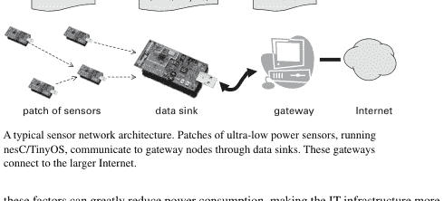

图 1.1 一个典型的传感器网络架构。运行 nesC/TinyOS 的超低功耗传感器节点通过数据汇聚节点与网关通信。这些网关连接到更大的互联网。

这些因素可以大大降低功耗，使 IT 基础设施更高效并减少环境影响。

虽然这三个应用领域只是传感器网络用途中的一小部分，但它们展示了这些网络与大多数其他计算系统之间的关键差异。首先，这些“传感器网络”需要在无人值守的情况下长时间运行。其次，它们从不可预测的环境中收集数据并做出响应。最后，出于成本、部署简便性和鲁棒性的考虑，它们是无线通信的。这三个问题——长寿命、嵌入性和无线通信——共同导致传感器网络采用与传统、有线、以及以人为中心或以机器为中心的系统不同的方法。


传感器网络应用的巨大多样性意味着存在许多网络架构，但主导的部署往往遵循一个共同的架构，如图 1.1 [21, 26, 30] 所示，即超低功耗传感器自组织形成自适应路由网络到一个或多个数据汇聚节点。这些传感器汇聚节点连接到网关，网关通常比传感器强大几个数量级：网关运行嵌入式形式的 Linux、Windows 或其他多任务操作系统。网关具有互联网连接，可以通过手机网络、远距离无线，甚至只是有线以太网实现。

能源问题主导着传感器硬件和软件设计。这些节点需要无线、小型、低成本，并且能够在无人值守的情况下运行很长时间。虽然为少量网关提供大型电源资源，例如大型太阳能板、定期更换电池或墙壁电源，通常是可行的，但对数百个传感器中的每一个都这样做是不切实际的。

### 1.1.1 传感器节点解剖结构（mote）

由于能耗决定了传感器节点的寿命，传感器节点，通常称为 mote，往往具有非常有限的计算和通信资源。它们不是配备全功能的 32 位或 64 位 CPU 以及兆字节或千兆字节的 RAM，而是使用 8 位或 16 位微控制器，配备几千字节的 RAM。与吉赫兹相比，这些微控制器以 1–10 兆赫兹运行。它们的低功耗无线电

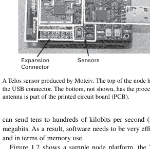

图 1.2 由 Moteiv 生产的 Telos 传感器。节点的顶部有无线电、传感器以及 USB 连接器的电路。底部未显示，有处理器和闪存存储芯片。天线是印刷电路板（PCB）的一部分。

每秒可发送数十到数百千比特（kbps），而不是 802.11 的数十兆比特。因此，软件需要在 CPU 周期和内存使用方面都非常高效。

图 1.2 显示了一个示例节点平台 Telos，它专为易于实验和低功耗运行而设计。它具有 TI MSP430 16 位微控制器，配备 10 kB RAM 和 48 kB 闪存程序存储器。其无线电为 TI CC2420，遵循 IEEE 802.15.4 标准，可发送高达 250 kbps。就功耗而言，无线电主导了系统：在一对 AA 电池上，Telos 的无线电开启约可运行四天。超过四天的使用寿命需要让节点大部分时间处于深度睡眠状态，仅在必要时唤醒，并在可能时尽快进入睡眠。

本书中讨论的另一个 mote，来自 Crossbow Technology 的 micaz 类似：它具有 Atmel ATmega128 8 位微控制器，配备 4 kB RAM、128 kB 闪存程序存储器，使用相同的 CC2420 无线电芯片，也由一对 AA 电池供电，并且具有相似的功耗特性。

网络一旦部署，就会连续数周、数月甚至数年收集数据。由于传感器的放置非常依赖于具体应用，很少有网络需要支持多个并发应用，甚至不需要偶尔重新编程。因此，与强调运行时灵活性和可组合性的通用计算系统不同，传感器网络系统往往高度优化。通常，传感器套件本身是为特定应用选择的：火山监测使用加速度计和麦克风，而数据中心配置则使用温度传感器。

### 1.2 TinyOS

TinyOS 是一种专为低功耗无线传感器设计的轻量级操作系统。TinyOS 与大多数其他操作系统不同，其设计重点是超低功耗运行。与全功能处理器不同，TinyOS 的设计

对于微控制器节点所拥有的微小、低功耗特性而言。 此外，TinyOS 具有非常积极的系统和机制来节省电量。

TinyOS 使构建传感器网络应用程序变得更容易。 它提供了一组重要的服务和抽象，例如传感、通信、存储和定时器。 它定义了一种并发执行模型，因此开发人员可以从可重用的服务和组件构建应用程序，而无需担心不可预见的交互。TinyOS 运行在十多个通用平台上，其中大多数都很容易支持添加新传感器。 此外，TinyOS 的结构使其相当容易移植到新平台。

TinyOS 应用程序和系统，以及操作系统本身，都是用 `nesC` 语言编写的。 `nesC` 是一种 C 方言，具有减少 RAM 和代码大小的功能，能够实现显著的优化，并有助于防止诸如竞态条件之类的低级错误。 第 2 章详细介绍了 `nesC` 与其他 C 类似语言的显著区别，并且本书的大部分内容都是关于如何最好地使用这些特性来编写健壮、高效的代码。

#### 1.2.1 TinyOS 提供的内容

从高层次来看，TinyOS 提供三件事来使编写系统和应用程序更容易：

- 一个组件模型，定义了如何编写小型、可重用的代码片段并将其组合成更大的抽象；
- 一个并发执行模型，定义了组件如何交错其计算，以及中断和非中断代码如何交互；
- 应用程序编程接口（APIs）、服务、组件库以及一个整体的组件结构，可简化新应用程序和服务的编写。

组件模型以 `nesC` 为基础。 它允许你编写可重用的代码片段，这些片段明确声明其依赖关系。 例如，一个通用的用户按钮组件会在中断处理程序之上运行，告诉你何时按下按钮。 组件模型允许按钮实现与所使用的中断无关——例如，使其可以在许多不同的硬件平台上使用——而无需复杂的回调或神奇的函数命名约定。 第 2 章和第 3 章描述了基本的组件模型。

章节，第 11 章）当然也可能存在竞态条件：`nesC` 会在编译时检测可能的数据竞争并发出警告。

最后，TinyOS 本身有一套用于常见功能的 API，例如发送数据包、读取传感器和响应事件。 这些用法的示例散布在整本书中，并在第 6 章和附录 1 中更详细地介绍。 除了编程接口之外，TinyOS 还提供组件结构和组件库。 例如，第 12 章描述了 TinyOS 的硬件抽象架构（HAA），它定义了如何从低级硬件（例如无线电芯片）构建到硬件无关的抽象（例如发送数据包）。 这个组件结构的一部分包括第 11 章中介绍的资源锁，它使自动低功耗操作成为可能，以及简化此类锁编写的组件库。

TinyOS 本身在不断发展。 在 TinyOS 社区中，会形成“工作组”来解决操作系统内的工程和设计问题，改进现有服务并添加新服务。 因此，本书实际上是对操作系统在某个时间点的快照。 正如第 12 章所讨论和附录 1 所介绍的那样，TinyOS 拥有一套用于核心抽象的标准、稳定的 API，但随着新硬件和应用程序的出现，这一集合总是在不断扩展。 了解 TinyOS 的最佳方式是查看其网页 `www.tinyos.net` 并参与其邮件列表。 该网站还涵盖了超出本书范围的高级 TinyOS 和 `nesC` 功能，包括二进制组件、空中重编程服务、调试工具和 `nesC` 参考手册。

### 1.3 示例应用程序

为了更好地理解传感器网络面临的独特挑战，我们通过一个基本的数据收集应用程序进行说明。 运行此应用程序的节点会定期唤醒，采样一些传感器，并通过临时收集树将数据发送到数据汇集点（如图 1.1 所示）。 由于网络必须持续一年，节点 99% 的时间都处于深度睡眠状态。

就能量消耗而言，射频是节点中最昂贵的部分。 持续一年需要将射频设置为低功耗状态。 低功耗射频实现技术超出了本书的范围，但实际结果是数据包传输的延迟更高。 [23]

图 1.3 显示了应用程序使用的四个 TinyOS API：射频的低功耗设置、定时器、传感器和数据收集路由层。 当 TinyOS 通知应用程序节点已启动时，应用程序代码会配置射频的电源设置并启动一个周期性定时器。 每隔几分钟，此定时器就会触发，应用程序代码会采样其传感器。 它将这些传感器值放入数据包中并调用路由层将数据包发送到数据汇集点。 实际上，应用程序往往比这个简单示例更复杂。 例如，它们包括额外的服务，例如管理层，允许管理员重新配置参数并检查网络状态，以及空中编程，以便网络

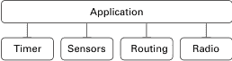

**图 1.3** 示例应用架构。应用代码使用定时器定期执行操作，使用传感器收集数据，并使用路由层将数据发送到汇聚点。

应用可以在无需收集所有节点的情况下重新编程。然而，这四个抽象——电源控制、定时器、传感器和数据收集——涵盖了应用的完整数据路径。

### 1.4 编译和安装应用

你可以在 `www.tinyos.net` 下载最新的 TinyOS 发行版、`nesC` 编译器和其他工具。配置编程环境不在本书的讨论范围内；TinyOS 网站提供分步教程，帮助你入门。TinyOS 的一部分是一个用于编译应用的庞大构建系统。通常，要为某个传感器平台编译程序，你输入 `make <platform>`，例如 `make telosb`。这会编译出一个二进制文件。要将该二进制文件安装到节点上，你需要用 USB 或串口连接将节点插入 PC，然后输入 `make <platform> install`。教程会详细讲解编译和安装选项。

### 1.5 本书其余部分

本书的其余部分将深入介绍如何使用 `nesC` 进行编程以及如何编写 TinyOS 应用。全书分为三个部分。第一部分是对 `nesC` 主要编程概念的简短介绍。第二部分讲述使用标准 TinyOS API 进行基本应用编程。第三部分则更为深入，探讨这些 TinyOS API 是如何实现的。例如，第三部分描述了 TinyOS 如何抽象硬件，以便你能为新的传感器编写驱动程序。

全书按章节安排如下：

- **第 1 章**是本章。
- **第 2 章**介绍 `nesC` 脱离 C 及类 C 语言的主要方式：程序如何由组件构建，以及组件和接口如何帮助管理程序的命名空间。


- **第 3 章**介绍组件及其如何通过接口交互。

- **第 4 章**更详细地探讨配置，即连接其他组件的组件。

- **第 5 章**介绍 TinyOS 的基本执行模型，并就如何以及何时使用任务提供指导。

- **第 6 章**将前三章的内容整合起来，构成一个完整应用的编写示例，该应用在节点检测到环境变化时发出警报。在此过程中，它涵盖了主要的 TinyOS API（定时、感知、通信和存储）。

- **第 7 章**详细介绍用于与通过串口连接的节点进行通信的 PC 端工具，并涵盖 TinyOS 串口协议栈和数据包格式。

- **第 8 章**介绍更高级的组件主题，如参数化接口和属性。虽然应用通常不使用这些机制，但在编写可复用的库和系统时它们不可或缺。

- **第 9 章**详细讲解参数化接口的连接，这构成了大多数可复用系统的基础。在描述了管理接口键的基本机制后，它通过四个复杂度递增的示例进行讲解。

- **第 10 章**介绍八种常见的 TinyOS 设计模式：通常有用且强大的组件组织方式。

- **第 11 章**通过介绍并发来结束高级编程主题。它描述了异步代码、TinyOS 任务模型和电源锁。

- **第 12 章**描述硬件抽象架构（HAA），这是 TinyOS 用于将底层硬件抽象提升为与硬件无关的应用级服务的三级层次结构。

- **第 13 章**逐步讲解一个高级应用，该应用根据节点感知到事件的时间来识别事件的位置。它使用底层接口来实现时间同步和高频采样。

- **附录**简要概述了主要的 TinyOS 应用接口。

在整本书中，你会发现*编程提示*：我们从 TinyOS 和 nesC 的众多用户中提炼出的通用最佳实践。这些提示全部列在书前的插页上。

最后，本书中示例应用（第 6、7 和 13 章）的完整源代码可在 TinyOS 的贡献代码目录中获取，名称为“TinyOS Programming”——详见 www.tinyos.net。

## 2 名称和程序结构

程序结构是 C 与 nesC 之间最基本也最明显的区别。C 程序由定义在文件中、分别编译后再链接在一起的变量、类型和函数组成。nesC 程序则由组件构成，这些组件通过显式的程序语句进行连接（“布线”）；nesC 编译器将这些组件作为一个整体进行连接和编译。为了说明和解释程序构建方式上的这些差异，我们对比了 C 和 nesC 实现的两个非常简单的类似“hello world”的 mote 应用，Powerup（启动并点亮一个 LED）和 Blink（启动并重复闪烁一个 LED）。

### 2.1 Hello World!

最接近经典“Hello World!”程序的 mote 等价物是“Powerup”应用，它在启动时仅点亮其中一个 mote 的 LED，然后进入睡眠。

Powerup 的 C 实现相当简单：

```
#include "mote.h"

int main()
{
    mote_init();
    led0_on();
    sleep();
}
```

Listing 2.1 Powerup in C

Powerup 应用与“mote”库一起编译和链接，该库提供执行硬件初始化（`mote_init`）、LED 控制（`led0_on`）以及将 mote 置于低功耗睡眠模式（`sleep`）的函数。“`mote.h`”头文件仅提供这些及其他基本函数的声明。通常的 C `main` 函数会在 mote 启动时自动调用。

> 1 C 编译器、库和链接器通常通过将 mote 的硬件复位向量指向一段设置 C 环境后调用 `main` 的汇编代码来实现这一点。

Powerup 的 nesC 实现分为两部分。第一部分是 `PowerupC` 模块，其中包含 Powerup 的可执行逻辑（就这么多……）：

```
module PowerupC {
  uses interface Boot;
  uses interface Leds;
}
implementation {
  event void Boot.booted() {
    call Leds.led0On();
  }
}
```

Listing 2.2 PowerupC module in nesC

这段代码表示 `PowerupC` 通过两个接口 `Boot` 和 `Leds` 与系统其余部分交互，并为 `Boot` 接口的 `booted` 事件提供实现，该实现调用 `Leds` 接口的 `led0On` 命令。与 C 代码相比，可以看出 `booted` 事件实现取代了 `main` 函数，而对 `led0On` 命令的调用则取代了对 `led0_on` 库函数的调用。

这段代码展示了 nesC 与 C 之间的两个主要区别之一：C 程序由函数组成，而 nesC 程序由实现特定服务的组件构建而成（就 `PowerupC` 而言，是在启动时点亮 LED）。此外，C 函数通常通过直接调用彼此交互，而组件之间的交互则由接口指定：接口的使用者向接口提供者发出请求（调用命令），提供者向使用者发出回调（发出事件）。命令和事件本身就像常规函数一样（它们可以包含任意 C 代码）；调用命令或发出事件只是函数调用。`PowerupC` 同时是 `Boot` 和 `Leds` 的使用者；`booted` 事件是在系统启动时发出的回调，而 `led0On` 是一个请求打开 LED 0 的命令。

nesC 接口类似于 Java 接口，只是增加了 `command` 或 `event` 关键字以区分请求和回调：

```
interface Boot {
  event void booted();
}

interface Leds {
  command void led0On();
  command void led0Off();
}
```

2 在 TinyOS 中 LED 是编号的，因为不同平台的 LED 颜色不同。

```
command void led0Toggle();
...
```

#### Listing 2.3 Simple nesC interfaces

Powerup 的第二部分，`PowerupAppC` 配置，指定了 `PowerupC` 如何连接到 TinyOS 的服务：

```
configuration PowerupAppC { 
implementation {
components MainC, LedsC, PowerupC;

MainC.Boot -> PowerupC.Boot;
PowerupC.Leds -> LedsC.Leds;
}
```

#### Listing 2.4 PowerupAppC configuration in nesC

这表示 `PowerupAppC` 应用由三个组件（模块或配置）构建而成：`MainC`（系统启动）、`LedsC`（LED 控制）和 `PowerupC`（我们的 powerup 模块）。`PowerupAppC` 明确指定了这些组件提供的和使用的接口之间的连接（或布线）。当 `MainC` 完成系统启动后，它会发出其 `Boot` 接口的 `booted` 事件，该事件通过 `PowerupAppC` 中的布线连接到 `PowerupC` 中的 `booted` 事件。然后该事件调用其 `Leds` 接口的 `led0On` 命令，该命令再次通过 `PowerupAppC` 布线连接到由 `LedsC` 提供的 `Leds` 接口。因此该调用会点亮 LED 0。生成的组件图如图 2.1 所示——该图由 nesC 的文档生成工具 `nesdoc` 从 `PowerupAppC` 自动生成。

`PowerupAppC` 说明了 C 与 nesC 之间的第三个主要区别：布线使 C 版本的 Powerup 与其“mote”库链接所表达的连接变得明确。在 C 版本中，Powerup 调用一个名为 `led0_on` 的全局函数，该函数连接到提供同名函数的任何库；如果两个库

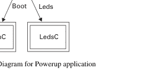

#### Figure 2.1 Wiring Diagram for Powerup application

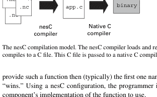

如果多个库提供了这样一个函数，那么（通常）链接器命令行中第一个命名的库会“胜出”。而使用 nesC 配置时，程序员则显式选择使用该函数的哪个组件实现。

nesC 编译器可以利用这种显式连接来构建高度优化的二进制文件。当前 nesC 编译器的实现（`nesc1`）将描述组件的 nesC 文件作为输入，并输出一个 C 文件。该 C 文件被传递给本地 C 编译器，后者可以编译为所需的微控制器或处理器。图 2.2 展示了这一过程。nesC 编译器精心构造生成的 C 文件，以最大化 C 编译器的优化能力。例如，由于它接收的是单个文件，C 编译器可以自由地跨调用边界进行优化，并在需要时内联代码。nesC 编译器还会修剪从未被调用的死代码和从未被访问的变量：由于 nesC 中没有动态链接，它可以完整地掌握应用程序的调用图。这加快了 C 编译速度，并在 RAM 和代码两方面减小了程序体积。

### 2.2 本质区别：组件、接口和连接


C 与 nesC 之间的三个本质区别——组件、接口和连接——都与程序元素（变量、函数、类型等）的命名和组织有关。在 C 中，程序被拆分为多个独立文件，这些文件通过全局命名空间连接：一个文件中声明的符号 X 由链接器连接到另一个文件中定义的符号 X。例如，如果 `file1.c` 包含：

```
extern void g(void); /* declaration of g */

int main() /* definition of main */
{
    g(); g();
}
```

而 `file2.c` 包含：

```
void g(void)
{
    printf("hello world!");
}
```

那么编译并链接 `file1.c` 和 `file2.c` 会将 `main` 中对 `g()` 的调用连接到 `file2.c` 中 `g` 的定义。最终的程序会打印两次“hello world!”。

在全局命名空间中组织符号可能比较棘手。C 程序员使用多种技术来简化这项任务，包括头文件和命名约定。头文件将声明分组，以便在多个文件中使用，而无需重新输入它们。例如，`file1.c` 的头文件 `file1.h` 通常包含：

```
#ifndef FILE1_H
#define FILE1_H
extern void g(void); /* declaration of g */
#endif
```

命名约定旨在避免两个不同符号同名。例如，类型通常带一个 `_` 后缀，以保证类型和函数不会同名。一些库为其所有符号使用公共前缀，例如 GTK+ 图形工具包的 `Gtk` 和 `gtk_`。这些前缀提醒用户函数之间是相关的，并避免与其他库发生意外的名称冲突，但会使程序更加冗长。

nesC 的组件为组织程序元素提供了一种更系统的方法。组件（模块或配置）将相关功能（定时器、传感器、系统启动）分组到单个单元中，这与面向对象语言中的类非常相似。例如，TinyOS 将其系统服务表示为独立的组件，如 `LedsC`（LED 控制，见上文）、`ActiveMessageC`（发送和接收无线电消息）等。只有服务（组件）名称是全局的，服务的操作在组件各自的作用域内命名：`ActiveMessageC.SplitControl` 启动和停止无线电，`ActiveMessageC.AMSend` 发送无线电消息，等等。

接口为组件带来了进一步的结构：组件通常根据它们提供和使用的接口集合（`Leds`、`Boot`、`SplitControl`、`AMSend`）来指定，而不是直接根据实际操作来指定。接口简化和澄清了代码，因为在实际中，组件之间的交互遵循标准模式：许多组件想要控制 LED 或发送无线电消息，许多服务需要启动或停止，等等。鼓励程序员用通用接口来表达他们的组件也促进了代码复用：用 `AMSend` 消息传输接口来表达你的新网络协议，意味着该协议可以与现有应用程序一起使用；在你的应用程序中使用 `AMSend`，则意味着该应用程序可以与任何现有或未来的网络协议一起使用。

nesC 程序不是将同名声明与定义连接起来，而是使用连接（wiring）来指定组件如何交互：`PowerupAppC` 将 `PowerupC` 的 `Leds` 接口连接到由 `LedsC` 组件提供的接口，但只需更改两行，就可以将该连接切换到 `NoLedsC` 组件（该组件什么都不做）：

```
components PowerupC, NoLedsC;
PowerupC.LedsC -> NoLedsC.Leds;
```

而不会影响程序中希望使用 `LedsC` 的任何其他部分。在 C 中，可以将 Powerup 使用的“mote”库替换为一个 LED 函数什么都不做的版本，但这种更改会影响所有 LED 用户，而不仅仅是 Powerup。

### 2.3 接线与回调

将组件连接的决策留给程序员做的不仅仅是简化在多个服务实现之间切换。它还提供了一种高效的机制来支持回调，我们通过定时器的例子来展示这一点。TinyOS 提供可变数量的周期性或截止时间定时器；与每个定时器相关联的是一个回调，当定时器触发时每次都会执行该函数。我们首先看看在 C 中如何表达这样的定时器，通过修改 Powerup 使 LED 0 以 2 Hz 闪烁，而不是一次打开后就一直保持：

```
#include "mote.h"

timer_t mytimer;

void blink_timer_fired(void)
{
    leds0_toggle();
}

int main()
{
    mote_init();
    timer_start_periodic(&mytimer, 250, blink_timer_fired);
    sleep();
}
```

清单 2.5 C 中的闪烁 LED 的 Powerup

在这个例子中，Blink 应用程序声明了一个全局 `mytimer` 变量来保存定时器状态，并调用 `timer_start_periodic` 来设置一个周期为 250 ms 的周期性定时器。每次定时器触发时，定时器实现都会回调在设置定时器时指定的 `blink_timer_fired` 函数。该函数只是调用一个库函数来切换 LED 0 的开/关。

nesC 版本的 Blink 与 C 版本类似，但使用接口和接线来指定定时器与应用程序之间的连接：

```
module BlinkC {
    uses interface Boot;
    uses interface Timer;
    uses interface Leds;
}
implementation {
    event void Boot.booted() {
        call Timer.startPeriodic(250);
    }
    event void Timer.fired() {
        call Leds.led0Toggle();
    }
}
```

清单 2.6 nesC 中闪烁 LED 的 Powerup（略有简化）

`BlinkC` 模块在启动时启动周期为 250 ms 的定时器。`startPeriodic` 命令启动定时器与 `fired` 事件闪烁 LED 之间的连接是通过将命令和事件放在同一个接口中隐式指定的：

```
interface Timer {
command void startPeriodic(uint32_t interval);
event void fired();
...
}
```

最后，这个 `Timer` 必须连接到提供实际定时器的组件。`BlinkAppC` 将 `BlinkC.Timer` 接线到新分配的定时器 `MyTimer`：

```
configuration BlinkAppC { implementation { components MainC, LedsC, new TimerC() as MyTimer, BlinkC; BlinkC.Boot -> MainC.Boot; BlinkC.Leds -> LedsC.Leds; BlinkC.Timer -> MyTimer.Timer; } }
```

清单 2.7 闪烁 LED Powerup 配置（略有简化）

在 C 版本中，定时器到应用程序的回调是 `timer_start_periodic` 函数的运行时参数。定时器实现将此函数指针存储在保存定时器状态的 `mytimer` 变量中，并在每次定时器触发时执行间接函数调用。相反，在 nesC 版本中，定时器与 Blink 应用程序之间的连接是在 `BlinkAppC` 中在编译时指定的。这避免了存储函数指针的需要（节省了宝贵的 RAM），并允许 nesC 编译器在回调之间执行优化（特别是内联）。

### 2.4 总结

表 2.1 总结了 C、C++ 和 nesC 中程序结构的不同方式。在 C 中，典型的高级编程单元是文件，其关联的头文件指定并记录了文件的行为。链接器通过匹配全局名称将应用程序从文件构建出来；当这不足以表达程序结构时（例如回调），程序员可以使用函数指针来推迟在何时调用哪个函数的决策。

## 水彩特辑

LOOKING FOR FREEDOM

但自由并不等同于放任，也不是不要技法的“无为”，自由的画水彩反而是建立在熟练的基础之上。

只有掌握了水彩的“脾气”，才能收放自如。

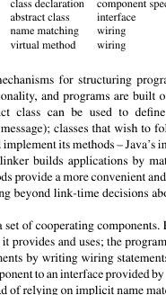


## Part II

## Basic programming

## 3 组件和接口

本章描述了 nesC 程序的构建块——组件。每个组件都有一个签名，该签名描述了它需要调用的函数以及其他组件可以调用它的函数。组件通过接口声明其签名，接口是一组用于完整服务或抽象的函数。模块是实现并在类 C 代码中调用函数的组件。配置将组件连接成更大的抽象。本章重点介绍模块，并仅在足以修改和扩展现有应用程序的程度上介绍配置：第 4 章介绍从头编写新配置。

### 3.1 组件签名


nesC 程序是一组组件。每个组件都在自己的源文件中，并且组件与源文件名之间存在一一映射。例如，文件 `LedsC.nc` 包含组件 `LedsC` 的 nesC 代码，而组件 `PowerupC` 可以在文件 `PowerupC.nc` 中找到。nesC 中的组件位于全局命名空间中：只有一个 `PowerupC` 定义，因此 nesC 编译器只加载一个名为 `PowerupC.nc` 的文件。

组件有两种类型：模块和配置。模块和配置在将组件组合成更大的服务或抽象时可以互换使用。这两种组件类型的区别在于其实现部分。模块实现部分由看起来像 C 的 nesC 代码组成。模块代码声明变量和函数，调用函数，并编译为汇编代码。配置实现部分由 nesC 布线代码组成，该代码将组件连接在一起。配置是 nesC 与 C（以及其他 C 衍生语言）之间的主要区别。

所有组件都有两个代码块。第一个块描述其签名，第二个块描述其实现：

```
module PowerupC {
    // signature
}
implementation {
    // implementation
}

configuration LedsC {
    // signature
}
implementation {
    // implementation
}
```

清单 3.1 签名和实现块

模块和配置中的签名块具有相同的语法。组件签名包含零个或多个接口。接口定义了服务或抽象的一组相关函数。例如，有一个用于控制节点 LED 的 `Leds` 接口、一个用于在节点启动时收到通知的 `Boot` 接口，以及一个用于初始化组件状态的 `Init` 接口。组件签名声明它提供或使用接口。例如，需要打开和关闭节点 LED 的组件使用 `Leds` 接口，而实现打开和关闭 LED 的函数的组件提供 `Leds` 接口。回到两个示例，以下是它们的签名：

```
module PowerupC {
  uses interface Boot;
  uses interface Leds;
}

configuration LedsC {
  provides interface Leds;
}
```

清单 3.2 `PowerupC` 和 `LedsC` 的签名

`PowerupC` 是一个在系统启动时打开节点 LED 的模块。正如我们在第 2 章中看到的，它使用 `Boot` 接口来通知系统启动，并使用 `Leds` 接口来打开 LED。与此同时，`LedsC` 是一个提供可通过 `Leds` 接口控制的三个 LED 抽象的配置。单个组件可以同时提供和使用接口。例如，以下是配置 `MainC` 的签名：

```
configuration MainC {
  provides interface Boot;
  uses interface Init;
}
```

清单 3.3 `MainC` 的签名

`MainC` 是一个实现节点启动序列的配置。它提供 `Boot` 接口，以便其他组件（如 `PowerupC`）可以在节点完全启动时收到通知。`MainC` 使用 `Init` 接口，以便在完成启动序列之前根据需要初始化软件。如果 `PowerupC` 在系统启动前需要初始化的状态，它可能会提供 `Init` 接口。

### 3.1.1 可视化组件

在本书中，我们将使用一种视觉语言来展示组件及其关系。图 3.1 显示了我们迄今为止看到的三个组件：`MainC`、`PowerupC` 和 `LedsC`。

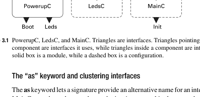

### 3.1.2 `as` 关键字和接口聚类

`as` 关键字允许签名为接口提供一个替代名称。例如，`MainC` 使用 `as` 关键字使其签名对读者更清晰一些，通过使用名称 `SoftwareInit` 来表示其 `Init` 接口：

```
uses interface Init as SoftwareInit;
```

某些签名必须使用该关键字来区分同一接口的多个实例。如果一个组件提供或使用接口不止一次，其签名必须使用 `as` 关键字为它们赋予不同的名称。例如，`LedsC` 通过 `Leds` 接口提供三个 LED 的抽象，但它是一个配置而不是可执行代码。`LedsC` 配置将 LED 模块 `LedsP` 连接到提供为 LED 供电的数字输入输出线的组件。`LedsP` 的签名如下：

```
module LedsP {
  provides {
    interface Init;
    interface Leds;
  }
  uses {
    interface GeneralIO as Led0;
    interface GeneralIO as Led1;
    interface GeneralIO as Led2;
  }
}
```

清单 3.4 `LedsP` 模块

签名只需要确保每个接口实例都有唯一名称即可。例如，上面 `LedsP` 的例子也可以只使用两次 `as`，并让一个接口实例保留为 `GeneralIO`，这样三个名称就分别是 `Led0`、`Led1` 和 `GeneralIO`。然而，在这种情况下会令人困惑，因此 `LedsP` 重命名了 `GeneralIO` 的全部三个实例。技术上讲，接口声明隐含使用了 `as`。语句

```
uses interface Leds;
```

实际上是

```
uses interface Leds as Leds;
```

的简写。一般来说，`as` 关键字是有用的工具，可以使组件及其需求更清晰，就像变量和函数名称极大地影响代码可读性一样。

#### 编程提示 1 慷慨地使用 `as` 关键字。

### 3.1.3 聚类接口

`LedsP` 示例展示了签名关于的另一个细节：它们可以把使用的和提供的接口聚类在一起。例如，这两个版本的 `PowerupC` 是等价的：

```
configuration PowerupC {
  uses interface Boot;
  uses interface Leds;
}
```

```
configuration PowerupC {
  uses {
    interface Boot;
    interface Leds;
  }
}
```

清单 3.5 `PowerupC` 及其替代签名

由于两者等价，在语法或代码效率上没有优势：这只是风格问题，以及哪种方式对读者更易读。组件签名通常先声明它们提供的接口，然后再声明它们使用的接口。这让读者能够清楚地看到可用功能和依赖关系。然而，对于执行许多功能的非常复杂的组件，这种方法会失效，签名会把相关的接口放在彼此附近。

TinyOS 细节：上面描述的所有组件的名称都以字母 C 和 P 结尾。这不是强制要求。它是 TinyOS 代码中使用的编码约定。名称以 C 结尾的组件是其他组件可以自由使用的抽象：C 代表 “component”。一些组件名称以 P 结尾，代表 “private”。在 TinyOS 中，P 组件不应直接使用，因为它们通常是复杂系统的内部部分。组件使用这两个字母是为了清楚地将它们与接口区分开。

### 3.2 接口

接口描述了两个或多个不同组件之间的功能关系。组件在此关系中所扮演的角色取决于它提供或使用接口。与组件一样，接口在名称和文件之间有一一映射：文件 `Leds.nc` 包含接口 `Leds`，而文件 `Boot.nc` 包含

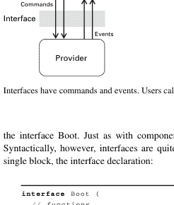

图 3.2 接口具有命令和事件。

接口 `Boot`。就像组件一样，接口处于全局命名空间中。然而在语法上，接口与组件大不相同。它们只有一个块，即接口声明：

```
interface Boot {
    // functions
}

interface Leds {
    // functions
}
```

清单 3.6 `Leds` 和 `Boot` 的接口声明

接口声明包含一个或多个函数。接口有两种函数：命令和事件。`Init` 和 `Boot` 是两个简单的接口，各自只有一个函数。`Init` 有一个命令，而 `Boot` 有一个事件：

```
interface Init {
    command error_t init();
}

interface Boot {
    event void booted();
}
```

清单 3.7 `Init` 和 `Boot` 接口

TinyOS 细节：`init` 返回的 `error_t` 类型是 TinyOS 报告成功或失败的常规方式。值 `SUCCESS` 代表成功，`FAIL` 代表一般失败。特定的 `Exxx` 常量，部分受 Unix 的 `errno` 启发，表示特定失败，例如 `EINVAL` 表示 “无效值”。

函数是命令还是事件决定了接口的哪一侧 —— 用户或提供者 —— 实现该函数，以及哪一侧可以调用它。用户可以调用命令，提供者可以发出事件。反之，用户必须实现事件，提供者必须实现命令。图 3.3 用我们描述 nesC 程序的视觉语言展示了这种关系。例如，回到 `MainC`

#### 组件和接口

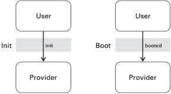

**图 3.3** `Init` 和 `Boot` 接口。


and PowerupC, PowerupC is a user of Boot, while MainC is a provider of Boot:

```
configuration MainC {
  provides interface Boot;
  uses interface Init as SoftwareInit;
}

module PowerupC {
  uses interface Boot;
  uses interface Leds;
}
```

清单 3.8 MainC 和 PowerupC 的签名

Boot 有一个事件，`Boot.booted`。MainC 提供 Boot，因此在节点成功启动时会发出该事件。此信号是一个函数调用：启动序列在所有想要知道系统已启动的组件上调用 `Boot.booted`。如果一个组件——例如 `PowerupC`——想要知道节点何时启动，它使用 Boot 接口。

命令的实现方向与事件相反。用户调用命令，提供者实现它们。MainC 使用 Init 以便在启动前初始化软件组件：它在需要初始化的组件上调用 `SoftwareInit.init`。同样，由于 `PowerupC` 使用 `Leds`，它可以调用诸如 `Leds.led0On` 之类的命令。相反，`Leds` 的提供者，例如 `LedsP`，必须实现 `Leds` 命令。

图 3.3 以图形方式显示了 Boot 和 Init 接口。Init 有一个命令，`init`。Init 接口的用户可以调用 `Init.init`，而 Init 接口的提供者必须实现 `Init.init`。相反，Boot 接口的用户必须实现 `booted` 事件，而接口的提供者可以发出 `Boot.booted`。

此时，命令和事件之间的区别可能看起来毫无意义。毕竟，提供一个具有命令的接口与使用一个具有事件的接口是相同的。对于仅具有命令或事件而非二者的接口而言，这确实是正确的，这种区别更多是为了呈现和可读性。提供一个接口意味着提供一项服务，无论是控制节点上的 LED 还是在系统启动时通知组件。使用一个接口意味着使用该服务。然而，正如我们很快会看到的，许多有趣的接口同时具有命令和事件，表示两个组件之间的关系，其中双方都可以调用对方。

前者存在代码重复问题（以及文件膨胀），而后者依赖于运行时检查，而这在 C 语言中明显不足。拥有一个通用队列可以实现对放入和取出队列的值进行编译时检查。

#### 3.2.2 双向接口

到目前为止，我们只看到具有命令或事件但不是二者的接口。双向接口声明了从用户到提供者的命令以及从提供者到用户的事件。例如，这就是 Notify 接口，它允许用户要求在发生事件时得到通知，这些事件可能带有相关数据：

```
interface Notify<val_t> {
  command error_t enable();
  command error_t disable();
  event void notify(val_t val);
}
```

清单 3.12 Notify 接口

`Notify` 接口有两个命令，用于启用和禁用通知。如果通知已启用，则接口的提供者会发出 `notify` 事件。`Notify` 接口是泛型的，因为根据服务的不同，它可能需要提供不同类型的数据。双向接口使组件能够在不需要函数指针的情况下注册回调。

例如，一些硬件平台上有按钮。按钮非常适合 Notify 接口：组件可以打开和关闭按钮按下通知。例如，`UserButtonC` 是一个提供此抽象的组件：

```
configuration UserButtonC {
  provides interface Get<button_state_t>;
  provides interface Notify<button_state_t>;
}
```

清单 3.13 UserButtonC

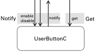

**图 3.4** UserButtonC 的命令和事件。

除了 Notify 接口，该接口在按钮状态改变时通知用户之外，`UserButtonC` 还提供 Get 接口，组件可以使用它主动查询按钮状态。图 3.4 显示了 `UserButtonC` 的命令和事件的调用方向。

提供 Notify 的组件必须实现 `enable` 和 `disable` 命令，并且可以发出 `notify` 事件。使用 Notify 的组件可以调用 `enable` 和 `disable` 命令，并且必须实现 `notify` 事件。在 `UserButtonC` 的情况下，`button_state_t` 描述按钮是按下还是松开。

`Timer` 是另一个双向接口。`Timer` 是一个泛型接口，但它使用类型的方式与 Get 或 Notify 略有不同。`Timer` 接口中的类型不会在其任何命令或事件中使用。相反，该类型表示计时器粒度。例如 `Timer<TMilli>` 是毫秒计时器。¹ 而 `Timer<TMicro>` 是微秒计时器。这种类型的写法使 nesC 能够检查组件使用的 Timer 是否具有正确的粒度，同时只有一个 Timer 接口：你不能将微秒计时器连接到需要毫秒计时器的组件上。这只是 Timer 接口的一个子集；它还有一些高级操作，为简单起见被省略了：

```
interface Timer<precision_tag> {
  command void startPeriodic(uint32_t dt);
  command void startOneShot(uint32_t dt);
  command void stop();
  event void fired();
  // Advanced operations follow
}
```

清单 3.14 简化的 Timer 接口，显示三个命令和一个事件

`fired` 事件响应于 `start` 命令发出，这些命令在是否导致一系列计时器触发（`startPeriodic`）或单个 `fired` 事件（`startOneShot`）方面有所不同。`dt` 参数指定计时器间隔。

`Timer` 与 `Notify` 在细微但重要的方面有所不同：用户控制事件的时机和数量。`Notify` 允许用户打开和关闭事件；`Timer` 允许用户控制发出哪些事件以及何时发出。因此命令和事件之间存在更紧密的耦合。对于 Notify，即使 Notify 已启用，也可能永远不会发出任何事件。对于 Timer，可以根据调用了哪些命令来精确描述将发出哪些事件。

### 3.3 组件实现

模块和配置在实现部分有所不同。

¹ 请注意，`TMilli` 计时器每秒触发 1024 次，而不是 1000 次。这是因为许多微控制器没有以 1 kHz 精确计数的能力，但它们可以以 1024 Hz 精确计数。

#### 3.3.1 模块

模块实现是用 nesC 的 C 语言方言编写的。在单条语句层面，nesC 与 C 几乎完全相同。它主要在代码如何调用函数以及变量作用域方面有所不同。由于组件必须为其提供的接口实现命令，并为其使用的接口实现事件，因此模块的代码必须定义这些函数。例如，这就是 `PowerupC` 模块的代码：

```
module PowerupC {
  uses interface Boot;
  uses interface Leds;
}
implementation {
  event void Boot.booted() {
    call Leds.led0On();
  }
}
```

清单 3.15 PowerupC 模块代码

由于 `PowerupC` 使用 Boot 接口，而 Boot 只有一个事件 `booted`，因此 `PowerupC` 必须提供实现：`event void Boot.booted() { ... }`。当 Boot 的提供者发出此事件时，`PowerupC` 会打开 `Leds` 接口的 LED 0。模块使用 `call` 关键字调用命令，使用 `signal` 关键字发出事件。因此，你经常会看到“调用命令”和“发出事件”这样的说法。`Leds` 接口有三个 LED，主要是出于历史原因。它们命名为 `led0`、`led1` 和 `led2`。除了打开 LED（例如 `led0On`）之外，`Leds` 接口还允许你关闭它们（例如 `led0Off`）并切换它们（例如 `led0Toggle`）。例如，这个组件将导致系统启动进入一个无限循环，切换全部三个 LED：

```
module PowerupToggleC {
  uses interface Boot;
  uses interface Leds;
}
implementation {
  event void Boot.booted() {
    while (1) {
      call Leds.led0Toggle();
      call Leds.led1Toggle();
      call Leds.led2Toggle();
    }
  }
}
```

清单 3.16 模块 PowerupToggleC

为了让 `PowerupToggleC` 起作用，我们必须指定要将 `PowerupToggleC` 连接到的提供 Boot 和 Leds 的组件。这就是我们接下来要编写的 `PowerupToggleAppC` 配置的作用。

#### 3.3.2 一个基本配置


模块分配状态并实现可执行逻辑。然而，与所有组件一样，它们只能在其本地命名空间中命名函数和变量，即在其签名和实现中定义的内容。为了让一个模块能够调用另一个模块，我们必须将一个组件签名中的一组名称（通常是接口）映射到另一个组件签名中的一组名称。在 nesC 中，以这种方式连接两个组件称为连线。配置是 nesC 的第二种组件类型，包含这些连线。模块实现程序逻辑，配置将组件连接在一起形成更大的抽象。

配置看起来与模块非常相似。它们具有规范和实现。这是 `PowerupToggleAppC` 配置，它将 `PowerupToggleC` 模块连接到提供 `Boot` 和 `Leds` 接口的组件。

```
configuration PowerupToggleAppC () {
implementation {
components MainC, LedsC, PowerupToggleC;

PowerupToggleC.Boot -> MainC.Boot;
PowerupToggleC.Leds -> LedsC.Leds;
}
}
```

清单 3.17 `PowerupToggleAppC` 配置

配置必须使用`components`关键字命名其要连线的组件。可以跟随任意数量的组件名称，其顺序无关紧要。即使只有一个组件名称跟随，关键字仍保持复数形式（`components`，而不是`component`）。配置可以有多个`components`语句。配置必须在连线它之前命名一个组件。例如，这两个都是有效的：

```
components MainC, LedsC;
components PowerupToggleC;
PowerupToggleC.Boot -> MainC.Boot;
PowerupToggleC.Leds -> LedsC.Leds;

components PowerupToggleC;
components MainC;
PowerupToggleC.Boot -> MainC.Boot;
components LedsC;
PowerupToggleC.Leds -> LedsC.Leds;
```

清单 3.18 `components` 关键字的示例用法

在语法上，配置非常简单。它们有三个运算符：`->`、`<-` 和 `=`。`=` 运算符用于连线配置的规范，我们将在第 4 章看到。两个箭头用于将配置的组件相互连线：箭头将接口使用者连接到接口提供者。箭头从使用者指向提供者，但会双向解析双向接口的调用路径（从使用到提供的命令，以及从提供到使用的事件）。例如，以下两行具有相同的效果：

```
PowerupToggleC.Boot -> MainC.Boot;
MainC.Boot <- PowerupToggleC.Boot;
```

当`PowerupToggleC`调用`Leds.led0Toggle`时，它命名了其自身本地作用域中的一个函数。`LedsC`组件提供了`Leds`接口。连线两者，将前者映射到后者。这意味着当`PowerupToggleC`调用其`Leds.led0Toggle`时，它实际上调用的是`LedsC`的`Leds.led0Toggle`。对于`Leds`接口的其他调用，例如`Leds.led1On`，也是如此。配置`PowerupToggleAppC`在两个组件的本地命名空间之间提供了一个映射。

由于`PowerupToggleAppC`是`PowerupToggle`应用的顶层配置，因此它不提供或使用任何接口：其签名块为空。稍后，在第 4 章中，我们将介绍提供和使用接口的配置。

#### 3.3.3 模块变量

所有模块变量都是私有的：接口是其他组件访问变量的唯一方式。`Get`接口就是这种抽象的一个例子，它上面提到是`UserButtonC`的一部分。`Get`有一个非常简单的定义：

```
interface Get<val_t> {
  command val_t get();
}
```

清单 3.19 `Get` 接口

模块声明变量的方式与标准 C 非常相似。例如，这个组件实现了一个`Get`接口，返回`get`被调用的次数（即充当计数器）：

```
module CountingGetC {
  provides interface Get<uint8_t>;
}
implementation {
  uint8_t count;

  command uint8_t Get.get() {
    return count++;
  }
}
```

清单 3.20 一个自增计数器

模块变量声明可以有初始化器，就像 C 一样：

```
uint8_t count = 1;
message_t packet;
message_t* packetPtr = &packet;
```

#### 3.3.4 泛型组件

默认情况下，TinyOS 中的组件是单例：只有一个实例存在。每个命名单例组件的配置都命名相同的组件。例如，如果两个配置都连接到`LedsC`，它们连接的是访问相同变量的同一段代码。单例组件引入一个组件名称，使任何配置都可以使用它进入全局命名空间。

除了单例组件外，nesC 还有泛型组件。与单例不同，泛型组件可以有多个实例。例如，虽然硬件资源的低级软件抽象本质上是单例——硬件寄存器只有一个副本——但软件数据结构是可以实例化的。可实例化使其可以在应用程序的许多不同部分中重复使用。例如，模块`BitVectorC`提供了位向量的抽象；而不是定义宏或函数来操作位向量，一个模块只需使用接口`BitVector`并假设相应的配置将其连接到宽度合适的`BitVectorC`。

nesC 的早期版本（1.0 和 1.1）不支持泛型组件。每当组件需要一个通用数据结构时，程序员必须复制数据结构组件并为其命名，或通过本地分配数据结构并使用库例程来分离功能和分配。例如，网络协议通常都自行实现自己的队列数据结构，而不是依赖标准实现。这种代码复制阻止了代码重用，迫使程序员不断重新审视常见错误和问题，而不是在经过充分测试的库之上构建。

泛型组件在其签名前带有关键字`generic`：

```
generic module SineSensorC() {
  provides interface Init;
  provides interface Read<uint16_t>;
}

generic configuration TimerMilliC() {
  provides interface Timer<TMilli>;
}
```

列表 3.21 泛型模块 `SineSensorC` 和泛型配置 `TimerMilliC`

要使用泛型组件，配置必须使用`new`关键字实例化它。这是配置`BlinkAppC`的代码开头，`Blink`应用程序的顶层配置，使用三个定时器在 mote 的 LED 上显示 3 位计数器：

```
configuration BlinkAppC () {
  implementation {
    components MainC, BlinkC, LedsC;
    components new TimerMilliC() as Timer0;
    components new TimerMilliC() as Timer1;
    components new TimerMilliC() as Timer2;
    /* Wirings below */
  }
}
```

列表 3.22 实例化一个泛型组件

泛型组件可以接受参数，因此组件签名（`generic configuration TimerMilliC()`）和实例化（`components new TimerMilliC() as Timer0;`）中出现了括号。这些参数可以是简单类型的值、常量字符串或类型。例如，`BitVectorC`接受一个 16 位整数，表示有多少位：

```
generic module BitVectorC(uint16_t maxBits) {
  provides interface Init;
  provides interface BitVector;
}
```

列表 3.23 `BitVectorC` 的签名

`typedef`关键字表示泛型组件的参数为类型。泛型模块`QueueC`是一个具有固定最大长度的队列。`QueueC`接受两个参数：队列存储的类型和最大长度。按惯例，我们为所有类型参数后缀`_t`：

```
generic module QueueC(typedef queue_t, uint8_t queueSize) {
  provides interface Queue<queue_t>;
}
```

列表 3.24 `QueueC` 签名

第 8 章深入介绍了编写新的泛型组件的细节。

### 3.4 分阶段接口

由于传感器节点具有广泛的硬件能力，TinyOS 的目标之一是具有灵活的硬件/软件边界。加密数据包的应用程序应该能够互换地使用硬件或软件实现。然而，硬件几乎总是分阶段的而不是阻塞的。在分阶段操作中，启动操作的请求会立即完成。

#### 3.4.1 `Read`

`Read`接口是 TinyOS 分阶段数据采集的基础接口。大多数传感器驱动程序都提供`Read`，其定义通用：


```
interface Read<val_t> {
  command error_t read();
  event void readDone(error_t err, val_t val);
}
```

### 清单 3.25 Read 接口

例如，生成 16 位值的传感器驱动程序提供 `Read<uint16_t>`。如果 `Read` 的提供者在对 `read` 的调用返回 `SUCCESS`，则它将在未来发出 `readDone`，并将 `Read` 的结果作为 `val` 参数传回给事件处理程序。

#### 3.4.2 Send

TinyOS 基础的分组传输接口 `Send` 也是一个分阶段操作。然而它稍微复杂一些，因为它需要传递一个待传输分组的指针：

```
interface Send {
  command error_t send(message_t* msg, uint8_t len);
  event void sendDone(message_t* msg, error_t error);

  command error_t cancel(message_t* msg);
  command void* getPayload(message_t* msg);
  command uint8_t maxPayloadLength(message_t* msg);
}
```

### 清单 3.26 分阶段 Send 接口

`Send` 的提供者定义 `send` 和 `cancel` 函数并可以发出 `sendDone` 事件。相反，`Send` 的使用者需要定义 `sendDone` 事件并可以调用 `send` 和 `cancel` 命令。当对 `send` 的调用返回 `SUCCESS` 时，`msg` 参数已被传递给提供者，后者将尝试发送该分组。当发送完成时，提供者发出 `sendDone`，并将指针传回给使用者。这种指针传递方式在需要传递较大数据项的分阶段接口中很常见。下一节将更详细地讨论内存管理。

### 3.5 模块内存分配、避免递归及其他细节

除了电量之外，对 mote 系统最宝贵的资源是 RAM。电量意味着无线电和 CPU 几乎必须一直处于关闭状态。当然，存在需要大量 CPU 或大量带宽的情况，例如密码学或二进制分发，但

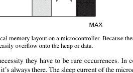

图 3.5 微控制器上的典型内存布局。由于没有内存保护，堆栈很容易溢出到堆或数据区。

出于必要性，这些情况必须是罕见的。相比之下，RAM 的全部意义在于它始终可用。今天大多数 mote 使用的微控制器的睡眠电流在很大程度上由 RAM 决定。

模块通过声明变量来分配内存，这些变量遵循 nesC 的作用域规则，完全私有化于组件。例如，`CountingGetC` 组件（清单 3.20，第 32 页）将 `count` 分配为 8 位模块级变量，成本为 1 字节 RAM。由于 TinyOS 使用分阶段操作且不提供线程，因此不存在长期存在的栈分配数据。因此，当 TinyOS 系统处于空闲状态时，这些模块变量代表了系统的整个软件状态。

通常，nesC 不鼓励通过 `malloc` 或其他 C 库调用进行动态内存分配。你可以调用它们，但大多数嵌入式微控制器缺乏内存保护，使得其使用特别危险。图 3.5 显示了微控制器上的典型内存布局。堆栈向下增长，堆向上增长，由于没有硬件内存保护，两者可能相撞，一旦发生，混乱不可避免。

相反，你应该将内存作为模块变量进行分配。例如，如果一个模块需要一个缓冲区来保存传感器读数，它应该静态分配该缓冲区。在其他情况下，创建可重用的抽象数据类型以及在通用组件中实现状态和操作是方便的，如 `BitVectorC`（清单 3.23，第 34 页）。最后，组件有时需要共享一个内存池。一个常见例子是一组共享分组缓冲区池的组件。共享池允许多个协作组件摊销其需求，特别是如果它们不太可能同时都需要大量内存。通过完全避免使用堆，运行时内存故障的唯一原因是堆栈。

为了避免堆栈溢出，TinyOS 程序应避免递归且不声明任何大的局部变量（例如数组）。在单个模块内避免递归很容易，但在像 nesC 这样的基于组件的语言中，很容易在组件边界之间无意中创建递归循环。例如，假设组件 A 使用 `Read` 接口反复采样由组件 B 提供的传感器，即 A 中的 `readDone` 事件处理程序调用 B 的 `read` 命令。如果 B 恰好是一个简单的传感器，它可能会选择在 `read` 命令的实现内部直接发出 `readDone` 事件。然而，这个程序现在包含了一个非预期的递归循环：A 调用 B 的 `read` 命令，该命令发出 A 的 `readDone` 事件，该事件调用 B 的 `read` 命令……

为了避免此类递归循环，TinyOS 遵循一些编码约定。首先，分阶段命令绝不能直接触发其回调——有关更多细节，请参阅第 5.3.2 节。其次，大多数 TinyOS 组件之间的关系是分层的：应用程序组件使用系统服务提供的接口，而系统服务本身又使用低层服务提供的接口，依此类推，直到原始硬件——该结构在第 12 章中有深入讨论。

最后，值得注意的是，堆栈可能会因为中断处理程序造成的额外堆栈使用而溢出（第 5 章），该中断处理程序中断了你的常规计算（或更糟糕的是，另一个已经在使用部分堆栈空间的中断处理程序）。你应始终预留足够的 RAM 来处理常规计算和所有可能同时执行的中断处理程序的最坏情况使用。

#### 编程提示 2 在模块内绝不要编写递归函数。结合 TinyOS 编码约定，这保证了所有程序的堆栈使用量都有界。

#### 编程提示 3 绝不要使用 `MALLOC` 和 `FREE`。在组件中分配所有状态。如果你的应用程序需求需要动态内存池，请将其封装在组件中并尽量限制使用者集合。

#### 3.5.1 内存所有权和分阶段调用

TinyOS 程序包含许多并发活动，例如即使在非常简单的程序中，也存在无线电消息传输、传感器采样和应用程序逻辑。确保这些活动不会通过轮流访问彼此的数据而互相干扰通常是一个复杂的问题。

组件交互的唯一方式是通过函数调用，这些调用通常是接口的一部分。就像在 C 语言中一样，组件传递参数有两种基本方式：按值和按引用（指针）。在第一种情况下，数据被复制到堆栈上，因此被调用方可以自由地修改它或缓存它。在第二种情况下，调用方和被调用方共享指向数据的指针，因此这两个组件需要仔细管理对数据的访问以防止内存损坏。

防止数据共享问题的最简单解决方案是永远不要将指针参数存储在模块变量中。这是某些抽象数据类型组件采用的方法（参见第 8.2.2 节）；它确保任何数据共享都是暂时的，仅限于具有指针参数的命令或事件的持续时间。

然而，这种方法对于分阶段调用是不切实际的。因为被调用组件通常需要在操作执行期间访问指针，所以它必须将其存储在模块变量中。例如，考虑基本的 `Send` 接口：

```
interface Send {
  command error_t send(message_t* msg, uint8_t len);
  event void sendDone(message_t* msg, error_t error);
}
```

#### Listing 3.27 The Send interface

```
command error_t cancel(message_t* msg);
command void* getPayload(message_t* msg);
command uint8_t maxPayloadLength(message_t* msg);
```

此示例中重要的函数对是 `send`/`sendDone`。要发送数据包，组件调用 `send`。如果 `send` 返回 `SUCCESS`，则调用方已将数据包传递给通信栈使用，不得再修改数据包。被调用方将指针存储在变量中，执行状态更改，然后立即返回。如果接口使用者在将数据包传递给接口提供者后修改数据包，则数据包可能会被损坏。例如，无线电栈可能会对整个数据包计算校验和，然后开始发送它。如果调用方在校验和计算后修改数据包，则数据和校验和将不匹配，接收方会拒绝该数据包。

为了避免此类问题，TinyOS 遵循一种所有权规范：在任何时刻，每个“内存对象”——一段内存，通常是一个完整的变量或单个数组元素——都应由单个模块拥有。像 `send` 这样的命令被称为将它的 `msg` 参数的所有权从调用方传递给被调用方。当分阶段接口具有这种“传递”语义时，完成事件应将传递的指针作为其参数之一，以表明该对象正被返回给原始所有者。

> 编程提示 4 在可能的情况下，避免跨接口传递指针；当无法避免时，在任何时候都只能有一个组件能够修改指针的数据。

这种传递方法最棘手的例子之一是 `Receive` 接口。乍一看，该接口似乎非常简单：

```
interface Receive {
  event message_t* receive(message_t* msg, void* payload, uint8_t len);
}
```

#### Listing 3.28 The Receive interface


`receive` 事件与大多数事件相当不同：它同时具有 `message_t*` 作为参数和返回值。当通信层接收到数据包时，它会将该数据包作为参数传递给上层。然而，它也期望上层返回一个 `message_t*`。其基本思想很简单：如果通信层没有 `message_t*`，它就无法接收数据包，因为它没有地方存放它们。因此，上层必须始终返回一个 `message_t*`，这是无线电栈将用于下一次接收的缓冲区。此返回值可以与参数相同，但不必相同。例如，这完全合理，如果有点 feature-free, code:

```
event message_t* Receive.receive(message_t* msg, void* payload, uint8_t len) {
    return msg;
}
```

接收处理程序始终可以从数据包中复制所需的数据，然后仅返回传递的缓冲区。然而，在某些情况下这样做是不期望的。一个常见的例子是路由队列。如果节点必须转发刚刚接收到的包，那么将其复制到另一个缓冲区是浪费的。相反，队列分配一批数据包，除了发送队列外，还保留一个空闲列表。当路由层接收到要转发的包时，它会查看空闲列表中是否还有数据包。如果有，它会将接收到的包放入发送队列，并从空闲列表中返回一个包，为无线电栈提供接收下一个包的缓冲区。如果空闲列表中没有数据包了，那么队列就无法接受该包，因此将其直接返回给无线电以供重用。伪代码看起来像这样：

```
receive (m):
    if I’m not the next hop, return m  // Not for me
    if my free list is empty, return m // No space
    else
        put m on forwarding queue
        return entry from free list
```

TinyOS 程序员早期遇到的最常见错误之一是误用 `Receive` 接口。例如，想象一个协议这样做：

```
event message_t* LowerReceive.receive(message_t* m, void* payload, uint8_t len) {
    processPacket(m);
    if (amDestination(m)) {
        signal UpperReceive.receive(m, payload, len);
    }
    return m;
}
```

此代码的问题在于它忽略了对 `UpperReceive.receive` 的信号的返回值。如果处理此事件的组件执行缓冲区交换——例如它有一个转发队列——那么它返回的包就会丢失。此外，它已放入队列的包也被返回给无线电用于下一次包接收。这意味着，当包到达队列末尾时，节点可能会发送与它决定转发的完全不同的内容（例如，完全不同协议的包）。

请注意，使用枚举类型在变量声明中可能会浪费内存，因为枚举默认使用整数宽度。例如，想象这个枚举：

```
typedef enum {
  STATE_OFF = 0,
  STATE_STARTING = 1,
  STATE_ON = 2,
  STATE_STOPPING = 3
} state_t;
```

以下是两种不同的分配该状态变量的方式：

```
state_t state; // platform int size (e.g., 2-4 bytes)
uint8_t state; // one byte
```

即使有效范围是 0–3，前者也会分配一个原生整数，在微控制器上通常是 2 字节，但在低功耗微处理器上可能是 4 字节。后者会分配一个字节。因此你应该使用枚举来声明常量，但避免声明枚举类型的变量。

> 编程提示 5 通过使用枚举而不是常量变量来表示整数常量以节省内存，并且不要使用枚举类型声明变量。

### 3.5.3 平台无关类型

为了简化网络代码，TinyOS 传统上使用结构体来定义消息格式并直接访问消息——这避免了使用编组和解组函数在主机和网络消息表示之间转换的编程复杂性和开销。例如，CC2420 802.15.4 无线电芯片² 的数据包标准头部看起来像这样：

```
typedef struct cc2420_header_t {
  uint8_t length;
  uint16_t fcf;
  uint8_t dsn;
  uint16_t destpan;
  uint16_t dest;
  uint16_t src;
  uint8_t type;
} cc2420_header_t;
```

列表 3.30 CC2420 数据包头部

也就是说，它有一个 1 字节的长度字段、一个 2 字节的帧控制字段、一个 1 字节的序列号、一个 2 字节的组、一个 2 字节的目的地、一个 2 字节的源和 1 字节的类型字段。将此定义为结构体可以让你轻松访问字段、分配存储等。

² 标准是指 IEEE 802.15.4 有多个选项，例如 0 字节、2 字节或 8 字节寻址，因此这只是 TinyOS 默认使用的格式。

但问题是，这种结构的布局和编码取决于你编译所面向的芯片。例如，CC2420 要求所有这些字段都是小端序。如果你的微控制器是大端序，那么你将无法轻松访问帧控制字段的位。一个常用的解决方案是显式调用在微控制器和芯片字节序之间进行转换的宏，例如 Unix 的 `htons`、`ntohl` 等宏。然而，这种方法容易出错，尤其是当代码最初是在与芯片字节序相同的处理器上开发时。

这种方法的另一个问题源于不同处理器之间的对齐规则差异。在 ATmega128 上，结构体字段按 1 字节边界对齐，因此布局可以正常工作。然而，在 MSP430 上，2 字节值必须按 2 字节边界对齐：你不能加载未对齐的字。因此 MSP430 编译器会在 `length` 字段之后引入一个填充字节，使该结构体与 CC2420 及其他平台不兼容。还会出现其他一些问题，但最终的观点是一致的：TinyOS 程序需要能够指定易于访问和使用的平台无关数据格式。

在 TinyOS 1.x 中，一些程序尝试使用 gcc 的 `packed` 属性来解决这个问题，使数据结构成为平台无关的。`Packed` 告诉 gcc 忽略正常的平台结构体对齐要求，而是紧凑地打包结构体：

```c
typedef struct RPestEntry {
    uint16_t id;
    uint8_t receiveEst;
} __attribute__((packed)) RPestEntry;
```

*清单 3.31 1.x MintRoute 库中令人畏惧的 "packed" 属性*

`Packed` 使得运行在 ATmega128 和 x86 上的代码能够就数据格式达成一致。然而，`packed` 存在几个问题。用于 MSP430 系列（在 Telos 节点中使用）的 gcc 版本不能正确处理 `packed` 结构体。此外，`packed` 是 gcc 特有的特性，因此使用它的代码可移植性不佳。最后，虽然 `packed` 消除了对齐差异，但它不改变字节序：`int16_t` 在某个平台上可能是大端序，在另一个平台上可能是小端序，因此你仍然需要使用像 `htons` 这样的转换宏。

> **编程提示 6** 永远、永远不要在可移植代码中使用 "packed" 属性。

为了在保持代码可移植性的同时，仍然能够方便地使用 C 类型来指定数据包布局，nesC 1.2 引入了平台无关类型。简单的平台无关类型（整数）要么是大端序，要么是小端序，与底层芯片硬件无关。通常，外部类型与普通类型相同，只是前面带有 `nx_` 或 `nxle_`：

```c
nx_uint16_t val; // A big-endian 16-bit value
nxle_uint32_t otherVal; // A little-endian 32-bit value
```

除了简单类型之外，还有平台无关的结构体和联合体，分别用 `nx_struct` 和 `nx_union` 声明。平台无关结构体或联合体的每个字段都必须是平台无关类型。非位字段按字节边界对齐（位字段照常按位边界紧凑排列）。例如，TinyOS 2.0 就是这样声明 CC2420 包头的：

```c
typedef nx_struct cc2420_header_t {
  nxle_uint8_t length;
  nxle_uint16_t fcf;
  nxle_uint8_t dsn;
  nxle_uint16_t destpan;
  nxle_uint16_t dest;
  nxle_uint16_t src;
  nxle_uint8_t type;
} cc2420_header_t;
```

*清单 3.32 CC2420 包头*

任何编译该结构体的硬件架构都会对所有字段使用相同的内存布局和相同的字节序。这使平台代码能够直接打包和解包结构体，而无需借助宏或诸如 UNIX socket 的 `htonl` 和 `ntohs` 之类的工具函数。

> **编程提示 7** 在定义消息结构体时使用平台无关类型。


在底层，nesC 将网络类型转换为字节数组，并在每次访问时进行打包和解包。对于大多数 nesC 代码而言，这带来的运行时开销可以忽略不计。例如，以下代码

```c
nx_uint16_t x = 5;
uint16_t y = x;
```

将 `x` 的字节重新排列为芯片原生的布局并存入 `y`，只需几个周期。这意味着，如果你需要对多字节值数组执行大量计算（例如加密），则应该先将其复制为原生格式，然后再进行处理，完成后将其恢复为平台无关格式。单次访问会花费几个周期，但数千次访问则会花费数千个周期。

> **编程提示 8** 如果需要对平台无关类型执行大量计算，或者需要多次（数百次或更多）访问它，请临时将其复制为原生类型。

组件封装了函数和状态，而连接（wiring）将不同组件中定义的函数连接起来。然而，nesC 程序也需要全局可用的类型来表示常见抽象，例如 `error_t`（TinyOS 的错误码抽象）或 `message_t` (networking buffers)。此外，nesC 程序有时会调用现有的 C 库函数，无论是来自标准 C 库（例如数学函数如 `sin`）还是来自个人现有的 C 代码库的函数（参见第 3.5.6 节）。

与 C 保持一致，nesC 使用 `.h` 头文件和 `#include` 来实现此目的。这还有一个额外的好处，即现有的 C 头文件可以直接重用。例如，TinyOS 的 `error_t` 类型和错误常量在 `TinyError.h` 文件中定义：

```
#ifndef TINY_ERROR_H_INCLUDED
#define TINY_ERROR_H_INCLUDED

enum {
  SUCCESS      = 0,
  FAIL         = 1,  // Generic condition; backwards compatible
  ESIZE        = 2,  // Parameter passed in was too big.
  ECANCEL      = 3,  // Operation cancelled by a call.
  EOFF         = 4,  // Subsystem is not active
  EBUSY        = 5,  // The underlying system is busy; retry later
  EINVAL       = 6,  // An invalid parameter was passed
  ERETRY       = 7,  // A rare and transient failure; can retry
  ERESERVE     = 8,  // Reservation required before usage
  EALREADY     = 9,  // The device state you are requesting is already set
};

typedef uint8_t error_t;
#endif
```

Listing 3.33 `TinyError.h`, a typical nesC header file

像典型的 C 头文件一样，`TinyError.h` 使用 `#ifndef`/`#define` 来避免在文件被多次包含时重新声明错误常量和 `error_t`。在组件中包含头文件很简单：

```
#include "TinyError.h"

module BehaviorC { ... }
implementation
{
  error_t ok = FAIL;
}
```

Listing 3.34 Including a header file in a component

正如 C 中一样，`#include` 只是执行文本文件包含。因此，使用 `#include` 的位置很重要，即在 `interface`、`module` 或 `configuration` 关键字之前。如果不这样做，你将得不到预期的行为。同样，在 C 中，在函数中间使用 `#include <stdio.h>` 很可能无法工作。

the `Fancy` interface:

```
module FancyModule {
  uses interface Fancy;
}

implementation {
  char *name = GLOBAL_NAME;
}
```

Listing 3.37 `FancyModule.nc`: C preprocessor pitfalls

编译 `FancyModule` 会报告 `GLOBAL_NAME` 是一个未知符号。为什么？问题在于编译 `FancyModule.nc` 的第一步是对其进行预处理。此时，`Fancy` 接口尚未被看到，因此它尚未被加载，`GLOBAL_NAME` 的 `#define` 也是未知的。稍后，当分析 `FancyModule` 时，`Fancy` 接口会被看到，`Fancy.nc` 文件会被加载并且 `GLOBAL_NAME` 会被 `#define`。但这对于在 `FancyModule.nc` 中使用它来说已经太晚了。

可以从中得出两个教训：首先，正如我们已经看到的，在可能的情况下，最好使用 `enum` 而不是 `#define` 来定义常量。其次，如果你必须使用 `#define`，就像在 C 中使用它一样：将你的定义放在使用 `#ifndef`/`#define` 保护的头文件中，并在所有使用该 `#define` 符号的组件和接口中 `#include` 此头文件。例如，`Fancy.nc` 和 `FancyModule.nc` 都应

```
#include "Fancy.h"
```

其中 `Fancy.h` 包含：

```
#ifndef FANCY_H
#define GLOBAL_NAME "fancy"
#endif
```

Listing 3.38 `Fancy.h`: the reliable way to use C preprocessor symbols

#### Programming Hint 10

ALWAYS `#DEFINE` A PREPROCESSOR SYMBOL IN A HEADER FILE. USE `#INCLUDE` TO LOAD THE HEADER FILE IN ALL COMPONENTS AND INTERFACES THAT USE THE SYMBOL.

#### 3.5.6 C libraries

访问 C 库很容易。通用 `SineSensorC` 组件的实现使用了 C 库的 `sin` 函数，该函数在 `math.h` 头文件中定义：

```
#include <math.h>
generic module SineSensorC() {
  provides interface Init;
  provides interface Read<uint16_t>;
}
```

```
implementation {
    uint32_t counter;

    void performRead() {
        float val = sin(counter++ / 20.0);
        signal Read.readDone(SUCCESS, val * 32768.0 + 32768.0);
    }
    ...
}
```

Listing 3.39 Using a C library function

与 C 一样，如果你使用库，也需要链接它。在这种情况下，使用 `SineSensorC` 的 nesC 程序需要通过向 `ncc`，即 nesC 编译器驱动程序，传递 `-lm` 选项来链接 math 库。

### 3.6 Exercises

- 1. `Send` 接口有一个 `command send` 和一个 `event sendDone`。你应该能够在 `sendDone` 处理程序中调用 `send`，还是应该等到处理程序返回之后？为什么？为两种版本的提供者编写伪代码，并为想要尽可能快地发送数据包的每种版本的用户编写伪代码。

- 2. 扩展 `Blink` 应用程序，使其显示随机数的低位而不是计数器。从 TinyOS 组件库中的随机数生成器之一生成随机数（`RandomMlcgC` 或 `RandomLfsrC`）。

- 3. 编写一个应用程序，在无限循环中递增 32 位计数器。每 `N` 次递增，应用程序切换 LED 0。选择一个 `N` 以便可以目视观察切换。尝试将计数器设为平台无关类型。切换变慢了吗？慢多少？尝试 16 位值。

- 4. 编写一个在两个节点上运行的 `PingPong` 应用程序。当节点启动时，它使用 `AMSend` 接口发送广播数据包。当它接收到数据包时，它发送一个数据包。每当节点发送数据包时切换 LED。LED 停止切换需要多长时间？尝试不同的距离。如果太快而无法看到，在节点接收到数据包时启动计时器，并在计时器触发时发送回复。你需要使用 `AMSenderC` 和 `AMReceiverC` 组件。

## 4 配置和布线

上一章主要讨论了模块，它们是 nesC 程序的基本构建块。配置是 nesC 组件的第二种类型。它们将组件组装成更大的抽象。


在 nesC 程序中，配置的数量通常多于模块。除了低级硬件抽象之外，任何给定的组件都是建立在其他组件之上的，这些组件被封装在配置中。例如，图 4.1 显示了一个路由栈（`CollectionC`），它依赖于单跳数据包层（`ActiveMessageC`），而后者本身就是一个配置。这个单跳配置将实际的协议实现模块（例如设置报头字段）与无线电上方的原始数据包层（链路层）连接起来。这个原始数据包层是一个配置，它将发送字节到总线的模块与总线连接起来。总线本身也是一个配置。这些封装层通常深入到系统非常低的层次。

将抽象封装在配置中意味着它可以即用：我们只需要将其提供的接口布线即可。相比之下，如果它是一个使用和提供接口的模块，那么我们还需要布线依赖关系和需求。例如，无线电栈可以使用各种资源，包括总线、定时器、随机数生成器、加密支持和硬件引脚。这是 `CC1000`（TI 生产的无线电芯片，用于 mica2 系列 mote）无线电栈中一个模块的签名：

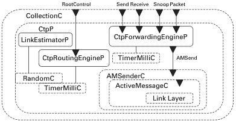

**图 4.1** CTP 路由栈中的一些配置。

```nesc
module CC1000CsmApp {

  provides {

    interface Init;

    interface SplitControl;

    interface CsmacControl;

    interface CsmacBackoff;

    interface LowPowerListening;

  }

  uses {

    interface Init as ByteRadioInit;

    interface StdControl as ByteRadioControl;

    interface ByteRadio;

    interface CC1000Control;

    interface CC1000Squelch;

    interface Random;

    interface Timer<TMilli> as WakeupTimer;

    interface BusyWait<TMicro, uint16_t>;

    interface ReadNow<uint16_t> as RssiNoiseFloor;

    interface ReadNow<uint16_t> as RssiCheckChannel;

    interface ReadNow<uint16_t> as RssiPulseCheck;

  }

}
```

清单 4.1 `CC1000` 无线电栈部分模块的签名

与其期望程序员将栈连接到所有这些东西，整个栈可以封装在一个单一组件（`CC1000ActiveMessageC`）中。该组件连接无线电的所有子组件，以满足其依赖需求。

配置也需要导出接口。这种布线方式，而不是连接提供者和使用者，将一个名称映射到另一个名称。接口导出允许配置在 nesC 程序中管理命名空间，并在提供或使用接口方面像模块一样工作。管理 nesC 命名空间，以及相应的接口导出，是 nesC 编程最具挑战性的方面之一，因此本章通过许多示例详细介绍了它。

### 4.1 配置

第 3 章对配置进行了简要介绍，展示了顶层配置的示例。因为顶层配置将组件布线到一个完整的应用程序中，所以它们既不提供也不使用接口。组件签名中缺少条目是不常见的：大多数配置是系统或抽象，供其他组件使用。

让我们重新审视配置的语法。配置的第一个块是其签名，声明组件使用的或提供的接口。配置的第二个块是其实现，它命名组件并将它们布线在一起。配置的实现块使用 `components` 关键字命名其布线的组件。`components` 之后可以跟随任意数量的组件名称，包括零个，且顺序无关紧要。配置可以有多个 `components` 语句。

配置使用三种布线运算符将组件接口布线：`->`、`<-` 和 `=`。本章更深入地讨论了第 3 章中介绍的 `->` 和 `<-`，并介绍了 `=` 运算符，该运算符允许配置提供和使用接口。

#### 4.1.1 `->` 和 `<-` 运算符

`->` 运算符连接提供者和使用者，绑定调用者和被调用者。让我们回到 `PowerupToggle` 应用程序，并逐步了解其布线的工作原理。模块 `PowerupToggleC`（清单 3.16，第 30 页）使用 `Leds` 接口。配置 `PowerupToggleAppC` 将 `PowerupToggleC.Leds` 布线到 `LedsC.Leds`：

```nesc
configuration PowerupToggleAppC () {
  implementation {
    components MainC, LedsC, PowerupToggleC;

    PowerupToggleC.Boot -> MainC.Boot;
    PowerupToggleC.Leds -> LedsC.Leds;
  }
}
```

清单 4.2 重新审视的 `PowerupToggleAppC` 配置

反过来，`LedsC` 将 `LedsC.Leds` 映射到 `LedsP.Leds`（参见第 4.1.2 节）。`PowerupToggleAppC` 和 `LedsC` 中的 nesC 布线语句将 `PowerupToggleC` 中使用的 `Leds.led0Toggle` 命令（`PowerupToggleC` 局部的名称）连接到 `LedsP` 的同名 `Leds.led0Toggle` 命令实现。当 `PowerupToggleC` 调用其 `Leds.led0Toggle` 命令时，它实际上调用了 `LedsP` 的 `Leds.led0Toggle` 命令实现。对于 `Leds` 接口的其他调用，例如 `Leds.led1On`，也是如此。`PowerupToggleAppC` 和 `LedsC` 配置在 `PowerupToggleC` 和 `LedsP` 模块的局部命名空间之间提供映射。nesC 编译器生成的 C 代码（作为中间步骤）看起来像这样：

```text
void LedsP_Leds_led0Toggle() { ... }

void PowerupToggleC_Leds_led0Toggle() {
  LedsP_Leds_led0Toggle();
}

...

void PowerupToggleC_Boot_booted() {
  while(1) {
    call PowerupToggleC_Leds_led0Toggle();
    call PowerupToggleLEC_Leds_led1Toggle();
    call PowerupToggleLEC_Leds_led2Toggle();
  }
}
```

Listing 4.3  C code generated from the `PowerupToggleAppC` configuration

所有这些间接层可能会带来显著的开销。切换一个 LED 需要两次函数调用。然而，实际上，nesC 编译器工具链通过广泛的内联消除了所有这些开销。所有这些函数调用都被折叠，LED 切换逻辑被嵌入到 while 循环中。

#### 4.1.2 The `=` operator

`->` 和 `<-` 操作符连接配置通过 `components` 关键字命名的具体提供者和使用者。直接连接（`a ->` 或 `<-`）始终从使用者到提供者，解析命令和事件调用路径。

从使用组件的人的角度来看，组件是模块还是配置并不重要。就像模块一样，配置也可以提供和使用接口。但由于它们没有代码，这些接口必须以其他组件的形式定义。配置提供或使用接口的唯一方式是通过代理：它将另一个组件的实现重命名为自己的实现。配置通过连线操作符 `=` 实现这一点。`=` 操作符将配置签名中的接口连接到其 `components` 语句中命名的组件中的接口。

例如，这就是提供 `Leds` 接口的配置 `LedsC` 的实现，该接口通过 *exporting* `LedsP` 提供的接口：

```nesc
configuration LedsC {

  provides interface Leds;

}

implementation {

  components LedsP, PlatformLedsC;

  Leds = LedsP;

  LedsP.Init <- PlatformLedsC.Init;

  LedsP.Led0 -> PlatformLedsC.Led0;

  LedsP.Led1 -> PlatformLedsC.Led1;

  LedsP.Led2 -> PlatformLedsC.Led2;

}
```

Listing 4.4 the `LedsC` configuration

`LedsC` 是将几个小型构建块连接成更大、更有用的抽象的配置的简单示例。`LedsP` 是一个简单的模块，其代码通过操作由 `GeneralIO` 接口访问的底层数字 IO 线来实现 `Leds` 接口命令。

`PlatformLedsC` 提供这三条 IO 线，并使用一个 `Init` 接口，该接口被连线到 `LedsP.Init` 以在系统启动时初始化 `LedsP`。


从编程角度来看，配置操作符有两个非常不同的目的。`->` 和 `<-` 操作符组合现有组件，完成现有签名。`=` 操作符定义配置接口的实现方式。就像模块一样，配置是一个由签名定义的抽象。模块直接实现其函数（来自使用接口的事件，来自提供接口的命令）。配置使用 `=` 操作符将实现委托给其他组件。例如，`LedsC` 将 `Leds` 接口的实现委托给 `LedsP`。

### 4.1.3 Namespace management

我们在第 3.1.2 节中看到了使用 `as` 来管理组件签名中的名称，例如 `MainC` 有

```
uses interface Init as SoftwareInit;
```

`as` 关键字也可以在配置内部使用。由于 nesC 组件处于全局命名空间中，有时它们具有非常长且描述性的名称。例如，ATmega128 上最低层（字节）SPI 总线抽象是 `HplAtm128SpiC`，这意味着“这是 ATmega128 SPI 总线的硬件呈现层组件”。在配置中输入它很痛苦且可读性不强。因此，稍微高一级的抽象，配置 `Atm128SpiC`，像这样命名它：

```
component HplAtm128SpiC as HplSpi;
```

这使得连线清晰得多。正如接口的情况一样，所有 `components` 语句都隐式使用了 `as`：

```
components MainC;
```

只是

```
components MainC as MainC;
```

的简写。

使用 `as` 来澄清配置的另一个例子可以在 `CC2420ReceiveC` 中找到，这是 CC2420 无线电的接收路径。该配置将数据包逻辑连线到中断和状态引脚等：

```
configuration CC2420ReceiveC (...) 
implementation { 
  components CC2420ReceiveP; 
  components new CC2420SpiC() as Spi;
```

```nesc
components HplCC2420PinsC as Pins;
components HplCC2420InterruptsC as InterruptsC;
// rest of the implementation elided
}
```

Listing 4.5  `CC2420ReceiveC`’s use of the `as` keyword

这个例子展示了 `as` 的常见用法：为实例化通用组件的结果命名（`CC2420SpiC`）。事实上，如果在同一个配置中两次实例化同一个通用组件，如我们在前面看到的 `BlinkAppC` 示例中那样，使用 `as` 就是必需的：

```nesc
configuration BlinkAppC {}
implementation {
  components MainC, BlinkC, LedsC;
  components new TimerMilliC() as Timer0;
  components new TimerMilliC() as Timer1;
  components new TimerMilliC() as Timer2;

  BlinkC.Timer0 -> Timer0.Timer;
  BlinkC.Timer1 -> Timer1.Timer;
  BlinkC.Timer2 -> Timer2.Timer;
  ...
}
```

Listing 4.6  Naming generic component instances

如果没有 `as`，就无法区分这三个定时器。`as` 关键字使配置更易读、更易理解。因为存在平坦的组件命名空间，一些组件具有冗长复杂的名称，可以很容易地进行概括。此外，通过使用 `as` 关键字，你创建了一个间接层。例如，如果一个配置使用 `as` 关键字重命名一个组件，那么更改组件时只需要更改那一行。没有该关键字，你必须更改配置中所有命名它的地方。

### 4.1.4 Wiring rules

如果一个组件使用 `as` 关键字更改接口的名称，那么布线必须使用这个名称。回到 `MainC` 和 `LedsP` 作为例子：

```nesc
configuration MainC {
  provides interface Boot;
  uses interface Init as SoftwareInit;
}

module LedsP {
  provides {
    interface Init;
    interface Leds;
  }
  uses {
    interface GeneralIO as Led0;
    interface GeneralIO as Led1;
    interface GeneralIO as Led2;
  }
}
```

#### Listing 4.7 MainC and LedsP

这种布线是有效的：

```
MainC.SoftwareInit -> LedsP.Init;
```

但这种不是：

```
MainC.Init -> LedsP.Init;
```

最后，一个配置必须在布线它之前命名一个组件。例如，这是 `PowerupToggleAppC` 的有效重写：

```nesc
configuration PowerupToggleAppC ()
implementation {
  components MainC, PowerupToggleC;
  PowerupToggleC.Boot -> MainC.Boot;

  component LedsC;
  PowerupToggleC.Leds -> LedsC.Leds;
}
```

#### Listing 4.8 Valid alternate of PowerupToggleAppC

而这个版本是无效的：

```nesc
configuration PowerupToggleAppC ()
implementation {
  components PowerupToggleC;
  PowerupToggleC.Boot -> MainC.Boot; // Invalid: MainC not named yet

  component LedsC, MainC;
  PowerupToggleC.Leds -> LedsC.Leds;
}
```

#### Listing 4.9 Invalid alternate of PowerupToggleAppC

### 4.1.5 Wiring shortcuts

所有接口都有一个 *type*：不可能将例如 `Leds` 接口布线到 `Boot` 接口，或将 `Read<uint8_t>` 布线到 `Read<int16_t>`。因此，在布线时你有时可以省略其中一个接口名称。例如，你可以将 `PowerupToggleAppC` 的布线部分改为：

```
components MainC, LedsC, PowerupToggleC;
PowerupToggleC.Boot -> MainC;
PowerupToggleC -> LedsC.Leds;
```

在左侧，`PowerupToggleC.Boot` 是 `Boot` 接口的一个实例。在右侧是 `MainC`，没有接口名称。因为 `MainC` 只提供一个 `Boot` 接口的实例，nesC 假定这就是你的意思。同样地，将组件 `PowerupToggleC` 布线到 `LedsC` 的 `Leds` 接口，必须是指 `PowerupToggleC` 的 `Leds` 接口。因此，这两个布线语句等价于：

```
PowerupToggleC.Boot -> MainC.Boot;
PowerupToggleC.Leds -> LedsC.Leds;
```

这些快捷方式也适用于导出布线：

```nesc
configuration LedsC {
  provides interface Leds;
}
implementation {
  components LedsP;
  Leds = LedsP;
  ...
}
```

*Listing 4.10 LedsC revisited*

`LedsC` 的 `Leds` 接口被布线到组件 `LedsP`，这隐式解析为 `LedsP` 的 `Leds` 接口。然而，下面的代码是无效的，因为你可以省略导出的接口名称：

```
= LedsP.Init;
```

布线快捷方式基于接口类型以及接口是提供还是使用，而不是名称。`BlinkC` 模块具有以下签名：

```
module BlinkC
{
  uses interface Timer<TMilli> as Timer0;
  uses interface Timer<TMilli> as Timer1;
```

### 4.2.1 组件命名


正如我们前面所见，TinyOS 在以 C 结尾的组件（可外部使用的抽象）和 P（内部实现）之间做出区分。一旦你为可外部使用的组件编写了签名，更改它就非常困难：可能有任意数量的其他组件依赖于它，更改会导致编译错误。相比之下，由于内部实现仅由该软件抽象中的更高层配置进行连接，其签名要灵活得多。例如，更改 `LedsC` 的签名将破坏几乎所有 TinyOS 代码，但对 `LedsP` 的内部更改（并在 `LedsC` 中更改其连接）对用户来说应该是不可见的。

> 编程提示 11 如果一个组件本身是一个可用的抽象，其名称应以 C 结尾。如果它旨在成为更大抽象的内部和私有部分，其名称应以 P 结尾。永远不要从你的包（目录）外部连接 P 组件。

让我们看一个完整的（但非常简单）示例，说明所有这些问题是如何在 `RandomC` 中解决的。

如上所示，`RandomC` 映射到特定的实现 `RandomMlcgC`。`RandomMlcgC` 是一个配置，其主要目的是公开随机数实现（`RandomMlcgP`）并将其连接到启动序列（我们在下面进一步讨论组件初始化）：

```
configuration RandomMlcgC {
  provides interface Init;
  provides interface ParameterInit<uint16_t> as SeedInit;
  provides interface Random;
}
implementation {
  components RandomMlcgP, MainC;

  MainC.SoftwareInit -> RandomMlcgP; // Auto-initialize
  Init = RandomMlcgP; // Allow for re-initialization

  SeedInit = RandomMlcgP;
  Random = RandomMlcgP;
}
```

列表 4.13 `RandomMlcgC` 签名

`RandomMlcgP` 是一个软件实现。具有硬件随机数生成器的平台可以使用不同的 `RandomMlcgP`。因为这种不同的实现可能具有不同的签名——例如它可能需要通过抽象层访问寄存器——它也可能需要不同的 `RandomMlcgC`，以解决这些依赖关系并呈现完整的抽象。

简而言之，配置 `RandomC` 将标准数字生成器映射到特定算法 `RandomMlcgC`。配置 `RandomMlcgC` 将特定实现封装为完整的抽象。`RandomMlcgP` 是乘性线性同余生成器的软件实现。同样，还有 `RandomLfsrC`，它是线性反馈移位寄存器随机数生成器。就像 `RandomMlcgC` 一样，`RandomLfsrC` 是一个配置，它导出 `RandomLfsrP` 的接口并将其连接到启动序列。这种命名层次结构意味着系统如果关心使用哪一个，可以连接到特定的随机数生成器，也可以连接到 TinyOS 提供的通用随机数生成器（`RandomC`）。应用程序可以通过定义自己的 `RandomC` 来更改默认随机数生成器，该 `RandomC` 映射到不同的算法。TinyOS 开发者可以更改和改进 `RandomMlcgP`，而不必担心破坏应用程序代码。最后，平台实现者可以用经过优化的平台特定版本替换 `RandomMlcgC`，只要它具有与 `RandomMlcgC` 相同的签名即可。

## 4.2.2 组件初始化

`RandomMlcgP` 提供 `Init` 接口以使用节点的标识符（`TOS_NODE_ID`）为随机数生成器播种。`TOS_NODE_ID` 是 TinyOS 程序中的全局常量。TinyOS 教程描述了在将程序安装到 mote 上时如何设置它。`SeedInit` 使用特定种子启动生成器：

```
module RandomMlcgP {
  provides interface Init;
  provides interface ParameterInit<uint16_t> as SeedInit;
  provides interface Random;
}
implementation {
  uint32_t seed;

  /* Initialize the seed from the ID of the node */
  command error_t Init.init() {
    seed = (uint32_t)(TOS_NODE_ID + 1);
    return SUCCESS;
  }

  /* Initialize with 16-bit seed */
  command error_t SeedInit.init(uint16_t s) {
    seed = (uint32_t)(s + 1);
    return SUCCESS;
  }
  ...
}
```

`RandomMlcgC` 以两种不同的方式连接 `RandomMlcgP.init`：

```
MainC.SoftwareInit -> RandomMlcgP; // Auto-initialize
Init = RandomMlcgP.Init; // Allow for re-initialization
```

在第一种连接中，`RandomMlcgC` 将 `RandomMlcgP.init` 连接到 TinyOS 启动序列 `MainC`。TinyOS 启动时，它调用 `MainC` 的 `SoftwareInit.init`，因此调用 `RandomMlcgP` 的 `Init.init`。在第二种连接中，它将自己的 `RandomMlcgC.Init` 等同于 `RandomMlcgP.Init`。如果某个组件调用 `RandomMlcgC` 的 `Init.init`，实际上调用的是 `RandomMlcgP` 的 `Init.init`。

第一种连接确保 `RandomMlcgP` 在应用程序启动前已被正确播种。如果应用程序通过调用 `RandomMlcgC.Init` 或 `RandomMlcgC.SeedInit` 重新播种，也不会造成损害。但通过连接到 `MainC`，`RandomMlcgC` 确保应用程序 应用程序或协议、或系统 不必记住初始化 `RandomMlcgC`。

这种技术——“自动连接”初始化——在许多 TinyOS 抽象中使用。TinyOS 1.x 中一个非常常见的错误就是忘记初始化。这通常发生在多个组件可能初始化同一个组件的情况下。这种方法很浪费，但由于初始化只发生一次，所以不是什么大问题。更大的问题是，一个组件经常依赖于别人来初始化。例如，想象两个无线电协议栈 A 和 B。A 初始化定时器系统，B 没有。程序员编写了一个使用无线电协议栈 A 的应用程序，并且忘记初始化定时器系统。因为无线电协议栈 A 会初始化，所以一切正常。程序员随后决定切换到无线电协议栈 B，然后什么都不工作：应用程序和协议栈都不会初始化定时器，因此系统就挂起了。

使用自动连接初始化的组件的 `init` 命令按任意顺序调用 参见下文第 4.4 节。对于软件初始化——设置字段等——这通常无关紧要 `Init` 不应调用除另一个 `Init` 之外的任何东西。硬件初始化是一个更棘手的问题，通常按平台处理。有关更多详细信息，请参阅 TEP 107 [14]。

编程提示 12 在软件抽象的顶层配置中将 `Init` 自动连接到 `MainC`。

## 4.3 组件分层

`RandomC` 展示了即使是简单的抽象，例如随机数生成器，也可以在其内部具有多个层。一方面，这种编程风格使组件小而可重用：对于熟悉它们的人来说，构建新系统只是组合现有构建块并可能添加一点新逻辑的简单问题。另一方面，这意味着要深入到组件内部——弄清楚它到底做什么——对于不熟悉代码的人来说可能非常令人沮丧。`RandomC` 是这种分层的良好示例。程序员想要找到随机数生成器的实现 模块代码，必须查看三个文件。`RandomC` 指向 `RandomMlcgC`，而 `RandomMlcgC` 指向 `RandomMlcgP`。

### 4.3.1 可扩展性

实际上，这些间接层并非 nesC 特有：任何具有复杂库的系统都有它们。区别在于这些层是如何编写的。在 C 代码中，你可能会看到一系列简单的包装函数 例如 `printf` 作为向 `fprintf` 传递 `stdout` 作为文件流的调用：你遍历可执行代码。在 nesC 代码中，你通过配置遍历命名空间映射。第一次尝试深入到函数底部时，这种差异可能会有点令人困惑，但很快就会习惯。你也可以使用 nesC 的 `nesdoc` 工具在应用程序的连接中导航并找到接口最终的实现位置——有关更多信息，请参阅 TinyOS 教程。

正如其他语言，尤其是面向对象的语言一样，nesC 软件设计在实现有多简单以及使用或重用它们有多容易之间存在张力。`C++` 标准模板库以此而闻名：它功能强大、通用且高效，但理解其实现并非易事。将系统的所有功能放在单个模块中意味着用户无需追踪调用链。但这意味着修改系统需要替换或复制整个文件。这会导致代码复制，从而大大增加软件错误的生命周期 如果复制的代码中有错误，你需要更改所有副本，而几乎总是会忘记其中一个。因此，许多 TinyOS 核心抽象，例如定时器和通信，往往由许多小型组件组成。这使得系统在初次阅读时更难理解，但一旦理解，就很容易调整、替换或修改。

### 4.3.2 硬件特异性


此外，高级硬件无关 API 与能够使程序利用所有硬件能力的 API 之间存在张力。例如，并非所有无线电都有多个信道频率。一些系统可能希望利用此功能，并愿意假设它们使用特定的无线电芯片来实现这一点。其他系统可能希望保持硬件无关。

TinyOS 使用组件分层来实现这一点。让我们以数据包通信为例。平台需要提供的顶层组件称为`ActiveMessageC`，并且是硬件无关的。¹ `ActiveMessageC`几乎总是位于芯片特定组件之上的配置，该组件提供额外的接口。例如，这是 micaz mote 的`ActiveMessageC`实现，该 mote 具有 CC2420 无线电芯片：

```
configuration ActiveMessageC {
  provides {
    interface SplitControl;
```

¹ TinyOS 使用“主动消息” [29]，通常缩写为 AM，作为其网络抽象 参见第 6.3 节。

硬件无关的`ActiveMessageC`并未导出`CC2420Packet`、`RadioBackoff`、`LowPowerListening`或`PacketLink`。`ActiveMessageC`所做的是一种非常常见的配置用法。`ActiveMessageC`并未增加任何功能：它所做的只是导出`CC2420ActiveMessageC`的接口，并因此在全局命名空间中为它们提供不同的、替代的名称。调用`CC2420ActiveMessageC`的`AMSend.send`与调用`ActiveMessageC`的`AMSend.send`相同。区别在于调用方可以做出的假设类型。例如，如果你将一个组件连接到`ActiveMessageC.AMSend`和`CC2420ActiveMessageC.CC2420Packet`，你可能会遇到严重的问题。可能某个平台有两个无线电，其中一个是 CC2420，但`ActiveMessageC`并未指代 CC2420。在这种情况下，组件将访问不存在的协议字段，混乱是必然的。

> 编程提示 13 在使用分层抽象时，组件不应跨越多个抽象层进行连接：它们应连接到单一层。

### 4.4 多重连接

并非所有连接都是一对一的。例如，以下是组件`CC2420TransmitC`的一部分，这是一个封装了 CC2420 无线电发送路径的配置：

```
configuration CC2420TransmitC {
  provides interface Init;
  provides interface AsyncControl;
  provides interface CC2420Transmit;
  provides interface CsmaBackoff;
  provides interface RadioTimeStamping;
}
implementation {
  components CC2420TransmitP;
  components AlarmMultiplexC as Alarm;
  Init = Alarm;
  Init = CC2420TransmitP;
  // further wirings elided
}
```

列表 4.17 `CC2420TransmitC`的`Init`上的扇出

这种连接意味着`CC2420TransmitC.Init`同时映射到`Alarm.Init`和`CC2420TransmitP.Init`。这意味着什么？在类 C 语言中绝对没有类似的对应物。在 nesC 中，像这样的多重连接意味着当一个组件调用`CC2420TransmitC`的`Init.init`时，它会同时调用`Alarm`的`Init.init`和`CC2420TransmitP`的`Init.init`。两次调用的顺序是未定义的。

#### 4.4.1 扇入和扇出

这种能够进行多重连接的能力看起来可能很奇怪。在这种情况下，你有一个单一的调用点，`CC2420TransmitterC's Init.init`，它扇出到两个被调用者。也有扇入，这其实只是“多个人调用同一个函数”的花哨说法。但“扇入”和“扇出”名称的相似性很重要，因为 nesC 接口是双向的。例如，来自 C 的视角，将两个组件连接到`RandomC.Random`似乎并不奇怪：两个不同的组件可能都需要生成随机数。在这种情况下，由于`Random`只有命令，所有函数都是扇入。有多个调用者对应一个被调用者，就像一个库函数一样。

但由于 nesC 接口是双向的，如果在接口的命令上存在扇入，那么当该组件在接口上发出事件时，就存在扇出（多个被调用者）。以电源控制接口`StdControl`和`SplitControl`为例。`StdControl`是单阶段的：它只有命令。`SplitControl`如其名所示是分阶段的：命令有完成事件：

```
interface StdControl {
  command error_t start();
  command error_t stop();
}
interface SplitControl {
  command error_t start();
  event void startDone(error_t error);
  command error_t stop();
  event void stopDone(error_t error);
}
```

列表 4.18 `StdControl`和`SplitControl`初始化接口

对于`StdControl`，服务在`start`（`stop`）返回时就已启动（停止），而对于`SplitControl`，服务只有在`startDone`被发出时才保证已启动。

在此连接中，`StdControl`上存在扇入：

```
components A, B, C;
A.StdControl -> C;
B.StdControl -> C;
```

那么`A`或`B`都可以调用`StdControl`来启动或停止`C`。然而，在此连接中，也存在完成事件，因此在`SplitControl`上同时存在扇入和扇出：

```
components A, B, C;
A.SplitControl -> C;
B.SplitControl -> C;
```

`A`或`B`都可以调用`SplitControl.start`。当`C`发出`SplitControl.startDone`事件时，不过，两者都已连接到它，因此`A`的`SplitControl.startDone`和`B`的`SplitControl.startDone`被调用。实现没有办法确定是谁调用了`start`命令。²

总之，接口不是一对一的关系。相反，它们是 n 到 k 的关系，其中 n 是用户数量，k 是提供者数量。任何提供者的信号都会在所有 n 个用户上调用事件处理程序，而任何用户调用命令都会在所有 k 个提供者上调用该命令。

#### 4.4.2 多重连线的用途

在实践中，多重连线允许实现独立于其所依赖的组件数量。请记住`MainC`（第 3.8 节清单，第 26 页）将启动序列抽象为两个接口，`SoftwareInit`和`Boot`。`MainC`在启动时调用`SoftwareInit.init`，以便在执行开始前初始化软件组件。`MainC`然后在整个启动序列结束后发出`Boot.booted`信号。许多组件都需要初始化。例如，在非常简单的应用程序`RadioCountToLeds`中，有十个组件连接到`MainC.SoftwareInit`。与其使用许多`Init`接口并按某种顺序调用它们，`MainC`只需调用一次`SoftwareInit`，而此调用会扇出到所有已连接到它的组件。

轶事：历史上，多重连线源于 TinyOS 组件可以被视为硬件芯片的想法。在此模型中，接口是芯片上的引脚集合。术语“连线”源于这一想法：连接一个芯片上的引脚到另一个芯片。尽管如此，在硬件中，你可以轻松地将 N 个引脚连接在一起。例如，芯片上的一个通用 IO 引脚可能有多个可能的触发器，或者总线有多个通过片选引脚控制的终端设备。事实证明，字面地采用这一隐喻存在几个问题。当 TinyOS 迁移到 nesC 时，这些问题被解决了。具体来说，考虑以下配置：

```
configuration A {
  uses interface StdControl;
}

configuration B {
  provides interface StdControl;
  uses interface StdControl as SubControl; // Called in StdControl
}

configuration C {
  provides interface StdControl;
}

A.StdControl -> B.StdControl;
A.StdControl -> C.StdControl;
B.SubControl -> C.StdControl;
```

清单 4.19 “连线”隐喻为何只是隐喻


如果你字面地采用多重连线隐喻，那么 `B` 到 `C` 的连线会与 `A` 到 `B` 和 `C` 的连线连接起来。也就是说，它们都形成一根单一的“连线”。问题在于，在这种解释下，`B` 对 `C` 的调用与 `A` 对 `B` 的调用是同一根连线。`B` 进入无限递归循环，因为它调用 `SubControl`，`SubControl` 调用 `B.StdControl`，`B.StdControl` 又调用 `SubControl`，等等。因此，nesC 并未字面地采用这一隐喻。相反，从一个接口到另一个接口的连线被视为独立的。因此代码

```
A.StdControl -> B.StdControl;
A.StdControl -> C.StdControl;
B.SubControl -> C.StdControl;
```

使得 `A` 对 `StdControl.start` 的调用会调用 `B` 和 `C`，而 `B` 对 `SubControl.start` 的调用只会调用 `C`。

### 4.4.3 组合函数

扇出引发了一个有趣的问题：如果

```
call SoftwareInit.init()
```

实际上调用了十个不同的函数，那么它的返回值是什么？

nesC 提供了组合函数的机制来指定返回值。一种数据类型可以有一个关联的组合函数。因为扇出总是涉及调用 N 个具有相同签名的函数，N 个结果可以通过 N − 1 次对组合函数的调用组合成一个单一值，每次调用都接受一对结果类型的值。当 nesC 编译应用程序时，它会自动生成一个扇出函数，该函数应用组合函数。

例如，TinyOS 的错误类型 `error_t` 是一个非常常见的结果类型。它的组合函数是 `ecombine`：

```
error_t ecombine(error_t e1, error_t e2) {
  return (e1 == e2) ? e1 : FAIL;
}
```

清单 4.20 `error_t` 的组合函数

如果两个调用返回相同的值，`ecombine` 返回该值。否则，它返回 `FAIL`。因此，两个 `SUCCESS` 值组合返回 `SUCCESS`，两个相同的 `Exxx` 错误代码组合返回该代码，所有其他组合都返回 `FAIL`。

这个 `combine` 函数通过一个 nesC 属性绑定到 `error_t`（属性在第 8.4 节中介绍）：

```
typedef uint8_t error_t @combine('ecombine');
```

当要求编译以下配置时

```
configuration InitExample ()
implementation {
  components MainC;
  components AppA, AppB, AppC;

  MainC.SoftwareInit -> AppA;
  MainC.SoftwareInit -> AppB;
  MainC.SoftwareInit -> AppC;
}
```

Listing 4.21 Fan-out on SoftwareInit

nesC 编译器会生成类似以下的代码：

```
error_t MainC__SoftwareInit___init() {
  error_t result;
  result = AppA__SoftwareInit___init();
  result = ecombine(result, AppB__SoftwareInit___init());
  result = ecombine(result, AppC__SoftwareInit___init());
  return result;
}
```

Listing 4.22 Resulting code from fan-out on SoftwareInit

`Combine` 函数应该是关联的和可交换的，以确保 fan-out 调用的结果不依赖于命令（或事件）执行的顺序（在 fan-out 的情况下，该顺序由编译器决定）。

某些返回值没有 `combine` 函数，要么是程序员疏忽，要么是数据类型语义所致。后者的例子包括数据指针：如果两个调用都返回一个指针，比如指向一个数据包，就没有明确的方法将其合并成一个单一指针。如果你的程序对一个返回值的调用进行了 fan-out，而该返回值无法合并，nesC 编译器会发出类似“calls to Receive.receive in CC2420ActiveMessageP are uncombined”或“calls to Receive.receive in CC2420ActiveMessageP fan out, but there is no combine function specified for the return value.”的警告。

nesC 编译器实际上编译为 C，然后将其传递给原生 C 编译器。通常，它使用 `_` 作为组件、接口和函数名称之间的分隔符。通过不允许在名称中间使用 `_`，nesC 编译器强制执行组件封装（在 nesC 内部没有办法通过 `_` 调用一个函数来破坏组件边界）。

#### Programming Hint 14 NEVER IGNORE COMBINE WARNINGS.

### 4.5 Generics versus singletons

配置可以是泛型，就像模块一样。例如，TinyOS 发送数据包的标准抽象是组件 `AMSenderC`，这是一个泛型，接受一个参数，即要发送的数据包的 AM（主动消息）类型：

```
generic configuration AMSenderC(am_id_t AMId) {
  provides {
    interface AMSend;
    interface Packet;
    interface AMPacket;
    interface PacketAcknowledgements as Acks;
  }
}
```

Listing 4.23 `AMSenderC` signature

AM 类型允许 TinyOS 应用程序发送多种类型的数据包：它们有点像 UDP/TCP 套接字中的端口。AM 类型为 8 位。还有一个泛型接收组件 `AMReceiverC`，它接受一个 AM 类型作为参数。AM 类型允许多个组件和子系统收发数据包而无需弄清楚数据包属于谁，除非两者尝试使用相同的 AM 类型。

这就引出了一个问题：为什么不是所有组件都是泛型？有一些低级组件本质上不能是泛型，例如那些提供直接访问硬件的组件。因为这些组件实际上代表物理资源（寄存器、总线、引脚等），所以只能有一个。虽然这类低级组件很少见，但更常见的是使用单例来提供一个全局名称供许多组件使用。为了更好地说明为什么这很重要，让我们逐步了解泛型是什么以及它们是如何工作的。

#### 4.5.1 Generic components, revisited

泛型组件允许许多系统使用单个实现的独立副本。例如，一个大型应用程序可能包含多个网络服务，每个服务都使用一个或多个 `AMSenderC` 实例来发送数据包。因为所有实例共享一个通用实现，bug 可以在单一位置修复，优化也可以在单一位置应用，随着时间的推移，它们都将从改进中受益。

```
configuration RadioCountToLedsAppC {
implementation {
components MainC, RadioCountToLedsC as App, LedsC;
components new AMSenderC(AM_RADIO_COUNT_MSG);
components new AMReceiverC(AM_RADIO_COUNT_MSG);
components new TimerMilliC();
components ActiveMessageC;

App.Boot -> MainC.Boot;

App.Receive -> AMReceiverC;
App.AMSend -> AMSenderC;
App.AMControl -> ActiveMessageC;
App.Leds -> LedsC;
App.MilliTimer -> TimerMilliC;
App.Packet -> AMSenderC;
}
```

#### Listing 4.24 RadioCountToLedsAppC

因为 `RadioCountToLedsAppC` 必须实例化一个新的 `AMSenderC`，所以该实例对 `RadioCountToLedsAppC` 是私有的。没有任何其他组件可以命名该 `AMSenderC` 的接口或访问其功能。例如，`RadioCountToLedsAppC` 并未通过直接连线 `->` 或通过导出 `=` 将 `AMSenderC` 的 `PacketAcknowledgements` 接口连线。由于此 `AMSenderC` 对 `RadioCountToLedsAppC` 是私有的，这意味着没有任何组件可以连线到其 `PacketAcknowledgements`，因为它们无法命名它。


虽然泛型使组件能够重用实现，但要在多个组件之间共享一个泛型需要做一些工作。例如，假设你想在两个组件之间共享一个数据包缓冲区池。TinyOS 有一个组件 `PoolC`，它封装了一个固定大小的对象池，组件可以动态地分配和释放。`PoolC` 是一个泛型配置，接受两个参数，即池中内存对象的类型和数量：

```
generic configuration PoolC(typedef pool_t, uint8_t POOL_SIZE) {
provides interface Pool<pool_t>;
}
```

#### Listing 4.25 `PoolC`

我们如何在这两个不同的组件之间共享这个池？一种方法是可以编写一个配置，将它们都连线到一个新实例：

```
components A, B, new PoolC(message_t, 8);
A.Pool -> PoolC;
B.Pool -> PoolC;
```

但如果我们甚至不知道是哪两个想要共享它会怎样？例如，我们可能只是想要一个共享的数据包池，任何数量的组件都可以使用。使一个泛型的接口在整个程序中可访问需要为其提供一个全局名称。

### 4.5.2 Singleton components, revisited

与泛型不同，单例组件为任何其他组件都可以引用的组件实例引入了一个全局名称。因此，沿用之前的例子，要拥有一个任何组件都可以使用的数据包池，一个简单的方法就是将其写成单例组件，比如 `PacketPoolC`。但我们希望能够在不复制所有池代码的情况下做到这一点。事实证明这样做非常容易：你只需通过将其包装在单例中为一个泛型实例赋予全局名称即可。例如，下面是 `PacketPoolC` 的实现，假设你想要一个 8 个数据包的池：

```
configuration PacketPoolC (
  provides interface Pool<message_t>
)
implementation (
  components new PoolC(message_t, 8);
  Pool = PoolC;
)
```

Listing 4.26 Exposing a generic component instance as a singleton

`PacketPoolC` 所做的一切就是实例化一个包含 8 个 `message_t` 结构的 `PoolC` 实例，然后将其 `Pool` 接口导出为自己的接口。现在，任何想要访问这个共享数据包池的组件都可以直接连线到 `PacketPoolC`。

虽然你可以用这种方式为泛型组件创建单例实例，但你不能为单例组件创建泛型版本。单例本质上只有一份代码副本。所有连线到 `PacketPoolC` 的组件都连线到同一个 `PacketPoolC`：没有办法创建它的多个副本。如果你需要两个数据包池，你只需再创建一个名称不同的单例即可。

### 4.6 Exercises

1. 取 TinyOS 演示应用程序 `RadioCountToLeds` 并追踪其组件，以弄清哪些组件自动连线到 `SoftwareInit`。可能比你预期的要多：例如，Telos 平台就有 10 个。提示：你可以使用 `nesdoc` 工具来简化任务。

2. 如果你希望多个组件处理接收到的数据包，你必须不允许缓冲区交换，或者必须为除一个之外的所有处理器制作副本。编写一个组件库，让应用程序创建一个支持非交换接收接口的组件。提示：你需要编写一个单例包装器。

## 5 执行模型

本章介绍 TinyOS 的执行模型，该模型基于分阶段操作、运行到完成的任务以及中断处理程序。第 3 章介绍了组件和模块，第 4 章介绍了如何通过连接将组件连接在一起。本章深入探讨这些组件如何执行，以及如何管理它们之间的并发性以保持系统响应性。本章重点关注任务，即 nesC 和 TinyOS 中的基本并发机制。我们将中断处理程序和资源共享相关的并发问题讨论推迟到第 11 章，因为这些问题通常只出现在高性能应用和低级驱动程序中。

### 5.1 概述

正如我们在第 3.4 节中所看到的，所有 TinyOS I/O（和长时间运行）操作都是分阶段的，避免了对线程的需求，并允许 TinyOS 程序在单个栈上执行。取而代之的是，TinyOS 程序中的所有代码都由任务或中断处理程序执行。任务本质上是一种轻量级的延迟过程调用：任务可以在任何时候被发布，而发布的任务稍后会由 TinyOS 调度程序一次执行一个。与此相反，中断可能在任何时候发生，中断任务或其他中断处理程序（除非中断被禁用）。

虽然任务或中断处理程序在特定模块中声明，但其执行在调用命令或发出事件时可能会跨越组件边界（图 5.1）。因此，并不总是立即清楚一段代码是否仅由任务执行，或者是否也可以从中断处理程序执行。因为可以由中断处理程序执行的代码必须更加意识到并发问题（因为它可能在任何时候被调用），nesC 将同步（`sync`）代码与异步（`async`）代码区分开来，同步代码只能由任务执行，异步代码可以由任务和中断处理程序执行，并且要求异步命令或事件必须使用 `async` 关键字声明（在接口中以及实际的模块实现中）。

编写实现 `async` 函数的组件需要一些高级 nesC 功能，而任务和同步代码对于许多应用程序已经足够，因此我们将异步代码和中断处理程序的进一步讨论推迟到第 11 章。

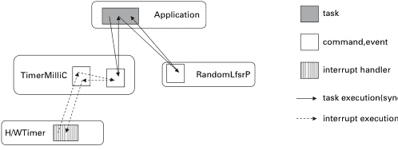

**图 5.1** TinyOS 执行模型：任务（实线）和中断处理程序（虚线）都跨越组件边界。

### 5.2 任务

任务是 nesC 提供的一种简单的延迟计算机制。任务的返回值为 `void`，不带参数（这使任务调度程序非常简单），并使用 `task` 关键字声明：

```c
task void setupTask() {
    // task code
}
```

使用 `post` 关键字可将任务安排在稍后执行：

```c
event void Boot.booted() {
    call Timer.startPeriodic(1024);
    post setupTask();
}
```

在上面的示例中，一旦 TinyOS 完成启动序列（向所有组件发出 `Boot.booted`），它将运行 `setupTask`。

任务就像任何其他模块代码一样。它们可以访问变量、调用命令、发出事件并调用内部或全局 C 函数。`post` 操作符类似于调用函数：它返回 `error_t`。发布任务始终返回 `SUCCESS`，除非任务已在等待。换句话说，一个组件不能发布多个相同任务的副本以供运行；然而，一旦任务开始执行，它可以重新发布自身。

这是系统启动后运行的核心 TinyOS 调度器循环。此函数永不返回。它执行任务直到任务队列为空，然后将微控制器置于睡眠状态：

```cpp
command void Scheduler.taskLoop() {
    for (;;) {
        uint8_t nextTask;
        atomic {
            while ((nextTask = popTask()) == NO_TASK) {
                call McuSleep.sleep();
            }
            signal TaskBasic.runTask[nextTask]();
        }
    }
}
```

列表 5.1 来自 `SchedulerBasic.nc` 的主 TinyOS 调度循环

不用担心循环中的一些高级语法（例如 `[]`）。用伪代码表示，该函数为：

```text
run forever:
    while there are no tasks:
        sleep
    run next task
```

就这样。TinyOS 在中断唤醒处理器之前处于睡眠状态。如果中断处理程序发布了一个或多个任务，TinyOS 将运行任务直到没有剩余任务，然后再次进入睡眠。由于任务一次运行一个，它们不能相互抢占，下一个任务要等到当前任务完成才执行。这一特性极大地简化了编写任务以及因此所有 `sync` 代码的工作，因为你不需要任何锁或其他机制来保护共享变量。`sync` 例程可以假设在它完成之前它完全控制处理器。

作为示例，让我们看一下 `BaseStation` 应用程序。`BaseStation` 是一个 UART/无线电桥：它将收到的所有无线电数据包转发到 UART，并将收到的所有 UART 数据包转发到无线电。由于无线电和 UART 可能具有不同的吞吐量，`BaseStation` 在每个方向上引入了一个发送队列。当它接收到无线电数据包时，它会将数据包放在 UART 发送队列上。当它接收到 UART 数据包时，它会将数据包放在无线电发送队列上。

`BaseStationP`，即实现 `BaseStation` 应用程序的模块，使用任务从队列中提取数据包并发送它们。接收处理程序将数据包放在队列上，并在应用程序尚未发送时发布发送任务。以下是该逻辑的伪代码：

```text
on receive packet:
```


```
if queue not full:
    put packet on queue
    if no send pending:
        post send task
```

任务不能接受参数。如果组件需要将数据传递给任务，它必须通过将其存储在组件变量中来完成。例如，`BaseStationP` 不能将指向要发送的消息的指针作为参数传递给 `sendTask`。相反，`sendTask` 必须直接从队列中提取数据包。

#### 5.2.1 任务时序

TinyOS 通常按任务的发布顺序运行任务，即先进先出 FIFO。已发布的任务要等到之前发布的所有任务完成才会运行。这意味着任务应该相当短。如果某个组件需要进行很长的计算，它应该将其拆分为多个任务。任务可以发布自身，因为一旦它开始运行，就不再在队列中了。

在当前 mote 平台上，发布和执行一个任务大约需要 80 个微处理器时钟周期。一般来说，保持任务运行时间最多为几毫秒是比较好的做法。因为任务会运行到完成，所以一个运行时间长的任务或大量运行时间不算长的任务都可能在任务发布与其执行之间引入显著的延迟（数十毫秒）。对于应用级组件来说这通常不是大问题。但存在使用任务的底层组件，例如无线电协议栈。例如，如果数据包接收速率受限于无线电发布任务以通知接收的速度，那么 10 ms 的延迟将把系统限制在每秒 100 个数据包。

考虑这两种情况。在这两种情况下，都有五个处理组件和一个无线电协议栈。mote 处理器运行在 8 MHz。每个处理组件都需要做大量的 CPU 工作。在第一种情况下，处理组件发布运行 5 ms 的任务并重新发布自身以继续工作。在第二种情况下，处理组件发布运行 500 µs 的任务并重新发布自身以继续工作。

在第一种情况下，任务发布开销为 0.02%：在 40 000 个执行周期上开销 80 个周期。在第二种情况下，任务发布开销为 0.2%：在 4 000 个执行周期上开销 80 个周期。因此完成执行所需的时间并没有显著差异。然而，考虑任务队列延迟。在第一种情况下，当无线电协议栈发布任务以通知数据包已接收时，它预计要等待大约 25 ms（5 个处理任务 × 每个 5 ms），从而将系统限制在每秒 40 个数据包。在第二种情况下，当无线电协议栈发布任务时，它预计要等待大约 2.5 ms（5 个处理任务 × 每个 500 µs），从而将系统限制在每秒 400 个数据包。因为任务发布成本非常低，使用大量短运行任务可以在不引入显著 CPU 开销的情况下提高系统的响应性。

当然，通常在大量短任务和组件中需要分配的状态量之间存在权衡。例如，假设你想加密一段数据。如果加密操作需要一段时间（例如 10 ms），那么将其拆分为多次任务执行将提高整体系统响应性。然而，如果在单个任务中执行它，那么你就可以在栈上分配所有需要的状态和临时空间。相比之下，将其拆分到多个任务中需要在组件中保留这些状态和临时空间。对此权衡没有硬性规则。但通常，长运行任务会使操作系统的其他部分性能变差，因此在可能的情况下应避免。

#### 5.2.2 时序和事件处理程序

任务需要保持短小，这直接影响你实现组件的方式，特别是事件处理程序。`BaseStationP` 并不会在其接收事件处理程序中直接发送数据包；相反，它发布任务来发送数据包。它这样做是因为底层无线电协议栈是在任务内部发出接收信号的，显然是在进行了一点计算之后。如果 `send` 调用的周期很多，那么底层无线电组件要等到 `send` 完成才会从应用程序获取新的缓冲区。更一般地说，如果接收处理程序包含大量计算，那么无线电必须等待其完成，然后才有缓冲区接收下一个数据包。

虽然单个事件处理程序可能不是大问题，但事件处理程序实际上可能代表多个软件层。例如，网络组件可能处理接收事件，根据数据包执行少量计算，然后将其信号传递给下一层。因此，任何给定组件都可能只是长长的事件处理程序链中的一部分。出于这个原因，如果处理程序需要执行大量计算，最好发布一个任务。这样做可以防止调用链中出现多个此类处理程序。

#### 编程提示 16 如果事件处理程序需要进行可能长时间执行的命令调用，请发布任务来执行这些调用。

这就是 `BaseStationP` 使用任务发送数据包而不是直接在事件处理程序中执行的原因。虽然任务在理论上可能要等待一段时间后才运行，但在实践中任务往往非常短，因此发布和执行之间的延迟很小。

### 5.3 任务与分阶段调用

任务不仅仅提供了一种用单栈保持系统响应性的方法。任务使 nesC 程序能够具有灵活的硬件/软件边界：软件组件可以表现得类似于硬件。解释为什么这具有挑战性需要对大多数外设，例如传感器和无线电的工作方式进行一点 digression。

#### 5.3.1 硬件与软件

分阶段调用代表了大多数外设的工作方式。软件向设备发出命令，稍后设备会指示操作已完成，通常通过中断。设备驱动程序的中断处理程序会发出操作完成事件。在设备忙碌时，处理器可以继续发出指令并执行其他有用工作。因此，启动操作的命令可以立即返回并允许程序继续。

提供相同的分阶段接口 `Read`。当组件调用 `read` 命令时，`SineSensorC` 需要使用下一次读数来发出 `readDone` 信号。

#### 5.3.2 任务与调用循环

让我们回到 `Read`，这是大多数传感器为用户提供以生成传感器读数的接口。`Read` 有一个命令 `read` 和一个事件 `readDone`。假设我们有一个噪声很大的传感器。为了滤除部分噪声，应用程序需要一个简单的滤波组件，使用指数加权移动平均（EWMA）来平滑原始读数：

```
module FilterMagC {
  provides interface StdControl;
  provides interface Read<uint16_t>;
  uses interface Timer<uint16_t>;
  uses interface Read<uint16_t> as RawRead;
}
implementation {
  uint16_t filterVal = 0;
  uint16_t lastVal = 0;

  error_t StdControl.start() {
    return call Timer.startPeriodic(10);
  }
  command error_t StdControl.stop() {
    return call Timer.stop();
  }
  event void Timer.fired() {
    call RawRead.read();
  }
  event void RawRead.readDone(error_t err, uint16_t val) {
    if (err == SUCCESS) {
      lastVal = val;
      filterVal *= 9;
      filterVal += 10;
      filterVal += lastVal / 10;
    }
  }
  command error_t Read.read() {
    signal Read.readDone(SUCCESS, filterVal);
  }
}
```

清单 5.2 一种有问题的磁力计传感器实现

该驱动程序每 10 毫秒对磁力计进行一次采样，并对这些值应用 EWMA。当应用程序通过调用 `Read.read` 来采样这个滤波后的值时，`FilterMagC` 只是使用缓存并滤波后的值来发出 `Read.readDone` 信号。

一方面，这种方法非常简单且快速；另一方面，它可能导致严重的堆栈问题。例如，设想一个组件 `FastSamplerC`，它希望快速多次采样传感器（获取高频信号）。它通过在其 `Read.readDone` 事件处理函数中调用 `Read.read` 来实现这一点：

```
event void Read.readDone(error_t err, uint16_t val) {
  buffer[index] = val;
  index++;
  if (index < BUFFER_SIZE) {
    call Read.read();
  }
}
```

清单 5.3 可能导致无限循环的信号处理函数

如果由于某种原因，应用程序将 `FastSamplerC` 连接到 `FilterMagC`，那么 `read` 和 `readDone` 之间会形成一个很长的调用循环。如果编译器无法优化掉这些函数调用，就会导致堆栈显著增长。考虑到传感器节点通常具有有限的 RAM 且没有硬件内存保护，这种堆栈爆裂会破坏数据内存并导致程序崩溃。

编程提示 17 不要在命令中发出事件信号——命令应该发布一个任务来发出事件信号。

当然，从我们示例的 `Read` 实现中获取高频信号有点愚蠢。因为实现正在缓存值，多次采样并无太大帮助。但这种调用模式——在事件发出请求完成信号时发起新请求——是一种常见模式。

这种信号发送方式引发的问题让人们思考 `FilterMagC` 应如何发出 `readDone` 事件信号。它需要一种方式来调度稍后调用的函数（类似于中断）。正确的方法是使用任务。我们的数据滤波组件使用任务实现时可能如下所示：


```
module FilterMagC {
  provides interface StdControl;
  provides interface Read<uint16_t>;
  uses interface Timer<TMilli>;
  uses interface Read<uint16_t> as RawRead;
}

implementation {
  uint16_t filterVal = 0;

  ... unchanged ...

  task void readDoneTask() {
    signal Read.readDone(SUCCESS, filterVal);
  }
}
```

```
command error_t Read.read() {
  post readDoneTask();
  return SUCCESS;
}
```

### 清单 5.4 改进后的 FilterMagC 实现

当 `FilterMagC` 的 `Read.read` 被调用时，`FilterMagC` 会发布 `readDoneTask` 并立即返回。稍后的某个时刻，TinyOS 会运行该任务，并使用滤波后的值发出 `Read.readDone` 信号。

### 5.4 练习

- 1. 测量发布并运行一个任务所需的 CPU 周期数。你可以使用一个计时器来测量一个自发布任务在一段时间内可以运行多少次。
- 2. 有时，组件会通过发布一个自发布任务直到某个变量改变，从而引入自旋循环。为什么这是一个坏主意？更好的解决方案是什么？
- 3. 编写一个单例回环接口，程序可以调用 `Send`，组件将发出 `Receive` 信号。务必注意缓冲区交换，并小心调用循环。

## 6 应用

你已经见过 TinyOS 的几个基本组件和接口，例如启动（`MainC`、`Boot`）、LED 控制（`LedsC`、`Leds`）和计时（`TimerMilliC`、`Timer`）。在本章中，我们将更详细地介绍这些组件，以及其他基本 TinyOS 子系统（传感、通信、存储）。我们通过一个运行示例，即一个简单的防盗演示应用，来介绍并说明这些子系统。出于必要性，这个防盗演示在一定程度上是平台特定的，因为它使用特定的光线和运动传感器来检测盗窃。然而，正如下面所讨论的，TinyOS 建立在可重用接口之上这一事实，使得该应用程序可以从其所编写的 `micaz` 配 `mts310` 传感器板轻松移植到任何具有等效通信和传感能力的平台。

附录 1 提供了 TinyOS 主要服务更系统的概述。每个服务都有简短描述、提供该服务的组件列表，以及指向提供更详细规范的相关 TinyOS 增强提案（TEPs）的指针。

本章中应用程序的完整代码可以在 TinyOS 的贡献代码目录中找到（参见第 1.5 节）。

### 6.1 基础：计时、LED 和启动

市面上最简单的防盗装置之一就是一个简单的闪烁红灯，旨在通过让窃贼相信还有更多事情在发生来起到威慑作用。

使用 TinyOS 构建这样一个简单的应用，毫不奇怪，是非常简单的。我们从应用程序的主模块 `AntiTheftC` 开始：

```
module AntiTheftC {
  uses {
    interface Boot;
    interface Timer<TMilli> as WarningTimer;
    interface Leds;
  }
}

implementation {
  enum { WARN_INTERVAL = 4096, WARN_DURATION = 64 };
```

```
event void WarningTimer.fired() {
    if (call Leds.get() & LEDS_LED0)
    { // Red LED is on. Turn it off, will switch on again in 4096-64ms.
        call Leds.led0Off();
        call WarningTimer.startOneShot(WARN_INTERVAL - WARN_DURATION);
    }
    else
    { // Red LED is off. Turn it on for 64ms.
        call Leds.led0On();
        call WarningTimer.startOneShot(WARN_DURATION);
    }
}

event void Boot.booted() {
    // We just booted. Perform first LED transition.
    signal WarningTimer.fired();
}
```

#### Listing 6.1 Anti-theft: simple flashing LED

我们的应用程序希望使用红灯显示它处于活动状态并在做“某事”。然而，LED 相对耗电，因此我们不想一直让它亮着。相反，我们将每四秒将其打开 64 ms。我们通过使用单个计时器来实现这一点：如果 LED 关闭，我们将其打开并要求在 64 ms 后再次唤醒；如果 LED 打开，我们将其关闭并要求在 3.936 s 后再次唤醒。这种逻辑由 `WarningTimer.fired` 事件实现，其基于 `Timer` 和 `Leds` 接口提供的命令和事件：

```
interface Leds {
    async command void led0On();
    async command void led0Off();
    async command void led0Toggle();

    async command void led1On();
    async command void led1Off();
    async command void led1Toggle();

    async command void led2On();
    async command void led2Off();
    async command void led2Toggle();

    async command uint8_t get();
    async command void set(uint8_t val);
}
```

#### Listing 6.2 The Leds interface

在 `micaz` 上，红色 LED 的编号为 0。¹ `WarningTimer.fired` 使用 `Leds.get` 命令检查该 LED 的状态，并使用 `led0On` 和 `led0Off` 命令适当地将其打开或关闭。打开或关闭 LED 后，代码还通过使用 `WarningTimer.startOneShot` 安排一次性计时器，使其在适当的时间间隔后再次运行。

`AntiTheft` 需要在启动时开始闪烁红色 LED，因此包含来自 `Boot` 接口的 `booted` 事件的处理程序：

```
interface Boot {
    event void booted();
}
```

#### Listing 6.3 The Boot interface

正如我们之前看到的，`Boot` 接口（由 `MainC` 提供）的 `booted` 事件在节点完成启动后立即发出。我们需要做的就是执行 `WarningTimer.fired` 中的逻辑以启动第一次 LED 转换。我们可以通过在 `booted` 事件中复制 `WarningTimer.fired` 的部分代码来实现这一点，但这会浪费资源，并且在更复杂的情况下容易出错。相反，最简单的方法是假装 `WarningTimer.fired` 事件在启动时发生。这种需求并不罕见，因此 nesC 允许模块发出自己的事件（并调用自己的命令），正如我们在 `Boot.booted` 中看到的那样。

#### 6.1.1 基于截止时间的计时

如目前所见，`AntiTheftC` 使用简单的“在 n ms 后唤醒我”的一次性计时接口来获取周期性事件——它不能使用更简单的 `startPeriodic` 命令，因为它在交替使用两个计时周期（64 ms 和 3936 ms）。然而，这种相对时间接口（到期时间指定为相对于“现在”的偏移量）有一个众所周知的问题：如果一个计时器事件因系统中的其他活动而延迟，那么所有后续活动都会延迟。如果这些延迟频繁发生，系统就会“漂移”：LED 可能不是每 4 s 闪烁一次，而是在平均情况下每 4.002 s 闪烁一次。

这对于我们简单的防盗系统来说显然不是问题，但在其他情况下可能是一个问题。因此，我们下面展示 TinyOS 计时系统如何允许你避免此类问题。首先，让我们看看完整的 `Timer` 接口：

```
interface Timer<precision_tag> {
    // basic interface
    command void startPeriodic(uint32_t dt);
    command void startOneShot(uint32_t dt);
```

¹ LED 的编号因不同平台的 LED 颜色不同而不同，例如 `micaz` 有红色、绿色和黄色 LED，而 `Telos` 有红色、绿色和蓝色 LED。


```
command void stop();
event void fired();

// status interface
command bool isRunning();
command bool isOneShot();
command uint32_t getT0();
command uint32_t getDt();

// extended interface
command void startPeriodicAt(uint32_t t0, uint32_t dt);
command void startOneShotAt(uint32_t t0, uint32_t dt);
command uint32_t getNow();
}
```

### Listing 6.4 The full Timer interface

我们已经见过来自基本接口的命令和事件，除了 `stop`，它只是取消任何未处理的 `fired` 事件。状态接口只是返回定时器的当前设置。扩展接口与基本接口类似，只是定时指定为相对于基准时间 `t0`。此外，使用 `getNow` 命令可以获得“当前时间”（以定时器的单位，自启动以来）。`startOneShotAt` 命令请求在时间 `t0+dt` 触发一次 `fired` 事件，而 `startPeriodicAt` 请求在时间 `t0+dt`、`t0+2dt`、`t0+3dt`... 触发 `fired` 事件。这看起来可能不是很大的改变，但足以修复漂移问题，如下修订版的 `WarningTimer.fired` 所示：

```
uint32_t base; // Time at which WarningTimer.fired should’ve fired

event void WarningTimer.fired() {
if (call Leds.get() & LEDS_LED0)
{ // Red LED is on. Turn it off, will switch on again in 4096-64ms.
call Leds.led0Off();
call WarningTimer.startOneShotAt(base, WARN_INTERVAL - WARN_DURATION);
base += WARN_INTERVAL - WARN_DURATION;
}
else
{ // Red LED is off. Turn it on for 64ms.
call Leds.led0On();
call WarningTimer.startOneShotAt(base, WARN_DURATION);
base += WARN_DURATION;
}
}
```

#### Listing 6.5 WarningTimer.fired with drift problem fixed

基础模块变量包含 `WarningTimer.fired` 预期触发的时间。通过将定时器截止时间指定为相对于 `base` 的偏移量，而不是相对于当前时间，我们避免了由于 `WarningTimer.fired` 运行延迟而产生的任何漂移。我们还

每次重新调度定时器时更新 `base`，并在 `Boot.booted` 中将其初始化为当前时间（在启动第一个定时器之前）：

```
base = call WarningTimer.getNow();
```

TinyOS 定时器使用 32 位数字表示时间。因此，毫秒定时器（`TMilli`）每约 48.5 天回绕一次，而微秒定时器几乎每小时回绕一次。这些时间短于大多数预期传感器网络部署，因此定时器设计为在时间回绕时也能正确工作。其主要用户可见效果是，`startOneShotAt` 和 `startPeriodicAt` 的 `t0` 参数被假定始终代表过去的时间。因此，数值上大于当前时间的值实际上代表上次回绕之前的某个时间。

最后说明：在典型的传感器节点平台上，毫秒定时器基于相当精确的 32 768 Hz 晶体。然而，这并不意味着定时是完全准确的。不同节点的晶体频率会略有不同，并且会因温度效应而漂移。如果您需要时间非常准确和/或在节点间同步，您将需要提供某种形式的网络时间同步。

### 6.1.2 Wiring AntiTheftC

将 `AntiTheftC` 包装成完整应用的 `AntiTheftAppC` 配置没有任何意外。它使用通用的 `TimerMilliC` 组件实例化一个新的定时器，并将 `AntiTheftC` 与提供 LED 和启动支持的 `LedsC` 和 `MainC` 组件连接起来：

```
configuration AntiTheftAppC { implementation { components AntiTheftC, MainC, LedsC; components new TimerMilliC() as WTimer; AntiTheftC.Boot -> MainC; AntiTheftC.Leds -> LedsC; AntiTheftC.WarningTimer -> WTimer; } }
```

#### Listing 6.6 Anti-Theft: application-level configuration

## 6.2 Sensing

传感当然是传感器网络的主要活动之一。然而，有成千上万种不同的传感器，测量从光、声音和加速度到磁场和湿度的各种事物。一些传感器是简单的模拟传感器，其他具有数字接口或看起来像计数器（例如风速）。此外，

精度、采样率和抖动要求因应用而异：一个简单的环境监测应用可能每 5 分钟采样几个传感器，而地震监测系统可能每天仅一次采样数秒的加速度，采样频率为数千赫兹。

因此，TinyOS 并未提供统一的方式来访问所有传感器。相反，它定义了一组用于采样传感器的通用接口，以及一组用于构建可访问特定传感器的组件的指导原则。

### 6.2.1 简单采样

两个主要的采样接口是 `Read`（我们在第 3.4 节中见过）和 `ReadStream`，分别涵盖获取单个样本和以固定速率采样（抖动低）的情形。作为回顾，`Read` 提供了一个分阶段的 `read` 命令，用于启动采样，以及一个 `readDone` 事件，用于报告样本值和发生的任何错误，适用于任意类型 `val_t`。

```
interface Read<val_t> {
  command error_t read();
  event void readDone(error_t result, val_t val);
}
```

列表 6.7 Read 接口

与大多数 TinyOS 分阶段接口类似，你一次只能启动一个采样操作，即在 `readDone` 信号发出前再次调用 `read` 将会失败（`read` 不会返回 `SUCCESS`）。然而（同样与其他分阶段接口一致），在 `readDone` 事件处理程序中调用 `read` 是合法的，这使得连续读取变得容易。

我们可以通过检测盗窃企图使防盗应用更真实。一种最初的简单尝试基于以下观察：被盗物品通常被放入袋子和口袋中，即黑暗位置。`DarkC` 模块通过定期（每隔 `DARK_INTERVAL`）采样光传感器（使用 `Read` 接口）并检查光值是否低于某个阈值（`DARK_THRESHOLD`）来检测黑暗位置。然后它通过点亮黄色 LED（micaZ 上的 LED 2）报告盗窃：

```
module DarkC {
  uses {
    interface Boot;
    interface Leds;
    interface Timer<TMilli> as TheftTimer;
    interface Read<uint16_t> as Light;
  }
}
implementation {
enum { DARK_INTERVAL = 256, DARK_THRESHOLD = 200 };

event void Boot.booted() {
  call TheftTimer.startPeriodic(DARK_INTERVAL);
}

event void TheftTimer.fired() {
  call Light.read(); // Initiate split-phase light sampling
}

/* Light sample completed. Check if it indicates theft */
event void Light.readDone(error_t ok, uint16_t val) {
  if (ok == SUCCESS && val < DARK_THRESHOLD)
    call Leds.led2On(); /* ALERT! ALERT! */
  else
    call Leds.led2Off(); /* Don't leave LED permanently on */
}
}
```

列表 6.8 防盗：检测黑暗条件


我们本可以在现有的 `AntiTheftC` 模块中实现黑暗检测，并重用现有的 `WarningTimer`。虽然这会略微减少定时器子系统中的 CPU 和存储需求，但会增加 `AntiTheftC` 的代码复杂度，因为它混合了两个本质上不相关的活动的代码。通常最好让一个模块专注于一项任务（闪烁 LED、检测黑暗条件）做得很好，而不是构建一个试图处理许多任务的复杂模块，从而付出显著的复杂性代价。

目前，`DarkC` 非常简单：它在 `booted` 事件中启动周期性采样。每秒四次，`TheftTimer.fired` 使用表示光传感器的分阶段 `Read` 接口（`Light`）请求新的光样本。如果采样成功（`ok == SUCCESS`），则将光与指示黑暗条件从而盗窃的阈值进行比较。`DarkC` 不检查 `Light.read` 的错误返回值，因为当无法启动光采样时没有有用的恢复操作——它无论如何都会在 1/4 秒后重试检测。

### 6.2.2 传感器组件

传感器在 TinyOS 中由提供 `Read` 和/或 `ReadStream` 接口的通用组件表示，并且可能还有其他传感器特定的接口（例如用于校准）。一个组件通常代表一个传感器，例如 mts310 传感器板上的光传感器的 `PhotoC`：

```
generic configuration PhotoC() {
  provides interface Read<uint16_t>;
}
```

如果两个传感器密切相关（例如加速度计的 X 轴和 Y 轴），它们可能由单个组件提供。同样，如果传感器同时支持单次（`Read`）

and stream (`ReadStream`) sampling, the interfaces may be offered by the same generic component. However, neither of these is required: for example, the mts300 sensor board has separate `AccelXC`, `AccelXStreamC`, `AccelYC` and `AccelYStreamC` components for sampling its two-axis accelerometer. A single component simplifies the namespace, but may lead to extra code and RAM usage in applications that don’t need, e.g. both axes or stream sampling.

将 `DarkC` 添加到我们现有的防盗应用中只需将其连接到光传感器，以及它的其他服务：

```
configuration AntiTheftAppC { 
implementation { 
... /* the wiring for the blinking red LED */ ... 
components DarkC; 
components new TimerMilliC() as TTimer; 
components new PhotoC(); 

DarkC.Boot -> MainC; 
DarkC.Leds -> LedsC; 
DarkC.TheftTimer -> TTimer; 
DarkC.Light -> PhotoC; 
}
```

Listing 6.9 Anti-Theft: wiring to light sensor

### 6.2.3 Sensor values, calibration

TinyOS 2.x specifies the general structure of sensor components such as `PhotoC`, but, because of the extreme diversity of sensors, does not attempt to specify much else. The type used to report sensor values (`uint16_t` for `PhotoC`), the meaning of the values reported by the sensor, the time taken to obtain a sample, the accuracy of sensor values, calibration opportunities and requirements are all left up to the particular sensor hardware and software. Thus, for example, the fact that 200 (`DARK_THRESHOLD`) is a good value for detecting dark conditions is specific to the particular photo-resistor used on the mts300 board, and the way it is connected to micaz motes (in series with a specific resistor, connected to the micaz’s microcontroller’s A/D converter).

In some cases, e.g. temperature, it would be fairly easy to specify a standard interface, such as temperature in 1/10 K. However, forcing such an interface on temperature sensors might not always be appropriate: the sensor might be more precise than 1/10 K, or the code for doing the conversion to these units might take too much time or space on the mote, when the conversion could be done just as easily when the data is recovered from the sensor network. TinyOS leaves these decisions to individual sensor component designers.

### 6.2.4 Stream sampling

The `ReadStream` interface is more complex than `Read`, in part because it needs to support motes with limited RAM: some applications need to sample more data at once than actually fits in memory. However, simple uses of `ReadStream` remain quite simple, as we will see by building an alternate theft-detection mechanism to `DarkC`. First, let’s see `ReadStream`:

```
interface ReadStream<val_t> {
  command error_t postBuffer(val_t* buf, uint16_t count);
  command error_t read(uint32_t usPeriod);
  event void bufferDone(error_t result, val_t* buf, uint16_t count);
  event void readDone(error_t result, uint32_t usActualPeriod);
}
```

Listing 6.10 ReadStream Interface


Like `Read`, `ReadStream` is a typed interface whose `val_t` parameter specifies the type of individual samples. Before sampling starts, one or more buffers (arrays of `val_t`) must be posted with the `postBuffer` command. Sampling starts once the `read` command is called (`usPeriod` is the sampling period in microseconds), and continues until all posted buffers are full or an error occurs, at which point `readDone` is signaled. It is also possible to post new buffers during sampling – this is often done in the `bufferDone` event which is signaled as each buffer is filled up. By using two (or more) buffers, and processing (e.g. computing statistics, or writing to flash) and reposting each buffer in `bufferDone`, a mote can sample continuously more data than can fit in RAM.

The simplest way to use `ReadStream` is to declare an array holding `N` sample values, post the buffer and call `read`. The samples are available once `readDone` is signaled. We use this approach in `MovingC`, an alternate component to `DarkC` that detects using an accelerometer to detect movement – it’s hard to steal something without moving it. `MovingC` samples acceleration at 100 Hz for 1/10 s, and reports theft when the variance of the sample is above a small threshold (picked experimentally):

```
module MovingC {
  uses {
    interface Boot;
    interface Leds;
    interface Timer<TMilli> as TheftTimer;
    interface ReadStream<uint16_t> as Accel;
  }
}

implementation {
  enum {
    ACCEL_INTERVAL = 256, /* Checking interval */
    ACCEL_PERIOD = 10000, /* us -> 100Hz */
    ACCEL_NSAMPLES = 10, /* 10 samples * 100Hz -> 0.1s */
    ACCEL_VARIANCE = 4; /* Determined experimentally */
```

```c
uint16_t accelSamples[ACCEL_NSAMPLES];

task void checkAcceleration();

event void Boot.booted() {
    call TheftTimer.startPeriodic(ACCEL_INTERVAL);
}

event void TheftTimer.fired() {
    // Get 10 samples at 100Hz
    call Accel.postBuffer(accelSamples, ACCEL_NSAMPLES);
    call Accel.read(ACCEL_INTERVAL);
}

/* The acceleration read completed. Post the task to check for theft */
event void Accel.readDone(error_t ok, uint32_t usActualPeriod) {
    if (ok == SUCCESS)
        post checkAcceleration();
}

/* Check if acceleration variance above threshold */
task void checkAcceleration() {
    uint8_t i;
    uint32_t avg, variance;

    for (avg = 0, i = 0; i < ACCEL_NSAMPLES; i++) avg += accelSamples[i];
    avg /= ACCEL_NSAMPLES;
    for (variance = 0, i = 0; i < ACCEL_NSAMPLES; i++)
        variance += (int16_t)(accelSamples[i]-avg)*(int16_t)(accelSamples[i]-avg);

    if (variance > ACCEL_VARIANCE * ACCEL_NSAMPLES)
        call Leds.led2On(); /* ALERT! */
    else
        call Leds.led2Off(); /* Don't leave LED permanently on */
}

event void Accel.bufferDone(error_t ok, uint16_t *buf, uint16_t count) { }
```

#### 清单 6.11 防盗：检测移动

`MovingC` 的基本结构和 `DarkC` 相同：每秒启动四次采样（`TheftTimer.fired`），如果采样成功，则检查采样结果以确定它们是否表明发生了盗窃（`Accel.readDone`）。主要的区别有以下三点：

-   在采样开始前调用 `postBuffer` 来注册加速度缓冲区

-   `MovingC` 必须实现 `bufferDone` 事件，当每个已提交的缓冲区被填满时会发出该事件信号——这里我们不需要做任何事，因为我们只往一个缓冲区中采样

-   样本在一个单独的任务（`checkAcceleration`）中被检查，以避免 `Accel.readDone` 的执行时间过长（见 5.2.2 节）

`MovingC` 的连接配置与 `DarkC` 相同，只不过它连接的是一个流式加速度计传感器：

```
components new AccelXStreamC();
...
MovingC.Accel -> AccelXStreamC;
```

### 6.3 单跳网络

TinyOS 采用典型的分层网络结构，如图 6.1 所示。网络协议栈由一组层组成，每一层定义了头部和尾部的布局，并为上一层提供一个大小可变的有效载荷空间；最上层（通常是应用程序）只保存应用数据。每一层的头部通常包含一个“类型”字段，用于指明该层有效载荷的含义，进而决定有效载荷的布局——这使得在单个应用程序中使用多个独立的数据包变得容易。例如，在图 6.1 中有两类数据包：一类包含应用程序 1 的消息，构建在 `layer2a` 之上，而 `layer2a` 又构建在 `layer1` 之上；另一类包含应用程序 3 的消息，构建在 `layer2b` 之上，而 `layer2b` 又构建在 `layer1` 之上。

TinyOS 所暴露的最低网络层称为主动消息（Active Messages，AM）[29]。AM 通常直接在节点的射频模块之上实现，提供不可靠的单跳数据包发送和接收。每个数据包由一个 AM 类型标识，这是一个标识数据包类型的 8 位整数。“主动消息”这个名字源于这样一个事实：类型字段被用于将接收到的数据包自动分派到合适的处理程序。从某种意义上说，数据包（消息）是主动的，因为它们通过其类型标识了将要执行的代码。

一个 `message_t` 类型的变量保存一个 AM 数据包。每个数据包最多可以承载用户指定的有效载荷，长度达 `TOSH_DATA_LENGTH` 字节——通常为 28 字节，

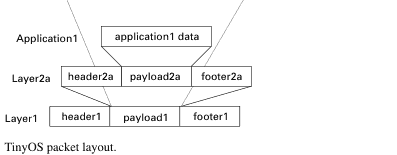

图 6.1 TinyOS 数据包布局


但可以在编译时将其更改为最多 255 字节。² 注意，增大 `TOSH_DATA_LENGTH` 会增加每个 `message_t` 变量的大小，因此可能导致 RAM 使用量大幅增加。

一些简单的节点应用直接构建在 `AM` 之上，而更复杂的应用通常使用更高级的协议，例如我们将在下一节讨论的分发和收集协议。这些更高级的协议本身也构建在 `AM` 之上。值得注意的是，用于访问 `AM` 的接口（`AMSend`、`Receive`）有时会在一些高级协议中被复用（例如，树形收集使用 `Receive`）——这使协议之间的切换更容易，并促进了代码复用。

### 6.3.1 发送数据包

我们的防盗应用目前通过点亮 LED 来报告盗窃，这很可能效果不佳。更好的方法是提醒某人，例如给相关人员发送一条无线电消息。这条消息应将被盗节点的身份标识作为其有效载荷。如第 3.5.3 节所述，TinyOS 的有效载荷始终使用平台无关类型来定义，以确保互操作性。因此，盗窃报告有效载荷的定义是一个简单的平台无关结构体，声明在 `antitheft.h` 头文件中：

```
#ifndef ANTITHEFT_H
#define ANTITHEFT_H

typedef nx_struct theft {
  nx_uint16_t who;
} theft_t;
...
#endif
```

`AMSend`（“主动消息发送”）接口包含填充和发送数据包所需的全部命令：

```
interface AMSend {
  command error_t send(am_addr_t addr, message_t* msg, uint8_t len);
  event void sendDone(message_t* msg, error_t error);
  command error_t cancel(message_t* msg);

  command uint8_t maxPayloadLength();
  command void* getPayload(message_t* msg, uint8_t len);
}
```

清单 6.12 `AMSend` 接口

`send` 命令和 `sendDone` 事件用于对存储在 `message_t` 报文缓冲区中的 `AM` 报文执行分阶段发送；`addr` 参数指定报文目的地，可为 `TOS_BCAST_ADDR` 以请求广播。`AM` 报文具有源地址，可通过 `AMPacket` 接口获取。节点的 `AM` 地址通常（但并非总是）与其 `TOS_NODE_ID` 相同。从技术上讲，`TOS_NODE_ID` 是节点的唯一标识符，而 `AM` 地址是其无线电接口的地址。例如，具有两个无线电的节点在两个无线电上可能具有不同的 `AM` 地址。

由于报文缓冲区的用户有效载荷在不同平台（使用不同无线电）或使用不同通信层时可能位于不同的偏移量，`AMSend` 提供了 `getPayload` 命令来获取指向有效载荷的指针。`getPayload` 命令要求用户传入其有效载荷的大小，以便确保缓冲区中有足够的空间（如果没有足够空间则返回 `NULL`）——希望发送可变大小消息的应用程序可以调用 `maxPayloadLength` 来查找最大可能的有效载荷大小。

综合这些，`reportTheft` 函数将盗窃报告报文发送给附近任意监听者：

```
uses interface AMSend as Theft;
...
message_t reportMsg; // The theft report message buffer
bool sending;      // Don’t try and send while a send is in progress

void reportTheft() {
  theft_t *payload = call Theft.getPayload(&reportMsg, sizeof(theft_t));

  if (payload && !sending) {
    // We can send if we’re idle and the payload fits
    payload->who = TOS_NODE_ID; // Report that *we* are being stolen!
    // And send the report to everyone (TOS_BCAST_ADDR)
    if (call Theft.send(TOS_BCAST_ADDR, &reportMsg, sizeof(theft_t))==SUCCESS)
      sending = TRUE;
  }
}

event void Theft.sendDone(message_t *msg, error_t error) {
  sending = FALSE; // Our send completed
}
```

#### 清单 6.13 防盗：通过无线电报告盗窃

如果 `reportTheft` 函数的有效载荷不适合放入 `reportMsg`（`payload == NULL`），或者先前的发送仍在进行中（`sending` 为真），则该函数拒绝尝试发送：在传输期间，报文缓冲区由通信栈“拥有”（第 3.5.1 节），因此不应被触碰。该代码检查传输是否失败（以便正确更新 `sending`），但除此之外不会尝试重试失败的传输，也不会检查是否有任何人收到盗窃报告。它仅仅依赖于这样一个事实：`MovingC` 会在“盗窃”进行中时重复调用 `reportTheft`，因此其中一条消息很可能会发送成功：

```
if (variance > ACCEL_VARIANCE * ACCEL_NSAMPLES)
{
    call Leds.led2On(); /* ALERT! ALERT! */
    reportTheft();
}
```

大多数高级 TinyOS 子系统会在系统启动时或根据使用情况按需自动启动和停止。然而，基于 `AM` 的无线电和串行通信栈并非如此，原因主要有两个。第一，通信通常非常耗电（例如，大多数无线电即使不主动接收或发送报文，其功耗也相当于一个活跃的微控制器），因此让通信栈永久保持开启不一定是个好主意。第二，基于 `AM` 的报文接收本质上是异步的：与例如由应用驱动的采样不同，`mote` 上的代码中没有指定何时预期接收报文。因此，通信栈无法按需自行开关。相反，应用程序必须使用我们之前见过的分阶段 `SplitControl` 接口来启动和停止无线电：

```
interface SplitControl {
  command error_t start();
  event void startDone(error_t error);

  command error_t stop();
  event void stopDone(error_t error);
}
```

#### 清单 6.14 `SplitControl` 接口

`MovingC` 在启动时打开无线电，并等待无线电启动后再开始暂存，以避免在无线电关闭时发送消息：

```
uses interface SplitControl as CommControl;
...
event void Boot.booted() {
    call CommControl.start();
}

event void CommControl.startDone(error_t ok) {
    // Start checks once communication stack is ready
    call TheTftTimer.startPeriodic(ACCEL_INTERVAL);
}

event void CommControl.stopDone(error_t ok) { }
```

该代码忽略了 `startDone` 中的错误码，因为如果无线电无法启动，没有任何明显的恢复步骤可采取。

### 6.3.2 接收数据包

`MovingC` 使用硬编码常量作为检查间隔和加速度方差阈值。如果这些值在某些环境下不合适（例如，移动车辆可能存在背景振动），则必须更改代码并使用新值重新编译，然后重新安装到传感器网络中。更好的方法是修改一次代码以允许远程配置，使用 `AM` 数据包，其负载如下（也在 `antitheft.h` 中声明）：

```
typedef nx_struct settings {
  nx_uint16_t accelVariance;
  nx_uint16_t accelInterval;
} settings_t;
```

`AM` 数据包的接收由 TinyOS `Receive` 接口提供（前面也见过）：

```
interface Receive {
  event message_t* receive(message_t* msg, void* payload, uint8_t len);
}
```

清单 6.15 `Receive` 接口

如第 3.5.1 节所述，`Receive.receive` 的实现会接收一个数据包缓冲区，它们可以简单地返回该缓冲区，也可以保留该缓冲区，只要返回不同的缓冲区即可。在 `MovingC` 的情况下，我们选择第一种方案，因为在我们从数据包中读取设置后，就不再需要这些设置了：


``` 
uses interface Receive as Settings;
...
uint16_t accelVariance = ACCEL_VARIANCE;

event message_t *Settings.receive(message_t *msg,
    void *payload, uint8_t len) {
  if (len >= sizeof(settings_t)) { // Check the packet seems valid
    // Read settings by casting payload to settings_t, reset check interval
    settings_t *settings = payload;
    accelVariance = settings->accelVariance;
    call TheftTimer.startPeriodic(settings->accelInterval);
  }
  return msg;
}

task void checkAcceleration() {
...
if (variance > accelVariance * ACCEL_NSAMPLES)
        call Leds.led2On(); /* ALERT! ALERT! */
        reportTheft()
    }
}
```

清单 6.16 防盗：更改设置

### 6.3.3 选择通信栈

迄今为止看到的代码中没有指定用于盗窃报告的通信栈，也没有指定区分盗窃报告和设置更新的 AM 类型。此信息在配置中指定，通过将组件连接到表示所需通信栈的组件来实现：这些组件具有兼容的签名，使得在栈之间切换变得容易：

```
configuration ActiveMessageC {
  provides interface SplitControl;
  ...
}
generic configuration AMSenderC(am_id_t id) {
  provides interface AMSend;
  ...
}
generic configuration AMReceiverC(am_id_t id) {
  provides interface Receive;
  ...
}

configuration SerialActiveMessageC{
  provides interface SplitControl;
  ...
}
generic configuration SerialAMSenderC(...){
  provides interface AMSend;
  ...
}
generic configuration SerialAMReceiverC(...){
  provides interface Receive;
  ...
}
```

清单 6.17 基于串行与无线电的 AM 组件

`ActiveMessageC` 包含 `SplitControl` 接口，用于启动和停止通信栈。使用特定 AM 类型实例化 `AMSenderC` 会创建一个组件，该组件提供 `AMSend` 接口，可为传输队列单个数据包，与所有其他 `AMSenderC` 实例无关。这简化了使用 `AMSend` 的模块的工作：只要它们一次只发送一个数据包，就能确保总能将数据包入队。最后，使用 AM 类型 k 实例化 `AMReceiverC` 并将 `Receive` 接口连接到你的代码，会自动将类型为 k 的接收数据包分发到你的 `Receive.receive` 事件处理程序。

防盗应用程序使用基于无线电的通信（`mts300` 传感器板在物理上通过串行连接进行接口）：

```
enum { AM_THEFT = 42, AM_SETTINGS = 43 };
...
components ActiveMessageC;
components new AMSenderC(AM_THEFT) as SendTheft;
components new AMReceiverC(AM_SETTINGS) as ReceiveSettings;
MovingC.CommControl -> ActiveMessageC;
```

```
MovingC.Theft -> SendTheft;
MovingC.Settings -> ReceiveSettings;
```

## 6.4 多跳网络：收集、传播和基站

mote 网络通常比一组彼此在直接无线电范围内的 mote 复杂得多（在当前 mote 上通常只有 30m/100ft）。相反，多跳网络使用 mote 在发送方和接收方不在直接无线电范围内时中继消息。此外，一个或多个基站 mote 物理连接到 PC 级设备，通常由线路供电，将信息在更广阔的世界之间中继。因此，作为一个整体，传感器网络应用程序有三个部分（图 6.2）：

- Mote 代码：网络中 mote 上运行的代码。mote 之间的交互以发送和接收无线电消息的形式进行。

- 基站代码：在基站 mote 上运行的代码。它通过无线电消息与其它 mote 交互，并通过串行连接与 PC 交换数据包。

- PC 代码：在 PC 上运行的代码。

TinyOS 提供了两种基本的多跳网络抽象：树形收集和传播。在树形收集中，mote 组织成以特定 mote 为中心的路由树，根节点通常是基站 mote。树中发送的所有消息都会自动流向根节点（例如，沿图 6.2 中所示的链路）。收集树通常用于从传感器网络收集信息（例如传感器数据）。

传播在整个 mote 网络中高效地分发一个值（可以是包含多个字段的结构）。此外，任何 mote 都可以更新该值，整个网络最终会稳定到最近更新的值。传播通常用于 mote 应用程序的运行时配置。

在本节的其余部分，我们将修改 AntiTheft，使其使用收集和传播而不是 `ActiveMessageC` 来进行盗窃报告和配置。特别地，我们展示

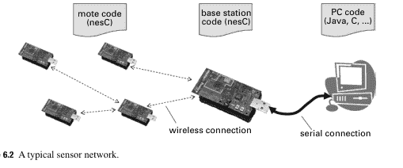

图 6.2 一个典型的传感器网络。

基站节点如何将自己设置为收集树的根节点，以将防盗设置上报给 PC，以及如何分发从 PC 接收到的新设置。第 7 章将介绍节点连接的 PC 端。

### 6.4.1 收集

通过收集树发送消息与使用 AM 非常相似，不同之处在于消息没有目标地址（树根是隐式目标）。因此，收集树使用 `Send` 接口，该接口与 `AMSend` 相同，只是 `send` 命令缺少 `addr` 参数：

```
interface Send {
  command error_t send(message_t* msg, uint8_t len);
  event void sendDone(message_t* msg, error_t error);
  command error_t cancel(message_t* msg);

  command uint8_t maxPayloadLength();
  command void* getPayload(message_t* msg, uint8_t len);
}
```

清单 6.18 `Send` 接口

因此，`MovingC` 中通过收集树上报盗窃行为的代码与第 6.3.1 节中的代码几乎相同：

```
uses interface Send as Theft;
...
message_t reportMsg; // The theft report message buffer
bool sending;        // Don't try and send while a send is in progress

void reportTheft() {
  theft_t *payload = call Theft.getPayload(&reportMsg, sizeof(theft_t));

  if (payload && !sending)
    { // We can send if we're idle and the payload fits
      payload->who = TOS_NODE_ID; // Report that *we* are being stolen!
      // And send the report to the root
      if (call Theft.send(&reportMsg, sizeof(theft_t)) == SUCCESS)
        sending = TRUE;
    }
}

event void Theft.sendDone(message_t *msg, error_t error) {
  sending = FALSE; // Our send completed
}
```

清单 6.19 防盗：通过收集树上报盗窃行为

### 6.4.2 分发

分发服务通过一个由被分发值的类型参数化的接口来访问：


``` 
interface DisseminationValue<t> {
  command const t* get();
  command void set( const t* );
  event void changed();
}
```

清单 6.20 `DisseminationValue` 接口

分发值会在网络中传输，因此传递给 `DisseminationValue` 的类型应该是平台无关的类型（见第 3.5.3 节）。在我们的例子中，我们复用了第 6.3.2 节中定义的 `settings_t` 类型，该类型包含新的加速度方差和检查间隔。`MovingC` 中接收并处理新设置的代码很简单：

```
uses interface DisseminationValue<settings_t> as Settings;
/* New settings received, update our local copy */
event void Settings.changed() {
  const settings_t *newSettings = call Settings.get();
  accelVariance = newSettings->accelVariance;
  call TheftTimer.startPeriodic(newSettings->accelInterval);
}
```

清单 6.21 防盗：通过分发树分发设置

### 6.4.3 连接收集与分发

与 AM 本身一样，收集和分发服务必须显式启动，这次是通过非分阶段的 `StdControl` 接口：

```
interface StdControl {
  command error_t start();
  command error_t stop();
}
```

清单 6.22 `StdControl` 接口

此外，由于收集和分发服务构建在 AM 之上，必须首先启动无线电。因此，`AntiTheft` 的启动序列现在稍微复杂一些（与前面一样，我们不检查错误码，因为没有明显的恢复步骤）：

```
uses interface SplitControl as CommControl;
uses interface StdControl as CollectionControl;
uses interface StdControl as DisseminationControl;
...
event void Boot.booted() {
  call CommControl.start();
}
```

```
event void CommControl.startDone(error_t ok) {
  // Start multi-hop routing and dissemination
  call CollectionControl.start();
  call DisseminationControl.start();
  // Start checks once communication stack is ready
  call TheftTimer.startPeriodic(ACCEL_INTERVAL);
}
```

`AM` 类型用于标识节点网络中不同类型的消息。类似地，收集和分发使用 8 位标识符，以允许存在多个独立的收集树以及分发多个值。与 AM 一样，这些标识符被指定为 `CollectionSenderC` 和 `DisseminatorC` 泛型组件的参数，这些组件提供对收集和分发服务的访问：

```
enum { COL_THEFT = 54, DIS_THEFT = 55 };
...
```

```
components ActiveMessageC, DisseminatorC, CollectionC;
MovingC.CommControl -> ActiveMessageC;
MovingC.CollectionControl -> CollectionC;
MovingC.DisseminationControl -> DisseminationC;
```

```
/* Instantiate and wire our collection service for theft alerts */
components new CollectionSenderC(COL_THEFT) as TheftSender;
MovingC.Theft -> TheftSender;
```

```
/* Instantiate and wire our dissemination service for theft settings */
components new DisseminatorC(settings_t, DIS_THEFT);
MovingC.Settings -> DisseminatorC;
```

### 6.4.4 用于收集和分发的基站

要使收集和分发发挥作用，必须有一个消费者来接收通过收集树发送上来的消息，并生成新的值进行分发。在 `AntiTheft` 的例子中，我们假设一台通过串口连接到基站节点的 PC 显示盗窃报告，并允许更改盗窃检测设置。这里我们仅展示基站节点如何设置为转发树收集的盗窃报告并分发防盗设置；第 7 章介绍用于编写与节点网络通信的 PC 应用程序的库和工具。

`AntiTheft` 的基站是一个独立的 nesC 程序。在其他应用中，基站和普通节点运行相同的 nesC 代码，但通过其他方式进行区分（例如，许多应用规定标识符为 0 的节点是基站）。基站节点通过串口使用 `SerialActiveMessageC` 经 AM 与 PC 通信。节点与 PC 交换设置（`PCSettings`）和盗窃报告（`PCTheft`）：

```
configuration AntiTheftRootAppC { }
implementation {
  components AntiTheftRootC;

  components SerialActiveMessageC,
    new SerialAMReceiverC(AM_SETTINGS) as PCSettings,
    new SerialAMSenderC(AM_THEFT) as PCTheft;

  AntiTheftRootC.SerialControl -> SerialActiveMessageC;
  AntiTheftRootC.RSettings -> PCSettings;
  AntiTheftRootC.STheft -> PCTheft;
  ...
}
```

当基站收到新设置时，它只需调用 `DisseminationUpdate` 接口中的 `change` 命令：

```
interface DisseminationUpdate<t> {
  command void change(t* newVal);
}
```

清单 6.23 `DisseminationUpdate` 接口

对 `change` 的调用会自动触发分发过程：

```
module AntiTheftRootC {
  uses interface DisseminationUpdate<settings_t> as USettings;
  uses interface Receive as RSettings;
  ...
  /* When we receive new settings from the serial port, we disseminate
     them by calling the change command */
  event message_t* RSettings.receive(message_t* msg, void* payload, uint8_t len)
  {
    if (len == sizeof(settings_t))
      call USettings.change((settings_t *)payload);
    return msg;
  }
}
```

清单 6.24 `AntiTheft` 基站代码：分发设置

为了接收盗窃报告，基站节点必须使用 `RootControl` 接口将自身标记为收集树的根节点：

```
interface RootControl {
    command error_t setRoot();
    command error_t unsetRoot();
    command bool isRoot();
}
```

清单 6.25 `RootControl` 接口

一旦某个节点成为收集树的根节点，它就会通过常规的 `Receive` 接口接收沿树向上发送的消息。对于 `AntiTheft` 基站节点，它只需通过其 `STheft` 接口将这些消息的有效负载（一个 `theft_t` 值）转发到串口：


```nesc
module AntiTheftRootC {
    uses interface RootControl;
    uses interface Receive as RTheft;
    uses interface AMSend as STheft;

    event void CommControl.startDone(error_t error) {
        ...
        // Set ourselves as the root of the collection tree
        call RootControl.setRoot();
    }

    message_t fwdMsg;
    bool fwdBusy;

    /* When we (as root of the collection tree) receive a new theft alert,
       we forward it to the PC via the serial port */
    event message_t * RTheft.receive(message_t * msg, void* payload, uint8_t len)
    {
        if (len == sizeof(theft_t) && !fwdBusy)
        {
            /* Copy payload from collection system to our serial message buffer
               (fwdMsg), then send our serial message */
            theft_t fwdTheft = call STheft.getPayload(&fwdMsg, sizeof(theft_t));
            if (fwdTheft != NULL) {
                *fwdTheft = *(theft_t *)payload;
                if (call STheft.send(TOS_BCAST_ADDR, &fwdMsg, sizeof(fwdTheft)) == SUCCESS)
                    fwdBusy = TRUE;
            }
        }
        return msg;
    }
}
```

```
fwdBusy = FALSE;
}
}
```

#### 清单 6.26 AntiTheft 基站代码：报告盗窃事件

基站应用必须连接串口（已展示），以及上述代码中使用的收集和分发接口。通过使用树收集标识符对参数化接口进行索引来指定从树接收消息；参数化接口将在第 8.3 节中详细说明。最终的收集和分发连接如下：

```nesc
configuration AntiTheftRootAppC { 
implementation {
... boot, serial and radio wiring ...

components DisseminationC, new DisseminatorC(settings_t, DIS_THEFT);
AntiTheftRootC.DisseminationControl -> DisseminationC;
AntiTheftRootC.USettings -> DisseminatorC;

components CollectionC;
AntiTheftRootC.CollectionControl -> CollectionC;
AntiTheftRootC.RootControl -> CollectionC;
AntiTheftRootC.RTheft -> CollectionC.Receive[COL_THEFT];
}
```

#### 清单 6.27 AntiTheft 基站连接

### 6.5 存储

许多节点都包含一定量的基于闪存的非易失性存储，例如 `micaz` 上有 `512 kB`。`TinyOS` 将这种非易失性存储划分为卷。卷是具有一定格式的连续存储区域，可通过关联接口进行访问。`TinyOS` 定义了三种基本的存储抽象：`Log`、`Block` 和 `Config`。`Log` 用于只追加写入和流式读取，`Block` 用于随机读写，`Config` 用于小型配置数据项。`Log` 和 `Config` 的优点在于，它们更有限的接口支持原子操作：当对 `Log` 或 `Config` 卷的写入完成时，即可保证数据已写入。相比之下，`Block` 接口有一个单独的提交操作。

`TinyOS` 使用这种基于卷的抽象方法而非更传统的文件系统，主要有两个原因。首先，它更简单，减少使用永久存储的应用程序的代码和 RAM 需求。其次，传感器网络通常专用于单个应用程序，它应对其存储需求有合理的了解。

#### 6.5.2 配置数据

就目前而言，防盗节点在关机时会丢失其设置。我们可以通过将设置存储在一个小型配置卷（`configuration volume`）中来解决这个问题：

```text
<volume_table>

  <volume name="AT_SETTINGS" size="512"/>

</volume_table>

configuration AntiTheftAppC {

  implementation {

    ...

    components new ConfigStorageC(VOLUME_AT_SETTINGS) as AtSettings;

    MovingC.Mount -> AtSettings;

    MovingC.ConfigStorage -> AtSettings;

  }

}
```

配置卷在使用前必须通过分阶段（`split-phase`）的 `Mount` 接口进行挂载：

```c
interface Mount {

  command error_t mount();

  event void mountDone(error_t error);

}
```


一旦挂载完成，即可通过 `ConfigStorage` 接口访问该卷：

```c
interface ConfigStorage {

  command error_t read(storage_addr_t addr, void* buf, storage_len_t len);

  event void readDone(storage_addr_t addr, void* buf, storage_len_t len,

                      error_t error);

  command error_t write(storage_addr_t addr, void* buf, storage_len_t len);

  event void writeDone(storage_addr_t addr, void* buf, storage_len_t len,

                       error_t error);

  command error_t commit();

  event void commitDone(error_t error);

  command storage_len_t getSize();

  command bool valid();

}
```


`ConfigStorage` 卷有些特殊，因为它实际上保留了两份内容副本：一份是最近一次提交（`commit`）时的内容，另一份是尚未提交的新内容。

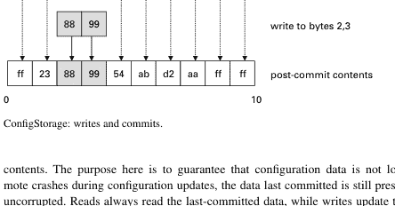

#### 图 6.4 ConfigStorage：写入与提交。

这样做的目的是确保配置数据不会丢失：如果在配置更新过程中节点崩溃，最后提交的数据仍然存在且未损坏。读取操作始终读取最后提交的数据，而写入操作则更新新副本——在成功提交之前，你无法看到已写入的数据。

不过，写入操作仍然是更新操作：如果配置卷包含 10 个字节，且第 2 和第 3 字节通过一次写入被更新，然后该卷被提交，那么新内容为写入前的第 0–1 字节和第 4–9 字节，以及写入的第 2–3 字节，如图 6.4 所示。由于配置卷必须存储多份数据副本以提供可靠性，因此实际可用大小小于在卷文件中为其保留的空间。实际可用大小由 `getSize` 命令返回。

虽然配置卷旨在防止数据丢失，但仍有两种情况可能导致其中不包含有效数据：卷首次创建时³，或者闪存内容被某些外部物理过程损坏（但愿不太可能）。可以使用 `valid` 命令来检查配置卷是否包含有效数据。


综合上述内容，让 `MovingC` 具有永久设置并不困难：在启动时挂载并读取配置卷，收到新设置时将其保存。以下简化摘录展示了基本的启动逻辑，为简洁起见省略了错误检查：

```
uses interface Mount;
uses interface ConfigStorage;
...
settings_t settings;

event void Boot.booted() {
    settings.accelVariance = ACCEL_VARIANCE; // 默认设置
    settings.accelInterval = ACCEL_INTERVAL;
    call Mount.mount();
}
```

> ³ 这实际上是指：当闪存的这一分区首次在该特定节点上使用时——不存在真正类似“格式化”的操作。

```
event void Mount.mountDone(error_t ok) {
    if (call ConfigStorage.valid())
        call ConfigStorage.read(0, &settings, sizeof settings);
    else
        call CommControl.start();
}

event void ConfigStorage.readDone(storage_addr_t addr, void* buf,
    storage_len_t len, error_t error) {
    call CommControl.start();
}
```

### 清单 6.31 防盗系统：在启动时读取设置

当前设置简单地保存为一个模块级变量 `settings_t`：如果卷有效则读取该变量，否则保留默认值。更新设置只需调用 `write` 和 `commit`（同样省略了错误检查）：

```
event void Settings.changed() {
    settings = *call Settings.get();
    call ConfigStorage.write(0, &settings, sizeof settings);
}

event void ConfigStorage.writeDone(storage_addr_t addr, void* buf,
    storage_len_t len, error_t error){
    call ConfigStorage.commit();
}

event void ConfigStorage.commitDone(error_t error) {
    call TheftTimer.startPeriodic(settings.accelInterval);
}
```

### 清单 6.32 防盗系统：保存配置数据

### 6.5.3 块存储与日志存储

块存储（`Block`）和日志存储（`Log`）是用于存储大量数据的两种抽象。日志存储用于记录日志：它提供可靠性（每次写入都是独立的事务），但代价是随机访问受限：写入只能追加，读取只能定位到已记录的位置。块存储是一种较低层的抽象，允许随机读写，但不提供可靠性保证。此外，块存储只允许在两次整卷擦除之间对任意给定字节写入一次。块存储通常用于存储大型项目，例如网络重编程系统 `Deluge` 的程序。在本节中，我们将使用块存储和日志存储来构建 `FlashSampler`，一个两级采样应用。该系统将定期采集加速度计的 `32kB` 样本，

将数据存储在 `Block` 存储卷中。它随后会将此样本的摘要记录到循环日志中。因此，系统将始终具有最新的全保真度测量值，以及若干个保真度降低的旧测量值。

对于用于防盗应用的同一 `mts300` 传感器板的 `micaz`，以下 `volumes` 文件指定了 `FlashSampler` 的日志和块卷——`64 kB` 用于最新样本（`SAMPLES`），其余用于长期日志（`SAMPLELOG`）：

```
<volume_table>
    <volume name="SAMPLES" size="65536"/>
    <volume name="SAMPLELOG" size="458752"/>
</volume_table>
```

与其它存储抽象类似，块存储是通过实例化 `BlockStorageC` 组件并使用其 `BlockRead` 和 `BlockWrite` 接口来访问的，其中使用卷标识符：

```
generic configuration BlockStorageC(volume_id_t void) {
    provides interface BlockWrite;
    provides interface BlockRead;
}
```

`Listing 6.33 BlockStorageC signature`

要采样到闪存，我们使用 `BlockWrite` 接口：

```
interface BlockWrite {
    command error_t write(storage_addr_t addr, void* buf, storage_len_t len);
    event void writeDone(storage_addr_t addr, void* buf, storage_len_t len, error_t error);

    command error_t erase();
    event void eraseDone(error_t error);

    command error_t sync();
    event void syncDone(error_t error);
}
```

`Listing 6.34 The BlockWrite interface`

所有命令都是分阶段的：`erase` 在首次使用前擦除闪存，`write` 写入一些字节，`sync` 确保所有未完成的写入都物理存在于闪存上。

`FlashSampler` 使用 `BlockWrite` 和我们之前看到的 `ReadStream` 采样接口，同时采样并将结果保存到闪存。为此，它需要使用两个缓冲区：当一个缓冲区正在被采样时，另一个缓冲区被写入闪存。因此，最大采样率将同时受传感器最大采样率和闪存最大写入速率的限制。该方案在以下 `AccelSamplerC` 组件中实现，作为 `Sample` 接口提供的分阶段 `sample-to-flash` 命令（未显示）：

```nesc
// in flashSampler.h:

enum {

  SAMPLE_PERIOD = 1000,

  BUFFER_SIZE = 512,       // samples per buffer

  TOTAL_SAMPLES = 32768,   // must be multiple of BUFFER_SIZE

};

module AccelSamplerC

{

  provides interface Sample;

  uses interface ReadStream<uint16_t> as Accel;

  uses interface BlockWrite;

}

implementation

{

  uint16_t buffer1[BUFFER_SIZE], buffer2[BUFFER_SIZE];

  uint8_t nbuffers;  // how many buffers have been filled

  command void Sample.sample() {

    // Sampling requested, start by erasing the block

    call BlockWrite.erase();

  }

  event void BlockWrite.eraseDone(error_t ok) {

    // Block erased. Post both buffers & initiate sampling

    call Accel.postBuffer(buffer1, BUFFER_SIZE);

    call Accel.postBuffer(buffer2, BUFFER_SIZE);

    nbuffers = 0;

    call Accel.read(SAMPLE_PERIOD);

  }

  event void Accel.bufferDone(error_t ok, uint16_t *buf, uint16_t count) {

    // A buffer is full. Write it to the block

    call BlockWrite.write(nbuffers * sizeof *buffer1, buf, sizeof buffer1);

  }

  event void BlockWrite.writeDone(storage_addr_t addr, void *buf,

                                  storage_len_t len, error_t error) {
```


```
    // Buffer written. TOTAL_SAMPLES is multiple of BUFFER_SIZE,

    // once we've posted TOTAL_SAMPLES / BUFFER_SIZE buffers we're done.

    // As we started by posting two buffers, the test below includes a -2

    if (++nbuffers <= TOTAL_SAMPLES / BUFFER_SIZE - 2)

      call Accel.postBuffer(buf, BUFFER_SIZE);

    else if (nbuffers == TOTAL_SAMPLES / BUFFER_SIZE)

      // Once we've written all the buffers, flush writes to the buffer

      call BlockWrite.sync();

  }

}
```

```
event void BlockWrite.syncDone(error_t error) {
  signal Sample.sampled(error);
}
```

```
event void Accel.readDone(error_t ok, uint32_t usActualPeriod) {
  // If we didn't use all buffers something went wrong, e.g., flash writes were
  // too slow, so the buffers did not get reposted in time
  signal Sample.sampled(FAIL);
}
```

#### Listing 6.35 Simultaneously sampling and storing to flash (most error checking omitted)

`FlashSampler` 的第二部分读取采样块，对其进行汇总，并将其写入循环日志。摘要仅为原始样本的 128 倍下采样（通过平均），因此长度为 512 字节。

读取块使用 `BlockRead` 接口完成：

```
interface BlockRead {
  command error_t read(storage_addr_t addr, void* buf, storage_len_t len);
  event void readDone(storage_addr_t addr, void* buf, storage_len_t len,
    error_t error);

  command error_t computeCrc(storage_addr_t addr, storage_len_t len,
    uint16_t crc);
  event void computeCrcDone(storage_addr_t addr, storage_len_t len,
    uint16_t crc, error_t error);

  command storage_len_t getSize();
}
```

#### Listing 6.36 The `BlockRead` interface

它提供分阶段命令用于从块中读取和计算 CRC。日志抽象同时支持循环日志和线性日志，但选择必须在编译时按卷进行：

```
generic configuration LogStorageC(volume_id_t volId, bool circular) {
  provides interface LogWrite;
  provides interface LogRead;
}
```

#### Listing 6.37 `LogStorageC` signature

`LogWrite` 接口提供分阶段的擦除、追加和同步命令，以及获取当前追加偏移量的命令：

```c
interface LogWrite {
    command error_t append(void* buf, storage_len_t len);
    event void appendDone(void* buf, storage_len_t len, bool recordsLost,
                           error_t error);

    command storage_cookie_t currentOffset();

    command error_t erase();
    event void eraseDone(error_t error);

    command error_t sync();
    event void syncDone(error_t error);
}
```

#### Listing 6.38 The `LogWrite` interface

然而，许多模块只需要追加：新日志初始为空，并且日志通常旨在持久化，因此除非程序员控制，否则很少被擦除，这与像块这样的抽象不同，后者在每次使用前经常被擦除。同样，日志只有在数据非常重要且绝对不能丢失时，或者当 mote 即将重启从而丢失任何缓存数据时，才真正需要使用同步。例如，`FlashSampler` 的样本汇总代码仅使用追加：


```c
// in flashsampler.h
enum { SUMMARY_SAMPLES = 256, // total samples in summary
       // downsampling factor: real samples per summary sample
       DFACTOR = TOTAL_SAMPLES / SUMMARY_SAMPLES };

module SummarizerC {
    provides interface Summary;
    uses interface BlockRead;
    uses interface LogWrite;
}
implementation
{
    uint16_t summary[SUMMARY_SAMPLES], samples[DFACTOR];
    uint16_t index; // of next summary sample to compute

    void nextSummarySample();

    command void Summary.summarize() {
        // Summarize the current sample block
        index = 0;

        nextSummarySample();
    }

    void nextSummarySample() {
        // Read DFACTOR samples to compute the next summary sample
        call BlockRead.read(index * DFACTOR * sizeof(uint16_t), samples, sizeof samples);
    }

    event void BlockRead.readDone(storage_addr_t addr, void* buf, storage_len_t len,
                                  error_t error) {
        // Average the DFACTOR samples which will become one summary sample
        uint32_t sum = 0;
        uint16_t i;

        for (i = 0; i < DFACTOR; i++) sum += samples[i];
        summary[index++] = sum / DFACTOR;

        // Move on to the next sample summary, or log the whole summary if we're done
        if (index < SUMMARY_SAMPLES)
            nextSummarySample();
        else
            call LogWrite.append(summary, sizeof summary);
    }

    event void LogWrite.appendDone(void* buf, storage_len_t len, bool recordsLost,
                                   error_t error) {
        // Summary saved!
        signal Summary.summarized(error);
    }

    // Unused split-phase operations
    event void BlockRead.computeCrcDone(storage_addr_t addr, storage_len_t len,
                                        uint16_t crc, error_t error) { }
    event void LogWrite.eraseDone(error_t error) { }
    event void LogWrite.syncDone(error_t error) { }
}
```

Listing 6.39 The `LogWrite` interface

日志使用 `LogRead` 接口的分阶段读取命令按顺序读取：

```c
interface LogRead {
    command error_t read(void* buf, storage_len_t len);
    event void readDone(void* buf, storage_len_t len, error_t error);

    command storage_cookie_t currentOffset();

    command error_t seek(storage_cookie_t offset);
    event void seekDone(error_t error);

    command storage_len_t getSize();
}
```

Listing 6.40 The `LogRead` interface

日志实现保证单个 `LogWrite.append` 操作写入的数据要么完全存在，要么完全不存在，因此我们知道日志中不会包含任何部分汇总。因此，我们例如可以从日志开头以 512 字节块读取（一个汇总的大小），并知道我们读取的是有效的汇总样本。

日志存储还提供有限的寻址支持。`LogRead` 和 `LogWrite` 接口包含以下命令

```c
command storage_cookie_t currentOffset();
```

它返回一个 `cookie`，表示下一个读取或追加将开始的位置。这些 `cookie` 不是日志卷中的偏移量；它们只是包含足够的信息以允许日志存储实现在日志中找到该位置。`LogRead` 的分阶段 `seek` 命令可以寻址到此类 `cookie`。

这将允许例如 `FlashSampler` 应用程序向 PC 报告样本的位置，然后按需重新读取特定样本。

### 6.6 Exercises

1. 通过编写针对你所拥有特定传感器量身定制的防盗检测代码，将防盗应用程序移植到 `micaz` 以外的不同平台。

2. 扩展防盗应用程序，使 mote 能够注意到邻近 mote 发送的盗窃报告并通过闪烁 LED 1 在本地报告。

3. 扩展防盗应用程序，使用户可以在光照水平（`DarkC`）和加速度（`MovingC`）防盗检测方法之间选择，并开关 LED 0 的闪烁。

4. 向 `FlashSampler` 添加代码，通过串行端口将样本和样本汇总传输到 PC。允许用户（重新）请求特定的样本汇总或擦除所有汇总。

## 7 Mote-PC 通信

本章介绍如何构建与 mote 通信的 PC 应用。正如我们在第 6.4 节中所看到的，PC 通常通过串行连接与 mote 网络交互，通过与一个特殊的基站 mote（有时是多个 mote）交换数据包（图 6.2，第 95 页）。本章中的 PC 代码使用 Java 编写，采用随 TinyOS 分发的 Java 库和工具编写。TinyOS 还包含其他语言（例如 C）的库和工具支持。请参阅 TinyOS 文档以获取有关这些其他语言的更多信息。与 mote 通信的 TinyOS Java 代码位于 `net.tinyos` 包下。

### 7.1 基础

在最基本层面上，PC 和 mote 交换的数据包只是字节序列，使用一种受 RFC 1663 [24]启发但不完全相同的协议（有关协议的更多细节可在 TEP 113 [7] 中找到）。这种数据包交换并非完全可靠：数据包的完整性通过 CRC 得到保证，但无效数据包会被直接丢弃。此外：

- 从 PC 发送到 mote 的数据包会被 mote 确认（如果未收到确认则不重试）——这可以防止 PC 用数据包淹没 mote。
- 从 mote 发送到 PC 的数据包不被确认。

虽然可以通过读取和写入数据包中的原始字节来编写 mote 通信代码，但这种方法繁琐且容易出错。此外，任何对数据包布局的更改（例如添加新字段、更改数据包中使用的常量的值）都需要对代码进行相应的更改。

这些问题在 mote 上通过使用 nesC 的外部类型（第 3.5.3 节）来指定数据包布局，以及使用命名常量来指定值来避免。两个工具，`mig` 和 `ncg`，可以让这些数据包布局和常量在 PC 程序中使用：`mig`（“message interface generator”的缩写）生成用于编码和解码字节数组的代码，其布局由 nesC 外部类型指定，而 `ncg`（“nesC constant generator”的缩写）从 nesC 程序中提取命名常量。两个工具都为多种语言生成代码，包括 Java。

#### 7.1.1 串行通信栈


与无线电栈（第 6.3 节）类似，TinyOS 串行栈遵循分层结构（图 6.1，第 89 页）。TinyOS 串行通信栈的最低层在 `TEP 113` 中定义，并处理在不可靠的串行连接上交换数据包。与无线电数据包一样，这些数据包在大多数情况下是“主动消息”数据包。在本章的其余部分，我们将使用 `message` 指代串行 AM 数据包的有效载荷，不同的消息类型由其 AM 类型标识。

串行 AM 数据包的布局使用外部类型定义：

```
typedef nx_struct serial_header {
  nx_uint16_t dest;  /* packet destination */
  nx_uint16_t src;   /* packet sender */
  nx_uint8_t length; /* payload length, in bytes */
  nx_uint8_t group;  /* identifies a specific sensor network */
  nx_uint8_t type;   /* AM type */
} serial_header_t;
```

```
typedef nx_struct serial_packet {
  serial_header_t header;
  nx_uint8_t data[];
} serial_packet_t;
```

列表 7.1 串行 AM 数据包布局

`type` 字段用于分发有效载荷（`data[]`）。串行 AM 数据包没有页脚。`dest`（目标）和 `src`（发送者）字段对于通过串行连接交换的数据包来说并不直接相关，因为发送者和目标通常是隐含的。同样，`group` 也不相关：它用于区分参与不同应用但共享物理连接的不同 mote。这些字段是为了与通过无线电发送的 AM 数据包保持一致而包含的，并在某些基站 mote 应用中使用，而在其他应用中被忽略。例如，在将无线电 AM 数据包转发到/来自 PC（作为串行 AM 数据包）的 `BaseStation` 应用中：

- 从 `BaseStation` 到 PC：`src`、`dest` 和 `group` 与接收到的无线电 AM 数据包中的相同。
- 从 PC 到 `BaseStation`：发送的无线电 AM 数据包将其目标设置为 `dest`，但将其发送者和 `group` 设置为 `BaseStation` mote 的。

有了这些选择，带有 `BaseStation` mote 的 PC 就像带有直接连接的 mote 无线电的 PC 一样工作。

相反，`TestSerial` 应用（TinyOS 标准发行版的一部分）忽略这三个字段。`TestSerial` 是一个用于测试串行连接性的应用：mote 和 PC 只是相互发送包含连续数字的消息。mote 将这些数字的低三位显示在其 LED 上，而 PC 只是打印这些数字。`TestSerial` 使用以下简单的外部类型来

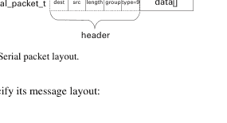

图 7.1 TestSerial 数据包布局。

指定其消息布局：

```
typedef nx_struct test_serial_msg {
  nx_uint16_t counter;
} test_serial_msg_t;
```

清单 7.2 TestSerial 数据包布局

包含 `test_serial_msg_t` 消息的串行 AM 数据包通过 AM 类型字段 9 进行标识。图 7.1 显示了 `serial_packet_t` 与 `test_serial_msg_t` 外部类型之间的最终连接关系（该图未显示最低的数据包交换层，因为该层不使用外部类型进行指定）。

### 7.2 使用 mig

`mig` 工具会生成一个类，用于表示给定的 nesC `nx_struct M` 的值。该类提供读取、写入和报告 `M` 字段属性的方法。对于由 `mig` 生成的 `M` 类，`net.tinyos.message` 包提供了相应的类和方法，使你能够发送和接收有效载荷为 `M` 类型值的串行 AM 数据包。

`Mig` 生成的类使用后备数组（backing array）来表示结构值，该字节数组以与在 mote 上相同的表示形式存储结构值，因此也与 TinyOS 数据包中的表示形式一致。图 7.2 显示了一个典型场景：一个 mote 向 PC 发送串行 AM 数据包。在 mote 上，数据包由指向 `serial_packet_t` 的指针 `x` 表示。`x` 的表示形式与 PC 串行连接上数据包的表示形式相同。在 PC 端，`mig` 生成的类使用包含相同字节的后备数组来表示 `serial_header_t`（串行 AM 数据包头部的外部类型）值。

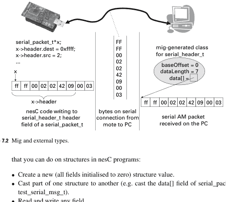

图 7.2 Mig 与外部类型。

`Mig` 生成的类支持 C 结构体的所有特性，包括位域、数组、联合和嵌套结构（也可以将 `mig` 用于常规 C 结构体，但生成的代码是针对特定 mote 的，因为不同 mote 具有不同的字节序和不同的 C 结构体布局规则）。它们允许你执行在 nesC 程序中对结构体所能执行的所有操作（甚至更多）：

- 创建一个新的（所有字段初始化为零）结构值。
- 将某个结构的一部分转换为另一个结构（例如，将 `serial_packet_t` 的 `data[]` 字段转换为 `test_serial_msg_t`）。
- 读取和写入任意字段。
- 获取字段信息：其偏移量、大小、符号性等。
- 获取表示特定结构值的字节数组。

`Mig` 生成的类是 `net.tinyos.message.Message` 的子类，以简化可处理多种消息布局的通用代码编写。`Message` 类的主要公共功能是提供对 `mig` 生成类后备数组的访问。后备数组是 Java `byte[]` 数组的一个切片，由偏移量和长度指定。该数组、偏移量和长度通过以下三个方法返回：

```
public byte[] dataGet();
public int baseOffset();
public int dataLength();
```

清单 7.3 后备数组方法

例如，在图 7.2 中，用于 `serial_header_t` 的 `mig` 生成类从表示整个串行 AM 数据包的 9 字节数组中取从偏移量 0 开始的 7 字节切片。使用 `byte[]` 数组的切片允许 `mig` 生成的类表示存储在另一个 `mig` 生成类中的值，从而支持将一个结构的一部分“转换”为另一个结构。

对于 `test_serial_msg_t`，由 `mig` 生成的 `TestSerialMsg` 类的基本构造函数和方法是：

- `TestSerialMsg()`：创建一个新的（字段初始化为零）`test_serial_msg_t` 值。
- `static int offset_counter()`：返回 `test_serial_msg_t` 结构中 `counter` 字段的偏移量（以字节为单位）。
- `get_counter()`：返回 `counter` 字段的值。
- `set_counter(int value)`：修改 `counter` 字段的值。

#### 7.2.1 发送和接收 mig 生成的数据包

`net.tinyos.message` 包提供了一个名为 `MoteIF`（表示“mote 接口”）的类，使得发送和接收由 `mig` 生成类指定的消息变得简单。

在使用 `MoteIF` 之前，你需要打开与基站 mote 的连接。这通过调用 `net.tinyos.packet.BuildSource.makePhoenix` 方法完成，该方法的参数是数据包源名称。该数据包源名称指定了你如何访问基站 mote（例如，通过串口）以及所有相关参数（例如，设备名称、波特率等）。在本节的其余部分中，我们将使用 `"serial@COM1:telosb"` 作为数据包源，它表示通过串口 `COM1` 以 Telos mote 的正常波特率（115,200 波特）进行串行通信。大多数使用 `MoteIF` 的 Java 程序都会接受一个命令行参数来指定实际的数据包源。第 7.4 节将更详细地讨论数据包源及其动机。

使用 `MoteIF` 和 `mig`，发送 `test_serial_msg_t` 消息的代码非常简单，如下面这段摘自 `TestSerial.java` 文件的简化代码所示。连续数据包的发送使用 `MoteIF` 的 `send` 方法，该方法接受一个 `mig` 生成类的对象作为参数：


```
public class TestSerial ... {
    private MoteIF moteIF;
    ...
    public void sendPackets() {
        int counter = 0;
        // Create uninitialized TestSerialMsg
        TestSerialMsg payload = new TestSerialMsg();
        try {
            while (true) {
                System.out.println("Sending packet," + counter);
                payload.setCounter(counter);
                moteIF.send(0, payload); // send payload to mote
                counter++;
                try {Thread.sleep(1000);}
                catch (InterruptedException exception) {}
            }
        }
```

> 有关生成的构造函数和方法的完整描述，请参阅 `mig` 文档。

```java
catch (IOException exception) {
    System.err.println("Exception thrown when sending packets. Exiting.");
    System.err.println(exception);
}
```

```java
public static void main(String[] args) throws Exception {
    /* Open connection to the mote, and start sending packets */
    PhoenixSource phoenix = BuildSource.makePhoenix("serial@COM1:telosb", null);
    MoteIF mif = new MoteIF(phoenix);
    TestSerial serial = new TestSerial(mif);
    serial.sendPackets();
}
```

#### Listing 7.4 Sending packets with `mig` and `MoteIF`

接收到的包的处理遵循 AM “分发到按消息处理程序” 模型。`registerListener` 方法接受一个 `mig` 生成的类对象 `O` 和一个处理程序作为参数。对象 `O` 指定 AM 类型和布局；处理程序必须实现 `net.tinyos.messages.MessageListener` 接口：

```java
public interface MessageListener {
    public void messageReceived(int to, Message m);
}
```

#### Listing 7.5 Interface for handling received packets

当处理程序被调用时，会传入来自接收包的目的地址，而 `m` 是包含接收包负载的 `O` 的克隆。

对 `TestSerial.java` 的 resulting 增加仅仅是声明一个 `messageReceived` 方法，并在 `TestSerial` 的构造函数中将其注册为 `test_serial_msg_t` 的处理程序：

```java
public class TestSerial implements MessageListener {
    public TestSerial(MoteIF moteIF) {
        this.moteIF = moteIF;
        // Register this class as a handler for test_serial_msg_t AM packets
        this.moteIF.registerListener(new TestSerialMsg(), this);
    }

    public void messageReceived(int to, Message message) {
        // The actual type of 'message' is 'TestSerialMsg'
        TestSerialMsg msg = (TestSerialMsg)message;
        System.out.println("Received packet sequence number:" + msg.get_counter());
    }
}
```

#### Listing 7.6 Receiving packets with `mig` and `MoteIF`

请注意，`messageReceived` 方法是在 `MoteIF` 私有的线程中调用的。你的方法必须确保对共享数据的任何访问都与程序的其余部分适当同步。

消息发送和接收都需要知道用于标识特定消息的 AM 类型——发送需要设置 AM 类型字段（`serial_packet_t` 中的 `type`），接收需要知道哪些消息对应于哪个 AM 类型，以便正确分发包。为支持此功能，`mig` 生成的类包含一个 AM 类型字段，可通过 `AMType` 和 `typeSet` 方法访问。当 `mig` 为结构 `X` 生成消息类时，它会查找名为 `AM_X` 的枚举常量来设置 `amType` 的默认值。例如，`nx_struct test_serial_msg` 的默认 AM 类型是 `AM_TEST_SERIAL_MSG` 的值（在 `TestSerial.h` 中定义）。

当源代码中没有此类常量，或当消息使用多个 AM 类型时，你必须在使用 `send` 或 `registerListener` 方法之前通过 `typeSet` 方法设置正确的 AM 类型。

### 7.3 Using `ncg`

`ncg` 工具从 nesC 程序或 C 头文件中提取枚举常量，并生成包含具有相同名称和值的常量的 Java（或其他语言）文件。这避免了在两个地方指定相同的常量（这始终是一个维护问题），例如当你的包使用“魔术”值来表示命令、指定数组大小等时。

例如，考虑 TinyOS 示波器演示应用程序，其中每个 mote 定期报告传感器读数组。Oscilloscope 有一个头文件（`Oscilloscope.h`）定义了其消息和相关常量：

```c
enum {
    NREADINGS = 10,   /* Number of readings per message. */
    DEFAULT_INTERVAL = 256, /* Default sampling period. */
    AM_OSCILLOSCOPE = 0x93
};

typedef nx_struct oscilloscope {
    nx_uint16_t version;    /* Version of the interval. */
    nx_uint16_t interval;   /* Sampling period. */
    nx_uint16_t id;         /* Mote id of sending mote. */
    nx_uint16_t count;      /* Readings start at count*NREADINGS */
    nx_uint16_t readings[NREADINGS];
} oscilloscope_t;
```

#### Listing 7.7 Constants and packet layout for Oscilloscope application

Oscilloscope 的 Java GUI 为每个 mote 显示传感器读数的图表。为了知道读数编号（即读数在图表 X 轴上的位置），它需要知道 `count` 字段的值和 `NREADINGS` 常量的值。它因此使用 `mig` 生成的类来解码接收到的 `oscilloscope_t` 消息，并使用 `ncg` 来提取 `NREADINGS` 值：

```
public class Constants {
    public static final byte NREADINGS = 10;
    ...
}
```

#### 清单 7.8 由 `ncg` 生成的类

`oscilloscope_t` 消息的处理程序现在可以从接收到的消息中获取 `readings` 数组，并将其值存储在 Java 数据数组中，偏移量为 `count * NREADINGS`：


```java
public void messageReceived(int to, Message msg) {
    OscilloscopeMsg omsg = (OscilloscopeMsg)msg;
    int start = omsg.get_count() * Constants.NREADINGS;
    // get_readings returns a Java array with elements corresponding to
    // the values in the nesC array
    int readings[] = omsg.get_readings();
    for (int i = 0; i < readings.length; i++)
        data[start + i] = readings[i];
}
```

清单 7.9 保存接收样本的简化代码

`ncg` 的实现依赖于以特殊模式运行 `nesC` 编译器，因此能够提取由表达式定义的枚举常量以及 `nesC` 的特殊 `unique` 和 `uniqueCount` 函数的使用值（参见第 9.1 章），而不仅仅是简单常量。然而，作为结果，`ncg` 也有两个限制：

- 它无法提取 `#define` 常量的值，因为这些是由 C 预处理器处理的，对 `ncg` 不可见。
- 如果传递给 `ncg` 的头文件或 `nesC` 程序有编译错误，则 `ncg` 不会产生任何输出。

### 7.4 数据包源

Java mote 接口使用数据包源来抽象与 mote 通信的不同方式。这些包括：

- 直接串行连接
- 远程（通过以太网）串行连接
- 与模拟 mote 的连接
- 通过串行转发器的连接，允许多个程序与同一 mote 通信

数据包源的形式为 `connection@arguments`，其中 `connection` 是一个指定连接类型的单词（`serial` 用于直接串行连接，`sf` 用于串行转发器等），而 `arguments` 是连接所需的参数（例如 `serial@COM1:115200` 中的串行端口设备名称和波特率）。执行

```
java net.tinyos.packet.BuildSource
```

会打印所有数据包源及其参数的摘要。如上所述，大多数 Java 程序都有某种指定应用于连接基站 mote 的数据包源的方法，例如环境变量（通常为 `MOTECOM`）、命令行参数或 GUI 中的字段。

其中一个更重要的数据包源是串行转发器。串行转发器是一个 Java 程序³，它连接到一个 mote 并将数据包转发给其（多个）客户端和来自客户端。这些客户端通过 TCP/IP 连接到串行转发器。使用串行转发器有多个目的：

- 允许远程访问基站 mote，以便例如 GUI 可以从远程位置访问传感器网络。
- 允许常规应用程序和调试系统同时与同一基站 mote 通信。例如，通常很有用的是简单地显示从 mote 接收到的所有数据包（使用 `net.tinyos.tools.Listen` Java 程序），而无需更改代码。
- 将应用程序拆分为多个独立的部分，每个部分都可以与 mote 通信。例如，`TestSerial.java` 应用程序可以拆分为单独的接收和发送应用程序，它们将通过串行转发器独立地与 mote 通信。

### 7.5 示例：简单可靠传输

正如我们在本章开头所看到的，基本 mote-PC 通信基础设施是不可靠的：数据包会被检查完整性，但在失败时没有重传。在本节中，我们展示如何构建一个简单可靠且可重用的消息传输层，并使用它构建 `TestSerial` 应用程序的可靠版本。本节的重点是展示如何在 Java 中构建通用、可重用的 mote 通信层。

该简单可靠传输协议的代码可以在 TinyOS 的贡献代码目录（第 1.5 节）的“ TinyOS Programming”部分中找到，名称为 `ReliableSerial`。该目录包含该协议的 Java（`ReliableMoteIF` 类）和 `nesC`（`ReliableSerialC` 组件）实现，以及 `ReliableTestSerial`，即基于 `ReliableSerialC` 构建的 `nesC` `TestSerial` 应用程序版本。

#### 7.5.1 可靠传输协议

可靠的消息传输协议非常简单。消息在发送时带有“cookie”（每次传输都会改变），并在超时后重复发送，直到收到带有相同 cookie 的确认。传输不会重叠：`message2` 的传输在 `message1` 得到确认之前不会开始。

在接收端，重复消息（通过相同的 cookie 检测到）在传递给上层之前会被抑制。然而，即使是重复的消息也会被确认，因为之前的确认可能丢失了。

具体来说，该协议使用两种数据包：消息传输数据包（`reliable_msg_t`）和确认数据包（`ack_msg_t`）。这些数据包在图 7.3 中显示，同时还显示了 `ReliableTestSerial` 应用传输的 `TestSerial` 消息。

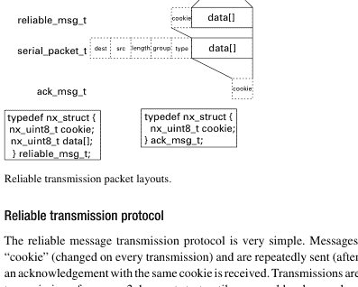

图 7.3 可靠传输数据包布局。

#### 7.5.2 Java 中的可靠传输

`ReliableMoteIF` 类包含简单可靠消息传输协议的 Java 实现。它使用 `mig` 生成 `AckMsg` 和 `ReliableMsg`，以便分别构建和解码 `ack_msg_t` 和 `reliable_msg_t` 数据包。`ReliableMoteIF` 使用 `nec` 访问 `nesC` 实现中指定的重传超时（`ACK_MSG_TIMEOUT`）（`ReliableSerialC` 组件）。

该类实现了一个通用可重用层，因此应该能够传输和接收布局由 `mig` 生成的类指定的任意消息。因此，其接口与 `MoteIF` 非常相似，我们只需让它成为 `MoteIF` 的子类。我们首先展示发送端：

```
import net.tinyos.packet.*;
import net.tinyos.message.*;
import java.io.*;
```


#### Listing 7.10 Java 中的可靠传输协议 - 传输

`send` 方法是同步的，以强制执行在发送下一条消息之前必须先确认一条消息的规则。

此代码依赖于 `ackMsgReceived` 处理程序在与 `send` 不同的线程中执行这一事实。发送消息后，`send` 线程会休眠 `ACK_MSG_TIMEOUT` 毫秒。当收到确认时，`ackMsgReceived` 会将 cookie 与正在传输的消息的 cookie 进行比较。如果相等，则将 `acked` 设置为 `true` 并唤醒 `send` 线程。如果在 `ACK_MSG_TIMEOUT` 毫秒内未收到确认，`send` 将重新发送消息并再次等待。注意，当 `send` 未在等待时收到的确认实际上会被忽略，正如它们应该的那样。

传输成功后，`send` 会选择一个新的 cookie——我们将旧值乘以三，只是为了明确这些 cookie 不是序列号。

将用户消息嵌入到 `reliable_msg_t` 数据包中只是简单地使用 `System.arraycopy` 在用户消息和 `reliable_msg_t` 的 mig 生成类的支持数组之间复制数据。还要注意 mig 生成的 `offset_data` 方法如何用于查找 `reliable_msg_t` 中的有效载荷偏移量（参见 `offsetUserData` 常量）。此代码与 `MoteIF` 将用户消息嵌入到串行数据包中的代码非常相似。

可靠接收是通过重写 `MoteIF.registerListener` 实现的。需要注意的是，我们的可靠传输协议只知道一种消息类型（它没有相当于 AM 的 type 字段的字段），因此你实际上只能为一种消息类型注册一个监听器：

```
class ReliableMoteIF extends MoteIF {
    /* Build an object for performing reliable transmission via `base` */
    public ReliableMoteIF(PhoenixSource base) {
        super(base);
        /* Register handler (`ackMsgReceived` method below) for receiving acks */
        super.registerListener(
            (new AckMsg(), new MessageListener() {
                public void messageReceived(int to, Message m) {
                    ackMsgReceived((AckMsg)m);
                }
            })
        );
    }

    /* Send side */
    /* --------- */
    private Object ackLock = new Object(); /* For synchronization with ack handler */
    private short sendCookie = 1; /* Next cookie to use in transmission */
    private boolean acked; /* Set by ack handler when ack received */
    private final static int offsetUserData = ReliableMsg.offset_data();

    /* Send message `m` reliably with destination `to` */
    public void send(int to, Message m) throws IOException {
        synchronized (ackLock) {
            /* Build a reliable_msg_t packet with the current cookie and the payload in m,
             * total packet size is m.dataLength() + offsetUserData */
            ReliableMsg rmsg = new ReliableMsg(m.dataLength() + offsetUserData);
            rmsg.set_cookie(sendCookie);
            System.arraycopy(m.dataGet(), m.baseOffset(),
                             rmsg.dataGet(), offsetUserData,
                             m.dataLength());

            /* Repeatedly transmit `rmsg` until the ack handler tells us an ack is received. */
            acked = false;
            for (;;) {
                super.send(to, rmsg);
                try {
                    ackLock.wait(RelConstants.ACK_TIMEOUT);
                }
                catch (InterruptedException e) {
                    if (acked)
                        break;
                    System.err.printf("retry\n");
                }
            }

            /* Pick a new cookie for the next transmission */
            sendCookie = (short)((sendCookie + 3) & 0xff);
        }
    }
}
```

```
/* Handler for ack messages. If we see an ack for the current transmission,
 * notify the 'send' method. */
void ackMsgReceived(AckMsg m) {
    synchronized (ackLock) {
        if (m.get_cookie() == sendCookie) {
            acked = true;
            ackLock.notify();
        }
    }
}

... receive side ...
}
```

```
class ReliableMoteIF extends MoteIF {
    ...
    /* Receive side */
    /* ---------- */
    private Message template;
    private MessageListener listener;
```

/* Build a reliable receive handler for 'template' messages */

public void registerListener(Message m, MessageListener l) {

    template = m;

    listener = l;

    /* Register handler (reliableMsgReceived method below) for receiving

     * reliable_msg_t messages */

    super.registerListener

    (new ReliableMsg(),

     new MessageListener() {

        public void messageReceived(int to, Message m) {

            reliableMsgReceived(to, (ReliableMsg)m);

        }

    });

}

private short recvCookie; /* Cookie of last received message */

void reliableMsgReceived(int to, ReliableMsg rmsg) {

    /* Acknowledge all received messages */

    AckMsg ack = new AckMsg();


```java
ack.set_cookie(rmsg.get_cookie());

try {
    super.send(MoteIF.TOS_BCAST_ADDR, ack);
}
catch (IOException e) {
    /* The sender will retry and we'll re-ack if the send failed */
}

/* Don't notify user of duplicate messages */
if (rmsg.get_cookie() != recvCookie) {
    recvCookie = rmsg.get_cookie();
    /* Extract payload from 'rmsg' and copy it into a copy of 'template'.
     * The payload is all the data in 'rmsg' from 'offsetUserData' on */
    Message userMsg = template.clone(rmsg.dataLength() - offsetUserData);
    System.arraycopy(rmsg.dataGet(), rmsg.baseOffset() + offsetUserData,
                     userMsg.dataGet(), 0,
                     rmsg.dataLength() - offsetUserData);
    listener.messageReceived(to, userMsg);
}
```

#### Listing 7.11 Reliable transmission protocol in Java - transmission

可靠消息接收部分的协议实现很直接：它只是对所有接收到的消息进行确认，并忽略具有相同 `cookie` 的连续消息。

其主要复杂性在于从接收到的 `reliable_msg_t` 数据包中提取有效载荷并构建一个遵循用户模板对象的消息。这一任务是通过使用 `Message` 的 `clone(n)` 方法来完成的，该方法会创建一个具有新支持数组的消息副本。然后，只需将接收到的 `reliable_msg_t` 数据包支持数组的有效载荷部分的数据复制到这个新的支持数组中。再次强调，这段代码与 `MoteIF` 中用于从接收到的串行数据包中提取有效载荷的代码非常相似。

### 7.5.3 Reimplementing TestSerial

由于 `ReliableMoteIF` 是 `MoteIF` 的子类，将 `TestSerial` 的 Java 代码切换到使用新的可靠传输层非常简单。我们只需要在 `main` 中构造一个 `ReliableMoteIF` 对象：

```java
public static void main(String[] args) throws Exception {
  /* Open connection to the mote, and start sending packets */
  PhoenixSource phoenix = BuildSource.makePhoenix("serial@COM1:telosb", null);
  MoteIF mif = new ReliableMoteIF(phoenix);
  TestSerial serial = new TestSerial(mif);
  serial.sendPackets();
}
```

Listing 7.12 A reliable TestSerial.java

### 7.6 Exercises

- 1. `ReliableMoteIF` 并不是 `MoteIF` 的合适替代品，因为我们的可靠传输协议仅支持单一消息类型。用 AM 类型分发字段扩展 `reliable_msg_t`、`ReliableMoteIF` 以及 `ReliableSerialC`（nesC 可靠协议实现）。
- 2. 实现一个简单的 PC 应用程序，与第 6.6.4 节中的 `AntiTheft` 基站 `mote` 通信，以打印盗窃报告并允许用户更改防盗检测设置。
- 3. 通过允许多个未被确认的待处理数据包，例如使用窗口协议，来提高可靠传输协议的性能。

## Part III

## Advanced programming

## 8 Advanced components

第 3 章以足以构建应用程序的详细程度介绍了组件。本章介绍了比实现服务通常所需的更高级的组件主题，例如编写通用组件和使用参数化接口。

### 8.1 Generic components review

通用组件（在第 3.3.4 节中介绍）通过代码复制机制提供代码重用：通用组件的每个实例本质上都是一个具有参数值已替换的新（非通用）组件。例如，实例化 `BitVectorC`

```nesc
generic module BitVectorC(uint16_t maxBits) {
  provides interface Init;
  provides interface BitVector;
}
implementation {
  uint8_t bits[(maxBits + 7) / 8];
  ...
}
```

```nesc
with
configuration MyAppC { }
implementation {
  components new BitVectorC(77) as MyVector, MyAppP;
  MyAppP.BitVector -> MyVector;
}
```

等效于创建 `BitVectorC.nc` 的一个副本，其中 `maxBits=77`：

```nesc
module MyVector {
  provides interface Init;
  provides interface BitVector;
}
implementation {
    uint8_t bits[(77 + 7) / 8];
    ...
}
```

通用组件采用代码复制方法有两个原因：简单性和类型。如果通用模块不采用代码复制方法，那么将只有一个适用于组件所有实例的代码副本。当通用组件可以接受类型作为参数时，这会变得困难，因为分配大小、偏移量和其他考虑因素可能使真正单一的副本不可行。即使是非类型参数也可能产生此类问题，因为它们可用于指定数组大小、`switch` `case` 值等。出于类似原因，C++ 模板会为每组不同的模板参数创建一份代码副本。

最后，即使在实例之间共享代码是可能的，也需要在所有函数中添加一个参数，类似于面向对象语言中的 `this` 指针。该参数将指示正在执行的实例。此外，所有变量访问都必须从该指针偏移。在本质上，函数的执行时间和成本可能会显著改变（偏移而非常量访问）。为了提供简单、易于理解且运行时间高效的组件，nesC 采用代码复制方法，牺牲了可能的代码大小减少。

代码复制同样适用于配置和模块。复制一个模块会将可执行代码和变量复制到最终应用程序中。复制一个配置会复制组件和布线语句，可能导致进一步的组件实例化：

```nesc
generic configuration DoubleBitVectorC(uint16_t maxBits) {
    provides interface Init;
    provides interface BitVector as Bits1;
    provides interface BitVector as Bits2;
}
implementation {
    components new BitVector(maxBits) as BV1;
    components new BitVector(maxBits) as BV2;

    Init = BV1; // Calling Init.init initializes
    Init = BV2; // both bitvectors
    Bits1 = BV1;
    Bits2 = BV2;
}
```

Listing 8.1 Instantiation within a generic configuration

实例化 `DoubleBitVectorC` 将创建并布线两个位向量。简而言之，通用模块定义了一段可重复的执行逻辑，而通用配置定义了组件之间可重复的组合模式。正如第 9 章将展示的那样，通用配置可以非常强大，并且通常是服务实现中最复杂的部分。


与标准组件不同，泛型只能由实例化它们的配置命名。例如，在 `MyAppC` 的情况下，没有其他组件可以布线到它实例化的 `BitVectorC`。泛型对 `MyAppC` 是私有的。使其可访问的唯一方法是通过布线其接口——在 `MyAppC` 的情况下，位向量仅对 `MyAppP` 可访问。使一个实例普遍可用的方法之一是创建一个单例配置并导出必要的接口。例如，假设你需要一个位向量来跟踪 37 个系统服务中的哪些正在运行或未运行。你希望许多组件能够访问此向量，但 `BitVectorC` 是一个泛型。因此你编写如下组件：

```
configuration SystemServiceVectorC {
  provides interface BitVector;
}
implementation {
  components MainC, new BitVectorC(37);
  MainC.SoftwareInit -> BitVectorC;
  BitVector = BitVectorC;
}
```

Listing 8.2 The fictional component SystemServiceVectorC

现在许多组件可以引用这个特定的位向量。`SystemServiceVectorC`本可以导出 `BitVectorC.Init` 而不是将其布线到 `MainC`，但那样只是要求在其他地方执行此布线。虽然你可以通过在一个配置中实例化它来将泛型制作成单例，但反之则不成立：组件要么可实例化，要么不可实例化。

### 8.2 Writing generic modules

如上例所示，通用模块（配置）的正文只是一个可以使用泛型的参数作为类型、常量等的模块（配置）。另一个例子是队列实现，`QueueC`：

```
generic module QueueC(typedef queue_t, uint8_t queueSize) {
  provides interface Queue<queue_t>;
}
implementation {
  queue_t queue[queueSize];
  uint8_t head = 0, tail = 0, size = 0;

  command queue_t Queue.head() {
    return queue[head];
  }
  ...
```

Listing 8.3 QueueC excerpt

`QueueC` 将 `queue_t` 用作常规 C 类型，像声明数组（`queue`）一样声明，并返回一个 `queue_t` 值（`Queue.head`）。`queueSize` 参数的行为类似于 C 常量，因此可用于确定队列数组的大小。

#### 8.2.1 类型参数

与 C++ 模板不同，泛型组件在声明时就会进行类型检查。默认情况下，对类型参数允许的唯一操作是声明变量和复制值。例如，你可以执行

```
queue_t x, y;
x = y;
```

但不能执行

```
queue_t x, y;
x = y + 1;
```

因为如果例如 `queue_t` 是一个 C 结构体，nesC 将不知道这是什么意思。

然而，某些组件的类型参数仅在作为某种整数（有符号 8 位整数、无符号 32 位整数等）时才有意义。对于这些情况，泛型组件类型参数可以后缀为 `@integer()`，以允许对该类型的值使用整数运算。例如，这个 `ConstantSensorC` 组件是返回常量值的 `Read` 的泛型实现：

```
generic module ConstantSensorC(typedef width_t @integer(), uint32_t val) {
  provides interface Read<width_t>;
}
implementation
{
  task void senseResult() {
    signal Read.readDone(SUCCESS, (width_t)val);
  }

  command error_t Read.read() {
    return post senseResult();
  }
}
```

清单 8.4 一个泛型常量传感器

`ConstantSensorC` 的 `Read` 接口返回的值的类型是 `width_t`，而返回的常量是整数 `val`。`@integer()` 是必要的，以使 `senseResult` 中的强制转换为 `width_t` 合法：像 `val` 这样的整数值可以强制转换为任何整数类型，但不能强制转换为某些未知类型。¹

¹ 请注意，从源代码中删除强制转换不会改变任何内容，因为在将 `val` 传递给 `Read.readDone` 时会隐含强制转换，其第二个参数的类型为 `width_t`。

#### 8.2 编写泛型模块

`ConstantSensorC` 的实例化必须为 `width_t` 使用整数类型：

```
components new ConstantSensorC(uint16_t, 23) as C1; // legal
components new ConstantSensorC(struct X, 39) as C2; // compile-time error
```

还有一个 `@number()` 后缀，它将类型参数限制为整数或浮点类型，并将操作限制为对所有此类类型合法的操作。`@integer()` 和 `@number()` 后缀是 nesC 属性的其它示例，我们在 `combine` 函数的声明中（第 4.4.3 节）看到过这些属性，并在第 8.4 节中会更详细地介绍。

#### 8.2.2 作为泛型的抽象数据类型

TinyOS 中的抽象数据类型（ADT）通常以两种方式之一表示：作为泛型模块或通过具有按引用参数的命令的接口。使用模块时，ADT 状态存储在模块变量中，并通过提供的接口的命令访问。例如，许多 TinyOS 组件通过 `Queue` typed 接口访问队列：

```
interface Queue<t> {
  command bool empty();
  command uint8_t size();
  command uint8_t maxSize();
  command t head();
  command t dequeue();
  command error_t enqueue(t newVal);
  command t element(uint8_t idx);
}
```

清单 8.5 Queue 接口（重复）

`Queue` ADT 实现 `QueueC` 将队列类型和大小作为参数接收：

```
generic module QueueC(typedef queue_t, uint8_t queueSize) {
  provides interface Queue<queue_t>;
}
implementation {
  queue_t queue[queueSize];
  uint8_t head = 0, tail = 0, size = 0;

  command bool Queue.empty() {
    return size == 0;
  }

  command uint8_t Queue.size() {
    return size;
  }
}
```

```
command uint8_t Queue.maxSize() {
    return queueSize;
}

command queue_t Queue.head() {
    return queue[head];
}

command queue_t Queue.dequeue() {
    queue_t t = call Queue.head();
    if (!call Queue.empty()) {
        if (++head == queueSize) head = 0;
        size--;
    }
    return t;
}

command error_t Queue.enqueue(queue_t newVal) {
    if (call Queue.size() < call Queue.maxSize()) {
        queue[tail++] = newVal;
        if (tail == queueSize) tail = 0;
        size++;
        return SUCCESS;
    } else {
        return FAIL;
    }
}

command queue_t Queue.element(uint8_t idx) {
    idx += head;
    if (idx >= queueSize) idx -= queueSize;
    return queue[idx];
}
```

清单 8.6 QueueC 实现


当多个组件共享一个 ADT 时，可能会出现一致性问题。一般来说，抽象数据类型实现的命令即使有多个客户端也应表现正确。然而，由客户端来处理跨多个调用的一致性问题：如果客户端 A 在两个不同的任务中调用 `Queue.size`，而客户端 B 调用 `Queue.enqueue`，那么客户端 A 可能得到不同的大小，具体取决于调用的顺序。对于可以从异步代码中使用的抽象数据类型，例如 `BitVectorC`，这些问题会更复杂——有关此主题的更多讨论请参见第 11 章。

## 8.2.3 TinyOS 1.x 中的 ADT

TinyOS 1.x 仅使用第二种方法，即具有按引用参数的接口，因为它没有泛型模块。例如，Maté 虚拟机支持具有类型化变量的脚本语言，并提供功能用于

虽然这种方法可行，但它有些痛苦且会导致大量重复代码。每个实例都需要有自己的实现。也就是说，即使它们几乎完全相同，也会有 100 个不同的 `startPeriodic` 函数。另一种方法可以是在 `Timer` 接口中添加一个调用参数来指定正在更改的是哪个计时器，有点像 POSIX 文件系统调用中的文件描述符。在这种情况下，`HilTimerMilliC` 会如下所示

```
configuration HilTimerMilliC {
  provides interface Timer;
}
```

Listing 8.9 Timers with a single interface

使用计时器的组件将有某种方式生成唯一的计时器标识符，并在每次调用中传递它们：

```
call Timer.startPeriodic(timerDescriptor, 1024); // Fire at 1Hz
```

虽然这种方法可行——它不会导致多个实现——但传递该参数通常是不必要的，因为组件通常会分配一定数量的计时器，然后只使用这些计时器。也就是说，组件使用的计时器集合——以及集合的大小——通常在编译时就已知。因此，要求调用者在运行时传递参数是不必要的，并且可能引入错误（例如，如果传递了错误的描述符）。

在组件想要提供大量接口的其他情况下，例如通信，也会出现类似情况。主动消息有一个 8 位类型字段，本质上是一个协议标识符（第 6.3 节）。在互联网中，IP 的有效协议标识符是明确规定的。² 并且许多 TCP 端口号已得到广泛认可。当节点接收到协议标识符为 6 的 IP 数据包时，它知道这是一个 TCP 数据包并将其分派给 TCP 栈。主动消息需要执行类似的功能，尽管没有 IANA 的标准化：网络协议需要能够注册以发送和接收某些 AM 类型。与计时器一样，对于基本接口，有两种方法：代码冗余或运行时参数。也就是说，要处理 AM 类型 15，你可以让数据包层提供 256 个命名 `Send` 接口：

```
components NetworkProtocolP, PacketLayerC;
NetworkProtocolP.Send -> PacketLayerC.Send15;
```

其中一个的代码文本读作“Timer4”。管理命名空间的一种方法是让组件保持计时器未连接，然后期望应用程序解决所有这些计时器。但这给应用程序开发者带来了很大的负担。例如，一个建立在大量大型库之上的小型应用程序可能必须连接八个不同的计时器。此外，这种方法会导致系统组件不是自包含的、可工作的抽象：它们仍有应用程序开发者需要解决的剩余依赖。

第二种方法（传递额外参数）乍一看优于第一种方法，但事实证明它在 nesC 的组件模型上下文中存在更严重的问题。首先，在许多情况下，标识符在编译时已知。要求调用者将其作为运行时参数传递是不必要的，并且是错误可能的来源。其次，更重要的是，它将标识符管理推给了调用者。例如，再回到计时器：

```
call Timer.startPeriodic(timerDescriptor, 1024); // Fire at 1Hz
```

从调用组件的角度来看，它并不关心使用的是哪个计时器。它只关心它拥有自己的计时器。使标识符成为调用的一部分会迫使模块知道（并管理）标识符名称。然而，第三个也是最大的问题，并不是关于对其他组件的调用，而是关于来自其他组件的调用。在 `Timer` 中，例如，计时器服务如何向正确的组件发出 `fired()` 事件？由于标识符是运行时参数，唯一的方法是让 `Timer.fired()` 向所有计时器扇出，并让它们全部检查标识符。

### 8.3.1 Parameterized interfaces and configurations

为了支持提供接口集合的抽象，nesC 具有参数化接口。参数化接口本质上是一个接口数组，数组索引就是参数。例如，这是 `HiTimerMilliC` 的签名：

```
configuration HiTimerMilliC {
  provides interface Init;
  provides interface Timer<TMilli> as TimerMilli[uint8_t num];
  provides interface LocalTime<TMilli>;
}
```

Listing 8.10 HiTimerMilliC signature

`HiTimerMilliC` 是一个特定于平台的配置，提供毫秒级精度的计时器栈。通过提供 256 个单独的 `Timer` 实例，`HiTimerMilliC` 可以支持多达 256 个独立计时器。在一个接口实例上调用 `Timer.startPeriodic` 将导致该实例发出 `Timer.fired` 事件。通常，组件不会直接连接到 `HiTimerMilliC`。相反，它们使用 `TimerMilliC`，它提供了一个更简单的接口（参见第 6.1 节）。

Packet communication is another example use of parameterized interfaces. `ActiveMessageC` is a platform-specific configuration for single-hop packet communication:

```
configuration ActiveMessageC {
  provides {
    interface Init;
    interface SplitControl;

    interface AMSend[am_id_t id];
    interface Receive[uint8_t id];
    interface Receive as Sno op[uint8_t id];

    interface Packet;
    interface AMPacket;
    interface PacketAcknowledgements;
  }
}
```

Listing 8.11 ActiveMessageC signature

`AMSend`, `Receive`, and `Snoop` are all parameterized interfaces. Their parameter is the AM type of the message (the protocol identifier). Normally, components don’t wire directly to `ActiveMessageC`. Instead, they use `AMSenderC`, `AMReceiverC`, which present a simpler interface (see Section 6.3). However, some test applications for the basic AM abstraction, such as `TestAM`, use `ActiveMessageC` directly. The module `TestAMC` sends and receives packets:

```
module TestAMC {
  uses {
    ...
    interface Receive;
    interface AMSend;
    ...
  }
}
```

Listing 8.12 Signature of TestAMC

`TestAMAppC` is the configuration that wires up the `TestAMC` module:

```
configuration TestAMAppC { }
implementation {
  components MainC, TestAMC as App;
  components ActiveMessageC;
}
```

```
MainC.SoftwareInit -> ActiveMessageC;
App.Receive -> ActiveMessageC.Receive[240];
App.AMSend -> ActiveMessageC.AMSend[240];
...
```

Listing 8.13 Wiring TestAMC to ActiveMessageC


Note that `TestAM` has to wire `SoftwareInit` to `ActiveMessageC` because it doesn’t use the standard abstractions, which auto-wire it. This configuration means that when `TestAMC` calls `AMSend.send`, it calls `ActiveMessageC.AMSend` number 240, so sends packets with protocol identifier 240. Similarly, `TestAMC` receives packets with protocol identifier 240. Because these constants are specified in the configuration, they are not bound in the module: from the module’s perspective, they don’t even exist. That is, from `TestAMC`’s perspective, these two lines of code are identical:

```
TestAMC.AMSend -> ActiveMessageC.AMSend[240]; // Not real TinyOS code
TestAMC.AMSend -> ActiveMessageC.AMSend[240];
```

The difference lies in the component with the parameterized interface. The parameter is essentially another argument in functions of that interface. In `ActiveMessageC.AMSend`, for example, the parameter is an argument passed to it in calls to `send()` and which it must pass in signals of `sendDone()`. But the parameterized interface gives you two key things. First, it automatically fills in this parameter when `TestAMC` calls `send` (`nesC` generates a stub function to do so, and inlining makes the cost negligible). Second, it automatically dispatches on the parameter when `ActiveMessageC` signals `sendDone` (`nesC` generates a switch table based on the identifier).

### 8.3.2 Parameterized interfaces and modules

In reality, `ActiveMessageC` is a configuration that encapsulates a particular chip’s radio stack, and that stack may itself be a configuration. For instance, for the `CC2420` radio, `ActiveMessageC` encapsulates the `CC2420ActiveMessageC` configuration, which itself encapsulates the `CC2420ActiveMessageP` module:

```
module CC2420ActiveMessageP {
  provides {
    interface AMSend[am_id_t id];
    ...
  }
}
```

Listing 8.14 A possible module underneath `ActiveMessageC`

Within `CC2420ActiveMessageP`, this is what the parameterized interface looks like:

```
command error_t AMSend.send[am_id_t id](am_addr_t addr, message_t* msg, uint8_t len) {
  cc2420_header_t* header = getHeader(msg);
  header->type = id;
  ...
}
```

Listing 8.15 Parameterized interface syntax

The interface parameter precedes the function argument list, and the implementation can treat it like any other argument. Basically, it is a function argument that the `nesC` compiler fills in when components are composed. When `CC2420ActiveMessageP` wants to signal `sendDone`, it pulls the protocol identifier back out of the packet and uses that as the interface parameter:

```
event void SubSend.sendDone(message_t* msg, error_t result) {
  signal AMSend.sendDone[call AMPacket.type(msg)](msg, result);
}
```

Listing 8.16 Dispatching on a parameterized interface

If the `AM` type of the packet is 240, then the dispatch code `nesC` generates will cause this line of code to signal the `sendDone` wired to `ActiveMessageC`’s `AMSend[240]` interface, which in this case is ultimately wired to `TestAMC`’s `AMSend.sendDone`. `CC2420ActiveMessagePReceive` looks similar to `sendDone`. The `AM` implementation receives a packet from a lower-level component and dispatches on the `AM` type to deliver it to the correct component. Depending on whether the packet is destined to the local node, it signals either `Receive.receive` or `Snoop.receive`:

```
event message_t* SubReceive.receive(message_t* msg, void* payload, uint8_t len) {
  if (call AMPacket.isForMe(msg)) {
    return signal Receive.receive[call AMPacket.type(msg)](msg, payload, len - CC2420_SIZE);
  } else {
    return signal SnooP.receive[call AMPacket.type(msg)](msg, payload, len - CC2420_SIZE);
  }
}
```

Listing 8.17 How active message implementations decide on whether to signal to Receive or Snoop


The subtraction of `CC2420_SIZE` is because the lower layer has reported the entire size of the packet, while to layers above `AM` the size of the packet is only the data payload (the entire size minus the size of headers and footers, that is, `CC2420_SIZE`). Parameterized interfaces get the best of both worlds. Unlike the name-based approach (e.g. `Send240`) described above, there is a single implementation of the call. Additionally,

由于参数是一个值，与名称不同，它可以被配置和设置。例如，一个组件可以这样做：

```nesC

#ifdef ROUTING_TYPE

#define ROUTING_TYPE 201

#endif

RouterP.AMSend -> PacketSenderC.AMSend[ROUTING_TYPE];

```

清单 8.18 定义一个参数

将常量推入 wiring 可以避免使用运行时参数的陷阱。因为常量是在编译时设置的，所以 nesC 可以自动填入它并基于它进行分发，从而简化代码并提高传出函数调用的效率。请注意，你也可以连接整个参数化接口：

```nesC

configuration CC2420ActiveMessageC {

  provides interface AMSend[am_id_t id];

}

{ ... }

configuration ActiveMessageC {

  provides interface AMSend[am_id_t id];

}

implementation {

  components CC2420ActiveMessageC;

  AMSend = CC2420ActiveMessageC;

}

```

清单 8.19 连接完整的参数化接口集

**编程提示 18** 当你需要区分调用者或拥有编译时常量参数时，使用参数化接口。

### 8.3.3 默认值

由于模块的调用点是在配置中解析的，nesC 中常见的编译错误是忘记连接某些东西。这在 C 中相当于忘记在链接路径中包含库，在 Java 中则是包含 jar。通常，悬空的连接代表程序中的错误。使用参数化接口时，情况却并非如此。

以 `ActiveMessageC` 的 `Receive` 接口为例。大多数应用程序接收几种 AM 类型，最多可能 15 种：它们不会响应或使用所有开发过的协议。然而，在 `CC2420ActiveMessageP` 中有如下调用：

```nesC

return signal Receive.receive[call AMPacket.type(msg)]

(msg, payload, len - CC2420_SIZE);

```

一方面，如果网络中的所有节点都运行相同的可执行文件，那么它们可能永远不会发送 AM 类型为 144 的数据包。然而，如果附近有其他节点，或者数据包损坏但仍通过 CRC 检查（这种情况很少见，但确实会发生），那么一个不关心协议 144 的节点很可能接收到该类型的数据包。因此 nesC 希望接收事件有一个处理器：当这种情况发生时，它需要执行一个函数。但应用程序没有连接到 `Receive[144]`，并且要求开发者连接所有未连接的实例是不合理的，尤其是它们都是空函数（对于 `Receive.receive` 来说，处理器只是返回传递给它的包）。

为避免此问题，nesC 提供了默认处理器。默认处理器是当没有实现被连接时使用的函数的实现。如果组件连接到接口，则使用该实现。否则，调用（或信号）会转到默认处理器。例如，`CC2420ActiveMessageP` 有以下默认处理器：

```nesC

default event message_t* Receive.receive[am_id_t id](message_t* msg, void* p, uint8_t len) {
  return msg;
}

default event message_t* Snoop.receive[am_id_t id](message_t* msg, void* p, uint8_t len) {
  return msg;
}

default event void AMSend.sendDone[uint8_t id](message_t* msg, error_t err) {
  return;
}

```

清单 8.20 活动消息实现中的默认事件

在 `TestAM` 应用程序中，`TestAMAppC` 将 `TestAMC` 连接到 `ActiveMessageC.Receive[240]`。因此，在 Telos 或 micaz 平台上，当无线电接收到 AM 类型为 240 的数据包时，它会向 `TestAMC` 的 `Receive.receive` 发出信号。由于应用程序不使用任何其他协议，当它接收到任何其他类型的活动消息时，它会向 `CC2420ActiveMessageP` 的默认处理器发出信号。

默认处理器可能很危险，因为它们绕过了组件接口是否已连接的编译时检查。粗心使用它们会导致代码工作不正常。例如，虽然 `CC2420ActiveMessageP` 为 `Send.sendDone` 提供了默认处理器，但 `TestAMC` 并没有为 `Send.send` 提供默认处理器。否则，你可能会忘记连接 `TestAMC.Send`，程序仍然可以正常编译，但永远不会发送数据包。默认值只应在接口对于组件的正确执行不是必需时使用。这几乎总是涉及参数化接口，因为很少会使用所有参数值。

### 8.4 属性

属性是与程序语句关联元数据的一种方式。nesC 属性基于 Java 注解的做法 [第 9 章]。完整细节是

超出本书范围，但值得介绍最常见的属性以及它们的使用方式。nesC 属性看起来像 Java 注解。一个属性声明是一个结构体声明，其名称前面加上 `@`。因此属性可以有字段，并且可以被初始化。我们已经见过三个属性，`@integer`、`@number` 和 `@combine`。例如，我们在第 4.4.3 节中看到的 combine 属性接受一个字符串作为参数，其行为就好像它是由以下方式声明的一样：

```nesC

struct @combine {
  char *function_name;
};

```

```nesC
// Using the combine attribute in a type definition
typedef uint8_t error_t @combine('ecombine');
```

`error_t` 的声明被字符串 `"ecombine"` 注释，指定了 `error_t` 的 combine 函数的名称。圆括号中的参数实际上使用了与属性结构体定义的标准 C 初始化器相同的语法，只是去掉了 `{}`。

用户自定义属性可以附加到 nesC 程序中的大多数名称上（组件、接口、typedef、变量、函数等）：

```nesC

struct @atleastonce { };

configuration LedsC {
  provides interface Init @atleastonce();
  provides interface Leds;
}

```

#### Listing 8.21 nesC attributes

此示例展示了 `atleastonce` 属性的声明，它没有字段。配置 `LedsC` 用该属性注释了其 `Init` 接口。默认情况下，`@atleastonce` 属性什么也不做。但 nesC 编译器具有输出应用程序信息的工具，其中包括属性。默认的 TinyOS 编译过程的一部分包括运行一个检查布线约束的脚本，其中 `atleastonce` 就是其中之一（其他还有 `atomstonce`、`exactlyonce`）。该工具检查用 `atleastonce` 注释的接口是否至少被布线一次。对于 `Init` 之类的情况，这种检查的实用性非常明显：你可以在编译时检查组件是否正在被初始化。

属性提供了一种在不引入可能破坏旧代码的新关键字的情况下扩展 nesC 语言的方法。当前常见的属性有：

- `@spontaneous`：此函数可能从 nesC 程序外部被调用，因此不应被 nesC 的死代码消除所剪除。此属性对于中断处理程序以及当你想要链接二进制文件时是必需的（例如使用 `TOSSIM`）。

- `@C`：此函数应被视为 C 而非 nesC 函数。具体来说，如果组件定义了带有此属性的函数，则它不会对组件私有。此属性在 C 代码需要调用 nesC 代码时是必需的（例如在 `TOSSIM` 中）。

- `@hwevent`：此函数将作为硬件中断的结果被调用。隐含 `spontaneous`。


- `@atomic_hwevent`：此函数将作为硬件中断的结果被调用，并且将在原子区段中执行。隐含 `spontaneous`。此属性与 `@hwevent` 之间的区别是必要的，以便 `nesC` 知道是否需要额外的原子区段。

- `@atmostonce`：此接口必须布线零次或一次。

- `@atleastonce`：此接口必须布线一次或多次。

- `@exactlyonce`：此接口必须布线一次，不多不少。

- `@integer`：此泛型组件的类型参数必须是整数。此属性允许泛型组件对该类型使用整数运算（算术、移位、位运算），这对于诸如缩放定时器之类的操作很重要。

- `@number`：此泛型组件的类型参数必须是整数或浮点类型。此属性允许泛型组件对该类型使用算术运算。

- `@combine`：此属性用于在类型声明时指定类型的 `combine` 函数。它接受一个参数，即 `combine` 函数名称的字符串。

`nesC` 的早期版本使用 `gcc` 的属性语法来指定这些属性，但现在已弃用。你可能仍会在一些旧代码中看到它，例如在 `TinyOS 1.x` 中：

```
module RealMain { ... }
implementation {
  int main() __attribute__ ((C, spontaneous)) {
  ...
```

³ `combine` 已内置于 `nesC` 编译器中。

### 8.5 Exercises

- 1. 标准 `QueueC` 实现使用数组来存储队列。编写一个使用链表的替代实现。列表的最大大小应作为泛型组件构造函数的参数。

- 2. 扩展你的链表以提供一个额外的接口 `List`，该接口允许在列表的任意位置进行插入、删除和查看。

- 3. 编写一个栈数据结构组件，该组件以最大栈深度和数据类型作为参数。

- 4. 在 `AM` 之上编写一个额外的分发层，该层通过添加一个字节的头部为单个 `AM` id 提供参数化接口。

## 9 高级连接

第 4 章介绍了 `nesC` 组件连接的基础，解释了三种连接运算符以及多重连接的工作方式。第 8 章介绍了参数化接口，它使单个组件实现能够高效地为多个客户端提供接口。大部分最复杂的 `nesC` 编程都涉及使用参数化接口。本章重点介绍通用配置，以及它们如何利用参数化接口提供健壮且灵活的抽象。

### 9.1 unique() 和 uniqueCount()

参数化接口最初旨在支持类似主动消息的抽象。然而事实证明，它们的威力远不止于此。如果你查看大多数基本 `TinyOS 2.0` 抽象的结构，其中总会有一个参数化接口。能够在模块外部指定编译时常量，结合分发机制，意味着我们可以使用参数化接口来区分许多不同的调用者。组件可以通过参数化接口提供服务，而每个需要使用该服务的客户端都可以连接到不同的参数标识符。对于分阶段调用而言，这意味着可以避免在完成事件上进行扇出。请考虑以下两个示例：

```
components RouterC, SourceAC, SourceBC;
SourceAC.Send -> RouterC;
SourceBC.Send -> RouterC;
```

对比

```
components RouterC, SourceAC, SourceBC;
SourceAC.Send -> RouterC.Send[0];
SourceBC.Send -> RouterC.Send[1];
```

在这两种情况下，`SourceAC` 和 `SourceBC` 都可以调用 `Send.send`。在第一种情况下，当 `RouterC` 触发 `Send.sendDone` 时，该信号会扇出到 `SourceAC` 和 `SourceBC`，两者都必须通过检查消息指针或内部状态变量来判断事件是否针对自己。在第二种情况下，如果 `RouterC` 保留对 `Send` 的调用中传入的参数标识符，那么它就可以触发适当的完成事件。例如，`SourceBC` 调用 `Send.send`，`RouterC` 存储标识符 `1`，并在触发 `sendDone` 时在 `Send.sendDone[1](...)` 上触发。

参数化接口与通用配置的结合使 `TinyOS 2.0` 能够在编译时虚拟化抽象，仅使用所需的内存量且不使用函数指针。让我们回到计时器示例，在该示例中这种抽象尤其强大。计时器组件 `HiiTimerMilliC` 具有以下签名：

```
configuration HiiTimerMilliC {
  provides interface Timer<TMilli>[uint8_t];
}
```

清单 9.1 `HiiTimerMilliC` 签名部分

由于 `Timer` 是参数化的，许多不同的组件可以连接到独立的接口实例。当组件调用 `Timer.startPeriodic` 时，`nesC` 会填充参数标识符，计时器实现可以利用它来跟踪哪个计时器被指示启动。同样，计时器实现可以在特定的计时器实例上触发 `Timer.fired`。

对于网络协议等事物而言，接口的参数是通信和互操作性的基础，因此实际使用的参数很重要。例如，如果你对同一应用程序进行了两次不同的编译，但其中一个将协议连接为

```
RouterC.Send -> ActiveMessageC.Send[210];
```

而另一个将协议连接为

```
RouterC.Send -> ActiveMessageC.Send[211];
```

那么它们将无法通信。在这些情况下，使用的是跨节点共享的参数，因此需要全局一致。同样，如果有两个协议连接到相同的 `AM` 类型，那么这是一个基本冲突，应用程序开发人员必须解决。一般来说，协议使用命名常量（枚举）来避免此类笔误。

#### 9.1.1 unique

然而对于计时器和上面的 `Send` 客户端示例，则没有此类限制。参数代表唯一的客户端标识符，而不是共享数据的一部分。客户端并不关心它连接到哪个计时器，只要它连接到一个没有其他人使用的计时器即可。对于这种情况，而不是强迫客户端猜测标识符并希望没有冲突，`nesC` 提供了一个特殊的编译时函数 `unique()`。

它是一个编译时函数，因为它在编译时解析。当 `nesC` 编译应用程序时，它会用一个整数替换对 `unique()` 的每次调用。`unique` 函数接受一个字符串键作为参数，并承诺使用相同键的每个函数实例都将返回一个唯一值。对 `unique` 的两次调用使用不同的

`keys can return the same value. So if two components, AppOneC and AppTwoC, both want timers, they could do this`

```
AppOneC.Timer -> HilTimerMilliC.Timer[unique("Timer")];
AppTwoC.Timer -> HilTimerMilliC.Timer[unique("Timer")];
```

`and be assured that they will have distinct timer instances.¹ If there are n calls to unique, then the unique values will be in the range of 0, 1, …, n − 1.`

#### 9.1.2 uniqueCount

In these examples – `Timer` and `Send` – there is an additional factor to consider: each client requires the component to store some amount of state. For example, `RouterC` has to keep track of pending messages, and timer systems have to keep track of the period of each timer, how long until it fires, and whether it’s active. Because the calls to `unique` define the set of valid client identifiers, `nesC` has a second compile-time function, `uniqueCount()`. This function also takes a string key. If there are `n` calls to `unique` with a given key (returning values `0, 1, …, n − 1`), then `uniqueCount` returns `n`. Like `unique`, `uniqueCount` is resolved at compile-time so can be used, e.g. to set array sizes.


Being able to count the number of unique clients allows a component to allocate the right amount of state to support them. Early versions of nesC didn’t have the `uniqueCount` function: components were forced to allocate a fixed amount of state. If there were more clients than the state could support, one or more would fail at run-time. If there were fewer clients than the state could support, then there was wasted RAM. Because a component can count the number of clients and know the set of client identifiers that will be used, it can promise that each client will be able to work and use the minimum amount of RAM needed. Returning to the timer example from above:

```
AppOneC.Timer -> HilTimerMilliC.Timer[unique("Timer")];
AppTwoC.Timer -> HilTimerMilliC.Timer[unique("Timer")];
```

and `HilTimerMilliC` could allocate state for each client:

```
timer_t timers[uniqueCount("Timer")];
```

Assuming the above two were the only timers, then `HilTimerMilliC` would allocate two timer structures. If we assume that `AppOneC.Timer` was assigned identifier `0` and `AppTwoC.Timer` was assigned identifier `1`, then `HilTimerMilliC` can directly use the parameter as an index into the state array.

### 9.1.3 Example: HilTimerMilliC and VirtualizeTimerC

This isn’t how `HilTimerMilliC` works: it’s actually a bit more complicated, as it is a configuration built out of a set of generic components (see Section 9.3). As hardware platforms differ in their timer hardware support, `HilTimerMilliC` is a platform-specific

> ¹ In practice, clients rarely call `unique()` directly. Instead, these calls are encapsulated inside generic configurations, as we will see below. One common problem with `unique()` encountered in TinyOS 1.x is that a mistyped key will generate a non-unique value and possibly cause very strange behavior.

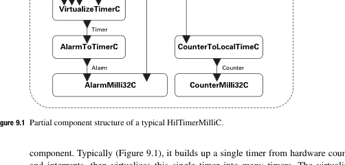

#### Figure 9.1 Partial component structure of a typical HilTimerMilliC.

component. Typically (Figure 9.1), it builds up a single timer from hardware counters and interrupts, then virtualizes this single timer into many timers. The virtualizing component, `VirtualizeTimerC`, stores state for each of the timers it provides, and schedules the single timer it uses to fire when the next provider needs to fire. `VirtualizeTimerC` is a generic module:

```
generic module VirtualizeTimerC(typedef precision_tag, int max_timers) {
  provides interface Timer<precision_tag> as Timer[uint8_t num];
  uses interface Timer<precision_tag> as TimerFrom;
}
```

#### Listing 9.2 VirtualizeTimerC

`HilTimerMilliC` must pass the number of timers in the system, obtained using `uniqueCount()`, to the new `VirtualizeTimerC` instance:

```
configuration HilTimerMilliC {
  provides interface Init;
  provides interface Timer<TMilli> as TimerMilli[uint8_t num];
  provides interface LocalTime<TMilli>;
}
implementation {
  enum {
    TIMER_COUNT = uniqueCount(UQ_TIMER_MILLI)
  };
  components new VirtualizeTimerC(TMilli, TIMER_COUNT);
  TimerMilli = VirtualizeTimerC.x
  // More code for wiring VirtualizeTimerC.TimerFrom
}
```

#### Listing 9.3 Instantiating VirtualizeTimerC

与其直接将字符串传递给 `uniqueCount()`，`HilTimerMilliC` 传递的是 `UQ_TIMER_MILLI`，它是一个 `#define`（来自 `Timer.h`），定义为字符串 `"HilTimerMilliC.Timer"`。这是在 TinyOS 中常见的做法。使用 `#define` 可以更难遇到因字符串错误而导致的 bug：很可能在 `#define` 的使用中出现拼写错误会成为编译时错误。对于依赖唯一字符串的组件来说，这通常是一种良好的实践。

#### 编程提示 19 如果一个组件依赖于唯一性，则在头文件中 `#DEFINE` 使用的字符串，以防止因字符串拼写错误而导致的 bug。

`VirtualizeTimerC` 随后分配一个定时器状态结构数组，其大小由其 `max_timers` 参数决定：

```
enum {
    NUM_TIMERS = max_timers,
    END_OF_LIST = 255,
};
typedef struct {
    // details elided
} Timer_t;

Timer_t m_timers[NUM_TIMERS];
```

清单 9.4 VirtualizeTimerC 状态分配

当客户端通过 `HilTimerMilliC` 调用 `VirtualizeTimerC` 的 `Timer` 接口时，参数指示哪个客户端正在发起调用。`VirtualizeTimerC` 使用客户端 ID 作为状态数组的索引。例如：

```
void startTimer(uint8_t num, uint32_t t0, uint32_t dt, bool isoneshot) {
    Timer_t* timer = &m_timers[num];
    // update timer structure
}
```


```
command void Timer.startPeriodic[uint8_t num](uint32_t dt) {
    startTimer(num, call TimerFrom.getNow(), dt, FALSE);
}
```

这种软件结构假设每个需要定时器的组件都通过对 `unique` 的调用，使用 `UQ_TIMER_MILLI` 作为键，连接到 `HilTimerMilliC` 的参数化 `TimerMilli`：

```
SomeComponentC.Timer -> HilTimerMilliC.TimerMilli[unique(UQ_TIMER_MILLI)];
```

要求程序员知道服务的键是成问题的且容易出错。虽然与实际字符串相比，`#define` 用于键可以减少编程错误，但程序员很容易意外使用错误的键，尤其是在应用程序使用许多服务时。找到此类 bug 是噩梦。这本质上是代码重复的问题：尽管每个 `Timer` 用户都希望以相同的方式连接，但每个人都必须重复特定的代码序列。通用配置解决了这个问题：在实践中，服务不需要用户连接到参数化接口。

### 9.2 通用配置

通用模块是一种重用代码并将通用抽象分离为经过充分测试的构建块的方法（例如，只需要一个 FIFO 队列实现）。`nesC` 也有通用配置，它们是构建 `TinyOS` 抽象和服务的非常强大的工具。然而，就像配置对于新手程序员来说比模块更难理解一样，通用配置比通用模块更具挑战性。

描述通用配置在软件设计中可以发挥什么作用的最佳方式是从第一性原理开始。

模块是包含可执行代码的组件；配置定义组件之间的关系以形成更高级别的抽象；通用模块是可重用的可执行代码片段；因此，通用配置是形成更高级别抽象的可重用关系集。

本书中的几个示例提到了并描述了 `HilTimerMilliC`。但如果你查看 `TinyOS` 代码，只有一种组件引用它。尽管它是一个非常重要的组件，但程序从不直接命名它。它是定时器服务的核心部分，但需要定时器的应用程序会实例化一个名为 `TimerMilliC` 的通用组件。

在深入研究通用配置之前，让我们考虑一下没有它们时代码是什么样的。假设我们有 `HilTimerMilliC`，而且没有其他东西。许多组件需要定时器；`HilTimerMilliC` 通过其参数化接口实现这一点。请记住 `HilTimerMilliC` 封装了 `VirtualizeTimerC` 的一个实例，其大小参数是对 `unique(UQ_TIMER_MILLI)` 的调用。这意味着如果一个组件 `AppP` 需要一个定时器，那么其配置 `AppC` 必须这样连接它：

```
enum {
  TIMER_KEY = unique(UQ_TIMER_MILLI)
};
AppP.Timer -> HilTimerMilliC.TimerMilli[TIMER_KEY];
```

顺便提一下，这段代码（以及 `HilTimerMilliC` 的早期定义）利用了配置的主体可以包含类型和常量声明这一事实，其作用域延伸到配置实现部分的末尾。为唯一值提供像 `TIMER_KEY` 这样的名称是使用此功能最常见的方式之一。

#### 9.2.1 TimerMilliC

`TimerMilliC` 是 `TinyOS` 的标准毫秒定时器抽象，旨在简化对 `TinyOS` 虚拟化定时器服务 `HilTimerMilliC` 的使用。`TimerMilliC` 是一个通用配置，提供单个 `Timer` 接口。其实现将此接口连接到底层参数化 `Timer` 接口的实例，使用

正确的唯一键。这意味着 `unique()` 只在一个文件中被调用；只要所有组件都使用 `TimerMilliC` 分配定时器，就不会发生键匹配错误。`TimerMilliC` 的实现非常简单：

```
generic configuration TimerMilliC() {
  provides interface Timer<TMilli>;
}
implementation {
  components TimerMilliP;
  Timer = TimerMilliP.TimerMilli[unique(UQ_TIMER_MILLI)];
}
```

清单 9.5 `TimerMilliC` 通用配置

`TimerMilliP` 是一个单例配置，它将 `HiiTimerMilliC` 自动连接到启动序列，并导出 `HiiTimerMilliC` 的参数化接口：

```
configuration TimerMilliP {
  provides interface Timer<TMilli> as TimerMilli[uint8_t id];
}
implementation {
  components HiiTimerMilliC, MainC;
  MainC.SoftwareInit -> HiiTimerMilliC;
  TimerMilli = HiiTimerMilliC;
}
```

清单 9.6 `TimerMilliP` 将 `HiiTimerMilliC` 自动连接到 `Main.SoftwareInit`

`TimerMilliC` 封装了一种接线模式——通过调用 `unique` 连接到定时器服务——供其他组件使用。当一个组件实例化 `TimerMilliC` 时，它会创建一份 `TimerMilliC` 代码的副本，其中包含对 `unique(UQ_TIMER_MILLI)` 的调用。以下代码：

```
components X, new TimerMilliC();
X.Timer -> TimerMilliC;
```

本质上等同于：

```
components X, TimerMilliP;
X.Timer -> TimerMilliP.TimerMilli[unique(UQ_TIMER_MILLI)];
```

让我们逐步了解一个创建定时器的应用程序的完整接线路径。`BlinkAppC` 将 `BlinkC` 模块连接到它的三个定时器：

```
configuration BlinkAppC()
implementation {
  components MainC, BlinkC, LedsC;
  components new TimerMilliC() as Timer0;
  components new TimerMilliC() as Timer1;
  components new TimerMilliC() as Timer2;

BlinkC -> MainC.Boot;
MainC.SoftwareInit -> LedsC;

BlinkC.Timer0 -> Timer0;
BlinkC.Timer1 -> Timer1;
BlinkC.Timer2 -> Timer2;
BlinkC.Leds -> LedsC;
}
```

清单 9.7 `Blink` 应用程序

`HiiTimerMilliC` 配置将其 `Timer` 接口连接到 `VirtualizeTimerC` 定时器虚拟化组件（见第 9.1.3 节）。因此，将 `BlinkC.Timer0` 连接到 `Timer0` 就建立了如下接线链：

```
BlinkC.Timer0 -> Timer0.Timer
enum { K = unique (UQ_TIMER_MILLI) };
Timer0.Timer = TimerMilliP.TimerMilli[K]
TimerMilliP.TimerMilli[K] = HiiTimerMilliC[K]
HiiTimerMilliC[K] = VirtualizeTimerC.Timer[K]
```

清单 9.8 `Blink` 中完整的模块到模块接线链（`BlinkC` 到 `VirtualizeTimerC`）

`BlinkC` 和 `VirtualizeTimerC` 是两个模块；中间的组件都是配置。当 `nesC` 编译这段代码时，所有中间层都将被剥离，`BlinkC.Timer0.start` 将成为对 `VirtualizeTimerC.Timer[...].start` 的直接函数调用。

`TinyOS` 的许多基本服务都使用这种模式：通用配置为参数化接口管理一个键空间（一组标识符，见第 10.3 节）。有时映射比 `TimerMilliC` 更复杂，正如我们下面描述 `BlockStorageC`（`TinyOS` 的非易失性存储抽象之一）时会看到的那样。

#### 9.2.2 CC2420SpiC

另一个使用通用配置的更复杂示例是 `CC2420SpiC`。该组件提供通过 `SPI` 总线访问 `CC2420` 无线电的功能。当无线电协议栈软件想要与无线电交互时，它会调用该组件实例上的方法。例如，如果信道空闲，让 `CC2420` 发送数据包涉及到写入无线电的一个寄存器（`TXONCCA`）。为了写入该寄存器，协议栈通过总线发送一小串字节，这些字节基本上表示“我正在向寄存器号 X 写入值 Y”。总线的高速意味着诸如此类的小操作可以同步完成，而不会产生任何显著的并发问题。


除了小的寄存器读写之外，该芯片还支持访问接收和发送缓冲区（它们是 128 字节的内存区域），以及无线电的配置存储器，后者存储诸如加密密钥和本地地址（用于确定是否发送确认）等信息。这些操作可能需要一些时间，因此是分阶段的。例如，在协议栈写入 `TXONCCA` 发送数据包之前，它必须首先使用 `CC2420Fifo` 接口对数据包内容执行一次分阶段写入（接收和发送缓冲区是 FIFO 存储器）。

所有操作归结为四个接口：

- `CC2420Strobe`：访问命令寄存器。写入命令寄存器会告诉无线电采取某个动作，例如发送数据包、清除其数据包缓冲区或切换到发送模式。该接口有一个单一命令 `strobe`，用于写入寄存器。
- `CC2420Register`：访问数据寄存器。这些寄存器既可读也可写，存储硬件配置、寻址模式和空闲信道评估阈值等信息。该接口支持单阶段的读写操作。
- `CC2420Ram`：访问配置存储器。该接口支持读写操作，均为分阶段操作。
- `CC2420Fifo`：访问接收和发送 FIFO 内存缓冲区。该接口支持读写操作，均为分阶段操作。虽然可以写入接收缓冲区，但 `CC2420` 仅出于调试目的支持此操作。

需要与 `CC2420` 交互的组件会实例化一个 `CC2420SpiC` 实例：

```
generic configuration CC2420SpiC() {

    provides interface Resource;

    provides interface CC2420Strobe as SPLUSHRX;
    provides interface CC2420Strobe as SPLUSHTX;
    provides interface CC2420Strobe as SNOP;
    provides interface CC2420Strobe as SRXON;
    provides interface CC2420Strobe as SRXFOPF;
    provides interface CC2420Strobe as STXON;
    provides interface CC2420Strobe as STXONCCA;
    provides interface CC2420Strobe as SXOSCON;
    provides interface CC2420Strobe as SXOSCOFF;

    provides interface CC2420Register as FSCTRL;
    provides interface CC2420Register as IOCFG0;
    provides interface CC2420Register as IOCFG1;
    provides interface CC2420Register as MDCTRL0;
    provides interface CC2420Register as MDCTRL1;
    provides interface CC2420Register as TXCTRL;

    provides interface CC2420Ram as IBEEREADR;
    provides interface CC2420Ram as PANID;
```

```
provides interface CC2420Ram as SHORTADR;
provides interface CC2420Ram as TXFIFO_RAM;

provides interface CC2420Fifo as RXFIFO;
provides interface CC2420Fifo as TXFIFO;
}
```

#### Listing 9.9 CC2420SpiC

`CC2420SpiC` 将 SPI 协议的实现（`CC2420SpiP`）与平台的原始 SPI 实现连接起来。原始 SPI 实现有两个接口：`SpiByte`，用于将字节作为单阶段操作写入；`SpiPacket`，用于将一系列字节作为分阶段操作写入。SPI 协议是双向的。要从芯片读取字节，栈必须在总线上写入。芯片也会在总线上写入，但其时钟由 CPU 的写入驱动。因此写操作接收一个 `uint8_t` 作为要写入的字节，并返回一个表示回复的 `uint8_t` 字节。

协议实现采用了一种有趣的方法来实现简单实现的同时也能在编译时发现连接错误。虽然 `CC2420SpiC` 为每个寄存器提供单独的接口，但可执行逻辑（`CC2420SpiP`）提供了一个参数化接口：

```
configuration CC2420SpiP {
provides interface CC2420Fifo as Fifo[ uint8_t id ];
provides interface CC2420Ram as Ram[ uint16_t id ];
provides interface CC2420Register as Reg[ uint8_t id ];
provides interface CC2420Strobe as Strobe[ uint8_t id ];
}
```

#### Listing 9.10 CC2420SpiP

每个 `CC2420` 寄存器都有一个唯一的标识符，即一个小的整数。为每个寄存器操作分别实现会浪费代码空间，而且代码重复很容易引入错误。因此 `CC2420SpiP` 只有一个实现，它接收一个编译时参数，即寄存器标识符。然而，并非所有 `uint8_t` 值都是有效寄存器，因此允许组件直接连接到参数化接口可能会导致无效连接。当然，`CC2420SpiP` 可以加入一些运行时检查以确保寄存器值有效，但这会浪费 CPU 周期，尤其是在参数本应始终有效的情况下。因此 `CC2420SpiC` 将有效参数的子集映射到接口实例。它只映射子集，因为有一些调试寄存器栈不需要使用。实现如下所示：

```
configuration CC2420SpiC { ... }
implementation {
...
components CC2420SpiP as Spi;
```

```
SPLUSHRX = Spi.Strobe[CC2420_SPLUSHRX];
SPLUSHTX = Spi.Strobe[CC2420_SPLUSHTX];
SNOP = Spi.Strobe[CC2420_SN OP];
SRXON = Spi.Strobe[CC2420_SRXON];
SRXOFF = Spi.Strobe[CC2420_SRXOFF];
STXON = Spi.Strobe[CC2420_STXON];
STXONCCA = Spi.Strobe[CC2420_STXONCCA];
SXOSCON = Spi.Strobe[CC2420_SXOSCON];
SXOSCOFF = Spi.Strobe[CC2420_SXOSCOFF];
}
```

#### Listing 9.11 CC2420SpiC mappings to CC2420SpiP

这种方法兼顾了两者优点；写入 strobe 寄存器的函数只有一个，它接收要写入的寄存器作为参数，且参数无需运行时检查。然而，调用方不必提供此标识符，因此不可能意外指定无效标识符。连接到 `CC2420SpiC` 的组件只能连接到有效的 strobe 寄存器，而不是执行

```
call CC2420Spi.strobe(CC2420_STXONCCA);
```

它们写成

```
call TXONCCA.strobe();
```

让我们在函数层面看看这意味着什么。如上所述，每个连接到 `CC2420SpiC` 实例上 `TXONCCA` 的组件都连接到 `Spi.Strobe[CC2420_TXONCCA]`。此连接终止于 `CC2420SpiP` 模块：

```
async command cc2420_status_t Strobe.strobe(uint8_t addr []) {
  return call SpiByte.write(addr);
}
```

#### Listing 9.12 The strobe implementation

它向总线写入一个字节并返回状态结果。逐层分析，

- 1. 一个组件（例如 `CC2420TransmitP`）在 `CC2420SpiC` 的实例上调用 `TXONCCA.strobe()`
- 2. nesC 连接将此调用转换为 `CC2420SpiP.Spi.Strobe[CC2420_TXONCCA].strobe()`。

经过优化和内联后，原语句 `call TXONCCA.strobe()` 有效地变为

```
call SpiByte.write(CC2420_TXONCCA);
```

可能进一步优化到 SPI 层（它可能只是将 `SpiByte.write` 内联到函数中，从而消除对函数调用的任何需求）。


如果一个函数有一个参数，该参数是少数常量之一，请考虑将其定义为几个独立的函数以防止错误。如果接口的函数都有一个参数，在大范围内几乎总是常量，请考虑使用参数化接口来节省代码空间。如果接口的函数都有一个参数，该参数是在大范围内但只有某些有效值的常量，请将其实现为参数化接口，但作为单独的接口公开，以同时最小化代码大小并防止错误。

### 9.2.3 AMSenderC

`HilTimerMilliC` 虚拟化了一个硬件定时器，并通过参数化接口提供独立的实例。因此 `TimerMilliC` 相对简单：它真正做的只是封装一个使用 `unique()` 的连接，以防止客户端冲突并简化连接。

主动消息略有不同。基本平台提供的活动消息组件 `ActiveMessageC` 提供了参数化为 AM 标识符的 `AMSend`。然而，`ActiveMessageC` 在任何时候只能有一个待处理的包。如果它正在发送一个包并且组件调用 `AMSend.send`，`ActiveMessageC` 会返回 `FAIL` 或 `EBUSY`。从调用者的角度来看，这有点麻烦。如果它想发送该包，它必须等待无线电空闲，但没有非常简单的方法来确定何时发生这种情况。

`TinyOS` 1.x 有一个全局的（非参数化）`sendDone` 事件，无线电会在完成发送任何包时发出信号。这样，如果组件尝试发送并收到 `FAIL`，它可以在处理全局 `sendDone` 事件时尝试重新发送。这在很大程度上是可行的，除了如果多个组件连接到 `sendDone`，那么扇出决定了发送请求的优先级。例如，如果一个占用资源的组件处理 `sendDone` 并且恰好在扇出中排在第一位，它将始终是第一个调用 `Send.send` 的组件并垄断无线电。

`TinyOS` 2.0 通过 `AMSenderC` 组件解决了这个问题，`AMSenderC` 是一个通用配置。`AMSenderC` 是一个虚拟化抽象：`AMSenderC` 的每个实例都像 `ActiveMessageC` 一样。也就是说，每个 `AMSenderC` 可以处理一个传出包。这意味着连接到 `AMSenderC` 的每个组件都可以独立于其他组件运行，而不必担心扇出调度。`ActiveMessageC` 的一深队列被 N 个一深队列取代，每个客户端一个。

每个 `AMSenderC` 的一深队列是不够的。还有发送者以什么顺序发送其数据包的问题。在幕后，活动消息层所做的是维护一个包含 N 个待处理包的数组，其中 N 是 `AMSenderC` 组件的数量。每个 `AMSenderC` 是活动消息发送抽象的客户端，因此具有可索引到该数组的客户端标识符。实现会跟踪上次能够发送数据包的客户端，并确保其他所有等待的客户端在该客户端再次发送之前都有机会（这被称为轮询调度）。

实现这一点比 `TimerMilliC` 稍微棘手一些，因为发送请求有几个参数。对于 Timer，这些参数（周期、单次还是重复）是定时器实现首先需要跟踪的状态。对于 `AMSendC`，情况有点不同：这些参数只需在调用底层的 `ActiveMessageC` 之前存储即可。发送队列可以只存储所有这些参数，这会使用每条目四个额外的 RAM 字节（两个用于目标，一个用于 AM 类型，一个用于长度）。

事实证明，`Packet` 和 `AMPacket` 接口正好具有用于此情况的操作。它们允许组件获取和设置数据包字段。例如，组件可以调用 `Packet.setLength` 来设置长度字段并通过 `Packet.length` 恢复它。只需要基本发送或接收抽象的组件可以使用 `AMSend` 或 `Receive`。`Packet` 接口允许诸如队列之类的数据结构在数据包中存储临时状态，然后在实际发送时恢复它，以便将其作为参数传递。这意味着具有 n 个客户端的 AM 发送队列总共分配 `(2n + 1)` 字节的状态，因为微控制器上的指针通常为两个字节（在 `intelmote2` 上，它们为四个字节，因此它分配 `4n + 1`）。

这意味着 `AMSenderC` 抽象需要执行以下操作：

- 提供一个 `AMSend` 接口
- 在将数据包放入队列之前存储 `AMSend.send` 参数
- 静态分配一个单一的私有队列条目
- 当其条目未被占用时，将发送请求数据包存储在队列条目中
- 当实际发送数据包时，重建发送参数并调用 `ActiveMessageC`

`AMSenderC` 有一个额外的复杂性：键空间（标识符集合）。`ActiveMessageC` 基于 AM 类型键空间提供 `AMSend`，而发送队列具有客户端标识符键空间来跟踪哪个 `AMSenderC` 正在发送。由于队列需要能够发送任何 AM 类型，它使用参数化 `AMSend` 并直接连接到 `ActiveMessageC.AMSend`。图 9.2

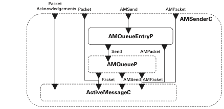

显示了由此产生的组件：`AMQueueEntryP` 实现为特定 AM 标识符排队数据包所需的每个客户端逻辑，`AMQueueImplP` 实现队列，而 `AMQueueP` 将队列连接到 `ActiveMessageC`。运行时，典型的执行过程如下：

- 客户端调用 `AMSenderC` 的 `AMSend.send`。
- 这会调用 `AMQueueEntryP` 模块中的 `end`，该模块将长度、AM 标识符和目标存储在数据包中。
- `AMQueueEntryP` 是 `AMQueueImplP` 的客户端，并使用其客户端标识符调用 `Send.send`。
- `AMQueueImplP` 检查客户端的队列条目是否空闲并将数据包放入其中。
- 一段时间后，`AMQueueImplP` 从队列中取出数据包，并使用 `AMQueueEntryP` 存储的参数在 `ActiveMessageC` 上调用 `AMSend.send`。
- 当 `ActiveMessageC` 信号 `AMSend.sendDone` 时，`AMQueueImplP` 向 `AMQueueEntryP` 信号 `Send.sendDone`，后者向原始调用组件信号 `AMSend.sendDone`。

这是 `AMSenderC` 的代码：

```
generic configuration AMSenderC(am_id_t AMId) {
  provides {
    interface AMSend;
    interface Packet;
    interface AMPacket;
    interface PacketAcknowledgements as Acks;
  }
}

implementation {
  components new AMQueueEntryP(AMId) as AMQueueEntryP;
  components AMQueueP, ActiveMessageC;

  AMQueueEntryP.Send -> AMQueueP.Send[unique(UQ_AMQUEUE_SEND)];
  AMQueueEntryP.AMPacket -> ActiveMessageC;

  AMSend = AMQueueEntryP;
  Packet = ActiveMessageC;
  AMPacket = ActiveMessageC;
  Acks = ActiveMessageC;
}
```

发送队列条目负责在数据包中存储发送信息：

```
generic module AMQueueEntryP(am_id_t amId) {
  provides interface AMSend;
  uses{
    interface Send;
    interface AMPacket;
  }
}

implementation {

  command error_t AMSend.send(am_addr_t dest,
                          message_t* msg,
                          uint8_t len) {
    call AMPacket.setDestination(msg, dest);
    call AMPacket.setType(msg, amId);
    return call Send.send(msg, len);
  }

  command error_t AMSend.cancel(message_t* msg) {
    return call Send.cancel(msg);
  }

  event void Send.sendDone(message_t* m, error_t err) {
    signal AMSend.sendDone(m, err);
  }

  command uint8_t AMSend.maxPayloadLength() {
    return call Send.maxPayloadLength();
  }

  command void* AMSend.getPayload(message_t* m) {
    return call Send.getPayload(m);
  }
}
```

Listing 9.14 AMSendQueueEntryP

队列本身位于 `ActiveMessageC` 之上：


```
configuration AMQueueP {
  provides interface Send[uint8_t client];
}

implementation {
  components AMQueueImplP, ActiveMessageC;

  Send = AMQueueImplP;
```

```
AMQueueImplP.AMSend -> ActiveMessageC;
AMQueueImplP.AMPacket -> ActiveMessageC;
AMQueueImplP.Packet -> ActiveMessageC;

}
```

Listing 9.15 AMQueueP

最后，在 `AMSendQueueImplP` 内部，发送数据包的逻辑如下所示：

```
nextPacket();
if (current == QUEUE_EMPTY) {
    return;
}
else {
    message_t * msg;
    am_id_t id;
    am_addr_t addr;
    uint8_t len;
    msg = queue[current];
    id = call AMPacket.getType(msg);
    addr = call AMPacket.getDestination(msg);
    len = call Packet.getLength(msg);
    if (call AMSend.send(id, addr, msg, len) == SUCCESS) {
        ...
    }
    ...
}
```

Listing 9.16 `AMSendQueueImplP` pseudocode

#### 9.2.4 BlockStorageC

`nesC` 编程中最困难的部分之一是使用参数化接口并管理其键空间。如我们在第 6.5 节中所见，`BlockStorageC` 是 TinyOS 的三种存储抽象之一，并提供对存储卷（闪存芯片上的连续区域）的随机读写访问。`BlockStorageC` 是使用泛型的良好示例，因为它是从底层组件通过布线构建抽象的非平凡用法。`BlockStorageC` 处理四组不同的参数化接口。

每个卷都有一个唯一标识符，每个 `BlockStorageC` 都与单个卷相关联。然而，可以有多个 `BlockStorageC` 组件访问多个卷，并且并非所有卷都可能有 `BlockStorageC` 组件（它们可能未使用或由不同的抽象访问）。客户端必须与卷相关联，以便底层代码可以从卷内的相对偏移生成芯片上的绝对偏移。例如，如果 1 MB 闪存芯片被划分为两个 512 KB 卷，则卷 1 上的地址 16k 是芯片上的地址 528k。这意味着至少有两个键空间。第一个键空间是卷 ID 键空间，第二个是客户端 ID 键空间。

在实践中，还有第三个键空间，用于在所有客户端之间仲裁对闪存芯片的访问（参见第 11.2 节）。该键空间在块客户端、日志客户端以及需要独占访问闪存芯片的其他抽象之间共享。因此，总的来说，`BlockStorageC` 必须管理三个不同的键空间：

+ 1. 客户端键：这是哪个块存储客户端（用于块存储客户端状态）
+ 2. 芯片键：这是对闪存芯片的哪个客户端（用于共享资源的仲裁）
+ 3. 卷键：该客户端访问的是哪个卷（用于在芯片中计算绝对偏移）

客户端键和芯片键都是使用 `unique()` 生成的。客户端键仅在 `BlockStorageC` 组件之间使用，因此它使用在 `BlockStorage.h` 中定义的字符串 `UQ_BLOCK_STORAGE`。芯片键在所有使用底层芯片的组件之间共享。以 `AT45DB` 芯片（用于 `micaz` 平台）为例，该字符串为在 `At45db.h` 中定义的 `UQ_AT45DB`。卷键（`VOLUME_XXX`）不是由 `unique` 生成的，因为它是从指定闪存芯片布局的 XML 文件生成的（图 6.3，第 102 页）。经过以上介绍之后，你可能会认为 `BlockStorageC` 代码很多。事实并非如此：它只有四条 wiring 语句，我们将逐条讲解：

```
generic configuration BlockStorageC(volume_id_t vold) {
  provides {
    interface BlockWrite;
    interface BlockRead;
  }
}
implementation {
  enum {
    BLOCK_ID = unique(UQ_BLOCK_STORAGE),
    RESOURCE_ID = unique(UQ_AT45DB)
  };

  components BlockStorageP, WireBlockStorageP, StorageManagerC, At45dbC;

  BlockWrite = BlockStorageP.BlockWrite[BLOCK_ID];
  BlockRead = BlockStorageP.BlockRead[BLOCK_ID];

  BlockStorageP.At45dbVolume[BLOCK_ID] -> StorageManagerC.At45dbVolume[vold];
  BlockStorageP.Resource[BLOCK_ID] -> At45dbC.Resource[RESOURCE_ID];
}
```

Listing 9.17 `BlockStorageC`

前两行，

```
BlockWrite = BlockStorageP.BlockWrite[BLOCK_ID];
BlockRead = BlockStorageP.BlockRead[BLOCK_ID];
```

使 `BlockWrite` 和 `BlockRead` 接口成为实现它们的服务 `BlockStorageP` 的客户端。当组件连接到 `BlockStorageC` 调用读取或写入

一组通用组件，可以组装起来构建有用的抽象：每个受支持的微控制器都通过将这些库组件层叠在一些低级硬件抽象之上来提供定时器系统。由于许多微控制器有多个时钟源，这些库组件中的大多数都是通用组件，因此平台可以轻松提供多种不同精度的定时器系统。

例如，这是 `micaz` 平台上 `HiTimerMilliC` 的完整代码——它与图 9.1，第 148 页所示的典型结构类似，但不完全相同。它定义在 `tos/platforms/mica` 中，其中包含整个 `mica` 家族（例如 `mica2`、`mica2dot`、`micaz`）的通用抽象：

```nesc
#include "Timer.h"

configuration HiTimerMilliC {

  provides interface Init;

  provides interface Timer<TMilli> as TimerMilli(uint8_t num);

  provides interface LocalTime<TMilli>

}

implementation {

  enum {

    TIMER_COUNT = uniqueCount(UQ_TIMER_MILLI)

  };

  components AlarmCounterMilliP, new AlarmToTimerC(TMilli),
             new VirtualizeTimerC(TMilli, TIMER_COUNT),
             new CounterToLocalTimeC(TMilli);

  Init = AlarmCounterMilliP;

  TimerMilli = VirtualizeTimerC;

  VirtualizeTimerC.TimerFrom -> AlarmToTimerC;

  AlarmToTimerC.Alarm -> AlarmCounterMilliP;

  LocalTime = CounterToLocalTimeC;

  CounterToLocalTimeC.Counter -> AlarmCounterMilliP;

}
```

Listing 9.18 The full code of `HiTimerMilliC`

该配置中唯一的单例组件是 `AlarmCounterMilliP`，它是对低级微控制器定时器的抽象。`HiTimerMilliC` 在 `AlarmCounterMilliP` 之上使用三个通用组件来提供完整的定时器系统：

+ - **CounterToLocalTimerC** 将硬件计数器转换为本地时间基准；
+ - **AlarmToTimerC** 将提供中断驱动的一次性定时器的 `Alarm` 接口转换为提供功能更强大的同步定时器的 `Timer` 接口；
+ - **VirtualizeTimerC** 将单个 `Timer` 虚拟化为 *n* 个 `Timer`，其中 *n* 为组件参数。

所有泛型模块都有类型 `TMilli` 作为其参数之一。这些类型参数确保计时器精度不会被意外更改。例如 `VirtualizeTimerC`


```
generic module VirtualizeTimerC(typedef precision_tag, int max_timers)
{
  provides interface Timer<precision_tag> as Timer[uint8_t num];
  uses interface Timer<precision_tag> as TimerFrom;
}
...
```

### 清单 9.19 VirtualizeTimerC 虚拟化单个计时器

接受一个精度为 `precision_tag` 的计时器，并将其虚拟化为 `timer_count` 个精度为 `precision_tag` 的计时器。计时器库还包含在精度之间进行转换的组件。

`HiiTimerMilliC` 接收一个中断驱动的硬件计时器 – `AlarmCounterMilliP` – 并将其转换为虚拟化计时器。它通过三个步骤完成此操作。第一步使用泛型组件 `AlarmToTimerC` 将中断驱动的 `Alarm` 转换为基于任务的 `Timer`：

```
AlarmToTimerC.Alarm -> AlarmCounterMilliP;
```

第二步将单个计时器虚拟化为多个计时器：

```
VirtualizeTimerC.TimerFrom -> AlarmToTimerC;
```

`HiiTimerMilliC` 然后导出参数化计时器接口：

```
TimerMilli = VirtualizeTimerC;
```

此外，计时器系统的某些方面需要能够访问时间基准，例如指定计时器在未来何时触发。因此 `HiiTimerMilliC` 接收一个硬件计数器并将其转换为本地时间组件，

```
CounterToLocalTimeC.Counter -> AlarmCounterMilliP;
```

然后导出接口：

```
LocalTime = CounterToLocalTimeC;
```

计时器库中的许多组件都是泛型，因为平台可能需要提供各种计时器。例如，根据计数器、比较寄存器及其位宽的数量，平台可能提供毫秒、微秒和 32 kHz 计时器。例如，一些平台使用的 `MSP430` 芯片家族的变体可以轻松提供 32 位毫秒和 32 kHz 计时器，同时保持非常低的中断负载。

泛型模块对于需要分配每个客户端状态的抽象来说非常有效，例如计时器。泛型模块允许你在实例化模块的配置中指定大小 – 客户端数量，而不是在模块本身内部指定。例如，如果 `VirtualizeTimerC` 不是泛型，那么在其代码内部就必须有一个带有适当键的 `uniqueCount()`。

> **编程提示 20**
>
> 在编写模块时，请考虑使其更通用和泛型。在大多数情况下，模块必须由配置包装后才有用，因此单例模块的优势很少。

### 9.4 练习

- 1. 使用 TinyOS 计时器库创建一个秒级粒度计时器抽象 `TimerSecondC`。如果你基于 `TimerMilliC` 进行虚拟化，那么底层计时器只需为所有秒级粒度计时器扫描一个计时器条目。请注意 `HifTimerSecondC` 参数化接口的唯一键。

- 2. 标准 TinyOS 集合层 `CTP`（位于 `tos/lib/net/ctp`）将数据包在多个跳数间路由到数据汇聚节点。`CTP` 的发送队列深度为 `C + F`，其中 `C` 是发送客户端的数量，`F` 是其用于转发的包池大小。这意味着客户端最多可获得可用链路吞吐量的 `1/(C+F)`。更改 `CtpForwardingEngineP` 和 `CollectionSenderP`，使其具有单独的客户端队列，该队列位于 `CtpForwardingEngineP` 队列的单个条目之上，导致客户端最多获得链路吞吐量的 `1/(C+F)`。

- 3. 为任意数量的客户端编写一个屏障。屏障是一种并发原语，阻塞直到所有线程到达它。在 TinyOS 中，由于没有线程，这意味着阻塞直到所有调用者到达它。编写一个分阶段接口 `Barrier`，它有一个命令 `wait` 和一个事件 `pass`。当所有客户端都调用 `wait` 时，屏障应向所有客户端发出 `pass` 信号。

# 10 设计模式

引用 Gang of Four 的话，设计模式是“在特定上下文中为通用设计问题定制的通信对象和类的描述”。[3] 在我们迄今为止看到的组件中，我们看到了几种反复出现的模式，例如使用参数化接口来实现具有多个客户端的服务（`VirtualizeTimerC`，第 9.1.3 节），或一个组件包装另一个组件（`RandomC`，第 4.2 节）。在本章中，秉承 Gang of Four 原始设计模式工作的精神，我们尝试基于在 TinyOS 开发期间的观察来形式化其中一些模式。

本章介绍了八种 nesC 设计模式：三种行为型（涉及组件交互）：`Dispatcher`、`Decorator` 和 `Adapter`；三种结构型（涉及应用程序的结构）：`Service Instance`、`Placeholder` 和 `Facade` 以及两种命名空间（管理诸如消息类型等标识符）：`Keyspace` 和 `Keymap`。每个模式的介绍遵循《设计模式》一书的模型。每个模式都有一个 Intent，简要描述其目的。随后是更深入的 Motivation，提供来自 TinyOS 的示例。`Applicable When` 提供使用条件简明列表，组件图显示了模式中组件交互的结构。¹ 除了我们通常的组件图约定外，我们将折叠子框附加到组件以显示相关代码片段（浮动的折叠框代表某些其他、未命名组件中的源代码）。图后跟 Participants 列表，解释每个组件的角色。`Sample Code` 显示示例 nesC 实现，`Known Uses` 指出 TinyOS 中模式的一些使用。`Consequences` 描述模式如何实现其目标，并指出使用时需要考虑的问题。最后，`Related Patterns` 与其他相关模式进行比较。

### 10.1 行为型：Dispatcher

#### Intent

基于标识符在操作集合中动态选择。提供一种通过添加或更改操作轻松扩展或修改系统的方式。

¹ 此图因 `Keyspace` 模式不涉及组件交互而被省略。

#### 动机

在高层次上，传感器网络应用会根据环境输入（如传感器读数或网络数据包）执行操作。输入的呈现组件并不关心操作的细节。我们需要能够轻松地扩展和修改应用程序关心的输入，以及与输入相关联的操作。

例如，一个节点可以接收多种类型的活动消息（数据包）。活动消息（AM）有一个 8 位类型字段，用于区分协议。洪泛协议使用一种 AM 类型，而按需路由协议使用另一种。`ActiveMessageC` 是信号数据包到达的组件，不应需要知道协议执行何种处理或应用程序是否支持该协议。`ActiveMessageC` 只负责传递数据包，而更高层的通信服务则响应它们关心的部分。

解决此问题的传统方法是使用函数指针或对象，在运行时动态注册为回调。在许多情况下，尽管在运行时注册，操作集合在编译时是已知的。因此这些回调可以用编译到可执行文件中的分发表来替换，具有两个好处。首先，这允许更好的跨函数分析和优化，其次它节省 RAM，因为无需存储指针或回调结构。

这样的分发表可以通过在 `ActiveMessageC` 中使用 `switch` 语句为活动消息示例构建。但这非常不灵活：对应用程序中使用的协议的任何更改都需要对系统组件进行更改。

TinyOS 中更好的方法是使用 `Dispatcher` 模式。`Dispatcher` 使用基于数据标识符的参数化接口调用操作。在 `ActiveMessageC` 的情况下，接口是 `Receive`，标识符是活动消息类型字段。`ActiveMessageC` 与应用程序处理哪些消息或这些处理程序执行何种处理无关。添加新的处理程序只需要一次对 `ActiveMessageC` 的连线。如果应用程序未为某种类别连线接收处理程序，`ActiveMessageC` 默认执行空操作。

调度器模式的另一个例子是为 TinyOS 1.x 实现的 Mate 虚拟机的调度器。每个指令都是一个单独的组件，提供 `MateBytecode` 接口。调度器通过使用参数化 `MateBytecode` 接口分派到指令组件来执行特定字节码。通过更改调度器的连线，可以轻松更改指令集。

#### 适用场景

- 组件需要支持可外部自定义的一组操作。
- 一个原始整数类型可以标识要执行的操作。
- 所有操作都可以用单一接口实现。

然而，分发器通常被封装在通用配置中以简化其使用。组件不是连线到参数化接口，而是连线到接收参数作为参数的通用配置。例如，而不是直接连线到 `ActiveMessageC` 以接收数据包，应用程序实例化一个 `AMReceiverC`：


```
generic configuration AMReceiverC(am_id_t amid) {
  provides interface Receive;
  provides interface Packet;
  provides interface AMPacket;
}
implementation {
  components ActiveMessageImplP as Impl;

  Receive = Impl.Receive[amId];
  Packet = Impl;
  AMPacket = Impl;
}
```

Listing 10.1 AMReceiverC

使用 `AMReceiverC` 重写 `AppC` 得到：

```
configuration AppC ()
implementation {
  components AppP,
  new AMReceiverC(AM_CLEARIDMSG) as ClearId,
  new AMReceiverC(AM_SETIDMSG) as SetId;

  AppP.ClearIdMsg -> ClearId;
  AppP.SetIdMsg -> SetId;
}
```

#### 已知用途

活动消息网络层（`ActiveMessageC`）和树形收集协议（`CollectionC`）使用分发器进行数据包接收。它们还提供参数化的数据包发送接口，以便服务可以轻松地将数据包发送与接收处理程序匹配。

Atmel `AT45DB` 系列闪存芯片实现使用参数化接口将存储卷标识符映射到存储卷特性（参见第 12.1.1 节中的 `At45dbStorageManagerC` 组件）。

TinyOS 1.x 的 Maté 虚拟机使用分发器以允许轻松自定义指令集。

#### 影响

通过将操作选择留给 nesC 连线，分发器的实现保持独立于应用程序支持的内容。然而，查找完整支持的操作集可能需要查看许多文件。松散的操作标识符管理

可能导致调度问题。如果两个操作使用相同的标识符进行连接，那么一次调度会调用两者，这可能导致资源冲突、数据损坏，或因指针丢失而导致的内存泄漏。例如，`Receive` 接口使用缓冲区交换机制在无线电协议栈和网络服务之间传递缓冲区，其中上层组件在事件的返回值中传递新的缓冲区。如果两个服务连接到同一个 `Receive` 实例，则只有其中一个的指针会被传递，第二个指针会丢失。这种方式的连接在 nesC 中是编译时警告，但对于新手 TinyOS 开发者来说仍然是一个常见错误。

调度器模式的关键方面是：

- 它允许你轻松扩展或修改应用程序支持的功能：添加一个操作只需要一次连接。
- 它允许功能元素独立实现并重用。因为每个操作都在一个组件中实现，所以它可以轻松地包含在许多应用程序中。保持实现分离还可以简化测试，因为组件会更小、更简单，更容易定位故障。nesC 编译器会自动内联小型操作，或你可以显式请求内联；因此这种分解没有性能成本。
- 它要求各个操作遵循统一的接口。调度器通常不适合语义范围很广的操作。由于所有实现都必须满足相同的接口，宽泛的语义会导致接口过于通用，将错误检查从编译时推迟到运行时。实现者忘记运行时参数检查可能会导致难以诊断的系统故障。

操作的编译时绑定简化了程序分析并将调度表放在编译后的代码中，从而节省了 RAM。调度提供了一种简单的方法来开发对环境做出反应的程序。

#### 相关模式

- Service Instance：服务实例创建接口实现的大量实例，而调度器在接口的不同实现之间进行选择。
- Placeholder：占位符允许应用程序在编译时选择实现，而调度器允许它在运行时选择实现。
- Keyspace：用于标识 Dispatcher 操作的标识符通常构成一个全局键空间。

### 10.2 结构型：Service Instance

#### Intent

允许多个用户拥有特定服务的独立实例，其中实例可以高效协作。虚拟化服务的核心机制。

#### Motivation

有时许多组件或子系统需要使用系统抽象，但每个用户都希望拥有该服务的独立实例。我们在构建完整应用程序之前不知道会有多少用户。每个实例都需要维护一些状态，服务实现需要访问所有这些状态以做出决策。

例如，各种 TinyOS 组件都需要定时器，用于从网络超时到传感器采样的一切。每个定时器看起来都是独立的，但它们都运行在单一硬件时钟之上。因此，高效的实现需要知道所有定时器的状态。如果实现可以轻松确定哪个定时器需要下一个触发，那么它就可以安排底层时钟资源以最少的中断次数满足该最低定时器的要求。减少中断次数可以让 CPU 睡眠更多，从而节省能量并延长使用寿命。

解决这个问题的传统面向对象方法是实例化表示服务的对象，并使用另一个类来协调状态。最接近的 nesC 等价物将涉及为每个定时器实例化一个通用模块，并使用另一个模块来协调状态。然而，为每个定时器实例化一个模块会导致代码重复，并且需要在模块之间协调以确定如何设置底层硬件时钟。可以通过将时钟设置为固定速率并为每个 Timer 维护一个计数器来避免模块间协调，但这效率低下：定时器保真度需要以高频率触发，但如果下一个定时器在四秒后才触发，以 1 KHz 频率触发会浪费能量。

Service Instance 模式提供了这些问题的解决方案。使用此模式，服务的每个用户都可以拥有自己的（虚拟）实例，但实例共享代码并且可以访问彼此的状态。遵循 Service Instance 模式的组件通过参数化接口提供其服务；每个用户使用 unique 连接到接口的唯一实例。底层组件在每个命令中接收每个客户端的唯一标识，并可使用它在状态数组中进行索引。组件可以使用 `uniqueCount` 函数在编译时确定存在多少个实例，并据此确定状态数组的维度。

在大多数情况下，遵循服务实例模式的组件通过提供非参数化接口的通用组件提供给用户，从而自动化 `unique` 的使用。例如，`HilTimerMilliC` 遵循 Service Instance 模式，但大多数 TinyOS 代码使用 `TimerMilliC` 通用组件。

#### Applicable when

- 组件需要在编译时才知道数量的情况下提供多个服务实例。
- 每个服务实例对其用户而言似乎与其他实例独立。
- 服务实现需要能够轻松访问每个实例的状态。

#### Structure

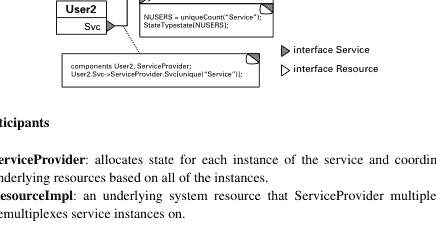

#### Participants

- **ServiceProvider**: 为每个服务实例分配状态并根据所有实例协调底层资源。
- **ResourceImpl**: ServiceProvider 在其上复用/解复用服务实例的底层系统资源。

#### Sample code

`HiTimerMilliC` 使用 `VirtualizeTimerC` 来提供毫秒精度定时器的服务实例。`VirtualizeTimerC` 接受一个底层定时器并将其虚拟化为 n 个定时器供其他模块使用：

```
generic module VirtualizeTimerC(typedef precision_tag, int max_timers) {
provides interface Timer<precision_tag> as Timer[uint8_t num];
uses interface Timer<precision_tag> as TimerFrom;
}
```

Listing 10.2 VirtualizeTimerC

它接受两个参数，一个用于 Timer 精度标签的类型（`TMilli` 等），以及定时器的数量（服务实例的数量）。实例化 `TimerMilliC` 以创建新定时器因此涉及多个文件：

1. `TimerMilliC`，它通过调用 `unique` 传递 `UQ_TIMER_MILLI` 将其连接到 `HiTimerMilliC` 的参数化接口。
2. `Timer.h`，一个定义唯一键为 `UQ_TIMER_MILLI` 的头文件。
3. `HiTimerMilliC`，它通过调用 `uniqueCount` 传递 `UQ_TIMER_MILLI` 实例化一个 `VirtualizeTimerC`。
4. `VirtualizeTimerC`，它提供 n 个虚拟化定时器。
5. 提供待虚拟化的单个 Timer 的底层按平台组件。

#### Known uses

大多数 TinyOS 服务遵循服务实例模式，尽管大多数服务（例如 `TimerMilliC`、第 6 章的 `BlockStorageC` 或第 13 章的 `Atm128I2CMasterC`）将其隐藏在对程序员友好的通用组件之后。

诸如 `FcfsArbiterC`（第 11 章）之类的通用仲裁器实现向程序员公开了服务实例模式，`VirtualizeTimerC` 也是如此。

类似地，流行病传播协议 `Drip`（可通过 `DisseminatorC` 通用组件获得）使用服务实例模式为每个传播的值维护流行病状态。

#### Consequences

服务实例模式的关键方面是：

- 它允许许多组件请求通用系统服务的独立实例：添加一个实例只需要一次连线。


- 它控制状态分配，因此使用的 RAM 量精确地按所需实例数量缩放，在节约内存的同时防止因过多请求耗尽资源而导致的运行时间失败。

- 它允许单个组件协调所有实例，这使得资源管理和协调更加高效。

由于该模式可扩展到可变数量的实例，其操作的成本可能随用户数量线性增长。例如，如果设置底层时钟中断速率取决于剩余时间最短的定时器，实现可能通过扫描所有定时器来确定，这是一个 O(n) 操作。

如果许多用户需要一个服务的实例，但每个实例都很少使用，那么为每个实例分配状态可能是浪费的。另一种选择是分配较少量的状态并根据需要动态分配给用户。这可以节约 RAM，但每个实际实例需要更多的 RAM（需要维护客户端 ID），会带来 CPU 开销（分配和释放），可能在运行时间失败（如果同时用户太多），并且假设了一种回收策略（误用会导致泄漏）。这一长串挑战使得服务实例成为一种有吸引力——并且越来越常用——的方式来高效支持应用需求。

然而，也存在组件在内部为多个用途重用单个服务实例的情况：例如，Maté 虚拟机代码传播组件为多个永远不会并发运行的不同定时器使用单个定时器实例。

#### Related patterns

- Dispatcher: 服务实例创建接口实现的大量实例，而调度器在接口的不同实现之间进行选择。

- Keyspace: 服务实例的实例标识符构成一个本地键空间。

### 10.3 命名空间：键空间

#### 意图

为程序中的协议、结构或其他实体提供命名空间以供引用。

#### 动机

典型的传感器网络程序需要为其管理的各种实体提供命名空间，例如协议、数据类型或结构实例。资源有限意味着名称通常以小的整数键存储。

对于表示内部程序结构的数据类型，每个实例必须具有唯一名称，但由于它们仅与单个节点相关，名称可以自由选择。这些本地命名空间通常是密集的，以提高效率。服务实例模式（第 10.2 节）使用本地命名空间来标识实例。相比之下，通信需要共享的全局命名空间：两个节点/应用程序必须就元素的名称达成一致。由于节点可能只使用少数几个元素，全局命名空间通常是稀疏的。调度器模式（第 10.1 节）使用全局命名空间来选择操作。

键空间模式提供了解决这些问题的方案。使用这些模式，程序可以使用针对其特定用途优化的标识符来引用元素。使用键空间模式的组件通常利用参数化接口，其参数是键空间中的一个元素。本地键空间旨在引用本地数据结构（例如数组），并使用 `unique` 生成；全局键空间旨在用于通信并使用全局常量（通常使用 `enum` 定义）。

用于区分消息类型的 AM 标识符构成了一个全局键空间。`ActiveMessageC` 使用这些 AM 标识符结合调度器来执行在其他组件中找到的适当消息处理程序。本地键空间的使用不仅限于在服务实例模式中标识客户端：Maté 虚拟机使用本地键空间来标识 Maté 程序使用的资源对应的锁。这些锁标识符使用 `unique` 分配，因为 Maté 虚拟机可以编译成包含不同资源集的版本。

#### 适用条件

- 程序必须跟踪一组元素或数据类型。

- 该集合在编译时已知且固定。

#### 示例代码

`SoundLocalizer` 应用程序（第 13 章）的 AM 标识符被定义为全局常量：

```
enum {
  AM_COORDINATION_MSG = 101,
  AM_DETECTION_MSG = 102
};
```

```
} LockNames;
...
module OPbpushM { ... } // a shared buffer
implementation {
typedef enum {
    MATE_BUF_LOCK_1_0 = unique("MateLock"),
    MATE_BUF_LOCK_1_1 = unique("MateLock"),
} BufLockNames;
...
```

并且使用 `uniqueCount` 来查找锁的总数：

```
enum {
    MATE_LOCK_COUNT = uniqueCount("MateLock")
};
```

#### 已知用途

许多组件使用本地键空间：它们是服务实例模式的基本组成部分。例如请参见定时器服务 `HiTimerMilliC`，或许多低级系统组件的客户端标识符，如 `Atm128AdcC`（Atmel ATmega128 A/D 转换器）或 `Stm25pSectorC`（ST M25P 闪存芯片）。Maté 使用本地键空间来跟踪 Maté 共享资源锁（见上文）。Active Messages（`ActiveMessageC`）为 Active Message 类型使用全局键空间。

TinyOS 存储抽象使用全局键空间来标识闪存芯片卷。在这种情况下，全局常量是由外部工具（`tos-storage-at45db` 用于 Atmel AT45DB 芯片系列）选择的，而不是由程序员显式指定。这减轻了程序员选择值的负担，同时仍允许多个应用程序使用相同的卷。

TinyDB 传感器网络即数据库应用程序 [20] 为其属性使用全局键空间；然而，在这种情况下，键空间由字符串组成，然后通过表映射到本地键空间。

#### 影响

键空间允许组件通过参数化接口引用数据项或类型。在本地键空间中，`unique` 确保每个元素都有唯一的标识符。全局键空间也可以具有唯一标识符，但这需要外部命名空间管理。

由于本地键空间使用 `unique` 生成，将名称映射到键（例如用于调试目的）并不明显。nesC 常量生成器 `ncg` 可用于提取此信息。

键空间很少单独使用；它们支持调度器和服务实例等其他模式。

#### 相关模式

- Keymap：两个键空间通常相关，例如一个服务实例可能构建在另一个之上，需要在两个键空间之间进行映射。Keymap 模式提供了一种高效实现此类映射的方法。

- 服务实例：用于标识各个服务的标识符构成一个本地键空间。

- 调度器：调度器使用的标识符通常取自全局键空间。

### 10.4 命名空间：键映射

#### 意图

将键从一个键空间映射到另一个键空间。允许你将全局共享名称转换为本地优化名称，或有效地对另一个键空间进行子集划分。

#### 动机

命名空间之间的映射通常很有用：它允许节点使用全局稀疏的命名空间以方便跨应用通信，同时使用内部紧凑的命名空间以提高效率。

Drip流行病传播协议使用键空间和键映射模式，允许用户在运行时配置参数。组件使用全局键空间向`DisseminatorC`泛型组件注册参数，从而可以以与应用程序无关的方式命名该参数。用户通过使用流行病传播协议发送一个键值对来修改参数，该协议将更改分发到每个节点。Drip为每个键值对维护一个特殊的“滴流”计时器，并通过本地键空间访问以提高效率。键映射将全局键映射到本地键。

当某个基于服务实例模式的服务访问另一个同样基于服务实例模式的服务提供的资源子集时，键映射对于两个本地键空间之间的映射也很有用。

例如，`BlockStorageC`、`LogStorageC`和`ConfigStorageC`组件（第6.5节）的Atmel AT45db实现使用各自的本地键空间来标识其各自的客户端。这三者都构建在更低层的`At45dbC`组件之上，该组件也使用自己的本地键空间来标识其客户端。因此，例如`BlockStorageC`的每个客户端都间接是`At45dbC`的客户端。键映射将`BlockStorageC`的客户端标识符映射到`At45dbC`的客户端标识符。

```
DisseminationEngineP.TrickleTimer[key] ->
DisseminationTimerP.TrickleTimer[TIMER_ID];
...
```

在这个例子中，用户可以生成一个新的配置值，并基于`DISS_CONFIG`键进行分发。`DisseminatorEngineP`使用全局键来引用该值，但`DisseminationTimerP`可以使用本地键来引用其为“滴流”计时器维护的状态。该连接在编译时简化为一个简单的`switch`语句，它以正确的本地键调用`DisseminationTimerP`。

`BlockStorageP`在闪存芯片卷上提供简单的读/写抽象。在内部，`BlockStorageC`是使用`BlockStorageP`组件提供的服务实例模式来实现的。`BlockStorageP`的每个客户端也是`At45dbC`的客户端（这简化了`BlockStorageC`的实现）。由于`At45dbC`还有其他客户端，`BlockStorageC`必须将`BlockStorageP`标识符映射到`At45dbC`标识符：

```
generic configuration BlockStorageC(volume_id_t volId) {
  provides interface BlockWrite;
  provides interface BlockRead;
}
```

```
implementation {
  enum {
    BLOCK_ID = unique(UQ_BLOCK_STORAGE),
    AT45DB_ID = unique(UQ_AT45DB)
  };
}
```


```
components BlockStorageP, At45dbC;
BlockWrite = BlockStorageP.BlockWrite[BLOCK_ID];
BlockRead = BlockStorageP.BlockRead[BLOCK_ID];
BlockStorageP.Resource[BLOCK_ID] -> At45dbC.Resource[AT45DB_ID];
...
```

假设`BLOCK_ID`为2，`AT45DB_ID`为4。那么，当对`BlockRead[2]`（或`BlockWrite[2]`）接口的请求到来时，`BlockStorageP`会对其`Resource[2]`接口发出请求。键映射按预期将该请求转换为对`At45dbC.Resource[4]`的请求。

### 已知用途

- `Drip`分发协议——如上所述——使用键映射。
- 用于`ST M25P`和`Atmel AT45DB`系列闪存芯片的`TinyOS`存储系统（后者如上所述）使用键映射。

### 后果

键映射使用`nesC`连接使组件能够透明地在不同键空间之间进行映射。与键空间一样，键映射必须在编译时固定。

键映射在编译时转换为一个`switch`。因此它不消耗任何`RAM`；其速度取决于用于编译`nesC`输出的`C`编译器的行为。

`Keymaps`仅支持在整数之间进行映射。如果需要，例如从字符串映射到`Local Keyspace`，则需要自行构建映射。

### 相关模式

- `Keyspace`：`Keymap`在一个`keyspace`到另一个`keyspace`之间建立映射。

## 10.5 结构型：占位符

### 意图

轻松更改整个应用程序使用的服务的实现。防止无意中包含多个不兼容的实现。

### 动机

许多`TinyOS`系统和抽象具有多种实现。例如，存在许多临时树路由协议，包括`TinyOS`核心中的两种（`Ctp`、`Lqi`），但它们都公开相同的接口（`StdControl`、`Send`、`Receive`等）。标准化的接口允许应用程序在无需代码更改的情况下使用任何实现。更简单的抽象也可以有多种实现。例如，`LedsC`组件实际上打开和关闭`LED`，而`NoLedsC`组件提供相同的接口，但操作为空。在测试期间，`LedsC`对于调试很有用，但在部署时它会带来显著的能量消耗，通常会被`NoLedsC`替换。

有时，需要在整个应用程序中统一选择使用哪种实现。例如，如果假设的网络健康监控子系统连接到`Ctp`，而应用程序使用`Lqi`，将会构建两棵路由树，浪费资源。由于每个连接到服务的配置都会命名它，在大型应用程序中更改实现的选择可能需要更改许多文件。其中一些文件，例如网络健康监控器可能是系统的一部分；应用程序编写者不应需要修改它们。

一种选择是让每个实现使用相同的组件名称，并将它们放在单独的目录中。操作`nesC`搜索顺序允许应用程序选择要使用的版本。然而，这迫使占位符的每个实现都进入单独的目录，并排除了包含两个实现甚至它们可以相互操作的可能性。

### 适用条件

- 组件或服务具有多个可能互斥的实现。
- 许多子系统和应用程序的各个部分需要使用此组件/服务。
- 你需要轻松地在实现之间切换。

### 结构

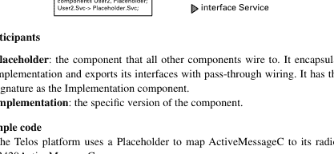

### 参与者

- **Placeholder**：所有其他组件连接到的组件。它封装实现并通过直通连接导出其接口。它与`Implementation`组件具有相同的签名。
- **Implementation**：组件的特定版本。

### 示例代码

`Telos`平台使用`Placeholder`将`ActiveMessageC`映射到其无线电栈`CC2420ActiveMessageC`：

```
configuration ActiveMessageC {
  provides {
    interface Init;
    interface SplitControl;

    interface AMSend[uint8_t id];
    interface Receive[uint8_t id];
    interface Receive as Snoop[uint8_t id];

    interface Packet;
    interface AMPacket;
    interface PacketAcknowledgements;
  }
  implementation {
    components CC2420ActiveMessageC as AM;

    Init = AM;
    SplitControl = AM;

    AMSend = AM;
    Receive = AM.Receive;
    Snoop = AM.Snoop;

Packet = AM;
AMPacket = AM;
PacketAcknowledgements = AM;
}
```

#### 列表 10.3 Telos ActiveMessageC

`Ctp`和`Lqi`树路由协议在单独的目录中提供`CtpCollectionC`和`LqiCollectionC`组件。它们还提供一个占位符`CollectionC`组件，该组件连接到`CtpCollectionC`或`LqiCollectionC`。希望使用默认树收集的组件连接到`CollectionC`，将树路由协议的选择留给应用程序。希望使用特定树收集算法的组件，例如连接到`CtpCollectionC`。

### 已知用途

具有多种实现的硬件无关抽象通常是占位符。例如，每个平台必须将`ActiveMessageC`和`HiiTimerMilliC`组件映射到平台特定的实现。在许多情况下，如`CC2420ActiveMessageC`，此实现特定于特定无线电芯片，但可在`mote`平台之间移植。如果一个`mote`有两个无线电并且其中一个应作为默认值使用，则将`ActiveMessageC`的映射留给平台可能很重要。

`CollectionC`是树收集路由协议的占位符，`DisseminatorC`是键值分发协议的占位符，`RandomC`是随机数生成的占位符。

### 影响

`Placeholder`模式的关键方面是：

- 建立一个全局名称，供通用服务的用户连接。
- 允许你在应用程序范围内指定服务的实现。
- 不要求每个组件都使用`Placeholder`的实现。

通过增加一层命名间接，`Placeholder`提供了一个可以从中选择实现的单一位置。占位符为实现无关的通用系统服务的用户创建了一个全局命名空间。由于使用`Placeholder`模式通常要求每个组件都连接到`Placeholder`而不是具体实例，因此将`Placeholder`整合到现有应用程序中可能需要修改许多组件。然而，`nesC`编译器会优化掉增加的连接间接层，因此`Placeholder`不会产生运行时开销。`Placeholder`支持灵活的组合并简化了替代服务实现的使用。

### 相关模式

- `Dispatcher`：占位符允许应用程序在编译时选择实现，而调度器允许它在运行时选择实现。
- 代理：代理允许轻松选择一组接口的实现，而外观允许轻松使用一组接口。应用程序很可能将代理连接到外观。

## 10.6 结构型：外观模式

### 意图

提供一个统一访问点，用于访问一组相互关联的服务和接口。简化子服务的使用、包含和组合。

### 动机

复杂系统组件（如文件系统或网络抽象）通常由许多组件实现。高层操作可能基于底层操作，用户需要访问这两类操作。复杂功能可能分布在多个组件中。虽然这些功能是分别实现的，但它们是一个内聚整体的一部分，我们希望将其呈现为一个逻辑单元。

例如，`TinyOS 1.x`的`Matchbox`文件系统提供了读写文件的接口，以及删除、重命名等元数据操作的接口。各个模块分别实现每个接口，并依赖于公共的底层服务（如读取块）。

一种选择是将所有操作放在一个共享接口中。这带来两个问题。首先，`nesC`的连线规则意味着，组件若想使用接口中的任何命令，就必须处理该接口的所有事件。就文件系统而言，所有操作都是分阶段的；仅仅为了删除一个文件而不得不处理六个事件（`readDone`、`writeDone`、`openDone`等）几乎不可用。其次，如果不引入内部接口，实现就无法轻易分解为多个独立组件，因为顶层组件需要调用子组件。将整个子系统实现为单个庞大的组件并不易于维护。

另一种选择是将每个接口导出到单独的组件中（例如`MatchboxRead`、`MatchboxWrite`、`MatchboxRename`等）。这增加了连线复杂度，使抽象更难使用。对于简单的打开、读取和写入序列，应用程序必须连线到三个不同的组件。此外，每个接口都需要单独的配置以连线到其依赖的子系统，从而增加组件命名空间中的混乱。实现者需要小心处理这些配置，以防止意外重复连线。

外观模式为这个问题提供了更好的解决方案。外观模式为许多组件提供的接口提供了一个统一访问点。外观是一个`nesC`配置，通过导出多个底层组件的接口来定义一致的抽象边界。此外，外观可以连线底层组件，从而简化依赖解析。


nesC 外观与同名的面向对象模式有很强的相似性。区别在于 nesC 的静态模型。面向对象的外观在运行时实例化其子组件，存储指针并通过另一层间接调用来解析操作。相比之下，由于 nesC 外观是在编译时通过命名（直通连线）定义的，因此没有运行时开销。

### 适用场景

- 一个抽象或一系列相关抽象在多个独立组件中实现。
- 最好整体呈现抽象，而不是部分呈现。

### 结构

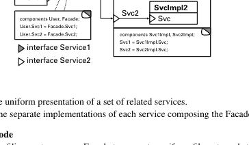

### 参与者

- 外观：一组相关服务的统一呈现。
- `SvcImpl`：构成外观的每个服务的单独实现。

### 示例 1.x 代码

Matchbox 文件系统使用外观来呈现统一的文件系统抽象。文件操作都在不同的组件中实现，但顶层 Matchbox 配置在一个地方提供它们。这些组件中的每一个都依赖于广泛的底层抽象，例如面向非易失性存储的块接口；Matchbox 对它们进行适当的连线，解析所有依赖关系。

```
configuration Matchbox {
    provides {
        interface FileRead[uint8_t fd];
        interface FileWrite[uint8_t fd];
        interface FileDir;
        interface FileRename;
        interface FileDelete;
    }
}

implementation {
    // File operation implementations
    components Read, Write, Dir, Rename, Delete;

    FileRead = Read.FileRead;
    FileWrite = Write.FileWrite;
}
```

`FileDir` = `Dir.FileDir`;

`FileRename` = `Rename.FileRename`;

`FileDelete` = `Delete.FileDelete`;

// Wiring of operations to sub-services omitted

}

#### Listing 10.4 The Matchbox facade

### Sample 2.x code

The `CC2420` radio stack is broken up into three call paths: control, transmission, and reception. The top-level `CC2420CsmaC` component presents these three paths together as a single abstraction using a Facade:

```
configuration CC2420CsmaC {
  provides interface Init;
  provides interface SplitControl;

  provides interface Send;
  provides interface Receive;
  provides interface PacketAcknowledgements as Acks;

  uses interface AMPacket;
}
implementation {
  components CC2420CsmaP as CsmaP;
  Init = CsmaP;
  SplitControl = CsmaP;
  Send = CsmaP;
  Acks = CsmaP;
  AMPacket = CsmaP;

  components CC2420ControlC;
  Init = CC2420ControlC;
  AMPacket = CC2420ControlC;
  CsmaP.Resource -> CC2420ControlC;
  CsmaP.CC2420Config -> CC2420ControlC;

  components CC2420TransmitC;
  Init = CC2420TransmitC;
  CsmaP.SubControl -> CC2420TransmitC;
  CsmaP.CC2420Transmit -> CC2420TransmitC;
  CsmaP.CsmaBackoff -> CC2420TransmitC;

  components CC2420ReceiveC;
  Init = CC2420ReceiveC;
  Receive = CC2420ReceiveC;
  CsmaP.SubControl -> CC2420ReceiveC;

  components RandomC;
  CsmaP.Random -> RandomC;

components LedsC as Leds;
CsmaP.Leds -> Leds;
}
```

Listing 10.5 The CC2420CsmaC uses a Facade

### Known uses

Stable, commonly used abstract boundaries such as radio stacks (`CC2420CsmaC`, `CC1000CsmaRadioC`) and storage (`BlockStorageC`) often use a Facade. This allows them to implement complex abstractions in smaller, distinct parts, which simplifies code.

### Consequences

The key aspects of the Facade pattern are:

- Provides an abstraction boundary as a set of interfaces. A user can easily see the set of operations the abstraction support, and only needs to include a single component to use the whole service.
- Presents the interfaces separately. A user can wire to only the needed parts of the abstraction, but be certain everything underneath is composed correctly.

A Facade is not always without cost. Because the Facade names all of its subparts, they will all be included in the application. While the nesC compiler attempts to remove unreachable code, this analysis is necessarily conservative and may end up keeping much useless code. In particular, unused interrupt handlers are never removed, so all the code reachable from them will be included every time the Facade is used. If you expect applications to only use a very narrow part of an abstraction, then a Facade can be wasteful.

### Related patterns

- Placeholder: a placeholder allows easy selection of the implementation of a group of interfaces, while a Facade allows easy use of a group of interfaces. An application may well connect a placeholder to a Facade.

### 10.7 Behavioral: Decorator

#### Intent

Enhance or modify a component's capabilities without modifying its implementation. Be able to apply these changes to any component that provides the interface.

#### Motivation


We often need to add extra functionality to an existing component, or to modify the way it works without changing its interfaces. For instance, the standard `LogStorageC` component provides a `LogWrite` interface to log data to a region of flash memory. In some circumstances, we would like to introduce a RAM write buffer on top of the interface. This would reduce the number of times the application talks to the flash chip, improving performance and conserving energy.

Adding a buffer to the `LogStorageC` component forces all logging applications to allocate the buffer. As some applications may not able to spare the RAM, this is undesirable. Providing two versions, buffered and unbuffered, replicates code, reducing reuse, and increasing the possibility of incomplete bug fixes. It is possible that several implementers of the interface – any component that provides `LogWrite` – may benefit from the added functionality. Having multiple copies of the buffering version, spread across several services, further replicates code.

There are two traditional object-oriented approaches to this problem: inheritance, which defines the relationship at compile-time through a class hierarchy, and decorators, which define the relationship at run-time through encapsulation. As nesC is not an object-oriented language, and has no notion of inheritance, the former option is not possible. Similarly, run-time encapsulation is not readily supported by nesC’s static component composition model and imposes overhead in terms of pointers and call forwarding. However, we can use nesC’s component composition and wiring to provide a compile-time version of the Decorator.

A Decorator component is typically a generic module that provides and uses the same interface type, such as `LogWrite`. The provided interface adds functionality on top of the used interface. For example, we show a `BufferedLogC` component that sits on top of a `LogWrite` provider. It implements its additional functionality by aggregating several writes to `BufferedLogC` writes into a single write to the underlying `LogWrite` interface.

Using a Decorator can have further benefits. In addition to augmenting existing interfaces, they can introduce new ones that provide alternative abstractions. For example, `BufferedLogC` provides a synchronous (not split phase) `FastLog` interface; a call to `FastLog` writes directly into the buffer.

Finally, separating added functionality into a Decorator allows it to apply to any implementation. For example, a packet send queue Decorator can be interposed on top of any networking abstraction that provides the `Send` interface; this allows flexible interpositioning of queues and queueing policies in a networking system.

## Applicable when

- You wish to extend the functionality of an existing component without changing its implementation, or
- You wish to provide several variants of a component without having to implement each possible combination separately.

## Structure


## 参与者

- Original：原始服务。
- Decorator：添加到服务中的额外功能。

## 示例代码

标准的 `LogWrite` 接口（第6.5节）包括分阶段擦除、追加和同步操作。`BufferedLogC` 为 `LogData` 操作增加了缓冲，此外还支持一个 `FastLog` 接口，该接口具有非分阶段的追加操作（仅用于小写入）：

```
generic module BufferedLogC(unsigned int bufsize) {
  provides interface LogWrite;
  provides interface FastLog;
  uses interface LogWrite as UnbufferedLog;
}
implementation {
  uint8_t buffer1[bufsize], buffer2[bufsize];
  uint8_t *buffer;
  command result_t FastLog.append(void *data, storage_len_t n) {
    if (bufferFull()) {
      call UnbufferedLog.append(buffer, offset);
      // ... switch to other buffer ...
    }
    // ... append to buffer ...
  }
}
```

## 已知用途

`TransformAlarmC` 和 `TransformCounterC` 泛型组件转换 `Alarm` 与 `Counter` 接口的精度和宽度。

`ArbitratedReadC` 泛型组件为 `Read` 接口添加自动资源仲裁，`ArbitratedReadStreamC` 对 `ReadStream` 接口提供相同功能。

## 效果

通过应用装饰器，你可以通过一个独立的组件来扩展或修改组件的行为：原始实现可以保持不变。此外，装饰器可以应用于任何提供该接口的组件。为了允许重用，装饰器通常是泛型组件。


在大多数情况下，不应直接使用被装饰的组件，因为装饰器已经处理其事件。可以使用占位符模式（第10.5节）来帮助确保这一点。

附加接口可能会使用底层组件，从而在装饰器的原始接口和额外接口之间创建依赖关系。例如，在`BufferedLogC`中，`FastLog`使用`UnbufferedLog`，因此对`FastLog`和`Log`的并发请求可能会冲突：同时只有一个能访问`UnbufferedLog`。

装饰器是一种轻量级但灵活的扩展组件功能的方式。介入是构建网络协议栈中的一种常见技术，而装饰器使得这种组合风格成为可能。

#### 相关模式

- 适配器：适配器以不同的接口呈现组件的现有功能，而不是添加额外的功能并保留当前接口。

### 10.8 行为型：适配器

#### 意图

将组件的接口转换为另一个接口，而无需修改原始实现。允许具有不同接口的两个组件互操作。

#### 动机

有时，某个组件通过一个接口提供的功能需要被另一个组件通过不同的接口访问。例如，底层`Alarm`接口效率很高，但会在中断处理器中发出“触发”事件，让用户面对中断驱动编程的复杂性。在大多数情况下，使用`Timer`接口更可取，因为编写正确的任务级代码要容易得多。

为每个定时器手动实现`Timer`而不是`Alarm`，甚至为每个平台实现一次，都是不可取的：一些重复的代码很可能包含错误，并且如果`Timer`或`Alarm`接口发生变化，还会导致维护问题。相反，`AlarmToTimerC`适配器基于`Alarm`的操作实现`Timer`接口。

适配器是一个组件（通常是泛型组件），它提供类型为`A`的接口（例如`Timer`），并使用类型为`B`的接口（例如`Alarm`），基于`B`的操作来实现`A`的操作。适配器可能还需要实现`B`接口未提供的功能，例如`Timer`提供周期性和一次性定时事件，而`Alarm`只有一次性事件。更一般地说，适配器可以提供多个接口`A1,...,An`，并基于多个被使用的接口`B1,...,Bm`来实现它们。

#### 适用场景

- 你希望用不同的接口提供现有组件的功能。

#### 结构

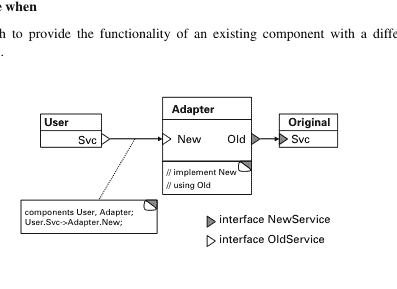

一个硬件无关层（HIL），它提供高级的、平台无关的接口（参见第12章）。HIL层通常是HAL层上的一个适配器。例如，参见用于ATmega128的`AdcP` A/D转换器组件。

TinyOS提供了许多适配器来简化mote定时子系统的实现，包括`AlarmToTimerC`（上文已见），以及`CounterToLocalTimeC`（将`Counter`转换为`LocalTime`接口）。

#### Consequences

适配器允许组件在最初计划之外的情况下被重用，而无需更改原始实现。

在许多情况下，使用适配器的组件不能在同一应用程序中独立使用，因为适配器已经在处理其事件。如同装饰器模式，Placeholder模式（第10.5节）可以帮助确保这一点。

如果适配器不包含特定于某个被适配组件的假设或行为，它就可以用于适配其使用的接口的许多不同实现。与装饰器一样，适配器通常是通用组件以允许重用。

添加额外的层来在接口之间转换可能会增加应用程序的资源消耗（ROM、RAM和执行时间）。

#### Related patterns

- Decorator: Decorator在保留其原始接口的同时为现有组件添加功能。Adapter通过不同的接口呈现现有（以及可能的额外）功能。

## 11 Concurrency

到目前为止，我们看到的代码是分阶段的并在任务中运行（同步）。这种编程模型足以满足几乎所有应用级代码。高性能应用程序和低级设备驱动程序有时需要额外的功能和并发模型。本章描述了两种这样的额外机制：异步代码和资源锁。异步代码是`nesC`语言的特性，而资源锁是一组TinyOS组件和机制。

### 11.1 Asynchronous code

任务允许软件组件模拟硬件的分阶段行为。但它们的用途远不止于此。它们还提供了一种在系统中管理抢占的机制。因为任务相对于彼此是原子运行的，所以仅在任务中运行的代码可以相当简单：没有其他执行突然接管并在你之下修改数据的危险。然而，中断正是这样做的：它们中断当前执行并开始抢占式运行。

#### 11.1.1 The `async` keyword

正如我们在第5章中所见，`nesC`区分同步（`sync`）和异步（`async`）代码。能够从中断处理程序抢占式运行（因此相对于任务是异步的）的命令和事件，必须在声明命令或事件的接口中以及在实现命令或事件的模块中都用`async`关键字标记。作为结果，`async`命令或事件，或从`async`命令或事件可达的函数只能调用或触发`async`命令和事件（`nesC`会在你违反此规则时提醒你）。这条规则意味着，只需查看接口或模块即可清楚哪些代码是同步的，哪些是异步的。例如，`Send`接口是纯同步的，因为没有命令或事件被标记为`async`：

```
interface Send {
  command error_t send(message_t* msg, uint8_t len);
  event void sendDone(message_t* msg, error_t error);
  command error_t cancel(message_t* msg);
  command void* getPayload(message_t* msg);
  command uint8_t getPayloadLength(message_t* msg);
}
```

Listing 11.1 The `Send` interface

相比之下，`Leds`接口是纯异步的：

```
interface Leds {
  async command void ledOn();
  async command void ledOff();
  async command void ledToggle();

  ... more commands declared with async ...
}
```

Listing 11.2 The `Leds` interface

所有中断处理程序都是自动`async`的，因此它们在其调用图中不能包含任何`sync`函数。中断处理程序执行`sync`函数的唯一方法就是发布一个任务。从`async`上下文发布任务是允许的，但由此产生的任务在同步上下文中运行。

例如，考虑一个位于UART之上的数据包层。当UART接收到一个字节时，它会触发一个中断。在中断处理程序中，软件从数据寄存器中读取该字节并将其放入缓冲区。当接收到数据包的最后一个字节时，软件需要发出数据包接收信号。但`Receive`接口的`receive`事件是`sync`的。因此，在最后一个字节的中断处理程序中，组件会发布一个任务来发出数据包接收信号。

#### 11.1.2 The cost of `async`

这就引出了一个问题：如果任务引入延迟，为什么还要使用它们？为什么不让所有东西都`async`呢？原因很简单：竞争条件，特别是*数据竞争*。抢占式执行的基本问题是它可以在正在进行的计算之下修改状态，这可能导致系统进入不一致的状态。例如，考虑这个命令`toggle()`，它翻转状态位并返回旧值：

```
bool state;
async command bool toggle() {
  if (state == 0) {
    state = 1;
    return 1;
  }
  if (state == 1) {
    state = 0;
    return 0;
  }
}
```

Listing 11.3 Toggling a state variable

现在想象这个执行过程，从`state = 0`开始：

```
toggle()
    state = 1;
    -> interrupt
        toggle()
            state = 0
            return 0;
    return 1;
```

Listing 11.4 A call sequence that could corrupt a variable

在这个执行中，当第一个`toggle()`返回时，调用方组件会认为`state`等于1。但最后一次赋值是在中断中，赋值为0。

当单个语句可以被中断时，这个问题会变得更糟。例如，在`micaz`或`Telos` mote 上，读写一个 32 位数字需要不止一条指令。可能在两条指令之间发生中断，这样读取的数字一部分是旧值，一部分是新值。

这个问题——数据竞争——在状态变量上尤其明显。例如，想象下面这段代码来自`AMSStandard`，这是 TinyOS 1.x 中的基本数据包抽象，省略了很多细节。状态变量表示组件是否忙。

```
command result_t SendMsg.send ... {
    if (!state) {
        state = TRUE;
        // send a packet
        return SUCCESS;
    }
    return FAIL;
}
```


#### Listing 11.5 State transition that is not async-safe

如果这个命令是异步的，那么在条件 `if (!state)` 和赋值 `state = TRUE` 之间，另一个组件可能会插进来也尝试发送。这个第二次调用会看到 `state` 为 `false`，将 `state` 设为 `true`，开始发送并返回 `SUCCESS`。但随后第一个调用者会返回，再次将 `state` 设为 `true`，开始发送并返回 `SUCCESS`。只有两个数据包中的一个会被成功发送，但在调用路径中如果没有额外的错误检查，很难查出是哪一个，这可能会在调用组件中引入各种各样的 bug。注意，为了避免这个问题，`send` 命令不是异步的。

#### Programming Hint 21 KEEP CODE SYNCHRONOUS WHEN YOU CAN. CODE SHOULD BE ASYNC ONLY IF ITS TIMING IS VERY IMPORTANT OR IF IT MIGHT BE USED BY SOMETHING WHOSE TIMING IS IMPORTANT.

### 11.1.3 Atomic statements and the atomic keyword

中断引入的问题意味着程序需要一种方式来执行不会被抢占的代码片段。nesC 通过原子语句提供了这种功能。例如：

```
command bool increment() {
  atomic {
    a++;
    b = a + 1;
  }
}
```

Listing 11.6 Incrementing with an atomic statement

原子块承诺这些变量可以被原子地读写。实际上，在所有当前 mote 平台上，原子语句都是通过在原子语句体周围禁用并有条件地重新启用中断来实现的（这通常只花费几个周期）。理论上，nesC 实现可以允许 `incrementA` 和 `incrementC` 在这段代码片段中相互抢占，因为它们访问的是不相交的变量：

```
async command bool incrementA() {
  atomic {
    a++;
    b = a + 1;
  }
}
async command bool incrementC {
  atomic {
    c++;
    d = c + 1;
  }
}
```

Listing 11.7 Incrementing with two independent atomic statements

### 11.1.4 Managing state transitions

原子语句最基本的使用是组件内部的状态转换。通常，状态转换有两个部分，都由现有状态和调用决定：第一部分是转换到新状态，第二部分是采取某种操作。再次看 `AMStandard` 示例：

```
if (!state) {
  state = TRUE;
  // send a packet
  return SUCCESS;
}
else {
  return FAIL;
}
```

如果 `state` 被异步函数触及，那么你需要使状态转换是原子的。但你不想把整个块都做成原子语句，因为发送数据包可能需要足够长的时间，导致系统错过中断。所以代码会做类似这样的事情：

```
uint8_t oldState;
atomic {
  oldState = state;
  state = TRUE;
}
if (!oldState) {
  //send a packet
  return SUCCESS;
}
else {
  return FAIL;
}
```

如果 `state` 已经为 `true`，仅仅再次设为 `true` 也无妨。这比有点冗余的语句

```
if {state != TRUE} {state = TRUE;}
```

花费的 CPU 周期更少。在这个例子中，状态转换发生在原子块中，但实际处理则在块外进行，基于组件开始时的状态。

### 11.1.5 Example: CC2420ControlP

让我们看一个真实的例子。这个组件是 `CC2420ControlP`，它是 CC2420 无线电栈的一部分。`CC2420ControlP` 负责配置无线电的各种 I/O 选项，以及打开和关闭它。打开和关闭 CC2420 无线电

该过程分为四个步骤：

- 1. 打开稳压器（0.6 毫秒）
- 2. 获取到无线电的 SPI 总线（时间取决于竞争）
- 3. 通过总线发送命令来启动无线电的振荡器（0.86 毫秒）
- 4. 将无线电置于接收模式（0.2 毫秒）

某些耗时的步骤是分阶段的，并且有异步完成事件（尤其是第 1 和第 3 步）。然而，启动这一系列事件的实际调用是 `SplitControl.start`，它是同步的。实现这一系列步骤的一种方法是为每个步骤分配一个状态，并使用一个状态变量来跟踪你当前所处的位置。但事实证明这并非必要。一旦启动序列开始，它就会一直持续到完成。因此，你唯一需要的状态变量是“是否正在启动”。在那之后，每个完成事件都隐式地属于某个状态。例如，`startOscillatorDone` 事件隐式地表示无线电处于状态 3。由于 `SplitControl.start` 是同步的，状态变量可以在没有任何原子语句的情况下修改：

```
command error_t SplitControl.start() {
  if ( m_state != S_STOPPED )
    return FAIL;

  m_state = S_STARTING;
  m_rsn = call Random.rand16();
  call CC2420Config.startVReg();
  return SUCCESS;
}
```

清单 11.8 启动 CC2420 无线电的第一步

`startVReg` 命令启动稳压器。这是一个异步命令。在其完成事件中，无线电尝试获取 SPI 总线：

```
async event void CC2420Config.startVRegDone() {
  call Resource.request();
}
```

清单 11.9 表示启动 CC2420 的第一步完成的事件处理器

在完成事件（当它收到总线时）中，它发送一个命令来启动振荡器：

```
event void Resource.granted() {
  call CC2420Config.startOscillator();
}
```

清单 11.10 表示启动 CC2420 的第二步完成的事件处理器

最后，当振荡器完成事件被触发时，组件告诉无线电进入接收模式，并发布一个任务来触发 `startDone` 事件。它必须发布任务，因为 `oscillatorDone` 是异步的，而 `startDone` 是同步的。注意，该组件也释放总线供其他用户使用。

```
async event void CC2420Config.startOscillatorDone() {
  call SubControl.start();
  call CC2420Config.rxOn();
  call Resource.release();
  post startDone_task();
}
```

清单 11.11 表示启动 CC2420 无线电的第三步完成的事件处理器

最后，任务将无线电的状态从 STARTING 更改为 STARTED：

```
task void startDone_task() {
  m_state = S_STARTED;
  signal SplitControl.startDone( SUCCESS );
}
```

清单 11.12 状态转换，使组件能够发送和接收数据包

另一种实现方式可能是将以下代码放入 `startOscillatorDone` 事件中：

```
atomic {
  m_state = S_STARTED;
}
```

这样做的唯一可能好处是无线电理论上可以更早地接受请求。但由于在 `startDone` 事件被触发之前，组件不应该调用无线电，这可能会有点问题。在 `startDone_task` 中，状态更改和事件触发之间不会有其他任务插入的机会。

> **编程提示 22** 保持原子语句简短，并且尽可能少。在原子语句中调用其他组件时要小心。

### 11.1.6 任务（重访）

第 5 章介绍了任务，作为延迟计算并保持 nesC 程序响应性的方式。然而，对于异步代码，它们还扮演了一个额外的关键角色。任务是组件从异步转换到同步的唯一方式。作为一个接口，任务看起来像这样：

```
interface TaskBasic {
  async command error_t post();
  event void run();
}
```

所有带有异步命令和同步完成事件的分阶段接口都必须通过任务进行。


注意，相反的方向——同步命令和异步事件——很少见。这种接口将用于只能从任务中调用的服务，但要求用户处理中断。由于事件是异步的，命令和事件之间共享的任何状态都必须用原子语句保护。因此，将命令也设为异步可以使程序直接从事件中调用它，而通常不需要增加代码的复杂程度。

### 11.2 电源锁

原子语句允许组件不间断地执行一段代码块。然而，低级驱动程序通常需要对单个硬件资源执行一系列分阶段操作，而不受系统任何其他部分的干扰。这些驱动程序不能使用原子语句——即使第一个操作的完成也发生在另一个函数（事件处理器）中，该函数显然不能位于同一个原子语句中。此外，在执行甚至一个分阶段操作所需的时间内禁用中断（正如原子语句通常所做的那样）可能不是一个好主意。

在这些情况下，原子性不在处理器上——其他代码执行是可以的——而是在硬件资源本身。为了支持编写此类驱动程序，TinyOS 提供了电源锁，可用于获得对特定（通常是硬件）资源的独占访问。除了管理并发性，电源锁还管理能源并帮助配置硬件。虽然应用程序几乎看不到它们，但电源锁构成了 TinyOS 内部的关键部分，并且对大多数低级系统工作都很重要。

#### 11.2.1 锁需求示例：链路层确认

链路层数据包通信就是这样一个示例。TinyOS 链路层协议栈通过 `PacketAcknowledgements` 接口支持确认。当节点接收到发往自身的数据包时，它立即发送一个微小的数据包作为响应，确认接收。在发送端，协议栈会短暂等待这个链路层确认，并报告是否听到了确认。最小化发送方必须等待的时间对性能至关重要，因此接收方希望尽快发送确认。

从编程的角度思考这个问题，收音机协议栈的接收部分需要经过以下步骤：

- 从收音机中读取数据包

- 检查数据包是否应发送确认

- 将收音机切换到发送模式

- 发送确认

- 将收音机恢复到接收模式

其中每个步骤通常都是一个独立的分阶段操作。例如在 CC2420 收音机上，每个操作都需要发送一条命令，通过 SPI 总线读取或写入数据。然而，这条 SPI 总线是多个芯片和子系统共享的：闪存存储驱动程序可能想在节点接收数据包的同时使用 SPI 总线读取数据。我们不能依赖 SPI 总线组件来调度多个未完成的请求，因为它可能会在收音机协议栈的两次操作之间插入一次大的闪存写入操作。我们需要一种方式让收音机协议栈请求对总线的独占访问，以便它能快速执行这五个操作，然后释放总线供其他模块使用。

还有许多其他情况，低级系统需要对硬件或软件资源进行独占访问，以保证正确性或延迟；我们稍后会介绍一些示例。

#### 11.2.2 分阶段锁

TinyOS 通过分阶段锁支持对资源的独占访问。传统上，锁如互斥锁和信号量是阻塞式构造，用于保护临界区或共享数据结构。然而，由于 TinyOS 没有阻塞调用，其锁必须是分阶段的。组件调用命令请求电源锁，并在获取锁时接收事件。出于历史原因，锁接口被命名为 `Resource`：

```
interface Resource {
  async command error_t request();
  async command error_t immediateRequest();
  event void granted();
  async command void release();
  async command uint8_t getId();
}
```

Listing 11.13 The Resource interface

要获取锁，组件通常调用 `request`。在稍后的某个时间点，它会收到 `granted` 事件，表明它可以使用锁所保护的内容。命令 `immediateRequest` 是一种优化：它允许组件以单阶段操作获取空闲锁。如果 `immediateRequest` 返回 FAIL，则表示锁已被占用，组件必须调用 `request`。组件使用 `release` 命令释放锁。

需要加锁的抽象通常提供 `Resource` 接口。在未持有锁的情况下调用功能接口通常是被禁止的，可能会导致错误或不期望的系统行为。例如，这就是带有 MSP430 微控制器的节点为 SPI 总线提供的抽象：

```
generic configuration Msp430Spi0C() {
  provides interface Resource;
  provides interface SpiByte;
  provides interface SpiPacket;
  uses interface Msp430Spi0CConfiguration;
}
```

Listing 11.14 Msp430Spi0C signature

同样，这就是 ADC 的抽象：

```
generic configuration Msp430Adc12ClientC() {
  provides {
    interface Resource;
    interface Msp430Adc12SingleChannel;
    interface Msp430Adc12MultiChannel;
    interface Msp430Adc12Overflow;
  }
}
```

Listing 11.15 Msp320Adc12ClientC signature

#### 11.2.3 锁内部结构

TinyOS 电源锁管理共享硬件资源的并发、能量和配置。电源锁有三个子组件：

- 一个 `arbiter`，控制锁定策略；

- 一个 `power manager`，控制能量策略；

- 以及一个或多个 `configurators`，为客户端配置硬件。

图 11.1 显示了这三个部分如何协同工作。`arbiter` 是控制的中心点。`arbiter` 从客户端接收锁请求，并根据这些请求调用 `power manager` 和 `configurators`。锁使用参数化接口和 `unique()` 来维护待处理的锁请求队列。每个锁客户端都有一个唯一的锁 ID，锁实现使用 `uniqueCount()` 来维护适当长度的队列。

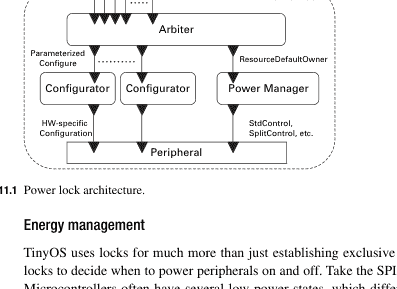

Figure 11.1 Power lock architecture.

#### 11.2.4 Energy management

TinyOS 对锁的用途远不止建立独占访问。它还使用锁来决定何时为外设供电和断电。以 SPI 总线为例。微控制器通常有几种低功耗状态，其区别在于哪些芯片子系统和中断源处于活动状态。最低功耗状态通常是节点只能响应特定硬件计数器或外部中断源唤醒的状态：总线和 ADC 等系统被断电且不工作。因此，如果 TinyOS 在不使用时能够禁用 SPI 总线，那么微控制器可能可以节省电量。

锁提供了一种轻松自动管理能源的方式，减轻了应用程序程序员的负担。当锁处于空闲状态时——它已被释放并且没有待处理的请求——它可以关闭其所保护的系统电源。当锁变得忙碌时——在空闲状态下收到请求——它可以为系统上电。根据底层硬件的特性，锁可以在断电前给予短暂的超时，或者立即断电。

电源锁支持“默认所有者”，即锁在空闲时回退到的组件。该默认所有者负责电源锁的能源管理策略。默认所有者使用与 `Resource` 略有不同的接口，因为它从不请求锁。相反，仲裁器始终授予它一个空闲锁，并在有待处理请求时通知默认所有者。作为对请求的响应，默认所有者可以为硬件上电，并在上电后释放其锁：

```
interface ResourceDefaultOwner {
  async event void granted();
  async command error_t release();
  async command bool isOwner();
  async event void requested();
  async event void immediateRequested();
}
```

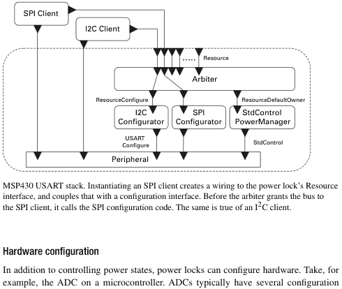

Figure 11.2 MSP430 USART stack. Instantiating an SPI client creates a wiring to the power lock’s Resource interface, and couples that with a configuration interface. Before the arbiter grants the bus to the SPI client, it calls the SPI configuration code. The same is true of an I²C client.

#### 11.2.5 Hardware configuration


除了控制电源状态外，电源锁还可以配置硬件。例如，微控制器上的 ADC。ADC 通常有几个配置参数，例如要测量的引脚电压以及要与之比较的参考电压。虽然电源锁可以期望每个客户端自行进行此配置，但它也可以通过自动执行来简化用户的工作。当配置实例化一个 ADC 客户端时，它会将配置参数传递给客户端组件。这些参数随后传递给配置器，该配置器连接到仲裁器。在仲裁器授予客户端锁之前，它会调用相应的配置器以按需设置硬件。当客户端释放锁时，仲裁器会取消配置硬件并返回到就绪状态：

```
interface ResourceConfigure {
  async command void configure();
  async command void unconfigure();
}
```

Listing 11.17 The `ResourceConfigure` interface

#### 11.2.6 Example: MSP430 USART

MSP430 USART0（通用同步/异步收发器）是一种通用总线，软件可以将其配置为多种用途。USART 可用作 UART（串口）、SPI（串行外设接口）或 I²C（集成电路间总线）。这三种协议共享同一组硬件引脚，因此软件配置告诉 MSP430 如何对其进行时钟控制。

软件驱动程序通过实例化通用组件来使用总线协议，例如 `Msp430Spi0C`、`Msp430Uart0C` 和 `Msp430I2C0C`。每个组件都提供其功能接口和 `Resource` 接口。最后，它们使用硬件特定的配置接口。以 SPI 为例，客户端需要配置总线速度。这允许客户端将其自身置于配置器路径上。图 11.2 显示了此组件结构。

#### 11.2.7 Power lock library

TinyOS 拥有一个小型可重用的电源锁组件库，可在 `tos/system` 中找到。它们包括：

- 两种具有不同调度策略的仲裁器：`FcfsArbiterC`（先进先出）和 `RoundRobinArbiterC`（轮询）
- 两种电源管理器：`ImmediatePowerManagerC` 和 `DeferredPowerManagerC`
- 众多配置器：由于配置器是硬件特定的，因此它们分布在整个代码库中，大多位于 `tos/chips` 中。

如果您想了解有关电源锁的更详细信息、性能和使用情况，请参阅 TEPs 108 [13] 和 115 [11]，以及描述它们的论文 [12]。

### 11.3 Exercises

1. MSP430 ADC 具有延迟电源管理器。其超时时间过去是 100 ms，但在一些实验后被改为 20 ms 的超时。为什么是 20 ms？提示：查看电压基准稳定所需的时间。
2. 为什么无线电通常没有电源锁？
3. 计算原子语句的 CPU 成本。编写一个嵌套的原子段，其中一个原子语句在另一个原子语句内。开销会增加吗？
4. 大多数中断处理程序本身就是原子的：它们完全在原子语句内。尝试编写一个可重入的 UART 字节接收中断处理程序（可以在已执行时重新执行）。为什么很难？能否完全不使用任何原子语句来实现？

## 12 设备驱动程序与硬件抽象架构（HAA）

就其本质而言，传感器网络应用通常是平台特定的：应用使用特定传感器板上一组特定的传感器，来测量特定于应用的物理量。这些硬件，以及相应的应用，通常无法直接复用到另一个 mote 平台上。此外，某些应用可能希望将 mote 平台推向极限，例如最大化采样率，或最小化对外部事件的响应延迟。要达到这些极限，通常需要进行大量的平台特定调优，包括平台特定代码（甚至可能用汇编语言编写）。

相反，传感器网络应用的大部分内容是可移植的：多跳网络协议、常用无线芯片的协议栈、信号处理等，在新平台上几乎不需要修改。因此，虽然传感器网络应用通常不能直接移植，但 TinyOS 应通过将所需修改的范围最小化，使应用易于移植到新平台。

### 12.1 可移植性与硬件抽象架构

TinyOS 在保持对平台特定功能易访问性的同时最大化可移植性的主要工具，是一种多层硬件抽象架构（HAA），如图 12.1 所示。提供对 mote 各种硬件资源访问的设备驱动组件分为三类：

- **硬件接口层（HIL）**：如果设备驱动程序以平台无关的方式，仅使用与硬件无关的接口提供对设备（无线电、存储、定时器等）的访问，则该驱动程序属于 HIL。

    HIL 的功能受限于多个平台上都可用的能力。例如，虽然某些闪存芯片具有某种形式的写保护，但该功能并非所有闪存芯片都具备，因此存储层 HIL 中未体现该功能（第 6.5 节）。

    除传感器外，我们在第 6 章防盗演示中使用的所有组件（用于通信、存储等）都属于 HIL。

- **硬件适配层（HAL）**：HAL 中的设备驱动程序通过高级接口公开底层硬件，从而简化了对通常较为复杂的底层硬件的使用。例如，Atmel AT45DB 系列闪存芯片的 HAL 提供了读写闪存存储块中部分内容的操作，同时自动管理闪存芯片的 2 个 RAM 缓冲区。

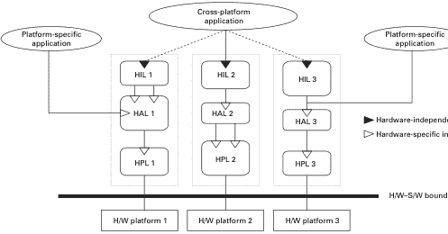

**图 12.1** TinyOS 的三级硬件抽象架构。

HAL 组件是平台特定的，但应尽可能使用与硬件无关的接口。例如，micaz 的 `HilTimerMilliC` 组件（第 9.2.1 节）内部使用的 `Alarm` 接口，由 micaz 特定的 `AlarmCounterMilliC` 组件提供，但由可移植的 `AlarmToTimerC` 组件使用，该组件在给定 `Alarm` 接口的情况下实现 `Timer` 接口。

- **硬件表示层（HPL）**：HPL 中的设备驱动程序直接位于硬件之上，而不抽象掉其任何功能。HPL 组件的目标是隐藏类似硬件之间不相关的差异，并以符合 nesC 风格的方式呈现硬件功能。例如，在 micaz 平台上，`HplAtm128GeneralIOC` 将 ATmega128 的 53 个数字 I/O 引脚暴露为 53 个 `GeneralIO` 接口，隐藏了在某些 I/O 引脚上执行某些操作所需的略有不同的指令序列（某些 I/O 引脚可以在单条汇编指令中原子地设置，而其他引脚则需要禁用中断以保证原子性）。

如图 12.1 所示，设备 HIL 通常构建在设备的 HAL 之上，而 HAL 又构建在 HPL 之上。

TinyOS 硬件无关层的行为、名称和规范在 TinyOS 增强提案（TEP）中定义，硬件抽象架构本身在 TEP 2 [8] 中描述。TEP 不规定任何硬件的 HAL 或 HPL 内容，但有时会提供关于 HAL 结构以及 HAL 和 HPL 中使用硬件无关接口的指导原则。

#### 12.1.1 示例

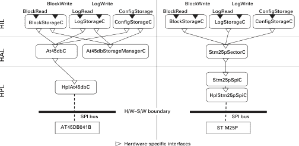

图 12.2 说明了硬件抽象架构的一个典型示例：两种不同闪存芯片的存储结构，Atmel 的 AT45DB041B 串行数据闪存，以及 ST 的 M25P 串行 NOR 闪存。两款芯片均支持我们在第 6.5 节中看到的三个 HIL 存储抽象，`BlockStorageC`、`LogStorageC` 和 `ConfigStorageC`。然而，这些抽象的实现对每款芯片而言是不同的。每个芯片的 HAL 层由不同数量的组件组成，并提供不同的接口。

```
configuration At45dbC {
  provides interface At45db;
  ...
}

module At45dbStorageManagerC {
  provides interface At45dbVolume[volume_id_t volid];
}

configuration Stm25pSectorC {
  provides interface Stm25pSector as Sector[uint8_t id];
  ...
}
```

AT45DB041B 的 HAL 由两个组件提供：`At45dbC` 提供单个接口（`At45db`），具有擦除、读取、写入和 CRC 计算命令，并管理一个小型片上闪存缓存。`At45dbStorageManagerC` 组件根据其 `id` 返回特定 TinyOS 存储卷的配置。相比之下，ST M25P 的 HAL 由单个组件 `Stm25pSectorC` 提供，该组件将高级擦除、读取、写入和 CRC 计算（在 `Stm25pSector` 接口中）与卷管理结合起来。`Stm25pSectorC` 提供一个参数化接口，其中接口参数标识每个单独的 HAL 用户。

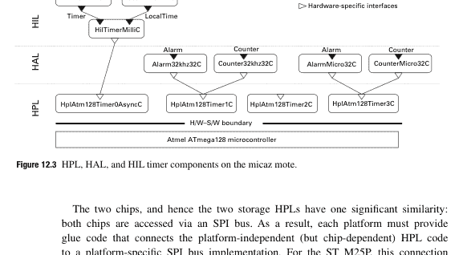

图 12.3 micaz mote 上的 HPL、HAL 和 HIL 定时器组件。


这两个芯片，因此两个存储 HPL 有一个显著的相似之处：两款芯片均通过 `SPI` 总线访问。因此，每个平台必须提供胶水代码，将平台无关（但芯片相关）的 HPL 代码连接到平台特定的 SPI 总线实现。对于 ST M25P，此连接由平台特定的 `HplStm25pSpiC` 组件指定，而 `Stm25pSpiC` 包含具有低级擦除、读取、写入和 CRC 计算操作的平台无关代码。对于 AT45DB041B，每个平台必须实现 `HplAt45dbC` 组件，该组件提供低级擦除、读取、写入、CRC 计算、状态和缓存管理操作。

HAA 结构在不同设备之间差异很大。例如，图 12.3 总结了 TinyOS 对 micaz 平台定时器的支持。在最低层，四个 HPL 组件提供对四个 ATmega128 定时器的访问。其中两个定时器（0 和 2）为 8 位，另两个（1 和 3）为 16 位。此外，定时器 0 支持“异步”模式，其中它由外部（通常为 32 768 Hz）晶体时钟，而其他定时器则由与微控制器相同的源时钟，即 micaz 上的外部 7.37 MHz 晶体。在 mica 上，定时器 0 专用于实现 TinyOS 的定时器子系统 `HilTimerMilliC`：

```
configuration HilTimerMilliC {
  provides interface Init;
  provides interface Timer<TMilli> as TimerMilli[uint8_t num];
  provides interface LocalTime<TMilli>;
}
```

用户级定时器组件 `TimerMilliC`（和 `LocalTimeMilliC`）是 `HilTimerMilliC` 的简单可移植包装器（参见第 9.2.1 节）。在 HAL 层，micaz 使用 1/32768 s 和 µs 时间单位提供 32 位计数器和报警。由这些组件提供的 `Alarm` 和 `Counter` 接口是硬件无关的，组件名称（`Alarm32khz32C` 等）也是如此。然而，这些组件不一定由所有平台提供，并且可用报警的数量——micaz 的情况为三个——因平台而异。因此，这些组件属于 HAL 而非 HIL。然而，在各平台上使用相同的名称和接口确实简化了编写相当可移植的代码，而这些代码的时序要求无法由完全可移植的 `TimerMilliC` 组件满足。最后，如图所示，定时器 1 和 3 专用于支持 micaz 的 HAL 层，但定时器 2 未使用，可供需要它的应用程序使用。

### 12.1.2 可移植性

虽然仅使用 HIL 部分的设备驱动程序的程序或组件可以被视为“完全”可移植，但现实更为复杂。不同的 mote 具有不同的硬件资源，因此最终支持不同的 HIL：例如，假设的“Ghost” mote 没有闪存芯片或其他形式的永久存储，将不支持第 6.5.3 节的日志存储抽象。因此，第 6.5.3 节的 `FlashSampler` 应用程序将无法移植到“Ghost” mote。

相比之下，第 6 章第一部分中的防盗应用程序依赖于光传感器组件（`PhotoC`）和加速度计组件（`AccelXStreamC`），这些组件不属于 HIL——这两个组件特定于特定平台（micaz）的特定传感器板（mts310）。然而，防盗代码通过硬件无关接口访问这些组件（分别为 `Read` 和 `ReadStream`），因此只要目标 mote 提供等效传感器，就很容易移植到不同的 mote：可能只需要更改传感器组件名称和检测阈值（`DARK_THRESHOLD` 和 `ACCEL_VARIANCE`）。

总之，仅使用 HIL 组件的应用程序，或通过硬件无关接口访问 HAL 组件的应用程序，只要目标 mote 满足应用程序的硬件要求，就应易于移植。应用程序访问 HAL 或 HPL 组件越多，尤其是通过硬件特定接口访问，移植就越困难。

## 12.2 设备驱动程序

TinyOS 程序可以选择通过其 HPL、HAL 和 HIL 组件访问特定硬件设备。然而，并非所有设备都有或需要 HIL 组件：如果设备仅存在于一个平台或传感器板上，并且与任何其他设备都不太相似，那么不太可能有人会编写设备无关的 HIL 规范。此外，一些硬件实际上并不提供任何硬件无关接口。例如，A/D 转换器的行为和配置与连接到转换器的特定模拟传感器密切相关。因此，实际上不存在硬件无关的 A/D 接口，也就不存在 A/D HIL。

多个客户端，即执行访问控制，以及它们如何管理电源使用。在本章其余部分，我们将更详细地研究最后这两个问题。

### 12.2.1 访问控制

设备驱动程序需要执行访问控制，以防止程序多个部分尝试访问同一设备时出现问题（因为TinyOS只运行单个应用程序，跨应用程序的访问控制不是问题）。例如，ATmega128 A/D转换器一次只能采样一个通道，因此在程序中，如果无线电需要检查天线上的信号强度，而用户代码需要采样当前温度，则需要某种协调，以避免无线电和用户代码相互破坏对方的请求。

TinyOS 1.x 主要依靠检测冲突和程序员纪律来处理访问控制问题。例如，如果程序的其他部分已经在使用 A/D 转换器，则执行 A/D 转换的请求将返回错误：

```
/* Let's read temperature! */
if (call ADC.getData() == FAIL)
  /* oops, we need to try again */
  post tryAgain();
```

实际上，这种方法行不通。程序员省略了错误检查，或者无法想出好的错误恢复策略。此外，这些错误路径不太可能出现（例如，只有在无线电和应用程序确实尝试同时采样时才会发生），因此没有得到很好的测试。最后，生成的代码通常很复杂，难以正确编写、理解和维护。系统其余部分的演进使情况更加复杂：例如，不检查错误代码就采样温度的用户代码，与不采样信号强度的无线电协议栈配合良好。然而，如果将无线电协议栈更换为会采样信号强度的协议栈，那么用户的应用程序代码可能会突然停止工作。

因此，TinyOS 2 采用了更加系统化的访问控制方法。所有设备驱动程序组件都应属于以下三种访问控制类别之一：

- *专用* 专用驱动程序只有一个用户，该用户对设备拥有完全控制权。示例包括大多数 HPL 组件。
- *虚拟化* 虚拟化驱动程序有多个用户，每个用户似乎都有自己的设备实例。然而，底层实现通过对单个底层资源进行多路复用来创造这种假象。例如，`TimerMilliC` 组件的每个实例都是一个独立的定时器，但它们都是基于单个硬件定时器实现的，如第 9.2.1 节所述。
- *共享* 共享驱动程序有多个用户，他们通过 `Resource` 接口（第 11.2 节）协调对设备的使用。我们上面看到的两种存储芯片（Atmel AT45DB041B 和 ST M25P）的 HAL 组件都是共享驱动程序。

这三个类别的定义使用术语“用户”（user）来非正式地指代诸如无线电协议栈、用户应用程序代码等实体。实际上，驱动程序的“用户”最终是某个 nesC 模块，它连接到代表驱动程序实例的某个组件或接口。

### 12.2.2 访问控制示例

专用驱动程序只有一个实例，通常是一个具有特定名称的组件。HPL 驱动程序通常是专用的；示例包括 `HplAtm128Timer2C`（ATmega128 微控制器定时器 2 的 HPL）、`HplMsp430I2C0C`（TI MSP430 微控制器上 I²C 总线 0 的 HPL）。例如，在以下摘录中：

```
module HplAtm128Timer2C
{
  provides interface HplAtm128Timer<uint8_t> as Timer;
  provides interface HplAtm128TimerCtrl8 as TimerCtrl;
  provides interface HplAtm128Compare<uint8_t> as Compare;
} implementation {
  async command uint8_t Timer.get() { return TCNT2; }
  async command void Timer.set(uint8_t t) { TCNT2 = t; }
  ...
}
```

我们看到 `HplAtm128Timer2C` 只提供功能接口（`Timer`、`TimerCtrl`、`Compare`），这些接口是对原始硬件（此摘录中的 `TCNT2` 定时器 2 计数器寄存器）的非常简单的封装。由于不存在与其他用户共享资源的问题，专用驱动程序提供最低的性能和延迟开销——操作立即执行且无需检查。

没有什么能阻止多个用户连接到 `HplAtm128Timer2C` 并以冲突的方式使用定时器 2。HPL 实现者可以使用 nesC 的 `@atmostonce()` 连接属性（第 8.4 节）来防止这种多重连接，例如：

```
provides interface HplAtm128Timer<uint8_t> as Timer @atmostonce();
```

然而，使用这些属性目前并不常见，因为它有时会引起复杂问题：通过上述更改，将使用定时器 2 的代码拆分为两个独立（但紧密协作）且都连接到 `HplAtm128Timer2C` 的模块将不再可能。


专用驱动程序并不总是低级组件。例如，`ActiveMessageC`无线电链路层抽象是一个专用驱动程序，具有以下签名：

```
configuration ActiveMessageC {
  provides {
    interface SplitControl;
    interface AMSend(uint8_t id);
    interface Receive(uint8_t id);
    interface Receive as Snoop(uint8_t id);
    interface Packet;
```

```
interface AMPacket;
interface PacketAcknowledgements;
}
```

### Listing 12.1 ActiveMessageC signature

`ActiveMessageC`提供了一种在开启和关闭无线电的方法（见下文关于电源管理的讨论），并提供了发送、接收和检查数据包的接口。然而，它并没有为多个用户通过`AMSend`接口合作发送数据包提供一种简单的方法——与 TinyOS 1.x 类似，如果无线电当前正在发送数据包，第二次发送命令将简单地以错误结果失败（`EBUSY`）：

```
/**
 * Send a packet
 * @return ... EBUSY if the abstraction cannot send now but
 *          will be able to later
 */
command error_t send(am_addr_t addr, message_t* msg, uint8_t len);
```

我们在第 6 章中看到的`AMSenderC`组件是构建在`ActiveMessageC`之上的虚拟化驱动程序，像大多数虚拟化驱动程序一样，它是一个通用组件：

```
generic configuration AMSenderC(am_id_t AMId) {
  provides {
    interface AMSend;
    interface Packet;
    interface AMPacket;
    interface PacketAcknowledgements as Acks;
  }
}
```

`AMSenderC`提供的发送和检查数据包的接口与`ActiveMessageC`相同，尽管`AMSend`接口的`id`参数已成为`AMSenderC`的`AMId`通用组件参数。此类虚拟化驱动程序的实例只需通过实例化通用组件即可创建：

```
components new AMSenderC(AM_THEFT) as SendTheft;
MovingC.AMSend -> SendTheft;
...
```

`AMSenderC`与`ActiveMessageC`的实际区别在于，`AMSenderC`的每个实例可以有一个未决数据包，而`ActiveMessageC`仅允许整个系统有一个未决数据包——`AMSenderC`是虚拟化的，而`ActiveMessageC`是专用的。通常，虚拟化驱动程序要容易得多，因为你可以确保你的代码在需要时始终拥有资源（数据包传输槽、定时器等），而不是必须处理与系统其余部分共享资源的问题。因此，大多数 HIL 驱动程序都是虚拟化的。然而，虚拟化驱动程序有两种成本。首先，管理和在所有用户请求之间进行选择会增加一些运行时间开销。其次，任何单个操作的延迟都是不可预测的：在你的请求和实际执行之间可能会发生来自其他用户的任意一组操作。一些虚拟化驱动程序可能提供一些特定的保证，例如`AMSenderC`实例以轮询方式处理其用户。

共享驱动程序为虚拟化驱动程序的不可预测延迟提供了一种变通方法。共享驱动程序使用`Resource`接口（第 11.2 节）来控制多个用户的访问，一旦用户获得驱动程序的访问权限，该用户的操作就会立即执行。每个用户由一个唯一的`id`标识，使用 nesC 的`unique()`函数获得（第 9.1 节）。该`id`然后用于参数化`Resource`和功能接口，以便轻松区分每个用户的命令和事件，如`Stm25pSectorC`中所示，这是 ST M25P 闪存芯片的 HAL 驱动程序：

```
configuration Stm25pSectorC {
  provides interface Resource as ClientResource[uint8_t id];
  provides interface Stm25pSector as Sector[uint8_t id];
  provides interface Stm25pVolume as Volume[uint8_t id];
}
```

`Stm25pSectorC`的用户必须在通过`Stm25pSector`读取、写入或擦除闪存之前通过`ClientResource`接口请求访问：

```
char mybuf[16];

void readMybuf() {
  /* Request access before starting the read */
  call FlashResource.request();
}
```

```
event void FlashResource.granted() {
  /* We have access, we can now do our read */
  call Stm25pSector.read(0, mybuf, sizeof mybuf);
}
```

```
event void Stm25pSector.readDone(...) {
  /* Release the resource now that we're done */
  call FlashResource.release();
  ... use mybuf ...
}
```

更复杂的代码可能在释放对闪存的访问之前使用`Stm25pSector`执行多个操作。注意，执行许多长时间操作会增加其他闪存用户在执行任何操作之前等待的延迟。与虚拟化驱动程序相比，共享驱动程序在获得访问权限后执行的操作的延迟是可预测的。代价是管理显式的驱动程序请求和释放操作的额外代码复杂性，以及在第一次操作可以执行之前可能更长的延迟。

将线路连接到`Stm25pSectorC`等共享驱动程序通常很简单。客户端`id`使用`unique()`选择，然后功能和`Resource`接口

```
components MyAppC, Stm25pSectorC;

enum { MYID = unique (UQ_STM25P_VOLUME) };

MyAppC.FlashResource -> Stm25pSectorC.ClientResource[MYID];

MyAppC.Stm25pSectorC -> Stm25pSectorC.Stm25pSector[MYID];
```

一些共享驱动程序（例如`Msp430I2CC`，即 TI MSP430 的 I²C 总线 HAL）将此布线逻辑封装到一个通用组件中：

```
generic configuration Msp430I2CC() {
  provides interface Resource;
  provides interface I2CPacket<TI2CBasicAddr> as I2CBasicAddr;
  uses interface Msp430I2CConfigure;
}
```

通过使用 TinyOS 的 power-lock 库（第 11.2.7 节）来实现共享驱动程序的访问控制变得简单。仲裁器提供了一个参数化`Resource`接口的实现，具有特定的排队策略，以及一个用于电源管理的钩子（见下文）。通用仲裁器组件以用于选择唯一客户端`id`的字符串作为参数。例如，以下行创建了`Stm25pSectorC`的仲裁器：

```
components new FcfSArbiterC(UQ_STM25P_VOLUME) as ArbiterC;
```

`Stm25pSectorC`的实现需要在每次仲裁器授予访问权限以及用户释放访问权限时执行少量工作，因此在`ClientResource`接口与其先进先出仲裁器（`FcfSArbiterC`）之间插入一个模块（`Stm25pSectorP`）：

```
configuration Stm25pSectorC {
  provides interface Resource as ClientResource[uint8_t id];
  ...
}
implementation {
  components Stm25pSectorP as SectorP;
  components new FcfSArbiterC(UQ_STM25P_VOLUME) as ArbiterC;

  ClientResource = SectorP.ClientResource;
  SectorP.Stm25pResource -> ArbiterC.Resource;
  ...
}
```

列表 12.2 `Stm25pSectorC`中的仲裁

### 12.2.3 电源管理


Mote 通常由低容量电池供电，因此有效的电源管理对于获得合理的传感器网络寿命至关重要。例如，由两节 2700 mAh 电池供电的 mote（例如传统的 AA 电池）要使用一年，其平均功耗必须为 0.9 mW。典型的微控制器在活动时至少使用数 mW，而典型的无线电在监听消息时打开 of mW。幸运的是，无线电可以关闭，微控制器具有各种睡眠模式，功耗可降至低至 µW。因此，要实现 0.9 mW 的平均值，mote 必须将大部分时间花费在无线电关闭且微控制器处于某种适当睡眠状态的情况下；同样的推理适用于任何其他具有非平凡功耗的外设（传感器、闪存芯片等）。

关于各种组件何时必须打开的基本决策取决于应用程序：只有它知道何时必须采样传感器、何时传输消息等。TinyOS 电源管理的目标是“简单地”将每个子系统置于与这些应用程序需求一致的最低功耗状态。功耗状态因设备而异，然而，对于当前 mote 硬件，功耗状态通常为：

- 大多数外设的开和关，无论是微控制器上的 A/D 转换器、I²C 总线还是微控制器外的传感器、闪存芯片。

- 无线电特定的状态，如低功耗监听，其以某种频率监听无线电消息，或基于调度的 mote 在特定时间发送和接收。这些状态有效地以增加的延迟和降低的带宽为代价换取更低的功耗。

- 微控制器的功耗状态层次结构。例如，Atmel ATmega128 可以处于活动、空闲、ADC 噪声降低、扩展待机、省电、待机和关电状态。每个后续状态关闭更多片上功能并增加唤醒延迟。

在 TinyOS 中，只有无线电状态的选择留给应用程序程序员。外设在大多数设备驱动程序中（除专用驱动程序外）根据待处理的用户请求打开和关闭，而微控制器功耗状态则由整个系统状态派生。

因此，像第 6 章的防盗应用程序这样的程序中的用户级电源管理代码的范围是启动无线电后设置占空比的调用（以及相关的布线）：

```
uses interface LowPowerListening;
...
event void CommControl.startDone() {
    // Switch radio to low-power-listening with a 2% duty cycle
    call LowPowerListening.setLocalDutyCycle(200);
    call TheftTimer.startPeriodic(ACCEL_INTERVAL);
}
```

设备驱动程序中电源管理的实现在很大程度上取决于驱动程序的类别（专用、共享、虚拟化）。专用驱动程序通常不直接管理电源，而是提供打开和关闭设备的命令供专用驱动程序的单个用户使用。除了无线电堆栈（`ActiveMessageC`）之外，专用驱动程序通常由其他设备驱动程序管理，因此这种显式的电源管理对应用程序是不可见的。

### A/D 的开启与关闭

```
async command void HplAtm128Adc.enableAdc() {
    SET_BIT(ADCSRA, ADEN);
}
```

```
async command void HplAtm128Adc.disableAdc() {
    CLR_BIT(ADCSRA, ADEN);
}
```

电源管理通常由共享驱动程序自动执行。如果共享驱动程序使用电源锁实现，那么该驱动程序可以实例化一个电源管理器（第 11.2 节），根据其客户端的请求自动开启和关闭自身。设备必须在即时电源管理器和延迟电源管理器之间做出选择——在延迟情况下，系统在最后一个用户使用完毕后会等待一小段时间再关闭设备。延迟断电可以避免在最后一个请求完成后不久（但不是立即）有新请求到来时，设备关闭后立即重新开启所带来的开销。当设备的开启和关闭是复杂操作，或者设备在首次使用前需要“预热”期等情况下，延迟断电是一个好的策略。例如，TinyOS 的 `Stm25pSectorC` 实现使用了一个延迟电源管理器（下面实例化为 `PowerManagerC`），延迟时间为 1 秒，因为给闪存芯片上电或断电需要通过 SPI 总线向闪存发送命令：

```
configuration Stm25pSectorC {
    provides interface Resource as ClientResource[uint8_t id];
    ...
}
implementation {
    components Stm25pSectorP as SectorP;
    components new Pcf8ArbiterC(UQ_STM25P_VOLUME) as ArbiterC;
    ClientResource -> SectorP.ClientResource;
    SectorP.Stm25pResource -> ArbiterC.Resource;

    // 1024 binary milliseconds = 1 second power off delay:
    components new SplitControlDeferredPowerManagerC(1024) as PowerManagerC;
    PowerManagerC.SplitControl -> SectorP;
    PowerManagerC.ResourceDefaultOwner -> ArbiterC;
    PowerManagerC.ArbiterInfo -> ArbiterC;
    ...
}
```

虚拟化设备通常构建在已经执行电源管理的共享设备之上，因此虚拟化设备不包含显式的电源管理代码。然而，如果虚拟化设备确实需要管理电源，其情况类似于仲裁器场景：虚拟化设备知道所有对底层硬件的未完成请求，因此可以决定何时给设备上电和断电。

### 12.2.4 微控制器电源管理

如上所述，当无需运行任何代码时，微控制器通常可以进入若干不同睡眠模式之一。执行将在下一个硬件中断时恢复。睡眠模式的细节以及如何进入这些模式具有很强的设备特异性，但在 TinyOS 中决定何时睡眠非常简单：当任务队列为空时，节点（mote）即可睡眠。

睡眠逻辑被封装在特定于微控制器的 `McuSleepC` 组件中：

```
module McuSleepC {
  provides interface McuSleep;
  provides interface McuPowerState;
  uses interface McuPowerOverride;
}
implementation { ... }
```

清单 12.3 `McuSleepC`：特定于平台的睡眠代码

`McuSleep`接口只有一个命令`sleep`，它告诉`McuSleepC`将微控制器置于与节点当前配置一致的最低功耗睡眠模式。例如，在 ATmega128 上，如果串口、SPI 或 I²C 总线正在使用，微控制器必须保持最高功耗模式（“空闲”）。相反，如果节点只是在等待定时器超时，则可以让 ATmega128 进入“省电”模式，使微控制器的功耗从数十毫瓦降至数十微瓦。然而，进入省电模式也有代价：例如使用外部晶体振荡器时，微控制器需要 16 000 个时钟周期才能从省电模式唤醒。在 8 MHz 下，16 000 个周期是 2 毫秒，因此如果定时器将在接下来几毫秒内超时，就不应进入省电模式。

ATmega128 的`McuSleep.sleep`命令通过检查微控制器的硬件寄存器，找出哪些板载外设（总线、定时器等）已启用，并选择合适的睡眠模式，从而实现上述逻辑（以及更多）。然而，睡眠模式的选择通常取决于某些平台特定功能，甚至在某些情况下取决于应用需求（例如，在省电模式下响应定时器的延迟，对于具有高时间精度要求的应用来说可能是有问题的）。为了允许这种变化，`McuSleepC`调用`McuPowerOverride.lowestState`命令，允许系统其余部分强制选择适当的电源状态。例如，在 ATmega128 上：

```
async command void McuSleep.sleep() {
  uint8_t powerState;

  powerState = mcombine(getPowerState(), call McuPowerOverride.lowestState());
  ... set sleep mode to powerState and go to sleep ...
}
```

HAA 的出现源于 TinyOS 早期版本中观察到的平台间不兼容问题。例如，不同平台有时会为同名组件提供不同的签名，从而阻止跨平台编译。因此，编写跨平台代码就需要查看所有平台，并找出所有实现共有的最大子集，同时要明白新的平台可能会改变这一情况。


虽然我们将 HAA 呈现为清晰的三层层次结构，但在实践中它往往会更复杂，有时甚至在 TinyOS 社区内部也存在争议！例如，平台定义组件 `ActiveMessageC` 来指定默认的链路层通信栈。`ActiveMessageC` 属于 HIL。然而，射频芯片也提供芯片特定的抽象，例如 `CC2420ActiveMessageC` 和 `CC1000ActiveMessageC`。这些组件提供了 `ActiveMessageC` 的所有功能，以及芯片特定的操作。例如，`CC2420ActiveMessageC` 具有访问 CC2420 特定值和字段的接口。这些芯片特定的通信组件与 HIL 具有相同的 `datapath` 接口，并有几个额外的控制接口。这些组件位于 HAL、HIL 还是两者之间的模糊地带，是争论的焦点。

HAA 并不是一套硬性规则，而是一种组织和命名组件的方式，旨在（希望能）简化应用开发。它明确了组件何时连接到硬件特定服务，并提供了组件要实现跨平台需要提供什么的指导。

## 13 高级应用：SoundLocalizer

在本章中，我们将研究 SoundLocalizer 的设计和实现，这是一个较为复杂的传感器网络应用。SoundLocalizer 实现了一个协调的事件检测系统，其中一组 mote 检测特定事件——一声巨响——然后相互通信以确定哪个 mote 最先检测到事件，因此推断其最接近事件发生地。为了确保及时的事件检测并准确比较事件检测时间，该应用需要使用来自平台硬件抽象和硬件呈现层（HAL、HPL，如上一章所述）的一些低级接口。因此，该应用不能直接移植——我们在此为配备 mts300 传感器板的 micaz mote 实现它。在下面的设计和实现描述中，我们讨论了应用和代码是如何设计以简化可移植性的，并简要描述将该应用移植到另一个平台所涉及的内容。

SoundLocalizer 使用的 HAL 和 HPL 组件提供的接口比我们在第 6 章 AntiTheft 应用中使用的高级 HIL 组件更底层（中断驱动、由 `Resource` 接口控制等）。因此，SoundLocalizer 的实现必须使用原子语句和仲裁来防止并发引起的问题，正如我们在第 11 章中所见。SoundLocalizer 的完整代码可从 TinyOS 的贡献代码目录（在 "TinyOS Programming" 下）获得。

### 13.1 SoundLocalizer 设计

图 13.1 显示了 SoundLocalizer 应用的典型设置。多个检测 mote 被放置在表面上，相距几英尺。当唯一的协调 mote 被打开时，它会发送一系列无线电数据包，让检测 mote 同步其时钟。在协调 mote 指定的时间，所有检测器都会打开绿色 LED 并开始监听巨大的声音，例如鼓掌。一旦听到此类声音，mote 就会打开黄色 LED。最后，mote 进入“投票”阶段，只有检测时间最早的 mote 会保持其黄色 LED 亮起。最早的检测时间应对应于最接近声音的 mote，但各种因素可能会使这一假设失效，我们在详细解释应用设计后会讨论。


图 13.2 时间同步的线性回归。直线表示本地时间与全局时间之间关系的最佳估计。

最佳关系是在本地时间与协调员同步消息创建的“全局时间”之间（图 13.2）。

由此得到的时间同步精度足够，使相距一英尺以内的 micaz 传感器节点能够区分响亮声音的到达时间。节点可以使用 micaz 的外部晶体振荡器或其内部 RC 振荡器（尽管在内部振荡器的情况下，需要在打开节点后等待几分钟以使振荡器稳定）。

更复杂的时间同步算法 [1, 22] 可以实现显著更高的精度，避免需要专用协调节点并处理多跳网络。然而，这些算法实现起来更复杂。

#### 13.1.2 在 TinyOS 中实现 SoundLocalizer

SoundLocalizer 为检测器节点和协调器节点提供了单独的程序。协调器代码非常简单：协调器节点启动时启动一个周期性计时器：

```
call Timer.startPeriodic(BEACON_INTERVAL);
```

在每次计时器事件时，协调器节点发送一条同步消息，其中包含下一个序列号和应进行事件检测的全局时间（下面的错误检查被省略）：

```
typedef nx_struct coordination_msg {
  nx_uint16_t count, sample_at, interval;
} coordination_msg_t;
```

```
event void Timer.fired() {
  coordination_msg_t *payload=call AMSend.getPayload(&msg, sizeof *payload);
  /* Send the current sequence number */
  payload->count = count;
  payload->sample_at = SAMPLE_TIME;
  payload->interval = BEACON_INTERVAL;
  call AMSend.send(AM_BROADCAST_ADDR, &msg, sizeof *payload);
  /* Stop sending once the event detection time approaches */
  if (++count == SAMPLE_TIME)
      call Timer.stop();
}
```

检测器代码要复杂得多。它包含五个组件（图 13.3）：

- `SynchronizerC` 模块包含时间同步算法、投票代码和整体检测器控制逻辑。
- `DetectorC` 模块封装了所有传感器特定代码，包括开关传感器以及检测响亮声音。
- `MicrophoneC` 模块包含开关 mts300 麦克风的低级代码。
- `StatsC` 是一个简单的统计模块，提供最小二乘线性回归实现（代码是标准的最小二乘实现，本书中未显示）。
- `DetectorAppC` 配置将所有模块相互连接并连接到各种系统服务。

本章的其余部分详细描述了 `SynchronizerC`、`DetectorC` 和 `MicrophoneC` 的实现。这些组件不可移植，但整个应用程序设计为可以合理地轻松移植到另一个节点或另一个传感器（具有不同的事件检测逻辑）。

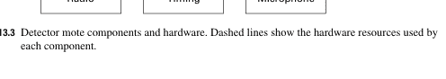

图 13.3 检测器节点组件和硬件。虚线显示每个组件使用的硬件资源。

有几个因素会导致 SoundLocalizer 错误报告最接近声音的节点。首先，正如我们上面所述，如果两个节点之间的传播时间差小于时间同步误差，则这两个节点将无法可靠地知道哪个节点更接近声音。其次，如果节点每 100 μs 采样一次麦克风，则检测响亮声音的平均延迟为 50 μs。在采样不会在所有节点上完美同步开始并保持的假设下，该延迟增加了 SoundLocalizer 的不精确性。最后，如果声音不能直线传播到最近的节点（例如，中间有障碍物），那么最先听到声音的节点可能不是最近的节点。

将 SoundLocalizer 移植到使用相同 mts300 传感器板的新的节点上，只需要在 `DetectorC` 中进行重大更改：`SynchronizerC` 和 `MicrophoneC` 仅使用硬件无关接口，应只需为新节点的必要硬件资源实现重新布线（计时器、I/O 引脚等，如下所述）。SoundLocalizer 也可以修改为使用不同的传感器，检测不同的事件。例如，最接近冲击的节点可能使用测量振动的加速度计来检测。按这种方式修改 SoundLocalizer 将需要 `MicrophoneC` 的替代品来开关新传感器，以及 `DetectorC` 的替代品来实现新的事件检测逻辑。

### 13.2 SynchronizerC

检测器节点经历几个执行阶段：启动、时间同步、为事件检测做准备、检测事件本身、检测后清理以及投票。然后执行返回到时间同步阶段，下一次协调器打开时。控制节点在这些阶段之间进展的逻辑位于 `SynchronizerC` 组件中，可移植到任何提供微秒精度计数器（用于时间同步）的平台。

启动时，检测器节点只需启动无线电并等待来自协调器的消息（有关协调器代码和消息布局，请参见上文）。这些协调消息的处理程序包含 SoundLocalizer 时间同步算法的核心：

```
module SynchronizerC {
  uses interface Receive as RCoordination;
  uses interface Counter<TMicro, uint32_t>;
  uses interface Stats;

}
implementation {
  uint32_t t0;

  uint32_t now() {
    return call Counter.get() >> TIME_SHIFT;
  }
}
```

#### 清单13.1 SynchronizerC：SoundLocalizer的时间同步


```
event message_t *RCoordination.receive(message_t *m, void *payload, uint8_t len){
    uint32_t arrivalTime = now(); // Note arrival time.

    if (len == sizeof(coordination_msg_t)) // Validate received message
    {
        coordination_msg_t *cmsg = payload;

        if (... first message from coordinator ...)
        {
            t0 = arrivalTime;
            call VotingTimer.stop();
            call Stats.reset();
        }

        call Stats.data(cmsg->count, arrivalTime - t0);

        // Prepare for event detection when its time is close
        if (cmsg->count >=
            cmsg->sample_at - (MICROPHONE_WARMUP / cmsg->interval) - 3)
            scheduleSampling(cmsg->sample_at);
        return m;
    }
    ...
}
```

这段代码的第一步是通过调用`Counter<TMicro, uint32_t>`接口的`get`命令来记录消息的到达时间。`Counter`是一个与硬件无关的计时接口。与其他时间接口一样，`Counter`接受类型参数，这些参数指示其时间测量的精度（毫秒(`TMilli`)、微秒(`TMicro`)等）和宽度（16位(`uint16_t`)、32位(`uint32_t`)等）：

#### 清单13.2 `Counter`接口

```
interface Counter<precision_tag, size_type> {
    async command size_type get();
    async command bool isOverflowPending();
    async command void clearOverflow();
    async event void overflow();
}
```

`get`命令返回当前时间，而其余的命令和事件允许`Counter`用户优雅地处理计数器溢出——一个32位微秒计数器每71分钟溢出一次，一个16位微秒计数器每秒溢出15次，因此处理溢出对许多应用来说是一个实际需求。然而，在SoundLocalizer的情况下，我们可以忽略溢出问题。`SynchronizerC`将

```
event void RadioControl.stopDone(error_t error) {
  // Once the radio is stopped, schedule event detection
  call Detector.start(t0 + TIME_SHIFT, localSampleTime - t0 - TIME_SHIFT);
}
```

`SoundLocalizer`在`scheduleSampling`中关闭无线电，因为无线电活动可能导致事件检测中的显著抖动。例如，如果一个不相关的应用程序与SoundLocalizer使用相同的无线电频道，那么SoundLocalizer将接收并处理（并希望忽略）这个其他应用程序的消息。然而，所有这些工作都会影响事件检测，可能导致某些节点延迟检测到响亮的声音，甚至完全错过响亮的声音。

```
interface Detector {
  command void start(uint32_t t0, uint32_t dt);
  async event void detected();
  event void done(error_t ok);
}
```

`start`命令请求在时间`t0+dt`进行事件检测——这种指定时间的方式与TinyOS时序接口使用的基于截止日期的方法一致（参见第6.1.1节）。当`DetectorC`检测到响亮的声音时，它会立即发出`detected`事件。为了最大化响应速度并最小化抖动，`DetectorC`的事件检测发生在中断处理程序中，因此`detected`事件是异步的。`DetectorC`在完成事件检测后的清理工作后，会发出`done`事件（在任务上下文中，以`SUCCESS`作为参数）。此外，如果发生错误，`DetectorC`将直接发出`done`事件（以`FAIL`作为参数）。

```
norace uint32_t localDetectTime;
uint32_t detectTime;

async event void Detector.detected() {
  localDetectTime = now();
}

event void Detector.done(error_t ok) {
  // If event detection was successful, convert local detection time to
  // a global time, and start broadcasting our detection reports
  if (ok == SUCCESS)
  {
    detectTime = 100000 * call Stats.estimateT0(localDetectTime - t0);
    call VotingTimer.startPeriodic(VOTING_INTERVAL);
    call Leds.led2On(); // Assume we're closest
  }
  call RadioControl.start();
}
```

异步 `detected` 事件的唯一任务是将精确的本地事件检测时间存储在 `localDetectTime` 变量中。因为 `detected` 在中断上下文中运行，对共享的 `localDetectTime` 变量的写入可能存在竞争。然而，`SynchronizerC` 和 `DetectorC` 的结构保证了 `detected` 事件在包含对 `localDetectTime` 的唯一其他访问的 `done` 事件之前被触发。因此，`localDetectTime` 不可能发生数据竞争。为了避免 nesC 编译器对 `localDetectTime` 可能存在竞争的警告，我们在 `localDetectTime` 的声明中添加了 `norace` 限定符。¹

一旦事件检测完成并且 `done` 事件被触发，`SynchronizerC` 使用 `Stats` 接口将本地事件检测时间（`localDetectTime`）转换为全局事件检测时间（`detectTime`）。检测时间按 100 000 的因子缩放，以便对检测时间进行精确比较（`detectTime` 是一个无符号整数）。`SynchronizerC` 还打开黄色 LED 以通知用户检测到大声响，并启动投票计时器，该计时器将广播节点的检测时间。这些广播包含节点的身份和全局检测时间：

```c
typedef nx_struct detection_msg {
  nx_uint16_t id;
  nx_uint32_t time;
} detection_msg_t;
```

广播和“投票”代码非常直接（为简单起见，以下省略了错误检查）：

```c
message_t msg;

event void VotingTimer.fired() {
  // Simply build and broadcast a detection message
  detection_msg_t *dmsg = call SDetection.getPayload(&msg, sizeof *dmsg);

  dmsg->id = TOS_NODE_ID;
  dmsg->time = detectTime;
  call SDetection.send(AM_BROADCAST_ADDR, &msg, sizeof *dmsg);
}
```


```c
event message_t *RDetection.receive(message_t *m, void* payload, uint8_t len){
  detection_msg_t *dmsg = payload;

  // Voting logic: if received message indicates global detection time
  // earlier than ours, switch off our LED and stop broadcasting
  if (dmsg->time < detectTime)
  {
    call Leds.led0Off();
    call VotingTimer.stop();
  }
  return m;
}
```

> ¹ `norace` 应谨慎使用，仅在你非常确定确实不存在任何可能竞争时才使用。

### 13.3 DetectorC

`DetectorC` 提供了一个 `Detector` 接口，用于检测大声响。其内部逻辑非常简单。首先，它打开麦克风电源。接下来，从 `Detector.start` 命令指定的时间开始，它反复采样麦克风的 A/D 通道，直到声音超过阈值。最后它关闭麦克风电源。麦克风的开关由下面描述的 `MicrophoneC` 组件提供的 `SplitControl` 接口控制。

如下面所述，`DetectorC` 使用 mica2 的 HAL 接口访问 A/D 转换器。A/D 转换器是一个共享驱动程序，其访问由 `Resource` 接口控制（第 11.2 节）。因此，当调用 `DetectorC` 的 `start (t0, dt)` 命令时，它必须打开麦克风电源，请求访问 A/D 转换器，并为本地时间 `t0+dt` 安排事件检测：

```c
module DetectorC {
  provides interface Detector;
  uses interface Alarm<TMicro, uint32_t>;
  uses interface Resource as AdcResource;
  uses interface SplitControl as Microphone;
  ...
}

implementation {
  bool granted, started; // Status of start request

  command void Detector.start(uint32_t t0, uint32_t dt) {
    atomic granted = started = FALSE;
    call Alarm.startAt(t0, dt);
    call Microphone.start();
    call AdcResource.request();
  }

  event void AdcResource.granted() {
    atomic granted = TRUE; // Note when ADC granted
  }

  event void Microphone.startDone(error_t error) {
    atomic started = error == SUCCESS; // Note if microphone started
  }

  async event void Alarm.fired() {
    // It’s time to detect a loud sound. If we didn’t get the ADC or
    // turn on the microphone in time, report a failed event detection.
    atomic
      if (granted && started)
      {
        call Leds.led1On();
        ... start detection ...
      }
      else
        post detectFailed();
  }
}
```

```c
task void detectFailed() {
  call Leds.led0Toggle();
  signal Detector.done(FAIL);
}
```

#### 清单 13.3 DetectorC：用于 SoundLocalizer 的响亮声音检测

`DetectorC` 使用 `Alarm<TMicro, uint32_t>` 接口以微秒精度调度事件检测。`Alarm` 接口是 `Timer` 的底层对应物：

```
interface Alarm<precision_tag, size_type> {
  // basic interface
  async command void start(size_type dt);
  async command void stop();
  async event void fired();

  // extended interface
  async command bool isRunning();
  async command void startAt(size_type t0, size_type dt);
  async command size_type getNow();
  async command size_type getAlarm();
}
```

#### 清单 13.4 Alarm 接口

与 `Counter` 一样，`Alarm` 接受类型参数，这些参数指明其时间单位的精度（毫秒（`TMilli`）、微秒（`TMicro`）等）和宽度（16 位（`uint16_t`）、32 位（`uint32_t`）等）。`Alarm` 与更高级的 `Timer` 接口（第 6.1.1 节）类似，不同之处在于它只提供单次定时器（`start`、`startAt`），它的命令都可以从中断处理程序中调用，并且它的 `fired` 事件在中断上下文中运行（所有接口函数都是 `async`）。

与 `Counter` 一样，TinyOS 没有提供 `Alarm<TMicro, uint32_t>` 接口的 HIL 组件，但 TEP102 [25] 也为提供 `Alarm` 接口的 HAL 组件的命名提供了指南。因此，以下针对 `DetectorC` 的接线应适用于所有具有 32 位微秒 `Alarm` 的平台：

```
components new AlarmMicro32C() as DAlarm;
DetectorC.Alarm -> DAlarm;
```

请注意，平台可能只提供有限数量的 `Alarm`。例如，`micaz` 只支持三个 32 位微秒 `Alarm`——每个 `micaz` `Alarm` 都需要自己的硬件定时器比较寄存器，而 `micaz` 的 `ATmega128` 微控制器每个硬件定时器只有三个比较寄存器。

通过同时调度 `Alarm`、麦克风上电和 A/D 转换器请求，`DetectorC.start` 允许这三个操作重叠执行（假设它们没有重叠的资源需求）。麦克风上电和 A/D 转换器请求的完成分别由 `started` 和 `granted` 布尔变量跟踪。`Alarm.fired` 在启动事件检测之前会检查这两个布尔值是否为真。如果不是，`DetectorC` 将检测失败报告回 `SynchronizerC`。`fired` 事件在中断上下文中运行，因此 `Alarm.fired`、`AdcResource.granted` 和 `Microphone.startDone` 中对 `started` 和 `granted` 变量的访问之间存在潜在的数据竞争。这种竞争风险是真实存在的（不同于 `SynchronizerC` 中的 `localDetectTime`），因此 `DetectorC` 使用 nesC 的原子语句来保护 `granted` 和 `started` 的读写。

为了精确检测响亮声音何时出现，`DetectorC` 应以尽可能高的速率对麦克风进行采样。此外，微控制器获取 A/D 样本与 `DetectorC` 检查该 A/D 值是否高于“响亮声音”阈值之间的抖动应尽可能小：例如，在样本获取与阈值测试之间增加 50–100 µs 的随机延迟，会给 `SoundLocalizer` 带来额外的 1.7cm（50 µs · 340 m/s）的不精确性。这两个因素都不支持使用面向传感器的高级 `Read` 接口（第 6.2.1 节）：`MicC`（mts300 传感器板上的麦克风组件）提供的 `Read` 开销相当高，并且在获取样本后会做相当多的处理。

使用 `MicStreamC` 组件提供的 `ReadStream` 接口（第 6.2.4 节）来实现 `DetectorC` 或许是可行的。该接口提供高频率、低抖动的采样，但使用起来相对复杂，并且不能直接指示每个样本获取的确切时间。相反，`DetectorC` 使用 `Atm128AdcC`，即 TinyOS 针对 `ATmega128` 的 HAL A/D 转换器组件。`Atm128AdcC` 是一个共享驱动（访问由 `Resource` 接口控制），并提供以下用于底层 A/D 访问的接口：


``` 
interface Atm128AdcSingle {
  async command bool getData(uint8_t channel, uint8_t refVoltage,
    bool leftJustify, uint8_t prescaler);
  async event void dataReady(uint16_t data, bool precise);
  async command bool cancel();
}
```

#### 清单 13.5 Atm128AdcSingle：底层单样本 ATmega128 A/D 转换器接口

该接口允许从中断处理程序发起 A/D 转换请求（`getData` 是 `async`），并直接从 ATmega128 的 A/D 转换中断处理程序发出样本采集信号（`dataReady`）。这两点使 `DetectorC` 能够以非常高的速率进行采样，并具有非常低的事件检测抖动。此外，`getData` 命令暴露了一个预分频器参数（通过 `Read` 或 `ReadStream` 接口无法使用），该参数用于调整执行 A/D 转换所需的时间。减少 A/D 转换时间会降低 A/D 转换精度，因此大多数高级用户（包括 `MicC` 和 `MicStreamC`）将预分频器保持在保证完整 A/D 转换精度的设置上——在这种设置下，`micaz` 节点上的一次转换需要 113 µs。然而，检测值何时超过阈值并不需要完整的 A/D 精度（只有高位才真正相关），因此

`DetectorC` 将预分频器设置为一个值（`ATM128_ADC_PRESCALE_16`），将 A/D 转换时间降低到 28 µs。这有可能将 `SoundLocalizer` 的精度提高 2.9 cm（85 µs · 340 m/s）。

由此产生的“响亮声音”检测代码很简单，但非常特定于 `micaz` 平台和 `mts300` 麦克风：

```
module DetectorC {
  uses interface Atm128AdcSingle;
  ...
}

implementation {
  // The threshold for a loud sound (determined experimentally)
  enum { THRESHOLD = 768 };

  void detect() {
    call Atm128AdcSingle.getData(... microphone A/D channel ...,
                          ATM128_ADC_VREF_OPF, FALSE,
                          ATM128_ADC_PRESCALE_16);
  }

  async event void Atm128AdcSingle.dataReady(uint16_t data, bool precise){
    /* If we’re the current ADC owner: check ADC completion events to
       see if the microphone is above the threshold */
    atomic
      if (granted)
        if (precise && data > THRESHOLD)
        {
          signal Detector.detected();
          ... post a task to release A/D converter, power off microphone
          and signal done ...
        }
        else
          detect();
      }
    ...
  }
```

`dataReady` 事件处理程序检查 `DetectorC` 当前是否拥有 A/D 转换器。如果是，则 A/D 结果高于阈值表示检测到响亮的声音。如果不是，则请求另一个 A/D 采样。

### 13.4 MicrophoneC

`MicrophoneC` 是控制传感器低级代码的相当典型的示例。`mts300` 麦克风硬件在图 13.4 中示意性地显示。麦克风通过来自微控制器的数字 I/O 引脚（`MicPower`）通电和断电。The

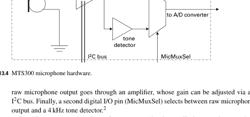

#### Figure 13.4 MTS300 microphone hardware.

原始麦克风输出经过一个放大器，其增益可通过 I²C 总线调节。最后，一个第二数字 I/O 引脚（`MicMuxSel`）选择原始麦克风输出和 4 kHz 音调检测器。²

因此，将麦克风通电用作“响亮声音”检测器需要物理上通电麦克风，选择原始麦克风输出并选择适当的放大器增益。最后，一旦这些步骤完成，麦克风应被留待预热 1.2 s（`MICROPHONE_WARMUP`）。这四个步骤由 `MicrophoneC` 的以下代码执行（省略了错误检查）：

```
module MicrophoneC {
  provides interface SplitControl;
  uses interface GeneralIO as MicPower;
  uses interface GeneralIO as MicMuxSel;
  uses interface I2CPacket<TI2CBasicAddr>;
  uses interface Resource as I2CResource;
}

implementation {
  enum {
    MIC_POT_ADDR = 0x5A, // Amplifier I2C address
    MIC_POT_SUBADDR = 0,
    MIC_GAIN = 64        // Desired gain
  };

  command error_t SplitControl.start() {
    // Power up the microphone
    call MicPower.makeOutput();
    call MicPower.set();
    // Select raw microphone output
    call MicMuxSel.makeOutput();
    call MicMuxSel.set();
    // Request the I2C bus to adjust gain
```

> ² The mts300 sensor board was originally designed in part for use in acoustic-based localization, and includes a 4 kHz tone generator.

```
call I2CResource.request();

return SUCCESS;
}

event void I2CResource.granted() {
    static uint8_t gainPacket[2] = { MIC_POT_SUBADDR, MIC_GAIN };

    // Send gain-control packet over I2C bus
    call I2CPacket.write(I2C_START | I2C_STOP, MIC_POT_ADDR,
                         sizeof gainPacket, gainPacket);
}

async event void I2CPacket.writeDone(error_t error, uint16_t addr,
                                     uint8_t length, uint8_t* data) {
    // Release I2C bus and wait for microphone to warm up (report failure
    // in case of error)
    call I2CResource.release();
    post gainOk(); // We're in async code, post a task for the warm up timer
}

task void gainOk() {
    call Timer.startOneShot(MICROPHONE_WARMUP);
}

event void Timer.fired() {
    // Microphone warmed up. Signal completion of startup.
    signal SplitControl.startDone(SUCCESS);
}
}
```


该麦克风通电代码当然特定于`mts300` 传感器。然而，它实际上对使用相同传感器的其他平台来说相当可移植，因为它通过硬件无关的`GeneralIO` 和`I2CPacket` 接口访问所需的低级硬件功能（数字 I/O 引脚和 I²C 总线）。`GeneralIO` 接口提供配置、读取和写入典型微控制器数字 I/O 引脚的命令：

```
interface GeneralIO {
    async command void set();
    async command void clr();
    async command void toggle();
    async command bool get();
    async command void makeInput();
    async command bool isInput();
    async command void makeOutput();
    async command bool isOutput();
}
```

Listing 13.6  The `GeneralIO` digital I/O pin interface

在 TinyOS 中，I²C 总线通常通过共享驱动程序访问，因此 I²C 总线用户首先通过`Resource` 接口请求访问（在`MicrophoneC` 中命名为`I2CResource`）。`I2CPacket` 接口为 I²C 总线主设备提供发送读写数据包的命令（`I2CPacket` 接受一个`addr_size` 类型参数以区分具有 7 位与 15 位总线地址的 I²C 实现）：

```
interface I2CPacket<addr_size> {
async command error_t read(I2c_flags_t flags, uint16_t addr, uint8_t length, uint8_t* data);
async event void readDone(error_t error, uint16_t addr, uint8_t length, uint8_t* data);

async command error_t write(I2c_flags_t flags, uint16_t addr, uint8_t length, uint8_t* data);
async event void writeDone(error_t error, uint16_t addr, uint8_t length, uint8_t* data);
}
```

清单 13.7 用于总线主设备的`I2CPacket` 接口

虽然`MicrophoneC` 具有很强的可移植性，但将其连接到用于访问麦克风的特定硬件资源的布线必然是平台特定的：

```
components MicaBusC, new Atm128I2CMasterC() as I2CPot;
MicrophoneC.MicPower -> MicaBusC.PW3;
MicrophoneC.MicMuxSel -> MicaBusC.PW6;
MicrophoneC.I2CResource -> I2CPot;
MicrophoneC.I2CPacket -> I2CPot;
```

`Atm128I2CMasterC` 是提供对`ATmega128` I²C 总线访问的组件。`MicaBusC` 抽象了各种 mica 系列 mote 在共享相同的 51 针传感器板连接器方面的差异，使得编写可移植到所有 mica 系列 mote 的传感器板实现变得更容易。

关闭麦克风电源要简单得多。`MicPower` I/O 引脚只需清除并设为输入即可：

```
command error_t SplitControl.stop() {
//Power off microphone
call MicPower.clr();
call MicPower.makeInput();

//And let our caller know we're done-post a task as one should not
//signal events directly from commands
post stopDone();
return SUCCESS;
}

task void stopDone() {
signal SplitControl.stopDone(SUCCESS);
}
```

### 13.5 总结

就这样！你已经看到了如何构建应用程序，从第 6.1 章中最简单的防盗版本到像`SoundLocalizer` 这样中等复杂度的系统。你还看到了 nesC 的组件和执行模型，以及 TinyOS 的组件库如何帮助你构建应用程序结构并创建可重用的抽象（库、服务、设备驱动程序）。请记得查看 www.tinyos.net 以获取 TinyOS 和 nesC 的最新发展和文档。

现在就看你去编写一些有用且有趣的传感器网络应用程序了！

## 第四部分

## 附录和参考文献

## 附录 TinyOS API

本附录给出了主要 TinyOS 接口及其提供组件的摘要。它仅涵盖硬件无关的 HIL 接口和跨多个硬件平台通用的抽象。在几乎所有情况下，TinyOS 增强提案（TEP）都更深入地描述了这些抽象，我们在适当的地方引用了它们。具有分阶段接口的应用程序级抽象通常是泛型，用户必须实例化它们。为简洁起见，此列表显示了相关组件的签名：你可以在你的 TinyOS 分发版中阅读这些接口。

### A.1 启动

mote 的启动过程封装在`MainC` 组件中，该组件在所有系统服务初始化后发出`Boot.booted` 事件。需要启动时初始化的组件应将其连接到`MainC` 的`SoftwareInit`：`MainC` 的`SoftwareInit.init` 命令在硬件初始化之后但在发出`booted` 之前被调用。

```
configuration MainC {
  provides interface Boot;
  uses interface Init as SoftwareInit;
}
```

我们在第 6.1 节中介绍了启动。TinyOS 启动过程在 TEP 107：TinyOS 2.x Boot Sequence [14] 中有描述。

### A.2 通信

TinyOS 提供了四种基本通信抽象：主动消息（AM，单跳、不可靠通信）、集合（多跳、不可靠地向数据汇点交付）和传播（多跳、可靠地向网络中每个节点交付），以及串行通信（通过串行线路的不可靠交付）。我们在第 6.3、6.4 和 7.1.1 节中介绍了通信。

`message_t` 类型用于声明 TinyOS 网络协议的包缓冲区，如 TEP 111 中所述：`message_t` [15]。

#### A.2.1 单跳

TinyOS 有四个标准的单跳通信组件，全部以 AM 类型作为参数，一个 8 位数字，用于标识不同的包类型。主动消息地址为 16 位。TinyOS 定义了宏`TOS_BCAST_ADDR` 用于 AM 广播地址，并且节点可以通过`AMPacket` 接口找到其本地地址。

`AMSenderC` 发送数据包。`AMReceiverC` 针对发往该节点的包发出接收信号，包括广播地址；`AMSnooperC` 针对未发往该节点的包发出接收信号；`AMSnoopingReceiverC` 无论寻址如何都发出所有包的接收信号。AM 接口会自动丢弃未通过链路层 CRC 检查的包。`PacketAcknowledgements` 接口允许发送方请求链路层确认并在发送后检查是否收到确认：可以在`Send.sendDone` 中调用`PacketAcknowledgements.wasAcked`。

```
generic configuration AMSenderC(am_id_t AMId) {
    provides {
        interface AMSend;
        interface Packet;
        interface AMPacket;
        interface PacketAcknowledgements as Acks;
    }
}
```

```
generic configuration AMReceiverC(am_id_t AMId) {
    provides {
        interface Receive;
        interface Packet;
        interface AMPacket;
    }
}
```

```
generic configuration AMSnooperC(am_id_t AMId) {
    provides {
        interface Receive;
        interface Packet;
        interface AMPacket;
    }
}
```

```
generic configuration AMSnoopingReceiverC(am_id_t AMId) {
    provides {
        interface Receive;
        interface Packet;
    }
}
```


```
interface AMPacket;
}
```

默认情况下，射频栈处于关闭状态。你必须打开它才能发送和接收数据包。最简单的方法是通过`SplitControl`接口将其置于全功率（始终开启）模式。下面的低功耗部分（第 251 页）展示了如何将其打开到低功耗状态，其中节点会定期唤醒以监听数据包。对于全功率控制，请在`ActiveMessageC`上连接并调用`SplitControl.start`。

```
configuration ActiveMessageC {
  provides {
    interface SplitControl;
    // interfaces elided here
  }
}
```

有关这些组件及其接口的更多详细信息，请参阅 TEP 116：Packet Protocols [16]。AM 组件通常位于`tos/system`中。

上述组件全部用于无线电通信：对于通过串口连接的 mote 也有这些组件的版本：`SerialActiveMessageC`、`SerialAMSenderC`和`SerialAMReceiverC`。这些组件在 TEP 113：Serial Communication [7] 中有描述。请注意，串行栈不执行地址过滤，因此没有嗅探功能。

#### A.2.2 多跳收集

收集协议为将自身广告为数据汇点的节点构建路由树。通常，汇点节点通过串行电缆或其他介质连接到 PC，尽管有时它们会将接收到的所有数据记录到非易失性存储中。虽然在良好条件下收集协议可以达到 99.9% 或更好的可靠性，但它们不保证可靠性：发送方不会收到其数据包是否到达的反馈。

收集实现可以在`tos/lib/net`中找到。例如，收集树协议（`CTP`）实现可以在`tos/lib/net/ctp`中找到，而`MultihopLQI`实现可以在`tos/lib/net/lqi`中找到。

要发送数据包，程序实例化一个`CollectionSenderC`。要将节点配置为基站，它应连接到`CollectionControlC`以调用`RootControl.setRoot`以及实例化相关的`CollectionReceiverC`服务。收集客户端采用收集标识符，类似于 AM 类型。

```
generic configuration CollectionSenderC(collection_id_t collectid) {
  provides {
    interface Send;
    interface Packet;
  }
}
```

```
generic configuration CollectionReceiverC(collection_id_t collectid) {
  provides {
```

请注意，你必须通过调用`DisseminationC.StdControl`来启动分发。有关分发的更多详细信息，请参阅 TEP 118：分发 [18]。

#### A.2.4 二进制重编程

第四种常见的通信抽象是二进制重编程。这实际上并不是一种抽象，因为应用程序不会主动使用它发送数据包。相反，它是一种自动运行的服务。它使管理员能够在 TinyOS 网络中安装新的二进制映像。这些二进制文件存储在闪存上，并且可以进行安装。请注意，如果新映像没有安装二进制重编程功能，那么你就无法卸载它！

`Deluge`（位于`tos/lib/net/Deluge`）是标准的二进制分发实现 [9]。它构建在基础分发之上，用于安装大型（许多 kB）数据项。`Deluge`没有提供用于控制其行为的 TinyOS API，而是附带命令行工具，这些工具将必要的报文注入网络。更多细节请参阅 TinyOS 文档中的`Deluge`手册。

### A.3 时间

TinyOS 有两个定时器接口：`Timer`和`Alarm`。`Timer`是同步的，在任务上下文中运行；`Alarm`是异步的，涉及直接处理硬件中断。大多数情况下，应用程序使用`Timer`。一些底层系统（如 MAC 协议）或需要精确定时的应用程序使用`Alarm`。此外，节点可以通过`LocalTime`接口访问其本地时间。节点的本地时间从启动时开始计算，因此不同节点通常不具有相同的时间。

基本的`Timer`抽象是`TimerMilliC`：

```
generic configuration TimerMilliC() {
  provides interface Timer<TMilli>;
}
```

可以通过`LocalTimeMilliC`获取本地时间：

```
generic configuration LocalTimeMilliC() {
  provides interface LocalTime<TMilli>;
}
```

由于`Alarm`通常是一种 HAL（硬件抽象层）而非 HIL（硬件无关层）抽象（第 12 章），因此没有提供`Alarm`的标准组件。我们在第 6.1 节和第 13 章中介绍了定时。有关定时器和时间的更多详细信息，请参阅 TEP 102：定时器 [25]。

### A.4 传感

TinyOS 中的传感器遵循 TEP 109：传感器与传感器板 [5] 中描述的命名约定。通常，它们以实际的传感器芯片命名。因此，几乎没有“标准”的传感器组件名称，因为节点可能具有的传感器集合取决于其硬件。不过，TEP 109 还描述了传感器应提供哪些接口，因此通常很容易编写与具体传感器无关的代码。

传感器通常提供一个或多个 TEP 114：SIDs：源与宿无关驱动程序 [28] 中描述的通用传感接口。

TinyOS 提供了两个完全由软件实现的“模拟”传感器。第一个`ConstantSensorC`接受一个常量作为参数，并始终返回该值。第二个`SineSensorC`从正弦函数返回一个值，该函数的输入在每次采样时递增。各平台还有一个`DemoSensorC`，它要么实例化这些软件传感器之一，要么是对特定硬件传感器的封装。

```
generic module ConstantSensorC(typedef width_t @integer(), uint32_t val) {
  provides interface Read<width_t>;
}
```

```
generic module SineSensorC() {
  provides interface Read<uint16_t>;
}
```

```
generic configuration DemoSensorC() {
  provides interface Read<uint16_t>;
}
```

我们在第 6.2 节和第 13 章中介绍了传感器。

### A.5 存储

TinyOS 提供了三种基本的存储抽象。配置存储（Config storage）用于小型随机访问变量，例如配置常量。日志存储（Log storage）用于仅追加写入以及随机访问、顺序读取。块存储（Block storage）用于大型随机访问数据项。第 6.5 节更详细地介绍了它们的用途和权衡。

TinyOS 有一些脚本，可以根据 XML 规范生成命名存储卷的布局。布局本质上就是每个卷的起始偏移量及其长度。存储客户端将卷 ID 作为参数，从而可以访问这些生成的常量。更多细节请参阅 TEP 103：永久数据存储（Flash）[4]。

```
generic configuration BlockStorageC( volume_id_t volume_id ) {
  provides interface BlockRead;
  provides interface BlockWrite;
  provides interface StorageMap;
}
```

```
generic configuration LogStorageC( volume_id_t volume_id, bool circular ) {
  provides interface LogRead;
  provides interface LogWrite;
}
```

```
generic configuration ConfigStorageC( volume_id_t volume_id ) {
    provides interface Mount;
    provides interface ConfigStorage;
}
```

由于闪存存储的实现是芯片特定的，你通常会在`tos/chips`目录中找到它们。例如，mica 系列节点使用`AT45DB`系列闪存芯片：当你在 mica 上使用上述抽象时，你使用`tos/chips/at45db`中的组件。

### A.6 数据结构

TinyOS 提供了几种常用数据结构的组件实现。所有这些都可以在`tos/system`中找到。

#### A.6.1 BitVectorC

`BitVectorC`提供了位向量的抽象。它接受一个参数，即向量的宽度。`BitVector`接口具有获取、设置、清除和切换单个位或所有位一次的命令。由于 nesC 的大量内联，使用`BitVectorC`比在组件内编写自己的位向量宏更可取。`BitVectorC`为 N 位宽的向量分配 ⌈N/8⌉ 字节。


```
generic module BitVectorC(uint16_t max_bits) {
    provides interface BitVector;
}
```

### A.6.2 QueueC

`QueueC` 提供了具有固定最大大小的项目队列的抽象。它接受两个参数：它存储的项目的类型和队列的最大大小。`Queue` 接口具有在队列末尾入队项目、从队列头部出队项目以及检查队列大小的命令。它还允许随机访问查找：你可以扫描队列。

```
generic module QueueC(typedef queue_t, uint8_t QUEUE_SIZE) {
    provides interface Queue<queue_t>;
}
```

### A.6.3 BigQueueC

`QueueC` 的 `uint8_t` 参数将其最大大小限制为 255。对于大多数用途来说，这已经足够，因此为了支持更大的大小而浪费额外的字节在内部字段上是不值得的。然而，有时组件需要更大的队列。例如，`printf` 库（第 250 页）有一个要发送的字节队列，通常长于 255。因此 TinyOS 还有 `BigQueueC`，它本质上与 `QueueC` 相同，只是它有一个 16 位大小参数并提供接口 `BigQueue`：

```
generic module BigQueueC(typedef queue_t, uint16_t QUEUE_SIZE) {
  provides interface BigQueue<queue_t> as Queue;
}
```

### A.6.4 PoolC

`PoolC` 是 TinyOS 最接近动态内存分配器的东西。它接受两个参数：要分配的对象类型，以及数量。然后组件可以动态地从池中分配和释放这些对象。但由于最大池大小是在编译时设置的，内存泄漏会导致池耗尽，而不是导致堆和栈碰撞。

由于它执行分配，你向 `PoolC` 指定一个类型，但其命令使用指向该类型的指针。例如，如果你分配一个 `message_t` 缓冲区池，那么对 `Pool` 的调用会传递 `message_t*`。

```
generic configuration PoolC(typedef pool_t, uint8_t POOL_SIZE) {
  provides interface Pool<pool_t>;
}
```

你可以在池之间交换数据项。例如，如果你有两个单独的 `message_t` 池 `P1` 和 `P2`，从 `P1` 分配 `M1` 并从 `P2` 分配 `M2` 是可以的，然后将 `M1` 释放到 `P2` 并将 `M2` 释放到 `P1`。这种行为对于 `Receive` 的缓冲区交换语义至关重要。如果组件接收到一个想要转发的包，它会从其池中分配一个缓冲区并将此新缓冲区返回给链路层。下一个包——其缓冲区来自池——可能会去到另一个组件，该组件有自己的池。因此，转发包的伪代码看起来像这样：

```
receive(m):
    if (!forward(m)):
        return m
    setHeaders(m)
    queue.put(m)
    m2 = pool.get()
    return m2
```

### A.6.5 StateC

`StateC` 提供了状态机的抽象。当多个组件需要共享全局状态时很有用（例如子系统是否打开或关闭）。

```
generic configuration StateC() {
    provides interface State;
}
```

### A.7 实用工具

TinyOS 提供了用于多个常用函数和抽象的组件。

#### A.7.1 随机数

`RandomC` 提供接口 `Random`，组件可以使用它来生成随机数。`RandomC` 还提供接口 `Init` 和 `ParameterInit`，以便组件可以重新初始化 `RandomC` 的随机种子。默认情况下，`RandomC` 的种子初始化为节点 ID+1。

TinyOS 包含两个随机数生成器：`RandomMlcgC`（乘法线性同余生成器）和 `RandomLfsrC`（线性反馈移位寄存器生成器）。`RandomLfsrC` 更快，但 `RandomMlcgC` 产生更好的随机数。默认情况下，`RandomC` 引用 `RandomMlcgC`。

```
configuration RandomC {
    provides interface Init;
    provides interface ParameterInit<uint16_t> as SeedInit;
    provides interface Random as Random;
}
```

```
configuration RandomMlcgC {
    provides interface Init;
    provides interface ParameterInit<uint16_t> as SeedInit;
    provides interface Random as Random;
}
```

```
configuration RandomLfsrC {
    provides interface Init;
    provides interface ParameterInit<uint16_t> as SeedInit;
    provides interface Random as Random;
}
```

#### A.7.2 Leds

`LedsC` 提供了三个 LED 的抽象。虽然一些平台有超过或少于三个，但出于历史原因，`Leds` 接口有三个。此外，拆分 LED

将同一个接口实例化为三个实例会产生大量额外的布线。除了 `LedsC` 之外，还有一个 `NoLedsC`，可以作为空替换插入：对 `NoLedsC` 的调用不执行任何操作。

```
configuration LedsC {
  provides interface Leds;
}
```

```
configuration NoLedsC {
  provides interface Leds;
}
```

#### A.7.3 循环冗余校验

循环冗余校验（CRCs）是检查数据是否已损坏的一种简单方法。在数据之后，你附加一个 CRC。读取数据的人可以重新计算数据的 CRC 并检查它是否与附加的 CRC 匹配。如果两者不匹配，则数据或 CRC 本身存在位错误。由于 CRC 通常比数据短得多，因此假设数据已被损坏。CRCs 在网络中被大量使用，以检查数据包的有效性。当然，由于 CRCs 比数据本身短，因此损坏的数据包通过 CRC 检查是可能的，但可能性很小。

CRC 值与加密哈希不同。CRCs 的目的是检测突发位错误。通常，n 位 CRC 总能检测到小于 n 位的单次错误突发。相比之下，加密强度高的哈希具有熵特性，使得检测到（或未能检测到）任何类型错误的机会是均匀的。

```
module CrcC {
  provides interface Crc;
}
```

模块 `CrcC` 可以在 `tos/system` 中找到。

#### A.7.4 Printf

有时，在调试时，让 mote 发送简单的文本消息会非常有用。TinyOS 有一个 `printf` 库——类似于 C 标准库函数——用于此目的。你可以在组件中使用 `printf`，而 `printf` 库会通过串行端口发送适当的包。你必须通过 `PrintfC` 的 `SplitControl.start` 启动 `printf` 库。

```
configuration PrintfC {
  provides (
    interface SplitControl as PrintfControl;
    interface PrintfFlush;
  )
}
```

有关使用 `printf` 库的更多详细信息，请参阅 TinyOS 网站上的教程。

### A.8 低功耗

在大多数情况下，TinyOS 会自动将系统和硬件置于可能的最低功耗状态。对于外设，这通常通过电源锁实现（第 11.2 节）。例如，当应用程序从闪存芯片写入或读取时，TinyOS 会自动将其打开，执行操作，然后在完成后将其关闭。

通信是此行为的主要例外。由于通信子系统，例如无线电和串行端口，需要能够接收和发送，TinyOS 需要应用程序通过 `SplitControl` 接口明确告知它何时可以安全地打开和关闭它们。

然而，在无线电的情况下，有许多技术可以用来节省电量。例如，而不是始终保持无线电开启，TinyOS 可以让它大部分时间处于关闭状态，定期将其打开足够长的时间以听是否有数据包。发送方多次发送数据包，直到接收方唤醒、听到它并确认它，或者超时发生。

关于如何设置这些间隔的完整讨论超出了本书的范围。重要的接口是 `LowPowerListening`，一些（但不是全部）无线电提供。`LowPowerListening` 允许应用程序设置无线电的检查间隔以及它期望接收方使用的检查间隔。TinyOS 有一个教程，介绍如何在编写低功耗应用程序时使用此接口，第 12.2.3 节也简要举例说明了其用法。

[18] P. Levis and G. Tolle. TEP 118: Dissemination. www.tinyos.net/ tinyos-2.x/doc/.


# 参考文献

[19] J. Liu, N. Priyantha, F. Zhao, C.-J. M. Liang, and Q. Wang. Towards discovering data center genome using sensor nets. In EmNets '08: Proceedings of the Fifth Workshop on Embedded Networked Sensors, 2008.

[20] S. Madden, M. J. Franklin, J. M. Hellerstein, and W. Hong. TinyDB: An acquisitional query processing system for sensor networks. Transactions on Database Systems (TODS), 30(1), 2005, 122–173.

[21] A. Mainwaring, J. Polastre, R. Szewczyk, D. Culler, and J. Anderson. Wireless sensor networks for habitat monitoring. In Proceedings of the ACM International Workshop on Wireless Sensor Networks and Applications, 2002.

[22] M. Maroti, B. Kusy, G. Simon, and A. Ledeczi. The flooding time synchronization protocol. In SenSys '04: Proceedings of the Second International Conference on Embedded Networked Sensor Systems, pages 39–49, New York, NY, USA, 2004. ACM Press.

[23] J. Polastre, J. Hill, and D. Culler. Versatile low power media access for wireless sensor networks. In SenSys '04: Proceedings of the Second International Conference on Embedded Networked Sensor Systems, pages 39–49, New York, NY, USA, 2004. ACM Press.

[24] D. Rand. PPP Reliable Transmission. Internet Network Working Group RFC1663, July 1994.

[25] C. Sharp, M. Turon, and D. Gay. TEP 102: Timers. `www.tinyos.net/tinyos-2.x/doc/`.

[26] R. Szewczyk, J. Polastre, A. Mainwaring, and D. Culler. An analysis of a large scale habitat monitoring application. In SenSys '04: Proceedings of the Second International Conference on Embedded Networked Sensor Systems, New York, NY, USA, 2004. ACM Press.

[27] G Tolle and D. Culler. Design of an application-cooperative management system for wireless sensor networks. In EWSN '05: Proceedings of Second European Workshop on Wireless Sensor Networks, 2005.

[28] G Tolle, P. Levis, and D. Gay. TEP 114: SIDs: Source and Sink Independent Drivers. `www.tinyos.net/tinyos-2.x/doc/`.

[29] T. von Eicken, D. E. Culler, S. C. Goldstein, and K. E. Schauser. Active messages: A mechanism for integrated communication and computation. In ISCA '92: Proceedings of the International Symposium on Computer Architecture, pages 256–266, 1992.

[30] G Werner-Allen, K. Lorincz, J. Johnson, J. Lees, and M. Welsh. Fidelity and yield in a volcano monitoring sensor network. In OSDI '06: Seventh USENIX Symposium on Operating Systems Design and Implementation, 2006.

## 索引

- `<-` 连线操作符, 31, 51
- `->` 连线操作符, 31, 51
- `=` 连线操作符, 31, 52
- `@` (声明、使用属性), 142
- `@C` 属性, 143
- `@atleastonce` 属性, 143
- `@atmostonce` 属性, 143, 212
- `@atomic_hwevent` 属性, 143
- `@combine` 属性, 66, 143
- `@exactlyonce` 属性, 143
- `@hwevent` 属性, 143
- `@integer` 属性, 132, 143
- `@number` 属性, 133, 143
- `@spontaneous` 属性, 143
- `#define`, 41, 45
  - 陷阱, 46
- `#include` 的用法, 45
- `__attribute__` (已弃用), 144
- 802.15.4, 5
- 抽象数据类型, 133
  - 使用通用模块实现, 133
  - 使用引用参数实现, 134
  - 在 TinyOS 中预定义, 247
- 主动消息类型, 89, 94, 98, 113, 242
- 主动消息 (AM)
  - 地址与 TOS_NODE_ID 的区别, 90
  - 主动消息 (AM), 89, 113, 241
- `ActiveMessageC` 组件, 137
- `Alarm` 接口, 231
- AM 类型，见主动消息类型
- `AMSend` 接口, 90
- AntiTheft (应用程序), 79
- 应用程序源代码, 9
- `as`
  - 命名组件, 53
  - 命名接口, 23
- 异步 (async)
  - 代码, 71, 192
  - 命令与事件, 71, 192
  - 一致性问题, 134
  - 用于最小化抖动, 228
- `Atm128AdcSingle` 接口, 232
- 原子语句, 195
  - 执行时间, 196
  - 通过禁用中断实现, 195
  - 限制, 200
  - 在 SoundLocalizer 中的使用, 231
- 属性, 142
- 自动连线 (用于初始化), 60, 139
- 后备数组 (用于数据包), 114, 115, 123, 124
- 基站, 95, 98
- 双向接口, 28
- 大端序, 43
- 二进制重编程, 245
- `BlockRead` 接口, 108
- `BlockWrite` 接口, 106
- `Boot` 接口, 81
- 使用 C 库, 47
- C++ 模板与通用组件的对比, 130, 132
- 回调, 11, 15, 167
- CC1000 (射频芯片), 49
- CC2420 (射频芯片), 5
- 收集 (网络协议), 95, 96, 98, 241
- 合并函数, 66
  - 结合性与交换性, 67
  - 警告 (缺失时), 67
- 命令, 11, 25
- `unique`，见 `unique` (编译期函数)
- `uniqueCount`，见 `uniqueCount` (编译期函数)
- 组件, 6, 11, 14, 21
  - 实现, 21, 29
  - 初始化, 59
  - 分层, 60
  - 库, 162
  - 使用 `as` 命名, 53
  - 签名, 21
  - 单例, 33, 70
  - 在相似组件之间切换, 94
- 并发模型, 71, 192
- `ConfigStorage` 接口, 103
- 配置, 12, 31, 50
  - 配置主体中的 `enum` 和 `typedef`, 150


# 索引

- 导出接口, 52
- 通用 (配置), 68, 130, 150
- 在外观模式中的使用, 183
- 在占位符模式中的使用, 180
- 常量, 41
- CRC (循环冗余校验), 250
- 数据竞争, 193
  - 自动检测, 196, 229, 231
  - 避免, 196
- 基于截止时间的定时, 81
- Deluge (二进制重编程), 245
- 设计模式, 166
  - 适配器, 189
  - 行为型, 166, 186, 189
  - 装饰器, 186
  - 调度器, 166
  - 外观模式, 183
  - 键映射, 177
  - 键空间, 174
  - 命名空间, 174, 177
  - 占位符, 180
  - 服务实例, 170
  - 结构型, 170, 180, 183
- 设备驱动程序, 210
  - 访问控制, 211
  - 与 Resource 接口, 214
  - 专用, 211
  - 延迟, 213
  - 电源管理, 215
  - 共享, 211
  - 虚拟化, 211
- 分发 (网络协议), 95, 97, 98, 241
- DisseminationUpdate 接口, 99
- DisseminationValue 接口, 97
- 动态内存分配, 37, 248
- 能量管理，见电源管理
- 枚举
  - 在配置中, 150
  - 使用与滥用, 41
  - 在全局键空间模式中的使用, 174
- 事件, 11, 25
- 执行模型, 71
- 导出 (接口), 52
- 扇入, 64
- 扇出, 64
- FlashSampler (应用程序), 105
- GeneralIO 接口, 235
- 通用组件, 33, 68, 129, 150
  - 通过代码复制实现, 130
  - 类型参数, 132
  - 在适配器模式中的使用, 189
  - 在装饰器模式中的使用, 187
  - 在调度器模式中的使用, 169
  - 在服务实例模式中的使用, 171
  - 与 C++ 模板的对比, 130, 132
- 通用接口, 27
- 全局声明, 45
- 硬件抽象架构 (HAA), 206, 221
  - 存储, 208
  - 定时器, 209
- 硬件适配层 (HAL), 206
- 硬件接口层 (HIL), 206, 241
- 硬件表示层 (HPL), 207
- HAA，见硬件抽象架构
- HAL，见硬件适配层 (HAL)
- I²C, 235
- I2CPacket 接口, 236
- IEEE 802.15.4, 5
- 接口, 11, 14, 24, 156
  - 双向, 28
  - 默认命令与事件处理程序, 142
  - 通用, 27
  - 使用 as 命名, 23
  - 参数化，见参数化接口
  - 提供者, 11, 22
  - 分阶段, 35, 84
  - 类型, 56
  - 用户参数, 27, 29
- 中断, 71, 92
- 中断处理程序, 71, 192
  - 与栈的使用, 38
- 键空间, 152, 157, 160, 174
- Leds 接口, 80
- 小端序, 43
- 低功耗监听 (无线电), 216, 251
- LowPowerListening 接口, 216, 251
- malloc 的问题, 37
- 邮箱归档系统, 183
- McuPowerOverride 接口, 218
- McuPowerState 接口, 219
- McuSleep 接口, 218
- 内存
  - 分配, 37, 248
  - Receive 中的缓冲区交换, 39
  - 使用枚举节省内存, 41
  - 所有权, 39, 91, 93
  - 组件间的共享, 39, 41
- Message (Java 类), 115
- message_t, 89
- MicaZ 节点, 5

## 索引

mig (PC 工具)，114
  和 AM 类型，118
  生成的方法，115
  接收数据包，117
  发送数据包，116

module，10，30
  generic，33，131，150，164
  变量初始化器，33

mote，4
  micaz，5
    功耗预算，7
  Telos，5
  MotelF (Java 类)，116，121
    和 AM 类型，118
    接收数据包，117
    发送数据包，116

Mount 接口，103

多跳网络，95
  收集，参见 collection (网络协议)
  传播，参见 dissemination (网络协议)

多重布线，63
  调用顺序，63

命名约定
  组件，58

nesC (PC 工具)，118，176
  和 #define，119

nesC
  与 C 和 C++ 的比较，16
  编译模型，13

nesC 参考手册，7

nesdoc，12，61

net.tinyos.message
  Message 类，参见 Message (Java 类)
  MotelF 类，参见 MotelF (Java 类)

网络
  多跳，95
  串口，参见 serial-port networking
  单跳，89

norace，229

nx_、nxle_ 类型前缀，43

数据包
  接收，93
  发送，90
  大小，89
  使用平台无关类型指定，90，112
  结构，89
  结构 (串行)，112，113
  不可靠传输 (无线电)，89
  不可靠传输 (串行)，112

数据包源 (PC)，116，119

参数化接口，137，145，154，156
  和默认处理程序，142
  和动态分派，140
  和 unique，146
  在 nesC 中的实现，139
  在模块中，140
  在 Dispatcher 模式中使用，167
  在 Keymap 模式中使用，177
  在 Keyspace 模式中使用，175
  在电源锁实现中使用，202
  在 Service Instance 模式中使用，171

PC 工具，112
  Java，112
  mig，114
  MotelF，参见 MotelF (Java 类)
  ncg，118，176
  其他语言，112

平台无关类型，112

串行转发器，120

永久存储，101
  块数据，106
  配置数据，103
  日志数据，108
  可靠性，101，103，110
  采样到，106
  卷配置文件，102
  卷，102，176

平台无关类型，43
  使用 mig 访问，114
  PC 工具，112
  在网络中使用，90，97，112

可移植性，206，210，221，224

发布一个任务，72

电源锁，200
  仲裁器，202
  配置，202，204
  库，205
  电源管理器，202
  分阶段访问，200
  在 SoundLocalizer 中使用，231

电源管理，251
  用于微控制器，218
  在专用驱动中，216
  在设备驱动中，215
  在共享驱动中，217
  在无线电中，216，251
  在虚拟化驱动中，217
  调度器交互，218
  使用电源锁，203

printf，250

竞争条件，193，参见数据竞争

随机数生成，249

Read 接口，84

ReadStream 接口，87

Receive 接口，93

递归
  避免，37
  由于在命令中发出的事件，76
  使用任务避免，77

可靠传输 (串行)，120

Resource 接口，201

ResourceConfigure 接口，204

ResourceDefaultOwner 接口，203

RootControl 接口，100

采样传感器，84

采样到永久存储，106

Send 接口，96

发送数据包，90

传感器，84
  组件，85
  流采样，87
  值，校准，86

传感器网络，3
  结构 (典型)，95

传感器节点，4

串行转发器 (PC 工具)，120

串口网络，113，241

服务
  启动和停止，92，97

签名 (组件)，21

单栈，35，37

单跳网络，89

单例 (组件)，33，70

SoundLocalizer (应用程序)，221

示例应用程序源代码，9

分阶段，6，34，84

SplitControl 接口，92

栈使用，71

StdControl 接口，97

同步 (sync) 代码，71，192

任务，6，71，72，192
  用于避免递归，77
  从中断处理程序发布，199
  发布开销，74
  分阶段操作，75
  时序，对延迟和吞吐量的影响，74

Telos mote，5


- 时间同步，222，225
- `Timer` 接口，81
- TinyOS
  - 1.x，134，144，211
  - API，7，241
  - 编译，8
  - 增强提案 (TEP)，241
  - 安装，8
  - 概述，5
  - 栈，35，37
  - 任务调度器，72
- TinyOS 组件
  - `ActiveMessageC`，94，243
  - `AMReceiverC`，94，242
  - `AMSenderC`，94，242
  - `AMSnooperC`，242
  - `AMSnoopingReceiverC`，242
  - `BigQueueC`，248
  - `BitVectorC`，247
  - `BlockStorageC`，106，246
  - `CollectionC`，101
  - `CollectionControlC`，243
  - `CollectionReceiverC`，243
  - `CollectionSenderC`，98，243
  - `ConfigStorageC`，102，246
  - `ConstantSensorC`，246
  - `CrcC`，250
  - `DemoSensorC`，246
  - `DisseminationC`，101，244
  - `DisseminatorC`，98，101，244
  - `Fcf sArbiterC`，205
  - `LedsC`，83，250
  - `LocalTimeMilliC`，245
  - `LogStorageC`，108，246
  - `MainC`，83，241
  - `McusleepC`，218
  - `NoLedsC`，250
  - `PoolC`，69，248
  - `PrintfC`，250
  - `QueueC`，247
  - `RandomC`，249
  - `RandomLfsrC`，249
  - `RandomMlcgC`，249
  - `RoundArbiterC`，205
  - 传感器，85，245
  - `SerialActiveMessageC`，94，243
  - `SerialAMReceiverC`，94，243
  - `SerialAMSenderC`，94，243
  - `SineSensorC`，246
  - `StateC`，249
  - `TimerMilliC`，83，245
- TinyOS 接口
  - `Alarm`，231
  - `AMSend`，90
  - `BlockRead`，108
  - `BlockWrite`，106
  - `Boot`，81
  - `ConfigStorage`，103
  - `Counter`，226
  - `DisseminationUpdate`，99
  - `DisseminationValue`，97
  - `GeneralIO`，235
  - `I2CPacket`，236
  - `Leds`，80
  - `LowPowerListening`，216，251
  - `McuPowerOverride`，218
  - `McuPowerState`，219
- `McuSleep`, 218
- `Mount`, 103
- `Read`, 84
- `ReadStream`, 87
- `Receive`, 93
- `Resource`, 201
- `ResourceConfigure`, 204
- `ResourceDefaultOwner`, 203
- `RootControl`, 100
- `Send`, 96
- `SplitControl`, 92
- `SidControl`, 97
- `Timer`, 81
- `TOS_NODE_ID`, 59, 91
- `TOSH_DATA_LENGTH`, 89
- tree collection, 参见 collection
- 类型
  - big-endian, 43
  - little-endian, 43
  - of interfaces, 56
- `typedef`
  - in configuration, 150
- `unique`（编译时函数）, 146, 151, 161
  - use in Local Keyspace pattern, 174
  - use in power lock implementation, 202
  - use in Service Instance pattern, 171
- `unique`（编译时函数）
  - use in shared device drivers, 214
- `uniqueCount`（编译时函数）, 147
  - use in Local Keyspace pattern, 176
  - use in power lock implementation, 202
  - use in Service Instance pattern, 171
- virtualized
  - device, 211
  - service, 147, 156
- volume configuration file（for storage）, 102
- wiring, 12, 14, 31
  - code generated for, 51
  - fan-in, 64
  - fan-out, 64
  - multiple, 63
  - omitting interfaces in, 56
  - only a metaphor, 65
  - use in Facade pattern, 183
  - use in Keymap pattern, 177
  - use in Placeholder pattern, 180
