# Tom Swan 的 Linux 的 GNU C++ 专业开发指南


## TRADEMARKS

All terms mentioned in this book are known to be trademarks or service marks have been appropriately capitalized. Que Corporation cannot attest to the accuracy of this information. Use of a term in this book should not be regarded as affecting the validity of any trademark or service mark.

## WARNING AND DISCLAIMER

Every effort has been made to make this book as complete and as accurate as possible, but no warranty or fitness is implied. The information provided is on an “as is” basis. The author(s) and the publisher shall have neither liability nor responsibility to any person or entity with respect to any loss or damages arising from the information contained in this book or from the use of the CD or programs accompanying it.

**Associate Publisher**  
John Pierce

**Development Editor**  
Erik Dafforn

**Managing Editor**  
Thomas F. Hayes

**Copy Editor**  
Geniel Breeze

**Indexer**  
Bill Meyers

**Proofreader**  
Maribeth Echard

**Technical Editor**  
Rich Blum

**Team Coordinator**  
Julie Otto

**Media Developer**  
Michael Hunter

**Production**  
Dan Harris  
Brad Lenser

### 警告和错误 64
- 你已被警告 65
- 犯错是人之常情 65
- 警告和错误选项 67
- 将警告转为错误 68
- 编译并运行脚本 69

### 编译器选项 70
- 可移植性选项 70
- 中间编译 71
- 编译过程 72
- 分离编译 74
- 引号与否 75
- 头文件选项 75
- 控制包含路径 76
- 优化代码 77
- 优化级别 78
- 是否优化 79

### 调试入门 79
- 为调试而编译 80
- 选择你的武器 81
- 使用 `gdb` 控制台调试器 82
- 使用 `xxgdb` X Window 调试器 84
- 在 `Emacs` 中运行 `gdb` 86
- 有用的调试器选项 87

总结 88

## 6 创建数据对象 89

### 数据声明 90
- 类型转换 91
- 标识符：好、坏和丑 91
- GNU C++ 保留字 92

### 简单数据对象 93
- 整数变量 94
- 限制 95
- 作为宏的常量 96
- 作为对象的常量 97
- 预定义常量 98

### 全局和局部变量 99
### 多个变量声明 100
### 枚举类型 101
### 布尔变量 103
### 字面值 104
### 字面常量范围 105
### 双宽整数 105
### 收尾 107
### 浮点变量 108

### 字符字符串 110
- 字符 111
- C 风格字符串常量 111
- C 风格字符串变量 111
- 大小很重要 112
- 无中生有 113
- 比较字符串 114
- 连接字符串 115
- 搜索子字符串 115
- 字符转义代码 116
- 字符串转换 118
- 炒杂烩字符串 119

### 数组和结构体 120
- 一维数组 120
- 多维数组 121
- 初始化数组 121
- 预初始化数组 122
- 初始化字符串数组 122
- 结构体 123

### 调试数据对象 124
- 识别错误 124
- 加载代码 125
- 其他数据调试命令 128
- 自动显示变量 129
- 分配值 129
- 设置基数 130
- 查找变量的类型 130
- 使用 `assert()` 宏进行调试 130
- 调试变量汇总 131

总结 132

## 11 使用指针管理内存 223

相互递归函数 217  
函数与分离编译 218  
调试函数 219  
跨过函数 220  
进入函数 220  
调试内联函数 221  
总结 222

### 分配内存 224
### 使用 `new` 和 `delete` 进行内存管理 224
### 内存泄漏 227
### 使用 `malloc()` 和 `free()` 进行内存管理 228
### 处理内存错误 230
### 使用指针的指针 231
### 动态字符串 231
### 指针算术 234
### 获取内存块的大小 234
### 动态数组 235
### 多维动态数组 236
### 向 `main()` 传递参数 238
### `getopt()` 函数 239
### 其他内存相关事项 245

### 调试动态内存 247
### 调试指针 247
### 调试被寻址的数据 248
### 调试程序选项 249
### 调试 `main()` 参数 250

总结 251

### 为什么使用面向对象编程？ 256
### 引入类 256
### 使用类和对象编程 260
### 构造函数 261
### 成员函数 262
### 构造对象 263
### 默认构造函数 266
### 拷贝构造函数 266
### 内联构造函数 267
### 重载构造函数 269
### 调试类对象 271

总结 273

### 销毁类对象 276
### 引入析构函数 276
### 使用指针寻址对象 277
### 动态对象 278
### 在类中使用指针 280
### 类内存管理 280
### 拷贝构造函数 283
### 初始化数据成员对象 289
### 多种风味的对象 292
### 参数类对象 292
### 对象函数结果 294
### 类对象数组 296
### 类对象的动态数组 296
### 类对象指针数组 297
### 类对象指针的动态数组 298
### 作为数据成员的对象数组 299
### 对象与模块化编程 300
### `TDate` 头文件 300
### `TDate` 模块 301
### `TDate` 主程序 304
### 类与数据隐藏 306

总结 306

### 类作为构建块 308
### 单继承 308
### 多继承 309
### 创建派生类 309
### `TCoordinate` 类 311
### 派生类构造函数 314
### 派生类析构函数 317
### 复制派生类对象 321
### 引入受保护成员 324
### 更改访问说明符 324
### 限定选定成员 325
### 调试派生类 326
### 检查对象构造 327
### 检查对象数据成员 328
### 调用成员函数 329
### 查找对象的类型 330

总结 330

### Poly Want a Morphism？ 332
### 创建容器类 334
### 抽象类 334
### 虚析构函数 335
### 纯虚函数 335
### `TContainer` 类 336
### 调用虚函数 338
### 从抽象类派生 342
### 多继承 345
### 加载基类 346
### 使用多个基类构造函数 346
### 使用虚基类 347
### 修复模糊基类 350
### 调试带虚函数的类 352
### 调试分离模块中的类 352
### 调试虚函数调用 354

总结 355

### 几个好术语 358
### 引入异常 358
### 抛出异常对象 359
### 标准 `exception` 类 360
### 引入 `try` 块 361
### 多个 `catch` 语句 362
### 嵌套 `try` 块 362
### 使用 `try` 块 363
### 使用异常编程 364
### 未处理的异常 367
### 替换 `unexpected()` 和 `terminate()` 368
### 捕获所有异常 369
### 异常与局部对象 373
### 异常与构造函数 374
### 到处抛自己的类的类 375
### 异常与内存管理 376


# 调试异常 377

# 总结 378

# 引入类模板 380

# 模板函数 380

# 模板类 384

# 模板实例化 389

# 模板的麻烦 389

# Borland 模型 390

# CFront 模型 390

# GNU C++ 模型 391

# 处理链接器问题 391

# 已知模板错误 394

# 调试模板 394

# 查看模板类实例化 395

# 跟踪模板类函数 395

# 在模板类中设置断点 397

# 总结 398

# 朋友们是做什么的？ 402

# 友元类 402

# 相互友元类 406

# 函数与友元 407

# 友元函数 408

# 友元成员函数 409

# 总结 410

# 什么是运算符重载？ 412

# 引入重载运算符 412

# 重载友元运算符 413

# 重载运算符示例 414

# 重载类成员运算符 416

# 重载运算符的类型 417

# 一元运算符 418

# 类型转换运算符 419

# 数组下标运算符 421

# 函数调用运算符 423

# 类成员访问运算符 423

# 自增和自减运算符 425

# 重载输出流 427

# 重载输入流 429

# 自增和自减运算符再探 430

# 其他运算符重载注意事项 433

# 重载与内存管理 433

# 重载 new 运算符 434

# 重载 delete 运算符 436

# 总结 437

# 文件流 440

# 文件流类 440

# 文本文件流 441

# 创建文本文件 441

# 打开文本文件 443

# 逐字符读取文本 444

# 逐字符写入文本 445

# 逐行读取文本 447

# 逐行写入文本 449

# 二进制文件流 450

# 引入二进制文件流 451

# 错误的解决方案 451

# 正确的解决方案 452

# 用于二进制文件 I/O 的类 457

# 读取和写入二进制值 459

# 读取和写入二进制类对象 460

# 合并输入和输出类 463

# 文件流技术 467

# 检测文件是否存在 467

# 在流中定位 468

# 总结 471

- 复制类对象 474
- 拷贝构造函数和赋值回顾 474
- 成员逐个初始化 475
- 拷贝构造函数 475
- 重载的 `operator=()` 函数 476
- 在拷贝构造函数中调用 `operator=()` 477
- 引用计数所有权 477
- 复制时写入方法 478
- 命名空间 488
- 零碎内容 488
- 显示构造函数 488
- 可变数据成员 490
- 使用 `typename` 492
- 指向成员函数的指针 493
- 静态成员函数 495
- 持久对象 498
- 嵌套类声明 500
- 总结 503
- 介绍 `string` 模板 508
- 比较和搜索 `string` 对象 526
- 比较 `string` 对象 526
- 搜索 `string` 对象 527
- 调试 `string` 对象 529
- 总结 530
- 介绍标准模板库 532
- STL 组件 533
- 头文件 533
- 命名空间 534
- 迭代器 534
- 迭代器类型 535
- 指针迭代器 535
- 容器迭代器 537
- 常量迭代器 538
- 使用迭代器编程 539
- 输入迭代器 539
- 输出迭代器 540
- 前向迭代器 542
- 双向迭代器 542
- 随机访问迭代器 542
- 迭代器技术 543
- Iostreams 与迭代器 543
- 插入迭代器 545
- 杂项迭代器函数 547
- 函数和函数对象 548
- 函数和谓词 548
- 函数对象 552
- 生成器函数对象 555
- 生成器函数类对象 558
- 绑定器函数对象 560
- 否定器函数对象 562
- 总结 563
- 介绍标准容器 566
- 向量 567
- 声明向量 567
- 使用向量 570
- 布尔向量 570
- 调用向量函数 571
- 列表 572
- 声明列表 573
- 使用列表 574
- 调用列表函数 576
- 双端队列 578
- 声明双端队列 578
- 使用双端队列 579
- 调用双端队列函数 579
- 集合和多重集合 579
- 声明集合 579
- 使用集合 581
- 调用集合函数 583
- 映射和多重映射 584
- 介绍标准算法 600
- 累积算法 601
- 复制算法 602
- 计数算法 604
- 填充算法 606
- 查找算法 607
- 查找重复项 609
- 词法比较 610
- 合并算法 610
- 集合算法 612
- 迭代算法 615
- 随机化算法 617
- 删除算法 618
- 条件删除 620
- X 的世界观 632
- 一些常用术语 633
- X 的简史 636
- 介绍 Xlib 编程 642
- 包含 Xlib 头文件 644
- 连接到 X 服务器 644
- 准备窗口属性 645
- 获取颜色值 646
- 创建 X 窗口 646
- 分配窗口标题 647
- 显示窗口 647
- 屏蔽事件 648
- 编写事件循环 649
- `xwelcome.cpp` 列表 651
- 调试 X 客户端 653
- 使用 X 工具调试 653
- 使用输出语句调试 656
- 使用 GNU 调试器调试 657
- 总结 658
- 窗口属性 682
- 使用属性创建窗口 682
- 调用窗口属性函数 685
- 更改属性值 685
- 其他窗口属性 687
- 更改光标形状 687
- 重力考虑 688
- 平铺背景位图 691
- 位图文件格式 695
- 总结 695
- 鼠标输入事件 660
- 鼠标事件 661
- 示例鼠标客户端 661
- ButtonPress 事件 663
- 鼠标移动事件 663
- 文本输出 664
- 查找字体名称 665
- 显示文本 666
- 图形输出函数 669
- 图形原语 670
- 适当的曝光 671
- 双击按钮 673
- 保存图形信息 673
- 键盘输入事件 678
- 检测键盘事件 680
- 响应键盘事件 681
- 映射键盘事件代码 681
- 介绍调色板 700
- 什么是调色板？ 700
- 位平面 700
- X 颜色数据库 702
- 分配颜色 703
- 为缩放图形着色 707
- 原子能量 711
- 设置和获取原子 711
- 客户端间通信 713
- 线条和填充样式 715
- 线条宽度和样式 715
- 填充规则和样式 717
- 总结 724
- 什么是 V？ 726
- 安装 727
- V 的示例程序 728
- 文档 729
- 创建 V 应用程序 729
- 使用 `vgenx` 729
- 编辑生成的 Makefile 731
V 应用解剖 732
生成的文件 732
主应用程序 733
主命令窗口 736
窗口画布 741
模态和无模式对话框 742
摘要 742
编译本章程序 744
理解 V 类 744
V 欢迎程序 745
主应用程序 746
应用程序类 748
命令窗口类 749
使用 V 进行软件开发 753
图形 753
鼠标输入 754
键盘输入 758
V 标准组件 762
菜单 762
工具栏 767
状态栏 770
最终说明 776
摘要 777
序言 790
Linux 与 GNU 系统 795
FreeBSD 版权 796

## 前言

这本书诞生于海上——字面意义上的海上。一个懒散的日子里，我正乘着我的家和帆船停泊在巴哈马群岛，那是我计划度过一个悠闲冬天的地点。这是二十多年来我第一次没有写至少一本计算机书并且几乎每天都在写它。写了三十多本书后，我告诉自己需要休息一下。我应得一个假期。也许我会重新拿起那本我一直威胁要完成的长篇小说。
于是，我没有花一整天盯着电脑屏幕，而是去钓鱼，这是我的众多才艺之一。不幸的是，捕捉不是其中之一，而在那个夜晚很晚的时候，在吃了一顿丰盛的大米和豆子餐之后（而且，你知道的，鱼嘲笑我，但那是另一个故事），我开始阅读我带去的几本关于 Linux 的书。
我熟悉 UNIX，多年前我曾用它来安装网络和数据库系统。我记得当时想着所有计算机最终都会运行 UNIX 或类似的东西，这个想法在我阅读关于 Linux 的内容时又回来了。读得越多，我越感兴趣。在从救生筏下挖出笔记本后，我安装了 Linux，尝试了 GNU C++ 编译器，并且在几个小时内即使有一阵狂风吹过我也不会注意到。没有什么比发现令人惊叹的 GNU C++ 编译器更让我兴奋的了！好吧，钓到一条真正的大鱼会做到这一点。但几乎没有别的能做到。
在我指尖，我意识到不仅仅是一个优秀的 C++ 编译器，而是一个功能齐全、专业的软件开发系统。GNU C++ 带来了令人印象深刻的编程工具套件，包括 Emacs 编辑器（我用它来编写本书的示例程序）、版本控制系统、调试器、分析器，以及用于控制台和 X 开发的众多其他工具和库。一句话——太棒了！


那一刻开启了我对 GNU C++ 的探索之旅，而当我写下这些文字时，这段旅程刚刚结束。结果就是这本书，一本使用 GNU C++ 在 Linux 上进行 ANSI C++ 编程语言的完整指南。在这些章节中，你将找到从控制台实用程序到 X 图形应用程序的创建成品 Linux 软件的信息。众多示例程序点缀于这些页面中，与我所有的书籍一样，你可以不受限制地将本书的清单纳入自己的程序中。书的 CD-ROM 上包含完整的 Linux-Mandrake 6.0 Red Hat 操作系统、GNU C++ 编译器、各种工具和实用程序，以及本书所有的示例程序文件。

现在书已经完成，我意识到我进入 Linux 编程、GNU C++ 以及其他相关主题的世界之旅才刚刚开始。像所有程序员一样，我对编程语言了解得越多，就越意识到自己还有多少东西要学，我欢迎你对本书未来版本的评论和建议。

请通过发送电子邮件至 TomSwan@compuserve.com 与我联系，或通过出版社转交信件给我。

也许现在我会有更多时间去钓鱼了。我甚至可能这次能钓到点什么。但你知道吗？我有点喜欢上大米和豆子了。祝阅读愉快！

Tom Swan

佛罗里达州基韦斯特

## 关于作者

Tom Swan (www.tomswan.com) 是 C++、Pascal、Delphi 和汇编语言计算机编程领域拥有 30 多本书的国际知名作者。他的书籍是课堂上的最爱，并已被翻译成世界各地的众多语言。专业开发者都在 Tom 的畅销书上磨练了编程技能——例如 *Mastering Borland C++ 5.0*、*Mastering Turbo Assembler*、*Learning C++* 和 *Delphi™ 4 Bible*。Tom 是 *Dr. Dobb's Journal*、*PC World* 和 *PC Techniques* 杂志的常客撰稿人和前专栏作家。他是一位热衷的 Linux 爱好者，通过支持向 Linux 社区免费分发软件而建立了新的名声。

## 致谢

献给 Maureen Walsh Hunt，感谢她相信我。

## 致谢

如此庞大范围的书籍，有太多人参与，我不可能一一感谢他们。对像 Linus Torvalds 这样为我们带来 Linux 的人，以及为自由软件运动开球从而导致 GNU 项目，进而导致 Linux 的 Richard Stallman 这样的人来说，仅仅说声谢谢似乎是不够的。我不认识这两位先生，但我欠他们的人情，也欠全球数百甚至数千名改进了 Linux 和 GNU C++ 并继续为这个惊人项目做出贡献的程序员。我还要感谢 Bruce E. Wampler 开发了本书最后两章中介绍的用于 X 编程的 V C++ 类库。

在个人方面，衷心感谢 Barbara Paré 鼓励我开始这个项目并坚持完成它（并为保持恶劣天气远离）；感谢 Larry Weeldreyer 提供扫描仪的使用以及许多提示和建议（外加午餐和良好的陪伴）；感谢 George Shetzley 帮助我跑腿并提供友谊；感谢我在 Sunset Marina 的朋友们处理包裹、解决我的电话服务问题，尤其是空调；感谢 Anne Swan 在我旅行期间提供情感支持并转寄我的邮件；感谢 John Windholtz 提醒我告诉读者 a.out 的含义（以及 Patty Windholtz 提供的日落酒和陪伴）；感谢 Barry Braverman 帮助我保持理智并提高吉他演奏水平；感谢我的兄弟 David Swan 鼓励我咬紧牙关完成工作；以及感谢我的母亲 Mary Swan 和我的父亲 Reyer Swan 在我写这本书期间以及始终提供的关怀包裹和爱心支持。

我特别感谢 Que 和 Macmillan USA 的员工和合作伙伴，即使我不认识你们所有人的名字，你们的辛勤工作在每一页上都闪耀着光芒。我特别感谢（按字母顺序）Richard Blum、Geneil Breeze、Erik Dafforn、Tom Hayes、Dean Miller、Julie Otto、John Pierce、Katie Robinson 和 Mandie Rowell。我的名字可能在封面上，但如果没有这些优秀人士以及 Que 和 Macmillan USA 所有人的帮助，这本书根本就不会存在。

## 开始使用

## 介绍本书

警告告诉你有关可疑或有害的编程技术的信息，这种技术可能导致程序源代码中难以找到的错误：

> Tip

> 学习 C++ 编程可能会危及你的假期时间和个人生活。在你掌握 GNU C++ 的征途中，不要忘记时不时放下这本书，去闻闻花香。

### 系统要求

一般来说，如果你能运行任何版本的 Linux，你就可以使用本书学习 GNU C++ 编程。每个 Linux 安装都完整配备了完整的 GNU C++ 开发系统，因此，除非你打算升级操作系统，如果你已经安装了 Linux，可以跳到本章末尾的部分和章节摘要。对于首次使用本书 CD-ROM 或其他来源版本安装 Linux 的读者，以下是最低和建议的硬件和软件要求。

> Note

> GNU 代表 GNU is Not UNIX——一个有意递归的定义。GNU C++ 是 GNU 项目的众多组成部分之一，该项目通过自由软件基金会（FSF）鼓励计算机软件的自由分发。

### 硬件要求

Linux 可以在几乎任何基于 80386、80486 或 80586（Pentium）的 PC 上运行。然而，本书随附的 Mandrake-Linux 6.0 CD-ROM 是针对 Pentium 级系统优化的，因此需要 Pentium 级系统。Linux 不需要彩色显示，但如果你计划运行 X（大多数 Linux 用户都这样做），建议使用 16 或 24 位彩色显卡和合适的显示器。有报道称 Linux 可以在 8086 和 80286 系统上运行，尽管这些老式 PC 可能无法充分利用操作系统。关于 Linux 在 68000 和其他系统上安装的诱人消息也在流传，但目前，Linux 通常是基于 Intel 处理器的操作系统。

UNIX 用户可能能够使用本书的大部分信息以及 GNU C++ 的一个版本。这可能需要获取并安装编译器和库，但这些在互联网上很容易获得（参见附录 C，“Web 和 FTP 站点”）。本书关于 X 和 Xlib 编程的信息也应适用于任何 X 安装，并且第 29 章“介绍 V 类库”和第 30 章“使用 V 开发 X 软件”中讨论的 V 类库附带对众多 UNIX 和 Linux 平台的支持，外加（使用合适的编译器，不包含）Microsoft Windows 和 OS/2。由于本书的读者可能拥有各种硬件，我无法保证即将列出的程序在任何特定系统上都能工作，但如果你遇到任何系统依赖性或怪癖，请通过出版商给我写信告知。


> 我在我的 Dell Pentium-Pro 系统上编写了这本书和所有示例程序，该系统配备 32MB RAM、24 位真彩色视频以及总容量相当于普通家庭办公 PC 的一堆磁盘驱动器。这是一台很棒的系统，但由于已有两年多历史，离最先进水平相去甚远。我使用 Red Hat Linux 5.1 开发了本书的大部分程序和文本，也使用随书提供的 Linux-Mandrake（Red Hat）6.0 测试了所有程序和信息。程序清单也使用 Caldera Linux 2.2 进行了测试。大多数其他 Linux 发行版应该同样适用。

> 各方对运行 Linux 的最低内存要求说法不一，但正如计算机编程中一直如此，内存越多越好。为了获得最佳效果，你应至少拥有 2MB RAM，但编译真正的大型项目以及以合理速度使用 X 窗口运行它们则需要 16MB 甚至 32MB。如果你只是想学习 GNU C++ 编程，只要 Linux 能运行，你很可能就能编译和运行本书的大多数示例程序。

> 关于需要多少可用磁盘空间也有不同的说法，但这对大多数读者来说可能不是什么大问题，尤其是那些拥有通常配备超大磁盘驱动器的相对较新计算机的人。根据一个完全不科学的粗略估计，500MB 是最低限度，但至少一 GB 更好。如果你想在同一系统上同时安装 Linux 和 Microsoft Windows，你至少需要两 GB 的硬盘空间。 （第 2 章解释了如何做到这一点。）

> 当然需要键盘，但鼠标是可选的。然而，X 应用程序需要鼠标。你不需要打印机。强烈建议使用磁带驱动器或其他备份系统。安装本书的 CD-ROM 需要 CD 播放器。

> 虽然不是严格必需的，但不间断电源 UPS 是任何 Linux（和 UNIX）安装上必不可少的设备。Linux 会将文件目录保存在内存中，直到相关磁盘或其他设备被卸载，而对于硬盘驱动器而言，这在系统正常关闭之前不会发生。这意味着断电可能会造成灾难。我使用 APC 电源为我的计算机供电，以防止中断，而中断在我这个容易遭受热带风暴的地区经常发生。欲了解更多信息，请访问 APC 的网站 http://www.apcc.com。

## SOFTWARE REQUIREMENTS


Linux 和 GNU C++ 根据 GNU 通用公共许可证自由分发（参见附录 E，“版权信息——GNU 通用公共许可证”）。这一事实使得出版商能够在这本书的 CD-ROM 上提供完整的 Linux-Mandrake 6.0 操作系统，即 Red Hat Linux 6.0 的增强版本。CD-ROM 包含完整的 GNU C++ 开发系统、所有库以及创建从小型到大型 C++ 程序所需的所有工具。CD-ROM 上还提供了本书示例程序的源代码文件以及用于 X 编程的 VC++ 类库。

简而言之，你不需要任何其他软件即可充分利用本书——你需要的一切都在随附的 CD-ROM 上。如果你已安装 Linux，只需将本书的文件复制到你的硬盘上，如果你想学习 X 编程技术，也一并复制 V C++ 类库（另请参阅第 3 章“安装 GNU C++”和第 29 章“介绍 V 类库”。）。

## LISTINGS

本书的清单按章节编号并命名——例如，清单 4.1，`welcome.cpp`。要在磁盘上找到清单的源代码文件，请更改到该章节的目录，例如 `src/c04`。 （请参阅第 3 章，了解如何安装本书的清单文件。）

在本书中提及的任何行号——例如，在使用 GNU 调试器的动手练习中——可能与你不同。这是因为为了节省书中空间，我删除了多余的注释行，将长行分成多行以适应印刷页面，并删除了重复的编程。对磁盘上任何清单的未来更新也可能导致行号发生变化。当然，所有程序的完整源代码都在 CD-ROM 上。

### Note

> 按照本书中的说明编译和运行每个示例程序。一些程序分为需要链接在一起的独立模块。仅仅因为源代码文件以文件名扩展名 `.cpp` 结尾并不意味着它是一个完整的程序。

## PART SUMMARIES

本书分为六部分和 30 章，涵盖 GNU C++ 实现的整个 ANSI C++ 编程语言以及其他主题。阅读以下内容以了解每部分的概述：

- Part I, "Getting Started," Chapters 1 to 3, provides overviews of this book and instructions for installing and configuring Linux and GNU C++.

- Part II, "C++ Fundamentals," Chapters 4 to 11, covers the basics of C++ programming and explains how to create programs using GNU C++.

- Part III, "Object-Oriented Programming," Chapters 12 to 17, explains object-oriented C++ techniques using classes, encapsulation, and inheritance.

- Part IV, "Advanced C++ Techniques," Chapters 18 to 21, expands on the preceding part with advanced object-oriented programming methods using C++.

- Part V, "C++ Class Libraries," Chapters 22 to 27, details the standard C++ `string` class and the standard template container and algorithm library.

- Part VI, "X Window Development," Chapters 28 to 30, introduces X and Xlib programming and concludes with a hands-on tutorial for the V C++ class library for X software development for Linux, Microsoft Windows, and other platforms.

- 第17章“创建类模板”说明了如何创建和使用类模板和函数模板，这是 C++ 中的一项独特特性。

- 第18章“重载你的朋友”展示了友元函数的方法和目的，以及重载函数的工作原理。

- 第19章“重载运算符”在前一章的基础上扩展，介绍了如何为新数据类型重载 C++ 运算符，如 + 和 /。

- 第20章“自定义 I/O 流”使用重载运算符技术来编程 I/O 流语句，使其识别新数据类型并在磁盘文件中读写对象。

- 第21章“磨练你的 C++ 技能”涵盖了许多高级 C++ 编程技术，例如引用计数和写时复制方法，并完成了本书关于 C++ 编程的教程信息。

- 第22章“掌握标准 `string` 类”解释了如何使用标准 C++ `string` 类模板创建和使用字符串数据。

- 第23章“使用标准模板库（STL）”介绍了随 GNU C++ 及其他 ANSI C++ 编译器提供的 ANSI C++ 标准模板容器库。

- 第24章“构建标准容器”展示了如何在标准 C++ 模板容器对象（如 vectors 和 lists）中存储数据的示例。

- 第25章“应用标准算法”列出并解释了众多示例，展示如何将 ANSI C++ 标准算法（如 `sort()`）应用于标准模板容器和其他数据结构。

- 第26章“介绍 X 编程”深入探讨了为 X 编程的复杂世界，X 也被错误但流行地称为 X Windows，随每个 Linux 安装提供，并在 UNIX 系统上广泛可用。本章提供了创建 X 客户端的基础，该客户端连接到 X 服务器以提供图形用户界面（GUI）。

- 第27章“控制 Xlib 输入和输出”详细说明了如何使用 Xlib 函数创建图形输出，以及如何响应从 X 服务器发送的键盘和鼠标输入事件。

- 第28章“突破 Xlib 基础”将 Xlib 编程的介绍扩展到高级领域，包括使用 X 颜色映射这一棘手主题。

- 第29章“介绍 V 类库”介绍了 V，这是一个可移植的、面向对象的类库，包含在 CD-ROM 中，用于使用 GNU C++ 和其他 ANSI C++ 编译器进行 X、Microsoft Windows 和 OS/2 应用程序开发。

- 第30章“使用 V 开发 X 软件”涵盖了 V 中用于创建完整 X 客户端应用程序的许多功能，包括下拉菜单、工具栏、图形和状态栏。

### SUMMARY

本书的 CD-ROM 提供了完整的 Linux-Mandrake 6.0 操作系统，包括 GNU C++，以及所有实用程序和编程工具。CD-ROM 上还包含本书的源代码文件和 V C++ 类库，用于为 Linux 和 Microsoft Windows 编程 X 窗口客户端应用程序。本章提供了运行 Linux 和 GNU C++ 的硬件和软件要求。它还列出了本书六个部分和 30 章的概述。接下来的两章提供了安装和配置 Linux 和 GNU C++ 的额外提示和说明。

## CHAPTER 2 Installing Linux

由于本书描述了使用 GNU C++ 进行 Linux 编程，我不想浪费你的时间或我的时间来提供安装和使用 Linux 的冗长教程。将本章视为更多个人记录而非参考。它绝不是安装和配置 Linux 的完整指南，但本章中的一些提示可能会很有用，特别是如果你遇到困难。

如果你是 Linux 新手，你很幸运，因为大多数 CD-ROM 发行版，如随本书附带的 Linux-Mandrake 6.0，现在都附带自动安装实用程序。你很可能只需启动到 CD-ROM，安装 Linux，然后转到下一部分开始学习 C++ 编程。这并非一直如此，近几年，启动 Linux 系统通常需要大量试错。

> 如果你已经安装了 Linux，尝试使用你现有的系统。不要没有充分理由就升级。

### How TO INSTALL LINUX

在安装 Linux 之前，做一些功课将为你节省数小时的痛苦。Linux 是复杂的软件，成功安装所需的努力比安装应用程序或更简单的操作系统（如 Microsoft Windows）要多。以下是一些在我多次安装 Linux 时救了我一命的提示：

- 备份所有现有的应用程序、数据和操作系统文件。不要只信任你的备份软件——确保你也能从备份副本中恢复文件。为安全起见，制作两份备份并打印出任何关键数据。与任何操作系统软件一样，安装 Linux 会删除系统上所有现有文件，可靠的备份对于成功安装绝对至关重要，特别是如果你打算为 Linux 和 Microsoft Windows 创建双启动系统。

- 详细记录安装过程中执行的每一步。不要忽略记录失败的步骤和你发现的任何解决方案。如果你必须从头重新安装，或需要在另一台计算机上安装 Linux，这些笔记将极其宝贵，可以为你节省数小时的挫败感。（如果你有一台备用笔记本电脑，考虑使用它来创建此日志文件。）


- 尽可能记录你系统的尽可能多信息，其硬盘参数、视频系统、显示器、视频刷新频率、处理器类型和速度、内存容量、`BIOS` 版本和其他事实。运行所有可用的系统和设置实用程序以获取有关调制解调器、声卡和其他适配器的事实。如果可能，打印这些屏幕以供将来参考。你无法收集太多信息。请记住，在安装期间，可能无法获得有关硬件的基本事实，因此请尽可能多花时间在这一步。

- 现在就决定你是想安装一个独立的 Linux 系统，还是为 Linux 和另一个操作系统（如 Microsoft Windows）创建双启动分区。本章提供了使用标准 `MS-DOS` 工具创建双启动 Linux 安装的建议。花点脑力想清楚最适合你的方案。安装 Linux 后，再做诸如将单启动改为双启动，或为特定磁盘分区分配更多或更少空间之类的更改可能会很困难。

- 关闭屏幕保护空白。许多用户并不知道自己启用了屏幕空白功能，因为它被屏幕保护程序覆盖了——例如 Microsoft Windows 中的屏幕保护程序。启动计算机并按 `Delete` 进入计算机的设置实用程序。在某些系统上，你可能需要按不同的键，如 `F1` 或 `F2`。查找禁用屏幕空白的命令。如果找不到该命令，不用担心——并非所有系统都有此功能。

> Warning
>
> 你备份系统了吗？请记住，安装新的操作系统如 Linux 会清除所有现有文件。如果你尚未备份系统，请在继续之前先进行备份。

### CD-ROM BOOTING TROUBLE

在某些系统上，默认的设备启动顺序会阻止从 `CD-ROM` 启动。（我的 `NEC` 笔记本就有此问题。）通常的启动顺序是 `A:` 驱动器（软盘）、`C:`（主硬盘分区），然后是 `CD-ROM` 或，也许是 `Iomega zip` 驱动器。这意味着，如果系统在 `C:` 驱动器上安装了操作系统，即使插入了 `CD-ROM`，它也可能永远不会尝试从 `CD-ROM` 启动，从而导致自动安装在开始前就失败。

解决方法是更改默认启动顺序，使其在主分区之前从 `CD-ROM` 启动。通常，你可以通过重新启动计算机并按 `Delete` 键来做到这一点。（请记住，在某些系统上，这可能是另一个键——我的笔记本上是 `F2`。）这应该会调出一个设置实用程序，其中包含排列设备启动顺序的选项。将你的 `CD-ROM` 驱动器设置为在 `A:` 驱动器之后启动（这样你仍可通过软盘启动恢复），但在 `C:` 驱动器之前。安装 Linux 后，你可以将启动顺序改回原始配置。

如果你的系统不允许更改设备启动顺序，并且你无法从本书附带的 `CD-ROM` 启动，你将不得不使用其他方法来安装 Linux。如果你可以启动到 `MS-DOS`，请这样做，然后插入 `CD-ROM`（我在这里假设它在 `D:` 驱动器中）。输入以下命令：

```
d:
cd \dosutils
autoboot.bat
```

你必须仅运行 `MS-DOS` 这些命令才能生效——例如，你不能从 Microsoft Windows 中打开的 `DOS` 窗口中使用这些命令。如果你无法启动到 `MS-DOS`，你必须创建一个特殊的启动软盘来安装 Linux。创建此磁盘的完整说明在 `CD-ROM` 上的 `Readme` 文件中。使用 Microsoft Windows 附带的 `WordPad` 附件应用程序查看此文件。

> Note
>
> 从纯 `MS-DOS` 启动时，你可能需要加载驱动程序来访问 `CD-ROM`。你还需要一份 Microsoft `mscdex.exe` 实用程序的副本来访问 `CD-ROM` 的文件系统。此文件包含在大多数 `MS-DOS` 和 Microsoft Windows 软件中。

### STANDALONE INSTALLATIONS

大多数当前 Linux `CD-ROM`，包括与本书一起包装的 `CD-ROM`，都提供自动设置实用程序，使安装变得轻而易举，尤其是当你创建专用的 Linux 系统时。只需启动到 `CD-ROM` 并按照屏幕上的说明操作即可。`Mandrake-Linux 6.0` 自动安装程序包含用于分区硬盘的实用程序——你无需在安装前执行此操作。

如果你想同时安装 Linux 和 Microsoft Windows，请阅读下一节。否则，现在请转到本章后面的“Installing Mandrake-Linux 6.0”。

### DUAL-BOOT INSTALLATIONS

许多软件开发人员需要为 Linux 和 Microsoft Windows 创建双启动系统。这并不像你听说的那样困难，但确实需要多做一些工作。过程中的最关键部分是正确分区你的硬盘或硬盘。

以下步骤来自我在为撰写本书及其示例程序所使用的系统上安装双启动配置时保留的笔记。细节可能与你的系统略有不同，但以下建议应能帮助你解决遇到的任何困难。

> Warning
>
> 如果你已经安装了专用的 Linux 系统，并且 Linux 加载器（`Lilo`）存储在系统的主引导记录（`MBR`）中，尝试重新安装 `DOS` 或 Microsoft Windows 可能会失败。在这种情况下，你必须对硬盘进行低级格式化并恢复原始 `MBR` 后才能继续。然而，在某些系统上，你可能能够使用以下步骤删除所有磁盘驱动器分区，然后使用系统 `CD-ROM` 恢复 `MBR`。

首先，备份你的 Windows 目录。如果可能，请备份所有内容，包括操作系统、所有应用程序和你的数据文件。如果你有多个驱动器，如 `C:` 和 `D:`，请确保备份两个位置中的文件——许多备份实用程序不会自动备份多个驱动器。然而，如果备份每个文件并不实际，你

可能只备份你的数据文件，然后使用你的 Windows `CD-ROM` 和其他应用程序源磁盘重新安装。

即使在完成完整备份之后，你仍然需要一张原始的 Microsoft Windows `CD-ROM` 或等价的一套软盘来进行重新安装。如果可以通过网络备份，或者你正在运行 `MS-DOS` 备份软件，则可能并非如此。但如果你的备份软件在 Windows 下运行，你必须先从原始源安装操作系统，安装你的备份软件，然后再从备份中恢复你的文件。

> Warning
>
> 在你确定可以从原始 `CD-ROM` 或一套软盘重新安装 Microsoft Windows，并且可以恢复你的备份应用程序和数据文件之前，请不要执行以下步骤。

在创建并验证你的备份之后，下一步是创建一张 `MS-DOS` 启动盘。将一张空白磁盘插入 `A:` 驱动器，并从 `MS-DOS` 提示符或在 Microsoft Windows 中打开的 `DOS` 窗口中，输入以下命令（这会擦除磁盘上的所有文件）：

```
format a: /s
```

`/s` 选项会将系统启动文件复制到磁盘上。格式化完成后，将实用程序程序 `fdisk.exe`、`format.com`、`sys.com` 和 `scandisk.exe` 复制到磁盘上，这些程序可能位于 `C:\DOS` 或 `C:\Windows\Command`。你可能还想保存 `autoexec.bat` 和 `config.sys` 文件的副本，但请务必重命名它们（或将它们放在磁盘的子目录中），以免在启动时被引用。

接下来，启动到 `MS-DOS` 磁盘。你现在将分配你的硬盘分区并永久擦除硬盘上的所有文件。这是你备份文件的最后机会。当你准备好继续时（你应该看到 `A:` 提示符），输入 `fdisk` 以运行 `MS-DOS` 磁盘分区程序。如果被问及是否启用大磁盘支持，请回答否。

选择选项 `4` 并在你的安装日志中写下所有现有的分区信息。现在，执行以下步骤，这些步骤对大多数读者来说应该是普遍正确的。然而，根据你拥有的驱动器数量及其大小，你可能需要进行特定的更改以适应你的系统和需求。以下步骤假设你将系统平均分配给 Linux 和 Microsoft Windows：

- 1. 一次性逐个删除扩展 `DOS` 分区中的所有逻辑驱动器，如果存在的话。
- 2. 删除扩展 `DOS` 分区。
- 3. 删除主 `DOS` 分区。
- 4. 创建一个新的主 `DOS` 分区，使用硬盘的 `25%` 到 `50%`。这必须是第一个分区。你将把 Microsoft Windows 安装到此分区。
- 5. 将活动分区设置为你刚刚创建的主 `DOS` 分区。
- 6. 可选地使用硬盘的 `25%` 或你想要的空间创建一个新的扩展 `DOS` 分区。我喜欢这样做是为了创建一个单独的分区来存放我的数据文件。
- 7. 如果你创建了扩展 `DOS` 分区，也在扩展 `DOS` 分区中创建一个逻辑驱动器（`D:`）。你可以在此时创建多个逻辑驱动器——例如，将扩展分区划分为多个驱动器号。
- 8. 退出 `fdisk`。如果被问及是否写入新的分区数据，请回答是。
- 9. 保持软盘在 `A:` 驱动器中，通过按 `Ctrl-Alt-Del` 重新启动。

你仍然从软盘启动，在此阶段，新分区尚未可用。到目前为止，你所做的只是分配硬盘的磁盘空间。接下来，从 `A:` 提示符，你需要格式化主 `DOS` 分区以使其可用于 `MS-DOS` 和 Windows。通过输入以下命令来执行此操作：

```
format c:
```

`format` 程序警告你即将销毁硬盘 `C:` 上的所有数据。回答是并等待格式化完成。当提示输入卷标时，输入 `dos` 或你想要的其他名称。如果你分区了任何扩展逻辑驱动器，你还必须格式化每一个。例如，要格式化驱动器 `D:`，输入以下命令：

```
format d:
```


再次回答警告提示的是。当你完成格式化每个逻辑驱动器后，你就可以准备安装 Microsoft Windows 了。这应该很简单。取出软盘并将你的原始 Windows CD-ROM 或“setup”软盘插入驱动器。通过按 Ctrl-Alt-Del 重新启动。因为驱动器`C:`上没有操作系统，启动应该会自动转移到 CD-ROM 驱动器，即使它在启动顺序中位于`C:`之后。

其余部分应该是自动的。因为你只格式化了选定的驱动器分区，Windows“看到”的只是分配给主分区以及，如果你创建了一个，则扩展分区的空间。其余空间保留给 Linux。

Windows 安装完成后，并且你重新启动后，你可能会安装辅助驱动程序、应用程序，并按需执行其他设置任务。然而，我建议你推迟任何进一步的步骤，直到你完成 Linux 的安装。如果出现问题，你可能不得不重新开始，所以现在不要浪费太多时间配置 Windows。你可以在完成 Linux 安装后稍后再进行配置并恢复备份。继续到下一节以完成你的安装。

## INSTALLING MANDRAKE-LINUX 6.0

假设你可以启动到随附的 CD-ROM（如果需要帮助，请参阅前面的章节），并且在你创建双启动系统时已经分区了驱动器，你就可以准备安装 Linux 了。启动 CD-ROM 的自动安装程序并按照屏幕上的说明进行操作。大多数步骤都解释得很好，你应该能够在没有帮助的情况下完成大部分部分。然而，以下注释回答了安装过程中可能出现的一些问题。

## 如何安装 Linux

> **注意：**
>
> 在继续之前，尝试查明你的视频显示器的刷新频率以及视频卡中的 RAM 数量。还要确定你的系统时钟是以本地时间还是格林威治标准时间（GMT）存储时间，格林威治标准时间也称为 Zulu 或 UTC（协调世界时）。大多数 PC 存储的是本地时间，而不是 GMT 时间。

除非你确实是专家，否则不要选择“专家模式”。安装程序会执行“自动探测”以确定有关系统的各种事实，如果你通过选择专家模式禁用此功能，则必须手动输入系统参数。

三个控制键操作所有安装屏幕。按 Tab 从一个项目移动到另一个项目。按 Enter 选择突出显示的项目。按空格键选择或取消选择诸如复选框之类的选项。自动安装程序不使用鼠标。显示屏底部还会显示你不时可以按下的功能和其他键。

> **提示：**
>
> 安装期间支持虚拟屏幕。要查看它们，请按 Alt-F1 到 Alt-F4。各种消息会显示在这些屏幕上，在出现问题时你可能会在这些屏幕上找到有用的信息。

在你选择了一些明显项目（如使用的语言和键盘类型）之后，将会询问你是否使用`Disk Druid`或`fdisk`来分区驱动器。除非你熟悉 Linux `fdisk`实用程序（这与 MS-DOS `fdisk`程序不同），否则你应该使用`Disk Druid`。即使你已经对驱动器进行了分区，也需要使用此实用程序来完成 Linux 的分区信息。

根据你是否已经设置了任何分区，你可能需要使用 Delete 命令删除现有分区以腾出 Linux 的空间。使用 Add 命令创建两个分区——一个类型为 Linux Swap，一个类型为 Linux Native。如果你的 RAM 少于 64MB，则交换分区应为 128MB；如果你的 RAM 超过 64MB，则交换分区不应少于 80MB。本地分区应尽可能大。

你必须为每个分区指定一个挂载点，除了交换空间外，交换空间没有挂载点。对于大多数用户，Linux Native 分区的挂载点应命名为`/`（单个正斜杠，而不是反斜杠）。如果你设置了多个分区——例如对应于多个硬盘驱动器——你可以指定其他挂载点，例如`/home`用于用户目录。

完成创建分区并指定其挂载点后，继续到下一屏幕。保存分区表信息，如果你看到“检查坏块…”的选项，请通过按空格键选择它。这需要一些额外的时间，但是一个明智的选择。此时 Linux 分区的格式化开始进行。如果你安装了 Microsoft Windows，则这些分区不会受到影响。

最终，你会被询问要安装哪些组件。这是一个很长的列表，由于你可能不知道其中许多组件是什么，因此你可能难以决定安装哪些。如果你的可用磁盘空间至少为一 GB，最简单的解决方案是安装所有内容——在组件列表末尾启用该选项，然后继续到下一屏幕。但是，如果你选择只安装某些组件，除了默认选择之外，至少添加以下项目（带星号的项目是本书记载的示例程序所必需的）：

- Printer Support
- X Window System*（仅第 28-30 章）
- KDE or Gnome X Interface or Other Window-managers*
- Emacs（仅控制台），带 X 窗口的 Emacs（X 的控制台），或 XEmacs（图形界面），或全部三个编程编辑器*
- C Development*
- Development Libraries*
- C++ Development*
- Kernel Development
- X Development*
- X Games（推荐）
- KDE and Gnome Development
- Extra documentation（推荐）

> **注意：**
>
> 你可能会看到安装单个软件包的选项——软件包是包含不同 Linux 及相关软件的各个部分的文件、补丁和安装信息存档。除非你是经验丰富的 Linux 用户，否则不要选择此选项。各种组件需要多个相互依赖的软件包，如果未选择正确的软件包，可能会导致安装失败。你可以在安装 Linux 之后随时安装单个软件包（参见第 3 章，“安装 GNU C++”）。

完成选择要安装的组件后，自动安装程序将在你的驱动器分区上创建文件系统。这可能需要几分钟时间，特别是如果你选择了检查坏块。在此过程中几乎没有或没有指示正在发生的事情的提示，因此除非你可以看到闪烁的驱动器灯或其他指示器，否则请耐心等待，即使计算机似乎已进入睡眠状态。

不久，你将看到许多安装屏幕，显示各种文本、进度条和其他项目，同时各个组件被解包和安装。你无需做任何事情，只需观看即可，因此你可能想起身伸展、吃午饭或喝杯茶。在较慢的系统上，安装的此阶段可能需要半小时或更长时间。

所有选定的组件安装完成后，“自动探测”会查找鼠标。阅读 resulting 屏幕并进行必要的更改。如果你有一个双按钮鼠标，请启用 Emulate 3 Buttons 复选框。一些 Linux 程序，特别是 X 软件，使用三个鼠标按钮，除非你有一个三按钮鼠标，否则现在选择此功能是个好主意。

接下来的几步相对简单。此时你可以设置网络、配置系统时钟，并选择一些其他服务，如打印机支持。除非你有充分的理由不这样做，否则选择默认设置即可。

最后，你来到了最重要的一步——输入 root 密码。对于那些从未使用过 Linux 或 UNIX 的人来说，“root”是所谓超级用户的名称。以 root 身份登录时，你拥有对所有文件的写入、移动、更改和删除权限，包括系统文件。这种权力对操作系统的健康可能很危险——一个意外命令就能轻易摧毁整个文件系统。因此，请小心输入 root 密码，如果有其他人会使用此系统，请确保你选择的密码不易被猜到。你必须输入两次密码，以确保输入正确。

输入 root 密码后，系统会要求你创建一个“普通”用户。大多数时候你使用该用户，除非你需要成为超级用户来执行系统任务。输入一个简短的登录名（例如，我使用`tswan`）、你的真实姓名（仅用于身份识别）以及一个密码，密码需要输入两次以进行验证。你还可以选择一个 shell。这是运行控制台的软件，允许你运行其他程序，并接受文件系统命令。除非你熟悉 UNIX 或 Linux 的 shell，否则请选择默认的`Bash`（Bourne Again Shell）。

> **注意：** 此时你必须输入一个普通用户，以便能够登录 Linux。超级用户可以在以后添加其他用户——例如，如果你正在设置网络安装。

继续操作后，最终会询问你将“引导加载程序”安装在哪里。（如果你事先看到其他屏幕，对于任何不确定的选项选择默认设置。）引导加载程序，即`Lilo`（Linux 系统加载器），是一个启动 Linux 或其他操作系统内核的小型实用程序。通常，`Lilo`的最佳安装位置是主引导记录（MBR）。对于独立系统和双启动系统都是如此。在前一种情况下，`Lilo`会在短暂停顿后自动启动 Linux。在双启动设置中，`Lilo`让你有机会输入`dos`来启动 Microsoft Windows（或其他操作系统），或者直接按 Enter 键启动 Linux。不将`Lilo`安装到 MBR 的唯一原因是，如果你正在运行其他网络操作系统（如 Windows NT），或者你使用其他实用程序来启动多个操作系统。

接下来的最后几步是配置 X，如果你选择安装这个图形界面的话。此过程的第一步是安装`XFree86`——一组为 Intel 80x86 处理器编写的 X 服务器。之后，系统会要求你提供有关视频系统的信息。如果幸运的话，你的显示器会列在屏幕上显示的长数据库中。在这种情况下，只需选择你的显示器并继续。如果你的显示器未列出，你必须手动输入其同步频率。为此，请选择 Custom 并按照屏幕上的说明操作。

> **警告：** 如果你不知道显示器的同步频率，不要随意尝试数值。输入错误的频率可能会永久损坏显示器！


即使你不确定显示器的确切同步频率，也可以选择Custom。但在这种情况下，你应该选择一个相对安全的选项，如Standard VGA、`640x480 @ 60 Hz`或Super VGA、`800x600 @ 56Hz`，然后继续下一步。至少，这能让你开始使用Linux，直到你弄清楚正确的设置，之后你可以再进行指定。

选择`Probe`命令开始安装的自动检测阶段，该阶段会尝试识别你的视频硬件。除了配置显示器之外，还要进行此操作——自动检测会探测你的显卡或电路，以确定有多少可用内存以及支持哪些显示模式。大多数现代视频系统都能被正确识别，如果显示的测试屏幕看起来正常，你就可以继续。但是，如果自动检测失败，你必须输入视频系统的内存量、位平面数，并选择一个或多个分辨率。如果你不确定这些设置，请尝试看起来能正常工作的最大值。（为了获得最佳效果，X需要至少`800×600`的分辨率。在`640×480`的显示下，它仅能勉强工作。）

最后，系统会询问你是以图形模式还是控制台模式启动Linux。我更喜欢控制台模式，因为它缩短了启动时间，但这需要我先登录，然后输入`*startx*`来运行X。如果你想在启动时运行X，那也可以。

> **提示** 安装完成后，所执行步骤的完整日志会存储在文件 `/tmp/install.log` 中。

### 启动 Linux

你现在已经安装了Linux，准备开始使用你的新操作系统。取出所有软盘和光盘，然后重新启动。如果你将计算机设置为独立系统，Lilo会在5秒停顿后直接启动Linux。如果你有双启动系统，Lilo会短暂等待你选择操作系统。输入`*dos*`启动到Microsoft Windows，或者直接按Enter启动到Linux。如果Lilo超时，它会自动启动Linux内核（但请参阅本节末尾的提示以更改暂停时间）。

启动后的第一步是以root身份登录。即使你在独立工作站上运行Linux，也必须这样做。在安装过程中，你有机会创建登录名和密码。现在在登录提示符下输入这些信息。

有些用户在登录时会看到图形显示；其他用户在基于字符的终端上登录。无论哪种方式，登录后，你应该在终端窗口中看到某种提示符，可能是一个闪烁的美元符号（`$`）。如果没有，请查找某种打开终端窗口的按钮、命令或图标。这可能被称为控制台或终端。你将使用这种控制台模式来编译和运行本书中的示例程序，如下面的章节所述。

如果你在登录后看到字符提示符，并且想运行X窗口系统，请在提示符下输入`*startx*`。由于可用的例程和窗口管理器很多，我无法预测你会看到什么。很可能，你会看到一个图形屏幕

with a terminal window, or a desktop manager of some sort. After X starts, if you don’t see a terminal or console window, look for a command or button to open one so that you can compile and run this book’s sample programs.

If your graphics display doesn’t suit you, exit X (or choose a “logout” option if you find one), and get back to a login prompt. (Try typing `exit` if you’re still logged in.) Enter `root` to log in as the super user, and then from a console shell prompt, enter `Xconfigurator` to configure X. This is the same configuration program that you ran during installation. Select a different resolution or enter new video parameters until you are satisfied.

> **Tip**
>
> To extend the time that LILO waits before booting, log in as `root` and edit the file `/etc/lilo.conf`. Enter or edit a command such as `delay=5000` to specify a pause time in tenths of seconds. For some reason, this command is misnamed `timeout`; in countless versions of Linux.

### Shutting Down

When you are finished using Linux, you must shut down your system properly. Failing to shut down can cause the loss of files because of the way Linux and UNIX systems keep their directory information in memory. Although this provides for a faster file system (a necessity in a networked environment), it means that a power loss can have serious consequences—all the more reason to attach a UPS to your system.

To shut down Linux, there might be a button you can click or a command to select from a menu. Some X window managers provide an Exit command that returns you to a character-based console; others return you to the login screen. In any case, to shut down, you must log in as root (the super user). Do that and enter the root password you specified during installation, and then enter the following command to shut down Linux:

```
$ shutdown -h now
```

The `-h` option halts the computer. The word `now` performs the command right away. You can instead enter the number of minutes to wait before shutting down—but that’s necessary only if you are the system administrator in a network environment, and you want to give users fair warning of an imminent shutdown. After you see the message “System halted,” or similar, you can switch off power. (If you have power-management facilities on your system, it might turn off automatically at this point.) To reboot instead of shutting down, enter the following:

```
$ shutdown -r now
```

After Linux shuts down, the `-r` option reboots the computer. When you see the LILO prompt, you can enter `dos` to boot to Microsoft Windows, or press Enter to get back to Linux.

> **Tip**
>
> Press the usual PC reboot keys, Ctrl-Alt-Del, to reboot if you halted the computer and want to continue. Some Linux systems permit shutting down by pressing these keys, but for better safety, you should always log in as root and enter a proper shutdown command.


### Mounting Disks and Drives

One of the most perplexing subjects for Linux newcomers is how to mount and use disks of various kinds. Even getting Linux to recognize a floppy disk might take some wrangling. I end this chapter with some additional information that should help answer any questions you have about mounting different types of disks. If you want to start using GNU C++, however, you can turn to the next chapter now and read the following information later.

### General Disk Usage

Keep in mind that under Linux you cannot simply insert a disk and use it. Unlike with MS-DOS and Microsoft Windows, Linux requires you to mount a disk before you can access its files. To ensure that all directory information is updated on a disk, you must unmount it before removing the physical disk. Failing to unmount a disk before removing it may cause a loss of information.

> **Tip**
>
> Some computers lock the drive door until a disk is unmounted; however, this isn’t true for all computers nor for all types of disk drives. If you can’t remove a disk from a drive, try unmounting it as explained in the following sections.

Mounting a disk attaches it to the file system and makes the disk’s files available as though they existed in a subdirectory. In Linux, there are no A:, C:, or D: drives—all disks appear as directories in the same file system as your hard drive. On most installations, mounted disks appear in the `/mnt` directory, but it’s possible to mount a disk in a different location named anything you want.

The default mount directory, `/mnt`, is just an empty subdirectory in your Linux file system. Mounting a disk attaches it to that directory. For example, after mounting a CD-ROM to `/mnt/cdrom`, that directory references the files on the disk. To store files on the mounted disk (assuming that you can write to this type of media), simply copy the files to the mount location. When you unmount the disk, Linux updates the directory. The actual writing of large files might not take place until this time.

### Mounting MS-DOS Partitions

If you created a dual-boot system for Linux and Microsoft Windows, you can make your Windows file systems available under Linux. (However, you cannot access Linux files from Windows, or at least there is no straightforward way to do so.) The first step is to create

为挂载点创建目录。在 Linux 中通过以 root 身份登录，然后在控制台提示符下输入如下命令来完成此操作：

```
$ cd /mnt
$ mkdir msdosC
$ mkdir msdosD
```

现在你有两个目录，`/mnt/msdosC` 和 `/mnt/msdosD`，可以用来挂载你的 MS-DOS 分区。你需要知道每个分区的设备名，可以使用 `fdisk` 或等效工具来查找。（你必须是超级用户才能运行 Linux 的 `/sbin/fdisk` 工具。）例如，要挂载我的 C: 和 D: 驱动器，我可以输入以下命令：

```
$ mount -t msdos /dev/hda1 /mnt/msdosC
$ mount -t msdos /dev/hda5 /mnt/msdosD
```

> **提示**
>
> 要成为超级用户，无需注销后重新登录，你只需在控制台提示符下输入 `su` 并输入 root 密码即可。输入 `exit` 以放弃你的超级权限并返回正常状态。

`-t` 选项指定磁盘类型（此处为 `msdos`）。最后两个参数给出设备名和挂载点目录。如果命令成功，你现在应该可以访问 C: 和 D: 上的所有文件了。（不过，取决于 MS-DOS 或 Microsoft Windows 分区上使用的文件分配表或 FAT 类型，长文件名可能会被截断为旧的 MS-DOS 8.3 格式。）

确定正确的设备名可能需要一些查找。在我的系统上，`/dev/hda1` 是第一个分区，引用我的 C: 驱动器。这对所有用户都应相同。`/dev/hda5` 设备是第一个逻辑驱动器（我的 D: 驱动器），它实际上存放在一个扩展分区内。该分区的设备名为 `/dev/hda2`，但我们不想挂载该分区；我们想挂载分区内的逻辑驱动器（其中可能包含多个逻辑驱动器）。由于最多只允许四个主分区，逻辑分区从 `/dev/hda5`、`/dev/hda6` 开始，依此类推。

在关机 Linux 时，硬盘分区会自动卸载。由于你无法从机箱中物理移除硬盘，因此没有必要卸载它们。不过，你可以通过发出以下命令来卸载它们（同样，你可能需要是超级用户）：

```
$ umount /mnt/msdosC
$ umount /mnt/msdosD
```

### AUTOMATIC MS-DOS DRIVE MOUNTING

如果你希望 Linux 在启动时自动挂载你的 MS-DOS 分区，请以 root 身份登录并编辑文件 `/etc/fstab`，添加必要的挂载信息。除非指定为 `noauto`，否则 `/etc/fstab` 中的所有设备在 Linux 启动时都会尽可能被挂载。该文件中的信息也使使用 `mount` 命令变得更容易。在 `/etc/fstab` 中输入正确数据后，你只需指定挂载点即可挂载任何设备。`mount` 实用程序会从 `/etc/fstab` 中的信息中检索驱动器的类型和设备名。

清单 2.1 显示了我系统上的 `/etc/fstab` 文件。不要盲目地将此数据复制到你的文件中！在文件中创建条目之前，你应已按照前一节的建议彻底测试该命令。在成功挂载驱动器中的磁盘后，你可以将该设备的信息输入 `/etc/fstab`。复制并在任何修改过的行前加上 `#` 以将其变为注释以供将来参考。出于安全考虑，请复制一份未修改的文件的副本，并在安装日志中记录你所做的任何更改。

### LISTING 2.1 THE AUTHOR'S /ETC/FSTAB FILE

| `/dev/hda4` | `/` | `ext2` | `defaults` | 1 | 1 |
| --- | --- | --- | --- | --- | --- |
| `/dev/hda3` | `swap` | `swap` | `defaults` | 0 | 0 |
| `/dev/fd0` | `/mnt/floppy` | `ext2` | `noauto,user` | 0 | 0 |


| `/dev/cdrom` | `/mnt/cdrom` | `iso9660` | `noauto,ro,user` | 0 | 0 |

| `/dev/hda1` | `/mnt/msdosC` | `msdos` | `defaults` | 0 | 0 |

| `/dev/hda5` | `/mnt/msdosD` | `msdos` | `defaults` | 0 | 0 |

| `/dev/hda4` | `/mnt/zip` | `ext2` | `noauto,user` | 0 | 0 |

| `none` | `/proc` | `proc` | `defaults` | 0 | 0 |

> 清单 2.1，`/etc/fstab`，仅供参考。它未包含在本书的 CD-ROM 上。不要在你的系统上复制或使用此文件。仅将其用作配置你安装的 `/etc/fstab` 文件中实际文件系统设备的指南。

除了为 `/mnt/msdosC` 和 `/mnt/msdosD` 添加条目外，我还更改了 `/dev/fd0`（软盘驱动器 0，也称为 A:）和 `/dev/cdrom` 的条目，在第四列中加入了 `user` 一词。此更改允许我在以我的用户名登录而非 root 的情况下挂载这些设备。我还为这些条目指定了 `noauto`，以防止它们在启动期间自动挂载，因为我通常不会在驱动器中保留磁盘。 （请参阅本章末尾附近关于 Iomega zip 驱动器的部分，了解倒数第二个条目的含义。）有了我的 `/etc/fstab` 文件，要挂载 Linux 软盘，我可以将其插入并简单地输入以下命令：

```
$ mount /mnt/floppy
```

这会导致 `mount` 实用程序从 `/etc/fstab` 读取该挂载点的设备信息。我可以类似地挂载 CD-ROM，通过将其插入然后输入以下命令：

提示

正确的命令拼写是 `umount`，而不是 `unmount`，我经常会输入错误，然后浪费好几分钟去弄明白为什么命令不再起作用。

仅使用上述命令挂载和卸载 Linux 格式的磁盘。不要以这种方式挂载 MS-DOS 磁盘。相反，你只需将 MS-DOS 格式的磁盘插入 A: 驱动器，然后运行 Linux DOS 实用程序，如 `mdir` 和 `mcopy` 来访问你的文件。MS-DOS 磁盘永远不需要挂载和卸载。

对于 CD-ROM，你不必担心文件系统的类型，因为几乎所有 CD，除了一些非常老的 CD，都使用 ISO9660 标准格式化。无论 CD-ROM 的内容是 intended for use with Microsoft Windows、Linux 还是其他操作系统，都适用此规则。ISO9660 CD-ROM 磁盘可以直接从 MS-DOS、Linux 和其他操作系统使用。

### 挂载 CD-ROM

请参阅清单 2.1 中用于启用 CD-ROM 驱动器的 `/etc/fstab` 条目。如果你安装了本书的 CD-ROM，会自动创建类似的条目，但你可能希望在第四列添加 `user`，以便普通用户可以挂载 CD-ROM 磁盘。请阅读前一节中的其他说明以获取挂载说明。CD-ROM 的挂载点通常是 `/mnt/cdrom`。

### 使用软盘

如前所述，重要的是要知道磁盘是为 MS-DOS 还是 Linux 格式化的。务必相应地标记所有磁盘。MS-DOS 磁盘可以在不挂载的情况下使用——但你必须运行 `mdir` 和 `mcopy` 等实用程序来访问其上的文件。

创建原生 Linux 磁盘需要两个步骤。首先，你需要格式化磁盘。接下来，你必须安装一个文件系统。有不止一种方法可以给出这些命令，因此请在测试磁盘上尝试，并在信任磁盘存储重要信息之前进行大量复制文件的测试。

你必须是超级用户才能格式化软盘，因此第一步是使用 `su` 命令升级自己并输入 `root` 的密码（你也可以直接以 `root` 登录）：

```
$ su
Password:
```

将一张空白 3.5 英寸磁盘插入 A: 驱动器并使用以下命令格式化它（这会擦除磁盘上的所有文件）。供参考，我展示了格式化程序的输出：

```
$ fdformat /dev/fd0H1440

Double-sided, 80 tracks, 18 sec/track. Total capacity 1440 kB.

Formatting ... done

Verifying ... done
```

到已格式化的磁盘——这种技术常用于快速制作系统磁盘的副本。）要创建文件系统，请使用位于 `/sbin`（系统二进制文件）目录中的 `mkfs` 实用程序。你必须指定此目录，除非你实际上已作为 `root` 登录。同样，我展示了一些程序的输出：

```
$ /sbin/mkfs -t ext2 -m 0 /dev/fd0H1440 1440

mke2fs 1.10, 24-Apr-97 for EXT2 FS 0.5b, 95/08/09

Linux ext2 filesystem format

360 inodes, 1440 blocks

0 blocks (0.00%) reserved for the super user

8192 blocks per group, 8192 fragments per group

360 inodes per group

Writing inode tables: done

Writing superblocks and filesystem accounting information: done
```

命令中的 `-m 0` 选项为超级用户保留零字节。通常会预留 10%，但在格式化小型软盘时可能并非必要。仔细指定设备名 `fd0H1440`——在该名称中，`0H` 是数字零和大写字母 H。

或者，尝试以下更简单的命令，该命令运行也位于 `/sbin` 的 `mke2fs` 实用程序：

```
$ /sbin/mke2fs /dev/fd0 1440
```

无论哪种命令对你有效，完成文件系统创建后，请务必通过输入以下命令放弃超级用户权限：

```
$ exit
```

这会注销你，或者导致你失去超能力并回到一个普通、温和的人类，当然，这种人不能被信任去格式化软盘。

### 挂载 IOMEGA ZIP MS-DOS 磁盘

如果你有一台 Iomega zip 驱动器，你可以像使用磁盘一样使用 zip 磁盘。通常，zip 磁盘是为 MS-DOS 和 Microsoft Windows 使用而格式化的。内部，磁盘被格式化并被识别为硬盘，但它们被配置为逻辑驱动器，就像扩展硬盘分区中的 D: 和 E: 驱动器一样。

挂载这些磁盘的诀窍是发现驱动器的 Linux 设备名。在启动时注意提及 IOMEGA ZIP DRIVE 或类似内容的行并记下设备名。这很可能是 `/dev/hdd`，但不要依赖它。你不能直接挂载该设备，因为与所有扩展硬盘分区一样，文件系统实际上被封装在逻辑驱动器中。在我的系统上，该逻辑驱动器的设备名是 `/dev/hdda`，因此要挂载磁盘，我可以输入以下命令（第一个命令仅需执行一次来创建挂载点目录）：

```
$ mkdir /mnt/zip

$ mount -t msdos /dev/hdd4 /mnt/zip

...

$ umount /mnt/zip
```

因为这样会让 zip 磁盘看起来像一个 `msdos` 硬盘，你可以使用 Linux 命令来访问文件和目录，就像使用已挂载的硬盘分区（如 `/mnt/msdos`）一样。你不必使用 `mcopy` 和 `mdir` 命令，这些命令仅用于 MS-DOS 软盘。

### 创建 Linux zip 磁盘

虽然你可以使用 MS-DOS 格式的 Iomega zip 磁盘与 Linux 命令一起使用，但安装 Linux 文件系统可以获得更好的性能。这也使 zip 磁盘非常适合备份。例如，要备份本书的目录及其所有文件，我只需输入以下命令：

```
$ mount /mnt/zip
$ cp -a gpl /mnt/zip
$ umount /mnt/zip
```

此命令中的 `gpl`——GNU Programming for Linux——是我存储本书文件的目录。`-a` 选项，即“archive”，只是一种用一条命令复制许多文件和目录的简单方法。要在你的系统上以这种方式使用 zip 驱动器，你需要在磁盘上安装文件系统。你可能还想修改 `/etc/fstab`，以便无需成为超级用户即可挂载和卸载 zip 磁盘。但是，你必须以 `root` 身份执行这些步骤，因此首先输入以下命令：

```
$ su
Password:
```

> Note

> 在格式化之前不要挂载 zip 磁盘。如果你不确定它是否已挂载，请通过输入 `umount /mnt/zip` 来卸载磁盘。

接下来，按照以下步骤在 zip 磁盘上安装 Linux 文件系统。这会删除磁盘上的所有现有文件，因此在继续之前请确保你确实想这样做。我在此假设 Iomega 驱动器的设备名为 `/dev/hdd`，这可能与你的不同。因为 zip 磁盘被配置为硬盘，所以它们具有分区表，你可以使用 Linux `fdisk` 实用程序来检查。插入但未挂载 zip 磁盘后，输入以下命令：

```
$ /sbin/fdisk /dev/hdd
```

> Warning


> 运行 `fdisk` 实用程序时务必极其小心。其中的一些命令会永久擦除文件。还请记住，你是超级用户，你的权限包括对所有文件的读写权限。最后，请注意，`fdisk` 实用程序可能理解的命令与此处所述不同，或者根据你运行的 Linux 版本，其显示可能完全不同。请将以下说明仅视为建议性指南，操作时请谨慎。

### 获取在线信息

使用 Linux `info` 实用程序查看有关操作系统命令、GNU C++ 以及数十个其他主题的在线信息。`info` 实用程序旨在取代古老的 UNIX `man` 程序——不是性别歧视的引用，而是“manual”的缩写。虽然 Linux 中提供 `man`，但 `info` 程序通常提供更及时的信息。

要使用 `info`，在控制台提示符下输入其名称，可选后跟你想了解更多信息的项目名称。例如，输入以下命令以获取有关 Emacs 程序员编辑器的信息：

```
$ info emacs
```

查看完信息后，输入 `q` 退出 `info` 并返回控制台提示符。某些 `info` 主题似乎区分大小写，因此如果 `info` 命令不起作用，请检查你要查找的项目的确切拼写。要了解如何使用 `info` 实用程序的教程，请输入 `info info`。要获取使用 `man` 的帮助，请输入 `man man` 或 `info man`。

在本書中，我建议查看各种 `info` 页面以获取有关某个主题的更多信息。但是，不要等我建议 `info` 才能回答你在阅读本书时可能遇到的任何问题。随着时间的推移，你会发现 `info` 是你可用的最有用的信息实用程序之一。

### 摘要

我衷心希望你在愉快且成功地在计算机上安装 Linux 后阅读本摘要。用一章篇幅为像 Linux 这样庞大而功能强大的操作系统提供完整的安装和配置指南是困难的，但本章应该为你提供了入门的跳板，并提供了格式化和使用硬盘、软盘和 Iomega zip 磁盘的提示。本章中的步骤建议了创建独立 Linux 系统以及 Linux 和 Microsoft Windows 双启动系统的方法。下一章将解释如何安装 GNU C++ 编译器，如有必要，以及本书的清单文件。

## 第3章：安装GNU C++

由于GNU C++随Linux一同发布，安装操作系统时可能已经安装了编译器和其它必要文件。在这种情况下，你可以跳到本章中的“如何安装本书的示例程序”一节。然而，根据你在安装过程中选择的选项，你可能需要使用这里介绍的方法之一来安装额外的文件。

> **注意**
>
> 对于想学习C++的C程序员，本章末尾附近有一节“C与C++比较”，比较了C和C++语言的特点。这些信息对于那些正在将C程序升级为C++的读者，或者只是需要帮助解读C源代码文件的读者也可能很有用。

### 从哪里获得GNU C++

获得GNU C++的最佳来源就在本书附带的光盘上。不过，如果你想升级到更新的版本，或者你已经在运行Linux或UNIX并希望将GNU C++添加到系统中，请从以下网址开始查找所需文件：

`http://www.gnu.org/`

你需要找到提供发布文件的页面，而且由于这是一个非常繁忙的服务器，你可能需要使用镜像FTP（文件传输协议）站点下载文件。在撰写本文时，这些文件的FTP位置是`ftp://ftp.gnu.org/gnu/gcc`。至少需要GCC编译器、所有相关的库文件，如果可能的话，还有你遇到的任何文档文件。这些文件以“tar和zip”格式提供。例如，最近发布的GNU C++在一个神秘命名的文件中，类似于`gcc-g++-2.95.1.tar.gz`。升级已安装编译器的文件也可用。这些文件通常比完整系统小，下载时间也更短。

文件扩展名“gz”表示该文件是使用GNU的`gzip`文件压缩工具压缩的。你可以使用`gunzip`解压文件。文件名中的“tar”表示文件是使用古老的UNIX `tar`（磁带存档）工具打包的，尽管名字如此，它也同样适用于磁盘和其他介质，而不仅仅是磁带。关于这些工具的更多信息，请输入命令`info tar`、`info gzip`和`info gunzip`阅读它们的在线文档。还要阅读以下章节以获得更多安装建议。

> **注意**
>
> 就在本书计划出版之前，GNU C++编译器一直以EGCS（实验性GNU编译器系统）的名字命名。现在它又像最初那样被称为GCC，但这个缩写已被改为代表“GNU编译器套件”。无论如何，尽管它有许多不同的名字，它们都指同一个GNU编译器系统，你可以用它编写使用ANSI C++和ANSI C的程序，正如本书所讲解的那样。

### 如何安装GNU C++编译器

在费心安装GNU C++之前，先检查编译器是否已安装。要做到这一点，进入控制台提示符并输入以下命令（注意正确的命令不是`c++`而是`g++`，其中的g指的是GNU C++）：

```
$ g++ -v
Reading specs from /usr/lib/gcc-lib/i686-pc-linux-gnu/
#pgcc-2.91.66/specs
gcc version pgcc-2.91.66 19990314 (egcs-1.1.2 release)
```

如果你看到类似的响应——不用在意版本号或确切的文件名拼写——那么就可以开始了。但是，如果编译器的版本号早于2.3，你可能需要安装升级版本，以便充分利用本书的高级章节。如果一切正常，请转到“如何安装本书的示例程序”。

如果你收到如“`bash: g++: command not found`”这样的错误消息，你需要先安装GNU C++再继续。基本上，你有四种选择：

- 使用本书的光盘从头重新安装Mandrake-Linux 6.0。
- 使用本书光盘自动安装程序上的升级选项，升级你的安装以添加GNU C++和相关库文件。
- 使用Red Hat包管理器（`RPM`）从本书的光盘安装单独的软件包，既可以在控制台窗口中，也可以使用X窗口管理器。
- 从互联网下载GNU C++编译器发布文件并手动安装文件（除非你熟悉Linux和UNIX，否则不建议这样做）。

以下章节讨论这些安装方法中的每一种。前三种方法相对简单。其中，前两种方法任何人都可以使用。第三种方法需要你知道系统的root密码。最后一种方法可能需要进一步研究你的系统是如何组织的，并且也需要你知道root密码。

### 重新安装所有内容

这是最简单的方法。重新启动到随附的光盘，并按照第2章“安装Linux”中的说明安装操作系统和GNU C++。在安装过程中务必选择正确的组件，如该章所建议的那样。除非你选择该组件，否则GNU C++不会默认安装。如果你的空间足够，请安装所有内容。

### 升级现有安装

如果你已经安装了Mandrake-Linux 6.0，但忽略了安装GNU C++编译器，你可以在不影响现有用户目录和文件的情况下添加必要的文件。请按照以下步骤操作：

+   1. 备份所有文件。即使升级安装不会影响用户目录，在升级前进行完整备份也是个好主意，以防出现问题。
+   2. 插入 CD-ROM 并重新启动。如果 Linux 正在运行，要重新启动，请以 root 身份登录并输入命令 `shutdown -r now`。
+   3. 当你看到开头的安装屏幕时，按 Enter 进行正常安装——不要选择专家模式。选择各种选项，例如键盘类型和语言。
+   4. 最终，你会看到一个标题为 Installation Path 的界面。选择 Upgrade 按钮（按 Tab 然后按 Enter）。这会跳过安装过程中的磁盘分区部分，直接进入构建已安装软件包数据库的步骤。这需要几分钟时间。
+   5. 最终，你会看到另一个标题为 Upgrade Packages 的窗口。回答 Yes 以自定义已安装的软件包集合。不幸的是，安装的这一部分与最初提供组件供安装的界面不同——相反，你必须指定每个软件包。选择一个列出的条目以显示单个软件包。至少，选择 Development/Debuggers（gdb, xxgdb）、Development/Languages（gcc, libstdc++-devel, pgcc, pgcc-c++）、Development/Libraries（glib-devel, glibc-devel, gtk+-devel, readline-devel, Xaw3d-devel, XFree86-devel）以及 Development/Tools（autoconf, automake, make, patch, 以及其他）。你也可以在此同时选择其他软件包。完成后选择 Done 命令，但在选择 Done 之前请回顾所有选择——唯一返回此步骤的方法是从头开始。

> **提示**
>
> 升级的软件包日志保存在 `/tmp/upgrade.log` 中。升级安装完成后请阅读并保存此文件。

其余的升级安装是自动的，尽管你可能需要在几个显示屏中输入响应。安装完成后，Linux 会重新启动。请确保此时取出 CD-ROM。

登录后，输入测试命令 `g++ -v` 以检查 GNU C++ 是否已正确安装。如果是，你可以跳到“如何安装本书的示例程序”。

### 使用 RPM 安装软件包


另一种安装软件包的方法是运行 Red Hat Package Manager（RPM）。该实用程序已成为许多不同类型 Linux 上的标准，因此即使你没有使用 Red Hat 的版本，你的系统上也可能有 RPM。（随附的 CD-ROM 包含用于控制台和 X 显示模式的 RPM。）RPM 维护一个已安装软件包的数据库，因此你也可以用它来检查某个特定文件是否已安装。

软件包是一个存档，其中包含单个程序或一组程序的文件。软件包还可能包含以补丁形式提供的更新，并包含目录和安装信息。你可以在各种 Linux 网站上找到软件包，也可以在大多数 Linux CD-ROM 上找到。它们通常位于名为 RPMS（二进制软件包）和 SRPMS（源文件软件包）的目录中。这些目录可能位于一个或另一个子目录内，因此你可能需要寻找它们。

> 注意
>
> 本书 CD-ROM 上的 RPM 软件包文件位于目录`/mnt/cdrom/Mandrake/RPMS`。

要从 CD-ROM 安装软件包，你首先必须挂载磁盘（如果在此步骤遇到困难，请参阅第 2 章“安装 Linux”以获取帮助）。可能，你只需插入 CD-ROM 并在控制台提示符下输入以下命令即可：

```
mount /mnt/cdrom
```

如果你正在运行 X，你可能会找到一个可以单击的 CD-ROM 图标。这也应挂载 CD-ROM 并显示其文件。

挂载 CD-ROM 后，你可以运行 RPM 并安装以文件名扩展名`.rpm`结尾的软件包文件。然而，根据你的 Linux 版本，GNU C++ 及其相关库的软件包文件名可能不同。查找以单词`pgcc`和`pgcc-c++`开头的软件包文件，或者如果你没有使用本书的 CD-ROM，则以`gcc`和`egcs`开头的软件包文件。你还需要安装各种库文件，特别是以单词`libc`、`libelf`和`libstdc++`开头的文件。

> 注意
>
> 为了节省篇幅，我并不总是显示完整的软件包文件名。例如，我其中一个 Linux 系统上的`egcs`软件包文件名为`egcs-1.0.2-12.src.rpm`。在这里，我可能会将该文件称为`egcs.rpm`而不带嵌入的版本号。请记住按 Tab 键以更轻松地输入此类文件名。例如，输入`egcs-1`然后按 Tab 以自动完成其余文件名。

如果你正在运行 X 并安装了本书 CD-ROM 的窗口管理器，请以 root 登录，然后按照下面列出的步骤安装 GNU C++。你可能需要重复这些步骤来安装其他软件包，例如编译本书中各种程序所需的任何库文件：

1. 插入本书的 CD-ROM 并单击标记为 CDROM 的图标以挂载磁盘。

2. 通过单击其图标启动 RPM。

3. 选择 RPM 的 File, Open 命令。

4. 单击上箭头以找到目录路径`/mnt/cdrom`。

5. 打开`/mnt/cdrom`目录，然后进入 Mandrake 或 Red Hat 子目录。

6. 从那里，进入 RPMS 子目录。这应打开一个窗口，列出众多软件包文件。（该目录的完整路径名为`/mnt/cdrom/Mandrake/RPMS`。）

7. 软件包文件名会随着每个 Linux 版本不断变化，而且不同厂商之间也有所不同。对于本书 CD-ROM 上的 GNU C++ 编译器，请找到文件`pgcc-c++.rpm`。在另一张光盘上，它可能名为`gcc-c++.rpm`或`egcs-c++.rpm`（文件名中不含任何版本号）。

8. 双击文件名打开软件包文件，然后在弹出的对话框中选择“安装”按钮。

9. 如果你没有以超级用户身份登录，会看到错误消息并被要求输入 root 密码。（这个窗口可能被另一个窗口遮挡，令人困惑。）输入密码后重试。软件包文件的安装应会继续进行。

10. 重复前面的步骤安装你需要的其他软件包。你也可以使用这些步骤安装游戏、实用工具和源代码文件等组件。

现在你应该可以运行 GNU C++ 编译器了。注销后使用你的正常用户名重新登录。输入`g++ -v`检查 GNU C++ 是否成功安装。表 3.1 列出了编译本书示例程序所需安装的软件包文件名（不含版本信息）。

### 表 3.1 本书所需软件包文件

| 文件名 | 说明 |
|---|---|
| `cpp.rpm` | 编译器预处理器 |
| `emacs.rpm` | Emacs 编程编辑器 |
| `gdb.rpm` | GNU 调试器 |
| `gtk+.rpm` | X 工具包 |
| `libstdc++.rpm` | 标准 C++ 库 |
| `make.rpm` | 自动编译 make 工具 |
| `pgcc.rpm` | GNU C 编译器 |
| `pgcc-c++.rpm` | GNU C++ 编译器 |
| `readline.rpm` | 文本 readline 工具 |
| `Xaw3d.rpm` | Athena X 部件 |
| `X11R6.rpm` | X 库和工具 |

你也可以从控制台提示符安装软件包。无论你通过 X 运行 Linux 还是仅使用纯文本显示，此方法都有效。以 root 身份登录，或执行`su`命令并输入 root 密码成为超级用户。然后，按照以下步骤操作（为演示起见，以下说明介绍如何安装`libstdc++.rpm`和`libstdc++-devel.rpm`软件包文件中的 GNU C++ 标准开发库）：

1. 插入 CD-ROM，并输入以下命令挂载光盘（美元符号是 shell 提示符，不要输入它）：

```
$ mount /mnt/cdrom
```

2. 切换到包含要安装软件包文件的目录（如果你未使用本书 CD-ROM，可能需要将 Mandrake 替换为 Red Hat 或其他厂商名称）。输入以下命令：

```
$ cd /mnt/cdrom/Mandrake/RPMS
```

3. 要显示软件包的信息头部（在安装文件之前这样做总是一个好主意），请运行 RPM 实用程序并输入如下命令。记住只输入文件名的一部分，然后按 Tab 键自动补齐其版本信息：

```
$ rpm -qip libstdc++-dev
```

4. 将`-qip`替换为`-qlp`以列出软件包的文件。不过，在某些情况下，文件可能被进一步压缩。如果你在软件包中发现此类文件，请参阅“如何安装本书示例程序”以获取解包帮助。查看完软件包后，通过以下命令安装它（同样，按 Tab 键补全完整文件名）：

```
$ rpm -i libstdc++-dev
```

> 注意
>
> 如果在安装过程中收到错误，你是否记得以 root 身份登录？要检查的话，输入`whoami`。

如果软件包已经安装，RPM 会检测到这一情况并显示错误消息；否则它会安装文件。在某些情况下，安装后你可能需要执行一个构建命令来进一步解包所需文件。此步骤的具体细节因 Linux 厂商而异，但通常安装软件包后，查找一个 SPECS 子目录，其中包含以`.spec`结尾的软件包规范文件。例如，使用 Red Hat Linux 发行版时，切换到 SPECS 目录并使用以下 RPM 命令构建软件包：

```
$ cd /usr/src/redhat/SPECS/
$ rpm -bp filename.spec
```

你可能需要使用类似命令来完成各种 BUILD 或 SOURCE 软件包的安装。生成的文件可能位于另一个名为 BUILD 或 SOURCE 的目录中。完成所需软件包的安装和构建后，务必输入`exit`注销，然后使用你的正常用户名重新登录。要获取 RPM 实用程序的在线说明，请输入`info rpm`。

### 从互联网下载 GNU C++

除非你是一位经验丰富的 Linux 或 UNIX 程序员，我建议使用上述方法之一来安装 GNU C++ 和其他软件包。但是，如果你想下载文件并手动安装编译器，请按照以下说明操作。除了这里给出的建议外，你还需要选择各种选项、输入配置、复制文件以及更改特定于你的系统的系统设置。以下说明将帮助你入门，但由于每个系统都不同，因此无法给出完整的安装说明。（你可以使用以下命令来安装其他文件，例如用 C++ 编写的程序，或开发源代码文件。）

下载完一个“tarred and zipped”文件后，你需要将其解包到一个目录中。为此目的始终创建一个临时目录，以防止意外地在你的主目录或其他目录中安装几百个文件。解包后，查找`Readme`或类似名称的文件以获取其他说明。

> 注意
>
> 使用 MS-DOS 和 Microsoft Windows 的用户在下载 Linux 和 UNIX 文件时可能会发现文件名被打乱。这是因为 Microsoft 操作系统不喜欢具有多个扩展名的文件名。一个解决方案是重命名你的文件——例如，从`filename.tar.gz`改为`filename-tar.gz`（连字符也可以是下划线）。如果你将“tarred and zipped”文件从 DOS 或 Windows 目录复制到 Linux 目录，你可能会发现文件名被截断为类似`file-1.gz`的名称。在这种情况下，请记下原始文件名，并在继续之前使用 Linux`mv`命令重命名文件。

要解压缩和解包“tarred and zipped”文件，请将其复制到一个空目录，然后输入如下命令：


```
$ gunzip gcc-g++-2.95_1.tar.gz
$ tar -tf gcc-g++-2.95_1.tar
$ tar -xvf gcc-g++-2.95_1.tar
```

第一个命令解压缩文件并自动删除 `.gz` 文件名扩展名。你可以跳过第二个命令，它在解包之前列出 `tar` 文件。第三个命令解包文件并创建必要的子目录。你不必输入完整的文件名——只需输入前几个字母并按 `Tab` 键即可自动补全名称（假设你的 `shell` 支持此功能）。

此时，你需要查找 `Readme` 或其他包含编译和额外安装说明的文件。在许多情况下，你只需设置一个配置文件，然后运行 `make` 实用程序来编译并将文件复制到其最终位置。（如果遇到困难，请查看附录 C“Web and FTP Sites”中列出的网站以获取帮助。查找 `FAQ` 表和其它在线帮助文件。）

## Caldera OpenLinux Users

如果你使用 Caldera 的 `OpenLinux`，尤其是版本 2.2，你可能会发现自动安装无法正确安装 `GNU C++` 编译器。即使你选择了 `All Recommended Packages` 选项也是如此。以下是本书技术编辑 `Richard Blum` 发来的电子邮件，描述了该问题并解释了他为解决它所采取的步骤。也许他的说明可以帮助你在遇到同样困难时安装 `GNU C++`。`Rich` 写道...

> “我决定升级到 `Caldera OpenLinux 2.2`。经过几次失败的尝试后，我终于能够在我的 PC 上运行它。当我尝试编译第一个程序时，我收到‘command not found’错误。我检查了一下，果然，`g++` 不在系统上。`GNU C` 编译器 `gcc` 已安装并且工作正常，但 `g++` 没有。我检查了已安装的程序，`egcs c++` 模块未加载（即使我选择了 `Install All Packages` 选项）。我尝试手动安装该软件包，但 `RPM` 声称它在‘dependencies’上失败。认为我一定严重搞砸了什么，我重新安装了整个

第一个命令解压缩 `.gz` 文件并删除文件名扩展名。第二个命令使用 Linux `tar` 实用程序解包归档并创建所有章节子目录，例如 `C04` 和 `C05`。解包文件后，你可以删除原始归档，卸载 `CD-ROM`，如果你以超级用户身份登录，则可以通过发出以下命令返回到普通用户：

```
$ umount /mnt/cdrom
$ exit
$ cd /home/yourname
$ rm gplsrc.tar
```

现在你可以更改到章节子目录并编译其中找到的程序（在某些情况下，你可能必须进一步进入其他子目录才能找到列表文件）：

```
$ cd src/c04
$ g++ welcome.cpp
$ ./a.out
```

## COMPARING C AND C++

阅读本书的 C 程序员可能想寻找特定于 C++ 的信息。以下是 C 和 C++ 之间的关键差异列表，将帮助你专注于开始以“C++ 方式”编程所需学习的内容。初学者和 C 与 C++ 的新手可以跳过本节，本节使用了 C 程序员熟悉但本书尚未介绍的术语。你也可能会发现以下信息对于升级 C 程序到 C++，或只是为了破译 C 程序的源代码语句很有用：

- C 和 C++ 通常使用相同的语法、运算符、表达式、内置类型、结构、数组、联合、循环、函数和指针。这些基本元素在两种语言中都使用相同。
- C 和 C++ 支持相同类型的预处理器指令，例如 `#include`、`#define`，以及 `#ifdef` 等条件表达式。
- C++ 有几个新的保留字（在我版本的 `GNU C++` 中总共有 97 个），其中许多在 C 和 C++ 中相同。请参阅第 6 章“Creating Data Objects”，以及附录 A“GNU C++ Reserved Words”，以获取 `GNU C++` 保留字的完整列表。
- C++ 引入了一些 C 中找不到的运算符。例如，“put-to”运算符 `<<` 用于向对象写入数据。本书全面解释了如何使用所有 C 和 C++ 运算符。请参阅附录 B“C++ Operator Precedence and Associativity”，以获取完整列表。
- C++ 支持最小值和最大值运算符。表达式 `(X <? Y)` 返回 `X` 和 `Y` 中较小者。表达式 `(X >? B)` 返回 `X` 和 `Y` 中较大者。并非所有 C++ 编译器都支持此功能。
- C++ 要求所有函数都必须有正式原型。C 鼓励但不要求函数原型。函数在使用前未声明（即如果有任何隐式函数声明）会生成编译器错误。
- C++ 中表达式的类型检查比 C 中执行得更严格。一般来说，表达式中的值必须为相同类型，或者必须能够方便地转换为适当的类型。C 在类型不兼容时给出警告，而 C++ 则倾向于生成编译器错误。然而，对象会被隐式地从一种类型转换为另一种类型，这种操作很容易被忽略。在赋值语句中要小心，使用对象和值要么是相同类型，要么是不同但赋值兼容的类型。
- C++ 减少了对 `typedef` 声明的需求。你可以声明一个 `struct`，例如：

```cpp
struct mystruct {
    ...
};
```

然后声明诸如 `mystruct x;` 的变量。要在 ANSI C 中实现同样的效果，你需要写 `struct mystruct x;`，或者从一开始就使用 `typedef` 别名：`typedef struct mystruct ...`。
- 在 C++ 中，`char` 对象是一个 8 位字节。在 C 中，`char` 的大小未定义。在 C 中，字符常量类型为 `int`，且表达式 `sizeof('X')` 等于 `sizeof(int)`。在 C++ 中，字符常量类型为 `char`，且表达式 `sizeof('X')` 等于 `sizeof(char)`。然而，测试表明，在 `GNU C++` 和 `GNU C` 中，`sizeof('X')` 始终等于 1。
- C++ 允许在复合语句块中声明局部对象。例如，在 C++ 中，如果你在 `while` 循环内声明一个局部变量，该变量的作用域仅限于循环的语句块。在 C++ 中，你也可以在 `for` 语句内部创建局部变量。
- C++ 提供了 `const`（常量）对象。任何声明为 `const` 的对象在运行时其值都不能被更改。（该特性在 ANSI C 中也可用，但在早期 C 编译器中不可用。）
- C++ 支持以 `//` 开始并延伸到行尾的注释。C++ 也识别用 `/*` 和 `*/` 限定的 C 风格注释。C++ 风格注释在 ANSI C 编译器中越来越多地被采用（`GNU C` 和 `C++` 都识别这两种注释风格）。
- 在 C++ 中，函数参数可以赋予默认值。此外，函数可以重载——也就是说，程序可以拥有两个或多个同名函数，只要它们至少在一个参数数据类型上有所不同。
- C++ 支持面向对象编程，这是本书的主要关注点。C++ OOP 的主要工具是 `class`，一种增强的 `struct`，它封装数据和函数，并支持继承的概念。C++ `class` 可以使用单继承（一个类派生自另一个基类）和多继承（一个类派生自两个或多个基类）。
- 由于在某些系统上 C++ 程序可能需要使用标准系统链接器进行链接，C++ 支持一种称为名称修饰的内部约定。简而言之，它通过组合对象的类型和名称信息来创建唯一标识符。然而，由于名称修饰，标准 C 函数需要特别声明，以便链接器可以找到它们。如果你链接到标准 C 库时遇到问题，请尝试将它的函数和其他声明包含在指令 `extern "C" { ... }` 内部。
- C++ 支持内联函数。对内联函数的调用在编译时会被替换为函数语句。在时间关键的循环中使用内联函数可以极大地提高性能。（在 `GNU C++` 中，你必须使用选项 `-O` 进行优化编译才能启用内联函数展开。）
- C++ 支持虚函数，在类中用于创建多态对象。多态的经典示例是一个知道如何绘制自己的图形对象。绘制一整屏此类对象，只需告诉它们执行其功能即可。虚函数在 C 中不存在。
- C++ 支持模板，一种自动生成类和函数的机制。有了模板，你可以编写完全通用的代码，该代码在编译时被塑造成特定形式，然后从中创建对象和函数。
- C++ 支持异常，这是一种在程序中交织错误处理的强大手段。异常对于处理在深层嵌套函数调用期间发生的内存不足等关键错误特别有用。通过提供处理错误条件的自动方法，异常减少了编写显式错误检查流程控制语句的需求。
- C++ 提供了标准模板库（`STL`）以及字符串类，两者都在本书中描述。`STL` 将排序和搜索等算法与数据结构——向量、栈、队列等——以完全通用的方式结合起来。
- ANSI C++ 允许嵌套函数——即一个函数在另一个函数内部声明并使用。然而，`GNU C++` 尚未支持此功能。

## SUMMARY


你很可能不需要安装 GNU C++。大多数 Linux 自动化安装程序都会安装编译器，尤其是当你选择安装“所有软件包”或“全部内容”时。如果你按照第 2 章中的安装说明操作，你可能已经安装了 GNU C++ 并准备就绪。然而，如果你在运行编译器时遇到问题，本章提供了几种使用本书 CD-ROM、Red Hat 软件包管理器（`RPM`）或从互联网下载必要文件来安装 GNU C++（和其他文件）的替代方法和技巧。本章还解释了如何解包和安装本书的示例程序。此外，本章末尾还对 C 和 C++ 的特性进行了比较，这可能对 C 程序员感兴趣。现在，翻到下一章，开始学习如何使用 GNU C++ 进行 Linux 编程。

# C++ 基础

- 4. 介绍 GNU C++ 45
- 5. 编译与调试 C++ 程序 63
- 6. 创建数据对象 89
- 7. 应用基本运算符 133
- 8. 控制输入与输出 145
- 9. 控制程序流程 167
- 10. 创建与调用函数 191
- 11. 使用指针管理内存 223

## 介绍 GNU C++

到目前为止，你已经安装了 Linux 和 GNU C++。你已经调整过文件、修改过设置，将操作系统配置得随心所欲。现在你准备好开始学习如何使用 GNU C++ 编写 Linux 软件了。该从哪里开始呢？

就在这里。即使你懂 C、C++ 或其他语言，也不要跳过本章以及接下来的 GNU C++ 教程章节。大部分章节都建立在前面章节的基础上，即使是 C++ 专家也能从按顺序阅读中获益。在这个过程中，你会学到编译、优化、调试、维护以及模块化 GNU C++ 程序的各种实用技巧。掌握了这些信息，你不仅能学到编程技术，还能获得创建和维护多种类型 Linux 程序所需的工具和知识——从最底层的控制台工具到最复杂的 X 图形应用程序。

## 欢迎来到 C++ 编程

许多编程书籍都以一个名为“hello”的程序开头，该程序会在屏幕上打印一条消息。尽管简单，但 hello 程序介绍了编程语言的基础知识，并验证了你的系统配置是否正确。然而，我偏偏喜欢把“hello”程序命名为“welcome”。运行它会向你致以 GNU C++ 编程的欢迎。

## WELCOME 程序

清单 4.1 显示了 `welcome` 程序的源代码。程序文件名为 `welcome.cpp`，位于 `src/c04` 目录中，与本章其他的编号清单放在一起。其他章节的文件也类似地按章节号组织在目录中。

### 清单 4.1 WELCOME.CPP

```
#include <iostream.h>

int main()
{
    cout << "Welcome to GNU C++ for Linux programming!" << endl;
    return 0;
}
```

> 注意
>
> 如果你还没有将本书 CD-ROM 中的 `src` 目录及其文件复制到硬盘上，请立即按照第 3 章“安装 GNU C++”中“如何安装本书示例程序”一节的说明进行操作。

`welcome` 程序的文件名以 `.cpp` 结尾，这当然代表“C plus plus”。C++ 文件名也可以使用其他扩展名，例如 `.cc`、`.cxx`、`.cpp` 或 `.C`。我更喜欢 `.cpp`，因为这是 Borland C++ 的默认扩展名，但如果你愿意，也可以使用其他文件名结尾。以 `.c`（小写 c）结尾的文件名包含标准 C 源代码，而不是 C++。不过，GNU C++ 可以编译 C 和 C++ 程序，并允许你根据需要组合使用 C 和 C++ 技术。使用 C，你只能得到 C；使用 GNU C++，你可以兼得两者的优点。

## 编译 WELCOME 程序

在检查 `welcome.cpp` 之前，先编译并运行该程序。将以源代码形式编写的 C++ 程序编译后会生成一个可执行代码文件，你可以通过输入其名称来运行它。编译程序的方法有很多（我将在第 5 章“编译与调试 C++ 程序”中详细说明）。最简单的方法，也是本书大多数示例程序使用的方法，是切换到文件所在目录，然后运行 GNU C++ 编译器。为此，输入如下命令：

```
$ cd /home/username/src/c04
$ g++ welcome.cpp
```

美元符号表示 shell 提示符，你的提示符可能不同，也可能显示不同的字符。在本书中，以美元符号开头的行是你在控制台输入的命令。不要输入美元符号。运行编译器时，你可以输入 `g++` 或 `c++`。在某些 Linux 版本中，这些命令实际上会以适用于 C++ 编程的选项来运行 GNU C 编译器 `gcc`。在较新的版本中，GNU C++ 是独立的编译器 `egcs`（实验性 GNU 编译器系统），它不依赖于 `gcc`。

> 注意
>
> GNU C++ 会根据文件扩展名选择正确的编译器。命令 `g++ filename.c` 和 `gcc filename.c` 运行 GNU C 编译器。命令 `g++ filename.cpp` 会自动选择 GNU C++。

编译完 `welcome.cpp` 后，用 `ls` 命令生成的目录列表会显示一个名为 `a.out` 的新文件。该文件包含 `g++` 创建的可执行代码。它是一个已经完成、可以运行的代码文件。但是，由于 `src/c04` 目录可能不在你的环境路径中，要运行该程序，需要在名称前加上句点和斜杠。这告诉 shell 在当前目录中查找该文件。例如，输入以下命令：

```
$ ./a.out
Welcome to GNU C++ for Linux programming!
```

这两行分别显示了你输入的内容和程序的输出。我经常这样重现屏幕输出，以便你可以将自己的屏幕与我的进行比较。但不要仅仅阅读这些文字。要学习编程语言，没有什么能替代亲自在自己的电脑上输入、编译和运行程序。

## Note

你可能会遇到声称 `a.out` 是“旧格式”，已被 ELF 可执行代码格式取代的文档。如今，`a.out` 采用 ELF 格式，你无需做任何特殊操作即可启用新系统。为了确认，请按如下方式输入 Linux `file` 命令并检查报告的消息：

```
$ file ./a.out
./a.out: ELF 32-bit LSB executable, Intel 80386,
 version 1, dynamically linked, not stripped
```

## THE OUTPUT FILE OPTION

将程序编译为 `a.out` 对于快速测试很方便，但后续编译会覆盖输出文件。要保存 `a.out`，你可以使用 `mv` 命令重命名文件，但事先指定输出文件名会更简单。为此，在如下命令中使用编译器的 `-o` 选项

```
$ g++ -o welcome welcome.cpp
```

在 `-o` 后跟输出文件名。惯例是使用与源文件相同的名称但不带扩展名。如果你愿意，也可以指定不同的名称。有些权威人士说在 `-o` 后不要加空格；其他人则像我这样展示命令。如果上述命令对你无效，请尝试 `-owelcome`。编译后，你可以通过输入以下命令运行程序

```
$ ./welcome
Welcome to GNU C++ for Linux programming!
```

## Warning

使用 `-o` 选项提供文件名时要特别小心。如果你输入类似 `g++ -o xxx.cpp` 的命令，编译器会覆盖 `xxx.cpp`！务必仔细核对你在 `-o` 后提供了文件名，并且你确定覆盖该文件是安全的。

## UNDERSTANDING THE WELCOME PROGRAM

现在你已经知道如何编译和运行 C++ 程序，请查看 `welcome.cpp` 中的源代码（参见清单 4.1）。第一行是预处理器指令。这是对编译器的命令，在本例中，它告诉编译器包含名为 `iostream.h` 的文件中的声明，`iostream.h` 是随 GNU C 和 C++ 提供的数百个类似头文件之一。包含指令通常采用以下形式：

```
#include <filename.h>
```

尽管包含指令可能出现在程序源代码文件的几乎任何位置，但通常最好将其放在顶部，位于其他任何编程代码之上。该指令以 `#include` 开头，后跟用尖括号括起的文件名（也称为小于号和大于号）。预处理器不必以 `.h` 结尾，但几乎总是如此。这些括号告诉 GNU C++ 在标准目录中查找命名文件。要包含自己创建的头文件，请使用双引号，如下所示：

```
#include "local.h"
```

GNU C++ 将标准头文件存储在 `/usr/include`、`/usr/include/g++` 等目录中。不同版本的 Linux 和 GNU C++ 可能将头文件存储在其他位置。将你自己的头文件放在程序目录中或名为 `include` 的子目录中。

## Warning

切勿将你自己的头文件存储在标准包含目录中。你在升级或重新安装 GNU C++ 时可能会丢失它们。


包含头文件会将其声明导入，就好像它们是在 `#include` 指令的位置键入的一样。通过一个有点迂回的过程，这也会导致编译器将各种子例程和数据链接到最终代码中，在本例中，这些子例程和数据实现了 GNU C++ I/O 流库。随着时间的推移，你将了解更多关于如何将代码链接到库的信息，以及包含头文件时到底发生了什么。在这里，你只需要理解包含 `iostream.h` 为 C++ 程序提供了输入和输出功能即可。

接下来在 `welcome.cpp` 中是一个名为 `main()` 的函数。函数将一个或多个语句分组，写在成对的大括号之间的语句块中。当程序的另一部分调用该函数时，这些语句就会运行。在本例中，调用 `main()` 的是 shell。（我在本章后面的“程序入口和退出”部分更详细地解释了 `main()` 函数。）所有 C 和 C++ 程序都必须有且只有一个 `main()` 函数。

## Note

为了将其与程序的其他元素区分开来，在本书中，函数名如 `main()` 以一对括号结尾。

`welcome.cpp` 中的 `main()` 函数包含两个语句。第一个语句将一个字符串写入标准输出，通常是控制台。仔细查看此语句：

```
cout << "Welcome to GNU C++ for Linux programming!" << endl;
```

提示

使用 Emacs 编辑器时，在 C 和 C++ 源代码文件中，按 `M-a` 一次回移一个语句，按 `M-e` 一次前进一个语句。`M` 代表元键。在大多数 PC 键盘上，元键是 Alt。

`main()` 中的第二条也是最后一条语句（注意它也以分号结尾）向函数的调用者返回一个值：

```
return 0;
```

返回值 0 表示程序运行并成功结束。非零值（必须在 1 到 255 的范围内）表示发生了错误。有关 `main()` 返回语句的更多信息，请参阅本章后面的“程序入口与出口”。

## 关于分号的更多内容

在 C 和 C++ 编程中，分号的放置一开始会让所有人困惑。始终记住：分号终止的是语句，而不是文本行。分号也终止其他一些元素，如变量定义，但更多内容将在第 6 章“创建数据对象”中介绍。

学习在哪里输入分号的最佳方法是理解编译器需要它们来定位语句和声明的结尾。这是因为编译器会忽略空白，更具体地说，是多余的空白行、空格和制表符。程序员将大多数语句写在单独的行上，并使用缩进使源代码可读，但编译器不是文学鉴赏家，它不关心文本的外观。下面重新排列的 `welcome.cpp` 可以正确编译，因为编译器完全理解其语法（请注意分号的位置）：

```
#include <iostream.h>
void main(){cout<<"Welcome to GNU C++ for Linux programming!"
<<endl;return 0;}
```

如果你写出这样的代码，你将会招致所有必须阅读你程序的人的愤怒。你也活该。

## 调用 C 库函数

因为 C++ 编程语言基于 C，所以你在 C 中能做的任何事情，在 C++ 中也能做。对于大多数 C++ 编译器来说，情况通常也是如此，但 GNU C++ 使得在两种语言之间切换特别容易。你也可以在同一个程序中组合使用 C 和 C++ 编程方法。

这些能力对 C++ 程序员来说很重要，原因有几个。其一，许多 Linux 程序是用 C 编写的。要理解这些程序中的源代码语句，你需要了解 C 编程技术。其二，GNU C++ 提供了一个庞大的 C 函数标准库，可以执行各种服务，例如处理日期和时间、执行数学计算以及操作字符

第 8 章“控制输入与输出”中的“使用 `sprint()` 系列格式化输出”一节。与 `puts()` 一样，如下调用 `printf()` 是将字符串打印到标准输出的另一种完全可以接受的方式：

```
printf("A string written by printf()\n");
```

仔细看带引号字符串的末尾。双字符符号 `\n` 称为转义码。反斜杠表示代码的开始，在这个例子中后面跟一个小写字母 n。这两个字符一起表示“换行”字符。写入标准输出时，这会在显示器上开始新的一行。若要编写一个反斜杠，请像这样输入两个：

```
printf("Write a backslash \\ and start a new line\n");
```

其他一些转义码包括 `\t`（打印一个制表符）、`\e`（用于 `\<esc\>`，这可能特定于 GNU C++）和 `\a`（本应通过响铃“提醒”用户，但不要指望它）。你可以在任何字面量字符串中使用转义码。例如，下面的 C++ 语句向标准输出写入一个字符串，后面跟着两个换行：

```
cout << "Give me some space!\n\n";
```

用 `endl` 对象代替 `\n` 更清晰，但并不一定更好。用 C++ 编写上一行的技术正确方式是

```
cout << "Give me some space!" << endl << endl;
```

注意

有关可以插入到字符串中的转义码的完整列表，请参阅第 6 章“创建数据对象”中的“字符转义码”一节。

你可能想知道该使用哪种 C 或 C++ 输出方法。所有方法都能很好地工作，但我出于几个原因偏爱 C++ 方法。正如本书更高级章节所解释的，在 C++ 中，你可以创建自定义输出对象，用于 I/O 流语句中（例如参见第 20 章“自定义 I/O 流”）。你也可以使用 `<<` 运算符写入文件数据，以及用 `>>` 读取输入，甚至还可以重新编程这些运算符以识别其他类型的对象。C 则没有那么灵活。在标准 C 库中，`puts()` 函数严格限于写入字符串数据。C 库中的其他函数也类似地限于使用特定类型的数据。这并不坏，但在实践中，标准 C 库函数的灵活性不足为编写易于维护的代码设置了障碍。

另一个偏爱 C++ 输出技术而非 C 输出技术的好理由是，C++ 使用异常来进行错误处理。由于 C 语言没有实现异常，标准 C 库函数无法使用它们来报告错误。第 16 章“处理异常”解释了如何使用异常来创建健壮的程序，即使是棘手错误条件也能安全处理。

## 关于注释的评论

程序中的注释是专门供人类阅读的文本。编译器会忽略源代码和头文件中找到的任何注释。

在记录程序源代码、署名程序作者、保留修改历史以及其他说明时，请大量使用注释。例如，我通常会在程序文件的开头保留一份未完成事项的清单作为注释。这有助于提醒我需要做什么，尤其是当我很久没有查看该文件时。

以下各节将解释如何使用两种不同的风格编写注释——一种用于 C 和 C++ 程序，另一种仅用于 C++。

### C 风格注释

你可以在 C 和 C++ 程序中使用 C 风格注释。这种类型的注释以双字符符号 `/*` 开始，以其镜像 `*/` 结束。编译器会忽略这两个符号以及它们之间的所有文本，即使该文本跨越两行或更多行。例如，这条单行注释可能出现在源代码文件的开头：

```
/* Fishing Database System: by Grouper Tom */
```

注意

与 Grouper Tom 及作者的任何关系纯属美好的想象。

你也可以编写多行的 C 风格注释。即便如此，你只需要一组注释定界符即可。例如，你可以创建一个包含注释文本的文件，以便插入到新的源代码文件中：

```
/* Program name: */
/* Author: */
/* Purpose: */
```

与其输入所有那些注释定界符，你可以更轻松地这样写这些行：

```
/*
Program name:
Author:
Purpose:
*/
```

看起来有点奇怪；很多程序员会用一些花哨的技巧把它们美化一下，像这样写前面的注释

```
/*
* Program name:
* Author:
* Purpose:
*/
```

出于某种原因，初次看到这种风格时，许多程序员会感到困惑。但请看——第一行有一个开始注释定界符 `/*`，最后一行有一个结束定界符 `*/`。编译器会忽略中间的所有文本，包括中间仅为整洁而存在的三个星号。对于更华丽的效果，许多程序员会用文本框住他们的注释，如下所示：

```
/* =========================
 * Program name:
 * Author:
 * Purpose:
 * ========================= */
```

对编译器来说，这仍然只是一个注释。该注释不会生成代码，也不会在编译后的程序中产生任何效果。即便如此，程序员花费大量时间来让他们的注释文件头恰到好处也是惊人的！

C 风格注释不必单独占一行。它们可以出现在语句或其他声明的前面，甚至中间。然而，注释最常见的用途是记录如下语句：

```
cout << "Press Enter...";  /* Tell user to press the Enter key */
```

在这种情况下，语句的用途相当明显，可能不需要注释，但注释过多总比过少好。不要犹豫使用注释来记录代码中即使是显而易见的语句和声明。

注释通常记录程序做了什么，但你也可以用它们来注释掉你不想完全删除的源代码部分，也许是因为你在追踪一个错误。请看这条语句：

```
cout << "One " /*<< endl*/ << "Two" << endl;
```

由于注释定界符的存在，编译器“看到”该语句就像写成：


```
cout << "One " << "Two" << endl;
```

编译并运行该语句会在单行上写入文本 "One Two"。删除注释并将语句改为如下，将在两个字符串之间插入一个 `endl` 对象，从而将它们写在单独的行上：

```
cout << "One " << endl << "Two" << endl;
```

如上所示使用 C 注释是一种简单但至关重要的技巧。你经常会注释掉未完成的代码段或复制以尝试变体或优化的语句。要恢复原始代码，只需删除注释定界符即可。

## C++ 风格注释

在 C++ 程序中，双斜杠 `//` 开始一条注释。编译器会忽略 `//` 到行尾的每个字符。要使用 C++ 风格注释，输入 `//` 后跟注释文本：

### LISTING 4.3 `WELCOME.CPP` (COMMENTS ONLY)

```
// ===================================================================
// welcome.cpp - A simple C++ program
// Time-stamp: <1999-02-10 10:24:17 tswan>
// To compile:
// g++ -o welcome welcome.cpp
// To run:
// ./welcome
// Copyright (c) 1999 by Tom Swan. All rights reserved.
// ===================================================================
```

`welcome.cpp` 中的每一行注释都是一条以双斜杠开头的 C++ 风格注释。各种注释用于标识和描述程序。第三行是一个 Emacs 编辑器可识别的时间戳格式（下一节会详细介绍）。其他注释展示了编译和运行说明，以及常见的版权声明。在某些文件中，你可能会在末尾找到额外的注释，我喜欢在那里保留修改和错误修复的修订历史。

### CREATING AN AUTOMATIC TIME STAMP

如果你使用 Emacs 文本编辑器，可以通过 `welcome.cpp` 中那样的自动时间戳注释来跟踪文件的修改。要创建时间戳，请在源代码文件的任意前八行中插入以下注释：

```
// Time-stamp: <>
```

在任何文本文件中类似的条目也同样适用，但在非源代码文件中，C++ 注释定界符 `//` 就不是必需的。你也可以将该行写成 C 风格注释。要为 Emacs 启用自动时间戳，请在主目录中保存一个名为 `.emacs` 的文本文件中插入以下命令（前面带有一个句点）：

```
(add-hook 'write-file-hooks 'time-stamp)
```

现在，每当 Emacs 将文件保存到磁盘时，它就会在时间戳的尖括号之间插入日期、时间以及你的登录用户名。例如，保存 `welcome.cpp` 时，时间戳就会变成类似这样：

```
// Time-stamp: <1999-02-10 10:24:17 tswan>
```

自动时间戳是记录上次修改文件时间的绝佳方式。本书稍后部分（参见第 20 章“Customizing I/O Streams”）中，你将研究一个打印文件名及其自动时间戳的程序。

## PROGRAM ENTRY AND EXIT

所有程序，无论大小，两个重要方面都是它们如何开始以及如何结束。作为程序员，你有责任确保程序正确启动，但更重要的是，确保它们以高雅的方式结束。以下是正确启动和结束 C++ 程序的适当方法。

### THE `main()` FUNCTION

所有 C 和 C++ 程序都有且只有一个 `main()` 函数。`main()` 内部的第一条语句是首先运行的。当 `main()` 结束时，控制权会交还给启动该程序的进程——例如 shell。通过编程 `main()`，你可以控制程序的启动方式，以及最常见但并非总是如此的结束方式。

构造 `main()` 函数的方式略有不同。在其最简单的形式中，`main()` 看起来像这样：

```
int main()
{
}
```

这也是最短的、语法上完整的 C++ 程序。函数名前的单词 `int` 表示该函数向其调用者返回一个整数值。由于该声明，更正确的做法是在 `main()` 末尾使用显式的 `return` 语句。以下是可正确编写的最短 C++ 程序：

```
int main()
{
    return 0;
}
```

零值表示程序未出现错误地结束，但有关此技术的更多内容请参见“Returning Values from `main()`”。有时，你可能会看到 `main()` 用 `void` 替代 `int` 声明：

```
void main()
{
}
```

这里的单词 `void` 表示 `main()` 不返回任何值，因此不需要 `return` 语句。（只有程序员才能欣赏使用类似 `void` 的东西来表示“无”的美感。）

`main()` 中的空括号告诉你该函数不从其调用者接收参数。实际上，正如在场的 C 或 C++ 程序员可能知道的那样，`main()` 可以接收参数，但如果未声明它们，它们实际上就不存在。第 11 章“Managing Memory with Pointers”中“Passing Arguments to `main()`”一节解释了如何向 `main()` 函数添加参数。这里显示的所有 `main()` 形式都是正确的，但更规范的做法是声明 `main()` 返回 `int` 并以显式的 `return` 语句结束函数。不管其形式如何，当 `main()` 结束时，程序也就结束了。

> Tip
>
> 在浏览源代码文件时，尝试找到包含 `main()` 的文件。因为 `main()` 是所有 C 和 C++ 程序开始运行的地方，找到此函数通常能为解锁程序的秘密提供有用的线索。许多程序员将程序的 `main()` 函数放在名为 `main.cpp` 或 `main.c` 的文件中

### C-STYLE `main()` 函数

在浏览 C 源码文件时，你可能会看到 `main()` 以这种方式声明：

```
int main(void)
{
    return 0;
}
```

括号中的单词 `void` 是 ANSI C 的一种技巧，用于表示函数不接收任何输入参数。GNU C++ 似乎不介意这种声明方式，但其他 C++ 编译器可能会报错，因此最好不要在 C++ 程序中使用这种形式的 `main()`。

C 程序员似乎也喜欢把函数返回类型单独写在一行。你经常会看到 C 程序的 `main()` 函数（以及其他函数）写成这样：

```
int
main(void)
{
    return 0;
}
```

将返回类型放在单独一行纯粹是风格问题。C++ 程序员倾向于将数据类型放在函数名的前面。

#### 从 `main()` 返回数值

你可以使用 shell 脚本来运行程序并检查其返回值。这通常是判断程序成功或失败的一种简单而有效的方法。清单 4.4 中的 `error.cpp` 结合了你目前所学到的 C++ 知识，显示一条消息并返回一个错误结果代码。当然，实际上并没有发生真正的错误。

##### 清单 4.4 `ERROR.CPP`

```
#include <iostream.h>

int main()
{
    cout << "This program simulates an error" << endl;
    return 12;
}
```

清单 4.5 中的 `runerror` 是一个示例 `bash`（Bourne Again Shell）脚本，用于拦截程序的返回代码。脚本编程与本书主题相去甚远，所以我不会在此深入讨论。可以使用 `info` 命令或查阅 Linux 参考手册来帮助你编写适合所选 shell 的脚本。

##### 清单 4.5 `RUNERROR`

```
if ./a.out
then
    echo "Program terminated successfully"
else
    echo "Error result code = $?"
fi
```

要使 shell 脚本可执行，请输入类似这样的命令：

```
$ chmod a+x runerror
```

接下来，编译 `error.cpp` 程序，然后通过执行 shell 脚本来运行它。例如，输入以下两个命令：

```
$ g++ error.cpp

$ ./runerror

This program simulates an error

Error result code = 12
```

程序显示第一条消息。shell 脚本显示第二条消息，表明程序返回了错误代码 12。将 `error.cpp` 中的返回值从 12 改为 0，然后像之前一样重新编译并运行程序。这次显示：

```
$ ./runerror

This program simulates an error

Program terminated successfully
```

#### 优雅退出


当 `main()` 结束时，程序也随之结束。不过，还有其他方式可以结束程序。一种有用的方法是调用标准库中的 `exit()` 函数，该函数在 `stdlib.h` 头文件中声明。例如，要结束程序并返回错误代码 1，可以这样调用 `exit()`：

```
#include <stdlib.h>
...
exit(1);
```

括号中的值称为参数（argument），它被传递给 `exit()` 函数。要试用 `exit()`，请在 `error.cpp` 的副本中包含 `stdlib.h` 头文件，并将前面这行代码插入到 `return` 语句的位置。清单 4.6 中的 `exiterr.cpp` 展示了完整的程序。

### 清单 4.6 EXITERR.CPP

```
#include <iostream.h>
#include <stdlib.h>

int main()
{
    cout << "Calling exit() to simulate an error..." << endl;
    exit(1);
}
```

要编译 `exiterr.cpp` 并使用 `runerror` shell 脚本运行它，请输入以下两个命令：

```
$ g++ exiterr.cpp
$ ./runerror
Calling exit() to simulate an error...
Error result code = 1
```

与 `main()` 中的 `return` 语句不同，`exit()` 函数可以在程序执行的任何位置终止程序。这很有用，因为在较大的程序中，通常需要在一个深层嵌套的函数中间“退出”。在这种情况下，当出现严重错误时——例如，如果程序无法打开关键文件，调用 `exit()` 是立即结束程序的最佳方式之一。

除了 `exit()` 之外，`stdlib.h` 还定义了两个常量：`EXIT_FAILURE` 和 `EXIT_SUCCESS`，供该函数使用。常量是运行时无法更改的值，按照惯例，它们全部用大写字母书写。在 `exit()` 语句中使用这两个常量之一，如下所示：

```
exit(EXIT_FAILURE);
```

这会向 shell 返回值 1。使用另一个常量可结束程序并返回值 0，这表示没有发生错误：

```
exit(EXIT_SUCCESS);
```

显然，这些具有描述性的常量比字面值（如 0 和 1）更能让程序清晰易读。你将在第 6 章“创建数据对象”中了解更多关于常量的内容。如果你跟着操作，请使用 `runerror` 脚本检查前面两个语句返回的值。

你也可以在 `main()` 的 `return` 语句中使用任一常量。例如，以下两个语句都是结束 `main()` 的好方法：

```
return EXIT_FAILURE;
return EXIT_SUCCESS;
```

请注意，使用 `exit()` 时，常量放在括号内，而 `return` 则不需要。这是因为 `exit()` 是一个函数；`return` 是 C++ 的基本操作符。你调用 `exit()` 这样的函数，并在括号中传递参数。你不会“调用”`return` 这样的操作符；你只是使用它。不过，从技术上讲，括号用于对表达式进行分组，因为即使是简单的值也是一种“表达式”，所以加上括号的写法也完全有效：

```
return (EXIT_FAILURE);
```

### 注意

> 这可能有些吹毛求疵了，但作为一种惯例，我会在 `return` 后插入一个空格，以表示该语句不是函数调用。像 `exit()` 这样没有空格的形式表示该语句是对函数的调用。这纯粹是我个人的风格选择，并非 C++ 的要求，而且许多 C++ 程序员会在函数名和括号之间插入空格。有些人甚至对这些事情非常较真。毫无疑问，我会收到他们的来信。

## 坠入火海

要结束一个程序并表明发生了更严重的错误，你可以调用在 `stdlib.h` 中声明的 `abort()`，与 `exit()` 一起使用。`abort()` 函数不接受参数值。调用时请使用空括号如下：

```
abort();
```

> 警告

> 调用 `abort()` 是一种极端措施，极少必要。它不会造成永久性损坏，但并不是结束 C 或 C++ 程序的推荐方式。由于许多现有程序调用 `abort()`，你应该了解其影响，但最好永远不要使用此函数。

要查看程序调用 `abort()` 时会发生什么，请将前述语句输入到 `welcome.cpp` 程序的副本中，保存为 `atest.cpp`（或使用其他文件名），然后输入以下命令：

```
$ g++ atest.cpp
$ ./a.out
Aborted (core dumped)
```

最后一行告诉你进程——即正在运行的程序——已被中止，并且核心内存，包括系统栈，被转储到名为 `core` 的文件中。此类核心转储往往非常庞大（通常为 200KB 或更多）且几乎无法解读。如果你想查看核心转储，请使用 Linux `hexdump` 工具，输入以下命令（如果系统上没有 `less`，请改用 `more`）：

```
$ hexdump -bc core | less
```

输入 `q` 退出。如果你能理解核心转储的输出，那你真是厉害。还有其他、且更为复杂的调试异常代码的方法，正如你在第 5 章“编译和调试 C++ 程序”中开始学习的那样。如果你跟随操作，可以使用命令 `rm core` 删除核心转储文件。

> 注意

> 退出程序的又一种方法是抛出异常。异常对于处理错误条件非常有价值，但你需要在更了解 C++ 编程之后才能使用它们。异常仅在 C++ 中可用，不在 C 中。

## 入口与退出技术的回顾

正如本章所述，启动一个程序很容易。只需创建 `main()` 函数并将程序的第一条语句插入到该函数的语句块中。你还学习了五种结束 C++ 程序的方法。以下是供回顾的列表：

- 什么都不做。`main()` 在其最后一句之后简单结束，将用户返回到 shell 或启动该程序的任何进程。

- 在 `main()` 中执行 `return` 语句，可选择将 0 到 255 范围内的返回值传回 `main()` 的调用者——例如 shell 脚本。

- 调用 `exit()` 在任何时间或地点结束程序。要使 `exit()` 可用于你的程序，请包含 `stdlib.h` 头文件。将 0 到 255 范围内的字面值传递给 `exit()`，或使用 `stdlib.h` 中的两个常量 `EXIT_SUCCESS` 或 `EXIT_FAILURE`。

- 从程序中的任何位置调用 `abort()` 函数，该函数也声明在 `stdlib.h` 中。调用 `abort()` 会立即结束程序并创建核心转储文件。这是一种极端措施，极少必要，也不被视为良好的编程实践。

- 抛出异常，但现在不要尝试。

### 摘要

本章通过一个简单的程序 `welcome.cpp` 介绍了 GNU C++ 编程，该程序展示了所有大小的 C++ 程序共有的元素。本章还解释了如何编译和运行 C++ 程序、使用多种方法在控制台上显示文本、调用 C 库函数、创建和使用 C 风格和 C++ 风格的注释、编写 `main()` 函数，以及正确开始和结束程序。

有关本章介绍主题的更多信息，请参阅以下章节：

- 第 6 章，“创建数据对象”

- 第 8 章，“控制输入和输出”

- 第 10 章，“创建和调用函数”

- 第 11 章，“使用指针管理内存”

- 第 16 章，“处理异常”

- 第 20 章，“自定义 I/O 流”

## 章节

## 5

## 编译和调试 C++ 程序

*编译*是将源代码文本翻译成可执行代码的过程。*调试*是使该代码无错误运行的艺术。这些是编程的机械方面，就像机械师需要知道如何使用车间工具一样，你需要知道如何运行编译器和调试器——程序员职业的必备工具。

本章介绍了 GNU C++ 的关键机制，例如警告、错误、可移植代码生成和性能优化。使用特定选项，你可以中断编译，以便在不同阶段研究编译器的输出，并更深入地了解编译过程。

本章还介绍了 GNU C++ 调试器。通过现在学习如何运行调试器，你将在需要时准备好在代码中消灭 bug。而那时总会到来，就像蚂蚁总会出现在野餐一样。据说所有程序都有 bug。也许这是真的，但借助 GNU C++ 调试器的帮助，你可以学会找到并修复大多数类型的错误，从而让你的程序用户不会因投诉而打扰你。

## 警告和错误

尽管所有程序员都会犯错，但最熟练的开发者知道如何在错误导致 bug 之前找到并修复大多数类型的错误。为了识别源代码中的错误以便修复它们，编译器会打印关于其发现的任何问题的警告和错误。

> 注意

> 警告和错误之间有天壤之别。警告是编译器在发现源代码中潜在问题时打印的消息。错误是语法上的错误，会阻止编译器完成其工作。

警告通常由缺少声明、不合适的类型的值以及各种不正确的构造引起。尽管有警告，程序的源代码在语法上是完整的，因此这些类型的问题不会阻止编译器创建完成的代码文件。然而，该代码可能无法正确运行。

## 你已被警告

典型的警告通常发生在程序未能提供满足先前声明的代码时。例如，如果你声明了一个返回整数值 的函数，但你没有编写执行该操作的语句，编译器会警告你的错误。从技术上讲，由于源代码在语法上是完整的，这不是一个错误。然而，由此产生的程序几乎肯定无法产生预期的结果。


例如，假设你编写了一个 `main()` 函数使其返回一个整数值。但在 `main()` 内部，你插入了一个 `return` 语句，该语句只是结束函数。以下是错误的 代码：

```
int main()
{
    return; // ???
}
```

在本书中，C++ 风格的注释 `// ???` 位于行尾，表示一种可疑的做法或可能导致错误的错误构造。将这些行输入到名为 `atest.cpp` 的文本文件中，然后使用以下命令编译：

```
$ g++ atest.cpp
atest.cpp: In function 'int main()':
atest.cpp:3: warning: 'return' with no value,
  in function returning non-void
```

你从编译器收到了两条消息。第一条消息标识了 GNU C++ 在其中发现问题的函数的名称。第二条消息是警告。它告诉你几个重要事实：

- 文件名（`atest.cpp`）
- 导致问题的行号（3）
- 这是一条警告消息
- 问题的性质

警告消息的文本告诉你，编译器在一个声明为返回值的函数中发现了一个普通的 `return` 语句——也就是说，声明为“非 void”的函数。该警告消息可能看起来有点晦涩，你经常需要解释消息以理解它们。然而，GNU C++ 倾向于给出有帮助的消息，比其他 C++ 编译器的消息描述性更强。

尽管有警告，编译器仍会创建最终的可执行代码文件。在这种情况下，运行该代码不会造成任何伤害，因为正如你在上一章中所学到的，shell 会忽略 `main()` 的返回值。但在另一种情况下，同样的警告可能表明存在严重问题。切勿忽略编译器发出的任何警告。你已被警告。

## 犯错是人之常情

你是个凡人。你是个程序员。你会犯错。即使是专家也会犯很多错误。那些让编译器困惑的错误会导致编译在错误消息后过早结束。例如，按如下方式精确输入以下 `atest.cpp` 程序：

```
int main()
{
    return EXIT_SUCCESS;
}
```

在上一章中，返回 `EXIT_SUCCESS` 常量似乎有效，但现在当你编译程序时，编译器报告了一个错误：

```
$ g++ atest.cpp
atest.cpp: In function `int main()':
atest.cpp:3: `EXIT_SUCCESS' undeclared (first use this function)
atest.cpp:3: (Each undeclared identifier is reported only once
atest.cpp:3: for each function it appears in.)
```

正如警告一样，编译器会告诉你文件名、出现问题 的行号以及函数名称。由于消息中没有出现“warning”一词，这是一个错误，编译器不会创建最终的代码文件。即使你可能看到多条消息行，它们也只涉及一个错误。仔细阅读文本以熟悉 GNU C++ 错误消息的格式，其中许多提供了冗长的解释，可以帮助你弄清楚出了什么问题。在这里，编译器告诉你 `EXIT_SUCCESS` 是一个“未声明的标识符”，并且第 3 行是编译器首次发现此问题的位置。

你可能已经意识到问题所在。因为在 C++ 中，你必须在使用常量、变量和函数之前声明它们，所以编译器不知道 `EXIT_SUCCESS` 是什么。正如上一章所解释的，`stdlib.h` 头文件声明了该常量。问题出现的原因是程序员忘记包含头文件。要修复该错误，请在 `main()` 上方插入以下指令：

```
#include <stdlib.h>
```

> 注意
>
> 未声明标识符错误的单一最可能原因是忘记了包含文件。这通常发生在程序员假设一个头文件包含另一个头文件时。例如，在我的 GNU C++ 版本中，`iostream.h` 包含 `stdio.h`，因此似乎没有必要同时包含这两个头文件。然而，这对于所有 GNU C++ 版本或其他编译器可能并非如此。顺便说一下，不必担心多次包含头文件。所有头文件都设计为如果包含两次或多次，编译器会忽略它们。

更常见的错误是简单的拼写错误，导致编译停止。编译器是一个无情的主人，即使是最小的错误也会导致错误消息。作为示例，尝试此测试程序，该程序未使用分号来终止语句：

```
#include <iostream.h>
int main()
{
    cout << "Where's my semicolon?" << endl // ???
}
```

即使前面的代码仅缺少一个微小的字符，当你使用以下命令编译程序时，编译器会报告“parse error”（行号可能与你不同）：

```
$ g++ atest.cpp
atest.cpp: In function 'int main()':
atest.cpp:4: parse error before '}'
```

解析是编译器将 C++ 源代码翻译成可执行代码过程中所执行的一部分。编译器将程序的文本解析成适合编译器口味的符号形式。当编译器在文本中发现错误时，它无法继续，因为它不再“理解”程序的表达。解析错误会让编译器感到困惑，就像句子中缺少一个词可能会让你困惑一样。当然，你可能能够推断出不完整句子的含义。但编译器没有那么直观，它必须拥有完整的程序，否则它就拒绝继续。

在这种情况下，编译器在完成对语句的解析之前就发现了一个闭合大括号。请注意，错误消息指出错误位于意外字符之前的某个位置。编译器并不会解释错误是什么或其确切位置，而只会说明它发现了一个意外的字符。错误的来源可能在编译器感到困惑的地方之前很多行，这使得查找解析错误的原因变得困难。

Tip

如果您在定位解析错误的原因时遇到困难，请一次注释掉前面的语句，然后重新编译。当您能够成功编译程序时，错误就出在您最后将其转换为注释的那条语句中。

## WARNING AND ERROR OPTIONS

尽管 GNU C++ 会警告大多数常见问题，但通过指定选定的选项，您可以控制编译器在解析程序源代码时有多挑剔。通过这种方式提高编译器的警告级别可能会帮助您找到并修复细微的错误。当您刚刚学习 C++ 时，这种技术也很实用，因为当然，您更容易犯错。

要提高发出的警告级别，请使用 `-Wall` 选项。尽管该选项名称中有“all”，但您可以通过指定 `-W` 来添加更多警告。要获得所有可能的警告的完整负载，请使用如下命令组合这两个选项

```
$ g++ -Wall -W atest.cpp
```

请注意在两种情况下都要输入大写 W。以下命令关闭所有警告：

```
$ g++ -w welcome.cpp // ???
```

千万不要这样做！它告诉编译器不要报告任何警告，此命令可能会导致您错过一个严重的错误。

您也可以打开特定的警告。一个不错的选择是 `-Wreturn-type`。这会告诉编译器在函数声明了返回值但未包含 `return` 语句时向您发出警告。要使用此选项，请使用如下命令编译程序

```
$ g++ -Wreturn-type attest.cpp
```

另一个特定的警告可以找到在使用 C 风格注释时可能很容易出现的细微问题。将以下两条语句插入到 `atest.cpp` 文件的 `main()` 函数中：

```
cout << "Hello "; /* write a string */
cout << "there!" << endl; /* write another string */
```

当您编译并运行程序时，它只会打印“Hello”字符串，但不会打印“there”并且不会开始新行（请注意，美元符号提示出现在“Hello”之后）：

```
$ g++ attest.cpp
$ ./a.out
Hello $
```

仔细查看第一条语句的末尾，您就会看到问题所在。粗心的程序员输入了反斜杠而不是正斜杠。当编译器解析打开注释括号 `/*` 时，它会搜索结束括号 `*/`，这里出现在第二条语句的末尾。中间的全部内容都被这个拼写错误意外地注释掉了。由于程序在语法上是完整的，因此它可以在没有任何警告或错误的情况下编译。但它无法按预期运行。

在类似的情况下，尤其是当程序在没有错误的情况下编译但运行异常或根本不运行时，请使用 `-Wcomment` 警告来查找您是否犯了这种类型的错误。使用以下命令编译代码会显示警告消息：

```
$ g++ -Wcomment attest.cpp
atest.cpp:6: warning: `/*` within comment
```

该警告告诉您在另一个 C 风格注释内部找到了开始注释定界符。通常，使用 C 注释时，这表明程序的某部分被错误地注释掉了。顺便说一下，使用 C++ 风格注释时不可能出现同样的错误。


## TURNING WARNINGS INTO ERRORS

许多开发人员理所当然地坚持在发布代码之前进行干净的编译。其中最谨慎的人会使用 `-Wall` 和 `-W` 打开所有警告级别。

然而，尽管发出警告，编译器仍然会创建最终的代码文件，在繁忙的屏幕上很容易错过警告消息。尤其是在编译大型


使用 Makefile 脚本的程序。为防止在发现任何警告时创建输出代码文件，请按如下方式使用 `-Werror` 选项：

```
$ g++ -Wall -Werror atest.cpp
atest.cpp:6: warning: "/* within comment
```

启用 `-Werror` 后，编译器会将任何警告视为错误，并且不会创建可执行代码文件。请注意，尽管如此，它仍然将消息显示为“warning”。

> Warning

> 我的测试表明，启用 `-Werror` 后，编译器不会从目录中删除旧的 `a.out` 文件。这可能会导致你误以为编译器已成功完成工作，而实际上它并未创建最终代码。为规避此 bug，在使用 `-Werror` 编译之前，请始终删除 `a.out`（或名称不同的输出文件）。

## COMPILE-AND-GO SCRIPT

我强烈建议在编译程序时使用 `-Wall` 和 `-W` 选项，尤其是如果你刚开始学习 C++。这些选项会指出潜在的麻烦点。它们对于帮助你编写有较大机会在其他 C++ 开发系统上编译的代码也非常宝贵。

与其一次又一次地输入这些选项，你可以创建一个用于使用所选选项编译程序的 shell 脚本。列表 5.1，`cg`（compile and go），展示了一个示例 bash shell 脚本，你可以用它来使用 `-Wall` 和 `-W` 选项编译并运行本书的许多示例程序。

### LISTING 5.1 CG

```
g++ -Wall -W $1 $2 $3 $4 $5 $6 $7 $8 $9
./a.out
```

将脚本输入或复制到环境路径中列出的目录中（它位于 `src/c05` 目录）。通过输入以下命令使文件可执行：

```
$ chmod a+x cg
```

按如下方式使用 `cg` 来编译并运行诸如上一章中的 `welcome.cpp` 之类的程序：

```
$ cg welcome.cpp
Welcome to GNU C++ for Linux programming!
```

> Note

> 如果 `cg` 不在你的 `PATH` 环境变量列出的目录中，要在当前目录中运行程序，请在前面加上点和斜杠——例如，输入 `./cg welcome.cpp`。

## COMPILER OPTIONS

GNU C++ 提供了大量可供选择的选项，用于从多样化的功能集中进行选择。然而，一旦你学会了需要哪些选项，你可能就可以忽略大多数其他选项。许多选项对可执行代码几乎没有或没有影响，只是满足了晦涩的 ANSI C++ 规则，或选择了仅对该选项作者感兴趣的功能。

要获取完整的选项列表，请使用命令 `info g++` 和 `info gcc`。你需要查看两组 info 页面，才能了解 GNU C++ 可用选项的完整情况。花点时间浏览编译器的 info 页面，以便知道在哪里查找特定选项，但不要被选择的数目吓倒。（按 `q` 退出 info 程序。）我在全书的适当位置介绍了各种编译器选项。然而，下面的几节介绍了你可能想立即开始使用的一些选项。

> Note

> 由于某些选项名称很长，你必须单独输入多个选项。例如，要指定 `-c`（仅编译）和 `-W`（额外警告）选项，你必须输入 `-c -W`。将两个选项合并为 `-cW` 不会像某些其他程序那样起作用。

## PORTABILITY OPTIONS

编写可移植代码是许多程序员关心的问题，尤其是那些开发函数和类库的人。通过将源代码限制为严格定义的 ANSI C++ 构造，你可以增加软件的潜在市场。

尽管编写可移植代码是一个值得的目标，但在实践中很难实现。即使你的编程符合 ANSI，也可能不可移植，这是 Microsoft Windows 开发人员在尝试将程序移植到 X 时很快意识到的事实。尽管如此，以下 GNU C++ 选项有助于促进，如果不能保证，可移植性。首先，尝试使用如下命令使用 `-Wtraditional` 选项

```
$ g++ -Wtraditional atest.cpp
```

此选项会警告那些在 ANSI C++ 和 ANSI C 规范中是非传统的或不允许的构造。如果想让编译器将所有非传统项目视为错误，请在不带大写 `W` 的情况下指定 `-traditional`：

```
$ g++ -traditional atest.cpp
```

如果程序能用该命令编译，它有很大机会能在其他 ANSI C++ 系统上编译。另一个选项，`-pedantic`，如果程序使用 GNU 特定功能，则会打印警告。在此选项生效时，编译器会警告你程序使用了其他编译器不太可能识别的 GNU 功能。

最后，你可以尝试 `-ansi` 选项。这指示编译器只接受 ANSI 定义的构造。编写现实世界中真正软件的程序员可能永远不会使用 `-ansi`。然而，它对于测试 GNU 对标准的遵守情况、GNU C++ 版本的比较测试以及识别 GNU C++ 与其他 ANSI 实现之间的差异是有价值的。`-ansi` 选项可能吸引需要测试学生程序是否符合 ANSI 标准的教师。对挑剔的教授来说，这对学生也很有用。

> 如果你在编译 C 程序时指定 `-traditional` 或 `-ansi`，据报道 GNU C 不再识别 C++ 风格的注释，尽管这可能并非适用于所有编译器版本。

## 中间编译

当你编译 C++ 或 C 程序时，幕后会发生几个中间过程。经常很有用，而且总是很有启发性的是在这些中间步骤中的一个或多个处停止编译。这可以提供对编译问题的洞察，也能帮助你更好地理解编译器的运行方式。为了在各种中间阶段停止编译，GNU C++ 提供了以下三个选项：

- `-E` 预处理后停止；不编译。

- `-S` 编译后停止；不汇编。

- `-c` 汇编后停止；不链接。

## 使用 -E 选项

`-E` 选项显示预处理器展开诸如 `#include` 等指令后的程序文本。因为该命令的输出被发送到标准输出，通常是控制台，你需要将输出通过管道传输到一个或多个实用程序，或将结果存储到文件中以供以后查看。例如，输入以下两个命令之一来编译上一章中的 `welcome.cpp` 程序：

```
$ g++ -E welcome.cpp | less
$ g++ -E welcome.cpp > tmp.txt
```

如果你尝试第二个命令，将 `tmp.txt` 加载到文本编辑器中即可查看程序的展开文本。当编译因缺少元素而无法完成时，此选项特别有用。通过使用 `-E` 编译，你可以看到所有包含的头文件以及它们展开的宏。宏是被展开为 C 或 C++ 声明或语句的预处理器命令。宏可能非常复杂，通常难以理解。将其通过预处理器使用 `-E` 选项运行会使其更易读，即使不完全清晰。

> 有关 GNU 预处理器的更多信息，请查看 `cpp` 的 info 页面。在这种情况下，`cpp` 不表示“C plus plus”，而表示“GNU C 兼容编译器预处理器”。

`-E` 选项对于发现编译器添加到程序中的各种对象的名称也很有用。例如，使用 `-E` 选项对 `welcome.cpp` 生成的预处理器输出显示以下三个声明：

```
extern _IO_iostream_withassign cin;
extern _IO_iostream_withassign cout, cerr;
extern _IO_iostream_withassign clog
```

此时，你可能不理解这些行——请参阅第 20 章“自定义 I/O 流”。然而，你已经在第二行看到这里显示的 `cout` 和 `cerr` 对象。GNU 预处理器在程序包含 `iostream.h` 头文件时创建该声明。当你需要查找包含对象的类型时，检查预处理后的文本文件通常很有用。在这种情况下，预处理后的文本告诉你 `cout` 和 `cerr` 是类型为 `_IO_iostream_withassign` 的外部对象。这些声明中的 `extern` 词指示实际对象存在于其他地方，最可能是在与编译输出代码文件组合——即链接——的库文件中。

## 使用 -S 选项

链接是将各种文件和编译代码库组合以创建最终可执行文件（如 `a.out`）的过程。中间代码称为目标代码。使用 `-S` 选项可在编译器为程序源文本创建目标代码之前停止编译。例如，输入以下命令：

```
$ g++ -S welcome.cpp
```

之后，目录中包含一个新文件 `welcome.s`，你可以用 `less` 或 `more` 检查它（或将其加载到编辑器中）。该文件中是 GNU C++ 创建的汇编语言语句。这可能令人惊讶，但正如文件所示，编译器以文本形式输出汇编语言语句，而不是你可能假设的可执行代码。另一个中间步骤调用 GNU 汇编器（`as`）来创建程序的中间目标代码，然后 GNU 链接器（`ld`）将其与库文件和其他目标代码文件组合以创建最终的可执行代码文件。

## 使用 -c 选项

`-c` 选项在汇编器为指定源文件创建目标代码后停止编译。没有此选项，GNU C++ 会将该代码链接到其他库以创建最终的可执行代码文件，如 `a.out`。使用 `-c` 选项可创建你打算稍后链接的独立模块。有关使用 `-c` 选项的更多信息，请参阅本章中的“Separate Compilation”。

## 编译过程


正如前一节所述，即使是像`welcome.cpp`这样简单的程序，编译时也会发生很多事情。你通常可以忽略中间阶段的细节，但了解基本步骤很有用。使用上述选项并检查输出可知，编译涉及从一到四个始终按以下顺序进行的独立过程：

## 分离编译

最常用的编译器选项之一是`-c`，即仅编译。此选项在 GNU 汇编器创建源文件目标代码后停止编译。在`-c`生效时，GNU 链接器不会将该目标代码组合以创建完成的执行代码文件。使用`-c`选项称为分离编译。

> 提示
>
> 当编译没有`main()`函数的模块时，必须使用`-c`选项。

使用分离编译，您可以将程序划分为多个源代码文件。使用`-c`选项，GNU C++ 会分别编译每个模块，然后在稍后的某个时间点，另一条编译命令将 resulting 目标代码文件组合以创建完成的执行代码。将源代码以这种方式划分为单独的文件，使得编辑和调试大型程序更加方便。分离编译还可以节省本会被不必要地重新编译已完成并经过测试的模块而浪费的时间。

例如，假设您的程序存储在三个名为`first.cpp`、`second.cpp`和`main.cpp`的源代码文件中。为了让您跟上进度，CD-ROM 的`src/c05`目录中包含这些名称的示例文件，但此处未列出。只有`main.cpp`包含`main()`函数。其他文件包含程序使用的函数。使用`-c`选项编译`first.cpp`和`second.cpp`源代码文件：

```
$ g++ -c first.cpp
$ g++ -c second.cpp
```

给定这些命令，编译器会在工作目录中创建两个新的目标代码文件`first.o`和`second.o`。这些文件包含从各自源代码文件创建的目标代码，但程序尚未准备好运行，因为它缺少`main()`函数。此外，中间代码文件未链接到任何所需的库。您也可以使用单个命令同时分别编译多个源代码文件，例如

```
$ g++ -c first.cpp second.cpp
```

这也会在当前目录中创建`first.o`和`second.o`。要创建完成的执行程序，请发出以下不带`-c`选项的命令：

```
$ g++ main.cpp first.o second.o
```

这告诉编译器将`main.cpp`翻译为`main.o`，然后将三个目标代码文件——`main.o`、`first.o`和`second.o`——与任何需要的库代码一起链接，以创建完成的执行代码文件`a.out`。因为未指定`-c`，编译器会删除中间的`main.o`文件，但它不会擦除`first.o`和`second.o`，因为这些文件已存在。要保留全部三个目标代码文件，您可以分别编译所有文件，然后使用以下类似命令将它们链接到完成的 code 文件中：

```
$ g++ -c main.cpp
$ g++ -c first.cpp second.cpp
$ g++ -o runme main.o first.o second.o
```

第一个命令编译`main.cpp`，创建`main.o`。第二个命令编译`first.cpp`和`second.cpp`，创建目标代码文件`first.o`和`second.o`。最后，第三个命令指定`runme`为输出代码文件名，并将三个目标代码文件与任何需要的库代码一起链接以创建完成的程序。在第三个命令中，`g++`仅用作执行者——一种运行链接器的监督者。因为未指定源文件，所以预处理器、编译器和汇编器阶段被跳过。可以直接运行 GNU 链接器，但使用`g++`作为执行者通常更容易，并确保选择了所有正确的链接选项。

## 是否引用

刚接触 C 或 C++ 的程序员在编写`#include`指令时通常会困惑是否应像`"header.h"`这样用引号引用头文件名称，还是像这样用括号括起来：`<header.h>`。但这个谜团很容易通过两条规则来解释：

- 使用括号包含标准 C 和 C++ 头文件，如`iostream.h`和`stdlib.h`。
- 使用双引号包含您自己的程序的头文件。您可以随意命名它们，但使用`.h`文件名扩展名很常见。

大多数程序同时使用标准头文件和程序头文件。例如，以下两个指令包含两个头文件：

```
#include <time.h>
#include "graphics.h"
```

在第一种情况下，编译器会在其标准路径中查找带括号的`time.h`文件。在第二种情况下，编译器会在当前目录中查找名为`graphics.h`的文件。

## 包含文件选项

几个有用的选项会更改编译器在`#include`指令中命名的文件搜索目录。通过使用这些选项，您可以告诉编译器在备用目录中查找程序的头文件。狂野而聪明的程序员巧妙地将他们的包含目录命名为`include`。

选项`-I`（必须是字母 I）告诉编译器在通常检查的目录之前搜索命名目录，以查找如下指令中的引号头文件

```
#include "myheader.h"
```

例如，以下命令告诉编译器在搜索当前目录之前先在`/include`目录中搜索程序的引号头文件。

```
$ g++ -I /include attest.cpp
```

如果您使用`-I`选项指定多个目录，它们会按从左到右的顺序扫描。以下命令会在两个目录`include1`和`include2`中查找程序的引号头文件：

```
$ g++ -I /include1 -I /include2 attest.cpp
```

`-I`选项与指定目录之间可能有空格，也可能没有。若要指定一个在编译器搜索完当前目录后再搜索的包含目录，请使用`-idirafter`选项。以下命令会在编译器在当前目录中查找程序的引号头文件完毕后搜索`/include`：

```
$ g++ -idirafter /include atest.cpp
```

`-I`和`-idirafter`对编译器搜索标准头文件如`stdlib.h`和`iostream.h`均无影响。这两个选项仅影响属于你程序的头文件。它们有助于组织大型程序的文件，也适用于使用头文件的修改副本进行测试编译，或使用替代声明编译程序的不同版本。

## 控制包含路径

选定的选项指定编译器搜索头文件的所有路径，包括`/usr/include`等位置中的标准头文件。这些额外措施对于测试标准头文件的自定义版本很有用，也许其中一个会导致编译问题。经验丰富的程序员有时也会通过删除多余的声明来精简标准头文件，尽管这是一项巨大的工作，并非胆小者所为。如果你认为自己准备好了，可以随意跳到下一节。但如果你在使用标准头文件时遇到问题，或出于某种原因需要修改它，请继续阅读。

第一步是使用选项`-I`来改变编译器对`#include`指令中带引号和带括号的文件名的处理方式。指定`-I-`（该选项前面和后面都有连字符）会使编译器在后续的`-I`路径中搜索两种形式的头文件名，`<header.h>`和`"header.h"`。例如，查看以下命令：

```
$ g++ -I- -I/myinclude atest.cpp
```

给定这些选项，编译器会在`/myinclude`目录中查找`<header.h>`和`"header.h"`。另一个选项`-idirafter`指定编译器是在搜索标准位置之前（`-I`）还是之后（`-idirafter`）搜索指定的包含目录。然而，即使`-I-`选项生效，编译器仍会在标准位置查找标准头文件。

如果你不想让编译器这样做，请指定`-nostdinc`（无标准包含）选项。结合`-I-`和`-I`，`-nostdinc`可让你完全控制编译器查找标准和程序头文件的位置。使用这些选项时，你需要自行负责告诉编译器所有所需头文件的位置在哪里。这可能会有点令人困惑。正确的命令应采用以下一般形式（但现在不要输入）。选项顺序至关重要：

```
$ g++ -nostdinc -I- / -I /myinclude atest.cpp
```

逐步来看。选项`-nostdinc`告诉 GNU C++ 不要搜索其标准包含文件目录。选项`-I-`指定后续的`-I`目录`/myinclude`应被搜索两种形式的头文件，`<header.h>`和`"header.h"`，而不是像通常那样仅搜索带引号的形式。有了这些选项，编译器不再会在当前目录中查找带引号的文件名，因此如果这也是必要的，你必须使用`-I ./`指定该位置。这必须在`-I -`之前，以防止编译器也在当前目录中查找带括号的头文件，这可能不是你想要的。

如果你在测试文件上尝试上述命令，它几乎肯定会失败，因为即使是小型程序也需要在各种位置搜索大量头文件。你必须弄清楚这些位置在哪里。例如，使用本章中解释的`-v`选项，编译测试程序提供了以下信息：

```
$ g++ -v atest.cpp
# include "..." search starts here:
# include <...> search starts here:
/usr/include/g++
/usr/i386-redhat-linux/include
/usr/lib/gcc-lib/i386-redhat-linux/egcs-2.90.27/include
/usr/include End of search list.
```


根据 `-v` 选项报告的这些和其他信息，你可以写下编译器所需的所有目录和引用的头文件。然后你可以将这些文件复制到新目录，并告诉编译器在那里查找其文件。如果该目录名为 `/test/include`，则编译程序的命令变为

```
$ g++ -nostdinc -I . -I /test/include atest.cpp
```

现在编译器使用的是标准头文件的副本，你可以放心地编辑它们，而不必担心损坏原始文件。要恢复使用标准头文件在其应有的位置，只需正常编译即可。

> **警告**
>
> 不要把本节当作修改标准头文件的认可。虽然有时有必要检查一个似乎涉及标准声明的问题的假设，但随意修改标准头文件是危险的。毋庸置疑（但我还是要说），这里概述的步骤比成为超级用户并编辑标准头文件声明要安全得多。千万不要那样做！我提供以上信息正是为了让你不会被诱惑去做对编译器健康如此潜在有害的事情。

## 优化代码

GNU C++ 是一个优化编译器。这意味着，在给定某些选项的情况下，编译器会尝试生成比它通常生成的代码运行更快的代码。除非你告诉 GNU C++ 进行优化，否则它不会采取任何此类操作。

为什么编译器不一开始就生成最快、最紧凑的代码呢？原因有几个。首先，某些优化在不同类型的程序中更合适。例如，`-ffast-math` 选项可以加快数学计算，但会以违反严格的 IEEE 规则为代价，例如确保传递给 `sqrt()`（平方根）函数的参数值始终为正。因为这些测试可能会降低程序的性能，如果你正在编写动作游戏，你可能会选择不进行这些测试，但在数学子程序库中，你可能希望执行标准检查。

编译器通常不会优化代码的另一个原因是时间。每增加一层优化，编译时间就会增加，并且编译期间所需的内存量也会增加。此外，如果未选择任何优化，编译器会生成 GNU 调试器可以与程序源文本同步的代码，以便你可以查看语句和数据。由于优化会重新排列编译后的代码，使用处理器寄存器并执行其他技巧，因此调试优化后的代码会更加困难。

其他优化可以提高性能，但可能会大幅增加可执行代码文件的大小。根据你的需求，你可能会选择拥有更小的代码文件，以换取性能的轻微下降。另一方面，如果你有充足的磁盘空间，你可能希望你的程序尽可能快地运行，而不管它们占用多少空间。以下各节描述了可用于选择不同级别和类型的优化的各种选项。

## OPTIMIZATION LEVELS

通用优化选项以 `-O` 开头（即大写字母 O），单独使用或后跟数字 0、1、2 或 3 中的一个。例如，要使用第一级优化编译上一章中的 `welcome.cpp`，请使用以下命令向编译器指定 `-O1`：

```
$ g++ -O1 welcome.cpp
```

一级是默认值，因此这与单独输入 `-O` 相同。等效命令为

```
$ g++ -O welcome.cpp
```

指定 `-O2` 或 `-O3` 可选择额外的优化级别，这可能会产生运行速度更快的代码，但也会让编译器工作更努力。选项 `-O0`（大写 O 和零）与不指定任何优化相同。由于编译器通常不执行任何优化，你很少需要指定 `-O0`，但在 `Makefile` 脚本中在优化级别之间进行选择时，它可能会派上用场。

你也可以选择特定的优化，例如 `-ffast-math`。这些选项以 `-f` 开头，后跟选项名称。`-f` 后面不能有空格。例如，以下命令告诉编译器忽略 `inline` 关键字：

```
$ g++ -fno-inline
```

内联函数，你将在第 10 章“创建和调用函数”中遇到，可以大大加快某些程序的速度。它们是可以在程序源代码中执行的优化类型的绝佳示例。然而，内联函数也可能大幅扩展程序的可执行代码文件。使用前述选项可能会导致程序运行速度稍慢，但也可能显著减小其代码文件大小。

内联函数实际上只有在使用至少第一级优化 `-O` 或 `-O1` 时才会被编译为此类，因此单独指定 `-fno-inline` 没有任何效果。GNU C++ 不会在未优化的代码中集成内联函数，因此你必须将 `-fno-inline` 选项与选项级别选择器结合使用，如以下命令所示：

```
$ g++ -O1 -fno-inline welcome.cpp
```

这指定了优化级别一，但不扩展内联函数。大多数 GNU C++ 优化和其他选项都有类似的“no-”形式。例如，反向选项 `-finline` 告诉编译器识别 `inline` 关键字。然而，由于这是默认操作，你可能永远不需要指定 `-finline`。

## To Optimize or Not to Optimize

在发布程序之前，许多开发人员都会使用最高级别的优化进行编译，然后将“野兽”送出大门（或更可能的是，如今通过互联网）。然而，这样做存在极大的危险。如果你直到发布程序前才进行优化，这意味着你在过去几周或几个月里测试和调试的代码与你发布的代码不同。你向用户发送的是一个几乎未经测试的程序版本！

因此，一些程序员建议始终使用与最终代码中相同的优化级别进行编译。这是个好建议，但这些人是在凌晨 2 点可以使用大学 Cray 超级计算机的人。对于我们这些在 PC 上开发的人来说，优化会使调试变得过于困难，并且会浪费本可用于其他活动的编译时间。（睡觉就想到了。吃饭也有用。）

我建议折中一下。当你的程序开始接近其预期最终形态时，开始优化。从那时起定期使用优化——例如在每个 beta 版本级别，或你称之为程序测试版本的任何名称。在其他时间，尤其是调试会话时，关闭所有优化。当然，你应该在选定的间隔测试优化后的代码，而不仅仅是在发送完工程序之前。但你不必每次编译时都进行优化。只要稍加注意，这种方案就能让你安全地使用优化，同时仍有时间吃晚饭和睡个好觉。

## INTRODUCTION TO DEBUGGING

在本章开头，你学习了关于错误和警告——编译器为程序源代码中发现的问题发出的消息。这些是编译时错误的示例。另一种类型的错误称为运行时错误。这是由于程序运行中的逻辑错误而不是语法错误引起的问题。例如，运行时错误可能源于一条语句将两个值相乘，而它本应将它们相加。编译器无法帮助你。它理解程序的符号表达式，但它不理解程序 supposed to do。

当程序无法按预期运行时，是时候拿出调试器，卷起袖子，调查原因了。不要浪费时间盯着源代码。毕竟，你

本章介绍 GNU 调试器，并说明如何将程序加载到调试器中以供检查。然而，掌握调试的艺术可能需要一生的时间。为了帮助你学习调试技术，而不仅仅是调试器的命令，我在本书中会指出 C++ 的调试方法。

在调试器的控制下运行程序之前，你必须使用特殊选项编译程序，这些选项会向编译后的目标代码中添加信息。这些信息使调试器能够将正在执行的程序与其源代码同步。为调试而编译后，你可以执行各种命令，例如一次运行一条语句并查看每条语句的效果，这个过程称为单步执行（single-stepping）。你还可以检查变量的值，并设置断点，使程序在关键位置自动暂停。后续章节将结合适当的 C++ 编程技术解释所有这些命令。在这里，你将学习如何为调试编译程序，以及如何在调试器的控制下运行它。

要为调试编译代码，请指定 `-g` 选项。例如，使用以下命令编译上一章中的 `welcome.cpp`：

```
g++ -g welcome.cpp -o welcome
```

使用调试信息编译比平时耗时更长，所以请耐心等待。使用 `-g` 会在目标代码中生成中等数量的调试信息。通常这已经足够，但如果你需要更多信息（并愿意接受更长的编译时间），可以使用以下命令跳到第 3 级：

```
g++ -g3 welcome.cpp -o welcome
```

在第 3 级（可用的最高级别），输出中会包含宏定义，或许还有其他有用的数据。由于 GNU 版本在这方面无疑存在差异，你可能需要试验以了解每个级别在你的系统上的具体作用。对于快速测试，你可以使用 `-g1` 降低一个级别，例如：

```
g++ -g1 welcome.cpp -o welcome
```

`-g1` 选项不会生成行号信息，也不允许检查局部变量，但编译完成得更快，你可以将其用于简单的调查。在大多数情况下，为了获得最佳结果，你可以忽略级别的问题，直接使用 `-g` 选项编译即可。

> **注意**
>
> 如果你的 GNU C 和 C++ 版本安装了多种调试格式，你可能需要使用 `-ggdb`（通常与 `-g` 相同）、`-gstabs+`、`-gstabs`、`-gxcoff+`、`-gxcoff`、`-gdwarf+` 或 `-gdwarf` 选项来为调试进行编译。对于本书的大多数读者来说，`-g` 选项已经足够了。（有关此主题的更多信息，请参阅 `info gcc` 页面。）

如果使用优化选项编译，调试器可能无法将运行中的程序与源代码同步。不过，GNU 调试器允许你指定第一级优化（`-O` 或 `-O1`），并且仍然可以调试结果。使用以下命令来优化程序并为其调试做准备：

```
g++ -O -g welcome.cpp -o welcome
```


这可能会导致程序的某些部分与源代码不同步，但至少你可以调试优化后的代码。这很大程度上是因为，与某些其他编译器（例如 `Cfront`，它将 C++ 翻译成 C，再用系统的 C 编译器进行编译）不同，GNU C++ 是一个真正的编译器。它将 C++ 源代码直接翻译成目标代码（以汇编语言的形式），因此，添加到该代码中的调试信息即使在经过某些优化后也能更紧密地跟踪原始源代码。但是，使用 `-O` 时，内联函数将更难跟踪。

> **提示**
>
> 要将内联函数作为普通的可调用函数进行调试，请使用 `-g` 但不使用 `-O` 选项进行编译。或者，你可以将 `-O` 与 `-fno-inline` 一起使用。

GNU C++ 编译器会以一种称为 `stabs` 的格式创建调试信息，`stabs` 代表 Symbol Tables（符号表）。给定 `-g` 选项后，编译器会将 `stabs` 指令存储在中间的汇编语言文件中。汇编器和链接器会将这些指令中的数据传递到目标代码和可执行代码文件中。调试信息包括源代码文件的行号和符号，例如函数和变量的名称。要查看这些信息，请使用 `-g` 和 `-S` 选项编译，然后将生成的 `.s` 汇编语言文件加载到编辑器中。查找诸如 `.stabs`、`.stabn`、`.stabd` 和 `.stabx` 之类的指令。有关这些指令的更多信息，请阅读 `info stabs` 页面。

## 选择你的武器

GNU 调试器是自由分发软件如何产生高质量成果的一个绝佳例子。根据我在调试器 info 页面中的统计，有超过 60 位程序员为 GNU 调试器做出了贡献，而最终的软件是一流的。很难想象有任何软件公司，即使是最大的公司，会在商业调试器上投入如此多的精力。

GNU 提供了两种调试器界面：一种在控制台模式下运行，另一种在 X 环境下运行。它们并不是不同的调试器，只是发出调试命令和查看输出的不同方式。选择使用哪种界面，归根结底取决于你是更喜欢运行控制台 shell 还是 X 图形界面。请按照后续章节的建议两种都试试，然后使用你偏好的界面。Emacs 编辑器也可以运行 GNU 调试器。我将在接下来的章节中展示所有这些方法。

> **提示**
>
> 你可以在 X 环境下打开的 shell 窗口中使用控制台调试器。本书中列出的大部分示例程序，我都是用这种方法进行调试的。

## 使用 GDB 控制台调试器

基本的 GNU 控制台调试器 `gdb` 能识别在 shell 提示符下输入的大量命令，并在控制台上显示输出。要开始学习如何使用 `gdb`，请对上一章中的 `welcome.cpp` 程序试试以下命令。首先，使用以下两条命令编译程序并将其加载到调试器中：

```
$ g++ -g -o welcome welcome.cpp
$ gdb welcome
```

第一条命令编译 `welcome.cpp` 以进行调试，并指定 `welcome` 作为可执行代码文件名。第二条命令启动调试器并加载编译后的 `welcome` 代码。在屏幕上，`gdb` 会显示其版本号和版权声明：

```
GNU gdb 4.17
Copyright 1998 Free Software Foundation, Inc. GDB is free software, covered by the GNU General Public License, and you are welcome to change it and/or distribute copies of it under certain conditions. Type "show copying" to see the conditions. There is absolutely no warranty for GDB. Type "show warranty" for details.
This GDB was configured as "i386-redhat-linux"...
(gdb)
```

最后一行 `(gdb)` 是调试器的命令提示符。为了防止调试器显示其冗长的前言，你可以使用 `-quiet` 选项：

```
$ gdb -quiet welcome
(gdb)
```

选项 `-silent` 虽然没有被官方列出，但同样有效。无论你如何启动它，调试器都会快速启动，因为它只从指定程序中加载最少量的信息。要获取调试器命令的帮助，只需像这样输入 `help`：

```
(gdb) help
```

这将显示一份丰富的调试命令列表，按类别组织，如断点（breakpoints）、数据（data）和运行（running）。要获取某个类别的帮助，请输入 `help` 并后跟类别名称。以下命令请求调试器数据检查命令的帮助：

```
(gdb) help data
```

你或许想浏览一下 `gdb` 的一些帮助页面——如果这样做了，你会发现 GNU 调试器提供了一整套命令，可以用任何能想到的方式检查程序。现在让我们回到运行 `welcome` 上，它正在调试器中暂停，等待命令。要运行已加载的程序，请键入 `run`：

```
(gdb) run
Starting program: /src/c05/welcome
Welcome to GNU C++ for Linux programming!
Program exited normally.
Current language: auto; currently c
(gdb)
```

当你发出 `run` 命令时，调试器会将程序的代码和调试信息读入内存。这需要片刻时间。最终，程序运行，并在本例中于第三行显示欢迎字符串。调试器会告诉你程序已正常退出，并且识别出的语言是 auto；目前为 c。（这对 C++ 来说是正确的。）程序仍然保持在调试器中加载。要再次运行它，请再输入一次 `run` 命令。

有些调试器命令需要源文件行号。要查找行号，请使用 `list` 命令。例如，输入

```
(gdb) list
13 int main()
14 {
15   cout << "Welcome to GNU C++ for Linux programming!" << endl;
```

为了节省空间，我只显示了 3 行。在屏幕上，你会看到更多。再输入一次 `list` 命令可查看更多行。输入 `list n`（其中 `n` 是行号）可将该行居中显示在输出中。有了程序的行号，你就可以使用 `break` 等命令来设置断点。设置断点后，调试器会在到达指定断点位置之前暂停程序。你可以根据需要设置任意数量的断点。

要尝试断点，请找到你想要暂停执行的那条语句的行号。要在第 15 行设置断点，请输入以下命令：

```
(gdb) break 15
Breakpoint 1 at 0x804866b: file welcome.cpp, line 15.
```

调试器会告诉你断点的编号（1）及其在内存中的地址。它还会标识与此断点关联的源代码文件名和行号。使用 `run` 命令运行程序：

```
(gdb) run
Starting program: /home/tswan/mgcc/c05/welcome
Breakpoint 1, main () at welcome.cpp:15
15 cout << "Welcome to GNU C++ for Linux programming!" << endl;
```

当执行到达断点时，程序会暂停。调试器会告诉你 Breakpoint 1 中止了程序，你会在屏幕上看到该位置的代码行。

要只执行那条语句，请发出 `next` 命令：

```
(gdb) next
Welcome to GNU C++ for Linux programming!
16 return 0;
```

你首先看到执行语句的结果——在本例中，是控制台上打印的消息。之后，调试器显示第 16 行，表示下一条要执行的语句。程序再次暂停。要让它继续运行，你可以输入另一个 `next` 命令来执行这条单条语句，或者你可以输入 `continue` 从此点开始正常运行程序。试试 `continue`：

```
(gdb) continue
Continuing.
Program exited normally.
```

在这种情况下，继续运行程序会导致它结束。然而，如果到达另一个断点，程序将再次停止。设置断点，将程序运行到该位置，然后使用 `next` 单步执行程序的语句，是以慢动作、一次一步的方式运行程序的有用命令。这些命令就像视频摄像机上的编辑按钮，用于逐帧检查录像。通过单步执行程序，你通常可以找到在全速运行时被掩盖的问题原因。

断点和单步执行也是学习 C++ 编程的好技术。调试器是一个很棒的编程老师！不要等我建议你使用调试器。将本书的任何示例列表加载到调试器中，并使用其命令来调查程序的工作原理。要退出调试器并返回到控制台，请使用此命令：

```
(gdb) quit
$
```

> **提示**
>
> 你也可以按 Ctrl-D 退出。或者，只需输入 `q`。`gdb` 命令提示符识别制表符补全，因此你可以输入 `q` 并按 Tab 来补全 `quit` 命令。许多命令只需要一两个初始字母。输入 `r` 来运行，`c` 来继续，`n` 来执行下一条语句，以及 `b 15` 在第 15 行设置断点。尝试这些和其他缩写，并为你最常用的调试命令开发自己的简写。

## USING THE XXGDB X WINDOW DEBUGGER


xxgdb 程序不是一个不同的调试器。它只是 `gdb` 的图形界面。你必须运行 X 才能使用 xxgdb。有两种方法可以使用 xxgdb 启动调试器。最简单的方法是在 shell 窗口中的控制台提示符下输入命令。首先为调试编译程序，然后将其加载到 xxgdb 中。输入以下两个命令：

```
$ g++ -g -o welcome welcome.cpp
$ xxgdb welcome
```

片刻之后，你会看到如图 5.1 所示的图形调试器的显示。顶部是程序列表。中间是一个命令窗口，你可以通过鼠标指向并单击来选择命令。底部是 `gdb` 显示的命令和消息。这个窗口类似于控制台终端，但你不能在其中输入。

### Figure 5.1

GNU's graphical debugger, xgdb.

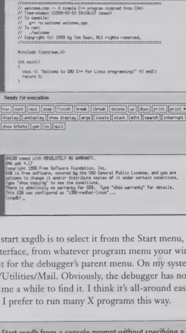

另一种启动 xgdb 的方法是将其从“开始”菜单中选择，或者如果你不使用 Fvwm 类似 Windows 的界面，则从窗口管理器提供的任何程序菜单中选择。准备好寻找调试器的父菜单吧。在我的系统上，这是 Start/Programs/Utilities/Mail。显然，调试器与邮件实用程序无关，我花了很长时间才找到它。我认为总体上直接从控制台运行 xgdb 更容易。事实上，我更喜欢这样运行许多 X 程序。

**Tip**

从控制台提示符启动 `xxgdb` 而不指定文件名。当调试器的窗口出现时，单击 File 按钮并选择一个已编译的程序进行调试。

图形调试器的命令与控制台命令相似，但以可点击按钮的形式出现。要运行程序，请单击 Run 按钮。要设置断点，请单击顶部窗口源代码中的行，然后单击 Break 按钮。你会在行旁边看到一只红色的小手——至少，我的 xgdb 版本是这样显示的。

单击 Run 执行到断点，并观察底部窗口是否有任何消息。调试器的输出与前一节中解释的相同。然而，同时看到源代码要方便得多。单击 Continue 在程序在断点处停止后继续程序。

## 在 EMACS 中运行 GDB

Emacs 编辑器可以运行 `gdb` 调试器，并在分割窗口中显示其输出以及相关的源代码文件。在我看来，这是运行 GNU 调试器的最佳方式。

要在 Emacs 控制下开始调试程序，首先需要使用调试信息编译程序。虽然可以在 Emacs 中完成此操作，但对于简单程序，在命令提示符下更容易完成：

```
$ g++ -g -o welcome welcome.cpp
```

编译完成后，切换回 Emacs，并从菜单中选择 Tools（工具）、Debugger（调试器）。在 Emacs 显示窗口的底部，会显示一条不完整的 `gdb` 命令。通过输入程序的可执行代码文件名（即包含使用编译器 `-g` 选项创建的调试信息的那个文件）来补全该命令。最底部一行看起来像这样：

```
Run gdb (like this): gdb welcome
```

> 提示
>
> 为了获得最佳效果，请至少将程序的一个源代码文件加载到 Emacs 中。这样会将程序的路径设为上述 `gdb` 命令的当前目录。

Emacs 启动 `gdb` 并准备两个缓冲区窗口，一个显示程序的源代码，另一个显示 `gdb` 的输出。图 5.2 显示了在调试 `welcome.cpp` 时的 Emacs 显示界面。

**图 5.2** 在 Emacs 中调试 welcome.cpp

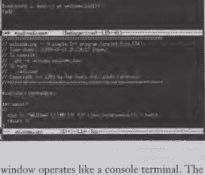

Emacs 顶部窗口的操作类似于控制台终端。另一个窗口显示程序的源代码。（窗口的顺序可能相反。）要发出调试器命令，请像在控制台模式下运行 `gdb` 时那样输入它们。使用 Emacs 的优势在于，它会显示程序的源代码，并高亮显示当前行和任何断点。此外，您可以编写、编译和调试程序，而无需离开 Emacs。

如果您正在跟随操作，请重复“使用 gdb 控制台调试器”中的步骤，以查看 Emacs 如何显示各种命令的结果。在 Emacs 中运行 `gdb` 的另一个好处是，调试器的输出会保存在缓冲区中（在本例中命名为 `gud-welcome`）。使用该缓冲区可以回滚查看命令及其输出。您甚至还可以保存或打印整个调试会话。在追踪难以解决的 bug 时，保留已发出调试命令的记录会非常有帮助。

### 有用的调试器选项

使用 `-h`（或 `--help`）可以列出启动 `gdb` 时可指定的可用选项。以下是对其中一些可能有用选项的说明。

指定 `--command=FILE`，其中 `FILE` 是包含 `gdb` 命令的文本文件名。这是重复调试会话而无需反复输入相同命令的好方法。例如，创建一个名为 `commands` 的文本文件，其中包含以下两行：

```
break 15
run
```

要调试 `welcome.cpp` 程序并执行文件中的命令，请在控制台提示符下输入以下内容（这假设您已使用 `-g` 选项编译了 `welcome.cpp`）。此命令加载 `welcome`，然后执行 `commands` 文件中的 `break` 和 `run` 命令：

```
$ gdb --command=commands welcome
```

如果程序源代码存储在与可执行代码不同的目录中，请使用 `--directory` 选项告诉 `gdb` 在哪里查找源代码文件。使用如下命令：

```
gdb --directory=/home/you/source yourprogram
```

当使用 Emacs 运行 `gdb` 时，如果当前目录不包含已编译程序，您可能需要这样做。要将程序的输出发送到不同于用于查看 `gdb` 消息的终端，请按如下方式使用 `--tty` 命令：

```
gdb --tty=/dev/tty0 welcome
```

这在控制台、X 和 Emacs 调试器界面中的工作方式相同。要查找终端的设备名称，请在 shell 提示符下输入以下 `tty` 命令：

```
$ tty
/dev/tty0
```

切换到另一个终端——或者在 X 下，打开一个新的 shell 窗口——然后使用 `--tty` 选项将报告的设备名称指定给 `gdb`。程序的输出将显示在另一个控制台窗口上。这在调试显示 formatted output. With this option, you can run the debugger in one window and see the program’s output in another. Although this works equally well with dumb terminals, and also with Linux virtual terminals selected on supported systems by pressing Alt-Fn, where Fn is a function key from F1 to F6, it is especially handy under X because you can arrange the two windows for simultaneous viewing.

> **提示**
>
> 使用 `--tty` 选项在从 Emacs 调试时，将程序的输出发送到单独的控制台窗口而不是编辑器窗口窗格。

对于能够解读核心转储文件的坚定专家来说，`--core` 选项可以将核心文件加载到调试器中进行分析。为测试目的，我运行了一个调用标准 `abort()` 函数的测试程序，如前一章所述，然后我使用以下命令将 resulting 核心转储文件加载到调试器中：

```
$ gdb -q --core=core
Core was generated by './tester'.
Program terminated with signal 6, Aborted.
#0  0x40088781 in ?? ()
```

报告的信息表明导致异常终止的程序以及该进程是如何终止的。调试器输出中的最后一行是为什么我不喜欢阅读核心转储文件的一个很好的例子。 （如果您跟随操作，请键入 `q` 退出调试器。）

最后，我最喜欢的 GNU 调试器命令之一是 `stop`。它的帮助条目说明了有关此命令所需了解的所有信息：

```
stop -- There is no 'stop' command
```

Only in Linux....

### SUMMARY

像一位优秀的机械师一样，熟练的 GNU C++ 程序员需要掌握运行编译器和调试器的机械方面。本章解释了编译器的警告和错误消息之间的区别，并展示了几种常见错误的示例。本章还演示了多种编译器选项，您可以使用它们来创建可移植代码；优化运行时性能；分别编译模块化程序；在中间阶段停止预处理器、编译器和汇编器；并执行其他有用的服务。本章以对 GNU 调试器的介绍结束，并包含三个调试器界面的示例，一个用于控制台模式，一个用于 X，一个用于 Emacs 编辑器。

有关本章介绍主题的更多信息，请参阅以下内容：

- Chapter 10, “Creating and Calling Functions”
- Chapter 20, “Customizing I/O Streams”

## CHAPTER

## 6


## Creating Data Objects

数据是程序所知道或可以计算的事实。程序的数据可以采用多种形式，例如字符字符串、整数、浮点值、数组和结构体。本章探讨这些基本数据类型对象，并包括调试程序数据的建议。

> Note
>
> 我在此使用的“object”一词不一定指面向对象编程。所有数据项都正确地称为对象。有关使用 C++ 类创建对象的面向对象编程技术的介绍，请参阅第三部分“面向对象编程”。

## DATA DECLARATIONS

C++ 要求您在程序中首次使用数据对象之前声明它。要声明数据对象，请指定其类型和名称，并以分号结束声明。以下是一个示例：

```
int counter;
```

这声明了一个名为 `counter` 的变量，其类型为 `int`。运行程序会在内存中创建空间来保存变量的值。它是一个变量，因为尽管它一次只能保存一个值，但程序可以按需要频繁更改该值。一种方法是使用为变量赋值语句。以下语句将值 100 分配给 `counter`：

```
counter = 100;
```

将值分配给 `counter` 会替换变量先前保存的值。特别重要的是要理解等号并不表示 `counter` 等于 100；它执行在运行时将值 100 移动到 `counter` 中的操作（或技术上，移动到程序为变量保留的内存中）。您也可以将表达式的结果分配给变量。以下语句将 `counter` 的当前值增加十：

```
counter = counter + 10;
```

编写该语句的简写方式是

```
counter += 10;
```

简写只引用一次 `counter`，在某些情况下这可能更高效（例如，如果 `counter` 是一个复杂表达式而不是简单的变量）。您也可以在表达式中使用类型兼容的变量。如果您像这样声明另一个 `int` 变量：

```
int total;
```

程序可以初始化 `total` 为 10，然后使用以下语句将 `counter` 加到它上面：

```
total = 10;
total = total + counter;
```

如果在这些语句之前 `counter` 等于 100，那么现在 `total` 等于 110。与所有赋值一样，表达式 `(total + counter)` 的结果必须是与接收该值的对象兼容的类型。前面的语句也可以使用简写形式编写：

```
total += counter;
```

这仅仅避免了不得不输入两次 `total`。两种形式都是正确的，但简写形式很流行，而且如前所述，可能更高效。

## 类型转换

赋给对象的值必须是合适的类型。如果你尝试将一种类型的值赋给另一种类型的变量，如下面的语句所示，编译器会尝试将该值转换为兼容的类型。理解这一点很重要，尤其是如果你熟悉 Pascal 等其他编程语言，在这些语言中，赋值操作的数据类型必须与目标对象的类型严格匹配。考虑以下语句：

```
double p1 = 3.14159;
int counter = p1; // ???
```

`double` 类型将 `p1` 指定为浮点值。将 `p1` 赋给 `int` 类型的 `counter` 变量会将其值设为 3，但由于该赋值涉及不同类型的对象，编译器会发出以下警告：

```
x.cpp:8: warning: initialization to 'int' from 'double'
```

通过使用类型转换表达式，可以“修复”关于不兼容数据类型的警告。将前面的赋值改为以下形式即可消除警告：

```
int count = (int)p1;
```

以这种方式在括号中指定对象的数据类型，会将其值转换为指定的类型。这也告诉编译器，你意识到这些对象属于不同类型，并且你是有意将一个值赋给另一个。然而，你不能随意使用类型转换来执行转换。例如，你不能使用类型转换表达式将字符串转换为 `int` 值——为此，你必须调用库函数（有关更多信息，请参阅本章后面的“字符串转换”）。

> 注意
>
> `double` 数据类型之所以这样命名，来源于“双精度”（double precision）一词，指的是用于浮点值的内部存储格式。

## 标识符：好、坏与丑

对象的名称，即标识符，必须符合一定的规则。一个格式正确的标识符必须以字母字符或下划线开头，并且只能包含字母字符、数字和下划线。它可以包含大写和小写字母。标识符的长度可以从 1 到 255 个字符，但编译器只识别前 32 个字符。对于通用变量，通常使用单个字母标识符，如 `i` 和 `x`，但较长的名称如 `index` 和 `x_coordinate` 可以使程序更易于理解。

> 提示
>
> 虽然标识符的法定长度限制为 255，但在实践中，标识符不应超过大约 15 到 20 个字符。

GNU C++ 标识符命名规则有一些深奥且大多无用的变体。例如，你可以在标识符中使用美元符号，但其他编译器可能接受也可能不接受。你最好只使用字母、数字和下划线。一些好标识符的例子有：

- `counter`
- `y2k_fix`
- `date_of_birth`
- `speedOfLight`

许多 C 程序员反对在标识符中使用大写字母，更喜欢 `speed_of_light` 而不是 `speedOfLight`。无论你的偏好如何，都必须保持一致。这是因为 C++ 区分大小写，编译器会将标识符 `speed_of_light`、`speedOfLight` 和 `speedoflight` 视为三个不同的对象。以下是一些坏标识符的例子：

- `10times`
- `user-name`
- `xq29b`

第一个标识符以数字开头，这是绝不允许的。第二个包含连字符，但只允许使用字母、数字和下划线。第三个标识符只是丑陋。如果你创建这样的标识符，那么在调试程序时，你会想知道 `xq29b` 到底是什么意思。始终选择能描述其用途的标识符。不要含糊不清；要清晰。

> 提示
>
> 尽管标识符可以以一个或多个下划线开头，如 `_username` 和 `__user_value`，但这种约定被标准库用来避免与用户程序标识符冲突。因此，不要用自己的标识符以下划线开头。

## GNU C++ 保留字

C++ 保留了 97 个标识符供其自身使用（这个数字可能因编译器版本而异）。表 6.1 列出了 GNU C++ 中的所有保留字。不要使用表中的任何单词作为你自己的标识符。

### 表 6.1 GNU C++ 保留字

| __alignof | __const__ | __inline | reinterpret_cast | try |
|---|---|---|---|---|
| __alignof__ | const | __inline__ | return | typedef |
| and | const_cast | inline | short | typeid |
| and_eq | continue | int | __signature__ | typename |
| __asm | default | __label__ | signature | __typeof |
| __asm__ | delete | long | __signed | __typeof__ |
| asm | do | mutable | __signed__ | typeof |
| __attribute | double | namespace | signed | union |
| __attribute__ | dynamic_cast | new | __sigof__ | unsigned |
| auto | else | not | sigof | using |
| bitand | enum | not_eq | sizeof | virtual |
| bitor | explicit | operator | static | void |
| bool | __extension__ | or | static_cast | __volatile |
| break | extern | or_eq | struct | __volatile__ |
| case | false | overload | switch | volatile |
| catch | float | private | template | __wchar_t |
| char | for | protected | this | while |
| class | friend | public | throw | xor |
| compl | goto | register | true | xor_eq |
| __const | if | | | |

> Tip
>
> 如果编译器返回“parse error”但源代码看起来是正确的，请检查是否不小心使用了表 6.1 中的某个词。

## 简单数据对象

简单数据对象保存数值，如整数或浮点值。其他简单数据类型包括表示真或假条件的布尔值、字符和枚举。枚举只不过是对一系列值赋予名称的集合，例如一周中的天数。

本节介绍 C++ 的简单数据类型，并列出一些程序来解释相关主题，例如如何确定对象的大小和类型，以及如何计算表达式的结果。

## 整数变量


C++ 中有七种数值数据类型：`char`、`short`、`int`、`long`、`float`、`double` 和 `long double`。GNU C++ 增加了一个第八种类型 `long long`，但关于这一点将在本章后面“双宽整数”部分再详细介绍。

> Note
> 尽管 `char` 类型通常表示字母数字字符，但在内部它只是一个整数值，也可用于表示字节值以及字符。

### LISTING 6.1 INTEGERS.CPP

```
#include <iostream.h>

// Global variables

char c;
short s;
int i;
long l;
float f;
double d;
long double ld;

int main()
{
cout << "Sizeof char     == " << sizeof(c) << endl;
cout << "Sizeof short    == " << sizeof(s) << endl;
cout << "Sizeof int      == " << sizeof(i) << endl;
cout << "Sizeof long     == " << sizeof(l) << endl;
cout << "Sizeof float    == " << sizeof(f) << endl;
cout << "Sizeof double   == " << sizeof(d) << endl;
cout << "Sizeof long double == " << sizeof(ld) << endl;
return 0;
}
```

`integers.cpp` 程序声明了七个全局变量，每个对应 C++ 数值数据类型中的一种。它们被称为全局变量，因为它们是在任何函数之外声明的，因此可在整个程序中全局使用。（第 10 章“创建和调用函数”中“函数和变量”部分解释了如何在函数内部创建和使用局部变量。另请参阅本章后面的“全局和局部变量”。）全局变量初始为零——换句话说，组成变量的字节在运行时被设为零。使用以下两个命令编译并运行 `integers.cpp` 程序：

```
$ g++ integers.cpp
$ ./a.out
Sizeof char     == 1
Sizeof short    == 2
Sizeof int      == 4
Sizeof long     == 4
Sizeof float    == 4
Sizeof double   == 8
Sizeof long double == 12
```

> Note
> 双等号 (`==`) 表示“等于”。单等号 (`=`) 表示“赋值为”。不要将它们混淆。

程序的输出显示了每个数值对象的大小，以 8 位字节为单位。`char` 占用一个字节，`int` 占用 4 个字节，`double` 占用 8 个字节。`long double` 变量占用 12 字节内存。这些大小由 ANSI C++ 定义。与 C 不同，在 C 中基本类型的大小取决于编译器的随意性，你可以依赖这些简单对象在任何最新的 ANSI C++ 编译器中占用相同的空间。

## 限制

数值数据类型的大小限制了其值的范围。范围还取决于它是 `signed` 还是 `unsigned`。有符号对象可以保存负值和正值。无符号对象只能保存正值。所有数值对象都可以表示零值。

在七种数值数据类型中，只有 `char`、`short`、`int` 和 `long` 可以明确指定为 `signed` 或 `unsigned`。除非另有说明，这四种类型默认是有符号的。`float`、`double` 和 `long double` 类型的浮点对象始终是有符号的。要明确说明对象是有符号还是无符号，请在其前面加上保留字 `signed` 或 `unsigned`。以下是一些示例：

```
unsigned int average;   // Must be positive or zero
signed long total;      // Can be negative, zero, or positive
long total;             // Same as preceding declaration
unsigned char byte;     // Must be in the range 0 ... 255
```

变量 `average` 声明为 `unsigned`，因此它只能保存正 `int` 值和零。变量 `total` 声明为 `signed`，因此它可以保存正值和负值（以及零），但由于 `long` 类型通常是有符号的，因此这样声明在实践中没有必要，第三行更常用。变量 `byte` 声明为 `unsigned char`，并且由于 `char` 的长度为 8 位，因此按此定义 `byte` 对象可以保存 0 到 255 范围内的值。

> Note
> `char` 变量默认是否 `signed` 是一个重要考虑因素。由于各种 C 和 C++ 编译器对此规则不同，这一晦涩事实也是许多令人沮丧的 bug 的来源。在 ANSI C++ 中，`char` 默认是有符号的，因此可以表示 -128 到 +127 包括零的范围。如果你想要无符号 `char`，必须显式声明它们。

短整型和长整型实际上分别是 `short int` 和 `long int` 的缩写。你可以使用这些未缩写的名称来声明变量，如下所示：

```
short int shorter;
long int longer;
```

但下面的声明是等价的，而且更常见：

```
short shorter;
long longer;
```

你可以将 `unsigned` 和 `signed` 与 `short` 和 `long int` 声明结合使用。例如，下面的语句声明了两个 `unsigned` 变量，类型分别为 `short int` 和 `long int`：

```
unsigned short int short_n_sweet;
unsigned long int long_n_tall;
```

## Constants As Macros

常量是一个程序在运行时无法更改的对象或其他值。在 C++（以及 ANSI C）中，有两种类型的常量——由宏定义的常量和作为数据对象定义的常量。最简单的常量是由 `#define` 指令创建的宏。例如，这定义了一个名为 `MAXIMUM` 等于 100 的常量：

```
#define MAXIMUM 100
```

像 `MAXIMUM` 这样的符号被称为宏，因为 C++ 预处理器会在符号出现的地方将其替换为其关联的值（但字符串或注释内部除外）。按照惯例，以这种方式定义的常量都写成全大写，但这不是必需的。

定义 `MAXIMUM` 之类的常量的最重要原因是为了避免在程序源代码中散布字面值。例如，即使 `MAXIMUM` 在一百个不同的地方使用，修改 `#define` 指令即可更改其关联的值。命名良好的常量也使程序的源代码更易于理解。

你可以在其值（100）合适的地方使用 `MAXIMUM` 这样的常量。所说的“值”并不是指其整数值——尽管看起来如此，`MAXIMUM` 并不是一个整数对象。它是字符 1、0 和 0 的符号宏表示。你可以使用如下输出语句显示 `MAXIMUM`

```
cout << "MAXIMUM == " << MAXIMUM << endl;
```

预处理后，该语句会被编译为好像写成这样：

```
cout << "MAXIMUM == " << 100 << endl;
```

在展开 `MAXIMUM` 宏时，C++ 预处理器会在编译前将字符 1、0 和 0 插入到程序文本中。

使用 `#define` 创建常量时，还有另外两条重要的规则需要记住。首先，切勿在指令末尾加上分号。在 GNU C++ 中，这种常见错误会产生以下警告和错误信息：

```
x.cpp:5: warning: missing white space after '#define MAXIMUM'

x.cpp:9: parse error before ';'
```

其次，请记住，使用 `#define` 创建的常量仅仅是对其后内容（忽略前导空白）的符号表示。如何恰当地使用常量取决于你。清单 6.2，`defines.cpp`，展示了使用 `#define` 创建的各种类型常量的几个示例。

### LISTING 6.2 DEFINES.CPP

```
#include <iostream.h>

#define CHARACTER '@'
#define STRING "I'd rather be programming!"
#define MAX_VALUE 100
#define PI 3.14159

int main()
{
cout << "CHARACTER == " << CHARACTER << endl;
cout << "STRING == " << STRING << endl;
cout << "MAX_VALUE == " << MAX_VALUE << endl;
cout << "PI == " << PI << endl;
return 0;
}
```

编译并运行 `defines.cpp` 会产生以下输出：


```
CHARACTER == @
STRING == I'd rather be programming!
MAX_VALUE == 100
PI == 3.14159
```

正如该程序所示，使用 `#define` 创建的常量可以表示任何你能输入到程序文本中的数据类型，包括字符、字符串、整数和浮点值，仅举几例。

## CONSTANTS AS OBJECTS

声明常量值的另一种方法是使用保留字 `const` 在对象声明前加上前缀。这告诉编译器禁止程序尝试更改常量的值。`const` 标识符是 C++ 的创新，但已被重新纳入 ANSI C，因此你现在可以在 C 和 C++ 程序中使用 `const`。

将对象声明为 `const` 会在它们周围形成一道屏障，防止其值在运行时被更改。如果你像这样将整数 `count` 声明为 `const`：

```
const int count = 1234;
```

编译器会拒绝以下语句：

```
count = count + 100; // ???
```

`count` 的初始值被锁定，后续的程序语句无法更改它。

```
cout << "unsigned char : "
<< 0
<< " ... "
<< UCHAR_MAX
<< endl;
...
return 0;
}
```

## 表 6.2 整数和浮点数范围

| 数据类型 | 最小值 | 最大范围 |
|---|---|---|
| `signed char` | -128 | 127 |
| `unsigned char` | 0 | 255 |
| `char` | -128 | 127 |
| `signed short` | -32768 | 32767 |
| `unsigned short` | 0 | 65535 |
| `int` | -2147483648 | 2147483647 |
| `unsigned int` | 0 | 4294967295 |
| `long` | -2147483648 | 2147483647 |
| `unsigned long` | 0 | 4294967295 |
| `float` | 1.17549e-38 | 3.40282e+38 |
| `double` | 2.22507e-308 | 1.79769e+308 |
| `long double` | 3.3621e-4932 | 1.18973e+493200 |

## 全局变量和局部变量

全局变量始终在 `main()` 或任何其他函数之外声明——通常，但不总是，在头文件中。局部变量在函数内部声明，通常紧跟在语句块的左大括号之后。列表 6.4，`default.cpp`，演示了全局变量和局部变量之间的一些差异。

### 列表 6.4 DEFAULT.CPP

```
#include <iostream.h>

int global = 100;
int globalDefault;

int main()
{
int local = 200;
```

### 列表 6.4 继续

```
int localDefault;

cout << "global....... == " << global      << endl;
cout << "local....... == " << local        << endl;
cout << "globalDefault == " << globalDefault << endl;
cout << "localDefault == " << localDefault << endl;
return 0;
}
```

全局变量如 `global` 和 `globalDefault` 在任何函数之外声明，以及局部变量如 `local` 和 `localDefault` 在此在 `main()` 内部声明之间存在两个关键区别。区别是

- 全局变量可能对程序中任何语句都可用。局部变量仅对其声明函数内部的语句可用。
- 全局变量在程序启动时自动初始化为零。局部变量在程序为其赋值之前不会被初始化。

编译并运行示例 `default.cpp` 程序即可演示这些差异。输入以下行并查看程序的输出：

```
$ g++ default.cpp
$ ./a.out
global....... == 100
local....... == 200
globalDefault == 0
localDefault == 1
```

函数 `main()` 可以同时引用全局变量和局部变量。然而，如果程序中还有另一个函数，它将无法引用两个局部变量 `local` 和 `localDefault`，因为它们在 `main()` 内部。变量的作用域仅扩展到其声明的语句块。

## 注

有关局部变量的更多信息，请参阅第 10 章“创建和调用函数”。

## 多个变量声明

当声明多个相同类型的变量时，你可以像这样用逗号将它们一个接一个地写出来：

```
int v1, v2, v3, v4;
```

或者，你可以通过将它们的声明堆叠在单独的行上来单独创建它们：

```
int v1;
int v2;
int v3;
int v4;
```

无论你选择哪种风格，你都可以为变量分配初始值，也可以让它们未初始化。 （如果它们是全局变量，请记住它们会自动初始化为零。）下面的语句声明了四个 `int` 变量，并将其中两个 `v2` 和 `v4` 初始化为值 123 和 321。

```
int v1, v2 = 123, v3, v4 = 321;
```

在我看来这很混乱，所以作为一条通用规则，我仅对未初始化的变量使用简写声明风格。如果我打算分配初始值，我更喜欢按以下方式写在单独的行上：

```
int v2 = 123;
int v4 = 321;
```

## 枚举类型

枚举类型是对一系列值的符号表示，例如彩虹的颜色，一周中的天数，或程序中可以用整数表示的任何其他系列。例如，假设你想表示彩虹的七种基本颜色。为了给每种颜色命名，你可以定义如下符号常量：

```
#define RED     0
#define ORANGE  1
#define YELLOW  2
#define GREEN   3
#define BLUE    4
#define INDIGO  5
#define VIOLET  6
```

这些值毫无意义——它们只是为程序提供一种方便的方式，将颜色名称表示为唯一的整数值，这些值可能存储在变量中，写入磁盘文件，或以其他方式使用。给定这些符号，程序可以这样声明一个 `int` 变量：

```
int color;
```

然后将 `color` 分配为任意颜色符号：

```
color = GREEN;
```

编译器用该符号关联的文本替换 `GREEN`，在本例中为单个数字 3。实际上，该语句被编译为

```
color = 3;
```

显然，符号 `GREEN` 比字面值 3 更有意义。但是，键入长串颜色名称和其他相对固定的符号（例如一年的月份）是一项繁琐的工作。此外，程序中没有任何内容表明各个颜色符号之间存在关联。

为了使创建此类列表变得更容易，C++ 提供了一种有用的设备，称为枚举类型。使用保留字 `enum`，你可以使用单个声明创建前面七个颜色常量：

```
enum { RED, ORANGE, YELLOW, GREEN, BLUE, INDIGO, VIOLET };
```

这与前面列出的 `#define` 指令具有相同的效果。`enum` 保留字后面是一个由逗号分隔、用花括号括起来并以分号结尾的标识符列表（通常为大写）。每个符号都被赋予一个从 0 开始的连续整数值。在本例中，`RED` 等于 0，`ORANGE` 等于 1，`YELLOW` 等于 2，依此类推，直到 `VIOLET` 等于 6。

鉴于前面的声明，要声明一个名为 `color` 的 `int` 变量并为其赋 `BLUE` 的颜色值，可以这样写：

```
int color = BLUE;
```

与其使用 `int` 类型的对象来存储枚举值，不如为枚举类型命名更清晰。为此，可以使用保留字 `typedef`（表示“类型定义”），如下面的彩虹颜色枚举所示：

```
typedef enum
{
    RED, ORANGE, YELLOW, GREEN, BLUE, INDIGO, VIOLET
} TColors;
```

`typedef` 保留字创建了新的数据类型名称 `TColors`，它与颜色名称的枚举列表相关联。既然 `TColors` 被定义为一个新的数据类型，程序就可以像这样声明该类型的变量：

```
TColors oneColor;
```

这使得 `oneColor` 成为 `TColors` 类型的变量，并可以通过如下语句将颜色符号常量赋值给 `oneColor`：

```
oneColor = INDIGO;
```

编译器会自动枚举 `enum` 声明中的元素。然而，有时需要接管这项工作，为一个或多个符号指定显式的值。例如，考虑为一年中的月份创建枚举类型的问题。你可能会尝试这样：

```
enum { JAN, FEB, MAR, APR, MAY, JUN,
      JUL, AUG, SEP, OCT, NOV, DEC };
```


问题在于，因为枚举列表中的第一个符号被赋值为`0`，所以`JAN`等于`0`而不是`1`——而`1`才是与一年中第一个月份相关联的正常值。要解决这个问题，可以为枚举列表中的某个成员指定一个显式的起始值。例如，要将`JAN`设为`1`，请将前面的声明改为：

```
enum { JAN = 1, FEB, MAR, APR, MAY, JUN,
      JUL, AUG, SEP, OCT, NOV, DEC };
```

表达式`JAN = 1`将`1`赋给符号`JAN`。随后的符号从该点继续序列，使`FEB`等于`2`，`MAR`等于`3`，`APR`等于`4`，`DEC`等于`12`。你同样可以初始化枚举类型的任何元素。

使用枚举变量时要记住的一点是，诸如`RED`、`ORANGE`、`SEP`和`DEC`之类的符号名称只是预处理符号，类似于在`#define`指令中声明的那些符号。因此，这些符号只存在于程序的源代码中，在编译后的代码中会被替换为其底层的数值。许多不熟悉枚举的程序员错误地认为写出它们会显示关联的名称，但正如清单6.5（`enum.cpp`）所示，情况并非如此。

## 清单6.5 ENUM.CPP

```
#include <iostream.h>

typedef enum
{
    RED, ORANGE, YELLOW, GREEN, BLUE, INDIGO, VIOLET
} TColors;

int main()
{
    TColors acolor = INDIGO;
    cout << "acolor == " << acolor << endl;
    return 0;
}
```

使用以下命令编译并运行程序。程序创建并显示一个`TColors`枚举变量`acolor`的值：

```
$ g++ enum.cpp
$ ./a.out
acolor == 5
```

如你所见，程序报告`acolor`等于`5`。它并不会像你预期的那样写出关联的符号名称`INDIGO`，因为该符号在编译期间被其枚举值替换了。枚举符号有助于澄清程序的逻辑，但这些符号仅存在于源代码层面。

> 提示
>
> 本章的“初始化字符串数组”一节介绍了一种技术，你可以使用该技术为`TColors`等枚举类型提供字母名称。

## 布尔变量

`C++`提供了`bool`数据类型，用于表示两个符号值`true`或`false`之一。`bool`变量也称为布尔变量或真假变量，经常用作标志来表示各种条件。当你在第9章“控制程序流程”中学习`while`和`if`等控制语句时，它们会变得更加重要。要创建布尔变量，可以使用如下语句：

```
bool error = false;
```

这声明了一个`bool`类型的变量`error`，并为其赋初始值`false`。假设`error`是一个全局变量，在程序的其他位置，如果检测到错误条件，可以使用如下语句将`true`赋给`error`：

```
error = true;
```

回到`main()`中，另一条语句可以检查`error`，并将其用作标志，以选择两种结束程序的方式之一：

```
int main()
{
    if (error)
        return 1;
    else
        return 0;
}
```

你还没有见过`if`语句，但这段代码的作用应该很明显。如果`error`变量为真，程序返回`1`作为错误码；否则返回`0`，表示没有错误。

> **注意**
>
> `C`程序使用整数变量来表示真（任何非零值）和假（`0`）。在`C++`中你也可以这样做，但使用`bool`类型会更加清晰。另外，`bool`变量的大小为一个字节，`int`则占用四个字节，相对比较浪费。

## 字面量

你可以使用十进制、十六进制或八进制基数来指定整数字面值。除`0`以外，十进制常量必须以非零数字开头。以`0`开头的常量是八进制值，只能包含`0`到`7`的数字。以`0x`或`0X`开头的常量是十六进制，可以包含`0`到`9`的数字以及大写或小写的`A`到`F`。清单6.6（`literal.cpp`）声明了用十六进制、八进制和十进制字面值初始化的`int`变量。

### 清单 6.6 LITERAL.CPP

```
#include <iostream.h>

int main()
{
    int hexValue = 0xF9AC;
    int octalValue = 0724;
    int decimalValue = 255;

    cout << "hexValue == " << hexValue << endl;
    cout << "octalValue == " << octalValue << endl;
    cout << "decimalValue == " << decimalValue << endl;

    return 0;
}
```

编译并运行`literal.cpp`实际上会将示例程序中的八进制和十六进制值转换为十进制。输入以下命令来编译并运行程序：

```
$ g++ literal.cpp
$ ./a.out
hexValue == 63916
octalValue == 468
decimalValue == 255
```

如输出所示，默认输出格式为十进制。虽然字面值`0xF9AC`以十六进制表示，但在内部它只是一个与其他整数值一样的整数。由于整数的默认输出格式是十进制，将十六进制和八进制值写入`cout`时，会以十进制显示它们。

> **注意**
>
> 第8章“控制输入与输出”将说明如何使用十六进制、八进制和十进制输出格式来显示整数值。

## 字面常量范围

除了基数之外，你还可以指定字面值的数据类型，这有时对于确保`GNU C++`在内部按照你想要的方式表示字面值是必要的。例如，要确保编译器将`100`视为`long int`，可以添加后缀`L`。下面的声明将长整数值`1234L`赋给名为`bigValue`的变量：

```
long bigValue = 1234L;
```

若要指定`unsigned long`值，请添加`uL`。例如，下面将无符号长整数值`1234UL`赋给`bigValue`。这些值相同，但在内部会根据其特定类型在内存中进行表示：

```
unsigned long bigValue = 1234UL;
```

> **注意**
>
> 由于`GNU C++`通常将整数常量表示为`long`或`unsigned long`值，因此很少需要后缀`L`和`UL`。但是，其他将整数常量表示为`int`类型的`C`和`C++`编译器可能需要它们。为了提高可移植性，最好为所有应被视为`long`或`unsigned long`的常量加上`L`或`UL`。

## 双宽整数

`GNU C++`允许一种名为`long long`的特殊“双宽”整数类型，它可以存储真正巨大的值。清单6.7（`verybig.cpp`）演示了如何声明`long long`整数，并确定它们可以表示的最小值和最大值。

### 清单 6.7 VERYBIG.CPP

```
#include <iostream.h>

long long min_signed, max_signed;
unsigned long long max_unsigned;

main()
{
    // Assign minimum and maximum values to var1 and var2
    // Assign maximum value to unsigned var3
    min_signed = 0x8000000000000000LL;
    max_signed = 0x7FFFFFFFFFFFFFFFLL;
    max_unsigned = 0xFFFFFFFFFFFFFFFFULL;

    cout << "Signed long long range" << endl;
    cout << " " << min_signed << " ... ";
    cout << max_signed << endl;
    cout << "Unsigned long long range" << endl;
    cout << "0 ... " << max_unsigned << endl;
    cout << "long long size in bytes == ";
    cout << sizeof(max_unsigned) << endl;

    return 0;
}
```

使用以下命令编译并运行`verybig.cpp`程序时，它会报告有符号和无符号`long long`整数值的最小值和最大值，并显示`long long`变量的大小（以字节为单位）：


```
$ g++ verybig.cpp
$ ./a.out
Signed long long range
-9223372036854775808 ... 9223372036854775807
Unsigned long long range
0 ... 18446744073709551615
long long size in bytes == 8
```

程序的输出表明，有符号 `long long` 整数能够表示巨大的数值，范围为正负 9 千万亿左右。无符号 `long long` 整数将最大值扩大到超过 1.8 亿亿。这对我来说绝对足够大，足以容纳我的银行存款，而且不会有溢出的危险。

### 提示

> 通过假定一个小数点，`long` 和 `long long` 整数适用于会计和电子表格软件。（参见第8章“控制输入与输出”，了解如何将值格式化为字符串——例如，在 `long` 或 `long long` 整数值中插入小数点。）

由于 GNU C++ 将整数字面常量表示为 `long` 或 `unsigned long` 类型，示例程序中的十六进制赋值必须以 `LL` 和 `ULL` 结尾，以防止出现超出范围的警告。虽然从表面上看，第三个常量并不是以单词“FULL”结尾的。那是一个十六进制的 `F` 后跟 `ULL`，表示 `unsigned long long`：

```
min_signed = 0x8000000000000000LL;
max_signed = 0x7FFFFFFFFFFFFFFFLL;
max_unsigned = 0xFFFFFFFFFFFFFFFFULL;
```

常量的设计利用了这样一个事实：在二进制中，有符号整数的最小值是一个初始的 1 位后面跟着全零（十六进制中为 0x80...）。有符号整数的最大值是一个 0 位后面跟着全 1（十六进制中为 0x7F...）。无符号整数值在二进制中的最大值是全 1（十六进制中为 0xFF...）。当然，所有无符号整数的最小值都是零。

> Warning

> 类型为 `long long` 的双宽整数可能仅在 GNU C 和 C++ 中独有。使用这种类型可能会使你的程序与其它 C 和 C++ 编译器不兼容。

## It's A WRAP

一个需要特别注意的问题，尤其是对于整数变量，就是一种类似于里程表在达到上限后回到全零的回绕效应。这是一种内部的 Y2K 效应，有时是有用的，但也可能导致错误。Listing 6.8, `wrap.cpp`, 演示了这个问题。

### LISTING 6.8 WRAP.CPP

```
#include <iostream.h>

short int value;

int main()
{
    value = 32767;
    cout << "value == " << value << endl;
    value = value + 10;
    cout << "value + 10 == " << value << endl;
    return 0;
}
```

使用以下命令编译并运行 `wrap.cpp`：

```
$ g++ wrap.cpp
$ ./a.out
value == 32767
value + 10 == -32759
```

输出的第二行看起来像是出现了错误。32767 + 10 怎么会等于 -32759 呢？这个表面上的问题出现的原因是 GNU C++ 以固定数量的字节存储整数值。因为它们的大小是固定的，所以变量的位只能表示有限范围内的值——在这种情况下，对于 `short int` 来说是 -32768 到 +32767 包括零（参见 Table 6.2）。超出变量范围的表达式会导致值“回绕”，就像典型的汽车里程表在达到 999999 时那样。因为这发生在运行时，编译器无法对导致回绕的计算发出警告或错误信息。要修复这个问题，只需选择更大的数据类型即可。例如，将 `value` 的类型从 `short int` 改为 `int` 就增加了变量可以表示的值的潜在范围，回绕现象就不再发生。

> Warning

> 无关紧要的代码，例如游戏，可能出于某种原因使用回绕（也许作为图形设备），但生产软件绝不应依赖这种效应。这条规则在 C 程序中尤其重要，因为许多 C 编译器使用不同的内部字节大小和值范围来定义相同的整数类型。

## FLOATING POINT VARIABLES

浮点值（有时也称为实数）是用小数点写出来的。浮点值最好被认为是近似值。例如，pi 的当前已知值是一个庞大的数字集合，但近似的浮点值 3.14159 对于许多应用来说已经足够接近了。

你也可以使用科学计数法书写字面浮点值。值 3.755E+02 等价于十进制值 375.5。 （数学家会把同一个值写成 3.755×10²。）要形成科学值的十进制等价值，对正指数向右移动小数点，对负指数向左移动。因此，5.123E+03 等于 5123.0，而 6.5E-03 等于 0.0065。

GNU C++ 和其它 ANSI C++ 编译器提供了三种浮点数据类型：`float`、`double` 和 `long double`。 （除了在游行中，没有 `long float` 这种东西。）Table 6.3 列出了三种浮点类型的内存大小和近似值范围。

大多数程序使用 `double` 类型作为浮点变量，但你可以使用 `float` 来节省空间而以精度损失为代价，或使用 `long double` 来获得更高的精度和更大的值范围，但求值复杂表达式时执行时间可能更长。

### TABLE 6.3 FLOATING POINT DATA TYPES

| Data Type | Bytes | Bits | Minimum | Maximum |

|---|---|---|---|---|

| float | 4 | 32 | 1.17549e-38 | 3.40282e+38 |

| double | 8 | 64 | 2.22507e-308 | 1.79769e+308 |

| long double | 12 | 96 | 3.3621e-4932 | 1.18973e+4932 |

> Note

> 请参阅标准库头文件 `float.h` 以获取 GNU C++ 浮点值的精确范围和其他细节。该文件中的常量往往高度依赖编译器或机器，因此出于这个原因，`float.h` 可能不在 `/usr/include` 与其它标准头文件一起。 使用 Linux 的 `find` 或 `locate` 命令在你的系统上查找 `float.h`。

> 在我的安装中，我在以下晦涩的路径中找到了 `float.h`：

> `/usr/lib/gcc-lib/1386-redhat-linux/egcs-2.90.27/include/`

创建浮点变量的方式与其他变量相同，但需要指定表 6.3 中的某种类型。例如，要声明一个名为 `balance` 的变量，请使用如下声明：

`double balance;`

与整型变量一样，如果 `balance` 是全局变量，其值在运行时会被初始化为零（0.0）。如果 `balance` 声明在函数的语句块内，则需要你负责为其赋初始值。与整型变量一样，你可以用一条语句完成，例如：

`double balance = 525.49;`

> 注意

> 诸如 525.49 和 99.99 这样的浮点常量属于 `double` 类型，除非后跟 `f` 或 `F`，此时它们被表示为 `float` 类型。值 `3.14159F` 就是 `float` 类型。使用 `l` 或 `L` 可以告诉编译器某个值应为 `long double` 类型，例如 `3.14159L`。

清单 6.9（`tax.cpp`）演示了如何使用浮点变量计算数值。该程序根据商品的总购买价格和当地税率来计算已付税额和商品零售价。我编写这个程序是因为有时我需要回溯一笔购买交易，弄清楚我付了多少税。例如，如果我看到一张 13.96 美元的账单，这个程序就能告诉我其中有多少是税。

## 清单 6.9 TAX.CPP

```
#include <iostream.h>
#include <stdio.h>    // 需要 printf()

double list, paid, rate, tax;

main()
{
    cout << "Price paid? ";
    cin >> paid;
    cout << "Tax rate (ex: .06)? ";
    cin >> rate;

    list = paid / (1 + rate);
    tax = paid - list;

    printf("List price  = $%0.2f\n", list);
    printf("Tax paid    = $%0.2f\n", tax);
    return 0;
}
```

照常编译并运行 `tax.cpp`，然后输入你为某件商品支付的价格以及当地税率。下面是一个运行示例：

```
$ g++ tax.cpp
$ ./a.out
Price paid? 13.96
Tax rate (ex: .06)? 0.075
List price = $ 12.99
Tax paid   = $ 0.97
```


给定一张 13.96 美元的账单和当地 7.5% 的税率，`tax.cpp` 计算出我为这件商品支付了 12.99 美元的零售价和 0.97 美元的销售税。该程序的源代码中包含了一些尚未介绍的新元素。这条语句将输入读取到一个变量中：

`cin >> paid;`

`cin` 对象与 `cout` 类似，但它将标准输入定向到一个变量，在这里是 `double` 类型的 `paid`。C++ I/O 流输入操作符 `>>` 看起来像一个箭头，将 `cin` 的输入“射入”目标变量。你可以使用类似的语句将输入读取到其他简单类型的变量中。（另请参阅第 8 章“控制输入和输出”，了解读取用户输入的其他方式。）

在获得 `paid` 和 `rate` 的输入值后，程序使用以下语句计算标价和已付税额：

`list = paid / (1 + rate);`

`tax = paid - list;`

第一条语句表达式中的括号确保了加法在除法之前执行。这是必要的，因为除法的优先级高于加法，因此在没有括号的情况下会先执行除法。换句话说，以下语句会导致程序中出现错误：

`list = paid / 1 + rate; // ???`

这会错误地将 `paid` 除以 1，然后将 `rate` 加到中间结果上。始终使用括号来确保你的数学计算按照预期方式执行。有关 GNU C++ 运算符优先级的详细信息，请参阅附录 B“C++ 运算符优先级与结合性”。

> 注意
>
> 多余的括号不会造成任何伤害，也不会给编译后的程序增加任何不必要的目标代码。请大量使用括号来澄清程序中所有的表达式——为了编译器，也为了你自己。

## 字符串

字符串赋予了计算机程序“说话”的能力。借助字符串，程序可以显示错误消息、提示输入，并报告内部事件的相关信息。字符串还可以保存文件名、数据库搜索关键字和其他文本信息。以下各节将说明如何创建 C 风格字符串，以及一些相关主题，例如如何将字符串转换为二进制整数值和浮点值。

> 注意
>
> GNU C++ 提供了用于构造字符串对象的 `string` 类，这在第五部分“C++ 类库”中有所介绍。然而，许多 C++ 程序员仍继续使用下一节中描述的 C 风格字符串，了解如何创建这两种类型的字符串是很有好处的。

### 字符

使用 `char` 类型创建能够保存单个字符的变量。例如，下面的语句创建了一个 `char` 变量 `c`，并将字母 Q 赋值给它：

```
char c = 'Q';
```

用单引号分隔单个字面字符。如前所述，`char` 类型在内部只是一个整数值。因为 81 是字母 Q 的 ASCII 值，所以下面的语句与前面的语句等价：

```
char c = 81;
```

### C 风格字符串常量

C 风格字符串常量是一个或多个 `char` 的序列，每个 `char` 在内存中占一个字节，并以一个等于 ASCII 0 的空字符结尾。使用双引号引用字面字符串。例如，你可以定义一个名为 `TITLE` 的常量，并与一个字面字符串关联，如下所示：

```
#define TITLE "My Program"
```

然后，你可以使用下面的语句将程序标题写入控制台，并开始新的一行：

```
cout << TITLE << endl;
```

### C 风格字符串变量

C 风格字符串变量通常保存用户输入——例如，文件名。使用 `char` 类型创建 C 风格字符串变量，语句如下：

```
char filename[] = "datafile.txt";
```

方括号告诉编译器 `filename` 是一个由多个字符组成的数组。数组的大小等于引号内字符串的字符数加上一个终止空字符。在声明前加上 `const` 可以创建一个在运行时无法更改的常量字符串：

```
const char mypath[] = "/home/username";
```

字符串的大小没有实际限制，将它们用于大型缓冲区通常很有用，也许是为了执行“原始”磁盘操作。下面声明了一个 1,028 字节的缓冲区：

```
char buffer[1028];
```

> **警告**
>
> 切勿在函数内部创建大型字符串变量或缓冲区！这会将变量放置在相对有限的系统栈上，并且不是良好的编程实践。有关在不使用全局声明的情况下创建字符串变量和大型缓冲区的其他方法，请参阅第 11 章“使用指针管理内存”。

`pathname = "/etc/scripts"; // ???`

这样无法编译，因为赋值运算符未针对 C 风格字符串变量定义。要将一个 C 风格字符串复制到另一个，需要调用标准字符串函数，例如 `strcpy()`。为此，请使用以下指令包含标准头文件 `string.h`：

```
#include <string.h>
```

然后，你可以使用如下语句调用 `strcpy()` 将字符串复制到变量中：

```
strcpy(pathname, "/usr/yourname");
```

这会将 `"/usr/yourname"` 复制到 `pathname` 中。请注意，源字符串不能大于目标变量。一个类似但更安全的函数 `strncpy()` 限制了复制的字符数。如果 `source` 和 `destination` 是 C 风格字符串变量的名称，则以下语句最多将 10 个字符从 `source` 复制到 `destination`：

```
strncpy(destination, source, 10);
```

> **注意**
>
> 通常，名称中带有额外 n 的字符串函数会声明一个数值参数，以某种方式限制函数的行为。这些函数往往比不带 n 的对应函数更安全或更具限制性。示例包括 `strcpy()` 和 `strncpy()`、`strcat()` 和 `strncat()`，以及 `strcmp()` 和 `strncmp()`。有关这些函数的在线文档，请参阅 info 页面。

## 大小很重要

字符串的大小决定了它可以容纳多少个字符。字符串的长度等于该字符串当前包含的字符数。清单 6.10 演示了字符串大小和长度之间的区别。

### 清单 6.10 PROMPT.CPP

```
#include <iostream.h>
#include <string.h>    // Need strlen()

char username[64];

main()
{
cout << "What's your name? ";
cin >> username;
cout << "Hello " << username << '!' << endl;
cout << "size   == " << sizeof(username) << endl;
cout << "length == " << strlen(username) << endl;
return 0;
}
```

以通常的方式编译并运行程序，并在提示时输入一个字符串。下面是一个示例运行：

```
$ g++ prompt.cpp
$ ./a.out
What's your name? Rumpelstilzchen
Hello Rumpelstilzchen!
size   == 64
length == 15
```

`username` 字符串变量的大小以字节为单位为 64，与其在程序源代码中声明的大小相同。但是，字符串的长度取决于它包含的字符数，在本例中为 15。使用所示的 C++ `sizeof` 运算符来确定字符串或任何其他变量的大小。调用 `strlen()` 函数来计算字符串中的字符数。标准头文件 `string.h` 声明了 `strlen()` 以及其他 C 风格字符串函数。

> **注意**
>
> 第 8 章“控制输入和输出”讨论了将用户输入读入字符串变量的其他方法。

## 关于空字符的诸多事宜

所有 C 风格字符串都必须以等于零的 ASCII 空字符结尾。对于各种字符串函数（如 `strcpy()` 和 `strlen()`），这标志着字符串的结束。如果字符串缺少终止空字符，字符串函数会愉快地操作超出为字符串变量保留的数据，从而导致严重错误。

要表示空字符，可以在字符表达式中指定其 ASCII 值，如下所示：

```
char anull = '\0';
```

反斜杠表示后面的数字代表一个字符的 ASCII 值。请务必使用单引号来指定单个字符。字符串 `"\0"` 是一个双字节字符串，包含两个空字符。

表示空字符的另一种方式是使用标准库中的 `NULL` 符号，它全部用大写字母书写。不幸的是，这个符号的性质就像天气一样变化无常。在某些 ANSI C 和 C++ 系统中，`NULL` 通常用 `#define` 指令定义为等同于零，例如：

```
#define NULL 0
```

然而，ANSI C 使用以下宏定义以不同的方式声明 `NULL`：

```
#define NULL ((void *)0)
```

这使得 `NULL` 等同于一个“指向零的 void 指针”。（参见第 11 章“使用指针管理内存”。）尽管 GNU C++ 似乎尝试将 `NULL` 重新定义为等同于零，但其他标准头文件似乎忽略了这种努力，导致 `NULL` 仍按 ANSI C 中的方式定义。因此，即使是下面这样的简单语句也会导致 GNU C++ 发出关于缺少强制转换的警告：

```
char cnull = NULL; // ???
```


许多 C++ 编译器接受该语句，但 GNU C++ 不喜欢它。如果使用 `NULL` 导致这种麻烦，为了修复问题，在包含标准头文件之后，你可以尝试使用以下指令重新定义 `NULL`：

```
#ifndef NULL
#undef NULL
#endif
#define NULL 0
```

这是无事生非，但为了编译某些期望 `NULL` 简单地定义为零的现有程序，这可能是必要的。然而，由于可能会给期望 `NULL` 以不同方式定义的标准库函数带来麻烦，最好在新代码中干脆避免使用这个符号。如果我需要表示空字符，我会使用类似这样的指令来创建自己的常量：

```
#define ANULL 0
```

或者，更好的是，你可以将它定义为一个字符常量：

```
#define CHNULL '\0'
```

## 比较字符串

要比较两个字符串，请调用 `strcmp()` 函数，该函数返回三个整数值之一：-1、0 或 +1。假设你创建两个字符串变量，如下所示：

```
char stringA[] = "Oranges";
char stringB[] = "Apples";
```

下面的语句按字母顺序将 `"Oranges"` 与 `"Apples"` 进行比较：

```
int result = strcmp(stringA, stringB);
```

使用结果整数（在此情况下赋值给 `int` 变量 `result`）根据以下三条规则来确定比较结果：

- 如果 `result` 等于 -1，则 `stringA` 按字母顺序小于 `stringB`。

- 如果 `result` 等于 0，则两个字符串完全相同。

- 如果 `result` 等于 +1，则 `stringA` 按字母顺序大于 `stringB`。

函数 `strcmp()` 区分大小写。它认为小写字母在字母顺序上大于其对应的大写字母（因为小写字母的 ASCII 值高于大写字母）。要对两个字符串进行不区分大小写（但并非无味）的比较，请调用 `strcasecmp()`。`strcasecmp()` 函数与 `strcmp()` 的工作方式完全相同，但忽略大小写上的差异。使用 `strcmp()` 比较时，`"Apple"` 按字母顺序小于 `"apple"`。使用 `strcasecmp()` 比较时，`"Apple"` 和 `"apple"` 被视为相同。

要仅比较两个字符串的一部分，请使用 `strncmp()`。例如，以下语句

```
int result = strncmp(s1, s2, 2);
```

仅当 `s1` 和 `s2` 所指向字符串的前两个字符完全匹配时，才将 `result` 设置为零。对于不区分大小写的比较，请调用函数 `strncasecmp()`。

> 提示

> 某些其他 C 和 C++ 标准库在函数名中使用 "i" 来表示它们 "忽略" 大小写。例如，`strcasecmp()`（有时写作 `strcmpi()`）是 `strcmp()` 的不区分大小写版本。GNU C++ 使用单词 "case" 来表示不区分大小写的字符串函数。如果旧程序因使用 `strcmpi()`、`strncmp i()` 或类似的函数而报错，只需将 "i" 改为 "case"。

## 连接字符串

连接两个字符串会将它们合并，创建一个新的、更长的字符串。给定一个像这样声明的现有字符串：

```
char original[128] = "Testing ";
```

以下语句将 `original` 字符串设置为 `"Testing one, two, three!"`：

```
strcat(original, "one, two, three!");
```

根据需要添加空格，以防止连接后的字符串粘连在一起。例如，第一个字符串 `"Testing "` 以额外的一个空格结尾。

## 搜索子字符串

通常，程序需要在 C 风格字符串变量中搜索字符和子字符串。该技术最常见的用途之一是检查文件名是否带有某个扩展名。例如，在提示用户输入文件名后，你可能想检查他们是否输入了扩展名 `.txt`，如果是，就在屏幕上显示该文件。清单 6.11（`extension.cpp`）使用字符串函数来检测文件扩展名，如果缺少扩展名，则添加一个默认名称。

### 清单 6.11 `EXTENSION.CPP`

```
#include <iostream.h>
#include <string.h>  // Need strstr(), strcat()

char filename[128];

int main()
{
    cout << "File name (.txt)? ";
    cin >> filename;
    cout << "Original input : " << filename << endl;
    if ( !strstr(filename, ".txt") )
        strcat(filename, ".txt");
    cout << "Resulting filename : " << filename << endl;
    return 0;
}
```

函数 `strstr()` 在另一个字符串中定位一个子字符串。该函数返回一个指向 `char` 的指针，在 C 和 C++ 中写作 `char*`。（第 11 章“使用指针管理内存”将全面介绍指针。）在此例中，我们并不关心子字符串位于何处；我们只想知道它是否存在。下面的语句完成了这个任务：

```
if ( !strstr(filename, ".txt") )
    strcat(filename, ".txt");
```

感叹号对 `strstr()` 的结果取反，实际上表示：如果在 `filename` 中找不到`".txt"`，则执行后面的语句。这里，后面的语句调用了另一个字符串函数 `strcat()`，以添加缺失的文件扩展名。

## 字符转义码

除了可以键入的字符之外，字符串和字符还可以包含转义码。这些特殊符号用于表示控制码和其他 ASCII 值，它们无法通过文本编辑器键入，或者会与字符串和字符的引号冲突。表 6.4 列出了完整的 GNU C++ 字符转义码集合，其中大部分可能已被大多数 ANSI C 和 C++ 编译器识别。

### 表 6.4 字符串转义码

| 代码 | 含义 | 十进制 | ASCII 值（十六进制） | 符号 |
|------|------|--------|----------------------|------|
| `'\a'` | 响铃（“警报！”） | 7 | 0x07 | BEL |
| `'\b'` | 退格 | 8 | 0x08 | BS |
| `'\f'` | 换页 | 12 | 0x0C | FF |
| `'\n'` | 换行 | 10 | 0x0a | LF |
| `'\r'` | 回车 | 13 | 0x0d | CR |
| `'\t'` | 水平制表符 | 9 | 0x09 | HT |
| `'\v'` | 垂直制表符 | 11 | 0x0b | VT |
| `'\\'` | 反斜杠 | 92 | 0x5c | `\` |
| `'\''` | 单引号 | 39 | 0x27 | `'` |
| `'\"'` | 双引号 | 34 | 0x22 | `"` |
| `'\?'` | 问号 | 63 | 0x3f | `?` |
| `'\000'` | ASCII 八进制 000 | 不适用 | 不适用 | 不适用 |
| `'\x00'` | ASCII 十六进制 00 | 不适用 | 不适用 | 不适用 |

表 6.4 中的每个转义码都是一个单独字符，内部存储为 `int` 值，由一个反斜杠后跟一个字母、标点符号或八进制数字组成。八进制和十六进制码使得可以将任何 ASCII 码输入到字符串或字符常量中。例如，下面的声明将 ASCII 值 0x27（一个单引号）赋给 `cquote`：

```
char cquote = '\x27';
```

由于单引号界定了一个字面字符，这是将单引号字符赋给像 `cquote` 这样的变量的一种方法。另一种方法是使用单引号转义码，如下所示：

```
char cquote = '\'';
```

你也可以在字符串中使用转义码作为单独字符。作为示例，同时也为了演示暂停以提示用户按 Enter 键这一有用技术，请参见清单 6.12（`enter.cpp`）。

### 清单 6.12 `ENTER.CPP`

```
#include <iostream.h>

const char prompt[] = "Press the \\Enter\\ key now...";

main()
{
    char temp;
    cout << prompt;   // Display prompt
    cin.get(temp);    // Wait for user to press Enter
    return 0;
}
```

按通常方式编译并运行该程序，程序会暂停等待你按下 Enter 键。注意，程序的输出显示的是带引号的“Enter”，这是因为常量 `prompt` 中使用了 `\` 字符串转义码：


```
$ g++ enter.cpp
$ ./a.out
Press the "Enter" key now...
```

# 字符串转换

如前所述，你可以编写语句直接将用户输入读入整数和浮点变量。例如，下面的语句创建一个 `double` 变量并提示用户输入一个值：

```
double value;
cout << "Enter value: ";
cin >> value;
```

这并不总是可能或方便的。在许多情况下，程序以文本形式输入数据，可能来自通过网络下载的文件。为了以二进制形式使用字符串数据——例如在计算中——你必须将字符串转换为二进制值。清单 6.13（`convert.cpp`）演示了如何对以字符串形式输入的整数和浮点值进行这种转换。

## 清单 6.13 CONVERT.CPP

```
#include <iostream.h>
#include <stdlib.h>

char input[128];
long lvalue;
double dvalue;

main()
{
cout << "Enter an integer value: ";
cin >> input;
lvalue = atol(input);
cout << "Value in binary == " << lvalue << endl;

cout << "Enter a floating point value: ";
cin >> input;
dvalue = atof(input);
cout << "Value in binary == " << dvalue << endl;

return 0;
}
```

包含 `stdlib.h` 头文件，并调用函数 `atol()`（ASCII 转长整型）将一个字符串转换为 `long int` 值。程序将 `atol()` 的结果赋给 `lvalue`，这是一个 `long` 类型的变量。向该函数传递一个 C 风格字符串，例如 `input`：

```
lvalue = atol(input);
```

类似地，使用 `atof()`（ASCII 转浮点）将字符串形式的浮点值转换为 `double` 二进制值：

```
dvalue = atof(input);
```

另一个函数 `atoi()`（ASCII 转整型）在示例程序中没有使用，它将一个字符串转换为 `int` 值：

```
int ivalue = atoi(input);
```

> Note

> `stdlib.h` 声明了其他字符串到二进制的函数，例如 `strtod()`（字符串到双精度）、`strtol()`（字符串到长整型）和 `strtoul()`（字符串到无符号长整型），在 Linux 手册页中有在线描述。使用这些函数需要理解指针，在第 11 章“使用指针管理内存”中介绍。

# STIR-FRIED STRINGS

如果你喜欢炒蔬菜，你会喜欢 GNU C++ 的 `strfry()` 函数。它通过随机打乱来搅乱任意字符串中的字符。虽然这看起来似乎很无聊，但它可能被用于程序中混合字符串或其他缓冲区中的字节值——例如，为随机化测试数据做准备，或用于加密算法。清单 6.14，`scramble.cpp`，演示了 `strfry()` 函数。

> Note

> `strfry()` 函数可能仅限于 Linux 和 GNU C 标准库。

## LISTING 6.14 SCRAMBLE.CPP

```
#include <iostream.h>
#include <string.h>

// The following three lines may be required if strfry()
// is not declared in string.h.

extern "C" {
    char *strfry(char *string);
}

char alpha[] = "abcdefghjklmnopqrstuvwxyz";

main()
{
    cout << "before : " << alpha << endl;
    strfry(alpha);
    cout << "after  : " << alpha << endl;
    return 0;
}
```

编译并运行程序以打乱 `alpha` 字符字符串。多次运行它以测试系统的随机数生成器（但试验之间请等待一秒，因为生成器使用当前时间作为起始种子）。输入以下命令：

```
$ g++ scramble.cpp
$ ./a.out
before : abcdefghijklmnopqrstuvwxyz
after  : niaoldtpwqb kefajghvcruymx
```

由于 `strfry()` 被记录为仅限于 Linux 和 GNU C 和 C++，你可能在其他标准 C 库中找不到该函数。此外，它似乎没有在编译器随附的标准 `string.h` 头文件中声明，这是一个错误，导致调用 `strfry()` 的任何程序都会出现此警告：

```
warning: implicit declaration of function 'int strfry(...)'
```

> Note

> GNU C++ 的后续版本似乎已在 `string.h` 中正确声明该函数，因此你可能看不到此警告。

如果你收到警告，程序仍然能正确工作，因为 `strfry()` 位于编译库中，即使它没有在 `string.h` 中按应有的方式声明。然而，你可以使用以下行来声明该函数并消除警告：

```
extern "C" {
    char *strfry(char *string);
}
```

> Note

> `extern "C"` 指令将 C 函数声明封装起来以供 C++ 程序使用。这是因为 C++ 编译器在编译期间“破坏”函数名和其他标识符以创建唯一符号。`extern "C"` 指令禁用名称破坏，以便链接器可以找到声明的 C 函数的编译代码。

# ARRAYS AND STRUCTS

数组只是在内存中彼此相邻存储的一系列相同类型的对象。结构体是可能不同类型的对象集合，也存储在一起。以下各节介绍这些复杂数据类型。

## SINGLE-DIMENSIONAL ARRAYS

你已经见过一个单维数组的例子——声明为 C 风格字符串

```
char input[128];
```

这创建了一个名为 `input` 的变量，作为 128 个 `char` 值的数组。类似地，你可以创建其他数据类型的数组。这里有一个包含 10 个 `double` 对象的数组：

```
double values[10];
```

## PREINITIALIZING ARRAYS

初始化数组的另一种有用方法是直接在源代码中指定初始值。你已经见过该技术的例子，如下所示：

```
char title[] = "My Super Encryption Program";
```

这创建了一个名为 `title` 的 C 风格字符串变量。实际上，`title` 是一个单维 `char` 值数组，每个值都初始化为引号字符串中的一个字符。编译器创建的数组大小正好足以容纳字符串，外加一个字节用于其空终止符。你可以使用类似的声明来初始化其他类型的数组。例如，以下内容创建了一个包含 10 个整数的数组并为每个元素赋值：

```
int digits[] = {9, 8, 7, 6, 5, 4, 3, 2, 1, 0};
```

`digits` 数组的大小足以容纳 10 个整数值，每个都初始化为大括号中的字面值。因为方括号中未指定大小，编译器会根据初始值计算数组的大小。然而，你也可以使用如下声明指定不同的大小

```
int digits[10] = {5, 4, 3, 2, 1};
```

这创建了一个包含 10 个整数的数组，但只初始化前 5 个。下标 5 到 9 的剩余元素如果数组是全局的则会被清零，如果数组是函数本地的则会被设置为不可预测的值。

## INITIALIZING ARRAYS OF STRINGS

一种常见的结构存储 C 风格字符串的数组。例如，清单 6.15 使用一个数组来保存月份名称。

### LISTING 6.15 MONTHS.CPP

```
#include <iostream.h>

char months[12][4] = {
"Jan", "Feb", "Mar", "Apr",
"May", "Jun", "Jul", "Aug",
"Sep", "Oct", "Nov", "Dec"
};

int main()
{
for (int month = 0; month < 12; month++)
cout << months[month] << " ";
cout << endl;
return 0;
}
```

> Tip

> 声明为在任何函数外部的全局变量的数组会自动初始化为全零字节。

> 在同一个结构体内，成员名称必须是唯一的，但它们不会与其他上下文中的名称冲突。例如，如果程序还声明了名为 `x` 和 `y` 的其他变量，这并不会导致错误。

结构体可以存储任意类型、所有类型的变量，包括数组，甚至其他结构体。下面是一个复杂结构的示例，其成员包含几种不同的类型：


```struct complexStruct {
    double aFloat;
    int anInt;
    char aString[8];
    char aChar;
    long aLong;
};
```

按照这里的声明，`complexStruct` 有五个成员：一个浮点值、一个整数、一个包含 8 个元素的 `char` 数组、一个字符和一个长整数。一个名为 `data` 的变量声明如下：

```complexStruct data;
```

该变量可以将这五种类型的成员值存储在一个方便的封装中。与所有结构体一样，你可以使用点号表示法在 `data` 的成员中存储值：

```data.aFloat = 3.14159;
data.aChar = 'X';
```

## 调试数据对象

当程序未能产生预期输出时，首先要检查的地方是任何对变量的赋值。在本节中，你将检查一个程序中一些故意植入错误的代码，该程序本应将华氏温度转换为摄氏温度。遗憾的是，该程序似乎无法正确工作。借助 GNU 调试器的数据检查命令，你可以快速定位并修复问题。

> 以下各节使用控制台调试器 `gdb`。如果你愿意，也可以使用其他界面，例如 X 下的 `xgdb`，或 Emacs 编辑器的调试命令。有关使用这些界面运行 GNU 调试器的基础知识，请参阅第 5 章“编译和调试 C++ 程序”。

## 找出错误

随书 CD-ROM 的 `src/c06` 子目录中有一个文件 `buggy.cpp`。它是同一目录下的 `celsius.cpp` 程序的副本，但包含两个故意植入的 bug。要查看问题，请使用常用命令编译并运行这个有 bug 的程序：

```$ g++ buggy.cpp
$ ./a.out
```

输入一个华氏温度，例如 `75.5`。程序本应将该温度转换为摄氏温度，但如下输出所示，它明显显示了错误的结果：

```
** Warning: This program has intentional bugs
Fahrenheit to Celsius conversion
Degrees Fahrenheit? 75.5
Degrees Celsius == -9.44444
```

显然，程序的公式有问题。让我们用调试器来定位问题所在。

## 加载代码

找到 bug 的第一步是使用调试信息编译程序。之后，将其加载到 `gdb` 中。要跟随操作，请输入以下两条命令：

```$ g++ -g -o buggy buggy.cpp
$ gdb -silent buggy
(gdb)
```

第一行选择默认级别的调试信息（`-g`）并指定输出文件名 `buggy`。第二行将编译后的代码加载到调试器中。`-silent` 选项会跳过调试器冗长的欢迎信息。最后一行是 `gdb` 的命令提示符。我们希望在程序暂停在合适位置时检查数据值，因此先输入 `L` 几次，列出程序的源代码（为了节省篇幅，这里只列出相关行）：

```
(gdb) l
...
22 cin >> input;
23 fdegrees = atol(input);
24 cdegrees = (fdegrees - 32.0 * 5.0) / 9.0;
```

由于程序报告了错误结果，最明显的检查位置是第 24 行的计算。因此，在那里设置断点，然后运行程序，使其在执行该语句之前暂停：

```
(gdb) break 24
Breakpoint 1 at 0x80487e7: file buggy.cpp, line 24.
(gdb) run
Starting program: /src/c06/buggy
*** Warning: This program has intentional bugs
Fahrenheit to Celsius conversion
Degrees Fahrenheit? 75.5
```

在你输入 `75.5` 并按回车后，调试器会在断点处暂停程序，并显示接下来要执行的语句：

`Breakpoint 1, main () at buggy.cpp:24`

`24 cdegrees = (fdegrees - 32.0 * 5.0) / 9.0;`

输入 `next` 并按回车，以执行这条可疑的语句，然后发出 `print` 命令检查 `cdegrees`：

```
(gdb) next
25     cout << "Degrees Celsius == " << cdegrees << endl;
(gdb) print cdegrees
$1 = -9.444444444444446
```

提示：除了输入 `next`，你还可以直接输入 `n` 并按回车。

`cdegrees` 的值显然表明程序没有计算出正确结果，但它并没有告诉我们原因。在这种情况下，查看表达式即可发现问题出在缺少一对括号：

```
(fdegrees - 32.0 * 5.0) / 9.0 //???
```

因为乘法的优先级高于减法，所以该表达式的第一部分会先计算 `32.0` 乘以 `5.0`，再从 `fdegrees` 中减去结果；但公式要求先将 `fdegrees` 减去 `32.0`，再相乘。不过，有时表达式中的问题并不那么明显。在这种情况下，将表达式拆分成几部分，并使用 `gdb` 的 `print` 命令检查中间结果，通常会很有帮助。例如，你可以注释掉 `cdegrees` 的计算，并用如下临时代码替换：

```
double t1 = fdegrees - 32.0;
double t2 = t1 * 5.0;
double t3 = t2 / 9.0;
```

然后你可以单步执行这些语句，并检查 `t1`、`t2` 和 `t3` 临时变量，从而进一步调查错误表达式的原因。现在你不必实际执行这些步骤，但请记住它们，以备将来排查问题。

如果你在跟随操作，请退出调试器（输入 `q`，并在提示是否要退出正在运行的程序时回答 `yes`）。通过添加括号来修复错误表达式，将其改为以下形式：

```
((fdegrees - 32.0) * 5.0) / 9.0
```

编译修改后的 `buggy.cpp` 并运行。你不必再将它加载到调试器中。在提示时再次输入 `75.5`：

```
$ g++ buggy.cpp
$ ./a.out
*** Warning: This program has intentional bugs
Fahrenheit to Celsius conversion
Degrees Fahrenheit? 75.5
Degrees Celsius == 23.8889
```

看起来好多了。但为了确保无误，请用普通计算器算一下，验证程序的结果。请在计算器中输入以下表达式：

```
((75.5 - 32.0) * 5.0) / 9.0
```

哎呀，这得到的是 `24.167` 度，而不是 `23.8889`。代码里还有另一个 bug，如果我们没有验证计算结果，很容易就会错过它。试试其他输入数据——比如 `80` 和 `90.7`。显然，只有小数值的输入才会让 bug 出现。程序能正确地将整数转换为摄氏度而不会出错。程序的浮点数据有问题。所以，重新编译用于调试并将程序载入 `gdb`：

```
$ g++ -g -o buggy buggy.cpp
$ gdb -silent buggy
```

在赋值给 `fdegrees` 的位置设置断点，`fdegrees` 是一个类型为 `double` 的浮点变量，然后运行代码直到该点：

```
(gdb) break 23
Breakpoint 1 at 0x80487cb: file buggy.cpp, line 23.
(gdb) run
Starting program: /src/c06/buggy
*** Warning: This program has intentional bugs
Fahrenheit to Celsius conversion
Degrees Fahrenheit? 75.5
```

Tip 你可以输入 `b 23` 代替 `break 23`，以及 `r` 代替 `run`。

在提示时输入 `75.5` 并按 Enter。调试器会在断点处暂停程序：

```
Breakpoint 1, main () at buggy.cpp:23
23      fdegrees = atol(input);
```

在执行该语句之前，确保 `input` 变量保存了输入的值。要检查字符串，输入 `print input`：

```
(gdb) print input
$1 = "75.5", '\000' <repeats 123 times>
```

调试器为表达式分配了一个伪名称 `$1`。从现在开始，你可以用 `print $1` 来重新检查这个值。或者，简单地输入 `p $1` 而不是完整命令。你也可以在其他表达式中使用 `$1`——例如，在 `display` 命令中（稍后会详细介绍）。在这种情况下，字符串 `"75.5"` 看起来没问题。它后面正确地跟着一个空字符（这里以八进制表示为 `\000'`）。调试器还告诉我们，这个空字符在字符串变量中重复了 `123` 次。这里没有 bug，所以让我们继续。

程序当前在为 `fdegrees` 赋值的语句处暂停。发出 `next` 命令来执行该语句。

```
23      fdegrees = atol(input);
(gdb) next
```


程序再次暂停后，打印`fdegrees`的值：

```
(gdb) print fdegrees
$2 = 75
```

同样，调试器分配了一个伪名称 (`$2`)，你可以用它在其他时间检查`fdegrees`。变量的值是 75，但应该是 75.5。有什么东西截断了浮点值的分数部分。对有问题的行再看一眼就能发现问题：

```
23  fdegrees = atol(input);
```

程序调用了`atol()`（ASCII 转 `long`），而它本应调用`atof()`（ASCII 转 `float`）。由于`long int`值赋给`double`类型变量在语法上是允许的，编译器没有将其报告为错误。要修复这个问题，退出调试器并将`atol()`改为`atof()`。现在程序能正确地将 75.5 华氏度转换为宜人的 24.1667 摄氏度。清单 6.16，`celsius.cpp`，展示了修复了故意 bug 后的完整程序。

## LISTING 6.16 `CELSIUS.CPP`

```
#include <iostream.h>
#include <stdlib.h>

double fdegrees, cdegrees;
char input[128];

int main()
{
    cout << "Fahrenheit to Celsius conversion" << endl;
    cout << "Degrees Fahrenheit? ";
    cin >> input;
    fdegrees = atof(input);
    cdegrees = ((fdegrees - 32.0) * 5.0) / 9.0;
    cout << "Degrees Celsius == " << cdegrees << endl;
    return 0;
}
```

Tip 要修复 bug，你首先必须找到它们。在这种情况下，只有浮点输入才会让`celsius.cpp`中的 bug 出现，而一次单一的测试运行可能会错过这个问题。需要吸取的教训是：始终使用多种输入数据来测试你的程序。

## OTHER DATA DEBUGGING COMMANDS

以下是一些用于检查程序变量的有用的 GNU 调试器命令。要跟上进度，使用`-g`选项编译本章中的`tax.cpp`程序并用以下命令将结果载入调试器

```
$ g++ -g -o tax tax.cpp
$ gdb -silent tax
```

设置断点并运行程序。提示时，输入此处显示的值：

```
(gdb) break 28
Breakpoint 1 at 0x8048737: file tax.cpp, line 28.
(gdb) run
Starting program: /src/c06/tax
Price paid? 54.67
Tax rate (ex: .06)? .06
List price = $ 51.58
Tax paid = $ 3.09
```

Press Enter and examine the calculated `list` and `tax` variables with `print` commands:

```
(gdb) print list
$3 = 51.575471698113212
(gdb) print tax
$4 = 3.0945283018867897
```

If the values surprise you, remember that floating point binary values are best considered to be approximations. Only integers are perfectly accurate at all times. Floating point values are subject to round-off errors, which though extremely small, might adversely affect program results. For this reason, in accounting and similar software, it might be more appropriate to store monetary values in variables of type `long` or `long long`.

## AUTOMATICALLY DISPLAYING VARIABLES

To automatically display expressions such as the values of selected variables every time the program pauses, use a `display` command and specify the variables to inspect. The following commands tell the debugger to display the values of `list` and `tax` every time it pauses the program—when a breakpoint is reached, for example, or when you issue a `next` command:

```
(gdb) display list
1: list = 51.575471698113212
(gdb) display tax
2: tax = 3.0945283018867897
```

As the following screen output shows, running the program to a breakpoint now automatically displays the values of the two variables:

```
Breakpoint 1, main () at tax.cpp:28
28 return 0;
2: tax = 3.0945283018867897
1: list = 51.575471698113212
```

## ASSIGNING VALUES

Use the `gdb set` command to assign values to a program's variables. This is often handier for supplying test data for calculations than rerunning the program from scratch. For example, to set the `rate` variable in `tax.cpp` to 0.075, use the following command followed by `print` to verify the new value:

```
(gdb) set rate = 0.075
(gdb) print rate
$6 = 0.07499999999999997
```

Notice that the internal binary representation of 0.075 is a close approximation.

## SETTING THE RADIX

To set the output radix, use the `set-radix` command. This command sets the output radix to hexadecimal:

```
(gdb) set output-radix 16
Output radix now set to decimal 16, hex 10, octal 20.
```

The confirmation message is a bit strange, but you can now print integer variables and the debugger displays their values in hexadecimal. For example, to display an `int counter` equal to 100, type a `print` command such as the following:

```
(gdb) print counter
$3 = 0x64
```

> Note

> If you are following along, there is no `counter` variable in the loaded program. Simply type `print 100` to see the preceding output.

To reset radix to decimal, the default, enter the command with no arguments or specify 10 as follows:

```
(gdb) set output-radix 10
Output radix now set to decimal 10, hex a, octal 12.
```


Again, the confirmation is odd, but ignore it—the command seems to work fine. Use the command `set input-radix` to alter debugger input values to accept a different radix. Use `set radix` to alter both the input and output radix.

> Note

> Changing the radix does not affect the input or output of floating point values, only integers.

## FINDING A VARIABLE'S TYPE

To verify the type of an object, use the `ptype` command. For example, to find the type of the `tax` variable, enter the command:

```
(gdb) ptype tax
type = double
```

This is useful for verifying that an object is of an expected type—an array element, for example—and avoids having to hunt for a declaration in a lengthy source code file.

## DEBUGGING WITH THE `assert()` MACRO

Another great way to catch bugs that doesn't require using the GNU debugger is a macro defined in the `assert.h` standard header file. The macro performs a simple task—halting a program with an error message upon the failed assertion of any expression. To use `assert()`, add this directive to your program's source file:

```
#include <assert.h>
```

Use `assert()` to test any true or false condition. For example, suppose that you suspect an `int` variable named `waterLevel` is falling below a defined high value. To test for that condition, insert a statement such as

```
assert(waterLevel < 1000);
```

At this place in the program, if `waterLevel` is less than 1000, the expression is true, and the program continues normally. But if `waterLevel` is greater than or equal to 1000, `assert()` halts the program with the following error message:

```
a.out: x.cpp:9: int main(): Assertion 'waterLevel < 1000' failed.
Aborted (core dumped)
```

> Warning

> If `assert()` fails, it creates a core dump file. Unless you need that file, remove it as soon as possible to avoid wasting disk space.

The `assert()` macro expands into an `if` statement, in this case, something like this:

```
if (!(waterLevel < 1000))
    abort();
```

The reason for using `assert()` instead of writing statements like that is so that you can easily remove all such tests. To do that, insert the following definition above the `#include` directive that refers to `assert.h`:

```
#define NDEBUG
#include <assert.h>
```

Defining the symbol `NDEBUG` causes the `assert.h` header to declare `assert()` as a do-nothing macro. Because the macro now expands to nothing, the compiler effectively removes all `assert()` statements from the code. If problems develop later, simply comment-out `#define NDEBUG` and recompile to enable all assertions.

## DEBUGGING VARIABLES ROUNDUP

Following is a roundup of suggestions for debugging variables in C++ programs. Also examine the help information in `gdb` for additional commands you can use (type `help data` at a `gdb` prompt). When your code shows incorrect results, try these tips:

- Test your code using a wide range of data. In the case of the buggy Celsius converter, testing with only whole numbers such as 80 degrees gave correct results. Various fractional values aggravated the bug. Just because one test produces no errors does not mean that the code is bug free!

- Examine input and output variables. Often, a problem appears to be in a calculation when the true cause is an error in the input data. That old rule, garbage in; garbage out, remains as true today as ever.

- If you can't find the error in a complex expression, break it into pieces with temporary statements and use `gdb` to inspect the expression's intermediate results.

- 使用手持计算器检查所有表达式的结果。需要注意的是，你的系统和计算器内部的二进制格式可能不同，用于显示舍入值的算法也可能不同，因此不要期望结果完全相同。例如，我的计算器显示 75.5 华氏度等于 24.166666 摄氏度。而`celsius.cpp`程序报告的舍入值为 24.1667。

- 不要在会计软件中使用浮点变量来存储货币金额。使用`long`或`long long`值并假设值中有两位小数。（换句话说，以美分为单位存储货币值，以及你货币中最低的实际面额。）第 8 章“控制输入和输出”中“幸运便士”部分列出了一个示例程序`money.cpp`，展示了一种使用`long`和`long long`值的方法。

- 调用函数时——尤其是操作 C 风格字符串的函数——请确保不要混淆任何参数的顺序。语句`strcpy(A, B)`并不会将`A`复制到`B`，如直觉上可能认为的那样。它会将字符串`B`复制到`A`。首次使用标准函数时，请查阅在线信息和 man-page 文档。

### SUMMARY


GNU C++ 提供了七种数值数据类型：`char`、`short`、`int`、`long`、`float`、`double` 和 `long double`。第八种类型 `long long` 可以存储真正巨大的整数值，但可能仅 GNU C++ 独有。本章介绍了数值数据类型，并解释了如何使用由一个或多个字符组成并以终止空字符结尾的 C 风格字符串。本章还展示了如何创建数组和结构，并解释了 GNU 调试命令以调查程序的数据。

有关本章介绍主题的更多信息，请参阅以下章节：

- 第 5 章，“编译和调试 C++ 程序”
- 第 8 章，“控制输入和输出”
- 第 9 章，“控制程序流程”
- 第 10 章，“创建和调用函数”
- 第 11 章，“使用指针管理内存”

# CHAPTER

## 7

# Applying Fundamental Operators

运算符让“计算”有了计算能力。有了运算符，程序可以操作数据并计算数学和逻辑表达式的结果。你已经见过一些运算符。本章进一步探讨表达式和 C++ 数学与逻辑运算符。

## EXPRESSIONS

任何 C++ 求值的内容——即视为具有值的内容——都是表达式。即使是简单的变量名如 `counter` 也是一个“表达式”。因此，`counter` 等于它所保存的任何类型数据的值。使用运算符，你可以创建复杂的表达式，通常涉及两个或多个子表达式。例如，如果 `valueB` 和 `valueC` 是 `int` 变量，则以下表达式等于这两个变量之和：

```
valueB + valueC
```

这不是一个语句——它仅仅是一个具有计算值的表达式——在本例中等于 `valueB` 和 `valueC` 的和。该值可能用于做出决策，如以下代码片段所示：

```
if (valueB + valueC > 100)
    cout << "Limit reached!" << endl;
```

只有当 `valueB` 和 `valueC` 的和大于 100 时才会显示该消息。（有关 `if` 及其他流程控制语句的更多信息，请参阅第 9 章“控制程序流程”。）要保存表达式的结果，可以将其赋给另一个适当类型的变量。例如，如果 `valueA` 也是一个 `int` 变量，则以下语句将求值表达式的结果保存在 `valueA` 中：

```
valueA = valueB + valueC;
```

单个等号是 C++ 赋值运算符。它将右侧表达式的结果复制到左侧的变量中。语句执行后，`valueA` 等于 `valueB` 加上 `valueC` 的和。两个变量 `valueB` 和 `valueC` 保持不变。

C++ 使用多种运算符，很少有程序不使用它们的健康组合。在以下各节中，你将了解 C++ 的算术、关系、逻辑、否定、递增、递减和按位运算符。

> Tip
>
> 确保理解表达式和语句之间的区别。表达式具有值。语句执行操作，例如将表达式的结果赋给变量。

## ARITHMETIC OPERATORS

在你早期的学校日子里，你无疑学会了如何使用算术运算符 `+`（加）、`-`（减）、`*`（乘）和 `/`（除），但可能使用符号 × 表示乘法和 ÷ 表示除法。取模运算符 `%` 可能不太熟悉。它计算一个整数除法。例如，表达式 `24 % 11`（“24 对 11 取模”）等于 2——将 24 除以 11 后的余数。表达式 `8 % 2` 等于 0，因为 2 可以整除 8。你可以在浮点变量和整数变量上使用表 7.1 中的前四个基本运算符。然而，取模运算符仅适用于整数。

### 表 7.1 C 和 C++ 算术运算符

| 运算符 | 描述 | 示例 |
|---|---|---|
| `*` | 乘法 | `(a * b)` |
| `/` | 除法 | `(a / b)` |
| `+` | 加法 | `(a + b)` |
| `-` | 减法 | `(a - b)` |
| `%` | 取模 | `(a % b)` |

通常，表达式的结果类型等于所涉及的最复杂操作数。例如，在一个包含全部整数变量的表达式中，结果是一个整数值。但如果表达式中有一个 `double` 值，结果就是 `double`，即使其他所有操作数都是整数。表达式可以引用变量，或者如清单 7.1，`kilo.cpp` 所演示的那样，它们也可以使用常量。

### 清单 7.1 KILO.CPP

```
#include <iostream.h>

double miles;    // Miles to convert
double kilometers; // Result of conversion
char string[128]; // User input

int main()
{
    cout << "How many miles? ";
    cin >> miles;
    kilometers = miles * 1.609344;
    cout << "Kilometers = " << kilometers << endl;
    return 0;
}
```

简单的 `kilo.cpp` 清单展示了 C++ 运算符最基本用途之一——实现公式——在本例中，是根据英里数计算等效公里距离的公式。使用以下命令编译并运行该程序，并输入要转换的英里值：

```
$ g++ kilo.cpp
$ ./a.out
How many miles? 8
Kilometers = 12.8748
```

### 结合性和优先级

在求值表达式时，C++ 以从左到右或从右到左的顺序将运算符应用于操作数，这一特性称为结合性。大多数表达式按从左到右的顺序求值操作数，但有些则相反——例如赋值，从右到左求值。

优先级决定了哪些运算符先应用。在复杂表达式中，具有更高优先级的运算符的子表达式会在具有更低优先级的运算符的子表达式之前求值。附录 B，“C++ 运算符优先级和结合性”，记录了所有 C 和 C++ 运算符的这些特性，其中许多你将在本章和其他章节中遇到。

从附录 B 可以看出，乘法和除法的优先级高于加法和减法（参见附录 B 中的第 4 级和第 5 级）。一定要考虑这些事实。例如，考虑以下表达式：

```
A + B * C - D
```

由于乘法的优先级高于加法和减法，C++ 首先将 `B` 乘以 `C` 求值表达式。然后它将 `A` 加到子表达式的结果上，之后再减去 `D`。在本例中，加法在减法之前执行，因为尽管运算符 `+` 和 `-` 的优先级相等，但它们的结合性是从左到右。使用括号来覆盖默认优先级。例如，C++ 会对以下表达式进行不同的求值：

```
(A + B) * (C - D)
```

尽管该表达式使用了与之前相同的运算符和操作数，但由于括号对所有运算符具有最高优先级（参见附录 B 中的第 1 级），C++ 首先求值子表达式 `(A + B)` 和 `(C - D)`。然后它将这两个子表达式的结果相乘，对于大多数输入值，结果与没有括号时大不相同。

在大多数表达式中，常识和大量括号是你获得准确结果的最佳指南。你不需要记住大量优先级和结合性规则来理解此类表达式的求值顺序：

```
y = ((a * x) + b) / (x + c);
```

即使公式的目的可能并不明显（它描述了一条双曲线，如果你感兴趣的话），括号也非常清楚地表明哪些子表达式属于一起。依赖运算符优先级来产生正确答案，你可以将前面的语句写成

```
y = (a * x + b) / (x + c);
```

由于乘法和除法从左到右结合，前一个表达式中一组括号是不需要的。即便如此，额外的括号使表达式非常清晰，而且在性能上没有任何成本。

## 关系运算符

并非所有 C++ 运算符都是数学性质的。有些是逻辑性的——也就是说，它们求值为真或假结果。例如，小于运算符 (`<`) 比较表达式中两个操作数的值：

```
(A < B)
```

该表达式的值只有在 `A` 小于 `B` 时才为真；否则，表达式为假。在 C 和 C++ 中，任何非零值都等价于真；零为假。然而，与其使用整数值，在 C++ 中，`bool` 数据类型在关系表达式中指定真或假值，例如：

```
bool result = (A < B);
```

如果 `A` 小于 `B`，则将 `result` 设置为真；否则，`result` 设置为假。因为 `bool` 类型仅在 C++ 中可用，所以在 C 中，前面的语句通常使用类型 `int` 编写：

```
int result = (A < B);
```

在诸如 `(A < B)` 的关系表达式中，两个操作数都必须是可比较的数据类型。通常，操作数是 `int`、`long`、`double` 或其他数值类型。`A` 和 `B` 不能是 C 风格字符串，因为关系运算符未为 `char` 数组定义。然而，它们可以是字符串对象，如第 22 章“精通标准 string 类”中所述。表 7.2 列出了所有 C 和 C++ 关系运算符。

### 表 7.2 C 和 C++ 关系运算符

| 运算符 | 描述 | 示例 |
|---|---|---|
| `<` | 小于 | `(a < b )` |
| `<=` | 小于或等于 | `(a <= b )` |
| `>` | 大于 | `(a > b )` |
| `>=` | 大于或等于 | `(a >= b )` |
| `==` | 等于 | `(a == b )` |
| `!=` | 不等于 | `(a != b )` |

### 平等机会运算符


如前几章所述，C 和 C++ 的相等运算符（`==`）是双等号（参见表 7.2）。该运算符字面意思是“等于”。C 和 C++ 的赋值运算符是单等号（`=`）。它将右侧表达式的值赋给左侧的对象。混淆这两个运算符是产生 bug 的肥沃土壤。例如，考虑以下语句：

```
if (A = B) doSomething(); // ???
```

除非你精通 C 和 C++ 语法，否则这看起来可能是在 `A` 等于 `B` 时调用函数 `doSomething()`，但事实并非如此！因为所有表达式都有值——甚至赋值表达式——C++ 将表达式（`A = B`）评估为等于从 `B` 赋给 `A` 的值。该表达式的结果在前述 `if` 语句中被评估为真或假。例如，如果 `B` 为零，语句将 `B` 复制到 `A`，将（`A = B`）评估为零（假），因此不会调用 `doSomething()`。很可能，程序员本意是这样写语句：

```
if (A == B) doSomething();
```

现在，只有当 `A` 的值等于 `B` 时，程序才会调用 `doSomething()`。在表达式（`A == B`）中，`A` 和 `B` 的值保持不变，但在表达式（`A = B`）中，`B` 的值被复制到 `A`。务必理解这一重要区别。

使用 `-Wall` 选项编译程序，以便 GNU C++ 检查将赋值运算符（`=`）用在可能本意为相等运算符（`==`）的常见错误。在 `if` 或其他控制语句中发现形如（`A = B`）的表达式时，GNU C++ 会打印如下警告：

```
$ g++ -Wall atest.cpp
atest.cpp: In function 'int main()':
atest.cpp:10: warning: suggest parentheses around assignment used as truth value
```

此警告措辞有其原因。一些程序员故意编写赋值并使用其值作为真或假条件。在这种情况下，按传统，双重括号表示你有意使用赋值运算符，并非偶然输入了一个等号而不是两个：

```
if ( (A = B) ) doSomething();
```

即使使用 `-Wall` 选项编译代码，GNU C++ 也不会对这类语句发出警告。个人而言，我认为这类语句充其量是 sloppy 编程，我建议避开此类技巧。你会在许多程序中看到它，不过。以下是两种以远少出错可能性的方式编写相同代码。一种如下：

```
if ( (A = B) == 0 ) doSomething();
```

如果将 `B` 赋给 `A` 等于零，则程序调用 `doSomething()`。更好的是，将两个操作分开编写。意图不会混淆：

```
A = B;
if (A == 0) doSomething();
```

## 逻辑运算符

两个逻辑运算符 `&&` 和 `||` 根据逻辑 AND 和逻辑 OR 的规则组合关系表达式。在诸如 `(A < B) && (B < C)` 的复杂关系表达式中使用逻辑 AND 运算符 `&&`。该表达式的结果只有在 `A` 小于 `B` 且 `B` 小于 `C` 时才为真。类似地使用逻辑或运算符 `||`。表达式 `(A < B) || (B < C)` 在 `A` 小于 `B` 或 `B` 小于 `C` 时为真。GNU C++ 高效地求值复杂的逻辑表达式。给定表达式 `(A <= B) && (B <= C)`，如果 `A` 大于 `B`，则在求值 `(A <= B)` 后即可确定表达式结果为假；因此 `(B <= C)` 不会被求值。这种对复杂逻辑表达式的“短路”有助于保持程序运行速度快。对于任何关系表达式，只执行产生准确结果所需的最小求值次数。

## 否定运算符

要否定逻辑表达式，请使用一元 NOT 运算符（`!`）。它被称为“一元”，因为它只适用于一个操作数。应用于任何逻辑表达式时，该运算符返回相反的值。例如，考虑以下表达式：`!(A < B)`。该表达式在 `A` 不小于 `B` 时为真。然而，使用大于或等于关系运算符将其写成如下形式更清晰：`(A >= B)`。类似地，不等于运算符 `!=` 与 `!` 相关。以下表达式在 `A` 等于 `B` 时为真：`(A == B)`。以下语句在 `A` 不等于 `B` 时为真：`!(A == B)`。再次强调，使用 `!=`（不等于）运算符来测试不等式要清晰得多。以下表达式只有在 `A` 不等于 `B` 时才为真：`(A != B)`。

## 自增和自减运算符

两个最方便的，也可能是最流行的运算符是 `++`（自增）和 `--`（自减）。`++` 运算符（读作“plus plus”）给操作数加一。`--` 运算符（“minus minus”）减一。

> 注意
>
> C++ 得名于 `++` 运算符。直译过来，C++ 就是 C 的下一级。

几个例子可以阐明这些重要运算符的工作方式。以下两个语句在功能上是相同的：

```
i = i + 1;    // Adds one to i
i++;          // Same as the preceding statement
```

第二行中的表达式 `i++` 只是第一行中较长的加法和赋值的简写。表达式 `i++` 给整数 `i` 的当前值加一，并将结果存储在 `i` 中。以下两个表达式也具有相同的效果：

```
i = i + 1; // Subtracts one from i
i--; // Same as the preceding statement
```

表达式 `i--` 从存储在 `i` 中的值减一。你只能对整数使用 `++` 和 `--` 运算符，不能对浮点变量使用。（然而，`++` 和 `--` 也可与指针一起使用。参见第 11 章“使用指针管理内存”。）

除了对操作数进行自增和自减之外，`i++` 和 `i--` 等表达式也具有值，就像所有表达式一样。但自增和自减表达式的值取决于运算符的位置。这是一条微妙但至关重要的规则，需要理解。当 `++` 或 `--` 位于其操作数之后时，表达式 `i++` 和 `i--` 的值等于未修改的值。换句话说，语句

```
j = i++;
```

将 `i` 的未修改值赋给 `j`。如果 `i` 等于 7，执行该语句后，`j` 等于 7 而 `i` 等于 8。C++ 在将求值后的表达式赋给 `j` 之后再递增 `i`。当自增和自减运算符位于其操作数之前时，结果会不同。在这种情况下，表达式等于已修改的操作数值。语句

```
j = ++i;
```

先递增 `i`，然后将该递增后的值赋给 `j`。如果 `i` 等于 7，执行前述语句后，`j` 和 `i` 都等于 8。另一种可视化这些效果的方法是将自增和自减表达式写成长形式。语句

```
j = i++;
```

相当于以下两个语句：

```
j = i;
i = i + 1;
```

而语句

```
j = ++i;
```

相当于写成：

```
i = i + 1;
j = i;
```

> 注意
>
> `++` 的相同规则也适用于 `--`。表达式 `i--` 等于 `i` 在减一之前的值。表达式 `--i` 等于 `i` 的递减后值。

## 按位运算符

C 和 C++ 提供了几个按位运算符，可用于对二进制值的各个位执行布尔逻辑运算。表 7.3 总结了 C 和 C++ 的按位运算符。

### 表 7.3 按位运算符

| 运算符 | 描述 | 示例 |
|---|---|---|
| `&` | 按位与 | `C = A & B;` |
| `|` | 按位包含或 | `C = A | B;` |
| `^` | 按位异或 | `C = A ^ B;` |
| `<<` | 左移位 | `C = A << B;` |
| `>>` | 右移位 | `C = A >> B;` |
| `~` | 按位取反 | `C = ~A;` |

在表达式中，表 7.3 中的前三个按位运算符根据逻辑与（`&`）、包含或（`|`）和异或（`^`）的规则组合两个操作数。接下来两个运算符 `<<` 和 `>>` 将值中的位向左和向右移动。不要将其与 C++ I/O 流运算符混淆，它们看起来相同，但在上下文中用法不同。

最后一个运算符 `~` 翻转其操作数值中的位，将所有零位变为一，所有一位变为零，并生成一个称为按位取反的结果。运算符 `~` 是单目运算符，需要一个操作数。其他的是二元运算符，应用于两个操作数。

按位运算符的一个典型用途是掩码值，使用另一个值中的位对一个值中的位应用布尔运算。例如，使用异或运算符执行此操作可以加密文本，使其无法阅读但只需重复掩码操作即可轻松恢复。列表 7.2，`encrypt.cpp`，演示了这个基本思想。

### 列表 7.2 `ENCRYPT.CPP`


```
#include <iostream.h>
#include <string.h>

char input[128];   // String to encrypt
char mask;         // Exclusive-OR mask
unsigned int i;    // for-loop control variable

main()
{
cout << "Enter a string to encrypt: ";
cin.getline(input, sizeof(input));
cout << "Enter a single-character mask: ";
cin >> mask;
cout << "Original string == " << input << endl;
for (i = 0; i < strlen(input); i++)
input[i] = input[i] ^ mask;
cout << "Encrypted string == " << input << endl;
for (i = 0; i < strlen(input); i++)
input[i] = input[i] ^ mask;
cout << "Decrypted string == " << input << endl;
return 0;
}
```

使用以下命令编译程序：

```
$ g++ encrypt.cpp
$ ./a.out
```

提示时，输入要加密的字符串以及单个字符掩码，如本示例运行所示：

```
Enter a string to encrypt: Social Security #: 123-45-6789
Enter a single-character mask: @
Original string == Social Security #: 123-45-6789
Encrypted string == r/[@!], r*#52}49 cz qrsutmvwxy
Decrypted string == Social Security #: 123-45-6789
```

加密后的字符串是乱码，但正如输出的最后一行所示，原始文本很容易恢复。为了加密输入字符串，程序执行此 for 语句：

```
for (i = 0; i < strlen(input); i++)
    input[i] = input[i] ^ mask;
```

（你在第 9 章“控制程序流程”中会遇到 for 语句。）循环对输入字符串中的每个字符执行第二行的语句。每个字符都使用按位异或运算符（`^`）与掩码字符组合。因为异或运算符充当位切换器，使用相同的掩码重复此循环可以恢复原始数据。赋值可以用简写语句更简洁地写成：

```
input[i] ^= mask;
```

这执行的操作与前一个语句完全相同——它使用异或运算符将掩码应用于字符 `input[i]` 并将该操作的结果赋给 `input[i]`。然而，使用简写运算符，只需要对数组元素的引用一次。

## 警告

出于几个原因，本节中的 `encrypt.cpp` 程序并不是加密敏感数据的可靠方法。首先，只需编写一个程序将整个 ASCII 字符集应用于加密数据，就很容易发现单个字符掩码。另一个原因是，数据中的任何零字节都会被加密为掩码的值。然而，如果你只是想加密文本以防止好奇的眼睛窥视，简单的异或掩码可以是一种有效的加密技术。

## 运算符提示

以下各节包含一些使用本章介绍的 C 和 C++ 运算符的提示和简写表达式。

### 多重赋值

当你需要将多个变量初始化为相同的值时，可以使用如下语句：

```
int A, B, C;
A = B = C = 451;
```

这会将 `A`、`B` 和 `C` 都设为 451。这并不是一种特殊的语法形式，而是 C++ 表达式求值方式的结果。因为表达式 `(A = B)` 等于赋给 `A` 的值，前面的语句被求值时就好像是用括号将每个子表达式分组写成这样：

```
( A = ( B = ( C = 451 ) ) );
```

> 注意

> 与大多数运算符不同，赋值运算符的结合性是从右到左。因此，像 `A = B = C` 这样的表达式会按顺序将 `B` 和 `A` 设为 `C` 的值。

### 简写赋值

赋值语句有时会做比必要更多的工作。下面的语句引用了两次 `A`：

```
A = A + 45;
```

你可以用简写运算符 `+=` 更简洁地写出同样的语句：

```
A += 45;
```

在功能上，这两个语句是等价的。然而，第二种写法可能更高效，特别是当 `A` 是一个复杂表达式时——例如一个计算得到的地址，或由函数返回的数组中的位置。关于这类情况将在后续章节中详细介绍，尤其是在第 10 章“创建和调用函数”中。C 和 C++ 提供了另外几种简写赋值运算符，它们都将这种长写形式：

```
i = i op j;
```

简化为更简洁的写法：

```
i op= j;
```

完整的赋值运算符集合为 `*=`、`/=`、`+=`、`-=`、`%=`、`<<=`、`>>=`、`&=`、`^=` 和 `|=`。它们都位于优先级顺序列表的接近底部（参见附录 B），因此运算符应用前，左右两侧的任何表达式都会被完全求值。以下是几个简写赋值语句的示例，并用注释给出等价的长写表达式：

```
count += 10;  // count = count + 10
count *= 2;   // count = count * 2
count /= 3;   // count = count / 3
count %= 16;  // count = count % 16
```

### MIN 和 MAX 运算符

ANSI C++ 编译器的更新版本，包括 GNU C++，增加了两个许多程序员甚至不知道存在的额外运算符。使用较小值和较大值运算符来比较两个值，通常用于赋值中。它们也被称为 `min` 和 `max` 运算符。例如，给定两个整数 `value1` 和 `value2`（它们也可以是其他基本类型的值），下面的语句将较小的值赋给 `result`：

```
result = value1 <? value2; // Assign lesser value to result
```

类似地，下面的语句将两个值中的较大值赋给 `result`：

```
result = value1 >? value2; // Assign greater value to result
```

赋值右侧表达式中变量的顺序无关紧要。如果 `value1` 等于 `value2`，`result` 将被设为该值。

### 摘要

所有表达式都有值。即使是像 `counter` 这样简单的变量名，也是一个具有值的表达式。借助运算符，程序可以创建执行计算和比较的复杂表达式。使用括号对子表达式进行分组并强制不同的求值顺序。在没有括号的情况下，C++ 根据运算符优先级和结合性来求值表达式，具体细节见附录 B。

有关本章介绍主题的更多信息，请参阅以下章节：

- 第 9 章，“控制程序流程”

- 第 10 章，“创建和调用函数”

- 第 11 章，“使用指针管理内存”

- 第 22 章，“掌握标准 `string` 类”

- 附录 B，“C++ 运算符优先级和结合性”

## 第 8 章 控制输入和输出

你可能会惊讶地发现 C++ 没有原生的输入输出（I/O）能力。C 也是如此。在这两种语言中，I/O 完全由库函数提供。例如，要在 C++ 程序中读写数据——无论是控制台还是磁盘文件——你必须包含 `iostream.h` 头文件并将程序链接到编译好的 I/O 流库。

编程语言中没有内置 I/O 设施似乎是一个缺点，但由于 C 和 C++ 中的 I/O 由编译库提供，为嵌入式系统或专用计算机开发代码的程序员可以自由地设计自己的 I/O 函数和技术。这一事实使 C 和 C++ 非常适合低级编程。然而，大多数软件应用开发者最好还是利用标准库。它们已被 GNU 的作者精益求精地调整过，很难超越其成果。

本章解释如何使用 C++ I/O 流读写基本数据对象和字符串，以及如何格式化字符串以产生美观的输出。

### 介绍 C++ I/O 流

I/O 流对象与 C 程序员熟悉的标准输入和输出文件流的行为非常相似。但 C++ 程序不是调用 `puts()` 等标准库函数，而是使用“输出到”运算符（`<<`）进行输出，使用“从中获取”运算符（`>>`）进行输入操作。例如，在 C++ 中，要将程序的标题字符串写入标准输出，可以使用如下语句

```
cout << "Fishbowl Screen Saver by Grouper Tom" << endl;
```

到目前为止，你在本书中已经多次看到类似的语句。然而，`cout` 对象还提供了可以调用的函数来执行许多不同的任务。要将单个字符变量 `c` 写入标准输出，可以使用以下语句：

```
char c = 'p';
cout.put(c);
```

`put()` 函数是 `cout` 对象类的成员——这是一个新概念，你将在第 12 章“介绍类”中更详细地学习。要调用对象的成员函数，在对象名后输入一个点，然后是需要调用的函数。该函数是相对于其对象调用的，在本例中为 `cout`。


类似地，要从标准输入读取一个字符，使用输入流对象`cin`以及`get-from`运算符`>>`。下面的语句从标准输入读取一个字符到`char`变量`c`中：

```
char c;
cin >> c;
```

注意`put-to`和`get-from`运算符似乎指向其目标。与`cout`一样，你也可以相对于`cin`调用成员函数。例如，下面语句执行与前一条语句相同的任务：

```
cin.get(c);
```

`Listing 8.1, filter.cpp`演示了如何使用 I/O 流的`get()`和`put()`成员函数将标准输入复制到标准输出。虽然仅用于演示（Linux shell 已提供过滤功能），该程序提供了关于使用 C++ I/O 流进行基本字符输入和输出的有用见解。

### LISTING 8.1 FILTER.CPP

```
#include <iostream.h>

char c; // Holds characters in transit

int main()
{
    while (cin.get(c) != 0)
        cout.put(c);
    return 0;
}
```

该程序调用成员函数`cin.get()`直到它返回`false`（实际上是一个空引用，由于零被视为“false”，因此被如此解释）。`while`循环表示，只要`cin.get()`在`c`中返回一个字符，`cout.put()`就会将该字符写入标准输出。（第 9 章“控制程序流程”解释了`while`循环和其他控制语句。）当标准输入文件关闭时程序结束——例如，当输入流接收到文件结束字符`C-Z`（`Ctrl-Z`）时。

在编译`filter.cpp`之后（指定“`filter`”作为输出文件名），你可以使用 shell 的输入重定向符号`<`将文本文件馈送给程序。要尝试此操作，请使用以下命令编译并运行`filter.cpp`

```
$ g++ -o filter filter.cpp
./filter < filter.cpp
```

### Note

`Filter`等待从标准输入接收字符。如果你在未指定输入源的情况下运行程序，它似乎会挂起。按`C-C`（`Ctrl-C`）退出。

以这种方式，`filter`的操作类似于`cat`命令。它将`filter.cpp`中的每个字符复制到标准输出，在此示例中显示程序自己的文本文件。要使用`filter`将文本文件发送到打印机，输入类似以下命令

```
./filter < filter.cpp > lpr
```

### LISTING 8.2 UPPER.CPP

```
#include <iostream.h>
#include <ctype.h>  // Need toupper()

char c; // Holds characters in transit

int main()
{
    while (cin.get(c) != 0) {
        c = toupper(c);
        cout.put(c);
    }
    return 0;
}
```

### Tip

> 在`#include`指令旁边，我喜欢写一条注释，说明程序从头文件中需要哪个函数或其他声明。（参见`upper.cpp`的第二行。）当我修改程序时，注释有助于避免包含不再需要的头文件。

`toupper()`函数在标准库的`ctype.h`头文件中声明。实际上，`toupper()`是作为预处理器宏实现的，但你像使用任何其他可调用函数一样使用它。`while`循环调用`toupper()`将每个字符转换为大写。要转换为小写，你可以改为调用`tolower()`。我以“长”方式编写`while`循环以提高清晰度，但你可以将其缩短为

```
while (cin.get(c) != 0)
    cout.put(toupper(c));
```

### READING NATIVE TYPES

I/O 流语句可以读取和写入任何 C++ 数据类型的对象，而不仅仅是字符串和字符。`Listing 8.3, getval.cpp`显示了如何使用 I/O 流语句读取整数和浮点值。该程序还演示了如何检测输入错误，如果程序用户在程序期望数值输入时输入非法字符（如字母）。

### LISTING 8.3 GETVAL.CPP

```
#include <iostream.h>
#include <stdlib.h>

void test(void);  // Function prototype

double fp;        // A floating point value
long k;           // A long int value

int main()
{
    cout << "Enter a floating point value: ";
    cin >> fp; // Read input into fp
    test();
    cout << "Value entered is: " << fp << endl;
    cout << "Enter an integer value: ";
    cin >> k;    // Read input into k
    test();
    cout << "Value entered is: " << k << endl;
    return 0;
}

void test(void)
{
    if (!cin.good()) {
        cout << "*** Input error detected\n";
        exit(1);
    }
}
```

编译并运行`getval.cpp`。程序会提示你输入一个浮点值，然后输入一个整数。它会回显你输入的每个值，如本示例运行所示：

```
$ g++ getval.cpp
$ ./a.out
Enter a floating point value: 3.14159
Value entered is: 3.14159
Enter an integer value: 1234
Value entered is: 1234
```

再次运行程序，但这次在提示输入浮点值时输入非法字符：

```
./a.out
Enter a floating point value: xyz
*** Input error detected
```

程序检测到错误，打印错误消息并停止。在源代码中，函数`test()`处理此错误条件。（有关更多函数信息，请参阅第 10 章“创建和调用函数”。）要读取浮点值并测试是否发生错误，程序执行以下语句

```
cin >> fp;
test();
```

函数`test()`检查`cin.good()`是否返回`true`。如果不是，则在最近一次对`cin`的输入期间发生了错误。在这种情况下，程序打印错误消息，然后调用`exit()`：

```
if (!cin.good()) {
    cout << "*** Input error detected\n";
    exit(1);
}
```

而不是在检测到错误时停止程序，你可以清除它并继续。要清除`cin.good()`报告的错误并允许未来的 I/O 正常继续，执行语句

```
cin.clear();
```

### 读取字符串

本书中的许多示例程序使用简单的输入语句来读取字符串，如文件名和测试值。例如，以下语句会提示用户向字符串变量输入数据：

```
char input[32];  // String variable
...
cout << "Enter data: ";
cin >> input;
```

对于简单程序来说，这已经足够，但这种方法无法提供大多数 Linux 用户期望商业级软件所具有的编辑或命令行补全功能。下面介绍另外两种可能更好的读取输入字符串的方法。

> 注意
>
> `GNU Readline`库提供了一组丰富的函数，用于提示用户输入，并提供编辑键、命令行自动补全、命令历史等功能。本章目录中的示例程序`rlprompt.cpp`（此处未列出）演示了如何将`GNU Readline`库集成到 C++ 程序中。

#### 使用 `cin.getline()` 读取字符串

在 C++ 程序中安全输入字符串的最简单方法，大概是调用`cin`对象的`getline()`成员函数。清单 8.4 中的`getline.cpp`演示了提示用户输入一行文本的基本技术。

#### 清单 8.4 GETLINE.CPP

```
#include <iostream.h>

#define BUFSIZE 128    // Room for a 127-char string

char buffer[BUFSIZE];  // Character buffer

int main()
{
    cout << "Enter a string: ";
    cin.getline(buffer, BUFSIZE);
    cout << "buffer == " << buffer << endl;
    return 0;
}
```


为了安全起见，最好像这里所示那样定义一个`BUFSIZE`之类的常量，然后在声明字符缓冲区及`cin.getline()`语句中使用它。以下语句将长度不超过`BUFSIZE`个字符的字符串读入程序缓冲区：

```
cin.getline(buffer, BUFSIZE);
```

该语句将`buffer`指定为输入目标，并将`BUFSIZE`指定为其字节大小。`cin.getline()`插入缓冲区中的最后一个字符是空字符（ASCII 0）。由于这里按程序所示，为终止空字符保留了一个字节，因此`buffer`最多可容纳 127 个字符的字符串。编译并运行该程序，在提示符处输入一个字符串。程序会回显你输入的内容，然后结束：

```
$ g++ getline.cpp
$ ./a.out
Enter a string: Testing: uno, dos, tres
buffer == Testing: uno, dos, tres
```

虽然调用`getline()`对许多程序来说已经足够，但该函数的缺点很快就会显现出来。它不能识别编辑键（不过 Del 键似乎有效），而且如果用户输入的字符数超过指定数量，多余的字符会残留在系统输入流中。这些字符随后会被后续的输入语句读取，并可能导致令人困惑的交互。下面是一种改进方法，可以避免这些问题并让用户满意。

## 使用 `cin.get()` 读取字符串

借助`cin.get()`成员函数的一种特殊形式，你可以安全地将输入读入字符缓冲区，尤其是当程序用户试图键入的内容超出输入缓冲区末尾时。清单 8.5 中的 `getstring.cpp` 展示了如何以这种方式使用`cin.get()`。

### 清单 8.5 `GETSTRING.CPP`

```
#include <iostream.h>

#define BUFSIZE 128    // Room for a 127-char string

char buffer[BUFSIZE];  // Character buffer
char c;                // For checking buffer limit

int main()
{
    cout << "Enter a string: ";
    cin.get(buffer, BUFSIZE, '\n');
    if (cin.get(c) && c != '\n') {
        cout << endl << "*** Buffer length exceeded" << endl;
        while (cin.get(c) && c != '\n') {}  // Throw out excess
    }
    cout << "buffer == " << buffer << endl;
    return 0;
}
```

`getstring.cpp`程序与`getline.cpp`类似，但它使用了不同的方法将字符串读入字符缓冲区。同样，常量`BUFSIZE`定义了缓冲区的字节大小。在提示用户输入字符串后，程序像这样调用`cin.get()`：

```
cin.get(buffer, BUFSIZE, '\n');
```

该语句向`cin.get()`传递以下三个参数：

- char 数组的目标名称，在本例中为`buffer`。插入该数组的结果字符串以空字符（ASCII 0）结尾。因此，最长的字符串长度为`BUFSIZE`减 1。
- 数组以字节为单位的大小。如果没有常量，可以使用`sizeof(buffer)`代替`BUFSIZE`。
- 当输入时应结束输入的字符。如果未提供，此字符默认为`'\n'`（换行符）。

使用`cin.get()`输入字符串需要额外的编程，因为该函数会将终止字符留在输入流中。因此，当用户按下 Enter 时，该字符仍在等待被读取。因此，正如示例程序所示，如果下一次调用`cin.get()`读取到换行字符，则所有之前的输入必须在缓冲区中。（即使用户只是简单地按下 Enter，在这种情况下缓冲区为空，也同样如此。）

但如果`cin.get()`返回的字符不是换行符，则输入必须在用户按下 Enter 之前被截断。在这种情况下，程序会显示警告，提示输入行长度已超出，并且下面的 while 语句会丢弃输入流中的多余字符：

```
while (cin.get(c) && c != '\n') {}
```

这表示，只要`cin.get(c)`成功读取一个字符，并且该字符不是换行符，就重复循环，在空语句块中不执行任何操作。这种方法在程序使用许多小的字符缓冲区并提示输入大量字符串时特别有用。在其他情况下，`cin.getline()`更简单。

## CREATING GOOD-LOOKING OUTPUT

格式化数据就像绘画。任何人都可以把颜色涂在画布上，但要创作出好看的画面需要良好的眼光和大量的天赋。同样，一个写得好的计算机程序会以整齐对齐的列显示数据，并以更易于使用的方式格式化信息。例如，一个程序员的实用工具可能会以十进制、十六进制和八进制显示值。会计程序可能会以特定数量的小数位数格式化数据。本节解释了你如何使用 C++ I/O 流来格式化程序的输出。

### FORMATTING OUTPUT WITH I/O STREAMS

像`cout`这样的输出流对象提供了各种常见的输出格式化命令，也称为操纵符。清单 8.6，`convert.cpp`，展示了如何使用三个操纵符以十进制、十六进制和八进制显示输入的值。

#### LISTING 8.6 `CONVERT.CPP`

```
#include <iostream.h>
#include <stdlib.h>

#define BUFSIZE 128

char buffer[BUFSIZE];  // Holds user input
int value;             // Holds input converted to an integer

int main()
{
    cout << "Enter an integer value: ";
    cin.getline(buffer, BUFSIZE);  // Read input from user
    value = atoi(buffer);          // Convert to integer
    cout
        << " Decimal==" << dec << value
        << " Hexadecimal==0x" << hex << value
        << " Octal==0" << oct << value << endl;
    return 0;
}
```

为简单起见，`convert.cpp`程序调用本章所述的`getline()`来读取用户的输入。在该语句之后，标准库函数`atoi()`（ASCII 转整数）在`stdlib.h`中声明，将字符缓冲区的内容转换为整数值。

在`main()`末尾附近，一个输出流语句以十进制、十六进制和八进制写入转换后的值，如以下示例运行所示：

```
$ g++ convert.cpp
$ ./a.out
Enter an integer value: 123
Decimal==123 Hexadecimal==0x7B Octal==0173
```

输出通过使用 I/O 流操纵符`dec`、`hex`和`oct`以三种方式格式化。将这些预定义符号写入`cout`会影响后续输出的格式。仔细检查程序的输出语句：

```
cout
    << " Decimal==" << dec << value
    << " Hexadecimal==0x" << hex << value
    << " Octal==0" << oct << value << endl;
```

**Tip:** 调试单个输出语句可能比调试此处列出的长级联语句更容易。在编写代码时请考虑这一点。

### USING I/O STREAM MANIPULATORS

GNU C++ 除了前一节介绍的`dec`、`hex`和`oct`之外，还提供了其他几个操纵符。这些对于格式化输出以及以特定格式读取输入都很有用。表 8.1 列出了可在 I/O 流语句中使用的操纵符。中间列指示操纵符适用于输入（I）、输出（O）还是两者（I/O）类型的语句。

**Tip:** 使用操纵符时包含`iomanip.h`头文件。这对于`endl`、`hex`、`dec`和`oct`不是必需的，但对于`setprecision()`等作为函数实现的操纵符是必需的。

## 表 8.1 I/O 流操纵符

| Manipulator | I/O | Effect |
|---|---|---|
| `dec` | I/O | Convert to decimal |
| `endl` | O | Start new line and flush stream |
| `ends` | O | Write null terminator |
| `flush` | O | Flush output stream |


| 操纵符 | I/O | 说明 |
| --- | --- | --- |
| `hex` | I/O | Convert to hexadecimal |
| `oct` | I/O | Convert to octal |
| `setbase(int n)` | I/O | Set radix (number base) to `n` (0, 8, 10, or 16) |
| `setfill(int c)` | O | Set the fill character to `c` |
| `setprecision(int n)` | I/O | Set floating point precision to `n` |
| `setw(int w)` | O | Set column width to `w` |
| `ws` | I | Extract whitespace (input) |

你已经使用过表 8.1 中的一些操纵符。`endl` 操纵符如你所知，在如下语句中开始输出的新行

```
cout << "Start a new line" << endl;
```

同样，`ends` 操纵符在输出中插入一个空字符（字符串结束）。下面的语句写入三个字符串，每个字符串以空字符和新行结尾：

```
cout << "First string" << ends << endl;
<< "Second string" << ends << endl;
<< "Third string" << ends << endl;
```

你不会通常以这种方式编写代码来显示字符串，但你可能会用它来创建一个包含空字符结尾格式字符串的文件。使用 `setw()` 来设置下一个写入对象的列宽。这对于对齐列很有用。例如，要将列宽设置为 10 并在该列空间内右对齐写入一个字符串，使用如下语句

```
cout << setw(10) << s << endl;
```

宽度操纵符是短暂的，它仅影响下一个输出对象。将 `setw()` 与 `setfill()` 结合使用，用除空格以外的字符填充列。下面的语句在用 # 字符填充的 40 字符列中写入错误消息：

```
cout << setfill('#') << setw(40)
<< "Error: very dumb mistake" << endl;
```

使用 `flush` 操纵符刷新输出流，通常只有在检测到错误条件后才有必要：

```
if (!cout.good())
{
    cout << flush;
    cout.clear();
}
```

你可以用 `setbase(n)` 设置输入或输出的数字基数或基底，尽管使用 `hex`、`dec` 和 `oct` 可能同样好。下面的两个语句将输入基数设置为八进制（基数 8）并将值读入整数变量 `n`：

```
cin >> setbase(8) >> n;
cout << "n == " << n << endl;
```

如果用户输入 10，程序会显示 n == 8。你可以在输出和输入语句中使用 `hex`、`oct`、`dec` 和 `setbase()`。下面的语句以十六进制和十进制读取整数值 `n`，然后以十六进制（基数 16）显示 `n` 的值，并在前面加上 `"0x"`：

```
cout << "Enter hex value: ";
cin >> hex >> n;
cout << "Value == 0x" << setbase(16) << n << endl;
```

要格式化浮点值，无论是输入还是输出，使用 `setprecision()` 操纵符。括号中的值表示允许的输入或输出位数。结果值根据需要进行舍入。如果 `double` 变量 `f` 等于 3.14159，下面的语句显示 3.1416：

```
cout << "f == " << setprecision(5) << f << endl;
```

你也可以在输入语句中这样使用 `setprecision()`：

```
cin >> setprecision(5) >> f;
```

最后，使用 `ws`（吃掉空白）操纵符来吞噬空格。此语句忽略输入中的任何前导空格：

```
cin >> ws >> s;
```

然而，由于输入语句似乎无论如何都会忽略空白，`ws` 操纵符很少使用。

## 使用 `sprintf()` 系列进行格式化

本章迄今为止描述的 C++ 输出格式化方法对于许多程序来说已经足够，但基本技术提供的格式化控制不如有时所需的那样多。幸运的是，标准 C 库提供了一组函数，可以处理任何可想象的复杂性的格式化要求。为此演示，列表 8.7，`convert2.cpp`，使用标准库函数 `sprintf()` 为输出流语句准备一个字符串。

### 列表 8.7 `CONVERT2.CPP`

```
#include <iostream.h>
#include <stdio.h>
#include <stdlib.h>

#define BUFSIZE 128

char in_buffer [BUFSIZE];  // User input
char out_buffer [BUFSIZE];  // Formatted output string
int value;  // Input buffer converted to int

int main()
{
    cout << "Enter an integer value: ";
    cin.getline(in_buffer, BUFSIZE);  // Get input from user
    value = atoi(in_buffer);  // Convert to integer

    // Format output string in out_buffer using value
    sprintf(out_buffer,
        "Decimal=%d Hexadecimal=%#x Octal=%#o",
        value, value, value);

    cout << out_buffer << endl;  // Write formatted string
    return 0;
}
```

`convert2.cpp` 程序运行相同并产生与 `convert.cpp` 相同的输出（参见列表 8.6）。在新程序中，对标准库函数 `sprintf()`（打印格式化字符串）的调用执行了原始代码中 `dec`、`hex` 和 `oct` 操纵符的工作。格式化后，一个相对简单的输出流语句打印格式化的缓冲区（`out_buffer`）并开始新行。然而，这个简单程序并没有揭示 `sprintf()` 和相关函数的能力。许多 C++ 程序员使用这些标准 C 库函数来格式化他们的程序输出，学习如何使用它们是有用的。

`sprintf()` 函数在 `stdlib.h` 中声明，使用各种符号规则准备一个格式化值的字符字符串。对该函数，语句通常传递至少三个以逗号分隔的参数。这些参数是

- 一个输出 `char` 缓冲区，如 `out_buffer`（参见 `convert2.cpp`），足够大以容纳函数的结果
- 一个包含一个或多个嵌入式格式化指令的字面字符串，每个指令前面都有 `%`
- 每个嵌入在字面字符串中的格式化指令的一个对象或值

一个简单的例子演示了如何使用 `sprintf()`。考虑这个语句：

```
sprintf(out_buffer, "Decimal == %d", value);
```

当使用这些参数执行时，`sprintf()` 会将转换为十进制文本的值插入到格式指令 `%d` 所在的位置。生成的以 null 结尾的字符串会被插入到 `out_buffer` 中。如果 `value` 等于 123，`sprintf()` 会将以下字符串插入到 `out_buffer` 中：

Decimal = 123

现在，再来看一下 `convert2.cpp` 程序中更复杂的 `sprintf()` 语句（你可以将它写在一行，或者像我这样为了节省空间而分行）：

```
sprintf(out_buffer,
"Decimal=%d Hexadecimal=%#x Octal=%#o",
value, value, value);
```

这一次，`value` 被插入到字面量字符串中三次，分别按照 `%d`、`%#x` 和 `%#o` 指令进行格式化。这些格式指令将 `value` 转换为十进制、十六进制和八进制，函数将结果存储到 `out_buffer` 中。如果 `value` 等于 123，在上述语句执行后，`out_buffer` 中包含以下字符串：

```
Decimal=123 Hexadecimal=0x7b Octal=0173
```

使用 `sprintf()` 时，你必须提供与字面量字符串中格式指令数量相同的值。下面是另一个示例，它使用了两个作为参数声明的变量：

```
int custnum = 123;    // Customer number
double balance = 541.82;  // Customer balance
```

要创建包含这些值的输出字符串，程序可以这样调用 `sprintf()`：

```
sprintf(out_buffer, "Customer # %d balance : $%6.2f",
custnum, balance);
```


`sprintf()` 函数会将字符串中的格式指令 `%d` 和 `$%6.2f` 替换为 `custnum` 和 `balance` 的值，并将完成后的字符串插入到 `out_buffer` 中：

```
Customer # 123 balance : $ 541.82
```

标准 C 库中还有一些相关函数，例如 `fprintf()`（将格式化字符串打印到文件）和 `printf()`（将格式化字符串打印到标准输出）。它们的工作方式相同，但将输出发送到不同的位置。然而，在 C++ 程序中，我发现最好使用 `sprintf()` 准备格式化字符串用于输出，然后使用输出流语句显示它们。这样可以避免在同一段代码中混合使用 I/O 方法。下一节将更详细地介绍 `sprintf()`，并进一步解释格式指令的复杂性。

## 更多关于 `sprintf()` 的内容

`sprintf()` 比梅赛德斯汽车的选项还要丰富，是标准库中功能最强大的函数之一。它同时也是最难学会使用的函数之一。该函数的声明如下：

```
int sprintf(char *buffer, const char *format, ...);
```

细心的读者可能会发现 `sprintf()` 固有的危险：它没有用于指定输出缓冲区大小的参数。如果这是一个顾虑，可以使用替代的 `snprintf()` 函数：

```
int snprintf(char *buffer, int size, const char *format, ...);
```

这个替代函数与 `sprintf()` 相同，但其第二个参数指定了输出缓冲区的最大大小。在这两个函数中，`buffer` 是函数输出的目的地。接下来是一个常量字符串，通常包含一个或多个格式指令。最后，省略号表示后面跟着零个或多个对象，每个对象对应前面字符串中的一条格式指令。

> 提示
>
> 使用 GNU C++ 的 `-Wformat` 选项进行编译，可以让编译器检查 `sprintf()` 语句中的所有值是否具有适当的类型。此选项适用于所有 `sprintf()` 系列函数，如 `printf()`、`scanf()` 和 `fprintf()`。提供这个有用选项的编译器并不多！

`sprintf()` 及其系列函数返回一个整数值，该值等于最终格式化输出字符串中的字符数，不包括字符串结尾的 null 字符。这个值可能有助于微调输出——例如，设置列宽。

## 格式指令的语法

像 `%d` 和 `%8.2f` 这样的格式指令遵循一套复杂但高度通用的规则。所有这些指令都以百分号（`%`）开头，后跟从各种选项中选择的不同数字和符号。格式指令符合以下语法：

```
% [flags] [width] [.precision] [h| l|L] conversion
```

方括号中的项是可选的，但它们的顺序是固定的。没有括号的项是必需的。以下各节将解释上述格式指令语法中的每个元素。为便于参考，语法会在每节标题中重复出现，并讨论的元素会用粗体显示。

```
% [flags] [width] [.precision] [h| l|L] conversion
```

嵌入式格式指令以必需的百分号开头。要在输出中插入百分号字符，请像这样输入两次该符号：`%%`。

## 表 8.2 `sprintf()` 系列的标志

| Flag | Description |
|------|-------------|
| `-` | 左对齐输出。用空格填充右侧的剩余空间。默认输出为右对齐。 |
| `+` | 在数值前加上正负号。 |
| `' '` | 一个空格会在正数值前显示一个空白，在负数值前显示一个减号。不要输入引号——只需输入一个空格。 |
| `#` | 为某些转换字母选择一种可替代的形式。如果转换是 `x` 或 `X`，则此标志会在非零参数前加上 `0x` 或 `0X` 分别。用它来显示十六进制值。如果转换是 `o`，则此标志会在值前加上 `0`。如果转换是 `E`、`e` 或 `f`，则此标志会强制在输出中出现小数点（通常，只有在非零小数部分时才会出现小数点）。如果转换是 `g` 或 `G`，则小数点会被强制写入输出，并且尾随零不会像通常那样被截断。 |
| `0` | 指定零填充。除了转换字母 `n` 之外，零会在格式化值左侧填充（通常填充空格）。 |

```
% [flags] [width] [.precision] [h|l|L] conversion
```

可选的宽度值指定最小列宽。通常，多余的空间用空格填充。但如果宽度值以数字 0 开头，多余的空间将用 `0` 字符填充。这对于左零填充对齐整数很有用。

宽度值也可以是一个星号（`*`）。这会使下一个 `int` 参数用作列宽——这是一个格式化命令需要两个参数的罕见情况。使用此命令时，你指定两个值：一个表示要使用的最小宽度的整数，以及要在该列宽内格式化的值。宽度整数在要格式化的值之前。不要混淆它们。

```
% [flags] [width] [.precision] [h|l|L] conversion
```

可选的精度值必须以句点开头，表示浮点值的数值精度，或在使用整数对象时表示最小位数。不要把句点与小数点混淆！如果在格式化字符串的此位置出现句点，则下一个值表示用于格式化结果的精度。精度的确切含义取决于正在格式化的项目类型。

句点后必须跟一个正整数值。默认值是 0，因此输入 `.0` 等同于不指定精度。默认精度为转换字符 `d`、`i`、`o`、`u`、`x` 和 `X` 的 1；`e`、`E` 和 `f` 的 6；`g` 和 `G` 的可变数量的有效数字；以及 `s` 和 `c` 转换的全部字符（字符串和字符）。

如果转换字符是 `g` 或 `G`，则精度表示格式化结果中的最大有效数字数。如果转换是 `e`、`E` 或 `f`，则精度等于要使用的小数位数，最后一位数字会被四舍五入。如果转换是 `s`，则精度表示从字符串中使用的最大字符数。精度在使用转换字符 `c` 时无效，因为单个字符在最终输出中仅占用一个字符空间。如果转换字符是 `d`、`i`、`o`、`u`、`x` 或 `X`，则至少输出由精度指定的位数，并在必要时在左侧用 `0` 填充。

```
% [flags] [width] [.precision] [h|l|L] conversion
```

这些可选修饰符在大小相关的特征中进行选择：`h`（短整型）、`l`（长整型）或 `L`（长双精度）。你只能使用三个字母中的一个。GNU C++ 还识别一些非标准修饰符，如 `q`、`ll` 和 `Z`，但这些是为了与其他系统兼容，最好不要使用它们。

```
% [flags] [width] [.precision] conversion
```

必需的转换字符告诉 `sprintf()` 根据格式化指令转换参数的类型。确保对象为此类型是你的责任（不过，使用 GNU C++ 的 `-Wformat` 选项来检查类型不匹配）。表 8.3 列出了可在格式化字符串中使用的转换字符。大写和小写有区别。小写的 `g` 与大写的 `G` 不同。有关更详细的描述以及一些额外的怪癖和规则，请参阅 `info sprintf` 页面。

## 表 8.3 `sprintf()` 的转换字符

| Conversion | Description |
|------------|-------------|
| `%` | 百分号。 |
| `c` | 一个字符。 |
| `d` | 有符号十进制。 |
| `e` | 一个双精度值，使用科学计数法格式化（例如，`1.0765e+10`）。 |
| `E` | 与 `e` 相同，但会在指数前插入大写的 `E`。 |
| `f` | 一个双精度值，以十进制格式格式化，例如 `123.45`。 |
| `g` | 一个双精度值，以科学计数法或十进制记数法格式化。格式会自动选择以（我们希望）用最少的空间给出最准确的结果。 |
| `G` | 与 `g` 相同，但如果使用科学计数法，则会在指数前写入大写的 `E`。 |
| `i` | 与 `d` 相同；有符号十进制。 |
| `n` | 将参数值视为指向 `int` 变量的指针，`sprintf()`（以及此系列中的其他函数）会在其中存储到格式化字符串中此点为止已格式化的字符数。使用此转换字符不会向输出添加任何字符。它对于创建用作列宽的变量很有价值。 |
| `o` | 无符号八进制。 |
| `p` | 一个指针，以十六进制格式化。 |
| `s` | 一个以空字符结尾的字符串。你可以指定精度来将输出限制为这么多字符。 |
| `u` | 一个无符号十进制数。 |
| `x` | 一个使用数字 `0` 到 `9` 以及小写字母 `a`、`b`、`c`、`d`、`e`、`f` 的无符号十六进制数。 |
| `X` | 与 `x` 相同，但使用大写字母 `A`、`B`、`C`、`D`、`E`、`F`。 |

## `sprintf()` 示例

要把 `sprintf()` 语句中所有纷繁复杂的元素组合在一起，似乎需要博士级别的脑力体操。格式化字符串中有太多的选项、字母和符号，很容易让你在试图让输出符合期望时卡壳。下面是一些示例语句，可以帮助你学习如何使用 `sprintf()`。

`sprintf()` 最常见的用途之一是格式化日期值。假设你的程序声明变量来保存日、月和年，如下所示：

```
int month = 2;
int day = 16;
int year = 2001;
```

使用 `sprintf()`，程序可以通过如下语句将日期格式化为字符串并显示：


```
sprintf(buffer, "Date: %2d-%2d-%4d", day, month, year);
cout << buffer << endl;
```

这会将以下字符串写入标准输出：

```
Date: 16-02-2001
```

在`sprintf()`语句中，格式化命令`%2d`指定精度为 2，并且该值是十进制数（整数）。对转换字母`d`使用精度值，会在指定的宽度内用前导零填充数值，因此月份值 2 会被写成 02。命令`%4d`写入完整的日期值 2001。（这里没有 Y2K 问题。）

下面的示例程序位于清单 8.8（`sprintfex.cpp`）中，它提供了更多关于使用`sprintf()`格式化整数和浮点值的示例。

### 清单 8.8 `SPRINTEFEX.CPP`

```
#include <iostream.h>
#include <stdio.h>

#define BUFSIZE 128    // Size of formatting buffer

char buffer[BUFSIZE];  // Holds sprintf() output

// A few sample variables:
int xint = 123;
long xlong = 12345678L;
char xchar = 'e';
char *xstring = "This is pretty cool!";
double xdouble = 3.14159;
long double xlongdouble = xdouble * xdouble;

int main()
{
cout << "Sample printf() statements" << endl;
cout << "VARIABLE          RESULT" << endl;
sprintf(buffer, "xint (decimal) == %d", xint);
cout << buffer << endl;
sprintf(buffer, "xint (hex)      == %x", xint);
cout << buffer << endl;
sprintf(buffer, "xint (octal)    == %o", xint);
cout << buffer << endl;
sprintf(buffer, "xlong            == %ld", xlong);
cout << buffer << endl;
sprintf(buffer, "xchar            == %c", xchar);
cout << buffer << endl;
sprintf(buffer, "xstring          == %s", xstring);
cout << buffer << endl;
sprintf(buffer, "xdouble          == %lf", xdouble);
cout << buffer << endl;
sprintf(buffer, "xlongdouble(1)   == %Le", xlongdouble);
cout << buffer << endl;
sprintf(buffer, "xlongdouble(2)   == %Lf", xlongdouble);
cout << buffer << endl;
return 0;
}
```

下面是程序的输出。请将这些行与每条语句的`sprintf()`格式化命令进行比较：

```
$ g++ sprintfex.cpp
$ ./a.out
Sample printf() statements
VARIABLE          RESULT
xint (decimal) == 123
xint (hex)      == 0x7b
xint (octal)    == 0173
xlong           == 12345678
xchar           == e
xstring         == This is pretty cool!
xdouble         == 3.141590
xlongdouble(1)  == 9.869588e+00
xlongdouble(2)  == 9.869588
```

## 幸运便士

多年前，在我短暂的电脑店销售员生涯中，我曾与一位顾客激烈争执，他坚称自己的电脑无法正常工作。这位老兄用浮点变量编写了一些会计软件，他三番五次把系统带来，演示它“丢失便士”。我无法说服他，问题不在他的系统，而在于他的方法。我说，计算机内存中的浮点值是近似值，不适合存储货币值。尽管我解释了，店经理最终还是把钱退给了顾客，尽管他的电脑工作得完全正常。

幸运的是，GNU C++ 提供了`long`和`long long`（双倍宽度）整数，非常适合将货币值精确存储到最后一分钱。只需将所有货币金额表示为`long`或`long long`值，并假定有两位小数。换句话说，二进制值表示便士。`long`值 32176 按货币格式显示等于 $321.76。

添加小数点不过是字符串格式化的问题，而非浮点数学运算。为了演示向整数值中插入小数点的一种方法，清单 8.9（`money.cpp`）会从程序提示符处请求输入`long`整数值并进行格式化。

### 清单 8.9 `MONEY.CPP`

```
#include <iostream.h>
#include <stdio.h>    // Need sprintf()
#include <string.h>   // Need memmove()

long value;          // Value in binary
char buffer[32];     // Value in string form

main()
{
    // Prompt for value to convert
    cout << "Value? ";
    cin >> value;

    // Convert value to string form in buffer
    sprintf(buffer, "%ld", value);
    cout << "Unformatted: " << buffer << endl;

    // Move last two characters of buffer down one
    int dest = strlen(buffer) - 1;
    int src = strlen(buffer) - 2;
    memmove(&buffer[dest], &buffer[src], 3);  // Including null!

    // Insert decimal point and display results
    buffer[src] = '.';
    cout << "Formatted:   " << buffer << endl;

    return 0;
}
```

Compile and run `money.cpp`, and then enter a value to convert. The program displays the unformatted and formatted strings for comparison, as the following output sample shows:

```
$ g++ money.cpp
$ ./a.out
Value? 87691
Unformatted: $ 87691
Formatted: $ 876.91
```

Two separate operations are needed to insert the decimal place. First, after obtaining a binary `long` value, the program uses `sprintf()` to convert it into string form:

```
sprintf(buffer, " $ %.3d", value);
```

That statement inserts the decimal value into `buffer`, preceded by a dollar sign (remove that character if you want), in a minimum of three spaces. The 3 in the formatting specification ensures that small values such as -2 come out as $ -0.02, the value 10 comes out as $ 0.10, and zero comes out as $ 0.00.


After preparing the raw formatted string, the program calls a library function to make room for inserting a decimal point character. The `memmove()` function, declared in the standard `string.h` header file, moves bytes in a string or other buffer. Before calling `memmove()`, the program calculates the destination and source locations in the string using its length with the statements:

```
int dest = strlen(buffer) - 1;
int src = strlen(buffer) - 2;
```

Using those values, `memmove()` moves the last two characters in the string down by one character, making room for inserting a decimal point:

```
memmove(&buffer[dest], &buffer[src], 3);
```

The `memmove()` function requires three arguments: a destination, a source, and the number of bytes to move. The reason for moving three characters, and not merely two, is to include the string's null terminator in the operation. The ampersand characters tell the compiler to pass the locations in memory—in other words, the addresses—of the source and destination for the move operation. A simple assignment inserts the decimal point and completes the formatting:

```
buffer[src] = '.';
```

> Warning

> When calling `memmove()` to shuffle characters in C-style strings, be sure the string buffer is large enough to hold the resulting string.

### SUMMARY

This chapter explained how to use C++ I/O streams to read and write data values and strings. The chapter also showed various C and C++ methods to format strings for creating good-looking output.

For more information on subjects introduced in this chapter, turn to the following chapters:

- Chapter 9, “Controlling Program Flow”

- Chapter 10, “Creating and Calling Functions”

- Chapter 12, “Introducing the Class”

## CHAPTER 9

## CONTROLLING PROGRAM FLOW

A computer program runs like a river. Unless diverted, a river's water flows in the shortest path to the sea. Likewise, with no intervention, a C++ program's statements execute one after the other from top to bottom until the program ends. In C and C++ programs, flow-control statements operate like dams, channels, water wheels, and aqueducts to direct the program's execution along whatever path you want it to follow.

C and C++ provide two basic types of flow-control statements: those that make decisions based on a conditional true or false argument, and those that create loops for repeatedly executing various operations. This chapter introduces both types of C and C++ flow-control statements.

## CONDITIONAL STATEMENTS

Conditional statements make decisions by examining true or false expressions. Although simple in concept, directing a program's flow through the use of conditional statements is one of the most powerful programming tools at your disposal. The following sections introduce C and C++ conditional `if` and `else` statements, and also explain how to use conditional expressions—a handy shorthand `if-else`.

## THE `if` STATEMENT

The `if` statement operates just as you might expect. If its stated condition is true, the statement performs an action; otherwise, execution continues with the following statement. A simple `if` statement in outline form looks like this:

```
if (condition)
    statement;
```

The condition can be any expression that evaluates to a true or false value. It must be in parentheses. If the condition is true (nonzero), the statement executes. If condition is false (zero), the statement is skipped. The statement can be any valid C or C++ statement, or it can be a statement block containing one or more statements. For example, this `if` statement performs two statements if its condition is true:

```
if (condition) {
    statement1;
    statement2;
}
```

> Note


> Indenting statements helps show their relationship in the program's source code. Many C and C++ programmers indent statements by pressing the Tab key. Some also indent the braces around a compound statement block. So that I can fit as much code as possible on the page, however, I use minimal indentation of two spaces in this book's listings.

一个 `if` 语句通常检查一个值并执行相关的操作。例如，下面的 `if` 语句会在变量 `value` 大于 `100` 时显示一条消息：

```
if (value > 100)
    cout << "Value is too large" << endl;
```

条件也可能是一个 C++ `bool` 变量，也许命名为 `error`：

```
bool error = false;
```

在其他地方，一条语句可以将 `error` 设置为 `true` 以表示发生了错误。回到函数 `main()` 中，一个 `if` 语句检查 `error`，如果为 `true`，则显示一条消息并退出程序：

```
if (error) {
    cout << "*** Error detected. Phone home!" << endl;
    exit(1); // Exit with error code == 1
}
```

你可以这样写前面 `if` 语句的条件：

```
if (error == true)...
```

但更简单的形式完全可以接受。记住，即使是一个变量名也是一个具有值的表达式。表达式 (`error`) 等于 `true` 或 `false`，因此作为 `if` 语句条件是有效的。

C 和 C++ 程序员通常利用这一事实来测试其他类型表达式的零值（`false`）或非零值（`true`）。在你习惯这种技术之前，它可能会令人困惑。考虑一个程序声明了一个 `int` 变量，例如

```
int condition = 1;
```

在其他地方，程序执行这个 `if` 语句：

```
if (condition)
    cout << "Non-zero condition detected" << endl;
```

因为在 C 和 C++ 中，零等同于 `false`，非零等同于 `true`，所以这可行，但代码晦涩难懂。这是在 C 和 C++ 中常见的技术，但始终更好，并且不会影响性能，使用显式表达式来澄清非 `bool` 条件，例如：

```
if (condition == 0)
    cout << "Condition detected" << endl;
```

## COMPLEX CONDITIONS

`if` 语句的条件通常使用复杂的逻辑表达式来测试多个参数。为了说明这一点，清单 9.1，`choice.cpp`，会提示你输入 1 到 10 之间的值。程序使用一个 `if` 语句来检测错误条件，如果你输入的值不在预期范围内则显示消息。

### LISTING 9.1 CHOICE.CPP

```
#include <iostream.h>

int number; // User input

int main()
{
cout << "Enter a number from 1 to 10: ";
cin >> number;
if ( (number < 1) || (number > 10) )
    cout << "Incorrect answer!" << endl;
return 0;
}
```

编译并运行程序，然后输入一个整数值。如果输入的值超出预期范围，程序会表达不满，如以下示例运行所示：

```
$ g++ choice.cpp
$ ./a.out
Enter a number from 1 to 10: 11
Incorrect answer!
```

程序使用 `if` 语句来测试输入的有效性，这可能是这种语句最常见的用途之一。仔细查看程序的 `if` 语句：

```
if ( (number < 1) || (number > 10) )
cout << "Incorrect answer!" << endl;
```

条件测试 `number` 是否小于 `1` 或 (`||`) 大于 `10`。如果任一条件为真，整个表达式为真，程序会显示错误消息。圆括号对整个表达式进行分组。严格来说，内部的圆括号不是必需的，因为小于和大于运算符 `<` 和 `>` 的优先级高于逻辑或运算符 `||`（参见附录 B，“C++ 运算符优先级和结合性”）。然而，额外的圆括号使语句非常清晰。

## THE else STATEMENT

你可以将 `else` 语句视为 `if` 语句的搭档。它必须跟在 `if` 语句之后以选择替代操作。一般来说，使用 `else` 如下：

```
if (condition)
    statement1;
else
    statement2;
```

如果条件为真，则执行 `statement1`；否则，`statement2` 开始执行。语句可以是简单语句或复合语句。使用圆括号对相关语句进行分组，如下所示：

```
if (condition) {
    statement1;
    statement2;
} else
    statement3;
```

在该代码中，如果条件为真，则执行语句 1 和 2；否则，执行语句 3。两部分都可以是复合语句块：

```
if (condition) {
    statement1;
    statement2;
} else {
    statement3;
    statement4;
}
```

在该代码中，如果条件为真，则执行语句 1 和 2；否则，语句 3 和 4 执行。花括号的放置由你决定。一些程序员更喜欢将它们放在单独的行，如下所示：

```
}
else
{
```

## NESTED if-else STATEMENTS

你可以将多个 `if-else` 语句嵌套在一起，创建一个多路决策器。

下面显示了嵌套 `if-else` 语句的基本结构：

```
if (condition1)
    statement1;
else if (condition2)
    statement2;
else
    statement3;
```

逐行理解，并确保理解其工作原理。如果 `condition1` 为真，则执行 `statement1`；否则，如果 `condition2` 为真，则执行 `statement2`。如果 `condition1` 和 `condition2` 都为假，则执行 `statement3`。三个语句中至少有一个保证会执行。你可以将这个想法推向极致，编写如下代码：

```
if (condition1)
    statement1;
else if (condition2)
    statement2;
else if (condition3)
    statement3;
else if (conditionN)
    statementN;
else    // Optional
    defaultStatement; // Optional
```

难以调试。C++ 对 `if-else` 嵌套的深度没有限制，但在实践中，你应尽可能限制嵌套。

作为嵌套 `if-else` 语句的实际示例，清单 9.2，`leap.cpp`，计算给定的年份是否为闰年。编译并运行该程序，然后输入例如 `2001` 这样的年份。新世纪年份在能被 `400` 整除时为闰年。非世纪年份如 `1996` 若能被 `4` 整除即为闰年。

### LISTING 9.2 LEAP.CPP

```
#include <iostream.h>

bool leapYear;
int year;

int main()
{
cout << "Leap Year Calculator" << endl;
cout << "Year? ";
cin >> year;
if (year == 0)
cout << "Year must be greater or equal to 0" << endl;
else {
if ( (year % 100) == 0 )
leapYear = ( (year % 400) == 0 );
else
leapYear = ( (year % 4) == 0 );
if (leapYear)
cout << year << " is a leap year" << endl;
else
cout << year << " is not a leap year" << endl;
}
return 0;
}
```

使用常规命令编译并运行 `leap.cpp`：

```
$ g++ leap.cpp
$ ./a.out
```

程序会询问年份并报告是否为闰年：

Leap Year Calculator

Year? 2000

2000 is a leap year


如果输入无效年份，程序会显示错误信息：

Leap Year Calculator

Year? `-50`

Year must be greater or equal to 0

要执行这些操作，`leap.cpp` 使用了嵌套的 `if-else` 语句。最外层的 `if-else` 组合测试输入年份是否大于或等于零。如果输入有效，则以下 `if-else` 语句根据判断闰年的算法将 `bool` 标志 `leapYear` 设置为 `true` 或 `false`：

```
if ( year % 100 == 0 )
    leapYear = ( year % 400 == 0 );
else
    leapYear = ( year % 4 == 0 );
```

在第一个表达式中，如果年份对 `100` 取模 `%` 等于零，则该年为世纪年，在这种情况下，只有当它也能被 `400` 整除时才是闰年。如果年份不是世纪年，则 `leapYear` 仅在年份对 `4` 取模等于零时设为 `true`——即能被 `4` 整除。完成此操作后，程序检查 `bool` 标志的值并作出判断：

```
if (leapYear)
    cout << year << " is a leap year" << endl;
```

注意

请参阅本章后面的“`switch` 语句”，了解嵌套 `if-else` 语句的替代方案。

## THE CONDITIONAL EXPRESSION

条件表达式是一种简写的 `if-else` 语句。条件表达式遵循以下通用格式：

```
condition ? expression1 : expression2
```

乍一看可能有点晦涩，但它执行的工作很简单。如果条件为真，整个表达式的结果等于 `expression1`。如果条件为假，结果等于 `expression2`。务必记住，条件表达式就是一个表达式——它有结果值；它不是一个语句。通常，条件表达式用于赋值语句中，如下所示，将表达式的结果保存到变量中：

```
result = condition ? expression1 : expression2;
```

### LISTING 9.3 ABSOLUTE.CPP

```
#include <iostream.h>

int value, result;

main()
{
    cout << "Value? ";
    cin >> value;
    result = (value >= 0) ? (value) : (value * -1);
    cout << "Result == " << result << endl;
    return 0;
}
```

该程序展示了条件表达式的常见用法——测试某个值是否满足条件，然后根据测试结果对该值执行操作。在此例中，如果 `value` 大于或等于零，则原样赋给 `result`；否则，程序将 `(value * -1)` 赋给 `result`。为了直接操作输入值，你可以用 `value` 替换 `result`，在这种情况下根本不需要 `result`。

> 注意
>
> 与此处所示的技术相比，要找到整数值的绝对值，更简单的方法是包含 `stdlib.h` 头文件并调用 `abs()` 函数。输入 `info abs` 获取详细信息。

`GNU C++` 允许使用 `absolute.cpp` 中所示的条件表达式的缩短版本。通常，程序需要检查一个变量是否为真（非零），如果是，则将其用作表达式的结果；否则需要不同的值。这意味着像示例代码中那样两次引用条件变量：

```
result = a ? a : b;
```

由于非零值被视为等同于真，以长格式写，该语句在功能上等同于以下内容：

```
if (a != 0)
    result = a;
else
    result = b;
```

表达式导致另一个值发生变化或发生某个动作——简写版本可能有用。此功能可能是 `GNU C` 和 `C++` 独有的。

> 警告
>
> 副作用通常不是良好的编程实践，但有时不可避免。例如，如果表达式的求值改变了表达式中涉及的变量，就可能发生副作用。尽量不要编写表现出副作用的代码。这可能有点像告诉立法者不要制定有漏洞的法律，但只要小心，就有可能避免引入大多数副作用。

## 重复语句

重复语句创建循环，使语句执行一次或多次。循环通过重复语句来节省空间，通常在连续执行时使用更改过的数据。循环的另一个常见用途是遍历一系列值——例如检查字符串中的单个字符。

`C` 和 `C++` 提供了三种重复语句来创建循环：`while`、`do-while` 和 `for`。以下各节将检查这些语句，并展示如何在重复语句块内部使用相关的 `break` 和 `continue` 语句。

## THE while STATEMENT

使用 `while` 语句在某个条件为真时重复执行语句。

`while` 语句遵循以下一般结构：

```
while (condition)
    statement;
```

只要 `condition` 为真，程序就会一次又一次地执行 `statement`，并假设该语句执行了某种操作，最终导致条件变为假。通常，语句会改变控制条件中涉及的变量的值。

与其它流程控制语句一样，`while` 的 `statement` 可以是一个用大括号分隔的复合块，包含一个或多个语句：

```
while (condition) {
    statement1;
    statement2;
}
```

### LISTING 9-4 WCOUNT.CPP

```
#include <iostream.h>

int counter;

int main()
{
    cout << "Counting with while" << endl;
    counter = 1;
    while (counter <= 10) {
        cout << "counter = " << counter << endl;
        counter++;
    }
    return 0;
}
```

对于控制变量，程序声明了一个名为 `counter` 的 `int` 对象。在显示程序标题后，一个赋值语句将 `counter` 初始化为 `1`。之后，只要 `counter` 小于或等于 `10`，`while` 循环就会执行两个语句。`while` 循环的语句块中的第一个语句显示 `counter` 的值。第二个语句至关重要——它每次循环都会将 `counter` 增加一。这样，`counter` 最终会达到 `10`，导致表达式 `(counter <= 10)` 为假，从而结束 `while` 循环。

在 `wcount.cpp` 中 `while` 语句结束后的 `counter` 的最终值是多少？在 `main()` 返回之前插入此语句来证明你的猜测：`cout << "final counter value == " << counter << endl;`

`counter` 的最终值（`11`）有意义吗？如果将 `while` 的条件改为 `(counter < 10)`，`counter` 会等于多少？也可以尝试更改 `counter` 的起始值。如果将 `counter` 初始化为 `11` 会怎样？循环仍然会执行吗？思考这些问题揭示了 `while` 循环的一个重要属性。`while` 循环如果其条件初始为假，会立即结束。因此，`while` 循环可能一次也不执行其语句（或语句块）。

你可以在 `while` 语句中使用其它类型的控制变量——它们不必是 `int` 类型。例如，列表 `9.5`，`walphacpp`，使用 `char` 变量作为循环的控制值来显示字母表。

### LISTING 9.5 WALPHA.CPP

```
#include <iostream.h>

char ch;

int main()
{
    cout << "Alphabet courtesy of while" << endl;
    ch = 'a';
    while (ch <= 'z') {
        cout << ' ' << ch;
```

```
ch++;
}
cout << endl;  // Finish by starting a new line
return 0;
}
```

使用以下命令编译并运行程序。如下所示的输出显示，程序以小写形式显示字母表：

```
$ g++ walpha.cpp
$ ./a.out
Alphabet courtesy of while
abcdefghijklmnopqrstuvwxyz
```

仔细检查程序的 `while` 循环。只要 `ch` 的值小于或等于字母 `'z'`，它就会执行两个语句。第一个语句将字符写入标准输出。第二个语句使用 `++` 运算符将 `ch` 增加到下一个字符。如大多数循环一样，最后一个任务至关重要，以确保循环在完成工作后结束。

## TRICKS WITH THE CONTROL VARIABLE

一个流行的技巧是结合使用 `while` 语句中的控制变量和使用 `++` 运算符的递增。回顾第 7 章“应用基本运算符”中的内容，表达式 `i++` 等于 `i` 在运算符递增变量之前的 值。由于该规则，通常可以将如下 `while` 循环（取自前一节的列表 9.5）缩短：


```
char ch = 'a';
while (ch <= 'z') {
  cout << ' ' << ch;
  ch++;
}
```

缩短版本中不再需要执行两个独立的语句，只需一个语句即可，如下所示：

```
char ch = 'a';
while (ch <= 'z')
  cout << ' ' << ch++;
```

表达式 `ch++` 等于 `ch` 在该变量递增到下一个字符之前的 值。此外，由于新循环只执行一个语句，因此不需要大括号。

更令人困惑但同样常见的是在条件表达式中检查并更改控制变量的语句。然而，程序员的第一次尝试会导致错误：

```
char ch = 'a';   // ???
while (ch++ < 'z')
  cout << ' ' << ch;
```

由于表达式 `ch++` 在输出变量的语句之前递增 `ch`，该循环会从 b 打印到 z 的字母。要从 a 开始，`char ch` 变量必须初始化为该字母减一。以下是无 bug 的版本（其中字符只是整数，因此可以像此处所示那样在数学表达式中使用）：

```
char ch = 'a' - 1;  // !!!
while (ch++ < 'z')
    cout << ' ' << ch;
```

这种类型的错误——称为“差一错误”——很容易犯，尤其是在检查和修改控制变量的循环中。即使对于经验丰富的程序员来说，差一错误也是常见的 bug 来源。避免这种麻烦的一个好方法是像前面的示例那样用长写法编写 `while` 和其他语句。

你也可以在重复语句中类似地使用递减运算符——两个减号。例如，这个 `while` 循环从 10 倒数到 1：

```
int i = 11;
while (--i > 0)
    cout << ' ' << i << endl;
```

# THE do-while STATEMENT

`do-while`（听起来像我 ’60 年代流行乐队的人声装饰——do-while diddy dum diddy do）是一种倒置的 `while` 循环。C 的 `do-while` 看起来像这样：

```
do {
    statement;
} while (condition);
```

只要条件为真，语句就会执行。将此与普通的 `while` 进行比较，后者会在执行任何语句之前评估其条件。普通的 `while` 循环如果控制条件初始为假，就永远不会执行任何操作。但 `do-while` 总是至少执行一次其操作，因为它要到循环结束时才评估条件。这导致了在 `while` 和 `do-while` 之间选择的一个通用两部分规则：

- 1. 问问自己：“是否存在至少一个条件，使得循环中的语句不应执行，甚至一次也不执行？”如果答案是肯定的，`while` 循环可能是正确的选择。
- 2. 如果对前一个问题的答案是否定的，`do-while` 可能更合适。如果循环中的语句必须至少执行一次，无论控制表达式的值如何，都应使用 `do-while`。

`do-while` 语句可以是简单或复合的。从技术上讲，只有当循环中有两个或多个语句时才需要大括号。然而，虽然你可以写出这样的 `do-while` 语句：

```
do
    statement;
while (condition);
```

更常见的做法是即使只有一个语句也用大括号括起来：

```
do {
    statement;
} while (condition);
```

在大括号内，你可以插入任意多的语句：

```
do {
    statement1;
    statement2;
    ...
} while (expression);
```

为了演示 `do-while`，列表 9.6，`dwcount.cpp`，与 `wcount.cpp` 程序类似，但使用 `do-while` 循环从 1 计数到 10。

### LISTING 9.6 DWCOUNT.CPP

```
#include <iostream.h>

int counter;

int main()
{
    cout << "Counting with do-while" << endl;
    counter = 1;
    do {
        cout << "counter == " << counter << endl;
        counter++;
    } while (counter <= 10);
    return 0;
}
```

与 `while` 循环一样，通常可以将控制变量的使用和递增结合起来。例如，`dwcount.cpp` 中的 `do-while` 循环可以缩短为以下形式：

```
do {
    cout << "counter == " << counter << endl;
} while (++counter <= 10);
```

在这种情况下，运算符必须在 `counter` 被求值之前应用。换句话说，表达式 `++counter` 等于变量的递增值；因此，当该值为 10 时，循环会最后执行一次。如果条件语句使用 `counter++`，循环将从 1 计数到 11。（表达式也可以改为 `(counter++ <= 10)`。）这里再次，差一错误很容易犯，而更长的版本在性能上没有损失，清晰易懂。

# THE for STATEMENT

`for` 语句是 C 和 C++ 中最强大的编程工具之一。当你知道，或可以提前计算出语句块应执行的次数时，`for` 语句通常是重复语句的最佳选择。一般轮廓形式，`for` 语句看起来像这样：

```
for (expression1; condition; expression2) {
    statements;
}
```

在保留字 `for` 之后是括号中的三个元素。要理解每个元素的用途，检查等效的 `while` 循环会有所帮助：

```
expression1;
while (condition) {
    statements;
    expression2;
}
```

比较 `for` 和 `while` 循环。每个循环在进入循环之前恰好执行一次 `expression1`。通常，这会初始化循环的控制变量，但它可以是任何有效表达式。只要 `condition` 为真，就会执行一个或多个语句，然后执行 `expression2`。通常，`expression2` 修改由 `expression1` 初始化的控制变量。

例如，下面的 `for` 循环从 1 计数到 10：

```
int i;
for (i = 1; i <= 10; i++)
    cout << "i == " << i << endl;
```

它将 `int` 变量 `i` 初始化为 1，并且只要 `i` 小于或等于 10，就写入其值并执行 `i++` 以递增 `i`，从而使循环最终结束。前面的 `for` 循环在功能上等同于此 `while` 语句：

```
int i = 1;
while (i <= 10) {
    cout << "i == " << i << endl;
    i++;
}
```

C++ 允许变量如 `i` 在 `for` 循环内部声明和初始化。前面的 `for` 循环可以按如下方式缩短一行：

```
for (int i = 1; i <= 10; i++)
    cout << "i == " << i << endl;
```

不幸的是，这导致了一个有争议的问题。整数 `i` 应该属于 `for` 循环本身，还是属于 `for` 循环的父级（例如，如果循环位于其中，则是函数 `main()`）？当前的 ANSI C++ 规则规定，在这种情况下，控制变量 `i` 属于 `for` 语句——也就是说，其作用域仅扩展到其声明语句块。根据此规则，后续语句可以定义另一个 `int i` 控制变量而不会冲突。然而，这并非所有 C++ 编译器的情况，关于此争议的更多内容，请参阅本章中的“for Loop Scoping”。

Listing 9.7, `ascii.cpp`, demonstrates how to use a `for` loop to display the ASCII character set of `char` values from 32 to 127, the usual range of common alphanumeric and punctuation characters available on most consoles.

## Listing 9.7 ASCII.CPP

```
#include <iostream.h>

#define NUMCOLS 18  // Number of columns

unsigned char ch;
unsigned int columns;

int main()
{
    for (ch = 32; ch < 128; ch++) {
        if ( (columns++ % NUMCOLS) == 0 )
            cout << endl;  // Start a new line
        cout << ' ' << ch;
    }
    cout << endl;  // End with a new line
    return 0;
}
```


# Compile and run `ascii.cpp` using the following commands

As shown here, the program displays the ASCII character set neatly arranged into rows and columns:

```
$ g++ ascii.cpp
$ ./a.out
  # $ % & ' ( ) * + , - . / 0 1
2 3 4 5 6 7 8 9 : ; < = > ? @ A B C
D E F G H I J K L M N O P Q R S T U
V W X Y Z [ \ ] ^ _ ` a b c d e f g
h i j k l m n o p q r s t u v w x y
z { | } ~
```

Take a look at the program's `for` loop. Minus its statements, the loop is written as follows:

```
for (ch = 32; ch < 128; ch++) {
    ...
}
```

The first expression in parentheses executes once before the loop begins—it initializes `ch` to `32`, the ASCII value for a blank character. The second expression is the condition that continues or ends the loop. In this case, the expression (`ch < 128`) is true so long as `ch`'s value is less than `128`. When `ch` equals `128`, the loop ends. To ensure that this happens, the third expression increments `ch` using the `++` operator.

This code demonstrates a general-purpose method that's useful for performing any action at regular intervals—in this case, starting a new line at a specified column. This is a common task inside `for` statements and repetitive loops. Beginners often incorrectly program the job like this:

```
if (columns++ == NUMCOLS) {
    cout << endl;
    columns = 0;    // ???
}
```

That does not work because of a subtle logical error. On the first iteration of the `for` loop, because of the `if` statement's expression `columns++`, `columns` equals `1` before the program reaches the output statement. Setting `columns` back to zero after starting a new line causes an additional column to be printed on lines two and beyond. Even though `columns` is initially zero because it is a global variable, it must be reset to `1`, not `0`, in the preceding `if` statement:

```
columns = 1;
```

This is another good example of a common off-by-one error. To avoid this sort of trouble, when you need to perform an action at regular intervals, rather than test whether a variable such as `columns` equals `NUMCOLS` and then reset that value to zero, it's easier and more intuitive to use the modulo operator as shown in the `ascii.cpp` listing.

## The break Statement

It's sometimes useful to interrupt a `while`, `do-while`, or `for` loop in progress. To do that, use a `break` statement—for example, if inside the loop, a statement detects an error. In general, `break` is typically used as follows to test an additional condition:

```
while (condition1) {
    statement;
    if (condition2)
        break;
}
```

The loop executes the statement normally while `condition1` is true. However, if `condition2` becomes true, the `break` statement immediately ends the `while` loop, and the program continues with the next statement. For example, the statement might set an error flag to true, in which case `break` ends the loop. Listing 9.8, `breaker.cpp`, demonstrates the effect of a `break` statement.

```
LISTING 9.8    BREAKER.CPP
#include <iostream.h>

int count;

int main()
{
    count = 1;
    while (count <= 100)  {

```

```
if (count > 10)
    break;
cout << "count == " << count << endl;
count++;
}
return 0;
```

Despite the fact that the `while` loop in `breaker.cpp` tests whether `count` is less than or equal to `100`, the program counts only up to `10`. This happens because, inside the `while` loop, an `if` statement tests whether `count` is greater than `10`. If so, it executes a `break` statement and immediately ends the loop. You may use `break` also in `for` and `do-while` loops. In all cases, executing a `break` statement causes the loop to end immediately.

> Note
>
> See "The switch Statement" later in this chapter for another use for `break`.

## The continue Statement

The C and C++ `continue` statement is similar to `break`, but instead of ending a loop, `continue` forces it to start immediately from its top. The loop doesn’t start over—it merely begins its next iteration without executing any more statements in the loop.


Probably the most common use for `continue` statements is to prevent awkward nested `if` statements inside loops. For example, the following code is confusing due to the nesting of the two `if` statements:

```
int i = 1;
while (i++ < 100) {
    if (condition1) {
        statement1;
        if (condition2) {
            statement2;
        }
    }
}
```

Using `continue`, the code isn’t so messy:

```
int i = 1;
while (i++ < 100) {
    if (condition1) continue;
    statement1;
    if (condition2) continue;
    statement2;
}
```

The two loops are functionally identical. But, in the second, if `condition1` is true, a `continue` statement causes the `while` loop to begin its next iteration without executing `statement1`. Similarly, if `condition2` is true, another `continue` forces the loop to reiterate without executing `statement2`. The loop still ends when `i` reaches 100.

## 警告

> 使用 `continue` 时，尤其是在 `while` 和 `do-while` 循环中，务必确保循环的条件会执行某个最终结束循环的操作。在本例中，`while` 循环条件表达式中的 `i++` 确保 `i` 的值最终等于 100，从而结束循环。

## 其他类型的语句

下面是一些你可能用得着的其他类型的流程控制语句。首先是臭名昭著的 `goto`，大多数有经验的程序员都会正确地避免使用它。我还将展示 `for` 循环的一些有趣变体，并解释如何使用 C 和 C++ 中最强大的语句之一——`switch` 语句。

### goto 语句

`goto` 语句指示程序执行另一条语句，并从该位置继续执行后续语句。由于 `goto` 可以“跳转”到程序中的任何位置，使用 `goto` 就像从田野中驶出高速公路，而不是从标明的出口驶出。请准备好经历颠簸的旅程。

乍一看，`goto` 似乎用途极其广泛。然而在实践中，它给了程序员过多的自由，可以从这里跳到那里，再跳到更远的地方。往好了说，你很难理解含有多个 `goto` 语句的程序的结果；往坏了说，代码根本无法运行。

如果你必须使用 `goto`，请在任意语句之前插入一个标签（一个未使用的标识符加冒号）。执行 `goto LABEL` 即可将程序流引导到该位置。清单 9.9 `gcount.cpp` 演示了如何使用 `goto` 从 1 数到 10。

### 清单 9.9 GCOUNT.CPP

```
#include <iostream.h>

int count;

int main()
{
    count = 1;
TOP:
    cout << "count = " << count << endl;
    count++;
    if (count <= 10)
        goto TOP;
    return 0;
}
```

在示例程序中，标签 `TOP:` 标记了 `goto` 语句的目标位置。你可以指定任何未使用的标识符作为标签。`if` 语句检查一个整型变量 `count`。

如果 `count` 小于或等于 10，`goto` 将控制转移到 `TOP:`，执行输出语句和 `count++` 语句，直到 `count` 大于 10。此时，`if` 语句不再执行 `goto`，程序便继续执行，直至最终结束。

这个程序能运行，但它缺少本章所述 `while`、`do-while` 和 `for` 循环那种直观的清晰度。无论如何，学会使用 `goto` 是有必要的——你可能会在别人的代码中偶然遇到它。但在你自己的程序中要避免使用 `goto`。这是一条你完全可以不用到的语句。

### 空操作 for 循环（Do-Nothing for Loops）

这并不是一种新的 C++ 语句（我很想称之为 `do-for-nothing` 循环），而只是普通 `for` 语句的一种变体。然而，一个放错位置的分号很容易意外地产生一个空操作 `for` 循环，如下面的错误代码所示：

```
for (int i = 1; i <= 100; i++) { // ???
cout << " " << i;
```

由于注释前有一个分号，C++ 会在右括号和分号之间“看到”一条空语句。虽然 `for` 循环将变量 `i` 从 1 迭代到 100，但循环只是执行了那条虚幻的空语句，而不是程序员可能原本想要执行的输出语句。更糟的是，由于输出语句不属于 `for` 语句，它会在循环结束后执行一次。修复代码的方法是删除注释前的分号。

> 提示
>
> GNU C++ 不会像 Borland C++ 等其他编译器那样对此类错误发出警告。如果你的代码编译通过，但某个 `for` 循环似乎无法正确运行，请检查你是否因分号放错位置而提前结束了循环。

在极少数情况下，空操作 `for` 循环可能是有用的，例如当条件表达式调用某个函数或自行执行某些工作时。在这种情况下，惯例是在右括号和分号之间插入一个空格，以表明这种结构是有意为之。同时加上一条注释也是个不错的主意：

```
int i;
for (i = 1; f(i); i++) ; // Semicolon intentional
```

只要函数 `f()` 的求值结果为 `true`，这个循环就会调用它。可以推测，该函数以某种方式使用 `i` 的值，并返回 `true` 或 `false`。（关于函数的更多内容，请参阅第 10 章“创建和调用函数”。）

> 警告
>
> 当心上述代码中的副作用。如果函数 `f()` 影响 `i` 的值，就可能与控制变量的使用产生不可预知的冲突！

## Do-Forever for 循环

更实用的是 Do-Forever `for` 循环，即永不结束的循环——直到某个外部条件发生为止。该条件可能是硬件中断，或在 Linux 和 UNIX 中，仅仅是用户按下 `C-c`（Ctrl-C）的结果。循环通常写成这样：

```c
for (;;) ; // Loop "forever"
```

这个 `for` 循环不初始化控制变量，不指定控制条件，也不执行表达式。它也没有语句。执行时，该语句会挂起程序，直到发生中断循环锁定的外部事件。再次说明，右括号与分号之间的空白表示这不是错误，而是故意为之。如果你尝试在测试程序中运行它，请按 `C-c`（Ctrl-C）退出。

尽管看起来似乎很无聊，Do-Forever `for` 循环还是很有用的。例如，参见下一节“the `switch` Statement”，了解如何使用 Do-Forever `for` 循环创建程序菜单。Do-Forever `for` 循环有时也用于执行多个任务的线程代码中，以及在 X 程序中响应服务器事件，如第六部分“X Window Development”所述。

## The switch Statement

深层嵌套的 `if-else` 语句看起来可能像老建筑里的管道一样扭曲。通过用 `switch` 替换 `if-else` 语句，可以得到更清晰、更易维护的代码。例如，考虑以下一系列 `if-else` 语句，每个语句都将一个表达式与一个值进行比较：

```c
if (expression == value1)
    statement1;
else if (expression == value2)
    statement2;
else if (expression == value3)
    statement3;
else
    defaultStatement; // Optional
```

通常称为多路决策树，该结构根据一系列条件从多个语句中选择。嵌套的 `if-else` 语句并没有什么问题，但使用 `switch` 通常会产生更清晰的代码。使用 `switch`，你可以这样写前面的 `if-else` 语句：


```c
switch (expression) {
    case value1:
        statement1;    // Executes if expression == value1
        break;         // Exit the switch statement
    case value2:
        statement2;    // Executes if expression == value2
        break;         // Exit the switch statement
    case value3:
        statement3;    // Executes if expression == value3
        break;         // Exit the switch statement
    default:           // Optional
        defaultStatement; // Executes if no values match expression
}
```

乍一看，等价的 `switch` 语句可能看起来同样复杂，但在熟悉其结构后，你会发现 `switch` 语句比深层嵌套的 `if-else` 语句更容易管理。`switch` 关键字后面跟着一个要与一组值进行比较的表达式。这通常只是变量的名称——例如，程序用户输入的字符，或从计算中获得的整数值。在 `switch` 的块内，`case` 选择器将表达式与指定的值进行比较。表达式

```c
case value1:
```

将 `value1` 与 `switch` 语句的表达式进行相等性比较。如果表达式与此 `case` 值匹配，则执行以下语句。如果表达式不等于此 `case` 的值，则评估下一个 `case`。末尾的 `default:` 选择器指定如果没有 `case` 与表达式匹配时的可选操作。

> **Tip** `case` 和 `default` 表达式以冒号结尾。很容易忘记这一点，编译器“解析”错误的一个常见原因是 `switch` `case` 选择器末尾缺少冒号。

请注意，在前面的示例代码中，每个 `case` 都以 `break` 语句结束。`break` 在其他类型的语句中也是如此，它会立即结束 `switch` 语句。要理解 `break` 在 `switch` `case` 中的作用，请查看第一个 `case`：

```c
case value1:
    statement1;
    break;
```

如果 `switch` 语句的表达式等于 `value1`，程序将执行 `statement1`。之后，`break` 退出 `switch` 语句，程序继续执行 `switch` 语句闭合大括号之后的代码。但是，如果某个 `case` 没有以 `break` 结束，则会执行下一个 `case` 的语句。被称为“贯穿 `case`”，缺少 `break` 可能是错误，但有时是故意的。例如，考虑这个 `switch` 语句：

```c
switch (expression) {
    case value1:
        statement1;    // Fall through to statement2
    case value2:
        statement2;
        break;         // Exit switch statement
    case value3:
        statement3;
        break;         // Not needed but okay
}
```

如果 `expression` 等于 `value1`，则执行 `statement1`。由于没有跟随的 `break` 语句，程序继续执行 `statement2`，之后 `break` 结束 `switch` 语句。最好对故意的“贯穿”添加注释。在另一次迭代中，如果 `expression` 等于 `value2`，则只执行 `statement2`，之后 `break` 结束 `switch` 语句。如果 `expression` 等于 `value3`，则只执行 `statement3`。`statement3` 之后的 `break` 并不是严格必需的，因为这是 `switch` 语句的末尾，但仔细

程序员在每个 `case` 后添加 `break`，这样新添加的 `case` 就不会意外造成贯穿执行。

`Listing 9.10, menu.cpp`，展示了 `switch` 语句的一个良好用法。该程序提示用户从命令菜单中选择。它使用 `switch` 语句根据输入的字符执行不同的语句。该程序还展示了 Do-Forever `for` 循环的实用用法。

## LISTING 9.10 MENU.CPP

```
#include <iostream.h>
#include <ctype.h>   // Need toupper()
#include <stdlib.h>  // Need exit()

char choice; // User command character

int main()
{
    for (;;) { // Do following switch statement "forever."
        cout << "Menu: A(dd D(elete S(ort Q(uit: ";
        cin >> choice; // Get user command
        switch ( toupper(choice) ) {
            case 'A':
                cout << "You selected Add" << endl;
                break;
            case 'D':
                cout << "You selected Delete" << endl;
                break;
            case 'S':
                cout << "You selected Sort" << endl;
                break;
            case 'Q':
                cout << "You selected Quit. Good bye!" << endl;
                exit(0);   // End program
            default:
                cout << "*** No such command!" << endl;
                break;
        } // switch
    } // for
    return 0; // Unreachable as currently written
}
```

`menu.cpp` 中的 `main()` 函数主要由一个 Do-Forever `for` 循环组成。在该循环内部，程序首先显示命令菜单。编译并运行该程序即可看到此提示：

```
$ g++ menu.cpp
$ ./a.out
Menu: A(dd D(elete S(ort Q(uit:
```

输入大写或小写字母以选择命令（所有命令仅用于演示）。程序的 `switch` 语句会确认你的选择：

如果输入未知的命令字母，程序会显示错误信息：

Menu: A(dd D(elete S(ort Q(uit): x

*** No such command!

程序使用以下开头的 `switch` 语句来响应命令输入：

```
switch ( toupper(choice) ) {
```

`toupper()` 函数在 `ctype.h` 标准头文件中声明，如果需要会返回 `choice` `char` 变量转换为大写后的值。`switch` 语句中的每个 `case` 都会将此值与字面字符进行比较，以从程序的语句中选择。例如，第一个 `case` 检测 `A(dd` 命令：

```
case 'A':
    cout << "You selected Add" << endl;
    break;
```

显示确认信息后，`break` 结束 `switch`。然而，由于 `switch` 被包含在 Do-Forever `for` 循环中，在 `switch` 语句结束之后，程序会再次显示菜单并等待另一个命令。当你输入 `q` 退出时，以下 `case` 通过调用 `stdlib.h` 中声明的标准 `exit()` 函数结束程序：

```
case 'Q':
    cout << "You selected Quit. Good bye!" << endl;
    exit(0);  // End program
```

> Note

> `menu.cpp` 中的 `return` 语句永远不会执行。然而，为了以防更改导致程序到达该语句，将其包含在内是良好的形式。某些编译器会警告此类“不可达”语句，但 GNU C++ 并未注意到该情况。公平地说，不可达语句不一定是错误——它们只是不做任何事。

## for LOOP SCOPING

最后在本章中，关于在 `for` 语句中声明控制变量的进一步说明，例如：


```
for (int i = 1; i <= 10; i++)
    cout << "i == " << i << endl;
```

```
// LISTING 9.11  FORSCOPE.CPP
#include <iostream.h>

int main()
{
    for (int i = 1; i <= 10; i++)
        cout << "i = " << i << endl;
    cout << "Final value of i == " << i << endl;   // ???
    return 0;
}
```

使用以下命令用 GNU C++ 编译 `forscope.cpp` 测试程序会产生两个警告信息：

```
$ g++ forscope.cpp
forscope.cpp: In function 'int main()':
forscope.cpp:7: warning: name lookup of 'i' changed for new ANSI 'for' scoping
forscope.cpp:5: warning: using obsolete binding at 'i'
```

编译器发出警告是因为程序的 `for` 循环在循环内部声明了 `i`，而新的 ANSI C++ 规则规定在这种情况下 `i` 仅对循环本身内部的语句可用。然而，测试程序在循环外部引用 `i`，而这在过去的 ANSI C++ 草案中是被允许的。为了适应依赖于过时规范的旧程序，GNU C++ 将该情况视为警告而不是错误，并完成编译。其他 C++ 编译器可能完全拒绝编译此程序。

要在 GNU C++ 中将变量的作用域限制为声明它们的 `for` 循环，请使用 `-ffor-scope` 选项。使用此选项，`forscope.cpp` 将无法编译。要使用将 `for` 循环变量置于外部作用域的旧规范，请使用 `-fno-for-scope` 选项。仅在编译假设非标准规则的旧程序时才这样做。使用该选项时，`forscope.cpp` 可以在没有任何警告或错误的情况下编译。

### SUMMARY

如果不加干预，C 或 C++ 程序的语句会像水流下河一样一个接一个地执行。C 和 C++ 提供了条件和重复的流程控制语句来改变这种正常路径。条件语句包括 `if`、`if-else`、`switch` 和条件表达式。重复语句包括 `while`、`do-while` 和 `for`。此外，本章还解释了如何使用 `break`、`continue` 和 `goto` 语句，并解释了在 `for` 循环内部声明控制变量这一有争议的话题。

有关本章介绍主题的更多信息，请参阅以下章节：

- Chapter 6, “Creating Data Objects”
- Chapter 7, “Applying Fundamental Operators”
- Chapter 10, “Creating and Calling Functions”

## 第10章

## 创建与调用函数

编写计算机程序就像建造桥梁。你不能在半空中浇筑混凝土；必须先在地面上打好地基，才能跨越水面。

函数之于C和C++，就像钢梁、缆索和石块之于桥梁建造者。借助函数，你可以将大型程序划分为易于管理的部分，并逐一构建。你还可以创建计算公式以及执行程序中所需其他操作的函数。

本章介绍函数，并展示C++中独有的某些“函数式”特性，例如内联函数和默认函数参数。本章最后将介绍一些适用于调试函数代码和数据的GNU调试器命令。

### 函数简介

如你所知，每个C和C++程序都至少有一个函数：`main()`。然而，大多数程序还有许多其他函数，每个函数都执行特定任务。函数最常见的任务之一是计算公式的结果。例如，考虑第7章“应用基本运算符”中的`kilo.cpp`程序如何使用以下语句计算给定英里数对应的公里数：

```
kilometers = miles * 1.609344;
```

通过将该公式转换为名为`kilos()`的函数，如清单10.1（`fnkilo.cpp`）所示，该函数不仅可以使用一次，还可以根据需要多次使用。在此示例中，程序多次调用`kilos()`，以显示英里和公里的对照表。

```cpp
#include <iostream.h>
#include <iomanip.h>      // Need setw() manipulator

// Function prototype
double kilos( double miles );

int main()
{
    cout << "Miles   Kilometers" << endl;
    cout << "=================" << endl;
    for (int miles = 10; miles <= 100; miles += 10) {
        cout << setw(5) << miles << " " << kilos( miles ) << endl;
    }
    return 0;
}

// Function implementation (convert miles to kilometers)
double kilos( double miles )
{
    double kilometers = miles * 1.609344;
    return kilometers;  // Function result
}
```

按通常方式编译并运行该程序。输入以下命令，程序将显示一个对照表（此处省略了几行以节省空间）：

```
$ g++ fnkilo.cpp
$ ./a.out
Miles   Kilometers
=================
   10 16.0934
   20 32.1869
...
  100 160.934
```

### 函数原型

清单10.1中的`fnkilo.cpp`程序展示了声明、实现和使用大多数类型函数的正确方法。在C和C++中，由于项目必须在使用前声明，因此创建函数的第一步是声明函数原型。以下是示例代码中`kilos()`函数的原型：

```
double kilos( double miles );
```

函数原型包含编译器使用该函数所需的三个重要元素：

1. 函数的返回类型——在本例中为`double`。这表示该函数返回一个指定类型的值。如果函数不返回值而仅执行操作，其返回类型可能为`void`。函数可以返回任何有效C或C++类型的对象。
2. 函数名称。这必须是一个唯一标识符，遵循第6章“创建数据对象”中列出的规则。尽量为函数选择具有明确意义的名称。名称`kilos()`暗示了该函数的功能。如果我将它命名为`convert()`，其具体用途就不那么清晰了。
3. 函数所需的任何参数作为输入数据。在本例中，括号中的`double`类型参数`miles`表示该函数需要一个要转换为公里的英里数。如果函数不需要输入数据，则用一对空括号声明其原型。

> 提示
>
> 函数原型始终以分号结尾。

程序可以根据需要声明任意多个函数原型。编译器只需函数的原型即可处理调用函数的语句。因此，通常将函数原型存储在头文件中，并在单独的模块中实现这些函数（参见本章后面的“函数与分离编译”一节中的示例）。不过，为了简单起见，本书的清单在单个源代码文件中声明并实现大多数函数。

## 实现函数

跳到清单10.1中`fnkilo.cpp`的末尾，你会找到`kilos()`函数的实现，这里重新给出：

```
double kilos( double miles )
{
    double kilometers = miles * 1.609344;
    return kilometers; // Function result
}
```

首先要记住的重要规则是：函数的声明（通常称为其头部）必须与其原型完全匹配。但实现的头部不以分号结尾，而是后面跟着一个用花括号括起来的语句块。花括号内是执行函数操作的语句。

在本例中，两条语句将输入参数`miles`转换为等价的千米。第一条语句执行转换并将结果存储在名为`kilometers`的`double`类型局部变量中。第二条语句将该值返回给调用函数的语句（稍后会有更多说明）。

为了说明起见，我故意用两条语句编写`kilos()`函数，但实际上只需一条语句。下面是一个更简单的`kilos()`版本，它在功能上等价于前面较长的版本：

```
double kilos( double miles )
{
    return miles * 1.609344;
}
```

在这个新的、改进的版本中，一条语句将`miles`转换为`kilometers`并将结果返回给函数的调用者。没有必要分开执行这些操作，但这样做也没有坏处。

## 调用函数

要使用函数，语句按名称调用它。当程序这样做时，函数的语句执行其工作，然后程序继续执行调用函数那条语句之后的下一条语句。在清单10.1的示例程序`fnkilo.cpp`中，下面的`for`循环调用`kilos()`函数来创建英里到千米的参考表：


```
for (int miles = 10; miles <= 100; miles += 10)
{
    cout << setw(5) << miles << "  " <<
    cout << kilos(miles) << endl;
}
```

第二条输出语句调用`kilos()`函数，向它传递一个以英里为单位的值以转换为千米。函数返回该值，由输出语句显示。

函数的返回类型指示了它的使用方式。在本例中，`kilos()`返回一个`double`值，因此它可以用于任何适合使用`double`值的地方。不能给函数赋值——它们不是变量。（不过，引用函数是个例外，这将在本章的“返回引用”一节以及第11章“使用指针管理内存”中讨论。）

## 函数与变量

在执行操作时，函数通常使用多种不同类型的变量。创建变量的方式对其在函数中的使用有重要影响，如下几节所述。

### 全局变量与函数

在`main()`函数之外声明的变量可供程序中所有语句使用。例如，如果我们在任何函数之外声明这样一个变量：

```
double balance;
```

任何位置、任何语句都可以引用`balance`，给它赋值，在输出语句中使用它，并以其他方式影响它的值。

有经验的程序员避免使用全局变量，这是有充分理由的。在复杂程序中，全局变量很容易在多个函数之间产生冲突的用途。但全局变量对于大型对象是有用的，例如输入缓冲区。

### 局部变量与函数

局部变量在函数的语句块内声明和使用。在大多数情况下，它们比全局变量更安全，因为只有其所属函数的语句才能引用它们。为了说明局部变量，清单10.2中的`fncount.cpp`实现了一个简单的函数，该函数从最小输入值向上计数到最大输入值。

#### 清单10.2 FNCOUNT.CPP（部分）

```
void countup( int min, int max )
{
    int counter;  // Local variable

    if (min >= max) return;  // Ignore bad input values
    for (counter = min; counter <= max; counter++)
        cout << counter << " ";
    cout << endl;  // Start new display line
}
```

你在第 9 章“控制程序流程”中已经见过局部变量，但现在你对函数有了更多了解，请考虑其进一步的特性。局部变量，例如示例程序中的`int counter`，具有两个重要特征：

- 它的作用域仅限于声明它的函数。
- 它在每次调用函数并返回时都会自动创建和销毁。

> **注意**
>
> 局部变量有时也称为自动变量，因为它会在声明它的块变得活跃时自动创建——即分配内存。

在示例代码中，局部变量`counter`仅对函数`countUp()`中的语句可用。函数`main()`不能引用`counter`。只有声明函数中的语句才能这样做。最重要的是，`counter`在程序调用`countUp()`时会会在栈上全新创建。当函数结束时，局部变量会被销毁。因此，函数在使用局部变量之前必须对其进行初始化。局部变量在对其声明函数的多次调用之间不会保留其值。

> **注意**
>
> 局部变量存储在称为栈的有限内存区域中，与函数返回地址和传递给函数的参数值一起存储。因此，不建议创建大的局部变量。有关如何高效创建大型对象的建议，请参阅第 11 章“使用指针管理内存”。

## 作用域冲突

当局部变量和全局变量具有相同名称时，编译器会根据其作用域决定使用哪个变量。例如，给定一个名为`count`的全局变量，函数可以声明一个同名的局部变量。这不是错误，尽管它会导致令人困惑的代码，如下片段所示：

```cpp
int count;   // Global variable
void any_function()
{
    int count;  // Local variable
    cout << count << endl;  // ???
}
```

在函数内部，输出语句引用的是局部变量，因为它的作用域优先于外部变量的全局作用域。在另一个没有名为`count`的局部变量的函数中，同一语句将引用全局变量。类似的情况也可能在同一函数内部出现，并可能导致错误。例如，考虑以下代码：

```cpp
void any_function()
{
    int i = 100;
    for (int i = 1; i < 10; i++) // ???
        do_something(i);
}
```

该函数声明了一个初始化为 100 的局部变量`i`。但它也在`for`语句内部声明了一个同名变量。这两个变量是分开且不同的。最内层`i`的作用域仅限于它被声明的块。在`for`循环之外，任何语句都引用`int i`等于 100。或许这就是程序员的本意，但更可能是错误。

> **注意**
>
> 从技术上讲，在内部作用域中声明的变量会隐藏外部作用域中同名变量。任何语句块——例如`while`循环——都可以定义自己的局部变量，其作用域仅限于该块。

## 解决作用域冲突

谨慎的程序员永远不会有意创建前面章节中说明的作用域冲突，但在将第三方函数库合并到现有程序时，这些冲突很容易出现。假设你编写了一个 5,000 行的程序，包含 250 个函数，其中许多声明并使用了名为`interval`的局部变量。然后你添加了一个新的函数库，却发现它也声明了一个同名`interval`的全局变量。那该怎么办？

幸运的是，在 C++ 中，解决方案很简单。使用双冒号作用域解析运算符`::`来引用外部作用域中的变量。例如，此语句：

```cpp
cout << ::interval << endl;
```

引用的是在外部作用域中声明的`interval`。要引用局部变量，只需正常使用它即可。以下是一个更完整的示例，展示如何解决作用域歧义：

```cpp
int count;    // Global variable
void any_function()
{
    int count;    // Local variable
    count = 1234;    // Assign value to local count
    ::count = 4321;    // Assign value to global count
}
```

表达式`count`引用局部变量。表达式`::count`引用全局作用域中的`count`。问题解决了。

> **注意**
>
> C++ 提供了命名空间的概念，可帮助防止作用域冲突。有关更多信息和实际示例，请参阅第 23 章“使用标准模板库 (STL)”。

## 参数和实参

函数通过参数获得输入数据。例如，本章中的`kilos()`函数声明了一个名为`miles`的`double`类型参数：

```
double kilos(double miles);
```

如下语句向`kilos()`传递一个值以供转换：

```
cout << kilos(100) << " kilometers" << endl;
```

值`100`称为实参。它被传递给函数的`miles`参数。在函数内部，`miles`等于`100`——即实参的值。像`miles`这样的参数类似于局部变量，其作用域仅限于声明它的函数。在本例中，`miles`参数的作用域仅局限于`kilos()`函数。只有函数内的语句才能引用`miles`。

函数参数有三种类型：值、引用和指针。以下各节将说明如何创建和使用这些类型的参数。

> **注意**
>
> 尽管以下各节会简要介绍指针参数，但要深入理解其中的复杂之处，最好结合第 11 章“使用指针管理内存”中介绍的其他主题。

### 值参数

值参数之所以这样命名，是因为只有其值的副本被传递给函数。声明值参数的方式与声明变量相同，但要将声明放在函数头部的括号内：

```
void f(int i);
```

函数`f()`的原型声明了一个值参数`int i`。调用`f()`的语句通过值将实参传递给参数`i`，如下例所示：

```
f(10); // Pass 10 to i
f(x); // Pass value of x to i
```

要将此公式封装为函数，程序可以像这样声明其原型：

```
double cost(double time, double power, double rate);
```

`cost()`函数返回一个`double`值。它声明了三个`double`类型的值参数，用逗号分隔——`time`、`power`和`rate`。完整的函数实现了成本计算公式：

```
double cost(double time, double power, double rate)
{
    return rate * (power * 0.001 * time);
}
```

在程序的其他位置，语句可以向函数传递实参以供处理。下面这个简单语句计算一个 100 瓦的电器以每千瓦时 0.0687 的费率运行 10 小时的成本：

```
double result = cost(10.0, 100.0, 0.0687);
```


清单 10.3（`electric.cpp`）将 `cost()` 函数投入实际应用。除了演示值函数参数外，该程序还展示了一种创建行列参考表的通用方法。

### 清单 10.3 `ELECTRIC.CPP`

```
#include <iostream.h>
#include <stdio.h>    // Need sprintf()

#define MAXROW 12    // Number of rows in table
#define MAXCOL 8     // Number of columns in table

// Function prototypes

double cost(double time, double power, double rate);
void printTable(double startHours, double hourlyIncrement,
    double startWatts, double wattsIncrement, double costPerKwh);

int main()
{
    double startHours    = 100;
    double hourlyIncrement = 10;
    double startWatts    = 4;
    double wattsIncrement  = 2;
    double costPerKwh    = 0.0687;
    printTable(startHours, hourlyIncrement,
        startWatts, wattsIncrement, costPerKwh);
    return 0;
}

// Return cost of electricity given time, power, and rate
double cost(double time, double power, double rate)
{
    return rate * (power * 0.001 * time);
}
// Print table using the cost() function
void printTable(double startHours, double hourlyIncrement,
    double startWatts, double wattsIncrement, double costPerKwh)
{
    int row, col;        // Local variables
    double hours, watts;    // Local variables
    char buffer[24];        // Formatted output buffer

    // Print top line of table
    cout << endl << "Hrs/Watts";
    watts = startWatts;
    for (col = 1; col <= MAXCOL; col++) {
        sprintf(buffer, "%8.0f", watts);
        cout << buffer;
        watts += wattsIncrement;
    } // for

    // Print table rows
    hours = startHours;
    for (row = 1; row <= MAXROW; row++) {
        sprintf(buffer, "%6.1f ", hours);
        cout << buffer;
        watts = startWatts;
        for (col = 1; col <= MAXCOL; col++) {
            sprintf(buffer, "%8.2f", cost(hours, watts, costPerKwh));
            cout << buffer;
            watts += wattsIncrement;
        } // for
        hours += hourlyIncrement;
    } // for
    cout << endl << endl << "Cost of electricity @ ";
    sprintf(buffer, "%8.4f", costPerKwh);
    cout << buffer << " per KWH" << endl << endl;
}
```

编译并运行该程序，将显示一个表格，展示给定运行小时数下，某一功率（以瓦为单位）的电器运行成本。修改 `main()` 中的局部变量，可以显示不同数值范围的表格。（或者，你也可以添加语句提示用户输入——我这里为了节省打印清单的篇幅而选择了简单的方式。）输入以下命令以显示图 10.1 所示的表格。

```
$ g++ electric.cpp
$ ./a.out
```

That declares `value` as a reference to an object of type `double`. The parameter is not itself an object of type `double`—it is a reference to another object of that type. To call the function, a statement must pass an object argument of the appropriate type, as in this fragment:

```
double input;
any_function(input);
```

第一行声明了一个名为 `input` 的 `double` 变量。第二行通过引用将 `input` 传递给 `any_function()`。在该函数内部，任何改变 `input` 值的语句都会直接影响所引用的对象。与值参数不同，引用参数引用其原始对象。

引用参数的典型用途是初始化作为参数传递的多个变量的函数，以及对大型输入对象（如字符串和缓冲区）进行操作的函数。清单 10.4，`metrics.cpp`，演示了如何使用引用参数。该程序还展示了一种实现选择菜单的良好方法。


### LISTING 10.4 METRICS.CPP

```
#include <iostream.h>
#include <stdlib.h>    // Need exit()
#include <ctype.h>     // Need toupper()

// Function prototypes
void displayMenu();
void getCommand(char &command);
void getValue(double &value);
void inchesToCentimeters();

int main()
{
    char choice;   // Menu selection

    displayMenu();
    getCommand(choice);
    switch(toupper(choice)) {
        case 'I':
            inchesToCentimeters();
            break;
        case 'Q':
            cout << "Goodbye!" << endl;
            exit(0);
        default:
            cout << "Error or unimplemented function" << endl;
            exit(1);
    }
    return 0;
}

// Display selection menu
void displayMenu()
{
    cout << "Metrics Converter : Menu" << endl;
    cout << "========================" << endl;
    cout << "C : Centimeters to inches" << endl;
    cout << "E : Meters to feet"      << endl;
    cout << "F : Feet to meters"      << endl;
    cout << "I : Inches to centimeters" << endl;
    cout << "K : Kilometers to miles"   << endl;
    cout << "M : Miles to kilometers"   << endl;
    cout << "Q : Quit"                  << endl;
}

// Prompt for user command
void getCommand(char &command)
{
    cout << "Command? ";
    cin >> command;
}

// Prompt for input value
void getValue(double &value)
{
    cout << "Value to convert? ";
    cin >> value;
}

// Convert inches to centimeters
void inchesToCentimeters()
{
    double value;  // Local variables
    double result;

    cout << "Inches to Centimeters" << endl;
    getValue(value);
    result = value * 2.54;
    cout << value << " inches == ";
    cout << result << " centimeters" << endl;
}
```

使用常规命令编译并运行程序。选择一个菜单选项并输入要转换的值（为节省空间，这里仅完成了英寸到厘米命令）。

输入以下命令来尝试该程序：

```
$ g++ metrics.cpp
$ ./a.out
Metrics Converter : Menu
I : Inches to centimeters
...
Q : Quit
Command? i
Inches to Centimeters
Value to convert? 12
12 inches == 30.48 centimeters
```

程序的清单显示了引用参数的一个常见用途——提示并初始化变量。该程序原型化了两个这样的函数：

```
void getCommand(char &command);
void getValue(double &value);
```

函数 `getCommand()` 声明了一个名为 `command` 的引用 `char` 参数。当函数执行语句

`cin >> command;`

时，你对输入语句的输入会被传回给函数的调用者。在本例中，这发生在 `main()` 程序中的以下语句：

`getCommand(choice);`

由于 `getCommand()` 的参数是通过引用传递的，因此函数的输入语句会将输入的字符存入 `choice`。同样，`getValue()` 的输入语句

`cin >> value;`

也会直接影响通过引用传递给函数的对象。

> Note
>
> For another example of value and reference parameters, see Listing 10.6, `stopwatch.cpp`, in the section "Function Return Values" later in this chapter.

## POINTER PARAMETERS

本章如果不提及指针参数就不完整了。然而，你还没有接触过指针（见第 11 章“使用指针管理内存”），所以我会简要说明。

指针参数与引用参数相似，因为它指向指定类型的对象。然而，指针参数要求你在调用函数时指定对象的地址。引用参数则会自动完成此操作。

指针参数的一个常见用途是将 C 风格的字符串缓冲区在函数之间传递。清单 10.5，`getstr.cpp`，演示了基本技术。

### LISTING 10.5 GETSTR.CPP

```
#include <iostream.h>

// Function prototype
void getstr(char *s);

// Global string buffer
char input[128];

int main()
{
cout << "Enter a string: ";
getstr(input);
cout << "You entered: " << input << endl;
return 0;
}

void getstr(char *s)
```

```
{
    cin >> s;
}
```

使用以下命令编译并运行程序，然后如图所示，输入一个字符串，在按下 Enter 后它会显示在最后一行：

```
$ g++ getstr.cpp
$ ./a.out
Enter a string: abcdefg
You entered: abcdefg
```

示例程序原型化了一个函数，用于将字符串输入到全局字符缓冲区中。该函数的原型展示了如何声明指针参数：

`void getstr(char *s);`

参数 `s` 是一个指向 `char` 的指针。由于 C 语言的一个古老规范，指针和数组在程序上是等价的，因此通常使用指针将输入字符数组传递给 `getstr()`。要使用该函数，程序按如下方式声明 `input` 并将其传递给函数以填充用户输入：

```
char input[128];
...
getstr(input);
```

## FUNCTION RETURN VALUES

正如你在本书的示例中所见，函数可以不返回任何内容，也可以返回任何有效的 C++ 类型的值。以下各节将更详细地解释函数返回值。作为一个实际示例，本节中的一个示例列表展示了如何使用标准 GNU C 库的时间函数创建一个经过事件计时器。

## RETURNING SIMPLE VALUES

正如你在本书的许多示例程序中所见，函数可能不返回任何内容，也可能返回任何有效的 C++ 数据类型的值，例如 `int` 或 `double`。要表示函数不返回任何内容，请在其声明前加上 `void`：

```
void f();
```

尽管允许这种技术，但它很少有用，通常你会将函数的返回值保存在变量中，或在语句中使用它，如以下示例所示：

```
double saved_value = f();
cout << "Value == " << f() << endl;
```

返回值对于构建模块化程序至关重要。作为一个实际演示，列表 10.6 `stopwatch.cpp` 使用系统时钟创建一个计时器，准确度为 1/10 秒（当然取决于系统时钟的准确度），独立于计算机处理器速度。

### LISTING 10.6 STOPWATCH.CPP


```
#include <iostream.h>
#include <sys/times.h>    // need times() function
#include <time.h>        // need CLOCKS_PER_SEC
#include <math.h>        // need fabs() function

// Function prototypes
clock_t mark_time();
double elapsed_time(clock_t start_time, clock_t end_time);

// Main program
int main()
{
    clock_t start, stop;  // Variables for mark_time() function

    cout << "Press enter to start timing...";
    cin.get();
    start = mark_time();  // Mark starting time
    cout << "Press enter to stop timing...";
    cin.get();
    stop = mark_time();   // Mark stopping time
    cout << "Elapsed time was "
         << elapsed_time(start, stop)
         << " seconds" << endl;
    return 0;
}

// Returns current processor time (mark)
clock_t mark_time()
{
    return times(NULL);
}

// Calculate elapsed time in seconds
double elapsed_time(clock_t start_time, clock_t end_time)
{
    double t = fabs(end_time - start_time);  // Processor elapsed time
    return t / (CLOCKS_PER_SEC / 10000);     // Elapsed time in seconds
}
```

编译并运行 `stopwatch.cpp`。提示时，按 Enter 开始计时，等待几秒钟，然后再次按 Enter 停止计时并显示结果，如以下测试运行所示：

在函数作用域之外持续存在。换句话说，函数不能返回对局部变量或参数的引用。声明为

```
double &ref();
```

的函数返回一个指向 double 对象的引用，很可能是在其他地方声明的。在你不希望函数的调用者有权更改被引用值的情况下，可以像这样声明函数为 const：

```
const double &ref();
```

你可以在赋值运算符的两侧使用引用函数。以下这样的语句将 3.14159 存储在 `ref()` 函数所引用的任何 double 对象中：

```
ref() = 3.14159;
```

`ref()` 函数本身可能写成如下形式：

```
double d;
double &ref()
{
    return d; // Return reference to d
}
```

由于 `ref()` 只是返回对全局变量 `d` 的引用，引用函数在某种意义上是该对象的同义词。如果 `d` 隐藏在库模块中，所有对它的引用都可以通过强制数据使用者调用 `ref()` 来控制。这隐藏了全局数据的内部本质，同时也有助于调试。

前面的示例代码仅用于说明。类似但更复杂的编程对于在提供对其信息的安全访问的同时隐藏数据结构的内部表示非常宝贵。例如，引用函数可能从数组中返回一个选定的值。引用函数在面向对象编程中也发挥着重要作用，这是本书第三部分的主题。

## RETURNING POINTERS TO DATA

与指针参数一样，本章如果不提及函数也可以返回指针值就不完整。但有关此主题的更多信息，请参阅第 11 章“使用指针管理内存”。

## OTHER FUNCTIONALITIES

以下是关于函数的一些额外主题，包括仅在 C++ 中可用的一些功能。

### 默认函数参数

一个有用的 C++ 创新为函数参数提供了默认值。这可以在你只需要提供部分参数，而非全部参数时帮助清理代码。为了说明，考虑一个返回四个 int 值之和的函数：

```
int sum(int a, int b, int c, int d)
{
    return a + b + c + d;
}
```

要仅用两个参数调用该函数——我们称它们为 `v1` 和 `v2`——你需要向未使用的参数提供零以避免编译器错误：

```
cout << sum(v1, v2, 0, 0);
```

这并不是什么大问题，但确实要求你查阅 `sum()` 的文档以确定向哪些未使用参数提供什么值。使用默认参数，就不再需要这样的语句：

```
int sum(int a, int b, int c = 0, int d = 0);
```

这样声明后，`sum()` 现在只需要两个参数，但最多可有四个。默认值必须位于函数参数列表的最后。在使用新的 `sum()` 函数时，如果未为 `c` 或 `d` 指定参数，则这些参数将赋予默认值。以下语句现在都是允许的：

```
cout << sum(1, 2);        // a == 1, b == 2, c == 0, d == 0
cout << sum(1, 2, 3);     // a == 1, b == 2, c == 3, d == 0
cout << sum(1, 2, 3, 4);  // a == 1, b == 2, c == 3, d == 4
```

在某些 C++ 方言中，只有函数原型才允许声明默认函数参数。GNU C++ 在两个地方都允许。给定 `sum()` 的前述声明，像这样实现该函数：

```
int sum(int a, int b, int c = 0, int d = 0)
{
    return a + b + c + d;
}
```

注意

> 原型中默认参数值与函数实现中的默认值之间存在任何差异都会产生 "default argument..." 编译错误。

列表 10.7，`center.cpp`，展示了默认函数参数的实用示例。该程序通过将输入字符串复制到输出字符串缓冲区，并在其周围加上一个或两个填充字符来居中输入字符串——这对于创建错误消息和分隔行很有用。使用示例程序的 `center()` 函数来准备如下两个示例字符串：

```
**** Error: You goofed big time! ****
<<<<<<< Press any key to continue >>>>>>>
```

#### LISTING 10.7 CENTER.CPP


```
#include <iostream.h>
#include <string.h>    // Need strlen()

#define SIZE 128       // Character buffer size

// Function prototype
void center(const char *instr, char *outstr,
    int width = 0, char lFill = '.', char rFill = '.');

int main()
{
    char instr[SIZE];    // Input string
    char outstr[SIZE];   // Output string
    int length;          // Length of string in characters

    cout << "Enter a string: ";    // Prompt user for string
    cin.getline(instr, SIZE / 2);    // Read into instr
    length = strlen(instr);          // Get length of entry

    // Prepare output string using some different
    // argument values for illustration
    center(instr, outstr);
    cout << outstr << endl;
    center(instr, outstr, length + 8);
    cout << outstr << endl;
    center(instr, outstr, length + 16, '*', '*');
    cout << outstr << endl;
    center(instr, outstr, 78, '<', '>');
    cout << outstr << endl;
    return 0;
}

// Center a string. Parameters are:
// instr: Input string pointer
// outstr: Output string pointer
// width: Final desired output string width
// fill: Fill character for output string

/* Older C++ compilers might have to use this implementation:
void center(const char *instr, char *outstr,
    int width, char lFill, char rFill)
*/

void center(const char *instr, char *outstr,
    int width = 0, char lFill = '.', char rFill = '.')
{
    if (outstr == 0)    // The output string must not be null
        return;        // Return immediately if it is null

    if (instr == 0) {    // If input is null
        *outstr = 0;     // Make output into null string,
        return;          // and return.
    }

    // Calculate variables for filling output string
```

## 内联函数

尽管调用一个函数只是在眼皮轻颤的瞬间完成，但大量的函数调用会削弱程序的性能。然而避免使用函数并不是解决这个问题的可接受方案！函数使程序具有模块化且更易于维护。没有函数，即使编写一个中等规模且运行正确的程序也是困难的。

内联函数让你兼得两者。借助这种技术，你可以编写一个函数，同时让编译器将该函数的语句直接插入到程序的源代码中。这种方法最合适的用途之一是加快 `for` 语句或其他循环的执行速度。考虑一个假设的例子：

```
for (int i = 0; i < MAX; i++)
    a_function(i);
```

如果 `MAX` 非常大，对 `a_function()` 的多次调用可能会从程序的整体性能中窃取宝贵的时间。假设 `a_function()` 执行语句 A、B 和 C。为了获得更快的速度，你可以直接将 A、B 和 C 插入到循环中：

```
for (int i = 0; i < MAX; i++)
{
    A; B; C;
}
```

节省的时间应等于 `MAX` 的值乘以调用和返回 `a_function()` 所需的时间。然而，程序现在失去了模块化。如果程序中出现类似的循环，将 `a_function()` 替换为 A、B 和 C 根本不切实际。更糟的是，如果有必要以某种方式修改这些语句，你必须在程序中出现的所有地方都进行修改。

使用内联函数，你可以保留程序的模块化，并告诉编译器用其语句替换对 `a_function()` 的调用。只需像这样声明并实现 `a_function()` 为内联：

```
inline void a_function(int i)
{
    // ... statements in function
}
```

编译程序时，C++ 会用该函数的语句替换对 `a_function()` 的每次调用。列表 10.8，`inline.cpp`，演示了如何编写和使用内联函数。

### LISTING 10.8 `INLINE.CPP`

```
#include <iostream.h>

// Declare and implement inline function before use
inline int max(int a, int b)
{
    if (a >= b)
        return a;
    else
        return b;
}

// Main program
int main()
{
    int x, y, z; // Input and result variables

    cout << "X? ";
    cin >> x;
    cout << "Y? ";
    cin >> y;
    z = max(x, y);
    cout << "max(a, b) == " << z << endl;
    return 0;
}
```

内联函数 `max()` 在程序中使用之前就已声明并实现。这告诉编译器通过用函数的语句替换对该函数的调用来展开这些调用。要编译包含内联函数的程序并让编译器展开它们，在 GNU C++ 中你必须使用 `-O` 选项至少使用第一级优化来编译。要编译示例 `inline.cpp` 程序并展开其内联 `max()` 函数，使用以下命令：

```
$ g++ -O inline.cpp
```

运行程序会产生如下输出

```
$ ./a.out
X? 34
Y? 96
max(a, b) == 96
```

尽管程序看起来调用了 `max()`，但它实际上像是在 `main()` 中编写的那样执行该函数的语句。内联函数的语句没有什么特别之处。任何可以放在普通函数中的内容都可以放在声明为内联的函数中。

通常，内联函数存储在头文件中，但你也可以像这里所示那样在程序的源代码文件中编写它们。只要确保在程序使用它们之前完整地实现内联函数即可。

## 函数重载

所有程序员都面临着想出新函数名的艰巨而富有创造性的工作。当然，你可以为函数发明任何旧名字——编译器对名为 `f29q()` 的函数和名为 `batting_average()` 的函数同样热情。人类却倾向于更好地理解后者这个名字。

在一个大型程序中，想出好的函数名绝非儿戏。考虑一个必须绘制无数形状的图形程序。每个绘图函数都需要一个唯一的名字，导致程序中散布着 `draw_ellipse()`、`draw_circle()`、`draw_square()` 和 `draw_line()` 等函数。代码可能还包含大量名为 `ellipse`、`circle`、`square` 和 `line` 的变量，结果源代码读起来像患了口吃：

```
draw_ellipse(ellipse);
draw_circle(circle);
draw_square(square);
draw_line(line);
```

如果能用同一个函数名——我们称之为 `draw()`——来绘制所有形状，那不是很好吗？那么，你就可以简单地写：

```
draw(ellipse);
draw(circle);
draw(square);
draw(line);
```


这就是函数重载所提供的那种清晰度。在 C++ 中，只要参数数据类型至少有一个不同，多个函数就可以具有相同的名称。这些函数被称为“重载”，因为虽然名称相同，但它们执行不同的操作。这个假设的图形程序中的四个 `draw()` 函数仍然是独立的，并且它们就像其他非重载函数一样编写。然而，C++ 编译器是通过它们的使用方式而不是仅通过名称来识别它们的。

一个示例程序演示了函数重载如何帮助简化程序的源代码。清单 10.9，`overload.cpp`，使用一个名为 `square()` 的重载函数来显示三种不同数据类型变量的平方积。

```
// LISTING 10.9   OVERLOAD.CPP
#include <iostream.h>

// Overloaded-function prototypes
int square(int a);
double square(double a);
long double square(long double a);

int main()
{
    // Declare and initialize some variables
    int x = 10;
    double y = 20.5;
    long double z = 30.75;

    // Display the variables' square products
    cout << square(x) << endl;
    cout << square(y) << endl;
    cout << square(z) << endl;
    return 0;
}

// Returns the square of an int
int square(int a)
{
    return a * a;
}
```

```
// Returns the square of a double
double square(double a)
{
    return a * a;
}

// Returns the square of a long double
long double square(long double a)
{
    return a * a;
}
```

运行该程序会显示三种不同类型变量的平方，并在屏幕上显示以下文本：

```
$ g++ overload.cpp
$ ./a.out
100
420.25
945.562
```

该程序原型化了三个重载的 `square()` 函数。每个函数具有相同的名称但声明了不同类型的参数。参数名称无关紧要；只有它们的类型必须不同。

重载函数可以阐明程序的含义。它们还有助于自动选择要调用的正确函数。在示例程序中，此语句会为参数类型（本例中为 `y`）调用正确的函数：

```
cout << square(y) << endl;
```

将其与创建不同名称函数的传统方法进行对比。例如，如果程序有一个 `square_int()` 函数，则以下语句可能与程序员的意图一致，也可能不一致：

```
cout << square_int(y) << endl; // ???
```

此类代码使程序员有责任将正确类型的对象传递给 `square_int()`。通过重载 `square()` 函数，编译器会为你做出正确的选择。当然，由你来重载执行大致相同工作的函数。如果你随意地给许多函数相同的名称，你的程序将和只用一个词写成的书一样难以理解。

> Note

> 重载函数是面向对象编程中的必备要素，将在第三部分“面向对象编程”中介绍

## RECURSIVE FUNCTIONS

递归的概念对许多人来说似乎比实际更理论化，但它实际上是一种常见、日常发生的事件。当你面对另一面镜子凝视一面镜子时，你会看到无限重复的图像系列无限地重复自身。想象一下，这是来自前一个的光的递归。

在编程中，递归发生在函数调用自身时——就像拨打自己的号码一样，但是在 C++ 中，你不会得到忙音。这样的调用的返回地址像面对面的镜子中的反射一样堆叠在内存中，直到某个事件导致递归展开。一些算法本质上是递归的。例如，一个值的阶乘等于该值乘以其前面顺序值的乘积。5 的阶乘等于 1 * 2 * 3 * 4 * 5，或 120——等于 5 乘以 4 的阶乘。根据这一观察，你可以编写一个递归阶乘函数，如清单 10.10，`fact.cpp` 所示。

```
// LISTING 10.10   FACT.CPP
#include <iostream.h>

double factorial(int number);

int main()
{
    int input = 8;
    cout << "Factorial of " << input << " = ";
    cout << factorial(input) << endl;
    return 0;
}

double factorial(int number)
{
    if (number > 1)
        return number * factorial(number - 1);
    return 1;
}
```

使用以下命令编译并运行演示程序：

```
$ g++ fact.cpp
$ ./a.out
Factorial of 8 = 40320
```

要理解 `factorial()` 函数，请考虑一个基本事实：`n` 的阶乘等于 `n` 乘以 (`n - 1`) 的阶乘。换句话说，4 的阶乘等于 4 * 3 * 2 * 1。3 的阶乘等于 3 * 2 * 1。因此，4 的阶乘必须等于 4 乘以 3 的阶乘。`factorial()` 函数使用递归来实现这种自定义算法。语句

```
d = factorial(8);
```

将 `d` 设置为 40,320（8 * 7 * ... * 1）。

## 互递归函数

由于它们直接调用自身，前一节中的阶乘函数等被称为包含式递归。另一种递归形式是当一个函数调用另一个函数，而后者最终又调用第一个函数时。如果将三面镜子放置成镜子1反射镜子2，镜子2反射镜子3，镜子3又反射镜子1，你就会得到互递归的图形说明。孩子们称之为万花筒。

互递归对于编写协同程序很有用。这些是相互依赖的函数，但并不一定要求一个函数必须在另一个函数之前被调用。清单10.11，`onfirst.cpp`，以一种有些轻浮的方式演示了互递归。它以艾伯特和科斯特洛著名的、具有喜剧性递归的“谁先上？”段子命名，`onfirst.cpp` 显示字母表。在继续之前，你能猜出它是如何工作的吗？

### LISTING 10.11 `ONFIRST.CPP`

```
#include <iostream.h>

// Function prototypes
void A(char c);
void B(char c);

int main()
{
    A('Z');
    cout << endl;
    return 0;
}

void A(char c)
{
    if (c > 'A')
        B(c);
    cout << c;
}

void B(char c)
{
    A(--c);
}
```

使用以下命令编译并运行程序。如图所示，程序以大写形式显示字母表：

```
$ g++ onfirst.cpp
$ ./a.out
ABCDEFGHIJKLMNOPQRSTUVWXYZ
```

主程序通过调用函数 `A()` 并传入参数 `'Z'` 启动递归。函数 `A()` 检查其参数 `c`。如果 `c` 在字母上大于 `'A'`，函数就会调用 `B()`，`B()` 立即调用 `A()`，并传入 `c--` 作为参数。这导致 `A()` 再次检查 `c`，其值等于前一个值减一，然后再次调用 `B()`，直到 `c` 等于 `'A'`。此时，递归展开，执行输出语句26次，并逐个字符显示字母表。好吧，现在你可以笑了。

**Tip**

使用 GNU 调试器的 `next` 和 `step` 命令逐步跟踪 `onfirst.cpp`，看看它是如何缓慢运行的。

## 函数与分离编译

将函数编译到单独的模块中通常很有用，这对于创建多个程序可以共享的函数库尤其有价值。为了说明这一点，以下清单创建了本章中 `kilo.cpp` 程序的模块化版本。清单10.12，`kilos.h`，是一个头文件，只包含一个元素：`kilos()` 函数原型。

### LISTING 10.12 `KILOS.H`

```
//==================================================
// kilos.h -- Function kilos() header file
// Copyright (c) 1999 by Tom Swan. All rights reserved.
//==================================================

// Function prototype
double kilos( double miles );
```

实际上，大多数头文件会声明多个函数原型以及其他项目，如常量。它们也可能声明全局变量。但在这种情况下，`kilos.h` 头文件仅声明了 `kilos()` 函数的原型。清单10.13，`kilos.cpp`，实现了该函数。


### LISTING 10.13 KILOTAB.CPP

```
//==================================================
// kilos.cpp -- Function kilos() implementation module
// Copyright (c) 1999 by Tom Swan. All rights reserved.
//==================================================

// Convert miles to kilometers
double kilos( double miles )
{
    return miles * 1.609344;
}
```

这与原始程序中的函数相同。然而，`kilos.cpp` 是一个没有 `main()` 函数的独立模块。头文件和独立模块文件使用相同名称是很常见且通常明智的做法——本例中为 `kilos.h` 和 `kilos.cpp`。这不是必需的，但有助于你跟踪模块及其相关的头文件。要完成程序，需要编写另一个包含 `main()` 函数的模块。清单10.14，`kilotab.cpp`，完成了这一工作。

### LISTING 10.14 KILOTAB.CPP

```
#include <iostream.h>
#include <iomanip.h>   // Need setw() manipulator
#include "kilos.h"     // Need kilos() function

int main()
{
    cout << "Miles    Kilometers" << endl;
    cout << "===========" << endl;
    for (int miles = 0; miles <= 200; miles += 20) {
        cout << setw(5) << miles << "   m   ";
        cout << kilos( miles ) << endl;
    }
    return 0;
}
```

完成的程序通过以下指令包含单独编译的 `kilos()` 函数：

```
#include "kilos.h"
```

引号告诉编译器 `kilos.h` 在当前目录中，或由选项 `-I` 指定的目录中（参见第5章“编译和调试 C++ 程序”）。包含头文件声明了 `kilos()` 原型，这就是程序编译所需的全部内容。在编译的最后阶段，GNU 链接器会搜索包含原型函数实现的 object-code 模块。链接器必须找到所有已声明函数的实现，否则会以错误结束。要编译单独的 `kilos.cpp` 模块和 `kilotab` 程序，并链接它们的独立 object-code 文件，请输入以下命令：

```
$ g++ -c kilos.cpp
$ g++ kilotab.cpp kilos.o
$ ./a.out
```

## 调试函数

最后在本章中，关于调试函数和参数的一些说明。正如以下各节所述，GNU 调试器提供了几个命令，这些命令对于跟踪函数语句特别有价值。

## 跨过函数

使用 GNU 调试器单步执行代码时，`next` 命令会执行一条语句。使用此命令以全速执行函数，并在函数返回后在下一个语句处暂停。要了解其工作原理，输入以下命令将本章中的 `electric.cpp` 程序载入 GNU 调试器：

```
$ g++ -g -o electric electric.cpp
$ gdb --silent electric
(gdb)
```

当看到调试器提示符 `(gdb)` 时，设置一个断点使代码在调用 `printTable()` 函数之前暂停（行号指的是磁盘文件中的，而非本章印刷的列表）：

```
(gdb) b 30
Breakpoint 1 at 0x8048714: file electric.cpp, line 30.
```

使用 `run` 命令运行程序至断点：

```
(gdb) run
Starting program: /home/tswan/mgcc/src/c10/electric
Breakpoint 1, main () at electric.cpp:30
30     printTable(startHours, hourlyIncrement,
31     startWatts, wattsIncrement, costPerKwh);
```

你可能只看到第 31 行，但无关紧要。程序已在调用 `printTable()` 函数之前暂停。要以全速执行该函数并在下一个语句处暂停，输入 `next` 命令：

```
(gdb) next
```

这会显示完整的表格。输入 `cont` 继续并结束程序：

```
(gdb) cont
```

## 进入函数

当你想跟踪函数内部的语句时，使用 `step` 命令。如果你跟随操作，输入 `run` 再次使程序在调用 `printTable()` 之前暂停。（如果你已退出调试器，请重复前一节中的说明载入 `electric` 程序并设置断点。）当你输入 `step` 时，调试器会调用该函数并立即暂停执行（我在此重新排版了行以适应此处，但你的屏幕上应类似）：

```
(gdb) step
printTable(startHours=100, hourlyIncrement=10,
startWatts=4, wattsIncrement=2,
costPerKwh=0.06689999999999997) at electric.cpp:50
50     cout << endl << "Hrs/Watts";
```

进入函数会使执行在函数的第一个语句之前暂停——本例中为第 50 行的那条语句。在此行上方，调试器会显示分配给函数参数的值——这是有用的信息，可用于检查函数的输入数据是否正确。你现在可以发出额外的 `next` 和 `step` 命令来跟踪函数中的语句，或输入 `cont` 以正常速度继续执行到下一个断点或程序结束。

## 调试内联函数

调试内联函数可能很困难，因为它们不会被调用，因此更难跟踪。如果你使用如下命令编译程序可能会遇到此问题：

```
$ g++ -O -g -o inline inline.cpp
$ gdb inline
```

`-O` 优化选项启用内联函数展开。`-g` 选项向编译后的代码文件添加调试信息。虽然你可以使用上述命令将 `inline.cpp` 程序载入 GNU 调试器，但你无法在任何内联函数调用上设置断点，因为它们已被函数语句替换。更糟的是，使用 `next` 和 `step` 命令跟踪内联函数并不总是按预期工作。（如果你跟随操作，输入 `q` 退出。）

为简化内联函数的调试，你可以暂时禁用它们。最简单的方法是直接不使用优化编译，例如：

```
$ g++ -g -o inline inline.cpp
$ gdb inline
```

第二行将编译后的 `inline.cpp` 程序载入 GNU 调试器。你现在可以使用 `list` 命令找到调用 `max()` 的语句的行号，在那里设置断点（输入 `break n` 其中 `n` 为行号），然后输入 `run`。当断点命中时，输入 `step` 进入 `max()` 函数内部。使用 `next` 继续执行 `max()` 的语句。你可以这样做，因为程序未被优化，`max()` 因此被视为可调用函数而不会被内联展开。输入 `c` 继续；`q` 退出。

要调试优化后的代码同时仍允许跟踪内联函数，你必须使用不同的选项集。例如，以下命令使用优化编译 `inline.cpp`，但禁用内联函数展开：

```
$ g++ -O -fno-inline -g -o inline inline.cpp
$ gdb inline
```

重复前面的调试器说明以验证你仍可进入 `max()`。你必须同时使用 `-O` 和 `-fno-inline`。因为内联函数通常仅在优化时才展开，所以以下编译命令毫无意义：

```
$ g++ -fno-inline -g inline.cpp // ???
```

### 摘要

一个典型的程序包含许多函数，每个函数都有特定的用途。函数将程序模块化，使其更易于编写和维护。函数可以声明值、引用和指针参数，语句通过这些参数传递实参。函数也可以返回任何有效 C++ 类型的值。在使用函数之前，程序必须使用函数原型声明它，原型说明函数的返回类型、名称和任何参数。除了介绍函数，本章还解释了递归函数以及如何使用 C++ 的功能，如默认参数值、内联函数和重载函数。本章最后介绍了一些有助于跟踪函数语句和检查参数值的调试命令。

有关本章介绍的主题的更多信息，请参阅以下章节：

- 第 5 章《编译和调试 C++ 程序》
- 第 6 章《创建数据对象》
- 第 11 章《使用指针管理内存》
- 第 23 章《使用标准模板库（STL）》

## 第 11 章：使用指针管理内存

现代软件可以使用大量内存，程序员需要可靠的技术来管理这些空间。在本章中，您将学习如何使用 C++ 内存管理技术来创建动态对象，例如用于保存文件数据的大型缓冲区以及在运行时扩展和收缩的数组。这些方法有助于您的程序充分利用现代 PC 上可用的海量内存，同时也为第三部分“面向对象编程”做好准备，在该部分中，内存管理在软件开发中发挥着更大的作用。


### 分配内存

通常，要在内存中创建一个对象，您需要向 GNU C++ 内存管理器请求空间。没有必要事先确切知道内存的位置或其组织方式。如果有足够的内存可用，内存管理器会为对象保留空间并为您提供其地址。程序将该地址用作指向动态对象值的指针。该对象可以是简单的变量，但更常见的是复杂类型，例如结构体、字符串或数组。

创建动态对象有两种基本方法。您可以调用标准 C 库函数，例如 `malloc()`（内存分配）和 `free()`。或者，您可以使用 C++ 运算符 `new` 和 `delete`。我将在接下来的部分中展示这两种方法。即使只是为了理解它们在现有程序中的用法，您也需要了解标准 C 函数的工作原理。但是，在新代码中，您应该使用 C++ 运算符。它们更安全，更易于正确使用，并且在本书其余部分以面向对象 C++ 编程为重点的内容中发挥着重要作用。

### 使用 new 和 delete 进行内存管理

C++ 在 C 语言的基础上增加了两个运算符：`new` 和 `delete`。它们不是函数，而是原生运算符。使用 `new` 为动态变量分配空间。在程序使用完该空间后，使用 `delete` 释放它。释放内存会将其返回到内存池，有时也称为堆。这样，该空间就可以用于创建其他动态变量。

虽然大多数动态对象是复杂类型（如结构体和数组），但您可以使用 `new` 为任何数据类型的对象分配内存。为了说明问题，使用一个简单类型（如 `double`）来运行一些示例是很有用的。例如，下面的语句使用 `new` 运算符为一个动态 `double` 对象保留空间。它之所以被称为“动态”，是因为该对象在程序的控制下出现和消失：

```cpp
double *dp = new double;
```

该语句实际上执行了三个不同的操作：

- 它声明了一个名为 `dp` 的指针，指向一个 `double` 对象。
- 它使用 `new` 分配足够的内存来容纳一个 `double` 对象。
- 它将分配的内存的地址赋给 `dp`。

执行该语句后，`dp` 指向内存中的一个 `double` 对象。`dp` 中存储的是该内存第一个字节的地址。就像指向建筑物中办公室的箭头一样，C++ 指针引用（或指向）内存中的一个对象。

您不必在一个步骤中声明和初始化指针。您可以提前声明指针，然后在其他地方使用 `new` 分配内存并将其地址赋给指针。这是创建动态对象的常用技术，下面的代码片段演示了这一点：

```cpp
double *dp;    // Declare a pointer to a double object
...           // dp is uninitialized here!
dp = new double;  // Allocate space for a double object
```

仅仅在第一条语句中声明指针并不会为 `double` 对象分配内存。这发生在后面使用 `new` 的语句中。在第二条语句执行之前，指针 `dp` 是未初始化的，类似于未完工建筑物中指向尚未建造房间的箭头。顺着箭头走到不存在的目的地可能会危及您的健康。类似地，在分配内存之前使用未初始化的指针几乎肯定会造成严重的 bug。

> **提示**
>
> 短语“指向 `double` 对象的指针”通常简称为“指向 `double` 的指针”或“`double` 指针”。

`new` 运算符在内存中恰好保留足以容纳一个指定类型对象空间——在本例中为 8 字节，即一个 `double` 变量的大小。为了内存管理器内部使用，分配的内存可能会附加一些额外空间，并且出于效率原因，内存可能会按特定的块大小分配。然而，就程序而言，恰好有 8 个字节可用于保存一个 `double` 浮点值。这些字节的确切位置通常并不重要。无论分配的内存在哪里，指针 `dp` 总能定位到它。

> **注意**
>
> 如果没有足够的内存可用，`new` 会抛出异常，如果未处理该异常，程序将终止。第 16 章《处理异常》说明了如何捕获此异常并处理此类错误。另请参阅本章后面的“处理内存错误”。

在将内存分配给诸如 `dp` 之类的指针后，您可以在该内存中存储其声明类型的值，然后像使用该类型的任何其他变量一样使用它。但是，`dp` 本身并不是 `double` 对象，而是指向 `double` 对象的指针。要将 `dp` 用作 `double` 对象，需要使用 `*` 运算符对指针进行解引用。例如，以下语句将值分配给 `dp` 所指向的 `double` 对象：

```cpp
*dp = 3.14159;
```

该语句将值 `3.14159` 复制到 `dp` 所指向的内存位置。您可以将解引用运算符 `*` 视为一种导管，它会创建一条通向被寻址内存的通道。

`memory location.` 使用 `*` 运算符就像沿着箭头跟随到其目的地。不使用解引用运算符会导致编译错误：

```
dp = 3.14159; // ???
```

这无法编译，因为 `dp` 是一个指针。它保存的是内存地址，而 `3.14159` 并不是一个内存地址值。再次以办公室大楼中的箭头作类比，前面的语句类似于告诉一名送货员把椅子放在指向办公室的指示牌上。但这很荒谬。你显然希望工人把椅子放在指示牌所指的办公室里。这正是 C++ 中指针的工作方式。你使用它们来找到在内存中想要读写数据的存储位置。

要检索指针所指向对象的数值，再次使用解引用运算符。下面的语句将所指向的 `double` 对象的数值写入标准输出：

```
cout << "Value == " << *dp << endl;
```

由于 `dp` 被声明为 `double` 指针，表达式 `*dp` 求值结果为一个 `double` 对象。当你使用完动态对象后，像这样删除它：

```
delete dp;
```

这会删除 `dp` 所指向的内存，并将该内存归还给堆以供创建其他动态对象使用。删除指针可能会改变所指向对象的内容，这是因为内存管理器以某种方式将释放的块链接在一起。作为一条铁律，在删除动态对象后，切勿以任何方式使用其指针，除非是用 `new` 创建另一个对象。为防止因使用已删除指针而导致的错误，最好将已删除的指针设为 `NULL`，如以下代码所示：

```
delete dp;
dp = 0;
```

或者，你可以将指针设为预定义的常量 `NULL`：

```
delete dp;
dp = NULL;
```

> **提示**
>
> 如果 `dp` 已经是 `NULL`，删除它不会造成任何伤害，因此在应用 `delete` 运算符之前不必测试 `dp` 是否等于 `NULL`。

通过将已删除的指针重置为 `NULL`，其他语句可以测试 `dp` 是否指向内存中的对象。例如，下面的 `if` 语句仅在 `dp` 不为 `NULL` 时才为动态对象赋值：

```
if (dp != NULL)
  *dp = 3.14159;
```

你经常会看到类似的语句被缩写为

```
if (dp)
  *dp = 3.14159;
```

表达式 `(dp)` 等于 `dp` 的值，因此如果 `dp` 为零，表达式 `(dp)` 等价于 `false`。如果 `dp` 非零，表达式 `(dp)` 求值为 `true`。使用简写表达式并无优势，但有些程序员似乎喜欢，甚至乐于故弄玄虚。请善待自己：使用清晰的表达式如 `(dp != NULL)` 和 `(dp == NULL)`，把简写方法留给那些真正喜欢在假期周末调试代码的人。

### MEMORY LEAKS

删除分配给指针的内存后，你可以重用该指针进行另一次分配。例如，在 `delete` 语句之后，程序可能会创建另一个动态对象并将其地址赋给 `dp`，之后指针 `dp` 再次被初始化并可供使用：

```
dp = new double;
```

删除动态对象会将其内存归还给堆。在创建大量或非常大的动态对象的程序中，这是一个尤其重要的操作。如果你不严格地删除已分配的内存，堆可能会因先前分配的对象而变得碎片化，这种混乱状况被称为内存泄漏。这是一个必须不惜一切代价避免的严重问题。内存泄漏可能会导致程序耗尽可用内存，在严重情况下，还会负面影响具有自身内存需求的其他进程的操作。内存泄漏最常见的原因是编写不佳的函数，例如

```cpp
void f()
{
    double *dp = new double;
    // ... other statements
    return;  // ??? Memory leak here!
}
```

该函数使用 `new` 为 `double` 值分配空间。由于函数在未删除该空间的情况下返回，当函数结束时，局部变量 `dp` 被销毁，导致已分配内存的地址在空间中丢失。修复程序的方法是这样编写函数：

```cpp
void f()
{
    double *dp = new double;
    // ... other statements
    delete dp;
    return;
}
```

现在函数在返回前正确地删除了已分配的内存。当你需要一个函数分配内存但不删除它时，一种解决方案是将其指针作为函数结果返回。示例如下：

```cpp
double *f()
{
    double *dp = new double;
    *dp = 3.14159;
    return dp;  // Return pointer as function result
}
```


这里不会发生内存泄漏，因为函数通过将分配内存的地址作为函数结果返回，从而保留了该地址。注意函数的类型是 `double *`（双精度指针）。管理已分配内存的责任现在由函数的调用者承担。在程序的其他地方，可以用如下语句声明一个双精度指针并调用 `f()`：

```c
double *dynamic_dp = f();
```

函数 `f()` 为一个双精度值分配空间，将 3.14159 赋给该对象，并返回指针，程序将该指针赋给 `dynamic_dp`。这堵住了漏洞，但稍后仍必须使用以下语句删除内存：

```c
delete dynamic_dp;
```

## 使用 malloc() 和 free() 进行内存管理

许多现有的 C 程序使用标准库函数来分配和释放内存，即使只是为了能够阅读和理解这些程序的源文件，了解这些技术的用法也是有益的。在新代码中，请使用 C++ 的 `new` 和 `delete` 运算符。

要使用 C 内存管理函数，请使用以下指令包含 `stdlib.h` 头文件：

```c
#include <stdlib.h>
```

这将使以下四个函数可用于您的程序：

```
void *malloc(size_t size);
void *calloc(size_t n, size_t size);
void *realloc(void *ptr, size_t size);
void free(void *ptr);
```

标准 C 库中还有其他几个内存分配函数，但这四个是最常用的。前三个函数分配内存。`free()` 函数删除先前分配的内存。内存分配器返回类型为 `void *`，字面上是一个无类型的指针，可以赋值给任何指针变量。如果没有足够的内存可用，内存分配函数返回 `NULL`。`free()` 函数不返回任何值。

> 我在这里只解释如何使用 `malloc()`。关于使用 `calloc()`、`realloc()` 和其他标准 C 库内存函数的在线文档，请使用命令 `man malloc`。要全面了解 C 内存管理函数，请使用命令 `info libc` 并跳转到 *内存管理* 节点。根据您的 Linux 版本，该节点可能名为 *内存分配*。

调用 `malloc()` 会保留 `size` 字节的内存。以下语句声明一个双精度指针，然后调用 `malloc()` 为一个双精度值分配空间：

```
double *dp;
dp = (double *) malloc( sizeof(double) );
```

显然，使用 C++ 的 `new` 运算符更简单。在纯 C 中，类型转换表达式不是必需的，您会在 C 源文件中发现许多类似以下的语句：

```
dp = malloc( sizeof(double) );
```

然而，C++ 在强制赋值语句中使用的对象类型兼容性方面要严格得多。要告诉编译器您打算将 `malloc()` 的返回值类型 `void *` 转换为 `double *`，必须在调用 `malloc()` 之前加上类型转换表达式 `(double *)`。将 C 程序转换为 C++ 时，这可能是一个您必须进行的更改。（最好将 `malloc()` 的所有用途都转换为使用 `new` 运算符，尽管这可能更耗时。）

要调用 `malloc()`，请传入要保留空间大小的字节数。通常，最安全的做法是将 `sizeof()` 与对象的数据类型一起使用。即便如此，您可能会在这里发现一个固有的危险。如下所示的简单输入错误会分配不正确的空间量：

```
dp = (double *) malloc( sizeof(char) ); // ???
```

哎呀。程序仅保留了一个字节（`char` 对象的大小）并将其地址赋给 `dp`。即使启用了所有警告级别，编译器也乐见您犯下这个严重错误，这是使用 C++ `new` 运算符的又一个充分理由，它会从对象的数据类型中获取对象的大小。在 C++ 中，如此明显不正确的语句

```
double *dp = new char; // ???
```

会导致以下编译器错误：

```
test.cpp:9: assignment to ‘double *’ from ‘char *’
```

回到 C，如果 `malloc()` 返回非 `NULL` 指针，您可以按照上一节所述的方式使用它。当您使用完动态对象后，通过调用 `free()` 删除该内存：

```
free(dp);
```

这将分配的内存返回堆，以供创建其他动态对象使用。如果 `dp` 为 `NULL`，删除它没有害处，因此在调用 `free()` 之前没有必要包含 `NULL` 指针检查。前面各节中关于删除指针的评论同样适用于标准 C 内存管理。始终释放程序分配的内存。

> 警告
>
> 您可以在同一程序中组合使用 C 和 C++ 内存技术。但是，如果使用 `malloc()` 或其他标准 C 库函数分配空间，请始终使用 `free()` 来删除该空间。如果使用 `new` 分配空间，请始终使用 `delete`。尽管您可能会在 GNU 源文件中发现 `new` 调用了 `malloc()`，但假设这两种方法等效是不安全的！正如您将在第 19 章“运算符重载”中学到的，C++ 程序可以重新编程 `new` 运算符以使用完全不同的内存管理系统。在这种情况下，混合使用 C 和 C++ 内存技术无异于自找麻烦。不要这样做。

## 处理内存错误

在创建动态对象时，主要关注的是是否有足够的内存可用。如果发生内存分配错误，会执行以下三种操作之一：

- `new` 抛出异常。
- `new` 返回 `NULL`。
- `new` 调用程序函数（不推荐）。

在 GNU C++ 和大多数 ANSI C++ 编译器中，如果发生任何内存分配错误，`new` 会抛出异常。除非程序本身处理该异常，否则会导致程序结束。在 C++ 的旧版本中，`new` 返回 `NULL`，与标准 C 库函数 `malloc()` 的工作方式类似。使用 GNU C++ 和大多数 ANSI C++ 编译器时，你也可以选择让 `new` 调用程序函数，但这种做法不推荐。

异常是处理内存不足和其他内存分配问题的最佳方式。然而，在内存异常发生时结束程序可能不可接受。此外，许多现有程序期望 `new` 返回 `NULL`。要重新编程 `new`，使用指令包含 `new.h` 头文件：

```cpp
#include <new.h>
```

接下来，将此语句插入程序中：

```cpp
set_new_handler(0);
```

`set_new_handler()` 函数分配 `new` 在抛出内存异常时调用的函数的地址。将该地址替换为 `0` 会导致 `new` 在发生任何错误时返回 `NULL`。

> 将 `new` 重新编程为返回 `NULL` 完全可以正常工作，但这会使你的程序与 ANSI C++ 标准不兼容。

调用 `set_new_handler()` 后，你可以编写如下代码来分配内存并测试是否发生错误：

```cpp
set_new_handler(0);
double *dp = new double;
if (dp == NULL) {
    cerr << "*** Out of memory" << endl;
    exit(1);
}
```

错误信息通常写入标准错误输出对象 `cerr` 而不是 `cout`。或者，你也可以使用如下代码将 void 函数的名称传递给 `set_new_handler()`：

```cpp
void my_handler();
// ...
set_new_handler(my_handler);
```

这可行，但异常处理是处理内存分配问题的更安全的方法，所以不要浪费时间开发自定义错误处理函数。你将在第 16 章“处理异常”中的“异常和内存管理”部分学习如何使用内存管理异常。

> **提示**
>
> 使用选项 `-fcheck-new`，GNU C++ 会添加检查 `new` 返回值的代码。如果 `new` 返回 `NULL`，则禁止对已分配内存进行更改。此选项在程序使用 `set_new_handler(0)` 导致 `new` 返回 `NULL` 时才需要。该选项可能独有于 GNU C++。

### 使用指针的指针

为了方便，本章中的许多示例为 `double` 值分配动态内存空间。然而，在实践中，你很少甚至从不以这种方式创建简单对象——只需将它们创建为变量会更容易。现实世界软件中的动态对象通常是字符串和数组等复杂类型。下一节将解释如何使用 `new` 和 `delete` 来管理这些类型的动态内存对象。 （在接下来的章节中，你将学习如何创建动态结构体以及它们的面向对象对应物——类对象。）

### 动态字符串

作为程序变量创建时，字符字符串的大小是固定的，可能会浪费空间。例如，以下代码创建了一个 128 字节的字符串缓冲区，足以容纳 127 个字符的字符串加上空终止符：

```cpp
#define BUF_SIZE 128
// ...
char input_buffer[BUF_SIZE];
```

将短字符串存储在固定大小的缓冲区中会浪费本可更好地利用的内存。更糟的是，当在函数内部声明时，字符串会被放置在系统栈上，系统栈的大小有限，最好保持不包含大型对象。


避免创建浪费内存的大型变量的一个好方法是编写一个函数，使用所需内存量分配动态字符串。列表 11.1，`newstr.cpp`，展示了一种编写此类函数的方法。

### 列表 11.1 NEWSTR.CPP

```cpp
#include <iostream.h>
#include <string.h> // Need strlen(), strcpy()

// Function prototypes
const char *get_string(const char *prompt);
```

## LISTING 11.1 CONTINUED

```
size_t mem_block_size(const void *p);

int main()
{
    // Prompt user for and create a dynamic string
    const char *cp = get_string("Enter a string: ");

    // Display some statistics
    cout << "String : " << cp << endl;
    cout << "Length : " << strlen(cp) << " char(s)" << endl;
    cout << "Size   : " << mem_block_size(cp) << " bytes" << endl;

    // Delete string when finished
    delete[] cp;  // Notice the brackets!
    return 0;
}

// Prompts user to enter a string. Returns address of a new
// character buffer big enough to hold only that string.
// Be sure to delete the returned pointer!
const char *get_string(const char *prompt)
{
    const int buf_size = 128;        // Size of input buffer
    char *temp = new char[buf_size]; // Create input buffer
    cout << prompt;                  // Prompt user for input
    cin.getline(temp, buf_size);     // Read input from user
    char *result = new char[strlen(temp) + 1]; // Create string
    strcpy(result, temp);            // Copy buffer to result
    delete[] temp;                   // Delete the buffer
    return result;                   // Return entered string
}

// Return size in bytes of an allocated memory block
// addressed by pointer p. Tricky but it works.
size_t mem_block_size(const void *p)
{
    char *cp = (char *) p;   // Convert void * to
    return *(size_t *)(cp - 4); // allow math on p
    // Size of chunk is
    // four bytes back
}
```

`newstr.cpp` 程序声明了两个函数原型，`get_string()` 和 `mem_block_size()`。在程序中，这条语句提示用户输入一个字符串：`const char *cp = get_string("Enter a string: ");`

`const char` 指针 `cp` 被赋值为调用 `get_string()` 的结果。传递给函数的字面量字符串参数是屏幕上显示的提示。指定 `cp` 为 `const` 可以防止程序尝试修改输入的字符串。这并不是严格必要的，你也可以重写程序使用类型为 `char *` 的指针。然而，由于返回的字符串仅与所需长度一样长，改变字符串长度的操作可能会很危险，因此最好将其设为 `const`。

使用完字符串后，使用 `delete` 运算符的特殊形式将其删除：

```
delete[] cp;
```

空括号通知编译器 `cp` 指向一个数组。在这种情况下，括号并不是严格需要的，因为数组只包含简单的 `char`。然而，正如你在下一节中所学到的，其他类型的数组在删除时可能需要特殊处理，因此养成使用 `delete[]` 来删除动态数组是一个好习惯。

现在来看 `get_string()` 函数。它首先声明一个常量整数 `buf_size`，等价于 128。这是函数可以返回的最大大小。你可能想将其值改为 255 或更高，特别是在使用此方法从文件读取字符串时。接下来，函数创建一个声明的最大大小的动态缓冲区：

```
char *temp = new char[buf_size];
```

几条 I/O 语句提示用户将字符串输入到临时缓冲区中，由 `cin.getline()` 函数读取。标准 C 库字符串函数 `strlen()` 和 `strcpy()` 用于创建一个刚好足够容纳输入字符串的对象，并将输入字符串复制到该位置：

```
char *result = new char[strlen(temp) + 1];
strcpy(result, temp);
```

第一条语句调用 `strlen()` 来获取存储在临时缓冲区中的输入字符串的长度。因为该长度不包括字符串末尾的空终止符，所以语句在传递给 `new` 的值上加 1。`char *` 变量 `result` 现在指向一个恰好足够容纳输入字符串的字符串缓冲区，由 `strcpy()` 转移到保留的空间中。最后，`get_string()` 调用 `delete[]` 删除临时缓冲区，并返回指向缩小尺寸动态字符串的指针。

> 如果频繁调用 `get_string()`，创建一个固定的全局输入缓冲区供函数使用，而不是每次调用函数时都创建一个临时缓冲区，可能会更有优势。

运行程序时，它会提示你输入一个字符串。在你按下 Enter 后，程序会显示你的输入和字符串的长度。它还会显示 `new` 分配的内存块的大小。以下是一个示例运行：

```
$ ./a.out
Enter a string: Testing, one, two, three
String : Testing, one, two, three
Length : 24 char(s)
Size   : 32 bytes
```

字符串的长度只是通过调用 `strlen()` 确定的。然而，内存块的大小可能会让你感到惊讶。在这种情况下，24 字节的字符串实际上在内存中占用了 32 字节的空间。在试图节省内存的尝试中，程序显然浪费了 8 字节。这肯定比使用固定长度的 128 字节

buffer, 但结果并不完美。这是因为 GNU C++ 内存管理器只以特定的块大小分配内存。在需要最高效率的情况下，你可能需要考虑这一事实（有关 GNU 内存管理器的工作原理的更多信息，请参阅本章后面的“其他内存问题”）。

## 指针算术

C 和 C++ 允许对指针地址值进行算术运算。例如，如果 `p` 是一个指针，`p++` 将指针递增到内存中的下一个对象。同样，`p--` 将 `p` 递减到之前对象的地址。重要的是要理解，像 `p++` 这样的表达式并不是将 `p` 递增到内存中的下一个地址，而是递增到 `p` 所指向类型的下一个对象。如果 `p` 指向一个 8 字节的 `double` 对象，`p++` 会使指针在内存中前进 8 字节，以指向下一个 `double` 对象。你也可以对指针使用其他算术运算。例如，表达式 `(p + 5)` 等于距 `p` 五个对象远的地址。

当然，确保新位置存在对象是你的责任。虽然使用数组来定位存储在内存中一起的连续对象通常同样简单，但在特殊情况下指针算术非常有用。下一节列出了该技术的实用用途。

## 获取内存块的大小

获取内存块的字节大小需要一些巧妙的编程，如 `newstr.cpp` 程序中所示（参见清单 11.1），在函数 `mem_block_size()` 中。按如下方式将指针传递给该函数以查找内存分配的块大小（以字节为单位）：

```
int k = mem_block_size(cp);
```

这会将 `k` 设置为 `cp` 所指向的块的大小。你可以向 `mem_block_size()` 传递任何指针。返回值不是该块中对象的大小——它是内存分配本身的大小，包括内存管理器添加的开销字节。在 GNU C++ 程序中，块的大小存储在其前四个字节中。因此，为了获取大小值，`mem_block_size()` 会从给定地址往回查找四个字节并返回存储在那里的整数值，使用以下语句：


```
char *cp = (char *) p;
return *(size_t *)(cp - 4);
```

这看起来可能有点晦涩难懂，但并没有看起来那么复杂。第一个语句将函数的 `void * p` 参数转换为 `char *`，因为 ANSI C++ 禁止对 `void` 指针进行算术运算。第二个语句执行多个操作。它从 `cp` 中减去 `4`，以寻址内存中低那么多字节的位置。类型转换表达式 `(size_t *)` 告知编译器 `size_t` 类型的对象存储在计算出的位置。最后，整个表达式开头的指针解引用运算符获取存储在那里的整数值。函数返回此值。

### Note

> `size_t` 数据类型为所有 C 和 C++ 程序定义，在 GNU C++ 中等同于 `long int`。它在许多库声明中使用。我在 `mem_block_size()` 中使用它，因为 GNU 内存管理器使用 `size_t` 定义块大小。

`mem_block_size()` 函数可能在所有 GNU C++ 实现中都有效，但在其他 C++ 编译器或操作系统上可能会失败。话虽如此，它也可能有效——许多编译器对内存分配使用相似的内部表示，并且在小型计算机系统上，至少在块的前 4 个字节中存储块的大小是相当标准的。如果你对这一假设感到不安，可以按如下方式修改第二个语句以调用 `sizeof()`：

```
return *(size_t *)(cp - sizeof(size_t));
```

我仅出于信息目的展示此方法。不要依赖它在生产代码中正确运行！如果你好奇内存管理器的工作原理，那么这段代码可能有助于你进行探索。

## 动态数组

你并不局限于分配动态字符串，它们当然只是字符数组。你也可以使用 `new` 和 `delete[]` 来创建和释放包含任何数据类型对象的动态数组。如清单 11.2、`newarray.cpp` 所演示的那样，这是在运行时确定大小时创建数组的一种有价值的技术。

### LISTING 11.2 NEWARRAY.CPP

```
#include <iostream.h>
#include <iomanip.h>  // Need setw()

int array_size;  // User-selected array size

int main()
{
    int *array;    // Pointer to array of integers
    int i;         // Array index

    cout << "Array size (1 .. 100) ? ";
    cin >> array_size;
    array_size = 100 < ? array_size;  // Minimum 100 or array_size
    if (array_size > 0)
    {
        array = new int[array_size];    // Create dynamic array
        // Fill array with values
        for (i = 0; i < array_size; i++)  // Assign values to array
            array[i] = i;

        // Display array contents
        for (i = 0; i < array_size; i++)  // Display array contents
            cout << setw(8) << array[i];
        cout << endl;
        delete[] array;    // Notice the brackets!
    } // if (array_size > 0)
    return 0;
}
```

`structure`. 要为实际的 10 行 20 列的矩阵分配内存并将数组的地址赋给 `matrix`，请使用以下语句：

```
matrix = new int[10][20];
```

这将为 20 个元素的 `int` 数组的 10 个元素数组分配空间——即一个 10 行 20 列的整数矩阵。生成的地址被赋给 `matrix` 指针。你可以为数组的维度指定常量或变量。清单 11.3 `newmatrix.cpp` 展示了如何在运行时创建二维数组。

### LISTING 11.3 NEWMATRIX.CPP

```
#include <iostream.h>
#include <iomanip.h>

#define MAX_ROWS 9
#define MAX_COLS 10

int main()
{
    int rows, cols;   // User selectable matrix size
    int r, c;         // Row and column for-loop indexes

    cout << "Rows (1 ... " << MAX_ROWS << ") ? ";
    cin >> rows;
    cout << "Columns (1 ... " << MAX_COLS << ") ? ";
    cin >> cols;

    rows = rows <? MAX_ROWS;   // Minimum of rows and MAX_ROWS
    cols = cols <? MAX_COLS;   // Minimum of cols and MAX_COLS

    if (rows > 0 && cols > 0) {
        int (*matrix)[cols];    // Declare matrix pointer
        matrix = new int[rows][cols]; // Create the dynamic matrix

        // Fill the matrix with integer values
        for (r = 0; r < rows; r++)
            for (c = 0; c < cols; c++)
                matrix[r][c] = (r + 1) * (c + 1);

        // Display matrix in column order
        for (c = 0; c < cols; c++) {
            for (r = 0; r < rows; r++)
                cout << setw(8) << matrix[r][c];
            cout << endl;  // Start new line after each row
        }
        delete[] matrix;   // Notice the brackets!
    }
    return 0;
}
```

运行程序并输入你想要创建的行数和列数。要声明并创建矩阵，程序执行以下语句：

```
int (* matrix)[cols];
matrix = new int[rows][cols];
```

> Note

> 在某些版本的 C++ 中，`cols` 必须为常量；只有 `rows` 可以是变量。然而，GNU C++ 允许在创建任意维度的数组时使用变量。

表达式 `matrix[r][c]` 引用矩阵中第 `r` 行第 `c` 列的单个元素。为了好玩，示例程序使用该表达式为矩阵填充一些值，然后以列顺序将它们写入标准输出。屏幕上你会看到类似这样的内容：

```
$ g++ newmatrix.cpp
$ ./a.out
Rows (1 ... 9) ? 3
Columns (1 ... 10) ? 4
  1   2   3
  2   4   6
  3   6   9
  4   8  12
```

超过两个维度的情况很少有用，但 C++ 对多维数组的深度没有任何限制。要创建一个 8×8×8 的立方体，你可以使用以下语句：

```
int (* matrix)[8][8];
matrix = new int[8][8][8];
```

同样，在第一行，你只是将 `matrix` 声明为可能寻址多维数组的指针。如这里声明的，`matrix` 从字面上讲是一个指针，即 8 个 8 个数组的数组——概念上是一个三维立方体。可以将这个想法推向极端，增加额外的维度，但四维或更高维的矩阵有什么实际用途吗？如果有，我从未见过！

## PASSING ARGUMENTS TO main()

使用指针，你可以访问传递给 `main()` 的参数。这是获取命令行选项、文件名以及用户运行程序时输入的其他数据的必备技术。清单 11.4 `cmdline.cpp` 展示了一种获取命令行参数的方法。

### LISTING 11.4 CMDLINE.CPP


```cpp
#include <iostream.h>

int main(int argc, char *argv[])
{
    cout << "Command line arguments:" << endl;
    for (int i = 1; i < argc; i++)
        cout << argv[i] << endl;
    return 0;
}
```

编译并运行程序，同时指定命令行参数。如以下示例运行所示，程序会在单独的行上回显每个参数。输入以下命令：

```
$ g++ cmdline.cpp
$ ./a.out option filename -x
Command line arguments:
option
filename
-x
```

用空白分隔每个参数，通常只是一个空格。在程序中，`argc`等于命令行参数的数量加一。 （第一个参数是运行程序时发出的命令的副本。）`argv`数组指向每个输入的命令字符串。简单的`for`循环打印该数组的每个条目：

```
for (int i = 1; i < argc; i++)
    cout << argv[i] << endl;
```

这当然很直观，但你经常会遇到不太清晰的代码，例如以下代码，它依赖指针算术来完成相同的工作：

```
while (--argc > 0)
    cout << **++argv << endl;
```

`while`循环递减`argc`并使用晦涩的表达式`**argv`来寻址每个命令行字符串。这使用指针算术使`argv`前进到`argv`数组中的每个`char`指针。虽然这可行，但它在功能上等同于前面的`for`循环。 （然而，`while`循环不需要额外的整数索引。）你也可能会遇到`main()`中这样声明`argv`的情况：

```
int main(int argc, char **argv) // ???
```

由于在 C 和 C++ 中指针和数组是等价的，表达式`**argv`和`*argv[]`相同，使用更晦涩的风格也得不到任何好处。在这两种情况下，`argv`从字面上讲是指向其他指针的数组的指针——在本例中类型为`char *`。我只提到这个事实是为了反驳认为这两种声明在功能上不同的观点。它们不是。在所有情况下，要在`main()`中获取命令行参数，请使用来自示例`cmdline.cpp`的以下声明样式（请参阅清单 11.4）：

```
int main(int argc, char *argv[])
```

### THE getopt() FUNCTION

响应程序选项是大多数 Linux 程序的常见且必不可少的特性。你的软件可能需要几个选项来在程序的功能之间进行选择。编写代码来解析选项字母和参数是不必要的——只需使用标准库的`getopt()`函数来完成大部分脏活，并结合前一节中解释的`main()`参数。

使用`getopt()`的第一步是使用以下指令包含`unistd.h`头文件：

```
#include <unistd.h>
```

这包括各种 UNIX 和 Linux 标准函数原型及全局变量。这里，我们关注的是在`unistd.h`中声明的`getopt()`函数：`int getopt(int argc, char *argv[], const char *opts);`

该函数的参数与`main()`接收的参数相同（见前一节）。只需将`argc`和`argv`直接传递给`getopt()`。第三个参数是一个常量字符串，用来向`getopt()`指定程序可识别的选项。要提供这个参数，你可以定义这样的常量：`#define OPTIONS "x:y::z:"`

`OPTIONS`字符串中的每个字母代表一个选项。本例中，程序识别三个选项字母：`-x`、`-y`和`-z`。冒号表示选项后面必须跟一个参数。所以在这个例子中，`-y`选项需要一个参数，如命令`-y filename`。双冒号表示选项可以跟一个参数，也可以不跟。这里，`-z`后面可能跟一个字符串参数，如`-z filename`，也可以单独使用。然而，由于下一个清单中将展示的可能歧义，可选参数前面不应有空格。在这种情况下，`-yfilename`和`-y filename`都是合法选项。但是，因为`-z`选项定义中的双冒号，只有`-zfilename`被保证有效。带有空格参数的命令`-z filename`可能会产生歧义。

除了定义`getopt()`函数外，包含`unistd.h`还定义了四个相关的全局变量。它们分别是：

- `int opterr`—如果`getopt()`检测到错误，则等于 1（假）。在这种情况下，`getopt()`会显示一条错误消息。
- `int optind`—在调用`getopt()`之间，等于`argv[]`数组的索引。
- `int optopt`—等于任何无法识别的选项的值。
- `char *optarg`—等于指向已知选项之后任何参数字符串的指针——例如，文件名。

`getopt()`函数返回一个与被检测到的选项字符相等的值；如果检测到无法识别的选项，则返回问号；如果函数完成命令行解析，则返回`-1`。某些版本的`getopt()`在缺少参数时还会返回`':'`。

虽然`libc`的信息页中包含了一个如何使用`getopt()`的示例，但该示例代码是用 C 语言编写的，而不是 C++。此外，该示例未能正确检测错误，并且回避了选项字符串中双冒号规范引起的歧义。清单 11.5（`options.cpp`）修复了这些问题，并演示了如何在 C++ 代码中使用`getopt()`。

### 清单 11.5 OPTIONS.CPP

```
#include <iostream.h>
#include <unistd.h>    // Need getopt()
#include <ctype.h>     // Need isprint()

// Constants.
```

// - 选项必须是单个字母。

// - 冒号表示选项需要一个参数。

// - 双冒号表示选项可能有一个参数。

`#define OPTIONS "xy:z:"`      // 选项字母

`bool xoption, yoption, zoption;`  // 程序标志

`char *yarg = NULL;`               // 程序参数

`char *zarg = NULL;`               // 可选的 zoption 参数

// 函数原型

`void instruct();`

`void results();`

`int main(int argc, char *argv[])`

{

    `char c;`  // 由 getopt() 返回

    // 获取已知选项和任何参数

    //

    `while ((c = getopt(argc, argv, OPTIONS)) != -1)`

        `switch (c) {`

            `case 'x':`

                `xoption = true;`  // 选项 -x

                `break;`

            `case 'y':`

                `yoption = true;`  // 选项 -y 参数

                `yarg = optarg;`   // 参数（必需）

                `break;`

            `case 'z':`

                `zoption = true;`  // 选项 -z[参数]

                `if (optarg)`

                    `zarg = optarg;`  // 参数（可选）

                `break;`

            `case '?':`

                `instruct();`      // 显示说明

                `exit(1);`         // 结束程序

            `default:`

                `cerr << "Error in getopt() function" << endl;`

                `abort();`  // ???

        }

    `results();`  // 显示结果

    // 获取任何其他非选项条目

    //

    `if (argc > optind) {`

        `cout << "Arguments not found by getopt():" << endl;`

        `for (int i = optind; i < argc; i++)`

            `cout << "  " << argv[i] << endl;`

    }

    `return 0;`

}

// 显示用法说明

# LISTING 11.5 继续


```cpp
void instruct()
{
    cout << "Options" << endl;
    cout << " -x arg  -- option and arg" << endl;
    cout << " -y      -- option (no space)" << endl;
    cout << " -z      -- option (no space)" << endl;
    cout << " ex. ./options -x -y file -z other strings";
    cout << endl;
}

// Display flags and arguments
void results()
{
    cout << " option == " << xoption << endl;
    cout << " xoption == " << xoption << endl;
    if (yoption)
        cout << " yarg    == " << yarg << endl;
    cout << " zoption == " << zoption << endl;
    if (zoption && zarg)
        cout << " zarg    == " << zarg << endl;
}
```

> **注意**
>
> 你可以使用 `options.cpp` 程序作为在命令行上执行的任何 Linux 程序的外壳。在阅读了下面关于 `getopt()` 函数及其在 `options.cpp` 中的使用的描述后，只需用你自己的选项变量替换程序的选项变量即可。

### 编译与运行

按通常方式编译并运行 `options.cpp`，但按如下方式给出输出文件名：

```
$ g++ -o options options.cpp
```

运行程序并为其提供一些选项，以及 `-x` 和 `-z` 选项的参数。当然，所有选项都可以返回不执行任何操作的虚拟值。输入如下命令：

```
$ ./options -x filename
yoption == 1
xoption == 0
zoption == 1
zarg     == filename
```

程序显示三个 bool 标志的值，表示是否找到选项（1）或未找到（0）。在这种情况下，程序还显示 `-z` 选项后的可选参数文件名。此名称前不得有空格。但是，必需的 `-y` 选项参数前可以有空格。尝试此命令：

```
$ ./options -y filename
yoption == 0
xoption == 1
yarg     == filename
zoption == 0
```

程序正确地将 `yoption` 设置为 true，并将 `yarg` 设置为字符串 `filename`。如果不提供必需的参数，程序会显示错误并显示说明：

```
$ ./options -x -y
./options: option requires an argument -- y
Options
 -x -- option
 -y arg -- option and arg
 -z[arg] -- option (no space!)
ex. ./options -x -y file -z other strings
```

第二行来自 `getopt()`。它解释说 `-y` 需要一个参数。其余文本来自 `options.cpp` 程序本身。通常，当 `getopt()` 返回错误时，显示类似的说明是个好主意。同样，`getopt()` 会对无法识别的选项字母显示错误。试试这个：

```
$ ./options -b
./options: invalid option -- b
```

同样，除了错误消息外，程序还显示此处未重印的说明。使用 `getopt()`，你还可以检测额外的字符串命令——例如，在其他选项后输入的一系列文件名。这是许多 UNIX 和 Linux 磁盘实用程序常用的格式。以下是显示此功能的另一个测试条目。输入此命令：

```
$ ./options -x -z file1 file2 file3
xoption == 1
yoption == 0
zoption == 1
Arguments not found by getopt():
 file1
 file2
 file3
```

程序正确找到了 `-x` 和 `-z` 选项。它还找到了命令行末尾的三个文件名——这些不是由 `getopt()` 解析的，而是由程序本身解析的，如我稍后所解释的那样。请注意，表达式 `-z file1` 是模棱两可的。因为 `-z` 被指定为具有可选参数（“z::”），因此不清楚 `file1` 属于 `-z` 还是单独的条目。如果 `file1` 应该属于选项 `-z`，则条目必须以无空格的方式输入为 `-zfile1`。注意这个 GNU 怪癖——可选参数是 GNU 独有的，可能在其他 UNIX C++ 编译器下无法工作。

`Listing 11.5` 显示了一种指定和记录用户输入选项的好方法。检查这些全局声明：

```
#define OPTIONS "xy::z:"    // Option letters
bool xoption, yoption, zoption;  // Program flags
char *yarg = NULL;               // yoption argument
char *zarg = NULL;               // Optional zoption argument
```

你可以选择如何处理无法识别的参数，但通常最好显示说明并退出，如此处建议的那样。如果 `getopt()` 返回 `'?'`，用户要么困惑，要么输入了错误的内容。请谨慎行事。

> 注意
>
> `getopt()` 的 info 示例显示了一些繁琐的程序，用于根据无法识别的字母是否可打印来显示错误（`ctype.h` 中的 `isprint()` 返回 true）。这是不必要的，因为 GNU 的 `getopt()` 在该阶段已经显示了关于无法识别选项的错误消息。也许在所有 UNIX 系统中并非如此，但在 GNU C++ for Linux 中是如此。如果 `getopt()` 返回问号，你需要做的就是显示说明并调用 `exit()`，如此处所示。

尽管 `getopt()` 的文档推荐了最终的 switch 语句 case，但它可能也是不必要的。它花费很少，但包含在生产代码中可能是明智的：

```
default:
    cerr << "Error in getopt() function" << endl;
    abort(); // ???
```

如果程序到达此代码，则 `getopt()` 存在问题。仔细测试应该确保这些语句永远不会执行，但谨慎为上。

最后，`options.cpp` 程序演示了如何识别以下命令中任何额外的非选项条目：

```
$ ./options -x -z file1 file2 file3
```

`getopt()` 函数不会检测三个文件名——它只检测 `-x` 和 `-z` 选项字母。在 `options.cpp` 中的 while 和 switch 语句之后，如果 `argc` 大于全局变量 `optind`（由 `getopt()` 设置的当前 `argv[]` 索引），则仍有额外的条目等待处理。你可以用如下 for 循环拾取它们：

```
for (int i = optind; i < argc; i++)
    cout << " * " << argv[i] << endl;
```

## 其他内存问题

内部地，GNU C++ 内存管理器跟踪已分配的内存块，并在程序使用 `new` 时执行实际的内存保留任务。内存管理器将已删除的块链接到一个列表中，`new` 从中满足分配请求。除了复制 `new` 以使用不同方法的程序之外，在幕后，GNU C++ 内存管理器处理所有内存分配和删除。

没有必要完全理解内存管理器的工作原理，但它的一些限制可能对你很重要。你可能还想构造代码来检查

memory blocks, perhaps for debugging purposes. By digging through the compiler sources, I found the following limitations in GNU C++:

- 一个指针的大小固定为 4 字节，不受系统整数或寄存器大小的影响。
- 内存块在 8 字节边界上对齐。这意味着给定块的地址能被 8 整除。由于内存块的地址与其关联的指针不同，这意味着指针地址值并不同样对齐。
- 分配的内存块的最小大小为 16 字节。其中 12 字节可供程序使用，4 字节保留供内存管理器使用。
- 分配的内存块的最大大小为 2,147,483,640 字节，或 `(2^31 - 8)` 字节。这一限制显然存在是因为 `size_t` 可能为有符号类型。真是遗憾，我们只能创建二十亿字节的对象，而不能创建四十亿。 （你能看出我一本正经的表情吗？）
- 附加到每个内存块的最小开销为 4 字节。然而，由于块对齐，内存分配的实际大小并不等于四加上对象的大小。它等于该值加上填充分配到其最小对齐所需的那部分。


内存块的大小存储在指针地址值之前（地址更低）的 4 个保留字节中，程序从 `new` 处接收该指针地址值。

每个分配的内存块都有一个由 `struct` 定义的结构，`malloc_chunk`，声明如下：

```
struct malloc_chunk {
    size_t size;      // Size in bytes including overhead
    struct malloc_chunk* fd; // Forward link; start of user data
    struct malloc_chunk* bk; // Backward link
    size_t unused;    // Padding to minimum block size (16 bytes)
};
```

当程序调用 `new` 获取动态内存时，返回的指针实际上指向该结构的 4 字节内部位置，即 `fd` 成员的位置。在程序使用内存块期间，只有该结构的 `size` 成员有效。程序的数据填充该结构的其余部分，从 `fd` 开始（除分配末尾的任何未使用空间外）。

当程序调用 `delete` 时，内存管理器通过创建 `struct malloc_chunk` 的记录将块链接到一个循环列表中，从而覆盖块中数据的最初几个字节。链接地址存储在该记录的 `fd` 和 `bk` 成员中，因此，出于这个原因，在你删除一个动态对象后，其前值的前 8 个字节将被抹除。

> Warning
>
> Never upon pain of serious bugs use a memory allocation after it has been deleted!

## DEBUGGING DYNAMIC MEMORY

GNU 调试器有几个命令可用于检查程序的动态内存分配。以下各节解释了这些命令并展示如何使用它们在内存中探查。这项操作不是胆小者能承受的，但肯定是可行的。我还解释了如何调试 `main()` 函数的 `argc` 和 `argv` 参数。

**Note**

以下各节中提到的行号在你的屏幕上可能有所不同，这是由于文件或 CD-ROM 中包含的额外注释，而这些注释在此书的列表中未打印。

## DEBUGGING POINTERS

调试指针与调试其他类型变量类似，但你通常需要考虑是检查指针值本身还是被寻址的数据。有时两者都需要。要学习一些检查数据的有用命令，请使用以下命令编译并加载本章的 `newstr.cpp` 程序：

```
g++ -g -o newstr newstr.cpp  
$ gdb newstr
```

在以下语句上设置断点（对我来说在第 21 行）

```
const char * cp = get_string("Enter a string: ");
```

然后运行程序：

```
(gdb) b 21  
Breakpoint 1 at 0x804881e: file newstr.cpp, line 21.  
(gdb) run
```

断点命中时，程序停止并显示下一个准备执行的语句。

```
Breakpoint 1, main() at newstr.cpp:21  
21    const char * cp = get_string("Enter a string: ");
```

通过输入 `next` 命令执行该语句，然后在提示时输入一个字符串：

```
(gdb) next  
Enter a string: Test string  
24        cout << "String " << cp << endl;
```

再次，程序在第 24 行暂停。要检查分配给 `cp` 的指针和被寻址的字符串，请使用 `print` 命令：

```
(gdb) print cp  
$1 = 0x8049d08 "Test string"
```

调试器为该变量分配一个临时别名 `$1`，并向你显示 `cp` 指针中保存的地址值。调试器还向你显示被寻址的数据——在本例中是你输入的字符串。调试器根据指针的

type. 要查看该类型，请使用如下的 `ptype` 命令。这会告诉你 `cp` 是一个字符指针（`char *`）：

```
(gdb) ptype cp
type = char *
```

> Tip
>
> 要重复显示一个指针，请使用命令 `display cp`。现在，每当程序暂停时，调试器都会显示 `cp` 的值以及它所指向的数据。这适用于任何类型的变量，而不仅仅是指针。

## DEBUGGING ADDRESSED DATA

另一个简洁命名的命令 `x`，用于检查内存中任何位置的数据。该命令特别适用于在微观层面查看缓冲区中的字节和字符串中的字符。如果你是跟随前一节的内容，请跳过以下命令；否则，现在输入它们：

```
$ g++ -g -o newstr newstr.cpp
$ gdb newstr
(gdb) b 24
(gdb) run
Enter a string: Test string
```

如前所述，你可以在程序的此位置输入 `print` 命令来检查分配给 `cp` 的字符串：

```
(gdb) print cp
$1 = 0x8049da8 "Test string"
```

注意调试器报告的地址。要以极其详细的程度检查该地址处的字节，请使用 `x` 命令。例如，要以十六进制查看所指向的字符串，输入此命令：

```
(gdb) x/12h cp
0x8049da8: 0x6554 0x7473 0x7320 0x7274 0x6e69 0x0067 0x0251 0x0000
0x8049db8: 0x0000 0x0000 0x0000 0x0000
```

要编译 `options.cpp` 程序并将其连同选项一起加载到调试器中需要额外的步骤。首先编译并加载程序，但不要指定任何程序选项：

```
$ g++ -g -o options options.cpp
$ gdb options
```

在 `gdb` 的提示符下，输入 `run` 命令并附带你希望加载的程序识别的选项。例如，输入此命令：

```
(gdb) run -x -y filename
Starting program: /src/c11/options -x -y filename
```

GNU 调试器会以启动进程所使用的命令作为响应，并附带你在 `run` 命令中指定的任何选项和参数。要再次运行程序，只需输入 `run`——调试器会重用最后已知的命令行参数集。要更改参数，你可以使用另一个 `run` 命令指定新的参数，或使用 `set args` 命令如下：

```
(gdb) set args -f -q
(gdb) run
Starting program: /home/tswan/mgcc/src/c11/options -f -q
/home/tswan/mgcc/src/c11/options: invalid option -- f
...
Program exited with code 01.
```

在这种情况下，我指定了未知的参数 `-f` 和 `-q`，导致程序显示错误消息并通过调用 `exit(1)` 结束。

## DEBUGGING main() ARGUMENTS

要检查 `main()` 的 `argc` 和 `argv` 选项，不要在 `main()` 函数的头上设置断点——此时参数尚未初始化。相反，在 `main()` 内部的第一条语句处设置断点。例如，使用 `options.cpp` 程序，在第 35 行设置断点并使用以下命令运行（或继续）：

```
(gdb) b 35
Breakpoint 2 at 0x80487f: file options.cpp, line 35.
(gdb) run
```

当程序到达指定的断点时，GNU 调试器会暂停它并显示类似如下的内容：

```
Breakpoint 2, main (argc=3, argv=0xbffffa9c) at options.cpp:35
35      while ((c = getopt(argc, argv, OPTIONS)) != -1)
```

`argc` 的值等于命令行参数的数量加一，因为第一个参数始终是启动进程的命令。`argv` 地址没有实际意义，但你可以使用 `argv` 来检查特定参数。例如，输入以下 `display` 命令来检查 `argv` 所指向的第二个字符串：

```
(gdb) display argv[1]
2: argv[1] = 0xbffffb82 "-f"
```

### SUMMARY

C++ 提供了 `new` 和 `delete` 操作符用于分配和删除动态内存对象。此类对象使用内存高效，通常优于全局变量和函数中的大型局部对象。你可以在 C++ 程序中使用标准的 C 内存管理技术——例如调用 `malloc()`；然而，你不应混合使用 C 和 C++ 内存技术。本章解释了如何使用 `new` 和 `delete`，并展示了创建仅占用所需空间的动态数组和字符串的方法。本章还解释了访问传递给 `main()` 的参数的相关技术，并包含了一个使用标准 C 库的 `getopt()` 函数进行复杂命令行解析的 C++ 示例。本章以调试指针和动态分配内存的建议结束。

有关本章介绍主题的更多信息，请参阅以下章节：


- Chapter 13, “Creating and Destroying Objects”
- Chapter 16, “Handling Exceptions”
- Chapter 19, “Overloading Operators”
- Chapter 22, “Mastering the Standard `string` Class”

# 面向对象编程

- 12 介绍类 255
- 13 创建和销毁对象 275
- 14 投资于继承 307
- 15 使用虚函数编程 331
- 16 处理异常 357
- 17 创建类模板 379

## 第12章 介绍类

你必须面朝下生活在月球陨石坑里才没听说过面向对象编程，或者如其戏称的 OOP。OOP 是未来的编程范式，是（有人说）全世界软件不久将建立其上的模型。无论这是否属实，都无法否认 OOP 在构建和维护复杂软件应用程序方面的价值，而忽视 OOP 的人则冒着错过 C++ 对编程的主要贡献——类的风险。

如果这是你首次接触 OOP，如果其优势一开始难以捉摸也不必担心。C++ 让你可以按自己的速度学习面向对象编程技术。与 Smalltalk 等所谓的“纯”OOP 语言不同，C++ 是一种混合编程语言，它结合了传统和面向对象的方法。这意味着你可以在学习如何使用类和对象编程的同时，使用你已知的传统 C 和 C++ 知识。以下三个概念区分了 OOP 与传统编程：

- 封装
- 继承
- 虚函数

在本章和下一章中，你将学习如何使用封装创建类，将数据和函数结合在对象中。你还将学习一些类和面向对象编程如何帮助你编写可靠且易于维护的代码的原因。第三部分其余的章节将介绍继承和虚函数，以及使用 GNU C++ 的实用面向对象编程技术。

### 为什么使用面向对象编程？

面向对象编程和 C++ 类有助于降低复杂性，尤其是在大型软件应用程序中。其原因之一是 OOP 鼓励程序员重用现有代码，而不是从头重写函数。重用代码并不意味着剪切和粘贴源代码文本。有了对象，你可以通过继承现有的、已编译的 C++ 类来构建新的编程。

使用传统编程语言如 C 和 Pascal 重用代码要困难得多。例如，传统的 C 程序员通常会一遍又一遍地重写相同的函数，因为重用现有、经过测试的模块太麻烦了。C++ 类易于重用和扩展，并且编写良好的 C++ 程序往往像树通过延伸枝条生长一样从现有模块演化而来。与将低级代码重新植入每个新程序相比，使用 OOP，你编写的程序自然地从你当前的一批经过测试的模块中生长出来。

### 介绍类

简单地说，类是一种面向对象的工具，用于创建新的数据类型，你可以像使用 `char`、`int` 和 `double` 等原生 C++ 类型一样使用它。类封装数据和函数。它是一种特殊的 `struct`，指定数据以及操作该数据的函数。

比较一个简单的 `struct` 和一个类是学习创建类和对象的基础的好方法。清单 12.1，`olddate.cpp`，展示了使用 `struct` 和函数以传统方式表示日期值的久经考验但较旧的方法。

### LISTING 12.1 OLDDATE.CPP

```
#include <iostream.h>

// Conventional struct
struct date {
    int dt_month;
    int dt_day;
    int dt_year;
};

// Function prototype
void display_date(date &dt);

int main()
{
    // Create and display a date struct conventionally
    date dt;
    dt.dt_day = 4;
    dt.dt_month = 11;
    dt.dt_year = 2000;
    display_date(dt);
    return 0;
}

// A conventional function that displays dt's members
void display_date(date &dt)
{
    cout << "Date: "
         << dt.dt_month << "/" << dt.dt_day
         << "/" << dt.dt_year << endl;
}
```

该程序声明了一个名为 `date` 的 `struct`，其中包含三个整数成员用于保存月、日和年。为了显示这些数据，程序还声明了一个函数 `display_date()`，它有一个 `date` `struct` 引用参数。`main()` 程序以以下声明常规地创建一个 `date` `struct` 变量 `dt`：

```
date dt;
```

然后它为 `struct` 的成员分配值，并使用如下语句显示结果日期：

```
dt.dt_day = 4;
...
display_date(&dt);
```

传递通过引用初始化的 `dt` 结构体对象给 `display_date()` 函数会将其写入标准输出。屏幕上，编译并运行程序后，你会看到以下内容：

```
$ g++ olddate.cpp
$ ./a.out
Date: 11/4/2000
```

这里展示的传统编程方式并没有什么问题。然而，程序的代码和数据紧密交织在一起，这可能是导致 bug 和维护难题的常见原因。例如，如果日期的内部表示需要更改，就必须找到并修复对 `date` 结构体的每一次使用。这也是臭名昭著的 Y2K 错误在旧软件中如此难以修复的原因之一。

现在，来看一下面向对象的方式来创建一个用于表示和显示日期的类。清单 12.2，`newdate.cpp`，与 `olddate.cpp` 产生相同的输出，但它将日期值和输出函数封装到一个 C++ 类中。

### LISTING 12.2 NEWDATE.CPP

```
#include <iostream.h>

// A class that encapsulates data and functions
class TDate {
private:
    int dt_month;
    int dt_day;
    int dt_year;
public:
    TDate(int month, int day, int year);
    void Display();
};

int main()
{
    TDate dt_object(11, 4, 2000);  // Construct a class object
    dt_object.Display();          // Tell object to display itself!
    return 0;
}

// The TDate class constructor
TDate::TDate(int month, int day, int year)
{
    dt_month = month;  // Assign values to private data members
    dt_day = day;
    dt_year = year;
}

// The TDate class Display member function
void TDate::Display()
{
    cout << dt_month << "/" << dt_day << "/" << dt_year << endl;
}
```

`TDate` 的类声明看起来很像一个结构体，但除了三个 `int` 成员 `dt_month`、`dt_day` 和 `dt_year` 之外，还包含了一些新元素。保留字 `class` 开始声明，其后是类名 `TDate`，以及一对大括号来界定类的内容。和 C 与 C++ 中的所有声明一样，类声明以分号结束。大多数类遵循类似的设计，如下所示：

```
class TAnyClass {
private:
// private class members
public:
// public class members
};
```

> Note

> 在本书的许多清单中，以及我自己的程序中，我将类名如 `TDate` 和 `TAnyClass` 大写，并在前面加上大写字母 T，表示“类型”。大写是可选的，但我喜欢使用它来区分面向对象的类和其他元素。

带冒号的单词 `private:` 被称为访问说明符。它表示以下声明——本例中为三个 `int` 成员——对类是私有的。只有该类的成员，而其他地方的任何其他语句都不能读取或写入这些私有成员的值。单词 `public:`，另一个访问说明符，声明用户可以完全访问的项目。在任一访问说明符下都可以出现一个或多个函数原型或数据声明。（当你在第 14 章“Investing in Inheritance”学习继承时，你会遇到第三个访问说明符 `protected:`。）类中的 `private`、`protected` 和 `public` 部分可以按任意顺序出现，你可以根据需要重复相同类型的部分多次。

> Note

> 如果未声明访问说明符，类成员默认为私有。结构体和联合体的成员默认为公开。你可以在 C++ 结构体中使用访问说明符，但这很少有实际价值。


在示例程序中，`public:` 访问说明符在 `TDate` 中开始了一个新部分。在该部分中，类原型化了两个函数：

```
public:
TDate(int month, int day, int year);
void Display();
```

第一个函数声明称为构造函数。它与类名 `TDate` 相同，但没有返回类型。可选地，如此处所示，构造函数可以声明用于初始化类对象的参数。在本例中，`TDate` 构造函数需要表示日期的月、日和年的值。下一个原型是 `Display()`，一个成员函数。它的形式与常规函数原型相同。与所有函数一样，成员函数可以返回值、接收参数并声明默认参数，并且它们可以有任何合法名称。它们与常规函数唯一不同的是——它们

预计对该类的对象以某种方式进行操作。要创建这样的对象，你可能会使用如下语句：

```
TDate dt_object(11, 4, 2000);
```

这会构造一个名为 `dt_object` 的 `TDate` 类对象。三个整数值被传递给 `TDate()` 构造函数，后者执行初始化对象所需的任何步骤。尽管示例 `TDate` 类只有一个构造函数，但类可以声明多个构造函数以不同方式初始化对象。

> Note
>
> 与函数一样，在本书中，类名后的空括号指的是其构造函数。没有括号的 `TDate` 指的是整个类声明。`TDate()` 指的是 `TDate` 构造函数。

示例程序中的第二条语句显示 `TDate` 对象的数值。它使用点表示法指定要为特定对象调用的类成员函数，该对象有时也称为类的实例。以下语句调用与 `dt_object` 关联的 `Display()`：

```
dt_object.Display();
```

在面向对象的术语中，该语句命令 `dt_object` 显示自身。对象能够做到这一点，因为 `Display()` 是 `TDate` 类对象知道如何执行的功能。在接下来的章节中，你将学习如何使用这一重要的 OOP 概念创建类族树，以便构建根据其类型执行操作的对象的概念，该概念有一个花哨的名字——多态。

此时，你可能还体会不到将类成员指定为 `private` 或 `public` 并使用成员函数而不是常规代码的原因。但这些是关键原则，使面向对象编程非常适合管理大型软件项目。通过将数据私有化，对该数据的访问通过类的公共成员函数进行隔离和控制。这使得数据相关的错误可能性降低，同时简化了调试。如果私有数据成员出现问题，其原因几乎肯定在类的成员函数中。更妙的是，对内部数据表示的更改不会影响类的使用者。

## PROGRAMMING WITH CLASSES AND OBJECTS

学习使用类和对象编程要求许多程序员在逻辑上拐一个弯，尤其是在他们熟悉传统技术的情况下。对许多人来说，顿悟的时刻来自于对类是什么以及如何使用它来设计用于创建对象的数据类型的实际理解。

思考类和对象的一个好方法是设想类是一个单元，它指定对象是什么以及它做什么。类描述了对象的潜在能力，就像原生类型 `double` 描述浮点值的性质一样。`double` 本身不是浮点值；`double` 是一种值的类型。同样，类描述了对象的类型。要使用类，程序必须构造该类的对象，就像它构造原生类型的变量一样。为了处理这些构造细节，类实现了一个构造函数。

### CONSTRUCTORS

在底层，构造函数与其他类成员函数一样。然而，它们有初始化类的新对象的特殊目的。如你所见，示例 `newdate.cpp` 程序在类的 `public` 部分声明了 `TDate()` 构造函数的原型：

```
class TDate {
...
public:
    TDate(int month, int day, int year);
};
```

像任何函数原型一样，这个 `TDate()` 的原型说明了构造函数的名称和任何参数。构造函数代码在其他地方实现（但请参阅本章后面的“内联构造函数”了解另一种方法）。由于构造函数不返回值，它们的实现可能会让你觉得奇怪。例如，`newdate.cpp` 这样实现 `TDate` 的构造函数：

```
TDate::TDate(int month, int day, int year)
{
...
} // No semicolon here
```

类名是第一个元素。随后是 C++ 作用域解析运算符 `::` 以及构造函数的函数名加上任何参数。由于类名和构造函数名始终相同，声明看起来是冗余的。然而，你并没有看到双重——表达式 `TDate::TDate()` 明确无误地指代名为 `TDate()` 的 `TDate` 类构造函数。

构造函数的目的是初始化其类的对象。在这种情况下，`TDate()` 构造函数使用以下语句将其三个整数参数——`month`、`day` 和 `year`——分配给类的三个私有数据成员：

```
dt_month = month;
dt_day = day;
dt_year = year;
```

每个对象，例如 `birthday_paul` 和 `birthday_susan`，都有其各自独立的 `TDate` 类数据成员 `dt_month`、`dt_day` 和 `dt_year` 的实例。在每种情况下，类构造函数通过将指定的参数复制到对象的数据成员来初始化对象。

> **警告**
>
>
> 编写构造函数时，请注意不要在构造函数实现中创建该类类型的任何对象。如果这样做，构造函数可能会一次又一次地调用自身，形成无尽的递归——无尽，直到程序耗尽内存并因核心转储而中止！

### 成员函数

一个常见的误解是对象包含诸如 `Display()` 之类的函数。它们不包含。对象只包含数据。构造函数和成员函数属于其类，并且在编译后的程序中每个成员函数和构造函数的拷贝只有一个。

成员函数的实现与常规函数相似。例如，`newdate.cpp` 程序以如下方式实现 `TDate` 类的 `Display()` 成员函数：

```
void TDate::Display()
{
    cout << dt_month << "/" << dt_day << "/" << dt_year << endl;
}
```

函数返回类型，在本例中为 `void`，排在最前面。第二是声明该函数原型的类名。接下来是 C++ 作用域解析运算符 `::`，然后是函数名和任何参数（本例中没有）。最后，一对大括号限定了函数的语句块，其中包含执行函数任务的语句。

除了类名和作用域解析运算符外，成员函数的实现与常规函数相同。类名和运算符唯一地标识此函数属于其类。一起，表达式 `TDate::Display()` 完全标识了成员函数。因此，另一个类可以拥有 `Display()` 成员函数而不会引起任何名称冲突。

> **注意**
>
>
> 为了在本书中标识一个类成员函数，我仅在函数名单独存在歧义时才使用 `TDate::Display()` 这种形式。

成员函数与常规函数之间还有另一个不太明显的区别。因为成员函数是与类的对象一起调用的，所以它们可以在没有任何进一步限定的情况下操作该类的数据成员。例如，在 `Display()` 成员函数中，以下语句显示对象的三个整数成员：

```
cout << dt_month << "/" << dt_day << "/" << dt_year << endl;
```

`dt_month`、`dt_day` 和 `dt_year` 变量位于调用 `Display()` 的对象内部。语句可以直接引用对象的数据成员，因为在源代码级别不可见，成员函数接收一个名为 `this` 的指针，该指针指向对象。为了验证 `this` 的存在并说明其用途，以下语句为 `dt_object` 调用 `Display()`，其中包含 `dt_month`、`dt_day` 和 `dt_year` 值：

```
dt_object.Display();
```

不太明显的是，该语句将一个 `this` 指针传递给 `Display()`，该指针定位内存中的 `dt_object`。可以在成员函数语句中使用 `this`。例如，`Display()` 可以执行以下语句：

```
cout << this->dt_month << "/"
     << this->dt_day << "/"
     << this->dt_year << endl;
```

`this` 指针寻址调用成员函数或构造函数的对象。你可以编译前面的代码——`this` 是 C++ 中的保留字，你可以在成员函数中使用它来引用对象。然而，大多数情况下，你可以更简单地在不使用 `this` 的情况下引用诸如 `dt_month` 之类的数据成员。在成员函数中，如果 `dt_month` 是类的成员，则表达式 `dt_month` 和 `this->dt_month` 是等价的。

> **注意：** `this` 的典型用途是让对象将自身传递给另一个函数，或将其自身作为函数结果返回，但这些是高级技术，将在第四部分“高级 C++ 技术”中介绍。

### 构造对象

OOP 和 C++ 的初学者经常为如何声明类对象而烦恼。不同的方式很容易记住，通过将它们与创建原生 C++ 类型变量的方式进行比较。考虑以下五种创建 `double` 类型浮点变量的常见方法，其中一些你可能以前从未见过：


```
double f1;          // 声明简单变量
double f2 = 3.14159; // 声明并初始化变量
double f3(3.14159); // 同上
double f4(f3);      // 声明 f4 并用 f3 初始化
double f5 = f4;      // 声明 f5 为 f4 的拷贝
```

第一个声明声明了一个名为 `f1` 的 `double` 类型变量。如果此声明是全局的，`f1` 将初始化为零。如果声明是局部于一个函数，`f1` 未初始化。第二个声明将一个字面值初始化到另一个 `double` 变量 `f2`。正如你可能知道的，这里显示的前两个声明是创建原生 C++ 类型简单变量最常见的方式，你在之前的章节中已经看到了这些技术的众多示例。

第三个声明将 `f3` 初始化为字面值 3.14159。第二和第三个声明在功能上是相同的，但前者更常见。第四个声明

创建 `t4`，并将 `t3` 的值复制到新变量中。第五个声明将 `t5` 声明为 `t4` 的副本。最后两个声明在功能上是相同的。

你可以用几乎相同的语句以这些相同的方式构造类对象。清单 12.3（`construct.cpp`）演示了构造一个稍作修改的 `TDate` 类类对象的五种方式。

## 清单 12.3 CONSTRUCT.CPP

```
#include <iostream.h>

// A class that encapsulates data and functions
class TDate {
private:
    int dt_month;
    int dt_day;
    int dt_year;
public:
    TDate();
    TDate(int month, int day, int year);
    void Display();
};

int main()
{
    TDate t1;                 // Requires default constructor
    TDate t2 = TDate(12, 31, 1999);  // Impractical, but allowed
    TDate t3(1, 1, 2000);     // Uses parameterized constructor
    TDate t4(t3);             // Makes t4 a copy of t3
    TDate t5 = t4;            // Copies t4 into t5

    t1.Display(); // Call member function for each object
    t2.Display();
    t3.Display();
    t4.Display();
    t5.Display();

    return 0;
}

// The TDate class default constructor
TDate::TDate()
{
    dt_month = 0;   // Initialize private data members to zero
    dt_day = 0;
    dt_year = 0;
}

// The TDate class parameterized constructor
TDate::TDate(int month, int day, int year)
{
    dt_month = month; // Assign values to private data members
    dt_day = day;
    dt_year = year;
}
```

```
// The TDate class Display member function
void TDate::Display()
{
 cout << dt_month << "/" << dt_day << "/" << dt_year << endl;
}
```

该程序构造了五个 `TDate` 对象 `t1` 到 `t5`，然后为每个对象调用 `Display()` 成员函数。下面的语句构造了一个名为 `t1` 的 `TDate` 类对象：

```
TDate t1;
```

这是构造类对象最常见的方式之一，其方法完全等同于声明任何其他类型的未初始化对象，例如 `double` 变量：

```
double f1;
```

但是，当类型是类时，它必须有一个默认构造函数来处理没有参数值声明的对象的创建。（本章后面“默认构造函数”一节将对此进行更多讨论。）

示例程序演示了构造对象的第二种但不切实际的方式。虽然你不太可能使用这种方法，但它演示了临时对象这一重要概念。这条语句：

```
TDate t2 = TDate(12, 31, 1999); // ???
```

大致等同于常见的传统语句：

```
double f2 = 3.14159;
```

这是创建和初始化 `double` 等简单类型对象的常见方式，但在使用类时，前面的 `TDate` 对象构造会使程序做比必要更多的工作。这是因为赋值运算符右侧的表达式创建了一个临时 `TDate` 对象，然后将其复制到一个新的 `TDate` 对象 `t2` 中。临时对象只在需要时存在，并且在其值被复制到 `t2` 后自动销毁。正如我在第 13 章“创建和销毁对象”中所解释的，临时对象很麻烦，并且可能导致错误。通常最好尽可能避免创建临时对象。

（它们也可以是相关类的对象，正如第 14 章“投资继承”所解释的那样。）下面的语句使用 `t3` 值的副本创建了一个名为 `t4` 的 `TDate` 对象：

`TDate t4( t3 );`

这会创建一个新对象 `t4`，并将 `t3` 的值复制到其中。该语句等同于下面的原生类型声明，后者创建一个 `double` 变量 `t4` 并将 `f3` 的值赋给它：

`double f4(f3);`

构造类对象的第五种也是最后一种方法也是将一个对象复制到另一个对象：

`TDate t5 = t4;`

这会创建一个新的 `TDate` 对象 `t5`，其值等于 `t4`。这与前一种方法完全相同，但使用了更直观的赋值运算符。它完全等同于原生类型语句：

`double f5 = f4;`

## 默认构造函数

默认构造函数没有参数，并且与所有构造函数一样，其名称与其类相同。在示例 `construct.cpp` 程序中，`TDate()` 默认构造函数单独实现如下（为了节省空间，我将各个语句移到了一行）：

```
TDate::TDate()
{
    dt_month = 0;  dt_day = 0;   dt_year = 0;
}
```

在程序的其他地方，用无参数创建对象会调用默认构造函数，该函数将对象中的每个数据成员赋值为零。默认的 `TDate()` 构造函数使诸如

`TDate t1;`

这样的声明成为可能。这会调用 `TDate()` 默认构造函数来初始化 `t1` 对象。然而，与原生类型变量不同，无论前面的声明是否在函数内部，这种情况都会发生——这是类对象声明与原生类型声明之间一个微妙但重要的区别。类对象总是由构造函数初始化。函数局部的原生类型变量在赋值之前是未初始化的。

## 复制构造函数

导致一个对象被复制到新创建对象的语句会调用一种特殊的构造函数，称为复制构造函数。当你使用如下语句创建对象时会发生这种情况（但请记住，第三个语句虽然允许，但不切实际，因为它会浪费地创建一个临时对象）：

```
TDate t4(t3);
TDate t5 = t4;
TDate t2 = TDate(12, 31, 1999);  // ???
```

复制构造函数的作用是将一个对象的值复制到一个新对象。通常，所需要做的只是将源对象的数据成员传递给目标对象；如果类没有显式声明复制构造函数，C++ 会自动生成一个来完成这项工作。这并不一定意味着编译器为你编写代码，但如果类没有声明复制构造函数，编译器会生成指令，在这些示例中，逐字节地将数据成员从一个 `TDate` 对象复制到另一个 `TDate` 对象。

当将一个对象赋值给另一个对象时，会发生一个相关操作。例如，以下语句：

```
t5 = t1;
```

该语句将 `t1` 的数据成员复制到 `t5`。为此，编译器生成指令，将所有数据字节从源对象复制到目标对象。然而，由于这两个对象此前已经构造完成，因此不会调用复制构造函数。构造函数只在新对象首次产生时被调用。

> 注意
>
> 对于像 `TDate` 这样的简单类，自动生成的复制构造函数和赋值指令完全够用。但是，当你需要更复杂的复制机制时——例如，如果类包含任何动态内存指针——你必须显式实现复制构造函数，并提供将一个对象赋值给另一个对象的机制。有关这些主题的更多信息，请参阅第 13 章“创建和销毁对象”中的“复制构造函数”。

## 内联构造函数

一种常见做法是直接在类声明中声明和实现构造函数。类中同时包含函数原型及其语句，而不是先在类中声明构造函数原型，然后再分别实现。清单 12.4（`inline.cpp`）演示了如何在新版 `TDate` 类中声明和实现构造函数。

### 清单 12.4 INLINE.CPP


```
#include <iostream.h>

// A class that encapsulates data and functions
class TDate {
private:
    int dt_month;
    int dt_day;
    int dt_year;
public:
    TDate() {dt_month = 0; dt_day = 0; dt_year = 0;}
    TDate(int month, int day, int year)
    {
        dt_month = month;  // Assign values to private members
        dt_day = day;
        dt_year = year;
    }
    void display();
};

int main()
{
    TDate t1;
    TDate t2 = TDate(12, 31, 1999);  // Requires default ctor
    TDate t3(1, 1, 2000);             // Impractical, but allowed
    TDate t4(t3);                     // Uses parameterized ctor
    TDate t4(t3);                     // Makes t4 a copy of t3
    TDate t5 = t4;                    // Copies t4 into t5

    t1.Display();  // Call member function for each object
    t2.Display();
    t3.Display();
    t4.Display();
    t5.Display();

    return 0;
}

// The TDate class Display member function
void TDate::Display()
{
    cout << dt_month << "/" << dt_day << "/" << dt_year << endl;
}
```

修改后的 `TDate` 类的默认构造函数直接在类中声明和实现：

```
public:
    TDate() { dt_month = 0; dt_day = 0; dt_year = 0; }
```

这种格式起初可能看起来很奇怪，但它只是 C++ 源码的一种简写形式，你可以像下面这样写出它的长格式：

```
public:
    TDate()
    {
        dt_month = 0;
        dt_day = 0;
        dt_year = 0;
    }   // No semicolon here!
```

逐字符比较这两种版本，你会发现它们完全相同（除了注释）。要特别注意分号的位置，分号一如既往地结束语句，并且绝不会出现在复合语句块的右花括号之后。

第一条语句调用 `TDate()` 默认构造函数。第二条调用类的参数化构造函数。这种常见的类设计完全可接受，但你通常可以通过使用默认参数将这两种构造函数合并起来，如清单 12.5（`default.cpp`）所示。为了说明，新的 `TDate` 类也完整地以内联方式声明和实现了其构造函数和成员函数。

> 注意
>
> “constructor”一词常缩写为“ctor”。这不是保留字——你不能在程序中使用它——但你会在参考资料和注释中经常看到这个缩写。

### 清单 12.5 DEFAULT.CPP

```
#include <iostream.h>

// A fully implemented class
class TDate {
private:
    int dt_month;
    int dt_day;
    int dt_year;
public:
    TDate(int month = 0, int day = 0, int year = 0)
    {dt_month = month; dt_day = day; dt_year = year;}
    void Display()
    {cout << dt_month << "/"
         << dt_day
         << dt_year << endl;}
};

int main()
{
    TDate default_date;        // Calls default ctor
    default_date.Display();
    TDate tomorrow(4, 5, 2001);  // Calls parameterized ctor
    tomorrow.Display();
    return 0;
}
```

修订后的 `TDate()` 构造函数同时充当默认构造函数和参数化构造函数。该类像下面这样声明和实现构造函数：

```
TDate(int month = 0, int day = 0, int year = 0)
{dt_month = month; dt_day = day; dt_year = year;}
```

如果这看起来令人困惑，可以把这些语句分行写出来。由于新构造函数为所有三个参数——`month`、`day` 和 `year`——声明了默认值，因此它同时充当默认构造函数和参数化构造函数。当 `main()` 构造此对象时：

同样地，程序的第二个对象调用相同的构造函数，但这次使用的是字面量参数值：

```
TDate tomorrow(4, 5, 2001);
```

使用默认参数值来创建默认类构造函数是常见的 C++ 技术，你会经常遇到。当在自己的程序中使用该方法时，请务必理解，当所有参数都有默认值时，类可能也不能再声明一个不带参数的默认构造函数。以下代码无法编译：

```
public:
TDate();
TDate(int month = 0, int day = 0, int year = 0); // ???
```

这种常见错误会让编译器感到困惑，因为它无法决定应使用哪个构造函数来初始化声明为

```
TDate today; // ???
```

的对象。

这会失败，因为重载的构造函数和其他函数必须至少在一种参数类型上有所不同。为了解决冲突并恢复为两个独立的构造函数，一种解决方案是在备用构造函数中为除一个参数之外的所有参数指定默认值。例如，你可以通过将其更改为以下方式来修复前面的声明

```
public:
TDate();
TDate(int month, int day = 0, int year = 0);
```

在带参数的构造函数中，`month` 值现在是必需的，但 `day` 和 `year` 是可选的。默认构造函数和带参数的构造函数至少在一种参数上有所不同，并且使用以下语句构造 `TDate` 对象现在是可能的：

```
TDate t1;          // Calls default TDate constructor
TDate t2(4);       // Calls parameterized constructor
TDate t3(4, 5);    // Calls parameterized constructor
TDate t4(4, 5, 2000); // Calls parameterized constructor
```

## DEBUGGING CLASS OBJECTS

GNU 调试器可以显示类数据成员的值，并且可以跟踪成员函数，就像它对常规变量和函数执行这些任务一样好。以下是使用本章中的一个程序进行调试会话的示例运行。通过这里描述的命令来检查你自己的类对象，也可用于调查本书中的其他面向对象程序。

> Note
>
> 这里显示的行号可能与你在屏幕上看到的不同。

要为调试准备一个示例程序，请编译本章中的 `construct.cpp` 程序，然后使用以下命令将其加载到 GNU 调试器中：

```
$ g++ -g -o construct construct.cpp
$ gdb construct
```

## CHAPTER 12 INTRODUCING THE CLASS

输入 `L`（list）直到找到 `TDate t1` 的声明，并注意行号，可能为 27。在该行设置断点以在对象构造之前暂停代码。在 `(gdb)` 提示符下输入如下所示的命令：

```
(gdb) break 27
Breakpoint 1 at 0x80486ce: file construct.cpp, line 27.
```

接下来，运行程序直到断点。调试器会显示下一个要执行的语句（我删除了一些注释以使其适合本页）：

```
(gdb) run
Starting program: /src/c12/construct
Breakpoint 1, main () at construct.cpp:27
27  TDate t1;
```

使用 `print` 命令在构造之前检查 `t1` 的值：


```
(gdb) print t1
$1 = {dt_month = 1073783640, dt_day = 1, dt_year = 0}
```

你可能会惊讶地发现可以在构造之前检查类对象。这是因为在对象初始化之前，内存已分配给局部对象 `t1`。在此之前，局部类 `TDate` 中的三个数据成员具有本质上是随机的值，可能在你的系统上有所不同。要完成对象的构造，发出 `next` 命令以执行构造对象的语句：

```
(gdb) next
28  TDate t2 = TDate(12, 31, 1999);
```

再次，调试器会显示下一个要执行的语句。在继续之前，再次检查 `t1`：

```
(gdb) print t1
$2 = {dt_month = 0, dt_day = 0, dt_year = 0}
```

现在，正如你所见，对象的数据成员已正确初始化。要跟踪下一个对象的构造函数，使用 `step` 命令：

```
(gdb) step
TDate::TDate(this=0xbffffa70, month=12, day=31, year=1999)
at construct.cpp:53
53  dt_month = month;  // Assign values to private data members
```

进入构造函数与进入常规函数相同，但你在对象创建时发出 `step` 命令。调试器会告诉你几条重要信息。它给出构造函数的名称 `TDate::TDate()` 并显示其所有参数值。第一个值是 `this`，等于对象位置的内存地址的十六进制值——本例中为 `TDate t2`。其他参数的值也显示出来。

通过输入四个 `next` 命令继续示例程序，以退出构造函数并返回到主程序（按向上箭头键可快速重复命令）：

```
(gdb) next
54  dt_day = day;
(gdb) next
```

55  dt_year = year;

(gdb) next

56 }

(gdb) next

main () at construct.cpp:29

29  TDate t3(1, 1, 2000);

现在对象 `t2` 已经完全构造完毕，打印命令显示其值：

```
(gdb) print t2
$3 = {dt_month = 12, dt_day = 31, dt_year = 1999}
```

输入 `cont` 继续程序运行到结束：

```
(gdb) cont
Continuing.
0/0/0
12/31/1999
1/1/2000
1/1/2000
1/1/2000
Program exited normally.
```

然后你可以退出调试器并返回到控制台提示符：

```
(gdb) quit
$
```

### SUMMARY

本章介绍了面向对象编程或 OOP 的一些基础知识和优势。在本章中，你学习了如何创建和使用类来封装数据和代码。本章还解释了构造和使用类对象的几种不同方法，以及如何调试其数据、构造函数和成员函数。

有关本章介绍主题的更多信息，请参阅以下章节：

- Chapter 10, “Creating and Calling Functions”
- Chapter 13, “Creating and Destroying Objects”
- Chapter 14, “Investing in Inheritance”
- Chapter 21, “Honing Your C++ Skills”

## CHAPTER 13

## CREATING AND DESTROYING OBJECTS

前一章介绍了类并展示了构造类对象的几种方法。然而，到目前为止你看到的简单类在实际使用中并没有多大用处。在编程的现实世界中，类需要更复杂的机制来安全地分配和销毁动态内存，以及高效地将对象传递给函数和从函数返回。

本章介绍了这些主题，并以一个 `Date` 类的版本作为结尾，该版本封装了标准库日期和时间例程的一些函数和数据类型。在此过程中，本章解释了如何使用析构函数在对象被销毁时清理对象、管理使用拷贝构造函数进行动态内存管理，以及如何使用名为 `operator=()` 的成员函数将一个对象复制到另一个对象。最后，本章以在单独模块中声明和实现类的讨论结束。

## DESTROYING CLASS OBJECTS

正如前一章所解释的，类构造函数初始化新创建的类对象。另一方面，经常也有必要以受控的方式销毁对象。例如，当一个对象拥有指向动态内存的指针时，程序必须在对象本身被销毁时删除该内存。为了执行这些和其他清理任务，类声明一个析构函数。

### INTRODUCING THE DESTRUCTOR

与构造函数类似，析构函数与所属类同名，但在前面加上字符 `~`，该字符在科学界使用，有时在编程中用作否定符号。析构函数在某种意义上是构造函数的否定——构造函数构建的东西，析构函数就销毁它。为了说明析构函数，下面的代码片段声明了一个只有构造函数和析构函数原型的最简类：

```
class TAnyClass {
public:
    TAnyClass();    // Constructor
    ~TAnyClass();   // Destructor
};
```

如果程序声明一个 `TAnyClass` 对象，如下面的语句所示，类构造函数将被调用以初始化该对象：

```
TAnyClass an_object;   // Calls the TAnyClass() constructor
```

当 `an_object` 超出作用域时——例如，其声明函数返回时——对象将被销毁。此时，C++ 会自动调用 `~TAnyClass()` 析构函数，以便对象在被彻底丢弃之前有机会执行任何清理工作。C++ 也会在程序使用 `new` 运算符创建动态 `TAnyClass` 对象然后删除该对象时调用析构函数：

```
TAnyClass *tp = new TAnyClass;   // Calls TAnyClass() ctor
// ... statements that use the object
delete tp;                     // Calls the ~TAnyClass() dtor
```

当程序执行 `delete` 语句时，C++ 会调用 `~TAnyClass()` 析构函数。在该函数中，语句可以在对象的内存被归还到堆之前执行任何必要的清理任务。

> Note
>
> 与单词 `constructor`（`ctor`）类似，`destructor` 通常缩写为 "`dtor`"。这不是保留字，但在注释和 C++ 参考资料中你经常会看到它。

### USING POINTERS TO ADDRESS OBJECTS

尽管程序可以声明对象作为局部或全局变量，但创建对象在动态内存中并用指针寻址它同样常见，甚至更常见。例如，下面这条语句声明了一个指向上一节中 `TAnyClass` 的对象的指针：

```
TAnyClass *object_pointer;
```

这声明了 `object_pointer` 为指向类型为 `TAnyClass` 的对象的指针。对象尚未存在——程序所做的一切只是声明了一个可以寻址指定类型对象的指针。通过使用 C++ `new` 运算符创建对象：

```
object_pointer = new TAnyClass;
```

假设有足够的内存可用，`object_pointer` 现在寻址一个已初始化的 `TAnyClass` 类型对象。也很常见将前两个步骤合并为一步：

```
TAnyClass *object_pointer = new TAnyClass;
```

无论哪种方式，类的构造函数都会初始化对象，之后即可通过指针使用该对象。如果 `TAnyClass` 有一个名为 `DoSomething()` 的成员函数，下面这条语句调用该函数：

```
object_pointer->DoSomething();
```

成员解引用运算符 `->` 引用 `object pointer` 指向的对象中的一项。将它与调用全局或局部类对象的 `DoSomething()` 的语句对比：

```
TAnyClass any_object;    // Declare object
any_object.DoSomething(); // Call member function
```

对于由指针寻址的动态对象，使用 `->` 运算符引用对象类的成员。对于局部或全局对象，使用句点（点号表示法）。正如你对所有动态变量必须做的那样，在使用完毕后务必删除动态类对象。一般来说，动态对象是用如下代码创建、使用和删除的：

```
TAnyClass *object_pointer = new TAnyClass;   // Create object
object_pointer->DoSomething();                // Use object
delete object_pointer;                        // Delete object
```

第一条语句声明一个指向 `TAnyClass` 动态对象的指针并使用 `new` 运算符通过调用其默认构造函数来创建该对象。第二条语句调用一个类


使用指向动态对象的指针调用成员函数。最后一条语句使用 `delete` 运算符并指定先前被赋予 `new` 结果的指针来删除对象。此时，如果类有析构函数，析构函数会在对象的内存被送往天上的那个内存池之前执行任何清理操作。

**提示** 如果 `operator new` 无法满足内存请求，它会抛出异常。有关如何处理此情况的建议，请参阅第 16 章“处理异常”。

## 动态对象

你可以创建任何类的动态对象。例如，第 12 章“介绍类”中声明了多个版本的 `TDate` 用于表示日期。13.1 节清单 `dynadate.cpp` 与第 12 章中的 `constructor.cpp` 程序类似，但展示了通过指针寻址的创建、使用和删除动态类对象的两种最常见方法。（为节省篇幅，此处清单仅显示类声明和 `main()` 函数，而非来自 `construct.cpp` 的重复代码。）

```
**LISTING 13.1  DYNADATE.CPP (PARTIAL LISTING)**

```cpp

#include <iostream.h>

// A class that encapsulates data and functions

class TDate {

private:

    int dt_month;

    int dt_day;

    int dt_year;

public:

    TDate();

    TDate(int month, int day, int year);

    void Display();

};

int main()

{

    // Construct object and call the default constructor

    TDate *tdp1 = new TDate;       // Construct object

    tdp1->Display();               // Call a member function

    delete tdp1;                   // Delete the object

    // Construct object and call the parameterized constructor

    TDate *tdp2 = new TDate(8, 12, 1996);  // Construct object

    tdp2->Display();                       // Call a member function

    delete tdp2;                           // Delete the object

    return 0;

}

```
```

`main()` 函数展示了构造动态对象的两种最常见方法。第一种方法声明一个名为 `tdp1` 的指针，并将 `new` 运算符创建的新动态对象的地址赋给它。

```
TDate *tdp1 = new TDate;
```

由于未指定参数，该语句调用 `TDate()` 默认构造函数来初始化对象，在此示例中，将日期的数据成员设为零。随后，另一条语句调用动态对象的 `Display()` 成员函数：

```
tdp1->Display();
```

由于指针寻址对象，因此使用 `->` 运算符访问类成员。当程序使用完动态对象后，使用以下语句删除它：

```
delete tdp1;
```

同样，示例程序创建第二个 `TDate` 对象，但这次以下语句调用带参数的构造函数，将对象初始化为 1996 年 8 月 12 日：

```
TDate *tdp2 = new TDate(8, 12, 1996);
```

尽管此处显示为一条语句，声明和初始化指针 `tdp2` 的两个操作可以（并且通常）分为单独的步骤：

```
TDate *tdp2;              // Declare pointer
tdp2 = new TDate(8, 12, 1996);  // Construct object
```

仅声明指针并不会构造对象。为此，程序按所示调用 `new` 并将结果赋给指针。由此产生的对象的使用和删除方式与之前相同：

```
tdp2->Display();   // Call a member function
delete tdp2;       // Delete the object
```

在这两种情况下，`delete` 运算符都会销毁由 `new` 分配的动态对象。如果 `TDate` 类声明了析构函数（示例类未声明），则在对象的内存被链接到可用内存池之前会调用它以执行任何清理工作。

与所有指针一样，在删除指向动态类对象的指针后，切勿使用该指针，除非用于寻址新构造的对象。例如，你可以在示例程序的 `main()` 函数中在 `return` 语句之前添加以下代码：

```
tdp1 = new TDate(1, 1, 2001);
tdp1->Display();
delete tdp1;
```

第一行重新使用 `tdp1` 指针来寻址 `TDate` 类的新构造的动态对象。同样，在程序使用完动态对象后，它会被删除。`delete` 语句之后，`tdp1` 指针不得以任何方式使用，除非用于寻址另一个新构造的对象。

## 在类中使用指针

使用指针来寻址动态类对象只是类和动态内存故事的一半。类对象也可能拥有其他类动态对象，这些对象有自己的创建和销毁规则。为了说明这一点，请考虑以下假设的类，其声明和实现完全内联：

```
class TAnyClass {
private:
    TDate *tdp;
public:
    TAnyClass() { tdp = new TDate(1, 1, 2000); }
    ~TAnyClass() { delete tdp; }
};
```

该类声明了一个指向 `TDate` 对象的私有指针 `tdp`。由于 `tdp` 是私有的，只有类的成员函数中的语句才能引用 `tdp`。`tdp` 所指向的对象在 `TAnyClass` 对象构造时创建，此任务由 `TAnyClass()` 构造函数处理。构造函数的内联语句使用 `new` 构造一个 `TDate` 对象，并将其赋值给私有指针 `tdp`。

类的析构函数会删除构造函数分配的内存，这样，分配给 `tdp` 的内存就得到了妥善管理。当程序构造一个 `TAnyClass` 对象时，构造函数会为 `tdp` 所指向的 `TDate` 对象分配内存。当 `TAnyClass` 对象超出作用域或被删除时，析构函数会删除 `tdp` 所指向的 `TDate` 对象。该类承担了内存管理的责任，因此类的用户不必处理这些细节。

> 注意
>
> 您可能会质疑此处显示的 `delete` 语句是否会错误地删除未初始化的 `tdp` 指针。然而，这种情况不会发生，因为如果 `new` 无法满足内存请求，它会抛出异常，并且 `TAnyClass` 对象不会被构造。（通常，构造函数中抛出的异常会导致对象不被构造。）因此，由于对象未被构造，其析构函数永远不会被调用，所以即使这里的 `new` 使用失败，也不存在删除未初始化指针的危险。有关此主题的详细信息，请参阅第 16 章“处理异常”。

## 类内存管理

清单 13.2（`prompt.cpp`）将前述概念付诸实践，并展示了如何管理类对象拥有的动态内存。该程序声明了一个类，封装了第 11 章“使用指针管理内存”中的 `get_string()` 函数。其结果是，你可以使用这个类创建一个对象，用于提示并存储程序用户输入的一行文本。通过将此代码封装到类中，构造函数和析构函数实现了内存分配的自动化，而在原始代码中，内存管理是用户的责任。

## 清单 13.2（续）

```
// Member function
const char *TPrompt::GetString()
{
    return tp_string;
}
```

在我创建 `TPrompt` 类所依据的原始代码中，`get_string()` 函数返回一个指向动态字符串的指针，该字符串由 C++ `new` 运算符在内存中分配。调用该函数后，删除该内存的责任就落在了用户身上。例如，使用原始函数时，你可能会使用如下语句：

```
const char *cp = get_string("Enter a string: ");
// ... other statements
delete[] cp;
```

如果你忘记了 `delete[]` 语句，为字符串分配的内存可能会在空间中丢失，造成内存泄漏，进而可能导致程序中止，并伴随那个可爱的老朋友——核心转储。通过将 `get_string()` 封装到类中，内存管理变得自动化，这类错误也就不会发生了。

为了封装原始代码，`TPrompt` 类声明了一个私有数据成员，即名为 `tp_string` 的 `char` 指针。由于该成员是类私有的，只有类成员才能使用它。此外，该类声明了构造函数 `TPrompt()` 和析构函数 `~TPrompt()`。构造函数代码与原始 `get_string()` 函数相同，但它不是返回 `char` 指针，而是将用户输入的字符串保存在由私有 `tp_string` 指针寻址的内存缓冲区中。要使用该类，程序通常通过以下语句构造对象：


```cpp
TPrompt prompt1("Prompt #1: ");
```

这将创建一个名为 `prompt1` 的 `TPrompt` 类对象，并调用类构造函数来显示消息并等待用户输入字符串。成员函数 `GetString()` 返回指向输入字符串的 `const` 指针，此处用于确认你的输入：

```cpp
cout << "You entered " << prompt1.GetString() << endl;
```

`GetString()` 返回一个 `const char` 指针。这将私有拥有的动态内存的地址复制到对象之外，但由于它被声明为 `const`，类的用户——也就是上述两条语句——无法修改该内存。

> 警告
>
> GNU C++ 将修改由 `const` 字符串指针所指向的数据报告为警告而非错误。显然，这样做是为了兼容使用这种可疑技术的现有代码。

由于 `TPrompt` 类严格控制其私有数据的使用，该类承担了管理对象动态内存的所有责任。为了确保这段内存是

当诸如 `prompt1` 之类的对象超出作用域或被删除时，C++ 会为该对象调用类析构函数。来看一下析构函数的编程：

```cpp
TPrompt::~TPrompt()
{
    cout << "Entering destructor for string "
         << tp_string << endl;
    delete[] tp_string;
}
```

与构造函数和成员函数一样，析构函数的头指定了类名 `TPrompt`、C++ 作用域解析运算符 `::` 以及函数名 `~TPrompt()`。与构造函数和成员函数不同，析构函数不得声明任何参数。析构函数也没有返回值。你可以在类声明中直接内联实现析构函数，也可以在类中与其原型独立地像这里所示那样实现析构函数。

> Tip
>
> 一个类只能有一个析构函数。如果你需要以不同的方式销毁类对象，请使用标志或值，析构函数的代码可以检查并据此采取行动。

为了说明，`~TPrompt()` 析构函数会显示一条消息，以便你可以在示例程序中追踪其被调用的时间，但第二个语句才是真正需要的。它会删除分配给 `tp_string` 的内存。因为在 `TPrompt` 对象超出作用域时会自动调用类析构函数，所以析构函数确保分配的内存也被删除。如果你还没有这样做，请编译并运行该程序，并观察程序的两个示例输入提示的析构函数何时被调用。以下是示例运行：

```
$ g++ prompt.cpp
$ ./a.out
Prompt #1: aaaa
You entered aaaa
Prompt #2: bbbb
You entered bbbb
Entering destructor for string aaaa
Entering destructor for string bbbb
```

对于第一个提示，我输入了 `aaaa`。对于第二个，我输入了 `bbbb`。在这两种情况下，对象的析构函数都会被调用以删除分配给输入字符串的内存。最后两行显示，在这两种情况下，`~TPrompt()` 析构函数都在对象本身被销毁之前清理对象。

## COPY CONSTRUCTORS

前面版本的 `TPrompt` 类在用于时并不完全安全。要理解原因，请考虑如果使用以下语句创建两个动态 `TPrompt` 对象 `tp1` 和 `tp2` 会发生什么（请回顾 Listing 13.2，`prompt.cpp`）：

```cpp
TPrompt tp1("Enter first string: ");
TPrompt tp2("Enter second string: ");
```

到目前为止，一切都很好。这些语句构造了两个 `TPrompt` 对象 `tp1` 和 `tp2`，并提示用户输入两个字符串。但请思考如果程序将其中一个对象复制到另一个对象会发生什么：

```cpp
tp1 = tp2; // ???
```

这看起来似乎无害——对编译器来说完全可以接受——但该赋值会导致 `tp2` 中的 `tp_string` 指针被复制到 `tp1` 中的 `tp_string` 指针。现在两个指针都指向同一块内存，造成了不止一个错误。`tp1` 中原来的 `tp_string` 指针被覆盖——其指向的内存丢失在空间中。更糟的是，由于两个指针现在都指向同一块动态内存，当两个对象超出作用域时，`~TPrompt()` 析构函数会尝试两次删除相同的动态内存块。这会导致可怕的“段错误”，因为程序试图访问它不拥有的内存，并且进程会突然结束——你猜对了——出现核心转储。

为了防止此类问题，作为一般规则，任何拥有动态内存的对象都需要提供处理一个对象复制到另一个对象的编程。这可能发生在两个时间点：

- 当使用另一个对象构造新对象时
- 当一个对象被赋给另一个已构造的对象时

为处理这些情况，类需要两个新函数。拷贝构造函数使用同一类的另一个现有对象的值创建一个新对象。（它们也可以是相关类，如第 14 章“Investing in Inheritance”所述。）第二个需要的函数名为 `operator=()`，它处理将一个已存在的对象赋给另一个已构造的对象。两个函数使用类似的代码。一般来说，拷贝构造函数具有以下形式：

```cpp
TAnyClass(const TAnyClass &copy);
```

像所有构造函数一样，拷贝构造函数与类同名，并且没有返回值。其唯一参数是对同一类对象的 `const` 引用。C++ 会为使用以下第二两个语句创建的对象调用拷贝构造函数：

```cpp
TAnyClass t1;      // Calls default constructor for t1
TAnyClass t2 = t1;  // Calls copy constructor for t2
TAnyClass t3(t2);   // Calls copy constructor for t3
```

我经常编写诸如 `copyops.cpp` 这样的测试程序，其中包含的函数除了向标准输出写入字符串之外什么也不做。这提供了每个函数被调用时何时被调用的有用跟踪，如以下示例运行所示。输入以下两个命令即可查看程序输出：

```bash
$ g++ copyops.cpp
$ ./a.out
```

```
Inside default constructor
Inside copy constructor
Inside copy constructor
Inside operator=() member function
```

程序声明了一个类 `TAnyClass`，它具有默认构造函数、拷贝构造函数和 `operator=()` 成员函数。`main()` 函数使用以下语句创建并复制对象：

```cpp
TAnyClass t1;
TAnyClass t2 = t1;
TAnyClass t3(t2);
t1 = t3;
```

每个语句在屏幕上产生一行文本。第一个语句通过调用 `TAnyClass()` 默认构造函数构造对象 `t1`。第二个语句将 `t1` 的副本作为新对象 `t2` 构造。这会调用 `TAnyClass()` 拷贝构造函数。第三个语句将 `t2` 的副本作为对象 `t3` 构造，也会调用拷贝构造函数。第四个语句将已存在的对象 `t3` 分配给另一个对象 `t1`。由于这两个对象已经存在，因此不会调用任何构造函数。然而，由于 `TAnyClass` 实现了 `operator=()` 函数，C++ 会调用它来处理赋值。

前面的代码仅演示了拷贝构造函数和 `operator=()` 成员函数的形式。利用这些工具，现在可以创建一个安全的 `TPrompt` 类，该类可安全地复制类对象。清单 13.4，`prompt2.cpp`，展示了 resulting 程序。

## LISTING 13.4 PROMPT2.CPP

```cpp
#include <iostream.h>
#include <string.h>  // Need strlen(), strcpy()

// A class that prompts users to enter a string, and also
// provides for safe copying

class TPrompt {
private:
    char * tp_string;  // Addresses the string input
public:
    TPrompt(const char *prompt);        // Constructor
    TPrompt(const TPrompt &copy);       // Copy constructor
    ~TPrompt();                         // Destructor
    void operator=(const TPrompt &copy); // Assignment operator
    const char *GetString();            // Returns user input
};

int main()
{
```


```cpp
// Use the class to construct a local object
TPrompt prompt1("Prompt #1: ");
cout << "You entered " << prompt1.GetString() << endl;

// Construct another object
TPrompt prompt2("Prompt #2: ");
cout << "You entered " << prompt2.GetString() << endl;

// Test copy constructor
TPrompt prompt3(prompt2);
cout << "Prompt 3 " << prompt3.GetString() << endl;

// Test operator=() function
prompt1 = prompt3;
cout << "Prompt 1   " << prompt1.GetString() << endl;

return 0;
}

// Constructor
TPrompt::TPrompt(const char *prompt)
{
    const int buf_size = 128;        // Size of input buffer
    char *temp = new char[buf_size]; // Create input buffer
    cout << prompt;                  // Prompt user for input
    cin.getline(temp, buf_size);     // Read input from user
    tp_string = new char[strlen(temp) + 1]; // Create string
    strcpy(tp_string, temp);         // Copy buffer to result
    delete[] temp;                   // Delete the buffer
}

// Copy constructor
TPrompt::TPrompt(const TPrompt &copy)
{
    tp_string = new char[strlen(copy.tp_string) + 1];
    strcpy(tp_string, copy.tp_string);
}

// Destructor
TPrompt::~TPrompt()
{
    delete[] tp_string;   // Delete dynamic memory
}

// Assignment operator
void TPrompt::operator=(const TPrompt &copy)
{
    if (this == &copy) return;       // Avoid copying self to self
    delete[] tp_string;              // Delete old data
    tp_string = new char[strlen(copy.tp_string) + 1];
    strcpy(tp_string, copy.tp_string);
}

// Member function
const char *TPrompt::GetString()
{
    return tp_string;
}
```

修订后的 `TPrompt` 类声明了拷贝构造函数和 `operator=()` 成员函数，二者共同安全地处理 `TPrompt` 对象的复制。该类的拷贝构造函数使用 `new` `operator`、`strlen()` 和 `strcpy()` 函数来创建由 `copy.tp_string` 指向的动态字符串的副本：

```cpp
tp_string = new char[strlen(copy.tp_string) + 1];
strcpy(tp_string, copy.tp_string);
```

在拷贝构造函数内部，`copy` 参数引用正在被复制的源 `TPrompt` 对象。每个对象——正在被复制的对象和正在构造的新对象——都有一个 `tp_string` 指针。使用 `strlen()` 和 `strcpy()`，前面的语句确保每个对象都指向动态内存的新副本。

> **Note**
>
> C 程序员可能会使用单个 `strcpy()` 语句来复制字符串，但由于它没有使用 C++ `new` 运算符来分配内存，因此需要调用 `free()` 来释放已分配的内存。为了使用 `new` 和 `delete` 进行内存管理，我使用了两个语句来执行字符串复制。

以下这样的语句会调用拷贝构造函数：

```
TPrompt prompt3(prompt2);  // calls copy constructor
```

`prompt2` 对象，即正在被复制的对象，按引用传递给拷贝构造函数的 `copy` 参数。拷贝构造函数进而将 `copy.tp_string` 传递给 `strlen()` 和 `strcpy()` 以分配内存并复制字符串。由于内存中现在有两个等价的字符串，当 `prompt3` 和 `prompt2` 超出作用域时，`TPrompt` 析构函数会删除它们的指针。由于这两个指针指向不同的内存块，因此不会发生段错误。

同样，`TPrompt::operator=()` 函数处理一个 `TPrompt` 对象向另一个对象的赋值。该函数类似于拷贝构造函数，但由于两个对象已经存在，因此该函数的语句需要执行一些额外的任务：

```
if (this == &copy) return;   // Avoid copying self to self
delete[] tp_string;           // Delete old data
tp_string = new char[strlen(copy.tp_string) + 1];
strcpy(tp_string, copy.tp_string);
```

这是一个需要 `this` 指针的情况。正如你可能回忆的那样，`this` 指向调用构造函数、成员函数或析构函数的对象。在本例中，`this` 指向赋值运算符左侧的对象——换句话说，就是正在被赋值的目标对象。在前面的代码片段中，`if` 语句测试程序是否将同一个对象赋给自身——这无疑是一个愚蠢的错误，但在包含数百个甚至更多在内存中飞速运行的对象的复杂程序中，这确实是可能的。在这种情况下，`operator=()` 函数简单地返回，因为如果两个对象相同，就没有需要复制的内容。

如果两个对象不同，该函数会删除目标对象 `tp_string` 指针所指向的任何现有内存。该指针即将从 source object, 所以其数据不再需要。接下来的两个语句与拷贝构造函数中的相同。它们调用 `strlen()` 和 `strcpy()` 来复制副本的字符串数据。现在下面的语句是安全的：

```
prompt1 = prompt3;
```

给定该语句，C++ 会调用 `TPrompt::operator=()` 函数来执行拷贝。在这种情况下，`operator=()` 函数会为 `prompt3` 所拥有的动态内存制作一个全新副本，并将该复制数据的地址保存在 `prompt1` 中。当这两个对象超出作用域时，C++ 会为每个对象调用 `~TPrompt()` 析构函数。因为对象的指针指向唯一的内存块，所以不会发生错误。

> Note
>
> 前面的讨论展示了提供对拥有动态内存的对象的


Given that statement, C++ calls the `TPrompt::operator=()` function to perform the copy. In this case, the `operator=()` function makes a fresh copy of the dynamic memory owned by `prompt3` and saves that copied data's address in `prompt1`. When the two objects go out of scope, C++ calls the `~TPrompt()` destructor for each object. Because the objects' pointers address unique memory blocks, no error occurs.

> Note
>
> The preceding discussion shows the most fundamental ways to provide safe construction and copying of objects that own dynamic memory. The techniques work fine, but they can waste memory by needlessly duplicating equivalent data. Other methods are possible that work more efficiently but are more difficult to program. For example, rather than duplicating copied memory blocks, an object can store a reference count of its owners and actually delete the dynamic memory when that count indicates it is the only referenced copy left. Another variation on this theme is known as the "copy on write method." For details on programming both techniques, see Chapter 21, "Honing Your C++ Skills."

## INITIALIZING DATA MEMBER OBJECTS

Many classes declare data members that are themselves objects of classes. In general, there are two techniques you can use for this:

- Declare pointers to class objects
- Declare class objects as variables

Which method to use depends on your needs. So far, you have examined sample classes that use the first method, employing pointers to address object data members. You may also declare class objects as variables inside classes. For example, the following hypothetical class declares a `TDate` object as a private data member:

```
class TAnyClass {
private:
    TDate the_date;    // Class object data member
public:
    TAnyClass();       // Default constructor
};
```

```
#include <iostream.h>

class TCoordinate {
private:
    int tc_x, tc_y;

public:
    // Inline constructors
    TCoordinate(): tc_x(0), tc_y(0) { }
    TCoordinate(int x, int y): tc_x(x), tc_y(y) { }

    // Member function
    void Display();
};

int main()
{
    TCoordinate tc(100, 200);
    tc.Display();
    return 0;
}

void TCoordinate::Display()
{
    cout << " x = " << tc_x << "; y = " << tc_y << endl;
}
```

Examine the two constructors in the sample program’s `TCoordinate` class, which simply stores two integer values in private data members `tc_x` and `tc_y`. The constructors are written differently from those you have seen so far in this book. The default constructor is declared and implemented inline as follows:

```
TCoordinate(): tc_x(0), tc_y(0) { }
```

The two initializing expressions—`tc_x(0)` and `tc_y(0)`—set the two data members to zero. The expressions come between the constructor name and its statement block, preceded by a colon. Separate two or more initializing expressions with commas. In this example, the constructor’s statement block is empty, but it may perform other actions. Compare the preceding with a constructor written in the more familiar way:

```
TCoordinate()
{
    tc_x = 0;
    tc_y = 0;
}
```

Functionally, the two constructors are the same. Each sets the two data members—`tc_x` and `tc_y`—to zero. Another example shows how the parameterized constructor uses initializing expressions to assign other values to the class’s private data members:

```
TCoordinate(int x, int y): tc_x(x), tc_y(y) { }
```

Again, a colon precedes the two initializing expressions, separated by a comma, and followed by the constructor’s statement block, empty in this example. The initializing expressions set `tc_x` to the value of `x`, and `tc_y` to the value of `y`. The statement block is empty because the constructor has no other tasks to perform, but it may execute other statements if needed. The equivalent constructor could be written using the more familiar programming:

```
TCoordinate(int x, int y)
{
    tc_x = x;
    tc_y = y;
}
```


In simple classes like `TCoordinate`, either method is perfectly acceptable, and both techniques produce the same end results. You may use initializing expressions or statements to initialize data member values. However, consider again our hypothetical class that declares a data member as a `TDate` object:

```
class TAnyClass {
private:
    TDate the_date;    // Class object data member
public:
    TAnyClass();       // Default constructor
};
```

The question is, how can the class initialize the date? As you know, all objects must be initialized by calling a class constructor. But, when you try to implement the `TAnyClass` constructor, you run head-on into a brick wall:

```
public:
    TAnyClass() { the_date //...???
```

To initialize `the_date` requires calling a `TDate` class constructor, but it’s not possible to call constructors as common functions, and the programmer is stuck. The solution, as you might already suspect, is to use an initializing expression to construct `the_date`. The completed class follows:

```
class TAnyClass {
private:
    TDate the_date;    // A class object data member
public:
    TAnyClass() : the_date(2, 1, 2001) { }
};
```

The initializing expression (notice the colon) constructs `the_date`, in this case, by calling the `TDate()` parameterized constructor. This is, in fact, the only way you can initialize data members in a class that are themselves objects of classes.

> **Tip** You may use initializing expressions for data members of any type; they are required, however, only for initializing data members that are themselves objects of C++ classes.

You may use initializing expressions also when implementing constructors separately from their prototypes. Declare the preceding class as follows:

```
class TAnyClass {
private:
    TDate the_date;    // A class object data member
public:
    TAnyClass();       // Default constructor prototype
};
```

在程序的其他地方，使用初始化表达式实现 `TAnyClass()`，通常缩进在构造函数声明头之下，如下所示：

```
TAnyClass::TAnyClass(): // A colon means "initializers follow"
    the_date(2, 1, 2001) // Initialize the_date data member
{
    // ... Other statements to initialize this TAnyClass object
}
```

这里构造函数也没有其他操作需要执行，因此其语句块为空。第二行足以初始化 `the_date` 对象。这种技术还确保了 `the_date` 等对象在被使用之前已完全构造——例如，在构造函数体内的语句中。

## 多种风味的对象

到目前为止，你应该已经很好地理解了如何将对象构造为全局变量和局部变量，以及如何创建由指针寻址的动态对象。你也知道如何将对象和对象指针声明为类数据成员。以下各节介绍了一些其他构造对象的方式，作为函数参数和返回值，以及在数组中——这些技术需要额外注意。

### 参数类对象

你可以将类对象传递给普通函数和类成员函数。假设你编写一个函数，想要传递一个 `TDate` 对象。你可能会这样实现该函数：

```
void any_function(TDate td)
{
    td.Display();
}
```

#### 警告

> 临时对象的创建如果这些对象拥有任何动态内存指针，而其类又未提供拷贝构造函数，就会引发严重错误，而在将类对象声明为函数参数时很容易犯此错误。

尽管从技术上讲，将对象的副本传递给函数并没有什么问题，但通常更安全、更高效的做法是将其作为引用或指针传递。下面是一个示例函数，其参数声明为指向 `TDate` 对象的指针：

```
void any_function(TDate *tdp)
{
    tdp->Display();
}
```

无论 `TDate` 对象有多大，该函数都能高效运行，只是因为指针相对较小。然而，在函数内部，语句必须使用指针解引用来访问对象的公共类成员。用户还必须向 `any_function()` 传递地址值，而不是对象。例如，以下语句构造一个对象，然后将其地址传递给函数：

```
TDate today(3, 4, 1999);
any_function(&today);    // Pass object address to function
```

`&` 运算符是必需的，用于将 `today` 的地址传递给函数的 `TDate` 指针参数。或者，`TDate` 对象也可以动态创建，并将其指针直接传递给 `any_function()`，使用以下代码：

```
TDate *tdp = new TDate(3, 4, 1999);
any_function(tdp);      // Pass object pointer to function
delete tdp;
```

尽管将对象传递给函数的指针参数很常见，但使用引用参数通常更容易编程。下面是 `any_function()` 的另一个版本，其工作效率同样高，但编程更简单：

```
void any_function(TDate &tdr)
{
    tdr.Display();
}
```

### 对象函数结果

通常有必要创建返回对象的函数——你可以将它们视为对象工厂函数。函数可以通过三种方式返回类对象：按值、作为指针或作为引用。第一种方法可能是最不常见但有时很有用的。例如，这里有一个按值返回 `TDate` 对象的函数：

```
TDate any_function()
{
    TDate temp(5, 8, 2003);
    return temp;  // Return copy of object ???
}
```

该函数构造一个名为 `temp` 的局部 `TDate` 对象，然后将其作为函数值返回。然而，请注意，这种类型的代码实际上返回的是对象的副本，该副本可能在程序其他地方使用以下语句赋给变量：

```
TDate new_date = any_function();
```

该函数可以工作，但请考虑这段代码产生的浪费。首先，`any_function()` 构造 `temp` 对象。接下来，它按值返回该对象，导致创建另一个临时对象。最后，`new_date` 使用返回的临时对象构造，然后该临时对象最终被删除。那就是三次构造函数调用和两次对象拷贝，而实际上只需要一次！而且再次强调，如果对象拥有指针，其类必须具有拷贝构造函数和 `operator=()` 函数，否则即使像这样简单的代码也可能出现严重的错误。

通常，更好的方法是返回指向对象的指针。下面是 `any_function()` 的新版本，演示了该技术：

```
TDate *any_function()
{
```


`return new TDate(5, 8, 2003);`

该函数使用 `new` 运算符构造 `TDate` 类的新实例，然后将 resulting `TDate` 指针作为函数结果返回。在程序其他地方，一条语句可以调用 `any_function()` 来获取新的 `TDate` 对象：

```
TDate *tdp = any_function();
```

该语句实际上执行了三个操作。它将 `tdp` 声明为 `TDate` 指针，它调用 `any_function()` 构造 `TDate` 对象，并将 resulting 对象地址赋给 `tdp`。这比按值返回对象更高效，因为只构造了一个对象。然而，必须理解 `any_function()` 内部的 `new` 用法创建的是全局作用域的对象。某个地方、某种方式，必须删除该对象。对于

例如，遵循前面的代码，程序最终应使用以下语句删除 `tdp`：

```
delete tdp;
```

### 使用引用返回对象

第三种返回对象的方式是使用引用。这结合了返回指针的优点——内存地址比大多数对象小——并且不会产生临时对象及其相关的弊端。将函数声明如下：

```
TDate &any_function()
{
    return today;
}
```

该函数返回一个名为 `today` 的 `TDate` 对象的引用，该对象 presumably 在程序的其他地方创建。它可以是任何 `TDate` 对象，也许是一个使用以下语句构造为全局变量的对象：

```
TDate today(5, 8, 2003);
```

要获得对该对象的引用，程序使用以下语句调用 `any_function()`：

```
TDate &ref = any_function();
```

所有这些只是为了说明——通过引用函数引用全局对象是可行的，但没有实际价值，因为直接使用原始对象更容易。然而，通过在 `any_function()` 中添加另一个参数，它可能会返回对所选对象的引用，也许是从数组中存储的多个对象中选择：

```
TDate &any_function(int selector)
{
    return array[selector];
}
```

类似的返回引用的函数可用于从列表或磁盘文件等其他来源选择对象。该函数还可能对选择器的值进行检查，确保其在正确范围内。此外，引用函数隐藏了对象数据结构的本质。对象可能存储在数组中、存储在内存中的链表中，或由网络连接上的数据库服务器提供。

返回对象作为引用的另一个常见用途是编写接受引用参数的函数。例如，考虑声明为

```
void second_function(TDate &tdr);
```

一条语句可以通过传递从 `any_function()` 返回的对象引用来调用 `second_function()`，使用某种索引值来选择特定对象：

```
second_function( any_function(index) );
```

这非常高效，因为只有引用（地址值）在函数之间传递。它也比使用指针的等效代码更简单。不会产生对象拷贝，也不会调用构造函数。前面代码是假设的，但它展示了在函数中传递对象的安全高效技术。在复杂程序中如果发生多次，效率是一个主要问题。

## Warning

> 切勿返回指向在函数中声明为局部变量的对象的指针或引用。所有局部变量，包括类对象，在函数结束时都会被销毁。

## ARRAYS OF CLASS OBJECTS

正如你所知，你可以在数组中存储任何类型的数值和指针。你也可以在数组中存储类对象，作为变量或指针。例如，这创建了一个包含十个 `TDate` 对象的数组：

```
TDate tenDates[10];
```

你可以在函数内部使用类似的语句，但这可能会浪费内存，因为数组存储在系统栈上。无论如何，只有一个必须牢记的硬性规则：数组中的类对象必须具有默认构造函数。当程序创建 `tenDates` 这样的数组时，C++ 对数组中的每个对象调用一次默认构造函数。在这种情况下，C++ 调用 `TDate()` 十次来初始化对象 `tenDates[0]` 到 `tenDates[9]`。

当 `tenDates` 数组超出作用域时（如果是全局的，则在程序结束前），C++ 会为数组中的每个对象调用 `~TDate()` 析构函数（如果有的话）。这是自动发生的，你不需要添加任何语句来确保作为局部和全局变量声明的数组中对象的正确构造函数和析构函数调用。

## DYNAMIC ARRAYS OF CLASS OBJECTS

与其将对象数组分配为局部或全局变量，不如考虑使用 `new` 构造动态对象数组。对于大型数组（或大型对象数组），这通常能更高效地使用内存，因为可以创建和删除许多这样的数组。然而，你现在有额外的责任来初始化和销毁数组。

由于指针和数组在 C 和 C++ 中是等价的，创建类对象动态数组的第一步是声明一个指向要存储在数组中的对象类型的指针。以下声明 `td_arrayp` 为 `TDate` 指针：

```
TDate *td_arrayp; // Declare pointer to dynamic array
```

这仅仅声明了指针。要创建实际的数组，使用 `new` 如下所示，并加上方括号中的数组大小，并将 resulting 地址赋给 `td_arrayp`：

```
td_arrayp = new TDate[6];
```

该语句在动态内存中为六个 `TDate` 对象创建空间，并调用 `TDate()` 默认构造函数来初始化每个对象。（最好为数组大小 `#define` 一个常量，但为了简单起见，我在这里使用字面值 `6`。）指针 `td_arrayp` 指向数组中的第一个对象，但由于指针是数组，语句可以使用指针的数组索引表达式。例如，这个 `for` 循环调用每个对象的 `Display()` 成员函数：

```
for (int i = 0; i < 6; i++)
    td_arrayp[i].Display();
```

尽管 `td_arrayp` 是一个指针，但数组中对象的引用仍可使用数组索引表达式和点号表示法来调用成员函数，例如 `Display()`。与使用数组时一样，你有责任确保索引值在已定义数组的范围内。此外，正如使用 `new` 分配的所有动态内存一样，当你使用完动态数组后，必须用以下语句将其删除：
`delete[] td_arrayp;`

`delete[]` 中的方括号确保 C++ 会为数组中的每个对象调用 `~TDate()` 析构函数（如果存在）。在过去的 C++ 版本中，你需要向 `delete[]` 提供要删除的对象数量，例如使用如下语句
`delete[6] td_arrayp; // ???`

这不是错误，但参数值已不再需要。用此类语句编译程序会产生以下 GNU C++ 警告：
`warning: anachronistic use of array size in vector delete`

> Tip
> 如果你在编译现有的 C++ 程序（也许是从互联网下载的）时收到此警告，只需查找所有 `delete[n]` 的出现情况，并将其更改为不带括号内参数值的 `delete[]` 即可。

## ARRAYS OF CLASS OBJECT POINTERS

另一种非常有用的数组类型是包含的不是对象而是指向对象的数组。数组的每个元素都是一个指针，需要使用 `new` 进行初始化。要创建这种类型的类对象数组，请像这样声明一个指针 `tdp_array`：
`TDate *tdp_array[10];`

这创建了一个包含十个 `TDate` 指针的数组，每个指针的类型为 `TDate*`。但它并没有创建任何 `TDate` 对象。要做到这一点，请使用 `new`，如以下 `for` 循环所示：
```
for (int j = 0; j < 10; j++)
  tdp_array[j] = new TDate;
```

必须理解的是，由于数组包含指向对象的指针，因此有责任使用 `new` 构造其中的每一个。构造对象后，你可以通过解引用数组的指针来使用它们。例如，以下代码为每个对象调用 `Display()` 成员函数：
```
for (int j = 0; j < 10; j++)
  tdp_array[j]->Display();
```

最后，删除数组中的每个对象。同样，由于数组包含指针而不是对象本身，C++ 不会自动删除对象，也不调用任何类析构函数。你必须显式地对每个数组槽应用 `delete`，如以下 `for` 循环所示：
```
for (int j = 0; j < 10; j++)
  delete tdp_array[j];
```

## OBJECT ARRAYS AS DATA MEMBERS

结构体和类可以使用本章所述的任何形式声明数据成员为类对象的数组。这不仅在各种情况下很有用，而且可能是使用 `new` 分配内存构造动态对象数组的最佳、最有效的方法。与上一节中处理指针到指针的做法不同，只需将数组声明为类的成员即可。例如，考虑以下假设的类，它声明了包含十个 `TDate` 对象的成员 `date_array`：

```
class TAnyClass {
private:
    TDate date_array[10];
public:
    TAnyClass() { }
};
```


当 `TAnyClass` 的对象被构造时，C++ 会自动为 `date_array` 中的每个对象调用默认的 `TDate()` 构造函数。同样，当 `TAnyClass` 对象被销毁或超出作用域时，C++ 会为每个数组对象调用 `~TDate()` 析构函数（如果存在）。无论程序如何创建 `TAnyClass` 对象，都不需要额外代码来保证这些构造函数和析构函数的调用。例如，要将该对象创建为全局变量，请按通常方式声明它：

```cpp
TAnyClass an_object;
```

这不仅构造了 `an_object`，还构造了 `date_array` 数据成员中的十个 `TDate` 对象。然而，与所有大型变量一样，使用 `TAnyClass` 指针可以实现更高效的内存使用：

```cpp
TAnyClass *a_pointer;
```

像对待其他指针一样初始化、使用和删除该指针：

```cpp
a_pointer = new TAnyClass;

// ... use a_pointer here

delete a_pointer;
```

你在本书中已经多次看到类似的编程。然而请注意，第一条语句不仅构造了 `TAnyClass` 对象，还构造了其包含的十个 `TDate` 对象的数组。无需使用多个指针、循环和 `delete` 语句。当 `new` 构造 `TAnyClass` 对象时，C++ 会自动为 `date_array` 中的每个 `TDate` 对象调用 `TDate()` 构造函数。同样，当 `TAnyClass` 指针被删除时，C++ 会自动为每个数组对象调用 `~TDate()` 析构函数（如果存在）。

> Tip
> 在设计程序时，尝试以对象而非函数为思路。例如，如果你需要一个包含十个对象的数组，请创建一个具有此类数组的类。然后你可以按需构造 resulting 对象，并让类处理初始化、存储和删除的内存管理细节。

## 对象与模块化编程

本书中的大多数示例程序都必然很短，并且为了简单起见，完全实现在单个源代码文本文件中。实际上，没有人会那样编写真正的程序。即使是中等规模的程序，最好也组织成单独编译的模块。你在第二部分“ C++ 基础”中已经看到了一些模块化编程的示例。为了演示如何对类对象使用类似的技术，以下各节介绍了 `TDate` 类的又一个版本。示例程序不仅仅是一个说明。它展示了如何使用面向对象编程封装现有函数和数据。结果是一个类 `TDate`，你可以在自己的代码中使用它来简化对 GNU C 库的日期和时间函数及数据类型的访问。

## TDate 头文件

单个模块可以实现一个或多个供其他模块使用的类。你可以独立于其他代码编写每个模块，并单独编译。这使得只需包含类模块的头文件并将主机链接到模块的编译后目标代码，就能轻松地将模块与许多主机程序共享。

将类模块化的第一步是编写一个包含类声明的头文件。列表 13.6，`tdate.h`，展示了 `TDate` 类新版本的一个典型头文件。

### LISTING 13.6 TDATE.H

```cpp
#ifndef __TDate_H

#define __TDate_H  // Prevent multiple #includes

#include <time.h>  // Need time_t

class TDate {

private:

    time_t tv_time;  // Date and time as a time_t value

public:

    TDate();

    TDate(int month, int day = 0, int year = 0);

    void Update();

    void Display();

    const char *AsString();

};

#endif // __TDate_H
```

头文件声明了 `TDate` 类，但不包含任何函数实现（不过，头文件可以包含内联函数）。这个版本的 `TDate` 类与本章和前一章中的其他类相似。然而，新类存储日期的方式不同，不是作为单独的月份、日期和年份值，而是使用标准库头文件 `time.h` 中声明的 `time_t` 数据类型。为了获取该数据类型，`tdate.h` 头文件包含了 `time.h`。

`tdate.h` 头文件以两个指令开始，防止其自身文本被包含多次。文件末尾有一个第三个指令与第一个对应。将三个指令一起审视——中间去掉类——以了解这些指令实现了什么：

```cpp
#ifndef __TDate_H

#define __TDate_H

... items processed only on the first include

#endif
```

第一个指令（“如果未定义”）告诉编译器（实际上是预处理器），如果符号 `__TDate_H` 未定义，则应处理后续语句。其中第一个语句是另一个指令，它 `#define` 了 `__TDate_H` 符号。此后，下一次当另一个模块包含此头文件时，预处理器会识别出 `__TDate_H` 符号，并直接从 `#ifndef` 跳到文件末尾对应的 `#endif`。换句话说，头文件在第一次被包含时会被完整处理。如果被多次包含，预处理器会忽略文件的内容。因此，无论有多少个模块包含 `tdate.h`，`TDate` 类都只会被声明一次。

> Note
> “符号”如 `__TDate_H` 仅在编译期间存在。该符号不是程序的一部分，也不需要值。唯一重要的是该符号是否已被 `#define`。传统上会在符号名称前加上两个下划线，但这不是强制要求。

回到 `TDate`，注意其两个声明的构造函数与你见过的其他大多数 `TDate` 类相同。正因如此，你可以在本章和前一章的大多数示例编程中使用新的 `TDate` 类，即使其内部数据表示已发生巨大变化。这一原则指出了将类中数据成员的访问限制为私有所带来的主要优势之一。因为 `TDate` 的数据对类是私有的，该数据表示可以通过仅更新类模块来轻松更改。类的使用者不受此更改的影响。

> Tip
> 通过始终将数据成员设为私有，并使用成员函数读取和写入私有数据，你可以大大简化未来对程序的更新。现在就遵循这一建议，你将来会多次感谢自己。

## TDate 模块

`TDate` 模块的第二个要素是其实现。最好将其放在另一个文件中，与类声明头文件分开，并且应以 `.cpp` 或其他被识别的 C++ 源代码文件名后缀结尾。列表 13.7，`tdate.cpp`，将 `TDate` 类作为单独模块实现。

> 注意
> `Tdate.cpp` 源代码文件并不是一个完整的程序。关于如何编译和使用独立模块的说明，请参阅下一节。

## 清单 13.7 TDATE.CPP

```cpp
#include <iostream.h>

#include "tdate.h"  // Also includes time.h

// Buffer to hold date string. This buffer is used by all
// TDate objects, and is overwritten by calls to member
// functions.
// String format: Fri 14-May-2004 (15 characters)
#define BUF_SIZE 16

char cbuf[BUF_SIZE];

// Default constructor implementation
TDate::TDate()
{
    Update(); // Initialize object date to today
}

// Parameterize constructor implementation
TDate::TDate(int month, int day = 0, int year = 0)
{
    Update(); // Initialize object date to today
    // Create a tm struct using tv_time data member
    tm t = *localtime(&tv_time);
    // Assign argument values if specified to struct
    t.tm_mon = month - 1;
    if (day > 0) t.tm_mday = day;
    if (year > 0) t.tm_year = year - 1990;
    // Convert struct back into tv_time value
    tv_time = mktime(&t);
}

// Update time to "now"
void TDate::Update()
{
    time(&tv_time); // Calls the standard time() function
}

// Write date and time to the standard output
void TDate::Display()
{
    cout << AsString() << endl;
}

// Return date and time as a formatted string
const char *TDate::AsString()
{
```


```c
tm t = *localtime(&tv_time);  // Convert tv_time to struct

strftime(cbuf, BUF_SIZE, "%a %d-%b-%Y", &t);  // Create cbuf

return (const char *)&cbuf;  // Return pointer to buffer
```

`tdate.h` 和 `tdate.cpp` 共同构成了 `TDate` 类的一个自包含模块。要编译该模块，请按如下方式使用 `-c` 编译器选项：

```
$ g++ -c tdate.cpp
```

这会在当前目录中创建目标代码文件 `tdate.o`。此时有必要理解：如果需要向 `TDate` 中构建新代码，程序可以将 `TDate` 类继承到一个新类中，而无需以任何方式修改原始模块。事实上，只需 `tdate.h` 头文件即可——使用和增强模块化的 `TDate` 类并不需要源代码。这是一个很好的例子，说明如何通过使用类和对象来创建真正模块化的程序，复用代码而不是重写代码。

新的 `TDate` 类还演示了类如何封装 GNU C 库中的标准函数和数据，这是将传统编程引入面向对象领域的好方法。例如，`TDate` 类的 `Update()` 成员函数调用标准 `time()` 函数，将当前日期和时间赋给类的私有 `tv_time` 数据成员：

```
time(&tv_time);
```

因为类的默认构造函数调用 `Update()`，使用此构造函数创建的对象会自动设置为今天的日期。利用这一特性，宿主程序可以用简单的语句创建并显示当前日期，例如：

```
TDate today;

today.Display();
```

多么简单！使用类来封装那些常常令人困惑的标准日期和时间函数，极大地简化了库的使用。

> 注意
> 标准库的 `time_t` 值等于从 1970 年 1 月 1 日 00:00:00 世界协调时间（UTC）起经过的秒数。此处展示的 `TDate` 类可以表示从那时开始的日期。

`TDate` 类的参数化构造函数允许程序使用如下语句构造具有显式日期的 `TDate` 对象：

```
TDate future(4, 3, 2005);
```

只有月份是必需的；年和日的值是可选的，如果未指定，则默认为今天的日期。在构造函数中，在调用 `Update()` 将对象初始化为当前日期之后，有一条语句调用标准 `localtime()` 函数。这会返回一个 `tm` 结构体，其中 `tv_time` 的值被转换为表示日、月、年和其他值的字段：

```
tm t = *localtime(&tv_time);
```

有了初始化后的结构体，构造函数会用 `month`、`day` 和 `year` 参数（如果提供的值大于零）替换选定的字段：

```
t.tm_mon = month - 1;

if (day > 0) t.tm_mday = day;

if (year > 0) t.tm_year = year - 1900;
```

最后，构造函数将修改后的结构体转换回 `time_t` 值，并将结果存储在对象的私有 `tv_time` 数据成员中：

```
tv_time = mktime(&t);
```

`TDate` 类中另一个有趣的成员函数是 `AsString()`。该函数调用标准库的 `strftime()` 函数，将对象的日期和时间转换为格式化字符串。由于这个类只关心日期，`strftime()` 获得的格式字符串会忽略 `tv_time` 值中的时间信息。以下语句在模块的字符缓冲区 `cbuf` 中创建字符串，并将其作为 `const char` 指针返回：

```
tm t = *localtime(&tv_time);    // Convert tv_time to struct

strftime(cbuf, BUF_SIZE, "%a %b-%d %Y", &t);  // Create string

return (const char *)&cbuf;     // Return pointer to buffer
```

使用此函数，宿主程序可以通过输出流语句显示时间，例如：

```
TDate today;

cout << "Today is " << today.AsString() << endl;
```

> 提示
> `TDate` 中的 `Display()` 成员函数不一定是将对象数据写入标准输出的最佳方式。一种更好、更面向对象的方法是重新编程 `<<` 和 `>>` 运算符，使其能够识别 `TDate` 类类型的对象。第 20 章“定制 I/O 流”说明了如何做到这一点。

## TDate 宿主程序

如前所述，前面几节中实现的 `TDate` 类模块并不是一个完整的程序。要使用这个类，需要一个带有 `main()` 函数的宿主程序。该程序包含 `tdate.h` 头文件，并与模块编译后的目标代码文件链接。清单 13.8（`datetest.cpp`）测试了 `TDate` 类模块，并展示了如何使用这个独立的类模块。

## 类与数据隐藏

本章中 `TDate` 的任何示例列表都可以使用修订后的 `TDate` 类模块。例如，将 `dynadate.cpp`（参见清单 13.1）复制到一个新文件，也许命名为 `test.cpp`，并添加以下指令：

```
#include "tdate.h"
```

从 `test.cpp` 中删除 `TDate` 类声明以及所有 `TDate` 实现函数，只保留 `main()`。使用以下命令编译并运行结果（假设你已经编译过 `tdate.cpp`）：

```
$g++ test.cpp tdate.o

$./a.out
```


这是一个实际演示，说明如何使用类来隐藏私有数据，类的内部结构可以改变，而不会影响使用该类的程序。这只是面向对象编程众多强大特性之一，可以帮助你编写健壮、易于维护的软件。

### 摘要

本章介绍了创建 C++ 类对象的许多技术，包括动态类对象、析构函数、拷贝构造函数以及 `operator=()` 成员函数。本章还展示了如何将对象传递给函数、作为函数结果返回它们，以及在数组中高效存储对象。本章以一个修订后的 `TDate` 类结束，该类封装了标准 GNU C 库的时间和日期函数的一些函数和数据类型。

有关本章介绍主题的更多信息，请参阅以下章节：

- 第 16 章，“处理异常”
- 第 19 章，“重载运算符”
- 第 20 章，“自定义 I/O 流”
- 第 21 章，“磨练你的 C++ 技能”

# 第 14 章 投资继承

在前两章中，你学习了类如何将数据和函数封装成一个方便的包。正如你在本章中发现的，类可以做更多的事情。使用一种称为继承的技术，你可以基于现有类构建新类。有了继承，你可以基于现成、经过测试的模块编写软件，而不是从头开始创建每个新程序。

## 类作为构建块

C++ 提供了两种继承：单继承和多继承。在这两种情况下，新类继承一个或多个现有类，以便为其添加新功能。新类称为派生类。例如，你可能有一个图形库，其中包含绘制各种形状的类。要添加新形状，而不是重新编程库，你只需从现有类派生一个新类，并添加代码和数据来创建新形状。

使用继承，你还可以开发类似于家谱的相关类层次结构。例如，网络类的层次结构可能包括用于从网络服务器下载特定类型数据的上层类，但也提供用于访问操作系统电话功能的底层类。

以下各节以一般术语描述了单继承和多继承的概念。之后我将展示这两种技术的代码示例。

## 单继承

单继承描述了某个类与其派生自的类之间的关系。基类可以是任何类或结构体。派生类继承基类的数据和函数成员。（派生类 however 不继承构造函数，但稍后会详细介绍。）图 14.1 说明了单继承。

图 14.1
在单继承中，派生类继承基类。

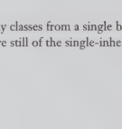

你可以从单个基类派生出许多类。即使如此，如图 14.2 所示，这样的关系仍然属于单继承类型，因为每个新类都派生自单个基类。

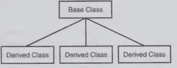

你会遇到许多描述派生类和基类的术语。一些程序员称基类为祖先，派生类为后代。其他人称基类为父类，派生类为子类。像图 14.2 中那样共享同一基类的类有时被称为兄弟类。较不常见的术语包括将基类称为子类，将派生类称为超类。

## 多继承

多继承描述了一个类派生自两个或多个其他基类之间的关系。这类似于孩子从父母那里继承特征的方式。在现实生活中，跳探戈只需要两个人，但在 C++ 中，子类可以拥有所需的任意多个父类。图 14.3 说明了多继承。

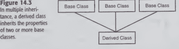

多继承看起来像一个不错的主意，直到需要使用它的时候。在实践中，大多数任务都可以使用单继承完成。虽然有时有用，但多继承可能会造成麻烦的障碍（更多内容请参见第 15 章，“使用虚函数编程”）。

> **提示**
> 
> 除非你有充分的理由，否则不要使用多继承。对多继承的依赖可能表明类关系设计不佳，但请参阅第 15 章，了解多继承可能导致的问题的解决方案。

## 创建派生类

几个简单的示例解释了继承的机制。考虑一个假设的基类 `TBase`，声明如下（为简单起见，我将所有函数内联实现）：

```cpp
class TBase {
private:
    int count;

public:
    TBase() : count(0) { }
    void SetCount(int n) { count = n; }
    int GetCount() { return count; }
};
```

`TBase` 类声明了一个私有数据成员，即名为 `count` 的整数。该类的默认构造函数将 `count` 初始化为零。两个成员函数分别将 `count` 设置为整型参数值 `n`，并返回 `count` 的当前值。语句可能会这样使用 `TBase` 类：

```cpp
TBase base_object;
base_object.SetCount(123);
cout << base_object.GetCount() << endl;
```

第一行构造了一个名为 `base_object` 的 `TBase` 对象。第二行调用 `SetCount()` 成员函数，为类的私有数据成员赋值。最后一条语句调用 `GetCount()` 获取类的 `count` 值。虽然这个类只是假设性的，但 `TBase` 的设计包含了在许多真实类中都能见到的要素。

要为 `TBase` 添加新功能，不必重写它；而是将其继承到新类中，再添加所需的新功能。例如，假设你决定增加一个函数，用于向对象的 `count` 添加一个值。要从 `TBase` 派生一个新类，可以使用如下声明：

```cpp
class TDerived: public TBase {
public:
    TDerived(): TBase() { }    // constructor
    void AddToCount(int n);    // member function
};
```

派生类名 `TDerived` 后面跟一个冒号和要继承的基类名称。关键字 `public` 表明 `TBase` 的所有成员都应保持其当前的访问权限——`TBase` 中的私有项在派生类中仍然私有，公有项在派生类中仍然公有。如果把 `public` 改为 `private`，那么从 `TBase` 继承的所有成员都会变成 `TDerived` 的私有成员。除了继承之外，`TDerived` 还声明了两个新项：一个构造函数和一个成员函数 `AddToCount()`，二者都位于 `public` 区段。

派生类构造函数与所有构造函数一样，与其类同名。由于派生类不会继承构造函数，因此必须至少声明一个自己的构造函数。在本例中，默认的 `TDerived()` 构造函数使用初始化表达式调用基类构造函数 `TBase()`。构造函数体为空，但如有必要也可以执行其他语句。`TDerived` 构造函数的设计确保：当程序构造派生类对象时，不仅会调用该构造函数，还会调用祖先基类中的构造函数。这样，任何继承的项都会被正确初始化。例如，在本例中，`TBase()` 构造函数会将 `TBase::count` 置为零。

派生类成员函数为 `TBase` 类添加了一个新功能——函数 `AddToCount()`。有了派生构造函数和新的成员函数，程序就可以创建一个对象，并使用这个新函数向它添加值：

```cpp
TDerived derived_object;
derived_object.SetCount(123);
```

## 清单 14.1 `COORDINATE.H`

```cpp
class TCoordinate {
private:
    int tc_x, tc_y;

public:
    TCoordinate() : tc_x(0), tc_y(0) {}
    TCoordinate(int x, int y) : tc_x(x), tc_y(y) {}
    void Setxy(int x, int y);
    int Getx() const;
    int Gety() const;
};
```

`TCoordinate` 类只包含一个你以前没见过的新元素——函数原型中使用 `const`——通过阅读类声明，你应该就能理解大部分编程内容。私有区段声明了两个私有数据成员 `tc_x` 和 `tc_y`，类型都是 `int`，用于存储 X/Y 位置。两个构造函数用于初始化 `TCoordinate` 类的对象。默认构造函数将 `tc_x` 和 `tc_y` 设置为零。带参数的构造函数将这两个私有变量设置为参数 `x` 和 `y` 的值。该类不需要析构函数。

除了构造函数之外，`TCoordinate` 类还声明了三个成员函数。`Setxy()` 将对象的私有数据成员更改为新的 `x` 和 `y` 值。`Getx()` 和 `Gety()` 返回私有数据成员的值。函数声明后面的 `const` 关键字告诉编译器，`Getx()` 和 `Gety()` 不会更改此类对象中的任何数据成员。一般来说，类中任何不更改对象数据成员的成员函数都应声明为 `const`。稍后就会清楚，对于返回私有数据成员值的函数，这一点尤其重要。

### 提示

> 许多类使用成员函数来设置和获取类中私有数据成员的值。如果你担心大量函数调用会降低效率，可以内联声明这些函数，并使用类似 `-O1` 的优化选项进行编译。

为了完成这个模块，`TCoordinate` 类需要实现其三个成员函数。清单 14.2 展示了结果。这不是一个完整的程序——你可以使用 `-c`（仅编译）选项编译它，但还不能运行代码。

## 清单 14.2 `COORDINATE.CPP`

```cpp
#include "coordinate.h"
```


```
void TCoordinate::Setxy(int x, int y)
{
    tc_x = x;
    tc_y = y;
}

int TCoordinate::Getx() const
{
    return tc_x;
}

int TCoordinate::GetY() const
{
    return tc_y;
}
```

实现模块没有什么特别之处，除了`GetX()`和`GetY()`后面再次出现的`const`关键字。模块实现了类的三个成员函数，用于设置和获取私有数据成员`tc_x`和`tc_y`的值。为了测试该类，我们需要一个宿主程序。示例见第 14.3 节清单`tcoord.cpp`（测试`TCoordinate`）。

## LISTING 14.3 `TCOORD.CPP`

```
#include <iostream.h>

#include "coordinate.h"

void display(const char *msg, TCoordinate &tc);

int main()
{
    TCoordinate t1;
    display("Default object", t1);
    TCoordinate t2(45, 218);
    display("Parameterized object", t2);
    t1.SetX(100, 200);
    display("After calling setxy()", t1);
    return 0;
}

void display(const char *msg, TCoordinate &tc)
{
    cout << msg << endl;
    cout << " x = " << tc.GetX() << "; y = " << tc.GetY();
    cout << endl;
}
```

使用`-c`选项编译`coordinate`模块的程序，然后使用以下命令将宿主程序链接到模块的目标代码：

```
$ g++ -c coordinate.cpp

$ g++ tcoord.cpp coordinate.o
```

运行程序以显示使用两个`TCoordinate`对象进行三次测试的结果：

```
$ ./a.out

Default object

x = 0; y = 0

Parameterized object

x = 45; y = 218

After calling setxy()

x = 100; y = 200
```

## DERIVED CLASS CONSTRUCTORS

假设你正在编写一个图形程序，其中使用`TCoordinate`对象表示坐标。然而，除了位置之外，你还需要一个可以存储颜色值的对象。这很好地说明了一个适合面向对象解决方案的常见问题。当你发现需要一种新的数据类型或函数时，你通常可以在现有类的基础上构建一个新类，这样既可以减少工作量，又能利用已完成的代码。第 14.4 节清单`color.h`声明了派生类`TColor`。

```
#include "coordinate.h"   // Need TCoordinate

// Enumerated color names
typedef enum
{
    UNKNOWN, RED, ORANGE, YELLOW, GREEN, BLUE, INDIGO, VIOLET
} TColors;

// Class declaration
class TColor: public TCoordinate {
private:
    TColors tc_color;   // Private data
    static const char *colornames[];  // Private static data
public:
    TColor();
    TColor(TCoordinate t), tc_color(UNKNOWN) }
    TColor(TColors color, int x, int y);
    void SetColor(TColors color) { tc_color = color; }
    TColors GetColor() const { return tc_color; }
    const char *StrColor() const;
};
```

新的`TColor`类派生自`TCoordinate`，继承了基类的数据和成员函数。在其继承的基础上，新类添加了两个私有数据成员——变量`tc_color`，其类型为枚举类型`TColors`（也在头文件中声明），以及`colornames`，一个静态字符串常量数组。

静态成员是指属于类但你不想在每个类对象中重复的数据。在本例中，我们希望为`TColor`的符号如`BLUE`和`RED`提供字符串名称，但将这些相同的字符串添加到每个`TColor`类对象中是不明智的。声明数组为`static`表示所有`TColor`对象只有一个`colornames`副本。相反，因为`tc_color`未声明为`static`，每个`TColor`对象都有该私有变量的独立副本。

> **Note**  
> 静态成员也可以是函数。示例请参见第 21 章“honing Your C++ Skills”中“Odds and Ends”下的“Static Member Functions”。

模块还实现了`TColor`参数化构造函数和一个成员函数。构造函数需要三个参数：颜色，以及`x`和`y`坐标值。为了初始化基类数据，构造函数调用`TCoordinate`参数化构造函数，并传递`x`和`y`参数。构造函数还将私有成员`tc_color`初始化为指定的颜色。这样，以下语句即可完全初始化一个`TColor`对象：

`TColor color_object(RED, 450, 87);`

`color.cpp`模块中的最后一个元素实现了`StrColor()`成员函数。此函数返回指向静态`colornames`数组中某个字符串的常量`char*`（字符指针）。由于该函数不更改类中的任何数据，因此声明为`const`。函数内部，出于安全考虑，一个语句在将`tc_color`用于访问`colornames`数组之前检查其是否在允许范围内。第 14.6 节清单`tcolor.cpp`测试了已完成的模块。

```
#include <iostream.h>

#include "coordinate.h"    // Need TCoordinate

#include "color.h"         // Need TColor

// Function prototype

void display(const char *msg, TColor &tc);

int main()
{
    TColor color_object(ORANGE, 45, 67);
    display("Original object", color_object);
    color_object.SetColor(GREEN);
    color_object.SetXY(125, 250);
    display("After function calls", color_object);
    return 0;
}

// Display facts about object tc
void display(const char *msg, TColor &tc)
{
    cout << msg << endl;
    cout << "x = " << tc.GetX() << "; y = " << tc.GetY();
    cout << "; color = " << tc.StrColor();
    cout << " (" << tc.GetColor() << ")";
    cout << endl;
}
```

使用以下命令编译并链接测试程序。如果已编译过`coordinate.cpp`，则可以跳过编译：

```
$ g++ -c coordinate.cpp

$ g++ -c color.cpp

$ g++ tcolor.cpp coordinate.o color.o
```

这些命令演示了如何通过包含该类的头文件并将程序链接到该类的实现目标代码文件（`coordinate.o`）来从现有类（`TCoordinate`）派生出一个新类，例如`TColor`。这是一个很好的例子，说明了如何利用继承在新编程中重用经过测试的代码。现在，运行编译后的程序：

```
$ ./a.out

Original object

x == 45; y == 67; color = Orange (2)

After function calls

x == 125; y == 250; color = Green (4)
```


程序的输出显示了`TColor`对象的`x`、`y`和`color`值。由于`TColor`类继承了`TCoordinate`的数据和成员函数，它可以表示这两种类型的数据。此外，`TCoordinate`类仍可按其原始形式使用，并且新编程不会对使用`TCoordinate`的任何其他程序产生影响。

## DERIVED CLASS DESTRUCTORS

很少有程序只从另一个类派生一个类。在大多数程序中，需要多层类才能创建所需的对象。作为演示，并展示有关派生类的一些额外方面，让我们将`TCoordinate`和`TColor`类再推进一步。

你的图形程序正在成形，但现在你发现不仅需要对象来表示屏幕位置和颜色，而且其中一些位置还需要字符串标签。像以前一样，派生一个新类并添加所需的数据和函数是一个很好的解决方案。列表 14.7，`label.h`，声明了一个从`TColor`派生的新类。

### LISTING 14.7 LABEL.H

```
#include "color.h" // Need TColor

class TLabel: public TColor {

private:

    char *tl_label;

public:

    TLabel() : TColor() { tl_label = NULL; }

    TLabel(const char *label, TColors color, int x, int y);

    TLabel(const TLabel &copy);

    ~TLabel() { delete[] tl_label; }

    const char *GetLabel() const { return tl_label; }

    void SetLabel(const char *label);

    void operator=(const TLabel &copy);

};
```

由于`TColor`派生自`TCoordinate`，新的`TLabel`类继承了其两个祖先的数据和函数成员。在其继承的基础上，新的`TLabel`类添加了一个`char*`变量`tl_label`用于寻址内存中的字符串。

三个构造函数初始化`TLabel`对象。公共部分中首先列出的默认构造函数使用初始化表达式调用其祖先构造函数`TColor()`。这确保了所有层级的继承数据都得到正确初始化。默认构造函数还将`tl_label`设置为`NULL`，表示该对象没有关联的标签。

第二个构造函数声明了字符串标签、颜色以及`x`和`y`坐标值的参数。随后是复制构造函数，它们在类模块中实现，列表 14.8，`label.cpp`。析构函数和`GetLabel()`函数也在类声明中内联实现，析构函数删除由私有`tl_label`指针寻址的任何字符串，而`GetLabel()`函数仅返回该指针的值。请注意，`GetLabel()`的返回值和函数本身都被声明为`const`。这表明返回的数据是常量，并且该函数不会对`TLabel`对象的数据成员进行任何更改。

### LISTING 14.8 LABEL.CPP

```
#include <string.h>  // Need strlen(), strcpy()

#include "label.h"   // Need TLabel

// Parameterized constructor

TLabel::TLabel(const char *label, TColors color, int x, int y):

    TColor(color, x, y)    // Initialize base class object

{

    tl_label = NULL;      // So SetLabel can create string

    SetLabel(label);      // Copy label to our object

}

// Copy constructor

TLabel::TLabel(const TLabel &copy):

    TColor(copy)

{

    tl_label = NULL;

    SetLabel(copy.tl_label);

}

// Change label string. Note: label might be NULL.

void TLabel::SetLabel(const char *label)

{

    delete[] tl_label;    // Okay if tl_label == NULL

    tl_label = NULL;      // Set tl_label to NULL

    if (label != NULL)    // If param not NULL...

    {

        tl_label = new char[strlen(label) + 1];

        strcpy(tl_label, label);  // Copy param to tl_label

    }

}

// Copy TLabel objects

void TLabel::operator=(const TLabel &copy)

{

    if (this == &copy) return;        // Don't copy self

    SetXy(copy.GetX(), copy.GetY());  // Copy TCoordinate data

    SetColor(copy.GetColor());        // Copy TColor data

    SetLabel(copy.tl_label);          // Copy TLabel data

}
```

`TLabel`实现模块比你之前看到的要复杂一些。但一次处理一个函数——各个语句都相当简单。首先，参数化构造函数将`color`、`x`和`y`参数传递给其祖先类`TColor`的构造函数。这让祖先类负责初始化对象的一部分。剩下的工作就是使用字符串参数`label`来初始化对象的`t1_label`数据成员。两条语句完成了这项工作：

```
t1_label = NULL;

SetLabel(label);
```

`t1_label`变量首先被设为`NULL`，因为`SetLabel()`的工作方式就是这样（稍后会详细介绍）。在构造函数中以这种方式调用类自身的成员函数是完全合法的。然而，使用这种技术时必须小心，不要调用任何使用尚未初始化的数据的函数。

模块中接下来的是类的拷贝构造函数。因为其中一个数据成员是指向动态分配内存的指针，而你在前几章学到过，对于类来说，提供安全的拷贝机制以防止指针地址值被意外复制尤其重要。有趣的是，拷贝构造函数几乎与刚才讨论的参数化构造函数相同。然而，在这种情况下，初始化表达式`TColor(copy)`将`copy`传递给祖先的自动生成的拷贝构造函数。以下语句随后完成了将一个`TLabel`对象拷贝到另一个对象的任务：

```
t1_label = NULL;

SetLabel(copy.t1_label);
```

再次，`t1_label`被设为`NULL`，因为`SetLabel()`的工作方式就是这样。该函数将源对象（`copy`）中`t1_label`指针所指向的数据复制到正在构造的当前对象。

`SetLabel()`函数本身需要多花一点精力来理解。它的工作很简单——将一个字符串的地址赋给类的私有`t1_label` `char`指针——但编程必须仔细处理任何现有数据。以下语句完成了这个任务：

```
delete[] t1_label;   // Okay if t1_label == NULL

t1_label = NULL;     // Set t1_label to NULL

if (label != NULL)   // If param not NULL...

{

    t1_label = new char[strlen(label) + 1];

    strcpy(t1_label, label); // Copy param to t1_label

}
```

首先，删除当前指向的字符串。如果`t1_label`为`NULL`，删除它也不会造成伤害。为了确保`t1_label`在此时为`NULL`，它随后被设为该值。这样，如果函数的`label`参数为`NULL`，则对象的`t1_label`指针也等于`NULL`。如果`label`不为`NULL`，则两条语句为字符串创建空间并将`label`参数的字符串复制到该分配的内存中。

最后在`TLabel`类模块中是函数`operator=()`。如第 13 章“创建和销毁对象”中所解释的，此函数是为安全地将一个对象复制到另一个已构造的对象而需要的。为此，`operator=()` 函数执行以下语句：

```
if (this == &copy) return;

Setxy(copy.GetX(), copy.GetY());

SetColor(copy.GetColor());
```


`SetLabel(copy.GetLabel());`

第一行在所有 `operator=()` 函数中都很典型——它忽略任何将同一对象复制到自身的尝试。其他三条语句通过调用继承的 `SetXY()`、`SetColor()` 和 `SetLabel()` 函数以及 `GetX()`、`GetY()`、`GetColor()` 和 `GetLabel()` 来初始化拷贝。对 `Setxy()` 和 `SetColor()` 的调用说明了声明 const 成员函数的重要性。要理解原因，请看 `operator=()` 函数的头：

```cpp
void TLabel::operator=(const TLabel &copy)
```

`copy` 参数，即被复制的源对象，被声明为类型 `const TLabel &`——换句话说，是对一个常量 `TLabel` 对象的引用。如果 `GetX()`、`GetY()` 和 `GetColor()` 等函数未被声明为 const，则将 const 对象作为参数传递的语句会让编译器陷入困境。例如，这条语句：

```cpp
Setxy(copy.Getx(), copy.Gety());
```

将 `GetX()` 和 `GetY()` 传递了 const 对象 `copy` 的 `this` 指针。因为这些函数被声明为 const，所以它们不会无意中修改对象也就没有危险。列表 14.9，`tlabel.cpp`，测试了已实现的 `TLabel` 类。该列表没有新内容，你应该能够从源代码理解编程。

### LISTING 14.9 TLABEL.CPP

```cpp
#include <iostream.h>

#include "tlabel.h"    // Need TLabel

void display(const char *msg, TLabel &t);

int main()

{

    TLabel test("Test Label", RED, 100, 200);

    display("Test object", test);

    TLabel copy_object(test);

    display("Copy constructed object", copy_object);

    TLabel dest_object;

    display("Object before copy", dest_object);

    dest_object = test;

    display("Object after copy", dest_object);

    return 0;

}

// Display facts about object tc

void display(const char *msg, TLabel &t)
```

```cpp
{

    cout << msg << endl;

    cout << "x = " << t1.GetX() << "; y = " << t1.GetY();

    cout << "; color = " << t1.GetColor();

    cout << "; label = " << t1.GetLabel();

    cout << endl;

}
```

## 复制派生类对象

在复制派生类对象时出现的另一个问题是，当一个类从另一个拥有自己的拷贝构造函数和 `operator=()` 函数的类派生而来时就会发生这种情况。这是许多 C++ 程序员要么忽略要么处理不当的常见问题。清单 14.10 演示了一种处理这种情况的好方法。

```cpp
LISTING 14.10   COPY.CPP

#include <iostream.h>

#include "label.h"       // Need TLabel

// Test class

class TTest: public TLabel {

private:

    int count;

public:

    TTest(): TLabel(), count(123) { }

    TTest(const TTest &copy);

    void operator=(const TTest &copy);

    int GetCount() const { return count; }

};

// Function prototype

void display(const char *msg, TTest &tx);

int main()

{

    TTest tx, ty;                  // Create two objects

    display("New object (tx)", tx); // Display object values

    display("New object (ty)", ty);

    ty.SetLabel("test string");    // Change ty data

    ty.SetColor(VIOLET);

    ty.Setxy(456, 789);

    display("Modified ty", ty);    // Display modified data

    tx = ty;                        // Copy ty to tx

    display("After (tx = ty)", tx); // Display copied data

    TTest tz(ty);                   // Construct tz using copy constructor

    display("Copy constructed tz", tz); // Display object

    return 0;

}
```

```cpp
TTest(const TTest &copy);

void operator=(const TTest &copy);
```

你已经见过这些函数的几个例子——它们几乎总是如图所示声明，除了当然类名。实现拷贝构造函数是容易的部分——它仅仅调用 `TLabel()` 拷贝构造函数并传递 `copy` 参数，该参数是对 `TTest` 源对象的引用：

```cpp
TTest::TTest(const TTest &copy)

{

TLabel(copy) // Initialize ancestor object

count = copy.count; // Initialize our own data

}
```

构造函数的唯一语句很简单——它仅仅将源对象的 `count` 数据成员复制到目标对象的数据成员。`operator=()` 函数 however 并不是那么简单：

```cpp
void TTest::operator=(const TTest &copy)

{

if (this == &copy) return; // Don't copy self

*(TLabel *)this = copy; // Copy ancestor object data

count = copy.GetCount(); // Copy our own data

}
```

像往常一样，第一条语句忽略了程序尝试将对象复制到自身的情况。第二条语句是许多程序员卡住的地方。我们希望让祖先 `operator=()` 函数（或由 C++ 自动生成的函数）处理基类对象的复制。为此，该语句将 `copy`（源对象引用）赋给 `this`（我们正在复制到的目标对象）。然而，下面的语句不起作用：

```cpp
*this = copy; // ???
```

那将导致 `TTest` 对象被复制到 `this` 指针所指向的对象——导致对 `TTest::operator=()` 的递归函数调用并导致栈溢出。相反，我们希望告诉 C++ `this` 指向一个类型为 `TLabel` 的祖先对象。使用类型转换即可完成此操作：

```cpp
*(TLabel *)this = copy;
```


类型转换表达式，`(TLabel *)`，说明 `this` 实际上指向一个 `TLabel` 对象。这完全可以接受，因为 `TTest` 对象毕竟只是一个增强的 `TLabel` 对象（参见图 14.4）。表达式外部的星号告诉编译器取消类型转换指针的引用。结果是对 `TLabel::operator=()` 的调用，我们可以信任它来处理所有继承的数据成员的复制。

图 14.4 显示了 `TTest` 层次结构中四个类的关系。该图还说明了一个重要概念——指向对象的指针可以是该对象类的类型，也可以是任何派生类型。例如，`TColor` 指针指向一个 `TLabel` 对象是完全可以接受的，因为 `TLabel` 是从 `TColor` 派生而来的。然而，让 `TLabel` 指针指向一个 `TCoordinate` 对象则没有意义。

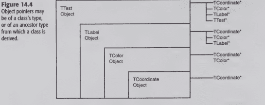

## 介绍受保护成员

受保护的类成员是私有成员和公共成员之间的交叉。要声明这种类型的元素，请使用 `protected` 保留字后跟冒号：

```cpp
class TAnyClass {

public:

  // public members

protected:

  // protected members

private:

  // private members

};
```

将变量或成员函数声明为 `protected` 表示该类的其他成员——以及从该类派生的任何类——可以直接使用这些成员。类外的语句无法访问受保护的成员。以下规则描述了 `private`、`protected` 和 `public` 访问说明符的效果：

- 私有成员只能被声明该成员的类中的成员访问。
- 受保护成员可被其自身类以及派生类中的任何成员访问。
- 公共成员可被该类的所有用户访问。

## 更改访问说明符

你可以通过将祖先类声明为 `public`、`protected` 或 `private` 来更改继承项的访问规则。但是，你只能使继承项更严格——不能使其更宽松。例如，你可以声明继承的公共成员从现在起为私有，但不能继承私有成员并使其变为公共。通常，你使用 `public` 保留字像这样派生类：

```cpp
class TDerived: public TBase {...};
```

使用此声明，在 `TDerived` 类中，`TBase` 的所有成员都保留其当前的访问规范。来自 `TBase` 的公共成员在 `TDerived` 中是公共成员。受保护的 `TBase` 成员是新类的受保护成员。私有成员仍然严格用于 `TBase` 自身。使用 `protected` 保留字会产生不同的效果：

```cpp
class TDerived: protected TBase { ... };
```

该声明会导致 `TBase` 的公共成员在 `TDerived` 中变为受保护成员。`TBase` 中的受保护和私有成员保持不变。此更改意味着 `TDerived` 外部的语句不再能访问原先公共的 `TBase` 成员。为了获得最大的限制，使用 `private` 保留字继承类：

```cpp
class TDerived: private TBase { ... };
```

这种声明非常不寻常，因为它使 `TBase` 的所有成员都成为 `TDerived` 的私有成员。`TDerived` 类外部的语句，以及基于 `TDerived` 的任何进一步派生类的语句，都不能调用 `TBase` 中的任何函数，甚至构造函数，也不能引用任何数据成员。

> **提示**
> 
> 将继承的类永久设为私有，会在派生类中隐藏其内容。这种技术的一个可能用途是帮助从复杂层次结构中消除一个类。通过现在隐藏继承的类，将来可能完全删除它。

## 限定选定成员

在需要正常继承大部分类但有选择地更改单个元素的访问规则的情况下，你可以限定选定成员的访问规则。这在创建比其祖先类更好地保护和隐藏数据的类时很有用，例如。

为了说明该技术，想象一下你遇到一个所有成员都是公共的类。这通常表示设计不佳，你希望升级该类以提高其安全性。将原始类称为 `A`，其派生的改进版称为 `B`。列表 14.11，`qualify.cpp`，展示了如何有选择地限定从 `A` 继承到 `B` 的成员。

```cpp
LISTING 14.11   QUALIFY.CPP

#include <iostream.h>

class A {

public:

    int x;

    A(int xx) : x(xx) { }   // Constructor

    void Display() { cout << "x = " << x << endl; }

};

class B: private A {
public:
  B(int n): A(n) { }  // Constructor
  A::Display();        // Selective qualify Display()
};

int main()
{
  B object(123);       // Construct object of type B
  object.Display();    // Call qualified inherited function
  return 0;
}
```

示例程序很简单（你甚至不必运行它），但它展示了如何更改从类继承的选定项的访问规则。在这种情况下，类 `A` 设计不佳。它声明了所有成员为 `public`，因此与常见的 C 结构体一样不安全。程序中任何地方的语句都可以读取和写入类型为 `A` 的对象中的整数 `x` 数据成员值。

为了改进类设计，类 `B` 使用 `private` 保留字继承 `A`。如前所述，这完全将 `A` 隐藏在 `B` 内部。来自 `A` 的公共变量 `x` 成为 `B` 的私有成员，从而免受随意使用的影响。然而，`Display()` 成员函数也成为 `B` 的私有。保留 `Display()` 的公共状态以便语句可以调用它，请按如下方式声明该函数：

```cpp
public:
  A::Display();
```

类名和作用域解析运算符 `::` 指的是 `Display`，而不是作为函数原型，而是作为没有括号的符号。实际上，该声明指出符号 `Display` 应保留在 `A` 中找到的访问规则。结果是程序可以构造派生类 `B` 的对象，并且仍然可以调用 `Display()` 函数，正如示例程序的语句所示：

```cpp
B object(123);
object.Display();
```

## 调试派生类

GNU 调试器帮助你调查类数据成员的值，以及成员函数、构造函数和析构器的行为。要学习相关命令，输入以下命令将 `tlab.cpp` 测试程序编译并加载到调试器中：

```bash
$ g++ -g -c coordinate.cpp color.cpp label.cpp
$ g++ -g -o tlab label.cpp coordinate.o color.o label.o
$ gdb --silent tlab (gdb)
```

前两个命令使用选项 `-g`（添加调试信息）、`-c`（仅编译）和 `-o`（输出文件名）编译 `tlab.cpp`。第三个命令启动调试器并跳过 (...) silent) 欢迎信息。继续阅读下一节以使用调试器命令探索对象创建。

这就到达了类层次结构中的最低层。你可以继续发出 `next` 和 `step` 命令来进一步跟踪代码，并检查该对象初始化过程中的每个层级。但你已经探索完毕，输入一个 `continue` 命令（你可以将其缩写为 `cont`）来将程序运行到完成，然后输入 `q` 退出：

```text
(gdb) cont
Continuing.

(gdb) q
```

## INSPECTING OBJECT DATA MEMBERS

使用调试器，你可以深入查看一个对象以检查其数据成员的值。要尝试此操作，请重新加载 `tlabel.cpp` 程序：

```text
$ gdb --silent tlabel
(gdb)
```

如本章及前几章所述，为安全的对象拷贝提供支持是 C++ 面向对象编程中不可或缺的事实。为了检查测试程序是如何做到这一点的，在将一个对象复制到另一个对象的语句处设置断点：

```cpp
dest_object = test;
```

输入以下命令来设置断点（在我这里是在第 29 行）：

```text
(gdb) b 29
Breakpoint 1 at 0x80488b7: file tlabel.cpp, line 29.
```

接下来，运行程序直到断点。你应该在最后一条输出行看到赋值语句：

```text
(gdb) run
Starting program: /src/c14/tlabel
Breakpoint 1, main () at tlabel.cpp:29
29 dest_object = test;
```

使用 `print` 命令在赋值语句执行之前检查 `dest_object` 的数据成员：


```text
(gdb) print dest_object
$1 = {<TColor> = {<TCoordinate> = {tc_x = 0, tc_y = 0},
tc_color = UNKNOWN,
  static colorname = 0x8049f00, tl_label = 0x0}
```

调试器为 `dest_object` 分配了一个伪名称 `$1`，你可以在其他命令中使用它。在输出中，大括号根据其类层次结构对对象进行分段，但这种风格乍一看可能有点令人困惑。最内层的大括号表示 `TCoordinate` 部分的 `tc_x` 和 `tc_y` 数据成员被设置为零。在下一个更高层级，`TColor` 类的 `tc_color` 数据成员被设置为 `UNKNOWN`。最后，在 `dest_object` 的层级，`tl_label` 等于 `NULL`（`0x0`）。这种格式需要一些适应，但它不仅显示了对象的数据成员值，还显示了其类组织。

为了在为其分配另一个值后检查 `0x8049f00` 的值，并以此方式调查类拷贝构造函数和 `operator=()` 函数的完整性，发出一个 `next` 命令：

```text
(gdb) next
30 display("Object after copy", dest_object);
```

再次打印 `dest_object` 的值以将其数据成员与之前列出的进行比较：

```text
(gdb) print dest_object
$2 = {<TColor> = {<TCoordinate> = {tc_x = 100, tc_y = 200},
tc_color = RED,
static colornames = 0x8049f00},
tl_label = 0x804a538 "Test Label"}
```

我稍微重新排列了行以适应本页。它们显示每个数据成员都已被赋予一个值。为了将这些值与源对象进行比较，你可以输入 `print test`（此处未显示）。

检查对象数据成员的另一种有用方法是发出 `display` 命令。这会让调试器在程序每次暂停时——例如在断点处或在 `next` 命令之后——显示一个或多个对象。如果你正在跟随操作，输入以下命令（如果你退出了，重新加载 `label`，在第 30 行设置断点，运行程序，并重新发出 `display` 命令）：

```text
(gdb) display dest_object.tl_label
1: dest_object.tl_label = 0x804a538 "Test Label"
```

调试器在程序每次停止时显示对象的 `tl_label` 数据成员的值。要看到此效果，发出一个 `next` 命令：

```text
(gdb) next
Object after copy
x == 100; y == 200; color = Red (1); Test Label
32 return 0;
1: dest_object.tl_label = 0x804a538 "Test Label"
```

命令行之后的输出前两行来自程序本身。最后两行来自 GNU 调试器。第 32 行显示下一个要执行的语句。最后是 `tl_label` 数据成员的值，显示字符串值及其在内存中的地址。顺便说一下，一些其他调试器将 `display` 表达式称为“监视”或“监视表达式。”

> **Tip**
>
> 输入不带参数的 `display` 以查看当前所有显示的表达式列表。要清除显示列表，输入 `undisplay`，并在提示“Delete all auto-display expressions?”时回答 yes。

## CALLING MEMBER FUNCTIONS

在调试特定的成员函数时，调用它脱离上下文可能很有用。这在大型程序中尤其有帮助，当仅仅为了调用一个函数而逐步执行到某条语句很不方便时。

要跟上进度，如有必要重新加载 `tlabel` 程序，在第 30 行设置断点，然后输入 `run`。随后发出类似以下的 `call` 命令：

```text
(gdb) call dest_object.StrColor()
$2 = 0x8048ec7 "Red"
```

该命令调用由 `TLabel` 类继承的 `TColor` 成员函数 `StrColor()`，因此可通过 `dest_object` 使用。在调用成员函数时，必须相对于该类的对象进行调用。作为对 `call` 命令的响应，调试器会显示函数的结果。

## 查找对象的类型

要查找对象的类型，请使用如下的 `ptype` 命令：

```text
(gdb) ptype dest_object
type = class TLabel : public TColor {
private:
  char *tLabel;
public:
  TLabel(void);
  TLabel(char const *, TColors, int, int);
  TLabel(TLabel const &);
  ~TLabel(void);
  char * GetLabel(void) const;
  void SetLabel(char const *);
  void operator=(TLabel const &);
}
```

在使用类对象时，`ptype` 命令会打印整个类声明。虽然这对于本例这样的例子很有用，但非常大的类会显示过多信息而难以提供帮助。因此，最好随身备有源文件副本，以便查阅类和其他大型结构声明。

### 摘要

使用继承，你可以从现有类创建新类。新类称为派生类。其祖先称为基类。在典型的 C++ 程序中，许多类都派生自其他类，形成一个类似于家谱的类层次结构。C++ 提供了两种继承：单继承和多继承，但实际上，单继承通常已足够。本章介绍了继承以及相关主题，例如如何为派生类对象的安全复制提供支持。本章还介绍了 `protected:` 访问说明符。

有关本章介绍主题的更多信息，请参阅以下章节：

- Chapter 15, "Programming with Virtual Functions"
- Chapter 19, "Overloading Operators"
- Chapter 21, "Honing Your C++ Skills"

# CHAPTER 15: Programming with Virtual Functions

简单来说，虚函数是基于对象类型调用的函数。例如，几个相关类可能会声明一个名为 `Display()` 的虚函数，每个函数执行不同但相似的工作。对于特定的类对象，C++ 会根据对象的类型决定调用哪个 `Display()` 函数。从某种意义上说，使用虚函数，不同类型的对象“知道”如何显示自己并执行其他操作。

你可能听说过这个特性被称为多态性，这是一个在异国情调吸引力上高于技术准确性的术语。虽然它是面向对象设计的支柱之一，但多态性比许多 OOP 权威人士让程序员相信的要容易理解和使用得多。个人而言，我尽量限制使用这个术语。但我发现它在社交场合很有用，可以摆脱好奇的烦人之人。“不好意思，我得去检查我的多态性。” 我想他们以为我去喂食食人鱼之类的东西。

## POLY WANT A MORPHISM?

驱动多态性的燃料是纯虚函数。这本质上是基类期望其派生类完成的占位符。例如，忽略真实类所需的其他声明，`TShape` 类可能会声明一个名为 `Draw()` 的纯虚函数：

```cpp
class TShape {
public:
    virtual void Draw() = 0;
};
```

纯虚函数 `Draw()` 类似于常见的成员函数，但以保留字 `virtual` 开头，以表达式 `= 0` 结尾。存在一个或多个纯虚函数会创建所谓的抽象类。这意味着无法创建 `TShape` 对象，因为作为抽象，类是不完整的。

要使用抽象类，期望派生类继承 `TShape` 并完成纯虚 `Draw()` 函数。同样忽略诸如构造函数和数据成员等必要项，你可能会这样声明后代类：

```cpp
class TCircle: public TShape {
public:
    virtual void Draw();
};
```

由于未指定表达式 `= 0`，`Draw()` 是一个正常的虚函数，它替换了同名继承的纯虚函数。某处，程序必须实现 `TCircle::Draw()` 函数，在本例中，用于绘制圆，也许通过调用图形库中的子程序（这只是为了说明）：

```cpp
void TCircle::Draw()
{
    graphicsDrawCircle();  // Or whatever draws a circle
}
```

在函数的实现中不需要 `virtual` 关键字；仅在其类原型中需要。（虚函数也可以内联实现。）同样，另一个类可能会使用以下声明继承 `TShape`：

```cpp
class TRectangle: public TShape {
public:
    virtual void Draw();
};
```

与 `TCircle` 一样，`TRectangle` 类声明了普通的虚函数 `Draw()`，没有 `=0` 表达式，程序必须实现该函数，在本例中用于绘制矩形：

```cpp
void TRectangle::Draw()
{
    graphicsDrawRectangle(); // 或者任何绘制矩形的函数
}
```


这段代码的重要性不在于其图形能力，而在于对 `TShape` 对象进行操作的语句。例如，程序可能有一个带 `TShape` 引用参数的函数：

```
void DoDrawing(TShape &shape)
{
    shape.Draw(); // !!!
}
```

请仔细考虑这个函数。它告诉 `shape` 对象自执行 `Draw()`。但调用的是哪个 `Draw()` 函数？答案取决于对象的类型。如果是 `TCircle` 对象，C++ 调用 `TCircle::Draw()`。如果是 `TRectangle` 对象，C++ 调用 `TRectangle::Draw()`。

有了虚函数，你无需编写针对特定形状（如 `TCircle` 和 `TRectangle`）的操作函数，而是可以创建一个单独的 `DoDrawing()` 函数，其引用参数为抽象基类 `TShape`。这表示任何派生自 `TShape` 的类的对象都可以传递给该函数。例如，程序可以创建 `TCircle` 和 `TRectangle` 对象，并使用如下语句将它们传递给 `DoDrawing()`：

```
TCircle circle;
TRectangle rect;
DoDrawing(circle);    // !!!
DoDrawing(rectangle); // !!!
```

借助继承的神奇特性，将 `circle` 和 `rectangle` 对象传递给函数的 `TShape` 引用参数是完全可行的。毕竟，`TCircle` 和 `TRectangle` 对象是 `TShape` 的特定类型，就像橡树和枫树是树的类型一样。然而，在函数内部，语句

```
shape.Draw();
```

会根据 `shape` 对象的类型调用相应的 `Draw()` 函数。这就是多态性。上述语句是完全通用的，它可以绘制任何派生自 `TShape` 的类的形状。更重要的是，未来的编程可以添加另一种 `TShape` 对象类型——例如 `TEllipse` 类——而上述代码无需修改即可识别新形状，尤其重要的是，无需重新编译。你甚至不需要原始源代码就能将新对象插入到程序中。

## 创建容器类

虚函数一个经典且最有用的应用是开发容器类。容器是一种通用对象，可以存储其他对象。要使用容器，只需构造一个容器类的对象，然后将你的数据对象塞入其中。设计良好的容器可以对对象进行存储、搜索、排序以及其他操作。由于它们是使用 C++ 面向对象类设计的，因此容器往往比数组和链表等常见的 C 和 C++ 存储机制更加通用，也更加安全。

在接下来的章节中，你将开发 `TContainer` 类，它可以存储和排序数据对象。该类是可用的，但为了使其在本书中列出的篇幅合理，它被精简掉了各种杂项函数。不过，在描述编程过程时，我会建议一些修改，以便在 `TContainer` 的基础上创建实用的容器类。

> 提示
>
> 你可以声明指向抽象类（如 `TShape`）的指针和引用，但由于不能创建抽象类对象，因此不可能将 `TShape` 对象按值传递给函数参数。

> 注意
>
> `TContainer` 类的代码清单比本书中大多数代码清单都要长。为了使编程更易于理解，我将代码清单分成了几部分。完整文本在光盘上的 `container.h`、`container.cpp` 和 `tcontain.cpp` 文件中。

## 抽象类

### 清单 15.1 CONTAINER.H（部分）

```
#define DEFAULT_SIZE 100     // 默认容器容量

class TObject;               // 不完整的类声明
typedef TObject * PTObject;   // 指向 TObject 对象的指针
typedef PTObject * PPTObject; // 指向 TObject 指针的指针

// 用于存储在容器中的项目的抽象类
class TObject {
public:
    virtual ~TObject() {};
    virtual int Compare(PTObject p) = 0;
    virtual void Display() = 0;
};
```

在为容器对象的默认大小指定了 `DEFAULT_SIZE` 常量后，头文件声明了三项内容。首先是一个不完整类声明，形式如下：

```
class TObject;
```

这指明符号 `TObject` 是一个类，但其类体尚未确定。它允许程序像这样的类确实存在一样使用该符号。例如，在本例中，我们需要两种指针类型，由接下来的两行声明：

```
typedef TObject * PTObject;
typedef PTObject * PPTObject;
```

第一行将 `PTObject` 声明为类型 `TObject *`（指向 `TObject` 的指针）。第二行将 `PPTObject` 声明为类型 `PTObject *`（指向 `TObject` 指针的指针）。我喜欢加入这类类型定义，以便更轻松地声明指针和数组。

### 虚析构函数

接下来在 `container.h` 中（参见清单 15.1）是 `TObject` 的类声明。它表明 `TObject` 拥有三个公有虚成员函数。由于从来不会创建 `TObject` 抽象类的对象，因此它没有构造函数。然而，为了支持删除从 `TObject` 派生的类的对象，该类声明了一个虚析构函数：

```
virtual ~TObject() { };
```

虚析构函数以保留字 `virtual` 开头，后跟函数名（始终是 `~` 字符加上类名）。析构函数不能声明参数。它们可以执行语句，但在本例中，我们只需要一个占位符，用于派生类中的未来析构函数，因此该析构函数的函数体为空。

注意，这并不是一个以 `=0` 结尾的纯虚函数。你可以声明纯虚析构函数；不过，我想展示纯虚函数与普通虚函数声明之间的区别。如前所述，纯虚函数不需要实现——它纯粹是一个占位符，期望由派生类提供。普通虚函数（如 `TObject` 析构函数）需要实现，即使实现只是一个什么都不做的空语句块。两类虚函数的作用类似——它们提供了 C++ 根据对象类型调用特定函数的机制。

### 纯虚函数

清单 15.1 中的 `TObject` 类还声明了两个纯虚函数：`Compare()` 和 `Display()`：

```
virtual int Compare(PTObject p) = 0;
virtual void Display() = 0;
```

使用纯虚函数，我们说 `TObject` 是一个具有比较两个由 `TObject` 派生的类的对象的能力的类。正如后面的示例所示，这些类会提供实际的 `Compare()` 函数。

然而，即使在这样的类存在之前，编译器也允许语句调用虚函数 `TObject::Compare()`，尽管它仅仅是一个占位符，不包含任何实际代码。在运行时，会根据所涉及对象的类型调用实际的 `Compare()`——这一行为的技术术语称为后期绑定（late binding）。通过这一过程，语句与 `Compare()` 等函数的实际绑定（或称链接）发生在运行时，而不像普通 C 或 C++ 函数那样发生在编译期间。

`TObject` 声明了第二个纯虚函数 `Display()`。这里同样，期望派生类实现实际的函数，C++ 会根据所涉及对象的类型来调用它。后面的示例将演示如何从 `TObject` 派生一个类并完成其纯虚函数。不过，我们先来看看容器类。

## TCONTAINER 类

清单 15.2 显示了 `container.h` 头文件的其余部分以及 `TContainer` 类的声明。


### LISTING 15.2 CONTAINER.H (PARTIAL)

```
class TContainer {
private:
    int size;        // Capacity of objects array
    int count;       // Number of objects in array
    PPTObject objects; // Array of TObject pointers
protected:
    void Quicksort(int left, int right);
public:
    TContainer(int n = DEFAULT_SIZE); // Constructor
    ~TContainer();                    // Destructor
    //
    // Inline member functions
    //
    bool IsFull() const { return (count >= size); }
    int GetSize() const { return size; }
    int GetCount() const { return count; }
    //
    // Other public member functions
    //
    void PutObject(PTObject pto);
    void ShowAllObjects(const char *msg);
    void Sort();
};
```

像大多数设计良好的类一样，`TContainer` 将其所有数据成员声明为私有。在本例中，有三个变量：

```
int size;
int count;
PPTObject objects;
```

整数 `size` 等于容器的容量——它能容纳多少个对象。整数 `count` 指定容器实际包含多少个对象。第三个变量 `objects` 的类型为 `PTObject`。它实际上是指向一个 `TObject` 指针数组的指针，这是我为此类选择的存储机制。

> 提示
>
> 因为 `TContainer` 的存储机制是类的私有部分，所以用于在容器中存储对象的机制可以在不影响使用该类的程序的情况下进行更改。

`TContainer` 类包含一个受保护的声明——一个实现快速排序算法的函数 `Quicksort()`：

```
protected: void Quicksort(int left, int right);
```

由于此函数是受保护的，任何从 `TContainer` 派生的类都可以调用它。它们也可以通过重新声明该函数并为其实现编写新代码来替换该函数。声明 `Quicksort()` 为 `public` 似乎不明智，因为程序语句不太可能需要直接访问容器的排序算法。为此，该类提供了一个公共函数 `Sort()`，它调用受保护的函数。

> 提示
>
> 有时很难决定将函数设为 `public`、`private` 还是 `protected`。一般来说，如果一个函数严格由其他成员函数调用，并且尤其是如果它依赖于类的私有数据对象的内部特性，最好将其设为 `private` 或 `protected`。如果一个函数提供通用操作——例如 `Display()` 或 `Sort()`——那么它很可能应该设为 `public`。

`TContainer` 声明了六个公共函数。其中前三个很简单，因此以内联方式实现：

```
bool IsFull() const { return (count >= size); }
int GetSize() const { return size; }
int GetCount() const { return count; }
```

函数 `IsFull()` 在容器的 `count` 等于其 `size` 时返回 `true`。（大于或等于的测试只是为了覆盖所有情况——`count` 不应大于 `size`。）`GetSize()` 和 `GetCount()` 仅返回其关联的私有变量。在你的类中，不要出于消除仅返回值的函数的错误尝试而将 `size` 和 `count` 等变量设为 `public`。相反，将函数声明为内联并使用 `-O` 选项编译，以便编译器将函数语句直接注入代码中。这在性能上不会带来任何损失，但极大地促进了未来的维护。

最后在 `TContainer` 中有三个在单独模块中实现的公共成员函数：

```
void PutObject(PTObject pto);
void ShowAllObjects(const char *msg);
void Sort();
```

函数 `PutObject()` 将新对象插入容器。其参数 `pto` 的类型为 `PTObject`（指向 `TObject` 的指针）。对象的实际类型在运行时确定，但它必须是派生自 `TObject` 的类之一。除了这一限制外，`PutObject` 可以将任何类型的数据插入容器。其他两个函数的目的显而易见。`ShowAllObjects()` 提供了一种简单的方式来显示容器的内容。`Sort()` 对包含的对象进行排序。下一节将更详细地解释在甚至考虑容器实际包含什么对象之前，如何编写此类函数。

> 注意
>
> 前面的列表描述了容器类的所有方面，而无需了解它可能包含的数据类型。这种通用性是面向对象编程提供的主要好处之一。

## 调用虚函数

列表 15.3 显示了 `TContainer` 类实现模块的一部分，并演示了程序如何调用尚未完成的虚函数。

### 列表 15.3 CONTAINER.CPP

```
#include <iostream.h>
#include <stdlib.h>    // Need exit()
#include "container.h"  // Need TContainer

// Constructor
TContainer::TContainer(int n)
{
    if (n <= 0) n = 1;   // Must have at least one element
    size = n;           // Remember capacity
    count = 0;          // Container is empty
    //
    // Create array of object pointers and set to NULL
    //
    objects = new PTObject[size];
    for (int i = 0; i < size; i++)
        objects[i] = NULL;
}

// Destructor
// Define DEBUG to display trace
TContainer::~TContainer()
{
    for (int i = 0; i < count; i++)
        delete objects[i];  // Delete contained objects
#ifdef DEBUG
    cout << "Deleting container" << endl;
#endif
    delete objects;     // Delete array of TObject pointers
}

// Insert new object into container
void TContainer::PutObject(PTObject pto)
```

```
{
    if (IsFull()) {
        cout << "*** Error: Container is full" << endl;
        exit(1);
    }
    objects[count] = pto;
    count++;
}
```

`container.cpp` 中实现的第一个函数是 `TContainer()` 构造函数。在初始化 `size` 和 `count` 私有数据成员之后，构造函数创建用于保存对象的存储机制。请仔细检查这些语句：

```
objects = new TObject*[size];
for (int i = 0; i < size; i++)
    objects[i] = NULL;
```

第一行创建一个 `TObject` 指针数组，并将结果赋给私有成员 `objects` 指针。当然也可以使用其他存储机制，但这一种足够通用，可以处理任何从 `TObject` 派生的类的对象。程序可以通过 `TObject` 指针来访问这些对象，因为在运行时，C++ 会根据对象的实际类型调用该类的虚函数。第二条语句使用 `for` 循环将 `objects` 数组中的每个 `TObject` 指针初始化为 `NULL`。在程序调用 `PutObject()` 插入对象之前，此时并不存在真正的对象。但容器已经构造完成，可以随时使用。在程序中，可以使用如下语句构造容器并插入对象：

```
TContainer box;
box.PutObject(new TMyClass(data));
```

或者，也可以使用 `new` 创建容器：


```
TContainer *pbox = new TContainer(10);
pbox->PutObject(new TMyClass(data));
```

这段假设代码假定 `TMyClass` 派生自 `TObject`。为容器指定一个计数（如 10）是可选的——如果未指定大小，容器的尺寸默认为 100。

接下来，`container.cpp` 中是 `TContainer` 析构函数。这里展示了虚函数的一个隐晦用法，从源代码中可能不太明显，但这是学习创建通用容器时必不可少的技术：

```
for (int i = 0; i < count; i++)
    delete objects[i];    // Delete contained objects
delete objects;        // Delete array of TObject pointers
```

`for` 循环删除数组中的每个对象。它之所以能做到这一点，是因为 `TObject` 声明了一个虚析构函数。因此，在运行时，C++ 会调用数组中对象的实际析构函数。唯一的要求是这些对象必须是从 `TObject` 派生的类的对象。在删除各个对象之后，程序会删除 `objects` 指针本身。这样，当容器本身被销毁时，所有分配的内存都会被完全释放。

## 第15章 使用虚函数编程

> **注意**
>
> `TContainer` 析构函数包含一条输出语句，你可以通过启用该语句在运行时跟踪析构函数的调用。要启用跟踪，请在编译模块时指定 `-DDEBUG`（定义 `DEBUG`）选项。

最后，在 `TContainer` 实现模块的这一部分中，函数 `PutObject()` 负责将新对象插入容器。该函数首先检查容器是否已满：

```
if (IsFull()) {
    cout << "*** Error: Container is full" << endl;
    exit(1);
}
```

这指出了 `TContainer` 类的一个主要缺陷。理想情况下，如果容器已满，它应当采取措施扩展自身以容纳新数据。如果做不到这一点，它应当抛出*异常*来报告错误，而不是退出程序并显示错误消息。不过，为了使本章中提供的代码示例避免过于冗长，异常处理留到第16章“处理异常”中讨论。

如果容器未满，两个简单的语句即可插入新对象：

```
objects[count] = pto;
count++;
```

此时，`TContainer` 并不具体知道它保存的对象类型。它所知道且需要知道的只是，`PTObject` 类型的 `pto` 指向一个从 `TObject` 派生的类的对象。该函数还会递增 `count`，以跟踪容器中对象的数量。

清单15.4（`container.cpp`）补全了 `TContainer` 实现模块，并展示了虚 `TObject` 成员函数的其他用法。

### 清单15.4 `CONTAINER.CPP`（部分）

```
// Call Display() for all objects in container
void TContainer::ShowAllObjects(const char *msg)
{
    cout << msg << endl;
    cout << "Number of objects == " << count << endl;
    for (int i = 0; i < count; i++)
        objects[i]->Display();   // Calls virtual function!
    cout << endl << endl;
}

void TContainer::Quicksort(int left, int right)
{
    int i = left;
    int j = right;
    PTObject test = objects[(left + right) / 2];
    PTObject swap;
    do {
        while (objects[i]->Compare(test) < 0) i++;
```

```
while (test->Compare(objects[j]) < 0) j--;
if (i <= j) {
    swap = objects[i];
    objects[i] = objects[j];
    objects[j] = swap;
    i++;
    j--;
}
while (i <= j);
if (left < j) Quicksort(left, j);
if (i < right) Quicksort(i, right);
}

// Sort objects in container
void TContainer::Sort()
{
    if (count > 1) Quicksort(0, count - 1);
}
```

Function `ShowAllObjects()` calls the `Display()` member function for each object in the container using a `for` loop:

```
for (int i = 0; i < count; i++)
    objects[i]->Display();
```

虽然看起来很简单，但这个 `for` 循环展示了虚函数的威力。此时 `TObject::Display()` 的代码甚至还不存在，但 C++ 允许像这里这样调用它。它之所以能做到这一点，是因为 `objects` 数组中的指针指向的是 `TObject` 的派生类型的对象。这些类型实现了 C++ 所调用的实际 `Display()` 函数。换句话说，在运行时，C++ 根据 `objects[i]` 所指向的对象的类型来决定调用哪个实际的 `Display()` 函数。更妙的是，如果另一个模块创建了一个完全基于 `TObject`（或其另一个派生类）的新类，前面的代码无需修改、无需重新编译就能识别这种新型对象！

类似地，类的 `protected` 成员函数 `Quicksort()` 调用了在 `TObject` 中声明的纯虚成员函数 `Compare()`。它在下面的两个 `while` 循环中这样做：

```
while (objects[i]->Compare(test) < 0) i++;
while (test->Compare(objects[j]) < 0) j--;
```

与对 `Display()` 的调用一样，对实际 `Compare()` 函数的调用也在运行时进行路由。容器对它所包含的对象的类型一无所知。它所知道的只是它们是 `TObject` 的派生类型，并且该类具有比较两个对象的能力。由派生类来定义 `Compare()` 真正做什么，但由于该函数是虚函数，程序可以在函数实现之前就调用它。

最后在 `TContainer` 实现模块中，函数 `Sort()` 调用 `Quicksort()` 来对容器的内容进行排序：

```
if (count > 1) Quicksort(0, count - 1);
```

按此实现，`Quicksort` 算法仅适用于两个或更多对象，因此使用一个可以称为实用函数的函数来调用它会更方便。然而，我包含了这段代码是为了说明，通过 `Sort()` 这样的 `public` 成员函数，模块如何控制对其实际排序机制即 `protected` `Quicksort()` 函数的访问。对排序算法的任何更改都不会影响调用 `public` `Sort()` 函数的语句。

> Note
>
> `TContainer` 中的 `Quicksort()` 函数仅移动 `TObject` 指针，因此非常快速高效。它的速度完全取决于派生自 `TObject` 的类中 `Compare()` 虚函数的效率。容器中对象的大小对排序速度 otherwise 没有直接影响。

## DERIVING FROM ABSTRACT CLASSES

前面的章节已完全实现了 `TContainer` 类。要在启用跟踪的情况下编译该类的模块 `container.cpp`，请使用命令：

`$ g++ -c -DDEBUG container.cpp`

现在你有两个文件，`container.h` 和 `container.o`，其中包含 `TContainer` 类的编译代码。最重要的是要认识到，你现在可以从 `TObject` 派生新类并将你的类的对象插入容器中。只需这两个文件即可做到这一点。`container.cpp` 中的原始源代码不需要，而且除非你修改该模块，否则它永远不需要重新编译。虚函数和面向对象的继承使得能够使用和扩展 `TObject` 和 `TContainer` 类以适应新的数据类型和操作成为可能。

作为一个例子，Listing 15.5 显示了将 `TContainer` 投入使用的测试程序的一部分。该程序演示了如何继承并完成一个抽象类，例如包含一个或多个纯虚成员函数的 `TObject`。由于该列表很长，我将分段讨论它。

## LISTING 15.5 `TCONTAIN.CPP` (PARTIAL)


```cpp
#include <iostream.h>
#include <string.h>    // Need strlen(), strcpy()
#include <stdlib.h>    // Need free()
#include "container.h" // Need TContainer

class TMyObject: public TObject {
private:
    char *sp; // Pointer to a string
public:
    TMyObject(const char *s) {
        sp = new char[strlen(s) + 1];
        strcpy(sp, s);
    }
    virtual ~TMyObject();
    virtual int Compare(P TObject p);
    virtual void Display();
};
```

由于 `TContainer` 存储的是派生自 `TObject` 的类的对象，并且由于 `TObject` 是一个具有三个虚函数的抽象类，使用容器的第一步是从 `TObject` 派生一个新类。名称随意——我把我的类叫做 `TMyObject`。它的唯一私有数据成员是指向字符串的指针——这可以是任何对象或指向你想要存储在容器中的任何类型数据的指针。

和往常一样，构造函数初始化 `TMyObject` 类的对象。在这种情况下，内联构造函数调用标准库函数 `strlen()` 和 `strcpy()` 来复制传递给构造函数参数的字符串。其余三个函数是分别实现的，如清单 15.6 所示。

## LISTING 15.6 TCONTAIN.CPP (PARTIAL)

// Destructor

// Define DEBUG to trace

```
TMyObject::~TMyObject()

{

#ifdef DEBUG

cout << "Inside destructor for " << sp << endl;

#endif

delete[] sp;

}
```

// Compare two TMyObject objects

```
int TMyObject::Compare(TObject *p)

{

return strcmp(sp, ((TMyObject *)p)->sp);

}
```

// Display contents of this object

```
void TMyObject::Display()

{

cout << sp << " ";

}
```

这三个 `TMyObject` 函数的声明与 `TObject` 中的纯虚成员函数完全相同，只是去掉了 `=0` 后缀。首先实现的是虚析构函数。它首先在编译时定义了 `DEBUG` 符号时显示跟踪信息。你可以删除这段代码如果需要——我只包括它来演示虚析构函数如何工作。析构函数使用 `delete[]` 来释放构造函数分配的内存。

虚函数 `Compare()` 调用另一个标准函数 `strcmp()` 来比较 `TMyObject` 对象中的两个字符串。仔细检查这段代码：

`return strcmp(sp, ((TMyObject *)p)->sp);`

变量 `sp` 属于调用 `Compare()` 的对象。另一个字符串位于传递给 `Compare()` 的指针 `p` 所指向的对象中。该函数仅返回标准比较函数的結果。回想一下前面提到的 `Quicksort()` 函数调用 `Compare()`，但请考虑前面的代码是在 `TContainer` 类及其排序函数编译之后编写的。在运行时，C++ 调用 `TMyObject::Compare()` 来比较容器中的两个 `TMyObject` 对象，并且以这种方式，可以对它事先不知道的对象进行排序。

`TMyObject` 中的最后一个虚函数 `Display()` 完成了抽象 `TObject` 类的实现。现在所有三个虚成员函数都已实现，可以编译一个创建容器并在其中存储对象的程序。清单 15.7 列出了程序的其余部分。

## LISTING 15.7 TCONTAIN.CPP (PARTIAL)

```
int main()
{
    cout << endl << "Test TContainer class" << endl << endl;

    TContainer * container = new TContainer(100);

    container->PutObject(new TMyObject("Peach"));
    container->PutObject(new TMyObject("Mango"));
    container->PutObject(new TMyObject("Lime"));
    container->PutObject(new TMyObject("Banana"));
    container->PutObject(new TMyObject("Kiwi"));
    container->PutObject(new TMyObject("Grapefruit"));
    container->PutObject(new TMyObject("Orange"));
    container->PutObject(new TMyObject("Lemon"));
    container->PutObject(new TMyObject("Apple"));

    container->ShowAllObjects("Before sorting");
    container->Sort();
    container->ShowAllObjects("After sorting");

    delete container;

    return 0;
}
```

程序的 `main()` 函数使用 `new` 在动态内存中创建一个 `TContainer` 对象。它不必以这种方式创建容器。它也可以将其定义为全局变量：

```
TContainer container;
```

如果不提供大小值，容器默认为最大 100 个对象。以下语句将新对象插入容器：

```
container->PutObject(new TMyObject("Peach"));
container->PutObject(new TMyObject("Mango"));
```

由于 `PutObject()` 只是存储指向 `TObject` 派生对象的指针，因此此代码非常高效。它使用 `new` 构造 `TMyObject` 类的数据对象。只需将结果传递给 `PutObject()` 即可将对象的指针插入容器。此代码不会产生临时对象。插入一批对象后，程序通过

调用 `TContainer` 成员函数 `ShowAllObjects()`，并通过调用 `Sort()` 按字母顺序对其进行排序。这些语句很容易理解：

```
container->ShowAllObjects("Before sorting");
container->Sort();
container->ShowAllObjects("After sorting");
```

最后，程序使用以下语句删除容器：

```
delete container;
```

这一行看似简单得令人难以置信，因为程序在运行时跟踪显示了这一点。不仅这一条语句删除了容器对象，它还通过调用虚 `~TMyObject()` 析构函数删除了容器中保存的所有对象。为了验证确实如此，请使用 `-D` 选项编译 `container.cpp` 模块和 `tcontain.cpp` 程序，以指定名为 `DEBUG` 的符号。输入以下命令进行编译和运行测试：

```
$ g++ -c -DDEBUG container.cpp
$ g++ -DDEBUG tcontain.cpp container.o
$ ./a.out
```

`DEBUG` 符号启用了 `TContainer` 和 `TMyObject` 析构函数的跟踪，在屏幕上产生以下输出（为简洁起见，我删除了几行）。正如输出所示，删除容器也会删除存储在容器中的所有对象：

```
Before sorting
Number of objects == 9
Peach Mango Lime Banana Kiwi Grapefruit Orange Lemon Apple
After sorting
Number of objects == 9
Apple Banana Grapefruit Kiwi Lemon Lime Mango Orange Peach
Inside destructor for Apple
Inside destructor for Banana
...
Inside destructor for Orange
Inside destructor for Peach
Deleting container
```

> 注意
>
> 另请参阅第 17 章“创建类模板”，了解另一种可用于开发可存储各种类型对象的通用类（例如容器）的方法。

## 多重继承


如前所述，多重继承似乎是一个宏伟的想法，直到使用该技术时才显现问题。本章之所以涉及该主题，是因为在使用多重继承时会出现一种常见问题，其类似于由类在层次结构中多次出现而引起的递归。解决方案使用所谓的虚基类——但首先，让我们先看看多重继承的基础知识。

# 多重继承的基础知识

## 加载基类

从多个基类派生类很容易。如许多 C++ 书籍所示，只需使用如下声明继承两个或多个基类即可

```
class D: public A, public B, private C {
// ... class contents
};
```

在此示例中，新的派生类 `D` 继承了三个类 `A`、`B` 和 `C`。它指定 `A` 和 `B` 中的成员在新类中保留其私有、受保护和公共访问状态，但 `C` 的所有成员都将成为 `D` 的私有成员。

前述示例的问题在于，虽然在技术上是正确的，但它没有考虑到现实。很有可能，除非你很幸运，否则 `A`、`B` 和 `C` 中某些名称会冲突。例如，假设类 `A` 和 `B` 各有一个公共的 `Display()` 成员函数。要决定调用哪个函数，需要使用类名和 C++ 作用域解析运算符在如下语句中使用：

```
Display();  // ??? Ambiguous. Won't compile.
A::Display();  // Call A's Display() function
B::Display();  // Call B's Display() function
```

除非类 `D` 声明了自己的 `Display()` 函数，否则第一行无法编译。如图所示，为了解决多个 `Display()` 函数之间的名称冲突，你必须使用 `A::` 和 `B::` 等指定方式。这可行，但很混乱，并且它把调用正确函数的责任放在了程序员身上——而面向对象编程本应帮助你避免这种要求。

## 使用多个基类构造函数

继承多个基类时，必须小心创建初始化所有继承元素的构造函数。通常，你可以这样声明派生类及其构造函数：

```
class D: public A, public B, private C {
public:
  D(): A(), B(), C() { }
};
```

构造函数 `D()` 调用了三个继承类的构造函数，但在这种情况下，它没有执行其他操作，因此其语句块为空。再次，代码乍一看似乎足够简单。然而，C++ 规定构造函数按列出的顺序调用。如果一个类对象依赖于其中另一个对象，结果冲突可能导致难以理解的结果。当类声明自己为其他类的友元时尤其会发生这种情况，这是一个将在第 18 章“重载你的朋友”中讨论的话题，该章位于第四部分“高级 C++ 技术”。为避免此类麻烦，尽量创建尽可能独立运行的类——无论是否打算使用多重继承，这都是一个好建议。

# 使用虚拟基类

派生类及其基类形成一个类层次结构，即使在相对简单的程序中也可能变得极其复杂。一个基类可以被一个或多个其他类继承，而这些类又可以成为更多类的基类。所有这些类因此通过单继承或多继承相互关联，就像圣经人物彼此繁衍一样，直到没人能分清谁与谁有关。

在如此复杂的类族谱中，尤其是在涉及多继承时，冲突很容易理解。最常见的冲突之一是当派生类继承了太多份特定的基类——就像彩票赢家一样，例如，他们突然拥有了比以前知道的更多的“表亲”。

为了演示派生类如何陷入继承困境，请检查以下程序中的类，见清单 15.8，`franch.cpp`。该程序使用了虚构公司与三个虚构加盟商 `Bob`、`Ted` 和 `Alice` 之间熟悉的关系。该程序可能看起来有点傻，但从现实世界借用熟悉的关系有助于解释多继承中一个典型且常常令人沮丧的问题。

```
// LISTING 15.8    FRANCH.CPP
#include <iostream.h>
#include <string.h>    // Need strlen(), strcpy()
#include <stdlib.h>    // Need free()

class Company {
private:
    char *name;
public:
    Company(const char *s) {
        name = new char[strlen(s) + 1];
        strcpy(name, s);
        cout << " In constructor for " << name;
        Display();
    }
    virtual ~Company() {
        cout << " In destructor for ";
        Display();
        delete[] name;
    }
    void Display() { cout << name << endl; }
};
```

## LISTING 15.8 CONTINUED

```
class Jennys: public Company {
public:
    Jennys(): Company("Jenny's") { }
};

class McDoughles: public Company {
public:
    McDoughles(): Company("McDoughles") { }
};

class BurgerQueen: public Company {
public:
    BurgerQueen(): Company("BurgerQueen") { }
};

class Bob:
    public Jennys,
    public McDoughles { 
};

class Ted:
    public McDoughles,
    public BurgerQueen { 
};

class Alice:
    public Jennys,
    public McDoughles,
    public BurgerQueen { 
};

int main()
{
    Bob *bobp;
    Ted *tedp;
    Alice *alicep;

    cout << endl << "Initializing Bob's restaurant" << endl;
    bobp = new Bob;
    cout << "Initializing Ted's restaurant" << endl;
    tedp = new Ted;
    cout << "Initializing Alice's restaurant" << endl;
    alicep = new Alice;

    cout << endl << "Deleting Bob's restaurant" << endl;
    delete bobp;
    cout << "Deleting Ted's restaurant" << endl;
    delete tedp;
    cout << "Deleting Alice's restaurant" << endl;
    delete alicep;
    return 0;
}
```

图 15.1 显示了 `Franch.cpp` 中类之间的关系。层次结构的根是 `Company` 类，它作为三个派生类 `Jennys`、`McDougles` 和 `BurgerQueen` 的基类。这些“公司”类都派生自 `Company`，每个类因此继承了 `name` 数据成员和 `display()` 成员函数。

## Figure 15.1

三个类 `Bob`、`Ted` 和 `Alice` 使用多继承派生而来。

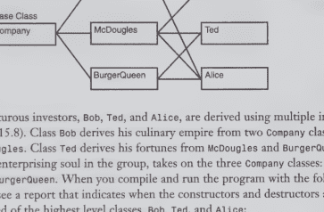

我们三位冒险的投资者 `Bob`、`Ted` 和 `Alice` 使用多继承派生而来（参见清单 15.8）。类 `Bob` 将他的餐饮帝国派生自两个 `Company` 类 `Jennys` 和 `McDougles`。类 `Ted` 将他的财富派生自 `McDougles` 和 `BurgerQueen`。`Alice` 是该群体中最有进取心的灵魂，承担了三个 `Company` 类：`Jennys`、`McDougles` 和 `BurgerQueen`。当你使用以下命令编译并运行程序时，你会看到一份报告，表明为最高层类的对象创建时调用了构造函数和析构函数，`Bob`、`Ted` 和 `Alice`：

```
$ g++ franch.cpp
$ ./a.out
```

虽然我在这里没有展示程序冗长的输出，但在屏幕上你会看到使用如下语句创建对象的结果

```
bobp = new Bob;
...
delete Bob;
```

正如你在运行程序时屏幕上看到的那样，复杂类层次结构的所有正确构造函数和析构函数都被调用。到目前为止，一切顺利。但如果从公司和投资者组派生出另一个类，类关系中就会出现一个微妙的问题。假设一家公司收购了一些母公司和选定的加盟商。正如现实世界的公司金融中一样，公司和人员之间的复杂关系很容易失控。考虑一个 `Corporation` 类，它试图通过多继承继承 `McDougles` 公司以及加盟商 `Ted` 和 `Alice`：


```
class Corporation:
    public McDougles,    // ???
    public Ted,
    public Alice {
};
```

参考图 15.1，你可以看到为什么这个 `Corporation` 永远无法起步。这是因为 `Ted` 和 `Alice` 已经部分派生自 `McDougles`。当 `Corporation` 尝试这样做时，它最终会得到多个 `McDoughles` 基类。此时，编译器会警告你关于模棱两可且无法访问的基类：

```
atest.cpp:59: warning: direct base 'McDoughles' inaccessible
in 'Corporation' due to ambiguity
```

> Note

> 一些编译器将上述条件报告为错误并且不编译程序。GNU C++ 仅发出警告。然而，如果你在使用多重继承的代码中收到此警告，忽略它可能会导致严重的错误。以下部分解释了如何修复该问题。

## FIXING AMBIGUOUS BASE CLASSES

当你在通过多重继承相关联的类层次结构中收到关于模棱两可基类的警告时，尝试识别那些只需要单个对象的基类。在 `Corporation` 的情况下，只有一个 `McDoughles` 公司是有意义的。尽管 `Ted` 派生自 `McDoughles`，但它是 `Corporation` 试图继承的同一个 `McDoughles`。在收购 `Ted` 资产的过程中，`Corporation` 并没有得到两个独立的 `McDoughles` 父公司。只有通过 `Ted` 直接和间接与 `Corporation` 相关的这样一个父类。

在类似但不那么轻率的情况下，其中一个多重派生类只需要一个多重继承基类的副本，你可以通过将它们全部声明为虚基类来将这些基类减少为一个实例。在类层次结构中，即使该对象的类被继承多次，虚基类对象也只有一个副本。清单 15.9，`conglom.cpp`，演示了如何形成一个使用虚基类的 `Corporation` 类并解决 `McDoughles` 基类泛滥的问题。编译程序并使用以下命令运行它：

```
$ g++ conglom.cpp
$ ./a.out
```

### LISTING 15.9 `CONGLOM.CPP`

```
#include <iostream.h>
#include <string.h>    // Need strlen(), strcpy()
#include <stdlib.h>    // Need free()

class Company {
private:
    char *name;
public:
    Company(const char *s) {
        name = new char[strlen(s) + 1];
        strcpy(name, s);
        cout << " In constructor for ";
        Display();
    }
    virtual ~Company() {
        cout << " In destructor for ";
        Display();
        delete[] name;
    }
    void Display() { cout << name << '\n'; }
};

class Jennys: public Company {
public:
    Jennys(): Company("Jenny's") { }
};

class McDoughles: public Company {
public:
    McDoughles(): Company("McDoughles") { }
};

class BurgerQueen: public Company {
public:
    BurgerQueen(): Company("BurgerQueen") { }
};

class Bob:
    virtual public Jennys,
    virtual public McDoughles {
};

class Ted:
    virtual public McDoughles,
    virtual public BurgerQueen {
};

class Alice:
    virtual public Jennys,
    virtual public McDoughles,
    virtual public BurgerQueen {
};

class Corporation:
    virtual public McDoughles,
    public Ted,
    public Alice {
private:
    char *name;
public:
    Corporation(): McDoughles(), Ted(), Alice() {
        name = "Conglomerate Industries";
    }
    void Display() { cout << name << endl; }
};

int main()
{
    cout << endl << "Forming a corporation" << endl;
    Corporation *cp;
    cp = new Corporation;
    cp->Display();
    delete cp;
    return 0;
}
```

在新程序中，类 `Company` 保持不变，`Jennys`、`McDoughles` 和 `BurgerQueen` 也是如此。然而，`Bob`、`Ted` 和 `Alice` 被修改以防止未来的派生最终得到太多副本的父基类。例如，`Bob` 现在被声明为

```
class Bob:
    virtual public Jennys,
    virtual public McDoughles {
};
```

将保留字 `virtual` 添加到列出的基类中告诉编译器，在随后的派生中，这两个基类应该只有一个实例。同样，`Ted` 和 `Alice` 也声明了它们的基类为 `virtual`。修订后的代码现在允许 `Corporation` 类被声明而没有任何对基类的模棱两可引用：

```
class Corporation:
    virtual public McDoughles,
    virtual public Ted,
    virtual public Alice {
    ...
};
```

`Corporation` 类继承了 `McDoughles`、`Ted` 和 `Alice`。通过将 `McDoughles` 指定为虚基类，最终结果中只有一个 `Company` 类的副本，尽管 `Ted` 和 `Alice` 也派生自 `McDoughles`。`Ted` 和 `Alice` 在这种情况下并不严格需要是 `virtual`，除非另一个类派生自 `Corporation`。

> Note

> 不要太担心如果前面的讨论需要读一两遍才能理解——正如我提到的，多重继承可能比最初看起来更麻烦。如果你需要使用多重继承，请做好准备应对此处提到的警告，如果发生这种情况，请尝试将继承的类设为虚基类以修复问题。

## DEBUGGING CLASSES WITH VIRTUAL FUNCTIONS

GNU 调试器对调试具有虚函数的类对象没有特殊支持。然而，当类在单独的模块中实现时，设置断点和跟踪代码需要一些额外的技巧，如下所述。

### DEBUGGING CLASSES IN SEPARATE MODULES

要跟上进度，请为 `TContainer`、`TObject` 和 `TMyObject` 类编译 `container.cpp` 模块和 `tcontain.cpp` 测试程序。使用以下命令：

```
$ g++ -g -c -DDEBUG container.cpp
$ g++ -g -DDEBUG -o tcontain tcontain.cpp container.o
```

这些命令创建了带有调试信息附加的可执行代码文件 `tcontain`。将结果加载到 GNU 调试器中：

```
$ gdb --silent tcontain
```

为了演示调试独立模块时遇到的问题，输入 `list` 直到找到构造新 `TContainer` 对象的行，并在那里设置断点（对我来说是第31行）：

```
(gdb) list
...
31 TContainer * container = new TContainer(100);
(gdb) b 31
Breakpoint 1 at 0x80489e5: file tcontain.cpp, line 31.
```

接着，运行程序到断点：

```
(gdb) run
Starting program: /src/c15/tcontain
...
Breakpoint 1, main () at tcontain.cpp:31
31 TContainer * container = new TContainer(100);
```


现在程序在构造 `TContainer` 对象之前暂停了。不幸的是，尝试跟踪进入该操作会产生意外结果。尝试 `step` 命令：

```
(gdb) step
strcmp (p1=0x80485ff "__environ", p2=0x8048516 "_builtin_new") at ../sysdeps/generic/strcmp.c:30
../sysdeps/generic/strcmp.c:30: No such file or directory.
Current language: auto; currently c
```

这没能产生预期结果，因为调试器显然试图跟踪进入 C++ `new` 运算符的代码，而不是 `TContainer()` 构造函数。因此，再试一次。首先，删除所有断点：

```
(gdb) delete
Delete all breakpoints? (y or n) y
```

然后，列出实现 `TContainer` 类的模块。出于无法解释的原因，显然必须同时提供起始行号和文件名：

```
(gdb) list container.cpp:1
```

第一次指定行号后，你可以直接再次输入 `list` 来显示更多文件内容。输入 `list` 命令直到找到以下行：

```
(gdb) list
...
13 // Constructor
14 TContainer::TContainer(int n)
15 {
16 if (n <= 0) n = 1;
```

现在程序正确地在 `TContainer` 构造函数内部暂停。调试器显示传递给构造函数的参数值：`this`（正在构造的对象的地址）以及 `n` 的值，在本例中等于请求的容器大小。

**提示** 输入 `ptype this` 可查看 `this` 指针所指向对象的类型。

## 调试虚函数调用

要调试虚函数调用，请在调用虚函数（例如抽象类中的纯虚函数）的基类中设置断点。为了演示，如有必要，将 `tcontain` 程序加载到调试器中（如果程序当前已加载，也可以输入 `delete` 来清除所有断点）。然后，列出包含虚函数调用的模块——在本例中是 `container.cpp`。同样，第一次输入 `list` 时提供起始行号：

```
(gdb) list container.cpp:1
...
56 for (int i = 0; i < count; i++)
57 objects[i]->Display(); // Calls virtual function!
```

第57行调用纯虚函数 `Display()`。目标是使用调试器找出程序在运行时实际调用了哪个 `Display()`。为此，在调用该函数的语句上设置一个断点：

```
(gdb) b 57
Breakpoint 3 at 0x80490b8: file container.cpp, line 57.
```

当你运行程序时，它会停在断点位置：

```
(gdb) run
Starting program: /src/c15/tcontain
...
Breakpoint 3, TContainer::ShowAllObjects (this=0x804abf0, msg=0x8049fd <"Before sorting">) at container.cpp:57
57 objects[i]->Display(); // Calls virtual function!
```

要跟踪虚函数调用并发现哪个对象的 `Display()` 函数绑定到了该语句，输入 `step` 命令：

```
(gdb) step
TMyObject::Display (this=0x804ad98) at tcontain.cpp:71
71 cout << sp << " ";
```

产生的输出表明，`TMyObject::Display()` 在运行时绑定到了调用纯虚函数 `TObject::Display()` 的语句。注意，传递给 `Display()` 的唯一参数是对象的地址。此时，你可以输入 `cont` 继续运行程序直到结束（如果遇到任何断点，再次输入 `cont`），然后输入 `q` 退出调试器。

## 总结

本章介绍了虚函数，这是一种有时被称为多态的特性。使用这种技术，你可以创建声明纯虚函数的抽象类。派生类继承一个或多个抽象类，并为继承的虚函数提供实际代码。这使得 C++ 能够根据对象的类型调用实际的函数。本章还说明了多重继承导致的一个常见问题：一个类最终继承了基类的多个副本，并解释了如何使用虚基类解决该问题。

有关本章介绍的主题的更多信息，请参阅以下章节：

- 第16章，“处理异常”
- 第17章，“创建类模板”
- 第18章，“重载你的友元”

## 处理异常

编写能够可靠处理错误的函数总是很困难，因为，原因之一，错误本质上是不可预测的。更糟糕的是，随着程序变得更加复杂，因而引入更复杂的错误条件，处理这些错误的函数就变得更加难以编写和维护。

认识到这些问题，C++ 设计者增加了异常的概念。正如你在本章中所学到的，异常是一个对象，它像绕地球运行的卫星一样独立运作。它使一个函数能够在不影响函数正常操作的情况下报告异常条件。通过将异常处理纳入 C++ 程序中，即使在最深层的函数调用链中，也很容易管理最复杂的错误条件。

### 一些常用术语

异常自带其专有的术语和概念。以下是一些概述，有助于你阅读和理解本章的信息：

- 异常就是异常——它是一个描述需要特殊处理的异常条件的对象。异常最适合用于程序的错误处理，但并不限于此用途。
- 要创建异常，一个函数会抛出一个描述异常性质的对象。该对象可以是字符串、类的对象或任何其他对象。异常对象不一定是类对象，但在实践中通常是。
- 要处理异常，一个函数会捕获由另一个函数抛出的对象。捕获异常的语句称为异常处理器。
- 程序通过尝试可能抛出异常的一个或多个语句来准备捕获异常。一般来说，要使用异常，你尝试一个或多个语句，并捕获这些语句抛出的任何异常。

> Note
>
> 由于异常仅在 C++ 中可用，标准 C 函数库不使用异常报告错误。然而，C++ 库大量使用异常。有关异常处理的更多示例，请参阅第 25 章，“Applying Standard Algorithms。”

### 介绍异常

现在，让我们看看异常在 C++ 中是什么样子的。在检测到错误条件时，一个函数可以抛出异常。例如，它可能会抛出一个描述错误条件的字符串：

```
throw "overflow";
```

在程序的其他地方，一个字符串异常处理器可以捕获并显示抛出的对象。处理器在 `catch` 表达式中指定对象的类型（本例中为 `const char *`），如下所示：

```
catch (const char * message) {
    cout << "***Error!" << message << endl;
    // ... other error response actions
}
```

`catch` 语句捕获抛出的字符串异常对象并使用输出流语句显示它。接下来会发生什么取决于你。如果不采取进一步行动，程序将正常继续。或者，`catch` 语句可能会调用另一个函数、设置一个标志，或导致程序重复导致错误的函数调用。无论如何，在异常被处理后，它将被销毁。异常是报告和处理异常条件的机制——它并不规定行动方案。那仍然是你的工作。

当一条语句抛出异常时，会发生三个影响程序运行的重要动作：

- 包含抛出异常语句的函数立即返回给其调用者。
- 异常对象覆盖函数正常返回的任何值。
- 异常导致 C++ 搜索异常处理器（`catch` 语句）。在异常被处理之前，不允许执行任何其他程序语句。

最后一种影响至关重要。如果程序本身不处理异常，它最终会到达 C++ 默认异常处理器。在大多数情况下，未处理的异常会结束程序。这在小型程序和测试中是有利的，因为它有助于防止内存泄漏或磁盘空间不足等错误可能造成的损害。在编写小型非关键程序时，你可以简单地忽略错误条件，因为知道任何严重的异常只会导致程序结束。例如，如果 C++ `new` 运算符无法满足动态内存分配请求，它会抛出一个异常从而使程序停止。当然，在生产软件中，所有异常都必须被处理以防止程序意外停止。

### THROWING EXCEPTION OBJECTS

尽管像字符串或整数值这样的任何对象都可以是异常对象，但异常通常是类的对象。在其最简单的形式中，这样的类可能只是一个名称，没有声明内容，如下所示：

```
class Overflow { };
```

这不仅仅是一个说明——它是一个完整的 C++ 类。要用它来报告错误，使用以下语句抛出该类的实例：

```
throw Overflow();
```

该语句构造了一个 `Overflow` 类的对象，并将其抛回给函数的调用者。在该函数中，程序可以用如下代码捕获异常

```
catch (Overflow) {
    cout << "Overflow detected" << endl;
}
```

## 标准异常类

通常，异常类派生自一个提供问题信息的基类。为了使你的异常处理与 C++ 默认处理器兼容，最佳做法是基于标准 C++ 异常类来构建你自己的异常处理器，该类声明如下


```cpp
class exception {
public:
    exception() { }
    virtual ~exception() { }
    virtual const char* what() const;
};
```

要使该类在你的程序中可用，请包含标准异常头文件，在本例中，该文件不以 `.h` 结尾。同时包含标准字符串头文件，以便在异常对象中存储描述性消息：

```cpp
#include <exception>
#include <string>
```

`exception` 类声明了三个公共成员：一个什么都不做的默认构造函数、一个虚析构函数，以及一个返回类型为 `const char*` 的虚函数 `what()`，并且由于 `const` 后缀，表明调用该函数不会对对象进行任何更改。要使用 `exception` 类，可以派生另一个类，如下所示：

```cpp
class TMyException: public exception {
private:
    string what_str;
public:
    TMyException(const string &what_arg):
        what_str(what_arg) { }
    virtual const char* what() const {
        return what_str.c_str();
    }
};
```

派生类公有继承标准 `exception` 类，并添加了一个名为 `what_str` 的私有字符串对象。新类的构造函数指定了一个对 C++ 字符串对象的引用参数，并使用初始化表达式将 `what_arg` 赋给 `what_str`。构造函数没有其他职责要执行，因此其语句块为空。虚函数 `what()` 通过调用 `what_str` 对象的 `c_str()` 函数返回一个指向 C 风格字符串的 `const char *`。函数 `what()` 在异常对象中是传统的，用于获取导致抛出异常的问题描述。

要使用派生类，函数语句会抛出派生类的对象，并将字符串描述作为参数。函数可能写成如下形式：

```cpp
int AnyFunction()
{
    if (errorCondition)
        throw TMyException("Underflow");
    else
        return aValue;
}
```

如果检测到错误条件，函数会抛出 `TMyException` 类的对象；否则，它会正常返回一个值。

> **Note**
>
> 有关 C++ 字符串对象的更多信息，请参阅第 22 章，“精通标准字符串类。”

## 介绍 try 块

现在是时候加入另一个复杂因素——`try` 块，它们在第一次使用时似乎让每个人都感到困惑。为了在 `catch` 语句中捕获异常，使用前一节中的 `TMyException` 类和示例 `AnyFunction()`，程序可以用如下代码启用异常处理：

```cpp
int x;
try {
    x = AnyFunction();  // Might throw an exception
    cout << "x = " << x << endl;  // May not execute
}
catch (TMyException except) {
    cout << except.what() << endl;
    exit(1);
}
```

`try` 块执行一个或多个语句，其中一些可能会抛出异常。在本例中，示例 `AnyFunction()` 如果检测到错误就会抛出 `TMyException` 类型的异常。如果发生这种情况，`x` 不会被赋值，并且输出语句不会执行。相反，程序会立即跳转到第一个与异常类型匹配的 `catch` 语句。在本例中，示例 `catch` 语句捕获异常对象，通过调用 `what()` 显示其消息，然后通过调用 `exit()` 结束程序。

一个或多个 `catch` 语句必须跟随在 `try` 块之后。你不能将 `try` 块放在一个地方，而将它的 `catch` 语句放在另一个地方。那就像棒球比赛中投手在投手丘上，而捕手却在停车场里。在所有情况下，你必须在 `try` 块后跟随一个或多个 `catch` 语句，以捕获被尝试语句抛出的任何异常。

```cpp
catch (TOverflow except) {
    // handle overflow condition
}
catch (TUnderflow except) {
    // handle underflow condition
}
```

你通常可以通过将对各种函数的调用放在另一个函数内部来避免这种笨拙的编程，该函数通常写成内联以避免额外的函数调用：

```cpp
inline void f()
{
    functionA();
    functionB();
}
```

这允许程序使用单个 `try` 块，后跟 `catch` 语句来捕获 `functionA()` 或 `functionB()` 抛出的任何异常：

```cpp
try {
    f();
}
catch (TOverflow except) {
    // handle overflow condition
}
catch (TUnderflow except) {
    // handle underflow condition
}
```

## 使用 try 块

一些额外的示例有助于阐明 `try` 块是什么以及如何使用它们。`try` 块可以执行多个语句，如以下代码片段所示：

```cpp
int x;
try {
    cout << "Here we go!" << endl;
    x = AnyFunction();
    cout << "x == " << x << endl;
}
catch (MyException except) {
    cout << except.what() << endl;
}
```

示例 `try` 块首先显示一条消息。这不太可能导致抛出任何异常，因此严格来说不需要将其放在 `try` 块中——但将其放在那里也没有害处。接下来，程序调用 `AnyFunction()`，将函数的返回值赋给整数 `x`。然而，如果 `AnyFunction()` 抛出异常，`try` 块会立即结束，并且不会为 `x` 分配任何值。`AnyFunction()` 之后的输出语句也会被跳过。由于异常，程序直接跳转到列出异常对象类型的 `catch` 语句。

作为错误指示符的特殊值。使用标准错误处理方法，`AnyFunction()` 可能会返回 `-1` 来指示问题，通过 `if` 语句常规检测：

```cpp
int x = AnyFunction();
if (x == -1)
    ErrorHandler(x);
```

这种技术存在许多问题。首先，保留值 `-1` 不包含有关问题的任何信息。此外，并不总是方便保留一个值作为错误指示符。此外，程序员很容易忽略函数返回的错误值。使用 C++ 中的异常可以消除所有这些麻烦。

## 使用异常进行编程

现在你已经了解了异常处理的基础知识，请查看本节中的程序，了解如何使用异常报告错误的实用示例。该程序实现了一个函数 `power()`，它将一个双精度浮点值提升到指数，可能为分数。非法输入值，例如负底数提升到分数指数（例如 `-4^1/3`），会抛出异常。为了让你可以在其他程序中使用该函数，我将其作为单独的模块编写。列表 16.1，`power.h`，声明了 `power()` 函数和用于报告错误的异常类。

### 列表 16.1 POWER.H

```cpp
#include <exception>  // Need exception class
#include <string>      // Need string class

class TPowExcept: public exception {
    double b;          // Base value
    double e;          // Exponent value
    string what_str;   // Error description
public:
    TPowExcept(double b_arg, double e_arg,
               const string &what_arg)
        : b(b_arg), e(e_arg), what_str(what_arg) {}
    virtual const char *what() const {
        return what_str.c_str();
    }
    void Report();
};

double power(double b, double e) throw(TPowExcept);
```

首先看一下头文件末尾 `power()` 函数的原型。声明以 `throw(TPowExcept)` 结尾，这是该函数可能抛出的异常类型的可选指示符。这称为声明的异常。尽管声明函数的异常是可选的，但你几乎总是应该这样做。这使得在 `try` 块中调用函数后，在 `catch` 语句中需要捕获的异常类型非常清晰。


`power.h` 头文件中还声明了 `TPowExcept` 类，它派生自标准 `exception` 类。三个私有数据成员保存描述问题性质的值。`double` `b` 和 `e` 是发现为非法的传递给 `power()` 的输入值，而 `what_str` 进一步描述了问题。`TPowExcept` 构造函数是内联编写的。它将三个参数分配给三个私有数据成员，但不执行其他任务。虚拟 `what()` 函数返回 `what_str` 私有对象的字符串值。函数 `Report()` 在列表 16.2，`power.cpp` 中实现。

### 列表 16.2 POWER.CPP

```cpp
#include <iostream.h>
#include <math.h>    // Need modf(), fmod()
#include "power.h"  // Need TPowExcept, power()

// Display error message in exception object
void TPowExcept::Report()
{
    cout << "Domain error: base == " << b
         << ", exponent == " << e << endl;
    cout << what() << endl;
}

// Subfunction called by power()
double fpower(double b, double e)
{
    return exp(e * log(b));
}

// Returns b raised to the e power
// Throws TPowExcept exception for illegal input values
double power(double b, double e) throw(TPowExcept)
{
    if (b > 0.0) return fpower(b, e);
    if (b < 0.0) {
        double ipart;
        double fpart = modf(e, &ipart);
        if (fpart == 0) {
            if (fmod(ipart, 2) != 0) // i.e. ipart is odd
                return -fpower(-b, e);
            else
                return fpower(-b, e);
        } else
            throw TPowExcept(b, e, "Result is a complex number");
    } else {
        if (e == 0.0) return 1.0;
        if (e < 1.0)
            throw TPowExcept(b, e, "Exponent must be zero or >= 1.0");
        return 0.0;
    }
    throw TPowExcept(0, 0, "Error in power() function");
}
```

异常类的 `Report()` 函数显示对象的 `b` 和 `e` 双精度变量的值，并写出保存在 `what_str` 中的附加消息。`TPowExcept` 类不仅包含完整描述 `power()` 函数问题的所有值，还包含用于显示错误消息的方法。

`power()` 函数使用 `TPowExcept` 类来报告错误。例如，如果你尝试将负值提升为分数指数，程序将抛出以下异常：

```
throw TPowExcept(b, e, "Result is a complex number");
```

这就是 `power()` 报告此类错误所需的全部操作。在抛出异常时，函数将错误的基数和指数值以及字符串消息传递给 `TPowExcept()` 构造函数。

> 注意
>
> `power()` 函数中的最后一条语句是不可达的——它不应执行。然而，我将其包含在内，以演示如何插入在调试期间可能有用的内部错误报告代码。要了解其工作原理，请注释掉 `return 0;` 语句。我有时喜欢使用类似的编程来确保我已经覆盖了所有基础情况，尤其是在使用嵌套 `if-else` 语句的函数中。但是，有些 C++ 编译器会对最后的 `throw` 语句发出警告——如果你的系统出现这种情况，可以删除该行。

## 清单 16.3 TPOWER.CPP

```
#include <iostream.h>
#include "power.h"  // Need TPowExcept, power()

int main()
{
    double base, exponent, result;  // Input and result variables
    try {
        cout << "base? ";
        cin >> base;
        cout << "exponent? ";
        cin >> exponent;
        result = power(base, exponent);  // Exception possible here
        cout << "result = " << result << endl;
    }
    catch (TPowExcept &except) {
        except.Report();  // Display error message
        return 1;         // Exit with error
    }
    return 0;  // Exit with no error
}
```

使用以下命令编译 `power.cpp` 模块和测试程序：

```
$ g++ -c power.cpp
$ g++ tpower.cpp power.o
```

运行程序并输入基数和指数值以测试 `power()` 函数：

```
$ ./a.out
base? 2
exponent? 2.8
result = 5.9644
```

尝试其他值以强制函数抛出异常。例如，再次运行程序并输入以下值：

```
$ ./a.out
base? -4
exponent? 1.5
Domain error: base == -4, exponent == 1.5
Result is a complex number
```

这一次，测试程序对 `power()` 抛出的异常对象做出了响应。为此，`main()` 函数的 `try` 块会提示你输入基数和指数值（这些语句也可以放在 `try` 块之前）。之后，程序使用以下语句调用 `power()`：

```
result = power(base, exponent);
```

如果 `power()` 抛出异常，则对 `result` 的赋值和下一个输出语句将被跳过。在这种情况下，程序跳到 `catch` 语句，该语句声明了一个与 `power()` 抛出的异常对象匹配的异常对象。在此示例中只有一种此类异常类型，但可能还有其他类型。处理错误很简单。程序仅调用异常对象的 `Report()` 函数，并通过从 `main()` 返回来结束程序：

```
main():
except.Report();
return 1;
```

提示

在 `catch` 语句中处理异常后，异常对象会自动销毁。你无需采取任何额外操作来删除异常对象。

## 未处理的异常

通常，未处理的异常是个坏消息。如果函数抛出了异常，但没有任何 `catch` 语句捕获它，异常对象最终会由默认异常处理程序处理。如前所述，这通常会中止程序，更糟糕的是，会将内存转储到核心文件中。具体操作取决于异常类型，以及程序本身是否替换了任何默认处理程序。对于未处理的异常，C++ 会调用以下三个函数之一：

- 未被 `catch` 语句处理的异常会导致程序调用 `unexpected()`。未预期异常被定义为任何未被 `catch` 语句处理的异常。默认情况下，`unexpected()` 会调用 `terminate()`，接下来会解释。

- 对于 C++ 检测到堆栈损坏或由于类析构函数抛出异常（一种危险做法，仅应在最严重的问题时使用）而导致的未预期异常，程序会调用 `terminate()` 函数。默认情况下，`terminate()` 会调用 `abort()`，接下来会解释。

`abort()` 函数在 totem pole 上处于最低位置。如果程序在异常处理中到达此阶段，它会立即结束并将内存写入核心转储文件。为了防止这种情况，你可以重写 `unexpected()` 和 `terminate()` 函数，从而捕获在 `catch` 语句中未处理的任何异常。

## 替换 unexpected() 和 terminate()


你可以用新代码替换`unexpected()`和`terminate()`，以你想要的任何方式处理未处理的异常。例如，在程序开发期间，将`unexpected()`替换为仅通知你任何未处理异常可能是有意义的。然后你可以添加适当的`catch`语句，在异常变得致命之前捕获它们。你也可以用诊断信息替换`terminate()`，用于调试损坏的堆栈或在对象处置期间抛出的异常的原因（这可能表明内存管理存在问题）。

通常情况下，替换`unexpected()`就足以确保程序永远不会因未处理的异常而意外停止。`terminate()`函数最好用于关闭关键服务、保存打开的文件，并在结束程序之前执行其他灾难恢复操作。如果程序最终进入`terminate()`，你应该假设最坏的情况，尽可能清理，然后优雅地结束。你永远无法替换`abort()`。

包含异常头文件提供了两个可以调用的函数来替换默认的异常处理程序。这些函数声明为

```
terminate_handler set_terminate (terminate_handler func);
unexpected_handler set_unexpected (unexpected_handler func);
```

在每种情况下，将一个返回`void`且不声明参数的函数传递给`set_terminate()`和`set_unexpected()`函数。例如，像这样编写自己的处理程序：

```
void MyHandler()
{
    // ... statements in your handler
}
```

要使用处理程序捕获意外异常，将函数名作为参数传递给`set_unexpected()`：

```
set_unexpected(MyHandler);
```

或者，你可以用如下代码保存原始处理程序的地址

```
unexpected_handler saved_handle; // Variable
saved_handle = set_unexpected(MyHandler);
```

然后你可以恢复原始处理程序的地址——如果多个模块安装自己的自定义处理程序，这是一种很好的技术。类似地，通过调用以下内容设置默认的`terminate()`函数：

```
set_terminate(MyHandler);
```

## 捕获所有异常

编写能够安全处理所有可能异常的自定义异常处理程序并不像基本技术所暗示的那样容易。本节展示了一个模拟多种类型错误并使用自定义处理程序安全捕获它们的示例。列表 16.4，`unexpect.cpp`，演示了如何用自定义函数替换默认的异常处理程序，以捕获所有可能的程序错误。它处理未知类型的异常，并演示了如何在结束程序之前获得最后一次执行关键措施的机会。

```
LISTING 16.4 UNEXPECT.CPP
#include <iostream.h>
#include <exception>

#define MAXERR 10

// Exception class used when errors exceed limit
class MaxError { };

// Normal error exception class
class Error {
private:
    static int count;  // Count of Error objects
public:
    Error();           // Constructor
    void Say();        // Report static error count
};

// Prototype for function that throws an exception
void run() throw(Error);

// Prototypes for custom exception handlers
void custom_unexpected();
void custom_terminate();

// Global static counter for Error class objects
int Error::count;

void main()
{
    set_unexpected( custom_unexpected );
    set_terminate( custom_terminate );
    for (;;) {
        try {
            run();  // Throws an exception
        }
        catch (Error e) {
            e.Say();
        }
    }
    return 0;
}
```

### LISTING 16.4 CONTINUED

```
// Function that throws an exception
void run() throw(Error)
{
    throw Error();
    // throw "An unknown exception object";
}

// Our unexpected exception handler
void custom_unexpected()
{
    cout << "Inside custom_unexpected function" << endl;
    throw Error(); // Continues program
}

// Our terminate exception handler
void custom_terminate()
{
    cout << "Inside terminate function" << endl;
    cout << "Exiting program" << endl;
    exit(1); // Exits program
}

// Error class constructor
Error::Error()
{
    count++;
    if (count > MAXERR)
        throw MaxError(); // Abort object construction!
}

// Error class reporting function
void Error::Say()
{
    cout << "Error: count = " << count << endl;
}
```

`unexpect.cpp`程序列出了捕获所有可能异常所需的所有元素。该程序并不能防止异常终止，但它确实接管了调用`abort()`及其不可避免的核心转储的默认操作。通过使用类似的代码，你可以捕获每种类型的异常，至少在有必要提前结束程序时，有机会以有序的方式关闭程序。使用以下命令编译并运行程序：

```
$ g++ unexpect.cpp
$ ./a.out
Error: count = 1
Error: count = 2
...
Error: count = 10
Inside custom_unexpected function
Inside terminate function
Exiting program
```

正如程序的输出所示，它强制发生十个异常，所有异常都得到了正常处理。然而在第十次之后，程序会产生一个更严重的错误，导致自定义处理器退回处理该问题。最后，程序会优雅地降级并显示一条错误消息——尽管出现了意外的异常，但没有产生核心转储。这些操作模拟了一种典型情况，即一个错误导致另一个错误，进而导致另一个错误，最终引发各种问题。

为了跟踪已发生的错误数量，程序在列表末尾附近的`Error`类构造函数会递增类的静态`count`变量。因为`count`是静态的，所以所有`Error`对象只有一个副本的其值。`Error`中还包含一个函数`Say()`，用于显示`count`的值。

在构造`Error`对象的过程中，如果`count`等于或超过常量`MAXERR`，构造函数会抛出类型为`MaxError`的异常。因为程序没有捕获这种类型的错误，所以此操作会触发自定义处理器。这模拟了调用第三方库中的函数时可能发生的情况，这些函数可能会抛出未知类型的异常。即使在你自己的代码中，如果你忽略捕获特定类型的异常，也可能发生这种情况。

> Note
>
> 当构造函数抛出异常时，对象不会被构造。有关此主题的更多信息，请参阅本章后面的“Exceptions and Constructors”。

`unexpect.cpp`程序中的`main()`函数（请参阅 Listing 16.4）安装了替换默认`unexpected()`和`terminate()`函数的处理器。程序随后执行一个 Do-Forever for 循环，其中`try`块调用一个本地函数`run()`。该函数故意抛出类型为`Error`的异常，由`main()`中的`catch`语句捕获。前十次发生这种情况时，程序通过调用`Error`对象的`Say()`成员函数来显示一条消息。然而在第十次错误之后，`Error`类的构造函数放弃了这场好斗，并通过执行以下语句抛出类型为`MaxError`的异常：


```
count++;
if (count >= MAXERR)
    throw MaxError();
```

这模拟了一种严重情况，即对象无法被构造。在这种情况下，问题甚至比正常情况更严重，因为它发生在 `Error` 类对象的构造函数中。因为 `main()` 的 `try-catch` 语句不识别类型为 `MaxError` 的错误，所以此操作会导致 `main()` 结束，并将控制权传递给我们的 `guest` `unexpected` 异常处理器。在该函数中，执行了两个语句：

```
cout << "Inside custom_unexpected function" << endl;
throw Error;    // Continues program
```

第一个语句只是为了让你能够观察到何时调用自定义处理器。第二个语句展示了如何在此阶段继续程序。在现实情况下，`unexpected` 处理器可能会检查程序的状态并采取措施，允许用户关闭文件或重新建立网络通信——无论需要做什么才能恢复正常。自定义处理器现在有两个选项：

- 它可以调用 `terminate()`，在这种情况下程序进入其关键关闭阶段，或
- 它可以抛出已知类型的异常。

第二种措施是你抵御意外异常的第一道防线。从 `unexpected` 异常处理器内部抛出异常，实际上是将未知异常转换为已知类型。通常，`main()` 中的一个循环会捕获该类型的异常，以便程序在执行其恢复逻辑后可以继续运行。

然而在这种情况下，抛出 `Error` 对象会导致另一个未知异常被发射出去。这模拟了即使在尝试从问题中恢复后，程序也无法继续的严重情况。其结果是调用自定义 `terminate()` 函数，该函数显示一条错误消息并通过调用 `exit()` 结束：

```
cout << "Inside terminate function" << endl;
cout << "Exiting program" << endl;
exit(1); // Exits program
```

尽管简单，但演示程序模拟了导致程序无法继续的极端条件。但至少它尽可能优雅地结束。

对程序进行一个简单的更改也可以演示如何处理意外异常并仍允许程序继续。只有当程序不再能够构造 `Error` 对象时，我们的 `terminate` 函数才会结束表演。要进行此更改，请重写 `run()` 函数以抛出字符串对象：

```
void run() throw(Error)
{
    throw "An unknown exception object";
}
```

使用与之前相同的命令编译并运行修改后的 `unexpect.cpp` 程序：

```
$ g++ unexpect.cpp
$ ./a.out
Inside custom_unexpected function
Error: count = 1
Error: count = 1
Inside custom_unexpected function
Error: count = 10
Inside custom_unexpected function
Inside terminate function
Exiting program
```

这次，因为 `main()` 不识别类型为 `const char *` 的异常，所以每个 `Error` 异常都会导致我们的自定义 `unexpected` 异常处理器被调用。实际上，处理器将意外异常转换为已知类型，即 `Error` 类的对象。这允许程序在存在意外条件的情况下继续运行。然而，最终 `Error` 类超过了其最大计数，其构造函数抛出类型为 `MaxError` 的错误。`unexpected` 处理器不会接收这种类型的异常——相反，`terminate` 函数被调用，程序结束。

# 异常与局部对象

当一个函数抛出异常时，C++ 会自动销毁该函数中创建的任何局部变量。请确保你理解这种效应。当局部变量本身是类的对象时，这可能会导致不可预见的后果。

> 注意
>
> 某些编译器有一个特殊选项，可以在声明它们的块抛出异常时启用局部对象的销毁。GNU 默认执行此操作。

一个简单的例子，`localecept.cpp`，见列表 16.5，演示了 GNU C++ 如何在抛出异常的函数中销毁对象。你可能会使用该程序来测试其他 C++ 编译器如何处理这种关键情况。

## 列表 16.5 LOCALEXCEPT.CPP

```
#include <iostream.h>
#include <exception>

class A {
public:
    A() { cout << "A constructor" << endl; }
    ~A() { cout << "A destructor" << endl; }
};

void f();

int main()
{
    try {
        f();
    }
    catch (const char *s) {
        cout << s << endl;
    }
    return 0;
}

void f()
{
    A a;  // Construct object of class A
    throw ("Error condition");
}
```

该程序声明了一个类 `A`，仅包含两个成员：构造函数和析构函数。这两个函数在被调用时都会显示一条消息作为跟踪。函数 `f()` 构造一个类型为 `A` 的对象，然后使用字符串抛出异常以保持简单。当你编译并运行程序时，它显示对象在 `main()` 中的 `catch` 语句接收到抛出的异常之前已被正确销毁：

```
$ g++ localecept.cpp
$ ./a.out
```

A constructor

A destructor

Error condition

到目前为止，一切正常。但如果函数通过指针动态构造对象，则会产生非常不同的效果。例如，假设函数 `f()` 像这样构造对象：

```
void f()
{
    A *p = new A;
    throw ("Error condition"); // ???
}
```

由于动态对象具有全局作用域，就像所有使用 `new` 创建的对象一样，对象的析构函数在函数因异常结束时不会被调用。更糟糕的是，指针 `p` 被销毁，导致对象在空间中漂浮并造成内存泄漏。为避免此问题，在抛出异常之前，必须删除任何动态对象。例如，你可以使用标志来指示函数内部的错误，如果设置了标志，则在抛出异常之前删除任何动态对象：

```
bool error_flag;
...
if (error_flag) {
    delete p;
    throw ("Error condition");
}
```

这种类型的错误很容易发生在返回使用 `new` 构造的对象的指针的函数中。请记住，如果函数抛出异常，它不会像正常情况下那样返回值。

# 异常与构造函数

类构造函数可以抛出异常以指示它们无法成功构造对象。这是 C++ 中相对较新的规范，一些较旧的编译器可能无法识别，但 GNU C++ 在这方面是最新的。你在本章的 `Error` 类中已经看到过这种技术的示例。要在构造函数中抛出异常，只需使用以下类中的语句即可：

```
class AnyClass {
public:
    AnyClass() {
        if (condition) throw Error();
    }
    ~AnyClass(); // Destructor
};
```

这里的关键概念是，如果构造函数抛出异常——导致构造函数异常结束——则对象未被构造，最重要的是，任何类析构函数都不会被调用。只有通过调用其析构函数完全构造的对象才会被销毁，这一事实在拥有其他类对象的类中具有特别重要的后果。

考虑 `AnyClass` 的这个版本：

```
class AnyClass {
    OtherClass x;
public:
    AnyClass(): x() {
        if (condition) throw Error(); }
    ~AnyClass(); // Destructor
};
```

类型为 `OtherClass` 的对象 `x` 由 `AnyClass` 的构造函数使用表达式 `x()` 初始化。如果 `OtherClass` 对象的构造函数抛出异常，则 `AnyClass` 对象的构造函数被中止并且析构函数不会被调用。这种效应在拥有多个类对象的类中可能更加关键：

```
class AnyClass {
    OtherClass a, b, c;
public:
    AnyClass(): a(), b(), c() {}
    ~AnyClass(); // Destructor
};
```

如果对象 `b` 的构造函数抛出异常，则对象 `c` 未被构造，`AnyClass` 对象也未被构造。然而，对象 `a` 的析构函数会被调用，因为该对象在 `b` 的构造导致问题之前已完全构造。在对象具有指向动态内存的指针的情况下，可能需要仔细思考，以确保在构造函数抛出异常的情况下，所有对象都得到正确处理。在极少数情况下，可能需要重新排列类对象数据成员的初始化顺序（示例中的 `a`、`b` 和 `c`），以便一切按预期工作。

# 自行抛掷的类


一个类也可以抛出其自身类类型的异常对象。通常，这是在异常类中由成员函数完成的，通常称为`Raise()`。例如，你可能会像这样设计异常类：

```
class Error {
public:
    void Raise() { throw Error(); }
};
```

该类还可能声明其他函数、构造函数、析构函数和数据成员。如果`e`是类型为`Error`的对象，则以下语句会抛出另一个`Error`类的对象：

```
e.Raise();  // Throws fresh Error object
```

根据`Error`类中的其他服务，这可能是抛出异常的一种好方法，即使它最初已被处理。这样做可以使异常保持活跃，导致 C++ 继续在函数调用链中向上搜索匹配的异常处理程序。在许多情况下，你可以通过抛出`catch`语句接收的相同对象来简单地做到这一点：

```
catch (Error e) {
    // initially handle this type of error
    throw e; // rethrow exception to this function's caller
}
```

## 异常与内存管理

如前几章所述，`operator new`在无法满足内存分配请求时会抛出异常。在 GNU C++ 中，该异常是`bad_alloc`类的对象。假设程序中有一个函数`f()`，它使用`new`创建类型为`TAnyClass`的动态对象：

```
T AnyClass * f()
{
    return new TAnyClass();
}
```

要捕获`new`在内存分配失败时抛出的异常，可使用如下`try`和`catch`语句：

```
try {
    TAnyClass * p = f();  // 可能抛出异常
}
catch (bad_alloc error) {
    cout << error.what() << endl;
    exit(1);
}
```

尽管上述代码可行，但在每次使用`new`时都捕获`bad_alloc`异常很不方便。因为内存不足通常表示严重问题，更常见的做法是在更高层捕获错误——例如在`main()`中，使用如下代码：

```
int main()
{
    for (;;) {
        try {
            run();  // 主程序循环
        }
        catch (bad_alloc error) {
            cout << "Out of memory" << endl;  // ???
            cout << error.what() << endl;  // ???
            exit(1);
        }
    }
}
```

基本思路是使用一个 Do-Forever `for`循环，反复调用一个函数——本例中为`run()`——你可以将其称为主程序引擎。`catch`语句捕获`run()`抛出的所有`bad_alloc`异常，或由`run()`调用的任何其他函数抛出的异常。然而，输出语句值得怀疑，因为如果系统内存不足，可能没有足够的空闲字节来执行输出语句本身。如果在输出语句期间发生异常，程序会调用`terminate()`并突然以核心转储结束。

一个有用的技巧可以缓解此类问题，即在程序开始时分配一块内存池，在内存分配失败时将其删除。例如，你可以预留 2,048 字节的块：

```
char *reserve = new char[2048];
```

这也可能放在`try`块中，但在程序开始运行时通常有一定内存可用。在发生`bad_alloc`异常时，删除预留的内存：

```
delete reserve;
reserve = NULL;
```

然后你可以重复导致错误的那个操作，希望`new`的使用能够成功。如果不行，会再次抛出`bad_alloc`异常，你可能不得不中止程序。一种做法是捕获并重新抛出异常：

```
catch (bad_alloc error) {
    if (reserve != NULL)
        throw (error);
}
```

这会导致异常对象在异常处理程序之外保持存活，除非在函数调用链中更高层有另一个处理程序，否则程序最终会调用当前未预期的异常处理程序。在该处理程序中，你可以执行有序关闭，关闭文件，并在结束程序前完成其他必要操作。

## 调试异常

GNU 调试器提供了一个用于捕获异常的命令，但在我使用的版本中似乎不起作用。不过，你可以尝试使用更新的编译器——也许对你有效。首先，编译本章中类似`unexpect.cpp`的程序（参见清单 16.4），并使用以下命令将其载入调试器：

```
$ g++ -g -o unexpect unexpect.cpp
$ gdb --silent unexpect
(gdb)
```

通过将函数名指定给`break`命令（简写为`b`）来在函数`main()`上设置断点，然后运行程序：

```
(gdb) b main
Breakpoint 1 at 0x80489ee: file unexpect.cpp, line 40.
(gdb) run
Starting program: /src/c16/unexpect
Breakpoint 1, main () at unexpect.cpp:40
40 set_unexpected( custom_unexpected );
```

## 总结

正如本章所述，C++ 异常是函数可以抛出的对象，用来报告异常情况。为了提供异常处理，程序在`try`块中调用函数，然后使用`catch`语句处理这些函数可能抛出的异常对象类型。任何未处理的异常都会调用低级的`unexpected()`和`terminate()`函数，你可以用自定义版本替换它们，以捕获所有可能的错误并防止程序意外关闭。本章还解释了相关主题，例如重新抛出异常、从标准异常类派生类，以及为 C++ `new`运算符报告的内存不足错误编写异常处理程序。

有关本章介绍主题的更多信息，请参阅以下章节：

- Chapter 22, “Mastering the Standard string Class”

- Chapter 25, “Applying Standard Algorithms”

# 第17章 创建类模板

正如类是一种构建对象的蓝图，模板就是构建函数和类的蓝图。也称为参数化类型，模板为通用类和函数提供规范，这些类和函数能够自动适应新的用途。

> 注意

> 有关使用模板的更多信息，请参阅第23章“使用标准模板库（STL）”。

## 介绍类模板

模板通常用于创建通用函数和类，这些函数和类不绑定到任何特定数据类型。例如，排序函数就是一个很好的模板，因为排序算法不直接依赖于其操作的数据类型。将函数实现为模板可将其简化为最一般的形式。在编译程序时，C++ 使用模板生成或实例化一个实际的函数，该函数适用于特定类型的数据。

模板类同样具有通用性。一个极佳的例子是容器类，它提供搜索和其他功能，但可以处理从最基本的整数到复杂类对象等任何数据类型。

## 模板函数

模板函数描述了函数的通用属性。最常见的是，你将模板函数声明在单独的头文件中，并在各个模块中包含它们。模板函数通常如下所示：

```
template <class T>
void f(T param)
{
    // ... function body
}
```

保留字`template`开始声明，并且始终后跟包含一个或多个表达式的尖括号。在此示例中只有一个表达式——以单词`class`开始，后跟你选择的任何标识符。在本例中，我使用`T`表示“类型”。这里的单词`class`不一定指 C++ 类，而是指任何“类”数据类型。

模板的前言之后是正在以模板形式声明的项目。在此示例中，它是一个名为`f()`的函数，返回`void`并接收一个类型为`T`的单个参数。实际数据类型在程序使用模板时稍后指定——在此，`T`只是指尚未定义类型的占位符。函数也可能返回占位符类型的值：

```
template <class FutureType>
FutureType AnyFunction(FutureType param)
{
    // ... function body
}
```

## 列表 17.1 MINMAX.H

```
#pragma interface

template <class T>
T max(T a, T b)
{
    if (a > b)
        return a;
    else
        return b;
}

template <class T>
T min(T a, T b)
{
    if (a < b)
        return a;
    else
        return b;
}
```

### 注意

`minmax.h`中的`#pragma interface`指令可能不再需要。某些版本的 GNU C++ 需要它来帮助链接器解析模板函数和类的使用。

仔细查看模板函数`max()`的声明：


```
template <class T>
T max(T a, T b)
```

模板保留字首先出现，后跟包含占位符类型名 `T` 的尖括号。第二行将 `max()` 声明为返回类型为 `T` 的值并接收两个参数 `a` 和 `b` 的函数，`a` 和 `b` 也是类型 `T`。函数体是常见的 C++ 代码：

```
if (a > b)
    return a;
else
    return b;
```

`a` 和 `b` 的实际类型尚不为人知，我们仅假设这些类型的对象可以在表达式 `(a < b)` 中进行比较——如果不能，程序根本无法编译。模板函数 `min()` 也是类似编写的，但当然返回其两个参数中较小的值。

我们现在有两个函数 `min()` 和 `max()`，它们在本质上完全通用。它们可以操作任何数据类型，只要该类型对象可以进行比较。列表 17.2，`tminmax.cpp`，测试了这些函数并展示了如何为不同类型的数据实例化模板。

## 列表 17.2 `TMIMAX.CPP`

```
#include <iostream.h>

#pragma implementation "minmax.h"
#include "minmax.h"

// Instantiate template functions //
template int min(int, int);
template double min(double, double);
template char min(char, char);

template int max(int, int);
template double max(double, double);
template char max(char, char);

int main()
{
    int i1 = 100, i2 = 200;
    double d1 = 3.14159, d2 = 9.87654;
    char c1 = 'A', c2 = 'Z';

    cout << "max(i1, i2) = " << max(i1, i2) << endl;
    cout << "max(d1, d2) = " << max(d1, d2) << endl;
    cout << "max(c1, c2) = " << max(c1, c2) << endl;

    cout << "min(i1, i2) = " << min(i1, i2) << endl;
    cout << "min(d1, d2) = " << min(d1, d2) << endl;
    cout << "min(c1, c2) = " << min(c1, c2) << endl;

    return 0;
}
```

### 注意

> `tminmax.cpp` 中的 `#pragma implementation` 指令可能不再需要。它对应于模板函数头文件 `minmax.h` 中包含在模块中的 `#pragma interface` 指令。虽然在这个小型示例中并非严格必需，但这些指令有助于确保从模板创建的函数只有一个实例。较新版本的 GNU C++ 不需要这两个指令。

测试程序包含 `minmax.h` 头文件。使用该文件中的模板函数，编译器显式实例化实际函数，使用诸如

```
template int min(int, int);
```

这样的模板原型。这会导致编译器在模板函数中出现的每个类 `T` 的位置实现一个名为 `min()` 且类型为 `int` 的函数。结果是一个实际函数，返回两个整数参数的最小值，就好像你像这样编写了该函数：

```
int max(int a, int b)
{
    if (a > b)
        return a;
else
    return b;
}
```

模板的优点在于 C++ 会为你编写这段代码。你所需要做的只是创建模板，用实际数据类型声明函数原型，然后使用该函数。

## 模板类

模板类比模板函数更加强大。模板类为通用类提供骨架，该类稍后会使用用户指定的数据类型实例化。模板类的声明与模板函数的声明类似。它以模板保留字开头，后跟尖括号中的一个或多个占位符类型。一般来说，模板类的形式如下：

```
template <class T>
class TAnyClass {
    // ... class members
};
```

不要混淆 `class` 这个词的两种用法——它们的含义不同。第一行说明 `class T` 是稍后确定的类型的占位符。其余的声明与任何其他 C++ 类声明一样，只是成员可以使用占位符类型，就像它是一个真实的数据类型一样。例如，模板类可能会声明一个类型为 `T` 的私有数据成员：

```
template <class T>
class TAnyClass {
private:
    T var;
public:
    TAnyClass(T arg): var(arg) {}
};
```

该模板类是完全通用的。它存储一个名为 `var` 的私有变量，其类型为 `T`。它的构造函数在构造 `TAnyClass` 对象时，将类型也为 `T` 的参数值赋给 `var`。相同的类模板可能存储任何类型的数据。要使用模板，只需创建模板类类型的对象并指定要使用的实际数据类型即可：

```
TAnyClass< int > int_object(123);
```

这会创建一个名为 `int_object` 的 `TAnyClass` 对象，在模板中出现的每个占位符 `T` 处都使用数据类型 `int`。该对象将其私有 `var` 数据成员存储值为 123。数据类型也可能是另一个类：

```
TAnyClass< TOtherClass > class_object( other_object );
```

这会从 `TAnyClass` 模板创建一个名为 `class_object` 的对象，在模板中 `T` 出现的地方使用 `TOtherClass` 作为数据类型。`other_object` 的值会被复制到私有 `var` 数据成员中。

与模板函数一样，模板类通常在头文件中声明。例如，列表 17.3，`db.h`，演示了如何创建一个可以存储少量记录的模板类。那些记录的实际类型在程序创建模板类对象时才会确定。此时，C++ 会生成一个实际的类来处理对象的创建。

### LISTING 17.3 `DB.H`

```
#include <string>

class DBError {
private:
    string msg;
public:
    DBError(const string &msg_arg): msg(msg_arg) { }
    const string & what() const { return msg; }
};

template<class T>
class TDatabase {
private:
    T *rp;    // Records pointer
    int num;  // Number of records
public:
    TDatabase(int n): num(n)
    { rp = new T[num]; }
    ~TDatabase()
    { delete[] rp; }
    T &GetRecord(int recnum) throw (DBError);
};

template<class T>
T &TDatabase<T>::GetRecord(int recnum) throw (DBError)
{
    if (0 <= recnum && recnum < num)
        return rp[recnum];
    else
        throw DBError("Bad record number");
}
```

头文件声明了两个类。`DBError` 是一个普通的 C++ 类，模板类 `TDatabase` 用它来报告错误。模板类 `TDatabase` 使用单个占位符数据类型声明：

```
template<class T>
class TDatabase { ...
```

这会创建模板 `TDatabase`，作为一种用于尚不确定数据类型 `T` 的模板类。模板的私有部分声明了一个指向未知类型对象的指针 `rp`，以及一个计数数据库持有多少条记录的整数变量：

```
private:
    T *rp;    // Records pointer
    int num;  // Number of records
```

这表明模板类（和模板函数）可以声明和使用特定类型的数据，例如 `int num`——模板中的所有数据不必都是通用的。模板的构造函数初始化私有变量，再次使用占位符类型 `T` 来创建用于保存记录的数组：

```
TDatabase(int n): num(n)
{ rp = new T[num]; }
```


我们仍然没有指定 `T` 到底是什么，但即便如此，`C++` 也允许语句使用该类型。在这里，`operator new` 创建一个 `T` 对象的数组，并将记录数保存在 `num` 中。在这种情况下，`TDatabase()` 构造函数是内联实现的。你也可以在模板类中分别声明和实现成员函数。例如，`TDatabase` 声明了一个公共引用函数 `GetRecord()`：

```
T &GetRecord(int recnum) throw (DBError);
```

这说明 `GetRecord()` 返回一个指向未知占位符类型 `T` 的对象的引用。程序向 `GetRecord()` 传递一个等于记录编号的整数。函数通过抛出 `DBError` 类型的异常对象来报告错误。函数的实现展示了类模板可以有多么通用。它的声明乍一看可能有点令人生畏：

```
template<class T>
T &TDatabase<T>::GetRecord(int recnum) throw (DBError)
```

函数实现以 `template <class T>` 开头，正如你在其他示例中看到的那样，这说明这是一个模板，并且 `T` 是稍后指定的数据类型的占位符。第二行说明 `GetRecord()` 是模板类 `TDatabase<T>` 的成员，并且函数返回一个类型为 `T&` 的对象的引用。如同所有成员函数实现一样，`C++` 作用域解析运算符表示声明该函数的类。错误通过抛出 `DBError` 类型的异常来报告。`GetRecord()` 函数以完全通用的方式使用类型为 `T` 的对象：

```
if (0 <= recnum && recnum < num)
    return rp[recnum];
else
    throw DBError("Bad record number");
```

如果请求的记录号在范围内，函数返回数组 `rp[recnum]` 中记录的引用；否则，它抛出 `DBError` 类型的异常。这对任何类型的数据都适用——从常见的 `C++` 类型到字符串、结构体和类对象。模板类是一个完全通用的容器。

> Tip
>
> 模板类容器会根据任何类型对象的需要进行塑形。将其与第 15 章“使用虚函数编程”中的 `TContainer` 类形成对比，后者只能存储派生自抽象基类 `TObject` 的对象。模板类容器消除了指定基类类型的需求。然而，每指定一种数据类型，整个模板类都会被重新实例化。

### LISTING 17.4 TDB.CPP

`Listing 17.4`, `tdb.cpp`, 将 `TDatabase` 模板类付诸实践。示例程序声明了一个类 `TRecord`，用于在数据库中存储记录对象。

```
#include <iostream.h>
#include <string>      // Need string class
#include "db.h"       // Need TDatabase template

// Type of objects to store in database
class TRecord {
private:
    string name; // Record data
public:
    TRecord() : name() { }
    TRecord(const string &s) : name(s) { }
    void Assign(const string &s) { name = s; }
    const string & GetName() const { return name; }
};

int main()
{
    int rn;                     // Record number index
    TDatabase<TRecord> *pdb;    // Pointer to db of TRecords

    pdb = new TDatabase<TRecord>(3);  // Create 3-record database

    // Assign record data
    //
    pdb->GetRecord(0).Assign("George Washington");
    pdb->GetRecord(1).Assign("John Adams");
    pdb->GetRecord(2).Assign("Thomas Jefferson");

    // Display database contents
    //
    for (rn = 0; rn <= 2; rn++) {
        cout << rn << ": ";
        cout << pdb->GetRecord(rn).GetName() << endl;
    }

    // Prompt user for record numbers
    //
    for (;;) {
        cout << "Record number? (q to quit) ";
        cin >> rn;           // Get requested record number
        if (!cin.good()) break;  // Bad character entered
        try {
            TRecord &tr = pdb->GetRecord(rn);
            cout << rn << ": " << tr.GetName() << endl;
        }
        catch (DBError error) {
            cout << "***Error: " << error.what() << endl;
        }
    }
    return 0;
}
```

要理解示例程序如何使用 `TDatabase` 模板类，首先检查 `TRecord` 类。这不是一个模板，而是一个普通的 `C++` 类。该类有一个私有字符串对象，表示记录的数据。它还声明了两个构造函数：一个无参数的默认构造函数，和一个接收字符串对象引用用于复制到对象的私有 `name` 成员的构造函数。此外，`TRecord` 声明了一个函数 `GetName()`，它返回对私有字符串对象的常量引用。

对于使用 `TDatabase` 模板类创建的数据库对象，程序使用以下声明创建了一个指针 `pdb`：

```
TDatabase<TRecord> *pdb;    // Pointer to db of TRecords
```

此时，当 `C++` 编译程序时，它从 `TDatabase<T>` 模板构造出一个实际的类。`C++` 在模板中出现占位符类型 `T` 的地方插入 `TRecord`，从而以这种方式创建一个可以存储 `TRecord` 类型对象的数据库类。要创建数据库对象，程序像这样调用 `new`：

```
pdb = new TDatabase<TRecord>(3);    // Create 3-record database
```

实例化类的名称是 `TDatabase<TRecord>`，而不是简单的 `TDatabase`。该语句向实例化类的构造函数 `TDatabase<TRecord>()` 传递一个请求的数据库大小，本例中为 3。如果你声明一个整数数据库，其名称将是 `TDatabase<int>`，作为使用模板实例化的全新类。模板类的美妙之处在于它们可以适应几乎任何类型。主要缺点是每种使用都会创建一个全新的实例化。

创建数据库对象后，程序使用如下语句为记录分配字符串

```
pdb->GetRecord(0).Assign("George Washington");
```

函数 `GetRecord()` 是 `TDatabase<T>` 模板类的成员，返回类型为 `T&` 的引用。由于该类使用 `TRecord` 类实例化，实际的 `GetRecord()` 函数返回对 `TRecord` 对象的引用。即使模板类对 `TRecord` 一无所知，前面的语句也可以调用 `TRecord::Assign()`，因为实际的数据库对象已被编译器塑造成可容纳 `TRecord` 类型对象的形式。

诸如 `TDatabase<T>::GetRecord()` 之类的引用函数在模板类中特别方便，可高效地返回占位符类型的对象。然而，引用函数也引发了如果函数无法返回对象该怎么办的问题。如果例如数据库为空，或者用户指定了超出范围的记录号怎么办？

这正是异常发挥价值的地方。因为异常有效地覆盖了函数的正常返回值，所以它们非常适合从无法保留特定值作为错误指示符的函数中报告错误。例如，指针函数可以返回 `NULL` 来指示错误，但不存在 `NULL` 引用的概念，而引用函数最好编程为抛出异常以指示问题。看看这种机制在示例数据库程序中是如何工作的。创建几个示例后

记录时，程序会提示你输入一个记录号。如果输入非法号码，程序的异常处理程序会报告该问题：


```
try {
TRecord &tr = pdb->GetRecord(rn);
cout << rn << ": " << tr.GetName() << endl;
}
catch (DBError error) {
cout << "***Error: " << error.what() << endl;
}
```

`try`块调用了针对记录号`rn`的引用函数`GetRecord()`。如果该记录号超出范围，函数会抛出类型为`DBError`的异常。这会导致对`TRecord`引用变量`tr`的赋值不会发生，程序也会跳过输出语句。发生错误时，异常处理程序会显示一条消息，并且无需包含额外的编程来测试函数的返回值。

## 模板实例化

在任何使用模板的程序中，一个重要问题是如何以及在哪里实例化这些模板。当 C++ 编译器读取模板的声明——通常在头文件中时——它获取了为特定数据类型创建模板类或函数的实际实例所需的信息。在由许多模块组成的程序中，考虑编译器将为模板实例化生成的代码存储在哪里是很重要的。

为了解决这个问题，编译器编写者提出了许多方案，其中一些在 GNU C++ 的某些版本中是实验性的。以下各节解释了模板实例化的两种最常见模型，并解释了如何在使用模板的程序中解决可能遇到的一些问题。首先，为了理解解决方案，你需要理解模板给 C++ 编译器带来的问题。

## 模板的麻烦

当 C++ 编译器遇到模板的使用时，它会根据该位置的数据类型为模板类或函数生成实际代码。例如，考虑一个模板函数`f()`声明为

```
template <class T>
void f(T data);
```

这被称为*自动模板实例化*，并且根据你使用的 GNU C++ 版本，可能需要或不需要前面的函数原型。在任何情况下，使用`f()`的模板声明，C++ 执行两个操作：

- 1. 它实例化模板，意味着它根据占位符类型（`T`）在函数中的数据类型（此处为`int`）编写实际函数的符号代码。

- 2. 它编译生成的函数并将其代码存储在当前模块中。

第二个操作就是模板问题的所在。现在考虑程序扩展为两个模块，`moduleA`和`moduleB`。第二个模块也需要使用整数参数调用`f()`。因此，在编译`moduleB`时，它也包含了模板的头文件，编译器会生成另一个`f(int)`的实例并将其代码存储在`moduleB`的目标代码文件中。

现在有两个完全相同的`f(int)`实例。显然，这很浪费，并且使调试变得复杂。我们希望编译器能够识别它已经实例化了该函数，并在所有模块中使用该实例。但实现这一愿望并不像提出它那样容易。以下各节讨论了目前在 C++ 编译器设计中流行的一些解决方案。

## BORLAND 模型

Borland C++ 模型为模板实例化的泛滥提供了一个简单的解决方案。在此模型中，编译器在每个模块中实例化一个模板。采用前一段的示例，编译后，目标代码文件`module.a`和`module.b`（或任何类似命名的临时文件）包含函数`f(int)`的相同实例。换句话说，在此模型下，编译器只是忽略了这个问题。

然而，在链接期间，Borland 链接器识别出同一函数存在于多个模块中，并将所有此类实例合并为一个。这解决了问题，但带来了麻烦的缺点。在一个包含数十个模块且使用相同模板类和函数的程序中，编译器必须生成所有这些实例。这使得编译器的工作比必要时更重，因此大量使用模板的程序编译时间更长。

## CFRONT 模型

AT&T C++ 到 C 的转换器 CFront 处理模板实例化的方式不同。在这种方法中，在编译使用模板类和函数的语句期间会创建一个*模板存储库*。存储库不包含代码，但包含符号链接器名称和其他信息，使编译器能够创建链接器完成最终代码文件所需的模板实例。换句话说，这是一个两遍系统。在第一遍中，编译器创建一个存储库，告诉链接器在哪里找到模板实例，以及如果需要，如何创建任何模板实例。

这种方法有两个主要优点。一个是编译时间的减少，因为模板实例化不会在程序模块链接之前发生

一是操作系统的链接器本身能处理模板实例化。所谓的 Borland 模型则需要一种专门编制的链接器。CFront 模型的缺点在于编译器复杂度大幅增加。当最终程序的许多组成部分缺失、需要在链接阶段创建时，编译器要生成构建最终程序所需的全部信息并不容易。

## GNU C++ 模型

根据你使用的 GNU C++ 版本不同，模板实例化可能采取多种形式，但其中任何一种都不会与上述描述完全吻合。你的第一种选择是直接容忍多个模板实例的存在，尤其是当你使用的是 GNU C++ 2.7.2 或更早版本时。每个使用模板的模块都会获得自己的一份类或模板实例。这虽然可行，但代价是效率降低、编译速度变慢，而且明显浪费内存和磁盘空间。

第二种选择是获取一个打过补丁的链接器，即所谓的 `collect2` 程序（通过目录链接重命名为 `ld`），它了解对象仓库（object repositories）。你的系统可能已经在使用 `collect2`，因为这个链接器能够在程序启动时（在 `main()` 调用之前）调用全局类构造函数，并在 `main()` 返回之后调用全局析构函数。普通的 UNIX 链接器做不到这一点，因此在这些系统上，`collect2` 被插入到链接过程中来处理这些特殊任务。打过补丁的 `collect2` 版本同样了解对象仓库，可用于链接模板实例化。

如果你拥有这个打过补丁的链接器，就可以用 `g++` 的 `-frepo` 选项编译某个模块，生成一个以 `.rpo` 结尾的仓库文件。随后，链接器会利用这个文件来生成它所需要的模板实例化。尽管标准 GNU C++ 编译器能够生成 `.rpo` 文件，但除非你拥有打过补丁的链接器，否则这些文件毫无用处。

> 注意
>
> 对象仓库在 GNU C++ 2.7.2 及更早版本中属于实验性功能。如果你使用的是较旧的编译器，请查看以下网站获取 GNU C++ 的更新：
>
> http://egcs.cygnus.com

坦率地说，这两种解决方案都不那么吸引人。下面介绍另一种适用于所有 GNU C++ 实现的方法，尽管它需要额外的编程工作，但却是所有方案中最简单的一种。

## 处理链接器问题

如果你尝试使用模板，可能会遇到关于未解析函数的链接器错误。发生这种情况是因为链接器无法找到编译器为特定模块创建的模板实例化。下面的代码清单说明了这个问题。

### 清单 17.5 TEMPLATE.H

```
// A template class
//
template <class T>
class TAnyClass {
private:
    T data;
public:
    TAnyClass(const T arg) : data(arg) { }
    const T & GetData() const;
};

// A template function prototype
//
template <class T>
TAnyClass<T> * MakeObject(const T param);
```

`template.h` 头文件将 `TAnyClass` 声明为一个模板，它有一个类型为 `T` 的私有数据成员、一个用于初始化该数据的构造函数，以及一个返回 `data` 值常量引用的函数。与所有模板一样，类型 `T` 只是一个占位符——真正的类型将在稍后的模板实例化过程中确定。

头文件还声明了一个模板函数 `MakeObject()`。该函数接收一个类型为 `T` 的常量参数，并返回一个指向 `TAnyClass<T>` 新对象的指针。到目前为止一切正常。清单 17.6 即 `template.cpp`，实现了该模板模块。

### 清单 17.6 TEMPLATE.CPP

```
#include "template.h"
#include <string>

// A template class member function
//
template <class T>
const T & TAnyClass<T>::GetData() const
{
    return data;
}

// A template function
//
template <class T>
TAnyClass<T> * MakeObject(const T param)
{
    return new TAnyClass<T>(param);
}

// ====== Cut Here ======
// Explicit template instantiations for TAnyClass
//
template class TAnyClass<int>;
template class TAnyClass<double>;
template class TAnyClass<string>;
```

```cpp
// Explicit template instantiation for function MakeObject()
//
template TAnyClass<string> * MakeObject(const string param);
```


实现模块提供了 `TAnyClass` 模板中成员函数 `GetData()` 的内容。该成员函数仍然是模板形式——它使用占位类型 `T`——但其语句块提供了函数的功能——在本例中，只是返回对象的私有数据，无论它是什么。

同样，模板函数的语句使用 C++ `new` 运算符构造 `TAnyClass<T>` 类型的对象，并将指向该对象的指针作为函数的结果返回。同样，这仍然是一个模板。函数的实际实例化在为 `T` 提供数据类型时才会发生。

不幸的是，麻烦就从这里开始。清单 17.7，`usemtemplate.cpp`，尝试通过包含头文件来使用模板类和模板函数。然而，结果是一系列令人困惑的链接器错误。

```cpp
#include <iostream.h>
#include "string"
#include "template.h"

int main()
{
    TAnyClass<int> int_object(123);
    cout << "int_object  " << int_object.GetData() << endl;

    TAnyClass<double> double_object(3.14159);
    cout << "double_object  " << double_object.GetData() << endl;

    TAnyClass<string> string_object("String object");
    cout << "string_object  " << string_object.GetData() << endl;

    string s("Dynamic string object");
    TAnyClass<string> *p = MakeObject(s);
    cout << "*p = " << p->GetData() << endl;
    delete p;

    return 0;
}
```

要查看链接器找不到模板实例化时产生的错误，请注释掉或删除 `template.cpp` 文件（参见清单 17.6）中从注释“Cut Here”到末尾的行。然后输入以下命令：

```text
$ g++ -c template.cpp
$ g++ usemtemplate.cpp template.o
/tmp/cca011931.o: In function `main':
/tmp/cca011931.o(.text+0x1e): undefined reference to
`TAnyClass<int>::GetData(void) const'
```

模板模块（`template.cpp`）可以编译，但尝试链接主程序和模块时会产生未定义引用错误。虽然我在这里只展示了一个这样的错误，但如果你跟着操作，屏幕上会出现其他几个错误。问题在于 GNU C++ 不提供自动模板实例化，因此，尽管编译器对模板的使用感到满意，但它不会生成实际的类和函数。当链接器查找这些项目时，它找不到它们，编译在最后一步失败。

解决方案需要两个步骤：

1. 显式实例化你需要的每个模板实例。
2. 在使用模板的每个模块中声明每个函数的 `extern` 原型。

你之前从 `template.cpp` 中剪切的行执行了第一步。第二步可能不需要，但如果你仍然收到链接器错误，请尝试在任何使用模板类或函数的模块中添加如下 `extern` 声明：

```
extern template class TAnyClass<int>;
extern template class TAnyClass<double>;
extern template class TAnyClass<string>;
extern template class TAnyClass<string> * MakeObject(string param);
```

这些声明告诉链接器在链接到程序的所有模块中查找模板实例化。

## KNOWN TEMPLATE BUG

模板友元函数和内联成员函数可能无法正确编译。例如，模板类中的以下声明会产生“内部编译器错误 163”：

```
template <class T>
friend ostream & operator<< (ostream & ofs, const T &param) {
cout << data;
return ofs;
}
```

也许 GNU C++ 的后续版本会修复这个问题。在此之前，一个可行的变通方法是派生一个新类 from `ostream` 并重载 `operator<<( )` 作为成员函数而不是友元。 第 20 章，“自定义 I/O 流”，展示了这种方法的几个示例。

## DEBUGGING TEMPLATES

模板实例化在编译期间在幕后发生——当模板函数或类不能按预期工作时，这是一个巨大的劣势。找到程序中的错误已经够难了。当原因被隐藏起来时就更难了。幸运的是，GNU 调试器可以准确显示编译器如何实例化模板函数或类，并以此帮助你确定模板设计中的问题。

### 查看模板类实例化

要跟随并查看 C++ 模板类的实例化，请编译本章中的 `tdb.cpp` 程序并使用以下命令将其加载到 GNU 调试器中：

```
$ g++ -g -o tdb tdb.cpp
$ gdb --silent tdb
(gdb)
```

我们想要调查模板类对象的构造过程以及该对象的后续使用。因此，第一步任务是在代码中设置一些合适的断点位置。输入几个 `list` 命令直到找到构造 `TDatabase` 对象的语句（在我这里是第 31 行）。在该语句处设置断点然后运行程序：

```
(gdb) b 31
Breakpoint 1 at 0x80492a1: file tdb.cpp, line 31.
(gdb) run
Starting program: /src/c17/tdb
...
Breakpoint 1, main () at tdb.cpp:31
31 pDb = new TDatabase<TRecord*>(3);
```

此时，`pDb` 指针已被声明为类型 `TDatabase<TRecord>*`。这会促使编译器使用指定的 `TRecord` 数据类型实例化该类模板。要查看模板展开的结果，使用 `ptype` 命令：

```
(gdb) ptype pDb
type = class TDatabase<TRecord> {
private:
  TRecord *rp;
  int num;
public:
  TDatabase<TRecord> & operator=(TDatabase<TRecord> const &);
  TDatabase(TDatabase<TRecord> const &);
  TDatabase(int);
  ~TDatabase(void);
  TRecord & GetRecord(int);
} *
```

结果非常有趣，特别是与原始模板相比（请参阅清单 17.3，`db.h`）。实例化类的名称现在显示为 `TDatabase<TRecord>`。其指针数据成员 `rp` 被声明为类型 `TRecord *`，并且在类的 `public` 部分出现了一些新项目。前两个成员函数展示了 C++ 如何在未在类中显式提供时自动生成 `operator=()` 函数和拷贝构造函数。除了这些新增项之外，实例化类还完善了模板的析构函数和 `GetRecord()` 函数。调试器输出末尾的那个孤立星号表示 `pDb` 是指向所列类的指针。

### 跟踪模板类函数

要跟踪类的使用方式，可以在类模板成员函数中设置断点——即使这些函数实际上是在编译期间由 C++ 构造的。在某些情况下，你可能会遇到一些异常，因为调试器对 C++ 模板的支持尚未完全发挥作用。然而，必要的命令似乎工作得足够好，可以追踪大多数类型的模板错误。一种找到潜在断点位置的方法是列出模板的头文件。例如，如果你正在跟随操作，输入以下命令删除所有当前断点（如果退出调试器则重新加载 `tdb`）：

```
(gdb) delete
Delete all breakpoints? (y or n) y
```

接下来，输入一个 `list` 命令，后跟 `TDatabase` 模板类头文件的名称和行号。再次输入几次 `L` 直到找到此处显示的行（行号可能与你不同）：

```
(gdb) l db.h:1

26 TDatabase(int n): num(n)
```

在此行设置断点以在程序调用 `TDatabase` 构造函数时暂停程序，然后运行程序到断点（如果程序已在运行并被询问是否重启，回答 yes）：

```
(gdb) b 26
Breakpoint 2 at 0x804991c: file db.h, line 26.
(gdb) run
Starting program: /src/c17/tdb
Breakpoint 2, TDatabase<Record>::TDatabase (this=0x1,
n=1073743212)
at db.h:26
26 TDatabase(int n): num(n)
```


调试器的输出显示出一个问题：参数 `this` 和 `n` 的值显然不正确。也许你的 `gdb` 版本已修复。尽管存在此问题，仍然可以查看正确的值。输入 `next` 进入构造函数，然后使用 `ptype` 查找成员 `rp`（记录指针）的类型：

```
(gdb) next
27 { rp = new T[num]; }
(gdb) ptype rp
type = class TRecord {
...
public:
  TRecord operator=(TRecord const &);
  TRecord(TRecord const &);

  TRecord(basic_string<char, string_char_traits<char>,
    __default_alloc_template<true, 0> > const &);
}
```

我删除了输出中的几行，这可能会让你感到惊讶。`TDatabase` 模板类的 `rp` 变量实际上是类型 `TRecord *`（指向 `TRecord` 对象的指针）。除了该类显式声明的成员（请参阅清单 17.4，`tdb.cpp`）之外，C++ 还添加了一个 `operator=()` 函数和一个拷贝构造函数。此外，模板对其构造函数的声明

```
TRecord(const string &s)
```

被替换为一个延长的声明，表明类 `string` 本身是一个复杂的嵌套模板。第 22 章“精通标准 string 类”涵盖了 C++ 字符串对象，因此我在这里不会深入介绍该声明。但很有趣的是，你可以使用 GNU 调试器准确地找出 C++ 在编译程序中如何实例化模板和其他类。

## 在模板类中设置断点

在模板类中设置断点的另一种有用方法是使用实例化类函数的名称而不是源代码行号。必要时重新加载 `gdb` 程序到调试器中，并输入以下命令在 `GetRecord()` 成员函数中设置断点（再次说明，行号可能与你不同）：

```
(gdb) b 'TDatabase<Record>::GetRecord()
Breakpoint 3 at 0x80496e4: file db.h, line 36.
(gdb)
```

实际上，你不必输入那么多。只需输入 `b 'T`（包括撇号），按 Tab，输入 `::Get`，再次按 Tab，就完成了。一般来说，你可以以这种方式使用命令行补全来输入冗长的标识符——毕竟，调试器知道程序中的所有符号，并且可以轻松地使用部分输入搜索匹配项。

> **注意**
>
> 我不明白为什么其他调试器没有像命令行符号补全这样方便的功能。可能是因为你必须为这些产品付费！

设置完 `GetRecord()` 中的断点后，运行或继续程序直到它停止：

```
(gdb) cont
Continuing.
Breakpoint 3, TDatabase<Record>::GetRecord (this=0x804b680,
  recnum=0) at db.h:36
36 if (0 <= recnum && recnum < num)
```

这次，`GetRecord()` 的参数似乎是正确的。你现在可以继续逐步执行实例化函数并检查程序的异常处理。完成后输入 `q`。

> **提示**
>
> 当程序在成员函数中暂停时，命令 `ptype this` 会显示调用该函数的对象的类型。

### 摘要

模板是创建实际函数和类的蓝图。模板指定一个或多个占位符类型，C++ 在编译期间用实际类型替换它们。这使得编写完全通用的函数和类成为可能，这些函数和类在编译时会根据实际数据类型进行塑形。模板通常写在包含到模块中的头文件中。模板的有用示例包括排序函数和容器类。

有关本章介绍主题的更多信息，请参阅以下章节：

- 第 15 章，“使用虚函数进行编程”

- 第 16 章，“处理异常”

- 第 22 章，“精通标准 string 类”

- 第 23 章，“使用标准模板库（STL）”

# 高级 C++ 技术

- 18 重载你的朋友 401

- 19 重载运算符 411

- 20 自定义 I/O 流 439

- 21  honing Your C++ Skills 473

## 第 18 章

## 重载你的朋友

```
AClass(double arg): value(arg) { }
};
```

类 `AClass` 声明了一个私有数据成员 `value`，类型为 `double`。类构造函数为该成员分配一个参数值。然而，按此写法，`AClass` 未提供对其私有数据的访问。在 `value` 初始化后，该私有数据成员就像熊妈妈身边的熊崽一样安全无虞。

接下来，假设你声明另一个类，其中包含 `AClass` 对象作为数据成员。这是朋友发挥作用的典型设计：

```
class BClass {
private:
    AClass anObject;  // AClass object data member
public:
    BClass(double arg): anObject(arg) { }
    double GetValue() { return anObject.value; } // ???
};
```

该类无法编译，因为其成员函数 `GetValue()` 试图访问 `anObject` 中的私有 `value` 数据成员。因为 `value` 对 `AClass` 是私有的，只有该类的成员才能访问该数据成员。

在这种情况下，程序员很容易被诱惑通过将 `AClass` 中原始的访问说明符从 `private` 改为 `public` 来“修复”问题。这可行，但就像用大锤拍苍蝇一样，因为它使 `value` 对 `AClass` 的所有用户都可用。所需的是从 `BClass` 内部对 `AClass` 私有数据的特殊访问。

解决方案是使 `BClass` 成为 `AClass` 的友元。这表示 `BClass` 对象有权在不使这些成员对任一类之外的语句可用的情况下访问 `AClass` 内部的私有和受保护成员。要进行此更改，请在需要访问的类内部使用 `friend` 保留字。在此示例中，`BClass` 需要使用 `AClass` 内部的私有 `value` 数据成员。因此，为了给予 `BClass` 这样做的权限，`AClass` 将 `BClass` 声明为友元。以下是新的 `AClass` 声明：

```
class AClass {
    friend class BClass;  // BClass is a friend of AClass
private:
    double value;  // AClass and BClass may use this member
    ...
};
```

与之前的 `AClass` 声明的唯一区别是在 `AClass` 的开头行之后添加了 `friend class BClass`。这告诉编译器授予 `BClass` 访问 `AClass` 的私有和受保护成员的权限。其他类和其他程序中的其他语句仍被阻止使用 `AClass` 的受限成员。你可以声明任意数量的类为友元。唯一的限制是 `friend` 保留字必须出现在类声明内部。关于友元还有一些其他事实值得记住：

- 一个类必须提前命名其所有友元。你不能在运行时创建友元。

- 包含私有和受保护数据的类是声明另一个类为友元的类，从而赋予该友元对声明类中通常隐藏的成员的特殊访问权限。一个类永远不能声明自己是另一个类的友元——那就像邀请自己去陌生人家吃饭一样。

- 友元类可能在声明友元的类之前或之后声明。声明的顺序无关紧要，但友元类通常最后声明，这样友元类中的任何成员函数都可以引用另一个类的私有和受保护元素。

- 友元的派生类不会继承对原始类私有和受保护成员的特殊访问权限。只有被明确命名的友元类才拥有该权限。

- 派生类可能是其基类的友元，尽管在这种情况下，在基类中使用受保护成员就能实现同样的目标，即赋予派生类（友元）访问基类中受限成员的权限。

清单 18.1，`friend.cpp`，演示了友元类如何访问另一个类的私有和受保护成员。

## LISTING 18.1 FRIEND.CPP


```cpp
#include <iostream.h>
#include <string>    // Need string class

class Pal {
    friend class Buddy;  // Buddy is a friend of Pal
private:
    string label;
protected:
    void Putlabel(string arg) { label = arg; }
public:
    Pal(string arg): label(arg) { }
};

class Buddy {
private:
    Pal palObject;
public:
    Buddy(string arg): palObject(arg) { }
    void FriendDemo();
};

int main()
{
    Buddy aBuddy("First Message");
    aBuddy.FriendDemo();
    return 0;
}

// Demonstrate how Buddy object can access Pal private
// and protected members
void Buddy::FriendDemo()
{
```

```
cout << "Reading private Pal::message from Buddy" << endl;
cout << palObject.label << endl;
cout << "Calling protected Pal::PutLabel function" << endl;
palObject.PutLabel("Second Message");
cout << palObject.label << endl;
cout << "Writing private Pal::message from Buddy" << endl;
palObject.label = "Third Message";
cout << palObject.label << endl;
}
```

以通常的方式编译并运行该程序。其输出显示了友元类如何访问另一个类中的私有字符串 `label`：

```
$ g++ friend.cpp
$ ./a.out
Reading private Pal::message from Buddy
First Message
Calling protected Pal::PutLabel function
Second Message
Writing private Pal::message from Buddy
Third Message
```

在 `friend.cpp` 程序中，类 `Pal` 声明 `Buddy` 为友元。这赋予 `Buddy` 访问 `Pal` 的私有字符串 `label` 数据成员以及其 `PutLabel()` 受保护成员函数的权限。`Pal` 类还声明了构造函数，但它没有提供对其私有和受保护成员的其他访问。一个程序语句可以这样构造一个 `Pal` 对象：

```
Pal palObject("A String");
```

但这就是它能做的全部。因为 `Pal` 没有提供读写其数据的函数，所以唯一可能的操作就是构造一个 `Pal` 类型的对象。然而，由于 `Buddy` 是 `Pal` 的友元，它可以访问 `Pal` 通常隐藏的声明。为了演示，示例程序创建了一个 `Buddy` 类型的对象并调用其 `FriendDemo()` 成员函数：

```
Buddy aBuddy("First Message");
aBuddy.FriendDemo();
```

## MUTUAL FRIEND CLASSES

两个类可以互相声明为友元，从而使每个类都能访问对方的私有和受保护成员。这相当于面向对象的两个人在相邻的酒店房间住宿并打开内门。外人看不到房间里发生了什么，但这两个客人可以自由地互访对方的房间。

使用互为友元的类破坏了通常禁止访问类受限成员的屏障，这种技术很少使用。然而，偶尔它是有用的，可以在两个类之间提供对静态数据成员的相互访问。清单 18.2，`mutual.cpp`，演示了基本技术。

### LISTING 18.2 MUTUAL.CPP

```
#include <iostream.h>

class BClass;

class AClass {
    friend BClass;
private:
    static int x;
public:
    AClass(int arg) { x = arg; }
    void AFunction();
};

class BClass {
    friend AClass;
private:
    static int y;
public:
    BClass(int arg) { y = arg; }
    void BFunction();
};

int AClass::x;
int BClass::y;

int main()
{
    AClass a(123);
    BClass b(456);
    a.AFunction();
    b.BFunction();
    return 0;
}

void AClass::AFunction()
{
    cout << "Inside AClass::AFunction()" << endl;
    cout << "x == " << x << "; y == " << BClass::y << endl;
}

void BClass::BFunction()
```

```
{
    cout << "Inside BClass::BFunction()" << endl;
    cout << "x == " << AClass::x << "; y == " << y << endl;
}
```

编译并运行该程序，它会显示两个相互友元类的 `x` 和 `y` 私有静态成员的值：

```
$ g++ mutual.cpp
$ ./a.out
Inside AClass::AFunction()
x == 123; y == 456
Inside BClass::BFunction()
x == 123; y == 456
```

不完整的类声明是使相互友元类协同工作的关键。示例列表首先声明符号 `BClass` 是一个类：

```
class BClass;
```

这允许 `AClass` 将 `BClass` 声明为友元。`BClass` 反过来将 `AClass` 声明为友元。这使每个类都能访问对方的私有和受保护成员。如前所述，一个典型的应用是访问两个不同类中的静态数据成员。在这里，两个整数变量 `AClass::x` 和 `BClass::y` 在各自的类中声明为 `static`。因为它们是静态的，所以对于这两个类创建的所有对象，每个整数变量只有一个副本。因为它们是私有的，所以变量通常只能从声明它们的类内部访问。

然而，由于 `AClass` 和 `BClass` 之间存在紧密的相互关系，这些类中的成员函数可以访问对方的私有静态数据。为此需要告诉编译器使用确切的对象。例如，在 `AFunction` 中，静态变量 `BClass::y` 必须使用该完全限定名称引用。同样，`BFunction()` 使用完全限定名称 `AClass::x` 引用 `AClass` 的 `x` 变量。

> Note
>
> 本节中的示例程序证明使用 GNU C++ 可以实现相互友元类，但如果你发现经常需要这种功能，这可能是类层次结构设计不佳的迹象。大多数类最好彼此完全陌生。

## FUNCTIONS AND FRIENDS

友元函数与友元类类似，但负担较轻。将函数声明为类的友元可使该函数访问类对象中的私有和受保护成员。友元函数可能是常见的 C++ 函数，也可能是类成员函数。以下各节讨论这两种类型。

> Note
>
> 友元函数通常用于实现重载运算符，这是下一章的主题。

### FRIEND FUNCTIONS

在典型的设计中，友元函数声明其所欠友情的类的参数。在友元函数内部，语句可以访问传递给该函数的类对象参数中通常隐藏的成员。列表 18.3，`friendfn.cpp`，演示了如何为两个类声明和使用友元函数。

#### LISTING 18.3 FRIENDFN.CPP


```cpp
#include <iostream.h>
#include <string>    // Need string class

class Two; // Incomplete class declaration

class One {
    friend void Show(One &c1, Two &c2);
private:
    string s1; // Accessible to One and Show()
public:
    One() { s1 = "Testing "; }
};

class Two {
    friend void Show(One &c1, Two &c2);
private:
    string s2; // Accessible to Two and Show()
public:
    Two() { s2 = "one, two, three"; }
};

int main()
{
    One obj1;
    Two obj2;
    Show(obj1, obj2);
    return 0;
}

// Implement the friend function
void Show(One &obj1, Two &obj2)
{
    cout << obj1.s1 << obj2.s2 << endl;
}
```

当你使用以下命令编译并运行程序时，它会调用一个友元函数，该函数写入两个独立类中两个私有字符串数据成员的值：

`$ g++ friendfn.cpp`

`$ ./a.out`

`Testing one, two, three`

`friendfn.cpp` 程序声明了两个类 `One` 和 `Two`。不完整的类声明允许 `One` 的成员在 `Two` 类声明之前引用 `Two`。两个类以相同的方式声明一个名为 `Show()` 的友元函数，如

`friend void Show(One &c1, Two &c2);`

由于友元函数原型出现在类内部，`Show()` 中的语句被授予访问 `One` 和 `Two` 中的私有和受保护成员的权限。函数 `Show()` 声明两个类类型的引用参数 `obj1` 和 `obj2`。因为 `Show()` 是这些类的友元，所以 `Show()` 内部的语句可以访问其两个参数中的私有和受保护成员。例如，`Show()` 使用语句写入私有字符串变量 `s1` 和 `s2` 的值

`cout << obj1.s1 << obj2.s2 << endl;`

其他不是 `One` 和 `Two` 友元的函数不能使用类似的表达式，因为 `s1` 和 `s2` 是各自类的私有成员。

## FRIEND MEMBER FUNCTIONS

友元函数也可以是类成员。在典型情况下，一个类将另一个类的成员函数声明为友元。友元成员函数可以访问声明类的私有和受保护成员。列表 18.4，`friendmf.cpp`（`mf` 代表 member function），展示了使用友元成员函数的基本策略。

### LISTING 18.4 FRIENDMF.CPP

```cpp
#include <iostream.h>
#include <string>      // Need string class

class One; // Incomplete class declaration

class Two {
private:
    string s2; // Accessible to Two's members
public:
    Two() { s2 = "one, two, three"; }
    void Show(One &c1);
};

class One {
    friend void Two::Show(One &c1);
private:
    string s1; // Accessible to One and Two::Show()
public:
    One() { s1 = "Testing "; }
};

void main()
{
    One obj1;
```

```cpp

Two obj2;

obj2.Show(obj1);

}

void Two::Show(One obj1)

{

    cout << obj1.s1 << s2 << endl;

}
```

程序的输出与 `friendfn.cpp` 相同，但它使用了一种不同的技术来访问私有数据。使用以下命令编译并运行程序：

`$ g++ friendfn.cpp`
`$ ./a.out`
`Testing one, two, three`

新的程序 `friendfm.cpp` 与 `friendfn.cpp` 类似，但它使用友元成员函数来访问两个类的私有成员。与其他程序一样，新代码声明了两个类——`One` 和 `Two`。然而，在这种情况下，类 `Two` 将 `Show()` 声明为公共成员函数。类 `One` 使用类名 `Two` 和 C++ 作用域解析运算符来告诉编译器在哪里找到此函数，将同一个成员函数声明为友元：

`friend void Two::Show(One &c1);`

有了该声明后，函数 `Two::Show()` 就是类 `One` 的友元，因此可以访问 `One` 的私有和受保护成员。两个类的顺序与之前的列表相反，因为原型化成员函数的类必须在指定该成员函数为友元的类之前声明。为了让 `One` 将 `Two::Show()` 声明为类的友元，编译器必须已经看到 `Two` 的声明。

另一个区别是 `Show()` 在两个类中引用私有数据的方式。（请参阅第 18.4 节列表末尾的函数实现。）该函数现在仅声明一个引用参数 `obj1`，其类型为 `One` 类。因为 `Show()` 是类 `Two` 的成员，所以它可以直接访问 `Two` 的所有成员。然而，输出语句中的表达式 `obj1.s1` 是允许的，因为 `Show()` 是类 `One` 的友元，而 `s1` 是其私有数据成员。

### SUMMARY

类可以声明另一个类或函数为友元。这使得友元可以访问声明类的通常为私有和受保护的成员。由于友元破坏了有助于作者编写健壮 C++ 程序的规则，因此经验丰富的程序员只有在绝对必要时才会使用它们。然而，在某些情况下友元是有用的——例如，在创建重载运算符时，这是下一章的主题。

有关本章介绍主题的更多信息，请参阅以下章节：

- Chapter 13, “Creating and Destroying Objects”
- Chapter 19, “Overloading Operators”

## CHAPTER 19

## Overloading Operators

面向对象编程的一个目标是使程序员能够创建新的数据类型，使其与原生类型完全相同。C++ 通过使用本章介绍的重载运算符，几乎实现了这一圣杯。

## WHAT IS OPERATOR OVERLOADING?

简而言之，重载运算符是一个函数，它提供了涉及类对象的表达式求值。例如，表达式 `A + B`，如你所知，等于两种可能为 `int` 或 `double` 等类型的对象的和。通过运算符重载，`A` 和 `B` 可以是任何 C++ 类的对象。大多数运算符都可以被重载，以便像 `A++` 这样的表达式和像 `c += B;` 这样的语句对类对象的工作方式与对原生 C 和 C++ 类型的值的工作方式相同。

> **Note**
> 正如你即将发现的，友元和运算符重载完全相互配合——正如所有好朋友应该的那样。如果你还没有阅读第 18 章“Overloading Your Friends”，你可能想在继续之前先阅读它。

## INTRODUCING OVERLOADED OPERATORS

运算符重载可以极大地促进程序的组织和清晰度。例如，使用适当重载的运算符，你可以声明一个 `TAnyClass` 这样的类并定义该类类型的一些对象：

```
TAnyClass c1, c2, c3;
```

然后你可以在诸如以下语句中使用这些对象

```
c3 = c1 + c2;
```

在许多情况下，像这样的语句更易于理解，并且可能更容易编写，而不是等效的函数调用。使用常规代码，例如，与前述语句大致等效的语句可能是：

```
c3 = ObjectSum(c1, c2);
```

运算符重载的另一个重要用途是提供类对象的输入和输出。不要写一个在如下语句中显示对象的函数：

```
anObject.Display();
```

使用运算符重载，你可以将 `anObject` 的类添加到 `<<` 运算符识别的数据类型中。通过这样做，要显示 `anObject` 的值，你只需写：

```
cout << anObject << endl;
```


运算符重载并不总是能提高程序的清晰度，但在能提高时，它是一个非常有用的工具。要了解如何使用运算符重载，首先回顾一下你对运算符的一般了解是有帮助的。常见的加号运算符（`+`），当然，

`sums two values.` `The minus sign (-) subtracts two values.` `These and other symbols are called binary operators because they require two arguments.` `Others, such as the not operator (!) , are unary operators because they require only one argument.` `Unary minus is an example of an operator with both binary and unary forms.` `The expression -count negates count's value the same as if you called a function Negate():`

```
Negate(count); // Conceptually equivalent to -count
```

`Operator overloading uses functions like that to add new data types to those C++ normally recognizes in expressions.` `You have already seen one example of operator overloading in the class copy function, operator=().` `This overloads the assignment operator (=) to provide for the copying of two objects in statements such as`

```
objA = objB;
```

`Assuming that the two objects are of the same class—let's call it TAnyClass—the preceding statement calls the operator=() function to perform the actual copying.` `So that the involved objects can access private data members easily, the overloaded operator functions are typically declared as friends.` `The following sections explain how this works for overloaded binary and unary operator member functions.`

## OVERLOADED FRIEND OPERATORS

A simple example illustrates operator overloading for a hypothetical class named `ZZ`:

```
class ZZ {
public:
    friend ZZ operator+(ZZ a, ZZ b);
    friend ZZ operator-(ZZ a, ZZ b);
    friend ZZ operator*(ZZ a, ZZ b);
    friend ZZ operator/(ZZ a, ZZ b);
    // ... other class declarations
};
```

This is not a complete class, but it demonstrates one way to declare overloaded operators as friend functions. It isn't strictly necessary to declare the functions as friends unless the class needs to give the operators permission to access protected and private data—but overloaded operators are typically declared as shown here. The function names are `operator+()`, `operator-()`, `operator*()`, and `operator/()`. Normally, you can't use symbols such as `+`, `-`, `*`, and `/` in function names, but for the purpose of overloading operators, C++ allows a function name to consist of the reserved word `operator` and one of the symbols from Table 19.1.

| TABLE 19.1 OPERATORS THAT MAY BE OVERLOADED |
| * | / | + | - | % | ^ | & | | |
| - | | , | = | < | > | <= | >= |
| ++ | -- | << | >> | == | != | && | || |
| *= | /= | %= | ^= | &= | |= | += | -= |
| <<= | >>= | .-> | .->* | [] | new | delete |
| <? | >? | |

Note
Operators `+`, `-`, `*`, and `&` may be overloaded for binary and unary expressions. Operators not in the table—such as the comma operator, scope resolution operator `::`, and the `?:` conditional expression operator—may not be overloaded.

The hypothetical `ZZ` class declares operator functions for the first four operators in the table. Each function has the following general form:

```
friend ZZ operator+(ZZ a, ZZ b);
```

The function is declared as a friend of the class to give the function access to the class's private and protected members (the sample class here has no such data, however). The function returns type `ZZ` so that its result may be assigned to another `ZZ` object. (However, the function might return a different type.) Most important, the function's name `operator+()` identifies the function as the method by which expressions that use the plus operator can handle objects of this class. For example, the program can construct three `ZZ` objects and use the following statement to add two of them and assign the results to the third:

```
ZZ a, b, c;
...
c = a + b;
```


**Note**:
In most cases, classes that overload operators must provide `operator=()` functions and copy constructors. See Chapter 13, "Creating and Destroying Objects," for help in writing these functions.

When overloading operators, keep in mind that the compiler does not enforce mathematical concepts for class objects. It's a good idea to write functions such as `operator+()` that perform addition-like actions. Similarly, the code for `operator*()` should perform an operation that at least resembles mathematical multiplication. The actions of overloaded operators are up to you, but if you sidestep tradition—for example, defining a plus sign that multiplies instead of adds—the results are likely to be confusing at best.

## EXAMPLE OF OVERLOADED OPERATORS

A working example of overloaded operators helps illustrate the preceding concepts. Listing 19.1, `strops.cpp`, shows the beginnings of a class that can store integer values in string form. By using overloaded operators, the program evaluates mathematical expressions for string objects—not something that C++ ordinarily can do.

### LISTING 19.1 STROPS.CPP

```
#include <iostream.h>
#include <stdlib.h>   // Need atol()
#include <string>     // Need string class

class TStrop {
private:
    string value;
public:
    TStrOp() : value("0") {}
    TStrOp(string arg) : value(arg) {}
    long GetValue() { return atol(value.c_str()); }
    friend long operator+(TStrOp a, TStrOp b);
    friend long operator-(TStrOp a, TStrOp b);
};

int main()
{
    TStrOp a("1234");
    TStrOp b("4321");
    cout << "Value of a == " << a.GetValue() << endl;
    cout << "Value of b == " << b.GetValue() << endl;
    cout << "a + b + 6 == " << (a + b + 6) << endl;
    cout << "a - b + 10 == " << (a - b + 10) << endl;
    return 0;
}

// Implement operator+() friend function
long operator+(TStrOp a, TStrOp b)
{
    return (atol(a.value.c_str()) + atol(b.value.c_str()));
}

// Implement operator-() friend function
long operator-(TStrOp a, TStrOp b)
{
    return (atol(a.value.c_str()) - atol(b.value.c_str()));
}
```

在检查程序的类和重载函数之前，先看一下 `main()`。在那里，你会发现创建了两个类型为 `TStrOp` 的对象：

```
TStrOp a("1234");
TStrOp b("4321");
```

每个对象都存储一个字符串值。尽管如此，程序仍可使用以下从程序输出语句中提取的表达式对它们进行加法和减法运算：

```
(a + b + 6);
(a - b + 10);
```

现在，编译并运行程序以查看这些表达式的结果。输入以下命令：

```
$ g++ strops.cpp
$ ./a.out
Value of a == 1234
Value of b == 4321
a + b + 6 == 5561
a - b + 10 == -3077
```

运算符重载使得可以对存储以字符串形式表示的整数值的对象进行加法和减法运算。为了实现这一点，我们在 `TStrOp` 类中找到了两个函数重载了加法和减法运算符。这两个函数被声明为公有成员：

```
friend long operator+(TStrOp a, TStrOp b);
friend long operator-(TStrOp a, TStrOp b);
```

为了使 `TStrOp` 对象能够参与涉及其他整数值的表达式，每个运算符都返回类型为 `long`。每个都是二元运算符，因此接收两个参数值，两者都是 `TStrOp` 类的对象。查看 `main()` 之后的重载运算符实现。由于这些函数是友元函数，它们不需要用类名限定，而是作为其他常见的 C++ 函数来实现。此外，由于它们是友元函数，它们可以直接访问 `TStrOp` 类中的私有数据成员 `string`。例如，要将对象 `a` 的值转换为 `long` 整数，函数使用以下表达式：

```
atol(a.value.c_str());
```

这会将对象 `a` 中 `string` 类对象 `value` 的 C 风格字符串传递给标准的 `atol()` 函数，从而得到字符串的等效整数值。由于重载的运算符函数是类的友元，它们可以访问私有数据成员 `a.value` 和 `b.value`。


## 重载的类成员运算符

重载函数也可以是类的成员，如清单 19.2，`strops2.cpp` 所演示的那样。该程序与前一节中的 `strops.cpp` 演示类似，但展示了如何使用类成员函数而不是友元来重载运算符。

### LISTING 19.2 STROPS2.CPP

```
#include <iostream.h>
#include <stdlib.h>    // Need atol()
#include <string.h>    // Need string class

class TStrOp {
private:
    string value;
public:
    TStrOp(): value("0") { }
    TStrOp(string arg) : value(arg) { }
    long GetValue() { return atol( value.c_str() ); }
    long operator+(TStrOp b);
    long operator-(TStrOp b);
};

int main()
{
    TStrOp a("1234");
    TStrOp b("4321");
    cout << "Value of a == " << a.GetValue() << endl;
    cout << "Value of b == " << b.GetValue() << endl;
    cout << "a + b + 6 == " << (a + b + 6) << endl;
    cout << "a - b + 10 == " << (a - b + 10) << endl;
    return 0;
}

// Implement operator+() member function
long TStrOp::operator+(TStrOp b)
{
    return ( atol(value.c_str()) + atol(b.value.c_str()) );
}
```


```cpp
// Implement operator-() member function

long TStrOp::operator-(TStrOp b)

{

    return ( atol(value.c_str()) - atol(b.value.c_str()) );

}
```

由于修订后的程序中的重载运算符函数是 `TStrOp` 类的成员，它们已经可以访问类的私有成员（以及任何受保护成员，尽管本例中没有）。因此，运算符函数不需要是类的友元。此外，重载的运算符成员函数接收一个指向调用该函数的对象的隐藏 `this` 指针。因此，它们只需要单个参数，而不是像以前那样两个参数。它们仍然是二元运算符函数，因为它们仍然接收两个参数——但 `this` 参数并未显式声明。

像前一个程序一样编译并运行程序，使用以下命令：
```bash
$ g++ strops2.cpp
$ ./a.out
```
```
Value of a == 1234
Value of b == 4321
a + b + 6 == 5561
a - b + 10 == -3077
```

使用重载的运算符成员函数，程序可以使用以字符串形式表示的值对 `TStrOp` 类的对象进行加法和减法运算。

## 重载运算符的类型

现在你已经了解了运算符重载的基础知识，准备好探索展示如何为特定运算符编写函数的示例。以下每个部分都涵盖了你可能为 C++ 类实现的运算符类别。

## 一元运算符

一元运算符（如一元加和一元减）只需要一个参数。例如，表达式 `-A` 等于 `+A` 的负值。你可以使用与前面各节中说明类似的技术重载这些和其他一元运算符。与二元运算符一样，你可以声明重载的一元运算符函数作为类的友元或作为类的成员。重载的一元运算符友元函数只声明一个类类型的参数，因为它只需要一个操作值。例如，将文件 `strops2.cpp` 复制为 `test.cpp`，并在副本中向类 `TStrOp` 的 `public` 部分添加以下声明：

```cpp
friend long operator-(TStrOp a);
```

即使类已经重载了减法运算符，由于新声明只指定了一个参数，因此不会产生冲突。这不是特殊规则——C++ 允许重载任何成员函数，只要所有此类函数至少在一个参数数据类型上有所不同。实现新的友元函数，可在 `main()` 之后添加以下代码：

```cpp
long operator-(TStrOp a)

{

    return - atol(a.value.c_str());

}
```

作为友元，一元运算符友元函数可以访问对象 `a` 中的私有 `value` 数据成员。为了将该字符串作为整数取反，函数调用标准库的 `atol()` 函数并返回其负值。要测试新的重载运算符，请向 `main()` 添加此语句：

```cpp
cout << "-a == " << -a << endl;
```

编译并运行程序。输出显示，现在可以使用简单的表达式 `-a` 来计算字符串的负值：

```bash
$ g++ test.cpp
$ ./a.out
Value of a == 1234
...
-a == -1234
```

与重载二元运算符一样，你也可以将重载一元运算符声明为成员函数。以 `strops2.cpp` 的全新副本开始，并向 `TStrOp` 类的 `public` 部分添加以下声明：

```cpp
long operator-();
```

该声明与友元类似，但不需要参数。这是因为作为类成员函数，它接收指向调用该函数的对象的 `this` 指针，并且已经可以访问类的私有数据。通过在 `main()` 之后插入以下内容来实现该函数：

```cpp
long TStrOp::operator-()

{

    return - atol(value.c_str());

}
```

这比友元函数更简单，因为它可以直接引用 `value`。同样，为了返回对象字符串数据的负整数值，重载运算符调用标准库的 `atol()` 函数，将 `value` 对象的 C 风格字符串作为参数传递并返回负结果。成员函数的使用方式与友元完全相同。要测试它，请向 `main()` 添加此语句：

```cpp
cout << "-a == " << -a << endl;
```

## 类型转换运算符

使用运算符重载，你可以为类对象提供自己的类型转换规则。结果类似于 C++ 在表达式中自动转换某些类型值的方式。例如，如果 `A` 是 `double` 类型而 `B` 是 `int`，则表达式 `A + B` 的结果是 `double` 类型的值。为了求值表达式，C++ 将 `int B` 转换为 `double`，然后将其加到 `A` 上。

为 C++ 类定义类似的转换规则通常很有优势。转换运算符的一般形式如下：

```cpp
operator type();
```

其中 `type` 是你希望将类对象转换为的数据类型。这可以是 `long` 等任何类型：

```cpp
operator long();
```

该函数应返回指定类型的值，使用必要的手段执行转换。例如，使用前一节中的 `TStrOp` 类，而不是反复将字符串数据成员 `value` 传递给 `atol()`，你可以定义一个重载的类型转换运算符，自动将对象的字符串转换为 `long` 类型的值。为此，将此内联成员函数添加到 `TStrOp` 类的 `public` 部分：

```cpp
operator long() { return atol(value.c_str()); }
```

有了类型转换规则后，C++ 对 `TStrOp` 对象到 `long` 值的转换是自动的。程序可以创建 `TStrOp` 类型的对象并将其赋给 `long` 整数变量：

类型转换表达式 `(long)` 通过类型转换操作符函数将参与加法表达式的对象转换为长整数值。因为这是一个成员函数，表达式 `(long)*this` 将转换调用 `operator+()` 函数的对象。表达式 `(long)b` 对函数的 `TStrOp` 参数做同样的处理。类中的 `GetValue()` 成员函数以及其他重载函数 `operator-()` 和一元 `operator-()`，也同样被新的类型转换规则简化了。清单 19.3，`strops3.cpp`，展示了完成的程序，去除了函数 `main()`，后者保持不变。像前两个示例程序一样编译并运行它。

### LISTING 19.3 STROPS3.CPP (PARTIAL)

```cpp
#include <iostream.h>

#include <stdlib.h>   // Need atol()

#include <string>     // Need string class

class TStrOp {

private:

    string value;

public:

    TStrOp(): value("0") {}

    TStrOp(string arg): value(arg) {}

    long GetValue() { return (long)*this; }

    long operator+(TStrOp b);

    long operator-(TStrOp b);

    long operator-();

    operator long() { return atol(value.c_str()); }

};

int main()

{

...
}

// Implement operator+() member function

long TStrOp::operator+(TStrOp b)

{

    return (long)*this + (long)b;

}

// Implement operator-() member function

long TStrOp::operator-(TStrOp b)

{

    return (long)*this - (long)b;

}

// Implement unary operator-() member function

long TStrOp::operator-()

{

    return -(long)(*this);

}
```

## ARRAY SUBSCRIPT OPERATOR

你可以重载数组下标运算符 `[]` 来为类的成员数据提供类似数组的访问，即使该数据存储为单独的成员或在链表中。

该技术在创建像常见数组一样操作的容器类时特别有用，因此即使是相对缺乏经验的程序员也能轻松使用。一个简单的例子，清单 19.4，`ssop.cpp`，演示了如何为存储四个整数值作为独立数据成员的类重载 `[]`。

### LISTING 19.4 SSOP.CPP

```cpp
#include <iostream.h>

class TError {};

class PseudoArray {

private:

    int value0;

    int value1;

    int value2;

    int value3;

public:

    PseudoArray(int v0, int v1, int v2, int v3):

        value0(v0), value1(v1), value2(v2), value3(v3) {}


```cpp
int &operator[](unsigned i) throw(TError);

};

int main()

{

    PseudoArray pa(10, 20, 30, 40);

    try {

        for (int i = 0; i <= 3; i++)

            cout << "pa[" << i << "] = " << pa[i] << endl;

        pa[2] = 123;

        cout << "pa[2] = " << pa[2] << endl;

        // pa[10] = 0; // ???

    }

    catch (TError) {

        cout << "*** Error detected" << endl;

    }

    return 0;

}

// Implement overloaded operator[] member function

int &PseudoArray::operator[](unsigned i) throw(TError)

{

    switch (i) {

        case 0: return value0;  // Note: breaks not needed

        case 1: return value1;

        case 2: return value2;

        case 3: return value3;

        default: throw TError();

    }

}
```

实现 `operator[]` 函数的关键是使用类似数组的表达式为数据提供安全的读写访问。我们希望能够编写如下语句：

```
PseudoArray pa;
pa[2] = 123;
cout << "pa[2] == " << pa[2] << endl;
```

我们也希望程序在用户指定越界索引时做出合理的响应。实现这些目标的最好方法可能是将 `operator[]` 函数声明为返回对值的引用，而不是仅仅返回存储在类中的值的副本。该函数还通过抛出异常来报告错误。示例程序展示了创建具有引用 `operator[]` 函数的类的基本技术。使用以下命令编译并运行程序：

```
$ g++ ssop.cpp
$ ./a.out
pa[0] == 10
pa[1] == 20
pa[2] == 30
pa[3] == 40
pa[2] == 123
```

清单 19.4 还演示了重载的 `operator[]` 函数如何通过抛出异常来报告错误。要看到这种效果，请从 `main()` 中的以下语句中删除注释定界符：

```
pa[10] = 0; // ???
```

这尝试使用越界数组索引赋值零。编译并运行修改后的程序，现在会显示错误消息：

```
*** Error detected
```

在示例程序中，类 `PseudoArray` 声明了四个私有整数值。为了提供对该数据的类似数组的访问，类使用成员函数原型重载 `[]` 运算符：

```
int &operator[](unsigned i) throw(TError);
```

对对象数据的访问受到严格控制。有趣的是，该程序实际上已将 C++ 异常处理添加到了常见的 C 语言数组数据结构中！

## 函数调用运算符

重载函数调用运算符——用一对圆括号 `()` 表示——可以有效地使类对象看起来像一个可调用函数。重载的 `operator()()` 函数可以返回有类型的值或 `void`，也可以选择声明参数。它必须是类的非静态成员。下面是一个示例类，其中包含一个返回 `int` 值的重载函数调用运算符：

```
class TAnyClass {
private:
    int x;
public:
    TAnyClass(int arg): x(arg) { }
    int operator()();
};
```

这个重载 `operator()()` 函数的示例没有声明参数。可以用如下代码单独实现它：

```
int TAnyClass::operator()()
{
    return x;
}
```

或者，你可以直接在类中更简单地创建一个内联函数：

```
int operator()() { return x; }
```

无论采用哪种方式，程序都可以像使用可调用函数一样使用该类的对象。可以编写如下语句：

```
TAnyClass object(100);
int q = object();  // Call object as a function
```

第二条语句看起来是在调用名为 `object()` 的函数，但实际上它为 `object` 调用了 `TAnyClass` 的 `operator()()` 函数。这种技术可能有助于隐藏 `object()` 并非真正函数这一事实，或者更有可能用于升级需要大量修复的现有代码。通过将原始函数转换为类，并为其提供重载的函数调用运算符 `operator()()`，现有的程序可以在编译后利用仅面向对象的 C++ 类才可用的其他特性。

## 类成员访问运算符

重载一元结构体和类成员访问运算符 `->` 可以提供类似指针的成员访问。这种技术可能几乎没有实际用途，但或许可以作为跟踪成员函数调用的调试工具。清单 19.5 的 `access.cpp` 演示了基本方法。

### 清单 19.5 ACCESS.CPP

```
#include <iostream.h>

class TAnyClass {
private:
    int x, y;
public:
    TAnyClass(int xarg, int yarg): x(xarg), y(yarg) {}
    TAnyClass * operator->();
    int Getx() const { return x; }
    int Gety() const { return y; }
};

int main()
{
    TAnyClass test(123, 456);
    cout << test->Getx() << endl;
    cout << test->Gety() << endl;
    return 0;
}

TAnyClass * TAnyClass::operator->()
{
    cout << "Accessing member: ";
    return this;
}
```

要重载 `->` 运算符，请在类的 `public` 区段中插入类似下面的原型：

```
TAnyClass * operator->();
```

这表明 `operator->()` 函数返回指向其类对象的指针。从技术上讲，应该可以返回引用或对象值，但 GNU C++ 似乎只识别指针形式。（使用其他形式没有实际好处，也不必担心这个小问题。）

按清单 19.5 末尾所示实现重载运算符。该函数可以执行任何操作——这里它显示一个指示函数被调用时机的字符串。最后一条语句应始终按所示方式编写。返回 `this` 会返回指向调用该函数的对象的指针。

为了演示重载运算符的工作原理，示例程序构造了一个 `TAnyClass` 类型的测试对象，然后执行两条输出语句：

```
TAnyClass test(123, 456);
cout << test->Getx() << endl;
cout << test->Gety() << endl;
```

尽管 `test` 是作为局部变量构造的，但由于重载了 `operator->()` 函数，语句可以将 `test` 当作指向 `TAnyClass` 对象的指针来使用。当

```cpp
cout << "t = " << t.Get();
cout << "; t++ == " << t++ << endl;
cout << "t = " << t.Get();
cout << "; ++t == " << ++t << endl;
cout << "t = " << t.Get();
cout << "; t-- == " << t-- << endl;
cout << "t = " << t.Get();
cout << "; t-- == " << t-- << endl;

return 0;
}
```

重载的函数 `operator++()` 为类对象定义了前缀自增运算符——此处是为 `TanyClass`。要定义后缀自增运算符，请在函数中声明一个 `int` 参数。通常，你会如下定义这两个运算符：

```cpp
int operator++()     { return ++x; }  // Prefix ++
int operator++(int)  { return x++; }   // Postfix ++
```


`int` 参数不需要名称，其值也不重要。这只是利用了 C++ 的重载规则：只要函数在至少一个参数类型上不同，任何函数都可以被重载（具有相同的名称）。正是这样，才有可能为同一个类定义不同的 `++` 运算符。类似地定义自减运算符：

```cpp
int operator--()     { return --x; }  // Prefix --
int operator--(int)  { return x--; }   // Postfix --
```

运算符做什么由你决定。在这里，它们只是对类的私有整型变量进行操作。在另一种情况下，它们可能会使指针在链表中指向的对象之间前进或后退，或者在数据库中前后移动。运算符做什么完全由你决定。但是，请务必尊重前缀和后缀操作的一般性质。前缀表达式（如 `++object`）应返回 `object` 的值，然后执行自增。后缀表达式（如 `object++`）应返回 `object` 自增后的值，无论这意味着什么。

为了演示重载运算符，程序写入测试对象的当前值，然后依次应用每个运算符。使用以下命令编译并运行程序，你会看到如下所示的结果：

```text
$ g++ indec.cpp
$ ./a.out
t = 100; t++ == 101
t == 101; ++t == 101
t = 102; t-- == 101
t = 101; t-- == 101
```

每个运算符表达式（如 `++t`）应用于其左侧显示的值。仔细研究每一行，以验证前缀和后缀操作的求值是否正确。例如，`t++` 的值等于 `t` 在自增之前的值。

实际上，编写`operator++()`和`operator--()`函数可能不像清单 19.6 中的`indec.cpp`程序所暗示的那样简单。在本章稍后，清单 19.9 将展示一个更 realistic example of how to program these operators for objects other than simple integer values. See "Increment and Decrement Operators Revisited" for more on this topic.

**Note**

Listing 19.6, `incdec.cpp`, demonstrates a subtle bug in GNU C++ that I discovered also in Borland C++ 4.5 (fixed in 5.0). The output stream statements are written as shown in the listing to force the correct evaluation order of statements such as `t.Getx()` and `++t`. If these are written in a single cascaded output statement:

```cpp
cout << "t == " << t.Getx() << "; ++t == " << ++t << endl;
```

the statement `++t` is incorrectly evaluated before `t.Getx()`, and the results are very different. This unintended side effect in output statements is a serious matter. Until it is fixed, beware of this bug—it is easily missed. Both forms of output statements are in the `incdec.cpp` file on the CD-ROM.

## OVERLOADED OUTPUT STREAMS

The default output stream operator `<<` recognizes all native C and C++ data types such as `int`, `double`, `char`, and `char *`. By overloading the output stream operator, you can add your own class data types that output statements can write. Instead of writing a `Display()` or similar output function, by overloading the `<<` operator, your program can use code such as the following to write the values of any type of object:

```cpp
TYourClass object;

...

cout << "object == " << object << endl;
```

Listing 19.7, `pointout.cpp`, demonstrates how to overload the `<<` operator for a version of the `TCoordinate` class from Chapter 14, "Investing in Inheritance."

### LISTING 19.7 POINT OUT.CPP

```cpp
#include <iostream.h>

class TCoordinate {

private:

    int tc_x, tc_y;

public:

    TCoordinate(): tc_x(0), tc_y(0) {}

    TCoordinate(int x, int y): tc_x(x), tc_y(y) {}

    void Setxy(int x, int y);

    int Getx() const;

    int Gety() const;

    friend ostream &

    operator<<(ostream & os, const TCoordinate &t);

};

int main()

{

    TCoordinate p(10, 20);
```

### LISTING 19.7 CONTINUED

```cpp
cout << p << endl;

return 0;

}

// Implement the overloaded << operator friend function

//

ostream &

operator<<(ostream & os, const TCoordinate &t)

{

    os << "x == " << t.tc_x << "; y == " << t.tc_y;

    return os;
}
```


在示例程序中，`operator<<( )`函数被声明为其类的友元，以便它可以访问私有数据成员`tc_x`和`tc_y`。该函数返回类型`ostream &`——一个`ostream`对象的引用。该函数还声明了两个参数：一个`ostream`引用对象`os`和一个对正在重载运算符的类的对象的`const`引用`TCoordinate`在此示例中。`TCoordinate`引用参数在GNU C++中必须是`const`，有些其他编译器不需要，但这也很好，因为在输出流语句中写入对象肯定不应该改变其值。

由于重载的运算符函数返回`ostream`引用，类的对象可以在级联输出语句中使用。例如，如果`p1`和`p2`是`TCoordinate`对象，此简单语句会显示它们的值：

```
cout << p1 << endl;
    << p2 << endl;
```

你可以为任何类提供相同的输出功能。在`operator<<( )`函数的实现中，按你想要的方式写入`os`参数，如示例程序在以下语句中所做的那样：

```
os << "x == " << t.tc_x << "; y == " << t.tc_y;
```

输出语句的目标是`os`，而不是你可能假设的`cout`。通过写入传递给重载函数的`ostream`引用对象`os`，`TCoordinate`对象可以写入任何目标，例如磁盘文件。更多内容将在第20章“自定义I/O流”中介绍。

清单19.7演示了重载输出运算符的工作方式。程序构造一个`TCoordinate`对象并使用以下语句将其写入`cout`：

```
TCoordinate p(10, 20);
cout << p << endl;
```

使用以下命令编译并运行程序以查看第二个语句产生的文本：

```
$ g++ pointout.cpp
$ ./a.out
x == 10; y == 20
```

## 重载输入流

重载输入流运算符`>>`实质上教会了C++如何输入一个类的对象。清单19.8，`pointin.cpp`，与`pointout.cpp`类似，但为`TCoordinate`对象添加了输入和输出运算符。

```cpp
#include <iostream.h>

class TCoordinate {
private:
    int tc_x, tc_y;
public:
    TCoordinate(): tc_x(0), tc_y(0) { }
    TCoordinate(int x, int y): tc_x(x), tc_y(y) { }
    void Setxy(int x, int y);
    int Getx() const;
    int Gety() const;
    friend ostream &
        operator<<(ostream & os, const TCoordinate &t);
    friend istream &
        operator>>(istream & is, TCoordinate &t);
};

int main()
{
    TCoordinate p;
    cout << "Before: " << p << endl;
    cout << "Enter x and y values (ex. 10 20): ";
    cin >> p;
    if (cin.good())
        cout << "Input error" << endl;
    else
        cout << "After: " << p << endl;
    return 0;
}

// Implement the overloaded << operator friend function
//
ostream &
operator<<(ostream & os, const TCoordinate &t)
{
    os << "x = " << t.tc_x << "; y = " << t.tc_y;
    return os;
}

// Implement the overloaded >> operator friend function
//
istream &
operator>>(istream & is, TCoordinate &t)
{
    is >> t.tc_x >> t.tc_y;
    return is;
}
```

重载的输入流运算符`>>`函数与输出函数类似声明为以下类的友元：

```
friend istream &
operator>>(istream & is, TCoordinate &t);
```

`operator>>() `函数返回一个`istream`输入流对象的引用，以便它可以在级联输入语句中使用。它声明了两个参数：一个名为`is`的`istream`引用和一个`TCoordinate`对象的引用。在这种情况下，输入对象不能是常量，因为输入运算符很可能以某种方式改变其值。在这种情况下，函数的实现只是使用以下语句从输入流参数`is`读取到`TCoordinate`对象的`tc_x`和`tc_y`私有数据成员中：

```
is >> t.tc_x >> t.tc_y;
```

在此之后，函数返回相同的输入流引用`is`。所有`operator>>() `函数都应以相同的方式结束。

`main()`程序演示了如何使用`TCoordinate`类的新输入功能。程序首先构造一个默认对象，然后提示你向其中输入值：

```
TCoordinate p;
cin >> p;
```

要尝试此操作，请输入以下命令编译并运行程序，然后键入两个整数值，用空白分隔，如下所示：

```
$ g++ pointin.cpp
$ ./a.out
Before: x == 0; y == 0
Enter x and y values (ex. 10 20): 45 62
After: x == 45; y == 62
```


> 注意
> 第 20 章“自定义 I/O 流”更详细地解释了重载输入和输出流运算符，并展示了如何使用它们在磁盘文件中读写对象。

## 重新审视增量和减量运算符

如前所述，成功重载`operator++()`和`operator--()`函数并不像本章前面`incdec.cpp`程序中演示的那样简单（请参阅清单 19.6）。这主要是因为，为了区分前缀和后缀操作，通常需要特别注意。

例如，在存储类对象而不是整数值的容器类中，需要仔细编程才能正确实现前缀和后缀增量和减量操作。对于对此感到困难的读者，清单 19.9，`refincdec.cpp`，展示了如何使用临时对象为两个假设类提供这些运算符。

### 清单 19.9 `REFINCDEC.CPP`（部分）

```
#include <iostream.h>

// Sample class for object upon which increment and
// decrement operations are defined. Can be anything
// that defines public Increment() and Decrement()
// functions. The output stream operator is just for
// this demonstration and is not required.
//
class TObject {

private:

    int x;

public:

    TObject(int arg): x(arg) {}

    // int Getx() const { return x; }
    // int Putx(int arg) { x = arg; }

    void Increment() { x += 1; }

    void Decrement() { x -= 1; }

    friend ostream & operator<<(ostream & os, const TObject &t) {
        os << t.x;
        return os;
    }

};

// Represents the class that overloads ++ and -- operators
// for an object of type TObject. Only that class name needs
// to be changed to use this class. The overloaded output
// stream operator is for this demonstration only.
//
class TAnyClass {

private:

    TObject object;

    TObject temp;

public:

    TAnyClass(int arg): object(arg), temp(arg) {}

    const TObject & operator++() {    // Prefix ++object
        object.Increment();
        return object;
    }

    const TObject & operator++(int) { // Postfix object++
        temp = object;
        object.Increment();
        return temp;
    }

    const TObject & operator--() {    // Prefix --object
        object.Decrement();
        return object;
    }

    const TObject & operator--(int) { // Postfix object--
        temp = object;
        object.Decrement();
        return temp;
    }

};
```

### 清单19.9（续）

```
friend ostream & operator<<(ostream & os, const TAnyClass &t) {
    os << t.object;
    return os;
}

int main()
{
    TAnyClass t{100};

    cout << "t == " << t;
    cout << "; ++t == " << ++t << endl;
    cout << "t == " << t << ";";
    cout << "t++ == " << t++ << endl;
    cout << "t == " << t;
    cout << "; --t == " << --t << endl;
    cout << "t == " << t;
    cout << "; t-- == " << t-- << endl;

    return 0;
}
```

运行并编译`refinedec.cpp`会产生与原始程序相同的输出。输入以下命令来运行测试：

```
$ g++ refinedec.cpp
$ ./a.out
t == 100; ++t == 101
t == 101; t++ == 101
t == 102; --t == 101
t == 101; t-- == 101
```

这与原始程序的输出相同，但由于输出流运算符已针对该类进行了重载，`main()`可以更简单地写出对象`t`，而无需调用`GetX()`函数。

在内部，程序的类以不同方式处理`++t`和`t++`等表达式。为了表示需要重载操作的对象类，`TObject`提供了两个成员函数：

```
void Increment();
void Decrement();
```

要使用这里描述的方法，你自己的类只需要提供这两个函数。它也可以提供其他函数，而调用这些函数时发生什么由你决定。作为演示，这两个函数只是递增和递减一个整数值。然而，最重要的是，无需区分前缀（`++x`）和后缀（`x++`）操作。

这项工作由第二个类来处理，在清单19.9中表示为`TAnyClass`。该类声明了两个`TObject`类型的对象：

```
private:
TObject object;
TObject temp;
```

`temp`对象使得重载运算符能够返回正确的前缀和后缀值，而不管实际数据的性质如何。例如，重载的后缀`operator++()`函数使用以下代码内联实现：

```
const TObject & operator++(int) { // Postfix object++
    temp = object;
    object.increment();
    return temp;
}
```


有必要将当前对象值赋给 `temp`，以便对象可以被递增，同时仍允许函数返回未递增的值。也许还有其他方法可以达到同样的结果（例如，将原始对象压入栈容器，然后将其弹出作为返回值）。然而，这里展示的方法对于大多数用途来说应该足够了。只需将 `TObject` 替换为你自己的类，并提供 `Increment()` 和 `Decrement()` 成员函数。如果你的类涉及任何动态内存，请务必同时提供复制构造函数和 `operator=()` 函数（参见第13章“创建和销毁对象”）。

## 其他运算符重载注意事项

- C++ 并不能“理解”重载运算符的含义。为特定运算符定义有意义的操作是你的责任。
- C++ 无法从简单运算符推导出复杂运算符。例如，在重载了 `operator*()` 和 `operator=()` 的类中，C++ 不能组合这些函数来评估诸如 `a *= b` 之类的语句中的表达式。为了处理简写运算符，该类必须额外重载 `operator*=()` 函数。
- 你不能改变重载运算符的语法。二元运算符必须保持二元。一元运算符必须保持一元。不可能创建一元除法运算符，因为 C++ 不存在这样的能力。
- 你不能发明新的运算符。你只能重载表19.1中列出的运算符。
- 你不能重载诸如 `#define` 之类的预处理符号。

## 重载与内存管理

C 程序使用标准库函数如 `malloc()` 和 `free()` 来分配和释放内存。相比之下，C++ 程序使用运算符 `new` 和 `delete`。在幕后，许多 C++ 编译器通过调用 `malloc()` 和 `free()` 来实现 `new` 和 `delete`。然而，如果因此得出结论认为 C 和 C++ 内存管理之间不存在显著差异，那就错了。

第一条语句将全局缓冲区索引保存到一个临时变量中。接着，索引按 `BrandNew` 对象的大小递增——这是下一个对象将被存储的位置。最后，重载的运算符函数返回缓冲区中已为一个 `BrandNew` 对象预留内存的地址。此时，C++ 会调用该对象的类构造函数来初始化这片内存空间。

主程序演示了重载的 `new` 运算符是如何工作的。例如，以下语句构造了一个 `BrandNew` 对象：

```cpp
BrandNew *b4 = new BrandNew(40);
```

因为 `BrandNew` 重载了 `new` 运算符，生成的对象被放置在程序自己的缓冲区中。尽管如此，它的使用方式就如同由 C++ 内存管理器分配了动态内存一样。例如，以下语句显示该对象的值：

```cpp
cout << "*b4 = " << b4->GetValue() << endl;
```

为了展示一种相关且可能有用的技术，`BrandNew` 类将自己的位置保存在名为 `myLocation` 的私有变量中。借助这种方法，不仅 `BrandNew` 指针能够定位类对象，对象本身也“知道”自己的位置。编译并运行该程序，程序会显示全局缓冲区中对象 `*b4` 所存储位置的索引，从而说明这一点：

```text
$ g++ overnew.cpp
$ ./a.out
...
*b2 == 20
*b3 == 30
*b4 == 40
*b5 == 50
Location of object b4 == buf[24]
```

## 重载 delete 运算符

在大多数情况下，当一个类重载 `new` 运算符时，它也应该重载 `delete`。上一节中的示例没有费心做这件事，因为所有对象都存储在一个简单的缓冲区中，直接结束程序不会造成任何损害。不过，要往该程序的类中添加 `delete` 运算符很容易。虽然此处未列出，但 CD-ROM 上的 `overnew2.cpp` 文件中包含了完整的程序。

修改后的 `BrandNew` 类使用以下函数原型重载 `operator delete`：

```cpp
void operator delete(void *p);
```

该运算符不返回值，并且只接收一个参数——一个 `void` 指针，等于被删除对象的地址。或者，你可以给下面的声明添加一个 `size` 参数：

```cpp
void operator delete(void *, size_t size);
```

在这种情况下，`size` 等于被删除对象的字节大小。不过，这很少有必要，因为表达式 `sizeof(T)`（其中 `T` 是类名）给出的值相同。无论哪种方式，程序现在都可以删除它使用重载的 `new` 运算符创建的对象：

```cpp
delete b2;
delete b3;
delete b4;
delete b5;
```

使用以下命令编译并运行修改后的程序，会显示这四次删除的结果：

```text
$ g++ overnew2.cpp
$ ./a.out
Deleting object at 0x804a100
Deleting object at 0x804a168
Deleting object at 0x804a170
Deleting object at 0x804a178
```

所报告的地址位于程序的全局缓冲区中。`overnew2.cpp` 程序按如下方式实现重载的 `delete` 运算符：

```cpp
void BrandNew::operator delete(void *p)
{
    cout << "Deleting object at " << p << endl;
}
```

它所做的只是显示一条消息和对象的地址，以确认重载的运算符确实被调用了。在实际环境中，程序必须执行一些操作来回收已删除的内存。例如，你可以调用容器类的删除函数，将对象的内存链接到已释放内存块的列表中，或者执行任何其他必要操作，以释放由类重载的 `new` 运算符分配的空间。此外，你的重载 `new` 和 `delete` 运算符可以抛出异常，以指示出现的任何问题。参见第 16 章“处理异常”。

> **提示：** 如 `overnew.cpp` 和 `overnew2.cpp` 所示，将对象的位置保存在对象自身内部，在某些情况下可以帮助重载的 `delete` 运算符处理对象的内存。

## 总结

借助重载运算符，诸如 `(A + B)` 这样的表达式既可以用于 C 和 C++ 原生数据类型，也可以用于类对象。大多数运算符都可以被重载。例如，要为某个类重载加法运算符，只需提供一个名为 `operator+()` 的重载运算符函数即可。重载运算符允许程序员使用涉及类对象的常见表达式，从而使程序更清晰。不过，提供有意义的操作还得靠你自己。

有关本章所介绍主题的更多信息，请参阅以下章节：

- 第13章，“创建和销毁对象”
- 第16章，“处理异常”
- 第18章，“重载你的友元”
- 第20章，“自定义I/O流”

# 第20章
### 自定义I/O流

在上一章中，你学习了如何为 C++ 类重载 I/O（输入和输出）流运算符 `<<` 和 `>>`。在本章中你会发现，这只是其中一部分。利用运算符重载，你可以使用 C++ I/O 流库读写各种类型的对象，不仅通过键盘和控制台，还可以读写磁盘上的文本和二进制文件。

本章说明如何创建、读取和写入包含任意类型数据的文件。本章还包含我的类 `bifstream`、`bofstream` 和 `bfstream`，你可以用它们以原生二进制形式读写磁盘文件中的数据。我还解释了相关主题，如打开和关闭文件、检测文件是否存在、创建临时文件，以及搜索文件中的特定记录。

### 文件流

C++ 文件流提供了一种面向对象的方式来读写磁盘及其他类型文件中的信息。问题是，文件流库仅设计用于处理文本文件。但不要因为这个限制就不使用流来进行文件处理。在本章后面，我会说明如何构建新类，以二进制形式读写各种类型的数据。不过，首先让我们来看看 C++ 文件流提供的 I/O 服务。

### 文件流类

要使用文件流，请包含 `fstream.h` 头文件；如果你的程序还进行任何控制台 I/O，通常还要包含 `iostream.h`。将这些指令插入程序中：

```cpp
#include <iostream.h>
#include <fstream.h>
```

以下概述说明了有关 C++ 文件流的一些基本事实：

- 除 `filebuf` 外，所有文件流类最终都派生自 `ios`（I/O 流）类。由于这一继承关系，文件流可以使用 `iostream` 成员函数、操纵器、状态标志以及其他流处理技术。

### 文本文件流

文本文件流简单易用，同时也是学习文件流技术的绝佳入门。主要涵盖四个方面：

- 创建新的文本文件
- 打开现有的文本文件
- 从文本文件读取
- 写入文本文件

以下各节将针对单字符操作和字符串两种情况说明这些技术。在大多数情况下，应使用 `ifstream` 和 `ofstream` 类来执行文本文件 I/O。由于文本文件通常按变长行进行格式化，最好不要使用 `fstream` 类对同一文件同时进行读写。

### 创建文本文件

要创建新的文本文件，请定义 `ofstream` 类的对象。向类构造函数传递两个参数——文件名和打开模式值：

```cpp
ofstream ofs("newfile.txt", ios::out);
```


仅构造这个此处名为 `ofs` 的对象，就会创建具有该名称且长度为零的文件。如果该文件已存在，则会被覆盖。这种方法与 C 语言中传统的文件处理方式大不相同：在 C 中，你需要先定义文件句柄，然后调用函数来创建文件。而使用文件流，只需创建文件对象并使用它即可。

文件名字符串的实际格式、字符数以及其他特性可能因操作系统而异。为了使程序具有可移植性，你可能希望像本章许多示例那样使用变量而不是字符串字面量。第二个参数 `ios::out` 为文件选择访问模式。`ios` 类声明了 `out` 模式以及其他打开模式枚举常量，如表20.1所示。

**表20.1 `ios` 类的 `open_mode` 常量**

| 常量 | 标准 | 效果 |
|---|---|---|
| `app` | 否 | 下一次写操作会将新信息追加到文件末尾。 |
| `ate` | 是 | 打开时定位到文件末尾。“ate”一词代表“at end.”，与人们常以为的“eating”（吃）数据毫无关系。 |
| `bin` | 是 | 在较新的 ANSI C++ 和 GNU C++ 实现中已被 `binary` 取代。 |
| `binary` | 是 | 以二进制（非文本）模式打开文件。 |
| `in` | 是 | 打开文件进行输入（读取）。 |

**表 20.1 继续**

| 常量 | 标准 | 效果 |
|---|---|---|
| `nocreate` | no | 如果文件尚不存在，则不创建新文件。用于检查文件是否存在。 |
| `noreplace` | no | 如果文件已存在，则不覆盖文件。 |
| `out` | yes | 打开文件以进行输出（写入）。 |
| `trunc` | no | 打开并截断现有文件。写入文件的新信息会替换文件当前内容。 |

不幸的是，表 20.1 中的常量在 `ios` 类的所有实现中并不相同。`open_mode` 枚举类型标识符甚至可能被命名为没有下划线的 `openmode`。GNU C++ 定义了表中列出的所有 `open_mode` 常量，大多数现代 ANSI C++ 编译器也是如此。然而，如果你编写代码以支持其他系统，不要对 `open_mode`（或 `openmode`）类型之间的差异感到惊讶。

> **Tip**
>
> GNU C++ 在文件 `streambuf.h` 中将 `open_mode` 定义为 `ios` 类的成员。

通过在逻辑或表达式中组合常量来指定多个选项。例如，你可以像这样定义一个符号常量 `OFSMODE`：

```
#define OFSMODE ios::out | ios::app
```

或者，更好的是，你可以使用如下语句定义一个类型为 `open_mode` 的 `const` 值

```
const ios::open_mode OFSMODE = ios::out | ios::app;
```

无论你选择哪种方法，都将 `OFSMODE` 常量传递给 `ofstream` 类构造函数的第二个参数，如本示例所示：

```
ofstream ofs("newfile.txt", OFSMODE);
```

当然，你也可以直接使用如下语句将多个选项传递给构造函数

```
ofstream ofs("newfile.txt", ios::out | ios::app);
```

在本章中，为简单起见，示例使用这种形式。然而，由于 `open_mode` 常量之间存在差异，为了更好的可移植性，最好定义一个列出你想要使用的模式的常量。

创建或覆盖文件后，始终检查 `ofstream` 对象是否准备好使用。你可以使用 `if` 语句执行此检查，如下所示：

```
#include <iostream.h>
#include <fstream.h>
#include <stdlib.h>
...
ofstream ofs("newfile.txt", ios::out);
if (!ofs) {
    cerr << "Error: unable to create file" << endl;
    exit(1);
}
```

前三行包含了必要的库头文件。为了避免重复，本章后面的示例不再显示这些相同的行。构造 `ofstream` 对象 `ofs`（如果需要可以是另一个名称），为输出打开 `newline.txt`，如果文件尚不存在则创建该文件。`if` 语句测试文件是否已正确附加到 `ofs` 对象。如果没有，程序会向 `cerr` 写入错误消息并通过调用标准库的 `exit()` 函数退出。

## 对象有效性检查

许多程序员质疑 `if` 语句的表达式 `(!ofs)`。如果 `ofs` 是 `ofstream` 类的对象，你可能会想知道该表达式如何有意义。C 程序员尤其习惯于这种类型的表达式与指针一起使用，但 `ofs` 是一个变量——一个对象——而不是指针，那么 `(!ofs)` 如何检查其有效性呢？

答案隐藏在 `ios` 类中，该类使用以下内联声明重载了 C++ not 运算符 `!()` 函数：

```
int operator!() const { return fail(); }
```

由于运算符被重载，像以下这样的语句会调用 `operator!()` 函数，该函数返回 I/O 流 `fail()` 函数的值，如下所示：

```
if (!ofs) {
    ...
}
```

这是一个很好的例子，说明如何使用运算符重载使程序更易于理解。前面的是等价于稍微不太清晰的表达式

```
if (ofs.fail()) {
    ...
}
```

## 打开文本文件

打开文件以进行输入与创建或覆盖新文件类似。使用 `ifstream` 类，如以下示例代码所示，打开名为 `oldfile.txt` 的文件：

```
ifstream ifs("oldfile.txt", ios::in);
if (!ifs) {
    cerr << "Error: unable to open file" << endl;
    exit(1);
}
```

对象 `ifs` 由 `ifstream` 类构造并使用文件名和 `open_mode` 常量初始化。`if` 语句使用 `ios` 类的重载 `operator!()` 函数对对象进行操作，以测试操作是否成功。如果成功，对象——以及附加的文件——就可以进行读取；否则，程序会以错误消息停止。

## 一次读取一个字符的文本

前面的章节涵盖了创建和打开文件的所有基础知识。如果你熟悉通过调用函数来执行这些操作的传统方法，你可能会认为缺少了一些关键特性。然而，请记住，文件流是面向对象的。要打开一个文件，只需创建一个输入文件流对象，然后如下一节所述，使用 I/O 流语句读取数据。要写入或创建一个新文件，构造一个输出文件流对象并使用流语句写入数据。当流对象被删除或超出作用域时，文件会自动关闭。相信 C++ 类能做好它们的工作，这样你就能把时间花在更重要的事情上。

现在，让我们检查一些使用迄今为止描述的技术读写文本文件的示例程序。有四种重要的方法需要掌握：

- 一次读取一个字符的文本
- 一次写入一个字符的文本
- 一次读取一行文本
- 一次写入一行文本

清单 20.1，`rchar.cpp`，演示了如何使用文件流对象一次一个字符地读取文本文件。为了增加趣味性，该程序还统计了文件中的字符数和行数。这样的需求总是伴随着内置的歧义——例如，“字符”的定义是否应包括行尾的换行符？我决定不计算换行符；因此，`rchar.cpp` 报告的总字符数可能与文件的目录大小不匹配。

```
#include <iostream.h>
#include <fstream.h>
#include <stdlib.h>

int main(int argc, char *argv[])
{
    if (argc <= 1) {
        cerr << "Error: filename missing" << endl;
        exit(1);
    }

    ifstream ifs(argv[1], ios::in);
    if (!ifs) {
        cerr << "Error: unable to open " << argv[1] << endl;
        exit(2);
    }

    char c;
```

> **Tip**
>
> 与其在检测到文件错误时停止程序，不如抛出异常。有关此主题的帮助，请参阅第 16 章“处理异常”。

```
long nc = 0, nl = 0;

while (ifs.get(c)) {
    if (c == '\n')
        nl++; // Count number of lines
    else
        nc++; // Count number of characters
    cout.put(c);
}

cout << endl << endl << "Total characters : " << nc;
cout << endl << "Number of lines  : " << nl << endl;

return 0;
```


使用以下两个命令编译并运行 `rchar.cpp`。该程序可以读取并显示任何文本文件，但这里第二个命令告诉它读取并显示其自己的源代码：

```
$ g++ -o rchar rchar.cpp
$ ./rchar rchar.cpp
```

## 注意

由于本章中的一些程序相互依赖，所有编译命令都使用 `-o` 选项为编译后的代码文件指定一个不同于通常的 `a.out` 的名称。

`rchar.cpp` 中的 `main()` 函数首先检查你在命令行上是否提供了文件名。如果没有（`argc` 小于或等于 1），程序会显示错误消息并退出。以下语句尝试打开指定的文件：

```
ifstream ifs(argv[1], ios::in);
```

如果成功，`ifs` 对象就可以作为输入流语句的源使用。例如，一个简单的 `while` 循环从文件中读取所有字符并使用输出流语句显示它们：

```
while (ifs.get(c))
    cout.put(c);
```

# 一次写入一个字符的文本

创建和写入文本文件同样简单，如清单 20.2，`wchar.cpp` 所演示。

## LISTING 20.2 WCHAR.CPP

```
#include <iostream.h>
#include <fstream.h>
#include <stdlib.h>

int main(int argc, char *argv[])
{
    if (argc <= 1) {
        cerr << "Error: filename missing" << endl;
        exit(1);
    }

    ifstream ifs(argv[1], ios::in);
    if (ifs) {
        cerr << "Error: " << argv[1] << " already exists" << endl;
        cerr << "  Specify a different filename" << endl;
        exit(2);
    }

    ofstream ofs(argv[1], ios::out);
    if (!ofs) {
        cerr << "Error: unable to write to " << argv[1] << endl;
        exit(3);
    }

    ofs << "1: A string" << endl;
    ofs.put('2');
    ofs.put(':');
    ofs.put(' ');
    ofs.put('C').put('h').put('a').put('r').put('s');
    ofs << endl;

    return 0;
}
```

通过发出以下命令编译并运行该程序。该程序不会覆盖现有文件：

```
$ g++ -o wchar wchar.cpp
$ ./wchar test.txt
```

假设 `test.txt` 之前不存在，`wchar.cpp` 会向文件写入文本。使用以下命令检查文件的内容：

```
$ cat test.txt
1: A string
2: Chars
```

如果你再次尝试运行该程序，它会检测到 `test.txt` 的存在并以错误消息退出：

```
$ ./wchar test.txt
Error: test.txt already exists
  Specify a different filename
```

如果指定的文件不存在，该程序会使用 `ofstream` 类的对象创建一个新文件：

```
ofstream ofs(argv[1], ios::out);

if (!ofs) {
    ...
}
```

如果表达式 `(!ofs)` 为真，则发生错误，程序退出。否则，程序继续使用输出语句向文件写入文本。以下语句向文件写入字符串和换行字符：

```
ofs << "1: A string" << endl;
```

And this writes a single character:

```
ofs.put('2');
```

Or, you could use the following statement to do the same:

```
ofs << '2'; // Same as preceding
```

顺便说一下，因为 `put()` 成员函数返回 `ostream &`（`ostream` 类对象的引用，`ios` 的一个祖先类），你可以把多个 `put()` 函数调用串联起来，形成一种看起来很奇怪的构造，比如这样：

```
ofs.put('A').put('B').put('C');
```

我不喜欢这种晦涩难懂且 `tricky` 的语句，但我在这里提到它是因为我在 C++ 程序中见过这种技术。以下写法更清晰，产生相同的结果，而且看起来也不那么奇怪：

```
cout << 'A' << 'B' << 'C';
```

## 按行读取文本

许多如果不是大多数的话，文本文件都是按可变长度的行组织的，以换行控制字符分隔。使用本节中的技术可以一次按行读取文本文件。额外好处是，这通常比一次读一个字符快得多，虽然缺点是需要从一开始就假设一个最大行长度。清单 20.3，`rline.cpp`，与 `rchar.cpp` 类似，但它一次按行读取指定的文本文件并报告文件中的字符数和行数：

## LISTING 20.3 RLINE.CPP

```
#include <iostream.h>
#include <fstream.h>
#include <stdlib.h>
#include <string.h>
#define BUFLEN 128
int main(int argc, char *argv[])
{
    if (argc <= 1) {
        cerr << "Error: filename missing" << endl;
        exit(1);
    }
    ifstream ifs(argv[1], ios::in);
    if (!ifs) {
        cerr << "Error: unable to open " << argv[1] << endl;
        exit(2);
    }
    char buffer[BUFLEN];
    long nc = 0, nl = 0;
    while (!ifs.eof()) {
ifs.getline(buffer, sizeof(buffer), '\n');
if (!ifs.eof() && strlen(buffer) == 0) {
    nc += strlen(buffer);
    nl++;
    cout << buffer << endl;
}
cout << endl << endl << "Total characters: " << nc;
cout << endl << "Number of lines: " << nl << endl;
return 0;
}
```

使用以下命令编译并运行程序。你可以指定任何要读取和显示的文本文件名——这里第二个命令显示程序自身的源代码文件：

```
$ g++ -o rline rline.cpp
$ ./rline rline.cpp
```

程序使用与逐字符读取文本相同的方式打开文件。要读取文本行，程序调用 `getline()` 成员函数，使用以下语句：

```
ifs.getline(buffer, sizeof(buffer), '\n');
```

`buffer` 是一个 `char` 数组。调用 `getline()` 并指定目标、缓冲区大小和行结束字符可确保整行被读取。以下语句只读取下一个单词（由空白分隔的文本）：

```
ifs >> buffer; // ???
```

与其这样，最好预先用 `setw()` 操纵符设置缓冲区大小。例如，要一次按单词读取文件，包含 `iomanip.h` 头文件并使用如下片段中的语句：

```
#include <iomanip.h>
...
ifs >> setw(BUFLEN) >> buffer;
```

这也能确保语句不会覆盖缓冲区的末尾，尽管 GNU C++ 似乎无论如何都不会这样做。

示例 `rline.cpp` 程序还演示了一种通过调用 `eof()` 成员函数来检测文件结束的方法，该函数参考文件流对象。此函数使得编写一个简单的 `while` 循环变得容易，该循环在处理完文件中的每一丝数据后结束：

```
while (!ifs.eof()) {
    ifs.getline(buffer, sizeof(buffer), '\n');
    // Process line in buffer
}
```

## 按行写入文本

本节中四种基本文本文件技术中的最后一种解释了如何一次按行写入文本文件。清单 20.4，`wine.cpp`，演示了该方法。


```
#include <iostream.h>
#include <fstream.h>
#include <stdlib.h>
#include <string.h>
#include <string>

#define STR "2: Another literal string"

int main(int argc, char *argv[])
{
    if (argc <= 1) {
        cerr << "Error: filename missing" << endl;
        exit(1);
    }
    ifstream ifs(argv[1], ios::in);
    if (!ifs) {
        cerr << "Error: " << argv[1] << " already exists" << endl;
        cerr << "        Specify a different filename" << endl;
        exit(2);
    }
    ofstream ofs(argv[1], ios::out);
    if (!ofs) {
        cerr << "Error: unable to write to " << argv[1] << endl;
        exit(3);
    }

    ofs << "1: A literal string" << endl;
    ofs.write(STR, strlen(STR));
    ofs << endl;
    char *c = "String addressed by pointer";
    ofs << "3: " << c << endl;
    string string_object("4: A string object");
    ofs << string_object << endl;
    return 0;
}
```

使用以下命令编译并运行程序：

```
$ g++ -o wine wine.cpp
$ ./wine wine.txt
```

通过输入以下命令检查新文件的内容：

```
$ cat newfile.txt
1: A literal string
2: Another literal string
3: String addressed by pointer
4: A string object
```

与 `wchar.cpp` 中一样，如果指定的文件已存在，程序会显示错误信息并退出。可以通过再次输入相同的文件名来测试：

```
$ ./wline newfile.txt
Error: newfile.txt already exists
Specify a different filename
```

检测已存在文件并打开文件进行输出的代码与 `wchar.cpp` 中的相同。程序的不同之处在于它如何将文本行写入输出。基本上，有两种选择。你可以使用输出流语句来写入字符串，例如：

```
ofs << "Write me to disk!" << endl;
```

或者，你可以调用 `write()` 成员函数并传入两个参数：指向字符串的指针和要写入的字符数。例如，这会写入由 `char` 指针 `s` 寻址的字符串，并使用标准 `string.h` 头文件中声明的 `strlen()` 函数：

```
#include <string.h>
...
ofs.write(s, strlen(s));
```

不过这样不会写入换行字符，因此通常仅在写入字符串的一部分时才有用。

`wline.cpp` 程序中的最后两个语句演示了如何构造并将 C++ 字符串对象写入输出文件：

```
string string_object("4: A string object");
ofs << string_object << endl;
```

> 注意

> 第 22 章“精通标准 `string` 类”更详细地解释了如何使用字符串对象。

## 二进制文件流

不要在 GNU C++ 文件流库中寻找二进制文件操作。没有。尽管你可以为二进制访问打开文件——这是大多数磁盘操作系统，包括 Linux 所提供的功能——但以其原生形式读写二进制数据，例如浮点值，则是留给程序员征服的高峰。

所需步骤很少在 C++ 编程书籍中涉及，为完成此任务，我在本节中开发了三个新类。这些类为所有原生 C++ 数据类型提供二进制文件 I/O——并且你可以轻松添加新类型，例如你自己的类。以下各节中的示例程序解释了如何使用这些类。我们需要四种基本功能：

- 将任何对象的一个或多个字节写入文件。
- 从文件读取一个或多个字节到对象中。
- 将任意大小的对象转换为字节。
- 将一组字节转换为任意对象。

### 介绍二进制文件流

以几乎与构造其他文件对象相同的方式构造二进制文件流对象——例如文本文件。然而，指定 `ios::binary` `open_mode` 常量。例如，要创建一个新的二进制文件，使用如下代码构造一个 `ofstream` 对象：

```
ofstream ofs("newfile.dat", ios::out | ios::binary);
if (!ofs) {
  cerr << "Error: unable to create or write file" << endl;
  exit(1);
}
```

> 注意

> 旧的 C++ 编译器可能使用 `ios::bin` 替代较新的 ANSI C++ 和 GNU C++ 常量 `ios::binary`。

要打开现有二进制文件进行读取，使用类似的编程构造一个 `ifstream` 对象：

```
ifstream ifs("oldfile.dat", ios::in | ios::binary);
if (!ifs) {
  cerr << "Error: unable to open file" << endl;
  exit(1);
}
```

不幸的是，尽管上述代码打开了用于二进制输入和输出的文件，但 `ofs` 和 `ifs` 对象没有用于读写二进制数据的规定。为了检查这个问题，并理解本节中描述的解决方案，先看看错误的做法会很有帮助。

### 错误的解决方案

> 注意

> 本节中的编程在 CD-ROM 的 `src/c20/wrong.cpp` 文件中。由于该程序演示了不正确的技术，因此此处未列出。但是，你可以使用命令 `g++ wrong.cpp` 然后 `./a.out` 运行它。

按前一节中所述构造输入和输出文件流似乎可行——直到你尝试使用文件对象在文件中读写二进制值时为止。例如，考虑如果像这样创建一个新文件会发生什么：

```
ofstream ofs("test.dat", ios::out | ios::binary);
```

认为这创建了一个新的文件 `test.dat`，准备以二进制格式写入数据，然后你尝试使用如下语句输出一些 `double` 浮点值：

```
if (ofs) {
  double d = 3.14159;
  ofs << d;  // ???
  ofs << d * d;  // ???
}
ofs.close();
```

关闭输入文件之后，你尝试读取文件的内容，方法是构造一个输入流对象并使用如下语句：

```
ifstream ifs("test.dat", ios::in | ios::binary);
if (ifs) {
    double d;
    ifs >> d;  // ???
    cout << "d == " << d << endl;
    ifs >> d;  // ???
    cout << "d * d == " << d << endl;
}
```

程序看起来运行得很顺利，但报告的结果明显是错误的。程序显示的内容如下：

```
$ ./a.out
d == 3.1416
d * d == 0.86959
```

哪里出了问题？第一个值看起来没问题，但π的平方几乎不可能是0.86959。使用Linux的 `hexdump` 工具检查文件数据，为解开这个神秘的bug提供了线索。如果你已经编译并运行了 `wrong.cpp` 程序，请输入以下命令来检查 `test.dat` 的内容：

```
$ hexdump -bc test.dat
0000000 063 035 056 061 064 061 065 071 071 056 071 070 066 071 065 071
0000020 3   . 1 4 1 5 9 9 . 8 6 9 5 9
```

文件的内容表明，尽管文件是以二进制I/O方式打开的，但数据却以文本形式存储。这是因为C++ I/O流的设计目标是将二进制值转换为文本，并且它们不会根据文件的打开方式以任何方式改变这一行为。

当程序读取文件时，标准输入语句执行相反的任务：在这种情况下，读取的第一个值为3.141599，第二个值为0.86959。由于这两个值是一个接一个写入的，文件中没有任何迹象表明第二个值实际上应该是9.86959，于是输入流错误地“假定”小数点分隔了两个值。

这是一个有趣的问题，不过幸运的是，正如下一节所解释的，解决起来并不太难。

### 正确的解决方案


要读写二进制数据，需要从`ifstream`和`ofstream`派生新类。由于C++中的`char`与一个字节相同，因此可以使用一个`char`值数组作为缓冲区，来存放以二进制形式表示任意值的一系列字节。要以二进制形式写入一个值，程序会将该值的字节复制到输出缓冲区，然后将该缓冲区作为一系列字节写入磁盘。类似地，要读取二进制值，程序会把字节读入一个`char`数组，然后将这些字节复制到一个适当类型的变量中。

实际上，如果我们只是简单地把二进制值看作一组字节——这当然也描述了所有数据对象的本质——那么缓冲区数组并不是必需的。清单20.5（`wdouble.cpp`）演示了将一些`double`值以二进制形式写入磁盘文件的基本方法。

## 注意

在使用本节和下一节中的二进制文件方法时，请注意其他C++编译器可能使用不同的格式来表示二进制数据。不要指望能够编写一个二进制`double`值文件，并在另一个操作系统上正确读取它。

## 清单20.5 `WDOUBLE.CPP`

```
#include <iostream.h>
#include <fstream.h>
#include <stdlib.h>

#define FILENAME "test.dat"

class bofstream: public ofstream {
public:
bofstream(const char *fn)
: ofstream(fn, ios::out , ios::binary) { }
void writeBytes(const void *, int);
bofstream & operator<< (double);
};

bofstream & bofstream::operator<< (double d)
{
writeBytes(&d, sizeof(d));
return *this;
}

int main()
{
bofstream bofs(FILENAME);
if (!bofs) {
cerr << "Error: unable to write to " << FILENAME << endl;
exit(1);
}
cout << "Writing to " << FILENAME << endl;
double d = 3.14159;
bofs << d;
bofs << d * d;
bofs << 9.999999;
d = 4.7E-8;
bofs << d;
return 0;
}

void bofstream::writeBytes(const void *p, int len)
{
if (!p) return;
if (len <= 0) return;
write((char *)p, len);
}
```

使用以下命令编译并运行`wdouble.cpp`程序。除了一条确认消息，程序不会显示其他输出：

```
$ g++ -o wdouble wdouble.cpp
$ ./wdouble
Writing to test.dat
```

为了以二进制形式写入`double`值，程序从`ofstream`派生了一个新类`bofstream`（binary-output-file-stream，二进制输出文件流）。这个新类提供了三个成员函数。

第一个是构造函数，声明并内联实现如下：

```
bofstream(const char *fn):
    ofstream(fn, ios::out | ios::binary) { }
```

构造函数只是以文件名以及所示的两个`open_mode`常量调用其祖先`ofstream`类的构造函数。要使用该构造函数，程序只需构造一个`bofstream`类的对象：

```
bofstream bofs(FILENAME);
```

成员函数`writeBytes()`向已打开的文件写入若干字节。该函数在`bofstream`中声明如下：

```
void writeBytes(const void *, int);
```

函数`writeBytes()`不返回任何值。它的第一个参数是一个常量`void`指针，指向要写入磁盘的对象。第二个`int`参数等于该对象的大小（以字节为单位）。仔细检查该函数的实现：

```
if (!p) return;
if (len <= 0) return;
write((char *)p, len);
```

如果指针为`NULL`，该函数只是返回，不采取任何进一步的操作。类似地，如果指定的长度小于或等于零，也不会发生任何事情。第三条语句调用继承来的`write()`函数，将指针`p`所保存地址开始的`len`字节数据作为一系列`char`值——也就是作为字节流——写入文件。

为了支持写入特定类型的数据，`bofstream`类声明了第三个成员函数：

```
bofstream & operator<< (double);
```

这重载了输出流运算符`<<`，用于向`bofstream`类的对象写入`double`类型的值。为了完成这项工作，重载的运算符函数执行以下语句：

```
writeBytes(&d, sizeof(d));
return *this;
```

参数`d`是要写入磁盘的`double`对象。首先，`writeBytes()`将位于`d`中地址处的`sizeof(d)`字节写入文件。最后，该函数返回其自身对象，这样如下所示的级联输出语句就会写入同一个目标（假定所有变量都是`double`类型）：

```
bofs << d1 << d2 << d3;
```

Listing 20.6, `rdouble.cpp`, 通过读取`wdouble.cpp`写入到`test.dat`中的二进制`double`值完成了整个说明。该程序展示了如何从`ifstream`派生一个新类，以便以二进制形式读取特定类型的值。

## LISTING 20.6 `RDOUBLE.CPP`

```
#include <iostream.h>
#include <fstream.h>
#include <stdlib.h>

#define FILENAME "test.dat"

class bifstream: public ifstream {
public:
    bifstream(const char *fn)
        : ifstream(fn, ios::in | ios::binary) { }
    void readBytes(void *p, int len);
    bifstream & operator>> (double &);
};

bifstream & bifstream::operator>> (double &d)
{
    readBytes(&d, sizeof(d));
    return *this;
}

int main()
{
    bifstream bifs(FILENAME);
    if (!bifs) {
        cerr << "Error: unable to open " << FILENAME << endl;
        cerr << " compile wdouble.cpp and run first\n";
        exit(1);
    }
    double d;
    long count = 0;
    cout.precision(8);
    bifs >> d;
    while (!bifs.eof()) {
        cout << ++count << ": " << d << endl;
        bifs >> d;
    }
    return 0;
}

void bifstream::readBytes(void *p, int len)
{
    if (!p) return;
    if (len <= 0) return;
    read((char *)p, len);
}
```

要运行完整测试，请编译`wdouble.cpp`和`rdouble.cpp`，然后一起运行这两个程序。以下是完整的命令和输出行：

```
$text
$ g++ -o wdouble wdouble.cpp
$ g++ -o rdouble rdouble.cpp
$ ./dwouble
Writing to test.dat
$ ./rdouble
1: 3.14159
2: 9.869587
3: 9.999999
4: 4.7e-08
```

将`rdouble.cpp`的输出与`wdouble.cpp`中写入磁盘二进制值的语句进行比较。它们与预期结果一致。这表明，与其以文本形式读写数据，现在派生的`bifstream`和`bofstream`类以原生二进制格式处理数据。新的`bifstream`（binary-input-file-stream）类派生自`ifstream`。其构造函数按如下方式声明并内联实现：

```
bifstream(const char *fn):

  ifstream(fn, ios::in | ios::binary) { }
```


与 `bofstream` 构造函数一样，这段代码只是调用其祖先类构造函数，传递一个文件名字符串和两个打开常量以将文件打开为二进制输入。`bifstream` 类还声明了如下函数 `readBytes()`：

```cpp
void readBytes(void *, int);
```

这是 `bofstream::writeBytes()` 函数的对应物，并且声明了相同的参数——指向要写入的数据对象的指针及其以字节为单位的大小。`readBytes()` 函数执行三条语句以二进制形式读取值：

```cpp
if (!p) return;

if (len <= 0) return;

read((char *)p, len);
```

如果指针为 `NULL`，或请求的大小小于或等于零，则函数不执行任何操作。否则，它调用继承的 `read()` 函数，从打开的文件中输入 `len` 字节到指针 `p` 指定的地址。

最后，`bifstream` 类重载了 C++ 输入流运算符 `>>`，声明如下：

```cpp
bifstream & operator>> (double &);
```

由于此声明，任何将 `double` 变量写入 `bifstream` 对象的语句都会调用重载函数。其实现调用 `readBytes()` 函数来执行实际的输入任务：

```cpp
readBytes(&d, sizeof(d));
return *this;
```

与之前一样，`d` 是要从文件中加载的 `double` 对象。首先，`readBytes()` 将 `sizeof(d)` 字节读入 `d` 的地址所在的内存中。然后，函数返回其自身的 `bifstream` 对象，以便级联输入语句例如以下语句能正常工作：

`bifs >> d1 >> d2 >> d3;`

## CLASSES FOR BINARY FILE I/O

扩展前两节中的概念可得到 `bofstream` 和 `bifstream` 类的多功能版本。借助下面修订后的类，你可以以二进制形式读写所有原生 C++ 数据类型。`Listing 20.7, bstream.h`，声明了这两个类。

### LISTING 20.7 BSTREAM.H

```cpp
#include <iostream.h>

#include <fstream.h>

// Binary output file stream
class bofstream: public ofstream {
public:
    bofstream(const char *fn)
        : ofstream(fn, ios::out | ios::binary) { }
    void writeBytes(const void *, int);
    template <class T>
    bofstream & operator<< (const T & data);
};

template <class T>
bofstream & bofstream::operator<< (const T & data)
{
    writeBytes(&data, sizeof(data));
    return *this;
}

// Binary input file stream
class bifstream: public ifstream {
public:
    bifstream(const char *fn)
        : ifstream(fn, ios::in | ios::binary) { }
    void readBytes(void *, int);
    template <class T>
    bifstream & operator>> (T & data);
};

template <class T>
bifstream & bifstream::operator>> (T & data)
{
    readBytes(&data, sizeof(data));
    return *this;
}
```

新的 `bofstream` 和 `bifstream` 类与前面列出的类似，但它们使用模板设计，可以适应任何 C++ 数据类型，包括你自己的类。事实上，这两个类的唯一显著区别在于重载的输入和输出运算符的声明和实现作为模板。要理解编程，请查看 `bofstream` 类的重载输出运算符的声明：

```cpp
template <class T>
bofstream & operator<<( const T & data);
```

这表明 `T` 是一个稍后要定义的占位符类型。重载的 `operator<<()` 函数返回一个 `bofstream` 对象的引用，即调用它的同一个对象，并且它接受一个类型为 `const T &` 的参数——换句话说，是一个对未指定类型的对象的常量引用。模板的实现使用以下语句写入对象：

```cpp
writeBytes(&data, sizeof(data));
return *this;
```

这些与你之前检查过的语句相同——但由于 `data` 的类型尚未确定，它们现在出现在头文件中。直到 C++ 实例化模板时，才会生成代码。

`bifstream` 类的重载输入运算符也以类似的方式作为模板编写。清单 20.8，`bstream.cpp`，实现了 `bofstream` 和 `bifstream` 类成员函数 `writeBytes()` 和 `readBytes()`。同样，这些是前面介绍过的相同函数。

### LISTING 20.8 BSTREAM.CPP

```cpp
#include "bstream.h"
void bofstream::writeBytes(const void *p, int len)
{
    if (!p) return;
    if (len <= 0) return;
    write((char *)p, len);
}
void bifstream::readBytes(void *p, int len)
{
    if (!p) return;
    if (len <= 0) return;
    read((char *)p, len);
}
```

我们现在有了两个通用类，`bofstream` 和 `bifstream`，它们的重载运算符通过使用模板可以适应任何数据类型。要使用这些类，使用以下命令编译模块

```
$ g++ -c bstream.cpp
```

这将在当前目录中创建对象代码文件 `bstream.o`。下一节列出了一个测试程序，该程序包含 `bstream.h` 头文件以在文件中读写二进制值。

## READING AND WRITING BINARY VALUES

清单 20.9 演示了如何使用 `bofstream` 和 `bifstream` 类在文件中读写类型为 `double` 的值。

```cpp
#include <iostream>
#include <cstdlib.h>      // Need exit()
#include <fstream.h>

#define FILENAME "tbdouble.dat"

int main()
{
    // Construct binary output file
    bofstream bofs(FILENAME);
    if (!bofs) {
        cerr << "Error: unable to write to " << FILENAME << endl;
        exit(1);
    }

    // Write values and close file
    double d = 3.14159;
    bofs << d << d << d << d;
    bofs.close();

    // Construct binary input file
    bifstream bifs(FILENAME);
    if (!bifs) {
        cerr << "Error: unable to open " << FILENAME << endl;
        exit(2);
    }

    // Read and display values from file
    int count = 0;
    cout.precision(8);
    bifs >> d;
    while (!bifs.eof()) {
        cout << ++count << ": " << d << endl;
        bifs >> d;
    }

    return 0;
}
```

使用以下命令编译并运行示例程序，如果已编译 `bstream.cpp`，则跳过第一个命令：


```shell
$ g++ -c bstream.cpp
$ g++ -o tbdouble tbdouble.cpp bstream.o
$ ./tbdouble
1: 3.14159
2: 9.8695877
3: 31.006198
```

要构造一个二进制输出文件，程序使用语句创建 `bofstream` 类型的对象

``` 
bofstream bofs(FILENAME);
```

如果成功，程序只需使用如下语句将值写入磁盘

``` 
bofs << d << d * d << d * d * d;
```

``` 
bofs.close();
```

最后一条语句关闭文件。虽然程序中没有显示，但你可以向 `bofs` 对象写入任何类型的数据。然而，读取该数据的责任在于你，必须按写入的相同顺序读取。文件中的对象只是二进制值，没有它们类型的指示。

要读取刚刚写入的值，程序构造另一个 `bstream.cpp` 类的对象，`bifstream`：

``` 
bifstream bifs(FILENAME);
```

然后它使用如下输入流语句以及 `while` 循环来读取并显示先前存储在磁盘上的所有值：

``` 
bifs >> d;
```

## READING AND WRITING BINARY CLASS OBJECTS

前面的演示仅暗示了 `bofstream` 和 `bifstream` 类的强大功能。例如，你也可以使用这些类以二进制形式读写类对象。首先，我们需要一个具有一些私有数据成员的示例类来表示任何种类的对象数据。清单 20.10，`tanyclass.h`，声明了测试类。

### LISTING 20.10 TANYCLASS.H

``` 
#include <iostream.h>

class TAnyClass {

private:

    int x;  // Private class data members

    int y;

public:

    friend ostream & operator<< (ostream &, const TAnyClass &);

    friend istream & operator>> (istream &, TAnyClass &);

public:

    TAnyClass() : x(0), y(0) {}

    TAnyClass(int X, int Y) : x(X), y(Y) {}

};
```

测试类 `TAnyClass` 声明了两个私有整数值。公共部分声明了两个重载 I/O 流运算符 `<<` 和 `>>` 的友元函数。这些函数必须是类的友元，因为我们不希望它们接收 `this` 指针，而是接收一个

reference to the stream object—not the `TAnyClass` object—for which they are called. As described here, to write a `TAnyClass` object to the standard output, the program can use simple statements such as the following:

``` 
TAnyClass object(1, 2);

cout << object;
```

It can similarly read new values into a `TAnyClass` object by using an equally simple statement:

``` 
cin >> object;
```

In addition to its two friends, `TAnyClass` declares two constructors—a default that sets the two private variables to zero, and a parameterized version that accepts integer arguments to initialize `x` and `y`. Listing 20.11, `tanyclass.cpp`, implements the two friend functions:

``` 
LISTING 20.11  TANYCLASS.CPP

#include <iostream.h>

#include "tanyclass.h"

// Implements overloaded ostream output operator

ostream & operator<< (ostream &os, const TAnyClass &c)

{

    os << "x: TAnyClass object : " << endl;

    os << "x: " << c.x << endl;

    os << "y: " << c.y << endl;

    return os;

}

// Implements overloaded istream input operator

istream & operator>> (istream &is, TAnyClass &c)

{

    cout << "Enter value for x: ";

    is >> c.x;

    cout << "Enter value for y: ";

    is >> c.y;

    return is;

}
```

The sample listing has a suggestion. You can implement the overloaded operators using any method to read and write class objects. You can now compile the `TAnyClass` module with the following command:

``` 
$ g++ -c tanyclass.cpp
```

Listing 20.12, `objio.cpp` (test binary object) demonstrates how to use the binary file classes, `fstream` and `ifstream`, to read and write a `TAnyClass` object in a disk file.

### LISTING 20.12 TBOBJ.CPP

``` 
#include <iostream.h>

#include <stdlib.h>    // Need exit()

#include "tanyclass.h"

#include "bstream.h"

#define FILENAME "tbobj.dat"

int main()

{

    bofstream bofs(FILENAME);

    if (!bofs) {

        cerr << "Error: unable to write to " << FILENAME << endl;

        exit(1);

    }

    TAnyClass obj;  // Default object

    // Prompt user to enter object values

    cin >> obj;

    // Write object to disk and close file

    cout << "Writing object to disk" << endl;

    bofs << obj;

    bofs.close();

    // Construct binary input file

    cout << "Opening file" << endl;

    bifstream bifs(FILENAME);

    if (!bifs) {

        cerr << "Error: unable to open " << FILENAME << endl;

        exit(2);

    }

    // Read object from file. Use a new TAnyClass

    // object to be sure values are new.

    cout << "Reading object from disk" << endl;

    TAnyClass newObject;

    bifs >> newObject;

    cout << "Object from disk:" << endl;

    cout << newObject;

    bifs.close();

    return 0;

}
```


Before examining the test program, compile and run it using the following commands. Enter values when prompted. The program writes the `TAnyClass` object to disk, reads it back, and displays its value to confirm the I/O operations (skip the first two commands if you already compiled the `bstream.cpp` and `tanyclass.cpp` modules):

```
$ g++ -c bstream.cpp
$ g++ -c tanyclass.cpp
$ g++ -o tbobj tbobj.cpp bstream.o tanyclass.o
```

```
$ ./tbobj
Enter value for X: 135
Enter value for Y: 791
Writing object to disk
Opening file
Reading object from disk
Object from disk:
-- TAnyClass object --
x == 135; y == 791
```

The demonstration program shows how easy it is to read and write even complex class objects. For example, these statements create an object and prompt the user to enter values:

```
TAnyClass obj; // Default object
cin >> obj;
```

Equally simple statements create a new file (or overwrite an existing one) and then write the object to disk:

```
ofstream bofs(FILENAME);
bofs << obj;
bofs.close();
```

Closing the file is optional, but this prepares for reopening it to read its data. Again, the programming is simple. Three statements open the input file, read a `TAnyClass` object (constructed beforehand), and display its value:

```
ifstream bifs(FILENAME);
bifs >> newObject;
cout << newObject;
```

> Note
> To limit this chapter's length, I have purposely avoided mentioning some issues concerning file I/O and class objects that you may need to consider. For example, if the class declares any dynamic pointers, the addressed data must be written to disk and then reallocated memory on reading. Likewise, any object data members of classes will need default constructors and the means to read their data from disk. Also, objects must be read in the same order written unless you construct a way to identify the classes of stored objects.

## COMBINING THE INPUT AND OUTPUT CLASSES

By creating yet one more class, it's possible to combine the `bofstream` and `bifstream` classes into one class that can read and write values in the same file without first closing it between operations. This new class, `bfstream`, completes the binary file I/O classes described in this chapter. Like its counterparts, `bfstream` can read and write objects of any types, including all C and C++ native types and classes of your own design (remember, however, that pointers and class object data members may require special handling). Listing 20.13, `bfstream.h`, declares the `bfstream` class.

## LISTING 20.13 BFSTREAM.H

```
#include <iostream.h>
#include <fstream.h>

// Binary input and output file stream
class bfstream: public fstream {
public:
    bfstream(const char *fn)
        : fstream(fn, ios::in | ios::out | ios::binary) {}
    void writeBytes(const void *, int);
    void readBytes(void * , int);
    template <class T>
    bfstream & operator<< (const T & data);
    template <class T>
    bfstream & operator>> (T & data);
};

template <class T>
bfstream & bfstream::operator<< (const T & data)
{
    writeBytes(&data, sizeof(data));
    return *this;
}

template <class T>
bfstream & bfstream::operator>> (T & data)
{
    readBytes(&data, sizeof(data));
    return *this;
}
```

`bfstream` 类派生自 `fstream`，后者提供了低级文件流操作。`bfstream` 构造函数仅调用其祖先构造函数，将文件名字符串和三个 `open_mode` 常量作为参数传递：

```
bfstream(const char *fn)
    : fstream(fn, ios::in | ios::out | ios::binary) {}
```

构造 `bfstream` 对象会在文件存在时打开文件，或在不存在时创建新文件，用于二进制模式下的输入和输出。然而，仍然有必要提供重载的输入和输出运算符函数来执行实际的二进制 I/O。与 `bofstream` 和 `bfstream` 类一样，重载的运算符被写成模板。这样，编译器会根据所涉及的数据类型生成实际函数，从而使 `bfstream` 类能够处理任何类型的数据。其 `readBytes()` 和 `writeBytes()` 成员函数与前面描述的相同，此处未列出（参见 CD-ROM 上的文件 `src/c20/bfstream.cpp`）。使用以下命令编译模块：

```
$ g++ -c bfstream.cpp
```

现在你拥有了一个可以在同一文件中读写任何类型二进制数据的类。Listing 20.14 中的程序 `bfstest.cpp` 演示了如何使用该新类。

## LISTING 20.14 BFSTEST.CPP

```
#include <iostream.h>
#include <stdlib.h> // Need exit()
#include "tanyclass.h"
#include "bfstream.h"

#define FILENAME "abcde.dat"

int main()
```


```cpp
{
    TAnyClass a(0,1), b(2,3), c(4,5), d(6,7), e(8,9);

    TAnyClass aa, bb, cc, dd, ee;

    // Construct output file stream object bfs

    bfstream bfs(FILENAME);

    if (!bfs) {
        cerr << "Error: unable to create " << FILENAME << endl;
        exit(1);
    }

    // Write records to file
    cout << "Writing five records to file" << endl;
    bfs << a << b << c << d << e;

    // Reset file to beginning, read and display records
    cout << "Reading five records from file" << endl;
    bfs.seekg(0);
    bfs >> aa >> bb >> cc >> dd >> ee;
    cout << aa << bb << cc << dd << ee;

    // Seek record number 3 and change it
    TAnyClass x(123,456);          // Construct new object
    long rn = 3;                   // Define record number
    bfs.seekp(sizeof(TAnyClass) * rn); // Seek to record #3
    bfs << x;                      // Write object to file

    // Seek to record number 3 again and read it
    TAnyClass y;                   // Construct empty object
    bfs.seekg(sizeof(TAnyClass) * rn); // Seek to record #3
    bfs >> y;                      // Read object from file

    cout << endl << "Changed record #3 (4th record) to" << endl;
    cout << y;

    // Make sure other records are undisturbed;
    cout << endl << "Re-reading five records" << endl;
    bfs.seekg(0);
    bfs >> aa >> bb >> cc >> dd >> ee;
    cout << aa << bb << cc << dd << ee;

    // Close file object
    bfs.close();

    return 0;
}
```

以下命令编译并运行测试。如果您已编译 `tanyclass.cpp` 和 `bfstream.cpp` 模块，可以跳过前两个命令：

```
$ g++ -c tanyclass.cpp
$ g++ -c bfstream.cpp
$ g++ -o bfstest bfstest.cpp tanyclass.o bfstream.o
$ ./bfstest
```

程序的输出内容较长，此处不全部列出，以以下格式显示五个 `TAnyClass` 对象：

```
-- TAnyClass object --
x == 0; y == 1
```

它将五个对象写入磁盘文件，然后通过定位到文件中间并写入新记录来修改其中一个对象。这模拟了你如何使用 `bfstream` 类来创建记录的数据库文件，并读取和写入特定记录。另见本章后文的“Seeking in Streams”。

要创建并打开一个用于二进制输入和输出的新文件，请这样使用 `bfstream` 类：

```
bfstream bfs(FILENAME);
if (!bfs) {
 cerr << "Error: unable to create " << FILENAME << endl;
 exit(1);
}
```

不过，与其退出，你也可以抛出异常来报告错误。打开文件后，你可以读取和写入任何类型的数据。为了提供一些对象，示例程序构造了几个 `TAnyClass` 对象：

```
TAnyClass a(0,1), b(2,3), c(4,5), d(6,7), e(8,9);
TAnyClass aa, bb, cc, dd, ee;
```

我使用了不同的对象只是为了证明程序确实在写入磁盘后读取了它们。单个语句写入前五个对象：

```
bfs << a << b << c << d << e;
```

一个同样简单的语句从磁盘读取对象到另一组 `TAnyClass` 对象中：

```
bfs >> aa >> bb >> cc >> dd >> ee;
```

要将特定对象写入文件内部的任意位置，程序使用以下代码：

```
TAnyClass x(123,456);
long rn = 3;
bfs.seekp(sizeof(TAnyClass) * rn);
bfs << x;
```

首先，构造一个新的 `TAnyClass` 对象。然后，在将记录号赋给 `long` 变量后，继承的 `seekp()` 函数定位到该记录的位置（稍后会详细介绍）。最后，使用输出流运算符，将新对象写入磁盘，替换该位置已有的对象。类似的代码读取任意位置的记录：

```
TAnyClass y;
bfs.seekg(sizeof(TAnyClass) * rn);
bfs >> y;
```

同样，为了测试，我定义了一个新的 `TAnyClass` 对象 *y*。在定位到某个文件位置后，一条输入流语句将该对象从磁盘读取出来。要读取所有对象，可以定位到位置零并使用输入流语句：

```
bfs.seekg(0);
bfs >> aa >> bb >> cc >> dd >> ee;
```

## 文件流技术

下面是一些在 C++ 程序中使用文件流的额外技术与技巧。

### 检测文件是否存在

检测文件是否存在是许多程序需要执行的常见操作。一种方法是用如下代码尝试打开文件：

```
ifstream ifs("test.txt", ios::in);
if (ifs)
    return true;
else
    return false;
```

这条 `if` 语句实际上表明：如果 `ifs` 对象被正确构造，那么文件就存在。你可以在一个 `bool` 函数中使用这段代码，如果文件存在则返回 `true`。（当 `ifs` 对象超出作用域时，文件会自动关闭。）尽管这种编程方式很直观，但你可能想知道诸如 `(ifs)` 这样的表达式如何能作为对象有效性的测试。回顾本章前面内容，相反的测试会调用重载的 `operator!()` 函数：

```
if (!ifs) {
...
}
```

类似地，表达式 `(ifs)` 会调用另一个重载运算符，对于 `ifstream` 类，它被声明为 `operator void *()`，使用如下内联声明：

```
operator void*() const {
...
}
```

表达式 `(x)` 中，*x* 是声明了该重载运算符的类的对象，它会调用该运算符函数。你可以使用这个重载运算符来返回指向某个对象的指针，或者像本例这样，作为对象有效性的测试。GNU C++ 使用如下代码为 `ifstream` 等流类定义 `operator void *()`：

```
operator void*() const {
    return fail() ? (void*)0 : (void*)(-1);
}
```

在这个重载运算符的条件语句中，如果对 `fail()` 函数的调用为真，则返回结果等于一个指向零的 NULL 指针，表示 false；否则结果为 true（一个指向 -1 的 NULL 指针，也就是“最不假”的可能值）。然而，至少另一个 ANSI C++ 编译器使用如下语句来不同地定义此函数：

```
return fail() ? 0 : this;
```


在这种情况下，重载的 `operator void *()` 函数为 false 时返回零，为 true 时返回对象在内存中的地址。我举这些例子是为了展示在编写此类重载运算符时的不同观点，同时也指出假设特定编码方式所固有的危险性。后一个例子可能会通过返回一个非 const 对象的非恒定地址而导致安全漏洞——因此，GNU C++ 语句更优。

## 流中的定位

对于数据库工作，程序需要挑选并选择文件中的特定记录，这一过程称为定位。你已经在 `bftest.cpp`（清单 20.14）中看到过一些定位示例，该程序测试了本章的 `bstream` 类。本节将解释可用于 C++ 流的各种定位函数。

输入文件流定义了两个用于在输入流中定位的重载成员函数。它们继承自 `istream` 类：

```
istream & seekg(streampos);
istream & seekg(streamoff, ios::seek_dir);
```

每个函数名称相同——`seekg()`，其中的“g”表示“get”。换句话说，`seekg()` 为后续的“get”或“read”操作设置内部文件位置。`streampos` 和 `streamoff` 参数是系统相关的整数，在 Linux 上的 GNU C++ 中相当于 `long` 类型。

> 提示
> 为了可移植性，不要将 `long` 类型的变量传递给 `seekg()`。而应使用类型名 `streampos` 和 `streamoff`。

`seekg()` 的第一种重载形式将输入流定位到特定字节。第二种形式将流定位到相对于 `ios::seek_dir` 定义的三个位置之一的偏移量，如表 20.2 所列。

### 表 20.2 ios::seek_dir 常量

| 常量 | 值 | 描述 |
|---|---|---|
| beg | 0 | 从文件开头开始定位 |
| cur | 1 | 从当前位置开始定位 |
| end | 2 | 从文件末尾开始定位 |

始终为 `ios::beg` 提供正偏移量。为 `ios::cur` 提供正偏移量以向前寻址到文件末尾，或使用负偏移量向后寻址到文件开头。始终为 `ios::end` 提供负偏移量。

要为输出流定位内部文件指针，请使用以下两个重载的输出文件流函数，它们继承自 `ostream` 类：

```
ostream & seekp(streampos);
ostream & seekp(streamoff, ios::seek_dir);
```

这些函数与 `seekg()` 类似，但其名称中的“p”表示“put”。使用它们在输出文件中寻址，以便进行后续的“put”或“write”操作。如同 `seekg()` 函数中一样，参数 `streampos` 和 `streamoff` 在 GNU C++ for Linux 中等同于类型 `long`，但在其他操作系统上可能定义为另一种类型。

以下代码片段取自 CD-ROM 上路径 `src/c20` 中的文件 `seekdemo.cpp`，演示了如何使用 `seekg()` 和 `seekp()` 在文件中定位记录。示例程序与本章中的 `bfstest.cpp` 程序类似，因此此处未完整列出。它使用了本章中也有的 `bfstream.cpp` 和 `tanyclass.cpp` 模块。

程序首先构造一些要存储在文件中的对象。记录 `a`、`b`、`c`、`d` 和 `e` 被初始化为括号中的值。记录 `aa`、`bb`、`cc`、`dd` 和 `ee` 被赋予默认值 `(0, 0)` 以更好地测试程序的 I/O：

```
TAnyClass a(0,1), b(2,3), c(4,5), d(6,7), e(8,9);
TAnyClass aa, bb, cc, dd, ee;
```

使用本章中的 `bfstream` 类，程序创建或覆盖一个名为 `seekdemo.dat` 的文件，定义为常量 `FILENAME`：

```
bfstream bfs(FILENAME);
if (!bfs) {
 cerr << "Error: unable to create " << FILENAME << endl;
 exit(1);
}
```

一些输入和输出语句将五个 `TAnyClass` 对象写入磁盘，然后再读回内存：

```
bfs << a << b << c << d << e;
bfs.seekg(0);
bfs >> aa >> bb >> cc >> dd >> ee;
cout << "Records stored in " << FILENAME << endl;
cout << aa << bb << cc << dd << ee;
```

第二个语句展示了如何将文件内部指针定位到第一个记录。之后，级联输入语句将文件的记录读入对象 `aa`、`bb`、`cc`、`dd` 和 `ee`，然后通过写入 `cout` 显示它们。所有这些都得益于 `bfstream` 类的重载文件流运算符，以及 `TAnyClass` 输出运算符友元函数。要寻址并读取特定记录，请使用如下代码：

```
streampos rn = 3; // Record number
bfs.seekg(sizeof(TAnyClass) * rn);
bfs >> aa;
cout << aa;
```

请注意，记录号 `rn` 变量的类型为 `streampos`，而不是 `long`，即使在 GNU C++ for Linux 中这两种类型是等价的。第二个语句将内部文件指针定位到计算位置处的字节。请始终记住 `seekg()` 和 `seekp()` 是定位到文件中的字节，而不是记录。因此，要找到一个记录，需要将记录号乘以一个记录的字节大小。最后两个语句从二进制文件流对象 `bfs` 读取记录并在标准输出上显示它。使用 `seekg()` 的第二种重载形式以相对位置寻址，如此代码片段所示：

```
rn = 2; // Number of records to seek backwards
bfs.seekg((sizeof(TAnyClass) * rn), ios::cur);
bfs >> bb;
cout << bb;
```

在此情况下，第二个语句从当前位置向后寻址 16 个字节（负值）。由于前一个操作使内部文件指针指向下一个记录，代码将文件指针重新定位到其前一个记录。你也可以从文件末尾向后寻址，如此代码所示：

```
rn = 1; // Number of records to seek from end of file
bfs.seekg((sizeof(TAnyClass) * rn), ios::end);
bfs >> cc;
cout << cc;
```

这展示了一种方便的方式来定位文件中的最后一记录。它对任何类型的记录都适用，只要它们大小相同。你也可以在不先寻址到位置零的情况下从文件开头搜索特定记录——只需将 `ios::beg` 指定为 `seekg()` 的第二个参数：

```
rn = 4; // Number of records to seek from beginning of file
bfs.seekg((sizeof(TAnyClass) * rn), ios::beg);
bfs >> dd;
cout << dd;
```

最后，使用 `seekp()` 在写入操作前定位文件指针。以下片段提示用户输入新记录，然后将其存储在记录号 2 处（文件中第三个；第一个是 0）：

```
TAnyClass newObject;
cin >> newObject; // Prompt user for value
rn = 2; // Record to overwrite
bfs.seekp(sizeof(TAnyClass) * rn, ios::beg);
bfs << newObject;
```

通过将同一记录重新读入新的 `TAnyClass` 对象来检查是否成功：

```
TAnyClass oldObject; // Use a new object for the test
rn = 2;
bfs.seekg(sizeof(TAnyClass) * rn, ios::beg);
bfs >> oldObject;
cout << oldObject;
```

最后，在结束程序前关闭文件：

```
bfs.close();
```


这一步并非严格必需，因为当 `bfs` 对象（本章 `bfstream` 类的对象）超出作用域时，C++ 会自动调用类的析构函数，从而关闭已打开的文件。不过，在完成文件使用后关闭文件仍是一种良好的编程习惯。

> 提示
> 
> 在上述示例中，`seekp()` 和 `seekg()` 的工作方式相同，因为 `bfstream` 类被设计为可在同一文件中读写。但是，当使用 `bifstream` 或 `ifstream` 类的输入文件时，必须使用 `seekg()`。类似地，在使用 `bofstream` 或 `ofstream` 类的输出文件时，应使用 `seekp()`。

## 总结

通过重载 C++ 的输入和输出流运算符，你可以使用 I/O 流语句来读写类类型的对象。使用本章介绍的文件流类，你可以实现磁盘文件 I/O。本章还解释了如何在二进制文件中读写原生数据对象和类对象。

有关本章所介绍主题的更多信息，请参阅以下章节：

- 第16章“处理异常”
- 第19章“重载运算符”
- 第22章“掌握标准 `string` 类”

# 第21章 磨砺你的 C++ 技能

学习编程就像学走路。当你能够站立而不摔倒时，真正的工作才刚刚开始——弄清楚如何从 A 点走到 B 点。

既然你已经学会了 C++ 能提供的大部分内容，你可能会想知道下一步该做什么。在本章中，你将接触到一些额外但至关重要的工具，以掌握 C++。你不会一直使用这些特性，但可能会发现本章中的信息对于解决特殊问题非常宝贵。

## 复制类对象

如第13章“创建和销毁对象”所述，为类对象提供安全复制非常重要。对于包含指向动态分配内存的指针的对象来说尤其如此。在这种情况下，复制构造函数和赋值函数（以重载的 `operator=()` 函数的形式）提供了必要的编程手段，以防止指针重复；指针重复可能导致严重错误，例如段错误。

虽然这些解决方案足以满足许多用途，但到目前为止所描述的技术还不能提供实际软件开发所需的效率。在本节中，我将在简要回顾复制构造函数和赋值函数之后，解释两种安全高效的对象复制方法：引用计数和写时复制法。这些技术的完整示例为将这些功能添加到你自己的类中提供了有用的指导。

### 复制构造函数与赋值回顾

大多数类需要两类函数来提供类对象的安全复制。本书中的几个示例已经展示过这两类函数：

- 复制构造函数提供了一种创建新对象作为现有对象副本的方法。
- 重载的 `operator=()` 赋值函数提供了一种将一个对象复制到另一个同类型或相关类型对象的方法。

重要的是要理解，复制构造函数仅在利用现有对象的值创建新的类对象时被调用。相反，`operator=()` 函数是在将一个现有对象的值赋给另一个已经构造的对象时被调用。这两个函数执行类似的任务，但只有构造函数还承担了初始化全新对象的额外任务。

同样重要的是，复制构造函数和 `operator=()` 函数可能会作为操作的次要结果被调用，而不一定来自显式的程序语句。例如，这个语句：

```
TAnyClass A(B);
```

显然会使用 `B` 的值构造一个新对象 `A`，并调用 `TAnyClass` 的复制构造函数来完成该任务。同样，这个语句：

```
A = B;
```

显然会将对象 `B` 赋值给 `A`，并且因为两个对象都已存在，会调用 `TAnyClass` 的 `operator=()` 函数来执行复制。但是，还有其他情况会导致这两个函数被调用。两个不太明显但很常见的情况是：

- 将对象传递给函数参数
- 将对象作为函数结果返回

始终仔细考虑你的程序是否会因这些操作及类似操作而创建任何临时对象。为防止类数据成员指针重复等问题，请按照本章所述提供复制构造函数和 `operator=()` 函数。

### 逐成员初始化

在没有复制构造函数或 `operator=()` 函数的情况下，C++ 会使用一种正式称为逐成员初始化的技术将一个对象复制到另一个对象。这不过是一种花哨的说法，意思是除非你提供了替代编程，否则 C++ 会逐字节地将数据成员从一个对象复制到另一个对象。换句话说，如果 `fA` 和 `fB` 是 `double` 类型的浮点变量，下面的赋值会将字节从 `fB` 复制到 `fA`：

```
*fA = *fB;  // Copy fB to fA
```

同样，如果 `A` 和 `B` 是类对象，下面的语句会对它们的数据成员执行相同的操作：

```
A = B;
```

这对于简单的对象来说没有问题，但如果它们的类声明了指向动态内存的指针，赋值操作会使这些指针指向相同的内存块。当这些内存块被删除时，内存管理器试图多次释放同一内存，程序就会失败。

> 注意
> 
> 同样的错误可能会以隐晦的方式发生。例如，如果一个类声明了另一个类的对象，而那个类包含任何指针，那么对象复制导致指针重复这一点可能从源代码中并不明显。

### 复制构造函数

类的复制构造函数通常按如下方式声明和实现（`T` 表示任意类型）：

```
class TAnyClass {
private:
    T *p;  // Pointer to object of type T
public:
    TAnyClass(const TAnyClass &copy);
    ...
};
```

该类通常声明其他成员、构造函数和析构函数。拷贝构造函数 however，总是如图所示声明。其唯一参数是对类类型对象的常量引用（此处命名为 `copy`）。构造函数体通常写成如下形式：

```
TAnyClass::TAnyClass(const TAnyClass &copy):
    p(NULL)
{
    if (copy.p != NULL)
        p = TDuplicate(copy.p);
}
```

这只是假设性的，但它展示了典型的拷贝构造函数中的基本步骤。首先，一个初始化表达式将 `p` 设置为 `NULL`。然后，在函数体中，如果对象 `copy` 的 `p` 指针不为 `NULL`，则一条语句调用一个函数，将 `copy.p` 指向的数据复制到新对象的 `p` 指针。`TDuplicate()` 函数仅用于说明。在实际情况下，如果数据是 C 字符串，这条语句可能会调用 `strcpy()` 来制作字符的新副本。

### 重载的 operator=() 函数

重载的 `operator=()` 函数类似于拷贝构造函数，但不承担初始化新对象的责任。使用上一节中的相同类，`TAnyClass` 可能会这样重载 `operator=()`：

```
class TAnyClass {
private:
    T *p;
public:
    void operator=(const TAnyClass &copy);
    ...
};
```

这里同样，我没有展示类可能需要的其他成员。`operator=()` 函数不返回值，其唯一参数与拷贝构造函数的相同。其函数体 however，需要一些特殊处理，如下所示：

```
void TAnyClass::operator=(const TAnyClass &copy)
{
    if (this == &copy) return;

    delete p;
    p = NULL;
    if (copy.p != NULL)
        p = TDuplicate(copy.p);
}
```

第一条语句，常被 C++ 程序员省略，检查是否有语句要求对象复制给自身。这是罕见的情况，但必须加以防范。`this` 指针指向调用了 `operator=()` 函数的那个对象。如果该指针等于 `copy` 的地址，则它们是同一对象，函数将不采取任何操作而返回。

如果对象不同，如通常情况，第一步是删除该对象所指向的数据。即使 `p` 为 `NULL`，第二条和第三条语句也是允许的，因为删除 `NULL` 指针不会造成伤害。重要的是将 `p` 设置为 `NULL`，以防 `copy.p` 为 `NULL`，在这种情况下两个对象都不指向数据。这一步也经常被遗忘。最后，如果拷贝对象的 `p` 指针不为 `NULL`，函数执行必要的操作，将 `copy.p` 指向的数据复制到目标对象的 `p` 指针。再次，与拷贝构造函数一样，两个对象现在都指向唯一的内存分配，避免了重复指针引起的问题。

### 从拷贝构造函数调用 operator=()

你通常可以通过合并它们的编程来避免拷贝构造函数和重载的 `operator=()` 函数中的浪费性重复。这种技术 however，在你理解其工作原理之前可能看起来很神奇。在拷贝构造函数内部，代替复制数据的语句，使用如下代码：

```
TAnyClass::TAnyClass(const TAnyClass &copy):
    p(NULL)
{
    *this = copy;  // !!!
}
```


如前所述，构造函数执行其初始化责任，将 `p` 设置为 `NULL`。之后，单一的赋值语句将 `copy` 参数复制到 `*this`。因为 `this` 指向正在构造的对象，该语句调用类的重载 `operator=()` 函数来执行实际的复制。

> Tip
> 请确保拷贝构造函数在执行此处所示的赋值语句之前初始化所有类数据成员。

## 引用计数所有权

前面提到的方法有一个明显的缺点，即导致内存中出现相同数据的多个副本。例如，如果 `TData` 使用指针寻址一个字符串，将一个 `TData` 对象复制到另一个对象会产生内存中两个相同的字符串。虽然我们通过不重复指针防止了段错误，但结果是极其低效的。在程序存储大型字符串、数据库记录和缓冲区的情况下，不必要地复制这些对象可能会耗尽可用内存。此外，如果两个对象指向相同数据的重复副本，如果该数据需要更改，另一个对象如何知道对其数据做出相同的更改？

解决这些困境的一个办法是设计一个类来跟踪它有多少个所有者。这称为引用计数。许多程序员试图通过创建某种跟踪重复对象的类来编写此代码。但面向对象的方法从另一侧解决问题——它使数据对象本身负责计数有多少个其他对象拥有它。

图21.1展示了一个类与其所有者之间的关系，该类通过引用计数跟踪其所有者。对象`A`到`F`拥有数据对象`Data1`、`Data2`和`Data3`。这些对象跟踪其所有权计数，如括号中所示。

### 图21.1
使用引用计数时，数据对象会跟踪其所有者的数量。

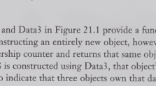

图21.1中的数据对象（如`Data1`、`Data2`和`Data3`）提供了一个返回自身副本的函数。然而，该函数并不会构造一个全新的对象，而只是递增其对象的所有权计数器并返回同一对象。例如，在图21.1中，如果使用`Data3`构造一个新对象`G`，该对象的函数会递增`Data3`的所有权计数器，以表明三个对象拥有该数据。这样，内存中只存在该唯一数据的一个副本。

删除对象也需要特殊处理。再次使用图21.1，如果程序删除对象`B`，它一定不能同时删除`Data2`，因为另外两个对象`C`和`D`仍然拥有该数据。为了处理`B`的删除，`Data2`的析构函数只需递减其所有权计数，将3改为2。类似地，如果删除对象`D`，`Data2`的所有权计数器再次从2递减到1，表明只有一个对象拥有它。如果随后删除`C`，`Data2`也会被销毁，因为其所有权计数器现在等于1，表示这是该数据的唯一副本，因此可以安全删除。

## 写时复制方法

仅仅依靠引用计数，只是实现安全、高效的对象复制的一半工作。谜题的另一部分涉及对重复对象进行修改时会发生什么。例如，在图21.1中，如果程序将新数据赋给对象`D`，程序必须采取三个操作：

- 1. 复制一份`Data2`并将其赋值给`D`。
- 2. 递减`Data2`的所有权计数。
- 3. 更改原始数据。

这些就是写时复制方法的基本步骤——对象仅在其数据发生更改时才会被复制。图21.2显示了对象之间的最终组织结构。原始`Data2`的所有权计数器表明它现在由两个对象`B`和`C`拥有。修改后的`Data2`值（标记为`Data2.1`）由对象`D`唯一引用。

### 图21.2
在写时复制方法中，对象仅在其数据发生更改时才会被复制。


编写引用计数和写时复制方法的代码需要仔细思考。下面有三个程序清单，它们提供了一个外壳，你可以用来将这些功能添加到自己的类中。`cow.h` 文件（其中 `cow` 代表 copy-on-write）声明了两个类 `TData` 和 `TContain`，它们创建如图21.1和图21.2所示的对象。清单21.1展示了 `cow.h` 头文件中的第一个类。

### 清单21.1 `COW.H`（部分）

```
#include <string.h>  // Need strcmp(), strcpy(), strlen()

// A class that manages a pointer to data and keeps track

// of the number of owners of this object. This class is

// implemented entirely inline.

class TData {

    friend class TContain;  // Only this class may use TData

private:        // All members are private!

    char *cp;   // Pointer to string

    int owners; // Number of owners of this TData object

    // Parameterized constructor

    //

    TData(const char *cp_arg): cp(0), owners(1)

    {

        if (cp_arg) {

            cp = new char[strlen(cp_arg) + 1];

            strcpy(cp, cp_arg);

        }

    }

    // Destructor

    //

    ~TData()

    {

        delete[] cp;

    }

    // Return pointer to this object as a copy

    // and increment ownership counter

    //

    TData *GetCopy()

    {

        owners++;

        return this;

    }

    // Put new data into object (copy on write)

    //

    TData *PutData(const char *s)

    {

        /*
```

### 清单21.1（续）

```
if this is the only copy

delete old data

insert new data

return this object

else

decrease ownership count

return new object

*/

if (owners <= 1) {

    delete[] cp;

    cp = NULL;

    if (s) {

        cp = new char[strlen(s) + 1];

        strcpy(cp, s);

    }

    return this;

} else {

    owners--;

    return new TData(s);

}

// Delete this copy of a TData object

//

int DeleteCopy()

{

    return owners--;

}

// Return pointer to object data

//

const char *GetString() const

{

    return cp;

}

// Return number of owners

// For testing only; can be deleted

//

int NumberOfOwners()

{

    return owners;

}

};
```

`TData` 类为那些仅在其数据更改时才被复制的对象提供了基础。`TData` 对象的重复副本由对象自身计数。这个类在这里完全内联实现，它在两个方面与本书中的大多数类有显著不同：

- `TData` 将另一个类声明为友元。
- `TData` 的所有成员对该类而言都是私有的。

尽管可以使用单个类，但使用单独的类从概念上更容易理解这些方法。`TData` 类是存储实际数据的类，例如图 21.1 和 21.2 中的 `Data1`、`Data2` 和 `Data3` 对象。这可以是任何类型的数据，但对于示例程序，我使用了一个由指针 `cp` 地址的 C 风格字符串，其类型为 `char*`。

程序本身不允许创建 `TData` 类的对象，因此其所有成员包括构造函数和析构函数对该类都是私有的。只有 `TData` 的友元 `TContain` 才能创建 `TData` 对象并调用 `TData` 成员函数。将一个类中的所有成员设为私有是非常不寻常的，但在这种情况下该技术是必不可少的。

为了引用相关数据（在本例中为字符串），并说明其所有权，该类声明了两个私有数据成员：

```
char *cp;

int owners;
```


`cp` 指针可以指向任何类型对象。在这里，如前所述，它指向类型为 `char*` 的 C 风格字符串。整数 `owners` 记录有多少个 `TContain` 对象拥有此 `TData` 对象。由于 `TData` 完全是私有的，只有其友元类 `TContain`（稍后介绍）可以构造 `TData` 对象。

至少，`TData` 类需要一个构造函数和析构函数。构造函数通过将 `cp`（数据指针）设为 `NULL` 并将 `owners` 设为 1 来初始化新的 `TData` 对象：

```
TData(const char *cp_arg): cp(0), owners(1)
```

因为这是一个全新的 `TData` 对象，所以它是存在的唯一副本，因此它只有一个所有者。

在构造函数内部，语句通过调用标准库的 `strlen()` 和 `strcpy()` 函数来复制参数数据（此处为 `cp_arg`）：

```
if (cp_arg) {
  cp = new char[strlen(cp_arg) + 1];
  strcpy(cp, cp_arg);
}
```

在你自己的类中，做任何必要的事情来复制对象数据。由于 `TData` 对象的复制受到严格控制，该类不需要重载的 `operator=()` 函数。`TData` 析构函数只是删除其所指向的数据：

```
~TData()
{
  delete[] cp;
}
```

没有必要检查此 `TData` 对象的拥有计数，因为如后面所述，`TData` 对象的拥有者仅在拥有计数等于 1 时才删除此对象。然而，如果 `owners` 变量不为 1，你可以将此视为内部错误：

```
if (owners != 1)
  throw TError("Internal error in ~TData()");
```

你可能会为测试目的将此添加到你的 `TData` 析构函数中，但在生产代码中这不应是必要的。

引用计数和写时复制方法中的一个关键方法是返回 `TData` 对象副本的函数。无论数据类型如何，该函数实现如下：

```
TData *GetCopy()
{
    owners++;
    return this;
}
```

当另一个类（此处为友元 `TContainer`）请求对象的新副本时，它不会构造新的 `TData` 类型对象，而是调用 `GetCopy()`。此函数仅递增对象的 `owners` 变量并返回其自己的地址。这样，`TData` 对象会记录有多少个其他对象拥有它。

类似地，当拥有对象（例如图 21.1 中的对象 C）想要删除 `TData` 对象时，它调用 `DeleteCopy()`，实现如下：

```
int DeleteCopy()
{
    return owners--;
}
```

只有当 `DeleteCopy()` 的结果表明这是唯一副本时，所有者才会真正删除 `TData` 对象。`GetCopy()` 和 `DeleteCopy()` 一起实现了引用计数方面。要实现写时复制代码需要多一点努力。用伪代码来说，步骤大致如下（作为 `cow.h` 头文件中的注释打印）：

```
if this is the only copy
    delete old data
    insert new data
    return this object

else
    decrease ownership count
    return new object
```

当程序更改数据对象的值时，会发生两种操作之一。如果数据是唯一副本，则首先删除它，然后将新数据插入到 `TData` 对象中。然而，如果对象有多个所有者，则不得删除原始数据。相反，其拥有计数会减少，并为新数据创建一个新的 `TData` 对象。在 C++ 中，前述步骤在 `TData` 类的 `PutData()` 函数中编程：

```
if (owners <= 1) {
    delete[] cp;
    cp = NULL;
    if (s) {
        cp = new char[strlen(s) + 1];
        strcpy(cp, s);
    }
}

return this;
```

```
} else {
    owners--;
    return new TData(s);
}
```

你可以用几乎相同的编程方法处理其他类型的数据，只需做少量改动。如果所指数据不是数组，就去掉 `delete[]` 中的方括号。此外，还需做必要的操作来复制所指信息。这里，程序调用 `strlen()` 和 `strcpy()` 来复制 `cp` 所指的字符串。其余代码在处理任何类型的数据时都不需要改动。在 else 子句中，`owners` 被递减，并使用参数 `s` 所指的新数据构造出一个 `TData` 对象的克隆。

另外两个 `TData` 成员函数是可选的，这里仅为测试目的提供。你可能需要某种方式来访问 `TData` 类中的数据。在本例中，`GetString()` 只是简单地返回私有指针 `cp`。返回值和函数都必须是 `const`，因为对所指数据的所有更改都必须通过 `TData` 的 `PutData()` 函数进行，以保持复制对象的完整性：

```
const char *GetString() const
{
    return cp;
}
```

还提供了一个你可能要删除的函数。它返回所有者的数量，供后面的测试程序使用，该程序会在屏幕上显示如图 21.1 和 21.2 所示的对象关系：

```
int NumberOfOwners()
{
    return owners;
}
```

接下来在 `cow.h` 头文件中是 `TContain` 类，它在 `TData` 类提供的引用计数和写时复制方法上做了最后的完善。因为 `TData` 的所有成员都是私有的，只有 `TContain` 才能创建和使用 `TData` 对象，并且通过这种方式，所有 `TData` 对象的副本都被安全地封装在 `TContain` 对象中。清单 21.2 显示了 `cow.h` 文件的其余部分。

## LISTING 21.2　COW.H (PARTIAL)

```
// A class that stores a pointer to a TData object and
// provides for safe copying of TContain objects. This
// class is implemented in cow.cpp.
class TContain {
private:
    TData * tp_data;
public:
    TContain(const char *arg);          // Constructor
    TContain(const TContain &copy);     // Copy constructor
    ~TContain();                        // Destructor
```

*continues*

## LISTING 21.2 CONTINUED

```
void operator=(const TContain &copy);  // Assignment operator
const char *GetString() const;        // Returns object data
void PutNewData(const char *s);        // Member function
// For test purposes only
//
int NumTDataOwners() {
    return tp_data->NumberOfOwners();
}
};
```

`TContain` 是一个看起来更正常的类。在程序层面，要存储引用计数的数据，语句会创建 `TContain` 对象。在 `TContain` 内部，函数使用 `TData` 成员来实现引用计数和写时复制方法。类私有的是指向 `TData` 对象的指针，声明为 `TData * tp_data;`

除了数据成员外，`TContain` 类还声明了针对所讨论数据类型（本例中为 C 风格字符串）的构造函数、拷贝构造函数、析构函数、重载的赋值运算符 `operator=()` 函数，以及两个用于检索和更改对象数据的函数——`GetString()` 和 `PutNewData()`。你可以随意命名这两个函数。最后，严格用于测试目的，`TContain` 有一个内联函数 `NumTDataOwners()`，你可以在生产代码中将其删除。其他成员是实现引用计数和写时复制方法的最低要求。清单 21.3，`cow.cpp`，展示了 `TContain` 成员的实现。

## LISTING 21.3 COW.CPP

```
#include "cow.h"     // Need TData and TContain classes
// Constructor
//
TContain::TContain(const char *arg)
{
```


`tp_data = new TData(arg);`

// Copy constructor

//

`TContain::TContain(const TContain &copy)`

{

`tp_data = copy.tp_data->GetCopy();`

}

// Destructor

//

`TContain::~TContain()`

{

`if (tp_data->DeleteCopy() <= 1)`

```cpp
 delete tp_data;
```
}

// Assignment operator

//

`void TContain::operator=(const TContain &copy)`

{

`if (this == &copy) return;`          // Can't copy self

`if (tp_data->DeleteCopy() <= 1)`     // Delete TData object if

`delete tp_data;`                 // any and if in use

`tp_data = copy.tp_data->GetCopy();`  // Get TData copy

}

// Return pointer to object's data

//

`const char *TContain::GetString() const`

{

`return tp_data->GetString();`

}

// Assign new data to TContain object

//

`void TContain::PutNewData(const char *s)`

{

`tp_data = tp_data->PutData(s);`

}

在你自己的程序中，你应该能够使用 `TContain` 类中列出的成员函数，而几乎不需要或不需要任何改动。类构造函数创建一个新的 `TData` 对象，并将其地址赋给 `TContain` 类的 `tp_data` 指针：

`tp_data = new TData(arg);`

拷贝构造函数专门编写为调用 `TData` 类的 `GetCopy()` 成员函数：

`tp_data = copy.tp_data->GetCopy();`

在内部，这会将 `copy.tp_data` 分配给目标对象中的 `tp_data`，导致两个 `TContain` 对象中的指针都指向同一个 `TData` 对象。然而，该对象的 `owners` 变量会由 `GetCopy()` 递增（参见例如图 21.1 中的对象 E 和 F）。

当程序销毁一个 `TContain` 对象时，它必须检查它所拥有的 `TData` 对象是否被其他 `TContain` 对象拥有。如果是，则该 `TData` 对象不得被干扰。这是等式中的引用计数部分，由 `TContain` 析构函数实现：

`if (tp_data->DeleteCopy() <= 1)`
`delete tp_data;`

只有当调用 `TData::DeleteCopy()` 返回的值小于或等于 1 时，`tp_data` 才会真正被删除。这保留了 `TData` 对象，如果它被其他 `TContain` 对象拥有。

重载的 `operator=()` 赋值函数需要更多的编程。
`TContain` 使用以下语句实现此函数：
`if (this == &copy) return;`
`if (tp_data->DeleteCopy() <= 1)`
`delete tp_data;`
`tp_data = copy.tp_data->GetCopy();`

你在这本书中已经多次看到第一步。它忽略了将对象复制给自身的任何请求。第二条语句使用了与 `TContain` 析构函数中相同的代码。只有在调用 `DeleteCopy()` 表明它不被其他 `TContain` 对象拥有时，才会删除所指向的 `TData` 对象。最后，`GetCopy()` 创建了正在被复制的 `TData` 对象的副本。然而，正如所解释的，调用 `GetCopy()` 只是递增 `TData` 对象的拥有者计数，因此不会复制数据。

函数 `PutData()` 仅通过调用 `TData` 的 `PutData()` 成员函数简单地实现了写时复制方法：
`tp_data = tp_data->PutData(s);`

这会导致 `TData` 对象被复制，并将新数据插入该副本中。如果原始副本只有一个拥有者，则会被删除。最后在 `TContain` 类中，函数 `GetString()` 提供了访问 `TData` 对象中数据的方式。你的程序也需要类似的函数，但你可以为其命名不同。

有了 `cow.cpp` 模块和头文件，实现引用计数和写时复制方法所需的所有元素都已就位。列表 21.4，`cowdemo.cpp`，测试了 `TData` 和 `TContain` 类。为了节省篇幅，我在此删除了程序中除少数几个之外的所有测试。我还删除了仅暂停等待你按 Enter 并显示对象数据以查看测试结果的本地函数。完整的源文件当然在 CD-ROM 上的文件中。

## LISTING 21.4 COWDEMO.CPP

```cpp
#include <iostream.h>

#include "cow.h"    // Copy-on-write classes
#define BUFSIZE 256

char buffer[BUFSIZE];  // Temporary input buffer

// Local function prototypes
//

void pause(const char *s);
void show(const char *s, TContain *tp);
void show_objects();

// Pointers to test TContain objects
//

TContain *A, *B, *C, *D, *E, *F;
int main()
{
    pause("1: Construct object A*");
```

```
A = new TContain("aaaa");
show_objects();

pause('2: Construct object B from existing object A');
B = new TContain(*A);
show_objects();

pause('3: Construct object C from existing object B');
C = new TContain(*B);
show_objects();

pause('4: Change data in object B');
B->PutNewData("bbbb");
show_objects();

pause('9: Create new object F from B');
F = new TContain(*B);
show_objects();

...
pause('99: Delete object C');
delete C; C = NULL;
show_objects();

return 0;
}
```

输入以下命令来编译和运行 `cow.cpp` 模块和 `cowdemo.cpp` 测试程序：

```
$ g++ -c cow.cpp
$ g++ cowdemo.cpp cow.o
$ ./a.out
```

按 Enter 运行每个测试，并观察结果。 （你可能想同时查看程序源代码的副本，以查看产生每个测试结果的语句。）前四个测试演示了引用计数和写时复制方法。前两个测试构造了两个 `TContain` 对象 `A` 和 `B`，它们具有相同的 `TData` 对象。测试 3 然后执行以下语句：

```
C = new TContain(*B);
```

这调用 `TContain` 拷贝构造函数来复制 `B`。屏幕上，你可以看到测试的结果：

```
3: Construct object C from existing object B
object A
string ...........: aaaa
num data owners....: 3
object B
string ...........: aaaa
num data owners....: 3
object C
string ...........: aaaa
num data owners....: 3
```

现在有三个 `TContain` 对象 `A`、`B` 和 `C`。每个都拥有相同的 `TData` 对象。该对象的引用计数等于 3，表明有三个对象拥有字符串 `"aaaa"`，但内存中只有一个该字符串的副本。前面列出的测试表明引用计数技术方面正在工作。为了测试写时复制方法，测试 4 使用以下语句更改对象 `B` 中的数据：

```
B->PutNewData("bbbb");
```

测试 4 的结果显示当三个对象之一的数据被更改时会发生什么：

```
4: Change data in object B
object A
```


`string` ............: `aaaa`

`num data owners`....: `2`

object B

`string` ............: `bbbb`

`num data owners`....: `1`

object C

`string` ............: `aaaa`

`num data owners`....: `2`

现在，对象 A 和 C 拥有包含字符串 `"aaaa"` 的 `TData` 对象，因此该 `TData` 对象的拥有者计数现在等于 `2`。对象 B 的数据已被更改，因此其唯一的副本存在于内存中。

程序中的其他测试对 `TContain` 拷贝构造函数和赋值运算符 `=( )` 函数进行了一些额外的测试。最后，程序删除每个对象。在此过程中，观察屏幕上引用计数如何递减。只有当 `TData` 对象的计数等于 `1` 时，这些对象才会被实际删除。

## Namespaces

截至本文撰写时，命名空间和 `using` 保留字尚未在 GNU C++ 中实现。然而，在 CD-ROM 上的路径 `src/cl21` 中有一个测试程序 `namespace.cpp`，你可以尝试编译和运行。目前，编译器在该程序上会出错，因此它未在此列出或讨论。

## Odds and Ends

即使在这样一本书中，一些主题似乎也不适合任何特定类别。以下是一些你可能不需要经常使用的主题和技术，但也许你会发现以下零碎内容对你的项目至关重要。

## Explicit Constructors

使用 `explicit` 保留字强制调用所需的类构造函数。这可以解决 C++ 隐式将对象转换为类类型时出现的问题。例如，考虑列表 21.5 中的常见类 `implicit.cpp`。

### LISTING 21.5 IMPLICIT.CPP

```
#include <iostream.h>

#include <stdlib.h>    // Need atoi()

class TAnyClass {

private:

    int value;

public:

    TAnyClass(int n) { value = n; }

    TAnyClass(const char *ns) { value = atoi(ns); }

    int GetValue() { return value; }

};

int main()

{

    TAnyClass v1 = 123;

    TAnyClass v2 = "96";

    cout << "v1 == " << v1.GetValue() << endl;

    cout << "v2 == " << v2.GetValue() << endl;

    return 0;

}
```

`TAnyClass` 声明了两个构造函数，一个需要 `int` 参数，另一个需要指向以 NULL 结尾字符串的 `char` 指针。每个构造函数都将其参数赋给私有 `value` 数据成员。为了简化，类完全内联实现。备用构造函数调用 `stdlib.h` 中声明的标准 `atoi()` 函数，将其字符串参数转换为整数。主程序声明了两个 `TAnyClass` 类型的变量，然后通过调用类的 `GetValue()` 成员函数显示它们的值。

在 `main()` 中构造变量 `v1` 和 `v2` 的两个语句中，值 `123` 和 `"96"` 被隐式转换为其类类型的对象，以便赋值语句能够编译。为了明确指出此类值必须仅为类对象，从而防止隐式转换，请在构造函数前加上保留字 `explicit`。Listing 21.6, `explicit.cpp`，显示了修订后的类，并给出了 `TAnyClass` 对象允许的声明示例。

### LISTING 21.6 EXPLICIT.CPP

```
#include <iostream.h>

#include <stdlib.h>    // Need atoi()

class TAnyClass {

private:

    int value;

public:

    TAnyClass(int n) { value = n; }

    explicit TAnyClass(const char *ns) { value = atoi(ns); }

    int GetValue() { return value; }

};
```

#### LISTING 21.6 CONTINUED

```
int main()

{

    TAnyClass v1 = TAnyClass(123);

    TAnyClass v2 = TAnyClass("987");

    TAnyClass v3(456);

    TAnyClass v4('654');

    cout << "v1 == " << v1.GetValue() << endl;

    cout << "v2 == " << v2.GetValue() << endl;

    cout << "v3 == " << v3.GetValue() << endl;

    cout << "v4 == " << v4.GetValue() << endl;

    return 0;

}
```

使用修订后的类，由于构造函数是 `explicit`，任何尝试使用以下语句创建对象的尝试，例如这些语句（取自 Listing 21.5, `implicit.cpp`）现在都会产生错误：

```
TAnyClass v1 = 123;  // ???
TAnyClass v2 = "96";  // ???
```

使用此类语句编译程序时，GNU C++ 会发出以下错误消息：

```
explicit.cpp: In function `int main()':
explicit.cpp:25: conversion from `int' to
  non-scalar type `TAnyClass' requested
explicit.cpp:26: conversion from `char[3]'
  to non-scalar type `TAnyClass' requested
```

由于 `TAnyClass` 构造函数是 `explicit`，C++ 不再允许将 `123` 和 `"96"` 等值隐式转换为 `TAnyClass` 对象以分配给其他 `TAnyClass` 对象或用于构造新对象。

> Tip
> 实际上，本节中具有 `explicit` 构造函数的类可能还需要拷贝构造函数和 `operator=()` 函数。

## MUTABLE DATA MEMBERS

为防止类的成员函数修改该类中的数据成员值（或从祖先类继承的数据成员），请像这样声明该函数为 `const`：

```
class TAnyClass {

    ...

    int x;

    int GetValue() const { return x; }

};
```

如果 `GetValue()` 中的任何语句尝试更改 `x`，编译器会发出错误消息。但是，`const` 指定会使类中的所有数据成员都不可更改。这在设计需要更改某些数据但将其他值标记为禁止触碰的函数时可能会很麻烦。Listing 21.7, `constant.cpp`，演示了基本问题。

### LISTING 21.7 CONSTANT.CPP

```
#include <iostream.h>

class TAnyClass {

private:

    int value;

    long counter;

public:

    TAnyClass(int arg): value(arg), counter(0) { }

    int GetValue() /*const*/ {

        counter++; // ???

        return value;

    }

    int GetCounter() const { return counter; }

};

int main()

{

    TAnyClass v1(123);

    cout << "v1 value == " << v1.GetValue() << endl;

    cout << "v1 counter == " << v1.GetCounter() << endl;

    return 0;

}
```

类 `TAnyClass` 声明了两个数据成员，一个整数 `value` 和一个 `long counter`。我们希望成员函数 `GetValue()` 返回整数并保证调用该函数时其值不会被更改。然而，为了跟踪 `GetValue()` 被调用的次数，我们还希望该函数递增 `counter`。如果从 `GetValue()` 声明中删除 `const` 的注释定界符，编译程序会导致 GNU C++ 抱怨以下错误消息：

```
$ g++ constant.cpp constant.cpp

In method 'int TAnyClass::GetValue() const':
```


`constant.cpp:21: increment of read-only member 'TAnyClass::counter'`

```
Listing 21.8, mutable.cpp，使 counter 可变，以便即使在 const 函数如 GetValue() 中也能更改它。
```

## LISTING 21.8 MUTABLE.CPP

```cpp
#include <iostream.h>

class TAnyClass {

private:

    int value;

    mutable long counter;

public:

    TAnyClass(int arg): value(arg), counter(0) { }

    int GetValue() const {

        counter++;

        return value;
```

## LISTING 21.8 CONTINUED

```
}

int GetCounter() const { return counter; }

};

int main()

{

TAnyClass v1(123);

cout << "v1 value == " << v1.GetValue() << endl;

cout << "v1 counter == " << v1.GetCounter() << endl;

return 0;

}
```

现在 `counter` 是可变的，`GetValue()` 可以被声明为 `const`，但仍然允许更改 `counter` 的值。这在需要将 `const` 类对象传递给另一个调用 `GetValue()` 的函数时可能很重要，例如拷贝构造函数。在这种情况下，声明 `counter` 为 `mutable` 即使对于 `const` 对象也能覆盖编译器的反对意见。然而，请务必理解，`mutable` 的滥用实际上违背了使用常量对象的初衷——即防止因函数调用而导致对象发生意外的更改。

## USING typename

在模板中使用 `typename` 保留字来为数据类型定义占位符。例如，Listing 21.9，`typename.cpp`，声明了一个模板函数，返回任意类型的两个值的最大值。

## LISTING 21.9 TYPENAME.CPP

```cpp
#include <iostream.h>

//template <class T> T max(T a, T b)

template <typename T> T max(T a, T b)

{

    if (a > b)

        return a;

    else

        return b;

}

int main()

{

    int v1 = 123;

    int v2 = 321;

    cout << "max(123, 321) == " << max(v1, v2) << endl;

    return 0;

}
```

模板声明上方有一条注释，展示了创建数据类型占位符的更常见方式。通常，模板是这样声明的：

```cpp
template <class T> T max(T a, T b)
```

如果你像许多程序员一样觉得这里使用 `class` 这个词令人不安，你可以使用 `typename` 代替：

```cpp
template <typename T> T max(T a, T b)
```

然而，除了稍微更清晰之外，使用 `typename` 代替 `class` 好像并没有什么优势。使用

## POINTERS TO MEMBER FUNCTIONS

你可以用指针寻址类成员函数，但方式与常规函数不同。这是因为成员函数是相对于对象调用的，函数会接收一个 `this` 指针。因此，用指针寻址成员函数就需要新的技术。

> Note
> 静态函数是此规则的例外——它不引用其类的对象，因此不接收 `this` 指针。

由于成员函数绑定到其类名，声明指针需要使用函数类型和类名。例如，对于类 `TAnyClass`，你可以通过以下声明声明指向其成员函数之一的指针：

```cpp
double (TAnyClass::*myfnptr)();
```

这表示 `myfnptr` 指向一个 `TAnyClass` 成员函数，该函数不声明参数并返回 `double` 类型的值。它没有指定确切是哪个函数，只要求函数具有这些特征。要声明 `myfnptr` 为指向返回 `void` 并声明一个 `int` 参数的类成员函数的指针，请使用如下声明：

```cpp
void (TAnyClass::*myfnptr)(int);
```

## LISTING 21.10 MFNPTR.CPP

```cpp
#include <iostream.h>

#include <iomanip.h> // Need output stream manipulators

class TAnyClass {

private:

    int value;
```

## LISTING 21.10 CONTINUED

```
public:

TAnyClass(): value(0) {}

int GetValue() { return ++value; }

};

// Declare pointer to member function

int (TAnyClass::*myfnptr)();

void main()

{

int i;

TAnyClass object;

cout << "Call GetValue the normal way:" << endl;

for (i = 0; i < 9; i++)

cout << setw(8) << dec << object.GetValue();

cout << endl;

cout << "Call GetValue using a pointer" << endl;

myfnptr = &TAnyClass::GetValue;

for (i = 0; i < 9; i++)

cout << setw(8) << dec << (object.*myfnptr)();

cout << endl;

cout << "Use dynamic instance and pointer" << endl;

TAnyClass *p = new TAnyClass(object);

for (i = 0; i < 9; i++)

cout << setw(8) << dec << (fp->*myfnptr)();

cout << endl;

}
```

`TAnyClass` 之后的那条单行声明指出 `myfnptr` 是一个指向 `TAnyClass` 成员函数的指针，该成员函数不返回任何值并声明一个 `int` 参数。程序可以将任何此类匹配函数的地址赋给该指针，然后使用它来调用该函数。例如，`main()` 中的测试程序构造了一个 `TAnyClass` 类型的对象，然后使用以下表达式调用 `GetValue()` 成员函数：

```cpp
object.GetValue()
```

要使用指针调用同一个函数，程序将 `myfnptr` 赋值为 `TAnyClass` 中 `GetValue()` 成员函数的地址：

```cpp
myfnptr = &TAnyClass::GetValue;
```

或者，你也可以使用如下单条语句声明并初始化成员函数指针：

```cpp
int (TAnyClass::*myfnptr)() = &TAnyClass::GetValue;
```

请确保不要在函数名后面加上括号。你只是想通过名称引用函数，而不是调用它。无论如何，要使用指针，请遵循以下两条规则：

+ 1. 引用类的一个对象（除非该函数是静态的）。
+ 2. 用括号包围函数调用。

如果 `data` 是一个 `int` 变量，且 `object` 是一个 `TAnyClass` 对象，则以下语句将使用成员函数指针把 `GetValue()` 返回的结果复制到 `data` 中：

```cpp
int data = (object.*myfnptr)();
```

点号和星号是一个 C++ 符号，称为指针到成员运算符。它用于为类对象解引用成员函数指针。表达式 `(object.*myfnptr)` 中的括号是必要的，因为函数调用运算符——一组空括号——的优先级高于指针到成员运算符。前面语句等价于以下内容：

```cpp
int data = object.GetValue();
```

你也可以通过使用指向对象的指针来调用成员函数。例如，在示例程序中，一个语句将 `new` 运算符创建的 `TAnyClass` 对象的地址赋给指针 `fp`：

```cpp
TAnyClass *fp = new TAnyClass(object);
```

在此之后，下一个表达式使用成员函数指针调用 `GetValue()`：

```cpp
(fp->*myfnptr)();
```

三字符符号 `->*` 是指针到成员运算符的一个变体。同样，由于 `()` 的优先级高于 `->*`，因此需要额外的括号。前面语句等价于以下内容：

```cpp
fp->GetValue();
```


## 静态成员函数

第 14 章“投资继承”介绍了静态成员。简而言之，静态数据成员存在于类的所有对象中，而与之相比，非静态成员在每个类对象中都分配空间。成员函数也可以是静态的。与非静态成员函数不同，静态函数不是相对于对象调用，而是仅相对于类调用。这对于设计初始化值或执行影响所有随后构造对象的其他操作的函数非常有用。要声明静态成员函数，请在其原型前加上保留字 `static`：

```
class TAnyClass {

public:

    static void GlobalInit();

    ...

};
```

注意
静态成员函数可能不是虚函数。

实现静态成员函数的方式与其他函数相同，但不要重复 `static` 指定：

```
void TAnyClass::GlobalInit()

{

// ... statements to perform

}
```

静态成员函数可以执行任何操作，但由于它不是相对于类对象调用，因此函数中的语句可能不能引用非静态数据成员。此类成员仅存在于类对象中，因此它们根本不可用于静态函数。然而，该函数可以使用静态数据成员，事实上，静态成员函数通常用于初始化类的静态数据成员。列表 21.11，`static.cpp`，演示了使用静态数据和函数成员的一种常见方法。

### LISTING 21.11 STATIC.CPP

```
#include <iostream.h>

#include <iomanip.h>  // Need setw()
#define BUFSIZE 64

// A class with static data and function members
//
class TAnyClass {

private:

    static char buffer[BUFSIZE];

public:

    TAnyClass() { }

    static void InitBuffer();

    void DisplayBuffer(const char *msg);

    void FillBuffer(char byte);

};

// Actual buffer definition. This would usually appear
// in another module linked to the program.
//
char TAnyClass::buffer[BUFSIZE];

int main()

{

    TAnyClass objectA, objectB, objectC;

    TAnyClass::InitBuffer();

    objectA.DisplayBuffer("Object A buffer");

    objectA.FillBuffer(2);

    objectB.DisplayBuffer("Object B buffer");

    objectB.FillBuffer(3);

    objectC.DisplayBuffer("Object C buffer");

    return 0;

}
```

```
// Static function initializes the buffer
void TAnyClass::InitBuffer()

{

    for (int i = 0; i < BUFSIZE; i++)

        buffer[i] = i;

}

// Non static function called in reference to object
void TAnyClass::DisplayBuffer(const char *msg)

{

    cout << msg << endl;

    for (int i = 0; i < BUFSIZE; i++)

        cout << setw(4) << (int)buffer[i];

    cout << endl;

}

// Fill buffer with indicated value
void TAnyClass::FillBuffer(char byte)

{

    for (int i = 0; i < BUFSIZE; i++)

        buffer[i] = byte;

}
```

测试程序展示了如何为特定类的所有对象创建一个静态缓冲区。程序的类 `TAnyClass` 声明了两个静态成员：
`static char buffer[BUFSIZE];`
`static void InitBuffer();`

由于 `buffer` 对类是私有的，只有类成员函数可以引用它。函数 `InitBuffer()`，也声明为 `static`，用顺序值填充缓冲区。函数 `FillBuffer()` 用作为参数传递的值填充缓冲区。我们不希望大型缓冲区位于每个对象内部——相反，我们希望 `TAnyClass` 的所有对象都引用同一个缓冲区。这就是使用静态成员的主要目的。为了演示其工作原理，测试程序构造了三个 `TAnyClass` 对象：
`AnyClass objectA, objectB, objectC;`

接下来，调用静态 `InitBuffer()` 函数。由于它是静态的，它是相对于类调用的，而不是相对于类的任何特定对象：
`TAnyClass::InitBuffer();`

该语句可以出现在其他位置——它不必跟随三个对象的构造。为了证明所有三个对象都使用同一个缓冲区，程序显示缓冲区的初始内容，然后用值 2 填充它：
`objectA.DisplayBuffer("Object A buffer");`
`objectA.FillBuffer(2);`

即使 `FillBuffer()` 是相对于 `objectA` 调用的，对不同对象调用 `DisplayBuffer()` 也会显示全部为 2：
`objectB.DisplayBuffer("Object B buffer");`

同样地，通过调用 `FillBuffer()` 为 `objectB` 填充缓冲区，但随后为 `objectC` 调用 `DisplayBuffer()`，证明这些对象都在共享同一个缓冲区：
`objectB.FillBuffer(3);`
`objectC.DisplayBuffer("Object C buffer");`

由于缓冲区本身是静态的，它必须在程序中的某个位置定义，以便链接器可以找到它。在本例中，以下语句创建了实际的缓冲区：
`char TAnyClass::buffer[BUFSIZE];`

此定义必须与类中的静态声明相匹配。通常，前面的定义和静态成员函数 `InitBuffer()` 位于与程序链接的单独模块中。由于缓冲区是类的私有成员，即使它被声明为全局变量，其使用也严格通过类进行控制。这是一种在类对象之间共享数据而不让程序其余部分自由访问该数据的好方法。

> Tip
> 静态成员函数不能声明为 `const`，因为它们不是针对类对象引用的调用。

## PERSISTENT OBJECTS

你可能偶尔需要将一个对象存储在特定位置，也许是在一个全局缓冲区中。这样的对象被认为在其声明的作用域之外仍然存在，因此有时被称为持久对象。创建持久对象的技术依赖于重载 `new` 运算符。

Listing 21.12, `persist.cpp`, 演示了如何将一个对象存储在特定地址——在本例中是在一个全局数组内部。该程序还展示了语句如何调用析构函数——这是 C++ 做出的一种特殊允许，因为在接管对象的构造时，可能有必要通过其析构函数销毁一个对象，但不调用 `delete` 来实际释放该对象的内存。

### LISTING 21.12 PERSIST.CPP

```
#include <iostream.h>

class TPersist {

private:

    int x, y;

public:

    TPersist(int a, int b): x(a), y(b) {} // Constructor

    ~TPersist() { x = 0; y = 0; } // Destructor

    void *operator new(size_t, void *p) { return p; }

    friend ostream& operator<<(ostream &os, TPersist &p);

};

// Create storage for TPersist buffers
//
char buffer[sizeof(TPersist)];

int main()

{

    TPersist *p = new(buffer) TPersist(10, 20);

    cout << *p << endl;

    cout << "Address of buffer = " << &buffer << endl;

    cout << "Address of *p   == " << &( *p) << endl;

    p->~TPersist();  // Explicit call to destructor
```


### Placement new 与显式析构函数调用

```cpp
// p->TPersist::~TPersist(); // For older compilers

cout << "After calling destructor:" << endl;

cout << *p << endl;

return 0;

}

ostream& operator<<(ostream& os, TPersist &p)

{

    os << "x == " << p.x << ", y == " << p.y;

    return os;

}
```

类 `TPersist` 以一种不寻常的方式重载了 `new` 运算符。重载的运算符不是为对象指针分配内存，而是简单地返回其 `void` 指针参数 `p`。要使用 `new` 构造一个对象并将该对象存储在已知位置，主程序执行以下语句：

```cpp
TPersist *p = new(buffer) TPersist(10, 20);
```

表达式 `new(buffer)` 调用 `TPersist` 的重载 `new` 运算符并将 `buffer` 的地址（一个 `char` 数组）作为参数传递。由于重载的运算符只是返回该地址，这个看起来奇怪的语句实际上将 `buffer` 的地址赋给 `p`，并且还调用 `TPersist` 构造函数来初始化存储在缓冲区内的新分配对象。

当你编译并运行程序时，它以两种方式显示对象的地址，并且还在其类析构函数被调用之前和之后显示对象的 `x` 和 `y` 值：

```
$ g++ persist.cpp
$ ./a.out
x == 10, y == 20
Address of buffer == 0x8049c68
Address of *p     == 0x8049c68
After calling destructor:
x == 0, y == 0
```

这两个地址相同，证明 `TPersist` 对象确实位于程序自己的缓冲区内部。正因如此，删除该对象将是一个错误。然而，必须提供某种手段来调用析构函数以清理不再需要的对象。为此，C++ 允许程序执行如下语句

```cpp
p->~TPersist();
```

显式析构函数调用并不常见，只应在无法删除对象时使用。较旧的编译器可能要求您按如下方式指定类名（这也适用于较新的 GNU C++ 版本）。为获得最佳可移植性，请使用以下形式：

```cpp
p->TPersist::~TPersist();
```

### 嵌套类声明

通过在类中嵌套某些类型的声明，您可以使类拥有完全由该类决定的数据类型。类可以嵌套 `typedef` 符号、结构，甚至另一个类。这类声明有时很有用，可以提供与类内部设计密切相关的项目。例如，使用嵌套的 `typedef` 声明，您可以创建一个类，用于跟踪程序中任何时刻存在的该类型对象的数量——这一机制可能对调试很有用。

清单21.13（`objcount.cpp`）演示了如何通过从类中导出一个数据类型来创建自动对象计数器。

```cpp
#include <iostream.h>

class TAnyClass {

private:

    typedef int CLASS_COUNTER;

    static CLASS_COUNTER classCount;

    static int GetCount() { return classCount; }

public:

    TAnyClass() { ClassCount++; }  // Constructor

    ~TAnyClass() { ClassCount--; } // Destructor

    static void ShowCount();

};

// Define static member

//

TAnyClass::CLASS_COUNTER TAnyClass::ClassCount;

TAnyClass globalObject;

int main()

{

    cout << "On entry to program" << endl;

    TAnyClass::ShowCount();

    TAnyClass localObject;

    cout << "After constructing one object" << endl;

    TAnyClass::ShowCount();

    TAnyClass objectA, objectB, objectC;

    cout << "After constructing three objects" << endl;

    TAnyClass::ShowCount();

    TAnyClass * pointer = new TAnyClass;

    cout << "After creating a dynamic object" << endl;
```

```cpp
TAnyClass::ShowCount();

delete pointer;

cout << "After deleting the dynamic object" << endl;

TAnyClass::ShowCount();

}

void TAnyClass::ShowCount()

{

    cout << "Number of objects == " << TAnyClass::GetCount();

    cout << endl;

}
```

示例程序使用静态成员来存储任何时刻存在的 `TAnyClass` 类型对象的数量。为了跟踪这个数量，类的构造函数递增静态 `ClassCount` 变量，类的析构函数则递减该值。为了导出计数器的类型，类嵌套了 `typedef` 声明：

```cpp
typedef int CLASS_COUNTER;

static CLASS_COUNTER ClassCount;
```

这样，类本身决定了静态 `ClassCounter` 变量的类型。虽然这是一个简单的例子，但可以用于将类型从 `int` 改为 `long`——甚至改为类对象——除了前面的声明外，无需任何其他更改。由于 `ClassCounter` 是静态的，它必须在程序的某处定义。测试程序按如下方式定义该变量：

```cpp
TAnyClass::CLASS_COUNTER TAnyClass::ClassCount;
```

这种编程方式的重要性在于，`ClassCount` 的类型隐藏在 `TAnyClass` 内部。因此，可以在程序无需具体了解其类型的情况下声明该变量。当您编译并运行该程序时，其余的测试语句将显示在不同阶段存在多少个 `TAnyClass` 对象。

复杂的嵌套声明也是可行的。类可以像这样声明一个内部结构：

```cpp
class TAnyClass {

public:

    struct ClassStruct {

        int x, y;

    };

};
```

该结构由类导出，因此必须通过与类本身相关的方式使用。例如，程序可以使用如下语句定义一个 `ClassStruct` 类型的对象：

```cpp
TAnyClass::ClassStruct structure;
```

如下的语句引用该结构的 `x` 和 `y` 成员：

```cpp
structure.x = 1;

cout << "y = " << structure.y << endl;
```

通常使用这种技术从类内部提供对象的设计。清单21.14（`nest.cpp`）演示了一个类导出另一个类的类型供程序使用的基本技术。

### 清单21.14 NEST.CPP

```cpp
#include <iostream.h>

class TAnyClass {

public:
class TOtherClass {

private:

int x, y;

public:

TOtherClass(int x_arg, int y_arg): x(x_arg), y(y_arg) { }

int Getx() { return x; }

int Gety() { return y; }

};

};

int main()

{

TAnyClass::TOtherClass object(10, 20);

cout << "x == " << object.Getx() << endl;

cout << "y == " << object.Gety() << endl;

return 0;

}
```

示例程序声明的 `TAnyClass` 仅有一个成员——一个类型为 `TOtherClass` 的导出类。（在实际中，`TAnyClass` 很可能会声明自己的构造函数、析构函数、数据成员和成员函数。）嵌套的 `TOtherClass` 具有两个私有整型变量、一个初始化这些数据成员的构造函数，以及两个返回私有数据值的成员函数。

嵌套类是 `TAnyClass` 的公有成员，这样程序中的语句就可以引用这两个类。还可以在受保护和私有区域中嵌套类，事实上，在复杂的类层次结构中，这很有用，可以导出仅供该类及其派生类使用的类声明。

要创建 `TOtherClass` 类型的对象，程序使用以下语句：

```cpp
TAnyClass::TOtherClass object(10, 20);
```


该对象的类型是 `TOtherClass`，而不是 `TAnyClass`。尽管可以按如下方式构造外部类的对象，但重要的是要认识到，这并不会创建 `TOtherClass` 的对象：

```
TAnyClass value;
```

`TAnyClass` 导出的是 `TOtherClass` 类声明，而不是包含该类型的对象。虽然前面的语句可以编译，但在这种情况下，所得到的对象没有任何用途，因为 `TAnyClass` 没有声明其他成员。

### 摘要

本章解释了如何通过使用引用计数和写时复制方法来创建高效提供重复数据的类。本章还详细介绍了许多 C++ 零碎内容，例如显式构造函数、可变数据成员、指向成员函数的指针、静态成员函数、持久对象和嵌套类声明。

有关本章介绍主题的更多信息，请参阅以下章节：

- 第 13 章，“创建和销毁对象”
- 第 14 章，“投资继承”

# C++ 类库

- 22 精通标准 string 类
- 23 使用标准模板库 STL
- 24 构建标准容器
- 25 应用标准算法
- 26 介绍 X 编程
- 27 控制 Xlib 输入和输出

## 第 22 章

## 精通标准 string 类

似乎每个人以及他们叔叔的兄弟们（外加某位计算机书籍作者）都曾在某个时候编写过自己的 string 类。但最终，GNU C++ 和其他 ANSI C++ 编译器提供了一个标准 string 类模板，取代了网络上流传的众多不同版本的 string 类。

本章介绍标准 string 类，它作为模板提供，以便可以使用不同类型和大小的字符。标准字符串比使用指针寻址的常见 C 风格以空字符结尾的字符串更安全、更易于使用。由于你可以在以空字符结尾的字符串和 string 对象之间轻松转换，因此在 C++ 程序中使用这种新型字符串没有理由不使用。

### 介绍 string 模板

要使用标准字符串，只需包含不带 `.h` 后缀的 string 头文件：

```
#include <string>
```

该指令还包含了在 `string.h` 中定义的 `strcpy()` 等标准 C 风格字符串函数。要使用 string 类对象，重要的是不要输入 `.h` 后缀——如果你愿意，也可以同时包含这两个头文件。在包含 string 头文件后，按如下方式创建 string 对象：

```
string mystring;  // Empty string

string anystring = "Prompt Title";
```

构造 string 对象还有许多其他方法——本章中我展示了大量示例。字符串字符的内存使用 `new` 在内部分配，因此你不必使用指针创建指向 string 对象的指针。然而，你当然可以使用如下语句这样做

```
string *sp = new string("Dynamic duo");

cout << *sp << endl;

delete sp;
```

第一条语句为由指针 `sp` 寻址的 string 对象分配动态内存，并将引号中的文本也存储在内存中。在显示字符串后，最终语句删除该对象。如果你只是将字符串作为变量创建，则 string 类会负责删除字符串的字符数据。

与常见的 C 风格字符串一样，C++ string 对象是字符序列，可以使用索引运算符单独访问。要显示字符串中的单个字符，可以使用如下语句

```
string s = "abcdefghijklmnopqrstuvwxy z";

cout << "10th character == " << s[9] << endl;
```

同样，你也可以使用如下语句为字符串分配单个字符：

```
s[12] = 'M';

cout << s << endl;
```

如果你跟着操作，第二个语句显示分配将字母串对象 `s` 中存储的字母表中的小写 m 改为大写 M。这是运算符重载如何简化复杂编程的绝佳示例。虽然对 `s[12]` 的赋值看起来像是访问简单的字符数组，但它实际上调用了 string 类的重载 `operator[]()` 函数来执行赋值。因此，此语句和其他语句可以与任何类型的字符串一起使用，而不管其内部字符和内存存储细节的性质如何。

那么，为什么不直接使用 char 数组呢？这是一个好问题，许多 C++ 程序员继续使用 C 风格以空字符结尾的字符串以及标准字符串库函数。然而，C++ string 类提供了几个优点：

- string 类对许多错误抛出异常，例如尝试访问超出字符串长度的字符。
- string 对象在需要时会自动调整自身大小以适应更长或更短的字符串赋值。
- string 对象可以使用任何大小的字符，包括所谓的宽字符。对 string 对象的操作独立于字符串中字符的大小和类型。（截至本文撰写时，GNU C++ 中尚未定义类型为 `wstring` 的宽字符串。）
- string 对象使用引用计数和写时复制方法来帮助防止重复字符串浪费内存。
- 搜索子字符串、替换字符串的部分、向字符串中插入文本以及执行许多其他常见的字符串操作，都可以通过调用 string 类成员函数轻松完成。

> 注意
> 在内部，string 类只是 `basic_string` 模板类的 typedef 声明。有关此类的详细信息，请查找 `bastring.h` 头文件，如果你已安装 libg++ 源文件，则可在 `bastring.cc` 中找到该类的实现。有关如何找到这些和其他源文件，请参阅附录 C 中列出的 Web 和 FTP 站点。在我的系统上，我在以下路径找到了这些文件：
> `/usr/src/redhat/SOURCES/libg++-2.7.2/libstdc++/std.`

### 声明 string 对象

使用 string 类的一个优点是它提供了许多构造 string 对象的方法。我在本节中展示了大多数常见方法。但请随意尝试其他方法。string 类提供了众多构造函数用于以各种方式创建字符串。你已经看到了一种最简单的方法。以下是更多示例：

```
#include <string>

...

string s1("Stringing in the rain");

string s2 = "Any string of yours is a string of mine.";

string s3(s1);
```

这些示例展示了构造字符串对象的三种最常见方法。字符串 `s1` 使用括号中的字面量字符串创建。字符串 `s2` 使用赋值创建，但其他方式与之相同。字符串 `s3` 使用 `s1` 的副本创建。然而，由于字符串类使用引用计数，字符串对象 `s1` 和 `s3` 在内存中只存储一份字符串数据。清单 22.1，`sdeclare.cpp`，演示了构造字符串对象的其他一些方法。


```cpp
#include <iostream>
#include <string>
#include <vector>

void ShowString(const char* s, const string& sr)
{
    string sEmpty;
    string sFromLiteral("Stringing in the rain");
    string sFromString(sFromLiteral);
    string sFromAssign = "A string in time saves nine";
    string sFilled(40, '#');
    string sPartial(sFromAssign, 9, 7);
    char buffer[5] = { 'a', 'b', 'c', 'd', 'e' };
    string sFromPointers(buffer + 1, buffer + 5);

    vector<char> cVector(buffer, buffer + 5);
    string sFromIterators(cVector.begin(), cVector.end());
}

int main()
{
    ShowString("sEmpty", sEmpty);
    ShowString("sFromConst", sFromLiteral);
    ShowString("sFromString", sFromString);
    ShowString("sFromAssign", sFromAssign);
    ShowString("sFilled", sFilled);
    ShowString("sPartial", sPartial);
    ShowString("sFromPointers", sFromPointers);
    ShowString("sFromIterators", sFromIterators);
    return 0;
}

void ShowString(const char* s, const string& sr)
{
    cout << s << ": " << sr << endl;
    cout << " length:" << sr.length();
    cout << " size:" << sr.size();
    cout << " capacity:" << sr.capacity();
    cout << endl;
}
```

编译并运行测试程序以查看多个测试字符串的结果（为节省空间，我只在此处显示部分输出语句）：

```text
$ g++ sdeclare.cpp
$ ./a.out
sEmpty:
```

```text
length:0 size:0 capacity:0

sFromConst : Stringing in the rain

length:21 size:21 capacity:32

...

sFilled : ################################

length:40 size:40 capacity:64

sPartial : in time

length:7 size:7 capacity:16
```

### 使用特定字符填充字符串

要使用特定字符填充字符串，请使用如下语句

```cpp
string sFilled(40, '#');
```

这会创建一个由井号字符填充的 40 个字符的字符串。（有些人称之为磅符号。有见识的 Linux 大师知道它们是克林贡战舰。）字符串的容量为 64（参见前面的输出）。这是因为 `string` 类试图在不浪费的情况下高效地分配空间。在此示例中，结果字符串在需要新的内存分配之前还可以再增长 24 个字符。

### 预留额外空间

要显式为字符串预留额外空间，您应该能够像以下语句中那样提供长度参数：

```cpp
string sReserve("Short and Sweet", 64);
```

尽管这可行，但字符串中剩余的空间具有内存中该位置恰好存在的字节值。换句话说，前面的语句将字符串的长度、大小和容量都设置为 64。可能，这不是您想要的效果。作为变通方法，您可以将空字符赋给所需容量的字符串对象：

```cpp
string sReserve(64, '\0');
```

### 指定字符范围初始化

您也可以指定要用于初始化新字符串对象的字符范围，例如以下语句：

```cpp
string sFromAssign = "A string in time saves mine";

...

string sPartial(sFromAssign, 9, 7);
```

您还可以使用标准模板库容器类提供的迭代器函数。例如，以下使用字符向量构造字符串对象，该向量从前面的缓冲区初始化：
`vector<char> cVector(buffer, buffer + 5);`
`string sFromIterators(cVector.begin(), cVector.end());`

这是一种构造简单字符串对象的极其复杂的方法，但它展示了可用的各种方法。无论您的字符数据来源如何，您都可以将其传递给 `string` 类并获得一个正确构造的对象作为回报。（有关迭代器和标准模板容器类（如 `vector`）的信息，请参阅第 24 章“构建标准容器”。）

## READING AND WRITING string OBJECTS

大多数设计良好的 C++ 类提供输入和输出服务，`string` 类也不例外。使用 I/O 流语句读写字符串对象。例如，以下语句将字符串写入标准输出：

```cpp
string s("Write me right out");

cout << s << endl;
```

类似的语句提示用户输入字符串：

```cpp
cout << "Enter a string: ";

cin >> s;
```

然而，第二条语句只读取输入的第一个单词，因为空白（例如空格和制表符）会终止输入。要读取包含空格和其他空白的整个字符串，请使用包含字符串头提供的 `getline()` 函数。直接调用该函数——它不是类成员函数。例如，以下语句从标准输入读取一个字符串到字符串对象中：

```cpp
string s;

getline(cin, s, '\n');
```

为 `getline()` 指定三个参数：一个 `istream` 对象引用（本例中为 `cin`）、一个字符串对象如 `s`，以及应终止输入的字符（此处为换行控制）。清单 22.2，`rstrings.cpp`，展示了如何使用此技术通过字符串对象读取文本文件。

## LISTING 22.2 RSTRINGS.CPP

```cpp
#include <iostream.h>

#include <fstream.h>

#include <string>

int main(int argc, char *argv[])

{

    string s; // String object

    if (argc <= 1) {

        cerr << "Error: filename missing" << endl;

    }

    exit(1);

}

ifstream ifs(argv[1], ios::in);

if (!ifs) {

    cerr << "Error: unable to open " << argv[1] << endl;

    exit(2);

}

while (ifs.good()) {

    getline(ifs, s, '\n');

    cout << s << endl;

}

ifs.close();

return 0;

}
```

将程序编译到输出文件 `rstrings`，然后按如下方式运行以读取并显示程序自身的源文本：
`$ g++ -o rstrings rstrings.cpp`
`$ ./rstrings rstrings.cpp`

要从文件中读取，程序创建了一个 `ifs` 对象，该对象属于 `ifstream` 类。只要该类的 `good()` 成员函数返回 true，就有更多输入等待读取。为此，程序调用 `getline()` 并将 `ifs` 作为参数传递：

```cpp
getline(ifs, s, '\n');
```


## 获取字符串信息

`string`类提供了多个成员函数，用于报告字符串对象的各种方面，例如其长度和容量。表 22.1 列出了可调用的 `string` 成员函数，以获取有关任何字符串对象的事实。

TABLE 22.1 THE `string` CLASS FACT-FINDING FUNCTIONS

| Function | Returns | Description |
|---|---|---|
| `capacity()` | `size_type` | Capacity of string in bytes |
| `empty()` | `bool` | True if string has no characters |
| `length()` | `size_type` | Length of string in characters |
| `max_size()` | `size_type` | Capacity of string in characters |
| `size()` | `size_type` | Same as `length()` |

表 22.1 中的大多数函数返回类型为`size_type`的值，在`string`类中等同于`size_t`，在 GNU C++ 中等同于类型`long`。`size()`和`length()`函数返回相同的值，等于字符串对象中的字符数。字符串的`capacity()`表示为字符串保留的内存量。这与`max_size()`不同，后者考虑了单个字符的大小。因此，最好调用`max_size()`来确定是否可以将特定大小的字符串分配给字符串对象而无需重新分配内存。字符串的`length()`、`size()`和`capacity()`永远不会超过其`max_size()`。调用`empty`函数来确定字符串是否没有字符。这比检查`length()`是否等于零要简单。

## 字符串大小操作

两个`string`类成员函数`resize()`和`reserve()`提供了对分配给字符串对象的内存量的某种控制。调用`resize()`来扩展或收缩字符串的长度。例如，以下语句将字符串的长度更改为 64 个字符，而不会干扰字符串的内容，只要新大小大于其当前值：

```
s.resize(64);
```

> **Note**
> 
> 本节中的此语句和其他语句取自 CD-ROM 上`src/c22`路径中的文件`sizes.cpp`。

如果指定的值小于字符串的当前长度，字符串将被缩小，其字符可能会被截断：

```
s.resize(10);
```

将字符串调整为更大的长度时，如果需要，其容量也会通过为对象分配新内存而更改。此外，该内存中的任何字节都可能具有任意值。要调整字符串大小并在新分配的空间中插入特定字符，请使用`resize()`的此形式：

```
s.resize(32, '=');
```

这会将字符串对象的长度更改为 32，并用等号填充字符串中的任何新空间。调用`reserve()`来扩展字符串对象的容量而不更改其当前长度：

```
s.reserve(128);
```

这不会更改字符串的字符长度，但会将字符串的内存重新分配到新的容量。

> **Note**
> 
> 截至本文撰写时，GNU C++ 中的 `string-class reserve()` 函数不执行任何操作。

## `string` 异常

`string`类为各种错误抛出两种类型的异常。异常是`stdexcept`头文件中定义的`exception`类派生的类的对象。两种`string`异常类如下：

- `length_error`—当尝试将字符串的长度增加到其最大容量之外时抛出此异常。
- `out_of_range`—如果索引或其他位置或长度值超出此字符串对象大小的范围，则抛出此异常。

您可能可以忽略`length_error`异常（但生产代码应捕获它们）。在 GNU C++ 和 Linux 中，字符串对象的最大大小接近有符号`long`整数的最大值，实际上是无限的。如果您想捕获此错误，请使用如下编程：

```
try {

    string s;

    s.reserve(length); // Assume length is defined elsewhere

    // .. continue program here

} catch (length_error err) {

    cout << "*** Error * " << err.what() << endl;

    exit(1); // Or retry failed operation

}
```

> 字符串对象的最大大小并非由可用内存量决定，而是仅由`string`类可以处理的对象的大小决定。分配内存给字符串对象时发生的任何错误都会抛出异常，如第 16 章“处理异常”中所述。

清单 22.3，`sexcept.cpp`，演示了`string`异常的更实际用途。（我的一些读者建议我的书可以更浪漫，因此此程序的标题较为大胆。）

### LISTING 22.3 SEXCEPT.CPP

```
#include <iostream.h>

#include <string>      // Need string class

#include <stdexcept>   // Need out_of_range

#include <stdlib.h>    // Need exit()

int main()

{

    cout << "This program intentionally ends with an" << endl;

    cout << "error message." << endl;

    string s("abcdefghijklmnopqrstuvwxzy");

    try {

        int pos = 0;

        // Following uses == to force exception (should be <).

        while (pos == s.length()) {

            cout << "Char " << pos << " = " << s.at(pos) << endl;

            pos++;

        }

    }
```

### LISTING 22.3 CONTINUED

```
catch (out_of_range err) {

    cout << "*** Error: " << err.what() << endl;

    exit(1);

}

return 0;

}
```

要捕获字符串异常，请按列表所示包含`stdexcept`头文件。在尝试对字符串对象中的特定字符索引进行操作后捕获类型为`out_of_range`的错误。在这种情况下，程序的`try`块执行一个`while`语句，由于粗心的程序员工作马虎，该语句错误地使用运算符`<<`而不是`<`来遍历字符串对象中的字符。要返回指定索引处的每个字符，循环使用表达式调用`string`类的`at()`函数`s.at(pos)`。当`pos`等于字符串的长度时，因为第一个字符的位置为零，该函数会抛出类型为`out_of_range`的异常。示例程序的`catch`语句捕获此错误并为其命名（`err`）。在输出语句显示错误性质之后，程序通过调用`exit()`结束。使用以下命令编译并运行测试程序：

```
$ g++ sexcept.cpp

$ ./a.out
```

```
This program intentionally ends with an error message.

Char 0 == a

Char 1 == b

...

Char 25 == z

*** Error: pos >= length ()
```

最后一行显示了错误消息。请注意，它告诉您抛出此异常的字符串类函数中的语句。在生产代码中，您可能应该向用户显示更有意义的内容，但默认描述对于调试很有用。

## USING `string` OPERATORS

`string`类中重载了通常的赋值、比较和一些数学运算符。这些函数允许使用以下语句将一个字符串赋给另一个字符串：

```
string newString;

string oldString = "Old";

newString = oldString;
```

第三条语句调用`string`类的重载`operator=()`函数来执行赋值。由于`string`类使用引用计数和写时复制方法，此类赋值被尽可能高效地处理，并且不会在内存中导致数据重复。您也可以使用以下编程将字面字符串赋给字符串对象：

```
string stringObject;

...

stringObject = "literal string";
```

也可以将字符赋给字符串对象。字符将被转换为长度等于一的字符串对象：

```
string charString;

...

charString = 'Q';
```


但是，不要尝试以下操作——您不能使用字符声明并初始化字符串对象：

```
string charString = 'q'; // ???
```

编译失败，因为显然 C++ 将字面字符评估为整数值，而没有用于使用整数创建字符串的字符串构造函数。

使用重载的数学运算符 `+` 和 `+=` 来连接（连接）两个字符串。例如，以下语句将文本附加到名为 `colors` 的现有字符串对象的末尾，并在单词之间留一个空格：

```
string colors = "red";

colors += " white";

colors += " blue";
```

resulting string is `"red white blue."` 使用 `+` 运算符连接两个字符串并创建一个临时字符串对象，您可以将其赋给另一个字符串或用于构造新字符串：

```
string first = "First", second = " Second";
string third = (first + second);
```

这将字符串 `third` 设置为字符串 `first` 和 `second` 的连接。除了 `+` 和 `+=` 之外，`string` 类还重载了下标运算符 `[]`，您可以使用它来访问字符串的各个字符。以下语句显示字符串对象中的第五个字符：

```
cout << aString[4] << endl;
```

这与调用前面介绍的 `at()` 函数相同：

```
cout << aString.at(4) << endl;
```

> Tip
> 因为重载的 `operator[]` 函数调用 `at()`，所以超出当前范围索引字符串会抛出类型为 `out_of_range` 的异常。

## CALLING string MEMBER FUNCTIONS

各种 `string` 成员函数执行诸如向字符串对象追加新文本和在字符串中查找嵌入模式等操作。某些函数如 `find()` 复制下一章中描述的标准算法，但此处描述的原生字符串函数通常更快、更易于使用，尤其适用于字符字符串。

表 22.2 列出了本节和下一节中描述的函数。除了返回 `void` 的 `swap()` 之外，所有函数都返回类型为 `basic_string&` 的引用。因为这只是 `string` 类的另一个名称，这意味着您可以单独使用这些函数，也可以在流语句、赋值和其他需要字符串对象引用的地方使用。

### TABLE 22.2 string MEMBER FUNCTIONS

| Function | Description |
|---|---|
| `append()` | Appends text from one string to another |
| `assign()` | Assigns text from one string to another |
| `insert()` | Inserts text from one string to another |
| `remove()` | Removes text from a string |
| `replace()` | Replaces text in a string |
| `substr()` | Returns a substring of a string |
| `swap()` | Swaps two strings |

> Note
> 下文所述的编程取自 CD-ROM 上的文件 `strfn1.cpp`，此处未列出。

要尝试其中一些函数，测试程序按如下方式定义两个全局字符串对象：

```
#include <string>
...
string aString;
string alphabet = "abcdefghijklmnopqrstuvwxyz";
```

本节后面所有的编程示例都使用这两个字符串。调用 `append()` 将文本添加到现有字符串的末尾——对于添加标签很有用。例如，以下语句将字母表附加到 `aString` 的末尾：

要仅追加字符串的一部分，请指定起始索引和要复制的字符数。下面的语句从 `alphabet` 的第五个字符开始，将最多六个字符追加到 `aString`：

```
aString.append(alphabet, 4, 6);
```

使用 `assign()` 函数可以将新的字符串，或字符串的一部分，赋给任何字符串对象。为要进行赋值的对象调用该函数。 使用本节开头那两个字符串，以下列任意一种样式调用 `assign()`。注释显示赋给 `aString` 的结果字符串：

```
aString.assign(alphabet);      // "abc...xyz"
aString.assign(alphabet, 2, 6); // "cdefgh"
aString.assign(alphabet, 20);   // "uvwxyz"
aString.assign(8, '*');         // "********"
```

第一个语句将一个字符串对象赋给另一个字符串对象，等价于以下语句：

```
aString = alphabet;
```

第二个语句从 `alphabet[2]` 开始向 `aString` 赋六个字符。第三个语句从 `alphabet[20]` 开始向 `aString` 赋字符，一直持续到源字符串的末尾。最后一个语句向 `aString` 赋一个由八个星号字符组成的字符串。某些版本的 ANSI C++ 也允许将字符赋给字符串，但 GNU C++ 会对以下这类语句发出错误信息：

```
aString.assign('8'); // ???
```

如果你的程序因这类语句而编译失败，请将其替换为以下语句：

```
aString.assign(1, '8');
```

## Tip

使用 `string` 类模板的一个缺点是，即使是简单的错误，也往往会导致 GNU C++ 显示许多行令人困惑的错误信息，其中列出了可能的“候选”函数参数。要在编译器的冗长输出中找出你的错误，请先查找行号，然后在尝试解读错误信息文本之前检查你的输入。

你也可以向 `assign()` 传递一对迭代器（有关迭代器的信息，请参阅第 23 章“使用标准模板库 STL”）。例如，下面的语句将字符数组的一部分赋给字符串对象：

```
char buffer[26];
strcpy(buffer, alphabet.c_str());
aString.assign(buffer + 5, buffer + 10);  // aString == "fghij"
```

你也可以传递来自任何包含字符数据的结构的迭代器对，而不仅仅是 C 风格的 `char` 数组。例如，下面的示例语句将字符从标准模板 `vector` 对象复制到字符串：

```
vector<char> v(buffer, buffer + 26);
aString.assign(v.begin(), v.end()); // aString == "abc...xyz"
```

要交换两个字符串，你可能在排序或随机化操作中这样做，使用 `swap()` 函数如下：

```
aString.swap(alphabet);
```

这会交换两个字符串对象 `aString` 和 `alphabet` 的值。有趣的是，哪个字符串对象执行交换并不重要——下面的语句产生的效果与前一条相同：

```
alphabet.swap(aString);
```

请注意，这里描述的函数会抛出 `out_of_range` 和 `length_error` 异常来报告错误。使用 `try` 和 `catch` 块来捕获这些错误，如下所示：

```
try {
  cout << "Intentional error follows..." << endl;
  aString.assign(alphabet, 100); // Force exception
  show("After assign with bad index");
}
catch (out_of_range err) {
  cout << "*** Range error: " << err.what() << endl;
}
catch (length_error err) {
  cout << "*** Length error: " << err.what() << endl;
}
```

在调用 `assign()` 时使用错误的索引值（100）会导致该函数抛出 `out_of_range` 异常。

## INSERTING AND DELETING strings

要向字符串中插入字符并删除字符串的一部分，请调用 `insert()` 和 `remove()` 字符串类成员函数。通过调用 `replace()` 将这两个函数结合起来，该函数执行插入后跟删除。

Note
本节中的示例语句取自 CD-ROM 上的文件 `strfn2.cpp`。

按如下方式使用 `insert()` 在字符串的任何位置插入文本。例如，第三个语句将字符串对象 `s1` 设置为字符串 `"It's a beautiful life"`：

```
string s1 = "It's a life";
```


`string s2 = "It's a beautiful day";`

`s1.insert(7, s2, 7, 10);`

传递要插入的索引（此处为 `7`）给 `insert()`，该索引位于对象（此处为 `s1`）中要进行插入的位置。接下来，指定源字符串（`s2`）、该字符串中的一个索引（同样为 `7`）以及要复制的字符数（`10`）。

> 提示
> `insert()` 函数调用 `replace()`，因此它会通过抛出 `out_of_range` 和 `length_error` 异常来报告任何错误。

要从字符串中删除文本，请调用 `remove()` 函数。不幸的是，GNU C++（截至 `2.7.2` 版本）未能正确实例化 `remove()` 模板，导致出现错误。以下是该函数 supposed 的工作方式：

```
string myName = "Tom Swan";

size_t blank_pos = myName.find(' ');

myName.remove(0, blank_pos + 1); // Fails to compile

cout << "Last name = " << myName << endl;
```

在创建了一个初始化为我的姓名的字符串后，`find()` 函数（参见本章后面“Searching string Objects”）会定位字符串中第一个空白的索引位置。第三条语句调用 `remove()` 删除从字符串开头（索引 `0`）开始的这么多字符再加一个。 resulting 字符串等于我的姓氏。然而，正如前面提到的，GNU C++ 不接受此处所示的对 `remove()` 的调用。作为在该 bug 修复之前的变通方法，请改用 `replace()` 而不是 `remove()`，并将空字符串作为第三个参数传递：

```
myName.replace(0, blank_pos + 1, ""); // remove() work-around
```

`replace()` 函数对于使用占位符字符向字符串中插入文本非常有用。例如，你可能会创建一组错误消息字符串对象，其中使用 at 符号（或其他未使用的字符）表示你想要插入一些文本的位置——例如文件名：

```
string errString = "Error: @ not found";
```

要将实际文件名插入 `@` 字符的位置，请调用 `find()` 函数定位该字符的位置，然后像这样将结果传递给 `replace()`：

```
int k = errString.find('@');

string temp(errString);

temp.replace(k, 1, "filename.xxx");
```

这会将 `temp` 字符串对象设置为字符串 `"Error: filename.xxx not found"`。向 `replace()` 传递一个起始索引（`k`）、要在目标字符串中替换的字符数以及要在该位置插入的文本。此文本可以是此处所示的字面字符串，也可以是另一个字符串对象。它也可以是返回字符串对象引用的任何字符串函数，例如 `append()` 和 `assign()`。

> 提示
> 如果给 `replace()` 的索引值大于字符串对象的长度，它会抛出 `out_of_range` 异常。为了获得最佳结果，请在 `try` 块内调用 `replace()`。

你也可以将迭代器传递给 `insert()`、`remove()` 和 `replace()` 字符串函数。 （下一章将更详细地解释迭代器。）迭代器可以由标准模板容器的 `begin()` 和 `end()` 函数（或 `rbegin()` 和 `rend()` 反向迭代器）生成，也可以是字符串类自己的 `begin()`、`end()`、`rbegin()` 或 `rend()` 函数。迭代器也可以是指向 C 风格以 null 结尾字符数组的简单 `char` 指针。以下是一些使用迭代器与字符串对象的示例语句。注释显示了 resulting 字符串：

```
string alphabet = "abcdefghijklmnopqrstuvwxyz";

vector<char> alphaVect(alphabet.begin(), alphabet.end());

string s = "========"; // ========

s.insert(s.begin() + 4, 'e'); // =====e===

s.insert(s.begin() + 4, 3, '$'); // =====$$$===

s.insert(s.begin(), alphaVect.begin() + 3, alphaVect.begin() + 8); // defgh$$$===
```

使用第一条语句构建的 `alphabet` 字符串，下一个行使用 `alphabet` 对象的 `begin()` 和 `end()` 迭代器来定义要使用的字符范围（在本例中为整个字符串）创建了一个字符向量容器。第三条语句使用八个等号创建了一个测试字符串 `s`。这使得插入很容易看到，如每次调用 `insert()` 函数后的注释所示。

> 注意
> 有关标准模板库的迭代器、容器和算法的更多信息，请参阅接下来的三章。

## COPYING strings

使用 `copy()` 字符串类成员函数，你可以将字符串对象全部或部分复制到字符数组中。这是将字符串对象中的字符提取出来以用作 C 风格以 null 结尾的字符串的一种好方法——例如在调用标准字符串库函数时。

> 注意
> 本节中的示例编程取自 CD-ROM 上的文件 `strin3.cpp`。

为了测试目的，我们需要一个字符串对象和一个字符缓冲区，在示例程序中定义如下：

```
string alphabet = "abcdefghijklmnopqrstuvwxyz";

char buffer[40];
```

给定这些变量，以下语句将 `alphabet` 字符串对象中的前三个字符插入到 `char` 缓冲区中：

```
alphabet.copy(buffer, 3);

buffer[3] = 0; // Insert null
```

这将 `buffer` 设置为 `"abc"`。需要记住 `copy()` 只会传输所请求数量的字符。如果你打算将结果用作以 null 结尾的字符串——例如在输出语句中或作为 `strcmp()` 等标准字符串函数的参数——你必须如图所示在 `buffer` 中插入一个 null 终止符。

`string copy()` 函数的重载形式会从起始索引复制指定数量的字符。下面的语句将从 `alphabet` 中从索引位置 `3` 开始的字符复制六个字符到 `buffer` 中：

```
alphabet.copy(buffer, 6, 3);

buffer[6] = 0; // Insert null
```

同样，如果你打算将结果用作 C 风格字符串，插入 null 终止符是你的责任。上面的代码将 `buffer` 设置为字符串 `"defghi"`。由于 `copy()` 不会插入 null 终止符，因此该函数通常可用于替换字符串的部分内容，同时保持其他字符不变。例如，下面的语句将从 `alphabet` 字符串对象从索引位置 `4` 开始的三个字符复制到 `buffer` 中：

```
alphabet.copy(buffer, 3, 4);
```

在该语句之前的代码基础上，这会替换 `buffer` 中文本的前三个字符，将其更改为字符串 `"efghi"`。

另一种复制字符串部分的方法是调用 `substr()` 函数。然而，与 `copy()` 不同，`substr()` 返回一个新构造的字符串对象，而不是引用。通常，你会在调用其他函数时使用 `substr()`，或者可能将其结果赋给一个字符串变量。你也可以在输出流语句中使用 `substr()`，例如以下内容：

```
cout << alphabet.substr(20) << endl;

cout << alphabet.substr(6, 8) << endl;
```

第一个语句显示 `alphabet` 的一个子字符串，从第21个字符开始并持续到字符串末尾。第二个语句显示从 `alphabet[6]` 开始的八个字符。在屏幕上，这些语句显示如下：

```
uvwxyz
ghijklmn
```

你也可以将 `substr()` 的结果赋给另一个字符串对象。例如，此语句将字符串 `s` 设置为 `"klmno"`：

```
string s = alphabet.substr(10, 5);
```

## 转换为以 NULL 结尾的字符串

尽管存在 C++ 标准 `string` 类，C 风格字符串仍然很受欢迎。虽然大多数字符串操作都可以由 `string` 类对象轻松处理，但你可能需要将字符串对象转换为以 null 结尾的字符数组，反之亦然。清单 22.4，`cstring.cpp`，演示了在这些两种字符串类型之间转换的方法。

## LISTING 22.4 CSTRING.CPP

```
#include <iostream.h>

#include <string>  // Need string class

#include <string.h>  // Need C-style string functions

#define BUFSIZE 64
```


```cpp
char cstring[BUFSIZE];

int main()

{

    // Initialize C-style string

    //

    strcpy(cstring, "Test string");

    cout << "cstring == " << cstring << endl;

    // Convert a C-style string to a string object

    //

    string subject1(cstring);

    cout << "subject1 == " << subject1 << endl;

    // Convert a string object to a C-style string

    //

    string subject2("Test string object");

    int index = subject2.length();

    subject2.copy(cstring, index);

    cstring[index] = '\0';

    cout << "cstring == " << cstring << endl;

    // Convert to constant C-style string pointer

    //

    string subject3("String object as const char *");

    const char *sp = subject3.c_str();

    cout << "*sp == " << sp << endl;

    // sp[4] = '#';  // ??? not permitted

    // Convert to C-style string without using copy()

    //

    char buffer[BUFSIZE];

    string subject4("String object copied to buffer");

    strcpy(buffer, subject4.c_str());

    cout << "buffer == " << buffer << endl;

    buffer[4] = '#';  // permitted

    subject4.assign(buffer);

    cout << "buffer == " << buffer << endl;

    return 0;

}
```

为测试目的，该程序创建了一个全局 C 风格字符串变量，并通过调用`strcpy()`函数对其进行初始化：

```cpp
#define BUFSIZE 64

char cstring[BUFSIZE];

...

strcpy(cstring, "Test string");
```

对字符串进行任意所需的修改后，使用如下语句将修改后的缓冲区赋给对象：

```cpp
sobject4.assign(buffer);
```

## 比较和搜索 `string` 对象

对字符串数据执行的两项最常见操作是比较和搜索。对于C风格字符串，这些工作通常需要重新查阅`strcmp()`和`strstr()`等函数的在线文档——至少对我来说是这样，因为我总记不住按什么顺序使用哪些参数。正如以下几节所述，使用`string`类对象进行比较和搜索非常直观，也不太可能导致难以发现的bug。

### 比较 `string` 对象

使用与数学表达式中相同的逻辑运算符来比较`string`对象。例如，如果`s1`和`s2`是`string`类对象，则可以在如下语句中对它们进行比较：

```cpp
if (s1 == s2) ...  // Do if s1 equals s2
if (s1 <  s2) ...  // Do if s1 is less than s2
if (s1 >  s2) ...  // Do if s1 is greater than or equal to s2
if (s1 != s2) ...  // Do if s1 is not equal to s2
```

这些表达式及类似表达式之所以可行，是因为`string`类重载了C++逻辑运算符。`string`类并未重载所有C++运算符，只重载那些对`string`对象有实际意义的运算符。例如，你不能对`string`对象应用自增运算符。以下语句无法编译：

```cpp
s1++;  // ???
s2++;  // ???
```

如果你更愿意调用函数来比较`string`对象，可以使用`string`类的`compare()`成员函数。该函数还可用于比较字符串的一部分。若要尝试`compare()`，请定义如下变量：

```cpp
int result, pos, count;
string s1, s2;
```

> **注意**
>
> 本节中的程序取自随附CD-ROM中`src/c22`目录下的`compare.cpp`文件。

`compare()`有三种基本形式，都返回整数结果：

```cpp
result = s1.compare(s2, pos, count);
result = s1.compare("Literal string", pos);
result = s1.compare("Literal string", pos, count);
```

语句显示一个大于`alphabet`长度的值，表明`alphabet`中没有White Elephants。

除了字面字符串，你还可以将`string`对象传递给`find()`和`rfind()`来执行搜索。以下语句显示12，即`string`对象`search`在`alphabet`中的索引：

```cpp
string search = "mnop";
cout << alphabet.find(search) << endl;
```

与`compare()`一样，你也可以指定起始位置，从字符串的开头或末尾以外的某个位置开始搜索：

```cpp
cout << alphabet.find(search, 4) << endl;
```

这同样显示12，但若将4改为15，`find()`的返回值将表明它无法找到该子字符串。要从起始位置向后搜索，请向`rfind()`指定一个索引值。下面这行代码在`alphabet`中找不到xyz，因为它从索引10开始向开头搜索：

```cpp
cout << alphabet.rfind("xyz", 10) << endl;
```

`find()`和`rfind()`函数还可以在`string`对象中搜索字符：

```cpp
cout << alphabet.find('z') << endl;
cout << alphabet.rfind('a') << endl;
```

其他字符串搜索函数会定位某个字符集（由`string`对象表示）中的第一个字符。给定本节开头定义的`alphabet`字符串，以下语句演示了如何使用`find_first_of()`和`find_last_of()`这两个函数：

```cpp
string vowels("aeiou");
cout << alphabet.find_first_of(vowels) << endl;  // 0
cout << alphabet.find_last_of(vowels) << endl;   // 20
```

使用`find_first_of()`定位参数字符串（本例中为`vowels`）中任意字符首次出现的索引。使用`find_last_of()`定位最后一个此类索引。前面的语句报告0和20，如注释所示。

使用这两个函数的"not"对应函数，即`find_first_not_of()`和`find_last_not_of()`，可以定位某个集合中第一个不匹配的字符。以下语句在`alphabet`字符串中查找第一个和最后一个非元音字符的索引（函数结果以注释形式显示）：

```cpp
cout << alphabet.find_first_not_of( vowels ) << endl;  // 1
cout << alphabet.find_last_not_of( vowels ) << endl;   // 25
```

指定起始索引，即可从开头或末尾以外的位置在字符串中搜索字符集。这对于继续搜索字符很有用，如下面的while循环所示，该循环查找`alphabet`中的所有元音字母：

```cpp
int p = alphabet.find_first_of( vowels );
while ( p < alphabet.length() ) {
    cout << "'" << setw(2) << p << "] == ";
    cout << alphabet[p] << "'" << endl;
    p = alphabet.find_first_of( vowels, p + 1 );
}
```


第一次调用 `find_first_of()` 定位到 `vowels` 字符串中的第一个字符。为了在下一个字符处继续搜索，循环中的最后一行语句在前一个位置加一处进行搜索。编译并运行此代码会显示索引和字符值：

```
a[ 0] == 'a'

a[ 4] == 'e'

a[ 8] == 'i'

a[14] == 'o'

a[20] == 'u'
```

## DEBUGGING string OBJECTS

没有影响 `string` 对象的特殊调试命令，但在显示字符串时，GNU 调试器会显示一些乍一看可能很奇怪的值。为了跟上进度，使用以下命令为调试编译 `sdeclare.cpp`，第 22.1 节清单，并将其加载到 `gdb` 中：

```
$ g++ -g -o sdeclare sdeclare.cpp

$ gdb --silent sdeclare
```

输入 `list 1` 然后 `list`（或仅 `l`）来列出一些行，直到找到构造 `sFromString` 的行（行号可能与你不同）：

```
(gdb) list

...

18 string sFromLiteral('Stringing in the rain');

19 string sFromString(sFromLiteral);
```

在第 19 行设置断点并运行程序直到该语句：

```
(gdb) b 19

Breakpoint 1 at 0x804a2de: file sdeclare.cpp, line 19.

(gdb) run

Starting program: /home/tswan/gpl/src/c22/sdeclare

Breakpoint 1, global constructors keyed to buffer () at sdeclare.cpp:19

19 string sFromString(sFromLiteral);
```

请注意，断点位于全局构造函数中，在 `main()` 执行之前被调用。程序在构造 `sFromString` 之前暂停。通过输入 `next` 命令执行该语句，然后打印字符串以检查其值：

```
(gdb) next

(gdb) print sFromString

$2 = {static npos = <optimized out>,

 static nilRep = <optimized out>,

 dat = 0x804d7b8 "Stringing in the rain"}
```

存在。它是对 GNU 调试器和编译器作者的赞誉，调试器不会简单地将这些值报告为未找到，而是知道它们是被有意删除的。然而，这对本书的技术编辑来说并非如此，所以也许这些值现在以某种方式被使用了。

如果你在跟随操作，输入 `c` 然后 `q` 以继续程序到结束并退出调试器。

### SUMMARY

标准 `string` 类为 C++ 程序中创建和使用字符字符串提供了一种新方法。虽然你可能继续使用 C 风格的以空字符结尾的 `char` 数组作为字符串，但本章描述的 ANSI C++ `string` 类由于许多原因而更优越。例如，`string` 对象通过抛出异常来报告错误，并且由于 `string` 类被设计为模板，它可以使用任何类型和大小的字符。本章介绍了 `string` 类并展示了如何创建 `string` 对象和调用 `string` 类成员函数的多个示例。

有关本章介绍主题的更多信息，请参阅以下章节：

- Chapter 16, “Handling Exceptions”
- Chapter 23, “Using the Standard Template Library (STL)”
- Chapter 24, “Building Standard Containers”
- Chapter 25, “Applying Standard Algorithms”

## CHAPTER 23

## Using the Standard Template Library (STL)

## STL COMPONENTS

STL 提供了大量模板类和函数，可在 OOP 和传统编程中使用。STL 的约 50 个算法完全通用，并且不依赖于任何特定数据类型。以下段落描述了三个基本的 STL 组件：

- **Iterators** 提供对容器中对象的访问。例如，一对迭代器定义了列表或向量中对象的范围。迭代器类似于指针，事实上，C++ 指针是一种迭代器。然而，迭代器也可以是类对象，为其定义了指针访问 `operator*()` 函数和其他类似指针的操作符。
- **Containers** 是 STL 中作为模板类提供的列表、向量和 `deque`（双端队列）等数据结构。要访问 STL 容器中的数据，程序使用由容器类导出的迭代器类型。
- **Algorithms** 是在容器中操作数据的模板函数。例如，STL 提供了 `sort()` 等算法来对向量中的数据进行排序，以及 `find()` 来搜索对象列表。这些函数对它们操作的数据的类型和结构没有任何特殊了解，因此几乎可以在从简单数组到高度复杂容器的任何结构上使用。

## HEADER FILES

为避免与其他头文件冲突，STL 的头文件去掉了通常的 `.h` 扩展名。要包含标准字符串、迭代器和算法，请使用以下指令：

```cpp
#include <string>
#include <iterator>
#include <algorithm>
```

如果你浏览这些和其他 STL 文件，你可能会遇到 `iterator.h` 和 `stl_iterator.h` 等头文件。避免通过这些名称引用此类文件，它们可能在各种 STL 实现中有所不同。为了获得最佳效果并确保可移植性，请使用不带 `.h` 后缀的纯文件名。表 23.1 列出了许多更常用的各种容器类的 STL 头文件。这不是一个完整列表，我将在本章和接下来的两章中在适当的时候介绍其他头文件。

## 表 23.1 STL 头文件和容器类

| #include | Container Class |
|---|---|
| <deque> | deque |
| <list> | list |
| <map> | map, multimap |
| <queue> | queue, priority_queue |
| <set> | set, multiset |
| <stack> | stack |
| <vector> | vector, vector<bool> |

## 命名空间

根据你使用的 GNU C++ for Linux 版本，命名空间可能被识别也可能不被识别。命名空间的工作方式类似于一个信封，它将标识符包含在另一个名称之下。标识符存在于该名称的空间内，从而避免与其他标识符发生冲突。例如，库和程序模块通常会定义一个 `sort()` 函数。为了防止与 STL 的 `sort()` 算法发生冲突，该算法和其他 STL 标识符都被封装在命名空间 `std` 中。对 STL 的 `sort()` 算法的使用被编译为 `std::sort()`，有助于防止名称冲突。

尽管命名空间可能未在你的编译器中实现，但你仍然可以使用它们。要指示你希望识别命名空间 `std`，请在源文件中插入此指令，通常放在所有 `#include` 指令之后：

```
using namespace std;
```


## 迭代器

迭代器提供对对象值的访问，也可以在容器中定义对象范围。迭代器类似于指针，事实上，C++ 指针就是一种迭代器。然而，迭代器不一定是指针，你不应该期望它们保存地址值。例如，数组索引也是一种迭代器类型。

迭代器来自各种来源。程序可能会将迭代器作为变量创建。在其他情况下，STL 容器类会为特定类型的数据生成迭代器供使用。与指针一样，你必须通过使用 `*` 运算符对迭代器进行解引用，以“获取”其数据。你也可以对迭代器应用数学运算符，例如 `++`。通常，`++` 运算符会递增迭代器以访问容器中的下一个对象。如果这使迭代器超出容器中的最后一个值，则迭代器会等于超出末尾的值。对等于超出末尾值的迭代器进行解引用是不允许的，并且等同于使用 `NULL` 或未初始化的指针。

**提示**

> STL 不保证一个迭代器可以从另一个迭代器到达。例如，在对一组对象进行排序时，如果你指定来自不同结构的两个迭代器，则第二个迭代器可能无法从第一个迭代器到达，并且程序几乎肯定会失败。这是为 STL 的多功能性付出的代价之一。STL 不会防止愚蠢的错误。

## 迭代器类型

你可以使用五种类型的迭代器与 STL 数据结构和算法。以下段落简要描述这五种类型：

- 输入迭代器提供对数据的只读访问。
- 输出迭代器提供对数据的只写访问。
- 前向迭代器提供对数据的读写、前向（递增）访问。
- 双向迭代器提供对数据的读写、前向和后向（递增和递减）访问。
- 随机访问迭代器提供对数据的读写、随机移动。

尽管 STL 实现细节在不同厂商和编译器版本之间有所不同，但将上述迭代器视为类层次结构是有帮助的。从这个意义上说，列表中较低的迭代器是从较高迭代器派生的类的迭代器。由于这些派生关系，你可能例如在算法要求输出或输入迭代器时使用前向迭代器。然而，如果算法指定了双向迭代器，则只有该类型的迭代器及其后代随机访问迭代器才被允许。

## 指针迭代器

指针是一种迭代器类型，正如本节中的简单程序所演示的那样。该程序还指出了 STL 的一个主要特性——它能够处理不仅是其自身类类型的数据结构，而且是任何 C 或 C++ 类型的数据结构。清单 23.1，`iterdemo.cpp`，展示了如何使用指针作为迭代器，使用 STL 的 `find()` 算法搜索普通数组。

### 清单 23.1 ITERDEMO.CPP

```cpp
#include <iostream.h>
#include <algorithm>

using namespace std;

#define SIZE 100

int iarray[SIZE];

int main()
{
iarray[20] = 50;

int* ip = find(iarray, iarray + SIZE, 50);

if (ip == iarray + SIZE)
    cout << "50 not found in array" << endl;
else
    cout << *ip << " found in array" << endl;

return 0;
}
```

在包含了 I/O 流和 STL 算法的头文件后（注意 `algorithm` 没有常见的 `.h` 后缀），示例程序告诉编译器使用 `std` 命名空间。这是可选的，由于在这样一个小程序中不太可能发生名称冲突，你可以删除这一行。

为了提供数据结构，程序使用常量 `SIZE` 定义了一个全局整数数组。因为它是全局变量，数组在运行时会被自动初始化为全零值。下面的语句使用 STL 的 `find()` 算法来搜索插入到索引 20 处的值 50：

```cpp
iarray[20] = 50;
int* ip = find(iarray, iarray + SIZE, 50);
```

对于 `find()`，程序传递了三个参数，这些参数的类型在许多 STL 算法中都很典型。前两个参数是迭代器，定义了要搜索的值范围。由于 C 和 C++ 数组等价于指针，表达式 `iarray` 指向数组中的第一个值。同样，第二个参数 `iarray + SIZE` 等于尾后值——在本例中，即数组中最后一个对象之后的一个元素。第三个参数是要定位的值，在本例中是 50。`find()` 算法返回与其前两个参数类型相同的迭代器，在本例中是一个整数指针，测试程序将其赋给 `ip`。

### 提示

> 请记住，STL 使用模板。因此，STL 算法会根据它们所使用的数据类型自动调整自身。

为了确定 `find()` 是否成功，示例程序使用以下语句将 `ip` 与尾后值进行比较：`if (ip == iarray + SIZE) ...`

如果表达式为真，则迭代器等于尾后值。由于该值不指向任何有效对象，这意味着搜索参数不在指定范围内。但如果 `ip` 不等于尾后值，则它指向一个有效对象，因此可以安全地使用表达式 `*ip` 解引用该指针，如输出语句所示：`cout << *ip << " found in array" << endl;`

务必记住，测试算法返回的迭代器是否等于 `NULL` 是不正确的。不要使用这样的代码：

```cpp
int* ip = find(iarray, iarray + SIZE, 50);
if (ip != NULL) ... // ??? incorrect
```

使用 STL 算法时，只需测试 `ip` 是否等于尾后值，无论该值对于特定容器而言是什么。虽然在本例中它是一个 C++ 指针，但其使用必须符合 STL 迭代器的规则。本章及接下来两章中的其他简单清单提供了具体示例，说明如何正确使用多种不同类型的迭代器。

## 容器迭代器

尽管如上一节所示，C++ 指针就是迭代器，但更常见的做法是使用容器类导出的迭代器。这些类型的迭代器的使用方式与 `iterdemo.cpp` 中完全相同，但你可以不将迭代器声明为指针变量，而是调用容器函数来获得一个迭代器对象，用于 `find()` 等算法。两个典型的容器函数是 `begin()` 和 `end()`。在大多数类型的容器中，它们表示对象的完整范围。有些容器还通过 `rbegin()` 和 `rend()` 函数提供反向迭代器，用于以相反顺序指定对象范围。

为了演示容器迭代器，清单 23.2（`vectdemo.cpp`）创建了一个 `vector`——STL 中与 C++ 数组等价的容器——并使用迭代器在容器中搜索某个值。该程序是上一节中传统 C++ 程序 `iterdemo.cpp` 的 STL 等价版本。

```cpp
#include <iostream.h>
#include <algorithm>
#include <vector>

using namespace std;

vector<int> intVector(100);

void main()
{
    intVector[20] = 50;

    vector<int>::iterator intIter =
        find(intVector.begin(), intVector.end(), 50);

    if (intIter != intVector.end())
        cout << "Vector contains value " << intIter << endl;
    else
        cout << "Vector does not contain 50" << endl;
}
```

程序使用标准 `vector` 容器类模板定义了一个包含 100 个 `int` 值的 `vector`。这一语句为 `int` 类型的数据元素实例化了 `vector` 模板：

`vector<int> intVector(100);`

该语句还调用了 `vector` 类的构造函数，为 100 个指定类型的对象预留空间。（第 24 章“构建标准容器”详细解释了构造容器对象的方法。）

为了进行演示，`main()` 中的第一条语句将值 50 赋给索引位置为 20 的向量元素。请注意，下面的语句看起来像在使用简单数组，尽管它访问的是一个 STL 向量容器：

```cpp
intVector[20] = 50;
```

之后，程序使用一对迭代器来定义要搜索的值的范围，从而在容器中搜索某个值。这条语句乍一看可能令人望而生畏：

```cpp
vector<int>::iterator intIter = find(intVector.begin(), intVector.end(), 50);
```


请一次只处理一条语句，在继续之前务必理解每一部分。许多调用 STL 算法的语句都采用这种形式。第一行定义了一个名为 `intIter` 的迭代器，其类型是 `vector<int>` 类导出的 `iterator` 类型。这个名称 `vector<int>::` 是实例化的 `vector` 模板类的完整名称，其迭代器数据类型被定制为适合容器中存储的数据类型（此处为 `int`）。第二行调用 STL 的 `find()` 算法来搜索 `intVector` 容器。这与 `iterdemo.cpp` 程序中 `find()` 搜索整数数组的方式类似，但在本例中，为了获取容器的迭代器，程序调用了容器类的 `begin()` 和 `end()` 函数。函数 `begin()` 总是返回指向容器中第一个对象的迭代器。函数 `end()` 总是返回末尾之后的值。第三个参数是搜索参数。

在调用 `find()` 之后，赋给 `intIter` 的值指示搜索是否成功。如前一小节所述，如果 `find()` 的结果等于末尾之后的值，那么搜索参数不在容器中。示例程序中的 `if` 语句按如下方式检测此条件：

```
if (intIter != intVector.end()) ...
```

容器的 `end()` 函数返回末尾之后的值。如果 `intIter` 不等于该值，那么它指向容器中的一个有效对象——在本例中，使用以下语句显示：

```
cout << "Vector contains value " << *intIter << endl;
```

尽管程序对 `intIter` 的类型没有特别了解，但可以按所示方式对其解引用，以获取它所指向的值。虽然此示例中的向量容器存储的是简单整数值，但这种编程方式对于任何数据类型都同样适用，包括存储复杂类对象的容器。

## 常量迭代器

与指针一样，你可以为迭代器引用的对象赋予新值。首先为你所使用的容器类定义迭代器：

```
vector<int>::iterator first;
```

这将为 `vector<int>` 类创建迭代器 `first`，该类导出了 `iterator` 数据类型。将 `first` 初始化为指向容器中的某个对象。下面的语句将 `first` 设置为 `intvector`（一个 `vector<int>` 类的容器）中的第一个对象，并向该对象赋予值 123：

```
first = intvector.begin();
*first = 123;
```

这适用于大多数类型的容器和所有迭代器，仅输出（output-only）类型的迭代器除外。要防止此类赋值，请像这样将迭代器声明为 `const`：

```
const vector<int>::iterator result;

result = find(intVector.begin(), intVector.end(), value);

if (result != intVector.end())

    *result = 123; // ???
```

第一条语句将 `result` 定义为用于 `vector<int>` 容器的迭代器。第二条语句调用 `find()` 来搜索 `value`，并将算法的返回值赋给 `result`。如果 `result` 是指向容器中某个对象的有效指针，那么最后一条语句会尝试更改该对象的值。但该语句无法编译，因为 `result` 被声明为 `const`。使用这种方法可以防止容器中的数据被意外更改。

**警告**

另一种防止数据被更改的方法是声明容器为 `const`。

## 使用迭代器编程

既然你已经看到了一些迭代器的示例，那么就可以更深入地了解特定类型迭代器的工作方式了。接下来的几节将探讨 STL 中的每种迭代器类型。由于使用迭代器需要对 STL 的容器类和算法有很好的了解（而这两者也需要知道如何使用迭代器），你可能希望在读完接下来两章后重新阅读本节。

### 输入迭代器

输入迭代器是最通用的类型。输入迭代器至少可以使用 `==` 比较相等性、使用 `!=` 比较不等性，使用 `*` 解引用以访问数据值，并使用 `++` 递增，以便将迭代器推进到容器中的下一个对象或末尾之后的值。

为了更深入地理解迭代器以及算法如何使用它们，仔细研究一个特定算法（例如 `find()`）会很有帮助。STL 声明并实现了 `find()` 模板函数，如下所示：

```
template <class InputIterator, class T>

InputIterator find(

    InputIterator first, InputIterator last, const T& value) {

    while (first != last && *first != value) ++first;

    return first;

}
```

作为一种模板，`find()` 算法并不针对特定数据类型，而是使用占位符来表示使用模板时提供的实际数据类型。其中一个占位符名为 `InputIterator`。这种迭代器可以是任何具备某些能力的对象类型，例如可以使用 `!=` 运算符进行比较、可以通过 `++` 递增。另一个占位符名为 `T`，表示容器中数据的类型。

> 提示
> 不必在 STL 源文件中查找 `InputIterator` 的类型声明。这只是一个任意名称，并非已定义的类型；当 `find()` 模板函数被实例化时，它才会成为真实类型。

`find()` 算法声明了三个参数。前两个是 `InputIterator` 类型的迭代器，名为 `first` 和 `last`。第三个参数是 `T` 类型对象的常量引用，此处名为 `value`。`find()` 算法的语句展示了如何使用模板占位符替代真实数据类型，在完全不了解被搜索数据类型的情况下，编写出一个完全通用的搜索函数。请仔细查看该算法的 `while` 语句：

```
while (first != last && *first != value) ++first;
```

该语句在第一个迭代器不等于 `last`，且 `first` 所指向的值不等于搜索参数时执行。只要这个条件不成立，循环就会递增 `first`。该算法完全通用，可以搜索任何类型的容器，例如 `list`、`vector` 或数组。

搜索结束后，`first` 要么指向等于搜索参数的对象，要么等于 `last`，在后一种情况下表示搜索失败。`find()` 算法直接返回该值。

> 注意
> 在上述 `find()` 算法中，请注意：如果找不到搜索参数，那么不断递增 `first` 最终必须使其等于 `last`。如果 `first` 和 `last` 指向不同容器中的值，则该算法可能永远不会结束。虽然编译器不会阻止这种情况，但只要合理使用，这通常不会造成任何问题。

## 输出迭代器

输出迭代器默认只写，通常用于将数据从一个位置复制到另一个位置。由于输出迭代器不能用于读取对象，因此永远不会在搜索或其他类型的算法中使用它们。例如，`copy()` 算法可以通过输出迭代器指定目标位置，将对象从一个数据结构传输到另一个数据结构。但是，该迭代器不能用于读取被复制的值。为此，需要另一个输入迭代器（或其派生类型）。

为了演示如何使用输出迭代器，清单 23.3（`outiter.cpp`）使用 `copy()` 算法将一组 `double` 值数组传输到 `vector` 容器中。你可能会使用类似的技术，将使用数组的传统 C 程序升级为使用 STL 容器类的程序。（所演示的技术也可用于为测试程序初始化容器，例如本章及接下来两章中的测试程序。）

### 清单 23.3 `OUTITER.CPP`

```cpp
#include <iostream.h>

#include <algorithm>  // Need copy()

#include <vector>     // Need vector

using namespace std;

double darray[10] =

    {1.0, 1.1, 1.2, 1.3, 1.4, 1.5, 1.6, 1.7, 1.8, 1.9};

vector<double> vdouble(10);

int main()

{

    vector<double>::iterator outputIterator = vdouble.begin();

    copy(darray, darray + 10, outputIterator);

    while (outputIterator != vdouble.end()) {

        cout << *outputIterator << endl;

        outputIterator++;

    }

    return 0;

}
```

编译并运行该程序，它使用 `copy()` 算法显示得到的 `double` 值 `vector`：

```text
$ g++ outiter.cpp

$ ./a.out

1

1.1

...

1.9
```


该程序定义了一个包含 10 个 `double` 值的普通数组，初始化为 1.0、1.1、……、1.9。它还定义了一个足以容纳 10 个值的 `vector<double>` 容器。`main()` 中的第一条语句声明并初始化了该 `vector` 的一个名为 `outputIterator` 的迭代器。为了让它指向容器的第一个对象，该语句将容器 `vdouble` 的 `begin()` 函数结果赋给 `outputIterator`。将该迭代器传递给 `copy()` 算法，即可将值从普通数组传输到 `vector` 容器：

```
copy(darray, darray + 10, outputIterator);
```

前两个参数定义了要复制的源值范围。在本例中，迭代器是指向全局 `darray` 的指针。第三个参数是一个输出迭代器，它定义了对象传输目标位置的起点。你可能想知道这条语句如何“知道”要复制的对象类型，其实这些信息隐含在所涉及的迭代器类型中。像 `darray` 这样的指针以及 `darray + 10` 这样的指针表达式不仅仅是地址值——它们是带类型的指针，在本例中是指向 `double` 类型值的指针。同样，`outputIterator` 也“知道”它所属的容器类型。

> **注意：** 当使用 `copy()` 算法时，你有责任确保目标容器足够大以容纳传输的数据，或者它能够自动扩展。

## FORWARD ITERATORS 前向迭代器

前向迭代器可以读取和写入数据值，并且可以递增到序列中的下一个值。然而，正如其名称所示，前向迭代器不能递减。`replace()` 算法展示了前向迭代器的典型用法。其声明如下：

```cpp
template <class ForwardIterator, class T>
void replace (ForwardIterator first,
ForwardIterator last,
const T& old_value,
const T& new_value);
```

使用 `replace()` 将范围 `first` 到 `last` 中等于 `old_value` 的所有对象更改为 `new_value`。例如，给定 `outiter.cpp` 程序中的 `vdouble` 向量（请参阅清单 23.3），以下语句将所有等于 1.5 的值替换为 pi 的值：

```cpp
replace(vdouble.begin(), vdouble.end(), 1.5, 3.14159);
```

> **提示：** 请始终记住，使用一对迭代器时，范围的末尾是该范围内最后一个值的后一个。要指定包含容器中最后一个对象的范围，请使用 `end()` 函数，如此处所示，以获得超出末尾的值。

## BIDIRECTIONAL ITERATORS 双向迭代器

双向迭代器可以递增和递减，这是 STL 中某些算法的要求。例如，`reverse()` 算法需要两个双向迭代器参数。该算法声明如下：

```cpp
template <class BidirectionalIterator>
void reverse (BidirectionalIterator first,
BidirectionalIterator last);
```

使用 `reverse()` 反转容器中的对象。例如，在将容器按从低到高的顺序排序后，你可以反转其对象以获得从高到低的顺序。在某些情况下，这可能比重新排序容器更快。要反转来自 `outiter.cpp` 的 `vdouble` 向量中的值（请参阅清单 23.3），请使用以下语句：

```cpp
reverse(vdouble.begin(), vdouble.end());
```

## RANDOM ACCESS ITERATORS 随机访问迭代器

随机访问迭代器可以按任意顺序访问数据，并且可用于读取和写入数据值。 （非 const C++ 指针是随机访问迭代器。）STL 的排序和搜索算法使用随机访问迭代器，这些迭代器还具有使用关系运算符进行比较的能力。

`random_shuffle()` 算法演示了随机访问迭代器。该算法指定两个这样的迭代器，定义要洗牌的序列中值的范围——例如，为程序准备测试数据，或作为加密方法的一部分。`random_shuffle()` 算法声明如下：

```cpp
template <class RandomAccessIterator>
void random_shuffle (RandomAccessIterator first,
                     RandomAccessIterator last);
```

使用来自 `outiter.cpp` 的 `vdouble` 向量（请参阅清单 23.3），以下语句打乱容器中的所有值：

```cpp
random_shuffle(vdouble.begin(), vdouble.end());
```

## ITERATOR TECHNIQUES 迭代器技术

学习使用迭代器以及 STL 容器和算法需要学习以下各节中描述的几种新技术。

### IOSTREAMS AND ITERATORS I/O 流与迭代器

本书的许多示例程序使用 I/O 流语句来读取和写入值。例如，以下语句提示、读取并显示程序用户输入的值：

```cpp
int value;
cout << "Enter value: ";
cin >> value;
cout << "You entered " << value << endl;
```

使用迭代器，可以有另一种使用流和标准算法的方法。理解该方法的关键在于，可以使用迭代器访问输入或输出流，就好像流是一个容器一样。通过这种方式，任何可以接受迭代器参数的算法（大多数都可以）都可以以与处理其他数据结构相同的方式处理流。清单 23.4，`outstrm.cpp`，通过使用输出流迭代器和 `copy()` 算法来显示容器的对象，演示了该技术。

**LISTING 23.4 OUTSTRM.CPP**

```cpp
#include <iostream.h>
#include <stdlib.h>    // Need random(), srandom()
#include <time.h>      // Need time()
#include <algorithm>   // Need sort(), copy()
#include <vector>      // Need vector
using namespace std;
```

## LISTING 23.4 CONTINUED

```cpp
void Display(vector<int>& v, const char* s);
int main()
{
    // Seed the random number generator
    srand( time(NULL) );
    // Construct vector and fill with random integer values
    vector<int> collection(10);
    for (int i = 0; i < 10; i++)
        collection[i] = random() % 10000;
    // Display, sort, and redisplay
    Display(collection, "Before sorting");
    sort(collection.begin(), collection.end());
    Display(collection, "After sorting");
    return 0;
}
// Display label s and contents of integer vector v
void Display(vector<int>& v, const char* s)
{
    cout << endl << s << endl;
    copy(v.begin(), v.end(),
        ostream_iterator<int>(cout, "\t"));
    cout << endl;
}
```

测试程序使用标准 C 库的 `random()` 函数，用随机选择的值填充一个包含 10 个整数的 `vector`。测试程序中的局部 `Display()` 函数使用标准的 `sort()` 算法显示排序前后的 `vector` 内容。`Display()` 函数演示了如何使用输出流迭代器。函数中的以下语句调用 `copy()` 算法，通过 `cout` 输出流对象将值从容器传输到标准输出：

```cpp
copy(v.begin(), v.end(),
    ostream_iterator<int>(cout, "\t"));
```


与往常一样，`v.begin()` 和 `v.end()` 定义了容器中对象的范围。第三个参数（第二行）就是魔法的开始。它为类型`int`实例化`ostream_iterator`模板，创建了一个输出流迭代器对象，用于作为`copy()`的目标来传递被复制的数据。小字符串参数用作对象之间的分隔符——在本例中为制表符。编译并运行程序以显示一组随机化值，然后对其进行排序并重新显示：

```text
$ g++ outstrm.cpp
$ ./a.out
Before sorting
677 722 686 238 964 397 251 118 11 312
After sorting
11 118 238 251 312 397 677 686 722 964
```

这是在 STL 中算法多功能性的精彩演示，即使考虑到流是在 STL 发明之前就已存在，也更令人感兴趣。为了定义输出流迭代器，STL 提供了模板类`ostream_iterator`。该类提供了一个有两个参数的构造函数：一个`ostream`对象和一个字符串值。从此模板，可以使用如下表达式轻松创建迭代器对象：

```cpp
ostream_iterator<int>(cout, "\n")
```

由此产生的迭代器可与任何 STL 算法一起使用，适用于保存`int`值且可接受输出迭代器的任何类型的容器。

## INSERTION ITERATORS

要向容器中插入值，如你所料，可以使用插入迭代器。这些也称为适配器，因为它们将容器适配或转换为可传递给`copy()`等算法的迭代器。考虑一个程序，它定义了一个`list`和一个`vector`，每个都包含`double`值：

```cpp
list<double> dList;
vector<double> dVector;
```

单个`copy()`语句就可以使用`front_inserter`迭代器对象将`vector`中的值插入到`list`的前面：

```cpp
copy(dVector.begin(), dVector.end(), front_inserter(dList));
```

三种插入迭代器如下：

- 普通插入器在容器中任何其他对象的前面插入对象。
- 前端插入器将对象插入到数据集合的前面——例如，在`list`的头部。
- 后端插入器将对象插入到集合的尾部——例如，在`vector`的末尾，此操作可能会导致`vector`增大。

使用插入器可能会导致容器中其他对象的

### LISTING 23.5 INSERT.CPP

```cpp
#include <iostream.h>
#include <algorithm>
#include <list>
using namespace std;

int iArray[5] = { 1, 2, 3, 4, 5 };

void Display(list<int>& v, const char* s);

int main()
{
    list<int> iList;

    // Copy iArray backwards into iList
    copy(iArray, iArray + 5, front_inserter(iList));
    Display(iList, "Before find and copy");

    // Locate value 3 in iList
    list<int>::iterator p =
        find(iList.begin(), iList.end(), 3);

    // Copy first two iArray values to iList ahead of p
    copy(iArray, iArray + 2, inserter(iList, p));
    Display(iList, "After find and copy");

    return 0;
}

void Display(list<int>& a, const char* s)
{
    cout << s << endl;
    copy(a.begin(), a.end(),
        ostream_iterator<int>(cout, " "));
    cout << endl;
}
```

编译并运行测试程序，以显示在整数列表上使用`find()`和`copy()`算法前后的结果。输入以下命令：

```text
$ g++ insert.cpp
$ ./a.out
Before find and copy
5 4 3 2 1
After find and copy
5 4 1 2 3 2 1
```

该程序定义了一个包含序列 1, 2, 3, 4, 5 的全局整数数组。STL`copy()`算法使用`front_inserter`对象将这些值传输到列表容器中：`copy(iArray, iArray + 5, front_inserter(iList));`

这会导致原始数据插入到列表头部，从而反转值顺序并创建列表 5, 4, 3, 2, 1。将`front_inserter`改为`back_inserter`，编译并运行以按原始顺序插入值。

接下来，程序使用`find()`算法在列表中搜索值 3。以下语句为`list<int>`容器构造一个迭代器`p`，并将`find()`的结果赋给它：

```cpp
list<int>::iterator p =
find(iList.begin(), iList.end(), 3);
```

在此语句之后，`p`指向`iList`中的值 3，或者如果该值在定义范围内不存在，则`p`等于尾后值。最后，程序使用从`iList`获得的普通插入迭代器调用`copy()`：

```cpp
copy(iArray, iArray + 2, inserter(iList, p));
```

这会将从`iArray`到`iArray + 1`的值范围插入到`iList`中的`p`处，即前一次调用`find()`的结果。请记住，范围始终指定该范围内最后一个对象的下一个位置；因此，`iArray`到`iArray + 2`是一个包含两个对象的范围，而不是三个对象。

尝试将`find()`的搜索参数更改为列表中不存在的值，例如 99。由于这会将`p`设置为尾后值，最终的`copy()`语句会将`iArray`的前两个值附加到列表末尾，而不是插入中间。

## MISCELLANEOUS ITERATOR FUNCTIONS

两个其他迭代器函数对于涉及容器和 STL 算法的操作很有用。它们是

- `advance()`将迭代器递增或递减指定次数。
- `distance()`返回将迭代器递增或递减一定量所需的操作次数。

一些简单示例展示了如何使用这两个函数。假设你使用`list`模板类定义一个整数列表：

```cpp
list<int> iList;
```

假设列表已填充了值。如本章所示，你可以使用`find()`算法在列表中定位特定值。以下语句在`iList`中搜索值 2：

```cpp
list<int>::iterator p =
find(iList.begin(), iList.end(), 2);
```

执行此搜索后，使用`advance()`将`list<int>`迭代器向前递增两个值。如果你跟随操作，也可以使用输出语句显示`*p`（迭代器所指向的值）的前后值：

```cpp
cout << "before : p == " << *p << endl;
advance(p, 2); // same as p = p + 2
cout << "after : p == " << *p << endl;
```

向`advance()`传递一个迭代器和一个正整数，表示要执行递增操作的次数。对于向前移动的迭代器，此值必须为正；对于双向和随机访问迭代器，可以为负。

使用`distance()`函数确定将迭代器从一个值移动到另一个值，或移动到尾后值所需的递增或递减操作次数。例如，以下语句将`k`设置为从`p`到`ilist`末尾的元素数（通常在搜索之后）：

```cpp
int k = 0;
distance(p, ilist.end(), k);
cout << "k = " << k << endl;
```


> **Warning**  
> `distance()` 函数是迭代的——也就是说，它会在其第三个参数中累积一个值，本例中为 `k`。因此，你必须在调用 `distance()` 之前将 `k` 初始化为零。未能初始化此变量几乎肯定会产生错误结果。

## Functions and Function Objects

在 STL 中，函数被称为算法，这意味着它们的目的比标准 C 库中的其他函数更通用。STL 算法被实现为模板函数或具有重载 `operator()()` 函数调用运算符的模板类。这些类用于创建函数对象，以便对容器中的数据执行各种操作。以下各节解释了如何使用 STL 算法以及函数和函数对象。

## Functions and Predicates

经常需要对容器中保存的数据执行用户定义的操作。例如，你可能需要指示 STL 算法为容器中的所有对象调用一个函数。这样，你就可以将自己的代码插入算法中并教会它新的技巧。

作为示例，Listing 23.6，`foreach.cpp`，教导 STL `for_each()` 算法如何对存储在 `vector` 容器中的 `double` 值执行三种不同的函数。

## Listing 23.6 foreach.cpp

```cpp
#include <iostream.h>
#include <stdlib.h>    // Need random(), srandom()
#include <time.h>      // Need time()
#include <vector>      // Need vector
#include <algorithm>   // Need for_each()

vector<double> v(5);   // Vector object

// Program functions to pass to for_each()
//
void initialize(double & rd);
void show(const double &rd);
void multiply(double & rd);

int main()
{
    srandom( time(NULL) ); // Seed random generator
    for_each(v.begin(), v.end(), initialize);
    cout << "Vector before multiply" << endl;
    for_each(v.begin(), v.end(), show);
    for_each(v.begin(), v.end(), multiply);
    cout << endl;
    cout << "Vector after multiplying * 10" << endl;
    for_each(v.begin(), v.end(), show);
    cout << endl;
    return 0;
}

// Set rd to a floating point value between 0 and 1.0
void initialize(double &rd)
{
    rd = ( 1.0 * random() / RAND_MAX );
}

// Display the value of rd
void show(const double &rd)
{
    cout << rd << ' ';
}

// Multiply rd by 10
void multiply(double & rd)
{
    rd *= 10;
}
```

编译并运行程序以显示一个由随机选择的小型浮点 `double` 值向量，范围在 0 到 1.0 之间。输入以下命令：

```bash
$ g++ foreach.cpp
$ ./a.out
Vector before multiply
0.5629 0.197134 0.484129 0.00931074 0.237529
Vector after multiplying * 10
5.629 1.97134 4.84129 0.0931074 2.37529
```

该程序使用函数而不是显式循环来初始化向量、显示其值、将其乘以 10 并显示最终结果。这演示了如何使用函数和算法对容器中的全部或部分对象执行任何你想要的操作。程序构造了一个名为 `v` 的全局变量 `vector<double>` 容器：

```cpp
vector<double> v(5);
```

为了对容器中的值执行操作，程序原型化了三个函数：`initialize()`、`show()` 和 `multiply()`。每个函数声明一个与容器中对象类型相同的参数。虽然本例中的该类型是 `double`，但它可以是任何类型的对象，包括类。为了对所有包含的对象执行该函数，程序使用以下语句调用 STL `for_each()` 算法：

```cpp
for_each(v.begin(), v.end(), initialize);
```

```cpp
cout << endl;

// Use predicate function to count negative values
//
int count = 0;
vector<long>::iterator p;
p = find_if(v.begin(), v.end(), isMinus);
while (p != v.end()) {
    count++;
    p = find_if(p + 1, v.end(), isMinus);
}
cout << "Number of values: " << VSIZE << endl;
cout << "Negative values : " << count << endl;
}
return 0;
}

// Set ri to a signed integer value
void initialize(long &ri)
{
    ri = ( random() - (RAND_MAX / 2) );
    // ri = random();
}

// Display value of ri
void show(const long &ri)
{
    cout << ri << " ";
}

// Returns true if ri is less than 0
bool isMinus(const long &ri)
{
    return (ri < 0);
}
```

编译并运行测试程序以显示一系列随机选择的带符号整数值，然后统计负值的数量。虽然这是一个任意操作，但它可能是随机数生成器分布测试的一部分。输入以下命令（此处程序输出已缩短以节省空间）：

```bash
$ g++ findif.cpp
$ ./a.out
Vector of signed long integers
-242086306 -674155175 267974268 -447339946 438491145
Number of values: 24
Negative values : 15
```

程序使用以下指令和语句定义了一个 `long` 整数向量：

```cpp
#define VSIZE 24    // Size of vector
vector<long> v(VSIZE);  // Vector object
```

两个函数 `initialize()` 和 `show()` 初始化向量并显示其内容（这与 `foreach.cpp` 程序中这些函数的工作方式类似——请参阅列表 23.6）。此外，程序声明了谓词函数原型：

```cpp
bool isMinus(const long &ri); // Predicate function
```

函数 `isMinus()` 返回类型为 `bool`，并接收容器中对象类型的一个 `const` 引用作为参数。该参数通常为 `const`，因为谓词函数根据其对对象值的检查返回 `true` 或 `false` 值。然而，如果谓词需要在检查过程中更改值，则它可能是非 `const` 的。

为了准备使用谓词函数，程序创建了两个变量，一个整数 `count` 和容器类型的迭代器 `p`：

```cpp
int count = 0;
vector<long>::iterator p;
```

使用 `p`、`find_if()` 算法和 `isMinus()` 谓词函数，以下语句统计容器中负值的数量：

```cpp
p = find_if(v.begin(), v.end(), isMinus);
while (p != v.end()) {
    count++;
    p = find_if(p + 1, v.end(), isMinus);
}
```


这不是唯一可能的解决方案，但它演示了算法如何使用函数来检查容器中对象的数值。第一个语句开始搜索，将迭代器 `p` 设置为 `isMinus()` 返回 `true` 的定义范围内的第一个值。只要 `p` 地址有效对象，局部 `count` 变量就会增加一，并且搜索会从 `p + 1` 的下一个对象继续。当 `p` 等于超出末尾值时，搜索结束。

始终测试类似编程的边界情况。在本例中，最好验证代码在容器中没有负值时是否有效。为此，将函数 `initialize()` 中的语句从此：

```
ri = (random() - (RAND_MAX / 2));
```

更改为返回标准 `random()` 函数的始终为正值：

```
ri = random();
```

## FUNCTION OBJECTS

与其将函数传递给 STL 算法，你可能需要传递一个执行比前几节中演示的更复杂服务的类对象。这种对象称为函数对象，因为尽管它是类对象，但它表现得像可调用函数。例如，函数对象可以保留每次使用时收集的信息——例如，通过 `for_each()` 或 `find_if()` 算法搜索容器中的对象时保留统计数据。

从技术上讲，函数对象是重载了函数调用运算符 `operator()()` 的任何结构或类的实例。通过重载这个运算符，可以构造 `TAnyClass` 类型的对象，并以这种方式将其用作函数：
```cpp
TAnyClass object; // Construct object
object(); // Calls TAnyClass::operator()() function
```

你大概不会编写这样的代码，但在使用标准算法时，能够像函数一样“调用”对象的重要性就体现出来了。例如，程序可以通过如下方式将 `object` 传递给 `for_each()` 处理向量 `v`：
```cpp
for_each(v.begin(), v.end(), object);
```

这将对容器中的每个值，针对定义的对象执行 `TAnyClass::operator()()` 函数。该对象可以定义静态变量，统计被调用的次数，或者根据 `for_each()` 从容器中传入的值执行各种其他任务。

STL 定义了几个对值执行数学运算的函数对象。由于它们是模板，因此可以处理任何类型的值，包括 `long` 和 `double` 等旧标准类型，也可以处理你自己重载了数学运算符的类。其中一些函数名称很直观，例如 `plus()` 和 `multiplies()`。类似地，比较函数对象如 `greater()` 和 `less_equal()` 用于比较两个值。

### 注意

> 某些 ANSI C++ 版本定义了一个 `times()` 函数对象。GNU C++ 将其命名为 `multiplies()`；不过，你可能会在 GNU 源文件中找到其中之一。关于其他函数对象的名称，请查看 `function.h` 头文件，它可能位于 `/usr/include/g++` 中，并通过 `#include<functional>` 指令包含。

函数对象的一个有用示例是 `accumulate()` 算法。默认情况下，`accumulate()` 对容器中的值求和。请记住，这些值不一定是简单的——通过重载 `operator+()` 函数，这些值可以是类对象。然而，为了演示，清单 23.8 `accum.cpp` 使用 `accumulate()` 来对一组 `long` 整数求和。该程序还演示了如何教 `accumulate()` 使用函数对象来计算容器中值的乘积。

## 清单 23.8 ACCUM.CPP

```
#include <iostream.h>

#include <numeric> // Need accumulate()

#include <vector> // Need vector

#include <function.h> // Need multiplies() (or times())

#define MAX 10

vector<long> v(MAX); // Vector object

int main()

{

    // Fill vector using conventional loop

    //

    for (int i = 0; i < MAX; i++)

        v[i] = i + 1;

    // Accumulate the sum of contained values

    //

    long sum =

        accumulate(v.begin(), v.end(), 0);

    cout << "Sum of values == " << sum << endl;

    // Accumulate the product of contained values

    //

    long product =

        accumulate(v.begin(), v.end(), 1, multiplies<long>());

    cout << "Product of values == " << product << endl;

    return 0;

}
```

当你编译并运行该程序时，它会创建一个 `long` 整数的小型向量，初始化为值 1 到 10，然后显示这些值的和与乘积。输入以下命令以查看程序的输出：

```
$ g++ accum.cpp
$ ./a.out
Sum of values == 55
Product of values == 3628800
```

程序使用以下指令和语句定义一个包含 10 个 `long` 整数的向量：

```
#define MAX 10
vector<long> v(MAX);
```

然后，为了与众不同，`main()` 使用传统的 `for` 循环来初始化向量的值：

```
for (int i = 0; i < MAX; i++)
    v[i] = i + 1;
```

为了对向量 `v` 中的值求和，程序按如下方式调用 `accumulate()`，并将其结果赋值给 `long` 整数变量 `sum`：

```
long sum =
    accumulate(v.begin(), v.end(), 0);
```

和往常一样，`begin()` 和 `end()` 定义了向量中值的完整范围。第三个参数为累加提供初始值。在求和时，该初始值通常为零，如清单中所示。不过，它也可以是其他值。例如，后续语句可以将 `sum` 传递给 `accumulate()`，以计算两个或多个容器的累计总数。

通过让 `accumulate()` 使用不同的函数对象，该算法可以对容器中的对象执行其他类型的数学运算。为了演示，示例程序计算了所有包含值的乘积——在本例中，等于 10 的阶乘。`accumulate()` 算法的参数略有不同：

```
long product =
    accumulate(v.begin(), v.end(), 1, multiplies<long>());
```

同样，`begin()` 和 `end()` 定义了容器中值的范围，结果被赋值给一个程序变量 `product`。另外两个参数提供了一个起始值 `1` 和一个函数对象 `multiplies`。在这种情况下，起始值必须为 1，因为我们要用容器中的对象与该值相乘。

> 注意
> 如前所述，根据你使用的 ANSI C++ 版本，`multiplies()` 可能被命名为 `times()`。

检查传递给 `accumulate()` 的函数对象的形式。在这个示例中，该语句为 `long` 类型构造了函数对象 `multiplies`，并调用了该对象的 `operator()` 函数。

## 生成器函数对象

一种特别有用的函数对象类型称为生成器。这种函数具有记忆能力——也就是说，它能“记住”先前调用中的值。生成器函数的一个很好的例子是随机数生成器，它使用先前的值来计算随机序列中的下一个值。

传统的 C 程序员通常在函数调用之间使用静态或全局变量来保留值，从而编写生成器。这种方法的问题在于数据与其依赖的函数分离。使用类来封装函数的“记忆”是创建生成器函数的一种更干净且更不容易出错的方式。通过使用模板类，还可以将生成器应用于 STL 算法。

在查看完整示例之前，先观察一个简单的演示，它展示了使用函数生成器对象的基本技术。清单 23.9 `randfunc.cpp` 调用了 `random_shuffle()` 算法，你在本章前面的“随机访问迭代器”一节中已经见过它。该算法的一个变体可以调用一个函数来获取随机序列中的下一个数字。使用函数生成器对象，可以用自定义子例程替换算法的默认随机数生成器。

### 清单 23.9 randfunc.cpp

```
#include <iostream.h>

#include <stdlib.h>    // Need random(), srandom()

#include <time.h>      // Need time()

#include <algorithm>   // Need random_shuffle()

#include <vector>    // Need vector
```


```
#include <functional> // Need ptr_fun()

using namespace std;

// Data to randomize

int iarray[10] = { 1, 2, 3, 4, 5, 6, 7, 8, 9, 10};

vector<int> v(iarray, iarray + 10);

// Function prototypes

void Display(vector<int>& vr, const char *s);

unsigned int RandInt(const unsigned int n);

int main()

{

    srand(time(NULL)); // Seed random generator

    Display(v, "Before shuffle:");

    pointer_to_unary_function<unsigned int, unsigned int>*

    ptr_RandInt = ptr_fun(RandInt); // Pointer to RandInt()

    random_shuffle(v.begin(), v.end(), ptr_RandInt);

    Display(v, "After shuffle:");

    return 0;

}

// Display contents of vector vr

void Display(vector<int>& vr, const char *s)

{

    cout << endl << s << endl;

    copy(vr.begin(), vr.end(), ostream_iterator<int>(cout, " "));

    cout << endl;

}

// Return next random value in sequence modulo n

unsigned int RandInt(const unsigned int n)

{

    return random() % n;

}
```

编译并运行该程序，它会显示 `random_shuffle()` 算法应用于一个小整数数组前后的效果。输入以下命令：

```
$ g++ randfunc.cpp
$ ./a.out
Before shuffle:
1 2 3 4 5 6 7 8 9 10
After shuffle:
6 7 2 8 3 5 10 1 9 4
```

对于其随机数生成器，测试程序声明了一个返回 `unsigned int` 值的函数原型：

```
unsigned int RandInt(unsigned int n);
```

按照这里的编程方式，`RandInt()` 返回一个从 0 到 n-1 随机选择的值。程序定义了一个整数数组，并用它初始化一个向量 `v`：

```
int iarray[10] = {1, 2, 3, 4, 5, 6, 7, 8, 9, 10};
vector<int> v(iarray, iarray + 10);
```

现在，打乱向量中的值只需调用 `random_shuffle()` 算法即可。然而，由于 STL 中的一个怪癖，直接将 `RandInt()` 函数传递给 `random_shuffle()` 而不收到编译器警告是不可能的。为防止警告，首先使用以下语句定义一个指向该函数的指针：

```
pointer_to_unary_function<unsigned int, unsigned int>
ptr_RandInt = ptr_fun(RandInt);
```

这条略显冗长的语句使用 STL 的 `pointer_to_unary_function` 模板定义了一个变量（此处命名为 `ptr_RandInt`），并初始化为我们程序中 `RandInt()` 函数的地址。一元函数声明一个参数并返回一个值，在本例中两者都是 `unsigned int` 类型，如尖括号中所示。有了指向函数的指针，程序现在可以使用以下语句调用 `random_shuffle()`：

```
random_shuffle(v.begin(), v.end(), ptr_RandInt);
```

像往常一样，`begin()` 和 `end()` 定义了要操作的值范围。将函数指针传递给算法会使其调用该函数来获取一个用于打乱容器内容的随机值。在这个简单示例中，生成器仅调用标准 C 库的 `random()` 函数：

```
unsigned int RandInt(unsigned int n)
{
    return random() % n;
}
```

### 常量引用的麻烦

在清单 23.9 `randfunc.cpp` 中，将 STL 的 `ptr_fun` 对象直接传递给 `random_shuffle()` 以及类似的需要指向一元函数（一个参数和一个返回值）或二元函数（两个参数和一个返回值）指针的算法应该是可能的。然而，`ptr_fun()` 会生成对其中一种函数类型的常量引用，但 `random_shuffle()` 被编写为接收非常量参数。以下代码本应有效，但会产生编译器警告：

```
random_shuffle(v.begin(), v.end(), ptr_fun(RandInt));
```

表达式 `ptr_fun(RandInt)` 应该生成一个对 `RandInt()` 函数的引用，该引用对 `random_shuffle()` 是可接受的。然而，这条语句会导致编译器发出冗长的警告，其中部分内容为“从右值初始化非常量引用……”以及一堆令人困惑的模板实例化。尽管看起来复杂，这实际上是一个简单的问题——它是由 `ptr_fun()` 生成一个常量引用（被标识为“右值”，即赋值语句中等号右侧可能出现的对象）引起的。

如果前面的语句能用你的 GNU C++ 版本编译，那么就使用这种更简单的方法，用一个替换的生成器函数来调用 `random_shuffle()`。如果前面会产生警告，你有两个选择。一个是定义该算法的 `const` 版本。找到 `/usr/include/g++` 目录下文件 `stl_algo.h` 中的原始版本（版本 2.7.2），并将第三个参数（`RandomNumberGenerator& rand`）加上 `const`，如下所示加粗部分：

```
template <class RandomAccessIterator,class RandomNumberGenerator>
void random_shuffle(
    RandomAccessIterator first,
    RandomAccessIterator last,
    const RandomNumberGenerator& rand) { // <-- add const
    ...
}
```

我编辑了模板以适应本页——它在你的编辑器中可能看起来有点不同。供你参考，完整的模板在 CD-ROM 上目录 `src/c23` 中的文件 `template.h` 里。将头文件包含到 `randfunc.cpp` 的副本中，前述使用 `ptr_fun()` 的语句应该就能工作了。

另一个解决方案在第 23.9 节的示例 `randfunc.cpp` 程序中演示。与其直接将 `ptr_fun(RandomInt)` 传递给 `random_shuffle()`，不如定义一个指向该函数的非 `const` 指针并传递指针变量。这是更简单的解决方案，尽管它不够干净。

## GENERATOR FUNCTION CLASS OBJECTS

第 23.10 节的 `fiborand.cpp` 演示了由类模板创建的函数对象的更复杂用法。这是一个强大的概念，示例程序很好地展示了函数对象如何为 STL 算法定义全新的操作。在本例中，程序教会 `random_shuffle()` 如何使用 Fibonacci 随机数生成器。

> Note
>
> 有关 Fibonacci 随机数生成器的工作原理的更多信息，请参阅我在 Dr. Dobb's Journal 1994 年 1 月刊的文章“Algorithm Alley”。

## LISTING 23.10 FIBORAND.CPP

```
#include <iostream.h>
#include <algorithm> // Need random_shuffle()
#include <vector>    // Need vector
#include <functional> // Need unary_function

using namespace std;

// Data to randomize

int iarray[10] = {1, 2, 3, 4, 5, 6, 7, 8, 9, 10};

vector<int> v(iarray, iarray + 10);

// Function prototype

void Display(vector<int>& vr, const char *s);
```


# FiboRand 模板函数对象类

```cpp
// The FiboRand template function-object class

template <class Arg>

class FiboRand : public unary_function<Arg, Arg> {

    int i, j;

    Arg sequence[18];

public:

    FiboRand();

    Arg operator()(const Arg& arg);

};

void main()

{

    FiboRand<int> fibogen;  // Construct generator object

    cout << "Fibonacci random number generator" << endl;

    cout << "using random_shuffle and a function object" << endl;

    Display(v, "Before shuffle:");

    random_shuffle(v.begin(), v.end(), fibogen);

    Display(v, "After shuffle:");

}

// Display contents of vector vr

void Display(vector<int>& vr, const char *s)

{

    cout << endl << s << endl;

    copy(vr.begin(), vr.end(),

         ostream_iterator<int>(cout, " "));

    cout << endl;

}

// FiboRand class constructor

template<class Arg>

FiboRand<Arg>::FiboRand()

{

    sequence[17] = 1;

    sequence[16] = 2;

    for (int n = 15; n > 0; n--)

        sequence[n] = sequence[n + 1] + sequence[n + 2];

    i = 17;

    j = 5;

}

// FiboRand class function operator

template<class Arg>

Arg FiboRand<Arg>::operator()(const Arg& arg)

{

    Arg k = sequence[i] + sequence[j];

    sequence[i] = k;

    i--;

    j--;

    if (i == 0) i = 17;

    if (j == 0) j = 17;

    return k % arg;

}
```

以通常的方式编译并运行该程序。如以下行所示，`fiborand.cpp` 程序显示的结果与 `randfunc.cpp` 类似（参见第 23.9 节）。输入以下命令查看程序的输出：

```
$ g++ fiborand.cpp
$ ./a.out
Fibonacci random number generator
using random_shuffle and a function object
Before shuffle:
1 2 3 4 5 6 7 8 9 10
After shuffle:
6 8 5 2 4 3 7 10 1 9
```

该程序使用完全不同的方法来生成随机数。Fibonacci 生成器的算法被封装在一个类中——这很好地展示了函数对象如何被制作成“记住”之前使用时的值。在本例中，类 `FiboRand` 维护一个由 18 个值组成的序列（`index[0]` 被忽略）以及两个索引变量 `i` 和 `j`，它们在对生成器的调用之间保留其值。使用类避免了必须将这些值设为静态变量——因此，程序可以根据需要定义任意多个 `FiboRand` 生成器对象而不会冲突。 resulting 生成器完全模块化，可在其他程序中使用。

`FiboRand` 类派生自 `unary_function()` 模板，使用以下声明：

```
template <class Arg>
class FiboRand : public unary_function<Arg, Arg> { ...
```

`Arg` 是用户定义的数据类型。该类还声明了两个成员函数——一个构造函数，用于初始化 `FiboRand` 函数（并为随机生成器播种），以及一个重载的 `operator()()` 函数。这允许 `random_shuffle()` 算法“调用” `FiboRand` 对象，就好像它是一个函数一样。唯一的要求是 `Arg` 类型的值可以相加。

传递 `FiboRand` 类模板的一个实例会创建一个 `random_shuffle()` 可以使用的函数对象。尽管编写函数对象类可能需要一些努力，但有了完成的 `FiboRand`，一个简单的语句就可以将新生成器传递给 STL `random_shuffle()` 算法：

```
FiboRand<int> fibogen;
random_shuffle(v.begin(), v.end(), fibogen);
```

同样，这里似乎有必要使用 `FiboRand` 模板创建一个对象，然后将该对象——而不是生成器函数引用——传递给 `random_shuffle()`。这避免了前面提到的关于“非 const 引用”初始化的编译器警告。

## BINDER FUNCTION OBJECTS

Binder 从另一个函数对象 `f()` 和一个参数值 `v` 创建一个函数对象。函数对象必须是二元的——即它必须接受两个参数 `A` 和 `B`。STL（标准模板库）中有两个 binder 对象：

+   ■ `bind1st()` 创建一个函数对象，将值 `v` 应用于第一个函数参数 `A`。
+   ■ `bind2nd()` 创建一个函数对象，将值 `v` 应用于第二个函数参数 `B`。

这两个绑定器的用途通过检查它们的使用方式会更清晰。清单 23.11，`binder.cpp`，演示了如何使用 `bind1st()` 搜索值列表。

## LISTING 23.11 BINDER.CPP

```
#include <iostream.h>
#include <algorithm>
#include <functional>
#include <list>
using namespace std;

// Data
int iarray[10] = {1, 2, 3, 4, 5, 6, 7, 8, 9, 10};
list<int> alist(iarray, iarray + 10);
int main()
{
    int k = 0;
    count_if(alist.begin(), alist.end(),
        bind1st(greater<int>(), 8), k);
    cout << "Number elements < 8 == " << k << endl;
    return 0;
}
```

该程序定义了一个包含 10 个整数的数组，用于初始化一个链表容器。算法 `count_if()` 计算列表中满足特定条件的元素数量。这是通过将函数对象与一个参数绑定并将 resulting 对象传递给算法的第三个参数来完成的。此处使用的算法将 resulting 计数返回到第四个参数 `k` 中。该值必须如清单所示初始化为零。仔细检查绑定器表达式：

```
bind1st(greater<int>(), 8)
```


这构造了一个 `binary_function` 模板的对象，该对象将函数对象 `greater<int>()` 与参数值 `8` 结合。因为程序使用了 `bind1st()`，该值被应用于函数的第一个参数，从而创建一个计算表达式结果的对象：

实际上统计的是 `aList` 中小于或等于 `8` 的值的数量（或者更严格地说，统计 `8` 大于的值的数量）。要使语句统计大于 `8` 的值的数量，请将 `count_if()` 语句替换为以下内容：

```
count_if(aList.begin(), aList.end(),
bind2nd(greater<int>(), 8), k);
cout << "Number elements > 8 = " << k << endl;
```

此代码作为注释写在清单文件的末尾。因为现在使用了 `bind2nd()`，resulting 函数对象执行表达式：

```
q > 8
```

其中 `q` 再次是从容器中取值。因此，修改后的语句计算大于 `8` 的元素数量。

## NEGATOR FUNCTION OBJECTS

否定器从另一个函数对象创建一个函数对象，但其效果相反。原始函数返回 `true` 时，否定器对象返回 `false`。STL（标准模板库）中有两个否定器：`not1()` 和 `not2()`。将任何一元函数对象传递给 `not1()`。将任何二元函数对象传递给 `not2()`。否定器通常与绑定器结合使用，以创建具有否定逻辑的函数对象。

例如，你可能使用否定器来搜索值列表。使用 `binder.cpp` 的副本（参见清单 23.11），为 `list<int>` 类构造一个名为 `start` 的迭代器，并将 `find_if()` 算法的结果赋给该迭代器。以下代码通过搜索列表以匹配条件来演示此过程：

```
list<int>::iterator start;

start = find_if(aList.begin(), aList.end(),

bind2nd(greater<int>(), 6));

if (start != aList.end())

cout << "start == " << *start << endl;
```

搜索条件由绑定器 `bind2nd()` 指定。搜索后，如果 `start` 不等于 past-the-end 值，则迭代器指向第一个大于 `6` 的列表值。要执行相反的搜索并查找第一个不大于 `6` 的值，请将绑定器表达式传递给 `not1()` 如下：

```
start = find_if(aList.begin(), aList.end(),
not1(bind2nd(greater<int>(), 6)));
```

你必须在这种情况下使用 `not1()`，因为 `bind2nd()` 返回一个 `unary_function` 对象。类似地使用 `not2()` 为任何 `binary_function` 对象创建函数对象。

### SUMMARY

C++ 标准模板库（STL）是数据结构和算法的综合集合。STL（标准模板库）的两个特征是：数据结构与算法的分离以及其非面向对象的特性。通过迭代器提供对对象的访问，其使用方式类似于指针。容器是诸如列表和向量之类的数据结构，并作为类模板提供。算法是操作容器中数据的函数模板。因为 STL 基于模板，其组件几乎可与任何数据类型和结构一起工作。

有关本章介绍主题的更多信息，请参阅以下章节：

- Chapter 17, “Creating Class Templates”
- Chapter 19, “Overloading Operators”
- Chapter 24, “Building Standard Containers”
- Chapter 25, “Applying Standard Algorithms”

## 第24章

### 构建标准容器

标准模板库（STL）以类模板的形式提供了10种容器数据结构。由于它们是模板，容器可以自我调整以容纳任何类型的对象。如前章所述，通过使用迭代器访问容器中的对象。这使得容器本质上完全通用，你可以用它们存储简单值、结构、类对象或指向对象的指针。为了创建多层结构，容器甚至可以存储其他容器。使用STL容器模板进行数据存储的可能性是无限的。

本章探讨STL的容器模板，并展示如何创建和使用每种类型的示例。

## 标准容器简介

表24.1列出了STL的10种容器类模板，大致按复杂度排列。

| 表24.1 标准C++容器类模板 |
| 类模板 | 描述 |
| vector | 线性序列，类似于数组 |
| list | 双向链表 |
| deque | 双端队列 |
| set | 唯一键的关联数组 |
| multiset | 非唯一键的关联数组 |
| map | 唯一键和值的关联数组 |
| multimap | 非唯一键和值的关联数组 |
| stack | 后进先出（LIFO）数据结构 |
| queue | 先进先出（FIFO）数据结构 |
| priority_queue | 关键事件排序队列或向量 |

以下是一些有助于解释STL容器重要方面的规则、规定和定义：

- 容器可以存储任何类型的对象，包括`int`和`double`类型的基本值、字符串、结构、类对象和指针。但是，容器不能存储对象的引用。
- 类的拷贝构造函数处理对象到容器中的插入。通过重载赋值运算符`=()`函数并提供拷贝构造函数，你可以完全控制容器的插入操作——在管理将一个容器复制到另一个容器等操作的效果时尤其有价值。有关拷贝构造函数的更多信息，请参阅第12章“类介绍”和第21章“磨砺你的C++技能”。
- 容器根据需要自动分配和释放内存以存储对象。容器可以是全局或局部变量，也可以由`new`创建并由`delete`销毁。
- `vector`可以增长以容纳新数据，但不会自动缩小。其他容器如`list`、`deque`和`set`会根据需要增长和缩小，以高效使用内存。
- 当程序销毁容器时，它首先调用其拥有的任何对象的析构函数。这意味着你可以安全地销毁容器，而无需先移除其内容。
- 但是，当容器存储指向对象的指针时，上述规则不适用。在这种情况下，与C++数组一样，在销毁容器之前，你有责任销毁所指向的对象并释放任何已分配的内存。

> 提示
> 有关由指针指向的对象的安全销毁细节，请参阅第25章“应用标准算法”结尾附近的“容器中的指针”。

## 向量

`vector`就像一个智能数组，它维护大小信息，并且可以增长以容纳更多数据。`vector`通过C++下标运算符`[]()`函数提供对数据的随机访问。`vector`模板类还提供了许多有用的成员函数，你可以调用这些函数来操作对象值。

因为`vector`提供立即、随机的数据访问，访问`vector`容器中的最后一个元素所花的时间与访问第一个元素相同。然而，由于`vector`中的元素物理上存储在一起，向`vector`中间插入元素会导致其他元素移动，这一操作所花的时间与移动对象的数量成正比。在`vector`末尾插入是高效的，除非插入需要`vector`扩容。发生这种情况时，`vector`会扩展，这意味着其数据可能必须被复制到另一个内存块。因此，`vector`扩容可能暂时需要超过已占用内存两倍以上的空间。如果你的程序进行了大量插入操作，你可能希望使用`list`或本章描述的其他内存效率更高的数据结构。

> 注意
> 以下各节中的编程示例取自CD-ROM上`src\c24`目录中的`vector.cpp`文件。

## 声明向量

以下语句演示了构造`vector`容器的几种不同方式。首先包含`vector`头文件以及任何其他需要的头文件：

```
#include <vector>
#include <string>
```

然后使用如下语句为特定类型的数据构造向量容器：

```cpp
vector<int> vint;
vector<string> vstring(10);
vector<double> vdouble(100);
```

第一条语句构造一个空向量，可容纳 `int` 类型的值。然而，构造空向量很少有用，你通常会像另外两条语句所示那样指定初始大小。其中第一条构造一个向量容器 `vstring`，足够容纳 10 个 `string` 对象。第二条语句构造一个名为 `vdouble` 的向量，足够容纳 100 个值。

> **警告**
> 尝试向空向量中插入对象可能会导致内存段错误。为防止这种不幸事件，请始终为向量容器指定大小。

由于容器是向量，最常用的向其中插入数据的方法是使用如下的数组下标表达式：

```cpp
vstring[1] = "Value == ";
vdouble[2] = 3.14159;
```

你也可以访问向量中的元素，例如在输出语句中显示其值：

```cpp
cout << vstring[1] << vdouble[2] << endl;
```


你可以在向量容器中存储其他类型的数据。然而，任何结构，包括类对象，都需要以下元素：

- 默认构造函数
- 拷贝构造函数
- 析构函数
- 重载的 `operator&()`（取地址）函数
- 重载的 `operator=()`（赋值）函数

你仅在 C++ 无法自动生成它们时才需要实现这些元素。例如，如果你的类声明了指向已分配内存的指针，则该类必须具有显式的拷贝构造函数和 `operator=()` 函数以防止内存泄漏。

## LISTING 24.1 TCOORDINATE.H (CLASS MEMBERS)

```cpp
class TCoordinate {
private:
    int tc_x, tc_y;
public:
    TCoordinate();
    TCoordinate(int x, int y);
    TCoordinate(const TCoordinate& arg);
    ~TCoordinate();
    void operator=(const TCoordinate& copy);
    bool operator==(const TCoordinate& arg) const;
    bool operator<(const TCoordinate& arg) const;
    inline friend ostream &
        operator<<(ostream & os, const TCoordinate& q);
    inline friend istream &
        operator>>(istream & is, TCoordinate& q);
    void SetX(int x);
    void SetY(int y);
    int GetX() const;
    int GetY() const;
};
```

给定 `TCoordinate` 类，你可以使用如下语句创建类对象的向量以及指向这些对象的指针：

```cpp
vector<TCoordinate> vobject(10);
vector<TCoordinate *> vpointer(10);
```

第一条语句构造一个包含 10 个 `TCoordinate` 对象的向量。第二条语句构造一个类似的向量，但存储指向 `TCoordinate` 对象的指针。要向向量中插入类对象，请构造它并使用数组下标表达式赋值：

```cpp
vobject[0] = TCoordinate(10, 20);
vpointer[0] = new TCoordinate(30, 40);
```

由于 `TCoordinate` 提供了重载的 `<<` 和 `>>` 运算符，你可以使用如下输出语句显示对象值：

```cpp
cout << "vobject[0] : " << vobject[0] << endl;
cout << "vpointer[0] : " << *vpointer[0] << endl;
```

如前所述，当在容器中存储指针时，使用 `new` 创建的任何对象都由你负责删除：

```cpp
delete vpointer[0];
```

你也可以使用迭代器构造向量。例如，以下语句将 `int` 数组的值复制到向量中：

```cpp
int iarray[24];
vector<int> v1(iarray, iarray + 24);
```

此语句将向量 `v1` 的值复制到新向量 `v2` 中：

```cpp
vector<int> v2(v1.begin(), v1.end());
```

除了这些构造向量容器的方法外，构造函数传递的第二个参数本应初始化容器中的值：

```cpp
vector<int> vinit(32, -1); // ???
```

这应该将 `vinit` 中的全部 32 个元素设为 -1，但在撰写本文时，该语句无法编译。解决方法是传递变量而不是字面初始值：

```cpp
int x = -1;
vector<int> vinit(32, x);
```

## USING VECTORS

向量容器的大小等于其存储的元素数。如果 `vdouble` 是一个包含 100 个 `double` 值的向量，则以下语句会显示 100：

```cpp
cout << "Size of vdouble = " << vdouble.size() << endl;
```

向量的容量表示在需要为更多对象分配内存之前向量可以变得多大：

```cpp
cout << "Capacity = " << vdouble.capacity() << endl;
```

向量的大小可能与容量相同或小于容量。向量的最大大小返回向量可以容纳的对象的上限：

```cpp
cout << "Max size = " << vdouble.max_size() << endl;
```

然而，最大大小并不表示向量可用的内存量。你可以通过调用 `reserve()` 函数在不影响当前大小的情况下更改向量的容量。这是一种内存高效的方式，可避免在你能预先确定程序最终在容器中存储多少值的情况下频繁分配。例如，以下语句将 `vdouble` 容器的容量更改为 250，但其大小仍保持在 100：

```cpp
vdouble.reserve(250);
```

## BOOLEAN VECTORS

STL 将布尔向量容器视为 `vector` 类模板的特殊超集。使用 C++ `bool` 数据类型像这样定义布尔向量：

```cpp
vector<bool> vbool(16);
```

这会创建一个名为 `vbool` 的向量，包含 16 个 `true` 和 `false` 值。使用下标表达式为向量元素赋值：

```cpp
vbool[0] = true;
vbool[1] = false;
```

你也可以指定初始值。例如，这会构造一个八个元素的布尔向量，所有值都初始化为 `true`：

```cpp
vector<bool> vbin(8, true);
```

与所有 vector 容器一样，布尔 vector 的大小等于它所包含的值的数量。这不一定是容器的字节大小，如下面的语句所示：

```cpp
cout << "vbool size == " << vbool.size() << endl;
cout << "vbool bytes == " << sizeof(vbool) << endl;
```

第一条语句报告的 `vbool` 大小为 16 个元素。第二条语句显示容器的字节大小是该值的两倍，即 32，这表明每个 `bool` 对象占用两个字节。

> **注意**
>
> `bit_vector` 类是 `vector<bool>` 类的同义词。这两个类都不是打包的位数组。

vector 的值被解释为 1 表示 `true`，0 表示 `false`。这意味着下面的语句显示的是 1 0，而不是可能预期的单词“true”和“false”：

```cpp
cout << vbool[0] << " " << vbool[1] << endl;
```

## 调用 vector 函数

`vector` 模板提供了许多可调用的有用成员函数。我已经解释了其中一个函数 `reserve()`。另外两个函数 `front()` 和 `back()` 分别返回 vector 的第一个和最后一个元素：

```cpp
cout << "First == " << vdouble.front() << endl;
cout << "Last == " << vdouble.back() << endl;
```

还有三个非常有用的函数是 `erase()`、`resize()` 和 `insert()`。为了演示这些函数，按如下方式定义一个包含六个整数的 vector：

```cpp
int ia[6] = { 1, 2, 3, 4, 5, 6 };
vector<int> sixints(ia, ia + 6);
```

删除 vector 对象会使容器中的其他对象向上移动。例如，在调用 `find()` 定位到特定元素后，将返回的迭代器传给 `erase()` 即可删除该对象：

```cpp
vector<int>::iterator p =
find(sixints.begin(), sixints.end(), 3);
sixints.erase(p);
```

在较早以前，`erase()` 不会改变 vector 的大小；因此，移动对象末尾的值会重复。正因如此，`erase()` 之后通常紧跟着调用 `resize()`，如下所示：

```cpp
sixints.resize(5);
```

这样做无害，但已无必要。你也可以使用 `resize()` 增加 vector 中的元素数量。使用上一节中的空 `vint` 对象，下面的代码将其大小增加到 10，并向一个 vector 位置赋值：

```cpp
if (vint.empty())
```


```
vint.resize(10);
vint[3] = 123;
```

如果 `vector` 的大小等于零，则对 `empty()` 的调用为真。

调用 `insert()` 向 `vector` 中插入新值，并将其他值向下移动。下面的语句将值 99 插入 `sixints` vector 的第三个位置（第一个位置之后的第二个位置）：

```
sixints.insert(sixints.begin() + 2, 99);
```

使用 `pop_back()` 和 `push_back()` 函数可以将 `vector` 当作栈使用。下面的语句将值 123 压入到 `vector` 的末尾：

```
sixints.push_back(123);
```

调用不带参数的 `pop_back()` 来移除最后一个元素：

```
sixints.pop_back();
```

因为它不会返回被压入的值，而仅仅是移除它，所以要在调用 `pop_back()` 之前额外执行一步来保存该值。下面的语句将 `top` 设置为栈顶的值：

```
int top = sixints[sixints.size() - 1];
```

> **注意**
>
> 请参阅本章后面的“栈”一节，以了解更严格的栈容器类模板。

通过为其中一个容器调用 `swap()`，并将另一个容器作为参数传入，可以交换两个 `vector`。这会交换 `vector` `v` 和 `sixints`：

```
vector<int> v(6);
sixints.swap(v);
```

## 链表

链表是双向链接对象的线性集合。链表中的每个对象都包含两个可以指向另一个对象的指针。这种组织结构使链表成为一种非常高效的数据结构。无论对象顺序如何，链表只占用必要的空间，加上一点点额外空间用于链接，还可能有一些字节用于将每个内存块填充到最小分配大小。这使得链表成为在碎片化内存中存储数据的绝佳选择，从而可能比 `vector` 在有限内存中容纳更多信息，而 `vector` 中的对象在理论上是物理连续的。

链表对象的插入和删除绝对高效。删除链表中的第一个项所花的时间不会比删除最后一项多。同样，从链表中间删除对象不会导致其他对象移动，而只是要求容器调整几个链接。链表中没有空洞。

另一方面，当你需要快速访问数据时——例如在搜索匹配值时——链表并不是好的选择。链表中的搜索本质上是线性的，因此所花时间与所检查对象的数量成正比。对于快速随机访问数据，`vector` 可能比链表更合适。然而，如果你需要一种 `list` 和随机访问（你想吃掉你的蛋糕又想保留它），并非全无办法：考虑使用本章后面描述的 `set`、`map` 或 `priority_queue`。

> Note
> 以下各节中的示例编程取自 CD-ROM 上 `src/c24` 目录中的文件 `list.cpp`。

### DECLARING LISTS

下面的语句展示了构造不同种类列表容器的几种方法：

```
list<int> ilist(10);
list<double> flist(10, 1.0);
list<string> strlist(24);
```

第一行创建了一个可以存储 `int` 值的空列表。第二行创建了一个包含 10 个 `double` 值且每个都初始化为 1.0 的列表。第三行创建了一个包含 24 个字符串的列表。你可以在列表容器中存储其他类型的数据。然而，`struct` 和 `class` 对象需要以下成员：

- Default constructor
- Copy constructor
- Destructor
- Assignment `operator=()` function
- Equality `operator==()` function (must be `const`)
- Less-than `operator<()` function (must be `const`)
- Address-of `operator&()` function

你必须显式声明构造函数和析构函数，但运算符函数是可选的。除非类声明了指向已分配内存的指针，例如，否则你不必重载 `operator=()` 赋值函数。使用文件 `coordinate.h` 中的 `TCoordinate` 类（参见 Listing 24.1），下面的语句构造了类对象的列表：

```
list<TCoordinate> coords(10);
list<TCoordinate *> coordPtrs(10);
```

第一条语句创建了 10 个 `TCoordinate` 对象的列表。第二条语句创建了指向 `TCoordinate` 对象的指针列表。将对象插入第一个列表时可使用如下语句：

```
coords.insert(coords.begin(), TCoordinate(4, 5));
```

在这种情况下，因为容器存储的是指针，所以调用任何必要的析构函数是你的责任。例如，要从 `coordPtrs` 中移除一个已列出的对象需要两条语句：

```
delete coordPtrs.front();
coordPtrs.remove(coordPtrs.front());
```

第一条语句删除列表中第一个对象所分配的内存。第二条语句移除了指向该对象的现在无效的指针。

### USING LISTS

要确定列表中对象的数量，请调用 `size()` 函数。试试看。首先定义一个列表容器并用一些值填充它：

```
list<int> anyList;
for (int i = 0; i < 10; i++)
    anyList.insert(anyList.end(), i);
```

调用 `empty()` 和 `size()` 来确定列表是否为空，或者如果不为空，则显示其包含的元素数量：

```
if (anyList.empty())
    cout << "List is empty" << endl;
else
    cout << "List has " << anyList.size() << " elements" << endl;
```

有几种其他方法可以将对象插入列表容器。你可以使用前面示例中所示的 `insert()` 函数，也可以调用 `push_front()` 和 `push_back()` 在列表开头或结尾插入对象。给定 `anyList` 容器，使用如下代码向其头部和尾部添加对象：

```
anyList.push_back(1234);
anyList.push_front(4321);
```

> Tip
> 要显示本节中列表示例的内容，CD-ROM 上的示例 `list.cpp` 程序使用了以下输出语句：
>
> ```
> copy(c.begin(), c.end(),
>     ostream_iterator<int>(cout, " *"));
> ```

要插入多个初始化为特定值的对象，以下代码本应可行但编译失败：

```
anyList.insert(anyList.begin(), 4, -1); // ???
```

GNU C++ 似乎不喜欢字面量的初始化值，而以下代码使用变量作为解决该问题的合理变通方法：

```
int value = -1;
anyList.insert(anyList.begin(), 4, value);
```

这将在列表容器中插入四个等于 -1 的整数对象。另一种插入对象的方法是使用迭代器。在搜索列表中特定值之后，通常会这样做，也许使用 `find()` 算法。首先，为容器的类定义一个迭代器：

```
list<int>::iterator p;
```

然后调用 `find()` 或其他搜索算法，然后进行插入：

```
p = find(anyList.begin(), anyList.end(), 8);
if (p != anyList.end())
    anyList.insert(p, -2);
```

使用 `find()` 时，传递两个定义容器中对象搜索范围的迭代器。还传递要查找的值，此处为 8。搜索后，如果迭代器 `p` 不等于 past-the-end 值，则它指向一个已列出的对象。将迭代器和要插入列表中的新对象值传递给 `insert`。实际上，你不必测试 `p` 的值，因为即使列表为空，`find()` 也会将 `p` 设置为 past-the-end 值，并且插入将在列表末尾进行，或开始一个新列表。

要从列表容器中移除对象，你有几个选择。调用 `erase()` 来移除特定元素，通常在如下示例代码中的搜索语句之后：

```
p = find(anyList.begin(), anyList.end(), 7);
if (p != anyList.end())
    anyList.erase(p);
```

这会在整数列表中搜索值 7，如果找到，则调用 `erase()` 从列表中移除该值。列表容器会自动删除任何已分配的内存并调用对象的类析构函数。然而，如果列表包含指针，则删除任何已分配内存是你的责任。

要移除列表中所有相等的值，请调用 `remove()` 并指定要定位的值：

```
anyList.remove(-1);
```


这会从`anyList`中移除所有等于 -1 的整数值。使用`erase()`的另一种形式来移除定义范围内的所有对象。通常，你会在搜索特定元素后这样做，如以下代码所示：

```cpp
p = find(anyList.begin(), anyList.end(), 3);
anyList.erase(p, anyList.end());
```

使用前面定义的迭代器`p`，第一条语句调用`find()`在列表中定位值 3。第二条语句调用`erase()`从该点到列表末尾移除所有对象。即使搜索到的对象未找到，此代码也能正确工作，因为如果`p`等于 past-the-end 值，第二条语句什么也不做。（你可能仍会像前面所述那样测试`p`的值。）

列表通常用作栈和队列，其中对象从列表容器的前端和后端被推入和弹出。通过调用`pop_front()`移除列表的第一个对象。通过调用`pop_back()`移除最后一个对象。例如，此循环显示并移除`anyList`中的所有对象：

```cpp
while (!anyList.empty()) {
    cout << anyList.front() << endl;
    anyList.pop_front();
}
```

将`front()`替换为`back()`，将`pop_front()`替换为`pop_back()`即可按相反顺序删除对象。无论哪种方式，列表都会一次减少一个对象，就像蛇从尾巴开始吞食自己直到消失一样。

最后，这里有一个独特的函数——实际上，它的名字是`unique()`。调用它可以删除列表中所有重复值，只保留一个。例如，创建一个列表并插入一系列相邻的重复值：

```cpp
for (int i = 0; i < 10; i++) {
    anyList.insert(anyList.end(), i);
    anyList.insert(anyList.end(), i);
}
```

这将把序列 0, 0, 1, 1, ..., 9, 9 插入到`anyList`（已被之前的语句清空）中。通过调用`unique()`删除重复的值：

```cpp
anyList.unique();
```

之后，`anyList`包含序列 0, 1, ..., 9。列表不必排序，但重复的值必须相邻。

## 调用`list`函数

与所有容器数据结构一样，`list`模板类提供了几个成员函数，它们使用迭代器来引用对象，执行高度专门化的任务。你可以使用迭代器为`list`元素赋值，这可能比删除旧项和插入新项更快。例如，下面使用名为`iter`的迭代器，将随机选择的值（使用标准 C 库的`random()`函数）赋给`anyList`中的所有整数值：

```cpp
list<int>::iterator iter;

for (iter = anyList.begin(); iter != anyList.end(); iter++)
    *iter = (int)random() % 1000;
```

`for`循环将`iter`设置为列表中的每个对象，而单个关联语句将随机模 1000 的值赋给解引用的`*iter`（只是为了节省显示空间）。有趣的是，遍历列表链接的所有机制都隐藏在重载的`++`运算符内部。由于迭代器“知道”它来自`list`容器，表达式`iter++`会沿着列表的链接指向下一个对象——即使`iter`被用作指针，而这里它确实是指针。

调用`reverse()`可以将列表从前到后重新排序。如果`anyList`包含值 10, 20, 30, 40，以下语句会将列表改为 40, 30, 20, 10：

```cpp
anyList.reverse();
```

这是将后进先出（LIFO）栈转换为先进先出（FIFO）队列的一种方法。调用`sort()`可以按升序对列表中的对象排序：

```cpp
anyList.sort();
```

通过调用对象所属类的`operator<()`函数来执行比较。要按降序排序，请向`sort()`传递一个二元函数模板，例如`greater_equal<int>()`：

```cpp
anyList.sort(greater_equal<int>());
```

这些参数是两个迭代器，它们定义了从源中使用的对象范围。第一个迭代器是在`list2`中搜索值 25 的`find()`查找结果。第二个迭代器是该列表的末尾。因此，从 25 到`list2`末尾的所有对象都会被拼接到`list1`的末尾。被拼接的对象会从源列表`list2`中移除。

## `deque` 容器

STL 的`deque`容器，即“双端队列”，与经典的`deque`数据结构并不完全相同。`deque`容器结合了`vector`和`list`的特性。从这个意义上说，`deque`是一种`list`，既允许类似`vector`的索引操作，也支持类似`list`的`push`和`pop`操作。

`deque`对于需要访问列表前端和后端的算法非常有利。这使得`deque`类似于具有队列和列表特性的栈，允许在队列的任一端进行`push`和`pop`操作。STL 的`deque`类还允许在容器中的任何位置插入，尽管中间插入的效率不如普通列表。在`deque`的开头或结尾进行插入和删除的效率尽可能高。

> 以下各节中的编程示例取自 CD-ROM 上`src/c24`目录中的`deque.cpp`文件。

### 声明`deque`容器

声明`deque`容器的方式与其他 STL 数据结构大致相同。例如，在包含`deque`和`string`头文件之后：

```cpp
#include <deque>
#include <string>
```

你可以使用如下语句定义`deque`容器：

```cpp
deque<string> d1;
deque<double> d2(10);
```

第一条语句创建一个空的`string`对象`deque`。第二条创建一个包含 10 个`double`值的`deque`。你应该可以用如下语句初始化`deque`的值：

```cpp
deque<int> d3(12, -1); // ???
```

然而，这无法通过 GNU C++ 编译。与其使用字面值，传递一个变量可以绕开这个小问题：

```cpp
int value = -1;
deque<int> d3(12, value);
```

这将创建一个`deque`容器`d3`，其中包含 12 个初始化为 −1 的整数值。

## 使用双端队列

在双端队列容器中插入和删除对象的最常见方式是通过调用`push_front()`、`push_back()`、`pop_front()`和`pop_back()`成员函数。下面的语句创建一个名为`fruits`的字符串对象双端队列容器，然后调用`push_front()`和`push_back()`将字符串插入到双端队列的前端和后端：

```cpp
deque<string> fruits;
fruits.push_front("Apple");
fruits.push_back("Banana");
fruits.push_front("Pear");
fruits.push_back("Orange");
```

resulting list is Pear, Apple, Banana, Orange. 使用如下循环显示并删除字符串对象：

```cpp
cout << "Deleting the fruits deque" << endl;
while (!fruits.empty()) {
    cout << fruits.front() << endl;
    fruits.pop_front();
}
```

将`pop_front()`替换为`pop_back()`以从双端队列容器的后端删除对象。

## 调用双端队列函数

双端队列类的成员函数，如`insert()`、`erase()`、`size()`和`swap()`，与 STL `vector`和`list`模板类相同。然而，双端队列容器相比列表具有一个独特特性——索引。STL 双端队列允许通过 C++ 数组索引运算符`[]`对其元素进行随机访问。例如，一个常见的`for`循环显示双端队列容器中的所有值：

```cpp
for (int i = 0; i < fruits.size(); i++)
    cout << "fruits[" << i << "]: " << fruits[i] << endl;
```


## 集合和多重集合

集合是一组唯一值。多重集合是一组可能非唯一值。两种类型的集合都按默认或显式函数对象定义的顺序自动维护。集合容器中的插入和删除经过优化，集合中值的搜索速度很快。集合容器的大小实际上是无限的。集合中的对象称为键。

集合和多重集合容器在某些其他容器类库中类似于袋子。从这个意义上说，集合就像一个袋子，你可以翻找它来寻找值。你还可以对两个集合执行逻辑集合操作——例如，找到两个对象集合的并集。 （更多内容请参见第 25 章“应用标准算法”。）

## 声明集合

集合容器的创建比其他容器稍微复杂一些。除了指定要存储在集合中的数据类型外，你还必须定义一个用于维护值的函数对象

## 使用集合

向集合容器中插入值的唯一方法是通过调用 `insert()` 成员函数。由于集合始终按顺序维护，因此没有用于将值插入特定位置的方法。你只需将值投入集合容器，让它们自行确定位置。使用 `find()` 算法在集合中定位特定值：

```
TDoubleSet::iterator double_iter =
find(doubleSet.begin(), doubleSet.end(), M_PI);
```

该语句创建了一个迭代器 `double_iter`，其类型由 `TDoubleSet` 导出。调用 `find()` 对集合中的值范围进行搜索，如果找到搜索参数，此处为 `M_PI`，则返回一个迭代器。如果是这样，`double_iter` 就用作指针来从集合容器中检索值：

```
if (double_iter != doubleSet.end())
  cout << "double_iter << " is in the doubleSet" << endl;
```

为了更轻松地显示集合中的值，你可能希望为特定集合类型重载 `<<` 运算符。例如，为了为 `TDoubleSet` 类型提供输出，声明函数原型：

```
ostream & operator<<( ostream & os, const TDoubleSet & c );
```

对于另一种类型的集合，唯一的区别是 `typedef` 名称。按如下方式实现重载的 `operator<<()` 函数：

```
ostream & operator<< (ostream & os, const TDoubleSet & c)
{
  copy(c.begin(), c.end(),
       ostream_iterator<TDoubleSet::value_type>(os, " "));
  return os;
}
```

这种编程与迄今为止描述的其他输出函数有点不同。它使用 `copy()` 算法将容器中定义的范围值——从 `begin()` 到 `end()`——传输到输出流迭代器，即在 `iterator` 头文件中的模板 `ostream_iterator`。集合模板类导出一个名为 `value_type` 的对象，用于构造输出流的目的地迭代器。程序将输出流对象 `os` 和一个分隔符——此处为空格（使用 `"\n"` 表示新行）传递给结果。最后，重载的运算符函数返回 `os` 以启用级联输出语句。因此，只需相对简单的语句即可显示集合对象中的值：

```
cout << "intSet == " << intSet << endl;
cout << "doubleSet == " << doubleSet << endl;
cout << "stringSet == " << stringSet << endl;
```

> 提示
> 你可以使用类似的编程来为任何 STL 容器模板重载输出流运算符。记住要包含 `iterator` 头文件。

这指定了 `TCoordSet` 作为一个集合类，它可以使用 `less` 函数对象来维护对象顺序来存储 `TCoordinate` 对象。给定该 `typedef`，一个简单的语句即可构造一个集合容器：

```
TCoordSet coords;
```

像处理其他类型一样向集合中插入 `TCoordinate` 对象：

```
coords.insert(TCoordinate(1,2));
coords.insert(TCoordinate(3,4));
coords.insert(TCoordinate(5,6));
coords.insert(TCoordinate(7,8));
```

在 CD-ROM 的 `set.cpp` 文件中（位于 `src/c24`），你会找到一个重载的输出运算符函数，与之前描述的类似，但针对 `TCoordSet` `typedef`。该函数的原型为

```
ostream & operator<< (ostream & os, const TCoordSet & c);
```

该运算符的实现与前面所示的完全相同，只是简单地使用 `TCoordSet` `typedef` 并指定换行符作为值分隔符。因为 `TCoordinate` 类也重载了输出流运算符，所以一个简单的语句即可显示集合容器中所有 `TCoordinate` 对象的值：

```
cout << coords << endl;
```

屏幕上会显示集合中的所有值，这是一个很好的例子，说明如何利用重载运算符和类模板，大大简化程序的源代码：

```
x == 1; y == 2
x == 3; y == 4
x == 5; y == 6
x == 7; y == 8
```

> **注意**
>
> 上述输出与对象插入集合的顺序无关。若要按从高到低排序对象，只需在 `TCoordSet` `typedef` 中将函数对象从 `less` 改为 `greater`。之所以能实现排序，是因为 `TCoordinate` 重载了小于运算符 (`<`) 函数。无论选择何种顺序，类都不必重载大于运算符。

## 调用集合函数

集合类的成员函数很少。下一章将介绍集合容器的传统运算符，如并集和交集，因此这里不讨论这些操作。你不能对集合容器进行排序（也不需要）。此外，集合迭代器是常量，因此不能为解引用后的集合迭代器赋值。

`multiset` 也在 `set` 头文件中声明，与 `set` 相同，但允许重复值。同样，通常会为集合类型创建一个 `typedef` 名称：

```
typedef multiset<int, less<int> > TIntMultiSet;
```

这使得 `TIntMultiSet` 成为一种可以存储由 `less` 函数对象排序的 `int` 值的 `multiset` 容器类型。以与 `set` 相同的方式创建 `multiset` 容器。以下代码创建了一个整数缓冲区（仅用于提供值来源）并将其传输到名为 `intMultiSet` 的新 `multiset` 中：

```
int buffer[6] = { 2, 4, 6, 4, 8, 4 };
TIntMultiSet intMultiSet(buffer, buffer + 6);
```

显示 `resulting` 集合可知，无论原始顺序如何，值都保持排序。程序显示以下输出行：

```
intMultiSet == 2 4 4 4 6 8
```

一个有用的函数是 `count()`，它确定集合或 `multiset` 中特定值的对象数量有多少。如果容器是 `set`，`count()` 报告 1 或 0。如果容器是 `multiset`，`count()` 报告重复值的数量。例如，下面的语句：

```
cout << "Number of 4s == " << intMultiSet.count(4) << endl;
```

显示 `intMultiSet` 中等于 4 的值的数量：

```
Number of 4s == 3
```


## 映射和多重映射

`map` 和 `multimap` 模板创建关联容器，可存储任意类型的键和相关值。两个模板在所有方面都相同，只有一个区别：`map` 中的键必须是唯一的；`multimap` 中的键可以重复。在使用上，`map` 和 `multimap` 容器与 `vector` 类似，后者提供下标运算符 `[]`。然而，与 `vector` 不同，对 `map` 或 `multimap` 结构进行索引会执行对该键值的查找操作。此外，你可以使用任何数据对象作为索引键，包括字符串、整数、浮点值等。这与 `vector` 类不同，后者不允许定义索引的数据类型。

`map` 或 `multimap` 对于需要字典或其他关联数据库的应用程序来说是理想选择。结构会自动按键顺序维护其元素，使搜索无论键类型如何都很快。必须能够使用小于运算符比较键值。除此要求外，任何类型的键都是允许的。

> **注意**
>
> 以下各节中的编程取自 CD-ROM 上目录 `src/c24` 中的文件 `map.cpp`。

### 声明映射和多重映射

尽管本节和接下来的两节展示了 `map` 容器的示例，但 `multimap` 的编程是相同的，只是允许重复键。声明 `map` 或 `multimap` 容器比其他类型的 STL 容器模板需要多一些工作。

`map` 或 `multimap` 需要三个元素：

- 一个键类型
- 一个值类型
- 一个比较函数对象

要创建字符串和整数值的关联数组，请包含 `map` 和 `string` 头文件，然后按如下方式构造一个 `map` 容器：

```
#include <map>
#include <string>
...
map<string, int, less<string> > relation;
```

这会将对象 `relation` 创建为一个 `map` 数据结构。键是 `string`，关联的值是 `int` 类型，并且 `less` 函数对象用于在容器中维护键的顺序。这种方法可行，但它使向容器中插入对象变得复杂。因此，与其使用前述方法，通常最好定义两种数据类型——一种用于 `map` 容器，另一种用于要插入的值的类型：

```
typedef map<string, int, less<string> > TRelation;
typedef TRelation::value_type TValue;
```

第一个声明指出 `TRelation` 是一个 `map` 类，具有与 `int` 值关联的 `string` 键，并使用 `less` 函数对象进行排序。第二个声明指出 `TValue` 是要插入到 `TRelation` 容器中的对象的类型。此类型由 `map` 模板导出为 `value_type`。有了这些 `typedef`，现在就可以使用如下语句构造容器并插入几个对象：

```
TRelation relation;
relation.insert(TValue("Label1: ", 1));
relation.insert(TValue("Label2: ", 2));
relation.insert(TValue("Label3: ", 3));
```

每个 `TValue` 对象都由一个字符串和一个关联的整数值组成。要访问存储的对象，请记住每个关联都是 `map` 容器类导出的 `TValue` 类型。此类型提供两个变量 `first` 和 `second`，它们分别引用每个对象的键和值。使用 `map` 容器的迭代器，下面的 `while` 语句显示 `relation` `map` 中的键和值：

```
TRelation::iterator p = relation.begin();
while (p != relation.end()) {
  cout << p->first << " " << p->second << endl;
  p++;
}
```

编译并运行测试程序会显示标签和关联的值：

```
$ g++ map.cpp
$ ./a.out
Label1:  1
Label2:  2
Label3:  3
```

## 使用 MAPS 和 MULTIMAPS

作为 `map` 容器的实际演示，清单 24.2，`scores.cpp`，创建了一个包含人名及其保龄球成绩（或来自其他类型游戏）的数据库。该程序还演示了如何通过重载输出流运算符来简化显示关联对象。 （此处仅列出程序的基本部分——文件中的其他语句将在清单之后讨论。）

### LISTING 24.2 SCORES.CPP

```
#include <iostream.h>
#include <string>
#include <map>
typedef map<string, double, less<string> > TScores;
typedef pair<const string, double> Tvalue;
ostream& operator<< (ostream& os, const Tvalue& r);
void show_scores();
TScores scores;
int main()
{
    scores.insert( Tvalue("Barbara", 85.5) );
    scores.insert( Tvalue("Peter", 78.9) );
    scores.insert( Tvalue("Flo", 98.0) );
    scores.insert( Tvalue("Xavier", 87.3) );
    show_scores();
    cout << endl;
    ...
    return 0;
}
ostream& operator<< (ostream& os, const Tvalue& r)
{
    cout << r.first << "\t== " << r.second;
    return os;
}
void show_scores()
{
    cout << "Scores:" << endl;
    TScores::iterator it = scores.begin();
    while (it != scores.end()) {
        cout << *it << endl;
        it++;
    }
}
```

编译并运行测试程序会显示姓名和成绩平均值的数据库：
```
$ g++ scores.cpp
$ ./a.out
Scores:
Barbara == 85.5
Flo  == 98
Peter  == 78.9
Xavier  == 87.3
```

与 `map.cpp` 程序一样，`scores.cpp` 声明了两个 `typedef`，`TScores` 和 `TValue`，以简化 `map` 容器和关联对象的创建。要创建 `scores` 容器，程序只需这样声明它：

```
TScores scores;
```

然后，要向容器中插入关联对象，程序执行如下语句

```
scores.insert( TValue("Barbara", 85.5) );
```

`map.cpp` 和 `scores.cpp` 之间的主要区别在于新程序显示关联对象的方式。为了简化此过程，程序使用以下函数原型重载 C++ 输出流运算符：

```
ostream& operator<< (ostream& os, const TValue& r);
```

这教会 C++ 如何写入 `typedef` 名称 `TValue` 的一个关联对象。重载运算符的主体使用以下语句写入对象的 `first` 和 `last` 值：

```
cout << r.first << "\t== " << r.second;
```

有了重载的运算符，程序现在就可以简单地使用迭代器和 `while` 循环写入每个关联对象：

```
TScores::iterator it = scores.begin();
while (it != scores.end()) {
    cout << *it << endl;
    it++;
}
```

访问 `map` 容器中的对象的另一种方法是使用带键索引的子表达式。例如，以下语句显示 Peter 的成绩：

如果 `p` 等于 `past-the-end` 值，则数据库中不存在 `"George"`，程序可以避免自动添加新条目：

```
if (p == scores.end())
    cout << "(not found)" << endl;
```

显示搜索结果有两种基本方法。例如，可以使用 `find()` 搜索 Flo 的条目：

```
TScores::iterator result = scores.find("Flo");
```

如果 `result` 不等于 `past-the-end` 值，就可以使用 `find()` 返回的迭代器来访问关联对象的键和值部分：

```
cout << "result->first == " << result->first << endl;
cout << "result->second == " << result->second << endl;
```


由于 `scores.cpp` 程序为 `TValue` 对象重载了 C++ 输出流运算符（`scores` map 中关联对象的类型），你也可以使用以下语句来显示搜索结果（或任何其他有效迭代器）：

```
cout << "*result == " << *result << endl;
```

键是常量，但其关联的值是可修改的。看起来 Flo 在球道上过得很糟糕。只需将其分数赋给 `scores` 容器即可降低她的分数：

```
scores["Flo"] = 76.7;
```

这会更改与键 `"Flo"` 关联的值。尽管看起来简单，该语句可能使用适当的类实例化 `map` 模板来执行整个数据库搜索。调用 `erase()` 函数来删除关联对象。Flo 的分数在地下室待得太久了，让我们把她从队伍中移除：

```
scores.erase("Flo");
```

只需将键值传递给 `erase()` 函数即可删除任何关联对象。如果对象不在数据库中，则什么也不会发生。尽管更复杂，你也可以搜索键并将 resulting 迭代器传递给 `erase()`，使用如下代码：

```
TScores::iterator piter = scores.find("Peter");

if (piter != scores.end())
    scores.erase(piter);
```

如果 `scores` map 中存在 Peter 的条目，则会将其删除。要一次删除多个对象，请定义两个迭代器作为要删除的对象的范围：

```
TScores::iterator p1 = scores.find("Tom");
TScores::iterator p2 = scores.find("Xavier");

if (p1 != scores.end() && p2 != scores.end())
    scores.erase(p1, ++p2);
```

这会删除从 Tom 到 Xavier 的所有关联对象，前提是它们按字母顺序以从低到高的顺序存储。在此示例中就是如此，因为 `less` 函数对象被定义为容器的排序机制。请注意，`p2` 被递增到范围末尾之后的一个对象。要删除整个容器，请将它的 `begin()` 和 `end()` 迭代器传递给 `erase()`：

```
scores.erase(scores.begin(), scores.end());
```

## 调用 MAP 和 MULTIMAP 函数

像所有容器一样，`map` 和 `multimap` 提供了有用的成员函数。其中两个是标准配置：

- `size()` 返回容器中的对象数量。
- `empty()` 如果容器中没有对象则返回 true。

一个有用的技巧是调用 `map` 或 `multimap` 的 `count()` 函数来确定特定键值是否在容器中。这在可以保存重复键的 `multimap` 中特别有用，但对于 `scores` 这样的普通 `map` 也适用。这将 `n` 设置为键 `"Peter"` 的记录数：

```
int n = scores.count("Peter");
```

如果 `n` 等于零，则 Peter 不在容器中。

## MULTIMAP BOUNDS

对于 `multimap` 容器，使用 `lower_bound()` 和 `upper_bound()` 函数来搜索关联对象的范围。例如，使用 `typedef` 定义 `multimap` 容器和关联对象的名称：

```
typedef multimap<string, int, less<string> > TMulti;
typedef TMulti::value_type TMultiValue;
```

这使得 `TMulti` 成为一个 `multimap` 类，可以存储 `string` 键以及使用 `less` 函数对象按键排列的关联 `int` 值。`TMultiValue` 是容器中对象的类型名称。使用类型定义，创建容器并插入一些对象：

```
TMulti multi;
multi.insert( TMultiValue("Label1", 100) );
multi.insert( TMultiValue("Label2", 200) ); // Duplicate keys
multi.insert( TMultiValue("Label2", 300) );
multi.insert( TMultiValue("Label2", 400) );
multi.insert( TMultiValue("Label5", 500) );
```

以及接受一对迭代器的其他函数。你也可以在循环中使用它们，例如下面的循环会显示所有键为 `"Label2"` 的关联对象：

```
while (p1 != p2) {
    cout << p1->first << ": " << p1->second << endl;
    p1++;
}
```

## 栈

STL 提供了三种类型的栈容器。一种使用 `vector` 构建；另一种使用 `deque` 构建；第三种使用 `list`。`vector` 栈将所有对象连续存储在内存中。`deque` 栈或 `list` 栈使用双向链表存储对象。除了这些内部存储细节之外，三种栈类型都支持相同的操作，并且在功能上可以互换。

> **提示**
>
> 栈的类型应取决于其用途。如果你打算在栈容器中存储大对象，那么内存效率更高的 `list` 或 `deque` 可能更合适；否则，使用 `vector` 可能更好。

栈在许多算法中非常有用。它们尤其擅长按照特定的处理顺序存储和检索信息——例如电子计算器中表达式求值的结果。如本章前面所述，栈是一种后进先出（LIFO）的数据结构。栈中的对象必须支持小于运算符和相等运算符。除此之外，你可以将任何类型的数据存储在栈容器中。

虽然你可以使用 `vector` 或 `list` 容器来充当栈，但对容器中值的操作并不受限制。例如，所有 `vector` 对象都可以通过数组索引访问。因为栈容器施加了经典的数据访问限制，所以只有栈顶对象可被访问，插入和删除对象的唯一方式就是在栈的“工作端”进行压栈和弹栈操作。这些限制对于确保基于栈的算法正常工作非常重要，因此最好使用栈容器，而不是将限制较少的 `vector` 或 `list` 强行充当栈。

> **注意**
>
> 以下各节中的编程示例取自 CD-ROM 上 `src/C24` 目录中的 `stack.cpp` 文件。

### 声明栈

要使用栈容器，至少需要包含两个头文件。第一个名为 `stack`；第二个是用于实现栈容器的底层结构。例如，要创建基于 `vector` 的栈，需要同时包含这两个头文件：

```
#include <stack>
#include <vector>
```

对于基于 `list` 或 `deque` 的栈，也需要包含相应的头文件。要创建栈容器，请指定要存储的数据类型以及用于维护栈的结构类型：

```
stack<int, vector<int> > int_stack;
```

这样完全可以，但使用 `typedef` 声明有助于让代码更清晰：

```
typedef stack<int, vector<int> > TIntStack;
```

这样，`TIntStack` 就成了一个能存储 `int` 值并使用整型 `vector` 作为存储机制的栈类。现在，你可以用如下简单的语句构造实际容器：

```
TIntStack int_stack;
```

### 使用栈

要向栈中插入值，请像这个循环一样调用 `push()` 函数：

```
for (int i = 1; i < 10; i++)
    int_stack.push(i);
```

调用 `top()` 可以引用栈顶对象——这是唯一可供使用的对象。（在经典形式中，栈禁止访问其他任何对象。）调用 `pop()` 可以移除栈顶对象。调用 `empty()` 可以判断栈是否为空。这三个函数一起使用，即可弹出并显示推入 `int_stack` 容器的所有值：

```
while (!int_stack.empty()) {
    cout << int_stack.top() << " ";
    int_stack.pop();
}
```

栈可以存储任何类型的对象。例如，包含本章列出的 `coordinate.h` 头文件，然后使用 `typedef` 声明为 `TCoordinate` 类对象的栈创建类型名：

```
typedef stack<TCoordinate, deque<TCoordinate> > TCoordStack;
```

使用如下语句构造栈容器并用 `TCoordinate` 对象填充它：

```
TCoordStack coord_stack;
coord_stack.push(TCoordinate(10, 20));
```


前面的 `while` 循环以及 `empty()`、`top()` 和 `pop()` 函数，对对象栈的作用与对简单整数值的作用相同。只需更改栈对象名称，即可显示并移除所有 `TCoordinate` 对象。

## 队列

STL 中有两种类型的队列容器。一种基于 `list`，另一种基于 `deque`。两种类型的队列提供相同的操作；只有底层数据结构可以选择。在大多数情况下，`list` 是存储大对象和大量对象的更好选择；否则，`deque` 可能更快。队列是一种先进先出（FIFO）的数据结构，其工作方式就像在邮局前排队一样。除非程序作弊，否则对象只能在队尾进入，并从队首离开。

队列基于双端队列（`deque`，即双端队列）而非反过来，这可能看起来有些反直觉，但这是经典的构造方式。队列在内部构造上与双端队列相同，但插入和删除操作受到更多限制。

队列常用于调度应用程序——例如，按收到顺序路由呼叫者的电话消息系统，或按任务到来顺序分配作业的工作调度器。存储在队列中的对象必须支持小于和相等比较运算符。除了满足这些要求之外，你可以在 STL 队列中存储任何类型的数据。

以下各节中的编程示例取自随书 CD-ROM 的 `src/24` 目录中的 `queue.cpp` 文件。

### 声明队列

声明队列的方式与声明栈类似。根据你希望如何实现队列容器，包含 `queue` 头文件以及 `list` 或 `deque` 头文件：

```
#include <queue>
#include <list>
#include <deque>
```

将三个头文件都包含进来，尝试两种底层数据结构，看看哪种效果最好。

要创建队列容器，需要指定要存储的数据对象类型，以及用作底层数据结构的容器类型（`list` 或 `deque`）：

```
queue<TCoordinate, list<TCoordinate> > suzyQueue;
```

这将为 `TCoordinate` 对象创建一个容器 `suzyQueue`（`TCoordinate` 声明在本章前面介绍的 `coordinate.h` 头文件中），并使用 `list` 模板作为底层数据结构。为了让程序更清晰，最好为这种数据结构创建一个 `typedef` 名称：

```
typedef queue<TCoordinate, list<TCoordinate> > TQueue;
```

如果想改用 `deque`，只需将 `list` 改为 `deque`。使用 `TQueue` `typedef` 名称，创建队列容器就是一件简单的事了，本例中名为 `suzyQueue`：

```
TQueue suzyQueue;
```

### 使用队列

调用 `push()` 成员函数将对象插入队列。由于所有对象都必须从队列尾部进入，这是向这种容器中插入数据的唯一方式。

```
for (int i = 1; i < 10; i++)
    suzyQueue.push(TCoordinate(i, i * 10));
```

这个 `for` 循环压入了九个 `TCoordinate` 对象，这些对象使用索引 `i` 和 `i` 乘以 10 的值进行初始化。与大多数容器一样，你可以调用 `size()` 来统计队列中对象的数量：

```
cout << "Number of objects = " << suzyQueue.size() << endl;
```

调用 `front()` 函数来检查队首对象。这个对象将在程序下次调用 `pop()` 时被移除：

```
cout << "First object inserted: " << suzyQueue.front() << endl;
```

> 某些早期版本的 STL 将 `front()` 函数称为 `top()`。

尽管在严格的经典队列中是不允许的，但 STL 数据结构允许使用 `back()` 函数检查队列的队尾。下面的语句显示了最近插入的对象：

```
cout << "Last object inserted : " << suzyQueue.back() << endl;
```

调用 `empty()` 来判断队列是否没有对象。将 `empty()`、`front()` 和 `pop()` 函数组合起来，可以显示并弹出队列中的所有对象，如下面的 `while` 循环所示，该循环还调用 `size()` 为每个显示的对象编号：

```
while (!suzyQueue.empty()) {
    cout << suzyQueue.size() << " : ";
    cout << suzyQueue.front() << endl;
    suzyQueue.pop();
}
```

这个循环会完全清空队列。编译并运行测试程序，可以看到循环的输出（此处为节省篇幅已缩减）：

```
$ g++ queue.cpp
$ ./a.out
Creating queue of TCoordinate objects
Number of objects == 9
...
9 : x == 1; y == 10
8 : x == 2; y == 20
...
1 : x == 9; y == 90
Number of objects == 0
Queue is empty
```

## 优先队列

优先队列类似于栈或队列，但它始终按关键顺序维护对象。此外，无论插入顺序如何，最关键的对象都会先于不太关键的对象从容器中移除。这种容器非常适合需要确保关键任务获得优先权的调度程序和关键路径程序。

关键性是通过将小于运算符应用于元素对，或由用户提供的比较函数对象来确定的。每次在优先级队列中插入或删除对象时，都会使关键对象（即通过比较找到的那些对象）移动到队列的前端。

有两种优先级队列。一种基于 `vector`；另一种由 `deque` 构建。通常，`vector` 优先级队列比 `deque` 优先级队列更快，但内存效率较低。

优先级队列在任何需要对数据进行优先级排序的应用程序中都很有用。一个好的例子是待办事项列表，其中优先级较低的项目（1-清洁烤箱，2-清扫车库）没有那些数值较高的项目（8-兑现薪水支票，9-给妈妈打电话）那么关键。你可以按任意顺序将对象插入优先级队列。对象根据其优先级从队列中取出。下面是一个待办事项列表程序的示例（参见“创建待办事项列表优先级队列”），但首先，让我们研究一下这个有用的 STL 容器的基本知识。

> 注意
> 以下各节中的示例程序来自 CD-ROM 上 `src/c24` 目录中的 `pqueue.cpp` 文件。

### 声明优先级队列

要创建优先级队列，请包含 `queue` 和 `vector` 或 `deque` 头文件：

```
#include <queue>
#include <vector>
```

与其他相对复杂的数据结构一样，通常最好为实例化的优先级队列类定义一个名称。例如，下面的语句指定 `TPQueue` 是一个可以存储整数值的 `priority_queue` 类的名称：

```
typedef priority_queue<int, vector<int>, less<int> > TPQueue;
```

`priority_queue` 的底层数据结构是 `vector`，它使用 `less` 函数对象来维护对象的顺序。使用 `less` 会使具有较大值的条目获得较高的优先级。如果希望优先处理具有较小值的条目，请将 `less` 改为 `greater`。使用 `typedef` 名称，下面的代码构造了一个名为 `pQueue` 的 `priority_queue` 容器：

```
TPQueue pQueue;
```

### 使用优先级队列

使用优先级队列的方式与普通队列相同。例如，下面的循环使用标准 C 库的 `random()` 函数将随机选择的整数值插入 `pQueue` 容器：

```
for (int i = 0; i < 10; i++)
    pQueue.push(random() % 1000);
```

与大多数容器一样，`size()` 报告 `priority_queue` 中的对象数量：

```
cout << "Number of insertions == " << pQueue.size() << endl;
```

尽管对象是随机插入的，弹出它们时会移除优先级较高的对象——在本例中，即具有较高值的对象。下面的循环在从 `priority_queue` 中移除所有对象时显示它们：

```
while (!pQueue.empty()) {
    cout << pQueue.top() << " ";
    pQueue.pop();
}
```

> 注意
> `top()` 函数是为优先级队列定义的，但普通队列将其称为 `front()`，这是 STL 中一个虽小却令人烦恼的差异。

编译并运行测试程序将显示它按从高到低的顺序输出其随机整数值：

```
$ g++ pqueue.cpp
$ ./a.out
Pushing random integers into priority queue
Number of insertions == 10
Displaying and popping objects
975 974 642 624 584 368 317 238 113 73
```


## 创建待办事项列表优先级队列

为了实际演示优先级队列，清单 24.3 中的 `todo.cpp` 创建了一个排序的待办事项列表。

### 清单 24.3 `TODO.CPP`

```cpp
#include <iostream.h>

#include <string>

#include <queue>

#include <deque>

// Items to store in priority queue

class Item {

    int weight;    // Priority

    string item;   // Description

public:

    Item(): weight(0), item("") { }

    Item(int w, string s): weight(w), item(s) { }

    int GetWeight() const { return weight; }

    const string & GetItem() const { return item; }

    bool operator< (const Item& arg) const

    { return weight < arg.weight; }

};

ostream& operator<< (ostream& os, const Item& r);

// Enable one of the following typedefs. The less function object

// gives higher-numbered objects priority. Use the greater function
```

### LISTING 24.3 — CONTINUED

```cpp
// object to give lower-numbered objects priority.

typedef priority_queue<Item, deque<Item>,

  less<Item> > ItemQueue;

//typedef priority_queue<Item, deque<Item>,

//  greater<Item> > ItemQueue;

int main()

{

  ItemQueue todo;  // Construct container

  // Insert some Item objects into the queue

  //

  todo.push(Item(1, "Clean oven"));

  todo.push(Item(8, "Cash paycheck"));

  todo.push(Item(2, "Sweep garage"));

  todo.push(Item(9, "Call mother"));

  // Display most critical object

  //

  cout << "The most critical item is:" << endl;

  cout << todo.top() << endl;

  // Display and remove objects in critical order

  //

  cout << "Removing items in critical order:" << endl;

  while (!todo.empty()) {

    cout << todo.top() << endl;

    todo.pop();

  }

  return 0;

}

// Display an Item object

ostream& operator<<(ostream& os, const Item& r)

{

  cout << "(" << r.GetWeight() << ") " << r.GetItem();

  return os;

}
```

编译并运行 `todo.cpp` 程序，以按数字优先显示一份家务清单，其中编号较高的项目优先。程序会显示最关键的项目，然后按优先级顺序显示所有对象。输入以下命令：

```text
$ g++ todo.cpp

$ ./a.out

The most critical item is:

(9) Call mother

Removing items in critical order:

(9) Call mother

(8) Cash paycheck

(2) Sweep garage

(1) Clean oven
```

该程序基于 STL `deque` 模板构建其 `priority_queue` 容器。`typedef` 名称使创建实际容器更清晰：

```cpp
typedef priority_queue<
Item, deque<Item>, less<Item> > ItemQueue;
```

向 `priority_queue` 模板指定三项：要存储在容器中的数据类型 `Item`、底层数据结构 `deque<Item>`，以及用于维护队列中对象顺序的函数对象 `less<Item>`。将 `less` 改为 `greater` 可使条目按从低到高排序。

`Item` 类表示要存储在队列中的数据。该类声明了一个权重和一个描述待办工作的字符串。`Item` 类最重要成员是其重载的 `operator<()` 函数。在设计自己的 `priority_queue` 数据对象时，你的类需要一个类似这样的运算符：

```cpp
bool operator< (const Item& arg) const
{ return weight < arg.weight; }
```

重载运算符的参数是对类类型对象的常量引用。运算符本身是 `const`，因为它不会更改 `Item` 的数据成员。如果当前对象的优先级——即调用运算符函数的对象——小于参数 `arg` 的优先级，则返回 `true` 值。

> Tip
> 即使更改排序顺序，也无需重载大于运算符。存储在队列中的对象类只需要小于运算符。

有了 `ItemQueue` `typedef` 名称，创建容器很容易：

```cpp
ItemQueue todo;
```

要向 `todo` 容器中插入对象，请像这样调用 `push()` 成员函数：

```cpp
todo.push(Item(1, "Clean oven"));
...
todo.push(Item(9, "Call mother"));
```

整数值表示权重，而字符串当然描述每个条目。你只需更改 `Item` 类的成员，就可以使用任何类型的数据作为任一元素。无需对 `priority_queue` 模板进行任何更改即可适应其他类型的数据。

调用 `top()` 函数以检查队列中最关键的对象：

```cpp
cout << todo.top() << endl;
```

要移除最关键的对象，请调用 `pop()`。下面的 `while` 循环调用该函数以及 `empty()` 和 `top()`，以显示所有对象并清空队列：

```cpp
while (!todo.empty()) {
  cout << todo.top() << endl;
  todo.pop();
}


## SUMMARY

STL 提供了 10 个容器模板类，用于创建列表、向量和队列等基本数据结构。由于它们基于模板，这些类可以存储任何类型的对象或指针但不能是引用。10 个标准类是 `vector`、`list`、`deque`、`set`、`multiset`、`map`、`multimap`、`stack`、`queue` 和 `priority_queue`。在大多数情况下，类对象是通过一个或多个迭代器进入容器的。为此，容器类导出类型名 `iterator`。容器模板类还提供了多个成员函数，可用于对对象进行排序、搜索、插入和删除。你也可以使用标准算法对容器中的对象执行各种操作，正如下一章所解释的那样。

有关本章介绍主题的更多信息，请参阅以下章节：

- Chapter 12, “Introducing the Class”
- Chapter 17, “Creating Class Templates”
- Chapter 21, “Honing Your C++ Skills”
- Chapter 23, “Using the Standard Template Library (STL)”
- Chapter 25, “Applying Standard Algorithms”

---

# 第25章 应用标准算法

使用标准算法，你可以排序、合并、搜索、复制，并对 STL 容器中的对象执行其他魔法。标准算法适用于所有类型的数据结构，并简化常见编程任务。例如，`sort()` 算法可以对列表或向量进行操作，无论容器持有何种数据类型。此外，由于标准算法不是面向对象的，它们在 OOP 和传统应用中同样出色地履行职责。

标准模板库（STL）将每个算法提供为通用模板函数，定义算法名称、返回类型或 `void`，以及任何参数。广泛使用内联代码使算法运行快速而不牺牲通用性。要使用大多数算法，你只需定义所需的数据类型，并提供定义一个操作对象或值范围的一个或多个迭代器。利用这些信息，GNU C++ 会构造执行所需任务的函数。

> **提示**
>
> 请记住，至少使用一级优化（例如 `-O1`）进行编译，以启用内联函数扩展。

## 标准算法简介

在 GNU C++ 中，`algo.h` 和 `algobase.h` 头文件定义了所有标准算法模板函数。要使用这些文件中的一个或多个标准算法，请使用以下指令包含标准算法头文件：

```cpp
#include <algorithm>
```

不要包含 `algo.h` 或 `algobase.h`——在另一个 ANSI C++ 编译器系统中它们可能被命名为其他名字，或者它们的声明可能被合并到一个文件中。始终如这里所示包含 `algorithm` 以确保可移植性。还要包含其他任何 STL 头文件，如 `vector`、`deque` 和 `list`，这些头文件定义了你想要使用的容器。你可以将标准算法用于简单的 C++ 数组和你自己构建的其他结构；你甚至可以发明自己的容器。但在大多数情况下，你将使用本章描述的标准容器以及标准算法。

以下各节按字母顺序分类说明如何使用大多数 STL 算法。由于篇幅限制，某些情况下主题会在介绍之前被提及，因此你可能需要阅读本章几次才能完全理解所有算法。另请阅读第23章“使用标准模板库（STL）”和第24章“构建标准容器”，以获取有关使用 STL 和标准容器类模板的信息。

**注意**

由于本章示例程序数量众多，其中许多包含重复的语句，以下各节不完整列出示例程序。当然，本章提到的所有文件都在 CD-ROM 上的 `src/c25` 目录中。每节开头都引用了所讨论的算法和相关源文件。要编译示例程序，请使用以下命令，其中 `name-ex.cpp` 是程序源代码文件的名称：

```text
$ g++ name-ex.cpp
$ ./a.out
```

### 累加算法

*算法：*

*示例程序：*

累加是一种以某种指定方式组合对象集合的任意操作。例如，简单的累加可以求整数列表或数组的和，或者计算组合乘积或阶乘。`accumulate` 算法定义如下：

```cpp
DataType accumulate(
    InputIterator first, InputIterator last,
    DataType initial {, BinaryFunction } )
```

**注意**

在本定义和其他算法定义中，括号中的项目（如 `BinaryFunction`）是可选的。为了清晰起见，我还更改了一些标识符——例如用 `DataType` 替换了 `T`。

两个迭代器 `first` 和 `last` 定义了容器中数据对象的范围。`initial` 参数为数据对象类型提供起始值。对于加法操作，该值应为 0；对于乘法操作，应为 1。默认情况下，`accumulate()` 对指定范围内的数据对象求和。要执行不同的操作，你可以选择指定一个二元函数对象，例如 `multiplies`。

为了演示如何使用 `accumulate()`，示例程序定义了一个包含几个浮点值的容器：

```cpp
double data[5] = { 1.2, 3.4, 5.6, 7.8, 9.10 };
vector<double> array(data, data + 5);
```

为了对数组中的值求和，程序使用三个参数调用 `accumulate()`：

```cpp
double sum = accumulate(
    array.begin(), array.end(), 0.0);
```

前两个参数是迭代器，用于定义操作对象的范围（此处为 `double` 值）。第三个参数是累加的起始值，这里设为 0.0。要保留运行总计（例如，对多个容器求和），请定义适当类型的变量，并将其传递给 `accumulate()` 的第三个参数。默认情况下，`accumulate()` 将加法运算符（`+`）依次应用于起始值和定义范围内的所有其他值。该函数返回结果值，此处将其赋值给 `double` 变量 `sum`。

要执行不同类型的累加，请指定一个函数对象作为第四个参数。例如，以下语句将容器中的所有值相乘：

```cpp
double product = accumulate(
    array.begin(), array.end(), 1.0, multiplies<double>());
```

`multiplies` 函数对象在 `functional` 头文件中声明。向模板指定数据类型（如 `double`），并附加一对空括号，以指示程序将该对象作为函数调用——这是通过调用该函数对象的 `operator()()` 来执行的操作。由于运算是乘法，因此传递给 `accumulate()` 第三个参数的起始值为 1.0。

> 注意
>
> 一些 C++ 编译器将 `multiplies` 函数模板命名为 `times`。

## 复制算法

- 算法：
  - `copy()`
  - `copy_backward()`
- 示例程序：
  - `copy-ex.cpp`

有两个 `copy()` 算法。第一个是 `copy()`，它将数据对象范围从输入源容器向前复制到目标容器。该算法的声明如下：

```cpp
OutputIterator copy(
    InputIterator first, InputIterator last,
    OutputIterator result)
```

> 注意
>
> `OutputIterator` 和 `InputIterator` 标识符是模板占位符，而非已定义的类型。迭代器的实际类型在你使用该函数时确定——例如，当操作 `double` 值容器时，`OutputIterator` 类型变为 `double*`，而 `InputIterator` 为 `const double*`。

两个迭代器指定要复制的源数据对象范围。第三个迭代器指定目标容器的起始位置。`copy()` 算法返回一个输出迭代器，该迭代器等于目标容器中最后一个对象之后的位置。因此，原始的 `result` 参数和函数的返回值共同定义了目标容器中被复制对象的范围。

第二个 `copy()` 算法 `copy_backward()` 与 `copy()` 的工作方式相同，但它是从范围的末尾开始向后复制对象。该算法的定义如下：

```cpp
BidirectionalIterator2 copy_backward(
BidirectionalIterator1 first,
BidirectionalIterator1 last,
BidirectionalIterator2 result)
```

参数与 `copy()` 的基本相同，但它们被指定为双向迭代器，因为输入和输出迭代器只能向前移动。`first` 和 `last` 迭代器定义要复制的对象的输入范围。`result` 迭代器是目标容器中的起始位置。该算法返回最终对象的位置减一。

对于示例数据，示例程序定义了一个整数数组，用于初始化两个 `vector` 容器：

```cpp
int data[10] = { 1, 2, 3, 4, 5, 6, 7, 8, 9, 10 };
vector<int> a(data, data + 10);
vector<int> b(10);
```


`vector a` 包含这 10 个整数值。`vector b` 被定义为一个具有 10 个可能值的容器。一条简单的语句将对象从容器 `a` 复制到 `b`：

```cpp
copy(a.begin(), a.end(), b.begin());
```

你也可以将最终迭代器保存在容器类导出的迭代器类型的变量中：

```cpp
vector<int>::iterator end =
    copy(a.begin(), a.end(), b.begin());
```

执行该语句后，`b.begin()` 和 `end` 定义了目标容器中被复制数据的范围。要按相反方向复制对象，请按如下方式使用 `copy_backward()`：

```cpp
copy_backward(a.begin(), a.end(), b.end());
```

请注意按正确顺序指定迭代器。`first` 和 `last` 迭代器按正向顺序定义源值的范围，但起始迭代器位于目标容器（`b`）的末尾。同样，你可以将生成的迭代器保存在变量中：

```cpp
vector<int>::iterator start =
    copy_backward(a.begin(), a.end(), b.end());
```

执行该语句后，`start` 和 `b.end()` 定义了被复制对象的范围。

> 提示
> 在大多数情况下，请使用 `copy()`，除非你在同一容器中复制对象，在这种情况下，可能需要使用 `copy_backward()` 来防止在复制过程中覆盖对象。

你还可以使用 `copy()` 将对象传输到输出流对象。这并非特殊情况，而是展示了 STL 在定义容器本质方面的多样性。例如，像 `cout` 这样的输出对象就是一个“容器”，你可以将对象复制到其中。所需的一切只是一个合适的迭代器，比如 STL 中定义的 `ostream_iterator`。以下语句使用 `copy()` 算法将向量容器中的所有值传输到标准输出对象 `cout`，并用空格分隔每个值：

```cpp
copy(b.begin(), b.end(),
     ostream_iterator<int>(cout, " "));
```

> **提示**
> 
> 要为你自己的输入或输出流迭代器定义类，请检查 STL 源文件 `iterator.h`，并以 `ostream_iterator` 或 `istream_iterator` 模板类作为设计基础。

## 计数算法

*算法：*

`count()`
`count_if()`

*示例程序：*

`count-ex.cpp`

使用 `count()` 和 `count_if()` 算法来确定容器中具有指定值或满足其他条件的对象数量。`count()` 算法需要两个输入迭代器：一个要搜索的常量值和一个用于保存结果计数的整数变量。该算法定义如下：

```cpp
void count(
    InputIterator first, InputIterator last,
    const DataType& value, Size& n)
```

前两个参数（与许多算法一样）是定义要检查对象范围的迭代器。`DataType` 引用值是要与每个对象进行比较的值。对于找到的每个匹配值，`count()` 都会递增 `Size` 引用 `n`。（我不知道为什么这个变量的类型被称为 `Size`。将其称为 `CounterType` 或类似的名称会更接近其用途。）

示例程序定义了一个整数向量，并使用以下语句将其设置为随机选择的值：

```cpp
vector<int> a(100);
srandom(time(NULL));  // Seed random generator
for (int i = 0; i < 100; i++)
    a[i] = random() % 100;
```

随后，一个 for 循环调用 `count()` 来查找数组中重复次数最多的值：

```cpp
for (int i = 0; i < 100; i++) {
    int v = *(a.begin() + i);
    int k = 0;
    count(a.begin(), a.end(), v, k);
    if (k > sum) {
        sum = k;        // Save current maximum sum
        value = v;      // Save associated search value
    }
}
```

循环中的第一条语句将向量数组中的每个连续值赋给 `v`。变量 `k`（`count()` 为每个匹配值递增）被初始化为零。对向量数组中的所有值调用 `count()`，并传递搜索参数 `v` 和计数器变量 `k`，即可定位所有重复值。这两个参数保存在其他地方声明的变量 `sum` 和 `value` 中，以供稍后显示。

另一个计数算法 `count_if()` 计算满足布尔谓词函数的指定值的数量。这种更通用的计数算法可以计算满足任何可想象条件的任何类型的值。`count_if()` 算法定义如下：

```cpp
void count_if(
    InputIterator first, InputIterator last,
    Predicate pred, Size n)
```

与 `count()` 一样，前两个参数是定义要搜索对象范围的迭代器。`Predicate`（`pred`）参数是一个布尔谓词函数（参见第23章“使用标准模板库（STL）”中“函数和函数对象”一节）。在大多数情况下，你会按照以下方式创建谓词函数：

```cpp
#include <functional>
...
template<class Arg>
class is_even : public unary_function<Arg, bool>
{
public:
    bool operator()(const Arg& arg1) {
        return (arg1 % 2) == 0;
    }
};
```

包含 `functional` 头文件，然后创建一个派生自 STL `unary_function` 模板的模板类。`Arg` 是与要搜索的容器中数据类型相同的占位符。谓词函数只需要一个重载运算符——`operator()`，它允许类的对象像函数名一样被调用。该函数的唯一参数是对容器中对象类型的常量引用。该函数根据对参数 `arg1` 的求值返回 `true` 或 `false` 布尔值。在本例中，如果值为偶数，则函数返回 `true`。类名 `is_even` 反映了函数的目的。

使用谓词函数，如示例程序语句所示，该语句统计向量数组中有多少个偶数值：

```cpp
count_if(a.begin(), a.end(), is_even<int>(), numEvens);
```

在两个迭代器之后，创建并调用函数对象。`count_if()` 算法将函数对象应用于指定范围内的每个值，并对每次匹配递增最终参数 `numEvens`。请务必在调用 `count_if()` 之前初始化此变量。

## FILLING ALGORITHMS

**Algorithms:**

- `fill()`
- `fill_n()`

**Sample program:** `fill-ex.cpp`

使用 `fill()` 和 `fill_n()` 算法向容器中填充值，或初始化非空数据结构。`fill()` 算法需要两个迭代器和一个要复制到定义范围中每个对象的值。该算法定义如下：

```cpp
void fill(
    ForwardIterator first, ForwardIterator last,
    const T& value)
```

另一个算法 `fill_n()` 与 `fill()` 工作方式相同，但只需要一个指定填充开始位置的迭代器。其他参数指定要从该位置填充的值的个数（`n`）以及要复制到该范围内每个值的值。该算法定义如下：

```cpp
OutputIterator fill_n(
    OutputIterator first,
    Size n, const T& value)
```

与返回 `void` 的 `fill()` 不同，`fill_n()` 返回一个输出迭代器，其值等于最后一个对象位置加一。因此，在调用 `fill_n()` 之后，第一个迭代器和函数结果定义了用指定值填充的对象范围。

为了演示如何使用 `fill()` 和 `fill_n()`，示例程序用以下语句定义并初始化一个向量：

```cpp
int data[10] = { 1, 2, 3, 4, 5, 6, 7, 8, 9, 10 };
vector<int> a(data, data + 10);
```

要将值 2 到 9 替换为 99，程序执行以下语句：

```cpp
fill(a.begin() + 1, a.end() - 1, 99);
```


前两个参数提供要填充的对象范围的起始和结束迭代器。请记住，第二个迭代器是最后一个目标值之后的一个。在本例中，该语句将 99 分配给向量数组中除第一个和最后一个值之外的所有值。按如下方式使用 `fill_n()` 来填充容器中指定数量的对象：

```cpp
fill_n(a.begin() + 2, 6, 0);
```

该语句将零分配给从向量数组中的第三个元素开始的六个值。你也可以使用插入迭代器通过 `fill_n()` 向结构中插入新值。例如，以下语句向向量的末尾插入三个等于 22 的值：

```cpp
fill_n(back_inserter(a), 3, 22);
```

这相当于将三个新值附加到向量数组的末尾。有关此主题的更多信息，请参阅第 23 章“使用标准模板库 (STL)”，“插入迭代器”部分。

## FINDING ALGORITHMS

**Algorithms:**

- `min()`
- `max()`
- `min_element()`
- `max_element()`

**Sample program:** `minmax-ex.cpp`

STL 中有几个算法可用于查找符合特定条件的对象。另请参阅本章后面的“搜索算法”以了解相关函数。在查找算法中，`min()` 和 `max()` 是最简单的。它们定义如下：

```cpp
inline const T& min(const T& a, const T& b [, Compare comp ])
inline const T& max(const T& a, const T& b [, Compare comp ])
```

与大多数 STL 算法不同，`min()` 和 `max()` 不使用迭代器访问容器中的对象。相反，这些函数声明两个常量引用参数 `a` 和 `b`，用于比较的值。函数返回对两个参数中的最大值或最小值的引用。你可以可选地提供一个比较函数对象作为第三个参数。在这种情况下，`min()` 和 `max()` 的结果取决于比较函数的作用。例如，比较函数可能会忽略字符串参数中的数字，或者它可以执行某种方式不同于正常的字母比较。

为了演示 `min()` 和 `max()`，示例程序定义了两个 `double` 类型的变量：

```cpp
double v1 = 123.45;
double v2 = 543.21;
```

程序将两个测试值中较小的一个赋给第三个变量 `v3`，并将较大者赋给第四个变量 `v4`：

```cpp
double v3 = min(v1, v2);
double v4 = max(v1, v2);
```

尽管这些陈述很简单，但它们展示了函数模板如何根据你使用的数据类型进行自我调整。相同的语句可以像这里展示的比较简单值一样轻松地比较复杂类的对象。

要改变比较本身的性质，请向 `min()` 或 `max()` 提供一个函数对象作为第三个参数。下面的语句演示了这种技术：

```cpp
v4 = max(v1, v2, less<double>()); // ???
```

这值得怀疑，因为在这种情况下，其效果是导致 `max()` 找到最小值。在实践中，你将使用这种替代方法，并结合从 STL 的 `functional` 头文件中的 `binary_function` 类派生的类模板的函数对象。

> Tip
> 要使用 `min()` 和 `max()` 比较对象，其类只需重载 `operator<()` 小于函数即可。在这种情况下，你可以使用更简单的算法，并且不需要提供函数对象。

`min()` 和 `max()` 算法操作两个值。要在容器中存储的值范围内找到最大值和最小值，请调用 `max_element()` 和 `min_element()` 算法。它们定义如下：

```cpp
ForwardIterator max_element(
ForwardIterator first, ForwardIterator last
[, Compare comp ])
ForwardIterator min_element(
ForwardIterator first, ForwardIterator last
[, Compare comp ])
```

每个算法都需要一对迭代器来定义要搜索的对象范围。函数返回指向所定位值的迭代器。请记住，如果例如容器为空，该迭代器可能等于尾后值。为了演示如何使用算法，示例程序定义了一个包含 10 个整数值的 `vector` 数组：

```cpp
int data[10] = { 1, 2, 3, 4, 5, 6, 7, 8, 9, 10 };
vector<int> a(data, data + 10);
```

在任何一种情况下，由于结果是一个迭代器，必须对其进行解引用以访问所定位的值。但是，在使用它之前，请确保测试结果是否等于尾后值：

```cpp
if (result != a.end())
    cout << "min_element(a.begin(), a.end()) = "
         << *result << endl;
```

## FINDING DUPLICATES

- Algorithm: `adjacent_find()`
- Sample program: `dup-ex.cpp`

要在容器中的对象中查找连续的重复值，请调用 `adjacent_find()` 算法。该算法定义如下：

```cpp
ForwardIterator adjacent_find(
    ForwardIterator first, ForwardIterator last
    [, BinaryPredicate binary_pred ])
```

该函数需要两个迭代器来定义要搜索的对象范围。你可以 optionally 传递一个二元谓词函数对象，该对象基于两个对象的比较返回 bool true 或 false 值（通常只有当两个对象相等时才为 true）。该算法可用于创建唯一数据集。例如，示例程序定义了一个 `vector` 数组，其中包含一些故意重复的值：

```cpp
int data[14] = { 1, 2, 3, 3, 4, 5, 6, 6, 6, 7, 8, 9, 9, 10 };
vector<int> a(data, data + 14);
```

程序调用 `adjacent_find()` 来定位重复值中的第一个元素——示例数据中的 3 和 6。算法返回一个迭代器，如果序列没有相邻重复，则等于尾后值。一个简单的 while 循环调用 `vector` 的 `erase()` 函数来删除定位的重复项，使容器中留下唯一的序列 1, 2, ..., 10：

```cpp
vector<int>::iterator iter =
    adjacent_find(a.begin(), a.end());
while (iter != a.end()) {
    a.erase(iter);
    iter = adjacent_find(a.begin(), a.end());
}
```

需要两次调用 `adjacent_find()` 来定位 `vector` 数组中的每个重复值。第一次调用定位初始重复项。循环内部的第二次调用反复查找重复项，直到不再存在。

## LEXICALLY COMPARING

- Algorithm: `lexicographical_compare()`
- Sample program: `lex-ex.cpp`

这是一个绕口令。调用 `lexicographical_compare()` 来比较两个容器中的对象值。该函数在字符数据时最有用，但它是完全泛化的，你可以用它来处理任何包含可以用小于运算符比较的值的结构。该函数如果一个结构基于其所持值的比较小于另一个结构，则返回 true。如果结构大于或等于另一个结构，则返回 false。该算法定义如下：

```cpp
bool lexicographical_compare(
    InputIterator1 first1, InputIterator1 last1,
    InputIterator2 first2, InputIterator2 last2
    [, Compare comp ])
```

传递两对迭代器来定义要在两个容器中比较的对象范围（或同一容器中的两个不同范围）。可选地，提供一个函数对象，如果一个值小于另一个值则返回 true。

示例程序演示了如何使用该算法比较两个字符列表——一种有点不切实际的字符串类型，但在展示所涉及语句的形式时很有用。程序按如下方式定义列表结构 `name1` 和 `name2`，并使用常见的 C 风格以空字符结尾的字符串数组进行初始化：

```cpp
char s1[] = "George Washington";
char s2[] = "Abraham Lincoln";
list<char> name1(s1, s1 + sizeof s1 - 1);
list<char> name2(s2, s2 + sizeof s2 - 1);
```


列表中的每个字符都是一个单独的双向链接对象。为了按字母顺序比较列表，示例程序执行以下语句：

```cpp
bool result = lexicographical_compare(
    name1.begin(), name1.end(),
    name2.begin(), name2.end());
```

这将 `result` 设置为 `true`，如果 `name1` 小于 `name2`。四个迭代器指定要在每个列表中比较的值范围。

## MERGING ALGORITHMS

- Algorithms: `merge()`, `inplace_merge()`
- Sample program: `merge-ex.cpp`

合并算法有两种形式。一种是将一个数据结构中的对象与另一个数据结构中的对象合并，并将结果存放到第三个容器中。另一种是在同一个容器内合并对象。我们来看第二种，也就是更易于使用的 `inplace_merge()` 算法，其定义如下：

```
void inplace_merge(
BidirectionalIterator first,
BidirectionalIterator middle,
BidirectionalIterator last [, Compare comp ])
```

第一个和最后一个迭代器指定了合并对象的目标范围。`middle` 迭代器指定了合并时源对象的起始位置。你可以选择传入一个二元（双参数）函数，当某个对象值小于另一个时返回 `true`。

为了演示就地合并，示例程序使用以下语句定义了一个容器：

```
int d1[9] = { 2, 4, 6, 8, 1, 3, 5, 7, 9 };
list<int> list1(d1, d1 + 9);
```

这将 `list1` 设置为所示序列——1 到 9 范围内先是四个偶数，然后是五个奇数。调用 `find()` 可以定位列表中第一个奇数值（1）：

```
list<int>::iterator middle = find(
list1.begin(), list1.end(), 1);
```

程序使用以下语句将得到的 `middle` 迭代器以及合并的目标范围（整个容器）传入：

```
inplace_merge(list1.begin(), middle, list1.end());
```

结果是同一列表中的值被合并，产生序列 1, 2, ..., 9。

要将两个序列合并到第三个序列中，可使用稍微复杂一些的 `merge()` 算法，其定义如下：

```
OutputIterator merge(
InputIterator1 first1, InputIterator1 last1,
InputIterator2 first2, InputIterator2 last2,
OutputIterator result [, Compare comp ])
```

前四个迭代器定义了要合并的两个容器中对象的范围。`result` 迭代器是目标容器中的起始位置。为了演示该算法的用法，示例程序定义了两个列表，一个包含偶数值，另一个包含奇数值：

```
int d2[4] = { 2, 4, 6, 8 };
int d3[5] = { 1, 3, 5, 7, 9 };
list<int> list2(d2, d2 + 4);
list<int> list3(d3, d3 + 5);
```

程序还定义了第三个列表来保存合并后的数据。请确保创建的数据结构足够大以容纳结果，或者能够自动扩展。在本例中，示例程序创建了一个整数列表容器，其大小等于两个源列表的大小之和，并将新列表中的所有值初始化为零：

```
list<int> list4(list2.size() + list3.size(), 0);
```

随后，程序按下述方式调用 `merge()`，将 `list2` 和 `list3` 合并，并将结果保存到 `list4` 中：

```
merge(list2.begin(), list2.end(),
list3.begin(), list3.end(), list4.begin());
```

前两个迭代器定义了 `list2` 中元素的范围。类似地，接下来的两个迭代器定义了 `list3` 中元素的范围。最后一个参数指定了目标容器中的起始位置，此处是 `list4` 的开头。执行此语句后，`list4` 包含序列 1, 2, ..., 9。容器 `list2` 和 `list3` 保持不变。

> 注意
> 合并是一种稳定操作。这意味着合并后，任何重复对象在容器中都保持其原有的相对顺序。

## 集合算法

算法：

- `set_union()`
- `set_intersection()`
- `set_difference()`
- `set_symmetric_difference()`
- `includes()`

示例程序：

```
set-ex.cpp
```

如第24章“构建标准容器”中“集合与多重集合”一节所述，`set` 容器并不提供 `union`、`intersection` 等运算符。这是因为 `set` 仅仅是对象的有序容器——它们并不是数学意义上的集合。为了提供通常应用于这类数据集合的逻辑运算，STL 提供了适用于任何有序数据集合的通用算法。你可以在 `set` 容器中使用这些算法，也可以在 `vector`、`list` 以及任何其数据对象可按某种逻辑顺序维护的容器中使用它们。

四个基本的集合算法是 `set_union()`、`set_intersection()`、`set_difference()` 和 `set_symmetric_difference()`。它们都采用与这里为 `set_union()` 所示的相同的一般形式，定义如下：

```
OutputIterator set_union(
InputIterator1 first1, InputIterator1 last1,
InputIterator2 first2, InputIterator2 last2,
OutputIterator result [, Compare comp ])
```

The first two pairs of iterators define the range of objects in one or two containers for which the algorithm is to be applied. The fifth iterator, `result`, specifies the starting location in a container to hold the result of the logical set operation. The source objects are unchanged. You may optionally supply a binary function object as a final argument. The function object should return true if one object value is less than another.

A related algorithm, named `includes()`, returns true if one set of objects is a subset of another. The algorithm is defined as follows:

```
bool includes(
    InputIterator1 first1, InputIterator1 last1,
    InputIterator2 first2, InputIterator2 last2,
    [, Compare comp ]
)
```

The iterators define the range of objects to be examined. As with the set algorithms, you may optionally pass a binary function object that compares two values. To demonstrate these algorithms, the sample program defines a string list using the typedef declaration:

```
typedef list<string> TSet;
```

That declares `TSet` as the name of a list container that can hold string objects. The program uses the type definition name to create and then sort lists of test strings using statements such as this:

```
TSet colors1;
colors1.push_back("Red");
colors1.push_back("Orange");
```


```
colors1.sort();
```

Two other sets of string lists, `colors2` and `colors3`, are created, initialized, and sorted using similar statements (see the `set-ex.cpp` listing on disk). To determine whether one list is a subset of another, the program calls `includes()` as follows:

```
if (includes(
    colors2.begin(), colors2.end(),
    colors1.begin(), colors1.end()))
    cout << "colors1 is a subset of colors2" << endl;
```

The output statement displays a message if `colors1` is a subset of `colors2`. Notice the order of the iterators. The set to be tested comes first, followed by the potential subset. Call `set_union()` to form the union of two sets. This and other set algorithms deposit their results in another container, created in the sample program using the following statement:

```
TSet colors4(colors1.size() + colors3.size());
```

That makes `colors4` large enough to hold all values from `colors1` and `colors3`. To form the union of the two containers and save the result in `colors4`, the sample program calls `set_union()`:

```
set_union(
    colors1.begin(), colors1.end(),
    colors3.begin(), colors3.end(), colors4.begin());
```

In this case, the two pairs of iterators could be reversed with the same results placed in `colors4`. If `colors1` equals the set {Orange, Red} and `colors3` equals {Blue, Indigo, Violet}, their union in `colors4` equals {Blue, Indigo, Orange, Red, Violet}. The source sets must be ordered (by sorting, for example). However, the result is automatically maintained in order.

> Tip
> Use the `set` container to automatically maintain objects in a specified order. When using a `list` or other container as a set, it is your responsibility to maintain object order.

To form the intersection of two sets, call the `set_intersection()` algorithm. For the demonstration, the sample program creates another set to hold the results of the operation:

```
TSet colors5(max(colors1.size(), colors2.size()));
```

Just for the sake of being different, I used the `max()` algorithm to create a new container of a size equal to `colors1` or `colors2`, whichever is larger. To find the intersection of the two sets—all values in the one set that are also members of the other—the program calls `set_intersection()`:

```
set_intersection(
    colors1.begin(), colors1.end(),
    colors2.begin(), colors2.end(), colors5.begin());
```

Given that `colors1` equals the set {Orange, Red} and that `colors2` equals {Green, Orange, Red, Yellow}, their intersection in `colors5` is the set of common values {Orange, Red}. To find the difference between two sets, the program defines one more container as

```
TSet colors6(colors2.size());
```

The results can be no larger than the second set, so we simply use its size to create the new container. The program finds the difference between `colors1` and `colors2` using the following statement:

```
set_difference(
    colors2.begin(), colors2.end(),
    colors1.begin(), colors1.end(), colors6.begin());
```

Given the preceding color sets, that statement assigns to `colors6` the values {Green, Yellow}—all the values in `colors2` that are not members of `colors1`. When calling `set_difference()`, the order of the first two pairs of iterators is critical—the algorithm finds the elements in the first range that are not members of the second. Use `set_symmetric_difference()` to find the dissimilar elements in two sets regardless of order.

鉴于 `colors1` 等于集合 {Orange, Red} 且 `colors4` 等于 {Blue, Indigo, Orange, Red, Violet}，程序将集合 {Blue, Indigo, Violet} 插入到 `colors7` 中。在这种情况下，无论源集合迭代器的顺序如何，结果集合都相同。

当不方便预先确定结果集合的大小时，可以使用插入迭代器与任何集合算法一起使用。例如，使用如下语句定义一个空的字符串集合和一个插入对象：

```
TSet colorsX;
insert_iterator<TSet> ins(colorsX, colorsX.begin());
```

这使得 `colorsX` 成为一个空的字符串集合。使用为与容器相同的类实例化的 STL `insert_iterator` 模板。该对象在此命名为 `ins`，是使用容器名称（`colorsX`）和插入开始的位置构造的——此处为空容器的开头。如果目标容器不为空，这可以是另一个迭代器，例如定义为在中间或末尾开始插入。使用示例程序中演示的 `ins` 插入迭代器对象：

```
set_union(
    colors1.begin(), colors1.end(),
    colors3.begin(), colors3.end(), ins);
```


这会找到两个集合 `colors1` 和 `colors3` 的并集，并将结果存放在插入迭代器对象 `ins` 所指定的位置。

## ITERATIVE ALGORITHMS

- Algorithm: `for_each()`
- Sample program: `for-ex.cpp`

`for_each()` 算法对定义范围内的对象执行任意操作。使用此算法为容器中的值调用你自己的函数。`for_each()` 算法定义如下：

```
Function for_each(
InputIterator first, InputIterator last, Function f)
```

与往常一样，两个迭代器定义了要对算法调用函数 `f()` 的对象范围。这里的 `Function` 是一个模板占位符，定义了你想要调用的函数类型。这意味着 `for_each()` 返回你的函数返回的任何值——`void`、引用、指针或对象，任何适当的值。

> Note
> STL 的过去版本将 `for_each()` 定义为返回 `void`。较新版本更通用，并且因为它也可以返回 `void`，所以与早期形式兼容。

唯一严格的规则是指定的函数不得通过添加或删除对象来更改容器，这会改变迭代器参数的含义。虽然你可以使用 `for_each()` 与常用函数一起使用，但更可能的是你会创建一个重载 `operator()` 的类——函数调用运算符。这允许表达式“调用”一个对象，就好像它是一个函数一样，从而提供以编程方式实现高度复杂操作的方法。为了演示如何以这种方式使用 `for_each()`，示例程序创建了一个名为 `array` 的整数数据向量：

```
int data[5] = { 2, 4, 6, 9, 10 };
vector<int> array(data, data + 5);
```

我们想要对 `array` 容器中的所有值执行某些操作。为了展示如何为此使用类模板，示例程序从 STL 的 `unary_function` 类派生出类 `Times`：

```
template <class T>
class Times: private unary_function<T, void>
{
    T multiplier;
public:
    Times(const T& m): multiplier(m) { }
    void operator()(const T& arg)
    { cout << setw(4) << arg * multiplier << endl; }
};
```

你可以像这里所示那样私有继承 `unary_function` 类，也可以使用 `protected` 或 `public` 访问说明符。只需要两项：一个用于尚未指定的类型 `T` 的参数化构造函数和一个重载的 `operator()` 函数。在这里，示例程序将参数与保存在 `Times` 对象中的乘数相乘并显示该值。

要使用 `Times` 类，使用一个值构造它，在此示例中该值乘以 `array` 容器中的每个值：

```
Times<int> t10(10);
```

要对每个值执行操作，调用 `for_each()`，传递要为其调用 `Times` 对象重载的 `operator()` 函数的对象范围：

```
for_each(array.begin(), array.end(), t10);
```

由于重载的类运算符在相乘时显示每个值，因此此简单语句也显示了结果值，如使用以下命令编译和运行程序时所见：

```
$ g++ for-ex.cpp
$ ./a.out
...
array * 10
  20
  40
  60
  90
 100
```

## 随机化算法

Algorithm:
`random_shuffle()`

Sample programs:
`rand-ex.cpp`

我一直对这样一件事感到好奇：在计算机编程这样有序而有条理的领域里，随机性却像没有其他主题那样吸引程序员。虽然排序是所有程序员早期就会学习的话题，但将值打乱成随机顺序的方法同样令人着迷，甚至更甚于此。为了打乱容器的“鸡蛋”，STL 提供了一个算法，`random_shuffle()`，定义如下：

```
void random_shuffle(
RandomAccessIterator first, RandomAccessIterator last
[, RandomNumberGenerator& rand ])
```

与大多数算法一样，两个迭代器定义了要操作的对象的范围。可选的第三个参数是对随机数生成器的引用。默认情况下，该生成器类似于第 23 章“使用标准模板库（STL）”中描述的 Fibonacci 生成器，在标题为“生成器函数类对象”的部分下。

示例程序演示了如何两种方式使用 `random_shuffle()`。为了演示默认的随机数生成器，程序创建一个整数向量并用 0 到 99 的值填充它：

```
vector<int> array;
...
for (int i = 0; i < 100; i++)
    array.push_back(i);
```

按如下方式调用 `random_shuffle()` 会打乱原始数组中的值：

```
random_shuffle(array.begin(), array.end());
```

你可能会使用此算法来准备测试数据，以研究排序程序的有效性，或简单地提供已知值的随机序列——例如作为另一个容器的索引，以便随机访问。

要教 `random_shuffle()` 如何使用另一个随机数生成器，请包含 `functional` 头文件，并从 STL 的 `unary_function` 模板派生一个类。列表 25.1，来自 `rand-ex.cpp`，展示了该类的设计。

### LISTING 25.1 RAND-EX.CPP (PARTIAL)

```
// A random-number generator class
class TRandom : public unary_function<long, long> {
public:
    TRandom(bool seed = true)
```

### LISTING 25.1 CONTINUED

```
{ if (seed) NewSequence(); }
long operator()(const long& arg)
{ return random() % arg; }
void NewSequence()
{ srand( time(NULL) ); }
};
```

该类也可以是一个模板，但由于我打算用它来随机生成 `long` 值，所以我将其做成一个从 `unary_function` 模板派生的普通类，使用 `long` 函数返回值和 `long` 参数值实例化。

`TRandom` 类有三个公共成员函数。首先是构造函数，根据其参数 `seed` 是否为 `true`，调用 `NewSequence()` 以获取新序列。该函数使用时间值作为种子调用标准 C 库的 `srand()` 函数——从而产生新序列，前提是此类调用之间至少间隔一秒。重载的 `operator()()` 函数是 `random_shuffle()` 算法所必需的。它返回 `long` 并声明单个参数，将其与标准 C 库的 `random()` 函数的结果一起使用模运算符。

要使用生成器，只需定义以下类类型的一个对象：

```
TRandom generator;
```

或者，将 `true` 或 `false` 传递给 `TRandom` 的构造函数以选择是否播种新序列。用以下两个语句中的任意一个替换前面的对象：

```
TRandom generator(true);  // Default: seed new sequence
TRandom generator(false); // Repeat same sequence
```

将随机数生成器对象传递给 `random_shuffle()`，它会调用 `TRandom` 类的重载 `operator()()` 函数来打乱数组中的值（在示例程序中事先已排序）：

```
random_shuffle(array.begin(), array.end(), generator);
```

这也展示了如何使用合适的类，将新代码插入到 STL 算法中。

## 删除算法

Algorithm:
`remove()`
Sample programs:
`remov-ex.cpp`

STL 的删除算法提供了在容器中删除和擦除对象的几种不同方法，其中最简单、最基本的是 `remove()`。该算法定义如下：

```
ForwardIterator remove(
ForwardIterator first, ForwardIterator last,
const T& value)
```

两个迭代器指定要搜索以移除指定值的对象的范围——从容器中移除的值。为了演示如何使用 `remove()`，示例程序创建一个包含 10 个整数值的数组容器，使用 `vector` 模板：

```
int data[] = { 1, 2, 3, 4, 5, 6, 7, 8, 9, 10 };
```


`vector<int> array(data, data + 10);`

该程序演示了 `remove()` 的一个怪癖。调用 `remove()` 并将搜索参数设为 `6`

```
remove(array.begin(), array.end(), 6);
```

会删除该值但不会调整 resulting 数组。因此，容器现在具有值
`1 2 3 4 5 7 8 9 10 10`

容器末尾重复的 `10` 是 `remove()` 删除值 `6` 并将其他值上移一位的结果。然而，最终值也需要擦除。通过改为按如下方式调用 `remove()` 并将结果迭代器保存在变量中来完成此操作：

```
vector<int>::iterator start =
remove(array.begin(), array.end(), 6);
```

迭代器 `start` 是容器类导出的迭代器类型。为了清理最终容器，将 `remove()` 返回的迭代器以及定义范围末尾的第二个迭代器（通常是容器的末尾）传递给容器的 `erase()` 函数：

```
array.erase(start, array.end());
```

现在数组正确地包含九个值。另一方面，也许你不想擦除剩余的值。在这种情况下，你可以将其设为零：
`*start = 0;`

> Tip
> 请记住，`remove()` 仅影响目标值，而不影响容器中的其他值。从容器中删除对象后通常需要对剩余值进行后续操作，但这始终是可选的。

## 条件删除

**算法：**

- `remove_if()`
- `remove_copy()`
- `remove_copy_if()`

**示例程序：**

- `remov-ex.cpp`

STL 提供了三种 `remove()` 算法的变体。`remove_if()` 算法删除满足条件的数值。该算法定义如下：

```
ForwardIterator remove_if(
  ForwardIterator first, ForwardIterator last,
  Predicate pred)
```

参数与 `remove()` 相同，但谓词函数对象决定是否对特定值执行操作。通常，谓词是一个派生自 STL `unary_function` 模板的类。包含 `<functional>` 头文件，然后按示例程序所示设计你的类：

```
template<class T>
class is_even: public unary_function<T, bool>
{
  public:
    bool operator()(const T& x){
      return (x % 2) == 0; }
};
```

该类不必是模板。如果知道容器中数据的类型，可将 `T` 改为该类型。例如，在本例中可将 `T` 改为 `int`。新的类 `is_even` 只需要一个元素——重载的 `operator()` 函数。该函数根据对常量引用参数 `x` 应用的某些条件返回 `bool` `true` 或 `false` 值。在本例中，我将函数编程为当 `x` 为偶数时返回 `true`。

要将谓词类应用于容器中的值，请将该类的对象传递给 `remove_if()` 算法。例如，以下语句从数组容器中删除所有偶数值：

```
start = remove_if(array.begin(), array.end(), is_even<int>());
```

这里，同样保存了 resulting 迭代器，以便后续操作可以擦除容器中剩余的值。使用数组中的值（1 到 10，不包括 6），前述语句在 `array` 中留下以下值：

```
1 3 5 7 9 7 8 9 10
```

最后四个值是删除原始数组中四个偶数值后留下的残留值。为了清理结果，使用保存的迭代器调用容器的 `erase()` 函数：

```
array.erase(start, array.end());
```

现在数组只包含奇数值：

```
1 3 5 7 9
```

### 提示

> 不必测试 `remove_if()` 返回的迭代器是否等于尾后值。将该值传递给 `erase()` 不会造成损害，实际上什么也不做。

另外两种删除算法 `remove_copy()` 和 `remove_copy_if()` 与 `remove()` 和 `remove_if()` 工作方式相同，但将结果存放在目标容器中。原始容器中的对象不受影响。`remove_copy()` 算法定义如下：

```
OutputIterator remove_copy(
InputIterator first, InputIterator last,
OutputIterator result, const T& value)
```

两个迭代器定义了搜索值的对象范围，常量引用 `T` 指定要删除的值。第三个迭代器 `result` 指定算法复制剩余值到的容器中的起始位置。`remove_copy_if()` 算法类似地定义如下：

```
OutputIterator remove_copy_if(
InputIterator first, InputIterator last,
OutputIterator result, Predicate pred)
```

唯一的区别是谓词对象决定哪些对象符合删除条件。谓词对象通常是如 `is_even` 的类，派生自 STL 的 `unary_function` 模板，如前一节所述。

为演示如何使用 `remove_copy()`，示例程序定义了两个 `vector` 容器：

```
vector<int> invec(data, data + 10);
vector<int> outvec(invec.size(), 0);
```

`invec` 向量初始化为 `1, 2, ..., 10` 的序列。`outvec` 向量与 `invec` 相同大小，但其值初始化为零。要创建除去值 `8` 的新向量，按如下方式调用 `remove_copy()`：

```
start = remove_copy(
invec.begin(), invec.end(), outvec.begin(), 8);
```

resulting `outvec` 容器现在包含除去 `8` 的值序列：

```
1 2 3 4 5 6 7 9 10 0
```

然而，尾随的零再次需要后续的擦除：

```
outvec.erase(start, outvec.end());
```

调用 `remove_copy_if()` 并配合谓词函数对象来确定是否应删除某个值。为演示，示例程序构造了一个整数向量 `oddballs`，其大小与 `invec` 相同（仍保存序列 `1, 2, ..., 10`），初始化为零。

```
vector<int> oddballs(invec.size(), 0);
```

调用 `remove_copy_if()` 并使用以下参数可将所有奇数值移除到 `oddballs` 中，而不会以任何方式干扰 `inVec`：

```
start = remove_copy_if(inVec.begin(), inVec.end(),
    oddballs.begin(), is_even<int>());
```

要额外删除目标向量中未使用的值，程序调用 `erase()`，并传递算法返回的迭代器和容器的 `end()` 值：

```
oddballs.erase(start, oddballs.end());
```

之后，`oddballs` 向量包含序列

`1 3 5 7 9`

## REMOVING UNIQUE VALUES

算法：

- `unique()`
- `unique_copy()`

示例程序：

`uniq-ex.cpp`

调用 `unique()` 算法可从容器中删除所有重复值。该算法与 `remove()` 类似，它不会清理被移除时移动后留下的值。通常你会调用 `erase()` 来丢弃这些剩余值，但这始终是可选的。`unique()` 算法定义如下：

```
ForwardIterator unique(
    ForwardIterator first, ForwardIterator last)
```

只需向 `unique()` 传递两个迭代器，算法就会删除所有重复值。为了演示，示例程序定义了一个整数向量并用重复值填充它：

```
vector<int> array;
...
for (int i = 1; i < 9; i++)
    for (int j = 1; j <= i; j++)
        array.push_back(i);
```

resulting 向量包含这些值：

`1 2 2 3 3 3 4 4 4 4 5 5 5 5 5 6 6 6 6 6 6`
`7 7 7 7 7 7 7 8 8 8 8 8 8 8 8`

要删除重复项，程序调用 `unique()`。这必须随后跟随 `erase()` 以清理算法在每次移除时将值向上移动后留下的向量值：


`vector<int>::iterator` `start` =

    `unique(array.begin(), array.end())`;

`array.erase(start, array.end())`;

```
`unique()` 的一个变体将结果复制到目标容器。`unique_copy()` 算法定义如下：
```

```cpp
inline OutputIterator unique_copy(
    InputIterator first, InputIterator last,
    OutputIterator result
    [, BinaryPredicate binary_pred])
```

传递 `first` 和 `last` 迭代器来定义要应用算法的对象范围。传递 `result` 一个迭代器来定义目标容器中的起始位置。算法将唯一值集合从源容器复制到目标。源容器对象不会以任何方式被更改。你可以可选地传递一个二进制谓词函数对象，该对象比较两个值并通过重载的 `operator()()` 函数如果这些值相等则返回 true。为了演示如何做到这一点，示例程序从 STL 的 `binary_function` 模板派生了一个类，该模板定义在 `functional` 头文件中：

```cpp
class are_equal: public binary_function<int, int, int>
{
public:
  bool operator()(const int& arg1, const int& arg2)
  { return (arg1 == arg2); }
};
```

这只是为了演示目的——新类仅在两个整数参数相同时返回 true。但它演示了用于创建更复杂谓词函数对象的形式——一个基于多种标准比较对象的谓词。例如，谓词可以忽略字符串中的大小写，或者它可能仅在某些数据成员相同的情况下才认为两个对象相等。

要使用谓词类，构造一个对象并按如下方式传递给 `unique_copy()`（此代码在示例程序中被注释掉了）：

```cpp
are_equal pred;  // Construct binary predicate object
start = unique_copy(source.begin(), source.end(),
  destination.begin(), pred);
```

## REPLACEMENT ALGORITHMS

算法：

- `replace()`
- `replace_if()`
- `replace_copy()`
- `replace_copy_if()`

示例程序：

`rep-ex.cpp`

## SEARCHING ALGORITHMS

算法：

- `find()`
- `find_if()`

示例程序：

`find-ex.cpp`

`find()` 和 `find_if()` 算法在容器中搜索指定值。另请参阅本章前文的“Finding Algorithms”以了解相关算法。STL 将 `find()` 定义如下：

```cpp
InputIterator find(
    InputIterator first, InputIterator last, const T& value)
```

通常，两个迭代器定义要扫描的对象范围。算法返回一个指向它找到的第一个类型为 T 的值的迭代器，表示容器中数据的类型。`find_if()` 算法类似地定义如下：

```cpp
InputIterator find_if(
    InputIterator first, InputIterator last, Predicate pred)
```

`find_if()` 不是使用值引用，而是使用谓词函数对象来确定值是否匹配。有关示例，请参阅本章前文的“Counting Algorithms”，以及 `count-ex.cpp` 示例程序中的 `is_even` 类。

为了演示 `find()` 和 `find_if()` 算法，示例程序创建了一个包含此处所示整数值的向量：

```cpp
int data[10] = { 1, 2, 3, 4, 5, 6, 7, 8, 9, 10 };
vector<int> array(data, data + 10);
```

要定位值 6，程序创建一个迭代器并像这样调用 `find()`：

```cpp
vector<int>::iterator start =
    find(array.begin(), array.end(), 6);
```

这将 `start` 设置为向量 `array` 中值 6 的位置。如果此值等于超出末尾的值，则搜索失败。否则，`start` 可能会传递给另一个算法。例如，此语句从 6 开始擦除向量中的所有值到末尾：

```cpp
array.erase(start, array.end());
```

调用 `find_if()` 在容器中搜索与谓词函数对象定义的其他类型规范匹配的值。例如，使用 `is_even` 类，以下语句定位向量中的第一个偶数值，然后从那里开始擦除值到末尾：

```cpp
start = find_if(array.begin(), array.end(), is_even<int>());
array.erase(start, array.end());
```

## 排序算法

**算法：**

- `sort()`
- `stable_sort()`

**示例程序：**

- `sort-ex.cpp`

我会感到惊讶如果发现计算机编程中比排序更占用时间和讨论的话题。最终，有一种完全通用的方法可以为任何类型的数据在任何结构中创建排序函数。你可以使用这里描述的排序算法，对任何包含可通过随机访问迭代器访问的对象的容器进行操作。最简单的变体，`sort()`，定义如下：

```cpp
void sort(
  RandomAccessIterator first, RandomAccessIterator last)
```

只需传递要排序的对象范围的迭代器即可。该算法使用快速排序方法，通常被认为是对大多数类型数据最快的。一种变体允许你指定一个比较函数对象：

```cpp
void sort(
  RandomAccessIterator first, RandomAccessIterator last,
  Compare comp)
```

唯一的区别是第三个参数，它指定一个比较函数对象。通常，这是一个派生自 STL 的 `binary_function` 模板的类。重载 `operator<()` 函数，如果容器的一个数据值小于作为参数传递给操作符函数的另一个值，则返回 `true`。

自定义 `sort()` 算法的另一种方法是为对象本身的类提供比较。这在对象需要基于其值的部分进行排序时很典型。例如，一个类可能定义了多个字段。为了基于所选字段的值对对象进行排序，请创建如第 25.2 节清单中所示的类，该清单来自 CD-ROM 上的 `sort-ex.cpp` 示例程序。

### LISTING 25.2 SORT-EX.CPP (PARTIAL)

```cpp
class TData
{
  string s;  // String data
  int n;     // Associated integer data
  friend ostream& operator<<(ostream& os, const TData& d);
public:
  TData() : s(""), n(0) { }
  TData(const char* s, const int N) : s(s), n(N) { }
  bool operator< (const TData& d) const
  // { return n < d.n; }  // For sorting on the integer data
  { return s < d.s; }    // For sorting on the string data
};

// Output a TData object
ostream& operator << (ostream &os, const TData &d)
{
    os << "(" << d.n << ", " << d.s;
    return os;
}
```


`TData` 类定义了私有 `string` 和 int 变量，并且还提供了两个重载运算符。第一个，`operator<<()`，是一个友元函数，用于显示 `TData` 对象的 contents。第二个重载函数，`operator<()`，比较两个 `TData` 对象，如果一个小于作为 `const TData&` 类型参数传递的另一个，则返回 true。为了对 `TData` 对象的字符串数据进行排序，该函数比较字符串对象。注释掉的语句比较对象的整数数据。这演示了类如何确定对对象的比较性质。你也可以创建一个类来设置标志，以确定涉及比较的多个可能字段中的哪一个，从而通过简单地将开关切换到一侧或另一侧来产生不同的排序。

为了演示如何将 `TData` 类与 `sort()` 算法一起使用，示例程序将 `TData` 对象的数组定义为 `vector` 容器：

```cpp
vector<TData> array;
```

几条语句将 `TData` 对象推入 `vector` 中：

```cpp
array.push_back(TData("Loretta", 85));

...

array.push_back(TData("Betty", 94));
```

整数在这里没有实际用途，但它们代表具有多个内部值的任何类型对象的 data。对 `vector` 进行排序只需调用 `sort()` 算法并传入 `vector` 的开始和结束迭代器即可：

```cpp
sort(array.begin(), array.end());
```

由于 `TData` 类在其 `operator<()` 函数中比较字符串，因此对象按名称排序。要按整数值排序，请启用 `TData` 类中注释掉的语句，并在另一个比较上添加注释括号。

> **提示**  
> 你可以通过调用该类 `sort()` 成员函数更快地对 `list` 容器进行排序。然而，对于排序 vectors、deques，甚至普通数组，STL `sort()` 算法快速且易于使用。

`sort()` 算法不会维护容器中重复对象的相对顺序。如果你需要这样做，请调用备用的 `stable_sort()` 算法，其定义与 `sort()` 相同。例如，要对这里描述的示例 `vector` 进行排序，请按如下方式调用 `stable_sort()`：

```cpp
stable_sort(array.begin(), array.end());
```

该算法通常比 `sort()` 慢，因此除非绝对必要，否则不要使用。不过，`stable_sort()` 的一个良好用途是对同一容器中的对象按不同字段进行排序。例如，对象的类可以表示数据库记录，需要先按州排序，然后按姓氏、年龄或其他字段排序。

## 其他 STL 主题

以下各节包含适用于使用 STL 的程序的另外两个主题的信息。您将了解到，除了少数 `string` 类成员函数外，STL 的算法中几乎不存在异常处理。您还将了解在容器中存储对象指针所引发的一些问题及解决方案。

## STL 中的异常处理

STL 中的异常处理几乎不存在。平心而论，对于其设计者来说，这是可以理解的，因为这样做是为了保持容器和算法的完全通用性，更重要的是保持其速度。因此，算法不会检查迭代器是否有效，也不会防止诸如反转迭代器之类的常见错误。只有标准 `string` 类会抛出异常，而且仅限于一些明显的问题，例如指定了超出字符串长度的索引。

### 清单 25.3 `EXCPT-EX.CPP`

```
#include <iostream.h>
#include <string>
#include <stdexcept>

int main()
{
    string s("Never-never land");
    try {
        s.remove(100, 10);  // Doesn't compile
        s.replace(100, 10, ""); // Work-around
    }
    catch (out_of_range e) {
        cout << "*** Range error: " << e.what() << endl;
        return 1;
    }
    return 0;
}
```

要识别标准异常，请包含 `stdexcept` 头文件。使用 `try` 块调用诸如 `remove()` 之类的字符串函数，该函数会抛出 `out_of_range` 类型的异常，并使用 `catch` 语句捕获该类型的错误。错误对象的 `what()` 函数描述问题的性质。使用类似的代码捕获另一种异常类型 `length_error`。

注意：有关异常的更多信息，请参阅第 16 章“处理异常”。有关字符串和异常的信息，请参阅第 22 章“精通标准 `string` 类”。

## 容器中的指针

最后，简单谈谈在容器中存储指针可能引发的问题（以及如何处理）。到目前为止，大多数示例都是直接在容器中存储对象。然而，您当然可以使用 `new` 构造对象，并将生成的指针存储在 STL 容器中。

但是，这样做意味着您需要负责内存分配和删除。一个常见错误是在没有先删除这些指针所指向的对象的情况下，就从容器中擦除指针。为了演示如何处理这种情况，清单 25.4（`point-ex.cpp`）创建了一个指向字符串对象的指针向量。

### 清单 25.4 `POINT-EX.CPP`

```
#include <iostream.h>
#include <string>
#include <vector>

// Define vector of string pointers
vector<string*> array;

int main()
{
// Insert some dynamic string objects into the array
array.push_back(new string("The point of this"));
array.push_back(new string("code is to store"));
array.push_back(new string("pointers to string objects"));
array.push_back(new string("in a container."));

// Display the data in the vector
for (int i = 0; i < array.size(); i++)
cout << *array[i] << endl;

// Delete and erase the string objects and pointers
for (int j = 0; j < array.size(); j++)
delete array[j];

array.erase(array.begin(), array.end());

return 0;
}
```

该程序定义了一个字符串指针向量，并使用如下语句动态创建字符串对象并将其指针存储在容器中：

```
array.push_back(new string("The point of this"));
array.push_back(new string("code is to store"));
array.push_back(new string("pointers to string objects"));
array.push_back(new string("in a container."));
```

注意 `new` 如何动态地创建每个字符串对象。这其实并不是必要的，因为 `string` 类本身就动态存储字符数据，但它演示了在容器中保存指针的基本技术。

要访问存储的对象，请取消引用容器中的值。例如，下面的语句会显示索引 `i` 处的字符串：

```
cout << *array[i] << endl;
```

切勿在未先删除其所指向的内存的情况下从容器中删除任何指针。示例程序展示了如何使用 `for` 循环来删除所有内存分配。只有在完成此操作后，程序才会调用 `erase()` 来从容器中移除指针：

```
for (int j = 0; j < array.size(); j++)
    delete array[j];

array.erase(array.begin(), array.end());
```


### SUMMARY

STL 以模板函数的形式提供了众多算法。算法完全通用化，大多数算法可以处理任何类型的数据和容器。大多数算法声明迭代器参数以访问 STL 容器中的对象范围。算法并非面向对象的，但它们既可用于 OOP，也可用于传统编程。

有关本章介绍主题的更多信息，请参阅以下章节：

- Chapter 16, “Handling Exceptions”
- Chapter 22, “Mastering the Standard string Class”
- Chapter 23, “Using the Standard Template Library (STL)”
- Chapter 24, “Building Standard Containers”

## CHAPTER 26 Introducing X Programming

可以合理地假设大多数 Linux 用户都在彩色图形显示器上运行 X 和窗口管理器。在 Linux 下，XFree86 是一套针对 PC 硬件优化的自由分发的 X 服务器，但就实际用途而言，X 和 XFree86 是一样的。（尽管有时被称为“X Window”，这种位图窗口软件的正确名称只是简单的 X。）

编写利用 X 功能的软件意味着要学习许多新概念。要开发一个简单的程序，程序员必须从 Motif 和 Athena Widgets、Sun 的 Open Look、通用绘图工具包（GDK）、Xlib（X 函数库）、GIMP 工具包（GTK）、Gnome 窗口管理器以及其他 X 插件等令人眼花缭乱的工具集合中进行选择。所有这些都说明，X 这个看似简单的名字代表着一个高度复杂的编程环境。程序员如果贸然深入这种复杂性，很容易就会在细节中溺水。仅在 X 应用程序中显示一个点，就需要理解网络通信、虚拟颜色映射和事件驱动的异步逻辑等诸多主题。如果你尝试过 X 编程而感到困惑，至少要知道你并不孤单。

本章和接下来的两章将帮助你从最基础的层面逐步进入 X 和 C++ 编程——Xlib 函数库。因为所有窗口管理器和工具包最终都会调用 Xlib 函数，所以学会使用该库可以提供基础知识，使使用 X 插件和扩展变得更容易。在本部分的最后几章中，你将在一个面向对象的 C++ 类库 `V` 的帮助下在此基础上构建，该库简化了许多图形设计问题，例如如何创建下拉菜单、按钮工具栏和对话框。`V` 库也是 C++ 面向对象编程如何简化高度复杂的工作，并为 X 和 Microsoft Windows 软件开发提供跨兼容性的一个绝佳范例。

**Note:** 本部分中的本章和下一章假定你的系统上已配置并运行了 X。如果尚未完成，请在继续之前按照第 2 章“Installing Linux”中的建议进行操作。

## THE WORLD ACCORDING TO X

许多程序员倾向于像学习其他主题一样直接进入 X 编程——先阅读几个示例源代码文件，然后以示例文件为模板构建代码。但当他们的程序无法正常工作时，这些人就会成捆地从书店带回 X 教程，并在整夜寻找问题的解决方案。这些不幸的人还会淹没网络，发送大量表达他们对 X 架构诸多挫败感的电子邮件。

为了帮助你正确起步，以下各节概述了关键的 X 原理。之后，我将解释一个示例程序的每个步骤，该程序演示了常见的 X 编程技术。学好这些基础知识，你会发现更容易吸收和理解后续章节中的示例。了解 Xlib 基础知识也会使学习如何使用更高级的 X 工具包变得相对容易。

> **注意：** 有一定 X 经验的读者可以跳过本节其余部分，直接跳到“介绍 Xlib 编程”。但是，我建议所有读者通读以下概述，以便更好地理解后面的示例程序。

## 几个重要术语

下面是在这一部分以及本书其他章节中使用的一些关键 X 术语和短语。在学习 X 编程时，你可能会想标记本节以供日后参考。

- **API** —— 应用程序编程接口（Application Programming Interface，API）为操作系统软件提供函数，以及通常的结构和其他数据声明。例如，Xlib 是 X 开发的 API。Xlib 提供函数，X 应用程序可调用这些函数执行各种操作，例如在窗口中显示文本和图形。

- **子窗口** —— 子窗口是由另一个父窗口拥有的窗口。除根窗口外，每个 X 窗口都是某个父窗口的子窗口。另请参阅父窗口、根窗口和窗口。

- **客户端** —— 在客户端/服务器模型中，通常客户端向服务器软件请求数据或服务。通常，客户端和服务器是独立的任务，可能运行在网络上的不同位置，这种安排也称为分布式处理。然而在 X 中，客户端/服务器模型的运作略有不同。X 客户端是应用程序的另一个名称——例如，游戏或文字处理器。X 客户端可能在用户本地系统上运行，也可能通过网络在另一个系统上运行。客户端可能被多个用户共享，也可能与多个 X 服务器通信。窗口管理器本身就是一个客户端应用程序。另请参阅客户端/服务器、服务器和 X 服务器。

- **客户端/服务器** —— 该术语描述了 X 服务器与一个或多个客户端应用程序之间的关系。所有 X 安装，无论是在独立工作站上运行还是通过网络运行，都基于 X 客户端/服务器模型。另请参阅客户端、服务器和 X 服务器。

- **颜色映射表** —— X 使用一个或多个颜色映射表，将硬件显示能力与程序可用于指定视觉颜色的值联系起来。通过使用颜色映射表而不是直接指定颜色——例如红、绿、蓝值或灰度强度——X 客户端无论显示特性如何都能正确显示信息。作为数据结构，颜色映射表的内部格式取决于显示器的性质。例如，灰度颜色映射表在内部结构与 24 位平面真彩系统上使用的结构完全不同。另请参阅显示、屏幕和 X 服务器。

- **显示** —— 在 X 编程中，“显示”（display）包含图形终端（可能由多个物理或虚拟屏幕组成）和至少两个输入设备——一个键盘和一个带有一个或多个按钮的鼠标。X 服务器的主要工作是为客户端应用程序管理显示。另请参阅客户端、屏幕和窗口。

- **事件** —— 事件是从 X 服务器发送到客户端的消息，描述需要客户端注意的事件。例如，窗口内的鼠标点击作为 ButtonPress 事件发送。另一个例子是“notify”事件，它告知客户端某个窗口发生了变化。例如，Expose 事件告知客户端窗口的一部分已暴露，因此需要重绘。事件在 Xlib 中排队，并在其他活动中异步发生。X 客户端应用程序编程的一个重要部分涉及获取和响应 X 服务器事件。另请参阅事件循环、请求和 Xlib。

- **事件循环** —— X 客户端应用程序的核心是其事件循环。在这个循环中，客户端从 Xlib 事件队列中取出事件，并调用 Xlib 函数来响应诸如调整窗口大小或点击鼠标按钮等用户操作。另请参阅事件和请求。

- **焦点** —— 焦点指明哪个窗口接收键盘和鼠标输入事件。同一时刻只能有一个窗口具有焦点。它标识 X 服务器向其发送事件的窗口。另请参阅事件和窗口。

- **图形上下文** —— Xlib 图形函数（也称图形原语）使用图形上下文来指定视觉特性，如线宽、颜色和填充模式。使用图形上下文减少了传递给 Xlib 函数的参数数量，并通过集中保持在 Xlib 函数调用之间不变的特性来限制网络流量。另请参阅颜色映射表和 Xlib。

- **GUI** —— 这是 Graphical User Interface（图形用户界面）的缩写，发音为 gooey。（你可以说这是个粘人的话题。）图形用户界面的构建涉及许多部分，而 X 只是 Linux 和 UNIX 用户所熟悉的界面的一部分。除了 X 之外，窗口管理器和一个或多个工具包负责创建实际对象，如按钮和下拉菜单，这些是许多用户与图形用户界面联系在一起的元素。这一事实将 X 与其他图形用户界面（如 Microsoft Windows）区分开来，后者将用户锁定在特定的外观和感觉中，并且也难以扩展界面的功能。X 则远为灵活，高度可扩展，并且专门设计用于各种硬件上运行。

- **键盘焦点** —— 见焦点。

- **Motif** —— 开放软件基金会（OSF）的 Motif 工具包通过使用诸如按钮和下拉菜单等小部件，为 X 客户端实现外观和感觉。Linux 安装使用 Xaw3d 库（三维 Athena 小部件）扩展 Motif 小部件。另请参阅小部件。

### 父窗口

任何窗口都可以是子窗口的父窗口。除了在相关窗口之间提供逻辑连接外，父窗口还为其子窗口提供许多属性。例如，除非客户端指定了不同的背景，否则子窗口会继承父窗口的背景颜色。在大多数情况下，客户端的主窗口（也称为顶级窗口）是 X 根窗口的子窗口。但客户端窗口本身也可能是另一个子窗口（如对话框）的父窗口。另请参阅根窗口、窗口和屏幕。

### 请求

在 X 客户端/服务器模型中，对 Xlib 函数的调用并不直接执行操作，而是向 X 服务器生成请求。此类请求执行操作，如更改颜色映射值、绘制线条和用图案填充形状。为了减少网络流量，Xlib 将请求排队，然后批量发送到 X 服务器。通常，当客户端应用程序的事件队列变空并且程序阻塞等待下一个事件到达时，会发生这种情况。但是，客户端可以通过调用 `XFlush()`、`XSync()` 等函数显式清空请求队列。另请参阅事件、X 服务器和 Xlib。

### 根窗口

所有窗口最终都是根窗口的子窗口，根窗口提供用户屏幕（或多个屏幕）的背景颜色和其他特性。X 服务器在 X 首次初始化时创建根窗口——例如，当用户键入 `startx` 时。另请参阅子窗口、窗口和窗口管理器。

### 屏幕

屏幕是显示的一个组件。在许多 X 安装中，用户可以访问多个屏幕，这些屏幕可以是物理终端，也可以是使用功能键或单击鼠标按钮选择的虚拟屏幕。另请参阅显示和窗口。

### 服务器

从一般意义上讲，在客户端/服务器模型下，服务器是为一个或多个客户端提供数据或服务的任务。客户端和服务器可以在同一硬件上运行，也可以在网络环境中的不同位置运行。在 X 中，服务器管理一个或多个客户端应用程序的显示。另请参阅客户端和 X 服务器。

### 小部件

这是一个非正式术语，指的是由一个或多个 Xlib 函数调用实现的对象，例如按钮或复选框。诸如 Motif 和 Athena Xaw3d 库之类的工具包提供了许多小部件，这些部件简化了 X 编程，并为应用程序提供了一致的外观和感觉。

### 窗口

窗口不仅仅是常见的带边框的类型。X 窗口也是一种结构，它定义了带框架窗口的属性以及其他可视化组件，如按钮和滚动条。从这个意义上说，这些以及其他 GUI 组件都是窗口。另请参阅子窗口和父窗口。

### 窗口管理器

窗口管理器是一个 X 客户端应用程序，负责图形窗口的放置和相对堆叠顺序。窗口管理器提供对显示屏幕的访问，它还可能提供菜单栏或其他功能，用于启动应用程序、执行文件操作和处理系统任务。X 与其他 GUI（如 Microsoft Windows）之间的一个关键区别是，X 窗口管理器不是 X 和 Xlib 固有的。它们只是具有特殊角色的客户端应用程序。理想情况下，无论运行哪个特定的窗口管理器，所有客户端应用程序都应正常运行，因此，用户对虚拟桌面的控制比其他 GUI（如 Microsoft Windows）多得多。如果你不喜欢窗口管理器的外观或其他功能，你可以自由地加载另一个，甚至可以创建自己的。另请参阅客户端、显示、服务器和 X 服务器。

### X

X 是一个位图图形窗口系统，通过客户端/服务器模型提供硬件无关的用户界面。Xlib 是 X 的编程 API。X 安装由许多部分组成，产生图形用户界面或 GUI。另请参阅 X 服务器。

### X 服务器

X 服务器管理用户的显示，该显示由所有输入和输出设备组成，包括一个或多个屏幕、键盘和鼠标。与网络上常见的其他类型的服务器不同，X 服务器通常运行在用户机器本地，并与一个或多个可能位于本地或网络上其他位置的客户端通信。X 服务器本质上是一组网络协议，用于通过请求和事件与 X 客户端通信。从这个意义上说，X 服务器提供了一种硬件无关的编程语言，用于创建图形用户界面。另请参阅客户端、显示、事件、GUI、请求和 Xlib。

### XFree86

随每个 Linux 版本发布，XFree86 提供了多个特别针对 Linux 和 PC（Intel 80x86）硬件调整的 X 服务器。XFree86 在包括 Linux 在内的十多种 UNIX 变体上运行。它能够以最有效的方式与客户端应用程序建立通信——在独立工作站中直接通过比特流，或通过网络连接。另请参阅显示和窗口。

### Xlib

X API 被称为 Xlib，即 X 函数库。它构成了所有客户端应用程序和窗口管理器使用的 X 功能的核心。使用 Xlib 编程是在最低级别进行的，需要定义应用程序外观的每个方面。例如，使用 Xlib 在窗口中创建按钮意味着要开发按钮外观的每个方面，包括任何动画或阴影效果。尽管使用 Xlib 编程可能很困难，但本章和接下来两章介绍的基础知识对于成功使用 Motif 和 Xaw3d 等提供更高级别图形对象的工具包至关重要。无论使用哪种工具包，您都可以随时使用 Xlib 向 X 服务器发送请求。另请参阅客户端、服务器、窗口和 X 服务器。

## X 的简短历史

X 的历史可以追溯到 1987 年左右，当时麻省理工学院（MIT）首次发布。这次早期版本中保留的大部分是客户端/服务器模型和相关网络协议的概念，这些概念使 X 能够在截然不同的硬件平台上成功运行。

当前版本 X11R6（版本 11，修订版 6）相当稳定，任何更改都不太可能破坏现有代码。由于 X 具有高度可扩展性，这一承诺很可能得以兑现。如前所述，X 是该位图窗口系统的正式名称，尽管许多作者错误地称之为“X Windows”。Xlib 提供了 C 和 C++ 函数的编程接口（API），用于编写 X 客户端应用程序。本章和接下来的两章将从最基础的层面向你介绍 Xlib 编程。

## X 安装

根据你的安装情况，X 编程库可能位于各种路径中。在大多数情况下，目录 `/usr/X11/include` 和 `/usr/X11/lib` 提供了编译和链接 X 客户端应用程序所需的所有文件。这些目录可能分别命名为 `/usr/X11R6/include` 和 `/usr/X11R6/lib`。然而，路径名可能被实现为指向其他目录的链接。例如，`X11` 实际上可能是指向 `X11R6` 目录的链接。

> **注意**
>
> 请参阅本章后面的“介绍 Xlib 编程”，以获取有关指定包含和库路径名选项的建议，以便使用 GNU C++ 编译和链接 X 客户端应用程序。

## 工具包

X 工具包为客户端应用程序提供共享的视觉和其他实用程序。可用的工具包很多，包括 OSF Motif 小部件库和 Sun 的 Open Look。这些和其他工具包还可通过扩展来增强，例如 Athena Xaw3d 库，它为按钮和窗口边框等视觉对象提供伪三维外观。在所有这些之上是相对较新的视觉对象和容器库，即基于 Gtk+ 库的 Gnome。Gnome 实用程序（如文件管理器）提供了在基于字符的终端窗口中输入 shell 命令的视觉替代方案。

一些程序员通过将项目基于一个或多个这些工具包来学习 X 编程，但这种方法会回避某些可能在以后导致大量困惑的问题。尽管直接跳进去使用小部件开发应用程序的菜单和按钮很诱人，但在学习本章和接下来的两章中介绍的 Xlib 基础知识之前这样做对你是有好处的。

然而，很少有开发人员会考虑仅使用 Xlib 编写整个应用程序。这种方法虽然并非不可能，但要求应用程序处理其视觉界面的各个方面。直接在 Xlib 中编程也邀请程序员设计不兼容的组件。任何使用 X 多年的人都知道，客户端在外观、按钮放置和对滚动条的响应方面可能差异很大。这种差异会削弱图形用户界面所提供的优势。为了避免此类问题，请将本章中关于 Xlib 编程所学到的知识作为通往更高级别工具包的垫脚石，该工具包提供你想要的外观和感觉。（本书最后两章介绍了基于小部件的 C++ 类库 `V`，它还有助于平滑从 Xlib 基础到实际软件开发的过渡。）

## 网络协议

大多数 X 教程都以类似图 26.1 中的图表开始，该图表显示了 X 服务器、窗口管理器、显示器和客户端应用程序之间的关系。如图所示，X 使用客户端/服务器模型来管理用户的显示并实现图形用户界面的基本元素。

**图 26.1.** X 使用客户端/服务器模型来管理用户的显示并与客户端应用程序通信，可能通过网络进行。

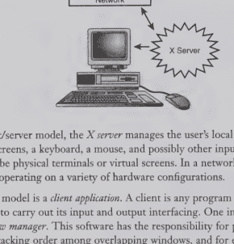

在客户端/服务器模型的一端，X 服务器管理用户的本地显示，该显示包括一个或多个屏幕、键盘、鼠标以及可能的其他输入设备。显示器的屏幕可能是物理终端或虚拟屏幕。在网络环境中，许多 X 服务器可以在各种硬件配置上运行。

在模型另一端的是客户端应用程序。客户端是任何与 X 服务器通信以执行其输入和输出接口的程序。一个重要的客户端应用程序是窗口管理器。该软件负责定位窗口、强制重叠窗口之间的堆叠顺序，并实现诸如以图标状态显示窗口等幻觉。

X 服务器、窗口管理器和客户端应用程序共同在用户的显示屏上创建虚拟桌面。由于 X 服务器和一个或多个客户端可能在网络上的不同位置运行，它们使用构成 X 核心的网络协议进行通信。即使 X 服务器和客户端在同一工作站上运行也是如此，尽管在这种情况下，服务器和客户端直接使用进程间通信而不是通过网络消息进行对应。为了执行 X 活动，客户端向 X 服务器发出请求。服务器反过来向客户端发送事件，其中可能包括错误消息。请求和事件都排队在 Xlib 中，这一事实导致了关键的性能问题。例如，通过减少发送到 X 服务器的请求数量来限制网络流量，是 X 客户端软件开发中的一个重要目标。

要从 X 服务器请求服务，客户端调用 Xlib 函数。通常，这是在参考图形上下文（GC）的情况下完成的，该上下文指定诸如线宽和形状填充模式等视觉特征。在典型情况下，客户端准备一个图形上下文，然后调用 Xlib 函数（如 `XDrawLine()`）请求服务器使用 GC 的值绘制一条或多条线。

了解 X 网络协议如何管理请求和事件的每一个细节并不是必不可少的。然而，重要的是要明白，仅仅调用一个 Xlib 函数并不一定会立即产生期望的结果。通常，调用 Xlib 函数的视觉效果可能会在许多其他函数调用之后才发生。此外，由于 Xlib 会排队客户端的请求，它们只有在请求队列被刷新时才会被成批发送到 X 服务器，而不一定是在程序调用函数时发送。这种事件驱动的异步逻辑给那些更熟悉传统输入输出技术的程序员带来了新的障碍。

更令人困扰的是，并非所有窗口管理器都相同，几乎没有任何实际效果可以安全地假设。例如，客户端应用程序可能会将窗口标题字符串传递给 X 服务器，但不能保证窗口管理器会在任何特定位置显示该字符串。它甚至可能根本不显示窗口标题。另一个很好的例子涉及图形和颜色。X 客户端只能假设显示器是位图式的，因此可以支持多个图形窗口。然而，窗口是否应该重叠或只是并排平铺，则由窗口管理器决定。此外，尽管大多数现代 PC 计算机显示器都支持彩色图形，但一个编写良好的客户端应该假设只有两种对比色可用。甚至假设这些颜色是黑白也是不完全安全的。

## 事件驱动编程

只要记住 X 客户端应用程序是按事件到达的顺序响应事件，而不是按你期望发生的顺序响应，事件驱动编程就不难掌握。当用户点击鼠标按钮等操作发生时，X 服务器会向焦点窗口的客户端发布一个事件消息。该事件连同其他事件一起按接收顺序存储在 Xlib 中。为了响应事件，你的程序逐个检索它们并分支到适当的语句。

检索和处理事件的代码称为事件循环。所有客户端都有这样一个循环来处理客户端所有窗口的事件。每个事件都作为一个结构到达，提供特定于该事件的信息，例如用户点击鼠标按钮时鼠标指针的 X 和 Y 坐标值。

事件循环不必处理每种类型的事件——只需处理它需要的事件即可。在创建窗口时，程序会指定一个事件掩码，告诉 X 服务器发送哪些事件。除非你明确请求某种类型的事件——例如按键——否则它们不会发送到你的程序。未被客户端处理的事件通常会传播到子窗口的父窗口。

> **注意：** 错误消息也会作为事件从 X 服务器发送过来。然而，它们被排队的方式不同，需要与客户端的事件循环分开编程。

## X 窗口

X 窗口有两种类型——输入和输出，以及仅输入。输入和输出窗口是最常见的，因为大多数窗口都会对用户输入产生某种类型的视觉响应。例如，一个按钮通常会以视觉方式指示它已识别到鼠标点击。

作为一个结构，窗口具有决定视觉方面的属性，例如窗口的边框图案、背景颜色、大小和位置。重要的是始终记住，这些和其他规范只是向 X 服务器提供的关于窗口应如何显示的“提示”。窗口的实际外观、位置、大小和其他视觉特征取决于窗口管理器强制执行的规则和规定。

创建窗口有两种方法。简单窗口仅指定最小属性，例如位置、大小、前景色和背景色。其他属性从父窗口继承。你也可以通过指定一个结构和位掩码来“硬方式”创建窗口，该结构和位掩码提供你想要从父窗口覆盖的任何属性。（第 27 章“控制 Xlib 输入和输出”解释了这种技术。）然而，无论你如何创建窗口，具体取决于窗口管理器和硬件的限制，实际输出在不同显示器上可能看起来非常不同。

使用工具包和部件有助于最大程度地减少这类差异，通过为菜单项、按钮、复选框、对话框、滚动条和其他类型的视觉对象等常见组件提供有用的标准。尽管在 X 的历史中此类标准一直非常宽松，但当前的 Gnome 项目承诺为创建和自定义虚拟桌面提供更好、更视觉一致的组件。

## 图形上下文

所有输出请求都参考图形上下文，即 GC。GC 指定诸如线宽、颜色映射、填充图案以及 `XDrawLine()` 和 `XFillRectangle()` 等许多 Xlib 函数的其他特征的参数。GC 最大限度地减少了传递给 Xlib 函数的参数数量，从而对客户端应用程序与 X 服务器之间的网络流量产生积极影响。GC 还帮助你维护多个配置。例如，程序可以为特定窗口创建多个 GC 并在它们之间轻松切换。特定窗口的实际 GC 驻留在 X 服务器中，并由提供给客户端的简单 ID 值引用。这使 GC 引用保持快速。

> Tip
> 一些 X 服务器只能维护有限数量的 GC，大多数 X 专家建议在客户端应用程序中尽可能少地创建它们。

在大多数情况下，客户端在创建关联窗口后创建 GC。每个 GC 都专门绑定到一个窗口，并使用在窗口创建期间分配（或稍后重新分配）的任何属性。创建和初始化 GC 的方法有很多，但在大多数情况下，最简单的方法是先创建窗口，然后为该窗口的图形请求创建一个 GC。

## COLORMAPS

在 X 编程中，理解起来最困难的主题之一是调色板的概念。实际上，其概念本身相对容易理解，但遵循使用调色板的诸多规则可能是一个复杂且难以学习的流程。由于 Linux 和 UNIX 世界中的 X 编程视频硬件差异很大，因此调色板在一种显示器和另一种显示器之间可能完全不同。第 28 章“突破 Xlib 基础”解释了如何使用调色板。

调色板仅假设显示器是位图——也就是说，屏幕上的每个像素（图像元素）显示一个不同的点。X 服务器无法处理其他类型的视频硬件，例如矢量显示器，但无论如何，这些在计算机终端上很少使用。通常，虚拟调色板可以与硬件的默认调色板交换，并且以这种方式，为多个应用程序甚至同一客户端内的多个窗口提供即时颜色配置。然而，取决于可用颜色的数量，这种技术可能会导致非活动窗口的颜色发生变化，尤其是在颜色密集型应用程序获得焦点时。例如，打开一个真彩色应用程序，如照片编辑器，可能会导致背景窗口突然变成刺眼的粉红色。尽管存在这些怪癖，但调色板不仅仅提供视频硬件的编程接口。在大多数情况下，它们还允许客户端定义所需的颜色，而无需关心实际可用多少种或什么类型的颜色。

调色板的一个关键元素是 *位平面* 的概念。通常，视频显示硬件提供存储每个像素一个或多个位的内存。每个位都是显示器所有像素的一个位平面的成员。虽然仍在使用大量 8 位和 16 位平面显示器，但 24 位平面彩色显示器正变得像烤面包机一样常见。

视频显示电路中的位数决定了显示器的 *深度*，并间接决定了它可以显示的可能颜色数。屏幕上的每个像素都与一个或多个平面中的位相关联。在 24 位平面视频系统中，每个像素由一个 24 位整数表示，每个平面上有一位。图 26.2 从概念上展示了位平面如何在视频内存中表示像素值。

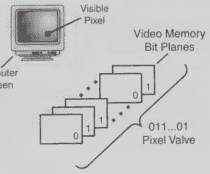

**Figure 26.2**  
在许多系统中，一个像素值表示为若干位，每位都是位平面的成员。

## INTRODUCING XLIB PROGRAMMING

单色显示器在颜色值的解释方式上有所不同。简单的单色显示器甚至可能是单维的，为每个屏幕像素使用单个位（一个平面）。此类显示器只有两种颜色，在 X 编程中称为“白色”和“黑色”，尽管实际颜色可以是任何对比色调（例如绿色和浅绿色）。更常见的是，尤其是在桌面出版应用程序中，是单色灰度图形显示。在这些类型的显示器中，位平面提供对调色板灰度强度级别的索引值。

无论你的系统上是什么类型的硬件，都必须认识到视频内存中的位平面值并不直接代表颜色。（然而，一些真彩色显示器可能是例外。）相反，视频内存中的位以某种方式用作对其他值的数组的索引，例如决定屏幕上实际颜色的红色、绿色和蓝色级别。这使得程序能够在各种硬件上运行，并且还使用户和系统管理员能够微调调色板值，以便例如让蓝色的看起来更蓝。

使用调色板可能很困难，但最终结果非常有利，因为它们产生在所有类型的视频硬件上都能正确工作的 X 客户端软件。你不必完全理解位平面值是如何转换为实际颜色值或灰度强度的。理想情况下，即使屏幕仅支持一维黑白像素，用户也应该能够看到应用程序的所有输出。

背景介绍就到这里。现在，让我们来看看编程一个 X 客户端以及使窗口出现在屏幕上所需的基本步骤。因为即使这个简单的任务也需要许多行代码，以下示例程序 `xwelcome.cpp` 将在这里分段讨论。供参考，完整列表在该部分的末尾。另请参阅侧边栏“编译 X 客户端”，了解如何编译和运行 `xwelcome.cpp` 程序以及本章和接下来的两章中列出的其他 X 客户端应用程序。

在大多数情况下，典型的 X 客户端应用程序涉及大约六个基本步骤。以下各节参考 CD-ROM 上的 `xwindow.cpp` 列表（在 `c26/xwelcome` 路径中）描述了每个步骤。

### Compiling X Clients

由于编译 X 应用程序需要多个编译器和链接器选项，因此不切实际地输入必要的命令。因此，本章和以下各章中的每个示例程序都存储在 `src/c26/xwelcome` 等命名目录中。在每个命名目录中都有一个名为 `Makefile` 的文件，指定了必要的编译和链接命令。在使用此 `Makefile` 之前，你可能需要修改相关文件 `Config.mk` 中的一些设置。在外部目录（本章为 `src/c26`）中找到该文件，并将其加载到编辑器中。清单 26.1 显示了 `Config.mk` 文件的默认设置。

> **Note**
>
> 对视频位平面的技巧可以产生有趣的图形错觉。例如，通过在一個或多个平面中绘图，图像似乎浮在其他图像之上（或之内），而不影响其他平面中的位。

#### 清单 26.1 `C26/CONFIG.MK`


# Edit the following for your installation

`CC` = `g++`

`X11INC` = `/usr/X11R6/include`

`X11LIB` = `/usr/X11R6/lib`

`LIBS` = `-lX11`

# Compiler and linker flags

`CFLAGS` = `-O -I$(X11INC)`

`LFLAGS` = `-O -L$(X11LIB)`

编辑 `Config.mk` 中的前四个变量，以选择编译器名称（`CC`）、X 头文件目录（`X11INC`）和 X 编译库目录（`X11LIB`）。同时，为 GNU 链接器指定 Xlib 路径名（`LIBS`）。默认设置对大多数读者应该有效，但如果你在编译时遇到问题，很可能是编译器找不到它需要的文件。在这种情况下，搜索你的 X11 安装目录并对 `Config.mk` 进行适当的调整。要编译所有程序以便加载到 GNU 调试器中，请将 `-g` 添加到 `CFLAGS`。

如果你使用的是 Red Hat Linux 5.1 或更早版本，你可能需要将 `Config.mk` 中列出的路径名中的 `X11R6` 改为 `X11`。如果是这样，请对 `src/C26`、`src/C27`、`src/C28` 和 `src/C29` 目录中的 `Config.mk` 文件进行同样的更改。

配置完系统后，切换到指定的目录并运行 `make` 实用程序来编译和链接一个示例程序。例如，要编译 `xwelcome` 演示程序，输入以下命令：

```
$ cd src/c26/xwelcome
$ make
g++ -c -O -I/usr/X11/include -o xwelcome.o xwelcome.cpp
g++ -o xwelcome -O -L/usr/X11/lib xwelcome.o -lX11
```

最后两行显示了 `make` 根据 `Makefile` 中的命令发出的编译和链接命令。要运行该程序，输入其编译后的可执行文件名，如下所示，加上 `./` 告诉 shell 在当前目录中查找：

```
$ ./xwelcome
```

如果一切顺利，这应该显示图 26.3 中的示例窗口。要退出程序，请在程序窗口处于活动状态（即具有输入焦点）时按任意键。本章和下一章中的大多数示例程序都在检测到按键时结束，或者提供名为 `Exit` 的菜单命令或按钮。你也可以点击窗口的关闭按钮，大多数窗口管理器将其显示为一个小写的 `x`。另一种结束 X 客户端的方法，虽然不常见，是切换到启动程序的 shell 窗口并输入 `C-c`（Ctrl-C）。然而，这可能不适用于所有 X 应用程序。

你也可以使用 `make` 和提供的 `Makefile` 在尝试完示例程序后清理目录。要使用此功能，请输入 `make clean`。请注意，这也会删除编译后的可执行文件：

```
$ make clean
rm -f xwelcome.o
rm -f *~
rm -f xwelcome
```

## 图 26.3
`xwelcome` 程序的窗口。

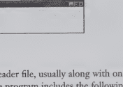

## 包含 Xlib 头文件

所有 X 客户端应用程序都包含 `Xlib.h` 头文件，通常还附带一两个其他 X 声明文件。`xwelcome.cpp` 示例程序包含以下三个头文件：

```
#include <X11/Xlib.h>
#include <X11/Xutil.h>
#include <X11/Xos.h>
```

包含 `Xlib.h` 也会包含 `X.h`，因此这声明了 Xlib 程序所需的大部分数据类型和结构。`Xutil.h` 头文件包含许多常见的 X 函数声明，大多数 X 客户端也需要它。包含 `Xos.h` 是可选的，但它有助于减少由系统依赖性以及其他头文件中声明差异引起的问题——例如，各种 `string.h` 函数的名称和字数据类型的长度。

在特定安装中，你可能会发现其他依赖于硬件或操作系统的包含文件。为了获得最佳结果，请避免将这些文件包含到 X 客户端中。除了位于 `include/X11`（或 `X11R6`）系统目录中的文件之外，没有理由包含任何其他头文件。

## 连接到 X 服务器

每个 X 客户端的第一步编程是连接到 X 服务器。如果无法完成，要么存在严重的网络问题，要么 X 根本没有运行。首先，声明一个全局显示指针，如下所示：

```
Display *display;
```

由于几乎所有 Xlib 函数都需要引用 `Display` 结构，因此指向它的指针通常被设置为全局，以避免将其传递给程序的子例程。`main()` 中的第一步使用如下语句初始化显示指针：

```
display = XOpenDisplay(NULL);
if (display == NULL) {
  cerr << "Failure connecting to X Server";
  exit(1);
}
```

如果 `XOpenDisplay()` 失败，它会返回 `NULL`。始终检查此条件，如果无法建立连接，则退出程序并显示错误消息。还有其他调用 `XOpenDisplay()` 的方法。例如，你可以将以冒号分隔的主机名和显示编号作为字符串传递，但这些和其他可能性依赖于系统。（环境变量 `HOSTDISPLAY` 和 `DISPLAY` 通常指定正确的值。）对于 Linux XFree86 安装，传递 `NULL` 通常是最好的选择。根据传递给 `XOpenDisplay()` 的参数，与 X 服务器的连接可以在本地或通过网络建立。

请记住，“display”（显示）至少包括一个或多个屏幕、一个键盘和一个鼠标。在 Linux XF86 安装环境中，窗口管理器可能提供多个屏幕，可通过鼠标或按 M-Tab（Alt-Tab）等键进行选择。然而，在客户端程序中，只需要一个 `Display` 结构指针即可访问所有用户输入和输出设备。

## 准备窗口属性

在创建并显示窗口之前，大多数 X 客户端需要了解显示状态的一些信息，例如其尺寸和颜色值。此类值大多可以通过使用 Xlib 宏提取 `Display` 数据结构的成员来轻松获得。例如，`xwelcome.cpp` 使用以下三个宏来获取 X 服务器所维护的显示的相关信息：

```
int intScreenNum = DefaultScreen(display);
int intDisplayWidth = DisplayWidth(display, intScreenNum);
int intDisplayHeight = DisplayHeight(display, intScreenNum);
```

第一条语句将显示的默认屏幕编号赋给整数 `intScreenNum`。随后，这个屏幕编号被用于另外两个宏调用，以获取屏幕的像素宽度和高度。使用 `DefaultScreen()` 和 `DisplayWidth()` 这类宏的原因是，`Display` 数据结构的内容被有意地保持为“不透明”。不直接引用这些成员，使 Xlib 的程序员能够在不影响 X 客户端程序的前提下更改成员名称。应始终像示例中那样使用宏来访问 `Display` 结构成员。这有助于保护你的代码免受 Xlib 将来变更的影响。

> 提示
> 为程序变量采用有用的命名约定是一个好主意。例如，`xwelcome.cpp` 为其整型变量加上 `int` 前缀。Xlib 包含数量庞大的声明、函数名、结构体和其他元素，因此最好选择能够同时描述其类型和用途的程序标识符。顺便提一句，所有 Xlib 函数都以大写 `X` 开头，所以你最好不要让自己的程序函数也这样命名。

使用迄今已确定的显示参数，`xwelcome` 程序通过以下语句计算其窗口的近似宽度、高度和位置：

```
int intWidth = intDisplayWidth / 3;
int intHeight = intDisplayHeight / 8;
int intXPos = 0;
int intYPos = 0;
```

这些步骤为创建窗口做好准备，窗口宽度为屏幕宽度的三分之一，高度为屏幕高度的八分之一。窗口的初始位置由窗口管理器决定，因此两个位置变量只需归零。务必牢记，由于不同的 X 安装环境存在差异，所有诸如窗口大小和位置之类的规格都只是对窗口管理器的提示，窗口管理器可以按其认为合适的方式自由排列窗口。

## 获取颜色值

另一组重要的值涉及用于绘制窗口显示表面（有时称为画布）以及显示图形和文本的背景色和前景色。如前所述，由于 X 安装环境使用各种各样的输出设备，编写得当的 X 客户端只能假定有两种对比色可用。因此，以下语句至少会将两个整数变量初始化为你唯一可以依赖的两种颜色：

```
int intBlackColor, intWhiteColor;
intBlackColor = BlackPixel(display, intScreenNum);
intWhiteColor = WhitePixel(display, intScreenNum);
```


尽管宏名是 `BlackPixel()` 和 `WhitePixel()`，实际可见的颜色可能并非真正的黑色和白色。但无论如何，它们保证是用户能够区分的颜色。

## 创建 X 窗口

现在我们有足够的信息来创建一个 X 窗口。最简单的方法是使用以下参数调用 `XCreateSimpleWindow()`：

```
Window win =
XCreateSimpleWindow(
    display,
    DefaultRootWindow(display),    // Parent window
    intXPos, intYPos,              // Position
    intWidth, intHeight,           // Window width & height
    0,                             // Border width (default)
    intBlackColor, intWhiteColor); // Background, foreground
```

将函数结果赋给一个 `Window` 类型的变量。该变量表示窗口的 ID 号，用于将来引用由 X 服务器维护的窗口结构。第一个参数是 `XOpenDisplay()` 返回的显示指针。接下来是祖先窗口，由于除根窗口外的每个窗口都必须有父窗口，因此所有新窗口都需要一个有效的父窗口 ID。在大多数情况下，客户端的主窗口通过调用 `DefaultRootWindow()` 宏将根窗口列为祖先窗口，如示例所示，但此参数也可以是另一个 `Window` ID 值。在此信息之后是窗口的位置、宽度和高度。如前所述，这些只是向窗口管理器提示你希望窗口显示在哪里。最后，指定前面获得的背景色和前景色。也可以选择将这两种颜色互换，以产生深色背景上的浅色窗口内部效果。

> 提示
> 通过调用 `XCreateSimpleWindow()` 或其更复杂的姊妹函数 `XCreateWindow()` 创建窗口并不会在屏幕上显示窗口。此步骤仅是在 X 服务器中准备一个 `Window` 结构。要使窗口变为可见，还需要几个语句，这些将在接下来的章节中说明。

## 为窗口指定标题

尽管本节的标题如此，但严格来说无法为 X 窗口指定标题。然而，你可以提供一个标题字符串，希望窗口管理器会用它来标识新构建的窗口。无法保证该字符串会出现在特定位置，尽管大多数窗口管理器会在窗口框架顶部显示它。要指定标题字符串，请按如下方式调用 Xlib 函数 `XStoreName()`：

```
XStoreName(display, win, "Welcome to X Programming");
```

将显示指针（来自 `XOpenDisplay()`）和窗口 ID（来自 `XCreateSimpleWindow()` 或 `XCreateWindow()`）作为前两个参数传递。还需指定你希望窗口标题使用的字符串。如果窗口管理器支持窗口标题栏，该字符串应出现在窗口顶部。

> Tip
> 通常不建议将消息显示为窗口标题，因为无法保证用户会看到文本。我在 `xwelcome.cpp` 中打破了这一规则，因为我们尚未介绍窗口输出技术。

## 显示窗口

像僵尸追逐猎物一样，`xwelcome.cpp` 正艰难地走向其窗口实际出现的时刻。但别急着尖叫。给定一个已初始化的显示指针和窗口 ID 值，以下语句会请求 X 服务器采取必要步骤使窗口可见：

```
XMapWindow(display, win);
```

映射窗口会使其可见并可用于输入和输出。两个参数将全局显示指针和 `win` ID 传递给 `XMapWindow()`。相反，取消映射窗口会使其不可见。你可以随意多次映射和取消映射窗口以使其出现和消失。这种技术对于快速显示对话框和其他子窗口特别有用，而无需重复创建窗口的步骤。

但即使程序已请求将窗口映射到显示器，窗口仍可能不会立即变得可见。在用户看到前述语句的效果之前，X 服务器、窗口管理器和客户端应用程序之间必须进行其他中间处理。只有在客户端收到该窗口的 `Expose` 事件后，窗口才保证可见，因此可用于输入和输出。在该事件之前，通常会先收到 `ConfigureNotify` 事件，因为窗口管理器可能已更改了请求的窗口大小和位置提示。切勿在调用 `XMapWindow()` 后立即尝试向窗口中绘制。在此之前，还需要另外两个步骤，接下来会进行说明。

## 事件屏蔽

X 客户端与用户干预的活动以及 X 服务器和窗口管理器的要求是异步运行的。这与传统程序中输入和输出的通常关系大不相同，传统程序会提示用户输入数据，等待响应，然后基于该输入执行操作。

事件是 X 服务器发送给客户端应用程序的消息。例如，如果用户在鼠标指针位于窗口内部时单击鼠标按钮，X 服务器会向该窗口的 Xlib 事件队列发布 `ButtonPress` 事件。在即使是简单的 X 客户端应用程序的运行过程中，也会有许多此类事件同时排队。

下一节将描述如何检索和响应 X 服务器事件，但在获取第一个事件之前，客户端应用程序必须告诉 X 服务器它期望接收的事件类型。这减少了网络流量，也简化了程序的源代码。例如，绘图程序可能请求鼠标移动事件，而另一种类型的程序可能只需要鼠标按钮单击事件。其他事件被允许传播到窗口的父级，在那里它们要么被处理，要么被允许走向晦涩的终点。

所有事件都被称为输入事件，即使它们与用户输入活动没有直接关系。

通过以下方式调用 `XSelectInput()` 来指定窗口要接收的事件：

```
XSelectInput(display, win,
    ExposureMask | KeyPressMask | StructureNotifyMask);
```


前两个参数指定之前获得的全局显示指针和窗口 ID 值。第三个参数是事件掩码。除非只指定一种事件类型，否则该掩码通常是 Xlib 中定义的两种或更多事件类型的逻辑或表达式。在此示例中，`ExposureMask`告诉服务器我们希望在窗口被曝光时得到通知。这发生在窗口首次出现时，也发生在窗口被部分或完全遮盖时，也许是用户移开另一个窗口。第二个事件类型`KeyPressMask`表示我们希望在用户按下键时得到通知。`StructureNotifyMask`告诉 X 服务器在用户修改窗口大小或位置时发送事件消息。事件掩码中事件类型的顺序无关紧要。表 26.1 显示了 Xlib 中声明的事件类型。这些符号实际上是以无符号长整型位移宏实现的，但这一事实被安全地隐藏起来并被遗忘。

### TABLE 26.1 Xlib EVENT MASKS

| Button1MotionMask | EnterWindowMask | PointerMotionHintMask |
| Button2MotionMask | ExposureMask | PointerMotionMask |
| Button3MotionMask | FocusChangeMask | PropertyChangeMask |
| Button4MotionMask | KeymapStateMask | ResizeRedirectMask |
| Button5MotionMask | KeyPressMask | StructureNotifyMask |

| ButtonMotionMask | KeyReleaseMask | SubstructureNotifyMask |
|---|---|---|
| ButtonPressMask | LeaveWindowMask | SubstructureRedirectMask |
| ButtonReleaseMask | OwnerGrabButtonMask | VisibilityChangeMask |
| ColormapChangeMask |  |  |

表 26.1 中的事件掩码位的名称通常（但并非总是）与事件消息的名称减去后缀 `Mask` 相同。例如，`KeyPress`事件与`KeyPressMask`位掩码相关联。然而，`Expose`事件与`ExposureMask`相关联。你只需要记住这些不一致的关系。表 26.2 显示了所有 Xlib 事件类型。

**表 26.2 XLIB 事件类型**

|  |  |  |
|---|---|---|
| ButtonPress | Expose | MapRequest |
| ButtonRelease | FocusIn | MotionNotify |
| CirculateNotify | FocusOut | NoExpose |
| CirculateRequest | GraphicsExpose | PropertyNotify |
| ClientMessage | GravityNotify | ReparentNotify |
| ColormapNotify | KeymapNotify | ResizeRequest |
| ConfigureNotify | KeyPress | SelectionClear |
| ConfigureRequest | KeyRelease | SelectionNotify |
| CreateNotify | LeaveNotify | SelectionRequest |
| DestroyNotify | MapNotify | UnmapNotify |
| EnterNotify | MappingNotify | VisibilityNotify |

每个事件消息都以一个结构体进行传输，该结构体包含特定于该事件的信息。例如，鼠标移动事件携带鼠标光标“热点”的相对坐标值。其他事件携带不同类型的信息，例如窗口位置或按键代码。所有事件消息都在 Xlib 中使用 C++ 联合体声明，以便事件的相关信息随时可用。但这也意味着你有责任针对特定事件类型引用正确的信息。在接下来的章节中，将对此主题进行更多讨论。

## 编写事件循环

最后，客户端应用程序准备进入其运行生命余下时间所花费的代码部分——事件循环。在解释这一重要的编程之前，回顾一下导致这一关键时刻的步骤是有用的。到目前为止，`xwelcome.cpp`程序已经：

- 通过调用 `XOpenDisplay()` 连接到 X 服务器
- 使用诸如 `XDisplayWidth()` 之类的宏初始化窗口变量
- 通过 `BlackPixel()` 和 `WhitePixel()` 宏获取至少两种对比色值
- 通过调用 `XCreateSimpleWindow()` 创建窗口结构，并将函数结果保存在窗口 ID 变量中
- 可选地，通过调用 `XStoreName()` 指定可能的窗口标题
- 通过调用 `XMapWindow()` 映射窗口，使窗口可能可见
- 通过调用带有适当事件掩码表达式的 `XSelectInput()` 指定客户端希望为此窗口接收的事件类型

每个 X 客户端应用程序都以某种方式执行上述大多数步骤。在这些步骤之后，程序准备进入臭名昭著的事件循环，如清单 26.2 所示。

### 清单 26.2 XWELCOME.CPP（事件循环）

```cpp
bool done = false;

XEvent event;

while (!done) {

    XNextEvent(display, &event);

    switch (event.type) {

    case Expose:

        cout << "Expose event received" << endl;

        break;

    case ConfigureNotify:

        cout << "ConfigureNotify event received" << endl;

        break;

    case KeyPress:

        cout << "Keypress detected" << endl;

        done = true;  // Exit on any keypress

        break;

    }

}
```

为了在每个事件到达时为其提供一个临时存储区，程序声明了一个变量（此处命名为`event`），类型为 Xlib 的`XEvent`结构数据类型。为了控制循环，程序还声明了一个 C++ `bool`变量`done`，初始化为`false`。只要该变量保持`false`，事件循环就会继续循环。还有其他编写事件循环的方式。一些程序员使用所谓的“永远执行”的`for`或`while`语句，以不确定的次数重复。无论其如何编程，事件循环都以以下语句获取下一个事件开始：

```cpp
XNextEvent(display, &event);
```

将全局`display`指针和`event`结构的引用作为参数传递。这个看似简单的语句执行了三项关键活动：

- 它从 Xlib 队列中检索指定显示器的聚焦窗口的下一个事件。
- 如果事件队列为空，`XNextEvent()`会刷新 Xlib 请求队列，将所有待处理的请求（如绘图命令）发送到 X 服务器。
- 如果事件队列为空，在刷新请求队列之后，`XNextEvent()`会阻塞，意味着它不会在从 X 服务器接收到新事件之前返回。

获取每个事件后，大多数客户端应用程序使用`switch`语句分支到一个或多个用于处理特定事件的语句。（请参阅表 26.2 获取 X 事件类型名称列表。）在这种情况下，程序响应三种事件类型，并为每一种显示一条消息。要查看这些语句的效果，请在移动和调整程序窗口大小时查看用于启动`xwelcome`的终端窗口。

在此示例中，唯一执行有用操作的事件是`KeyPress`。要结束事件循环，`switch`语句中该事件的`case`会执行以下语句：

```
case KeyPress:
  cout << "Keypress detected" << endl;
  done = true;  // Exit on any keypress
  break;
```

这会将`done`设置为`true`并结束`while`循环。之后，程序通过调用另一个 Xlib 函数并从`main()`返回来关闭与 X 服务器的连接：

```
XCloseDisplay(display);
return 0;
```


调用 `XCloseDisplay()` 会断开客户端/服务器连接，取消映射所有客户端窗口（使其变得不可见），并销毁服务器为此客户端保存的所有相关数据结构。然而，尽管调用 `XCloseDisplay()` 是终止 X 客户端的正确方法，但并不能保证程序会执行到前面的语句。传递给窗口管理器的另一个事件可能会终止客户端/服务器连接，在 `XNextEvent()` 返回之前关闭程序的任务。例如，如果窗口在标题栏中有默认的关闭按钮，并且用户点击了该按钮，窗口管理器本身会接收到相关事件并终止客户端，导致屏幕上出现如下消息：

```
X connection to :0.0 broken (explicit kill or server shutdown).
```

> 提示
> 防止此常见消息的一种方法是使用带有析构函数调用 `XCloseDisplay()` 的 C++ 类将整个客户端封装起来。声明该类的全局对象可确保在程序终止序列期间调用析构函数。

## THE `XWELCOME.CPP` LISTING

作为参考，清单 26.3 显示了前面各节中描述的完整 `xwelcome.cpp` 清单。此文件位于 CD-ROM 上的 `c26/xwelcome` 目录中。

### LISTING 26-3 `XWELCOME.CPP`

```cpp
#include <iostream.h>      // Need exit()

#include <stdlib.h>

#include <X11/Xlib.h>       // Most X programs need these headers

#include <X11/Xutil.h>

#include <X11/Xos.h>

Display *display;            // X server display structure

int main()

{

    // Attempt to establish communications with the X Server

    //

    display = XOpenDisplay(NULL);

    if (display == NULL) {

        cerr << "Failure connecting to X Server";

        exit(1);

    }

    // Calculate window's dimensions and position

    //

    int intScreenNum = DefaultScreen(display);

    int intDisplayWidth = DisplayWidth(display, intScreenNum);

    int intDisplayHeight = DisplayHeight(display, intScreenNum);

    int intWidth = intDisplayWidth / 3;

    int intHeight = intDisplayHeight / 8;

    int intXPos = 0;

    int intYPos = 0;

    // Get the most basic of colors (black and white)

    //

    int intBlackColor, intWhiteColor;

    intBlackColor = BlackPixel(display, intScreenNum);

    intWhiteColor = WhitePixel(display, intScreenNum);

    // Create window (this does not make it visible)

    Window win =

    XCreateSimpleWindow(

        display,                   // X server display struct

        DefaultRootWindow(display), // Parent window

        intXPos, intYPos,          // Position

        intWidth, intHeight,       // Window width & height

        0,                          // Border width (default)

        intBlackColor, intWhiteColor); // Background, foreground

    // Assign a name for the window title bar (probably)

    //

    XStoreName(display, win, "Welcome to X Programming");

    // Map the window to the display

    // Window is visible when first Expose event is received

    //

    XMapWindow(display, win);

    // Specify the types of events we want to receive

//

// XSelectInput(display, win,

    ExposureMask | KeyPressMask | StructureNotifyMask);

// The infamous event loop

//

bool done = false;

XEvent event;

while (!done) {

    XNextEvent(display, &event);

    switch (event.type) {

    case Expose:

        cout << "Expose event received" << endl;

        break;

    case ConfigureNotify:

        cout << "ConfigureNotify event received" << endl;

        break;

    case KeyPress:

        cout << "Keypress detected" << endl;

        done = true;   // Exit on any keypress

        break;

    }

}

// Disconnect X server connection and exit.

// (Program may never get to here)

//

XCloseDisplay(display);

return 0;

}


## 调试 X 客户端

调试 X 客户端应用程序特别困难，主要归因于其异步、事件驱动的特性。在传统程序中，即使是面向对象的程序，在特定语句处设置断点是在关键位置调查程序状态的好方法。但在 X 客户端中这样做通常对程序运行的线索提供甚少，因为导致问题的事件可能是 `Xlib` 函数调用的结果，而这些调用发生在收到该事件很久之前。

你当然可以使用 GNU 调试器编译并运行 X 客户端应用程序——本章最后一节将解释如何操作。不过，让我们先看看其他一些获取有助于调试 X 客户端信息的方法。

## 使用 X 实用工具调试

大多数 X 安装会附带几个有用的实用程序，与一堆屏幕保护程序和令人上瘾的游戏混在一起。（如果我没有玩那么多局蜘蛛纸牌，我可能会提前一个月写完这本书。）下面介绍一些可用于研究系统参数和调试 X 客户端应用程序的实用工具。在终端窗口中键入本节列出的所有实用工具的名称即可运行它们。许多工具是基于文本的，但有些也会显示图形窗口。

第五部分
第 26 章

> 提示
> 请查看此处提到的实用工具的源代码文件，这些文件可通过 FTP 从众多在线来源获取（参见附录 C，“Web 和 FTP 站点”），也存在于各种 Linux 光盘上。这些文件提供了如何在您自己的程序中获取有用系统参数的详细信息。

### XDPYINFO

运行此 X 显示信息实用程序，可以查明各种显示器和屏幕信息，例如显示器的名称和当前 X 版本号。该程序还提供显示器的尺寸、分辨率和色深。尺寸表示显示器的屏幕大小，例如 `1024×768` 像素。分辨率表示显示器的密度（对我来说是 `75×75` 点/英寸）。色深告诉你有多少位平面可用。你还可以查明显示器的类别。就我的情况而言，可能对大多数 Linux 用户也是如此，该类别设置为 `TrueColor`。

### XEV

这个“X Event Tester”是一款很棒的实用程序，用于调查 X 服务器针对各种操作（例如在窗口中单击鼠标指针）发布哪些事件。你还可以用它来查明按下某些键时返回的键码。调整终端窗口的位置，以便你能够查看操作对该程序的小图形窗口产生的影响。

### XLSATOMS

运行此程序可获得完整的原子列表——原子是存储在 X 服务器中的字符串数据的符号名称。这个程序对于调试创建和使用自己的原子的客户端特别有用。你还可以在报告的信息中找到已加载字体的名称。

### XLSCLIENTS

此实用工具仅报告 X 服务器当前已知的所有客户端应用程序的名称。它还报告传递给特定程序的命令行选项。例如，以下是我写下这些文字时，我的系统上由 `xlsclients` 报告正在运行的部分客户端：

```
$ xlsclients

localhost.localdomain /bin/sh /home/ts/Office51/bin/soffice

...

localhost.localdomain nxterm +ut -geometry +153+115

localhost.localdomain spider

localhost.localdomain nxterm
```

正如你从倒数第二个条目可以看出，我又暂停了一下，去玩我最喜欢的纸牌游戏。（如果继续这样下去，我可能需要接受专业咨询了。）

## XLSFONTS

如需查看 X 系统上已安装字体的完整列表（虽然可能会让你眼花缭乱），可以运行该程序。它有助于查找特定字体，而且因为列表已排序，还可以定位某类已安装字体，例如 `Courier` 的所有样式。（第 27 章“控制 Xlib 输入与输出”列出了类似程序 `xfont.cpp` 的源代码。）

## XPROP

这是每个开发系统上都有的工具之一，它显示海量信息，其中有些有用，有些则只有原作者才知道其用途。不过，你或许会想摆弄一下这个程序。它似乎需要一个命令行参数，所以不要只输入它的名字。若要按名称查看特定窗口的属性（名称可以从程序的窗口标题栏获得），可使用 `-name` 选项输入命令，例如：

```
$ xprop -name nxterm
```

这会显示名为“nxterm”的窗口的各种属性。若要查看根窗口的信息，请输入命令：

```
$ xprop -root

CUT_BUFFER0(STRING) = "\n"
```

除其他信息外，此命令还会显示“剪切”缓冲区的当前内容，也就是我们常说的剪贴板。根窗口拥有这些信息是合理的，这些信息由原子 `CUT_BUFFER0` 标识。（在我的系统上，可能其他系统也是如此，共有八个剪切缓冲区，分别由原子 `CUT_BUFFER0` 到 `CUT_BUFFER7` 命名。）要了解更多关于 `xprop` 的信息，可以使用如下 `-help` 选项：

```
$ xprop -help
```

## XSYSINFO

这是一个小巧可爱的程序，显示一些关于内存使用和 CPU 负载的信息。它可能有助于找出内存大户和 CPU 消耗大户，不过如果调整窗口堆叠顺序使其保持在其它窗口之上，它的实用性会更强。

此实用程序可能已自动安装，也可能没有。如果你找不到它，请查找类似 `xsysinfo.rpm` 的软件包文件（文件名中可能包含版本信息）。有关使用 Red Hat 包管理器（RPM）安装软件包的信息，请参阅第 3 章“安装 GNU C++”。

## XWININFO

`xwininfo` 是最实用的工具之一，你可以点击任意窗口，然后查看其参数、位置、大小、重力（调整大小或移动时子窗口相对于父窗口的关系）以及其他有用信息的列表。如果你在让窗口按预期方式显示时遇到问题，可以使用此工具检查 X 服务器掌握的关于该窗口的信息。以下是在我的系统上运行某个程序的示例输出：

```
$ xwininfo

xwininfo: Window id: 0x30000d6 "spider"

Absolute upper-left X: 21

Absolute upper-left Y: 124

Relative upper-left X: 0

Relative upper-left Y: 0

Width: 910

Height: 449

Depth: 24

Visual Class: TrueColor

Border width: 0

Class: InputOutput

Colormap: 0x23 (installed)

Bit Gravity State: NorthWestGravity

Window Gravity State: NorthWestGravity

Backing Store State: NotUseful

Save Under State: no

Map State: IsViewable

Override Redirect State: no

Corners: +21+124 -93+124 -93+195 +21+195

-geometry 910x449+16+101
```

## 使用输出语句调试

跟踪 X 客户端的事件可能是调查 bug 成因最有用的技术之一。如果从一开始就把这种逻辑构建到程序中，就可以生成客户端从 X 服务器接收到的完整事件历史记录。通常，导致问题的是事件的顺序（例如，响应 `Expose` 事件的多次绘制可能导致窗口出现严重的抖动问题）。

要跟踪事件，可以使用 `#ifdef` 和 `#ifndef` 指令，并配合像 `DEBUG` 这样的符号，在客户端的事件循环中启用输出语句。例如，使用 `xwelcome.cpp`（参见清单 26.3），下面是修改后的 `switch` 语句的一部分，其中输出语句由 `DEBUG` 符号启用：

```cpp
bool done = false;

XEvent event;

while (!done) {
    XNextEvent(display, &event);
    switch (event.type) {
    case Expose:
#ifdef DEBUG
        cout << "Expose event received" << endl;
#endif
        break;
    ...
    }
}
```

使用选项 `-DDEBUG` 编译程序以启用输出语句。不带该选项编译则会忽略输出语句。在随附光盘的 `c26/xwelcome` 目录中

`path`, `file` `Makefile.dbg` 编译 `xwelcome.cpp` 的一份副本作为 `xdebug.cpp` 并启用调试。 使用以下命令编译并运行程序：

```
$ make -f Makefile.dbg
$ ./xdebug

ConfigureNotify event received
Expose event received
ConfigureNotify event received
Keypress detected
```


> Tip
> 注意为新窗口接收到了 ConfigureNotify 和 Expose 事件。对于新创建并映射的窗口来说这总是正确的。X 服务器发送第一个事件以指示窗口的当前大小和位置，因为窗口管理器可能在首次显示客户端窗口之前更改了这些值。之后，Expose 事件会通知客户端显示窗口的内容。

还请记住用于对函数结果进行“断言”的经时间考验的 C 和 C++ 技术。要在 X 客户端中使用此方法，请使用以下指令包含 `assert.h` 头文件：

```
#include <assert.h>
```

接下来，使用 `assert()` 宏来测试任何真或假条件。通常，`assert()` 应用于返回指向结构的指针的函数的结果。如果该指针为 NULL，我们希望程序停止并显示一个标识问题发生位置的错误。以下是如何使用 `assert()` 测试连接到 X 服务器的结果：

```
Display *display;    // X server display structure

...

display = XOpenDisplay(NULL);

assert(display);
```

如果 `XOpenDisplay()` 返回 NULL，`assert()` 会停止程序并显示类似以下的错误消息

```
xdebug: xdebug.cpp:28: int main(): Assertion `display' failed.

Aborted (core dumped)
```

这也会将内存和堆栈转储到 `core` 文件中，您可以将其删除。要禁用所有断言，请使用选项 `-DNDEBUG` 编译程序（定义 `NDEBUG`）。

## DEBUGGING WITH THE GNU DEBUGGER

尽管使用 GNU 调试器调试 X 客户端可能很困难，但这仍然是调查错误原因的好方法。它对于检查复杂 X 结构的值尤其有帮助。一个有用的技巧是在客户端的事件循环内部设置断点，然后使用调试器命令检查事件结构成员。虽然这会产生大量数据，但您可能会发现该技术有助于精确定位由事件数据误用引起的错误的原因。

为演示这一点，`xdebug.cpp` 程序（位于 CD-ROM 上 `c26/xwelcome` 目录中的 `xwelcome.cpp` 的副本）已使用 `-g` 选项准备用于调试。通过使用 `make` 实用程序的 `-f` 选项选择替代 Makefile，在本例中为 `Makefile.dbg` 来指定。 使用以下命令编译程序：

```
$ make -f Makefile.dbg
```

接下来，将生成的代码文件加载到调试器中。您可以通过以下方式运行 `xxgdb` 来使用 X 版本的 GNU 调试器：

```
$ xxgdb xdebug
```

但是，即使目标程序是 X 客户端，您也可以使用命令行调试器进行调试。为此，输入命令

```
$ gdb xdebug
```

列出一些行以找到调用 `XNextEvent()` 的行，然后使用如下命令在该处设置断点：

```
(gdb) b 79

Breakpoint 1 at 0x8048918: file xdebug.cpp, line 79.
```

运行程序直到断点并使用 `print` 命令查看每个事件的数据，这可能长达数页。在输入第二个命令之前，请确保系好安全带：

```
(gdb) run

(gdb) print event
```

### SUMMARY

X 编程为 Linux 的 C++ 编程增添了一个新维度，也适用于支持 X 的其他 UNIX 系统。在 Linux 下，`XFree86` 提供了针对 PC、Intel 硬件优化的多个 X 服务器。X 使用客户端/服务器模型提供图形用户界面，即 GUI。然而，与 Microsoft Windows 不同，X 与硬件无关，可以在各种视频显示器和计算机系统上运行客户端应用程序。由于 X 使用客户端/服务器模型，X 服务器和客户端应用程序可以运行在用户的 workstation 上或通过网络在不同位置运行。开发 X 应用程序需要学习网络通信、事件驱动异步编程和 Xlib 基础等新技术。本章和接下来的两章介绍 Xlib 编程，以便您能够理解更高级别的工具包，例如 Motif 小部件、Gnome 项目以及本书后面两章中介绍的 V C++ 类库。

有关本章介绍主题的更多信息，请参阅以下章节：

- Chapter 2, “Installing Linux”
- Chapter 28, “Breaking Out of Xlib Fundamentals”
- Chapter 29, “Introducing the V Class Library”

## 第27章

## 控制Xlib输入与输出

响应鼠标和键盘输入以及显示文本和图形，是X编程中的高要求任务。一方面，用户的输入以事件形式从X服务器异步到达，而且这些输入可能与其他需要处理的事件交织在一起。另一方面，X客户端的窗口只是一块等待你填充的空白画布。即使显示单个字符，也意味着要学习新的编程技术，比如加载字体、确定字符在显示像素中的大小与位置，以及在X服务器显示器的图形上下文参照下显示文本。

图形输出中的其他复杂性，源于客户端窗口与其他窗口之间的交互。正如你在本章学到的，最重要的规则是：客户端必须随时准备好重绘其窗口的内容。仅仅在窗口中绘制一个形状是不够的。如果窗口被覆盖然后又暴露出来，应用程序必须重绘该形状（或其一部分），以维持重叠窗口构成的虚拟桌面错觉。

本章探讨X客户端的鼠标和键盘技术，并展示显示文本和图形的方法。你还将学习如何利用窗口属性来创建视觉效果，例如用像素图平铺背景，以及在鼠标指针移入窗口内部时改变光标形状。

## 鼠标输入事件

鼠标输入设备的类型可能比老鼠的种类还多。但所有设备都有两个共同特征——它们通过在一个平坦表面上滚动的小球来报告方向性移动，并且报告一个或多个按钮的按下与释放。两键和三键鼠标很常见，但一键鼠标也并非闻所未闻。我把轨迹球归入此类，因为就程序而言，它们不过是倒置的鼠标。

> 注意
> X 识别多达五个鼠标按钮，大概每个手指对应一个。我从未见过超过三个按钮的鼠标，但听说四键鼠标有时会出现在计算机辅助设计（CAD）系统上。

在进一步解释鼠标输入事件之前，先弄清楚几个术语会很有帮助。鼠标是你握在手中的物理设备。它有一个或多个可以单击或双击的按钮。鼠标指针是一个概念性对象，在程序内部指屏幕上的某个位置。鼠标光标是可见的像素图图像，显示鼠标指针的位置。热点是鼠标光标中确定鼠标指针确切位置的单个像素。热点可以位于鼠标光标中的任何位置。在箭头光标中，热点位于尖端。在十字准线光标中，热点位于正中心。

### 注意

X 像素图是由单个像素（即图片元素）组成的图像，可以存储在文件中，也可以从程序数据创建，其格式适合在 X 服务器屏幕上显示。位图通常被认为是表示图形信息的任何位集合。通常，客户端将位图数据转换为像素图再进行显示。

## 鼠标事件

X 服务器为所有鼠标活动报告三种类型的事件。三个鼠标输入事件如下：

- ButtonPress 此事件报告用户单击了鼠标按钮。`event.xbutton.button` 字段指示按钮编号，等于 X 符号常量 `Button1`、`Button2`、`Button3`、`Button4` 或 `Button5` 之一。
- ButtonRelease 此事件报告用户释放了鼠标按钮。`event.xbutton.button` 字段指示按钮编号。
- MotionNotify 此事件报告鼠标移动，无论是否按住按钮（也就是点击并拖动事件）。

### 注意

两键鼠标使用符号 `Button1` 和 `Button3` 对其按钮编号。`Button2` 表示第三个中间按钮，在典型的基于 Linux 的 PC 系统上可能有也可能没有。

## 示例鼠标客户端

清单 27.1 显示了 `xmouse.cpp` 的事件循环，该程序演示如何响应鼠标按钮和移动事件。虽然该程序看起来很简单，但它为清单之后要解释的鼠标活动的一些更精细要点奠定了基础。例如，通过更改事件掩码，你可以获得所有鼠标移动事件，或者只获得用户点击并按住按钮时生成的事件——即所谓的点击并拖动操作。

### 清单 27.1 XMOUSE.CPP（事件循环）

```cpp
// Specify the types of events we want to receive

//

XSelectInput(display, win,

ExposureMask | KeyPressMask |

ButtonPressMask | ButtonReleaseMask | ButtonMotionMask);

// The event loop

//

bool done = false;

int intMouseX = 0, intMouseY = 0;

XEvent event;
```

## LISTING 27.1 CONTINUED

```
while (!done) {

XNextEvent(display, &event);

switch (event.type) {

case ButtonPress:

cout << "ButtonPress event" << endl;
```


```
cout << "  button == " << event.xbutton.button << endl;

intMouseX = event.xbutton.x;

intMouseY = event.xbutton.y;

ShowMousePosition(gc, win, intMouseX, intMouseY);

break;

case ButtonRelease:

XBell(display, 50);  // i.e. 50% volume

break;

case MotionNotify:

intMouseX = event.xbutton.x;

intMouseY = event.xbutton.y;

ShowMousePosition(gc, win, intMouseX, intMouseY);

break;

case Expose:

ShowMousePosition(gc, win, intMouseX, intMouseY);

break;

case KeyPress:

cout << "Keypress detected" << endl;

done = true;  // Exit on any keypress

break;

}

}
```

通过切换到其目录并运行存储在那里的`Makefile`来编译`xmouse.cpp`程序。输入以下命令：

```
$ cd src/c27/xmouse
$ make
...
$ ./xmouse
```

## Note

以类似的方式编译本章中的其他程序。另请参阅第 26 章“Introducing X Programming”中侧边栏“Compiling X Clients”。

运行`xmouse.cpp`程序会显示一个小窗口，显示鼠标指针相对于窗口的位置（见图 27.1）。在窗口内单击并拖动鼠标光标以查看其他位置。单击并拖动仅对`Button1`有效，但你也可以单击`Button3`。释放任一按钮都会发出铃声（在我系统上听起来更像蜂鸣器）。按任意键结束程序，或单击窗口的关闭按钮。程序会在终端窗口中报告事件，显示按钮点击和按键：

```
ButtonPress event
button == 1
ButtonPress event
button == 3
Keypress detected
```

## Figure 27.1

`xmouse.cpp`程序显示鼠标指针相对于客户端窗口的坐标值。

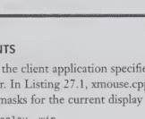

## ButtonPress EVENTS

与所有事件一样，客户端应用程序指定它希望从 X 服务器接收哪些类型的鼠标事件。在 Listing 27.1 中，`xmouse.cpp`对`XSelectInput()`的调用指定了当前显示和窗口的鼠标和其他事件掩码：

```
XSelectInput(display, win,
    ExposureMask | KeyPressMask |
    ButtonPressMask | ButtonReleaseMask | Button1MotionMask);
```

要获取鼠标按钮事件，请将`ButtonPressMask`符号逻辑或到函数的第三个参数中。要获取鼠标按钮释放事件，请添加`ButtonReleaseMask`。这两个事件会针对所有按钮报告。然而，鼠标移动事件稍微复杂一些，并且有多种可能的掩码可用于检测鼠标移动。下一节将详细介绍。

使用`XNextEvent()`获取下一个事件后，如果`event.type`字段等于`ButtonPress`，则用户已单击鼠标按钮。示例程序使用 switch case 拦截此事件，显示按钮编号，并使用以下语句保存鼠标指针位置：

```
case ButtonPress:
    cout << "ButtonPress event" << endl;
    cout << " button = " << event.xbutton.button << endl;
    intMouseX = event.xbutton.x;
    intMouseY = event.xbutton.y;
```

事件结构中的`xbutton.x`和`xbutton.y`字段表示鼠标光标热点相对于窗口的位置。示例程序将此信息保存到两个变量中，以便在显示位置时使用（这需要本章后面“Graphics Output Functions”下介绍的技术）。

按钮释放的检测与按钮按下一样简单。为了好玩，示例程序在你释放按钮时调用`XBell()`发出声音。以下语句中的值 50 表示音量百分比，尽管该参数可能有效也可能无效：

```
case ButtonRelease:
    XBell(display, 50);
```

## Mouse Movement Events

鼠标移动或 motion 事件分为三个大类。你可以选择在鼠标光标位于客户端窗口内部时接收所有 motion 事件、在用户按住按钮移动鼠标时接收所有单击并拖动事件，或单击并拖动仅为特定鼠标按钮生成事件。Xlib 提供了七个掩码来指示你想要接收的鼠标移动事件类型：

- `Button1MotionMask`
- `Button2MotionMask`
- `Button3MotionMask`
- `Button4MotionMask`
- `Button5MotionMask`
- `ButtonMotionMask`
- `PointerMotionMask`

要尝试不同掩码的效果，请在下面的`XSelectInput`语句中将`Button1MotionMask`改为前述符号中的任意一个：

```
XSelectInput(display, win,
    ExposureMask | KeyPressMask |
    ButtonPressMask | ButtonReleaseMask | Button1MotionMask);
```

要接收所有鼠标移动事件，请使用`PointerMotionMask`。要接收任意按钮的点击并拖动事件，请使用`ButtonMotionMask`。要接收特定按钮的点击并拖动事件，请使用其中一个编号的掩码。无论你指定什么掩码，事件都会作为`MotionNotify`消息到达。示例程序使用 switch case 语句拦截此类事件并记录鼠标位置：

```
case MotionNotify:
    intMouseX = event.xbutton.x;
    intMouseY = event.xbutton.y;
    ShowMousePosition(gc, win, intMouseX, intMouseY);
    break;
```

只要用户按住鼠标按钮，客户端就会持续接收`MotionNotify`事件。即使光标移出窗口也是如此，因为当 X 服务器生成`ButtonPress`事件时，它会抓取该窗口的鼠标，直到用户释放按钮。由于鼠标被抓取到特定窗口，即使鼠标指针离开窗口区域，所有鼠标事件仍会继续发送到该窗口。你也可以通过调用`XGrabPointer()`显式地抓取鼠标指针，尽管对于大多数点击并拖动操作，由于 X 服务器会自动抓取指针的方式，这通常是不必要的。（输入`info XGrabPointer`获取有关此主题的更多在线信息。）

## TEXT OUTPUT

所有 X 图形操作最终归结为两种关注点：显示文本和显示图形形状。在这两种情况下，对象都会在屏幕上绘制，因为与大多数基于字符的终端不同，X 窗口没有预定义的字符形状。在显示文本之前，客户端应用程序必须将字体加载到 X 服务器中，然后使用特殊技术确保文本在窗口中正确定位。由于用户显示器的分辨率差异很大，在窗口中生成美观的文本输出是一项非平凡的任务。

`xfont.cpp`程序列出多达 1,000 个字体名称（这对于大多数 Linux 安装来说应该足够），并且它还识别通配符命令行参数。使用以下类似命令编译并运行该程序：

```
$ cd src/c27/xfont
$ make
...
$ ./xfont *courier*
68 fonts found
-adobe-courier-bold-i-normal--0-0-0-0-m-0-iso8859-1
-adobe-courier-bold-r-normal--0-0-0-0-m-0-iso8859-1
...
-adobe-courier-medium-r-normal--0-0-100-100-m-0-iso8859-1
```


参数 `courier` 定位所有包含单词 `"courier"` 的字体名称。如程序输出所示，许多字体名称是包含来源、样式、大小和其他信息的冗长字符串。然而，通常你不需要理解这些信息的每一部分就能使用字体。（许多 X 和 Xlib 书籍和其他来源详细说明了字体和字体名称的复杂性。）

其他类型的字体命名更简单，在许多情况下，它们对于大多数输出需求来说完全足够。这些类型的字体根据其像素尺寸命名，例如名称 `"9x15"`、`"10x20"` 和 `"12x24"`。其中一些有粗体版本，例如 `"9x15bold"`。

## DISPLAYING TEXT

有了字体名称，你就可以在该字体中显示文本，如清单 27.3 `xtext.cpp` 所演示的那样。这是一个部分列表，仅显示与加载字体和显示文本相关的语句。图 27.2 显示了程序的窗口。

### Figure 27.2

`xtext.cpp` 的文本输出。

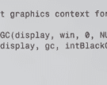

### LISTING 27.3 XTEXTCPP (PARTIAL)

```cpp
void GetFont(char *fontName, XFontStruct** font);

void ShowFontName(GC& gc, Window win, int& y, XFontStruct* font, char *fontName);

int main()
{
    // Get a default graphics context for our window
    GC gc = XCreateGC(display, win, 0, NULL);
    XSetForeground(display, gc, intBlackColor);  // Optional

    // Load some fonts. You might have to change the strings.
    // Run the xfont program to list them. Program ends if any
    // named font is unavailable.
    //
    XFontStruct *font1, *font2, *font3;  // Structure pointers
    char *fontName1 = "9x15bold";
    GetFont(fontName1, &font1);
    char *fontName2 = "10x20";
    GetFont(fontName2, &font2);
    char *fontName3 = "12x24romankana";
    GetFont(fontName3, &font3);

    // The event loop
    //
    bool done = false;
    XEvent event;
    int y;
    if (font1 != NULL && font2 != NULL && font3 != NULL)
    while (!done) {
        XNextEvent(display, &event);
        switch (event.type) {
        case Expose:
            y = 0;
            ShowFontName(gc, win, y, font1, fontName1);
            ShowFontName(gc, win, y, font2, fontName2);
            ShowFontName(gc, win, y, font3, fontName3);
            break;
        case ConfigureNotify:
            break;
        case KeyPress:
            cout << "Keypress detected" << endl;
            done = true;  // Exit on any keypress
            break;
        }
    }

    // Unload all fonts loaded by GetFont
    //
    if (font1 != NULL) XUnloadFont(display, font1->fid);
    if (font2 != NULL) XUnloadFont(display, font2->fid);
    if (font3 != NULL) XUnloadFont(display, font3->fid);

    // Disconnect X server connection and exit.
    // (Program may never get to here)
    //
    XCloseDisplay(display);
    return 0;
}

// Load font from X server.
// On many servers, a default font is loaded if the specified
// one is unavailable, so the error message is rarely seen.
void GetFont(char *fontName, XFontStruct** font)
{
    *font = XLoadQueryFont(display, fontName);
    if (*font == NULL)
        cerr << "Font " << fontName << " is not available" << endl;
}

// Display font name and update y coordinate value
void ShowFontName(GC & gc, Window win, int& y,
XFontStruct* font, char *fontName)
{
    y += font->ascent + font->descent + 10;
    XSetFont(display, gc, font->fid);
    XDrawString(display, win, gc, 10, y, fontName,
    strlen(fontName));
}
```

字体由 `XFontStruct` 类型描述，通过指针寻址。示例程序按如下方式声明三个此类指针：

```cpp
XFontStruct *font1, *font2, *font3;
```

要加载每个字体，程序将字体名称分配给一个 `char*` 字符串，然后调用一个本地函数将该字体加载到 X 服务器中：

```cpp
char *fontName1 = "9x15bold";
GetFont(fontName1, &font1);
```

`GetFont()` 函数使用当前显示指针和字体名称参数调用 Xlib 的 `XLoadQueryFont()` 函数。函数结果保存在 `XFontStruct` 指针中：

```cpp
*font = XLoadQueryFont(display, fontName);
```

如果结果为 `NULL`，则表示字体无法加载。由于未识别的字体通常会默认使用其他标准字体，因此在大多数 X 服务器下这种情况很少见。然而，你应该始终像示例列表中那样测试 `XLoadQueryFont()` 的结果。加载字体还有其他方法，但 `XLoadQueryFont()` 是最常用的。（请参阅该函数的 `info` 页面了解其他字体加载器。）

加载字体后，你可以通过调用 `XDrawString()` 函数使用其字符形状显示文本。但是，这需要一些其他设置操作。首先，你必须为窗口获取一个图形上下文 `GC`。`GC` 指定用于显示文本和图形的各种属性，以及诸如线条宽度和用于填充形状的图案等样式信息。示例 `xfont.cpp` 程序（请参阅列表 27.2）展示了为特定窗口获取 `GC` 的最简单方法：

```cpp
GC gc = XCreateGC(display, win, 0, NULL);
XSetForeground(display, gc, intBlackColor);  // Optional
```


`GC` 只是一个整数 ID 值——实际结构存储在 X 服务器中。给定此处显示的参数，`XCreateGC()` 为指定的显示和窗口创建一个默认 `GC`。最后两个参数 `0` 和 `NULL` 告诉 X 服务器对所有 `GC` 设置使用默认值。（第 28 章“突破 Xlib 基础”解释了如何设置单个 `GC` 参数。）你可能还想像这里所示那样调用 `XSetForeground()` 来为显示的文本选择一种颜色，但此步骤是可选的。

下一步，如 `local function ShowFontName()` 中的示例列表所示，是确定要在窗口的何处显示文本。对于显示文本行而言，这意味着确定文本高度的相对 `y` 坐标值，以像素为单位。两个值——ascent 和 descent——相加等于字体中任何字符的最大高度。在此值上再加一点即可分隔多行。还有许多其他计算文本坐标值相对于窗口的方案，但此公式在许多情况下已足够好用：

```
y += font->ascent + font->descent + 10;
```

下一步将字体设置到之前获得的 `GC` 中。你不必在每次显示字符串之前都执行此操作——一旦设置，字体将保留在 `GC` 中，直到被更改为止。调用 `XSetFont()` 来选择由 `XLoadQueryFont()` 加载的字体：

```
XSetFont(display, gc, font->fid);
```

向该函数传递三个参数：X 服务器显示指针、之前为窗口获得的 `gc` 变量，以及已加载字体的 `fid`（字体 ID）字段。最后，你就可以在所选字体中显示文本了。调用 `XDrawString()` 是最简单的方法。它接受以下所示的多个参数：

```
XDrawString(display, win, gc, 10, y, fontName, strlen(fontName));
```

将显示指针、窗口 ID 和图形上下文变量作为前三个参数传递。接下来的两个参数是窗口中你希望字符串出现的像素的 `x` 和 `y` 坐标值。该像素通常位于字体的原点，即字符基线左侧一点。前面提到的 ascent 值计算该线以上像素的数量；descent 计算该线以下的数量。作为一般规则，除非你真的想在定位文本时做得花哨，否则可以将传递给 `XDrawString()` 的坐标值视为大约在带尾的小写字母中间，并正好位于大写字母的底线。传递给 `XDrawString()` 的最后两个参数是字符串及其字符长度。即使显示整个字符串时，你也必须始终指定长度。

> **注意**
> 
> 不要假设图形上下文指的是 X 服务器中的默认字体。对某些服务器而言这可能是真的，但为了获得最佳效果，在调用 `XDrawString()` 和其他 Xlib 文本输出函数显示文本之前，你应始终按本节所述加载字体。

## 图形输出函数

Xlib 提供了一系列函数，称为图形原语，用于在窗口中绘制线条和形状。一般而言，要绘制图形，客户端应用程序执行三个基本步骤：

- 它为显示和窗口初始化一个图形上下文（`GC`）。
- 它调用 Xlib 图形原语函数，如 `XDrawLine()`。
- 它存储重绘窗口内容所需的信息——例如，当它被另一个窗口遮挡后重新显示时。

任何在窗口中绘制图形的客户端应用程序都需要这三个步骤。因为几乎每个客户端都会这样做——即使文本，也记得是图形绘制的——所有 X 客户端都以某种方式执行这些步骤。

## 图形原语

表 27.1 列出了 Xlib 的一些图形原语函数。本章和下一章展示了其中几个函数的使用方法，但要了解更多信息，请使用 `info` 实用程序查找它们。该表还包括字符串和文本绘制函数。

| Xlib 函数 | 描述 |
|---|---|
| `XClearArea()` | 清除窗口的一部分 |
| `XClearWindow()` | 清除整个窗口 |
| `XCopyArea()` | 复制窗口的一个区域 |
| `XCopyPlane()` | 使用位平面掩码复制一个区域 |
| `XDrawArc(*)` | 绘制圆形或椭圆形弧线 |
| `XDrawLine(*)` | 绘制线条 |
| `XDrawPoint(*)` | 绘制点（单个像素） |
| `XDrawRectangle(*)` | 绘制矩形或正方形 |
| `XDrawSegments()` | 绘制多个不相连的线条 |
| `XDrawString()` | 绘制字符串 |
| `XDrawString16()` | 绘制 16 位字符字符串 |
| `XDrawText()` | 使用间距和字体数据绘制文本 |
| `XDrawText16()` | 绘制 16 位字符文本 |
| `XFillArc(*)` | 使用 `GC` 的 `arc_mode` 填充弧线 |
| `XFillPolygon()` | 填充封闭多边形 |
| `XFillRectangle(*)` | 填充矩形 |

* 这些绘制函数有复数形式对应的函数，可以绘制两个或多个对象的列表。例如，`XDrawLines()` 可以绘制存储在坐标值数组中的多条连接线。

> **注意**
> 
> 许多图形函数引用类型为 `Drawable` 的参数。这通常被视为窗口的可视表面（所谓的画布），由 Window ID 值表示，但 `Drawable` 可以是与窗口 `GC` 具有相同深度的任何位图。例如，`Drawable` 可能指的是用于离屏绘制的位图。在大多数情况下，要绘制可见形状，你只需将 Window ID 传递给函数的 `Drawable` 参数即可。

## 合理曝光

将本章开头描述的鼠标按钮和移动事件与一个简单的图形原语 `XDrawLine()` 结合起来，就得到一个程序，让用户可以在窗口中绘制简单的图形。编译并运行程序，清单 27.4，`xsketch.cpp`，然后在客户端窗口内单击并拖动鼠标光标进行绘制。双击主鼠标按钮（可能是右键）以擦除图像。图 27.3 显示了程序显示的示例。关于我艺术技能的邮件不会被欣赏。


> **注意**
> 
> 草图程序不包含重绘其内容的编程。如果您遮盖并重新显示窗口，它会擦除绘制中被遮盖的部分。下一节将解释如何解决此问题。

**LISTING 27.4 XSKETCH.CPP (EVENT LOOP)**

```
// Get a default graphics context for our window
//
GC gc = XCreateGC(display, win, 0, NULL);

// Specify the types of events we want to receive
//
XSelectInput(display, win,
    ExposureMask | KeyPressMask |
    ButtonPressMask | ButtonReleaseMask | Button1MotionMask);

// Mouse movement and button event loop
// with double-clicking.
bool done = false;
bool mouseDown = false;
int x1, x2, y1, y2;
Time lastTime = 0;
XEvent event;
while (!done) {
    XNextEvent(display, &event);
    switch (event.type) {
case ButtonPress:
    x1 = event.xbutton.x;
    y1 = event.xbutton.y;
    mouseDown = true;
    break;
case ButtonRelease:
    if (event.xbutton.time - lastTime < 250)
        XClearWindow(display, win);
    else
        lastTime = event.xbutton.time;
    mouseDown = false;
    break;
case MotionNotify:
    if (mouseDown) {
        x2 = event.xbutton.x;
        y2 = event.xbutton.y;
        XDrawLine(display, win, gc, x1, y1, x2, y2);
        x1 = x2;
        y1 = y2;
    }
    break;
case Expose:
    // Should redraw lines here
    break;
case KeyPress:
    cout << "Keypress detected" << endl;
    done = true;  // Exit on any keypress
    break;
}
```


在所有情况下，为在窗口中绘图做准备的第一步是通过调用`XCreateGC()`为该窗口获取一个`GC`。如前所述，通过传递显示器、窗口 ID 以及如清单所示的零和`NULL`参数来获取默认`GC`。这为图形上下文选择默认值，特别是指定图形输出的窗口背景和前景颜色。

为了为窗口启用单击拖动操作，程序使用三个鼠标事件`ButtonPressMask`、`ButtonReleaseMask`和`ButtonMotionMask`调用`XSelectInput()`。此外，程序指定`ExposureMask`和`KeyPressMask`以获取窗口`Expose`和`KeyPress`事件。

事件循环展示了一些新技术。为了在内部指示用户已单击鼠标按钮，`ButtonPress`事件保存鼠标指针坐标值并将本地`bool mouseDown`变量设置为`true`。这演示了一种在两个或多个事件之间传递信息的好方法——在这种情况下，告诉`MotionNotify`事件逻辑用户正在按住鼠标按钮。

指针在`MotionNotify`事件之间移动数个像素。但要看到区别，请用以下语句替换`XDrawLine()`：

```
XDrawPoint(display, win, gc, x2, y2);
```

# 双击按钮

清单 27.4 中的`xsketch.cpp`程序还演示了一种识别双击鼠标按钮的方法。它通过检查`ButtonRelease`事件之间的时间来实现。如果该时间小于某个阈值，程序就假定用户双击了鼠标。作为响应，示例程序调用一个 Xlib 图形函数，将窗口擦除为`GC`的背景颜色。要使用此方法，请定义一个类型为`Time`的变量，这是 Xlib 提供的数据类型：

```
Time lastTime = 0;
```

`Time`值是一个无符号 32 位整数，等于事件时间的毫秒数。`Time`值在大约 49 天后回绕，因此就实际用途而言，这些值可用于确定两个事件之间的时间。 （所有事件都携带一个时间字段。）`xsketch.cpp`程序的`ButtonRelease`事件比较上次已知的时间与当前时间，如果差值小于 250 毫秒，则假定用户双击了鼠标：

```
case ButtonRelease:
    if (event.xbutton.time - lastTime < 250)
        XClearWindow(display, win);
    else
        lastTime = event.xbutton.time;
        mouseDown = false;
    break;
```

对`XClearWindow()`的调用会将窗口内部擦除为当前背景颜色。这是一个罕见的绘图例程，它不指定`GC`，因为 X 服务器中的窗口结构本身已记录背景颜色，而为窗口背景着色是服务器的职责。

> 注意

> 这里描述的双击方法在各种情况下效果足够好，但该方法并不完美，因为它可能会错过单击。更稳健的双击方法将使用外部计时器，如果在指定时间内没有第二个鼠标按钮事件到达，则触发单击逻辑。

# 保存图形信息

清单 27.4 中`xsketch.cpp`程序的一个问题是它没有保存窗口绘图的任何信息。正因为如此，遮盖和重新显示客户端窗口会导致其内容消失。这从图形上说明了 X 窗口的一个关键要求——客户端必须始终准备好在收到`Expose`事件时重绘其内容。

该规则即使对于实现了称为 backing store（备份存储）功能的 X 服务器也同样适用。借助此功能，X 服务器会自动保存并恢复窗口的内容，因此当窗口被重新显示时，并不一定会向客户端发送`Expose`事件。要确定你的服务器是否实现了此功能，请调用`DoesBackingStore()`宏。该宏有三种返回值，可告知服务器是否备份已映射的窗口（`WhenMapped`）、是否未实现备份存储（`NotUseful`），或是否对所有窗口都提供此功能（`Always`）。无论该函数的值如何，你都必须在收到`Expose`事件时重绘客户端的内容。即使 X 服务器实现了备份存储功能，窗口内容仍可能需要重绘——例如，响应因窗口的 gravity 属性而影响图形相对于窗口原点位置的调整大小操作时就会如此（有关更多内容，请参阅本章后文的“Gravitational Considerations”）。

如何保存程序绘制图形内容所需的信息完全由你决定。但请记住利用可供你的其他工具。例如，C++ 标准模板库（`STL`）中的容器类和算法就很适合存储图形信息。为了演示，清单 27.5，`xlines.cpp`，使用 `STL` `vector` 容器存储线条坐标。为了节省空间，该清单仅显示了演示其图形技术的程序部分。像本章和前一章中的其他程序一样编译并运行该程序。在窗口内单击并拖动鼠标绘制一些线条，然后遮盖并重新显示窗口。绘制内容的被遮盖部分会被重新显示，尽管这个过程如此之快，你几乎看不到它发生。该程序还演示了一种称为橡皮筋的图形技术。在拖动鼠标时，它会动画显示线条——只有在释放鼠标按钮后，线条才会绘制到其最终位置。

## LISTING 27.5 `XLINES.CPP` (PARTIAL)


```cpp
#include <vector>      // Need vector<> template
#include <algorithm>   // Need for_each() algorithm

#include <X11/Xlib.h>   // Most X programs need these headers
#include <X11/Xutil.h>
#include <X11/Xos.h>

class TLine {
private:
    int _x1, _y1, _x2, _y2;
public:
    TLine(int x1=0, int y1=0, int x2=0, int y2=0):
        _x1(x1), _y1(y1), _x2(x2), _y2(y2) { }
    inline int GetX1() { return _x1; }
    inline int GetY1() { return _y1; }
    inline int GetX2() { return _x2; }
    inline int GetY2() { return _y2; }
};

Display *display;    // X server display structure
void DrawRubberLine(Display* display, Window win, GC gc,
int x1, int y1, int x2, int y2);

// Define an STL vector of TLine objects
//
vector<TLine> lines(100); // Grows larger if needed

int main()
{
    // Get a default graphics context for our window
    //
    GC gc = XCreateGC(display, win, 0, NULL);
    XSetLineAttributes(display, gc, 1, LineSolid, CapRound, JoinRound);

    // Specify the types of events we want to receive
    //
    XSelectInput(display, win,
        ExposureMask | KeyPressMask |
        ButtonPressMask | ButtonReleaseMask | Button1MotionMask);

    // Mouse movement and button event loop
    // with double-clicking.
    //
    bool done = false;
    bool mouseDown = false;
    int x1, x2, y1, y2;
    XEvent event;
    while (!done) {
        XNextEvent(display, &event);
        switch (event.type) {
        case ButtonPress:
            x1 = event.xbutton.x;
            y1 = event.xbutton.y;
            x2 = x1;
            y2 = y1;
            mouseDown = true;
            break;
        case ButtonRelease:
            if (x1 != x2 || y1 != y2) {
                DrawRubberLine(display, win, gc, x1, y1, x2, y2);
                x2 = event.xbutton.x;
                y2 = event.xbutton.y;
                XDrawLine(display, win, gc, x1, y1, x2, y2);
                lines.push_back(TLine(x1, y1, x2, y2));
            }
            mouseDown = false;
            break;
        case MotionNotify:
            if (mouseDown) {
                if (x1 != x2 || y1 != y2) // Erase old line
                    DrawRubberLine(display, win, gc, x1, y1, x2, y2);
                x2 = event.xbutton.x;
                y2 = event.xbutton.y;
                DrawRubberLine(display, win, gc, x1, y1, x2, y2);
            }
```

## 清单27.5 续

```cpp
    break;
case Expose:
    vector<TLine>::iterator it;
    for (it = lines.begin(); it != lines.end(); it++)
        XDrawLine(display, win, gc,
            it->GetX1(), it->GetY1(), it->GetX2(), it->GetY2());
    break;
case KeyPress:
    cout << "Keypress detected" << endl;
    done = true;    // Exit on any keypress
    break;
}
}

// Disconnect X server connection and exit.
// (Program may never get to here)
XCloseDisplay(display);
return 0;
}

// Draw an erasable line using XOR logic
void DrawRubberLine(Display* display, Window win, GC gc,
    int x1, int y1, int x2, int y2)
{
    XSetFunction(display, gc, GXxor);
    XDrawLine(display, win, gc, x1, y1, x2, y2);
    XSetFunction(display, gc, GXcopy);
}
```

程序的 `TLine` 类保存两对坐标值，用于标记一条线的两个端点。由于我们还没有讲到颜色映射表（见第28章，“突破Xlib基础知识”），这是唯一保存的信息；不过，另一个程序可能会保存线的颜色、宽度以及其他特征以便重绘。创建一个用于保存 `TLine` 对象的容器很简单，只需包含 `vector` 头文件，并像下面这样声明一个名为 `lines` 的对象：

```cpp
vector<TLine> lines(100);    // Grows larger if needed
```

我随便挑了100个 `TLine` 对象的容量，但 `vector` 会根据需要自动增长以容纳更多对象。在通常的初始化之后，X客户端通过调用 `XCreateGC()` 创建图形上下文。不过这次，程序通过调用 `XSetLineAttributes()` 来修改GC的属性：

```cpp
GC gc = XCreateGC(display, win, 0, NULL);
XSetLineAttributes(display, gc, 1, LineSolid, CapRound,
    JoinRound);
```

这只是改变视觉图形特性的一种方式。你还可以在创建GC时直接指定各种值。本例中，第二条语句选择了线的属性。例如，把 `1` 改成 `2` 或 `3` 可使线更宽。

### 注意

> 线宽为零时会选择一条快速、细的线，但所用的算法可能不允许通过覆盖绘制来擦除先前绘制的线——本例中正是用这种技术来创建随鼠标指针移动的橡皮筋线。

程序的事件循环与清单27.4中 `xsketch.cpp` 的非常相似。不过，本例中程序在响应对 `ButtonRelease` 事件时，通过执行以下命令来显示并保存一条线：

```cpp
XDrawLine(display, win, gc, x1, y1, x2, y2);
lines.push_back(TLine(x1, y1, x2, y2));
```

当X服务器向客户端投递 `Expose` 事件时，程序使用以下语句重绘已保存的线：


```cpp
case Expose:
vector<TLine>::iterator it;
for (it = lines.begin(); it != lines.end(); it++)
XDrawLine(display, win, gc,
it->GetX1(), it->GetY1(), it->GetX2(), it->GetY2());
break;
```

由 `vector<TLine>` 类导出的迭代器引用每个已保存的 `TLine` 对象。对每个这样的对象调用 `GetX1()` 及类似的类函数，可检索到每条线的坐标值，并传入 `XDrawLine()` 进行重绘。不必担心这里的表面复杂性。所有函数都是内联实现的，最终效果相当高效。关于容器模板的更多信息，请参阅第23章“使用标准模板库（STL）”和第24章“构建标准容器”。

程序还在一个局部函数 `DrawRubberLine()` 中执行了另一项绘制操作，该函数使用以下语句编写：

```cpp
XSetFunction(display, gc, GXxor);
XDrawLine(display, win, gc, x1, y1, x2, y2);
XSetFunction(display, gc, GXcopy);
```

第一条语句展示了如何更改`GC`的某个方面，这里将显示逻辑设置为 `GXxor`。这会把“异或”选作在显示上组合像素的机制。结果是，在该线上方再次绘制这条线时，它就会消失。`GXcopy` 是默认的绘制方法——它复制像素——本例中，就是将一条线中的像素直接复制到指定的 `Drawable`。表27.2列出了可以传给 `XSetFunction()` 的其他显示模式，并详细说明了它们对源像素和目标像素的逻辑效果。

### 表27.2 `XSetFunction()` 模式

| 模式 | 逻辑 |
|------|------|
| `GXclear` | 0 |
| `GXand` | 源 AND 目标 |
| `GXandReverse` | source AND NOT destination |
| `GXcopy` | source |
| `GXandInverted` | NOT source AND destination |
| `GXnoop` | destination |
| `GXxor` | source XOR destination |
| `GXor` | source OR destination |
| `GXnor` | NOT source AND NOT destination |
| `GXequiv` | NOT source XOR destination |
| `GXinvert` | NOT destination |
| `GXorReverse` | source OR NOT destination |
| `GXcopyInverted` | NOT source |
| `GXorInverted` | NOT source OR destination |
| `GXnand` | NOT source OR NOT destination |
| `GXset` | 1 |

## 键盘输入事件

在两个键盘输入事件 `KeyPress` 和 `KeyRelease` 中，只有第一个是保证可用的。X 服务器仅在键盘提供必要信号的硬件上报告 `KeyRelease` 事件。因此，切勿指望能获得 `KeyRelease` 事件（大多数，如果不是全部，Linux PC 安装都应支持此事件）。

由于 UNIX 和 Linux 硬件上的键盘差异很大，你不能简单地查找 `KeyPress` 或 `KeyRelease` 事件中报告的键码。相反，你必须经过一个中间步骤，将键的事件代码映射到服务器数据表中的一个值，该值代表特定的键。结果是一个符号，如 `XK_UP` 和 `XK_Home`。清单 27.6，`xkey.cpp`，演示了如何检测 `KeyPress` 事件，在服务器的键映射中查找符号值，并在有名称时显示键的名称。如本章大多数清单一样，为节省空间，这里只打印了相关语句。编译并运行程序，按任意键即可看到其字符串名称和十进制的符号值。按 Esc 退出。图 27.4 显示了一个示例输出窗口。

**Figure 27.4** Sample xkey window.


### 清单 27.6 `XKKEY.CPP`（部分）

```cpp
#include <X11/Xlib.h>  // Most X programs need these headers
#include <X11/Xutil.h>
#include <X11/Xos.h>
#include <X11/keysym.h>

void ShowKey(Display* display, Window win, GC gc,
XFontStruct* font, char *keyName, KeySym& key);

int main()
{
    XFontStruct *font;  // Font structure pointer
    char *fontName = "*12x24";
    GetFont("12x24", &font);
    if (font == NULL)
        GetFont("9x15", &font);
    if (font == NULL)
        exit(1);
    XSetFont(display, gc, font->fid);

    // Specify the types of events we want to receive
    XSelectInput(display, win,
        ExposureMask | KeyPressMask | KeyReleaseMask |
        StructureNotifyMask);

    // The event loop
    //
    bool done = false;
    KeySym key;
    XComposeStatus cstat;
    int size = 32;
    char keyname[size];
    keyname[0] = 0;
    XEvent event;
    while (!done) {
        XNextEvent(display, &event);
        switch (event.type) {
        case Expose:
            ShowKey(display, win, gc, font, keyname, key);
            break;
        case ConfigureNotify:
            break;
        case KeyPress:
            XClearWindow(display, win);
            XLookupString(&event.xkey, keyname, size, &key, &cstat);
            ShowKey(display, win, gc, font, keyname, key);
            if (key == XK_Escape)
                done = true;  // Exit on escape key
            break;
        case KeyRelease:  // Not available on all systems
            XBell(display, 50);
            break;
        }
    }
```

### 清单 27.6 继续


```
}
XUnloadFont(display, font->fid);
XCloseDisplay(display);
return 0;
}

// Load font from X server.
// On many servers, a default font is loaded if the specified
// one is unavailable, so the error message is rarely seen.
void GetFont(char *fontName, XFontStruct** font)
{
    *font = XLoadQueryFont(display, fontName);
    if (*font == NULL)
        cerr << "Font " << fontName << " is not available" << endl;
}

// Display key name and value in decimal
void ShowKey(Display* display, Window win, GC gc,
    XFontStruct* font, char *keyName, KeySym& key)
{
    int y = font->ascent + font->descent + 10;
    int x = 10;
    char buf[10];
    XDrawString(display, win, gc, x, y,
        keyName, strlen(keyName));
    sprintf(buf, "%d", key);
    XDrawString(display, win, gc, x, y * 2,
        buf, strlen(buf));
}
```

## 检测键盘事件

为了使你的程序能够识别 Xlib 键盘符号如 `XK_Escape`，使用以下指令包含 `keysym.h` 头文件：

```
#include <X11/keysym.h>
```

这会加载在 `keysymdef.h` 中找到的实际定义。但不要直接加载该文件。你必须包含 `keysym.h` 以定义影响加载到程序中的符号名称的某些其他符号。为了准备接收 `KeyPress` 和 `KeyRelease` 事件，使用以下掩码调用 `XSelectInput()`：

```
XSelectInput(display, win,
    ExposureMask | KeyPressMask | KeyReleaseMask |
    StructureNotifyMask);
```

请记住，即使你指定了 `KeyReleaseMask`，也不能保证客户端会收到 `KeyRelease` 事件。X 显示必须有键盘，因此可以安全地假设会生成 `KeyPress` 事件。

## 响应键盘事件

示例程序的事件循环演示了如何响应 `KeyPress` 事件并查找其符号值。为此，我们需要声明如下几个变量：

```
KeySym key;
XComposeStatus cstat;
int size = 32;
char keyname[size];
keyname[0] = 0;
```

`KeySym` 变量等同于 `keysymdef.h` 中定义的 `XK_` 符号。本程序未使用 `XComposeStatus`，它仅在带有 Compose 键或类似名称键（用于选择备用字符集）的系统上才有意义。这类键可能出现在支持多种语言的桌面出版系统等计算机上，或者因其他目的需要特殊符号的计算机上。大多数情况下，你可以忽略 `XComposeStatus` 值，但为了下一个要介绍的键映射查找函数 `XLookupString()`，你仍然必须定义它。

## 映射键盘事件代码

`XLookupString()` 函数接受多个参数，并返回两个重要值：一个等于事件键码名称的字符串，以及该键的符号值。切勿直接使用事件的键码值。为确保可移植性，所有键值都必须通过调用 `XLookupString()` 获取。该函数会查询 X 服务器中针对用户硬件的键映射表。请记住，你的客户端可能会被多个运行在不同硬件上的服务器共享。如果直接使用事件的键码，你的程序几乎肯定会失败。在响应 `KeyPress` 或 `KeyRelease` 事件时，按如下方式调用 `XLookupString()`：

```
XLookupString(&event.xkey, keyname, size, &key, &cstat);
```

第一个参数引用 X 联合体，该联合体提供了特定于 `KeyPress` 或 `KeyRelease` 事件对象的字段。接下来是一个指向 `char` 缓冲区的指针 `keyname`，后面跟着该缓冲区的大小（以字节为单位）。函数会将键的字符串名称复制到此缓冲区中。大多数键名只有一个字符长——例如，`XK_A` 键的名称是字符串 "A"。但是，根据所使用的服务器，功能键和其他键的名称可能更长。

传递给 `XLookupString()` 的最后两个参数是 `KeySym` 和 `XComposeStatus` 变量的地址。函数会将事件键码的符号值赋给 `KeySym` 变量。如前所述，`XComposeStatus` 值被忽略。


查找键的名称和符号值后，你可以使用它来显示文本或选择程序功能。示例程序两者都做了。它调用一个本地函数 `ShowKey()` 来以十进制显示键的名称和符号值。在调用 `XLookupString()` 之后，返回的 `KeySym` 值可以与 `keysymdef.h` 中的任何 `XK_` 常量进行比较。示例程序使用这种技术来检测 Esc 键，并在你按下该键时结束事件循环：

```
if (key == XK_Escape)
    done = true;  // Exit on escape key
```

> 提示

> 当你不需要键的字符串名称时，可以调用 `XLookupKeysym()` 函数来获取其符号值。下一节中的示例程序演示了如何使用此函数。

## 窗口属性

窗口的属性指定了各种显示特性，例如背景和前景颜色、光标形状以及边框宽度。设置窗口属性有三种方式：

- 创建时通过调用 `XCreateWindow()`
- 创建后通过调用 `XSetWindowBorder()` 和类似的实用函数
- 创建后通过调用 `XChangeWindowAttributes()`

在大多数情况下，客户端在创建 `Window` 结构时选择窗口的属性，但你始终可以在之后更改任何属性。但请记住，每次这样的更改都会导致网络流量增加。为了获得最佳效果，请在首次创建新窗口时尽可能多地指定属性。接下来的三节将分别展示三种窗口属性技术的示例。

> 提示

> 你可以自由使用此处描述的任何方法在创建后更改窗口属性。由于 Xlib 会将所有此类技术合并为单个网络请求，因此在网络性能影响方面，没有哪种方法比另一种更高效。

## 使用属性创建窗口

若要在创建窗口时指定属性，请在连接到 X 服务器后执行以下一般步骤：

- 1. 声明一个 Xlib `XSetWindowAttributes` 结构的变量。
- 2. 为该结构的字段赋值。

## LISTING 27.7 CONTINUED


```c
Window win =
XCreateWindow(
    display,                 // X Server connection
    DefaultRootWindow(display), // Parent Window ID
    intXPos, intYPos,        // Position
    intWidth, intHeight,     // Width and height
    8,                       // Border width
    CopyFromParent,          // Screen depth
    InputOutput,             // Window 'class'
    CopyFromParent,          // Visual type
    valuemask,               // Attribute bit mask
    &attributes              // Attribute value structure
);

// Assign a name for the window title bar (probably)
//
XStoreName(display, win, "Window Attributes");

// Map the window to the display
// Window is visible when first Expose event is received
//
XMapWindow(display, win);

// Get a default graphics context for our window
//
GC gc = XCreateGC(display, win, 0, NULL);
XSetForeground(display, gc, intWhiteColor);
```

示例程序创建了一个类型为 `XSetWindowAttributes` 的结构，然后使用以下语句为该结构字段分配几个值：

```c
XSetWindowAttributes attributes;
attributes.background_pixel = intBlackColor;
attributes.border_pixel = intWhiteColor;
```

`intBlackColor` 和 `intWhiteColor` 值是从 X 服务器的显示信息中获取的。你只能在窗口创建期间设置背景和边框颜色。前景色由图形上下文（`GC`）指定，而不是窗口本身。对于对属性字段的每次赋值，都必须有一个对应的位掩码逻辑 `OR` 到一个 `unsigned long` 变量中。为指定掩码值，程序在前一条语句后执行以下操作：

```c
unsigned long valuemask = CWBackPixel | CWBorderPixel;
```

### Tip

键入 `info XCreateWindow` 并查看 `X.h` 头文件以获取有关其他 `CW` 位掩码的信息。

仅更改窗口结构中指定的字段。其他值将被忽略并设置为默认值（通常继承自父窗口）。在结构和位掩码就位后，如列表所示调用 `XCreateWindow()` 并将函数结果保存到 a Window ID 变量中。列表中的注释显示了传递给 `XCreateWindow()` 的其他参数的用途。

> Note
>
> 窗口的边框宽度通常设置为零，因为窗口管理器使用其自己的设计参数创建窗口边框。在大多数情况下，你无法创建不同宽度的窗口边框，窗口属性结构中的 `border_width` 字段实际上未被使用。

## CALLING WINDOW ATTRIBUTE FUNCTIONS

更改窗口创建后窗口属性的最简单方法是调用专门用于更改特定属性值的 `Xlib` 函数。作为示例，`xattrib.cpp` 中的事件循环（请参阅 Listing 27.7）在鼠标光标在窗口内单击时翻转窗口的背景和前景颜色。Listing 27.8 显示了事件循环的这一部分。

### LISTING 27.8 `XATTRIB.CPP` (PARTIAL EVENT LOOP)

```c
case ButtonPress:
  SwapColors();
  XSetWindowBackground(display, win, intBackgroundColor);
  XClearWindow(display, win); // Make changes visible
  XFlush(display); // Do it now
  break;
```

本地函数 `SwapColors()` 交换在程序启动阶段设置的 `intBackgroundColor` 和 `intForegroundColor` 变量。需要三个单独的 `Xlib` 函数调用来更改显示背景并使该更改可见。首先，`XSetWindowBackground()` 更改指定窗口中的背景属性。但是，这不会产生任何视觉效果。调用 `XClearWindow()` 会重绘窗口的背景，此操作直接在 X 服务器中进行，而不是作为发布给客户端的事件的结果。但这仍然可能没有即时的视觉效果。

最后，`XFlush()` 将所有待处理的请求发送到 X 服务器，包括前面函数调用生成的请求。此时，窗口将绘制为新的背景颜色。在这种情况下，严格来说不需要调用 `XFlush()`，因为当事件循环调用 `XNextEvent()` 时，该函数会刷新请求缓冲区中的任何待处理命令。但是，调用 `XFlush()` 以强制请求发送到 X 服务器并无害，尽管过度调用可能会对网络性能产生负面影响。

## CHANGING ATTRIBUTE VALUES

更改窗口属性值的第三种方法类似于在窗口创建期间设置这些值的方法。完成此操作后，调用 `XChangeWindowAttributes()` 函数来更改特定属性。你可以在窗口映射和显示之前或之后随时执行此操作。`xattrib.cpp`

## 其他窗口属性

以下是一些额外的属性，你可以设置它们来控制窗口外观的各个方面。你不会在所有客户端中使用这些功能，但它们可以产生有用的视觉效果，可能改善你的程序图形界面。

### 更改光标形状

当用户将鼠标指针移入窗口时更改光标形状，是指示允许的操作类型的一种好方法。正如你可能知道的，客户端会将光标形状更改为 I 形光标以指示用户可以输入文本，并更改为时钟或沙漏形状以指示正在进行长时间的处理，例如读取文件。

指定光标形状有两种方法。你可以从一组预定义的光标中选择，也可以利用位图创建自己的光标。在大多数情况下，最好选择默认光标，因为 X 服务器通常为特定硬件和不同分辨率提供优化的图案。为此目的，`Xlib` 提供了表 27.3 中列出的标准光标常量。为了简化光标图像的加载，形状被实现为在 `cursorfont.h` 头文件中声明的标准字体。用以下指令将此文件载入你的程序：

```c
#include <X11/cursorfont.h>
```

**表 27.3 标准光标常量**

|   |   |   |   |
|---|---|---|---|
| `XC_X_cursor` | `XC_dotbox` | `XC_lr_angle` | `XC_sb_v_double_arrow` |
| `XC_arrow` | `XC_double_arrow` | `XC_man` | `XC_shuttle` |
| `XC_based_arrow_down` | `XC_draft_large` | `XC_middlebutton` | `XC_sizing` |
| `XC_based_arrow_up` | `XC_draft_small` | `XC_mouse` | `XC_spider` |
| `XC_boat` | `XC_draped_box` | `XC_pencil` | `XC_spraycan` |
| `XC_bogosity` | `XC_exchange` | `XC_pirate` | `XC_star` |
| `XC_bottom_left_corner` | `XC_fleur` | `XC_plus` | `XC_target` |
| `XC_bottom_right_corner` | `XC_gobbler` | `XC_question_arrow` | `XC_tcross` |
| `XC_bottom_side` | `XC_gumby` | `XC_right_ptr` | `XC_top_left_arrow` |
| `XC_bottom_tee` | `XC_hand1` | `XC_right_side` | `XC_top_left_corner` |
| `XC_box_spiral` | `XC_hand2` | `XC_right_tee` | `XC_top_right_corner` |
| `XC_center_ptr` | `XC_heart` | `XC_rightbutton` | `XC_top_side` |
| `XC_circle` | `XC_icon` | `XC_rtl_logo` | `XC_top_tee` |
| `XC_clock` | `XC_iron_cross` | `XC_sailboat` | `XC_trek` |


|  |  |  |  |
|---|---|---|---|
| `XC_coffee_mug` | `XC_left_ptr` | `XC_sb_down_arrow` | `XC_ul_angle` |
| `XC_cross` | `XC_left_side` | `XC_sb_h_double_arrow` | `XC_umbrella` |
| `XC_cross_reverse` | `XC_left_tee` | `XC_sb_left_arrow` | `XC_ur_angle` |
| `XC_crosshair` | `XC_leftbutton` | `XC_sb_right_arrow` | `XC_watch` |
| `XC_diamond_cross` | `XC_ll_angle` | `XC_sb_up_arrow` | `XC_xterm` |
| `XC_dot` |  |  |  |

需要两个 Xlib 函数来为窗口定义光标形状。清单 27.10，`xcursor.cpp`，显示了必要的步骤。

**清单 27.10 `XCURSOR.CPP`（部分）**

```
#include <X11/Xlib.h>  // Most X programs need these headers
#include <X11/Xutil.h>
#include <X11/Xos.h>
#include <X11/cursorfont.h>

Display *display;  // X server display structure

int main()
{
...
// Specify cursor to appear when mouse pointer moves
// into the window's area
Cursor cursor =
    XCreateFontCursor(display, XC_coffee_mug);
XDefineCursor(display, win, cursor);
}
```

定义标准光标的第一步是调用 `XCreateFontCursor()`，传递 X 服务器的显示指针和表 27.3 中的一个常量。这会加载具有该值的字体字符并返回服务器中存储的光标图像的 Cursor ID。

第二步是调用 `XDefineCursor()`，传递显示指针、Window ID 和 `XCreateFontCursor()` 的结果。完成这些步骤后，将鼠标指针移入窗口会自动导致新的光标形状出现。

调用 `XUndefineCursor()` 可将光标重置为无，从而显示默认的箭头指针。除了首次创建窗口外，更改窗口光标最好随后调用 `XFlush()`，以确保 X 服务器尽快接收请求。

## 重力考虑

X 编程中有两种重力——位重力和窗口重力。

窗口的位重力指的是其内容区域或画布相对于窗口的框架。窗口重力指的是一个或多个子窗口相对于其父窗口的位置。重力值以罗盘方向表示，因此`SouthWestGravity`引用窗口的左下角，而`NorthGravity`将窗口的内容或子窗口定位在父窗口的顶部。通常，这两种重力默认均为“无”，由Xlib常量`ForgetGravity`表示——这正是我在晚餐吃太多之后希望能做到的。

> **注意**：将窗口的重力设置为`ForgetGravity`会告诉X服务器不要保留窗口的内容，即使服务器实现了后备存储特性也是如此。要使用服务器的后备存储能力（如果可用），重力必须设置为罗盘方向（如`SouthWestGravity`），或者设置为相关值之一（如`CenterGravity`或`StaticGravity`）。

为了演示重力的相关考量，清单27.11中的`xgravity.cpp`显示了一个客户端父窗口，其中包含一个作为子窗口的“粘性”子窗口。子窗口的重力设置为`NorthGravity`，使其仿佛粘在父窗口的顶部。这演示了创建一个可能用作其他对象（如一组按钮）面板的窗口的基本原理。当主客户端窗口被移动或调整大小时，X服务器会自动重新定位面板子窗口，使其始终粘在父窗口的顶部。图27.5显示了程序输出的示例。

**图 27.5** `xgravity.cpp`程序的示例输出。

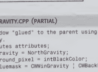

**清单 27.11 `XGRAVITY.CPP`（部分）**

```
// Create subwindow "glued" to the parent using
// window gravity.
XSetWindowAttributes attributes;
attributes.win_gravity = NorthGravity;
attributes.background_pixel = intBlackColor;
unsigned long valuemask = CWWinGravity | CWBackPixel;

Window panel =
XCreateWindow(
    display,            // X Server connection
    win,                // Parent Window ID
    0, 0,               // Position
    intWidth, intHeight / 8, // Width and height
    0,                  // Border width
    CopyFromParent,     // Screen depth
```

在这里尝试不同的`win_gravity`设置，观察它们的效果。例如，要将子窗口粘在父窗口的底部，可以将其重力设置为“南重力”。但是，如果你尝试这样做，可能会惊讶地发现子窗口仍然出现在父窗口的顶部。要在底部显示子窗口，你还必须将其初始X和Y坐标值设置为类似这样：

`0, intHeight - (intHeight / 8),`

创建子窗口后（在示例程序中由名为`panel`的Window ID变量标识），像处理主客户端窗口一样，将该窗口映射到显示器。同时为面板创建一个`GC`，并在必要时使用以下语句设置其前景色：

```
XMapWindow(display, panel);
GC gcpanel = XCreateGC(display, panel, 0, NULL);
XSetForeground(display, gcpanel, whiteColor);
```

还要记得选择希望子窗口接收的事件类型。这些事件与主客户端窗口的事件一样，会到达同一个Xlib队列，并由同一个事件循环处理。在本例中，我们使用以下语句为面板窗口指定`Expose`和`ConfigureNotify`事件：

```
XSelectInput(display, panel,
    ExposureMask | StructureNotifyMask);
```

主事件循环现在会接收示例程序两个窗口的事件。要确定事件引用的是哪个窗口，需要检查事件的`window`字段。例如，示例程序的`Expose`事件通过调用`XDrawString()`在面板窗口中显示文本，如下所示：

```
case Expose:
    if (event.expose.window == panel) {
        // Sub window graphics go here
        XDrawString(display, panel, gcpanel, 10, 10,
            panelString, strlen(panelString));
    }
```

如果`expose.window`字段等于分配给`panel`的窗口ID，那么我们就知道X服务器请求客户端重绘子窗口的内容。如果该字段等于客户端窗口ID，那么程序将显示主窗口的图形（不过在本例中没有）。

此处未显示的是相对于父窗口调整子窗口大小的代码。这说明重力*只*影响窗口的相对位置。

## 平铺背景像素图

通常，窗口的背景是纯色，通常是白色或黑色。然而，除了像素值之外，你还可以指定一个像素图用作窗口的背景。像素图会被平铺（按行和列复制），因此只需一张小图像即可填充整个窗口。通常，一张16×16像素的图像就能很好地工作，但你可以使用任意尺寸的像素图。

> **提示**：某些像素图尺寸在特定的 X 服务器上可能显示得更快。要查找适合您系统的理想尺寸，请调用`XQueryBestTile()`。

创建像素图并用它平铺窗口背景的步骤，因彩色显示中的深度概念而变得复杂。要用作窗口背景，像素图必须与显示窗口的屏幕具有相同的深度。通过将像素图复制到选定位平面，有几种方法可以绕过此规则，但在大多数情况下，此处显示的步骤是用于创建适用于所有类型 X 硬件的像素图的方法。

清单 27.12（`xtile.cpp`）展示了读取位图文件并将其转换为适合绘制窗口背景的像素图所需的步骤。如图 27.6 所示，也许是出于膨胀的自我意识，加上缺乏艺术绘画技巧，我演示了用我的姓名首字母的像素图绘制窗口背景的基本步骤。（我一直钦佩那些能在 16×16 位图中创作出逼真图像的艺术家！）在清单之后，我将解释如何将相同技术用于任何像素图图像。运行程序并调整窗口大小，可以看到无论窗口大小如何，它都会绘制整个背景。只需一个 16×16 像素的小位图即可产生这种效果。


## 图 27.6

示例窗口，使用作者姓名首字母的像素图平铺。

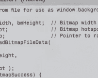

## 清单 27.12 XTILE.CPP（部分）

```
// Load bitmap from file for use as window background
//
unsigned int bmWidth, bmHeight;  // Bitmap width and height
int bmXhot, bmYhot;              // Bitmap hotspot (ignored)
unsigned char * p;               // Pointer to raw bitmap data
int result = XReadBitmapFileData(
    "ts.xbm",
    &bmWidth, &bmHeight,
    &p,
    &bmXhot, &bmYhot );
if (result != BitmapSuccess) {
    cerr << "Failed to open ts.bmp file" << endl;
    exit(1);
}

// Construct a pixmap using the raw bitmap data
//
Pixmap pixmap =
    XCreatePixmapFromBitmapData(
display,
win,
(char *) p,
bmWidth, bmHeight,
intBlackColor, intWhiteColor,
DefaultDepth(display, intScreenNum));

// Use the pixmap as the window background "tile"
// XSetWindowBackgroundPixmap(display, win, pixmap);

// The X server maintains a copy of the pixmap so we can
// now free the pixmap image and the raw bitmap data:
XFreePixmap(display, pixmap);
XFree(p);
```

使用像素图平铺窗口的第一步是创建位图图像。创建新图像的最简单方法可能是使用标准的 X 实用程序 `bitmap` 程序。要运行它，请在终端窗口提示符下输入 `bitmap`，然后创建您的图像（或从磁盘加载一个图像并修改它）。该程序的按钮和命令很容易弄明白。使用 `bitmap` 实用程序创建的位图文件应使用文件扩展名 `.xbm` 命名。示例 `ts.xbm` 文件位于随附光盘的 `c27/ztile` 目录中。（另请参阅本章末尾的“位图文件格式”。）

创建了要使用的图像后，您需要将其加载到客户端应用程序中。为使位图与窗口的屏幕兼容，从而适合用作其背景，客户端必须将原始位图图像转换为与屏幕具有相同深度的像素图，这一过程有时称为渲染。然后，渲染后的图像被传递给 X 服务器，用于平铺窗口背景。此过程分配内存的两个结构也必须被释放，以防止内存泄漏。一旦传递给 X 服务器，除非位图和像素图图像还以其他方式使用，否则销毁这些结构是安全的。

通过调用 `XReadBitmapFileData()` 函数加载位图文件，如清单中所示，此处重复如下：

```
int result = XReadBitmapFileData(
"ts.xbm",
&bmWidth, &bmHeight,
&p,
&bmXhot, &bmYhot);
```

第一个参数是文件名字符串，此处为 `ts.xbm`。接下来两个参数是指向宽度和高度整数变量的指针，函数将位图的大小赋给这些变量。通过引用传递的指针 `p` 应为 `unsigned char*` 类型。函数会为此指针分配内存，用于保存在磁盘上加载的位图图像数据。最后两个参数是对另外两个整数的引用，它们标识光标图像中的热点，但在本例中未使用。

如果 `XReadBitmapFileData()` 的结果不是 `BitmapSuccess`，则表示发生了错误。对于小位图，可能的原因是文件名错误或缺失。当加载较大的图像时，

然而，你可能想要更仔细地检查函数结果。该结果如果文件无法打开则等于 `BitmapOpenFailed`，如果文件包含无法识别的数据则等于 `BitmapFileInvalid`，或者如果没有足够的内存为图像数据分配空间则等于 `BitmapNoMemory`。

成功加载位图图像后，下一步将其转换为 X 服务器可用于绘制窗口背景的像素图形式。为此，按如下所示调用 `XCreatePixmapFromBitmapData()`：

```
Pixmap pixmap =
    XCreatePixmapFromBitmapData(
        display,
        win,
        (char *) p,
        bmWidth, bmHeight,
        intBlackColor, intWhiteColor,
        DefaultDepth(display, intScreenNum));
```

函数结果是类型为 `Pixmap` 的值，它只是一个整数 ID，用于标识保存在 X 服务器中的转换后图像。将已初始化的服务器显示指针和窗口 ID 传递给此函数。第三个参数是指向由 `XReadBitmapFileData()` 加载的原始位图图像数据的 `char` 指针。它也可以是指向通过其他方式创建的图像数据的指针——例如，字节值的静态数组。

### Note

> 前述语句中的类型转换表达式 `(char *)` 可避免编译器警告。显然，`XReadBitmapFileData()` 设计为使用 `unsigned char*`，而 `XCreatePixmapFromBitmapData()` 对其位图指针参数使用 `char*` 声明。由于在 ANSI C++ 中 `char` 类型默认是有符号的，这导致了类型不匹配警告。这是一个无关紧要的小差异，尽管两个函数可能都应简单地将参数声明为类型 `char*`。

传递给 `XCreatePixmapFromBitmapData()` 的最后参数是原始位图图像的宽度和高度、使用的背景和前景颜色，以及此处通过为 X 服务器显示指针和默认屏幕编号调用 `DefaultDepth()` 宏获得的屏幕深度。生成的像素图现在已准备好用于平铺窗口背景。调用以下函数来告诉服务器以这种方式使用图像：

`XSetWindowBackgroundPixmap(display, win, pixmap);`

你可以在创建并映射窗口、其首次出现之前执行上述步骤，或在之后任何时间执行。然而，在客户端收到窗口的至少一个 `Expose` 事件之后，要使背景更改可见，请在前述语句后跟随调用 `XClearWindow()` 和 `XFlush()`。这会强制 X 服务器立即重绘窗口背景，并还会向客户端发送窗口的新 `Expose` 事件。此时，客户端可以在新的平铺背景上重绘任何图形。

如前所述，由于 X 服务器维护着像素图图像数据的副本，在执行上述步骤后，你应该销毁原始位图和像素图图像。为此，执行以下两个语句：

```
XFreePixmap(display, pixmap);
XFree(p);
```

切勿使用标准库的 `free()` 函数或 C++ 的 `delete` 操作符来释放这些对象。始终如图所示调用 Xlib 的 `XFreePixmap()` 和 `XFree()` 函数。

## BITMAP FILE FORMAT

X 位图实用程序创建的 `.xbm` 文件采用一种格式，可直接包含到 C 或 C++ 源代码文件中。位图文件实际上是一个文本文件，其中包含描述位图大小及其数据的声明。清单 27.13，`ts.xbm`，显示了用于在前一节中平铺窗口的示例位图文件。（我编辑了 `ts_bits` 数组数据以节省空间。）

### LISTING 27.13 TS.XBM

```
#define ts_width 16
#define ts_height 16
static unsigned char ts_bits[] = {
  0x00, 0x00, 0x00, 0x00, 0x00, 0x00,
  0x00, 0x00, 0x7C, 0x1C, 0x10, 0x22,
  0x10, 0x02, 0x10, 0x1C, 0x10, 0x20,
  0x10, 0x20, 0x10, 0x22, 0x10, 0x1C,
  0x00, 0x00, 0x00, 0x00, 0x00, 0x00,
  0x00, 0x00};
```

与其调用 `XReadBitmapFileData()` 函数来加载这种格式的位图文件，你可以使用 `#include` 指令将文件的文本插入到程序源文件中：

```
#include <ts.xbm>
```

然后你可以调用 `XCreatePixmapFromBitmapData()` 将标识为数组 `ts_bits[]` 的位图数据转换为像素图，并按前一节所述将其用于平铺窗口背景。你可能希望使用此技术创建一个不依赖于运行时其他文件可用的自包含可执行代码文件。

### SUMMARY


当程序员开始为 X 客户端应用程序的输入和输出编程时，他们进入了一个全新的世界。与传统的程序不同，传统程序会提示输入、等待用户响应，然后相应地采取行动，X 客户端的 I/O 以异步形式发生，即向 X 服务器发出请求以及服务器向客户端返回事件。本章介绍了键盘和鼠标输入技术，并解释了在 X 窗口中绘制文本和图形的方法。本章还详细介绍了选择窗口属性（如背景和前景颜色）、更改光标形状以及使用像素图图像平铺窗口背景的技术。

# X WINDOW 开发

- 28 突破 Xlib 基础 699

- 29 介绍 V 类库 725

- 30 使用 V 开发 X 软件 743

## 第 28 章

### 突破 XLIB 基础

有了第 26 章和第 27 章中的信息，你现在已经具备足够的知识来开始编写 X 客户端应用程序。然而在短时间内，你很可能会发现需要更多的事实和工具。请将本章视为一种桥梁，连接你所学的基础知识和下一章，在下一章中，你将基于 V 类库构建 Linux 和 X 应用程序，其中包含菜单、按钮、状态栏和对话框。在此之前，你需要掌握更多 X 主题。

本章解释了如何使用调色板分配颜色并绘制彩色图形。本章还涵盖了 `atoms` 的主题——由 X 服务器存储的符号字符串，你可以将其用于各种目的，例如客户端间通信。`X` 剪切缓冲区，即剪贴板，就是这样实现的。最后，本章还对 X 图形技术进行了一些额外解释，用于创建样式化线条以及使用颜色和位图图像绘制填充形状。

#### 介绍调色板

X 调色板的主题很容易就能填满本书中的两章或更多章节。因此，与其试图探索该主题的每个角落和缝隙，本节仅涵盖大多数客户端可以用以向其窗口添加彩色图形的必备要点。虽然使用调色板的方法有很多，但除非你需要开发照片级质量的图形，这里描述的技术应该适用于大多数应用程序。

#### 什么是调色板？

简而言之，调色板是一个值数据库，可使像素以特定色调着色。这里的“颜色”一词有些误导，因为在单色视频系统上，调色板可能指定灰度级别。事实上，在 X 图形中唯一不使用调色板的情况是在只有两种对比色、黑白的单色平面屏幕上。然而，正如第 26 章“介绍 X 编程”中提到的，即使这两种颜色也并非 guaranteed。在某些视频屏幕上，例如，对比色可能是深橙色和浅橙色。尽管如此，在程序中，它们仍被称为黑色和白色。

内部而言，调色板基本上是红色、绿色和蓝色（RGB）颜色值或灰度级别的查找表。当 X 客户端需要使用一种颜色时，它会 `分配` 调色板中的一个单元，称为 `colorcell`，该单元可能由其他客户端共享。内存中像素的值用作调色板的索引，以找到使特定位置出现特定颜色或灰度强度的像素的值。

#### 位平面

所有视频屏幕都拥有一些内存（或使用系统内存的一部分）来存储表示显示像素的位。使用每像素 1 位的系统被称为具有单个 `位平面`（或简称 `plane`）。使用每像素 2 位的系统有两个平面。每像素 8 位的系统有八个平面。如今常见使用的系统提供 8 或 16 个平面，尽管 24 位真彩色系统正迅速成为主流。

正如你可能猜到的那样，X 屏幕可以显示的颜色数量与视频平面的数量有关。然而，可能的颜色数量与同时实际显示的颜色数量之间的关系并非视频内存的函数，而是调色板的 `colorcells` 的函数。例如，如果有八个平面可用，你会期望显示器能够显示 2⁸ 或 256 种颜色。然而，如果每种颜色都表示为从 0 到 255 的红色、绿色和蓝色（RGB）值，则 8 平面系统实际上可以显示超过 1600 万（256⁶）种颜色——但一次只能显示 256 种颜色。如果不同客户端以无法共享相关 `colorcells` 的方式分配两个或多个相同颜色，则该数量可能会进一步减少。图 28.1 显示了这种类型的系统中位如何用作索引进入调色板以获得实际 RGB 像素值。

### 图 28.1

8 平面视频屏幕的位用作索引进入调色板以获得 RGB 像素值。

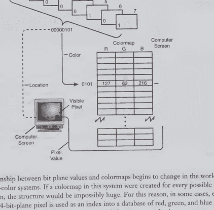

位平面值与调色板之间的关系在 24 位真彩色系统的世界中开始发生变化。如果为这种系统中的每种可能的颜色组合创建调色板，该结构将变得不可能巨大。因此，在某些情况下，每 24 位平面像素的三分之一用作红色、绿色和蓝色电平值的数据库的索引，其组合会在屏幕上产生可见色调。在极端情况下，只存在一个硬件调色板，视频位平面直接映射到 RGB 值。这些所谓的真彩色显示器可以同时显示超过 1600 万种不同的色调——超过人眼可以辨别的数量。

无论视频内存的多少以及可能的平面数如何，我们都可以将所有类型的屏幕归纳为以下三种基本类别之一：

- 单色单平面系统

- 单色灰度系统

- 彩色系统

就 X 彩色图形编程而言，通常只需确定哪一类最能描述你的系统即可。在第一种情况下，客户端可以对所有颜色使用黑白。然而，如果客户端需要超过两种颜色，则别无选择，只能显示错误信息并退出。在第二种情况下，客户端应用程序可以用灰度颜色值代替其通常的颜色。在第三种情况下，程序可以使用 X 服务器数据库中提供的颜色值。

> Note
>
> 调查可用视频系统类型的方法多种多样，但在大多数情况下，最好只是让用户能够自行选择颜色值，也许使用命令行选项或来自设置文件。X 中的彩色图形编程涉及一定程度的猜测，可能无法编写在运行 UNIX 和 Linux 的所有可能硬件上完全相同的软件。

## THE X COLOR DATABASE

在大多数情况下，通过使用标准颜色名称，你的程序最有可能产生可预测的彩色图形。颜色定义在存储在文件 `rgb.txt` 中的数据库中。该文件包含 X 服务器所知的颜色名称集合以及相关的 RGB 值。该文件中还包含以 `gray0` 到 `gray100`（或 `grey0` 到 `grey100`）为符号表示的灰度级别，按单整数步进。你可以在彩色或单色灰度系统上使用这些“颜色”。表 28.1 按声明顺序显示了来自 `rgb.txt` 数据库中的一些颜色。许多颜色有同义词——例如，`hot pink` 和 `HotPink` 是同一种颜色。一些权威资料指出该文件存储在路径 `/usr/X11R6/lib/X11` 中，但在我的系统上，我发现它在 `/usr/X11R6/lib/X11` 中，所以你可能需要寻找它。X 服务器使用该文件的编译版本——它实际上并不读取文本。

TABLE 28.1 SELECTED X COLOR NAMES FROM RGB.TXT

| snow | DarkSlateGrey | LightCoral |

| ghost white | dim gray | tomato |

| GhostWhite | DimGray | orange red |

| white smoke | navy blue | OrangeRed |

| WhiteSmoke | NavyBlue | red |

| antique white | cornflower blue | hot pink |

| AntiqueWhite | CornflowerBlue | HotPink |

| papaya whip | cyan | violet |

| PapayaWhip | light cyan | plum |

| blanched almond | LightCyan | blue violet |

| BlanchedAlmond | dark sea green | BlueViolet |

| bisque | DarkSeaGreen | purple |

| peach puff | sea green | medium purple |

| PeachPuff | SeaGreen | MediumPurple |

| seashell | forest green | thistle |

| honeydew | ForestGreen | gray0 |

| mint cream | sandy brown | grey0 |

| MintCream | SandyBrown | gray1 |

| azure | tan | grey1 |

| dark slate gray | chocolate | gray100 |

| DarkSlateGray | firebrick | grey100 |

| dark slate grey | light coral |  |

使用来自 `rgb.txt` 的颜色名称并不能保证客户端的图形以任何特定色调显示。然而，使用标准名称将选择实际颜色的责任放在系统管理员和用户身上。例如，在单色系统上，每种颜色都可以赋予灰度级别，尽管在这种情况下，让客户端本身选择 `grayN`（或 `greyN`）符号以确保相邻图形有区别仍然是好主意。更重要的是，由于实际颜色在不同显示器之间会有所不同，数据库给了系统管理员适当调整颜色值的机会——这一过程有时模糊地被称为“伽马校正”。因此，使用来自 `rgb.txt` 的颜色名称有助于确保 `ForestGreen` 真正看起来像它应该的那样郁郁葱葱，即使该颜色的实际 RGB 值在不同系统之间可能有所不同。

## ALLOCATING COLORS


调色板中的每个条目称为一个 `colorcell`。每个 `colorcell` 可以是两种类型之一——只读，或读写。只读 `colorcell` 可以在两个或多个客户端之间共享。读写 `colorcell` 只能由分配该单元的客户端使用。顾名思义，读写 `colorcell` 是可变的，但只能由分配的客户端更改。只读 `colorcell` 以类似方式由客户端分配，但可以被多个客户端共享。一旦分配，只读 `colorcell` 就永远不能被更改。更改只读 `colorcell` 的唯一方法是删除它，分配一个新的颜色，并重绘客户端的图形。

许多程序员认为读写 `colorcell` 更可取，因为它们可以轻松更改，但通常并非如此。因为读写 `colorcell` 不能在客户端之间共享，它们会占用调色板中宝贵的空间，并可能导致系统新应用程序可用的颜色会耗尽。此外，在仅具有单个只读硬件颜色映射表的 24 位真彩色系统上，只能分配只读、可共享的颜色单元。使用可读写颜色单元的唯一实际优势在于，客户端只需更改该颜色单元的 RGB 值即可立即改变屏幕上的颜色。这正是可读写颜色单元不可共享的原因——如果某个客户端可以立即改变其他客户端共享的颜色，很可能会造成色彩混乱。

只读颜色单元可由客户端分配但不能更改，有助于让更多颜色可供多个客户端使用。例如，如果某个客户端分配了 `PapayaWhip` 这种颜色——一种听起来很可口的颜色——X 服务器会为该颜色返回一个颜色映射表索引，该索引对所有使用这种色调的客户端都是相同的。这也是按名称而不是按 RGB 值指定颜色的另一个好理由：你更有可能共享一个命名颜色单元，而不是由组成该颜色的像素色调来指定的颜色单元，尽管有些 X 服务器可以返回与所请求颜色非常接近的共享颜色单元。

无论如何，要分配颜色单元，客户端需调用两个 Xlib 函数之一：`XAllocColor()` 或 `XAllocNamedColor()`。结果会被插入到图形上下文（GC）中，然后用该颜色绘制图形或文本。它还可以用于创建像素图（`pixmap`）以显示彩色图像（本章末尾的“填充规则和样式”一节会进一步讨论）。清单 28.1 中的 `xcolor.cpp` 展示了使用 `XAllocNamedColor()` 分配颜色单元的基本技术。

### 清单 28.1 XCOLOR.CPP（部分）

```
Display *display;      // X server display structure

int main()
{
    // Attempt to establish communications with the X Server
    //
    display = XOpenDisplay(NULL);
    if (display == NULL) {
        cerr << "Failure connecting to X Server";
        exit(1);
    }
    //
    // Get the most basic of colors (black and white)
    //
    int intBlackColor, intWhiteColor;
    intBlackColor = BlackPixel(display, DefaultScreen(display));
    intWhiteColor = WhitePixel(display, DefaultScreen(display));
    // Create variables needed for XAllocNamedColor()
    Colormap colorMap = DefaultColormap(display, intScreenNum);
    char * colorname = "ForestGreen";
    XColor screenColor, exactColor;
    //
    // Allocate color. Exit if operation fails.
    //
    if (!(XAllocNamedColor(display, colorMap, colorname,
                           &screenColor, &exactColor)) {
        cerr << "Cannot allocate color " << colorname << endl;
```

```
exit(1);
}

// Create a graphics context for our window
XGCValues gc_values;
unsigned long gc_mask = GCForeground | GCLineWidth;
gc_values.foreground = screenColor.pixel;
gc_values.line_width = 3;
GC gc = XCreateGC(display, win, gc_mask, &gc_values);
// Map the window to the display
// Window is visible when first Expose event is received
XMapWindow(display, win);
...
}
```

示例程序 `xcolor.cpp` 是第 27 章“控制 Xlib 输入和输出”中 `xsketch.cpp` 的副本，但它允许你通过单击并拖动鼠标来绘制彩色线条。如果你的显示器不支持彩色，程序可能会失败，不过，我马上就会解释让它在任何 X 系统（即使是只有单个位平面的显示系统）上运行所需的步骤。

在与 X 服务器建立通信之后——这是任何客户端应用程序的第一项任务——程序使用 `BlackPixel()` 和 `WhitePixel()` 宏获取所有系统上可用的最简单的颜色值。这些步骤与第 26 章和第 27 章中描述的相同，但你仍应执行这些操作，以防客户端在单色屏幕上运行。

为了分配一种颜色（清单中的 `ForestGreen`），程序调用 `XAllocNamedColor()` 并使用了五个参数。其中一个参数是已经获取的 `display` 指针。其余四个声明如下：

```
Colormap colormap = DefaultColormap(display, intScreenNum);
char *colorname = "ForestGreen";
XColor screenColor, exactColor;
```

获取给定显示器和屏幕编号（由 `DefaultScreen()` 宏找到）的默认 `Colormap`。该值的使用方式类似于 `Window` ID 整数值，但实际上它是指向 X 服务器颜色映射表结构的指针。不过，你绝不要将 `Colormap` 当作真正的指针来使用。还要使用 `rgb.txt` 数据库中的名称之一来定义所需颜色的名称。在这里试试表 28.1 中的一些其他名称，看看它们在系统上的效果。两个 `XColor` 变量保存 `XAllocNamedColor()` 的结果，调用方式如下：

```
if (!XAllocNamedColor(display, colormap, colorname,
                     &screenColor, &exactColor)) {
    cerr << "Cannot allocate color " << colorname << endl;
    exit(1);
}
```

该函数返回一个 `true` 或 `false` 状态值，指示命名颜色能否在颜色映射表中正确分配。如果函数返回 `true`，这两个变量 `screenColor` 和 `exactColor` 都填充了程序可用于显示彩色图形的值。第一个值很可能是一个共享的像素值，表示 X 服务器能找到的最接近匹配的颜色。`exactColor` 表示所请求颜色的确切 RGB 值。你可以使用任一返回值，但第一个可能产生更一致的结果。

> Note
>
> 这里的颜色选择技术仅用于演示目的，生产软件不应如此严格地设置颜色。相反，你的程序应尽可能显示所有可用颜色，并让用户自行选择实际想要的颜色。

如果 `XAllocNamedColor()` 失败就结束程序，当然是一种极端的措施。在大多数情况下，如果函数返回 `false`，你的程序可能应采取其他措施——选择更有可能可用的替代颜色（例如用 `green` 代替 `ForestGreen`）。请记住，你始终可以退回到 `BlackPixel()` 和 `WhitePixel()` 宏。这些值即使在单平面单色系统上也能工作，因此在最坏的情况下，如果 `XAllocNamedColor()` 失败，一个编写良好的 X 客户端应简单地以黑白显示其图形。只有在这种做法不切实际时，程序才应在无法分配所请求颜色时结束。

成功调用 `XAllocNamedColor()` 后，你可以使用返回的像素值。基本上，使用已分配颜色有两种方法。你可以在使用 `XCreateSimpleWindow()` 或 `XCreateWindow()` 函数创建窗口时指定返回的像素值，或者你可以设置图形上下文中的前景色。示例程序使用后一种技术，通过以下语句创建 GC：


```
XGCValues gc_values;
unsigned long gc_mask = GCForeground | GCLineWidth;
gc_values.foreground = screenColor.pixel;
gc_values.line_width = 3;
GC gc = XCreateGC(display, win, gc_mask, &gc_values);
```

这些语句展示了使用 `XGCValues` 结构和相关位掩码（`gc_mask`）创建 `GC` 的“硬方法”，该掩码告诉 `XCreateGC` 要从其默认值覆盖哪些结构成员。在本例中，我们希望设置前景色和线宽，由位掩码 `GCForeground` 和 `GCLineWidth` 表示。由之前的 `XAllocNamedColor()` 调用初始化的 `screenColor.pixel` 成员为随后使用此 `GC` 的图形选择前景色。

或者，如果 `GC` 已创建，你可以通过调用 `XSetForeground()` 来更改前景色，如下所示：

```
XSetForeground(display, gc, screenColor.pixel);
```

```
typedef struct {
unsigned long pixel;
unsigned short red, green, blue;
char flags; // do_red, do_green, do_blue
char pad;
} XColor;
```

通常，`XColor` 结构中的 `pixel` 成员是你保存并用于在已分配颜色中绘制图形所需的一切。`red`、`green` 和 `blue` 值表示已分配颜色单元的 RGB 分量。然而，切勿假设符号颜色名（甚至“color”这个词）与用户实际看到的颜色有任何关系。`XColor` 结构中的 `flags` 字段仅对读写颜色单元有意义，用于指示要更改的 RGB 分量中的哪一个。在这里描述的颜色技术中，`flags` 字段毫无意义。最后的 `char` 成员 `pad` presumably 将 `XColor` 结构填充到偶数字节数。

> Note
>
> `XColor` 结构的 `red`、`green` 和 `blue` 成员使用 0 到 65535 的 `unsigned int` 值表示颜色级别。即使颜色单元中的实际值范围为 0 到 255 也是如此。`XColor` 成员值在 X 服务器中根据硬件和调色板的需要进行缩放。

## COLORING SCALED GRAPHICS

为了演示如何使用多种颜色绘制图形，Listing 28.2，`xrainbow.cpp`，在窗口中绘制了一道色彩缤纷的彩虹。该程序还演示了将图形缩放以适应窗口大小的重要技术，无论其大小如何。使用此方法，当用户调整窗口大小时，其内容会自动调整以适应新的窗口边界。Figure 28.2 显示了程序的窗口，在这里不幸没有你自己屏幕上那么色彩丰富（假设你有彩色显示器的话）。

Figure 28.2

一道色彩缤纷的彩虹演示了如何以多种颜色绘制图形，以及如何将图形缩放以适应窗口边界。

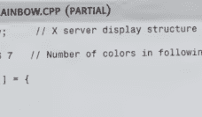

## LISTING 28.2 XRAINBOW.CPP (PARTIAL)

```
Display *display;    // X server display structure

#define MAXCOLORS 7  // Number of colors in following arrays

char *Roy_G_Biv[] = {
```

## 清单 28.2（续）

```
"Red",
"Orange",
"Yellow",
"Green",
"Blue",
"Violet",
"DarkViolet"  // Violet
};

unsigned long colors[ MAXCOLORS ];
void GetColors(unsigned long intDefaultColor);
void PaintRainbow(Window win, GC gc,
int winWidth, int winHeight);

int main()
{
    // Attempt to establish communications with the X Server
    //
    display = XOpenDisplay(NULL);
    if (display == NULL) {
        cerr << "Failure connecting to X Server";
        exit(1);
    }
    ...
    // Fill global colors array using intBlackColor for the
    // default color if any allocation fails.
    //
    GetColors(intBlackColor);
    // Specify the types of events we want to receive
    //
    XSelectInput(display, win,
        ExposureMask | KeyPressMask | StructureNotifyMask);
    // The event loop.
    //
    bool done = false;
    XEvent event;
    while (!done) {
        XNextEvent(display, &event);
        switch (event.type) {
            case Expose:
                if (event.xexpose.count == 0) {
                    XClearWindow(display, win);
                    PaintRainbow(win, gc, intWidth, intHeight);
                }
                break;
            case ConfigureNotify:
                intWidth = event.xconfigure.width;
                intHeight = event.xconfigure.height;
                break;
            case KeyPress:
                cout << "Keypress detected" << endl;
                done = true;  // Exit on any keypress
                break;
        }
    }
```

在 X 客户端中，分配多种颜色的方法有很多，但这里展示的是其中最通用的一种。首先，按照清单中的方式创建一个颜色名称字符串数组。在这里，我将数组命名为 `Roy_G_Biv`，以纪念那个容易记住的首字母缩略词，它代表了彩虹的基本颜色：红、橙、黄、绿、蓝、靛、紫。然而遗憾的是，X 并未定义 Indigo，而且自带的 Violet 颜色太浅——所以我用 Violet 和 DarkViolet 两种颜色替换了数组的最后两个颜色名称。

除了颜色名称字符串数组，还需要定义一个 `unsigned long` 值数组，每种颜色对应一个：

```
unsigned long colors[ MAXCOLORS ];
```

如果你需要访问该结构中的其他字段，也可以创建一个 `XColor` 对象数组，但这里我们只需要保存由 `XAllocNamedColor()` 返回的像素值。连接到 X 服务器后，示例程序调用一个本地函数 `GetColors()` 来填充 `colors` 数组。这个函数（位于清单末尾附近）会为每个颜色名称字符串调用 `XAllocNamedColor()`，并将返回的像素值赋给 `colors` 数组。如果有任何颜色无法分配，程序会分配一个默认颜色（这里为黑色）。在这个例子中，这样做可能并不合适，因为在单色系统上，如果所有颜色都默认为黑色，结果看起来就不太像彩虹了。不过，这恰恰指出了在 X 下使用颜色时的一个难点：永远无法预测颜色图形的确切效果，总是需要一点猜测加上一些信念。

然而，由于我们使用的是颜色名称，程序在大多数系统上应该都能正常运行。为了真正绘制彩虹，程序在收到 `Expose` 事件时会调用另一个本地函数 `PaintRainbow()`。该函数通过调用 Xlib 图形原语函数 `XFillArc()` 来绘制半月形，其参数设置为用连续的弧形填充窗口，从而模拟彩虹。最后一次对 `XFillArc()` 的调用会将最终的半月形擦除为窗口的背景色，完成这个幻觉。注意 `XSetForeground()` 是如何在绘制弧形之前从 `colors` 数组中逐个分配像素值的。


**提示：** 要获取关于 `XFillArc()` 的在线信息，请输入 `info XFillArc`。

`xrainbow.cpp` 程序还演示了如何缩放图形以适配任意大小的窗口。要了解此功能的工作原理，请运行程序并改变窗口的大小。无论你将窗口调得多小多大，彩虹都会从一角延伸到另一角。（抱歉，彩虹两端可没有金罐！）

只要你的绘图例程根据窗口大小来计算位置和其他值，缩放图形并不难。在本例中，两个整数变量 `intWidth` 和 `intHeight` 在窗口创建前初始化，用于记录窗口的像素尺寸。要在用户调整窗口大小时更新这些变量，请在程序进入事件循环之前，将 `StructureNotifyMask` 添加到传递给 `XSelectInput()` 的事件类型中。然后，在事件循环中，添加一个像这样的 `ConfigureNotify` 事件分支：

```cpp
case ConfigureNotify:
    intWidth = event.xconfigure.width;
    intHeight = event.xconfigure.height;
    break;
```

通常这就是你缩放图形所需做的全部——前提是你的图形是相对于窗口大小绘制的。你不必响应此事件重绘图形。只需像平常一样响应 `Expose` 事件时绘制它们即可。

> Note
>
> 强烈不建议尝试阻止用户调整窗口大小。按照这里描述的方式缩放图形需要多做一点工作，但用户会感谢你尽力让你的 X 应用程序尽可能不受限制。

## ATOMIC ENERGY

第 26 章“Introducing X Programming”提到了原子的主题。你可能不需要在每个应用程序中都使用原子，但它们对于指定某些类型的信息以及在客户端之间通信非常有用。以下各节解释了如何创建和使用原子。

### SETTING AND GETTING ATOMS

在 X 编程中，属性是原子的同义词。你已经见过一个这样的原子，用于向窗口管理器建议窗口标题。为了为此目的分配一个字符串，像 `xrainbow.cpp` 这样的程序（参见清单 28.2）会执行以下语句：

```
XStoreName(display, win, "X Rainbow");
```

这会在 X 服务器中为此窗口和显示存储指定字符串的副本。在这种情况下，该字符串由原子符号 `XA_WM_NAME` 标识。其他原子符号，全部以 `XA` 开头并大写，都可以在标准 X11 include 路径中的文件 `Xatom.h` 中找到。像这里建议的窗口标题这样的特定字符串与其原子符号和一个窗口 ID 相关联；因此，每个窗口都可以拥有自己同名但不同的原子。

> Note
>
> 如前几章所述，由 `XA_WM_NAME` 原子标识的窗口标题只是对窗口管理器的一个建议或“提示”。不能保证窗口管理器会在任何特定位置或根本不显示标题。（不过，任何值得使用的窗口管理器都应该至少尝试显示窗口的标题。）

给定任何 `Window` ID，你可以通过调用 `XFetchName()` 来获取分配给该窗口的名称。使用如下编程（假设 `win` 是 `Window` ID）：

```
char *wname = NULL;
if (XFetchName(display, win, &wname))
    cout << 'Name is ' << wname << endl;
```

`XStoreName()` 和 `XFetchName()` 被称为便捷函数，因为它们被翻译为其他 Xlib 函数调用。例如，`XStoreName()` 调用 `XSetWMName()`，你也可以使用它来设置窗口的名称。`XSetWMName()` 反过来调用 `XSetTextProperty()`。调用这些低级函数之所以复杂，因为需要构造 Xlib 结构 `XTextProperty` 的对象。为此需要调用另一个函数 `XStringListToTextProperty()`。

所有这些复杂性的原因在于 `XTextProperty` 设计用于处理可能存在于运行 X 服务器的各种主机计算机上的各种数据大小。因为 X 服务器可能需要通过网络与在不同机器上运行的客户端通信，所以原子属性必须仔细管理，以确保它们处于预期的形式。无论如何，你通常可以使用下一程序中演示的技术，使用 `XTextProperty` 结构分配属性。清单 28.3 中的程序 `xatom.cpp` 与第 26 章“Introducing X Programming”中的 `xwelcome.cpp` 程序相同，但调用 `XSetWMName()` 来分配窗口标题。为演示目的，程序还调用 `XGetWMName()` 来检索窗口的名称属性。清单仅显示相关语句。

```cpp
//  XStoreName(display, win, "Easy-Method Window Title");
XTextProperty nameProp;  // Window Name property
char *name = "Window Name set by XSetWMName()";
int numStrings = 1;  // Only one string in above "list"
if (!XStringListToTextProperty(
    &name, numStrings, &nameProp)) {
  cerr << "Unable to allocate XTextProperty" << endl;
  exit(1);
}

XSetWMName(display, win, &nameProp);
```

清单开头的注释显示了分配窗口标题属性的简便方法。要使用 `XSetWMName()` 函数执行相同操作，需要为一个或多个字符串初始化 `XTextProperty` 结构。你可以使用字符串列表或仅一个字符串，如此处所示演示。调用 `XStringListToTextProperty()` 如图所示，带三个参数：

- 列表中第一个字符串的地址（或仅一个，如本例中）

- 列表中的字符串数量

- `XTextProperty` 结构的地址

如果函数返回零（false），则 `XTextProperty` 结构无法初始化，由你决定如何处理。如果这是在程序的早期阶段，此处的失败可能表明内存严重不足，或其他 X 服务器问题，并且程序可能无法继续。初始化 `XTextProperty` 结构后，调用 `XSetWMName()` 来分配原子。

## 客户端间通信

原子（Atom）是客户端之间进行通信的唯一可靠方法。尽管你可能会尝试使用其他技术，但请记住，在网络环境中，两个客户端必须运行在物理上分离的机器上，而且可能类型不同。即使是在客户端间通信，使用临时文件也是不安全的。相反，可以考虑使用原子属性来传输信息。如果原子与根窗口关联，那么你可以确信它对于运行在用户 X 服务器上的所有客户端都是可用的。

在客户端之间传递信息的最佳且最简单的方法之一，就是使用 X 服务器提供的八个剪切缓冲区之一。剪切缓冲区（cut buffer，又称剪贴板）是一个原子属性，其名称从 `XA_CUT_BUFFER0` 到 `XA_CUT_BUFFER7`。大多数客户端使用第一个剪切缓冲区在彼此之间传输文本信息。清单 28.4（`xcut.cpp`）演示了当该剪切缓冲区发生变化时，客户端如何收到通知，以及如何检索缓冲区的内容。

```
Listing 28.4  X CUT.CPP (PARTIAL)

// Specify the types of events we want to receive
//
XSelectInput(display, win,
ExposureMask | KeyPressMask | PropertyChangeMask );
XSelectInput(display, DefaultRootWindow(display),
PropertyChangeMask);

// The event loop
//
bool done = false;
XEvent event;
int nbytes = 0;
char *s = NULL;
while (!done) {
```

### 清单 28.4（续）

```
XNextEvent(display, &event);
switch (event.type) {
case Expose:
    cout << "Expose event received" << endl;
    break;
case PropertyNotify:
    cout << "PropertyNotify event" << endl;
    s = XFetchBytes(display, &bytes);
    if (s != NULL && nbytes > 0) {
        cout << "Property changed: " << s << endl;
        XFree(s);
    }
    break;
case KeyPress:
    cout << "Keypress detected" << endl;
    done = true;  // Exit on any keypress
    break;
}
```


要使客户端在剪切缓冲区被更改时收到通知，有必要为根窗口指定 `PropertyChangeMask`。根窗口拥有剪切缓冲区原子，因此仅将 `PropertyChangeMask` 添加到我们窗口的事件中是不够的。显然，为根窗口和客户端窗口都选择此事件掩码并无坏处，而且这似乎可以确保窗口创建时最初生成该事件。但如果你不想这样做，可以从第一次调用 `XSelectInput()` 时删除 `PropertyChangeMask`。

### 注意

> 你不必选择接收剪切缓冲区更改的通知。或者，你可以使用此处展示的相同技术，在响应其他类型的事件（例如鼠标按钮单击或按键）时访问剪切缓冲区。不过，你可能会希望使用 `PropertyChangeMask` 设置一个标志，以指示剪切缓冲区中有新信息可用。通常，客户端这样做是为了启用“粘贴”（`Paste`）菜单命令或按钮，在 UNIX 中它通常被称为 `Yank` 命令。

当用户向剪切缓冲区插入数据时，`PropertyNotify` 事件的 switch case 将被选中。程序调用 `XFetchBytes()` 来检索信息——该函数始终使用被标识为 `XA_CUT_BUFFER0` 的第一个缓冲区。要使用其他剪切缓冲区，可以调用类似的 `XFetchBuffer()` 函数。要向缓冲区插入数据，请调用 `XStoreBytes()` 或 `XStoreBuffer()`。

始终像示例程序所示那样调用 `XFree()` 来释放 `XFetchBytes()` 或 `XFetchBuffer()` 返回的字符串数据。这些数据是服务器中保存信息的副本，因此释放它不会妨碍这些信息被再次使用。

## 线条与填充样式

在 X 客户端应用程序中，所有图形输出都是参照图形上下文（Graphics Context，简称 `GC`）进行的。本章与前两章展示了许多创建和使用简单 `GC` 的示例，但本节将解释一些你无疑会想使用的更高级功能。借助 `GC`，你可以选择线条样式，也可以设置用于填充对象（如弧线和矩形）的像素图图案。

### 线条宽度与样式

X 服务器能够以任何实际宽度和多种样式绘制线条。线条样式不仅影响直线，也影响其他形状的轮廓，因此这些概念几乎在每一个图形程序中都会发挥作用。清单 28.5（`xdash.cpp`）展示了创建实线和虚线的最简单方法。该程序还展示了一种更改虚线宽度的方法——这是一个晦涩的特性，在许多教程中既不明显，也没有得到很好的解释。图 28.3 显示了该程序的窗口。（第三行的背景颜色在本页上可能可见，也可能不可见，但在屏幕上应该是淡黄色。）

### 图 28.3

示例 `xdash.cpp` 窗口，显示三种线条样式：`LineSolid`、`LineOnOffDash` 和 `LineDoubleDash`。

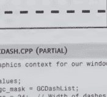

### 清单 28.5 `XDASH.CPP`（部分）

```
// Create a graphics context for our window
//
XGCValues gc_values;
unsigned long gc_mask = GCDashList;
gc_values.dashes = 24; // Width of dashes and spaces
GC gc = XCreateGC(display, win, gc_mask, &gc_values);

// Paint lines in different styles
void PaintLines(Window win, GC gc,
    int winWidth, int winHeight)
{
    int x1, y1, x2, y2;
    unsigned int lineWidth = 8;

    x1 = 0;
    y1 = lineWidth * 6;
    x2 = winWidth;
    y2 = y1;

    XSetForeground(display, gc, colors[0]);
```

### 清单 28.5（续）

```
XSetLineAttributes(display, gc,
lineWidth, LineSolid, CapButt, JoinBevel);
XDrawLine(display, win, gc, x1, y1, x2, y2);
y1 += (lineWidth * 6);
y2 = y1;

XSetForeground(display, gc, colors[1]);
XSetLineAttributes(display, gc,
lineWidth, LineOnOffDash, CapButt, JoinBevel);
XDrawLine(display, win, gc, x1, y1, x2, y2);
y1 += (lineWidth * 6);
y2 = y1;

XSetForeground(display, gc, colors[2]);
XSetLineAttributes(display, gc,
lineWidth, LineDoubleDash, CapButt, JoinBevel);
XDrawLine(display, win, gc, x1, y1, x2, y2);
}
```

`xdash.cpp` 的清单以 `main()` 中的语句开头，这些语句用于更改 `LineOnOffDash` 和 `LineDoubleDash` 线型的虚线宽度以及它们之间的间距。自然地，这种更改不会影响 `LineSolid` 类型的实线。`XGCValues` 结构中的 `dashes` 字段是 `char` 类型，因此使用此方法时虚线宽度显然被限制为 255 像素。使用掩码 `GCDashList` 告知 `XCreateGC()` 使用分配给 `dashes` 字段的设置。我不知道为什么这个掩码值中带有“List”这个词——使用此方法设置的虚线宽度是一个单独的 `char` 值，而不是一个值列表。

程序后面是一个局部函数 `PaintLines()`，这里完整列出。该函数使用本章前面 `xrainbow.cpp` 程序中的方法和值（见清单28.2）来更改每条线的颜色。在调用 `XSetForeground()` 选择线条颜色后，程序调用 `XSetLineAttributes()` 选择线条样式。可能的样式如下：

- `lineWidth` 可以是包括零在内的任意整数值。
- `lineStyle` 可以是 `LineSolid`、`LineOnOffDash` 或 `LineDoubleDash`。示例程序的窗口按该顺序显示每种样式的线条。
- `capStyle` 该值影响线端样式，可以是 `CapNotLast`、`CapButt`、`CapRound` 或 `CapProjecting` 中的任意值。通常，线端样式对于矩形等封闭形状更为重要。
- `joinStyle` 该值指定两条线在封闭形状中交汇时，其端点如何组合。该值可以是常量 `JoinMiter`、`JoinRound` 或 `JoinBevel` 之一。

> 注意：`lineWidth` 为零时选择一条所谓的“快速”线，其宽度为一个像素，可能无法通过重绘擦除，并且其外观可能因绘制方向的不同而有所不同。除非你必须使用快速线条——例如，作为复杂形状的临时轮廓——否则通常最好将 `lineWidth` 设置为 1 或更大。

还可以自定义虚线的外观，类似于文字处理器让你选择虚线间距的方式。基本上，要做到这一点，你需要提供一组虚线和空白宽度列表，并在绘制线条之前调用 Xlib 的 `XSetDashes()` 函数，将此信息插入到 `GC` 中。输入 `info XSetDashes` 以获取有关此主题的更多信息。

## 填充规则与样式

与许多图形库不同，即使是填充多边形等复杂形状也由 X 服务器绘制，而不是由链接到客户端应用程序的代码绘制。尽管通过 Xlib 函数调用访问，图形原语是 X 的内在属性。这一特性的重要性可能直到你考虑到客户端应用程序可以运行在各种硬件上，而无需链接到依赖于系统的目标代码时，才会意识到。

即使是最复杂的图形操作，例如用彩色像素图填充多边形，也在 X 服务器中处理。接下来的两个程序（见清单28.6和28.7）演示了这些特性，并解释了一些其他选项，你可以选择这些选项来微调程序的图形输出。

清单28.6（`xfill.cpp`）显示用纯色填充的多边形。多边形坐标和颜色使用标准 C 库的 `random()` 函数随机选择。运行程序并在窗口内单击鼠标，即可显示一个新多边形，其颜色为多种可选颜色之一。图28.4显示了程序输出的一个示例。


```c
#define MAXPOINTS 12 // Num XPoint objects in points array
XPoint points[ MAXPOINTS ];
unsigned long polyColor;

void GetColors(unsigned long int defaultColor);
void GetPoints(int winWidth, int winHeight);
void Paint(Window win, GC gc, int winWidth, int winHeight);

int main()
{
  srandom( time(NULL) );  // Seed random generator
  ...
}
```

```c
points[i].x = random() % winWidth;
points[i].y = random() % winHeight;
}
int colorIndex = random() % MAXCOLORS;
polyColor = colors[colorIndex];

// Display coordinate values in the terminal window
// for debugging. You may remove these statements.
//
cout << endl;
cout << "Color == " << Roy_Biv[colorIndex] << endl;
cout << "GetPoints() points[]:" << endl;
for (int i = 0; i < MAXPOINTS; i++) {
    cout << "x:" << points[i].x << ", y:"
         << points[i].y << endl;
}

// Paint a colorful polygon
void Paint(Window win, GC gc, int winWidth, int winHeight)
{
    XSetForeground(display, gc, polyColor);
    XSetFillRule(display, gc, EvenOddRule);
    XSetFillStyle(display, gc, FillSolid);
    XFillPolygon(display, win, gc, points, MAXPOINTS,
        Nonconvex, CoordModeOrigin);
}
```

The `xfill.cpp` program initializes a `colors` array using the same values as in `xrainbow.cpp` (refer to Listing 28.2). Local function `GetPoints()` fills another array of `XPoint` structures with coordinate values selected at random and constrained to the window's width and height. This tends to make the finished polygon fill the window (more or less). The `GetPoints()` function also assigns a color selected at random to the global `polyColor` variable. For debugging purposes, the function writes the selected color and generated coordinate values to the terminal window. To see this output, arrange the program's window and the terminal so that you can see both. For each polygon, the terminal displays text such as the following:

```
Color == Green
GetPoints() points[]:
x:323, y:15
...
x:142, y:29
```

Xlib defines as follows the `XPoint` structure stored in the program's `points` array. You can use this structure to define any coordinate or an array of coordinates as in the sample program:

```c
typedef struct {
    short x, y;
} XPoint;
```

To draw and fill a polygon using an array of `XPoint` structures, local function `Paint()` begins with three preparatory statements:

```c
XSetForeground(display, gc, polyColor);
XSetFillRule(display, gc, EvenOddRule);
XSetFillStyle(display, gc, FillSolid);
```

The GC's foreground in this case specifies the solid color used to paint the polygon's interior. The foreground color, however, is valid only if the GC's fill style is set to `FillSolid`, done here in the third statement's call to `XSetFillStyle()`. The second statement sets the GC's fill rule to `EvenOddRule`, although this is the default setting. When filling polygons where lines cross, this rule determines whether an enclosed area is part of the pattern or belongs to the background. The other possible rule is `WindingRule`, which fills overlapping areas. (Change the fill rule to `WindingRule` to see the difference in the sample program.)

The GC's fill style can be one of four values (these apply to all filled shapes, not just polygons):

- `FillSolid` This style uses the GC's foreground color to fill the shape.
- `FillStippled` This style replicates a single-plane bitmap using the foreground color to fill the shape for each bit that is set to 1 in the bitmap.
- `FillOpaqueStippled` This style is the same as `FillStippled` but also uses the GC's background color to paint bits set to 0 in the bitmap.
- `FillTiled` This style replicates a pixmap of the screen's depth to fill the shape. (See Listing 28.7, `xpat.c`, later in this section for an example of this style.)


Keep in mind that the `GC`'s fill rule and style control the outcome of the `XFillPolygon()` function (and other filled shapes). To select fill rules and styles, first initialize the `GC` and then pass it to the graphics function, as the local `Paint()` function demonstrates with its final statement:

```
XFillPolygon(display, win, gc, points, MAXPOINTS,
Nonconvex, CoordModeOrigin);
```

To the function, pass the global `display` pointer, `Window` ID, `GC` (after configuring it as described), a pointer to an array of `XPoint` objects, and the number of objects in that array. The final two arguments select two more features available for drawing and filling polygons. The first of these values is the polygon's shape, which can be one of three symbols: `Complex`, `Convex`, or `Nonconvex`. These values are merely hints to the X server that may or may not improve display performance, and only if the server takes the hint to use different drawing algorithms based on the type of polygon. These values seem to produce the same effects on my system, but in a critical application, you might want to give users the option to select one of these settings.

The last argument passed to `XFillPolygon()` selects the mode used to connect its `XPoint` coordinates. This can be one of the two values, which have somewhat misleading names:

- `CoordModeOrigin` Considers all `XPoint` coordinate values to be relative to the window's origin.

- `CoordModePrevious` 将除第一个之外的所有 `XPoint` 坐标值都视为相对于前一个 `XPoint` 对象。

示例程序使用第一种设置，使得所有 `XPoint` 值都相对于窗口原点。如果使用第二种模式设置，绘图会“走”出屏幕，因为除第一个之外的每个新点都被视为相对于前一个点。换句话说，使用设置 `CoordModePrevious`，如果点 A 为 (100, 100) 且 B 为 (50, 50)，那么 B 实际上相对于窗口位于 (150, 150)。通常，您应使用 `CoordModeOrigin` 来连接多边形线条。

填充多边形的另一种方法是使用 `pixmap` 用图案填充形状内部。这需要一些在各种图形程序中都有用的额外技术。例如，您可能会使用这些方法来创建具有阴影表面的按钮。清单 28.7，`xpat.cpp`，演示了如何加载和使用 `pixmap` 来绘制填充多边形，其背景颜色随机选择。与前一个示例（清单 28.6）一样，运行 `xpat.cpp` 并在窗口中单击鼠标指针以更改图像。`pixmap` 是从第 27 章“控制 Xlib 输入和输出”中的 `xtile.cpp` 程序的同一位图图像创建的。图 28.5 显示了程序输出的示例。


### LISTING 28.7 XPAT.CPP (PARTIAL)

```cpp
#define MAXPOINTS 12  // Num XPoint objects in points array
XPoint points[MAXPOINTS];
unsigned long polyColor;
unsigned int bmWidth, bmHeight; // Bitmap width and height
unsigned char * bitmap;          // Pointer to raw bitmap data
Pixmap pixmap;                   // Pixmap of same screen depth

void GetColors(unsigned long intDefaultColor);
void GetPoints(Window win, int winWidth, int winHeight);
void Paint(Window win, GC gc, int winWidth, int winHeight);

int main()
{
    srandom( time(NULL) );  // Seed random generator

    ...

    // Load bitmap from file for use as window background
```

### LISTING 28.7 CONTINUED


```c
// int bmXhot, bmYhot;   // Bitmap hotspot (ignored)
int result = XReadBitmapFileData(
"ts.xbm",
&bmWidth, &bmHeight,
&bitmap,
&bmXhot, &bmYhot );
if (result != BitmapSuccess) {
    cerr << "Failed to open ts.bmp file" << endl;
    exit(1);
}

// Fill global colors array using intBlackColor for the
// default color if any allocation fails.
//
GetColors(intBlackColor);

// Fill global points array with random coordinates
//
GetPoints(win, intWidth, intHeight); // Also sets polyColor

// The event loop.
//
bool done = false;
XEvent event;
while (!done) {
    XNextEvent(display, &event);
    switch (event.type) {
    case Expose:
        if (event.xexpose.count == 0) {
            XClearWindow(display, win);
            Paint(win, gc, intWidth, intHeight);
        }
        break;
    case ConfigureNotify:
        intWidth = event.xconfigure.width;
        intHeight = event.xconfigure.height;
        break;
    case ButtonPress:
        XFreePixmap(display, pixmap);
        GetPoints(win, intWidth, intHeight);
        XClearWindow(display, win);
        Paint(win, gc, intWidth, intHeight);
        break;
    case KeyPress:
        cout << "Keypress detected" << endl;
        done = true;  // Exit on any keypress
        break;
    }
}

// Free the pixmap and bitmap structures
//
XFreePixmap(display, pixmap);
XFree(bitmap);
```

```c
// Disconnect X server connection and exit.
// (Program may never get to here)
//
XCloseDisplay(display);
return 0;
}
```

```
...
```

```c
// Paint a colorful polygon
void Paint(Window win, GC gc, int winWidth, int winHeight)
{
    XSetTile(display, gc, pixmap);
    XSetFillRule(display, gc, EvenOddRule);
    XSetFillStyle(display, gc, FillTiled);
    XFillPolygon(display, win, gc, points, MAXPOINTS,
        Nonconvex, CoordModeOrigin);
}
```

为了保持程序简单，我将 `main()` 中的几个变量移出并设为全局变量。程序使用与 `xrainbow.cpp`（见本章清单 28.2）和 `xfill.cpp`（见清单 28.6）相同的颜色技术。要读取位图图像文件 `ts.xbm`，程序调用 `XReadBitmapFileData()`，其说明见 `xtile.cpp`（参考第 27 章清单 27.12）。书中未列出（但包含在 CD-ROM 上的文件中）的是本地函数 `GetPoints()` 中的额外步骤，该步骤填充全局 `points` 数组并为全局 `polyColor` 变量随机选择一种颜色。额外的编程将加载的位图图像转换为适合用于填充图形形状的 `pixmap`：

```c
int screenNum = DefaultScreen(display);
pixmap =
    XCreatePixmapFromBitmapData(
        display,
        win,
        (char *) bitmap,
        bmWidth, bmHeight,
        BlackPixel(display, screenNum),  // Foreground
        polyColor,                       // Background
        DefaultDepth(display, screenNum));
```

`pixmap` 变量是类型为 `Pixmap` 的全局对象。此步骤执行两项重要工作。它将单平面位图，也称为 `stipple`，转换为为客户端屏幕配置的结构。它还指定用于此图像的前景色和背景色。虽然前景色使用黑色，但这也可以是颜色像素值。与用纯色填充多边形（或其他形状）不同，`pixmap` 本身决定前景和背景像素值，而不是 `GC`。

该过程的最后一步是绘制多边形，由本地函数 `Paint()` 执行。此函数与 `xfill.cpp`（见清单 28.6）中的函数类似，但除了选择填充规则和样式外，还执行了为 `GC` 指定 `pixmap` 的额外步骤：

```c
XSetTile(display, gc, pixmap);
XSetFillStyle(display, gc, FillTiled);
```

这种情况下必须将样式设置为 `FillTiled` 才能使用 `pixmap` 作为多边形的背景。现在调用 `XFillPolygon()` 会根据当前生效的填充规则，用指定的颜色将 `pixmap` 平铺来绘制形状。

> Note
>
> 如果 `GC` 的样式设置为 `FillStippled` 或 `FillOpaqueStippled`，则会使用 `XSetStipple()` 设置的 `GC` 的位图。这与 `pixmap` 的使用方式类似，但由于 `stipple` 是一个单平面位图，因此 `GC` 的前景色和背景色会用于显示的像素值。

### SUMMARY

本章介绍了 X 编程的一些高级主题，例如调色板和填充多边形。调色板是一个查找表，用于将视频位平面值转换为 RGB 颜色或灰度强度级别。由于使用了调色板，X 客户端应用程序可以编写成在各种硬件上运行，从单位平面单色系统到 24 位真彩色显示器，后者正迅速成为标准，尤其是在 Linux 安装中。本章以选择线型和用纯色及 `pixmap` 图像填充多边形的细节结束。

有关本章介绍主题的更多信息，请参阅以下章节：

- Chapter 26, “Introducing X Programming”
- Chapter 27, “Controlling Xlib Input and Output”

## CHAPTER 29

## Introducing the V Class Library

### INSTALLATION

在从本书 CD-ROM 获取 V 的分发文件或从 Internet 下载后，按照以下步骤安装并编译库及其示例程序。在 CD-ROM 上，V 的分发文件存储在 `src/v` 目录的 `v-1_22_tar.gz` 文件中。这是一个“已打包并压缩”的文件，需要解包才能安装 V 的众多文件。将此文件复制到您的主目录或其他目录，然后输入以下命令将分发文件解包到自动创建的名为 `v` 的子目录中：

```
$ cp v-1_22_tar.gz /home/username
$ cd /home/username
$ gunzip v-1_22_tar.gz
$ tar -xvf v-1_22_tar
```

`gunzip` 实用程序会移除 `.gz` 文件名扩展名并扩展压缩文件。`tar` 实用程序会将单独归档的文件解包到各个子目录中。要在解包前检查这些文件名，请使用以下命令：

```
$ tar -tf v-1_22_tar
```

`tar` 完成后，您可以删除原始分发文件。接下来，您需要为在 Linux 下编译配置 V。为此，切换到 V 的新创建的主目录并查找名为 `Config.mk` 的文件。该文件包含 V 的 `Makefile` 编译库所需的目录和其他设置。您可能还想阅读 V 的 `Readme` 文件以获取额外的安装说明。


V 以源代码形式提供——在使用它之前必须编译库。如果您小心使用正确的`Config.mk`文件，这并不困难。您会在`v/Configs`子目录中找到针对不同操作系统和编译器的多个示例配置。适用于 Linux 和 GNU C++ 的名为`ConfigX.mk`。使用以下命令将此文件复制到 V 主目录：

```
$ cd /home/username/v
$ mv Config.mk Config.old
$ cp v/Configs/ConfigX.mk Config.mk
```

这会将`ConfigX.mk`复制并重命名为`Config.mk`到 V 的主目录中。（您不必保留原始`Config.mk`文件，但如果出现问题，最好保留。）将`Config.mk`加载到文本编辑器中并找到以下定义：

```
ARCH = linux
TOOLKIT = Athena
X11RV = X11R6
DEBUG = no
DEVEL = no
```

这些设置对于 Linux 和 GNU C++ 应该是正确的。您可能可以忽略`Config.mk`中的其他定义，但可能想瞥一眼看看里面有什么。如果您想创建带有 GNU 调试器调试信息的库，请将`DEBUG`改为`yes`。这使您可以跟踪到库中并了解更多关于 V 如何与底层工具和 Xlib 函数调用配合工作的信息。然而，当您刚开始使用 V 编程时，不需要这样做。当您完成检查`Config.mk`后，保存任何更改并返回到 V 的主目录。输入以下命令编译库：

```
$ make
```

请准备好等待 5 或 10 分钟，让`make`实用程序编译库的众多模块和示例程序。如果您未安装 Open GL，您可能会注意到一些错误消息。不要担心——您不需要 Open GL 即可使用 V，可以安全地忽略这些错误。完成后，您应该看到消息“library, test, utils, examples, and tutorial made。”

> **Note**
>
> 编译 V 不会在`/usr`或其他系统目录中安装任何文件。您不需要是 root（超级用户）即可编译 V。这也意味着您只需删除其主目录即可将 V 完全从系统中移除。

## V’s SAMPLE PROGRAMS

编译 V 后，您想做的第一件事就是尝试其示例程序。切换到`/bin`目录并运行您在其中找到的可执行文件。图 29.1 显示了`/tutapps`教程应用程序的一个示例。请注意，该程序已完整配备菜单栏、按钮工具栏、状态栏、对话框窗口和其他一些功能。

表 29.1 列出了 V 提供的所有示例程序，并显示了其源代码文件的位置。（部分原因是 V 在不同平台上运行，可执行示例文件并不总是与其源目录名称匹配，因此我准备了此表以简化浏览示例。）

**Figure 29.1**

A sample V application, tutapps, complete with graphical features such as a pull-down menu bar, toolbar, and dialog window.

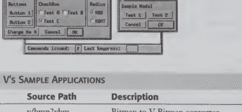

**TABLE 29.1 V’s SAMPLE APPLICATIONS**

| 名称 | 源路径 | 描述 |
|------|--------|------|
| `b2v` | `v/bmp/vbm` | Bitmap to V Bitmap converter |
| `icon demox` | `v/icons` | Displays icons on button faces |
| `protox` | `v/examp` | Prototype suitable as a shell |
| `tutappx` | `v/tutor` | 在线文档教程 |
| `vdrawexx` | `v/drawex` | 简单的颜色素描示例 |
| `vdrawx` | `v/draw` | 对象绘制演示 |
| `vgenx` | `v/appgen` | V 应用程序生成器 |
| `viconedx` | `v/iconed` | 彩色图标编辑器 |
| `videx` | `v/vide` | V 集成开发环境 |
| `vtestlibx` | `v/test` | V 测试程序 |

> **注意**
>
> 使用`vdrawx`，尝试在目录`v/draw`中打开`.drw`示例图形文件。`vgenx` V 应用程序生成器在“创建 V 应用程序”部分有更详细的描述。`videx`程序为创建和维护 V 应用程序提供了一种项目管理器，但请关注 V 的互联网网站，了解正在开发的更复杂的视觉 IDE。

## 文档

V 附带了一个写得很好的教程和对其众多类的参考。我在本章以及第 30 章“使用 V 开发 X 软件”中，尽量不重复 V 的在线文档，而是通过一份动手指南来补充这些信息，用于编程 X 客户端应用程序。要充分理解该库，你需要阅读在线文档以及本书中的信息。

现在浏览在线教程和参考资料以熟悉其布局。使用 Netscape 或其他 Web 浏览器打开目录`v/vrefman`中的文件`index.htm`。按照超文本链接跳转到其他文件。

## 创建一个 V 应用程序

现在，让我们创建一个 V 应用程序并检查其部分内容。开始使用 V 的最简单方法是运行其应用程序生成器`vgenx`，它完全使用 V 编写。等你成为 V 专家后，你可能想从头创建新应用程序，或者基于 V 提供的示例程序之一。但刚开始时，你会发现应用程序生成器易于使用，并且对于定义菜单和对话框等各种结构特别有帮助，而这些结构手动创建起来很繁琐。

### 使用 VGENX

V 应用程序生成器在 UNIX 和 Linux 下名为`vgenx`，在 Microsoft Windows 下名为`vgen`。按如下方式运行该程序以显示图 29.2 中的窗口：

```
$ cd v/bin
$ ./vgenx
```

**图 29.2**

vgenx 应用程序生成器窗口和标准应用程序对话框。

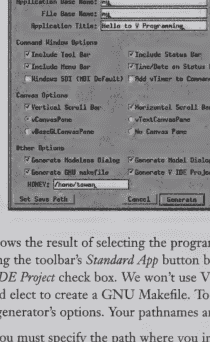

该图显示了选择程序的 Generate, Standard Application 命令的结果。点击工具栏的 Standard App 按钮会弹出相同的对话框。禁用 Generator V IDE Project 复选框。我们在这里不会使用 V 的 IDE。还需更改应用程序标题字符串并选择创建 GNU `Makefile`。跟随操作时，请以图 29.2 为指南选择生成器的选项。你的路径名可能与我的不同。

此外，你必须指定安装 V 的路径。生成器需要此路径来创建应用程序的`Makefile`。要设置 V 的主路径，请点击标签`HOMEV`旁边的文本输入框并输入安装 V 的基本目录。我输入的路径名为`/home/tswan/v`。

#### 提示

> 如果你经常使用应用程序生成器，可以考虑对其进行修改，使其根据你的安装设置 V 的主路径，这样你就不需要为每个新创建的应用程序更改此设置。

还请点击 Set Save Path 按钮并选择要让生成器存储应用程序文件和`Makefile`的目录。你可以从 shell 终端窗口创建此目录，或在文件打开对话框中点击`mkdir`按钮。在任何情况下，都请在点击 Generate 按钮创建应用程序文件之前设置保存路径。跟随操作时，请点击 Generate Now。如果你没有跟随操作，你会发现我在 CD-ROM 上的`src/c29/vmyapp`目录中创建的示例文件。

#### 注意

> 我修改了`src/c29/vmyapp`中生成的`Makefile`，使其使用外部目录的`src/c29/Config.mk`文件中的设置。该文件假定你已将 V 安装在主目录中。如果不是，请在尝试使用其关联的`Makefile`编译`vmyapp.cpp`之前相应地编辑`Config.mk`。

### 编辑生成的 `Makefile`

我通常发现有必要对 V 应用程序生成器`vgenx`创建的`Makefile`进行一些小修改。默认情况下，该文件名为`makefile.my`，因此第一步是使用以下命令将其重命名为`Makefile`：

```
$ cd /home/username/vmyapp
$ mv makefile.my Makefile
```

现在你可以通过输入`make`来尝试编译应用程序，但如果不行，你可能需要在`Makefile`内部做一些修改。如果你跟随操作，加载该文件到你的文本编辑器中，并在以下定义的两个包含路径中添加 "x"：

```
VPATH = $(HOME)/includex
CDFLAGS = -O -I$(X11INC) -I$(HOME)/includex
```

实际上，`VPATH`符号似乎被定义了但从未被使用。这些修改应该能让你输入`make`来编译和链接生成的应用程序，然后按如下方式运行它：

```
$ make
...
$ ./my
```


图 29.3 显示了我打开示例程序的模态和非模态对话框后的结果窗口（有关这些主题的更多内容请参见下一节“V 应用程序的解剖结构”）。该程序是一个完整的 X 客户端应用程序，可供你使用自己的菜单命令和其他功能进行修改。随意操作菜单——它们的命令只是显示一个验证窗口且不执行任何操作。下一节将解释一些生成的文件和类，以便对生成的 V 应用程序的组织结构有一个总览。

**图 29.3** 示例应用程序的模态和非模态对话框。

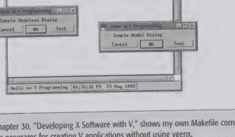

**注意：** 第 30 章“使用 V 开发 X 软件”展示了我自己的 `Makefile` 命令和示例程序，用于在不使用 `vgenx` 的情况下创建 V 应用程序。

## V 应用程序的解剖结构

浏览 V 的应用程序生成器在前几节中描述创建的文件，可以很好地了解典型的 V 应用程序是如何组织的。你不需要记住这些笔记——只需阅读以下各节，以对 V 应用程序的各个部分和组件有一个大致的了解。要跟随操作，请切换到 `src/c29/vmyapp` 目录并查看位于那里的源文件，或者如果你创建了自己的应用程序，也可以使用你自己的应用程序中的文件。

### 生成的文件

V 应用程序生成器通常会创建多个源代码文件以及相关的头文件。根据你在生成器中选择的不同选项，它可能创建的文件比此处列出的更少或更多，但主要文件如下（每个文件都有一个对应的头文件，名称相同但以 `.h` 结尾）：

- `myapp.cpp` 这是主应用程序文件。它从 `vApp` 基类派生出一个名为 `myApp` 的类。所有应用程序都需要一个且只有一个类似的主应用程序类。
- `mycmdw.cpp` 该文件从 `vCmdWindow` 基类派生出一个类 `myCmdWindow`。此类的对象代表程序的顶层窗口，称为命令窗口。菜单栏、工具栏和状态行等附加组件通过静态结构体定义附加到此窗口。所有 V 应用程序至少有一个从 `vCmdWindow` 派生的主命令窗口类。然而，程序可以根据需要创建任意多个窗口。
- `mycnv.cpp` 该文件定义了窗口的画布。你可以将画布视为窗口的绘图表面或内部。要创建应用程序的输出，你需要修改此文件中类 `myCanvasPane` 的各种成员函数，该类派生自 `vCanvasPane` 基类。大多数 V 应用程序为其每个命令窗口至少定义一个画布对象。
- `mydlg.cpp` 该文件从 `vDialog` 基类派生出类 `myDialog`。利用 `mydlg.h` 头文件中定义的结构体，其结果是一个用于用户输入的对话框。该对话框是非模态的，意味着它不会阻止用户执行其他命令，例如主命令窗口的下拉菜单。许多 V 应用程序至少有一个对话框，但不是必需的。
- `mymdlg.cpp` 该文件也创建了一个对话框，但声明了类 `myModalDialog`，派生自 `vModalDialog`。这会创建一个模态对话框，它会捕获所有输入直到关闭。在模态对话框使用期间，其他程序操作会暂时挂起。大多数 V 应用程序至少有一个模态对话框——例如，用于选择程序选项。

本章剩余部分将更详细地讨论前述文件的内容。再次强调，不要试图记住这些信息——只需对组织结构和类名有一个大致的了解。在第 30 章中，我将逐步介绍从头开始创建 V 应用程序的步骤。

## 主要应用程序

V 程序的引擎是其主应用程序对象。该对象使用类构造函数初始化程序并启动程序的运行。应用程序类的析构函数执行任何清理工作，例如将客户端与 X 服务器断开连接。每个 V 应用程序必须有且只有一个主应用程序对象。

要创建应用程序对象，请从 `VApp` 派生一个应用程序类并填充几个成员函数。清单 29.1 显示了生成的 main 应用程序类声明（以 `myapp.cpp` 作为源代码重新格式化代码并删除了一些多余的注释以节省空间）。

```cpp
#include <v/vapp.h>
#include <v/vawinfo.h>

class myApp : public vApp {
    friend int AppMain(int, char**); // allow AppMain access
public:
    myApp(char* name, int sdi = 0, int h = 0, int w = 0);
    virtual ~myApp();
    // Routines derived from vApp that are normally overridden
    virtual vWindow* NewAppWin(vWindow* win, char* name,
        int w, int h, vAppWinInfo* winInfo);
    virtual void Exit(void);
    virtual int CloseAppWin(vWindow*);
    virtual void AppCommand(vWindow* win,
        int itemVal, int subItemVal, CmdType type);
    virtual void Key(vWindow* v, vKey, unsigned int);
protected:
private:
    myCmdWindow* _myCmdWin; // Pointer to first window instance
};
```

`vApp` 类在 V3 的 `vapp.h` 头文件中声明。在程序的主应用程序文件中包含该头文件以及 `vawinfo.h`。第二个头文件声明了一个类 `vAppWinInfo`，该类似乎没有多大实际价值，但为了与早期 V 版本向后兼容而包含在内（有关该类的更多信息，请参阅在线文档）。

如清单所示，从 `vApp` 派生你的应用程序类。你可以随意命名你的类，但为了清晰起见，它应以 `App` 结尾。派生类中的第一项是 `AppMain()` 的友元函数声明，使该函数可以访问 `myApp` 的私有和受保护声明。`AppMain()` 等同于 C 或 C++ 程序的 `main()` 函数。V 应用程序完全面向对象，并且使用对象来构造和销毁应用程序。V 应用程序没有 `main()` 函数。

`myApp` 类中的其他声明覆盖了 `vApp` 基类的各种成员函数。根据你的需要，你可以添加或删除生成的函数——但这些在大多数应用程序中通常是必需的。你可以在类的 protected 部分添加其他声明，默认情况下该部分为空。单个私有数据成员定义了指向下一节中讨论的 `myCmdWindow` 类对象的指针。通过此指针，主应用程序对象访问程序的顶级命令窗口。

> **注意：** 按照惯例，V 会用下划线为私有数据成员（如 `_myCmdWin`）加前缀。当你遇到类似拼写的变量时，你就知道它是类的私有成员，因此只能从该类的成员函数访问。

清单 29.2，`myapp.cpp`，显示了类声明中原型函数的一些实现。我删除了一些不执行新操作的函数，并且再次重新格式化了文本以节省空间。

### LISTING 29.2 `MYAPP.CPP` (PARTIAL)

```cpp
#include "myapp.h"  // Header file

myApp::myApp(char* name, int sdi, int h, int w) :
 vApp(name, sdi, h, w)
{
    // Constructor
    _myCmdWin = 0;
}

myApp::~myApp()
{
    // Destructor
}

vWindow* myApp::NewAppWin(vWindow* win, char* name,
 int w, int h, vAppWinInfo* winInfo)
{
    vAppWinInfo* awinfo = winInfo;
    char *appname = name;

    if (!*name) {
        appname = "Hello to V Programming";  // Default name
    }

    UserDebug( Build, "myApp::NewAppWin(%s)\n", appname);

    // Create the first window using provided CmdWindow
    _myCmdWin = (myCmdWindow*) win;
    if (!_myCmdWin) {
        _myCmdWin = new myCmdWindow(appname, w, h);
    }

    if (!awinfo)
        awinfo = new vAppWinInfo(appname);
    return vApp::NewAppWin(_myCmdWin, appname, w, h, awinfo);
}

void myApp::Exit(void)
{
```


这可能有助于你调试正在运行（或失控）的 V 应用程序。如果未定义 `vDEBUG`，该宏默认为 `nil`（无关联文本），并且在最终代码中实际上被注释掉了。这与标准库 `assert()` 宏的工作方式类似。

`myapp.cpp` 模块以所有 V 应用程序中都存在的两项关键内容结尾。首先是主应用程序对象的静态定义：

```cpp
static myApp my_App("Hello to V Programming");
```

这里名为 `my_App` 的对象属于派生自 `vApp` 的 `myApp` 类。它指定了主窗口的标题字符串，你可以在文件中编辑它，也可以使用应用程序生成器的对话框进行设置。由于全局对象由 C++ 自动初始化，定义该对象就是初始化和运行 V 应用程序所需做的全部工作——这是一个面向对象编程的最佳范例。

`myapp.cpp` 中的最后一项是函数 `AppMain()`，它被声明为 `myApp` 类的友元（参见清单 29.1 中的 `myApp.h`）。该函数相当于常规 C 或 C++ 程序中的 `main()` 函数，并定义了用于访问任何命令行字符串的常用 `argc` 和 `argv` 参数。你可以在 `AppMain()` 中添加语句，但为了符合面向对象的设计，该函数只需使用以下语句创建程序的顶层窗口：

```cpp
(void) theApp->NewAppWin(0, "Hello to V Programming",
  450, 250);
```

`(void)` 前缀严格来说不是必需的，但表示该语句有意忽略 `NewAppWin()` 返回的值。参数 `theApp` 是在 V 头文件 `vapp.h` 中定义的全局变量。当此对象（my App）创建时，它会被设置为应用程序对象。在这种情况下，你可以使用 `my_App` 或 `theApp`——它们引用的是同一个对象——但使用 `theApp` 符合 V 的整体设计。这也给了你以不同方式创建主应用程序对象，甚至在单独的文件中创建它，同时仍能通过全局 `theApp` 指针在整个应用程序中使用该对象的选项。

## MAIN COMMAND WINDOW

如果主应用程序对象是程序的引擎，那么它的主命令窗口就是它的座位、挡风玻璃和方向盘。清单 29.3，`mycmdw.h`，显示了该模块的类声明（同样，我编辑了文本以节省空间）。

```cpp
LISTING 29.3   MYCMDW.H (PARTIAL)

#include "mycnv.h"   // myCanvasPane
#include "mydlg.h"   // myDialog
#include "mydlg1.h"  // myDialog1

class myCmdWindow;

class myTimer : public vTimer {
public:
  myTimer(myCmdWindow* cw) { cw = cw; }
  ~myTimer() {}
  virtual void TimerTick();
private:
    myCmdWindow* cmdw;
};

class myCmdWindow : public vCmdWindow {
    friend int AppMain(int, char**); // allow AppMain access
public:
    myCmdWindow(char*, int, int);
    virtual ~myCmdWindow();
    virtual void WindowCommand(ItemVal id, ItemVal val,
        CmdType cType);
    virtual void KeyIn(vKey keysym, unsigned int shift);
protected:
private:
    // Standard elements
    vMenuPane* myMenu;      // For the menu bar
    myCanvasPane* myCanvas; // For the canvas
    vCommandPane* myCmdPane; // For the command pane
    vStatusPane* myStatus;  // For the status bar
    myTimer* _timer;        // Timer for Date/Time

    // Dialogs associated with CmdWindow
    myDialog* myDlg;
    myModalDialog* myMDlg;
};
```

头文件包含了用于派生我们主应用程序窗口类的 V 头文件。首先，清单从 `vTimer` 派生了 `myTimer`，以提供状态栏的日期和时间显示。如果你在应用程序生成器的对话框中选择该选项，则会生成此类。（有关状态栏的更多信息，请参阅第 30 章。）

`myCmdWindow` 类派生自 `vCmdWindow`，包含应用程序顶层命令窗口的编程。与应用程序类一样，该类将 `AppMain()` 声明为友元函数，使其能够访问 `myCmdWindow` 的 `protected` 和 `private` 成员。

生成的派生命令窗口类重写了多个成员函数，并提供了通常的构造函数和析构函数。你可以根据需要增减原型函数的列表。

`myCmdWindow` 类中最重要的是其末尾的 `private` 声明。与窗口关联的每个视觉对象都有一个指向适当类对象的指针。例如，`myMenu` 指向类型为 `vMenuPane` 的对象，表示窗口的菜单栏。指针的数量取决于你在应用程序生成器中选择的选项。除了标准元素指针之外，生成器还包括计时器对象以及程序的无模式和有模式对话框窗口的两个指针的声明。

在 `mycmdw.cpp` 模块内部，清单 29.4，是你找到程序事件驱动逻辑的地方。清单仅显示了整个模块的一部分，再次，我重新格式化了行以节省空间。未显示的是定义窗口下拉菜单栏、工具栏和状态栏的静态定义。在第 30 章中，你将学习如何创建这些元素。

## LISTING 29.4 `MYCMDWD.CPP` (PARTIAL)


```
#include <v/notice.h>  // for vNoticeDialog
#include <v/keys.h>  // to map keys
#include "mycmdw.h"  // our header

void myTimer::TimerTick()
{
    // update clock
    cmdw->WindowCommand(lblCurTime, lblCurTime, C_Button);
}

myCmdWindow::myCmdWindow(char* name, int width, int height) :
    vCmdWindow(name, width, height)
{
    // The Menu Bar
    myMenu = new vMenuPane(StandardMenu);
    AddPane(myMenu);
    // The Command Pane
    myCmdPane = new vCommandPane(ToolBar);
    AddPane(myCmdPane);
    // The Canvas
    myCanvas = new myCanvasPane;
    AddPane(myCanvas);
    // The Status Bar
    myStatus = new vStatusPane(StatBar);
    AddPane(myStatus);
    _timer = new myTimer(this);  // create timer
    _timer->TimerSet(1000);      // 1 second intervals
    // Associated dialogs
    myDlg = new myDlg(this,name);
    myMDlg = new myModalDialog(this,name);
    // Show Window
    ShowWindow();
    WindowCommand(lblCurTime,lblCurTime,C_Button);// update clock
    myCanvas->ShowVScroll(1);  // Show Vert Scroll
    myCanvas->ShowHScroll(1);  // Show Horiz Scroll
}

myCmdWindow::~myCmdWindow()
{
    delete myMenu;
    delete myCanvas;
    delete myCmdPane;
    delete myStatus;
    _timer->TimerStop();  // end it
    delete _timer;  // free it
    delete myDlg;
    delete myMDlg;
}

void myCmdWindow::KeyIn(vKey keysym, unsigned int shift)
{
    vCmdWindow::KeyIn(keysym, shift);
}

void myCmdWindow::WindowCommand(ItemVal id,
```

## 示例文档标题

这是示例文档的正文段落，用于描述系统的主要功能和设计理念。系统中融合了先进的深度学习方法，并针对不同场景进行了优化。

- 文本生成
- 代码编写
- 数据解析
- 多轮对话

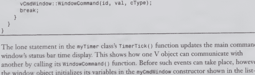

> > 注意：请确保使用正确的 API 密钥以获得最佳体验。

| API | 描述 |
|---|---|
| `chat` | 对话功能 |
| `code` | 代码生成 |
| `vision` | 图像识别 |

```python
import kimi

client = kimi.Client(api_key)
res = client.chat(messages)
```

此时，程序的窗口已显示，但正如你在前面关于 Xlib 编程的章节中所学到的，它实际上只有在服务器为该窗口发布 Expose 事件后才会真正出现。V 处理了这个细节，因此在实际使用中，你可以认为在调用`ShowWindow()`之后窗口就可使用了。

与主命令窗口的构造函数相对应的是析构函数。如`mycmdw.cpp`所示，列表 29.4 中，析构函数预期会删除在构造函数中初始化的每个指针。这只是标准的面向对象编程——但不要忘记这一步，否则你可能会造成严重的内存泄漏，尤其是在创建多个子窗口的程序中。

最后在主命令窗口模块中是`WindowCommand()`函数。在这里你编写应用程序的主要事件驱动逻辑。然而，与纯 Xlib 客户端不同的是，你并不是获取事件，而是根据传递给该函数的`ItemVal id`参数分支到各种语句。要处理按键等其他事件，你可以重写`KeyIn()`等函数（参见列表 29.4）。V 在收到 X 服务器的 KeyPress 事件时调用此函数。

在由应用程序生成器创建的`WindowCommand()`内部，你会发现一个大型 switch 语句，我在印刷版列表中将其简化。该语句的主要目的是响应用户菜单选择。例如，选择示例程序的 File, New 命令会导致 V 向`WindowCommand()`发送消息 id `M_New`。case 语句按如下方式响应：

```
case M_New:
{
    vNoticeDialog note(this);
    note.Notice("New");
    break;
}
```

`vNoticeDialog`是一个可用于显示消息的类。只需创建该类的对象并调用其`Notice()`成员函数即可显示你的消息。这是一个模态对话框，因此用户必须先关闭它才能继续。传递给`vNoticeDialog`构造函数的`this`参数为其提供了一个父窗口——在本例中为主命令窗口。因为`vNoticeDialog`对象是在用大括号分隔的复合语句块内创建的，所以它会在break语句之后自动删除——这是 C++ 类和对象极大简化复杂编程的又一个绝佳例子。（如果你不相信我，试试用 Xlib 函数调用来做！）

在许多情况下，发送到窗口的`WindowCommand()`函数的消息可能需要传递给基类中的默认逻辑。为了确保所有消息都得到正确处理，`WindowCommand()`中的 switch 语句应以调用祖先函数的 default case 结尾，如下所示：

```
vCmdWindow::WindowCommand(id, val, cType);
```

## WINDOW CANVAS

窗口的大部分视觉活动都是通过在窗口画布上绘制图形和文本来处理的。为此，应用程序会创建一个派生自 V 提供的多个类之一的窗口画布对象。

在示例生成的应用程序中，主窗口的画布对象属于名为`myCanvasPane`的类，该类派生自`vCanvasPane`基类。清单 29.5 显示了该类的声明（此处已编辑以便正式查看）。

### LISTING 29.5 MYCVN.H (PARTIAL)

```
#include <v/vcanvas.h>

class myCanvasPane : public vCanvasPane {
public:
    myCanvasPane();
    virtual ~myCanvasPane();

    // Scrolling
    virtual void HPage(int shown, int top);
    virtual void VPage(int shown, int top);
    virtual void HScroll(int step);
    virtual void VScroll(int step);

    // Events
    virtual void MouseDown(int x, int y, int button);
    virtual void MouseUp(int x, int y, int button);
    virtual void MouseMove(int x, int y, int button);
    virtual void Redraw(int x, int y, int width, int height);
    virtual void Resize(int newW, int newH);
    ...
};
```

`myCanvasPane`类声明了通常的构造函数和析构函数，以及一些用于滚动和处理输入输出事件的成员函数。要响应用户在窗口画布区域内单击鼠标，只需重写`MouseDown()`函数并提供所需的编程即可。


图形处理方式类似。要在窗口中绘制图形，请重写 `Redraw()` 并调用所需的图形输出函数（更多内容见第 30 章）。此时不必担心如何绘制实际对象。只需注意 `Redraw()` 是为特定窗口添加此代码的位置。它相当于 `Xlib` 程序对 `Expose` 事件的响应。如果窗口需要重绘——例如用户移动另一个窗口使其暴露时——`V` 会按需调用 `Redraw()` 来更新窗口的画布。四个参数表示需要重绘的窗口部分，但除非是高度复杂的图形，否则您可以简单地绘制全部内容并忽略这些值。`Resize()` 函数对应于 `Xlib` 的 `ConfigureNotify` 事件。

## MODAL AND MODELESS DIALOG BOXES

生成的 `V` 应用程序其余的主文件实现了程序的示例模态和非模态对话框。创建这些对象超出了本介绍的范围。然而，您可能希望查看相关文件：`mydlg.h`、`mydlg.cpp`、`mymdlg.h` 和 `mymdlg.cpp`。

浏览这些文件时，请注意使用了静态结构来定义对话框按钮、标签和其他项目。正如您可能猜到的，对话框只是专门化的窗口对象，它们的工作方式与前面描述的命令窗口非常相似。例如，每个都有一个 `DialogCommand()` 函数，它与 `WindowCommand()` 类似，用于响应用户输入——例如单击按钮。要编程一个对话框，您只需从 `VDialog` 或 `VModalDialog` 基类派生一个类，提供静态结构来定义对话框的组件，并在构造函数中初始化该对象。然后重写 `DialogCommand()` 以响应用户输入。

### SUMMARY

`V` 是一个类库，大大简化了 `V` 应用程序的开发。`V` 在 GNU 通用公共许可证下自由分发，完全面向对象。它也与 Microsoft Windows 和 OS/2 兼容。如果您使用 `V` for X 编写了一个应用程序，您只需使用 Borland C++ 或 Watcom C++ 等合适的开发系统重新编译它即可在 Microsoft Windows 下运行。

有关本章介绍主题的更多信息，请参阅以下章节：

- Chapter 26, “Introducing X Programming”
- Chapter 30, “Developing X Software with V”

## CHAPTER 30

## Developing X Software with V

第 29 章介绍了用于 X 编程的 `V` 类库。本章将引导您了解大多数 X 客户端应用程序所需的一些基本技术，并展示您如何使用 `V` 为 Linux 和其他受支持的操作系统开发完成的 X 软件。阅读本章后，您应该能够更好地理解 `V` 的在线教程和参考资料，并且也能够阅读和理解随库提供的示例程序。

## COMPILING THIS CHAPTER'S PROGRAMS

本章的程序分为单独的模块，因此它们分别存储在子目录中。要编译本章的程序，请更改到指定的目录（例如 `src/c30/welcome`）并输入 `make`。如果收到错误，请编辑 `src/c30` 目录中的 `Config.mk` 文件，并在清单 30.1 中显示。

```
LISTING 30.1 CONFIG.MK
# Edit the following for your installation (esp HOMEV)
CC = g++
HOMEV = $(HOME)/v
VIncDir = $(HOMEV)/include
VLibDir = $(HOMEV)/lib
X11INC = /usr/X11R6/include
X11LIB = /usr/X11R6/lib
LIBS = -lVx -lXaw -lXmu -lXt -lXext -lX11
# ===========================================
# Compiler and linker flags
CFLAGS = -O -I$(X11INC) -I$(VIncDir)
LFLAGS = -O -L$(X11LIB) -L$(VLibDir)
```

如果需要，请更改 `HOMEV` 为您根据第 29 章所述安装 `V` 的目录。默认情况下，`Config.mk` 使用为您的 shell 定义的 `HOME` 环境变量。大多数读者无需对此处列出的文件做很少或根本不需要的更改。

> Note
>
> 如果您已安装了较早版本的 `V`，您可能需要将 `LIBS` 设置中的 `-lVx` 改为 `-lV`，并将 `VLibDir` 设置为 `/lib/linux`。其他设置应按此处所示工作。为了获得最佳效果，您应安装本书记载的 CD-ROM 上提供的 `V` 的新版本，该版本也可通过互联网获得，详情见第 29 章“Introducing the V Class Library。”

## UNDERSTANDING V CLASSES

`V` 的在线文档附带了绘制精美的图表，说明了库的类层次结构。我怀疑我无法改进这些图表，因此与其在此重复它们，表 30.1 列出了 `V` 的主要类以及它们被声明的头文件。这绝不是一个完整的列表，但显示了应用程序中最常使用的类和头文件

## 第30章 使用 V 开发 X 软件

along with many of those described in this chapter. 要使用一个类，将其头文件包含到你的程序模块中。有关这些及其他 `V` 类的更多信息，请使用你的 Web 浏览器打开 `V` 的在线文档，从文件 `v/vrefman/index.html` 开始。

**表 30.1：V 的主要类**

| Class | Header File | Creates |
| --- | --- | --- |
| `vApp` | `vapp.h` | Main application |
| `vBrush` | `vbrush.h` | Painting (fill) brush |
| `vCanvasPane` | `vcanvas.h` | Window drawing canvas |
| `vCmd` | `vcmd.h` | Dialog and toolbar object |
| `vCmdWindow` | `vcmdwin.h` | Command (main or child) window |
| `vColor` | `vcolor.h` | Standard color object |
| `vCommandPane` | `vcmdpane.h` | Toolbar (pane) |
| `vDC` | `vdc.h` | Device (graphics) context |
| `vDialog` | `vdialog.h` | Modeless dialog box |
| `vFont` | `vfont.h` | Standard text font object |
| `vMenuPane` | `vmenu.h` | Menu bar (pane) |
| `vModalDialog` | `vmodald.h` | Modal dialog box |
| `vPen` | `vpen.h` | Outline pen |
| `vStatusPane` | `vstatusp.h` | Status bar (pane) |

所有 `V` 类都以小写 `v` 开头。作为一种约定，我从这些类派生自己的类时使用大写 `T`，表示“Type”。因此在本章中，类 `TCanvasPane` 是从 `V` 的 `vCanvasPane` 基类派生而来的类。你不必使用我的命名约定，但最好采用一致的风格，以便你能识别自己类的来源。

大多数 `V` 编程涉及继承类并重写虚函数以响应 X 服务器事件，例如鼠标按钮点击，同时还为你的程序输入和输出提供新函数。刚开始使用 `V` 时，集中精力确定在何处添加自己的代码。记住要面向对象。让你的类尽可能独立地执行，并让 `V` 处理与 X 服务器的通信。

### V 欢迎程序

一个简单的程序欢迎你进入 `V` 编程，并展示了基于类库创建应用程序的最低要求。虽然第 29 章列出了由 `V` 应用程序生成器创建的程序的各个部分，但本节中的程序（以及本章中的所有其他程序）都是从头开始编写的，使用我自己的 Makefile 和源代码约定。

> **Note**
>
> 本章程序的许多模块具有相同的文件名，因此在编号列表中，这些模块前面加上了其目录名。

本节讨论的 `vWelcome` 程序分为三个模块：主应用程序、应用程序类和命令窗口类。以下各节描述了这些模块中的每一个，并完整列出了源代码文件。本章中的其他程序在此基础上构建，为节省篇幅未列出重复的编程。始终参考磁盘上的文件以获取完整的源代码。

现在切换到 `src/c30/vwelcome` 目录并输入 `make` 编译程序。然后输入 `./vwelcome` 运行完成的代码文件。图 30.1 显示了程序的窗口。使用鼠标选择 File、Exit 命令关闭窗口并结束程序。对本章中的所有程序都以类似的方式编译、运行和退出。

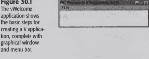

> **Note**
>


## 主应用程序

vWelcome 的第一个文件包含的编程大致相当于传统 C 或 C++ 程序中的 `main()` 函数。V 应用程序没有 `main()` 函数。相反，如清单 30.2、`welcome.cpp` 所示，V 应用程序构造一个应用程序对象来初始化并运行程序。这使得主应用程序模块相当简单——可以将其视为启动 X 客户端引擎的启动器。

### LISTING 30.2 VWELCOME.CPP

```
#include "cmdwin.h"    // Include command window header
#include "app.h"       // Include application module header

// Construct the application object
static TWelcomeApp WelcomeApp(APPNAME);

// Main function
int AppMain(int argc, char* argv[])
{
    theApp->NewAppWin(0, TITLE, 325, 50);
    return 0;
}
```

应用程序对象是一个派生自 `vApp` 的类的全局静态变量。在本例中，我将应用程序类命名为 `TWelcomeApp`，全局对象命名为 `WelcomeApp`。`APPNAME` 是一个表示应用程序名称的字符串常量。`TITLE` 是窗口标题字符串。

函数 `AppMain()` 类似于常规程序中的 `main()` 函数。它具有 `argc` 和 `argv` 参数用于使用任何命令行选项，尽管示例程序忽略了这些变量。在 `AppMain()` 内部，第一条语句调用由 `theApp` 寻址的对象的新建应用窗口 `NewAppWin()` 成员函数。这是一个全局 V 指针，它寻址主应用程序对象——在本例中为 `WelcomeApp`。传递给 `NewAppWin()` 的四个参数如下：

- 0 这是一个空窗口* 指针值，但它可以寻址一个已存在的窗口（可能是派生类 `vCmdWindow` 的），如果出于某种原因你想在初始化应用程序之前创建该对象。

- `TITLE` 这是一个标准的 C 风格、以空字符结尾的字符串，表示窗口标题。因为 V 基于小部件（至少在 UNIX 和 Linux 中），你可以确信窗口标题会出现在其框架顶部，这与纯 Xlib 编程不同，后者并不能保证类似的行为。

- 325 这是窗口框架建议的宽度，以像素为单位。

- 50 这是窗口框架建议的高度，以像素为单位。

使用 `theApp` 指针而不是直接使用对象有两个主要原因。首先，许多其他模块需要引用这个关键对象，其次，在较大的程序中，你可能在单独的模块中定义应用程序对象，也许是为了将其隐藏起来。无论如何，你始终可以使用 `theApp` 来寻址主应用程序对象。

#### Note

> 由于 X 服务器、客户端应用程序和窗口管理器的工作方式，你不能指望 `AppMain()` 会返回。但是，你可以确信主应用程序对象的类析构函数会在控制权返回到启动你的客户端程序的进程之前被调用。这意味着你的主应用程序对象总是有最后一次机会在程序结束前执行关键任务——例如保存文件。

## THE APPLICATION CLASS

主应用程序对象是从本节模块中声明并实现的类构造的。Listing 30.3, `app.h`，显示了 `TWelcomeApp` 类的声明。

### LISTING 30.3 WELCOME/APP.H

```
#include <v/vapp.h>  // Need vApp class

#define APPNAME "Welcome"
#define TITLE "Welcome to V Programming for X"

// Application class
//
class TWelcomeApp : public vApp {
public:
TWelcomeApp(char* name) : vApp(name) {}
virtual ~TWelcomeApp() {}
virtual vWindow* NewAppWin(vWindow* win, char* name,
int h, int w, vAppWinInfo* winInfo);
};
```

包含 `vapp.h` 头文件以使 `vApp` 基类可用。也定义了在 `vwelcome.cpp` 模块中用于初始化程序并为窗口提供标题的应用程序和标题字符串。

按 `TWelcomeApp` 所示派生你的应用程序类。至少，派生类需要一个构造函数、一个虚析构函数，以及一个虚成员函数 `NewAppWin()`。在本例中，构造函数和析构函数没有新的职责要执行，并且以内联方式实现。构造函数调用其祖先构造函数 `vApp()`。虚基类析构函数会自动调用。如前一节所述，主应用程序模块调用 `NewAppWin()` 来创建程序的主窗口。

> Note

> 严格来说，你可以从派生应用程序类析构函数和其他函数中删除 `virtual` 这个词。这是因为，即使基类声明成员函数为 `virtual`，派生类也只有在另一个类将从它派生时才需要这样做。我提到这一细节是因为，在浏览 V 源代码示例时，你可能会遇到成员函数以两种方式声明的情况。

### LISTING 30.4   WELCOME/APP.CPP

```
#include "app.h"          // Need TWelcomeApp
#include "cmdwin.h"       // Need TCmdWindow
#include <vavinfo.h>       // Need unused vAppWinInfo class

// Construct a new application window
vWindow* TWelcomeApp::NewAppWin(vWindow* win, char* name,
    int w, int h, vAppWinInfo* winInfo)
{
    vWindow* localWin = win;          // Local parameter copies
    vAppWinInfo* localInfo = winInfo;
    char* localName = name;

    if (!localName)
        localName = TITLE;
    if (!localWin)
        localWin = new TCmdWindow(localName, w, h);
    if (!localInfo)
        localInfo = new vAppWinInfo(localName);
    return vAppWindow::NewAppWin(localWin, localName, w, h, localInfo);
}
```

该模块包含三个头文件。第一个是其自身的头文件，声明了 `TWelcomeApp` 类。接下来是头文件 `cmdwin.h`，声明了程序的 `TCmdWindow` 类，用于表示主窗口——下一节将详细介绍。第三个头文件 `vavinfo.h` 声明了类 `vAppWinInfo`，该类对 `NewAppWin()` 函数是必需的，但本质上未被使用。

`NewAppWin()` 成员函数创建了两个对象。第一个是 `TCmdWindow` 类的对象。第二个是 `vAppWinInfo` 类型的对象。这些类构造函数的参数提供了窗口的建议宽度和高度以及应用程序名称字符串。利用 resulting 对象指针，最后一步是调用祖先类的 `NewAppWin()` 函数。无论你的程序多么复杂，这些步骤很可能就是你的 `NewAppWin()` 函数需要执行的所有操作。

刚接触面向对象编程的读者可能会觉得这一步缺少了什么。但请记住要以对象为思考方式。信任 `vApp` 类中的祖先 `NewAppWin()` 函数来完成创建程序窗口所需的任何操作。在应用程序级别，你的代码只需要做程序所需的额外工作。作为这种设计方法的良好示例，我们的 `vWelcome` 应用程序对象只需要创建程序的窗口对象——该窗口具体做什么是由窗口类负责的，如下所述。

## THE COMMAND WINDOW CLASS


`vWelcome` 应用程序中的最后一个模块声明并实现了程序的命令窗口类。V 中的命令窗口是可以接收输入并显示图形输出的窗口。在 X 中，窗口就是行动发生的地方，你可以认为 V 命令窗口是程序的行动模块。Listing 30.5, `cmdwin.h`，展示了 `vWelcome` 的 `TCmdWindow` 类的声明。

## LISTING 30.5 `VWELCOME/CMDWIN.H`

```
#include <v/canvas.h>  // Need vCanvasPane class
#include <v/menu.h>  // Need vMenuPane class
#include <v/cmdwin.h>  // Need vCmdWindow class

// Command window class
class TCmdWindow : public vCmdWindow {
private:
  vCanvasPane* myCanvas;  // Pointer to window's canvas
  vMenuPane* myMenu;  // Pointer to window's menu
public:
  TCmdWindow(char* name, int width, int height);
  virtual ~TCmdWindow();
  virtual void WindowCommand(ItemVal id, ItemVal val,
    CmdType cType);
};
```

命令窗口类模块通常至少需要包含这里的三个头文件。第一个 `vcanvas.h` 声明了 `vCanvasPane`，用于表示窗口的内部绘图表面——简称为“画布”。`vmenu.h` 头文件声明了 `vMenuPane` 类，用于表示窗口的菜单栏。这不是严格必需的，但大多数 X 应用程序都应具有下拉菜单栏。第三个头文件包含 `vcmdwin.h`，其中声明了我们的类派生的 `vCmdWindow` 类。

该类 `TCmdWindow` 以两个私有数据成员声明开始。其中第一个 `myCanvas` 是指向 `vCanvasPane` 对象的指针。所有对该窗口的输出都通过此指针进行。第二个私有成员是指向 `vMenuPane` 对象的指针 `myMenu`。正如你可能猜到的，这个指针指向表示窗口下拉菜单的对象。

由于指针对类是私有的，`TCmdWindow` 对象拥有所指向的对象。这样，V 命令窗口拥有其画布和菜单栏，以及你稍后会学到的其他元素，如工具栏和状态栏。这是一种合理且易于使用的设计。由于命令窗口拥有其菜单栏和其他元素，因此控制这些项目的地点在命令窗口模块中。

### Tip

> 请记住，当一个对象拥有另一个对象时，这并不意味着在类级别存在任何关系。在学习任何新的类库时，通过继承相关联的类与通过对象所有权相关联的类的区别是最重要的区别之一。（V 的在线类层次结构图清楚地显示了这些关系。）

除了其私有数据成员之外，`TCmdWindow` 类还声明了三个函数：构造函数、虚析构函数和虚函数 `WindowCommand()`。顾名思义，该函数负责响应发送到此窗口的命令——例如，用户选择下拉菜单命令时作出响应。Listing 30.6, `cmdwin.cpp`，实现了 `vWelcome` 的 `TCmdWindow` 类。

## LISTING 30.6 `VWELCOME/CMDWIN.CPP`

```cpp
#include "cmdwin.h"
#include <v/v_defs.h>  // Need standard definitions

// Define a simple menu command item
static vMenu FileMenu[] =
{
  {"&Exit", M_Exit, isSens, notChk, noKeyLbl, noKey, noSub},
  {NULL}
};

// Define a simple top-level menu item
static vMenu StandardMenu[] =
{
  {"&File", M_File, isSens, notUsed, notUsed, noKey,
   &FileMenu[0]},
  {NULL}
};

// Our command window constructor
TCmdWindow::TCmdWindow(char* name, int width, int height) :
  vCmdWindow(name, width, height)  // Call ancestor constructor
{
  myMenu = new vMenuPane(StandardMenu);  // Create menu pane
  AddPane(myMenu);                        // Add it to our window
  myCanvas = new vCanvasPane;             // Create window canvas
  AddPane(myCanvas);                      // Add it to our window
  ShowWindow();                           // Make window visible
}

// Our command window destructor
TCmdWindow::~TCmdWindow()
{
  delete myMenu;  // One for each "new" in constructor
  delete myCanvas;
}

// Respond to menu selections and other commands
void TCmdWindow::WindowCommand(
  ItemVal id, ItemVal val, CmdType cType)
{
  switch (id) {
  case M_Exit:      // User selected File\Exit command
    theApp->Exit(); // Exit the application
    break;
  default:          // Route unhandled commands
    vCmdWindow::WindowCommand(id, val, cType);
    break;
  }
}
```

`TCmdWindow` 类的实现是其中最大的，而且对于大多数 V 应用程序来说，这一点可能都是正确的。前两项是常见的 C++ 结构体声明，它们创建了程序下拉菜单栏的字符串和其他选项。V 对菜单、工具栏、状态栏和对话框使用类似的结构。这与一些其他 X（以及 Microsoft Windows）开发系统不同，后者依赖资源来处理这类项目。在 V 中，你在程序的源代码文件中创建所有程序元素。本章的其他部分更详细地解释了这些结构，所以我在这里就不展开了。

模块中接下来是 `TCmdWindow` 构造函数和析构函数。构造函数有两个重要职责——为类的私有数据成员指针创建对象，并调用一个使窗口可见的 `ShowWindow()` 函数。窗口构造函数还可能执行其他操作——例如，初始化一个容器对象来存储有关程序窗口的信息。（下一节将详细介绍。）

`TCmdWindow` 析构函数应执行与此窗口销毁相关的任何关闭任务。在这种情况下，析构函数删除了构造函数中由 `new` 初始化的所有指针。

最后，在本模块中是 `WindowCommand()` 成员函数的实现。因为这只是一个简单的示例，所以这个函数并不大——实际上，它通常包含一个很长的 `switch` 语句，用于响应发送到此窗口的许多输入事件。在这里，只有一种可能的事件——当用户选择菜单的 `File`、`Exit` 命令时，由参数 `id` 等于常量 `M_Exit` 标识。

`M_Exit` 以及以 `M_` 开头的其他常量在 `v_defs.h` 头文件中定义，该头文件包含在 `TCmdWindow` 实现模块的开头。你可以使用此类预定义的菜单命令常量（有几十个可用），也可以创建自己的常量。按惯例，为了区分这两种类型，请用小写 `m_` 为你自己的菜单常量加上前缀。

`WindowCommand()` 的 `switch` 语句有两个 `case`。`M_Exit` 的 `case` 调用全局应用程序对象 `theApp` 的 `Exit()` 函数。这是结束 V 应用程序的正确方法。默认 `case` 调用祖先类的 `WindowCommand()` 函数来处理在应用程序级别未处理的任何事件。传递给 `WindowCommand()` 的三个参数的类型如下。因为为 V 应用程序编程主要涉及编写代码来响应事件（就像所有 X 应用程序一样），所以请仔细研究这些参数类型：

- `ItemVal id` 此值标识命令事件，例如菜单选择或按钮点击。它是一个唯一的整数值，通常在 `switch` 语句中用作 `case` 选择器。

- `ItemVal val` 此值包含某些但不是所有类型命令事件的附加信息。例如，`val` 可能是用户点击按钮的上下箭头时从微调按钮返回的值。


- `CmdType cType` 此值告诉你为此命令事件选择的对象类型。例如，如果 `id` 引用菜单命令，则 `cType` 等于 `c_Menu`。`CmdType` 是在 `v_defs.h` 中声明的枚举。它通常用于标识复选框（`c_CheckBox`）、标签（`c_Label`）以及对话框和工具栏中许多其他类型的视觉对象。

就这样——一个完整的 V 应用程序已准备好填入你自己的代码。在继续阅读下一节，了解如何实现菜单、工具栏、状态栏、图形和其他功能之前，你可能想回顾一下前面的讨论。如前所述，本章中的所有其他示例程序都基于 `vWelcome` 的模块。

> Note
>
> 不计注释和条件指令，`vWelcome` 的总行数约为 110 行，而第 26 章“Introducing X Programming”中类似的 `xWelcome` Xlib 应用程序为 158 行。即使忽略其下拉菜单和其他 GUI 元素的潜力，V 应用程序的源代码也比 Xlib 版本小约三分之一——这又是 C++ 类和面向对象编程如何降低软件开发复杂性的一个很好的例子。

## SOFTWARE DEVELOPMENT WITH V

与大多数编程工具一样，在学会如何启动并运行 V 应用程序后，你可能会想知道如何处理输入和输出。因为 V 应用程序当然是一个 X 客户端，第 26 章至第 28 章中对 Xlib 编程所做的相同观察也适用。然而，与其向 X 服务器发出请求并响应服务器事件，V 应用程序使用两种输入和输出技术：在窗口的 `CommandWindow()` 函数中响应诸如窗口菜单选择之类的命令事件，以及重写虚成员函数来处理特定的操作，例如鼠标按钮点击和光标移动。以下各节展示了这两种方法的示例。

## GRAPHICS

V 应用程序中的所有图形输出都是参照 `vDC` 类的对象进行的。此类名称中的 DC 代表“Device Context”，但在 Xlib 编程中，这称为 GC，即“Graphics Context”。无关紧要——DC 和 GC 在概念上是相同的，尽管 `vDC` 对象创建和使用起来要方便得多。

`vDC` 类提供了图形输出的特性，包括颜色、轮廓宽度以及填充形状所使用的图案和颜色。作为一个 C++ 类，`vDC` 提供了用于创建输出的图形函数。例如，如果 `pDC` 是指向 `vDC` 对象的指针，程序可以使用以下语句绘制一条线：

```
pDC->DrawLine(x1, y1, x2, y2);
```

虽然这是一种绘制图形的方法，但另一种更常见的方法是从窗口的画布对象调用名称相似的函数。大多数窗口都拥有一个派生自 `vCanvasPane` 的类的画布对象。通过从该类派生一个新类并为窗口创建此对象，你可以提供一种创建图形输出的简单方法。下一个程序演示了如何在草图应用程序中执行此操作，该应用程序允许你通过点击并拖动鼠标来绘制线条。该程序还演示了如何响应鼠标按钮和移动事件。

> Note
>
> 请参阅 `vDC` 类的在线文档，以及它的头文件 `vdc.h`，以获取可用图形函数的列表。一般来说，每个 Xlib 图形原语都有一个 `vDC` 成员函数。这些相同的成员函数也适用于任何画布对象。

## Mouse Input

`vSketch` 应用程序演示了如何创建图形输出以及如何响应鼠标活动。该程序基于前几节中的 `vWelcome` 应用程序，并且仅列出了新的编程内容。除了程序的标题、窗口名称和一些其他参数外，两个程序中的应用程序和窗口模块几乎完全相同。图 30.2 显示了程序输出的一个示例（我认为我的艺术技巧正在提高）。

### Figure 30.2

`vSketch` 应用程序的示例窗口，允许你通过点击并拖动鼠标来绘制线条。

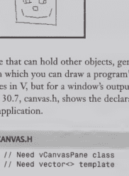

V 窗口只是一个可以容纳其他对象的框架，通常称为窗格。其中一种窗格类型是画布，你可以在其上绘制程序的图形输出。V 中有几种类型的窗格类，但对于窗口的输出，你通常会使用 `vCanvasPane` 类。列表 30.7，`canvas.h`，显示了 `vSketch` 应用程序中使用的派生 `TCanvasPane` 类的声明。

### LISTING 30.7 VSKETCH/CANVAS.H

```
#include <v/vcanvas.h>  // Need vCanvasPane class
#include <vector>        // Need vector<> template

class TLine {
private:
    int _x1, _y1, _x2, _y2;
public:
    TLine(int x1=0, int y1=0, int x2=0, int y2=0):
        _x1(x1), _y1(y1), _x2(x2), _y2(y2) { }
    inline int GetX1() { return _x1; }
    inline int GetY1() { return _y1; }
    inline int GetX2() { return _x2; }
```

```cpp
inline int GetY2() { return _y2; }
};
class TCanvasPane : public vCanvasPane {
private:
    bool mouseDown;      // True while mouse button down
    int x1, y1, x2, y2;  // Line coordinates
    vector<TLine> lines; // Array of TLine objects
public:
    TCanvasPane();       // Constructor
    ~TCanvasPane();      // Destructor
    // Override some inherited functions
    virtual void MouseDown(int x, int y, int button);
    virtual void MouseUp(int x, int y, int button);
    virtual void MouseMove(int x, int y, int button);
    virtual void Redraw(int x, int y, int w, int h);
};
```

为了存储每条线的坐标值——当窗口被覆盖后重新显示或被调整大小时需要重绘画布——该模块声明了一个 `TLine` 类。如何为你的应用程序存储图形信息由你决定，但我在这里使用了一个类，因为更复杂的图形程序可能会基于相关类的层次结构来定义所有形状。

`TCanvasPane` 类派生自 V 的 `vCanvasPane`，首先定义了一些私有数据成员，用于维护图形输出。变量 `mouseDown` 在用户按住鼠标按钮时为 true，而整数变量表示正在绘制的线。`vector<TLine>` 类实例化了标准模板库的 `vector` 模板，以创建一个用于跟踪线坐标的容器。

`TCanvasPane` 的 public 部分中的声明包括大多数类中常用的构造函数和析构函数，以及另外四个函数。其中前三个显然与鼠标按钮点击和移动有关。第四个 `Redraw()` 用于绘制画布的输出。

这些函数原型覆盖了从 `vCanvasPane` 类继承的同名函数。每个函数都与特定类型的事件相关联。例如，按下按钮事件会使 V 调用画布的 `MouseDown()` 虚函数。这是一个很好的例子，说明如何使用虚 C++ 函数轻松更改对象的行为。在本例中，我们希望在用户点击并拖动鼠标时绘制线条，因此我们只需覆盖窗口画布的虚鼠标函数，让 V 来决定如何以及何时调用这些函数。

`Redraw()` 函数是所有 V 应用程序中最关键的函数之一。它等同于 Xlib 的 Expose 事件，要求窗口重新创建其内容。一般来说，要在窗口中创建图形输出，只需将绘图命令添加到画布的 `Redraw()` 函数中。下一个模块，清单 30.8，`canvas.cpp`，展示了 `vSketch` 中是如何实现的。

## LISTING 30.8 VSKETCH/CANVAS.CPP


```cpp
#include "canvas.h"

// Constructor
TCanvasPane::TCanvasPane():
    vCanvasPane(),  // Call ancestor constructor
    lines()         // Construct lines vector (grows as needed)
{
    mouseDown = false;
    x1 = y1 = x2 = y2 = 0;
}

// Destructor
TCanvasPane::~TCanvasPane()
{
    // Nothing to do!
}

// Respond to mouse button click event
// Prepares for drawing the next line
void TCanvasPane::MouseDown(int x, int y, int button)
{
    mouseDown = true;   // Set mouse down flag
    x1 = x;             // Remember starting location
    y1 = y;
    x2 = x1;            // Set end point == beginning
    y2 = y1;            // as a "do nothing" flag
}

// Respond to mouse button release event
// Save current line in the lines vector
void TCanvasPane::MouseUp(int x, int y, int button)
{
    mouseDown = false;  // Reset mouse down flag
    if (x1 != x2 || y1 != y2) {
        DrawRubberLine(x1, y1, x2, y2);  // Erase old line
        x2 = x;          // Save line end point
        y2 = y;
        DrawLine(x1, y1, x2, y2);  // Draw fixed line
        lines.push_back(TLine(x1, y1, x2, y2));  // Save line
    }
}

// Respond to mouse movement event
// Draws a "rubber" line (i.e. an erasable line)
void TCanvasPane::MouseMove(int x, int y, int button)
{
    if (mouseDown) {
        if (x1 != x2 || y1 != y2) {
            DrawRubberLine(x1, y1, x2, y2);  // Erase old line
            x2 = x;   // Save line end point so far
            y2 = y;
            DrawRubberLine(x1, y1, x2, y2);  // Draw new line
        }
    }
}
```

```cpp
// Draw graphics using saved information
// Uses STL iterator and vector-template techniques
void TCanvasPane::Redraw(int x, int y, int w, int h)
{
    vector<TLine>::iterator it;
    for (it = lines.begin(); it != lines.end(); it++)
        DrawLine(it->GetX1(), it->GetY1(),
                 it->GetX2(), it->GetY2());
}
```

通常，`TCanvasPane` 类的构造函数会初始化该类的对象。构造函数应始终调用其祖先构造函数，如所示，以确保所有继承的成员都被正确初始化。同时初始化类对象，例如 `lines` 容器。像所有优秀的容器一样，这个 `vector` 模板会根据需要扩展以容纳更多对象，因此比标准数组使用起来容易得多。`TCanvasPane` 构造函数还会将其他参数设置为合理的初始值。析构函数无需执行任何操作，但我还是为了规范起见包含了它。

其余模块展示了重写的虚拟画布函数的实现。每个函数都相当简单易懂。当用户在窗口画布内单击鼠标时，`V` 会调用 `mouseDown()` 函数，并将鼠标指针热点相对坐标推入参数 `x` 和 `y`。参数 `button` 等于按钮编号，但示例程序忽略了该值，你可以使用任何活动按钮进行绘制。

`MouseMove()` 展示了如何绘制橡皮线——即在单击并拖动鼠标时看起来会拉伸和移动的线。在 Xlib 编程中，这需要将显示模式设置到图形上下文中，但在 `V` 中，你只需按所示调用 `DrawRubberLine()` 函数即可。用相同的坐标值再次调用该函数会擦除之前绘制的线，从而产生移动线的错觉。代码中其他橡皮函数包括 `DrawRubberEllipse()` 和 `DrawRubberRectangle()`。它们的工作方式类似，但当然绘制不同的形状。

`MouseUp()` 通过先调用 `DrawRubberLine()` 擦除当前临时线，然后调用 `DrawLine()` 绘制最终线条，从而将线条固定在原位。该函数还通过在 `lines` 向量容器中存储一个 `TLine` 对象来保存线条坐标。请注意，即使开始和结束线条坐标相同——例如用户只是单击鼠标而未拖动时——也会执行此操作。

最后在画布模块中，是在窗口被整体或部分遮挡后重新绘制所有线条的代码。在你自己的代码中，在 `Redraw()` 中执行绘制窗口内容的必要操作即可。在这里，我使用标准模板库技术为 `lines` 容器获取一个迭代器，然后对每个存储的 `TLine` 对象调用 `V` 的 `DrawLine()` 函数。

`V` 将四个整数坐标传递给 `DrawLine()`，这些坐标表示相对于窗口绘图原点（左上角为 0,0）的矩形区域，即需要重绘的区域。在像这样简单的程序中，你可以简单地忽略这些变量并绘制所有内容。然而，如果窗口很复杂，你可能需要使用这些变量只绘制落在暴露区域内的对象。

## KEYBOARD INPUT

在 `V` 程序中拦截键盘活动主要有两种方式。你可以在窗口级别接收按键输入，也可以在应用程序对象中进行。窗口对传入的按键有优先处理权，因此这是通常的方法。此外，除非你需要编写一个全局键，无论哪个窗口处于活动状态都以相同方式工作，否则你可能只想处理具有输入焦点的窗口的按键。

下一个示例程序 `vKey` 演示了如何拦截按键输入。为了参考，程序显示两个值——一个表示键本身，另一个表示 Shift、Control 或 Alt 键是否被按下，用于那些无法以其他方式唯一识别的键。图 30.3 显示了该程序窗口的一个示例。窗口中的值是我键盘上的 M-F1（Alt-F1）键。

Figure 30.3

`vkey` 应用程序显示按键和换档值——在本例中为 M-F1（Alt-F1）。

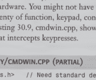

在颜色图形之后，X 编程中最危险的第二项工作可能就是处理键盘输入了。（处理调色板的程序员应该获得战斗津贴。）幸运的是，`V` 定义了虚拟键码，这些键码应与硬件无关。在某些情况下你可能无法访问专用键，但你应该拥有足够的函数键、键盘数字键、控制键和字母数字键来满足几乎任何应用程序的需求。列表 30.9，`cmdwin.cpp`，展示了 `vKey` 命令窗口模块中拦截按键的编程。

## LISTING 30.9 VKEY/CMDWIN.CPP (PARTIAL)

```
#include <v/v_defs.h>  // Need standard definitions

// Intercept keyboard events
void TCmdWindow::KeyIn(vKey keysym, unsigned int shift)
{
    myCanvas->SaveKeyValues(keysym, shift);  // Pass to canvas
    // Call ancestor function to handle unprocessed keystrokes
    vWindow::KeyIn(keysym, shift);
}
```

要在窗口对象中获取按键，请重写从 `vWindow` 类继承的 `KeyIn()` 函数，通常通过其后代 `vCmdWindow`。在窗口类的 `public` 部分添加以下声明，并按列表所示实现该函数：


```c
virtual void KeyIn(vKey keysym, unsigned int shift);
```

`vKey` 值表示被按下的键。这可能是 ASCII 字母数字代码、控制键值，或 V 的 `vkeys.h` 头文件中定义的一个符号。这些是虚拟键值如 `vk_Backspace`、`vk_Right` 和 `vk_Enter` 具有明显的含义，但可能与标签不同的键相关联。例如，用户按下 Return 键时可能会生成 `vk_Enter` 值。

在示例 `cmdwin.cpp` 列表中，`KeyIn()` 调用画布对象的 `SaveKeyValues()` 函数，稍后会讨论。这为显示键的值做好了画布的准备。为了处理任何未处理的键，请务必如图所示调用祖先 `KeyIn()` 函数。这是可选的，但如果不这样做，键盘对于该窗口而言就被有效地“捕获”了，甚至系统键也可能被禁用。然而，菜单加速键（有时也称为热键）在 V 中在另一个层级处理，在 `KeyIn()` 中看不到。

## Note

> 因为 V 使用 PC 键盘作为其键盘标准，这对 Linux 程序员来说是最方便的事实，它定义了 12 个功能键符号 `vk_F1` 到 `vk_F12`。然而，其他 UNIX 系统可能没有相同数量的功能键可用。因此，您可能希望提供一个设置实用程序或命令，以便用户可以指定他们拥有的键及其值。

要显示每次按键，`vKey` 的画布对象使用了一种在图形编程中通常有用的技术。列表 30.10，`canvas.h`，显示了该模块的头文件。

## LISTING 30.10 `VKEY/CANVAS.H` (PARTIAL)

```c
#include <v/vcanvas.h> // Need vCanvasPane class
#include <v/v_defs.h> // Need vKey type

class TCanvasPane : public vCanvasPane {
private:
  vKey _keysym;
  unsigned int _shift;
public:
  TCanvasPane(); // Constructor
  ~TCanvasPane(); // Destructor
  virtual void Redraw(int x, int y, int w, int h);
public:
  void SaveKeyValues(vKey keysym, unsigned int shift);
  void Paint();
};
```

我们定制的窗口画布类 `TCanvasPane` 通常派生自 `vCanvasPane`。两个私有值 `_keysym` 和 `_shift` 保存当前键的值。这符合 X 编程中的一般规则，即所有图形信息必须以某种方式保存，以便随时重绘。

类的第一个公共部分声明了通常的构造函数和析构函数，以及负责更新画布内容的重要 `Redraw()` 函数。第二个公共部分声明了两个新函数 `SaveKeyValues()` 和 `Paint()`。第一个函数由窗口对象的 `KeyIn()` 类成员函数调用以保存当前按键值。第二个函数创建程序的图形输出。为什么不在 `Redraw()` 中执行此操作的原因在下一个列表中变得明显。顺便说一下，我喜欢如图所示使用两个公共部分，将在派生类中继承和重写的函数与添加到类的新函数分开。这只是我自己的约定，并非必需。列表 30.11，`canvas.cpp`，实现类的函数。

## LISTING 30.11 `VKEY/CANVAS.CPP`

```c
#include "canvas.h"
#include <v/keys.h>    // Need keyboard symbols
#include <stdio.h>    // Need sprintf()

// Constructor
TCanvasPane::TCanvasPane():
    vCanvasPane()    // Call ancestor constructor
{
    _keysym = vk_None;
    _shift = 0;
}

// Destructor
TCanvasPane::~TCanvasPane()
{
    // Nothing to do!
}

// Save key values and update display
void TCanvasPane::SaveKeyValues(
    vKey keysym, unsigned int shift)
{
    _keysym = keysym;
    _shift = shift;
    Paint();  // Update window
}

// Draw graphics using saved key information
void TCanvasPane::Redraw(int x, int y, int w, int h)
{
    Paint();  // Update window
}

// Display saved key values
// Called when key values are changed and when
// window needs updating.
void TCanvasPane::Paint()
{
    int ascent, descent, spacing, x, y;
    char buffer[32];

    Clear();  // Erase window

    // Initialize text positioning variables
    TextHeight(ascent, descent);

    spacing = ascent + descent + 10;
    x = 10;
    y = spacing;

    // Display keysym value in decimal and hex
    sprintf(buffer, "Key Sym == %d 0x%04X", _keysym, _keysym);
    DrawText(x, y, buffer);

    // Display shift value in decimal and hex
    y += spacing;
    sprintf(buffer, "Shift == %d 0x%04X", _shift, _shift);
    DrawText(x, y, buffer);
}
```

构造函数初始化两个私有数据成员。请注意 `_keysym` 被设置为 `vk_None`，这是一个保留值，表示无键。函数 `SaveKeyValues()` 只是为这些变量分配新值，然后为了更新显示，调用本地 `Paint()` 函数。

`Redraw()` 也做同样的事情，只是调用 `Paint()` 来绘制程序的画布输出，如果例如窗口被覆盖。之所以在 `Paint()` 中而不是在 `Redraw()` 中执行此操作，仅仅是为了避免重复工作。在许多程序中，您需要作为用户输入的结果更新屏幕（本例中为新的按键），并且还需要作为 X 服务器向客户端发送 Expose 事件的结果更新屏幕，通常很方便创建一个单独的函数，如 `Paint()`，来处理这两种情况。

`Paint()` 中的第一步是通过调用继承的 `Clear()` 函数清除窗口的当前内容。或者，您可以向 `ClearRect()` 传递坐标值以仅清除窗口内部的一部分，使用 V 传递给 `Redraw()` 的值。但是，在这个小型示例中，`Paint()` 只是重绘所有输出。

请始终记住文本就像其他图形一样绘制，因此文本输出的定位比在字符终端上更困难。两个整数值 `ascent` 和 `descent` 相加等于当前字体中字母的最大高度。通过像这样调用继承的 `TextHeight()` 函数找到这些值：

```c
TextHeight(ascent, descent);
```

这将把两个值分配给作为引用参数传递的变量。如列表所示，您可能希望在这些值的总和上添加一点“微调因子”，以便在文本行之间留出一些空白。

使用在您的应用程序中有效的方式准备程序的文本输出。在这里，我选择使用标准 C 库的 `sprintf()` 函数准备一个字符缓冲区，其中包含保存的 `_keysym` 的十进制和十六进制值。为了显示此文本，程序调用继承的 `DrawText()` 函数，如下所示：

```c
sprintf(buffer, "Key Sym == %d 0x%04X", _keysym, _keysym);
DrawText(x, y, buffer);
```


```cpp
#include "cmdwin.h"
#include <v_defs.h>    // Need standard definitions
#include <v/keys.h>    // Need virtual key symbols

// Define menu item constants not in v_defs.h
const ItemVal m_Width  = 100;
const ItemVal m_Width1 = 101;
const ItemVal m_Width2 = 102;
const ItemVal m_Width3 = 103;
const ItemVal m_Width4 = 104;
const ItemVal m_Width5 = 105;
const ItemVal m_Width6 = 106;
const ItemVal m_Width7 = 107;
const ItemVal m_Width8 = 108;
const ItemVal m_Width9 = 109;

// Define the File menu's commands
static vMenuItem M_File[] =
{
  {"New", M_New, isSens, notChk, noKeyLbl, noKey, noSub},
  {"", M_Line, notSens, notChk, noKeyLbl, noKey, noSub},
  {"Exit", M_Exit, isSens, notChk, "Alt-X", 'x', noSub},
  VKM_Alt},
  {NULL}
};

static vMenu WidthMenu[] =
{
  {"1", m_Width1, isSens, isChk, "F1", VK_F1, noSub},
  {"2", m_Width2, isSens, notChk, "F2", VK_F2, noSub},
  {"3", m_Width3, isSens, notChk, "F3", VK_F3, noSub},
  {"4", m_Width4, isSens, notChk, "F4", VK_F4, noSub},
  {"5", m_Width5, isSens, notChk, "F5", VK_F5, noSub},
  {"6", m_Width6, isSens, notChk, "F6", VK_F6, noSub},
  {"7", m_Width7, isSens, notChk, "F7", VK_F7, noSub},
  {"8", m_Width8, isSens, notChk, "F8", VK_F8, noSub},
  {"9", m_Width9, isSens, notChk, "F9", VK_F9, noSub},
  {NULL}
};

// Define the top-level menu bar
vMenu MenuBar[] =
{
  {&File, M_File, isSens, notUsed, notUsed, noKey,
   &FileMenu[0]},
  {&Width, m_Width, isSens, notUsed, notUsed, noKey,
   &WidthMenu[0]},
  {NULL}
};

// Our command window constructor
TCmdWindow::TCmdWindow(char* name, int width, int height) :
```

## 清单 30.12（续）

```
vCmdWindow(name, width, height)  // Call ancestor constructor
{
    widthMenuItem = m_Width1;          // Remember checked menu
    myMenu = new vMenuPane(MenuBar);   // Create menu pane
    AddPane(myMenu);                   // Add it to our window
    myCanvas = new TCanvasPane;        // Create our canvas object
    AddPane(myCanvas);                 // Add it to our window
    pen.SetColor(0, 0, 0);             // Set pen color to black
    pen.SetWidth(1);                   // Set initial pen width
    myCanvas->SetPen(pen);             // Set pen into canvas
    ShowWindow();                      // Make window visible
}

// Our command window destructor
TCmdWindow::~TCmdWindow()
{
    delete myMenu;   // One for each "new" in constructor
    delete myCanvas;
}

// Respond to menu selections and other commands
void TCmdWindow::WindowCommand(
    ItemVal id, ItemVal val, CmdType cType)
{
    switch (id) {
        case M_New:
            myCanvas->Clear(); // Erase window's canvas
            break;
        case m_Width1:                 // Fall-through cases for Window menu
        case m_Width2:
        case m_Width3:
        case m_Width4:
        case m_Width5:
        case m_Width6:
        case m_Width7:
        case m_Width8:
        case m_Width9:
            pen.SetWidth(id - m_Width1 + 1);   // Change pen width
            myCanvas->SetPen(pen);             // Insert in canvas
            SetValue(widthMenuItem, 0, Checked); // Uncheck old cmd
            widthMenuItem = id;
            SetValue(widthMenuItem, 1, Checked); // Check new cmd
            break;
        case M_Exit:                   // User selected File|Exit command
            theApp->Exit();                // Exit the application
            break;
        default:                       // Route unhandled commands
            vCmdWindow::WindowCommand(id, val, cType);
            break;
    }
}
```

对于大多数菜单，请包含 V 头文件 `v_defs.h` 和 `vkeys.h`。第一个头文件提供了标准的菜单命令值，例如 `M_Exit`。第二个头文件包含用于定义加速键的虚拟键代码。

为了保持应用程序之间的一致性，建议尽可能使用 V 的标准符号。当然，你也可以自行定义。在本例中，我为程序的“宽度”菜单定义了新的符号，如下所示：

```
const ItemVal m_Width = 100;
const ItemVal m_Width1 = 101;
...
const ItemVal m_Width9 = 109;
```

第一个值代表菜单项；其余值用于标识菜单中的每条命令。你可以使用任何名称，但这些名称应为 `ItemVal` 类型，并且为了减少混淆，最好以小写字母 `m_` 作为前缀。按照惯例，自定义符号从 100 开始，每次递增 1。

> 标准值保留给 30,000 及以上。请将所有自定义的符号菜单和其他组件常量赋值为小于 30,000 的值。（但在程序源代码中，不要在 30,000 这样的数字中插入逗号。）


下一步是为程序中的每个下拉菜单创建一个静态结构体对象。这些结构体表示每个菜单中的命令，而不是示例程序中“文件”或“宽度”这样的顶级菜单名称。例如，程序使用以下结构体数组定义其“文件”菜单命令：

```
static vMenu FileMenu[] =
{
  {"New", M_New, isSens, notChk, noKeyLbl, noKey, noSub},
  {"-", M_Line, notSens, notChk, noKeyLbl, noKey, noSub},
  {"Exit", M_Exit, isSens, notChk, "Alt-X", 'x', noSub, VKM_Alt},
  {NULL}
};
```

`vMenu` 结构体数组中的每一项可以由七个或八个元素组成。列表必须以 `{NULL}` 结尾。第一个元素是在菜单中显示的字符串。接下来是该项的符号标识符——可以是标准符号（如 `M_New`），也可以是自定义符号。`isSens` 值表示该项在运行时是否可由用户选择，或者默认是否禁用。若要创建分隔线，请将单个破折号字符串指定为其名称，并使用 `M_Line` 符号以及 `notSens`，如示例所示（你不希望用户选择分隔线）。`notChk` 标签表示该项旁边没有复选标记。`noKeyLbl` 表示没有附加的加速键标签。请注意，`Exit` 命令将 `Alt-X` 指定为此值——它显示在窗口的括号中（至少在我的窗口管理器中是这样）。要指定加速键值，如果没有，则使用 `noKey`，否则使用 ASCII 字符常量（例如这里的 `'x'`）。`noSub` 标签表示没有子菜单——你可以在这里使用另一个 `vMenu` 结构体的名称来创建子菜单，通过选择此命令打开。最后，可以指定一个可选的修饰键，例如 `VKM_Alt`。这是 combined with the accelerator key so that, in this example, pressing M-X (Alt-X) selects the `File, Exit` command to end the program.

The program’s `Width` menu is created similarly. Here’s a portion of the associated structure:

```
static vMenu WidthMenu[] =
{
    {"1", m_Width1, isSens, isChk, "F1", vk_F1, noSub},
    {NULL}
};
```

In this case, I wanted function keys to select each width value, so I use the `vk_F1` symbols for the accelerator keys but specify no optional Shift key. Because this is a nonstandard menu, it uses constants `m_Width1` and others defined in the module. The `isChk` value indicates that the first command should have a check mark at startup. (In a moment, I show how to add a check mark to new items when selected.)

After defining each set of menu commands, a final `vMenu` struct defines the top-level menu names that are to appear on the menu bar. It’s interesting that V uses the same `vMenu` struct for this purpose, as shown in the sample program’s main menu structure:

```
vMenu MenuBar[] =
{
    {"&File", m_File, isSens, notUsed, notUsed, noKey,
        &FileMenu[0]},
    {"&Width", m_Width, isSens, notUsed, notUsed, noKey,
        &WidthMenu[0]},
    {NULL}
};
```

The ampersands are supposed to underline significant hotkeys in each menu item, but in some X window managers, this feature might not work as expected. The fields are identical to those in the menu command structures, but the `notUsed` symbol indicates values that don’t apply to top-level menus—specifically check marks and alternate accelerator key labels. The final item in each entry should be the zero-indexed address of the associated command structure. End the whole shebang with a `{NULL}` entry, and you’re done with the design phase of your program’s menu bar.

To construct the menu bar at runtime, construct an object of the `vMenuPane` class, passing as an argument the top-level menu structure. Because this structure refers to all the others in your menu’s design, a simple statement brings all your menu command entries. For any menus with check-marked items, you should also create a variable of type `ItemVal` for remembering which item is selected. The sample program’s `TCmdWindow` constructor shows the necessary steps repeated here:

```
widthMenuItem = m_Width1;        // Remember checked menu
myMenu = new vMenuPane(MenuBar);  // Create menu pane
AddPane(myMenu);                  // Add it to our window
```

The first statement records the initially checked menu item. Next, a new object of type `vMenuPane` is constructed from the `MenuBar` structure defined earlier. Finally, call the inherited `AddPane()` function to add the menu bar pane to this window. The rest is automatic. (Be sure, however, to delete `myMenu`, and all other objects created by `new`, in the class destructor.)

Using pull-down menu commands is the easiest part of all. Simply add a case to the `WindowCommand()` function’s `switch` statement for an id value equal to each menu’s constant. For example, the following case for `M_New` clears the window when the user selects the `File, New` command:

```
case M_New:
myCanvas->Clear(); // Erase window’s canvas
break;
```


To respond to Width menu selections, and in similar menus that select one of several possible options, you can use a “fall-through” case for each command as shown here:

```
case m_Width1:    // Fall-through cases for Window menu
...
case m_Width0:
pen.SetWidth(id - m_Width1 + 1);    // Change pen width
myCanvas->SetPen(pen);    // Insert in canvas
SetValue(widthMenuItem, 0, Checked); // Uncheck old cmd
widthMenuItem = id;
SetValue(widthMenuItem, 1, Checked); // Check new cmd
break;
```

The `pen` object of V’s `vPen` class is a private data member added to our `TCmdWindow` class. Calling this class’s `SetWidth()` function changes the width of lines created by `DrawLine()` (as well as the outline width of other shapes). To use the pen, the program calls `SetPen()` for the window’s canvas. The other statements show how to uncheck an old menu item and then check the new one so that the current selection is properly shown in the menu. This doesn’t happen automatically—you have to be sure that the proper item is checked using similar code.

## TOOLBARS

Toolbars with selectable buttons have become standard fare in most GUI applications. Typically, a toolbar’s buttons provide alternative ways to select menu commands. For example, many users find it easier to click a Save button than to pull down the File menu and select Save. To demonstrate how to create a V toolbar, I further expanded the `vSketch` program (using `vMenu`’s modules) to add a toolbar with buttons to clear the window and exit the program, and also a spinner button for selecting line widths. Figure 30.5 shows the window of the new program, `vTool`.

> Note
>
> The figure shows a well-known child’s game—try to draw the house without lifting your "pen" and without crossing any lines. (I’m stretching my artistic talents to the limit here.)

# 图 30.5

`vTool` 中的 `vSketch` 和 `vMenu` 程序通过一个包含可选择的按钮对象的工具栏得到了进一步增强。


创建工具栏的技术与创建下拉菜单的技术类似。`vTool` 程序在其 `cmdwin.cpp` 模块中演示了正确的步骤，如清单 30.13 所示。为节省篇幅，清单仅显示了与工具栏创建和使用相关的语句。

### 清单 30.13 VTOOL/CMDWIN.CPP（部分）

```
const ItemVal m_SpinWidth = 199;
const ItemVal m_Clear = M_New;  // Button == menu command
...

// Define data for the toolbar's spinner component
static int spinnerData[3] = {1, 9, 1};  // Min, max, step

// Define toolbar (command bar) structure
static CCommandObject Toolbar[] =
{
    { C_Button, m_Clear, 0, "Clear", NoList,
      CA_None, m_Sens, NoFrame, 0, 0 },
    { C_Label, 999, 0, "Line Width:", NoList,
      CA_None, m_Sens, NoFrame, 0, 0 },
    { C_Spinner, m_SpinWidth, 1, " ",
      CA_None, m_Sens, NoFrame, 0, 0, (void*) &spinnerData[0],
      CA_None, 0, 0, 0 },
    { C_Button, M_Exit, 0, "Exit", NoList,
      CA_None, m_Sens, NoFrame, 0, 0 },
    { C_EndOfList, 0, 0, 0, 0, CA_None, 0, 0, 0 }
};

// Our command window constructor
// Note: Add the toolbar after the menu but before the
// canvas to make it appear under the menu bar.
TCmdWindow::TCmdWindow(char* name, int width, int height) :
    vCmdWindow(name, width, height)  // Call ancestor constructor
{
    widthMenuItem = m_Width1;       // Remember checked menu
    myMenu = new vMenuPane(MenuBar); // Create menu pane
    AddPane(myMenu);                // Add it to our window
    myToolbar = new vCommandPane(Toolbar); // Create toolbar pane
    AddPane(myToolbar);             // Add it to our window
    myCanvas = new TCanvas;         // Create our canvas object
```


```
AddPane(myCanvas);                 // Add it to our window
pen.SetColor(0, 0, 0);              // Set pen color to black
pen.SetWidth(1);                     // Set initial pen width
myCanvas->SetPen(pen);               // Set pen into canvas
ShowWindow();                        // Make window visible
}

// Respond to menu selections and other commands
void TCmdWindow::WindowCommand(
  intEval id, ItemVal val, CmdType cType)
{
  switch (id) {
  case M_New:
    myCanvas->Clear();               // Erase window's canvas
    break;
  case m_Width1:                     // Fall-through cases for Window menu
  ...
  case m_SpinWidth:
    {
      if (id == m_SpinWidth)         // Simulate menu command
        id = m_Width1 + (val - 1);
      int newWidth = id - m_Width1 + 1; // Calculate menu width
      pen.SetWidth(newWidth);        // Change pen width
      myCanvas->SetPen(pen);          // Insert pen in canvas
      SetValue(widthMenuItem, 0, Checked); // Uncheck old cmd
      widthMenuItem = id;             // Remember new cmd
      SetValue(widthMenuItem, 1, Checked); // Check new cmd
      SetValue(m_SpinWidth, newWidth, val); // Update spinner
      break;
    }
  }
}
```

V 将工具栏称为“命令窗格”（command pane）。其中包含一个或多个命令对象，如按钮、微调器和其他可视组件。其中一些对象需要关联的结构，正如微调器对象所演示的那样，它允许你使用鼠标选择线宽。为了标识该组件，模块定义了一个新常量`m_SpinWidth`，其值与其他常量（包括任何菜单项）不同。微调器对象的数据存储为一个小型`int`值数组，指定每次鼠标单击时的最小值、最大值和步长。

```
static int spinnerData[3] = {1, 9, 1};  // Min, max, step
```

其他需要数据结构的命令对象在 V 的在线参考中有详细说明。请在索引中查找“Command Objects”以获取更多信息。创建任何此类所需结构后，按如下方式定义类型为`CommandObject`的工具栏对象：

```
static CommandObject Toolbar[] =
```

在声明之后，为每个工具栏项提供一个带括号的定义。示例结构包括一个按钮（`Clear`）、一个标签、微调器组件和另一个按钮（`Exit`）的定义。V 按列出的顺序放置每个对象，并且没有办法（也许除了创建不可见标签或类似对象之外）改变默认位置——

small price we pay for V’s portability. （记住，所有这些代码在所有受支持的平台上都能编译，包括 Microsoft Windows。）

要创建工具栏并在运行时将其添加到命令窗口，请构造一个类型为`vCommandPane`的对象，并将你的`CommandObject`结构作为参数传递。接下来，如下所示调用`AddPane()`：

```
myToolbar = new vCommandPane(Toolbar);
AddPane(myToolbar);
```

请确保也在类析构函数中删除`myToolBar`（这在列表中未显示）：

```
delete myToolbar;
```

响应工具栏组件的选择，只需将其标识符添加到`WindowCommand()`函数的`switch`语句中即可。在某些情况下，你只需为菜单命令使用相同的标识符值，让程序的该部分执行相关操作即可。例如，示例工具栏的`Clear`按钮标识符使用以下语句与`M_New`关联：

```
const ItemVal m_Clear = M_New;
```

因此，点击`Clear`按钮会模拟该菜单命令的选择，无需新的编程即可清除屏幕。

旋转按钮组件的代码稍微复杂一些。你可以为该对象的标识符（`m_SpinWidth`）添加一个新的`case`，但我决定将其代码与`Width`菜单`case`合并，以保持两者同步。当用户选择`Width`菜单命令时，需要更新旋转按钮的值；当选择旋转按钮值时，需要为该值的`Width`菜单项打上复选标记。在 V 中执行此类操作的方法是调用继承的`SetValue()`函数，如下所示：

```
SetValue(m_SpinWidth, newWidth, Value);
```

在此情况下，`newWidth`是宽度值。第一个参数标识要更新的组件。`Value`是一个符号，告诉 V 如何处理传递的参数值——它不是一个变量。有关`SetValue()`函数的更多信息，请参阅在线文档中“Command Objects”部分。其效果取决于所涉及的组件类型而不同。

## 状态栏

第三个标准的 V 组件，也是大多数 GUI 应用程序的预期元素，通常称为状态栏（或状态行）。它通常与窗口的底部边缘对齐，用于显示标签以及诸如行号和日期时间等信息。

为了演示如何创建状态栏，我增强了正在增长的`vSketch`程序（使用`vTool`中的文件），以在程序窗口中显示鼠标位置和绘制的线条数量。图 30.6 显示了新程序`vStat`的窗口。（图中图像也给出了前一个房屋绘制谜题的答案。）运行程序并绘制一些线条，看看状态栏如何更新。

### 图 30.6

`vsketch`应用程序通过状态栏进一步增强，在`vStat`的窗口中显示鼠标位置和绘制的线条数量。

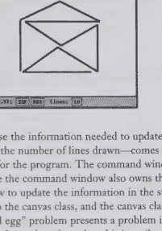

由于在这种情况下，用于更新状态栏的信息——即鼠标 (x,y) 位置和绘制的线条数量——来自程序的画布对象，这对程序来说是一个难题。正如你所回忆的，命令窗口拥有画布作为对象。因为命令窗口也拥有状态栏，所以画布必须告诉其拥有窗口更新状态栏中的信息。换句话说，窗口类必须引用画布类，而画布类必须引用回窗口类。这种“鸡生蛋还是蛋生鸡”的问题在声明两个类以便相互引用的后勤上造成了问题——但这很容易解决，如你将看到的，通过使用所谓的向前类声明。列表 30.14，`canvas.h`，显示了必要的声明。（该列表未显示用于保存线条信息的`TLine`类。此类与之前的示例保持不变。）

### 列表 30.14 `VSTAT/CANVAS.H`（部分）


```
#include <v/vcanvas.h> // Need vCanvasPane class

class TCmdWindow; // Forward declaration

class TCanvasPane : public vCanvasPane {
private:
    bool mouseDown; // True while mouse button down
    int x1, y1, x2, y2; // Line coordinates
    vector<TLine*> lines; // Array of TLine objects
    TCmdWindow* cWindow; // Command window owner
public:
    TCanvasPane( TCmdWindow* owner ); // Constructor
    ~TCanvasPane(); // Destructor
    // Override some inherited functions
    virtual void Clear();
    virtual void MouseDown(int x, int y, int button);
    virtual void MouseUp(int x, int y, int button);
    virtual void MouseMove(int x, int y, int button);
    virtual void MouseMotion(int x, int y);
    virtual void Redraw(int x, int y, int w, int h);
};
```

The forward declaration for `TCmdWindow` permits the `TCanvasPane` to use this class name in two ways. First, it declares a pointer to a `TCmdWindow` object, `cOwner`, that refers to the canvas object's owning command window. To initialize this variable, the `TCanvasPane` constructor also declares a pointer of the same type as a parameter. These are all the changes necessary to make the canvas aware of its owner and, therefore, able to call public functions for that window object. Listing 30.15, `cmdwin.h`, shows the command window class, `TCmdWindow`, declaration.

## LISTING 30.15 `VSTAT/CMDWIN.H` (PARTIAL)

```
#include <v/vstatus.h>  // Need vStatusPane
#include "canvas.h"  // Need TCanvasPane class

class TCmdWindow : public vCmdWindow {
private:
    TCanvasPane* myCanvas;    // Pointer to our canvas object
    vMenuPane* myMenu;        // Pointer to window's menu
    vCommandPane* myToolBar;  // Pointer to window's toolbar
    vStatusPane* myStatus;    // Pointer to window's statusbar
    ItemVal widthMenuItem;    // Checked Width-menu command
    vPen pen;                 // Drawing pen
public:
    TCmdWindow(char* name, int width, int height);
    virtual ~TCmdWindow();
    virtual void WindowCommand(ItemVal id, ItemVal val, CmdType cType);
public:
    // Status bar update info functions called by canvas
    void UpdateMouseInfo(int x, int y);
    void UpdateNumLines(int n);
};
```

In addition to other headers not shown in the listing, the header file for the `TCmdWindow` class includes `vstatus.h` for the `vStatusPane` class, used to create the status bar. A pointer to this class is declared in the private section. In addition, two new functions, `UpdateMouseInfo()` and `UpdateNumLines()` are declared. These functions are called by the canvas object to update the command window's status bar display. Listing 30.16, `canvas.cpp`, shows the functions where this happens. Remember, the mouse events occur in the canvas object—so, to update the window's status bar, the canvas must call its owner window's functions as declared in `TCmdWindow`.

## LISTING 30.16 `VSTAT/CANVAS.CPP` (PARTIAL)

```
#include "canvas.h"  // Our header
#include "cmdwin.h"  // Need our TCmdWindow class

// Constructor
TCanvasPane::TCanvasPane(TCmdWindow* owner) :
    vCanvasPane(),  // Call ancestor constructor
    lines()         // Construct lines vector (grows as needed)
{
```


```
mouseDown = false;
 x1 = y1 = x2 = y2 = 0;
 cOwner = owner; // Remember who owns this object
}

// Erase window's canvas and lines vector
void TCanvasPane::Clear()
{
 vCanvasPane::Clear(); // Call ancestor function
 lines.erase(lines.begin(), lines.end());
 cOwner->UpdateNumLines(lines.size()); // Update Status bar
}

// Respond to mouse button click event
// Prepares for drawing the next line
void TCanvasPane::MouseDown(int x, int y, int button)
{
 mouseDown = true; // Set mouse down flag
 x1 = x; // Remember starting location
 y1 = y;
 x2 = x1; // Set end point == beginning
 y2 = y1; // as a "do nothing" flag
 cOwner->UpdateMouseInfo(x, y); // Update status bar
}

// Respond to mouse button release event
// Save current line in the lines vector
void TCanvasPane::MouseUp(int x, int y, int button)
{
 mouseDown = false; // Reset mouse down flag
 if (x1 != x2 || y1 != y2) {
 DrawRubberLine(x1, y1, x2, y2); // Erase old line
 x2 = x; // Save line end point
 y2 = y;
 DrawLine(x1, y1, x2, y2); // Draw fixed line
 lines.push_back(TLine(GetPen(), x1, y1, x2, y2));
 // Update status bar information
 cOwner->UpdateMouseInfo(x, y);
 cOwner->UpdateNumLines(lines.size());
 }
}

// Respond to mouse movement button-down event
// Draws a "rubber line" (i.e. an erasable line)
void TCanvasPane::MouseMove(int x, int y, int button)
{
 if (mouseDown) {
 if (x1 != x2 || y1 != y2)
 DrawRubberLine(x1, y1, x2, y2); // Erase old line
 x2 = x; // Save line end point so far
 y2 = y;
 DrawRubberLine(x1, y1, x2, y2); // Draw new line
 }
 // Update status bar information
 cOwner->UpdateMouseInfo(x, y);
```

```
// 创建画布，使其显示在菜单栏下方。

TCmdWindow::TCmdWindow(char* name, int width, int height) :
    vCmdWindow(name, width, height) // 调用祖先构造函数
{
    widthMenuItem = m_Width1;      // 记住选中的菜单项
    myMenu = new vMenuPane(MenuBar);   // 创建菜单窗格
    AddPane(myMenu);               // 将其添加到窗口中
    myToolbar = new vCommandPane(Toolbar); // 创建工具栏窗格
    AddPane(myToolbar);            // 将其添加到窗口中
    myCanvas = new TCanvasPane(this);   // 创建画布对象
    AddPane(myCanvas);             // 将其添加到窗口中
    myStatus = new vStatusPane(Statusbar); // 创建状态栏窗格
    AddPane(myStatus);             // 将其添加到窗口中
    pen.SetColor(0, 0, 0);         // 将画笔颜色设置为黑色
    pen.SetWidth(1);               // 设置初始画笔宽度
    myCanvas->SetPen(pen);         // 将画笔设置到画布中
    ShowWindow();                  // 使窗口可见
}

...

// 画布对象调用此函数，用于更新状态栏中
// 鼠标的 x、y 位置信息，当鼠标指针
// 在窗口内移动时。
void TCmdWindow::UpdateMouseInfo(int x, int y)
{
    char buffer[8]; // 临时文本缓冲区
    sprintf(buffer, "%03d", x);
    SetString(m_XPosition, buffer); // 显示 X 信息
    sprintf(buffer, "%03d", y);
    SetString(m_YPosition, buffer); // 显示 Y 信息
}

// 类似地，此函数更新窗口中
// 已绘制的线条数量。它同样由
// 画布对象调用。
void TCmdWindow::UpdateNumLines(int n)
{
    char buffer[8];
    IntToStr(n, buffer);
    SetString(m_NumLines, buffer);
}
```

为状态栏中的每个项目定义唯一常量。标签都可以使用同一个常量来定义，例如这里的 `m_StatLabel`。我对这些值使用了 200 到 203 的范围，但任何唯一整数都可以，只要它们小于 30,000。这些值在所有组件中必须是唯一的，包括菜单命令和工具栏项。

状态栏本身与菜单和工具栏一样，是由 `v_defs.h` 中声明的 `V` 类型组成的结构体。请按如下方式定义 `vStatus` 类型的状态栏：

`vStatus Statusbar[] =`

## 总结

本章展示了如何为 X 开发面向对象的 V 应用程序，包括下拉菜单栏、工具栏、状态栏和图形。请务必查看 V 的网站，以获取此优秀 X 编程类库的更新和未来附加组件。

有关本章所涉及主题的更多信息，请参阅以下章节：

- 第 24 章“构建标准容器”
- 第 26 章“X 编程简介”
- 第 29 章“V 类库简介”

## 附录

- A GNU C++ 保留字 781
- B C++ 运算符优先级和结合性 783
- C Web 和 FTP 站点 785
- D 使用 CD-ROM 787
- E 版权信息——GNU 通用公共许可证 789

## GNU C++ 保留字

```
| __alignof __ | __const__ | __inline | reinterpret_cast | try |
| __alignof__ | const | __inline__ | return | typedef |
| and | const_cast | inline | short | typeid |
| and_eq | continue | int | __signature__ | typename |
| __asm | default | __label__ | signature | __typeof |
| __asm__ | delete | long | __signed | __typeof__ |
| asm | do | mutable | __signed__ | typeof |
| __attribute | double | namespace | signed | union |
| __attribute__ | dynamic_cast | new | __sigof__ | unsigned |
| auto | else | not | sigof | using |
```


| `bitand` | `enum` | `not_eq` | `sizeof` | `virtual` |

| `bitor` | `explicit` | `operator` | `static` | `void` |

| `bool` | `__extension__` | `or` | `static_cast` | `__volatile` |

| `break` | `extern` | `or_eq` | `struct` | `__volatile__` |

| `case` | `false` | `overload` | `switch` | `volatile` |

| `catch` | `float` | `private` | `template` | `__wchar_t` |

| `char` | `for` | `protected` | `this` | `while` |

| `class` | `friend` | `public` | `throw` | `xor` |

| `compl` | `goto` | `register` | `true` | `xor_eq` |

| `__const` | `if` |  |  |  |

## C++ 运算符优先级和结合性

| 级别 | 运算符 | 求值顺序 |
|---|---|---|
| 1 (高) | `( )`, `[ ]`, `->`, `::` | left-to-right |
| 2 | `*`, `/`, `%`, `+`, `-`, `++`, `--`, `sizeof`, `new`, `delete` | right-to-left |
| 3 | `.`, `.*`, `->*` | left-to-right |
| 4 | `*`, `/`, `%` | left-to-right |
| 5 | `+`, `-` | left-to-right |
| 6 | `<<`, `>>` | left-to-right |
| 7 | `<`, `<=`, `>`, `>=` | left-to-right |
| 8 | `==`, `!=` | left-to-right |
| 9 | `&` | left-to-right |
| 10 | `^` | left-to-right |
| 11 | `\|` | left-to-right |
| 12 | `&&` | left-to-right |
| 13 | `\|\|` | left-to-right |
| 14 | `?:` | right-to-left |
| 15 | `=`, `*=`, `/=`, `%=`, `+=`, `-=`, `<<=`, `>>=`, `&=`, `^=`, `\|=` | right-to-left |
| 16 (低) | `,` | left-to-right |

表中上方的运算符比下方的运算符具有更高的优先级。C++ 在求值具有更低优先级运算符的表达式之前，会先求值具有更高优先级运算符的表达式。给定一个具有相同优先级的运算符的表达式，C++ 会按照给定的结合性顺序求值任何子表达式。

表中的某些符号存在歧义，但 C++ 会使用表达式的上下文来确定要执行的操作。例如，在表中，一元加号（`+`）和一元减号（`-`）位于第 2 级，其优先级高于第 5 级的算术加法和减法。级别 2 处的 `&` 符号是取地址运算符；级别 9 处的 `&` 运算符是按位与运算符。级别 2 处的 `*` 运算符是指针解引用运算符；级别 3 处的 `*` 字符是两字符 `.*` 和三字符 `->*` 成员指针解引用运算符的一部分；级别 4 处的 `*` 符号是乘法运算符。

> **注意**  有关使用优先级和结合性的更多信息，请参阅第 7 章“应用基本运算符”。

## 附录

### WEB 和 FTP 站点

有大量 Web 和 FTP（文件传输协议）站点可供使用，足以让 Linux 和 GNU C++ 爱好者忙碌一生。以下是我在撰写本书时发现非常有用的站点，也只是为了好玩。你可以通过从此处列出的站点开始，找到数百个指向其他站点的额外链接。

你获取 GNU C++ 信息和文件的关键来源，以及其他 GNU 自由软件基金会项目，是这个网站：

http://www.gnu.org/

转到标记为“software”的页面以获取有关 GNU C++ 和其他语言的信息。该网站上有大量软件，附带完整源代码，其中很大一部分是用 C 和 C++ 编写的。有关 GNU C++ 的另一个极佳信息来源可在以下网站找到：

http://egcs.cygnus.com

Cygnus Solutions 是 GCC（GNU 编译器集合）和 EGCS 的主要贡献者。该网站还提供大量信息和指向相关 UNIX 和 Linux 站点的额外链接。有关本书 CD-ROM 上的 Mandrake-Linux 软件的更多信息，请登录此网站：

http://www.linux-mandrake.com

使用你的浏览器的 FTP 功能，或其他 FTP 软件，你将在以下相关 FTP 地址找到大量帮助、源代码和其他文件：

ftp://ftp.linux-mandrake.com

本书还介绍了用于 X 编程的 C++ 类库 V。该库支持为 Microsoft Windows、X 和 OS/2（以及可能的其他平台）进行交叉开发。有关 V 最新版本的源文件，以及有关即将发布的基于 V 的可视化开发系统的信息，请登录以下网站，该网站还支持其他 C++ 和 Linux 主题的页面：

http://www.objectcentral.com/

我的秘密幻想是成为一名飞行员。然而，不需要另一个昂贵的爱好，我就满足于我的帆船。但当我想做梦时，我会登录以下网站。这是绝对最酷的飞行模拟器项目，它是用 C++ 为 Linux 和 Microsoft Windows 编写的：

http://www.flightgear.org/

以下是一些你可能会觉得有趣的 Linux、UNIX 和 GNU C++ 站点。

http://www.redhat.com

http://www.calderasystems.com

http://www.unc.edu/pub/Linux

http://www.ssc.com/linux

http://www.linuxjournal.com

最后但并非最不重要的，这里是我的最爱。如果您有任何反馈，请告诉我！

http://www.tomswan.com

## 附录

### 使用 CD-ROM


要安装 Linux-Mandrake 6.0 操作系统，请插入随附的 CD-ROM 并重新启动。按照屏幕上的说明操作。如果无法从 CD-ROM 启动，则必须使用其他方法安装 Linux。如果可以启动到 MS-DOS，请插入 CD-ROM（此处显示为 D 盘），然后输入以下命令：

```
d:
cd \dosutils
autoboot.bat
```

要使这些命令生效，你必须只能在 MS-DOS 下运行——例如，不能在 Microsoft Windows 中打开的 DOS 窗口中使用这些命令。如果无法启动到 MS-DOS，则必须创建特殊的启动软盘来安装 Linux。创建此磁盘的完整说明位于 CD-ROM 上的 `Readme` 文件中。请使用 Microsoft Windows 的 WordPad 附件应用程序查看此文件。

与安装任何操作系统一样，安装 Linux 会删除系统上的任何现有文件（除非你采取其他措施保护硬盘分区，但此处未描述）。在安装本书的 CD-ROM 之前，请完整备份所有文件。

> 注意

> 有关安装和配置 Linux 以供本书使用的更多信息，请参阅第 2 章“安装 Linux”。有关其他安装建议以及安装本书示例列表文件的说明，请参阅第 3 章“安装 GNU C++”。

## 附录

### 版权信息——GNU 通用公共许可证

GNU 通用公共许可证

1991 年 6 月第 2 版

版权所有 © 1989, 1991 Free Software Foundation, Inc.

675 Mass Ave., Cambridge, MA 02139, USA

*允许每个人复制和分发本许可证文件的逐字副本，但不得对其进行修改。*

### 序言

大多数软件的许可证旨在剥夺你共享和修改软件的自由。相比之下，GNU 通用公共许可证旨在保证你共享和修改自由软件的自由——确保软件对其所有用户都是自由的。本通用公共许可证适用于自由软件基金会的大部分软件，以及任何其作者承诺使用本许可证的程序。（自由软件基金会的某些其他软件则受 GNU 库通用公共许可证保护。）你也可以将本许可证用于你自己的程序。

当我们谈论自由软件时，我们指的是自由，而非价格。我们的通用公共许可证旨在确保你拥有分发自由软件副本的自由（如果你愿意，也可以为此服务收费），确保你能够收到源代码，或者在你需要时能够获取源代码，确保你能够修改软件或在新的自由程序中使用其中的部分代码；并且确保你知道你可以做这些事情。

为了保护你的权利，我们需要作出限制，禁止任何人否认你的这些权利，或要求你放弃这些权利。如果你分发软件副本或修改软件，这些限制将转化为你的某些责任。


例如，如果你分发此类程序的副本，无论是免费的还是收费的，你必须给予接收者你拥有的所有权利。你必须确保他们也能收到或能够获取源代码。而且你必须向他们展示这些条款，以便他们了解自己的权利。

我们通过两个步骤保护你的权利：（1）对软件进行版权保护，（2）向你提供本许可证，赋予你复制、分发和/或修改软件的合法许可。

此外，为了每位作者和我们自己的保护，我们要确保每个人都明白，这个自由软件没有任何担保。如果软件被他人修改后继续传递，我们希望接收者知道他们所得到的并非原版，这样他人引入的任何问题都不会影响原作者的声誉。

最后，任何自由程序都不断受到软件专利的威胁。我们希望避免自由程序的分发者单独获得专利许可，从而使程序实际上变成专有软件。为防止这种情况，我们已经明确表示，任何专利都必须获得许可，供所有人免费使用，否则不予许可。

# GNU 通用公共许可证

## 复制、分发和修改的条款和条件

本许可证适用于任何包含版权持有者声明其可根据本通用公共许可证条款分发的程序或其他作品。`Program`，下文所指即为任何此类程序或作品，而“基于该程序的作品”是指根据版权法而言的该程序或其任何衍生作品：也就是说，包含该程序或其一部分的作品，无论是逐字复制还是经过修改和/或翻译成另一种语言。（此后，翻译包含在“修改”一词中，无任何限制。）每一位被许可人都称为`you`。

除复制、分发和修改之外的活动不属于本许可证的覆盖范围；运行该程序的行为不受限制，而该程序的输出仅在其内容构成基于该程序的作品时才受覆盖（与是否通过运行该程序产生无关）。是否如此取决于该程序所做的事情。

- 1. 你可以在任何媒介上复制和分发你收到的程序源代码的逐字副本，前提是你必须在每一份副本上显著且适当

4. 除非本许可证明确规定，否则您不得复制、修改、再许可或分发该程序。任何其他复制、修改、再许可或分发该程序的尝试均属无效，并将自动终止您在本许可证下的权利。然而，只要这些方完全遵守本许可证，从您处获得副本和权利的各方，其许可证不会因此终止。

5. 您无需接受本许可证，因为您并未签署它。然而，除本许可证外，没有任何内容授予您修改或分发该程序或其衍生作品的许可。如果您不接受本许可证，上述行为均被法律禁止。因此，通过修改或分发该程序（或基于该程序的任何作品），您表明您接受本许可证，并接受其关于复制、分发或修改该程序或基于其的作品的所有条款和条件。

6. 每次您重新分发该程序（或基于该程序的任何作品）时，接收方都会自动从原始许可人处获得许可，可根据这些条款和条件复制、分发或修改该程序。您不得对接收方行使本许可授予的权利施加任何进一步限制。您不对第三方遵守本许可证负责。

7. 如果由于法院判决、专利侵权指控或任何其他原因（不限于专利问题），对您施加的条件（无论是法院命令、协议或其他方式）与本许可证的条件相矛盾，则这些条件并不能使您免除本许可证的条件。如果您无法同时满足本许可证下的义务以及任何其他相关义务，则作为后果，您不得分发该程序。例如，如果专利许可不允许您直接或间接接收副本的所有人免费重新分发该程序，那么您要同时满足该许可和本许可证的唯一方法就是完全停止分发该程序。

如果本节的任何部分在特定情况下被认定为无效或不可执行，则该节的其余部分仍应适用，且该节整体仍应在其他情况下适用。

本节的目的并非诱使您侵犯任何专利或其他财产权利主张，或质疑此类主张的有效性；本节的唯一目的是保护自由软件分发系统的完整性，该系统通过公共许可实践得以实现。许多人已慷慨地为通过该系统分发的各种软件做出贡献，其依据是对该系统的持续一致应用；作者/捐赠者有权决定是否愿意通过任何其他系统分发软件，而被许可人不得强加该选择。

本节旨在彻底阐明人们认为本许可证其余部分所产生的后果。

8. 如果该程序的分发和/或使用在某些国家受到专利或版权接口的限制，则将该程序置于本许可证下的原始版权持有人可以增加明确的地理分发限制，排除这些国家，从而仅允许在未被排除的国家或国家之间进行分发。在这种情况下，本许可证被视为已将该限制纳入本许可证正文。

## 9. 自由软件基金会可能会不时发布通用公共许可证的修订版和/或新版本。此类新版本在精神上将与本版本相似，但细节上可能有所不同，以解决新的问题或关注点。

每个版本都有一个区分的版本号。如果该程序指定了适用于其的本许可证的版本号以及“任何后续版本”，则您可以选择遵循该版本或自由软件基金会发布的任何后续版本的条款和条件。如果该程序未指定本许可证的版本号，则您可以选择自由软件基金会发布过的任何版本。

## 10. 如果您希望将该程序的部分内容并入分发条件不同的其他自由程序中，请向作者请求许可。对于由自由软件基金会版权的软件，请写信给自由软件基金会；我们有时会为此做出例外。我们的决定将以保持我们自由软件所有衍生作品的自由状态以及促进软件的共享和再利用为指导目标。

## NO WARRANTY

## 11. 因为该程序是免费许可的，因此在适用法律允许的范围内，该程序不提供任何担保。除非另有书面说明，版权持有人和/或其他各方按“原样”提供该程序，不提供任何形式的明示或暗示担保，包括但不限于适销性和特定用途适用性的暗示担保。关于该程序的质量和性能的全部风险由您承担。如果该程序被证明有缺陷，您承担所有必要的维护、修理或更正费用。

## 12. 除非适用法律要求或另有书面协议，在任何情况下，任何版权持有人，或任何根据上述规定可能修改和/或重新分发该程序的其他方，均不对您承担因使用或无法使用该程序而产生的损害赔偿责任，包括任何一般性、特殊性、偶发性或后果性损害，包括但不限于数据丢失或数据不准确，或您或第三方遭受的损失，或该程序无法与其他程序一起运行，即使该持有人或其他方已被告知此类损害的可能性。

END OF TERMS AND CONDITIONS

## LINUX 与 GNU 系统

GNU 项目始于 12 年前，其目标是开发一个完整的自由类 UNIX 操作系统。“自由”指的是自由，而非价格；它意味着你有权运行、复制、分发、研究、修改和改进软件。

一个类 UNIX 系统由许多不同的程序组成。我们发现一些组件已作为自由软件可用——例如 X Window 和 TeX。我们通过说服其开发者将其变为自由软件而获得了其他组件——例如伯克利网络工具。其他组件是专门为 GNU 编写的——例如 GNU Emacs、GNU C 编译器、GNU C 库、Bash 和 Ghostscript。此最后一类组件中的组件是“GNU 软件”。

GNU 系统由全部三类组件共同构成。

GNU 项目不仅仅是开发和分发自由软件。GNU 项目的核心是一个理念：软件应该是自由的，并且用户的自由是值得捍卫的。因为如果人们拥有自由却不珍惜它，他们很快就会失去它。为了使自由持久，我们必须教会人们珍惜它。

GNU 项目的方法是自由软件和用户自由的理念相互支持。我们开发 GNU 软件，当人们遇到 GNU 程序或 GNU 系统并开始使用它们时，他们也会思考 GNU 理念。软件表明该理念在实践中可行。认同该理念的人很可能会编写额外的自由软件。因此，软件体现了这一理念，传播这一理念，并从这一理念中成长。

这种方法运行良好——直到有人将 Linux 内核与 GNU 系统（当时仍缺少内核）结合起来，并将该组合称为“Linux 系统”。

Linux 内核是由 Linus Torvalds 编写的自由 UNIX 兼容内核。它并非专门为 GNU 项目编写，但 Linux 内核与 GNU 系统配合良好。事实上，将 Linux 添加到 GNU 系统使系统得以完成：它使自由 UNIX 兼容操作系统可用。

但具有讽刺意味的是，称其为“Linux 系统”的做法削弱了我们传达 GNU 理念的方法。乍一看，“Linux 系统”听起来像是与“GNU 系统”完全不同的东西。而大多数用户也确实认为它是这样。

大多数对“Linux 系统”的介绍都承认 GNU 软件组件所发挥的作用。但它们没有说整个系统或多或少就是 GNU 项目十年来一直在编译的 GNU 系统。它们没有说自由类 UNIX 系统的理念源于 GNU 项目。因此，大多数用户并不知道这些事情。

这导致许多用户将自己视为一个独立的“Linux 用户”社区，与 GNU 用户社区相区别。

他们使用所有 GNU 软件；事实上，他们使用几乎整个 GNU 系统；但他们不认为自己是 GNU 用户，也可能不会思考 GNU 理念。


这也会导致其他问题——甚至阻碍软件维护的合作。通常当用户修改 GNU 程序使其在特定系统上工作得更好时，他们会将修改发送给该程序的维护者；然后他们与维护者一起工作，解释修改、为其辩护，有时重写它以使其被安装。

但那些认为自己是“Linux 用户”的人更有可能发布一个分叉的“仅限 Linux”版本的 GNU 程序，并认为工作已完成。我们希望每个 GNU 程序都能在基于 Linux 的系统上“开箱即用”；但如果用户不提供帮助，这一目标就变得难以实现。

那么，GNU 项目应如何回应？我们现在应该怎么做才能传播计算机用户自由重要的理念？

我们应继续谈论分享和更改软件的自由——并教导其他用户珍惜这些自由。如果我们喜欢拥有自由操作系统，那么我们就有理由思考如何长期保留这些自由。如果我们喜欢拥有各种自由软件，那么我们就有理由思考如何鼓励他人编写额外的自由软件，而不是额外的专有软件。

我们不应接受社区分裂为两部分。相反，我们应传播这样的信息：“Linux 系统”是变体的 GNU 系统——这些系统的用户是 GNU 用户，并且他们应该考虑带来这些系统存在的 GNU 哲学。

本文就是这样做的一种方式。另一种方式是使用术语“基于 Linux 的 GNU 系统”（或“GNU/Linux 系统”或简称为“Lignux”）来指代 Linux 内核与 GNU 系统的组合。

Copyright © 1996 Richard Stallman

(Verbatim copying and redistribution is permitted without royalty as long as this notice is preserved.)

The Linux kernel is Copyright © 1991, 1992, 1993, 1994 Linus Torvalds (others hold copyrights on some of the drivers, file systems, and other parts of the kernel) and is licensed under the terms of the GNU General Public License.

## The FreeBSD Copyright

All of the documentation and software included in the 4.4BSD and 4.4BSD-Lite Releases is copyrighted by The Regents of the University of California.

Copyright ©1979, 1980, 1983, 1986, 1988, 1989, 1991, 1992, 1993, 1994 The Regents of the University of California. All rights reserved.

源代码和二进制形式的再分发和使用，无论是否修改，只要满足以下条件即可：

+   1. 源代码的再分发必须保留上述版权声明、此条件列表和以下免责声明。

+   2. 二进制形式的再分发必须在随分发提供的文档和/或其他材料中重现上述版权声明、此条件列表和以下免责声明。

+   3. 宣传本软件功能或使用的所有广告材料必须显示以下致谢：

+   本产品包含由加州大学伯克利分校及其贡献者开发的软件。

+   4. 未经明确事先书面许可，不得使用大学名称或其贡献者的姓名来认可或推广源自本软件的产品。

本软件由董事会和贡献者“按原样”提供，任何明示或暗示的保证，包括但不限于适销性和特定用途适用性的暗示保证，均不予保证。在任何情况下，董事会或贡献者均不对任何直接、间接、附带、特殊、示范性或后果性损害承担责任，包括但不限于替代商品或服务的采购、使用、数据或利润的损失，或业务中断，无论此类损害是否因使用本软件而产生，且无论基于何种责任理论，无论是合同、严格责任还是侵权，包括疏忽或其他情况，即使已告知可能发生此类损害。

电气和电子工程师学会以及美国国家标准委员会 X3 信息处理系统已授予我们转载其文档部分的许可。

在以下声明中，短语“此文本”指的是系统文档的部分内容。

系统文档的某些部分在第二版 BSD 网络软件发行版中以电子形式重新印刷和复制，摘自 IEEE Std 1003.1-1988，IEEE 计算机环境可移植操作系统接口标准 POSIX，版权所有 C 1988 由电气和电子工程师学会，Inc. 如果这些版本与原始 IEEE 标准之间存在任何差异，则原始 IEEE 标准为参考文件。

在以下声明中，短语“此材料”指的是系统文档的部分内容。

accelerator keys, 766

access specifiers, 259, 324-326

`access.cpp`, 423

accounting, variable types, 163-164

`accum.cpp`, 553

`accumulate()`, 553-555, 601-602

acquiring GNU C++, 5

adapters, 545

addition operator (`+`), 135

`adjacent_find()`, 609

`advance()`, 547

`algorithm` header file, 533, 600

algorithms

standard. See standard algorithms

STL, 532-533, 548-550

Alt key, 50

ancestor classes, 309

AND algorithms, 612-613

AND operator (`&&`), 138

angle brackets (`< >`), 48

ANSI C specification, 51

`-ansi` option, 70

API (Application Programming Interface), 633

`append()`, 518

application objects, 746

application scheduling, 592

`AppMain()`, 733, 736, 747

`arge`, 239

arguments, 59, 198

command line, 238-239

default, 209, 211

`argv`, 239

arithmetic operators, 134

array subscript operator `[]`, 421-423

arrays, 120

class objects, of, 296-297

default constructors, 296

dynamic, 235-238

dynamic, of object pointers, 298

dynamic object, 296-297

initializing, 121-123

maximum index, 121

members of classes, 299

multidimensional, 121

multidimensional, dynamic, 236-238

of pointers, 297

overloaded operators, 421-423

searching, 535-537

strings, 122-123

sum values, 601

`ascii.cpp`, 181

assembler, info, 73

assembly language, 72

`assert()`, 130-131

`assert.h` header file, 130-131, 657

`assign()`, 518-519

assignments

multiple, 143

operator (`=`), 134, 143, 484

results, 134

shorthand, 143

statements, 90

associative arrays, 585

associative containers, 584

associativity of operators, 136, 143, 784

asterisk (`*`), 224-225

`at()`, 517

Athena Xaw3d library, 637

`atof()`, 118

`atoi()`, 118, 153

`atol()`, 118

atoms, 654, 711-714

automatic template instantiation, 390

automatic variables, 196

B

back inserters, 545

`back()`, 571

backgrounds, window, 691-695

backing store, 674

backslash (`\`), 52, 113, 116

base classes, 309, 332

debugging, 350, 352

multiple, 346-350

base line, 669

Bash (Bourne Again Shell), 19, 58

`begin()`, 522

`bfstest.cpp`, 464

`bfstream` 类，463-467


- `bfstream.h`, 463
- 双向迭代器，535, 542, 577
- `bifstream` 类，456-458, 460-461
- 二进制文件，450-452
  - 打开，451
  - 读取，455-457, 459-462
  - 写入，453-454, 459-462
- 二元运算符，413
- `bind1st()` 和 `bind2nd()`，560-562
- `binder.cpp`, 561
- 绑定器，560-562
- 位重力，688
- 位平面，641, 700-701
  - 创建，693
  - X 工具，695
- 按位运算符，140-142
- `bit_vector` 类，571
- `bofstream` 类，454-461
- 布尔类型，103-104, 137
- 布尔标准算法，612-613
- 布尔变量，103-104
- 布尔向量，570
- 引导加载程序，19
- 启动顺序，13
- 启动 Linux，20
- Borland C++ 模型，390
- 方括号（`[ ]`），111, 421-423
- `break` 语句，182-183, 187-189
- `breaker.cpp`, 182
- 断点模板，397
- 断点，80-84
- `bstream.cpp`, 458
- `bstream.h`, 457
- 缓冲区，112
  - 动态，233
  - `filebuf` 类，440
  - 检查，248
  - 持久性，499-500
  - `sprinttf()`，156
  - 静态，497
- `buggy.cpp`, 124
- 缺陷。另请参阅 调试；错误
  - 编译时，64
  - 内存错误，230-231
  - 输出流评估，427
  - 运行时，64, 79
  - 段错误，284
  - 模板，394
- `ButtonPress` 事件，661-663
- `ButtonRelease` 事件，661
- 按钮，769-770

## C

- `-c` 选项，72
- C 编程语言
  - 与 C++ 相比，40-42
  - 编译器，47
  - 文件扩展名，47
  - `main()`，58
  - 标准函数库，51
- `c++` 命令，47
- Caldera Linux 2.2, 6, 38
- `calloc()`，228
- 调用（函数），194-195
- 画布，670, 732, 741
  - 重绘，757-761
  - 状态栏，776
  - V 图形，753-757
- 容量，514, 570
- `capacity()`，513
- `case` 语句，187-189
- 大小写敏感性，92
- 字符串函数的大小写敏感性，115
- 类型转换，91
- `catch` 语句，358-367
- `celsius.cpp`, 128
- `center.cpp`, 209
- CFront C++ 模型，41, 94-95, 111, 390
- 字符字符串。另请参阅 字符串
- 字符，111。另请参阅 字符串
  - 字符串对象，508
  - 宽字符，509
- `char_optarg`, 240
- 子
  - 类，309
  - 重力，689
  - 窗口，633
- `choice.cpp`, 169
- `cin`，146
  - `get()`，147-152
  - `getline()`，150-151
- `class`（保留字），259
- 类，256, 260
  - 抽象，332-335, 342-344
  - 访问说明符，259, 324-326
  - 祖先，309
  - 对象数组，299
  - 基类，309
  - 子类，309
  - 命令，260
  - `const` 成员函数，312
  - 构造函数，261-267
  - 容器，334-337, 339-344, 386
  - 复制构造函数，283-284, 286-289, 319
  - 创建，258
  - 数据隐藏，306
  - 数据成员，262
  - 调试，271-273, 352-354
  - 声明，259
  - 默认访问，259
  - 默认构造函数，265
  - 派生，308-311, 317-321, 404
  - 派生成员，324-326
  - 后代，309
  - 析构函数，276, 283
  - 点表示法，260, 277
  - 动态对象，278-279
  - 封装，256
  - 异常对象，359
  - 异常，375
  - 前置声明，771-772
  - 友元，402-405
  - 函数，262-263
  - 函数对象，552-555
  - 函数原型，259
  - 生成器，560
  - 层次结构，308
  - 不完整声明，335
  - 继承，303, 308-310
  - 初始化表达式，290-292
  - 初始化成员，289
  - 实例，260
  - 成员函数，259
  - 成员，260, 277
  - 内存管理，280-283
  - 模块，300-304
  - 多重基类，346-350
  - 相互友元，406-407
  - 名称，259
  - 嵌套声明，500-502
  - 对象
    - 声明，263, 265
    - 求值，412
    - 初始化，266
    - 返回，294-296
    - 临时，265
  - `operator=()`，285-289
  - 父类，309
  - 指针，280
  - 多态，260
  - 私有成员，259, 481
  - 受保护成员，259, 324
  - 公有成员，259
  - `Raise()`，375
  - 读取二进制对象，460
  - 可重用性，256
  - 兄弟，309
  - 标准字符串，508-509
  - 静态函数，495-498
  - 静态成员，314, 495
  - 子类，309
  - 超类，309
  - 模板，380-386, 388
  - 类型转换，419
  - 更新数据表示，301
  - V 库。另请参阅 V 类库
  - 虚析构函数，335
  - 写入二进制对象，460
- `class_T`，384
- 清理目录，643
- 客户端/服务器，633
- 客户端，633, 654
- 剪贴板。另请参阅 剪切缓冲区
- `clock_t`，207
- `cmdline.cpp`, 238
- `collect2` 程序，391
- 冒号，作用域解析运算符（`::`），197
- 冒号（）：187, 240
- 冒号（标签），184
- `color.cpp`，315
- `color.h`，314
- `colorcells`，700-707
- colormaps，633, 641-642, 700
  - 位平面，700-701
  - `colorcells`，700-707
  - 真彩色，701, 704
- 颜色。另请参阅 colormaps
  - 分配，710
  - 深度，641
  - 填充样式，720
  - 图形上下文，720
  - 图形原语，720
  - 灰度级别，702-703
  - 线条，716
  - 标准名称，702-704
  - 数量，701
  - 最小可用值，705
  - 真彩色，701, 704
  - 窗口，684
  - `XColor` 结构，706-707
  - `Xlib` 函数，646, 704-706
- 命令行参数，238-239
- 命令对象，769
- 命令窗格，769
- 命令窗口，736-740, 749-753
  - 参数，752
  - 切换，752
- 命令操作，260
- 注释掉，54
- 注释，53
- `/*` 和 `*/`，53-54
- `//`，54-55
- `-ansi` 编译器选项，71
- 源代码文件，55-56
- 时间戳，56
- `compare()`，526
- 比较。另请参阅条件表达式；排序
  - 对象，610
  - 字符串，114-115
- 仅编译（`-c`）选项，74-75
- 编译期错误，64
- 编译器
  - 从互联网下载，37-39
  - 安装，33-37
  - 编译，47, 64
  - `-ansi` 选项，70
  - `-c` 选项，72
  - C 程序，47
  - 仅编译（`-c`）选项，74-75
  - 编译期错误，64
  - 调试选项，80-81
  - `-E` 选项，71-72
  - `c++`，47
  - 错误消息，65-67
  - `-fcheck-new` 选项，231
  - `-ffor-scope` 选项，190
  - `-fno-inline` 选项，78
  - `-frepo_g++` 选项，391
  - `-fsyntax-only` 选项，73
  - 函数模块，218-219
  - `-g` 选项，80
  - GNU，47
  - `-I` 选项，75
  - `-I-` 选项，76-77
  - `-ldirafter` 选项，76
  - 内联函数，213
  - 链接器，72
  - `-nostdinc` 选项，76
  - `-o` 选项，48, 78-79, 213
  - 优化代码，77-79
  - 选项，70。另请参阅具体选项
  - 输出，47
  - `-pedantic` 选项，70
  - 可移植性选项，70
  - `-S` 选项，72
  - 分离编译，74-75
  - shell 脚本，69
  - 标准算法，600
  - 分步选项，71
  - 编译步骤，72
  - STL，533
  - 模板，389-391, 394
  - `-traditional` 选项，70
  - V 类库，727, 744
  - `-v` 选项，73, 77
  - `-W` 选项，67
  - `-Wall` 选项，67, 138
  - 警告级别，67-68
  - 警告，65
  - `-Wcomment` 选项，68
  - `-Werror` 选项，68
  - `-Wformat` 选项，158
  - `-Wreturn-type` 选项，68
  - `-Wtraditional` 选项，70
  - X 应用程序，642-643
- 取反运算符()，140
- 连接字符串，115
- 条件表达式，173-175
- 条件语句，168
- `config.mk`，643, 744
- `ConfigureNotify` 事件，657
- `configX.mk`，727
- `conglom.cpp`，350
- 控制台，输出到，49
- `const`，41, 97, 208
  - 函数，490
  - 迭代器，538-539
  - 对象，294
  - 引用警告，557
- `constant.cpp`，490
- 常量，60, 96-98。另请参阅 `const`


`construct.cpp`，264

浮点，109

宏，96-97

预定义，98

保留值，765

字符串，111, 264

构造函数，259, 261-262

数组，296

复制，266-267, 283-289, 293, 319-323

调试，272-273

默认，265-266, 271, 279, 296

默认参数，270

派生类，310, 318-319, 321

析构函数，276

异常，374-375

`explicit`，488-490

初始化表达式，290-292

内联，267-269

列表，573

多重基类，346-347

重载，269-271

参数化，265

V 类库，735

容器类，334, 337, 339-344, 484。另请参阅标准容器

抽象类，334

删除对象，345

I/O 流，543-545

迭代器，537-538

纯虚函数，336

STL 头文件，533

STL 模板。参见标准容器；STL

`vector`，537-538

虚析构函数，335

`container.cpp`，338, 340

`container.h`，334, 336

容器。另请参阅容器类；标准容器

适配器，545

关联式，584

迭代器，534

STL，533

STL 算法，548-550

模板类，386

`vector`，548-550

`continue`，183-184

控制，流程。参见流程控制

控制变量，176-178, 189-190

转换，字符串到数值变量，118

转换字符，160-161

`convert.cpp`，118, 152

`convert2.cpp`，155

坐标值，311

`coordinate.cpp`，312

`coordinate.h`，311, 568

`coords.cpp`，289

复制构造函数，266-267, 283-289, 293, 318-323, 474-475

编码，476

声明，475

运算符重载，414

`operator=()`，477

`vector`，568

`copy()`，523, 540-545, 602-604

写时复制（copy-on-write）方法，478, 480-488

字符串对象，509

`copy.cpp`，321

复制

动态对象，284

迭代器，540-542

对象，474

`operator=()`，476-477

字符串，112, 288, 522-523

`copyops.cpp`，285

`copy_backward()`，603

核心转储，61, 88

核心内存，61

`count()`，589, 604-606

`count_if()`，604-606

`cout`，49, 146, 604

`cow.h`，479, 483

`cowdemo.cpp`，486

`.cpp`，47

创建

类，258

对象，261

`cstring.cpp`，523

`ctor`，270

`ctype.h`，148

货币，163-164

光标，660, 687

剪切缓冲区，713-714

`cwelcome.cpp`，51

Cygnus Solutions，786

`c_str()`，519

D

数据

格式化，152

隐藏，306

成员，261

对象，90。另请参阅具体对象

数组，120

常量，96-98

调试，124-128

声明，90-91

枚举类型，101-103

枚举，93

全局，99-100

标识符，91-92

整型变量，94-95

局部，99-100

`long long`，105-107

名称，91-92

有符号，95-96

大小确定，94

字符串，110-111, 115

结构体，123

类型转换，91

无符号，95-96

结构。参见标准容器；结构体

类型。另请参阅具体类型

类，256

浮点，108

字面值，105

占位符，492-493

取值范围表，99

`size_t`，235

数据库，584

日期和时间函数，303

日期，161

`datetest.cpp`，304

`db.h`，385

调试器命令（工具菜单），86

调试，64, 79。另请参阅编译

`--command=FILE`，87

`-O` 选项，221

`-quiet` 选项，82

缩写，84

`assert()`，130-131

赋值，129

断点，80, 83-84

类，271-273

编译器选项，80-81

控制台调试器，82-84

构造函数，272-273

核心转储，88

数据对象，124-128

派生类，326-330

析构函数，340

目录选项，87

`display` 命令，329

动态内存，247

Emacs 编辑器，86-87

异常，377

函数，219-221

`gdb`，82-84

帮助, 82

内联函数, 81, 221

行号, 83

`list` 命令，83

`main()` 参数，250

内存, 248-249

多重基类, 350, 352

`next` 命令，220

优化, 效果, 81

选项, 87

输出窗口, 87

指针, 247-248

程序选项, 249-250

伪名, 127

基数值, 130

重复命令, 87

`run` 命令，83

保存会话, 87

作用域冲突, 197

单步执行, 80, 84, 220

`stabs`, 81

启动, 82

`step` 命令，220

字符串对象, 529-530

模板, 394-397

`tty` 命令，87

类型对象, 130

变量, 129, 131-132

虚函数, 352-354

X Windows, 84-85

Xlib, 653-658

`xxgdb`, 84-85

`dec`, 153

十进制点, 在整数中插入, 164

十进制值, 104-105, 156

声明

类对象, 263, 265

拷贝构造函数, 475

数据对象, 90-91

双端队列, 578

前向类, 771-772

友元函数, 408

友元, 403-404

函数, 194

整数变量, 94

列表, 573

映射, 584

嵌套类, 500-502

运算符重载, 413

指向对象的指针, 277

优先队列, 594

队列, 592

集合, 579

栈, 591

变量, 90

变量, 多个, 100

向量, 567

已声明异常, 364

递减运算符 (`--`), 139-140

默认参数错误, 209

默认构造函数, 265-266, 270-271, 279, 296

默认函数参数, 209

`default.cpp`, 99, 270

`#define` 指令, 96-97, 301

`defines.cpp`, 97

`delete`, 224, 226-227, 246, 251

数组, 236

类对象, 278

容器对象, 345

动态对象, 226-227, 279

运算符重载, 436-437

指针, 复制, 意外, 475

`delete []`, 233, 236, 297

深度, 641

`deque` 头文件, 533

双端队列, 578-579

`[]` 数组索引运算符, 579

声明, 578

成员函数, 579

优先队列, 597

队列, 591

解引用, 225, 495

迭代器, 534, 539

运算符 (`*`), 225

指针, 225

派生类, 308-311, 317-321

调试, 326-330

多重基类, 346-350

多态, 332

虚函数, 332

派生成员, 调试, 328

后代类, 309

析构函数, 276, 278, 283. 另见特定类

异常, 374

标志, 283

列表, 573

持久对象, 498

指针, 280

引用计数, 478, 485

标准容器, 567

V 类库, 735, 747

虚, 335

Xlib, 651

检测, 文件, 467-468

设备上下文, V 类库, 753

对话框, 732, 742

差异算法, 612-613

直接基不可访问警告, 350

目录

调试, 87

头文件, 49

包含, 75-77

磁盘文件系统, 22, 440. 另见 I/O 流

Disk Druid, 17

`display cp`, 248

Display 数据结构, 645

显示指针, 644

显示器, 634, 654

分布式处理, 633

除法运算符 (`/`), 135

`do while`, 178-179

`do-forever` 循环, 186

`do-nothing for` 循环, 185

`DoesBackingStore()`, 674

美元符号 (`$`), 47

点表示法, 123, 260, 277

`double`, 91, 94, 108, 118

双星号(`**`), 239

双冒号, 作用域解析运算符 (`::`), 197

双等号 (`==`), 95

绘图. 另见 图形原语

`DrawRubberLine()`, 757

`dtor`, 277

重复项, 查找, 609

`dwcount.cpp`, 179


`dynadate.cpp`, 278

动态

数组, 235-238

内存, 224, 231

对象, 224-227

数组, 296-297

拷贝, 284

创建, 278-279

## E

E (科学计数法), 108

`-E` 选项, 71-72

`egcs` (Experimental GNU Compiler System), 47

`electric.cpp`, 199

ELF 可执行代码格式, 48

`else`, 170-173

Emacs 编辑器

调试器, 86-87, 513

`empty()`, 513

映射, 589

栈, 591

封装, 256, 258, 282, 300

`encrypt.cpp`, 141

加密, 142

文件结束, 448

`end()`, 522

结束程序, 57, 59-61

`endl`, 49, 52, 154

无限循环, 186

`ends`, 154

`enter.cpp`, 117

入口, 程序, 56

`enum`, 101

`enum.cpp`, 103

枚举类型, 101-103

枚举, 93

`eof()`, 448

相等运算符 (`==`), 95, 137

`erase()`, 571, 582

标准错误输出文件, 49

`error.cpp`, 58

错误, 64

编译时, 65-67

调试, 64

默认参数, 209

已定义, 64

do-nothing for 循环, 185

退出程序, 60

内存, 230-231

差一错误, 178, 182

解析, 93

运行时错误, 79

段错误, 284

X, 639

转义代码, 52, 116

求值顺序, 运算符, 784

事件驱动编程, 639

事件, 648

键盘, 678, 680-682

循环, 634, 639, 649-651

掩码, 639, 648, 663-664

鼠标, 661-664

跟踪, 656-657

类型, Xlib, 649

X, 634

异常条件, 358

异常, 61, 225, 230, 358

`abort()`, 367-368, 370

`catch`, 358-367

`catch` 和 `throw`, 375

构造函数, 360, 374-375

自定义处理器, 371-372

调试, 377

已声明, 364

默认处理器, 359

派生类, 360

销毁, 367

析构函数, 360, 374

动态变量, 374

错误消息显示, 366

函数, 360

处理器, 358

头文件, 360

活动, 362

局部变量, 373-374

内存泄漏, 374

内存管理, 376-377

`new`, 376-377

对象, 358

重载数组运算符, 422

`Raise()`, 375

重新抛出, 377

保存打开文件, 368

`set_terminate()`, 368

`set_unexpected()`, 368

标准, 628

标准类, 360

字符串类, 509

字符串对象, 514-516, 628

模板, 388

`terminate()`, 367-368, 371-372

`throw`, 358-359

转换为已知类型, 372

捕获所有, 369-371

`try` 块, 361-364, 366-367

尝试, 358

意外, 367-368, 372

`unexpected()`, 371

未处理, 359, 362, 367-368

`except-ex.cpp`, 628

`EXIT FAILURE`, 60

`EXIT SUCCESS`, 60

`exit()`, 59-60

`exiterr.cpp`, 59

程序退出, 57, 59-61

Experimental GNU Compiler System (`egcs`), 47

显式构造函数, 488-490

显式保留字, 488-490

`explicit.cpp`, 489

Expose 事件, 657

表达式, 134-136, 144

`extension.cpp`, 115

扩展, 文件名, 47

`extern` 指令, 120, 394

## F

`fabs()`, 207

`fact.cpp`, 216

`factorial`, 216

`fail()`, 443

`false`, 104

`-fcheck-new` 选项, 231

`-ffor-scope` 选项, 190

斐波那契随机数生成器, 558, 560

`fibrand.cpp`, 558

FIFO 数据结构, 591

文件扩展名, 47, 49

文件流, 440. 另请参阅 I/O 流

`filebuf` 类, 440

文件名, 47

已下载, 38

Linux, 35

文件

二进制, 450-452

检测, 467-468

查询类型, 48

重命名, 48

填充样式, 720

`fill()`, 606-607

`fill_n()`, 606-607

`filter.cpp`, 147

`find()`, 527-529, 535-540, 625

`findif.cpp`, 550

查找算法, 607-608

`find_first_of()`, 528

`find_if()`, 552, 625

`find_last_of()`, 528

标志

布尔, 103-104

析构函数, 283

格式化, 158-159

`float`, 94, 108

`float.h`, 108

浮点值, 108-110

软盘, 25-26

流程控制, 168-190

`break`, 182-183, 187-189

`case`, 187-189

条件表达式, 173-175

条件语句, 168

`continue`, 183-184

控制变量, 176-178

do while, 178-179

`else`, 170-173

for 循环, 180-182

`goto`, 184-185

`if`, 168-173

标签, 184

循环, 175

重复语句, 175

`switch`, 186-189

`while`, 175-177

`flush`, 154

`fcount.cpp`, 195

`fnkilo.cpp`, 192

`-fno-inline` 选项, 78

焦点, 634

字体

基线, 669

列出可用, 655

加载, 665-666, 668

原点, 669

`XLoadQueryFont()`, 668

`XSetFont()`, 669

`for`, 180-182, 189-190, 212

`for each()`, 615-616

`foreach.cpp`, 548

ForgetGravity 常量, 689

格式化, 152

货币, 163-164

日期, 161

标志, 158-159

操纵符, 152-155

`sprintf()`, 155-158

语法, 158-162

`forscope.cpp`, 189

前向类声明, 771-772

前向迭代器, 535, 542

`for_each()`, 548-550

`franch.cpp`, 347

自由软件基金会（FSF）, 5

`free()`, 228-229

`-frepo_g++` 选项, 391

`friend`（保留字）, 403

`friend.cpp`, 404

`friendfn.cpp`, 408

`friendmf.cpp`, 409

友元, 402, 410

类, 402-405

危险, 402

声明, 403-404

派生类, 404

函数, 407-409

成员函数, 409-410

私有成员, 402-405

相互, 406-407

命名, 403

运算符重载, 413-414, 416

前端插入器, 545

`front()`, 571

`fstab` 文件, 23

`fstream` 类, 440, 464

`fstream.h`, 440

`-fsyntax-only` 选项, 73

`ftp.linux-mandrake.com`, 786

函数对象, 548, 552-555

绑定器, 560-562

生成器, 555

否定器, 562

函数原型, 262

`functional` 头文件, 580

函数, 49, 192, 222, 262-263. 另请参阅标准算法

`abort()`, 61

实参, 198

调用, 194-195

类成员友元, 409-410

类成员, 277

类, 259

作为模块编译, 218-219

`const`, 208, 490

构造函数, 259

调试, 219-221

声明, 194

默认实参, 209, 211

点表示法, 260

`exit()`, 59-60

友元, 402, 407-409

图形原语列表, 670

头文件, 194

实现, 194, 262

继承, 311

内联, 212-213

迭代器, 540

库, 51

列表, 576

局部变量, 195-196

`main()`, 57-60

成员, 259

可变数据成员, 491-492

名称, 193, 213-214, 262


# 索引

## 运算符重载
`operator=()`, 285-289

重载, 213-215

形参, 193, 198-204

向函数传递对象, 292-294

向函数传递值, 198

指针, 227-228

多态, 332-334

POSIX, 51

谓词, 550-552

`protected`, 337

原型声明, 193-194, 201

纯虚函数, 332

递归, 216-218

引用形参, 207-208

返回类型, 193

返回值, 195, 205-207

返回引用, 295-296

执行速度, 212

C 标准库, 50

静态成员, 495-498

STL, 548-550

函数中声明的字符串, 112

模板, 380-384

虚函数, 332-334

## G

`-g` 选项, 80

`g++` 命令, 47

GC. 参见图形上下文（GC）

`GCC`（GNU 编译器套件）, 786

`gcount.cpp`, 184

`gdb`, 82-84

“立即生成”命令, 730

“生成标准应用程序”命令, 730

生成器函数引用, 560

生成器, 555-558, 560

`get()`, 147, 151-152

`getline()`, 150-151, 448, 512

`getline.cpp`, 150

`getopt()`, 239-245

`getstr.cpp`, 204

`getstring.cpp`, 151

`getval.cpp`, 148

全局变量, 94, 99-100, 195

GNOME, 637

GNU C++ 源代码, 32

`goto`, 184-185

图形

位平面, 641

位图创建, 693

颜色映射表, 700

输出, 715

缩放, 707, 710-711

V 应用程序输出, 753

图形上下文（GC）, 634, 638, 640, 668

填充样式, 720

图形输出, 715

线条, 715-717

`XSetFunction()`, 677

图形原语, 669-672, 717, 720

画布, 670

Drawable 参数, 670

绘图模式, 677

像素图填充, 721, 723-724

保存, 673-674, 676-677

`XDrawLine()`, 672

重力, 688-691

灰度级, 702-703

GUI（图形用户界面）, 634

`gunzip` 文件解压缩, 32

`gzip` 文件压缩, 32

## H

`h` 文件扩展名, 49

处理异常. 参见“异常”

头文件, 48-49

`algorithm`, 533, 600

`assert.h`, 130-131, 657

`bfstream.h`, 463

`bstream.h`, 457

`color.h`, 314

`container.h`, 334, 336

`coordinate.h`, 311, 568

`cow.h`, 479, 483

`ctype.h`, 148

`db.h`, 385

编辑标准, 77

异常, 360

展开, 71

`float.h`, 108

`fstream.h`, 440

函数原型, 218

`functional`, 580

函数符, 194

`iomanip.h`, 153, 448

`iostream.h`, 146-148

`iterator`, 533

`keysym.h`, 680

`label.h`, 317

`map`, 585

`new.h`, 230

`queue`, 592

带引号, 75

`set`, 580

`stack`, 590

`stdexcept`, 514, 516, 628

`stdio.h`, 51

`stdlib.h`, 59

STL 容器类, 533

`string`, 508, 533

`string.h`, 112

`tanyclass.h`, 460

模板函数, 380-381

`template.h`, 391

`unistd.h`, 239

V 类库, 744

`vapp.h`, 748

`vkeys.h`, 758

`v_defs.h`, 765, 775

`Xlib`, 644

`Xlib.h`, 644

堆, 224, 226-227

`hello` 程序, 46

帮助, 调试器, 82

十六进制, 153

十六进制值, 104-106, 157

`hexdump`, 61

隐藏数据, 306

类层次结构, 308

主机程序, 304-305

热键, 创建, 766

热点, 660

HP 实验室, 532

`-I` 选项, 75

`-I-` 选项, 76-77

I/O 流, 49, 52, 146-149, 440

`bfstream` 类, 463-464, 466-467

`bifstream` 类, 457-458

二进制文件, 450-452

`bofstream` 类, 457-458

容器, 543-545

`fail()`, 443

文件流, 440

格式化, 152-155

`fstream` 类, 440

`fstream.h`, 440

`ifstream` 类, 440

`ios` 类, 440

`iostream.h`, 440

迭代器, 543-545

库, 49

`ofstream` 类, 440

打开文本文件, 443-444

运算符重载, 427-428

`operator<<()`, 454, 458

读取二进制文件, 455-457

读取文本文件, 444-445, 447-448

保留字, 92-93

`seeking` 记录, 468-471

`sprintf()`, 155-158

STL, 543-545

字符串对象, 512

字符串, 150-152

语法, 格式化, 158-162

模板, 458

文本文件, 441, 445-447, 449-450

写入二进制文件, 453-454

写入文本文件, 445-447, 449-450

标识符, 91-92

`-idirafter` 选项, 76

`if`, 168-173

`ifstream` 类, 440, 443-444, 451-452

实现函数, 194

`implicit.cpp`, 488

`incdec.cpp`, 425

`#include`, 48

包含指令, 48, 66

编译器选项, 75-77

`-E` 选项, 72

`include()`, 613

包含式递归函数, 217

不完整类声明, 335

自增运算符 (`++`), 139-140, 177

缩进, 168

`info g++` 命令, 70

`info` 工具, 29

继承, 256, 303, 308-310

访问说明符, 324-326

构造函数, 310, 318-319, 321

拷贝构造函数, 318-319, 321-323

调试, 326-330

派生类, 308, 310-321

初始化项, 310

多重, 308-309, 345, 347

对象代码文件, 317

`operator=()`, 321-323

私有成员, 310-311

公有, 310

单继承, 308

虚析构函数, 335

初始化

数组, 121-123

容器, 606

拷贝对象, 477

表达式, 290-292

`fill()`, 606

列表, 574

成员, 289

逐成员, 475

新类对象, 474

指针, 289

字符串, 111

变量, 90

内联, 269

代码

标准算法, 600

STL, 533

构造函数, 267-269

函数, 78, 212-213, 221

`-O` 选项, 221

`inline.cpp`, 212, 267

`inplace_merge()`, 611-612

输入, 146-148

事件, 648

浮点值, 148-149

整数变量, 148-149

迭代器, 535, 539-540

字符串, 150-152

`insert()`, 518, 520-522, 571, 580-581

`insert.cpp`, 545

插入器, 545

插入迭代器, 545-547

`insert_iterator` 模板, 615

安装

编译器, 33-37

GNU C++, 32

从互联网, 37-39

Linux, 12

自动, 16

备份, 12, 14

引导加载程序, 19

CD-ROM 引导, 13

控制键, 17

专用系统, 14

Disk Druid, 17

双启动系统, 13-16

专家模式, 17

文件系统创建, 18

软盘引导, 14

硬件检测, 20

Lilo, 19

日志记录, 12, 20

主引导记录 (MBR), 14

鼠标, 18

显示器, 19

挂载点, 17, 22

MS-DOS 引导盘, 15

软件包, 18

分区, 14-17

必需组件, 17-18

`root` 密码, 19

屏幕保护程序, 13

`shell`, 19

系统参数, 12

用户, 19

虚拟屏幕, 17

X, 19

软件包, 34-36

RPM, 34

示例程序, 39-40

升级, 33


# V 类库, 727-728

实例化, 260-261

函数, 380

模板, 382-383, 389-391

`int`, 57, 94

整数

从字符串转换, 118

货币, 163

双宽, 105-107

`long long`, 105-107

变量, 94-95

回绕效应, 107-108

`integers.cpp`, 94

进程间通信, 713-714

交集, 算法, 612-613

`int_opterr`, 240

`int_optind`, 240

`int_optopt`, 240

`iostream.h`, 153, 448

iomega zip 磁盘. 见 zip 磁盘

`ios` 类, 440, 442, 469

二进制常量, 451

打开模式常量, 441

`iostream.h`, 48, 146-148, 440

`isMinus()`, 552

## ISO C, 51

迭代器头文件, 533

迭代器, 175, 534

`!=`, 539

`++`, 534, 539

`==`, 539

`accumulate()`, 601

适配器, 545

`begin()`, 522, 537-538

双向, 535, 542

类层次结构, 535

`const`, 538-539

容器类, 537-538

`copy()`, 603

拷贝, 540-542

`count()`, 604

解引用, 534, 539

`end()`, 522, 537-538

异常处理, 628

前向, 542

I/O 流, 543-545

输入, 535, 539-540

插入, 545-547

列表, 576

输出, 540-542, 581

末尾后值, 534, 536

指针, 535-537

谓词, 550-552

随机访问, 535, 542

`rbegin()`, 537

`rend()`, 537

反向, 537-538

标准容器, 566

STL, 533, 535, 539, 628

字符串对象, 511, 519

`iterdemo.cpp`, 535

## K

键盘

事件, 678, 680-682

焦点. 见 焦点

输入, V 类库, 758-759, 761

快捷方式, 50

`KeyPress` 事件, 678, 680-682

`KeyRelease` 事件, 678, 680-682

键, 579

`keysym.h` 头文件, 680

`kilo.cpp`, 135

`kilos.cpp`, 218

`kilos.h`, 218

`kilotab.cpp`, 219

小于或等于运算符 (`<=`), 137

字典序比较 (), 610

库. 另见 头文件

`assert.h`, 130-131

C 函数, 标准, 50

`float.h`, 108

`fstream.h`, 440

I/O 流, 49, 440

`iomanip.h`, 153

`iostream.h`, 146-148

Readline, 150

标准模板库. 见 STL

`stdio.h`, 51

`stdlib.h`, 59

`string.h`, 112

V 类. 见 V 类库

Xlib, 632, 636

库函数, 51

LIFO 数据结构, 590

Lilo (Linux 加载器), 14

行号, 83

## L

`label.cpp`, 318

`label.h`, 317

标签, 184

`ld`, 72

`leap.cpp`, 172

Lee, Meng, 532

长度, 字符串, 112-113

`length()`, 513

`length_error` 异常, 515, 520

行

颜色, 716

虚线, 717

橡皮筋, 757

样式, 715-716

宽度, 677, 715-716

链接, 72

函数模块, 219

`#include`, 49

编译步骤, 73

模板, 391-394

Linux，4

`booting`，20

`Caldera OpenLinux`，38

`CD-ROMs`，25

`file directories`，6

`filenames`，35

`floppy disks`，25-26

`fstab file`，23

`hardware required`，5-6

`info utility`，29

`installing`. See installing, Linux

`loader (Lilo)`，14

`log in`，20

`mount points`，17, 22

`mounting`，22-25

`MS-DOS partitions`，22-25

`Native partition`，17

`partition device names`，23

`shutting down`，21

`super user`，19

`Swap partition`，17

`umount`，22

`X`，20

`zip disks`，26-28

Linux-Mandrake，6

`list`（调试器）命令，83

`list` 头文件，533

代码清单，7

`list` 容器，572-577

`bidirectional iterators`，577

`constructors`，573

`declaring`，573

`deques`，578

`destructors`，573

`empty()`，574

`find()`，574

`initializing`，574

`insertions`，574

`iterators`，574, 576-577

`literal characters`，111

`member functions`，576

`memory management`，572

`merging`，577

`operator<()`，576

`pop_back()`，575

`pop_front()`，575

`queues`，591

`remove objects`，575

`required members`，573

`reverse()`，576

`searches`，572-574

`size of`，574

`sort()`，576

`splices`，577

`stacks`，575

`unique()`，576

`literal values`，104-105, 108, 111

`literal.cpp`，104

`LL ending`，106

`local variables`，99-100, 195-196

`exceptions`，373-374

`returning references`，296

`scope`，196

`localeexcept.cpp`，373

`localtime()`，303

`logical operators`，137-139

`long`，94, 105, 163

`long double`，94, 108

`long int`，96

`long long`，105-107, 163-164

`loops`，175

`break`，182-183

`conditions`，175

`continue`，183-184

`control variables`，176-178

`do while`，178-179

`do-nothing for`，185

`endless`，186

`event`，650

`for`，180-182, 212

`increment operator (++)`，177

`inline functions`，212

`while`，175-177

`lower_bound()`，589

## M

`M-a`，50

`M-e`，50

`macros`，71, 96-97

`main()`，49, 57-60

`arguments`，238-245

`debugging arguments`，250

`exceptions`，376

V class library，746

## M

`Makefile`，642

`vgenx`，731

`scripts, warnings`，68

`malloc()`，228–229

`malloc_chunk`，246

`Mandrake-Linux`，786

操纵器，152–155

`map` 头文件，533, 585

映射，647

`map` 容器，584–590

`bounds`，589

`comparison functions`，585

`constructing`，585

`count()`，589

`declarations`，584

`empty()`，589

`erase()`，588

`find()`，587

`index value`，587

`insertion`，587

`keys`，584–585, 587–588

`lower_bound()`，589

`member functions`，589

`required elements`，584

`size()`，589

`upper_bound()`，589

掩码，141

掩码，事件。 *参见* 事件掩码


`max()`，381, 607–608

`max_element()`，608–609

`max_size()`，513

成员解引用运算符（`-`），277

成员，146, 257, 259, 277

arrays of objects，299

dot notation，277

friend functions，409–410

friends，402–405

functions，259, 262–263

initializing，289

mutable，491–492

pointers, functions，493–495

private，301, 481

逐成员初始化，475

内存，245

alignment，246

allocation，224–229, 251, 629–630

blocks，234–235, 246

class objects，280, 282–283

debugging，247–249

delete，224, 226–227

delete[]，233

dynamic，224, 280, 282–283

dynamic arrays，235–238

errors，230–231

exceptions，230

heap，224

inspecting，248–249

leaks，227–228, 282, 374

management，224, 228, 245, 280–283

exceptions，376–377

lists，572

`运算符重载`，433

`标准容器`，567

minimum requirements，6

new，224–225

new 字符串，231–234

new.h，230

pointers to addresses，224

pool，224

segmentation fault，568

size of pointers，246

stack，196

standard algorithms，629–630

vector 容器，568

`memmove()`，164

菜单栏创建，739

`menu.cpp`，188

菜单，751

creating，202

V class library，762, 765–767

`merge()`，611–612

list 的合并，577

Meta 键，50

`metrics.cpp`，202

`mfnptr.cpp`，493

鼠标

ButtonPress events，661, 663

ButtonRelease events，661

buttons，660

cursors，660

double-click capture，673

grabbing，664

hotspot，660

input events，660-663

MotionNotify events，661, 663

MotionNotify message，664

pointers，660

V class library，754-757

Microsoft Windows，dual-boot systems，13-16

min()，381, 607-608

minmax.h，381

min_element()，608-609

mkdir button，730

modules

class objects in，300-304

functions，219

host programs，304-305

separate compilation，74

modulus operator (%)，134

money，163-164

money.cpp，163

monitors, installing，19

months.cpp，122

Motif toolkit，634

MotionNotify events，661, 663

MotionNotify message，664

mount points，17, 22

mounting disks，22

mounting MS-DOS partitions，22-25

MS-DOS boot disk，15

multimap（多重映射），584-590

multiple assignments，143

multiple base classes，346-350, 352

multiple inheritance，308-309, 345, 347

multiplication operator (*)，135

multiplies function object，602

multiplies()，553, 555

multiset（多重集合），579-584

multiway decision trees，186

mutable data members，491-492

mutable.cpp，491

mutual friend classes，406-407

mutual recursion，217

mutual.cpp，406

`mv` 命令，48

myapp.cpp，734

myapp.h，733

mycmdw.cpp，737

mycmdw.h，736

mycnv.h，741

N

`\n`（换行），52

name mangling，41

函数名称，193

namespaces，488, 534

negators，562

nest.cpp，502

nested class declarations，500-502

network protocols，638

arrays，235-238

class objects，276-277

destructors，276

dynamic objects，279

exceptions，376-377

overloading，434-436

persistent objects，498-500

new，224-225, 231-234, 246, 251

new line (\n)，52

NewAppWin()，735

newarray.cpp，235

newdate.cpp，258

newline character，447

newmatrix.cpp，237-238

newstr.cpp，231

-nostdinc option，76

not equal operator (!=)，137

NOT operator (!)，139

not1() 和 not2()，562

NULL，114, 226, 477

null character，113-114

numerical data types，94

O

-o option，48, 78-79, 213

object.cpp，500

object code，72

object repository，390

object-oriented programming. See OOP

objects, 90, 260. 另见 数据对象

actual type, 339

arrays of, 296-297

comparing, 610

container classes, 334

copy-on-write method, 478, 480-488

copying, 474, 480-488

creating, 261

destructors, 276

dynamic, 224-227, 278-279

dynamic strings, 231-234

exceptions, 358

finding type of, 330

initialization, 261, 266

iterators, 534

members, 277

modules for, 300-304

operator overloading, 412

passed as parameters, 475

passing to functions, 292-294

persistent, 498-500

pointers, 277

reading binary, 460

reference counting, 477-478

reference parameters, 293

returned as results, 475

returning, 294-296

synonyms, 208

temporary, 293

writing binary, 460

oct, 153

octal values, 104-105, 157

off-by-one errors, 178, 182

ofstream class, 440-443, 452

olddate.cpp, 257

one's complement operator(), 140

onfirst.cpp, 217


# Index

## O

`OOP (object-oriented programming)`, 256, 273

`C`, 41

`class creation`, 258

`classes`, 260

`commanding`, 260

`encapsulation`, 256, 258

`friends`. 另见 `friends`

`inheritance`, 256, 308

`objects`, 260

`operator overloading`, 412

`polymorphism`, 260, 332-345, 355

`reusability`, 256

`updating data representation`, 301

`Open Look`, 637

`open mode value`, 441

`opening binary files`, 443-444, 451

`open_mode`, 442

`operator (reserved word)`, 413

`operator overloading`, 412-414

`!ofs`, 443

`<< operator`, 412

`array subscript operator ([] )`, 421-423

`copy constructors`, 414

`creating objects`, 415

`declarations`, 413

`delete`, 436-437

`friend functions`, 413-414, 416

`functions`, 416-417

`I/O stream`, 440

`limitations`, 433

`list of operator symbols`, 413

`memory management`, 433

`new`, 434-436

`operator()`, 423

`operator++() (increment)`, 425-427, 430-433

`operator--() (decrement)`, 425-427, 430, 432-433

`operator-() (struct operator)`, 423, 425

`operator<<()`, 427-428

`operator=()`, 476-477

`string objects`, 516

`syntax`, 433

`type conversion`, 419-420

`unary operators`, 418-419

`operator void *()`, 467

`operator!()`, 443

`operator()()`, 423, 552-555

`operator+()`, 419, 553

`operator++()`, 425-427, 430-433

`operator--()`, 425-427, 430-433

`operator-( ) (struct operator)`, 423, 425

`operator<( )`

`lists`, 576

`priority queues`, 597

`operator<<( )`, 427-428, 454, 458

`operator=()`, 285-289, 319-323, 413, 474-477

`copy constructors`, 477

`string objects`, 516

`vectors`, 568

`operators`, 134-135. 另见 `operator overloading`

`arithmetic`, 134-135

`associativity`, 136

`bitwise`, 140, 142

`C`, 40

`evaluation order`, 784

`logical`, 137-139

`min and max`, 144

`multiple assignments`, 143

`precedence`, 136, 784

`relational`, 137

`shorthand assignment`, 143

`operator[ ] (array subscript operator)`, 421-423, 517

`operator[ ]()`, `string class`, 509

`optimizing code`, 77-79

`options`, `program`, 239-245, 249-250

`options.cpp`, 240

`OR`

`algorithms`, 612-613

`operator (1)`, 138

`origin`, 669

`OSF Motif widget library`, 637

`ostream_iterator template`, 544

`outiter.cpp`, 541

`output`, 146-148. 另见 `I/O streams`

`file`, `standard`, 49

`formatting`, 152-155

`functions`, 51-52

`iterators`, 535, 540-542, 581

`operator (<<)`, 49

`sprintf()`, 155-158

`streams`

`evaluation bug`, 427

`operator overloading`, 581

`outstrm.cpp`, 543

`out_of_range exceptions`, 515-516, 520

`overload.cpp`, 214

`overloaded constructors`, 269-271

`overloaded operators`. 另见 `operator overloading`

`overloading functions`, 213-215

`overnew.cpp`, 434

## P

`packages`, 34-36

`panes`, 754-755

`parameterized constructors`, 265, 270-271

`parameterized types`. 另见 `templates`

`parameters`, 193, 198-201

`pointers`, 204-205

`reference`, 201-204, 207-208, 293

`value`, 198-201

`parent classes`, 309

`parent windows`, 635

`parentheses ()`, 110, 136

`parse error`, 93

`parsing`, 67

`passing`

`objects to functions`, 292-294

`by reference`, 202

`past-the-end values`, 511, 536

`paths`, `include files`, 76

`-pedantic options`, 70

`percent sign`, `format (%)`, 158

`period-slash (/)`, 47

`persist.cpp`, 498

`persistent objects`, 498-500

`pixels`, 700

`pixmaps`, 661

`backgrounds`, 691-695

`cursors`, 687

`from bitmaps`, 694

`graphics primitives fill`, 721-724

`tiled`, 691-695

`placeholders`, 384, 386, 492-493

`plain inserters`, 545

`plus()`, 553

`point-ex.cpp`, 629

`pointer`, `mouse`, 660

`pointer-to-member operator (*)`, 495

`pointers`, 204-205

`arrays of`, 297

`arrays of class objects`, 296

`block size`, `finding`, 234

`class objects`, 277, 474

`classes`, 280

`copied with objects`, 475

`debugging`, 247-248

`decrementing`, 234

`dereferencing`, 225

`derived classes`, 323

`display`, 644

`dynamic objects`, 279

`fonts`, 668

`I/O stream`, 463

`incrementing`, 234

`initializing`, 289

`iterators`, 534-537

`lists`, 572

`main()`, 238-239

`memory allocation`, 224

`multidimensional arrays`, 236

`null`, 226, 477

`operator (*)`, 224-225

`operators with`, 234

`parameters`, 204-205

`return values`, 228

`returning`, 294

`size`, 246

`standard algorithms with`, 629-630

`standard containers`, 567

`string objects`, 508

`this`, 263

`to member functions`, 493-495


uninitialized, 225

`pointin.cpp`, 429

`pointout.cpp`, 427

polygons, 720

polymorphism, 260, 332-337, 339-345, 355

`pop_back()`, 572, 575, 579

`pop_front()`, 575, 579

portable code, 70

Portable Operating System Interface for Computer Environments (POSIX), 51

POSIX functions, 51

power loss, 6

`power.cpp`, 365

`power.h`, 364

`#pragma_implementation` directive, 383

`#pragma_interface` directive, 382

precedence of operators, 110, 136, 784

precision, 159

predefined constants, 98

predicates, 550-552

preprocessor, 48, 71

`printf()`, 51

prioritizing data, 594

- priority queues, 593-597

  - critical order, 593

  - declarations, 594

  - `deque`, 597

  - insertion, 597

  - `operator<()`, 597

  - `pop()`, 597

  - `push()`, 597

  - `size()`, 594

  - `top()`, 595, 597

`private`, 259, 310

program entry, 56

program exit, 57, 59-61

program flow. 另见 flow control

program options, 239-245, 249-250

`prompt.cpp`, 112, 281

`prompt2.cpp`, 286

properties, 711. 另见 atoms

## Q

- `protected`, 259, 324

  - class members, 324

  - functions, 337

- prototypes, 40

  - class functions, 259

  - functions, 193–194

  - parameters, 201

  - templates, 381

- pseudo names, 127

- `ptr_fun` object, 557

- `pyp` command, 330, 395–397

- `ptype`, 130

- `public`, 259, 310

- pure virtual functions, 332, 335

- `push_back()`, 572, 579

- `push_front()`, 579

- `put()`, 146, 447

- `puts()`, 51

- `qualify.cpp`, 325

- qualifying access to members, 325

- question mark (`?`), 173

- `queue` header files, 533, 592

- queues, 591–597. *See also* deques

  - application scheduling, 592

  - `back()`, 593

  - containers, 592

  - convert to stacks, 576

  - declarations, 592

  - `front()`, 592

  - insertion, 592

  - `pop()`, 592

  - priority, 593–597

  - `push()`, 592

- Xlib, 639

- Quicksort algorithm, 337, 341

- `-quiet` option, 82

## R

- radix, 104, 130, 155

- `Raise()`, 375

- `randfunc.cpp`, 555–556

- random

  - access, 567

  - access iterators, 535, 542

  - Fibonacci generators, 558–560

  - number generator, 556

  - `random()`, 557

- randomize strings, 119–120

- `random_shuffle()`, 542, 555–558, 560, 617–618

- ranges of data types, 99

- `ranges.cpp`, 98

- `rchar.cpp`, 444

- `rdouble.cpp`, 455

- reading. *See also* I/O streams

  - binary class objects, 460–463

  - binary files, 455–457, 459–462

  - data files, 440

  - forward iterators, 535

  - string objects, 512–513

  - text files, 444–448

- Readline library, 150

- `realloc()`, 228

- records, seeking, 468–471

- recursion, 216–218

- recursion, multiple inheritance, 345

- Red Hat Linux, 6

- `Redraw()`, 741, 755

- redrawing windows, 673–674, 676–677, 741

- reference counting, 477–488

  - destructors, 485

  - string objects, 509

- reference operator (`&`), 201–204

- reference parameters, 201–204, 293, 333

- references

  - return values, 207–208

  - returning, 295–296

- `refindec.cpp`, 430

- relational operators, 137

- `remove()`, 518, 520–522, 619

- `remove_copy()`, 620–622

- `remove_copy_if()`, 620–622

- `remove_if()`, 620–622

- rendering, 693

- repetitive statements, 175

- `replace()`, 518, 521, 542, 624

- replacement algorithms, 624

- `replace_copy()`, 624

- `replace_copy_if()`, 624

- `replace_if()`, 624

- repository, template, 390

- requests, 635

- `reserve()`, 514, 570

- reserved words, 92-93, 782

- `resize()`, 514, 571

- `return`, 57, 60

- functions, 193, 195

- missing, 68

- objects, 294-296

- pointers, 228, 294

- references, 207-208

- statement, 50

- types, 193

- values, 58-59, 205-208

- `void`, 205

- references, 295-296

- reverse iterators, 537-538

- `reverse()`, 542, 576

- `rfind()`, 527-529

- `rline.cpp`, 447

- root window cut buffers, 714

- root windows, 635, 646

- RPM (Red Hat Package Manager), 34

- `rstrings.cpp`, 512

- rubber banding, 674, 677, 757

- run options, 250

- `run` (debugger) command, 83

- `runerror` script, 58

- runtime bugs, 64, 79

- 5

- `-S` option, 72

- sample programs installation, 39-40

- saving open files on exceptions, 368

- scaling graphics, 707, 710-711

- scientific notation, 108

- scope, 100, 189, 196


- `conflicts`, 196-197

- `resolution operator (::)`, 261-262, 283

- `scores.cpp`, 586

- `scramble.cpp`, 119

- screen blankers, 13

- screens, 635, 702. See also colormaps

- scrolling, 742

- `sdeclare.cpp`, 510

- searching
  - algorithms, 625
  - arrays, 535-537
  - lists, 572, 574
  - string objects, 527-529
  - strings, within, 115

- `seekg()`, 468-471

- seeking records, 468-471

- `seekp()`, 469-471

- segmentation errors, 284

- segmentation memory faults, 474, 477

- semicolon (`;`), 49-50

- separate compilation, 74-75, 218

- servers, 635-636

- set header file, 533, 580

- Set Save Path button, 730

- `setbase()`, 154-155

- `setfill()`, 154

- `setprecision()`, 154-155

- sets, 579-584. See also multisets
  - creating, 580
  - declarations, 579
  - `erase()`, 582
  - `insert()`, 580-581
  - keys, 579
  - member functions, 583
  - ordering, 581, 583
  - searching, 581
  - standard algorithms, 612-613

- `setw()`, 154

- `set_difference()`, 612-613

- `set_intersection()`, 614

- `set_new_handler` function, 230

- `set_symmetric_difference()`, 612-614

- `set_terminate()`, 368

- `set_unexpected()`, 368

- `set_union()`, 612-613

- `s except.cpp`, 515

- sharable colorcells, 703

- shell scripts, 58, 69

- shells
  - Bash (Bourne Again Shell), 19
  - command line, 242
  - installing, 19

- `short`, 94

- `short int`, 96

- 简写赋值, 143

- `ShowWindow()`, 739

- 关闭 Linux, 21

- 兄弟类, 309

- 副作用, 175

- 有符号数据类型, 95-96

- 单引号 (`'`), 111

- 单步执行, 80, 84

- 大小
  - 映射, 589
  - 内存块, 234-235, 246
  - 字符串, 111-113
  - 向量, 570

- `size()`, 513

- `sizeof` 运算符, 94, 113

- `sizeof()`, 228

- `size_t`, 235, 246

- `snprintf()`, 158

- `sort()`, 576, 626-628

- `sort-ex.cpp`, 626

- 排序
  - 算法, 626-628
  - 列表, 576

- 源代码文件, 55-56

- GNU C++ 的源代码, 32

- 执行速度, 212

- 旋转指示器, 769-770

- 拼接, 577

- `sprintf()`, 155-162, 164

- `sprintfex.cpp`, 161

- 方括号 (`[ ]`), 111

- `srandom()`, 618

- `ssop.cpp`, 421

- `stable_sort()`, 626-628

- stabs, 81

- 栈头文件, 533, 590

- 窗口的堆叠顺序, 635

- 栈, 590-591
  - 可访问性, 590
  - 转换为队列, 576
  - 声明, 591
  - 双端队列, 578
  - `empty()`, 591
  - 插入操作, 591
  - 列表, 575
  - 局部变量, 196
  - `top()`, 591
  - 类型, 590
  - 向量, 572, 590

- 标准算法, 600, 630
  - `accumulate()`, 601-602
  - `adjacent_find()`, 609
  - 容器, 600
  - `copy()`, 602-604
  - `copy_backward()`, 603
  - `count()`, 604-606
  - `count_if()`, 604-606
  - 异常处理, 628
  - `fill()`, 606-607
  - `fill_n()`, 606-607
  - `find()`, 625
  - 查找, 607-608
  - `find_if()`, 625
  - `for each()`, 615-616
  - 头文件, 600
  - `include()`, 613
  - 内联代码, 600
  - `inplace_merge()`, 611-612
  - 迭代, 615-616
  - `lexicographical_compare()`, 610
  - `max()`, 607-608
  - `max_element()`, 608-609
  - 内存分配, 629-630
  - `merge()`, 611-612
  - `min()`, 607-608
  - `min_element()`, 608-609
  - 指针, 629-630
  - `random_shuffle()`, 617-618
  - `remove()`, 619
  - `remove_copy()`, 620-622
  - `remove_copy_if()`, 620-622
  - `remove_if()`, 620-622
  - `replace()`, 624
  - `replace_copy()`, 624
  - `replace_copy_if()`, 624
  - `replace_if()`, 624
  - `set_difference()`, 612-613
  - `set_intersection()`, 612-614
  - `set_symmetric_difference()`, 612-614
  - `set_union()`, 612-613
  - `sort()`, 626-628
  - `stable_sort()`, 626-628
  - 模板函数, 600
  - `unique()`, 622-623
  - `unique_copy()`, 622-623

- 标准应用按钮, 730

- 标准容器, 566-597。另请参阅 标准算法
  - 双端队列, 578-579
  - 析构函数, 567
  - 插入操作, 566
  - 类模板列表, 566
  - 列表, 572-577
  - 映射, 584-590
  - 内存管理, 567
  - 多重映射, 584-590
  - 多重集合, 579-584
  - 存储的对象, 566
  - 指针, 567, 629-630
  - 优先队列, 593-597
  - 队列, 591-597
  - 集合, 579-584
  - 大小, 567
  - 栈, 590-591
  - 向量, 567-571

- 标准错误输出文件, 49, 628

- C 标准函数库, 50

- 标准输出文件, 49

- 标准字符串类。请参阅 字符串，对象

- 标准模板库。请参阅 STL

- 启动调试器, 82

- 语句块, 49

- 语句, 49, 134
  - 调用（函数）, 194-195
  - 条件, 168
  - 流程控制, 168
  - 重复, 175
  - 终止, 49-50

- 静态数据成员, 495

- 静态成员函数, 495-498

- `static` 保留字, 495

- `static.cpp`, 496

- 状态栏, 770-776

- stdexcept, 514, 516

- stdexcept 头文件, 628

- `stdio.h`, 51

- `stdlib.h`, 59, 228

- `step` 命令, 220

- 编译器 step 选项, 71

- Stepanov, Alexander, 532

- STL（标准模板库）, 532
  - `accumulate()`, 553-555
  - `advance()`, 547
  - algorithm 头文件, 533
  - 算法, 532-533, 548。另请参阅 标准算法
  - 双向迭代器, 542
  - 绑定器, 560-562
  - 编译, 533
  - 组件, 533
  - 容器类模板。请参阅 标准容器
  - 容器类，头文件, 533
  - 容器, 533
  - `copy()`, 540-542
  - 数据结构, 532, 535
  - `distance()`, 547-548
  - 异常处理, 628
  - `find()`, 535-540
  - `for_each()`, 548-550
  - 函数对象, 552-555
  - 头文件, 533
  - I/O 流, 543-545


迭代器头文件, 533

迭代器, 533, 535-537, 539, 628

`multiplies()`, 553

命名空间, 534

否定器, 562

`plus()`, 553

指针, 535-537

谓词, 550-552

`ptr_fun` 对象, 557

`random_shuffle()`, 542

`replace()`, 542

`reverse()`, 542

string 头文件, 533

模板函数, 532

向量, 533

`stopwatch.cpp`, 206

存储

持久对象, 498-500

随机访问, 567

`strcasecmp()`, 115

`strcat()`, 115

`strcmp()`, 114-115

`strcpy()`, 112, 288, 524

`streambuf.h`, 442

`streamoff`, 468-471

`streampos`, 468-471

`streampos`, 119-120, 468-471

字符串函数, 112-113

字符串头文件，508，533

字符串对象。参见 strings, objects

`string.h`，112

字符串，110-111。另见 atoms

数组，122-123

`atol()`，118

C 风格，111-112

容量，511

大小写敏感，115

比较，114-115

连接，115，517

转换字符串对象，523-526

转换为数值变量，118

复制，112，288，522-523

删除字符，520-522

动态，231-234

转义代码，表，116

异常处理，628

函数，112-113

I/O 流。参见 text files

初始化，111

输入，150-152

插入字符，520-522

检查，248

长度，112-113

new，231-234

空字符，113-114

对象，508-509

`+`，517

`+=`，517

赋值语句，516

容量，514

字符，508

比较，526-527

连接，517

转换为 C，523-526

复制，522-523

创建，509-511

调试，529-530

错误，519

异常，509，514-516

`find()`，527-529

函数，518

`getline()`，512

信息函数，513

初始化，511

迭代器，511，519

`length_error` 异常，520

`operator=()`，516

`operator[]( )`，509

`out_of_range` 异常，520

越界值，511

指针，508

读取，512-513

引用计数，509

`reserve()`，514

`resize()`，514

`rfind()`，527-529

搜索，527-529

宽字符，509

写入，512-513

运算符重载，414，416

随机化，119-120

搜索，115，526

大小，111-113

标准函数，508

`strcasecmp()`，115

`strcat()`，115

`strcmp()`，114-115

`string.h`，112

`strlen()`，113

`strstr()`，116

子字符串，115

`strlen()`，113

`strncpy()`，112

`strops.cpp`，414，416

`strops3.cpp`，420

`strstr()`，116

结构体，120，123-124

类，257

点表示法，123

成员，123

嵌套，500-501

结构编号运算符，123

结构体。参见 structs

子类，309

子表达式，136

下标运算符，421

下标运算符`[]( )` 函数，567

`substr()`，518，523

子字符串，115

减法运算符 `(-)` ，135

Sun 的 Open Look，637

## T

超级用户，19

超类，309

`swap()`，518，520，572

`switch`，186-189，752

符号表，81

同义词，208

语法

- 检查，73

- 格式化，158-162

系统信息，655

T（占位符），384，386

`tanyclass.cpp`，461

`tanyclass.h`，460

`tar` 工具，32

`tax.cpp`，109

`tbdouble.cpp`，459

`tbojb.cpp`，461

`tcolor.cpp`，316

`tcontain.cpp`，342-344

`tcoord.cpp`，313

`TCoordinate` 类，311

`TDate` 类，300

`tdate.cpp`，302

`tdate.h`，300，303

`tdb.cpp`，387

`template`（保留字），380

`template.cpp`，392

`template.h`，391

模板，380-382，398。另见 standard algorithms

- Borland C++ 模型，390

- 断点，397

- 错误，394

CFront C++ 模型，390

类，380，384-386，388

`class_T`，384

编译，389-391，394

容器，386

调试，394-397

声明，382

异常，388

extern 原型，394

函数，380-384

GNU C++ 模型，391

头文件，381

I/O 流，458

实例化，380-383，386，389-391，394-395

内部编译器错误 163，394

链接，391-394

占位符，384，386

原型，381

`ptyp` 命令，395-397

引用函数，388

存储库，390

标准模板库。参见 STL

STL 容器类。参见 standard containers

字符串，标准，508

`typename`，492-493

未定义引用错误，394

临时对象，265

`terminate()`，367-368，372

text

文件

- 创建，441-443

- 打开，443-444

- 读取，444-448

- 流，441

- 写入，445-450

高度，669

客户端间传输，713

加载字体，665-668

V 类库，761-762

窗口显示，664-669

`XDrawString()`，668-669

`XSetFont()`，669

`this`，263，323，476-477，493

`throw`，358-359

抛出异常，225，358

时间，206

数据类型，673

时间戳注释，56

`time.h`，300

`times()`，207

`time_t`，303

`tlabel.cpp`，320

`tminmax.cpp`，382

`todo.cpp`，595

工具栏，创建，767-770

Tools 菜单命令，Debugger，86

`top()`，591

`toupper()`，148

`tpower.cpp`，366

`--traditional` 选项，70

`true`，104

`try` 块，361-364，366-367

`trying`，358

`ts.xbm`，695

`tty` 命令，87

类型转换表达式，91

类型检查，41，98

类型转换，91，419-420

查找变量的类型，130

`typedef`，102，500

`typename` 保留字，492-493

解包压缩文件，38

无符号数据类型，95-96

升级，33

`upper.cpp`，147

`upper_bound()`，589

`usetemplate.cpp`，393

`using` 保留字，488

## U

`ULL` 后缀，106

`umount`，22

一元运算符，413，418-419

未定义引用错误，394

下划线，在标识符中，91-92

`unexpected.cpp`，369

意外异常，367-368

`unexpected()`，367-368

未处理的异常，359，367-368

未初始化指针，225

联合，612-613

`unique()`，576，622-623

`unique_copy()`，622-623

`unistd.h`，239

UNIX，4-5

取消映射，647，651

## V

### V 类库，744

加速键，766

应用程序生成器，729

应用程序对象，746

`AppMain()`，733，736，747

画布，741，753，757

命令窗口，736-740，749-753

编译，727，744，746

构造函数，735

析构函数，735，747

设备上下文，753

对话框，742

文档，729

绘制，741

`DrawRubberLine()`，757

功能键，766

图形输出，753

头文件，744

IDE，730

输入/输出，753

安装，727-728

键盘输入，758-759，761

类列表，744

主应用程序对象，733-736

Makefiles，746

菜单栏创建，739

菜单，751，762，765-767

鼠标输入，754-755，757

`NewAppWin()`，735

对象所有权，750

窗格，754-755

路径，730


- `Redraw()`，755
- 重绘画布，757，761
- 运行程序，746
- 示例程序，728-729
- 滚动，742
- `ShowWindow()`，739
- 状态栏，770-772，774-776
- 文本输出，761-762
- `TITTLE`字符串，747
- 工具栏，767-770
- `vApp`，747-748
- `vApp`类，733-736
- `vDC`类，753
- `vgenx`，729
- `virtual`，748
- 网站，786
- 欢迎程序，745-746
- `WindowCommand()`，740
- 窗口，735，749
- `V`库，632
- `-v`选项，73，77
- 值参数，198-201
- 值，赋值，90
- `vApp`，747-748
- `vapp.h`，748
- 变量，90-91
  - 自动，196
  - 布尔，103-104
  - `char`，111
  - 类成员，289
  - 控制，189-190
  - 调试，131-132
  - 声明，90
  - 声明多个，100
  - 点表示法，277
  - 浮点，108-110
  - 全局，94，99-100，195
  - 初始化，90，203，290-292
  - 整型，94-95
  - 字面值，104-105
  - 局部，99-100，195-196
  - `long long`，105-107
  - 提示输入，203
  - 作用域，100，196-197
  - 字符串，110-112，115
  - 类型转换，91
  - 类型，查找，130
  - 回绕效应，107-108
- `vCanvasPane`，753-757
- `vDC`类，753
- `vectdemo.cpp`，537
- `vector`头文件，533
- `vector`，567-571
  - `back()`，571
  - 布尔，570
  - 容量，570
  - 构造，567
  - 容器类，537-538
  - 复制构造函数，568
  - 声明，567
  - 删除对象，569
  - `deque`，578
  - `erase()`，571
  - 扩容，567
  - `front()`，571
  - 索引表达式，568
  - `insert()`，571
  - 插入对象，569
  - 迭代器，569
  - 成员函数，571
  - 内存泄漏，568
  - 内存段错误，568
  - `operator=()`，568
  - `pop_back()`，572
  - `push_back()`，572
  - 随机访问，567
  - 必需元素，568
  - `reserve()`，570
  - `resize()`，571
  - 大小，570
  - 栈，572，590
  - STL，533
  - `swap()`，572
- 详细（`-v`）选项，73
- `verybig.cpp`，105
- `vgenx`，729-732
- 视频位平面，641
- 虚`V`类库，748
- 虚基类，345，350，352
- 虚析构函数，335，339，343
- 虚函数，332-334，355
  - `=0`，332
  - 抽象类，334
  - 调用，338-341
  - 容器类，334，337，339-345
  - 调试，352-354
  - 纯虚，335-336
  - 引用参数，333
  - 虚析构函数，335
  - `virtual`关键字，332
- `vkey/canvas.cpp`，760
- `vkey/canvas.h`，759
- `vkey/cmdwin.cpp`，758
- `vkeys.h`，758
- `vmenu/cmdwin.cpp`，762
- `void`，57，205
- `void *`，228
- `vsketch/canvas.cpp`，755
- `vsketch/canvas.h`，754
- `vstat/canvas.cpp`，772
- `vstat/canvas.h`，771
- `vstat/cmdwin.cpp`，774
- `vstat/cmdwin.h`，772
- `vtool/cmdwin.cpp`，768
- `wwelcome/app.cpp`，748
- `wwelcome/app.h`，748
- `wwelcome/cmdwin.cpp`，750
- `v_defs.h`，765，775

## W

- `-W`选项，67
- `-Wall`选项，67，138
- `walph a.cpp`，176
- Wampler, Bruce E.，726
- 警告，64-65
  - 选项，67-69
  - 可移植性选项，70
  - Shell 脚本，69
- `wchar.cpp`，445
- `-Wcomment`选项，68
- `wcount.cpp`，175
- `wdouble.cpp`，453
- 网站，786
  - `egcs.cygwin.com`，786
  - `ftp.linux-mandrake.com`，786
  - `www.calderasystems.com`，786
  - `www.flightgear.org`，786
  - `www.gnu.org`，786
  - `www.linux-mandrake.com`，786
  - `www.linuxjournal.com`，786
  - `www.objectcentral.com`，786
  - `www.redhat.com`，786
  - `www.ssc.com/linux`，786
  - `www.sunsite.unc.edu/pub/Linux`，786
  - `www.tomswan.com`，786
- `welcome.cpp`，46，48
- `-Werror`选项，68
- `-Wformat`选项，158
- `what()`，360
- `while`，175-178。另请参阅`do while`
- 空白字符，50
- 宽字符，509
- 小部件，635
- 宽度，159
- 窗口重力，674，688-691
- 窗口管理器，635，638-639
- `WindowCommand()`，740
- 窗口，640
  - 属性函数，685
  - 属性，640，645，682，684-686
  - 背景，691-695
  - 边框宽度，685
  - 画布，741，753，757
  - 清除，673
  - 命令，732，749-753
  - 创建，646，683-684
  - 光标，687
  - 显示文本，664-666，668-669
  - 事件，648
  - `Expose`事件，647
  - `ForgetGravity`常量，689
  - Gnome，640
  - 图形上下文，640
  - 重力，674，688-691
  - 映射，647
  - 名称，711
  - 输出到，660
  - 窗格，754-755
  - 属性，显示，655
- `Redraw()`，741
- 保存图形以重绘，673-677
- 缩放图形，707，710-711
- 堆叠顺序，635
- 标题属性，712
- 窗口标题，647
- 取消映射，651
- 实用工具，655
- `V`类库，735
- `vgenx`，732
- `X`，632，635
- `XChangeWindows Attributes()`，685
- `XCreateWindow()`，683-684
- `XSetLineAttributes()`，676
- Windows（Microsoft），13-16
- `wline.cpp`，449
- 回绕效应，107-108
- `wrap.cpp`，107
- `-Wreturn-type`选项，68
- `write()`，450
- 写入
  - 二进制类对象，460-463
  - 二进制文件，453-454，459-462
  - 数据文件，440
  - 前向迭代器，535
  - `string`对象，512-513
  - 文本文件，445-447，449-450
- `wrong.cpp`，451

## X-Y

- `ws()`，154
- `wstring` type，509
- `-Wtraditional` option，70
- `www.gnu.org`，32
- `X`，632-636。另请参阅`V`类库；`Xlib`
- API，633
- architecture，638
- atoms，654
- bitmap utility，695
- client/servers，638
- clients，633，638
- colormaps，633，641-642
- compiling applications，642-643
- configuring，21
- debugger，84-85
- debugging，653，657-658
- display，634
- error messages，639
- event-driven programming，639


## 索引

`events`, 634, 638-639, 648

`loops`, 634, 639, 649-651

`masks`, 639

`queues`, 650

`GNU debugger`, 657-658

`graphics contexts`, 634, 638, 640

`GUI`, 634

`history`, 636

`installing`, 19

`locations of libraries`, 637

`Makefile`, 642

`Motif toolkit`, 634

`network protocols`, 638

`parent windows`, 635

`pixmaps`, 661

`requests`, 635, 638

`root windows`, 635, 646

`screens`, 635

`servers`, 635-638, 644, 717

`starting`, 20

`toolkits`, 637

`tools`, 632

`utilities`, 653

`video card requirements`, 5

`widgets`, 635

`windows`, 635, 638-640

`xdpyinfo`, 654

`xlsclients`, 654

`xprop`, 655

`x command`, 248-249

`X Window`. See `X`

`X.h`, 644

`XAllocColor()`, 704

`XAllocNamedColor`, 704-706, 710

`xatom.cpp`, 712

`xattrib.cpp`, 683, 686

`Xaw3d toolkit`, 726

`XClearWindow()`, 673

`XCloseDisplay()`, 651

`XColor structures`, 706-707

`xcolor.cpp`, 704

`XCreateFontCursor`, 688

`XCreateSimpleWindow()`, 646

`XCreateWindow()`, 646

`xcursor.cpp`, 688

`xcut.cpp`, 713

`xdash.cpp`, 715

`xdpyinfo`, 654

`XDrawLine()`, 672

`XDrawString()`, 668-669

`XFetchBytes()`, 714

`xfill.cpp`, 717

`XFillPolygon()`, 720

`XFlush()`, 685

`xfont.cpp`, 665

`XFree86`, 632, 636

`xgravity.cpp`, 689

`xkey.cpp`, 678

`Xlib`, 632, 636, 642

`bit gravity`, 688

`ButtonPress events`, 661, 663

`ButtonRelease events`, 661

`colors`, 646

`debugging`, 653-658

`destructors`, 651

`Display data structure`, 645

`display pointers`, 644

`DoesBackingStore()`, 674

`event`

`loops`, 649-651

`masks`, 648

`queue`, 650

`tracing`, 656-657

`types`, 649

`execution order`, 639

`fonts`, 665-666, 668

`GNU debugger`, 657-658

`graphics contexts`, 640, 668

`graphics primitives`, 669-672, 717

`header files`, 644

`input events`, 660

`MotionNotify events`, 661, 663

`MotionNotify message`, 664

`mouse input events`, 660-663

`naming conventions`, 645

`output`, 660

`queues`, 639

`requests`, 635

`standard cursor constants`, 687

`text display`, 664-666, 668-669

`time data type`, 673

`windows`

`attribute functions`, 685

`attributes`, 645, 682, 684-686

`creation`, 646

`gravity`, 688

`utility`, 655

`X server`, 644

`XAllocColor()`, 704

`XAllocNamedColor()`, 704-706, 710

`XChangeWindowAttributes()`, 685

`XClearWindow()`, 673

`XCloseDisplay()`, 651

`XCreateFontCursor`, 688

`XCreateSimpleWindow()`, 646

`XCreateWindow()`, 646, 683-684

`XDrawLine()`, 672

`XDrawString()`, 668-669

`XEvent data structure`, 650

`XFillPolygon()`, 720

`XFlush()`, 685

`XLoadQueryFont()`, 668

`XLookupString()`, 681

`XMapWindow()`, 647

`XNextEvent()`, 651

`XOpenDisplay()`, 644

`XReadBitmapFileData()`, 693

`XSelectInput()`, 648, 663, 680

`XSetFont()`, 669

`XSetLineAttributes()`, 676

`XTextProperty structure`, 712

`Xlib.h header file`, 644

`xlines.cpp`, 674

`XLoadQueryFont()`, 668

`xlsatoms`, 654

`xlsclients`, 654

`xlsfonts`, 655

`XMapWindow()`, 647

`.xbm files`, 695

`xmouse.cpp`, 661

`XNextEvent()`, 651

`XOpenDisplay()`, 644

`Xos.h`, 644

`xpart.cpp`, 721

`XPoint structures`, 719

`xprop`, 655

`xrainbow.cpp`, 707

`XReadBitmapFileData()`, 693

`xrev`, 654

`XSelectInput()`, 648, 663, 680

`XSetFont()`, 669

`XSetLineAttributes()`, 676

`xsketch.cpp`, 671

`xsysinfo`, 655

`xtest.cpp`, 666

`XTextProperty structure`, 712

`xtile.cpp`, 692

`Xutil.h`, 644

`xwelcome.cpp`, 650-651

`xwinfo`, 655

`xxgdb`, 84-85

`Z`

`zip disks`, 26-28

`zipped files`, 32, 38

## 切勿错过一期！


Linux Magazine 是面向整个 Linux 社区的月度信息来源。无论您是系统管理员、开发者，还是仅仅是一名 Linux 爱好者，Linux Magazine 每月都会为您提供所需的信息和见解。

我们的专题报道、深入访谈和评测将帮助您在不断变化的 Linux 和开源软件世界中游刃有余、蓬勃发展。微软到底怎么看待 Linux？从零开始构建 Linux 机器的最佳方式是什么？如何将 Linux 集成到基于 Windows 的网络中？无论您在寻找什么，Linux Magazine 都能为您找到答案。

我们定期刊登 Alan Cox、Paul 'Rusty' Russell、Randal Schwartz 和 Larry Augustin 等开源 luminaries 的专栏，您一定不会错...

所以不要错过一期 — 立即订阅 Linux Magazine，“革命纪事”。

访问我们的网站 `www.linux-mag.com`

打开此包装即表示您同意受以下协议约束：

本产品中包含的某些程序受 GNU 通用公共许可证（GNU General Public License）约束，该许可证允许重新分发。有关更多信息，请参阅每个产品的许可证信息。其他程序经其作者特别许可收录于 CD-ROM 中。

您不得整体复制或重新分发整张 CD-ROM。复制和重新分发 CD-ROM 上的单个软件程序须遵守各版权所有者设定的条款。安装程序及作者编写的代码的版权归出版商和作者所有。CD-ROM 上的各个程序和其他项目归其各自作者或其他版权所有者所有。本软件按“原样”销售，不附带任何明示或暗示的担保，包括但不限于适销性和特定用途适用性的暗示担保。出版商及其经销商或分销商均不对因使用本程序而产生的任何据称或实际损害承担任何责任。（某些州不允许排除暗示担保，因此上述排除可能不适用于您。）


注意：使用 CD-ROM 之前，请阅读`\readme.txt`。

## GNU C++

用于 LINUX

Tom Swan（www.tomswan.com）是一位国际知名的作家，著有 30 多本关于 C++、Pascal、Delphi 和汇编语言计算机编程的书籍。他的著作在课堂上广受欢迎，并被翻译成全球多种语言。专业开发人员正是从 Tom 的畅销书中打下了编程基础——例如《精通 Borland C++ 5.0》、《精通 Turbo 汇编器》、《学习 C++》和《Delphi 4 宝典》。Tom 是《Dr. Dobb's Journal》、《PC World》和《PC Techniques》杂志的频繁撰稿人，也曾担任专栏作家。他是一位狂热的 Linux 爱好者，正通过支持向 Linux 社区自由分发软件来树立新的声望。

Tom Swan 的《Linux 下的 GNU C++》面向那些希望使用 GNU C++ 编译器系统学习 Linux 编程的 C++ 程序员。本书聚焦 C++ 基础知识与面向对象编程技术，并包含 X 编程实战指南，是一本关于 Linux 下 GNU C++ 的完整程序员指南，涵盖以下主题：

- Linux 与 GNU C++ 的安装
- 编译与链接
- 警告与错误
- 模块化编程方法
- C++ 编程技术
- 面向对象的类
- 内存管理
- 对象的写时复制方法
- 模板与异常
- 运算符与函数重载
- 文件输入与输出
- 标准模板库
- 算法与容器
- X 窗口系统开发
- Xlib 图形、菜单与工具栏
- 互联网站点链接
- 适用于 X 的 V 类库

### CD-ROM 包含

- Mandrake Linux 发行版
- 本书所有源代码
- 用于 C 的 X 类库


Macmillan Software • SAMs • QUE

美国 $49.99 / 加拿大 $74.95 / 英国净价 £36.50（含增值税）

ISBN 0-7897-2153-8
