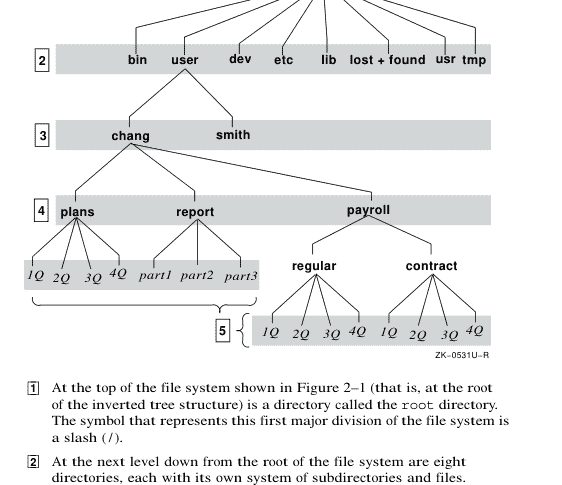
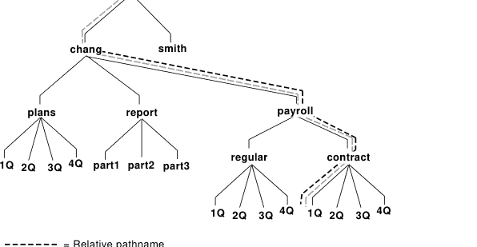
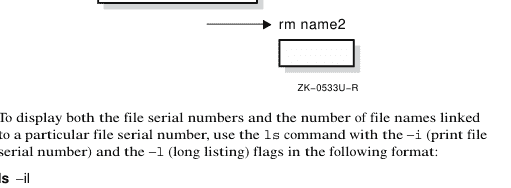
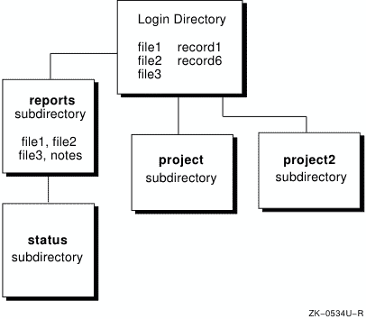
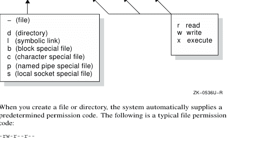
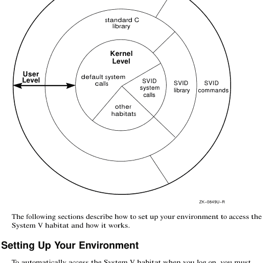

# Tru64 UNIX 命令和 Shell 用户指南


## 关于本书

*《命令和 Shell 用户指南》* 向用户介绍 Compaq Tru64™ UNIX（原 DIGITAL UNIX）中命令和 Shell 的基本用法。本书还介绍了如何与其他网络用户进行通信。

本前言涵盖以下主题：

- 读者对象
- 新增和变更的功能
- 范围
- 组织结构
- 相关文档
- 约定

### 读者对象

本书面向对 UNIX 兼容操作系统了解不多的人员。本书解释重要概念，提供教程，并按任务进行组织。

### 新增和变更的功能

本书中以下功能是新增或变更的：

- POSIX shell 功能已包含在 shell 能力的描述中。
- 对 `passwd` 文件的描述已更改，以包含通用用户信息结构。
- 提供了修订后的登录处理描述，以反映 `.cshrc` 文件的使用。
- 将 `gonext` 变量添加到表 D-1 中。
- 术语 i-number 已替换为文件序列号，以与单一 UNIX 规范一致。
- 更新了 `ps` 命令示例，以与单一 UNIX 规范一致。

### 范围

本书向您介绍命令和 Shell 的使用。阅读本书后，您应该能够：

- 访问系统并发出命令
- 理解文件和目录概念
- 管理文件和目录
- 控制对文件和目录的访问
- 管理进程
- 理解和管理您的 shell 环境
- 使用 vi 和 ed 文本编辑器
- 使用网络应用程序与网络用户通信并访问远程系统和进程

本书讨论从命令行输入和执行命令。有许多图形用户界面（GUI）可用于执行其中许多功能，或执行其他任务。请参阅随窗口管理器、特定应用程序或系统管理员提供的用户说明。

### 组织结构

本书由 14 章和 6 个附录组成：

- **第 1 章** — 展示如何登录和退出系统、输入命令、设置密码以及获取在线帮助。
- **第 2 章** — 概述文件系统，该文件系统由用于存储文本、程序和其他数据的文件和目录组成。本章还向您介绍 vi 文本编辑器，这是一个允许您创建和修改文件的程序。
- **第 3 章** — 展示如何管理文件。您将学习如何列出、显示、复制、移动、链接和删除它们。
- **第 4 章** — 说明如何管理目录。您将学习如何创建、更改、显示、复制、重命名和删除它们。
- **第 5 章** — 展示如何通过设置适当的权限来控制对文件和目录的访问。它还描述了标准密码和组安全问题，并概述了其他安全注意事项。
- **第 6 章** — 描述操作系统如何创建和跟踪进程。本章说明如何重定向进程输入、输出和错误信息，同时运行进程，显示进程信息，以及取消进程。
- **第 7 章** — 介绍操作系统随附的 shell 共有的功能：C、Bourne、Korn 和 POSIX shell。您将学习如何更改 shell、使用命令输入辅助工具、理解 shell 环境的某些功能（登录脚本、环境变量和 shell 变量）、设置和清除变量、编写注销脚本，以及编写和运行基本 shell 程序。
- **第 8 章** — 提供关于 C、Bourne、Korn 和 POSIX shell 的详细参考信息，并比较它们的特性。它详细说明了每个程序的命令和环境变量，并展示了如何设置登录脚本。
- **第 9 章** — 展示如何访问 System V 环境，这是符合 System V 接口定义（SVID）的命令、子例程和系统调用的子集。
- **第 10 章** — 提供有关如何获取网络上其他用户和远程主机的信息。
- **第 11 章** — 提供有关如何向其他用户发送消息的信息。
- **第 12 章** — 提供有关如何将文件复制到远程主机或在远程主机之间复制文件的信息。
- **第 13 章** — 提供有关如何登录远程主机或在远程主机上执行命令的信息。


第14章提供有关UNIX到UNIX复制程序（UUCP）的信息，用于在本地和远程主机上同时执行通信任务。

本书的附录提供以下信息：

附录A 教你如何使用vi文本编辑器的基本功能。

附录B 教你如何使用ed文本编辑器。提供了有关ed的详细信息，因为所有系统都有此编辑器，并且在任何其他编辑器都无法使用的关键系统管理情况下，可以使用ed。

附录C 描述国际化功能，这些功能允许用户以适合其母语、习俗和地理区域的方式处理数据并与系统交互。

附录D 提供可在.mailrc文件中使用的变量列表，以定制mailx会话。

附录E 提供可在mailx会话中执行特定任务的转义命令列表。

附录F 提供可使用mailx发送、读取、删除或保存消息的命令列表。

## 相关文档

以下Tru64 UNIX用户文档以HTML格式提供于您的CD-ROM上，并可选择提供硬拷贝：

- 网络管理
- 文档概述
- 参考页面第1节
- 参考页面第8节和第1m节
- 安全性
- 系统管理
- 安全性
- *ULTRIX到DIGITAL UNIX迁移指南*
- *快速参考卡*

## Tru64 UNIX印刷书籍上的图标

Tru64 UNIX文档的印刷版本在书脊上使用字母图标，以帮助特定读者快速找到满足其需求的书籍。（您可以从Compaq订购印刷版文档。）以下列表描述了此约定：

| 图标 | 说明 |
|---|---|
| G | 面向普通用户的书籍 |
| S | 面向系统和网络管理员的书籍 |
| P | 面向程序员的书籍 |
| D | 面向设备驱动程序编写者的书籍 |
| R | 面向参考页面用户的书籍 |

文档中的某些书籍有助于满足多个受众的需求。例如，某些系统书籍中的信息也会被程序员使用。在搜索特定主题的信息时，请记住这一点。

*文档概述*提供了有关Tru64 UNIX文档集中所有书籍的信息。

## 读者评论

Compaq欢迎您对本手册及其他Tru64 UNIX手册提出的任何评论和建议。

您可以通过以下方式发送您的评论：

- 传真：603-884-0120 收件人：UBPG Publications，ZK03-3/Y32
- Internet电子邮件：readers_comment@zk3.dec.com
  您的系统上位于以下位置的读者评论表单：
  `/usr/doc/readers_comment.txt`
- 邮件：
  Compaq Computer Corporation
  UBPG Publications Manager
  ZK03-3/Y32
  110 Spit Brook Road
  Nashua, NH 03062-2698
  每份印刷手册的背面都有一份读者评论表单。如果在美国境内邮寄，该表单邮资已付。

请随您的评论一起提供以下信息：

- 书籍的完整标题和订单号。（订单号印在本书的扉页和封底上。）
- 您所评论信息的章节号和页码。
- 您正在使用的Tru64 UNIX版本。
- 如果知道，运行Tru64 UNIX软件的处理器类型。

Tru64 UNIX Publications小组无法回应系统问题或技术支持咨询。请将技术问题提交给您的本地系统供应商或相应的Compaq技术支持办公室。软件介质随附的信息说明了如何向Compaq发送问题报告。

## 约定

本书使用以下约定：

| 符号 | 含义 |
|---|---|
| `%` | 百分号表示C shell系统提示符。 |
| `$` | 美元符号表示Bourne、Korn和POSIX shell的系统提示符。 |
| `#` | 井号表示超级用户提示符。 |
| `% cat` | 交互式示例中的粗体字表示用户键入的输入。 |
| _file_ | 斜体字表示变量值、占位符和函数参数名。 |
| `[ ]`<br>`{ }` | 在语法定义中，方括号表示可选项，花括号表示必选项。方括号或花括号内由竖线分隔的项表示您从所列项中选择一项。 |
| `...` | 在语法定义中，水平省略号表示前面的项目可以重复一次或多次。 |
| `cat(1)` | 对参考页面的交叉引用在括号中包含相应的章节号。例如，`cat(1)`表示您可以在参考页面的第1节中找到关于cat命令的信息。 |
| `Ctrl/x` | 此符号表示您按住第一个命名的键，同时按下斜杠后面的键或鼠标按钮。在示例中，此组合键被括在方框中（例如，`Ctrl/C`）。 |


## 1 入门

本章介绍使用操作系统的基本任务。在阅读本章之前，请先熟悉您系统硬件组件。

如果您熟悉 UNIX 操作系统或其他操作系统，您可能只需浏览本章即可。本书讨论的是从命令行使用操作系统。该系统现在具有许多图形用户界面（GUI）功能。这些内容在单独的书籍中讨论。

完成本章后，您将能够：

- 登录和退出操作系统
- 设置和更改您的密码
- 执行命令
- 停止命令执行
- 查看和显示参考（man）页面

要充分利用操作系统，您必须学会如何使用文本编辑程序创建和修改文件。有关文本编辑器的概述，请参阅第 2 章，关于 vi 和 ed 文本编辑器的信息分别见附录 A 和附录 B。一旦您学会如何使用文本编辑器，您就应具备开始使用操作系统的基本技能。

### 安全说明

如果您的系统运行的是可选的增强安全功能，您的登录和密码流程可能与本书中记录的流程不同。有关更多信息，请参阅安全文档。

### 1.1 登录

要使用操作系统，您的操作系统必须已安装并正在运行，并且您必须已登录。登录会将您识别为有效系统用户，并为您创建一个专属的工作环境。

在登录之前，请向系统管理员获取您的 **user name** 和 **password**。用户名称（通常是您的姓氏或姓名缩写）将您识别为授权用户。密码（一组您容易记住但他人难以猜测的字符）验证您的身份。

将您的用户名称和密码视为让您访问系统的电子钥匙。当您在登录过程中输入用户名称和密码时，您就将自己识别为授权用户。

您的密码是系统安全的重要组成部分，因为它可防止未经授权使用您的数据。有关密码的更多信息，请参阅第 1.5.1 节。

登录过程的第一步是显示登录提示。当您的系统正在运行且工作站已打开时，屏幕上会出现以下登录提示：

```
login:
```

在某些系统上，您可能需要按几次 Return 键才能显示登录提示。

您系统的登录提示屏幕可能有所不同。例如，除了登录提示外，屏幕上可能还会显示系统名称和操作系统的版本号。

要登录，请执行以下步骤：

1. 在登录提示处输入您的用户名称。如果输入有误，请使用 Delete 键或 Backspace 键进行更正。

   例如，如果您的用户名称是 larry，请输入：

   `login: larry`

   密码提示出现：

   ```
   login: larry
   Password:
   ```

2. 输入您的密码。出于安全原因，输入密码时屏幕上不会显示。

   如果您认为在输入密码时出错，请按 Return 键。如果密码不正确，系统会显示一条消息并提示您再次输入用户名称和密码。在某些系统上，您可以在输入密码时使用 Delete 键或 Backspace 键更正错误。

   在您正确输入用户名称和密码后，系统会显示 shell 提示符，通常是美元符号（$）提示符或百分号（%）提示符。您系统的 shell 提示符可能不同。

#### Note

在本书中，shell 提示符显示为美元符号（$）。

shell 提示符显示告诉您登录成功，并且系统已准备好为您工作。shell 提示符是 shell 正在运行的信号。shell 是一个解释您输入的所有命令、运行您请求的程序并将结果发送到您屏幕的程序。有关命令和 shell 提示符的更多信息，请参阅第 1.3 节和第 7 章。

当您首次登录时，您会自动进入您的登录目录。该目录通常称为您的主目录。有关登录目录的信息，请参阅第 2 章。

如果您的系统未显示 shell 提示符，则表示您尚未登录。例如，您可能输入了错误的用户名或密码。请重试登录。如果您仍无法登录，请联系您的系统管理员。在某些系统上，出于安全原因，系统会在连续多次登录尝试失败后拒绝所有登录尝试。如果您的登录尝试被拒绝，出于安全原因，您收到的唯一提示是以下内容：

```
Login incorrect
```

#### Note

您的系统可能不需要您设置密码，或者您可能被分配了一个所有新用户共用的密码。为确保这些情况下的安全，请设置您自己的密码。有关如何创建或更改密码的信息，请参阅第 1.5 节。

许多系统在用户登录时都会显示欢迎信息和公告。示例 1–1 是一个典型的登录屏幕（您的屏幕可能有所不同）。

### Example 1–1: Typical Login Screen

```
Welcome to the Operating System
Fri Dec 7 09:48:25 EDT 19nn

Messages from the administrator

You have mail
$
```

上述公告包含以下信息：

1. 问候语


### 示例1-1：典型登录界面（续）

- 2. 上次登录的日期和时间。

  每次登录时都要注意该信息，如果你未在指定时间登录，请告知系统管理员。错误的日期和时间可能表明有人一直在入侵你的系统。

- 3. 管理员的消息

  系统管理员可以设置每次登录时每位用户都会收到的消息。这些消息可能描述计划中的系统更新、操作日程或其他普遍感兴趣的信息。这些消息称为“当日消息”，存储在文件 /etc/motd 中。你可以通过显示该文件随时重新显示这些消息。

- 4. 是否有等待阅读的邮件

  简而言之，邮件是一个让你发送和接收电子邮件的程序。当有邮件等待你阅读时，系统会显示“你有邮件”的消息。如果你没有邮件，则不会出现这一行。

### 1.2 注销

当你准备好结束工作会话时，请注销系统。注销后，操作系统继续为其他用户运行，同时确保没有其他人可以使用你的工作环境。

要注销，请执行以下步骤：

- 1. 确保显示了 shell 提示符。
- 2. 按 Ctrl/D。如果 Ctrl/D 不起作用，请输入 exit 命令。

系统会显示登录提示符或登录界面。在某些系统上，可能还会显示一条消息。

此时，你或其他用户可以登录。

### 1.3 使用命令

操作系统命令是执行操作系统任务的程序。操作系统拥有大量命令，本书其余章节及相关参考页面中均有描述。

输入命令是一个交互过程。当你输入命令时，shell 会解释该命令，然后给出相应的响应——即系统要么运行该程序，要么显示错误消息。

shell 会读取你输入的每条命令，并指示操作系统执行所请求的操作。因此，shell 是一个命令解释器。

```
$ man date
```

命令可以带有修改命令工作方式的选项。这些选项称为标志（flags），紧跟命令名之后。大多数命令都有多个标志。如果你在命令中使用标志，参数会跟在命令行中的标志之后。

例如，假设你在 man 命令中使用 -f 标志。该标志会显示指定命令的单行描述。要显示 date 命令的单行描述，你可以输入：

```
$ man -f date
```

当命令运行时，系统不会显示 shell 提示符，因为控制权已传递给正在运行的程序。当命令完成操作后，系统会再次显示 shell 提示符，表示你可以输入另一条命令。

除了使用系统提供的命令外，你还可以创建自己的个性化命令。有关创建这些特殊命令的信息，请参阅第7.10.1节。

### 1.4 停止命令执行

如果你输入了一条命令，然后决定不希望它执行完毕，请按 Ctrl/C。命令会停止执行，系统会显示 shell 提示符。现在你可以输入另一条命令。

根据命令的不同，部分执行可能产生不同的结果（称为未知状态）。要查看执行过程中停止命令的结果，可以在执行如 ls -l（列出目录中的文件）或 cat filename（在屏幕上查看文件）等命令后按 Ctrl/C。

### 1.5 设置密码

你的用户名是公开信息，通常不会更改。而你的密码是私密的。

在大多数情况下，当你的系统账户建立时，系统管理员会分配一个对新用户通用的密码。在某些系统上，这个新用户密码仅对一次登录有效，以便你访问系统并建立自己的密码。熟悉系统后，请选择自己的密码以保护账户免受未经授权的访问。此外，定期更改密码以保护你的数据免受未经授权的访问。

要设置密码，请使用 passwd 命令。如果你的账户没有密码，请使用 passwd 命令设置一个。有关 passwd 过程的信息，请参阅第1.5.2节。如果你的系统是某个联网系统的一部分


system, you must use the yppasswd command to establish or change your password. Your system administrator can advise you on the specific procedures for your system.

#### 1.5.1 密码指南

选择密码时，以下指南很有用：

- *Do not* 选择字典中可以找到的单词。
- *Do not* 使用个人信息作为您的密码，或作为其子字符串，例如您的用户名、姓名或昵称（您自己的、您家人的、您公司的、您宠物的）、首字母，或您汽车的品牌或型号。
- *Do not* 使用生日、社会保障号或银行账号、员工识别号、电话号码或其他类似信息作为密码或作为密码的数字部分。
- *Do not* 使用随账户收到的默认密码。
- *Do not* 使用旧密码或在以前密码中使用的相同前缀或后缀。此规则也适用于您可能在以前工作中使用过的任何密码。
- *Do not* 在访问多个不同系统时在所有系统上使用相同的密码。
- *Do not* 选择容易猜到的密码（包括上述所有选项），即使您将其拼写反过来。选择一个难以猜到的密码，而不是难以记住的密码。
- *Do not* 选择长度少于六个字符的密码。您的密码的最大长度取决于您系统上执行的<|message|>安全惯例。（密码长度以字节而非字符衡量，但我们现在可以将这两个术语视为相同。）
- *Do not* 将您的密码写在纸上或将其放在系统上的文件中。
- *Do not* 将您的密码放在电子邮件中。
- 如果可能，请在密码中使用大小写字母的混合。您还应在密码中包含数字、标点符号或下划线（_）的任何组合。
- 经常更改您的密码，特别是如果您认为它可能已被泄露。

在大多数系统上，您可以随意频繁或很少地更改密码。但是，为了保护系统安全，您的系统管理员可能会对您应更改密码的频率、密码保持有效的时间长度或您可以进行的更改的性质设置限制。一些典型的密码限制可能是以下内容：

- 字符限制
  - 最少的字母字符数
  - 最少的其他字符数，例如标点符号或数字
  - 新密码中必须与旧密码不同的最少字符数
  - 密码中允许的最大连续重复字符数
- 时间限制
  - 密码过期前的最长周数
  - 更改密码前的周数

请向您的系统管理员咨询有关密码限制的更多信息。您的系统上可能安装或激活了多个级别的安全性和访问控制。有关访问控制的更多信息，请参阅《安全手册》。

#### 1.5.2 密码流程

要设置或更改密码，请按照以下步骤操作：

- 1. 输入 passwd 命令：
  $ passwd
  系统显示以下消息（将您标识为用户）并提示您输入旧密码：
  Changing password for username
  Old password:
  如果您没有旧密码，系统不会显示此提示。转到步骤 3。
- 2. 输入您的旧密码。出于安全原因，系统在您输入时不会显示您的密码。
  系统验证您的旧密码后，即可接受您的新密码，并显示以下提示：
  New password:
- 3. 在提示符处输入您的新密码。
  请记住，您的新密码输入不会出现在屏幕上。最后，为了验证新密码（因为您在输入时看不到它），系统会提示您再次输入新密码：
  Retype new password:


4. 再次输入新密码。同样地，新密码输入时不会显示在屏幕上。当 shell 提示符重新出现在屏幕上时，你的新密码即生效。

如果尝试更改密码而新密码不符合密码规定，你会收到一条说明具体问题以及系统生效的限制的消息。确切的消息内容以及描述提供的详细程度由系统上生效的安全和访问控制机制决定。

> **注意**
> 
> 尽量记住你的密码，因为没有它你无法登录系统。如果你忘记了密码，请咨询你的系统管理员。

### 1.6 获取帮助

本书讨论了从命令行输入和执行命令。如果你使用的是众多可用的图形用户界面（GUI）之一，请参阅随你的窗口管理器提供的用户说明，或咨询你的系统管理员。

本书中描述了你工作所需的大多数基本操作系统命令。如果你想了解更多关于这些和其他命令的信息，请参阅参考页。参考页以多种格式提供：

- 在线（见第 1.6.1 节）
- 印刷版（见相关文档）
- 超文本标记语言（HTML）格式

请向你的系统管理员询问系统上安装了哪些可选格式。当印刷版文档和 HTML 不可用时，你可以使用以下命令快速访问在线命令文档：

- man 命令显示在线参考页。
- apropos 命令显示与指定主题相关的每个命令的一行摘要。

以下各节描述了这些功能。

#### 1.6.1 显示和打印在线参考页（man）

在线参考页包含有关命令的信息。要在线查看参考页，请使用 man 命令。示例 1-2 显示了如何查看 date 命令的参考页（你的屏幕显示可能有所不同）：

#### 示例 1-2：date 命令的参考页

```
$ man date

date(1)                                                                 date(1)

NAME
    date - Displays or sets the date

SYNOPSIS

Without Superuser Authority - Displays the Date

date [-u] [+field_descriptor ...]

With Superuser Authority - Sets the Date

date [-nu] [MMddhhmm.sssy|alternate_date_format] [+field_descriptor ...]

Using XPG4-UNIX - Sets or Displays the Date

date [-u] mmddHHMM[yy]

date [-u] [+field_descriptor ...]

Using the Century Field Provided by Compaq - Sets the Date

date mmddHHMM[[cc]yy][.ss]

date [[cc]yy]mmddHHMM[.ss]

date mmddHHMM[.ss[[cc]yy]]

STANDARDS

Interfaces documented on this reference page conform to industry standards as follows:

date: XPG4, XPG4-UNIX

Refer to the standards(5) reference page for more information about industry standards and associated tags.

man aabima (7%)
```

页底的符号 man aabima (7%) 表示当前显示了参考页的 7%。此时，你可以按空格键显示下一屏信息，按回车键显示多一行信息，或输入 q 退出并返回 shell 提示符。

使用以下命令格式打印参考页：

```
man manpage | lpr -P printer_name
```

例如，要在特定打印机上打印 date 命令的参考页，输入：

```
$ man date | lpr -Pprinter_name
```

date 命令的参考页现已排队等待在 printer_name 上打印。有关 lpr 命令的更多信息，请参阅第 3.3 节。

要显示命令的简短一句话描述，请使用 man -f 命令。例如，要显示 who 命令的简短描述，输入：

```
$ man -f who
who (1)   - Identifies users currently logged in
$
```

有关 man 命令及其选项的完整信息，你可以通过输入以下内容显示参考页：

```
$ man man
```

#### 1.6.2 使用描述性关键字定位命令

apropos 命令和 man -k 命令是有用的工具，如果你忘记了命令名称。

注意

> apropos 和 man -k 命令需要访问 whatis 数据库。如果你的系统管理员在操作系统安装时加载了默认的 whatis 数据库，或稍后使用 catman 命令创建了该数据库，则该数据库可用。

apropos 和 man -k 命令执行相同的功能。这些命令允许你以关键字的形式输入命令描述。然后命令列出包含任何关键字的所有参考页。

如示例所示，如果命令描述包含多个单词，则单词必须用单引号（ ' ）或双引号（ " ）括起来。如果命令描述只包含一个单词，则无需将描述词用引号括起来。

假设你记不起显示系统中谁已登录的命令名称。要显示所有与显示已登录用户相关的参考页的名称和描述，输入以下其中之一：

```
$ apropos "logged in"
```


或

```
$ man -k 'logged in'
```

系统显示如下：

```
rusers (1) - Displays a list of users who are logged in to a remote machine
rwho (1) - Shows which users are logged in to hosts on the local network.
who (1) - Identifies users currently logged in
```

注意

用括号括起来的数字指的是参考页面的章节号。有关参考页文件结构的讨论，请参阅 man(1) 参考页面。

使用 apropos 或 man -k 命令后，你现在知道有几个命令：rwho、rusers 和 who 可用于显示已登录系统的用户。然后你可以使用 man 命令获取有关使用这些命令的信息。

## 文件和目录概述

本章介绍了文件、文件系统和文本编辑器。文件是计算机中一起存储的数据集合。典型文件包含备忘录、报告、通信、程序或其他数据。文件系统是将文件按目录有用地排列起来。

文本编辑器是一个让你创建新文件和修改现有文件的程序。

完成本章后，你将能够：

- 使用 vi 文本编辑器创建文件。这些文件将有助于你在本书后面的示例中练习。
- 理解文件系统组件和概念。

这些知识可以帮助你设计一个适合你所使用信息类型和工作方式的文件系统。

### 2.1 文本编辑器概述

编辑器是一个让你创建和更改包含文本、程序或其他数据的文件的程序。编辑器不提供文字处理器或出版软件的格式和打印功能。

使用文本编辑器，你可以：

- 创建、读取和写入文件
- 显示和搜索数据
- 添加、替换和删除数据
- 移动和复制数据
- 运行操作系统命令

你的编辑工作在编辑缓冲区中进行，你可以保存或丢弃该缓冲区。

vi 和 ed 文本编辑程序在操作系统上可用。每个编辑器都有其自己的显示文本的方法以及其自己的子命令集和规则。

有关 vi 的信息，请阅读第 2.2 节和附录 A。有关 ed 的信息，请参阅附录 B。

你的系统可能包含额外的编辑器；请向系统管理员咨询详情。

### 2.2 使用 vi 文本编辑器创建示例文件

本节介绍如何使用 vi 文本编辑器创建三个文件。

本节的目标是让你使用最少的命令集创建文件，这些文件可用于在本书后面的示例中练习。有关 vi 的更多信息，请参阅附录 A 和 vi(1) 参考页面。

> 注意
> 
> 如果你熟悉不同的编辑程序，你可以使用该程序创建本节所述的三个示例文件。如果你已经使用编辑程序创建了三个文件，你可以通过将它们的文件名替换为示例中使用的文件名来使用这些文件。

在按照创建示例文件所使用的步骤操作时，只输入以粗体字符显示的文本。系统提示和输出以不同的字体显示，如下所示。

要创建三个示例文件，请按照以下步骤操作：

1. 在 shell 提示符下键入 vi 和一个新文件名的程序来启动 vi 程序。按 Return 键。

```
$ vi file1 Return
```

这是一个新文件，因此系统通过将光标置于屏幕顶部来响应：

```
~
~
~
~
"file1" [New file]
```

注意屏幕上以波浪号 (~) 开头的空白行。这些波浪号表示不包含文本的行。因为你尚未输入任何文本，所以所有行都以波浪号开头。

2. 输入小写字母 i 以指定你想要向新文件插入文本。系统不会显示你输入的 i。

输入以下示例文本，每行后按 Return 键。要在移动到下一行之前更正错误，请按


Delete 键或 Backspace 键可向后移动以覆盖错误。重新正确输入文本。

```
You start the vi program by entering Return
the vi command optionally followed by the name Return
of a new or existing file. Escape
-
-
-
-
"file1" [New file]
```

3. 按 Escape 键以表示您已完成当前工作。输入冒号 (:) 以进入最后一行模式。

#### Note

根据终端或工作站的设置方式，Escape 键可能被编程为执行不同的功能。键盘上的某个功能键可能已被设置为执行转义功能。该功能通常分配给 F11 键。如果您的 Escape 键无法正常操作，请咨询系统管理员。

冒号会作为提示显示在屏幕底部，如下所示：

```
You start the vi program by entering
the vi command optionally followed by the name
of a new or existing file.
-
-
-
-
:
```

4. 接下来输入小写字母 w。输入字母 w 表示您希望将新文件的副本写入、或保存到您的当前用户目录中（有关当前目录的解释，请参阅第 4 章）。

您的屏幕将如下所示：

```
You start the vi program by entering
the vi command optionally followed by the name
of a new or existing file.
-
```

```
"file1" [New file] 3 lines, 111 characters
```

系统会显示新文件的名称以及其包含的行数和字符数。

系统仍处于 vi 文本编辑器中，因此您可以创建另外两个示例文件。过程与您创建 file1 时使用的过程相同，但您输入的文本会不同。

5. 输入冒号 (:)。冒号会作为提示显示在屏幕底部。要创建第二个示例文件，输入 vi file2。系统会响应一个如下所示的屏幕：

```
"file2" No such file or directory
```

消息 file2 No such file or directory 表示 file2 是一个新文件。

6. 通过输入小写字母 i 来指示您要向新文件插入文本。输入以下示例文本：

```
If you have created a new file, you will find Return
that it is easy to add text. Escape
```

7. 输入冒号 (:) 并输入小写字母 w 以将文件写入、或保存到您的当前目录。

您的屏幕将如下所示：

```
If you have created a new file, you will find
that it is easy to add text.
```

```
"file2" [New file] 2 lines, 75 characters
```

8. 按照步骤 5 中的说明创建第三个文件。但是，将文件命名为 file3，并输入以下示例文本：

```
You will find that vi is a useful Return editor that has many features. Escape
```

9. 输入冒号 (:) 并输入 wq 命令。

wq 命令会写入文件、退出（即退出）编辑器，并将您返回到 shell 提示符。

### 2.3 理解文件、目录和路径名

文件是存储在计算机中的数据集合。计算机中存储的文件就像存放在文件柜中的文档一样，因为您可以检索它、打开它、处理它、关闭它并作为一个单元存储它。每个计算机文件都有一个文件名，用户和系统都使用它来引用该文件。

文件系统是将文件组织成有用模式的方式。只要您组织信息，您就会创建类似计算机文件系统的东西。例如，手动文件系统的结构（文件柜、文件抽屉、文件文件夹和文档）类似于计算机文件系统的结构。（管理文件存储的软件也称为文件系统，但本章中不会使用该术语。在某些系统上，该软件也称为文件管理器。）

一旦您组织好文件系统（手动或计算机），您就可以快速找到特定信息，因为您了解系统的结构。要理解文件系统，您应首先熟悉以下三个概念：

- 文件和文件名
- 目录和子目录
- 树结构和路径名

#### 2.3.1 文件和文件名

文件可以包含文档的文本、计算机程序、总账记录、计算机程序的数值或统计输出或其他数据。

文件名可以包含除以下字符以外的任何字符，因为这些字符对 shell 有特殊含义：

- 斜杠 (/)
- 反斜杠 (\)
- 与号 (&)
- 左、右尖括号 (< 和 >)
- 问号 (?)


- 美元符号（`$`）
- 左花括号（`{`）
- 星号（`*`）
- 波浪号（`~`）
- 竖线或管道符号（`|`）

可以在文件名的中间使用句点或点号（`.`），但绝不要在文件名的开头使用，除非你希望在进行简单文件列表时该文件被隐藏。关于对 shell 具有特殊含义的字符的信息，请参阅第 8.2.2 节和第 8.3.2 节。关于列出隐藏文件的信息，请参阅第 3.1.3 节。

**注意：** 与某些操作系统不同，本操作系统区分文件名中的大写字母和小写字母（即区分大小写）。例如，以下三个文件名表示三个不同的文件：`filea`、`Filea` 和 `FILEA`。

使用能反映文件实际内容的文件名。例如，类似 `memo.advert` 的文件名可能表示该文件包含一份关于广告的备忘录。另一方面，`filea`、`fileb` 或 `filec` 这样的文件名并不能让你了解该文件的任何内容。

对相关文件使用一致的命名模式也是一个好主意。例如，假设你有一份分为若干章节的广告报告，每个章节分别存放在一个单独的文件中。你可以按以下方式命名这些文件：

```
chap1.advert
chap2.advert
chap3.advert
```

**注意：** 你调用的许多程序会使用文件名中跟在点号（`.`）后面的部分（称为扩展名）来指示文件的用途。

文件名的最大长度取决于操作系统所使用的文件系统。例如，你的文件系统可能允许文件名最长为 255 个字符（默认值），也可能只允许文件名最长为 14 个字符。因为知道最大文件

这条信息表明你当前正在一个名为 `msg` 的目录中工作，该目录位于 `/usr` 目录下。

`/usr/msg` 这种表示法称为你工作目录的**路径名**。关于路径名的信息，请参阅第 2.3.4 节。有关 `pwd` 命令的更多信息，请参阅 `pwd(1)` 参考手册页。

#### 2.3.4 树状结构文件系统和路径名

文件系统中的文件和目录按层次结构排列，就像一棵倒置的树，根在顶部，分支在底部。这种排列称为**树**结构。你可以在 `hier(5)` 参考手册页中找到关于目录结构的更详细信息。

图 2–1 显示了一个按树结构排列的典型文件系统。目录名称以**粗体**印刷，文件名称以*斜体*印刷。

**图 2–1：一个典型的文件系统**



1. 在图 2–1 所示文件系统的顶部（即倒置树结构的根部），有一个称为根目录的目录。表示文件系统这第一个主要分区的符号是斜杠（`/`）。
2. 从文件系统根部往下一层，有八个目录，每个目录都有自己的子目录和文件系统。但图 2–1 仅显示了名为 `usr` 的目录下的子目录。这些是系统用户的登录目录。
3. 树结构的第三层包含系统中两个用户 `smith` 和 `chang` 的登录目录。`smith` 和 `chang` 在登录后就是在这些目录中开始工作的。
4. 图中第四层显示了 `chang` 登录目录下的三个目录：`plans`、`report` 和 `payroll`。
5. 树结构的第五层同时包含文件和子目录。`plans` 目录包含四个文件，每个季度一个。`report` 目录包含三个文件，组成一份报告的三个部分。第五层还有两个子目录 `regular` 和 `contract`，它们进一步组织了 `payroll` 目录中的信息。

较高层的目录通常称为父目录。例如，在图 2–1 中，目录 `plans`、`report` 和 `payroll` 都以 `chang` 作为它们的父目录。

路径名指定文件系统中目录或文件的位置。例如，当你想从处理目录 X 中的文件 A 改为处理目录 Y 中的文件 B 时，你需要输入文件 B 的路径名。操作系统随后会使用该路径名在文件系统中搜索，直到找到文件 B 为止。

路径名由一系列用斜杠（`/`）分隔的目录名组成，并以目录名或文件名结尾。路径名中的第一个元素指定系统从哪里开始搜索，最后一个元素指定搜索的目标。以下路径名基于图 2–1：

```
/usr/chang/report/part3
```

第一个斜杠（`/`）表示根目录，并指明搜索的起点。路径名的其余部分表示搜索将进入 `usr` 目录，然后进入 `chang` 目录，接着进入 `report` 目录，最后到达 `part3` 文件。

无论你是要更改当前目录、将数据发送到文件，还是将文件在文件系统中从一个位置复制或移动到另一个位置，你都要使用路径名来指明要操作的对象。

以斜杠（`/`）（表示根目录的符号）开头的路径名称为完整路径名或绝对路径名。你也可以将完整路径名视为文件或目录的完整名称。无论你在文件系统的哪个位置工作，都可以通过指定完整路径名来找到文件或目录。

文件系统还允许你使用相对路径名。相对路径名不以表示根目录的 `/` 开头，因为它们是相对于当前目录的。

你可以通过以下几种方式指定相对路径名：

- 作为当前目录中某个文件的名称。
- 作为以当前目录下一级目录名称开头的路径名。
- 作为以 `..`（点点，即父目录的相对路径名）开头的路径名。


+   - 以 .（点，表示当前目录）开头的路径名。这种相对路径名表示法在你想在当前目录中运行自己的操作系统命令版本时很有用（例如 ./ls）。

每个目录至少包含两个条目：..（点点）和 .（点）。

例如在图 2-2 中，如果你的当前目录是 chang，那么 contract 目录中文件 1Q 的相对路径名为 payroll/contract/1Q。通过将此相对路径名与同一文件的完整路径名 /user/chang/payroll/contract/1Q 进行比较，你可以看到使用相对路径名意味着更少的输入和更大的便利性。

#### Figure 2-2: Relative and Full Pathnames



------ = Relative pathname
..... = Full pathname

在 C shell 以及 Korn 或 POSIX shell 中，你也可以在相对路径名的开头使用波浪号（~）。单独使用的波浪号字符指定用户的登录（主）目录。后面跟有用户名的波浪号字符指定同一系统上另一用户的登录（主）目录。

例如，要指定你自己的登录目录，使用单独的波浪号。要指定用户 chang 的登录目录，指定 ~chang。

有关使用相对路径名的更多信息，请参阅第 4 章。

> **Note**
> 
> 如果你的系统上有其他用户，你可能能够或不能够访问他们的文件和目录，这取决于为其设置的权限。有关文件和目录权限的更多信息，请参阅第 5 章。此外，你的系统可能包含可能影响对文件和目录访问的增强安全功能。如果是这样，请向你的系统管理员咨询详情。

### 2.4 Specifying Files with Pattern Matching

命令通常将文件名作为参数。要使用多个不同的文件名作为命令的参数，你可以像以下示例那样输入每个文件的全名：

```
`$ ls file1 file2 file3`
```

然而，如果文件名具有共同的模式（在此示例中为文件前缀），shell 可以匹配该模式，生成这些名称的列表，并自动将它们作为参数传递给命令。

星号（*），有时被称为 **wildcard**，匹配任何字符字符串。在以下示例中，ls 命令查找当前目录中包含文件前缀的每个文本文件的名称：

```
`$ ls file*`
```

file* 匹配以 file 开头并以任何其他字符字符串结尾的任何文件名。shell 将匹配此模式的每个文件名作为 ls 命令的参数传递。

因此，你不必输入（甚至记住）每个文件的全名即可将其用作参数。两个命令（ls 并输入所有文件名以及 ls file*）做的是同一件事——它们将目录中具有文件前缀的所有文件作为参数传递给 ls 命令。

模式匹配的一般规则有一个例外。当文件名的第一个字符是句点时，你必须显式匹配该句点。例如，ls * 显示当前目录中所有不以句点开头的文件的名称。命令 ls -a 显示所有文件名，以句点开头的文件和所有其他文件。

此限制可防止 shell 自动匹配相对目录名。这些是 .（点，表示当前目录）和 ..（点点，表示父目录）。有关相对目录名的更多信息，请参阅第 4 章。

如果模式不匹配任何文件名，shell 会显示一条消息，告知你未找到匹配项。

除了星号（*）之外，操作系统 shell 还提供其他匹配字符模式的方法。表 2-1 总结了所有模式匹配字符并提供示例。

#### Table 2-1: Pattern-matching Characters

| Character | Action |
|---|---|
| * | Matches any string, including the null string. For example, th* matches th, theodore, and theresa. |
| ? | Matches any single character. For example, 304?b matches 304Tb, 3045b, 304Bb, or any other string that begins with 304, ends with b, and has one character in between. |
| [...] | Matches any one of the enclosed characters. For example, [AGX]* matches all file names in the current directory that begin with A, G, or X. |
| [..] | Matches any character that falls within the specified range, as defined by the current locale. For more information on locale, see Appendix C. For example, [T-W]* matches all file names in the current directory that begin with T, U, V, or W. |
| [!...] | Matches any single character except one of those enclosed. For example, [!abyz]* matches all file names in the current directory that begin with any character except a, b, y, or z. This pattern matching is available only in the Bourne, Korn, and POSIX shells. |

An internationalized operating system provides the additional pattern-matching features described in Table 2-2.


#### 表2-2：国际化模式匹配字符

| 字符 | 操作 |
|---|---|
| [[::class:]] | 用括号冒号分隔符括起来的字符类名称匹配命名类中的任何字符集。支持的类有alpha、upper、lower、digit、alnum、xdigit、space、print、punct、graph和cntrl。例如，alpha字符类名称表示您要匹配当前区域设置定义的任何字母字符（大写和小写）。如果您运行的是基于美国的区域设置，则alpha匹配字母表中的任何字符（A-Z，a-z）。 |
| [[=char=]] | 用括号等号分隔符括起来的字符匹配任何等价类字符。等价类是一组整理元素，所有这些元素都排序到相同的主位置。它通常设计用于处理主-次排序；也就是说，对于诸如法语之类的语言，这类语言将字符组定义为按相同的主位置排序，然后进行打破平局的二次排序。 |

有关国际化模式匹配字符的更多信息，请参阅grep(1)参考页。有关国际化功能的更多信息，请参阅附录C。

## 3
## 管理文件

本章介绍如何管理系统上的文件。完成本章后，您将能够：

- 列出文件
- 显示和打印文件
- 链接文件
- 复制、重命名和移动文件
- 比较和排序文件
- 从系统中删除文件
- 确定文件类型

要了解如何管理文件，请按照本章中的示例操作。请按顺序执行每个示例，以便屏幕上的信息与本书中的信息一致。

在可以学习这些示例之前，您必须登录，并且您的登录目录中必须包含第2章中创建的以下三个文件：`file1`、`file2`和`file3`。要生成登录目录中的文件列表，请输入`ls`命令，该命令将在第3.1节中说明。如果您使用的是不同名称的文件，请在学习示例时进行适当的替换。

在以下示例中，当要求您返回登录目录时，请输入如下所示的`cd`（更改目录）命令：

```
```shell
$ cd
```
```

在前面的示例中，美元符号（$）表示shell提示符。您的shell提示符可能不同。

此外，在开始本章示例之前，请在登录目录中创建一个名为`project`的子目录。为此，请从登录目录中输入以下`mkdir`（创建目录）命令：

```
```shell
$ mkdir project
```
```

关于cd和mkdir命令的更多信息，请分别参见第4.2节或cd(1)参考页，以及第4.1节或mkdir(1)参考页。

### 3.1 列出文件（ls）

您可以使用`ls`命令显示一个或多个目录内容的列表。此命令生成当前目录中文件和子目录（如果有）的列表。您还可以显示其他类型的信息，例如当前目录以外的目录内容。

`ls`命令的格式为：

```
ls
```

`ls`命令有许多选项，称为标志，使您能够显示有关目录内容的不同类型的信息。有关这些标志的信息，请参阅第3.1.3节。

#### 3.1.1 列出当前目录的内容

要列出当前目录的内容，请输入：

```
$ ls
```

以这种格式使用且不带标志时，`ls`命令列出当前目录中的文件和目录名称：

```
$ ls
file1  file2  file3  project
$
```

您也可以使用以下命令格式列出当前目录内容的部分：

```
ls  filename
```

`filename`条目可以是文件的名称，也可以是用空格分隔的文件名列表。您还可以使用模式匹配字符来指定文件。有关模式匹配的信息，请参阅第2章。

例如，要列出名称以字符`file`开头的文件，您可以输入以下命令：

```
$ ls file*
file1  file2  file3
$
```

#### 3.1.2 列出其他目录的内容

要显示当前目录以外的目录内容的列表，请使用以下格式：


```
ls  dirname
```

*目录名* 条目是你要显示其内容的目录的路径名。

在下面的示例中，当前目录是你的登录目录，而你想要显示 */users* 目录。你的系统可能包含另一个名称与 */users* 目录类似的目录。*/users* 目录的名称前面有一个斜杠 (/)，表示系统应从根目录开始搜索。

```
$ ls /users
amy  beth  chang  george  jerry  larry
mark  monique  ron
$
```

*ls* 命令按当前区域设置确定的排序顺序列出目录和文件名。有关区域设置（用于国际化）的更多信息，请参阅附录 C。

### 3.1.3 ls 命令使用的选项

*ls* 命令最简单的形式只显示指定目录中包含的文件和目录的名称。然而，*ls* 有多个选项，可以提供关于所列条目的附加信息，或改变系统显示列表的方式。

当你希望将选项与 *ls* 命令一起使用时，请使用以下格式：

```
ls  -flagname
```

*-选项名* 条目指定你随命令使用的一个或多个选项。例如，*-l* 选项会生成目录内容的长列表。

如果你想在命令中使用多个选项，请将选项名称写在一个字符串中：

```
$ ls -lta
```

表 3-1 列出了一些最常用的 *ls* 命令选项。

#### 表 3-1：ls 命令选项

| 选项 | 说明 |
|------|--------|
| -l | 以**长**格式列出。-l 列表提供所列每个文件或目录的类型、权限、链接数、所有者、组、大小和上次修改时间。 |
| -t | 按文件或目录的**修改时间**排序（最新在前），而不是按名称排序。 |
| `-r` | 颠倒排序顺序，得到反向排序顺序（`ls -r`），或反向时间顺序（`ls -tr`）。 |
| `-R` | 列出所有条目，包括隐藏文件。如果没有此选项，`ls` 命令不会列出以点 (`.`) 开头的条目名称，例如 `.profile`、`.login` 和相对路径名。 |
| `-F` | 如果文件是目录，则在每个文件名后放置一个 `/`（斜杠）；如果文件可执行，则在每个文件名后放置一个 `*`（星号）。 |
| `-R` | 递归列出所有子目录。将深入到每个目录和子目录，以提供整个目录树的列表。 |

#### 示例 3–1：长格式（`ls -l`）目录列表

```
$ ls -l
total 4   1
-rw-r--r--  1 larry   system  101 Jun 5 10:03 file1   2 3
-rw-r--r--  1 larry   system   75 Jun 5 10:03 file2   4 5
-rw-r--r--  1 larry   system   75 Jun 5 10:03 file3   6
-rw-r--r--  1 larry   system   65 Jun 5 10:06 file3   7
drwxr-xr-x  2 larry   system   32 Jun 5 10:07 project  8
$
```

以下列表项与示例中的数字相对应：

- 1. 该目录中文件占用的 512 字节块数。
- 2. `l` — 每个文件的链接数。关于文件链接的说明，请参阅第 3.4 节。
- 3. `101` — 文件的字节数。
- 4. `larry` — 文件所有者的用户名。屏幕上将用你的用户名替换 `larry`。
- 5. `system` — 文件所属的组。屏幕上将用你的组名替换 `system`。
- 6. `file3` — 文件或目录的名称。
- 7. `Jun 5 10:03` — 文件的创建或上次修改日期和时间，格式由当前区域设置定义。如果该日期早于当前日期六个月以上，则用四位数字年份替换时间。
- 8. `drwxr-xr-x` — 每个文件或目录设置的文件类型和权限。此字段的第一个字符表示文件类型：
  - `-`（连字符）表示普通文件
  - `b` 表示块特殊文件
  - `c` 表示字符特殊文件
  - `d` 表示目录
  - `l` 表示符号链接
  - `p` 表示管道特殊文件（先进先出）


#### 示例 3-1：长目录列表（ls -l）（续）

s 表示本地套接字

其余字符被解释为三组，每组三个字符，分别指明所有者、组和其他用户的读（r）、写（w）和执行（x）权限是否已设置。如果显示连字符（-），则表示未设置相应权限。

此外，还可能显示其他权限信息。有关权限的更多信息，请参阅第 5 章。

随着你对操作系统的经验增加，还会发现其他有用的 ls 命令标志。有关 ls 命令标志的详细信息，请参阅 ls(1) 参考手册页。

### 3.2 显示文件

你可以使用文本编辑器查看系统上存储的任何文本文件。但是，如果你只想查看文件而不做任何更改，可以使用多种操作系统命令查看它（带或不带屏幕格式）。以下各节将介绍这些命令。

#### 3.2.1 显示不带格式的文件（pg、more、cat）

以下命令按原样显示文件，不添加任何控制内容外观的特殊格式特性：

- pg
- cat
- more
- page

有关显示带格式文件的信息，请参阅第 3.2.2 节。

要以不带格式的方式显示文件，一般格式如下：

```
command filename
```

command 项可以是以下命令名称之一：pg、more、page 或 cat。filename 项可以是单个文件名，也可以是一系列用空格分隔的文件名。你还可以使用模式匹配字符来指定文件。有关模式匹配字符的使用信息，请参阅第 2 章。

pg 命令允许你查看一个或多个文件。在示例 3-2 中，pg 命令显示登录目录中 file1 的内容：

- 按 Return 键逐行显示
- 输入 q 退出查看文件

page 命令与 more 命令相同，只不过当文件的行数超过一页所能容纳的行数时，它会清除屏幕并从屏幕顶部开始显示每一页。在某些操作系统环境或某些显示设备上，这种差异可能不明显。

cat 命令也会显示文本。但是，它不太适合查看长文件，因为它不会分页显示文件。当查看超过一个屏幕大小的文件时，内容显示速度太快，无法阅读。此时，按 Ctrl/S 可暂停显示，然后你可以阅读文本。当你想显示文件其余部分时，按 Ctrl/Q。由于 cat 不适合查看长文件，在这些情况下你可能更愿意使用 pg、more 或 page 命令。

pg、more、page 和 cat 命令都还有其他可能对你有用的选项。有关更多信息，请参阅 cat(1)、more(1)、page(1) 和 pg(1) 参考手册页。

#### 3.2.2 显示带格式的文件（pr）

格式化是指在显示或打印文件时控制文件内容外观的过程。pr 命令以简单但实用的方式显示文件。

> 注意
> pr 命令不解释文件中可能存在的任何文本格式信息。pr 命令不会像 nroff 或 troff 那样格式化文件。例如，由文字处理和桌面出版软件生成的文件可能无法被 pr 命令识别。

要以简单格式显示文件，命令格式如下：

```
pr filename
```

filename 项可以是文件名、文件的相对路径名、文件的完整路径名，或用空格分隔的文件名列表。使用的格式取决于文件相对于当前目录的位置。你还可以使用模式匹配字符来指定文件。有关模式匹配的信息，请参阅第 2 章。你可以将 filename 指定为短划线（-）。在这种情况下，pr 命令将从终端读取输入，直到你用文件结束标记（通常为 Ctrl/D）终止输入。


不使用任何选项时，pr 命令执行以下操作：

- 将文件的内容分成若干页
- 在每一页顶部放置日期、时间、页码和文件名作为页眉
- 在页末留下五行空白

当你使用 pr 命令显示文件时，其内容可能滚动得太快而无法阅读。当这种情况发生时，你可以通过使用 pr 命令与 more 命令一起查看格式化后的文件。more 命令指示系统在每屏文本结束时暂停。

例如，要显示一个名为 report 的长文件，并在屏幕填满时暂停，请输入以下命令：

```
$ pr report | more
```

当系统在第一屏文本处暂停时，按空格键显示下一屏。上一条命令使用管道符号（ | ）将 pr 命令的输出作为 more 命令的输入。对于管道的更多信息，请参阅第 7.4.2 节。

有时你可能更喜欢以更复杂的格式显示文件。你可以在命令格式中使用多个标志来指定额外的格式化功能。表 3-2 解释了其中几个标志。

#### 表 3-2：pr 命令标志

| Flag | Action |
|------|--------|
| +page | 从页码 page 开始格式化。否则，格式化从第 1 页开始。例如，pr +2 file1 命令从第 2 页开始格式化 file1。 |
| -column | 将页面格式化为 column 列。否则，pr 将页面格式化为一列。例如，pr -2 file1 命令将 file1 格式化为两列。 |
| -m | 同时并排格式化所有指定的文件，每列一个。例如，pr -m file1 file2 命令在左列显示 file1 的内容，在右列显示 file2 的内容。 |
| -d | 格式化双倍行距输出。否则，输出为单倍行距。例如，`pr -d file1` 命令以双倍行距格式显示 `file1`。 |
| -f | 使用换页字符前进到新页。（否则，`pr` 发出换行字符序列。）如果标准输出是终端，则在开始第一页前暂停。 |
| -F | 使用换页字符前进到新页。（否则，发出换行字符序列。）如果标准输出是终端，则不会在开始第一页前暂停。 |
| -w num | 将行宽设置为 *num* 列。否则，行宽为 72 列。例如，`pr -w 40 file1` 命令将 `file1` 的行宽设置为 40 列。 |
| -o num | 将每行偏移（缩进）*num* 列位置。否则，偏移为 0（零）列位置。例如，`pr -o 5 file1` 命令将 `file1` 的每行缩进五个空格。 |
| -l num | 将页长设置为 *num* 行。否则，页长为 66 行。例如，`pr -l 30 file1` 命令将 `file1` 的页长设置为 30 行。 |
| -h string | 使用指定的字符串而不是文件名作为显示在每一页顶部的页眉（标题）。如果 *string* 包含空格或特殊字符，必须用 ' '（单引号）括起来。例如，`pr -h 'My Novel' file1` 命令指定 "My Novel" 作为标题。 |
| -t | 阻止 `pr` 格式化页眉和每页末尾的空白行。例如，`pr -t file1` 命令指定 `file1` 不带页眉和每页末尾的空白行进行格式化。 |
| -s char | 用字符 *char* 而不是空白分隔列。你必须用单引号括住特殊字符。例如，`pr -s '*' file1` 命令指定用星号分隔列。 |

你可以在 pr 命令中同时使用多个标志。在下面的示例中，你指示 pr 以以下特征格式化 file1：

- 双倍行距（-d）
- 使用标题 "My Novel"（-h）而不是文件名

```
$ pr -dh 'My Novel' file1
```

有关 pr 命令及其标志的详细信息，请参阅 pr(1) 参考页。

### 3.3 打印文件（lpr, lpq, lprm）

使用 lpr 命令将一个或多个文件发送到系统打印机。lpr 命令实际上将文件放入打印队列中，打印队列是等待打印的文件列表。一旦 lpr 命令将你的文件放入队列，你就可以继续在系统上进行其他工作，同时等待文件打印，或终止你的会话。

lpr 命令的一般格式为：

```
lpr filename
```

filename 项可以是文件名称、文件的相对路径名、文件的完整路径名，或由空格分隔的文件名列表。你使用的格式取决于文件相对于当前目录的位置。你也可以使用模式匹配字符来指定文件。有关模式匹配的信息，请参阅第 2 章。

如果你的系统有多台打印机，使用以下格式指定你希望文件打印的位置：

```
lpr -P printername filename
```

-P 标志表示你想要指定一台打印机。printername 项是打印机的名称。打印机通常具有描述打印机位置的名称（例如，southmailroom），保管人或最近的监视器（例如，leslie），或其他描述性命名。如果你的系统有多種類型的打印机可用，它们可能被分配诸如 slide 或 color 等名称来描述其功能或能力。请咨询你的系统管理员以获取有关系统上可用打印机配置的信息。

如果你的系统有多台打印机，其中一台是默认打印机。当你未输入特定 printername 时，你的打印请求将发送到默认打印机。使用 lpstat -s 命令查找系统上可用打印机的名称。


示例 3-4 展示了如何使用 lpr 命令在名为 lp0 的打印机上打印一个或多个文件

#### 示例 3-4：使用 lpr 命令

```
$ lpr -P lp0 file1
$ lpr -P lp0 file2 file3
$
```

lpr 命令的功能如下：

1 第一个 lpr 命令将 file1 发送到 lp0 打印机，然后显示 shell 提示符：美元符号（$）。

2 第二个 lpr 命令将 file2 和 file3 发送到同一个打印队列，然后在文件打印完成之前显示 shell 提示符。

多个 lpr 命令标志使您能够控制文件打印的方式。以下是使用标志的一般格式：

```
lpr flag filename
```

表 3-3 解释了一些最有用的 lpr 命令标志。有关 lpr 命令标志的完整描述，请参阅 lpr(1) 参考页。

#### 表 3-3：lpr 命令标志

| Flag | Action |
|------|--------|
| -#num | 打印文件的 num 份。否则，lpr 打印一份。例如，lpr -#2 file1 命令打印 file1 的两份。 |
| -w num | 将行宽设置为 num 列。否则，行宽为 72 列。例如，lpr -w40 file1 命令以 40 列宽的行打印 file1。 |
| -i num | 将每一行偏移（缩进）num 个空格位置。否则，偏移为 8 个空格。例如，lpr -i5 file1 命令以缩进五个空格的行打印 file1。 |
| -p | 使用 pr 作为过滤器格式化文件。 |
| -T 'string' | 使用指定的字符字符串，而不是文件名，在 pr 使用的页眉中。需要 -p 标志。如果字符串包含空格或特殊字符，必须用 ' '（单引号）括起来。例如，lpr -p -T 'My Novel' file1 命令指定 “My Novel” 作为标题。 |
| -m | 文件打印完成后发送邮件。例如，命令 lpr -m file1 指定在 file1 打印后向您发送邮件。 |

一旦您输入了 lpr 命令，您的打印请求将被输入到打印队列中。

要查看请求在打印队列中的位置，请使用 lpq 命令。
要查看打印队列，请输入：

```
$ lpq
```

如果您的请求已经打印，或者打印队列中没有请求，系统会以以下消息响应：

```
no entries
```

如果打印队列中有条目，系统会列出它们并指出当前正在打印哪个请求。以下是打印队列条目的典型列表（您的列表会有所不同）：

```
Rank Owner Job Files Total Size
active marilyn 489 report 8470 bytes
1st sue 135 letter 5444 bytes
2nd juan 360 (standard input) 969 bytes
3rd larry 490 travel 1492 bytes
```

lpq 命令为每个打印队列条目显示以下内容：

- 其在队列中的位置
- 其所有者
- 其作业号
- 文件名
- 文件大小（字节）

例如，Marilyn 的 report（作业号 489）当前正在打印中，而 Sue、Juan 和 Larry 的请求正在等待中。

当您打印文件时，请求在队列中的位置及其大小可以帮助您估计请求可能何时完成。一般来说，队列中的位置越靠后，打印请求越大，所花费的时间就越多。

如果您的系统有多台打印机，请使用以下格式指定要查看的打印队列：

```
lpq -P printername
```

-P 标志表示您要指定一个打印队列。printername 条目是特定打印机的名称。printername 条目应与发起打印请求时使用的名称相同。使用 lpstat -s 命令了解所有打印机的名称。请参阅 lpq(1) 参考页以获取 lpq 命令的完整描述。

如果您决定不打印请求，可以使用 lprm 命令将其从打印队列中删除。lprm 命令的一般格式如下：

```
lprm -Pprintername jobnumber
```

jobnumber 条目指定系统分配给您的打印请求的作业号。printername 条目应与发起打印请求时使用的名称相同。您可以通过输入 lpq 命令查看作业号。

例如，如果 Larry 想取消他的打印请求，他可以输入：

```
$ lprm 490
$
```

travel 文件将被从打印队列中移除。

有关 lprm 命令的完整信息，请参阅 lprm(1) 参考页。

这些信息提供了打印文件的命令的基本描述。有关系统打印功能和可用命令的更多详细信息，请参阅 lp(1)、cancel(1) 和 lpstat(1) 参考页。

### 3.4 链接文件（ln）

链接是文件名与其文件本身之间的连接。通常，文件有一个链接——连接到其原始文件名的连接。但是，您可以使用 ln（链接）命令将文件同时连接到多个文件名。

每当您需要在多个位置使用相同的数据时，链接都很方便。例如，假设您有一个包含装配线生产统计数据的文件。您在两个不同的文档中使用此文件中的数据——一份为管理层准备的月度报告，以及一份为生产线工人准备的月度摘要。

您可以将统计文件链接到两个不同的文件名，例如 mgmt.stat 和 line.stat，并将这些文件名放在两个不同的目录中。这样，您可以节省存储空间，因为您只有一个文件副本。更重要的是，您不必更新多个文件。因为 mgmt.stat 和 line.stat 是链接的，编辑其中一个会自动更新另一个，并且两个文件名始终引用相同的数据。

#### 3.4.1 硬链接和软链接

有两种类型的链接可供您使用：硬链接和软链接或符号链接。


- 硬链接只能让你链接同一文件系统中的文件。当你创建硬链接时，实际上是为同一个文件提供了另一个名称。一个文件的所有硬链接名称（包括原始名称）都是平等的。认为某个文件名是真实名称、另一个只是链接，是不正确的。

- 软链接或符号链接可以让你链接文件和目录。此外，你还可以在不同文件系统之间链接文件和目录。符号链接实际上是一个独立的文件，其中包含指向另一个文件或目录的指针。这个指针就是目标文件或目录的路径名。只有原始文件名才是该文件或目录的真实名称。与硬链接不同，软链接实际上只是一个链接。

无论使用硬链接还是软链接，通过一个名称对文件所做的更改，都会在通过另一个名称查看该文件时体现出来。

硬链接与软链接的一个主要区别体现在删除操作上。具有硬链接名称的文件会一直存在，直到其所有名称都被删除。具有软链接名称的文件在其原始名称被删除后就会消失；任何剩余的软链接随后会指向一个不存在的文件。参见第 3.4.5 节。

### 3.4.2 链接与文件系统

在本讨论中使用的术语“文件系统”与本书先前的用法有所不同。此前，文件系统被定义为将文件组织到目录结构中的一种有效安排。在这里，这个术语获得了更精确的含义：单个磁盘分区中所包含的文件和目录。磁盘分区是物理磁盘或其一部分，已被准备好用于容纳文件目录。

你可以使用 df 命令来查找操作系统中包含某个特定目录的磁盘分区名称。下面是一个示例，其中 df 显示目录 /u1/info 和 /etc 位于不同的文件系统中，而 /etc 和 /tmp 位于同一文件系统中：

```
$ df /u1/info
Filesystem 512-blks  used avail capacity Mounted on
/dev/rz2c   196990  163124  14166    92%   /u1
$ df /etc
Filesystem 512-blks  used avail capacity Mounted on
/dev/rz3a   30686   19252   8364    70%   /
$ df /tmp
Filesystem 512-blks  used avail capacity Mounted on
/dev/rz3a   30686   19252   8364    70%   /
$
```

有关 df 命令的更多信息，请参阅 df(1) 参考页。

### 3.4.3 使用链接

要在同一文件系统中链接文件，请使用以下命令格式：

```
ln /dirname1/filename1 /dirname2/filename2
```

/dirname1/filename1 条目是现有文件的路径名。/dirname2/filename2 条目是同一文件系统中要链接到现有 /dirname1/filename1 的新文件名的路径名。如果你在同一目录中链接文件，dirname1 和 dirname2 参数是可选的。

如果要在不同文件系统之间链接文件和目录，可以创建符号链接。要创建符号链接，请在 ln 命令序列中添加 -s 标志，并指定两个文件的完整路径名。用于符号链接的 ln 命令采用以下形式：

```
ln -s /dirname1/filename1 /dirname2/filename2
```

/dirname1/filename1 条目是现有文件的路径名。/dirname2/filename2 条目是不同文件系统或同一文件系统中新文件名的路径名。

在示例 3-5 中，你使用 ln 命令将新文件名 checkfile 链接到名为 file3 的现有文件。然后使用 more 命令验证 file3 和 checkfile 是同一文件的两个名称。

#### 示例 3-5：链接文件

```
$ ln file3 checkfile 1
$ more file3 2
You will find that vi is a useful 3
editor that has many features. 3
$ more checkfile 4
You will find that vi is a useful 3
editor that has many features. 3
$
```

以下列表项与示例中的编号相对应：

- 1 在两个文件之间创建硬链接。
- 2 显示 file3 的文本。
- 3 现在显示 checkfile 的文本。
- 4 注意，file3 和 checkfile 包含相同的信息。当你通过另一个名称访问该文件时，通过一个名称对其所做的任何更改都会显示出来。例如，更新 file3 也会更新 checkfile。

如果你的两个文件位于两个不同文件系统中的目录中，则需要在它们之间创建符号链接。例如，要将 /reports 目录中名为 newfile 的文件链接到


对于 `/summary` 目录中名为 `mtgfile` 的文件，你可以使用以下命令创建符号链接：

```
```sh
$ ln -s /reports/newfile /summary/mtgfile
$
```
```

两个文件中的信息仍会按照之前说明的方式更新。

有关 `ln` 命令和链接文件的更多信息，请参阅 `ln(1)` 参考手册。

### 3.4.4 链接的工作原理 – 理解文件名和文件序列号

每个文件都有一个唯一的标识号，称为**文件序列号**。文件序列号指的是文件本身——存储在特定位置的数据——而不是文件名。文件序列号将文件与同一文件系统内的其他文件区分开来。

目录项是表示物理文件的文件序列号与文件名之间的一种链接。正是这种文件与文件名之间的关系，使你可以将多个文件名链接到同一个物理文件——即同一个文件序列号。

要显示当前目录中文件的文件序列号，可以使用带有 `-i`（打印文件序列号）选项的 `ls` 命令，格式如下：

```
```sh
ls -i
```
```

检查登录目录中文件的标识号。列表中每个文件名前面的数字就是该文件的文件序列号。

```
```text
$ ls -i
1079 checkfile  1077 file1  1078 file2  1079 file3
$
```
```

你的列表中的文件序列号将与此示例中显示的不同。但需要注意的重要一点是，`file3` 和 `checkfile` 这两个在前面的示例中链接起来的文件具有相同的文件序列号。本例中，文件序列号为 1079。

由于文件序列号表示的是特定文件系统内的文件，因此硬链接不能存在于不同的文件系统之间。

符号链接的情况则完全不同，链接会成为一个具有自己的新文件序列号的新文件。符号链接并不是原始文件文件序列号上的另一个文件名，而是一个具有自己文件序列号的独立文件。由于符号链接是按名称而非文件序列号来引用原始文件，因此符号链接在不同文件系统之间可以正常工作。

### 3.4.5 删除链接

rm（删除文件）命令并不总是删除文件。例如，假设一个文件链接到多个文件名；也就是说，多个名称引用同一个文件序列号。在这种情况下，rm 命令会删除该文件序列号与该文件名之间的链接，但物理文件保持不变。rm 命令只有在删除了该文件与某个文件名之间的最后一个链接之后，才真正删除物理文件，如图 3-1 所示。当删除符号链接时，指定指向目标文件或目录的指针的文件名会被删除。

有关 rm 命令的详细信息，请参阅第 3.9 节或 rm(1) 参考手册。

#### 图 3-1：删除链接和文件



要同时显示文件序列号以及链接到特定文件序列号的文件名数量，可以使用带有 -i（打印文件序列号）和 -l（长列表）选项的 ls 命令，格式如下：

```
ls -il
```

检查登录目录中的链接。请记住，屏幕上显示的文件序列号将与示例中显示的不同，并且你的用户名和组名将替换 larry 和 system 条目。

```
$ ls -il
total 3
1079 -rw-r--r-- 2 larry system 65 Jun 5 10:06 checkfile
1077 -rw-r--r-- 1 larry system 101 Jun 5 10:03 file1
1078 -rw-r--r-- 1 larry system 75 Jun 5 10:03 file2
1079 -rw-r--r-- 2 larry system 65 Jun 5 10:06 file3
1080 drwxr-xr-x 2 larry system 32 Jun 5 10:07 project
$
```

同样，每个条目中的第一个数字显示该文件名的文件序列号。每行中的第二个元素显示文件权限，详见第 5 章。

每个条目的第三个字段，即用户名左边的数字，表示指向该文件序列号的链接数。注意，file3 和 checkfile 具有相同的文件序列号 1079，并且两者都显示两个链接。每次 rm 命令删除一个文件名，它就会使指向该文件序列号的链接数减少一。

在下面的示例中，使用 rm 命令删除文件名 checkfile。

```
$ rm checkfile
$
```

使用 ls -il 命令列出目录内容。注意，rm 命令已经把指向文件序列号 1079（即 file3 所链接的同一个文件序列号）的链接数减少了一。

```
$ ls -il
total 3
1077 -rw-r--r-- 1 larry system 101 Jun 5 10:03 file1
1078 -rw-r--r-- 1 larry system 75 Jun 5 10:03 file2
1079 -rw-r--r-- 1 larry system 65 Jun 5 10:06 file3
1080 drwxr-xr-x 2 larry system 32 Jun 5 10:07 project
$
```

### 3.5 复制文件（cp）

本节介绍如何在本地系统中复制文件。有关向远程系统复制文件以及从远程系统复制文件的信息，请参阅第 12 章和第 14 章。

cp（复制）命令将文件从当前目录中的一个文件名复制到另一个文件名，或者将文件从一个目录复制到另一个目录。

cp 命令对于制作重要文件的备份副本尤其有用。由于备份和原文件是两个不同的文件，你可以


对原始文件进行更改，同时在备份文件中保留未更改的副本。这在原始版本出现问题时很有帮助。此外，如果你决定不将最近的更改保存到原始文件中，可以从备份文件重新开始。

将实际复制文件的 cp 命令与为同一文件创建多个名称的 ln 命令进行比较。第 3.4 节详细解释了 ln 命令。另请参阅 cp(1) 和 ln(1) 参考页。

cp 命令的格式为：

```
cp  source destination
```

source 条目是要复制的文件的名称。destination 条目是要将 source 复制到的文件的名称。source 和 destination 条目可以是当前目录中的文件名，也可以是不同目录的路径名。当你从一个目录复制文件到另一个目录时，该语句成立。要递归复制整个目录的内容到另一个目录（使用 -r 选项），请参阅第 4.4 节。

要将文件复制到不同目录，请使用 cp 命令的通用格式。在这种情况下，source 是一系列一个或多个文件名，而 destination 是以目标目录名称结尾的路径名。在 source 条目中你也可以使用模式匹配字符。

#### 3.5.1 在当前目录中复制文件

cp 命令会在目标文件尚不存在时创建目标文件。但是，如果已存在与目标文件名相同的<|message|>，则 cp 会将源文件复制到现有的目标文件之上。

#### Caution

如果目标文件存在，你的 shell 可能允许 cp 命令在复制源文件之前擦除该文件的内容。因此，在将文件用作 cp 命令的目标文件之前，请确保你不需要目标文件的内容，或者你有该文件的备份副本。如果你使用 C shell，请参阅表 8-6 中可用于防止擦除目标文件的 noclobber 变量。

在以下示例中，目标文件不存在，因此 cp 命令创建了它。首先，列出你的登录目录的内容：

```
$ ls
file1    file2    file3    project
$
```

将源文件 file2 复制到新的目标文件 file2x：

```
$ cp file2 file2x
$
```

列出目录内容以验证复制过程是否成功：

```
$ ls
file1    file2    file2x    file3    project
$
```

### 3.5.2 将文件复制到其他目录

你需要一个子目录来完成以下示例，因此使用 mkdir 命令创建一个名为 reports 的目录：

```
$ mkdir reports
$
```

要将 file2 文件复制到 reports 目录中，输入：

```
$ cp file2 reports
$
```

列出 reports 的内容以验证它包含 file2 的副本：

```
$ ls reports
file2
$
```

你也可以使用 cp 命令将多个文件从一个目录复制到另一个目录。命令的格式为：

```
cp filename1 filename2 dirname
```

在以下示例中，输入 cp 命令将 file2 和 file3 都复制到 reports 目录，然后列出该目录的内容：

```
$ cp file2 file3 reports
$ ls reports
file2    file3
$
```

在前面的示例中，你不需要将 file2 和 file3 指定为 dirname 条目的一部分，因为被复制的文件保留了其原始文件名。

你也可以使用模式匹配字符来复制文件。例如，要将 file1、file2 和 file3 复制到 reports 中，输入：

```
$ cp file* reports
$
```

```
```text
$ ls -i
1077 file1    1079 file3    1080 project
1078 file2    1088 newfile  1085 reports
$
```
```

请注意前一个示例中的两点：

- mv 命令将文件 file2x 的名称更改为 newfile。
- 原始文件（file2x）和 newfile 的文件序列号相同 — 1088。

mv 命令删除了文件序列号 1088 与文件名 file2x 之间的连接，用文件序列号 1088 与文件名 newfile 之间的连接取而代之。但是，该命令不会更改文件本身。

### 3.6.2 将文件移动到不同目录

你也可以使用 mv 命令将一个或多个文件从当前目录移动到不同目录。

> **Caution**
> 
> 请仔细输入目标目录名称，因为 mv 命令无法区分文件名和目录名。如果你输入了无效的目录名，mv 命令会将其视为新文件名。结果是文件被重命名而不是移动。

在以下示例中，ls 命令列出了你的登录目录的内容。mv 命令将 file2 从当前目录移动到 reports 目录。然后 ls 命令验证文件已被删除：

```
```text
$ ls
file1    file2    file3    newfile    project    reports
$ mv file2 reports
$ ls
file1    file3    newfile    project    reports
$
```
```

列出 reports 目录的内容以验证命令是否已移动文件：


```
$ ls reports
file2  file3  notes
$
```

你也可以使用模式匹配字符来移动文件。例如，要将 file1 和 file3 移入 reports，你可以输入以下命令：

```
$ mv file* reports
$
```

现在列出你的登录目录内容以验证 file1 和 file3 是否已移动：

```
$ ls
newfile  project  reports
$
```

将 file1、file2 和 file3 复制回你的登录目录。以下命令行中的点号 (.) 指定当前目录，在本例中为你的登录目录：

```
$ cp reports/file* .
$
```

验证文件是否已返回到你的登录目录：

```
$ ls
file1  file2  file3  newfile  project  reports
$
```

最后，验证 file1、file2 和 file3 是否仍在 reports 目录中：

```
$ ls reports
file1  file2  file3
$
```

### 3.7 比较文件 (diff)

你可以使用 diff 命令比较文本文件的内容。当你希望找出两个预期会有所不同的文件内容之间的具体差异时，使用 diff 命令。

diff 命令的格式为：

```
diff  file1 file2
```

diff 命令扫描两个文件中的每一行以查找差异。当 diff 命令找到不同的行（或多行）时，对于每一行不同的内容，会报告以下信息：

- 任何更改的行号
- 差异是添加、删除还是对行的更改

如果更改是由添加引起的，diff 会显示以下内容：

```
1,[l] a r,[r]
```

l 是 file1 中的行号，r 是 file2 中的行号。a 表示添加。如果差异是删除，diff 会指定 d；如果差异是对行的更改，diff 会指定 c。

实际不同的行随后给出。在最左列，左尖括号 (<) 表示来自 file1 的行，右尖括号 (>) 表示来自 file2 的行。

例如，假设你想快速比较文件 jan15mtg 和 jan22mtg 中的以下会议花名册：

| jan15mtg | jan22mtg |
|---|---|
| alice | alice |
| colleen | brent |
| daniel | carol |
| david | colleen |
| emily | daniel |
| frank | david |
| grace | emily |
| helmut | frank |
| howard | grace |
| jack | helmut |
| jane | jack |
| juan | jane |
| lawrence | juan |
| rusty | lawrence |
| soshanna | rusty |
| sue | soshanna |
| tom | sue |
|  | tom |

与其费力地用眼睛比较列表，你可以使用 diff 命令按如下方式比较 jan15mtg 和 jan22mtg：

```
$ diff jan15mtg jan22mtg
2a3,4
> brent
> carol
```

```
10d11
< howard
$
```

这里我们发现 Brent 和 Carol 出席了 1 月 22 日的会议，而 Howard 没有。我们之所以知道这一点，是因为行号和文本输出表明 brent 和 carol 是对文件 jan22mtg 的添加，而 howard 是删除。

在文件之间没有差异的情况下，系统只会返回你的提示符。有关更多信息，请参阅 diff(1) 参考页。

### 3.8 排序文件内容 (sort)

你可以使用 sort 命令对文本文件的内容进行排序。你可以使用此命令对单个文件或多个文件进行排序。

sort 命令的格式为：

```
sort filename
```

filename 条目可以是文件名称、文件的相对路径名、文件的完整路径名，或由空格分隔的文件名列表。你也可以使用模式匹配字符来指定文件。有关模式匹配的信息，请参阅第 2 章。

sort 命令能为你做的一件好事的例子是，对姓名列表进行排序并按当前区域设置定义的整理顺序排列。例如，假设你有包含在三个文件 list1、list2 和 list3 中的姓名列表：

| list1 | list2 | list3 |
|---|---|---|
| Zenith, Andre | Rocca, Carol | Hamilton, Abe |
| Dikson, Barry | Shepard, Louis | Anastio, William |
| D'Ambrose, Jeanette | Hillary, Mimi | Saluccio, William |
| Julio, Annette | Chung, Jean | Hsaio, Peter |

要对所有三个文件中的姓名进行排序，请输入：

```
$ sort list*
Anastio, William
Chung, Jean
D'Ambrose, Jeanette
Dickson, Barry
Hamilton, Abe
Hillary, Mimi
Hsaio, Peter
Julio, Annette
Rocca, Carol
```


Saluccio, Julius
Shepard, Louis
Zenith, Andrew
$

你也可以通过将屏幕输出重定向到一个文件来捕获排序后的列表，方法是输入以下命令来命名该文件：

```
```sh
$ sort list* > newlist
$
```
```

有关重定向输出的更多信息，请参阅第 6 章。有关 sort 命令及其众多选项的详细说明，请参阅 sort(1) 参考页。

### 3.9 删除文件 (rm)

当你不再需要一个文件时，可以使用 rm（remove file，删除文件）命令将其删除。使用此命令可删除单个文件或多个文件。

rm 命令的格式为：

```
```text
rm  filename
```
```

`filename` 项可以是文件名称、文件的相对路径名、文件的完整路径名，或文件名称列表。你使用的格式取决于文件相对于当前目录的位置。有关命令的完整说明，请参阅 rm(1) 参考页。

#### 3.9.1 删除单个文件

在以下示例中，你从登录目录中删除名为 `file1` 的文件。

首先，使用 cd（change directory，更改目录）命令返回到你的登录目录。接下来，输入 pwd（print working directory，打印工作目录）命令以验证你的登录目录是否为当前目录，然后列出其内容。请记住，系统会在示例中用你的登录目录名称替换符号 `/u/uname`。

```
```sh
$ cd
$ pwd
/u/uname
$ ls
file1    file2    file3    newfile  project  reports
$
```
```

输入 rm 命令删除 `newfile`，然后列出目录内容以验证系统是否已删除该文件。

```
```sh
$ rm newfile
$ ls
```
```

当你想要创建空文件时，touch 命令很有用，就像你现在这样。有关 touch 命令的完整信息，请参阅 touch(1) 参考页。

你也可以使用模式匹配问号 (?) 字符与 rm 命令一起使用，以删除名称相同、仅有一个字符不同的文件。例如，如果当前目录包含文件 record1、record2、record3 和 record4，你可以使用 rm record? 命令删除全部四个文件。

有关模式匹配字符的详细信息，请参阅第 2 章。

在使用模式匹配字符时，你可能会发现 rm 命令的 −i（interactive，交互式）标志特别有用。rm −i 命令可让你有选择地删除文件。对于命令选定的每个文件，操作系统都会询问是否要删除或保留该文件。

如果你想删除目录中以字符 record 开头的六个文件中的四个，请输入：

```
```text
$ rm −i record?
rm: remove record1? n
rm: remove record2? y
rm: remove record3? y
rm: remove record4? y
rm: remove record5? y
rm: remove record6? n
$
```
```

> **Note**
> 
> 除了删除一个或多个文件外，rm 命令还提供了一个选项，即 −r 标志，可同时删除文件和目录。有关更多信息，请参阅第 4 章。

### 3.10 确定文件类型 (file)

当你想在不显示文件内容的情况下查看文件包含何种数据时，可使用 file 命令。file 命令会显示文件是否为以下类型之一：

- 文本文件
- 目录
- FIFO（管道）特殊文件
- 块特殊文件
- 字符特殊文件
- C 或 FORTRAN 编程语言的源代码
- 可执行（二进制）文件
- ar 格式的归档文件
- extended cpio 或 extended tar 格式的归档文件
- zip 格式的归档文件
- gzip 格式的压缩数据文件
- 命令文本文件（shell 脚本）
- .voc、.iff 或 .wav 格式的音频文件
- TIFF、GIF、MPEG 或 JPEG 格式的图像文件

当你怀疑文件包含编译程序、音频数据或图像数据时，file 命令尤其有用。显示这些类型文件的内容可能会在屏幕上产生令人困惑的结果。你可能不了解这些类型文件的用途。随着你对 UNIX 命令使用的经验增加，其用途将得到更好的理解。

file 命令的格式为：

file filename

filename 项可以是文件名称、文件的相对路径名、文件的完整路径名，或文件名称列表。你使用的格式取决于文件相对于当前目录的位置。你也可以使用模式匹配字符来指定文件。有关模式匹配的信息，请参阅第 2 章。

例如，要确定登录目录中条目的文件类型，请输入以下内容：

```
$ cd
$ pwd
/u/urname
$ file *
file1:  ascii text
file2:  English text
file3:  English text
project: directory
record1: empty
record6: empty
reports: directory
$
```

file 命令已将 file1、file2 和 file3 识别为英文文本文件，将 project 和 reports 识别为目录，并将 record1 和 record6 识别为空文件。


有关 `file` 命令的更多信息，请参阅 file(1) 参考页。

## 管理目录

本章向您展示如何在系统上管理目录。完成本章后，您将能够：

- 创建目录
- 更改目录
- 显示、复制和重命名目录
- 删除目录

要了解如何管理目录，请尝试本章中的示例。您应按顺序执行每个示例，以便屏幕上的信息与本章中显示的信息保持一致。

在执行示例之前，您必须已登录，并且您的登录目录应包含以下内容：

- 文件 `file1`、`file2`、`file3`、`record1` 和 `record6`
- 子目录 `reports`，其中包含文件 `file1`、`file2`、`file3` 和 `notes`
- 空子目录 `project`

如果您使用的是名称不同的文件，请在执行示例时进行相应的替换。使用 `ls` 命令，该命令在第 3 章中已解释，并使用 `-R` 和 `-F` 标志，如表 3-1 中所述，来列出当前目录中的文件。您的屏幕应类似于以下内容：

```
$ ls -RF
file1  file2  file3  project/  record1  record6
reports/

./project:

./reports:
file1  file2  file3  notes
$
```

#### 4.1 创建目录 (mkdir)

目录可让您将单个文件组织成有用的组。例如，您可以将报告的各部分放在名为 `reports` 的目录中，或将成本估算中使用的数据和程序放在名为 `estimate` 的目录中。目录可以包含文件、其他目录或两者兼有。

您的登录目录是在建立计算机账户时为您创建的。但是，您在操作系统的使用过程中可能需要额外的目录来组织您创建的文件。您可以使用 `mkdir`（make directory）命令创建新目录。

mkdir 命令的格式为：

```
mkdir  _dirname_
```

_dirname_ 条目是您要分配给新目录的名称。

系统将 _dirname_ 创建为工作目录的子目录。这意味着新目录位于当前目录下一级。

在以下示例中，通过输入 `cd` 命令返回到您的登录目录，并创建一个名为 `project2` 的目录：

```
```text
$ cd
$ mkdir project2
$
```
```

现在，通过输入相对路径名在 reports 目录中创建一个子目录：

```
```text
$ mkdir reports/status
$
```
```

图 4–1 显示了新的文件系统树结构。`project`、`project2` 和 `reports` 目录位于您的登录目录下一级，而 `status` 子目录位于 `reports` 目录下一级。

#### 图 4–1：目录与子目录之间的关系



与文件名一样，目录名的最大长度取决于计算机上使用的文件系统。例如，您的文件系统可能允许的最大目录名长度为 255 字节（默认值），或可能只允许最大目录名长度为 14 字节。了解最大目录名长度对于帮助您为目录命名具有意义非常重要。有关详细信息，请咨询您的系统管理员。

操作系统没有符号或表示法可以自动区分文件名和目录名，因此您可能会发现建立自己的命名约定以指定文件和目录很有用。但是，您可以使用 ls -F 命令在显示当前目录内容时区分文件名和目录名。有关此命令的更多信息，请参阅第 4.3 节。

### 4.2 更改目录 (cd)

cd（change directory）命令可让您从当前（工作）目录切换到另一个目录。您可以通过使用正确的路径名执行 cd 来从文件系统中的任何目录移动到文件系统中的任何其他目录。


#### Note

你必须拥有执行权限才能访问目录，然后才能使用 cd 命令。有关目录权限的信息，请参阅第 5 章。

cd 命令的格式为：

```
cd  pathname
```

pathname 条目可以是完整路径名，也可以是你要设为当前目录的目录的相对路径名。

如果不带路径名输入 cd 命令，系统会将你返回到登录目录（也称为你的 HOME 目录）。

要检查名称并显示当前目录的路径，请输入 pwd（print working directory）命令。有关 pwd 命令的信息，请参阅第 2 章。

### 4.2.1 Changing Your Current Directory

在以下示例中，你输入 pwd 命令以显示工作目录的名称（也是路径名）。然后使用 cd 命令更改当前目录。

首先，如果需要，先通过不带路径名输入 cd 命令返回到登录目录。接下来，输入 pwd 命令以验证你的登录目录是否为当前目录。请记住，系统会在示例中将 /u/username 记法替换为你的登录目录名称：

```
$ cd
$ pwd
/u/username
$
```

输入带相对路径名 project2 的 cd 命令以更改到 project2 目录：

```
$ cd project2
$
```

再次输入 pwd 以验证 project2 是否为当前目录。然后，输入 cd 返回到登录目录：

```
$ pwd
/u/username/project2
$ cd
$
```

要将当前目录更改为 `status` 目录，该目录是文件系统树结构中的不同分支，请使用完整路径名输入 `cd` 命令：

```sh
$ cd reports/status
$ pwd
/u/username/reports/status
$
```

### 4.2.2 Using Relative Pathname Notation

你可以使用以下相对路径名记法快速更改目录：

- Dot notation (`.` and `..`)
- Tilde notation (`~`)

每个目录至少包含两个由点 (`.`) 和点点 (`..`) 表示的条目。这些条目指的是相对于当前目录的目录：

| Entry | Description |
|---|---|
| `dot (.)` | 此条目指的是当前目录。 |
| `dot dot (..)` | 此条目指的是工作目录的父目录。父目录是文件系统树结构中位于当前目录正上方的目录。 |

要显示 `.` 和 `..` 条目以及以句点开头的任何文件，请使用 `-a` 标志与 `ls` 命令一起使用。

在以下示例中，通过先更改到登录目录然后再更改到 `reports` 目录来更改到 `reports` 目录：

```sh
$ cd
$ cd reports
$
```

`ls` 命令显示目录内容以及你之前创建的 `status` 子目录：

```sh
$ ls
file1   file2   file3   notes   status
$
```

现在，执行 `ls -a` 命令以列出所有目录条目以及以句点 (`.`) 开头的条目——相对目录名：

```sh
$ ls -a
./    ../    file1    file2    file3    notes    status
$
```

你可以使用相对目录名点点 (..) 来引用位于文件系统树结构中当前目录上方的文件和目录。也就是说，如果你想向上移动目录树一级，可以使用父目录的相对目录名，而不是使用完整路径名。

在以下示例中，cd .. 命令将当前目录从 reports 更改为你的登录目录，即 reports 的父目录。请记住，/u/username 条目代表你的登录目录。

```sh
$ pwd
/u/username/reports
$ cd ..
$ pwd
/u/username
$
```

要向上移动目录结构多于一级，可以使用一系列相对目录名，如以下示例所示。以下 pwd 命令的响应，斜杠 (/) 条目，表示根目录。

```sh
$ cd ../../
$ pwd
/
$
```

在 Korn 或 POSIX shell 和 C shell 中，你可以使用波浪号 (~) 指定用户的登录目录。例如，要指定你自己的登录目录，请单独使用波浪号，如下所示：

```sh
$ cd ~
```

上述波浪号记法并不会为你节省击键次数，因为在所有操作系统中，你只需从文件系统的任何位置输入 cd 即可获得相同的结果。

但是，如果你想访问登录目录下的目录，波浪号记法可以为你节省击键次数。例如，要从文件系统的任何位置访问 reports 目录，输入以下内容：

```sh
$ cd ~/reports
```

波浪号记法在你想要访问另一个用户登录目录中或其下的文件或目录时也非常有用。你可能不知道该用户登录目录的确切位置，但假设你拥有适当的权限，你可以用最少的击键次数到达那里。


例如，无论你在文件系统的哪个位置，都可以通过输入以下命令来指定假设用户 jones 的登录目录：

```
$ cd ~jones
```

此外，如果用户 jones 告诉你，你可以在登录目录下紧邻的 status 目录中找到某个文件，你可以通过输入以下命令来访问该目录：

```
$ cd ~jones/status
```

### 4.2.3 通过符号链接访问目录

当目录通过符号链接连接时，使用 cd 命令所访问的父目录取决于你指定的是实际目录名还是相对目录名。具体来说，使用完整路径名来查找符号链接目录的父目录，访问到的将是实际父目录。

例如，假设 user2 正在 /u/user2/project 目录中处理某个文件，而该目录是指向 /u/user1/project 的符号链接。要切换到实际父目录（/u/user2），user2 需输入以下命令：

```
$ cd /u/user2
$ pwd
/u/user2
$
```

如果 user2 指定的是相对目录名（..），则会访问到符号链接的父目录。例如，假设 user2 仍在 /u/user2/project 目录中处理同一个文件，而该目录是指向 /u/user1/project 的符号链接。要访问符号链接的父目录，user2 需输入以下命令：

```
$ cd ..
$ pwd
/u/user1
$
```

此时，user2 不在 /u/user2 目录中，而是在名为 /u/user1 的目录中。

有关符号链接的背景信息，请参阅第 3.4 节。

### 4.3 显示目录 (ls -F)

目录既可以包含文件，也可以包含子目录。要显示子目录，请使用 ls -F 命令。该命令会显示当前目录的内容，并用尾部斜杠字符 (/) 标记每个目录，以便轻松地与文件区分开来。

ls -F 命令的格式为：

```
ls -F
```

在以下示例中，返回到你的登录目录，然后输入 `ls -F` 命令来显示目录内容。`project`、`project2` 和 `reports` 目录均以斜杠标记：

```sh
$ cd
$ ls -F
file1        file3        project2/    record6
file2        project/      record1      reports/
$
```

有些 Korn 或 POSIX shell 用户以及 C shell 用户会为 `ls` 命令定义别名，这样每当他们输入 `ls`，就会执行 `ls -F` 命令。有关定义别名的更多信息，请参阅第 8 章。

### 4.4 复制目录 (cp)

你可以将 `cp` 命令与 `-r` 标志一起使用，以递归方式将目录和目录树复制到文件系统的其他位置。`cp -r` 命令的格式如下：

```sh
cp  -r source destination
```

*源* 项是要复制的目录名称。*目标* 项是你要将 *源* 复制到的目录位置的名称。

图 4–2 展示了以下示例中的 `cp -r` 命令如何将目录树 `reports` 复制到 `project` 目录中。该命令假定从登录目录输入：

```sh
$ cp -r reports project
$
```

在以下示例中，首先切换到 reports 目录。然后，输入 ls -i -d 命令以列出 status 目录的文件序列号：

```
$ cd reports
$ ls -i -d status
1091 status
$
```

现在，输入 mv 命令将 status 的名称改为 newstatus。然后，列出 newstatus 目录的文件序列号：

```
$ mv status newstatus
$ ls -i -d newstatus
1091 newstatus
$
```

第二个 ls -i -d 命令没有列出原始目录名 status。但是，它确实列出了新目录名 newstatus，并且显示的文件序列号（本例中为 1091）与原始 status 目录相同。

### 4.6 删除目录 (rmdir)

当你不再需要某个目录时，可以使用 rmdir（删除目录）命令将其从文件系统中删除。该命令仅删除空目录——即不含任何文件或子目录的目录。有关从目录中删除文件的信息，请参阅第 4.6.4 节和第 3.9 节。

rmdir 命令的格式为：

```
rmdir dirname
```

其中 dirname 项是你要删除的目录的名称或路径名。

在动手练习以下各节中的示例之前，先在 project2 目录中创建三个子目录。

首先，使用 cd project2 命令将 project2 设置为当前目录。接下来，使用 mkdir 命令创建 schedule、tasks 和 costs 目录。然后，列出 project2 目录的内容：

```
$ cd project2
$ mkdir costs schedule tasks
$ ls -F
costs/  schedule/  tasks/
$
```

最后，使用 cd 命令返回登录目录：

```
$ cd
$ pwd
/u/uname
```


#### 4.6.1 删除空目录

`rmdir` 命令仅删除空目录。如果你尝试删除包含任何文件或子目录的目录，`rmdir` 命令会显示错误信息，如以下示例所示：

```
$ rmdir project2
rmdir: project2 not empty
$
```

> Note
> 你不能在当前位于该目录时删除目录。要删除目录，你必须位于目录树中的其他位置。有关更多信息，请参阅第 4.6.3 节。

在删除目录 `project2` 之前，你必须先删除该目录的内容。在以下示例中，`cd` 命令将 `project2` 设为当前目录，而 `ls -F` 命令列出 `project2` 的内容：

```
$ cd project2
$ ls -F
costs/  schedule/  tasks/
```

现在从当前目录中删除目录 `schedule`，然后列出 `project2` 目录的剩余内容：

```
$ rmdir schedule
$ ls -F
costs/  tasks/
$
```

`project2` 目录仍然包含两个子目录：`costs` 和 `tasks`。你可以使用模式匹配字符将其删除，如下一节所述。一旦这些子目录被删除，你就可以删除 `project2` 目录，如第 4.6.3 节所述。

#### 4.6.2 删除多个目录

你可以使用模式匹配字符，通过 `rmdir` 命令一次删除多个目录。有关模式匹配字符的详细信息，请参阅第 2 章。

例如，假设你位于 `project2` 目录中，并希望删除两个子目录：`costs` 和 `tasks`。为此，输入 `rmdir *?s` 命令。然后，输入 ls 命令以验证 project2 目录不包含任何条目：

```
$ rmdir *?s
$ ls
$
```

#### Caution

单独使用星号 (*) 字符输入 rmdir 命令会删除当前目录中的所有空目录。请谨慎使用星号 (*) 模式匹配字符。

#### 4.6.3 删除当前目录

你不能在仍在其中工作时删除当前目录。你只能在移动到另一个目录后删除它。通常，你输入点点 (..) 命令移动到当前目录的父目录，然后输入 rmdir 并加上目标目录的路径名。

目录 project2 为空。要删除 project2，首先移动到你的登录目录，即 project2 的父目录。然后，使用 rmdir dirname 命令删除 project2，并输入 ls 以确认删除：

```
$ cd
$ rmdir project2
$ ls
file1  file2  file3  project/  record1  record6  reports/
$
```

你的登录目录中不再包含 project2 目录。

#### 4.6.4 同时删除文件和目录 (rm -r)

`rmdir` 命令仅删除目录，不删除文件。然而，你可以使用带 -r（递归）标志的 rm 命令同时删除文件和目录。

rm -r 命令首先从目录中删除文件，然后删除目录本身。它会删除你指定的目录以及目录树中其下方的任何子目录（及其包含的文件）。应谨慎使用此命令。

rm -r 命令的格式为：

```
rm -r pathname
```

*pathname* 项可以是你要删除的目录的完整路径名或相对路径名。你也可以使用模式匹配字符指定文件。

#### Caution

在使用它之前，请确保你了解 -r 标志的工作方式。例如，从你的登录目录输入 rm -r * 命令 *会删除你有权访问的所有文件和目录*。如果你拥有超级用户权限并且位于根目录，此命令将 *删除所有系统文件*。有关超级用户权限的更多信息，请参阅第 5.7 节。

在使用 rm -r 命令删除文件或目录时，最好在命令行中包含 -i 标志：

```
rm -i pathname
```

以这种形式输入命令时，系统会在实际删除指定项目之前提示你进行验证。这样，通过回答 y（是）或 n（否）来响应提示，你可以控制文件或目录的实际删除。请记住，使用 -i 选项可能需要你回复许多、许多提示（取决于你拥有的文件数量）。


## 控制对文件和目录的访问

本章向您展示如何控制对系统以及文件和目录的访问。阅读本章后，您将能够：

- 了解密码、组和系统安全问题
- 了解文件和目录权限
- 显示和设置文件和目录权限
- 更改所有者和组
- 更改您的身份以访问文件
- 了解超级用户概念
- 查找有关可能已安装在系统上的安全增强的信息

学习本章主题的一个好方法是做示例，以便屏幕上的信息与本书中的信息一致。

在您开始练习示例之前，必须已登录，并且您的登录目录应包含：

- 文件 file1、file2、file3、record1 和 record6
- 包含 file1、file2、file3 和 notes 文件以及子目录 newstatus 的子目录 reports
- 包含文件 file1、file2、file3 和 notes 以及子目录 status 的 project 子目录

如果您使用的是名称不同的文件，请在练习示例时进行相应的替换。

## 5.1 了解密码和组安全文件

在用户能够成功登录之前，用户必须通过创建用户账户而为系统所知。添加用户账户是一项常规但关键的活动，通常由系统管理员执行。

创建用户账户时，关于新用户的信息将被添加到以下两个文件中：

/etc/passwd  此文件包含系统中所有用户的个人用户信息。

/etc/group  此文件包含系统中所有组的信息。

这些文件定义了谁可以使用系统以及每个用户的访问权限。此外，所有其他系统安全控制都依赖于密码和组安全。以下各节描述了 `/etc/passwd` 和 `/etc/group` 文件。

#### 5.1.1 /etc/passwd 文件

`/etc/passwd` 文件包含定义所有系统用户登录账户和属性的记录。此文件只能由具有 **superuser** 权限的用户更改。有关更多信息，请参阅第 5.7 节。

`/etc/passwd` 文件中的每条记录为单个用户定义一个登录账户。字段由冒号分隔，最后一个字段以换行符结束。以下文本显示了 `/etc/passwd` 文件条目的格式并描述了每个字段的含义：

```
username:password:UID:GID:gecos:login_directory:login_shell
```

- **username** — 您的登录名。
- **password** — 您的密码以加密形式存储。加密可防止未经授权的用户或程序发现您的实际密码。如果未为用户指定密码，则此字段为空。
- **UID** —（用户 ID）系统用来唯一标识您的号码。
- **GID** —（组 ID）标识您的默认组的号码。您可以属于一个或多个组。
- **gecos** — 此字段通常包含有关您的一般信息，以某种安装特定格式存储。历史上，这是以下内容的逗号分隔列表：
  - **name** — 您的全名
  - office 您的办公室号码
  - wphone 您的办公室电话号码
  - hphone 您的家庭电话号码
- login_directory 您登录系统后当前所在的目录。它通常是您拥有的用于存储私有文件的目录。
- login_shell 登录程序在您成功登录系统后运行的程序。它通常是用于解释命令的 shell 程序。有关 shell 的更多信息，请参阅第 7 章和第 8 章。

以下示例是 `/etc/passwd` 文件中的一个示例条目：

```
lee:NebPaa9qXmKbd:201:20:Lee Voy, Sales, x1234:/users/lee:\ /usr/bin/posix/sh
```

用户账户 lee 的用户 ID 为 201，组 ID 为 20。Lee 的全名是 Lee Voy。Lee 在销售部门，电话分机号为 1234。登录目录为 /users/lee，POSIX shell (/usr/bin/posix/sh) 被定义为命令解释器。密码字段包含 Lee 的密码的加密形式。

#### 5.1.2 /etc/group 文件

`/etc/group` 文件使用系统定义所有组的登录账户。此文件只能由具有 superuser 权限的用户更改。有关更多信息，请参阅第 5.7 节。

组数据库中的每条记录定义一个组的登录账户。组提供了一种方便的方式，让具有共同兴趣或正在同一项目上工作的用户之间共享文件。

`/etc/group` 文件中的每个条目都是包含四个字段的一行。字段由冒号分隔，最后一个字段以换行符结束。以下文本显示了每个条目的格式并描述了每个字段的含义：

```
groupname:password:GID:user1[,user2,...userN]
```

groupname 一个唯一字符字符串，用于将组标识给系统。

password 此字段始终为空。此字段中的条目将被忽略。


GID（组 ID）：向系统标识组的唯一编号。

用户名：属于该组的用户列表。

### 5.2 保护文件和目录

操作系统提供了许多命令，使你可以控制对文件和目录的访问。你可以通过设置或更改权限来保护文件或目录；权限是决定系统上的任何人如何使用所存储数据的代码。

设置或更改权限也称为设置或更改文件或目录的保护。通常，你会出于以下一个或两个原因保护数据：

- 你的文件和目录包含不应提供给系统中所有用户的敏感信息。
- 并非每个可以访问你的文件和目录的人都应拥有修改它们的权限。

> 警告
> 你的系统可能允许多个用户同时修改同一文件而不通知他们。如果发生这种情况，系统只保存最后一个关闭文件的用户所做的修改；其他用户的修改将丢失（有些文本编辑器会就此情况警告用户）。因此，最好设置文件权限，只允许授权用户修改文件。指定用户之间应就何时以及如何使用这些文件进行沟通。

每个文件和每个目录都有九个与之关联的权限。文件和目录有以下三种权限类型：

- r（读取）
- w（写入）
- x（执行）

这三种权限分别适用于以下三类用户：

- u（用户/所有者）
- g（组）
- o（其他所有人；也称为全体用户）

r 权限允许用户查看或打印文件。w 权限允许用户写入（修改）文件。x 权限允许用户执行（运行）文件或搜索目录。

文件或目录的用户/所有者通常是创建它的人。如果你是文件所有者，可以使用 chmod 命令更改文件权限，相关内容在第 5.4 节中介绍。

组指定文件所属的组。如果你是文件所有者，可以使用 chgrp 命令更改文件的组 ID，相关内容在第 5.8 节中介绍。

> 注意
> 如果你不是文件所有者，则不能更改其权限或组 ID，除非你拥有超级用户权限。更多信息请参阅第 5.7 节。

三种权限类型的含义在普通文件和目录之间略有不同。更多信息请参见表 5-1。

#### 表 5-1：文件和目录权限的差异

| 权限 | 对文件 | 对目录 |
|---|---|---|
| r（读取） | 可以查看或打印内容。 | 可以读取内容，但不能搜索。通常 r 和 x 一起使用。 |
| w（写入） | 可以更改或删除内容。 | 可以添加或删除条目。 |
| x（执行） | 文件可以用作程序。 | 目录可以被搜索。 |

### 5.3 显示文件和目录权限（ls）

要显示当前文件权限，请输入带 -l 选项的 ls 命令。要显示单个文件或选定文件的权限，请输入以下命令：

```
$ ls -l filename
```

filename 参数可以是文件名，也可以是以空格分隔的文件名列表。你还可以使用模式匹配字符来指定文件。更多信息请参见第 5.4.1.3 节。

要显示当前目录中所有文件的权限，请输入 ls -l 命令：

```
$ ls -l
total 7
```
```
-rw-r--r-- 1 larry system 101 Jun 5 10:03 file1
-rw-r--r-- 1 larry system 171 Jun 5 10:03 file2
-rw-r--r-- 1 larry system 130 Jun 5 10:06 file3
drwxr-xr-x 2 larry system 32 Jun 5 10:07 project
-rw-r--r-- 1 larry system 0 Jun 5 11:03 record1
-rw-r--r-- 1 larry system 0 Jun 5 11:03 record6
drwxr-xr-x 2 larry system 32 Jun 5 10:31 reports
$
```

目录中每个条目的第一个字符串显示该文件或目录的权限。例如，第四个条目 drwxr-xr-x 表示以下含义：

- 这是一个目录（d 表示法）
- 所有者可以查看、写入和搜索它（rwx 序列）
- 组可以查看和搜索它，但不能写入（第一个 r-x 序列）
- 其他所有人可以查看和搜索它，但不能写入（第二个 r-x 序列）

第三个字段显示文件所有者（本例中为 larry），第四个字段显示文件所属的组（本例中为 system）。

要列出单个目录的权限，请使用 ls -ld 命令：

```
$ ls -ld reports
drwxr-xr-x 2 larry system 32 Jun 5 10:31 reports
$
```

综合起来，文件或目录的所有权限统称为其权限代码。如图 5-1 所示，权限代码由四个部分组成：

- 单个字符显示文件类型。短划线（-）表示普通文件，d 表示目录，l 表示符号链接。任何其他字符表示 I/O（输入/输出）设备。
- 一个 3 字符的权限字段显示用户（所有者）权限，可以是读取、写入和执行权限的任意组合。
- 另一个 3 字符的权限字段显示组权限。
- 另一个 3 字符的权限字段显示其他所有用户的权限。


#### 图 5-1：文件和目录权限字段



当你创建文件或目录时，系统会自动提供一个预定的权限代码。以下是一个典型的文件权限代码：

```
-rw-r--r--
```

此文件权限代码指定所有者具有读和写权限，而组和其他所有人具有读权限。文件类型表示之后某些位置的破折号（-）表示指定的用户类别对该操作没有权限。

以下是一个典型的目录权限代码：

```
drwxr-xr-x
```

此目录权限代码指定所有者具有读、写和搜索权限，而组和其他所有人具有读和搜索权限。

系统提供的默认权限代码使你免于每次创建文件或目录时都要显式指定它们。如果你想创建自己的默认权限代码，你必须使用 umask 命令更改你的用户掩码。有关 umask 命令的解释，请参阅第 5.5 节中对该命令的描述。

### 5.4 设置文件和目录权限（chmod）

你更改权限的能力使你能够在很大程度上控制你的数据的使用方式。使用 chmod（change mode）命令来设置或更改文件和目录的权限。

例如，你显然允许自己读取、修改和执行一个文件。你通常允许你的组成员读取一个文件。根据你的工作性质和你的组成员构成，你经常让他们修改或执行它。你通常禁止所有其他系统用户访问文件。

> Note
> 
> 你必须是文件或目录的所有者（或具有超级用户权限）才能更改其权限。这意味着你的用户名必须在该文件 ls -l 列表的第三个字段中。

必须认识到，无论你对文件和目录访问施加了什么限制，超级用户始终可以覆盖它们。例如，如果你使用 chmod 命令指定只有你才能访问 report20 文件，超级用户仍然可以访问此文件。有关此主题的更多信息，请参阅第 5.7 节。

有两种方法可以指定 chmod 命令设置的权限：

- 你可以用字母和操作符号指定权限。
- 你可以用八进制数字指定权限。

以下各节描述了如何使用字母和操作符号以及八进制数字指定权限。

#### 5.4.1 使用字母和操作符号指定权限

你可以使用字母和操作符号来更改文件和目录权限。

使用字母和操作符号时 chmod 命令的格式如下：

```
chmod userclass-operation-permission filename
```

userclass-operation-permission 条目实际上代表三个代码，指定你想要激活的用户类别、组、操作和权限代码。filename 条目是你要更改权限的文件或文件的名称。你也可以使用模式匹配字符来指定文件。有关更多信息，请参阅第 5.4.1.3 节。

用户类别、操作和权限定义如下：

- 使用一个或多个这些字母来表示 *userclass*：
  - u  User（所有者）
  - g  Group
  - o  All others（除所有者和组之外）
  - a  All（用户、组和其他所有人）
- 使用其中一个符号来表示 *operation*：
  - +  Add permission
  - -  Remove permission
  - =  Assign permission regardless of previous setting
- 使用一个或多个这些字母来表示 *permission* 的类型：
  - r  Read
  - s  Set user or group ID
  - w  Write
  - x  Execute

##### 5.4.1.1 更改文件权限

在以下示例中，首先输入 ls -l 命令以显示 file1 文件的权限：

```
$ ls -l file1
-rw-r--r-- 1 larry system 101 Jun 5 10:03 file1
$
```

所有者（larry）具有读/写权限，而组和其他人只有读权限。

现在，使用标志 go+w 输入 chmod 命令。此命令通过给予它们对 file1 的写访问权限（+w）来扩展组（g）和其他人（o）的权限，除了它们已有的读访问权限之外：

```
$ chmod go+w file1
$
```

接下来，列出文件的新的权限：

```
$ ls -l file1
-rw-rw-rw- 1 larry system 101 Jun 5 10:03 file1
$
```

你已授予你的组和所有其他系统用户对 file1 的写权限。


##### 5.4.1.2 更改目录权限

更改目录权限的过程与更改文件权限相同。但是，要列出目录的信息，需要使用 `ls -ld` 命令：

```text
$ ls -ld project
drwxr-xr-x  2 larry  system  32 Jun 5 10:07 project
$
```

现在使用 `chmod g+w` 命令更改权限，使组（g）对目录 project 具有写权限（+w）：

```text
$ chmod g+w project
$ ls -ld project
drwxrwxr-x  2 larry  system  32 Jun 5 10:07 project
$
```

##### 5.4.1.3 使用模式匹配字符

如果要对目录中所有条目的权限进行相同的更改，可以将模式匹配字符（`*`）与 chmod 命令一起使用。有关模式匹配字符的信息，请参阅第 2 章。

在以下示例中，命令 `chmod g+x *` 为当前目录中的所有文件（*）授予组（g）执行（x）权限：

```text
$ chmod g+x *
$
```

现在输入 `ls -l` 命令，显示组现在对当前目录中的所有文件都具有执行（x）权限：

```text
$ ls -l
total 7
-rw-rwxrw-  1 larry  system  101 Jun 5 10:03 file1
-rw-r-xr--  1 larry  system  171 Jun 5 10:03 file2
-rw-r-xr--  1 larry  system  130 Jun 5 10:06 file3
drwxrwxr-x  2 larry  system   32 Jun 5 10:07 project
-rw-r-xr--  1 larry  system    0 Jun 5 11:03 record1
-rw-r-xr--  1 larry  system    0 Jun 5 11:03 record6
drwxr-xr-x  2 larry  system   32 Jun 5 10:31 reports
$
```

##### 5.4.1.4 设置绝对权限

绝对权限赋值（=）会重置一个或多个文件的所有权限，无论这些权限之前是如何设置的。

在示例 5-1 中，`ls -l` 命令列出了 file3 文件的权限。然后，`chmod a=rwx` 命令为所有用户（a）赋予所有三种权限（rwx）。

**示例 5-1：设置绝对权限**

```text
$ ls -l file3
-rw-r-xr--  1 larry  system  130 Jun 5 10:06 file3
$ chmod a=rwx file3
$ ls -l file3
-rwxrwxrwx  1 larry  system  130 Jun 5 10:06 file3
$
```

你也可以使用绝对赋值来移除权限。在示例 5-2 中，`chmod a=rw file3` 命令从 file3 文件中移除了所有用户（a）的执行权限（x）：

**示例 5-2：移除绝对权限**

```text
$ chmod a=rw file3
$ ls -l file3
-rw-rw-rw-  1 larry  system  130 Jun 5 10:06 file3
$
```

### 5.4.2 使用八进制数指定权限

你也可以使用八进制数来更改文件和目录权限。

要使用八进制数权限代码与 chmod 命令，请输入以下形式的命令：

```text
chmod octalnumber filename
```

八进制数条目是一个 3 位八进制数，用于指定所有者、组和其他用户的权限。文件名条目是要更改权限的文件的名称。它可以是文件名，也可以是用空格分隔的文件名列表。你也可以使用模式匹配字符来指定文件。更多信息请参见第 5.4.1.3 节。

每种权限类型对应一个八进制数：

- 4 = 读
- 2 = 写
- 1 = 执行

要指定一组权限（权限字段），请将相应的八进制数相加（r、w 和 x 分别表示读、写和执行）：

```text
3 = -wx (2 + 1)
6 = rw- (4 + 2)
7 = rwx (4 + 2 + 1)
0 = --- (无权限)
```

表 5–2 列出了八种可能的权限组合。

**表 5–2：权限组合**

| 八进制数 | 二进制数 | 权限 | 说明 |
|---|---|---|---|
| 0 | 000 | None | 不授予任何权限 |
| 1 | 001 | --x | 执行 |
| 2 | 010 | -w- | 写 |
| 3 | 011 | -wx | 写/执行 |
| 4 | 100 | r-- | 读 |
| 5 | 101 | r-x | 读/执行 |
| 6 | 110 | rw- | 读/写 |
| 7 | 111 | rwx | 读/写/执行 |

文件或目录的完整权限代码由 3 位八进制数指定，每一位分别对应所有者、组和其他用户。表 5–3 显示了一些典型的权限代码及其与权限字段的关系。

**表 5–3：八进制数与权限字段的对应关系**

| 八进制数 | 所有者字段 | 组字段 | 其他用户字段 | 完整代码 |
|---|---|---|---|---|
| 777 | rwx | rwx | rwx | rwxrwxrwx |
| 755 | rwx | r-x | r-x | rwxr-xr-x |
| 700 | rwx | --- | --- | rwx------ |
| 666 | rw- | rw- | rw- | rw-rw-rw- |

例如，你可以使用以下命令通过八进制数更改 file3 的权限：

```text
$ ls -l file3
-rw-rw-rw-  1 larry  system  130 Jun 5 10:06 file3
$ chmod 754 file3
$ ls -l file3
```


-rwxr-xr--  1 larry system 130 Jun 5 10:06 file3
$

### 5.5 使用用户掩码设置默认权限

每次创建文件或目录时，都会为其建立默认权限。这些默认权限最初由操作系统或您正在运行的程序建立，后续在 umask 描述中两者都将被视为创建程序。设置默认权限可以免除您每次创建文件或目录时都显式指定权限代码的任务。操作系统为可执行文件分配 777 的默认权限值，为所有其他文件分配 666。

如果您想进一步限制程序在创建文件或目录时所建立的权限，必须使用 umask 命令指定一个用户掩码。

用户掩码是一个数值，用于确定在创建文件或目录时所赋予的访问权限。因此，当您创建文件或目录时，其权限被设置为创建程序所指定的权限，减去 umask 值所禁止的权限。

umask 命令的格式如下：

```
umask octalnumber
```

octalnumber 项是一个 3 位八进制数，用于指定从默认权限中减去的权限，默认权限为 777 或 666。

设置用户掩码与第 5.4.2 节中讨论的设置权限位非常相似。文件或目录的权限代码用 3 位八进制数指定。每一位数字代表一种权限类型。每位数字的位置，即第一位、第二位或第三位，对应于以下 3 位：

- 第一位数字用于文件的拥有者，即您。
- 第二位数字用于文件的所属组。
- 第三位数字用于其他人。

当您设置 umask 时，您实际上是在指定无论文件创建程序请求何种权限，都不应授予的权限。

表 5-4 列出了八种可能的 umask 权限组合，便于参考。umask 权限值是常规权限代码所指定值的逆值。这些权限值将应用于创建程序所设置的权限。

#### 表 5-4：umask 权限组合

| 列标题 | 允许的权限 | 描述 |
|---|---|---|
| 0 | rwx | 读/写/执行 |
| 1 | rw- | 读/写 |
| 2 | r-x | 读/执行 |
| 3 | r-- | 读 |
| 4 | -wx | 写/执行 |
| 5 | -w- | 写 |
| 6 | --x | 执行 |
| 7 | --- | 不授予任何权限 |

例如，如果您指定用户掩码为 027，并且文件是可执行的：

- 拥有者被允许创建文件的程序所请求的所有权限。
- 组不被允许写权限。
- 其他人不得拥有任何权限。

为自己的文件和目录设置一个合适的用户掩码值取决于系统上信息资源共享的自由程度。以下准则可能有用：

- 在非常开放的计算环境中，您可能会指定 000 作为用户掩码值，这不对文件/目录访问施加任何限制。因此，当程序创建文件并为其指定权限代码时，用户掩码不会对创建程序所指定的内容施加任何限制。
- 在更安全的计算环境中，您可能会指定 066 作为用户掩码值，这允许您完全访问，但阻止所有其他人读取或写入您的文件。因此，当文件被创建时，其权限被设置为创建程序所指定的权限，减去用户掩码限制，该限制阻止除您之外所有人的读/写访问。
- 在非常安全的计算环境中，您可能会指定 077 作为用户掩码值，这意味着只有您才能访问自己的文件。因此，当文件被创建时，其权限被设置为创建程序所指定的权限，减去用户掩码限制，该限制阻止任何其他人读取、写入或执行您的文件。

为了向您展示 umask 的工作原理，假设您已输入以下命令：


```
$ umask 037
```

该命令建立权限代码 740（如果文件可执行），并产生以下结果：

-   你（所有者）拥有所有权限。
-   组内成员没有写和执行权限。
-   其他所有人都没有任何权限。

进一步，假设你刚刚创建了一个文件。默认情况下，编辑器总是分配以下默认权限：所有者拥有所有权限，其他所有人只拥有读和执行权限。然而，由于你先前设置了用户掩码 037，它会进一步限制文件权限。结果，所有者仍然拥有所有权限，但组无法执行该文件，其他所有人没有任何权限。

#### 5.5.1 设置 umask

可以通过两种方式启用 umask 命令：

-   将 umask 命令包含在登录脚本中。这是指定用户掩码最常用且最有效的方式，因为每次登录时系统都会自动为你设置指定的值。关于登录脚本的讨论，请参阅第 7 章。关于登录脚本中 umask 命令的示例，请参阅第 8 章。
-   在登录会话期间，在 shell 提示符下输入 umask 命令。你设置的用户掩码值仅对该登录会话有效。

要了解用户掩码如何限制你用文本编辑器创建的文件权限的更详细示例，请按照以下步骤操作：

- 1. 输入以下命令来查看当前用户掩码的值：

```
$ umask
```

如果用户掩码值为 000，则对文件创建程序建立的权限没有限制。跳至第 3 步。

如果用户掩码值已设置，请记下它。跳至第 2 步。

- 2. 将用户掩码值设置为 000，这样文件创建程序建立的权限就不会受到限制。在重置用户掩码之前，请确保已记下当前值，以防需要重置。

输入以下命令：

```
$ umask 000
```

- 3. 创建一个文件，保存，然后退出编辑器。

- 4. 使用 `ls -l` 命令显示文件的权限。我们假设所有用户都被授予读/写权限：

```
$ ls -l
-rw-rw-rw- 1 user-name 15 Oct 27 14:42 yourfile
$
```

5. 输入以下命令将用户掩码重置为 022：

```
$ umask 022
```

用户掩码 022 会建立以下权限限制：所有者拥有所有权限，其他所有人只拥有读和执行权限。

- 6. 创建另一个文件，保存，然后退出编辑器。

7. 输入 `ls -l` 命令显示文件的权限：

```
$ ls -l
-rw-r--r-- 1 user-name 15 Oct 27 14:45 yourfile2
$
```

根据用户掩码值 022，组和其他所有人的写权限已被移除。

8. 将用户掩码重置为原始值或另一个值（如果你选择）。

##### 注意

> 具有超级用户权限的用户可以覆盖你对文件和目录施加的任何访问限制。有关此主题的更多信息，请参阅第 5.7 节。

有时，你指定用户掩码时得到的结果可能与预期不同。如果出现这种情况，请咨询系统管理员。

操作系统提供默认用户掩码值 022，它允许所有者拥有所有权限，但阻止组内成员或任何其他用户写入你的文件。但是，系统的用户掩码默认值可能有所不同。

### 5.6 更改身份以访问文件

`su` 命令允许你在登录会话期间更改身份。更改身份的一个原因是为了访问不属于你的文件。为了保护系统安全，未经所有者或系统管理员许可，你不应采用其他身份。

`su` 命令仅在你知晓该用户密码的情况下才允许你登录到另一个用户的账户。`su` 命令会对你进行身份验证，然后将进程的用户 ID 和有效用户 ID 都重置为新用户的


指定的用户 ID。有效用户 ID 是当前对进程生效的用户 ID，尽管它可能不是登录用户的用户 ID。

`su` 命令的格式为：

```
su username
```

*username* 条目是您想要采用其身份的用户名。

如果在改变身份后，您想确认自己已采用的身份，请使用 `whoami` 命令。该命令会显示您所采用身份的用户名。

在以新身份完成工作后，您应返回到自己的登录身份。为此，请按 Ctrl/D 或输入 `exit` 命令。

示例 5–3 展示了 Juan 如何采用 Lucy 的身份、确认身份、删除文件，然后返回到自己的登录身份。

#### 示例 5–3：使用 su 命令

```
$ whoami
juan
$ su lucy
Password: ...
$ whoami
lucy
$ rm file9
$ exit
$ whoami
juan
$
```

以下列表项与示例中的编号相对应：

- 1. Juan 使用 `whoami` 命令确认自己当前的身份。
- 2. Juan 使用 `su` 命令采用 lucy 的身份。
- 3. 出于安全原因，密码的任何显示都会被隐藏。
- 4. Juan 确认他已经采用了 lucy 的身份。
- 5. Juan 删除一个文件。
- 6. Juan 使用 `exit` 命令返回自己的身份。

有关更多信息，请参见 `su(1)` 和 `whoami(1)` 参考手册页。

### 5.7 超级用户概念

每个系统都有一个超级用户，其权限超过普通用户。该超级用户通常被称为 root。

root 用户对系统的运行拥有绝对权力。该用户可以访问所有文件和所有设备，并对系统进行任何更改。可以说 root 用户拥有超级用户权限。

以下是由 root 用户通常执行的任务列表：

-   编辑普通用户通常无法更改的文件（例如，`/etc/passwd`）
-   更改所有文件的所有权和权限
-   执行受限命令，如 `mount` 或 `reboot`
-   终止系统上运行的任何进程
-   添加和删除用户账户
-   启动和关闭系统
-   备份系统

上述许多任务由需要超级用户权限的系统管理员执行。系统管理员的工作是通过执行上述任务、安装新软件、分析系统性能以及报告硬件故障来管理系统。

根据您的计算环境，您可能是也可能不是系统的系统管理员，或者拥有 root 权限。您的站点配置以及您的工作职责将决定您的权限。

如果您从访问集中式系统的终端或工作站工作，您可能不是系统管理员，也不拥有 root 权限。在这种情况下，负责维护、配置和升级系统的系统管理员将拥有 root 权限。

如果您在独立或与其他工作站或系统联网的工作站上执行任务，您可能确实拥有自己工作站的 root 权限，但不是站点的系统管理员。在这种情况下，您只维护自己的工作站点。但是，系统管理员仍会维护共享机器和网络。

要成为 root 用户，请使用 `su` 命令。您还必须知道 root 用户的密码。`su` 命令的格式为：

```
su
```

以下示例展示了 Juan 如何成为 root 用户以执行管理任务：

```
$ su
Password: ...
```

新的提示符，即井号（#），表示 Juan 已成为 root 用户，并且已为他创建了一个 shell。root 用户的 shell 在 `/etc/passwd` 文件中定义。Juan 现在可以执行管理任务了。

#### 警告

> 由于 root 用户对系统拥有绝对权力，因此应仔细保护密码。否则，未经授权使用系统可能导致数据损坏或被破坏。

完成 root 用户工作后，您应返回到自己的登录身份。为此，请按 Ctrl/D 或输入 `exit` 命令。然后您将返回系统提示符。

### 5.8 更改所有者和组（chown 和 chgrp）

除了设置权限之外，您还可以通过更改文件或目录的所有者或组来控制其使用方式。使用 `chown` 命令更改所有者，使用 `chgrp` 命令更改组。

##### 注意

> 为了使用 `chown` 命令，您必须具有超级用户权限。有关此主题的更多信息，请参见第 5.7 节。

按以下格式输入 `chown` 命令：

```
chown owner filename
```

`owner` 条目是文件的新所有者的用户名。`filename` 条目是您要更改所有权的一个或多个文件的列表。您也可以使用模式匹配字符来指定文件。有关更多信息，请参见第 5.4.1.3 节。

按以下格式输入 `chgrp` 命令：

```
chgrp group file
```

`group` 条目是新的组的组 ID 或组名。要更改文件的组所有权，您必须是该文件将要更改为的组的成员。`file` 条目是您要更改所有权的一个或多个文件的列表。

有关更多信息，请参见 `chown(1)` 和 `chgrp(1)` 参考手册页。


### 5.9 其他安全注意事项

您站点上强制执行的安全指南可保护您的文件免受未经授权的访问。有关安全指南的完整信息，请咨询您的系统管理员。

此外，明智的做法是避免运行不受信任的软件（来自未知来源或未经过系统安全验证的软件）。当您运行一个程序时，该程序拥有您所有的访问权限，而且没有任何东西能阻止该程序被用来非法访问、监视或更改敏感文件。

您应该意识到有三种会损害安全的程序类型：

- 特洛伊木马
  特洛伊木马是一种程序，它执行或似乎正确地执行其定义的任务；然而，它还会执行可能具有恶意的隐藏功能。特洛伊木马程序模拟您打算运行的程序，但可能会执行不需要的操作。它可能会通过更改或删除文件来破坏您的文件，或通过制作其非法副本来损害文件。

  一个典型的特洛伊木马是登录特洛伊木马，它在显示器上模仿系统的登录提示，等待您输入用户名和密码。该程序会将此信息通过邮件发送或复制给特洛伊木马的责任人。当特洛伊木马退出时，它会显示 Login incorrect。然后真正的登录程序运行。大多数用户认为他们输入了错误的密码，而不知道自己受到了欺骗。

- 计算机蠕虫
  计算机蠕虫是一种在计算机网络中移动并复制自身的程序。例如，登录计算机蠕虫可以登录到一个系统，将自身复制到该系统，开始运行，登录到另一个系统，然后无限期地继续此过程。

- 计算机病毒
  计算机病毒程序实际上是一种特洛伊木马。通常，特洛伊木马被动等待合适的用户运行它（通常是特权用户）。病毒通过将自身插入其他可执行文件中来传播，从而增加隐私或完整性受损的威胁和范围。

请注意那些不是由管理您系统的管理员安装的程序。从公告板和其他未知来源获得的程序尤其可疑。即使程序包含源代码，也并非总能仔细检查程序以确定其是否值得信赖。

## 使用进程

本章解释了操作系统进程。完成本章后，您将能够：

- 理解程序和进程
- 重定向进程输入、输出和错误
- 在前台和后台运行进程
- 检查进程的状态
- 取消进程
- 显示有关用户及其进程的信息

了解上述主题的一个好方法是尝试本章中的示例。您应该做每个示例，以便您屏幕上的信息与本书中的信息一致。

### 6.1 理解程序和进程

**程序**是一组计算机可以解释和运行的指令。您可以将大多数程序视为属于以下两类之一：

- 应用程序，例如文本编辑器、会计软件包或电子电子表格
- 操作系统组件的程序，例如命令、shell（或 shells）以及您的登录过程

程序在运行时称为**进程**。操作系统为每个进程分配一个唯一的编号，称为**进程标识符**（PID）。

操作系统可以同时运行多个不同的进程。当运行一个以上的进程时，操作系统内置的调度程序会根据既定的优先级为每个进程分配公平的计算机时间。

### 6.2 理解标准输入、输出和错误

当进程开始执行时，操作系统为该进程打开三个文件：`stdin`（标准输入）、`stdout`（标准输出）和 `stderr`（标准错误）。程序按如下方式使用这些文件：


键盘。然而，在本示例中，wc 的输入来自名为 file3 的文件。

在前面的示例中，你也可以输入以下命令，并显示相同的输出：

```
wc file3
```

这是因为大多数命令允许在不使用左尖括号（<）的情况下指定输入文件。

但是，有少数命令（如 mail）要求使用左尖括号（<）来实现特殊功能。例如，请注意以下命令：

```
$ mail juan < report
```

此命令将文件 report 通过邮件发送给用户 juan。有关 mail 的更多信息，请参阅 mail(1) 参考手册页。

#### 6.2.1.2 重定向输出

所有 shell 都允许你将进程的标准输出从屏幕（默认位置）重定向到文件。这样，你就可以将命令生成的文本存储到一个新文件或现有文件中。

要将输出发送到文件，可以使用右尖括号（>）或两个右尖括号（>>）。

右尖括号（>）会使 shell：
- 如果文件存在，用命令的输出替换文件的内容。
- 如果文件不存在，则创建该文件，并将命令的输出放入该文件中。

两个右尖括号（>>）会将命令的输出添加（追加）到现有文件的末尾。如果你使用两个右尖括号（>>）将输出写入不存在的文件，shell 会创建包含命令输出的文件。

在下一个示例中，ls 的输出将写入名为 file 的文件：

```
$ ls > file
$
```

如果文件已经存在，shell 会用 ls 的输出替换其内容。如果 file 不存在，shell 会创建它。

在以下示例中，shell 将 ls 的输出添加到名为 file 的文件的末尾：

```
$ ls >> file
$
```

如果 file 不存在，shell 会创建它。

除了标准输出之外，进程通常还会产生错误或状态消息，这些消息称为诊断输出。有关重定向诊断输出的信息，请参阅下一节。

### 6.2.2 将标准错误重定向到文件

当命令成功执行时，它会在标准输出上显示结果。当命令执行失败时，它会在默认的标准错误文件（即屏幕）上显示错误消息。但是，shell 允许你将进程的标准错误从屏幕重定向到文件。

重定向符号和语法因 shell 而异。以下各节介绍 Korn shell、POSIX shell 和 C shell 的标准错误重定向。

#### 6.2.2.1 Bourne、Korn 和 POSIX Shell 的错误重定向

Bourne、Korn 或 POSIX shell 标准错误重定向的一般格式如下：

```
command 2> errorfile
```

command 项是操作系统命令。errorfile 项是进程写入标准错误的文件名。2> 是文件描述符数字与右尖括号（>）（即输出重定向符号）的组合。文件描述符数字告诉 shell 要访问哪个标准文件，以便重定向其内容。文件描述符数字 2 表示正在重定向标准错误文件。

实际上，对于 Bourne、Korn 和 POSIX shell，命令通常使用的每个文件都关联着一个文件描述符数字：
- 文件描述符 0（与左尖括号 [<] 相同）指定标准输入（键盘）。
- 文件描述符 1（与右尖括号 [>] 相同）指定标准输出（屏幕）。
- 文件描述符 2 指定标准错误（屏幕）。

在以下示例中，当 ls 命令尝试显示不存在的文件 reportx 时，错误被重定向到错误文件。随后显示错误文件的内容：

```
$ ls reportx 2> error
$ cat error
reportx not found
```

尽管上述示例中只将标准错误重定向到了文件，但通常你会同时重定向标准错误和标准输出。有关更多信息，请参阅第 6.2.3 节。

对于许多命令来说，标准输出和标准错误之间的区别很难分辨。例如，如果你使用 `ls` 命令显示不存在的文件，错误消息会显示在屏幕上。如果你像前面的示例那样将错误消息重定向到文件，输出结果是一样的。

#### 6.2.2.2 C Shell 的错误重定向

C shell 标准错误重定向的一般格式如下：

```
(( command > outfile) >& errorfile
```

`command` 项是任意操作系统命令。`outfile` 项是进程写入标准输出的文件名。右尖括号（`>`）将标准错误重定向到文件。`errorfile` 项是进程写入标准错误的文件名。在此命令格式中，括号是必需的。

### 6.2.3 同时重定向标准错误和标准输出

在前面的章节中，你学习了如何分别重定向标准输出和标准错误。但是，通常你会同时重定向标准输出和标准错误。标准输出和标准错误可以写入不同的文件，也可以写入同一个文件。

对于 Bourne、Korn 和 POSIX shell，将标准输出和标准错误同时重定向到不同文件的一般格式如下：

```
command > outfile 2> errorfile
```

`command` 项是操作系统命令。`outfile` 项是进程写入标准输出的文件。`2>` 符号重定向错误输出。`errorfile` 项是进程写入标准错误的文件。

对于 C shell，将标准输出和标准错误同时重定向到不同文件的一般格式如下：

```
(( command > outfile) >& errorfile
```

`command` 项是操作系统命令。`outfile` 项是进程写入标准输出的文件。右尖括号和与号（`>&`）会重定向错误输出。`errorfile` 项是进程写入标准错误的文件。在此命令格式中，括号是必需的。有关更多信息，请参阅第 6.2.2.2 节。


对于 Bourne、Korn 和 POSIX shell，将标准输出和标准错误重定向到同一文件的通用格式如下：

```
command1 > outfile 2>&1 errorfile
```

命令条目是一个操作系统命令。1> 符号重定向标准输出。outfile 条目是进程写入标准输出的文件。2>&1 符号告诉 shell 将标准错误（文件描述符 2）写入与标准输出（&1）关联的文件，即 outfile。

对于 C shell，将标准输出和标准错误重定向到同一文件的通用格式如下：

```
command >& outfile
```

命令条目是一个操作系统命令。outfile 条目是进程写入标准输出的文件。右尖括号和与号（>&）符号告诉 shell 将标准输出和标准错误写入由 outfile 指定的同一文件。

### 6.3 同时运行多个进程

操作系统可以同时运行多个不同的进程。这种功能使其成为多任务操作系统，这意味着多个用户的进程可以同时运行。

这些不同的进程可以来自一个或多个用户。因此，你不必一次在 shell 提示符下输入一条命令。相反，你可以同时运行前台和后台进程。以下各节描述了前台和后台进程。

#### 6.3.1 运行前台进程

通常，当你在命令行输入命令时，你会等待结果显示在屏幕上。在 shell 提示符下单独输入的命令称为前台进程。

大多数命令执行时间很短——也许一两秒钟。然而，一些命令需要更长的执行时间。如果长时间运行的命令作为前台进程运行，你在当前命令完成之前无法执行其他命令。因此，你可能希望将长时间运行的命令作为后台进程运行。下一节描述了后台进程。

#### 6.3.2 运行后台进程

通常，后台进程对于运行时间长的命令最有用。与将其作为前台进程输入而占用屏幕的长时间命令不同，你可以将其作为后台进程执行。然后你可以在前台继续进行其他工作。

要运行后台进程，请在命令末尾加上一个与号（&）。一旦进程在后台运行，你可以通过在工作站输入其他命令来执行其他任务。

创建后台进程后，会发生以下情况：

- 显示进程识别号（PID）。操作系统创建并分配 PID，以便可以跟踪系统上当前运行的所有进程。（在 Korn 和 POSIX shell 或 C shell 中，也会分配作业号。）
- 提示符返回，以便你可以输入另一条命令。
- 在 C shell 中，后台进程完成后会显示一条消息。

创建后台进程时，请注意其 PID 号。PID 号有助于你监控或终止该进程。有关更多信息，请参阅第 6.4 节。

由于后台进程增加了系统正在处理的总工作量，它们也可能减慢系统的其余部分。这可能是也可能不是一个问题，这取决于系统减慢的程度以及在后台进程运行时你或其他人所做的工作的性质。

大多数进程即使在后台运行时也会将其输出定向到标准输出。除非重定向，否则标准输出会发送到你的工作站。由于后台进程的输出可能会干扰你在系统上的其他工作，因此通常建议将后台进程的输出重定向到文件或打印机。然后你可以在准备好时查看输出。有关重定向输出的更多信息，请参阅本章后面的示例以及第 6.2 节。

本章其余部分的示例使用一个运行时间超过几秒钟的命令：

```
$ find / -type f -print
```

该命令显示系统上所有文件的路径名。你不需要学习 find 命令即可完成本章——它在这里只是为了演示如何处理进程。然而，如果你想了解有关 find 命令的更多信息，请参阅 find(1) 参考页。

在以下示例中，find 命令在后台运行（通过输入与号 [&]）并将其输出重定向到名为 dir.paths 的文件（通过使用右尖括号 [>] 运算符）：


```
$ find / -type f -print > dir.paths &
24
$
```

当后台进程启动时，系统会为其分配一个 PID（进程标识）号码（本例中为 24），显示该号码，然后提示你输入另一条命令。你的进程号与本例及以下示例中显示的会不同。

如果你使用 Korn 或 POSIX shell 或 C shell，也会分配作业号。在 C shell 中，前面的示例如下所示：

```
% find / -type f -print > dir.paths &
[1] 24
%
```

作业号 [1] 显示在 PID 号的左侧。

你可以使用 ps（进程状态）或 jobs 命令（C shell、Korn 和 POSIX shell）检查进程的状态。你也可以使用 kill 命令终止进程。有关这些命令的更多信息，请参阅第 6.4 节。

在 C shell 中，后台进程完成后会显示一条消息：

```
[1] 24 Done find / -type f -print > dir.paths
```

完成消息显示作业号和 PID、状态 Done 以及执行的命令。

### 6.4 监控和终止进程

使用 ps（进程状态）命令可了解哪些进程正在运行并显示有关这些进程的信息。在 Korn 和 POSIX shell 以及 C shell 中，你也可以使用 jobs 命令监控后台进程。

如果需要在进程完成前停止它，请使用 kill 命令。

以下各节描述如何监控和终止进程。

#### 6.4.1 检查进程状态

ps 命令可让你监控所有活动进程的状态，包括前台和后台进程。在 Korn 和 POSIX shell 以及 C shell 中，你也可以使用 jobs 命令仅监控后台进程。以下各节描述 ps 和 jobs 命令。

##### 6.4.1.1 ps 命令

ps 命令的格式如下：

```
ps
```

在示例 6-1 中，ps 命令显示与你的工作站关联的所有进程的状态。

##### 示例 6-1：ps 命令的输出

```
$ ps
PID TTY STAT TIME CMD
29670 p4 I 0:00.00 -csh (csh)
515 p5 S 0:00.00 -csh (csh)
28476 p5 R 0:00.00 ps
790 p6 I 0:00.00 -csh (csh)
$
```

你可按以下条目标题解释显示内容：

PID
进程标识。系统在进程启动时为每个进程分配一个进程标识号（PID 号）。进程与特定 PID 号之间没有关系；也就是说，如果你多次启动同一个进程，每次的 PID 号都会不同。

TTY
控制终端设备名。在有多于一个工作站的系统上，此字段告诉你哪个工作站启动了该进程。在只有一个工作站的系统上，此字段可包含 console 的指定或一个或多个虚拟终端的指定。

STAT
符号化进程状态。系统以最多四个字母数字字符的序列显示进程的状态。有关更多信息，请参阅 ps(1) 参考页。

TIME
计算机用于此进程的时间以分钟、秒和小数秒显示，从你输入 ps 时开始计算。

CMD
启动该进程的命令（或程序）的名称。

你也可以使用 -p 标志和 PID 号与 ps 命令一起检查特定进程的状态。检查特定进程状态的一般格式如下：

```
ps -p PIDnumber
```

ps 命令也会显示后台进程的状态。如果有任何后台进程正在运行，它们将与前台进程一起显示。以下示例显示如何启动 find 后台进程然后检查其状态：

```
$ find / -type f -print > dir.paths &
25
$ ps -p25
PID TTY TIME CMD
25 console 0:40.00 find
$
```

在进程运行期间，你可以随时检查后台进程状态。以下示例中，ps 命令五次显示前述 find 进程的状态：

```
$ ps -p25
PID   TTY        TIME COMMAND
 25   console  0:18:00 find
$ ps -p25
PID   TTY        TIME COMMAND
 25   console  0:29:00 find
$ ps -p25
PID   TTY        TIME COMMAND
 25   console  0:49:00 find
$ ps -p25
PID   TTY        TIME COMMAND
 25   console  0:58:00 find
$ ps -p25
PID   TTY        TIME COMMAND
 25   console  1:02:00 find
$ ps -p25
PID   TTY        TIME COMMAND
$
```

第六次 ps 命令未返回状态信息，因为在最后一次输入 ps 命令前 find 进程已结束。

通常，这里描述的简单 ps 命令已能告诉你有关进程所需的所有信息。然而，你可以通过使用更多的标志来控制 ps 命令显示的信息类型。其中最有用的 ps 标志是 -e，它使 ps 返回有关所有进程的信息，而*不*仅限于与你的终端或工作站关联的进程。有关所有 ps 命令标志的解释，请参阅 ps(1) 参考页。

##### 6.4.1.2 jobs 命令

Korn 和 POSIX shell 以及 C shell 在创建后台进程时同时显示作业号和 PID。jobs 命令仅根据作业号报告所有后台进程的状态。

jobs 命令的格式如下：

```
jobs
```

添加 -l 标志会同时显示作业号和 PID。

以下示例显示如何在 C shell 中使用 jobs -l 命令启动 find 进程然后检查其状态：

```
% find / -type f -print > dir.paths &
[2] 26
% jobs -l
[2] +26 Running  find / -type f -print > dir.paths &
```


状态消息同时显示作业（[2]）和 PID 号码（26）、状态 Running 以及执行的命令。

#### 6.4.2 取消前台进程（Ctrl/C）

要取消前台进程（停止正在执行的命令），请按 Ctrl/C。命令停止执行，系统显示 shell 提示符。取消前台进程与停止命令执行（见第 1 章所述）相同。

大多数简单的操作系统命令并不是演示如何取消进程的好例子——它们运行得太快，在你有时间取消之前就已完成。然而，下面的 find 命令运行时间足够长，可以让你取消它（进程运行几秒钟后，你可以通过按 Ctrl/C 来取消它）：

```
$ find / -type f -print
/usr/sbin/acct/acctcms
/usr/sbin/acct/acctcon1
/usr/sbin/acct/acctcon2
/usr/sbin/acct/acctdisk
/usr/sbin/acct/acctmrg
/usr/sbin/acct/accton
/usr/sbin/acct/acctprc1
/usr/sbin/acct/acctprc2
/usr/sbin/acct/acctwtmp
/usr/sbin/acct/chargefee
/usr/sbin/acct/ckpacct
/usr/sbin/acct/dodisk
Ctrl/C
$
```

系统将 shell 提示符返回到屏幕。现在你可以输入另一条命令。

#### 6.4.3 取消后台进程（kill）

如果你在启动后台进程后决定不希望该进程完成，可以使用 kill 命令取消该进程。但是，在取消后台进程之前，你必须知道其 PID 号码。

如果你忘记了该进程的 PID 号码，可以使用 ps 命令列出所有进程的 PID 号码。如果你是 C shell 或 Korn 或 POSIX shell 用户，使用 jobs 命令仅列出后台进程会更高效。

终止特定进程的通用格式如下：

```
kill PIDnumber
```

如果你想结束自登录以来启动的所有进程，请使用 kill 0 命令。你不需要知道 PID 号码即可使用 kill 0。由于此命令会删除你的所有进程，请谨慎使用此命令。

以下示例展示了如何启动另一个 find 进程，检查其状态，然后终止它：

```
$ find / -type f -print > dir.paths &
38
$ ps
PID TT STAT TIME COMMAND
520 p4 I 0:11:10 sh
38 p5 I 0:10:33 find
1216 p6 S 0:01:14 qdaemon
839 p7 R 0:03:55 ps
$ kill 38
$ ps
38 Terminated
PID TT STAT TIME COMMAND
520 p4 I 0:11:35 sh
1216 p6 S 0:01:11 qdaemon
839 p7 R 0:03:27 ps
$
```

命令 kill 38 停止了后台 find 进程，而第二个 ps 命令不再返回关于 PID 号码 38 的状态信息。系统不会在你输入下一个命令之前显示终止消息。

在前面的示例中，kill 38 和 kill 0 具有相同的效果，因为仅从此终端或工作站启动了一个进程。

在 C shell 中，kill 命令的格式如下：

```
kill % jobnumber
```

以下示例使用 C shell 启动另一个 find 进程，使用 jobs 命令检查其状态，然后终止它：

```
% find / -type f -print > dir.paths &
[3] 40
% jobs -l
[3] +40 Running find / -type f -print > dir.paths &
% kill %3
% jobs -l
[3] +Terminated find / -type f -print > dir.paths
%
```

#### 6.4.4 挂起和恢复前台进程（仅限 C Shell）

停止前台进程并恢复它在你有一个长时间运行的进程占用系统资源而你需要快速做些什么时可能很有帮助。

与其等待进程完成，你可以暂时停止该进程（挂起它），执行更关键的任务，然后恢复该进程。挂起进程仅适用于 C shell 用户。

要挂起进程，请按 Ctrl/Z。将会显示一条消息，列出作业号码、状态 suspended 以及执行的命令。

一旦你准备好恢复该进程作为前台任务，以以下格式输入作业号码 *n*：

```
% n
```

要将进程在后台恢复，以以下格式输入作业号码 *n*：

```
% n &
```

以下示例启动一个 find 进程，挂起它，检查其状态，恢复它，然后终止它：

```
% find / -type f -print > dir.paths &
[4] 41
% jobs -l
[4] +41 Running  find / -type f -print > dir.paths &
% Ctrl/Z
Suspended
% jobs -l
[4] +Stopped  find / -type f -print > dir.paths
% 4 &
[4] find / -type f -print > dir.paths &
% kill %4
[4] +Terminated  find / -type f -print > dir.paths
%
```

一旦进程被挂起，你也可以通过输入 fg 命令来恢复它。如果当前正在运行的进程运行时间过长并占用你的键盘，你可以使用 bg 命令将该进程置于后台并输入其他命令。

以下示例启动一个 find 进程，挂起它，将进程置于后台，复制一个文件，然后在前台恢复该进程：

```
% find / -type f -print > dir.paths
Ctrl/Z
Suspended
% bg
```


```
```shell
[5]  find / -type f -print > dir.paths &
% cp salary1 salary2
% fg
find / -type f -print > dir.paths
%
```
```

### 6.5 显示关于用户及其进程的信息

操作系统提供了以下命令，可以告诉你谁在使用系统以及他们在做什么：

- `who` — 显示当前登录用户的信息。
- `w` — 显示当前登录用户的信息以及他们当前在工作站上运行的内容。
- `ps au` — 显示当前登录用户及其正在运行的进程的信息。

who 命令可以让你确定谁登录到了系统。例如，当你想要发送消息并想知道对方当前是否可用时，它可能特别有用。

在示例 6–2 中，显示了所有当前登录用户的信息：

#### 示例 6–2. who 命令的输出

```
```text
$ who
juan    tty01   Jan 15 08:33
chang   tty05   Jan 15 08:45
larry   tty07   Jan 15 08:55
tony    tty09   Jan 15 07:53
lucy    pts/2   Jan 15 11:24   (boston)
$
```
```

who 命令列出系统上每个用户的用户名、所使用的工作站以及登录时间。此外，如果用户从远程系统登录，还会列出该系统的名称。例如，lucy 在 1 月 15 日 11:24 从 boston 系统远程登录。

who 的实际显示格式会根据你当前的区域设置而变化。有关区域设置的更多信息，请参阅附录 C。

who -u 命令提供 who 命令的所有信息，同时还显示每个用户的 PID 以及工作站自上次活动以来的小时数和分钟数。活动时间少于一分钟用点号（.）表示。

在示例 6–3 中，显示了所有当前登录用户：

#### 示例 6–3: who -u 命令的输出

```
```text
$ who -u
juan    tty01   Jan 15   08:33   01:02   50
chang   tty05   Jan 15   08:45      .    52
larry   tty07   Jan 15   08:55      .    58
tony    tty09   Jan 15   07:53   01:20   60
lucy    pts/5   Jan 15   11:24      .    65  (boston)
$
```
```

在示例 6–3 中，juan 和 tony 已不活动超过一小时，而 chang、larry 和 lucy 的不活动时间少于一分钟。

既然你知道如何找出系统上活跃的用户，你可能还想知道每个人当前正在执行什么命令。w 命令显示每个用户工作站上当前正在运行的命令。

在示例 6–4 中，显示了所有用户（User 列）及其当前命令（what 列）的信息：

#### 示例 6–4: w 命令的输出

```
```text
$ w
11:02 up 3 days, 2:40, 5 users, load average: 0.32, 0.20, 0.00
User       tty       login@  idle   JCPU  PCPU  what
juan       tty01     8:33am   12     54     14  -csh
chang      tty05     8:45am    6     20     26  mail
larry      tty07     8:55      1:58   1      8  -csh
tony       tty09     7:53     3:10  22      4  mail
lucy       tty02    11:24     1:40  18      4  -csh
$
```
```

w 命令显示以下信息：

- tty 列：用户的工作站
- login@ 列：用户的登录时间
- idle 列：自用户输入命令以来经过的时间
- JCPU 列：当前登录会话期间使用的总 CPU 时间
- PCPU 列：当前正在执行的命令使用的 CPU 时间
- what 列：用户当前正在执行的命令

在某些情况下，你可能需要当前进程（前台和后台）以及正在运行这些进程的用户的详细列表。

## Shell 概述

本章介绍操作系统 shell。完成本章后，你将能够：

- 理解 C shell 以及 Bourne、Korn 和 POSIX shell 的用途和一般特性
- 更改你的 shell
- 使用所有 shell 通用的命令输入辅助工具
- 理解你的 shell 环境以及登录脚本、环境变量和 shell 变量的作用
- 设置和清除环境变量和 shell 变量
- 理解 shell 如何在你的系统上查找命令
- 编写注销脚本
- 编写和运行基本的 shell 过程

本章涵盖所有操作系统 shell 的通用特性，并描述了一些 shell 之间的差异。有关特定 C shell 和 Bourne、Korn 或 POSIX shell 特性的详细信息，请参阅第 8 章。

### 7.1 Shell 的用途

操作系统的用户界面称为 shell。shell 是解释你输入的命令、运行你请求的程序并将结果发送到屏幕的程序。

操作系统提供以下 shell：

- Bourne shell（系统默认）
- C shell
- Korn shell
- POSIX shell

你可以访问任何 shell，具体取决于你系统上生效的安全限制以及 Korn shell 的许可限制。无论如何，所有 shell 都执行相同的基本功能：它们让你通过执行命令在系统上完成工作。


除了解释命令外，shell 还可以用作编程语言。你可以创建包含命令的 shell 过程。Shell 过程的执行方式与你执行程序的方式相同——在 shell 提示符后的命令行上执行。

当你运行一个 shell 过程时，你当前的 shell 会创建或 **spawns** 一个子 shell。子 shell 是你当前 shell 为运行程序而创建的新 shell。因此，shell 过程执行的任何命令（例如 cd）都不会影响调用 shell。

Shell 过程提供了一种执行繁琐命令、大量或复杂的命令序列以及例行或重复任务的方法。

有关 shell 编程的更多信息，请参阅第 7.10 节。

### 7.2 C、Bourne、Korn 和 POSIX Shell 功能摘要

操作系统提供了以下具有命令执行和编程能力的 shell：

- Bourne shell (sh)

  这是一个简单且易于在编程中使用的 shell。它通常由美元符号 ($) 提示符表示。该 shell 不提供 C shell 或 Korn 和 POSIX shell 的交互式功能或复杂编程结构（数组和整数运算）。

  Bourne shell 还提供受限 shell (Rsh)。有关更多信息，请参阅第 7.2.2 节。

- C shell (csh)

  该 shell 设计用于交互式使用。它通常由百分号 (%) 系统提示符表示。C shell 提供了一些用于交互式输入命令的功能：

  - 命令历史缓冲区
  - 命令别名
  - 文件名补全
  - 命令行编辑

  有关这些功能的更多信息，请参阅第 7.2.1 节。

- Korn shell (ksh)

  该 shell 结合了 C shell 的易用性和 Bourne shell 的编程简便性。系统提示符通常是美元符号 ($) 提示符。Korn shell 提供了以下功能：

  - C shell 的交互式功能
  - Bourne shell 的简单编程语法
  - 命令行编辑
  - 最快的执行时间
  - 与 Bourne shell 的向上兼容性（即大多数 Bourne shell 程序可在 Korn shell 下运行）

有关这些功能的更多信息，请参阅第 7.2.1 节。

- POSIX shell (sh)

该 shell 符合 IEEE POSIX 标准。它与 Korn shell 非常相似。在本书中，Korn shell 和 POSIX shell 的讨论是合并的。有关此标准的更多信息，请参阅 sh(1) 和 standards(5) 参考页。

POSIX shell 是 Korn shell 的另一个名称。

#### 7.2.1 有关 C 和 Korn 或 POSIX Shell 功能的更多信息

C shell 和 Korn 或 POSIX shell 提供了以下交互式功能：

- 命令历史

命令历史缓冲区存储你输入的命令，并允许你在任何时候显示它们。因此，你可以选择之前的命令，或之前的命令的部分内容，然后重新执行它们。此功能可以为你节省时间，因为它让你重用长命令而不是重新输入它们。在 C shell 中，此功能需要在 .cshrc 文件中进行一些设置；在 Korn 和 POSIX shell 中，此功能会自动提供。

- 命令别名

命令别名功能让你可以缩写长命令行或重命名命令。你可以通过为经常使用的长命令行创建别名来实现。例如，假设你经常需要移动到目录 /usr/chang/reports/status。你可以创建一个别名 status，每当你在命令行输入 status 时，它就可以将你移动到该目录。此外，别名让你可以为操作系统命令创建更具描述性的名称。例如，你可以为 mv 命令定义一个名为 rename 的别名。

- 文件名补全

在 C shell 中，文件名补全功能通过允许你输入文件名的部分内容来节省输入。当你按下 Escape 键时，shell 会为你补全文件名。有关 C shell 中文件名补全的更多信息，请参阅第 8.2.4 节。

在 Korn 或 POSIX shell 中，你可以要求 shell 显示与你输入的部分名称匹配的文件名列表。然后你可以选择


在显示的文件名中。有关 Korn 或 POSIX shell 中文件名补全的更多信息，请参阅第 8.4.5 节。

Korn 和 POSIX shell 提供了内联编辑功能，允许您检索之前输入的命令并对其进行编辑。要使用此功能，您必须知道如何使用诸如 vi 或 emacs 之类的文本编辑器。

有关这些 shell 功能的更多信息，请参阅第 8 章。

#### 7.2.2 受限 Bourne Shell

操作系统通过为指定用户提供一组有限的功能以及受限版本的 Bourne shell（Rsh）来增强系统安全性。当这些指定用户登录到系统时，他们只能访问受限 Bourne shell。您的系统管理员决定谁可以访问受限 Bourne shell。

受限 shell 对于需要更受控 shell 环境的安装非常有用。因此，系统管理员可以创建具有有限权限和功能的用户环境。例如，访问您系统的所有访客用户可能被允许使用用户名 guest 登录。当用户 guest 登录到您的系统时，将分配受限 shell。

Rsh 的操作与 sh 相同，只是以下操作不允许：

- 更改目录。cd 命令已被停用。
- 指定包含斜杠（/）的路径名或命令名。
- 设置 PATH 或 SHELL 变量的值。有关这些变量的更多信息，请参阅第 7.5.2 节。
- 使用右尖括号（> 和 >>）重定向输出。

有关 Rsh 的更详细信息，请参阅 sh(1b) 参考页。有关系统管理员如何创建受限 shell 的信息，请咨询您的系统管理员。

### 7.3 更改您的 Shell

每次登录时，您都会自动进入由系统管理员指定的 shell。但是，根据您系统上生效的安全功能，您可以输入命令来执行以下操作：

- 确定您正在运行哪个 shell
- 临时更改您的 shell
- 永久更改您的 shell

> **注意**
>
> 如果您使用的是受限 Bourne shell，则无法更改为其他 shell。

#### 7.3.3 永久更改您的 Shell

如果您系统上的安全功能允许，您可以永久更改默认 shell。如果您当前的 shell 是 C shell，请使用 chsh 命令更改默认 shell。如果您不使用 C shell，请通过联系系统管理员来更改默认 shell。

在 C shell 中，输入以下命令以更改默认 shell：

```text
% chsh
Changing login shell for user.
Old shell: /usr/bin/csh
New shell:
```

输入新 shell 的名称。请参阅表 7–1 以获取可在命令行输入的有效 shell 名称。

输入 chsh 命令后，您必须注销并重新登录才能使更改生效。

### 7.4 命令输入辅助工具

所有操作系统 shell 的以下功能可以帮助您完成工作：

- 输入多个命令和命令列表的能力
- 管道和过滤器
- 对命令进行分组的能力
- 引号

#### 7.4.1 使用多个命令和命令列表

shell 通常将命令行上的第一个单词视为命令的名称，然后将其他单词视为该命令的参数。shell 通常将每条命令行视为单个命令。但是，您可以使用表 7–2 中的运算符在单条命令行上执行多个命令。

| 运算符 | 操作 | 示例 |
|---|---|---|
| `;` | 使命令按顺序运行。 | `cmd1 ; cmd2` |
| `&&` | 如果当前命令成功，则运行下一个命令。 | `cmd1 && cmd2` |
| `\|\|` | 如果当前命令失败，则运行下一个命令。 | `cmd1 \|\| cmd2` |
| `\|` | 创建管道。 | `cmd1 \| cmd2` |

以下各节描述了按顺序运行命令（`;`）、有条件地运行命令（`||` 和 `&&`）以及使用管道（`|`）。

##### 7.4.1.1 使用分号（`;`）按顺序运行命令

如果您用分号（`;`）分隔命令，则可以在一行中输入多个命令。

在以下示例中，shell 运行 `ls` 并等待其完成。`ls` 完成后，shell 运行 `who`，依此类推，直到最后一个命令：

```sh
$ ls ; who ; date ; pwd
change  files  newfile
amy     console/        Jun  4 14:41
Tue Jun  4 14:42:51 CDT 1999
/u/amy
$
```

如果其中一个命令失败，其他命令仍会执行。

为了使命令行更易于阅读，请用空格或制表符将命令与分号（`;`）分隔开。shell 会忽略以这种方式使用的空格和制表符。

##### 7.4.1.2 有条件地运行命令

当您用两个与号（`&&`）或竖线（`||`）连接命令时，shell 会运行第一个命令，然后仅在以下条件下运行剩余命令：

- `&&`：仅当当前命令完成时，shell 才运行下一个命令（命令在返回值为零时表示成功完成）。
- `||`：仅当当前命令未完成时，shell 才运行下一个命令。

两个与号（`&&`）运算符的语法如下：


```
cmd1 && cmd2 && cmd3 && cmd4 && cmd5
```

如果 cmd1 成功，shell 就会运行 cmd2。如果 cmd2 成功，shell 就会运行 cmd3，并依次类推，直到某个命令失败或最后一个命令结束。（如果有任何命令失败，shell 就会停止执行该命令行。）

双竖线（||）运算符的语法如下：

```
cmd1 || cmd2
```

如果 cmd1 失败，shell 就会运行 cmd2。如果 cmd1 成功，shell 就会停止执行该命令行。

例如，假设命令 mysort 是一个排序程序，在排序过程中会创建一个临时文件（mysort.tmp）。当排序程序成功完成时，它会自行清理，删除临时文件。另一方面，如果程序失败，它可能不会清理。为了确保 mysort.tmp 被删除，请输入以下命令行：

```
$ mysort || rm mysort.tmp
$
```

第二个命令仅在第一个命令失败时执行。

### 7.4.2 使用管道和过滤器

管道是两个相关命令之间的单向连接。一个命令将其输出写入管道，另一个进程从管道读取其输入。当两个或多个命令通过管道（|）运算符连接时，它们就构成一个管道线。

图 7-1 展示了输入和输出流经管道线的过程。第一个命令（cmd1）的输出是第二个命令（cmd2）的输入；第二个命令的输出是第三个命令（cmd3）的输入。

图 7-1：管道线中的流程


过滤器是一种命令，它读取其标准输入，转换该输入，然后将转换后的输入写入标准输出。过滤器通常用作管道线中的中间命令——也就是说，它们通过管道（|）运算符连接。例如，要让 ls 命令递归列出从当前目录到层级底部所有目录的内容，然后显示结果，请输入以下命令：

```
$ ls -R | pg
```

在此示例中，pg 命令是过滤器，因为它转换 ls -R 命令的输出，并一次一屏地显示。

某些并非过滤器的命令带有一个标志，使它们表现得像过滤器。例如，diff（比较文件）命令通常比较两个文件，并将它们的差异写到标准输出。diff 的常见格式如下：

```
diff file1 file2
```

然而，如果你使用破折号（-）标志代替其中一个文件名，diff 将读取标准输入，并将其与指定文件进行比较。

在下面的管道线中，ls 将当前目录的内容写到标准输出。diff 命令将 ls 的输出与名为 dirfile 的文件内容进行比较，并将差异逐页写至标准输出（借助 pg 命令）：

```
$ ls | diff - dirfile | pg
```

在下面的示例中，使用了另一种过滤器程序（grep）：

```
$ ls -l | grep r-x | wc -l
12
$
```

在此示例中，会发生以下操作：

-   ls -l 命令以长格式列出当前目录的内容。
-   ls -l 的输出成为 grep r-x 的标准输入，grep r-x 是一个过滤器，它在其标准输入中搜索权限为 r-x 的文件模式，并将包含该模式的所有行写入其标准输出。
-   grep r-x 的标准输出成为 wc -l 的标准输入，wc -l 显示标准输入中与 grep 条件匹配的文件数量。

若要在不使用管道线的情况下获得相同结果，你必须执行以下操作：

1.  将 ls -l /user 的输出重定向到文件。例如：

```
$ ls -l > file1
```

2.  使用 file1 作为 grep r-x 的输入，并将 grep 的输出重定向到另一个文件。例如：

```
$ grep r-x file1 > file2
```

3.  使用 grep 的输出文件作为 `wc -l` 的输入。例如：

```sh
$ wc -l file2
```

如前面的过程所示，使用管道线是执行相同操作的更简单方式。

管道线中的每个命令都作为独立进程运行。管道线仅在一个方向（从左到右）运行，管道线中的所有进程可以同时运行。当进程没有输入可读或该进程的管道已满时，进程会暂停。

### 7.4.3 分组命令

Shell 提供了两种分组命令的方式，如表 7–3 所示。

**表 7–3：命令分组符号**

| 符号 | 操作 |
|---|---|
| `(commands)` | Shell 创建一个子shell，将分组命令作为独立进程运行。 |
| `{commands}` | Shell 将分组命令作为一个单元运行。花括号只能用于 Bourne、Korn 和 POSIX shell。 |

以下各节将更详细地描述表 7–3 中的命令分组符号。

#### 7.4.3.1 使用圆括号（ ）

在下面的命令分组中，shell 将圆括号内的命令作为独立进程运行：

```sh
$ (cd reports;ls);ls
```

该 shell 会创建一个**子shell**（一个单独的 shell 程序），该子shell 移动到 reports 目录，并列出该目录中的文件。子shell 进程完成后，shell 再列出当前目录中的文件（ls）。

如果此命令不带圆括号编写，则原 shell 会移动到 reports 目录，列出该目录中的文件，然后再次列出该目录中的文件。`cd reports;ls` 命令将没有子shell，也没有独立进程。

shell 会在命令行的任何位置识别圆括号。若要按字面意思使用圆括号（即不使用其命令分组操作），请在左圆括号（`(`）或右圆括号（`)`）之前紧挨着放置反斜杠（`\`）来引用它们，例如 `\(`。

有关 shell 中引用的更多信息，请参阅第 7.4.4 节。


#### 7.4.3.2 使用大括号 { }

仅在 Bourne、Korn 和 POSIX shell 中使用大括号才是有效的。

当命令被大括号分组时，shell 会在不创建子 shell 的情况下执行它们。在下面的示例中，shell 运行 date 命令，将其输出写入 today.grp 文件，然后运行 who 命令，将其输出写入 today.grp：

```
$ { date; who; } > today.grp
$
```

如果命令没有用大括号一起分组，shell 会将 date 命令的输出写入显示器，并将 who 命令的输出写入文件。

shell 在管道和命令列表中识别大括号，但前提是左大括号是命令行的第一个字符。

### 7.4.4 引号

保留字符是 shell 对其具有特殊含义的字符，例如左尖括号 (<)、右尖括号 (>)、管道 (|)、与号 (&)、星号 (*) 和问号 (?)。请参阅第 8 章，了解每个操作系统 shell 的保留字符列表。

要按字面使用保留字符（即不使用其特殊含义），请使用表 7-4 中所示的三种 shell 引号约定之一对其进行引用。

**表 7-4：Shell 引号约定**

| 引号约定 | 作用 |
|---|---|
| \ | 反斜杠 – 引用单个字符。 |
| ' ' | 单引号 – 引用一串字符（单引号本身除外）。 |
| " " | 双引号 – 引用一串字符（$, ` 和 \ 除外）。 |

以下各节更详细地描述了表 7-4 中的引号约定。

#### 7.4.4.1 使用反斜杠 (\ )

要引用单个字符，请将反斜杠 (\ ) 直接放在该字符之前，如下所示：

```
$ echo \?
?
$
```

此命令显示单个问号 (?) 字符。

#### 7.4.4.2 使用单引号 (' ')

当你用单引号将一串字符括起来时，shell 会将字符串中的每个字符（' 本身除外）都按字面处理。单引号在你不希望 shell 解释以下内容时很有用：

- 保留字符，例如美元符号 ($)、重音符 (`) 和反斜杠 (\ )
- 变量名

下面的示例显示了在你想在不被 shell 解释的情况下显示变量名时如何使用单引号：

```
$ echo 'The value of $USER is' $USER
The value of $USER is amy
$
```

echo 命令在单引号内显示变量名 $USER，但会在单引号外解释 $USER 的值。

有关变量赋值的详细信息，请参阅第 7.7.1 节。

#### 7.4.4.3 使用双引号 (" ")

双引号 (" ") 提供了一种特殊的引用形式。在双引号内，保留字符美元符号 ($)、重音符 (`) 和反斜杠 (\ ) 保留其特殊含义。shell 会将双引号内的所有其他字符按字面处理。双引号最常用于变量赋值。

下面的示例显示了在你想在包含 shell 变量值的消息中显示括号（通常是保留字符）时如何使用双引号：

```
echo "<<Current shell is $SHELL>>"
<<Current shell is /usr/bin/csh>>
$
```

有关变量赋值的详细信息，请参阅第 7.7.1 节。

### 7.5 Shell 环境

每次登录时，你的默认 shell 都会为你定义和维护一个独特的 working 环境。你的环境定义了诸如你的用户身份、你在系统上的工作位置以及你正在运行的命令等特征。

你的工作环境由环境变量和 shell 变量定义。你的默认登录 shell 使用环境变量并将其传递给你创建的所有进程和子 shell。shell 变量仅对当前 shell 有效，不会传递给子 shell。

以下各节讨论 shell 环境、其配置方式以及你如何对其进行定制。

#### 7.5.1 login 程序

每次登录时，login 程序都会运行。此程序使用存储在 /etc/passwd 文件中的数据实际开始你的登录会话，该文件包含有关每个系统用户的一行信息。/etc/passwd 文件包含你的用户名、你的密码（加密形式）、你的主目录和你的默认 shell。有关 /etc/passwd 文件的更多信息，请参阅第 5 章。

login 程序在你在 login: 提示符下输入用户名后运行。它执行以下功能：

- 显示 Password: 提示符（如果你有密码）。
- 验证你输入的用户名和密码是否与 /etc/passwd 文件中包含的内容一致。
- 为 shell 环境分配默认值。
- 开始运行 shell 进程。
- 运行系统登录脚本和你的个人登录脚本。有关更多信息，请参阅第 7.6 节。

#### 7.5.2 环境变量

你的 shell 环境为你定义和维护一个独特的工作环境。你工作环境的大多数特征由环境变量定义。

环境变量由名称和值组成。例如，你的登录目录的环境变量名为 HOME，其值在你登录时自动定义。

一些环境变量由 login 程序设置，一些可以在适合你的 shell 的登录脚本中定义。例如，如果你使用 C shell，环境变量通常会在 .cshrc 登录脚本中设置。有关登录脚本的更多信息，请参阅第 7.6 节。

表 7-5 列出了可被所有操作系统 shell 使用的选定环境变量。这些变量的大多数值在登录过程中设置，然后传递给你在会话期间创建的每个进程。


#### 表 7–5：选定的 Shell 环境变量

| 环境变量 | 描述 |
|---|---|
| `HOME` | 指定你的登录目录的名称，即登录完成后成为当前工作目录的目录。`cd` 命令使用 `HOME` 的值作为其默认值。登录程序设置此变量，且不能由个人用户更改。 |
| `LOGNAME` | 指定你的登录名。 |
| `MAIL` | 指定邮件系统用于检测新邮件到达的文件路径名。登录程序根据你的用户名设置此变量。 |
| `PATH` | 指定系统用于搜索、查找和执行命令的目录以及目录顺序。此变量由你的登录脚本设置。 |
| `SHELL` | 指定你的默认 shell。此变量由 `login` 根据 `/etc/passwd` 文件中你的条目指定的 shell 设置。 |
| `TERM` | 指定你正在使用的终端类型。此变量通常由你的登录脚本设置。 |
| `TZ` | 指定当前时区以及与格林威治标准时间的差值。此变量由系统登录脚本设置。 |
| `LANG` | 指定系统的区域设置，其由三部分组成：语言、地域和字符编码集。默认值是 C 区域设置，这意味着语言为英语、地域为美国、编码集为 ASCII。`LANG` 可以在登录脚本中设置。 |
| `LC_COLLATE` | 指定在排序名称以及模式中出现字符范围时使用的排序顺序。默认值是 ASCII 排序顺序。`LC_COLLATE` 变量可以在登录脚本中设置。 |
| `LC_CTYPE` | 指定当前区域设置中 ctype 函数使用的字符分类规则。默认值是 ASCII 字符的分类。`LC_CTYPE` 变量可以在登录脚本中设置。 |
| `LC_MESSAGES` | 指定 yes/no 提示使用的语言。默认值是美国英语，但你的系统可能指定其他语言。 |
| `LC_MONETARY` | 指定系统的货币格式。默认值是货币数值的美国格式。`LC_MONETARY` 变量可以在登录脚本中设置。 |
| `LC_NUMERIC` | 指定系统的数字格式。默认值是数字量的美国格式。`LC_NUMERIC` 变量可以在登录脚本中设置。 |
| `LC_TIME` | 指定系统的日期和时间格式。默认值是日期和时间的美国格式。`LC_TIME` 变量可以在登录脚本中设置。 |

许多这些环境变量可以在登录过程中由适当的登录脚本设置（参见第 7.6 节）。然而，你也可以重置它们，以及设置那些没有提供默认值的变量。有关更多信息，请参阅第 7.7.1 节。

有关 LANG、LC_COLLATE、LC_CTYPE、LC_MESSAGES、LC_MONETARY、LC_NUMERIC 和 LC_TIME 变量的更多信息，请参阅附录 C，其中在支持不同国家语言和习俗的其他系统功能背景下解释了这些变量。

你也可以创建自己的环境变量。例如，一些系统为用户提供了不止一个邮件程序。假设你的系统上同时有 mail 和 mh，并且每个都有自己的路径名。因此，你可以为每个邮件程序的路径名定义一个变量。

有关特定于每个操作系统 shell 的环境变量的更多信息，请参阅第 8 章。有关操作系统 shell 环境变量的完整列表，请参阅 sh(1b)、sh(1p)、csh(1) 和 ksh(1) 参考页。

### 7.5.3 Shell 变量

Shell 变量仅对你的当前 shell 有效，且不会传递给子 shell。因此，它们只能在定义它们的 shell 中使用。换句话说，它们可以被视为局部变量。

Shell 变量可以通过成为环境变量在当前 shell 之外访问。有关环境变量的更多信息，请参阅第 7.7.1 节。

你也可以创建自己的 shell 变量。例如，一些邮件程序使用 PAGER 变量来定义显示邮件的程序。假设你的邮件程序是 mailx。你可以将 PAGER 变量定义为使用 more 程序来显示你的邮件。

有关如何设置 shell 变量的信息，请参阅第 7.7.1 节。


### 7.6 登录脚本与你的环境

登录脚本是一个包含设置用户环境的命令的文件。有两种登录脚本：

- 特定 shell 的所有用户的系统登录脚本：这些脚本为所有用户创建默认环境，并由你的系统管理员维护。Bourne、Korn 和 POSIX shell 使用名为 `/etc/profile` 的系统登录脚本。C shell 使用名为 `/etc/csh.login` 的脚本。有关系统登录脚本的路径名，请参阅表 7-6。登录时，此文件中的命令会首先执行。

- 默认登录目录中的本地登录脚本：这些脚本让你定制环境，你维护相应的文件。例如，你可以更改默认搜索路径或 shell 提示符。如果你的默认 shell（参见第 7.3 节）是 Bourne、Korn 或 POSIX shell，则登录脚本文件称为 `.profile`。C shell 使用名为 `.login` 的文件。本地登录脚本在系统登录脚本之后执行。

如果 C shell 是你的默认 shell，你的环境还可以通过 `.cshrc` 文件进一步定制。它在登录时执行（在 `.login` 之前）以及每次生成子 shell 时执行。`.cshrc` 文件是 C shell 自动使变量对子 shell 可用的机制。

启动时，Korn 和 POSIX shell 还会执行 ENV 环境变量指向的任何文件。此变量通常在 `.profile` 文件中设置，并设置为另一个文件，通常位于 `$HOME` 目录中。一些用户更喜欢将此文件称为 `.kshrc` 或 `.envfile`。要使用此类文件，请在你的 `.profile` 文件中放置如下一行：

```
ENV=~/.kshrc
```

此类文件通常包含 shell 变量、别名定义和函数定义。在本文件的其余部分中，该文件将被称为 `.kshrc`。

创建自己的登录脚本不是强制性的，因为 shell 的系统登录脚本提供了基本环境。你的系统管理员可能已创建了你可以[content]

### 7.6 登录脚本与你的环境

登录脚本是一个包含设置用户环境的命令的文件。有两种登录脚本：

- 特定 shell 的所有用户的系统登录脚本：这些脚本为所有用户创建默认环境，并由你的系统管理员维护。Bourne、Korn 和 POSIX shell 使用名为 `/etc/profile` 的系统登录脚本。C shell 使用名为 `/etc/csh.login` 的脚本。有关系统登录脚本的路径名，请参阅表 7-6。登录时，此文件中的命令会首先执行。

- 默认登录目录中的本地登录脚本：这些脚本让你定制环境，你维护相应的文件。例如，你可以更改默认搜索路径或 shell 提示符。如果你的默认 shell（参见第 7.3 节）是 Bourne、Korn 或 POSIX shell，则登录脚本文件称为 `.profile`。C shell 使用名为 `.login` 的文件。本地登录脚本在系统登录脚本之后执行。

如果 C shell 是你的默认 shell，你的环境还可以通过 `.cshrc` 文件进一步定制。它在登录时执行（在 `.login` 之前）以及每次生成子 shell 时执行。`.cshrc` 文件是 C shell 自动使变量对子 shell 可用的机制。

启动时，Korn 和 POSIX shell 还会执行 ENV 环境变量指向的任何文件。此变量通常在 `.profile` 文件中设置，并设置为另一个文件，通常位于 `$HOME` 目录中。一些用户更喜欢将此文件称为 `.kshrc` 或 `.envfile`。要使用此类文件，请在你的 `.profile` 文件中放置如下一行：

```
ENV=~/.kshrc
```

此类文件通常包含 shell 变量、别名定义和函数定义。在本文件的其余部分中，该文件将被称为 `.kshrc`。

创建自己的登录脚本不是强制性的，因为 shell 的系统登录脚本提供了基本环境。你的系统管理员可能已创建了你可以修改的本地登录脚本，使用文本编辑器。

当你刚开始使用系统时，你可能希望使用为你建立的默认环境。然而，随着你对系统的熟悉程度提高，你可能希望创建或修改自己的登录脚本。

表 7-6 列出了每个操作系统 shell 的系统登录和本地登录脚本。给定 shell 的所有脚本在你登录系统时都会运行。此外，当你在任何 shell 提示符下输入 csh 或执行 C shell 脚本时，`.cshrc` 文件会执行并为 C 子 shell 创建环境。

#### 表 7-6：系统和本地登录脚本

| Shell | Pathname | System Login Script | Local Login Script |
|---|---|---|---|
| Bourne | /usr/bin/sh | /etc/profile | .profile |
| Korn | /usr/bin/ksh | /etc/profile | .profile<br>ENV |
| POSIX | /usr/bin/posix/sh | /etc/profile | .profile<br>ENV |
| C shell | /usr/bin/csh | /etc/csh.login | .login<br>.cshrc |

要确定你的主目录中是否有任何本地登录脚本，请使用 `ls -a` 命令。此命令会显示所有以点 (.) 开头的文件以及其他所有条目。

以下定制功能通常在本地登录脚本中设置：

- Terminal characteristics
- Search path and other environment variables
- Shell variables
- Maximum permissions for new files with umask（参见第 5 章）
- Allowing or stopping messages to your workstation
- The trap command（仅限 Bourne、Korn 和 POSIX shell）
- Command aliases, history variables（仅限 C shell 和 Korn 或 POSIX shell）
- Displaying system status information and other messages
- Checking for mail
- Checking for news

最好检查你的系统登录脚本的内容，以便在本地登录脚本中避免重复。例如，如果你的系统登录脚本检查新闻，则无需在本地登录脚本中重复执行。

有关登录脚本的具体示例，请参阅第 8 章。


### 7.7 使用变量

所有操作系统 shell 都使用环境变量和 shell 变量来定义用户环境特征。作为设置过程的一部分，系统管理员已在相应的登录脚本中提供了默认的环境变量和 shell 变量值。

对大多数用户而言，默认的环境变量和 shell 变量值已经足够。然而，随着你对系统越来越熟悉，你可能会想修改某些值。例如，你可能想重新设置定义 shell 提示符的变量，使其更具个性化。你也可能想设置一个 shell 变量来指定一个很长的目录路径名，从而在使用该目录的命令时节省时间（参见第 7.7.1 节中的示例）。你还会发现，在编写 shell 过程时设置变量很有用。你会发现，你可以创造性地使用变量来改善你的工作环境。

有些环境变量可以被重新设置，有些则是只读的，不能被重新设置。也就是说，这些变量可以被使用，但不能被修改。有关此主题的更多信息，请参阅相应的 shell 参考页：sh(1b)、sh(1p)、csh(1) 或 ksh(1)。

要重置环境变量以及定义你自己的 shell 变量，请执行以下操作之一：

- 如果你希望每次登录时都自动设置这些值，请编辑相应的本地登录脚本。更多信息请参见第 7.6 节。
- 如果你希望这些值仅在当前登录会话中生效，请在命令行上设置环境变量。

你可以在任何时候引用任何变量的值并显示其值。你也可以清除任何变量的值。

#### 7.7.1 设置变量

以下各节介绍如何设置、引用、显示和清除变量值。

##### 7.7.1.1 Bourne、Korn 和 Posix Shell 变量

在 Bourne、Korn 和 POSIX shell 中，你可以使用赋值语句来设置变量。设置变量的一般格式如下：

```
name = value
```

name 条目指定变量名。value 条目指定赋给变量的值。请确保不要在命令行中输入空格。

如果你想使 shell 变量对子 shell 可用，请输入 export 命令：

**export** _name_

当你导出 shell 变量时，它就变成了环境变量。

对于 Bourne shell，需要两条语句。Korn 和 POSIX shell 允许将两条语句合并为一条命令，如下所示：

**export** _name_ = _value_

例如，你可以用下面的语句创建一个名为 _place_ 的变量，并将其赋值为 U. S. A.：

```sh
$ place='U. S. A.'
$ 
```

此后，你可以像使用它的值一样使用变量 _place_。

再举一个更有用的例子：假设你正在使用 Bourne shell，并且想临时个性化你的 shell 提示符。默认的 Bourne shell 提示符是由 _PS1_ 环境变量设置的美元符号（$）。要将其设置为 What Shall I Do Next? >，请输入以下命令：

```sh
$ PS1='What Shall I Do Next? >'
What Shall I Do Next? >
```

如果你想使 shell 提示符对子 shell 可用，请输入以下命令：

```sh
$ export PS1
```

这个 What Shall I Do Next? > 提示符将在你的整个会话期间生效。如果你想让这个新提示符更持久，请在 `.profile` 文件中输入同样的赋值语句和 export 命令。

再举一个例子，为了节省录入时间，你想为一个经常使用的长路径名定义一个变量。要为目录 `/usr/sales/shoes/women/retail/reports` 定义变量 `reports`，请输入以下内容：

```sh
$ reports=/usr/sales/shoes/women/retail/reports
```

要引用设置后的变量，请在变量名前输入美元符号（$）。有关引用变量的更多信息，请参见第 7.7.2 节。

现在，你可以在此会话期间输入的任何命令中使用变量 _reports_。如果你想让这个变量永久生效，请在 `.profile` 文件中输入同样的赋值语句。


例如，假设你之前已经为长路径名 /user/reports/q1/march/sales 定义了变量 sales，并且希望将它与 cd 命令一起使用。为此，请输入带有 sales 变量的 cd 命令：

```
$ cd $sales
$
```

然后，输入 pwd 命令来验证目录是否已更改：

```
$ pwd
/user/reports/q1/march/sales
$
```

在此示例中，shell 会将变量名 sales 替换为目录 /user/reports/q1/march/sales 的实际路径名。

### 7.7.3 显示变量的值

你可以显示当前在 shell 中设置的任何变量的值。变量值可以单独显示，也可以成组显示。

要显示单个变量的值，请按以下通用格式使用 echo 命令：

```
echo $variable
```

variable 参数标识你要显示的变量。

例如，假设你使用 Korn shell，并且想要显示 SHELL 环境变量的值。为此，请输入以下命令：

```
$ echo $SHELL
/usr/bin/ksh
$
```

对于 Bourne、Korn 和 POSIX shell，要显示所有当前设置的变量的值，请使用不带任何选项的 set 命令。例如，以下示例列出了 Bourne shell 中当前设置的值（你的输出可能会有所不同）：

```
$ set
EDITOR=emacs
HOME=/users/chang
LOGNAME=chang
MAIL=/usr/mail/chang
PATH=:/usr/bin:/usr/bin/X11
PS1=$
SHELL=/usr/bin/sh
TERM=xterm
$
```

对于 C shell，要显示所有当前设置的 shell 变量的值，请使用不带任何选项的 set 命令。要显示所有当前设置的环境变量的值，请使用不带任何选项的 setenv 命令或 printenv 命令。

### 7.7.4 清除变量的值

你可以清除大多数当前变量的值。但请注意，以下变量无法清除：

- PATH
- PS1（Bourne、Korn 和 POSIX shell）
- PS2（Bourne、Korn 和 POSIX shell）
- MAILCHECK（Bourne、Korn 和 POSIX shell）
- IFS（Bourne、Korn 和 POSIX shell）

有关这些变量的更多信息，请参阅相应的 shell 参考手册页：sh(1b)、sh(1p)、csh(1) 或 ksh(1)。

在 Bourne、Korn 和 POSIX shell 中，你可以使用 unset 命令同时清除环境变量和 shell 变量。unset 命令的格式为：

```
unset name
```

name 参数指定变量名。

在 C shell 中，你可以使用 unsetenv 命令清除环境变量。unsetenv 命令的格式为：

```
unsetenv name
```

name 参数指定变量名。

你可以使用 unset 命令清除 shell 变量。unset 命令的格式为：

```
unset name
```

name 参数指定变量名。

例如，假设你使用 Korn shell，并创建了一个名为 place 的变量，且将其值设置为 U. S. A.。要清除该变量，请输入以下命令：

```
$ unset place
$
```

有关设置和引用变量的更详细信息，请参阅相应的 shell 参考手册页。

### 7.8 Shell 如何查找命令

每当你输入一个命令时，shell 都会搜索一系列目录来查找该命令。这一系列目录由 PATH 环境变量指定。

在许多安装中，系统管理员会为新用户指定默认的 PATH 目录。然而，更有经验的用户可能需要更改这些 PATH 目录。

PATH 变量包含要搜索的目录列表，目录之间用冒号 (:) 分隔。目录列出的顺序就是 shell 在搜索你输入的命令时使用的搜索顺序。

要确定 PATH 的值，请使用 echo 命令。例如，假设你正在使用 C shell，并输入了以下命令：

```
% echo $PATH
/usr/bin:/usr/bin/X11
%
```

echo 命令的此输出（你的输出可能会有所不同）表明上述示例的搜索顺序如下：

- 首先搜索 /usr/bin 目录。
- 其次搜索 /usr/bin/X11 目录。

通常，PATH 是在相应的登录脚本中作为环境变量设置的。在 Bourne、Korn 和 POSIX shell 中，PATH 变量通常设置在 .profile 脚本中。在 C shell 中，通常设置在 .login 脚本中。

如果你想更改搜索路径，可以为 PATH 变量分配一个新值。例如，假设你使用 Bourne shell，并且决定使用自己版本的一些操作系统命令。因此，你想将 $HOME/usr/bin/ 添加到搜索路径中。为此，如果你希望新的 PATH 变量值在当前登录会话中生效，请在命令行输入以下内容：

```
$ export PATH=$HOME/usr/bin:/usr/bin:/usr/bin/X11
$
```

如果你希望这个新的 PATH 变量值在将来所有会话中生效，请修改 .profile 脚本中的 PATH 变量。下次登录时，你在 .profile 脚本中所做的更改将生效。

### 7.9 使用注销脚本

你可以创建一个注销脚本，每次结束会话时自动运行。与登录脚本一样，.logout 文件必须位于你的主目录中。


你可以使用注销脚本实现以下目的：

- 清除你的屏幕
- 显示注销消息
- 在你注销后运行长时间的后台进程
- 运行文件清理例程

要创建注销脚本，请执行以下操作：

1. 在你的主目录中使用文本编辑器创建一个名为 `.logout` 的文件。
2. 在文件中放置你想要的命令。参见第 1.2 节获取想法。
3. 保存文本并退出编辑器。
4. 输入以下命令以确保 `.logout` 文件具有适当的执行权限：

```sh
$ chmod u+x .logout
$
```

使用 `.logout` 文件不是强制性的；它是一种便利，可能提升你的工作环境。

#### 7.9.1 注销脚本与 Shell

如果你使用的是 C shell，`.logout` 脚本会在你注销时自动执行。

如果你使用的是 Korn 或 POSIX shell 并希望使用注销脚本，你必须确保在你的 `.profile` 脚本中设置了特殊的 trap。**trap** 是一条命令序列，它查找来自终端的指定信号，然后运行指定的命令或一组命令。

如果以下行未在你的 `.profile` 脚本中设置，你必须使用文本编辑器添加它：

```
trap $HOME/.logout 0
```

此语句告诉你的系统在收到零（0）信号时运行 `.logout` 脚本，该信号在你注销时会自动发生。

#### 7.9.2 一个示例 .logout 文件

以下示例 `.logout` 文件执行以下操作：

- 清除屏幕
- 显示注销消息，提供你的系统名称、你的用户名以及注销时间
- 显示告别消息
- 在你注销后在后台运行文件清理例程

以数字符号（#）开头的行是注释行，用于描述下面的命令。

```
#### Clear the screen
clear

#### Display the name of your system, your user name,
#### and the time and date that you logged out
echo `hostname` : `whoami` logged out on `date`

#### Run the find command in the background. This command
#### searches your login directory hierarchy for all
#### temporary files that have not been accessed in
#### 7 days, and then deletes them.
find ~ -name '*.tmp' -atime +7 -exec rm {} \; &

#### A parting message
echo "Good Day. Come Back Soon"
```

### 7.10 使用 Shell 过程（脚本）

除了从命令行运行命令外，shell 还可以读取并运行文件中包含的命令。此类文件称为 **shell 过程** 或 **shell 脚本**。

Shell 过程易于开发，使用它们可以帮助你更高效地工作。例如，你可能会发现 shell 过程很有用，因为你可以将经常使用的命令放在一个文件中，然后只需输入过程的名称即可执行它们。因此，它们对于通常需要在命令行上输入许多命令的重复性任务很有用。

由于 shell 过程是文本文件，无需编译，因此易于创建和维护。

每个 shell 都有自己的原生编程语言。以下是在所有 shell 中适用的一些编程语言特性：

- 在变量中存储值
- 测试预定义条件
- 重复执行命令
- 向程序传递参数

有关你的 shell 特定编程特性的更多信息，请参阅第 8 章。

#### 7.10.1 编写和运行 Shell 过程

要编写和运行 shell 过程，请执行以下操作：

1. 创建一个包含你需要完成任务的命令的文件。像创建任何文本文件一样创建此文件：使用 vi 或其他编辑程序。该文件可以包含任何系统命令或 shell 命令（在 sh(1b)、sh(1p)、csh(1) 或 ksh(1) 参考页中描述）。
2. 使用 chmod +x 命令为文件赋予 x（执行）状态。例如，命令 chmod g+x reserve 为名为 reserve 的文件赋予任何属于你组（g）的用户执行状态。有关使用 chmod 命令的信息，请参阅第 5 章。
3. 通过输入其名称运行过程。如果过程文件不在你的当前目录中，请输入路径名。

以下示例显示了一个名为 lss 的简单 shell 过程，它按文件大小对 ls -l 命令输出进行排序：

```
#! /usr/bin/csh
# lss: sort and list
ls -l | sort -n +4
```

表 7-7 描述了 lss 中的每一行。

表 7-7：示例 Shell 脚本说明

| Shell 命令 | 描述 |
|---|---|
| #! /usr/bin/csh | 指定 shell 过程应在哪個 shell 中运行。ª |


**表 7-7：示例 Shell 脚本说明（续）**

| Shell 命令 | 说明 |
|---|---|
| `#lss: list and sort` | 描述 shell 过程用途的注释行。 |
| `ls -l \| sort -n +4` | 这是 shell 过程中的命令。该过程列出目录中的文件（`ls -l`）。`ls -l` 命令的输出随后通过管道传递给 `sort` 命令（`sort -n +4`）。该命令跳过 `ls -l` 输出的前四列，按数值对第五列（文件大小列）进行排序，并将行写入标准输出。 |

a. 有关更多信息，请参阅第 7.10.2 节。

要运行 `lss` 过程，输入 `lss`。示例系统输出如下所示：

```
$ lss
-rw-rw-rw- 1 larry system 65 Mar 13 14:46 file3
-rw-rw-rw- 1 larry system 75 Mar 13 14:45 file2
-rw-rw-rw- 1 larry system 101 Mar 13 14:44 file1
$
```

##### 7.10.2 指定运行 Shell

有时，您可能希望指定 shell 过程应在其中运行的 shell。这是因为 shell 之间可能存在语法差异，但对于 C shell 与其他 shell 之间的差异尤其如此。

默认情况下，操作系统假定您运行的任何 shell 过程都应在与登录 shell 相同的 shell 中执行。例如，如果您的登录 shell 是 Korn shell，则默认情况下您的 shell 过程将在该相同的 shell 中运行。

能够覆盖默认值对于许多用户运行的 shell 过程非常有用，因为它确保该过程在正确的 shell 中执行，而不管用户的登录 shell 如何。要更改此默认运行 shell，请将以下命令作为 shell 过程的第一行包含在内：

```
#!shell_path
```

`shell_path` 条目指定您希望过程运行的 shell 的完整路径名。

例如，如果您希望 shell 过程在 C shell 下运行，则该过程的第一行应如下所示：

```
#!/usr/bin/csh
```

## Shell 功能

本章作为 C shell 和 Bourne、Korn 或 POSIX shell 功能的参考资料。与本指南其他章节中提供概念性或教程信息或两者兼有的章节不同，本章的目的是为每个 shell 提供非常简短的参考信息。

要充分利用本章，您应已熟悉第 7 章中的入门 shell 概览信息。

完成本章后，您应该能够：

- 了解操作系统 shell 之间的主要差异
- 了解每个操作系统 shell 的特定功能
- 了解每个 shell 的本地登录脚本的具体内容

### 8.1 C、Bourne、Korn 和 POSIX Shell 功能比较

表 8-1 比较了 C shell 与 Bourne、Korn 和 POSIX shell 的选定功能。

**表 8-1：C、Bourne、Korn 和 POSIX Shell 功能**

| 功能 | 说明 | C | Bourne | Korn 或 POSIX |
|---|---|---|---|---|
| Shell 编程 | 一种编程语言，包含循环、条件语句和变量等功能。 | 是 | 是 | 是 |
| 信号捕获 | 用于捕获操作系统发送的中断和其他信号的机制。 | 是 | 是 | 是 |
| 受限 shell | 一种安全功能，提供具有有限功能的受控 shell 环境。 | 否 | 是 | 否 |
| 命令别名 | 一种功能，可让您缩写长命令行或重命名命令。 | 是 | 否 | 是 |
| 命令历史 | 一种功能，可存储命令并让您编辑和重用它们。 | 是 | 否 | 是 |
| 文件名补全 | 一种功能，可让您输入文件名的部分，系统会自动补全或建议可能的选项列表。 | 是 | 否 | 是 |
| 命令行编辑 | 一种功能，可让您编辑当前或先前输入的命令行。 | 是 | 否 | 是 |
| 数组 | 将数据分组并以名称调用的能力。 | 是 | 否 | 是 |
| 整数运算 | 在 shell 内部执行算术函数的能力。 | 是 | 否 | 是 |
| 作业控制 | 用于监控和访问后台进程的设施。 | 是 | 否 | 是 |

有关 shell 功能的详细信息，请参阅相应的 shell 参考页 `sh(1b)`、`sh(1p)`、`csh(1)` 或 `ksh(1)`。

### 8.2 C Shell 功能

本节描述以下 C shell 功能：

- 示例 `.cshrc` 和 `.login` 脚本
- 元字符
- 命令历史和别名
- 内置变量和命令

#### 8.2.1 示例 .cshrc 和 .login 脚本

`.cshrc` 登录脚本通过定义变量和本地 shell 进程的操作参数来设置您的 C shell 环境。`.login` 脚本定义您希望在会话开始时执行并希望在当前登录会话期间对所有 shell 进程都有效的变量和操作参数。

登录时，操作系统首先在您的主目录中执行 `.cshrc` 文件，然后执行 `.login` 文件。`.login` 脚本仅在您登录时执行。但是，每次创建子 shell 时都会执行 `.cshrc` 文件。

在以下 `.cshrc` 脚本中，设置了 shell 变量、命令别名和命令历史变量。表 8-2 解释了脚本的每个部分。


#### 设置 shell 变量
set noclobber
set ignoreeof
set notify

#### 设置命令别名
alias h 'history \!* | more'
alias l 'ls -l'
alias c clear

#### 设置历史记录变量
set history=40
set savehist=40

#### 设置提示符
set prompt = "!" $ 

#### 表 8-2：示例 .cshrc 脚本

| 命令 | 描述 |
|---|---|
| Shell 变量 | |
| set noclobber | 阻止文件被覆盖。如果设置，则对输出重定向 > 放置限制以确保文件不会被意外销毁，并且 >> 重定向引用现有文件。 |
| set ignoreeof | 指定你不能使用 Ctrl/D 来结束登录会话。相反，你必须使用 exit 或 logout 命令。 |
| set notify | 在后台进程完成后通知你。 |
| 命令别名 | |
| alias h 'history \!* | more' | 通过 more 命令定义命令历史缓冲区的内容。\!* 字符串指定应将整个历史缓冲区进行管道传输。 |
| alias l 'ls -l' | 为列出目录文件为长格式的 ls -l 命令定义一个简短名称 l。 |
| alias c clear | 为清除屏幕的 clear 命令定义一个简短名称 c。 |
| 历史记录变量 | |
| history=40 | 指示 shell 将最后 40 个命令存储在历史缓冲区中。 |
| savehist=40 | 指示 shell 将最后 40 个命令存储起来，并在下次登录会话时将其用作起始历史记录。 |
| 提示符变量 | |
| set prompt = "\! $ " | 更改你的提示符，使其告诉你当前命令的命令编号。 |

在下面的 .login 脚本中，文件创建权限被设置，PATH 环境变量被设置，并且编辑器和打印机被指定。表 8-3 解释了脚本的每个部分。

```
#### Set file creation permissions
umask 027

#### Set environment variables
set path=/usr/bin:/usr/local/bin:
set cdpath=.:..:$HOME
setenv EDITOR emacs
setenv MAILHOST boston
setenv PRINTER sales
```

#### 表 8-3：示例 .login 脚本

| 命令 | 描述 |
|---|---|
| 文件权限 | |
| umask 027 | 指定要从创建程序设置的默认权限中减去的权限。umask 值从 777（对于可执行程序）或从 666 中减去。对于可执行程序，umask 值 027 导致所有者拥有所有权限，同一组成员拥有读和执行权限，其他所有人没有任何权限。 |
| 环境变量 | |
| set path /usr/bin:/usr/local/bin: | 指定搜索路径。在这种情况下，首先搜索 /usr/bin，其次搜索 /usr/local/bin。 |
| set cdpath=.:..:$HOME | cdpath 变量设置 cd 命令的搜索路径。此变量赋值指定 cd 命令应首先在当前目录 (.) 中搜索命名目录，其次在父目录 (..) 中搜索，第三在主目录 ($HOME) 中搜索。 |
| setenv EDITOR emacs | 指定 emacs 编辑器作为运行允许你编辑文件的程序时的默认编辑器。例如，各种邮件程序允许你使用编辑器来撰写和编辑消息。 |
| setenv MAILHOST boston | 指定 boston 为你的邮件处理系统。 |
| setenv PRINTER sales | 指定打印机 sales 为你的默认打印机。 |

### 8.2.2 元字符

表 8-4 描述了 C shell 元字符（对 shell 具有特殊含义的字符）。这些元字符的含义按其在 shell 脚本中出现时、作为文件名规范使用时、用于引用其他字符时、在输入/输出规范中使用时，或用于指示变量替换时的解释进行分组。

#### 表 8-4：C Shell 元字符

| 元字符 | 描述 |
|---|---|
| 语法 | |
| : | 分隔应顺序执行的命令。 |
| | | 分隔管道的一部分的命令。 |
| && | 如果当前命令成功，则运行下一个命令。 |
| || | 如果当前命令失败，则运行下一个命令。 |
| ( ) | 对命令进行分组以作为子 shell 中的单独进程运行。 |
| & | 在后台运行命令。 |
| 文件名 | |
| / | 分隔文件路径名的各部分。 |
| ? | 匹配除前导点 (.) 外的任何单个字符。 |
| * | 匹配除前导点 (.) 外的任何字符序列。 |
| [ ] | 匹配其中任意一个被括起来的字符。 |


#### 表 8–4：C Shell 元字符（续）

| 元字符 | 描述 |
|---|---|
| `~` | 在路径名的开头使用时指定主目录。 |

### 引用

| 元字符 | 描述 |
|---|---|
| `'...'` | 指定所包含的任何字符都应按字面解释；即，不具有 shell 的特殊含义。 |
| `"..."` | 提供一种特殊的引用形式。指定 `$`（美元符号）、`'`（重音符）和 `\`（反斜杠）字符保持其特殊含义，而所有其他被包含的字符都按字面解释；即，不具有 shell 的特殊含义。双引号在进行变量赋值时很有用。 |

### 输入/输出

| 元字符 | 描述 |
|---|---|
| `<` | 重定向输入。 |
| `>` | 将输出重定向到指定文件。 |
| `<<` | 重定向输入并指定 shell 应读取输入直到指定行。 |
| `>>` | 重定向输出并指定 shell 应将输出添加到文件末尾。 |
| `>&` | 重定向诊断输出和标准输出并将它们附加到文件。 |
| `>>&` | 将诊断输出和标准输出重定向到现有文件的末尾。 |
| `>!` | 重定向输出并指定如果设置了 `noclobber` 变量（防止覆盖文件），应忽略它以便可以覆盖文件。 |

### 替换

| 元字符 | 描述 |
|---|---|
| `$` | 指定变量替换。 |
| `!` | 指定历史替换。 |
| `^` | 在替换修饰符之前使用。 |
| `:̂` | 用于特殊类型的历史替换。 |
| `` ` `` | 指定命令替换。 |

### 8.2.3 命令历史

命令历史缓冲区存储您输入的命令，并让您随时显示它们。因此，您可以选择之前的命令，或之前命令的一部分，然后重新执行它们。此功能可以为您节省时间，因为它让您重用长命令而不是重新输入它们。

您可能希望在 `.cshrc` 文件中输入以下三个命令：

- `set history=n`

  创建一个历史缓冲区来存储您输入的命令行。*n* 项指定您希望在历史缓冲区中存储的命令行数量。

- `set savehist=n`

  保存当前登录会话期间您输入的命令行，并在下次登录会话中提供它们。*n* 项指定您希望在注销时存储在历史缓冲区中的命令行数量。

- `set prompt=[\!]`

  使您的 C shell 提示符显示每个命令行的编号。

要查看历史缓冲区的内容，请使用 `history` 命令。显示的输出将类似于以下内容（您的输出会有所不同）：

```
[18] % history
3 set history=15
4 pwd
5 cd /usr/sales
6 ls -l
7 cp report report5
8 mv /usr/accounts/new .
9 cd /usr/accounts/new
10 mkdir june
11 cd june
12 mv /usr/accounts/new/june .
13 ls -l
14 cd /usr/sales/Q1
15 vi earnings
16 cd /usr/chang
17 vi status
18 history
[19] %
```

要重新执行命令历史缓冲区中的任何命令，请使用表 8-5 中列出的命令。每个命令都以感叹号 (!) 开头，这告诉 C shell 您正在使用历史缓冲区中的命令。

例如，假设您经常需要移动到目录 /usr/chang/reports/status。您可以创建一个别名 status，每当您在命令行中输入它时，它就会将您移动到该目录。

此外，别名让您可以为命令创建更具描述性的名称。例如，您可以为 mv 命令定义一个名为 rename 的别名。

要创建别名，请使用 alias 命令。alias 命令的格式为：

```
alias aliasname command
```

aliasname 项指定您想要使用的名称。command 项指定原始命令或一系列命令。如果命令有多于一个部分（有空格），请将整个表达式用单引号（' '）括起来。

例如，要创建将您移动到目录 /usr/chang/reports/status 的别名 status，请输入以下命令：

```
% alias status 'cd /usr/chang/reports/status'
```

通常定义别名的方法是将其作为您环境永久的一部分包含在 .cshrc 文件中。因此，您可以在每次登录或启动新 shell 时使用别名。有关示例，请参阅第 8.2.1 节。

要显示所有别名定义，请输入以下命令：

```
% alias
```

要显示特定别名的定义，请输入以下命令：

```
% alias aliasname
```

aliasname 项指定您请求定义的特定别名。

要删除当前登录会话的别名，请使用 unalias 命令。unalias 命令的一般格式如下：

```
unalias aliasname
```

aliasname 项指定您想要删除的别名。

要删除当前及所有未来登录会话的别名，请执行以下操作：

1. 输入以下命令：
   % unalias aliasname
   aliasname 项指定您想要删除的别名。
2. 编辑 .cshrc 文件并删除别名定义。然后，保存文件。
3. 输入以下命令以重新执行 .cshrc 文件：


```
% source .cshrc
```

有关在 C shell 中使用别名的完整信息，请参阅 csh(1) 参考手册页。

### 8.2.6 内置变量

C shell 提供了可赋值的变量。这些变量对于存储可在后续命令中使用的值非常有用。此外，您可以通过设置 shell 自身引用的变量来直接影响 shell 的行为。

表 8-6 介绍了普通用户最感兴趣的部分 C shell 内置变量。有关 C shell 内置变量的完整列表，请参阅 csh(1) 参考手册页。

**表 8-6：C Shell 内置变量**

| 变量 | 描述 |
|---|---|
| `argv` | 包含一个或多个可供 shell 或 shell 脚本使用的值。 |
| `cwd` | 包含当前目录的路径名。每次使用 `cd` 命令时，此变量的值都会改变。 |
| `home` | 包含主目录的路径名。此变量的默认值在 /etc/passwd 文件中指定。 |
| `ignoreeof` | 指定是否可以使用 Ctrl/D 注销系统。如果已设置，则必须使用 `logout` 或 `exit` 注销。如果未设置，则可以使用 Ctrl/D 注销。此变量通常设置在 .cshrc 文件中。 |
| `cdpath` | 指定在使用 `cd`、`chdir` 或 `pushd` 命令定位子目录时系统要搜索的备用目录。此变量通常设置在 .login 文件中。 |
| `noclobber` | 指定文件是否可以被覆盖。如果已设置，则会对输出重定向 `>` 施加限制，以确保文件不会意外被破坏，并确保 `>>` 重定向指向现有文件。如果已设置，则文件不能被覆盖。此变量通常设置在 .cshrc 文件中。 |
| `notify` | 指定是否希望在后台进程完成时收到通知。如果已设置，您会收到通知；如果未设置，则不会收到通知。此变量通常设置在 .cshrc 文件中。 |
| `path` | 指定 shell 用于查找命令的搜索路径。此变量通常设置在 .login 文件中。 |
| `prompt` | 可用于自定义 C shell 提示符。此变量通常设置在 .cshrc 文件中。 |
| `shell` | 指定当程序创建子 shell 时所要创建的 shell。此变量通常设置在 `.login` 文件中。 |
| `status` | 指定最近执行的命令是无错误完成（返回零值）还是出错完成（返回非零值）。 |

### 8.2.7 内置命令

表 8-7 介绍了普通用户最感兴趣的部分 C shell 命令。有关 C shell 内置命令的完整列表，或有关此处列出的命令的更多信息，请参阅 csh(1) 参考手册页。

**表 8-7：C shell 内置命令**

| 命令 | 描述 |
|---|---|
| `alias` | 分配并显示别名定义。<sup>a</sup> |
| `bg` | 将挂起的进程置于后台运行。<sup>b</sup> |
| `echo` | 将参数写入 shell 的标准输出。 |
| `fg` | 将当前正在运行的后台进程置于前台运行。<sup>b</sup> |
| `history` | 显示命令历史缓冲区的内容。<sup>c</sup> |
| `jobs` | 显示当前后台进程的作业编号和 PID 编号。<sup>b</sup> |
| `logout` | 终止登录会话。 |
| `rehash` | 告诉 shell 重新计算命令位置的哈希表。如果将命令添加到 shell 搜索路径中的目录，并希望 shell 能找到该命令，请使用此命令。如果不使用 `rehash`，该命令将无法执行，因为在哈希表最初创建时它不在该目录中。 |
| `repeat` | 将命令重复执行指定的次数。 |
| `set` | 分配并显示 shell 变量值。<sup>d</sup> |
| `setenv` | 分配环境变量值。<sup>d</sup> |
| `source` | 执行文件中的命令。可用于更新当前 shell 环境。<sup>e</sup> |
| `time` | 显示指定命令的执行时间。 |
| `unalias` | 移除别名定义。<sup>a</sup> |


#### 表 8-7：内置 C Shell 命令（续）

| 命令 | 描述 |
|---|---|
| unset | 删除已分配给变量的值。ᵈ |
| unsetenv | 删除已分配给环境变量的值。ᵈ |

ᵃ 有关 alias 和 unalias 命令的更多信息，请参见第 8.2.5 节。
ᵇ 有关 bg、fg 和 jobs 命令的更多信息，请参见第 6 章。
ᶜ 有关 history 命令的更多信息，请参见第 8.2.3 节。
ᵈ 有关 set、setenv、unset 和 unsetenv 命令的更多信息，请参见第 7 章。
ᵉ 有关 source 命令的更多信息，请参见第 8.2.5 节。

### 8.3 Bourne Shell 特性

本节描述以下 Bourne shell 特性：

- 示例 .profile 登录脚本
- 元字符
- 内置变量
- 内置命令

#### 8.3.1 示例 .profile 登录脚本

如果你的登录 shell 是 Bourne shell，操作系统会执行 .profile 登录脚本来设置你的环境。

.profile 登录脚本中导出的变量会传递给创建的任何子 shell 和子进程。未导出的变量仅由登录 shell 使用。

在下面的 .profile 登录脚本中，shell 变量被设置并导出，为注销脚本设置了 trap，并指示系统显示信息。表 8-8 解释了脚本的每个部分。

```
#### Set PATH
PATH=/usr/bin:/usr/local/bin:
#### Export global variables
export PATH
#### Set shell variables
PS1='$LOGNAME $ '
CDPATH=.:..:$HOME
#### Set up for logout script
trap "echo logout; $HOME/.logout" 0
#### Display status information
date
echo "Currently logged in users:" ; users
```

#### 表 8-8：示例 Bourne Shell .profile 脚本

| 命令 | 描述 |
|---|---|
| 设置搜索路径 | |
| PATH=/usr/bin:/usr/local/bin: | 指定搜索路径。在此情况下，首先搜索 /usr/bin，其次搜索 /usr/local/bin。 |
| 导出搜索路径 | |
| export PATH | 指定搜索路径应传递给你执行的全部命令。 |
| 设置 Shell 变量 | |
| PS1='\$LOGNAME $ ' | PS1 变量指定 Bourne shell 提示符，其默认值是 $。然而，此变量赋值指定你的提示符应更改为以下内容：用户名 $。例如，如果你的用户名是 amy，你的提示符将如下所示：amy $。 |
| CDPATH=.:.:$HOME | CDPATH 变量设置 cd 命令的搜索路径。此变量赋值指定 cd 命令应首先在当前目录 (.) 中搜索命名目录，其次在父目录 (..) 中搜索，第三在主目录 ($HOME) 中搜索。 |
| 设置注销脚本 | |
| trap "echo logout; $HOME/.logout" 0 | 指定当 trap 命令捕获退出信号 (0) 时，你的 shell 应显示 logout 并执行你的 .logout 脚本。a |
| 显示状态信息 | |
| date | 显示日期和时间。 |
| a 有关 trap 命令的更多信息，请参见第 7.9.1 节。 |

### 8.3.2 元字符

表 8-9 描述了 Bourne shell 元字符（对 shell 具有特殊含义的字符）。这些元字符的含义按其在 shell 脚本中出现时的解释、在文件名规范中、在用于引用其他字符时、在输入/输出规范中，或在用于指示变量替换时进行分组。

#### 表 8-9：Bourne Shell 元字符

| 元字符 | 描述 |
|---|---|
| 语法 | |
| | | 分隔管道的一部分的命令。 |
| && | 如果当前命令成功，则运行下一个命令。 |
| || | 如果当前命令失败，则运行下一个命令。 |
| : | 分隔应顺序执行的命令。 |
| ;; | 分隔 case 构造的元素。 |
| & | 在后台运行命令。 |
| ( ) | 将命令分组以在子 shell 中作为单独进程运行。 |
| 文件名 | |
| / | 分隔文件路径名的各部分。 |
| ? | 匹配除前导点 (.) 外的任意单个字符。 |
| * | 匹配除前导点 (.) 外的任意字符序列。 |
| [ ] | 匹配所包含的任意字符。 |
| 引用 | |
| \ | 指定以下字符应按字面解释；即，不具有 shell 的特殊含义。 |
| '...' | 指定所包含的任意字符（除 ' 引号字符外）应按字面解释；即，不具有 shell 的特殊含义。 |
| "..." | 提供一种特殊的引用形式。指定 $ （美元符号）、` （重音符）和 \ （反斜杠）字符保持其特殊含义，而所有其他所包含字符均按字面解释；即，不具有 shell 的特殊含义。双引号在进行变量赋值时很有用。 |
| 输入/输出 | |
| < | 重定向输入。 |
| > | 将输出重定向到指定文件。 |
| << | 重定向输入并指定 shell 应读取输入直到指定行。 |
| >> | 重定向输出并指定 shell 应将输出添加到文件末尾。 |
| 2> | 将诊断输出重定向到指定文件。 |
| 替换 | |


#### 表 8-9：Bourne Shell 元字符（续）

| 元字符 | 描述 |
|---|---|
| ${...} | 指定变量替换。 |
| `...` | 指定命令输出替换。 |

### 8.3.3 内置变量

Bourne shell 提供了可以赋值的变量。shell 会设置其中一些变量，而你可以设置或重置所有这些变量。

表 8-10 描述了对普通用户最感兴趣的选定 Bourne shell 内置变量。有关所有 Bourne shell 内置变量的完整信息，请参阅 sh(1) 参考页。

#### 表 8-10：Bourne Shell 内置变量

| 变量 | 描述 |
|---|---|
| HOME | 指定你的登录目录的名称，即登录完成后成为当前工作目录的目录。cd 命令使用 HOME 的值作为其默认值。HOME 由 login 命令设置。 |
| PATH | 指定系统在查找和执行命令时应搜索的目录。shell 按此处指定的顺序搜索这些目录。通常，PATH 变量在 .profile 文件中设置。 |
| CDPATH | 指定 cd 命令将搜索以查找 cd 指定参数的目录。如果 cd 命令参数为空，或者以斜杠（/）、点（.）或点点（..）开头，则忽略 CDPATH。通常，CDPATH 在你的 .profile 文件中设置。 |
| MAIL | 邮件存放的文件路径。你必须设置 MAIL。这通常在你的 .profile 文件中完成。 |
| MAILCHECK | 指定 shell 检查邮件的频率，单位为秒（默认值为 600 秒）。如果将此变量的值设置为 0，shell 会在显示每个提示符之前检查邮件。通常 MAILCHECK 在你的 .profile 文件中设置。 |
| SHELL | 指定你的默认 shell。此变量应由你的 .profile 文件设置并导出。 |

#### 表 8-10：Bourne Shell 内置变量（续）

| 变量 | 描述 |
|---|---|
| PS1 | 指定默认的 Bourne shell 提示符。其默认值是 $。通常 PS1 在你的 .profile 文件中设置。如果未设置 PS1，shell 将使用标准的首要提示符字符串。 |
| PS2 | 指定二级提示符字符串——shell 在你输入命令后需要更多输入时显示的字符串。标准的二级提示符字符串是一个 > 符号后跟一个空格。通常 PS2 在你的 .profile 文件中设置。如果未设置 PS2，shell 将使用标准的二级提示符字符串。 |

### 8.3.4 内置命令

表 8-11 描述了对普通用户最感兴趣的选定 Bourne shell 命令。有关 Bourne shell 内置命令的完整列表，请参阅 sh(1b) 参考页。

#### 表 8-11：Bourne Shell 内置命令

| 命令 | 描述 |
|---|---|
| cd | 让你切换目录。如果未指定目录，则使用 HOME shell 变量的值。CDPATH shell 变量定义此命令的搜索路径。ᵃ |
| echo | 将参数写入标准输出。ᵇ |
| export | 将指定的变量标记为自动导出到随后执行的命令的环境中。 |
| pwd | 显示当前目录。ᶜ |
| set | 分配并显示变量值。ᵈ |
| times | 显示从 shell 运行的进程的累计用户时间和系统时间。 |
| trap | shell 接收到指定信号时运行指定命令。ᵈ |
| umask | 指定为所有新建文件减去的权限。ᵉ |
| unset | 删除已分配给变量的值。ᵈ |
| ᵃ 有关 cd 命令的更多信息，请参阅第 4 章和 sh(1) 参考页。 |
| ᵇ 有关 echo 命令的更多信息，请参阅第 8.3.1 节和 sh(1b) 参考页。 |
| ᶜ 有关 pwd 命令的更多信息，请参阅第 2 章。 |
| ᵈ 有关 set、trap 和 unset 命令的更多信息，请参阅第 7 章。 |
| ᵉ 有关 umask 命令的更多信息，请参阅第 5 章和第 8.2.1 节。 |

### 8.4 Korn 或 POSIX Shell 功能

POSIX shell 是 Korn shell 的另一个名称，表示符合 IEEE POSIX.2 标准。本节描述以下 Korn 或 POSIX shell 功能：

- 示例 .profile 和 .kshrc 登录脚本
- 元字符
- 命令历史
- 编辑命令行
- 文件名补全
- 别名
- 内置变量和命令

#### 8.4.1 示例 .profile 和 .kshrc 登录脚本

如果你的登录 shell 是 Korn 或 POSIX shell，操作系统会处理你主目录中的 .profile 登录脚本。.profile 登录脚本定义环境变量。这些变量由你的登录 shell 以及创建的任何子 shell 和子进程使用。.profile 登录脚本仅在你登录时执行。

.kshrc 登录脚本通过定义变量和操作参数来设置你的 Korn 或 POSIX shell 环境。它在每次创建子 shell 时执行。

> 注意
> 在主目录中创建 .kshrc 文件之前，请确保 ENV=$HOME/.kshrc 环境变量已在你的 .profile 中设置并导出。完成此操作后，.kshrc 登录脚本将在每次登录时以及每次创建子 shell 时执行。

在下面的 .profile 登录脚本中，全局环境变量被设置并导出，shell 变量也被设置。表 8-12 解释了脚本的每个部分。

```
#### Set environment variables
PATH=/usr/bin:/usr/local/bin:
ENV=$HOME/.kshrc
EDITOR=vi
FCEDIT=vi
PS1="'hostname' [!] $ "
```


#### Export global variables
export PATH ENV EDITOR FCEDIT PS1

#### Set mail variables
MAIL=/usr/spool/mail/$LOGNAME
MAILCHECK=300

#### 表8-12：Korn或POSIX Shell的.profile脚本示例

| 命令 | 描述 |
|---|---|
| 设置环境变量 | |
| PATH=/usr/bin:/usr/local/bin | 指定搜索路径。在本例中，先搜索 /usr/bin，再搜索 /usr/local/bin。 |
| ENV=$HOME/.kshrc | 指定 $HOME/.kshrc 作为登录脚本。 |
| EDITOR=vi | 指定 vi 作为 shell 提示符下命令行编辑和文件名补全的默认编辑器。 |
| FCEDIT=vi | 指定 vi 作为 fc 命令的默认编辑器。 |
| PS1="'hostname' [!] $ " | PS1 变量指定 Korn 或 POSIX shell 的提示符。其默认值为 $。此变量赋值指定将提示符改为：hostname 命令的输出，后跟当前命令的命令编号，再后跟美元符号（$）。例如，如果您的系统名称为 boston，且当前命令编号为 30，则提示符将是：boston[30] $。 |
| 导出全局变量 | |
| export PATH ENV EDITOR FCEDIT PS1 | 指定将 PATH、ENV、EDITOR、FCEDIT 和 PS1 变量的值导出到所有子 shell。 |
| 设置邮件变量 | |
| MAIL=/usr/spool/mail/$LOGNAME | 指定邮件系统用来检测新邮件到达的文件的路径名。在本例中，邮件系统会在 /usr/spool/mail 目录下您的用户名子目录中查找。 |
| MAILCHECK=300 | 指定 shell 每 300 秒（5 分钟）检查一次邮件。 |
| a 关于 fc 命令的信息，请参见 8.4.4 节。 |

在下面的 .kshrc 登录脚本中，设置了 shell 变量、命令别名、命令历史变量以及文件创建权限。表 8-13 解释了脚本的每个部分。

```
#### Set shell variables
set -o monitor
set -o trackall

#### Set command aliases
alias rm='rm -i '
alias rename='mv '
alias l 'ls -l'
alias c clear

#### Set history variables
HISTSIZE=40

#### Set file creation permissions
umask 027
```

#### 表8-13：.kshrc脚本示例

| 命令 | 描述 |
|---|---|
| Shell变量 | |
| set -o monitor | 指定 shell 监视所有后台进程，并在进程完成时显示完成消息。 |
| set -o trackall | 指定 shell 跟踪您执行的所有命令。命令被跟踪后，shell 会存储该命令的位置，并在您下次输入时更快地找到该命令。 |
| 命令别名 | |
| alias rm='rm -i' | 指定 rm 命令使用 -i 选项（该选项会提示您确认文件删除）。 |
| alias rename='mv' | 指定 rename 作为 mv 命令的新名称。 |
| alias l='ls -l' | 为 ls -l 命令定义一个短名称，该命令以长格式列出目录文件。 |
| alias c='clear' | 为 clear 命令定义一个短名称，该命令用于清空屏幕。 |
| 历史变量 | |
| HISTSIZE=40 | 指示 shell 将最近 40 条命令存储在历史缓冲区中。 |

**表8-13：.kshrc脚本示例（续）**

| 命令 | 描述 |
|---|---|
| 设置文件创建权限 | |
| `umask 027` | 指定所有新建文件的最大权限。此命令为所有者提供所有权限，为同组成员提供读和执行权限，而其他用户没有权限。umask 不会被子 shell 继承。 |

### 8.4.2 元字符

表8-14描述了Korn或POSIX shell元字符（对shell具有特殊含义的字符）。这些元字符的含义，根据它们出现在shell脚本中、文件名规范中、用于引用其他字符时、输入/输出规范中或用于指示变量替换时，按解释进行分组。

**表8-14：Korn或POSIX Shell元字符**

| 元字符 | 描述 |
|---|---|
| 语法 | |
| `|` | 分隔管道中的命令。 |
| `&&` | 如果当前命令成功，则运行下一条命令。 |
| `||` | 如果当前命令失败，则运行下一条命令。 |
| `;` | 分隔应按顺序执行的命令。 |
| `;;` | 分隔 case 构造的元素。 |
| `&` | 在后台运行命令。 |
| `()` | 在子 shell 中将命令分组为一个单独的进程。 |
| `{}` | 在不创建子 shell 的情况下对命令分组。 |
| 文件名 | |
| `/` | 分隔文件路径名的各个部分。 |
| `?` | 匹配除前导点（`.`）之外的任何单个字符。 |
| `*` | 匹配除前导点（`.`）之外的任何字符序列。 |


#### 表 8–14：Korn 或 POSIX Shell 元字符（续）

| 元字符 | 描述 |
|---|---|
| `[]` | 匹配其中任意一个被包含的字符。 |
| `~` | 当它开始一个文件名时，指定主目录。 |

**引用**

| 元字符 | 描述 |
|---|---|
| `\\` | 指定其后的字符应按字面解释；即，shell 对其特殊含义不予处理。 |
| `'...'` | 指定被包含的字符（除 `'` 外）应按字面解释；即，shell 对其特殊含义不予处理。 |
| `"..."` | 提供一种特殊的引用形式。指定美元符号 (`$`)、重音符 (\`)、反斜杠 (`\\`) 和 `)`（右括号）字符保持其特殊含义，而所有其他被包含的字符均按字面解释；即，shell 对其特殊含义不予处理。双引号 (`"`) 在进行变量赋值时很有用。 |

**输入/输出**

| 元字符 | 描述 |
|---|---|
| `<` | 重定向输入。 |
| `>` | 将输出重定向到指定文件。 |
| `<<` | 重定向输入并指定 shell 应读取输入直到指定行。 |
| `>>` | 重定向输出并指定 shell 应将输出追加到文件末尾。 |
| `>&` | 重定向标准输入和标准输出并将它们追加到文件中。 |

**替换**

| 元字符 | 描述 |
|---|---|
| `${...}` | 指定变量替换。 |
| `%` | 指定作业号替换。 |
| `` `...` `` | 指定命令输出替换。 |

### 8.4.3 命令历史

命令历史缓冲区存储你输入的命令，并让你随时显示它们。因此，你可以选择之前的命令，或之前命令的部分内容，然后重新执行它们。此功能可以节省你的时间，因为它让你重用长命令而无需重新输入。

要查看历史缓冲区的内容，请使用 history 命令。显示的输出将类似于示例 8-1（你的输出会有所不同）。

#### 示例 8-1：ksh 历史输出示例

```
[18] $ history
3 ls -l
4 pwd
5 cd /usr/sales
6 ls -l
7 cp report report5
8 mv /usr/accounts/new .
9 cd /usr/accounts/new
10 mkdir june
11 cd june
12 mv /usr/accounts/new/june .
13 ls -l
14 cd /usr/sales/q1
15 vi earnings
16 cd /usr/chang
17 vi status
[19] $
```

要重新执行命令历史缓冲区中的任何命令，请使用表 8-15 中列出的命令。每个命令都以字母 r 开头。

#### 表 8-15：重新执行历史缓冲区命令

| 命令 | 描述 |
|---|---|
| r | 重新执行上一条命令。 |
| r n | 重新执行由 n 指定的命令。例如，使用上一个显示中的历史缓冲区，r 5 重新执行 cd /usr/sales 命令。 |
| r -n | 相对于当前命令重新执行之前的命令。例如，使用上一个显示中的历史缓冲区，r -2 调用命令号 16，cd /usr/chang。 |
| r string | 重新执行最近的以 string 指定的字符开头匹配的命令。例如，使用上一个显示中的历史缓冲区，r cp 调用命令号 7，cp report report5。 |

有关重新执行历史缓冲区命令的更多信息，请参阅 ksh(1) 参考页。

如果你想增加或减少存储在历史缓冲区中的命令数，请在你的 .profile 文件中设置 HISTSIZE 变量。此变量的格式如下：

```
HISTSIZE= n
```

n 项指定你希望在历史缓冲区中存储的命令行数。

例如，要在历史缓冲区中存储 15 条命令，请使用以下命令：

```
HISTSIZE=15
```

Korn 或 POSIX shell 还允许你编辑当前命令行以及重用已输入到命令历史缓冲区中的内容。要使用此功能，你必须知道如何使用诸如 vi 或 emacs 之类的文本编辑器。有关这些功能的更多信息，请参阅以下部分。

### 8.4.4 使用 fc 命令进行命令行编辑

Korn 或 POSIX shell 允许你列出或编辑或同时进行操作命令历史缓冲区中的命令行。因此，你可以修改之前命令行的任何元素，然后重新执行该命令行。

Korn 或 POSIX shell 的命令行编辑功能非常丰富。本节仅涵盖最基本的功能。有关更详细的信息，请参阅 ksh(1) 或 sh(1p) 参考页。

要显示命令历史缓冲区或编辑其内容，或同时进行操作，请使用内置命令 fc（fix command）。fc 命令有以下两种格式：

```
fc [ -e editor ] [ -nlr ] [ first ] [ last ]
```

此命令格式让你在缓冲区中显示和编辑任意数量的命令行。

- -e editor 项指定你希望在编辑命令行时使用的编辑器（通常是 vi 或 emacs）。如果你未指定 -e，fc 命令将显示这些行，但不允许你编辑它们。
- -n 标志指定你希望在不带编号的情况下列出缓冲区中的命令行。-l 标志指定你希望带编号地列出缓冲区中的命令行。如果你未指定行号或行号范围，将列出你输入的最后 16 行。
- -r 标志指定你希望以相反顺序列出缓冲区中的命令。
- first 和 last 项指定缓冲区中命令行的范围。你可以用数字或字符串指定它们。


如果要为 -e 标志指定默认编辑器，请在你的 .profile 脚本中定义 FCEDIT 变量。例如，如果你想将 emacs 设为默认编辑器，请输入以下变量定义：

```
FCEDIT=emacs
```

```
fc -e - [old=new] [string]
```

该命令可让你立即在任何之前的命令行中将旧字符串替换为新字符串。

- -e - 项指定你想要进行替换。
- old=new 项指定你想要将旧字符串替换为新字符串。
- string 项指定 Korn 或 POSIX shell 应对缓冲区中包含该字符串的最近一条命令行进行编辑。

以下部分包含一些 fc 用法的示例。

Korn 或 POSIX shell 还允许你通过使用类似于 vi 或 emacs 编辑器的命令集，在 shell 提示符下编辑单个命令行。有关此功能的更多信息，请参阅 ksh(1) 或 sh(1p) 参考页。

#### 8.4.4.1 命令行编辑示例

要显示第 15 到 18 行的命令行，请输入以下命令：

```
$ fc -l 15 18
15 ls -la
16 pwd
17 cd /u/ben/reports
18 more sales
$
```

你也可以通过指定命令字符串而不是行号来列出相同的命令行，如以下示例所示：

```
$ fc -l ls more
15 ls -la
16 pwd
17 cd /u/ben/reports
18 more sales
$
```

要使用 vi 编辑器显示并编辑第 15 到 18 行的命令行，请输入以下命令：

```
$ fc -e vi 15 18
ls -la
pwd
```

有关文件名补全的更详细信息，请参阅 ksh(1) 和 sh(1p) 参考页。

### 8.4.6 别名

命令别名功能让你可以缩写命令行或重命名命令。你可以通过为经常使用的命令行创建 `aliases` 来实现此目的。

例如，假设你经常需要移动到目录 `/usr/chang/reports/status`。你可以创建一个别名 `status`，每当你在命令行中输入它时，它就会将你移动到该目录。

此外，别名还允许你为命令创建更具描述性的名称。例如，你可以为 `mv` 命令定义一个名为 `rename` 的别名。

要创建别名，请使用 alias 命令。alias 命令的一般格式如下：

```
alias aliasname=command
```

`aliasname` 项指定你想要使用的名称。`command` 项指定原始命令或一系列命令。如果命令有多于一个部分（有空格），请将整个表达式用单引号括起来。

例如，要创建将你移动到目录 `/usr/chang/reports/status` 的别名 `status`，请输入以下命令：

```
alias status='cd /usr/chang/reports/status'
```

通常定义别名的方法是将其放在你的 `.kshrc` 文件中，这样你就可以在每次登录或启动新 shell 时使用它们。有关示例，请参阅第 8.4.1 节。

要显示所有别名定义，请输入以下命令：

```
$ alias
```

要显示特定别名的定义，请输入以下命令：

```
$ alias aliasname
```

`aliasname` 项指定你请求定义的特定别名。

Korn 或 POSIX shell 允许你导出创建的别名。已导出的别名会传递给创建的任何子 shell，因此当你执行 shell 过程或新 shell 时，别名仍保持定义。（未导出的别名仅由登录 shell 使用。）

要导出别名，请使用 alias 命令的以下形式：

```
alias -x aliasname=command
```

-x 标志指定你想要导出别名。aliasname 项指定你想要使用的名称。command 项指定原始命令或一系列命令。如果命令有多于一个部分，请将整个表达式用单引号括起来。

例如，要为 rm 命令导出别名定义，请输入以下内容：

```
alias -x rm='rm -i '
```

你可以以两种方式之一输入上述命令：

- 如果你希望在每次登录时导出别名，请编辑 .kshrc 或 .profile 文件
- 如果你只希望在当前登录会话中导出别名，请在命令行上导出别名

要删除当前登录会话的别名，请使用 unalias 命令。

unalias 命令的一般格式如下：

```
unalias aliasname
```

aliasname 项指定你想要删除的别名。

要删除当前及所有未来登录会话的别名，请执行以下操作：

- 1. 输入以下命令：

  ```
  $ unalias aliasname
  ```

  aliasname 项指定你想要删除的别名。

- 2. 编辑 .kshrc 文件（或系统上包含别名定义的文件）并删除别名定义。然后，保存文件。

- 3. 输入以下命令以重新执行 .kshrc 文件：

  ```
  $ . ./.kshrc
  ```

Korn 或 POSIX shell 提供了额外的别名功能。有关使用 Korn 或 POSIX shell 使用别名的完整信息，请参阅 ksh(1) 或 sh(1) 参考页。

### 8.4.7 内置变量

Korn 和 POSIX shell 提供了可以赋值的变量。shell 设置其中一些变量，你可以设置或重置所有这些变量。


Table 8-16 describes selected Korn or POSIX shell built-in variables that are of the most interest to general users. For complete information on all Korn or POSIX shell built-in variables, see the ksh(1) or sh(1p) reference pages.

#### Table 8-16: Built-In Korn or POSIX Shell Variables

| Variable | Description |
|---|---|
| HOME | Specifies the name of your login directory. The cd command uses the value of HOME as its default value. In Korn or POSIX shell procedures, use HOME to avoid having to use full pathnames — something that is especially helpful if the pathname of your login directory changes. The HOME variable is set by the login command. |
| PATH | Specifies the directories through which your system should search to find and execute commands. The shell searches these directories in the order specified here. Usually, PATH is set in the .profile file. |
| CDPATH | Specifies the directories that the cd command will search to find the specified argument to cd. If the cd argument is null, or if it begins with a slash (/), dot (.), or dot dot (..), then CDPATH is ignored. Usually, CDPATH is set in your .profile file. |
| MAIL | The pathname of the file where your mail is deposited. Usually, MAIL is set in your .profile file. |
| MAILCHECK | Specifies in seconds how often the shell checks for mail (600 seconds is the default). If the value of this variable is set to 0, the shell checks for mail before displaying each prompt. Usually, MAILCHECK is set in your .profile file. |
| SHELL | Specifies your default shell. This variable should be set and exported by your .profile file. |
| PS1 | Specifies the Korn or POSIX shell prompt. Its default value is the dollar sign ($). The PS1 variable is usually set in your .profile file. |
| PS2 | Specifies the secondary prompt string – the string that the shell displays when it requires more input after entering a command line. The standard secondary prompt string is a > symbol followed by a space. The variable PS2 is usually set in your .profile file. |
| HISTFILE | Specifies the pathname of the file that will be used to store the command history. This variable is usually set in your .profile file. |
| EDITOR | Specifies the default editor for command line editing at the shell prompt and for file name completion. This variable is usually set in your .profile file. |
| FCEDIT | Specifies the default editor for the fc command. This variable is usually set in your .profile file. |
| HISTSIZE | Specifies the number of previously entered commands that are accessible by this shell. The default is 128. This variable is usually set in your .ksrc file. |

### 8.4.8 Built-In Commands

Table 8-17 describes selected Korn or POSIX shell commands that are of the most interest to general users. For a complete list of shell built-in commands, or for more information on the commands listed, see the ksh(1) or sh(1p) reference pages. Most of these commands also have a reference page that you can access as described in Section 1.6.1.

#### Table 8-17: Korn or POSIX Shell Built-In Commands

| Command | Description |
|---|---|
| alias | Assigns and displays alias definitions. For more information about the alias command, see Section 8.4.6. |
| cd | Lets you change directories. If no directory is specified, the value of the HOME shell variable is used. The CDPATH shell variable defines the search path for this command. For more information about the cd command, see Chapter 4 and the csh(1) reference page. |
| echo | Writes arguments to the standard output. |
| export | Marks the specified variable for automatic export to the environments of subsequently executed commands. For more information about the export command, see Section 8.4.1. |
| fc | Lets you display, edit, and reexecute the contents of the command history buffer. For more information about the fc command, see Section 8.4.4. |
| history | Displays the contents of the command history buffer. For more information about the history command, see Section 8.4.6. |
| jobs | Displays the job number and the PID number of current background processes. For more information about the jobs command, see Section 6.4.1. |
| pwd | Displays the current directory. For more information about the pwd command, see Chapter 2. |
| set | Assigns and displays variable values. For more information about the set command, see Chapter 7. |
| times | Displays the accumulated user and system times for processes run from the shell. |
| trap | Runs a specified command when the shell receives a specified signal. For more information about the trap command, see Chapter 7. |
| umask | Specifies the permissions to be subtracted from the default permissions set by the creating program for all new files created. For information about the umask command, see Chapter 5 and Section 8.4.1. |


#### 表 8–17：Korn 或 POSIX Shell 内置命令（续）

| 命令 | 描述 |
|---|---|
| `unalias` | 删除别名定义。有关 `unalias` 命令的更多信息，请参阅第 8.4.6 节。 |
| `unset` | 删除已分配给变量的值。有关 `unset` 命令的更多信息，请参阅第 7 章。 |

## 使用 System V 环境

本章描述了 System V 环境、命令、子例程和系统调用。本章所述的命令将使您能够：

- 设置您的 System V 环境
- 访问 System V 环境
- 使用 System V 环境命令

System V 环境由命令、子例程和系统调用的替代版本组成，这些版本支持 Base System 和 Kernel Extension 的所有组件的源代码接口和运行时行为，如 System V 接口定义（SVID）中所定义。该 System V 环境的实现支持所有 SVID 2 函数和 SVID 3 函数。System V 环境不包含默认系统命令、子例程和系统调用的替代版本，而这些版本已满足 SVID 要求。

使用 System V 环境可让您用相应的 System V 命令和函数（系统调用和子例程）覆盖默认系统命令和函数。您可以通过两种方式访问该环境：

- 指定 System V 命令和库的绝对路径。
- 定义 PATH 环境变量，使其在搜索默认系统位置之前先搜索 System V 环境。要设置您的 PATH 环境变量，请按第 9.1 节所述修改您的 `.profile` 或 `.login` 和 `.cshrc` 文件。

由于 System V 系统调用并非在默认系统的系统调用之上分层，因此使用 System V 环境中的系统调用构建的应用程序几乎不会产生性能开销。图 9–1 说明了 System V 环境在默认操作系统中的位置，并显示 System V 系统调用位于内核级别。

#### 图 9–1：System V 环境



以下各节描述了如何设置您的环境以访问 System V 环境以及其工作原理。

### 9.1 设置您的环境

要在使用登录时自动访问 System V 环境，如果您使用 Bourne、Korn 或 POSIX shell，则必须在您的 .profile 文件中添加一条命令行；如果您使用 C shell，则必须在您的 .login 和 .cshrc 文件中添加。命令行修改 PATH 环境变量，这会导致在搜索系统上的标准默认位置（如 /bin 或 /usr/bin）之前先搜索 System V 环境。System V 环境脚本可通过以下方式获得：

- 文件 /etc/svid2_profile（用于 Bourne、Korn 或 POSIX shell）和 /etc/svid2_login（用于 C shell）

分别放置在您的 .profile 或 .login 和 .cshrc 文件中时指定 SVID 2 行为。

- 文件 /etc/svid3_login（用于 Bourne、Korn 或 POSIX shell）和 /etc/svid3_profile（用于 C shell）

分别放置在您的 .profile 或 .login 和 .cshrc 文件中时指定 SVID 3 行为。

例如，如果您使用 Bourne、Korn 或 POSIX shell 并希望指定 SVID 2 行为，请编辑 .profile 文件并添加以下命令行：

```
if [ -f /etc/svid2_profile ]
then
    . /etc/svid2_profile
fi
```

如果您使用 C shell 并希望指定 SVID 2 行为，请编辑 .login 和 .cshrc 文件并添加以下命令行：

```
if ( -e /etc/svid2_login ) then
    source /etc/svid2_login
endif
```

点号 (.) 和 source 命令是 shell 特定的。有关更多信息，请参阅相应的参考页。

### 9.2 System V 环境访问的工作原理

无论您选择指定 SVID 2 行为的脚本还是指定 SVID 3 行为的脚本，两者都按如下方式建立 System V 环境：

- 定义 SVID2PATH，这是一个仅限 System V 的变量，其内容为 /etc/svid2path 或 /etc/svid3path。/etc/svid2path 和 /etc/svid3path 文件分别包含 SVID 2 和 SVID 3 的路径定义。

- 将 SVID2PATH/bin 和 SVID2PATH/sbin 添加到当前 PATH 的开头。

- 导出 SVID2PATH 和 PATH。

- 将 TZ 变量设置为适当的值。如果您选择 SVID 2 行为，它还会将 TZc 变量设置为适当的值。有关时区格式的更多信息，请参阅系统管理。

因此，如果您需要确定系统上 System V 环境的位置，请在 /etc/svid2path 或 /etc/svid3path 文件上运行 cat(1) 命令。


通过使用 System V habitat 脚本来修改 PATH 环境变量，可以在不让管理员更新每个用户的 .profile、.login 和 .cshrc 文件的情况下更改 System V habitat 路径。管理员只需更新 /etc/svid2path 和 /etc/svid3path 文件即可启用全局定义。

为了进一步说明 System V habitat 脚本如何设置 PATH，请看下面指定了 SVID 2 的 System V habitat 脚本的 .profile 文件：

```
stty erase DEL kill ^U intr ^C quit ^X echo
TERM=vt100
PATH=$HOME/bin:/usr/lib:/bin
MAIL=/usr/mail/$LOGNAME
EDITOR=vi
export MAIL PATH TERM EDITOR
if [ -f /etc/svid2_profile ]
then
    . /etc/svid2_profile
fi
```

在此示例中，假设 System V habitat 的路径为 /usr/opt/s5，如 /etc/svid2path 的内容所示，并且你的登录目录为 /usr/users/xxx。当你使用上述 .profile 文件登录后显示 PATH 时，结果会显示 System V habitat 的路径已被添加到 .profile 文件第三行设置的 PATH 之前，如下所示：

```
% echo $PATH  Return
/usr/opt/s5/bin:/usr/opt/s5/sbin:/usr/users/xxx/bin:/usr/lib:/bin
```

因此，当你发出 shell 命令时，会首先搜索 System V habitat。如果未找到该命令，则会搜索指定的路径。

### 9.3 Shell 脚本的兼容性

通过修改 shell 的 PATH 环境变量来实现 shell 脚本的兼容性（见第 9.1 节所述）。因此，System V habitat 会在默认系统位置之前被搜索。如果你的 PATH 变量已设置为 System V habitat，则无论你使用 C shell 还是 Bourne、Korn 或 POSIX shell，你的脚本都是 System V 兼容的。

### 9.4 System V Habitat 命令摘要

表 9-1 总结了 System V habitat 中用户命令的行为，这些命令的选项或功能与默认系统版本不同。如需完整了解 habitat 中的命令，请参阅每个命令的参考页。

**表 9-1：用户命令摘要**

| Command | System V Behavior |
|---|---|
| chmod(1) | 当省略 who 字符串时，会忽略 umask 值，使用符号形式时表现得好像 a 是 who 值。 |
| df(1) | 接受 -t 选项，可打印空间总量，并接受可选的文件系统名称或设备名称。 |
| ln(1) | 接受 -f 选项，可在创建指定链接前静默删除已存在的目标路径名。 |
| ls(1) | 仅在指定 -C 选项时才产生多列输出。此外，-s 选项会导致文件大小以 512 字节单位报告，而非 1024 字节单位。 |
| mailx(1) and Mail(1) | 包含 System V mailx 命令的功能。 |
| sum(1) | 默认使用按词算法；指定 -r 选项时使用按字节算法。System V sum 命令校验和算法的默认使用与 sum 命令的默认系统版本相反。 |
| tr(1) | 只要指定 -c 选项，就会包含 -A 选项。-A 选项会导致仅在八进制范围 1 到 377 内的字符被取反。 |

## 10

## 获取有关网络用户和主机的信息

本章介绍如何在开始通信或文件传输任务之前查找有关本地和远程用户和主机的信息。本章所述的命令将使你能够：

- 了解你自己的网络连接（who am i 命令，第 10.1 节）
- 确定当前谁已登录到本地系统以及他们从何处登录（who 命令，第 10.1 节）
- 查找有关另一用户的附加信息（如有）；例如，全名、办公地点、电话号码、项目或计划（finger 命令，第 10.2.1 节）
- 确定用户是否可通过 talk 或 write 命令联系（finger 命令，第 10.2.1 节和第 10.2.2 节）
- 分析和排序有关远程主机使用的信息（uptime 命令，第 10.3 节）
- 确定谁当前已登录到远程主机（rwho 命令，第 10.4 节）
- 确定远程主机是否在线（ping 命令，第 10.5 节）

#### Note

> 本章所述的命令与所有 TCP/IP 操作一样，受本地和远程主机的安全功能限制。如果它们的工作方式与此处或相关参考页所述不同，请咨询你的系统管理员。

### 10.1 在本地主机上识别用户

当你通过提供用户名和密码登录到主机计算机时，你具有唯一的身份。要验证你自己的网络连接的此信息，你可以使用名为 who am i 的 who 命令版本来显示有关你的以下信息：


- 登录名
- 终端名（行）
- 登录时间
- 网络连接来源计算机

例如，用户 lennon 可能在系统提示符（$）下输入 who am i 命令，并看到以下输出：

```
% who -M am i
lennon     tty p0     Jul 15 14:17     (walrus)
```

在此示例中，用户 lennon 于 7 月 15 日下午 2:17 从主机 walrus 登录。该行是 tty p0，而 walrus 是该行的名称，网络连接来自该行。

who am i 命令可帮助您跟踪在工作站上运行的会话。某些会话可能是您自己或与您合作的人对另一主机的远程登录。有关 who am i 命令的更多信息，请参阅 who(1) 参考手册页。

若要了解是否有其他用户登录到同一本地主机，请使用 who 命令。在以下示例中，lennon 在本地主机 london 的提示符下输入 who 命令，得知当前有三个其他用户从不同节点登录到 london：

```
london$ who -M
lennon     tty p0     Jul 15 08:17     (walrus)
elvis      tty p2     Jul 15 07:55     (velvet)
burdon     tty p1     Jul 15 09:02     (animal)
sarjan     tty p4     Jul 14 16:47     (pepper)
```

who 命令的输出与 who am i 命令的输出相同。

### 10.2 获取有关网络用户的信息

finger 命令及其选项使您可以显示在本地或远程主机上拥有帐户的用户的信息。指定的主机必须运行 fingerd 守护进程服务器，或者配置了 inetd 守护进程以启动 fingerd。如果 finger 命令不能像 finger(1) 参考手册页中描述的那样工作，请咨询您的系统管理员。

finger 命令具有以下语法：

```
finger [ [ option... ] [ user... ] [ user@host_name... ] ]
```

如果在使用 finger 命令时不指定选项或用户名，它将列出您所登录的本地主机上所有用户的以下信息（如果这些信息在给定用户的 /etc/passwd 文件中）：

- 登录名
- 全名
- 终端行名称，以及它是否可以通过 write（参见第 11.8 节）或 talk（参见第 11.9 节）接收来自其他用户的消息
- 空闲时间
- 登录时间
- 用户的办公室位置

#### 10.2.1 获取有关特定用户的信息

如果在本地主机上指定了用户的登录名，那么 finger 命令显示的信息比不指定用户名时更多。将显示有关该用户的以下附加信息：

- 用户的主目录和登录 Shell
- 用户主目录中的 .plan 和 .project 文件的内容（如果有）

以下示例演示了如何使用 finger 命令查找在本地主机上拥有帐户的用户 smith 的信息：

```
％ finger smith
Login name: smith      (messages off)  In real life: John Smith
Office: LV05-3/724
Directory: /usr/netd/r2/smith             Shell: /bin/csh
On since Apr 9 16:20:56 on ttypb from wombat-lv5.dec.c
18 seconds Idle Time
Project: book "Communicating with Network Users"
Plan:
```

在输出的第一行中，messages off 表示用户 smith 已在他的 .login 文件中放置了 mesg n 命令，以防止他的终端通过 write 或 talk 命令接收来自其他用户的消息，这些消息可能会分散注意力。

前面的示例还显示了用户 smith 在其主目录中创建的 .project 文件和 .plan 文件的内容。.project 文件只能包含一行。.plan 文件可以包含文件系统允许的任意多行；finger 将打印所有行，直到到达文件末尾（EOF）。

#### 10.2.2 获取有关远程主机上用户的信息

在以下示例中，`finger` 命令显示远程主机 `boston` 上用户的信息：

```
% finger @boston
[boston]
Login      Name           TTY  Idle   When        Office
amy        Amy Wilson     p0   4      Thu 10:00   345
chang      Peter Chang    *p1  2:58  Thu 10:16   103
```

第一行输出列出了远程主机名 `boston`，第二行描述了其余输出中每列的信息类型，每行对应一个用户。星号（*）表示用户 `chang` 已在其 `.login` 文件中放置了命令 `mesg n`，以防止其终端通过 `write` 或 `talk` 命令接收来自其他用户的消息。

#### 10.2.3 获取有关远程主机上单个用户的信息

要显示远程主机 `havana` 上用户 `luis` 的信息，请使用以下 `finger` 命令：

```
% finger luis@havana
Login name: luis                     In real life: Luis Aguilera
Directory: /users/luis               Shell: /bin/csh
On since May 24 10:16:07 on tty p2 from :0.0
58 minutes Idle Time
Project: baseball game simulation software
Plan:
Distribute with linked statistics module.
```

#### 10.2.4 自定义 finger 命令的输出

`finger` 命令有几个选项，使您可以根据需要的数据修改输出。表 10-1 列出并描述了每个选项。

#### 表 10-1：finger 命令的选项

| Option | Description |
|--------|-------------|
| -b     | 生成输出的简要版本 |
| -f     | 禁止显示每个字段的标题 |
| -h     | 禁止打印用户的 `.project` 文件 |
| -i     | 显示有空闲时间的用户列表 |
| -l     | 即使有其他选项，也生成长格式输出 |
| -m     | 假定 `user` 是帐户名 |


#### 表 10-1：finger 命令的选项（续）

| 选项 | 描述 |
| --- | --- |
| -p | 抑制打印用户 .plan 文件 |
| -q | 仅显示用户的登录名和终端名称以及登录时间 |
| -s | 尽管有其他选项，仍以简要格式输出 |
| -w | 尽管有其他选项，仍以窄、简要格式输出 |

有关 finger 命令的更多信息，请参阅 finger(1) 参考页。

### 10.3 获取有关远程主机和用户的信息

在使用本书中描述的命令通过网络发送消息或传输文件之前，您应该知道接收主机当前是否在线。为此，使用 uptime 命令，该命令适用于在本地网络上运行 rwho 守护进程的主机。

uptime 命令显示以下信息：

- 主机名
- 在线状态（up 表示在线，down 表示离线）
- 主机已在线（或离线）的时长，以天（如果超过整整一天）、小时和分钟表示
- 当前登录到该主机的用户数（可选择包括空闲一小时或更长时间的会话）
- 在 uptime 请求之前的 5、10 和 15 分钟间隔的负载平均统计信息

uptime 命令的语法是：

```
uptime [ [ option... ] [ sort_option ] ]
```

如果您不使用选项使用 uptime 命令，将按主机名按字母顺序排序显示本地网络上主机的状态报告。在此报告中，主机已在线（或离线）的时长以 hours:minutes 格式显示。如果包含加号 (+)，则时间超过一天（24 小时）。例如：

```
% runtime
apple     up 102+05:07   4 users,  load 0.09, 0.04, 0.04
byblos    up   3+03:17,  3 users,  load 0.08, 0.07, 0.04
carpal    up       2:28,  0 users,  load 7.01, 5.02, 3.03
dull      down     9+21:59
eager     down    23+22:45
foobar    up   3+01:41,  9 users,  load 0.01, 0.02, 0.03
garlic    up  14+01:35,  1 user,   load 0.06, 0.12, 0.11
hiccup    up   4+22:14, 19 users,  load 6.37, 3.90, 2.71
jackal    up  13+10:32, 26 users,  load 0.70, 0.92, 0.95
starry    up  16+01:08,  1 user,   load 0.22, 0.14, 0.07
travel    up  13+23:44,  7 users,  load 1.01, 1.19, 0.5
trekky    down 23+03:53
tribbl    up      8:21:43, 0 users,  load 0.00, 0.00, 0.00
trubbl    up     14+02:34, 0 users,  load 0.00, 0.00, 0.00
tunnel    down   14+02:34
warp9     up      8+01:24, 9 users,  load 0.01, 0.02, 0.03
```

通常，您只需要确定单个主机当前是否在线。为此，输入 `runtime` 命令并带上主机名，如以下示例所示，主机为 trekky：

```
% runtime trekky
trekky    down 23+03:53
```

此输出显示主机 trekky 当前不在线。

您也可以通过使用第 10.5 节中描述的 ping 命令来确定主机是否在线；ping 可用于任何 TCP/IP 网络配置中的主机。

如果您计划在远程主机上运行命令（如第 13 章所述），请使用带有 `-l` 选项的 runtime 命令来确定主机资源是否足够。该命令按负载平均值以降序对主机进行排序。以下示例显示了 `runtime -l` 命令的部分输出：

```
% runtime -l
carpal    up       2:28,   0 users,  load 7.01, 5.02, 3.03
hiccup    up   4+22:14,  19 users,  load 6.37, 3.90, 2.71
travel    up  13+23:44,   7 users,  load 1.01, 1.19, 0.5
jackal    up  13+10:32,  26 users,  load 0.70, 0.92, 0.95
  :
  :
```

在此示例中，除 carpal 和 hiccup 外，所有主机的使用率都很低。因此，您可能会决定远程登录到 travel 或 jackal，只要任一主机适合您的目的即可。

如果您需要长时间使用远程主机，您应该知道该主机的总用户数，而不仅仅是会话活跃一小时或更长时间的用户数。使用带有 `-a` 的 runtime 命令


显示远程主机上的用户总数的选项。以下两个示例使用 `ruptime -a` 命令先确定主机 travel 上的用户总数，然后再确定主机 jackal 上的用户总数：

```
% ruptime -a travel
travel    up 13+23:44,    32 users,   load 1.01, 1.19, 0.5

% ruptime -a jackal
jackal    up 13+10:32,    29 users,   load 0.70, 0.92, 0.95
```

从使用 -a 和 -l 选项的 ruptime 命令（在上述示例中）的结果可以看出，两台主机的用户数几乎相同，但主机 travel 的当前负载仅根据最近一个小时内会话处于活动状态的 7 个用户（共 32 个）计算得出。相比之下，主机 jackal 的负载较低，但它是根据 29 个用户中的 26 个计算得出的。你可以得出结论：随着时间的推移，随着更多用户变为活动状态，主机 travel 的负载可能会增加；而主机 jackal 的负载可能会减少或几乎保持不变，因为其大部分用户当前都处于活动状态。

其余选项（除 -r 外）按不同的输出字段排序，并按字母降序排列。要反转此顺序，请在命令行上将 -r 选项放在其他选项之后。你不应组合使用其他 ruptime 命令选项；如果组合使用，则只会使用命令行上的最后一个选项。表 10–2 描述了每个选项。

**表 10–2：ruptime 命令的选项**

| 选项 | 描述 |
|---|---|
| `-a` | 提供所有用户的信息，包括会话已空闲一小时或更长时间的用户 |
| `-l` | 按 5、10、15 分钟间隔的平均负载对输出排序 |
| `-r` | 反转排序顺序 |
| `-t` | 按主机在线时长对输出排序 |
| `-u` | 按用户数对输出排序 |

有关更多信息，请参阅 `ruptime(1)` 参考手册页。

### 10.4 获取远程主机上用户的信息

在使用发送消息或传输文件的命令之前，你通常需要知道接收方用户是否已登录。要确定某个用户是否已登录到本地网络中的远程主机，可以使用 `rwho` 命令，并指定一个或多个用户的名称。rwho 命令仅适用于运行 rwhod 守护进程的主机。如有必要，请咨询系统管理员。

rwho 命令显示以下信息：

-   用户名
-   主机名
-   开始日期和时间
-   用户会话不活动的分钟数。

rwho 命令的语法如下：

```
rwho [ [-a] [ user ... ] ]
```

不带选项时，rwho 命令会列出当前登录到本地网络中各主机的所有用户，但空闲一小时或更长时间的用户除外。典型的本地网络有几十个用户，因此你应只指定需要了解其信息的用户。

尽管 -a 选项会显示所有用户，包括空闲超过一小时的用户，你仍可以在仅指定某些用户时使用它。这样，无论远程用户是否已不活动一小时或更长时间，你都可以确定该用户是否已登录。以下示例使用带 -a 选项的 rwho 命令来获取用户 wally、becky 和 smith 的此类信息：

```
% rwho -a wally becky smith
becky    cygnus:pts0    Jan 17 11:20 :12
smith    aquila:ttyp0   Jan 15 09:52 :22
wally    lyra:pts7      Jan 17 13:15 1:32
wally    lyra:pts8      Jan 17 14:15 1:01
```

如图所示，rwho 命令的输出按用户名、然后按主机名的字母顺序显示。大于一小时的空闲时间量显示在最后一列，位于每个会话的开始时间和日期之后。由于指定了 -a 标志，输出还包括空闲超过一小时的用户。如果没有 -a 标志，则不会显示用户 wally 的信息。

有关 rwho 命令的更多信息，请参阅 rwho(1) 参考手册页。

### 10.5 确定远程主机是否在线

系统管理员使用 ping 命令来修复网络传输问题，该命令适用于 TCP/IP 网络中配置的任何主机。作为网络用户，你可以使用它来确定远程主机当前是否在线。例如，要确定远程主机 moon 是否在线，请在本地系统提示符下输入 ping 命令。输出将验证远程主机是否在线，并会持续显示直到你按 Ctrl/C，如下例所示：

```
$ ping moon
PING moon (130.180.4.108): 56 data bytes
64 bytes from 130.180.4.108: icmp_seq=0 ttl=255 time=42 ms
64 bytes from 130.180.4.108: icmp_seq=1 ttl=255 time=0 ms
64 bytes from 130.180.4.108: icmp_seq=2 ttl=255 time=0 ms
64 bytes from 130.180.4.108: icmp_seq=3 ttl=255 time=0 ms
Ctrl/C
---moon PING Statistics---
4 packets transmitted, 4 packets received, 0% packet loss
round-trip (ms) min/avg/max = 0/11/42 ms
```


## 发送和接收消息

本章描述如何使用以下其中一个命令通过网络发送或接收消息：

- mailx 或 Mail
- write
- 消息处理（MH）程序
- talk

本章中的示例使用 mailx 程序而不是 Mail。使用 mailx，你可以执行以下任务：

- 向用户发送消息
- 在发送前编辑消息
- 在消息中包含文件
- 保存或整理传入消息

使用 mailx 你还可以发送整个文件，该任务在第 12 章中描述。

Tru64 UNIX 的 mailx 或 Mail 命令访问的与 ULTRIX mail（即 /usr/ucb/mail）命令相同的邮件程序。有关更多信息，请参阅 ULTRIX to DIGITAL UNIX Migration Guide 的第 2 章。

write 和 talk 命令以交互方式工作；接收方必须已登录。在使用这些交互命令之前，你可以使用第 10 章中描述的以下命令验证用户或主机的名称和可用性：

- finger 或 who 以在本地主机上查找用户
- finger、rwho 或 ruptime 以在远程主机上查找用户
- ping 或 ruptime 以查找当前可达的主机

### 11.1 地址邮件消息

使用 mailx，你可以向以下位置的一个或多个用户发送消息：

- 你的本地主机
- 通过 TCP/IP 连接到你的本地主机的远程主机
- 通过 TCP/IP、DECnet 或 UUCP 地址在另一个网络中的主机

mailx 命令的语法如下：

```
mailx user [@ { host | domain | host.domain}] ...
```

要向本地主机的用户发送邮件，输入 mailx 命令并为每个用户指定一个用户参数。对于远程主机的用户，你必须在“at 符号”（@）之后指定有关主机位置的额外信息。

例如，要从主机 orange 向同一本地主机的用户 smith 和 jones 发送邮件，你将输入以下命令：

```
orange% mailx smith jones
```

要向同一 **domain** 中不同主机 pluto 上的用户 hobbes 发送邮件，你将输入以下命令：

```
orange% mailx hobbes@pluto
```

在前面的示例中，如果用户 hobbes 在名为 planets 的另一个域中，你将添加远程网络域的名称，如以下命令所示：

```
orange% mailx hobbes@pluto.planets
```

域有时会被进一步划分为子域，名称之间用句点（.）分隔，具体取决于网络管理员如何配置网络，你可以通过仅指定域名称来向另一个域中的远程主机上的用户发送地址，如以下命令所示：

```
orange% mailx hobbes@planets
```

如有必要，请咨询你的系统管理员以获取帮助发送邮件消息。

### 11.2 使用 mailx 发送邮件消息

本节解释如何使用 mailx 向本地主机的用户发送消息并向其他用户发送消息的副本。为开始示例，用户 Jones 在本地系统提示符 orange% 下输入 mailx 命令：

```
orange% mailx suzuki  Return
```

按下 Return 键后，将显示 Subject: 提示符。再次立即按下 Return 键将使主题为空。相反，用户 Jones 在按下 Return 键之前输入消息的主题，然后开始编写消息：

```
Subject: Baseball question  Return
Are there any Japanese baseball simulation games?
I want to compare Sadaharu Oh’s hitting statistics
to those of Hank Aaron. To do this, I need to set
up a simulated baseball season having each hitter
play for one year in the other player’s league.
```

用户 Jones 通过在空白行上键入句点（.），然后按下 Return 键来结束消息，如下所示：

```
play for one year in the other player’s league.
.  Return
```

Cc:

在此示例中，消息尚未发送；相反，Cc:（即“抄送”）提示符出现，因为用户 Jones 通过在他的主目录中的 .mailrc 文件中添加 set askcc 来自定义了他的邮件会话。（请参阅第 11.6 节和附录 D，了解如何自定义你的邮件会话。）

Cc: 提示符使你能够向其他用户发送副本。如果你选择不发送，请按下 Return 键退出 mailx 并发送消息；然后会出现结束文本消息（EOT），随后是系统提示符。

在此示例中，用户 Jones 通过在 Cc: 提示符下输入每个用户的适当地址并按下 Return 键退出 mailx 并发送消息，向本地用户 cranton 和远程用户 gillis 和 vincep 发送副本：

```
Cc: cranton gillis@strato vincep@mlb.bbs.com  Return
EOT
orange%
```

mailx 程序使你能够从地址错误中恢复。例如，如果你的本地主机上的预期收件人是 cranton，但你错误地输入了 crantom，则以下消息会立即出现在你的屏幕上：

```
crantom... User unknown
```

消息会发回给你。然后你可以保存并重新发送给正确的人。

如果你向远程主机上的未知人员发送消息，可能需要长达三天的时间 mailx 才将其发回给你。第 11.3.3.1 节解释了如何保存和重新发送返回的消息。


#### 11.2.1 编辑消息

要发送前编辑邮件消息，在回复 Subject: 提示后，输入以下转义命令之一以在 mailx 中激活编辑器：

- 输入 `~v` 以激活你在 `.mailrc` 文件中用 `set VISUAL` 条目设置的屏幕编辑器。
- 输入 `~e` 以激活你在 `.mailrc` 文件中用 `set EDITOR` 条目设置的文本编辑器。

要从 mailx 中使用 `~e` 命令激活文本编辑器，请在新行的前两个字符输入 `~e` —— 你可能需要多次输入波浪号 (~) 才会显示。例如：

```
Subject: network documentation meeting at 2 PM
Everyone, please bring the Table of Contents
for your book so that we can look for areas
of overlapping subject matter and
~e
```

如果你的 `.mailrc` 文件包含 `set EDITOR=/usr/ucb/vi`，你现在就可以使用 vi 编辑器纠正第一行的拼写错误并完成撰写消息。当你结束编辑会话后，你会回到 mailx。你可以结束消息并退出 mailx，或重新调用 vi 并继续撰写。

#### 11.2.2 放弃消息

你可能决定不发送已开始的消息。在发送前放弃消息有两种方法。

##### 11.2.2.1 使用 Ctrl/C 放弃消息

你可以通过在消息中的任何位置按两次 Ctrl/C 来放弃邮件消息。第一次按下 Ctrl/C 时，会显示以下消息：

```
(Interrupt -- one more to kill letter)
```

你现在可以重新考虑放弃消息的决定。如果你决定不放弃它，继续输入文本。如果你决定放弃消息，再次按下 Ctrl/C，将显示以下消息：

```
(Last Interrupt -- letter saved in dead.letter)
```

消息被放弃，你退出 mailx，系统提示符显示。

默认情况下，被放弃的消息会保存在你主目录中的 dead.letter 文件中。如果你选择不保存被放弃的消息，可以在 `.mailrc` 文件中输入 `set nosave`。有关更多信息，请参阅第 11.6 节和附录 D。

只有最近一次被放弃的消息会被保存在 dead.letter 文件中。你可以通过将其包含在邮件消息中来编辑并重新发送它。 （有关在消息中包含文件的信息，请参阅第 11.2.3 节。）

以下示例显示了如何通过按 Ctrl/C 放弃邮件消息：

```
orange$ mailx sally
Subject: Update to reference page files
What should the mailx(1) reference page include
about sending to remote users? Ctrl/C
(Interrupt -- one more to kill letter)
Ctrl/C
(Last Interrupt -- letter saved in dead.letter)
orange$
```

##### 11.2.2.2 使用转义命令放弃消息

你可以通过在空行输入 `~q` 或 `~x` 转义命令来放弃邮件消息。与通过按 Ctrl/C 放弃消息不同，这些命令会立即放弃消息，而不会提示你重新考虑。`~q` 转义命令会将放弃的文本保存在你主目录中的 dead.letter 文件中，但 `~x` 不会，即使你在 `.mailrc` 文件中设置了 `save`。

以下示例显示了如何通过使用 `~x` 转义命令放弃邮件消息：

```
orange$ mailx sally
Subject: Update to reference page files
What should the mailx(1) reference page include
~x
orange$
```

你可能需要多次输入开始的波浪号字符 (~) 才会出现。

#### 11.2.3 在消息中包含文件

你可以在邮件消息中包含任何文件（除未转换的二进制文件外）。当你保存并重新发送返回给你的任何地址错误的邮件时（参见第 11.3.3.1 节），或当你编辑并重新发送保存在你主目录的 dead.letter 文件中的被放弃的消息时，你经常会这样做。

从上一节的示例中，dead.letter 文件包含以下文本：

```
What should the mailx(1) reference page include about sending to remote users?
```

假设你想在添加额外信息后将此文件重新发送给用户 sally。在 mailx 中，使用 `~d` 转义命令自动将 dead.letter 的文本添加到邮件消息中，而不管当前工作目录如何。

**示例 11–1：包含 dead.letter 文件**

示例 11–1 在通过 `~d` 命令添加 dead.letter 文本之前开始给用户 sally 的消息：

```
orange% mailx sally
Subject: the mailx(1) reference page
The uucp(1) reference page has formatting
information for sending to remote users.
~d
"/usr/staff/r2/sally/dead.letter" 2/76
```

包含文件后，会显示其完整路径名，以及文件包含的行数（2）和字符数（76）（包括每行末尾的回车键或控制字符）。显示后，你可以退出或继续撰写消息，但你可能想使用 `~p` 转义命令查看包含的文件，否则它不会显示，或者你可能想输入文本编辑器（例如，通过键入 `~v` 使用 vi）来修改文件。

> **注意**
>
> dead.letter 文件仅包含最近一次被放弃的邮件消息。你可能希望验证它是否包含你想要发送的文本。

要在邮件消息中包含文件（包括 dead.letter），你可以使用两种转义命令之一，`~<` 或 `~r` 后跟文件名。这些命令的工作方式相同。如果文件不在你输入 mailx 的同一目录中，你必须在文件名前加上完整路径名或相对于当前目录的路径名。

示例 11–2 使用 `~<` 转义命令包含从当前工作目录下的 environment 目录中的名为 strato_prob 的文件。


#### 示例 11-2：使用 mailx 命令包含文件

```
orange$
mailx sally
Subject: Dan, here's the stratosphere data file
-< environ/strato_prob
"environ/strato_prob" 41/1309
```

请参阅第 12.1.3 节，了解通过 mailx 实用程序非交互式传输文件的相关信息。

### 11.3 接收邮件信息

当你收到邮件信息时，你有以下选项：

- 删除或阅读等待你的任何信息。
- 回复发件人以及邮件发送给的其他收件人。
- 将信息保存到文件中。
- 按主题将信息整理到名为文件夹的已保存信息文件中。

mailx 程序在你登录、输入任何操作系统命令或按下回车键时，会通知你是否有新邮件。你也可以在系统提示符下输入 mailx 命令来查看是否有新邮件。

在示例 11-3 中，主机 orange 上的用户 Jones 输入 mailx 并发现有两条信息在等待。

#### 示例 11-3：进入 mailx 环境

```
orange$ mailx
Mail SRevision: 1.1.4.7 $ Type ? for help.
/usr/spool/mail/jones": 2 messages 1 new 1 unread
U 1 root Mon Jul 20 10:39 14/438 "System news"
>N 2 root Mon Jul 20 11:30 11/292 "Welcome"
?
```

在此示例中，有两条来自系统管理员 root 的信息在等待；一条是未读的（第 1 列用 U 表示），来自之前的 mailx 会话，另一条是新的（用 N 表示）。信息末尾的问号（？）是 mailx 提示符。你可以在此提示符下输入另一个问号以显示可用的 mailx 命令列表，如标题所示，并在第 11.4 节中描述。

你可以在 mailx 提示符下按下回车键来阅读信息 2，即在等待信息列表中用右尖括号（>）表示的信息。示例 11–4 显示了该信息的读取过程。

#### 示例 11–4：阅读 mailx 信息

```
?  Return
Message 2:
From root Wed Aug  4 11:17:36 1999
Date: Wed,  4 Aug 1999 11:17:29 -0400
From: root (system administrator)
To: jones
Subject: Welcome

Welcome to the company computer network.  I’m the
person who manages this system.  If you have
questions or problems, send mail to root.  You
can also send mail to manager or admin; messages
will be forwarded to me.

I will be on vacation for the next two weeks after
this week, starting Monday, August 10.  I’ll be
stdin Space
back on Monday, August 24.
?
```

在示例 11–4 中，显示了 stdin，因为 PAGER 变量已设置为 more（默认值）。如果 PAGER 变量设置为 pg，则不会显示任何内容。此外，stdin 出现在信息的第 15 行之后，因为用户 Jones 通过在 .mailrc 文件中添加 set crt=15 来自定义了 mailx 环境。在 .mailrc 文件中，set crt= 指定在调用分页器（pg 或 more）显示剩余信息之前一次显示的行数。如示例所示，由于信息长于 15 行，set crt 指示 mailx 在 15 行后调用分页器。通过按空格键，可以显示信息的下一屏。你应该通过使用 set crt= 来自定义你的 mailx 环境。否则，长邮件信息会快速滚动，需要你快速按下暂停屏幕键。有关自定义 mailx 的更多信息，请参阅第 11.6.2 节和附录 D。

要阅读另一条信息，请在 mailx 提示符下输入信息编号。要再次列出信息，请在 mailx 提示符下输入 h。在示例 11-5 中，用户 Jones 使用 h 命令列出邮件信息，发现第一条信息仍未读，并在 ? 提示符下输入 1 来阅读它。

#### 示例 11-5：阅读另一条 mailx 信息

```
? h
U 1 root  Mon Jul 20 10:39 14/438  "System news"
> 2 root  Mon Jul 20 11:30 11/292  "Welcome"
? 1
Message 1:
From root Mon Jul 20 11:30:07 1999
Date: Mon, 20 Jul 1999 11:30:04 -0400
From: root (system administrator)
To: jones
Subject: System news

The newest release of the text processing
software will be installed after 5 o'clock
today.  Send mail if you have questions or
concerns before or after the installation.

?
```

你正在阅读的信息称为**当前信息**。要重新阅读该信息，请按回车键。要阅读下一条信息，请按 n。该信息将成为当前信息。你可以通过在每条信息后按 n 来连续阅读所有信息。你可以通过修改附录 D 中描述的 gonext 变量来更改此设置。

#### 11.3.1 删除信息

你的信息会一直保留在 mailx 中，直到你在将其存储到文件或文件夹中之前或之后删除它们。要在阅读后删除当前信息，请在 mailx 提示符下输入 d（delete）命令。要删除不同的信息，请在 mailx 提示符下输入 d 命令，后跟信息编号。你可以通过在 d 命令后列出它们的编号来删除多条信息。例如，在 mailx 提示符下输入以下命令以删除信息 7 和 9：

```
? d 7 9
```

你也可以通过在第一个和最后一个信息之间使用连字符来删除一系列信息。例如，要删除 7 到 11 的信息，请在 mailx 提示符下输入以下命令：

```
? d 7-11
```

如果你不小心删除了信息，可以使用 u（undelete）命令恢复它。例如，要取消删除信息 7，请在 mailx 提示符下输入以下命令：

```
? u 7
```


如果你通过输入 q 或 quit 而不是 x 来退出 mailx，任何你之前阅读但未删除的消息都会被添加到你主目录中名为 mbox 的先前未删除消息文件末尾。

#### 11.3.2 回复消息

回复邮件消息与发送邮件消息类似。你在编辑、放弃或在消息中包含文件时有相同的选项，如第 11.2 节所述。

要回复你刚刚读完的消息的发件人，请在 mail 提示符下输入大写 R（reply）命令，如示例 11-6 所示。

##### 示例 11-6：回复消息

```
Message 3:
From: deede e Mon Jul 20 14:13:32 1999
Date: Mon, 20 Jul 1999 14:13:05 -0400
From: deede e (DeeDee Smith)
To: jones, mays@sf24.usernet, susannah@artwrk
Subject: Testing text-processing software

I think we should test the new text processing
software on the older machines as well as the
newer. Remember that many customers still have
the older models.

? R
To: deede e
Subject: Re: Testing text-processing software

I agree. Also, we should test different machine
configurations to determine if, for example,
it performs satisfactorily when run remotely.
.
EOT
?
```

在你输入 R 之后，收件人和主题行会显示出来，使你能够验证自己是否正在回复预期的收件人。

如果你输入小写 r，回复将被发送给原始邮件的收件人以及发件人；在示例 11-6 中，将发送给 mays@sf24.usernet 和 susannah@artwrk，以及 deede e。

##### 注意

要仅回复邮件消息的发件人，请在 mail 提示符下输入大写 R。要回复邮件消息的发件人及所有收件人，请在提示符下输入小写 r。

在示例 11-6 中，Cc: 提示未出现，因为用户 jones 的 .mailrc 文件不包含 set askcc 命令。

#### 11.3.3 保存消息

如果你通过输入 q 命令（而不是 x 或 exit 命令）离开 mailx，你刚刚阅读的消息将被存储在你主目录中的 mbox 文件中。

为了更有效地存储邮件消息，你可以将它们保存为单独命名的文件或保存在文件夹中，如以下各节所述。

##### 11.3.3.1 将消息保存到文件

有几种类型的邮件你可能想保存到文件中：

- 你阅读的简短但重要的消息
- mailx 返回给你的地址错误的邮件消息
- 你想稍后打印并阅读的长消息

要保存你阅读的简短消息或 mailx 返回给你的邮件消息，请在 mailx 提示符下输入 s 命令并提供文件名。

返回的消息显示在以下 mailx 命令输出的第二项中：

```
orange% mailx
Mail $Revision: 1.1.4.7 $ Type ? for help.
"/usr/spool/mail/jones": 2 messages 1 new 1 unread
U 1 root Mon Jul 20 10:39 14/438 "System news"
>N 2 MAILER-DAEMON Wed Aug 5 09:39 19/498 "Returned mail: User unknown"
?
```

如以下示例所示，用户 Jones 决定将上一个示例中的返回消息保存到文件 verify-resend 中，作为在重新发送之前找到正确地址的提醒。

```
:
>N 2 MAILER-DAEMON Wed Aug 5 09:39 19/498 "Returned mail: User unknown"
? s verify-resend
```

文件 verify-resend 保存在当前目录中，除非指定了显式路径名。例如，用户 Jones 也可以通过输入以下命令将其保存到名为 fix-later 的子目录中：

```
? s fix-later/verify-resend
```

要保存长消息而不逐行阅读全部文本，请按 Ctrl/C 停止消息滚动并显示 mailx 提示符。现在你可以保存（或删除）该消息。在以下示例中，用户 Jones 在消息 1 中收到一份 20 页的报告，并按 Ctrl/C 访问 mailx 提示符，在那里输入保存文件的命令：

```
? 1
Message 1:
From smith Wed Aug 5 16:43:42 1999
Date: Wed, 5 Aug 1999 16:43:41 -0400
From: smith (Cassandra Smith)
To: jones
Subject: 20-page report: host configuration results

Mortimer,

Here's the report on host configuration that the
Ctrl/C
Interrupt
?s sys-config-report
"sys-config-report" [New file] 2147/48353
?dp
:
```

在前一个示例中，创建文件后，用户 Jones 在 mailx 提示符下输入 dp（即 delete-proceed）以防止大型 20 页文件被保存到 mbox 中，并开始阅读下一封邮件。否则，也可以输入 mailx 命令 d（delete）并按回车键来实现同样的目的。

##### 11.3.3.2 将消息保存到文件夹

为了便于参考并最小化 mbox 文件的大小（它本身就是一个文件夹），你可以将消息保存到称为文件夹的文件中。在使用 mbox 以外的文件夹之前，你必须在主目录中创建文件夹子目录，并在 .mailrc 文件中添加指向该文件夹的指针。例如，如果你在主目录中创建一个名为 sys-config 的目录，你必须在 .mailrc 文件中添加以下行：
set folder=sys-config.

要将消息添加到文件夹，请使用 mailx 命令 s 和文件夹名称。例如，要将有关主机配置的消息与其他主题相关的消息一起保存，请将其写入名为 sys-config 的文件夹，如下所示：


Message 7:
From smith Thu Aug  6 09:32:09 1999
Date: Thu, 6 Aug 1999 09:32:08 -0400
From: smith (Cassandra Smith)
To: jones
Subject: host configuration testing

According to the report that each LAN ...
? s sys-config
"sys-config [New file] 11/235

When you save the first message in a folder, mailx stores it and displays the message. New file. If you save more messages in that folder, mailx appends them to the end of the file and displays the message, Appended.

There are two ways to read messages stored in a folder other than mbox:

- From the shell prompt you can start mailx with the `-f` option and the folder name. For example, to read the sys-config folder, enter the following command:
  
  `orange% mailx -f sys-config`
  
- If you are already in mailx, use the folder command to switch to a different folder. For example, if you are reading the sys-config folder and you want to read the meetings folder, enter the following command:
  
  `? folder meetings`

When you switch folders, mailx makes any changes to the folder you are leaving before it opens the new folder.

You can use the folder command without arguments to find out what folder you are in. For example:

```
? folder
"sys-config": 17 messages
```

#### 11.3.4 Forwarding a Message

Example 11–7 shows how to use the `m` command and the `~f` escape command in mailx to forward a message number 3 to user deede and include a subject line and introductory note.

##### Example 11–7: Forwarding a Message

```
? m deede 1
Subject: forwarding a message 2
I received this note from Gary.  Do you agree? 3
~f 3 4
Interpolating: 3 5
```

##### Example 11-7: Forwarding a Message (cont.)

```
(continue)
-p 6
---------
Message contains:
To: deede e
Subject: forwarding a message

I received this note from Gary.  Do you agree?

From gary Wed Mar  4 16:10:48 1999
Date: Wed, 4 Mar 1999 16:10:48 -0500
From: To: csugm@myhost.mydomain
Subject: Forwarding
Cc: smith
I think forwarding should be tomorrow's topic.

Gary
(continue)
.
EOT
```

- 1. Use the m command to initiate message composition.
- 2. Enter the subject for the new message.
- 3. Enter new text.
- 4. The ~f escape command in mailx to forward message number 3
- 5. The mailx command indicates that the message is being read, then prompts when it is ready to accept additional input.
- 6. Use the ~p escape command to verify that the message to be forwarded is properly included.

As shown, after you enter the ~f and ~p commands, you can continue writing or end the message. To forward the current message, do not enter a number after the ~f.

### 11.4 Getting Help from mailx

When you enter mailx and messages are waiting, the following line is displayed at the top of the header:

```
Mail $Revision: 1.1.4.7 $ Type ? for help.
```

This is a reminder that you can type a question mark (?) at the mailx prompt to display a brief description of available mailx commands, as shown in Example 11-8.

#### Example 11-8: Output from mailx Help Command

```
? ?
Control Commands:
  q    Quit - apply mailbox commands entered this session.
  x    Quit - restore mailbox to original state.
  ! <cmd>  Start a shell, run <cmd>, and return to mailbox.
  cd <dir>  Change directory to <dir> or $HOME.
Display Commands:
  t {msg_list}  Display messages in <msg_list> or current message.
  n          Display next message.
  f {msg_list}  Display headings of messages.
  h {num}    Display headings of group containing message <num>.
Message Handling:
  e <num>    Edit message <num> (default editor is e).
  d {msg_list}  Delete messages in <msg_list> or current message.
  u {msg_list}  Recall deleted messages.
  s {msg_list} <file>  Append messages (with headings) to <file>.
  w {msg_list} <file>  Append messages (text only) to <file>.
  pre {msg_list}  Keep messages in system mailbox.
Creating New Mail:
  m <addrlist>  Create/send new message to addresses in <addrlist>.
  r {msg_list}  Send reply to senders and recipients of messages.
  R {msg_list}  Send reply only to senders of messages.
  a           Display list of aliases and their addresses.
--------------------------- Mailbox Commands ---------------------------
```

### 11.5 Exiting Mail

There are three commands you can use to exit from mailx:

- The q command returns you to the shell prompt and saves in the mbox file in your home directory, any messages you read but did not delete.
- The x and exit commands are the same. Each returns you to the shell prompt without changing your mailbox.

### 11.6 Customizing Mail Sessions

When setting up an account for a new user, the system manager defines certain mailx default settings in the /usr/share/lib/Mail.rc file. As supplied by the operating system, this file contains the following mailx settings, which a user can override:

- The set ask setting activates the Subject: prompt.
- The set noaskcc setting deactivates the Cc: prompt.
- The set dot setting means that a single dot on a blank line (.) terminates the mail message.
- The set nokeep setting means that the system mailbox is deleted when it becomes empty. This setting is unimportant to most users.


- set save 设置意味着已中止的消息会保存在 dead.letter 文件中。

你可以通过在主目录中的 .mailrc 文件中定义别名和设置变量来自定义你的 mailx 会话。示例 11-9 显示了一个示例 .mailrc 文件：

**示例 11-9：示例 .mailrc 文件**

```
alias sue susannah
alias wombats tom, jeff, craig, jim, ken
set ask
set askcc
set prompt=>
unset dot
set record=/usr/users/hale/outgoing
set folder=folder
set crt=20
```

#### 11.6.1 创建邮件别名

你可以使用 mailx 中的 alias 命令为用户或用户组创建别名。

> 注意
> mailx 的 alias 与 shell 中使用的 alias 命令不同：你不能用它来修改邮件命令。

要定义永久的邮件别名，请在 .mailrc 文件中输入 alias 命令，指定别名名称和一个或多个登录名。下面的 .mailrc 文件定义了两个别名：

```
alias sue susannah
alias wombats tom, jeff, craig, jim, ken
```

第一个别名将名称 sue 定义为用户 susannah。这使你可以通过名称 sue 向 susannah 发送邮件。第二个别名使你可以通过将消息发送给 wombats 来向名为 Wombats 的团队成员 tom、jeff、craig、jim 和 ken 发送邮件。另一种在 .mailrc 中输入此行的写法是：

```
alias wombats tom,\
            jeff,\
            craig,\
            jim,\
            ken
```

反斜杠 (\ ) 使你能够将一条很长的命令写在多行上。

在 mailx 中时，你可以通过不带参数使用 alias 命令来查看已定义的别名。你还可以在 mailx 提示符下定义临时别名，这些别名在该 mailx 会话期间有效。

#### 11.6.2 设置邮件变量

邮件变量类似于你 .login 文件中的变量。它们可以是二进制、字符串或数字。

要在 .mailrc 文件中设置二进制邮件变量，请输入 set 命令，后跟选项名称。示例 .mailrc 文件包含以下二进制变量：

```
set ask
set askcc
unset dot
```

- 设置 ask 会使 mailx 在你发送消息时提示你输入主题行。
- 设置 askcc 会使 mailx 提示你输入抄送收件人。
- 取消设置 dot 会使 mailx 在你输入仅包含一个句点的行时拒绝结束消息；你必须通过按 Ctrl/D 来结束消息。

字符串邮件变量接受字符或数字作为值。示例 .mailrc 文件包含以下三个字符串变量：

```
set folder=folder
set record=/usr/users/hale/outgoing
set crt=20
```

### 11.7 消息处理程序 MH

mailx 程序的替代方案是消息处理程序 MH。MH 程序是一组小型邮件处理程序，你通过在 shell 提示符下输入要执行的命令来使用它们。

MH 程序是可选的；它可能未安装在你的主机上。要确定 MH 是否可用，请查找 /usr/bin/mh 目录。

要使用 MH，你必须通过编辑 .cshrc 或 .login 文件中的 set path 行，将 /usr/bin/mh 目录添加到你的路径中。然后，通过注销并重新登录，或通过输入以下命令（适用于 C shell）通知 shell 路径的更改：

```
orange$ source .login
```

如果你的路径设置在 .cshrc 中，请在此命令中使用 .cshrc 而不是 .login。

对于 Bourne、Korn 或 POSIX shell，你将此信息添加到 .profile 文件中，并通过输入以下命令通知 shell：

```
orange$ . .profile
```

使用 MH 程序时，文件夹的组织方式与 mailx 文件夹不同。新的和未读邮件保存在名为 inbox 的文件夹中，你通过使用 inc 命令将邮件从系统邮箱移入该文件夹。你每次想要包含新邮件时都必须输入 inc 命令。

你使用 folder 命令选择一个文件夹。如果不带文件夹名称输入它，folder 会显示当前选定的文件夹。

你可以使用 folder 命令的 -all 选项来显示你的文件夹列表以及每个文件夹中的邮件数量。

你使用 show、prev 和 next 命令来读取当前文件夹中当前、前一个和下一个邮件。如果你使用 show 命令输入邮件编号，该邮件将成为你的当前邮件。例如：

```
orange$ show 7
Message 7:
From deede Mon Jul 23 10:02:10 1999
Date: Mon, 23 Jul 1999 10:01:25 edt
To: hale
Subject: Cafeteria hours
Cc:
Status: R

I’m sorry you didn’t ask that sooner. The cafeteria
closes its breakfast service at 10. Lunch starts
at 11:30.
```


`rmm` 命令从当前文件夹中删除邮件。如果使用 `rmm` 命令且不带参数，它会删除当前邮件。如果指定一个或多个邮件编号，则会删除指定的邮件。例如，要删除 2、5 和 7 号邮件，请输入以下命令：

```
orange$ rmm 2 5 7
```

表 11-1 列出了大多数 MH 命令。完整列表请参阅 mh(1) 参考页。有关每个 MH 命令的更多信息，请参阅各自的参考页。

#### 表 11-1：MH 邮件处理程序的命令

| 命令 | 描述 |
|---|---|
| ali | 搜索指定的别名文件并显示指定别名对应的地址。 |
| anno | 对邮件进行批注，以便跟踪邮件的分发、转发和回复情况。 |
| burst | 从转发邮件中提取原始邮件，丢弃转发头，并将原始邮件放置在当前文件夹末尾。 |
| comp | 创建新的邮件消息，提供模板供填写并调用编辑器完成邮件。 |
| dist | 将当前邮件重新分发给不在其原始分发列表上的地址。 |
| folder | 选择文件夹或显示当前文件夹的内容。 |
| folders | 列出所有文件夹及其包含的邮件数量。 |
| forw | 将邮件转发给非原始收件人的收件人。邮件会被封装（附带转发通知）并添加头信息。 |
| inc | 将系统邮箱中的邮件合并到收件箱文件夹中。 |
| mark | 为当前文件夹中的一系列邮件分配名称。然后你可以使用 pick 命令选择以这种方式标记的邮件。 |
| mhl | 列出格式化的 MH 邮件。你可以使用此命令作为 more 命令的替代来显示邮件。 |
| mshmail | 向指定用户发送邮件。如果未指定任何用户，mshmail 的工作方式与 inc 命令相同。 |
| msgchk | 检查你的系统邮箱和任何可接收新邮件的其他文件，查找新邮件。如果发现新邮件，msgchk 会报告。 |

## GB/T 7714-2015 参考文献格式

参考文献是在学术研究过程中，对某一著作或论文的整体的参考文献或借鉴文献的汇总。

| 类型 | 格式示例 |
|------|----------|
| 专著 | [1] 作者. 书名[M]. 版本. 出版地: 出版社, 出版年: 页码. |
| 期刊 | [2] 作者. 题名[J]. 刊名, 年, 卷(期): 页码. |
| 学位论文 | [3] 作者. 题名[D]. 保存地点: 保存单位, 年份. |
| 电子文献 | [4] 作者. 题名[EB/OL]. (更新日期)[引用日期]. 网址. |

参考文献格式要求：

- 参考文献按照其在正文中出现的先后顺序以阿拉伯数字连续编号
- 参考文献中作者超过3人时，只列前3人，后加"等"字
- 参考文献的序号左顶格，并用方括号表示，如[1]

> 注：本示例仅展示常见的参考文献类型，更多类型请查阅GB/T 7714-2015标准原文。

你只能在收件人登录时使用 write 命令。使用 who 命令，如第 10.1 节所述，来列出当前用户。例如，如果用户 smith 在你通过 write 发送消息时未登录，则以下消息会显示在你的终端屏幕上：

smith is not logged on

以下步骤显示用户 wang 如何向同样登录在本地主机 dancer 上的用户 chung 发送消息：

- 1. 用户 wang 在系统提示符下输入 write 命令：
  
  dancer$ write chung
  
  write 程序会响铃并向 chung 的终端屏幕发送以下消息：
  
  message from wang tty04 Feb 14 10:32:45
  
  连接建立时，wang 的终端会响铃。

- 2. 用户 wang 输入消息，每行后按 Return 键，并在按 Ctrl/D 结束消息。例如，wang 向用户 chung 发送以下两行消息：
  
  The double-sided lab printer is working. Return
  Re-send your job, and I’ll check it. Return
  Ctrl/D

- 3. wang 按下 Ctrl/D 后，EOF（文件结束）信号会显示在用户 chung 的屏幕上，以表示消息结束。

Note
如果按下 Ctrl/D 未在收件人屏幕上产生 EOF 信号或未在发送方终端响铃，请联系你的系统管理员。

你可以在新消息行的开头使用感叹号（!）来访问 shell 提示符并执行任何操作系统命令（包括 write）。例如，如果 wang 忘记了 chung 要从中检索某些文件的当前目录名称，wang 可以输入 !pwd 命令来提醒自己，如下所示：

```
dancer$ write chung
You can copy the network user files from: Return
!pwd Return
/ufs/usr/staff/r0/net-dir/network_comm
!
/ufs/usr/staff/r0/net-dir/network_comm
Ctrl/D
dancer$
```


write 命令可以交互式使用，但发送方和接收方都很难确定对方何时已经说完并正在等待回复。例如，wang 可以输入以下命令：

```
dancer$ write chung
```

随后 wang 会等待 chung 回复，但 chung 也可能在等待，以为 wang 打算继续发送消息。

为了尽量减少问题，每次要以交互方式使用 write 时，最好建立一个简单、临时的协议。例如，用户 wang 可以这样开始给 chung 发送消息：

```
dancer$ write chung
我会用“ZZZ”加回车来标记每条消息的结束 Return
并等待回复。请你也这样做。 Return
我会为新打印机安装驱动程序。 Return
你想测试一下吗？ ZZZ Return
```

更多信息，请参阅 write(1) 参考手册页。

### 11.9 使用 talk 发送和接收消息

talk 命令使用户能够以交互方式向同一主机或远程主机上的另一个用户发送消息，而且比 write 更简单。不过，talk 只能在视频显示终端上工作。

与 write 一样，你可以使用 talk 向无法通过电话联系到的人立即发送消息。同样，talk 命令也可能会打扰接收者，因为它会直接向终端发送通知消息，并持续发送，直到对方输入回复。

要禁用来自 talk（以及前面提到的 write）的传入消息（超级用户特权除外），你可以在登录文件中放入命令 `mesg n`。要确定某个用户是否这样做了，可以使用第 10.2.1 节或 finger(1) 参考手册页中所述的 finger 命令。

在在线 talk 会话期间，每个用户的终端上都会打开一个发送窗口和一个接收窗口。每个用户都可以在发送窗口中输入内容，而 talk 会在接收窗口中显示对方正在输入的内容。

例如，要向同一本地主机 apple 上的用户 hoover 发送消息，用户 coolidge 输入以下 talk 命令：

```
apple$ talk hoover
```

然后，程序会将 coolidge 的终端屏幕分成两部分：上半部分分配给 coolidge，下半部分分配给 hoover。

接下来，屏幕顶部会显示以下消息：

```
[尚无连接]
```

当连接建立后，会显示以下消息：

```
[正在等待对方响应]
```

此消息之后，hoover 的终端会响起铃声，并显示以下消息：

```
来自 Talk_Daemon@apple 的消息，时间 16:18 ...
talk: coolidge@apple 请求连接
talk: 请回复：talk coolidge@apple
```

如果 hoover 没有快速响应，coolidge 的屏幕上会显示以下消息：

```
[再次呼叫对方]
```

当 hoover 响应后，关于已建立连接的消息会出现在 coolidge 的屏幕上。现在每个用户都可以输入文本。如果屏幕写满，talk 会将文本显示在屏幕底部。任何一方都可以按 Ctrl/C 结束对话。talk 会话的结束标记如下：

```
[连接关闭。正在退出]
```

## 将文件复制到另一台主机

本章介绍如何使用操作系统命令执行以下任务：

- 在本地主机和远程主机之间复制文件
- 在本地主机和远程主机之间复制整个目录（包括子目录）中的文件
- 在两台远程主机之间复制文件

在复制文件之前，要确定远程主机的主机名或在线状态，可以使用第 10 章中描述的 finger、who、rwho、ping 或 ruptime 命令。

除本章中的信息外，第 14 章还提供了如何使用 UNIX 到 UNIX 复制程序（UUCP）将文件复制到远程系统或从远程系统复制文件的信息。

> **注意**
>
> 远程主机上的安全功能决定你是否可以复制文件。如果无法复制文件，请咨询系统管理员。

### 12.1 在本地主机和远程主机之间复制文件

你可以使用以下命令在本地主机和远程主机之间复制文件：

- `rcp`，在第 12.1.1 节中描述；复制整个目录的文件请参阅第 12.2 节。运行该操作系统的主机可以与运行任何其他基于 UNIX 的操作系统的主机使用 rcp。
- `ftp`，在第 12.1.2.1 节中描述。你可以使用 ftp 在支持 ftp 的操作系统所运行的主机之间复制文件。
- `mailx`，在第 12.1.3 节中描述。
- `write`，在第 12.1.4 节中描述。


#### 12.1.1 使用 rcp 在本地主机与远程主机之间复制文件

使用 rcp 将文件从本地主机复制到远程主机，或从远程主机复制到本地主机时，应先指定要复制的文件，然后指定目标文件，如下面的 rcp 语法语句所示：

```
rcp [option...] localfile hostname:file
```

`localfile` 变量标识要复制的本地文件。`hostname:file` 变量标识远程主机（`hostname`），后跟冒号（`:`）以及本地文件复制到的目标文件名（`file`）。

下面的示例使用 rcp 将本地主机上 `/usr/reports` 目录中的本地文件 YTD_sum 复制到远程主机 moon 上 `/usr/acct` 目录中的文件 `year-end`：

```
% rcp /usr/reports/YTD_sum moon:/usr/acct/year-end
```

您还可以将本地主机上的文件发送给远程主机上的用户。下面的示例演示如何将本地主机 `/usr/reports` 目录中的文件 YTD_sum 复制到远程主机 moon 上用户 jones 的主目录中的文件 `acct_summaries`：

```
% rcp /usr/reports/YTD_sum jones@moon:acct_summaries
```

如前面的示例所示，rcp 命令会为根据原文件创建的新文件指定新的创建日期和时间。它还会根据包含新创建文件的主机或用户目录指定文件的读-写-执行权限。

您可能需要在新建文件中保留被复制文件的原始创建日期和访问权限模式。如下例所示，`-p` 选项使您能够在文件 year-end 中保留 YTD_sum 的原始创建日期和时间以及文件访问权限：

```
% rcp -p /usr/reports/YTD_sum moon:/usr/acct/year-end
```

如果未输入 -p 选项，系统会分配新的日期和时间，文件访问权限将设置为系统管理员为远程主机 moon 分配的默认权限。

在下一个示例中，-p 选项在文件 acct_summaries 中保留了与原始文件 YTD_sum 相同的文件创建和访问权限：

```
% rcp -p /usr/reports/YTD_sum jones@moon:acct_summaries
```

如果未输入 -p 选项，系统会分配新的日期和时间，但与前面的示例不同，文件访问权限将是用户 jones 通过 `.login` 或 `.profile` 文件中的 umask 命令（如果有）设置的默认权限。如果在 `.login` 或 `.profile` 文件中未设置 umask，则由远程主机 moon 的默认值决定文件访问权限模式。有关设置 umask 的详细信息，请参阅 umask(1)。

要将文件从远程主机复制到本地主机，请遵循以下 rcp 语法语句。该命令语法与将本地文件复制到远程主机相同，不同之处在于 localfile 是目标文件，因此它位于命令行末尾：

```
rcp [option...] hostname:file localfile
```

#### 12.1.2 使用 ftp 在本地主机与远程主机之间复制文件

ftp 命令是文件传输协议（FTP）的接口，具有大量子命令（见表 12-1、表 12-2 和表 12-3），这些子命令支持复制文件这一主要任务。您可以使用 ftp 命令在支持 ftp 的任何两台主机之间复制文件。

有关 ftp 命令选项的说明，请参阅 ftp(1) 参考手册页，这些选项主要用于网络管理任务。

通过 FTP 复制文件包括以下步骤：

- 1. 在远程主机上建立会话
- 2. 复制文件
- 3. 断开会话

ftp 命令的语法如下：

```
ftp host_name
```

host_name 变量指定您要访问的主机名。如果在命令行中未指定 host_name，则必须使用 ftp 子命令 open（见表 12-1）与远程主机连接。

键入 ftp 后，将显示 `ftp>` 提示符，您便会登录到远程主机。然后您可以使用 ftp 子命令执行以下任务：

- 复制文件（见表 12-1）
- 将本地文件追加到远程文件（见表 12-1）
- 复制多个文件（见表 12-1）
- 列出远程目录的内容（见表 12-2）
- 更改远程主机上的当前目录（见表 12-2）
- 删除远程主机上的文件（见表 12-2）
- 转义到本地 shell 以运行命令（见表 12-3）


示例 12–1 展示了本地主机 earth 上的用户 alice 如何登录到远程主机 moon，并使用 ftp 子命令检查当前工作目录、列出其内容、复制一个二进制文件以及结束会话。

#### 示例 12–1：使用 ftp 复制文件

```
earth% ftp moon
Connected to moon
220 moon FTP server (Version . . .) ready
Name (moon:alice): Return
Password:
230 User alice logged in
ftp> binary
200 Type set to I
ftp> pwd
257 "/alice" is current directory
ftp> ls -l
200 PORT command successful.
150 Opening data connection for /bin/ls (192.9.200.1,1026) (0 bytes)
total 2

-rw-r--r--  1 alice  system   101 Jun  5 10:03 file1

-rw-r--r--  1 alice  system   171 Jun  5 10:03 file2

-rw-r--r--  1 alice  system  1201 Jun  5 10:03 sales
ftp> get sales
200 PORT command successful.
150 Opening data connection for sales (192.9.200.1,1029) (1201 bytes)
226 Transfer complete.
local: sales remote: newsales
ftp> quit
221 Goodbye.
earth%
```

- 1. 用户 alice 在本地主机 earth 的提示符下输入 ftp 命令，以开始与远程主机 moon 的 ftp 会话。
- 2. 在本地主机上显示一条验证连接的消息。
- 3. 用户 alice 在提示符处按下 Return，因为她的登录名在远程主机上相同。
- 4. 在 Password: 提示符处，用户 alice 输入一个有效的密码，该密码不会显示。
- 5. 对远程主机的登录得到验证，ftp> 提示符出现，建立了与远程主机的 ftp 会话。
- 6. 用户 alice 在 ftp> 提示符下输入 binary 子命令，将文件传输类型设置为二进制，FTP 用消息 `200 Type set to I.` 进行验证。
- 7. 用户 alice 输入 pwd 子命令以识别当前工作目录，FTP 用消息 `" /alice" is current directory.` 进行验证。
- 8. 用户 alice 输入 `ls -l` 子命令以列出当前工作目录的内容，`file1`、`file2` 和 `sales`。
- 9. 用户 alice 通过 `get` 子命令将文件 `sales` 从远程主机复制到本地主机上的名为 `newsales` 的文件。
- 10. 用户 alice 输入 `quit` 子命令以结束 ftp 会话并返回到本地系统提示符。

> **注意**
> 
> 文件传输受远程主机上的安全功能限制。如果无法复制文件，请咨询系统管理员。

表 12–1 描述了用于复制文件和退出 ftp 的 ftp 子命令。示例 12–1 中使用了 `binary`、`get` 和 `quit` 子命令。

#### 表 12–1：用于连接到主机和复制文件的 ftp 子命令

| 子命令 | 描述 |
|---|---|
| `account [password]` | 发送远程主机在授予资源访问权限前可能要求的补充密码。如果未指定 `password`，则会提示用户输入。密码不会显示在屏幕上。 |
| `ascii` | 将文件传输类型设置为网络 ASCII，这是默认值。例如，PostScript 文件是 ASCII 文件。 |
| `binary` | 将文件传输类型设置为二进制映像。复制非 ASCII 文件时需要此设置。例如，可执行文件是非 ASCII 文件。 |
| `bye` | 结束文件复制会话并退出 FTP；与 quit 相同。 |
| `get remfile locfile` | 将远程文件 `remfile` 复制到本地主机上的文件 `locfile`。如果未指定 `locfile`，则使用远程文件名作为本地文件名。另请参阅 `runique` 子命令。 |
| `mget remfile [locfile]` | 将一个或多个指定的文件 (`remfile`) 从远程主机复制到本地主机当前目录中的 `locfile`（支持通配符或模式匹配元字符扩展）。 |
| `mput locfile [remfile]` | 将一个或多个指定的文件 (`locfile`) 从本地主机复制到远程主机上的 `remfile`（支持通配符或模式匹配元字符扩展）。 |
| `open host [port]` | 在命令行上未指定时，建立与指定 `host` 的连接。如果指定了 `port`，FTP 会尝试连接到该端口上的服务器。如果设置了自动登录功能（默认值），FTP 会尝试将用户登录到远程主机。 |
| `put locfile [remfile]` | 在远程主机上的文件 `remfile` 中存储本地主机上的文件 `locfile`。如果未指定 `remfile`，FTP 会使用本地文件名来命名远程文件。另请参阅 `sunique` 子命令。 |
| `quit` | 结束文件复制会话并退出 FTP；与 `bye` 相同。 |
| `recv remfile [locfile]` | 将远程主机文件 `remfile` 复制到本地主机上的文件 `locfile`；`recv` 的工作方式与 `get` 相同。 |
| `runique` | 切换，创建 get 操作期间本地目标文件的唯一文件名。如果唯一本地文件名功能关闭（默认值），FTP 会覆盖本地文件。否则，如果本地文件与指定的本地目标文件名相同，FTP 会在指定名称后追加 `.1` 扩展名。如果本地文件已具有该新名称，FTP 会追加 `.2` 扩展名，以此类推，直至 99。如果 FTP 仍无法找到唯一名称，则报告错误且文件不会被复制。请注意，`runique` 不会影响由 shell 命令生成的本地文件名。 |

#### 表 12–1：用于连接到主机和复制文件的 ftp 子命令（续）


#### 表 12–1：用于连接到主机和复制文件的 ftp 子命令（续）

| 子命令 | 描述 |
|---|---|
| `send locfile [remfile]` | 将本地文件 `locfile` 存储到远程主机上的文件 `remfile` 中；`send` 的作用与 `put` 相同。 |
| `sunique` | 在 `put` 操作期间切换为远程目标文件创建唯一文件名的功能。如果唯一远程文件名功能处于关闭状态（默认），FTP 会覆盖远程文件。否则，如果远程文件与指定的远程目标文件名相同，远程 FTP 服务器会以与 `runique` 相同的方式修改远程目标文件的名称，且该功能必须在远程主机上得到支持。 |

表 12–2 描述了 ftp 子命令，这些子命令使您能够在必要时在复制文件之前验证、更改或创建当前目录并列出其内容。`pwd` 和 `ls` 子命令已在示例 12–1 中使用。

#### 表 12–2：用于目录和文件修改的 ftp 子命令

| 子命令 | 描述 |
|---|---|
| `cd remotedir` | 将远程主机上的工作目录更改为 `remotedir`。 |
| `cdup` | 将远程主机上的工作目录更改为当前目录的父目录。 |
| `delete remfile` | 删除指定的远程文件。 |
| `dir [remdir] [locfile]` | 将远程目录 `remdir` 的内容列出到本地主机上的文件 `locfile`。 |
| `lcd [directory]` | 更改本地主机上的工作目录。如果未指定目录，FTP 将使用您的主目录。 |
| `ls [remdir] [locfile]` | 将远程目录 `remdir` 的简略文件列表写入本地主机文件 `locfile`。 |
| `mkdir [remdir]` | 在远程主机上创建指定的目录。 |
| `pwd` | 显示远程主机上当前目录的名称。 |
| `rename from to` | 重命名远程主机上的文件。 |
| `rmdir remdir` | 从远程主机删除远程目录 `remdir`。 |

如果您为名为 Wombats 的团队的这五名成员创建了名为 wombats 的邮件别名（请参阅第 11.6.1 节），您可以将文件发送到该别名，如下所示：

```
% mailx -s "games" wombats < schedule
```

#### 12.1.4 使用 write 在本地主机和远程主机之间复制文件

`write` 命令可将文件复制到本地主机或远程主机，尽管 `write` 最常用于向其他用户写消息，如第 11.8 节所述。在键入 `write` 之后，输入收件人的用户名、左尖括号重定向符号（<）以及要发送的文件名。例如，要将当前目录中名为 letter 的文件发送给用户 maria，请在主机提示符下输入以下命令：

```
% write maria < letter
```

### 12.2 在本地主机和远程主机之间复制文件目录

`rcp` 命令的 `-r` 选项使您能够在本地主机和远程主机之间递归地复制整个文件目录（即包括任何子目录中的文件和目录）。

要从本地主机递归复制目录到远程主机，请使用以下语法：

```
rcp -r localdirectory hostname:directory
```

`localdirectory` 变量标识要递归复制的本地目录。`hostname:directory` 变量标识远程主机（`hostname`），后跟冒号（`:`）和要将本地目录复制到的远程目录名称（`directory`）。

以下示例使用 `rcp -r` 将目录 `/usr/reports` 从本地主机递归复制到远程主机 moon 上的目录 `/user/status/newdata`：

```
% rcp -r /usr/reports moon:/user/status/newdata
```

您也可以将本地主机的目录递归复制到远程主机的用户。以下示例显示如何将本地主机上的目录 `/usr/reports` 复制到远程主机 moon 上用户 smith 的主目录中的目录 `/user/status/newdata`。此示例还使用了 `-p` 选项，如第 12.1.1 节所述，以保留复制到新目录中的目录和文件的原始创建日期和访问权限模式：

```
% rcp -p -r /usr/reports smith@moon:/user/status/newdata
```


要从远程主机递归地复制目录到本地主机，请遵循下面所示的 rcp 语法语句。该命令语法与从本地复制目录递归到远程主机的情况相同，只是 localdirectory 是目标文件，因此它放在命令行最后：

```
rcp -r hostname:directory localdirectory
```

### 12.3 在两个远程主机之间复制文件

从本地主机，rcp 可以将一个远程主机上的文件复制到另一个远程主机上的文件。为此，使用以下 rcp 语法：

```
rcp remhost1:filesend remhost2:file-recv
```

remhost1 变量标识包含要发送的文件的远程主机，后跟冒号 (:) 和要发送的文件 filesend。语句的最后一部分标识第二个远程主机 remhost2 以及文件名 file-recv，remhost1 上的文件将被复制到该文件。如果在 file-recv 中只给出目录名（如下面的示例中所示），filesend 将以相同的文件名复制到那里。

以下示例使用 rcp 将远程主机 flint 上目录 /u/cave/fred 中的文件 spark 复制到远程主机 stone 上目录 /u/hut/barney：

```
% rcp flint:/u/cave/fred/spark stone:/u/hut/barney
```

## 在远程主机上工作

本章解释了如何使用以下命令：

- 从本地终端登录到远程主机。
- 在远程主机上执行指定的命令。
- 使用 Telnet 协议登录到远程主机。如果不支持 rlogin，请将 telnet 作为替代方案使用。

> Note
> 任何远程登录都受远程主机安全功能的限制。如果您在登录远程主机时遇到困难，请咨询您的系统管理员。

在使用这些命令之前，您可能需要知道正确的主机名或远程主机是否当前可达。使用 finger、who、rwho、uptime 和 ping 命令，这些命令在第 10 章中描述，以查找此信息。

### 13.1 使用 rlogin 登录到远程主机

您可以使用 rlogin 登录到远程主机，使用以下命令语法：

```
rlogin [-user] host_name
```

-l 选项使您能够指定与本地用户名不同的远程用户名。host_name 变量指定远程主机。

以下步骤显示如何登录到远程主机 boston，其中登录名与本地主机上的相同：

- 1. 输入以下 rlogin 命令，后跟远程主机名。例如：

```
$ rlogin boston
```

Password:

- 2. 输入您的密码。

当系统提示符显示时，您已登录到远程主机，可以输入任何命令。

3. 按 Ctrl/D 关闭连接并返回到本地主机。

如果您在远程主机上有账户，而该主机的登录名与本地主机上的不同，您应使用 -l 选项登录到远程主机，如以下步骤所示。

- 1. 输入 rlogin -l 命令，后跟远程登录名和远程主机名。例如：

```
% rlogin -l celtic boston
Password:
```

- 2. 输入与登录名 celtic 对应的密码。
- 当系统提示符显示时，您已登录到远程主机，可以输入任何命令。

- 3. 按 Ctrl/D 关闭连接并返回到本地主机。

在以下情况下，rlogin 不会提示输入密码：

- 如果您的本地主机列在远程主机的 /etc/hosts.equiv 文件中
- 如果您的主机名（以及可选的用户名）列在远程主机上您主目录中的 .rhosts 文件中

有关 rlogin 的更多信息，请参阅 rlogin(1) 参考页。

### 13.2 使用 rsh 在远程主机上运行命令

rsh 命令使您能够在远程 UNIX 主机上运行单个命令，而无需在那里登录。如果您需要连续运行多个命令，必须使用 rlogin 或 telnet 登录到远程主机。

rsh 命令具有以下语法：

```
rsh [-l user] host_name command
```

-l 选项使您能够登录到远程主机，其中您的登录名 user 与本地主机上的不同。如果您未指定 -l 选项，rsh 假定您的登录名在本地和远程主机上相同。host_name 变量指定远程主机的名称。command 变量指定您想要运行的命令。

Note

如果您未指定要远程运行的命令，rsh 会提示您输入远程主机的登录信息。


要使用 rsh，必须满足以下条件之一：

- 你的本地主机在远程主机的 /etc/hosts.equiv 文件中列出。
- 你的主机在远程主机上你的主目录中的 .rhosts 文件中列出。

在下面的示例中，rsh 将远程主机上的一个文件追加到本地主机上的一个文件。位于主机 remhost2 上的远程文件 remfile2 被追加到名为 locfile 的本地文件：

```
% rsh remhost2 cat remfile2 >> locfile
```

### 13.3 使用 telnet 登录到远程主机

你可以使用 telnet 命令登录到远程主机，该命令实现了 Telnet 协议。

使用 telnet 你可以：

- 登录到远程主机
- 在远程主机上执行任何操作系统命令
- 输入 telnet 子命令（参见表 13-1）以管理远程会话

telnet 命令的语法如下：

```
telnet [host_name[port]]
```

host_name 变量指定远程主机。如果省略主机名，你可以在激活 Telnet 实用程序后使用 open 子命令建立连接。示例 13-1 显示了如何使用 telnet 命令登录到名为 star 的远程主机，使用 telnet 子命令 status，并关闭连接。

如果未指定端口，Telnet 协议将尝试在默认端口上联系 Telnet 服务器。

#### 示例 13-1：使用 telnet 命令

```
$ telnet star
Trying 16.69.224.1...
Connected to star.milkyway.galaxy.com.
Escape character is '^]'.

(star.milkyway.galaxy.com) (ttyra)

login: username
Password:

$ '^]'
 telnet> status
Connected to star.milkyway.galaxy.com.
Operating in single character mode
Catching signals locally
Remote character echo
Local flow control
Escape character is '^]'.

$ 
$ 
Connection closed by foreign host.
$ telnet star
Trying 16.69.224.1...
Connected to star.milkyway.galaxy.com.
Escape character is '^]'.

(star.milkyway.galaxy.com) (ttyra)

login: username
Password:

$ '^]'
 telnet> q
Connection closed.
```

1 telnet 命令被输入，指定 host_name 为 star。使用默认端口。

2 telnet 实用程序标识它正在尝试连接的地址。

3 telnet 实用程序完成连接并标识它所连接的主机。

4 远程主机系统标识自身并提示用户登录。

5 在主机系统上输入用户名。

6 远程系统提示输入用户密码。

7 在主机系统上输入用户的密码。出于安全原因，密码显示被抑制。

8 按下默认转义序列 Ctrl+] 以访问 telnet 子命令提示符 telnet>。

9 在提示符下输入 status 子命令。

##### 示例 13-1：使用 telnet 命令（续）

15 在 telnet: 子命令提示符下输入 q 子命令以退出 Telnet 会话。按下 Ctrl/D 也可使用。

16 本地 telnet 实用程序关闭连接。

你可以不带任何参数输入 telnet 命令以访问 telnet 子命令模式，由 telnet> 提示符表示。

telnet 子命令在表 13-1 中描述。在输入子命令之前，必须输入转义序列 Ctrl/]。该序列通知 telnet 程序以下信息不是文本；否则，telnet 会将子命令解释为文本。

对于每个子命令，你只需输入足够字母以唯一标识该命令即可。例如，q 已足够用于 quit 命令。有关 telnet 子命令的完整列表，请参阅 telnet(1) 参考页。

#### 表 13-1：telnet 子命令

| 子命令 | 描述 |
|---|---|
| ? [subcommand] | 显示帮助信息。如果指定了子命令，则显示有关该子命令的信息。 |
| close | 关闭连接并返回到 telnet 命令模式。 |
| displa [argument] | 如果未指定参数，则显示所有 set 和 toggle 值；否则，仅列出与 argument 匹配的值。 |
| open host [port] | 打开与指定主机的连接。主机指定可以是主机名或以点分十进制形式表示的 Internet 地址。如果未给出端口，telnet 将尝试在默认端口上联系 telnet 服务器。 |
| quit | 关闭连接并退出 telnet 程序。在命令模式下按下 Ctrl/D 也会关闭连接并退出。 |
| status | 显示 telnet 的状态，包括当前模式和当前连接的远程主机。 |
| z | 根据 SHELL 环境变量指定的方式在本地主机上打开一个 shell。当你通过按下 Ctrl/D 退出 shell 时，telnet 将返回到远程会话。 |


## UUCP 网络命令

本章描述了 UNIX-to-UNIX Copy Program（UUCP）。使用 UUCP 可让您执行以下操作：

- 在远程主机上执行任务
- 在本地主机和远程主机之间传输文件
- 在后台模式下工作
- 在本地主机和远程主机之间来回切换，同时在任一或两者上执行任务

有关 UUCP 的更多信息，请参阅 uucp_intro(7) 参考页。有关 UUCP 系统管理和任务的概述，请参阅 Network Administration。

使用 UUCP，您可以通过硬连线异步线路、网络或电话线路（两端使用调制解调器）连接到：

- 另一台工作站
- 另一台运行基于 UNIX 的操作系统的计算机
- 一台运行非基于 UNIX 的操作系统的计算机（这需要特定的硬件和软件）

### 14.1 UUCP 路径名约定

UUCP 路径名遵循与操作系统相同的约定，但有以下例外：

- 并非所有 UUCP 命令都支持相对路径名。如果不支持，请重新输入命令并使用完整路径名。
- 在支持 UUCP 的主机上，/usr/spool/uucppublic 目录用于在其他主机之间传输数据。该目录的简写形式为 ~uucp。
- 远程主机上的文件路径名需要在主机名后加上感叹号 (!) 。例如，sea!/research/new 指定主机 sea 上目录 /research 中的文件 new。
- 有时为了指定文件，您必须提供网络路径上远程主机的名称。在 Bourne、Korn 或 POSIX shell 中，请在每个主机名后加上感叹号 (!) 。例如，

gem!car!sea!/research/cells 指定通过主机 car 可达的主机 sea 上目录 /research 中的文件 cells；主机 car 可通过主机 gem 到达。在 C shell 中，除非您在感叹号 (!) 前加上反斜杠 (\)，否则感叹号会被错误翻译，例如：

gem!\car!\sea!/research/cells

### 14.2 查找支持 UUCP 的主机

要使用 UUCP 命令从本地主机与远程主机通信，您必须确定哪些其他主机支持 UUCP 协议。UUCP 的 uuname 实用程序会显示从本地主机使用 UUCP 可通信的所有主机的列表。以下示例显示了 uuname 命令及其输出。

```
% uuname
elvis
fab4
Y107
```

此示例显示有三个远程主机可通过 UUCP 访问本地主机。要识别本地主机，请使用 uuname 命令的 -l 选项。例如：

```
% uuname -l
music
```

通过在兼容主机之间使用 UUCP 命令，主机 music 上的用户可以向主机 elvis、fab4 或 Y107 发送或接收文件。

有关更多信息，请参阅 uuname(1) 参考页。

### 14.3 连接到远程主机

在使用 UUCP 命令之前，您必须将本地主机连接到远程主机。您可以使用以下三个命令连接到远程主机：

- cu 和 tip 命令建立全双工连接，看起来像是直接登录到远程主机。此连接使数据可在主机之间同时传输。
- ct 命令通过让您拨号连接的终端并通过调制解调器和电话线路登录来建立远程连接。

#### Note

远程连接受本地主机和远程主机的安全功能限制。有关更多信息，请咨询您的系统管理员。

#### 14.3.1 使用 cu 连接到远程主机

cu 命令及其选项可让您连接到远程主机，登录到该主机，并从本地主机在该主机上执行任务。您可以通过在两者之间切换在每个主机上执行任务。如果两个主机都使用操作系统，您可以从本地主机在远程主机上输入命令。

##### 14.3.1.1 使用 cu 按名称连接到远程主机

以下步骤显示如何使用 cu 命令从本地主机 earth 连接到远程主机 moon，登录到 moon，并在其上输入命令：

- 1. 在本地系统提示符下输入以下 cu 命令；一条消息会验证连接：
```
earth% cu moon
Connected
```
远程主机的登录提示符将被显示。
连接到某些远程主机时，您可能需要在显示登录提示符前多次按 Return 键。

- 2. 在登录提示符处登录到主机 moon。主机 moon 的系统提示符将被显示。

- 3. 输入主机 moon 支持的任何命令。例如，要列出 /usr/geog/crater/earthside 目录的内容，请在系统提示符下输入以下命令：
```
moon% ls /usr/geog/crater/earthside
copernicus.dat
tycho.dat
moon%
```

#### Note

前面的示例可能不适用于所有 cu 连接。这里用作简短的通用示例。有关更多信息，请咨询您的系统管理员。


登录到远程主机后，由于两者同时运行，您可以在它们之间来回切换。要返回到本地主机并在那里输入命令，键入波浪号和感叹号（~!）后直接跟命令，或等待本地主机提示符显示后再输入命令。要返回到远程主机，请按 Ctrl/D。

#### 14.3.1.2 使用 cu 指定直接连接的远程主机

要连接到直接连接的远程主机，请使用 cu 命令并带 -l 选项来命名连接两台计算机的硬连线。大多数这些通信线路的名称都是标准设备名 tty 的变体。

要使用 cu 命令并带 -l 选项连接到名称未知但使用硬连线设备 ttyd0 的远程主机，请输入以下命令：

```
earth% cu -l ttyd0
Connected
```

连接建立后，您可以登录到远程主机 moon 并在上面执行命令。请参阅第 14.3.1.1 节中的步骤。

要返回到本地主机，键入波浪号和感叹号（~!）后直接跟命令，或等待本地系统提示符显示后再输入命令。要返回到远程主机，请按 Ctrl/D。

#### Note

> 如果您使用 -l 选项，但仍输入远程主机的名称，不会生成错误消息。相反，cu 将尝试连接到请求主机名的第一个可用线路，忽略指定的线路。如果它建立了连接，可能不是您想要的那个。

#### 14.3.1.3 使用 cu 通过电话连接到远程主机

只要远程主机未设置通过 UUCP 与本地主机通信，您就可以使用 cu 通过电话连接到远程主机。为此，必须满足以下条件：

- 本地主机和远程主机都已连接到调制解调器。
- 您知道远程调制解调器的电话号码，并且在该主机上有有效的登录名。

以下示例显示了如何使用 cu 命令连接到远程主机，其长途电话号码为 1-612-555-6789。

**Table 14–1: Options to the cu Command (cont.)**

| Option | Description |
|---|---|
| `-lline` | 指定两台计算机之间通信的设备（线路）名称。默认是硬件异步线路，或带自动拨号器的电话线路，如调制解调器。如果您的站点有多个通信线路，您可能希望为 cu 链接指定特定线路。通常，您不必指定线路或设备；UUCP 安装期间建立的默认值应足够。如果您想连接到远程计算机但不知道其名称，可以使用 `-l` 选项和标准设备名 tty 的变体（例如 `-ltty1`）输入 cu 命令。请向您的系统管理员询问您站点的设备名称。 |
| `-t` | 拨打已设置为 *auto-answer* 的终端，并将回车映射为回车/换行。 |
| `host_name` | 指定您想要建立连接的远程主机的名称。 |
| `telno` | 指定使用调制解调器进行远程连接时的电话号码。 |

#### 14.3.1.4 Local cu Commands

连接 cu 到远程主机时，您可以使用本地 cu 命令执行以下任务：

- 在本地主机和远程主机之间来回切换
- 在本地主机上更改目录
- 在本地主机和远程主机之间复制文件
- 终止远程连接

要暂时返回到本地主机工作，请在远程系统提示符下键入波浪号和感叹号（`~!`）；等待本地系统提示符以以下形式显示，其中 *local* 是本地主机的名称：

```
~ [ local ] !
```

无需等待本地系统提示符显示，您可以在键入访问本地主机的 `~!` 后立即输入命令。例如，在通过 cu 连接到远程主机 moon 时，您可以输入以下命令返回到本地主机 earth 并使用 cat 命令读取 `/usr/crew/r2/asimov/AI` 文件：

```
moon% ~!cat /usr/crew/r2/asimov/AI
```


有三个 cu 本地命令用于执行非常频繁的任务。你从远程主机输入这些命令来在本地主机上执行任务，同时继续在远程主机上工作。这些命令前面都有波浪号和百分号：

~%cd directory_name    在本地主机上更改目录
~%take from [to]       将文件从远程主机复制到本地主机
~%put to [from]        将文件从本地主机复制到远程主机

例如，在通过 cu 连接到远程主机 moon 时，你可以通过输入以下命令将本地主机 earth 上的当前目录从 /usr/geog/ocean 更改为 /usr/geog/ocean/pacific：

```
moon% ~%cd pacific
```

在通过 cu 连接到远程主机 moon 时，你可以通过在远程系统提示符下输入 ~%take 本地命令，将文件 /usr/ETI/clavius 复制到本地主机 earth 上的文件 /usr/NASA/decode：

```
moon% ~%take /usr/ETI/clavius /usr/NASA/decode
```

在通过 cu 连接到远程主机 moon 时，你可以通过在远程系统提示符下输入 ~%put 本地命令，将本地文件 /usr/NASA/jupiter 复制到远程主机上的文件 /usr/ETI/clavius/hal9：

```
moon% ~%put /usr/NASA/jupiter /usr/ETI/clavius/hal9
```

#### Note

在使用 ~%take 和 ~%put 命令之前，请验证目标目录是否存在。与 uucp 命令不同，这些 cu 本地命令在文件传输期间不会创建中间目录。

你只能使用 ~%take 和 ~%put 传输 ASCII 文件。 （例如，PostScript 文件是 ASCII 文件，但可执行文件不是。）

#### 14.3.1.5 Using cu to Connect a Local Host to Several Remote Hosts

你可以使用 cu 命令将主机 X 连接到主机 Y，登录到主机 Y，然后在那里输入 cu 命令以连接到主机 Z。然后你将有一个本地主机 X 和两个远程主机 Y 和 Z。

你可以在登录到主机 Z 后在主机 Z 上运行操作系统命令。然后，从 Z 开始，你可以按如下方式在其他主机上运行命令：

- 要在主机 X 上运行命令，请在命令前加上单个波浪号（~）
- 要在主机 Y 上运行命令，请在命令前加上两个波浪号（~~）

表 14-2 总结了最常用的 cu 本地命令。有关其他 cu 本地命令的信息，请参阅 cu(1)。

##### Table 14-2: Local cu Commands

| Command | Description |
|---|---|
| ~. | 使你从远程主机注销并终止远程连接。当通过调制解调器通过电话线连接到远程主机时，此命令并不总是有效。在这种情况下，按 Ctrl/D 注销；然后在提示符下输入波浪号和句点（~.）并按 Return 键以终止远程连接。 |
| ~! | 将会话从远程主机返回到本地主机。在提示符下输入波浪号和感叹号（~!）并输入任何命令。要返回到远程主机，请按 Ctrl/D。建立 cu 连接后，你可以通过输入 ~!（从远程到本地）和按 Ctrl/D（从本地到远程）在两个主机之间来回切换。 |
| ~$cd directory_name | 将本地主机的当前目录更改为由 directory_name 变量指定的目录。如果未指定目录名，cu 将其更改为你的主目录。 |
| ~$take source[dest] | 将文件从远程复制到本地主机。如果你未在本地主机上指定 dest 目标文件，~$take 命令会将远程文件复制到本地主机并分配相同的名称。 |
| ~$put source[dest] | 将文件从本地复制到远程主机。如果你未在远程主机上指定 dest 目标文件，~$put 命令会将本地文件复制到远程主机并分配相同的名称。 |
| ~$cmd | 在本地主机上执行 cmd 命令并将输出发送到远程主机以供远程 shell 执行。 |

#### 14.3.2 Using tip to Connect to a Remote Host

tip 命令及其选项使你能够连接到远程主机，登录到它，并从本地主机在那里执行任务。你可以通过在两者之间切换来在每个主机上执行任务。如果两个主机都使用操作系统，你可以从本地主机在远程主机上输入命令。


#### 14.3.2.1 使用 tip 按名称连接到远程主机

以下步骤演示如何使用 tip 命令从本地主机 earth 连接到远程主机 moon，登录到 moon，并在其上执行命令：

- 1. 在本地系统提示符下输入以下 tip 命令；一条消息会验证连接：

```
earth$ tip moon
Connected
```

远程主机的登录提示符将被显示。

连接到某些远程主机时，您可能需要在显示登录提示符之前多次按 Return 键。

- 2. 在登录提示符处登录到主机 moon。主机 moon 的系统提示符将被显示。

- 3. 等待系统提示符出现，然后输入主机 moon 支持的任意命令。例如，要列出 /usr/geog/crater/darkside 目录的内容，请在系统提示符下输入以下命令：

```
moon$ ls /usr/geog/crater/darkside
copernicus.dat
tycho.dat
moon$
```

> Note
> 上述示例可能不适用于所有 tip 连接。这里仅作为简要的通用示例使用。如有必要，请咨询您的系统管理员。

登录到远程主机后，您可以在其与本地主机之间来回切换，因为它们是并发运行的。要返回到本地主机并在那里输入命令，请键入波浪号和感叹号（~!）后直接跟命令，或等待本地主机提示符显示后再输入命令。要返回到远程主机，请按 Ctrl/D。

#### 14.3.2.2 使用 tip 通过电话连接到远程主机

如果满足以下条件，您可以使用 tip 命令通过电话连接到远程主机：

- 本地主机和远程主机都已连接到调制解调器。
- 您知道远程调制解调器的电话号码，或 /etc/remote 中有远程主机的条目。

以下步骤演示如何使用 tip 命令以 300 波特的传输速率连接到本地电话号码为 555-1234 的远程主机：

- 1. 在本地提示符 jupiter 下输入以下 tip 命令；一条消息会验证连接：
- 2. 按 Return 键。连接到某些远程主机时，您可能需要在远程主机的登录提示符显示之前多次按 Return 键。
- 3. 在远程主机登录提示符处登录。您与本地主机的连接仍然保持打开状态，因此您可以同时在本地或远程主机上工作。

```
jupiter$ tip -300 5551234
Connected
```

> Note
> 如果您未指定传输速度，tip 命令默认使用 1200 波特速率。

以下步骤演示如何使用 300 波特的传输速率连接到远程主机，该主机的长途电话号码为 1-612-555-9876。

- 1. 假设您需要拨 9 才能获得外线拨号音，请在本地主机 earth 的提示符下输入以下 tip 命令；一条消息会验证连接：
- 2. 按 Return 键。连接到某些远程主机时，您可能需要在远程主机的登录提示符显示之前多次按 Return 键。
- 3. 在远程主机登录提示符处登录。您与本地主机的连接仍然保持打开状态，因此您可以同时在本地或远程主机上工作。

```
earth$ tip -300 9,16125559876
Connected
```

有关自定义 /etc/remote 和 /etc/phones 文件的信息，请参阅 Network Administration 以及 remote(4) 和 phones(4) 参考页。

表 14-3 总结了 tip 命令选项和条目。有关更多信息，请参阅 tip(1) 参考页。

-c directory_name	更改本地目录
-t from [to]	将文件从远程主机复制到本地主机上的文件
-<	将文件从远程主机复制到本地主机上的文件
-p from [to]	将文件从本地主机复制到远程主机上的文件
->	将文件从本地主机复制到远程主机上的文件

例如，在通过 tip 连接到远程主机 moon 时，您可以通过输入以下命令将本地主机 earth 上的当前目录从 /usr/geog/polar 更改为 /usr/geog/polar/arctic：

```
moon% -c arctic
```

在通过 tip 连接到远程主机 moon 时，您可以通过输入以下命令将 /usr/darkside/temp/dat 文件复制到本地主机 earth 上的 /usr/NASA/bios/temp 文件：

```
moon% -t /usr/darkside/temp/dat /usr/NASA/bios/temp
```

在通过 tip 连接到远程主机 moon 时，您可以通过输入以下命令将本地 /usr/NASA/bios/warn 文件复制到远程主机上的 /usr/darkside/temp/change 文件：

```
moon% -p /usr/NASA/bios/warn /usr/darkside/temp/change
```

> Note
> 您只能使用 ~t 和 ~p 命令传输 ASCII 文件。 （例如，PostScript 文件是 ASCII 文件，但对象（代码）文件不是。）
> ~t 和 ~p 都不会检查文件传输错误；uucp 命令提供此验证。

#### 14.3.2.4 使用 tip 将本地主机连接到多个远程主机

您可以输入 tip 命令将主机 X 连接到主机 Y，登录到主机 Y，然后在那里输入 tip 命令（如果 Y 支持 tip）以连接到主机 Z。然后您将拥有一个本地主机 X 和两个远程主机 Y 和 Z。

登录到主机 Z 后，您可以在主机 Z 上运行操作系统命令。然后，从 Z 开始，您可以按如下方式在其他主机上运行命令：

- 要在主机 X 上运行命令，请在命令前加上单个波浪号（~）。


- 要在主机 Y 上运行命令，请在命令前加上两个波浪号（~~）。

> **注意**
> 以波浪号（~）开头的命令序列，只有在命令行开头时才会被 tip 解释。

表 14-4 总结了最常用的 tip 本地命令。有关其他 tip 本地命令的信息，请参阅 tip(1) 参考页。

**表 14-4：本地 tip 命令**

| 命令 | 描述 |
| --- | --- |
| ~Ctrl/D ~. | 使你从远程主机注销并终止远程连接。<br>当通过调制解调器使用电话线连接到远程主机时，这并不总是有效。在这种情况下，按 Ctrl/D 注销；然后在提示符下输入 ~Ctrl/D 或 ~. 并按回车键以终止远程连接。 |
| ~! | 将会话从远程主机返回到本地主机上的 shell。在提示符下输入波浪号和感叹号（~!）以执行任何命令。<br>要返回到远程主机，请按 Ctrl/D。<br>建立 tip 连接后，你可以通过输入 ~!（从远程到本地）来在两个主机之间来回切换，并按 Ctrl/D（从本地到远程）。 |
| ~c directory_name | 将本地主机的当前目录更改为 directory_name 变量指定的目录。如果未指定目录名，tip 将其更改为你的主目录。 |
| ~t source [dest] | 将文件从远程主机复制到本地主机。如果未在本地主机上指定 dest 目标文件，~t 命令会将远程文件复制到本地主机并赋予相同的名称。 |
| ~p source [dest] | 将文件从本地主机复制到远程主机。如果未在远程主机上指定 dest 目标文件，~p 命令会将本地文件复制到远程主机并赋予相同的名称。 |
| `~<` | 将文件从远程主机复制到本地主机；`tip` 命令会提示输入将在远程主机上用于显示远程文件的命令字符串，以及本地文件的名称，例如 `cat filename`。 |
| `~>` | 将文件从本地主机复制到远程主机；`tip` 命令会提示输入本地文件的名称并将文件发送到远程主机，就好像它是标准输入一样。你应在执行 `~>` 命令之前在远程主机上设置一个接受此输入的命令。例如，`remote$ cat > destination-file`。 |

> **注意**
> 
> `tip` 命令使用与系统中断序列匹配的系统提示符和字符序列来通过 `~<` 或 `~>` 命令发出文件传输结束的信号。这些值在 `/etc/remote` 文件中配置。有关更多信息，请参阅 `remote(4)` 参考页。

### 14.3.3 使用 ct 连接到使用调制解调器的远程终端

ct 命令使使用调制解调器的远程 ASCII 终端上的用户能够通过电话线与使用调制解调器的本地主机通信。远程终端用户然后可以登录并在本地主机上工作。如果没有可用的电话线路，ct 命令会显示一条消息并询问你是否要等待。

ct 命令在以下情况下很有用：

- 当需要安全通信时。

  由于本地主机联系远程终端，远程用户无需知道本地主机的电话号码。输入 ct 的本地用户可以监控远程用户的工作。

- 当电话连接费用应计入本地站点或远程终端上的特定账户时（类似于电话费由对方付）。

  可以省略 `-h` 选项以模拟拨打电话费由对方付。远程终端上的用户在不带 `-h` 选项的情况下输入 ct 命令。

在某些情况下，以下 ct 功能很有用：

有关更多信息，请参阅 ct(1) 参考页。

表 14–5 总结了 ct 命令选项和必需条目。

**表 14–5：ct 命令的选项**

| 选项 | 描述 |
| --- | --- |
| `-wminutes` | 指定 ct 命令等待线路的最大时间长度（以分钟为单位）。ct 命令每隔一分钟拨号远程调制解调器，直到连接建立或指定的分钟数过去。使用 `-w` 选项会抑制 ct 通常在无法建立连接时显示的消息。 |
| `-xnumber` | 在本地主机的标准错误输出上生成有关命令执行的详细信息，用于调试。调试级别 number 为 0–9 范围内的单个数字；推荐的默认值为 1。 |
| `-v` | 使 ct 命令向标准错误输出发送运行叙述。 |
| `-h` | 防止 ct 中断当前连接。 |
| `-sspeed` | 指定 ct 的数据传输速率；默认值为 1200 波特。将波特率设置为你要连接的终端的波特率。 |
| `telno` | 指定远程调制解调器的电话号码。你可以输入本地或长途号码，并指定 9 表示外线或接入码等二次拨号音。使用等号（=）跟在二次拨号音之后（9=），以及连字符（-）表示延迟，如 555-5092。电话号码最多可包含 31 个字符，包括以下任意字符：数字 0–9；连字符或破折号（-）；等号（=）；星号（*）；数字或井号（#）。 |

### 14.4 使用 uux 在远程主机上运行命令

uux 命令使你能够在本地主机上工作时在远程主机上运行命令。如果命令在远程主机上不存在，uux 不会执行，并且远程主机将通过邮件通知你。如果命令执行并产生输出（例如 cat 或 diff），你可以指定 uux 将该输出放在任何指定主机上的文件中。


#### Note

出于安全原因，某些站点可能通过 uux 限制某些命令的使用。此外，本地主机的增强安全功能也可能影响某些命令是否可以通过 uux 在远程主机上运行。请向系统管理员咨询更多信息。

uux 命令语法取决于给定 shell 的命令解释器如何处理特殊字符。对于 Bourne、Korn 和 POSIX shell，语法相同，但对于 C shell 则不同。

无论从哪个 shell 使用 uux，指定目标的方式有两种：

```
uux [option...] "commandstring > destination"
```

```
uux [option...] commandstring \{ destination \}
```

在第一个语法语句中，右尖括号（重定向符号）(>) 将远程命令的输出定向到目标目录或文件。一对双引号 (" ") 括起整个命令，因为重定向符号、右尖括号 (>) 是一个特殊字符。每当你在命令行中使用以下任何字符时，你必须用双引号 (" ") 将该字符或整个命令括起来：

- 左尖括号 (<)
- 右尖括号 (>)
- 分号 (;)
- 竖线或管道 (|)
- 加号 (+)
- 左方括号 ([)
- 右方括号 (])
- 问号 (?)

在第二个语法语句中，将目标名称用大括号 ({ }) 括起来。你必须在每个大括号前输入反斜杠 (\)，因为大括号对 shell 命令解释器来说是特殊字符。如果没有反斜杠，大括号将被错误解释。

指定目标文件的路径名时，可以使用全名，或以 ~user 为前缀的路径名，其中 user 是用户登录目录的名称。

输出文件必须可写。如果不确定特定目标输出文件的权限状态，请将命令结果定向到 /usr/spool/uucppublic 目录；~uucp 是从 shell 指定此目录的简写方式。

#### 14.4.1 使用 Bourne、Korn 或 POSIX Shells 中的 uux

以下示例显示 uux 命令如何使用操作系统 cat 命令，将位于主机 gem 上的 /u/doc/F1 文件与位于主机 sky 上的 /usr/doc/F2 文件连接。结果放在主机 gem 上的 /u/doc/F3 文件中。

```
uux "gem!cat gem!/u/doc/F1 sky!/usr/doc/F2 > gem!/u/doc/F3"
```

在以下示例中，任务与上一条命令相同，但使用大括号 ({ }) 而不是重定向符号来指定 uux 命令行中的目标。任务与上一条命令相同，但目标输出是隐式的：

```
uux gem!cat gem!/u/doc/F1 sky!/usr/doc/F2 \{gem!/u/doc/F3\}
```

#### 14.4.2 使用 C Shell 中的 uux

要执行与上一节相同的操作，但使用 C shell，输入以下其中一个 uux 命令：

```
uux "gem\!cat gem\!/u/doc/F1 sky\!/usr/doc/F2 > gem\!/u/doc/F3"
```

以下示例使用隐式目标输出文件：

```
uux gem\!cat gem\!/u/doc/F1 sky\!/usr/doc/F2 \{gem\!/u/doc/F3\}
```

在下面两个示例中，uux 使用 cat 命令将 acct6 文件从远程主机 boston 发送到本地主机的公共目录中的 acct6 文件作为输出：

```
uux "cat boston\!/reports/acct6 > ~uucp/acct6"
```

以下示例使用隐式目标输出文件：

```
uux cat boston\!/reports/acct6 \{~uucp/acct6\}
```

#### 14.4.3 其他 uux 功能和建议

uux 命令假定你的本地主机是默认主机，因此你无需在命令行中指定它。例如，要运行 diff 命令比较主机 car 上的 /u/F1 文件与主机 sea 上的 /u/F2 文件，并将结果放在本地主机上的 /u/F3 文件中，使用以下命令：

```
uux "diff car!/u/F1 sea!/u/F2 > /u/F3"
```

你也可以仅使用感叹号来表示本地主机，如以下示例所示：

```
uux "!diff car!/u/F1 sea!/u/F2 > !/u/F3"
```

当你在诸如 diff 或 cat 之类的命令中指定路径名源文件时，可以包含远程主机将解释的以下 shell 模式匹配字符：

- 问号 (?)
- 星号 (*)
- 左方括号 ([)
- 右方括号 (])

将这些字符括在两个反斜杠 (\ ... \) 内或用引号 (" ... ") 括起来，以便本地 shell 在 uux 将命令发送到远程主机之前不会解释这些字符。不要在目标名称中使用模式匹配字符。

如果使用左尖括号 (<)、右尖括号 (>)、分号 (;) 和管道 (|) shell 字符，请将它们放在反斜杠 (\ ... \) 内、用引号 (" ... ") 括起来，或将整个命令行放在反斜杠或引号内。

#### Note

shell 重定向字符，两个左尖括号 (<<) 和两个右尖括号 (>>)，在 UUCP 中不起作用。

表 14–6 总结了 uux 命令选项和必需条目。有关更多信息，请参阅 uux(1) 参考页。

#### Table 14–6: Options to the uux Command

| Option | Description |
| --- | --- |
| -n | 取消通过 mailx 发送的通知，该通知通常在命令在指定主机上执行失败时发生。-n 和 -z 选项互斥。 |
| -z | 当命令在指定主机上执行失败时，通过 mailx 发送消息。-n 和 -z 选项互斥。 |
| -j | 显示运行远程命令的 uux 请求的作业标识号；使用该号码与 uustat 命令配合使用。有关更多信息，请参阅第 13.8.1 节。 |


**表14–6：uucp命令的选项（续）**

| 选项 | 描述 |
|---|---|
| `cmd_string` | 指定目标主机接受的任何命令。有关命令格式的更多信息，请参见第13.4节。 |
| `dest_name` | 指定主机和文件，用于存储远程主机上运行的命令的输出。例如，如果要列出远程主机上某个目录中的所有文件，可以使用`uxp`，通过输入适当的目标名称，将列表放置到自己主机上的文件中。有关目标格式的更多信息，请参见第13.4节。 |

### 14.5 使用UUCP发送和接收文件

在支持UUCP协议的基于UNIX的计算机上，可以使用uucp命令将一个或多个文件从一台计算机复制到另一台计算机。可以使用uucp按以下方式复制文件：

- 在本地主机和远程主机之间
- 在两个远程主机之间
- 通过中间主机在两个主机之间
- 在本地主机内部

为便于文件传输，许多站点提供公共UUCP目录`/usr/spool/uucppublic`。该目录为所有用户提供读写权限，并绕过安全限制。在uucp命令中，指定该目录的简短方式是`~uucp`或`~/`。

> **注意**
> 
> 通过uucp进行文件传输受两台主机上的安全功能约束。对于失败的文件传输，uucp实用程序不会显示错误消息。有关更多信息，请咨询系统管理员。
> 
> 系统管理员定义安全限制，以防止远程用户未经授权的使用，因此可能只有某些目录和文件可用于发送或接收文件。

#### 14.5.1 在Bourne、Korn和POSIX Shell中使用UUCP复制文件

在Bourne、Korn或POSIX shell中，可以指定uucp文件名，而无需在目标文件主机名之前的感叹号（`!`）前使用反斜杠（`\`）。例如，要将star文件从本地主机**earth**复制到远程主机**sky**上公共目录中的`/sun/stats`文件，请输入以下命令：

```
earth% uucp star sky!~/sun/stats
```

要复制相同文件并显式指定`/usr/spool/uucppublic`目录，请输入以下命令：

```
earth% uucp star sky!/usr/spool/uucppublic/sun/stats
```

如果需要将文件复制到本地主机不知道其地址的远程主机，可以借助另一个知道该远程主机地址的主机来实现。可以通过先将本地文件发送到一个或多个中间主机，并用感叹号（!）分隔每个主机名，从而将本地文件复制到远程主机。例如，要将本地文件star复制到远程主机sky上的`/sun/stats`文件，可以先通过中间主机mlkway发送，然后输入以下命令：

```
earth% uucp star mlkway!sky!~uucp/sun/stats
```

您可以从本地主机使用`uucp`将文件从远程主机复制到本地主机。例如，要将`/cells/type1`文件从远程主机**biochem**复制到本地文件`/dna/sequence`，请在本地主机**earth**上输入以下命令：

```
earth% uucp  biochem!/cells/type1  /dna/sequence
```

您可以使用模式匹配字符指定文件，将多个文件从远程主机复制到本地主机。例如，要将远程主机moon上`/geog/survey`目录中所有名称以report开头的文件复制到本地主机earth上的~uucp公共目录，请输入以下命令：

```
earth% uucp  moon\!/geog/survey/report*  ~uucp
```

#### 14.5.2 在C Shell中使用UUCP复制文件

在C shell中，感叹号（!）具有特殊含义。为防止命令解释器错误解释它，您必须在路径名中用反斜杠（\）对它进行转义。

例如，要将`/usr/NASA/ctrl-specs`文件从本地主机earth复制到远程主机luna7上的~uucp公共目录，请在本地主机上输入以下命令：

```
earth% uucp  /usr/NASA/ctrl-specs  luna7\!~uucp
```

要将plan9文件从远程主机luna7上的`/usr/reports/exobio`目录复制到本地主机earth上的~uucp公共目录，请输入以下命令：

```
earth% uucp  luna7\!/usr/reports/exobio/plan9  ~uucp
```


要将远程主机 luna7 上 /sensory/visual/earthrise 目录下以 msg 开头的所有文件复制到本地主机 earth 上的 ~uucp 公共目录，可以输入以下命令：

```
earth$ uucp luna7!//sensory/visual/earthrise/msg'*' ~uucp
```

这里，源文件名中的模式匹配字符，即星号 (*) 被单引号括起来以防止误解。

在下一个示例中，相同的<|message|> 文件被复制到 ~uucp，但源文件的整个路径名被双引号括起来以防止误解：

```
earth$ uucp "luna7!//sensory/visual/earthrise/msg*" ~uucp
```

表 14-7 总结了 uucp 命令选项和必需条目。有关更多信息，请参阅 uucp(1) 参考页。

#### 表 14-7：UUCP 命令的选项

| Option | Description |
|---|---|
| -d | 在将源文件复制到远程主机上的目标文件时创建所需的中间目录。输入带有目标路径名的 uucp 时会创建所需目录。-d 选项为默认值。 |
| -f | 在文件传输期间不创建中间目录。 |
| -j | 显示传输操作的作业标识号；可与 uustat 命令一起使用以检查传输状态，或与 uustat -k 一起使用以终止传输。有关更多信息，请参阅第 13.8.1 节。 |
| -m | 指定 uucp 向请求者发送邮件以验证远程主机上目标文件的复制；本地传输不发送邮件。 |
| -nusername | 通知远程主机上的收件人 username 已发送文件；本地传输不发送邮件。 |
| source_file | 指定要发送或接收的文件的路径名。有关 UUCP 路径名的更多信息，请参阅第 13.1 节。 |
| destination_name | 指定接收副本的文件（或目录）的路径名。有关目标文件路径名的更多信息，请参阅第 13.5.1 节和第 13.5.2 节。 |

### 14.6 使用 uuto 与 uupick 复制文件

uuto 命令将指定的文件复制到目标主机上的公共目录，由收件人通过 uupick 获取。rmail 程序在文件到达时通知收件人。

> **Note**
> 
> 任何文件传输都受本地和远程主机上的安全功能限制。有关更多信息，请咨询您的系统管理员。

例如，要从本地主机 moe 将 `/usr/bin/data/junk` 文件发送到远程主机 stooge 上的用户 curly，请输入以下命令：

```
moe% uuto  /usr/bin/data/junk  stoogecurly
```

uuto 命令将文件复制到主机 stooge 上的 `/usr/spool/uucppublic/receive/curly/moe` 文件。接下来，rmail 实用程序向用户 curly 发送邮件消息，说明文件已到达。用户 curly 然后可以输入 uupick 命令来访问文件并保存、移动或删除它。在以下示例中，用户 curly 在主机 stooge 上输入 uupick 命令；uupick 的响应如下：

```
stooge% uupick
From system moe: file junk
?
```

在 uupick 问号 (?) 提示符下，用户 curly 输入 d 和 q 选项以删除文件并退出 uupick：

```
? d
? q
```

表 14–8 总结了在 ? 提示符下输入的 uupick 文件处理选项。

#### 表 14–8：uupick 命令的选项

| Option | Description |
|---|---|
| `*` | 显示可用的 uupick 文件处理选项。 |
| Return | 指示 uupick 获取下一个文件。 |
| `a [dir]` | 将所有 uuto 文件从公共目录移动到本地主机上指定的目录；使用完整或相对路径名指定目录。默认值为当前目录。 |
| `d` | d 选项删除由 uupick 获取的当前文件。 |
| `m [dir]` | 将文件移动到由完整或相对路径名指定的目录；默认值为当前目录。 |

#### 表 14–8：uupick 命令的选项（续）

| Option | Description |
|---|---|
| `p` | 显示文件。 |
| `q`<br>`Ctrl/D` | 在不显示、移动或删除公共目录中任何文件的情况下退出 uupick。您也可以按 Ctrl/D 退出。 |
| `! command` | 返回到操作系统以运行命令。`command` 执行后，控制权返回到 uupick。 |

有关更多信息，请参阅 uupick(1) 参考页。

### 14.7 使用 uuto 在本地发送文件

您也可以使用 uuto 将文件发送给本地主机上的另一用户。但是，收件人不会收到指示文件传输的邮件消息。例如，用户 shemp 可以将文件 `/usr/bin/data/status` 发送给本地主机 stooge 上已登录的用户 larry：

```
stooge% uuto /usr/bin/data/status larry
```

表 14–9 总结了 uuto 命令选项和必需条目。有关更多信息，请参阅 uuto(1) 参考页。

#### 表 14–9：uuto 命令的选项

| Option | Description |
|---|---|
| `-m` | 当 uuto 将源文件复制到指定的用户名和主机时通知发送者。 |
| `-p` | 通常，uuto 将源文件复制到：`/usr/spool/uucppublic/receive/username/host/file` `-p` 选项在将文件的副本传输到指定主机上的公共目录之前，先将源文件发送到本地主机上的 spool 目录。 |
| `file_name` | 源文件的路径名。 |
| `destination_name` | 要复制源文件的目标位置的路径名。`destination_name` 必须包含接收文件的用户姓名，其形式为 `host!username`，其中 `host` 是远程计算机的名称，`username` 是收件人的用户名。在本地主机上复制文件时，`destination_name` 可以简单地为发送文件的用户姓名。 |


### 14.8 显示 UUCP 实用程序的作业状态

UUCP 实用程序包括三个命令，uustat、uulog 和 uuminitor，用于显示有关 UUCP 作业的状态信息，如以下各节所述。

#### 14.8.1 uustat 命令

uustat 命令通过提供以下内容支持 UUCP 作业：

- 由 uucp 和 uuto 请求的文件传输的状态信息
- 由 uux 请求的命令执行的状态信息
- 对排队在远程计算机上运行的作业进行有限控制
- 取消来自 uucp 的复制请求

uustat 的状态报告以以下基本形式显示在你的工作站屏幕上；变化取决于 uustat 选项。

```
jobid date/time status system_name username size file
```

> **注意**
> 
> 任何状态显示操作都受本地和远程主机上的安全功能限制。有关更多信息，请咨询你的系统管理员。

不带选项输入 uustat 会显示自上次清理持有队列以来你输入的所有 UUCP 命令的状态信息。

要报告特定用户请求的作业状态，请使用 -u 选项，如下所示，用于用户 hugh：

```
% uustat -u hugh
```

两种类型的输出信息，每种都由一个 uustat 选项产生，是当前队列和持有队列。uustat -q 命令的输出是**当前队列**，列出排队运行或当前在一台或多台远程主机上执行的 UUCP 作业。uustat -a 命令的输出是**持有队列**，列出在设定期限内未执行的作业。

> **注意**
> 
> 在设定的时间段过去后，使用 uucleanup 命令手动删除持有队列中的条目，或通过 uudemon.cleanu 命令自动删除。

此输出与命令 uustat -a -s sky 产生的输出相同。

##### 14.8.1.2 使用 uustat 选项显示当前队列输出

要检查当前在每个主机上执行或排队运行的所有 UUCP 作业的状态（当前队列），请按如下所示输入 uustat -q 命令，并附带示例输出：

```
% uustat -q
sea 3C Mon Jul 13 09:14:35 1999 NO DEVICES AVAILABLE
sun 2C Mon Jul 13 10:02:22 1999 SUCCESSFUL
gem 1C (2) Mon Jul 13 10:12:48 1999 CAN'T ACCESS DEVICE
```

此示例输出由以下五个字段组成：

- 字段 1 – 主机名
- 字段 2 – 该主机持有队列中文件的数量，命令 (C) 或可执行文件 (X)
- 字段 3 – 文件在持有队列中的天数（如果为一个或多个）
- 字段 4 – UUCP 最后尝试与字段 1 中的主机通信的日期和时间
- 字段 5 – 交互的状态消息

有关更多信息，请参阅 uustat(1) 参考页。

#### 表 14–10：uustat 命令的选项

| 选项 | 描述 |
|---|---|
| -a | 显示持有队列中所有作业的信息，而不管谁输入了原始 UUCP 命令。 |
| -k jobid | 取消由 jobid 指定的 UUCP 进程。你只能取消由你输入的 UUCP 命令指定的作业。具有超级用户权限的任何人也可以取消 UUCP 请求。 |
| -m | 报告你最近一次通过 UUCP 与另一台计算机通信的尝试的状态。例如，如果 UUCP 请求已执行，则状态报告为成功。如果作业未完成，UUCP 会报告错误消息，例如 Login failed。 |
| -p | 对锁文件中的所有 PID 号码运行 ps -flp（进程状态：指定进程 ID 的完整、长列表）命令。你必须具有超级用户权限才能使用此选项。 |
| -q | 列出为每个主机当前排队的作业。这些作业要么等待执行，要么正在执行中。如果主机存在状态文件，UUCP 会报告其日期、时间和状态信息。一旦进程完成，UUCP 会将作业从当前队列中移除。 |
| -r jobid | 恢复由作业标识号指定的 UUCP 进程。此选项使你能够用当前日期和时间标记持有队列中的文件，以确保清理操作不会在分配的作业修改时间结束之前删除这些文件。 |
| -shost | 报告用户已输入以在指定主机上运行的所有 UUCP 请求的状态。 |
| -uusername | 报告由用户 username 输入的所有 UUCP 请求的状态。你可以将 -shost 和 -uusername 选项与 uustat 命令一起使用，以获取特定用户在特定主机上输入的所有 UUCP 请求的状态报告。 |

#### 14.8.2 使用 uulog 命令显示 UUCP 日志文件

每当本地主机使用 uucp、uuto 或 uux 命令时，就会创建 UUCP 日志文件。每个远程主机和每个守护进程都有一个日志文件。uulog 命令显示这些日志文件。使用 uulog 按主机显示 uucp、uuto 和 uux 命令请求的摘要。

uulog 命令显示以下任一守护进程的日志文件活动内容：

- 由 uucp 和 uuto 调用的 uucico 守护进程
  该守护进程的活动记录在 /usr/spool/uucp/.Log/uucico/host 中。
- 由 uux 调用的 uuxqt 守护进程
  该守护进程的活动记录在 /usr/spool/uucp/.Log/uuxqt/host 中。

要仅显示 uuxqt 日志文件，请使用 uulog 的 -x 选项，如下所示：

```
% /usr/lib/uucp/uulog -x
```

uulog 命令还使你能够显示任何主机的 uucico 日志文件或文件传输日志，或仅显示任一日志文件末尾的指定行数。例如，要显示主机 sky 的 uucico 日志文件，请按如下所示使用 -s 选项：


```
% /usr/lib/uucp/uulog -s sky
```

要显示主机 sky 的文件传输日志的最后 40 行，请使用 -f 选项和数字选项，如下所示：

```
% /usr/lib/uucp/uulog -f sky -40
```

表 14-11 总结了 uulog 命令选项和必需条目。

#### 表 14-11：uulog 命令选项

| 选项 | 描述 |
|---|---|
| -f host | 对指定主机的文件传输日志执行 tail -f，显示日志文件的末尾。使用中断键序列可离开文件并返回提示符。 |
| -s[host] | 打印与指定主机有关的复制请求信息。如果未指定主机，则显示所有主机的信息。 |
| -x[host] | 显示指定主机的 uuxqt 日志文件。如果未指定主机，则显示所有主机的信息。 |
| -number | 显示日志文件的最后 number 行。有关此参数的应用，请参阅 tail(1) 参考页。 |

#### 14.8.3 监控 UUCP 状态

uumonitor 命令有助于检测状态因作业积压、临时关闭或电话号码或登录密码更改而发生变化的主机。

uumonitor 输出由以下六个字段组成：

- 字段 1 – 主机名
- 字段 2 – 为远程主机排队的命令文件数；如果过大（例如 100-1000，具体取决于主机），则应确定积压原因
- 字段 3 – 来自远程主机的远程执行请求数
- 字段 4 – 最近一次尝试连接远程主机的结果
- 字段 5 – 远程主机登录失败次数，不包括拨号尝试失败；如果大于 20，则不再尝试
- 字段 6 – 最后一条状态条目的时间

有关更多信息，请参阅 uumonitor(8) 参考页。

- 进行全局替换
- 将全部或部分文本写入文件
- 删除、移动或复制文本块
- 自定义您的编辑环境

### A.1 入门

本节演示如何使用 vi 创建文件、保存文件、在文件中移动光标、添加文本、删除文本和修改文本。

#### A.1.1 创建文件

要创建本附录示例中将使用的文件 my.file，请输入如下所示的 vi 命令：

```
$ vi my.file Return
```

您的屏幕将显示如下：

```
~
~
~
~
~
~
~
"my.file" [New file]
```

以波浪号 (~) 开头的行表示文件中的空行。由于 my.file 为空，文件中的所有行都以波浪号 (~) 开头。

vi 编辑器有两种模式：命令模式和输入模式。命令模式是 vi 启动时所处的模式。在命令模式下，您输入的字符被解释为操作文本的命令。当 vi 处于输入模式时，您输入的字符被解释为文本。

当您使用 vi 命令创建新文件时，vi 编辑器处于命令模式。也就是说，vi 正在等待您输入命令。但是，此时您希望 vi 处于输入模式，以便您可以将文本插入到空的 my.file 中。

通过输入以下内容将 vi 置于输入模式：

```
i
```

i 命令不会显示在屏幕上。vi 编辑器现在处于输入模式，vi 将把您输入的所有字符解释为文本。

在下面的示例文本中，请注意在输入的最后一行使用 Escape 键，以及使用 :wq 命令保存文件并退出 vi 编辑器。请完全按照所示键入示例文本。如果出错，请使用退格键进行更正；在指示处按回车键移动到下一行文本：

```
You can use this text file **Return**
 to experiment with vi. **Return**
 The examples shown here **Return**
 will teach you the basics of vi. **Escape**
~
~
~
~
~
:wq

"my.file" 4 lines, 108 characters
$
```

> **注意**
> 
> 根据您的终端或工作站的设置方式，Escape 键可能被编程为执行其他功能。您的键盘上的某个功能键（可能是 F11）可能已设置为执行转义功能。如果您的 Escape 键无法正常工作，请咨询您的系统管理员。

当 vi 处于输入模式时按 Escape 键会使 vi 返回到命令模式；一旦处于命令模式，vi 会将您输入的任何内容解释为命令。:wq 命令将文件以名称 my.file 写入（保存）到当前目录并退出 vi 编辑器。

:wq 命令的格式与其他 vi 命令大不相同，因为 :wq 不是 vi 命令，而是 ex 命令。当 vi 处于命令模式时按冒号 (:)，请注意它会出现在屏幕底部。冒号 (:) 可在 vi 中开始所有 ex 命令。所有 ex 命令都在 vi 处于命令模式时执行。您必须在命令后按回车键，以向 ex 表明您已完成输入命令。有关 ex 命令的更多信息，请参阅第 A.3 节。

如果您不清楚 vi 处于哪种模式，请按几次 Escape 键以确保 vi 处于命令模式。如果您的系统如此配置，当您按 Escape 键时，您会听到铃声，这表示 vi 确实处于命令模式。


Escape键及其在vi中的使用，以及使用几种不同方法退出vi的操作，将在本附录后面详细说明。

你刚刚在 my.file 中输入的文字将用于本附录其余示例。

#### A.1.2 打开现有文件

无论你是创建新文件还是打开现有文件，使用vi的语法都是相同的：

```
vi filename
```

要打开 my.file 文件，请输入以下vi命令：

```
$ vi my.file
```

你的屏幕应该显示如下：

```
You can use this text file
to experiment with vi.
The examples shown here
will teach you the basics of vi.

-
-
-
-
"my.file" 4 lines, 108 characters
```

你输入到文件中的文字将显示在屏幕顶部。以波浪线（~）开头的行表示文件中的空行。屏幕底部的文字显示文件名、文件中的行数和文件中的字符数。

#### A.1.3 保存文件并退出vi

在前面的示例中，你已经了解了 :wq 命令可以保存文件并退出vi编辑器。不过，还有其他几种保存和退出文件的选项：

- 保存文件并继续在其中工作
- 保存文件并退出vi
- 不保存对文件所做的更改就退出vi

如果你正在处理一个大型文本文件，并一直在添加、更改和删除大量信息，建议经常保存文件（也许每10分钟一次），以防数据丢失。write 命令用于将整个文件保存到当前目录。write 命令的格式为：

```
:w filename
```

filename 项是可选的，仅当你希望以不同的文件名保存文件时使用。在命令中省略 filename 会自动将文件以当前文件名保存。当你输入 :w 命令时，当前文件名、行数和字符数会显示在屏幕底部。如果你输入了新文件名，则会显示新文件名。

##### 注意

如果你使用 :w 命令指定了新文件名，你的目录中将保存两个文件：你刚输入的新文件名和原始文件名。

如果你已经完成对文件的更改，可以同时保存文件并退出vi。write 和 quit 命令的格式为：

```
:wq
```

:wq 命令将文件以相同的文件名保存，退出vi，并返回到shell提示符。

你还可以选择不同时保存可能已做的更改而退出文件和vi。例如，如果你误删了许多行信息，并且想要重新开始，这个选项就很有用。退出vi会将文件恢复到原始状态。但是，只有在当前编辑会话中之前没有保存过文件的情况下，退出vi以将文件恢复到原始状态才有效。要在不保存更改的情况下退出文件和vi，请输入：

```
:q!
```

使用 :q! 命令退出文件不会从你的目录中删除该文件。你的文件仍然位于目录中，但不包含你可能所做的任何更改。

表A-1总结了用于保存文件和退出vi编辑器的命令。

#### 表A-1：写入和退出命令总结

| 命令 | 结果 |
|---|---|
| :w | 将整个文件保存到当前文件名；不退出vi编辑器。 |
| :w filename | 将整个文件保存到新文件名；不退出vi编辑器。新文件名和原始文件名同时存在于目录中。 |
| :wq | 将整个文件保存到当前文件名，并同时退出vi编辑器。 |
| :q! | 退出文件；退出vi编辑器；不保存自上次保存文件以来对文件所做的任何更改。 |

#### A.1.4 在文件中移动

如果你已经关闭了 my.file，请使用以下命令重新打开它：

```
$ vi my.file
```

光标应位于文件中的第一个字符处：单词 You 中的 Y。

正如本附录前面提到的，vi 在启动时处于命令模式。在命令模式下，你输入的字符会被视为命令，而不是文件的文本输入。

##### A.1.4.1 向上、向下、向左、向右移动光标

在vi处于命令模式时，键盘上的某些键被指定为移动键。键盘上的以下字母控制光标移动：

- h（将光标向右移动一个字符）
- j（将光标向下移动一行，保持在相同位置）
- k（将光标向上移动一行，保持在相同位置）
- l（将光标向左移动一个字符）

使用移动键，将光标移动到单词 experiment 的第一个字母，方法是输入：

```
111j
```

如果你的键盘配有箭头键，你也可以使用箭头键向左、向右、向上或向下移动。然而，使用 h、j、k 和 l 键可以让你的手指保持在键盘的主要区域，从而更快地输入。在某些键盘上，h、j、k 和 l 键是重复键。也就是说，按住该键会重复该键的操作，直到你松开该键为止。例如，按住 j 键会快速滚动文件中的行。


在命令模式下，回车键（Return）作为光标移动键使用。按下回车键会将光标移动到下一行的第一个字符。这一移动方式与 `j` 移动键不同，因为回车键将光标定位到下一行的第一个字符，而 `j` 将光标移动到下一行的相同字符位置。

在命令模式下，连字符（-）将光标移动到上一行的第一个字符。此功能在文件中向后移动时非常有用。这一移动方式与 `k` 移动键不同，因为连字符（-）将光标定位到上一行的第一个字符，而 `k` 将光标移动到上一行的相同字符位置。

如果你测试了上述任何光标移动键，请在继续下一节之前，确保光标位于单词 experiment 的第一个字母处。

##### A.1.4.2 按单词、行、句子和段落移动光标

你可以使用 `w` 命令按整词边界移动光标。`w` 命令将光标向前移动到下一个单词的开头。将光标移动到单词 `with` 的开头，请键入：

```
w
```

你可以使用 `b` 命令向后移动到前一个单词的开头。例如，要移动到单词 experiment 的开头，请键入：

```
b
```

现在看看如果不从单词开头使用 `b` 命令会发生什么，请键入：

```
1111b
```

光标将返回单词 experiment 的开头。

单词移动命令会在适当时换行到下一行或上一行。将光标移动到单词 text 的开头，请键入：

```
bbb
```

注意光标是如何向后移动并绕到上一行的。

还有一些其他有趣的移动命令你应该了解。零（0）将光标移动到当前行的开头，美元符号（$）将光标移动到当前行的末尾。

右括号（`)`）将光标移动到下一句的开头，左括号（`(`）将光标移动到上一句的开头。

右花括号（`}`）将光标移动到*下一段*的开头，左花括号（`{`）将光标移动到*上一段*的开头。

##### A.1.4.3 在文件中向前和向后移动及滚动光标

在较大的文件中，你可以通过按下某些控制键来按整屏移动光标：

- `Ctrl/F` 将光标向前移动一整屏
- `Ctrl/B` 将光标向后移动一整屏
- `Ctrl/D` 将光标向下移动（向前）半屏并滚动
- `Ctrl/U` 将光标向上移动（向后）半屏并滚动

以下大写字母也指定了跨越较大文本区域的光标移动：

- `H` 命令将光标移动到*首页（Home）*；也就是文件中的第一个字符处
- `G` 命令指示光标*转到（Go）*文件的最后一行

##### A.1.4.4 移动命令汇总

vi 文本编辑器还有更多光标移动命令。当你掌握了本附录中记录的基础知识后，请参阅 vi(1) 参考页面获取更多信息。

表 A–2 汇总了光标移动命令。光标移动键仅在 vi 处于命令模式时生效。

**表 A–2：光标移动命令汇总**

| 命令 | 结果 |
|---|---|
| `h` | 将光标向右移动一个字符。 |
| `j` | 将光标向下移动一行，保持相同位置。 |
| `k` | 将光标向上移动一行，保持相同位置。 |
| `l` | 将光标向左移动一个字符。 |
| `回车键` | 将光标移动到下一行的开头。 |
| `–` | 将光标移动到上一行的开头。 |
| `w` | 将光标向前移动到下一个单词的开头。 |
| `b` | 将光标向后移动到前一个单词的开头。 |

##### 表 A-2：光标移动命令汇总（续）

| 命令 | 结果 |
|---|---|
| 0 | 将光标移动到当前行的开头。 |
| $ | 将光标移动到当前行的末尾。 |
| ) | 将光标移动到下一句的开头。 |
| ( | 将光标移动到上一句的开头。 |
| } | 将光标移动到下一段的开头。 |
| { | 将光标移动到上一段的开头。 |
| Ctrl/D | 向下滚动（向前）半屏。 |
| Ctrl/F | 将光标向前移动一屏。 |
| Ctrl/B | 将光标向后移动一屏。 |
| Ctrl/U | 向上滚动（向后）半屏。 |
| H | 将光标移动到首页（文件中的第一个字符处）。 |
| G | 将光标移动到文件的最后一行。 |

#### A.1.5 输入新文本

要向文件中输入新文本，vi 必须处于输入模式。在输入模式下，你输入的字符会作为文本直接插入到文件中。请记住，当 vi 处于输入模式时，你可以按一次 Esc 键返回命令模式。

有几种不同的命令用于插入文本，所有用于插入文本的命令一旦键入，都会自动将 vi 置于输入模式。

开始本练习时，打开 my.file，并确保光标位于文件第一行中单词 text 处。

就像你最初向 my.file 插入文本时那样，你将使用插入命令在单词 text 之前插入单词 new。将光标置于单词 text 的第一个字母 t 上，然后键入插入命令，使 vi 进入输入模式：

```
i
```

接下来，输入单词 new，并按一次空格键：

new Space

按 Esc 键退出输入模式：

```
Escape
```


光标现在应位于单词 new 和 text 之间的空格上。

i 命令从光标前一个字符处开始插入文本。这就是为什么如果你在开始插入文本时光标位于某个单词的第一个字符上，就必须记得按空格键在单词之间插入空格。

另一个用于插入文本的命令是追加（a）命令。与插入命令不同，a 命令会在光标位置之后添加（或追加）你输入的字符。要了解 a 命令的工作方式，请使用光标移动键将光标移动到单词 You 中的字母 u，然后输入：

```
a
, too, Escape
```

vi 文本编辑器将你输入的文本追加到单词 You 的末尾。光标现在应位于第二个逗号上。

o 命令会在光标所在行的下方打开一个新行，并让你在该新行的开头插入文本。要在此文件的末尾添加一个句子，请按三次 Return 键将光标移动到文件的最后一行：

```
Return
Return
Return
```

光标应位于单词 will 上。要在当前行下方打开一个新行并自动将 vi 置于输入模式，请输入：

```
o
```

输入下面所示的示例文本（包括在标示处按下 Return 键），完成后按 Escape 键返回命令模式。

```
New text can be easily entered Return
while in input mode. Escape
```

你的屏幕现在应如下所示：

```
You, too, can use this new text file
to experiment with vi.
The examples shown here
will teach you the basics of vi.
New text can be easily entered
while in input mode.
~
```

表 A–3 总结了用于向文件插入和追加文本的命令。这些命令在命令模式下执行，并自动将 vi 置于输入模式。

**Table A–3: Text Insertion Command Summary**

| Command | Result |
|---|---|
| `i` | 在当前光标位置之前插入文本。 |
| `a` | 在当前光标位置之后追加文本。 |
| `I` | 在当前行开头插入文本。 |
| `A` | 在当前行末尾追加文本。 |
| `o` | 在当前行正下方打开一个新行。 |
| `O` | 在当前行正上方打开一个新行。 |

#### A.1.6 编辑文本

到目前为止你只学会了如何向文件添加新文本，但如果需要更改某些文本怎么办？vi 文本编辑器提供了用于删除和更改文本的命令。例如，要从 my.file 的第六行中删除单词 easily，请将光标移动到该单词的第一个字符并输入：

```
dw
```

该命令是删除命令 d 与移动命令 w 的组合。事实上，许多 vi 命令都可以与移动命令组合以指定操作的范围。vi 命令的一般形式如下：

```
[number] [command] motion
```

命令输入代表一个动作命令，motion 代表一个移动命令，number 代表执行命令的次数。你也可以使用这种一般形式以更大的步长移动光标。

为了说明这一概念，通过输入 H 将光标移动到 my.file 的开头。现在，要将光标向前移动四个单词，输入：

```
4w
```

光标已移动四个完整单词，并位于第五个单词 easy 的第一个字母上。

##### A.1.6.1 删除单词

使用命令的一般形式，你可以删除此文本文件的最后五个单词。将光标移动到最后一行的开头，按几次 Return 键并输入：

```
5dw
```

```
:w
```

需要五个单词才能删除整行而不是四个，因为行末的句点算作一个单词。使用删除单词命令时，所有标点都算作一个单词。作为提醒你应经常保存文件的提示，此示例还让你使用 :w 命令写入文件（保存它）。

假设你只想删除一个单词的一部分？x 命令一次删除一个字符。要了解此命令的工作方式，将光标移动到单词 examples 中的字母 s。按一次 x 键删除字母 s。

##### A.1.6.2 删除行

dd 命令是逐行删除整行的快捷方式。dd 命令也可以与数字一起使用以删除多行。例如，将光标定位在文件中的第六行（以单词 New 开头的行）并输入：

```
2dd
```

文件的第六行和第七行（即使第七行为空）同时被删除。dd 命令也可以不指定数字以一次删除一行。

D 命令会清除当前行从当前光标位置到行尾的文本，但不会删除该行本身。如果光标位于行的开头，则整行将被清除。此命令加快了你的工作速度，因为你不必知道要删除的行中有多少个单词（例如，如果你使用 dw 命令则需要知道）。此命令在你想要重写整行时很有用。将光标定位在行的开头，D 命令后跟其中一个文本插入命令（i、I、a 或 A）可让你清除当前行的文本并以最少的按键重新输入新文本。

##### A.1.6.3 更改文本

更改文本的命令 c 可用于结合删除和返回输入模式的操作。它遵循与 d 命令相同的一般形式。要将文本 new text 更改为 almost new demo，请将光标移动到单词 new 中的第一个字符，并输入命令：


文本不会立即消失。相反，在更改范围的末尾（text 中的最后一个 t）放置一个美元符号（$），并且 vi 会自动进入输入模式。你输入的文本将覆盖现有文本直到美元符号，然后根据需要扩展文本范围。输入新文本，输入方式如下：

```
almost new demo Escape
```

#### A.1.6.4 文本编辑命令摘要

如前几节所示，文本编辑命令可以与移动命令一起使用，从而给你更强大的编辑能力。文本编辑命令可以与一个数字组合，同时更改或删除大块的单词或行。表 A–4 总结了用于编辑文本的命令。

**表 A–4：文本编辑命令摘要**

| 命令 | 结果 |
|---|---|
| `cw` | 将当前单词更改为你输入的新文本。你可以用任意多的新文本更改该单词。Escape 键表示更改结束。 |
| `n cw` | 将 *n* 个单词更改为你输入的新文本。新文本不限于仅 *n* 个单词。你可以用任意多的新文本更改 *n* 个单词。Escape 键表示更改结束。 |
| `D` | 清除从当前光标位置到行尾的文本。不会删除行所占用的空格，从而让你添加更多文本。 |
| `dd` | 删除当前行。 |
| `ndd` | 删除从当前行开始的 *n* 行。 |
| `dw` | 删除当前单词。 |
| `ndw` | 删除从当前单词开始的 *n* 个单词。 |
| `x` | 删除当前字符。 |

#### A.1.7 撤销命令

如果你做了更改然后意识到它是错误的，只要你没有执行其他命令，你仍然可以纠正它。u 命令会撤销最后一次输入的命令。通过输入以下内容撤销最后一次命令 2cw：

```
u
```

如果自你执行 2cw 命令以来没有执行任何其他命令，文本字符串 `almost new demo` 将被改回 `new text`。

大写的 U 命令会撤销对当前行的所有更改并将该行恢复到原始状态。U 命令仅在你没有将光标移动到另一行时才有效。

#### A.1.8 结束你的编辑会话

完成本附录中的练习后，你应该保存文件并退出 vi。要保存更改并退出 vi，输入：

```
:wq Return
```

如果你想不保存更改就退出 vi，可以通过输入以下内容来执行：

```
:q! Return
```

你现在已经学到足够关于 vi 的知识来编辑任何文件。以下各节将向你展示一些高级技术，可以提高你的生产力并让你自定义环境。

### A.2 使用高级技术

本节向你展示如何搜索文本字符串、移动文本以及复制和粘贴文本。随着你处理更大文档，这些任务都能提高你工作的效率。

#### A.2.1 搜索字符串

在大文档中，搜索特定的文本字符串可能非常耗时。斜杠（/）命令用于搜索字符串。当你输入斜杠（/）时，会提示你输入作为搜索目标的文本字符串。当你按下 Return 键时，vi 会在文件中搜索你输入的文本字符串的第一次出现。

如果未打开，请重新打开 my.file 文件。使用本附录前面学到的光标移动键之一移动到文档顶部。要搜索文本字符串 th，输入以下内容：

/th Return

一旦你输入斜杠（/）命令，斜杠（/）就会显示在屏幕底部（类似于冒号（:）的工作方式）。当你输入文本字符串 th 时，它会被回显（显示）在屏幕底部。你可以使用 Backspace 键在输入搜索字符串时修正错误。

按下 Return 键后，光标会移动到字符串的第一次出现处（单词 this 中的 th）。n（next）命令会继续搜索上次搜索的最后一个字符串的下一个出现。立即尝试，输入：


#### A.2.3 提取和移动文本

你复制文本的方式与移动文本相同，只是用提取文本命令 y 代替删除文本命令 d。y 命令会将指定的文本复制（或提取）到粘贴缓冲区，而不会从文本中删除它。它的语法与 d 命令相同。你也可以使用 yy 命令将整行文本提取到粘贴缓冲区，其方式与 dd 相同。

例如，要将文件的第一行复制到其正下方的位置，从文件的第一行开始输入以下命令序列：

```
2yy
j
p
```

你必须使用 j 将光标向下移动一行，否则两行将被粘贴在第一行之后而不是第二行之后。

#### A.2.4 其他 vi 功能

你可能想尝试 vi 的其他一些功能。vi(1) 参考页列出了所有可用命令。你可能需要特别注意以下内容：

| 命令 | 描述 |
|---|---|
| J | 将下一行文本与当前行文本连接。 |
| . | 重复上一个命令。 |
| s | 用随后输入的文本替换当前字符。 |
| x | 删除当前字符。 |
| ~ | 更改当前字符的字母大小写。 |
| ! | 在当前行文本上执行操作系统命令并用输出替换文本。 |
| Ctrl/L | 当屏幕显示出现问题时刷新屏幕。任何时候你的屏幕显示混乱的输出，都请按 Ctrl/L。 |

### A.3 使用底层的 ex 命令

vi 文本编辑器基于 ex 行编辑器。底层的 ex 行编辑器可以将全局更改的力量带到你的整个文本文件或其中任何大块内容。你可以通过使用冒号 (:) 命令从 vi 中访问 ex 命令。你在本文附录中早些时候通过 :wq 和 :q! 命令了解了 ex 命令，用于写入和退出编辑会话。

冒号 (:) 命令会导致 ex 在编辑器屏幕底部提示输入命令行，提示符为冒号 (:)。每个 ex 命令以按 Return 键结束。你也可以通过 vi 命令 Q 更永久地进入 ex。此命令将处理交由 ex，直到你明确返回 vi。这经常会意外发生。如果发生了，你可以通过在冒号 (:) 提示符下输入 vi 然后按 Return 键返回 vi，如下所示：

```
:vi Return
```

ex 命令根据以下通用语法对文本文件中的一行块进行操作：

```
: [address[,address]] command
```

命令连同其任何参数一起作用于第一和第二地址之间及包括这两地址的行之间。如果指定一个地址，命令仅作用于指定的行。如果未指定地址，命令仅作用于当前行。地址可以用多种方式指定。一些更常见的地址指定如下：

- line number 按绝对行号寻址。
- /pattern/ 包含该模式的下一行。
- . 光标所在的行。
- $ 文件的最后一行。
- address+lines 从所寻址行开始的相对偏移。
- % 文件中的所有行，并用作两个地址的替代。

以下各节展示了一些最常用的 ex 命令，以及 ex 提供的一些自定义功能。你应该阅读 ex(1) 参考页以获取更详细的命令列表。

#### A.3.1 进行替换

最常见的替换任务，可能是最常见的 ex 任务，是将一个词或短语全局替换为另一个词或短语。你可以用 s 命令做到这一点。如果已关闭 my.file 文件，请重新打开它。要将 "is" 的每个出现更改为 "was"，请使用以下命令：

```
:%s/is/was/g Return
```

此替换命令通过 % 地址应用于文件中的所有行。斜杠 (/) 用作分隔符。命令末尾的 g 参数会导致替换全局进行，即在每一行中的每个模式实例上进行。没有 g 参数，替换在每一行中只发生一次。

你应谨慎进行替换，以确保得到想要的结果。在前一个命令行中，单词 this 已更改为 thwas，因为每个 is 的出现都被更改为 was。

你可以在 g 参数旁边添加 c 参数，以便在每次替换前提示确认。确认的格式有点复杂；然而，当你想对全局更改一丝不苟时，使用它非常值得。

作为确认替换的示例，通过发出以下命令将单词 thwas 改回 this：

```
:%s/thwas/this/gc Return
```

以下提示出现在屏幕底部：

```
You, too, use thwas new text file
^^^^^
```

如下一个示例所示，输入 y 并按 Return 键。然后会提示进行第二次替换：

```
You, too, use thwas new text file
^^^^^y Return
You, too, use thwas new text file
^^^^^
```

输入 y 并按 Return 键，然后响应 Hit return to continue 提示，再次按 Return 键如下：

```
You, too, use thwas new text file
^^^^^y
You, too, use thwas new text file
^^^^^y Return
[Hit return to continue] Return
```

你会发现 thwas 这个词的两个出现已被改回 this。此外，vi 已返回命令模式，光标位于最后一次替换所在行的第一个字符处。


现在在你的示例文件上再试一次替换。按如下方式使用 $（转到最后一行）、o（创建新行）、yy（ yank ）和 p（粘贴）命令向文件中添加三行新文本：

```
:$ Return
o
Some new text with a misspelling. Escape
yy
p
p
p
```

你现在应该有四行新文本，都包含拼写错误的单词 misspelling。

要修复拼写错误，输入以下其中一个命令：

```
:1,$s/misepelling/misspelling/ Return
```

或

```
:5,8s/misepelling/misspelling/ Return
```

在第一个示例中，地址 1,$ 表示替换应从第一行（1）开始，到文件的最后一行（$）结束。在第二个示例中，5,8 表示替换应从第五行开始，到第八行结束。在任何一种情况下你都不需要使用 g 操作符，因为每个行上只需要更改一次。

#### A.3.2 写入整个文件或文件的一部分

:wq 命令是 ex 命令中的一个特殊命令，用于写入整个文件。它结合了写命令 w 和退出命令 q 的功能。quit 命令唯一可以接受的参数是感叹号（!）。它强制会话退出，即使退出会导致对文件的更改丢失。

w 命令也可以接受地址和文件名参数，这让你可以将文本的一部分保存到另一个文件。例如，要将文本的前三行保存到新文件 my.new.file，请使用以下命令：

```
:1,3w my.new.file Return
```

```
"my.new.file" [New file] 3 lines, 130 characters
```

#### A.3.3 删除一段文本

ex 中删除命令是 d，就像在 vi 中一样。要从当前行删除到文件末尾，请使用以下命令：

```
: ., $d Return
```

#### A.3.4 自定义你的环境

ex 编辑器提供了两种自定义你的 vi 环境的机制。你可以使用 :set 命令设置环境变量，并使用 :map 命令将键序列映射到 vi 命令键。

环境变量要么通过将它们设为选项或布尔变量的非选项来设置，要么通过将它们设为 option=value 来设置。完整的环境变量集在 ex(1) 参考页中有描述。表 A-5 列出了一些常见变量。

##### Table A-5: Selected vi Environment Variables

| Variable | Description |
|---|---|
| errorbells | 指定当出现错误时，响铃声响起。这是默认设置。 |
| ignorecase | 指定在执行搜索时，应忽略字符的大小写。默认变量设置是 noignorecase。 |
| number | 指定在左边界显示行号。默认变量设置是 nonumber。 |
| showmatch | 指定当你输入匹配的括号或大括号时，光标会移动到匹配字符然后返回。默认变量设置是 noshowmatch。 |
| tabstop | 指定制表符之间的空格量。默认设置是 tabstop=8。 |

##### Table A–5: Selected vi Environment Variables (cont.)

| Variable | Description |
|---|---|
| `wrapscan` | 指定搜索应在文件开头或结尾处换行。默认变量设置是 wrapscan。 |
| `wrapmargin` | 在距屏幕右侧指定数量字符处创建自动右边界。每当光标到达指定的右边界时，就会生成自动换行，并且你正在输入的单词会被带到下一行。默认设置是 `wrapmargin=0`。你应该将 wrapmargin 变量设置为你舒适的值。否则，vi 将使用默认值 0。使用默认值意味着当光标到达屏幕末尾时它会跳到下一行；然而，你键入的单词的部分可能在单独的行上。 |

要显示示例文件的行号，输入以下命令：

```
:set number  Return
```

要移除行号，输入以下命令：

```
:set nonumber  Return
```

:map 命令将单个 vi 命令键设置为 vi 命令序列。:map 命令的语法如下：

```
:map key sequence  Return
```

此命令序列会替换该键的任何现有命令。命令序列应与你想要映射的击键相同，只是诸如 Return 键、Escape 键和用 Ctrl 键修改的键等特殊键必须先用 Ctrl-V 加引号。因为 q 和 v 键没有关联的命令，所以它们是很好的映射键。

例如，要映射一个插入文本行到你的文本中，该行内容为 "This space held for new text"，你可以使用以下命令：

```
:map q oThis space held for new text  Ctrl/V  Escape  Return
```

注意使用 Ctrl/V 来引用 Escape 字符。


#### A.3.5 保存您的自定义设置

您可以通过在主目录中放置一个名为 .exrc 的文件，并在其中写入适当的 ex 命令，使环境自定义设置永久生效。此文件中的命令在每次进入 vi 或 ex 时都会生效。在此文件中，您无需使用 vi 命令 :，因为这些命令是由底层的 ex 编辑器直接读取的。

例如，要自定义环境，使文件始终显示行号，使用上一节所示的映射序列，并设置自动右边界为五个空格，您首先需要用 vi 在主目录中打开 .exrc 文件，并添加以下文本行：

```
set number
map q oThis space held for new text Ctrl/V Escape
set wrapmargin=5
```

写入此文件后，通过打开示例文件验证其是否生效。

#### B

## 使用 ed 创建和编辑文件

本附录解释了如何使用 ed，一种行编辑程序，来创建、编辑（修改）、显示和保存文本文件。如果您的系统有其他编辑程序，您可能希望学习如何用该程序完成这些任务。

学习 ed 工作原理的一个好方法是尝试在本附录中在您的系统上运行示例。由于示例是相互构建的，因此按顺序完成它们非常重要。此外，为了使您在屏幕上看到的内容与本指南中的内容一致，重要的是要按原样进行示例。

在示例中，您应输入的所有内容均以粗体打印。当文本要求您输入某些内容时，您应输入该行的所有信息，然后按 Return。

由于 ed 是行编辑器，您只能一次处理文件内容的一行。无论屏幕上显示什么文本，您只能编辑当前行。如果您有屏幕编辑程序的使用经验，应仔细注意该程序与 ed 之间的差异。例如，使用 ed 程序时，您不能使用光标上和光标下键来更改当前行。

### B.1 理解文本文件和编辑缓冲区

文件是计算机中以指定名称存储在一起的数据集合。您可以将文件视为计算机等价的普通文件文件夹——它可能包含信件、报告或其他文档的文本，或计算机程序的源代码。

编辑缓冲区是一个临时存储区域，用于在您处理文件时保存文件——计算机等价于您桌子的顶部。当您处理文本文件时，您将其放入编辑缓冲区，对文件进行更改（编辑），然后将缓冲区的内容传输（复制）到永久存储区域。

本附录的其余部分解释了如何使用 ed 编辑器创建、显示、保存和编辑（修改）文本文件。

### B.2 创建和保存文本文件

要创建和保存文本文件，请执行以下步骤。以下各节详细描述了这些步骤。

- 1. 在 shell 提示符下，输入以下命令：
- $ ed filename
filename 参数是您要创建或编辑的文件的名称。

- 2. 当您收到 ? filename 消息时，输入以下追加命令：
- a

- 3. 输入您的文本。

- 4. 在新行的开头输入一个点 (.) 以停止添加文本。

- 5. 输入以下命令将编辑缓冲区的内容复制到 filename 文件中：
- w

- 6. 输入以下命令结束 ed 程序：
- q

#### B.2.1 启动 ed 程序

要在 shell 提示符 ($) 后启动 ed 程序，请输入形式为 ed filename 的命令。

在以下示例中，ed afile 命令启动 ed 程序并表示您要处理名为 afile 的文件：

```
$ ed afile
?afile
_
```

ed 程序会响应消息 ?afile，这意味着该文件不存在。现在您可以使用 a（追加）子命令（下一节描述）来创建 afile 并向其中输入文本。

#### B.2.2 输入文本 – a（append）子命令

要将文本放入文件中，请输入 a。a 子命令告诉 ed 将您输入的文本添加到、或追加到编辑缓冲区。如果您的文件已包含文本，a 子命令会将新文本添加到文件末尾。

输入您的文本，每行末尾按 Return。当您输入完所有文本后，在新行的开头输入一个点 (.)。


**注意**

如果在每行末尾不按 Return，ed 程序会在你填满一行字符后自动将光标移动到下一行。然而，ed 会将你在按 Return 之前输入的所有内容视为一行，无论它在屏幕上占据多少行；也就是说，该行会根据你的工作站显示设置换行到下一行的开头。

以下示例展示了如何向 afile 文件中输入文本：

```
a
The only way to stop
appending is to enter a
line that contains only
a dot.
.
_
```

如果停止向缓冲区添加文本然后又决定添加更多内容，请输入另一个 a 子命令。输入文本，然后在新行开头输入一个点以停止向缓冲区添加文本。

如果在输入文本时出现错误，你可以在按 Return 之前进行更正。使用 Backspace 键擦除错误的字符。然后在它们的位置输入正确的字符。

### B.2.3 显示文本 – p（print）子命令

使用 p（print）子命令显示编辑缓冲区的内容。

要显示单行，使用 np 子命令，其中 n 为行号。例如：

```
2p
appending is to enter a
_
```

要显示一系列行，使用 n,m p 子命令，其中 n 为起始行号，m 为结束行号。例如：

```
1,3p
The only way to stop
appending is to enter a
line that contains only
_
```

要从特定行显示到缓冲区末尾的所有内容，使用 n,$p 子命令，其中 n 为起始行号，$ 表示缓冲区的最后一行。在以下示例中，1,$p 显示缓冲区中的所有内容：

```
1,$p
The only way to stop
appending is to enter a
line that contains only
a dot.
-
```

**注意**

> 本附录其余部分中的许多示例使用 1,$p 来显示缓冲区的内容。在这些示例中，1,$p 子命令是可选且方便的——它让你验证示例中的子命令是否按预期工作。另一个方便的 ed 约定是 ,p，它等同于 1,$p——也就是说，它显示缓冲区的内容。

### B.2.4 保存文本 – w（write）子命令

w（write）子命令将缓冲区的内容写入或复制到文件中。你可以保存文件全部或部分内容，使用原始文件名或不同的名称。在任何情况下，ed 都会用从缓冲区复制的数据替换你指定的文件的原始内容。

#### B.2.4.1 使用相同文件名保存文本

要将缓冲区的内容保存为文件的原始名称，输入 w 子命令。例如：

```
w
78
-
```

ed 程序将缓冲区的内容复制到名为 afile 的文件中，并显示复制到文件中的字符数（78）。该数字包括空格和 Return 等字符（有时称为换行符），这些字符在屏幕上不可见。

在以下示例中，w 子命令将缓冲区中的第 1 行和第 2 行复制到名为 cfile 的新文件中：

```
1,2w cfile
44
-
```

然后 ed 显示写入 cfile 的字符数（44）。

### B.2.5 离开 ed 程序 – q（quit）子命令

要离开 ed 程序，输入 q（quit）子命令。例如：

```
q
$
```

**警告**

> 离开 ed 程序时，缓冲区的内容会丢失。要保存缓冲区数据的副本，请在离开 ed 程序之前使用 w 子命令将缓冲区复制到文件中。

q 子命令会将你返回到 shell 提示符（$）。

如果已更改缓冲区但未保存其内容的副本，q 子命令会以 ? 响应，并显示错误消息。此时，你可以先使用 w 子命令保存缓冲区的副本，或再次输入 q 以在不保存缓冲区副本的情况下离开 ed 程序。

### B.3 将文件加载到编辑缓冲区

在编辑文件之前，必须先将其加载到编辑缓冲区。你可以在启动 ed 程序时加载文件，也可以在程序运行时加载。

要在启动 ed 程序时将文件加载到编辑缓冲区，输入以下命令：

```
ed filename
```

该命令启动 ed 并将 filename 文件加载到编辑缓冲区。

要在 ed 运行期间将文件加载到编辑缓冲区，可以输入以下其中一个命令：

- `e filename`  
  这会将 filename 文件加载到缓冲区，擦除缓冲区中任何先前的内容。
- `r filename`


这会在第 *n* 行之后将 *filename* 文件读入缓冲区。如果你未指定 *n*，*ed* 会将文件添加到缓冲区的末尾。

#### B.3.1 使用 ed（编辑）命令

要在启动 *ed* 程序时将文件加载到编辑缓冲区，请在 *ed* 命令后输入文件名。以下示例中的 *ed* 命令调用 *ed* 程序并将文件 *afile* 加载到编辑缓冲区：

```
$ ed afile
78
-
```

*ed* 程序会显示其读入编辑缓冲区的字符数（78）。

如果 *ed* 找不到文件，它会显示 *?filename*。要创建该文件，请使用 *a*（追加）子命令（在 B.2.2 节中描述）和 *w*（写入）子命令（在 B.2.4 节中描述）。

#### B.3.2 使用 e（编辑）子命令

启动 *ed* 程序后，你可以使用 *e*（编辑）子命令将文件加载到缓冲区。*e* 子命令会用新文件替换缓冲区的内容。（请将 *e* 子命令与下一节 B.3.3 中描述的 *r* 子命令进行比较，后者会将新文件添加到缓冲区。）

> Caution
> 
> 当你将新文件加载到缓冲区时，新文件会替换缓冲区的先前内容。在将新文件读入缓冲区之前，请使用 *w* 子命令保存缓冲区的副本。

在以下示例中，*e cfile* 子命令将 *cfile* 文件读入编辑缓冲区，替换 *afile*。然后 *e afile* 子命令将 *afile* 重新加载到缓冲区，删除 *cfile*。*ed* 程序在每次 *e* 子命令后返回读入缓冲区的字符数（44 和 78）：

```
e cfile
44
e afile
78
-
```

如果 *ed* 找不到文件，它会返回 *?filename*。要创建该文件，请使用在 B.2.2 节中描述的 *a*（追加）子命令和在 B.2.4 节中描述的 *w*（写入）子命令。

你可以在不离开 *ed* 程序的情况下一次编辑任意数量的文件。使用 *e* 子命令将文件加载到缓冲区，对文件进行更改，并使用 *w* 子命令保存修订文件的副本。（有关 *w* 子命令的信息，请参阅 B.2.4 节。）然后再次使用 *e* 子命令将另一个文件加载到缓冲区。

#### B.3.3 使用 r（读取）子命令

启动 *ed* 程序后，你可以使用 *r*（读取）子命令将文件读入缓冲区。*r* 子命令会将文件的内容添加到缓冲区的内容中。*r* 子命令不会删除缓冲区。（请将 *r* 子命令与 B.3.2 节中描述的 *e* 子命令进行比较，后者在读取另一个文件之前会删除缓冲区。）

使用 *r* 子命令，你可以在特定位置将文件读入缓冲区。例如，*4r cfile* 子命令会将文件 *cfile* 读入缓冲区，紧跟在第 4 行之后。然后 *ed* 程序会重新编号缓冲区中的所有行。如果你不使用行号，*r* 子命令会将新文件添加到缓冲区内容的末尾。

以下示例展示了如何使用行号使用 *r* 子命令：

```
1,$p
The only way to stop
appending is to enter a
line that contains only
a dot.
3r cfile
44
1,$p
The only way to stop
appending is to enter a
line that contains only
The only way to stop
appending is to enter a
a dot.
-
```

*1,$p* 子命令显示 *afile* 的四行。接下来，*3r cfile* 子命令将 *cfile* 的内容加载到缓冲区，位于第 3 行之后，并显示其读入缓冲区 44 个字符。下一个 *1,$p* 子命令再次显示缓冲区的内容，让你验证 *r* 子命令是否在第 3 行之后将 *cfile* 读入缓冲区。

如果你要在系统上练习示例，请在进入下一节之前完成以下步骤：

- 1. 将缓冲区的内容保存到 *cfile* 文件中：

```
w cfile
```

- 2. 将 *afile* 加载到缓冲区：

```
e afile
```

### B.4 显示和更改当前行

*ed* 程序是一个行编辑器。这意味着 *ed* 允许你一次处理缓冲区内容的一行。你在任何给定时间可以处理的那一行称为当前行，用点（.）表示。要处理文件的不同部分，你必须更改当前行。

要显示当前行，输入以下子命令：

```
p
```

要显示当前行的行号，输入以下子命令：

```
.
=
```

> Note
> 
> 你不能使用光标上和光标下键来更改当前行。要更改当前行，请使用以下各节中描述的 *ed* 子命令。

要更改缓冲区中的位置，请执行以下操作之一。这些步骤在以下各节中详细描述。


1. 要将当前行设置为行号 *n*，输入以下子命令：

*n*

2. 要将当前行在缓冲区中逐行向前移动，按 Return。

3. 要将当前行在缓冲区中逐行向后移动，输入一个连字符 (–) 字符。

4. 要将当前行在缓冲区中向前移动 *n* 行，输入以下子命令：

.*+n*

5. 要将当前行在缓冲区中向后移动 *n* 行，输入以下子命令：

.*-n*

#### B.4.1 在缓冲区中找到你的位置

当你首次将文件加载到缓冲区时，文件的最后一行是当前行。随着你对文件的工作，你通常会多次更改当前行。你可以随时显示当前行或其行号。

要显示当前行，输入 p：

```
p
a dot.
—
```

p 子命令显示当前行（a dot.）。因为自从你将文件读入缓冲区以来当前行未被更改，所以当前行是缓冲区的最后一行。

输入 . = 以显示当前行的行号：

```
.
=
4
—
```

由于文件有四行，且当前行是缓冲区中的最后一行，. = 子命令显示 4。

你也可以使用美元符号（表示缓冲区中最后一行的符号）与 = 子命令一起使用，以确定缓冲区中最后一行的编号：

```
$=
4
```

$= 子命令是了解缓冲区中有多少行的简便方法。ed 中的 $ 符号与 shell 提示符（$）无关。

#### B.4.2 在缓冲区中更改你的位置

你可以通过以下两种方式之一更改缓冲区中的位置（更改当前行）：

- 指定行号（绝对位置）
- 相对于当前行向前或向后移动

要将当前行移动到特定行，输入行号；ed 会显示新的当前行。在以下示例中，文件的第一行成为当前行：

```
1
The only way to stop
```

按 Return 会在缓冲区中推进一行并显示新的当前行，如以下示例所示：

```
appending is to enter a

line that contains only

a dot.

?
```

当你尝试移动到缓冲区最后一行之外时，ed 会返回 ?，一个错误信息。你不能超出缓冲区的末尾。

要将当前行设置为缓冲区的最后一行，输入 $。

要将当前行在缓冲区中逐行向后移动，依次输入一个或多个减号 (-) ，如下例所示：

```
- line that contains only
- appending is to enter a
- The only way to stop
- ?_
```

当你尝试移动到缓冲区中的第一行之外时，你会收到 ? 消息。你不能超出缓冲区的顶部。

要将当前行在缓冲区中向前移动多于一行，输入 `.n`（其中 n 是你想要移动的行数）：

```
```text
.2
line that contains only
_
```
```

请注意，`.2` 是 `.+2` 的缩写。

要将当前行在缓冲区中向后移动多于一行，输入以下子命令：`-n`（其中 n 是你想要移动的行数）：

```
```text
.-2
The only way to stop
_
```
```

### B.5 定位文本

如果不知道包含特定单词或其他字符字符串的行号，你可以使用上下文搜索来定位该行。

要进行上下文搜索，请执行以下操作之一：

- 要向前搜索，输入以下子命令：

`/string to find/`

- 要向后搜索，输入以下子命令：

`?string to find?`

以下各节详细描述了这些文本搜索方法。

#### B.5.1 在缓冲区中向前搜索

要向前搜索缓冲区，输入用斜杠 (`/`) 括起来的字符串：

```
```text
/only/
line that contains only
_
```
```

上下文搜索（`/only/`）从当前行之后的第一个行开始，然后定位并显示包含字符串 "only" 的下一行。该行成为当前行。

如果 ed 在搜索的第一个行和缓冲区的最后一行之间找不到该字符串，则它会从第 1 行继续搜索并搜索到当前行。如果 ed 在整个缓冲区中搜索后仍未找到该字符串，它会显示 `?` 错误信息：


```
/random/
?
-
```

一旦你搜索了一个字符串，你可以通过输入`//`再次搜索同一字符串。下面的示例展示了先对字符串`only`进行一次搜索，然后再对同一字符串进行第二次搜索：

```
/only/
The only way to stop
//
line that contains only
-
```

#### B.5.2 在缓冲区中向后搜索

在缓冲区中向后搜索与向前搜索非常相似，区别在于你需要将字符串括在问号（`?`）中：

```
?appending?
appending is to enter a
-
```

上下文搜索从当前行的前一行开始，定位包含字符串`appending`的第一行。该行成为当前行。如果ed搜索了整个缓冲区仍未找到该字符串，它会在当前行停止搜索，并显示消息`?`。

一旦你向后搜索了一个字符串，你可以通过输入`??`再次向后搜索同一字符串。这是因为ed会记住搜索字符串。

#### B.5.3 改变搜索方向

你可以交替使用斜杠（`/`）和问号（`?`）搜索字符来改变对特定字符串的搜索方向：

```
/only/
line that contains only
??
The only way to stop
-
```

如果在搜索字符串时走得太远，能够改变搜索方向会很方便。

### B.6 进行替换 – s（substitute）子命令

使用`s`（substitute）子命令可以将一个字符串（由一或多个字符组成的组）替换为另一个字符串。`s`子命令一次可处理一行或多行，特别适用于纠正输入或拼写错误。

要进行替换，请执行以下操作之一：

-   要在当前行中*旧字符串*首次出现处用*新字符串*替换*旧字符串*，请输入以下子命令：

    `s/ oldstring / newstring /`

-   要在行号*n*上*旧字符串*首次出现处用*新字符串*替换*旧字符串*，请输入以下子命令：

    `n s/ oldstring / newstring /`

-   要在从*n*到*m*的每一行中*旧字符串*首次出现处用*新字符串*替换*旧字符串*，请输入以下子命令：

    `n,m s/ oldstring / newstring /`

以下各节将详细介绍这些替换方法。

#### B.6.1 在当前行上替换

要在当前行上进行替换，首先要确保要更改的行是当前行。在下面的示例中，`/appending/`（search）子命令定位要更改的行。然后，`s/appending/adding text/p`（substitute）子命令在当前行上用字符串“adding text”替换字符串“appending”。`p`（print）子命令显示更改后的行。

```
/appending/
appending is to enter a
s/appending/adding text/p
adding text is to enter a
-
```

> **注意**
>
> 为了方便，你可以将`p`（print）子命令附加到`s`子命令上（例如，`s/appending/adding text/p`）。这样就不必单独输入`p`子命令来查看替换结果。

`s`子命令只更改给定行上字符串的第一次出现。要了解如何更改行上字符串的所有出现，请参见第B.6.4节。

#### B.6.2 在特定行上替换

要在特定行上进行替换，请使用以下形式的子命令：

```
n s/ oldstring / newstring /
```

这里，*n*是要进行替换的行号。在下面的示例中，`s`子命令移动到第1行，将字符串“stop”替换为字符串“quit”，并显示新行：

```
1s/stop/quit/p
The only way to quit
-
```

`s`子命令只更改给定行上字符串的第一次出现。要了解如何更改行上字符串的所有出现，请参见第B.6.4节。

#### B.6.3 在多行上替换

要在多行上进行替换，请使用以下形式的子命令：

```
n,m s/ oldstring / newstring /
```

这里，*n*是组中的第一行，*m*是最后一行。在下面的示例中，`s`子命令将缓冲区中每一行上字符串“to”的第一次出现替换为字符串“TO”：

```
1,$s/to/TO/
1,$p
The only way TO quit
adding text is TO enter a
line that contains only
a dot.
-
```

`1,$p`子命令显示缓冲区的内容，以便你验证替换是否已完成。

#### B.6.4 更改字符串的每次出现

通常，`s`（substitute）子命令只更改给定行上字符串的第一次出现。但是，`g`（global）运算符允许你更改一行或一组行中字符串的每次出现。

要在单行上进行全局替换，请使用以下形式的子命令：

```
n s/ oldstring / newstring /g
```


要在行首进行替换，请使用 s/^/newstring/ 子命令。 在下面的示例中，一个 s 子命令在第 1 行的开头添加了字符串 "Remember"。 另一个 s 子命令在第 2 行的开头添加了字符串 "adding"：

```
1s/^/Remember,/p
Remember, The only way to quit
2s/^/adding/p
adding text is to enter a
-
```

要在行尾进行替换，请使用形式为 s/$/newstring/ 的子命令。 在下面的示例中，s 子命令在第 4 行的末尾添加了字符串 "Then press Enter."：

```
4s/$/  Then press Enter./p
a dot.  Then press Enter.
-
```

请注意，被替换的字符串在单词 Then 之前包含两个空格，以分隔两个句子。

#### B.6.7 使用上下文搜索

如果您不知道要更改的行号，可以使用上下文搜索来定位它。 有关上下文搜索的更多信息，请参阅 B.5 节。

为了方便，您可以将上下文搜索和替换组合成以下格式的单个子命令：

```
/string to find/ s/ oldstring / newstring /
```

在下面的示例中，ed 定位包含字符串 ", The" 的行并将该字符串替换为 ", the"：

```
/, The/s/, The/, the/p
Remember, the only way to quit
-
```

此外，您还可以使用形式为 /string to find/ s//newstring/ 的子命令将搜索字符串用作要被替换的字符串。 在下面的示例中，ed 定位包含字符串 "cONtains ONLy" 的行，将该字符串替换为 "contains only"，并打印更改后的行：

```
/cONtains ONLy/s//contains only/p
line that contains only
-
```

### B.7 删除行 – d（delete）子命令

使用 d（delete）子命令从缓冲区中删除一行或多行。 d 子命令的一般形式如下：

```
starting line,ending line d
```

删除行后，ed 将当前行设置为被删除行之后的第一个行。 如果您从缓冲区中删除最后一行，则缓冲区中最后剩余的行将成为当前行。 删除后，ed 会重新编号缓冲区中剩余的行。

要从缓冲区中删除行，请执行以下操作：

- 要删除当前行，请输入以下子命令：

    ```
    d
    ```

- 要从缓冲区中删除行号为 n 的行，请输入以下子命令：

    ```
    n d
    ```

- 要从缓冲区中删除行号为 n 到 m 的行，请输入以下子命令：

    ```
    n,m d
    ```

以下各节详细描述了这些删除行的方法。

#### B.7.1 删除当前行

如果您想删除当前行，请输入 d。 在下面的示例中，1,$p 子命令显示缓冲区的全部内容，而 $ 子命令使缓冲区的最后一行成为当前行：

```
1,$p
Remember, the only way to quit
adding is to enter a
line that contains only
a dot. Then press Enter.
$
a dot. Then press Enter
d
_
```

d 子命令然后删除当前行（在本例中为缓冲区中的最后一行）。

#### B.7.2 删除特定行

如果您知道要删除的行号，请使用形式为 n d 的子命令进行删除。 在下面的示例中，2d 子命令从缓冲区中删除第 2 行：

```
2d
1,$p
Remember, the only way to quit
line that contains only
-
```

1,$p 子命令显示缓冲区的內容，显示该行已被删除。

#### B.7.3 删除多行

要从缓冲区中删除一组行，请使用形式为 n,m d 的子命令，其中 n 是要删除组的起始行号，m 是结束行号。

在下面的示例中，1,2d 子命令删除第 1 行和第 2 行：

```
1,2d
1,$p
?
-
```

1,$p 子命令显示 ? 消息，表示缓冲区为空。

如果您正在系统上跟随示例，在进入下一节之前，您应该恢复缓冲区的內容。 下面的示例向您展示如何恢复缓冲区的內容：

```
e afile
?
e afile
78
-
```

此命令序列将原始文件 afile 的副本读入缓冲区。

### B.8 移动文本 – m（move）子命令

使用 m（move）子命令将一组行从缓冲区中的一个位置移动到另一个位置。 移动后，最后移动的行将成为当前行。

要移动文本，请输入以下形式的子命令：

```
x,y m z
```


x 变量是要移动的组的第 1 行。y 变量是要移动的组的最后一行。z 变量是移动后的行要跟随的行。

在下面的示例中，1,2m4 子命令将缓冲区的头两行移动到第 4 行之后的位置：

```
1,2m4
1,$p
```

```
line that contains only
a dot.
The only way to stop
appending is to enter a
-
```

1,$p 子命令显示缓冲区的内容，显示移动已完成。

要将一组行移动到缓冲区的顶部，请使用零 (0) 作为移动后行要跟随的行号。在下一个示例中，3,4m0 子命令将第 3 行和第 4 行移动到缓冲区的顶部：

```
3,4m0
1,$p
```

```
The only way to stop
appending is to enter a
line that contains only
a dot.
-
```

1,$p 子命令显示缓冲区的内容，显示移动已完成。

要将一组行移动到缓冲区的末尾，请使用 $ 作为移动后行要跟随的行号：

```
1,2m$
1,$p
```

```
line that contains only
a dot.
The only way to stop
appending is to enter a
-
```

### B.9 更改文本行 – c (change) 子命令

使用 c (change) 子命令用一个或多个新行替换一个或多个行。c 子命令首先删除要替换的行，然后让你输入新行，就像使用 a (append) 子命令一样。当你输入完所有新文本后，单独输入一个点 (.)。

c 子命令的一般形式为：

*starting line,ending line* **c**

要更改文本行，请执行以下操作：

- 1. 输入以下形式的子命令：
  
  `n,m c`
  
  *n* 变量指定要删除的组的第一行的编号。*m* 变量指定要删除的组的最后一行（或唯一一行）的编号。
- 2. 输入新行，每行末尾按 Return。
- 3. 单独输入一个点。

以下各节详细描述了这些搜索文本的方法。

#### B.9.1 更改单行文本

要更改单行文本，请仅使用 c (change) 子命令的一个行号。你可以用任意多行新行替换该单行。

在下面的示例中，2c 子命令从缓冲区删除第 2 行，然后你可以输入新文本：

```
2c
appending new material is to
use the proper keys to create a

1,$p
The only way to stop
appending new material is to
use the proper keys to create a
line that contains only
a dot.

_
```

单独一行上的点停止 ed 向缓冲区添加文本。1,$p 子命令显示缓冲区的全部内容，显示更改已完成。

#### B.9.2 更改多行文本

要更改多行文本，请使用 c 子命令给出要更改的行组的起始和结束行号。你可以用一行或多行新行替换该行组。在下面的示例中，2,3c 子命令从缓冲区删除第 2 行和第 3 行，然后你可以输入新文本：

```
2,3c
adding text is to enter a
```

```
1,$p
The only way to stop
adding text is to enter a
line that contains only
a dot.
```

单独一行上的点停止 ed 向缓冲区添加文本。1,$p 子命令显示缓冲区的全部内容，显示更改已完成。

### B.10 插入文本 – i (insert) 子命令

使用 i (insert) 子命令在缓冲区中插入一个或多个新行文本。要定位缓冲区中插入行的位置，你可以使用行号或上下文搜索。i 子命令在指定行之前插入新行。（将 i 子命令与第 B.2.2 节中解释的 a 子命令进行比较，后者将在指定行之后插入新行。）要插入文本，请执行以下操作：

- 1. 输入以下一种类型的子命令：

  ```
  ni
  ```

  n 变量指定新行将在其上方插入的行号。

  ```
  /string/i
  ```

  string 变量指定包含新行将在其上方插入的行中的一组字符。
- 2. 输入新行。
- 3. 在新行开头输入一个点。

以下各节详细描述了这些插入文本的方法。

#### B.10.1 使用行号

如果你知道要插入新行的行号，可以使用形式为 ni 的插入子命令（其中 n 是行号）。你输入的新行将进入缓冲区中行号 n 之前。要结束 i 子命令，单独一行输入一个点 (.)。

在下面的示例中，1,$p 子命令打印缓冲区的内容。然后 4i 子命令在第 4 行之前插入新行：

```
1,$p
```

```
The only way to stop
```


adding text is to enter a
line that contains only
a dot.
4i
--repeat, only--
.
1,$p
The only way to stop
adding text is to enter a
line that contains only
--repeat, only--
a dot.
-

在输入 4i 之后，你输入新的一行文本，并在下一行输入一个点以结束 i 子命令。第二个 1,$p 子命令再次显示缓冲区的内容，说明新文本已被插入。

#### B.10.2 使用上下文搜索

指定 i 子命令插入新行位置的另一种方法是使用上下文搜索。使用形式为 /string /i 的子命令，你可以定位包含字符串 string 的行，并在该行之前插入新行。完成插入新行后，在单独一行上输入一个点。

在下面的示例中，/dot/i 子命令在包含字符串 "dot" 的行之前插入新文本：

```
/dot/i
and in the first position--
.
1,$p
The only way to stop
adding text is to enter a
line that contains only
--repeat, only--
and in the first position--
a dot.
-
```

1,$p 子命令显示缓冲区的全部内容，显示新插入的文本。

### B.11 复制行——t（transfer）子命令

使用 t（transfer）子命令，可以将缓冲区中某些行复制并插入到其他位置。t 子命令不会影响原始行。

t 子命令的一般形式为：

*起始行,结束行 t 跟随行*

要复制行，请输入以下形式的子命令：

```
n,m t x
```

变量 *n* 指定要复制的组的第一行，变量 *m* 指定要复制的组的最后一行，变量 *x* 指定复制的行要跟随的那一行。

要将行复制到缓冲区顶部，请使用零（0）作为复制的行所跟随的行号。要将行复制到缓冲区底部，请使用美元符号（$）作为复制的行所跟随的行号。

在下面的示例中，1,3t4 子命令复制第 1 行到第 3 行，并将副本插入到第 4 行之后：

```
1,3t4
```

```
1,$p
```

```
The only way to stop
adding text is to enter a
line that contains only
--repeat, only--
The only way to stop
adding text is to enter a
line that contains only
and in the first position--
a dot.
_
```

1,$p 子命令显示缓冲区的全部内容，表明 ed 已制作并插入副本，且原始行未受影响。

### B.12 在 ed 中使用系统命令

有时，你可能希望在不退出 ed 程序的情况下使用系统命令。此时，你可以使用感叹号（!）字符暂时离开 ed 程序。

要从 ed 中使用系统命令，请输入以下内容：

```
! command
```

在下面的示例中，!ls 命令暂时挂起 ed 程序，并运行 ls（list）系统命令（该命令列出当前目录中的文件）：

```
!ls
afile
bfile
cfile
```

`!` 命令显示当前目录中文件的名称（afile、bfile 和 cfile），然后显示另一个 `!` 字符。`!` 命令完成后，你可以继续使用 ed。

你可以在 ed 程序中使用任何系统命令。你甚至可以运行另一个 ed 程序，编辑一个文件，然后返回到原来的 ed 程序。从第二个 ed 程序，你可以运行第三个 ed 程序、使用系统命令，依此类推。

### B.13 结束 ed 程序

至此，对 ed 程序的介绍就完成了。要保存文件并结束 ed 程序，请执行以下步骤：

- 1. 输入 `w` 命令，如下所示：
  
      ```
      w
      ```
  
- 2. 输入 `q` 命令，如下所示：
  
      ```
      q
      ```

关于 `w` 和 `q` 子命令的完整讨论，请分别参见第 B.2.4 节和第 B.2.5 节。

有关 ed 其他功能的信息，请参见 ed(1) 参考页面。

有关打印使用 ed 创建的文件的详细信息，请参见第 3 章。


## 使用国际化功能

本附录介绍了操作系统的国际化功能。这些功能让用户能够以符合其母语、习俗和地理区域（即其区域设置）的方式处理数据并与系统交互。

阅读本附录后，您将能够完成以下任务：

- 理解区域设置的概念
- 了解哪些函数受区域设置影响
- 确定是否已设置区域设置（如有必要）
- 设置您的区域设置（如有必要）
- 更改您的区域设置或区域设置的某些方面（如有必要）

如果您所在站点位于美国，并且计划使用美式英语及其约定，则无需设置区域设置，因为系统默认即为美式英语。

如果您所在站点位于美国以外，区域设置很可能已由系统管理员预先指定。如果区域设置已经设置好，您可能只需浏览本附录以了解有关国际化的背景信息。如果区域设置尚未设置，那么本附录中的信息对您至关重要。

### C.1 理解区域设置

由于 Tru64 UNIX 是一个国际化操作系统，它可以以多种方式呈现信息。用户通过指定区域设置来告知操作系统如何以适合其语言、国家和文化习俗的方式处理和呈现信息。有关如何指定区域设置的信息，请参阅 C.4 节。

区域设置通常由三部分组成：语言、地区和代码集。这三部分对于指定信息的处理和显示方式都十分重要：

- 语言指定母语（例如，德语、法语、英语）。
- 地区指定地理区域（例如，德国、法国、英国）。
- 代码集指定用于该区域设置的编码字符集（例如，ISO 8859/1，即 ISO Latin-1 代码集）。

此时，了解一些关于代码集的背景知识可能会有所帮助。

ASCII 代码集传统上用于 UNIX 系统来表示美式英语。英文字母表中的每个字母（A 到 Z，a 到 z）以及数字、控制字符和符号，仅使用标准字节中 8 位中的 7 位即可唯一标识。然而，为了包含非英文字符，引入新代码集或扩展旧代码集是必要的。由于许多程序都以某种方式依赖 ASCII 字符，最常用的代码集以 ASCII 为基础并在此基础上扩展。

通过使用标准字节的全部 8 位，单个代码集可以唯一标识多种拼音语言中的字符。最流行的代码集是称为 ISO 8859 的系列。该系列中的第一个称为 ISO 8859/1，第二个称为 ISO 8859/2，依此类推直到 ISO 8859/10。ISO 8859/1 代码集通常称为 Latin-1，支持英语和其他西欧语言。

要标识亚洲语言（如中文和日文）中的所有表意符号，字符编码需要多个字节。针对亚洲语言已开发了许多使用多字节字符编码的代码集，而 ISO 8859 系列代码集不支持这些编码。

Unicode 和 ISO/IEC 10646 标准规定了通用字符集（UCS），该字符集允许通过同一套规则处理所有语言（包括亚洲语言）的字符。基于 32 位值的 UCS-4 编码格式作为区域设置代码集的选择正日益流行，因为它能够支持几乎所有语言，并且同时用于 Windows NT 和 UNIX 系统。

### C.2 区域设置如何影响数据的处理和显示

如前所述，系统中指定的区域设置会影响信息的处理和显示方式。具体来说，区域设置会影响软件如何：

- 整理（排序）数据
- 格式化日期和时间表达式
- 格式化货币和其他数字表达式


+   - 显示消息
+   - 提示是/否响应

以下各节将介绍此列表中的项目。

#### C.2.1 排序规则

排序是将集合中的元素按特定顺序排列的行为。排序始终遵循一组规则。某些语言需要英语中不使用的排序规则。

- 多级

某些语言包含多组字符，这些字符都排序到相同的主排序位置。额外的排序规则用于对同一组内的字符进行排序。例如，法语字符 a、á、â 和 à 都会排序到相同的主排序位置。以这些字符开头的单词会排列到相同位置，然后在该组内对单词进行排序。以下单词按正确的法语顺序排列：

a
á
abord
àpre
après
âpreté
azur

- 一对二字符映射

在某些语言中，某些单个字符被视为两个字符。例如，德语中的尖音 s（ß）排序时视为“ss”。

- 多对一字符映射

某些语言将一串字符视为一个单一元素。例如，在传统西班牙语字母表中，西班牙语的 ch 和 ll 序列被视为独特字符。以下单词按正确的西班牙语顺序排列：

canto
construir
curioso
chapa
chocolate
dama

- 忽略字符

某些排序规则会忽略特定字符。例如，如果连字符 (-) 被定义为要忽略的字符，则字符串 `re-locate` 和 `relocate` 将排序到相同位置。

> **注意**
>
> 这意味着你不能假设（A 到 Z，a 到 z）范围包含字母表中的每个字母。例如，丹麦字母表包含三个排在 z 之后的字符。

#### C.2.2 日期和时间格式

世界各地的用户使用不同的格式约定来表示日期和时间。在指定星期和月份名称时，美国人通常使用如下日期表达式：

```
Tuesday, May 22, 1996
```

另一方面，法国人则用这种方式表示日期：

```
mardi, 22 mai 1996
```

以下示例展示了日期 1996 年 3 月 20 日的替代格式。特定格式并不是所列国家/地区表示该日期的唯一方式：

- `3/20/96`（美国）
- `20/3/96`（英国）
- `20.3.96`（法国和德国）
- `20-III-96`（意大利）
- `96/3/20`（日本）
- `2/3/20`（日本，天皇纪年格式）

在日本的天皇纪年格式中，年份（上例中的 2）表示为现任天皇在位的年数。

与日期一样，表示一天中的时间也有许多惯例。在美国，人们通常使用带有 a.m. 和 p.m. 标识的 12 小时制。大多数其他国家的人们使用 24 小时制来表示时间。

除了 12 小时制/24 小时制的差异外，文字时间的标点符号也可能有所不同，例如：

3:20 p.m.（美国）

15h20（法国）

15.20（德国）

15:20（日本）

有关可用日期和时间格式及其用法的讨论，请参阅 date(1) 参考手册页。

#### C.2.3 数字和货币格式

用于格式化数字和货币值的字符因地而异。在美国，通常使用句点 (.) 作为小数点（将整数部分和小数部分分开的字符），使用逗号 (,) 作为千位分隔符。在许多欧洲国家，这些惯例正好相反。例如：

1,234.56（美国）

1.234,56（法国）

以下是货币项的一些示例格式：

$1,234.56（美国，美元）

kr1.234,56（挪威，克朗）

SFrs.1,234.56（瑞士，瑞士法郎）

某些货币金额的格式包含两位以上的小数位数。

#### C.2.4 消息

程序有时会包含嵌入在程序本身的英文消息。在支持国际化的程序中，消息存放在单独的文件中，并在程序中被对消息系统的调用所取代。存放在单独文件中的消息可以被翻译并供程序使用。当翻译后的消息可用时，用户可以用自己的本地语言与系统交互。

#### C.2.5 是/否提示

许多程序会提出需要肯定或否定回答的问题。这些程序通常会查找英文字符串字面量 y 或 yes、n 或 no。支持国际化的程序允许用户输入这些字符或单词


### C.3 确定是否已设置区域设置

如果你的系统按照你所在国家的语言和惯例运行，你可以认为区域设置已正确设置。如果你不确定是否已设置区域设置，请输入 locale 命令以显示区域设置环境变量的当前设置，例如：

```text
% locale
LANG=fr_FR.ISO8859-1
LC_COLLATE="fr_FR.ISO8859-1"
LC_CTYPE="fr_FR.ISO8859-1"
LC_MONETARY="fr_FR.ISO8859-1"
LC_NUMERIC="fr_FR.ISO8859-1"
LC_TIME="fr_FR.ISO8859-1"
LC_MESSAGES="fr_FR.ISO8859-1"
LC_ALL=
```

在第 C.4.1 节中描述的区域设置环境变量定义了用于消息、排序、字符集、数字格式、货币格式、日期和时间格式以及 yes/no 回复的区域设置名称：

- `LANG`
- `LC_COLLATE`
- `LC_CTYPE`
- `LC_NUMERIC`
- `LC_MONETARY`
- `LC_TIME`
- `LC_MESSAGES`
- `LC_ALL`

如果仅将 `LANG` 变量设置为某个区域设置，则 `LANG` 设置默认适用于区域设置类别变量 `LC_COLLATE`、`LC_CTYPE`、`LC_NUMERIC`、`LC_MONETARY`、`LC_TIME` 和 `LC_MESSAGES`。在这种情况下，区域设置类别变量可以单独设置为与 `LANG` 设置的区域设置不同的区域设置。然而，当设置了 `LC_ALL` 变量时，它会覆盖所有其他区域设置变量的设置。

### C.4 设置区域设置

当你指定一个区域设置时，你指定一个区域设置名称，该名称指示语言、地区和字符集。在系统上，区域设置名称遵循以下格式：

`lang_terr.codeset`

- `lang` — 是语言名称的 2 个字母小写缩写。缩写在 ISO 639 语言名称代码表示中指定，例如：en（英语）、fr（法语）、de（德语，源自德语 Deutsch）、ja（日语）。
- `terr` — 是地区名称的 2 个字母大写缩写。缩写在 ISO 3166 国家名称代码表示中指定，例如：US（美国）、NL（荷兰）、FR（法国）、DE（德国，源自德语 Deutschland）、JP（日本）。
- `codeset` — 是标识字符集的字符串，例如：ISO8859-1（ISO 8859/1）、SJIS（Shift Japanese Industrial Standard）、AJEUC（Advanced Japanese EUC）。

完整的区域设置名称包括：en_US.ISO8859-1（英语，包含美国的习惯）、fr_FR.ISO8859-1（法语，包含法国的习惯）、de_DE.ISO8859-1（德语，包含德国的习惯）。

区域设置可以由系统管理员或单个用户设置。如果你的系统管理员在你的站点设置了区域设置，那么很可能为所有系统，包括你的系统，指定了一个默认区域设置。如果你想这样做，可以覆盖默认区域设置。

要设置区域设置，你将区域设置名称分配给一个或多个环境变量。最简单的方法是将区域设置名称分配给 LANG 环境变量，因为该变量涵盖了区域设置的所有部分（字符集、排序序列、数字、货币、日期和时间格式、消息等）。

表 C-1 列出了安装单字节欧洲区域设置子集时可用的区域设置。如果在你的系统上安装了操作系统的语言变体软件，可能还有其他区域设置可用。请参阅 i18n_intro(5) 参考页以了解可用的区域设置。

**Table C-1: Locale Names**

| Language | Country | Codeset | Locale Name |
|---|---|---|---|
| – | – | ASCII | C |
| – | – | ASCII | POSIX |
| Danish | Denmark | Latin-1 | da_DK.ISO8859-1 |
| German | Switzerland | Latin-1 | de_CH.ISO8859-1 |
| German | Germany | Latin-1 | de_DE.ISO8859-1 |
| Greek | Greece | Latin-7 | el_GR.ISO8859-7 |
| English | Great Britain | Latin-1 | en_GB.ISO8859-1 |
| English | United States | Latin-1 | en_US.ISO8859-1 |
| Spanish | Spain | Latin-1 | es_ES.ISO8859-1 |
| Finnish | Finland | Latin-1 | fi_FI.ISO8859-1 |
| French | Belgium | Latin-1 | fr_BE.ISO8859-1 |
| French | Canada | Latin-1 | fr_CA.ISO8859-1 |
| French | Switzerland | Latin-1 | fr_CH.ISO8859-1 |
| French | France | Latin-1 | fr_FR.ISO8859-1 |
| Italian | Italy | Latin-1 | it_IT.ISO8859-1 |
| Dutch | Belgium | Latin-1 | nl_BE.ISO8859-1 |
| Dutch | The Netherlands | Latin-1 | nl_NL.ISO8859-1 |
| Norwegian | Norway | Latin-1 | no_NO.ISO8859-1 |
| Portuguese | Portugal | Latin-1 | pt_PT.ISO8859-1 |
| Swedish | Sweden | Latin-1 | sv_SE.ISO8859-1 |
| Turkish | Turkey | Latin-9 | tr_TR.ISO8859-9 |

C 区域设置是如果你的系统上未设置任何区域设置时的默认值。POSIX 区域设置等同于 C 区域设置；仅英语字母中的字母包含在为 POSIX 和 C 区域设置指定的 ASCII 字符集中。

#### C.4.1 Locale Categories

表 C-2 描述了影响区域设置功能的环境变量。


#### 表 C-2：影响区域设置函数的环境变量

| Variable | Description |
|---|---|
| LC_COLLATE | 指定在对字符串进行排序以及模式中出现字符范围时使用的排序序列。 |
| LC_CTYPE | 指定字符分类（代码集）信息。 |
| LC_MONETARY | 指定货币格式。 |
| LC_NUMERIC | 指定数字格式。 |
| LC_MESSAGES | 指定如果有翻译可用时消息出现的语言。此外，该变量还指定肯定和否定响应的字符串。 |
| LC_TIME | 指定日期和时间格式。 |
| LC_ALL | 覆盖前面所有变量以及 LANG 环境变量。 |

与 LANG 变量一样，表 C-2 中的所有变量都可以分配区域设置名称。考虑这样一种情况：你的公司位于美国，但员工主要使用的语言是西班牙语。LANG 环境变量可以设置为西班牙语区域设置的名称，而 LC_NUMERIC 和 LC_MONETARY 变量设置为美国英语区域设置的名称。对 LC_NUMERIC 和 LC_MONETARY 变量的显式设置会覆盖它们由 LANG 隐式设置的值。LC_CTYPE、LC_MESSAGES、LC_TIME 和 LC_COLLATE 变量仍将隐式设置为西班牙语区域设置。以下是 C shell 实现此示例的变量赋值：

```
setenv LANG es_ES.ISO8859-1
setenv LC_NUMERIC en_US.ISO8859-1
setenv LC_MONETARY en_US.ISO8859-1
```

以下是 Bourne、Korn 和 POSIX shell 的相同变量赋值：

```
LANG=es_ES.ISO8859-1
export LANG
LC_NUMERIC=en_US.ISO8859-1
export LC_NUMERIC
LC_MONETARY=en_US.ISO8859-1
export LC_MONETARY
```

有时为了满足某些语言或软件应用程序的需求，会提供同一区域设置的多个版本。此类区域设置的名称以 at 符号 (@) 加上修饰符字段结尾。例如，某些语言的电话簿使用的排序序列与词典使用的排序序列不同。如果某种语言的标准区域设置定义了词典排序序列，则可能存在另一个版本的区域设置来支持电话簿排序序列。在这种情况下，替代区域设置版本可能具有类似 en_FR.ISO8859-1@phone 的名称。

#### C.4.2 区域设置限制

设置区域设置的能力让你可以定制环境，但并不能防止你犯错。以下各节讨论在定义区域设置变量时可能出现的问题。

##### C.4.2.1 区域设置未经过验证

没有任何机制可以阻止你为区域设置的各个方面定义不合理的区域设置名称组合。例如，你可以将 LANG 环境变量设置为法语区域设置，而将 LC_CTYPE 变量设置为挪威语区域设置。结果很可能不理想；例如，法语消息翻译很可能包含挪威语区域设置中未指定的字符。如果你除了 LANG 之外还定义了区域设置变量，你有责任确保区域设置组合有效。

##### C.4.2.2 文件数据未绑定到区域设置

系统无法知道文件创建时设置的区域设置。因此，系统无法阻止你使用不同的区域设置处理文件的数据。例如，假设你将一个文件复制到你的系统，该文件是在 LANG 变量设置为德语区域设置时创建的。如果在你的系统上 LANG 设置为法语区域设置，并且你使用 grep 命令在文件中搜索字符串，则 grep 命令将对德语数据使用法语排序和模式匹配规则。因此，你有责任知道文件包含何种语言数据并相应地设置区域设置。

##### C.4.2.3 设置 LC_ALL 会覆盖所有其他区域设置变量

LC_ALL 变量会覆盖所有其他区域设置相关环境变量，即使你在设置类别特定变量（如 LC_COLLATE）之前设置它。要取消 LC_ALL 的影响，唯一的方法是取消定义该变量。例如，在 C shell 中，输入命令 unsetenv LC_ALL。

LC_ALL 变量可供熟悉 System V 环境的用户使用。在该环境中，用户要么通过设置 LC_ALL，要么通过分别设置所有区域设置类别变量来设置区域设置。


## 自定义你的 mailx 会话

你可以通过在 .mailrc 文件中包含表 D-1 中描述的任何设置，永久自定义你的 mailx 会话。有关临时设置的信息，请参阅附录 F 中的 unset 命令。

#### 表 D-1：用于自定义 mailx 会话的变量

| 变量 | 类型 | 描述 |
|---|---|---|
| allnet | 二进制 | 将所有具有相同登录名的网络名称视为相同。 |
| append | 二进制 | 按到达顺序将消息保存在你的 mbox 文件中；最早的消息是文件中的第一条消息。当此变量未设置时，消息按相反顺序保存；文件中的第一条消息是最新消息。如果设置了 append，mailx 程序运行速度更快。 |
| ask | 二进制 | 发送消息时提示你输入主题行。输入一个空行即可发送没有主题的消息。 |
| askcc | 二进制 | 为你发送的每封消息提示抄送收件人。 |
| autoprint | 二进制 | 删除当前消息时自动显示下一条消息。当 autoprint 未设置时，删除消息后 mailx 不会显示下一条消息。无论哪种情况，下一条消息都会成为你新的当前消息。 |
| bang | 字符串 | 启用与 vi 中一样的对转义命令行中感叹号（!）的特殊处理。 |
| cmd | 字符串 | 允许用户指定在使用竖线或管道（\|）命令时使用的默认命令。 |
| conv | 字符串 | 允许用户指定如何为 sendmail 转换 UUCP 格式的地址。 |
| crt | 数值 | 用于视频显示（CRT）终端。使用 more 程序一次一屏地读取邮件。该值告诉 mailx 在调用分页器之前显示多少行消息。例如：`set crt=20` |
| DEAD | 字符串 | 允许用户为 `dead.letter` 指定不同的位置。默认情况下，死信将被写入 `$HOME/dead.letter`。 |
| debug | 二进制 | 显示调试信息。 |
| dot | 二进制 | 将单独一行上的句点解释为消息的结束。不要同时取消设置 `dot` 并设置 `ignoreeof`。 |
| EDITOR | 字符串 | 指定使用 edit 命令或 `~e` 转义时要使用的文本编辑器的路径名。例如：`set EDITOR=/usr/ucb/ex`。如果你的终端是 CRT 终端，可以为该变量指定屏幕编辑器。请参阅本表后面的 VISUAL 变量。 |
| escape | 字符串 | 允许你指定转义字符（当你正在编写消息时，启动转义命令的字符）。默认值是波浪号（`~`）。你必须指定单个字符。 |
| excode | 字符串 | 允许用户指定在对外发邮件消息进行字符转换时要使用的区域设置。 |
| folder | 字符串 | 指定用于存储邮件文件夹的目录。以斜杠开头的名称（例如 `/usr/users/hale`）是绝对路径名。不以斜杠开头的名称是相对于主目录的路径名。例如，命令 `set folder=folder` 表示目录 `/usr/users/hale/folder`。 |
| gonext | 二进制 | 如果设置，单独输入回车将显示下一条邮件消息。如果未设置，则再次显示当前消息。 |
| header | 二进制 | 在调用 mailx 时打印消息的消息头。 |
| hold | 二进制 | 防止已读消息在你阅读后被移动到你的 mbox 文件中。你已读的消息保留在系统邮箱中。 |
| ignore | 二进制 | 忽略 Ctrl/C 中断，将其回显为“at”符号（@）。此变量不同于附录 F 中描述的 ignore 命令。 |
| ignoreeof | 二进制 | 忽略 Ctrl/D 作为外发消息的结束。不要同时设置 ignoreeof 和取消设置 dot。 |
| indentprefix | 字符串 | 允许用户指定一个字符串，该字符串将插入到使用 `~m` 命令包含的邮件消息的每一行文本的开头。 |
| keep | 二进制 | 允许 mailx 在系统邮箱为空时截断它，而不是删除它。如果你出于安全原因对系统邮箱设置了特殊权限，这会很有用。如果未设置 keep，系统邮箱在为空时会被删除；下次创建时，你必须重新建立所需的权限。 |
| keepsave | 二进制 | 防止在退出 mail 时删除已保存的消息。通常，mailx 程序在你将消息保存到其他文件或文件夹时对它们做标记，然后在你离开 mailx 时从你的系统邮箱中删除它们。设置 keepsave 会让 mailx 将这些消息保留在你的系统邮箱中。 |
| lang | 字符串 | 允许用户指定用于显示邮件消息的区域设置。 |


#### 表 D-1：自定义 mailx 会话的变量（续）

| Variable | Type | Description |
|---|---|---|
| LISTER | String | 允许用户指定 folders 命令使用的命令。 |
| MBOX | String | 允许用户指定 mbox 文件夹的位置。mbox 文件夹通常位于 $HOME/mbox。 |
| metoo | Binary | 当你向自己是其成员的别名发送邮件时，将你包含在收件人列表中。如果未设置 metoo，你将不会收到发送给自己是其成员的别名的消息的副本。 |
| noheader | Binary | 禁止在调用 mailx 时显示头信息和版本标识。 |
| nosave | Binary | 防止 mailx 将中止的消息保存为你主目录中的 dead.letter。 |
| onehop | Binary | 当回复包含其他收件人的消息时，有时收件人的地址相对于发件人的地址。onehop 选项强制投递不沿着消息到达的路径进行，而是直接投递，从而提高性能。 |
| outfolder | Binary | 导致 mailx 将传出邮件消息保存到 folder 指定的目录中。 |
| page | Binary | 在由 pipe (|) 命令处理的消息之间插入换页符。 |
| PAGER | String | 允许用户指定在显示消息时使用的分页程序。 |
|  |  | 例如： |
|  |  | PAGER=/usr/bin/more |
|  |  | 或 |
|  |  | PAGER=/usr/bin/pg |
| prompt | String | 允许用户更改调用 mailx 时的 mailx 提示符。例如： prompt=>>> |

| Variable | Type | Description |
|---|---|---|
| quiet | Binary | 在首次调用时抑制打印版本，并在使用 `type` 命令时抑制打印消息编号。 |
| record | String | 指定 mailx 将保存所有传出消息副本的文件名。 |
| Replayall | Binary | 反转 `reply` 和 `Reply` 命令的功能。 |
| save | Binary | 允许用户将邮件消息保存到 `dead.letter`。 |
| sendwait | Binary | 导致 mailx 等待邮件已被邮件程序处理。从用户角度看，此选项可能会导致性能下降，因为用户必须等待消息被投递。 |
| SHELL | String | 允许用户指定在调用 `-` 或 `!` 命令时使用的 shell。 |
| screen | Numeric | 指定在输入 `headers` 命令时一次显示的消息数。 |
| sendmail | String | 指定用于发送邮件消息的程序的路径名。如果未指定此变量，mailx 使用默认投递系统。请咨询系统管理员以获取有关替代投递系统的信息。 |
| showto | Binary | 在消息头中显示收件人姓名而不是作者姓名。 |
| sign | String | 允许用户指定在使用 `-a` 命令时插入到邮件消息中的字符串。 |
| Sign | String | 允许用户指定在使用 `-A` 命令时插入到邮件消息中的字符串。 |
| toplines | Numeric | 指定 `top` 命令打印的行数；默认值为 5。 |

| Variable | Type | Description |
|---|---|---|
| verbose | Binary | 以详细模式调用 mailx。消息的实际投递将在终端上显示。这与在命令行上使用 -v 标志相同。此变量主要用于调试目的。示例 D-1 显示了 verbose 变量的使用。 |
| VISUAL | String | 指定在使用 visual 命令或 -v 转义时将使用的屏幕编辑器的路径名。例如： |
|  |  | set VISUAL=/usr/ucb/vi |
|  |  | 如果你的唯一终端是 CRT，你也可以为 EDITOR 变量指定一个屏幕编辑器；那么 edit (-e) 或 visual (-v) 将调用相同的编辑器。 |

以下示例显示了上一表中讨论的 verbose 变量的使用，该变量导致 mailx 在发送消息时显示别名的展开：

#### 示例 D-1：mailx 详细模式

```
? set verbose
? alias
smith csug@solo.my.company.com smith@my.company.com smith
? mailx tg
Subject: Conference Room
Starting tomorrow, our weekly meeting will be
moved to Meeting Room 4.
.
EOT
csug@solo.my.company.com... Connecting to (local)...
about to exec
csug@solo.my.company.com... Sent
smith, smith@my.company.com... Connecting to
your.company.com (smtp)...
220 your.company.com ESMTP Sendmail 8.7.6/UNIX 1.7
(1.1.10.5/28Jun99-0151PM) Tue, 25 Nov 1999
09:52:10 -0500 (EST)
>>> HELO solo.my.company.com
250 your.company.com Hello solo.my.company.com
[255.255.255.0],
```


#### 示例 D-1：mailx 详细模式（续）

```
pleased to meet you
>>> MAIL From:250 ... Sender ok
>>> RCPT To:250 Recipient ok
>>> RCPT To:250 Recipient ok
>>> DATA
354 Enter mail, end with "." on a line by itself
>>> .
250 JAA0000022475 Message accepted for delivery
>>> QUIT
221 your.company.com closing connection
smith@my.company.com,smith... Sent
? q
```

以下列表项对应示例中的数字。

- 1. 已设置 verbose 变量。
- 2. 不带参数执行 alias 命令以显示别名内容。
- 3. 然后发送一条消息，收件人为别名 tg。
- 4. 发送消息时显示别名的展开。
- 5. 执行 q 命令以结束 mailx 会话。

## 在 mailx 会话中使用转义命令

有一组特殊的命令，称为**转义命令**或**转义**，它们可以在你撰写消息的过程中执行功能。

使用转义命令的方法是：单独在一行中输入该命令，并以波浪号（~）作为第一个字符。波浪号之所以被称为转义字符，是因为它通知 mailx 跳出当前编辑环境，去执行后面的命令。你可以通过设置 escape 邮件变量来更改转义字符。如果你想在消息中某一行的行首输入真正的波浪号，则必须输入两个波浪号。

表 E-1 描述了这些转义命令。

**表 E-1：mailx 中的转义命令**

| 命令 | 描述 |
|---|---|
| ~~ | 在邮件正文中输入波浪号（~）字符。 |
| ~! command | 执行你输入的 shell 命令。 |
| ~? | 打印转义命令的简要摘要。 |
| ~: command<br>~_command | 执行指定的 mail 命令。这对于执行内务处理任务（如重新显示消息）很有用。<br>例如，输入 ~:10 会选择并显示消息 10，就像你在 mailx 提示符下输入其编号一样。 |
| ~a | 将 sign 中设置的字符串插入到邮件消息中。 |
| ~A | 将 Sign 中设置的字符串插入到邮件消息中。 |
| ~baddress_list | 将 address_list 中指定的姓名插入到 Bcc：（密件抄送）列表中。 |
| ~caddress_list | 将指定姓名添加到 Cc（抄送）列表中。 |
| ~C | 转储核心。 |

#### 表 E-1：mailx 中的转义命令（续）

| 命令 | 描述 |
|---|---|
| ~a | 将主目录中名为 `dead.letter` 的文件包含到消息中。可以使用 DEAD 邮件变量指向另一个文件。 |
| ~e | 调用由 EDITOR 邮件变量指定的编辑器来编辑消息。 |
| ~f [msg_list] | 将当前消息或指定消息读入你的消息中。 |
| ~F[msg_list] | 与 ~f 类似，区别在于无论任何 discard、ignore 或 retain 命令，都会包含所有邮件头。 |
| ~h | 编辑消息头字段。此命令一次显示一个字段，你可以通过在末尾添加文本、使用 Delete 键或按 Ctrl/U 擦除整个字段然后重新输入来更改它们。请谨慎使用此命令。 |
| ~i string | 将指定变量的值插入到邮件消息中。<br>例如：命令 ~a 等价于命令 ~i sign，用于将你的签名插入到消息中。 |
| ~m[msg_list] | 将当前消息或指定消息包含进来，并向右缩进一个制表位。如果设置了 indentprefix 邮件变量，则该值会插入到制表位之前。这对于将你要转发的消息作为新消息的一部分隔开很有用。 |
| ~M[msg_list] | 与 ~m 类似，区别在于无论任何 discard、ignore 或 retain 命令，都会包含所有邮件头。 |
| ~p | 在终端上显示你正在撰写的消息。这有助于查看消息是否符合预期，以及是否包含正确的主题标题和收件人列表。 |
| ~q | 中止当前消息，就像你按了两次 Ctrl/C 中断一样。 |


#### 表 E–1：mailx 中的转义命令（续）

| 命令 | 描述 |
|---|---|
| `~rfile` | 将命名文件读入邮件消息。 |
| `~<file` | 如果参数以感叹号（`!`）开头，则字符串的其余部分被视为任意系统命令并执行，其标准输出插入到邮件消息中。 |
| `~ssubject` | 使 *subject* 成为新的主题标题，替换之前的标题。 |
| `~tname...` | 将名称添加到你的消息的 To: 列表中。 |
| `~v` | 调用由 VISUAL 邮件变量指定的编辑器来编辑消息。 |
| `~wfile` | 将消息写入命名文件。 |
| `~\|command`<br>`~^command` | 将消息通过命名命令管道传输。这对于在消息中进行全局更改很有用；例如，如果你要在新消息中包含一条消息，可以使用 sed 编辑器在每一行前加上尖括号和空格，使用以下命令：<br><br>`~\|sed 's/^/> /'`<br><br>然后你可以添加自己的文本；结果将如下所示：<br><br><blockquote>This is the text of the message<br>you have included.</blockquote><br><br>This is the text you add yourself. |

## 表 F-1：mailx 程序的命令（续）

| 命令 | 描述 |
|---|---|
| copy [msg_list] file<br>co [msg_list] file<br>c [msg_list] file | 将当前消息或指定的消息复制到文件中。如果文件存在，则消息将被追加。此命令的工作方式与 save 类似，只是它在你退出 mailx 时不会将已复制的消息标记为删除。 |
| Copy [msg_list]<br>C [msg_list] | 将指定的消息保存到以第一条消息作者命名的文件中。此命令不会将消息标记为已保存。否则等同于 Save 命令。 |
| delete [msg_list]<br>d [msg_list] | 删除当前消息或指定的消息。你可以使用 undelete 命令恢复意外删除的消息。 |
| discard [field_list] | 与 ignore 子命令相同。 |
| dp<br>dr | 删除当前消息并打印下一个活动消息。 |
| echo string | 回显给定的字符串。与 shell echo 命令类似。 |
| edit [msg_list]<br>e [msg_list] | 调用 EDITOR 指定的编辑器并将 msg_list 加载到编辑器中。退出时，所做的任何更改都会保存回 msg_list。 |
| exit<br>ex | 退出 mailx 而不更新你的系统邮箱。 |
| file [file]<br>fi [file]<br>folder [file]<br>fold [file] | 选择邮件文件或文件夹。如果未指定文件，此命令会打印你的当前路径和文件名以及当前文件中的消息数。如果指定了文件或文件夹，此命令会显示你对当前文件所做的更改并切换到指定的文件进行读取。 |
| folders | 列出文件夹目录中的文件夹名称。 |
| followup message<br>fo message | 回复一条消息并将回复记录在以该消息作者命名的文件中。此命令会覆盖已设置的 record 选项。 |
| Followup [msg_list]<br>F [msg_list] | 回复 msg_list 中的第一条消息并将消息发送给 msg_list 中每条消息的作者。主题行取自第一条消息，回复记录在以第一条消息作者命名的文件中。 |
| from [login]<br>f [login] | 打印活动消息头。如果指定了登录名，此命令会打印来自指定名称的所有活动消息。 |
| headers [n]<br>h [n] | 列出活动消息头，使用 screen 变量的值作为要显示的头数。有关 screen 变量的描述，请参阅附录 D。如果消息多于一个屏幕，你可以使用 z 命令向前或向后移动一个屏幕。如果指定了消息编号，headers 命令会显示包含指定消息的屏幕。 |
| hold [msg_list]<br>ho [msg_list]<br>preserve [msg_list]<br>pre [msg_list] | 保留当前消息或指定的消息在你的系统邮箱中，而不是移动到你的 mbox 文件。 |
| if condition<br>i condition<br>else<br>el<br>endif<br>en | 用于有条件执行 mailx 子命令的构造。如果 condition 为 True，则执行 if 后的子命令。如果 condition 不为 True，则执行 else 后的子命令。else 不是必需的，但 endif 是必需的。condition 可以是 send 用于发送邮件，或 receive 用于接收邮件。 |
| ignore [field...] | 设置 mailx 在你使用 print 或 type 命令时不显示消息头部的指定字段。此命令与附录 D 中描述的 ignore 变量不同。如果不带参数输入 ignore 命令，则会显示当前忽略的字段列表。 |
| list<br>l | 显示有效的 mailx 子命令列表。 |
| local | 列出本地主机的其他名称。 |
| mail user_name<br>m user_name | 向指定用户发送消息。 |


#### 表 F-1：mailx 程序命令（续）

| 命令 | 描述 |
|---|---|
| mbox [msg_list] | 将当前邮件或指定的邮件标记为移至你的 mbox 文件。这在你在 .mailrc 文件中设置了 hold 变量时很有帮助。 |
| more [msg_list] | 使用 PAGER 中定义的分页程序显示 msg_list 中的邮件。与 page 子命令相同。 |
| More [msg_list] | 类似于 more 子命令，但也会显示被忽略的头部字段。参见 more 和 ignore 子命令。 |
| new [msg_list] | 将 msg_list 中的每封邮件标记为未读。与 unread 和 Unread 子命令相同。 |
| New [msg_list] | 将 msg_list 中的每封邮件标记为未读。与 unread 和 Unread 子命令相同。 |
| page [msg_list] | 使用 PAGER 中定义的分页程序显示 msg_list 中的邮件。与 more 子命令相同。 |
| Page [msg_list] | 类似于 page 但也会显示被忽略的头部字段。与 More 子命令相同。 |
| pipe [msg_list] [shell_cmd] | 将 msg_list 通过 shell_cmd 管道传输。邮件被视为已读。如果未给出参数，则当前邮件通过 cmd 中给出的命令传输。如果设置了 page 选项，则在每封邮件后插入一个换页符。 |
| pi [msg_list] [shell_cmd] | 将 msg_list 通过 shell_cmd 管道传输。邮件被视为已读。如果未给出参数，则当前邮件通过 cmd 中给出的命令传输。如果设置了 page 选项，则在每封邮件后插入一个换页符。 |
| | [msg_list] [shell_cmd] | 将 msg_list 通过 shell_cmd 管道传输。邮件被视为已读。如果未给出参数，则当前邮件通过 cmd 中给出的命令传输。如果设置了 page 选项，则在每封邮件后插入一个换页符。 |
| next | 显示下一封邮件。 |
| n | 显示下一封邮件。 |
| + | 显示下一封邮件。 |
| Return | 显示下一封邮件。 |
| Print [message] | 显示当前邮件或指定的邮件，包括 ignore 命令指定的任何头部字段。 |
| P [message] | 显示当前邮件或指定的邮件，包括 ignore 命令指定的任何头部字段。 |
| Type [message] | 显示当前邮件或指定的邮件，包括 ignore 命令指定的任何头部字段。 |
| T [message] | 显示当前邮件或指定的邮件，包括 ignore 命令指定的任何头部字段。 |
| print [message] | 显示当前邮件或指定的邮件，不包括 ignore 命令指定的任何头部字段。 |
| p [message] | 显示当前邮件或指定的邮件，不包括 ignore 命令指定的任何头部字段。 |
| type [message] | 显示当前邮件或指定的邮件，不包括 ignore 命令指定的任何头部字段。 |
| t [message] | 显示当前邮件或指定的邮件，不包括 ignore 命令指定的任何头部字段。 |
| quit | 离开 mailx 程序并更新你的系统邮箱。如果你没有设置 hold 变量，所有你未删除、未保存或未保留的邮件都将被移至你的 mbox 文件。如果你设置了 hold，所有这些邮件将留在你的系统邮箱中并被标记为已读。使用 exit 子命令可在不保存邮件的情况下结束会话。 |
| q | 离开 mailx 程序并更新你的系统邮箱。如果你没有设置 hold 变量，所有你未删除、未保存或未保留的邮件都将被移至你的 mbox 文件。如果你设置了 hold，所有这些邮件将留在你的系统邮箱中并被标记为已读。使用 exit 子命令可在不保存邮件的情况下结束会话。 |
| Reply | 回复一封邮件。如果原始邮件是发给一组人的，使用 Reply 和 Respond 命令发送的回复仅发送给邮件的发件人。 |
| R | 回复一封邮件。如果原始邮件是发给一组人的，使用 Reply 和 Respond 命令发送的回复仅发送给邮件的发件人。 |
| Respond | 回复一封邮件。如果原始邮件是发给一组人的，使用 Reply 和 Respond 命令发送的回复仅发送给邮件的发件人。 |
| reply | 回复一封邮件。如果原始邮件是发给一组人的，使用 reply 和 respond 命令发送的回复会发送给收到原始邮件的每个人。 |
| r | 回复一封邮件。如果原始邮件是发给一组人的，使用 reply 和 respond 命令发送的回复会发送给收到原始邮件的每个人。 |
| respond | 回复一封邮件。如果原始邮件是发给一组人的，使用 reply 和 respond 命令发送的回复会发送给收到原始邮件的每个人。 |
| retain [field_list] | 将 field_list 中的头部字段添加到保留列表中，在使用 print 或 type 子命令显示邮件时保留这些头部字段。使用 type 和 print 可完整查看邮件，包括未保留的字段。如果 retain 不带参数执行，它会列出当前保留的字段集。 |
| save [msg_list] file | 将当前邮件或指定的邮件保存在 file 中。邮件会被添加到指定文件中，这样你就不会删除文件的内容。 |
| s [msg_list] file | 将当前邮件或指定的邮件保存在 file 中。邮件会被添加到指定文件中，这样你就不会删除文件的内容。 |
| Save [msg_list] file | 将指定的邮件保存在一个文件中，该文件名称由第一封邮件的作者派生而来。假定文件名为作者姓名，去除了所有网络地址。 |
| S [msg_list] file | 将指定的邮件保存在一个文件中，该文件名称由第一封邮件的作者派生而来。假定文件名为作者姓名，去除了所有网络地址。 |
| set [variable] | 如果不带变量输入，set 命令会显示你设置的所有选项。如果你指定一个变量，该选项将被设置。 （附录 D 列出了可用的变量。） |
| se [variable] | 如果不带变量输入，set 命令会显示你设置的所有选项。如果你指定一个变量，该选项将被设置。 （附录 D 列出了可用的变量。） |
| shell | 交互式调用 shell。 |
| sh | 交互式调用 shell。 |
| source file | 从文件（通常是 .mailrc）读取 mail 命令 |
| so file | 从文件（通常是 .mailrc）读取 mail 命令 |
| size [msg_list] | 显示 msg_list 中邮件的行数和字符数。 |
| si [msg_list] | 显示 msg_list 中邮件的行数和字符数。 |
| top [msg_list] | 显示当前邮件或每封指定邮件的前几行。显示的行数由 toplines 变量指定。默认值为五。 |
| to [msg_list] | 显示当前邮件或每封指定邮件的前几行。显示的行数由 toplines 变量指定。默认值为五。 |
| touch [msg_list] | 将 msg_list 中的邮件标记为在你退出 mailx 程序时从系统邮箱移至个人 mbox，即使你尚未阅读这些邮件。邮件会以未读状态出现在你的 mbox 中。使用 touch 时，msg_list 中的最后一封邮件将成为当前邮件。 |
| unalias alias_list | 删除指定的别名名称。 |
| undelete msg_list | 恢复指定的邮件。 |
| u msg_list | 恢复指定的邮件。 |
| unread [msg_list] | 将 msg_list 中的每封邮件标记为未读。与 new 和 New 子命令相同。 |
| Unread [msg_list] | 将 msg_list 中的每封邮件标记为未读。与 new 和 New 子命令相同。 |
| U [msg_list] | 将 msg_list 中的每封邮件标记为未读。与 new 和 New 子命令相同。 |
| unset [variable] | 取消设置（关闭）选项。例如，如果你的 .mailrc 文件包含 set hold 命令，你可以使用 unset 命令在当前 mailx 会话中禁用 hold 变量。 |
| uns [variable] | 取消设置（关闭）选项。例如，如果你的 .mailrc 文件包含 set hold 命令，你可以使用 unset 命令在当前 mailx 会话中禁用 hold 变量。 |
| version | 显示 mailx 命令的版本横幅。 |
| ve | 显示 mailx 命令的版本横幅。 |
| visual | 调用由 VISUAL mail 变量指定的编辑器来编辑当前邮件。 |
| v | 调用由 VISUAL mail 变量指定的编辑器来编辑当前邮件。 |
| write [msg_list] file | 将当前邮件或指定的邮件保存在命名文件中。这与 save 命令类似，只是 write 仅保存每封邮件的主体：头部会被删除。 |
| w [msg_list] file | 将当前邮件或指定的邮件保存在命名文件中。这与 save 命令类似，只是 write 仅保存每封邮件的主体：头部会被删除。 |
| z[+] | 向前或向后移动一屏邮件。你可以使用 screen 变量指定一屏中的邮件数量。 （参见附录 D。）要向前移动一整屏，输入 z 或 z+；要向后移动，输入 z-。 |
| z- | 向前或向后移动一屏邮件。你可以使用 screen 变量指定一屏中的邮件数量。 （参见附录 D。）要向前移动一整屏，输入 z 或 z+；要向后移动，输入 z-。 |


## 术语表

**有效用户**
当前对进程生效的用户 ID。它可能不是登录用户的用户 ID。

**扩展名**
文件名中位于点 (.) 之后的部分。

**打印队列**
等待打印的文件列表。

**进程**
正在运行的程序。

**进程标识符**
操作系统分配给正在运行程序的唯一编号。

**程序**
计算机可以解释并运行的一组指令。

### 索引

#### 数字和特殊字符

; (分号)
  (参见分号)
~ (波浪号)
  (参见波浪号)
& 运算符，6–7, 7–7
! 子命令 (ftp)，7–12–8t
? 子命令 (ftp)，12–8t
? 子命令 (telnet)，13–5t
|| 运算符，7–7

vi 编辑器 A 命令，A–11
apropos 命令，1–9, 1–11
命令的参数，1–5
argv，8–10t
ASCII 代码集，C–2
亚洲语言
  支持的代码集，C–2
邮件中的 ask 变量，11–17
邮件中的 aske 变量，11–17
区域名称中的 at (@) 扩展名，C–9

#### A

绝对路径名，2–10
绝对权限
  移除，5–11e
  设置，5–10
访问
  帮助，1–9
account 子命令 (ftp)，12–5t
活动进程，6–15
add (a) 命令（vi 编辑器），A–10
alias 命令，8–29
别名，8–8
  C shell，8–8, 8–11t
  用于邮件，11–16
  在 C shell 和 Korn 或 POSIX shell 中，
    7–3
  在邮件中查看当前别名，11–17
&（与号）运算符
  后台进程，6–7
append (a) 子命令
  （ed 编辑器），B–2
追加文本

#### B

后台
  将进程置于后台，6–13
后台进程，6–6
  显示其状态，6–9
反斜杠
  用于在下一行继续命令，11–17
bg 命令，6–13, 8–11t
二进制数
  在权限中，5–12t
binary 子命令 (ftp)，12–5t
Bourne shell，7–1, 8–1, 8–12
  内建命令，8–16
  内建变量，8–15t
  清除变量值，7–22
  登录脚本，8–12
  .logout 脚本，7–24
  元字符，8–14t
  模式匹配，2–13
  .profile 登录脚本，7–16, 8–12
  重定向错误，6–4
  设置变量，7–18

断开远程 cu 连接 (UUCP)，14–8t
断开远程 tip 连接 (UUCP)，14–13t
内建命令
  C shell，8–11t
  变量，8–10, 8–27
bye 子命令 (ftp)，12–5t

#### C

C 区域设置，C–8t
C shell，7–1, 8–1
  别名，7–3, 8–8
  内建命令，8–11
  内建变量，8–10t
  更改为其他 shell，7–6
  清除变量值，7–22
  命令历史，7–3, 8–7
  .cshrc 登录脚本，7–16, 8–2
  显示变量值，7–22
  文件名补全，7–3, 8–8
  .login 脚本，7–16, 8–4
  .logout 脚本，7–24
  元字符，8–5
  重定向错误，6–5
  设置环境变量，7–20
无法记住命令名，1–11
取消命令，1–6
邮件中的抄送，11–3
  获取抄送提示，11–17
大小写敏感，2–6n
cat 命令，3–5, 3–7
cd 命令，3–1, 4–3, 8–16, 8–29, F–1
cd 子命令 (ftp)，12–7t
cdpath，8–10t
CDPATH shell 变量，8–15
cdup 子命令 (ftp)，12–7t
change (c) 命令（vi 编辑器），A–13
change (c) 子命令（ed 编辑器），B–20
change word (cw) 命令（vi 编辑器），A–13
更改
  目录，3–1, 4–3
  目录权限，5–10
  文件权限，5–9
  组，5–20
  身份，5–17
  复制命令期间的文件名，3–21
  文件和目录的所有者，5–20
  权限，5–4
  临时更改 shell，7–5
  您的密码，1–8
  您的 shell，7–4
字符映射
  多对一，C–3
  一对二，C–3
字符
  模式匹配列表，2–13
  文件名的最大字符数，2–6
  引用以使其成为字面量，7–11
  大写和小写，2–6n
chgrp 命令，5–5, 5–20
chmod 命令，5–4, 5–5, 5–8
chown 命令，5–20
清除变量值，7–22
close 子命令 (telnet)，13–5t
代码集
  Unicode，C–2
代码集
  ASCII，C–2
  八位，C–2
  ISO，C–2
  区域设置的一部分，C–2
  支持其中的亚洲语言，C–2
排序规则，C–3
冒号
  在 vi 编辑器中的使用，2–3, A–3, A–18
命令参数
  包含多个单词，1–11
命令历史，7–3
  C shell，8–7
  Korn shell，8–21
  POSIX shell，8–21
命令模式（vi 编辑器），A–6
uux 命令，14–16
命令
  alias，8–11t, 8–29
  apropos，1–9, 1–11
  bg，6–13, 8–11t
  无法记住命令名，1–11
  cat，3–5, 3–7
  cd，3–1, 4–3, 8–16, 8–29, F–1
  chgrp，5–5, 5–20
  chmod，5–5, 5–8
  chown，5–20
  使用管道连接，7–8
  在下一行继续，11–17
  cp，3–18, 3–19
  date，1–5
  df，3–14
  diff，3–23
  echo，7–21, 8–11t, 8–16, 8–29, F–2
  exit，1–4, 5–18
  export，7–19, 8–16, 8–29
  fc，8–23, 8–29
  fg，6–13, 8–11t
  file，3–28
  find，6–7
  flags，1–6
  history，8–11t, 8–29
  在 mailx 中，F–1t
  jobs，6–8, 6–10, 8–11t, 8–29
  kill，6–11
  ln，3–13, 3–15
  login，1–1
  logout，8–11t
  lpq，3–10, 3–12
  lpr，3–10, 3–11t
  lprm，3–10, 3–13
  lpstat，3–12
  ls，2–12, 3–2, 3–4, 3–17, 3–22, 5–5
  man，1–5, 1–10e, 1–11
  mkdir，3–1, 4–2
  more，3–6, 3–8, 3–15e
  mv，3–22, 4–9
  options，1–6
  page，3–5, 3–7
  passwd，1–6, 1–8
  pg，3–5
  pr，3–7
  ps，6–8
  pwd，2–7, 8–16, 8–29
  重定向输出，3–26
  rehash，8–11t
  repeat，8–11t
  rm，3–17, 3–26, 3–27, 4–12
  rmdir，4–10, 4–11
  按条件运行，7–7
  按顺序运行，7–7
  运行多个，7–7
  set，8–11t, 8–16, 8–29
  setenv，7–20, 8–11t
  sort，3–25
  source，8–11t
  停止执行，1–6
  su，5–17
  tftp，12–8
  time，8–11t
  times，8–16, 8–29
  touch，3–27
  trap，8–16, 8–29
  umask，5–13, 8–16, 8–29
  unalias，8–11t, 8–30
  未知状态，1–6
  unset，7–22, 8–11t, 8–16, 8–30
  unsetenv，7–22, 8–11t
  其中特殊字符的使用，7–11
  使用，1–4
  vi，2–2


w, 6–15
wc, 6–2
who, 6–14
whoami, 5–18
yppasswd, 1–6
与远程主机通信
(UUCP), 14–1
比较文件, 3–23
shell 功能比较, 8–2
补全文件名, 7–3
计算机病毒, 5–21
连接文件, 3–7
用管道连接命令, 7–8
通过调制解调器连接到未知远程主机
(UUCP), 14–10
通过调制解调器连接到未知远程
系统
(UUCP), 14–4
上下文搜索
ed 编辑器, B–12
vi 编辑器, A–15
控制访问, 5–1
复制
更改文件名期间, 3–21
从一个目录复制到另一个目录的文件, 3–19
复制文件到其他目录, 3–20
行, ed 编辑器, B–23
复制目录, 4–8
复制文件, 3–18
复制文件 (UUCP), 14–20
复制文件, 本地主机控制
(UUCP), 14–23
纠正错误
在命令中, 1–5
登录时, 1–2
纠正输入错误
ed 编辑器, B–3
vi 编辑器, A–10
cp 命令, 3–18
创建
目录, 3–1
空文件, 3–27
注销脚本, 7–24
同一文件的多个名称, 3–19
符号链接, 3–15
文本文件
ed 编辑器, B–2
vi 编辑器, A–4
使用 vi 创建文本文件, 2–2
创建目录, 4–2
CRT 屏幕
talk 命令的使用, 11–24
crt 变量
在 mail 中, 11–17
.cshrc 登录系统登录脚本, 7–16
.cshrc 登录脚本
修改以使用 MH 程序, 11–18
.cshrc 登录脚本, 7–16, 8–2
为 System V Habitat 修改, 9–2
ct 命令
选项, 通过调制解调器连接到远程主机, 14–13t
cu 命令
连接本地到远程, 14–7
使用本地命令, 14–6
自定义
登录脚本, 7–17
自定义邮件环境
设置邮件变量, 11–17
自定义 mailx, D–1
cwd, 8–10t
D
数据库安全
组, 5–3
date 命令, 1–5
日期格式, C–4
dead.letter 文件, 11–5
默认
shell 的提示符, 7–5t
默认权限
使用 umask 设置, 5–13
默认用户掩码 (umask), 5–17

定义
自定义 shell 变量, 7–18
登录账户, 5–2
用户环境, 7–12
delete (d) 子命令
ed 编辑器, B–18
删除字符 (x) 命令 (vi 编辑器), A–14t
删除行 (dd) 命令 (vi 编辑器), A–13
delete 子命令 (ftp), 12–7t
删除词 (dw) 命令 (vi 编辑器), A–12, A–13
删除
特定行
ed 编辑器, B–19
vi 编辑器, A–13
清除一行 (D) 命令, A–13
当前行
ed 编辑器, B–18
文件, 3–27
多行
ed 编辑器, B–19
vi 编辑器, A–13
一次删除一个字符, A–13
从队列中删除打印作业, 3–13
删除目录, 4–10
确定文件类型, 3–28
设备名称, 使用 cu 命令指定, 14–5t
df 命令, 3–14
diff 命令, 3–23
文件和目录权限之间的差异, 5–5t
dir 子命令 (ftp), 12–7t
目录
更改, 3–1, 4–3
更改权限, 5–10
复制, 4–8
从另一个目录复制文件, 3–19
创建, 4–2
定义, 2–1
删除, 4–10
显示, 4–7
显示当前, 2–7
主目录, 1–3
登录目录, 1–3
管理, 4–1
父目录, 2–10
路径, 2–10
根目录, 2–9
搜索路径, 7–23
树结构, 2–8
目录, 2–7
更改所有者, 5–20
删除空目录, 4–11
删除多个目录, 4–11
重命名, 4–9
磁盘分区, 3–14
显示 UUCP 实用程序日志, 14–28
display 子命令 (telnet), 13–5t
显示
活动进程, 6–15
当前目录名, 2–7
目录权限, 5–5
文件权限, 5–5
文件类型, 3–28
文件, 3–5
非活动用户, 6–15
文件 inode 编号, 3–16
所有文件的路径名, 6–7
打印队列状态, 3–12
进程状态, 6–8
用户身份, 5–18e
用户名, 5–18
C shell 中变量的值, 7–22
变量名, 7–12
谁已登录, 1–11
谁在系统上, 6–14
显示目录, 4–7
显示信息
命令状态, 6–8

文件之间的差异, 3–23
进程信息, 6–14
变量值, 7–21
点表示法, 2–10
mail 的点选项, 11–17
双引号, 7–12

E

echo 命令, 7–21, 8–16, 8–29, F–2
C shell, 8–11t
ed 编辑器, B–1
追加 (a) 子命令, B–2
更改 (c) 子命令, B–20
上下文搜索, B–12
复制行, B–23
纠正输入错误, B–3
创建和保存文本文件, B–2
delete (d) 子命令, B–18
删除特定行, B–19
删除当前行, B–18
删除多行, B–19
显示当前行, B–9
编辑 (e) 子命令, B–6, B–7
编辑 (ed) 命令, B–7
编辑缓冲区, B–1
全局 (g) 操作符, B–15
插入 (i) 子命令, B–22
定位文本, B–12
移动 (m) 子命令, B–19
移动文本, B–19
打印 (p) 子命令, B–3
退出 (q) 子命令, B–6
读取 (r) 子命令, B–8
删除字符, B–16
替换字符字符串, B–13
保存文件的一部分, B–5
保存文本, B–4, B–5
启动编辑器, B–2
替换 (s) 子命令, B–13
多行替换, B–15

传输 (t) 子命令, B–23
使用系统命令, B–24
写入 (w) 子命令, B–4, B–6n
编辑 (e) 子命令
ed 编辑器, B–6, B–7
编辑 (ed) 命令 (ed 编辑器), B–7
编辑
链接文件, 3–13
邮件消息, 11–4
编辑器
ed, B–1
vi, A–1
消息/对话结束 (本地通信), 11–22, 11–23
结束
本地消息, 11–22
邮件消息, 11–3
结束本地消息, 11–22
环境变量, 7–13
对应于区域类别, C–8
HOME, 2–7, 7–14t
LANG, 7–14t
LC_ALL, C–9t
LC_COLLATE, 7–14t, C–9t
LC_CTYPE, 7–14t, C–9t
LC_MESSAGES, 7–14t, C–9t
LC_MONETARY, 7–14t, C–9t
LC_NUMERIC, 7–14t, C–9t
LC_TIME, 7–14t, C–9t
LOGNAME, 7–14t
MAIL, 7–14t
PATH, 7–14t
SHELL, 7–14t
TERM, 7–14t
TZ, 7–14t
擦除文件
预防, 3–19n
错误
将输出重定向到文件, 6–4
转义字符
更改, E–1
包含在邮件消息中, E–1
在 mail 中使用波浪号, E–1


escape commands in mailx, E–1t
escape key
  assignment, A–3
  use in vi, A–3
/etc/motd, 1–4
/etc/passwd file, 5–3
/etc/password file, 7–13
ex line editor, A–18
execute permission, 5–5t
exit command, 1–4, 5–18, 5–20
exiting
  mail program, 11–15
export command, 7–19, 8–16, 8–29
extension
  file name, 2–6n

#### F

fc
  command, 8–23
fc command, 8–29
fg command, 6–13, 8–11t
file
  comparing file differences, 3–23
  definition of, 2–5
  sorting contents of, 3–25
file access, 5–1
file command, 3–28
file manager
  tree structure (file system), 2–5
file name
  characters restricted in, 2–5
  extension, 2–6n
file name completion, 7–3, 8–8
file serial number, 3–16
file system, 2–5
file type
  determining, 3–28
files
  changing identity to access, 5–17
  copying (UUCP), 14–20
  creating empty, 3–27

descriptors, 6–4
displaying multiple, 3–6
displaying pathnames for all, 6–7
displaying with formatting, 3–7
inode number, 3–16
introduction to, 2–1
linking, 3–13
mailing to other users, 11–5
maximum length of name, 2–6
moving, 3–21
naming conventions, 2–6
noclobber variable to prevent
  erasure, 3–19n
protecting, 5–4
reading input from, 6–2
receiving (UUCP), 14–20
redirecting errors to, 6–4
redirecting output, 6–3
removing, 3–26
renaming, 3–21
restricted characters in file name, 2–5
restricting access, 5–14
saving mail messages in, 11–13
security, 5–1
security considerations, 5–21
sending (UUCP), 14–20
specifying with pattern matching, 2–12
used for security control, 5–2
wildcard use, 2–12
filtering standard input, 7–8
find command, 6–7
finger command, 10–2
flags, 1–6
folder command
  in mail, 11–13
folder variable for mail, 11–17
folders in mail
  listing in MH, 11–18
  names of in MH program, 11–18

seeing your current folder, 11–13
setting up to use, 11–12
used by MH program, 11–18
foreground
putting process in, 6–13
foreground processes, 6–6
formatting a file, 3–7
forwarding files (UUCP), 14–13t
forwarding mail messages, 11–13
ftp subcommands, 12–5t, 12–8t
full pathname, 2–10

HOME environment variable, 7–14t
HOME shell variable, 8–15

#### G

get subcommand (ftp), 12–5t
getting help, 1–9
global (g) operator (ed editor), B–16
global substitution in vi editor, A–19
graphical user interface, 1–9
group file, 5–1
grouping commands
  with braces, 7–11
  with parentheses, 7–10
groups
  /etc/group file, 5–3
guidelines
  for setting password, 1–7

#### H

hard links, 3–13
help, 1–9
  in mail program, 11–14
help command
  in mail, 11–14
help subcommand (ftp), 12–8t
history command, 8–29
  C shell, 8–11t
history of recently used commands, 8–7, 8–21
home, 8–10t
HOME
  environment variable, 2–7
home directory, 2–7

#### I

I/O, 6–1
ignoreeof, 8–10t
illegal characters
  in file name, 2–5
inbox folder in MH program, 11–18
inc command in MH, 11–18
inline editing in Korn or POSIX shell, 7–4
inode number
  and symbolic links, 3–16
  moving files, 3–21
input mode (vi editor), A–9
insert (i) subcommand
  ed editor, B–22
insert text
  vi editor I command, A–11
insert text (i) command (vi editor), A–9
intermediate hosts used in file transfers (UUCP), 14–13t
internationalization
  LANG environment variable, 7–14t, C–7
  LC_ALL environment variable, C–9t
  LC_COLLATE environment variable, 7–14t, C–9t
  LC_CTYPE environment variable, 7–14t, C–9t
  LC_MESSAGES environment variable, 7–14t, C–9t
  LC_MONETARY environment variable, 7–14t, C–9t
  LC_NUMERIC environment variable, 7–14t, C–9t
  LC_TIME environment variable, 7–14t, C–9t
pattern matching, 2–13
internationalization features
using, C–1
ISO codesets, C–2

#### J

jobs command, 6–8, 6–10, 8–29
  C shell, 8–11t

#### K

kill command, 6–11
killing a job or process, 6–11
Korn shell, 7–1, 8–1, 8–17
  aliases, 7–3, 8–26
  built-in commands, 8–29
  built-in variables, 8–27
  clearing variable values, 7–22
  command history, 7–3, 8–21
  editing command lines, 8–23
  file name completion, 7–3, 8–25
  inline editing, 7–4
  .kshrc login script, 7–16, 8–19
  login script, 8–17
  .logout script, 7–24
  metacharacters, 8–20
  pattern matching, 2–13
  .profile login script, 7–16, 8–17
  redirecting errors, 6–4
  setting variables, 7–18
  .kshrc login script, 7–16, 8–19

#### L

LANG environment variable, 7–14t, C–7
language
  part of locale, C–1
LC_ALL environment variable, C–9t
  dangers of setting, C–10
LC_COLLATE environment variable, 7–14t, C–9t

LC_CTYPE environment variable, 7–14t, C–9t
LC_MESSAGES environment variable, 7–14t, C–9t
LC_MONETARY environment variable, 7–14t, C–9t
LC_NUMERIC environment variable, 7–14t, C–9t
LC_TIME environment variable, 7–14t, C–9t
led subcommand (ftp), 12–7t
linking files, 3–13, 3–15
links
  hard and soft, 3–13
  removing, 3–17
  soft, 3–14
  symbolic, 3–14
list
  of pattern matching characters, 2–13
listing directory contents, 3–2
literal characters, 7–11
  using backslash, 7–11
  using double quotes, 7–12
  using single quotes, 7–12
ln command, 3–13, 3–15
local commands (UUCP), 14–3, 14–8, 14–11
local host control of file access ( See UUCP )
local variables, 7–15
locale, C–1
  categories of, C–8
  determining which locale is set, C–6
  effect on date and time format, C–4
  effect on messages, C–5
  effect on software, C–2
  effect on sort order, C–3
  environment variables used with, C–6


name format for, C–6
names of, C–8t
at (@) modifier in, C–9
numeric and monetary format in, C–5
setting, C–7
restrictions when, C–10
yes/no response strings, C–5
locale command, C–6
locating command names
apropos, 1–11
locating text
ed editor, B–12
vi editor, A–15
logging in
rejected, 1–3
logging out
of a session, 1–4
script, 7–23
login file
modifying for System V Habitat, 9–2
with enhanced security system, 1–1n
login account, 5–2
login as root user, 5–19
login date and time, 1–4
login directory, 2–7
.login login script
modifying to use MH program, 11–18
.login login script
modifying for System V Habitat, 9–2
login program, 7–13
login script
activating umask, 5–15
Bourne shell, 8–12
C shell, 8–2, 8–4
csh.login system script, 7–16
.cshrc script, 7–16, 8–2
Korn shell, 8–17
.kshrc script, 7–16, 8–19
.login script, 7–16, 8–4
POSIX shell, 8–17
.profile script, 7–16, 8–12, 8–17
login scripts
customizing, 7–17
LOGNAME environment variable, 7–14t
logout command (C shell), 8–11t
logout script, 7–23, 7–25
lpq command, 3–10, 3–12
lpr command, 3–10
flags, 3–11t
printing files, 3–10
lprm command, 3–13
ls command, 3–2
flags used, 3–3
listing directory contents, 3–2
output from -l option, 3–4
ls subcommand (ftp), 12–7t
M
mail
aliases, 11–16
announcement of new messages on
arrival, 11–7
current message, defined, 11–9
customizing mail program, 11–15
deleting messages, 11–9
editing a message, 11–4
ending a message, 11–3
entering a subject for, 11–2, 11–17
exiting from, 11–15
-f option to select a folder, 11–13
folders, 11–12
forwarding messages, 11–13
handling with the MH message
handling program, 11–18
getting help, 11–14
including messages in MH, 11–18
listing folders in MH, 11–18
listing message headers, 11–7
mailing files in, 11–5
messages moved to mbox file,
11–10
notification when messages are waiting for you, 11–7
preventing moving of messages to mbox file, 11–10
reading messages in, 11–7
replying to messages in, 11–10
saving messages in files, 11–13
saving messages in folders, 11–12
seeing your current folder, 11–13
sending messages, 11–2
by carbon copy, 11–3
sending messages to aliases, 11–16
specifying display length, 11–17
specifying location of folders, 11–17
specifying location of record copies of outgoing mail, 11–17
the MH program, 11–18
using Mail, 11–1
variables, 11–17
Mail, 11–1
MAIL environment variable, 7–14t
MAIL shell variable, 8–15
MAILCHECK shell variable, 8–15
mailing files, 11–5
from the shell, 11–5
.mailrc file
modifying to customize mail, 11–16
.mailrc file, 11–12, D–1
mailx, 11–1
verbose mode, example of, D–6e
mailx command
to enter the mail environment, 11–7
mailx commands, F–1
mailx utility
escape commands, E–1
man command, 1–5, 1–9
managing directories, 4–1
map command (vi editor), A–22
mbox file
preventing moving of messages to, 11–10
message
displaying a list of in MH, 11–18
including in MH, 11–18
removing in MH, 11–19
sending, using write command, 11–21
message of the day, 1–4
messages, C–5
messages (local communications)
ending, end-of-file symbol (EOF), 11–22, 11–23
long, in files, 12–9
metacharacters
Bourne shell, 8–13
C shell, 8–5
Korn shell, 8–20t
POSIX shell, 8–20
mget subcommand (ftp), 12–5t
MH message handling program, 11–18
commands used at the shell prompt, 11–18
finding if installed on your host, 11–18
reading messages in, 11–18
removing messages in, 11–19
selecting a folder in, 11–18
tailoring features of, 11–21
uses folders, 11–18
MH Message Handling commands
ali, 11–19t
anno, 11–19t
burst, 11–19t
comp, 11–19t
dist, 11–19t
folder, 11–19t
folders, 11–19t
forw, 11–19t
inc, 11–19t
mark, 11–19t
mhl, 11–19t
mhmail, 11–19t
msgchk, 11–19t
next, 11–19t
packf, 11–19t
pick, 11–19t
prev, 11–19t
prompter, 11–19t
rcvstore, 11–19t
refile, 11–19t
repl, 11–19t
rmf, 11–19t
rmm, 11–19t
scan, 11–19t
send, 11–19t
show, 11–19t
sortm, 11–19t
whatnow, 11–19t
whom, 11–19t
MH program
- modifying path, 11–18
mkdir command, 3–1, 4–2
mkdir subcommand (ftp), 12–7t
monetary formats, C–5
- representation of fractions, C–5
monitoring UUCP, 14–29
more command, 3–6
- used by mail to display messages, 11–8
move (m) subcommand (ed editor), B–19
moving
- files, 3–22
- text
  - ed editor, B–19
  - vi editor, A–16
moving directories, 4–9
mput subcommand (ftp), 12–6t
multibyte characters
- support for in codesets, C–2
multitasking, 6–6
mv command, 3–22, 4–9

#### N
- noclobber, 8–10t
- notify, 8–10t
- numeric formats, C–5

#### O
- octal numbers
  - in setting permissions, 5–11
- open line (o) command (vi editor), A–10
- open previous line (O) command (vi editor), A–11
- open subcommand (ftp), 12–6t
- open subcommand (telnet), 13–5t
- options, 1–6
- owner
  - changing for files and directories, 5–20

#### P
- page command, 3–5, 3–7
- parameter substitution, 7–20
- parent directory, 2–10
- passwd command, 1–6, 1–8
- password
  - common, 1–3n
  - file, 5–2
  - for logging in, 1–2
  - forgotten, 1–9n
  - in networked system, 1–6
  - not required, 1–3n
  - one-time, 1–6
  - restrictions, 1–8
  - security restrictions, 1–7
  - selecting new, 1–7
  - setting, 1–6
  - setting with enhanced security system, 1–1n
- path, 8–10t
- PATH environment variable, 7–14t, 7–23


- 程序
  - 为 System V 修改，9–2
  - 类型，6–1
- 提示符，8–10t
  - 邮件程序中的问号作为提示符，11–7
- ps 命令，6–8
- PS1 shell 变量，8–16
- PS2 shell 变量，8–16
- 公共目录 (UUCP)，14–1
- put 子命令 (ftp)，12–6t
- pwd 命令，2–7, 8–16, 8–29
- pwd 子命令 (ftp)，12–7t

#### Q

- 问号
  - 作为邮件提示符，11–7
- quit (q) 命令
  - vi 编辑器，A–4, A–15
- quit (q) 子命令
  - ed 编辑器，B–6
- quit 子命令 (ftp)，12–6t
- quit 子命令 (telnet)，13–5t
- 引号
  - 双引号，7–12
  - 单引号，7–12
- 引用
  - 反斜杠，7–11
  - 双引号，7–12
  - 单引号，7–12
  - 用于显示变量名，7–12
- 引用约定，7–11

#### R

- r（读）权限，5–9
- 邮件中的 r 命令，11–10
- 邮件中的 R 命令，11–10
- read（r）子命令
  - ed 编辑器，B–7
- 读权限，5–5t
- 从管道读取输入，7–8
- 读取邮件消息，11–7
  - 按编号读取，11–8
- 接收文件 (UUCP)，14–20
- 邮件的记录变量，11–17
- recv 子命令 (ftp)，12–6t
- 重定向
  - 错误，6–4
  - 输出，3–26, 6–3
  - 后台进程的输出，6–7
- 同时重定向标准错误和输出，6–5
- 重定向错误
  - Bourne shell，6–4
  - C shell，6–5
  - Korn shell，6–4
  - POSIX shell，6–4
- 重定向输入/输出，6–2
- 重新执行命令，8–8t, 8–22t
- 参考页，1–9
- 引用变量，7–19
- rehash 命令 (C shell)，8–11t
- 相对路径名，2–10
- 远程命令
  - 在 UUCP 中运行，14–13t
- 远程文件传输 (UUCP)，14–13t
- 远程主机
  - 从远程主机运行命令 (UUCP)，14–16
  - 在远程主机上工作，13–1
- 远程登录，13–1, 13–3
- 删除
  - 绝对权限，5–11e
  - 字符
    - ed 编辑器，B–16
    - vi 编辑器，A–12
  - 目录，4–11
  - 文件链接，3–17
  - 文件，3–26, 3–27
  - 链接，3–17
- 删除目录，4–10, 4–11
  - 当前目录，4–12
- 删除文件
  - 带确认删除，3–28
- rename 子命令 (ftp)，12–7t
- 重命名
  - 目录，3–21
  - 文件，3–21
  - 文件和目录，3–21
- 重命名目录，4–9
- repeat 命令 (C shell)，8–11t
- 替换字符串
  - ed 编辑器，B–13
  - vi 编辑器，A–19
- 回复邮件消息，11–10
  - 在回复中包含其他收件人，11–10
- 重新启动进程，6–13
- 受限 Bourne shell，7–1, 7–4
- 受限字符
  - 文件名中的受限字符，2–5
- 限制文件访问，5–14
- 限制用户环境
  - 受限 Bourne shell，7–4
- 限制
  - 密码，1–8
- 恢复进程，6–13
- 在远程连接期间返回本地主机 (UUCP)，14–8t, 14–13t
- rlogin 命令，13–1
- rm 命令，3–17, 3–26, 3–27
- rmdir 命令，4–10, 4–12
- rmdir 子命令 (ftp)，12–7t
- 根
  - 目录，2–9
- root 用户
  - 成为 root 用户，5–19
  - 为 root 用户定义 shell，5–20
  - root 用户执行的任务，5–18
- runique 子命令 (ftp)，12–6t
- 运行
  - 后台进程，6–6
  - 按条件运行命令，7–7
  - 按顺序运行命令，7–7
  - 前台进程，6–6
  - shell 过程，7–26, 7–27
- 在远程主机上运行命令 (UUCP)，14–16
- ruptime 命令，10–5
- rwho 命令，10–7

#### S

- s（设置）权限，5–9
- 保存文件
  - 在 vi 中，2–3
- 保存邮件消息
  - 在文件中，11–13
  - 在文件夹中，11–12
- 保存文件的一部分
  - ed 编辑器，B–5
  - vi 编辑器，A–20
- 保存文本
  - ed 编辑器，B–2, B–4, B–5
  - vi 编辑器，A–15
- 安全
  - 增强安全系统，1–1n
  - 组，5–2
  - 拒绝登录，1–3
  - 受限 Bourne shell，7–4
  - 用户，5–2
- 安全注意事项，5–21
- 安全文件，5–1
- 在邮件中选择文件夹，11–13
- 分号
  - 按顺序运行命令，7–7
- send 子命令 (ftp)，12–7t
- 发送
  - 通过 UUCP 发送文件，14–20
  - 长消息，12–9
  - 邮件消息，11–2
  - 消息，11–21
- set 命令，8–16, 8–29
  - C shell，8–11t
- setenv 命令，7–20
- setenv 命令 (C shell)，8–11t
- 设置
  - 绝对权限，5–10
  - 在 C shell 和 Korn 或 POSIX shell 中设置别名，7–3
  - 环境变量，7–14t, 7–18
  - 在所有 shell 中设置环境变量，7–20
  - 在 C shell 中设置环境变量，7–20
  - 文件和目录权限，5–8
  - 文件权限，5–4
  - PATH 变量，7–23
  - 使用八进制数设置权限，5–11
- 设置密码
  - 使用增强安全系统，1–1n
- shell，8–10t
  - 别名，8–8
  - 为环境分配默认值，7–13
  - 内置命令，8–11, 8–16, 8–29
  - 内置变量，8–10, 8–15
  - 更改，7–4
  - 永久更改，7–6
  - 临时更改，7–5
  - 命令历史，8–7
  - 命令解释器，1–4
  - 功能比较，8–2
  - 默认提示符，7–5t
  - 默认运行 shell，7–27
  - 默认 shell，7–1
  - 为 root 用户定义，5–20
  - 功能，8–1
  - 文件名补全，8–8
  - 登录脚本，8–12
  - 从 shell 邮寄文件，11–5
  - 元字符，8–5, 8–13
  - 程序，1–3
  - 限制用户，7–4
  - 示例 C shell 登录脚本，8–2
  - 脚本，7–25
  - 设置环境变量，7–20
  - 使用 source 命令，11–18
  - 特殊字符，2–5, 7–11
  - 子 shell，7–2
- SHELL 环境变量，7–14t
- shell 提示符
  - $ 和 %，1–2
- shell 脚本，7–25
  - 与 System V 的兼容性，9–4
- shell 脚本
  - 编写，7–26
- shell 变量
  - CDPATH，8–15
  - HOME，8–15
  - MAIL，8–15
  - MAILCHECK，8–15
  - PATH，8–15
  - PS1，8–16
  - PS2，8–16
  - SHELL 变量，8–15
- shell 变量，7–15
  - 定义自定义变量，7–18
- 单引号，7–12
- 软链接，3–14
- sort 命令，3–25
- 排序规则，C–3
- 排序文件内容，3–25
- source 命令
  - 在 C shell 中，8–11t
  - 用于调用 MH 的 shell 选项，11–18
- 特殊字符，7–11
- 指定默认运行 shell，7–27
- 标准错误，6–1, 6–4
- 标准输入，6–1
  - 过滤，7–8
- 标准输出，6–1
- 启动 ed 编辑器，B–2
- 启动 vi 编辑器，A–4
- 状态，8–10t
- 状态信息 (UUCP)，14–25
- status 子命令 (ftp)，12–8t


status subcommand (telnet), 13–5t
stderr, 6–2
stdin, 6–2
stdout, 6–2
stop and restart a process, 6–13
stopping (killing) a job or process, 6–11
stopping a command, 1–6
su command, 5–17
subcommands (ftp), 12–5t, 12–8t
subdirectory, 2–7
subject
entering for a mail message, 11–2, 11–17
subshells, 7–2, 7–10
substitute s subcommand
ed editor, B–13
substituting
parameters, 7–20
substitution, global
in vi editor, A–19
sunique subcommand (ftp), 12–7t
superuser, 5–17
superuser authority
tasks, 5–18
suspend a process, 6–13
symbolic links, 3–14
and inode numbers, 3–16
System V habitat, 9–1
accessing, 9–2
command summary, 9–4
location of, 9–3
modifying .cshrc file for, 9–2
modifying .login file for, 9–2
modifying .profile file for, 9–2

T

talk command
use of CRT screen by, 11–24
tasks performed by root user, 5–18

telephone number, specifying with cu command, 14–5t
TELNET
using, 13–3
TELNET command, 13–3
TERM environment variable, 7–14t
terminating a connection (local communications), 11–22, 11–23
terminating a job or process, 6–11
terminating a UUCP job with the uustat command, 14–25
terminating remote cu connection (UUCP), 14–8t
terminating remote tip connection (UUCP), 14–13t
territory
part of locale, C–2
text editor
vi, A–1
text editors
overview of, 2–1
tftp command, 12–8
tilde
in text files, 2–2
notation in pathname, 2–12
tilde as escape character in mail, E–1
time command (C shell), 8–11t
time format, C–4
punctuation in, C–5
times command, 8–16, 8–29
tip command
options, connecting to a remote host, 14–8
using local commands, 14–8, 14–11
touch command, 3–27
transfer (t) subcommand
ed editor, B–23
transfer-status information (UUCP), 14–25
trap command, 8–16, 8–29
tree structure

#### U

umask
  permission combinations, 5–14t
umask command, 5–13, 8–16, 8–29
  C shell, 8–4
unalias command, 8–30
  C shell, 8–11t
undo (u) command (vi editor), A–14
UNIX
  case sensitive, 2–6n
UNIX-to-UNIX Copy Program
  (UUCP), 14–1
unset command, 7–22, 8–16, 8–30
  C shell, 8–11t
unsetenv command (C shell), 8–11t
user commands
  summary, 9–4
user environment, 7–12
  assign default values, 7–13
user identity
  confirming, 5–18e
  user mask, 5–13
    activating in login script, 5–15
    default, 5–17
user name
  password, 1–2
users
  displaying inactive, 6–15
  displaying who is logged in, 6–14
using
  backslash to quote a single character, 7–11
  braces to group commands, 7–11
  commands, 1–4

filters, 7–8
parentheses to group commands, 7–10
pipes and filters to run multiple commands, 7–6
wildcards in file names, 2–12
using mailx commands, F–1
/usr/spool/uucppublic file (UUCP), 14–1
UUCP
  local cu commands, 14–6
  local host control of file access, 14–23
uucp command, 14–1
uulog command, 14–28
uunmonitor command, 14–29
uustat command, 14–25
uuto command
  copying files, local host control, options, 14–23
uux command
  options, used to run remote commands, 14–13t
  run from remote host (UUCP), 14–16

#### V

variable name
  displaying, 7–12
variables
  clearing values of, 7–22
  displaying values for, 7–21
  in mailx, D–1t
  mail, 11–17
  mailx, D–1t
  referencing, 7–19
  shell built-in, 8–10
verbose sub-command (ftp), 12–8t
vi command, 2–2
vi editor, A–1
  $ cursor movement command, A–7
  ( cursor movement command, A–7
  ) cursor movement command, A–7

- { cursor movement command, A–8
- | cursor movement command, A–8
- / search command, A–15
- 0 cursor movement command, A–7
- add (a) command, A–10
- append text (A) command, A–11
- b cursor movement command, A–7
- change (c) command, A–13
- change word (cw) command, A–13
- clearing a line (D) command, A–13
- command mode, A–6
- context searching, A–15
- copying text, A–17
- correcting typing errors, A–10
- cursor movement command, A–7
- customizing your environment, A–21
- delete character (x) command, A–14t
- delete line (dd) command, A–13
- delete word (dw) command, A–12, A–13
- deleting a block of text, A–20
- ex line editor commands, A–18
- G cursor movement command, A–8
- getting started, A–2
- h cursor movement command, A–6
- H cursor movement command, A–8
- insert (i) command, A–9
- insert text (I) command, A–11
- j cursor movement command, A–6
- k cursor movement command, A–6
- l cursor movement command, A–6
- locating text, A–15
- used to edit mail messages, 11–4
- map command, A–22
- moving text, A–16
- moving within a file, A–6
- next (n) search command, A–15
- open line (o) command, A–10
- open previous line (O) command, A–11
- opening text files, A–4
- paste (p) command, A–16
- quit (q) command, A–4, A–15
- saving part of a file, A–20
- saving text files, A–15
- saving your customizations, A–23
- scrolling and moving, A–8
- searching for text, A–15
- starting the editor, A–4
- substituting text, A–19
- undo (u) command, A–14
- using advanced techniques, A–15
- write (w) command, A–15
- vi environment variables
- errorbells, A–21t
- ignorecase, A–21t
- number, A–21t
- showmatch, A–21t
- tabstop, A–21t
- wraparound, A–21t
- wrapscan, A–21t
- virus, 5–21
- W
- w (write) permission, 5–9
- w command, 6–15
- who command, 6–14, 10–1
- whoami command, 5–18
- confirming identity, 5–18e
- wildcard character
- removing multiple directories using, 4–11
- wildcards, 2–12
- changing file permissions with, 5–10
- use in removing files, 3–27
- window manager, 1–9
- working directory, 2–7

working on a remote host, 13–1
write (w) command (vi editor), A–15
write (w) subcommand
ed editor, B–4, B–6n
write command, 11–21
write permission, 5–5t
writing
logout script, 7–24
mail messages, E–1
shell scripts, 7–26
shell scripts (example), 7–26

#### X

x (execute) permission, 5–9

#### Y

yppasswd command, 1–6

#### Z

z subcommand (telnet), 13–5t

## How to Order Tru64 UNIX Documentation

要在美国和加拿大订购 Tru64 UNIX 文档，请致电 **800-344-4825**。在其他国家，请联系当地的 Compaq 子公司。

如果您能够访问 Compaq 的内部网，您可以在以下网站下订单：

http://asmorder.nq0.dec.com/

如果您需要帮助确定哪份文档最符合您的需求，请参阅 Tru64 UNIX *Documentation Overview*，其中描述了 Tru64 UNIX 文档的结构和组织，并提供了每份文档的简要概述。

下表提供了 Tru64 UNIX 操作系统文档套件的订单号。有关订购本文件及相关文档的更多信息，请参阅 *Documentation Overview* 或联系 Compaq。

| Name | Order Number |
|---|---|
| Tru64 UNIX Documentation CD-ROM | QA-6ADAA-G8 |
| Tru64 UNIX Documentation Kit | QA-6ADAA-GZ |
| End User Documentation Kit | QA-6ADAB-GZ |
| Startup Documentation Kit | QA-6ADAC-GZ |
| General User Documentation Kit | QA-6ADAD-GZ |
| System and Network Management Documentation Kit | QA-6ADAE-GZ |
| Developer's Documentation Kit | QA-6ADAF-GZ |
| Reference Pages Documentation Kit | QA-6ADAG-GZ |
| TruCluster Server Documentation Kit | QA-6BRAA-GZ |

## Reader’s Comments

Tru64 UNIX
Command and Shell User’s Guide
AA-RH91A-TE

Compaq 欢迎您对本手册的评论和建议。您的反馈将帮助我们编写满足您需求的文档。请通过以下任一方式发送您的建议：

- 此邮资已付表格
- Internet 电子邮件：readers_comment@zk3.dec.com
- 传真：(603) 884-0120，收件人：UBPG Publications，ZK03-3/Y32

如果您未使用此表格，请务必包含文档名称、页码以及产品名称和版本。

## Please rate this manual:

| | Excellent | Good | Fair | Poor |
|---|---|---|---|---|
| Accuracy (software works as manual says) | ☐ | ☐ | ☐ | ☐ |
| Clarity (easy to understand) | ☐ | ☐ | ☐ | ☐ |
| Organization (structure of subject matter) | ☐ | ☐ | ☐ | ☐ |
| Figures (useful) | ☐ | ☐ | ☐ | ☐ |
| Examples (useful) | ☐ | ☐ | ☐ | ☐ |
| Index (ability to find topic) | ☐ | ☐ | ☐ | ☐ |
| Usability (ability to access information quickly) | ☐ | ☐ | ☐ | ☐ |

## Please list errors you have found in this manual:

Page        Description

## Additional comments or suggestions to improve this manual:

## What version of the software described by this manual are you using?

Name, title, department
Mailing address
Electronic mail
Telephone
Date

## COMPAQ

Do Not Cut or Tear - Fold Here and Tape

NO POSTAGE NECESSARY IF MAILED IN THE UNITED STATES

## BUSINESS REPLY MAIL
FIRST CLASS MAIL PERMIT NO. 33 MAYNARD MA

POSTAGE WILL BE PAID BY ADDRESSEE

COMPAQ COMPUTER CORPORATION
UBPG PUBLICATIONS MANAGER
ZKO3-3/Y32
110 SPIT BROOK RD
NASHUA NH 03062-2698

Do Not Cut or Tear - Fold Here

Cut on This Line
