# Tru64 Unix 系统管理员指南


Matthew Cheek, Scott Fafrak, Steven Hancock, Martin Moore, and Gregory Yates


美国印

我们将此书献给我们的妻子——Sondra Cheek, Kris Fafrak, JoEllen Hancock, Beth Moore 和 Beth Yates——没有她们的爱与支持，这本书将无法完成。

# 前言

这本书《Tru64™ UNIX 系统管理员指南》是广受欢迎书籍的第二版，该书从系统管理员的角度介绍了康柏计算机（Compaq Computer Corporation）强大的 64 位 UNIX 操作系统。Tru64 UNIX 系统最初于 1992 年，运行在高性能 Alpha 微处理器系统上，已成熟为各种应用程序的操作系统，涵盖了从互联网搜索引擎到用于人类基因组绘制的热门电子商务网站。在这些应用程序的背后，是负责这些系统维护和运行的系统管理员。通过这本书，我们希望能够满足初级 Tru64 UNIX 管理员的需求，同时为经验管理员提供实用的提示和信息。如果您负责 Tru64 UNIX 系统的管理，无论是直接作为系统管理员，还是间接地作为经理或团队组长，这本书都可能适合您。

Matt Cheek 是第一版的唯一作者。此次修订是五位共同作者的结晶，我们分工写作如下：Matt 主要负责第 1 章和附录 B；Scott 负责第 4 章；Steve 负责第 3、7、10 和 11 章；Martin 负责第 5、6 和 9 章；Greg 负责第 2、8 和 12 章以及附录 A。我们试图提供一致的信息呈现方式，但由于每个人的背景不同，在写作时自然会带有略不同的视角。然而，我们希望这能让我们对每个主题采取最佳处理方法。

本书旨在取代 Tru64 UNIX 产品文档；相反，它是作为一种补充资源提供的，以一种希望更易近的风格探讨了广泛的系统管理主题。此外，我们还尝试分享实用的、真实的

这是 Compaq 文档无法涵盖的世界级系统管理哲学与技术。至于我们的成功，我们诚敬地将判断权交给读者。

1999年2月，康贝（Compaq）在1998年收购数字设备公司（Digital Equipment Corporation）后，将 Digital UNIX 更名为 Tru64 UNIX。这一更变更无疑反映了 Compaq 正在逐步淘汰 Digital 品牌，但也强调了这一版本的 UNIX 是一个“真正的”64 位操作系统，它充分利用了 Compaq 64 位 Alpha 微处理器的能力。

本书的第一版基于当时被称为 Digital UNIX 的 4.0 版本。后来，该名称正式变为“Tru64 UNIX V. 4.0”。事实上，Digital UNIX V. 4.0 和 Tru64 UNIX V. 4.0 是同一种产品。

本书基于 Tru64 UNIX 5.1 版本，在编写时，该版本是 Compaq UNIX 发布的最新版本。5.1A 版本在出版时距离发售仅一两个月，我们已尽一切努力使内容同样适用于该版本。

## 致谢

如果没有过去 12 个月里一些特殊人士的贡献，这本书永远无法得见阳光。这种技术和精神上的支持支撑着我们坚持下去，特别是在项目的最后几个月。

我们诚心感谢康贝 公司的 Ernie Heinrich、Robert Katz、Sandy Levitt、Tim Mark 和 Dan McGraw，以及 Bruden 公司的 Denis O'Brien，感谢他们对本书的技术审查提供帮助。

我们无法用言语表达对 Digital Press 编辑 Theron Shreve 和 Pam Chester 的感激，感谢他们对我们的信任并支持这个项目。感谢我们在我们需要鼓励时提供支持，并在需要的时候踢我们的屁股让我们清醒。

最后，我们想对我们的妻子们 Sondra、Kris、JoEllen 以及两个 Beth 表表谢意。没有她们的爱和支持，这个项目永远无法启动。

Matt

Scott

Steve

Martin

Greg

## Tru64 UNIX 系统管理导论

尽管计算架构和操作系统取得了巨大的进步，但复杂的计算机仍然需要大量的照料和维护。没有哪个操作系统比 UNIX 更能体现这一陈述。UNIX 是一项成熟的操作系统，运行在各种系统上——从微小的单用户桌面电脑到世界上最快的超级计算机。运行在 UNIX 上的应用范围广泛，从银行和金融应用到电信、制造和医疗保健流程。简单来说，UNIX 无处不在。然而，尽管它在市场上取得了如此巨大的成功，尽管各种 UNIX 厂商在华丽的图形界面和各种动态、自动功能上投入了大量开发工作，一个 UNIX 系统在诞生 30 多年后仍然无法自我管理。于是，Unix 系统管理员登场了。

### 1.1 什么是 UNIX 系统管理？

UNIX 系统管理员是负责管理 UNIX 系统复杂的硬件和软件集合的人员。UNIX 操作系统包含了各种和服务进程，这些服务必须保持运行、可用，并分配给系统的用户。UNIX 系统管理员的典型一天可能包括安装系统、创建账户、布线、故障排除并更换故障硬件、执行系统和用户备份，以及数百其他任务中的任何一项。Unix 系统管理通常是一项不计回报的工作。如果一切运行顺利，用户和管理层往往会忘记幕后付出的辛勤。然而，当问题发生且系统宕机时，往往是系统管理员要承受用户和管理层的不满。

话虽如此，UNIX 系统管理是一个蓬勃发展的职业领域，经常出现在最理想或最急需的职业列表中。UNIX 系统管理员似乎分为三类。第一类是“自愿”承担这份工作的人。这些人通常已经有一份“正式”工作，由于某些或其他原因，系统管理角色被加入到了他们的职位描述中。第二类是专业的系统管理员，他们选择 UNIX 系统管理作为主职业，并努力学习以成为顶尖人才。随着学院大学继续开发 UNIX 系统管理课程以及该职业领域获得重复性，这种类型的系统管理员变得越来越常见。最后，最常见的 UNIX 系统管理员是偶然成为这一行的人。这些人在成为程序员或与计算机无关的工程师（如音乐家）后，偶然发现了这个领域。在发现管理复杂的 UNIX 系统所带来的不断变化的多样、不断的挑战以及深层的满足感后。

### Alpha 架构

数字设备公司（Digital Equipment Corporation）凭借其 Alpha 处理器家族是 64 位微处理器领域的先驱。Tru64 UNIX 在历史上与 Alpha 处理器紧密相连，但这种关系在不久之后将随着向 IA-64 处理器的迁移而发生变化。

Alpha RISC 处理器由数字公司于 1992 年 2 月发布，其最高速度达到 200MHz。这是一项令人震惊的壮举，因为当时 Alpha 的竞争产品运行速度仅为双位数。数字公司随后在当年 11 月宣布了第一代基于 Alpha 的系统。第一批产品涵盖了从 DEC 3000 工作站、DEC 4000 部门级服务器，一直到大型机级的 DEC 7000 和 10000 系统。1993 年 10 月，第二代 Alpha 系统交付，巩固了数字公司在高性能系统领域的领先地位。六个月后，数字公司宣布了 AlphaServer™ 2100，这是第一批新型 Alpha 多处理器中型服务器之一。2100 迅速成为数字公司的畅销产品。1995 年 8 月，数字公司发布了 300MHz 的 Alpha，八个月后交付了支持多达十二个 300MHz 处理器的 AlphaServer 8400。8400 是一个大型机替代系统，打破了当时所有的性能记录。数字公司继续推动 Alpha 技术，并于 1996 年 7 月宣布了 500MHz 组件。

数字公司（以及收购数字公司后的康普 Compaq）继续推进 Alpha 的开发，发布了具有更多功能、更小封装和更快时钟频率的新一代芯片。在本文写作时，GS 系列 AlphaServer 已经提供了 1 GHz 处理器。该系列（GS80、GS160 和 GS320）在 2000 年 6 月发布时是一次巨大的飞跃。这些新系统是目前最强大的，也是第一批支持非统一内存访问架构（NUMA）的 Alpha 系统。GS 系列采用了模块化的“积木”设计，允许系统被划分为若干个独立的“虚拟系统”，每个系统运行自己的 Tru64 UNIX 副本——甚至是另一个操作系统，例如康普的 OpenVMS。

从最初的 Alpha 到今天最快的系统，兼容性一直得到了维持。Tru64 UNIX 运行在整个 Alpha 系统系列上。康普已停止对最早的 Alpha 系统上 Tru64 UNIX 产品的支持，但该操作系统极有可能仍然在这些系统上运行。

### 1.3 本书的结构

本文分为 12 章，每章涵盖一个不同的主题或学科。本书并非旨在取代 Tru64 UNIX 文档；而是作为补充呈现。作者们希望此书能满足目标读者（即 Tru64 UNIX 系统管理员）的需求，并为成功的系统管理贡献力量。

#### 1.3.1 安装

在管理 Tru64 UNIX 系统之前，必须对其进行安装。第 2 章涵盖了准备系统进行安装以及成功安装 Tru64 UNIX 的必要步骤。此外，还涵盖了将 Tru64 UNIX 系统更新到操作系统更高版本的步骤。

#### 1.3.2 存储

第 3 章回顾了物理磁盘配置与操作，以及 Tru64 UNIX 系统上可用的各种文件系统和卷管理选项的选择与管理。

#### 1.3.3 系统配置

一旦成功安装了 Tru64 UNIX 系统，在系统可以使用之前，必须进行许多配置活动。这些活动包括管理软件子集、许可以及其他系统定义和配置数据，所有内容将在第 4 章中进行讨论。

#### 1.3.4 用户账户与安全

系统管理职责中最可见的部分是用户管理。第 5 章涵盖了用户账户管理，第 6 章涵盖了安全性。

#### 1.3.5 网络

第 7 章涵盖了 Tru64 UNIX 网络配置及相关服务。

#### 1.3.6 打印

能够打印对于大多数用户来说是一项重要任务，第 8 章回顾了打印机配置及系统。

#### 1.3.7 进程与资源

系统管理员的大部分时间花在管理进程和资源上。这些主题将在第 9 章介绍。

#### 1.3.8 性能监控与调优

第 10 章介绍了用于识别和解决性能问题的工具。性能调优并非一门科学，但在阅读本章后，系统管理员应该能够理解影响性能的变量。

#### 1.3.9 备份

备份数据对于系统管理员至关重要。第 11 章解释了备份策略以及 Tru64 UNIX 提供的各种工具。

#### 1.3.10 系统日志与故障排除

最后，当出现故障时怎么办？第 12 章涵盖了系统监控和恢复技术。

# 安装

## 2.1 简介

Tru64 UNIX 的初始安装是一个令人兴奋的过程。无论是在新系统上安装还是升级现有系统，实现预期结果的关键在于周全的。在开始安装之前，需要做出某些配置决策。这意味着取决于选择的安装方法（本地光驱或远程安装服务 RIS），系统必须连接网络。接下来，你需要对系统的控制台访问。本章概述了检查和更新系统固件的程序。本文描述了安装过程，并提供了 Tru64 UNIX V5.1 及以上版本的示例。无论使用何种安装界面（图形或字符），你都可以选择启动磁盘；根、交换、usr、var 分区以及文件系统；要安装的 Tru64 UNIX 软件子集。加载所选子集后，安装程序会提示你重建内核（取决于你对内核选项的选择，可能会为你构建）。在章节稍后部分，将对安装哪些子集以及选择哪些内核选项给出建议。

## Tru64 UNIX 安装前规划

服务器，在这些远程客户端上可以开始远程安装。使用 RIS 的特殊要求将在后文中详细说明。

## 2.2 Tru64 UNIX 安装前规划

为了确保 Tru64 UNIX 成功安装，需要对以下几个领域进行考虑和规划：

- 安装介质（本地 CD-ROM 或 RIS 服务器）
- 安装方法（默认、自定义或克隆）
- 可选子集的选择
- 引导磁盘分区（大小和位置）
- 文件系统类型
- 交换分区区（大小和数量）

### 2.2.1 查阅 Tru64 UNIX 安装文档

第一步是根据你计划安装的 Tru64 UNIX 版本，阅读《Tru64 UNIX 安装指南》和《Tru64 UNIX 版本发行说明》（Release Notes）。这两份文档都包含了可以在你规划安装时提供帮助的信息。其中某些问题可以等到系统安装完成后再处理，但大多数必须在安装开始之前做出决定。

《Tru64 UNIX 安装指南》是安装过程的权威依据。该手册包含了文档所涵盖的 Tru64 UNIX 版本支持的每个计算机系统的特定信息。这些信息包括所需的控制台标志设置，以及从 CD-ROM 或通过网络连接到 RIS 服务器启动系统以开始安装的指令。此外，针对处理器的特定章节指出了安装 Tru64 UNIX 所需的任何独特设置或要求。最后，《安装指南》详细列出了特定 Tru64 UNIX 版本中包含的强制性及可选的软件子集。这些信息还包含了子集描述。你可以在《版本发行说明》中找到每个软件子集的磁盘空间需求。《安装指南》中的一个单独章节包含了支持的 Compaq 制造磁盘的默认磁盘分区。

在开始安装之前，也应该阅读《Tru64 UNIX 版本发行说明》。该文档记录了对特定版本 Tru64 UNIX 软件或安装过程本身任何最后时刻的更改。请密切关注《版本发行说明》中任何提及到正在安装的 Compaq 系统或你所选择的可选子集的章节。此外，《版本发行说明》还描述了与之前的 Tru64 UNIX 版本相比，新引入的或发生重大变化的的操作系统新特性。

《Tru64 UNIX 安装指南》和《Tru64 UNIX 版本发行说明》都包含在 Tru64 UNIX 软件分发包中，并带有 Tru64 UNIX CD-ROM 介质。此外，这两份文档的最新版本可以通过 Compaq 出版主页通过万维网（WWW）在线获取：

```
```

### 2.2.2 选择安装介质

规划 Tru64 UNIX 安装时，你应该做的第一个选择是从本地挂载的 Tru64 UNIX CD-ROM 安装，还是从远程安装服务（RIS）服务器安装。你选择哪种方法主要取决于是否有用的 RIS 服务器。RIS 服务器的特殊要求可能会排除 RIS 安装。如果存在 RIS 服务器，且可以通过网络访问，并且其存储中安装了正确版本的 Tru64 UNIX，则 RIS 可以简化客户端系统的安装。

无论是否存在 RIS 服务器，通过本地 CD-ROM 安装系统始终是一个可用选项。唯一的要求是拥有正确版本的 Tru64 UNIX 安装 CD-ROM 以及一个连接到目标系统的 CD-ROM 驱动器。至少，你需要两张 CD-ROM：一张标记为 `Tru64 UNIX Vx.yz Operating System Volume 1` 的 Tru64 UNIX 操作系统 CD-ROM（此处 x.yz 代表主版本、次版本和维护版本号及字母），以及一张标记为 `Alpha Systems Firmware Vx.y` 的固件 CD-ROM。

### 2.2.3 选择安装方法

应该做出的下一个决策涉及安装类型。此项选择假设你正在进行全新安装或覆盖安装；更新安装将在本章稍后部分讨论。选择包括全安装（Full）和（Tru64 UNIX V4.0 及以上版本新增）克隆安装（Cloned）。以下章节将描述这两种安装类型。

#### 2.2.3.1 全安装

Tru64 UNIX 全安装是一种直接的安装方式，你预先回答一些问题，然后安装过程会自动运行直到系统就绪。全安装中需要回答的问题分为四个基本领域：

- 通用（强制性）信息
- 软件子集
- 内核选项
- 文件系统布局

在全安装完成后，你可以进行进一步的配置更改；例如可以使用 `setld(8)`。选择全安装提供了定制安装各个方面的自由度。这包括选择引导磁盘；指定 `root`、`/usr` 以及如果需要的话的 `/var` 文件系统的位置；指定主和次交换区的位置。在创建文件系统时，提供了选择高级文件系统（AdvFS）或 UNIX 文件系统（UFS）的选项。此外，全安装允许将文件系统放在不同的磁盘上。Compaq 建议使用 AdvFS 文件系统。同样重要的是，提供了选择任何可选 Tru64 UNIX 子集的机会。全安装选项会自动评估并解决子集依赖关系。还提供了构建到生成的 Tru64 UNIX 内核中的内核选项。

全安装让系统管理员对生成的 Tru64 UNIX 配置拥有近绝对的控制权。在规划充分的情况下，全安装是手动安装 Tru64 UNIX 系统的推荐方法。当然，如果没有正确的知识，选择全安装可能导致配置错误或无法运行。全安装最重要的前提是磁盘规划。这包括确定想要安装的软件子集；计算 `root`、`/usr` 和 `/var` 文件系统以及交换空间所需的空间；准备根据这些计算进行磁盘分区；以及选择文件系统类型。

#### 2.2.3.2 克隆安装

Tru64 UNIX V4.0 新增了克隆安装类型。克隆安装是指根据预配置文件的内容安装系统。这种机制提供了以极少用户交互安装系统的方法。对于配置相似的站点，这可以实现快速、一致且准确的安装。克隆安装的关键是配置描述文件（CDF）。CDF 包含了描述如何安装系统的以下信息：

- 要创建的文件系统的详细信息，包括名称、所在的磁盘和分区以及文件系统类型
- 要创建的交换区（s）以及所在的磁盘和分区
- 安装介质（CD-ROM 或 RIS）
- 各种系统特定细节，如主机名、root 密码、地理位置和时区，以及初始构建内核时使用的选项
- 要安装的软件子集

参见图 2.1 以获取 CDF 示例。

在准备克隆安装时，只要遵循记录的布局和格式，就可以从头创建给定系统的 CDF。

## 2.2 Tru64 UNIX 预安装规划

### 图 2.1

示例 CDF 文件（续）。

```
a_size=414856
f_offset=12023778
c_size=17773524
_action=create
h_offset=5829812
e_size=5749745
a_offset=0
```

install:


```
_item=Inst_filesystem
disk_number=0
disk_name=dsk1
controller_type=SCSI
name=root
partition=a
controller_number=0
disk_type=BD009222C7
file_system_type=AdvFS
_action=create
```

install:

```
_item=Inst_filesystem
disk_number=0
disk_name=dsk1
controller_type=SCSI
name=usr
partition=g
controller_number=0
disk_type=BD009222C7
file_system_type=AdvFS
_action=create
```

install:

```
_item=Inst_filesystem
disk_number=0
disk_name=in_usr_domain
controller_type=SCSI
name=var
partition=g
controller_number=0
disk_type=BD009222C7
file_system_type=AdvFS
_action=create
```

install:

```
_item=Inst_filesystem
disk_number=0
disk_name=dsk1
controller_type=SCSI
name=swap1
partition=b
controller_number=0
disk_type=BD009222C7
```

```
file_system_type=swap
_action=create
```

```
install:
  item=filesystem
disk_number=0
disk_name=in_usr_domain
controller_type=SCSI
name=il8n
partition=g
controller_number=0
disk_type=BD009222C7
file_system_type=AdvFS
_action=create
```

```
install:
  item=subsets
volume_name=DISC
name=BASE
```

```
ss_names=OSFACT510,OSFADVFS50,OSFADVSBIN50,OSFATMBIN50,OSFADVFSDAEMON50,OSFAFMS50,OSFATMBASES50,OSFATMBIN50,OSFC2SEC50,OSFDEAPPS50,OSFCDEVCEDEV51,OSFBIN50,OSFINBCIM50,OSFCDECT50,OSFDCEMAIL50,OSFCDEMOPAN50,OSFCDEDTO50,OSFCLINET50,OSFCMPLRS50,OSFCMCK50,OSFDCMTEXT50,OSFLHW50,ECW510,OSFDMMS50,OSFDGTCOOLS50,OSFKBAS50,OSFCEVENMON50,OSFEUR510,OSFEXAMPLELES50,OSFEXERFS50,OSFFNT1550,OSFFCNTS50,OSFHW50,AESNET510,OSFMINQ50,OSFBRGMA50,OSFINCLUDE50,OSFHW50,OSFI50,OSFKAVA221250,OSFKLDBOC50,OSFCCCLEARNS50,OSFLI50,SFKBDL411510,OSFKLDB422150,OSFKLDB444150,OSFKBPCX42150,OSFLFI50,TOOLS50,OSFFLATYS50,OSFDLBDOCS50,OSFCCCLEARNS50,OSFLI50,OSFLGMBASES50,OSFLGMBIN50,OSLFMXI1150,OSFMANPI50,OSFMNANOS50,OSFMANOP50,OSFMNWAS50,OSFHMIS50,OSFMTIT50,OSFNET50,OSFCNLETS50,OSFNEFRS50,OSFNNCTS50,OSFFLCI50,OSFOLDEWC50,OSFFLAT51,OSFFGRMS50,OSFPRINT50,OSFRCCS50,OSFRIHS50,OSFSEDE50,OSFBCES50,OSFCERS50,OSFERTC50,OSFVERCET50,OSFVID250,OSFYSSMAN50,OSFTCLB50,OSFFTMIN50,OSFKBAS210,OSFURCT50,OSFXMIT150,OSFXADMIN50,OSFXADVFS50,OSFXRC250,OSFDEMOS50,OSFDERT50,OSFXEXAMPLELES50,OSIEDOC50,OSFXLI50,OSFXFI50,OSFXNET51,OSFXOFPRYFT50
```

```
advflag=1
_action=create
```

```
install:
  item=filesystem_install
lang=c
timeset=yes
password
timezone=New_York
locality=America
action=create
hostname
```

图 2.1

示例 CDF 文件（续）。

通常情况下，新克隆安装的 CDF 是基于一个具有相似或相同配置的现有系统的。当使用全安装方法在系统上安装 Tru64 UNIX 时，会生成一个 CDF 并将其放在 `/var/adm` 目录中，命名为 `install.cdf`。此生成的 CDF 然后可以作为克隆安装的源。例如，对于一组具有相同或相似硬件配置的系统，可以手动安装第一个系统，然后使用生成的 CDF 仅需更改主机名即可复制其余系统。

## 2.2 Tru64 UNIX 预安装规划

### 图 2.1

示例 CDF 文件（续）。

通常情况下，新克隆安装的 CDF 是基于一个具有相似或相同配置的现有系统的。当使用全安装方法在系统上安装 Tru64 UNIX 时，会生成一个 CDF 并将其放在 `/var/adm` 目录中，命名为 `install.cdf`。此生成的 CDF 然后可以作为克隆安装的源。例如，对于一组具有相同或相似硬件配置的系统，可以手动安装第一个系统，然后使用生成的 CDF 仅需更改主机名即可复制其余系统。

### 2.2.4 可选子集的选择

在选择可选子集时，最佳方法取决于系统的使用方式。在安装 Tru64 UNIX 时，会呈现可选子集的选择。如果系统是用于图形开发的工作站，则可能需要许多 X Window 和软件开发子集。相反，如果系统是支持远程客户端的服务器，X Window 和字体子集可能并不适用。最后，如果系统将运行第三方应用程序，请检查这些产品的文档以确定它们是否需要 Tru64 UNIX 子集。

在安装 Tru64 UNIX 时，根据硬件配置，某些可选子集大致分为以下类别：

- 通用应用程序
- 系统管理工具
- 网络工具
- 打印环境
- X Window 应用程序
- 内核构建环境
- 内核开发环境
- 通用软件开发
- 参考资料
- 字体

确定哪些可选子集不应安装，取决于系统如何使用。如果系统是用于图形开发的工作站，可能需要许多 X Window 和软件开发子集。此外，某些子集可以根据特定的显卡排除。如果系统使用的是 PCI 总线显卡，则只有以下子集是必需的：

- Open3D 的 X 服务器（窗口环境）
- TurboChannel 的 X 服务器（窗口环境）

在没有 Open3D 或 TurboChannel 显卡的情况下，没有必要安装这些子集的 X 服务器。同样，如果您的系统没有 ATM 硬件，则无需加载以下子集：

- ATM 命令（网络服务器/通信）
- 内核模块（内核构建环境）
- 内核头和常用文件（内核构建环境）
- 内核对象（内核软件开发）

### 2.2.5 启动磁盘分区

对于全安装，默认布局有时不足，这取决于可选子集的选择。一旦决定了要安装哪些可选子集，下一步是计算该软件集所需的磁盘空间。Tru64 UNIX Release Notes 列出了每个强制性及可选子集的磁盘空间需求。

`root`、`/usr` 和 `/var` 文件系统需要 512 字节的块。只需查阅《发行说明》中的表格，并将每个文件系统每个所选子集的值相加即可。这将得到 `root`、`/usr` 和 `/var` 文件系统的最小大小。如果 `/var` 将驻留在 `/usr` 文件系统中，则还需要将 `/var` 的大小也加到 `/usr` 文件系统的大小中。由于《发行说明》以 512 字节块的形式列出子集大小，请将此值除以 2048 将大小转换为兆字节（MB）并向上取整。然而，这些生成的 `root`、`/usr` 和 `/var` 文件系统的微数值仅是计算系统磁盘布局的基础。其他影响因素的变量还包括：

- 交换区域的大小和数量
- 崩溃转储（Crash dump）交换空间需求
- 用户主目录的位置
- 文件系统类型（UFS 或 AdvFS）
- 未来的增长
- 性能（将 I/O 分散到多个磁盘上）

#### 2.2.5.1 交换空间需求

Tru64 UNIX 安装程序要求分配一个主交换空间；同时也提供了在安装期间创建辅助交换空间的选项。默认情况下，主交换空间放置在系统启动磁盘的 b 分区。此默认位置是惯例，且主交换区域可以位于除 a 分区以外的任何启动磁盘分区（a 分区必须作为根文件系统）。或者，主交换区域也可以位于启动磁盘以外的磁盘上。

除非有特殊的配置要求另有规定，建议的启动磁盘布局是将主交换区域放置在启动磁盘的 b 分区。这将启动分区和主交换分区保持在同一块磁盘上，并确保系统在单个磁盘上具有启动所需的全部分区。鉴于此配置，主交换分区的最佳大小取决于系统是否具有额外的辅助交换分区。这一决定主要基于系统的物理内存，以及系统中的磁盘大小和数量。

#### 2.2.5.2 崩溃转储空间需求

当 Tru64 UNIX 系统崩溃时，默认情况下，生成的崩溃转储会被复制到一个交换分区中，并在随后的重启期间，通过 `savecore(8)` 工具将其移动到 `/var/adm/crash`。默认位置可以更改；详情请参阅 `savecore` 的帮助页。崩溃文件由崩溃时的一个部分或完整内存镜像以及当前内核副本（通常为 `/vunix`）组成。引导 `/var/adm/crash` 的文件系统必须足够大，必须有足够的空空间来包含至少一个崩溃转储。

在配置了崩溃转储的系统中，`/var/adm/crash` 区域至少应与系统内存一样大；而在配置为部分转储的系统中，它可以稍小一些。在大多数情况下，您将配置系统产生崩溃转储。提到此目的是为了让你意识到，该目标最初包含在 `/var` 文件系统中，或者如果没有选择 `/var` 文件系统，则包含在 `/usr` 文件系统中。确保在 `/var/adm/crash` 目录所在的文件系统中分配了足够的空间以至少包含一个崩溃转储。

一个建议是创建一个独立的文件系统专门用于包含崩溃转储。将此文件系统挂载到 `/var/adm/crash`，或者选择不同的挂载点并配置系统将崩溃转储保存到此新位置。遵循这一策略意味着无需在 `root`、`/usr` 或 `/var` 文件系统中为崩溃转储分配任何空间。有关配置和管理崩溃转储的指南，请参阅第 12 章“系统日志记录与故障排除”。

#### 2.2.5.3 用户主目录位置

Tru64 UNIX 用户创建工具（`adduser`、`useradd`、`SYSMAN` 以及 CDE 账户管理器）都允许在 `/usr/users` 目录下创建用户账户主目录。取决于系统将支持的用户账户数量，这可能是一个不明智的选择。更好的替代方案是在安装完成后创建一个独立的文件系统来包含用户账户主目录。将用户账户主目录放置在 `/usr` 以外的文件系统中，可以防止用户通过填满这三个重要文件系统之一来影响系统运行。然而，如果决定将用户目录放置在 `root`、`/usr` 或 `/var` 文件系统中，要遵循的经验法是为每个用户账户分配 100 MB。

#### 2.2.5.4 文件系统开销

在根据强制子集计算出启动文件的最小大小基础上，加上任何可选子集，并考虑到上述描述的问题后，分区方程中的最后一个变量与文件系统开销有关。分配的总空间中有一百分比不可用。根据经验，认为此百分比为 5%。这意味着在规划文件系统大小时，应将此百分比加到最终大小中。该百分比被用于文件系统维护。此外，还有一部分空间被标记为非 root 用户可用。10% 的百分比可以通过 `newfs(8)` 和 `tunesfs(8)` 命令指定不同的值来更改。有关调整此 `minfree` 值的细节，请参阅第 3 章“存储”。

#### 2.2.5.5 性能

在决定文件系统布局以及使用多少磁盘用于 `root`、`/usr`、`/var`、交换和数据时，不要忘记性能考虑。将 I/O 分散到多个磁盘甚至多个总线可以通过消除 I/O 瓶颈来提高性能。部分 I/O 行为安装时已知，大部分将在系统投入生产后学习。监控 I/O 性能，并准备根据需要更改配置。

## 2.3 系统准备

- 任何现有数据已备份
- 安装介质可用
- 系统控制台已就绪
- 相应的启动磁盘可用
- 系统固件处于所需版本

### 2.3.1 备份现有数据

如果将安装到当前运行 Tru64 UNIX 或 OpenVMS 等其他操作系统的 Compaq 系统，在继续安装 Tru64 UNIX 之前，花时间备份并验证任何重要数据。这与其说是要求，不如说是一个建议。即使系统一直在进行备份，也要对重要数据进行两次备份，并且最好是两个备份。这一步是廉价的保险，可以为您或您的组织节省大量的麻烦。

### 2.3.2 可用的安装介质

此要求简单意味着 Compaq 系统必须能够访问安装介质。如果您将从发行版光盘安装 Tru64 UNIX，则目标系统上必须安装 CD-ROM 驱动器，并且必须有所选版本的 Tru64 UNIX 安装光盘。然而，如果您计划从 RIS 服务器安装系统，目标系统必须连接到网络。

### 2.3.3 系统控制台

为了安装 Tru64 UNIX，目标系统必须具备系统控制台。系统控制台是显示器/键盘，许多重要的系统管理活动（包括安装）都必须通过它进行。在 Compaq 的台式工作站上，支持以下两种类型的系统控制台：

- 图形显示器、键盘和鼠标，例如台式工作站上常见的设备
- 字符显示器和键盘，例如连接到系统控制台或串口的串口终端

另一个支持的控制台串口接口是连接到控制台端口的调制调制器但此功能仅适用于支持远程系统管理（Remote System Management）的 Compaq AlphaServer。这允许通过拨号连接安装远程系统。请查阅系统文档以确定该远程控制台是否是您系统的选项。


进入`/path/to/xxx`目录，找到`xxx.json`。

在表达式`cvar = avar + bvar`中，加法运算符（`+`）将`avar`与`bvar`相加，得到它们的和`cvar`

在`List.of(arg0, arg1, arg2)`中，`List`接口的工厂方法`of()`接受一系列的元素，返回包含它们的只读列表。

之后我们这样调用`cmd`命令：`cmd arg0 arg1 arg2`。

```
if (condVar > someVal) {console.log("xxx")}
```

如果您在具有图形显示能力的系统上安装 Tru64 UNIX，将显示一个图形化的点点式安装设置（Installation Setup）应用程序。文本界面和图形两种安装程序在安装 Tru64 UNIX 系统时提供同等的灵活性。

### 2.3.4 系统磁盘

在开始安装 Tru64 UNIX 之前，必须选择将作为系统磁盘的磁盘。系统磁盘（或更准确地说，包含根文件系统的磁盘）将是操作系统引导的磁盘。对该磁盘有两个要求：

- 所选磁盘必须是您的平台支持的磁盘。您可以在以下地址找到这些规格：

```
```

选择您的平台并点击“支持选项”（supported options）链接。

可能可以在未列出的磁盘上成功安装 Tru64 UNIX，但在出现问题时，Compaq 可能无法提供支持。由于大多数 Compaq 系统出厂时至少有一个磁盘，因此强烈建议系统磁盘使用支持的类型之一。

- 所选磁盘必须有可用的分区。Tru64 UNIX 根文件系统必须位于分区 a 上，且该分区必须从块 0 开始，且最小容量为 128 MB。

完整的 Tru64 UNIX 操作系统安装可以位于一个足够大的单个磁盘上。因为安装意味着根 /var 文件系统加上交换分区包含在一个磁盘上。这是可以接受的配置，特别是对于小型台式机或服务器系统。然而，只有根文件系统必须位于系统磁盘上。其他文件系统和分区允许自定义安装并创建根文件系统、/var 文件系统和两个分区。通过将这些每项放置在不同的磁盘上，自定义 Tru64 UNIX 安装可以放置在五块磁盘上。

### 2.3.5 系统固件

在开始安装 Tru64 UNIX 之前，您必须检查目标系统上的固件版本至少达到要安装的 Tru64 UNIX 版本所需的水平。固件是存储在 Compaq Alpha 系统可编程只读存储器（PROM）中的软件，负责某些硬件行为。在运行 Tru64 UNIX 的 Alpha 系统上，最重要的固件是 Alpha 系统参考手册（SRM）控制台固件。由于该固件通常被简称为控制台固件（Console Firmware），其主要作用是从磁盘或网络加载 Tru64 UNIX 操作系统，并将控制权交给它。SRM 也是开始 Tru64 UNIX 安装的地方。

其他需要注意的固件包括：

- 高级 RISC 计算（ARC）固件

- EISA 配置工具（ECU）

- I/O 适配器固件

ECU 用于带有扩展集成系统架构（EISA）总线的 Compaq Alpha 系统。虽然大多数较新的 Compaq Alpha 系统使用 PCI 总线作为扩展卡，但许多 Compaq Alpha 系统也支持 EISA 总线。在带有 EISA 总线的系统上安装 Tru64 UNIX 之前，您必须运行 EISA 配置工具以识别已安装的 EISA 板。ECU 包含在单独的软磁盘上。参考系统用户指南获取运行 ECU 的信息。在运行 ECU 之前请务必更新固件。

许多 Compaq I/O 板也有定义其功能的专用固件。这些板的一些示例包括 SCSI 适配器、RAID 控制器和 I/O 模块。必须验证系统中任何此类组件的固件水平是否已达到正在安装的 Tru64 UNIX 版本所需的最低水平。

### 2.3.6 确定固件要求和当前版本

在安装 Tru64 UNIX 之前，确保您的系统具有正确的控制台固件版本。要确定系统所需的最低固件修订版本，请查阅要安装的 Tru64 UNIX 版本的固件发行说明（Firmware Release Notes）或 Alpha 系统固件更新发行说明。Alpha 系统固件发行说明包含一个表格，根据操作系统和版本识别最低可接受的固件版本。表 2.1 包含了来自 V6.0 固件 CD 针对 Tru64 UNIX 的部分。请注意它列出的是 CD 的版本，而不是您在控制台上使用的版本。文档的下方还有另一个表格，显示了基于硬件和软件平台的特定固件版本。例如，V6.0 固件发行说明表明，使用 V6.0 CD 更新 AlphaServer ES40 将导致 V6.0 版本的 SRM 控制台。

| 表 2.1 ES40 的固件 OS 版本 |

| OS | OS 版本 | 最小可接受 FW CD |

|---|---|---|

| Tru64 UNIX | V4.0 | V5.4 |

| | V5.0 | V5.5 |

| | V5.0A | V5.6 |

| | V5.1 | V5.8 |

- 在大多数情况下，正确的控制台固件随 Tru64 UNIX CD 一起交付。CD 版本和固件版本并不总是匹配。例如，使用 V6.0 CD 更新 XP1000 工作站将产生 V5.9 版本的 SRM 控制台。

一旦了最低固件水平，可以通过进入系统控制台提示符（`>>>`）并执行以下命令显示目标系统的当前固件水平：

```
>>>show version
version V5.9-4 Jan 2001 16:38:48
```

在此示例中，控制台固件为 5.9-4。再次参考表 2.1，Tru64 UNIX V5.1 版本至少需要 V5.8 CD 以及 Alpha 系统固件更新 V5.8 的发行说明；这意味着 ES40 的固件版本应该是 V5.8 系列（可能是 V5.8-nm）。现在有了新的固件发布，即 V6.0 CD，参考 V6.0 CD 的文档以查看更新到新版本是否是合适的。

如果系统已经启动并运行 Tru64 UNIX，可以通过运行以下命令快速确定控制台固件版本：

```
# consvar -g version
version = V5.8-43 Aug 21 2000 16:22:48
# consvar -g pal
pal = OpenVMS PALCode V1.84-101, Tru64 UNIX PALCode V1.79-101
```

注意，Compaq Alpha 固件版本可能高于最新 Tru64 UNIX 版本指定的固件水平。较高的固件修订版本通常表示为了支持出厂操作系统进行了更改。Compaq 建议不要为 Alpha 系统加载比当前安装更早（较低）的固件。较新的固件总是与旧版本的操作系统向下兼容。如果固件升级导致系统问题并使得必须将固件回滚到之前的版本，则可能对该建议存在例外。

### 2.3.7 升级固件

如果确定在开始安装 Tru64 UNIX 之前需要升级控制台固件，则更新系统的过程

## 2.3 系统准备

固件更新如下。更新控制台固件是一个相当快速的过程，Compa 支持三种主要的更新方法：

- Compaq Alpha 系统固件更新 CD-ROM 光

- 可启动软盘

- 使用 BOOTP 协议通过网络更新

这三种方法本质上是在目标系统上加载并运行固件更新工具的不同方式。一旦该工具运行，无论通过何种方式（CD-ROM、软盘或 BOOTP），实际更新固件的步骤都是相同的。

下面是使用这些每种交付方式的详细说明，随后是实际固件更新工具的通用指令。在接后的每个章节中，都会引用特定的启动设备（CD-ROM、软盘或用于 BOOTP 的网络）。在 SRM 控制台提示符 (`>>>`) 下输入以下命令以确定您的系统上的启动设备：

```
>>> show device
```

将显示类似下表的设备信息表：

| dka0.0.0.15 | DKA0 | COMPAQ BD009222C7 | B016 |

| dka100.1.0.15.0 | DKA100 | COMPAQ BD009222C7 | B016 |

| dqa0.0.0.13.0 | DQA0 | COMPAQ CDR-8435 | 0013 |

| dva0.0.0.0 | DVA0 | | |

| ewa0.0.0.9 | EWA0 | 08-00-2B-86-8B-0E | |

| ewb0.0.0.11.0 | EWB0 | 08-00-2B-86-86-0E | |

| ewc0.0.0.17.0 | EWC0 | 08-00-2B-C4-15-DA | |

| pka0.7.0.15.0 | PKA0 | SCSI Bus ID 7 | | |

第二列显示表中每个设备的启动设备名称。对于网络接口，第三列显示的是硬件地址或介质访问控制 (MAC) 地址。例如，使用上表：

- `DKA0` 和 `DKA100` 是 SCSI 磁盘。

- `DQA0` 是 CD-ROM 驱动器。

- `DVA0` 是软盘。

- `EWA0` – `EWC0` 是以太网网卡（请文档获取当前支持的网络接口类型列表）。

- `08-00-2B*` 是网络接口硬件地址。

- `PKA0` 是 SCSI 控制器。

### 2.3.7.1 固件更新 CD-ROM

加载固件更新工具的最简单方法是通过 Compaq Alpha 系统固件更新 CD-ROM。该 CD-ROM 通常包含在 Tru64 UNIX 发行包中，但偶尔也会由 Compaq 单独发送，因为 CD-ROM 是按季度更新的。该 CD-ROM 带有版本号，并包含了每个 Compaq Alpha 系统最新版本的控制台固件。固件更新 CD-ROM 还包含每个系统上一个版本的控制台固件，以便在系统更新到最新版本后出现问题时，可以将固件降级。此外，CD-ROM 上的系统特定发行说明（Release Notes）提供了有关控制台固件版本的信息。

### 2.3.7.2 从固件更新 CD-ROM 启动

要从固件更新 CD-ROM 启动，只需将 CD 插入 CD-ROM 驱动器，并在 SRM 控制台提示符 (`>>>`) 下执行以下命令：

```
>>> boot <CD-ROM drive Device Name>
```

在启动命令中替换之前确定的 CD-ROM 设备名称。使用之前的示例，命令将是：

```
>>> boot DQA0
```

系统将开始从固件更新 CD-ROM 启动，在经过几分钟的启动活动后，将显示第一屏系统特定的 README-First 信息公告。这些 README 信息可能包括固件更改或增强的详细信息、已知问题以及固件发行说明在 CD 上的上的目录位置。只需按 `<Return>` 键即可滚动查看信息，或按 `<CTRL/C>` 跳过屏幕剩余部分。扫描这些信息以查找当前可能影响您的系统的问题是一个好主意。

在显示 README 信息的最后一个屏幕之后，将显示默认的固件更新工具启动文件名，随后是提示符 `Bootfile:`。此时，只需按 `<Return>` 键即可加载默认（最新）版本的更新工具，或者输入一个特定的固件更新工具启动文件名以加载备用（通常是较旧）版本。例如：

此平台的默认启动文件为

```
[DS10]DS10_V5_9.EXE
```

在提示符处按 `<RETURN>` 使用默认启动文件。

Bootfile:

在选择了默认或备用的固件工具启动文件名后，系统将继续加载该版本并显示固件更新工具的主菜单。请继续阅读本章节后部分的第 2.3.10 节“固件更新工具”以进行固件更新。

### 2.3.8 可启动固件更新软盘

虽然 Alpha 系统固件更新 CD-ROM 是更新系统固件最方便的方法，但有时可能无法使用 CD-ROM 的情况。可能是正确的 CD-ROM 根本不可用，或者 Compaq 在固件更新 CD-ROM 定期发布之间发布了临时固件版本。对于这些情况，Compaq 提供了更新任何系统的第二方法：可启动软盘。当然，其优势是如果您需要固件更新，就不必等待固件更新 CD-ROM 的发布。

Compaq 提供了一个网站用于分发固件更新。尚未在 CD-ROM 上发布的固件更新也可以下载。该页面的 URL 为：

```
http://gatekeeper.research.compaq.com/pub/Alpha/firmware/
```

此外，还可以通过匿名 FTP 获取固件更新：

```
ftp://gatekeeper.research.compaq.com/pub/Alpha/firmware/
```

每个系统都有自己的包含固件更新的目录。`pub/DEC/Alpha/firmware/vX.Y/doc/`（其中 X.Y 是 CD-ROM 的版本）包含每个系统的发行说明，以及更新固件的必要信息。`pub/DEC/Alpha/firmware/readme/` 包含每个系统的 HTML 和文本文件，说明了从该区域更新固件的方法。此 readme 目录结合特定系统的发行说明，应提供更新特定系统的必要信息。在 CD-ROM 发布之间的任何单个系统固件发布将位于 `/pub/Digital/Alpha/firmware/interim`。

### 2.3.8.1 创建可启动固件更新软盘

通过软盘更新固件的方法因不同系统而异。本示例适用于 AlphaServer ES40，并且与其他平台类似但并不完全相同。

通过软盘更新 Alpha 系统固件的第一步是创建一个可启动软盘。创建此类软盘需要以下前提条件：

- 适用于更新系统的相应固件更新镜像

- 一张 3.5 英软盘

- 一个运行 Tru64 UNIX 且带有 3.5 英软盘驱动器的 Alpha 系统

第三项要求适用于用于实际创建可启动软盘的系统以及通过生成的可启动软盘进行固件更新的系统。显显然，创建可启动软盘的系统可以是被更新的同一个系统。某些 Compaq Alpha 系统（例如 AlphaServer GS60 和 GS140）没有软盘驱动器，因此无法通过软盘进行更新。同样的原因，此类 Alpha 系统也无法创建启动磁盘。

## 2.3 系统准备

请从 Compaq Alpha 系统固件更新网页页或 Compaq 匿名 FTP 服务器下载相应的镜像到 Tru64 UNIX 系统。固件更新网页页可以方便地为特定系统下载正确的文件；只需点击所需系统的链接，然后向下滚动到“启动软软盘（Tru64 UNIX 系统）”部分，并选择正确的固件更新镜像链接。

如果网站不可用或无法访问，也可以从 Compaq 的匿名 FTP 服务器下载固件更新镜像。遗憾的是，你必须知道要下载哪一个文件，而不是从网页上选择。每个系统的固件更新镜像都位于以系统类型命名的目录中。固件更新镜像本身的命名规范随系统类型而异，但通常文件名包含系统类型、可选的架构，并以“exe”结尾。例如，请考虑以下内容：

| Compaq Alpha 系统型号 | 固件更新镜像文件 |

| :--- | :--- |

| Compaq AlphaServer ES40, ES40cv, & ES40lp 系统 | Model 6/xxx es40_v6_0.exe |

以下是为 AlphaServer ES40 下载固件更新的示例会话：

```
# ftp gatekeeper.research.compaq.com
Connected to gatekeeper.research.compaq.com:
yates: anonymous
331 Guest login ok, send it as password.
Password:
230 Guest login ok, access restrictions apply.
Remote system type is UNIX.
Using binary mode to transfer files.
tftp cd /pub/DEC/Alpha/firmware/v6.0/es40
250 CWD command successful.
tftp bin
200 Type set to I.
tftp get es40_v6_0.exe
200 PORT command successful.
150 Opening BINARY mode data connection for es40_v6_0.exe
(2686464 bytes).
226 Transfer complete.
2686464 bytes received in 14.39 secs (14.39 secs, 182.31 bytes/s)
```

```
ftp> bye
221 Goodbye.
```

此示例复制了适用于所有 ES40 的 ES40 镜像。在下一节中，将复制特定平台的镜像，因为其只能放入软盘中。

### 2.3.8.3 下载启动软盘创建工具

Compaq 提供了一个名为 `mkbootfirm` 的工具，用于将下载的固件更新镜像转换为适用于复制到低级格式化软盘的格式。该工具可以从与固件更新镜像相同的网页或 FTP 站点获取。该工具的 URL 为：

```
http://gatekeeper.research.com.com/pub/DEC/Alpha/firmware/utilities/mkbootfirm.tar
```

将此文件下载到你 Alpha 系统上方便的位置，并使用以下命令进行解包：

```
# tar -xvf mkbootfirm.tar
```

这将在当前目录下创建一个名为 `mkbootfirm` 的目录，其中包含 `mkbootfirm` 工具本身和一个 README 文件。

### 2.3.8.4 创建启动软盘

通过软盘更新控制台固件所需的文件有：

- `mkbootfirm.tar`（包含 `mkbootfirm` 工具）

- `clue.exe`（可加载固件实用工具）

- `clsrom.exe`（EV6 SRM 控制台镜像）或 `cl67srmrom.exe`（EV67 SRM 控制台镜像）

- `clarclom.exe`（AlphaBIOS 控制台镜像）

如上述，`mkbootfirm.tar` 文件位于 FTP 服务器上：

```
http://gatekeeper.research.compaq.com/pub/DEC/Alpha/firmware/utilities/
```

其他文件位于：

```
http://gatekeeper.research.compaq.com/pub/DEC/Alpha/firmware/vX.Y/platform-name/
```

一旦下载了固件更新镜像和 `mkbootfirm` 工具，下一步是创建一个启动的固件更新软盘。将一张空白或划过的 3.5 英寸软盘插入软盘驱动器，并使用以下命令对软盘进行低级格式化。注意，此命令针对第一个（零级）软盘驱动器。

```
# /sbin/fddisk -f -fmt /dev/rdisk/floppy0c
```

对软盘进行低级格式化后，使用以下命令将固件更新镜像传输到软盘：

```
# mkbootfirm/mkbootfirm clu.exe | df=/dev/rdisk/floppy0c bs=64k
```

弹出软盘并在驱动器中插入第二张并进行格式化：


```
# /sbin/fddisk -f -fmt /dev/rdisk/floppy0c
```

创建一个名为 `/dev/fddrive` 的软盘驱动器链接：

```
# ln -s /dev/rdisk/floppy0c /dev/fddrive
```

现在向刚刚格式化的软盘上添加 DOS 格式，并将控制台镜像复制到软盘。在这种情况下，对于 EV67，需要将 `cl67srrom.exe` 重命名为 `cl67srm.exe`，因为 mtools 不支持该文件。

### 2.3.9.3 启动 BOOTP 和 tftpd 守护进程

为了激活 BOOTP 进程，两个守护进程必须启用：BOOTP 守护进程 `joint` 和简单的文件传输守护进程 `tftpd`。`tftpd` 负责将固件镜像通过网络传输到客户端。

```
etc/inetd.conf 1:10.0.0.5
```

在 `/etc/inetd.conf` 文件中，这些守护进程的条目。确保在 `/etc/inetd.conf` 中的这些条目不要以 `#` 字符开头。BOOTP 守护进程的条目将指向固件地址。此外，对于 `tftpd` 守护进程，请在行末尾添加指向可启动固件更新镜像的目录路径。这些条目应类似于以下示例：

```
tftp dgram wait root /usr/sbin/tftpd /tmp/firmware
bootps dgram wait root /usr/sbin/join joind
```

修改 `/etc/inetd.conf` 文件后，你必须向进程发送挂起信号 `HUP` 来强制 `inetd` 进程重新读取其配置文件。这将启用 BOOTP 进程，并导致 `inetd` 将接收到的启动请求转发给 BOOTP 守护进程。要强制 `inetd` 重新读取 `/etc/inetd.conf`，请执行以下命令：

```
# kill -HUP 'cat /var/run/inetd.pid'
```

### 2.3.9.4 启动客户端

一旦可启动的固件更新镜像复制到 BOOTP 服务器，且 BOOTP 和 `tftpd` 守护进程已配置并启用，下一步是从客户端控制台开始固件更新。从客户端的 SRM 控制台提示符 `>>>`，执行以下命令：

```
>>> boot -protocol bootp <网络接口名称>
```

在启动命令中替换之前确定的网络接口设备名称。注意，`-protocol` 选项用于指定启动协议——在本例中为 BOOTP。使用之前的示例命令为：

```
>>> boot -protocol bootp EWA0
```

客户端系统随后将广播 BOOTP 请求包，如果 BOOTP 服务器可用且配置正确，将开始启动由 BOOTP 服务器提供的更新镜像。以下是使用 BOOTP 启动的示例：

```
>>>boot -protocol bootp EWA0
广播中... 请求中...
服务器为 10.0.0.5
文件名: /usr/firmware/es40_v6.0.exe
正在更新到 v6.0...
(10.0.0.5) 10.0.0.5
完成。
```

# Tru64 UNIX 安装

在完成必要的安装前规划并确保系统已准备就绪后，您就可以开始在系统上实际安装 Tru64 UNIX。本节将详细介绍实际安装过程，包括字符界面和图形界面安装实用程序界面的比较。请注意，此处介绍的安装是“全量安装”`Full installation`，即 Alpha 系统从安装介质 `本地 CD-ROM` 或通过网络从 RIS 服务器启动。本章概述的“更新安装”`请参见第 2.5.1 节“更新安装步骤”`是在 Alpha 系统运行要更新的 Tru64 UNIX 版本的情况下，在单用户模式下执行的。

### 2.4.1 全量安装步骤

- 1. 完成安装前的规划和准备。

- 2. 将系统进入控制台提示符 `>>>`。开启系统电源。在通电自检 `POST` 以及其他启动和诊断信息后，应显示控制台提示符。如果系统开始启动，请按 Halt 按钮停止系统。如果系统已运行某个版本的 Tru64 UNIX 或操作系统，请使用类似下方的命令关闭并停止系统：

```
# shutdown -h +1 "Shutting down for full installation"
```

- 3. 设置必要的控制台标志。请参考《Tru64 UNIX 安装指南》中的“全量安装的特定处理器启动指令”章节，获取特定系统的控制台变量设置。在所有 Alpha 系统开始全量安装之前，通常会指定以下标志：

- 此命令清除 `boot_osflags` 变量，以确保内核在启动时采取正确的操作：

```
>>> set boot_osflags ""
```

- 此命令将 `auto_action` 变量设置为 `halt`，导致系统在通电或初始化后返回控制台提示符：

```
>>> set auto_action halt
```

- 通常，在安装完成后，`auto_action` 变量会被重置为 `boot` 或 `restart`，以便系统在通电时自动启动。

此命令将 `os_type` 变量设置为 `unix`，指定在系统通电时启动 SRM 控制台固件：

```
>>> set os_type unix
```

- 5. 初始化系统。每当更改某些 SRM 环境变量时，都需要重新初始化系统以激活新的变量值。从 SRM 控制台提示符 `>>>` 执行以下命令来重新初始化系统：

```
>>> init
```

- 6. 识别启动设备。一旦系统重新初始化并出现 SRM 控制台提示符 `>>>`，在提示符处输入以下命令以确定系统上 CD-ROM 或网络接口的启动设备：

```
>>> show device
```

将显示类似下表的设备信息表：

| dka0.0.0.15.0 | DKA0 | COMPAQ BD0092227 | B016 |
| dka100.1.0.15.0 | DKA100 | COMPAQ BD0092227 | B016 |
| dqa0.0.0.13.0 | DQA0 | COMPAQ CDR-8435 | 0013 |
| dva0.0.0.0.0 | DVA0 | | |
| ewa0.0.0.9.0 | EWA0 | 08-00-2B-86-8B-0E | |
| ewb0.0.0.11.0 | EWB0 | 08-00-2B-86-8C-0E | |
| ewc0.0.0.17.0 | EWCO | 08-00-2B-C4-15-DA |
| pka0.7.0.15.0 | PKA0 | SCSI Bus ID 7 |

第二列显示表中每个设备的启动设备名称。例如，使用上表：

- `DQA0` 是 CD-ROM 驱动器——从 CD-ROM 介质安装时，请使用此启动设备。
- `EWA0-EWC0` 是以太网接口——从 RIS 服务器安装时，请使用此启动设备。

从安装介质启动。启动系统并执行以下启动命令开始安装：

```
>>> boot <Device Name>
```

如果您是从 CD-ROM 安装，请在启动命令中替换之前确定的 CD-ROM 设备名称。使用上例示例，命令将为：

```
>>> boot DQA0
```

当系统从 CD-ROM 启动时，将显示类似下方的输出：

```
(boot dqa0.0.0.13.0 -flags a)
block 0 of dqa0.0.0.13.0 is a valid boot block
reading 16 blocks from dqa0.0.0.13.0
bootstrap code read in
Building FRU table
base = 1be0000, image_start = 0, image_bytes = 2000
initializing HRGSB at 2000
initializing page table at 3ff0000
initializing machine state
setting affinity to the primary CPU
jumping to bootstrap code
tru64 UNIX boot - Fri Nov 16 21:24:46 EST 2001
```

如果是从 RIS 服务器安装，请从网络接口启动并指定协议为 BOOTP。例如：

```
>>> boot -protocol EWA0
```

当系统从网络启动时，将显示类似下方的输出：

```
(boot dqa0.0.0.13.0 -flags a)
block 0 of dqa0.0.0.13.0 is a valid boot block
reading 16 blocks from dqa0.0.0.13.0
bootstrap code read in
Building FRU table
base = 1be0000, image_start = 0, image_bytes = 2000
initializing HRGSB at 2000
initializing page table at 3ff0000
initializing machine state
setting affinity to the primary CPU
jumping to bootstrap code
tru64 UNIX boot - Fri Nov 16 21:24:46 EST 2001
```

- 7. 开始实际安装。系统安装完成后，显示的内容取决于安装的 Tru64 版本以及系统配置。如果您安装的是 Tru64 V4.0 或更高版本且具有图形能力，请参见 2.4.2。如果系统没有图形能力，请参见 2.4.3。

- 8. 重启系统。安装完成后，屏幕会显示指示设置若干控制台变量并启动，例如：

```
>>> set boot_osflags A
>>> set bootdev DKA0
>>> boot
```

- 9. 初始配置。新安装的系统启动后，开始配置系统。首先，对新安装的系统进行强制性和可选软件包的配置。此软件配置自动进行，无需用户输入。在配置每个软件包时都会显示其名称。此过程非常快；取决于软件包的数量，配置时间不超过五分钟。输出如下：

```
*** SYSTEM CONFIGURATION ***
Configuring "Base System " (OSBASE510)
Configuring "Base System - Hardware Support " (OSFHWABASE510)
Configuring "Compiler Back End " (OSFCPRS510)
Configuring "Ref Pages: CDE Development " (OSFCDANDOP510)
Configuring "Ref Pages: CDE Admin/User " (OSFCDANS510)
```

此外，初始配置还会配置系统的主机名、时间和根密码。如果在安装时未指定这些参数，系统将在此时提示您输入它们。

- 10. 内核构建。在初始配置之后，将首次构建自定义系统内核。内核的构建取决于您之前在安装过程中选择的是“仅强制”、“所有选项”还是“自定义”。如果您选择了“自定义”，您将从列表中挑选相应的内核选项；否则将跳过选择列表。

在此阶段，系统构建此初始内核并重启。这完成了 Tru64 UNIX 的实际安装。

- 11. 以 root 身份登录以继续系统配置。系统重启后，使用之前指定的根密码以 root 身份登录并继续系统配置。有关后续任务的详情，请参见第四 章“系统配置”。

### 2.4.2 Tru64 UNIX 全量安装

在具有图形能力的系统上安装 Tru64 UNIX 时，从安装介质启动后，将启动 X Window 系统服务器并

## 2.4 Tru64 UNIX 安装

显示多个 Tru64 UNIX 安装设置窗口中的第一个 `图 2.2`。安装实用程序将引导安装程序经过多个配置窗口，然后显示一个摘要窗口以便核实所选内容。

安装实用程序是一个 X Window 系统应用程序，包含了一系列窗口、字段、按钮和下拉菜单，用于输入系统特征参数。只要安装程序员已完成系统配置规划，执行全量安装 `Full Installation` 就是一个回答几个基础问题的简单易事过程。

### 2.4.2.1 主机信息

在“安装欢迎”窗口之后，您看到的第一个窗口是“主机信息”对话框。可以修改的字段包括主机名、区域、地点、日期时间和 `图 2.3`。主机名是您和其他人在网络上指代该系统的名称。您选择的区域 `Area` 和地点 `Location` 将建立时区信息。日期字段格式为“月/日/年”，时间采用 24 小时制，因此下午 4 点为 16:00。如果您未指定日期和时间，安装将继续，但在构建自定义内核之前会要求输入当前日期和时间。

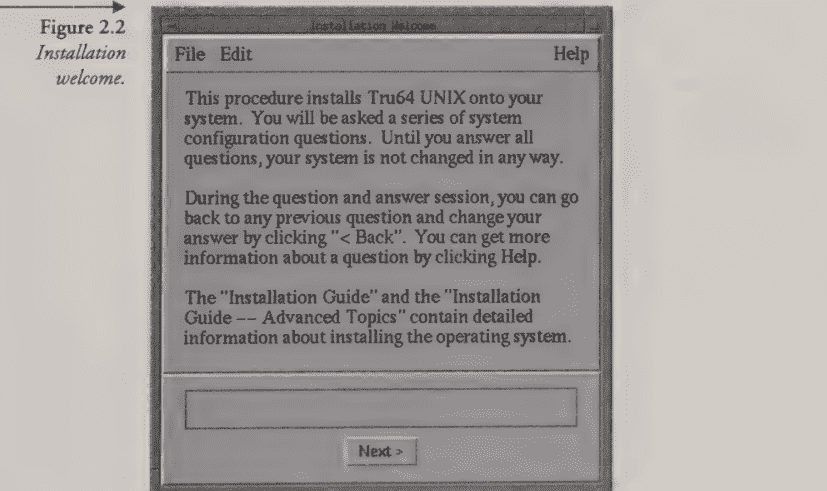

图 2.3

主机信息。

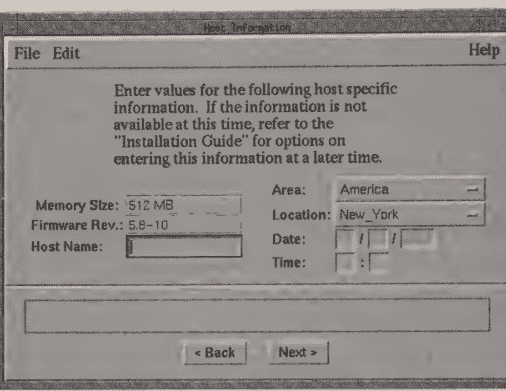

### 2.4.2.2 Root 密码

下一个数据是 root 密码 `图 2.4`。root 用户也称为超级用户，拥有高于普通用户的权限。例如，超级用户 `或 root 用户` 可以系统、添加用户、挂载文件系统等。因此，root 密码的安全至关重要。安装程序必须选择一个至少六个字符且包含大小写字母的密码。前六个字符之一必须是数字、特殊字符或大写字母。输入密码时，出于安全考虑将不会显示，但系统会记录。您还需要再次输入一次进行验证。系统启动后，您可以使用 `passwd(1)` 命令更改密码。

图 2.4

设置 root 密码。

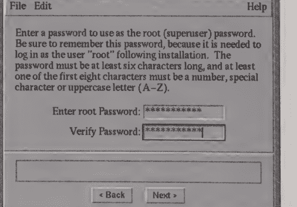

### 2.4.2.3 软件选择

下一步是选择要安装的软件子集。您可以首先通过选择“仅强制”`Mandatory Only`、“所有软件”`All Software` 或“自定义”`Customize` 来选择安装哪些软件子集 `图 2.5`。如果您选择“仅强制”或“所有软件”，此时不需要进行进一步选择。选择“自定义”并点击“编辑列表...”`Edit List...` 按钮将显示一个详细的选择窗口 `图 2.6`。选择哪种选项取决于这这将是一个什么样的系统，并且应该在规划阶段确定。如果您不需要所有子集，请选择“自定义”并仅选择强制性的。安装所有子集将占用更多磁盘空间，但不会对系统运行产生不利影响。在大多数情况下，仅选择强制子集可能不够。您可以使用 `setld` 命令随时添加或删除子集。

图 2.5

软件选择。

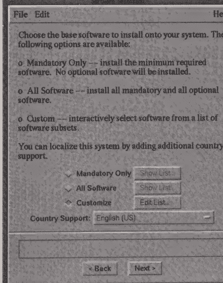

图 2.6

软件子集编辑列表。

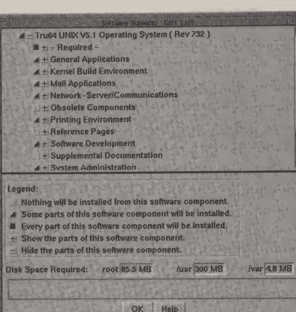

在此窗口中选择的还有“国家支持”`Country Support`。您可以为图形用户界面选择一种或多种额外语言的支持。

选择“自定义”并点击“编辑列表...”后，您可以按类别进行子选择，例如“参考页”`Reference Pages`，或者通过点击 `+` 展开类别并从该类别选择单个子集。如果您选择了一个依赖于另一个子集的子集，则所需的子集将被自动选中。注意窗口底部的按键显示了特定软件类别的部分或全部是否已安装。此外，最底部是根据当前选择所需的的文件系统空间运行总和。

### 2.4.2.4 内核选项

下一步是选择在安装程序完成后将哪些内核选项 `图 2.7` 构建到自定义内核中。选项有“仅强制”、“所有选项”和“自定义”。正如您所猜到的，如果您不选择“自定义”，则在内核构建之前将没有选择列表。如果您选择“自定义”，则必须在内核构建之前的提示下为您的系统选择特定的内核选项。

图 2.7

内核选项。

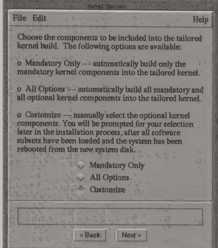

### 2.4.2.5 文件系统布局

现在您已经知道要安装什么了，必须决定安装在哪里以及使用什么种类型的文件系统。“文件系统布局”`图 2.8` 提供了两个主要选项：“默认布局”`Default Layout` 和“自定义布局”`Custom Layout`。由于默认布局没有提供很多定制化空间，自定义布局 `图 2.9` 允许许多选择。例如，您可以将每个文件系统放置在单独磁盘上，选择多个文件系统类型，包含逻辑卷管理器 `Logical Volume Manager`，并调整分区大小。

如果您不确定哪个是哪个，可以使用磁盘工具 `图 2.10` 轻松调整分区大小。只需使用滑块扩大或缩小分区即可。完成后，选择 OK，您将返回文件系统布局。

### 2.8

文件系统布局。

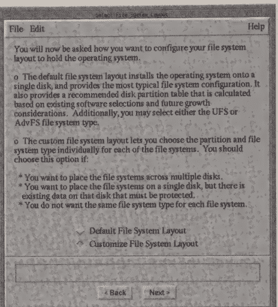

图 2.9

自定义文件系统。

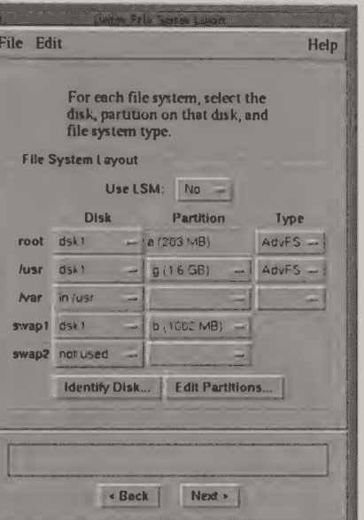

图 2.10

磁盘配置。

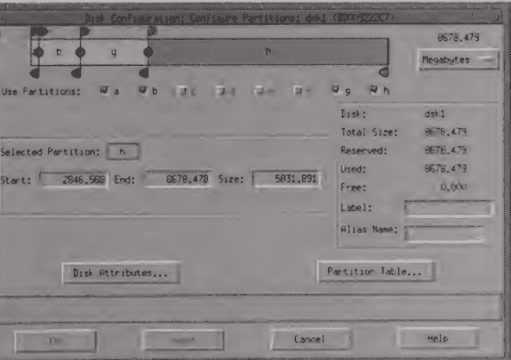

### 2.4.2.6 安装摘要

最后，显示“安装摘要”窗口 `图 2.11`，包含您的选择。您应该核实您的选择是否正确反映。如果没有，或者您决定更改某些内容，此时仍然可以进行修改。如果您在此时候退出安装程序，最多也只需要对在文件布局阶段修改过的磁盘进行重新分区，并可能修改日期。

图 2.11

安装摘要。

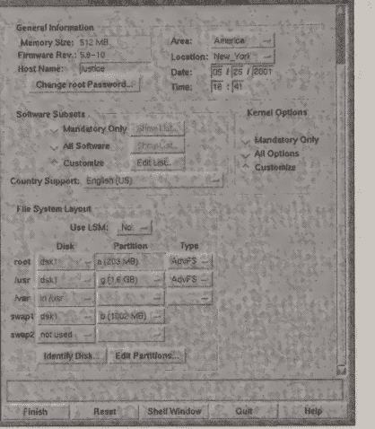

### 2.4.2.7 系统加载

在您确认要继续安装后，安装将进行，创建文件系统、添加交换分区并安装子集。您将看到一个状态显示器 `图 2.12`，它将向您显示安装进度。软件加载后，系统将自动重启并执行软件配置。这是一个相当快速的操作。然后将构建新内核。

### 2.4.2.8 自定义内核构建

如果您在内核选项部分选择了“仅强制”或“所有选项”，则自定义内核将自动构建并移动到根目录。

图 2.12

安装状态窗口。


## 2.4 Tru64 UNIX 安装


目录。如果你选择了“自定义”（Customize），你将看到“内核选项选择”（Kernel Option Selection）菜单。选择所需的选项，并将构建自定义内核。你随时可以使用 `configdef(8)` 工具返回此点点。你看到的菜单会因系统而异，但外观类似于所示：

*** 内核选项选择 ***

| 选择 | 内核选项 |
|---|---|
| 1 | System V 设备 (System V Devices) |
| 2 | NTP V3 内核相位锁定环 (NTP_TIME) |
| 3 | 内核断点调试器 (KDEBUG) |
| 4 | 数据包过滤驱动程序 (PACKETFILTER) |
| 5 | IP-in-IP 隧道 (IPTUNNEL) |
| 6 | IP 版本6 (IPV6) |
| 7 | 点对点协议 (PPP) |
| 8 | STREAMS 包模块 (PKCT) |
| 9 | X/Open 传输接口 (XTISO, TIMOD, TIRDWR) |
| 10 | 数字多功能磁盘文件系统 (DVFS) |
| 11 | ISO 9660 光盘文件系统 (CDFS) 审计子系统 |
| 13 | ATM UNI 3.0/3.1 ILMI (ATMILM13X) |
| 14 | ATM 上的 IP 交换 (ATIMFMP) |
| 15 | ATM 上的 LAN 仿真 (LANE) |
| 16 | ATM 上的经典 IP (ATMIP) |
| 17 | SVC 的 ATM UNI 3.0/3.1 信令 (UNI3X) |
| 18 | 异步传输模式 (ATM) |
| 19 | 以上全部 |
| 20 | 以上 |
| 21 | 帮助 |
| 22 | 再次显示所有选项 |

输入你的选择。

选择（例如 1 2 4-6）[20]:

请记住，使用不需要的选项构建内核会导致内核变，这意味着它将占用更多的内存。如果没有将你需要的构建构建内核，意味着你必须安排停机，直到新内核能够投入生产环境。

例如，要在系统上使用 IP 版本6 (IPV6)，必须选择 IPv6-kernel 选项。请注意，例外是 ISO 9660 光盘文件系统 (CDFS) 选项。从 Tru64 UNIX V4.0D 开始，该选项在挂载 CDFS 文件系统时由内核动态加载。该选项仍然可以静态地加载到内核中，但这是没有必要的，且生成的内核将更大，从而始终消耗一小部分内存。

## Tru64 UNIX 字符安装工具

一旦构建了自定义内核并复制到根目录，重启一次即可完成安装。接下来的步骤被称为“安装后步骤”。这涉及以 root 身份登录并配置系统使用。这些任务在第 4 章“系统配置”中介绍。

在没有图形能力的系统上安装 Tru64 UNIX 时，安装界面是一个字符单元菜单驱动的应用程序。该应用程序提供的功能与图形安装工具基本相同。唯一的例外是无法访问简易的磁盘分区工具（例如在需要自定义磁盘分区时可用的“磁盘配置”窗口），此时必须从 UNIX Shell 模式下手动使用 `disklabel(8)` 命令。有关 `disklabel` 命令使用的详情，请参阅第 3 章“存储”。

从安装介质初始启动后，将显示以下信息，随后是三个选项的安装菜单：

> 欢迎使用 Tru64 UNIX 安装程序

此程序将 Tru64 UNIX 安装到你的系统上。你将被要求回答一系列系统配置问题。在回答所有问题之前，你的系统不会发生任何更改。

请参阅《安装指南》和《安装指南——高级主题》获取有关安装 Tru64 UNIX 的更详细信息。

** 本系统当前运行的固件版本：5.0A

请查看“Tru64 UNIX 发布说明”获取有关所需固件版本的信息。

可用选项有：

- “美式英语安装”（U.S. English Installation）仅在你的系统上安装 Tru64 UNIX 基础软件。

## 2.5 升级 Tru64 UNIX

- “带全球语言支持的安装”（WLS, WLS）允许你对系统进行国际化。此选项允许你安装 Tru64 UNIX 基础软件以及 WLS 软件。额外的软件子集为各个国家及其母语言提供支持。

- “退出安装”（Exit Installation）选项将停止安装，并将你的系统置于具有超级用户权限的单用户模式。此选项适用于希望在安装前执行文件系统或磁盘维护任务的经验丰富的 UNIX 系统管理员。此选项也可用于之前安装的系统进行灾难恢复。

记住，你随时可以通过输入 `help` 获取额外信息。

1) 美式英语安装

2) 带全球语言支持的安装

3) 退出安装

输入你的选择：

安装程序将被要求回答与图形安装相同的问题。

将已安装的 Tru64 UNIX 版本升级到更高版本的 Tru64 UNIX 的过程被称为“更新安装”（Update installation）。更新安装在现有系统上进行，结果是升级了系统，同时保留了磁盘和文件系统配置、用户帐户、打印机和网络配置。

### 2.5.1 更新步骤

Tru64 UNIX 更新安装所需的预安装工作与全量安装（Full installation）一样甚至更多。这是因为正在升级的系统很可能被依赖。成功的更新安装对用户是透明的。以下步骤描述了更新安装。

#### 2.5.1.1 准备更新安装

完成所有预安装计划和准备。更新的计划与全量安装相似，包括：

- 在开始更新之前备份系统。升级期间可能会发生任何情况，因此你最好做好准备。在开始前对根、`/usr` 以及（如果是独立的）`/var` 执行 `vdump(8)`。如果发生任何故障，你能够快速地返回预安装环境。

- 确保有足够的磁盘空间用于升级和新的软件子集。

- 如果必要升级系统固件。你已经在安排停机，所以即使当前的固件是最低要求，也要更新到最新的版本。

- 查看发布说明以获取任何更新安装信息。发布说明包含重要信息，应在任何升级或安装之前查看。至少查看新功能或特定平台的说明。

- 确定 CD-ROM 设备名称。

- 对任何 AdvFS 文件系统运行 verify。在开始更新之前，卸载根以外的所有 AdvFS 文件系统并对它们运行 verify。对于根，使用 `verify -a`。如果 verify 发现问题，请修复问题（这可能包括让 verify 修复 -f 或重新创建域并恢复数据）。你不希望在域损坏的情况下进入更高版本，因此现在就修复它。

- 验证所有分层产品是否受新的操作系统版本支持。

#### 2.5.1.2 关机到单用户

在多用户模式下，以 root 身份登录或 `su` 到 root 并关闭系统：

```
# su -
password:
# shutdown +10 "因计划操作系统更新而关机"
```

#### 2.5.1.3 开始更新安装

取决于你将安装的子集数量、系统级别以及 CD-ROM 的速度，更新系统可能需要 45 分钟到几个小时。

- 1. 如果你想让 `update(8)` 在无需任何人工干预的情况下运行，请使用 '-u' 启动它：

```
# /sbin/update -u
```

- 2. 挂载本地文件系统，如果安装了 LSM 则启动它：

```
# /sbin/bcheckrc
```

- 3. 将操作系统放入 CD-ROM 中。

- 4. 挂载 CD-ROM：

```
# /sbin/mount /dev/rz4c /mnt # V4
# /sbin/mount /dev/disk/cdrom0c /mnt # V5
```

- 5. 开始安装更新程序过程：

```
# /sbin/installupdate [-nogui] <location>
```

其中 `<location>` 可以是：

- 本地设备 (`/dev/rz4c`, `/dev/disk/cdrom0c`, 等)

- 挂载 CD-ROM 的挂载点 (`/mnt`)

- RIS 服务器 (`loader1:`)

#### 2.5.1.4 选择选项

你看到的系列选择是更新安装选项。

- 选择可选内核组件

如果你已经在运行自定义内核，或者你想自定义内核，请选择此选项。如果你不选择此选项，则只有只有强制性的内核选项会被构建到新内核中。

- 归档旧文件

如果你希望在删除新版本不再需要的旧文件之前对其进行归档，请选择此选项。

#### 2.5.1.5 监控分析

选择选项后，你看到的下一个是预载分析（PreLoad Analysis）。

更新过程如下：

- 检查是否存在冲突软件

- 确定已安装的基础操作系统软件

- 确定内核组件

## 2.5 升级 Tru64 UNIX

- 检查文件类型冲突

- 检查过旧文件

- 检查文件系统空间

有关每项检查的详细信息，请参阅《安装指南》。

#### 2.5.1.6 开始加载软件

分析阶段完成后，系统将要求确认开始更新。如果你满意并确认，更新将继续。

#### 2.5.1.7 更新后任务

一旦更新完成，请以 root 身份登录并执行更新后任务。接下来的两个章节描述了更新后任务。

#### 2.5.1.8 如果必要，手动合并自定义更改

检查更新安装产生的日志。这些文件是：

- 更新安装日志：

  `/var/adm/slogs/update.log`

- 配置日志：

  `/var/adm/slogs/it.log`

- 自定义文件（如果有）：

  `/var/adm/slogs/upd_custom_files`

- 合并失败的文件（如果有）：

  `/var/adm/slogs/upd_mergefail_files`

#### 2.5.1.9 如果必要，手动合并自定义更改

由于某些原因，更新可能无法合并所有的自定义更改。如果是这样，你将必须手动执行此操作。手动合并简单来说就是编辑系统文件的新版本以包含你的自定义更改。检查 `upd_custom_files` 和 `upd_mergefail_files` 以及内核配置文件 `/sys/conf/HOSTNAME`，以查看你是否需要采取任何操作。更多详细信息请参阅《安装指南》。

一旦完成任何所需的手动合并，系统即可使用，并可以将系统恢复到生产环境或安装额外软件。此外，你可能希望执行一些更新安装清理工作。

#### 2.5.1.10 更新安装清理（可选）

你应该清理（删除并归档）更新程序创建的文件。这应该在最后完成（修复任何合并问题后），并可以通过 Sysman 完成。

```
# sysman upadmin
```

此菜单将引导你删除 .PreUPD 和 .PreMRG 文件。

## 2.6 补丁

在应用了当前的汇总补丁包（如果存在）之前，任何安装都不能被视为完成。本节的目的是概述应用汇总补丁包的过程。选择通过 CD-ROM 每季度获取补丁的 Compaq 客户可以直接从 CD-ROM 安装，但大多数客户将从公共补丁网站下载补丁：

```
http://ftp.support.compaq.com/public/
```

从该目录进入要打补丁的 Tru64 UNIX 版本，并从该位置选择补丁包。

你下载的文件格式为 `t64XYAsNNNNN-date-timestamp.tar`，其中 XY 是版本，NNNNN 是补丁包号。例如，`t64v51as0003-20010521.tar` 被称为 V5.1 的补丁包 3。

一旦下载了补丁包文件，解压：

```
# tar xvf T64V51AS0003-20010521.tar
blocksize = 256
x patch_kit
x patch_kit/patch_tools
x patch_kit/patch_tools/product_map, 656 bytes, 2 tape blocks
x patch_kit/patch_tools/instctrl
x patch_kit/patch_tools/instctrl/OSFPAT000000030510.inv, 1893
bytes, 4 tape blocks
```

## 2.6 补丁

现在进入 `patch` 命令所在的目录（它将是相对路径），并运行包中包含的 patch 版本：

```
# cd patch_kit
./patch
```

- 上次会话已保存 session.log 中

- Tru64 UNIX 补丁工具 (修订 29)

主菜单：

1) 补丁安装

2) 补丁删除

3) 补丁文档

4) 补丁跟踪

5) 补丁分析

h) 命令行帮助

q) 退出

输入你的选择：

从此菜单，你可以安装和删除补丁，以及进行一些高级操作。安装步骤将涉及补丁的设置。你可以在多用户模式下安装，但首选的方法是单用户模式。无论哪种情况，都是如此。

## 3.1 存储系统概念

设备的后端。因此，RAID 控制器比简单的 SCSI 适配器要复杂得多。RAID 控制器带有 CPU 和内存，并运行一种称为固件的专用程序，该固件决定了如何配置设备以及它如何对各种事件做出反应。

今天，连接到 UNIX 系统的大多数存储设备使用小型计算机系统接口（SCSI）总线标准。稍后我们将深入介绍 SCSI，因为该标准随着时间的推移不断演进，许多许多选项支持标准允许的不同速度和信号类型。尽管有了这些变化，SCSI 标准仍从旧的专有磁盘协议时代大幅简化了磁盘互连。

另一种快速演进且流行的存储机制是光纤通道（Fibrechannel）或存储区域网络（SAN）技术。光纤通道在系统和设备之间使用光纤互连，而不是铜电缆，就像局域网中主机相互连接的方式一样。这些光纤互连只是用于在系统和存储设备之间传输 SCSI 命令和数据的不同传输方式。因此，光纤通道并不代表一种 SCSI 新协议，而是一种往来传输比特的方法。有几本专门介绍光纤通道的好书，我们无法在此全面涵盖，因此我们建议读者参考这些书籍以进一步了解该主题。作为大型 Tru64 UNIX 系统的系统管理员，在你的站点实施这项技术之前，无疑需要理解这种新技术的工作原理。在编写此时，该技术仍在演进中；因此，仍然需要高技能才能正确安装和管理这些 SAN。

### 3.1.3 SCSI 概念

SCSI（读音为 "scuzzy"）不仅仅是一个标准，它实际上是一系列标准。在本节中，我们将解释不同的 SCSI 术语，并建立讨论 SCSI 设备与主机之间交互所需的概念。

SCSI（现在通常被称为 SCSI-1）是由美国国家标准协会（ANSI）提出的原始 SCSI 规范。该规范的工作始于 1982 年，最初设计用于将存储设备连接到工作站（ANSI X3.131-1986）。它支持单端窄总线结构，最多仅支持 8 个设备。能够达到的最高速度仅为 5MB/sec，最大总线长度为 6 米。此外，这篇大约 200 页的文档最初仅定义了六种设备。尽管这个标准非常有用并用于许多小型计算机系统，但它存在显著的缺陷，特别是对于较大的系统而言。技术和系统规模开始发生巨大变化；因此，改进的需求变得显而易见。委员会于 1992 年开始对该标准进行第二次修订。

SCSI-2 规范（ANSI X.131-1994）是委员会工作的成果，至今仍广泛使用。该标准是一项巨大的改进，因为它定义了更快的设备速度、新设备、“快速”和“宽”概念、差分设备规范以及新的布线标准。此外，它允许在单个总线上同时存在多个启动器（initiators），为 Compaq 的 Cluster 项目等集群技术铺平了道路。新标准允许每个 SCSI-2 总线最多支持 16 个设备，每个设备最多支持 8 个逻辑单元号（LUN）。SCSI-2 规范远优于 SCSI-1，真正将 SCSI 引入了低端和高端系统的计算主流市场。

在编写此时，SCSI-3 规范正在作为新标准出现。SCSI-3 与其前身的区别在于，它实际上是一种用于向标准中添加新接口和设备的架构。它的设计非常智能，考虑到任何有用的标准必须不断演进，永远不会保持静止。在编写此时，许多设备已在不同程度上实现了该规范的各个部分。例如，非常流行的 Ultra 和 Ultra Wide SCSI（也称为 Fast 20 和 Fast 20 Wide）设备是 SCSI 3 标准部分内容的实现。这两种设备属于 SPI（SCI 并行接口），它是 SCSI 标准的同步扩展，其协商周期为 50 和 96 纳秒。结果是 Ultra 的速度大约是普通 Fast SCSI 的两倍，允许窄设备达到 20MB/秒的传输率，宽设备达到 40MB/秒。SCSI-3 标准将每个设备支持的 LUN 数量增加到从

## 3.2 独立磁盘冗余阵列 (RAID)

在 20 世纪 80 年代，当磁盘驱动器的价格开始下降可靠性开始提高时，加利福尼亚大学伯克利分校的几位教授意识到，如果你有一批现成的磁盘，你可以让它们的性能和可靠性达到甚至优于那时的单块昂贵磁盘（SLED）；在性能和可靠性上，你仍然需要花费大量资金购买连接到主机和微型计算机的专有驱动器。较小标准驱动器的大规模组合开始模拟大驱动器的功能，这种技术被称为独立磁盘冗余阵列（RAID）。这些设备已完全取代了高端系统中的大型专有驱动器。整个行业都是围绕 RAID 技术建立的，每年销售额达数十亿美元。所有迹象表明，对存储的需求将继续快速增长，这个行业将继续繁荣发展。

### 3.2.1 RAID 术语

在我们进一步讨论 RAID 之前，让我们定义几个术语：冗余（Redundancy）是系统在一个或多个组件发生故障时继续正常运行的能力。在 RAID 中，冗余通过复制数据或在多个磁盘上使用校验信息来实现。条列（Striping）是在在多个磁盘上分布数据。镜像（Mirroring）是在向多个磁盘上写入相同的数据。校验（Parity）是用于在发生故障时重建数据的方法。RAID 控制器是管理这些硬件或软件。LUN 是逻辑单元号。

在我们进一步讨论 RAID 之前，让我们定义几个术语：冗余是系统在其中一个或多个组件发生故障时继续正常运行的能力。在 RAID 中，冗余通过复制数据或在多个磁盘上使用校验信息来实现。条列是在多个磁盘上分布数据。镜像是在向多个磁盘上写入相同的数据。校验是用于在发生故障时重建数据的方法。RAID 控制器是管理这些硬件或软件。LUN 是逻辑单元号。

### 3.2.2 RAID 级别

加利福尼亚大学定义了五种级别，它们被称为 RAID 1 到 RAID 5。其中某些级别在实践中从未出现过，但我们在此列出。是每个 RAID 级别的列表：

- RAID 0：这种 RAID 级别也称为条列（striping）。RAID 0 不具冗余，因此不符合 RAID 的缩写。在级别 0 中，数据分布在磁盘上，产生更高的吞吐量。由于没有存储冗余信息，性能非常好，但任何磁盘的故障都会导致数据丢失。


### RAID 1
`RAID 1` 也称为镜像（mirroring），通过向两个或多个磁盘写入数据来提供冗余。级别 1 阵列的读取性能通常更快，写入性能比单个磁盘慢，但如果任何一个磁盘故障，数据就不会丢失。这是一个很好的入门级系统，因为只需要两个磁盘。另一方面，由于数据被完全复制，每 GB 成本相对较高。

### RAID 0+1
这种级别在原始论文中从未提到过，但它是它的逻辑扩展。它是镜像与条列的结合，提供了完整的冗余，以及每个数据副本使用条列的性能。这种 RAID 级别的每 GB 成本与 `RAID 1` 相同，但性能往往更好。

### RAID 2
`RAID 2` 使用汉明纠码（Hamming error codes），旨在用于没有内置错误检测的驱动器。所有 SCSI 磁盘都支持内置错误检测，因此在使用 SCSI 磁盘时这种级别几乎没用。

### RAID 3
`RAID 3` 在字节级上在多个磁盘上进行数据条列，校验信息存储在一个磁盘上。它在其他方面与级别 4 相似。字节条列需要硬件支持才能高效使用。

### RAID 4
`RAID 4` 在块级上在多个磁盘上进行数据条列，校验信息存储在一个磁盘上。校验信息允许从单个驱动器的故障中恢复。4 级阵列的读取性能非常好（与 0 级相同）。然而，写入操作每次都需要更新校验数据。这会减慢小数据的写入，尽管大数据的写入或顺序写入相当快。由于阵列中只有一个驱动器存储冗余数据，4 级阵列的每兆字节成本可以相当低。

### RAID 5
`RAID Level 5` 与 4 级相似，但它将校验数据分布在各个驱动器之间。这在多处理系统中可以加速小数据写入，因为校验盘不会成为瓶颈。然而，由于读取时必须在每个驱动器上跳过校验数据，因此读取性能往往低于 4 级阵列。每兆字节成本与 4 级相同。

### 3.2.3 硬件 RAID 与 软件 RAID

随着 Tru64 UNIX 5.0 中实现的 LSM 更改，你会发现使用硬件和/或软件 RAID 能够做（以及应该做）的事情，其界限已变得相当模糊。像往常一样，在决定是使用软件实现还是硬件实现 RAID 时，需要考虑权衡。

在决定使用硬件还是软件实现 RAID 时，通常必须在性能、复杂性和灵活性这三个主要因素之间进行选择。这些因素中任何一个的改变都可能对其他因素产生不利影响。以下是一些（通过丰富经验获得的）建议，旨在为你决定硬件或软件 RAID 解决方案时提供帮助。

首先，作为一个通用规则，性能最高的 RAID 应该在硬件（智能控制器固件）中实现，但使用像 `LSM` 这样的卷管理器实现 RAID 可以获得更大的灵活性。因此，当性能是首要因素时，应尽可能在硬件中实现 RAID。这不仅能提供最佳性能，还能减少方案的复杂性。任何复杂性的减少都有助于系统管理人员处理设备故障。复杂系统可能会以不可预测的方式故障，因此简单往往意味着更好。另一方面，如果灵活性是首要目标，那么软件 RAID 是明显的选择。

其次，不要过度实现 RAID。我们有许多选项可以选择，包括 `LSM`、硬件 RAID 控制器和 AdvFS 文件条带（file striping）。因此，很容易在错误的层级实现 RAID，从而在无意中降低性能、增加复杂性或降低可用性。

例如，如果镜像在硬件层面实现，同时在 LSM 设备之间也实现，那么在牺牲磁盘空间的情况下，几乎没有获得可用性的提升。另一个愚蠢的例子是在硬件 RAID 控制器上的条带集（stripe set），它可以被切分成碎片并使用 `LSM` 再次条带化。这种额外的条带化实际上会降低写入性能，而不是如预期的那样提高它。这就像为了第二次获得更小的文件而对文件进行两次压缩。结果通常是更大的文件。RAID 实现中也会发生同样的情况。过好的东西实际上可能会产生适得其反的效果。

第三，注意在适当层级实现 RAID。例如，在 5.0 版本之前，`LSM` 不支持 `RAID 5`，仅支持 `RAID` 级 0、1 和 0+1。然而，区分“可以做的”和“应该实现的”之间的区别是重要的。我们认为应该实现软件 RAID 5 的情况非常有限。`LSM` 的 `RAID 5` 实现开销低且提供了冗余，但当 I/O 性能是一个重要因素时，我们不建议使用基于软件的 `RAID 5`。在这种情况下，应该使用硬件 `RAID 5` 以最大化性能并减少复杂性。

第四，在某些情况下，结合软件和硬件 RAID 可能是最佳选择。例如，硬件 RAID 无法提供某些冗余（例如跨总线的镜像），因此软件解决方案可能是唯一的选择。

## Tru64 UNIX 设备管理

本节介绍了理解 Tru64 中设备所需的概念。在很大程度上，Tru64 UNIX 在某些方面与其他 UNIX 变体相似，在另一些方面又不同。理解这些相似和不同之处非常重要，以便对文件系统进行彻底覆盖。我们将从设备管理的概括性开始，但我们的最终目标是深入讨论磁盘设备的管理，因为这些是文件系统管理中使用的设备。

我们在这里只讨论版本 5.0 的设备命名和结构。从 5.0 开始，Tru64 UNIX 设备管理发生了巨大变化，不仅是从用户的角度（因为命名方案发生了变化），而且在内核中也是如此。需要进行更改主要有两个原因。首先，这些更改是为了启用 TruCluster 5.x 单系统映像 (SSI)，这意味着磁盘和磁带设备在整个集群中是一致的。其次，这些更改是为了支持 SCSI 宽设备和光纤通道。为了支持这些新需求，必须更改旧的设备命名方案。

### 3.3.1 Tru64 UNIX 中的设备特殊文件

与任何操作系统一样，Tru64 UNIX 设备文件位于根文件系统的 `/dev` 或 `/devices` 目录。设备文件代表用户级进程进入设备驱动程序的“句柄”，驱动程序控制系统上的各种硬件设备。每个设备驱动程序都被分配一个主号（major number），该主号在内核中唯一定义了它。主号偏移到两个名为切换表（switch tables）的表中，这些表定义了在设备上允许的操作。我们之所以有两个切换表，是因为一个用于字符设备，另一个用于块设备设备文件；一个设备可能同时关联一个字符设备文件，但所支持的操作将是不同的，因此执行这些操作的代码也会不同。

Tru64 UNIX 上的 SCSI 设备命名传统上遵循 BSD 方法。Tru64 UNIX 5.0 的命名方案与旧版本相比发生了显著变化。在新方法中，所有集群设备都使用主号 19。这极大地简化了设备管理。除了设备命名外，表 3.1 列出了常用的设备类型。

### Tru64 UNIX 的设备特殊文件

| 设备 | 描述 |
| :--- | :--- |
| `/dev/disk/disk[x]` | SCSI 磁盘特殊设备 |
| `/dev/rdisk/disk[x]` | SCSI 磁盘字符设备 |
| `/dev/tape/tape[x]_d[y]` | SCSI 磁带字符（回卷）设备 |
| `/dev/ntape/tape[x]_d[y]` | SCSI 磁带字符不回卷设备 |
| `/dev/disk/floppy[x]` | 软磁盘块特殊设备 |
| `/dev/rdisk/floppy[x]` | 软磁盘字符设备 |
| `/dev/disk/cdrom[x]` | CD-ROM 块特殊设备 |
| `/dev/rdisk/cdrom[x]` | CD-ROM 字符设备 |

正如大多数 UNIX 管理员所知，设备分为两种：字符和块。字符特殊文件用于按字符读取和写入设备。这种类型设备示例是终端 (`tty`) 或 SCSI 磁带 (`tz`)。另一方面，块设备必须以磁盘块（512 字节）为单位进行访问。典型的 Tru64 UNIX 系统上看到的块设备是如 SCSI 硬盘、CD-ROM 和软磁盘。在本节中，我们将讨论这些不同的设备（磁盘和磁带）。

### 3.3.2 SCSI 磁盘

SCSI 磁盘是计算机系统中存储和检索文件的最设备。在 Tru64 UNIX 系统上，SCSI 磁盘通常包含在架上或内部安装在系统机内。根据应用程序的需求，磁盘可以使用原始方式或块面向的方式使用。如果使用原始磁盘，应用程序（例如商业数据库产品）必须跟踪磁盘结构并管理可用空间。通常，磁盘将以块面向的方式使用，因此它们上将有文件系统。

## Tru64 UNIX 中磁盘设备名称格式如下：

设备名称格式：

- `/dev/disk/dskXP`
- `/dev/rdisk/dskXP`

其中上述助符指的是以下内容：

- `P` = 分区（Partition）。这是一个从 a 到 h 的小写字母，表示第一到第八个分区。
- `X` = 簇范围内唯一的设备设备编号。

### 示例

这里我们展示了一个在 Tru64 UNIX 5.x 系统上查看设备文件的示例。该设备位于总线 #2、目标 #6、LUN 0，且设备类型为 ZR28D。

```
# cd /disk/dsk46*
# ls -1 *disk/dsk46*
brw-- 1 root  system 19593 Mar 15 11:04 disk/dsk46a
brw-- 1 root  system 19595 Mar 15 11:04 disk/dsk46b
brw-- 1 root  system 19597 Mar 15 11:04 disk/dsk46c
brw-- 1 root  system 19599 Mar 15 11:04 disk/dsk46d
brw-- 1 root  system 19601 Mar 15 11:04 disk/dsk46e
brw-- 1 root  system 19603 Mar 15 11:04 disk/dsk46f
brw-- 1 root  system 19605 Mar 15 11:04 disk/dsk46g
brw-- 1 root  system 19607 Mar 15 11:04 disk/dsk46h
crw-- 1 root  system 19594 Mar 15 11:04 rdisk/dsk46a
crw-- 1 root  system 19596 Mar 15 11:04 rdisk/dsk46b
crw-- 1 root  system 19598 Mar 15 11:04 rdisk/dsk46c
crw-- 1 root  system 19600 Mar 15 11:04 rdisk/dsk46d
crw-- 1 root  system 19602 Mar 15 11:04 rdisk/dsk46e
crw-- 1 root  system 19604 Mar 15 11:04 rdisk/dsk46f
crw-- 1 root  system 19606 Mar 15 11:04 rdisk/dsk46g
crw-- 1 root  system 19608 Mar 15 11:04 rdisk/dsk46h
# file rdisk/dsk46a
disk/dsk46a character (19/594) SCSI #2 ZR28 disk
#1 (SCSI ID #6) (SCSI LUN #0)
```

### 3.3. SCSI 磁带

SCSI 磁带设备名称如表 3.1 所示。在此表中，“x”表示设备编号，“y”表示密度代码。通常，“y”的数值越小，表示磁带设备支持的密度越高，数值越大密度越低。系统的默认设备选项由磁带 `tape0` 指定。它被许多以磁带为对象的实用程序作为第一个设备。

### 示例

此示例显示了单个磁带设备设备特殊文件的 `ls -l` 输出。这里我们展示了主设备号对所有设备保持不变，但从设备号用于指定指定的设备和密度代码。密度代码取决于所使用的磁带驱动器类型而变化很大。对于所有磁带设备，都有八密度代码，但并非所有的代码都适用于特定类型的磁带设备。有关所使用的 Tru64 UNIX 支持的磁带驱动器密度代码的更多信息，请参见 `tz(5)` 参考页面。

```
# cd /dev
# ls -l /dev/*tape/tape0*
crw-rw-rw- 1 root system 19,258 Mar 22 08:59 /dev/ntape/tape0
crw-rw-rw- 1 root system 19,262 Mar 22 08:59 /dev/ntape/tape0
crw-rw-rw- 1 root system 19,264 Mar 22 08:59 /dev/ntape/tape0_d1
crw-rw-rw- 1 root system 19,266 Mar 22 08:59 /dev/ntape/tape0_d2
crw-rw-rw- 1 root system 19,268 Mar 22 08:59 /dev/ntape/tape0_d3
crw-rw-rw- 1 root system 19,270 Mar 22 08:59 /dev/ntape/tape0_d4
crw-rw-rw- 1 root system 19,272 Mar 22 08:59 /dev/ntape/tape0_d5
crw-rw-rw- 1 root system 19,274 Mar 22 08:59 /dev/ntape/tape0_d6
crw-rw-rw- 1 root system 19,276 Mar 22 08:59 /dev/ntape/tape0_d7
crw-rw-rw- 1 root system 19,260 Mar 22 08:59 /dev/ntape/tape0_c
crw-rw-rw- 1 root system 19,257 Mar 22 08:59 /dev/tape/tape0
crw-rw-rw- 1 root system 19,261 Mar 22 08:59 /dev/ntape/tape0_d0
crw-rw-rw- 1 root system 19,265 Mar 22 08:59 /dev/ntape/tape0_d1
crw-rw-rw- 1 root system 19,267 Mar 22 08:59 /dev/ntape/tape0_d2
crw-rw-rw- 1 root system 19,269 Mar 22 08:59 /dev/ntape/tape0_d3
crw-rw-rw- 1 root system 19,267 Mar 22 08:59 /dev/ntape/tape0_d4
crw-rw-rw- 1 root system 19,271 Mar 22 08:59 /dev/ntape/tape0_d5
```

```
crw-rw-rw- 1 root system 19,273 Mar 22 08:59 /dev/tape/tape_d6
crw-rw-rw- 1 root system 19,275 Mar 22 08:59 /dev/tape/tape_d7
crw-rw-rw- 1 root system 19,259 Mar 22 08:59 /dev/tape/tape0_c
```

### 示例

此示例显示了上一个示例中磁带设备的文件(1)输出。

```
# file /dev*/tape/tape0*
/dev/ntape/tape0: character special (19/258) SCSI #1 "TZ89" tape #2 (SCSI ID #0) (SCSI LUN #2) offline
/dev/ntape/tape_d0: character special (19/262) SCSI #1 "TZ89" tape #2 (SCSI ID #0) (SCSI LUN #2) offline
/dev/ntape/tape_d1: character special (19/264) SCSI #1 "TZ89" tape #2 (SCSI ID #0) (SCSI LUN #2) offline
/dev/ntape/tape_d2: character special (19/266) SCSI #1 "TZ89" tape #2 (SCSI ID #0) (SCSI LUN #2) offline
/dev/ntape/tape_d3: character special (19/268) SCSI #1 "TZ89" tape #2 (SCSI ID #0) (SCSI LUN #2) offline
/dev/ntape/tape_d4: character special (19/270) SCSI #1 "TZ89" tape #2 (SCSI ID #0) (SCSI LUN #2) offline
/dev/ntape/tape_d5: character special (19/272) SCSI #1 "TZ89" tape #2 (SCSI ID #0) (SCSI LUN #2) offline
/dev/ntape/tape_d6: character special (19/274) SCSI #1 "TZ89" tape #2 (SCSI ID #0) (SCSI LUN #2) offline
/dev/ntape/tape_d7: character special (19/276) SCSI #1 "TZ89" tape #2 (SCSI ID #0) (SCSI LUN #2) offline
/dev/ntape/tape_d8: character special (19/278) SCSI #1 "TZ89" tape #2 (SCSI ID #0) (SCSI LUN #2) offline
/dev/tape/tape0: character special (19/257) SCSI #1 "TZ89" tape #2 (SCSI ID #0) (SCSI LUN #2) offline
/dev/tape/tape_d0: character special (19/261) SCSI #1 "TZ89" tape #2 (SCSI ID #0) (SCSI LUN #2) offline
/dev/tape/tape_d1: character special (19/263) SCSI #1 "TZ89" tape #2 (SCSI ID #0) (SCSI LUN #2) offline
/dev/tape/tape_d2: character special (19/265) SCSI #1 "TZ89" tape #2 (SCSI ID #0) (SCSI LUN #2) offline
```

### 3.3 Tru64 UNIX 设备管理


`/dev/tape/tape_d3`: character special (19/267) SCSI #1 "TZ89" tape #2 (SCSI ID #0) (SCSI LUN #2) offline

`/dev/tape/tape_d4`: character special (19/269) SCSI #1 "TZ89" tape #2 (SCSI ID #0) (SCSI LUN #2) offline

`/dev/tape/tape_d5`: character special (19/271) SCSI #1 "TZ89" tape #2 (SCSI ID #0) (SCSI LUN #2) offline

`/dev/tape/tape_d6`: character special (19/273) SCSI #1 "TZ89" tape #2 (SCSI ID #0) (SCSI LUN #2) offline

`/dev/tape/tape_d7`: character special (19/275) SCSI #1 "TZ89" tape #2 (SCSI ID #0) (SCSI LUN #2) offline

`/dev/tape/tape0_c`: character special (19/259) SCSI #1 "TZ89" tape #2 (SCSI ID #0) (SCSI LUN #2) offline

### 3.3.4 CD-ROM 设备

只读光盘（CD-ROM）设备在 Tru64 UNIX 中的设备名称与磁带设备类似。CD-ROM 设备设备特殊文件的主设备号保持不变，但从设备号用于指定指定的设备和密度代码。密度代码取决于所使用的光盘驱动器类型而变化很大。对于所有光盘设备，都有八密度代码，但并非所有的代码都适用于特定类型的光盘设备。请参见 `tz(5)` 参考页面，以获取有关所使用的 Tru64 UNIX 支持的光盘驱动器密度代码的更多信息。

### 示例：

此示例展示了 CD-ROM 设备在 Tru64 UNIX 中的状态。

### 3.3.5 软盘设备

软盘设备用于在计算机系统之间交换少量数据。Tru64 UNIX 系统上的设备文件命名为“floppy”，并带有特定的设备编号和分区。与磁盘不同，磁盘有八分区，软盘只定义了分区 a 和 c，这两个分区都代表整个软盘。其他分区并不存在，因为划分如此小的存储空间没有意义。此外，Zip™ 驱动器被 Tru64 UNIX 识别为软盘驱动器。

### 示例：

```
# cd /dev
# ls -1 *disk/floppy*
brw-rw-rw- 1 root system 19,1 Mar 30 08:29 disk/floppy0a
brw-rw-rw- 1 root system 19,5 Mar 30 08:29 disk/floppy0
brw-rw-rw- 1 root system 19,129 Mar 30 09:38 disk/floppya
brw-rw-rw- 1 root system 19,133 Mar 30 09:38 disk/floppyc
crw-rw-rw- 1 root system 19,2 Mar 30 08:29 disk/floppy0
crw-rw-rw- 1 root system 19,6 Mar 30 08:29 disk/floppy0
brw-rw-rw- 1 root system 19,130 Mar 30 09:38 disk/floppya
brw-rw-rw- 1 root system 19,134 Mar 30 09:38 disk/floppyc
```

- 安装硬件。
- 扫描设备并添加任何新设备。
- 创建设备特殊文件。
- 为设备添加磁盘标签（disk label）。
- 将设备添加到 LSM（可选）。
- 创建并挂载文件系统（可选）。

### 3.4.1.1 硬件步骤

这些是根据你正在使用的存储系统要求的步骤。由于 Tru64 UNIX 可以处理几乎任何行为类似于 SCSI 磁盘的标准设备，因此采取的具体步骤在很大程度上取决于所连接设备的复杂性。会有许多可能涵盖的内容，但这里至少是你在这一步中需要考虑的一些事项：

- 确保设备已正确连接到系统。这包括使用正确的线缆、遵循适当的布线距离要求以及在总线上使用正确的终端匹配。
- 确保外部存储柜已插好并正常运行。例如，如果使用了宽设备，请确保你有一个宽形存储柜，否则设备将无法按预期方式运行。
- 对于光纤通道（Fibrechannel），可能需要额外的步骤对任何集线器和其他连接设备进行编程，以确保正确的主机看到正确的磁盘。主路径和冗余路径应正确连接并在逻辑上启用。
- 如果使用了智能控制器（例如 SCSI 附加控制器或背板 RAID 控制器），则必须设置这些单元，以便在操作系统访问它们之前系统控制台能够看到它们。

### 3.4.1.2 向设备表添加新设备

执行此功能的工具是 `hwmgr(8)`。这是一个复杂的设备管理工具，可以执行许多不同的功能。在这里我们展示了如何使用 `hwmgr(8)` 扫描并更新设备的设备表，而无需重启系统。

## 3.4 管理磁盘

```bash
# hwmgr-show scsi
```

| SCSI | DEVICE | DRIVER | NUM | DEVICE | FIRST |
| :--- | :--- | :--- | :--- | :--- | :--- |
| HWID: DEVICE | HOSTNAME | TYPE | SUBTYPE | PATH | FILE | VALID | PATH |
| 0: 5 | clu3 | disk | none | 0 | 1 | (null) |
| 69: 0 | clu3 | disk | none | 0 | 1 | dsk0 [0/0/0] |
| 70: 1 | clu3 | cdrom | none | 0 | 1 | dcdm0 [1/0/0] |
| 71: 2 | clu3 | disk | none | 0 | 1 | dsk1 [5/1/0] |
| 72: 3 | clu3 | disk | none | 0 | 1 | dsk2 [5/2/0] |
| 73: 4 | clu3 | disk | none | 0 | 1 | dsk3 [5/3/0] |
| 75: 6 | clu3 | disk | none | 2 | 1 | dsk5 [5/5/0] |

```bash
# hwmgr-scan scsi
hmgr: Scan request successfully initiated
# hwmgr-show scsi
```

| SCSI | DEVICE | DRIVER | NUM | DEVICE | FIRST |
| :--- | :--- | :--- | :--- | :--- | :--- |
| HWID: DEVICE | HOSTNAME | TYPE | SUBTYPE | PATH | FILE | VALID | PATH |
| 0: 5 | clu3 | disk | none | 0 | 1 | (null) |
| 69: 0 | clu3 | disk | none | 0 | 1 | dsk0 [0/0/0] |
| 70: 1 | clu3 | cdrom | none | 0 | 1 | dcdm0 [1/0/0] |
| 71: 2 | clu3 | disk | none | 0 | 1 | dsk1 [5/1/0] |
| 72: 3 | clu3 | disk | none | 0 | 1 | dsk2 [5/2/0] |
| 73: 4 | clu3 | disk | none | 0 | 1 | dsk3 [5/3/0] |
| 75: 6 | clu3 | disk | none | 2 | 1 | dsk5 [5/5/0] |
| 78: 7 | clu3 | disk | none | 0 | 1 | dsk6 [5/4/0] |

### 3.4.1 创建新设备特殊文件

通常，上一步会在更新系统表的同时创建相应的设备特殊文件。但在某些情况下，可能需要为新设备手动创建特殊文件。在这种情况下，你会有一个“null”条目，并需要使用 `dmsgr` 工具显式地创建设备特殊文件。在 Tru64 UNIX 5 及更高版本中，不再使用 `MAKEDEV` 工具来实现此目的。

```bash
# hwmgr-show scsi
```

| SCSI | DEVICE | DRIVER | NUM | DEVICE | FIRST | PATH |
| :--- | :--- | :--- | :--- | :--- | :--- | :--- |
| HWID: DEVICE | HOSTNAME | TYPE | SUBTYPE | PATH | FILE | VALID | HWID: DEVICE | HOSTNAME | TYPE | SUBTYPE | PATH | FILE | VALID | PATH |
| 69: 0 | clu3 | disk | none | 0 | 1 | dsk0 [0/0/0] |
| 70: 1 | clu3 | cdrom | none | 0 | 1 | dcdm0 [1/0/0] |
| 71: 2 | clu3 | disk | none | 0 | 1 | dsk1 [5/1/0] |
| 72: 3 | clu3 | disk | none | 0 | 1 | dsk2 [5/2/0] |
| 73: 4 | clu3 | disk | none | 0 | 1 | dsk3 [5/3/0] |
| 75: 6 | clu3 | disk | none | 2 | 1 | dsk5 [5/5/0] |
| 80: 5 | clu3 | disk | none | 0 | 1 | (null) [5/4/0] |

```bash
dmsgrf -K
dmsgrf: NOTE: creating device special files for system at /
+dsk8a +dsk8b +dsk8c +dsk8d +dsk8e +dsk8f +dsk8g +dsk8b
+dsk8d +dsk8e +dsk8f
# ls /dev/dsk8/*
```

```text
/dev/disk/dsk8a /dev/disk/dsk8e /dev/rdisk/dsk8a /dev/rdisk/dsk8e
/dev/disk/dsk8b /dev/disk/dsk8f /dev/rdisk/dsk8b /dev/rdisk/dsk8f
/dev/disk/dsk8c /dev/disk/dsk8g /dev/rdisk/dsk8c /dev/rdisk/dsk8g
/dev/disk/dsk8d /dev/disk/dsk8h /dev/rdisk/dsk8d /dev/rdisk/dsk8h
```

```bash
# hwmgr -sh scsi
```

| DEVIDICK | HOSTNAME | DEVICE | SUBTYPE | DRIVER | FIRST | PATH | VALID |
| :--- | :--- | :--- | :--- | :--- | :--- | :--- | :--- |
| HWID: | | | | | | |
| 69: 0 | clu3 | disk | none | 0 | 1 | dsk0 [0/0] | |
| 70: 1 | clu3 | cdrom | none | 0 | 1 | cdrom0 [1/0/0] | |
| 71: 2 | clu3 | disk | none | 0 | 1 | dsk1 [5/1/0] | |
| 72: 3 | clu3 | disk | none | 0 | 1 | dsk2 [5/2/0] | |
| 73: 4 | clu3 | disk | none | 0 | 1 | dsk3 [5/3/0] | |
| 75: 6 | clu3 | disk | none | 2 | 1 | dsk5 [5/5/0] | |
| 80: 5 | clu3 | disk | none | 0 | 1 | dsk8 [5/4/0] | |

## 向设备添加磁盘标签

向 Tru64 UNIX 系统添加磁盘的下一步是向新磁盘添加磁盘标签。添加磁盘标签的功能是将默认分区表和关于设备的其他信息放在磁盘的第一个块上。系统上的每个磁盘都可能包含一个磁盘标签，该标签提供了有关磁盘几何结构的详细信息。

这正是最有效地利用磁盘空间所必需的。然而，如果一个或多个分区需要调整大小，系统管理员可能会发现管理磁盘重新分区既困难又耗费时间。

关于磁盘分区的最佳建议是在磁盘上仅创建足够数量的分区，以充分隔离不同类型的用户和进程，以防止在磁盘使用量意外或无意增加时，其中某部分影响到其他部分。例如，除了为 Tru64 UNIX 操作系统创建单独分区（根目录 `/`、`/usr` 以及可能的 `/var` 文件系统和交换分区）外，还应为主目录创建一个单独的分区。

Compa 提供了一个默认的磁盘分区表，但使用此默认布局还是自定义分区的大小和位置由系统管理员决定。大多数默认布局与图 3.1 所示的类似。通过这个示例可以清楚地看出，不可能同时使用所有的分区，因为会产生重叠，而重叠是不被允许的。假设分区大小不更改，以下是可能的分区组合：

- * 仅 c
- a, b, d, e, 和 f
- a, b, g, 和 h
- a, b, d, 和 h
- a, b, f, 和 g

前三种组合将使用整个磁盘，而第四和第五种将留下部分磁盘未分配。幸运的是，Tru64 UNIX 允许根据系统要求调整分区大小。从命令行调整磁盘分区布局的工具是 `disklabel(8)`，如果使用图形终端，则使用 `diskconfig(8)`。我们将在下一节讨论使用前一种工具的方法。

### 3.4.3 disklabel(8) 命令

`disklabel(8)` 命令用于显示、安装和修改磁盘的分区布局，或用 Tru64 UNIX 的术称为磁盘标签（disk label）。磁盘标签物理上位于每个磁盘的前几个区之一（位于第 0 块）。除了分区布局外，磁盘标签还包含有关磁盘特征的详细信息。

### 3.4.3.1 写入默认磁盘标签

正如我们之前讨论的，在处理磁盘（尤其是新磁盘）时要遵循的首要步骤之一是写入一个默认磁盘标签对其进行标记。在此之前，磁盘是未标记的，在安装标签之前，Tru64 UNIX 无法使用该磁盘。写入默认磁盘标签是为磁盘的使用做准备，无论是使用默认分区布局，还是计划配置自定义分区布局。写入磁盘标签并非仅针对新磁盘。偶尔，有必要对现有磁盘进行分区；如果整个磁盘将重新制作，建议在磁盘上重写默认磁盘标签并重新分区。

在向磁盘写入新的默认标签之前，一个建议的步骤是移除任何现有标签。这并非完全必要，但这是一个简单的步骤，可以避免某些现有分区可能持续到新标签中的可能情况。要清除任何现有标签，请使用以下命令并指定相应的磁盘：

```bash
# disklabel -z dsk8
```

如果返回以下无害信息，则说明磁盘已经未标记：

Disk is unlabeled or, /dev/rdisk/dsk8c is not in block 0 of the disk

注意，虽然指定了简单的磁盘名 (`dsk8`) 作为 `disklabel` 参数，但 `disklabel` 命令实际上会翻译为字符特殊设备文件的完整路径 (`/dev/rdisk/dsk8c`)。指定完全限定的字符特殊设备文件是完全合法的，但仅使用简单的磁盘名是一种方便的简写。如果未指定特定分区，`disklabel` 命令将使用磁盘上从第 0 块开始的第一个分区。通常，这是“a”或“c”分区。

`disklabel` 命令不能用于标记已打开或正在使用的分区。这包括用作“句柄”（handle）的分区，因此，如果你打算更改“a”分区的参数（例如），必须指定“c”句柄，否则将返回错误

一旦从磁盘上移除任何现有磁盘标签，即可使用 `disklabel` 命令写入新的默认磁盘标签。写入新磁盘标签的语法各不相同，取决于要标记的磁盘是非启动磁盘还是可启动系统磁盘。非启动磁盘的用法最常见，但标记可启动磁盘的能力同样重要，特别是在恢复情况下，即在从备份中恢复其内容之前，必须对系统磁盘进行重新标记。

要标记普通（非启动）磁盘，请使用类似下所示的命令：

```bash
disklabel -rw dsk8 RK26N
```

“-r” 标志指示 `disklabel` 命令将新标签直接写入磁盘，而不是内存缓存。““-w” 标志仅意味着向磁盘写入默认标签，在此例中为 `dsk8`。最后一个参数是磁盘类型或模型型号。如果已知，请指定正确的值。如果正在标记的磁盘是 Compaq RK26N。如果磁盘类型未知，使用值“UNKNOWN”将导致 `disklabel` 命令查询磁盘驱动程序获取磁盘的几何结构。例如：

```bash
disklabel -rw dsk8 UNKNOWN
```

要标记磁盘并将其配置为可启动系统磁盘，必须指定额外的命令行参数。该参数“t”用于指示 disklabel 根文件系统的类型。`disklabel` 命令将向磁盘上的引导块区域（boot block area）写入适当的引导程序。

## 3.4 管理磁盘

例如，向包含高级文件系统 (AdvFS) 根文件系统的磁盘写入标准 disklabel，使用以下命令：

```bash
# disklabel -rwt advfs dsk8 RZ28
```

对于带有 UNIX 文件系统 (UFS) 根文件系统的磁盘，指定“ufs”为类型而非“advfs”。这是默认值，如果指定了“-t” 参数，则会写入 UFS 引导块。

### 3.4.3.2 显示磁盘标签

仅带磁盘参数执行 `disklabel` 命令将显示写入该磁盘的标签。为了确保显示的信息是最新的，始终使用“-r” 标志指示 `disklabel` 命令直接从磁盘读取标签，而不是内存中的标签副本。无论磁盘类型或大小，此磁盘标签输出的格式都是相当标准的。使用 `disklabel` 命令显示磁盘标签的示例所示：


```bash
# disklabel -r dsk0
# /dev/rdsk/dsk0a:
type: SCSI
disk: RZ28D
label:

: 
bytes/sector: 512
sectors/track: 99
cylinders: 15
sectors/cylinder: 1584
rpm: 7200
interleave: 1
cylindersew: 0
head: 

 partitions:

 size offset ftype [fsize] bsize cpg | |
| :--- | :--- | :--- | :--- | :--- | :--- | :--- |
a: 131072 | 0 | unused | | 0 | 0
b: 262144 | 131072 | unused | | 0 | 0
c: 411480 | 262144 | unused | | 0 | 0
d: 1148976 | 411480 | unused | | 0 | 0
e: 181252 | 1148976 | unused | | 0 | 0
f: 296154 | 181252 | unused | | 0 | 0
g: 1433600 | 296154 | AdvFS | | 0 | 0
h: 2013328 | 1433600 | AdvFS | | 0 | 0
```

磁盘标签的第一部分显示了一些有用的特征信息，最后八行显示磁盘的分区布局。八个分区的大小和偏移值均以扇区为单位，可以通过将扇区值除以2048转换为兆字节。

### 3.4.3.3 编辑 Disklabel

在新磁盘上写入默认磁盘标签后，通常后续操作是自定义标签，调整分区以满足需求。`disklabel` 程序允许使用“-e”标志轻松编辑磁盘标签。与显示磁盘标签一样，始终使用“-r” 标志指示 `disklabel` 命令直接从磁盘编辑标签副本，而不是内存中的副本。以下命令获取磁盘标签副本并调用由环境变量 `EDITOR` 指定的编辑器：

```bash
disklabel -e -r dsk1
```

如果未指定编辑器，将使用 `vi(1)` 编辑器，如果没有 `vi`，则使用 `ed(1)` 编辑器。在编辑器会话期间，仅修改磁盘的副本。

编辑磁盘标签的目的是修改分区布局，因此仅修改磁盘标签的最后八行。每个八个分区的大小和偏移值均以扇区为单位，可以通过将扇区值除以2048转换为兆字节。例如，考虑以下磁盘标签片段：

```
c: 2050860 0 unused 0  # (Cyl. 0-2569)
d: 552548 393216 unused 0 # (Cyl. 492*-1185*)
e: 552548 945764 unused 0 # (Cyl. 1185*-1877*)
f: 552548 1498312 unused 0 # (Cyl. 1877*-2569)
g: 819200 393216 unused 0 # (Cyl. 1519*-2569)
h: 838444 1212416 unused 0 #
```

在此示例中，分区 'a' 从磁盘起始位置开始（扇区 0），大小为 64 MB `131072/2048`。分区 'b' 紧接分区 a 之后（扇区 1310772），大小为 128 MB `262144/2048`，依此类推。在确定所需的分区数量及其大小后，将大小转换为扇区数，计算相应的偏移值，并按照顺序更新磁盘标签。通常情况下，这就是更改所需分区的大小和偏移值所需要的所有操作。每个分区行中的其他字段都会自动更新，要么由 `disklabel(8)` 本身更新，要么在分区使用时由其他程序更新。

一旦完成所需的分区更新，退出编辑器并保存文件。系统将显示以下提示：

```
write new label? [y]:
```

如果对更改满意，只需按 `<Return>` 键即可将更新后的标签写入磁盘。否则，输入 "n" 丢弃更改，你将获得重新编辑磁盘标签的机会。注意，如果使用 `ed(1)` 编辑器且在编辑期间发生意外错误，将显示以下消息：

Warning, edit session exited normally!

如果发生这种情况，请勿将标签写入磁盘。请重新编辑标签以确保修改无误。

例如，假设一名系统管理员安装了一个新的 1-GB RZ26 磁盘，并希望在该磁盘上分别使用分区 a 和 b 创建一个 300-MB 和 500-MB 的分区。这些分区大小会导致第一个分区从扇区零开始，大小为 614,400 扇区；第二个分区从扇区 664,400 开始，大小为 1,024,000 扇区。分区的大小通过将所需的兆字节数乘以 2,048 计算得出。

以下步骤演示了此示例：清除任何现有磁盘标签、写入新的默认标签，然后编辑标签以更改分区 'a' 和 'b'：

```
# disklabel -z dsk3
# disklabel -r -w dsk3 RZ26
# disklabel -e -r dsk3C
```

在编辑器中，以下两行：

| a: 131072 0 unused 0 0 # (Cyl. 0-164*) |

| b: 262144 131072 unused 0 0 # (Cyl. 164*-492*) |

被更改为：

| a: 614400 0 unused 0 0 # (Cyl. 0-164*) |

| b: 1024000 614400 unused 0 0 # (Cyl. 164*-492*) |

## Tru64 UNIX 文件系统

一旦对磁盘进行分区，就可以创建文件系统了，这是 Tru64 UNIX 系统上使用磁盘空间最常见的用途。文件系统是构建在磁盘分区上的结构，允许分区以分层格式包含文件和目录。文件系统是大多数用户在登录系统时所看到的文件和目录的主要环境。Tru64 UNIX 支持以下类型的磁盘文件文件系统：

- UNIX 文件系统 `UFS`

- 高级文件系统 `AdvFS`

- 紧凑光盘文件系统 `CDFS`

- 数字多功能磁盘文件系统 `DVDFS`

这四种文件系统类型构成了 Tru64 UNIX 系统使用的文件系统，系统管理员应当熟悉它们的管理方法。本节将讨论 UFS 和 AdvFS 文件系统；关于 CDFS 和 DVDFS 文件系统的信息可以在本章稍后的管理这些设备的章节找到。

此外，Tru64 UNIX 还支持以下文件系统类型：

- 内存文件系统 `MFS`

- 进程文件系统 `PROCS`

- 文件挂载文件系统 `FFM`

- 文件描述符文件系统 `FDFS`

- 网络文件系统 `NFS`

- 集群文件系统 `CFS`

## 3.5 Tru64 UNIX 文件系统

内存文件系统是一种基于内存的文件系统，在系统用户看来它是基于磁盘的，但它并非构建在磁盘分区上。进程文件系统 `PROCS` 是一种伪文件系统，用于某些系统实用程序访问系统内存。文件挂载文件系统 `FFM` 和文件描述符文件系统 `FDFS` 是特殊的化的系统。网络文件系统 `NFS` 和集群文件系统 `CFS` 也是可用的。

### 3.5.1 UNIX 文件系统

`UFS` 是 Berkeley 分发版 `BSD` 文件系统的实现。在 4.0 版本之前的 `UFS` 最大大小为 512 GB，4.0 及更高版本为 1 字节。`UFS` 是最早的文件系统，由于其历史原因，不具备现代文件系统中的磁盘跨越功能。

### 3.5.2 UFS 文件系统布局

`UFS` 文件系统由 8 字节的块组成。`UFS` 中的每个磁盘块是四种类型之一：

- 引导块 `Boot Block`：每个 `UFS` 系统的第一个块 `0` 留作初始化或启动程序。通常只有根系统拥有一个。

- 超级块 `Superblocks`：每个 `UFS` 系统的第二个块 `1` 包含描述文件系统配置的信息。这些信息被称为超级块，对正常运行至关重要。创建文件系统会将超级块副本分布在磁盘上，以减少单个磁道、磁柱或故障损坏所有副本的可能性。

- 节点块 `Inode Blocks`：`UFS` 使用称为 `inode` `索引节点` 的结构来允许随机访问和多文件链接。`inode` 只是指向文件数据块的指针。`inode` 在创建文件系统时静态分配，每个文件都关联有一个。

### 3.5.3 创建 UFS 文件系统

创建 `UFS` 文件系统是格式化磁盘分区并构建支持目录和文件的磁盘结构的过程。此任务通过 `newfs(8)` 命令完成，并将磁盘分区作为唯一的命令行参数。例如，使用以下命令在 `dsk8` 磁盘的第一分区上创建 `UFS` 系统：

```
# newfs dsk8a
Warning: 最后磁柱有 1008 个扇区未分配
/dev/rdsk/dsk8a: 131072 扇区位于 26 个磁道，每磁道254 个扇区
64.0MB 位于 2 个柱组（每组 16 柱，每组 39.69MB，9536 个节点）
超级块备份（用于 fsck -b）位于：
2, 8158
```

此示例演示了 `newfs` 的默认用法。除非指定额外的文件系统选项参数，否则 `newfs` 命令使用默认值结合磁盘标签指定的几何结构来构造新文件系统。虽然 `newfs` 在创建文件系统时实际使用的是字符磁盘设备文件，但可以使用简单的磁盘名称和分区代替完整的字符或块磁盘设备名称。`newfs` 会将这些磁盘规范转换为完整的字符磁盘设备名称。

`newfs` 的一个可选标志位指定了在新文件系统中创建多少个 `inode`。这是一个特别重要的参数，因为 `inode` 的数量决定了新文件系统可能包含的最大文件数量，而无论磁盘空间如何。默认值是每 4K `4096` 字节的磁盘空间创建一个 `inode`。该值假设新文件系统中的平均文件大小约为 4K。例如，如果平均文件大小实际上为 1K，则可能在文件系统耗尽磁盘空间之前就已经耗尽了 `inode`。在这种情况下，创建文件系统时，应该使用比默认值更多的 `inode`。另一方面，如果一个文件系统将包含较少且较大的文件，则建议使用较少的 `inode` 创建文件系统。由于每个 `inode` 占据的磁盘空间很小（仅为 128 字节），指定较少的 `inode` 可以为用户数据留出更多磁盘空间。`newfs` 命令提供了一个命令行选项 `-i` 来指定“每个 inode 的字节数”值。简单来说，如果文件系统将包含相对较大的文件（平均约为 500K），则以下 `newfs` 命令将按每个 `inode` 指定 512000 字节 `500 * 1024` 来创建文件系统：

```bash
# newfs -i 512000 /dev/rdsk/dsk2c
```

指定比默认 4096 字节更大的值会导致 `inode` 减少；要在文件系统中创建更多 `inode`，应给出一个较小的数字。要显示文件系统中配置的 `inode` 数量，请使用带有 "-i" 参数的 `df(-i)` 命令：

```bash
# df -i /home
```

| 文件系统 | 512-块 | 已用 | 可用 | %用 | Iused | 空闲 | %用 | 挂载点 |
| :--- | :--- | :--- | :--- | :--- | :--- | :--- | :--- | :--- |
| /dev/disk/dsk2c | 126462 | 476 | 113338 | 1% | 36 | 16637 | 0% | /home |

在此示例中，文件系统有 16,637 个空闲 `inode`，36 个正在使用。

最后，`newfs` 有一个特殊参数，允许系统管理员在不实际创建文件系统的情况下执行 `newfs` 命令。该参数 "-N" 会显示如果实际创建文件系统将将使用的文件系统创建参数。这对于调试默认文件系统创建参数或在不接触磁盘的情况下尝试不同的选项非常有用。这对于在主超级块损坏时定位备用超级块特别有用。例如：

```bash
# newfs -N -i 12288 dsk8b
Warning: 2016 sector(s) in last cylinder unallocated
/dev/disk/dsk8b: 262144 sectors 128MB in 4 cyl groups (16 c/g, 39.69MB/g, 3200 i/g)
super-block backups (for fsck -b #) at:
32, 81568, 163104, 244640.
```

### 3.5.4 挂载文件系统

创建文件系统后，接下来的操作是将文件系统挂载到现有的层次结构上。`mount(8)` 命令用于挂载所有类型的文件系统并使其可可用。只有 root 用户可以挂载和卸载本地文件系统。有关各种文件系统挂载选项的详细信息，请参阅 `mount` 参考页。以下示例将把 `UFS` 文件系统挂载到 `dsk8` 的分区 b 上的 `/home` 挂载点上：

```bash
# mount /dev/disk/dsk8b /home
```

`mount` 命令的挂载点参数仅仅是一个存在的目录。该目录可以是空的，但不必是空的。请注意，当文件系统“覆盖”在该目录上时，该挂载点目录的任何内容将不可用。挂载点创建在根文件系统 `/` 的底部，但这不是强制要求。在非根文件系统的挂载点上挂载文件系统时，唯一需要注意的问题是在尝试挂载辅助文件系统之前，应该先挂载基础文件系统。例如，如果文件系统挂载在 `/home`，并且第二个文件系统挂载在 `/home/tools`，请确保在尝试挂载 `/home/tools` 之前先挂载 `/home`。此外，如果使用 `mount` 命令手动挂载文件系统且未列在 `etc/fstab` 文件中。

#### 3.5.4.1 /etc/fstab 文件

永久性文件系统是在系统启动时应自动挂载的文件系统。实现此点的机制是 `/etc/fstab` 文件。该文件中列出的文件系统会在系统启动时挂载，因为该文件是从上到下读取的。在 Tru64 UNIX 安装期间，任何作为安装一部分创建的文件系统都会添加到 `fstab` 文件中。这包括根、`/usr` 以及如果创建了的 `/var` 文件系统。此外，在 Tru64 UNIX 5.0 版本之前，`fstab` 文件包含系统上每个交换分区的记录，并在激活系统交换文件时会查询该文件。此功能现在由 `sysconfig` 文件执行；有关此功能的讨论请参见第 4 章。

```text
/dev/disk/dsk0a /home ufs  rw  0  0
/dev/disk/dsk0b /usr   ufs  rw  0  0
/dev/disk/dsk0c /var   ufs  rw  0  0
/dev/disk/dsk0d /swap swap  0  0
```

### 3.5.5 卸载文件系统

`mount(8)` 命令的反相反命令是 `umount(8)` 命令，用于卸载文件系统。卸载文件系统会将任何未完成的写入刷新磁盘并断开文件系统，使其不可。只有 root 用户可以卸载本地文件系统。只需将挂载点作为参数传递给 `mount` 即可卸载该文件系统。例如：

```bash
# umount /home
```

如果有任何用户进程在文件系统中活动，则该文件系统无法卸载，且 `mount` 命令将返回以下错误消息：

```
Device busy
```

即使只有一个用户进入了文件系统也会发生这种情况。确定哪个用户或进程正在使用该文件系统并关闭该进程，或者对于交互式用户会话，让用户 `cd(1)` 到另一个目录。Tru64 UNIX 4.0 及更高版本提供了一个实用程序，快速识别占用文件系统的进程和用户。运行 `fuser` 并指定问题文件系统的挂载点。例如：

```bash
# fuser /home
home: 608c 879c
```

此输出表示有两个进程 `PID 608` 和 `879` 正在运行，并且它们将此目录作为当前工作目录。使用 `ps(1)` 命令搜索进程列表以识别进程。一个常用的 `fuser` 选项是 "-u"，它指示与进程标识符相关的用户名：

```bash
# fuser -u /home
home: 608c(smith) 879c(smith)
```

## 3.5.6 检查 UFS 文件系统

`UFS` 文件系统由于 `AdvFS` 的预写日志功能，对异常关机或意外系统故障相当敏感。由于 `UFS` 文件系统提供了磁盘写入的缓冲，如果文件系统没有被正确卸载并将缓冲区刷新到磁盘，则可能损坏文件系统。这是 Tru64 UNIX 系统应该正常关机的主要原因。然而，硬件问题、电源问题以及导致内核崩溃的系统错误可能会

## 3.5 Tru64 UNIX 文件系统

表 3.2 | 字符 | 描述 |

| --- | --- | --- |
| c | 具有给定进程标识 `PID` 的进程将此目录作为当前工作目录。 |
| m | 具有给定进程标识的进程打开了一个内存映射 `mmap(2)` 的文件。 |
| o | 具有给定进程标识的进程打开了此文件。 |
| p | 具有给定进程标识的进程正在使用此文件作为其当前目录的父目录。 |
| r | 具有给定进程标识的进程正在使用该文件作为其根目录。 |
| t | 具有给定进程标识的进程正在将该文件作为可执行文件使用。 |
| y | 具有给定进程标识的进程正在使用此文件作为其控制终端。 |

并且确实会发生，对于这些情况，系统提供了一个文件系统检查实用程序。`fsck(8)` 程序用于检查 `UFS` 文件系统并可以修正文件系统不一致之处，例如错误的 `inode` 计数或空闲块计数、未引用的 `inode` 或孤立的数据块。使用 `fsck` 检查 `UFS` 系统时，文件系统必须卸载，并且在 `fsck` 命令线上应指定字符磁盘设备名称。`fsck` 命令分五个阶段检查文件系统。如果发现不一致之处，`fsck` 程序会针对每项修正尝试进行提示。这允许系统管理员回答“是”或“否”。通常，应对这些问题给出回答：对于删除：


```
# fsck /dev/rdisk/dsk8a
/bin/ufs_fsck /dev/rdisk/dsk8a
** /dev/rdisk/dsk8a
** Last Mounted on /mnt
** Phase 1 - Check Blocks and Sizes
** Phase 2 - Check Pathnames
UNLOCATED I=3 OWNER=root=0
SIZE=0 MTIME=Dec 31 19:00 1969
NAME=/vmunix
REMOVE? [yn] y
** Phase 3 - Check Connectivity
** Phase 4 - Check Reference Counts
** Phase 5 - Check Cyl groups
FREE BLK COUNT(S) WRONG IN SUPERBLK
SALVAGE? [yn] y
BLK(S) MISSING IN 1 BIT MAPS
SALVAGE? [yn] y
SUMMARY INFORMATION BAD
SALVAGE? [yn] y
159 files, 1076 used, 61772 frags, 7721 blocks, 0.0% fragmentation)
Filesystem '/dev/rdisk/dsk8a' Tru64 UFS v.3 UFS
n***** FILE SYSTEM WAS MODIFIED *****
```

在此示例中，修正成功完成，文件系统现在准备好挂载。

`fsck` 命令在系统启动时以非交互模式自动运行，以检查 `/etc/fstab` 文件中列出的所有 UFS 文件系统。对于正常卸载的文件系统，不需要进行检查。然而，如果文件系统没有正确卸载，`fsck` 会静默检查文件系统。发现的任何不一致之处如果可以安全完成修正且无数据丢失风险，将被修复。如果遇到严重的不一致，`fsck` 进程将退出，将系统留在单用户模式并建议手动运行 `fsck`。

### 3.5.7 扩展 UFS 文件系统

Tru64 UNIX 5.1 UFS 文件系统的一个新功能是，当底层存储大小发生变化时能够扩展文件系统。传统上，如果你在 Tru64 UNIX 中有一个 UFS 文件系统，增加文件系统大小的唯一方法是将其备份、使用 `newfs` 重新创建文件系统并恢复数据。这是一个耗时的过程，许多管理员并不乐意这样做。幸运的是，不再需要通过这个过程来利用底层存储的增长。

实现此功能的主要命令称为 `extendfs(8)`。底层存储可能以至少两种方式变化。这里是：

- 使用 `disklabel` 更改分区大小。
- 使用 `volassist(8)` 扩展 LSM 卷。

执行 UFS 文件系统扩展操作的如下：

- 卸载文件系统。
- 更改底层存储大小。
- 扩展文件系统大小。
- 重新挂载文件系统。

例如，我们取一个在 500,000 块分区 `dsk8b` 上创建的现有 UFS 文件系统。

## 3.5 Tru64 UNIX 文件系统

```
# df /mnt
Filesystem      512-blocks    Used Capacity
Mounted on /dev/disk8b  482544 434286 
```

此时，我们使用 `disklabel` 命令将 `dsk8b` 的大小从 500,000 块翻倍到 1,000,000 块。然后，我们可以按照如下步骤继续扩展过程：

```
# extendfs dsk8b
Warning: 3808 sector(s) in last cylinder unallocated
/dev/disk8b 500000 sectors in 123 cylinders
of 32 tracks, 244.MB in 8 groups (32.MB/g, 7680 i/g)
super-block (for fs -b) at:
32, 65996, 131360, 197024, 262688, 382352, 394016, 459680
# tunef -m 2 /dev/rdisk/dsk8a
minimum percentage of free space changes from 10% to 2%
should optimize for space with minfree < 10%
# dumps /dev/rdisk/dsk8a | grep minfree
minfree 2% optime time maxcontig 2044
```

### 3.5 调优 UFS

Unix 文件系统包含一个用于操作超级块中某些参数的工具，称为 `tunesfs(8)`。此工具不会更改文件系统上的任何数据；它只影响你指定的标志。可以更改的项目包括：

- 单次传输中写入的最大连续块数（簇大小）。
- 组之间的延迟
- 单个文件可以分配的最大块数
- 文件系统中空闲空间的百分比（也称为 `minfree`）
- 优化偏好

此工具适用于已挂载也适用于未挂载的文件系统。然而，挂载文件的超级块缓存在内存中，因此在挂载时进行的更改将在下次同步时生效。如果要挂载的文件进行更改，必须重启系统。

这是一个使用 `tunef` 修改文件系统 `minfree` 值的示例：

```
# newfs /dev/rdisk/dsk8a
Warning: 3808 sector(s) in last cylinder unallocated
/dev/disk8b 500000 sectors in 123 cylinders
of 32 tracks, 244.MB in 8 groups (32.MB/g, 7680 i/g)
super-block (for fs -b) at:
32, 65996, 131360, 197024, 262688, 382352, 394016, 459680
# tunef -m 2 /dev/rdisk/dsk8a
minimum percentage of free space changes from 10% to 2%
should optimize for space with minfree < 10%
# dumps /dev/rdisk/dsk8a | grep minfree
minfree 2% optime time maxcontig 2048
```

### 3.5.9 高级文件系统 (AdvFS)

高级文件系统 (AdvFS) 是另一种在 Tru64 UNIX 上支持的本地文件系统，它正在迅速取代 UFS 成为首选文件系统，特别是对于许多现代文件系统功能，例如用于恢复的预写日志、在线备份、跨卷和条带。AdvFS 架构允许在挂载时管理文件系统。基础 AdvFS 功能是许可的一部分，可以完全替换 Tru64 UNIX 系统上的 UFS，包括根目录、usr 和 /var。Tru64 自定义安装选项允许安装程序选择 AdvFS 作为系统分区的文件系统。（有关自定义安装的详细信息请参见第2章“安装”。）此外，一组可选实用程序为 AdvFS 文件系统提供了额外功能。该可选产品高级文件系统高级实用程序 (AdvFS Advanced) 是 Compaq提供的独立许可命令集。AdvFS 实用程序提供了如文件删除恢复、在线文件迁移和图形用户界面 (GUI) 等功能。这些实用程序现在包含在基础安装中。

从系统管理的角度来看，AdvFS 文件系统与 UFS 文件系统有显著差异，无论是在初始创建还是持续管理。虽然某些概念与之相似，但 Tru64 UNIX 系统管理员有必要理解 AdvFS 的独特特性，以充分利用其功能。本节涵盖了 AdvFS 配置的组件以及设置 AdvFS 文件系统的细节。高级文件系统（AdvFS）的两个新概念是文件域（file domains）和数据集（datasets）。

## 文件域 (File Domains)

文件域是将一个或多个卷组合到一个共享的磁盘存储池中。在此范围内，卷（volume）是指任何可以被引用为 Tru64 UNIX 块特殊设备的物理或逻辑对象，例如：

- 整个物理磁盘
- 单个磁盘分区
- 使用逻辑存储管理器 (LSM) 配置的逻辑卷

在创建 AdvFS 文件域时，该文件域最初恰好包含一个卷。如果许可了 AdvFS 实用程序，可以向域中添加更多卷，最多可达 250 个卷。可以在初始创建文件域后立即创建 AdvFS 文件域，也可以等待该域需要额外空间时创建。然而，用户被限制在单卷域内。每个系统的 AdvFS 文件域总数没有限制；但在任何一时刻只能有 100 个活跃的文件域。如果一个文件域至少有一个文件集（fileset）被挂载，则认为该域是活跃的。

AdvFS 文件系统会自动创建并更新 `/etc/fdmnis` 目录结构，各种 AdvFS 实用程序通过它来确保访问文件域`/etc/fdmnis` 目录包含系统中每个文件域的子目录。每个子目录下都有指向文件域中每个卷的块特殊设备符号链接。该目录对于 AdvFS 文件系统的健康运行至关重要。在完全理解该操作的影响之前，不要删除 `/etc/fdmnis` 目录或其子目录。

在规划文件域布局时，通过将整个磁盘专门用于单个文件域可以获得最佳性能。虽然允许将磁盘分区划分在多个文件域之间，但由于磁盘内部磁头的竞争，此类配置的性能可能会大幅下降。此外，单个卷故障意味着整个文件域故障，因此应避免在单个文件域中包含大量卷。Compaq 建议文件域中的卷不要超过三个，以减少文件域故障的风险。

## 文件集 (Filesets)

AdvFS 文件系统的第二个重要组件是文件集。文件集是一个包含文件和目录的对象，可以像 UFS 文件系统一样被挂载使用。文件集与普通文件系统在一个重要方面有所不同：UFS 文件系统驻留在单个磁盘分区上，而 AdvFS 文件集创建在文件域内部，文件域可以是一个或多个卷。这意味着文件集可以可以比单个磁盘分区大，并能够跨越多个磁盘。此外，单个文件域内可以有许多文件集。文件集的概念为 AdvFS 系统提供了极大的灵活性。

Tru64 UNIX 允许每个系统无限数量的文件集；然而，活跃挂载的文件集总允许数限制为 512 减去活跃 AdvFS 文件域的数量。在规划文件集布局时，请记住高级文件系统的设计哲学鼓励每个文件域拥有多个文件集。由于文件集是独立管理的，无论它们位于哪个文件域，大量的文件集并不会产生性能惩罚。最灵活的配置是更少的域和更多的文件集。这让系统管理员少担心磁盘空间，因为空间被收集到比单个磁盘更大的池中。

## 创建 AdvFS 文件域

设置 AdvFS 文件系统的第一步是使用 `mkfdmn(8)` 命令创建文件域。`mkfdmn` 需要两个参数：块特殊设备文件和文件名。文件名必须唯一，长度最多为 33 个字符，且不能包含空白字符（空格、制表符等）或某些特殊字符（/ # : *? )）。以下是创建新文件域的示例：

```
# mkfdmn /dev/disk/dsk3c tools
```

该命令创建了一个名为 "tools" 的新 AdvFS 文件域。该文件域由整个 dsk3 分区（c 分区）组成。由于创建了文件域，`/etc/fdmnis` 目录中创建了一个与新文件域同名的子目录：

```bash
# ls -l /etc/fdmnis
total 8
```

```bash
drwxrxr-xr 2 root system 8192 Feb 14 12:13 tools
# ls -1 /etc/fdmnis/tools
total 0
lrwxrxr-x 1 root system 9 Feb 14 12:13 dsk3c -> /dev/disk/dsk3c
```

`mkfdmn` 命令有几个可选的命令行参数，用于修改 AdvFS 文件域的创建方式。有关这些选项的更多信息，请参考 `mkfdmn` 手页。

## 创建 AdvFS 文件集

一旦了 AdvFS 文件域，下一步是在该域内创建一个或多个文件集。使用时，使用 `mkfs(8)` 命令并指定文件域名称和要创建的文件集名称。例如，要在 tools 文件域内创建两个文件集，使用以下命令：

```bash
# mkfset tools project1
# mkfset tools project2
```

文件域内的每个文件集必须具有唯一的名称，长度不超过 33 个字符。一种惯例是用预期的挂载点为文件集命名，但这并非强制要求。

## 挂载文件集

在创建了文件域和多个文件集后，必须挂载文件集才能使用。类似于 UFS 文件系统，使用 `mount(8)` 和 `umount(8)` 命令来挂载文件集。例如，以下命令挂载它们：

```bash
# mount -t advfs tools project1
# mount -t advfs tools project2
```

`-t` 标志指定文件系统类型。如果新创建的文件集需要持久化，请为每个文件集在 `/etc/fstab` 中添加条目。

## 文件集配额 (Fileset Quotas)

在单个 AdvFS 文件中使用多个文件集时，理解文件集配额的概念很重要。文件集配额是管理员可用的一种工具，用于限制文件集消耗磁盘空间。这很重要，因为默认情况下，文件域内的所有文件集都可以访问整个空间。这意味着单个文件集可能会消耗所有空间。例如，两个文件集位于同一个文件域：

```
df -k /tools/project1 /tools/project2
Filesystem 1024-blocks Available Mounted on
tools#project1 1025244 16 1020952 1% /tools/project1
tools#project2 1025244 16 1020952 1% /tools/project2
```

此 df 输出可能会误导，看起来 tools#project1 文件集和 tools#project2 文件集都有 1000 MB 的可用空间。然而事实并非如此，因为文件域是一个固定的磁盘空间池。由于这两个文件集都没有设置文件集配额，每个文件集都可以访问整个空间。

通过为其中一个或两个文件集设置文件配额，可以将每个集合限制在指定的配额限制范围内。例如，假设决定将第一个文件集（tools#project1）的配额限制设置为 400 MB，第二个文件集（tools#project2）设为 600 MB。以下 `chpset(8)` 命令将实现这些配额：

```bash
# chsets -b 409600 tools project1
# chsets -b 611328 tools project2
```

现在，设置了这些文件配额限制后，两个文件集的 df 输出就更容易理解了。

## 3.5 Tru64 UNIX 文件系统

- -k /tools/project1 /tools/project2

| 文件系统 | 1024-块 | 已用 | 可用 | 容量 | 挂载点 |
| :--- | :--- | :--- | :--- | :--- | :--- |
| #project1 | 409600 | 16 | 409584 | 1% | /tools/project1 |
| #project2 | 611328 | 16 | 611312 | 1% | /tools/project2 |

AdvFS 配额是管理 AdvFS 文件集（filesets）的有效工具。假设某个文件配额已满，或者更准确地说是达到了配置的文件配额限制。如果该文件集所在的文件域仍有可用磁盘空间，那么增加已满文件集的配额限制将轻而易举。这将允许向文件集中添加数据，从而有效地增加文件集的大小。有关管理 AdvFS 文件配额的更多信息，请参阅 `chfsets(8)` 手册页。

### 3.5.10 逻辑存储管理器 (LSM)

Tru64 UNIX 支持逻辑存储管理器 (LSM)，这是一个基于 VERITAS Software 的 VERITAS Volume Manager 的健壮逻辑存储管理器。LSM 支持以下所有功能：

- 磁盘跨越（Disk spanning）：磁盘跨越允许你将多个整个磁盘或多个磁盘的部分（区域）连接起来用作单个本地卷。例如，你可以结合两个 R28 并让它们共同承担 /usr 文件系统。
- 镜像（Mirroring）：镜像允许你同时向两个或多个磁盘驱动器写入数据，以防止单个磁盘故障时发生数据丢失。
- 条化（Striping）：条化通过将数据拆分为段并写入“条带集”（stripe set）中的几个不同的物理磁盘来提高性能。
- RAID 5：正如我们之前讨论的，这是一种通过增加一个额外磁盘来提供冗余的机制。在 Tru64 UNIX 5.0 及更高版本中，LSM 以软件形式支持 RAID 5。
- 磁盘管理：LSM 支持磁盘管理工具，这些工具可以在系统运行且不干扰用户的情况下更改磁盘配置。

镜像、条化、RAID 5 和图形界面需要单独的可选许可 PAK（产品授权密钥）。

对于系统中定义的每个逻辑卷，LSM 卷驱动程序会将逻辑卷 I/O 映射到物理磁盘 I/O。此外，LSM 使用一个用户级卷配置守护进程 (`vold`) 来控制逻辑卷配置的更改。root 用户可以通过一系列命令行工具或通过 XWindow 系统图形形界面 (`dxlstm(8)`) 或 `lsmsa(8)` 来管理 LSM。

为了帮助用户将现有的 UFS 和 AdvFS 系统转换为 LSM 逻辑卷，Compaq 开发了一种工具，该工具可以将 UFS 或 AdvFS 使用的每个分区转换为非条带、非镜像的卷。转换完成后，系统管理员可以需要对卷进行镜像处理。此功能被称为封装（encapsulation）。

为了在 LSM 下使用磁盘，必须将其添加到 LSM。设备可以作为三种类型之一添加：Sliced（切片）、Simple（简单）或 Nopriv（封装的）。每种类型的描述如下：

- **Sliced**：整个磁盘都分配给 LSM。磁盘在磁盘标签中将显示两个区域：公共区域和私有区域。公共区域包含可用于 LSM 卷的块，而私有区域预留给 LSM 子系统的元数据使用。这是在 LSM 中使用磁盘最好的方式。
- **Simple**：仅有一个分区被 LSM 使用。在这种情况下，公共区域和私有区域合并为磁盘上的一个分区。
- **Nopriv**：这是一种封装的文件系统。你可以获取现有的文件系统并封装包含文件系统数据的块，使其成为 LSM 的一部分。此类类型的 LSM 磁盘不使用私有数据。


要将整个磁盘添加到 LSM 子系统，你有许多选择，包括几个命令行工具、`voiddisk(8)` 菜单系统，或 `dxlstm(8)` 或 `lsmsa(8)` 图形界面。`voiddiskadd(8)` 命令是最简单的方法：

```bash
# voiddiskadd dsk5
```

注意，LSM 卷可以作为 AdvFS 文件域的组件与 AdvFS 配合使用。我们仅仅是介绍了 LSM 的能力；有关 LSM 的更多信息，请参阅 Tru64 UNIX 逻辑存储管理器指南。

### 3.5.1 管理可用空间

系统管理员的重要任务之一是管理文件系统上的现有可用空间。你可以通过两种方式之一管理可用空间：

- 自愿策略
- 配额

在你的站点使用哪种取决于系统需求以及用户自我约束的良好程度。大多数站点开始使用前者，后期再实施配额。另一些站点不需要约束用户，因为它们没有交互式用户。此类系统需要用于特定的应用程序，例如商业数据库，这些仅通过网络由其他客户端系统访问。在这种情况下，不需要任何策略。

#### 3.5.1.1 寻找“磁盘大户”

有时，有必要找出为什么特定文件系统会变满的原因，并尝试追踪是哪个用户在占用空间。对于自愿策略，需要系统管理员定期使用用量来监控当前的可用空间；尽管 `df(1)` 命令是最明显的工具，但它并不是唯一的可用工具。通常，系统管理员会使用以下工具或它们的组合：

- `df(1)`：显示文件系统的可用空间。输出可以是 512 字节块或 KB 为单位。
- `vdf(8)`：显示文件系统使用情况。输出可以是 512 字节块或 KB 为单位。
- `shfrag(8)`：显示所有文件使用情况。输出可以是 512 字节块或 KB 为单位。
- `du(1)`：显示子目录使用情况。输出可以是 512 字节块或 KB 为单位。
- `find(1)`：可用于显示指定大小或更大的文件，或在指定时间范围内创建的文件。

## 3.6 管理磁带设备

- 安装硬件。扫描设备并添加任何新设备。
- 扫描设备并添加任何新设备。
- 创建设备特殊文件。

### 3.6.2 操作磁带设备

通常，磁带设备的操作是通过你计划用于备份数据的归档工具完成的。我们不打算大量时间讨论这些工具，因为它们在第 11 章中会有介绍。然而，有一个工具对于操作磁带设备是必不可少的：`mt(1)` 命令。该命令用于定位磁带位置、获取磁带设备状态、回带磁带以及从设备加载和卸载磁带。

示例：

下面的示例显示了你可以从 `mt(1)` 命令中获取有关连接到系统的磁带设备的信息。

```
# mt -f /dev/tape0 status
```

| DEVIGET ELEMENT | CONTENTS |
|---|---|
| category bus interface device | DEV_TAPE DEV_SCSI SCSI TZ89 0 2 |
| adpt_num | |
| nexus_num 2 |
| bus_num 1 |
| ctlr_num 1 |
| slave_num 2 |
| dev_name tz |
| unit_num 2 |
| soft_count 0 |
| hard_count 0 |
| stat 0x5 |
| category_stat | DEV_BOM DEV_OFFLINE 0x0 DEV_85700_BPI |
| DEVGETINFO ELEMENT | CONTENTS |
|---|---|
| media_status 0x10001 BOM POS_VALID |
| unit_status 0x122 Offline 2_FM_Close Rewind Buffered 0 |
density (current) 85700 BPI
density (on write) 0 BPI
Filemark Cnt 0
Record Cnt 0
Class 1 - DLT (tk)
| MTIOC ELEMENT | CONTENTS |
|---|---|
| mt_type | MT_ISSCI |
| mt_dsreg | 0x5 DEV_BOM DEV_OFFLINE |
| mt_erreg | 0x2 Unit is not ready. |
| mt_resid | 0 |
| mt_fileno | 0 |
| mt_blkno | 0 |
| DEV_EEI_STATUS | 0x2 06400 Device/bus reset occured |
| status | 0x1000007 CAM_STATUS SCSI_STATUS SCSI_SENSE |
| CAM_DATA | CONTENTS |
|---|---|
| cam_status 0x4 CCB request completed with an err |
| scsi_status 0x2 SCSI_STAT_CHECK_CONDITION |
| scsi_sense_data(hex) | 70 0 2 0 0 0 0 16 0 0 3a 0 0 0 0 0 0 82 0 0 0 0 6e 52 0 0 0 0 0 0 0 0 0 0 0 0 0 0 0 0 0 0 0 0 |
| ASC/ASQ = 3/a0 Medium not present |

## 3.7 管理直接访问式移动介质设备

Tru64 UNIX 支持多种直接访问式移动介质设备，这些设备与我们目前讨论的固定磁盘和磁带类型具有某些共同特征。移动介质设备通常以块方式使用，其介质设计为可以从驱动器取出并带到另一个系统。磁带设备以字符面向的方式进行读写；因此，它们在本质上不是随机访问的。本节讨论的移动设备旨在为其数据提供随机访问。

在 Tru64 UNIX 系统上，这类最流行的设备是 CD-ROM、DVD-ROM 和软盘，我们的讨论将限于这些设备。

### 3.7.1 CD-ROM 和 DVD-ROM 设备

Tru64 UNIX 支持 CD-ROM 和 DVD-ROM 设备。大多数 Tru64 系统都配有这些 CD-ROM 驱动器。这些设备通常位于系统内部，可以用于加载新的固件或软件，甚至可以播放音乐！正如名称所示，它们是只读的，这意味着你只能从它们获取数据，而不能向它们写入数据。平均一张 CD 约为 650 MB，而 DVD-ROM 可以存储高达 17 GB！

#### 3.7.1.1 挂载 CD-ROM

Tru64 UNIX 可以读取以多种行业标准和专有格式格式化的 CD-ROM。如今最流行的格式是 ISO9660 二级“High.Sierra”标准格式。Tru64 UNIX 将此格式视为 CDFS，即 CD-ROM 文件系统。CDFS 还支持对 ISO9660 格式的扩展，被称为 Rock Ridge 扩展。这提供了额外的“类 UNIX”文件系统属性，使得在 Tru64 UNIX 中能够处理大小写敏感的文件名。

你可以使用以下命令：

```bash
# mount -t cdfs <device>
```

#### 3.7.1.2 播放音频

### 3.7.2 软盘设备

### 3.7.2.1 格式化软盘


| media_status 0x10001 BOM POS_VALID |

| unit_status 0x122 Offline 2_FM_Close Rewind Buffered 0 |

density (current) 85700 BPI

density (on write) 0 BPI

Filemark Cnt 0

Record Cnt 0

Class 1 - DLT (tk)

| MTIOC ELEMENT | CONTENTS |

|---|---|

| mt_type | MT_ISSCI |

| mt_dsreg | 0x5 DEV_BOM DEV_OFFLINE |

| mt_erreg | 0x2 Unit is not ready. |

| mt_resid | 0 |

| mt_fileno | 0 |

| mt_blkno | 0 |

| DEV_EEI_STATUS | 0x2 06400 Device/bus reset occured |

| status | 0x1000007 CAM_STATUS SCSI_STATUS SCSI_SENSE |

| CAM_DATA | CONTENTS |

|---|---|

| cam_status 0x4 CCB request completed with an err |

| scsi_status 0x2 SCSI_STAT_CHECK_CONDITION |

| scsi_sense_data(hex) | 70 0 2 0 0 0 0 16 0 0 3a 0 0 0 0 0 0 82 0 0 0 0 6e 52 0 0 0 0 0 0 0 0 0 0 0 0 0 0 0 0 0 0 0 0 |

| ASC/ASQ = 3/a0 Medium not present |

# 3.7 管理直接访问式移动介质设备

Tru64 UNIX 支持多种直接访问式移动介质设备，这些设备与我们目前讨论的固定磁盘和磁带类型具有某些共同特征。移动介质设备通常以块方式使用，其介质设计为可以从驱动器取出并带到另一个系统（类似于磁带设备）。磁带设备以字符面向的方式进行读写；因此，它们在本质上不是随机访问的。本节讨论的移动设备旨在为其数据提供随机访问。

在 Tru64 UNIX 系统上，这类最流行的设备是 CD-ROM、DVD-ROM 和软盘，我们的讨论将限于这些设备。尽管它们是最流行的，但它们并非唯一可以使用的设备。还有其他类型的读写和只读光设备可以使用，以及诸如 Iomega 的 ZipTM™ 驱动器之类的第三方设备。

## 3.7.1 CD-ROM 和 DVD-ROM 设备

Tru64 UNIX 支持 CD-ROM 和 DVD-ROM（数字多功能光盘，只读存储器）设备。大多数 Tru64 系统都配有这些 CD-ROM 驱动器。这些设备通常位于系统内部，可以用于加载新的固件或软件，甚至可以播放音乐！正如名称所示，它们是只读的，这意味着你只能从它们获取数据，而不能向它们写入数据。平均一张 CD 约为 650 MB，而 DVD-ROM 可以存储高达 17 GB！介质的批量生产成本也非常廉，因此在大量生产用于软件分发、视频或音乐时非常有用。

### 3.7.1.1 挂载 CD-ROM

Tru64 UNIX 可以读取以多种行业标准和专有格式格式化的 CD-ROM。如今最流行的格式是 ISO9660 二级“High.Sierra”标准格式。这种格式可以被 PC、UNIX 和许多其他操作系统读取。Tru64 UNIX 将此格式视为 CDFS，即 CD-ROM 文件系统。CDFS 还支持对 ISO9660 格式的扩展，被称为 Rock Ridge 扩展。这提供了额外的“类 UNIX”文件系统属性。这使得在 Tru64 UNIX 中能够处理大小写敏感的文件名。在没有这些属性的情况下，磁盘无法处理这些文件名。你可以使用以下命令：

```bash
# mount -t cdfs <device> 
```

## 3.7.2 软盘设备

软盘是一种使用移动介质的设备，类似于磁带。由于容量限制，软盘正越来越不再实用。3.5 英制软盘容量为 1.44 MB。并不是每个 Alpha 系统都配备软盘驱动器，你可能需要购买一个。在 Tru64 UNIX 上，你可以使用 UFS 格式的软盘。这些方法各有其优缺点，将在后续章节中讨论。

### 3.7.2.1 格式化软盘

在软盘磁盘被 Tru64 UNIX 系统（或任何系统）使用之前，必须进行低级格式化。格式化过程会在磁盘上建立一种特殊的结构，以便系统能够找到正确的读写位置。Tru64 UNIX 直接可以使用 DOS 格式的软盘，无需系统管理员进行其他操作。许多软盘出厂时已经格式化，这可以节省大量时间。你也可以在带有软盘驱动器的 Windows PC 上格式化软盘。一旦 PC 完成格式化，将软盘带到 Tru64 系统即可使用。

如果你没有预格式化的软盘，且无法访问 Windows PC，你仍然可以通过以下方式使用 `fdisk(8)` 工具使软盘对你的系统可用：

```bash
# fdisk -fmt <floppy device>
```

> 注意：不要对 Zip 驱动器使用 `fdisk`，即使操作系统将其识别为“软盘”设备。

### 3.7.2.2 使用软盘作为归档

使用软盘与其他 UNIX 系统交换文件的一种方法是简单地使用 `tar(1)` 或 `cpio(1)` 将数据拷贝到软盘或从中读取。由于 `tar(1)` 和 `cpio(1)` 格式在不同的 UNIX 变体中非常标准，因此可以作为小量数据的交换机制。你只需要一个经过低级格式化的软盘，直接将 `tar(1)` 写入到软盘的原始 'c' 分区即可。这不需要磁盘标签。

#### 示例

假设你想将其中一个 Tru64 系统的 `hosts` 文件拷贝到 Linux 系统。此示例展示了如何使用 `tar` 在软盘上创建一个归档，以便迁移 Linux 机器。

```
# tar cvf /dev/rdisk/floppy0c /etc/hosts
a /etc/hosts 4 Blocks
# tar tvf /dev/rdisk/floppy0c
blocksize = 256
-rwxr-xr-x 3/4 1827 May 18 12:08:29 2001 /etc/hosts
```

### 3.7.2.3 在软盘上创建文件系统

在软盘上创建文件系统是一件简单的事。你只有一种文件系统类型可选，因为 AdvFS 不会在软盘这么小的空间上创建文件系统。因此，你必须在软盘上使用 UFS 作为文件系统。由于你需要长时间挂载软盘，且考虑到其大小，`fsck(8)` 运行时间不会很长。因此，选择 AdvFS 而非 UFS 的标准理由在此种情况下并不适用。请记住，由于软盘是可拆卸介质，在卸载文件系统之前，你不应该拔掉软盘。这样做可能会给系统造成严重故障。

在新软盘上创建新文件系统的步骤序列如下：

- 格式化软盘。
- 使用 `disklabel(8)` 写入分区表。
- 使用 `newfs(8)` 创建 UFS 文件系统。
- 挂载基于软盘的 UFS 文件系统。

## 3.7 管理直接访问式的可拆卸介质设备

### 示例：

此示例展示了如何使用 `newfs(8)` 工具在软盘上创建磁盘标签并创建一个新的 UFS 文件系统。创建文件系统后，你可以使用任何其他 UFS 文件系统将其挂载。

```
# disklabel -rw floppy0
# newfs /dev/rdisk/floppy0c
/dev/rdisk/floppy0c    2880 sectors in 8 cylinders of 2 racks, 18 sectors
1.4MB in 5 cyl groups (16 c/g, 0.28MB/g, 6 i/g)
super-block backups (for fsck -b #) at:
32, 640, 1184, 1972, 2336
# mount /dev/rdisk/floppy0c /mnt
```

| 文件系统 | 挂载点 | | | | |

| :--- | :--- | :--- | :--- | :--- | :--- |

| /dev/rdisk/floppy0c | 1303 | 1 | 1171 | 0% | |

## 3.7.2.4 使用 MTOOLS

MTOOLS 是一组实用的免费工具，用于从基于 UNIX 的系统操作 DOS 格式软盘上的文件。你可能可能想在 UNIX 系统上使用 DOS 文件系统的目的是在两个系统之间传输文件。DOS 文件系统被应用于几乎任何基于 PC 的操作系统，如 MS-DOS、Windows 甚至 Linux。这种移植性在各种情况下都非常有用。你可能需要保留某些需要在 Tru64 系统或 PC 上加载的关键文件。因此，最通用的媒介是 DOS 格式的软盘。大多数基于 PC 的操作系统将无法读取 UFS 或 `tar(1)` 格式的软盘。

MTOOLS 仅通过免费 CD-ROM 或从互联网下载。然而，由于其受欢迎性和实用性，它们被封装在 Tru64 的基础操作系统 CD 中，位于 `/usr/bin/tools` 目录下；因此，你需要修改默认路径，或者在调用工具时显式使用全路径。请参表 3.3 的工具摘要及其功能描述。

使用以下步骤准备一个用于 MTOOLS 的新软盘：

- 使用 `fddisk(8)` 格式化软盘。
- 使用 `mformat(8)` 在软盘上建立 DOS 文件系统。

### 表 3.3 MTOOLS 及其功能

| 工具 | 描述 |

| :--- | :--- |

| dos2unix | 将 DOS 格式的文本转换为 UNIX 样式，反亦然。 |

| mattrib | 设置或检查 DOS 文件系统上文件的属性。 |

| mcd | 将当前工作目录为指定的目录。 |

| mcopy | 将文件从 UNIX 拷贝到 DOS 或从 DOS 到 UNIX。此实用程序会将行符从 DOS 转换为 UNIX，反亦然。 |

| mdel | 从软盘上删除 DOS 文件。 |

| mdir | 列出 DOS 文件系统中单个目录的文件。 |

| mdiskcopy | 将 DOS 格式的软盘拷贝到另一块软盘。创建一个相同的副本。 |

| mformat | 在软盘上创建 DOS 文件系统。 |

| mkmanifest | 创建清单文件。 |

| mlabel | 显示或更改磁盘标签。 |

| mmd | 删除子目录。 |

| mread | 从软盘读取文件。 |

| mcopy | 将文件从软盘拷贝到 UNIX。 |

| mren | 重命名现有文件。 |

| mtype | 显示文件类型。 |

| mwrite | 将文件拷贝到软盘。 |

# 4.1 安装后清单


Compaq Tru64 UNIX V5.1 (Rev. 732) (sheridan) 控制台登录：

使用用户名 "root" 登录，并在提示密码时，输入您在安装操作系统时输入的密码。

> 注意：请不要担心以下消息，因为它仅仅是告知您尚未安装操作系统许可证。

[无法找到 OSF-BASE、UNIX-WORKSTATION 或 UNIX-SERVER 许可证 PAK](https://google.com/search?q=can't+find an OSF-BASE, UNIX-WORKSTATION, or UNIX-SERVER license PAK)

一旦您注册了系统自带的许可证密钥（PAK）（这可能是一张放在 8 1/2" x 11" 打孔塑料袋里的标题为“License PAK”的漂亮纸），这条消息就会消失。

一旦登录过程完成，如果你处于 GUI 环境，你将在屏幕中心看到清单程序（图 4.2）；如果你登录的是非 GUI 控制台，你将自动进入 `setup(8)` 程序（图 4.3）。

清单和设置程序用于配置各种操作系统组件。这两个程序都提供了三个选项：

- 快速设置 (Quick Setup)
- 自定义设置 (Custom Setup)
- 克隆信息 (Cloning Information)

在本节的剩余部分我们将展示 GUI 环境，尽管设置程序也可以执行相同的功能。

图 4.2

`/usr/sbin/checklist` 程序。

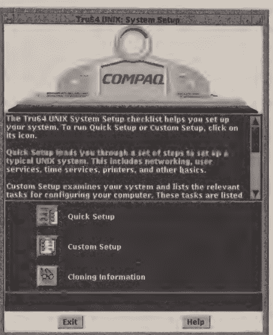

图 4.3

`/usr/sbin/setup` 程序。

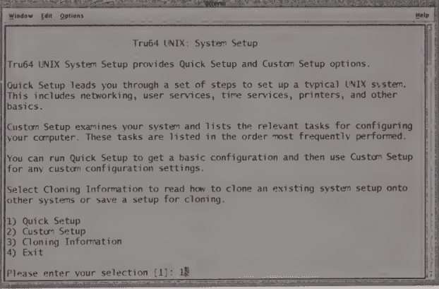

### 4.1.1 快速设置

快速设置是一个引导您逐步设置最常用组件的选项。快速设置选项配置以下组件：

- 第 1 步：注册基础操作系统许可证
- 第 2 步：设置系统的主要网络接口卡 (NIC)
- 第 3 步：设置静态路由器。
- 第 4 步：设置域名服务 (DNS/BIND)。
- 第 5 步：设置网络时间提供程序 (NTP)。
- 第 6 步：设置网络信息服务 (NIS)。
- 第 7 步：设置网络文件系统 (NFS)。
- 第 8 步：设置邮件服务器。
- 第 9 步：设置默认打印机和服务器。

如果你不想或不需要设置特定组件，可以跳过设置路径中的某些步骤。

在第一步中，您需要注册上一节中提到的许可证 PAK。快速设置程序将提示您输入纸质 PAK 上列的一些信息。第 2 到 8 步需要您了解所在站点的网络配置。如果你有网络管理员，现在是走走廊和他们谈谈的好机会。如果你的老板通知你将成为网络管理员，那么你可能想转到第 7 章“网络”，然后陷在舒适的椅子上，拿着 Tru64 UNIX 网络管理指南。如果你没有该指南的纸质版，可以从以下位置下载：

Web 位置：

```
http://www.tru64unix.com.com/docs/pub_page/doc_list.html
```

选择你安装的操作系统版本，然后选择“系统和网络管理文档书架”。

1. 伯二级互联网域名。
2. 从 V5.1 开始，网络管理指南被拆分为两个指南，标题为“网络管理：连接”和“网络管理：服务”。

第 9 步要求您拥有一些关于打印机配置的信息，因此请参考您的打印机文档，并转到第 8 章“打印”。

### 4.1.2 自定义设置

自定义设置选项在方法上更加灵活。你不会像快速设置选项那样被顺序引导通过一系列配置步骤，而是被允许按照你选择的顺序来配置组件。自定义设置选项会启动各种 SysMan 服务以协助您完成配置任务。表 4.1 列出的 SysMan 服务是通过自定义设置选项启动的：

表 4.1 SysMan 服务自定义设置及延伸阅读

| SysMan 服务 | 额外信息 | SysMan 服务 | 额外信息 |

| --- | --- | --- | --- |

| | 本书 | Compaq | 本书 |

| 许可证管理器 | 系统管理 4.6 节许可证管理 | 邮件配置 | N/A 网络管理员 |

| 磁盘配置 | 第 3 章 系统管理员 | LAT 配置 | N/A 网络管理员 |

| 网络设置向导 | 第 7 章 网络管理员 | UUCP 配置 | N/A 网络管理员 |

| DNS (BIND) 配置 | 第 7 章 网络管理员 | 打印机配置 | 第 8 章 系统管理员 |

| NIS 配置 | 第 7 章 网络管理员 | 安全配置 | 第 6 章 安全 |

| NFS 配置 | 第 7 章 网络管理员 | 安全配置 | 第 6 章 安全 |

| 文件共享 | 第 7 章 网络管理员 | 审计配置 | 第 6 章 安全 |

| NTP 配置 | 第 7 章 网络管理员 | 安全配置 | 第 6 章 系统管理员 |

| 磁盘配置 | 第 7 章 网络管理员 | 安全配置 | 第 6 章 安全 |

表 4.1 SysMan 服务自定义设置及延伸阅读（续）

| SysMan 服务 | 额外信息 | SysMan 服务 | 额外信息 |

| --- | --- | --- | --- |

| | | | |

| | | | |

### 4.1.3 克隆信息

此选项除了提供如何克隆系统的信息外不执行任何操作（参见图 4.4）。

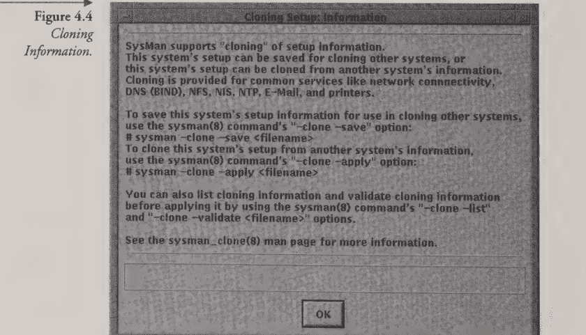

> 注意：SysMan 支持“克隆”设置。可以将系统设置保存到其他系统，也可以从其他系统克隆设置。提供的常用服务包括 DNS (BIND)、NIS、NTP、邮件和打印机。更多信息请参见 `sysman_clone(8)` 手册。

# 4.2 介绍 SysMan

在前所述，SysMan 是一套帮助您管理 Tru64 UNIX 系统的应用程序。目前有四种 SysMan 接口 (`/usr/sbin/sysman`)，见表 4.2。

另请参考 `sysman(8)` 和 `sysman_intro(8)` 帮助页以获取更多信息。

### 4.2.1 SysMan 组件

SysMan 目前有 12 个主组件，如表 4.3 所示：


这些组件中还有子组件。每个组件和子组件都有一个加速器——`sysman`命令的一个选项，可以直接带您进入感兴趣的浏览和/或修改的组件或子组件。

| 表 4.2 SysMan 接口 | | |
|---|---|---|
| SysMan 菜单 | `sysman -menu` | `sysman_menu(8)` |
| `sysman` | | |
| | | |
| SysMan 站点 | `sysman -station` | `sysman_station(8)` |
| | | `smsd(8)` |
| SysMan CLI | `sysman -cli` | `sysman_cli(8)` |
| SysMan 克隆 | `sysman -clone` | `sysman_clone(8)` |

| 表 4.3 SysMan 组件 | | |
|---|---|---|
| 账户 | 表 4.4 | 安全 | 表 4.10 |
| 硬件 | 表 4.5 | 软件 | 表 4.11 |
| 邮件 | 表 4.6 | 存储 | 表 4.12 |
| 监控与调优 | 表 4.7 | 支持与服务 | 表 4.13 |
| 网络 | 表 4.8 | TruCluster 特有 | 表 4.14 |
| 打印 | 表 4.9 | 通用任务 | 表 4.15 |

* 需要安装并配置 TruCluster Server 软件。

## 表 4.4 SysMan 组件—账户

| 账户—`sysman accounts` | 加速器 (Accelerator) |
| :--- | :--- |
| 管理本地用户 | `sysman users` |
| 管理本地组 | `sysman groups` |
| 管理 NIS 用户 | `sysman nis_users` |
| 管理 NIS 组 | `sysman nis_groups` |

## 表 4.5 SysMan 组件—硬件

| 硬件—`sysman hardware` | 加速器 (Accelerator) |
| :--- | :--- |
| 查看硬件层次结构 | `sysman hw_hierarchy` |
| 查看集群 | `sysman hw_clusterhierarchy` |
| 查看设备信息 | `sysman hw_devices` |
| 查看中央处理器 (CPU) 信息 | `sysman hw_cpus` |

## 表 4.6 SysMan 组件—邮件

| 邮件—`sysman mail` | 加速器 (Accelerator) |
| :--- | :--- |
| 配置邮件 | `sysman mailsetup` |
| 管理用户的邮件账户 | `sysman mailusradm` |

## 4.2 介绍 SysMan

## 表 4.7 SysMan 组件—监控与调优

| 监控与调优—`sysman monitoring` | 加速器 (Accelerator) |
| :--- | :--- |
| 查看事件 | `sysman event_viewer` |
| 设置洞察管理器 (Insight Manager) | `sysman imconfig` |
| 类作业调度 | `sysman class_sched` |
| 配置类调度器 | `sysman class_setup` |
| [重]启动类调度器 | `sysman class_start` |
| 停止类调度器 | `sysman class_stop` |
| 查看虚拟内存 (VM) 统计数据 | `sysman vmstat` |
| 查看输入/输出 (I/O) 统计数据 | `sysman ioast` |
| 查看运行时间统计 | `sysman uptime` |

## 表 4.8 SysMan 组件—网络

网络—`sysman network`

| 子组件 | 加速器 (Accelerator) |
| :--- | :--- |
| 网络设置向导 | `sysman net_wizard` |
| 基础网络服务 | `sysman networkbasic` |
| 设置异步传输模式 (ATM) | `sysman atm` |
| 设置网络接口卡 | `sysman interface` |
| 设置静态路由 (`/etc/routes`) | `sysman route` |
| 设置路由服务 (`gated`, `routed`, `IP Router`) | `sysman routing` |
| 设置 hosts 文件 (`/etc/hosts`) | `sysman host` |
| 设置 hosts 等性文件 (`/etc/hosts.equiv`) | `sysman hosteq` |
| 设置远程 who 服务 (`rwhod`) | `sysman rwhod` |
| 设置 networks 文件 (`/etc/networks`) | `sysman networks` |
| 额外网络服务 | `sysman networkadditional` |
| 域名命名服务 (DNS(BIND)) | `sysman dns` |
| 将系统配置为 DNS 服务器 | `sysman dns_server` |

## 表 4.8 (续)

| 网络— | 加速器 (Accelerator) |
| :--- | :--- |
| 将系统配置为 DNS 客户端 | `sysman dns_client` |
| 取消此系统上的 DNS 配置 | `sysman dns_deconfigure` |
| 串口网络 | `sysman serial_line` |
| 点对点协议 (PPP) | `sysman ppp` |
| 创建选项文件 | `sysman ppp_options` |
| 修改 pap-secrets 文件 | `sysman pap` |
| 修改 chap-secrets 文件 | `sysman chap` |
| 配置系统用于 UNIX-to-UNIX_copy (uucp) 连接 | `sysman uucp` |
| 网络时间协议 (NTP) | `sysman ntp` |
| 将系统配置为 NTP 客户端 | `sysman ntp_config` |
| 查看 NTP 守护进程状态 | `sysman ntp_status` |
| [重]启动 NTP 守护进程 | `sysman ntp_start` |
| 停止 NTP 守护进程 | `sysman ntp_stop` |
| 网络文件系统 (NFS) | `sysman nfs` |
| 查看 NFS 配置状态 | `sysman nfs_config_status` |
| 将系统配置为 NFS 客户端 | `sysman nfs_client` |
| 取消系统的 NFS 服务器配置 | `sysman nfs_deconfig_client` |
| 将系统配置为 NFS 服务器 | `sysman nfs_server` |
| 取消 NFS 服务器配置 | `sysman nfs_deconfig_server` |
| 查看 NFS 守护进程状态 | `sysman nfs_daemon_status` |
| [重]启动 NFS 守护进程 | `sysman nfs_start` |
| 停止 NFS 守护进程 | `sysman nfs_stop` |
| 配置网络信息服务 (NIS) | `sysman nis` |
| 配置局域传输 (LAT) | `sysman lat` |
| 将系统配置为 DHCP 服务器 (`joind`) | `sysman joind` |
| 查看网络守护进程状态 | `sysman dmnstatus` |
| [重]启动网络服务 | `sysman inet_start` |
| 停止网络服务 | `sysman inet_stop` |

## 表 4.9 SysMan 组件—打印

| 打印—`sysman printers` | 加速器 (Accelerator) |
| :--- | :--- |
| 配置行打印机 | `sysman lprsetup` |

## 表 4.10 SysMan 组件—安全

| 安全—`sysman security` | 加速器 (Accelerator) |
| :--- | :--- |
| 配置特权划分 (DOP) | `sysman dopconfig` |
| 管理 DOP 操作 | `sysman dopaction` |
| 安全配置 | `sysman secconfig` |
| 审计配置 | `sysman auditconfig` |

## 表 4.11 SysMan 组件—软件

| 软件—`sysman software` | 加速器 (Accelerator) |
| :--- | :--- |
| 安装 | `sysman install` |
| 安装软件 | `sysman setldload` |
| 列出已安装软件 | `sysman setldlist` |
| 移除已安装软件 | `sysman setlddd` |
| 更新系统后清理 | `sysman upadmin` |
| 注册数据 | `sysman lmfsetup` |

## 表 4.12 SysMan 组件—存储

存储—`sysman storage` | 加速器 (Accelerator) |

| :--- | :--- |
| 管理 DRD 存储 | `sysman drdmgr` |
| 文件系统 | `sysman filesystems` |
| 通用文件系统 | `sysman generalfs` |
| 卸载 | `sysman dismount` |
| 显示已挂载 | `sysman df` |
| 集群文件系统 (CFS) | `sysman cfsmgr` |
| 共享 (`/etc/exports`) | `sysman export` |
| 网络挂载 | `sysman netmount` |
| 高级文件系统 (AdvFS) | `sysman advfs` |
| 管理 AdvFS 域 | `sysman domain_manager` |
| 碎片整理 AdvFS | `sysman defrag` |
| 创建 AdvFS 域 | `sysman mkf` |
| AdvFS 文件集 | `sysman mset` |
| 恢复 AdvFS | `sysman salvage` |
| 验证 AdvFS | `sysman verify` |
| UNIX 文件系统 (UFS) | `sysman ufs` |
| 创建新 UFS | `sysman newfs` |
| 逻辑存储管理器 (LSM) | `sysman lsm` |
| 初始化逻辑存储管理器 (LSM) | `sysman volsetup` |
| 逻辑存储管理器 (LSM) 管理员 | `sysman lmmgr` |
| 创建可启动表 | `sysman boot_tape` * 需要安装 TruCluster

## 表 4.13 SysMan 组件—支持与服务

| 升级—escalation | 加速器 (Accelerator) |
| :--- | :--- |
| 创建升级报告 | `sysman escalation` |
| 配置报告 | `sysman config_report` |

## 表 4.14 SysMan 组件—TruCluster 特定

| 子组件 | 加速器 (Accelerator) |
| :--- | :--- |
| 集群应用可用性 (CAA) 管理 | `sysman caa` |
| 集群文件系统 (CFS) | `sysman cfsmgr` |
| 管理 DRD 存储 | `sysman drdmgr` |
| 集群别名 | `sysman cl_aliases` * 需要安装 TruCluster

## 表 4.15 SysMan 组件—通用任务

| 子组件 | 加速器 (Accelerator) |
| :--- | :--- |
| 关闭系统 | `sysman shutdown` |
| 快速设置 | `sysman quicksetup` |
| 配置服务器软件 | `sysman presto` |
| 配置显示器 | `sysman xsetup` |
| 聚隆信息 | `sysman cloneinfo` |
| 命令行界面 | `sysman syscli` |

### 4.2.2 SysMan Menu

SysMan Menu 是主要的 SysMan 界面。SysMan 有两种界面：GUI（图 4.5）和 CLI（图 4.6）。

GUI 是 OSF/Motif 风格的图形界面（实际上是 Td/Tk），而 CLI 是光标界面。

- 3. 命令行界面。

- 4. Td 是一种由 John N. Ousterhout 编写的通用脚本语言。Td 是基于 Td 的 Windows 工具包。更多信息请访问 Td 开发者网站：`http://dev.scripts.com/`。

### 4.2 介绍 SysMan

启动界面取决于你是否定义了 `DISPLAY` 环境变量。

### 4.2.3 SysMan Station

SysMan Station（图 4.9）是一个监控和管理界面。可以通过命令行输入 `/usr/sbin/sysman-station` 或 `/usr/sbin/sms` 启动，也可以从 CDE 前面板点击 SysMan 图标启动（图 4.7）。

SysMan Station 提供了一个监控设施，你可以在其中查看文件系统、存储设备和网络状态。在 TruCluster 服务器环境中，SysMan Station 还会监控集群以及任何注册 CAA 的应用程序资源。图 4.8 显示了 SysMan Station 可能的状态图标。

你也可以从 SysMan Station 启动 SysMan Menu 或 SysMan Services。不过，SysMan Station 最酷的功能之一是以图形方式显示系统的物理层次结构（图 4.10）。

### 4.2.4 SysMan CLI

如果你是那种喜欢尽可能自动化任务的系统管理员，那么 SysMan CLI 是你可能需要的。

| 图 4.8 SysMan 状态指示器。 | | |
| :--- | :--- | :--- |
| | 绿色 | 表示正常。 |
| | 黄色 | 表示存在潜在问题，发生了一个事件。 |
| | 红色 | 表示发生了严重问题。 |

## 4.2 介绍 SysMan

图 4.9 SysMan 工作站。

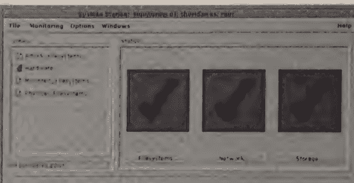

图 4.10 SysMan 工作站——硬件层次结构。

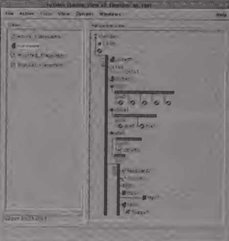

花点时间一下。SysMan CLI 是 SysMan 的命令行界面，特别适用于通过脚本修改您的配置。

你可以获取或设置几乎每个组件的值。要查看可用组件，输入：

```bash
# sysman -cli -list components
Component(s):
Imconfig
account_management
atm
auditconfig
bindconfig
-
mailusradm
networkAdapters
networkServices
networkedSystems
networks
-
shutdown
storage
syscheckck
```

一旦你确定了组件，可以通过输入以下命令来查找与组件关联的属性：

```bash
# sysman -cli -list attributes -comp networkAdapters
Component: networkAdapters
Group: interfaces
Attribute(s):
action
alternateNetAddr
debug
devName
hasDynamicNetAddr
hasRefCount
hopCountMetric
ifaceName
maxTransUnit
networkAddress
netMask
operational
receiveAll
receiveMulticast
speed
systemName
type
useArp
change_hostnameif
Group: componentid
Attribute(s):
manufacturer
product
version
serialnumber
installation
verify
```

```
Group: digitalmanagementmodes
Attribute(s):
ndeferredcommit
cdfgroups
```

现在，让我们列出我们网络适配器某些属性的值。

```bash
# sysman -cli -list value -comp networkAdapters \
> -group interfaces \
> -attr devName,type,networkAddress,netMask
Component: networkAdapters
Group: interfaces
tu0 ETHERNET 192.168.0.69 255.255.255.0
tul 10.0.0.69 255.255.255.0
```

你可以通过指定键来获取更细粒度的信息。要确定 `networkAdapters` 组中哪些键，输入：

```bash
# sysman -cli -list keys -comp networkAdapters
Component: networkAdapters
Group: interfaces Key: devName
Group: componentid Key: <NONE>
Group: digitalmanagementmodes Key: <NONE>
```

`interfaces` 组似乎有一个有效的键，即设备名称。因此，我们可以选择只列出特定网络适配器的属性。


```bash
# sysman -cli -list value -comp networkAdapters \
> -group interfaces -key1 tu0
Component: networkAdapters
Group: interfaces
Key: 'tu0'
Attribute: action Value: none
Attribute: alternateNetAddr Value: false
Attribute: debug Value: false
Attribute: devName Value: tu0
Attribute: hasDynamicNetAddr Value: false
Attribute: hasRCInfo Value: true
Attribute: hopCountMetric Value: 0
Attribute: ifaceNum Value: 0
Attribute: maxTransUnit Value: 1500
Attribute: networkAddress Value: 192.168.0.69
Attribute: netMask Value: 255.255.255.0
```

## 4.3 运行时配置

```
Attribute: operational Value: false
Attribute: receiveAll Value: false
Attribute: receiveMulticast Value: false
Attribute: speed         Value: not_applicable
Attribute: systemName   Value: sheridan
Attribute: type            Value: ETHERNET
Attribute: useApp           Value: true
Attribute: change_hostnameifprim Value: no
```

虽然这对于普通浏览来说可能看起来很繁琐，但如果你想通过脚本控制组件的行为，这是一个非常强大的功能。我们只展示了如何从 SysMan CLI 界面列出信息，但在第 6 章“安全”中，我们将向你展示如何使用 SysMan CLI 创建 DOP 权限组、若干 DOP 操作以及一组设置值。

### 4.2.5 SysMan 克隆

Tru64 UNIX 提供了一种克隆系统配置的方法。如果你尝试设置许多具有相同配置的系统，这将特别有用。我们在第 2 章“安装”中简要讨论过克隆。你可能还想查看《Tru64 UNIX 安装指南》——“高级主题”或 `sysman_clone(8)` 参考页以获取有关配置的更多信息。

当 Tru64 UNIX 系统从控制台（SRM）启动到登录屏幕时，发生了许多操作以准备系统使用。虽然我们不会向你提供启动过程的所有细节，但我们将告诉你，一旦内核加载，它就会启动一个名为 `init(8)` 的重要守护进程。

### 4.3.1 init(8) 守护进程

`init` 进程负责系统的运行时配置。Tru64 UNIX 默认有四个运行级别（也可以配置更多），`init` 进程的任务是配置系统在这些运行级别运行。

#### 表 4.1 Tru64 UNIX 运行级别

| 运行级别 (Run Level) | 脚本 | 描述 |

| :--- | :--- | :--- |

| 0 | `/sbin/rc0` | 关闭并停止系统。 |

| s | `/sbin/rc0 off` | 单用户模式。 |

| 2 | `/sbin/rc2` | 多用户模式 |

| 3 | `/sbin/rc3` | 带网络的多用户模式 |

当 `init` 进程启动时，它会读取 `/etc/initab` 文件。`/etc/initab` 文件告诉 `init` 进程运行什么。文件中的每一行都用冒号分隔，格式如下：`标识符:运行级别:动作:命令`。

这是一个典型的 `/etc/initab` 示例：

```
is:3:initdefault
ss:S:wait:/sbin/rc0 /console 2>&1
s0:0:wait:/sbin/rc0 off /console 2>&1
mr:S:sysinit:/sbin/lstartup -b /console 2>&1
lsm:S:wait:/sbin/lstartup /console 2>&1
vol:S:wait:/sbin/vol -n /console 2>&1
fs:S:wait:/sbin/fsck /console 2>&1
kl:S:wait:/sbin/kloads /console 2>&1
as:S:wait:/sbin/init.autoconfig /console 2>&1
hyd:S:wait:/sbin/update /console 2>&1
msync:S:wait:/sbin/sysconfig -vssync-age=30 /null 2>&1
msync:S:wait:/sbin/sysconfig -rfsync-age=0 /null 2>&1
it:S:wait:/it /console 2>&1
mk:S:wait:/kkmod /console 2>&1
s2:S:wait:/sbin/rc2 /console 2>&1
s3:S:wait:/sbin/rc3 /console 2>&1
cms:S:respawn:/sbin/getty console100
cms:S:sysinit:/sbin/sysconfig -o cms 100 /null 2>&1
```

#### 表 4.17 initab 文件中的运行级别

| 标识符 (Identifier*) | 运行级别 (Runlevel) | 动作 (Action) | 命令 (Command) |

| :--- | :--- | :--- | :--- |

| ss | S | wait | `/sbin/rc0 /console 2>&1` |

| s0 | 0 | wait | `/sbin/rc0 /console 2>&1` |

| s2 | 2 | wait | `/sbin/rc2 /console 2>&1` |

| s3 | 3 | wait | `/sbin/rc3 /console 2>&1` |

* 十四字符字段用于唯一标识条目。这是可选的。

† 有效动作有：respawn, wait, once, boot, bootfail, powerwait, off, initdefault 和 sysinit。更多信息请参见 `initab(4)`。

`/etc/initab` 中的行告知 `init` 执行启动你配置的所有服务。以下是系统启动到没有网络服务的多用户模式（运行级别 2）时发生的情况：

- 内核（通常是 `/vmix`）启动 `init` 守护进程。

- `init` 进程读取 `/etc/initab`。

- `init` 进程运行许多程序，包括 `/sbin/rc2` 脚本。

- `rc2` 脚本执行 `/sbin/rc2.d` 中以“S”开头的脚本。

如果你查看 `rc.d` 目录，你会看到以“K”或“S”开头的文件。如果你再仔细一点，你会发现这些指向 `/sbin/init.d` 中脚本的符号链接。例如：

```
# file /sbin/rc2.d/S12evm
/sbin/rc2.d/S12evm: symbolic link to /init.d/evm
```

进一步探索，你会发现这些混乱的 rc 链接似乎是有方法的：链接以“K”或“S”开头，后面跟着一个数字，然后是名称。

#### /sbin/rc.d

| | | | | |

| :--- | :--- | :--- | :--- | :--- |

| K00lpd | K16timed | K48route | K56nd | S19security |

| K03lat | K20cron | K49gateway | K57quota | S20sia |

| K04dhcp | K30sendmail | K50syslog | K89denesta | S25login |

| K05inet | K35nfs | K51uucp | S50oversecure | S35streams |

| K08collect | K36presto | K52write | S05paging | S45atm |

| K09snmp | K40nfsmount | K53binlog | S06mfsunlog | S10recpasswd |

| K12envmon | K43nis | K54.50ip6host | S12evm |

| K12insight | K45named | K55inet | |

| K15xntpd | K47row | | S15uucp |

### 4.3.2 rc.config, rc.common 和 rcmgr 概览

如果我们继续挖掘这个配置之谜，你注意到的下一个现象是，`/sbin/init.d` 目录中的近 70 个脚本中，有 40 个脚本引用了 `rcmgr(8)` 命令、`rc.config(8)` 文件或两者。

## 4.4 内核配置

位于 `/etc` 的 `rc.config` 文件包含了运行时配置变量，`init` 脚本使用这些变量来正确配置系统或应用程序。要获取、设置或删除运行时配置变量，请始终使用 `rcmgr` 命令。作为系统管理员，没有什么可以阻止你使用你喜欢的编辑器编辑此文件。然而，不建议建议这样做，因为可能会出现错误或由于多次访问导致这个至关重要的文件损坏。一个简单的错误就可能导致你的系统不稳定。`rcmgr(8)` 参考页指出：

> 注意

> 你应该始终使用 `rcmgr` 对文件进行更改。这将保持文件中正确的语法。锁文件 `/etc/rcmgr.lock` 可防止对数据文件的多次访问。

在 Tru64 UNIX 5.0 版本中，为了准备集群化，`rc.config` 文件被拆分为两个文件：`rc.config` 和 `rc.common`。在独立环境中，这种区别并不大，但在集群中，`rc.config` 包含成员特定的运行时配置变量，而 `rc.config-common` 则包含所有集群通用的运行时配置变量。

`rc.config` 脚本在执行其他操作之前会执行 `rc.config.common` 脚本，因此在 `rc.config` 中设置的任何变量将被 `rc.config` 文件中设置的相同变量覆盖。还有一个可选第三文件 `rc.config.site`，如果它存在，`rc.config.common` 文件会在执行任何其他操作之前执行它，这样在 `rc.config.site` 中设置的任何变量将被 `rc.config.common` 文件中设置的相同变量覆盖。

更多信息请参阅 Tru64 UNIX 系统管理或 `rcmgr(8)` 参考页。

有时你可能会发现自己需要重新配置内核，以添加或移除对某些硬件或软件的支持。你安装的设备驱动程序或子系统的设计将决定内核必须静态重新配置（重新编译内核）还是可以动态配置。表 4.18 显示了用于内核配置的工具。

### 表 4.18 内核配置工具

| 类型 | 工具 | 描述 |

| :--- | :--- | :--- |

| 静态 | `doconfig(8)` | 根据位于 `/usr/sys/conf` 目录下的系统配置文件构建新内核。 |

| | `size(8)` | 显示有关系统或内核的信息。创建一个系统配置文件。 |

| 动态 | `autosysconfig(8)` | 维护自动配置的动态内核子系统列表。 |

| | `dxkerneltuner(8)` | 修改或显示内核子系统属性。可以修改内存配置数据库或 `sysconfigtab(4)` 配置数据库。 |

| | `sysconfig(8)` | 维护内核子系统配置。修改内存配置数据库。 |

| | `sysconfigdb(8)` | 管理 `sysconfigtab(4)` 子系统配置数据库。 |

### 4.4.1 静态内核配置

当安装新的内核子系统时，可能需要修改内核配置文件并构建新内核。配置文件位于 `/usr/sys/conf`，其名称为你的未限定主机名的大写形式。配置文件是 ASCII 格式的，因此可以使用你喜欢的文本编辑器进行修改。一旦编辑了配置文件，请使用 `doconfig` 命令构建内核。内核构建完成后，备份旧内核以防万一新内核无法启动，将新内核复制到根目录 `/`，并可选地删除构建目录中的内核。

#### 4.4.1.1 内核构建示例

- 构建内核。

```
# doconfig -c SHERIDAN

*** KERNEL CONFIGURATION AND BUILD PROCEDURE ***

Saving /sys/conf/SHERIDAN as /sys/conf/SHERIDAN.bck
Do you want to edit the configuration file? (y/n) [n]: n

*** PERFORMING KERNEL BUILD ***
Working....Thu Jun 7 00:21:53 EDT 2001
The new kernel is /sys/SHERIDAN/vunix
```

2. 备份旧内核。

```
# cp /vmunix /vmunix.save
```

3. 将新内核复制到根目录。

```
# cp /sys/SHERIDAN/vmunix /vmunix
```

4. 删除构建目录中的内核。

```
# cd /sys/SHERIDAN; rm -i vmunix vmunix.sys vmunix.SHERIDAN
rm: remove vmunix? y
rm: remove vmunix.sys? y
rm: remove vmunix.SHERIDAN? y
```

5. 重启系统。

```
# shutdown -sr +15 "System shutdown to install a new kernel"
```

重要提示：不要使用 `mv(1)` 命令将新内核移动到根目录 `/`；请使用 `cp(1)` 命令。

在 Tru64 UNIX 5.0 版本中，引入了上下文相关符号链接 (CDSL)。CDSL 是一个在链接中插入了“mem}”变量的符号链接。

# file /etc/rc.config

`/etc/rc.config: symbolic link to ../cluster/members/{mem}/etc/rc.config`

当系统解析链接到其所指向的文件时，虚拟文件系统 (VFS) 会替换此变量。此 `{mem}` 将解析为系统的 memberid（一种通用内核子系统属性）。

#### 4.4.1.2 新硬件构建示例

在某些情况下，当你安装新硬件时，可以使用通用内核 `/genmunix` 并运行 `sizer(8)` 命令创建一个内核配置文件。Tru64 UNIX 系统随着每个版本的发布变得越来越智能，你很少需要使用此过程。但为了防万一，我们记录了它。此过程在你添加以前未安装的类型时需要。例如，你决定为将系统加入集群做准备，因此购买了一块内存卡。

1. 使用通用内核进入单用户模式。

```
>>> boot -fl -fi genmunix
```

2. 挂载本地文件系统。

```
# bcheck
```

3. 运行 sizer 命令构建内核配置文件。

```
# sizer -n SHERIDAN-MCHAN
```

4. Determine当前内核配置文件与新内核配置文件之间的差异。

```
# diff /tmp/SHERIDAN-MCHAN /sys/conf/SHERIDAN
1cl
< ident      "SHERIDAN-MCHAN"
--
> ident      "SHERIDAN"
--
config_driver mchan
```

5. 修改当前的内核配置文件。

将 `"config_driver mchan"` 行添加到 `/sys/conf/SHERIDAN` 中。

6. 构建内核。

参见节 4.4.1.1，“内核构建示例”。

例如，我们将加载并配置 CD-ROM 文件系统 `sys-cdfs`，它在默认情况下是卸载的。

```
# sysconfig -s cdfs
cdfs: unloaded
```

```
# sysconfig -c cdfs
cdfs: loaded and configured
```

要卸载该子系统，可以使用以下命令。

```
# sysconfig -u cdfs
```

```
# sysconfig -s cdfs
cdfs: unloaded
```

此时，你可能会问自己：“我如何确定哪些子系统是静态的，哪些动态的？”你可以使用 `sysconfig` 命令的 `"-m"` 选项。

```
# sysconfig -m
cm: static
hs: static
ksm: static
psm: static
generic: static
io: static
ipc: static
proc: static
-
envmon: dynamic
```

## 4.4.2.3 使用 sysconfig(8) 重新配置子系统属性

如上一节所示，`sysconfig` 程序可用于配置、取消配置和查询子系统；然而，这并不是 `sysconfig` 命令功能的全部。

> 注意：在我们深入配置配置属性之前，你可能好奇从何处获取更多关于每个子系统中包含哪些属性及其作用的信息。要获取更多关于特定子系统属性的信息，请阅读该子系统的参考页。

## 4.4 内核配置

子系统。所有子系统参考页的名称都以 `"sys_attrs_"` 开头并子系统名称结尾。因此，`proc` 子系统的参考页名称为 `sys_attrs_proc`。当然，你也可以通过输入 `"man -k sys_attrs_"` 来列出所有子系统参考页。

表 4.19 显示了常用的 `sysconfig` 命令选项。所有选项列表请参阅 `sysconfig(8)` 参考页。


如表 4.19 所示，带有 `"-r"` 选项的 `sysconfig` 命令可以配置子系统属性，但你如何确定哪些子系统可以重新配置呢？你可以像图 4.11 所示，使用 `"-Q"` 选项查询子系统的属性信息。`op` 字段为 `"R"` 的属性可以在系统运行时重新配置。

如果属性的 `op` 字段为 `"C"`，则它只能在系统启动时进行配置。为了让系统在启动时配置某个属性，该属性必须存在于 `sysconfigtab` 文件中。

### 4.4.2.4 在启动时配置子系统属性

`sysconfigdb` 用于维护 `sysconfigtab` 文件。`sysconfigtab` 文件位于 `/etc` 目录，是内核子系统配置文件。它是一个采用 `stanza(4)` 文件格式的 ASCII 文件。

| 表 4.19 常用 sysconfig(8) 命令选项 | | | |
| :--- | :--- | :--- | :--- |
| 查询 | 属性配置信息 | `-Q` | `sysconfig -Q subsystem [attribute...]` |
| 属性值（当前） | | `-q` | `sysconfig -q subsystem [attribute...]` |
| 属性值（保存） | | `-d` | `sysconfig -d subsystem [attribute...]` |
| 子系统模式 | | `-m` | `sysconfig -m subsystem[subsystem...]` |
| 子系统状态 | | `-s` | `sysconfig -s subsystem[subsystem...]` |
| 修改 | 重新配置属性值 | `-r` | `sysconfig -r subsystem attribute=value` |
| 配置 | 加载并配置动态子系统 | `-c` | `sysconfig -c subsystem` |
| 取消配置 | 取消配置并卸载动态系统 | `-u` | `sysconfig -u subsystem` |

### 4.4 内核配置

图 4.11 子系统属性信息

# 你的属性真的是动态的吗？

`sysconfig -Q subsystem [attribute list]`

```
# sysconfig -Q proc maxusers
proc:
maxusers - type=INT op=CRQ min_val=8 max_val=16384
```

```
C = 可配置（启动时）
R = 可重新配置（运行时）
Q = 仅查询
```

由内核在启动过程的极早期阶段读取该文件，并使用其中的配置内核子系统和设备程序的信息。如果你在修改 `sysconfigtab` 文件时出错，可能会导致系统无法启动。由于此原因（以及在未来的 Tru64 UNIX 版本中 `sysconfigtab` 可能不再保持为 ASCII 文件），你应该始终使用 `sysconfigdb`（或 `dxkernelttuner`——见第 4.4.2.5 节）命令来修改子系统参数。

更多信息请参阅 `sysconfigdb(8)`、`sysconfigtab(4)` 和 `stanza(4)` 参考页。

### 表 4.20 sysconfigdb(8) 命令选项

| | | |
| :--- | :--- | :--- |
| 添加子系统项。 | `-a` | `sysconfigdb -a-f stanzafile subsystem` |
| 更新子系统项。 | `-u` | `sysconfigdb -u-f stanzafile subsystem` |
| 合并子系统属性。 | `-m` | `sysconfigdb -m-f stanzafile [system]` |
| 删除 stanzafile 中列出的子系统项。 | `-r` | `sysconfigdb -r-f stanzafile [system]` |
| 删除子系统项。 | `-d` | `sysconfigdb -d subsystem` |
| 同步内存配置数据库使其与 sysconfigtab 文件一致。 | `-s` | `sysconfigdb -s` |
| 列出子系统项。 | `-l` | `sysconfigdb -l [subsystem...]` |

### 4.4.2.4.1 使用 sysconfigdb(8) 修改子系统属性

让我们通过一个示例来说明如何使用 `sysconfigdb`（或修改）属性到 `sysconfig` 文件。在本例中，我们将为系统添加一个备用设备。

当你考虑备份你的 `sysconfig` 时，检查属性是否在 `sysconfig` 中也是个好主意。为了向 `sysconfig` 添加属性，你需要创建一个 `stanza` 文件。`stanza` 的语法如下：

`"entry:

Attribute_name = Attribute1_value

Attribute2_name = Attribute2_value

Attribute3_name = Attribute3_value"`

> **重要**：验证计划用于交换的设备或分区没有你想保留的数据。你可以使用 `disklabel(8)` 命令检查磁盘标签。

# 3. 更新 sysconfig 文件。

```bash
# sysconfigdb -m-f stanza.stanza
```

警告：`vm: swapdevice = /dev0b`，现在 `swapdevice =`

# 4. 验证更改已发生。

```bash
# sysconfigdb -l
```

`vm:` 

`swapdevice = /dev0b`

`vm-eager = 1`

# 5. 完成

通常，下一步是重启以使新属性值生效，但在情况下，你可以使用 `swapon(8)` 命令动态添加交换分区。

### 4.4.2.5 dxeltuner(8) 工具

`dxeltuner` 程序是一个用于修改系统属性的 CDE GUI。该工具结合了来自 `sysconfig` 和 `sysconfigdb` 的多个功能。

更多信息请参阅 `dxeltuner(8)` 参考页，或者最好是点击帮助按钮或下拉菜单（图 4.13）。

### 4.4.2.6 如果出现问题...

如果你对 `sysconfig` 文件中的某个属性做了更改，并在重启后发现系统（或你自己）陷入了混乱状态（系统无法启动），你可能无意中犯了错误。如果你可以进入单用户模式（`boot -fl s`）并将一切恢复原状，那就太好了！但如果不能，你可能需要在不使用 `sysconfig` 文件的情况下启动系统。要在不使用 `sysconfig` 文件的情况下启动系统，在 `>>>` 提示符处输入以下命令。

```
>>> boot -fl sc
```

系统启动后。用备份替换 `sysconfig` 文件或移除你做的属性修改，然后重启。

## 4.5 软件子集管理

运行 Tru64 UNIX 的系统实际上由一系列软件组件组成，每个组件提供不同类型的功能。这些软件组件被称为软件子集（Software Subsets），被打包以提供各种用例安装

安装、删除、清单和验证。软件子集由数据和脚本文件组成，基本上是单个软件产品或服务的安装包。由 Compaq 生产的所有 Tru64 UNIX 软件（包括基础操作系统产品和可选的分层产品）都以这种软件子集格式打包。此外，第三方软件供应商也以这种子集格式交付其软件产品。最后，所有常规 Tru64 UNIX 操作系统补丁包也以这种格式提供。对软件子集功能的广泛认可意味着 Tru64 UNIX 系统管理员必须熟悉在 Tru64 UNIX 中管理软件子集的过程。软件子集功能的关键是 `setld(8)` 命令。

### 4.5.1 setld(8) 工具

Tru64 UNIX 提供了 `setld` 命令用于管理 Tru64 UNIX 系统上的软件子集。`setld` 命令的常见读法是 "set-ell-dee"，尽管我们也听过使用 "set-load" 这个说法。系统管理员使用此工具：

- 显示已安装的软件子集。
- 加载软件子集。
- 删除已安装的软件子集。
- 验证已安装的软件子集。
- 配置已安装的软件子集。
- 提取软件子集。

这些功能每一个都是通过运行带有必要参数的 `setld` 命令执行的。不带任何参数调用 `setld` 会显示用法帮助信息，展示每个函数的语法。每个 `setld` 函数都要求（或可选地接受）一个或多个软件子集名称作为参数。显示子集名称时，名称中的所有字母均大写，`setld` 命令不区分大小写，将接受全小写、全大写或混合大小写的子集名称。但 `setld` 的所有显示功能都需要 root 权限才能执行。

### 4.5.2 子集清单

`setld` 命令最可能的用途是显示 Tru64 UNIX 系统上加载的所有软件子集的清单。要执行此功能，只需执行以下命令：

## 软件子集管理

```
# setld -i
```

| 子集 | 状态 | 描述 |
| :--- | :--- | :--- |
| CXLLIBA50 | installed | DEC C++ Class Archive Libraries |
| CXXLHRDA50 | installed | DEC C++ Class Shared Libraries |
| CXBBASE620 | installed | Compaq C+ Version 6.2 for Tru64 UNIX Systems |
| CXXHTML620 | installed | Compaq C+ HTML documentation |
| CXXOLD620 | installed | Compaq C+ V.5 (-oldcxx) compiler |

典型的 Tru64 UNIX 安装安装了许多软件子集，此清单输出可能达数百行。请注意，`setld` 命令为每个软件子集显示三项信息：子集名称、状态和描述。子集名称长度为七或更多字符，通常是大写字母和数字的组合，通常是子集名称的缩写，并包含某些版本信息。状态字段显示子集的当前状态。状态将始终是四个可能值之一：

- 1. installed

`"installed"` 状态表示该子集已正确加载并安装。

- 2. incomplete

`"incomplete"` 状态表示在加载该子集时，子集包是不正确或不完整的。

- 3. corrupt

`"corrupt"` 子集可能意味着该子集的安装失败了。

- 4. not installed

`"not installed"` 状态表示该子集要么过去安装过但已被删除，子集安装已取消，或者仅仅是子集控制文件位于 `/usr/.smdb` 目录。

描述字段通常是产品发行的《软件产品描述》(SPD) 中定义的软件产品名称。

除了显示整个子集清单外，`setld` 命令还可以显示特定软件子集中的所有文件列表。在子集清单标志 `-i` 之后指定一个或多个软件子集：

```
# setld -i OSFBASE510
./new..cshrc
./new..login
./new..profile
./new..DXsession
./bin
./dev
./dev/SYSV_PTY
./etc
./etc/.new..TIMEZONE
./etc/.new..autopopush
```

单个软件子集可能包含从几个组件文件到数百个文件不等。请注意，清单列表中的文件显示到根路径，默认路径为 `/`。无论子集状态如何，都可以显示软件子集的清单，只要该子集列在主清单中。

### 4.5.3 子集安装

`setld` 命令最重要的角色是软件子集安装程序。每个以软件子集形式打包的 Tru64 UNIX 和第三方软件产品都是通过 `setld` 工具安装的。安装软件子集的过程远不仅仅是将软件拷贝到系统中。`setld` 工具在软件加载操作期间执行以下操作：

- 验证依赖关系和前提条件
- 执行安装前程序（如果有）
- 将子集组件复制到位置
- 在系统软件子集清单中注册产品
- 执行安装后程序（如果有）

此外，`setld` 工具可以从三个可能的来源加载软件子集：磁盘发行版（CD-ROM 或文件系统目录中的简单包）、直接从磁带或软盘，或来自跨网络的远程安装服务器 (RIS)。

最常见的软件子集发行媒介可能是 CD-ROM。大多数 Compaq 软件，特别是 Tru64 UNIX 操作系统和分层产品，都是随 CD-ROM 发货。

虽然 `setld` 菜单界面提供了交互式安装软件子集的界面，但有时需要以非交互方式快速加载单个软件子集。这种操作的示例如下

可以从磁盘发行版中加载单个子集，而无需滚动浏览一个可能包含数百个不必要子集的菜单。要加载一个或多个单独子集，只需在命令行上指定子集名称即可。对于多个子集，请用空格分隔子集名称。下面的示例演示了如何使用安装介质中的磁带采用此方法：

```
# setld -l /dev/tape/tape0_d0 CXXBASE620 CXXHTML620 CXXOLD620
```

这种非交互式的 `setld` 加载不会提示确认，并会立即开始安装。

### 4.5.4 删除子集

软件安装的反面是删除子集，`setld` 命令可以快速地从 Tru64 UNIX 系统中删除单个子集。为了删除子集，该子集必须已经安装，且用户必须知道该子集的名称。使用 `setld` 的清单标志 (`-i`) 来确定特定子集的名称。一旦运行 `setld` 命令即可删除该子集：

```
# setld -d OSLEARN425
正在删除 "计算机辅助系统导师" (OSLEARN510)。
```

请注意，系统不会请求确认，且子集将立即从系统中删除。如果不小心删除了某个子集，只需从发行介质重新安装即可。

### 4.5.5 setld(8) 活动日志

`setld` 实用程序方便地将所有操作（安装、删除、清单等）连同时间/日期戳记录在日志文件中，供日后参考。该日志文件 (`setld.log`) 位于 `/var/adm/smlogs` 目录下。有关过去的 `setld` 事务的信息，请参考此日志文件。

### 4.5.6 verify(8) 命令

`verify(8)` 命令对于检查系统上安装的文件状态非常有用。它会检查文件大小、校验和、用户 ID、组 ID、权限和文件类型是否存在不一致之处。它还会检查缺失的文件。

`verify` 命令会将所有错误和信息消息附加到 `/var/adm/smlogs/verify.log` 文件中。

`setclr` 程序在安装子集时使用 `verify` 程序以保证正确性。如果文件损坏、被删除，或者你怀疑有人篡改了该文件，可以使用 `verify` 命令。

注意：如果系统上安装了补丁包，`verify` 命令将报告错误。你可以联系 Compaq 客户支持中心 (CSC) 获取 `allverify2` 的副本，这是一个“补丁友好”的验证脚本，它使用了 `verify` 程序。`allverify` 脚本是一个不支持的工具，经常由 CSC 专家使用。

### 4.5.7 从子集恢复文件

如果文件或程序不小心从系统中删除，且没有现成的备份，可以从安装 CD 复制文件或从安装 CD 上的子集中提取文件。

例如，`awk` 和 `convauth` 程序不小心从系统中移除。以下是替换这些文件的步骤：

- 1. 找到子集。

```
# grep -E "/awk/convauth" /usr/.smdb.*.inv
```

| 行输出 | 详情 |
|---|---|
| `/usr/.smdb./OSBASE510.inv:0 16496 35436 3 100755 8/24/005` | |
| `10 f /usr/bin/awk none OSBASE510` | |
| `/usr/.smdb./OSBASE510.inv:0 16496 00000 3 4 100755 8/24/005` | |
| `10 1 /usr/bin/nawk /usr/bin/awk OSBASE510` | |
| `/usr/.smdb./OSFC2SEC510.inv:0 26 00000 0 0 120777 8/25/005` | |
| `510 s /usr/tcb/bin/convauth /usr/tcb/bin/convauth OSFC2SEC` | |
| `/usr/.smdb./OSFC2SEC510.inv:0 1983 34555 3 4 100664 8/24/005` | |
| `10 f /usr/lib/nls/msg/en_US.ISO8859-1/convauth.cat none 8/24/005` | |
| `/usr/.smdb./OSFC2SEC510.inv:0 26 00000 0 0 120777 8/25/005` | |
| `510 s /usr/sbin/convauth /usr/tcb/bin/convauth OSFC2SEC` | |
| `/usr/.smdb./OSFC2SEC510.inv:0 32944 50838 6 11 101110 8/24/005` | |
| `10 f /usr/tcb/bin/convauth none OSFC2SEC510` | |

`awk` 命令位于 `OSFCBASE` 子集中。`convauth` 程序位于 `OSFC2SEC510` 中。

- 2. 挂载 Tru64 操作系统 CD。

```
# mount /dev/disk/cdrom0c /mnt
```

- 3. 确定子集位于 `ALPHA/BASE` 目录中。

许可的法律责任，妥善管理许可数据库可确保用户能够登录系统并运行完成工作所需的软件产品。

除了许可证管理设施（LMF）外，Tru64 UNIX 上还运行着其他类型的许可证管理器。这些许可证管理器中的大多数是独立软件开发者用于对其应用程序进行许可管理的第三方产品。这些其他许可证管理器（例如 GLOBetrotter Software 中的 FLEXIm）通常随特定的软件产品一起发行，且不属于 Tru64 UNIX 的一部分。本节将仅涉及 Compaq 的 LMF 以及支持 LMF 的软件产品。如果需要安装和管理第三方许可证管理器，请咨询随产品附带的文档以寻求帮助。无论如何，任何此类第三方许可证管理器都会与 Compaq 的 LMF 配合运行，因此理解 LMF 的操作仍然是一项要求。


如果软件产品的许可信息以产品授权密钥（PAK）的形式存在，则该软件产品支持 LMF，并且在 LMF 中注册 PAK 才能使用软件。PAK 是一种特殊文档，包含了安全打印技术，难以伪造或复制，作为软件许可的正式购买凭证，应永久保存在安全的地方。请参见表 4.21 获取许可 PAK 字段的描述。除了这些字段外，PAK 通常还会提供以下一个或多个有用信息，但这些信息均不输入 LMF：

- 客户 P.O.—此字段可能包含用于购买此许可的采购订单。
- 许可发行日期——这是 Compaq 实际生成 PAK 的日期。
- 描述性产品名称——由于 PAK PRODUCT NAME 字段长度有限，此字段通常包含对被许可软件产品更具读性的描述。
- 许可类型——此字段指示许可是传统（可用）类型还是并发（活动）类型。

## 4.6 许可证管理

| 表 4.21 | 许可 PAK 字段说明 |
| 字段 | 描述 |
| :--- | :--- |
| 发行者 | 发行者是许可软件产品的供应商。对于 Compaq 计算机公司（原数字设备公司）产品，这通常是字符串 "DEC"。 |
| 授权号 | 授权号是 PAK 发布者分配给特定 PAK 的唯一字符串。发行者和授权号的组合唯一标识一个 PAK。 |
| 产品名称 | LMF 用于区分不同软件产品的名称。 |
| 生产者 | 被许可软件的公司名称。这通常是 DEC。 |
| 单元数量 | 单元数量表示 PAK 提供了多少个许可单元。如果此字段为零 (0)，则 PAK 提供在任何类型的硬件上无限使用该产品。 |
| 版本 | 如果 PAK 仅适用于软件产品的某些版本，则使用版本。如果指定了版本，PAK 将与该版本及更早版本兼容。如果 PAK 上有此字段，则 PAK 不限制于特定的软件版本。 |
| 产品发布日期 | 如果 PAK 仅限于指定日期之前发布的软件产品版本，则使用产品发布日期。如果 PAK上的此字段为空，则 PAK 不限制于特定的软件发布日期。 |
| 密钥终止日期 | 密钥终止日期是 PAK 过期的日期。一旦过了该日期，LMF 不再允许用户使用该软件产品。如果 PAK上的此字段为空，则 PAK 将无限有效。 |
| 可用表代码 | 可用表代码代表提供无限使用软件所需的单元数量。该代码是 LMF 内部的，无法修改。 |

### 4.6.2.2 LMF 数据库文件

LMF 数据库文件默认位于 `/var/adm/lmf`，由两个文件组成：

- `ldb`—实际的 LMF 数据库
- `ldb_history`—许可管理历史文件，记录了在系统上发布的所有 LMF 命令

### 4.6.2.1 PAK 单元

许可单元的概念是 LMF 操作的关键。许可单元是 Compaq 用于指定提供多少产品的基础计量单位。许可单元数（LUR）是 LMF 内部的，无法修改。

### 4.6.2.3 Lmf(8) 工具

Tru64 UNIX 提供的管理和操作许可证数据库的主要工具是 `Lmf(8)` 命令。`Lmf` 命令用于注册新许可、删除已注册的许可、更新系统缓存以及执行其他许可维护任务。默认情况下，`Lmf` 命令可供所有用户执行。然而，LMF 数据库文件通常仅允许 root 用户读取和写入。其有效结果是 `Lmf` 命令仅供 root 用户使用，这可能正是要求的。不要更改 LMF 数据库文件的所有者。

`Lmf` 命令有两种模式：命令行参数和交互式环境。两种模式提供相同的功能，并且

## 4.6 许可证管理

使用其中一种模式而非另一种模式通常取决于个人喜好。唯一的例外是你希望将 `lmf` 命令编写成脚本。在这种情况下，请使用 `lmf` 命令行参数来实现所需的功能。实际上，`lmf` 命令本身是完全相同的，模式的区别仅在于调用方式。要从命令行运行 `lmf` 命令，只需执行 `lmf` 并在后接所需的命令即可。例如：

```
# lmf help
Usage : lmf | -d <directory> ] [<command> [<arguments> ]
help <command>
exit
register - | <template>
delete <product> [ <producer> [ <authorization> ]
amend <product> [ <producer> [ <authorization> ]
modify <product> [ <producer> [ <authorization> ]
enable <product> [ <producer> [ <authorization> ]
disable <product> [ <producer> [ <authorization> ]
cancel <date><product> [ <authorization> ]
issue <file> [ <producer> ] for <product> [ <producer> ]
list [ full ] | ldb|cacheall | for <product> [ <producer> ]
history [ short ] | from <date> | for <product> [ <producer> ]
load <users> [ <producer> [ <authorization> ]
unload <users> [ <producer> ]
reset [ cpu | n ]
```

这将执行该命令并返回 shell 提示符。通过直接输入 `lmf` 并按回车即可进入 `lmf` 程序的交互模式。这将显示一个 `lmf` 提示符，你可以通过直接输入命令（无需前加 "lmf"）来执行相关命令。要退出交互模式，请输入 `exit` 或按 `Ctrl-D`。例如：

```
# lmf
lmf help
Usage : [ -d <directory> ] [<command> [<arguments> ]
help <command>
exit
register - | <template>
delete <product> [ <producer> [ <authorization> ]
amend <product> [ <producer> [ <authorization> ]
modify <product> [ <producer> [ <authorization> ]
enable <product> [ <producer> [ <authorization> ]
disable <product> [ <producer> [ <authorization> ]
cancel <date><product> [ <producer> [ <authorization> ]
issue <file> [ <producer> ] for <product> [ <producer> ]
list [ full ] | ldb|cacheall | for <product> [ <producer> ]
history [ short ] | from <date> | for <product> [ <producer> ]
load <users> <product> [ <producer> [ <authorization> ]
unload <users> <product> [ <producer> ]
reset [ cpus [ n ]
```

```
lmf> exit
```

在以下示例中，为了简洁起见将使用 `lmf` 命令的命令行模式。

此外，无论执行模式如何，都可以指定一个命令行标志。该标志 `-d` 允许指定 LMF 数据库文件的替代位置。默认情况下，数据库文件位于 `/var/adm/lmf/lmf` 目录，如果没有指定其他目录，`lmf` 将使用该目录。`-d` 标志在对系统上实验 LMF 配置时非常有用。通过将 LMF 数据库文件（`ldb` 和 `ldb_history`）复制到另一个目录并指定该替代目录，用户可以在操作数据库的备份副本的同时而不影响主副本。

### 4.6.2.4 列出许可证

最基础的 `lmf` 命令是 `list`。该命令提供了查询和显示 LMF 数据库文件、内核许可证缓存或两者的能力。在简单的情况下，不带任何修饰符的 `list` 会对许可证数据库中每个产品的 PAK 的单行摘要：

| 产品 (Product) | 状态 | 用户: 总计 |
| :--- | :--- | :--- |
| OSF-USR | active | 10 0 |
| OSF-USR | active, multiple | 10 0 |
| OSF-BASE | active | unlimited |
| LSM-OA | active | unlimited |
| ADVFS-UTILITIES | active | unlimited |

`list` 命令还有修饰符可以提供有关单个 PAK 更完整的信息，并允许根据产品名称和生产者仅列出特定的 PAK。这些选项在列出系统的 PAK 时提供了相当大的灵活性。要显示除校验和之外的所有 PAK 字段，以及与 PAK 当前状态相关的若干几个额外字段，请使用以下命令：

```
# lmf list full
```

要仅列出特定产品的 PAK，请使用以下语法：

```
# lmf list full for osf-base
Product Name: OSF-BASE
Producer: DEC
Issuer: DEC
Authorization Number: ALS-NQ-1998JAN31-130
Number of units: 15
Version:
Product Release Date:
Key Termination Date:
Availability Table Code: A
Activity Table Code:
Key Options: MOD_UNITS, ALPHA
Product Token:
```

### 4.6.2.5 注册许可证

在安装系统后，首要任务之一是注册许可证。注册 PAK 是将许可证数据写入 LMF 数据库的过程。如果某个产品有多个 PAK，则需要指定生产者和授权号来识别特定的 PAK。此外，系统管理员可以通过 `issue` 命令来产生包含许可证数据的文件。发行 PAK 的过程通常可以通过以下语法完成：

```
lmf issue <file> <product> [ <producer> [ <authorization> ]
```

### 4.6.2.6 更新内核缓存

一旦 PAK 在 LMF 数据库文件中注册，下一步通常是启用该新许可证。在 PAK 复制到系统许可证缓存之前，该许可证对用户是不可用的。要更新系统许可证缓存，只需执行以下命令：

```
# lmf reset
```

此重置可以在任何时间进行而不会干扰活动用户。注意，“lmf reset”是在系统启动时执行的，用于最初将许可证数据从 LMF 数据库复制到活动许可证缓存中。

### 4.6.2.7 迁移许可证

偶尔你可能希望将一个软件产品从一个系统移动到另一个系统。为了实现这一点，你需要在源系统上注销该产品。注销 PAK 通过以下命令完成：

```
lmf delete <product> [ <producer> [ <authorization> ]
```

然后，你可以将许可证文件传输到目标系统，并在目标系统上执行注册命令。

## 4.6 许可证管理

请注意，禁止使用 "lmf issue" 命令违反许可协议条款非法复制许可证 PAK。有关更多信息，请参阅许可证 PAK 背底的许可条款。

### 4.6.2.8 修复“Not enough units to load OSF-BASE DEC”错误

OSF-BASE 许可证是一种可用性许可证。当购买 AlphaServer 时，它会附带相应容量的许可证。

如果在 AlphaServer 上添加了 CPU，可能会超过许可证容量，并显示以下错误信息：

> "Not enough units to load OSF-BASE DEC"

可以采取以下操作来解决此问题：

检查 OSF-BASE 在“Key Options”字段中的 MOD_UNITS。如果存在，你可以增加单元数。

```bash
# lmf list full for OSF-BASE | grep MOD_UNITS
Key Options: MOD_UNITS, ALPHA
```

如果存在 MOD_UNITS，请检查 LUR 表中 AlphaServer/CPU 组合所需的数量。参见第 4.2.6.1 节。

- 将单元数增加到 LUR 表指定的值。

```bash
# lmf modify OSF-BASE
```

注意，你将被置于 EDITOR 环境变量指定的编辑器中，如果未定义 EDITOR，则使用 vi(1)。

将“Number of units”字段编辑为相应的数字。

```bash
# lmf reset
```

如果不存在 MOD_UNITS 属性，请联系 Compaq 请求一个临时的 OSF-BASE PAK 并购买额外的 PAK。

注意，任何带有 MOD_UNITS 的许可证都可以增加或减少其单元数。

### 4.6.2.9 OSF-USR “UNIX-SERVER-IMPLICIT-USER”许可证

Tru64 UNIX 包含一个四用户 OSF-USR PAK，被称为“隐式用户”（implicit-user）许可证，因为“Authorization Number”字段的值为“UNIX-SERVER-IMPLICIT-USER”。在添加更大容量的 OSF-USR PAK 时，删除此许可证，以允许超过四个用户登录系统。

## 5.1 用户账户管理

用户账户管理如果不是系统管理员最重要的工作，也无疑是最显眼的工作之一。个人的登录账户为用户定义了整个系统。当系统管理员通过确定命令路径、设置具有信息性的 Shell 提示符、定义有用的别名和必要的环境变量，以及分配组成员来恰善配置登录环境时，用户可以立即投入工作。

实际上，创建用户账户以及最终的删除或注销只是用户账户管理的开始和结束。其之间是对你用户社区的日常支持。这包括账户修改（例如重置密码和调整组成员）、确保用户知晓即将到来的系统更改或停机，以及管理安全性以允许用户在完成工作的同时保护系统免受意外或故意的伤害。在后台，管理员应该定义用户 ID 和组 ID (UIDs 和 GIDs) 以避免冲突，创建适当的默认账户“点文件”（dot files），创建并监控主目录文件系统，并执行为了 Tru64 UNIX 系统顺畅运行所需的各种其他任务。

本章涵盖了添加和删除用户账户的细节，以及用户账户管理的其他方面。此外，还介绍了一些需要注意的管理策略。

## 基础安全 vs. 增强安全

在介绍 Tru64 UNIX 中用户账户管理的具体细节之前，必须解释 Tru64 UNIX 提供的两个安全级别，因为系统的安全级别会以多种方式影响账户管理。这两个级别是：

- 基础安全 (Base security)
- 增强安全 (Enhanced security，也称为 C2 安全)

基础安全是安装 Tru64 UNIX 时的默认安全级别，以传统的 UNIX 密码为区别。基础安全通常对于单用户工作站或不那么的系统已经足够。

增强安全提供了一套丰富的密码和登录控制。密码控制包括影子密码（shadow passwords）、可配置的密码长度（最小和最大值）以及密码使用历史。登录控制包括每个终端的成功或失败登录尝试之间的延迟设置、注销或锁定账户的能力，以及成功和失败登录尝试的日志。对于认为对其所包含的数据类型敏感的 Tru64 UNIX 系统，特别是对于任何连接到互联网的系统，增强安全是推荐的安全级别。

确定当前系统安全层级的命令是：

```bash
# /usr/sbin/rcmgr get SECURITY
```

如果返回字符串 "BASE" 或无输出，说明你正在运行基础安全。然而，如果返回字符串 "ENHANCED"，则你的系统已启用增强安全。请参见第 6 章“安全”，获取有关在系统上启用和配置增强安全的说明。

## 账户管理工具

Tru64 UNIX 提供了多个工具来添加、删除和修改用户账户。这些是：

- 账户管理器 (`dxaccounts`)
- SysMan 菜单中的 Accounts 选项 (`sysman accounts`)
- 命令行实用 (`useradd`, `usermod`, `userdel`, `groupadd`, `groupmod` 和 `groupdel`)

## 5.3 账户管理工具

接下来的章节将讨论这些每个工具的功能和优势。

### 5.3.1 账户管理器

Tru64 UNIX 账户管理器 `dxaccounts(8X)` 是管理用户账户的推荐工具。账户管理器是一个 X Window 系统的图形用户界面 (GUI)，可用于添加、修改和删除用户账户。

账户管理器是一个 X Window 系统的图形用户界面 (GUI)，可用于添加、修改和删除用户账户。

Tru64 UNIX 账户管理器 `dxaccounts(8X)` 是管理用户账户的推荐工具。账户管理器是一个 X Window 系统的图形用户界面 (GUI)，可用于添加、修改和删除用户账户。

账户管理器是一个 X Window 系统的图形用户界面 (GUI)，可用于添加、修改和删除用户账户。

账户管理器是一个 X Window 系统的图形用户界面 (GUI)，可用于添加、修改和删除用户账户。

账户管理器是一个 X Window 系统的图形用户界面 (GUI)，可用于添加、修改和删除用户账户。

账户管理器是一个 X Window 系统的图形用户界面 (GUI)，可用于添加、修改和删除用户账户。

账户管理器是一个 X Window 系统的图形用户界面 (GUI)，可用于添加、修改和删除用户账户。

账户管理器是一个 X Window 系统的图形用户界面 (GUI)，可用于添加、修改和删除用户账户。

账户管理器是一个 X Window 系统的图形用户界面 (GUI)，可用于添加、修改和删除用户账户。

账户管理器是一个 X Window 系统的图形用户界面 (GUI)，可用于添加、修改和删除用户账户。

账户管理器是一个 X Window 系统的图形用户界面 (GUI)，可用于添加、修改和删除用户账户。


账户管理器是一个 X Window 系统的图形用户界面 (`GUI`)，可用于添加、修改和删除用户账户。

要修改单个和全局参数，如密码过期和长度。（重复文本）

此外，你还可以从命令行启动账户管理器：

```bash
# /usr/bin/X11/dxaccounts
```

图 5.1 屏幕顶部的按钮使账户管理变得简单。例如，你可以选择账户并点击 `Lock` 按钮来锁定账户。被锁账户旁边有一个小锁符号。要添加新用户，点击 `Add` 按钮，账户管理器将显示模板（图 5.2）。在模板中填写信息并点击 `OK`，账户将添加到系统。

你还可以使用账户管理器为系统设置常规账户管理选项。此屏幕（图 5.3）可以通过初始屏幕上的 `Options` 菜单访问。你可以允许重复 `UID`（仅限基础安全）和重复 `GID`。通常情况下，重复 `UID` 是坏主意；文件权限和大多数系统活动都跟踪 `UID` 而不是用户名，因此无法区分具有相同 `UID` 的多个用户。重复 `GID` 情况类似，尽管这是一个比重复 `UID` 更严重。

对于任何少数用户的系统，都勾选“Use Hashed Password Database”框。哈密码数据库允许快速查找账户信息；如果没有哈数据库，系统必须对密码文件进行顺序搜索。这会导致大型密码文件的性能严重下降。

如果你发现每次创建账户时都要更改账户管理器值（例如默认 `shell`、主组或主目录），可以永久更改账户管理器使用的默认值。要这样做，从初始账户管理器窗口的 `Options` 下拉菜单中选择 `Save Options`。这将保存一个命名简单的 `Account_defaults` 的配置文件 (`$HOME/sysman`)。只需编辑此文件并更改你想修改的默认值，然后重启账户管理器使新默认生效。

例如，此 `Account_defaults` 文件指定新用户的默认基础目录 (`base_dir`) 为 `/usr/users`:

### 5.3 账户管理

```
max_uid 65535
min_uid 12
next_uid 200
max_gid 65535
min_gid 22
next_gid 200
dump_uid 0
dump_gid 0
max_groups_per_user 32
base_dir /usr/users
distributed 0
local 1
lock 0
local_first 0
primary_group users
skel_dir /usr/skel
shell /bin/sh
```

要将新账户的默认主目录改为 `/home`，请将 `$HOME/.sysman/Account_defaults` 中的字符串 `"/usr/users"` 替换为 `"home"` 并重启账户管理器（`Account Manager`）。您也可以通过用户命令（见第 5.3.3 节）进行操作：

```
# usermod -D -d /home
```

账户管理器以及大多数其他账户管理工具确保同一时间只有一个特权用户可以修改密码数据库。它通过创建一个锁文件 `/etc/.AM_is_running` 来实现。如果账户管理器启动时该文件已存在，它将退出并显示消息“密码和组文件当前被另一个用户锁定”。如果账户管理器没有正常退出（例如，在账户管理器运行时系统崩溃），该文件将不会被删除，随后运行账户管理器的尝试将失败并显示“被另一个用户锁定”的消息。如果发生这种情况，请确保没有其他用户正在运行账户管理器，然后删除 `/etc/.AM_is_running`。此外，还有其他几个文件的存在会锁定所有的账户管理工具：

```
/etc/passwd.dir.new
/etc/passwd.pag.new
/etc/passwd.ptmp
/etc/ptmp
/etc/ptmp.dir
/etc/ptmp.pag
/var/yp/src/passwd.AM_orig
/var/yp/src/passwd.ptmp
```

如果您收到了“锁定”消息且 `/etc/.AM_is_running` 不存在，请检查上述列出的文件是否存在，并删除您发现的任何一个。

### 5.3.2 SysMan 账户选项

`SysMan` 菜单中的 `Accounts`（账户）选项提供了与账户管理器类似的功能。虽然 `Accounts` 选项的功能比 `dxaccounts` 略少，但它的优势在于可以在图形界面或字符单元环境中运行。您可以从 `CDE` 应用程序管理器或通过以下命令行调用 `Accounts` 选项：

```
# sysman accounts
```

`Accounts` 菜单具有以下选项：

- 管理本地用户
- 管理本地组
- 管理 `NIS` 用户
- 管理 `NIS` 组

选择这些选项之一将弹出一个用户或组的列表，如图 5.4 所示。选择 `Add`（添加）或 `Modify`（修改）将弹出一个与图 5.2 所示类似的模板。

### 5.3.3 命令行工具

尽管账户管理器是系统管理的有用界面，但在某些情况下，图形工具更为理想。某些系统不具备图形界面能力（无论是附加到系统上还是通过网络），而其他管理员倾向于尽可能使用命令行工具。此外，命令行工具可以用于为您的特定环境定制的自定义脚本中——这是图形界面无法做到的。

`Tru64 UNIX` 提供了许多命令行工具来管理用户账户和组。这些工具分为两类：

- 用户账户管理工具（`useradd`, `userm` 和 `userdel`）
- 组管理工具（`groupadd`, `groupmod` 和 `groupdel`）

正如名称所示，`useradd`、`userm` 和 `userdel` 工具用于添加、修改和删除用户账户。同样，`groupadd`、`groupmod` 和 `groupdel` 用于添加、修改和删除用户组。

图 5.4 本地用户视图

| Username | UID | Comments |
| :--- | :--- | :--- |
| adm | 10 | 管理子系统 |
| auth | 6 | 认证子系统 |
| bin | 1 | 系统账户 |
| cron | 3 | Cron 子系统 |
| daemon | 1 | 后台账户 |
| imap | 14 | IMAP 服务账户 |
| lp | 6 | 行打印机子系统 |
| nobody | 0 | 匿名用户 |
| nobody | 1 | 匿名系统 |
| pop | 13 | POP 服务账户 |
| rsys | 3 | 远程安装服务 |
| root | 0 | 特权账户 |
| tab | 9 | 可信计算基础 |
| uucp | 4 | UNIX-to-UNIX 拷贝 |
| uucpa | | |

这些命令非常灵活，允许根据需要进行尽可能的自定义。例如，要使用所有默认值添加名为 `beth` 的新用户账户，命令为：

```
# useradd beth
```

在命令行上可以覆盖任何一个默认值；详情请参阅 `userm` 的 `man` 页面。要给 `beth` 分配主目录和 `shell`，命令应为：

```
# useradd beth -H /home/beth -m -s /bin/sh
```

使用 `userm` 或 `useradd` 的 `-D` 选项将显示账户管理工具所使用的系统默认值。这些与账户管理器使用的默认值相同，并在第 5.3.1 节中描述。例如，不带其他参数的 `userm -D` 会显示当前默认值：

```
# usermod -D
Minimum User ID = 12
Next User ID = 200
Maximum User ID = 65535
Duplicate User ID = 0
Use Hashed Database = 1
Max Groups Per User = 32
Base Home Directory = /usr/users
Administrative Lock = 1
Primary Group = users
Skeleton Directory = /usr/skel
Shell = /bin/sh
Inactive Days = 0
Expire Date = Never
```

注意 `usermod -D` 仅显示与用户账户相关的默认值。要查看组相关的默认值，请使用 `groupmod -D`：

```
# groupmod -D
Local = 1
Distributed = 0
Minimum Group ID = 22
Next Group ID = 200
Maximum Group ID = 65535
Duplicate Group ID = 0
```

### 5.3.4 用户管理脚本

`Tru64 UNIX` 历史上提供了一组 `Korn` 脚本（`adduser`, `removeruser`, `addgroup` 和 `removegroup`）用于添加和删除用户账户及组。在 5 版本中，这些脚本仅仅是前一节讨论的命令行工具的前端界面。旧的脚本被认为已过时，可能不久后从 `Tru64 UNIX` 中消失。如果您正在使用这些脚本中的任何进行账户管理，建议迁移到描述的其他工具之一。

### 5.3.5 手动编辑文件

在所有可能的账户管理方法中，不理想的是手动编辑必要的系统文件。例如，使用此方法添加新用户时，您必须在 `/etc/passwd` 文件中添加一个条目，可能还需要在 `/etc/group` 文件中添加条目，创建用户的主目录，并拷贝默认的“点”文件（`.profile`, `.xrc` 等）。此外，如果您启用了增强安全（Enhanced security），必须创建一个适当的受保护密码认证数据库文件，该文件包含实际的加密密码。如果必须手动编辑密码文件，请使用 `vipw(8)` 而不是标准编辑器。`vipw` 有几个有用功能：

- 它锁定密码文件以防止多个用户同时修改。
- 它对密码文件的 `root` 条目进行一致性检查。
- 如果密码文件中存在哈希数据库，`vipw` 会自动更新它。

手动编辑密码文件的一个常见错误是在使用哈希数据库的系统中使用 `vi` 或其他常用编辑器。虽然修改了密码文件，但哈希数据库没有更新。如果发生这种情况，您可以使用 `mkpasswd(8)` 工具手动重建哈希数据库：

```
# cd /etc
# rm passwd dir.pag
# mkpasswd passwd
```

### 5.3.6 验证工具

`Utils` 提供了三个程序来验证密码数据库的一性和完整性。`pwck(8)` 和 `grpck(8)` 工具分别检查密码和组文件；`authck(8)` 检查增强安全认证数据库。例如，`pwck` 检查密码文件中的每个条目的字段数量正确；验证用户名、`UID` 和 `GID` 是否有效；并检查用户主目录和默认 `shell` 是否存在。这些工具对于追踪用户登录问题非常有帮助。作为常规系统维护的一部分，定期运行它们也是一个好主意。

## 5.4 创建用户账户

上述任何工具都可用于添加新用户账户。您选择哪种工具取决于您的系统环境和个人偏好；但在大多数情况下，账户管理器是推荐的方法。当您使用它添加用户账户时，账户管理器会为您执行多项实用的任务：

## 5.5 用户账户的删除或退休

- 确保新的用户名和用户 ID 不已存在
- 将用户添加到指定的次要组
- 更新 `/etc/passwd` 和（必要时）增强安全认证数据库
- 创建主目录（可选）
- 从骨架目录复制默认配置文件（可选）
- 配置密码有效期和质量参数（如果使用增强安全，则可选）
- 设置参数以限制系统资源使用（如果使用增强安全，则可选）
- 在初始登录时强制更改密码（如果使用增强安全，则可选）

要从主账户管理器窗口（图 5.1）添加账户，请点击“添加”图标或使用“账户”下拉菜单选择“添加新用户”。将显示“添加/修改用户”窗口（图 5.2），某些字段将带有默认值。这些默认值对于要添加的用户是可以接受的，您只需要输入用户名和密码，然后点击“应用”或“确定”。或者，您可以通过克隆现有账户来创建新账户。点击现有用户，然后使用“复制”和“粘贴”按钮创建账户的副本，然后双击新账户以添加所需信息（用户名、`UID` 和密码）。

您可以选择性为新账户输入注释，例如用户的全名、电话号码和位置。这有助于通过 `finger` 命令识别用户，特别是在账户较多的系统上。此外，这些信息可能会显示在外发邮件的“发件人（From）”信息中。

当需要删除用户账户时——例如，当用户离开组织或简单不再需要访问系统时——您有两个选择：从系统中完全删除账户（包括主目录和所有属于该账户的文件），或让账户退休。如果系统在使用增强安全功能，退休账户是一个选项；退休账户会永久锁定该账户，防止该账户的用户 ID 和名称被重复使用。一旦账户退休，在不手动编辑增强安全认证数据库的情况下将无法重新启用（详见第 6 章）。

## 5.5 用户账户的删除或退休

删除账户还是退休账户取决于两个因素：

- 本地安全策略
- 当前安全级别（基础或增强型）

您在本地定义的安全策略可能会指定当账户不再需要时应遵循的程序。这可能包括在指定期间内禁用账户但不删除该账户的任何文件；此外，如果您的组织使用增强安全并被要求遵守更严格的 C2 账户要求，您可能需要退休账户而不是删除它们。

通常，您可以使用任何账户管理工具来删除账户。然而，如果您在早于 V5.1 的 `Tru64 UNIX` 版本上运行增强安全，账户管理器仅允许您退休账户而不删除它。删除账户是一个简单的过程。选择要删除的用户账户，然后从“编辑”菜单中选择“删除”，或点击“删除（垃圾桶）”图标。退休账户同样简单：选择账户，然后点击“退休（否）”符号。系统会弹出一个对话框，为您提供删除用户文件的选项。

当账户退休时，该用户的图标仍保留在账户管理器的视图中，但它会被标记为国际“（否）”符号（一个带有斜线的红色圆圈）表示已退休。您仍然可以选择已退休的账户图标并查看其账户信息，但无法修改任何字段。

### 5.5.1 锁定账户

有时，您可能希望临时禁用或“锁定”账户，而不采取删除或退休账户的措施。例如，如果用户休长假或被怀疑有不当活动，这可能是理想的。账户管理工具提供了锁定用户账户的所有选项。锁定账户的功能在基础安全和增强安全中均存在，尽管每个级别锁定账户的底层方法不同。

使用任一图形界面（账户管理器或 `SysMan Accounts`），通过点击图标来选择用户账户，然后从菜单中选择“锁定”选项。同样，要解锁已锁定的账户，请选择该账户然后选择“解锁”。您也可以使用 `usmod` 工具从命令行完成此操作。例如，要锁定用户 `jsmith` 账户，命令为：

```
# usermod -x administrative_lock_applied=1 jsmith
```

要解锁账户，将值更改为 0：

```
# usermod -x administrative_lock_applied=0 jsmith
```

## 用户账户修改

修改用户账户是一项持续活动，包括诸如更改用户的默认 `shell`、将用户添加到其他组以及类似的任务。上述描述的所有账户管理工具均可修改用户账户。例如，从图 5.1 所示账户管理器显示中，只需点击所需的账户图标，并从“编辑”下拉菜单中选择“修改...”。这将打开熟悉的“添加/修改用户”窗口。选择并更改所需的字段，然后点击“确定”或“应用”以完成编辑。

在某些情况下，用户可能可以进行自己的修改。例如，用户可以使用 `passwd(1)` 命令更改自己的密码，或者在 `NIS` 环境中使用 `yypasswd(1)` 命令。如果您使用增强安全，可以选择性地限制用户选择自己密码的能力；详情请参阅《Tru64 UNIX 安全手册》。

同样，用户可以使用 `chfn(1)` 命令更改其 `/etc/passwd` 条目中注释或“gecos”字段的描述信息。用户还可以使用 `chsh(1)` 命令从可用 `shell` 列表中选择新 `shell`。

## 管理用户资源

管理账户时，系统管理员需要考虑以下几种类型的资源：

- 用户名
- `UID` 号
- 用户组
- 磁盘空间


这些资源是有限的，系统管理员必须确保妥善分配。在账户较少的系统上，这些资源可能不像在成百上千用户的系统中那样需要仔细管理。通常，用户账户在安装后不久就会创建，但对其长期管理的考虑很少。在启用用户之前进行一些策略性规划是值得的，可以减少日常的救火工作或避免痛苦的重组。当然，您必须了解用户现在和未来的工作模式和磁盘空间需求才能做出充分计划。这有时是不可能的或不现实的，有时您只能做出最佳估计。在这种情况下必须依靠经验。

### 5.7.1 用户名

用户账户名称只有少数格式限制：

- 长度为一到八字符
- 不能以连字符 (`-`) 开头
- 不能包含冒号 (`:`)

八字符限制在 Tru64 UNIX 版本 5 中部分放。Tru64 UNIX 内核支持更长的用户名（直到通用系统中 `login_name_max` 参数的值），但大多数系统工具仍然遵循字符限制。未来的 Tru64 UNIX 版本可能会完全支持更长的名称。

此外，建议用户名是唯一的且不包含大写字母或句号。除此之外，没有通用的标准或惯例。用户名按本质上往往是个人选择；对于只有几个用户的系统，这可能没问题。然而，随着账户需求和系统数量的增加，本地惯例的需求变得显而易见。例如，如果本地惯例是用户的首字母后跟最多七个姓字母，出现多个“smith”的可能性与组织规模成正比。一个不太理想的解决方案是选择基于半随机字符串的命名惯例。虽然这可能保证唯一性，但许多用户和管理员更倾向于让账户名与用户的真实姓名某种关联。例如：

## 5.7 管理用户账户资源

```
$ who
mcheek tty1 Jun 4 09:35
p5mpc7 tty2 Jun 4 15:19
```

管理员应该选择一个合理的标准，并预留处理命名冲突的例外情况（例如，第二个及之后的 jsmith 可能会使用名字的首字母和第二个首字母加上姓氏），或者考虑个人用户的抵触，因为长期的 UNIX 用户偶尔会对他们选择的账户名称产生很强的占有欲。用户账户名称管理的关键在于一致性，无论是在单个系统上，还是在用户共享的多个系统之间都是如此。

### 5.7.2 UID 名称

用户 ID (`UID`) 是一个 0 到 4,294,967,293 之间的唯一数字（这是 32 位能表示的最大数字），系统使用该数字来识别用户并确定文件访问权限。（如果你运行的是旧版本的 Tru64 UNIX，最大 UID 可能被限于 65,535 或 262,143。）`UID` 在整个系统（或一组系统）中应该是唯一的，以避免 UID 冲突。文件访问权限是通过 UID 检查的，而不是用户名，因此两个具有相同 UID 的用户将自动获得访问对方文件的权限。由于由于，如果你使用网络文件系统 (`NFS`) 共享文件，跨系统的唯一性就变得至关重要。如果两个系统上的两个不同用户具有相同的 UID，取决于文件系统的挂载方式，每个用户都可能通过 NFS 访问另一个用户的文件。网络信息服务 (`NIS`) 可以解决这个问题；通过 NIS，你可以在系统之间共享公共的用户和用户组定义，确保特定的 UID 或 GID 在你的所有系统中代表同一个用户或用户组。

`root` 或超级用户账户的 UID 为零 (`0`)。按照惯例，0 到 99 的 UID 被视为“系统” UID，你应该避免创建 UID 在此范围内的账户。不使用这些系统 UID 的重要原因之一是为了防止未来 Tru64 UNIX 发布版本创建新的系统所需账户时发生 UID 冲突。只需使用从 100 开始的 UID 创建账户，就不会有问题。如果你想更谨慎一些，可以从 1000 开始。

关于 UID 的最后一个建议是为不同类型的用户选择不同的 UID 范围。例如，你可以将系统管理员和操作员放在 100–999 范围，开发者放在 1000–1999 范围，应用测试人员放在 2000–2999 范围，依此类推。对用户进行分类并将他们放在适当的 UID 范围内是组织用户社区的一种有效方法。

### 5.7.3 用户组

除了 UID，你还应该规划你的用户组和组 ID (`GID`)。组提供了一种机制，允许具有相似需求或责任的用户根据组组成关系共享资源。用户账户必须至少属于一个组，该组由 `/etc/passwd` 文件中的 GID 字段指定。该组被称为账户的主组。额外的组组成关系（称为附加组或辅助组）在 `/etc/group` 文件中指定。

一个 UNIX 账户最多可以属于 32 个组。这在混合使用不同厂商服务器的环境中可能会导致问题，因为某些 UNIX 变体每个用户仅支持 8 个或 16 个组。例如，如果你有一个每个用户仅支持 16 个组的 NFS 服务器，但你的 Tru64 UNIX 系统上有一个用户属于超过 16 个组，那么该用户可能无法访问从该 NFS 服务器挂载的文件系统。如果这在你的环境中可能成为问题，你可以使用以下命令更改系统上每个用户的最大组数：

```bash
# usermod -D max_groups_per_user=16
```

组 ID (`GID`) 是 0 到 4,294,967,293 之间的唯一数字（旧版本为 65,535），系统使用它来识别特定的组。与 UID 一样，GID 在整个系统（或一组系统）中应该是唯一的，以避免冲突。如果你正在使用 NFS 在网络上共享文件系统，GID 的唯一性对于避免安全漏洞来说是双倍重要的。例如，假设系统 A 有一个名为 payroll（工资单）的用户组，GID 为 2001。payroll 组的成员可以访问包含公司工资数据的财务系统。现在假设系统 B 有一个名为 clerks（文员）的组，GID 同样为 2001。由于 GID 相同，文员账户对任何 NFS 挂载的文件系统将拥有与 payroll 组相同的组访问权限。如果工资数据在 NFS 挂载的文件系统上，文员可能读取或（更糟糕的是）更改或删除公司的工资信息。这是一个极端例子，但通过确保你的系统之间具有唯一的 GID（通过 NIS），可以显著减少这种类型暴露的风险。

只有组 0（系统组）的成员被允许通过 `su(1)` 命令变成超级用户 (`root`)。如果禁用了远程 root 登录，将需要变为超级用户权限员添加到组 0 特别为重要。如果没有这样做，变成超级用户的唯一方法是在系统控制台上以 root 身份登录。

管理员使用组来为具有相似责任或工作的用户提供文件和目录的共享访问权限。

### 5.7.4 家目录和其他磁盘空间

磁盘空间的管理是一项共同的挑战。关注的首要区域是家目录，这里通常是用户消耗最多的地方。管理此点的最佳方法是将用户隔离到不同的文件系统中。例如，如果你有一组开发者在文件系统上积极进行编译、链接和调试，而另一组用户仅运行会计软件包，那么将开发者放在大文件系统上，将财务人员放在大小合适的文件系统上是合理的。

一个帮助管理多个文件系统的技巧是创建一个目录（例如 `/`），其中包含用户家目录的符号链接，而这些目录可以位于不同的文件系统。这允许你将用户的家目录指定为 `/u/<username>`。在 `/etc/passwd` 的目录字段中指定此符号链接，你只需移动目录即可重新定位用户目录。通过教育用户在脚本和别名中使用符号链接或 `$HOME` 环境变量，你可以在需要时重新组织文件系统，且对用户的影响最小。

#### 5.7.4.1 磁盘配额

管理用户磁盘空间的另一种机制是磁盘配额。Tru64 文件系统（UFS 和 AdvFS）允许你按用户和按组设置配额，以限制特定用户或组在特定文件系统上使用的磁盘空间。配额可以限制用户或组消耗磁盘空间和文件总量。通过设置配额，你可以确保每个用户或组使用的空间在合理范围内，并防止他们通过填满整个文件系统来影响他人。

磁盘配额可以同时具有“硬限制”和“软限制”。硬限制是绝对限制；达到限制后，无法消耗更多磁盘空间。软限制是一个较低的限制，允许用户在指定时间内（称为宽限期）超出。在宽限期内，用户会收到警告，但仍可以分配空间，直到达到硬限制。如果用户在释放足够空间以降至软限制之前宽限期过期，其效果与达到硬限制相同：无法消耗更多磁盘空间。

配置和管理配额的细节略微取决于文件系统的类型（UFS 或 AdvFS）以及操作系统的版本。欲了解更多信息，《Tru64 UNIX 系统管理手册》和 `quota(1)` 参考页是很好的起点。

## 管理用户账户环境

为用户账户配置适当的环境是系统管理员的一项重要任务。账户应该设置具有默认值的某些环境变量，并且可能存在某些特定特定的命令或程序，是每个用户在登录过程中都需要运行的。经验丰富的用户会根据自己的喜好定制个人登录文件并重置环境变量，但你作为系统管理员，可以确保每个用户在启动时都拥有最基本的环境。

在用户首次登录之前，确保用户账户已正确“配置”主要有两种方法：

- 骨架账户（Skeleton account）
- 全局默认 shell 登录文件

### 5.8.1 骨架账户设置

骨架账户只是作为新家目录模板的目录。在 Tru64 UNIX 中，默认骨架目录为 `/usr/skel`，它包含名为 `.profile`、`.shrc` 和 `.login` 的文件，以及一个 `bin` 子目录。在创建账户处理期间，骨架目录的内容会被复制到新账户的家目录中。如果你构建了一个包含特定特定环境变量和别名的默认 `.profile` 或 `.shrc/.login` 对，它们将被放置在每个新用户账户的家目录下。

除了典型的 shell 初始化或“点”文件（如 `.profile` 和 `.shrc`）外，骨架目录也是存放任何类型用户默认或配置文件的地方，例如 vi 编辑器初始化文件 (`.xrc`)、邮件自动转发文件 (`.forward`) 或用于抑制今日信息的 `.hlogin` 文件。任何你通常需要复制到新创建的家目录的文件或目录都是骨架目录的良好候选者。

如果你正在使用账户管理器（Account Manager）创建用户账户，可以为不同类型的用户设置几个不同的骨架目录。账户管理器使得在创建新用户账户时选择使用哪个骨架目录变得简单。点击“添加/修改用户”窗口底部的“选项...”按钮打开对话框，你可以在其中指定、甚至浏览所需的骨架目录。

随着用户需求的演变以及你经验和知识的增加，你可能会添加或修改骨架子目录中的文件。骨架目录的更改无疑会对新用户账户生效，但不会自动应用到现有账户。如果你希望更新现有账户以反映骨架目录的任何更改，你必须手动执行这些更新。乍一看，这是一项简单的任务，特别是当你的用户群体较小时。然而，随着用户规模和熟练程度的增加，你在尝试标准化用户账户环境时可能会遇到阻力。因此，最好将骨架初始化文件（`.bashrc`, `.login`）存储在骨架目录中并保持相当通用，同时使用全局默认 shell 登录文件来实现大多数用户的环境标准化。

### 5.8.2 全局默认 shell 登录文件

作为登录序列的一部分，所有 shell 在运行用户的本地 shell 初始化文件（通常位于用户的家目录中）之前，都会先读取一个包含环境变量和命令的全局默认初始化文件。例如，Bourne shell (`/bin/sh`) 和 Korn shell (`/bin/ksh`) 在运行用户的 `$HOME/.profile` 之前会读取 `/etc/profile` 初始化文件。对于 C shell (`/bin/csh`)，在登录时，在运行用户的 `$HOME/.cshrc` 和 `$HOME/.login` 文件之前，会先读取 `/etc/csh.login` 初始化文件。这种 shell 行为意味着你作为系统管理员，可以强制用户拥有某些所需的环境变量和别名。当然，你可以通过他们的本地初始化文件覆盖变量或别名的定义，但定义全局默认值的目的是为那些从不关心自定义个人环境的大多数用户提供一个默认环境。

通过将所需的默认配置放在只有 root 才能更改的全局文件中，你避免了在需要添加新环境变量或更改别名时编辑每个用户的本地 shell 初始化文件。由于这些全局默认 shell 登录文件被多个不同的 shell（例如 `sh`、`ksh` 和 `bash`）读取，请确保你添加的任何命令都足够通用，适用于所有可能执行这些命令的 shell。例如，要在 `/etc/profile` 中设置环境变量，请使用如下：

```
MANPATH=/usr/man:/usr/local/man; export MANPATH
```

而不是：

```
export MANPATH=/usr/man:/usr/local/man
```

在 Korn 和 BASH shell 中，两种格式产生相同的结果。然而，由于后者在 Bourne shell 中不是有效命令，在一个语句中设置并导出环境变量将导致登录时出错，更重要的是，无法实现设置 `MANPATH` 环境变量的预期结果。表 5.1 包含了常见环境变量的列表。其中一些变量是在用户登录时由 shell 设置的，而你可能希望在你的全局默认文件中设置其他的。

## 表 5.1 常见 shell 环境变量

| 环境变量 |  |
| --- | --- |
| `DISPLAY` | X-Windows 程序的默认显示 |
| `EDITOR` | 默认编辑器 |
| `HOME` | 家目录 |
| `LOGNAME` | 登录名 |
| `MAIL` | 主要入站信箱 (`/usr/spool/mail`) |
| `CHECK` | shell 检查新邮件的频率 |
| `MAILPATH` | shell 监控新邮件的文件列表 |
| `MANPATH` | `man` 命令搜索手册页的目录 |
| `PAGER` | 默认查看器，例如 `more(1)` 或 `pg(1)` |
| `PATH` | 搜索可执行文件的路径 |
| `PS1` | 主 shell 提示符 (`$`) |
| `PS2` | 次级 shell 提示符 (`>`) |
| `SHELL` | shell 的路径 |
| `TERM` | 终端类型 |
| `TIMEOUT` | Bourne shell 超时（分钟） |
| `TMOUT` | Korn shell 超时（秒） |
| `TZ` | 时区 |
| `USER` | 用户 |
| `VISUAL` | 默认全屏编辑器，例如 `vi(1)` |

## 5.9 与用户通信

系统管理员经常需要向普通用户群体和单个用户传递重要信息。Tru64 UNIX 提供了几种与用户通信的机制：

- 今日信息 (`/etc/motd`)
- 系统识别文件 (`/etc/issue`)
- 系统新闻
- `talk`
- `write` 和 `wall`

### 5.9.1 今日信息

当你有不紧急要告诉用户的事情时（例如下次计划重启的时间），今日信息（motd）是一种实用的机制。只需编辑（或创建）`/etc/motd` 文件，并输入你想向用户显示的文本。该文件会在用户每次登录系统时显示。将 motd 作为通信通道的主要缺点是，用户可以通过简单地在家目录下放置一个 `.hushlogin` 文件来抑制今日信息的显示：

```
$ touch $HOME/.hushlogin
```

由于 motd 不经常，用户会习惯其内容，并倾向于忽略或错过重要信息。因此，最好在 `/etc/motd` 文件中放置相当静态的信息：Tru64 UNIX 版本、系统主机名和 IP 地址，以及本地策略要求的标准免责声明。这样，经验用户可以安全地忽略 motd，但新用户可以在那里获取信息。

### 5.9.2 系统识别文件

虽然今日信息文件 (`/etc/motd`) 的内容在用户成功登录后显示，但 Tru64 UNIX 提供了一种在显示登录提示符之前识别系统的机制。只需使用文本编辑器编辑（或创建）`/etc/issue` 文件，并插入你想显示的文本。如果 `/etc/issue` 存在，`getty(8)` 命令会在启动登录对话框之前将其内容写入屏幕。通常，一个系统管理员可能需要显示标识信息，例如主机名、位置或联系说明。其他站点可能需要提供标准的免责声明，以警告未经授权的系统访问。

`/etc/issue` 文件主要用于串口终端连接，包括远程控制台。Tru664 UNIX 提供了第二个文件 `/etc/issue.net`，其功能与 `/etc/issue` 相同，不同在于 `/etc/issue.net` 文件的内容会在启动登录对话之前，由 `telnet(8)` 进程为新连接显示。如果 `/etc/issue` 存在而 `/etc/issue.net` 不存在，则 `telnetd` 进程将显示 `/etc/issue` 文件的内容。

### 5.9.3 系统新闻

系统新闻（非 USenet News）是一种很少使用的机制，但对于向用户展示信息非常方便。新闻由两部分组成：新闻程序本身（`/usr/bin/news`）和新闻目录（`/usr/news`）。要在你的系统上设置新闻，请将以下命令添加到：

```
/usr/bin/news
```

在创建一个或多个新闻项目之前，此命令将不起任何作用。新闻项目是放置在 `/usr/news` 目录中的文本文件。例如：

> 本系统将于 6 月 29 日星期五 01:00 开始维护两小时，以安装新的磁盘阵列。关机前将立即进行全系统备份。您友好的系统管理员。

当用户下次登录时，将在每日消息（message of the day）之后立即显示以下：

```
root (root) Mon Jun 25 18:39:36 2001
本系统将于 6 月 29 日星期五 01:00 开始维护两小时，以安装新的磁盘阵列。关机前将立即进行全系统备份。您友好的系统管理员。
```

新闻的一个优秀特性是，每个特定的新闻项目每个用户只会显示一次。新闻程序通过在每个用户的家目录中放置文件（`$HOME/.news_time`）来跟踪已过的项目，该文件用作时间戳来判断某个新闻项目是否已被看过。

用户可以通过执行此命令随时查看所有新闻项目，无论它们是否已经被看过：

```
$ news -a
```

最后，新闻不仅仅是系统管理员使用的。为了允许非 root 用户在新闻目录下放置新闻项目，请更改新闻目录的权限以允许全局可写：

```
# chmod 1777 /usr/news
```

权限位中的“1”在 `/usr/news` 目录上设置了粘滞位（八进制 1000）。建议对任何全局可写的目录设置粘滞位；它可以防止用户删除目录中其他用户的文件——在此例中，即其他用户的新闻项目。

### 5.9.4 talk, write 和 wall

每日消息、`/etc/issue` 文件和系统新闻创建了被动通信机制，即你作为超级用户创建消息，以便用户在以后登录时看到。当你处于登录状态并需要与其他登录的用户进行即时通信时，则需要更即时的方法。有三个命令提供了这种即时通信功能。

`talk(1)` 程序允许你与另一个用户进行双向对话。在最简单的形式下，命令为：

```
# talk username
```


其中 `username` 是你想要交流的用户账户名。如果目标用户已登录，发起会话的用户的屏幕将显示一个分屏 `talk` 界面，并带有以下状态行：

```
[Waiting for your party to respond]
```

目标用户将看到以下邀请：

```
Message from Talk_Daemon@pluto at 19:17 ...talk: connection requested by root@pluto.
talk: respond with: talk root@pluto
```

如果目标用户选择接受邀请并加入会话，用户只需要使用建议的命令进行响应即可：

```
$ talk root@pluto
```

此时，目标用户的屏幕也会显示相同的分屏 `talk` 界面，两个用户现在已建立连接。每个用户在显示器上半部分输入的任何内容（包括拼写错误和退格）都会同时显示在另一个用户屏幕的下半部分。如果任何一个用户的屏幕因额外的 `talk` 邀请而中断，按下 `Ctrl-L` 将刷新屏幕。最后，任何一个用户都可以通过按下中断键序列（通常是 `Ctrl-C`）或结束键序列（通常是 `Ctrl-D`）来结束会话。

如果目标用户登录了多次，`talk` 还有一个命令行参数 `tty-name`，用于指定发起用户想要向哪个 `tty` 发送 `talk` 邀请。要确定你需要哪个 `tty`，请执行 `who(1)` 命令，输出的第二列指定了每个登录会话的 `tty`。例如：

```
# who console Jun 6 09:34
root tty4 Jun 6 15:45 <- This session is the most
mcheek tty3 Jun 3 09:35
mcheek ttypl1 Jun 3 09:35
# talk mcheek tty4
```

`write(1)` 与 `talk` 类似，因为它仅针对一个活跃的用户账户。其区别在于 `write` 是单向的，而不是交互式的。

```
# write username [tty-name]
```

# 安全

## 6.1 Tru64 UNIX 安全

本章描述了 Tru64 UNIX 系统安全的几个重要方面。作为系统管理员，你负责系统的整体安全，这包括物理系统安全和 Tru64 UNIX 用户安全。默认情况下，Tru64 UNIX 安装时采用的是最小安全配置，这对于非关键的单用户工作站可能足够了。然而，对于支持任务关键应用程序或连接到互联网的系统，默认的最小安全配置可能是不够的。本章的目的是探讨改进系统安全的方法，以实现更安全的 Tru64 UNIX 系统。将涵盖以下主题：

- 物理安全
- 重置密码
- 登录控制
- 受信任主机设施
- 增强安全
- 审计
- 访问控制列表
- 权限划分

在开始讨论之前，理解在 UNIX 系统上实现安全的历史和影响是重要的。UNIX 最初是在研究环境中开发的，很少考虑安全性。贝尔实验室的科学家们为他们自己创建了 UNIX，并避免了密码和文件权限等设施。这就是其起源

## 6.2 物理安全

有一种观点认为 UNIX 从本质上来说是不安全的操作系统。当然，UNIX 可以被配置为完全不安全状态，但任何其他计算机系统也是如此。相反，大多数现代 UNIX 实现（包括 Tru64 UNIX）都提供了相关设施和工具，可以根据需要尽可能地加固系统。

在讨论操作系统之前，应该先涵盖物理安全问题。这是因为，只要拥有对 Tru64 UNIX 系统的物理访问权限，就可以绕过密码和权限等操作系统安全措施。Tru64 UNIX 系统的物理安全简单来说意味着限制对系统本身的物理访问，通常是将计算机放置在锁的房间或区域内。这对于包含重要数据的任务关键系统尤为重要。控制台也应该受到保护，这意味着防止连接到控制台并允许不受限制的访问。具有安全电源控制的安全房间或数据中心是理想的；上锁的办公室或衣柜通常也足够。物理不安全的 Tru64 UNIX 系统具有两个漏洞：

- 关闭系统的能力，导致无法使用
- 以 root 用户身份“侵入”系统的能力

### 6.2.1 未经授权的断电

第一个漏洞是拒绝服务类型的攻击。如果有人无论是无意还是有意地关闭系统，系统将无法使用。某些 Tru64 UNIX 系统的前面板上还有按钮，按下后会导致操作系统停止，使系统停留在控制台提示符处。某些 UNIX 控制台上的 `Ctrl-P` 键序列也会停止系统。停止系统与拔掉电源一样糟糕，因为系统已不再运行。

### 6.2.2 未经身份验证的 root 访问

物理不安全的 Tru64 UNIX 系统的第二个漏洞是可能具有在单用户模式下停止并重启系统的能力。在默认安全配置下，单用户模式在系统控制台上提供 root 登录，而无需提示密码。此时，系统已完全被攻破，入侵者可以查看任何文件、更改密码或直接销毁数据。Tru64 UNIX 允许在 root 密码忘记或丢失时重置它。然而，对于需要更高安全性的系统，提供了可选的安全控制台模式（见 6.2.3 节）。

对 Tru64 UNIX 系统进行物理安全保护应该是制定开发安全策略的第一步。环境、系统的关键性以及可用资源都是决定在何处以及如何进行物理安全保护的重要因素。显然，单个工作站在锁定的机房内可能用处不大，但在隔间环境中可能无法加密。在这种情况下，最佳策略可能是确保关键或机密数据存储在远程服务器上，而不是工作站的本地磁盘上。通过在 Tru64 UNIX 中选择安全控制台模式和/或在固件级别设置密码，可以获得 Tru64 UNIX 系统额外的安全性。这确保了访问系统控制台的人在不输入 root 密码或特殊控制台密码的情况下无法执行某些操作，例如进入单用户模式。然而，即使是这些方法也没有提供完全的安全，因为最终有一种重置控制台密码的方法，就像重置 root 密码的方法一样。

### 6.2.3 安全控制台模式

默认情况下，进入单用户模式的 Tru64 UNIX 系统提供无需密码的系统 root 登录。如果控制台在物理上是不安全的，这显然为未经授权的 root 访问提供了机会。如果你希望防止这种可能性，Tru64 UNIX 提供了一个可选的安全控制台模式来帮助防止此类访问。当启用安全控制台模式时，每当进入单用户模式，系统都会打印消息“Single user root login”并提示 root 密码。用户必须输入 root 密码才能继续。

要启用安全控制台模式，请在 `/etc/rc.config` 中将环境变量 `SECURE_CONSOLE` 设置为 `YES`。执行此操作的为：

```bash
# set SECURE_CONSOLE YES
```

同样，要禁用安全控制台模式，将变量设置为 `NO`：

```bash
# set SECURE_CONSOLE NO
```

如果 `/etc/rc.config` 中未设置 `SECURE_CONSOLE`，操作系统将尝试根据固件级别是否存在控制台密码来确定系统是否处于安全控制台模式（第 6.2.4 节）。如果系统确定已设置了控制台密码，它将假设需要安全控制台模式，并在进入单用户模式时提示 root 密码。

### 6.2.4 设置控制台密码

除了 Tru64 UNIX 操作系统具备的安全控制台模式功能外，许多 Compaq Alpha 系统的固件还具有为控制台访问设置单独密码的能力。如果设置了此类密码，访问控制台的人在控制台上执行某些活动（如将系统启动到单用户模式，或从默认系统磁盘以外的设备启动）之前必须输入此密码。

并非所有的 Alpha 系统都提供控制台密码功能。请查阅您系统的硬件文档，以查看其是否提供此功能以及如何激活它的细节。

## 6.3 重置密码

系统管理员经常收到的请求是重置用户忘记的密码。由于 Tru64 UNIX 系统以单向加密格式存储用户账户密码，无法从加密密码字符串确定实际密码。唯一的选择是将密码重置为新值。这是一个需要 root 权限的简单操作。首先，通过 `su(1)` 命令成为 root 用户，或者以 root 身份登录。然后对您要重置的账户执行 `passwd(1)` 命令。例如，重置 `jsmith` 的密码：

```bash
$ su
# passwd jsmith
Changing password for jsmith.
New password: <输入密码>
Retype new password: <再次输入密码>
```

如果在 `passwd` 命令中没有指定用户名，则更改当前登录用户的密码。

如果 root 密码忘记或丢失，唯一的解决办法是“侵入”系统并重置 root 密码。这需要对控制台的访问权限以及在单用户模式下停止并重启系统的能力。由于密码未知，我们无法直接进入单用户模式。在这种情况下，如果系统处于安全控制台模式，则需要从其他设备（如 Tru64 UNIX 安装光盘）启动，挂载根文件系统，禁用安全控制台模式，然后（从常规根磁盘）进入单用户模式。

重置 root 密码的步骤如下：

- 停止系统，按下 `HALT` 按钮或在某些系统类型上通过控制台组合键 `Ctrl-P` (`^P`)。这将带入控制台提示符，通常类似于“>>>”。

- 如果系统控制台已加密，输入控制台密码：

```bash
>>> LOGIN
```

Please enter the password: <输入控制台密码>

- 如果你知道系统没有安全控制台模式，请继续第 10 步。如果你不确定，直接继续第 10 步即可；如果系统在进入单用户模式时收到密码提示，你就知道系统处于安全控制台模式，此时可以返回第 4 步。

- 将 Tru64 UNIX 安装光盘放入光驱驱动器，并从该设备启动系统。在以下命令中将 `DKA400` 替换为设备设备：

```bash
>>> BOOT DKA400
```

- 当安装程序启动时，退出到 shell 窗口。如果你使用串口终端作为控制台，选择选项 3 (Exit)。

```bash
# /sbin/bcheckrc
```

## 12. 修改 root 密码：

```bash
# passwd
New password: <输入新密码>
Retype new password: <再次输入密码>
```

13. 输入“exit”或按下 `Ctrl-D` (`^D`) 组合将系统恢复到多用户模式。

14. 使用新更改的密码以 root 身份登录以验证是否成功。

15. 如果你在上述第8步中更改了 `SECURE_CONSOLE` 的值，若希望继续使用安全控制台模式，请将其改回 `YES`。

## 6.4 登录控制

Tru64 UNIX 提供了多种机制来控制登录访问，并在用户成功登录后限制其账户的能力。这些登录和账户控制包括以下内容：

- 将 root 登录限制在系统控制台上
- 限制文件传输协议 (FTP) 访问
- 指定受许可的 shell 或命令解释器
- 限制使用 `su()` 切换 root
- 提供受限功能环境的受限 shell (restricted shell)

### 6.4.1 限制 root 登录

Tru64 UNIX 系统上的 root 账户从本质上说是一个共享登录账户。换句话说，该账户可以被多人使用。由于 root 账户拥有所有权限，root 账户的访问和使用应仅限于那些经过过培训、具备知识且最重要的是经过授权的人员。通常，访问 root 账户的方法是先使用个人用户账户登录系统，然后使用 `su()` 命令“切换”到 root 账户。如果你有多个个人可以访问 root 账户，这允许你跟踪每个特权用户所执行的操作。默认情况下，Tru64 UNIX 将直接 root 登录限制在控制台上（或具有图形控制台系统的主显示器上）。

控制直接 root 登录的机制是 `/etc/securettys` 文件。该文件指定允许 root 登录的位置。默认的 `/etc/securettys` 文件包含以下行：

```
/dev/console
local:0
:0
```

为了允许通过网络（通过 telnet）直接 root 登录，请向 `/etc/securettys` 添加包含行包含字符串 "special" 的内容。如果你有连接到系统串口的终端或调制解调器并希望允许从该端口直接 root 登录，请添加包含该串口设备名称的行，例如 "/dev/tty00"。

除非对非控制台直接 root 登录有特殊要求，否则最好将 root 登录限制在控制台上。root 账户显然是远程攻击的主要目标，通过防止网络和非控制台终端的 root 登录，你可以有效地阻止此类攻击。

### 6.4.2 限制文件传输协议 (FTP)

Tru64 UNIX 提供了按账户阻止入站 FTP 连接的能力。此功能的默认设置是为了防止远程用户通过 `ftp(1)` 以 root 或 uucp 身份登录系统，但任何系统或用户账户都可以被阻止。FTP 服务器 `ftppd(8)` 在验证入站 FTP 连接时会查询 `/etc/ftpusers`。如果该文件中指定了某个用户账户，则该入站连接将被拒绝，如下例所示：

```
# ftp jupiter
Connected to jupiter.
220 jupiter FTP server (Compaq Tru64 UNIX Version 5.60) ready.
Name (jupiter:martin): root
530 User root access denied.
Login failed.
```

需要限制的账户每行一个列在 `/etc/ftpusers` 文件中。`ftpusers` 文件不能有空格，且账户名必须与 `/etc/passwd` 文件中的用户账户完全匹配。如果不遵守此语法，FTP 服务器可能会错误地解析 `ftpusers` 文件，并可能允许意外的 FTP 访问。如果 `/etc/ftpusers` 文件不存在，则不进行任何 FTP 安全检查。一个典型的 `/etc/ftpusers` 文件如下：

```
root
daemon
bin
uucp
jsmith
```

在此示例中，列出的六个系统账户以及普通账户 `jsmith` 都被阻止通过 FTP 登录。通常，`/etc/passwd` 中列出的所有系统账户都应该添加到 `/etc/ftpusers` 文件中。这些账户很少交互式使用，绝应通过 FTP 访问。一种常见的入侵策略是使用系统账户尝试 FTP 登录系统，在 `/etc/ftpusers` 中列出这些账户可以消除此漏洞。

### 6.4.3 指定指定的 Shell

Tru64 UNIX FTP 服务器 (`ftpd`) 通过检查登录账户的 shell 是否为受许可 shell 来验证入站连接。shell 或命令解释器在 `/etc/passwd` 每个系统账户条目的第七字段中指定，对于交互式用户，通常是 Korn shell (`ksh`) 或 C shell (`csh`)。FTP 服务器通过查询 `/etc/shells` 文件来确定 shell 是否有效，该文件是系统接受的 shell 列表。如果在 `/etc/shells` 文件中未找到 shell，则拒绝 FTP 登录。

`/etc/shells` 文件应由系统管理员维护，除了标准的系统 shell 外，还包含系统使用的任何其他 shell 或命令解释器。例如，此 `/etc/shells` 文件还列出了两种常用的公共 shell `bash` 和 `tsch`：

```
/bin/sh
/bin/csh
/bin/ksh
/usr/bin/posix/sh
/usr/bin/csh
/usr/bin/ksh
/usr/local/bin/bash
/usr/local/bin/tcsh
```

（注：下方路径的 OCR 严重损坏，已根据标准 Unix 路径和上下文重建。）

## 12. 修改 root 密码：

```bash
# passwd
New password: <输入新密码>
Retype new password: <再次输入密码>
```

13. 输入“exit”或按下 `Ctrl-D` (`^D`) 组合将系统恢复到多用户模式。

14. 使用新更改的密码以 root 身份登录以验证是否成功。

15. 如果你在上述第8步中更改了 `SECURE_CONSOLE` 的值，若希望继续使用安全控制台模式，请将其改回 `YES`。

## 6.4 登录控制

Tru64 UNIX 提供了多种机制来控制登录访问，并在用户成功登录后限制其账户的能力。这些登录和账户控制包括以下内容：

- 将 root 登录限制在系统控制台上
- 限制文件传输协议 (FTP) 访问
- 指定受许可的 shell 或命令解释器
- 限制使用 `su()` 切换 root
- 提供受限功能环境的受限 shell (restricted shell)

### 6.4.1 限制 root 登录

Tru64 UNIX 系统上的 root 账户从本质上说是一个共享登录账户。换句话说，该账户可以被多人使用。由于 root 账户拥有所有权限，root 账户的访问和使用应仅限于那些经过过培训、具备知识且最重要的是经过授权的人员。通常，访问 root 账户的方法是先使用个人用户账户登录系统，然后使用 `su()` 命令“切换”到 root 账户。如果你有多个个人可以访问 root 账户，这允许你跟踪每个特权用户所执行的操作。默认情况下，Tru64 UNIX 将直接 root 登录限制在控制台上（或具有图形控制台系统的主显示器上）。

控制直接 root 登录的机制是 `/etc/securettys` 文件。该文件指定允许 root 登录的位置。默认的 `/etc/securettys` 文件包含以下行：

```
/dev/console
local:0
:0
```

为了允许通过网络（通过 telnet）直接 root 登录，请向 `/etc/securettys` 添加包含行包含字符串 "special" 的内容。如果你有连接到系统串口的终端或调制解调器并希望从该端口直接 root 登录，请添加包含该串口设备名称的行，例如 "/dev/tty00"。

除非对非控制台直接 root 登录有特殊要求，否则最好将 root 登录限制在控制台上。root 账户显然是远程攻击的主要目标，通过防止网络和非控制台终端的 root 登录，你可以有效地阻止此类攻击。

### 6.4.2 限制文件传输协议 (FTP)


Tru64 UNIX 提供了按账户阻止入站 FTP 连接的能力。此功能的默认设置是为了防止远程用户通过 `ftp(1)` 以 `root` 或 `uucp` 身份登录系统，但任何系统或用户账户都可以被阻止。FTP 服务器 `ftppd(8)` 在验证入站 FTP 连接时会查询 `/etc/ftpusers`。如果该文件中指定了某个用户账户，则该入站连接将被拒绝，如下例所示：

```
# ftp jupiter
Connected to jupiter.
220 jupiter FTP server (Compaq Tru64 UNIX Version 5.60) ready.
Name (jupiter:martin): root
530 User root access denied.
Login failed.
```

需要限制的账户每行一个列在 `/etc/ftpusers` 文件中。`ftpusers` 文件不能有空格，且账户名必须与 `/etc/passwd` 文件中的用户账户完全匹配。如果不遵守此语法，FTP 服务器可能会错误地解析 `ftpusers` 文件，并可能允许意外的 FTP 访问。如果 `/etc/ftpusers` 文件不存在，则不进行任何 FTP 安全检查。一个典型的 `/etc/ftpusers` 文件如下：

```
root
daemon
bin
uucp
adm
jsmith
```

在此示例中，列出的六个系统账户以及普通账户 `jsmith` 都被阻止通过 FTP 登录。通常，`/etc/passwd` 中列出的所有系统账户都应该添加到 `/etc/ftpusers` 文件中。这些账户很少交互式使用，绝应通过 FTP 访问。一种常见的入侵策略是使用系统账户尝试 FTP 登录系统，在 `/etc/ftpusers` 中列出这些账户可以消除此漏洞。

### 6.4.3 指定指定的 Shell

Tru64 UNIX FTP 服务器 `ftpd` 通过检查登录账户的 shell 是否为受许可 shell 来验证入站连接。shell 或命令解释器在 `/etc/passwd` 每个系统账户条目的第七字段中指定，对于交互式用户，通常是 Korn shell `ksh` 或 C shell `csh`。FTP 服务器通过查询 `/etc/shells` 文件来确定 shell 是否有效，该文件是系统接受的 shell 列表。如果在 `/etc/shells` 文件中未找到 shell，则拒绝 FTP 登录。

`/etc/shells` 文件应由系统管理员维护，除了标准的系统 shell 外，还包含系统使用的任何其他 shell 或命令解释器。例如，此 `/etc/shells` 文件还列出了两种常用的公共 shell `bash` 和 `tsch`：

```
/bin/sh
/bin/csh
/bin/ksh
/usr/bin/posix/sh
/usr/bin/csh
/usr/bin/ksh
/usr/local/bin/bash
/usr/local/bin/tcsh
```

（注：下方路径的 OCR 严重损坏，已根据标准 Unix 路径和上下文重建。）

## 12. 修改 root 密码：

```bash
# passwd
New password: <输入新密码>
Retype new password: <再次输入密码>
```

13. 输入“exit”或按下 Ctrl-D `^D` 组合将系统恢复到多用户模式。

14. 使用新更改的密码以 `root` 身份登录以验证是否成功。

15. 如果你在上述第8步中更改了 `SECURE_CONSOLE` 的值，若希望继续使用安全控制台模式，请将其改回 `YES`。

## 6.4 登录控制

Tru64 UNIX 提供了多种机制来控制登录访问，并在用户成功登录后限制其账户的能力。这些登录和账户控制包括以下内容：

- 将 `root` 登录限制在系统控制台上
- 限制文件传输协议 `FTP` 访问
- 指定受许可的 shell 或命令解释器
- 限制使用 `su()` 切换 `root`
- 提供受限功能环境的受限 shell `restricted shell`

### 6.4.1 限制 root 登录

Tru64 UNIX 系统上的 `root` 账户从本质上说是一个共享登录账户。换句话说，该账户可以被多人使用。由于 `root` 账户拥有所有权限，`root` 账户的访问和使用应仅限于那些经过过培训、具备知识且最重要的是经过授权的人员。通常，访问 `root` 账户的方法是先使用个人用户账户登录系统，然后使用 `su()` 命令“切换”到 `root` 账户。如果你有多个个人可以访问 `root` 账户，这允许你跟踪每个特权用户所执行的操作。默认情况下，Tru64 UNIX 将直接 `root` 登录限制在控制台上（或具有图形控制台系统的主显示器上）。

控制直接 `root` 登录的机制是 `/etc/securettys` 文件。该文件指定允许 `root` 登录的位置。默认的 `/etc/securettys` 文件包含以下行：

```
/dev/console
local:0
:0
```

为了允许通过网络（通过 `telnet`）直接 `root` 登录，请向 `/etc/securettys` 添加包含行包含字符串 `"special"` 的内容。如果你有连接到系统串口的终端或调制解调器并希望从该端口直接 `root` 登录，请添加包含该串口设备名称的行，例如 `"/dev/tty00"`。

除非对非控制台直接 `root` 登录有特殊要求，否则最好将 `root` 登录限制在控制台上。`root` 账户显然是远程攻击的主要目标，通过防止网络和非控制台终端的 `root` 登录，你可以有效地阻止此类攻击。

### 6.4.2 限制文件传输协议 FTP

Tru64 UNIX 提供了按账户阻止入站 FTP 连接的能力。此功能的默认设置是为了防止远程用户通过 `ftp(1)` 以 `root` 或 `uucp` 身份登录系统，但任何系统或用户账户都可以被阻止。FTP 服务器 `ftppd(8)` 在验证入站 FTP 连接时会查询 `/etc/ftpusers`。如果该文件中指定了某个用户账户，则该入站连接将被拒绝，如下例所示：

```
# ftp jupiter
Connected to jupiter.
220 jupiter FTP server (Compaq Tru64 UNIX Version 5.60) ready.
Name (jupiter:martin): root
530 User root access denied.
Login failed.
```

需要限制的账户每行一个列在 `/etc/ftpusers` 文件中。`ftpusers` 文件不能有空格，且账户名必须与 `/etc/passwd` 文件中的用户账户完全匹配。如果不遵守此语法，FTP 服务器可能会错误地解析 `ftpusers` 文件，并可能允许意外的 FTP 访问。如果 `/etc/ftpusers` 文件不存在，则不进行任何 FTP 安全检查。一个典型的 `/etc/ftpusers` 文件如下：

```
root
daemon
bin
uucp
adm
jsmith
```

在此示例中，列出的六个系统账户以及普通账户 `jsmith` 都被阻止通过 FTP 登录。通常，`/etc/passwd` 中列出的所有系统账户都应该添加到 `/etc/ftpusers` 文件中。这些账户很少交互式使用，绝应通过 FTP 访问。一种常见的入侵策略是使用系统账户尝试 FTP 登录系统，在 `/etc/ftpusers` 中列出这些账户可以消除此漏洞。

### 6.4.3 指定指定的 Shell

Tru64 UNIX FTP 服务器 `ftpd` 通过检查登录账户的 shell 是否为受许可 shell 来验证入站连接。shell 或命令解释器在 `/etc/passwd` 每个系统账户条目的第七字段中指定，对于交互式用户，通常是 Korn shell `ksh` 或 C shell `csh`。FTP 服务器通过查询 `/etc/shells` 文件来确定 shell 是否有效，该文件是系统接受的 shell 列表。如果在 `/etc/shells` 文件中未找到 shell，则拒绝 FTP 登录。

`/etc/shells` 文件应由系统管理员维护，除了标准的系统 shell 外，还包含系统使用的任何其他 shell 或命令解释器。例如，此 `/etc/shells` 文件还列出了两种常用的公共 shell `bash` 和 `tsch`：

```
/bin/sh
/bin/csh
/bin/ksh
/usr/bin/posix/sh
/usr/bin/csh
/usr/bin/ksh
/usr/local/bin/bash
/usr/local/bin/tcsh
```

（注：下方路径的 OCR 严重损坏，已根据标准 Unix 路径和上下文重建。）

### 6.4.4 限制 su 的能力

Tru64 UNIX 系统上的 `root` 账户从本质上说是一个共享登录账户。换句话说，该账户可以被多人使用。由于 `root` 账户拥有所有权限，`root` 账户的访问和使用应仅限于那些经过过培训、具备知识且最重要的是经过授权的人员。通常，访问 `root` 账户的方法是先使用个人用户账户登录系统，然后使用 `su()` 命令“切换”到 `root` 账户。如果你有多个个人可以访问 `root` 账户，这允许你跟踪每个特权用户所执行的操作。默认情况下，Tru64 UNIX 将直接 `root` 登录限制在控制台上（或具有图形控制台系统的主显示器上）。

控制直接 `root` 登录的机制是 `/etc/securettys` 文件。该文件指定允许 `root` 登录的位置。默认的 `/etc/securettys` 文件包含以下行：

```
/dev/console
local:0
:0
```

为了允许通过网络（通过 `telnet`）直接 `root` 登录，请向 `/etc/securettys` 添加包含行包含字符串 `"special"` 的内容。如果你有连接到系统串口的终端或调制解调器并希望从该端口直接 `root` 登录，请添加包含该串口设备名称的行，例如 `"/dev/tty00"`。

除非对非控制台直接 `root` 登录有特殊要求，否则最好将 `root` 登录限制在控制台上。`root` 账户显然是远程攻击的主要目标，通过防止网络和非控制台终端的 `root` 登录，你可以有效地阻止此类攻击。

### 6.4.5 受限 shell

Tru64 UNIX FTP 服务器 `ftpd` 通过检查登录账户的 shell 是否为受许可 shell 来验证入站连接。shell 或命令解释器在 `/etc/passwd` 每个系统账户条目的第七字段中指定，对于交互式用户，通常是 Korn shell `ksh` 或 C shell `csh`。FTP 服务器通过查询 `/etc/shells` 文件来确定 shell 是否有效，该文件是系统接受的 shell 列表。如果在 `/etc/shells` 文件中未找到 shell，则拒绝 FTP 登录。

`/etc/shells` 文件应由系统管理员维护，除了标准的系统 shell 外，还包含系统使用的任何其他 shell 或命令解释器。例如，此 `/etc/shells` 文件还列出了两种常用的公共 shell `bash` 和 `tsch`：

```
/bin/sh
/bin/csh
/bin/ksh
/usr/bin/posix/sh
/usr/bin/csh
/usr/bin/ksh
/usr/local/bin/bash
/usr/local/bin/tcsh
```

（注：下方路径的 OCR 严重损坏，已根据标准 Unix 路径和上下文重建。）

UNIX 的设计者意识到有时需要创建能力比标准 shell 更受限的用户。为此，创建了受限 shell —— `Rsh`。`Rsh` 是 Bourne shell 的派生，它具有 Bourne shell 的所有能力，但外：

- 使用 `cd` 切换目录
- 设置环境变量
- 重定向输出（使用 `>`）

通过在 `/etc/passwd` 文件中指定 `/usr/bin/rsh` 为 shell 来为账户调用受限 shell。在登录 `Rsh` 账户时，在执行限制之前会执行 `$HOME/.profile`。由于此原因，`$HOME/.profile` 对执行哪些命令以及位于目录具有完全控制权。理想情况下，最后的目录不应该是登录目录，而是受限用户拥有的目录。

### 6.5 信任设施

UNIX 有有一组命令通常被称为“r-命令”，因为每个命令的名字都以字母“r”开头。这些命令包括 `login(1)`、`rsh(1)` 和 `rcp(1)`，用于登录、在远程主机上执行命令以及将文件复制到远程主机。例如，以下命令将登录到主机 `pluto`：

```
$ login pluto
```

在 Tru64 UNIX 系统上，有两种机制可以指定信任关系：

- `$HOME/.rhosts` 文件（文件）
- `/etc/hosts.equiv` 文件

#### 6.5.1 .rhosts 文件

`.rhosts` 文件是一个位于用户主目录下的用户特定文件，它包含一个远程主机列表，以及可选的这些远程主机上的账户。这些账户在执行 `rep`、`login` 或 `rsh` 命令时，不需要经过密码验证。如果存在 `.rhosts` 文件，其权限必须设置为 `600`（仅允许所有者读/写），并且该文件的所有者必须是其所在主目录的所有者或 `root` 用户。

`.rhosts` 文件的格式为：

- `host [user]`

其中 `host` 是远程系统的名称。如果远程系统与本地系统处于不同的域，则必须指定完全限定域名名。

第二个字段是远程用户的登录名。该字段是可选的；如果没有指定，则远程系统上的任何用户都免于提供密码，并假设它们在本地和远程系统上具有相同的账户名。`.rhosts` 文件中的条目可以是正的也可以是负的。正条目允许访问，而负条目则拒绝访问。负条目通过在主机名或用户名前加上减号来指定。正条目是默认的且没有特殊指示，但可以使用加号 `+` 代替主机名或用户名。在主机名处使用加号，表示任何远程主机；在用户名处使用加号，表示指定主机上的任何用户。

例如，在名为 `jupiter` 的系统上，`/home/style/.rhosts` 文件中的第一个条目允许远程主机上的用户 `jsmith` 在不提供密码的情况下以 `user` 身份登录 `jupiter`。第二个条目防止用户 `tee` 登录到 `jupiter`，而第三个条目允许远程主机 `saturn` 上的任何用户以 `styler` 身份登录 `jupiter`：

- `pluto jsmith`
- `pluto -tee`
- `saturn +`

显然，正如最后一个条目所示，`.rhosts` 文件是一个巨大的漏洞。用户在 `.rhosts` 文件中拥有的糟糕条目是一个单个加号 `+`。这允许来自任何远程系统的任何用户以该身份登录，而无需经过密码验证。如果 `root` 用户拥有这样一个 `.rhosts` 文件，该漏洞被发现并利用只是时间问题。负责连接到网络（特别是互联网）的系统管理员必须勤于检查任何用户创建的 `.rhosts` 文件，查看是否存在此类条目。

#### 6.5.2 /etc/hosts.equiv 文件

定义与远程系统信任关系的第二个配置文件是 `/etc/hosts.equiv`。该文件与单个用户的 `.rhosts` 文件类似，不同之处在于 `/etc/hosts.equiv` 指定的是整个系统的信任关系。此外，在检查本地 `.rhosts` 文件之前会先检查 `/etc/hosts.equiv` 文件，如果在 `hosts.equiv` 文件中找到匹配项，则验证将结束。`hosts.equiv` 文件的语法与 `.rhosts` 文件完全相同，但有一个值得注意的补充。通过在 `/etc/hosts.equiv` 中指定关键字 `"NO_PLUS"`，可以在全系统范围内内禁止使用加号字符 `+` 匹配任何主机或用户。由于用户在本地 `.rhosts` 文件中指定加号具有安全影响，应向 `/etc/hosts.equiv` 文件中添加 `NO_PLUS` 条目，以关闭由加号可能产生的漏洞。

此外，当对远程系统运行 r-command 时，会检查本地 `root` 账户的 `.rhosts` 文件（如果存在）的权限。在验证对 `root` 账户的远程访问时，不适用 `/etc/hosts.equiv`。

与 `.rhosts` 文件类似，`/etc/hosts.equiv` 文件的内容对于确保系统安全至关重要。位置错误的加号可能会导致系统遭受未经授权的访问。请仔细管理 `/etc/hosts.equiv` 文件以及任何单个用户 `.rhosts` 文件中的各个条目。

### 6.6 增强安全性

Tru64 UNIX 有两个安全级别：基础安全 `Base security` 是安装 Tru64 UNIX 时的默认安全级别，通过传统的 UNIX 密码进行区分。增强安全 `Enhanced security` 提供了“影子” `shadow` 密码以及一套丰富的密码和登录控制功能。增强安全通常被称为 C2 安全，其功能允许系统被配置为美国计算机安全中心“橙色手册”中定义的 C2 安全级别。在运行安全功能时，可用的密码控制包括可配置的密码长度（包括最小和最大）、密码使用历史以及许多其他功能。登录控制包括针对每个终端设置连续成功或失败登录尝试之间的延迟、注销或锁定账户的能力，以及对成功登录和失败登录尝试的记录。

影子密码是加密后的密码，存储在非特权用户无法访问的位置。在标准 UNIX 系统中，加密密码存储在默认密码文件 `/etc/passwd` 中，为了某些系统工具的正常运行，该文件必须对所有人可读。尽管加密密码是单向加密的（无法通过解密加密字符串来确定原始密码），但允许任何用户读取它们会使其容易受到所谓的“破解” `crack` 攻击。此类攻击涉及对字典中的每个单词以及其他可能的密码进行加密，并将每个字符串与用户的加密密码进行比较。如果加密字符串匹配，则会揭示原始密码。

尽管这在某种程度上是一种暴力破解的方法，但现代计算机的速度使其具有极高的实用性。防御破解攻击的一种方法是确保密码不包含字典中的单词或其他可能的字符串，例如用户名，或者要求密码包含字母、数字以及大小写字母。增强安全通过将加密密码从 `/etc/passwd` 中移除并放置在不可访问的位置，为破解攻击提供了不同的防线。


历史上，Tru64 UNIX 系统通常配置为使用基础安全。这部分由于旧版本 Tru64 UNIX 中增强安全被认为较为复杂，以及新安装系统的默认是基础安全。对于系统管理员来说，配置增强安全比基础安全更复杂，但增强安全提供的许多功能使得额外的努力是值得的。随着 Tru64 UNIX 版本的更新，管理增强安全变得越来越容易。

一些管理员还认为增强安全会降低 Tru64 UNIX 系统的性能。唯一可能显著影响性能的领域是对每个用户和每个终端的登录记录。如果有很多用户频繁登录和注销（例如在拥有数千名学生的大学系统中），记录会在记录信息的文件上产生瓶颈。如果性能比记录登录信息更重要，可以部分或完全禁用此功能（参见 `6.6.1.3`）。

如果你在 TruCluster 配置中拥有多个系统，所有系统必须处于相同的安全级别。如果你计划在版本 5 集中使用增强安全，简单的方法是在初始集群成员上配置增强安全，在创建集群并添加成员之前，增强安全配置会自动复制到新成员中。然而，如果你有一个运行基础安全的现有集群，将其转换为增强安全也是可能的；但这相当复杂，并且需要每个集群成员重启。

如果你使用网络信息服务（NIS）分发密码，在配置增强安全时必须格外小心。NIS 与增强安全之间的交互在设置和管理上可能非常复杂。请参阅《Tru64 UNIX 安全手册》，有关在 NIS 环境下配置和管理增强安全的详细信息。

### 6.6.1 启用增强安全

实施增强安全的第一步是决定密码和登录控制的全局默认值。其中某些值可以在启用增强安全的过程中配置（节 `6.6.1.3`），而其他值可以通过编辑系统身份数据库进行自定义（参见节 `6.6.3`）。

一旦为系统默认选择了合理的值，就可以开始启用增强安全。步骤如下：

1. 以 root 身份登录。

2. 安装增强安全子集（如果尚未安装）。

3. 运行 `seconfig(8)` 工具以选择增强安全级别并配置其功能。

4. 重启系统。

5. 测试您的应用程序。

为了启用增强安全（Enhanced security），您必须具备重启系统的能力和机会。请与您的用户协调一个方便的时间，以避免干扰他们的工作。。接下来的章节将详细提供有关启用增强安全的指令说明。

#### 6.6.1.1 以 Root 身份登录

此过程既可以从直接以 root 身份登录的系统控制台完成，也可以从终端或跨网络以普通非权限用户的身份登录，该用户已通过 `su(1)` 命令切换为 root 用户。在继续操作之前，请使用以下命令检查系统的当前安全级别：

```
/usr/sbin/rcmgr get SECURITY
```

如果返回字符串 "BASE" 或无输出，则说明您正在运行基础安全（Base security），可以继续启用增强安全。然而，如果返回字符串 "ENHANCED"，则说明增强安全已经启用。在这种情况下，您可以通过运行配置实用程序并做出相应选择来修改当前的安全配置。

#### 6.6.1.2 安装增强安全子集

在启用增强安全之前，必须加载两个增强安全子集。这些子集命名为 `OSFC2SECxxx` 和 `OSFC2SECxxx`。（"xxx" 指定了与您的操作系统版本对应的数字子集版本；对于 Tru64 UNIX V5.1，该值为 `510`。）要确定这些子集是否已经安装，请运行以下命令：

```bash
# /usr/sbin/setld -i | grep -i c2
OSFC2SEC510 installed C2-Security (System Administration)
OSFC2SEC510 installed C2-Security GUI (System Administration)
```

在此示例中，两个子集均已安装。如果您没有收到任何输出，或者第二列中缺少 "installed" 关键字，则必须从操作系统安装介质安装这些子集。如需安装 Tru64 UNIX 子集的帮助，请参阅第 4 章“系统配置”。

#### 6.6.1.3 secconfig 实用程序

`secconfig(8)` 实用程序取代了 Tru64 UNIX 早期版本使用的 `secsetup` 实用程序，用于设置系统安全级别和配置。运行 `secconfig` 请输入 "sys secconfig"。安全配置 GUI 将启动并要求您选择 BASE 或 ENHANCED 安全。选择 ENHANCED 并点击 Next（下一步）按钮。

选择 ENHANCED 安全后，系统将要求您选择三个选项之一：

- SHADOW

- UPGRADE

- CUSTOM

SHADOW 启用影子密码（shadow passwords），但不会配置增强安全中提供的任何登录或密码控制。此选项适用于希望保护用户密码免受密码破解攻击，但不想使用增强安全所提供的任何额外功能的系统管理员。

UPGRADE 仅用于 TruCluster 从基础安全到增强安全的滚动迁移（rolling migration）期间使用。在所有成员都完成重启后，必须选择 SHADOW 或 CUSTOM。

CUSTOM 为某些增强安全功能设置标准默认值，并允许您根据需要将其所有功能自定义为所需的值。由 CUSTOM 设置的标准默认值如下：

- 启用成功登录和失败登录尝试的日志记录。

- 不允许空密码。

- 密码过期时间设置为 6 个月。

- 密码有效期（lifetime）设置为 1 年。

当选择 CUSTOM 时，`secconfig` 会弹出一个屏幕（图 6.1），允许您自定义一些最常用的增强安全功能。可以通过编辑身份验证数据库来定制其他功能；详情请参阅第 `6.6.3` 节。

密码过期（Password expiration）是两次更改密码之间允许的最大时间。用户在此时间内未能更改密码，将在下次登录时被强制更改。密码有效期（Password lifetime）略有不同；如果用户在在此时间内未更改密码，账户将自动禁用，必须由超级用户重新启用。密码有效期应始终大于或等于密码过期时间。

## 6.6 增强安全


选择第一个 Configure 按钮（入侵检测和规避选项）将弹出一个额外的菜单，允许您有选择地启用或禁用以下内容的日志记录：

- 每个终端设备上的成功和失败登录

- 每个用户的成功登录

- 每个用户的失败登录尝试

禁用这些选项中的某些或全部，可能会提高具有大量交互式用户的系统的性能。然而，禁用它们也将禁用系统自动检测和规避入侵尝试的能力。

站点密码调用程序（site password callout）是一个程序或脚本，用于检查可能的密码是否符合特定站点的安全策略。您可以编写自己的程序并在此处指定其完整路径，或修改系统提供的脚本 `/tcb/bin/pwpolicy`。有关此主题的更多信息请参阅 `acceptable_password(3)` 手页。

接下来，config 将提供一个菜单来启用或禁用以下系统配置选项。这些选择在基础和增强安全中均可用，因此无论您之前选择的安全级别如何，都会显示此菜单。

- 分段共享 (Segment sharing)

- 仅 root 设置执行位

- 启用访问控制列表 (ACLs)

分段共享默认启用，除非您有特殊要求，否则应保持启用状态。有关此选项的信息请参阅 Tru64 UNIX 手册。ACL 也是默认启用的；第 `6.8` 节对其进行了更详细的讨论。中间选项默认禁用。

#### 6.6.2 禁用增强安全

如果您决定禁用增强安全并返回基础安全，步骤如下：

1. 以 root 身份登录。

2. 运行 secconfig 实用程序选择 BASE 安全级别。

3. 重启系统。

这将快速恢复到基础安全，并将数据库中的加密密码复制到 `/etc/passwd` 文件。重启系统完成了此过程。如果您以后决定重新启用增强安全，这将保留所有的增强安全文件。

#### 6.6.1.4 重启系统以启用增强安全

必须重启系统以使安全级别生效。简单的方法是：

```bash
# /sbin/shutdown -r +2 "启用增强安全。"
```

这将关闭系统并在两分钟后重启，同时向所有登录的用户显示信息信息。

#### 6.6.1.5 测试您的应用程序

此时，您的系统正在运行增强安全，在宣布成功之前应进行适当的应用程序测试。此外，新系统中有一个与密码的问题值得注意。在基础安全中，密码的最大长度为八个字符，但如果用户尝试使用更长的密码，系统将将其截断为八个字符而不报错。用户可能认为他们的密码比八个字符长，但系统实际上只加密了前八个字符。当启用增强安全且用户尝试使用更长的密码时，只有前八个字符会被接受为有效密码。例如，如果用户之前使用“toogood2be”作为密码，用户现在只需输入“toogood2”（前八个字符）即可成功登录。在用户增强安全下更改密码之前，这种异常一直存在，此时全局密码默认值（或不同的用户默认值）决定密码长度。在增强安全级别登录系统之前，请确保您的用户了解此密码问题。

#### 6.6.3 身份验证数据库

Tru64 UNIX 增强安全将所有安全信息存储在五个数据库中，统称为身份验证数据库。五个组件数据库及其包含的信息类型如表 6.1 所示。

### 表 6.1 增强安全认证数据库的组件

| 数据库名称 | 文件名 | 字段前缀 |
|---|---|---|
| 保护密码 | `/tcb/files/auth.db` 和 `/var/tcb/files/auth.db` | `u_` |
| 终端控制 | `/etc/auth/system/tts.db` | `t_` |
| 系统默认 | `/etc/auth/system/default` | `d_` 用于系统级默认；可能出现 `t_`、`u_` 和 `v_` |
| 设备分配 | `/etc/auth/system/devassign` | `v_` |
| 文件控制 | `/etc/auth/system/files` | `f` |

每个组件数据库都包含一组条目；例如，保护密码数据库为系统上的每个用户账户包含一个条目。每个条目由一个条目名称、随后跟的一组或多个字段组成，最后是“chkent”字段，该字段表示条目的结束。字段之间用冒号分隔，chkent字段也以冒号结束。字段可以是字符串、整数或布尔值。字符串字段的形式为“field_name=value”。整数字段的格式为“field_name=value”。布尔字段在值为真时格式为“field_name@”，在值为假时格式为“field_name@”；换句话说，字段末尾的“”充当否定操作符。并不是每个条目都必须包含所有可能的字段。当单个条目中未指定特定字段时，则该条目将使用系统默认数据库中的相应字段值。

认证数据库的许多字段表示时间值，可以是持续时间（例如，密码有效期）或绝对时间（例如，上次成功登录的时间）。所有时间值均以秒为单位。对于绝对时间，该值是自标准 UNIX 纪（1970 年 1 月 1 日开始）以来的秒数。在许多整数字段中，值零具有特殊含义，通常表示无限值或将不执行的检查。例如，字段“u_exp#0”表示密码过期时间为无限（即密码永不过期）。

用户“test1”的典型保护密码数据库条目如下所示：

```
test1:u_name=test1:u_id#200:u_pwd=L3Nx804.OGaQo:
u_usucchg#982007788:\
u:u_pwdict=1BES4yQfDW62:u_oldcrypt2:u_suclog#982009033:
u_ucttty=INET#robot.deaf.com:\nu_unscttty=:0:u_unsclog#982008362:u_lock@hkent:
```

前两行尾的反斜杠字符表示条目延续到后续。延续行必须通过一个制表符缩进。

### 表 6.2 选定的认证数据库字段

| 字段名称 | 类型 | 值 |
|---|---|---|
| d_admin_preexpire_psw | 布尔 | 超用户设置的密码在用户首次登录时必须更改。 |
| d_pw_expire_warning | 整数（持续时间） | 密码过期前警告用户即将过期的持续时间 |
| d_skip_fail_login_log | 布尔 | 禁用每个用户的登录失败日志。设置此字段及后续两个字段可能会提高登录性能。 |
| d_skip_success_login_log | 布尔 | 禁用每个用户的成功登录日志。 |
| d_skip_ttys_updates | 布尔 | 禁用每个终端的登录日志。 |
| t_devname | 字符串 | 终端设备名称 |
| t_failures | 整数 | 来自此终端的连续登录失败次数 |
| t_lock | 布尔 | 终端被管理员锁定 |
| t_login_timeout | 整数（持续时间） | 完成登录尝试所需的最大时间 |
| t_logindelay | 整数（持续时间） | 登录尝试之间允许的最小时间 |
| t_logtime | 整数（绝对时间） | 来自此终端上次成功登录的时间 |
| t_maxtries | 整数 | 终端被禁用前允许的连续登录失败次数 |

### 表 6.2（续）

| 字段名称 | 类型 | 值 |
|---|---|---|
| t_uid | 整数 | 从此终端成功登录的最后一个用户的 UID |
| t_unsunctime | 整数（绝对时间） | 从此终端上次失败登录尝试的时间 |
| t_unsucuid | 整数 | 从此终端登录的最后一个用户的 UID |
| u_exp | 整数（持续时间） | 密码过期时间；在此时间之后，下次登录必须更改密码 |
| u_expdate | 整数（绝对时间） | 账户过期时间；到达此日期时，账户将自动注销 |
| u_life | 整数（持续时间） | 密码有效期；如果在此时间内未更改，账户将被禁用 |
| u_lock | 布尔 | 账户被管理员锁定 |
| u_max_login_intvl | 整数（持续时间） | 最大登录间隔；如果在此时间内未更改，账户将被禁用 |


| `u_max_login_intvl` | 整数（持续时间） | 最大登录间隔；如果在此时间内未更改，账户将被禁用 |


| `u_max_login_intvl` | 整数（持续时间） | 最大登录间隔；如果在此时间内未更改，账户将被禁用 |


| `u_max_login_intvl` | 整数（持续时间） | 最大登录间隔；如果在此时间内未更改，账户将被禁用 |


| `u_max_login_intvl` | 整数（持续时间） | 最大登录间隔；如果在此时间内未更改，账户将被禁用 |
| `u_max_login_intvl` | 整数（持续时间） | 最大登录间隔；如果在此时间内未更改，账户将被禁用 |
| `u_max_login_intvl` | 整数（持续时间） | 最大登录间隔；如果在此时间内未更改，账户将被禁用 |
| `u_max_login_intvl` | 整数（持续时间） | 最大登录间隔；如果在此时间内未更改，账户将被禁用 |
| `u_max_login_intvl` | 整数（持续时间） | 最大登录间隔；如果在此时间内未更改，账户将被禁用 |
| `u_max_login_intvl` | 整数（持续时间） | 最大登录间隔；如果在此时间内未更改，账户将被禁用 |
| `u_max_login_intvl` | 整数（持续时间） | 最大登录间隔；如果在此时间内未更改，账户将被禁用 |
| `u_max_login_intvl` | 整数（持续时间） | 最大登录间隔；如果在此时间内未更改，账户将被禁用 |
| `u_max_login_intvl` | 整数（持续时间） | 最大登录间隔；如果在此时间内未更改，账户将被禁用 |
| `u_max_login_intvl` | 整数（持续时间） | 最大登录间隔；如果在此时间内未更改，账户将被禁用 |
| `u_max_login_intvl` | 整数（持续时间） | 最大登录间隔；如果在此时间内未更改，账户将被禁用 |
| `u_max_login_intvl` | 整数（持续时间） | 最大登录间隔；如果在此时间内未更改，账户将被禁用 |
| `u_max_login_intvl` | 整数（持续时间） | 最大登录间隔；如果在此时间内未更改，账户将被禁用 |
| `u_exp` | 整数（持续时间） | 密码过期时间；在此时间之后，下次登录必须更改密码 |
| `u_expdate` | 整数（绝对时间） | 账户过期时间；到达此日期时，账户将自动注销 |
| `u_life` | 整数（持续时间） | 密码有效期；如果在此时间内未更改，账户将被禁用 |
| `u_lock` | 布尔 | 账户被管理员锁定 |
| `u_max_login_intvl` | 整数（持续时间） | 最大登录间隔；如果在此时间内未更改，账户将被禁用 |
| `u_max_login_intvl` | 整数 | 用户选择的最大长度 | 此处应为 用户选择的最大长度 |
| `u_maxlen` | 整数 | 系统生成密码的最大长度 |
| `u_maxtries` | 整数 | 禁止的连续登录尝试次数 |
| `u_minchg` | 整数（持续时间） | 密码更改之间的最小时间 |
| `u_minchos` | 整数 | 用户选择的最小长度 |
| `u_minlen` | 整数 | 用户选择的最小长度
| `u_umsclog` | 整数 | 禁用账户的连续登录尝试
| `u_pick` | 布尔 | 用户选择的
| `u_psw_reqd` | 布尔 | 下次登录时更改密码
| `u_pwd` | 字符串 | 加密密码
| `u_pwdate` | 整数 | 限制访问
|

## 6.6.4 账户管理

UNIX 系统管理员的主要职责之一是账户管理。这包括账户的创建、删除和修改。与早期版本的 UNIX 不同，版本 5 使用常用的管理工具。主要工具是 CDE GUI。请参见第 5 章“用户账户”获取详情。

账户管理器还用于编辑新账户模板，该模板指定了创建新账户时使用的默认参数。这些参数可以按账户覆盖，包括密码长度、账户过期日期、时间限制等。这些参数存储在认证数据库中，可以使用上述方法进行修改。

账户管理器具有几个针对增强安全的功能：

- 锁定和解锁账户
- 启用禁用的账户
- 注销账户

锁定用户账户是一个管理功能。管理员显式地锁定账户，使其在管理员解锁之前无法使用。这可能是因为用户处于休假状态、怀疑有不当活动或任何其他需要账户临时不可用的原因。账户管理器会在锁定账户名称旁边显示一个小锁符号。

禁用账户与锁定账户略有不同。锁定是管理员的显式操作，而禁用是在用户违反登录控制中指定的阈值时自动发生的（例如，登录失败次数过多）。锁定账户可以由管理员显式重新启用，但它们也会根据 `u_unlock` 参数决定的时间自动解锁。

从 Tru64 UNIX 5.1 版本开始，账户管理器（Account Manager）使用一个新符号来指示禁用的账户：红圈中的一个 X。（在早期版本中，禁用的账户用锁符号表示，这导致无法区分锁定账户和禁用的账户。）

退休账户（Retiring）而非简单地删除账户是 C2 安全的要求。在 5.1 版本之前，账户管理器无法从具有增强安全（Enhanced security）的系统中删除账户。（但在 V5.1 及更高版本中，它可以删除账户。）退休账户会永久锁定该账户，防止该用户 ID 被重用。退休账户用国际“否”符号（带有斜杠的红圈）表示，且无法通过账户管理器重新启用。你可以通过手动编辑用户的受保护密码条目并移除“`u_retired`”或“`u_retired`”字段来“取消退休”账户。以下命令使用 `sed` 移除键为用户 `freed` 取消账户状态：

```
# eduth -ag freed | sed 's:/u_retired\{0,1}//g' | eduth -s
```

图 6.2 显示了账户管理器中的用户账户视图。账户 `novatest` 已经退休（图中的红圈“否”符号可能难以区分）。账户“test1”由于登录失败而被禁用；这由圆圈中的 X 符号表示。“wnn”旁边的锁符号表示该账户已被超级用户故意锁定。

现有的账户安全特性可以通过账户器的“修改用户账户”（Modify User Accounts）对话框进行查看和更改。你可以指定账户所属的组、其登录控制参数，以及密码长度和老化参数。这些参数存储在验证数据库中。

图 6.2

账户管理器中的用户账户视图。

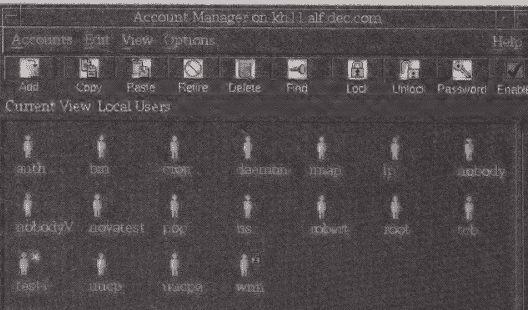

## 6.6.5 安全审计日志

Tru64 UNIX 的一个独特特性是采用了统一的安全身份验证机制，称为安全集成架构（Security Integration Architecture, SIA）。此 SIA 层将登录、`su` 和 `passwd` 等安全相关的命令与特定的安全机制隔离离开，这些安全机制除了基础（Base）和增强（Enhanced）外，还包括分布式计算环境（DCE）等可选产品。除非你想利用其通过 `slog` 文件提供的集中日志功能，否则无需担心此 SIA 层。该日志将记录所有安全事件，包括登录、密码更改和 `su(1)` 命令的成功和失败结果。要启用创建该文件，请执行：

```bash
# touch /var/adm/slog
```

随后 SIA 将开始向此日志写入内容。`slog` 建议的权限为 600。作为一般原则，你应该防止非特权用户查看 `slog` 等安全日志的内容。`slog` 的片段显示了记录的事件类型：

> SIA:ERROR Wed Feb 14 15:12:13 2001
> Failure on authentication for su from martin to root
> SIA:EVENT Wed Feb 14 15:12:17 2001
> Successful authentication for su from martin to root
> SIA:EVENT Wed Feb 14 15:12:17 2001
> Successful launching of session

由于此日志会无限制地增长，因此必须定期进行手动截断。要停止 SIA 事件的记录，请删除 `slog` 文件。由于 SIA 是 Tru64 UNIX 操作系统的一部分，无论安全级别是 Base 还是 Enhanced，都可以使用 `slog`。

## 6.6.6 问题

作为系统管理员，你通常负责商用现（COTS）软件的安装和配置。在启用增强安全之前，你必须确保当前安装的任何应用程序都兼容增强安全。如果一个依赖系统进行用户身份验证的应用程序（例如数据库或安全工具）无法感知增强安全，那么用户登录应用程序的身份验证很可能会失败。如果应用程序供应商不知道启用增强安全是否会影响其产品，请缓慢实施增强安全，并在上线前尽可能地对应用程序进行测试。

你可能承担的额外责任还支持软件开发工作，包括内部开发和商业应用。与你支持系统的任何软件开发人员协调增强安全的实施。Compaq Tru64 UNIX 安全手册包含一个“程序员安全指南”章节，该章节详细说明了编程技术并提供了代码示例，这对你的开发人员来说是无价的。

如你所见，成功实施增强安全需要对你的环境和需求有深入的了解、周密的计划以及在账户管理和通用系统维护方面大量的管理责任。然而，增强安全的益处（例如对安全事件的全面审计以及更健壮的识别和身份验证功能）远大于增强安全级别可能带来的缺点。

## 6.7 审计

Tru64 UNIX 提供了审计系统上发生的所有事件的能力。系统中发生的每项活动都可以生成一个“审计记录”，描述活动内容、发生时间、由谁引起以及其他信息。作为系统管理员，你决定哪些活动将生成审计记录。这是一个监控系统活动的强强大工具。审计可以帮助你：

- 检测安全违规行为，例如系统入侵或入侵尝试。
- 如果确实发生了入侵，可以评估损坏并恢复系统完整性。
- 震慑违反安全的尝试（因为担心被检测到）。
- 评估和调试应用程序。
- 排除系统故障。

审计可用于基础和增强安全级别。为了启用审计，不需要处于增强安全级别。你可以审计单个事件。审计的管理包括：

- 配置审计系统
- 选择被审计的活动
- 生成审计报告
- 管理审计占用的空间
- 归档日志

审计系统通过 `auditconfig` 配置。有关自定义审计的细节，请参阅 Tru64 UNIX 手册。

## 6.8 访问控制列表

传统的 UNIX 权限允许文件所有者为三类用户（所有者、组用户和其他）指定访问类型（读、写、执行）。这种方案范围有限，通常需要更细的粒度。访问控制列表（ACL）允许为特定的用户或组定义访问。

ACL 可以在 Tru64 UNIX 上动态启用或禁用，并与其他安全选项独立。在 Tru64 UNIX 5 版本中，ACL 由内核参数 `acl_mode` 启用，它是 sec（安全）系统的一部分。使用 `sysconfig` 命令判断是否已启用 ACL：

```bash
# sysconfig -q sec
acl_mode = enable
```

启用 ACL 的三种方法：

1. 使用 sysconfig 工具修改参数值，然后重启系统。
2. 运行安全工具并选择或取消“启用访问控制列表 (ACLs)”选项（见第 6.6.1 节）。
3. 由于 `acl_mode` 是动态内核参数，你可以在运行的系统中使用 `sysconfig` 工具更改它。但除非同时使用另外两种方法，否则更改将仅持续到下次重启。通过这种方式启用 ACL 的命令为：

```bash
# sysconfig -r sec acl_mode=enable
```

`ls(1)` 的输出没有提供有关文件 ACL 的任何信息，甚至包括是否存在 ACL 这种基本信息！要查看文件是否有 ACL，必须使用 `getacl(1)` 命令。要添加、删除或更改 ACL，请使用 `setacl(1)` 命令。此外，`dxsetacl` 工具提供了查看和更改 ACL 的图形界面。

ACL 由若干访问控制条目组成，每个条目由三个冒号分隔的字段组成：

- 条目类型（用户、组或其他）
- 用户或组名或数字 UID，或为空字段

## 6.8 访问控制列表 (ACL)

- 一种权限规范，类似于 `ls(1)` 显示的权限位

一个没有名称或 UID 的用户条目定义了文件所有者的访问权限。这始终与“`ls -l`”显示的用户权限位完全相同。每个 ACL 必须包含（且仅包含）这样一条条目。同样，包含名称或 UID 的用户条目定义了指定用户的访问权限；ACL 可以包含零或多个此类条目。

组条目与用户条目类似。必须恰有一个没有名称或 ID 字段的组条目；这定义了文件所属组成员的访问权限，并且与“`ls -l`”显示的组权限位完全相同。ACL 可以包含零或多个包含组名或 GID 的组条目。这些条目定义了相应组成员的访问权限。

最后，每个 ACL 必须包含一个“其他”（other）条目，其第二个字段始终为空。该条目定义了 ACL 中其他条目未包含的所有用户的权限。它与“`ls -l`”显示的“other”权限位相同。

一个典型的 ACL 如下所示：

```
# file: test
# owner: martin
# group: system
# user::rw-
user:steve:rw-
user:joe::-
group::r-
group:staff:r-
other::
```

在此示例中，文件所有者 (`martin`) 具有读写权限；用户 `steve` 也具有读取权限，而用户 `joe` 对该文件没有访问权限。所属组 (`system`) 只有读取权限，“staff”组也具有读取权限，所有其他用户对该文件没有访问权限。该文件的“`ls -l`”输出将显示权限位为“-rw-r-----”。这反映在“user::”、“group::”和“other::”条目中。

如果，如果一个用户被定义在多个访问条目中会发生什么？在上面的示例中，假设用户 `joe` 属于 staff 组。staff 组具有读取权限，但用户 `joe` 的条目拒绝了所有访问。在这种情况下，用户条目的优先级高于组条目，因此用户 `joe` 将被拒绝所有访问。

另一种可能性是用户属于多个定义了不同访问权限条目的组。在这种情况下，用户将获得授予所有适用组权限的并集。例如，staff 组的条目是“--x”，一个同时属于 staff 和 system 组的用户将对文件具有读取和执行权限：从所属组 (`system`) 条目获得读取权限，从 staff 组条目获得执行权限。

普通文件可能只有一个 ACL，用于定义对文件的访问。目录可以多多三个 ACL：一个访问 ACL、一个默认 ACL 和一个默认目录 ACL。访问 ACL 定义了对目录的访问权限，正如我们已经讨论过的样。默认访问 ACL 被目录中新创建的文件继承；也就是说，新文件将接收一个与默认访问 ACL 相同的 ACL。同样，默认目录 ACL 会被新创建的子目录继承。有关 ACL 继承的更多详细信息，请参阅 `acl(4)` 手册页或 Tru64 UNIX 安全手册。

为了使 ACL 在 NFS 文件系统上生效，必须在 NFS 服务器和客户端上都启用 ACL。此外，NFS 服务器必须运行属性列表守护进程 `proplist`，客户端在挂载系统时必须使用 `proplist` 选项。客户端的 `/etc/stab` 条目将在选项字段中包含 `proplist`，例如：

```
students:/home /nfs_home rw,proplist 0 0
```

## 权限划分

默认情况下，UNIX 对特权账户采取“全或全无”的观点。`root` 账户是全能的，而其他账户拥有特殊权限。这种方案未能考虑到那些具有少数权限但没有 root 账户通用权限的账户的用途。例如，创建一个操作员账户来备份和恢复文件、为了维护关闭系统或执行类似功能可能是理想的。传统的 UNIX 权限没有提供实现此点的简单方法。

在第 5 版本发布之前，Tru64 UNIX 没有划分权限的机制，尽管有可以执行此类功能的外部产品，例如开源程序“sudo”。第 5 版本引入了权限划分工具 `dop(8)`。该工具允许超级用户将系统管理任务（或任务类）分配给特定的用户或组。这些用户能够在不知道 root 密码的情况下执行指定的任务，而通常这是需要密码的。

Tru64 UNIX 提供了许多实用的权限（见表 6.4）。这些权限允许指定的用户执行一个或多个相关任务。例如，“Security”权限允许用户更改系统安全级别、配置审计环境并使用 `dop` 工具向其他用户授予权限。除了预定义的权限外，还可以定义自己的特权操作。

## 表 6.4 权限划分

| 权限组 | 允许的操作 |
| --- | --- |
| SuperUsers | 所有权限 (root) |
| AccountMgManagement | 添加、修改和删除用户账户和组 |
| CDEConfiguration | 配置 CDE (dsetup) |
| ClusterConfiguration | 配置集群相关服务 |
| ClusterManagement | 管理集群相关服务 |
| EventConfiguration | 配置事件相关服务 |
| EventManagement | 查看和监控事件相关服务 |
| FileManagement | 归档、恢复和复制文件 |
| HostManagement | 执行主机管理任务 (dxhosts) |
| KeyboardConfiguration | 自定义键盘设置和映射 |
| MailConfiguration | 配置邮件服务 |
| MailManagement | 管理邮件服务 |
| NetworkConfiguration | 配置网络、接口等 |
| NetworkManagement | 监控网络状态 |
| PowerManagement | 电源管理 (dxpower) |
| PrinterConfiguration | 打印机设置和配置 |
| PrinterManagement | 查看打印队列、添加/删除作业等 |
| ProcessManagement | 进程管理（例如分配 CPU 资源） |
| Security | 配置和管理安全 |
| SoftwareManagement | 安装/移除软件集和许可证 |
| StorageConfiguration | 配置磁盘、添加/移除文件系统 |
| StorageManagement | 监控磁盘、挂载/卸载文件系统 |
| SystemManagement | 编译内核、重启等 |


有多种不同的方法调用 `dop` 工具。从 shell 命令行输入 `/usr/sbin/dop` 后跟所需的选项。你也可以通过 CDE 应用程序管理器调用 `dop`：选择配置文件夹，然后点击 DOP 图标。最后，可以通过 SysMan 调用 `dop`。你可以在命令行输入 `sysman-config`，或者在 SysMan 安全列表中选择权限划分 (DOP)。

### 6.9.1 定义自定义权限

要定义你自己的自定义权限，必须使用命令行界面 (`/usr/sbin/dop`) 执行以下操作：

- 定义新权限
- 定义拥有该权限的用户
- 定义允许权限的操作

我们将通过示例来描述此过程。下面的章节显示了如何添加名为 `cdusers` 的自定义权限，使其具有挂载和卸载 CD-ROM 磁盘的权限。

首先，如果你运行比 V5.1A 更早的版本，`dop` 的某个资源文件中可能存在错误。如果是这样，尝试添加权限组将失败并显示以下错误消息：

```
couldn't compile regular expression pattern: invalid character range
```

修复此错误：

```
# cd /usr/share/sysman/mcl
# cp doprc.mcl doprc.mcl.orig
# vi doprc.mcl
```

搜索以下内容：

```
[regexp -- [^]&&a-zA-Z0-9._$- - {}] $newval
```

将其替换为：

```
[regexp -- [^]&&a-zA-Z0-9._$- - {}] $newval
```

也就是说，三个连续的连字符中多了一个；删除一个连字符。

现在添加新权限。由于长度较长，以下命令被分为两行；第一行末尾的反斜杠表示命令在下一行继续。

```
# sysman -cli -add row -comp doprc -group dopinfo -data \
"{cdusers} {} {} {} {Users who can mount/umount the CD-ROM}"
```

现在向该权限添加一个用户列表。列表中的用户名之间应用空格分隔。

```
# sysman -cli set values -comp doprc -group doprc \
-keyl cdusers -attr users=fred wilma barney
```

验证组和用户是否已成功添加：

```
# sysman -cli -list values -comp doprc -group dopinfo \
-keyl cdusers
Component: doprc
Group: dopinfo
Key: 'cdusers' Value: cdusers
Attribute: resource
Attribute: users Value: fred wilma
barney
Attribute: groups Value:
Attribute: catalog Value:
Attribute: description Value: Users who can
mount/umount the CD-ROM
```

现在定义属于新权限的 `mounted` 和 `umountcd` 命令：

```
# dop -a cdusers umountcd "/sbin/mount -r /dev/disk/cdrom0c *"

# dop -a cdusers umountcd "/sbin/umount /dev/disk/cdrom0c"
```

验证命令添加是否成功：

```
# sysman -cli -list values -comp doprc -group dopActions \
-keyl mounted
```

```
Component: dopActions
Group: dopActions
Key: 'mounted'
Attribute: action Value: mountcd
Attribute: privs Value: cdusers
Attribute: paths Value: { /sbin/mount -r
/dev/disk/cdrom0c * }
```

```
# sysman -cli -list values -comp doprc -group dopActions \
-keyl umountcd
```

```
Component: doprc
Group: dopActions
Key: 'mountedcd'
Attribute: action Value: umountcd
Attribute: privs Value: cdusers
Attribute: paths Value: ( /sbin/umount
/dev/disk/cdrom0c )
```

现在剩下的工作就是验证一切运行正常。将一张 CD-ROM 放入驱动器中，并进行严格测试：

```
# dop mountedcd /mnt

# df -k /mnt

# ls -l /mnt

# dop umountcd
```

# 网络

## 7.1 网络

网络是通过硬件和软件连接的计算机集合，允许数据和资源进行共享。为了让网络上的计算机能够通信，它们必须都使用相同的语言，即协议。在今天，很少有 Tru64 UNIX 系统不是某种网络的成员。Tru64 UNIX 与所有其他 UNIX 版本一样，原生支持传输控制协议/互联网协议 (TCP/IP) 网络，这是互联网的网络协议。此外，Tru64 UNIX 还支持 Compaq 的 DECNet，这是 Compaq OpenVMS 操作系统的原生网络协议，但仅作为额外付费选项提供。由于 TCP/IP 几乎被普遍接受，因此它是唯一将涵盖的网络协议。本章旨在作为在 Tru64 UNIX 系统上配置和管理基础 TCP/IP 网络的指南。章的第一部分介绍了 Tru64 UNIX 系统上 TCP/IP 网络的需求。这包括互联网协议 (IP) 地址、子网和子网掩码，以及网关和路由。

我们将介绍配置过程，并提供两种基于字符的设置序列示例，以及在 Tru64 UNIX 版本 5.0 及以上提供的图形化 SysMan 工具。之后，将概述 Tru64 UNIX 系统上提供的不同网络接口，以及任何特殊要求或考虑。接下来，将演示一些基础的网络故障排除技巧。最后，将涵盖几种用于跨网络共享资源的常用网络服务，例如域名系统服务 (DNS) 和文件传输协议 (FTP)。

# 网络配置

在 Tru64 UNIX 系统上配置 TCP/IP 网络有几个先决条件。首先，系统必须具有一个网络接口并已连接到网络。Tru64 UNIX 支持多种不同的工作接口，包括以太网 (Ethernet)、令牌环网 (Token Ring)、光纤分数据数据接口 (FDDI)、异步传输模式 (ATM)，以及用于跨串行线路（特别是拨号调制解调器）TCP/IP 网络的串行线路协议 (SLIP) 和点对点协议 (PPP)。由于大多数（如果不是所有）Tru64 UNIX 系统至少有一个以太网接口，我们将以以太网为例。

有两种流行的以太网网络布局（或拓扑结构），决定计算机使用哪种拓扑结构的因素是物理连接到网络的方式。第一种也是最常见的是星型拓扑（图 7.1），其中每个主机通过直接电缆连接到中央集线器。星型网络之所以如此，是因为使用了中央集线器，每个主机在独立的辐线上外辐射。这种网络通常被称为 10BaseT、UTP（非屏蔽双绞线）或简单的双绞线网络，可以通过主机网络接口上独特的 RJ-45 接头轻松识别。该 RJ-45 接头看起来像一个巨大的美式电话插头，并以清脆的咔哒声卡入插座中。“10BaseT”标识符是一个 IEEE 指定，包含三部分信息。第一部分“10”表示每秒兆比特的媒体速度——在这种情况下为每秒 10兆兆 (Mbps)。“Base”代表“基带”（Baseband），一种网络信号类型，其中以太网信号是线上传输的唯一信号。最后一部分“T”代表“双绞线”（Twisted-Pair），仅指定电缆类型。目前最流行的快速以太网网络（使用双绞线电缆的接口）将被称为 "100BaseT"，表示 100-Mbps 的媒体速度。可切换的普通以太网和快速以太网接口通常被称为 "10/100BaseT" 卡。星型拓扑网络的一个大优势是电缆断裂或切割只会影响一个主机；其余主机不受影响。星型网络的故障排除可能更简单，因为每个段、每个主机都是独立的。

第二种网络拓扑结构是总线布局（图 7.2），其中每个主机通过直接电缆连接到中央集线器。这种网络通常被称为 10Base5 Thicknet（粗线）或 10Base2 Thinnet（细线），速度为 10 Mbps。总线拓扑的缺点是单处断裂或切割可能会导致整个网络失效。然而，如果网络很小，只有几个主机，这是可以接受的。

## 7.2 网络配置

一旦系统正确连接到网络，接接的步骤是在系统上配置并启用 TCP/IP 网络。这至少需要两个和可能的三个信息项：

- IP 地址
- 子网掩码
- 网关地址

## 7.3 址

网络上的每个主机都必须有一个唯一的地址。这种唯一性对于允许一个主机联系并与任何其他主机通信是必要的。实际上有三层地址，每层都有特定的目的，每层都指向下方：

- 主机名
- 互联网协议 (IP) 地址
- 硬件地址

我们将在后面的章节中讨论每一个。

### 7.3.1 主机名

系统的主机名只是方便人类和程序使用的名称。使用像 `saturn` 这样的名称比 IP 地址引用系统容易得多。主机名在安装时配置，是任意的。然而，网络软件在尝试与网络上的另一个主机通信时无法直接使用主机名，必须将主机名转换为对应的地址——IP 地址。执行此翻译的机制称为解析器 (Resolver)，在简单的配置中，它查询 `/etc/hosts` 文件获取给定主机名的对应 IP。更复杂的配置可以使用网络信息服务 (NIS) 或域名系统 (DNS)，它们都是执行翻译的网络服务。NIS 最初由 Sun 与其网络文件系统 (NFS) 一起开发，用于在本地 UNIX 系统之间维护单一的安全域，以便它们共享文件。而 DNS 是全球范围内主机名及其关联 IP 地址的分布式数据库。在本章后面的部分，将讨论 Tru64 支持的 DNS 实现（见第 7.10 节）。

主机名只是网络上可以建立网络连接的主机的一个名称。一个 Tru64 UNIX 系统的单个网络接口上可以关联许多不同的名称和 IP 地址。这些额外的关联名称也称为“别名 (aliases)”。如果别名正确地关联到接口上，

那么该主机就可以接受来自主机名和这些别名的连接。

### 7.3.2 IP 地址

IP 地址是一个唯一的 32 位数字，用于标识特定的网络接口。IP 地址的表示法通常被写为四个由点号分隔的数字：例如 192.168.4.100。这四个由点分隔的数字（或称为字节）中的每一个都代表 IP 地址的 8 位。IP 地址不是随机的，必须根据计算机将要所在的网络仔细选择，并与该网络上的其他主机保持一致。IP 地址实际上由两部分组成：**网络号**和**主机号**。同一网络上的所有主机的网络号必须相同。可以认为网络号就像电话号码的区号。同一地理区域的所有电话号码都有相同的区号。主机号在一个网络内必须是唯一的。继续电话号码的类比，在给定的区号内，所有电话号码必须是唯一的。你可以想象，如果情况不是这样，电话将无法正确地分发给单个个人。电话号码只不过是全球电话网络的寻址方案，类似于全球互联网的 IP 地址。

TCP/IP 网络的设计者预见到了不同规模的网络，并将由 IP 地址定义的网络空间分为三个主要类：

- **A 类**——对于此类类型的网络，IP 地址的第一个字节指定网络号，剩余三个字节定义主机号。共有 126 个 A 类网络，每个网络可以容多 16,777,214 个主机。A 类网络范围是 1.0.0.0 到 126.0.0.0（0.0.0.0 和 127.0.0.0 范围被预留）。只有非常大的组织或公司才能使用 A 类网络，事实上，现在已经没有可用的 A 类地址了。例如，康培尔计算机公司拥有 B 类网络。
- **B 类**——B 类网络使用 IP 地址的前两个字节来指定网络号，剩余两个字节定义主机号。共有 16,384 个 B 类网络，每个网络可以容多 65,534 个主机。B 类网络范围是 128.1.0.0 到 191.254.0.0。B 类网络经常用于中型公司和大学。
- **C 类**——C 类网络使用 IP 地址的前三个字节来指定网络号，剩余一个字节定义主机号。共有 2,097,151 个 C 类网络，每个网络可以容纳 254 个主机。C 类网络范围是 192.0.1.0 到 223.255.254.0。C 类网络是最常见的，在某些方面也是最灵活的网络，因为它们是可的最小主机，且有许多 C 类地址可用。无法支持较大的 B 类网络的组织经常获取多个 C 类地址以满足其需求。

表 7.1 显示了一些示例 IP 地址及其根据其分类进行的逻辑划分。注意，这些示例地址假设没有进行子网划分，该主题将在下文中介绍（见第 7.4 节）。

此外，还有 D 类和 E 类网络。D 类网络从 224.0.0.0 开始编号，用于多播。E 类网络从 240.0.0.0 开始，仅用于实验和研究目的。

如果网络当前连接到互联网或预计将连接到互联网，请联系互联网名称与数字分配机构（ICANN）注册服务（或等机构），从 IP 地址空间为您的网络申请一组 IP 地址。大多数将其系统连接到互联网的组织将从其上游互联网服务提供商（ISP）获取 IP 网络地址。如果您的公司或组织足够大，您可能需要使用下面的联系信息直接联系 ICANN。

互联网名称与数字分配机构
4676 Admiralty Way, Suite 330
Marina del Rey, CA 90229
USA

## 表 7.1 示例 IP 地址

| IP 地址 | 类别 | 网络号 | 主机号 |
| :--- | :--- | :--- | :--- |
| 18.131.55.75 | A | 18 | 131.55.75 |
| 138.12.70.190 | B | 138.12 | 70.190 |
| 216.196.23.17 | C | 216.196.23 | 17 |

电话：+1.310.823.9358
传真：+1.310.823.8649
通用邮箱：icann@icann.org
网站：http://www.icann.org/

这一组 IP 地址可以是一个或多个 C 类地址，或者仅仅是 C 类块的一个子集，取决于网络的大小。对于与互联网完全隔离的私有网络，没有必要向 ICANN 注册地址。然而仍然建议申请 IP 地址，以避免在连接到互联网时重新对网络编号10.0.0.0–10.255.255.255
172.16.0.0–172.31.255.255
192.168.0.0–192.168.255.255

使用 `/etc/hosts` 的优势是不需要与协调。

## 7.3.3 /etc/hosts 文件

`/etc/hosts` 文件是一个配置文件，包含主机名列表以及可选的别名。对于任意数量的主机，`/etc/hosts` 文件的格式是每行一个条目。`/etc/hosts` 文件中的字段由空白字符分隔。井号 (`#`) 表示注释的开始，从井号到行尾的任何字符会被忽略。以下是 `/etc/hosts` 的片段：

```
# /etc/hosts

127.0.0.1 localhost

192.168.1.78 saturn # 生产服务器

192.168.1.80 jupiter
```

`localhost` 条目是必不可少的，必须始终存在于 hosts 文件。这在历史上一直被解析器用于响应对环回设备的请求，但现在不再用于该目的。

## 7.4 子网掩码

对于划分子网的网络，子网掩码将 IP 地址的主机部分在逻辑上进一步划分为子网号和更小的主机号。当子网掩码以二进制形式表示时，每个为 1 的位表示 IP 地址中对应的位为网络号；子网掩码中的每个 0 位则表示 IP 地址中的主机号。例如，考虑以下 B 类 IP 地址：

```
172.30.12.75
```

将此地址的每个字节转换为二进制，将得到如下表示形式：

```
10101100 00011110 00001100 01001011
```


如果此 IP 地址属于一个未划分子网的网络，则子网掩码及其二进制表示形式将如图 7.3 所示使用。

这将导致前两个字节（172.30）代表网络号，后两个字节（12.75）代表主机号。

如果此 IP 地址属于一个使用该子网掩码划分子网的网络，所得的划分将如图 7.4 所示。

这将导致前两个字节（172.30）代表网络号，第三字节（12）代表子网号，第四字节（75）代表主机号。这会将 B 类网络划分为 254 个（256-2 保留）子网，每个子网可以支持 254 个主机。

最后，如果 B 类网络需要逻辑上划分为更多子网（每个子网仅包含几个主机，则可以使用如图 7.5 所示的子网掩码：

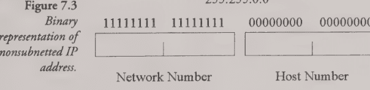

242 7.5 硬件地址

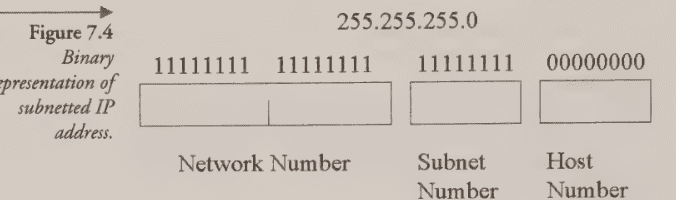

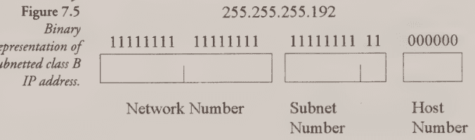

如此示例所示，子网并不一定位于边界上，它可以位于 IP 地址主机部分的任何位位置。此子网掩码将导致前两个字节（172.30）代表网络号；第三字节（12）和第四字节的两个位代表子网号；而第四字节的最后六位代表主机。这会将 B 类网络划分为 1024 个（$10^4$-2 保留）子网，每个子网可以支持 62 个主机。

参见表 7.2 了解不同子网掩码对 B 类和 C 类网络的结果。请注意，在计算子网和主机数量时已经减去了 2，以考虑保留的子网号和主机号。

## 7.5 硬件地址

一旦主机名被翻译为 IP 地址，网络系统的下一步工作将是识别网络上哪台物理计算机分配了该 IP 地址。第三个也是最后一个地址是硬件地址或介质访问控制（MAC）地址。每个网络接口（以太网、令牌环路、FDDI 等）都有唯一的硬件地址，该地址通常固化在只读存储器（ROM）芯片中，且不可更改。系统的 MAC 地址可以通过 SRM 控制台提示符使用 `show device` 命令显示：

```
# 表 7.2 B 类和 C 类网络划分子网的结果
```

| 子网掩码 | 子网数量 | 主机数量 |
|---|---|---|
| 255.255.192.0 | 2 | 16382 |
| 255.255.224.0 | 6 | 8190 |
| 255.255.240.0 | 14 | 4094 |
| 255.255.248.0 | 30 | 2046 |
| 255.255.252.0 | 62 | 1022 |
| 255.255.254.0 | 126 | 510 |
| 255.255.255.0 | 254 | 254 |
| 255.255.255.128 | 510 | 126 |
| 255.255.255.224 | 2046 | 62 |
| 255.255.255.240 | 4096 | 14 |
| 255.255.255.248 | 8190 | 6 |
| 255.255.255.252 | 16382 | 2 |
| 255.255.255.192 | 2 | 62 |
| 255.255.255.224 | 2046 | 30 |
| 255.255.255.240 | 4096 | 14 |
| 255.255.255.248 | 8190 | 30 |
| 255.255.255.252 | 16382 | 62 |

```
>>> show device | grep eth
eth0 0.0.0  00:00:f8:01
```

在此示例中，以太网接口（eth0）的硬件地址为“00:00:f8:01”。TCP/IP 网络软件必须知道目标主机的硬件地址才能与该主机通信。将 IP 地址翻译为硬件地址是通过地址解析协议（ARP）完成的。一旦确定了目标主机的硬件地址，网络通信即可开始。

## 路由

路由是将数据包路由定向到不同网络的过程。系统的 TCP/IP 网络系统通过查询一个包含发送指令的列表来完成特定数据包的路由。该列表（路由表）基本上是目标网络或主机的列表、相应的网络接口以及到达目的地的下一跳。例如，考虑以下路由表：

```
# /bin/netstat -nr
路由表
目的 网关 标志 引用 接口
default 192.168.171.254 UGS 0 4 tu0
127.0.0.1 127.0.0.1 UH 3 4294 lo0
192.168.171/24 192.168.171.78 U 4 1166 tu0
```

注意此表中有三条记录，每条记录为不同的目的提供路由指令。网络软件获取每个目的地址并从底部开始与路由目的目的值进行比较。例如，指向 IP 地址 172.31.12.75 的数据包不匹配第三个目的（范围为 192.168.171.0 到 192.168.171.254），此路由用于本地网络，该目的的数据包通过本地以太网接口（192.168.171.78）发送。第二个目的（127.0.0.1）匹配指向本地系统的数据包，此路由防止内部数据包离开网络。该路由是环回接口，将数据包直接“环回”系统。第一个和最终目的标记为“default”。由于我们的数据包目的（172.31.12.75）不匹配路由表中的任何目的，因此应用了默认路由。这指示网络软件将数据包传给 192.168.171.254 网关，网关将接受数据包并重复该过程，将其数据包地址与其自身的路由表进行比较。参见第 7.7 关于网关的信息。这个简单的示例展示了数据包如何从主机路由直到到达最终目的地。每一步（或每一跳）都让数据包更接近目的地。

Tru64 UNIX 系统管理路由表有三种。使用的路由配置取决于连接的网络规模和类型。三种路由配置类型解释如下。

### 7.6.1 最小

最小路由配置仅包含 `ifconfig(8)` 命令激活网络系统时创建的路由。通常，这意味着每个网络接口对应一个路由，加上环回路由。此配置对于未连接到其他网络或未划分子网的小型网络足够。对于此配置，不需要额外的步骤来管理路由表。以下是最小路由表的示例：

| 目的 网关 标志 引用 使用 接口 |
|---|---|---|---|---|---|
| 127.0.0.1 | 127.0.0.1 | UH | 3 | 4294 | lo0 |
| 192.168.171/24 | 192.168.171.78 | U | 4 | 1166 | tu0 |

### 7.6.2 静态

静态路由配置的特征是路由表中除了最小配置中的路由外，还包含系统管理员手动添加的一个或多个路由。简单的静态路由表有一个额外路由：指向所有非本地网络流量所在网关的默认路由。此外，可能还会添加其他特殊的静态路由，将某些数据包路由到主机或网络。这些静态路由通过 `route(8)` 命令手动管理。以下示例演示了如何向路由表添加网络静态路由：

```
# /usr/sbin/netstat -nr
路由表
目的 网关 标志 引用 使用 接口
default 192.168.171.254 UGS 0 4 tu0
127.0.0.1 127.0.0.1 UH 3 4294 lo0
192.168.171/24 192.168.171.78 U 4 1166 tu0
# /usr/sbin/route add -net 192.168.159 192.168.171.101
# /usr/sbin/netstat -nr
路由表
目的 网关 标志 引用 使用 接口
default 192.168.171.254 UGS 0 4 tu0
127.0.0.1 127.0.0.1 UH 3 4294 lo0
192.168.159/24 192.168.171.101 UGS 0 0 tu0
```

第一个 `netstat` 命令显示路由表，其中包含一个默认路由、指向本地主机的环回路由，以及通过接口 `tu0` 指向网络 192.168.171 的路由。`route add` 命令通过接口 `tu0` 向另一个网络（192.168.159）添加静态路由，其下一跳目标为 IP 地址 192.168.171.101 的主机。第二个 `netstat` 命令再次显示路由表，新添加的静态路由现在会紧接着环回路由之后显示。

## 7.6.3 动态

在动态路由配置中，路由表由程序使用一个或多个路由协议动态更新，以确定到达目的地的“最佳”路由。程序能够对临时或永久的网络故障做出动态响应并重新路由。在通往目的地有多个可能路由的网络上应当使用动态路由。Tru64 UNIX 提供了两个路由守护进程（读作 "route d"）和 gated（读作 "gate d"）。`routed` 守护进程是两个中较旧的，而且灵活性也最低，因为它只理解一种路由协议：RIP（路由信息协议）。RIP 非常适用于局域网，因此被广泛使用。`gated` 守护进程是一个更现代的程序，它理解 RIP 以及其他几种路由协议。`gated` 守护进程通常认为是 `routed` 的替代品。你可以在系统上运行 `gated` 或 `routed`，但不能两者同时运行。如果使用的唯一路由协议是或将是 RIP，通常建议运行 `routed`，尽管 `gated` 也能处理 RIP。然而，如果网络运行的是不同于 RIP 的路由协议，你必须运行 `gated`。探索 IP 路由和路由协议超出了本文的范围。请参阅附录 B 中关于 TCP/IP 网络的推荐参考文献，以获取有关配置路由守护进程和路由协议的更多信息。

## 7.7 网关

系统能够与位于同一网络或子网的其他系统直接通信。为了到达位于不同网络上的系统，系统必须通过网关。网关通常是专用硬件设备，如中继器、桥接器或路由器，但如果计算机系统拥有多个网络接口，它也可以充当网关。

最简单的网关类型是中继器和桥接器，它们用于连接不同的网络电缆段以克服网络距离限制。中继器和桥接器扩展单个网络，而不是将不同的网络连接在一起。中继器在两个网络段之间传递所有网络流量，而不进行任何类型的过滤或修改。桥接器智能中继器，具有根据各种标准过滤流量的能力。

最常见的网关被称为路由器，之所以这样命名是因为它在不同网络之间“路由”（routes）网络流量。路由器同时连接到多个网络。所有源自特定网络并目标为远程网络系统的网络流量都必须通过此路由器，该路由器也被称为默认路由。路由器通常是一个独立设备，带有复杂的软件，该软件能够检查单个网络数据包，并根据源地址、目的地址或类型决定是否将该数据包转发到另一个网络。

在 Tru64 UNIX 系统上配置 TCP/IP 网络时，通常不需要知道你的网关是什么类型。只需要知道网关的 IP 地址就足够了。例如，图 7.6 显示了通过网关连接的两个网络。主机 1 能够直接与主机 2 通信而无需通过网关，但为了与主机 3 通信，网络流量必须通过两个网络之间的网关进行路由。提供网关地址是告诉 TCP/IP 软件将发往非本地网络主机的数据包发送到何。

## 7.8 激活网络

一旦获取了系统的网络参数，下一步就是实际配置并启动 Tru64 UNIX TCP/IP 网络子系统。Compaq 历史上提供了一个字符单元实用程序用于配置 Tru64 UNIX 所有层级的网络，即 `netsetup(8)`，它的工作方式与 Tru64 UNIX 的任何版本都相同，并提供了一个纯文本的菜单驱动界面，用于配置单个网络接口、启动和停止某些网络守护进程、输入网关信息以及添加和删除远程主机信息。从 Tru64 UNIX 5.0 版本开始，Compaq 弃用了 `netsetup` 工具并增加了一个新的 TCP/IP 网络配置工具，该工具比 `netsetup` 更具灵活性。该工具 SysMan 默认使用 X Window 系统图形用户界面，但也可以从字符单元界面运行，或从指定配置选项的命令行运行。本节将仅涵盖使用 Network Setup 和 SysMan 工具进行基础 TCP/IP 网络配置。

### 7.8.1 SysMan 网络

`SysMan(8)` 实用程序提供了一种简单的菜单驱动的方法，用于在 Tru64 UNIX 上配置或重新配置 TCP/IP 网络子系统。以 root 身份运行 SysMan 网络实用程序：

```
# sysman network
```

在字符单元终端上，将显示主菜单（图 7.7）。如你所示，SysMan 菜单相当直观。系统管理员可以在显示的六个不同选项中选择一个。第一个选项“网络设置向导”会弹出一个面向步骤的工具用于在系统上配置简单的网络，该工具将在 7.8 节中进行详细讨论。接下来的两个选项“基本网络服务”和“附加网络服务”将弹出其他选项。基本网络服务是使配置简单的 Tru64 UNIX 系统连接到现有网络所需的服务。这些任务包括设置网络接口；配置静态或动态路由；管理 hosts、hosts 和 networks 数据库；以及配置远程守护进程。

附加网络服务（图 7.9）是用于在包含 DNS、NIS 和 NFS 的复杂网络上配置 Tru64 UNIX 系统的服务。你还可以参与网络时间协议，使你的系统时间与互联网或局域网上的非常精确的时钟同步。如果你希望系统配置为局域网传输 (LAT) 或主机配置协议 (DHCP) 服务器，你也会使用此菜单。如果你不熟悉这些和服务和选项，建议你联系所在位置的网络管理员或阅读 Compaq Tru64 UNIX 文档获取更多信息。

### 7.8.2 netconfig

网络配置管理器 `netconfig` 是 Tru64 UNIX 5.0 之前系统上的 X 系统/Motif 应用，用于初始配置和修改 TCP/IP 网络配置。网络配置管理器通过 CDE 应用程序调用，可以通过从 CDE 面板上选择 Application Manager 图标打开它，然后选择 System_Admin 组图标、Configuration 应用程序组图标，最后选择 Network 图标。双击 Network 图标后，如果没有以 root 身份登录，将通过 Get Password 对话框提示 root 密码。

可选，你也可以从命令行启动网络配置管理器：

```
# /usr/sbin/netconfig
```

此应用程序提供了 5.0 以前系统中旧版 `setup(8)` 工具中所有的可用配置选项。对于 Tru64 UNIX 5.0 及更高版本，输入 `netconfig` 将自动启动一个面向步骤引导的工作设置工具，称为“网络设置向导”（Network Setup Wizard）。该工具在第 7.8.3 节中介绍。

## 7.8.3 网络设置向导

网络设置向导是一个基于菜单、分步的工具，用于在 Tru64 UNIX 系统上配置。从图 7.10 所示的主菜单可以看出，它是简单直观的。

为了配置您的系统，您只需按顺序遵循步骤，直到完成所有步骤。完成后您的系统将配置在现有的 TCP/IP 网络上，并为您提供许多可用选项。您可以通过以下三种方式从命令行启动网络设置向导：

- 输入 "`netconfig`"
- 输入 "`sysman net_wizard`"
- 输入 "`sysman network,`"，并选择菜单上的第一个选项。（参见图 7.7）。

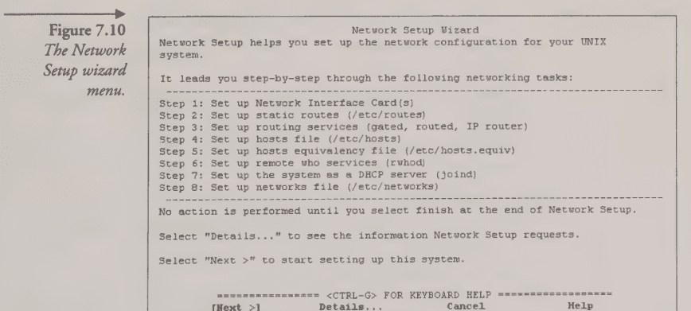

选择 "Details..." 查看网络设置向导请求的信息。
选择 "Next >" 开始设置此系统。

```
==================== <CTRL-G> FOR KEYBOARD HELP ==================
[Next >]                 Details...               Cancel
```


## 网络故障排除工具

当系统网络出现问题时，由于可能的故障源范围广泛，最初可能会感到无从下手。要确定问题是由于硬件（计算机、集线器、路由器，或电缆或连接器等）还是软件（配置不当的网络接口、不完整或错误的路由表信息，或无效或缺失的信息）可能是困难的。最好的方法是理解问题的症状，然后有条地尝试隔离实际问题。Tru64 UNIX（以及许多其他 UNIX 实现）提供了若干故障排除实用，每个工具都有特殊的用途或重点。了解哪个工具的专长以及从其输出中可以学习什么，对于知道从何处排除故障至关重要。

网络问题可能会表现为系统之间的连接丢失。通常，单个系统或一组系统无法与其他系统或其他系统组通信。应该做的第一件事是尝试定义问题。最初，这可能是一个模糊的问题，例如用户报告其无法使用工作站上的浏览器连接到公司网站。通过这个例子，系统管理员应该能够通过提问或尝试问题的变体来细化并界定问题。例如：

- 您能连接到其他网站吗？
- 您的同事是否也遇到了相同的问题？
- 其他其他网络服务（`telnet`, `FTP`, 打印）是否也无法工作？
- 最近是否有任何硬件或软件配置更改？

在收集更多信息后，系统管理员能够确定以下情况：

- 提出问题的用户似乎是唯一的影响者。
- 无论尝试访问哪个网站，用户都会遇到网络超时。
- 所有其他网络服务也失败了。
- 用户工作站的网络配置最近被更改过，但用户不知道更改了什么。

根据描述，用户的系统似乎不再是网络的一部分。很可能是，最近的网络重新引入了一个问题，导致系统无法与网络的其余部分通信。以下是一个攻击计划的示例，并介绍了 UNIX 网络故障排除工具。

首先应该检查的是基本连通性。确保系统在物理上仍连接到网络。对于细带（thinnet）或同轴电缆以太网，请检查 T 型连接器是否牢固地连接在系统网卡的同轴连接器上。对于 `10BaseT` 以太网、令牌环或 `FDDI` 网络，请确保系统电缆两端的连接器都已正确连接到系统以及网络集线器或集中器。某些网络接口卡提供一个“链路（link）”指示灯，当物理网络连接正常时，该灯通常呈现绿色亮光。

假设物理连通性良好，下一步是调查受影响系统的网络配置。在后续小节中描述的四个工具按推荐的使用顺序列出。每个工具都有特定的用途，并在故障排除情况下用于确认或否定特定进程或系统是否是问题的一部分。

### 7.9.1 ifconfig

通常，系统在启动时使用 `ifconfig(8)` 工具来配置和激活网络接口（表 7.3）。然而，`ifconfig` 方便快速显示系统的接口配置。每个网络接口最重要的三部分信息是：

表 7.3 网络接口类型和设备名称

| 网络接口类型 | 网络接口设备名称 |
|---|---|
| 回环 (Loopback) | lo |
| 以太网 (Ethernet) | tu, le, ln, xna |
| 令牌环 (Token Ring) | tra |
| FDDI | fta, faa, fza |
| ATM | lta |
| 串口行接口 (Serial Line Interface) | sl |

注意：网络接口设备名称后会跟一个指定特定设备的数字（例如 `tu0`, `fta1`）。

### 7.9 网络故障排除

- 接口状态（开启或关闭）
- IP 地址
- 子网掩码

只需运行以下命令即可显示系统中所有网络接口的信息：

```
/usr/sbin/ifconfig -a
```

```
lo: flags=RUNNING,BROADCAST,LOOPBACK,UP,mtu=16384
        inet 127.0.0.1 netmask 255.0.0.0
```

```
tu0: flags=UP,BROADCAST,SMART,mtu=1500
        inet 192.168.1.78 netmask 255.255.255.0
```

在这个示例中，系统有两个接口，一个以太网（`tu0`）和一个回环接口（`lo`）。每个接口的第二行显示了“UP”状态。如果系统位于一个需要网关的网络上，确保路由表中列出了网关。以下是：

```
/usr/sbin/netstat -nr
Routing tables
Destination Gateway Use Interface
Netmasks:
inet Family 2:
default             0.0.0
127.0.0.1 0.0.0.0 UH 3 lo0
192.168.1.0 192.168.1.254 255.255.255.0 U 4 tu0
```

如果系统使用动态路由，请检查列出的路由是否正确。如果路由表不完整或存在错误项，请检查 `/etc/routes` 文件是否包含正确的路由，或者验证所使用的路由守护程序的配置。以下描述了 `netstat` 输出中的路由标志：

- Up（开启），或可用
- 指向网关的路由
- 指向主机的路由

### 7.9.2 netstat

一旦确认了网络接口，下一个要检查的条目是路由表。`netstat` 命令主要用于显示网络统计数据；但它也可以用于显示表：

### 7.9.3 ping

下一步是检查网络连通性。用于此目的的工具是 `ping(1)`。`ping` 命令用于向特定主机发送一个或多个 `ICMP`（互联网控制消息协议）`ECHO_REQUEST` 包，主机应返回匹配的 `ICMP ECHO_RESPONSE` 包。

使用 `ping` 命令并将主机名或 IP 地址作为命令行参数。另一个常用标志是“`c`”，代表“计数（count）”，用于指定终止前发送的 `ICMP` 包数量。如果省略“`c`”参数，`ping` 命令将持续发送数据，直到按 `Ctrl-C` 中止。例如，以下向主机 `jupiter` 发送五个 `ICMP` 包并显示每次 ping 的结果，最后显示整个序列摘要：

```
/usr/sbin/ping -c 5 jupiter
PING jupiter (192.168.171.80): 56 data bytes
64 bytes from 192.168.171.80: icmp_seq=0 ttl=128 time=2 ms
```

```
64 bytes from 192.168.171.80: icmp_seq=1 ttl=128 time=ms
64 bytes from 192.168.171.80: icmp_seq=2 ttl=128 time=ms
64 bytes from 192.168.171.80: icmp_seq=3 ttl=128 time=ms
64 bytes from 192.168.171.80: icmp_seq=4 ttl=128 time=ms
-jupiter PING 统计-
发送 5 个包，0% 丢包
往返 (ms) 最大/平均/最小 = 0/0/2 ms
```

在此示例中，ping 主机与 `juniper` 之间的连接是良好的。这可以通过每次 ping 的低往返时间（<=2ms）以及 0% 的丢包率来确定；也就是说，所有数据包都成功到达了目的地（`jupiter`）。

要显示存在连接问题时的 ping 结果，请考虑对指向另一个主机的此示例：

```
# /usr/sbin/ping -c 5 192.168.171.81
PING 192.168.171.81 (192.168.171.81): 56 data bytes
--192.168.171.81 PING 统计 --
发送 5 个包，接收 0 个包，100% 丢包
```

此 ping 展示了当 ping 系统未从远程主机接收到 `ECHO_RESPONSE` 包的结果。需要注意的是，导致 100% 丢包的 ping 可能意味着几种情况。`ECHO_REQUEST` 包可能从未到达目的地，或者 `ECHO_RESPONSE` 包可能无法成功返回。另一种可能性是源和目的之间的网络是正常的，但目标主机只是关机或不可用。

请注意此示例在 `ping` 命令中使用了 IP 地址而不是主机名。建议在用 `ping` 命令进行故障排除时，使用特定的 IP 地址而不是主机名，以确保不会对哪个主机是 ping 目标产生歧义。然而，即使指定了主机名，`ping` 输出也会显示

在尝试隔离网络问题时，使用的最佳策略是首先 ping 系统上的本地接口，以确保系统自身的接口正在运行。接下来，ping 更远的主机和网关，以识别故障所在位置。网络故障最完整的图景最好通过 `ping` 和下一个工具 `traceroute` 的输出结合来绘制。

### 7.9.4 traceroute

虽然 `ping` 命令会指示两个系统之间基本连接的丢失，但它的输出无法识别连接可能何何中断。为此，使用了 `traceroute(8)` 命令。除了非常简单的网络外，两个系统之间的路由可能通过各种路由器、网关或主机。路径上的任何节点都可能出现问题。`traceroute` 命令显示网络数据包到达远程系统所经过的路由。如果路径中的任何中间阶段宕机或不再向下转发数据包，从 `traceroute` 输出中一目了然。

运行 `traceroute` 命令需要在命令行上指定目标地址。例如，以下是到 Compaq 网站的成功 `traceroute`：

```
### /usr/sbin/traceroute www.compaq.com
tracoute to www.compaq.com (192.208.46.158) 30 hops max, 40 bytes
1 Hssi19-0-GW.DEN1.ALTER.NET (157.130.162.57) 6.3 ms 6.9 ms 7.4 ms
2 Hssi14-0.CRKY1.Alter.Net (137.39.59.214) 30.8 ms 37.5 ms 31.8 ms
3 ATM10-0-CR2.EWR1.Alter.Net (137.39.59.89) 68.5 ms 168.1 ms 65.1 ms
4 ATM10-0-XR2.EWR1.ALTER.NET (146.188.176.22) 70.9 ms 70.7 ms 66.9 ms
5 ATM11-0-XR2.BOS1.ALTER.NET (146.188.176.158) 109.5 ms 111.3 ms 82.8 ms
6 ATM5-0-CR2.SRI1.ALTER.NET (146.188.177.13) 73.0 ms 73.3 ms 74.6 ms
7 boston1-br2.bbnplanet.net (4.0.2.73) 74.1 ms 77.7 ms 77.8 ms
8 cambridge2-br1.bbnplanet.net (4.0.1.186) 82.1 ms 84.4 ms 81.1 ms
9 cambridge2-cr3.bbnplanet.net (192.233.33.10) 73.7 ms 76.2 ms 73.8 ms
10 dec.bbnplanet.net (131.192.95) 107.0 ms 79.0 ms 78.5 ms
11 199.93.199.4 (199.233.199.4) 78.5 ms 77.0 ms 78.8 ms
12 www.compaq.com (192.208.46.158) 87.1 ms 82.6 ms 88.9 ms
```

此示例表明从源到目的地的距离为 12 跳（hops）。对于每个网关，`traceroute` 命令启动三个小探测包并等待响应。`traceroute` 输出中的每行都显示网关的 IP 地址（如果已解析）以及三个数据包的往返时间。下面是一个 `ping` 命令无法到达的主机的 `traceroute` 示例。如输出所示，数据包没有到达目的地，而目的地可能运行正常。如果 `traceroute` 命令在三秒间隔内没有收到下一个网关的响应，则会打印星号 (*)。

```
$ /usr/sbin/traceroute jupiter.somedomain.com
traceroute to jupiter.somedomain.com (192.168.171.80), 30 hops max 40 bytes
1 Hssi19-0-GW.DEN1.ALTER.NET (157.130.162.57) 6.3 ms 6.9 ms 7.4 ms
2 Hssi14-0.CRKY1.Alter.Net (137.39.59.214) 30.8 ms 37.5 ms 31.8 ms
3 ATM10-0-CR2.EWR1.Alter.Net (137.39.59.89) 68.5 ms 168.3 ms 66.5 ms
4 ATM10-0-XR2.EWR1.ALTER.NET (146.188.176.22) 70.9 ms 70.7 ms 69.9 ms
5 ATM11-0-XR2.BOS1.ALTER.NET (146.188.176.158) 109.5 ms 111.3 ms 82.8 ms
6 ATM5-0-CR2.SRI1.ALTER.NET (146.188.177.13) 73.0 ms 73.3 ms 74.6 ms
7 * *
8 * *
30 * *
```

默认情况下，`traceroute` 最显示 30 跳，因此除非被 `Ctrl-C` 中断，否则 `traceroute` 将在 30 次探测后停止。可以通过指定 "`-m`" 命令行标志的值来调整跳数。在前面的示例中，问题实际上位于源主机和目标主机之间。如果你对整个网络路径有控制权，下一步是识别网关未响应以及为什么。在这种情况下如果无响应的网关位于互联网的某个地方，下一步操作是尝试找到责任方并通知其明显的问题。

正如你可能了解的，在正确连接和配置的系统中熟悉这些工具的“正常”输出有助于识别问题。实验并探索这些故障排除工具，以熟悉它们的选项和输出。更多信息请参考它们的 man 页。

## 域名系统 (DNS)

UNIX 系统拥有主机名的主要原因是为人类提供方便的名称。IP 地址本身并不是易于记忆的标识符，而且 IP 的未来不再承诺 IP 地址。然而，TCP/IP 软件无法直接使用主机名。如前所述，网络软件必须转换（或解析）主机名为 IP 地址以启动通信。提供这种主机到 IP 地址关联的最简单机制是 `/etc/hosts` 文件，它是一个列出 IP 地址及其相应主机名的文本文件。对于系统数量有限的小型网络，仅使用 hosts 文件可能是适当的。然而，随着网络规模的扩大，或者更准确地说，如果网络连接到互联网，在 `/etc/hosts` 文件中包含所有可能的主机是不行的。考虑到互联网有数百万系统，`/etc/hosts` 文件缺乏可扩展性是显而易见的。这一需求的答案是域名系统，或 `DNS`。

`DNS` 是一个分布的主机名到 IP 反反的数据库，被大多数网络系统用作主要的主机解析环境。Tru64 UNIX 自带的 `DNS` 是伯克利互联网域名域 (`BIND`) 的实现。知道这可能并不相关，因为互联网上的大多数 `DNS` 实现也基于 `BIND`。运行中的系统可以被配置为主服务器、备用服务器、从服务器、缓存服务器或仅作为客户端。

本文的范围是详细介绍不同类型 `DNS` 服务器的配置。请参阅附录 B 中关于 TCP/IP 网络和 `DNS` 的推荐参考文献，以获取有关配置此复杂网络设施的更多信息。

## 文件传输协议

文件传输协议 (`FTP`) 是一种用于跨网络在计算机之间传输文件的机制。`FTP` 设计用于支持不同计算机系统类型之间简单的文件传输。例如，除了 `MS-DOS`、`Microsoft Windows`、`Compaq` 的 `OpenVMS`、`IBM` 主机以及每种 `UNIX` 外，还有适用于任何其他类型计算机的 `FTP` 客户端。传输文件时，`FTP` 还可以进行不同系统类型之间的转换。例如，在 Tru64 UNIX 系统和 `MS-DOS` 系统之间传输文本文件时，`FTP` 可以将文件转换为相应的格式。

在本节中，我们将介绍在 Tru64 UNIX 上对 `FTP` 配置，包括 `FTP` 客户端和服务器。默认情况下，Tru64 UNIX 系统启用了 `FTP`，但了解可用哪些配置选项对于管理此功能至关重要。此外，我们还将讨论 `FTP` 的特殊变体——匿名 `FTP`（Anonymous `FTP`）。我们将介绍无需用户验证即可通过 `FTP` 访问系统的匿名 `FTP`。

`ftp(1)` 命令是 Tru64 UNIX 文件传输协议的接口。该命令是一个字符单元工具，用于连接远程系统和传输文件。在最简单的形式下，在 `FTP` 命令行中指定远程系统的名称。系统将尝试登录远程系统的 `FTP`，如果成功，系统将提示你输入远程系统的用户名和密码。例如：

```
# ftp saturn
Connected to saturn.
220 saturn server (Tru64 UNIX Version 5.60) ready.
Name (saturn:root): jsmith
331 Password required for jsmith.
Password:
230 User jsmith logged in.
Remote system type is UNIX.
Using binary mode to transfer files.
ft>
```

此示例演示了成功登录到远程系统 `saturn`。随后显示 `ftp` 提示符，表示可以输入 `FTP` 命令。这些命令允许在远程和本地目录层次结构中移动、列出子目录内容，以及从远程系统获取和放置文件。例如，下面的示例从上一个示例的地方继续，并演示了切换到远程系统上的特定目录并下载特定文件：

```
ftp> pwd
257 "/" is current directory.
ftp> cd /pub/data
250 CWD command successful.
ftp> ls -l
150 Opening ASCII mode data connection for /bin/ls
(10.0.0.1,1030).
total 3
-rw-r--r-- 1 root system 1019 Jan 6 12:08 file1
-rw-r--r-- 1 root system 1201 Jan 6 13:54 file2
-rw-r--r-- 1 root system 3772 Jan 6 13:58 file3
226 Transfer complete.
ftp> get file1
200 PORT command successful.
```

### 7.11 文件传输协议

```
150 Opening BINARY mode data connection for file1
(10.0.0.1,1031) (1019 bytes).
226 Transfer complete.
```


1019 bytes received in 0.0029 seconds (3.4e+02 Kbytes/s)

`ftp>` `bye`

221 Goodbye.

#

这样的 FTP 对话实际上由两个部分完成：本地系统上的 `ftp(1)` 客户端工具和远程系统上的 FTP 服务器守护进程。该 FTP 服务器 `ftppd(8)` 仅当系统网络服务器 `inetd(8)` 检测到入站 FTP 连接时才被调用。每有一个入站 FTP 连接都会启动一个 `ftppd` 进程，且该进程仅在该特定的 FTP 会话期间存在。

`ftppd` 程序为系统管理员提供了两种配置选项：

- 调试和日志开关
- 安全和身份验证开关

这些选项的默认值通常适用于大多数情况和配置。然而，在排除故障或寻求增加安全性时，FTP 服务器可以提供这些额外的配置性。这些选项在几个配置文件中指定并维护。

### 7.11.1 FTP 调试和日志

默认情况下，Tru64 UNIX FTP 服务器 `ftppd(8)` 不对 FTP 连接或文件传输进行任何记录。如果需要关于入站连接的额外信息，无论是为了调试问题还是作为连接和文件传输的历史记录，有两个 ftp 命令行开关，每个开关都会指示 `ftppd` 通过系统日志设施 `syslog` 记录额外信息。

其中第一个开关是 `-d`，它提供对入站 FTP 连接的调试和详细输出。`ftppd` 记录的信息包括 FTP 连接的时间、使用了哪个用户账户登录、登录是否成功以及会话期间发布了哪些命令的指示。这是一个简单的 FTP 登录和文件传输会话的日志示例：

```
14 12 12:33:47 saturn ftppd[824]: <-- 220 saturn FTP server
(Digital UNIX Version 5.60) ready.
Jan 14 12:33:48 saturn ftppd[824]: command: USER root
Jan 14 12:33:48 saturn ftppd[824]: <-- 331 Password required for root.
Jan 14 12:33:52 saturn ftppd[824]: command: PASS XXXX
Jan 14 12:33:52 saturn ftppd[824]: <-- 230 User logged in.
Jan 14 12:33:52 saturn ftppd[824]: command: SYST
Jan 14 12:33:52 saturn ftppd[824]: <-- 215 UNIX Type:
OS Version: Tru64 UNIX V4.0 (Rev. 878)
Jan 14 12:33:54 saturn ftppd[824]: command: CWD /pub/data
Jan 14 12:33:54 saturn ftppd[824]: <-- 250 CWD command successful.
Jan 14 12:33:57 saturn ftppd[824]: command: TYPE I
Jan 14 12:33:57 saturn ftppd[824]: <-- 200 Type to I.
Jan 14 12:33:57 saturn ftppd[824]: command: PORT 10,0,1,43
Jan 14 12:33:57 saturn ftppd[824]: <-- 200 PORT command successful.
Jan 14 12:33:59 saturn ftppd[824]: command: RETR file
Jan 14 12:33:59 saturn ftppd[824]: <-- 150 Opening BINARY mode data connection for file (10.0.0.1,1031) (1019 bytes).
Jan 14 12:33:59 saturn ftppd[824]: <-- 226 Transfer complete.
Jan 14 12:33:59 saturn ftppd[824]: command: QUIT
Jan 14 12:33:59 saturn ftppd[824]: <-- 222 Goodbye.
```

注意，ftp 提示符处实际使用的命令没有列出 FTP 请求；例如，用户使用了 `get file`，日志显示为 `command: RETR file`。这需要一些解释来确定用户在 FTP 会话期间做了什么。参考 `ftppd(8)` 的手册页获取 Tru64 UNIX 支持的 FTP 请求列表。

第二个 FTP 命令行开关是 `-l`，它仅记录每次 FTP 会话成功和文件传输。`-l` 的输出很少，如果只需要登录和文件传输的记录，它就足够了。例如，这是示例中记录的精确操作：

```
Jan 14 12:34:53 saturn ftppd[833]: connection from saturn at Wed
Jan 14 12:34:53 saturn ftppd[833]: FTP LOGIN FROM saturn, root
Jan 14 12:35:04 saturn ftppd[833]: retrieve /pub/data/file succeeded, 1019 bytes.
Jan 14 12:35:05 saturn ftppd[833]: FTP LOGOUT, root
```

最后，这两个 FTP 服务器开关可以一起指定 `-dl` 以产生最大的日志输出。如果使用了两个开关，日志将分别由每个开关生成；也就是说，不会产生额外信息。由于这会产生最大的日志量，请在 FTP 活动频繁的系统上谨慎使用 `-dl` 组合，以避免填充日志所在通常为 `/var`。以下是使用 `-dl` 组合记录的 FTP 连接和文件传输示例：

```
Jan 14 12:35:38 saturn ftppd[841]: connection from saturn at Wed
Jan 14 12:35:38 saturn ftppd[841]: <-- 220 saturn FTP server
(Tru64 UNIX Version 5.60) ready.
Jan 14 12:35:39 saturn ftppd[841]: command: USER root
Jan 14 12:35:39 saturn ftppd[841]: <-- 331 Password required for root.
Jan 14 12:35:42 saturn ftppd[841]: command: PASS XXXX
Jan 14 12:35:42 saturn ftppd[841]: <-- 230 User logged in.
Jan 14 12:35:42 saturn ftppd[841]: FTP LOGIN FROM saturn, root
Jan 14 12:35:42 saturn ftppd[841]: command: SYST
Jan 14 12:35:42 saturn ftppd[841]: <-- 215 UNIX Type:
OS Version: Tru64 UNIX V4.0 (Rev. 878)
Jan 14 12:35:47 saturn ftppd[841]: command: CWD /pub/data
Jan 14 12:35:47 saturn ftppd[841]: <-- 250 CWD command successful.
Jan 14 12:35:51 saturn ftppd[841]: command: TYPE I
Jan 14 12:35:51 saturn ftppd[841]: <-- 200 Type to I.
Jan 14 12:35:51 saturn ftppd[841]: command: PORT 10,0,1,42
Jan 14 12:35:51 saturn ftppd[841]: <-- 200 PORT command successful.
Jan 14 12:35:59 saturn ftppd[841]: command: RETR file
Jan 14 12:35:59 saturn ftppd[841]: <-- 150 Opening BINARY mode data connection for file (10.0.0.1,1045) (1019 bytes).
Jan 14 12:35:59 saturn ftppd[841]: <-- 226 Transfer complete.
Jan 14 12:35:59 saturn ftppd[841]: command: QUIT
Jan 14 12:35:59 saturn ftppd[841]: <-- 222 Goodbye.
```

`inetd` 进程发送一个挂断信号，强制 `inetd` 重新读取其配置文件。例如，要使用 `-dl` 参数组合运行 `ftppd`，请按照以下步骤操作：

- 1. 编辑 `/etc/inetd.conf`
- 2. 在 `/etc/inetd.conf` 中找到 `ftppd` 的条目。默认情况下，该行类似于：

```
wait stream tcp nowait root /usr/sbin/ftpd ftppd
```

- 3. 在行末尾添加所需的命令行参数。例如：

```
ftp stream tcp nowait /usr/sbin/ftpd ftppd -dl
```

- 4. 保存文件并退出编辑器。
- 5. 向 `inetd(8)` 发送信号重新读取 `/etc/inetd.conf` 文件，使更新生效：

```
# kill -HUP 'cat /var/run/inetd.pid'
```

之后，所有未来的 FTP 连接将按照 `/etc/inetd.conf` 文件中 `ftppd` 命令行参数指定的进行记录。要更改日志或完全停止 FTP 日志，请编辑 `/etc/inetd.conf` 并修改或删除任何 `ftppd` 命令行参数，然后向 `inetd(8)` 发送信号重新读取配置文件。

## 7.11.2 FTP 安全配置

Tru64 UNIX FTP 服务器 `ftppd(8)` 有根据两个配置文件的内容访问特定的用户账户。第一个文件 `/etc/ftpsusers` 是 FTP 服务器在用户尝试通过 FTP 登录时检查的。如果账户名未列在 `/etc/ftpsusers` 中，则不允许登录。此外，FTP 服务器会验证 `/etc/passwd` 文件第七字段中指定的登录外壳 `shell` 是否列在 `/etc/shells` 中。在排查用户无法通过 FTP 登录系统的问题时，请确保用户的用户名未列在 `/etc/ftpsusers` 中，且用户的登录 `shell` 包含在 `/etc/shells` 中。关于这两个 `ftppd` 配置文件的格式的详情，请参阅第 6 章“安全”中的第 6.4 节“登录控制”。

# 图 7.11

匿名 FTP `passwd(4)` 文件示例。

```
root*:0:1:system PRIVILEGED account::/bin/sh
bin*:3:4:system librarian account:/bin:
ftp*:10015:ftp Account:/var/ftp:/bin/sh
```

# 图 7.12

匿名 FTP `group(4)` 文件示例。

```
system*:0:root
bin*:4:bin
users*:15:bin
```

## 7.11.3 匿名 FTP 配置

在互联网上常用的一种特殊的 FTP 服务器配置是作为允许公众下载和上传文件的手段，这种配置被称为“匿名”。此配置不需要个人账户，但允许任何人通过通用的用户账户通常为 `anonymous` 或 `ftp` 通过 FTP 登录。系统会提示输入密码，但惯例是让登录的用户指定其或她的电子邮箱地址，尽管 Tru64 UNIX FTP 服务器并不强制执行这一惯例。由于匿名 FTP 允许在没有任何身份验证的情况下建立 FTP 连接，因此正确配置 FTP 至关重要，以避免您的系统安全受到损害，特别是当该系统可以通过互联网访问时。以下是在 Tru64 UNIX 系统上安全地配置匿名 FTP 的最少步骤：

- 1. 创建一个 `ftp` 用户账户，并指定适当的主目录，例如 `/var/ftp`。请注意后续步骤假设使用 `/var/ftp`。如果选择了其他位置，请在以下命令中替换该主目录。
- 2. 在 `ftp` 主目录中创建几个子目录：

```
# mkdir /var/ftp/bin
# mkdir /var/ftp/etc
# mkdir /var/ftp/pub
```

- 3. 修改 `ftp` 主目录及目录的所有者和权限：

```
# chown root:system /var/ftp
# chown root:system /var/ftp/bin
# chown root:system /var/ftp/etc
# chown ftp /var/ftp/pub
# chmod 755 /var/ftp
# chmod 755 /var/ftp/bin
# chmod 755 /var/ftp/etc
# chmod 777 /var/ftp/pub
```

- 4. 将 `/sbin` 中静态链接的 `ls(1)` 可执行文件复制到 `ftp$HOME/bin` 子目录中：

```
# cp /sbin/ls /var/ftp/bin
# chown ftp:bin /var/ftp/bin/ls
# chmod 111 /var/ftp/bin/ls
```

这一步对于向匿名 FTP 用户提供 `ls(1)` 命令是必要的。确保您复制的是静态链接的 `/sbin/ls`，而不是动态链接的 `/usr/bin/ls` 可执行文件。

- 5. 在 `ftp$HOME/etc` 子目录中创建最小的 `passwd(4)` 和 `group(4)` 文件：

```
# cp /etc/passwd /var/ftp/etc
# cp /etc/group /var/ftp/etc
# chmod 444 /var/ftp/etc/passwd
# chmod 444 /var/ftp/etc/group
```

编辑这些新文件以移除所有必要的条目。`passwd` 文件中的密码字段不使用，且不应包含真实的加密密码。将任何加密密码字符串替换为星号 `*`。参见图 7.11 和图 7.12 获取适用于匿名 FTP 的示例 `passwd(4)` 和 `group(4)` 文件。

- 6. 将 `shells` 目录复制到 `ftp$HOME/etc`：

```
# cp -R /etc/shells /var/ftp/etc
```

一旦设置好匿名 FTP，通过尝试匿名登录来测试配置。指定匿名或 `ftp` 作为用户名。以下示例显示了成功登录：

```
# ftp saturn
Connected to saturn.
Password:
200 OPENING ASCII data
Using binary mode to transfer
ftp> dir
230 OK
total
drwxr-xr-x 2 root system 4096 10 0 0 ..
drwxr-xr-x 2 root system 4096 10 10 0 bin
drwxr-xr-x 2 root system 4096 10 10 0 etc
drwxrwxrwx 2 root ftp    4096 10 10 0 pub
ftp>
```


## 7.11.2 FTP 安全配置

Tru64 UNIX FTP 服务器 `ftppd(8)` 有根据两个配置文件的内容访问特定用户账户的能力。第一个文件 `/etc/ftpsusers` 是 FTP 服务器在用户尝试通过 FTP 登录时检查的。如果账户名未列在 `/etc/ftpsusers` 中，则不允许登录。此外，FTP 服务器会验证 `/etc/passwd` 文件第七字段中指定的登录外壳（shell）是否列在 `/etc/shells` 中。在排查用户无法通过 FTP 登录系统的问题时，请确保用户的用户名未列在 `/etc/ftpsusers` 中，且用户的登录 shell 包含在 `/etc/shells` 中。关于这两个 `ftppd` 配置文件的格式的详情，请参阅第 6 章“安全”中的第 6.4 节“登录控制”。

### 图 7.11

匿名 FTP `passwd(4)` 文件示例。

```
root*:0:1:system PRIVILEGED account::/bin/sh
bin*:3:4:system librarian account:/bin:
ftp*:10015:ftp Account:/var/ftp:/bin/sh
```

### 图 7.12

匿名 FTP `group(4)` 文件示例。

```
system*:0:root
bin*:4:bin
users*:15:bin
```

## 7.11.3 匿名 FTP 配置

在互联网上常用的一种特殊的 FTP 服务器配置是作为允许公众下载和上传文件的手段，这种配置被称为“匿名（Anonymous）”。此配置不需要个人账户，但允许任何人通过通用的用户账户（通常为“anonymous”或“ftp”）通过 FTP 登录。系统会提示输入密码，但惯例是让登录的用户指定其或她的电子邮箱地址，尽管 Tru64 UNIX FTP 服务器并不强制执行这一惯例。由于匿名 FTP 允许在没有任何任何身份验证的情况下建立 FTP 连接，因此正确配置 FTP 至关重要，以避免您的系统安全受到损害，特别是当该系统可以通过互联网访问时。以下是在 Tru64 UNIX 系统上安全地配置匿名 FTP 的最少步骤：

- 1. 创建一个“ftp”用户账户，并指定适当的主目录，例如 `/var/ftp`。请注意后续步骤假设使用 `/var/ftp`。如果选择了其他位置，请在以下命令中替换该主目录。

- 2. 在 ftp 主目录中创建几个子目录：

```
# mkdir /var/ftp/bin
# mkdir /var/ftp/etc
# mkdir /var/ftp/pub
```

- 3. 修改 ftp 主目录及目录的所有者和权限：

```
# chown root:system /var/ftp
# chown root:system /var/ftp/bin
# chown root:system /var/ftp/etc
# chown ftp /var/ftp/pub
# chmod 755 /var/ftp
# chmod 755 /var/ftp/bin
# chmod 755 /var/ftp/etc
# chmod 777 /var/ftp/pub
```

- 4. 将 `/sbin` 中静态链接的 `ls(1)` 可执行文件复制到 `ftp$HOME/bin` 子目录中：

```
# cp /sbin/ls /var/ftp/bin
# chown ftp:bin /var/ftp/bin/ls
# chmod 111 /var/ftp/bin/ls
```

这一步对于向匿名 FTP 用户提供 `ls(1)` 命令是必要的。请确保您复制的是静态链接的 `/sbin/ls`，而不是动态链接的 `/usr/bin/ls` 可执行文件。

- 5. 在 `ftp$HOME/etc` 子目录中创建最小的 `passwd(4)` 和 `group(4)` 文件：

```
# cp /etc/passwd /var/ftp/etc
# cp /etc/group /var/ftp/etc
# chmod 444 /var/ftp/etc/passwd
# chmod 444 /var/ftp/etc/group
```

编辑这些新文件以移除所有必要的条目。`passwd` 文件中的密码字段不使用，且不应包含真实的加密密码。将任何加密密码字符串替换为星号（`*`）。参见图 7.11 和图 7.12 获取适用于匿名 FTP 的示例 `passwd(4)` 和 `group(4)` 文件。

- 6. 将 `shells` 目录复制到 `ftp$HOME/etc`：

```
# cp -R /etc/shells /var/ftp/etc
```

一旦设置好匿名 FTP，通过尝试匿名登录来测试配置。指定匿名或 `ftp` 作为用户名。以下示例显示了成功登录：

```
# ftp saturn
Connected to saturn.
Password:
200 OPENING ASCII data
Using binary mode to transfer
ftp> dir
230 OK
total
drwxr-xr-x 2 root system 4096 10 0 0 ..
drwxr-xr-x 2 root system 4096 10 10 0 bin
drwxr-xr-x 2 root system 4096 10 10 0 etc
drwxrwxrwx 2 root ftp    4096 10 10 0 pub
ftp>
```

之后，所有未来的 FTP 连接将按照 `/etc/inetd.conf` 文件中 `ftppd` 命令行参数指定的进行记录。要更改日志或完全停止 FTP 日志，请编辑 `/etc/inetd.conf` 并修改或删除任何 `ftppd` 命令行参数，然后向 `inetd(8)` 发送信号重新读取配置文件。

`inetd` 进程发送一个挂断信号（hang-up signal），强制 `inetd` 重新读取其配置文件。例如，要使用 `-dl` 参数组合运行 `ftppd`，请按照以下步骤操作：

- 1. 编辑 `/etc/inetd.conf`

- 2. 在 `/etc/inetd.conf` 中找到 `ftppd` 的条目。默认情况下，该行类似于：

```
wait stream tcp nowait root /usr/sbin/ftpd ftppd
```

- 3. 在行末尾添加所需的命令行参数。例如：

```
ftp stream tcp nowait /usr/sbin/ftpd ftppd -dl
```

- 4. 保存文件并退出编辑器。

- 5. 向 `inetd(8)` 发送信号重新读取 `/etc/inetd.conf` 文件，使更新生效：

```
# kill -HUP 'cat /var/run/inetd.pid'
```

之后，所有未来的 FTP 连接将按照 `/etc/inetd.conf` 文件中 `ftppd` 命令行参数指定的进行记录。要更改日志或完全停止 FTP 日志，请编辑 `/etc/inetd.conf` 并修改或删除任何 `ftppd` 命令行参数，然后向 `inetd(8)` 发送信号重新读取配置文件。


inetd 进程发送一个挂断信号（hang-up signal），强制 inetd 重新读取其配置文件。例如，要使用 `-dl` 参数组合运行 ftppd，请按照以下步骤操作：

- 1. 编辑 `/etc/inetd.conf`

- 2. 在 `/etc/inetd.conf` 中找到 ftppd 的条目。默认情况下，该行类似于：

`wait stream tcp nowait root /usr/sbin/ftpd ftppd`

- 3. 在行末尾添加所需的命令行参数。例如：

`ftp stream tcp nowait /usr/sbin/ftpd ftppd -dl`

- 4. 保存文件并退出编辑器。

- 5. 向 inetd(8) 信号重新读取 `/etc/inetd.conf` 文件，使更新生效：

```
# kill -HUP 'cat /var/run/inetd.pid'
```

之后，所有未来的 FTP 连接将按照 `/etc/inetd.conf` 文件中 ftppd 命令行参数指定的进行记录。要更改日志或完全停止 FTP 日志，请编辑 `/etc/inetd.conf` 并修改或删除任何 ftppd 命令行参数，然后向 inetd(8) 发送信号重新读取配置文件。

## 7.11.2 FTP 安全配置

Tru64 UNIX FTP 服务器 `ftppd(8)` 有根据两个配置文件的内容访问特定用户账户的能力。第一个文件 `/etc/ftpsusers` 是 FTP 服务器在用户尝试通过 FTP 登录时检查的。如果账户名未列在 `/etc/ftpsusers` 中，则不允许登录。此外，FTP 服务器会验证 `/etc/passwd` 文件第七字段中指定的登录外壳（shell）是否列在 `/etc/shells` 中。在排查用户无法通过 FTP 登录系统的问题时，请确保用户的用户名未列在 `/etc/ftpsusers` 中，且用户的登录 shell 包含在 `/etc/shells` 中。关于这两个 ftppd 配置文件的格式的详情，请参阅第 6 章“安全”中的第 6.4 节“登录控制”。

# 图 7.11

匿名 FTP passwd(4) 文件示例。


```
root*:0:1:system PRIVILEGED account::/bin/sh
bin*:3:4:system librarian account:/bin:
ftp*:10015:ftp Account:/var/ftp:/bin/sh
```

# 图 7.12

匿名 FTP `group(4)` 文件示例。

```
system*:0:root
bin*:4:bin
users*:15:bin
```

## 7.11.3 匿名 FTP 配置

在互联网上常用的一种特殊的 FTP 服务器配置是作为允许公众下载和上传文件的手段，这种配置被称为“匿名（Anonymous）”。此配置不需要个人账户，但允许任何人通过通用的用户账户（通常为“anonymous”或“ftp”）通过 FTP 登录。系统会提示输入密码，但惯例是让登录的用户指定其或她的电子邮箱地址，尽管 Tru64 UNIX FTP 服务器并不强制执行这一惯例。由于匿名 FTP 允许在没有任何任何身份验证的情况下建立 FTP 连接，因此正确配置 FTP 至关重要，以避免您的系统安全受到损害，特别是当该系统可以通过互联网访问时。以下是在 Tru64 UNIX 系统上安全地配置匿名 FTP 的最少步骤：

- 1. 创建一个“ftp”用户账户，并指定适当的主目录，例如 `/var/ftp`。请注意后续步骤假设 `/var/ftp`。如果选择了其他位置，请在以下命令中替换该主目录。

- 2. 在 ftp 主目录中创建几个子目录：

```
# mkdir /var/ftp/bin
# mkdir /var/ftp/etc
# mkdir /var/ftp/pub
```

- 3. 修改 ftp 主目录及目录的所有者和权限：

```
# chown root:system /var/ftp
# chown root:system /var/ftp/bin
# chown root:system /var/ftp/etc
# chown ftp /var/ftp/pub
# chmod 755 /var/ftp
# chmod 755 /var/ftp/bin
# chmod 755 /var/ftp/etc
# chmod 777 /var/ftp/pub
```

- 4. 将 `/sbin` 中静态链接的 `ls(1)` 可执行文件复制到 `ftp$HOME/bin` 子目录中：

```
# cp /sbin/ls /var/ftp/bin
# chown ftp:bin /var/ftp/bin/ls
# chmod 111 /var/ftp/bin/ls
```

这一步对于向匿名 FTP 用户提供 `ls(1)` 命令是必要的。请确保您复制的是静态链接的 `/sbin/ls`，而不是动态链接的 `/usr/bin/ls` 可执行文件。

- 5. 在 `ftp$HOME/etc` 子目录中创建最小的 `passwd(4)` 和 `group(4)` 文件：

```
# cp /etc/passwd /var/ftp/etc
# cp /etc/group /var/ftp/etc
# chmod 444 /var/ftp/etc/passwd
# chmod 444 /var/ftp/etc/group
```

编辑这些新文件以移除所有必要的条目。`passwd` 文件中的密码字段不使用，且不应包含真实的加密密码。将任何加密密码字符串替换为星号（*）。参见图 7.11 和图 7.12 获取适用于匿名 FTP 的示例 `passwd(4)` 和 `group(4)` 文件。

- 6. 将 `shells` 目录复制到 `ftp$HOME/etc`：

```
# cp -R /etc/shells /var/ftp/etc
```

一旦设置好匿名 FTP，通过尝试匿名登录来测试配置。指定匿名或 ftp 作为用户名。以下示例显示了成功登录：

```
# ftp saturn
Connected to saturn.
Password:
200 OPENING ASCII data
Using binary mode to transfer
ftp> dir
230 OK
total
drwxr-xr-x 2 root system 4096 10 0 0 ..
drwxr-xr-x 2 root system 4096 10 10 0 bin
drwxr-xr-x 2 root system 4096 10 10 0 etc
drwxrwxrwx 2 root ftp    4096 10 10 0 pub
ftp>
```

# 8.3 添加本地打印机

- 然而，如果锁文件不存在，或者锁文件中的 PID 与正在运行的 `lpd` 进程不匹配，子 `lpd` 进程将创建或覆盖锁文件，插入自身的 PID 以及打印池目录中第一个文件的名称。然后，子 `lpd` 开始将文件（或）发送到支持实际打印机的设备特种文件。

- 随着文件的打印，子 `lpd` 守护进程会更新打印池目录中的状态文件。该状态文件描述了打印机的当前状态。

- 一旦打印任务完成，子 `lpd` 守护进程将从打印池目录删除文件（或）的本地副本并更新状态文件。如果该打印机还有额外的打印任务在队列中，该子 `lpd` 将依次提交给打印机。

- 当此打印池目录中没有更多需要打印的文件时，子 `lpd` 守护进程将退出。

# 8.3 添加本地打印机

在 Tru64 UNIX 系统上配置本地打印服务包括以下管理任务：

- 确保安装了 Tru64 UNIX Local Printer Support（本地打印机支持）子集

- 将打印机连接到 Tru64 UNIX 系统的端口

- 收集打印机信息

- 在 `/etc/printcap` 文件中为打印机添加条目

- 在打印池区域创建所需的打印机设备文件和目录

- 如果 `lpd` 打印守护进程尚未运行，则启动它

- 测试打印机

## 8.3.1 打印打印环境软件

第一步是验证是否加载了可选的 Tru64 UNIX Printer Support OSFPRINT 子集。该子集命名为 `OSFPRINTXXX`，其中“xxx”指定该子集的版本。它包含了行打印机守护进程 `lpd`、各种配置和管理实用程序以及系统目录结构。要确定该子集是否加载，请执行以下命令：

```
/usr/sbin/setld -i | grep -i osfprint
OSFPRINT510 installed Local Printer Support (Printing Environment)
```

根据此输出，该子集已安装。如果你没有收到任何输出，或者第二列中缺少“installed”（已安装）关键字，则你必须使用 Tru64 UNIX 操作系统的安装介质通过 `setld` 命令安装该子集。有关安装 Tru64 UNIX 子集的帮助，请参阅第 4 章“系统配置”。

## 8.3.2 物理连接打印机

一旦安装了所需的 OSFPRINT 软件子集，配置本地打印机的下一步是将打印机物理连接到相应的端口。Tru64 UNIX 支持直接连接的串口打印机并行打印机。使用适当的电缆将打印机连接到系统，打开打印机电源，并确保打印机如打印机用户说明所示已在线并准备就绪。

## 8.3.3 收集打印机信息

在将打印机添加到 Tru64 UNIX 打印子系统之前，必须收集有关打印机的信息。大部分信息将格添加到该打印机的 `/etc/printcap` 条目中。`/etc/printcap` 文件定义了系统的打印机。配置本地打印机需要以下信息：

关于如何确定这些信息的详情。

### 8.3.3.1 打印机名称

打印机名称更准确地说是队列名称，是用户在向此打印机发送打印任务时指定的名称。一个打印队列可以有多个名称或别名；数量和长度的限制是所有名称字符的总数小于 80 个字符。打印机名称的选择几乎完全是随机的，但有一个例外。名称“lp”是特殊的，因为它代表系统默认打印机。如果未指定打印目标，打印守护进程会将任务发送到名称或别名为“lp”的打印队列。本章稍后讨论的 `lprsetup(8)` 工具（见第 8.3.4.2 节）使用 0 到 99 的编号作为主打印机名称。第一个配置的打印机将命名为 `printer 0`，第二个命名为 `printer 1`，依此类推。这种策略可能是一个很好的遵循方法，即使在不使用 `lpsetup` 配置打印机时也是。打印机别名用于更具描述性的打印机名称。

### 8.3.3.2 打印机别名

为打印队列命名一个具有意义的名称以描述打印机的类型、位置或功能是很常见的。例如，位于 A5 室的支持 PostScript 打印的 HP4 激光打印机可以命名为“hp4”、“laser”、“room-a5”和“postscript”。所有这些都是接受的且可以共存，均指向同一个打印队列和物理打印机。要向此打印机打印，用户必须指定打印机名称中的任意一个，除非此打印机也有别名“lp”，在这种情况下它也是系统默认打印机，无需指定打印机名称。因此，所有这些打印命令都是等效的：

```
# lpr -Plaser letter.txt
# lpr -Proom-a5 letter.txt
# lpr letter.txt
```

打印机别名完全是可选的。配置打印机的唯一要求是初始打印机名称。

### 8.3.3.3 打印机类型

打印机类型通常是打印机的制造商和/或型号。Tru64 UNIX 直接支持多种常见（以及不常见的）打印机类型。参考文件 `/etc/lprsetup.dat` 获取特定发布版本支持的打印机列表。受支持的打印机对许多参数已经有了默认值。三种特殊类型是：

- `remote`（远程）

- `unknown`（未知）

- `xf`

在配置未直接连接到系统的打印机时，应指定远程打印机类型。远程打印机的两个示例是连接到作为打印服务器的另一台 Tru64 UNIX 系统以及直接连接到网络的打印机。在配置远程打印机时，需要两个额外信息：远程系统的名称和远程系统上的打印机名称。

如果你正在连接的打印机不受 Tru64 UNIX 支持，可以指定打印机类型为“unknown”。配置未知打印机类型时，你将被询问一系列打印机特性问题，这些问题可以通过查询手册来回答。有时，未列出的打印机具有多种模式，其中一种可能是支持的。例如，一台打印机可能有 LaserJet 兼容模式或 Epson F80 兼容模式，两者都是支持的。只需将打印机模式切换到兼容模式之一，并按模式指定打印机类型。

最后，如果打印机不支持且没有任何模式，选择“xf”作为类型。这将通用地配置打印机并在不进行格式化的情况下输出。这通常只向 ASCII 打印机写入纯文本时。

### 8.3.3.4 连接类型

连接类型指的是打印机如何连接到系统。有三种有效的连接类型。本地打印机通过串口或并行端口连接到系统，由于 Tru64 UNIX 通过 `/dev` 目录下的设备特种文件访问这些物理端口，因此本地打印机的连接类型为“dev”。网络打印机的连接类型为“tcp”。最后，对于通过局域网传输（LAT）访问的打印机，连接类型为“LAT”。连接本身仅用于指示何时需要进一步信息。例如，在配置连接类型为“dev”的打印机时，你需要知道特定端口的设备特种文件名。

### 8.3.3.5 波特率

波特率适用于本地连接的串口打印机。只需确定你正在配置的打印机的波特率。该值通常为如 4800 或 9600 等数字。如果打印机是支持的类型，设置程序将提供一个默认值，除非设置

## 8.3 添加本地打印机

由于打印机本身发生了更改，通常接受此默认波特率就足够了。

### 8.3.3.6 设备特殊文件

对于本地连接的串口或并行打印机，`/dev` 目录下会有一个设备特殊文件，系统通过该文件访问端口进而打印机。并行端口的设备特殊文件为 `/dev/lpn`，串口为 `/dev/ttynn`，其中 `n` 和 `nn` 指定端口号。例如，第一个（或唯一）并行端口是 `/dev/lp0`；第一个串口端口是 `/dev/tty00`，第二个串口端口是 `/dev/tty01`。该设备文件通过 `/etc/printcap` 文件中的 "lp" 选项指定。

```
lp=/dev/lp0
```

### 8.3.3.7 打印池目录 (Spool Directory)

打印池目录是 `lpd` 打印守护进程在用户提交打印作业后临时存放的地方。此外，打印守护进程还使用该目录来存储管理打印队列的几个重要文件。例如，`lpd` 在打印池目录中保留一个名为 `.sq` 的文件，包含下一个打印作业的序列号。打印守护进程还存储一个名为 `status` 的文件，包含打印队列的状态。由于 `lpd` 使用打印池目录不仅是为了提交打印作业，每个打印机队列都应该有一个唯一的打印池目录。通常，打印池目录位于 `/usr/spool`（通常链接到 `/var/spool`），默认情况下，第一个添加的打印机拥有打印池目录 `/usr/spool/lpd`，第二个打印机的打印池目录为 `/usr/spool/lpd1`，依此类推。打印池目录更好的名称应该是打印机的名称；例如，对于名为 "draft" 的打印机，将打印池目录命名为 `/usr/spool/draft`。需要注意的是，默认情况下 `/usr/spool` 位于 `/usr` 文件系统中。如果用户提交了大型打印作业，该作业将存储在指定的打印机打印池中，如果可用空间有限，存在填满 `/usr` 文件系统的风险。如果你的 `/usr` 文件系统可用空间有限，且用户频繁打印许多或大文件，你应该考虑为文件系统增加空间，或者可能将打印机打印池目录位于另一个具有足够可用空间的文件系统。打印池目录通过 `/etc/printcap` 文件中的 "sd" 选项指定。例如：

```
sd=/usr/spool/lpd
```

### 8.3.3.8 错误日志文件

错误日志文件就是 `lpd` 打印守护进程记录错误的位置。可能记录的错误类型包括打印机错误，例如缺纸警告和打印机离线消息。错误日志文件以追加方式写入，以便在重启后持续。因此，该错误日志文件会无限制地增长，必须手动检查并截断。这些错误日志文件的默认位置位于 `/usr/adm` 目录，第一个打印机名为 `lpr`，第二个为 `lp1`，依此类推。如果在配置打印机时未指定错误日志文件，则任何本应发送到日志文件的错误信息将改为显示在系统控制台上。错误日志文件通过 `/etc/printcap` 文件中的 “If” 选项指定。例如：

```
1f=/usr/adm/1lpr
```

此外，打印错误信息会被写入 `/var/adm/syslog.dated/<date>/lpr.log` 文件。有关这些日志文件的更多信息，请参阅第 12 章“系统日志与故障排除”。

### 8.3.3.9 插入转义序列

有时需要向打印机发送特殊的转义序列以设置特殊功能，例如更改行距或切换到横向模式。实现此点的方法之一是重新定义页符，并在每次打开设备时发送它。例如，为了向某些打印机发送将行距更改为 16.5 CPI 的转义序列，可以在每次打开打印时向打印机发送 “ESC>[4w”。要实现这一点，请在打印机的 `printcap` 条目中插入这两行：

```
:ff=^[4w:\n:fo:
```

注意 “^[` 是转义字符（单个 ASCII 字符），可以使用 `vi(1)` 通过以下序列对转义字符进行引用来插入：先按 Ctrl/v 然后按 Ctrl/.。使用这种技术可以将页符重新定义为所需的转义序列并启用页符。

## 8.3.4 /etc/printcap 文件

打印子系统的主配置文件是 `/etc/printcap`。该文件只是一个文本文件，包含了系统中配置的每个打印机的特性。每当提交打印作业时，`lpd` 打印守护进程都会读取此文件。这意味着修改 `/etc/printcap` 文件时不需要向 `lpd` 打印守护进程发送信号或重启它。`/etc/printcap` 文件由独立连续条目中的选项（见表 8.1）组成。

每个描述单个打印机的条目都可以用反斜杠 ("\") 拆分为多行。每个选项的前后都有冒号 (":")。如果条目被拆分成多行，则每行末尾需要一个冒号和一个反斜杠；每条延续行必须以冒号开头，且延续行通过制表符缩进。注释可以包含在井号 (#) 开头的行中。以下是 `/etc/printcap` 的示例：

### 表 8.1 选项

| 名称 | 类型 | 默认值 |

| :--- | :--- | :--- |

| af | string | 账户名称 |

| br | number | 0 | 串口打印机，设置波特率 |

| ct | string | 连接类型。可选为 dev、LAT 和 remote。（LAT 打印机需要） |

| df | string | NULL | 文本过滤器（DVI格式） |

| fc | number | 0 | 串口打印机，清除位 |

| ff | string | \f | 用于页符的字符串 |

| fo | boolean | false | 打开设备时打印页符 |

| fs | number | 0 | 类似于 fc，但设置位 |

| gf | string | NULL | 图形数据过滤器（plot格式） |

| hl | boolean | false | 最后打印页页 |

| ic | boolean | false | 支持（非标准的）ioctl 缩进打印输出 |

| if | string | /dev/console | 错误日志文件名 |

| lo | string | lock | 锁文件名 |

| lp | string | /dev/ip | 用于输出的设备名称。（LAT 和远程打印机需要） |

| mj | number | 1000 | 可以提交到打印队列的最大作业数 |

| mx | number | 1000 | 最大文件大小（BUFS 块）。0 为无限 |

| nf | string | NULL | ditroff 数据过滤器（用于设备无关的 troff） |

| on | string | NULL | 用于集群。localhost 或用逗号分隔的集群成员列表 |

| pl | number | 66 | 页长（行） |

| pw | number | 132 | 页宽（列） |

| px | number | 0 | 页宽（像素水平） |

| py | number | 0 | 页长（像素垂直） |

| rf | string | NULL | 用于打印 FORTRAN 风格文本文件的过滤器 |

| rm | string | NULL | 远程打印机的机器名。（远程打印机需要） |


| `rp` | string | `lp` | 远程打印机名。（远程打印机需要） |

| `rs` | boolean | false | 将远程用户限制为本地账户用户 |

| `rw` | boolean | false | 以读写方式打开打印设备 |

| `sb` | boolean | false | 短标题（仅限一行） |

## 8.3 添加本地打印机

表 8.1（续）

| 名称 | 类型 | 默认值 | 描述 |

|---|---|---|---|

| `sc` | boolean | false | 抑制多次打印 |

| `sd` | string | `/usr/spool/lpd` | 打印目录。（LAT 和远程打印机需要） |

| `sf` | boolean | false | 抑制分页符 |

| `sh` | boolean | false | 抑制打印突发页头 |

| `st` | string | status | 状态名称 |

| `tf` | string | NULL | troff 数据过滤器（用于 cat 照片排字机） |

| `tr` | string | NULL | 队列空时打印的页尾字符串 |

| `vf` | string | NULL | 栅格图像过滤器 |

| `xc` | number | 0 | 对于串口打印机，清除本地模式位 |

| `xf` | number | NULL | 透传过滤器 |

| `xs` | number | 0 | 与 `xc` 类似，但设置位 |

| `ya` | string | NULL | 打印过滤器的额外参数 (I18N) |

| `yd` | string | NULL | 用于故障处理的辅助设备名称 (I18N) |

| `yp` | string | NULL | 符合 Wototo 标准的打印机 ID (I18N) |

| `ys` | number | 0 | SoftODI 字符缓存大小 (I18N) |

| `yr` | string | “fifo” | SoftODI 字符替换策略 (I18N) |

### 8.3.4.1 向 `/etc/printcap` 添加打印机条目

有几种方法可以在 `/etc/printcap` 文件中添加、删除或修改条目：

- 手动操作，使用 `vi` 等编辑器
- 使用 `lprsetup` 实用程序
- 使用打印配置（Print Configuration）应用程序

在这三种方法中，手动操作是最理想的，因为 `lprsetup` 和打印配置应用程序在更新 `/etc/printcap` 文件的同时，还会自动创建打印目录和/或错误日志文件。然而，手动在 `/etc/printcap` 中添加或更新条目是完全可以的，一旦你熟悉了该文件的格式，速度会更快。由于 `/etc/printcap` 是一个纯文本文件，可以使用 `vi` 或任何其他编辑器进行编辑。

### 8.3.4.2 `lprsetup`

`lprsetup` 实用程序是一个交互式的字符界面程序，它提示你输入打印机特性并更新 `/etc/printcap`。要查看 `lprsetup` 的示例，请参见第 8.6.5 节（尽管该示例实际上是 `printer-config`，但它与 `lprsetup` 完全相同）。

Compaq 表示 `lprsetup` 程序将在 Tru64 UNIX V4.0 及更高版本的发布中淘汰。运行 Tru64 UNIX 时，推荐的打印机管理方法是使用打印配置应用程序，它具有图形界面和字符界面。

### 8.3.4.3 打印配置应用程序

Tru64 UNIX 打印配置应用程序 `printconfig` 是在 Tru64 UNIX V4.0 及更高系统中管理打印机的推荐实用程序。打印配置应用程序具有 X System Motif 界面和与 `lprsetup` 实用程序相同的字符单元界面。可以使用它可以从系统中添加、修改和删除打印机。可以通过 CDE 应用程序管理器调用打印配置应用程序，通过在 CDE 前面板上选择 Application Manager 图标，选择 System_Admin，然后选择 Configuration，最后选择 Print 应用。双击 Print 应用图标后，系统将通过 Get Password 对话框提示输入 root 密码。初始打印配置窗口如图 8.1 所示。

你可以选择从命令行启动打印配置应用程序：

```
/usr/sbin/printconfig [-ui gui ]
```

在不指定命令行选项的情况下指定“printconfig”会使 printconfig 检查 `DISPLAY` 环境变量。如果已定义，将启动 X 系统用户界面。如果未定义，将启动字符单元用户界面（就像你使用了 `printconfig--ui` 菜单一样）。由于 `lprsetup` 实用程序将在 Tru64 UNIX 的未来版本中淘汰，Compaq 建议使用 `printconfig` 管理打印机。这样做可以避免对 `lprsetup` 实用程序的依赖。

要查看基于字符的命令示例，请参见第 8.6.5 节。`lprsetup` 和 `printconfig` 字符单元实用程序的行为是相同的。

## 添加本地打印机

图 8.1

初始打印配置窗口。

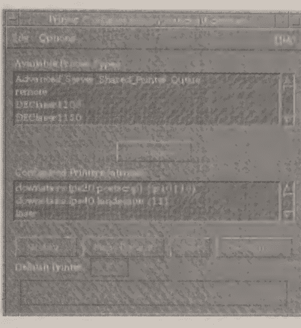

## 8.3.5 打印机设备文件

如果使用 `lprsetup` 或打印配置应用程序添加打印机，将根据需要创建设备特殊文件和打印目录。设备文件是 `/dev` 目录下的特殊文件，`lpd` 守护进程通过它与本地 I/O 端口通信。通常，串口和并行端口的设备特殊文件是在系统安装时创建的。但如果这些文件丢失或被删除，请按照以下步骤重新创建。

重新创建 `/dev/tty00` 和 `/dev/tty01`（针对一、二串口）：

```
# cd /dev
# /MAKEDEV ace0 # 串口设备通常是 ace0 但并非
MAKEDEV: special files(0) for ace0:
tty01
```

重新创建用于主并行端口的 `/dev/lp0`：

```
# cd /dev
# /MAKEDEV lp
MAKEDEV: special files(0) for lp:
```

### 8.3.5.1 创建打印目录

`lpd` 守护进程管理多个作业到同一台打印机的过程被称为“缓存”（spooling）。缓存是将每个作业保存在 `/spool` 层次结构下的临时区域，然后顺序将每个作业发送到打印机。该目录必须在 `/etc/printcap` 文件中通过“`sd`”选项指定。例如：

```
sd=/spool/lpd
```

### 8.3.5.2 启动守护进程

默认情况下，`lpd` 守护会在系统启动时自动启动。如果守护进程未运行，可以通过执行以下命令启动：

```
/etc/init.d/lpd start
```

### 8.3.5.3 测试打印机

添加打印机后，应测试其是否工作正常。Tru64 UNIX 提供了一个打印所有字符的实用程序。要使用该实用程序，只需将其输出管道至 `lpr`。例如，输出到并行打印机：

```
lptest | lpr -lp0
```

## 添加远程打印机

配置 Tru64 UNIX 系统打印到远程打印机与添加本地打印机类似，但配置远程打印机还需要两个额外信息：

- 打印服务器主机名

## 8.4.1 打印服务器主机名

配置远程打印机时，必须知道托管打印机的打印服务器的主机名。该主机名通常是可以通过网络访问的另一台计算机。这可能是另一台 Tru64 UNIX 系统、运行不同 UNIX 实现的系统，或者完全是非 UNIX 系统。对于独立式网络打印机，此主机名可能指向打印机本身。你必须能够通过指定主机名来解析远程系统（无论是另一台计算机还是网络打印机）。这意味着远程系统的主机名和 IP 地址要么位于本地的 `/etc/hosts` 表中，要么在域名服务器 (DNS) 中注册。要测试情况是否如此，请使用 `ping(1)` 命令。例如，如果打印服务器的主机名为 `jupiter`，输入以下命令：

```
# /bin/ping -c 3 jupiter
P jupiter.company.com (192.168.5.2): 56 data bytes
64 bytes from 192.168.5.2: icmp_seq=0 ttl=62 time=2 ms
64 bytes from 192.168.5.2: icmp_seq=1 ttl=62 time=1 ms
64 bytes from 192.168.5.2: icmp_seq=2 ttl=62 time=1 ms
jupiter.company.com PING Statistics-
3 packets transmitted, 3 packets received, 0% packet loss
round-trip (ms) min/avg/max = 1/1/2 ms
```

在此示例中，主机名 `jupiter` 解析到了 IP 地址 `192.168.5.2`，且系统对 ping 进行了响应，这表明可以通过网络访问它。

## 8.4.2 打印服务器上的打印队列名

除了打印服务器的主机名外，还需要知道你想要访问的打印机名称或队列名称。请联系远程系统的系统管理员获取此类信息。如果你拥有远程系统的登录权限，只需使用以下命令显示该系统上的队列即可：

```
# lpc status
printer is on device '/dev/lp0\' speed -1
queuing is enabled
printing is enabled
no entries
no daemon present
```

## 8.5 提供远程打印服务

在此示例中，有一台打印队列名为“laser”的打印机。此外，远程打印服务器主机上可能需要某些配置，以允许远程客户端访问其打印队列。这些配置见第 8.5.3 节。

在添加远程打印机时，请在打印机配置应用程序中指定打印机类型为“remote”。远程打印机类型的特殊之处在于它假设真实的打印机类型由远程打印服务器管理。在配置远程打印机时，系统会提示你提供两个额外信息：远程系统名称和远程系统打印机名称。这些信息在 `/etc/printcap` 文件中分别通过“`rm`” 和“`rp`” 选项指定。例如：

```
rm=jupiter.company.com
rp=laser
```

对于具有这些 `/etc/printcap` 条目的打印机，提交到该打印机的打印作业将发送到远程系统 `jupiter.company.com` 上的“laser”打印队列。

一旦向 Tru64 UNIX 系统添加了一台或多个本地打印机，就可以配置该系统以支持远程打印服务。与其在许多系统上安装打印机，通常会选择一个系统作为打印服务器。然后可以配置该打印服务器系统具有足够的打印池空间，以支持许多系统的活动。Tru64 UNIX 系统作为打印服务器需要满足以下三个要求：

- 打印服务器和打印客户端必须可以通过网络访问。
- 打印服务器和打印客户端必须都能够解析对方的主机名。
- 授权的打印客户端的主机名必须出现在打印服务器的 `/etc/hosts.lpd` 或 `/etc/hosts.equiv` 文件中。

### 8.5.1 网络访问

第一个要求显而易见。远程打印客户端系统必须能够跨网络访问打印服务器系统。验证此要求的最简单方法是从客户端通过 `telnet` 连接打印服务器。如果出现了打印服务器的登录提示，则说明存在必要的网络连接。然而，如果你无法从打印客户端访问打印服务器，则可能是其中一个或两个系统的网络配置不正确。有关配置网络的详细信息，请参见第 7 章“网络”。

### 8.5.2 名称解析

“名称解析”是一种高级说法，意思是“仅凭远程系统的主机名，系统是否可以确定另一个系统的 IP 地址？”确保名称解析成功的最快捷方法是在 `/etc/hosts` 文件中为每个远程系统放置条目。这是打印服务器和任何远程打印客户端共同的要求。例如，在下面的 `/etc/hosts` 文件片段中，`jupiter` 是打印服务器主机名，而 `saturn` 和 `pluto` 是打印客户端名：

```
192.168.5.2  jupiter
192.168.5.3  saturn
192.168.5.4  pluto
```

除了本地 `/etc/hosts` 文件外，域名系统 (DNS) 也是解析 IP 地址的方法。DNS 也称为伯克利互联网名称服务，是一个将主机名转换为 IP 地址的分布式数据库。要检查某个主机是否已知，可以使用如下命令：

```
$ nslookup jupiter
Server: dns.company.com
Address: 192.168.5.1

Non-authoritative answer:
Name: jupiter.company.com
Addresses: 192.168.5.2
```

### 8.5.3 授权远程打印访问

打印服务器必须授权哪些客户端访问它。这是通过将客户端的主机添加到打印服务器的 `/etc/hosts.lpd` 或 `/etc/hosts.equiv` 文件来实现的。配置完成后，`lpd` 守护进程将接受来自这些客户端的打印作业。

## 管理本地打印系统

`lpq` 命令能够显示单个打印作业状态、特定打印机（使用“-P”标志）或来自单个用户的打印请求。`lpq` 命令主要用于显示打印队列的状态。有关其选项的更多信息，请参 `lpq` 手页。

`lpstat` 命令是一个更通用的状态工具。除了显示单个打印队列的状态外，`lpstat` 还可以显示 `lpd` 守护进程的状态、系统目标名称以及哪些设备文件对应哪些打印机。`lpstat` 命令一个非常有用的开关是“-t”，它可以显示整个打印系统的状态，包括所有定义的打印机：

```
# lpstat -t
System default destination: 1p
Scheduler is running
Output for printer draft is sent to /dev/lp0
draft:
  printer is on device '/dev/lp0' speed -1
  queuing is enabled
  printing is enabled
  3 entries in spool area
  no daemon present
Requests on draft:
Feb 17 16:59:20 2001: Files Total Size
Rank Pri Owner root
Active 0 91 /etc/hosts 1107 bytes
1st 0 aey 93 /home/aey/main.c 21987 bytes
2nd 0 cjy 94 /home/cjy/memo 2151 bytes
```

请参考 `lpq` 和 `lpstat` 手页获取有关这些命令的更多信息。

## 8.3 `lpr` 和 `cancel`

提交打印作业的 `lpr/lp` 对的对面是 `lprm` 工具对。这些程序用于删除已经队列的打印请求。虽然 `lprm` 命令是 BSD UNIX 工具，但它可以在 Tru64 UNIX 系统上删除队列中的打印作业。这两个工具都允许删除单个打印作业并移除特定打印队列中的所有作业；然而，`lprm` 命令还支持删除特定用户提交的所有打印作业。

要删除单个打印作业，只需在命令行上输入打印请求 ID。特定作业的请求 ID 可以通过 `lpq` 或 `lpstat` 命令的输出确定。

只有具有超级用户权限的用户删除其他用户提交的打印作业。例如，要删除请求 ID 83，请执行以下任一命令：

```
# lprm 83
# cancel 83
```

通过将打印机名称作为 `lprm` 或 `cancel` 的参数，可以轻松删除特定打印机缓存的所有打印作业。`lprm` 命令的语法与 `lpr` 命令相似，即你使用“-P”标志指定打印机。另一方面，`cancel` 命令没有特殊的命令行标志。例如，要移除名为“draft”的打印机的所有待处理打印请求，请使用以下任一命令：

```
# lprm -P draft
# cancel draft
```

最后，`lprm` 命令具有删除特定用户提交的所有打印请求的能力。在命令行上指定一个或多个用户将移除属于这些用户的任何请求。这仅适用于具有超级用户权限的用户。例如，以下命令删除了 `aey` 提交的所有队列打印作业：

```
# lprm aey
```

向 `lprm` 命令指定用户账户的变体是“-u”标志。如果非 root 用户执行以下命令，则执行命令的用户的所有请求将被移除：

```
# lprm -
```

然而，如果 root 用户执行相同的命令，整个打印队列将被清空。

## 8.6.4 `lpc`

`lpc`（线路打印控制）工具是一个用于在 Tru64 UNIX 系统上管理打印机的工具，并为系统管理员提供了：

- 禁用和启用打印机
- 禁用和启用打印队列

## 8.6 管理本地打印系统

- 修改打印队列中作业的顺序
- 显示打印机、打印队列和打印守护进程的状态

`lpc` 工具有两种操作模式：命令驱动和交互式。该模式由调用工具的方式决定。如果不带任何参数运行 `lpc`，它假设用户希望进入交互模式，并显示“`lpc>`”提示符等待输入。当从命令行提供参数时，`lpc` 会执行作为参数提供的命令并退出。请查看 `lpc` 的参考页获取 `lpc` 命令列表。

以下是一个交互式 `lpc` 会话示例：

```
lpc
lpc> status
draft:
printer is on device '/dev/lp0' speed -1
queuing is enabled
printing is enabled
no entries
no daemon present
lpc>
```

系统管理员的角色之一是管理打印机和打印队列。例如，如果某个打印机需要维修并在一段时间内无法使用，你可以使用 `lpc` 命令将打印机标记为“down”（故障），这将禁用打印。`lpc down` 命令期望一个消息，指示打印机不可用的原因以及可能性的预计停机时间。例如，以下命令将实现此操作：


```
lpc down draft "Draft printer down for repair until 3pm Monday."
draft:
printer and queuing disabled
# lpcq -P draft
Warning: draft is down:
Warning: draft queue is turned off
Draft printer down for repairs until 3pm Monday.
no entries
```

注意，`lpc` 命令报告打印机已损坏且队列已禁用，并且使用“`lpc down`”命令输入的消息会被显示。一旦打印机修复，只需使用以下命令取消“down”操作即可：

```
lpc up draft
```

## 8.6.5 TCP 打印

另一种打印方法是 TCP。这适用于打印机具有 IP 地址并监听特定端口的情况。这些打印机一定是远程打印机，某些可以使用之前讨论的技术进行配置，只需进行一些修改。

首先，打印机必须有一个 IP 地址。可以将 IP 地址添加到 `/etc/hosts` 文件中。接下来，咨询文档以确定打印机将监听哪个端口。一旦打印机连接到网络并分配了 IP 地址，打印机就准备好了。在此示例中，打印机配置在 Tru64 UNIX 主机上。

| Rank | Pri | Owner | File | Size |
| :--- | :--- | :--- | :--- | :--- |
| Active | 0 | root | /etc/hosts | 1107 bytes |
| 1st | 0 | aey | /home/aey/main.c | 21987 bytes |
| 2nd | 0 | cjy | /home/cjy/memo | 2151 bytes |

## 8.6 管理本地打印系统

`ep1050+` `hp680c` `1la380` `1lg09plus` `1ln7`

`escp_a4_10cpi` `hp680c_a4` `1la380cb` `1lg09plus` `1ln7_a4`

或按 RETURN 执行 `[unknown]` : `1ln7ps`

输入打印机别名: `laser01`

输入打印机别名:

设置设备路径 'lp' [] ? `@unln17c/tcpprt`

你是否想捕获打印作业的统计数据 [y] | n?

设置统计文件 'af' [/usr/adm/lplacct] ?

设置溢打印程序目录 'sd' [/usr/spool/lpd1] ?

设置打印机错误日志文件 'lf' [/usr/adm/lplerr] ?

输入你想要修改的 printcap 符号名称。其他有效条目包括：

- 'q' 退出（不再进行更改）
- 'p' 打印你目前为止指定的符号
- 'l' 列出所有可能的符号以及
- 默认

printcap 符号的名称为：

`af` `br` `cf` `ct` `df` `dn` `du` `fc` `ff` `fo` `gs` `gc` `if` `lf` `lo` 

`lp` `mc` `mj` `mx` `nc` `nf` `of` `on` `os` `pl` `ps` `pw` `px` `py`

`rfrf` `rm` `rp` `rs` `sb` `sc` `sd` `sf` `st` `fr` `tr` `uv` `vf`

`xc` `xf` `xns` `ya` `yj` `yp` `yt` `Da` `It` `Lt` `Lu` `M1` 

`Nu` `Or` `Ot` `Ps` `Si` `Ss` `Ul` `Xf`

输入符号名称: `q`

# 打印机 #1

| 符号类型 | 值 |
| :--- | :--- |
| af STR | /usr/adm/lplacct |
| if STR | /usr/bin/pcfof +Cln17ps.pcf |
| lf STR | /usr/adm/lplerr |
| lp STR | @unln17c/tcpprt |

## 8.7 高级打印

```
mx INT 0
of STR /usr/lbin/pcfof +Cln17ps.ps
pl INT 66
pw INT 80
rw BOOL on
sd STR /usr/spool/lpd1
xf STR /usr/lbin/xf
```

这些是打印机 1 的最终值吗？ [y]

为新打印机向 printcap 文件添加注释，输入 '?' 寻求帮助。你是否想为 printcap 文件添加注释 [n] ? :

此打印机的活动设置已完成。请使用 `lpr(1)` 命令向打印机发送文件，以验证打印机工作正常。

命令 < modify delete exit quit help>: exit

从现在起，你可以以类似于打印和管理本地打印机的方式来打印和管理这台打印机。

高级打印（Advanced Printing）是 Compaq 作为关联产品提供的某种分布式、客户端/服务器架构、基于标准的打印子系统。它在用户和物理打印机之间提供了一个逻辑队列层。前几节中的打印机均被视为物理队列，因为它们与特定的物理打印机关联。高级软件（Advanced Software）允许用户指定打印机类型或逻辑打印机，而不是特定的打印机，并提供了一个允许用户查询打印机类型的框架。打印系统基于 ISO/IEC 10175 和 POSIX 1387.4 标准。要理解这种新打印环境的工作原理，请考虑它的组件。高级打印由服务器、客户端、溢打印程序、监控器以及逻辑和物理打印机组成。

客户端通过进程间通信（IPC）向服务器发送请求，服务器执行操作（通常是将作业与打印机关联并进行打印）。客户端程序包括命令行界面（CLI）、图形化用户界面（GUI）和 LPD 入站网关。客户端主要会请求打印作业或获取打印机状态。服务器由溢打印程序和监控器组成：一个高级打印服务器（Advanced Printing Server）系统至少包含一个溢打印程序和一个监控器。溢打印程序将打印作业重定向到打印队列并调度打印。监控器从队列中获取溢打印作业，并将作业需求与打印机能力匹配，然后打印作业并向溢打印程序和客户端报告状态。

逻辑和物理打印机通过队列连接；用户打印到逻辑打印机。通过这种方法，更改物理打印机对用户的影响极小或没有，用户可以根据打印机能力指定需求，而不是指定特定位置的特定打印机。此外，管理员可以设置逻辑-物理打印机关系为“扇入”（fan-in）或“扇出”（fan-out）。扇入意味着几台打印机指向一个物理打印机；扇出则相反，即少数逻辑打印机指向多个物理打印机。考虑这个示例：如果你有四台能力相同的激光打印机，你可能会创建一个名为“laser”的逻辑打印机来为所有四台打印机供稿。这种方法有许多优点，最重要的是负载均衡以及将一台物理打印机离线进行维护的能力。只要剩余的打印机能够跟上打印需求，离线就不会对用户产生任何影响。

### 8.7.1 安装

在安装高级打印子集之前，确保满足安装要求。对于打印服务器，要求是 64 MB 内存，而客户端至少需要 32 MB。此外，还考虑如何配置打印系统。例如，哪些系统将作为服务器，哪些作为客户端，是否需要 LPD 网关，如何管理名称等。请参考《高级打印安装指南》（Advanced Printing Installation Guide）。

### 8.7.2 配置

管理高级打印环境与管理常规 BSD 打印环境略有不同，尽管总体方法相似。本节并不旨在提供管理高级打印软件环境的全面指南；但考虑到运行 `/usr/pd/scripts/pd_get_started` 产生的初始配置，本节将突出该环境的一些重要元素。

## 表 8.2 有用的高级打印命令

| 命令 | 功能 |
| --- | --- |
| pdpr | 提交打印任务 |
| pdls | 列出打印机上待处理的任务或打印机属性 |
| pdcreate | 创建打印机（逻辑或物理） |
| pdenable | 启用打印机的打印功能 |
| pdclean | 从打印机上清理/删除任务 |
| pdpause | 暂停打印机打印 |
| pdresume | 恢复打印机打印 |
| pdesubmit | 将尚未打印的任务重新提交到另一台打印机 |
| pdpromote | 将任务移动到队列前端 |

### 8.7.3.1 命名空间

在任何分布式环境中，拥有中央名称存储库是一种良好的管理技术。高级打印软件（Advanced Printing Software）支持现有的分布式名称数据库，如网络信息系统（NIS）和轻量级目录访问协议（LDAP），以及本地文件命名。有关如何为高级打印设置这些设置的更多信息，请参阅高级打印文档。

### 8.7.3.2 打印机与队列

`pdget_started` 程序创建服务器（溢存器和监控器）以及初始打印机（物理和逻辑）。要添加另一个独立的打印机，只需重新运行该程序并按照提示操作即可。然而，更有趣的操作是将另一个打印机添加到原始逻辑打印机中。这种方法允许两个打印机由单个逻辑队列提供服务。这就是之前提到的扇出（fan-out）方法。

为逻辑打印机 `laser01_q` 添加一个新的物理打印机 `laser02_pp` 非常简单。当创建新的物理打印机时，它会与逻辑打印机关联：

```bash
# pdcreate -c printer -X \
/usr/opt/APX110/share/cap/Digital_LN17_Level2PS.p \
-X printer-address=192.168.24.138 \
--x associated-queue=laser01_q justice_sup:laser02_pp
```

现在启用它的打印：

```bash
# pdenable laser02_pp
```

要验证逻辑打印机 `laser01` 是否将扇出到两个物理打印机，可以使用 `pdls` 命令检查哪些物理打印机与逻辑打印机关联：

```bash
# pdls -c printer -r printer-associated-printers -s line \
laser01
```

```
laser01: printer-associated-printers = laser01_pp
laser02_pp
```

### 8.7.3.4 安全

高级打印系统的用户可以执行三个层级的操作：

- 终端用户
- 操作员
- 管理员

这些用户组允许执行的操作由访问控制列表（ACLs）决定。某些用户被允许在某些打印机上执行表单操作员或管理员功能。完整说明请参阅《高级打印系统管理与操作指南》。

## 8.7.4 LPD 网关

为了保持与现有的打印功能保持兼容性，设置了一个 LPD 入站网关（Inbound Gateway）和一个 LPD 出站网关（Outbound Gateway）。通过配置这两个网关，您可以确保仅能打印到基于 BSD 的打印机的应用程序继续工作，并且您环境中可能仅理解 LPD 的其他打印机保持可访问。

### 8.7.4.1 LPD 入站网关

LPD 入站网关可以替换或与 BSD/lpd打印环境共存。如果配置为替换 lpd 打印系统，所有打印将通过高级打印系统完成。如果配置为共存，则仍然可以使用 `lpr` 和 `lpd`，仅了解 BSD 打印的应用程序将继续运行。

为了完成循环使 `lpd` 使用高级打印打印机，请在 `/etc/printcap` 中添加条目，将 BSD 打印机与高级打印打印机关联。这种打印机被称为“网关打印机”。创建网关打印机，添加带有 `rm=@dpa` 和 `rp=printername` 的条目，其中 `printername` 是高级打印中的逻辑打印机名称。例如：

```
lpd20|laser_old:
:lp=\n:rm=@dpa:\n:rp=laser01:\n:sd=/var/spool/lpd20:\n:mx#:
```

任何提交到 `laser_old` 的 BSD 打印任务将发送到高级打印打印机 `laser01`。

要配置 LPD 入站网关，运行脚本 `/usr/pd/scripts/inbound_gw_config.sh`。在本示例中，网关和 lpd 配置为共存：

```bash
# /usr/pd/scripts/inbound_gw_config.sh

# Compaq 高级打印软件入站网关配置脚本

入站网是一个守护进程，允许用户使用 ASU 和 lpr/lpd 进行打印，以及那些打印任务传输到 Compaq 高级打印软件系统打印机的用户。此脚本将设置您的系统以运行入站网关？([yes]no)

您是否想要使用入站网关？

入站网关可以替换此系统上的 lpd（如果所有打印机都可以通过 Compaq 高级打印软件访问），或者与 lpd 结合，这样通过 Compaq 高级打印软件访问的打印机与通过传统 lpd 过滤器（定义在 /etc/printcap 中）访问的打印机就可以同时使用。除非您的系统进程槽即将用尽，否则 Compaq 建议您对以下问题回答 yes。

此系统上将同时使用 lpd 打印机*和* Compaq 高级打印软件吗？([yes]|no)

您可以选择启动入站网关，注意入站网关正在运行

| 使用入站网关： |
| 使用入站网关*和* lpd： |
| 现在启动入站网关： |

这是否正确？([yes]|no)

更新 /etc/printcap ...

在 dec.com 上启动入站网关

入站网关设置

高级打印的映射存在某些限制，请参阅管理操作指南
```

### 8.7.4.2 LPD 出站网关

LPD 出站网关提供了一种将任务发送到远程主机机制。这是通过将打印任务转换为 LPD 协议来实现的。创建一个指向远程的物理打印机，请包含以下格式的 printer-address：

```
printer-address=remotehost,printername,protocol_conformance
```

在 digital.com（一个 UNIX 系统）上设置名为 office01 的打印机，printer-address 属性所示：

```
printer-address="digital.com,office01,DigitalUNIX"
```

## 9.1 进程管理

由于多处理和多用户特性提供了丰富的计算环境。多个用户同时运行多个任务的能力提供了巨大的灵活性。当然，这种能力不仅限于 Tru64 UNIX，甚至不仅限于 UNIX，它存在于各种计算环境中，例如大型机环境、Oracle 等专有系统以及微软的 Windows 2000。然而，UNIX 尤其是 Tru64 UNIX 自 20 世纪 70 年代以来一直是软件开发工作、特别是大型团队项目以及多用户数据库应用程序的首选操作系统。

在 UNIX 中，单个任务（无论是验证用户登录或处理打印请求，还是用户编译 C++ 程序或查询数据库）被称为进程。管理这些进程（在个人工作站上可能只有几十，而在大型数据库或 Web 服务器上可能有数千个）是系统管理员职责的重要部分。

在本章中，我们将讨论进程的各种属性、这些属性如何相互关联，以及可以调整哪些属性以更改进程的行为。此外，还涵盖了父子进程关系。这种关系对于理解进程如何启动和结束至关重要。

# 进程概述

...前台进程和后台进程的概念。Tru64 UNIX 还提供了几种调度在未来某个日期运行进程的方法。这种能力被系统管理员广泛用于调度周期性的维护进程（例如系统备份），以便其在无需用户干预的情况下运行。

进程由执行代码及其地址空间组成。程序和进程并不等同于同一个东西；一个程序可以由多个进程组成。在 UNIX 系统上，将大型或复杂的程序拆分为多个进程通常可以带来性能上的收益。每个活动进程在系统进程表中都有一个条目，由系统调度器管理。进程是 Tru64 UNIX 系统上执行所有工作（无论是系统任务还是用户应用程序）的机制。

可以同时运行的进程最大数量源于“maxusers”系统参数。Tru64 UNIX 文档将 maxusers 定义为系统在不消耗系统资源的情况下可以支持的并发用户数。计算最大进程数量的公式在 Tru64 UNIX 5.0 版本中发生了变化。在 V5.0 之前，公式为：

```
(maxusers*8) + 20
```

从 V5.0 开始，公式为：

```
(maxusers*32) 向上取整到2的幂
```

例如，当 maxusers 设置为 1000 时，V4.0 系统可以运行最多 8020 个并发进程，而 V5.0 系统可以运行多达 32768 个进程。

## 9.2 进程概述

在旧版本的 Tru64 UNIX 中，maxusers 的默认值为 32。这是一个非常保守的值，也许适用于个人工作站，但对于大多数系统来说显然太低了。从 V5.0 开始，内核根据系统物理内存的大小在启动时设置 maxusers 的值。maxusers 与物理内存之间的关系所示于表 9.1。

maxusers 的最小可能值为 8。最大值为 16,384（V5.0 之前为 4,096）。

当达到最大进程数时，内核会在 `/var/adm/messages` 文件和内核日志系统中写入“pid table is full”消息，类似于：

```
Apr 23 11:07:44 martin vmunix: pid table is full
```


进入`/path/to/xxx`目录，找到`xxx.json`。

你可能还会看到更具信息的消息，例如：
`fork`函数失败。已存在过多进程。

要解决这种情况，请将`maxusers`增加到适当的值。在 Tru64 UNIX 的后续版本中，增加`maxusers`变得越来越容易。在 V4.0 之前，有必要修改内核配置文件（`/sys/conf/<HOSTNAME>`）中的`maxusers`，重新编译内核并使用新内核重启系统。在第 4 版本中，可以在`/etc/sysconfigtab`的`proc`系统段落中指定`maxusers`；此值在启动时加载，并在系统运行期间有效。在第 5 版本中，`maxusers`的初始值从`/etc/sysconfigtab`加载，但现在可以在系统运行时调高（但不能调低）该值。因此，现在无需重启系统即可解决“进程不足（out of processes）”问题。

## 表 9.1 Tru64 UNIX 版本 5 中 maxusers 的默认值

| 物理内存大小 | maxusers 的值 |
|---|---|
| 高于 32 MB | 16 |
| 大于 32 MB，小于 256 MB | 128 |
| 至少 256 MB，小于 512 MB | 256 |
| 至少 512 MB，小于 1 GB | 512 |
| 至少 1 GB，小于 2 GB | 1024 |
| 2 GB 或更多 | 2048 |

以下示例说明了在运行的系统中将`maxusers`从 32 增加到 200：

```
# sysconfig -q proc maxusers

proc:

maxusers = 32
```

这显示当前值为 32。

```
# sysconfig -r proc maxusers=200

maxusers: reconfigured
```

`sysconfig -r`命令更改了该值。要验证更改：

```
# sysconfig -q proc maxusers

proc:

maxusers = 200
```

这确认了当前使用的值已变为 200。但下次重启时会发生什么？检查`/etc/sysconfigtab`的内容：

```
# sysconfigdb -l proc

proc:

maxusers = 32

max_proc_per_user = 10000
```

`sysconfig -r`命令没有更改`/etc/sysconfigtab`中的`maxusers`值，因此在下次重启时，`maxusers`将恢复为 32。要更改`/etc/sysconfigtab`中的值，你可以使用`dxkerneltuner(8)`（图形界面）或`sysconfigdb(8)`（命令行工具）。要使用后者，需要创建一个包含所需系统参数值的段落文件。然后使用`sysconfigdb`将更改合并到`/etc/sysconfigtab`：

```
# cat proc.stanza

proc:

maxusers = 200

# sysconfigdb -m -f proc.stanza

Warning: duplicate attribute in proc: was maxusers = 32, now maxusers = 200
```

验证值是否已成功更改：

```
# sysconfigdb -l proc

proc:

maxusers = 200

max_proc_per_user = 10000
```

## 9.3 进程属性

Tru64 UNIX 在内核内存结构`proc`中存储了关于每个活动进程的各种属性，定义在`/usr/include/proc.h`文件。以下章节描述了一些有趣的属性：

- 进程标识符 (`PID`)
- 父进程标识符 (`PPID`)
- 进程组标识符 (`PGID`)
- 所有者及有效用户标识符 (`UID`/`EUID`)
- 所有者有效组标识符 (`GID`/`EGID`)
- 资源优先级
- 控制终端

### 9.3.1 显示属性

可以使用`ps`工具显示活动进程的属性。运行带参数的`ps`会打印与控制终端相关的进程信息：进程 ID (`PID`)、控制终端 (`TTY`)、状态 (`$`)、进程使用的 CPU 时间 (`TIME`)。`ps`有两种命令行格式：基于 System V (`SYSV`) 和 BSD。当参数以“-”开头时，被视为 BSD 格式。以下是 SYSV 进程输出示例：

```
# ps -ef

UID PPID STIME TTY CMD

root 0 0 0.0 Jun 03 15:20:91 [kernel idle]

root 1 0 0.0 Jun 03 03:35.07 /sbin/init -a

root 3 0 0.0 Jun 03 1:30:53 /sbin/kldadrv

root 22 0 0.1 1.55M 56K ?? S Jun 03 12:15.65 /usr/sbin/update

root 95 0 0.2 1.61M 120K ?? S Jun 03 00:16.80 /usr/sbin/syslogd

root 97 0 0.1 1.59M 06K ?? IW Jun 03 00:00.04 /usr/sbin/binlogd

root 349 0 0.1 1.86M 72K ?? I Jun 03 00:20.21 -accepting connections (sendmail)

root 401 0 0.2 2.84M 104K ?? S Jun 03 02:55.62 /usr/sbin/os_mibs

root 403 0 0.1 1.68M 48K ?? S Jun 03:47.75 /usr/sbin/snmpd

root 420 0 0.1 1.62M 64K ?? I Jun 03 00:05.58 /usr/sbin/inetd

root 453 0 0.2 1.59M 120K ?? I Jun 03 01:01.02 /usr/sbin/cron

root 469 0 0.0 1.70M OK ?? IW Jun 03 00:00.02 /usr/sbin/l1pd

root 536 0 0.0 432K 0K console IW + Jun 03 00:04.42 /usr/sbin/getty console vt100

mcheck 28727 28801 0.3 17:13:51 tty0 0:00:90 -ksh (ksh)

root 6959 28727 0.0 18:47:47 tty0 0:01:19 ps -ef
```

查看同一系统的 BSD 进程输出：

```
# ps auxw

USER PID %MEM VSZ RSS TTY S STARTED TIME COMMAND

root 0 0 0.0 76.0M 4.6M ?? R < Jun 03 15:20.91 [kernel idle]

root 1 0 0.1 440K 40K ?? I Jun 03 03:35.07 /sbin/init -a

root 3 0 0.0 904K OK ?? IW Jun 03 1:30:53 /sbin/kldadrv

root 22 0 0.1 1.55M 56K ?? S Jun 03 12:15.65 /usr/sbin/update

root 95 0 0.2 1.61M 120K ?? S Jun 03 00:16.80 /usr/sbin/syslogd

root 97 0 0.1 1.59M 06K ?? IW Jun 03 00:00.04 /usr/sbin/binlogd

root 349 0 0.1 1.86M 72K ?? I Jun 03 00:20.21 -accepting connections (sendmail)

root 401 0 0.2 2.84M 104K ?? S Jun 03 02:55.62 /usr/sbin/os_mibs

root 403 0 0.1 1.68M 48K ?? S Jun 03:47.75 /usr/sbin/snmpd

root 420 0 0.1 1.62M 64K ?? I Jun 03 00:05.58 /usr/sbin/inetd

root 453 0 0.2 1.59M 120K ?? I Jun 03 01:01.02 /usr/sbin/cron

root 469 0 0.0 1.70M OK ?? IW Jun 03 00:00.02 /usr/sbin/l1pd

root 536 0 0.0 432K 0K console IW + Jun 03 00:04.42 /usr/sbin/getty console vt100

root 7520 0 0.4 1.75M 264K tty0 R - Jun 03 8:49:07 0:00.06 ps auxw *
```

## 9.3 进程属性

```
mcheek 28727 0.1 0.4 1.88M 264K ttyp0 S 17:13:51

0:00.88 -ksh (ksh)
```

### 9.3.2 进程标识符

每个活动进程都会被分配一个进程标识符（或`PID`），这是一个唯一的正整数。还有一个`PID`为 0 的特殊进程；`ps`命令将其显示为“内核空闲”（kernel idle）进程。尽管名称如此空闲，但该进程远非空闲。它包含了许多线程，负责执行内核的所有“家务管理”功能。在某些情况下，“空闲”进程实际上是系统中最大且最忙的进程。`/sbin/init`程序用于初始化系统，并根据需要更改系统的运行级别（run level）。

从 Tru64 UNIX 版本 5 开始，`PID`变包含了显示进程运行在哪个集群成员上的信息。“本地”`PID`存储在`PID`的低 19 位中，因此范围从 0 到 524,287 (`2^19–1`)。集群成员 ID 存储在第 19–24 位中。因此，版本 5 的`PID`等于：

```
(member_id * 2^19) + local_pid
```

独立系统（即不属于 TruCluster 的系统）的成员 ID 为零。例如，由于它始终是进程 1，我们在独立系统上会看到以下内容：

```
% ps -ef | grep inid

root 1 0 0.0 10:48:09 ?? 0:00.04 /sbin/init -a
```

数字 1（紧跟 "root" 之后）就是`PID`。现在让我们在属于集群的系统上尝试相同的操作：

```
% ps -ef | grep inid

root 524289 524288 0.0 Jan 21 ?? 0:01.05 /sbin/init -a
```

在这种情况下，`init`的`PID`是 524289。如果我们将其拆分为本地`PID`和集群成员字段，可以看到`PID`值为 `(1 * 2^19) + 1`。这代表了如预期的本地`PID`为 1，以及集群成员 ID 为 1。我们可以通过以下方式验证成员 ID：

```
/sbin/sysconfig -q generic memberid

generic:

memberid=1
```

### 尝试另一个集群成员：

```
% ps -ef | grep init

root 1048577 1048576 0.0 Jan 21 22 ?? 0:06:05 /sbin/init -a
```

在该系统中，`init`的`PID`为 1048577，或 `(2 * 2^19) + 1`，这拆解为本地`PID`为 1 和集群成员 ID 为 2。检查成员 ID：

```
% /sbin/sysconfig -q generic memberid

memberid = 2
```

`PID`仅仅是内核用于向用户报告状态更改的值，用户在某些情况下（例如向进程发送信号时）可以通过它来识别单个进程。每个新进程都以某种随机的方式被分配`PID`，且进程与`PID`之间没有关联性。此外，`PID`在任何活动进程中都是唯一的；系统会根据需要重用`PID`。永远不要对分配给活动进程的`PID`作任何假设。相反，请使用`ps`工具并搜索目标进程的名称来获取该进程的`PID`。例如：

```
% ps -ef | grep syslogd

root 95 1 0.0 Jun 03 ?? 0:16:80

/usr/sbin/syslogd
```

### 9.3 PID 和 PGID

除了`PID`之外，进程创建时还会被分配另外两个进程标识符：父进程标识符（`PPID`）和进程组标识符（`PGID`）。这两个 ID 是继承自进程的父进程而不是生成的，因此不具有`PID`的唯一性要求。

特定进程的父进程标识符（`PPID`）只是启动该特定进程的父进程的`PID`。所有进程都是其他进程的子进程，除了“内核空闲”进程（`PID` 0）外，它们最终都可以追溯到`init`（`PID` 1），它是所有其他进程的祖先。

`PPID`是 SV 版本`ps`中的一个默认输出字段。`PID`对于系统管理员追踪进程所有者非常有用，特别是当需要终止进程时。尽可能按照创建顺序的反向顺序向进程发送终止信号（通过`kill(1)`命令）。这可以避免僵尸进程以及进程挂起的其他不愉快的情况。（有关僵尸进程的更多信息，请参见第 9.5 节。）

进程组标识符`PGID`是一个类似于`PID`的数字，不同之处在于`PGID`并不是识别单个进程，而是识别一组进程或一个进程组。进程组的一个示例是从 shell 提示符发出的管道中的命令`set`。例如，以下命令：

```
# cat /etc/passwd | grep ksh | cut -d - -f1 | sort
```

这会显示默认 shell 为`/bin/ksh`的用户 ID 排序列表，它由管道中的四个不同的进程（`cat`、`grep`和`sort`命令）组成，每个进程都有自己的`PID`。然而，所有四个进程将具有相同的`PGID`。如果例如，这样的管道运行时间很长且你想终止该作业，这就特别有用。你不需要在`kill`命令中搜索并指定每个进程的`PID`，而只需要指定`PGID`，终止信号就会广播到进程组的每个成员。进程组是 C shell 和 Korn 中作业控制功能的基础。

### 9.3.4 实际有效用户/组标识符

进程从其父进程继承用户标识符（`UID`）和组标识符（`GID`）。进程的`UID`和`GID`用于内核访问控制设施来确定进程对文件和目录的访问权限。这防止了非特权用户进程（例如）写入`/etc/passwd`并更改`root`密码。此外，`UID`还用于定义进程可能接收的信号。这通过防止普通用户杀死`cron`等重要的系统进程来保护系统。

`UID`和`GID`由系统管理员在`/etc/passwd`和`/etc/group`文件中维护。使用`ps(1)`命令配合`SV -f`开关列进程时，`UID`会转换为对应的用户名。如果没有该开关，`ps`以数值形式显示`UID`。

通常需要允许普通进程临时获得更高的权限。例如，用户必须能够编辑通常只读的`/etc/passwd`文件以更改用户密码。为了解决这个问题，UNIX 允许对程序进行配置，使得程序在由非特权用户运行时获得额外的权限。以额外的组权限运行的程序被称为设置组标识符（`SGID`）程序。同样，以额外的用户权限运行的程序被称为设置用户标识符（`SUID`）程序。当运行`SUID`程序时——例如允许用户更改密码的`passwd(1)`程序——该进程具有一个额外的标识符，即有效用户标识符（`EUID`），它指定了进程拥有的额外用户权限。继续`passwd(1)`程序的例子，更改密码进程的`EUID`为 0（`root`），因为`passwd`被设置为`root`的`SUID`。`passwd`程序假设了`root`用户的访问权限以修改密码。同样，在运行`SGID`程序时，进程的有效组标识符（`EGID`）会被设置。

Tru64 UNIX 还使用第三种标识符，即登录`UID`（`LUID`）。`LUID`在用户登录时确定，并在用户注销前保持不变。例如，`UID`为 123 的用户 "ajones" 登录后，使用`su(1)`命令变为超级用户，该用户进程的`UID`为 0（`root`），但其`LUID`将保持为 123（`ajones`）。

# 进程属性

默认情况下，进程启动时的`nice`值为0，这既不会增加也不会降低进程优先级。`nice`命令用于以非零`nice`值启动进程：

```bash
$ nice -n 15 sort.txt
```

语法`-n`是一个可选参数，例如：

```bash
$ nice -n 10 &
```

只有超级用户可以指定小于 0 的`nice`值。例如，以下命令以 -10 的`nice`值运行，这会提高调度优先级并防止普通用户延迟其执行：

```bash
$ nice -n -10 du
```

`renice`命令用于以修改后的`nice`值启动进程。一旦进程已经在运行，也可以通过`renice`命令修改其`nice`值。`renice`对系统管理员非常灵活；可以针对单个进程，也可以针对一组相似的进程。要更改单个进程的`nice`值，只需指定进程标识符 (`PID`)：

```bash
$ renice -n -12 -p 783
```

命令行上可以指定多个`PID`。`renice`命令还可以用于更改组相似的进程，方法是通过指定进程组标识符 (`PGID`) 来更改进程组中的所有进程，或者通过指定用户名或用户标识符 (`UID`) 来更改特定用户拥有的所有进程。例如，以下命令更改了进程 ID 2001 和 2005，以及 `jsmith` 拥有的进程的`nice`值：

```bash
$ renice -n 5 -g -u jsmith own
```


`renice` 的最后一个限制是，虽然超级用户既可以增加也可以降低进程的 `nice` 值，但无权限用户只能增加其拥有的进程的 `nice` 值。用户永远无法降低 `nice` 值，即使该值之前是由他们增加的。例如，如果用户 `jsmith` 将 `nice` 值从0 增加到 +10，他不能将 `nice` 值恢复为0；只有系统管理员可以降低它。

除了 `nice` 值之外，还有许多其他因素影响进程优先级。这些包括进程最近使用的 CPU 时间量、进程使用的内存量，以及运行队列中等待 CPU 时间的作业数。可以通过 `ps` 命令并指定 `-l` 选项来显示进程优先级和 `nice` 值。进程优先级显示在 PRI 列中，而 `nice` 值显示在 `ps` 输出的 NI 列中。

## 9.3.6 资源利用

当进程执行时，内核会跟踪进程对各种系统资源的利用情况。这些资源包括：

- CPU 使用率
- 内存利用率
- 经过的时间
- 磁盘 I/O 和上下文切换
- 接收到的信号数量

这些资源利用统计存储在每个进程的 `proc` 结构中，由内核对所有进程进行动态更新，系统管理员（以及普通用户）可以通过 `ps` 命令获取。这些信息有用，例如通过检查 CPU 利用率来识别失控进程，或确定特定进程的物理和虚拟内存使用情况。

最常用的进程利用率信息是 CPU 和内存统计。进程的 CPU 使用率通过检查 `ps` 输出中的 `%CPU` 和 `TIME` 两个字段进行监控。内存利用率在 `%MEM`、`RSS` 和 `VSZ` 列中跟踪。这些列通过使用 SYSV 的 `ps -eo VFMT` 选项或 BSD 的 `ps u` 选项显示。

`%CPU` 是一个动态计算的值，代表进程消耗的单个 CPU 资源百分比。因此，所有进程总计的 CPU 时间最大值等于 CPU 的数量乘以 100%；例如，拥有四个 CPU 的系统总和为 400%。单个多线程进程的 CPU 时间显示大于 100% 是可能的；尽管这看起来有点奇怪，但它是多处理器系统的正常结果。一个持续处于或接近最大可能利用率的进程可能是失控进程。然而，取决于进程的类型以及它正在做什么，进程的 `%CPU` 较高也可能是完全正常的。

`TIME` 是进程在 CPU 上实际执行的总时间。该值自进程启动以来是累积的，对于长时间运行的进程，该值可能是几小时或几天。该值不是总的已流逝时间（“墙钟时间”），仅仅是进程实际在处理器上运行的总时间。

`%MEM` 是进程占用的实际（物理）内存的百分比。`RSS` 是当前驻集大小（即进程实际占用的物理内存量），而 `VSZ` 是进程的总虚拟内存大小。两者都以字节（KB）为单位显示。进程的 `VSZ` 始终有一个值，而 `RSS` 列可以在 `VSZ` 值和 0 之间变化。如果进程因为内存不足被交换到磁盘，`RSS` 值可能为 0。文本段、数据段和栈段的总大小受虚拟内存大小限制。

另一个限制（由内核实施，而非 shell）是 `proc` 子系统中的 `max_proc_per_user` 参数。该参数的默认值为 64，定义了非特权用户在任何时刻可以执行的最大进程数。此限制防止非特权用户无意或恶意地创建大量进程，从而耗尽系统所有可用的进程槽。然而，64 的默认值对于某些应用程序来说是不够；要提高该值，请使用 `dkkernerneltuner` 或 `sysconfigdb` 修改 `max_proc_per_user` 的值，并重启系统。

需要注意的一个“隐藏”限制是，由于单个用户运行的进程数不可能超过整个系统允许运行的数量，因此 `max_proc_per_user` 减去 10（以为系统进程留出几个槽）。如果你尝试将 `max_proc_per_user` 设置得更高，系统将静默地将其恢复为最大可能值。例如，在 V5.0 系统上，如果 `maxusers` 设置为 32，你尝试将 `max_proc_per_user` 设置为更高的数字（例如 10,000），系统会将该值降至 1014（1024 减去 10），而不会给你任何警告或错误信息。

## 9.3.7 控制终端

除了启动时启动的系统进程外，大多数进程都与特定的终端关联。该控制终端通常是启动或拥有该进程的用户登录的终端。然而，如果用户在后台运行作业并然后注销，该进程将不再与终端关联。这在 `ps` 输出的 TTY 字段中用 `??` 表示。不与终端关联的系统进程（或守护进程）在 `ps` 输出的 TTY 字段中也显示为 `??`。

当需要识别与特定登录用户关联的所有进程时，知道控制终端是有用的。只需运行 `who(1)` 命令来确定要查询哪个终端，然后向 `ps` 命令指定该感兴趣的终端，以显示与该终端关联的所有进程。例如：

```
# who

mcheeck tty1 Jun 4 11:35 <- 与 tty 关联的进程有哪些？

styler tty2 Jun 4 13:11

jsmith tty4 Jun 4 15:51

tlee tty5 Jun 4 09:14
```

## 9.3.8 进程状态

```
# ps -ft ttypl

mcheek 28727 28801 0.3 11:37:51 ttypl 0:00.90 -ksh (ksh)

mcheek 29178 28727 0.0 11:52:33 ttypl 0:01.02 -vi main.c
```

内核在 `proc` 结构中维护所有活动进程的当前状态。尽管 Tru64 UNIX 是多任务操作系统，但多个进程实际上同时运行的感觉在某种程度上是一种幻觉。在任何特定处理器上，任何时刻只能运行一个进程；在多处理器系统中，处理器的数量决定了并发进程的最大数量。当进程没有实际运行时，它可以处于几种其他状态之一，包括睡眠、等待下一次运行机会、空闲、停止或挂起。

进程状态以一个或多个字符序列的形式显示在 `ps` 输出的 S 列中。第一个字符指示进程的状态。第一个字符之后的后续字符指示额外的状态信息，包括进程是否被交换出，或者进程的调度优先级（或 `nice` 值）是否被更改。进程状态指示字符的定义请参见表 9.3。

`ps` 命令尽可能准确地显示进程状态。然而，进程状态可能会迅速变化，`ps` 命令的快照与实际进程状态之间可能存在差异。这通常不会引起问题，但仍需要注意。

BSD 格式的 `ps` 默认显示进程信息。要在指定 SVYS `ps` 选项时显示进程状态，请添加 `-l` 参数以生成“长”列表。进程状态显示在 S 列中。例如：

```
# ps -efl

F S UID UID PPID %CPU PRI NI RSS WCHAN STARTED

TIME COMMAND

3 R < 0 0 0.0 32 -12 4.6M * Jun 03 19:28.34

[kernel idle]

8048001 I 0 1 0.0 44 0 40K pause Jun 03 0:35.36

/sbin/init -a

801 W 0 3 1 0.0 44 0 OK sv_msg_ Jun 03 1:30.53

/sbin/kloadsrv

8001 I 0 22 1 0.0 44 0 56K pause Jun 03 14:51.74

/sbin/update

8001 S 0 95 1.0 0 42 0 120K event Jun 03 0:21.45

/usr/sbin/syslogd
```

## 9.4 ps 命令

表 9.3 进程状态指示字符

| 字符 | 进程状态 |
|---|---|
| R | 可运行（等待 CPU 调度） |
| U | 不可中断（等待内核事件） |
| S | 睡眠（小于 20 秒） |
| I | 空闲（超过 20 秒） |
| T | 停止 |
| H | 挂起 |
| W | 交换出（超出内存限制） |
| N | Nice（优先级降低） |
| + | 进程组组 |

`ps(1)` 命令是系统管理员查看 Tru64 上所有进程状态的窗口。内核收集的每个进程统计数据都可以通过 `ps` 命令显示。默认情况下，每个版本的 `ps`（SYS 或 BSD）显示一些常用字段，如 PID、所有者、启动时间和 CPU 时间以及正在执行的命令。要显示任何不常用的统计数据（如进程的 `nice` 值或进程组 PGID），必须在 `ps` 行中指定。此外，`-o` 切换允许自定义 `ps` 输出以显示你想看到的任何字段。例如，要显示 PID、经过时间、在系统和用户空间消耗的时间以及运行中的命令——针对系统中所有进程——运行以下命令：

```
# ps -A -pid -o etime -cputime -systime -utime -o command

PID ELAPSED TIME USER COMMAND

0 36-09-52:31 22:59.78 22:59.78 0:00:00 [kernel idle]

1 36-09-52:31 0:35:83 0:34:72 0:01:11 /sbin/init -a

3 36-09-52:30 1:30:59 0:58:19 0:32:40 /sbin/kloadrs

22 36-09-52:20 17:06:41 17:00:09 0:06:32 /sbin/update

95 36-09-52:14 0:23:17 0:19:73 0:03:44 /usr/sbin/syslogd

97 36-09-52:14 0:00:13 0:00:11 0:00:02 /usr/sbin/bind

277 36-09-52:07 1:46:42 1:37:01 0:29:41 /usr/sbin/portmap

349 36-09-52:02 0:39:12 0:38:13 0:01:00 -accepting connections(sendmail)

401 36-09-52:00 0:36:32 0:24:92 0:11:40 /usr/sbin/mibs

403 36-09-52:00 4:13:62 3:43:14 0:30:49 /usr/sbin/snmpd

420 36-09-52:01 0:02:26 0:01:16 0:00:06 /usr/sbin/inetd

453 36-09-52:51 0:01:95 0:01:81 0:00:14 /usr/sbin/cron

469 36-09-52:49 0:00:04 0:00:04 0:00:01 /usr/bin/lpd

536 36-09-52:38 0:00:42 0:00:40 0:00:03 /usr/sbin/getty

console vt100

18804 01:42:42 0:00:32 0:00:19 0:00:12 -ksh (ksh)

19570 0:00:00:05 0:00:02 ps -A -o pid -o etime -cputime -systime -utime -o command
```

查阅你系统上的 `ps(1)` 参考页面以获取可与 `-option` 使用的可用列表。

## 9.5 进程父子关系

UNIX 系统上的每个进程都由另一个调用 `fork()` Term的进程创建，然后成为创建进程的子进程。子进程继承其父进程的特权，外加父进程的优先级、状态、环境以及存储在父进程“proc”结构中的所有其他参数。事实上，除了 PID 和 PPID 之外，子进程最初是父进程的克隆。

在讨论“僵尸进程”时，也会涉及到父子关系。僵尸进程是一个已退出进程，但其父进程尚未确认退出。在 `ps` 列表中，通过进程命令位置的 `<defunct>` 字符串识别僵尸进程。僵尸进程本身通常对系统管理员不是问题，因为它们的唯一影响是继续占用一个进程表槽。导致僵尸进程的各种情况可能引起关注。这些原因包括挂起或阻塞的进程无法捕获子进程的退出信号、糟糕的编程实践或系统问题。

# 表 9.4（续）

| 信号编号 | 信号名称 | 含义 |
|---|---|---|
| 3 | SIGQUIT | 退出 |
| 4 | SIGILL | 非法指令 |
| 5 | SIGTRAP | 跟踪陷阱 |
| 6 | SIGABRT | 终止程序 |
| 7 | SIGEMT | EMT 指令 |
| 8 | SIGFPE | 浮点异常（或其他算术异常） |
| 9 | SIGKILL | 杀死 |
| 10 | SIGBUS | 规格异常 |
| 11 | SIGSEGV | 段错误（内存访问违规） |
| 12 | SIGSYS | 系统调用参数无效 |
| 13 | SIGPIPE | 管道破 |
| 14 | SIGALRM | 闹钟 |
| 15 | SIGTERM | 终止 |
| 16 | SIGURG | I/O 通道上的紧急情况 |
| 17 | SIGSTOP | 停止 |
| 18 | SIGTSTP | 交互式停止 |
| 19 | SIGCONT | 停止后继续 |
| 20 | SIGCHLD | 子进程退出 |
| 21 | SIGTTIN | 后台读 |
| 22 | SIGTTO | 后台写 |
| 23 | SIGIO | I/O 可（或已完成） |
| 24 | SIGXCPU | 超过 CPU 限制 |
| 25 | SIGXFSZ | 超过文件大小限制 |
| 26 | SIGVTALRM | 虚拟时间闹钟 |
| 27 | SIGPROF | 性能分析闹钟 |
| 28 | SIGWINCH | 窗口大小变化 |
| 29 | SIGINFO | 信息请求 |
| 30 | SIGUSR1 | 用户自定义 |
| 31 | SIGUSR2 | 用户自定义 |

Tru64 UNIX 系统控制进程的主要方法是使用 `kill` 命令向它们发送信号。`kill` 命令是一个误名，因为执行一个 `kill` 命令：

```
# kill <PID>
```

并不一定会杀死进程。实际发生的情况是 `kill` 命令向命令行指定的进程（或进程组）发送信号，这可能导致或导致导致死亡。事实上，某些信号（包括 `SIGUSR1`）不会终止进程。默认情况下，除非指定特定的信号，否则 `kill` 会发送 `SIGTERM` 信号（信号编号 15），礼貌地请求进程终止。

其他常用信号还有 `SIGHUP`（编号 1）、`SIGKILL`（编号 9）和 `SIGSTOP`（编号 17）。`SIGHUP` 告诉进程挂断连接，当用户注销时，该信号会发送给分配给终端的所有进程。`SIGKILL` 是杀死进程常用的信号；它应该作为结束进程的最后手段，因为它会立即终止进程，而不给予执行任何“清理”操作的机会。`SIGSTOP` 是告诉进程临时停止执行的信号；它通常响应 shell 的“停止”字符（通常是 Control-Z）发送给进程。`SIGKILL` 和 `SIGSTOP` 信号的独特之处在于它们无法被接收进程捕获或忽略。这确保了存在一种方法来停止或杀死不受控制或失控的进程。

`kill` 命令行可以通过信号编号或信号名称（减去“SIG”前缀）指定信号。指定信号名称时，不区分大小写。例如，以下三个命令是等效的：

```
# kill -9 4321

# kill -KILL 4321

# kill -kill 4321
```

此外，可以通过指定多个 PID 来向多个进程发送信号：

```
# kill -HUP 4456 4458
```

挂断（HUP）信号是系统管理员常用的信号。几个系统守护进程，如 `inetd(8)`、`syslogd(8)` 和 `bootpd(8)`，在接收到 HUP 信号后会重新读取它们的配置文件。这允许你修改守护进程的配置文件并使更改无需停止并重启守护进程即可生效。例如，以下命令：

```
# kill -HUP cat /var/run/inetd.pid
```

将导致 `inetd(8)` 重新读取 `/etc/inetd.conf`，因为 `/var/run/inetd.pid` 包含了当前运行的 `inetd` 守护进程的 PID。

在使用 `kill` 命令发送信号时，两个 PID 具有特殊意义。指定零 (0) 作为 PID 会将信号发送给与发送者具有相同进程组（PGID）的所有进程，但 PID 0 和 1 除外。指定 -1 作为 PID 的行为取决于发送者的有效用户 ID（EUID）。如果 EUID 不是 0（即 root），则信号将发送给所有 UID 与发送者相同的进程，但  PID 0 和 1 除外。然而，如果发送者的 EUID 为 0（即 root），则信号将再次发送给系统上的所有进程。

Tru64 UNIX 系统（特别是大型服务器）经常支持不同用户和应用程序类型的混合。单一服务器可能同时支持生产数据库、开发组以及访问其电子邮件的用户。在这种情况下，确保各种应用程序获得足够的资源来完成其任务——而不干扰所有其他程序是非常关重要的。Tru64 UNIX 提供了多种方法为特定用户、组或应用程序分配 CPU 资源。这些包括：

- 划分系统（取决于硬件）
- 定义处理器集（processor sets）
- 将进程绑定到 CPU 或处理器集

### 9.7 分配 CPU 资源

系统分区是将系统的物理资源（处理器、内存和 I/O 设备）组织成若干较小“虚拟机”的能力。虽然这种功能取决于底层硬件而非操作系统，但它对于 Tru64 管理员来说是一个重要的工具。Alpha 系列较大的成员提供了这种能力，允许一台大型服务器作为 Tru64 或另一个操作系统（如 Compaq 的 OpenVMS）副本运行。分区适用于需要系统独立的情况。例如，你可能希望在一个分区中运行应用程序的生产版本，在另一个分区中运行测试版本。或者你可能希望在升级整个系统之前运行一个版本的 Tru64。分区的缺点是资源分配不是动态的；例如，你无法在运行时将处理器从一个分区移动到另一个。要重新配置分区，必须关闭每个分区，重新配置然后重启分区。分区数量取决于所使用的 Alpha 型号。由于由于，应查询系统文档获取更多信息。

### 9.7.2 处理器集

Tru64 UNIX 允许将系统的 CPU 分为处理器集（简称 `psets`）。处理器集是一个或多个处理器的组。默认情况下，系统创建一个包含所有处理器的默认处理器集。`pset_info(1)` 命令列出系统当前的处理器集：

```
# pset_info

number of processor sets on system = 1
```


pset_id # cpus # pids # threads load_av created

0 3 240 .40 05/10/2001

11:41:14

total number of processors on system = 3

cpu running primary_cpu pset_id assigned_to_pset

0 1 1 0 05/10/2001 11:41:14

该系统有一个处理器集（默认处理器集，ID 为0），包含三个处理器。我们可以通过 `psrinfo(1)` 命令获取有关处理器的更多信息：

```
# psrinfo -v as of: 05/15/01 18:55:03

Status of processor has been on-line since 05/10/2001 11:41:14

The alpha EV6.7 (2164A) processor operates at 667 MHz,

and has an internal processor.

Status of processor 1 as of: 05/15/01 18:55:03

Processor has been on-line since 05/10/2001 11:41:14

The alpha EV6.7 (2164A) processor operates at 667 MHz,

and has an internal processor.

Status of processor 2 as of: 05/15/01 18:55:03

Processor has been on-line since 05/10/2001 11:41:14

The alpha EV6.7 (2164A) processor operates at 667 MHz,

and has an internal processor.
```

要创建一个新处理器，使用 `pset_create(1)` 命令：

```
# pset_create

pset_id = 2
```

这创建了一个 `pset_id` 为 2 的新处理器集，但此时它是空的处理器集。也就是说，它还没有包含处理器。

```
# pset_info

number of processor sets on system = 2

| pset_id | # cpu | # pids | # threads | load_av | created |
| --- | --- | --- | --- | --- | --- |
| 0 | 3 | 61 | 239 | 3.57 | 05/10/2001 |
| 11:41:14 | 2 | 0 | 0 | 0.00 | 05/15/2001 |

total number of processors on system = 3

| cpu | running | primary_cpu | pset_id | assigned_to_pset |
| --- | --- | --- | --- | --- |
| 0 | 1 | 1 | 0 | 05/10/2001 11:41:14 |
| 1 | 1 | 0 | 0 | 05/10/2001 11:41:14 |
| 2 | 1 | 0 | 0 | 05/10/2001 11:41:14 |
```

现在我们可以向新的处理器集添加一个处理器：

```
# pset_assign_cpu 2 1

# pset_info
```

number of processor sets on system = 2

| pset_id | # cpu | # pids | # threads | load_av | created |
| --- | --- | --- | --- | --- | --- |
| 0 | 2 | 56 | 233 | 0.01 | 05/10/2001 |
| 11:41:14 | 2 | 1 | 0 | 0.00 | 05/15/2001 |

total number of processors on system = 3

| cpu | running | primary_cpu | pset_id | assigned_to_pset |
| --- | --- | --- | --- | --- |
| 0 | 1 | 1 | 0 | 05/10/2001 11:41:14 |
| 1 | 1 | 0 | 0 | 05/10/2001 11:41:14 |
| 2 | 1 | 0 | 0 | 05/10/2001 11:41:14 |

系统上的处理器总数 = 3

| cpu # | 运行中 | 主要 cpu | pset_id | 分配至 pset |
|---|---|---|---|---|
| 0 | 1 | 1 | 0 | 05/10/2001 11:41:14 |
| 1 | 1 | 0 | 2 | 05/16/2001 09:17:45 |
| 2 | 1 | 0 | 0 | 05/10/2001 11:41:14 |

要删除处理器集，请使用 `pset_destroy` 命令：

```
# pset_destroy 2

processor set 2 有分配的活动处理器/任务/线程。

是否强制删除？(y/n): y

# pset_info
```

系统上的处理器集数量 = 1

| pset_id | # cpus | # pids | # 线程 | 负载平均 | 创建时间 |
|---|---|---|---|---|---|
| 0 | 3 | 56 | 233 | 0.00 | 05/10/2001 |

系统上的处理器总数 = 3

| cpu # | 运行中 | 主要 cpu | pset_id | 分配至 pset |
|---|---|---|---|---|
| 0 | 1 | 1 | 0 | 05/10/2001 11:41:14 |
| 1 | 1 | 0 | 0 | 05/16/2001 09:19:56 |
| 2 | 1 | 0 | 0 | 05/10/2001 11:41:14 |

处理器集的用处将在下一节中显现。

## 9.7.3 进程绑定

定义处理器集的能力是一个有趣的功能，但其本身并不特别有用。通过与将进程绑定到特定 CPU 或处理器集的能力相结合，它变成了一个分配 CPU 资源的强大工具。绑定进程意味着该进程只能运行在它所绑定的 CPU 或处理器集上。这允许你划分 CPU 资源，使得不同的作业都能获得可用资源的公平份额，但彼此互不干扰。

由于将多个功能整合到单个大型服务器的趋势，资源的公平分配变得越来越重要。例如，你可能有一个大型数据库应用程序、一个软件开发小组以及成百上千名 e-mail 用户，它们都共享同一台服务器。假设这台服务器有合理数量的 CPU，你可以将其分为三个处理器集，将一个处理器集专门用于数据库应用程序，一个分配给开发者，另一个分配给电子邮件用户。

进程可以使用应用程序内的系统调用或命令行工具进行绑定；后者方法对系统管理员来说最有意义。用于绑定进程的命令行工具有两类：`runon(1)` 和 `pset_assign_pid(1)`。`runon` 命令在特定的 CPU 或处理器集上运行新进程，而 `pset_assign_pid` 则将一个已经在运行的进程分配到指定的处理器集。这两个工具都有一个排他绑定进程的选项；也就是说，*仅*允许指定的进程使用该 CPU 或处理器集。

例如，考虑第 9.7.2 节中创建的配置：

```
# pset_info

系统上的处理器集数量 = 2

pset_id # cpus # pids # threads load_av created

0 2 56 233 0.01 05/10/2001 11:41:14

1 2 1 0 0.00 05/15/2001 18:55:36

系统上的处理器总数 = 3
```

有两个处理器集：`pset 0` 包含 CPU 0 和 2，而 `pset 2` 包含 CPU 1。现在，`runon` 命令结合 `ps` 命令的“-o ps”（显示处理器）选项，说明了如何将进程绑定到 CPU：

```
# runon 2 ps -o cmd,psr | grep ps

grep ps

2

ps -o cmd,psr -2
```

输出显示了名称中包含字符串“ps”的进程，仅列出命令名称和运行该进程的处理器。两个进程都运行在 CPU 2 上，但最后一行 2 前的波浪号（~）表示 `grep` 命令（通过“`runon 2`”命令）绑定到了 CPU 2。`grep` 命令同样在 CPU 2 上运行，但它并没有绑定到那里；它也可以同样地在不同的 CPU 上执行。

`runon` 的 `-p` 选项指定的是处理器集而非特定的 CPU。稍微修改上面的示例：

```
# runon -p 2 ps -o cmd,psr | grep ps

grep ps 0

ps -o cmd,psr 1
```

在这个示例中，`runon` 正在将 `ps` 命令绑定到处理器集 2，该集包含 CPU 1。输出显示 `ps` 实际上在 CPU 1 上执行，而 `grep` 命令在 CPU 0 上运行。起初看起来这很奇怪，因为 1 前没有波浪号来表示 `ps` 命令绑定到了 CPU 1；毕竟，CPU 1 是 `pset 2` 中唯一的处理器，因此将进程绑定到 `pset 2` 实际上就是将其绑定到 CPU 1。波浪号缺失是因为处理器集的成员关系是动态的。如果进程运行很长时间，可能会向 `pset 2` 添加或移除其他处理器。在这种情况下，进程可以在任何处理器上执行。

## 9.7.4 类调度

类调度是分配 CPU 资源的另一种方法。`class_admin` 工具可以以交互模式运行（如果只需输入“`class_admin`”），也可以在命令行上接受类参数。例如，为了创建一个名为“low_priority”且限制 CPU 时间 20% 的类，你可以输入命令行：

```
class_admin create low_priority 20
```

或者在交互模式下，在“`class>`”提示符下：

```
class> create low_priority 20
```

显式启用类调度才能生效：

```
# class_admin enable

类调度已启用并启动了 /usr/sbin/class_daemon
```

要显示当前的类调度配置，使用 `show` 命令：

```
# class_admin show

配置:

-数据库中未明确定义的进程将被类调度。

-如果处理器有空闲时间，类调度进程不允许超过它们的百分比。

-类调度器每秒检查一次使用情况。
```

一旦定义了类，就可以将用户添加到类中：

```
class> add low_priority uid 115

uid 115 已添加到 low_priority。
```

或者，你可以使用 `runclass` 命令通过类运行特定作业：

```
# runclass low_priority backup
```

现在查看执行上述命令后的类调度情况：

```
# class_admin show

配置:

-数据库中未明确定义的进程将被类调度。

-如果处理器有空闲时间，类调度进程不允许超过它们的百分比。

-类调度器每秒检查一次使用情况。
```

进程组 43006 是创建备份作业的组，输出显示它是 `low_priority` 类的成员。该进程组中的所有进程都继承类的成员关系。

## 9.8 前台与后台

UNIX 是一个多处理器操作系统，因此支持许多进程的并行执行。许多对于 UNIX 系统正常运行必需的进程一直在运行。这些系统-

进程（守护进程）通常作为系统启动序列的一部分启动，并且不与终端或用户关联。这些进程以非交互的方式在“后台”运行。相比之下，当用户登录系统，并交互式地编辑文件或列出目录内容时，任务是在“前台”运行的。前台进程是命令解释器（或 shell）当前正在等待的进程。

通过在 shell 命令行或脚本中使用“&”操作符运行程序，可以将进程放入后台。将进程放入后台会立即返回 shell 提示符，并允许执行额外的命令。运行时间较长时间的命令非常适合在后台进行处理。例如，以下 `find(1)` 命令会列出系统上每个文件的信息，并将输出存放在文件中以便日后查看：

```
# find / -ls > /tmp/find.out &

#5051
```

在一个拥有数千个文件的大型系统中，此命令显然可能需要很长时间才能完成。通过在命令末尾添加“&”字符，shell 将该命令放入后台，由系统进行处理。shell 会返回 `find` 命令的进程 ID（在此例中为 5051），提示符会立即返回以便执行额外的交互式命令。

后台进程除了所有其他进程参数外，还会从其父进程继承其控制终端。如果检查后台进程的表项，控制终端字段（TTY）将显示一个值：

```
# ps -ef -p 5051

UID PID PPID C STIME TTY TIME CMD

root 5051 4988 35.0 14:33:12 tty1 00:02:04 find / -ls
```

然而，如前所述，如果控制终端的主进程终止（例如用户注销时），该进程的所有子进程（通常是 shell）都会收到一个 SIGHUP 信号，默认情况下会导致剩余的子进程也终止。在上面的示例中，如果使用命令的用户在命令完成之前注销，该命令将被终止。为了避免这种情况并允许进程在启动者注销后继续运行，UNIX 提供了 `nohup(1)` 命令，它执行进程使其忽略任何挂断（SIGHUP）或退出（SIGQUIT）信号。要再次运行 `find` 命令，这次使其对挂断信号免疫，请在命令行开头插入 `nohup`：

```
# nohup find / -ls /tmp/find.out &

5077

#
```

如果使用 `nohup` 启动进程，即使创建者故意注销或意外断开连接，该进程也将继续运行。

使用 `nohup` 启动的进程，其控制终端与父进程相同，直到父进程终止为止（例如，将进程放入后台的用户注销系统）。当这种情况发生时，`ps` 输出中的控制终端字段将显示为“??”，由于父进程已终止，init 进程（PID 1）将接纳该后台进程。发生这种情况时，`ps` 命令显示的父进程 ID（PPID）为 1：

```
# ps -ef -p 5077

UID PID PPID STIME C TTY TIME CMD

root 5077 1 7.9 14:26:52 ?? 0:10.97 find / -ls
```

如果使用了 `nohup` 且命令输出没有重定向到另一个文件，它将在命令发布时当前目录下的名为“nohup.out” 的文件中，`nohup` 会自动将进程的所有输出追加其中，并用一条短消息提醒用户：

```
# nohup find / -ls &

5194

Sending output to nohup.out
```

如果 `nohup` 命令创建了 `nohup.out` 文件，其权限将设置为仅所有者读写（600）。如果由于权限问题（例如，运行 `nohup` 命令的用户无法写入该文件）无法在当前目录下创建或追加 `nohup.out` 文件，`nohup` 将尝试创建/追加 `$HOME/nohup.out`。如果 `nohup` 仍无法写入 `$HOME/nohup.out`，命令执行将终止并显示错误消息：

```
$ nohup find / -ls &

5211

nohup: cannot open/create nohup.out
```

## 9.9 调度进程以便未来执行

```
$ whoami

mchek

$ ls -1 ./nohup.out $HOME/nohup.out ./nohup.out

-rw- 1 root system 0 Jun 10 11:17 /nohup.out

-rw- 1 root system 0 Jun 12 14:40 /home/mchek/nohup.out

$
```


如果发生这种情况，只需删除 `nohup.out` 文件、更改权限以允许追加文件，或者在执行 `nohup` 命令时切换另一个目录。请注意，后续使用 `nohup` 执行的命令不会覆盖现有的 `nohup.out` 文件，而是追加到 `nohup.out` 中。这可能导致 `nohup.out` 文件包含多个进程的输出。在使用 `nohup` 时仅捕获单个进程的输出，请显式地将输出重定向到一个唯一的文件，或者在运行命令之前删除任何现有的 `nohup.out` 文件。

UNIX 系统旨在持续运行，以便随时为用户活动提供服务。这种活动可以是交互性的（即用户实际已登录状态），也可以是非交互性的（即进程在后台运行）。UNIX 提供了三种工具来调度任务：

- `cron`
- `at`
- `batch`

每个工具都有相似但明显不同的用途。`cron(8)` 用于按定期调度调度任务。`at(1)` 用于调度一次性执行的临时任务。`batch(1)` 则仅在系统负载允许时运行。

### 9.9.1 cron 和 crontabs

`cron` 功能是调度未来执行进程的最常用方法。`cron` 功能由两个主要部分组成：在多用户模式下始终运行的 `cron` 守护进程，以及包含执行命令及其调度信息的 `cron` 表（`crontabs`）。此外还有一种限制通过 `cron` 提交任务的机制。

`cron` 守护进程是 `cron` 功能的主要组件，通常在系统启动时启动。应该只有一个 `cron` 实例在运行，因为它只有在显式杀死或系统关闭时才会退出。守护进程将其启动记录在 `/var/adm/cron.log` 中。当 `cron` 启动或收到 `cronab` 已修改的信号时，`cron` 会读取所有现有的 `cronab` 文件，这些文件位于 `/var/spool/cron/` 目录下。这避免了定期检查 `cronab` 文件变化的开销。

每个 `cronab` 文件包含特定用户的命令列表以及定义何时运行这些命令的调度信息。`cronab` 的每行包含以下六个字段：

1. 分钟（0 到 59）
2. 小时（0 到 23）
3. 日期（1 到 31）
4. 月份（1 到 12）
5. 星期（0 到 6，代表周日到周六）
6. 要执行的命令

前五个日期字段可以是单个整数（表示单个值）、逗号分隔的整数列表（表示多个值）、用破折号分隔的两个整数（表示闭范围），或星号（`*`，表示该字段的所有可能值）。例如，要在周一至周五每 15 分钟将 `ps` 命令的输出重定向到文件中，以下 `cronab` 条目可以实现这一目标：

```
0,15,30,45 * * 1-5 /usr/bin/ps -ef >> /tmp/ps.out
```

这些字段调度 `ps` 命令在每小时的 0、15、30 和 45 分钟运行；每天的每小时；每月的每月；每周的第 1 至 5 天（周一至周五）。请注意，系统将使用 `ps` 命令的完整路径和输出文件。强烈建议在 `crontab` 中指定完整路径，以避免“找不到命令”或输出文件出现在异常位置。如果 `cron` 执行的命令生成了错误或未重定向的输出，`cron` 将通过邮件将其发送给 `crontab` 所有者。为了避免这些邮件，请始终将输出或错误重定向到日志文件或空设备设备（`/dev/null`）。

`crontab` 以其所有用户命名。默认的 Tru64 UNIX `root` `crontab` 为 `/var/spool/cron/crontab/root`，包含以下条目：

```
# crontab file

# * * * * find /var/preserve -mtime +7 -type f -exec rm -f {; \
20 * * * find /tmp -type f -atime +2 -exec rm -f {; \
30 * * * find /var/tmp -type f -atime +7 -exec rm -f {; \
40 * * * find /var/adm/syslog.dated -depth -type d -ctime +5 -exec rm -rf { } \
# 0 3 * 4 /usr/sbin/acct/dodisk * /var/adm/diskdiag &
```

以井号（`#`）开头的行会被 `cron` 忽略。利用此特性，可以在您的 `crontabs` 中插入字面注释以备后参考。此外，可以通过在行开头插入井号来将 `crontab` 条目“注释掉”，从而临时禁用该作业。

`cron` 守护进程在所有者的 `$HOME` 目录下使用默认环境执行命令，该环境定义了 `HOME`、`LOGNAME`、`SHELL`（`/usr/bin/sh`）和 `PATH`（`/usr/bin`）。如果需要额外的环境变量，或者希望使用不同的 `shell`（例如 `/usr/bin/ksh` 或 `/usr/bin/csh`），则必须显式指定它们。除了简单的单行命令外，建议创建包含所有必要环境变量的 `shell` 脚本，并在 `crontab` 文件中指定该生成的脚本。

创建或编辑 `crontab` 的正确方法是使用 `crontab(1)` 命令。`crontab` 命令完成两件事：它将新的或编辑过的 `crontab` 放入受保护的 `/var/spool/cron/crontabs` 目录，并通知 `cron` 守护进程重新读取所有 `crontabs`，因为内容发生了变化。使用 `crontab` 向 `cron` 提交更改有两种方法：手动操作和使用 `crontab -e` 命令。手动方法适用于 `crontab` 可能通过脚本更改的情况，而 `crontab -e` 命令通常适用于 `crontab` 文件的交互式编辑。

手动方法：

- 切换到 `crontabs` 目录中对应文件的用户。例如，如果您想提交以用户 `adm` 身份运行的命令，请使用 `su(-l)` 命令变为用户 `adm`。
- 使用带有 `-l` 标志的 `crontab` 命令将 `crontabs` 目录中的相应文件复制到临时文件中。例如，如果您是用户 `adm`，可以使用以下命令：

```
$ crontab -l > /tmp/temp_adm
```
- 编辑临时文件并添加您想在指定时间运行的命令。
- 使用 `crontab` 命令并指定临时文件，将命令提交给 `cron` 守护进程。

```
$ crontab /tmp/temp_adm
```

使用 `crontab -e` 命令：

- 切换到 `crontabs` 目录中对应文件的用户。
- 运行带有编辑 (`-e`) 命令行开关的 `crontab` 命令，它将放在 `EDITOR` 环境变量指定的编辑器中，默认为 `/usr/bin/vi`。只需对 `crontab` 条目进行所需的更改，在编辑会完成后，`crontab` 将把更改提交给 `cron`：

```
$ crontab -e
```

系统管理员可以通过两种方式限制对 `cron` 服务的访问。如果允许一小组用户使用 `cron`，只需在 `/var/adm/cron/cron.allow` 中每行列出他们的账户名。如果 `cron.allow` 不存在，`crontab` 命令将检查 `/var/adm/cron/cron.deny` 是否存在，以确定哪些用户被拒绝访问 `cron` 服务。如果两个文件都不存在，则允许 `root` 账户向 `cron` 提交作业。

## 9.9 调度未来执行的进程

通常，`cron.allow` 不存在且 `cron.deny` 是空文件，这意味着所有用户都可以访问 `cron`。

### 9.9.2 at

虽然 `cron` 及其 `crontab` 调度文件用于定期调度作业，但 `at(1)` 命令提交的任务仅在用户指定的未来时间执行一次。通过 `at` 命令提交的作业会被封装成脚本并放在 `/var/spool/cron/atjobs` 目录下，供 `cron` 守护进程在未来执行。`at` 命令通过在生成的脚本文件中包含所有活动的环境变量提供了更完整的环境。`at` 命令还允许通过 `[-c |-s |kj]` 关分别指定使用 C shell、Bourne shell 或 Korn shell 来运行作业。默认 `shell` 是 Bourne shell，即 `/usr/bin/sh`。

`at` 命令的语法非常灵活，除了更传统的 `CCYMMDDhhmm` 格式外，还允许类英语的日期/时间参数。例如，以下任一命令都将为以下时间调度作业：

```
# at -t 200104280200 at Saturday
```

作业名称的格式为 `user.xxxxxxxx.y`，其中 `user` 提交作业的用户；`xxxxxxxx` 是基于日期的 9 位数字；`y` 表示类型，如表 9.5 所示。

表 9.5 `at(1)` 指示

| 字符 | 作业类型 |
| :--- | :--- |
| a | at job |
| b | batch job |
| c | csh job |
| e | ksh job |

作业名称也是位于 `/var/cron/atjobs` 中的封装脚本名称。以下是一个示例：

```
# ls -l /var/cron/atjobs

total 1

-rw-r--r-- 1 root root 64 Apr 1
```

`at` 命令还提供了管理作业的选项：

- `-l`（列出所有调度的 `at` 作业）
- `-r -u user`（删除用户的所有作业）
- `-n user`（列指定用户队列中的作业数量）

与 `cron` 类似，系统管理员可以通过在 `/var/admin/cron/at.allow` 或 `/var/admin/cron/at.deny` 中放置用户名来强制执行访问。默认情况下，当用户尝试提交 `at` 作业时，命令会检查文件。默认情况下，所有用户都允许使用 `at` 命令。

### 9.9.3 batch

`batch(1)` 命令只是 `at` 命令的一个接口，用于在系统负载允许时提交作业执行；`batch` 旨在交互式运行，待调度的命令从标准输入读取。取决于提交时系统的忙碌程度，`batch` 作业可能会立即执行，或者排在 `/var/spool/cron/atjobs` 目录下以便稍后执行。以下是短作业 提交的示例：

```
# batch

/usr/bin/sort /tmp/bigfile.txt -o /tmp/sorted.txt

<Ctrl-D>

job root.868928098.b at Mon Jul 14 18:54:58 1997

#
```


由于通过 `batch` 命令提交的作业实际上是作业，因此 `at` 命令也用于列出和删除 batch 作业。

# 性能监控与调优

## 10.1 概述

UNIX 系统的性能最佳定义是系统完成给定任务或一组任务的能力。良好的性能是一个不断变化的目标，它取决于许多变量，包括用户感知、性能索引和可用的系统资源。系统管理员经常被要求在让用户社区满意的情况下完成这些任务，这可能是一项具有挑战性的工作。在本章中，我们将讨论用于量化系统性能的可用性能索引，定义影响 UNIX 系统性能的四类主要系统资源类别以及测量这些资源的工具，并提供将用户投诉转换为用于评估性能问题所需的客观信息的策略。

一旦对系统性能进行了量化并确定了性能问题，下一步就是调优。调优是调整系统配置以补偿已识别的性能瓶颈的过程。在讨论完性能索引和系统监控之后，我们概述了一种旨在随时间获得最佳整体性能的调优方法。

## 10.2 性能管理

性能管理是一个持续进行系统监控和配置调整的过程，以维持可接受的性能水平。为了成功管理性能，系统管理员必须理解：

## 10.3 性能索引

- 性能索引
- 系统资源及其性能特性
- 性能管理策略

许多因素会影响 Tru64 UNIX 系统的性能，而且这些因素通常是非技术性的，系统管理员无法控制其改变。理解这些因素的本质是有效管理 UNIX 系统性能的第一步。

也许最重要的因素是理解你的系统环境和工作负载。简单来说，如果不知道什么是正常情况，就很难识别异常。这种理解通过监控系统来确定其平均吞吐量和行为随时间推移获得。了解系统的典型工作负载还允许管理员查看系统活动随时间变化的趋势，并预测系统、应用程序或使用模式变化的影响。

无论系统管理员是否从特定系统的诞生之初就参与其中（因此是系统设计、安装和配置的一部分）以及早期使用，还是仅仅继承了一个运行了几个月或几年的现有系统，管理员都应该花时间研究系统，以回答有关系统表征的问题，例如：

- 系统上运行的应用程序类型有哪些？
  - 数据库
  - 开发
  - 图形
  - 世界维网或其他网络服务
- 系统在每天每个时段的平均用户数是多少
- 运行最繁忙的时段是什么时候？
- 哪些任务在每天的什么时间运行？
- 哪些是已知的资源密集型？
- 每天各个时段的平均响应时间是多少？

（注：响应时间定义为输入交互式命令到响应出现之间的时间间隔。）

其中一些问题的答案可以通过登录系统并监控其行为来获得。Tru64 UNIX 提供了工具和实用程序，允许系统管理员查看各种系统资源的使用情况。下一节（10.4）“系统资源”涵盖了这些工具的使用及其输出的解释。随着时间的推移，系统管理员将理解对于给定的系统什么是“正常”的。正常当然是一个相对术语，假设工作负载不发生变化。例如，一个支持组织财务活动的系统在月的第一个部分可能看起来非常快，但在月底左右，由于系统面临完成月度结账的压力，它可能变得几乎无法使用。在这种情况下，只要理解了系统被要求做什么以及何时做，这两种情况都是正常的。然而，如果系统的响应时间在月中旬急剧增加，那么这种行为最可能被认为是不正常的，并且值得调查。

上述列出的其他一些表征问题通过与用户社区紧密合作并理解他们的需求和感知来回答。用户倾向于将平均响应时间视为正常，并期望任务在每次运行时都花费相同的时间完成。这些期望并不总是有效，但确实存在。在像 Tru64 UNIX 这样的分时系统中，单个用户的响应时间可能会根据同时进行的其他工作而发生变化。例如，来自纯 PC 背景的用户可能不理解这一点，这需要系统管理员来教育他们，而不是让其影响系统的行为。

此外，你可能会发现用户对响应时间缩短或执行时间增加的感知可能是由控制之外的因素造成的。例如，用户可能通过比通常更慢的连接到系统，导致仅对该用户终端的响应变慢。系统可能运行在可接受范围内，但对该用户来说可能看起来更快。请记住，当你被要求评估不可避免的用户投诉时，系统的目的是无论系统出现什么异常情况，让每个人都能完成生产性工作。

Tru64 UNIX 系统管理员需要开发解释用户投诉的技能。这些技能中最重要的之一是耐心。你偶尔会收到“系统似乎很慢”的反馈。当这种情况发生时，与用户合作，通过寻求他们帮助收集所需的 Basic信息来量化他们的感知：

- 用户测量的响应/执行时间与正常情况相比如何？
- 报告的“挂起”进程真的是挂起了吗？
- 问题是突然发生的，还是随时间推移而恶化的？
- 这是第一次遇到这种行为吗？
- 问题可以复制吗？
- 问题发生时系统上有多少（以及是哪些）用户？
- 问题是在本地系统还是远程系统上？

与用户一起经历这一过程有助于教育他们，并向他们充分强调收集有用数据的重要性，而不仅仅是大喊系统慢。因此，你也将让他们成为识别问题和寻找解决方案的一部分。

## 10.4 系统资源

Tru64 UNIX 系统可能是一个具有许多影响性能变量的复杂环境。系统管理员首次遇到性能问题时可能会不知所措。然而，事实上只有四类系统资源，所有的性能问题都与这些资源的可用性或缺失有关：

- CPU
- 内存
- 输入/输出 (I/O)
- 网络

一旦管理员理解了这些资源以及如何查看它们的使用情况，就能确定哪个资源是瓶颈。

### 10.4.1 CPU 资源

系统的 CPU 容量由其处理器的数量、类型和速度定义。所有 Tru64 UNIX 系统都包含一个或多个 Alpha处理器。在下面的讨论中，“CPU”指的是总 CPU
系统的容量，无论该系统由一个或多个实际处理器组成。CPU 是实际执行指令的资源，用户经常将其视为决定系统整体速度的主要因素。给定机器的速度取决于该系统的 CPU 周期；处理器的时钟频率越高，CPU 就越快。然而，将系统内 Alpha 芯片的时钟频率翻倍可能不会自动使系统的整体速度翻倍。这一观点对于系统中的 CPU 数量也是如此。包含两个 CPU 的系统速度很可能与仅有一个同类型 CPU 的系统并不一样快。还有许多其他因素会影响给定系统上执行单个指令的速度，例如：

- 系统中 CPU 的数量
- 正在执行的指令的复杂性
- 内存缓存的有效性（参见第 10.4.2 节，“内存资源”）

此外，存在进程调度和优先级的问题。高优先级进程通常会对低优先级进程产生负面影响。默认情况下，Tru64 UNIX 通过维持或提高交互式进程的优先级，有利于交互式进程而非计算密集型进程。系统管理员必须能够监控 CPU 利用率和进程调度状态，以便理解和优化性能。

CPU 在任何时候都运行在两种模式之一：内核模式或用户模式。内核模式是一种特权访问模式，处理大多数操作系统的功能。例如，处理硬件和软件中断以及处理系统调用都在内核模式下完成的。另一方面，用户应用程序进程运行在用户模式，其权限低于内核模式。然而，如果用户进程发起了系统调用，CPU 将切换到内核模式进行处理。

关于 CPU 在内核模式与用户模式之间花费的时间的接受比例，并没有经验之谈。这种分布取决于多种因素，包括运行的应用程序类型（数据库、图形、开发、网络等）、应用程序发起的系统调用次数以及系统状态（系统健康状况、用户数等）。因此，系统管理员具备相关经验以判断对于给定系统什么是“正常”的至关重要。

#### 10.4.1.1 调优 CPU

CPU 性能问题通常属于以下三类之一，每一种情况都会阻止用户进程在可接受的时间范围内执行并完成：

- CPU 达到满载。
- CPU 忙于执行所需任务之外。
- CPU 处于空闲状态，等待其他资源。

##### 10.4.1.1.1 CPU 满载

如果给定系统对 CPU 请求的工作量超过了该 CPU 的容量，那么系统的响应时间将会增加，因为作业会排队等待 CPU，而 CPU 正在以 100% 的负载试图跟上。在这种情况下，只有两件事要做：购买更多的 CPU 容量，或者减少对现有资源的需求。假设购买更多硬件通常是不可行的，系统管理员必须考虑降低作业的优先级，或者将计算密集型作业的执行转移到 CPU 不需要的时间段，例如白午期间或周末。

CPU 满载通常被认为是一种糟糕的情况。然而，对于某些类系统，这仅意味着系统资源正在被有效利用。判断你的系统是否属于这一类的方法几乎完全基于用户的感知。如果 CPU 利用率非常接近 100%，用户正在完成工作，且响应时间合理，那么系统就达到了一个被称为“CPU 极乐”（CPU nir）的特殊点。一旦达到这一点，如果系统负载是已知且预计不会增长，那么你什么也无做。诚然，这在计算领域是一个罕见事件。在实践中，你的系统将不会符合这些标准，如果你有一个达到这一点的系统，你应该立即计划增加更多 CPU 容量。大多数运行中的系统的 CPU 利用率永远不会保持不变，工作负载的轻微增加就可能导致系统对所有人都不可用。虽然未使用的 CPU 周期被浪费了且永远不会恢复，但拥有一些额外容量以满足临时或长期需求增加几乎是一个好主意。

##### 10.4.1.1.2 CPU 繁忙

CPU 的利用率可能很高，但用户可能仍然看到不可接受的响应时间。在这种情况下，CPU 可能忙于执行用户请求之外的工作。记住，CPU 的内核模式优先级高于用户模式，某些事件会抢占用户进程的执行，强制 CPU 停止执行代码以处理其他工作。系统管理员特别感兴趣的一个事件是硬件中断。如果系统中存在硬件问题，CPU 将通过此类中断被通知并被处理错误。如果发生重复错误（例如磁盘或内存错误），CPU 将不断受到中断，工作将受到影响。如果你怀疑存在这种情况，请检查系统日志；感知到的问题实际上可能是硬件问题。繁忙的 CPU 通常是另一个资源的问题，而不是 CPU 本身。使用 Tru64 UNIX 的 `vmstat(1)` 和 `ps(1)` 工具，以及某些如 vmbsc、top 和 monitor 等免费工具，可以帮助你确定哪些进程或内核子系统了 CPU 周期。在实际需要这些工具之前，熟悉这些工具及其工作原理是一个好主意。

##### 10.4.1.1.3 CPU 空闲

今天的高速处理器（如 Tru64 UNIX 系统中的 Alpha 处理器）比以往任何时候都快，并且仍在变得更快。内存和磁盘性能虽然也在不断提高，但仍然落后。如果系统上运行的作业需要大量内存，你可能会发现 CPU 一直在等待。由于 Alpha 比磁盘快得多，总会有某种等待。`vmstat(1)` 命令有一个鲜为人知的开关 `-w`，它可以显示 CPU 空闲时间的百分比。

## 10.4 系统资源

### 10.4.2 内存资源

Tru64 UNIX 系统上有多种类型的内存，它们在用途、速度、容量和成本方面有所不同。系统管理员必须理解每种内存以便识别并修复内存问题。三种类型是：

- 物理内存 (RAM)
- 虚拟内存
- 缓存

#### 10.4.2.1 物理内存

Tru64 UNIX 系统主要且最熟悉的内存类型由随机访问存储器（RAM）组成。这种内存就是指的是单个系统内存大小时所指的内存。例如，拥有 64 MB 内存的 Alpha 具有 67,108,864 字节。运行的 Tru64 UNIX 系统上的总内存（或物理内存）包括控制代码、Tru64 UNIX 内核以及内核关联的数据结构。初始化后剩余的内存被称为“可用内存”，它是供用户进程使用的内存量。由于 Tru64 UNIX 使用共享内存模型，用户进程通常会有部分地址空间驻留在物理内存中，部分留在交换空间中。进程的页面必须加载到 RAM 中，Alpha CPU 才能执行其指令。因此，稍后我们将讨论物理内存和虚拟内存之间的区别，但现在请记住这种区别。

要确定 Tru64 UNIX 系统的物理内存配置，请使用 `vmstat -P`。请注意，大量的物理内存被 Tru64 UNIX 内核及相关数据结构占用。内核及其数据结构取决于构建内核时选择了哪些内核选项。为了最小化减少内核的大小（从而减少对物理内存的占用），请仅选择对你的系统必要或合适的内核选项。参见第 4 章。请注意，较新版本的 Tru64 UNIX 允许在运行时从系统中动态安装和删除许多子系统。因此，重新构建内核的“机会”减少了。

#### 10.4.2.2 虚拟内存

Tru64 UNIX 与许多其他现代操作系统类似，支持一种机制使得总可寻址内存大小独立于系统中安装的物理内存。这种被称为虚拟内存的能力允许系统表面上拥有比系统中安装的物理内存大得多的可寻址范围。虚拟和物理内存的基本单位是页面，在 Tru64 UNIX 的当前版本中页面大小固定为 8 KB。由 Tru64 UNIX 内核管理的虚拟内存机制通过在物理内存之间透明地移动页面来工作，

## 10.4 系统资源

图 10.1
确定内存配置。

```
# vmstat -P

Total Physical Memory = 512.00 M

               = 65536 pages

Physical Memory Clusters:

start_pfn    end_pfn      type        size_pages  size_bytes

256         65524      pal         238         2.00M

65524       65536      oe          65278      509.98M

Physical Memory Use:

start_pfn    end_pfn      type        size_pages  size_bytes

256         278        unstable    22          176.00M

278         288        scavenge    10          80.00M

288         1123        free        635         6.16M

1123        1327        data        214         1.67M

1327        1717        irs         379         2.96M

1717        1954        kpagebd     6           4.80M

1954        1962        cfpgnt     0           0.00M

1962        2282        unstable   320         2.50M

2282        2296        pmap        14          112.00M

2296        2302        free        6           0.05M

2302        3308        vmtables    1006        7.86M

3308                managed     65276      509.98M

Total Physical Memory Use:

Managed Pages Break:

free pages = 34152

active pages = 19014

inactive pages = 2028

wired pages = 17045

ubc pages = 6879

==========================

Total = 69114

Wired Pages Break:

vm wired pages = 2854

ubc wired pages = 3281

meta data pages = 3456

mallococ pages = 7462

contig pages = 539

used uppages = 510

kernel uppages = 68

free uppages = 0

==========================

Total = 16791
```


这些指令存放的地方，以及磁盘上的临时存放区域，称为交换区（swap areas）。内核基本上在进程之间玩着“壳游戏”，将空闲对象移动到磁盘，并在需要时将对象从磁盘取回物理内存。操作系统执行两种类型的虚拟内存操作：分页（paging）和交换（swapping）。

### 10.4.2.2.1 分页

分页操作包括在磁盘和物理内存之间移动单个页或一小组页。可以想象（事实上很常见），进程的内存映像可能大到无法放入可用的物理内存，因此任何时间只有部分进程可以驻留。UNIX 能够通过分页机制执行进程。如果进程引用了虚拟内存中当前未驻留的位置，内核将代表进程产生一个页错误（page fault），将所需的页面调入物理内存。页错误是一种硬件中断，指示 Tru64 UNIX 内存管理器将所需的页面从磁盘移动到物理内存。在此过程中，内存管理器可能需要将另一个页从物理内存移动到磁盘以腾出空间。UNIX 系统的正常活动会产生大量的分页，页面数量和换出次数通过 `vmstat(1)` 命令进行监控。如果页面或换出持续存在或过多，这可能表明物理内存不足。

有几种不同类型的页错误。被称为硬页错误（hard page faults）的页错误需要磁盘 I/O 来完成，非常消耗系统资源。“昂贵”的系统操作是指执行时间很长且可能强制进程等待其完成的操作。其他类型的页错误统称为软错误（soft faults），它们并不贵，系统可以在不需要磁盘 I/O 的情况下处理。`vmstat(1)` 监控四种类型的软页错误：fault、cow、zero 和 react。

-   fault—发生了地址翻译错误。
-   cow—写时复制错误（通常由 `fork()` 操作引起）。
-   zero—请求了一个零填充页。
-   react—页面从系统中被重新激活。

### 10.4.2.2.2 交换

交换过程与分页相似，虚拟内会在磁盘和物理内存之间移动。主要的区别在于，交换不是移动单个页或一小组页，而是将与特定进程相关的所有页在磁盘和内存之间移动。这种操作被称为换出（swapout），由以下原因引起：

-   内存短缺极其严重，导致系统无法快速释放页面。
-   进程需要被移动。

缓存内存是一种高速内存，充当慢速资源（如磁盘和 CPU）之间的缓冲区。Tru64 UNIX 提供了几种类型的缓存：

-   传统缓冲区缓存（文件系统元数据）
-   统一缓冲区缓存（UBC）

这些缓存中的每一个都定义为物理内存的百分比。默认情况下，传统缓冲区缓存的大小为内存的 3%。这是一个合理的默认值，但在特殊情况下，该值可能会导致无法接受的高内存占用。例如，一个具有 64 MB 内存的工作站其缓冲区缓存大小约为 1.9 MB。然而，在物理内存为 4 GB 的系统上，缓存大小将达到 123 MB，这可能过高。将此类系统的缓存减小到物理内存的 2%（82 MB），甚至 1%（41 MB）可能就足够了。这样做的一个良好副作用是增加了用户的可用总内存。

在确定传统缓冲区缓存大小时，需要考虑的另一个变量是其文件系统元数据的缓存。如果系统上的文件系统较少（例如在数据库服务器上，大部分磁盘空间由数据库管理系统以字符/原始模式访问），则较小的传统缓冲区缓存可能是必要的，因为原始模式访问绕过了所有 Tru64 UNIX I/O 缓冲。

传统缓冲区缓存的大小在内核配置文件或 `/etc/sysconfigtab` 中的 `buffercache` 关键字中指定。例如，在内核文件中放置以下内容，重新编译内核并从新内核启动，将缓冲区缓存大小设置为 2%：

```
buffercache 2
```

参见第 4 章“系统配置”，有关构建新内核的说明。如果你使用 `sysconfigtab` 修改此值，可以避免重新编译内核；你只需添加以下内容并简单重启系统：

```
vfs:
buffercache = 2
```

要确定传统缓冲区缓存的大小是否合适，请检查命中率。命中率是请求的数据位于缓存中的百分比

## 10.4 系统资源

缓存可以防止物理磁盘 I/O。使用 `dbx(8)` 调试器检查缓存统计（见图 10.2）。良好的命中率是 97% 或更高。如果命中率低于 97%，您可能考虑增加 `bufcache` 属性以增加传统缓冲区缓存的大小，从而提高其有效性。

### 10.4.2.3.2 统一缓冲区缓存

Tru64 UNIX 使用第二种称为统一缓冲区缓存（UBC）的缓存，它与传统缓冲区缓存有两个不同之处。传统缓冲区缓存文件系统元数据（目录、符号链接、inode 和数据块），而 UBC 缓冲区填充文件内容。在


```
# dbx -k /vmunix
dbx version 5.1
Type 'help' for help.
thread 0xfffc007fe20a80 stopped at [thread_block:3102,
0ffff3c00002d133] Source not available-
warning: Files compiled -g3: parameter values probably wrong
(dbx) pd bio_stats
struct {
getblk_hits = 43848279
getblk_misses = 104437
getblk_research = 0
getblk_dupuf = 122
getnbuf_calls = 105800
getnbuf_buflocked = 0
vflushbuf_lockships = 7
mntflushbuf_misses = 0
mntvalbuf_misses = 0
vinvalbuf_misses = 0
allocbuf_Bufflocked = 0
ufssync_misses = 0
}
(dbx) quit
# bc:
scale = 5
(1 - ( 104437 / (43848279)) ) * 100
99.76300
#
```

- 块缺失总数
- 块命中总数
- 计算命中百分比
- 传统缓冲区缓存命中率百分比

第 10 章

此外，UBC 的大小是动态的，而传统缓冲区缓存固定为物理内存的特定百分比。UBC 根据系统需求的变化增长和收缩，并可能增长到利用所有物理内存。频繁的文件系统活动将增加为 UBC 保留的物理内存页数，大量的虚拟内存需求（例如运行大型可执行文件的需求）将减少为 UBC 保留的页数，并将这些页面回收到用户内存空间。

UBC 的上限和下限可以通过在 vm 子系统中设置两个内核属性来指定。这些属性设置在内核子系统数据库（`/etc/sysconfig`）中。默认情况下，UBC 可增长的最大物理内存百分比为 100%。可以通过设置 `ubc_maxpercent` 属性来指定不同的最大值。同样，`ubc_minpercent` 属性（默认值为 10%）指定了发生回收时 UBC 收缩到的最小物理内存百分比。注意，`ubc_minpercent` 值并不是 UBC 可以的最小值。通常，UBC 的起始值低于 `ubc_minpercent` 值，且 UBC 可能永远不会增长到此最小值以上。

为了确定统一缓冲区缓存的有效性，请监控命中率。这是请求的数据在 UBC 中找到的百分比，这需要通过物理 I/O 来检索数据。该值可以使用 `ddb(8)` 调试器计算（见图 10.3）。良好的命中率是 95% 或更高。如果命中率低于 90%，您可能考虑增加 `ubc_minpercent` 属性以增加 UBC 的最小大小，从而提高其有效性。

### 10.4.2.4 内存调优

内存性能问题通常由三种内存资源之一或多种的不足，或现有内存资源的使用不当引起。前者通过增加更多所需的资源（RAM、缓存或交换空间）或减少对现有内存资源的需求来解决，例如通过将使用转移到非峰时期。后者是系统管理员可以调整的情况。建议关注的重点是：

- 内核配置
- 传统/统一缓冲区缓存定价
- 交换空间配置

# 图 10.3
计算统一缓冲区缓存命中率。

```
# dbx -k /vmunix
dbx version 5.1
Type 'help' for help.
thread 0xffffff0007fe20a80 stopped at [threadblock:3102
0xffffff00002d2130] Source not available
warning: Files compiled -g3: parameter values probably wrong
(dbx) pd ufs_getepage_stats
struct {
    read_looks = 49678827 ①
    read_hits = 48551227 ②
    read_miss = 1128369
    alloc_error = 0
    alloc_in_cache = 0
}
(dbx) quit
# bc
scale = 5
(48551227 / 49678827) * 100
97.73000
# ① 读取尝试总数
② 读取命中数
③ UBC 命中率百分比
④ 命中率百分比
```

## 10.4.2.1 内核配置

当 Tru64 UNIX 使用某些选项构建时，UBC 的大小由内核配置中的 `maxusers` 参数决定。如果系统具有未使用的设备（如磁盘或磁带），生成的 `vmunix` 文件可能过大。为了节省 RAM，从内核配置中删除任何额外的设备，然后重新构建。

`maxusers` 参数是系统支持的最大并发用户数，应根据系统进行适当设置。设置过高的 maxusers 会浪费物理内存。确定最佳 `maxusers` 值有时很困难，但对系统使用进行评估可以提供指导方向。例如，对于运行大量进程的大型服务器，将 `maxusers` 设置为 512 或更高可能是合理的。相反，对于运行少量窗口的小型桌面工作站，`maxusers` 值为 32 可能足够。除非您的系统内存受限，最佳方法是在必要时增加它；否则保持原样。

## 10.4.2.2 传统/统一缓冲区定价

合理设置传统缓冲区缓存和统一缓冲区的大小对于最大化可用内存并保留足够的缓冲区空间以防止 I/O 性能下降至关重要。传统缓冲区缓存默认物理内存的 3% 是足够的，除非系统内存大于 2GB，此时我们建议将其减为物理内存的 2%。

另一方面，统一缓冲区缓存（UBC）是动态调整的，默认指定高水位（`ubc_maxpercent`）为物理内存的 100%，低水位（`ubc_minpercent`）为 10%。如果系统进程需要更多实际内存，可以通过设置 `ubc_maxpercent` 属性为 50% 来减少适用于 UBC 的内存。这防止了 UBC 超过物理内存的一半，而不是在需要时占用全部 100%。对于大量 I/O 的系统（例如 NFS 服务器或开发系统），您可能希望通过将物理内存的 10% 默认值调高来增加 UBC 的初始大小（从而减少实际 I/O）。要确定 `ubc_minpercent` 值是否过高导致内存短缺并产生较高的分页活动，请使用 `vmstat(1)` 命令监控调出率。

## 10.4.2.3 交换空间配置

多个交换空间配置问题影响 Tru64 UNIX 系统的虚拟内存性能。问题之一是交换空间的大小和布局。为交换区域留出的存储空间至少应该是系统物理内存大小的一倍再加

当系统同时运行许多大型作业时，物理内存的需求会成倍数增加。虽然拥有比需要更多的交换空间不会产生性能损失，但如果交换空间不足，无疑会出现问题。取决于交换空间的分配方法，如果交换空间不足，大型程序将可能无法运行或在执行过程中被杀死。

为了获得最佳性能，请将交换空间分布在多个磁盘设备上，如果可能，分布在多个磁盘控制器上。在配置交换空间时，使用系统中最快速的磁盘。通过在每个磁盘上设置多个交换分区，而不是在单个磁盘上设置一个大交换分区，系统可以将交换活动条带化到多个磁盘，从而提高性能。为了提供最佳的交换空间交织（这种条分被称为交织），请通过将交换分区放在 `/etc/sysconfig` 文件中并在系统启动时激活所有交换分区，详见第 4 章“系统配置”。`swapon -s` 命令显示当前的交换空间配置和状态。`swap` 命令的用法示例见第 10.7.4 节。

交换空间的第二个考虑因素是分配方法。Tru64 UNIX 系统上的交换空间由两种模式决定：立即模式或延迟模式。这两种模式在分配交换空间时有所不同，并导致不同的交换空间需求。

- 立即模式（也称为激进模式）在进程启动时立即分配一块交换空间，并在该进程的生命周期内将其预留。
- 延迟模式（也称为懒惰模式）会延迟交换空间的分配，直到系统需要将内存页写入交换空间。

Tru64 UNIX 的默认交换空间分配模式是立即模式。这导致操作系统在进程启动时为每个进程预留交换空间，并在每次分配内存时再次预留。立即模式通常会迫使系统管理员配置比可能需要的更多的交换空间。

另一方面，延迟模式（或过度承诺）会将交换空间的预留推迟到实际上需要页面页面交换空间为止。延迟模式对配置交换空间的要求较少，并可能使系统运行更好，因为所需的交换空间开销更小。然而，由于交换空间在需要之前不会被预留，在需要时交换空间可能不可用，操作系统可能会终止进程。遗憾的是，在延迟模式下，系统偶尔会杀死需要交换空间以外的其他进程，系统并不区分系统进程和用户进程。如果您打算在延迟模式下运行，应确保已配置了足够的交换空间。如果系统决定由于缺少可用空间而杀死进程，它会将此信息记录在当前的 `user.log` 文件中。

当系统启动时 `/etc/sysconfigtab` 中的 `vm_swap_eager` 参数设置为 "1"，则将配置立即交换模式。相反，如果该参数的值在系统启动时设置为 "0"，则使用延迟模式。例如，将以下条目放入 `/etc/sysconfigtab` 并重启，以从立即交换模式转换为延迟交换模式：

```
vm:
vm_swap_eager = 0
```

在以延迟模式运行该系统一段时间后，更改以下条目以返回立即模式：

```
vm:
vm_swap_eager = 1
```


通常，为系统添加物理内存是提高该系统性能的最佳方法。然而，系统管理员往往没有这种奢侈条件，必须利用现有资源来提高内存性能。

## 10.4.3 I/O 资源

Tru64 UNIX 系统上的 I/O 资源通常与磁盘子系统有关。系统的磁盘性能通常是决定该系统感知整体性能的最大因素。现代 CPU、内存和网络的吞吐量都大于磁盘，因此，理解磁盘 I/O 问题是配置和调优磁盘子系统的关键。

出现磁盘问题的系统通常分为两类：

- 磁盘密集型系统
- 交换密集型系统

### 10.4.3.1 磁盘密集型系统

如果一个或多个磁盘上存在大量的磁盘流量，且 CPU 花费大量时间等待 I/O 完成，则系统是磁盘密集型的。在这种情况下，需要关注的两个方面是磁盘布局和文件系统类型，这两者相辅相成。

由于大多数磁盘问题与磁盘配置有关，为了增加吞吐量，需要检查磁盘子系统。这些策略包括：

- 使用最快的磁盘。
- 尽可能将磁盘分布在多个总线上。
- 在可能的情况下，使用许多小磁盘而非少数大磁盘。
- 使用带有缓存控制器，例如 HS 系列。
- 使用磁盘镜像，例如逻辑存储管理器 `LSM` 或硬件。
- 通过跨磁盘分布文件系统平衡磁盘负载。

`iostat(1)` 命令对于判断一个或多个磁盘是否饱和或“热点”非常有价值。在典型工作日期间，如果一个磁盘的传输率明显高于其他磁盘，或者更糟糕，如果一个磁盘支持所有 I/O 而其他磁盘空闲，这表明磁盘不平衡。在这种情况下，唯一的解决方法是均衡磁盘。对于使用原始设备的数据库，这种类型的物理布局尤为关键。一旦检查了磁盘子系统，下一个关注区域是文件系统的配置和布局。Tru64 UNIX 支持的两种本地通用文件系统类型是 UFS 和 AdvFS，每种都有独特的调优方法和策略。

#### 10.4.3.2 UFS

Unix File System `UFS` 是 Tru64 UNIX 支持的本地文件系统类型之一，且这种文件系统类型非常常见。系统管理员有很多选项和技术可以调优 UFS 文件系统。以下提示之一或多个适用于您的环境：

- 使用逻辑存储管理器 `LSM` 镜像文件系统。文件镜像可以改进磁盘读取并提高可用性。另一方面，镜像会减慢写操作。
- 必要时对文件系统进行碎片整理。使用 `dbx(8)` 调试器检查 `ufs_clusterstats`、`ufs_clusterstats_` 和 `ufs_clusterstats_write` 结构，以确定磁盘是否存在碎片。参见图 10.3 关于检查内核数据结构的示例。如果这些 UFS 聚类结构中的值显示聚类无效，磁盘可能存在碎片。

Tru64 UNIX 目前未提供自动对 UFS 文件系统进行碎片整理的机制。但是，可以通过过程对文件系统进行碎片整理：

- 调整 inode 数量以匹配文件系统使用。如果文件系统文件较少且较大，请使用 `newfs -i` 命令减少 inode 密度。
- 调整碎片大小以匹配文件系统使用。默认情况下，UFS 的碎片大小为 1KB。这对于包含许多 1KB 或更小文件的文件系统是合适的。然而，较大的碎片大小 `8KB` 浪费浪费磁盘空间，并且对于包含较大 `大于 16KB` 文件的文件系统提供更好的性能。

在创建文件系统时，通过新的 `newfs` 命令指定块大小。

- 调整每个圆柱组的最大块数。此值 `即 maxbgpg 参数` 在创建 UFS 文件系统时或通过 `tunesfs(8)` 命令修改现有文件系统时设置。`maxbgpg` 的默认值约为圆柱组中总块数的四分之一，这种设计旨在利于包含平均大小文件的文件系统。该参数的限制会降低大文件的访问性能。仅当文件系统仅包含大文件 `1 MB 或更大` 时，`maxbgpg` 参数才应该设得默认值。如果对现有文件系统更改了 `maxbgpg`，则必须重新在磁盘上进行文件布局 `类似于碎片整理过程` 才能获得收益。

### 10.4.3 AdvFSFS

高级文件系统 `AdvFS` 是 Tru64 UNIX 系统上的另一种本地文件系统。与 UFS 相比，AdvFS 提供了显著的性能和调优优势。UFS 文件系统的某些调优操作 `如去碎片` 只能手动完成，而 AdvFS 允许在线去碎片。此外，通过额外的许可，您可以使用 Compaq 的 AdvFS 高级工具提供的更多功能，例如多卷容量、在线重配置、性能调优和在线备份。

提高 AdvFS 性能的一些策略包括：

- 将整个磁盘专门用于单个 AdvFS 文件域，而不是在单个磁盘上运行多个文件域，以避免磁盘竞争。
- 频繁对 AdvFS 文件集进行去碎片。碎片和控制工具允许在不降低文件系统可用性的情况下进行在线碎片。如果不使用这些工具，您可以类似于 UFS，通过备份、重建和恢复文件集来去碎片。然而，此碎片工具也可用于监控您的 AdvFS 域的碎片情况，而无需实际执行操作。
- 使用 AdvFS 文件集配额来限制单个文件集在文件域中可以消耗的空间。AdvFS 文件域包含多个文件集通常是有意义的，配额可以防止单个文件集占用所有可用空间。
- 将单个文件跨条分布在多个物理磁盘 `或卷` 上以提高性能。可选的 AdvFS 高级工具包含一个允许将单个文件分布到文件域内特定磁盘的工具。这可以提供更好的文件访问吞吐量，并在磁盘和/或控制器之间实现某种程度的负载均衡。
- 对于商业数据库产品 `如 Oracle`，考虑使用 AdvFS 直接 I/O 功能，以获得原始 I/O 的性能优势，同时具备文件系统的管理便利。
- 如果您有在预 Tru64 5.0 环境下创建的旧域，考虑将这些域从旧的 AdvFS V3 磁盘结构转换为较新的 AdvFS V4。AdvFS V4 结构有重大的变化和改进，值得转换后使用。遗憾的是，没有执行此种转换的在线程序，唯一的方法是通过备份、重建和恢复文件系统来实现。
- 特大文件系统 `超过 200 GB字节` 需要可选的 AdvFS 高级工具中提供的功能，例如在线备份、多卷、文件迁移和使用平衡。

## 10.4.4 网络资源

网络资源在技术上属于 I/O 字节资源，但由于有许多现代 Tru64 UNIX 依赖于多个网络系统 `例如 Web 服务器`，单独讨论网络性能问题是值得的。在任何情况下，良好的网络性能从本质上说是难以确定的。网络状态取决于多种因素，其中许多因素可能不在系统管理员的控制范围内。例如，网络性能受以下因素影响：

- 应用程序 `本地和远程`
- 网络控制器的类型和容量 `以太网、SLIP/PPP、Token Ring、FDDI、ATM 等` ——同样分为本地和远程
- 连接受影响系统的通信设备
- 受影响主机的能力

正如其他三种性能资源 `CPU、内存和 I/O` 一样，当资源需求超过供应时，网络性能会受到影响。这种现象通常由以下两个问题之一引起网络拥塞：

## 10.4 系统资源

- 网络硬件或软件的物理问题
- 网络流量超过了现有资源的容量

这两个问题都无法通过调优来解决。在第一种情况下，某些坏了需要修复；在第二种情况下，解决方案是减少需求或增加资源。

识别性能瓶颈是排故障问题的第一步。然而，有一个 Tru64 UNIX 特有的参数需要注意并可能进行调整。该参数 `netthreads` 指定了 Tru64 系统上配置的线程数。可以通过检查 `netstat -m` 的输出来查看 `netthreads` 的状态。如果配置的线程数超过活动线程数，则系统配置过多。要更改此值，请在 `/sysconfig` 中指定以下行：

```
net:
   netthreads = n
```

其中 `n` 等于要配置的线程数。修改 `/sysconfig` 后，重启系统。

## 10.5 寻找瓶颈

发现性能问题是解决此类问题的第一步。以下是识别 Tru64 UNIX 瓶颈的简单四步法：

- 1. 使用 `uptime(1)` 命令检查系统负载。
- 负载高于正常：可能存在性能瓶颈。继续执行第 2 步。
- 2. Determine CPU 大部分时间用途。使用 `vmstat(1)` 和 `iostat(1)` 命令。
- 用户模式异常：CPU 资源可能已饱和。
- 系统模式异常：如果系统中断异常高，可能存在硬件问题。检查二进制错误日志。`硬件问题请参见第 12 章`。
- 空闲模式高于正常：内存资源可能正在达到容量，导致分页/交换增加。继续执行第 3 步。
- 空闲模式异常：磁盘 `I/O` 资源可能已饱和。继续执行第 4 步。
- 3. 监控可用内存和分页速率。使用 `vmstat(1)` 命令。
- 如果可用页数 `vmstat(1) 中的 "free" 字段` 小于 sysconfig 参数 `vm_page_free` 的值，系统可能正在分页。调查分页和交换可能的原因。
- 4. 确定磁盘使用是否在所有磁盘/控制器之间均衡。使用 `iostat(1)` 命令。
- 如果一个或多个磁盘的活动 `tps 和/或 bps` 明显高于其他磁盘，请在所有磁盘/控制器之间平衡磁盘负载。

## 10.6 解决性能瓶颈

性能瓶颈一旦被识别，几乎是因为缺乏四种性能资源 `CPU、内存、I/O 或网络` 中的一种或多种资源。系统管理员有三种策略来补偿此类资源瓶颈：

- 增加限制资源的容量：
  - 通过调整系统配置 `内核参数等`
  - 通过购买额外的硬件
- 减少对限制资源的需求：
  - 通过运行较少的并发任务，或将某些任务移到非峰时间运行
  - 通过重新设计系统上的应用程序
- 将需求从限制资源转移到另一种资源：
  - 在其他不那么忙的系统上远程运行应用程序
  - 通过将文件和文件系统分布在多个磁盘/控制器上
  - 通过增加系统缓冲区缓存大小来减少磁盘 I/O，从而减少用户的可用内存

## 10.7 性能监控工具

Tru64 UNIX 提供了若干原生工具来监控资源利用率。这些包括：

- `uptime(1)`
- `iostat(1)`
- `vmstat(8)`
- `swapon(8)`
- `netstat(1)`
- `collect(8)`

### 10.7.1 uptime

`uptime(1)` 命令的主要用途是报告系统运行了多久。此外，uptime 还指示了登录的用户数并显示了三个平均负载值。平均负载数字给出了过去 5 秒、过去 30 秒和过去 60 秒内运行队列中的任务数量，可以作为系统“忙碌”程度的粗略指标。例如：

```bash
$ uptime
16:59 up 26 days, 21:12, 10 users, load average: 2.81, 2.80, 2.65
```

这三个平均负载数字告诉我们，在过去的 60 秒内，平均有少于三个任务在等待 CPU 时间。该系统是一个拥有八个 CPU 的大型数据库服务器，负载适中。平均负载为零通常表示系统处于空闲：

```bash
15:40 up 6 days, 17 mins, 9 users, load average: 0.00, 0.00, 0.00
```

另一方面，极高的平均负载 `> 10` 可能表明 CPU 存在瓶颈，因为任务正在队列中等待 CPU 资源。然而，由于平均负载只是一个参数，你必须进行额外的调查来确定是否存在性能问题。

理解系统活动的一种方法是连续几天定期运行 uptime 命令并查看其输出。例如，若要每 15 分钟运行一次 uptime 并将输出存到日志文件中，请在你的 crontab 中放入以下行：

```bash
0,15,30,45 * * * /usr/bin/uptime >> /tmp/uptime.log
```

请务必监控 `uptime.log` 的大小，并在时进行截断或删除，因为日志每 15 分钟将大约增长 70 字节。以这种方式运行 uptime 几天后，查看日志文件并确定每天登录活动和平均负载最忙的时段。

### 10.7.2 iostat

`iostat(1)` 命令主要是一个显示终端和磁盘 I/O 统计信息的工具。然而，iostat 同时也显示了关于 CPU 利用率的有用信息。iostat 命令的语法为：

```bash
iostat [drive ...] [interval [count]]
```

表 10.1 描述了 iostat 命令的参数。

#### 表 10.1 iostat(1) 参数

| 参数 | 含义 |
| :--- | :--- |
| drive... | 强制 iostat 显示特定驱动器的信息。如果没有指定驱动器，iostat 显示前四个驱动器 `即使系统配置了四个四个驱动器`。 |
| interval | 使 iostat 每隔一段时间报告一次。第一份报告是自启动以来的所有时间，随后的报告仅针对上一个间隔。 |
| count | 指定报告次数。例如，iostat 10 将每隔 1 秒产生 10 份报告。在没有指定 interval 的情况下无法指定 count，因为 iostat 的第一个数字参数默认为默认值。 |

#### 示例：

```bash
$ iostat dsk2 dsk3 dsk4 cpu
tin 0 39 5 0 0 2 6 0 5 0 23 72
$ iostat 5 dsk1 dsk2 dsk3 dsk4 cpu
tin 0 39 5 0 0 2 6 0 5 0 23 72
0 59 0 0 0 0 0 0 7 12 43 38
0 59 0 0 0 0 0 0 7 12 45 36
0 58 0 0 0 0 0 0 7 12 41 40
0 58 0 0 0 0 0 0 7 12 48 36
```

请参考表 10.2 获取关于 iostat 命令输出字段的描述。第一次调用 iostat 显示的是自启动以来的活动摘要。此摘要行在运行 iostat 时始终作为第一行输出显示。

# 表 10.4 vmstat(1) 输出

| 字段 | 含义 |
|---|---|
| r | 正在运行或可运行的线程数 |
| w | 等待可中断状态的线程数 |
| u | 等待不可中断状态的线程数 |
| act | 活跃列表、非活动列表以及统一缓冲区缓存 `UBC` 最久未使用 `LRU` 列表上的页总数 |
| free | 洁净且可用的页总数 |
| wire | 当前正在使用且不可用于分页的页总数 |
| fault | 发生的地址转换缺页数 |
| cow | 写时复制 `copy-on-write` 页故障数 |
| zero | 按需填充零填充的页故障数 |
| react | 在非活动列表期间发生缺页的页数 |
| pin | 分页器对页的请求数 |
| pout | 已交换出去的页数 |
| in | 每秒非时钟设备中断数 |
| sy | 每秒系统调用次数 |
| cs | 每秒任务和线程的上下文切换次数 |
| us* | 正常和优先级进程的用户时间百分比 |
| sy* | 系统时间百分比 |
| id* | 空闲时间百分比 |

注意：如果系统具有多个 CPU，这些值是跨所有 CPU 计算得的。

在无需重启系统的情况下增加交换空间。此外，`swapon` 命令的 "-s" 命令行参数会显示 Tru64 UNIX 系统上交换空间的状态。例如：

```
# swapon -s
Swap partition /dev/disk/dsk48b (default swap):
Allocated space: 507114 pages (3.87GB)
In-use space: 26157 pages ( 5%)
Free space: 480957 pages ( 94%)
```

# 10.7 性能监控工具

# 总交换空间分配：

| 分配空间: | 507114 pages (3.87GB) |
| 预留空间: | 163593 pages ( 32%) |
| 使用空间: | 26157 pages ( 5%) |
| 可用空间: | 343521 pages ( 67%) |

此状态显示列出了每个单独交换区域的信息，并汇总了系统的总交换空间。监控的重要值是总可用空间。如果可用空间持续在 10% 左右或更低，则迫切需要更多的交换空间。在这种情况下，请立即使用 `swap` 命令分配额外的交换空间。当交换空间低于 10% 时，系统通常会向控制台和消息文件发送警告。当你看到此消息时，这是一个信号，提示你可能需要监控系统的交换空间。再次，理解系统上“正常”的交换用法有助于你发现异常行为。

# 10.7.5 netstat

`netstat(1)` 命令是一个多功能工具，提供有关网络状态和接口状态的各种信息。从性能监控的角度来看，`netstat -m` 命令非常有用。指定“m”开关会让 `netstat` 显示与网络操作相关的数据结构分配的内存信息。在尝试确定 Tru64 UNIX 系统上何时以及如何配置内存时，这些信息非常有用。例如：

```
- netstat -m
874 Kbytes for small data mbufs (peak usage 1148 Kbytes)
1494 Kbytes for mbuf clusters (peak usage 7240 Kbytes)
2039 Kbytes for sockets (peak usage 2274 Kbytes)
538 Kbytes for protocol control blocks (peak usage 865 Kbytes)
174 Kbytes for routing table (peak usage 185 Kbytes)
6 Kbytes for interface addresses (peak usage 14 Kbytes)
< 1 Kbyte for socket options (peak usage < 1 Kbyte)
370 Kbytes for socket names (peak usage 509 Kbytes)
< 1 Kbyte for ip multicast options (peak usage < 1 Kbyte)
< 1 Kbyte for ip multicast addresses (peak usage < 1 Kbyte)
3 Kbytes for interface multicast addresses (peak usage 4 Kbytes)
0 requests for mbufs denied
0 calls to protocol drain routines
5497 Kbytes allocated to network
```


# 10.7.6 Collect

网络线程：配置了 3 个 `netisthreads`（峰值活跃 3）

这让你了解了使用 `netstat(8)` 的一种方法。第 7 章包含了更多关于 Tru64 UNIX 网络的通用信息。

之前强调过，理解什么什么是“异常”行为非常重要，这样就可以将其与系统的“正常”活动进行比较。在这些情况下，以前性能水平的“基准”对于直视这一新性能问题具有极高价值。`collect` 工具如果配置为自动运行，是一个收集系统性能信息的性能监控工具。这些信息构成了正常活动的基准。

此外，还有一个名为 `collui` 的图形用户界面（GUI），你可以对收集的数据运行它以快速获取历史系统性能的视图。`collect` 工具本身可在已补丁的 V4.x 系统可用，并在 V5.0A 及后续系统中是标准配置。`collui` 工具位于单独的包中，且官方不受支持。

# 备份

## 11.1 系统备份

在许多 UNIX 系统中，系统备份往往是一个被忽视或完全遗忽略的功能。其原因多种且各异。许多初级系统管理员只是不熟悉各种可用备份工具，而经验更丰富的管理员可能认为备份是“苦力活”……在其他情况下，除非发生不可避免的情况导致数据或文件丢失，否则管理层或用户不会将备份视为首要任务。统计数据显示，大多数公司无法从数据丢失中快速恢复，而且往往永远无法恢复。防止这种情况发生的关键是制定并实施备份策略。根据本章介绍的信息，人们应该能够轻松地制定自己的备份策略。随后，将讨论 Tru64 UNIX 系统提供的各种备份工具和程序。重点将放在作为 Tru64 UNIX 基础产品一部分的，但也会简要提到几种替代的备份方案。

## 11.2 备份策略

Tru64 UNIX 系统上的备份不能仅仅偶尔向磁带进行文件转储。制定一个有效的备份策略是 Tru64 UNIX 系统管理员的一项重要责任。此类备份计划必须考虑要备份的数据类型、数据保存的频率，或者更重要的是，能够承受多大量的数据丢失、备份操作本身可用的时间以及可用的工具。最后，备份系统只是完整备份策略的一半。能够从系统备份中恢复（无论是整个系统还是仅是一一两个文件）同样重要。一个完整的备份策略必须备份整个系统。这显然并不意味着每晚都将每个文件拷贝到磁带。它可能意味着每晚备份关键文件系统（必要时甚至可以增加频率），而每周只备份某些较静态的系统区域，如根目录和 `/usr` 文件系统。关键在于对你的系统数据和用途有深入。

有效的备份策略至少应该解决以下问题：

- 备份什么内容？
- 什么时候进行备份？
- 如何进行备份？
- 备份设备和介质的选择
- 备份和恢复文档
- 恢复预演练

此外，对以下项目进行规划将使一个良好的备份策略成为卓越的策略：

- 异地存储
- 灾难恢复计划

### 11.2.1 备份什么内容？

确定备份内容是制定备份策略的第一步。当然，答案是“所有内容”，对吧？在资源和时间无限的情况下，备份所有内容是最理想的。然而，考虑到现代 UNIX 系统要求全天候运行，且磁盘空间不断增加，可能无法做到每晚都备份每个文件。当然，如果时间和资源允许，每天进行一次全量备份无疑是一个选择。如果是如此，请务必这样做，并避免管理增量备份带来的额外复杂性。然而，如果这不是一个可行的方案，系统管理员必须决定将系统数据拷贝到备份介质的频率。这个问题的答案需要考虑系统用户数据的性质、用户能够承受的数据丢失量以及恢复策略。

Tru64 UNIX 系统上的数据分为两类：系统数据（主要位于根目录、`/usr` 和 `/var` 文件系统）和用户数据（可以位于任何地方，包括之前列出的系统文件系统）。显然，为了能够恢复整个系统，必须有整个系统的备份副本。这通常意味着将所有文件拷贝到如磁带之类的备份介质中。然而，如果时间或容量等资源有限，可以考虑的选项是识别存在于厂商分发介质上的系统部分。这可能包括第三方应用程序、操作系统的静态部分（如 man 页），甚至整个基础操作系统本身。在发生需要全系统恢复的系统问题时，就有必要从制造商的介质重新加载这些子系统。显然，这是一项需要仔细考虑的激进措施。也许更好的策略是在备份计划之外对这些静态子系统进行单独备份并存档这些备份。对于基础操作系统来说，这无疑是一个更合理的策略，因为它避免了从头重新加载基础系统。

### 11.2.2 什么时候进行备份？

在决定系统备份计划时，需要考虑三个因素：运行备份的频率、每天什么时间开始备份，以及在备份窗口期间系统是处于单用户模式还是多用户模式。在定义适当的备份策略之前，必须回答这些问题。此外，这些问题通常最好由终端用户自己回答。数据的实际所有者应该了解如何运行备份以及全天哪个时间段对产生的影响最小。

定期计划备份的频率与用户数据的动态程度直接相关。如果要备份的数据是相当静态的（不随时间改变），那么每周备份一次可能是合理的。但是，如果一个系统全天候积极更新，可能单次备份是不够的，需要每天备份几次。提出的基本问题是：“可以丢失的最少数据是多少？”如果这个问题的答案是 24 小时的更新，那么每天备份一次就足够了。然而，如果丢失的更新不超过四小时（例如），那么备份策略必须考虑这一要求并确保更改得到保护。这看起来像是一个极端的例子，但随着系统变得越来越关键，对数据无丢失的要求正变得日益严格。

备份发生的第二个方面是决定备份过程本身应该在每天什么时间执行。这个问题的答案看上去是半夜；取决于你的环境，这很可能是事实。但在某些情况下，半夜是进行备份的最糟糕时间。如果你的组织是全球性的，国际用户使用该系统，最佳时间将是清晨。例如，美国时间凌晨 4:00。另一种可能性是系统的最忙忙段可能是半夜，而凌晨 1:00 开始的备份会进一步增加系统负载。其中一个系统支持从早上 7:00 到下午 4:00 的交互式用户，并在晚上 8:00 到第二天早晨 7:00 处理夜间下载，在下午 4:00 到晚上 8:00 之间只留了四小时时间进行备份。因此，备份过程每天下午 4:00 启动。

最后，必须考虑备份是在系统以多用户模式还是单用户模式运行时完成的。在允许的情况下，让系统处于单用户模式将确保备份最可靠或最一致，因为没有用户会活跃使用系统。

系统和所有文件都将被关闭。然而，许多系统可能无法负担用户不可用的代价来执行定期离线备份。此外，在线备份（或热备份）的不一致性风险相当低。如果使用 AdvFS 或 LSM，可能可以在极少或完全不停机的情况下执行在线且一致的备份。AdvFS 文件（clone filet）和 LSM 快照是操作系统提供的此类示例，它们使得在线备份不仅变得可能，而且变得简单。一项建议是：仅在合理且用户本身无法访问时进行备份（例如在初始系统安装或主要升级之后），而在其余时间进行在线备份，以最大限度地减少系统停机时间。

此点的首要例外可能涉及运行 Oracle 和 Informatix 等数据库系统的系统，因为数据库文件本身通常很大，并且在数据库引擎运行且没有交互式用户时，它们并不是静态的。由于由于原因，数据库供应商提供了方法和工具，用于直接进行热备份或对数据库进行检查点（check-pointing），以便传统的备份工具安全地备份数据文件。在这些情况下，规划备份策略时必须考虑这些应用程序的额外需求。也许为了在运行大型数据库的系统上完成备份，可能同时使用数据库供应商的备份工具和传统的 UNIX 备份实用程序。在这种情况下，系统管理员需要与数据库管理员（DBA）紧密合作以协调系统备份。

### 11.2.3 如何进行备份？

将系统文件实际复制到备份介质的方法可以被视为备份过程的核心。实际上，从磁带上复制数据的过程相当简单。Tru64 UNIX 操作系统提供了几种工具，这些工具为大多数系统提供了足够的功能。这些工具都是命令行程序，每个都适用于不同的备份类型，并生成的备份具有很好的移植性，因此允许其他厂商实现版本中的等效工具进行读取。这四个工具是：

- `tar`
- `vdump`/`vrestore`
- `dd`
- `cpio`

此外，Compaq 为 Tru64 UNIX 捆绑了 Legato Networker 备份程序的单用户版本。该程序被 Compaq 重命名为 Networker Save and Restore (`NSR`)，为系统备份提供了命令行和图形化用户界面。捆绑的 `NSR` 版本支持将单个系统备份到本地磁带驱动器，可能不适用于更大规模的需求。Compaq 还提供了该产品的升级版，允许跨网络备份多个客户端，并支持多个复杂的磁带设备，包括库库和换带机。`NSR` 比任何四个原生 Tru64 UNIX 备份工具都更丰富，支持多个备份集和计划、备份成功与失败的电子邮件通知、允许快速恢复的文件索引，以及用于备份和恢复的灵活用户界面。

#### 11.2.3.1 `tar(1)`

`tar` 实用是一个简单的工具，可以快速方便地保存多个文件和目录。`tar(1)` 工具代表 Tape Archiver（磁带存档），可以直接写入磁带、软磁盘或其他磁介质，也可以在磁盘上创建一个归档文件。`tar` 归档文件（有时称为“tar ball”）通常以 `.tar` 后缀的文件名标识。`tar` 实用已成为互联网上文件打包和分发的默认标准。理解 `tar` 的用法（包括创建和解包归档）是 UNIX 系统管理员的必修技能。

Tru64 UNIX `tar` 实用程序的语法初看起来可能复杂，但实际上只有五个主要的命令行开关来切换 `tar` 的功能（见表 11.1）。

其余的开关是定义 `tar` 行为的修饰符。请见表 11.2 的常用修饰符列表。

通常情况下，例如要将目录复制到默认磁带设备，以下最简单的 `tar` 命令即可完成任务：

```
# tar -c /data
```

由于没有指定特定的磁带驱动器或归档文件（“-f”开关），此命令将 `/data` 目录的内容复制到 `/dev/tape/tape0_d0`。如果 `/dev/tape/tape0_d0` 不对应于系统上的磁带，`tar` 将忠实地在 `/dev/tape` 目录下创建一个名为 `tape0_d0` 的归档文件。由于 `/dev/tape` 目录是根文件系统的子目录，很容易因此类错误导致根文件系统满。

| 表 11.1 `tar(1)` 必要参数 |
| :--- | :--- |
| c | 创建新归档 |
| t | 列出归档内容 |
| x | 从归档中提取文件 |
| r | 将文件追加到归档 |
| u | 如果文件已修改过则添加文件 |

| 表 11.2 `tar(1)` 修饰符 |
| 参数 | 含义 |
| :--- | :--- |
| v | 详细模式 (Verbose) |
| f | 下一个参数是归档名称 |
| b | 设置块因子 (blocking factor) |
| p | 保留原始模式 |
| s | 去除路径名开头的斜杠 |

注意：这些标志是互斥的。只能指定这些标志中的一个。

`tar` 命令的一个令人困惑的方面是是否在标志集的开头指定一个连字符（-）。在某些厂商的实现中（包括非常老版本的 Tru64 UNIX），减号是可选的。然而，现代版本的 Tru64 UNIX 不允许此选项。如果在一个需要参数的标志前面指定了连字符，则该参数必须紧紧跟在标志后面。如果在一组标志的前面没有指定连字符，则参数（如果有）必须按照指定开关的顺序跟随整个开关集。例如，以下两个命令是等效的：

```
$ tar -c -f /dev/tape/tape0_d0 -b 20 /data

$ tar cfb /dev/tape/tape0_d0 20 /data
```

这两条命令都会在 `/dev/tape/tape0_d0` 上创建一个块因子为 20 的归档，其中包含 `/data` 目录的内容。

```
# cd /etc

# tar cf /dev/tape/tape0_d0
```

在这种情况下，文件将相对于提取归包的当前目录进行恢复。在本示例中，从根目录提取此归包将把文件恢复到 `/etc` 目录。然而，如果从（例如）`/tmp` 目录提取归包，文件将恢复到 `/tmp/etc`，这可能是一个新目录。

如果创建的归包包含带有绝对路径的文件（例如以斜杠 `/` 开头的文件），那么提取这些文件可能是不妥的，因为可能会覆盖现有文件。在这种情况下，只需在 `tar` 命令行中添加 `-s` 选项，即可移除归包文件中开头的斜杠，并将文件恢复到根文件系统以外的相对位置。例如：

```
# tar tf /dev/tape/tape0_d0
/etc/passwd
/etc/passwd.dir
/etc/passwd.pag

# cd /tmp

# tar xfs /dev/tape/tape0_d0

# ls /tmp/etc
passwd      passwd.dir      passwd.pag
```

另一个常用的 `tar` "-t" 参数代表“目录列表”（Table of Contents）。`-t` 标志显示 `tar` 归包的内容。在未指定 `-v` 修饰符的情况下，仅列出文件名。`-v` 修饰符告诉 `tar` 以类似于 `ls -l` 命令输出的格式列出文件名。例如：

```
# tar tf /dev/tape/tape0_d0
/etc/passwd
/etc/passwd.dir
/etc/passwd.pag

# tar tvf /dev/tape/tape0_d0
-rw-r--r-- 0/0  1074 Jul 13 13:57:29 2001 /etc/passwd
-rw-r--r-- 0/0  4096 Jul 11 10:46:41 2001 /etc/passwd.dir
-rw-r--r-- 0/0  4096 Jul 13 13:57:29 2001 /etc/passwd.pag
```

`tar` 命令的一个方便用处是在保持文件权限和所有权的情况下在磁盘之间复制目录层次结构。创建一个目录层次结构的归包，然后将该归包提取到系统的另一个地方是非常简单易的事。由于 `tar` 提供了写入标准输出和从标准输入读取的能力，以下命令可以在不创建中间归包的情况下复制目录结构：

```
# cd fromdir; tar cf - . | (cd todir; tar xfBp -)
```

通过将减号 (`-`) 指定为“f”切换的参数，管道 (`|`) 左侧的 `tar` 将归包写入标准输出，然后由管道右侧的 `tar(1)` 命令读取（该命令读取标准输入）。例如，若将将 `/usr/data` 层次结构的内容复制到 `/home/data` 子目录，请使用以下命令：

```bash
# cd /usr/data; tar cf - . | (cd /home/data; tar xfBp -)
```


请记住，此操作仅复制；原始层次结构会被移除。如果需要移动类型的操作，只需在此流水线后跟一个 `rm -r /usr/data` 命令即可。

`tar` 实用对于临时备份和为了传输打包文件最为有用。`tar` 格式被认为是行业标准；归包在不同供应商的 UNIX 实现之间具有良好的可移植性。此外，非 UNIX 系统（如 Windows 2000）也有类似 `tar` 的工具。然而，由于 `tar` 工具允许稳健的错误检查和修正以及进行增量备份的能力，它并不是定期系统备份的理想选择。尽管如此，它可以快速备份一两个文件或目录到磁介质（如磁带或软磁盘）或磁盘上的 `tar` 归包。

### 1.2.3.2 vdump/vrestore

`vdump(8)` 工具（以及相应的 `vrestore(8)` 工具）是 True64 UNIX 基础操作系统中最灵活且稳健的备份工具。`vdump/vrestore` 对支持备份和恢复 AdvFS 文件集、UFS 文件系统、NFS 文件系统以及 MFS 或内存文件系统。类似的 `dump/restore` 工具对仅支持备份和恢复 UFS 文件系统。出于此原因，建议所有的 `dump/restore` 操作都使用 `vdump/vrestore`。此外，该命令对还有第三个衍生：`rdump/restore`，用于远程备份和远程恢复。`rdump/restore` 用于将 UFS 文件系统备份到远程备份设备（例如另一个系统上的磁带驱动器）。从 5.0 版本开始，引入了用于远程备份的 `rdump/restore` 工具。遗憾的是，在 5.0 之前的版本中，`vdump/restore` 直接不支持远程功能。在第 11.2.3.4 节“增量 dump”中，我们将详细介绍适用于 5.0 之前的 Tru64 版本的远程 `vdump/restore` 方法。在本节中，除非另有说明，对 `vdump` 和 `vstore` 的引用将适用于 `vdump/restore`、`dump/restore` 以及 `rdump/restore`。`vdump` 和 `vstore` 工具旨在备份和恢复整个文件集（或 UFS 文件系统）。

### 1.2.3.3 vdump(8)

`vdump(8)` 工具非常简单。`vdump` 的语法见表 11.3。注意，并非所有选项在 `vdump` 的所有版本中都可用。

#### 表 11.3

| 参数 | 含义 |
| :--- | :--- |
| `-0` | 指定备份层级（0-9）。默认值为 9。 |
| `-b` | 指定块数（每个块 1024 字节）。默认值为 64。 |
| `-C` | 仅备份子目录。 |
| `-D` | 备份指定的子目录并使用压缩。 |
| `-f` | 下一个参数是保存集的目标位置，可以是设备、文件或 -（横杠）。 |
| `-h` | 显示 vdump 的用法说明。 |
| `-q` | 静音模式。仅显示错误信息。 |
| `-u` | 更新 `/etc/vdumpdates` 文件，带上从备份开始的时间戳。 |
| `-v` | 冗详细模式。在备份时显示文件名。 |
| `-w` | 显示一周内未备份的文件。 |
| `-V` | 显示 vdump 的版本。 |

要备份单个文件系统，使用以下 `vdump` 命令即可：

```
# vdump -0 -f /dev/tape/tape0_0
path : /
dev/vfset : root_domain@root
type : advfs
advfs id : 0x342ab78.00c327.1
vdump: Dumping directories
vdump: Dumping 63516207 bytes, 131 directories, 1151 files
vdump: Dumping regular files
vdump: Status at Fri Jul 25 21:32:05 2001
vdump: Dumped 63516295 by 63516207 bytes; 100.0% completed
vdump: Dump 131 of 131 directories; 100.0% completed
vdump: Dump 1151 of 1151 files; 100.0% completed
vdump: Dump completed at Fri Jul 25 21:32:05 2001
#
```

在本示例中，`vdump` 对根文件系统执行 0 级备份（即所有文件/目录）备份到主磁带。由于命令行中未指定 `-q` 选项，`vdump` 在执行过程中会打印信息信息。

## 11.2 备份策略

```
usr_domain#home 0 Mon Jul 21 02:00:22 2001
/dev/disk/dsklc 0 Thu Jul 24 02:00:13 2001
usr_domain#home 5 Thu Jul 24 06:30:07 2001
```

`usr_domain#home 9 Fri Jul 25 06:45:51 2001`

在此示例例中，`usr_domain#home` 代表一个挂载在 `/home` 上的 AdvFS 文件，而 `/dev/disk/dsklc` 代表一个挂载在其他的 UNIX 文件系统。如果你对 `usr_domain#home` 执行一次级别为8 的备份，例如：

```
# vdump -B -u -f /dev/tape0_d0 /home
```

- `vdump` 命令忽略了 `/dev/disk/dsklc` 条目，因为它不匹配指定的文件集（fileset）`usr_domain#home`。
- `vdump` 命令忽略了级别-9 的条目，因为该级别大于或等于你请求的级别-8 备份。这留下了级别-0 和级别-5 的条目。
- 在剩余的两个条目中，`vdump` 命令选择了日期最近的条目，即级别-5 的条目。

当启动 `udump` 操作时，如果 `/etc/vdumpdates` 文件中不存在具有特定备份级别的文件系统条目，则 `vdump` 命令将为该文件添加一条该备份级别的新记录；否则，`vdump` 命令将覆盖该备份级别的现有记录，更改备份日期以反映最近的备份会话。这发生在位于命名文件系统中的所有文件都已成功备份之后。

### 11.2.3.4 增量 vdump

增量备份是一种通过仅备份自上次备份以来发生变化的文件来减少所需的时间和备份介质的方法。通过查询 `/etc/vdumpdates` 文件，`vdump` 实用能够管理增量备份并确定哪些文件发生了变化。增量备份策略的主要缺点是，系统管理员必须管理多次级别-0 备份之间的多个磁带，才能完全恢复系统。考虑以下 28 天的增量备份计划：

| S M T W T F S |
| :--- | :--- | :--- | :--- | :--- | :--- | :--- |
| 0 | 5 | 4 | 7 | 6 | 9 | 8 |
| 0 | 5 | 4 | 7 | 6 | 9 | 8 |
| 0 | 5 | 4 | 7 | 6 | 9 | 8 |
| 0 | 5 | 4 | 7 | 6 | 9 | 8 |

每周执行一次全量（级别-0）备份，在每周的其余日期执行增量备份。执行完全恢复所需的备份文件数量可能从 1 到 4 个不等，取决于在某周的何时需要进行恢复。遵循此计划意味着备份循环中至少需要 7 块磁带；一个更好的想法是在循环中保留全部 28 块磁带，特别是考虑到与丢失的数据相比，磁带是相对便宜的。无论如何，如果采用这种备份类型，保护所有级别-0 备份之间的磁带以完成完全恢复至关重要。例如，如果系统在周三早上备份之前需要进行完全恢复，则需要先应用周日的级别-0 备份，然后应用周一的级别-5 备份，最后应用周二的级别-4 备份，以将系统恢复到周二备份后的状态。在此示例中，周二备份后的任何更改都将丢失。

此 28 天的增量 vdump 计划可以通过在 root 的 crontab 中插入以下条目运行。此示例仅备份 `/home` 文件系统：

```
0 2 * * * 0 /bin/vdump -u -f /dev/tape/tape0_d0 /home
0 2 * * * 1 /bin/vdump -5 -f /dev/tape/tape0_d0 /home
0 2 * * * 2 /bin/vdump -4 -f /dev/tape/tape0_d0 /home
0 2 * * * 3 /bin/vdump -7 -f /dev/tape/tape0_d0 /home
0 2 * * * 4 /bin/vdump -6 -f /dev/tape/tape0_d0 /home
0 2 * * * 5 /bin/vdump -9 -f /dev/tape/tape0_d0 /home
0 2 * * * 6 /bin/vdump -8 -f /dev/tape/tape0_d0 /home
```

显然，如果系统有许多文件系统，这种使用单独的 crontab 条目的方法将非常难以管理。更好的方案是使用单个脚本，在每周的指定时间备份所有文件系统。

此命令的最后一个参数指定了要还原的文件。该参数可以是单个文件，也可以是一个目录（后者将还原该目录及其内容，包括任何子目录）。可以指定多个由空格分隔的文件和/或目录进行还原。然而，该参数不能是通配符。例如，以下 `vrestore` 命令均是合法的：

```
# vrestore -x -f /dev/tape/tape0_d0 /etc
# vrestore -x -f /dev/tape/tape0_d0 ./profile ./rosts
# vrestore -x -f /dev/tape/tape0_d0 /etc/passwd /etc/group
# /sbin
```

另一方面，下面这个 `vrestore` 示例是不合法的：

```
# vrestore -x -f /dev/tape/tape0_d0 ./etc/pass*
```

一个非常有用的 `vrestore` 标志是“t”，或“目录列表”（Table of Contents）。该标志显示保存集（save-set）的创建日期、保存集的文件名以及字节为字节的大小。例如：

```
# vrestore -t -f /dev/tape/tape0_d0 / head
vrestore: Date of the vdump save-set: Wed Oct 1 01:00:05 2000
./etc/
./etc/sia/
./etc/matrix/OSFC2_matrix.conf -> /etc/bsd_matrix.conf
./etc/sia/bsd_matrix.conf, 2387
./etc/sia/bsd_matrix.conf, 2191
./etc/disktab, 30278
./etc/group, 486
./etc/passwd, 1074
./etc/profile, 402
./etc/rc.config, 4835
```

`vrestore` 命令支持交互模式，允许快速选择和恢复文件及目录，特别是当需要恢复的文件分散在目录层次结构中时。这种交互模式通过命令行开关“i”指定。一旦进入交互模式，将从一个类似 shell 的界面访问保存集，该界面允许选择要还原的文件。该界面有一系列交互式命令，用于在保存集的目录结构中导航以及选择和提取文件。这些命令的列表请参见表 11.5。

## 表 11.5 vrestore(8) 交互模式命令

| 命令 | 说明 |
| :--- | :--- |
| `add arg` | 将 `arg` 指定的文件添加到从设备还原的文件列表中。当使用 `ls` 命令列出文件时，待还原列表中的文件开头会带有 *（星号）字符。 |
| `cd [arg]` | 将当前保存集目录更改到 `arg` 参数指定的目录。 |
| `delete arg` | 从从设备还原的文件列表中删除由 `arg` 参数指定的所有文件及其子目录。从设备上存储文件的任何目录中选择文件时，一种简便的方法是先将该目录添加到待还原文件列表中，然后删除不需要的文件。 |
| `extract or restore` | 将添加到待还原列表的所有文件还原到之前指定的路径。 |
| `help or ?` | 显示交互式命令的帮助信息。 |
| `ls [arg]` | 列出当前保存集目录或 `arg` 参数指定的目录中的文件。目录条目会加上 /（斜杠）字符。被标记为要还原的条目开头会带有 *（星号）字符。 |
| `pwd` | 将当前保存集目录的路径打印到标准输出设备。 |
| `quit or exit` | 立即退出，即使待还原列表中的文件尚未被读取。 |
| `verbose` | 切换 `-v` 修饰符（参见 `vrestore` 命令的 `-v` 标志）。从设备还原的每个文件的名称都会写入标准输出设备。 |

以下是一个根文件系统保存集进行交互式 `vrestore` 会话的示例：

```
# vrestore -i -f /dev/tape/tape0_d0
vrestore: Date of the vdump save-set: Wed Oct 1 01:00:05 2000
(/) ls
#mrg..DXsession .cshrc .login ..new..cshrc
..new..login .new..DXsession .profile
.proto..cshrc .proto..login .proto..DXsession .hosts .tags
bin dev/ etc/ genmnix
ome/ lib mdec/ mnt/
opt/ osf_boot proc/ real.profile
sbin/ subsys sys tcb/
tmp/ usr/ vmunix
```

## 11.2 备份策略

```
(/) add .profile
(/) add .hosts
(/) ls:
#mrg..DXsession .cshrc .login ..new..cshrc .new..login .new..DXsession .profile .proto..cshrc .proto..DXsession .rosts .tags
dev/ etc/ genmnix home/ lib mdec/ mnt/ opt/ of_boot proc/ real.profile sbin/ subsys sys tcb/ tmp/ usr/ var/ vmunix
(/) cd /etc
(/etc) ls acupac atm.conf hosts auth autopush.conf binlog.conf sh.login disktab dt/ eca/ exports fmdns/ stab gettydevs group hosts ifconfig inetd inetd.conf initabb latopush.conf lprpset.dat magic namedb
```

`cpio` 命令用于创建归档，也用于从归档恢复文件；意不意外的是，有两个主要的 `cpio` 命令行开关来完成这两个功能：

- `cpio -o` 此命令从标准输入读取文件名，并将文件复制到指定的归档（磁带或操作系统文件）。
- `cpio -i` 此命令从标准输入读取 `cpio` 归档，并将其复制到指定的文件。

这些描述确定了 `cpio` 的一个独特特性：`cpio` 期望从标准输入获取其输入，无论这些输入是一个待备份的文件列表，还是一个待恢复的现有归档。例如，要使用 `cpio` 将 `/home` 子目录下的所有文件备份到磁带驱动器，请使用以下命令：

```
find /home -print | cpio -o -O /dev/tape/tape0
```

`find(1)` 命令用于生成 `/home` 下所有文件和目录的列表。然后将该列表通过管道传递给 `cpio`，由 `cpio` 将列表中指定的文件复制到 `-O` 标志指定的磁带设备。

从 `cpio(1)` 归档恢复文件要简单得多一些：

```
cpio -idm -I/dev/tape/tape0
```

此命令恢复之前由 `cpio` 保存到 `/dev/tape/tape0` 的文件。"d" 标志指定 `cpio` 在需要时重新创建归档中保存的任何目录，而 "m" 标志告诉 `cpio` 在文件归档时保持其最后修改时间。

最后，能够显示 `cpio` 归档的内容通常是有用的的。“`cpio -i`”命令的变体可以显示归档中包含的文件名。该命令为：

```
cpio -it -I/dev/tape/tape0
```


`cpio` 命令并没有完全过时，因为某些人仍继续继续使用它来生成“便携式”归档，这些归档可以被许多不同版本的 UNIX 读取。因此，了解如何列出和提取 `cpio` 归档的内容仍然是一项实用且必要的技能。本节仅简要地介绍了该工具的功能的一小部分。建议任何寻找更多信息的人参阅 `cpio` 参考页，以获取其他可以进一步修改 `cpio` 功能的其它标志。

## 11.2.4 备份设备和介质的选择

本节旨在帮助 Tru64 UNIX 管理员选择最适合其环境的备份设备和介质类型。在许多站点，系统管理员并没有选择权，如果是这样，可以跳过本节。对于其他站点，理解每种方法的优缺点对于做出明智的备份决策至关重要。通常，选择备份设备有两种方法：磁盘或磁带。我们将在接下来两个节中讨论每种选项。

### 11.2.4.1 磁盘备份

传统的，选择备份设备和介质意味着选择某种磁带设备，但现在越来越多的站点选择执行在线备份。现在的许多智能磁盘控制器和软件机制都支持这种磁盘到备份，它们的主要优势是执行非常快。本节专门为管理员提供一个框架，以便选择或排除此选项。磁盘备份有很多选择，因此在开始之前，你需要回答自己的需求。你需要回答的问题类型如下：

- 可以容忍多大程度的数据不一致性？
- 你使用的是文件系统还是原始设备（`raw`）？
- 你的文件系统是 AdvFS 还是 UFS？
- 你拥有或可以购买哪些硬件或软件？
- 你可以在数据离线时进行备份，还是需要数据一直在线？
- 速度比金钱更重要吗？

那么当我们说“一致性”这个词时是指什么呢？嗯，与其他事物一样，这个术语取决于对话的对象，可能有不同的含义。我们定义了我们在本节讨论中将涉及的三种类型的“一致性”，当你在决定哪种类型的磁盘到磁盘备份最适合你的站点时，意识到这些点至关重要。

- 数据一致性——这种一致性涉及文件系统在特定时刻的完整“快照”。由于 UNIX 文件系统在内存中维护其部分元数据和缓冲区，因此在进行备份之前必须将所有这些内容刷新到存储器中。这种一致性保持在整个备份过程中，数据和元数据始终保持完全同步。实现此点最简单的方法是先卸载文件系统。然而，这可能并不理想，因为在文件系统未挂载时数据和应用程序无法使用。这就是你可以使用 AdvFS 克隆等可用在线方法获得的备份类型。
- 元数据一致性——这种一致性也称为崩溃一致性，意味着文件系统的元数据可以恢复到文件系统可以挂载且可以访问数据的状态。这相当于系统在执行活动工作时因系统崩溃或掉电意外停止。在 Tru64 UNIX 的文件系统中，可以保持元数据一致性以便挂载文件系统。如果你使用 UFS，可以使用 `fsck(8)` 工具进行文件系统恢复。具有简单性的优点，但恢复可能需要很长时间。另一方面，对于 AdvFS，由于其基于事务日志的特性，恢复要快得多。但请注意，无论在何种情况下，一旦元数据变得一致，并不能保证应用程序文件也是数据一致的。如果没有使用文件系统，则元数据恢复将不再适用。
- 应用一致性——这种类型与数据一致性相似，但在这种情况下，应用程序必须在备份时也刷新其缓冲区。对于应用一致性，保证是应用程序在备份采取的时间点看到数据。应用程序必须在备份进行时刷新缓冲区并使其进入待机模式。如果要使用的应用程序没有此功能，则将其关闭可能是唯一的替代方案。无论如何，Tru64 UNIX 并没有内置机制来确保这种应用一致性。如果你的应用程序足够智能处理这种不一致性，你就不需要将其关闭或置于待机模式。

## 11.2 备份策略

一个站点对数据一致性的理解和要求可能与另一个不同。对于越来越多的关键系统，备份选项只有在它允许管理员以完全一致的方式执行备份时才有真正意义。另一方面，另一个人可能接受元数据一致的备份。我们怀疑大多数人想要完全一致性，但如果他们无法关闭应用程序，可能会接受元数据一致性。因此，对于我们的目的，完全一致的备份是指维护上述三种一致性的备份。不一致的备份是指通过应用一致性测试的备份，因此一旦从中恢复数据将无法使用。

在决定磁盘到磁盘选项时，你必须做的另一个选择是你希望什么技术，以及该技术是否可以在制作备份之前使数据一致。以下技术是 Tru64 UNIX 实现至少元数据一致磁盘磁盘备份的必要技术：

- LSM 快照——这是 LSM 子系统的功能，当然需要先启用 LSM 才能利用它。LSM 快照在 LSM Plex 上创建数据的另一个镜像副本，然后允许该镜像副本“快照”并创建它自己的逻辑卷。新的逻辑卷是“快照”时刻原始卷的精确副本。这种复制技术在文件系统在线时使用时将创建元数据一致的备份，而在文件系统离线时拍摄将创建数据一致的备份。允许此操作的 LSM 工具是 Tru64 UNIX 许可证的额外选项。
- AdvFS 克隆文件集——这是高级文件系统高级工具的功能，并将至少制作数据一致的备份。现有文件集的克隆文件集将在某一时刻创建。然而，它没有像 LSM 快照那样的“快照”功能。因此，磁盘到磁盘的备份必须由系统管理员手动制作，或使用 `vdump`/`vstore` 或类似的工具。这可以很容易通过脚本自动化。与 LSM 工具一样，允许此操作的 AdvFS 工具也是基础 Tru64 UNIX 许可证的额外选项。

- 硬件级快照。这是创建元数据一致备份最昂贵、最快的方法。基于硬件的智能控制器（如 `HSG80`）可以像 LSM 快照功能一样非常快速地“切离”另一个单元。区别在于，硬件解决方案可以更快地完成工作，并且对 Tru64 UNIX 操作系统系统的开销更小。这种方法的优点是速度快，但投资这些控制器需要花费费用。如果你已经拥有这种类型的控制器，那么可能可以在无需额外费用的情况下获得此功能。然而，请咨询硬件供应商以确认在使用快照工具时是否涉及额外的许可。

即使有人拥有了其中一项或多项此类技术，仅在特定情况下使用它们才有意义。例如，如果完全复制磁盘阵列的成本是一个考虑因素，这将不是一个可行的方案，较低的磁带备份更为合适。以下列出了考虑执行磁盘备份时需要具备的一些先决条件：

- 智能控制器、LSM 快照或 AdvFS 克隆文件集。
- 双倍可用磁盘空间。
- 数据的持续可用性。

磁盘备份与传统的磁带备份具有以下优势：

- 速度极快——此选项的磁盘到磁盘复制操作往往比传统的磁盘到磁带备份策略快得多。
- 数据可用性几乎没有损失——通常可以在数据在线且处于活动状态时执行磁盘到磁盘备份。在快照操作期间文件系统能否保持一致取决于所使用的在线备份类型以及文件系统的配置（当前）。克隆文件集备份可以在所有情况下执行，而 LSM 快照和硬件级备份只有在单单个 AdvFS 卷时才能保持一致。在编写本文时，除了使用文件集外，不支持数据一致的在线、多卷 AdvFS 域（`domain`）备份。如果使用单个 AdvFS 卷并采用 LSM 或硬件级快照，则可以获得数据一致性。
- 恢复简单——在发生磁盘故障的情况下，恢复方法只需让系统使用备份磁盘代替故障磁盘即可。磁带还原策略中不需要从备份步骤中进行恢复。

磁盘到磁盘备份选项的主要缺点是与复制存储相关的高昂成本。然而，从纯性能的角度来看，最好使用智能控制器（如 `HSZ`、`HSG` 或 `HSV`）并在硬件层面进行复制。此外，这把磁盘到磁盘的复制从操作系统转移到了控制器，从而为其他任务释放了系统资源。在硬件中执行快照将大大提高整体性能并避免浪费计算机系统的资源，但会限制 AdvFS 文件系统的配置。

有关如何安全地执行硬件辅助的磁盘到磁盘备份的更多信息，请访问 Compaq 最佳实践网页：

```
http://www.tru64unix.compaq.com/docs/best_practices/BP_SNAPSHOT/TITLE.HTM
```

此外，附录 B 中有讨论 AdvFS 克隆和 LSM 快照功能的参考文献，以及如何在你的站点最好地应用这些功能的建议。

### 11.2.4.2 磁带备份

选择信任你常规系统备份的介质通常是一个已经为你做出的决定。与你的系统匹配的磁带机型号通常是你的唯一选择。然而，如果你足够幸运参与了备份设备的选择，有几个问题需要考虑：

- 磁带驱动机的容量
- 磁带驱动器的速度
- 介质的性、成本和尺寸

首要问题是磁带驱动机的容量与定期备份数据量之间的比较。当系统拥有数百 GB 的磁盘存储时，追求单个 4 GB 的小型磁带机是没有意义的。相反，对于一个具有 2 GB 磁盘空间的桌面工作站来说，一个 280 GB 的多磁带带库可能过剩了。确定磁带容量与磁盘容量的良好比例没有快速的公式，但我们建议的经验法是：拥有足够的磁带容量以便在无人值的情况下备份整个系统。这种对无人备份的要求可以通过具有足够容量的单条磁带或跨越多条磁带的多磁带转换器来实现。请注意，这并不意味着磁带空间和磁盘空间相等，只要能够将所有数据复制到磁带即可。

选择磁带的另一个考虑是磁带速度。你必须能够在分配的时间内完成备份程序。现在备份技术已经进步超过了纸带和 9 轨磁带，这个问题不再像过去像纸带那样重要。大多数现代磁带技术都非常快，支持高速接口和缓存缓冲区以增加磁带吞吐量。如果系统受到磁带容量或速度的限制，可以考虑的选项是使用多个磁带驱动机。如果担心驱动器速度，建议通过单独接口（例如 SCSI 通道）将多个磁带驱动机连接到系统。

选择备份设备的最后一个问题涉及涉及介质。选择一个介质方便的磁带驱动机。便利因素包括成本、可用性和存储便利性。如果组织中的所有现有系统都使用 4mm DAT，那么为新系统考虑 4mm DAT 可能是明智的，而不是选择 8mm 磁带驱动机。选择通用格式可以大大减少由“外来”介质格式带来的管理烦恼。这个介质因素在你的决策中权重可能最小，但应该被考虑。

Compack 系统上最常见的磁带驱动机是 4mm DAT 驱动器 (`TLZ10`)，其容量为 12 GB（压缩后可达 24 GB）。这种磁带机通常作为默认驱动器配备在 Compaq 系统上。这种驱动器的优点是容量良好、备份速度快。Compack 磁带产品线的下一步是 DLT。

## 11.2.5 备份与恢复文档

一个可靠备份策略的最终要求是对备份和恢复过程提供足够的文档。理想情况下，这应该包括备份操作的示例、备份介质存储在哪里，以及在系统丢失时如何从这些备份中恢复。这些文档应该打印出来并放置在任何需要执行恢复的人员都可以访问的地方。

至少，这些文档应清楚地说明备份计划、如果是增量备份的备份级别、备份介质的位置（包括备份循环和任何备份所需的空白介质）、生成备份的精确命令以及恢复程序和命令。恢复指令应提供恢复单个文件或目录以及恢复整个操作系统、应用程序和数据的方法。

备份与恢复文档的另一个要求是在当或恢复过程发生变化时必须更新信息。例如，如果为系统安装了新磁盘并修改了备份程序以备份新创建的文件系统，则必须更新备份与恢复文档以反映这一变化。应纳入此类文档的其他变化包括新的备份硬件或软件、备份策略的变更以及人员重组。

## 11.2.6 恢复演练

开发和实施备份策略是良好的，然而如果备份程序存在缺陷、恢复文档错误或存在阻止有效备份的硬件问题，在恢复情况下才发现这些将是不时的。因此，必须尽可能地测试备份和恢复程序。这种演练仅仅是为了验证备份本身，并确保备份与恢复文档中的恢复指令是准确的。

至少应该做的是使用记录的恢复程序从最近的系统备份中恢复几个文件或目录。例如，假设将根文件系统的最近 `vdump` 插入主磁带驱动机，以下命令将恢复一个较大的文件 (`/vmunix`) 并将恢复的文件与原始文件进行比较：

```bash
# vrestore -x -v -f /dev/tape/tape0_d0 -D /tmp .vmunix

vstore: Date of the vdump save-set: Wed Oct 1 02:45:44 2000

r /tmp/.vmunix, 11323768

# cksum /vmunix /tmp/vmunix

1731969811 11323768 /vmunix

1731969811 11323768 /tmp/vmunix
```


`cksum(1)` 命令显示命令行上指定的文件的校验和值和字节数。如果两个文件的校验和值和字节数相同，则你可以假设该文件已成功备份。

演练的第二阶段是关闭系统并从常规系统备份中恢复它。理想情况下，第二个测试系统是测试全系统恢复的最佳场所。然而，模拟系统故障并从磁带中完全恢复系统可能并不实际。这种限制的一个可能原因是由于系统中只有一个系统，而你无法承担系统停机的代价。如果是这样，另一种替代策略可以是测试将用户文件系统恢复到备用磁盘分区。如果测试成功，恢复策略可能需要：

1. 从 Tru64 UNIX 安装媒体重新构建系统。
2. 重新创建必要的用户文件系统。
3. 从备份中恢复用户应用程序和数据。

显然，这种策略将耗费更多时间，因为系统必须从头开始安装，并且在系统被认为成功恢复之前，需要进行一些系统配置。这些配置活动将包括重新创建用户账户、重新配置网络以及可能加载 Compaq 分层产品。最好的恢复解决方案是从最后的备份中恢复整个系统。

## 11.3 可选备份策略组件

一旦制定了备份策略并使上一节中详细说明的必要组件准备就绪，就可以考虑其他几项内容，这些内容将进一步增强此类备份策略。这些可选组件对于大多数组织来说通常不是必要的，但完成其中部分或全部将极大地增强你应对即使是最严重的数据或系统丢失的能力。

### 11.3.1 备份的异地存储

定期系统备份的目的是能够从系统或用户错误导致的文件丢失中恢复。至少，这种丢失可能是用户不小心删除了文件或目录，或者单个硬件组件故障导致许多文件丢失，甚至是整个操作系统丢失（例如磁盘崩溃）。在有足够备份的情况下，这些丢失可以从磁带中快速恢复。下一个严重的系统问题是灾难性故障，它会导致计算机系统部分或全部的完全丢失，并迫使从备份中恢复系统。这种规模的系统故障需要全系统恢复；如果备份策略是可靠的，这种恢复方法方法将是简单的。

备份策略中尚未涵盖的一个方面是定期系统备份介质的存储。经常，夜间备份磁带的轮换存储在与计算机柜相同的房间内。即使磁带没有放在机房，它们仍然存储在与计算机相同的建筑内，这虽然安全得多，但仍然并不理想。之前提到的两种数据丢失类型都可以从存储在本地的磁带中恢复。然而，还有最后一种故障——设施或建筑的丢失，这将破坏计算机和备份磁带。这种丢失可能包括火灾、洪水或其他自然灾害，更不用说人为灾难了。良好的备份策略的一个重要方面是将备份存储在异地。一种做法不是发送每份备份到异地，而是发送一个允许恢复到已知状态的代表性快照，例如每月的全备份。理想情况下，一个可以的异地位置应该是安全的，地理位置足够远，以至于不会受到计算机所在地自然灾害的影响，并且足够近，以便于磁带的相对快速（24小时内）恢复。有些公司提供此类服务，包括上门提取和递送、安全且气候控制的库房，甚至是磁带标签服务。当然，此类服务需要费用，并且可能不可行。然而，如果计算机系统支持关键任务应用程序，且组织必须确保计算机和数据可以从任何故障中恢复，那么异地存储备份就是必须的。

### 11.3.2 灾难恢复计划

除了备份的异地存储外，制定灾难恢复计划（DRP）可以减少灾难性故障阻止系统恢复的风险。DRP 补充了本章讨论的备份和恢复文档。备份和恢复文档详细说明了如何备份以及如何从该备份中恢复，而 DRP 的范围更大。DRP 应该概述在计算机系统、机房或整个设施完全丢失时应遵循的流程。在开发哪些哪些系统功能对组织的持续运行至关重要、在哪里获取替换系统和设施（即使是临时的）、以及哪些人员需要在灾难发生的罕见情况下参与执行 DRP 时，需要探索的一些问题。

制定 DRP 应该是运营人员（如系统管理员）、用户社区以及可能的设施管理人员之间的共同努力。此外，DRP 一旦创建，必须定期重新审查，以确保其中包含的信息仍然准确。某些数据往往是易变的——例如，联系信息、电话号码、寻呼机号码。其他可能随时间变化的基础要素是开发过程中做的假设。

## 11.4 总结

系统备份是系统管理员的一项重要责任。制定并实施稳健的备份策略是能够恢复即将丢失的数据的要求。恢复不小心删除的文件将向你的用户证明系统由你负责。

Compaq 提供了不同的工具来备份 Tru64 UNIX 系统。在这些工具中，`vdump`/`vstore` 对是最通用的。无论你选择哪种备份工具（无论是基础 Tru64 产品提供的 NetworkWare Save and Restore 工具还是第三方备份应用程序），都要花足够的时间了解它的功能选项。不要等到危机发生时才发现你一直做的备份是无效的。通过执行恢复来经常测试你的备份程序。

# 系统日志与故障排除

## 12.1 引言

当发生错误且 Tru64 UNIX 系统崩溃时，第一个被叫的人是系统管理员。不幸的是，这些事件似乎发生在最不恰的时候。无论是在重要的演示期间、月底的紧关头，还是仅仅在深夜，都取决于你快速诊断问题、识别解决方案并恢复系统运行。这种技能最好被定义为问题管理。问题管理是一个广泛的主题，包括处理硬件和软件错误、处理系统崩溃以及管理系统日志设施。Tru64 UNIX 是一个复杂的系统，面对系统问题时，系统管理员唯一的应对通常是向你的支持组织提供可能的诊断信息，无论是 Compaq 的客户支持中心或其他组织。这些信息可以包括系统转储以及硬件、软件和系统日志记录。本章将对如何解释这些问题报告设施的输出提供见解，以及如何将系统问题与其产生的崩溃输出或错误日志事件关联起来。

## 12.2 系统日志

### 崩溃核心转储过程

这些设施仅仅是系统用于捕获信息的机制。这些信息有时是错误，有时是警告，有时仅仅是信息性内容。接下来的章节将涵盖管理这些工具的问题。这包括确定这些设施要收集哪些信息、确保有足够的系统资源来捕获所需信息、恰当配置工具，以及在系统问题出现之前或之后检查收集到的信息时遵循的命名策略。此外，还将详细介绍 Compaq 提供的用于检查这些信息的实用程序。理解这些设施可以提供的信息是能够快速诊断并从系统问题中恢复的重要因素。

现代 UNIX 实现版本（如 Tru64 UNIX）提供了一个用于收集和记录消息的集中设施。该设施通常被称为“syslog”，是许多系统进程和工具使用的主要日志机制。此外，由于 syslog 的架构，非系统应用程序（包括用户和管理脚本）能够将消息发送到 syslog 进行处理。由于 syslog 通常是系统进程错误消息的终点，因此理解 syslog 的工作原理以及如何解释和管理 syslog 配置文件中的条目对于执行系统管理至关重要。syslog 设施包含两个组件：syslog 守护进程 `/usr/sbin/syslogd` 和 syslog 配置文件。主配置文件是 `/etc/syslog.conf`，标识允许的远程主机的文件是 `/etc/syslog.auth`。在 Tru64 UNIX V5 及更高版本中，syslog 还会读取 `/etc/syslog_evm.conf` 文件，该文件标识了要转发到事件管理器（Event Manager）。

### 12.2.1 syslog

syslog 守护进程是一个可执行的系统工具，通常在系统启动期间的运行级别 3 启动，并在系统处于多用户模式时始终保持运行。`syslogd` 守护进程读取来自系统进程、内核本身和用户应用程序发送给它的消息。这些消息可以仅是信息、警告，或者是需要关注的错误。消息本身是单行的，可选包含一个指示消息严重程度的优先级值。这些优先级定义在 `/usr/include/sys/syslog_pri.h` 头文件中。syslog 从三个源接收消息：

- 设备特殊文件 `/dev/log`，域套接字
- 设备特殊文件 `/dev/klog`，用于读取内核消息
- 通过 `/etc/services` 中指定的套接字来自网络其他系统

大多数系统进程和工具（可选用户应用程序）使用 `syslog(3)` 函数调用或 `logger(1)` 命令向 syslog 提交消息。这些消息通过设备文件 `/dev/log` 继达到 syslog。内核消息同样通过设备特殊文件 `/dev/klog` 发送到 syslog。最后，syslog 可能通过 `/etc/services` 文件中指定的网络套接字从其他系统接收消息，前提是 `/etc/syslog.auth` 文件允许这样做——有关 `/etc/syslog.auth` 的更多信息请参见第 12.2.4.3 节。提到这些 syslog 消息源是为了在排除 syslog 问题时识别这些文件。如果内核消息没有被 syslog 接收和记录，请确保 `/dev/klog` 文件存在：

```
# ls -l /dev/klog

crw---- 1 root system 3, 0 Apr 24 22:00 /dev/klog
```

如果文件丢失或不正确（例如，它是否是一个字符特殊文件？），只需重新创建 klog 文件：

```
# cd /dev
# mknod klog c
```

同样，如果无法通过网络从其他系统接收 syslog 消息，作为故障排除工作的一部分，确保 `/etc/syslog.conf` 文件存在并包含以下条目：

```
syslog localhost udp
```

注意，`/dev/log` 文件是由 syslog 自己创建并维护的套接字，仅在 syslog 运行时存在。如果 `/dev/log` 文件不存在，很可能是 syslog 守护进程未运行。只需重启 syslog，`/dev/log` 套接字就会被创建：

```
# /usr/sbin/syslog
```

### 12.2.2 启动和停止 syslog

syslog 守护进程 `syslogd` 通常在系统启动时从启动脚本 `/sbin/rc3` 启动，该脚本实际上是指向 `/sbin/init` 的符号链接。由于其重要性，syslog 日志进程在运行级别 3 中较早启动；然而，在 syslog 启动之前记录的任何内核消息都存储在内核保留缓冲区中。syslog 守护进程在启动时读取其配置文件，并在接收到挂断信号（例如 `SIGHUP`）时读取配置文件。配置文件仅仅是一组规则，指示 syslog 守护进程记录哪些消息以及在何处记录消息。当 syslog 启动时，如果可能，它会创建文件 `/var/run/syslog.pid`。该文件包含一行，是 syslog 进程的进程 ID (`PID`)。当需要停止或重启 syslog 时，可以查询此文件以获取 syslog 的 PID。例如，要终止 syslog，可以使用以下命令之一：

```
# kill /var/run/syslog.pid
```

或

```
# /sbin/init stop
```

带有 "stop" 参数运行 syslog 脚本将使用上述 `kill` 命令杀掉 `syslogd`。

### 12.2.3 禁用和启用控制台消息

syslog 消息的常见目的地是系统控制台。取决于活动量或系统状况，打印在控制台上的消息量可能非常低。然而，系统管理员有时需要从控制台诊断一个或多个正在发生的系统问题。如果 syslog 守护进程正在向控制台发送消息，由于频繁的消息，可能会使故障排除变得困难。通过执行以下命令可以禁用 syslog 生成的控制台消息：

```
# /usr/sbin/syslog console_off
```

当控制台消息被禁用且系统重启时，将恢复启用控制台消息的默认行为：

```
# /usr/sbin/syslog console_on
```

### 12.2.4 日志配置文件

syslog 有三个配置文件：`/etc/syslog.conf`、`/etc/syslog_evm.conf` 和 `/etc/syslog.auth`。这些文件是 syslog 守护进程在启动或接收到挂断信号时读取的文本文件。

#### 12.2.4.1 /etc/syslog.conf

该配置文件包含条目，指定产生消息的设施（见表 12.1）、消息严重性级别（见表 12.2）以及 syslog 守护进程应将消息发送的目的。

表 12.1 可用 syslog 设施
| 名称 | 描述 |
| --- | --- |
| kern | 内核消息 |
| user | 用户级消息 |
| mail | 邮件系统消息 |
| daemon | 系统守护进程消息 |
| auth | 安全/授权消息 |
| syslog | syslog 自身生成的消息 |
| lpr | 打印子系统消息 |
| news | 网络新闻子系统消息 |
| uucp | UUCP 子系统消息 |
| cron | 定时守护进程消息 |
| local0 | 本地 AdvFS |
| local0 | 留作本地 |
| local1 | 留作本地 |
| local2 | 留作本地 |

表 12.1（续）
| 名称 | 描述 |
| --- | --- |
| local3 | 留作本地 |
| local4 | 留作本地 |
| local5 | 留作本地 |
| local6 | 留作本地 |
| local7 | 留作本地 |

表 12.2 可用 syslog 优先级 
| 名称 | 数值 | 描述 |
| --- | --- | --- |
| emerg | 0 | 系统不可用 |
| alert | 1 | 必须立即采取行动 |
| crit | 2 | 关键情况 |
| err | 3 | 错误情况 |
| warning | 4 | 警告情况 |
| notice | 5 | 正常但重要的情况 |
| info | 6 | 信息性 |
| debug | 7 | 调试消息 |

syslog 配置文件的每一行都包含一个条目。图 12.1 为 `/etc/syslog.conf` 文件的示例。


```
# syslog config file

#

# facilities: kern user mail daemon auth syslog lpr binary

# priorities: emerg alert crit err warning notice info debug

kern.debug /var/adm/syslog.dated/kern.log

user.debug /var/adm/syslog.dated/user.log

mail.debug /var/adm/syslog.dated/mail.log

daemon.debug /var/adm/syslog.dated/daemon.log

auth.debug /var/adm/syslog.dated/auth.log

syslog.debug /var/adm/syslog.dated/syslog.log

lpr.debug /var/adm/syslog.dated/lpr.log

msgbuf.err/var/adm/crash/msgbuf.savecore

kern.debug/var/adm/messages

kern.debug/dev/console

*.emerg *
```

syslog.conf 条目的前半部分指定了 syslog 应该监控的消息源和严重性。设施（facility）及其严重性级别必须用点（.）分隔。例如：

```
kern.debug /var/adm/syslog.dated/kern.log
```

可以通过逗号（,）分隔多个设施并在行内指定多个设施：

```
mail,lpr.info /var/adm/syslog.dated/misc_info.log
```

此外，可以通过分号（;）分隔多个设施和严重性级别并在行内指定：

```
auth.info;syslog.debug /var/adm/syslog.dated/syslog.log
```

最后，可以使用星号（*）代替设施，表示系统所有部分生成的消息都要记录。所有指定严重性及更高级的消息将被记录：

```
*.emerg  *
```

Tru64 UNIX 特有的设施-严重性对是“msgbuf.err”。该设施对于在系统崩溃时恢复内核 syslog 缓冲区中可能挂挂的任何消息至关重要。当 Tru64 UNIX 系统从系统崩溃中恢复时，任何此类消息都会放置在 syslog.conf 文件中指定的“msgbuf.err”目标文件中。当 syslog 启动时，它会查找此文件，如果存在，则处理其中的任何消息并删除该文件。提供此功能的默认 syslog.conf 条目是：

```
msgbuf.err    /var/adm/crash/msgbuf.savecore
```

syslog.conf 条目的后半部分指定了 syslog 将记录符合 syslog.conf 条目前半定义的“设施.严重性”标准的消息的目标位置。消息有四种可能的目标：

- 以斜杠（/）开头的文件名——syslog 守护进程会将消息附加到此文件中。注意，这可以是普通文件，也可以是特殊设备（如 `/dev/console`），这会导致所有消息显示在系统控制台上。
- 以“at”符号（@）在前的主机名——适当的消息将转发到命名主机上的 syslog 守护进程（如果命名主机的 `/etc/syslog.auth` 允许的话）。如果命名主机要接收这些消息，它必须在 `/etc/syslog.auth` 文件中有一条记录。
- 逗号分隔的用户列表——如果这些用户已登录，适当的消息将写入给这些用户。

Tru64 UNIX 具有创建每日 syslog 日志文件的能力。如果你为“目标”指定路径如 `/var/adm/syslog.dated/mail.log`，每天都会创建一个格式为 `/var/adm/syslog.dated/file` 的新目录和关联日志文件，其中“date”是日期、月份时间，“file”是日志文件，例如 mail.log。例如：

```
mail.debug    /var/adm/syslog.dated/mail.log
```

这是一个很好的功能，因为它产生了接收消息的按日计数。例如，如果 syslog 在 6 月 2 日下午 6:54 启动或重启，类似上面的 mail.debug 条目将导致 syslog 在以下文件中记录调试消息：

```
/var/adm/syslog.dated/02-Jun-18:54/kern.log
```


此外，`/var/adm/syslog-dated`目录下有一个名为“current”的符号链接，它始终指向当前日期，这使得查找当前的 syslog 日志文件变得简单。只需指定`/var/adm/syslog.dated/current`。

请注意，如果 syslog 目标是一个普通文件（例如在`/etc/syslog.conf`中以斜杠开头），syslog 始终会附加到该文件，且文件将无限增长。监控日志文件并在必要时修剪它们以避免填充你的文件系统。以下是修剪`/var/adm/messages`的示例：

```
# cp /var/adm/messages /var/adm/messages.1

# cp /dev/null /var/adm/messages
```

注意，现有的消息文件被复制到备份中；通过复制`/dev/null`来清空原始消息文件。这里使用这种技术而不是删除原始消息。

## 12.3 二进制错误日志

虽然 syslog 存在于所有现代 UNIX 实现中，但二进制错误日志（Binary Error Log）设施是 Tru64 UNIX 特有的。该设施通常根据负责系统守护进程`logd`的命名称为`binlog`，它生成二进制错误日志。`binlog`是一种与 syslog 功能类似的机制，收集并记录来自内核的消息。`binlog`守护进程记录的消息类型为硬件和软件。

### 12.3.1 binlog

错误和操作事件，例如系统启动和关机。显然，这些消息对系统管理员非常重要，理解如何检查和解释二进制日志（`binlog`）是成功解决系统问题的关键。`binlog`功能包含两个组件——`binlog`守护进程`/usr/sbin/binlog`以及`binlog`配置文件`/etc/binlog.conf`和`/etc/binlog.auth`。此外，由于生成的二进制错误日志正如其名是二进制格式，Compq 提供了三个工具来查看和操作此日志。按出现顺序，它们是`uerf(8)`、`DECent`和`Compaq Analyze`。

`binlog`守护进程是一个可执行的系统程序，通常在系统启动时启动，并在系统处于多用户模式时一直运行。`binlog`工具读取系统内核发送给它的消息。这些消息可以是仅信息性的、警告的或需要注意的错误。消息包含一个指示消息严重程度的优先级值。`binlog`从两个源接收消息：

- 设备特殊文件`/dev/kbinlog`
- 网络上的其他系统，通过`/etc/services`中指定的 socket（`/etc/binlog.auth`允许此类）

系统内核本身通过设备文件`/dev/kbinlog`向`binlog`提交消息。此外，`binlog`可能会通过`/etc/services`文件指定的 socket 从网络上的其他系统接收消息。提到这两个源的唯一目的是在排查`binlog`问题时确定检查位置。例如，如果内核消息没有接收到二进制错误日志中，请确保`/dev/kbinlog` log：

```bash
# ls -l /dev/kbinlog

crw---- - 1 root system 31, 0 Apr 24 22:11 /dev/binlog
```

如果文件丢失或不正确（例如，是否是一个字符特殊文件？），只需重新创建`kbinlog`文件：

```bash
# cd /dev

# ./MAKEDEV kbinlog
```

同样，如果其他 Tru64 UNIX 系统正在向特定系统发送二进制错误日志消息，但消息未被记录，请确保`/etc/services`文件存在并包含以下项目：

`binlogd 706/udp`

此外，确保`/etc/binlog.auth`文件已正确配置（见第 12.3.3.2 节）。

### 12.3.2 启动和停止 binlog

二进制错误日志守护进程`binlog`通常通过`binlog`启动脚本`/bin/rc3.d/S10binlog`启动，该脚本实际上是指向`/sbin/init.d/binlog`脚本的符号链接。由于其在错误日志过程中的重要性，`binlog`守护进程在启动过程中启动得较早。

当`binlogd`启动时，它会尝试创建`/var/run/binlog.pid`文件。该文件包含一行`binlog`进程的进程 ID (`PID`)。当需要停止或重启`binlogd`时，可以查询此文件获取`binlogd`的 PID。例如，使用以下任一命令终止`binlog`：

```bash
# kill 'cat /var/run/binlogd.pid'
```

或者

```bash
# /sbin/init.d/binlog stop
```

带有“stop”参数运行`binlog`脚本将使用上述“kill”命令杀掉`binlogd`。

### 12.3.3 Binlog 配置文件

`binlog`功能有两个配置文件`/etc/binlog.conf`和`/etc/binlog.auth`，它们在`binlogd`启动时读取，并在接收到挂信号时重新读取。类似于 syslog 配置文件，这些也是文本文件。

#### 12.3.3.1 /etc/binlog.conf

`binlog.conf`文件包含指定事件代码（表 12.3）的条目；`binlog.conf`是消息来源；消息优先级（可以是严重、高或低）以及`binlog`守护进程应将消息发送的目的地。

##### 表 12.3 可用的 binlog 事件

| 数字 | 描述 | 类别 |
| :--- | :--- | :--- |
| 100 | CPU 机器检查和异常 | 硬件 |
| 101 | 内存 | 硬件 |
| 102 | 磁盘 | 硬件 |
| 103 | 带 | 硬件 |
| 104 | 设备控制器 | 硬件 |
| 105 | 适配器 | 硬件 |
| 106 | 总线 | 硬件 |
| 107 | 散乱中断 | 硬件 |
| 108 | 控制台事件 | 硬件 |
| 109 | 栈转储 | 硬件 |
| 199 | SCSI CAM 事件 | 硬件 |
| 201 | CI 端口到端口驱动事件 | 软件 |
| 202 | 系统通信服务事件 | 软件 |
| 250 | 通用 ASCII 信息消息 | 信息 |
| 300 | ASCII 启动消息 | 操作 |
| 301 | ASCII 关机消息 | 操作 |
| 302 | Panic 消息 | 操作 |
| 310 | 时间戳 | 操作 |
| 350 | 诊断状态消息 | 操作 |
| 351 | 修复和维护消息 | 操作 |

`binlog.conf`配置的每行都包含一个条目。图 12.2 是`binlog.conf`的示例。必须遵循`/binlog.conf`文件的语法。`binlog.conf`配置的前半部分指定了事件代码和优先级对，必须用空格或制表符与目的地隔开。空行和以井号 (`#`) 开头的行被视为注释并被忽略。最后，`/etc/binlog.conf`文件不应全局可写。该文件的适当权限为 755，即所有人均可读可执行，仅所有者（`bin`）可写。

#### 12.3.3.2 /etc/binlog.auth

本地`binlog`不接受来自任何远程主机的`binlog`消息。如果`/etc/binlog.auth`文件不存在、为空或不包含有效的远程主机名，则`binlog`将不接受来自任何远程主机的转发消息。如果该文件存在，则`binlog`将仅接受所列主机的消息。该文件的格式仅为每行一个完全限定的远程主机名列表：

具有这些条目的本地主机将接受来自 `justice.abc.com` 和 `liberty.xyz` 的 `binlog` 消息。

### 12.3.4 默认 binlog.conf

当`binlog`守护进程启动时，它默认查找`/etc/binlog.conf`。在启动`binlog`时，可以通过命令行指定备配置文件。由 Compaq 提供的默认`/etc/binlog.conf`文件（图 12.2）通常对于大多数系统都是足够的——所有事件类别和严重级别都会记录到`/usr/adm/binary.errlog`。

### 12.3.5 检查二进制错误日志

如前所述，`binlog`守护进程生成的日志文件是二进制文件，人类无法直接读取。二进制错误日志 (`binary.errlog`) 的格式使得`binlog`守护进程能够快速处理并追加它收到的事件。二进制错误日志不是 ASCII 格式的优势是，可以使用 Compaq 提供的工具快速提取和排序事件。有三个实用程序可以检查和操作二进制错误日志中包含的：

- `uerf(8)`，UNIX 事件报告格式化工具
- `dia(8)`，DeEvent 管理工具
- `ca(8)`，Compaq 故障分析工具

#### 12.3.5.1 uerf

`uerf`是基础 Tru64 UNIX 操作系统的遗留，是将`binlog`守护进程产生的二进制错误日志转换为人类可读输出的工具。在不带任何选项运行时，`uerf`命令会读取在`/etc/binlog.conf`文件中指定为 `*` 条目目的的目标文件（通常为`/var/adm/binary.errlog`），并按时间顺序（最旧的事件优先）在标准输出上打印每个条目。这种默认排序并不是特别有用，因为最近的事件通常是人们立即关注的，特别是在调查问题时。常用的命令行选项 `-R` 可按逆时间顺序输出记录，先显示最近的事件。

尽管`uerf`不再受到支持，但首先讨论它有助于对这些工具有一个直观认识，并理解已取得的进展。

注意，`binary.errlog`日志文件由 `root` 所有，属于 `adm` 组，默认权限为 640。如果你想使用`uerf`命令翻译默认的`binary.errlog`，你必须属于 `adm` 组或是 `root`。可以选择地，你可以更改所有者权限，允许他人通过`uerf`命令访问此文件。例如，允许所有用户读取该文件：

```
# ls -lL /var/adm/binary.errlog

-rw-r--r-- root adm 323016 Apr 24 22:41

/var/adm/binary.errlog

# chmod 644 /var/adm/binary.errlog

# ls -lL /var/adm/binary.errlog

-rw-r--r-- root adm 323016 Apr 24 22:41

/var/adm/binary.errlog
```

注意：上面使用了 `"L"` 选项是因为该文件是 CDSL 或上下文相关的符号链接。这些符号链接在 Tru64 UNIX V5 及更高版本中使用，用于在共享文件系统的集群中保持特定成员特定的文件（如日志文件和配置文件）分开。使用 `"L"` 告诉 `"ls"` 跟踪链接而不是报告链接本身。

只要文件不被删除或重命名，此更改在重启后将依然存在，在这种情况下，`binlog`将使用原始默认权限重新创建该文件。可能没有允许所有人访问`binary.errlog`的良好理由，但这是可以实现的。

显然，由于`binary.errlog`包含了自`binary.errlog`启动以来所有的`binlog`事件，一个接一个，筛选有用信息初看起来似乎很困难。然而，通过使用`uerf`的几个命令行参数，你可以请求只查看特定类型的事件、与特定磁盘相关的事件、指定时间范围内的事件，或者按数量分类的事件摘要。此外，`uerf`的输出可能有很多页，建议将此输出通过到你喜欢的分页器，如 `more(1)` 或 `pg(1)`。一些常用的`uerf`命令如下：

- 显示最近的系统启动事件，包括系统配置信息：
  * `uerf -R -r 300 | more`

- 显示 `binary.errlog` 中所有事件的摘要报告：
  * `uerf -S`

- 显示 2001 年 2 月 18 日上午 8:00 到 2001 年 2 月 20 日下午 6:00 之间的所有事件：

```
# uerf -t s:18-feb-2001,8:00 e:20-feb-2001,18:00
```

- 从备份的 `binary.errlog` 显示所有事件，最近的事件优先：

```
# uerf -R /var/adm/binary.errlog
```

- 以逆时间顺序显示所有内存相关事件（例如单位纠正读取数据和双位不可纠正错误），并带有最详细的输出：

```
# uerf -R -M -o full
```

`uerf`参考页中详细说明的许多其他`uerf`命令行参数可以组合（如上面的最后一个示例所示），以进一步缩小搜索查询。在确定匹配事件时，`uerf`会使用逻辑与（AND）组合所有指定的参数。基本上，`uerf`允许系统管理员查询二进制日志以查找感兴趣的记录。例如，如果你怀疑某个磁盘开始故障，可以通过 `cron(8)` 每天运行以下 `uerf` 命令，向你发送磁盘事件：

```
uerf -R -D -t s:00
```

尽管 `uerf` 可能有用，但它并没有提供二进制日志中存在的全部每一个有用信息，尽管指定 `-o full` 命令可以提供更详细的输出。`uerf`命令的主要优势是，到目前为止它存在于所有的 Tru64 UNIX 系统上。为了解决 `uerf` 的缺陷，Compaq 创建了一个更高级的工具来取代 `uerf`：DEEvent。

#### 12.3.5.2 DEEvent

`DEEvent` 是从 Compaq 直接提供的可选产品，位于关联软件包中，或从 DEEvent 网页下载：

```
http://www.support.compaq.com/svctools/deevent/
```

根据网页，DEevent 是一种基于规则的硬件诊断工具，提供错误翻译。在翻译期间，日志的二进制部分被转换为人类可读文本。这些事件可以显示在屏幕上或打印。`DEevent` 只是更好的 `uerf`。`DEevent`（执行时称为 `dia`）大部分语法与 `uerf` 相同，并读取相同的 `binary.errlog`。一眼看出，DEEvent 的输出比对应的输出更详细，许多 DEEvent 的输出对普通人来说是难以理解的，但这正是 现场工程师和客户支持专家快速识别和解决问题所需的细节水平。

`DEEvent` 产品实际上包含两个部分：翻译模块和分析/通知模块。`DEEvent` 的翻译部分是类似于 `uerf` 的功能，适用于所有的 Tru64 UNIX 用户。Compaq 强烈建议获取 DEevent，即使仅为了不支持 Compaq Analyze 的平台（例如，CA 不支持 AlphaServer 4100）。分析/通知模块适用于适用于 Compaq 有支持合同的 Tru64 UNIX 用户，并且需要产品授权密钥 (`PAK`) 许可证才能激活。基本上，DEevent 分析/通知功能对系统二进制错误日志中的识别错误进行自动主动监控，并在检测到此类错误时进行通知。这种通知可以采取多种形式，包括直接发送给 Compaq 工程师或系统管理员的电子邮件。如果你与 Compaq 有支持协议，请联系你的支持代表以获取和配置 DEevent 分析/通知模块的信息。

要诊断 EV6 平台及以后的问题，必须使用 Compaq Analyze。此规则的例外是 DEevent 将适用于 AlphaServer GS60 和 GS140 系统。

#### 12.3.5.3 Compaq Analyze

`Compaq Analyze` (`CA`) 是关联软件包中的一个产品，向处于硬件保期内的客户提供，或者

2. 许多 `uerf` 选项在 `dia` 中的工作方式相同。

拥有硬件服务合同或服务义务³。通过访问 CA 网页可以更多关于 Compaq Analyze 的信息：

```
http://www.support.compa.com/svctools/webes/ca/ca.html
```

引用该网页的话，Compaq Analyze 是“一种基于规则的硬件故障管理诊断工具，提供错误事件分析和翻译”。Compaq Analyze 是 `userf` 和 `DECevent` 的替代品，并同时执行二进制到文本（BTT）翻译以及多事件相关性分析。结合 DLink (`http://www.support.compa.com/dsnlink/`) 使用时，CA 可以向 CA 服务中心进行远程通知。

CA 读取 `"n"` 或二进制 `binary.errlog`，`userf` 和 `DECevent` 也读取该文件，但使用不同的语法并具有不同的翻译和分析引擎。这种新语法背后的想法是：一旦熟悉 CA，无论平台是 UNIX、OVMS、Windows NT 还是新添加的操作系统，命令都是相同的。目前 Tru64 UNIX 上的 CA 有三种语法格式：旧语法、类 DECevent 的语法以及新的通用语法。默认语法是可以配置的，对于您的系统请使用命令：

```
ca syntax n
```

其中 `"n"` 代表新语法，`"x"` 代表旧的通用语法，`"u"` 代表类 UNIX 的 DECevent 语法。

无论您使用 `userf`、`dia` 还是 `ca`，其概念都是相同的。该工具将二进制错误日志翻译成系统管理员或支持专家可以理解的内容。您应该根据工具与您系统类型的兼容性来使用较新的工具（例如：在所有新系统上使用 `ca`，在大多数预-EV6 Alpha 节点上使用 `dia`）。此外，`ca` 和 `dia` 还具有额外的分析功能。表 12.4 列出了一些最有用的 `ca` 命令及其对应的 `dia` 命令，并描述了它们的功能。

除了 CA 命令行界面外，还可以通过 Web 浏览器访问基于 GUI 的界面。请参阅文档获取有关设置浏览器的说明。对于您想要分析的系统，将浏览器指向端口 7902：

V5.x 版 Tru64 UNIX 系统管理员应该熟悉 `ca`，因为它将是用于许多现有和未来硬件平台的唯一对应工具。

##### 第 12 章

##### 表 12.4 有用的 ca 和 dia 命令

| 预期输出 | CA 命令 | DIA 命令 |
| --- | --- | --- |
| 逆序输出二进制转文本 | `ca tra rev` | `dia -R` |
| 事件摘要 | `ca sum` | `dia -o summary` |
| 提供事件分析 | `ca ana` | `dia ana` |
| 指定用于二进制转文本格式的备 binary.errlog | `ca tra input <filename>` | `dia -f<filename>` |

* 假设使用 `"ca syntax n"`


http://justice.alf.dec.com:7902

从此视图中，您可以看到对 `binary.errlog` 中事件的分析以及 BTT 翻译的全视图。请参见图 12.3 的 CA GUI 完整 `binary.errlog` 示例。

要查看详细的 BTT 视图，请点击事件。参见图 12.4。

`Compaq Analyze` 是 Web 企业服务 (`WEBES`) 软件包中工具的一部分。这还包括 `Compaq` 崩溃分析工具 (`CCAT`) 以及版本控制管理工具 (`RCM`)。`CCAT` 在第 12.5.2 节中简要讨论。

部分 `WEBES` 工具与一个新的守护进程 `desta`（分布式服务工具架构）或 `Director` 守护进程通信。如果安装了 `CA`，`dest` 会监控系统日志文件以寻找需要翻译或分析的新事件。它还响应手动分析。如果安装了 `CCAT`，`dest` 在启动过程中处理任何崩溃文件。它还响应手动崩溃转储分析命令。

## 12.4 事件管理 (EVM)

从 Tru64 UNIX V5.0 起引入了事件管理器（`EVM`）。`EVM` 的作用是将来自各种通道的事件统一到一个单一源。`EVM` 与 `syslog` 和 `binlogd` 配合工作——本节将简要概述 `EVM` 以及如何使用。

考虑 `EVM` 系统的参与者：

- 事件——发生有趣事情指示

## 事件管理 (EVM)

图 12.3
`Compaq Analyze` 对 `binary.errlog` 的视图。

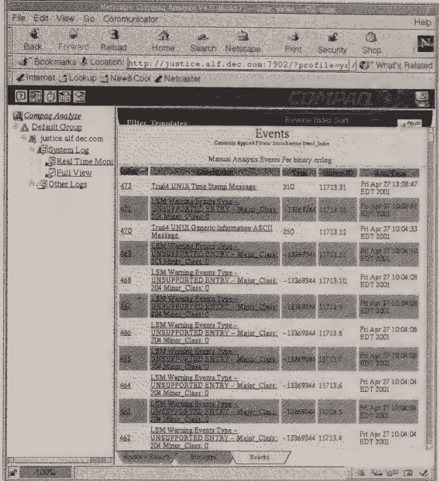

- 事件通道——用于发布或检索事件信息的设施
- 事件发布者——向 `EVM` 守护进程发布事件的组件
- 事件订阅者——对特定指示感兴趣的实体

`EVM` 的工作原理是：发生有趣的事情（事件）时，组件创建一个描述发生什么的 `EVM` 事件包，组件将事件发布到 `EVM` 守护进程，守护进程接收事件并根据其模板事件数据库对其增强，然后守护进程将事件发送给任何对对此类型事件注册感兴趣的订阅客户端，订阅客户端接收事件并可能据此执行某些操作。此外，系统管理员可以使用 `evmget(1)` 命令查看事件。

- `evmshow`—将二进制事件转换为人类可读的格式
- `evmget`—检索事件
- `evmsort`—排序
- `evmwatch`—订阅事件
- `evmpost`—发布事件

### 12.4.1 evmshow

也许最常用的 `EVM` 命令是 `evmshow`。由于事件是以二进制格式存在的，您必须使用它来显示。显示内容，如下：

```
evmshow /var/log/messages
```

要包含时间戳，使用：

```
evmshow -t /var/log/messages
```

### 12.4.2 evmget

`evmget` 命令用于检索事件流。通常将其传递给 `evmshow`，并根据字段过滤某些事件：

```
evmget -f "priority > 300" /var/log/messages
```

### 12.4.3 evmsort

由于事件可能没有特定顺序，因此需要进行排序。这正是 `sort` 命令的作用，并可以用于管道中。在上例的基础上添加 `sort`：

```
evmget -f "priority > 300" | evmsort | show -t
```

### 12.4.4 evmwatch

`evmwatch` 工具用于实时查看事件。再次，输出将由 `evmshow` 处理，您可以使用过滤器选择事件，例如优先级大于 300 的事件：

```
evmwatch -f "priority > 300" | evmshow
```

### 12.4.5 evmpost

最后，`evmpost` 工具顾其实义向 `EVM` 守护进程发布事件。它接受文件或事件流作为输入，将其转换为二进制 `EVM` 格式并发布到 `EVM` 守护进程。一个简单的示例是发布某个操作完成的系统管理员事件：

```
evmpost -a "Disk dsk23 was successfully replaced"
```

## 12.5 崩溃转储过程

当 Tru64 UNIX 系统遇到严重问题（无论是内核中的软件问题还是意外的硬件故障），导致进一步操作变得或是不明智的，操作系统将停止操作（通常发生 panic），并且如果 `auto_action` 控制台提示设置为启动，则系统将重启。通过这种方式，操作系统将部分或物理内存内容的镜像复制到交换分区。`/etc/sysconfigtab` 中“generic”子系统的 `partial_dump` 属性告诉操作系统写入部分或完整的转储；部分转储是默认值，且通常足够诊断问题。此外，`compressed_dump`（同样在“generic”中）的默认值为“1”，这节省了大量的磁盘空间，但如果您使用需要未压缩转储文件的工具，可能会出现问题——您始终可以使用 `expand_dump(8)` 解压 `vmcore` 文件。作为重启过程的一部分，`savecore(8)` 会检查是否存在系统崩溃的镜像，如果有，则将内存从磁盘移动到操作系统文件中，并配合另一个程序创建其他几个辅助文件。

这些文件统称为转储储文件（Crash Dump Files）。系统管理员和/或经验丰富的 Compaq 支持工程师随后可以使用这些转储储文件确定系统崩溃的原因。

为了确保恢复这些转储储文件，理解转储储恢复中的事件顺序至关重要，这样就可以对系统资源（主要是磁盘空间）进行预分配。本文将涵盖以下主题：

- 转储储序列
- 关于决定分配多少磁盘空间的指南
- 强制挂起的系统生成转储储文件

### 12.5.1 转储储序列

当 Tru64 UNIX 系统崩溃时，内存镜像会被复制到磁盘上，具体是复制到交换区域（swap areas）。复制哪些交换区域取决于要保存的内存镜像的大小以及可用交换区域的数量和大小：

- 如果内存镜像能够放入主交换区域（通过 `swapdevice` 属性中逗号分隔的交换设备列表第一个项标识——该属性位于 `/etc/sysconfig` 文件的 "vm" 子系统中），则内存镜像将写入该主交换区域，从分区末尾开始。镜像被放置在主交换分区的头部远端，以防在系统下次重启时被覆盖。
- 如果内存镜像无法放入主交换区域，则内存镜像将写入次交换区域（同样通过 `/etc/sysconfig` 文件中的 `swapdevice` 标识）。
- 如果内存镜像太大无法放入所有次交换区域，则内存镜像将写入次交换分区直到这些分区满。剩余部分随后写入主交换分区的末尾。
- 如果内存镜像太大无法放入所有交换交换区域，则不会创建转储储。

在内存镜像复制到交换区域后，系统将重启。在运行级别 2 的重启过程中，`/sbin/init.d/savecore` 脚本运行 `savecore` 程序，并确定是否已创建转储储，以及是否存在足够的文件系统空间来保存转储储。如果发生了崩溃并成功保存了转储储且文件系统空间足够，`savecore` 开始将内存镜像从交换区域复制到文件系统，默认路径为 `/var/adm/crash`。

`savecore` 成功保存转储储后，会产生两个文件：

- `vmzcore.N`——崩溃时的压缩物理内存镜像
- `vmunix.N`——崩溃时的运行内核

随着系统继续启动，`crashdc(8)` 在级别 3 运行并产生：

- `crash-data.N`——人类可读的崩溃摘要文件

`N` 的值由 `savecore` 在崩溃 目录下的 "bounds" 文件中维护。该值是一个简单的序列号，每次崩溃后加 1，第一次崩溃编号为 0。由于转储储文件可能很大（尤其是 `vmzcore.N` 文件），请确保删除不再需要的转储文件，以避免磁盘空间耗尽。

在诊断系统崩溃时，经验丰富的转储储分析师需要所有三个文件来排查导致崩溃的原因以及如何防止未来再次发生。你可能需要将特定崩溃的转储文件传输到 Compaq 客户服务中心进行分析。虽然此类转储储排排除超出了本文范围（有关此主题的更多信息，请参阅《Tru64 UNIX内核调试指南》），但检查 `crash-data.N` 文件至少很有趣，因为该文件包含了崩溃时系统状态的摘要。有时仅凭 `crash-data.N` 文件就能判断是否是特定进程或可能的硬件问题导致了崩溃。

### 12.5.2 Compaq 崩溃分析工具

`Compq` 崩溃分析工具（`CCAT`）是为 Compaq 服务客户提供的诊断工具。它允许客户自动或手动诊断系统崩溃。`CCAT` 分析可能包含针对崩溃的解决方案、变通方法或排错技术。如前所述，`CCAT` 是基于 Web 的企业服务 (`WEBES`) 诊断工具包的一部分：

```
http://www.support.compaq.com/svtools/webes/
```

在系统崩溃后的重启期间（实际上是在级别 3），`CCAT` 会运行以查看崩溃是否符合已知故障的特征。无论何种情况，如果也安装了 `DSNlink`，它都会向 Compaq 客户支持中心生成请求，以便交付解决方案（如果找到了匹配）或分析新的崩溃。关键在于系统启动时，已经在进行某些诊断，并且实际上可能在后台完全为崩溃提供解决方案。

你可以在 `DSNlink` Web 页面找到更多关于 `DSNlink` 的信息：

http://www.support.compaq.com/dsnlink/

### 12.5.3 转储储磁盘空间指南

在规划转储储空间时，需要考虑两种磁盘空间：交换空间和崩溃文件系统。这两种空间都必须能够容纳至少一个转储储。转储储是物理内存镜像，但由于通常只需要部分转储，加上转储文件是压缩的（默认情况下），空间需求被大幅减少，通常约为物理内存大小的 50%。此数字将根据当前使用的内存量及其配置方式有很大差异。例如，一个具有 256 MB 物理内存并开启了 `partial_dump` 和 `compressed` 的轻负载系统——默认情况下转储储保存的位置是 `/var/adm/crash`。保存转储储的文件系统必须能够容纳至少一个转储储。如果 `/var/adm/crash` 不合适，请设置 `CORE_DIR` 为其他位置。例如，要设置为 `/usr/crash`，请执行命令：

```
# rcmgr set CORE_DIR /usr/crash
```

## 强制生成转储储文件

Tru64 UNIX 系统可能会由于软件或硬件问题停止响应。当这种情况发生时，不会生成转储储。为了在系统挂起时强制崩溃并生成可能指示挂起原因的转储储，请执行以下操作：

- 如果系统控制面板上有 HALT 按钮：
  1. 按 HALT 按钮将系统引入“三箭头”控制提示符 `>>>`。
     （注意：如果系统有启用禁用 HALT 按钮的开关，请将其切换到 ENABLE 位置。）
  2. 在控制提示符处输入 `crash` 并按回车。

- 如果系统没有 HALT 按钮：
  1. 按 Ctrl-P 键组合，输入 `crash` 并按回车。
  2. 在控制提示符处输入 `crash` 并按回车。

这些步骤将停止系统并启动转储储的生成，保存挂起时的内存镜像，并希望包含原始系统挂起的信息。转储储完成后，重启系统以完成转储储文件的生成。如果你查看 `crash-data.N` 文件，将看到恐慌字符串“hardware restart”，这表示发生了强制崩溃。

## 12.6 总结

正如本章概述，Tru64 UNIX 提供了多种工具和设施来协助识别、诊断和防止系统问题。通过 `syslog`、`binlog` 和 `EVM`，Tru64 UNIX 的日志记录非常完整，能够为你这位系统管理员提供大量关于软件和硬件错误的有用信息。最后，当问题严重到系统无法继续运行时，可以使用崩溃转储（crash dump）功能提供核心内存转储，以便进行更快的分析。

## 电子资源

## A.I 邮件列表

有几个对 Tru64 UNIX 系统管理员直接感兴趣的邮件列表。这些邮件列表包含大量的有用信息，可以成为无价的资源。但请注意，邮件列表巨大的容量很容易让你应接不暇。一个活跃的邮件列表每天可以且将会产生数百封电子邮件。订阅邮件列表时的一种有效策略是使用具有过滤功能的邮件列表邮件工具，并将入站的邮件列表流量转移到另一个文件夹中以便日后查阅。此外，许多邮件列表提供接收“摘要”（digests）的功能，系统会定期向你发送列表活动摘要。此类摘要通常根据列表量每周或每月发送一次。某些邮件列表还有存档，允许对数月或数年的列表活动进行简单的关键词搜索。

注意：请务必谨慎对待在邮件列表中阅读的信息，尤其是当列表未经审核时。尽管总会有专家乐于分享他们的经验和知识，但也有一些经验较少的人由于错误或恶意而提供错误信息。永远不要盲目相信某一个人的贡献。如果你对信息的来源或有效性不确定，请务必对任何信息进行核实。同时记住，即使是专家也会犯错。邮件列表经常是有用且相关信息的价值来源，但你应该谨慎行事。

### A.I.1 Tru64-UNIX-Managers 列表

`Tru64-UNIX-Managers` 列表是为运行 Tru64 UNIX 的 Alpha 系统的管理和维护人员提供的一个快速故障排除辅助工具。其主要目的是为 Tru64 UNIX 系统管理员为具有时间紧迫性的系统管理问题提供快速信息源。该列表允许任何订阅者向整个列表提问或对他人的问题做出贡献。

要订阅该列表，请向 `majordomo@ornl.gov` 发送邮件，内容包含命令 "subscribe tru64-unix-managers"。

`Tru64-UNIX-managers` 列表存档位于：

```
http://www.ornl.gov/archives/mailing-lists/
```

此外，以下 URL 提供了对整个 `Tru64-UNIX-managers` 存档进行关键词搜索的功能：

```
http://www-archive.ornl.gov:8000/
```

另外两个存档搜索引擎：

```
http://www.geocrawler.com/lists/3/Miscellaneous/530/0/
```

```
http://www.xray.mpe.mpg.de/mailing-lists/tru64-unix-managers/
```

### A.I.2 Tru64 UNIX Patch List

`Tru64 UNIX Patch` 列表是由 Compaq 公司提供的非讨论列表，用于发布 Tru64 UNIX 操作系统和分层软件产品的最新补丁。这些通知涵盖了公开（Public）和授权（Entitled）补丁。虽然授权补丁仅供合同客户使用，但公开补丁可以通过以下匿名 FTP 轻松获取：

```
http://ftp.support.compaq.com/public/unix/
```

另请：

```
http://www.support.compaq.com/patches/
```

## A.2 USENET新闻组

要订阅邮件列表并接收个人补丁通知，请点击此页面上的“加入邮件列表”（join mailing list）链接。

有几个 Tru64 UNIX 系统管理员可能感兴趣的 USENET新闻组。这些新闻组的“噪比”通常比邮件列表更高，建议对新闻组中呈现的信息保持谨慎。

- `comp.unix.tru64`—主要的 Tru64 UNIX 讨论组
- `comp.unix.osf.misc`—杂项 Tru64 UNIX 讨论
- `comp.unix.admin`—通用 UNIX 系统管理主题
- `comp.unix.admin.policy`—通用 UNIX 系统管理问题
- `comp.unix.security.unix`—UNIX 安全
- `comp.unix.security.misc`—杂项系统和网络安全
- `comp.unix.questions`—一个通用 UNIX 用户问题的论坛
- `comp.unix.wizards`—高级 UNIX 问题

## A.3 Web 资源

万维网网（Wide Web）自诞生以来增长巨大，现在已是一项宝贵的资源。某些网页的内容非常广泛，而另一些则专注于较窄的领域或单一主题。下面列出的页面是 Tru64 UNIX 系统管理员的良好起点。这些页面许多都提供了其他相关页面的链接。随着时间的推移，你将建立自己的个人收藏页面。

注意，在线资源会发生变化，这些地址未来可能不再适用。如果找不到地址，读者始终可以使用 Web 搜索引擎来识别新位置。

### A.3.1 Tru64 UNIX 主页

Compaq 公司创建了一个全面的 Tru64 UNIX 网站，包含许多指向与 Tru64 UNIX 相关其他网页的有用且丰富的链接，地址为：

```
http://www.tru64unix.compaq.com/
```

### A.3.2 Tru64 UNIX 技术文档

Compaq 公司为 Tru64 UNIX 创建了在线文档集，包括发行说明（Release Notes）、安装指南（Installation Guide）和系统管理指南（System Administration Guide）。这个在线库是无价的参考资料，可以在此处找到：

```
http://www.tru64unix.compaq.com/faqs/pub_page
```

### A.3.3 Compaq 在线服务

Compaq 服务首页提供了多种在线服务，包括 Compaq 业务日志系统、问题诊断系统以及杂项产品信息：

```
http://www.compaq.com/support/
```

### A.3.4 Tru64 UNIX 补丁服务

补丁服务页面提供了便捷 Tru64 UNIX 补丁包，包括公开和合同补丁。用户可以通过搜索下载工具或传统的 FTP 搜索补丁：

```
http://www.support.compaq.com/patches/
```

### A.3.5 Alpha 系统固件

固件更新页面提供了 Alpha 系统固件的当前和历史版本。此外，此网页也是检查定期固件光盘发布的临时固件的地方：

```
http://gatekeeper.research.compaq.com/pub/DEC/Alpha/firmware/
```

### A.3.6 Tru64 UNIX 免费软件

此页面包含免费和演示软件列表：

```
http://tru64unix.compaq.com/demos/
```


### A.3.7 Compaq DEEvent 主页

DEEvent 工具是一个替代程序的可选产品，是 Tru64 UNIX 系统非常建议的补充。最新版本可以从此处下载：

`http://www.support.compaq.com/svtools/decevent/`

### A.3.8 WEBES 主页

Web 端企业服务（WEBES）工具包包含了 Compaq 分析和 Compaq 崩溃分析工具：

`http://www.support.compaq.com/svtools/webes/index.html`

### A.3.9 Compaq 最佳实践

该网站提供了有助于系统管理员等方面的建议：
字体 性能
- 网络
- 补丁
- 集群
- 安全
- 编程

`http://www.tru64unix.compaq.com/faqs/publications/best_practices/`

请经常查看，因为这是一个动态 Web 页面。

### A.3.10 Tru64.org

该网站拥有大量资源，包括邮件列表、文章和 FAQ。需要注意的是，它与 Compaq 公司没有关联。

`http://www.tru64.org/`

### A.3.11 Compaq 授权培训供应商

Bruden Corporation 和 The Institute for Software Advancement 是两家 Compaq 授权培训供应商：

`http://bruden.com/`

`http://www.softadv.com/`

### A.3.12 用户组

Encompass Compaq 用户组（原 DECUS 美国分会）网站包含许多有用的链接：

`http://www.decus.org/encompass/index.shtml`

### A.3.13 试用

在该网站上，你可以“试用”Tru64 UNIX（以及其他操作系统）：

`http://www.testdrive.compaq.com/os/`


## 推荐辅助阅读

本书中提到的许多 Tru64 UNIX 主题都非常广泛，需要一整本书才能完全涵盖。幸运的是，针对 Tru64 UNIX 特有和标准 UNIX 子系统的优秀教材已经存在。与其尝试充分地讨论这些主题，不如鼓励读者在处理这些主题时参考以下一个或多个标题，其中一些被视为该领域的“圣经”。

## B.1 AdvFS, LSM, TruCluster

Hancock, Steven M. Tru64 UNIX File System Administration Handbook. Digital Press, 2000.

Fafrak, Scott, and Lota, Jim. TruCluster Server Handbook. Digital Press, 2001.

## B.2 TCP/IP Networking, DNS, NFS, and NIS

Albitz, Paul, and Liu, Cricket. DNS and BIND, Fourth Edition. O’Reilly & Associates, 2001.

Hunt, Craig. TCP/IP Network Administration, Second Edition. O’Reilly & Associates, 1997.

Stern, Hal, Eisler, Mike, and Labiaga, Ricardo. Managing NFS and NIS, Second Edition. O’Reilly & Associates, 2001.

Tanenbaum, Andrew S. Computer Networks, Third Edition. Prentice Hall, 1996

## B.3 Sendmail

Costales, Bryan, and Allman, Eric. sendmail, Second Edition. O'Reilly & Associates, 1997.

## B.4 Backup

Preston, W. Curtis. UNIX Backup & Recovery. O’Reilly & Associates, 1999.

## B.5 UNIX Internals

McKusick, Marshall Kirk; Bostic, Keith; and Karels, Michael J. The Design and Implementation of the 4.4BSD Operating System. Addison-Wesley, 1996.

## 索引

10Base2, 235
10BaseT, 234
100BaseT, 235

通用账户管理选项，174–75
初始屏幕, 173
调用, 173
用户账户视图, 222

## A

访问控制列表 (ACLs), 225–28
访问控制条目 (ACEs), 226–27
- 定义, 226
- 目录, 228
- 启用/禁用, 226
- 示例, 227
- 组条目, 227
- 在 NFS 文件系统上, 228

活动许可, 159
添加磁盘, 77–81
- 设备特殊文件创建, 79–80
- 写入设备表, 78–79
- 文件系统, 80–81
- 硬件步骤, 78
- 标签, 80
- 到 LSM, 80
- 步骤, 77–78
参见 磁盘

账户管理工具, 172–80
账户管理器 (Account Manager), 173–77
- 命令行实用, 177–79
- 手动文件编辑, 179–80
- SysMan Accounts , 177
 类型, 172–73
- 用户管理脚本, 179
- 验证工具, 180

地址, 236–40
- 硬件, 242–43
- 主机名, 236–37
- IP, 237–39
- MAC, 242

参见 用户账户

账户管理器 (Account Manager), 173–77, 221
- 在其中添加用户, 174, 180–81
- 默认值, 修改, 175
- 定义, 173
- 增强安全功能, 221

地址解析协议 (ARP), 243
4, 11, 57, 98–103
高级实用程序 (Advanced Utilities), 98
- 基础功能, 98
- 概念, 99
- 定义, 98
- 直接 I/O 功能, 363

## 高级文件系统 (AdvFS) 续

- 定义, 216
- 特性, 98
- 字段, 217, 218–20
- 文件域创建, 100–101
- 操作, 220
- 文件域, 99–100

参见 增强安全

文件集 (filesets), 100, 101–3
`Autosysconfig` 命令, 143
- 性能提示, 365–66

可用性许可, 158–59
- 配额, 106

## B

根文件系统, 85

后台进程, 334–37
- 调优, 365–66
- 使用操作, 335

参见 文件系统

高级打印 (Advanced Printing), 295–303
- 定义, 335
- 组件, 295

备份 (Backups), 6, 379–410
- 配置, 297–98
- 定义, 295
- 环境管理, 298–300
- 协调, 383
- 空间, 299
灾难恢复计划, 409–110
打印机和队列, 299–300
安全性, 300
软件, 295
安装前, 21
增量备份, 392–93
高级 RISC (ARC) 固件, 23
可选组件, 408–10
匿名 FTP, 265–67
应用程序一致性, 402
- 定义, 4
- 任务类型, 341
- 摘要, 379
- 系统, 379
- 使用, 337
策略, 379–408
选项, 342
存储, 341
磁带, 381–82, 405

审计, 224–25
管理任务, 225
配置, 225
类型, 383
参见 安全性

`vdump`/`恢复实用程序`, 388–98

认证实用程序 (Auth utility), 180, 220
作为默认, 209
- 定义, 172
参见 增强安全; 批命令 (Batch command), 343
- 定义, 343
- 示例, 343
使用, 338

伯克利互联网域名 (BIND), 259, 286
绑定进程 (Binding processes), 330–332
日志 (Binlog), 421–332
- 配置文件, 423–27
- 定义, 421
- 事件, 424
- 检查, 427–34
`Binlogd`, 422–23
- 定义, 422
- 消息源, 422
PID, 423
启动/停止, 423

可启动固件更新
软磁盘, 28–34
从...启动, 33–34
创建, 29–32
下载到, 29–31
所需文件, 31
I/O 选项, 32–33
启动磁盘分区, 17–21
转储空间需求, 19
文件系统开销, 20
性能, 20–21
交换空间需求, 18–19
用户目录位置, 19–20

## BOOTP

守护进程配置文件, 35
示例会话, 37
进程激活, 36
请求数据, 37
通过网络更新固件, 34–37

## BOOTTP 服务器

将固件更新镜像拷贝到, 35
要求, 34
选择, 34

缓冲区缓存 (Buffer cache), 355–58
- 传统, 355–57
- 统一, 357–58
总线拓扑网络, 235

## C

缓存内存 (Cache memory), 355–58
- 缓冲区, 355–57
- 减小大小, 356
统一缓冲区, 357–58
参见 内存

CD-ROM 设备, 76, 109–110
容量, 109
播放 CD, 110
格式, 109
挂载, 109
支持, 109

字符安装实用程序 (Character Installation Utility), 54–55
清单程序, 118, 119
克隆信息选项, 122
自定义设置选项, 121–22
快速设置选项, 120–21
`Chfsets` 命令, 102–3
子进程, 323–24
`Chsh` 命令, 183
`Cksum` 命令, 408
`Class_admin` 命令, 332, 334
类调度, 332–34
配置显示, 333
定义, 332

克隆安装, 12–15
配置描述文件 (CDF), 12–15
- 定义, 12
参见 安装
克隆设置窗口, 122

集群应用程序 (CAA)
子系统, 131
集群文件系统 (CFS), 88, 89
收集实用程序, 376–77
- 自动运行功能, 376
可用性, 376
定义, 376
使用, 377

命令行界面 (CLI), 295
商用现用软件 (COTS) 软件, 223
光盘文件系统 (CDFS), 53
Compaq 分析 (CA), 430–32
- 默认语法, 431
- 定义, 430
接口, 431–32
远程通知, 431
binary.errlog 视图, 433
事件视图, 434

Compaq 崩溃分析工具 (CCAT), 438–39
Compaq 客户支持 (CSC), 156
配置描述文件 (CDF), 12–15
- 内容, 12
- 示例, 12–15
修改, 15

一致性, 401–44
- 应用程序, 402
- 数据, 402
- 定义, 402
- 元数据, 402
技术, 403–4

控制台密码, 200
上下文符号链接 (CDSL), 141–42
控制器
- 定义, 64
RAID, 65
SCSI, 64–65
技术, 64–66

控制终端, 320–21
- 后台进程继承, 335
- 定义, 320

`Cp` 命令, 141
`pio` 命令, 399–401
- 定义, 399
- 使用, 400
参见 备份实用程序

CPU 资源, 348–51
- 忙碌, 350–51
- 容量, 350
- 定义, 448–49
- 空闲, 351
- 内核模式对比用户模式, 349
- 进程优先级和, 349
- 速度影响, 349
- 调优, 350–51
参见 资源

CPU 资源分配, 327–34
- 绑定进程, 330–32
- 类调度, 332–34
- 公平, 330
- 方法, 327
- 处理器组, 328–30
- 系统分区, 327–28

转储, 436–40
- 磁盘空间指南, 439–40
- 强制执行, 440
- 进程, 436–40
- 保存位置, 439
- 序列, 437–38
- 空间需求, 19
- 成功保存, 437–38

崩溃转储文件, 437
`Cron`, 338–41
- cron 守护进程, 338, 339
- 定义, 338
使用, 337

`Crontab` 文件，338, 339

自定义文件系统布局窗口，50, 51

自定义设置，121–122

# D

数据一致性，402

`Dd` 命令，398–399
- 定义, 398
- 语法, 398
- 用途, 398–399
另另 备份工具

`DECEvent`, 429–430
- 分析/通知模块, 430
- 定义, 429–430
- 首页, 447
- 翻译模块, 430

延迟交换空间模式，361–362

设备文件
- 打印机, 71, 72, 79–80
- 设备管理, 70–77
- CD-ROM 设备,76
- 更改, 70–71
- 软盘设备, 76–77
- SCSI 磁盘, 72–73
- SCSI 磁带, 73–76
- 设备表，添加设备到, 78–79

`Df` 命令，105

直接访问可移动媒体设备，108–115
- CD-ROM/DVD-ROM 设备, 109–110
- 软盘设备, 110–115

目录
- ACL, 228
- 家目录, 187–189
- 打印缓存, 275, 282

灾难恢复计划 (DRP)，409–410

磁盘备份，401–405
- 优点, 404
- 一致性, 401–404
- 缺点, 405
- 前提条件, 404
- 问题, 401
另另 备份

磁盘配置窗口，54

`Dislabel` 命令，82–88, 147

磁盘标签，80
- 添加, 80
- 清除, 87
- 内容, 82
- 默认写入, 83–85
- 磁盘名称, 84
- 显示, 85–86
- 编辑, 86–88
- 位置, 82

磁盘分区，81–82
- 默认布局, 83
- 定义, 81
- 哲学, 81
- 建议, 82

磁盘配额，88–89
- 配置/管理, 189
- 定义, 188
- 硬限制/软限制, 188

磁盘
- 磁臂, 64
- 添加到系统, 77–81
- 柱面, 64
- 定义, 63
- 磁头, 64
- 管理, 77–88
- 性能, 362
- 扇区, 64
- 寻道, 64
- 主轴, 64
- 术语, 63–64
- 磁道, 64

分布式计算环境 (DCE)，223

权限划分工具，228–230

`Doconfig` 命令, 359

# Documentation

备份/恢复，406–407
Patch 服务，446
Tru64 UNIX 技术手册，446

域名系统 (DNS)，233, 236, 259
- 定义, 259
- 用于解析 IP 地址, 286
- 服务器, 259

`Dump` 工具，228–230

`Du` 命令，105

`Dump`/`恢复工具`, 388

`Dumpsys` 命令, 440

`Dupatch` 安装，61

`terminate` 工具，148
帮助拉取菜单，149
程序插图，149

动态主机配置协议 (DHCP) 服务器，250

动态路由，246

动态子系统，143–149
- 自动加载/配置, 143
- 在启动启动时配置, 145–148
- 手动加载/配置, 143–144
- 重新配置属性, 144–145

# E

`Edauth` 命令，220

`EDITOR` 环境变量，220

EISA 配置工具 (ECU)，23–24

电子资源，443–448

增强安全性，209–224
- 账户管理, 220–223
- 账户管理器功能, 221
- 问题, 223–224
- 审计, 224–25
- 验证数据库, 181, 216–220
- 定义, 172
- 禁用, 216
- 启用, 211–216
- 特性, 210
- 管理, 210
- 多系统及, 211
- NIS 和, 211
- 配置, 214
- 性能和, 210–211
- , 181
- 运行, 210
- 安全日志, 223
- 子集安装, 212
- 系统重启和, 215
另另 安全

错误日志文件，276
`/etc/binlog.auth`，426–427
`/etc/binlog.conf`，223–426
- 默认, 227
- 定义, 223–424
- 条目, 225
- 示例, 225
`/etc/hosts.equiv`，209
`/etc/hosts` 文件，239–240
- 定义, 239
- 字段, 240
- 格式, 239
`/etc/printcap` 文件，276–281
- 添加打印机到, 279
- 定义, 276
- 选项, 277–279
`/etc/syslog.auth`，420
`/etc/syslog.conf`，415–420
- 默认, 420–421
- 默认条目, 418
- 示例消息, 419–420
- 语法和格式, 416
`/etc/syslog_vm.conf`，420

Event Manager (VM)，420, 432–436
- 命令, 434–436
- 定义, 432
- 事件包, 433
- 系统参与者, 432–433
- get 命令, 433, 435
- most 命令, 436
- show 命令, 435
- sort 命令, 435–436
- match 命令, 436
- 扩展, 96

扩展，96–97

文件系统布局，49–50
- 添加到存储, 80–81
- 创建, 11
- 布局, 49–50
- 挂载, 92–93
- 开销, 20
- 性能和, 20–21
- 支持, 88

文件描述符系统 (FDFS)，88, 89
- 创建, 100–101
- 定义, 99
- 布局, 99
另另 高级文件系统 (AdvFS)

文件级挂载系统 (FFM)，88, 89
- 创建, 100–101
- 定义, 100
- 挂载, 101–102
- 配额, 102–103
- 卸载, 93–94
用户隔离到，188

文件传输协议 (FTP)

`Find` 命令，105, 400

固件，
- ECU, 23–24
- /O 适配器, 23, 24
- 发布说明, 24
- 要求/版本确定, 24–25
- SRM, 23
- 类型, 23
- 更新 CD-ROM, 27–28
- 更新软盘, 28–34
- 更新镜像, 29–31
- 更新网站, 28
- 通过 BOOTP 跨网络更新, 34–37
- 升级, 25–28

固件更新 CD-ROM，27–28
- 从其启动, 27–28
- 定义, 27

固件更新工具，37–39
- 主菜单, 38
- Alpha 平台上, 39
- 更新命令, 38
- 验证命令, 39

FLEXim，160

软盘设备，76–77, 110–115
- 作为存档, 112
- 定义, 110
- 上创建文件系统, 112–113
- 格式化, 111
- 功能, 111

空空间管理，104–106
- 配额, 105–106
- 自愿策略, 105

`Fsck` 命令，95–92, 112

FTP，233, 259–267
- 访问限制, 104
- 匿名配置, 265
- 客户端, 260
- 配置, 260
- 调试, 261
- 定义, 259
- 全局默认 shell 登录, 179–191
- 手动编辑, 33–67
- nohup 从子集恢复, 156–158
- syslog 配置, 415–420
- 系统识别, 192–93

文件集，100
- 创建, 101
- 定义, 100
- 挂载, 101–102
- 配额, 102–103
- 卸载, 93–94

网关，246–248
- 桥接, 246
- 定义, 246
- 路由器, 247

`Get` 命令，126
图形用户界面 (GUI)，295

`Group` 命令，127
- 定义, 127
- 组, 128

主机地址，242–244
- 定义, 242
- 网关, 247

主机名，236–237
- 定义, 236
- 服务器, 237

主机信息，236–237
- 定义, 236
- 数据库, 238
- 计划, 239

`Ifconfig` 命令，253

增量备份，301–305
插入转义序列，277

# K

内核配置，359–360
- 自定义, 52–54
- 许可证缓存更新, 168
- 选项, 48–44

内核构建，44
- 自定义, 52–54
- 示例, 140–42
- 新硬件交换, 142–83
重启后, 139

内核配置，139–49
- 动态, 143–49
- 静态, 140–43
- 工具, 140

内核模式，349

`Kill` 命令，324, 326

`Kern` shell 命令，318

# L

`Ldp` 打印进程，269

## 460

- 许可证管理设施 (LMF), 159–70
- 命令, 165
- 数据库文件, 163
- 定义, 159
- 许可证, 159
- 支持, 160
- 许可证管理器, 160
- 管理, 104
- 逻辑卷, 104
- 支持, 103
- 使用磁盘下, 104

## 登录
- 对应的控制, 203–7
- FTP, 204–5, 260
- 全局默认值, 211
- root, 限制, 203–7

## 许可证
- 列表出, 165–66
- LMF, 159–70
- OSF-BASE, 169
- 注册, 166–67
- 传输, 168–69

## `Lpc` 命令, 290–91
- 定义, 290
- 操作模式, 291
- 会话示例, 291
- 使用, 290–91

## 许可证单元需求表 (LURT), 162–63
## 许可许可, 158–70
- 活动, 159
- 可用性, 158–59

## `Lp` 命令, 269, 288
## `Lpd` 进程
    - 在远程打印访问中, 286–87
    - 启动, 282
    - 状态显示, 289
## LPD 入网关, 300–302
    - 配置, 301–2
    - 定义, 300
- 类型, 158–59
## 轻级目录访问协议 (LD), 299
## `Limit` 命令, 317–20
## 列出列表, 165–66
## `lmf` 命令, 163–65
    - 标志, 165
    - 交互模式, 164
    - 模式, 163–64
    - 运行, 164
## LPD 出网关, 302
## `Lpq` 命令, 288–89
## `Lpr` 命令, 269, 288
## `lpt` 命令, 269, 289–90
    - 定义, 289
    - 功能, 289–90
## `Lprsetup` 工具, 273, 280

## 本地区域传输 (LAT), 250, 274
## 本地打印机
    - 添加, 271–83
    - 管理, 287–95
    - *见打印机*
- 锁定账户, 182–83
## `Logger` 命令, 413, 421
## 日志
    - FTP, 261–64
    - 安全, 223
## `Lsprest` 工具
## 逻辑存储管理器 (LSM), 103–44
    - 向其添加设备, 80

# M

- 邮件列表, 443–45
- Tru64-UNIX-Managers 列表, 444
- Tru64 UNIX 补丁列表, 444–45
- `MAKED` 工具, 79
- 平均故障间隔时间 (MTBF), 63
- 介质访问控制 (MAC), 26, 242
- 内存, 351–62
    - 缓存, 355–58
    - 配置, 353
    - 实际, 352
    - 调优, 358–62
    - 类型, 351
    - 单位, 352
    - 虚拟, 352–55
    - *见资源*
- 内存文件系统 (MFS), 88, 89
- `Mesg` 命令, 195–96
- 每日消息, 192
- 元数据一致性, 402
- 最小路由, 245
- `Mkboot` 工具, 31
- `Mkdfdn` 命令, 100–101
- 修改用户账户对话框, 222
- `Munting` 文件系统, 92–93
- `MTOOLS`, 113–15
    - 定义, 113
    - 示例用法, 114–15
    - loppy 磁盘准备, 带有 113
    - 功能, 114
    - 安装, 113
    - 列表, 141
- `Mv` 命令, 141
    - 定义, 366
    - 影响, 366–67
    - 吞吐量瓶颈, 367
    - *见资源*
- 网络, 5, 223–67
    - 激活, 248–51
    - 划分, 236–40
    - 总线拓扑, 235
    - 配置, 234–35
    - 定义, 233
    - 网关, 246–48
    - 接口类型, 253
    - 远程打印服务访问, 285–86
    - 路由, 244–46
    - 星型拓扑, 234
    - SysMan 工具, 248–50
    - TCP/IP, 233, 234
    - 故障排除工具, 252–58
- 网络设置向导, 251
- `Newfs` 命令, 90–92, 113
- `Nice` 命令, 315
- `Nohup` 命令, 335–36
- `Nohup.out` 文件, 336–37

# O

- 发生情况, 355
- 异存储, 409
- 本书组织, 5–6
- OSF-BASE PAK, 170
- OSF-USR 许可证, 169

# P

- 缺页, 354
- 分页操作, 354
- 父进程, 323–24
- 父进程标识符 (PPIDs), 312–13
- 奇偶, 67
- 分区, 327–28
- `Passwd` 命令, 200
- 名称解析, 286
- Netconfig, 250–51
- `Netstat` 命令, 254–55
    - 定义, 375
    - 示例, 375–76
- 网络配置管理器, 250
- 网络信息服务 (NIS), 211, 236
- 网络资源, 366–68
- 补丁, 60–61
- 磁盘, 320
- 网络文件系统 (NFS), 88, 89, 236
    - 带有 ACL, 228
    - 用法, 89
- 性能, 345–78
    - 瓶颈, 368
    - 网络, 369
- 性能监控工具, 377
    - 收集, 370
    - iostat 命令, 372
    - netstat 命令, 374
    - swapon 命令, 373
    - uptime 命令, 375
    - vmstat 命令, 376
- 物理安全, 198
- 安装后检查清单, 117
- 安装前规划, 9
- 启动分区, 327
- 文档, 10
- 介质, 15
- 打印, 321
- 打印机
    - 添加, 281
    - 配置, 305
    - 目录, 299
    - 配置文件, 273
    - 本地, 276
    - 远程, 288
    - 状态, 301
    - 类型, 304
- 打印任务, 269
    - 进, 307
    - 默认, 308
    - 属性, 309
    - 结束, 310
    - 空, 311
    - 格式, 312
    - 隐藏, 313
    - 包含, 314
    - 列表, 315
    - 队列, 316
    - 状态, 317
    - 终端, 318
    - 类型, 319
- 打印服务器, 272
- 打印服务, 270
- 打印系统, 275
- 权限, 22
- 优先级, 315
- 进程, 6
    - 后台, 334
    - 前台, 321
    - 元素, 306
    - 空闲, 307
    - 格式, 306
    - 隐藏, 305
    - 在, 306
    - 为了, 323
    - 的, 306
    - 上, 305
    - 状态, 301
- 进程属性, 22
- 进程控制, 320
- 进程定义, 314
- 进程组标识符 (PGID), 312
- 进程标识符 (PIDs), 311
- 进程限制, 317
- 进程优先级, 314
- 进程状态, 221
- 进程资源, 349
- 进程利用率, 316
- 统计数据, 316
- 术语, 67
- 恢复
- 随机访问存储器 (RAM), 352
- 灾难恢复计划, 409
- `Rcmconfig` 文件, 138
- 文档, 406
- `Rcmgr` 命令, 138
- 演练, 407
- `Rcmd` 命令, 207
- 受限的 Shell (rsh), 206
- `Rdump`/`restore` 工具, 388, 392
- root 登录, 限制, 203
- root 密码, 设置, 46
- 实际内存, 352
- 冗余磁盘阵列 (RAID).

- 路由, 244–46
    - 配置, 244–45
    - 见 RAID
    - 定义, 244
    - 注册许可证, 166–67
    - 动态, 246
    - 最小, 245
    - 远程安装服务器 (RIS), 7, 8
    - 静态, 245–46
    - 优点, 8
    - 表格, 244

另参见 网络 (Networks)

- `Rsh` 命令, 207
- `Runclass` 命令, 332
- 运行级别 (Run levels), initab 文件中的 135–36, 137
- Tru64 UNIX, 136
- 运行时配置, 135–39
- `Rdvump`/`rvrestore` 工具, 388

# S
- 进程调度 (Scheduling processes), 337–43
- 使用 batch 命令, 343
- 使用 at 命令, 341–42
- 使用 cronset, 338–41
- 调度, 337
- 用于工具, 337
另参见 进程 (Processes)

# SCSI
- 总线命令 (bus command), 65
- 概念, 65–66
- 控制器, 64
- 定义, 65
- 设备, 65
- 磁盘设备命名, 71
- 磁盘, 72–73
- SCSI-2 规范, 66
- SCSI-3 规范, 66
- Ultra, 66
- SCSI 带, 73–76
- 默认, 73–74
- 设备名称, 73
- 示例, 74–76
- `Seconfig` 工具, 213–15
- 安全控制台模式 (Secure console mode), 199–200
- 定义, 199
- 启用, 199–200
- 安全 (Security), 5, 197–232
- 访问控制列表, 225–28
- 高级打印 (Advanced Printing), 300
- 审计, 224–25
- 基础, 172
- 增强, 172, 209–24
- 日志, 223
- 登录控制, 203–7
- 密码, 200–203
- 物理, 198–200
- 策略, 182
- 权限, 228–32
- Sysman 命令, 127
- 安全集成架构 (SIA), 223
- 查找, 64
- 分段共享, 215
- `Setacl` 命令, 226
- 设置组标识符 (SGID) 程序, 314
- `Setld` 命令, 150
- 活动日志, 155
- 定义, 150
- 用于删除子集, 155
- 在软件加载操作期间, 152
- 用于加载子集, 155
- 菜单接口, 154
- 用于子集库存统计, 150–52
- 设置根密码对话框 (Set Root Password dialog), 46–67
- 安装程序, 118, 119
- 设置用户标识符 (SUID) 程序, 314
- 影子密码 (Shadow passwords), 210
- 启用, 213
另参见 密码 (Passwords)

- 壳 (Shells)
- 经批准的, 指定, 205–6
- 环境变量, 191
- 受限制的, 206–7

# 信号 (Signals)
- 定义, 324–27
- 的定义, 324–25
- 指定, 326
另参见 进程 (Processes)

- 单大贵磁盘 (SLED), 66
- `Sizer` 命令, 142
- 骨账户 (Skeleton accounts), 189–90
- 小型计算机系统接口 (Small Computer System Interface)。参见 SCSI

- 软件分发包 (Software Distribution Kit), 10
- 软件选择窗口, 47–48
- 软件子集编辑列表窗口, 48
- 软件子集 (Software subsets), 8
- + 类别, 16
- + 组成, 150
- + 定义, 149
- + 删除, 155
- + 描述, 16, 151
- + 磁盘空间需求, 17–38
- + 分发媒体, 152
- + 增强安全, 212
- + 协同工作, 17
- + 个别, 加载, 155
- + 安装, 152–50
- + 库存, 52
- + 加载判定, 34
- + 管理, 149–58
- + 强制性集, 15–16
- + 名称, 151
- + OFSPRINT, 271–72
- + 可选, 15–16
- + 恢复文件, 56–58
- + 选择, 15–47–48
- + 状态, 151
- + 溢存目录, 275, 282
- + 星形拓扑网络, 234
- + 静态内核配置, 140–43
- + 构建示例, 142–43
- + 新硬件构建示例, 142–43
- + 静态路由, 245–46
- + 存储 (Storage), 5, 63–115
- + 添加文件系统组织, 80–81
- + 概念, 63–66
- + SysMan 组件, 128
- + 存储区域网络 (SAN), 65
- + 分条幅 (Striping), 67
- + 子网掩码, 240–42
- + 默认, 240
- + 定义, 240
- + 用于子网化网络, 241
子集 (Subsets)。参见 软件子集 (Software subsets)
- `Su` 命令, 200, 203, 206, 212
- 补充读取, 449–50
- 交换区域 (Swap areas), 437
- `Swapon` 命令, 148, 373–75
- + 定义, 155
- + 交换分配, 375
- + 示例, 374
- + 交换 (Swapping), 354–55
- + 定义, 354
- 交换空间 (Swap space)
- + 分配方法, 361–62
- + 配置, 360–62
- + 延迟模式, 361–62
- + 中间模式, 361, 362
- + 布局, 361
- + 需求, 18–19
- + 大, 360–61
- `Sysconfig` 命令, 143, 144–45
- + 选项, 145
- + 子系统属性修改, 144–45
- `Sysconfig` 命令, 146, 147–48
- + 选项, 146
- + 子系统属性修改, 147–48
- `Syslog`, 412–21
- + 配置文件, 415–20
- + 定义, 412
- + 设施, 415–16
- + 消息, 413
- + 优先级, 416
- + 发送消息到，脚本, 421
- `Syslogd`, 412–15
- + 控制台消息/禁用, 414–15
- + 定义, 412
- + 消息来源, 412–13
- + PID, 414
- + 启动, 413–14
- + 停止, 414
- `SysMan`, 123–35, 131–35
- 账户组件, 124, 177
- 组件, 123–29
- 通用任务组件 (General Tasks component), 129
- 硬件组件, 124
- 邮件组件, 124
- 监控与调优组件 (Monitoring and Tuning component), 125–26, 248–50
- 网络组件, 125
- 打印组件, 127
- 安全组件, 127
- 软件组件, 127
- 存储组件, 128
- 支持与服务组件 (Support and Services component), 129
- TruCluster 组件, 129
- `SysMan` Station, 131
- 特性, 131
- 硬件层次结构, 131
- 图标, 131
- 状态指示, 131
- 系统配置, 5, 44, 117–70
- 内核, 139–49
- 许可证管理, 158–70
- 运行时, 135–39
- 子集管理, 149–58
- 系统控制台, 22
- 系统磁盘, 22–23
- 定义, 22
- 需求, 22–23
- 系统标识文件, 192–93
- 系统日志, 6
- 系统新闻, 193–94
- 系统分区, 327–28
- 系统参考手册 (SRM) 控制台, 23
- 提示符, 25, 33, 41
- 更新, 26
- 系统资源, 348–68
- 系统调度器, 306

# T
- `Talk` 程序, 194–95
- 磁带备份 (Tape backups), 381–82, 405–6
- 设备问题, 405
- 媒体, 406
- 磁带容量, 405
- 磁带速度, 406
另参见 备份 (Backups)
- 磁带设备 (Tape devices)
- 添加, 106–7
- 管理, 106–8
- 操作, 107–8
- 用途, 106
- `Tar` 工具, 384–88
- 用于临时备份, 388
- 参数修符, 385
- 用于复制目录结构, 387
- 定义, 384
- 示例, 366–88
- 所需参数, 385
- 语法, 384
另参见 备份工具 (Backup utilities)
- TCP/IP, 233
- TCP 打印, 292–95
- Telnet 守护进程, 193
- TCP 守护进程, 36
- 抖 (Thrashing), 355
- `Traceroute` 命令, 257–58, 366
- 默认, 258
- 定义, 257
- 示例, 257, 358
- 传统缓冲区 (Traditional buffer cache), 355–57
- 默认大小, 356

# 传统缓冲区 (Traditional buffer cache) (续)
- 优势, 429
- 命中率计算, 356, 357
- 命令行选项, 427–28
- 尺寸调整, 356–360
- 命令, 428–29
- 规范, 356
- 定义, 427
另参见 缓存 (Cache memory)
- 输出, 428
- 传输许可证, 168–69
- 统一缓冲区 (Unified Buffer Cache (UBC)), 357–58
- 传输控制协议/Internet (Transmission Control Protocol/Internet)
- 定义, 357
- 有效判定, 358
- 故障排除, 6, 252–58
- 命中率, 359
- 尺寸调整, 360
- 上界/下界, 358
- 关联产品 (Associated Products)
- CD-ROM, 10
- 通用数据格式 (Universal Data Format (UDF)), 110
- UNIX 文件系统 (UFS), 11, 89–98
- 引导块 (boot block), 89
- 设备管理, 70–77
- 检查, 94
- 设备特殊文件, 71–72
- 创建, 90–92
- 文件系统, 88–106
- 数据块, 90
- 未来, 89
- 历史, 2–3
- 磁盘块, 89
- 首页, 445
- inode 块, 90
- 安装指南, 9
- 布局, 89–90
- 内核, 11
- 挂载, 92–93
- 列表, 444
- 选项, 90–92
- 补丁列表, 444
- 发布说明, 9–10
- 运行级别, 135–36
- 根文件系统, 85
- 标记为不可用, 20
- 超块, 89–90
- 升级, 55–60
- 调优, 97–98, 364–65
- 版本, 3
- 卸载, 93–94
- 可信主机设施, 207–99
- 漏洞, 94

# 调优 (Tuning)
- `Tunfs` 命令, 97–98
另参见 文件系统 (File systems)
- UNIX 系统管理, 1–2
- 卸载文件系统, 93–94
- 内存, 358–62
- 更新安装, 55–60
- UFS, 364–65
- 优势/劣势, 8
- 清理, 60
- 定义, 8
- 完整安装, 55–60
- 日志文件, 59
- Wer 工具, 427–29, 469
- 监控分析, 58–59
- 选项选择, 58
- 路径, 56
- 更新后任务, 59
- 准备, 56–57
- 启动, 57–58
- 步骤, 60–60
- `Uptime` 命令, 369–70
- 负载平均值, 369–70
- 目的, 369
- 新闻组, 445
- 用户账户, 5
- 账户视图, 222
- 创建, 180–81
- 禁用, 221
- 环境管理, 187–89
- 主级目录, 187–89
- 锁定, 182–221
- 管理, 171–96
- 管理工具, 172–80
- 修改, 183
- 移除, 181–83
- 资源管理, 183–89
- 退休, 222
- 骨骼设置, 189–90
- UID 数字, 185–86, 315
- 用户组, 186–87
- 用户名, 184–85
- `Useradd` 工具, 177
- `Userdel` 工具, 177
- 用户组, 186–87
- 用户 (Users)
- 通信, 192–96
- 投诉，解释, 347
- 主级目录, 19–20, 187–89
- 管理脚本, 179
- 隔离到文件系统, 188

# V
- + `Vdf` 命令, 105
- `Vdump` 工具, 388–93
- 参数, 389–90
- 定义, 388, 389
- 示例, 390–91
- 用于增量备份, 391–93
- 推荐开关, 390
另参见 备份工具 (Backup utility); `Vrestore` 工具 (Vrestore utility)
- 验证工具, 180
- 虚拟文件系统 (VFS), 141
- 虚拟内存, 352–55
- 定义, 352
- 管理, 352–53
- 操作, 353–55
- 分页操作, 354
- 交换操作, 354–55
另参见 内存 (Memory)
- `Vmstat` 命令, 354, 372–73
- 参数, 373
- 定义, 372
- 输出, 373, 374
- 语法, 372
- 使用示例, 372–73
- `Vrestore` 工具, 388–89, 393–98
- 参数, 394
- 定义, 388, 389, 393
- 示例, 395–97
- 非法, 395
- 交互模式命令, 395–96
- 交互会话示例, 396–97
- 合法, 395
- 语法, 394

Vrestore 工具（续）
另见 备份工具；Vdump 工具

# W

`Wall` 命令，196
基于 Web 的企业服务 (WEBES) 软件包件，432, 438, 447

Web 资源，445–48

Alpha 系统固件更新页面，447
Compaq 授权培训供应商，448

Compaq 最佳实践，447
Compaq DEEvent 首页，447
Compaq 在线服务，446
Encompass Compaq 用户组，448
试驾 (Test Drive)，448
Tru64.org，447

Tru64 UNIX 免费软件，446–47
Tru64 UNIX 首页，445
Tru64 UNIX 补丁服务，446
Tru64 UNIX 技术文档，446

WEBES 首页，447
`Who` 命令，195

# X

`Xcmd` 工具，110
X Window System 服务器，44–45

# Z

僵尸进程 (Zombie processes)，324

## 计算机—操作系统

## Tru64™ UNIX

## 系统管理员指南

Matthew Cheek, Scott Fafrak, Steven Hancock, Martin Moore 和 Gregory Yates

## Digital UNIX 系统管理员指南的完整更新版

《Tru64 UNIX 系统管理员指南》是为新手和资深管理员提供的一本完整且易于获取的参考。它对管理任务进行了详尽概述，并提供了复杂系统稳定性和可用性至关重要的信息支持。
—Alan Davis，Digital 咨询公司

为处理最新 UNIX 操作系统的新手和资深管理员提供指导。作者揭示了他们最有用的快捷方法和“操作指南”，并指出了需要避免的陷阱。《Tru64 UNIX 系统管理员指南》中的材料在任何其他出版物中都是找不到的。

考虑到如今可用关于 Tru64 UNIX 的丰富信息，决定从哪里开始以及做什么往往是困难的。《Tru64 UNIX 系统管理员指南》提供了一系列易于理解且经过深思的材料。从安装到系统管理的逻辑递进，使其成为任何管理员书架上必不可少的参考书。
—Steve Gonzalez, Compaq 高级技术顾问

- 伙伴网站提供更新
- 仅有的 Tru64 系统管理员书籍
- 由 Compaq Tru64 UNIX 顶尖专家修订

我刚读了《Tru64 UNIX 系统管理员指南》，对于任何管理 Tru64 UNIX Vx 或 TruCluster 系统的人来说，这都是**必备的**。从 DEC OS/V1.2 版本开始我一直在使用和管理 Alpha 系统，Vx 中有很多主要的新功能，除非获得关于如何使用的良好清晰解释，否则可能会令人困惑——而这本书提供了大量易懂的解释。当然，我从阅读这本书中学到了许多以前不知道的 Tru64 UNIX 知识，书中有很多 UNIX 和 True 集，对功能非常有帮助；
—Dr. Thomas F. Blinn，软件工程，Compaq 技术工程

Matt Cheek 是 Medical Archives Systems, Inc.（匹兹堡医疗中心的一部分）的高 UNIX 系统管理员，《Digital UNIX 系统管理员指南》的作者。自1988年以来，Cheek 安装、配置并编写了来自各种供应商的 UNIX 系统。

Scott Fafrak 是 BRUD Corporation 的高级顾问/集成专家，也是 Compaq Tru64 UNIX 大使。

《Tru64 UNIX 系统管理员指南》是 Tru64 UNIX 系统管理员不可或缺的助手。它提供了清晰的解释和实用的、分步骤的操作。

Steve Hancock 是 Compaq Tru64 UNIX 支持工程小组的支持工程师，也是 Digital Press 出版的《Tru64 文件系统管理手册》的作者。

> Moore 是 Compaq 客户支持部门内部 UNIX 专家团队的领袖，也是 UNIX 内部、计算机安全和性能领域的公认专家。

Greg Yates 是 Compaq 公司客户支持中心 UNIX 专家团队的高级顾问。他目前专注于 UNIX 服务性。

ISBN: 1-55558-255-9

90000

Digital Press
www.digitalpressbooks.com
www.bh.com/digitalpress

9 781555 582555
