# TruCluster Server 手册 (HP Technologies)

## 前言

很久很久以前，Jim Lola 找到我让我写一本关于 TruCluster Server 产品 的书——我想那时我还很年轻。现在，过了许多白发之后，我坐在我的躺椅上，脚翘起来，怀里放着我那台可靠（尽管有点古怪）的笔记本电脑，试图用文字表达创作你现在手上这本书的经历是多么令人难忘。曾经我们设想做一本漂亮的小巧紧凑的手册——如你所见，我们显然对“小”和“紧凑”没有概念。所以虽然它可能不紧凑，但它是我们能做到的最完整。

Jim、Dennis、Greg、Brad 和我试图在保持书本不超过一百万页并且不深入探讨产品实现细节的内部运作的前提下，尽可能涵盖 TruCluster Server 产品的各个方面。

本书主要聚焦于 TruCluster Server 产品 5.1A 版本，尽管我们已尝试指出 V5.1A 与之前两个版本 5 发布版之间的差异。作为额外福利（以及由于我们倾向于提供更多而非更少的信息），一些章节也包含了版本 5.1B 的信息。

正如封面所示，本书反映了五位作者的合作成果，因此虽然我们力求保持一致的外观和感觉，但你无疑会察觉到每位作者独特的语气和写作风格。Jim 是第 1、4、5、10、11、25 章以及附录 B 的主要作者；Dennis 主导了第 2、16、18、19 和 20 章；Greg 负责第 21、22、26 章以及附录 A；Brad 对第 3 章负主要责任；而我撰写了第 6 – 9、12 – 15、17、23 和 24 章，同时担任清理击球手并在牛棚外支援。

我们衷心希望你阅读这本书，觉得它不可或缺，翻卷许多许多页，并最终为你的家人、朋友、同事以及隔壁邻居每人买一本。

祝阅读愉快！

Scott Fafrak

总厨兼瓶洗工

2002 年 11 月

## 致谢

欢迎来到本书的这一部分，在这里我们有机会感谢和致谢那些慷慨付出时间和精力的人，他们自愿并且常常热情地让这本书比没有他们时好得多。以下这些人在幕后付出的努力不会很快被遗忘。

非常感谢你们的技术专长、鼓励，以及在某些情况下的冷笑话：

- Dick Buttlar,
- Ernie Heinrich,
- Christian Klein,
- Alan Brunelle,
- Greg Brown,
- Wayne Cardoza,
- Tim Donar,
- Bruce Ellis,
- Tom Ferrin,
- Sergey Gleizer,
- Steve Gonzalez,
- Bob Grosso,
- Travis Gummels,
- Jan Mark Holzer,
- Chris Jankowski,
- Fred Knight,
- Diane Lebel,
- Lorrin Lee,
- Bruce Lutz,
- Maria Maggio,
- Dan McGraw,
- Scooter Morris,
- John Mundt,
- Janice Parker,
- Lauralee Reinke,
- Alan Rose,
- Susan Rundbanken,
- Mike Schloss,
- Thomas Sjolshagen,
- Tom Smith,
- Roy Takai,
- Jem Treadwell,
- Susan Verhulst,
- Pelle Wahlstrom,
- John Williams,
- Laurel Zonfoonon,
- 以及 Genentech 的 Systems Operations 和 Computing Technologies 团队。

此外，感谢在项目期间通过鼓励、支持、喜剧调剂、诗歌以及包容做出贡献的许多人：

- Pam Chester,
- Cary Cose,
- Marcie Dark,
- Nancy King,
- Evan Lola,
- Karl Lola,
- Lauren Lola,
- Chris Manley,
- Scott Manley,
- Tracy McTernan,
- Cecelia Nichols,
- Daniel Nichols,
- Timothy Nichols,
- Theron Shreve,
- Robert Trouard Jr.,
- Abigail Yates,
- Cherith Yates,
- Gail Yates,
- Horace Yates,
- 以及 #unix-chat 群组

谢谢。

最后，献给我们极具支持力且非常棒的妻子们，Kris Fafrak、Kim Lola、Cheryl Dyment、Beth Yates 和 Susan Nichols，你们的耐心和鼓励意义远超言语所能表达。

Scott

Jim

Den

Greg

Brad

## 介绍

想象一下，你是公司的 数据中心经理 或 系统经理。好吧，别再想象了，你可能已经是了，或者很快就会是了，如果你已经购买了这本书的话。每天，你都面临着挑战。其中最大的挑战之一是确保公司所有的关键业务应用 24 小时、7 天、365 天全年无休地为用户提供服务。另一个挑战是确保所有系统始终以最佳性能运行，并且能够随着公司的发展而扩展。最后，你所有的系统都必须易于现有员工管理——你知道的，用更少的人做更多事。

这个场景听起来可能像公司“食物链”上层的人在说：“我想要我的蛋糕，也想吃掉它，顺便说一下，它必须味道美妙！” 但这就是我们在及时信息是企业成功的关键的世界中所面临的现实。

虽然不能保证你会成为下一个 CIO，但阅读本书所获得的信息应该能极大地加深你对如何使用 TruCluster Server 产品——以及集群技术总体上——来帮助你应对主要挑战的理解。谁知道呢，实施 TruCluster Server 甚至可能为你赢得那份当之无愧的晋升。

## 1.1 什么是集群？

如果这是一部科幻小说，那么当我们提到集群时，我们指的是恒星。如果这是一本关于葡萄酒的书，那么我们指的是葡萄。集群 这个术语在信息技术中被广泛使用并被赋予了许多含义。考虑到这一点，让我们来定义集群是什么。根据 Merriam Webster 词典中的一个定义（当然是在线版）集群是“一起出现的若干相似个体”。嗯，这对于计算机集群来说并不完全正确，但这是一个不错的开始。

对于集群的更精确定义，可以这样说：“集群是一种并行或分布式计算机系统，它在不同程度上形成一个由若干互连计算机组成的单一、统一资源。每个互连计算机都有一个或多个处理器、I/O 能力、操作系统内核和内存。”1

集群与分布式计算的区别在于，在集群中，若干相似的计算机协同工作并形成一个团体。这种统一关系成为提供集群主要主题的基础：提高应用可用性（或高可用性）、用于可扩展性和性能的负载平衡，以及易于管理。

本书详细描述了如何使用 Compaq 的 Tru64 UNIX 操作系统和 TruCluster Server 软件，从单个 UNIX 服务器创建真正的单系统映像集群。

## 1.2 UNIX 集群类型概述

UNIX 集群主要有三种基本类型：故障转移集群、单系统映像（SSI）应用集群和单系统映像（SSI）系统集群。如果算上 Linux 或 Beowulf 集群，就会有四种不同的 UNIX 集群类型，但本书的讨论仅限于上面列出的前三种类型。

### 1.2.1 故障转移集群

故障转移集群目前是 UNIX 集群中最常见的形式。在其众多版本和变体中，它可由大多数主要计算机硬件和系统软件供应商提供。虽然故障转移集群的主要目的是应用的高可用性，但由于应用故障转移脚本所需的定制，它通常被认为是最难配置和管理的。

从硬件角度来看故障转移集群，它通常在集群节点之间具有某种互连，每个节点都可以访问公共磁盘或存储子系统，并且具有网络故障转移能力。应用的故障转移是通过在集群节点故障和恢复期间启动和停止应用的脚本来实现的。

即使故障转移集群的每个节点通过硬件紧密耦合，从系统角度来看它在很大程度上仍被视为“共享无”。每个集群节点必须拥有自己的操作系统副本，并且集群节点之间不能同时访问磁盘或内存。

开发良好、健壮的应用故障转移脚本的困难通常与应用启动或故障转移的时机和同步以及公共磁盘子系统可访问性有关。

### 1.2.2 单系统映像 (SSI) 应用集群

SSI 应用集群与故障转移集群之间的主要区别在于应用软件。应用软件不仅必须“集群感知”，而且还必须“并行化”，才能同时在集群的每个节点上运行。应用的这些多个组件对用户和应用管理员来说表现为一个应用。最著名的提供应用及其数据的单一视图的应用是来自 Oracle 公司的 Oracle Parallel Server (OPS)。

在很大程度上，SSI 应用集群通常由像 OPS 这样的应用和一个完全配置的故障转移集群组成。故障转移集群的所有节点都会运行应用软件，而故障转移脚本则控制应用软件的实际故障转移。

### 1.2.3 单系统映像 (SSI) 系统集群


普遍认为，增加更多的单系统映像功能会提高集群的可用性、性能和可扩展性以及可管理性。然而，在计算机硬件和系统制造商之间，对于哪些 SSI 功能构成完整的 SSI 系统集群存在很大分歧。毫不奇怪，每个制造商都认为自己对 SSI 系统集群构成的定义是正确的，无论客户怎么想。

从硬件角度来看，SSI 系统集群与故障转移集群之间几乎没有区别，或者根本没有区别。真正的差异在于软件。

任何 SSI 系统集群都必不可少的功能包括以下内容：

- SSI 设备访问 - 对所有存储设备的统一视图和访问。
- 集群文件系统 - 对整个文件系统层次结构的统一视图和访问。
- 集群别名或集群 Internet 协议 (IP) 地址 - 客户端将集群视为一个系统。
- SSI 系统管理 - 集群像单个系统一样进行管理。

由于这些功能提供了任何 SSI 集群的核心功能，因此在添加任何其他 SSI 相关功能之前，必须先提供这些功能。

额外的 SSI 系统集群功能包括：

- 批处理负载均衡 - 允许在负载最轻的集群节点上运行某些进程。
- SSI 进程间通信 (IPC) - 允许单一命名空间并共享管道、信号量和共享内存等标准 IPC 能力。
- SSI 进程管理 - 允许进程的单一命名空间。
- 动态负载均衡 - 结合 SSI 进程管理，允许在集群节点之间迁移进程，从而动态平衡整个集群的负载。

是否包含这些额外 SSI 系统集群功能中的一个或全部，可能无法确定它是否是完整的或部分的 SSI 系统集群。与其让计算机制造商的营销部门决定什么是完整的或部分的 SSI 系统集群，我们认为定义取决于集群的功能是否满足您，即用户，对完整或部分 SSI 集群的要求。

对于任何类型的集群解决方案，需要考虑的三个主题是高可用性、性能和可扩展性，以及可管理性。

## 1.3 TruCluster Server 的演进

虽然我们不会深入探讨计算机系统集群的完整历史——我们把这个留给另一本书——但我们将提供集群的简要历史，以说明 TruCluster Server 产品的演进。

1982 年，数字设备公司 (Digital)——正如许多用户仍 fondly 记得的那样，即 DEC——推出了第一个具有商业可行性的集群：VAXCluster。VAXCluster 取得如此成功的原因在于，它在市场上在技术上是最完整的通用集群。它是 SSI 系统集群的全功能实现，而且正如许多人所说，“非常酷的东西。”

后来，当 Digital 开始生产基于 Alpha AXP 的 VMS 系统时，他们扩展了 VAXCluster 的功能，以允许 Alpha AXP 和 VAX 系统的异构混合。产品名称也从 VAXCluster 改为 OpenVMS Cluster，以反映产品的异构性以及将新的 POSIX 开放系统标准纳入 VMS。

1994 年，Digital 宣布了第一个可商用的基于 UNIX 的集群——DECsafe Available Server Environment (ASE) 版本 1.0。DECsafe ASE 是一个故障转移集群，但它在集群内部通信中使用的是现有的基于 TCP/IP 的网络，而不是集群互连。对共享存储的访问是 DECsafe ASE 的初始范式。见图 1-1。

在接下来的几年里，DECsafe ASE 得到改进，以支持额外的基于 Alpha 的系统，并增加更多功能以符合客户对该产品的需求和期望。这也提供了一个机会，为 Digital UNIX 上集群演进的下一步奠定坚实的基础。见表 1-1，集群编年史。

当 Digital 于 1996 年发布 TruCluster 软件版本 1.0 产品时，它引入了 MEMORY CHANNEL 作为集群互连。这是实现 OpenVMS 集群已有的目标的下一步：SSI 系统集群范式。

TruCluster 软件版本 1.0 产品真正使其与 DECsafe ASE 不同的是，它是第一个包含对集群感知应用支持的基于 UNIX 的集群产品。对集群感知应用的支持基本上允许创建 SSI 应用集群。

1996 年底，创建了一个新的 TruCluster (TCR) 产品伞，包含三个功能上重叠但不同的产品：TruCluster Available Server (ASE) 版本 1.4、TruCluster Production Server (PS) 版本 1.4 和 TruCluster Memory Channel Software (MC) 版本 1.4。

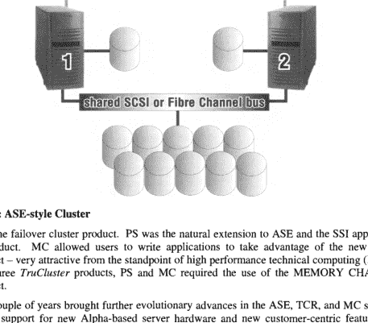

### 图1-1：ASE 风格集群

ASE 是故障转移集群产品。PS 是 ASE 的自然延伸，也是 SSI 应用集群产品。MC 允许用户编写应用程序以利用新的集群互连——从高性能技术计算（HPTC）的角度来看，这非常有吸引力。在这三款 TruCluster 产品中，PS 和 MC 需要使用 MEMORY CHANNEL 互连。

接下来的几年里，ASE、TCR 和 MC 软件取得了进一步的演进，以支持新的基于 Alpha 的服务器硬件，并提供了以客户为中心的新特性，如共享磁带访问、在线服务修改和千年就绪（Year 2000 Readiness）。

1998 到 1999 年是分水岭般的一年，这一年我们见证了许多事物的变化，但本质上又未改变。Digital Equipment Corporation 被 Compaq Computer Corporation（Compaq）收购，产品名称从 Digital UNIX 更名为 Compaq 的 Tru64 UNIX。

1999 年，Compaq 发布了 TCR 1.6 版，其中包含许多增强功能，但在集群技术方面并无真正的新内容。这些增强包括对增强安全性（C2）³、NetRAIN⁴、基于 TCP/IP 的 NFS、交换式光纤通道以及 MEMORY CHANNEL 2 的支持。

² 在早期的 ASE/TCR 时代，“服务”类似于 TruCluster Server 中的集群应用程序可用性（CAA）资源，不同之处在于你必须同时考虑服务的故障转移脚本和相关存储。CAA 在第 23 章和第 24 章中介绍。

³ C2 是计算机系统的一种安全级别，由美国计算机安全中心的“橙皮书”定义。

⁴ NetRAIN（独立网络接口控制器冗余阵列）将在第 9 章中详细讨论。

### 集群年表

| 日期 | 集群软件 | 操作系统 | 备注 |
|---|---|---|---|
| 1983 | VAXcluster | VAX/VMS | VAXcluster 和 VAX/VMS 在 20 世纪 90 年代初移植到 Alpha AXP 处理器时分别更名为 OpenVMS Cluster 和 OpenVMS。OpenVMS 和集群软件至今仍在积极开发和支持。 |
| 1994 | DECsafe ASE version 1.0<br>DECsafe ASE version 1.1 | DEC OSF/1 version 2.0A<br>DEC OSF/1 version 3.0A | |
| 1995 | DECsafe ASE version 1.2<br>DECsafe ASE version 1.3 | DEC OSF/1 version 3.2A<br>Digital UNIX version 3.2D and 3.2F | DEC OSF/1 更名为 Digital UNIX。 |
| 1996 | TruCluster Software version 1.0<br>TruCluster Available Server Software version 1.4<br>TruCluster Memory Channel Software version 1.4<br>TruCluster Production Server Software version 1.4 | Digital UNIX version 3.2E and 3.2G | |
| 1997 | TruCluster Available Server Software version 1.4A<br>TruCluster Memory Channel Software version 1.4A<br>TruCluster Production Server Software version 1.4A | Digital UNIX version 4.0A and 4.0B | |
| 1998 | TruCluster Available Server Software version 1.5<br>TruCluster Memory Channel Software version 1.5<br>TruCluster Production Server Software version 1.5 | Digital UNIX version 4.0D and 4.0E | Compaq Computer Corporation 收购 Digital Equipment Corporation。 |


| 1999 | TruCluster Available Server Software version 1.6<br>TruCluster Memory Channel Software version 1.6<br>TruCluster Production Server Software version 1.6<br>TruCluster Server version 5.0 | Tru64 UNIX version 4.0F and 4.0G<br>Tru64 UNIX version 5.0 | Digital UNIX 更名为 Tru64 UNIX。<br>TruCluster Server 5.0 版是一个非常有限的预先发布版本。 |

| 2000 | TruCluster Server version 5.0A<br>TruCluster Server version 5.1 | Tru64 UNIX version 5.0A<br>Tru64 UNIX version 5.1 | |

| 2001 | TruCluster Server version 5.1A | Tru64 UNIX version 5.1A | |

| 2002 | TruCluster Server version 5.1B | Tru64 UNIX version 5.1B | Hewlett-Packard Company 收购 Compaq Computer Corporation。 |

### 表1-1：集群年表

同年晚些时候，Compaq 悄然发布了 TruCluster Server 5.0 版，这是一个面向特定客户群的有限发布。TruCluster Server 5.0 是第一个具备 SSI 系统集群特性的 TruCluster Server 版本。从 UNIX 的角度来看，这一版本的 TruCluster Server 不再是演进式的，而是革命性的！能够从一台服务器向公共集群文件系统写入文件，然后几乎瞬间就能从另一台服务器读取该文件，这真是一场革命。

2000 年标志着 TruCluster Server 5.0A 以及后来的 5.1 版向客户发布。这是 TruCluster Server 软件首次正式发布具有 SSI 系统集群特性的版本。自 TruCluster Server 5.0A 发布起，任何新版本的 TruCluster Server 软件都将随任何新版本的 Tru64 UNIX 一起发布。

Tru64 UNIX 5.1A 和 TruCluster Server 5.1A 于 2001 年秋季发布。

这大致将我们带到了现在（2002 年夏季）。在撰写本文时，我们预计 Tru64 UNIX 5.1B 和 TruCluster Server 5.1B 将于 2002 年秋季发布。

## 1.4 什么是 TruCluster Server？

既然我们已经知道了什么是集群，那么什么是 TruCluster Server？TruCluster Server 是 Tru64 UNIX 软件、存储设备、集群互连以及两个或更多 AlphaServer 系统的融合体，它们作为一个单一的虚拟系统协同运行。每个集群成员都可以在单一系统管理域下共享资源、存储和集群范围内的文件系统。

TruCluster Server 5.0A、5.1 和 5.1A 版本提供以下特性：

- 集群范围命名空间。
- 集群范围磁盘和磁带存储访问。
- 集群范围逻辑存储管理器（LSM）。
- 连接管理器⁶。
- 集群应用程序可用性（CAA）。
- 集群别名。
- 使用集群别名的高可用性 NFS 服务器。
- 集群通信互连。
- 分布式锁管理器（DLM）⁵。
- 单一系统管理。
- 单一安全域。
- 滚动升级/补丁。
- 扩展进程 ID（PID）。

再次强调，通过 TruCluster Server，你可以从独立的 Tru64 UNIX 服务器创建真正的单一系统映像系统集群。我们将在第 2 章中对 Tru64 UNIX 和 TruCluster Server 进行更深入的概述。

⁵ 分布式锁管理器将在第 18 章中详细讨论。

⁶ 连接管理器将在第 17 章中详细讨论。

## 1.5 本书涵盖的内容

本书将涵盖大量内容，但也有一些主题不会涉及。例如，虽然我们了解部署 Stretch Clusters 和容灾容错（DT）集群的各种技术，但目前 Compaq 既不推荐也不普遍支持这些技术。我们也不会在本書中涵盖 Compaq 的 AlphaServer SC 超级计算机实现，因为该主题本身就足以构成一整本书。

当我们决定撰写本书时，我们的目标是提供一份全面的技术指南，可用于设计、实现、部署和管理 TruCluster Server 环境。我们还希望消除 UNIX 集群的神秘感和“魔力”，并解释 IT 管理员为何可能希望使用这项技术来帮助他们降低整体系统管理成本，同时提高 UNIX 服务器基础设施的可管理性和可用性。为此，我们将本书组织为十个章节和一个附录，便于查阅。

- Section 1 - 这是引言部分，提供了关于 UNIX 集群的背景信息，以及 Tru64 UNIX 和 TruCluster Server 的良好概述。对于不熟悉 UNIX 集群和/或 Compaq 的 Tru64 UNIX 的读者，我们强烈建议从本节开始，因为它为后续内容奠定了基础。
- Section 2 - 本节介绍 Tru64 UNIX 集群的设计与配置，是一个非常重要的部分，因为它讨论了 TruCluster Server 环境的设计、规划和配置。我们建议在考虑部署 Tru64 UNIX 用于 TruCluster Server 环境的具体操作之前，先设计并仔细规划您的环境。正如大多数工作一样，前期投入一点设计和规划，将在长期内为您节省大量工作。
- Section 3 - 本节提供有关如何构建和配置 Tru64 UNIX 的信息，以便安装和配置 TruCluster Server。
- Section 4 - Cluster Hooks 涵盖了 Tru64 UNIX 操作系统中实现集群的关键特性。本节提供了理解在 UNIX 上实现集群所需的操作系统基础的背景知识。
- Sections 5 & 6 - TruCluster Server 环境的实际规划、安装和部署。本节对系统架构师和系统管理员尤其有用。

# Tru64 UNIX & TruCluster Server 概述

在深入设计和配置 Tru64 UNIX 集群的世界之前，对 Tru64 UNIX 操作系统进行简要概述将有助于做好准备。将本章视为开胃菜，后续章节则是主菜。为了帮助您消化本书的主要内容，我们将通过讨论 Tru64 UNIX 的几个概念和特性以及现在已成为操作系统一部分的 TruCluster Server 软件来为您做准备。

## 2.1 Tru64 UNIX 概述

该操作系统的名称意义深远。首先，它是一个基于 UNIX 的操作系统。它位于 UNIX 家族树的中间，因为它既汲取了 BSD¹ 和 System V² 家族两方面的特性，也融入了 Compaq 工程师创建的大量核心代码。

图 2-1 描绘了几种常见的 UNIX 变体。请注意图底部位置的 Tru64 UNIX。

其次，Tru64 Unix 确实是一个 64 位操作系统。系统中使用的虚拟地址确实是 64 位的，提供了巨大的虚拟地址空间，并支持大文件偏移量和大小。那就这样了吗？这些就是该系统的区别特征吗？实际上，操作系统还有许多其他特性，我们将在本章的第一部分介绍。如果您熟悉其他 UNIX 系统，您可能想快速浏览本章的第一部分，但请计划放慢速度，仔细阅读 TruCluster Server 概述（第 2.7 节）。

¹ Berkeley Standard Distribution（BSD），由加州大学伯克利分校开发。

² UNIX System V，由 AT&T 的 UNIX 系统开发实验室开发。

### 2.1.1 操作系统特性

Tru64 UNIX 的功能已迅速扩展到足以提供单系统映像 Single System Image (SSI) 集群选项的能力（正如前一章所讨论的那样）。Tru64 UNIX 多年来一直是许多站点计算机组合中的重要组成部分——甚至在完整集群 SSI 可用之前就已如此。

在集群出现之前，哪些特性吸引了客户使用 Tru64 UNIX？正如你将看到的，有很多。我们将在接下来的几个部分中指出一些特性，并将这些特性与 TruCluster Server（本书的重点）联系起来。

### 2.1.2 Mach 内核

潜藏在 Tru64 UNIX 最核心之处的是 Mach 内核的元素。Mach 是在卡内基-梅隆大学创建的系统。它包含了任务和线程的概念，这些概念在 Tru64 UNIX 的运行中占据重要地位。“任务”代表一个正在运行的程序，而‘线程’则是该程序内的可调度实体。历史上，程序都是以单线程编写。大多数先进的 UNIX 变体都提供了创建多线程程序的能力，以便更好地利用多 CPU 系统。


Mach 内核也被宣传为“微内核”（一个小型、compartmentalized 内核，由许多内核模式线程和用户模式进程支持），尽管像 Tru64 UNIX 所基于的 V2.5 这样的早期版本实际上本质上是单块的。虽然这与 TruCluster Server 的功能并非核心相关，但这一概念对于 TruCluster Server 以及 Tru64 UNIX 的持续开发都很重要。从本质上讲，使用微内核（或甚至伪微内核）可以更快地实现系统内核的关键更改，因为子系统定义非常明确并且在一定程度上相互隔离。请注意，Tru64 UNIX 并非严格使用微内核策略，而是大量借鉴了它（我们很想说子系统彼此完全独立，但事实并非如此）。这为我们提供了一个灵活的软件产品（Tru64 UNIX 和 TruCluster Server），可以相对快速地添加新功能。事实上，TruCluster Server 本身就是操作系统快速适应以包含新功能和子系统的例子。

一些集群组件以内核线程实现。其他组件则以基于进程的代码实现，由一个或多个线程组成。还有一些是内核内的子系统。这些组件最终依赖于部分源自 Mach 的系统函数。许多其他集群组件以驱动级内核代码实现。以下各节将简要阐述并介绍许多关键的系统组件和集群组件。所有集群组件将在本书后续章节中讨论。

### 2.1.3 虚拟内存

系统使用虚拟地址，这些地址被翻译成物理地址以提供对内存（或 I/O 空间）中数据和代码的访问。前一句可以用来描述几乎任何现代操作系统。Tru64 UNIX 解决了表示由 `2^64` 字节潜在寻址能力组成的虚拟地址空间的问题（大多数其他 UNIX 变体在开发 64 位系统方面落后于 Compaq，现在的 HP）多年了。它通过一种巧妙的三级页表方案来实现这一点，我们在这里无需详细说明。重点是它是一个系统的关键特性，并且被所有组件包括 TruCluster Server 组件大量使用。

### 2.1.4 统一缓冲缓存

统一缓冲缓存 `Unified Buffer Cache (UBC)` 是一种创新，通过它 Tru64 UNIX 可以至少部分地自我调优。文件系统的内存缓存需求往往与进程的内存需求直接冲突。如果系统经历 I/O 活动激增，文件系统缓存内存计数（通常称为 UBC 页计数）将会增加。如果来自进程的虚拟内存请求变得沉重，页就会从 `UBC` 中收回并用于进程内存。这样，摆锤可以在系统生命周期中来回摆动，而无需你动手。相当令人印象深刻，对吧？

公平地说，Tru64 UNIX 并不是唯一使用这种策略的 UNIX。

正如你将看到的，`UBC` 被使集群成为可能的多个 I/O 组件所使用。

### 2.1.5 共享库

共享库提供了在函数级别共享代码的机制。UNIX 一直擅长在进程级别共享代码，这意味着如果两个用户同时运行 `vi (1)` 编辑器，例如，他们将共享被调入内存的单个 `vi` 代码副本。但 UNIX 传统上在函数级别共享方面较弱。因此，如果一个进程正在运行 `vi` 编辑器，另一个正在运行 `emacs (1)`（我们假设这两个编辑器使用许多相同的函数），传统的 UNIX 将会把两份潜在共享的函数调入内存。

共享库提供了一种机制，任何使用共享库函数的程序（想想 `printf(3)`），都将引用已调入内存的单个函数代码副本。请注意，系统是“按需”系统，因此在第一次请求导致其被调入之前，共享函数中没有任何一个在内存中。同样，一旦没有用户使用该函数，其占用的内存将被释放。

进程级 TruCluster Server 代码链接了共享库。以下示例显示集群应用程序可用性守护进程 Cluster Application Availability Daemon (`caad(8)`) 链接了共享库。然后我们记录 `caad` 进程中引用的共享库。

```
# file /usr/sbin/caad

/usr/sbin/caad: COFF format alpha dynamically linked, demand paged executable or object module stripped - version 3.13-14
```

```
# odump -Dl /usr/sbin/caad

***LIBRARY LIST SECTION***

名称                时间戳        校验和      标志 版本

/usr/sbin/caad:

libpolicy.so        2002年1月16日 04:39:17 0x7958cdb5      0 osf.1

libbvm.so           2002年1月15日 17:37:17 0xde4a5d09      0 osf.1

libclcu.so          2002年1月15日 17:36:05 0xd148a817      0 osf.1

libm.so             2002年1月15日 17:20:50 0x07775704      0 osf.1

libpthread.so       2002年1月15日 17:26:48 0x4a2a0c94      0 osf.1

libcxx.so           2002年1月15日 17:29:14 0x9060972e      0 cxx6.3

libexc.so           2002年1月15日 17:20:58 0xb0f9a902      0 osf.1

libxc.so            2002年1月15日 17:19:09 0x1e4e245f      0 osf.1
```

以下命令输出列出了 Tru64 UNIX 中可用的共享库文件的位置和部分信息。

```
# ls /usr/shlib
.mrg.so_locations      libarmui.so        libmfs.so
.new.so_locations      libaud.so          libmxr.so
.proto.so_locations    libbwt.so          libnbd.so
TCR_libclcu.so         libbwt_g.so        libnet.so
X11                    libbkr.so          libnuma_g.so
null                   libbuma.so         libpacl.so
diagui_unix.uid       libc_r.so          libpota.so
ev5                    libcfrom.so        libota3.so
generic                libcfg.so          libpacl.so
libDSNLlinkAPI.so      libchf.so          libproplist.so
libbDXm.so             libclcu.so         libpset.so
libbDXterm.so          libclua.so         libpthread.so
libbDECOR.so           libcmail.so        libpthreaddebug.so
libbHelp.so            libcsa.so          libpthreada.so
libbDmail.so           libcurses.so       libpthreads.so
...
```

### 2.1.6 内存绑定

Tru64 UNIX 上大部分物理内存都是可分页的。这意味着内存页的内容可能会被分页到交换空间（磁盘上），或在系统的空闲页列表变得严重不足时被换出到交换空间。某些应用程序可能要求其内存的某些部分被视为不可分页。这种活动（称为“绑定”页面）仅限于由 `root` 拥有的进程。内核也可能绑定可分页页面以满足其动态内存需求。

以下示例以显示系统中绑定页面的统计信息部分结束。

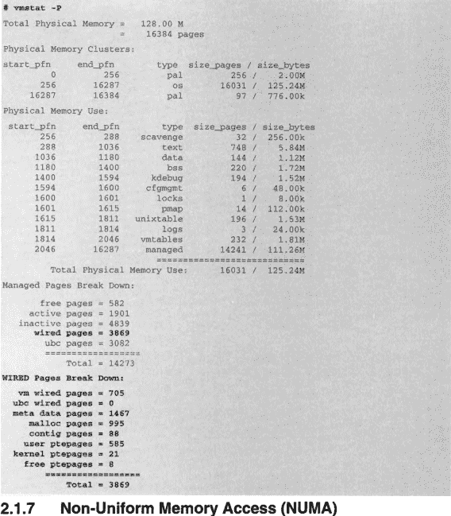

### 2.1.7 非一致性内存访问（NUMA）

Tru64 UNIX 快速变化的另一个例子是包含了对非一致性内存访问（NUMA）系统的支持。传统的对称多处理（SMP）系统在添加更多处理器时扩展性不佳。Compaq（现为 HP）GS 系列计算机（GS80、GS160 和 GS320）分别可处理 8、16 和 32 个 CPU（未来会更多），并且具有出色的可扩展性。这需要专门的硬件，但

操作系统软件仍然只是好、老式的 *Tru64* UNIX。虽然有些人将 GS 系列称为“盒中集群”，但这绝对不是这些机器的意图（当然也不是我们推荐的），尽管硬件支持这种用法。

下一个序列将带你了解导致集群概念产生的计算机世界中的概念发展。在此过程中，将提及几个 *Tru64* UNIX 功能。

## 2.2 单 CPU 计算机

拆开任何一台计算机，你都会发现一些常见的硬件组件。有中央处理器（CPU），负责执行指令。它通常被认为是计算机的大脑。


有一些物理内存。内存保存正在执行的代码和 CPU 当前访问的数据。CPU 设计为执行存在于内存中的代码。如果代码仍在磁盘上，系统会抱怨（引发异常）并发生页面错误。页面错误完成后，包含出错指令的磁盘页将被调入内存并放置到页帧（物理内存）中。然后会重新执行导致错误的同一指令。

还会有一些 I/O 能力。这在不同机器之间可能差异很大，但通常包括磁盘、磁带、打印机、网络接口和其他硬件设备。

图 2-2 描述了一台具有一些物理内存和 I/O 能力的单 CPU 计算机。

本章讨论的大多数软件功能都不出现在上述硬件组件列表中。*Tru64* UNIX 和 *TruCluster* Server 主要是软件机制。负责管理硬件的软件是操作系统（在我们的例子中是 *Tru64* UNIX）。如果你想知道我们为什么带你回顾基本计算机概念，请耐心等待。我们的目标是提出实现集群所涉及的问题和难题，并确定 *TruCluster* Server 软件和组件如何解决这些问题。

第一步是考虑一个独立系统。它不允许除系统本身上运行的软件之外的任何访问其资源。在这种情况下，资源可能是内存、磁盘、其他 I/O 组件，甚至是 CPU 本身。通过使用处理模式和系统优先级级别（SPLs）来实现必要的协调和同步，以防止系统的各个组件相互干扰（或导致某种形式的损坏）。

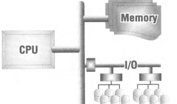

图 2-2：计算机硬件组件

### 注意

`SPL`有时被称为中断优先级（`IPL`）。

实际上，CPU 总是在 8 个 `SPL`（0-7）之一中运行，较高的 `SPL` 比较低的 `SPL` 更重要。

系统还将处于两种可能的处理模式之一：用户模式或内核模式。机器中的大多数标准处理将在 `SPL` 0 和用户模式下进行。如果更重要的事件需要优先于当前处理，则会发出中断，并以内核模式执行中断服务例程（`ISR`）。

可能存在中断和其他内核模式处理，可能需要访问系统支持结构，如设备驱动程序和内核例程。

`ISR`必须以确保不会被相同级别或更低级别的后续中断中断的方式运行。这是通过设置 CPU 寄存器（处理器状态（`PS`）寄存器）中的位来指示处理器当前运行在哪个 `SPL` 上来实现的。`PS`寄存器中还有另一位指示内核模式或用户模式。请注意，`SPL`是每个 CPU 独有的现象，因为每个 CPU 都有一个 `PS`寄存器。

为了讨论的目的，中断由硬件设备生成，以指示已发生事件（例如 I/O 完成）。因此，可以为各种设备分配一个 `SPL`，以运行其 `ISR`。在较高 `SPL` 中断的设备优先于在较低 `SPL` 中断的设备的 `ISR`。当所有 `ISR` 处理完毕后，系统会将 `SPL` 降低到中断发生前所处的级别。

如果你想知道这与集群环境有何关系，请记住，集群环境包括多个系统，具有许多 I/O 设备，每个系统有一个或多个 CPU，每个 CPU 都有自己的 `PS`寄存器。因此，集群中计算机的每个 CPU 在任何时刻都可能与集群其他成员的 CPU 处于不同的 `SPL`。重点是，必须为进程和系统本身提供其他同步机制，以在集群中保持一定的合理性和同步性。随着系统复杂性接近完全集群状态，接下来的几节将介绍许多处理同步和通信的系统机制。

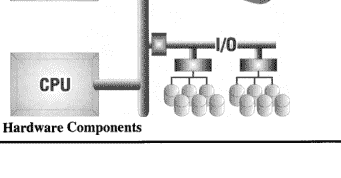

图 2-3：双 CPU 硬件组件

## 2.3 多 CPU 系统

向计算机添加第二个 CPU 会增加同步系统活动的复杂性。每个 CPU 都有自己的一组寄存器，包括包含 `SPL` 和模式信息的 `PS`寄存器。因此，任何试图通过软件将 `SPL` 设置为非零值以与 `ISR` 同步的尝试都是错误的。它只提供与恰好在该特定 CPU 上运行的 `ISR` 的同步。在另一个 CPU 上运行的 `ISR` 和其他内核模式代码不会感知到此 CPU 上的 `SPL` 设置。

图 2-3 描绘了一个双 CPU 系统。请注意，任一 CPU 都可以访问系统上的任何物理内存或 I/O 设备。

### 2.3.1 异步多处理（ASMP）

同步问题的一种解决方案是强制所有在内核模式下运行的代码（包括 `ISR`）在特定 CPU 上运行。这是一种“隧道化”形式，强制活动在特定 CPU（通常是主 CPU）上运行。在多处理器系统（机箱内多个 CPU）中，强制所有内核模式活动在单个 CPU 上运行是一种称为异步多处理（`ASMP`）的解决方案。`ASMP` 相对容易实现，并且即使涉及多个 CPU，也允许内核模式活动的 `SPL` 同步继续工作。然而，它会导致高调度开销，因为每个需要进入内核模式的进程（例如，对于系统调用）必须重新调度到主 CPU 上运行。

`ASMP` 起作用了，但效果不够好，而且扩展性差。随着添加更多的 CPU，实际可用的 CPU 周期越来越少。必须有另一种在多 CPU 之间同步的方法。请记住，我们仍然在谈论单台计算机。我们还没有达到添加更多计算机或集群计算机的地步，但我们会达到。

图 2-4 显示了一个非对称排列的双 CPU 系统。顶部的 CPU 被指定为主 CPU，将处理所有中断并运行所有内核模式代码。


图 2-4：异步多处理

### 2.3.2 对称多处理（SMP）——紧耦合

一个系统要被视为对称系统，系统中所有 CPU 都必须能够执行所有处理模式。在 UNIX 中，这两种模式是用户模式和内核模式。在多处理器系统中，运行在任意 CPU 上的软件都需要在访问内核数据结构时进行协调，因为这些数据结构可能被运行在其他 CPU 上的内核模式软件（包括 `ISR`）同时引用。以 CPU 为中心的 `SPL` 同步方法不够完善，无法处理多个 CPU 的情况。

`Tru64 UNIX` 使用内存互锁机制以及特殊的“加载锁定”（load-locked）、“存储条件”（store-conditional）指令来实现所需的额外同步级别。系统中的所有 CPU 都可以访问内存。其思想是用一个自旋锁位来保护内核结构或数组。自旋锁实质上就是内存中的一个位，用于协调对特定结构、字段、数组、设备等的访问。“自旋锁”是一个通用术语。`Tru64 UNIX` 将这些锁称为“简单锁”。说实话，从表面上看，它们再简单不过了。如果你能设置该位，你就可以访问该位所代表的资源；如果不能（因为它已被设置），你就无法访问该位所代表的资源。当访问被拒绝时，请求者通常会“自旋”，反复检查该位是否已清除。一旦清除，请求者就可以设置该位并访问受保护的资源。不要将此与应用程序级文件锁及相关操作混淆。文件锁可供应用程序使用，而自旋锁（“简单锁”）可供操作系统内核使用。用户模式应用程序代码永远不会直接请求简单锁。

现在我们有了一个在系统内多个 CPU 之间提供同步的机制。下一步是弄清楚当访问资源的代码运行在多个系统上时，如何协调对资源的访问。需要说明的是，我们刚才讨论的是“紧耦合”CPU 之间的同步，这些 CPU 使用同一份操作系统软件的内存副本，而该软件运行在多个 CPU 上。

图 2-5 描述了一个采用 SMP 排列、包含两个 CPU 的“紧耦合”系统。请注意，两个 CPU 都可以运行用户模式和内核模式代码。


图 2-5：对称多处理

## 2.4 网络——松耦合

网络中的每台计算机都有自己的操作系统、自己的内存和自己的 I/O 子系统。如果网络中一个节点上运行的软件与另一个节点上运行的软件之间需要进行通信，就必须达成某种协议，接受协调并完成通信。顺便提一句，“接受协调”这一概念并不完全陌生。在上一节中，内核模式代码必须在构建时就在代码中内建对简单锁的请求和 `SPL` 提升。实际上，这就是内核代码对接受协调的认可。网络协调和同步可能尤其棘手，因为操作系统和硬件平台可能各不相同，从而形成异构环境。

幸运的是，大多数现代操作系统都包含 TCP/IP 软件（或其他相关网络软件，如远程过程调用 `RPC`）。`TCP/IP` 在收到请求时，为多个节点上运行的进程之间提供必要的同步。集群软件将与网络软件和硬件紧密配合，以便在网络中呈现单一目标、为网络接口故障做好准备，或使用远程过程调用（`RPC`）进行通信。

图 2-6 展示了网络中一个系统与其他几个系统（每个系统都由类似组件组成）连接的特写。

## 2.5 集群——紧密耦合

`TruCluster Server` 产品为多个系统之间的紧密交互提供支持。集群通常被认为是“紧密耦合”的，因为各个系统能感知彼此，但不会像紧耦合系统那样访问公共内存中的系统代码，并且不会

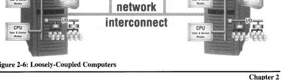

图 2-6：松耦合计算机

## 2.6 集群定义

根据 HP 的规范，适用于 `Tru64 UNIX` 的 `TruCluster Server V5.1A` “为关键任务计算环境提供了高可用性和可扩展性解决方案”。该规范（`TruCluster Server` 快速规格说明）进一步描述了 `SMP`、分布式计算和容错能力的组合特性，这些特性提供了极高的可用性和可扩展性。


因此，集群是一种机制，通过这种机制，一组紧密耦合的计算机可以整合其资源，并作为一个高可用性的单一机器呈现在应用程序、管理员甚至网络面前。`TruCluster Server`产品力求尽可能消除故障点，以便为公司关键资源提供一致的访问。它还提供了管理机制，使得集群管理仅比单节点管理稍复杂一些。在集群中，产品安装、系统监控和大多数其他管理任务只需执行一次，而不是对集群中的每个成员各执行一次。如果需要，集群可以在网络中表现为单个节点。

在本章的其余部分，我们将介绍实现上述特性的集群组件。

## 2.7 TruCluster Server 概述

这里很适合对 V1.X TruCluster 产品和 V5.X `TruCluster Server` 产品进行快速比较。正如我们在第 1 章中提到的，集群软件一直在稳步演进。早期（1994 年），集群被称为可用服务器环境（`ASE`）。大多数集群支持守护进程运行在用户模式下，并在 1996 年 `Memory Channel` 可用后，通过 `TCP/IP` 与其接口。此外，集群的每个成员都拥有自己的一份操作系统副本，从而完全不可能实现轻松管理。1996 年，该产品（V1.4）包含三大组件（`ASE`、`Production Server` 和 `Memory Channel`）。集群站点可以从使用 `ASE` 进行应用程序故障转移支持，升级到 `Production Server`（`PS`），后者包含对 `Connection Manager`、`Distributed Lock Manager` 和 `Distributed Raw Disks` 的支持。（注意，`Oracle Parallel Server` 是 `PS` V1.X 应用程序的一个例子。）

`PS` 环境包含了 `ASE` 和 `Memory Channel`。因此，它为今天 `TruCluster Server` 软件产品（V5.x）的重大飞跃奠定了基础。在 `TruCluster` V5.0A 之前，管理集群实际上比管理单个系统或一组系统更困难。每个系统都需要单独的安装工作。如今，大多数管理员发现集群相对容易管理。

通过引入 `Cluster File System`（`CFS`）、取代 `ASE` 的 `Cluster Application Availability Subsystem`（`CAA`）以及 `Cluster Alias Subsystem`（`CLUA`），`TruCluster` 软件通过 `CAA` 和组件故障检测技术提供了出色的可用性。使用 `CFS`，应用程序可以从任何集群成员透明地访问文件数据。以下小节介绍许多集群软件组件。后续章节将更详细地介绍每个组件。

### 2.7.1 集群成员之间的通信

还记得在 `SMP` 环境中同步多个 CPU 上运行的代码有多困难吗？解决方案是设计内核模式和 ISR 代码，使其在继续前进并访问受保护资源之前，先获取保护该资源的简单锁。在集群环境中，当两个节点上运行的代码需要访问公共信息数据库时会发生什么？答案涉及多个层面。首先，我们需要讨论集群成员之间的通信机制。然后，我们将研究使用该介质的软件。要使用 `TruCluster Server` 5.0A 或 5.1 版本，系统必须安装 `Memory Channel` 适配器并直接连接（对于双成员集群），或者通过集线器连接（对于两个以上成员）。在 `TruCluster Server` 5.1A 版本中，也可以使用 `LAN` 硬件作为集群互连。

### 2.7.2 Memory Channel（MC）

基于集群的代码将在集群每个成员内的一个（或多个）CPU 上执行（请记住，集群成员可以是基于 `SMP` 的多处理器）。我们之前看到，一个成员内的多个 CPU 可以通过简单锁保持同步，但简单锁需要访问两个 CPU 均可平等访问的内存。通过 `Memory Channel`，一个集群成员的部分内存可以映射到另一个成员的地址空间。这里不要急于下结论。标准的 `Tru64 UNIX` 简单锁在此情况下并不使用，因为它们依赖于处理器间中断和 CPU 特定寄存器（注意，`Memory Channel` 会为 `MC` 自旋锁预留一个页面）。有趣的是，能够通过公共介质（`Memory Channel`）访问数据这一事实，为成员之间的快速通信开辟了许多可能性。通过 `Memory Channel` 的正常内存访问应在 3 – 5 微秒内完成。

图 2-8 显示了由集群互连连接的两个集群成员。目前，集群互连可以通过 `Memory Channel` 硬件或以太网硬件⁴ 实现（V5.1A 新增）。

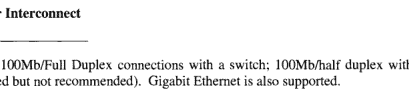

图 2-8：集群互连

> ⁴ V5.1A 支持使用交换机的 100Mb/全双工连接；使用集线器的 100Mb/半双工连接（支持但不推荐）。也支持千兆以太网。

### 2.7.3 节点间通信子系统

没有任何硬件，即使像 `Memory Channel` 这样复杂的硬件，也无法在没有软件帮助的情况下进行通信。负责通过 `Memory Channel` 进行通信的软件被称为节点间通信子系统 `Internode Communication Subsystem`，简称 `ICS`。就像磁盘有磁盘驱动程序，终端有终端驱动程序一样，你可以将 `ICS` 视为与 `MC` 的设备驱动程序交互的软件。

从最基本意义上讲，`MC` 的存在是为了在集群成员之间提供一条快速的通信路径。暂时把 `MC` 从图中移除。我们难道没有在成员之间通信的机制吗？网络互连也足以作为通信介质。

在 `TruCluster Server` 5.1A 版本中，以太网也被支持作为集群互连 `Cluster Interconnect`。这在一定程度上改变了方程式，因为 `ICS` 也将驱动数据通过以太网传输。以太网由以太网驱动程序支持。这里不要考虑 `TCP/IP`。那是在食物链更上层。考虑这样一个事实：同一个以太网驱动程序和设备可以发送 `TCP/IP`、`LAT`⁵、`DECnet`⁶ 以及其他网络协议。如果这是真的，为什么我们不能创建 `ICS` 代码的一部分，使其处理通过以太网的集群通信，而不必依赖安装内存通道适配器呢？

从此以后，我们将提到集群互连 `Cluster Interconnect`，`CI`，而不是特别提及 `Memory Channel`。基本上，无论使用 `MC` 还是 `LAN` 硬件作为 `CI`，其余概念都将相同。正如你将看到的，有许多主要的集群组件使用 `ICS` 并间接使用 `CI`。请注意，`ICS` 实际上为每个集群子系统都有通信通道。

图 2-9 显示了 `ICS` 位于 `CI` 之上。请注意，集群互连将存在于集群中的每个成员上，并且具有某种介质连接各成员。

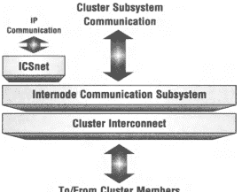

`图 2-9：ICS 与 CI 子系统关系`

⁵ Local Area Transport – 一种老旧的、不可路由的网络协议，用于终端服务器。

⁶ DECnet – HP 的基于 OSI 的网络软件。

有关节点间通信子系统的更多信息，请参阅第 18 章。

### 2.7.4 连接管理器

为了使集群作为一个整体运行，必须有一个组件负责检查和维护成员的状态。连接管理器 `Connection Manager`，简称 `CNX`，被构建在 `Tru64 UNIX` 内核中。它在集群中的每个成员上运行，并提供软件粘合剂以保持集群粘合在一起，或在必要时将其分离。集群中每个成员上的 `CNX` 彼此建立通信，并定期检查以确保通信路径完好无损。在通信路径出现错误的情况下，`ICS` 会通知 `CNX`，以便其采取适当的行动，例如将成员从集群中移除并通知其他集群组件集群状态的变化。

在集群形成期间，主要工作由 `CNXs` 完成，因为它们检查来自成员的预定数量的投票以建立集群。这种协议被称为集群法定人数 `cluster quorum`。如果没有足够的投票来建立法定人数，集群将不会形成。`CNXs` 和法定人数机制还可防止集群分区，即某些成员作为一个集群启动，而与集群其余部分分离且不知情。

`CNX` 使用 `ICS` 和 `CI` 与集群中的其他成员或潜在成员进行通信。`CNX` 还将与 `Tru64 UNIX` 事件管理器 `Event Manager`，`EVM` 通信，以便记录/报告集群事件并与集群应用程序可用性守护进程通信。`CNX` 还负责在某些事件发生时通知其他集群子系统。最后，当成员离开集群时，`CNX` 必须重建分布式锁管理器 `Distributed Lock Manager`，`DLM` 和内核组服务 `Kernel Group Services`，`KGS`。

图 2-10 描述了 `CNX` 作为内核组件与 `ICS` 和事件管理器交互。


图 2-10：连接管理器子系统关系

7 请参阅第 2.7.7 节。

8 有关 `KGS` 的更多信息，请参阅第 18 章。

### 2.7.5 集群应用可用性


应用程序可以通过两种方式之一在集群上运行。它们可以是集群感知的，也可以是非集群感知的。大多数非集群感知应用程序在自身所运行的成员宕机时，通常需要一些软件干预。假设可以在集群中的另一个成员上运行该应用程序，则集群应用可用性（Cluster Application Availability，CAA）组件将负责响应 EVM 消息（这些消息可能来自 CNX 或其他集群组件，如 NIFF——网络接口故障发现器），并在另一个成员上启动该应用程序。一旦应用程序重新启动，CAA 将继续对非集群感知应用程序进行间接监视。注意，如果应用程序脚本包含`check`入口点，CAA 可以直接检查应用程序的状态。有关 CAA 的更多信息，请参阅第 23 章和第 24 章。请注意，非集群感知应用程序有两种类型：单实例——软件一次只能在一个集群成员上运行；多实例——应用程序可以同时在多个成员上运行。多实例非集群感知应用程序可能使用系统调用（如 `fcntl(2)`）来同步文件访问，在这种情况下，由于应用程序代码可能已经在每个集群成员上运行同步实例，因此故障转移场景中并不需要 CAA。然而，使用诸如共享内存和信号量等进程间通信（IPC）方式的多实例非集群感知应用程序，则是 CAA 的适用候选。

图 2-11 显示了负责调度非集群感知应用程序的 CAA 软件。请注意，CAA 是作为用户模式软件机制实现的。

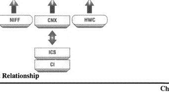

图 2-11：CAA 组件关系

### 2.7.6 集群感知应用程序

集群感知应用程序是指充分利用基于集群的 API（如分布式锁管理器（DLM）或 `MC API`）编写的应用程序。集群感知应用程序可以有多种组织方式。它可以组织成在多个集群成员上执行某些处理，也可以组织成并行处理，或者可以存在服务重复。但在每种情况下，都不可避免地需要协调基于进程的活动。DLM 正是为这种同步而提供的。

### 2.7.7 分布式锁管理器

分布式锁管理器（DLM）被集群感知应用程序以及一些集群组件自身用于集群范围的同步。DLM 远远超出了标准文件锁定能力（尽管它也可用于文件锁定）。实质上，DLM 通过资源名称来表示一个资源（该资源几乎可以是任何东西）。资源名称将具有锁队列（即，已授予、等待、等待转换），这些队列代表争用该资源的应用程序。每个被请求的锁都将包含请求进程的进程标识符（PID）。请注意，在 V5.X 中，PID 在整个集群中是唯一的（更多信息请参阅第 6 章）。因此，每个锁都可以追溯到某个进程和某个集群成员。

请注意，该组件被称为“分布式锁管理器”。这是因为锁数据库分布在集群的所有成员中。DLM 数据库并未在所有集群成员上完全复制。锁数据库的各个部分将驻留在集群中的每个成员上。在集群状态转换时，需要解决的事项之一就是锁数据库的重新分配。

DLM 的美妙之处在于它是一种用于同步的集群级机制。它是进程在不同集群成员上时能够快速通信的少数几种方式之一。另一种通信方式是将数据放入共享文件中。但文件共享是一种好消息/坏消息并存的情况。好消息是文件可以被多个进程同时访问。坏消息同样如此：文件可以被多个进程同时访问。应用程序可以使用文件锁来协调它们对共享文件的访问。此外，磁盘访问往往比内存访问慢得多，即使通过 MC 或其他 ICS 选项进行访问也是如此。锁管理器既被集群组件使用，也被用户进程通过 `DLM API` 使用。图 2-12 包含了内核模式的 DLM 组件。

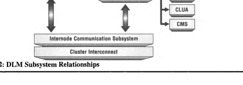

图 2-12：DLM 子系统关系

### 2.7.8 集群文件系统

磁盘存储的文件系统级访问由集群文件系统 Cluster File System (CFS) 支持。CFS 使挂载在集群中任何成员上的所有文件系统对集群中的其他任何成员都可见。CFS 采用客户端-服务器策略实现，其中第一个挂载文件系统的成员将成为集群其余部分的服务成员。所有在非共享总线上找到的磁盘上创建的文件系统都将由本地成员提供服务。虚拟文件系统 Virtual File System (VFS) 软件（Tru64 UNIX 内核的一部分）将与 CFS 交互，然后 CFS 将请求发送到物理文件系统。物理文件系统很可能是高级文件系统 Advanced File System (AdvFS)，但也可能是 Unix 文件系统 Unix File System (UFS)，目前在集群范围内挂载时仅支持只读模式。注意，在 V5.1A 中，如果使用`mount(8)`命令的`-o server_only`选项挂载，UFS（以及 MFS – 内存文件系统）可以以读写模式可用。物理文件系统将需要与另一个软件层交互，该层负责访问正确的磁盘。

图 2-13 显示了 Tru64 UNIX VFS 内核模式代码，该代码将 CFS 代码提供给最终的本地磁盘驱动程序以访问文件系统数据。请注意，CFS 客户端活动的一部分仍未公开，但将在下一节中进行检查。具体来说，必须有一个组件负责识别目标磁盘，如果它存在于集群中的另一个成员上。

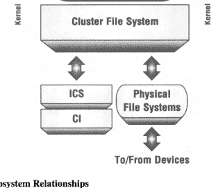

图 2-13：CFS 子系统关系

### 2.7.9 设备请求调度器

设备请求调度器 Device Request Dispatcher (DRD) 接受来自物理文件系统的数据请求，并将请求发送到适当的服务成员。请注意，CFS 组织为客户端-服务器，在某些情况下 DRD 也是如此。DRD 的级别低于 CFS，并且不关心文件系统细节。它调度从设备检索数据的请求（因此得名）。

DRD 提供集群范围内的磁盘存储访问，无论磁盘存储是否可本地访问。DRD 将使用 ICS 并最终使用 CI 将其数据请求发送到适当的服务成员。请注意，DRD 不仅限于提供对磁盘的访问。它还提供对磁带驱动器、软盘驱动器、CD-ROM 和 DVD-ROM 设备的访问。

请注意，在 V5.0 之前，DRD 代表 Distributed Raw Disk。V5.0 之后，设备请求调度器提供对原始磁盘和其他块设备的访问。因此缩写发生了更改。

图 2-14 包括 DRD 处理设备访问请求。

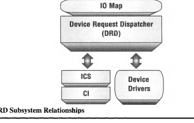

图 2-14：DRD 子系统关系

### 2.7.10 集群 LSM

逻辑存储管理器 Logical Storage Manager (LSM) 提供了创建称为卷的逻辑存储设备的能力。卷可以以镜像方式排列，也可以条带化或连接。在任何一种情况下，LSM 都向系统呈现一个伪设备，该伪设备可能代表多个物理设备。因此，许多 Tru64 UNIX 用户认为 LSM 是一种软件 RAID 选项。

LSM 在集群中受支持，除了在某些专用存储上使用，例如仲裁磁盘和成员的引导磁盘（本书记载稍后讨论）。请注意，LSM 最终需要指定要对软件的较低层执行的 I/O。可以很容易地说 LSM（主要实现为伪设备驱动程序）最终会将其请求传递给本地驱动程序进行处理。在独立系统上，该说法是正确的。然而，在集群上，LSM 必须要求 DRD 将其数据请求传递给设备驱动程序。考虑一下设备可能只能物理访问集群中的另一个成员。DRD 将请求传递给正确的目标成员。

图 2-15 将集群 LSM 组件定位在 DRD 正上方。

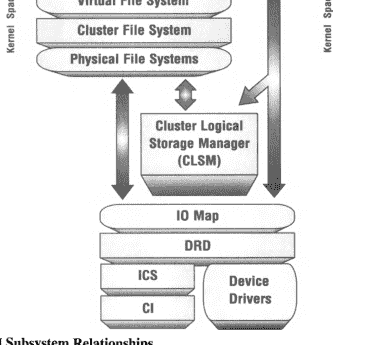

图 2-15：CLSM 子系统关系

### 2.7.11 集群别名

作为一个紧密耦合的计算系统，集群可能需要向网络应用程序（如`telnet(1)`或`ftp(1)`）呈现为一个单一实体。集群实际上可能由多达八个成员组成，并且这八个成员都可能具有网络接口。客户端系统将能够引用一个单一的 IP 地址，该地址可以代表所有集群成员。单一的集群别名将透明地提供对集群的访问。请注意，如果需要，可以定义多个别名来表示集群成员的子集。

让我们回到集群向网络呈现为单一实体的这个问题。这是通过使用集群别名（CLUA）软件实现的。CLUA 软件允许客户端系统（`telnet`、`ftp`、NFS 等）请求与集群建立连接，作为 NFS、FTP、`telnet`或其他网络选项的服务器。CLUA 软件会将请求定向到集群内的目标成员，并尝试对客户端请求进行负载均衡和分发。稍后（在第 16 章中），我们将讨论 CLUA 背后的机制（以及其他组件）。

每个集群成员可能具有多个网络接口以实现冗余，但即使只有一个网络接口，集群成员也希望成为一个或多个集群别名的“成员”。请注意，网络接口由网络接口故障查找器（NIFF）软件支持，该软件负责向 EVM 报告涉及网络接口的事件，EVM 将事件转发给 CAA 软件、CLUA 软件或其他依赖网络的软件。路由表将被修改以反映当前可用的接口。NIFF 将最终与冗余独立网络接口阵列（NetRAIN）交互，后者将尝试使网络活动故障转移，以便使用另一个接口。

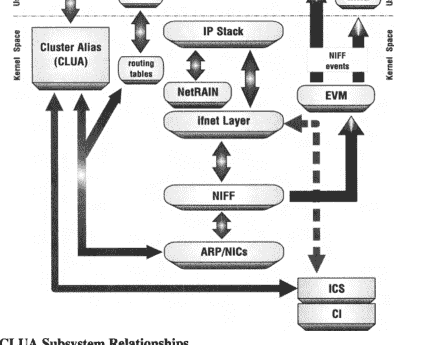

图 2-16：CLUA 子系统关系


图 2-16 包括用户模式 NIFF 组件，以及内核模式 NIFF 和 NetRAIN 组件。请注意，这张图将 CLUA 软件放置在用户模式空间（aliasa）和内核模式空间中。

### 2.7.12 集群全景

图 2-17 应该让你领略到 `TruCluster` 软件的复杂性。每个组件都用于解决特定的实现问题。后续章节将在本章介绍的开胃菜的基础上构建一顿丰盛的正餐。你可能希望在翻阅本书时将此页折角以供参考，因为它有助于偶尔回头看看集群的全貌。

## 2.8 参考文献

- `Tru64` UNIX 技术概览
- `TruCluster` Server 技术概览
- `Tru64` UNIX QuickSpecs
- `TruCluster` Server QuickSpecs

# 设计和规划集群

## 3.1 引言

集群相比于非集群解决方案可以带来诸多好处，但在设计 `TruCluster` Server 集群解决方案时存在许多配置选项，这些选项会直接影响其相对于独立系统的益处程度。你如何做出这些配置选择以满足解决方案的目标？本章将引导你完成这些配置选择，从基本的高级选项开始，逐步深入到更详细的层面，包括：
- 模型、配置和成员系统的数量
- 是否包含仲裁盘
- 集群互连的类型
- 外部网络连接的数量和类型
- 存储使用的硬件和/或软件 RAID 解决方案
- 存储主机总线适配器和结构的数量

在这些领域中，我们将涵盖与解决方案最终目标相关的以下权衡：
- 可用性
- 性能
- 管理便捷性和工作负载整合

### 3.1.1 大多数解决方案的默认选项

在详细讨论每个领域之前，总结一个最佳实践或“在其他条件相同的情况下”的配置作为评估选项时的默认起点是很有用的。注意，这些是建议意见，在每种情况下，替代方案都是 HP 在撰写本文时对 `TruCluster` Server 的支持配置（请参考 QuickSpecs 获取最新支持信息）。话虽如此，“安全”的默认配置选择如下：
- 保持适中的规模（即低于当前支持的最大规模）。出于以下原因，这是推荐的做法：
  - 尽管 `TruCluster` Server 由于其单一系统映像是最容易管理的集群，但集群越大，管理起来就越复杂，尤其是在出现问题时。
  - 选择最大可能的配置意味着选择一种不太典型且经过实地验证的解决方案。选择最大可能的集群就是选择 `TruCluster` Server 用户社区中“非主流”的东西，因此会让你更接近前沿。
  - 明智的做法是为未来添加额外的集群成员预留空间，以适应解决方案的增长。
- 坚持成员的同质性。保持集群由相同型号和计算资源组成的成员构成。在异构集群中，更难管理工作负载，因为某些成员无法承担同样多的工作，或者可能无法运行在集群中执行的相同类型的工作。这会使你的管理和故障转移规划变得复杂。异构成员还可能使补丁和支持变得复杂，因为不同的硬件型号可能需要不同的补丁、驱动程序和内核构建。
- 使用冗余 Memory Channel 作为集群互连。截至本文撰写时，Memory Channel 是较老、更成熟且性能更好的互连。除非距离或成本因素很重要，否则请选择 Memory Channel。
- 使用基于 Fibre Channel 的存储，并由硬件 RAID¹ 支持，使用双冗余结构连接，每个主机上连接两个主机总线适配器（HBA）。你的解决方案的可用性仅与其数据的可用性一样好。确保每个主机至少有两个 HBA，并通向存储端点，以确保故障转移时有多条路径。此外，实现至少两个结构，将服务器的所有 HBA 连接到所有存储端点。这样做是为了确保在结构发生故障或需要进行维护（固件、添加更多交换机等）时不会让你陷入困境。最后，大多数企业站点将需要一个包含 RAID 控制器存储解决方案，仅仅是为了以方便管理的形式获得必要的千兆字节或太字节存储。
- 使用冗余网络接口卡（NICs）配置为 NetRAIN² 以连接公共网络。在将集群连接到客户端系统的网络上，利用 NetRAIN 设施，确保即使单个 NIC 卡丢失，网络连接仍保持正常。

### 3.1.2 示例：生物技术研究部门的 TruCluster Server

为了说明本章所涵盖的权衡和决策过程，将使用一个常见示例，并在介绍每个主要概念时重新审视。该示例是一个假设的生物技术公司计划建立新的 `TruCluster` Server 集群。集群旨在用于一个研究部门，该部门使用混合的定制编写和现成应用。他们目前有一组独立的单机系统托管各种应用，并使用 NFS 和 FTP 等网络协议共享数据。

## 3.2 全局概览 – 应用、成员系统和集群目标

首要任务是确定成员系统及其作为计算资源的配置。这基于应用的性能需求、确保未来应用增长的容量需求，以及确保可用性所需的超额容量。本节将通过提出一系列问题来讨论如何满足这些需求：
- 应用是什么？
- 是否会在集群中运行多个应用？
- 任何应用是否并行（多实例）？
- 每个应用的计算资源需求是什么？
- 多个应用是否会在单个成员上运行？
- 在成员数量方面，集群规模是否有扩展空间？
- 单个成员的计算能力是否有扩展空间？
- 成员系统是否同质（系统是否相似）？
- 集群中是否有计算资源方面的必需超额容量以用于故障转移？

请注意，确定基本成员系统的规模过程通常是迭代的，因为会考虑不同的目标和选项。

### 3.2.1 应用是什么？

有时我们会沉迷于集群的组件技术。显而易见的是，解决方案是为运行应用而配置的。因此，设计基于 `TruCluster` Server 集群的解决方案的起点是指定应用，然后确定运行应用所需的基本平台或平台及其资源，以达到期望的性能水平。

1. 独立（或廉价）磁盘的冗余阵列。
2. 独立 NIC 的冗余阵列。

### 3.2.2 集群中会运行多个应用程序吗？

一个重要问题是集群中是否会存在多个应用程序。就像独立平台一样，集群可以托管多个应用程序。这既有优点也有缺点。从好处来看，在集群内运行多个应用程序可视为一种服务器整合策略。从不利方面来看，集群内的多个应用程序可能使管理更加复杂且更容易出错。

在单个大型系统上运行多个应用程序通常称为“服务器整合”。大多数系统供应商，包括 HP 的基于 Alpha 的 GS 系列和基于 PA-RISC 的 Superdome，都在系统分区和资源管理中实现了特殊功能，以划分单个系统上多个应用程序的运行，从而提高健壮性、可控性和可预测性。在某种意义上，集群有其自身的特点来满足这些目标。每个成员系统可以运行总工作负载中的一个或多个特定应用程序，并作为自己的资源应用、控制和健壮性单元。

多个应用程序并非没有缺点。它们将需要更大、更复杂的环境——而规模和复杂性是稳定性的敌人。例如，应用程序可能对系统资源有非常不同的需求。如果它们运行在同一个集群成员上，那么针对工作负载组合来调整和确定该成员的大小可能会很困难，因为不同工作负载的优化调整需求可能截然相反。在不同成员上运行特性差异很大的工作负载可以解决眼前的问题，但当需要故障转移时怎么办？如果成员系统随后针对特定应用程序进行调整或确定大小，那么发生故障转移时，行为将不是最优的。

即使你认为自己只运行一个应用程序，也一定要列出应用程序解决方案中所有可能被单独考虑的小部分。例如，一个用户先登录主机然后使用工具访问数据库的应用程序，可以被视为两部分：用户登录和数据库服务器。另一个例子是对应用程序所用数据的备份。如果集群中的数据量很小或变化不大，那么备份可以是次要考虑。另一方面，如果备份需要大量资源和时间，那么将其列为单独的应用程序可能是明智的。

#### 3.2.2.1 示例

对于生物技术研究集群项目，为新集群确定了以下应用程序：
- 自研计算应用程序
- 小型标准数据库应用程序
- Web 服务器应用程序
- 用于开发环境和作业调度的用户登录

### 3.2.3 是否有任何应用程序是并行的（多实例）？

并行应用程序在多个集群成员上作为独立实例运行。这些实例共同协作，利用它们所运行的每个集群成员系统上的资源来完成应用程序的工作。与同一产品的单实例版本相比，应用程序的多实例版本通常被视为性能增强功能。为了提高应用程序的吞吐量或处理能力，只需在集群中的其他成员上启动其他实例。除了性能优势之外，多实例应用程序还可以提供更快的故障转移。而不是在幸存的成员上冷启动应用程序（当传统的单实例应用程序或其运行所在的成员发生故障时），对于多实例应用程序，在任何给定实例或其成员主机发生故障时，其他成员上已经在运行一个实例。

`TruCluster` 服务器的常见示例是 Oracle Server 和 Oracle RAC³。Oracle Server 是该数据库产品的标准单实例版本。Oracle RAC 是并行的多实例实现。尽管 RAC 是最常见的情况，但还有其他并行应用程序，包括：
- **NFS 服务**
  在 `TruCluster` 服务器中，所有成员都可以用于通过 NFS 将文件导出到从集群挂载导出文件系统的 NFS 客户端。
- **Web 服务**
  流行的 Web 服务器可以配置为在多个成员上运行，从公共文件系统将相同的 HTML⁴ 文件导出到客户端上运行的浏览器。
- **用于 UNIX 的高级服务器 (ASU)**


HP 用于从 `Tru64` UNIX 提供 PC 文件系统和 NT 域服务的产品，可以在集群中配置为单实例或多实例。

- **NIS 服务器**

构建完成后，所有成员上的所有 NIS 服务器都会将 NIS 数据导出到客户端。

- **多用户登录**

在 `TruCluster` 服务器集群中，公共共享文件系统意味着用户可以登录到多个集群成员并看到相同的主目录和 shell 配置。

多实例应用程序有一些潜在缺点。多实例应用程序的扩展能力取决于所承担的工作负载。你提交给应用程序的工作负载可能不会因为多实例而运行得更快。其次，应用程序供应商可能会对应用程序的多实例版本收取额外的许可费用。最后，运行多个实例的额外复杂性可能会增加管理开销，超出传统单实例应用程序的管理开销。对于 `TruCluster` 服务器，这种情况已通过以下方式降到最低：

³ 真实应用集群

⁴ 超文本标记语言

the single common file system. In the case of Oracle, the database itself can be placed in the common file system rather than on raw devices. Please refer to Chapter 13 for more on the cluster file system.

At this step in the cluster solution design process, we would like to simply mark which applications are potentially multi-instance. Note that depending on the workload, etc., it may not be worth the additional complexity.

#### 3.2.3.1 Example

Which of the applications planned for the Biotech cluster could potentially run as multi-instance and which, if any, have been chosen by the site to run multi-instance?

- Home written compute application

This application is launched in a batch manner and accesses a large collection of input files in read-only mode. It then writes to an output file that can be specified as an argument to the process. The application is inherently multi-instance as long as separate output files are specified for each instance. Multiple instances of the application can be started on a single system, or in the case of the cluster, on multiple members sharing access to common input data and each having its own private output file. These private output files, such as log files, can be implemented by way of Context Dependent Symbolic Links (CDSLs), which are discussed in Chapters 6 and 12. The decision to run the application as a single-instance on a single large member system or multi-instance on multiple smaller systems will come down to the cost of the systems and the scaling across multiple members to obtain the best price-to-performance ratio.

- Small industry standard database application

The database vendor supplies a multi-instance as well as single-instance version of their product. For this particular usage, the database is small and has very low performance requirements. It is unlikely that going with a multi-instance configuration is worth the additional cost and complexity.

- Web Server application

The Web Server in question exports a series of read-only HTML files and also has active content to query or update the database mentioned previously. The Web Server could be run multi-instance because the HTML files are read-only, and the database in the backend can guarantee transactional properties if multiple queries or updates come in simultaneously from multiple Web Server instances. On the other hand, the amount of traffic and performance needs are such that it is unlikely that multiple Web Servers will be needed.

- User logins

User logins could be made to be multi-instance. As long as a user can log in to any system and see the same home directories, shells, and tools, then it doesn't matter whether a group of active logged in users are all on one member system or spread over multiple member systems. The major activity of the logged in users is to submit computational jobs. In addition, some users also access the database or work on developing the applications. For this cluster, the user application could be deployed on a single host or multiple hosts. The final decision can be based on cost-effectiveness by comparing the price of one larger platform with multiple smaller platforms.

### 3.2.4 How Much Computing Resources Do The Applications Require?


This must be done for each application individually. If the single application were running on a standalone platform (or multiple, if multi-instance), what class, model, and configuration of system(s) would be required to meet its performance needs? The details include CPU, Memory, Network I/O Bandwidth, Storage I/O Bandwidth, and total Storage.

Application sizing performance for a platform is not always easy. This task is independent of the cluster technology except for the scaling factor as the member count is increased for multi-instance applications. For some standard popular software applications, such as Oracle, some references exist. In other cases, sizing a new platform for an application can be based on the site’s experience running the application on an existing smaller or older platform.

### 3.2.4.1 Example

Like many sites, the Biotech Company has previous experience running either the same or the current incarnation of the applications on standalone servers in the environment. To size the new platforms for the new cluster, they will start out by studying the performance resource consumption rates on the current environments. Next, they will evaluate the latest server models and choose memory and cpu counts for the servers in the new cluster.

- Home written compute application

If run on a single system, it would require a GS160 class system. The GS160 would require twelve CPUs, 32GB of Memory, six HBAs, and approximately one TB of storage. Alternatively, the application could be split over multiple systems in a cluster, the best option being three ES45 class systems. Each of these servers would have four CPUs, 8GB of Memory, and two HBAs. The network interface requirements are low. A single, logical interface implemented with two Fast Ethernet physical NICs would be adequate.

- Small standard database application

Assuming it is run on a single node as a single instance, a DS20 system with two CPUs, 4GB of memory, and two HBAs would be adequate. The total storage required is 400 GB. Network interface requirements would be low. A single logical interface implemented with two Fast Ethernet physical NICs would be adequate.

- Web Server application

Assuming it is run on a single node as a single instance, a DS10 system with one CPU, 2GB of memory, and two HBAs would be adequate. The total storage required is 200 GB. Network interface requirements would be low. A single logical interface implemented with two Fast Ethernet physical NICs would be adequate.

- User logins and development environment application

If run on a single system, a single ES45 with four CPUs, 8GB of memory, and two HBAs would be more than adequate. The total storage required would be 400 GB. Network interface requirements would be moderate. A single logical interface implemented with two Fast Ethernet physical NICs would be adequate.

### 3.2.5 单个成员上是否会运行多个应用程序？

在规划应用程序如何映射到集群成员时，我们可以选择将特定成员专用于特定应用程序，或在单个集群成员上运行多个应用程序。在集群中将应用程序与服务器进行一对一映射（或独立服务器）可以简化成员的调优、支持和计算资源管理。另一方面，最大化平台投资是激励在同一台机器上运行多个应用程序的因素。

此决策在很大程度上取决于应用程序的性质以及操作系统中用于简化控制多个应用程序运行的资源管理服务。

- 应用程序是否具有极端的资源消耗模式，使得共享主机难以优化？
- 利用 `Tru64` UNIX 操作系统的资源管理设施（包括处理器集、类调度以及 ARMTech 公平共享调度器）是否会简化服务器上的资源管理？
- 多个应用程序是否会因为在一天的不同时间运行而产生冲突？
- 即使一组应用程序可以共享一台主机，如果它们故障转移到已经运行不同作业集的另一个集群成员，应用程序组合会对系统产生什么影响？
- 应用程序的叠加是否能使整体集群更小，从而简化集群整体的配置和管理？

#### 3.2.5.1 示例

在 Biotech 集群的情况下，一些应用程序可以在同一成员上运行而不会有重大风险：

- Web 服务器和数据库可以运行在通用平台上，因为两者都不 expected 会成为过度的资源消耗者。此外，Web 服务器与数据库交互，因此将它们运行在同一平台上将提高 Web 服务器客户端看到的性能。

在此之后，结果工作负载可以减少为：

- 自行编写的计算应用程序

  与之前的描述无变化。

- 小型标准数据库应用程序和 Web 服务器应用程序

  单台具有四颗 CPU、8 GB 内存、两个 HBA 和 600GB 存储的 ES40 系统就足够了。

- 用户登录和开发环境应用程序

  如果运行在单台系统上，一台具有四颗 CPU、8GB 内存和两个 HBA 的 ES45 就绰绰有余。总存储需求为 400GB。网络接口需求为中等。采用两个 Fast Ethernet 物理网卡实现的单个逻辑接口就足够了。

### 3.2.6 成员系统是否会有同质性？

`TruCluster Server` 软件支持同质或异构集群配置。同质集群的成员由相同型号和计算资源组成，具有简化集群管理的多方面优势。首先，站点在集群内静态分配应用程序或故障转移发生时，无需担心跟踪哪些系统具有哪些计算资源。此外，调优以及通过补丁进行的硬件和软件维护可以更加标准化。异构环境可能更具成本效益，因为站点要么将不同型号的现有硬件整合起来组成集群，要么在需求差异很大时精确匹配系统与应用程序。


### 3.2.6.1 示例

在 Biotech 集群中，不会将任何旧服务器纳入集群，并且认为同质集群的管理简便性是优先事项，因此设计将以同质配置为中心。

- 3 台 ES45 — 计算应用程序
- 1 台 ES45 — 数据库和 Web 服务器
- 1 台 ES45 — 用户登录

请注意，在数据库和 Web 服务器系统的情况下，出于保持集群同质性的考虑，服务器的性能将高于应用程序绝对所需。

### 3.2.7 是否通过提供额外的计算能力来保证可用性？

几乎所有集群解决方案都将高可用性作为设计标准。在这种情况下，集群必须拥有足够的备用计算能力，以便当某个成员发生故障时，运行在其上的应用程序可以迁移到另一个集群成员并继续运行。主要问题是当应用程序迁移到新成员时所需的服务水平是多少。如果与原始成员故障前相同，则必须有与故障成员相同数量的空闲计算容量可用于故障转移。例如，如果集群有一个应用程序运行在一个成员上，则需要一个相同大小的另一个成员来满足此要求。关键是该额外成员在第一个成员故障导致应用程序故障转移之前处于空闲状态。拥有 100% 空闲计算能力是最坏情况，如果执行以下操作可以减少：

- 随着集群规模的增加，备用容量的开销可以分摊到多个成员上。例如，如果集群有两个应用程序运行在两个成员上，则需要第三个空闲成员来接管其中任一应用程序，如果当前成员发生故障。
- 该站点可能愿意在出现故障条件时接受服务水平下降或终止非关键应用。例如，一个拥有两个应用的双节点集群可以在一个节点故障时允许两个应用都在单个节点上运行但性能下降，或者在故障转移发生时终止较不重要的应用。

所有这些故障转移规划的复杂性还在于集群应用所需的计算资源，以及集群的成员系统是否同构。例如，如果一个工作负载需要一个极大的服务器，而集群中的其他应用不需要，那么为了大型应用的故障转移就需要额外的大型服务器——独立于剩余应用较小的需求。

#### 3.2.7.1 示例

生物技术集群设计已经缩小为同构集群。这使得故障转移规划变得更容易。不考虑故障转移时支持应用所需的最小成员数已经是 5。增加第 6 个成员作为故障转移主机的成本对站点的计划来说并不 excessive，因此将采用该方案。这导致集群如下：

- 3 台 ES45 - 计算应用
- 1 台 ES45 - 数据库和 Web 服务器
- 1 台 ES45 - 用户登录
- 1 台 ES45 - 其他作业的故障转移主机

### 3.2.8 是否有空间在成员数量方面扩展集群规模？

许多站点希望能够在解决方案中设计出随着时间推移增加计算容量的能力。有时一开始就知道应用负载会随时间增加；其他时候这只是为了在发生不可预见事件时做好准备的愿望。对于集群来说，计算能力可以在两个维度上增长——成员的大小和成员的数量。

可能触发通过添加新成员来扩展集群的需求的变化有：

- 新增应用
- 运行多实例应用的成员数量
- 将原本共享成员系统的应用迁移到各自的成员系统上

就集群成员数量而言，目前支持的最大值为八个节点。这意味着如果站点希望能够增长，则需要从小于该值的集群规模开始。

### 3.3.1.1 何时需要“强制”使用仲裁盘？

简短的答案是对于双节点集群。更长的解释从对“需要”一词的说明开始。TruCluster Server 软件从不坚持为任何节点数量的集群定义仲裁盘才能启动并投入运行。然而，如果我们希望在单个节点故障时剩余成员仍能保持运行，那么仲裁盘对于双节点集群来说就是“必需”的。如果双节点集群未配置仲裁盘，并且任一成员或所有冗余集群互连链路发生故障，集群将暂停运行。

### 3.3.1.2 何时仲裁盘是有益的（而非“必需”）？

仲裁盘对于四、六和八节点集群是有益的。对于成员数量为偶数的集群，仲裁盘允许额外的一个成员系统不可用而集群仍能继续运行（对于未配置仲裁盘的同等规模集群则不会如此）。例如，在没有仲裁盘的四节点集群中，如果两个节点宕机、故障或在集群互连上无法访问，集群将暂停运行。如果在四节点集群配置中添加仲裁盘，则需要三个节点不可用集群才会暂停运行。请注意，这种好处在奇数节点集群中不存在。

更多细节请参见第 17 章。

### 3.3.1.3 示例

生物技术集群目前为六个节点。因此，他们将添加一个仲裁盘以将集群暂停运行的阈值从三个节点提高到四个节点。

### 3.3.2 应使用何种类型的集群互连？

TruCluster Server 现在支持两种类型的集群互连：Memory Channel 和基于 LAN 的互连。此外，任一互连类型都可以配置为单链路或双冗余配置。简短而保守的答案是使用 Memory Channel，因为它支持时间最长且性能特性最好。当然也有一些压倒性的原因可以使用基于 LAN 的集群互连——成本、距离以及主机成员的插槽限制。这些将在以下章节中更详细地讨论。

#### 3.3.2.1 集群互连的作用

集群互连的性能和完整性对集群的运行至关重要。集群互连用于所有成员上运行的集群软件之间的通信和同步。例如，在 TruCluster Server 的 Connection Manager（CNX）组件的情况下，集群互连的部分或完全故障可能导致单个集群成员暂停或整个集群暂停运行。考虑到这一点，使用冗余互连配置并选择性能尽可能最好的集群互连对于成功的集群至关重要。

集群互连（无论是 Memory Channel 还是基于 LAN 的）以 IP 网络的形式呈现给系统和用户。为了确保集群软件能够获得集群互连的全部性能，一种保守的做法是，不要将此 IP 网络用于集群成员之间的任何应用程序或管理性高带宽消耗任务。如果不同成员上的应用程序之间需要高性能通信，那么一种保守的解决方案是，为所有成员额外部署一个公共网络来承载这类流量。

#### 3.3.2.2 Memory Channel 互连

Memory Channel 是 TruCluster Server 软件最早提供且支持时间最长的集群互连。它基于位于成员节点中的基于 PCI 的 Memory Channel 卡，在标准配置下，这些卡以星形方式连接到 Memory Channel 集线器。如果只连接两个主机，可以通过在 Memory Channel 板上设置跳线来省略集线器（第4章将对此进行详细说明）。在此配置下，两个成员之间的最大点对点距离为二十米。

与传统网络技术相比，Memory Channel 具有高带宽和极低延迟的特点，因此非常适合在紧密连接的集群成员之间使用。作为一种以性能换取距离的替代配置选项，可以不使用单个集线器，而是使用两个集线器并在它们之间通过光纤网桥连接，以支持最长 6000 米的点对点距离。

为实现高可用性，应在成员系统之间配置两条 Memory Channel 链路。集群会自动检测这两个互连，并将其中一个用作活动链路，另一个用作被动备用链路。

##### 基于 LAN 的集群互连

从 V5.1A 开始，TruCluster Server 支持基于行业标准快速以太网或千兆以太网硬件构建的 LAN 集群互连。这两种技术都提供了行业标准的集群互连硬件解决方案，但与 Memory Channel 相比，在性能上有不同程度的取舍。千兆以太网的带宽和延迟几乎可以媲美 Memory Channel，但快速以太网在两个方面都明显更慢。还要注意，LAN 互连支持并不是一个万能选项，允许你使用任何可以在两个系统之间配置的“网络”。你应该知道，在网络的距离以及公共或私有性质方面存在限制。首先，NSPOF LAN 互连配置的总点对点距离有上限，为 1100 米；虽然这远大于标准 Memory Channel 配置的距离，但使用光纤网桥的 Memory Channel 配置实际上可以跨越更长的距离，达 6000 米。物理 LAN 互连配置还受到各种限制，例如成员之间允许的交换机数量（目前为三个），这些限制在《Cluster LAN Interconnect》指南中有描述，该指南是 HP 提供的 TruCluster Server 文档集的一部分。此外，LAN 互连预期是一个仅用于集群的私有网络，不能连接其他系统或应用程序。对于 Memory Channel 配置，即使并非不可能，也很难让非集群系统连接到该互连。而对于“网络”，这样做很容易，但如果额外的流量使集群成员无法使用互连，那将是灾难性的。

为实现可用性，LAN 互连应在硬件级别配置为双冗余。然后需要使用基础系统的 NetRAIN 工具将两条链路配置为一条逻辑链路。NetRAIN 工具是 Tru64 UNIX 操作系统的标准组件。

### 3.3.2.3 Memory Channel 与基于 LAN 的互连的比较

表 3-1 列出了 Memory Channel 和基于 LAN 的集群互连的属性。

请注意以下几点：

- 在性能方面，Memory Channel 的带宽与千兆以太网相当，但延迟性能特性要好得多。
- 在最大距离方面，基于 LAN 的解决方案更好，除非你使用 Memory Channel 的光纤网桥配置。
- 在相对成本指标上，Memory Channel 是最高的选项。然而，从绝对价值来看，Memory Channel 卡和集线器与千兆硬件相比并不算昂贵。


- 在 NSPOF 配置中，Memory Channel 和基于 LAN 的集群互连在支持多条链路以主/备模式运行（直到活动链路发生故障）方面相当。Memory Channel 配置最多支持两条物理链路。LAN 互连支持 NetRAIN 子系统所允许的任意数量链路（通常两条就足够了）。

- 在版本历史方面，尽管 HP 对 TruCluster Server 的两种互连类型都提供全面支持，但 Memory Channel 硬件以及驱动它的 TruCluster Server 软件已经存在更长时间，目前背后积累的测试和部署时长也显著更多。

- Memory Channel 检测通信故障的速度要快得多，因为它不必等待 IP 超时发生。

保守的做法和推荐的经验法则是使用 Memory Channel，除非你有令人信服的理由不这么做——例如距离、成本或成员系统插槽限制。

### 3.3.2.4 示例

对于生物技术研究部门而言，他们最初的假设是使用 Memory Channel。从成本来看，他们认为 Memory Channel 组件的成本与基于 LAN 的组件成本或集群总成本相比并不算不成比例。此外，集群的六个 ES45 节点将放置在公共设备机房中的一对机架内，最远系统之间的点对点距离不超过五米。

### 3.3.3 集群互连是否应为双冗余？

鉴于前面关于集群互连在集群运行中关键作用的讨论，答案是“是”。请注意，尽管集群软件并不强制要求将冗余互连硬件作为一项由软件强制执行的硬件配置规则，但为了保护整个集群的稳定性和可用性，这样做是合理的。

| 互连类型 | 相对性能：带宽 | 相对性能：延迟 | NSPOF 配置中支持的点对点最大距离 | 相对成本 | 插槽占用 | 冗余模型 | 首个支持版本 |
|---|---|---|---|---|---|---|---|
| 内存通道 | 高 | 低 | 20 米 | 高 | 1 个 PCI 插槽/导轨 | 主动/被动 | 5.0 |
| 带光纤桥接的内存通道 | 中 | 中 | 6000 米 | 高 | 1 个 PCI 插槽/导轨 | 主动/被动 | 5.0 |
| 快速以太网 | 中 | 中/高 | 1100 米 | 低 | ¼ 个插槽/导轨（4 端口卡） | 主动/被动（NetRAIN） | 5.1A |
| 千兆以太网 | 高 | 中/高 | 1100 米 | 中/高 | 1 个 PCI 插槽/导轨 | 主动/被动（NetRAIN） | 5.1A |

**表 3-1：内存通道与局域网对比**

#### 3.3.3.1 示例

对于 Biotech 集群，将采用双冗余内存通道集群互连配置。

### 3.3.4 网络接口是否应具备高可用性？

如果客户端和用户无法通过网络接口访问集群，那集群就如同宕机一样。因此，是的，应该将网络接口配置为高可用。

具体如何实现呢？*TruCluster* 服务器解决方案在两个层面提供了机制，以确保在发生故障时网络连接保持可用。在第一个层面，可以使用 *TruCluster* 服务器软件的集群别名（Cluster Alias）功能。集群别名可以配置为：当某个成员的网络接口发生故障时，另一个具有可用接口的成员可以作为代理，通过集群互连接收并转发来自原成员的网络流量。在 *Tru64* UNIX 层面，NetRAIN 和 LAG⁵ 接口提供了一种方法，可以用多个物理网卡创建单个逻辑 IP 接口，并在其中一个物理接口卡发生故障时保持高可用性。您可以在第 9 章和第 12 章中了解更多关于 NetRAIN 和 LAG 的详细信息。

### 3.3.5 针对成员网络接口故障的默认基本补救措施 - 使用 CLUA 公共子网别名

集群别名（CLUA）子系统是 TruCluster 服务器软件的一个组件，它允许创建和使用虚拟网络地址，从而使客户端能够连接到集群中的服务，而无需依赖成员的原生 IP 地址，也不受这些接口或成员故障的影响。第 16 章将详细描述集群别名子系统。在这里，我们将简要介绍设计集群解决方案时的配置选项和备选方案。

使用集群别名默认的公共子网别名类型，不需要特殊硬件，只需每个成员系统都配备一个连接到公共网络的网络接口即可，这本来就是常规做法。在这种配置方案下，如果某个成员当前从外部接收流量的网络接口发生故障，集群别名子系统会自动选择另一个成员，在其位于同一子网的接口上接收传入流量，并将原本发往原始主机的任何流量通过集群互连转发以到达该主机。该方案可以提供以下功能，从而满足大多数需求：

- 即使某个成员用于公共网络的唯一物理 NIC 发生故障，只要为成员系统配置了单个 NIC，网络流量仍能传送到该成员。

在少数情况下，通过集群互连路由传入流量可能会导致以下问题：

- 对于某些应用程序，经由集群互连重新路由的额外步骤可能会导致无法接受的性能影响。

- 在极端情况下，集群互连上的额外流量可能会影响集群将集群互连用于其他用途的能力，例如连接管理器（Connection Manager）子系统以及设备和文件系统的 I/O 转发。

如果您遇到认为使用别名导致集群互连流量过大的情况，可以通过软件配置选项和额外硬件来最大程度地减少这种影响。下面将介绍这些方法。

### 3.3.6 消除任何可能通过网络互连重新路由的网络流量的其他选项

如前文所述，在单个网络接口上使用默认集群别名可能会导致集群互连上出现不理想的网络流量。如果您正在设计的集群存在此问题，您有四种选择。

#### 3.3.6.1 使用 CAA 在网络接口故障时迁移应用程序

利用集群应用程序可用性 Cluster Application Availability，CAA 框架在应用程序和网络接口之间创建依赖关系，以便在应用程序所在成员的网络接口发生故障时，触发应用程序故障转移到具有正常外部网络接口的成员。此选项具有以下优缺点：

- 不需要在物理 NIC 方面增加额外硬件

- 会导致应用程序在迁移到另一成员时出现停机。

#### 3.3.6.2 使用 CLUA 虚拟子网别名

将别名创建为 CLUA“虚拟子网别名”，并在每个成员上配置两个外部网络接口，连接到两个不同的子网，这些子网由一个公共路由器连接。在此方案中，如果一个网络接口发生故障，路由器将识别该成员的另一个网络接口为有效路径，并通过此替代路径将网络流量转发到同一主机。此选项具有以下优缺点：

- 当单个物理网络接口发生故障时，消除了通过集群互连重新路由网络流量的需求

- 对应用程序透明且不需要重启

- 不仅能承受单个 NIC 的故障，还能承受成员与路由器之间整个子网的故障

- 需要多个物理网络接口

- 需要一个额外的网络接口

- 需要所有成员都配置在由公共路由器连接的两个子网上

#### 3.3.6.3 利用 Tru64 UNIX NetRAIN 功能

利用 Tru64 UNIX 的网络接口 NetRAIN 配置选项。NetRAIN 与集群无关，允许从同一主机上的多个物理网络接口创建逻辑网络接口。如果一个接口发生故障，内核会透明地故障转移到该集合中的另一个物理网络接口，而不会中断应用程序。此选项具有以下优缺点：

- 当单个物理网络接口发生故障时，消除了通过集群互连重新路由网络流量的需求

- 对应用程序透明且不需要重启

- 需要多个物理网络接口

#### 3.3.6.4 利用 Tru64 UNIX LAG 功能

Tru64 UNIX 的 LAG 功能与 NetRAIN 类似，允许使用多个物理网络接口创建具有高可用性特征的单个逻辑网络接口。LAG 的优势在于所有物理网络接口都以主动/主动方案并行使用，以提高逻辑接口的总体带宽。尽管 LAG 可以承受集合中物理网络接口的故障，但这种性能提升是以可用性为代价的，即所有物理网络接口必须连接到一个公共网络交换机。此选项具有以下优缺点：

- 当单个物理网络接口发生故障时，消除了通过集群互连重新路由网络流量的需求

- 对应用程序透明且不需要重启

- 提供性能扩展

- 需要多个物理网络接口

- 所有 NIC 都必须连接到的交换机成为单点故障

如前所述，利用单个网络接口和默认样式的公共子网别名对于大多数集群和应用程序来说已经足够。只有在已知集群互连上的网络流量过多不可接受时，才应考虑进一步措施。

#### 3.3.6.5 示例

对于 Biotech 集群，需要两个网络。一个网络仅供集群成员使用。它将用于用户“登录”系统与计算农场之间的通信。另一个网络将所有成员连接到外部世界。主要流量将进入登录系统和 Web 服务器。

对于这两个网络，站点最初将使用单个 NIC，并利用集群别名子系统在发生故障时重新路由流量。如果专用网络无法提供所需的性能，站点准备投资额外的 NIC 并将接口转换为 LAG。

### 3.3.7 存储应如何配置？

集群及其运行的应用程序需要可靠、可信且冗余的存储设备访问。集群的最小磁盘配置如下：

- 一个磁盘用于集群根目录 `/`、`/usr` 和 `/var` 文件系统的三个分区

- 为集群的每个成员提供一个磁盘，用于包含成员的 `boot_partition`、`swap` 和 cnx 数据区

- 对于成员数量为偶数的集群配置，再额外提供一个磁盘用作仲裁盘

除了这些最低配置要求之外，集群的根目录（`/`）、`/usr` 和 `/var` 可以分布在多个磁盘上，而且通常还会有额外的磁盘用于应用程序和用户的文件系统。


在 TruCluster Server 中，要使这些存储容器具备高可用性，您可以在 I/O 层次结构的不同级别使用以下可用性功能：

- 使用 LSM 和/或硬件 RAID 创建高可用性卷
- 利用不同成员的多条路径，依靠 TruCluster Server 软件的设备请求分发器（DRD）来确保：如果某个成员到存储的所有路径都发生故障，另一个成员可以代表该成员访问设备，并通过集群互连传输所需的任何 I/O
- 使用同一主机上 HBA 之间的多路径（这是 Tru64 UNIX 内置的功能）
- 实施连接 HBA 与存储端点的冗余光纤架构

一般规则是，尽量让集群的存储架构尽可能对称，以简化实现、管理和故障排除。

一般默认的经验法则：

- 每台主机至少有两个 HBA。
- 主机与其存储之间至少要有两套光纤架构。
- 除非是小型存储集群且成本是个问题，否则应假定使用硬件 RAID 阵列。应根据具体情况评估是否使用 LSM 以便于管理或获得额外功能。

### 3.3.8 使用硬件 RAID 还是 LSM？

在当今的单机系统和集群计算环境中，有两种方法可以实现磁盘设备的高可用性 RAID 配置——基于软件的 RAID 和基于硬件的 RAID。在 Tru64 UNIX 和 TruCluster Server 软件中，这两种方法分别以逻辑存储管理器（LSM）和 StorageWorks RAID 阵列系列的形式提供。标准问题是：“这两种解决方案应该使用哪一种？”

#### 3.3.8.1 拥有 100GB 以上存储的企业级服务器

对于几乎所有的 Tru64 UNIX 企业级解决方案来说，软件 RAID 与硬件 RAID 的原始问题稍有偏差。原因在于，在这些情况下，站点已经在投资购买 StorageWorks 设备，这些设备具有 RAID 功能，可以物理连接并合理管理连接到集群的物理存储总量。换句话说，硬件 RAID 几乎总是可用的，所以真正的问题变成了：“我已经为存储硬件中的硬件 RAID 功能付了钱。我还要在 LSM 中使用软件 RAID 吗？”

通常出于成本和简单性的考虑，答案是“不”，除非以下因素导致站点选择 LSM：

- 站点希望通过创建条带集来获得额外的性能优势，这些条带集包含由不同 RAID 阵列承载的硬件 RAID 集合。这种能力很少使用，因为它只对拥有大量存储和极高带宽需求的站点有意义。
- 站点非常谨慎，希望使用 LSM 跨硬件机柜镜像存储。
- 站点希望利用 LSM 中除 RAID 之外的其他功能，这些功能本身就有价值。其中包括灵活的卷管理，以及创建任意大小、独立于物理磁盘或硬件 RAID 属性的卷的能力。

#### 3.3.8.2 小规模成本敏感型配置

您可能会问：“如果我构建的解决方案没有 100GB 以上的存储，而且可以使用没有内置 RAID 功能的简单存储设备来构建，那该怎么办？”在这种情况下，我们就回到了硬件 RAID 与软件 RAID 的经典问题，通常答案取决于成本。

- 使用 LSM 的较简单硬件解决方案，是否比不使用 LSM 但更复杂的硬件解决方案更便宜，同时仍能为集群提供总字节数的存储？

另一个次要的考虑因素是，LSM 不能用于集群中使用的某些特定文件系统（和分区）。仲裁磁盘（如果配置了）和任何成员引导磁盘都不能用作 LSM 卷（交换分区可以是 LSM 卷，但整个引导磁盘——引导分区、CNX 分区和交换分区——不能处于 LSM 控制之下，这正是我们这里要说明的）。这会造成多大的不利影响？

- 如果成员引导磁盘发生故障，该成员将崩溃。如果仲裁配置正确且所有其他主机都可用，集群将继续运行。在故障节点上运行的任何应用程序都需要在幸存的节点上重新启动。
- 如果仲裁磁盘在未丢失任何成员的集群上发生故障，集群将继续运行。因此没有直接影响。只有当其故障未被检测到且未修复，并且某个成员主机发生故障或关闭导致集群失去仲裁时，它才会影响集群。

成员引导磁盘和仲裁磁盘的在线更换程序在第 22 章中介绍。

考虑到这两个因素，在非成本方面，软件 RAID 集群与硬件 RAID 集群在行为上的主要可用性差异在于：如果发生成员引导磁盘故障，软件 RAID 配置的集群将导致应用程序重新启动。

### 3.3.9 从每个成员到所有存储设备的独立路径

TruCluster Server 中下一个级别的存储可用性是：如果集群中的一个成员没有通往存储设备的可用路径，但另一个成员有，则拥有可用路径的成员将“服务”该 I/O 给没有路径的成员。此功能在 TruCluster Server 软件的设备请求调度程序 Device Request Dispatcher (DRD) 子系统中实现，并在第 15 章中有更详细的描述。这意味着只要有一个成员拥有通往存储设备的可用路径，所有成员都可以继续访问它。

这鼓励我们为集群使用的所有存储容器配置来自多个成员的路径。在我们深入思考这个问题并思考哪两个成员将连接到哪个存储等之前，随着当今 Fibre Channel 的典型使用，该问题变得无关紧要。Tru64 UNIX 和 TruCluster Server 软件的压倒性配置是将所有成员连接到一个 Fibre Channel 结构，该结构连接到所有存储设备。这种对称性是最简单、最具成本效益的方式，并且利用了 Fibre Channel 通过单个结构寻址大量设备和主机总线适配器的能力。

因此，假设所有成员都通过一个公共结构连接到所有存储设备，利用 DRD 是否是最终答案？还不完全是。

- 单独的 DRD 不能保护我们免受所有成员之间只有一个结构，而存储或结构发生故障的情况。

  - 这里的解决方案是在主机和存储之间实现多个冗余结构。这意味着每个主机至少有两个 HBA 连接到两个不同的结构，并且存储阵列通过不同的端口连接到两个不同的结构。

- 在极端情况下，DRD 通过集群互连重定向 I/O 可能会影响应用程序的性能或整个集群的稳定性。为缓解此问题：

  - 利用 CAA 检测应用程序运行的主机上存储路径的故障，并在具有可用连接性的主机上重新启动应用程序，或
  - 利用 Tru64 UNIX 的多路径功能，并为同一成员到存储提供多个冗余主机总线适配器。并非仅出于性能原因才推广使用此功能，但单个成员也将以活动/活动方案使用所有 HBA，从而使性能随路径数量而扩展。

#### 3.3.9.1 示例

生物技术公司的六节点 ES45 集群将在每个系统上包含两个 HBA，以满足可用性和性能要求。将使用两个结构和两个交换机来实现，以便每个成员通过两个不同的独立路径连接到每个 HSG RAID 阵列。LSM 也将被用作数据库卷的便利工具。

# 集群配置规划

> “不付诸行动的规划是徒劳的，没有规划的行动是致命的。”
> — 日本谚语
>
> “长远规划不是处理未来的决策，而是处理当前决策的未来。”
> — 彼得·德鲁克

任何成功事业的关键都是仔细的规划和准备。成功实施集群需要规划——短期规划和长期规划——但无论如何都需要规划。本章提供了仔细而合乎逻辑地规划和准备成功的 TruCluster Server 实施的想法——既针对短期，也针对长期。

## 4.1 TruCluster Server 的内存需求

截至本文撰写时，TruCluster Server 集群成员的内存需求是安装 Tru64 UNIX 所需的内存量，再加上集群软件至少额外的 64 MB。因此，如果安装和运行 Tru64 UNIX 需要 128 MB 内存，则每个集群成员在 TruCluster Server 环境中运行至少需要 192 MB 内存。

## 4.2 规划磁盘设备

经常被忽视的是对系统磁盘的规划，即用于初始 Tru64 UNIX 安装和 TruCluster Server 实施的系统磁盘。事实上，即使是经验丰富的系统管理员也未能考虑系统磁盘上的分区应该有多大或多小，或者文件系统应该放在哪里，直到为时已晚，他们已经开始安装系统。

这种缺乏规划会在短期和长期内造成严重问题。最好的情况是，你会在没有任何用户之前就重建系统，并在过程中浪费宝贵时间。最坏的情况是，你可能需要在一个本应高度可用的生产系统上进行长时间的停机。总之：不规划是一种不良做法。

我们理解您急于立即开始实施 TruCluster Server。但请稍等。花一分钟想想您打算做什么。

将您急于开始的心情转化为规划设备的活动，这些设备将用于初始的 Tru64 UNIX 系统磁盘以及最终的 TruCluster Server 系统磁盘。

### 4.2.1 规划 Tru64 UNIX 系统磁盘

我们经常听到系统管理员——无论经验丰富与否——说：“规划初始 Tru64 UNIX 系统磁盘并不是什么大不了的事，尤其是当我们还要安装和配置 TruCluster Server 时。毕竟，一旦 TruCluster Server 的安装和配置完成，我们就再也不会使用那个最初的 Tru64 UNIX 系统磁盘了。事实上，我们完全可以‘销毁’那个旧系统磁盘，并将该空间用于其他有建设性的用途，比如另一个临时区域。”


虽然初始 Tru64 UNIX 系统磁盘确实用于构建 TruCluster Server 环境，之后很少再用，但应将其保留并用作“紧急修复”磁盘。此外，您可以利用交换分区和/或在该磁盘上配置一个独立的本地 `/tmp` 文件系统，以供集群内部使用，从而减少共享总线上的额外 I/O，因为截至本文撰写时，`swap` 和 `/tmp` 都是按成员使用的¹。

如果您将来遇到任何问题，紧急修复磁盘对于修复和恢复集群配置至关重要。有关紧急修复磁盘的更多信息，请参阅第 22 章“集群维护与恢复”。

无论如何，都不能低估规划 Tru64 UNIX 系统磁盘的重要性。该系统磁盘仍然可以在集群的日常运维中发挥积极作用，并且在出现问题时对集群的恢复发挥关键作用。

顺便提一下，虽然本文的讨论以及 Tru64 UNIX 安装指南中的讨论建议使用本地磁盘进行初始 Tru64 UNIX 安装，但这并非硬性规定。共享总线上的磁盘设备也可以用作初始 Tru64 UNIX 安装系统磁盘。

#### 4.2.1.1 多少空间才算足够？

确定操作系统各文件系统的磁盘分区大小，取决于要安装的软件子集以及文件系统的使用情况。软件子集所占用的空间量可以提前轻松确定。这些信息包含在要安装的 Tru64 UNIX 版本的发行说明中。而每个文件系统基于实际日常使用情况所需的空间量，通常需要经验才能发现，因此这类信息往往更难获得。

根据 Tru64 UNIX 安装指南，如果您使用大于 3 GB 的磁盘，各分区的大小应为：根分区 (`/`) 为 384 MB，交换分区为 384 MB，`/usr`（包括 `/var`）为 2.235 GB。根据 Tru64 UNIX 5.1A 版本的发行说明中的软件子集大小，如果要安装 Tru64 UNIX 操作系统光盘、关联产品第 1 卷光盘和关联产品第 2 卷光盘中的所有软件子集，则根 (`/`) 文件系统将占用 122.35 MB，`/usr` 将占用 3004.86 MB，`/var` 将占用 135.01 MB。我们当然不建议盲目地安装所有这些光盘中的所有内容，但这些信息为我们提供了一个基线，我们据此得出了自己的分区大小建议。

在 TruCluster Server 集群安装指南中，HP 强烈建议，“除非站点策略禁止，否则在安装 Tru64 UNIX 系统时应加载所有子集。”或者，您可以考虑仅安装那些为支持您的硬件配置和/或根据您的系统实施需求而预期用户所需的软件子集。这种安装 Tru64 UNIX 的方法可以增强基本系统安全性和可用性，将在第 5 章中更深入地讨论。

我们针对初始 Tru64 UNIX 磁盘所用分区的建议如表 4-1 所示。

我们知道，您正看着这张表，心里想着这些分区的大小相当大。好吧，考虑到现在 18 GB 硬盘的价格已低于 1000 美元，不妨将其视为一份相当便宜的保险单——您可能认为自己不需要它，但当您需要时，您会非常高兴拥有它。实际上，这些系统磁盘分区的大小与我们所见的集群系统实施情况非常接近。

¹ 参见第 21 章关于配置独立 `/tmp` 文件系统的内容。

#### 4.2.1.2 分区与磁盘布局

显然，您用于初始 Tru64 UNIX 安装的磁盘很可能与我们示例中使用的磁盘不同。这是意料之中的，因为您可能会为您的配置使用最新、最强大的可用磁盘。考虑到这一点，请将我们示例和建议中的分区大小作为起点。此外，在考虑您自己的 Tru64 UNIX 系统磁盘布局时，请务必为其他软件组件留出空间，您

| 磁盘分区 | 大小 | 文件系统类型 | 文件系统 | Tru64 UNIX 或 TruCluster Server 的用途 |
|---|---|---|---|---|
| a | 512 MB | AdvFS | `/` | Tru64 UNIX |
| b | 内存大小的 2 到 3 倍 | swap | swap | 可选：两者均可 |
| f | 2 GB | AdvFS | `/tmp`* | 可选：两者均可 |
| g | 3 到 4 GB | AdvFS | `/usr` | Tru64 UNIX |
| h | 1 到 2 GB | AdvFS | `/var` | Tru64 UNIX |

* - 参见第 21 章关于配置独立 `/tmp` 文件系统的内容。

表 4-1：独立操作系统磁盘分区布局

预计从 HP、第三方供应商或开源社区进行安装。

对初始 Tru64 UNIX 系统磁盘进行分区，可以在开始 Tru64 UNIX 安装之前进行，也可以在 Tru64 UNIX 安装过程中进行。我们将展示两种方法，由您自行判断哪种方式更简单、更高效。

##### 4.2.1.2.1 使用 `disklabel(8)` 命令进行分区

使用 `disklabel(8)` 命令对 Tru64 UNIX 系统磁盘进行分区，是在您真正开始安装 Tru64 UNIX 之前执行的。我们知道，您会问自己：“在尚未安装 Tru64 UNIX 的情况下，怎么能使用像 `disklabel` 这样的 UNIX 命令呢？”让我们来看看如何做到这一点：

- 在 Tru64 UNIX 安装的第一个提示符处，您可以退出安装程序，以便在用于 Tru64 UNIX 的磁盘上编辑并写入新的磁盘标签。

```
Welcome to the Tru64 UNIX Installation Procedure
This procedure installs Tru64 UNIX onto your system. You will be asked a series of system configuration questions. Until you answer all questions, your system is not changed in any way.

0 The "Exit Installation" option stops the installation and puts your system in single-user mode with superuser privileges. This option is intended for experienced UNIX system administrators who want to perform file system or disk maintenance tasks before the installation. This option may also be used for disaster recovery on a previously installed system.

Remember, you can always get extra information by typing help.
1) U.S. English Installation
2) Installation with Worldwide Language Support
3) Exit Installation
Enter your choice: 3
```

- 在 shell 提示符下，设置您将用于编辑磁盘标签的合适终端类型和编辑器。在我们的示例中，我们发现 `vt100` 终端类型配合 `vi(1)` 编辑器效果很好。

```
# TERM=vt100; export TERM
# EDITOR=/bin/vi; export EDITOR
```

- 下一步是确定要使用的磁盘。您应该已经大致知道要使用哪个磁盘。问题在于找到正确的那个。在本例中，我们将使用 `dsk0`，因为它是服务器本地的硬盘。

```
# /sbin/bwxmgr -view device
...
67: /dev/disk/cdrom0c        COMPAQ   CD-224E        bus-1-targ-0-lun-0
68: /dev/disk/dak0c          COMPAQ   BD018635C4     bus-5-targ-0-lun-0
...
```

- 既然我们知道了要使用的磁盘，剩下的问题就是编辑并写出磁盘标签，对吗？嗯，差不多。我们知道系统磁盘各分区的大小（以 MB 为单位），但我们仍然需要知道在磁盘标签中应将每个分区大小改为多少。由于每个分区的大小是以 512 字节块为单位的，请使用以下算法来获取每个分区的适当大小：

分区大小（MB）× 2048 = 分区大小（512 字节块）

以下是几个示例：

如果我们需要一个 512 MB 的分区，比如根分区（`/`），我们按如下方式计算分区大小：

`512 * 2048 = 1048576`

如果我们需要一个用于交换分区²的 4.5 GB 分区，则计算出的分区大小为：

`(4.5 * 1024) * 2048 = 9437184`

我们使用相同的算法来计算我们将在即将成为系统磁盘的磁盘上使用的其他三个磁盘分区。有关我们计划用于本地 Tru64 UNIX 系统磁盘的分区示例，请参见表 4-2。

- 既然我们已经确定了要使用的磁盘以及每个分区的大小，接下来就是在编辑标签之前，先在磁盘上写一个默认标签。

```
# disklabel -r -w dsk0
```


最后，我们编辑该磁盘的磁盘标签，并将其写出到磁盘本身。

```
# disklabel -e -r dsk0
```

要重新启动 Tru64 UNIX 安装，只需执行 `restart` 命令即可。

```
# cd /
# restart
```

### 4.2.1.2.2 使用磁盘配置应用程序进行分区

如果您通过图形用户界面（GUI）执行 Tru64 UNIX 的完整安装，则可以在不退出安装的情况下完成对系统磁盘分区的自定义修改。怎么做？从安装的 GUI 中，查看所选磁盘分区信息，方式如下

> 2 关于交换分区，请参见第 4.2.2 节。

| 磁盘分区 | 大小 (MB/GB) | 大小 (512字节块) | 文件系统类型 | 文件系统 |
|---|---|---|---|---|
| a | 512 MB | 1048576 | AdvFS | / |
| b | 4.5 GB | 9437184 | swap | swap |
| e | 3.9 GB | 8302104 | unused | unused |
| f | 2 GB | 4194304 | AdvFS | /tmp* |
| g | 4 GB | 8388608 | AdvFS | /usr |

* - 请参阅第 21 章关于配置单独的 `/tmp` 文件系统。

### 表 4-2：示例磁盘分区大小

点击“编辑分区...”按钮打开磁盘配置应用程序，即可在自定义文件系统布局框中进行操作。请参阅图 4-1 的示例。

磁盘配置应用程序也可以在 Tru64 UNIX 安装程序之外运行，只需执行命令 `/usr/sbin/diskconfig`。有关 `diskconfig(8)` 命令的更多信息，请参阅其参考页。

### 4.2.1.2.3 Tru64 UNIX 安装后的磁盘标签

以我们的示例为例，在完成 Tru64 UNIX 完整安装后，我们新系统磁盘的磁盘标签应如下所示：

```
# disklabel dak0 | grep -p "8 part"
# partitions:
# size offset fstype fsize bsize cpg # -Cyl values
 a: 1048576 0 AdvFS 0 0 # 0 - 206*
 b: 9437184 1048576 swap 0 0 # 206* - 1857*
 c: 35565080 0 unused 0 0 # 0 - 7000
 d: 0 0 unused 0 0 # 0 - 0
 e: 8302104 10485760 unused 0 0 # 1857* - 3491*
 f: 4194304 18787864 unused 0 0 # 3491* - 4316*
 g: 8388608 22982168 AdvFS 0 0 # 4316* - 5967*
 h: 4194304 31370776 AdvFS 0 0 # 5967* - 7000
```

请注意，磁盘分区“e”和“f”仍然具有 `fstype` 为 `unused`。此时，我们只是“准备”磁盘以拥有单独的 `/tmp` 文件系统。请参阅第 21 章关于创建集群成员的 `/tmp` 作为单独文件系统。

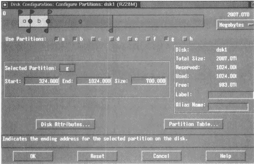

**图 4-1：磁盘配置 (`diskconfig(8)`) 程序**

## 4.2.2 规划集群的交换区

当集群成员首次配置时，默认情况下，其主交换区位于与集群成员 `boot_partition` 相同的硬盘的“b”分区上。通常这也位于集群的共享总线上，这在交换设备的高度可用性和能够保存已关闭集群成员的交换转储方面具有优势，尤其如此。

然而，在共享总线上配置交换可能会产生性能后果。例如，如果某个集群成员开始积极使用其交换空间，所有 I/O 都会通过共享总线进行，并可能影响其他集群成员。虽然这不是理想状态，但我们应强调，在系统配置正确的情况下，积极使用交换空间的情况应非常罕见。

如果成员的交换空间配置在共享总线上，磁盘所在交换分区 的设备请求调度器 (`DRD`) 服务器不一定必须位于实际使用交换空间的集群成员上。这种情况可能发生在成员到存储的 HBA 或电缆故障时，从纯粹的高可用性角度来看，这是一个极佳的自动恢复场景。然而，如果集群成员在 `DRD` 服务器不位于成员本地的情况下开始积极使用交换空间，则所有与交换相关的 I/O 都会通过集群互连进行路由。这种情况虽然**极其罕见**，但可能会使集群互连饱和并影响整个集群。

在规划您的集群以及集群的交换时，您必须考虑高可用性以及性能问题。您还必须检查集群上应用程序和用户的可接受故障场景。默认情况下，*TruCluster* Server 环境的安装尝试为尽可能多的内容提供高可用性，包括交换。在我们的两个示例中，这种交换的高可用性对配置不当的系统产生了后果。这些后果与集群本身的性能和可用性有关。这凸显了仔细设计集群的重要性，并深思熟虑集群将支持的应用程序和用户社区。

想象一下，如果不是将每个集群成员的交换分区放在共享总线上，而是放在每个成员本地可访问的磁盘上。让我们分析这种安排的利弊。

- **将交换放在本地可访问磁盘上的优点：**

  - 与交换相关的 I/O 不在共享总线上。
  - 与交换相关的 I/O 不会通过集群互连路由。
  - 一个集群成员的交换活动对其他任何集群成员的影响很小或没有影响，因为所涉及的资源不再共享。
  - 与交换相关的 I/O 现在对执行交换的服务器是本地的。从性能角度来看，这应该能提供更好的性能。

- **将交换放在本地可访问磁盘上的缺点：**

  - 集群成员的交换不再高度可用。如果由于某种原因交换不可用（即 HBA 故障），集群成员可能会崩溃。
  - 如果集群成员崩溃并处于关闭状态，您将无法从任何其他集群成员访问该成员的崩溃转储。此信息只有在集群成员重新启动后才可用。

另一个需要考虑的选项是，在成员启动磁盘上保留一个足够容纳部分转储的小型主交换分区，并在仅对集群成员可访问的总线上添加一个更大的次要交换分区。

每个集群成员交换分区的位置最终应基于集群的可用性标准。如果您决定将每个集群成员的交换放在本地磁盘上，请参阅第 21 章，了解如何实现此操作。

关于交换分区的最后一点说明：无论主交换分区物理上位于何处，我们建议如果您使用的是 eager swap 模式算法（默认值），则应分配至少为集群成员物理内存大小两到三倍的交换空间，该空间可分布在一個或多个交换分区上。此外，如果您以后增加服务器的内存，请不要忘记增加交换空间的大小。

如果您的集群成员是超大内存 (`VLM`)³ 系统并用于数据库等特定应用程序，请参阅应用程序供应商的文档，了解需要多少交换空间以及使用哪种交换算法。根据此信息，请相应规划。如果您要使用的交换算法是 lazy 模式或 deferred 模式，您的交换空间需求可能差异很大，从仅配置交换以包含部分转储到内存大小的三倍不等。

> ³ `VLM` 系统按定义是利用 64 位架构、多处理以及至少 2 GB 内存用于内存密集型应用程序的系统。

## 4.2.3 硬件存储配置

当您考虑 TruCluster Server 环境时，脑海中浮现的几件事包括集群文件系统、共享总线，以及所有组件如何神奇地协同工作。TruCluster Server 也许不是魔法，但它是一项非常酷的技术。如果您的公司业务目标包括高可用性和可扩展性，那么这项技术可以轻松地契合这些目标。

我们相信，如果您选择部署 TruCluster Server，那么您一定已经将高可用性和可扩展性考虑在内。要实现 TruCluster Server，除了软件“比特和字节”、服务器、适配卡、集线器、交换机、集群互连和线缆之外，我们还需要存储——用于存储集群系统磁盘以及用户应用程序和数据的存储。我们还建议，如果您打算部署任何类型的高可用集群，请使用基于 RAID 的存储，因为它能提供数据保护和可用性。

存储子系统是任何 TruCluster Server 实现中不可或缺的组成部分。在本节中，我们将讨论在高可用配置中支持 TruCluster Server 所必需的硬件 RAID 阵列存储。

**注意：**

虽然基于硬件的 RAID 通常被认为是性能更佳的 RAID 解决方案，但还有一种名为逻辑存储管理器（`LSM`）的基于软件的 RAID 选项，可作为成本更低的替代方案。有关更多信息，请参见第十四章。

### 4.2.3.1 受支持的硬件 RAID 阵列控制器

表 4-3 提供了支持实施 TruCluster Server V5.1A 的 HP StorageWorks 硬件 RAID 阵列控制器列表，以及每个控制器的最低固件要求。

| 存储控制器 | 最低固件版本 |
|---|---|
| HSZ40 | 3.7 或更高版本 |
| HSZ50 | 5.7 或更高版本 |
| HSZ70 | 7.7 或更高版本 |
| HSZ80 | 8.3-1 或更高版本 |
| HSG60 | 8.5 或更高版本 |
| HSG80 | 8.5 或更高版本 |

表 4-3：RAID 控制器最低受支持的固件版本


有关这些硬件存储控制器使用的更详细信息和限制，我们强烈建议查阅您将要实施的版本对应的 `TruCluster Server 集群发行说明`、`TruCluster Server 集群硬件配置指南`和 `TruCluster Server 集群安装指南`。有关配置您计划使用的存储控制器的更多信息，请参阅随您的控制器附带的适用于 Compaq `Tru64 UNIX` 的 StorageWorks 安装和配置指南。

### 4.2.3.2 透明故障转移模式与多总线故障转移模式

在开始讨论什么是故障转移模式之前，让我们先假设我们有一对表 4-3 中列出的 RAID 阵列存储控制器，并采用双冗余配置。双冗余配置意味着，如果一个控制器发生故障，另一个控制器将接管工作，集群继续不间断运行。

出于本节讨论的目的，我们将使用 HSG80 控制器来代表 `TruCluster Server` 配置所支持的所有 StorageWorks RAID 阵列控制器。虽然我们在表 4-3 中列出的所有 RAID 阵列存储控制器都支持透明故障转移模式，但只有 HSZ70、HSZ80、HSG60 和 HSG80 存储控制器支持多总线故障转移模式。

什么是故障转移模式？故障转移模式是一种在某个存储控制器发生故障或变得无响应时，使共享存储阵列对连接的服务器或主机保持可用的方法。故障转移模式让剩余的存储控制器接管控制权，从而保持存储阵列的可用性。

有两种不同的故障转移模式：透明模式和多总线模式。透明故障转移由剩余的控制器处理，因此对连接到存储的主机来说是“透明”的。多总线故障转移则由主机处理。

透明故障转移模式的主要特征包括：

- 连接到存储的主机并不知道发生了故障转移。
- 呈现给主机并由控制器管理的逻辑存储单元分配在控制器主机端口 1 和 2 之间。存储单元 0-99 可通过端口 1 访问，存储单元 100-199 可通过端口 2 访问。
- 在双冗余控制器配置中，只有一个控制器上的主机端口 1 处于活动状态，另一个控制器上的主机端口 1 处于待机状态。主机端口 2 也是如此。只有一个控制器上的主机端口 2 处于活动状态，另一个控制器上的主机端口 2 处于待机状态。有关此配置的图示，请参见图 4-2。

透明故障转移是如何工作的？如果两个控制器中有一个发生故障，则剩余控制器上的两个端口都会变为活动状态，并提供所有存储单元。

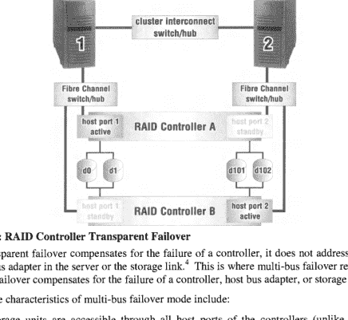

### 图 4-2：RAID 控制器透明故障转移

虽然透明故障转移可以补偿控制器的故障，但它并不能解决服务器中主机总线适配器或存储链路的故障。⁴ 这正是多总线故障转移真正发挥作用的地方。多总线故障转移可以补偿控制器、主机总线适配器或存储链路的故障。

多总线故障转移模式的一些特性包括：

- 所有存储单元都可以通过控制器的所有主机端口访问（与透明故障转移不同）。
- 每个主机至少有两条通往存储单元的路径。这是通过在每个主机中使用多个主机总线适配器实现的。
- 连接到存储的所有主机必须具有支持多总线故障转移的适当操作系统软件。
- 主机控制在故障转移场景中将存储单元从一个控制器移动到另一个控制器的过程。当通过一条路径访问存储单元失败时，主机将发出命令通过另一条路径访问存储单元。请参阅图 4-3，了解此配置的说明。
- 虽然所有存储单元都可以通过控制器上的所有主机端口访问，但您可以指定哪些存储单元通常由特定控制器提供服务。
- 来自主机的 I/O 负载可以在控制器之间重新分配。

> 4 存储链路可以是存储集线器或光纤通道交换机，但也包括连接到这些设备的电缆和组件。

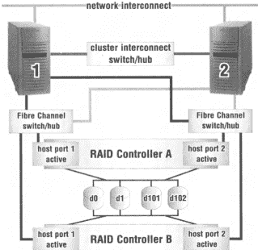

**图 4-3：RAID 控制器多总线故障转移**

#### 4.2.3.3 异构 SAN 环境中的集群

HSG60 和 HSG80 RAID 阵列控制器本质上是存储区域网络（SAN）就绪控制器。这意味着您可以通过将它们连接到此类存储配置的一部分的 SAN 光纤通道交换机，将多个异构服务器连接到此存储阵列。虽然这可能为数据中心带来巨大的好处，通过为许多服务器整合存储，但如果没有经过深思熟虑和规划，对于 `TruCluster` 服务器配置来说也可能非常危险。

虽然我们不会详细描述如何在异构 SAN 环境中部署集群——我们将留给另一本书——我们可以说这是完全可能的并且非常容易实现。我们还将提供部署此类配置的警告。

在同一个 SAN 上部署多个 `TruCluster` 服务器环境时，使用选择性存储呈现⁵，并且，虽然不是必需的，尝试在光纤通道交换机上为每个集群创建单独的区域。⁶ 由于 `TruCluster` 服务器在它看到的所有存储设备上使用持久保留，我们希望保护一个集群使用的存储不被另一个集群访问。

在 SAN 环境中除了 `TruCluster` 服务器之外部署其他服务器（即 HP-UX、Solaris、Windows 2000 等）时，有几个考虑因素：

⁵ 有关选择性存储呈现的更多信息，请参阅第 4.2.3.4 节。
⁶ 有关在光纤通道交换机上创建区域的更多信息，请参阅 StorageWorks 光纤通道 SAN 管理指南。

```
P00>>> wwidmgr -show adapter
Item    adapter                 WWN              Cur. Topo  Next Topo
[ 01] pga0.0.0.7.1          2000-0000-C924-7C58  FABRIC     FABRIC
[9999] All of the above.
```

在此示例中，我们仅为集群的一个服务器获取了主机总线适配器的 wwid。对集群中的每个服务器使用相同的过程，以确定连接到存储子系统的每个主机总线适配器的 wwid。

- 接下来，连接到 HSG60/HSG80 控制器的命令控制台并确定连接到存储子系统的适配器的主机连接。

```
HSG> show connections
Connection
Name      Operating system  Controller  Port  Address  Status
1NEWCON1  WINNT             THIS        1     011600   OL this  0
          HOST_ID=2000-0000-C924-7C58      ADAPTER_ID=1000-0000-C924-7C58
1NEWCON2  WINNT             OTHER       2     011600   OL other 100
          HOST_ID=2000-0000-C924-7C58      ADAPTER_ID=1000-0000-C924-7C58
1NEWCON3  WINNT             THIS        1     011700   OL this  0
          HOST_ID=2000-0000-C924-3514      ADAPTER_ID=1000-0000-C924-3514
1NEWCON4  WINNT             OTHER       2     011700   OL other 100
          HOST_ID=2000-0000-C924-3514      ADAPTER_ID=1000-0000-C924-3514
```

请注意，默认情况下，“操作系统”被记为 WINNT，即使我们使用的是 Tru64 UNIX。我们将在后面的讨论中将其更改为更有意义的内容，但我们目前对 HOST_ID 的地址感兴趣。它应与从服务器控制台看到的主机总线适配器(s)的 wwid 相同。

让我们将操作系统类型更改为 Tru64 UNIX 并使连接名称更有意义。

```
HSG> set !NEWCON1 TRU64_UNIX
HSG> set !NEWCON2 TRU64_UNIX
HSG> set !NEWCON3 TRU64_UNIX
HSG> set !NEWCON4 TRU64_UNIX
HSG> rename !NEWCON1 MOLR1A1
HSG> rename !NEWCON2 MOLR1B2
HSG> rename !NEWCON3 SHER1A1
HSG> rename !NEWCON4 SHER1B2
```

这样更好，现在让我们看看我们拥有的主机连接情况。


```
MSG> show connections
Connection Name    Operating system    Controller    Port    Address    Status
MOLRIA1            TRU64_UNIX          THIS          1       011600     OL this    0
                   HOST_ID=2000-0000-C924-7C58          ADAPTER_ID=1000-0000-C924-7C58
MOLRIB2            TRU64_UNIX          OTHER         2       011600     OL other   100
                   HOST_ID=2000-0000-C924-7C58          ADAPTER_ID=1000-0000-C924-7C58
SHERIA1            TRU64_UNIX          THIS          1       011700     OL this    0
                   HOST_ID=2000-0000-C924-3514          ADAPTER_ID=1000-0000-C924-3514
SHERIB2            TRU64_UNIX          OTHER         2       011700     OL other   100
                   HOST_ID=2000-0000-C924-3514          ADAPTER_ID=1000-0000-C924-3514
```

现在，既然我们已经了解了从集群节点到存储的连接，对于我们为集群创建的每个存储单元，我们将设置其可访问性，使得只有集群的节点才能访问该存储。首先，我们会禁用对所有连接的访问；然后有选择地启用仅对连接到集群节点的那些连接的访问。

```
MSG> add unit d101 m2 partition=1 disable_access_path=all
```

```
MSG> show d101
LUN                Uses              Used by
------------------------------------------------------------
D101               M2                (partition)
LUN ID:            6000-1FE1-0001-6950-0009-1420-0755-0047
IDENTIFIER = NONE
Switches:
RUN                NOWRITE_PROTECT   READ_CACHE
READAHEAD_CACHE    WRITEBACK_CACHE
MAX_READ_CACHED_TRANSFER_SIZE = 32
MAX_WRITE_CACHED_TRANSFER_SIZE = 32
Access:
None
State:
ONLINE to the other controller
Size:              2133378 blocks
Geometry (C/H/S): { 420 / 20 / 254 }
```

```
MSG> set d101 enable_access_path=(MOLRIA1,MOLRIB2,SHERIA1,SHERIB2)
```

当我们提供有关如何使用不同级别的 RAID 构建集群系统磁盘的示例时，这一通用过程将变得更加具体。

RAID 集可能非常大，但由于现代独立磁盘驱动器也非常大，集群系统磁盘所需的设备相比之下往往较小，因此在控制器上进行存储集分区可能会很有用。存储集分区是将存储集划分为更小部分的一种方法。正是这些更小的部分作为适当大小的独立存储单元呈现给主机。

以下是关于存储集或 RAID 集分区的限制：

- 每个分区都是按 RAID 集或存储集的百分比创建的。

- 对于 HSZ70、HSZ80、HSG60 和 HSG80 控制器，每个存储集的最大分区数为 8。

- 对于 HSZ40 和 HSZ50 控制器，每个存储集的最大分区数为 4。

- 在透明故障转移模式下，同一存储集的分区必须位于同一主机端口上。

- 在 HSZ 控制器上，仅在透明故障转移模式下支持存储分区。在 HSG 控制器上，在透明故障转移模式和多总线故障转移模式下均支持存储分区。

- 在多总线故障转移模式下，同一存储集的分区必须位于同一控制器上。

- 除非在单个 TruCluster Server 环境中，否则不应在不同的独立系统之间使用来自同一存储集或 RAID 集的独立存储分区。

最简单的形式是，构建双节点集群所需的磁盘和 UNIX 分区如表 4-4 所示。

请注意，仲裁磁盘需要其自己的磁盘，并且该磁盘上不能有其他任何内容。这是必要的吗？绝对是！有关仲裁磁盘以及何时使用仲裁磁盘的更多信息，请参阅第 17 章。

| 磁盘 | 分区或文件系统 |
|---|---|
| `dsk1` | `a` 成员1 启动分区 |
|  | `b` 成员1 交换分区 |
|  | `h` 成员1 cnx 分区 |
| `dsk3`（仲裁磁盘） | `h` cnx 分区 |

| 磁盘 | 分区或文件系统 |
|---|---|
| `dsk2` | `a` 成员2 启动分区 |
|  | `b` 成员2 交换分区 |
|  | `h` 成员2 cnx 分区 |
| `dsk4` | `b` cluster_root |
|  | `g` cluster_usr |
|  | `h` cluster_var |

表 4-4：TruCluster Server 磁盘布局

现在，让我们具体看看一个两节点集群在磁盘、分区和分区大小方面需要什么。表 4-5 不仅说明了两节点集群所需的配置，还提供了扩展和扩容该集群所需的信息。

**表 4-5：TruCluster 服务器磁盘、分区和文件系统**

| 磁盘 | UNIX 分区 | 大小 | 文件系统类型 | 文件系统 | AdvFS 域 |
|---|---|---|---|---|---|
| `dsk1` | `a` | 256 MB | AdvFS | `member1`<br>`boot_partition` | `root1_domain` |
| `dsk1` | `b` | 1.5 GB 或 4.5 GB | swap | swap | swap |
| `dsk1` | `h` | 1 MB | cnx | 不适用 | 不适用 |
| `dsk2` | `a` | 256 MB | AdvFS | `member2`<br>`boot_partition` | `root2_domain` |
| `dsk2` | `b` | 1.5 GB 或 4.5 GB | swap | swap | swap |
| `dsk2` | `h` | 1 MB | cnx | 不适用 | 不适用 |
| `dsk3`<br>`dsk4` | `a` | 256 MB | 未使用 | 不适用 | 不适用 |
| `dsk3`<br>`dsk4` | `b` | 1.5 GB 或 4.5 GB | 未使用 | 不适用 | 不适用 |
| `dsk3`<br>`dsk4` | `h` | 1 MB | 未使用 | 不适用 | 不适用 |
| `dsk5` | `h` | 1 MB | cnx | 仲裁磁盘 | 仲裁磁盘 |
| `dsk6` | `a` | 512 MB | AdvFS | `/` | `cluster_root` |
| `dsk6` | `g` | 4.0 GB | AdvFS | `/usr` | `cluster_usr` |
| `dsk6` | `h` | 4.0 GB | AdvFS | `/var` | `cluster_var` |

用于交换的“`b`”分区在本地磁盘上是 1.5 GB（内存大小），前提是主交换分区位于本地磁盘。在我们的示例中，由于我们使用 eager swap，并且如果没有本地磁盘用于主交换分区，则“`b`”分区的大小为内存大小的三倍。

`dsk3`和`dsk4`是为将来的集群成员 3 和 4 创建的。这是为了支持集群预期的可扩展性。

需要注意的是，在开始将 Tru64 UNIX 安装到本地磁盘之前，所有 RAID 存储集都应正确配置并初始化。以下各节将详细介绍配置和初始化不同类型的 RAID 存储集以支持集群系统磁盘的方法。

### 4.2.4.1 集群系统磁盘的 RAID 1 与 RAID 0+1 与 RAID 5

在本节中，我们将简要讨论什么是 RAID 1、RAID 0+1 和 RAID 5，以及在集群配置中您可能希望使用某种 RAID 级别而不是另一种的原因。

-   RAID 1


RAID 级别 1 也称为镜像。镜像的冗余正是数据所经历的情况。所有数据同时写入两个或多个驱动器。从性能角度来看，读取数据比写入数据更快；但是，如果 RAID 1 集中的某个驱动器发生故障，应该不会丢失任何数据。实现 RAID 1 集所需的最少驱动器数量为两个。在一个由两个驱动器组成的 RAID 1 集中，有效存储利用空间大约为一个驱动器的容量。

### RAID 0+1
这是镜像（RAID 级别 1）和条带化（RAID 级别 0）的组合。这提供了镜像的完全冗余，同时具有将数据条带化到所有驱动器所带来的写入性能。RAID 0+1 集提供了最高级别的冗余和最高级别的性能，但在硬盘驱动器主轴方面成本更高。实现 RAID 0+1 集所需的最少驱动器数量为四个。在由四个驱动器组成的 RAID 0+1 集中，有效存储利用空间大约为两个驱动器的容量。

### RAID 5
RAID 级别 5 将数据条带化到所有磁盘上，但它也会将奇偶校验信息分布到 RAID 5 集中的所有磁盘上。奇偶校验信息提供了在任何一个驱动器发生故障时恢复 RAID 集的能力。写入性能不错，而读取性能只是尚可。实现 RAID 5 集所需的最少驱动器数量为三个。我们建议 RAID 5 集最好使用三到六个驱动器。有效存储利用空间大约为 RAID 5 集中所有驱动器的容量减去一个驱动器，这是奇偶校验所必需的。总之，虽然 RAID 5 在性能上可能不是最好的，但它是最具成本效益的。

既然我们了解了提供存储高可用性的 RAID 级别，那么在 TruCluster 服务器配置中，为什么一个级别可能比另一个更受青睐呢？

这个决定应基于需求与成本来做出。所讨论的三种 RAID 级别都提供高可用性，但成本和性能水平各不相同。如果成本不是问题，我们建议对所有数据都使用 RAID 0+1。再次强调，这提供了最高的可用性，但成本也

> 7 RAID 0+1 这个叫法有点不准确。1+0 可能更准确，因为我们创建的是条带化的镜像集，而不是镜像化的条带集。

最佳性能。如果成本是问题，并且你希望有一个坚实的基础来构建你的集群，我们建议对系统磁盘使用 RAID 1，对所有用户文件系统使用 RAID 5。

结论：选择使用哪种 RAID 级别是因地制宜的。我们能在这里做的就是为集群系统磁盘在不同 RAID 级别下的各种实现提供思路。

### 4.2.4.2 规划未来集群扩展
在规划你的集群时，不仅要规划集群的即将实施，还要规划其未来的扩展。如果为集群的未来扩展做好规划，那么增加集群成员的数量就变得简单直接，并且每增加一个集群节点不应超过 45 分钟。

好吧，这与构建 RAID 套件有什么关系，还是作者有点“疯了”？正如他们所说，我们的疯狂是有方法的。接下来关于为集群系统磁盘构建 RAID 套件的部分将包括为六个月或一年后可能添加的集群节点构建额外的存储空间。提前构建所有存储单元是明智的。

### 4.2.4.3 为集群系统磁盘构建 RAID 5 套件
在本节中，我们将使用 RAID 5 套件构建支持集群系统磁盘所需的所有存储单元。RAID 5 以最佳的每字节存储成本提供最佳的可用性。

由于磁盘驱动器往往非常大，任何 RAID 套件通常都非常大。对于最小的 RAID 5 套件尤其如此。一般来说，除了交换空间的需求外，支持集群系统磁盘所需的空间相对较小。虽然一些系统管理员会说这是一个好问题，但其他人会为浪费宝贵的磁盘空间而皱眉。

在我们构建 RAID 5 套件用于集群系统磁盘的示例中，我们将使用 18 GB 驱动器——三个 18 GB 驱动器。

#### 创建并初始化 RAID 5 套件
如你所见，构建一个三磁盘 RAID 5 套件是一个相对简单的操作。

```
HSG> add raidset r0 disk10000 disk20000 disk30000
```

```
HSG> initialize r0 save_configuration
```

在 RAID 套件创建并初始化后，RAID 配置实际上使用 `save_configuration` 标志保存到 RAID 套件中。将 RAID 配置信息保存到控制器上的 RAID 套件非常重要，这样如果遇到灾难性故障并且两个存储控制器同时丢失，我们可以轻松恢复所有 RAID 套件而不会丢失任何数据。这是如何完成的？在更换故障存储控制器后，必须从最初保存它的 RAID 套件中读取恢复的已保存 RAID 配置信息。

#### 分区 RAID 5 套件
下一步对 RAID 5 套件进行分区需要规划。在这里，我们使用表 4-5 中的信息来确定每个分区将占 RAID 5 套件有效存储利用空间的百分比。由于三驱动器（每个为 18 GB 驱动器）RAID 5 套件的有效存储利用空间约为 36 GB，每个分区大小是该数字的百分比。

```
HSG> create_partition r0 size=14
HSG> create_partition r0 size=14
HSG> create_partition r0 size=14
HSG> create_partition r0 size=14
HSG> create_partition r0 size=14
HSG> create_partition r0 size=largest
```

在此示例中，第一个分区创建的分区大小为 36 GB 的 14%。`size=largest` 允许我们在不设置百分比的情况下利用驱动器上所有剩余空间。

#### 创建分区存储单元
现在 RAID 5 套件已分区，每个新的存储单元从每个存储分区创建。这些存储单元呈现给主机——集群成员。

```
HSG> add unit d1 r0 partition=1 disable_access_path=all
HSG> add unit d2 r0 partition=2 disable_access_path=all
HSG> add unit d3 r0 partition=3 disable_access_path=all
HSG> add unit d4 r0 partition=4 disable_access_path=all
HSG> add unit d5 r0 partition=5 disable_access_path=all
HSG> add unit d6 r0 partition=6 disable_access_path=all
```

> **IMPORTANT:**
>
> 当每个新的存储单元创建时，我们禁用对所有主机的访问路径。这可以防止连接到存储子系统的主机意外访问。

#### 配置分区存储单元
在此最后一步中，我们为每个新存储单元设置标识符，并有选择地启用访问路径以仅允许每个集群节点的主机连接。

```
HSG> set d1 identifier=1 enable_access_path=(MOLR1A1,MOLR1B2,SHER1A1,SHER1B2)
HSG> set d2 identifier=2 enable_access_path=(MOLR1A1,MOLR1B2,SHER1A1,SHER1B2)
HSG> set d3 identifier=3 enable_access_path=(MOLR1A1,MOLR1B2,SHER1A1,SHER1B2)
HSG> set d4 identifier=4 enable_access_path=(MOLR1A1,MOLR1B2,SHER1A1,SHER1B2)
HSG> set d5 identifier=5 enable_access_path=(MOLR1A1,MOLR1B2,SHER1A1,SHER1B2)
HSG> set d6 identifier=6 enable_access_path=(MOLR1A1,MOLR1B2,SHER1A1,SHER1B2)
```

如果只有一个集群连接到存储子系统，则无需禁用然后重新启用到存储的访问路径。禁用访问路径然后有选择地为某些主机连接启用访问路径是选择性存储呈现的一个示例。创建任何存储单元时的默认标志设置是 `enable_access_path=all` 或为所有主机连接启用访问。

### 4.2.4.4 为集群系统盘构建 RAID 1 阵列
在上一节中，我们构建了支持集群系统盘所需的所有存储单元；在本节中，我们将只构建其中大部分存储单元。由于我们使用的是 eager swap 分配，我们建议您为交换分区分配三倍于内存大小的空间。我们假设每个集群成员的主交换分区将在其他驱动器上。⁸ 在配置这些存储单元时预留的交换空间与每个集群成员的内存大小相同，最终可能用作每个集群成员的次要交换分区。

使用 RAID 1 用于集群的系统盘为集群的可用性提供了坚实的基础。虽然在 RAID 1 中的磁盘驱动器发生故障时，其写入性能不是最佳的，但您可以合理地确信您的数据是安全的。

与我们构建 RAID 5 阵列的示例类似，我们将使用 18 GB 驱动器——两个 18 GB 驱动器——在此构建集群系统盘的 RAID 1 阵列的示例中。

#### 创建并初始化 RAID 1 或镜像集
```
MSG> add mirrorset m0 disk10100 disk20100
```


```
MSG> initialize m0 save_configuration
```

请务必使用 `save_configuration` 标志以在镜像集上保留 RAID 配置信息。

- 对 RAID 1 或镜像集进行分区。

分区的方式与之前使用 RAID 5 阵列的示例中完全相同。唯一的区别是分区大小不同。与 RAID 5 阵列的有效存储利用空间为 36 GB 不同，我们的有效存储利用空间只有 18 GB。由于大小是可用空间的百分比，因此在可用空间不同且尤其是我们没有考虑所有交换空间的情况下，百分比不同是有意义的。

> 8 请参阅第 21 章关于在本地磁盘上配置交换。

```
HSG> create_partition m0 size=12
HSG> create_partition m0 size=12
HSG> create_partition m0 size=12
HSG> create_partition m0 size=12
HSG> create_partition m0 size=1
HSG> create_partition m0 size=largest
```

- 创建分区存储单元。

```
HSG> add unit d11 m0 partition=1 disable_access_path=all
HSG> add unit d12 m0 partition=2 disable_access_path=all
HSG> add unit d13 m0 partition=3 disable_access_path=all
HSG> add unit d14 m0 partition=4 disable_access_path=all
HSG> add unit d15 m0 partition=5 disable_access_path=all
HSG> add unit d16 m0 partition=6 disable_access_path=all
```

- 配置分区存储单元。

```
HSG> set d11 identifier=11 enable_access_path=(MOLRIA1,MOLRI82,SHERIA1,SHERI82)
HSG> set d12 identifier=12 enable_access_path=(MOLRIA1,MOLRI82,SHERIA1,SHERI82)
HSG> set d13 identifier=13 enable_access_path=(MOLRIA1,MOLRI82,SHERIA1,SHERI82)
HSG> set d14 identifier=14 enable_access_path=(MOLRIA1,MOLRI82,SHERIA1,SHERI82)
HSG> set d15 identifier=15 enable_access_path=(MOLRIA1,MOLRI82,SHERIA1,SHERI82)
HSG> set d16 identifier=16 enable_access_path=(MOLRIA1,MOLRI82,SHERIA1,SHERI82)
```

前两个要点与 RAID 5 示例中的完全相同。

### 4.2.4.5 为集群系统盘构建 RAID 0+1 阵列

在本节中，我们将使用条带镜像集（又名 RAID 0+1 阵列）构建支持集群系统盘所需的所有存储单元。RAID 级别 0+1 提供了最高可用性和最大性能，但代价也高。

与我们的 RAID 5 示例一样，最小的 RAID 0+1 阵列实际上非常大。它足够大，可以支持我们集群系统盘的所有空间需求——包括我们的大型交换空间建议。

再次与我们构建 RAID 5 阵列的示例一样，我们将使用四个 18 GB 驱动器来构建我们的 RAID 0+1 阵列，以支持我们集群系统盘的存储需求。

- 创建并初始化 RAID 0+1（条带镜像）集。

- 首先，我们创建我们需要的全部镜像集。

```
HSG> add mirror m1 disk10200 disk20200
HSG> add mirror m2 disk10300 disk20300
```

- 现在，我们根据刚刚创建的两个镜像集创建一个条带集。

```
HSG> add stripeset clu_sys m1 m2
```

- 最后，我们将 RAID 配置初始化并保存到新创建的条带镜像集中。

```
HSG> initialize clu_sys save_configuration
```

对 RAID 0+1 集进行分区。

您可能会注意到，对 RAID 0+1 集进行分区以及创建和配置分区存储单元的过程与 RAID 5 示例几乎完全相同。这里没有什么新内容。

```
HSG> create_partition clu_sys size=14
HSG> create_partition clu_sys size=14
HSG> create_partition clu_sys size=14
HSG> create_partition clu_sys size=14
HSG> create_partition clu_sys size=1
HSG> create_partition clu_sys size=largest
```

创建分区存储单元。

```
HSG> add unit d21 clu_sys partition=1 disable_access_path=all
HSG> add unit d22 clu_sys partition=2 disable_access_path=all
HSG> add unit d23 clu_sys partition=3 disable_access_path=all
HSG> add unit d24 clu_sys partition=4 disable_access_path=all
HSG> add unit d25 clu_sys partition=5 disable_access_path=all
HSG> add unit d26 clu_sys partition=6 disable_access_path=all
```

配置分区存储单元。

```
HSG> set d21 identifier=21 enable_access_path=(MORLRA1,MORLRA2,SHER1A1,SHER1B2)
HSG> set d22 identifier=22 enable_access_path=(MORLRA1,MORLRA2,SHER1A1,SHER1B2)
HSG> set d23 identifier=23 enable_access_path=(MORLRA1,MORLRA2,SHER1A1,SHER1B2)
HSG> set d24 identifier=24 enable_access_path=(MORLRA1,MORLRA2,SHER1A1,SHER1B2)
HSG> set d25 identifier=25 enable_access_path=(MORLRA1,MORLRA2,SHER1A1,SHER1B2)
HSG> set d26 identifier=26 enable_access_path=(MORLRA1,MORLRA2,SHER1A1,SHER1B2)
```

### 4.2.4.6 为其他“重要”文件系统构建 RAID 集

正如我们之前所指出的，所有 RAID 存储集和存储单元都应在安装 Tru64 UNIX 之前提前配置好。我们进一步建议，其他重要的文件系统也应当受益于 RAID 集的使用，包括用户主目录区域、用于用户应用程序和应用程序数据的文件系统，以及数据库所需的文件系统（如果您安装了数据库）。

无论如何，RAID 集的创建和分配都需要在实施前进行周密的规划。如果您投入时间进行适当的规划，可以保证这些规划在可用性和可扩展性方面获得丰厚的回报。

### 4.2.4.7 用于 RAID 集的备用集

在结束本节关于硬件 RAID 配置的讨论之前，让我们最后讨论一个经常被忽视的话题——使用备用集（Spare Set）来支持 RAID 配置。我们见过无数这样的情况：RAID 配置和实施都非常完美，唯独缺少在线备用集。请记住，任何构建在 RAID 控制器上的硬件 RAID 集都应始终有一个备用集，其中至少包含一块磁盘。备用集中的磁盘有什么用途？如果 RAID 集中的某个磁盘发生故障，备用集中的良好磁盘将自动取代故障磁盘。这是高可用性问题中经常被忽视的一个方面。

下面是一个向备用集中添加两块磁盘的示例。

```
HSG> add spareset disk10400
HSG> add spareset disk20400
```

### 4.2.5 在控制台上查看存储设备 — wwidmgr


现在，我们已为集群的系统磁盘配置了所有存储集，但有时我们需要从系统控制台查看和访问每个集群成员引导分区或引导磁盘。遗憾的是，这并非自动发生的事情。何时需要执行此操作？在 Tru64 UNIX 完全安装和配置之后、但在安装 TruCluster Server 之前。在 TruCluster Server 的安装和操作期间，需要从每个集群成员的系统控制台查看和访问每个集群成员的引导磁盘。

我们将使用系统控制台上的 `wwidmgr` 命令来查看并使每个集群成员的引导磁盘可见。如何操作？我们究竟在寻找什么？我们要查找的是我们在 RAID 存储阵列上创建的集群成员引导分区磁盘的标识符或 `wwid`。

在开始使用 `wwidmgr` 命令之前，请注意，如果集群成员是 AS1200、AS4x00、AS8x00、GS60、GS60E 或 GS140，控制台必须设置为诊断模式。

> 9 这仅适用于使用基于光纤通道的存储（HSG60 或 HSG80 控制器）。如果使用基于 SCSI 的存储，则可跳过此步骤。

```
P00>>> set mode diag
```

Console is in diagnostic mode

After using the `wwidmgr` commands, the system must be reinitialized to return to the SRM console. This is done using the `init` command at the console.

The following example shows how we discover and make viewable a cluster member's boot disk. This example assumes that a cluster has not been previously installed.

Moreover, for the purposes of this example, the cluster member's boot disk that we are interested in has an identifier of 1 and this maps to storage unit D1.

### Display existing devices at the system console.

```
P00>>> show dev
dkc0.0.0.7.0        DKCO            R2ZDD-LS  0306
dqa0.0.0.105.0     DQA0            CD-224E  9.5B
dva0.0.0.0.0       DVA0
eia0.0.0.9.1       EIA0            00-50-8B-AE-P3-23
pga0.0.0.7.1       PGA0            WWN 2000-0000-c924-7c58
pkb0.7.0.6.0       PKB0            SCSI Bus ID 7
pkb0.7.0.106.0     PKB0            SCSI Bus ID 7
pkc0.7.0.7.0       PKC0            SCSI Bus ID 7
--
```

### Use `wwidmgr` to clear any `wwid` entries and check for the reachability of devices.

```
P00>>> wwidmgr -clear all
```

```
P00>>> init
```

```
P00>>> show ww*
wwid0
wwid1
wwid2
wwid3
```

```
P00>>> show n*
N1
N2
N3
N4
```

The `wwidmgr -clear all` command cleared the stored Fibre Channel `wwid1`, `wwid2`, `wwid3`, `wwid4`, `N1`, `N2`, `N3`, and `N4` console variables.

```
P00>>> show wwid*
wwid0 1 1 WWID:01000010:6000-1fe1-0001-6950-0009-1420-0755-0048
wwid1
wwid2
wwid3
```

In this example, we see by the `show wwid*` command that the `wwid0` console variable is set to the cluster member's boot disk.

```
P00>>> show n*
N1 50001fe100016952
N2
N3
N4
```

Let's also take a quick look at the HSG80 controller:

```
HSG> show this
Controller:
HSG80 2G14100634 Software V8F-8, Hardware E16
NODE_ID = 5000-1FE1-0001-6950
ALLOCATION_CLASS = 0
SCSI_VERSION = SCSI-3
Configured for dual-redundancy with 2G14200755
    In dual-redundant configuration
Device Port SCSI address 7
Time: 29-JUL-2002 08:54:46
Command Console LUN is lun 0 (NOIDENTIFIER)
Host PORT_1:
    Reported PORT_ID = 5000-1FE1-0001-6951
    PORT_1_TOPOLOGY = FABRIC (fabric up)
    Address = 011000
Host PORT_2:
    Reported PORT_ID = 5000-1FE1-0001-6952
    PORT_2_TOPOLOGY = FABRIC (standby)
    Address = 011100
    NOREMOTE_COPY
Cache:
    256 megabyte write cache, version 0012
    Cache is GOOD
    Unflushed data in cache
    CACHE_FLUSH_TIMER = 300 (seconds)
Mirrored Cache:
    Not enabled
Battery:
    NOUPS
    FULLY CHARGED
    Expires: 15-FEB-2004
```

As we can see from the `show n*` command at the SRM console vs. the `show this` command at the HSG80's console, the `N1` SRM console variable contains the `PORT_ID` of the controller that is serving out the cluster member's boot disk. This indicates accessibility through the HSG80 ports.

```
p00>>> show dev

dga1.1001.0.7.1          $1$DGA1          HSG80  V6F

dkc0.0.0.0.7.0          DKC0            R22DD-LS 0306
dqa0.0.0.0.105.0        DQA0            CD-224E 9.5B
dva0.0.0.0.0            DVA0
eia0.0.0.0.0            EIA0            00-50-8B-AE-F3-23
eia0.0.0.0.7.1          PGA0            WWN 2000-0000-c934-7c58
pka0.7.0.6.0            PKA0            SCSI Bus ID 7
pkb0.7.0.106.0          PKB0            SCSI Bus ID 7
pkc0.7.0.7.0            PKC0            SCSI Bus ID 7
...
```

A new device also shows up when we enter the `show dev` command. This will be the device that we use to boot the cluster node after the TruCluster Server software is properly installed and configured.


This process of identifying the cluster member's boot device should be performed on each cluster member's system console before the installation and configuration of the TruCluster Server software.

## 4.3 Firmware for a Cluster

Firmware on the AlphaServer and the StorageWorks storage subsystem components is the first software that is executed when the hardware powers up and usually the last software to execute as the hardware is powered down. It is also the software that directly controls the hardware and as such is platform dependent.

Although firmware is platform dependent, it is operating system independent. There have been many modifications to the operating system that are designed to interoperate with newer firmware features. For this reason, you should always install the latest firmware available from HP for the AlphaServers and for the StorageWorks storage subsystem of your cluster. All too frequently, operating system problems encountered by users can be traced to not having the appropriate firmware and operating system combination. As one colleague once said, "the PAL code makes the difference."10

### 4.3.1 Alpha Firmware

Alpha Firmware updates usually come on new Alpha Firmware Release CDs that accompany the release of a new version of Tru64 UNIX. Alpha Firmware updates can also be found on the Web at:

```
ftp://ftp.digital.com/pub/Digital/Alpha/firmware/
```

> 10 PAL code or Privileged Architecture Library (`PAL-code`) is made up of non-interruptible functions required to support the lowest level of activities on an AlphaServer system such as context switching, system call initiation, and interrupt/exception dispatching.

在更新任何 AlphaServer 的 Alpha 固件之前，务必查阅固件的发行说明，了解新功能、注意事项和已知异常。务必查阅与要更新的 AlphaServer 对应的固件发行说明，以了解在您的 AlphaServer 上更新固件的确切步骤。

**重要提示：**

在执行任何 Alpha 固件升级时，请勿中止更新。此外，您应避免在升级过程中可能导致 AlphaServer 断电的任何情况（即，除非 AlphaServer 已连接至 UPS，否则请勿在雷雨期间升级固件）。如果发生上述任一事件，请联系当地的 HP 现场工程师检查系统。

以下示例提供了如何更新特定 AlphaServer 固件的简要步骤<sup>11</sup>。

- 将固件 CD 插入 CDROM 并确定 CDROM 是哪个设备。

  ```
  P00>>> show dev
  dga1.1001.0.7.1        $1$DGA1        HSG80   V86F
  dkc0.0.0.7.0         DKC0            RZ1DD-LS 0306
  dqa0.0.0.0.105.0      DQA0            CD-224E 9.5B
  dva0.0.0.0.0          DVA0
  ...
  ```

- 重新初始化服务器。

  ```
  P00>>> init
  ```

- 从 Alpha 固件 CD 启动。

  ```
  P00>>> boot DQA0
  ...
  [Release notes are displayed.]
  ```

- 在提示时，输入引导文件或按回车键接受固件 CD 上的默认引导文件。

  ```
  ...
  The default bootfile for this platform is
  [DS20]DS20_V6.1_EXE
  Hit <RETURN> at the prompt to use the default bootfile.
  ```

- 从主菜单中选择以下菜单项：

    - CMOS setup

    - Advanced CMOS setup

    - Console Selection: Digital UNIX Console (SRM)

- 按 F10 键保存您的选择。

- 关闭系统电源然后重新打开电源。

> 11 根据 AlphaServer DS20 V6.2 控制台固件发行说明。

### 4.3.3 主机总线适配器固件

从 Alpha 固件更新版本 6.1 开始，主机总线适配器固件和 Alpha 固件会同时更新。需要更新的设备列表中包含 KGPSA 主机总线适配器——即 `pga0` 设备。只需确保为该设备更新固件即可。

### 4.3.4 HSZ/HSG RAID 阵列控制器固件

HSZ/HSG RAID 阵列控制器固件的更新应交由 HP 现场服务工程师处理。只有真正了解自己在做什么的客户才应尝试此更新，并且只有在对存储子系统上的任何数据进行完整备份后才可进行。

支持 TruCluster Server 的最低 HSZ/HSG 固件版本见表 4-3。

要确定您的 HSZ/HSG 控制器的固件级别，请使用以下命令：

```
HSG> show this
Controller:
    HSG80 ZG14100634 Software V86F-8, Hardware E16
...
```

在此示例中，`HSG80` 控制器处于 ACS 固件版本 V86F-8。 “-8” 通常表示固件的补丁级别。适用于 HSG ACS 固件的相同约定和注意事项也可适用于 HSZ 系列控制器的 HSOF 固件。

### 4.3.5 光纤通道交换机固件

同样，与 HSZ/HSG RAID 阵列控制器固件一样，只有 HP 现场服务工程师才应执行光纤通道交换机固件的更新。

## 4.4 配置和验证集群互连硬件

实现集群需要一个专用的集群互连，所有集群成员都连接到其中。集群互连为虚拟专用网络提供基础，允许所有集群成员之间进行通信。此集群互连在集群节点或成员之间提供节点间通信（通过 ICS<sup>12</sup>）。*TruCluster* Server 软件在集群内创建此虚拟专用网络，并且此虚拟专用网络与集群互连提供的物理通信通道并存。

> 12 节点间通信子系统在第 18 章中介绍。

这是如何工作的？对于每个成员，集群软件都会为集群互连创建一个虚拟网络设备。在 V5.1A 中，该设备名为 `ics0`。在 V5.0A 和 V5.1 中，该设备名为 `mc0`，因为当时仅支持 Memory Channel 适配器卡作为集群互连。无论如何，该设备都有自己的 IP 名称和 IP 地址，用于建立系统在集群中的成员资格。

可用于集群互连的硬件可以是 Memory Channel (`MC`) 适配器或以太网局域网 (`LAN`) 卡，但不能同时混用两者。

集群互连在集群内提供以下功能：

- **集群成员之间的健康状态消息。** 连接管理器使用此信息来监控集群成员并协调成员资格。有关连接管理器子系统的更多信息，请参阅第 17 章。

- **集群成员之间的分布式锁管理器 (`DLM`) 锁定。** 用于协调对共享资源的访问。有关 DLM 的更详细信息，请参阅第 18 章。


- **集群成员之间的文件系统访问。** 对于位于集群成员专用总线上的但对集群所有成员可见的存储，所有来自其他集群成员的读写操作均通过集群互连执行。由于集群文件系统采用客户端-服务器模型，因此对于共享总线上的文件系统也是如此。

- **集群互连通过 ICSnet 包含完整的 IP 协议栈。** 虽然不建议将其用于通用网络流量，但除互连硬件的带宽外，没有任何东西可以阻止应用程序利用它。所有与集群无关的流量都应保持在集群互连之外，如果需要专用网络，则应另行添加。

- **集群别名路由。** 有关更多信息，请参阅第 16 章集群别名。

重申一下，截至本文撰写时，可与 *TruCluster* Server 一起使用的两种经批准的集群互连硬件类型为 Memory Channel (MC) 适配器卡和以太网局域网 (LAN) 卡<sup>13</sup>。*TruCluster* Server 支持最多八个集群成员，无论使用何种类型的集群互连。

> 13 以太网局域网卡作为集群互连的支持始于 *TruCluster Server* 版本 5.1A。

在本节中，我们将讨论如何配置和验证这些不同的集群互连，以及为何您可能希望使用一种互连而非另一种。

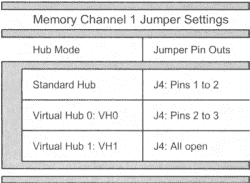

### 表 4-6：内存通道 1 – 跳线设置

### 4.4.1 内存通道作为集群互连

支持三种内存通道适配器卡变体：内存通道 1、内存通道 1.5 和内存通道 2。较旧的内存通道 1 适配器卡和内存通道 1.5 适配器卡统称为内存通道 1（或 MC1）。只有较新的内存通道 2（MC2）适配器卡受 DS、ES 和 GS¹⁴ 类 AlphaServer 支持。

内存通道（MC）作为集群互连可以用于虚拟集线器模式配置或标准集线器配置。虚拟集线器模式配置仅支持双节点集群。标准集线器模式配置可用于双节点集群，但对于具有三个或更多集群成员的集群则是必需的。内存通道集线器也是标准集线器模式配置中集群的必需条件。

#### 4.4.1.1 虚拟集线器模式

如前所述，在虚拟集线器模式下使用 MC 作为集群互连仅支持双节点集群配置。它由两个集群成员通过内存通道适配器卡使用 MC 电缆直接连接组成。每个内存通道适配器卡均通过物理跳线设置为虚拟集线器模式。内存通道适配器卡的变体决定了正确的跳线设置。

在 MC1 上，有一个适配器跳线 J4，用于确定配置是虚拟集线器模式还是标准集线器模式。对于虚拟集线器模式，一个集群节点上的内存通道适配器跳线 J4 配置为虚拟集线器 0（VH0），另一个集群节点上的内存通道适配器跳线 J4 配置为虚拟集线器 1（VH1）。表 4-6 展示了 MC1 适配器卡的集线器模式和内存通道适配器跳线 J4 的引脚排列。

与较旧的 MC1 适配器卡不同，MC2 适配器卡有六个跳线——J1、J3、J4、J5、J10 和 J11——参见图 4-4。将 MC2 适配器卡设置为虚拟集线器模式与设置 MC1 适配器卡类似；只需设置适配器跳线 J1 即可。

> ¹⁴ GS60 和 GS140 AlphaServer 系统支持 MC1。

### 内存通道 2 跳线设置

| 跳线 | 描述 |
|---|---|
| J1：集线器模式 | 标准集线器：引脚 1 到 2 |
|  | 虚拟集线器 0（VH0）：引脚 2 到 3 |
|  | 虚拟集线器 1（VH1）：全部开路 |
| J3：窗口大小 | 512 MB：引脚 2 到 3 |
|  | 128 MB：引脚 1 到 2 |
| J4：页面大小 | 8 KB 页面大小：引脚 1 到 2（UNIX 默认值） |
| J5：AlphaServer 8x00 模式 | 选择 8x00 模式：引脚 1 到 2 |
|  | 未选择 8x00 模式：引脚 2 到 3 |
| J10 和 J11：启用光纤模式 | 光纤关闭：引脚 1 到 2 |
|  | 光纤开启：引脚 2 到 3 |

### 表 4-7：内存通道 2 – 跳线设置

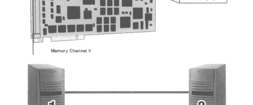

### 图 4-4：内存通道 2 – 虚拟集线器配置

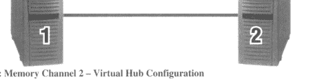

表 4-7 提供了 MC2 适配器跳线的描述——每个跳线的用途以及可能的跳线设置。

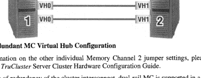

### 图 4-5：冗余 MC 虚拟集线器配置

有关其他各个内存通道 2 跳线设置的更多信息，请参阅《TruCluster Server 集群硬件配置指南》中的第 5 章。

为了集群互连的冗余性，虚拟集线器模式支持双轨 MC。当一个集群节点中的两个内存通道适配器卡直接连接到另一个集群节点中的另外两个内存通道适配器卡时，即形成双轨 MC。从内存通道适配器卡的角度来看，这应如何配置？您需要将集群成员 1 中的两个内存通道适配器都相同地跳线为 VH0。在另一个集群成员（成员 2）中，两个内存通道适配器卡都将跳线为 VH1。然后，成员 1 中每个设置为 VH0 的适配器卡将通过电缆连接到成员 2 中设置为 VH1 的适配器。参见图 4-5。

#### 4.4.1.2 标准集线器模式

在标准集线器模式下，内存通道适配器卡同样位于每个集群成员中，但不是直接连接到另一个集群成员中的内存通道适配器卡，而是每个适配器卡都连接到中央内存通道集线器中的内存通道线路卡。所有节点间通信都通过内存通道集线器在内存通道适配器卡之间流动。请参见图 4-7 进行说明。

与虚拟集线器模式配置中的内存通道适配器卡一样，标准集线器模式配置中的内存通道适配器卡必须正确跳线。对于 MC1 适配器卡，跳线 J4 相应设置为标准集线器模式——参见表 4-6。对于 MC2 适配器卡，跳线 J1 设置为标准集线器模式——参见表 4-7。

标准集线器模式也支持双轨内存通道。这如何工作？要在标准集线器模式下实现双轨内存通道配置，每个集群成员需要两个内存通道适配器卡，并使用两个独立的内存通道集线器。当每个主内存通道适配器卡连接到主内存通道集线器中的内存通道线路卡时，请注意所使用的内存通道线路卡的物理插槽。当次内存通道适配器卡连接到次内存通道集线器中的内存通道线路卡时，它必须使用与主内存通道集线器中相同编号的插槽。

让我们以三节点集群为例说明如何实现双轨配置。在主内存通道集线器中，集群成员 1 的主内存通道卡物理连接到插槽 0 中的内存通道线路卡。集群成员 2 的主内存通道卡连接到插槽 1 中的内存通道线路卡。集群成员 3 的主内存通道卡连接到插槽 2 中的内存通道线路卡。对于次内存通道集线器，使用每个集群节点中的次内存通道适配器卡复制相同的内存通道集线器配置。参见图 4-6。

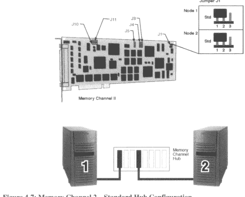

图 4-7：内存通道 2 – 标准集线器配置

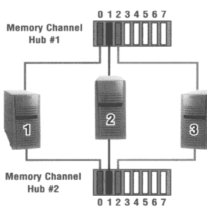

图 4-6：冗余 MC 标准集线器配置

#### 4.4.1.3 使用内存通道适配器卡的注意事项

在规划集群部署时，使用内存通道适配器卡时有几点注意事项需要牢记。这些适用于内存通道适配器卡在虚拟和标准集线器模式下的使用，具体如下：

- MC 电缆连接器有 100 个引脚，连接或断开 MC 电缆时应格外小心。即使弯曲或折断一个引脚也可能对集群的运行造成灾难性后果。

- MC1 和 MC2 可以存在于同一集群中，但不能在同一条内存通道导轨上混合使用。

- 每个 PCI 总线上只能将一个 MC2 跳线连接到 512 MB 内存窗口（请参考表 4-7）。

- 虽然这并非专门针对内存通道卡或以太网 LAN 卡，但 ICS 名称和 ICS IP 地址绝不应在 DNS 中注册。

#### 4.4.1.4 测试和验证内存通道适配器卡

在安装 TruCluster Server 软件之前，内存通道硬件安装并配置完成后，应对其进行测试以验证其正常工作。为此，在系统控制台上提供了两个不同的内存通道诊断命令：`mc_diag` 和 `mc_cable`。

##### 4.4.1.4.1 `_mc_diag_` 诊断

`mc_diag` 诊断命令的主要目的是测试内存通道适配器卡。详细来说，`mc_diag` 诊断命令提供以下功能：

- 测试系统上的所有内存通道适配器。

- 这是在系统加电时初始化序列的一部分执行的。

- 这可以在独立的集群成员上运行，同时其他集群保持运行和可用。

下面是执行 `mc_diag` 诊断命令的示例：

```
P00>>> mc_diag
Testing MC-Adapter(s)
Adapter mc0, Passed
Adapter mc30, Passed
```

由于该服务器配置为双导轨内存通道，因此两个内存通道适配器卡均通过了此硬件诊断测试。

`mc_diag` 命令可通过使用 `"-d"` 选项输出详细的“诊断”信息。有关更多信息，请参阅附录 A。

##### 4.4.1.4.2 mc_cable 诊断


`mc_cable` 诊断命令的主要目的是提供端到端互连数据流检查。这验证数据能否从一个集群成员流向所有其他集群成员，反之亦然。详细来说，使用 `mc_cable` 诊断时必须考虑以下几点：

- 此命令应在所有系统上同时运行，因此所有集群成员必须在系统控制台处于关闭状态。
- 此诊断旨在隔离构成完整内存通道互连的电缆和硬件组件之间的问题——从内存通道适配器卡，通过内存通道电缆，到内存通道线路卡，以及在一定程度上到内存通道集线器。
- 内存通道互连中数据流的指示是通过响应消息进行的。
- 虽然此诊断不会产生错误消息，但连接状态的变化是内存通道互连不同点之间数据流的指示。
- 此诊断可在虚拟集线器模式或标准集线器模式下运行。
- 一旦在系统上执行 `mc_cable` 命令，它将持续运行，直到使用 `<CTRL/C>` 终止为止。

## WARNING:

切勿在集群的任何节点上执行 `mc_cable` 命令，如果该集群的一部分仍在运行。此命令将导致运行中的集群的所有成员崩溃。

以下是执行 `mc_cable` 诊断命令的示例。

### 虚拟集线器模式下具有双导轨内存通道的 `mc_cable`。

`mc_cable` 命令在系统 2 上执行。该系统的两个内存通道卡在线，但来自另一系统中 MC 卡的响应为空。

```
>> mc_cable
To exit MC_CABLE, type <Ctrl/C>
mca0 node id 1 is online
No response from node 1 on mca0
mcb0 node id 1 is online
No response from node 0 on mcb0
```

然后在系统 1 上执行 `mc_cable` 命令。该系统上的内存通道卡在线，并且收到了正在运行 `mc_cable` 命令的另一系统的响应。

```
>> mc_cable
To exit MC_CABLE, type <Ctrl/C>
mca0 node id 0 is online
Response from node 1 on mca0
mcb0 node id 0 is online
Response from node 0 on mcb0
```

System 2 接收到在 System 1 上运行的 `mc_cable` 命令的响应。

```
Response from node 0 on mca0
Response from node 0 on mcb0
```

在 System 1 上，我们随后发出 `<CTRL/C>` 以中止 `mc_cable` 命令。

```
<CTRL/C>
>>>
```

在 System 2 上，我们收到响应，表明与 System 1 已无进一步通信。在 System 2 上，我们也发出 `<CTRL/C>` 以中止在该处运行的 `mc_cable` 命令。

```
mcb0 is offline
mca0 is offline
<Ctrl/C>
```

### `mc_cable` 在标准集线器模式下，包含两个集群成员。

`mc_cable` 命令在 System 1 上执行。请注意，Memory Channel 卡对该系统在线，但没有来自其他系统的响应。

```
>>> mc_cable
To exit MC_CABLE, type <CTRL/C>
mca0 node id 0 is online
No Response from node 1 on mca0
No Response from node 2 on mca0
No Response from node 3 on mca0
No Response from node 4 on mca0
No Response from node 5 on mca0
No Response from node 6 on mca0
No Response from node 7 on mca0
```

然后在 System 2 上执行 `mc_cable` 命令。该系统上的 Memory Channel 卡在线，并且收到了正在运行 `mc_cable` 命令的另一系统的响应。

```
P00>>> mc_cable
To exit MC_CABLE, type <CTRL/C>
mca0 node id 2 is online
Response from node 0 on mca0
No Response from node 1 on mca0
No Response from node 3 on mca0
No Response from node 4 on mca0
No Response from node 5 on mca0
No Response from node 6 on mca0
No Response from node 7 on mca0
```

System 1 接收到在 System 2 上运行的 `mc_cable` 命令的响应。在 System 1 上，我们随后发出 `<CTRL/C>` 以中止 `mc_cable` 命令。

### 4.4.2 以太网局域网 LAN 卡作为集群互连

随着 TruCluster Server 版本 5.1A 的发布，支持了一种除通常的 Memory Channel 适配器卡之外的额外集群互连类型——以太网 LAN 卡。以太网 LAN 卡自动提供了一种成本更低的 Memory Channel 替代方案，但这是否意味着你应该将集群互连硬件更换为以太网 LAN 呢？取决于情况。在第 4.4.3 节中，我们将回顾两种集群互连的优缺点。暂时让我们看看部署以太网 LAN 作为集群互连需要什么。

#### 4.4.2.1 LAN 互连的硬件要求

任何在标准 LAN 环境下以 100 Mb/sec 或 1000 Mb/sec 运行的受支持以太网适配器、交换机或集线器，理论上都可以在 LAN 集群互连中使用。光纤分布式数据接口 FDDI、ATM LAN 仿真 LANE 以及 10 Mb/s 以太网在 LAN 互连中不受支持。有关更详细的信息，请参阅第 22 章。

以太网硬件要在 LAN 集群互连中运行，需要满足以下要求：

- LAN 互连必须是仅集群成员可访问的专用 LAN。
- LAN 互连中的集群成员必须全部以相同的网络速度运行，传输模式可以是半双工或全双工。半双工传输模式不建议用于 LAN 互连，因为它可能会限制集群性能。
- LAN 互连可以是两个集群成员之间在交换机或集线器上的单条直接半双工或全双工连接，但不能同时使用两者。
- 三个或更多成员的集群需要一个或多个交换机或集线器。
- 两个集群成员之间最多允许有两个交换机。
- 所有集群成员必须对所有其他集群成员至少有一个点对点连接。
- Spanning Tree Protocol `STP` 必须在专门连接到集群成员的所有以太网交换机端口上禁用。`STP` 应在连接以太网交换机的端口上启用，以支持高可用性的 LAN 互连配置。
- 对于 LAN 互连，截至本文撰写时，以太网适配器的链路聚合不受支持。


图 4-8：LAN 集群互连

从我们的示例中可以看到，我们的两块局域网卡（设备 `alt0` 和 `alt1`）以 1000 Mb/sec 的速率运行，并且为全双工。

使用局域网互连的集群需要以下信息：

- 每个集群成员的虚拟集群互连设备的 IP 名称和 IP 地址。
- `clu_create` 和 `clu_add_member` 程序默认提供 `10.0.0.0` 子网上的 IP 地址用于虚拟集群互连。IP 地址的主机部分设置为正在配置的集群成员的 `memberid`，IP 名称为成员主机名的简写后跟“-ics0”。同样，与 Memory Channel 配置一样，虚拟集群互连的 IP 地址和 IP 名称不应在 DNS 中。
- 对于每个集群成员的物理局域网接口，需要在与虚拟集群互连不同的子网上提供 IP 名称和地址。
- 集群创建程序也为物理局域网接口提供了默认值。默认情况下，提供 `10.1.0.0` 子网上的 IP 地址，IP 地址的主机部分设置为正在配置的集群成员的 `memberid`，并附加“member”加上成员 ID 和“-icstcp0”。物理局域网接口的 IP 地址和 IP 名称不应在 DNS 中。

以下示例提供了在局域网互连上运行的 `clue` 集群的两个成员 `mustard` 和 `plum` 的集群互连 IP 名称和地址。此信息也包含在集群的 `/etc/hosts` 文件中。


```
##
# member1's cluster interconnect
#

10.0.0.1 mustard-ics0       # virtual interface IP name and address
10.1.0.1 member1-icstcp0     # physical interface IP name and address

#
# member2's cluster interconnect
#

10.0.0.2 plum-ics0           # virtual interface IP name and address
10.1.0.2 member2-icstcp0     # physical interface IP name and address
```

正如我们在 Memory Channel 互连部分所述，您应提前确定不仅是集群的名称和集群的 IP 地址，而且还应确定每个集群互连的 IP 名称和 IP 地址——虚拟和物理。参见第 4.8 节中的 Tru64 UNIX/TruCluster Server 规划工作表。

## 4.4.3 为什么使用一种互连而不是另一种？

我们有机会研究了 Memory Channel 互连和以太网局域网互连。我们讨论了每种互连的硬件要求、配置以及创建集群所需获取的互连信息。

为什么使用一种互连而不是另一种？遗憾的是，我们无法令人满意地回答这个问题，因为，嗯，这取决于。它取决于将在集群上运行哪些应用程序，集群上有多少用户，存储将如何使用，以及集群的用途是什么。它取决于许多变量，但归结为一点——用于部署集群规划的用户需求。

为了帮助您选择使用哪种互连，我们提供了以下表格 - 表 4-8。该表格比较了 Memory Channel 与 LAN 互连。

| Memory Channel | LAN Interconnect |
|---|---|
| 成本较高<br>- 高带宽（100MB/s）。<br>- 低延迟（~3µs）。 | 通常成本较低<br>- 中等带宽，100 Mb/s 时延迟中等至高。<br>- 高带宽，1000 Mb/s 时延迟中等至高。 |
| 最多支持八个成员，这受限于 Memory Channel 集线器的容量。 | 初始版本最多支持八个成员；不过，未来可能支持更多成员。 |
| 使用铜缆时成员之间支持的距离最长为 20 米（65.6 英尺），使用光纤电缆在虚拟集线器模式下最长可达 2000 米（1.2 英里），使用物理集线器的光纤电缆最长可达 6000 米（3.7 英里）。 | 成员之间使用 LAN 互连硬件支持的距离由网络段的长度以及<br>- 最大快速以太网距离为 ~4Km。<br>- 最大千兆以太网距离为 ~1.6Km（SPOF）或 ~1Km（NetRAIN）。 的能力和允许的选项决定。 |
| 支持使用 Memory Channel 应用程序编程接口（API）库。 | 不支持 Memory Channel API 库。 |
| 双轨冗余 Memory Channel 配置可提供互模通信冗余。 | 通过将多个网络适配器配置为独立网络适配器冗余阵列（NetRAIN）来实现互模通信冗余。每个成员上的虚拟接口通过在多个交换机之间分配其连接来实现。* |
| * - 如需更具体的信息，请查阅有关 NetRAIN 的章节以及 TruCluster Server 集群 LAN 互连指南。 |

### 表 4-8：Memory Channel 与 LAN 互连

## 4.5 控制台级别的准备

作为安装 Tru64 UNIX 或 TruCluster Server 的规划过程的一部分，我们需要验证硬件、固件和控制台变量是否设置得当。

### 4.5.1 验证硬件

#### 4.5.1.1 验证内存要求

在第 4.1 节中，我们讨论了在一台服务器上安装和运行 Tru64 UNIX 和 TruCluster Server 至少需要 192 MB 内存。现在让我们验证是否满足这些要求。

```
P00>>> show memory

Array #    Size    Base Addr
--------   ----    ---------
0          512 MB  040000000
1          1024 MB 000000000

Total Bad Pages = 0
Total Good Memory = 1536 MBytes
```

或

```
P00>>> show config
...
MEMORY
Array #    Size    Base Addr
--------   ----    ---------
0          512 MB  040000000
1          1024 MB 000000000
Total Bad Pages = 0
Total Good Memory = 1536 MBytes
...
```

#### 4.5.1.2 验证网络硬件

我们还需要验证网络硬件和设置。

```
P00>>> show config
...
PCI Hose 01
...
Bus 00 Slot 09: DE600-AA        eia0.0.0.9.1    00-50-8B-AE-F3-23
...
```

鉴于我们知道网络是如何配置的，我们将网络模式从双绞线（默认设置）更改为 100 MB 全双工。

```
P00>>>show eia0_mode
eia0_mode          Twisted-Pair
```

```
P00>>>set eia0_mode fastfd
Changing to selected mode.
```

```
P00>>>show eia0_mode
eia0_mode          FastFD (Full Duplex)
```

有关如何针对您自己的网络配置选择合适的设置，请参阅您的交换机或集线器制造商的参考文档、您的 AlphaServer 系统的硬件文档，以及您将使用的网卡的硬件文档。

#### 4.5.1.3 验证内存通道互连硬件

最后，如果我们使用内存通道作为集群互连硬件，我们需要验证它及其固件版本。

```
P00>>>show config
...
  Bus 00 Slot 08: DEC PCI MC      mca0.0.0.8.0        Rev: 22, mca0
```

这表明我们正在使用固件版本为 0x22（模块修订版 34）的 MC2。这满足了 MC2 的集群互连硬件要求和固件要求。

- MC1 - 模块修订版 11
- MC1.5 - 14
- MC2 - 32 或更高

| 模块修订版 | >>> show config |
|---|---|
| 11 | DEC PCI MC Rev: b, mc0a |
| 插槽 | 选项名称 | 类型 | 修订版 | 名称 |
| 2 | DEC PCI MC | 181011 | 000K | mc0 |
| 3 | DEC PCI MC | 181011 | 000K | mc1 |
| Bus 00 Slot 08: DEC PCI MC mca0.0.0.8.0 Rev: 20, mca0 |

### 4.5.2 验证固件

尽管我们在第 4.3.1 节中更新了 Alpha 固件，但让我们验证一下更新后的固件。

```
P00>>> show version
version          V6.1-2 Oct 15 2001 13:36:04
```

或

```
P00>>> show config

COMPAQ AlphaServer DS20E 666 MHz

SRM Console: V6.1-2
PALcode: OpenVMS PALcode V1.93-75, Tru64 UNIX PALcode V1.88-70
...
```

### 4.5.3 控制台变量

在硬件和固件得到适当验证后，我们需要修改特定的控制台变量，以支持 Tru64 UNIX 和 TruCluster Server 的安装。

#### 4.5.3.1 处理器特定的控制台变量

以下是可作为集群成员系统的处理器特定控制台变量。

| 系统 | 控制台变量设置 |
|---|---|
| AlphaServer 800<br>AlphaServer 1200<br>AlphaServer 2100/2100A<br>AlphaServer 4000/4100<br>AlphaServer 4100A | `P00>>> set bus_probe_algorithm new` |
| AlphaServer 1000/1000A | `P00>>> set bus_probe_algorithm new`<br>`P00>>> set boot_file ""` |
| AlphaServer 8200<br>AlphaServer 8400 | `P00>>> set os_type unix`<br>`P00>>> set console serial` |

这些控制台设置应在安装 Tru64 UNIX 之前实施。

#### 4.5.3.2 通用控制台变量


##### 4.5.3.2.1 `boot_osflags` 环境变量

在 Tru64 UNIX 和 TruCluster Server 的安装和配置过程中，设置 `boot_osflags` 变量，以便系统万一崩溃时不会重新启动。

```
P00>>> set boot_osflags "h"
```

集群构建完成后，重置 `boot_osflags` 变量，以便系统在崩溃后自动启动到多用户模式。请记住，TruCluster Server 的主题之一是高可用性；因此，如果集群成员因任何原因宕机，我们希望集群成员尽快恢复并重新加入集群。

```
P00>>> set boot_oflag "a"
```

##### 4.5.3.2.2 `boot_reset` 环境变量

设置 `boot_reset` 变量，以便系统启动时先执行系统复位。

```
P00>>> set boot_reset on
```

##### 4.5.3.2.3 `bootdef_dev` 环境变量

在安装 TruCluster Server 之前，我们希望清除 `bootdef_dev` 变量。此变量用于指定系统从哪个设备启动。

```
P00>>> set bootdef_dev ""
```

`clu_create` 和 `clu_add_member` 程序会在创建集群或添加新的集群成员时自动使用适当的启动设备设置此变量。

##### 4.5.3.2.4 `auto_action` 环境变量

在安装和配置 Tru64 UNIX 和 TruCluster Server 期间，设置 `auto_action` 变量，以便如果系统 ever 被初始化或上电，它不会自动开始启动。

```
P00>>> set auto_action halt
```

安装完成后，重置 `auto_action` 变量，以便系统初始化时自动启动。

```
P00>>> set auto_action restart
```

##### 4.5.3.2.5 杂项控制台变量

我们列出了一些我们发现有用的杂项控制台变量。我们将 `os_type` 变量设置为指示系统为 UNIX 系统。

```
P00>>> set os_type UNIX
```

如果我们将控制台连接到串行端口并计划通过命令行界面 CLI 安装 Tru64 UNIX 和 TruCluster Server，则还必须将 `console` 变量设置为 serial。

```
P00>>> set console serial
P00>>> init
```

## 4.6 许可要求

实现 Tru64 UNIX 和 TruCluster Server 的许可要求或许可证产品授权密钥 License PAKs 信息相当简单。

- 对于 *Tru64* UNIX，需要以下许可证 PAK：

  - `OSF-BASE`

  - `OSF-USR`

  - `OSF-SVR`（取决于硬件）

- *TruCluster* Server 只需要 `TCS-UA` 许可证 PAK。

- 根据实现情况，可能还需要以下额外许可证：

  - AdvFS 高级实用程序（`ADVFS-UTILITIES`）

  - 逻辑存储管理器许可证（`LSM-OA`）

集群上的软件许可按节点进行，因此请准备为每个集群节点提供单独的许可证 PAK。我们建议您复制原始许可证 PAK 并将原件存放在非常安全的地方。确保在安装 *Tru64* UNIX 和 *TruCluster* Server 之前，每个集群节点的许可证 PAK 都可用，以便在需要时使用。

## 4.7 集群网络规划

集群的网络规划应与单个服务器的网络规划非常相似，只是您需要处理的主机名和集群名称以及 IP 地址要多得多。在本节中，我们将讨论一些关于集群网络规划的问题，这可能有助于集群的整体实施。

### 4.7.1 集群网络信息

在开始安装 *Tru64* UNIX 之前，请提前规划并准备好所有网络信息。网络信息应包括以下内容：

- 每个集群成员的主机名

- 每个集群成员的主机 IP 地址

- 集群名称

- 集群 IP 地址

- 网络掩码

- DNS 网络域

- 主 DNS 服务器名称和辅助 DNS 服务器名称

- 主 DNS 服务器 IP 地址和辅助 DNS 服务器 IP 地址

- 主 NTP 服务器名称和辅助 NTP 服务器名称

- NIS 域

- 主 NIS 服务器名称

- 启用使用 NFS 进行远程目录挂载或目录导出

### 4.7.2 要使用 `gated` 还是不用 `gated`？

虽然 `gated` 对于独立的 Tru64 UNIX 服务器不是必需的，但在 5.1A Patch Kit 1 之前的版本中，它是实现 TruCluster Server 所必需的。如果您要实现 5.1A Patch Kit 1 之前的 TruCluster Server 版本，我们建议在对 Tru64 UNIX 服务器执行路由配置时，作为配置设置的一部分，选择使用 `gated` 以便为 TruCluster Server 的实现做好准备。有关更多信息，请参阅第 20 章网络管理任务。

## 4.8 集群准备清单

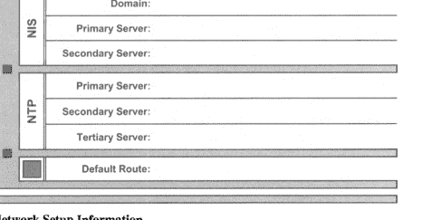

|  | DSF 磁盘名称 | 分区 | SRM 磁盘名称 | 控制器 单元 ID | 大小 | 块大小 | 固件 磁盘/控制器 |
|---|---|---|---|---|---|---|---|
| O/S (ER) | `root` |  |  |  |  |  |  |
|  | `swap` |  |  |  |  |  |  |
|  | `usr` |  |  |  |  |  |  |
|  | `var` |  |  |  |  |  |  |
|  | `tmp` |  |  |  |  |  |  |
| cluster-common | `cluster_root` |  |  |  |  |  |  |
|  | `cluster_usr` |  |  |  |  |  |  |
|  | `cluster_var` |  |  |  |  |  |  |
|  | quorum disk |  | `h` |  | 1MB | 2048 |  |
| member boot disks | 1 | `boot_partition` | `a` |  |  |  |  |
|  | `swap` | `b` |  |  |  |  |  |
|  | `cnx` | `h` |  |  | 1MB | 2048 |  |
|  | 2 | `boot_partition` | `a` |  |  |  |  |
|  | `swap` | `b` |  |  |  |  |  |
|  | `cnx` | `h` |  |  | 1MB | 2048 |  |
|  | 3 | `boot_partition` | `a` |  |  |  |  |
|  | `swap` | `b` |  |  |  |  |  |
|  | `cnx` | `h` |  |  | 1MB | 2048 |  |
|  | 4 | `boot_partition` | `a` |  |  |  |  |
|  | `swap` | `b` |  |  |  |  |  |
|  | `cnx` | `h` |  |  | 1MB | 2048 |  |
|  | 5 | `boot_partition` | `a` |  |  |  |  |
|  | `swap` | `b` |  |  |  |  |  |
|  | `cnx` | `h` |  |  | 1MB | 2048 |  |
|  | 6 | `boot_partition` | `a` |  |  |  |  |
|  | `swap` | `b` |  |  |  |  |  |
|  | `cnx` | `h` |  |  | 1MB | 2048 |  |
|  | 7 | `boot_partition` | `a` |  |  |  |  |
|  | `swap` | `b` |  |  |  |  |  |
|  | `cnx` | `h` |  |  | 1MB | 2048 |  |
|  | 8 | `boot_partition` | `a` |  |  |  |  |
|  | `swap` | `b` |  |  |  |  |  |
|  | `cnx` | `h` |  |  | 1MB | 2048 |  |

表 4-10：磁盘/分区布局

### 成员信息

表 4-11：成员信息和默认集群别名

默认集群别名

| 完全限定主机名 | IP 地址 |
|---|---|

集群互连

| 类型 | 集线器/交换机 | 模式 | NSPOF |
|---|---|---|---|

集群互连

虚拟 | 物理

| 主机名 | IP 地址 | 子网掩码 | 名称 | 地址 | 名称 | 地址 |
|---|---|---|---|---|---|---|

许可证 PAKs

| `OSP-BASE` | `OSP-STR` | OSP-... | ... |
|---|---|---|---|

## 4.9 参考文献

- *Tru64 UNIX Release Notes* (V5.1, August 2000).

- *Tru64 UNIX Release Notes* (V5.1A, June 2001).


- *TruCluster Server Release Notes* (V5.1, August 2000).

- *TruCluster Server Cluster Release Notes* (V5.1A, June 2001).

- *Tru64 UNIX Installation Guide* (V5.1, August 2000).

- *Tru64 UNIX Installation Guide – Advanced Topics* (V5.1, August 2000).

- *Tru64 UNIX Installation Guide* (V5.1A, June 2001).

- *Tru64 UNIX Installation Guide – Advanced Topics* (V5.1A, June 2001).

- *Tru64 UNIX Software Installation guide* (V5.1, August 2000).

- *TruCluster Server Cluster Installation guide* (V5.1A, June 2001).

- *TruCluster Server Cluster Hardware Configuration guide*

- Compaq StorageWorks HSG80 ACS Solution Software V8.6 for Compaq *Tru64 UNIX* – Installation and Configuration Guide

- Compaq StorageWorks Fibre Channel SAN Management Guide, 2<sup>nd</sup> Edition, (Nov. 2001), Compaq Part No. AA-RMMJB-TE

- Hardware Configuration Technical Update for Fibre Channel for *TruCluster Server* 5.0A

- AlphaServer DS20 V6.2 Console Firmware Release Notes

- *TruCluster Server Cluster LAN Interconnect guide*

- *TruCluster Server Software Product Description* (SPD)

# *Tru64* UNIX 的安装与配置

> > “凡是值得做的事，就值得做好做。”
> >
> > — 切斯特菲尔德伯爵，*Letters*

在过去的四章中，我们向您展示了集群是什么，提供了 *Tru64* UNIX、*TruCluster* Server、一些技术考虑、集群设计以及最后集群配置规划的快速概述。如果您像我们认识的许多系统管理员和系统架构师一样，自从拿起这本书以来，您可能已经准备好构建自己的集群了。

在本章中，我们将讨论如何安装和配置 *Tru64* UNIX 以支持 *TruCluster* Server 的成功部署。除了提供如何执行安装的指导外，我们还将“带您逐步走过”我们实际执行的一次安装。

本章将涵盖大量内容。作为对比，HP 专门为 *Tru64* UNIX 安装编写了两本完整的参考手册（而且这是针对发布的每个版本的 *Tru64* UNIX）。鉴于这项工作量，我们将这些参考手册视为该主题的最终权威。我们的目的是展示为了正确支持基本的 *TruCluster* Server 部署，需要安装 *Tru64* UNIX 做什么。

与任何成功的系统实施一样，规划始终是强制性的。在这种情况下，规划为部署 *TruCluster* Server 奠定了坚实的基础。*Tru64* UNIX 是 *TruCluster* Server 建立的基础。如果您尚未阅读本手册的第 3 章和第 4 章，我们强烈建议您在继续之前回头阅读它们。如果您已经完成了第 3 章和第 4 章，那么您就可以继续了。

## 5.1 安装 *Tru64* UNIX 的理念

当您读到本小节的标题时，我们可以想象您会发出叹息声。多年来，我们与许多系统管理员合作，并听取了他们对面向系统管理员的其他书籍的冗长批评，我们认为讨论我们安装和配置 *Tru64* UNIX 的方法和原因非常重要。

在 TruCluster Server 环境中，无论你拥有两个还是八个集群节点，Tru64 UNIX 仅安装一次，且只安装一次。由于 Tru64 UNIX 是 TruCluster Server 的基础，因此首次正确安装 Tru64 UNIX 至关重要。

我们在安装 UNIX 服务器时遇到了两种方法。第一种是安装操作系统的所有软件组件。HP 在《TruCluster Server 集群安装指南》第 3 章中提倡这种方法。这是迄今为止最简单的方法，如果用户或系统管理员需要某个软件组件，它将自动存在。

第二种方法是在系统用户所需范围内安装最少的 UNIX 操作系统软件组件。这里的理由是维护应该更容易（包括安装未来的补丁和额外的软件组件），管理应该更容易，因为理论上，系统管理员会更好地了解用户需要哪些应用程序，并且系统安全性应该更容易控制。

在我们对 Tru64 UNIX 的安装和配置示例中，我们将使用第二种方法。当部署你自己的 Tru64 UNIX 服务器以支持最终创建 TruCluster Server 环境时，我们建议你首先审查自己的需求，然后将此处提供的示例用作原型来构建。

## 5.2 Tru64 UNIX 和 TruCluster Server 的重要文档

在开始安装 Tru64 UNIX 以支持 TruCluster Server 的部署之前，我们建议你始终审查以下针对你计划安装的 Tru64 UNIX 和 TruCluster Server 版本的文档：

- Tru64 UNIX 发布说明。

- TruCluster Server 发布说明。

- Tru64 UNIX 安装指南。

- TruCluster Server 集群安装指南。

- TruCluster Server 集群管理指南。

- Tru64 UNIX QuickSpecs（或 5.1A 版本之前的软件产品描述）

- TruCluster Server QuickSpecs（或 5.1A 版本之前的软件产品描述）

请特别注意这些文档的安装和硬件部分。发布说明旨在提供有关软件、固件和硬件更改的重要信息，以及标准 Tru64 UNIX 文档集中未涵盖的软件错误、"变通方法" 和文档中的错别字。

## 5.3 准备安装 Tru64 UNIX

如果你尚未阅读第 4 章，请立即停止！请返回第 4 章，因为审查集群配置规划至关重要，因为它还涵盖了为安装 Tru64 UNIX 做好准备所需的内容。请记住，在 TruCluster Server 环境中你仅安装一次 Tru64 UNIX，因此请力求第一次就做对。此外，第 4 章有一个方便的集群准备清单¹，其中包括 Tru64 UNIX 选项。

## 5.4 Tru64 UNIX 的安装

在本节中，我们将介绍一次实际的 Tru64 UNIX 安装。对于我们此次安装的示例，我们将使用 Tru64 UNIX 版本 5.1A 安装在一台将来将成为双节点集群的节点上。

正如我们在本章前面所述，由于我们将安装 Tru64 UNIX 以准备构建 TruCluster Server 环境，因此我们只需安装一次操作系统——无论我们最终可能有多少个集群节点²。

以下是我们将介绍以执行 Tru64 UNIX 安装的各个任务列表：

- 从操作系统 CD 启动。

- 开始安装。

- 设置完整安装的信息。

- 选择要安装的软件。

  - 选择强制性软件子集。

  - 仅选择部分可选软件子集。

- 选择要构建到内核中的内核选项。

- 选择用于操作系统文件系统的文件系统类型。

  - 确定文件系统布局——什么放在哪里。

- 在开始安装前确认选择。

- 创建文件系统并安装软件子集。

- 配置软件子集。

- 配置并构建 UNIX 内核。

| Section |
|---|
| 5.4.1 |
| 5.4.2 |
| 5.4.3 |
| 5.4.4 |
| 5.4.4.1 |
| 5.4.4.2 |
| 5.4.5 |
| 5.4.6 |
| 5.4.6.1 |
| 5.4.7 |
| 5.4.8 |
| 5.4.9 |
| 5.4.10 |

好吧，现在我们知道要做什么了，让我们开始吧！

> ¹ 参见第 4 章第 4.8 节。
> ² 截至本文撰写时，TruCluster Server 环境中最多支持八个节点。

### 5.4.1 从安装 CD 启动

在我们实际从 Tru64 UNIX 安装 CD 启动之前（该 CD 名称为 Compaq Tru64 UNIX Version 5.1A Operating System Volume 1），让我们先初始化系统。在控制台提示符下，使用 `init` 命令。

```
P00>>> init
```

让我们通过在控制台提示符下使用 "`show device`" 命令来识别我们将要启动的 CDROM。


## Chapter 5

```
P00>>> show device
dqa62.1.0.0.7.1      $1$DGA62          HSG80   V86F
dkc0.0.0.0.7.0     DKC0              COMPAQ BD009635CB BDC4
dqa0.0.0.1.0.5.0    DQA0              CD-224E 9.5B ← CDROM
dva5.0.0.0.0.0      DVA0
eia0.0.0.0.9.1      EIA0              00-50-8B-AE-PB-DC
pga0.0.0.0.7.1      PGA0              WWN 2000-0000-c924-3514
pka0.7.0.6.0        PKA0              SCSI Bus ID 7
pkb0.7.0.1.0.6.0    PKB0              SCSI Bus ID 7
pkc0.7.0.7.0        PKC0              SCSI Bus ID 7
```

现在我们已经识别出 CDROM，让我们启动 Tru64 UNIX 操作系统 CD 并开始安装。

### CAUTION：

继续之前，请确保您已在第 4 章中执行了必要的准备步骤，例如设置环境变量和安装最新的固件。

```
P00>>> boot dqa0
...
*** Performing CDROM Installation
```

### 5.4.2 开始安装

从 Tru64 UNIX 操作系统安装 CD 启动后，您必须做出的第一个决定如下：

```
Remember, you can always get extra information by typing help.

1) U.S. English Installation
2) Installation with Worldwide Language Support
3) Exit Installation

Enter your choice: 1
```

通过选择“1”，我们选择执行 Tru64 UNIX 的“U.S. English Installation”。

> **NOTE:**
>
> 如果您使用的是非 GUI 安装程序，并且需要在安装磁盘上使用自定义磁盘标签，您将选择选项“3”并按照第 4.2.1 节所述继续标记磁盘。

### 5.4.3 完整安装的设置信息

安装程序会提示输入构建系统所需的信息，如以下输出所示。

```
Enter a password to use as the root (superuser) password.
Be sure to remember this password, because it is needed to
log in as the user “root” following installation.  The
password must be at least six characters long, and at least
one of the first eight characters must be a number, special
character, or uppercase letter (A-Z).

Enter root password: xxxxxxxx
Retype root password: xxxxxxxx
```

安装软件做的第一件事之一，除了询问您想要什么类型的安装外，就是提示输入 root 密码。虽然我们鼓励为任何计算机系统上的任何用户使用“good and strong passwords”³，但对于 root 用户来说尤其重要。而且请，请不要把你的密码写在便签上并贴在显示器上！

```
Choose a hostname for this system. The hostname identifies the
system on the network. The hostname must start with a letter,
and may include letters, numbers, periods and hyphens.

Enter the hostname for this system: molari
```

接下来，我们会被提示输入我们正在安装的系统的主机名。

接下来的几个提示是用于选择系统所在的位置和区域（或时区）。

```
Select the location that best describes your site. This is to
determine what time zone your site is in. If your location includes
multiple time zones (for example, Asia), the next question will
ask you which of those you want.

 1) Africa        7) Australia     13) Etc          19) MST
 2) America       8) CET           14) Europe       20) MST7MDT
 3) Antarctica    9) CST6CDT       15) Factory      21) PST8PDT
 4) Arctic       10) EET           16) HST          22) Pacific
 5) Asia         11) EST           17) Indian       23) SystemV
 6) Atlantic     12) EST5EDT       18) MET          24) WET
```

```
Enter your choice: 12
```

接下来，您将被提示输入日期和时间。

```
Enter the current date (as mm/dd/[cc]yy): 08/17/2002
```

```
Enter the current time in 24-hour format (as hh:mm): 23:22
```

```
The date and time has been set to: Sat Aug 17 23:22:00 EDT 2002
Is this correct (y/n)? y
```

> ³ “good and strong password” 是指包含大小写字母和数字的密码。在安装的这个阶段，仅支持基础安全，因此只有密码的前八个字符才有意义。

### 5.4.4 选择要安装的软件

在安装的这一部分，我们会被提示选择将要安装的软件子集。

```
*** Software Selection ***
** Reviewing available software for:
Tru64 UNIX V5.1A Operating System ( Rev 1885 )
Please wait ...

The following options are available:
 o Select "All Software" to install all mandatory and all optional software for the operating system. You will be given the opportunity to view all software after selecting this option and to confirm your choice.
 o Select "Mandatory Only" to install the minimum required software. No optional software will be installed. You will be given the opportunity to view the mandatory software after selecting this option and to confirm your choice.
 o Select "Customize" to interactively select software from a numbered list of software subsets. You will then be given the opportunity to confirm your choices.
1) All Software
2) Mandatory Only
3) Customize
```

```
Enter your choice: 3
```

我们选择了“3”或“Customize”，因为我们想要选择将要安装的软件子集。

#### 5.4.4.1 选择强制性软件子集

以下输出显示了自定义安装后将被安装的强制性软件组件：


```
The following base operating system subsets are mandatory and will be installed automatically unless you choose to exit without installing any subsets:
* AdvFS Kernel Modules
* Base System
* Base System - Hardware Support
* Base System Management Applications and Utilities
* Basic Networking Configuration Applications
* Basic Networking Services
* Basic X Environment
* CDE Desktop Environment
* CDE Mail Interface
* CDE Minimum Runtime Environment
* Compaq Management Agents Version 2.1b
* Compiler Back End
* DECwindows 100dpi Fonts
* DECwindows 75dpi Fonts
* Doc. Preparation Tools
* Graphical Base System Management Utilities
* Graphical Print Configuration Application
* Graphical System Administration Utilities
* Hardware Kernel Header and Common Files
* Hardware Kernel Modules
* Java 1.1.8-10 Environment
* Kernel Header and Common Files
* Local Printer Support
* Logical Storage Manager Kernel Modules
* NFS(tm) Configuration Application
* NFS(tm) Utilities
* Netscape Communicator V4.76
* PCXAL Keyboard Support
* Service Tools
* Standard Kernel Modules
* Tcl Commands
* Tk Toolkit Commands
* Tru64 UNIX Base System
* X Fonts
* X Servers Base
* X Servers for PCbus
```

```
Space used after mandatory subsets (root/usr/var): 81.3 MB/307 MB/4.9 MB
```

#### 5.4.4.2 选择部分可选软件子集

在安装的这一部分，我们会被提示选择被视为 Tru64 UNIX 操作可选的软件子集。

由于我们希望集群能够增长和扩展以满足当前及未来的计算需求，我们建议安装所有与硬件相关的子集，这样如果您添加具有不同硬件配置的系统，它将被自动识别，而无需安装额外的软件子集。我们还建议您通过阅读 Tru64 UNIX 安装指南附录 C 中子集的描述，运用最佳判断来确定要安装哪些软件子集。换句话说，在进行安装之前，花时间规划您将要安装的内容。您应该真正了解并理解系统上将安装哪些软件以及原因。

> NOTE:
>
> The output shown is from a V5.1A installation. The number of subsets will differ from version to version.

可选的 Tru64 UNIX 软件子集按以下类别分组：

- General Applications
- Kernel Build Environment
- Kernel Software Development[^4]
- Mail Applications
- Network-Server/Communications
- Obsolete Components
- Printing Environment
- Reference Pages
- Software Development
- Supplemental Documentation
- System Administration
- Text Processing
- Windowing Environment
- Windows Applications

以下输出被删减以节省一棵或两棵树。每个类别将包含一个或多个可供选择的子集。

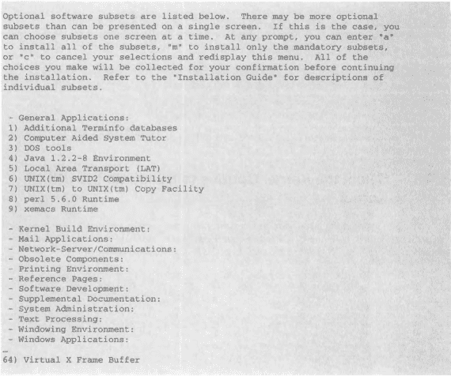

[^4] Subsets cannot be chosen in the initial installation.

已使用空间 (`root/usr/var`): 93.6 MB/589 MB/10.1 MB

添加到您的选择中，或按 RETURN 键确认选择。

输入 `c` 取消您的选择并重新显示此菜单。

选择（例如 `1 2 4-6`）：`1 3-4 6 8-9 12 14 18-39 41-49 51-55 57-59 62 63`

#### 5.4.4.3 验证可选软件子集

安装软件会要求我们确认是否要安装所有选定的软件子集，并确认这些软件子集将被加载以进行安装。

```
The following subsets will be loaded:
```

此时，将显示选定的（以及强制的）子集，随后是所需的磁盘空间，以及一个用于确认选择是否正确的提示。（输出已被截断。）

```
Space required in (root/usr/var): 93.6 MB/600 MB/10.3 MB

Are these the software subsets that should be loaded (y/n) ? Y
```

既然我们已经选择了所有想要安装的内容，我们应该已一切就绪。对吧？嗯，还不完全是。

### 5.4.5 选择要构建到 UNIX 内核中的内核选项

现在我们已经告诉安装软件要安装的软件子集，接下来需要告诉它，在完成所有软件子集的安装和配置后，如何构建 UNIX 内核。如下面的输出所示，有三个选择。

```
*** Kernel Options Selection ***

The following options are available:

 o Select "All Options" to automatically build all mandatory and all optional kernel components into the tailored kernel.

 o Select "Mandatory Only" to automatically build only the mandatory kernel components into the tailored kernel.

 o Select "Customize" to manually select the optional kernel components. You will be prompted for your selection later in the installation process after all software subsets have been loaded and the system has been rebooted from the new system disk. The mandatory kernel components will be automatically included in the custom-built kernel.
```

```
1) All Options
2) Mandatory Only
3) Customize
```

```
Enter your choice: 3
```

我们将选择选项“3”来选择我们知道将要使用的内核选项。只选择需要的内核选项可以生成更小的 UNIX 内核，与使用所有内核选项构建的内核相比，它可能具有更好的性能和更高的效率。

> **注意：**
>
> 选择选项“1”或“2”时，安装程序将在不要求您进一步输入的情况下构建内核。换句话说，一旦安装过程开始，它将在无人值守的情况下继续运行。选择选项“3”时，安装过程将在构建内核之前停止，以请求要添加到内核的选项。

### 5.4.6 选择用于操作系统文件系统的文件系统类型

接下来的几个提示涉及我们是否使用逻辑存储管理器（LSM）、我们将使用哪种文件系统类型，以及本地系统磁盘的文件系统布局。关于 LSM 的提示用于封装操作系统磁盘。由于在创建集群期间，这不会传播到集群磁盘，因此我们建议您在出现提示时回答“否”。


```
*** File System Selection ***
The Logical Storage Manager (LSM) is a disk storage management tool that can
help protect against data loss through the use of disk mirroring, can
improve disk I/O performance through the use of disk striping, and can
dynamically extend available disk storage through the use of disk
concatenation. Mirroring and striping through LSM require a separate
license PAK.

By choosing LSM, all file systems and swap areas created by the installation
process will be under LSM control.

Enter “help” for more information about LSM.
```

```
Would you like to use LSM (y/n) ? n
```

#### 5.4.6.1 确定文件系统布局

在第 4 章中，我们对本地磁盘进行了分区，为 Tru64 UNIX 安装做准备。您可以通过以下任一方式完成此操作：

- 退出到 shell 并使用 `disklabel(8)` 命令，或
- 使用 `diskconfig(8)` 命令（GUI 安装的一部分）。

用于系统磁盘的分区布局基于我们选择的子集所需的空间、预期配置和未来增长。请注意本节后面给出的具体布局。

在安装的这一部分中，系统将提示我们选择要将操作系统安装到的设备以及每个文件系统的分区布局。通过选择自定义文件系统布局而不是默认文件系统布局，我们可以利用之前创建的磁盘分区。

对于独立操作系统磁盘，您必须对所有文件系统使用高级文件系统（AdvFS）——这是创建集群的要求。

```
Choose your file system layout:
 o The default file system layout installs the operating system onto a single disk, and provides the most typical file system configuration:
   * root file system on the "a" partition
   * swapping area on the "b" partition
   * /usr file system on the "g" partition
   * /var in the /usr file system

This option also provides a recommended disk partition table that is calculated based on existing software selections and future growth considerations. Additionally, you may select either the UFS or AdvFS file system type.
 o The custom file system layout lets you choose the partition and file system type individually for each of the file systems created by the installation process. You should choose this option if:
   * You want to place the file systems across multiple disks.
   * You want to place the file systems on a single disk, but there is existing data on that disk that must be protected.
   * You do not want the same file system type for each file system.
   * You want to create more than one swap area.
1) Default file system layout
2) Custom file system layout

Enter your choice: 2
```

在本节中，我们选择将用于安装根目录（`/`）的硬盘。默认情况下，它安装在驱动器的`a`分区上。我们还选择使用 AdvFS 作为根目录（`/`）所使用的文件系统。

选择根文件系统的磁盘。根文件系统将被放置在您选择的磁盘的`a`分区上。

要目视定位磁盘，输入 `ping <disk>`，其中 `<disk>` 是您要定位的磁盘的设备名称（例如，`dsk0`）。如果该磁盘具有可见指示灯，它将闪烁直到您准备好继续。

| Device Name | Size (GB) | Controller Type | Disk Model | Location |
|---|---|---|---|---|
| 1) `dsk0` | 18.2 | SCSI | BD018635C4 | `bus-5-targ-0-lun-0` |

Enter your choice: 1

选择根文件系统的文件系统类型：

1) UFS -- UNIX File System

2) AdvFS -- Advanced File System

Enter your choice: 2

对于 `/usr` 文件系统，我们选择与根目录（`/`）安装在同一设备上的`g`分区。我们对 `/usr` 使用 AdvFS 作为文件系统类型。

选择 `/usr` 文件系统所在的磁盘，或输入 `ping <disk>`，其中 `<disk>` 是设备名称（例如 `dsk0`）以物理识别特定磁盘。

| Device Name | Size (GB) | Controller Type | Disk Model | Location |
|---|---|---|---|---|
| 1) `dsk0` | 18.2 | SCSI | BD018635C4 | `bus-5-targ-0-lun-0` |

Enter your choice: 1

选择 `dsk0` 分区以存放 `/usr` 文件系统。该分区必须至少为 4GB 才能容纳您选择的软件。然而，建议大小为 700 MB 或更大，以便为额外的分层软件和未来的升级考虑留出空间。

| Partition | Size (GB) | Start Block | End Block | Overlaps |
|---|---|---|---|---|
| 1) `b` | 4.5GB | 1048576 | 10485760 | `c` |
| 2) `e` | 3.9GB | 10485760 | 18787864 | `c` |
| 3) `f` | 2.0GB | 18787864 | 22982168 | `c` |
| 4) `g` | 4.0GB | 22982168 | 31370776 | `c` |
| 5) `h` | 2.0GB | 31370776 | 35565080 | `c` |

Enter your choice: 4

选择 `/usr` 文件系统的文件系统类型：

1) UFS -- Unix File System

2) AdvFS -- Advanced File System

Enter your choice: 2

交换分区也将位于与根目录（`/`）相同的设备上。这次我们将使用`b`分区作为交换分区，因为其大小大约是内存的三倍。

选择第一个交换区（`swap1`）所在的磁盘，或输入 `ping <disk>` 其中 `<disk>` 是设备名称（例如 `dsk0`）以物理识别特定磁盘。

| Device Name | Size (GB) | Controller Type | Disk Model | Location |
|---|---|---|---|---|
| 1) `dsk0` | 18.2 | SCSI | BD018635C4 | `bus-5-targ-0-lun-0` |

...

Enter your choice: 1

选择 `dsk0` 分区以存放第一个交换区（`swap1`）。

| Partition | Size (GB) | Start Block | End Block | Overlaps |
|---|---|---|---|---|
| 1) `b` | 4.5GB | 1048576 | 10485760 | `c` |
| 2) `e` | 3.9GB | 10485760 | 18787864 | `c` |
| 3) `f` | 2.0GB | 18787864 | 22982168 | `c` |


```
| 4) h | 2.0GB | 31370776 | 35565080 | c |
Enter your choice: 1
```

由于我们选择不设置第二个交换分区，因此在提示时回答 `no`。

您可以选择设置第二个交换区（`swap2`）。

```
Do you want a second swapping area [y/n] ? n
```

在本节中，我们会被提示是否要将 `/var` 与 `/usr` 分开。在我们的例子中，我们通常会将 `/usr` 和 `/var` 保持为单独的文件系统。按照传统，我们将 `/var` 放在 `h` 分区上。`/var` 文件系统也使用 AdvFS 文件系统。

您可以使 `/var` 成为单独的文件系统，也可以让它与 `/usr` 文件系统共享空间。

```
Should /var be a separate file system (y/n) ? y
```

选择 `/var` 文件系统所在的磁盘，或输入 `ping <disk>` 其中 `<disk>` 是设备名称（例如 `dsk0`）以物理识别特定磁盘。

```
| Device Name | Size (GB) | Controller Type | Disk Model | Location |
|---|---|---|---|---|
| 1) dsk0 | 18.2 | SCSI | BD018635C4 | bus-5-targ-0-lun-0 |
...
Enter your choice: 1
```

选择 `dsk0` 分区以存放 `/var` 文件系统。

```
| Partition | Size (GB) | Start Block | End Block | Overlaps |
|---|---|---|---|---|
| 1) e | 3.9GB | 10485760 | 18787864 | c |
| 2) f | 2.0GB | 18787864 | 22982168 | c |
| 3) h | 2.0GB | 31370776 | 35565080 | c |
Enter your choice: 3
```

选择 `/var` 文件系统的文件系统类型。

```
1) UFS -- UNIX 文件系统
2) AdvFS -- 高级文件系统
输入您的选择：2
```

最后，我们验证一下我们为 Tru64 UNIX 系统磁盘的文件系统所选择的分区布局。

```
You have requested this file system layout:
* root file system on dsk0a, type AdvFS
* /usr file system on dsk0g, type AdvFS
* /var file system on dsk0h, type AdvFS
* first swapping area (swap1) will be on dsk0b
* no second swapping area (swap2)
```

```
Is this the correct file system layout (y/n) ? y
```

表 5-1 包含我们刚刚配置的系统磁盘的分区布局。

## Tru64 UNIX 操作系统磁盘布局

| 挂载点 | 文件系统 | 分区大小 | 分区 |
|---|---|---|---|
| 根 (`/`) | `root_domain#root` | 512 MB | `dsk0a` |
| `/usr` | `usr_domain#usr` | 4.0 GB | `dsk0g` |
| `/var` | `var_domain#var` | 2.0 GB | `dsk0h` |
| `swap` | `swap` | 4.5 GB | `dsk0b` |

**表 5-1：独立操作系统磁盘分区布局**

需要指出的是，虽然我们为系统磁盘使用了 18.2 GB 的硬盘驱动器，但我们并没有采用 HP 关于系统磁盘布局的指南。HP 建议，对于超过 3 GB 的系统磁盘，系统根目录 (`/`) 应为 384 MB，交换分区应为 384 MB（如果不需要更大）[5]。根据我们的经验，对于将用作构建集群基础的系统原始磁盘，系统根目录 (`/`) 应至少为 512 MB，而交换分区应为内存大小的两到三倍。由于本系统有 1.5 GB 内存，因此创建了 4.5 GB 的交换分区。不过，对于这个系统磁盘，我们不会过于担心交换分区的大小。它很可能只用于构建集群的时间，或者如果我们需要一个独立的操作系统磁盘来排查集群问题。

5. 表 6-7：按磁盘容量推荐的分区表，Tru64 UNIX 安装指南。

那么，您应该遵循我们的示例，还是使用 HP 的建议？HP 在其文档中发布的是基于 Tru64 UNIX 和 TruCluster Server 的设计者、开发者和客户意见的指南。我们介绍的则主要基于经验。我们相信，您应该从 HP 的建议开始，在必要时根据您对系统预期工作负载的了解进行偏离。

### 5.4.7 启动安装前确认选择

下一节将允许您验证或修改之前为安装所做的任何选择。

```
You have now answered all questions needed to install the operating system. Press CTRL/C to cancel the installation; or type 'history' to modify your earlier answers; or press RETURN to proceed with installation:
```

在我们的例子中，我们对所有选择都感到满意，因此继续安装。

### 5.4.8 创建文件系统并安装软件子集

除了监控所有文件系统的创建以及我们所选软件子集的加载之外，我们实际上没有太多事情要做。所以去吃个午饭或享受一次长时间的咖啡休息吧……

```
Continuing installation...
Restoring the existing disk label on device dsk0
Creating the root file system on device dsk0a
Creating the usr file system on device dsk0g
Creating the var file system on device dsk0h
Creating the swap1 file system on device dsk0b

The installation procedure will now load a total of 85 software subsets on your disk partitions. This total includes the following products:
* 85 Base Operating System subsets

This process will take from 45 to 120 minutes to complete depending on your distribution media and processor type.

LOADING THE BASE OPERATING SYSTEM SOFTWARE SUBSETS
```

### 5.4.10 配置和构建 UNIX 内核

之前，在提示输入内核配置选项时，我们选择了进行定制内核。在安装的这一部分，我们有机会确切地识别系统内核需要哪些选项。

如果我们之前为内核配置选项选择了“所有选项”或“仅强制选项”，我们根本不会看到这个对话。我们相信，只选择我们使用的选项，应该会得到一个更小且性能更好的内核。


# KERNEL CONFIGURATION AND BUILD PROCEDURE

## KERNEL OPTION SELECTION

```
*** KERNEL CONFIGURATION AND BUILD PROCEDURE ***
*** KERNEL OPTION SELECTION ***

Selection   Kernel Option
---------------------------------------------
    1       SCSI Devices
    2       NTP V3 Kernel Phase Lock Loop (NTP_TIME)
    3       Kernel Breakpoint Debugger (KDBUG)
    4       Packetfilter driver (PACKETFILTER)
    5       IP-in-IP Tunneling (IPTUNNEL)
    6       IP Version 6 (IPv6)
    7       Point-to-Point Protocol (PPP)
    8       STREAMS packet module (PCKTM)
    9       Data link Bridge (DBRI V2.0 Service Class 1)
   10       X/Open Transport Interface (XTI), TIMOD, TIRDWR
   11       Digital Versatile Disk File System (DVDFS)
   12       ISO 9660 Compact Disc File System (CDfs)
   13       Audit Subsystem
   14       All of the above
   15       None of the above
   16       Help
   17       Display all options again

Enter your choices, choose an overriding action or
press <Return> to confirm previous selections.
```

```
Choices (for example, 1 2 4-6): 2 4 8 11 13
```

```
You selected the following kernel options:
        NTP V3 Kernel Phase Lock Loop (NTP_TIME)
        Packetfilter driver (PACKETFILTER)
        STREAMS packet module (PCKTM)
        Digital Versatile Disk File System (DVDFS)
        Audit Subsystem
```

```
Is that correct? (y/n) [y]: y
```

Do you want to edit the configuration file? (y/n) [n]: n

Tru64 UNIX 内核随后将根据所选的内核配置选项进行构建。

截至本文撰写时，TruCluster Server 不支持 IP 版本 6，因此在进行自己的 Tru64 UNIX 内核配置时请勿选择 IP 版本 6。至少，请查阅 TruCluster Server 发行说明，了解内核配置选项中哪些是支持的，哪些是不支持的。

系统现在将自动使用所选选项构建内核，然后重新启动。这可能需要长达 15 分钟，具体取决于处理器类型。

系统重新启动后出现登录提示时，使用 `root` 作为登录名，并使用在此过程中输入的 SUPERUSER 密码登录系统。

*** PERFORMING KERNEL BUILD ***

```
    Working..... Tue Jan 22 20:35:41 PST 2002
```

已成功在此系统上设置新的版本 ID。

整个新功能集已启用。

此消息包含在文件 `/var/adm/smlogs/it.log` 中以供将来参考。

此时，系统将重新启动。一旦系统重新启动，它将运行新构建的 Tru64 UNIX 内核。

## 5.5 Tru64 UNIX 配置

在上一节中，我们讨论了实际安装 Tru64 UNIX 所需的内容。在本节中，我们将继续我们的示例并快速配置 Tru64 UNIX。请记住，我们在此示例中提出的最终目标是成功部署 TruCluster Server。

正如您所见，上一节中 Tru64 UNIX 的安装进行得相当顺利。现在安装完成后，Tru64 UNIX 的实际配置就开始了。

以下是将独立的 Tru64 UNIX 配置并接入网络所需执行的任务列表：

- 提供 OSF-BASE 许可信息。 5.5.1.2
- 配置网络接口卡 (NIC)。 5.5.1.3
- 设置网络路由。 5.5.1.4
- 指定域名服务 (DNS)/Bind 服务器。 5.5.1.5
- 指定网络时间协议 (NTP) 服务器。 5.5.1.6
- 指定网络信息服务 (NIS) 服务器。 5.5.1.7
- 指定 NFS 服务。 5.5.1.8
- 指定电子邮件服务器。 5.5.1.9
- 设置默认打印机和打印服务器。 5.5.1.10

完成这些任务后，我们就可以进入下一步——TruCluster Server 的安装和配置。

系统已准备就绪。

Compaq Tru64 UNIX V5.1A (Rev. 1885) (molari) console

```
login: root
Password: ********
```

Can't find an OSF-BASE, UNIX-WORKSTATION, or UNIX-SERVER license PAK

Compaq Tru64 UNIX V5.1A (Rev. 1885); Sun Aug 18 00:56:22 EDT 2002

安装软件已成功安装您的系统。

包含安装记录的日志文件有：这些是：

- `/var/adm/smlogs/install.cdf` - 配置描述文件
- `/var/adm/smlogs/install.log` - 通用日志文件
- `/var/adm/smlogs/install.FS.log` - 文件系统创建日志
- `/var/adm/smlogs/setid.log` - `setid(8)` 实用程序的日志
- `/var/adm/smlogs/fverify.log` - 验证日志文件

## Tru64 UNIX 版本 V5.1A (Rev. 1885) 系统设置

为了使本系统可供一般使用，必须安装随系统购买的产品授权密钥 (PAKs)，以允许用户登录并访问许可的软件包。此外，还必须配置多个 Tru64 UNIX 子系统，例如网络、邮件、打印等。

此设置实用程序除了允许配置 Tru64 UNIX 子系统外，还提供有关您可能希望在设置实用程序运行期间或之后执行的其他任务的信息。您可以从以下菜单访问此信息。如果您想查看此信息，请在选择选项 5 之前查看。此信息也可在随系统提供的印刷文档《安装指南》中找到。

- 1) 先阅读此内容！
- 2) 关于加载许可证 PAK 的信息
- 3) 关于访问在线文档的信息
- 4) 关于添加用户的信息
- 5) 开始系统配置
- 6) 退出

请输入一个数字 (1 到 6)：5

正如上面的警告消息所示，系统无法找到基本（操作系统）许可证 PAK。请准备好以下许可证产品授权密钥 (PAKs)，以便配置 Tru64 UNIX：

- OSF-USR - 多用户许可证
- OSF-BASE 和/或 OSF-SVR - 基本操作系统许可证
- TCS-UA - TruCluster Server 许可证

并且可选：

- ADVFS-UTILITIES - 高级文件系统高级实用程序许可证
- LSM-OA - 逻辑存储管理器许可证

这些是配置系统所需的最少许可证 PAK。如果您正在安装需要许可证 PAK 的其他软件，请同时准备好这些许可证 PAK(s)。

### 5.5.1 选择快速设置

在本节中，我们将执行快速设置以配置 Tru64 UNIX，为安装 TruCluster Server 做准备。我们的配置相对简单，因为我们的环境比较不复杂。您的环境可能更复杂。我们鼓励您在继续安装和配置 TruCluster Server 之前，先花时间将 Tru64 UNIX 配置以满足您的需求。请记住，在您可以在其上构建之前，需要一个坚实而强大的基础。

在我们的示例中（见图 5-1），我们为“快速设置”选择“1”。“快速设置”程序启动各种 SysMan 应用程序菜单，并询问系统管理员配置基本服务。基本服务允许服务器接入网络、进行打印，并可能发送和接收电子邮件。

### NOTE:

`SysMan` 是一个用于配置和管理 Tru64 UNIX 系统的通用界面，可用 GUI、菜单和命令行格式。

如果您的系统支持图形，则不会看到 `setup(8)` 程序，而是会出现如图 5-2 所示的清单剪贴板。

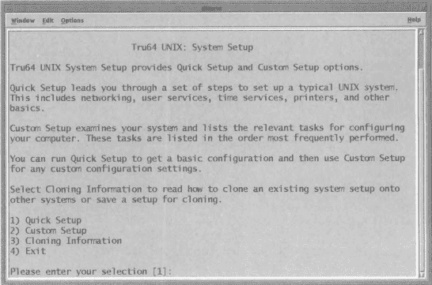


**图 5-1：Tru64 UNIX setup 程序**

### 5.5.1.4 设置网络路由

在此 SysMan 屏幕上，我们有设置网络路由的能力。为此，我们需要知道在我们的网络上如何执行路由。

在图 5-7 中，我们使用 `gated` 进行网络路由。虽然在配置独立的、非集群的 Tru64 UNIX 系统期间使用 `gated` 并非必不可少，但 `gated` 是 Cluster Alias 在 TruCluster Server 中正常运行的要求。

对于您的 Tru64 UNIX 服务器，在您做出适当选择之前，您需要确定网络上如何进行路由。我们强烈建议您与网络组核实以确定此信息，或检查网络上另一台服务器的配置并将其作为您自己的服务器的原型使用。有关网络管理更多信息，请参阅第 20 章。

### 5.5.1.5 指定域名服务（DNS/BIND）服务器

下一个“快速设置”屏幕（图 5-8）允许我们指定 DNS 服务器信息。

在此我们输入 DNS 网络域以及 DNS 服务器名称和 IP 地址。

### 5.5.1.6 指定网络时间协议（NTP）服务器

此“快速设置”屏幕（图 5-9）允许我们输入 NTP 服务器信息。

NTP 服务器信息是 NTP 服务器的主机名或主机名的别名。

我们建议您在配置 TruCluster Server 软件之前先配置 NTP。TruCluster Server 要求成员系统时钟保持同步。请参阅第 20 章，了解有关配置 NTP 的详细信息，包括如有需要使用本地参考时钟地址（`127.127.0.1`）的提示。

如果您选择不使用 NTP 服务，则我们建议您使用遵循 `RFC 1035` 的时间协议，并且不要使用 `timed(8)`。

### 5.5.1.7 指定网络信息服务（NIS）服务器

图 5-10 是下一个“快速设置”屏幕。它允许您配置 NIS 服务。如果您在环境中使用 NIS，我们建议在安装和配置 TruCluster Server 之前先将系统完全配置为 NIS。为什么我们这样推荐？因为如果您先在独立服务器上配置 NIS，那么在创建集群时，它将被传播到每个集群成员。请注意，NIS 域与 DNS 网络域不同。

有关设置 NIS 的更多信息，请参阅适用于 5.0A 和 5.1 版本的 Tru64 UNIX 网络管理指南，或适用于 5.1A 及更新版本的 Tru64 UNIX 网络管理：服务指南。

### 5.5.1.8 指定 NFS 服务

图 5-11 允许我们指定将使用的 NFS 服务。

在此我们启用远程目录挂载和目录导出。对于您的系统，请根据用户最佳利益进行操作。

### 5.5.1.9 指定电子邮件服务器

由于大多数 UNIX 服务器要么发送电子邮件、接收电子邮件或两者兼有，因此我们需要在配置中指定要使用的电子邮件服务器。此配置主要用于转发 SMTP 邮件。有关在集群中配置电子邮件的更多信息，请参阅第 21 章。

我们按图 5-12 所示输入电子邮件服务器的系统名称。

### 5.5.1.10 指定默认打印机和打印服务器

此“快速设置”屏幕（图 5-13）允许我们指定默认打印机和打印服务器。

### 5.5.1.11 快速设置摘要和完成

这就基本完成了执行简单的 *Tru64 UNIX* 配置。这些接下来的两个“快速设置”屏幕（见图 5-14）允许我们验证并可能更正我们在系统配置选择过程中可能犯的任何错误。

由于我们对所有条目都满意，我们选择“完成”，快速设置程序将配置系统。

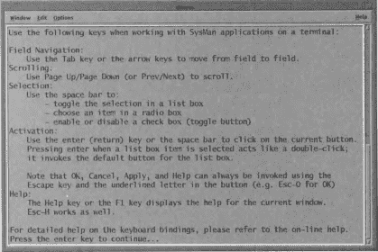

**图 5-3：SysMan 导航信息**

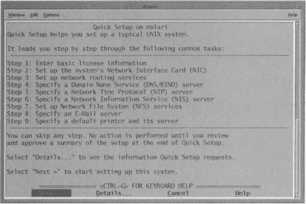

**图 5-4：快速设置 — 主屏幕**

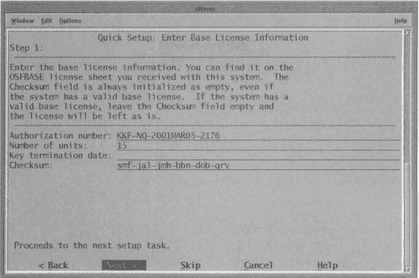

**图 5-5：快速设置 — OSF-BASE 许可证 PAK**

## 图 5-6：快速设置 – NIC 设置

```
Quick Setup: Set up the Network Interface Card (NIC)

Step 2:

Identify this system to the network. Enter the name of this system (for example, "host"), its IP address (for example, 192.2.3.4) and its network mask (for example, 255.255.255.0).

If you want DHCP to assign a dynamic network address to this network interface, you cannot use Quick Setup. In that case, select "Cancel" and use the individual configuration applications.

Host name*: molari.dec.com

Internet protocol (IP) address*: 192.168.0.68

Network mask*: 255.255.255.0

Proceeds to the next setup task.

< Back   Next >   Cancel   Help
```

## 图 5-7：快速设置 – 网络路由

```
Quick Setup: Setup Network Routing

Step 3:

Choose a routing service daemon (routed or gated) or enter the IP address of the default static route gateway. This will determine how your system communicates with networks. Your network manager can provide you with this information.

Routing service

>Use static routing

< Run routed

<Run gated

Routing system's IP address:

Proceeds to the next setup task.

< Back   Next >   Skip   Cancel   Help
```

Figure 5-8: Quick Setup – DNS/BIND

```
Quick Setup: Specify the Domain Name Service (DNS/BIND) Server

Step 4:

Enter the host name and IP address of the DNS servers which translates host names into IP addresses.

This service is sometimes referred to as "BIND".

DNS network domain: dec.com

Primary DNS server name: hitch.dec.com

Primary DNS server IP address: 192.168.0.42

Secondary DNS server name: hiker.dec.com

Secondary DNS server IP address: 192.168.1.42

Proceeds to the next setup task.

< Back   Next >   Skip   Cancel   Help
```

Figure 5-9: Quick Setup – NTP Server

```
Quick Setup: Specify the Network Time Protocol (NTP) Server

Step 5:

Enter the host name of an NTP server that will keep this system's time synchronized with an accurate time source.

This step is required for TruCluster systems.

You can specify one, two, or three NTP servers, but only one is required for this feature.

Primary NTP server name: thyme.dec.com

Secondary NTP server name: tick.dec.com

Tertiary NTP server name: tock.dec.com

Proceeds to the next setup task.
```

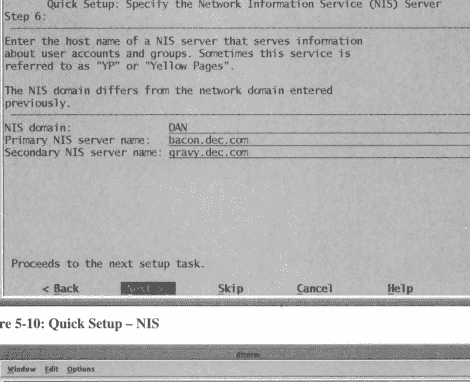

Figure 5-10: Quick Setup – NIS


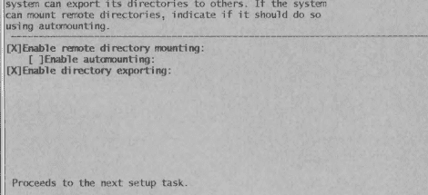

Figure 5-11: Quick Setup – NFS

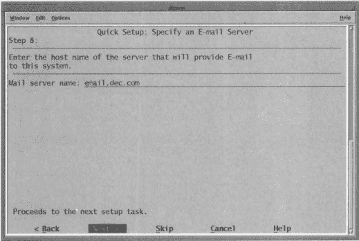

Figure 5-12: Quick Setup – E-mail Server

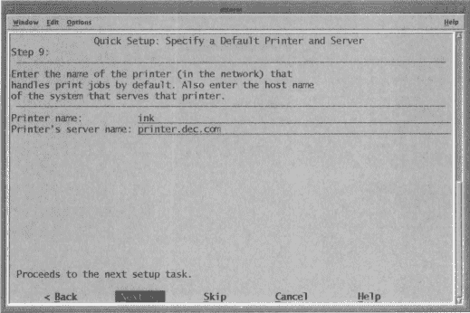

Figure 5-13: Quick Setup -- Default Printer & Print Server

## 图 5-14：快速设置 – 摘要页（1 & 2）

Quick Setup: Summary: 1st Page

This is the first page of the setup information you entered.

Please review it, make any changes needed here (or in previous dialog boxes by using the "< Back" button), then select "Next >" to see the last page of setup information.

Base authorization number: ALS-NQ-2001MAR05-2176

Number of units: 15

Key termination date:

Checksum: smf-ial-jmh-bbn-dob-qry

Host name*: molari.dec.com

IP address*: 192.168.0.68

Network mask*: 255.255.255.0

Routing service: Run gated-

Routing system's IP address:

DNS network domain: dec.com

Primary DNS server name: hitch.dec.com

Primary DNS server IP address: 192.168.0.42

Secondary DNS server name: hiker.dec.com

Secondary DNS server IP address: 192.168.1.42

Proceeds to the last page of setup information.

< Back   Next >   Cancel   Help

Quick Setup: Summary: Last Page

This is the last page of the setup information you entered.

Please review it, make any changes needed here (or in previous dialog boxes by using the "< Back" button), then select Finish to set up the system with this information.

Primary NTP server name: thyme.dec.com

Secondary NTP server name: tick.dec.com

Tertiary NTP server name: tock.dec.com

NIS domain: DAN

Primary NIS server name: bacon.dec.com

Secondary NIS server name: gravy.dec.com

[X]Enable remote directory mounting:

[ ]Enable automounting

[X]Enable directory exporting:

Mail server name: email.dec.com

Printer name: ink

Printer's server name: printer.dec.com

Set up the system with the information from both summary windows.

< Back   Finish   Cancel   Help

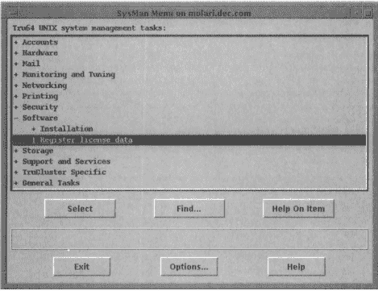

图 5-15：SysMan 菜单

### 5.5.2 更多关于许可的信息

我们对 Tru64 UNIX 示例的配置就完成了吗？差不多。我们还有最后一件事要做——安装其他许可证。

安装 License PAKs 有三种方法：

- `lmfsetup`
- "`lmf register`"
- `sysman`，转到“Software”管理任务下的“Register license data”。另外，你也可以使用“`sysman lmfsetup`”加速器。

LMF 程序会提示输入正确的许可证字段。请参阅图 5-15，了解使用 SysMan 注册 License PAK 的示例。

### 5.6 关于配置 *Tru64* UNIX 系统的最后说明

在本章中，我们举例说明的目的是为了部署 *TruCluster* Server 而安装和配置了一台 *Tru64* UNIX 服务器。我们的系统在功能和配置需求方面相对简单。我们强烈建议你在开始安装和配置 *TruCluster* Server 之前，先在独立的 *Tru64* UNIX 系统上完全安装和配置你从系统角度所需的一切。为什么呢？考虑以下场景：如果你在创建集群时就对独立系统配置了 C2 安全，它将被传播到每个成员。但是，如果你在集群创建后再配置 C2 安全，你必须重新启动每个成员才能启用新的安全级别。

如果有第三方软件应用程序需要为你的用户安装，我们建议你在独立的 *Tru64* UNIX 系统上安装、配置并测试这些应用程序。如果应用程序要求在允许其以集群感知方式安装之前必须安装 *TruCluster* Server 软件，那么请等到集群构建完成。在测试这些应用程序时，尽可能多地对其进行特征描述——描述它们如何启动和关闭、它们写入数据的位置（包括日志文件），以及其许可是如何执行的。集群构建并配置完成后，再次测试这些应用程序并确定这些应用程序可以是多实例还是单实例。换句话说，是否可以在集群的每个节点上同时运行多个应用程序实例，或者集群上只能运行一个应用程序实例？这将决定你是否必须使用集群应用程序可用性（CAA）来控制这些应用程序。有关 CAA 的更多信息，请参阅第 23 章和第 24 章。

### 5.7 参考文献

- *Tru64* UNIX Release Notes (V5.1 and V5.1A).
- *TruCluster* Server Release Notes (V5.1 and V5.1A).
- *Tru64* UNIX Installation Guide (V5.1 and V5.1A).
- *Tru64* UNIX Installation Guide: Advanced Topics (V5.1 and V5.1A).
- *Tru64* UNIX Network Administration (V5.0A and V5.1).
- *Tru64* UNIX Network Administration: Connections (V5.1A).
- *Tru64* UNIX Network Administration: Services (V5.1A).
- *TruCluster* Server Software Installation Guide (V5.1).
- *TruCluster* Server Cluster Installation Guide (V5.1A).

# Tru64 UNIX Cluster Hooks: File System Hierarchy, CDSL, & PID

在本章中，我们将开始讨论包含在基础 Tru64 UNIX 操作系统中以实现从独立系统到集群更无缝过渡的各种组件。

我们将涵盖以下组件：

- 上下文相关符号链接（CDSL）
- 运行时配置的更改
- 文件系统层次结构
- 扩展进程 ID

| Section |
|---|
| 6.1.1, 6.4 |
| 6.1.2 |
| 6.2 |
| 6.5 |

对 Tru64 UNIX 做的第一个也是最重要的更改是使操作系统能够以透明的方式定位其配置信息、可执行文件、分层应用程序等，并且以这样的方式构建基本文件系统层次结构，即无论系统是独立的还是在集群中都无关紧要。

采用的方法是将信息分为成员特定和集群公共文件，适用于所有 Tru64 UNIX 系统，无论它们处于集群还是独立配置。集群公共文件位于文件的正常位置，而成员特定文件位于某个新位置（但似乎位于文件的正常位置——将在以下各节中详细介绍）。成员特定文件实际上位于以下三个主要位置之一：

- `/cluster/members/membern`


- `/usr/cluster/members/membern`
- `/var/cluster/members/membern`

（其中 `n` 是 0 到 63 之间的数字。）

## NOTE:

成员目录主要用作独立系统成员特定的目录。虽然从技术上讲，独立系统不需要成员特定的目录（因为它除了你的计算机房之外不是任何东西的成员），但它保持了独立和集群环境之间的布局一致性。在集群中，它用作成员特定文件的通用版本存储库。集群成员 ID 范围从 1 到 63。

## 6.1 它是成员特定的还是集群通用的？

一旦系统加入或形成集群，它就成为集群的成员。因此，如果某些东西需要唯一配置，例如网络接口，那么其配置信息必须包含在成员特定的文件中。另一方面，如果某些东西需要为集群中的每个成员相同地配置，例如 NIS，那么其配置信息必须位于集群通用文件中。

从 Tru64 UNIX 版本 5.0 开始，`/etc/rc.config` 文件已被拆分为两个文件，外加一个可选的第三个文件，如下所示：

- `rc.config`
- `rc.config.common`
- `rc.config.site`（可选）

`rc.config` 文件是成员特定的，而 `rc.config.common` 文件是，你猜对了，集群通用的。`rc.config.site` 文件用于任何站点特定的配置信息。

```
# ls /etc/rc.config*
/etc/rc.config      /etc/rc.config.common
```

那么，是什么使 `/etc/rc.config` 成为成员特定的？让我们更仔细地查看这两个文件。

```
# file /etc/rc.config*
/etc/rc.config: symbolic link to ../cluster/members/{memb}/etc/rc.config
/etc/rc.config.common: /bin/sh shell script -- commands text
```

请注意，`rc.config` 文件似乎位于 `/etc` 目录中，而实际上它位于 `../cluster/members/{memb}/etc` 目录中。`/etc/rc.config` 文件根本不是一个普通文件，而是一种特殊类型的符号链接，被称为上下文相关符号链接（CDSL）。

### 6.1.1 进入 CDSL

那么，这个 CDSL 到底是什么？CDSL 是一个符号链接，其路径中包含 `{memb}` 变量。`{memb}` 是“上下文”，或者更准确地说，是用于确定上下文的内容。图 6-1 显示了 CDSL 的解析方式。

请注意，`{memb}` 等于单词 `member` 加上成员的 ID。成员的 ID 存储在通用子系统中的属性 `memberid` 中。独立系统始终具有为零的 `memberid`。因此，在独立系统上，值为 `../cluster/members/{memb}/etc/rc.config` 的 CDSL 将解析为路径 `../cluster/members/member0/etc/rc.config`。

```
[ /etc ]
# ls -i ../cluster/members/{memb}/etc/rc.config
1817 ../cluster/members/{memb}/etc/rc.config
```

```
[ /etc ]
# ls -i ../cluster/members/member0/etc/rc.config
1817 ../cluster/members/member0/etc/rc.config
```

如果你检查 `ls -i` 输出中列出的两个文件，你会看到它们是完全相同的文件。`-i` 选项显示文件序列号（例如 UFS 文件系统中的 inode 或 AdvFS 文件系统中的 tag）。

```
[ /etc ]
# cd ./tags && /sbin/advfs/tag2name 1817
/cluster/members/member0/etc/rc.config
```


图 6-1：CDSL 解析

现在我们已经展示了如何区分成员特定文件和集群通用文件，值得一提的是，对于每条规则都有一个例外。换句话说，这不是成员特定文件存在的唯一方式。创建成员特定文件的另一种方法（虽然要少得多）是，而不是将文件放在成员特定目录中并创建指向它的 CDSL，而是简单地用唯一的扩展名重命名文件。第二种方法的示例在第 16 章中提供，其中描述了 Cluster Alias 子系统。Cluster Alias 子系统使用 `gated.conf` 文件，通过创建成员特定的 `gated.conf` 文件并在文件名后附加 `membern` 来实现（例如 `/etc/gated.conf.member1`）。

### 6.1.2 它在 rc.config 还是 rc.config.common 中？

我们之前提到配置网络接口是成员特定的任务，而配置 NIS 是集群范围的任务，那么这在我们的 `rc.config` 文件中是如何实现的呢？由于 NIS 是集群范围配置的，那么所有 NIS 变量都应该在 `/etc/rc.config.common` 中，而不在 `/etc/rc.config` 中。

```
# grep NIS /etc/rc.config
<nothing is returned>
```

```
# grep NIS /etc/rc.config.common
NIS_DOMAIN="DAN"
export NIS_DOMAIN
NIS_CONF="YES"
export NIS_CONF
NIS_TYPE="CLIENT"
export NIS_TYPE
NIS_ARGS="-s -S DAN, bacon.dec.com, gravy.dec.com"
export NIS_ARGS
```

你可能在问的下一个问题是，“这些文件在启动期间按什么顺序被调用？”为了避免不必要的更改，因为许多 `init` 脚本已经调用 `rc.config`，所以决定让 `rc.config` 调用 `rc.config.common`。

```
# cat /etc/rc.config
#!/bin/sh
#
# Read in the cluster attributes before overriding them with the member
# specific options.
. /etc/rc.config.common
...
```

请注意在调用 `rc.config.common` 之前的注释：“在覆盖它们之前先读取集群属性...”。由于 `#!/bin/sh` 与 `/etc/rc.config.common` 之间的所有内容都是注释，`rc.config` 的执行在 `rc.config.common` 执行完毕之前不会设置任何变量。

## NOTE:

如果你在系统启动期间想要设置任何站点特定的变量，请在 `/etc` 中创建一个名为 `rc.config.site` 的文件，并在 `rc.config.common` 中以与 `rc.config` 中调用 `rc.config.common` 相同的相对位置调用它。站点特定变量必须在集群公共变量设置之前设置非常重要，这样 `rc.config.site` 中的任何内容都不会意外覆盖 `rc.config.common` 或 `rc.config` 中的任何内容。请注意，`rc.config.site` 的名称很重要，因为 `rcmgr` 命令可用于操作你的站点特定文件（前提是它具有正确的名称）。

当 `init` 守护进程在系统初始化期间启动时，它使用 `/etc/inittab` 文件来告知它在特定运行级别需要启动或停止哪些初始化任务。

```
# grep -E "^s*[0-9]{3}" /etc/inittab
s0:0:wait:/sbin/rc0 off </dev/console >/dev/console 2>&1
s2:23:wait:/sbin/rc2 </dev/console >/dev/console 2>&1
s3:3:wait:/sbin/rc3 </dev/console >/dev/console 2>&1
```

在 `/etc/inittab` 中有行指示 `init` 守护进程执行三个特定脚本（`rc0`、`rc2` 和 `rc3`）。这些脚本反过来在 `/sbin` 下的子目录中执行一系列其他脚本（参见图 6-2）。


图 6-2：运行级别初始化

这些子目录（`rc0.d`、`rc2.d` 和 `rc3.d`）包含指向位于 `/sbin/init.d` 的脚本的符号链接。链接的命名方式是为了强制它们执行的顺序。


```
ls -l /sbin/rc2.d | awk '{ printf("%-15s %3s %s\n", $9, $10, $11) }'

K00lpd    -> ../init.d/lpd
K03lat    -> ../init.d/lat
K04dhcp   -> ../init.d/dhcp

S25nologin -> ../init.d/enlogin
S35streams -> ../init.d/streams
S45atm     -> ../init.d/atm
```

## /etc/rc.config 中的执行流程

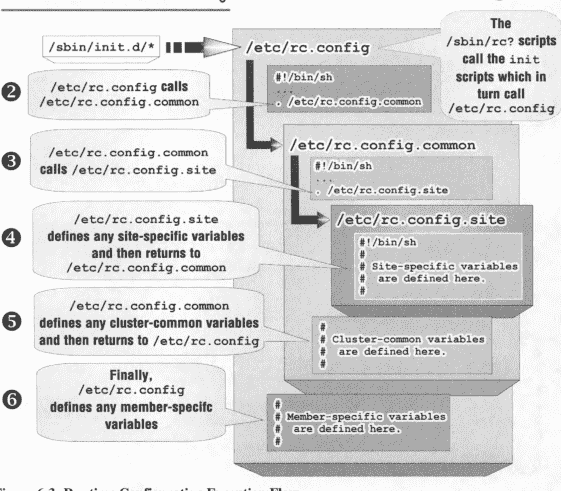

图 6-3：运行时配置执行流程

以 “K” 开头的链接表示与这些链接关联的脚本将在系统从较高运行级别更改到当前运行级别时执行。

以 “S” 开头的链接在系统从较低运行级别更改到当前运行级别时执行。这些脚本使用由 `/etc/rc.config*` 脚本设置的变量。

图 6-3 描述了 `rc.config` 文件的执行流程。如图所示，从 `/sbin/rc?` 脚本执行的 `init` 脚本执行 `rc.config`，后者又在设置任何变量之前调用 `rc.config.common`。`rc.config.common` 文件会立即调用 `rc.config.site`（如果存在）。一旦 `rc.config.site` 返回到 `rc.config.common`，则 `rc.config.common` 会设置其文件中的变量并返回到 `rc.config`。最后，`rc.config` 设置其变量。

如果一个变量在多个文件中被设置会怎样？

- 如果一个变量在 `rc.config` 和 `rc.config.common` 中都被定义，则使用 `rc.config` 中的值。
- 如果一个变量在 `rc.config.common` 和 `rc.config.site` 中都被定义，则使用 `rc.config.common` 中的值。

### 6.1.2.1 使用 rcMgr(8) 命令

`rcMgr` 命令是修改 Tru64 UNIX 上 `rc.config` 文件的推荐方法。使用 `rcMgr` 可以让你设置变量以及检索（get）变量。`rcMgr` 命令有四个命令选项，允许你指定使用哪个 `rc.config` 文件。参见表 6-1。

让我们看看 `rcMgr` 在设置和检索一些变量时如何响应。

首先，让我们在 `rc.config` 和 `rc.config.common` 中都设置同一个变量。

```
# rcMgr set TCRHB from Member-specific file
# grep TCRHB /etc/rc.config*
/etc/rc.config:TCRHB="from Member-specific file"
/etc/rc.config:export TCRHB
```

```
# rcMgr -c set TCRHB from Cluster-common file
# grep TCRHB /etc/rc.config*
/etc/rc.config:TCRHB="from Member-specific file"
/etc/rc.config:export TCRHB
/etc/rc.config.common:TCRHB="from Cluster-common file"
/etc/rc.config.common:export TCRHB
```

### rcmgr (8) 命令选项

| 选项 | 描述 | 示例 | 解释 |
|---|---|---|---|

| c | 使用 `rc.config.common` | # `rcmgr -c set TCRHB 1` | 将 "TCRHB" 变量的值设置为 "1"，保存在 `rc.config.common` 中。 |
| h | 使用 `memberid` 等于 "-h" 后输入的 id 的成员的 `rc.config`。 在 `get` 或 `mget` 时也包括 `rc.config.common` 和 `rc.config.site` | # `rcmgr -h 3 get GATED` | 从 `member3` 的 `rc.config` 文件中获取 "GATED" 变量。 |
| n | 使用 `memberid` 等于 "-n" 后输入的 id 的成员的 `rc.config`。 | # `rcmgr -n 2 mget` | 获取 `member2` 的 `rc.config` 文件中设置的所有变量。 |
| s | 使用 `rc.config.site`（如果存在） | # `rcmgr -s get TCRHB` | 从 `rc.config.site`（如果存在）中获取变量 "TCRHB"。 如果站点特定文件不存在，则返回以下错误："Error: Cannot open /etc/rc.config.site" |

## 表 6-1：rcmgr 命令选项

现在我们已在两个文件中设置了变量，让我们看看使用各种命令开关时返回什么值。

"-c" 开关：

```
# rcmgr -c get TCRHB
from Cluster-common file
```

"-h" 开关：

```
# rcmgr -h 0 get TCRHB
from Member-specific file
```

## 无开关：

```
# rcmgr get TCRHB
from Member-specific file
```

现在让我们从 `/etc/rc.config` 中删除该变量，然后重复测试。

```
# rcmgr delete TCRHB
```

验证该变量已不再存在于 `/etc/rc.config` 中。

```
# grep TCRHB /etc/rc.config*
/etc/rc.config.common:TCRHB="from Cluster-common file"
/etc/rc.config.common:export TCRHB
```

我们将跳过 "-c" 测试，因为它将返回 `/etc/rc.config.common` 的内容，正如您从之前的输出中看到的那样，变量仍在公共文件中定义。

## "-h" 开关：

```
# rcmgr -h 0 get TCRHB
from Cluster-common file
```

## "-n" 开关：

```
# rcmgr -n 0 get TCRHB
< no output >
```

## 无开关：

```
# rcmgr get TCRHB
from Cluster-common file
```

请注意，"-n" 开关仅搜索成员特定的文件。 然而，"-h" 开关首先搜索 `rc.config`，然后如果变量不在其中，它将搜索 `rc.config.common` 文件。 当未提供开关时，将执行 "-n" 和 "-h" 搜索序列。 有关 `rcmgr` 命令的更多信息，请参阅相关参考页面。

## 6.2 文件系统层次结构

Tru64 UNIX 版本 5 中的文件系统层次结构与版本 4 的布局相比略有修改。

版本 5 的文件系统布局如图 6-4 所示。 根目录 (`/`)、`/usr` 和 `/var` 目录都新增了一个名为 `/cluster` 的目录。 在每个 `cluster` 目录下是 `members` 目录。 `members` 目录是成员特定目录所在的位置。 如图所示，每个 `members` 目录目前包含两个文件：

- `member`
- `member0`

`member0` 文件是独立系统的成员特定目录，而 `member` 文件是一个成员中立的身份链接，即 CDSL，用于快速访问该成员的成员特定目录。

```
# for i in /usr /var
> do
> cd $i(/)/cluster/members
> print "$i(${PWD})"
> ls -ld *
> done

[/cluster/members]
lrwxr-xr-x 1 root system 6 Jan 26 08:46 member -> (memb)
drwxr-xr-x 9 root system 8192 Feb 6 18:41 member0

[/usr/cluster/members]
lrwxr-xr-x 1 root system 6 Jan 26 08:47 member -> (memb)
drwxr-xr-x 7 root system 8192 Jan 26 08:47 member0

[/var/cluster/members]
lrwxr-xr-x 1 root system 6 Jan 26 08:51 member -> (memb)
drwxr-xr-x 22 root system 8192 Feb 6 17:02 member0
```

图中另一个 CDSL 是根目录 (`/`) 中的一个隐藏文件，名为 ".local.."。

```
# ls -l /.local.. | awk '{ print $9,$10,$11 }'
/.local.. -> cluster/members/(memb)
```


此示例说明了快速显示文件名及其链接的方法。由于此命令在整章（以及本书其余部分）中都会很有用，让我们创建一个函数来使用此命令，以便您可以减少输入。为了使此更改更永久，您可以将其放在您的 `".profile"` 文件中。注意：此特定函数在 Korn shell 中有效。

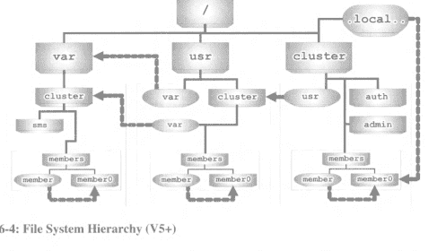

# 图 6-4：文件系统层次结构（V5+）

```
# function fln
> {
>   ls -l $0 | awk '{ print $9,$10,$11 }'
> }
```

```
# fln ./local..
./local.. -> cluster/members/{memb}
```

要查看系统上 Tru64 UNIX 版本的层次结构信息，请参阅 `hier(5)` 参考页。

## 6.3 它是成员特定的还是集群共用的？（续）

让我们更仔细地查看根目录（`/`）、`/usr` 和 `/var` 目录，看看有哪些内容被移到了“成员特定状态”。图 6-5 显示了 `member0` 目录层次结构。请注意，我们在图中使用的术语是“member”，因为该目录可能涉及集群中的任何成员。

接下来的三个表格使用 `find(1)` 命令在根文件系统中定位符号链接。`awk(1)` 命令搜索 `find` 命令的输出以查找 CDSLS 并打印出链接和链接的目标。表 6-2 显示了根目录（`/`）分区的 CDSLS。

在表 6-3 中，我们探索了 `/usr` 文件系统。注意：我们已编辑以下输出，以便将 `"/usr/.smdb."` 中的所有 `".sts"` 文件显示为一个条目，`"/usr/.smdb/*.sts -> ../cluster/members/{memb}/.smdb/*.sts"`。

在最后一个表格、表 6-4 中，显示了 `/var` 文件系统。

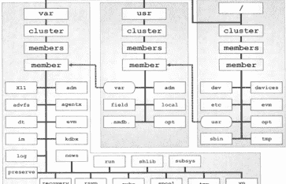

# 图 6-5：member0 目录层次结构

```
`# find / -xdev -type l -ls | awk '/^\{memb\}/ { print $11,$12,$13 }'`
```

```
```text

/cluster/members/memb0 -> (memb)

    /etc/autopush.conf -> ../cluster/members/{memb}/etc/autopush.conf

    /etc/biologon.conf -> ../cluster/members/{memb}/etc/biologon.conf

    /etc/cfginfo -> ../cluster/members/{memb}/etc/cfginfo

    /etc/rc.config -> ../cluster/members/{memb}/etc/rc.config

    /etc/startup.conf -> ../cluster/members/{memb}/etc/startup.conf

    /etc/syslog.conf -> ../cluster/members/{memb}/etc/syslog.conf

    /etc/gated.conf -> ../cluster/members/{memb}/etc/gated.conf

    /etc/ifaccess.conf -> ../cluster/members/{memb}/etc/ifaccess.conf

    /etc/inet.conf -> ../cluster/members/{memb}/etc/inet.conf

    /etc/inetd.conf -> ../cluster/members/{memb}/etc/inetd.conf

    /etc/ntp.conf -> ../cluster/members/{memb}/etc/ntp.conf

    /etc/ogated.conf -> ../cluster/members/{memb}/etc/ogated.conf

    /etc/remote -> ../cluster/members/{memb}/etc/remote

    /etc/routes -> ../cluster/members/{memb}/etc/routes

    /etc/hosts -> ../cluster/members/{memb}/etc/hosts

    /etc/snmpd.conf -> ../cluster/members/{memb}/etc/snmpd.conf

    /etc/dhcpstab -> ../cluster/members/{memb}/etc/dhcpstab

    /etc/iat/autopush.conf -> ../cluster/members/{memb}/etc/iat/autopush.conf

    /etc/dfsl.conf -> ../cluster/members/{memb}/etc/dfsl.conf

    /etc/at.conf -> ../cluster/members/{memb}/etc/at.conf

    /etc/dfsl.bak -> ../cluster/members/{memb}/etc/dfsl.bak

    /etc/gateways -> ../cluster/members/{memb}/etc/gateways

    /etc/dfsl.h00 -> ../cluster/members/{memb}/etc/dfsl.h00

    /sbin/init.d/data -> ../cluster/members/{memb}/sbin/init.d/data

    /sbin/init.d/23.d -> ../cluster/members/{memb}/sbin/init.d/23.d

/sbin/init.d/autosysconfig -> ../cluster/members/{memb}/sbin/init.d/autosysconfig

    /dev -> cluster/members/{memb}/dev

    /tmp -> cluster/members/{memb}/tmp

    /local -> cluster/members/{memb}/local

```
```

# 表 6-2：根目录（/）分区 CDSLS – 独立系统

# 第 6 章

```
```text

# find /usr -xdev -type f -ls | awk '/\(memb\)/ { print $11,$12,$13 }'

/usr/sbin/amd -> ./cluster/members/{memb}/sbin/amd.sh

/usr/cieatters/members/{memb} -> ../cluster/members/{memb}/X11/Xserver.conf

/usr/lib/X11/Xserver.conf -> ./../var/cluster/members/{memb}/X11/Xserver.conf

```
```

# 表 6-3：/usr 分区 CDSLS – 独立系统

```
```text

# find /var -xdev -type f -ls | awk '/\(memb\)/ { print $11,$12,$13 }'

/var/adm/sm/cluster/{memb} -> ../cluster/members/{memb}/adm/smlogs

/var/adm/bin/var.errlog -> ../cluster/members/{memb}/adm/binary.errlog

/var/adm/crash -> ../cluster/members/{memb}/adm/crash

/var/adm/cron -> ../cluster/members/{memb}/adm/cron

/var/adm/lastlog -> ../cluster/members/{memb}/adm/lastlog

/var/adm/lnf -> ../cluster/members/{memb}/adm/lnf

/var/adm/messages -> ../cluster/members/{memb}/adm/messages

/var/adm/sendmail/protocols.map -> ../cluster/members/{memb}/adm/sendmail/protocols.map

/var/adm/sendmail/sendmail.st -> ../cluster/members/{memb}/adm/sendmail/sendmail.st

/var/adm/sendmail -> ../cluster/members/{memb}/adm/syslog
```


`/var/adm/syslog` -> `../cluster/members/{memb}/adm/syslog`

`/var/adm/syslogd.dat` -> `../cluster/members/{memb}/adm/syslogd.dat`

`/var/adm/sysman/shutdown` -> `../cluster/members/{memb}/adm/sysman/shutdown`

`/var/adm/sysman/station/logs` -> `../cluster/members/{memb}/adm/sysman/sysman_station/logs`

`/var/adm/sysman/system_census` -> `../cluster/members/{memb}/adm/sysman/system_census`

`/var/adm/sysman/checklist.dates` -> `../cluster/members/{memb}/adm/sysman/checklist.dates`

`/var/adm/utmp` -> `../cluster/members/{memb}/adm/utmp`

`/var/adm/wtmp` -> `../cluster/members/{memb}/adm/wtmp`

`/var/adm/lock` -> `../cluster/members/{memb}/adm/lock`

`/var/adm/collect_data` -> `../cluster/members/{memb}/adm/collect_data`

`/var/adm/fee` -> `../cluster/members/{memb}/adm/acct/fee`

`/var/adm/acct` -> `../cluster/members/{memb}/adm/acct`

`/var/adm/pacct` -> `../cluster/members/{memb}/adm/acct/pacct`

`/var/adm/qacct` -> `../cluster/members/{memb}/adm/acct/qacct`

`/var/tmp` -> `../cluster/members/{memb}/tmp`

`/var/evm/adm/logfiles` -> `../cluster/members/{memb}/evm/adm/logfiles`

`/var/evm/evmlog` -> `../cluster/members/{memb}/evm/evmlog`

`/var/evm/evmsocket` -> `../cluster/members/{memb}/evm/evmsocket`

`/var/log` -> `../cluster/members/{memb}/log`

`/var/preserve` -> `../cluster/members/{memb}/preserve`

`/var/spool/cron` -> `../cluster/members/{memb}/spool/cron`

`/var/spool/locks` -> `../cluster/members/{memb}/spool/locks`

`/var/spool/lpd` -> `../cluster/members/{memb}/spool/lpd`

`/var/spool/uucp` -> `../cluster/members/{memb}/spool/uucp`

`/var/spool/uucppublic` -> `../cluster/members/{memb}/spool/uucppublic`

`/var/X11/Xserver.conf` -> `../cluster/members/{memb}/X11/Xserver.conf`

`/var/agent` -> `../cluster/members/{memb}/agent`

`/var/adm/wwa` -> `../cluster/members/{memb}/adm/wwa`

`/var/dit` -> `../cluster/members/{memb}/dit`

`/var/adm/advs/daemon/logs` -> `../cluster/members/{memb}/adm/advs/daemon/logs`

`/var/adm/advs/daemon/socket` -> `../cluster/members/{memb}/adm/advs/daemon/socket`

`/var/adm/advs/gui` -> `../cluster/members/{memb}/adm/advs/gui`

`/var/adm/advs/rv` -> `../cluster/members/{memb}/adm/advs/rv`

`/var/kdbx/system.kdbx` -> `../var/cluster/members/{memb}/kdbx/system.kdbx`

`/var/lib` -> `../cluster/members/{memb}/lib`

`/var/recovery` -> `../cluster/members/{memb}/recovery`

# 表 6-4：/var 分区 CDSLS – 独立系统

注意：虽然我们创建了一个指向某处的 CDSL，但该处指向无处。

```sh
# wc -l myFirstCDSL
wc: myFirstCDSL : No such file or directory
```

这不是一个错误，而是符号链接的特性。你可以通过简单地将一个文件复制到 `/myFirstCDSL` 来解决这种情况。

```sh
# cp .profile myFirstCDSL && wc -l myFirstCDSL
       74 myFirstCDSL
```

接下来，让我们在根目录（`/`）下创建一个目录，以演示使用 `"-c"` 选项的 `mkcdsl` 命令。`"-c"` 选项会将文件（或在这种情况下的目录）从其位置复制到成员特定的位置，同时在文件的位置留下 CDSL。

```sh
# CcdlDir && mkdir $C && mkcdsl -c $C && fin $C
cluDir -> cluster/members/(memb)/cluDir
```

你可以使用 `"-n"` 选项查看 `mkcdsl` 将会做什么（而不实际执行）。

```sh
# mkcdsl -n anotherCDSL
mkcdsl would: ln -s cluster/members/(memb)/anotherCDSL /anotherCDSL
```

## 6.4.2 维护 CDSLs

有两条命令可用于在系统上维护 CDSLs：

- `cdslinvchk(8)`
- `mkcdsl(8)`

### 6.4.2.1 使用 cdslinvchk (8) 命令

`cdslinvchk` 命令通过搜索位于 `/usr/.smdb/` 中的子集清单文件（`*.inv` 文件）和 `/var/adm/cdsl_admin.inv` 文件来验证系统中安装的所有 CDSLs 是否存在。如果命令检测到任何错误，它会将它们写入位于 `/var/adm` 中的 `cdsl_check_list` 文件。`cdslinvchk` 命令仅检查缺失的 CDSLs；它不会重新创建缺失的链接。要重新创建缺失的 CDSL，请使用 `mkcdsl` 命令。

```sh
# cdslinvchk
Successful CDSL inventory check
```

让我们删除一个 CDSL 来演示错误情况。

```
# mv /etc/rc.config /etc/rc.config.cdsl
```

重新运行 CDSL 清单检查程序。

```
# cdslinvchk
Failed CDSL inventory check. See details in /var/adm/cdsl_check_list
```

检查错误日志的内容。

```
# cat /var/adm/cdsl_check_list
Expected CDSL: ./etc/rc.config -> ../cluster/members/{memb}/etc/rc.config
An administrator or application has removed this CDSL.
```

该如何纠正？使用本章前面讨论过的 `mkcdsl` 命令。

```
# mkcdsl /etc/rc.config
```

重新运行 `cdslinvchk` 程序以确保我们已正确地将所有内容重新组合。

```
# cdslinvchk
Successful CDSL inventory check
```

不要忘记删除保存的链接。

```
# rm /etc/rc.config.cdsl
```

### 6.4.2.2 使用 mkcdsl(8) 命令


`mkcdsl`命令的设计目的不仅仅是创建 CDSL，而是创建可维护的 CDSL。正如我们之前所说，CDSL 是一个符号链接。当然，它是一个特殊的符号链接，其中路径中夹入了`"{memb}"`变量，但它仍然是一个符号链接。换句话说，你可以使用`ln`命令配合`"-s"`开关来创建 CDSL，如上一节所述，但我们尚未告诉你的原因是为什么使用`ln`命令是个坏主意。简单来说，`ln`命令不会记录 CDSL 是否曾经被创建。因此，如果你为应用程序创建了一个 CDSL，以便每个成员都可以写入其自己的

```shell
# mkcdsl -i $C && grep $C /var/adm/cdsl_admin.inv
0                 34              00000             0              120777    2/26/01 010
./myFirstCDSL     cluster/members/(member)/myFirstCDSL
```

## 6.4.3 CDSL 和 mv(1) 命令

在使用`mv`命令时，如果涉及 CDSL，则需要特别小心。`mv`命令不会跟随链接，因此会用文件替换链接。在独立配置中，这可能无关紧要，也可能很重要（当然，`cdslinvchk`会返回错误）；然而，在集群中，这将产生不可预测的（并且可能不太愉快）结果。

为说明此问题，创建一个文件（我们称之为 `"mover"`）并将其移动到上一节中创建的链接。

```shell
# cat > mover
la dee da
sweedledeae
sweedledum
^D
```

```shell
# ls -lid mover myFirstCDSL | awk '{ print $1,$10,$11,$12 }'
2112 myFirstCDSL -> cluster/members/(member)/myFirstCDSL
2894 mover
```

```shell
# mv mover myFirstCDSL; ls -lid myFirstCDSL | awk '{ print $1,$10,$11,$12 }'
2894 myFirstCDSL
```

你可以通过序列号看出该文件是同一个文件，但更重要的是，CDSL 不见了！建议在涉及 CDSLs 时使用`cp(1)`命令而不是`mv`命令。如果你不小心删除了 CDSL，不用担心，只需使用`mkcdsl`命令重新创建即可。

## 6.4.4 CDSL 和 Shells

Korn shell ’88 (`ksh`) 和 Korn shell ’93 (`dtksh`) 不会像 Bourne shell (`sh`) 或 C shell (`csh`) 那样显示符号链接。Korn shell 会在可能的情况下在输出中隐藏符号链接，而其他 shell 则显示实际所在的路径。表 6-5

## Shell 对 CDSLs 的响应

| sh (`/sbin/sh`, `/usr/bin/sh`) | csh (`/usr/bin/csh`) | ksh (posix) (`/usr/bin/ksh`, `/usr/bin/posix/sh`) | dtksh (ksh93) (`/usr/dt/bin/dtksh`) | tcsh (`/usr/local/bin/tcsh`) | bash (`/usr/local/bin/bash`) | zsh (`/usr/local/bin/zsh`) |
|---|---|---|---|---|---|---|
| `# cd /.local..`<br>`# pwd`<br>`/cluster/members/member0` | `# cd /.local..`<br>`# pwd`<br>`/cluster/members/member0` | `# cd /.local..`<br>`# pwd`<br>`/.local..` | `# cd /.local..`<br>`# pwd`<br>`/.local..` | `# cd /.local..`<br>`# pwd`<br>`/cluster/members/member0` | `# cd /.local..`<br>`# pwd`<br>`/.local..` | `# cd /.local..`<br>`# pwd`<br>`/.local..` |

**表 6-5：Shell 对符号链接的响应** 说明了每个 shell 在使用 CDSL 作为目录更改当前工作目录时的响应。表中还显示了来自 Tru64 UNIX 开源 CD 的另外三种替代 shell。

请注意，`bash`和`zsh` shell 与`ksh`类似，而`tcsh`与`csh`相似。

另外，你也可以使用`/usr/bin`目录中的`pwd`命令。

## 6.5 扩展进程 ID

你可能会想，“扩展进程 ID 与 CDSLs 和文件系统层次结构有什么关系？” 其实没有什么关系，但我们认为你可能会对这条信息感兴趣，因此选择在这里提供。

进程 ID 从 Tru64 UNIX 版本 5.0 开始扩展为 32 位整数（尽管最大值为 2147483647，实际上是 31 位）。在独立环境中，你不会看到任何明显差异；例如 PID 0 仍然是 `[kernel_idle]`，PID 1 仍然是`init`守护进程。在 TruCluster 环境中，PID 结构被定义为提供一组唯一的进程 ID（524288 PIDs/成员），定义如下：

1. 进程 ID（19 位）
2. 成员 ID（8 位）
3. 序列号（4 位） – 目前未使用。
4. 符号位（1 位） – 此位保留供将来使用。

PID 结构定义在`/usr/include/sys/types.h`中。每个成员的初始 PID 如表 6-6 所示。

让我们更仔细地查看集群上`init`守护进程的 PID，以探索集群中的 PID 结构如何影响 PID。在`member1`上，`init`的 PID 将为 524289。

```
# sysconfig -q generic memberid
generic:
memberid = 1
```

```
# ps -eo pid,command | grep "/sbin/init*" | grep -v grep
524289 /sbin/init -a
```

### 按 Member ID 的 PID 范围

`memberid × 2^19`

| Member ID | PID | Member ID | PID | Member ID | PID |
|---|---|---|---|---|---|
| 1 | 524288 | 22 | 11534336 | 43 | 22544384 |
| 2 | 1048576 | 23 | 12058624 | 44 | 23068672 |
| 3 | 1572864 | 24 | 12582912 | 45 | 23592960 |
| 4 | 2097152 | 25 | 13107200 | 46 | 24117248 |
| 5 | 2621440 | 26 | 13631488 | 47 | 24641536 |
| 6 | 3145728 | 27 | 14155776 | 48 | 25165824 |
| 7 | 3670016 | 28 | 14680064 | 49 | 25690112 |
| 8 | 4194304 | 29 | 15204352 | 50 | 26214400 |
| 9 | 4718592 | 30 | 15728640 | 51 | 26738688 |
| 10 | 5242880 | 31 | 16252928 | 52 | 27262976 |
| 11 | 5767168 | 32 | 16777216 | 53 | 27787264 |
| 12 | 6291456 | 33 | 17301504 | 54 | 28311552 |
| 13 | 6815744 | 34 | 17825792 | 55 | 28835840 |
| 14 | 7340032 | 35 | 18350080 | 56 | 29360128 |
| 15 | 7864320 | 36 | 18874368 | 57 | 29884416 |
| 16 | 8388608 | 37 | 19398656 | 58 | 30408704 |
| 17 | 8912896 | 38 | 19922944 | 59 | 30932992 |
| 18 | 9437184 | 39 | 20447232 | 60 | 31457280 |
| 19 | 9961472 | 40 | 20971520 | 61 | 31981568 |
| 20 | 10485760 | 41 | 21495808 | 62 | 32505856 |
| 21 | 11010048 | 42 | 22020096 | 63 | 33030144 |

**表 6-6：按成员的 PID 范围**

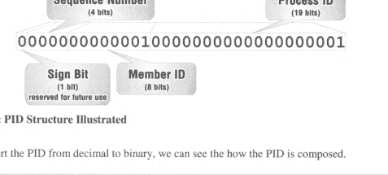

**图 6-6：PID 结构图示**


如果我们将 PID 从十进制转换为二进制，就可以看到 PID 的构成。

```
# perl -e ('printf ("%032b\n", 524289);')
00000000000001000000000000000001
```

图 6-6 显示了位字段的分解。

## 6.6 参考文献

- Tru64 UNIX 系统管理指南 – 版本 5.1 和 5.1A。

- TruCluster Server 技术概述 – 版本 5.1 和 5.1A。

- 参考页（文中已注明）。

# Tru64 UNIX 集群挂钩：设备命名与硬件管理

在上一章中，我们展示了 Tru64 UNIX 从 5.0 版本开始，目录层次结构是如何被修改的，以便从独立环境平滑过渡到集群环境。在本章中，我们将更深入地探讨这种修改后的层次结构，了解设备位置是如何被改变的。

我们将涵盖以下内容：

- 设备特殊文件名称和位置

- 全球唯一标识符（WWID）

- 硬件管理数据库

- 硬件管理器（`hwmgr`）命令

- 设备特殊文件（`dsfmgr`）命令

| Section |
|---|
| 7.1 |
| 7.2 |
| 7.3 |
| 7.4 |
| 7.5 |

## 7.1 设备特殊文件名称和位置

在 Tru64 UNIX 5.0 版本之前，所有设备都位于 `/dev` 子目录中。在 5.0 及更高版本中，这已经改变；对于普通观察者来说，看起来仍然相同。需要提前说明的是，存储设备的特殊文件命名约定已经改变。磁盘和 cdrom 设备的总线-目标-逻辑单元（`b-t-l`）助记符已不复存在；晦涩的磁带设备命名约定也不复存在。表 7-1 显示了设备特殊文件的命名变更。

为什么 `b-t-l` 命名约定被取代了？首先，为了使 Tru64 UNIX 能够支持到设备的多路径，其次，为了使集群中的每个成员都能通过相同的设备特殊文件名看到同一个设备，而不管其物理位置如何。这是如何实现的？我们将在下一节回答这个问题。

### 设备特殊文件命名

|  | Version 4 and below directory (/dev) | Version 4 and below base name | Version 4 and below LUN* | Version 4 and below instance | Version 4 and below partition or density | Version 5.0 and above directory (/devices) | Version 5.0 and above base name | Version 5.0 and above instance | Version 5.0 and above partition or density |  |
|---|---|---|---|---|---|---|---|---|---|---|
| CDROM | . | `rz [a-h]` | `n` | `[ac]` |  | `/disk` | `cdrom` | `n` | `[ac]` | block |
|  | . | `rrz [a-h]` | `n` | `[ac]` |  | `/rdisk` | `cdrom` | `n` | `[ac]` | character |
| Disk | . | `rz [a-h]` | `n` | `[a-h]` |  | `/disk` | `dsk` | `n` | `[a-h]` | block |
|  | . | `rrz [a-h]` | `n` | `[a-h]` |  | `/rdisk` | `dsk` | `n` | `[a-h]` | character |
| Tape | . | `rmt [a-h]` | `n` | `[almh]` |  | `/tape` | `tape` | `n` | `d[0-7]` | rewind |
|  | . | `rrmt [a-h]` | `n` | `[almh]` |  | `/ntape` | `tape` | `n` | `d[0-7]` | no rewind |
| CCL | . | `rz [a-h]` | `n` | `c` |  | `/cport` | `scp` | `n` |  |  |
| Changer | . | `mc [a-h]` | `n` | `[a-h]` |  | `/changer` | `mc` | `n` |  |  |
| LSM | `./vol/dg` | user-defined volume name |  |  |  | `/vol/dg` | user-defined volume name |  |  | block |
|  | `./rvol/dg` | user-defined volume name |  |  |  | `/rvol/dg` | user-defined volume name |  |  | character |

- `n` = device number
- If LUN 0, this field is optional

**Table 7-1: Device Special File Naming**

另一个发生的根本性变化是设备特殊文件的位置。存储设备已被重新定位到 `/devices` 目录树中。`/dev` 文件现在是一个指向成员特定的 `/dev` 目录的 CDS 链接，并包含成员特定的设备（例如，控制台、键盘、鼠标、伪终端等）。图 7-1 显示了设备目录层次结构。

让我们探索这个层次结构。首先，根（`/`）目录中的设备文件是什么？

```
# file /dev*
/dev:  symbolic link to cluster/members/{memb}/dev
/devices:  directory
```

请注意，`/dev` 现在是一个 CDS 链接，而 `/devices` 实际上是一个集群公共目录。如果我们更仔细地查看 `/devices` 中的内容，我们会看到存储设备目录位于那里。这是因为存储设备在集群中是共享的。

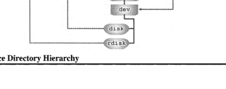

**Figure 7-1: Device Directory Hierarchy**

```
# file /devices/*
/devices/changer: directory
/devices/cport: directory
/devices/disk: directory
/devices/dmapi: directory
/devices/ntape: directory
/devices/rdisk: directory
/devices/rvol: directory
/devices/tape: directory
/devices/vol: directory
```

尽管目录层次结构已经改变，但看起来仍然相同。也就是说，我们仍然可以 `cd(1)` 到 `/dev`，并且所有设备，包括存储设备目录，都在那里。然而，存储设备目录实际上是指向 `/devices` 目录的符号链接。

```
# find /dev/ -type l -ls | awk '{ print $11,$12,$13 }'
/dev/none -> ../devices/none
/dev/cport -> ../../../../devices/cport
/dev/disk -> ../../../../devices/disk
/dev/rdisk -> ../../../../devices/rdisk
/dev/tape -> ../../../../devices/tape
/dev/ntape -> ../../../../devices/ntape
/dev/changer -> ../../../../devices/changer
/dev/dmapi -> ../../../../devices/dmapi
/dev/vol -> ../../../../devices/vol
/dev/rvol -> ../../../../devices/rvol
```

## 7.2 全球唯一标识符（WWID）

在上一节中，我们讨论了设备特殊文件命名的变更以及为什么它从之前 Tru64 UNIX 版本的 `b-t-l` 命名约定发生了变化。我们说过将在下一节告诉你集群范围内的唯一命名是如何实现的，而现在就是时候了。唯一的设备特殊文件名是通过使用 SCSI 全球唯一标识符（WWID）来识别独立系统或集群中的存储设备来实现的。

每个设备在第一次被操作系统检测到时都会被分配一个名称。该名称以基本名称（`dsk`、`cdrom`、`tape` 等）开头，后跟一个数字。编号从零开始。一旦设备被识别，它可以被重新定位到另一个总线或另一个目标等，而名称保持不变。WWID 是一个唯一的标识符，与序列号类似，大多数 SCSI 设备都应该具有。也有例外情况，其中包括 Tru64 UNIX 如何识别来自 HSZ RAID 控制器和旧 SCSI 设备的单元。

### 7.2.1 WWID 格式

目前，`camdb.h` 头文件中定义了十种 WWID 格式，该文件位于 `/usr/sys/include/io/cam` 目录下。WWID 的最大定义大小目前为 276 字节（`wwid_dec_unique` 和 `wwid_serial_num` 结构体的大小）。

**注意：**

可以使用 `wwid_decoder` 程序来解码 WWID 头。WWID 头是设备 `name` 属性中 `SCSI-WWID` 之后找到的十六进制值。该头包含以下信息：

- WWID 的类型。

- WWID 的长度。

- WWID 是否为 ASCII。


`wwid_decoder` 程序可以从 TruCluster Server Handbook 网站下载（有关 URL，请参阅附录 B）。以下示例说明了 `wwid_decoder` 程序的使用。

从 `hwmgr`(8) 获取 WWID 头。首先，获取存储设备的 HWID。

```
# hwmgr -view devices
HWID: Device Name          Mfg        Model            Location
---------------------------------------------------------------
4:  /dev/kvm
30: /dev/disk/floopy0c                 3.5in floppy      fdi0-unit-0
40: /dev/disk/dsk0c        COMPAQ     BB00923B6        bus-2-targ-0-lun-0
41: /dev/disk/dsk1c        COMPAQ     BB00923B6        bus-2-targ-1-lun-0
45: /dev/disk/cdrom0c      COMPAQ     CRD-8402B        bus-0-targ-0-lun-0
```

其次，获取 WWID 头。

```
# hwmgr -get attribute -a name -id 41
41:
name = SCSI-WWID:0c000008:0000-0e11-0012-5205
```

最后，运行 `wwid_decoder`。

```
# wwid_decoder 0c000008
IEEE EUI (64-bit):
Uses the wwid_p83_ieee64 structure in /usr/sys/include/io/cam/camdb.h.
This is a Page 0x83, ID type 2 (IEEE) WWID -- length is 8 bytes.
```

让我们回到 WWID 问题和 HSZ RAID 控制器。问题大吗？嗯，由于一个单元可以是多个物理设备，因此确定 HSZ RAID 控制器的单元将由 HSZ 的序列号与单元号连接起来定义。以下是一个示例。

我们需要做的第一件事是从连接到 HSZ 的设备获取一个 HWID。

```
# hwmgr -view devices -dsf dsk13
HWID:  Device Name             Mfg       Model       Location
81:    /dev/rdisk/dsk13        DEC       HSZ70       bus-4:target-3:lun-3
```

接下来，我们获取由 HWID 81 标识的设备的属性。注意：我们正在使用 `cut`(1) 命令来去掉设备 WWID 以外的所有内容。

```
# hwmgr -get attribute -a name -id 81 | cut -d ' ' -f2
81:
SCSI-WWID:0910003c:DEC    HSZ70        ZG81110558ZG81110725:d00t00003100003"
```

图 7-2 显示了连接到 HSZ 控制器的设备的 WWID 组成。

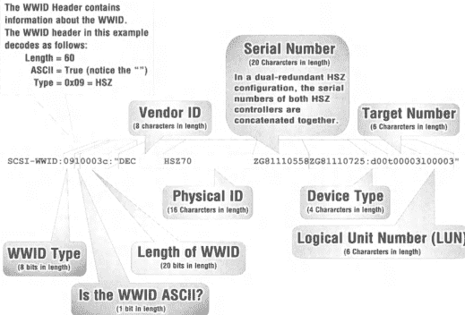

让我们看看 `wwid_decoder` 程序对 WWID 的说法是什么。

```
# wwid_decoder 0910003c

HSZ Algorithm:
Uses wwid_hsz_this_other structure in /usr/sys/include/io/cam/camdb.h.
This is an HSZ Algorithm WWID (ascii) -- length is 60 bytes.
```

正如图中指出的以及上面输出所确认的那样，这是一个 HSZ WWID，它是一个长度为 60 字节的 ASCII WWID。请注意，WWID 的 "ZG81110558ZG81110725" 部分是两个 HSZ 控制器的序列号连接在一起。让我们看看是否可以验证这一事实。从 HSZ 控制台输入 `show this`。输出将显示每个 HSZ 控制器的序列号。

```
HSZ70> show this

Controller:
    HSZ70 ZG81110558 Firmware V772-0, Hardware H01
    Configured for dual-redundancy with ZG81110725
    In dual-redundant configuration
...
```

"this" 控制器的序列号是 "ZG81110558"，而 "other" 控制器的序列号是 "ZG81110725"。

## 7.3 硬件管理数据库

IMPORTANT:

我们即将讨论的许多 ASCII 格式文件很可能会在 Tru64 UNIX 的未来版本中转换为二进制文件，因此我们强烈建议不要依赖这些文件目前为 ASCII 的事实。

鉴于 Tru64 UNIX V5.0 版本中发生的硬件更改，使用了多个数据库来跟踪配置信息。请注意，这些文件不得手动编辑。有程序（请参阅下面的 `hwmgr` 和 `disfmgr`(8)）可用于修改其中一些数据库，而其他数据库则由内核子系统修改。请注意，以下所有文件都位于 `/etc` 目录中。

### `dccd.dat`

`dccd.dat` 文件是 `dsfmgr` 用于创建设备特殊文件的 Category to Class-Directory, Prefix Database。这是一个 ASCII 文件，但不应被修改。文件中包含以下信息：

- 设备类别。

- 设备名称。

- 设备类型（block, character, rewind, norewind, sgeneric, storage, `*`）。

- 设备特殊文件所在的子目录。

- 设备特殊文件类型（block 或 character）。

- 文件模式权限位（八进制）。

- 设备前缀。

- 实例宽度（例如，`cdrom` 设备在实例字段中始终至少有一位数字：`cdrom0`）。

请注意 `kevm` 设备实例宽度为零且设备名称仅为 `kevm`，而实例宽度为二的硬连线终端将命名为 `tty00`。

```
# more /etc/dccd.dat
disk    cdrom    block    disk    b 600 cdrom 1
disk    cdrom    char    rdisk    c 600 cdrom 1
..    pseudo    kevm    *    .    c 600 kevm 0
..    terminal    hardwired    *    .    c 666 tty 2
```

### `dcdd.dat`

`dcdd.dat` 文件是 Device Class Directory Default Database。它被 `dsfmgr` 命令用于创建设备目录。这是一个 ASCII 文件，不应被修改。该文件包含目录位置（local - `/dev`，或 cluster - `/devices`）、目录模式权限位（八进制）以及目录名称。

```
# cat /etc/dcdd.dat
l 0755 .
l 0755 none
c 0755 cport
c 0755 disk
c 0755 rdisk
c 0755 tape
c 0755 ntape
c 0755 changer
c 0755 dmapi
```

- `ddr.db`

Dynamic Device Recognition（DDR）数据库用于描述 SCSI CAM（common access method）设备参数和特性，以便动态创建设备。这是一个数据文件，由 `ddr_config`(8) 使用 `ddr.dbase` 文件作为输入创建。有关更多信息，请参阅 `ddr.dbase`(4) 参考页。

- `dec_devsw_db`

这是指主设备开关表数据库文件。它包含设备驱动程序主编号和设备开关条目。这是一个二进制数据文件，由内核维护，但可使用 `devswmgr`(8) 程序查看。

- `dec_hw_db`

此二进制文件保存系统的硬件拓扑结构。该文件包含总线和控制器的硬件持久性信息。该文件由内核驱动程序框架维护，可通过 `hwmgr` 命令使用 `name` 子系统进行修改和查询。例如：


```
# hwmgr -show name

HWID: NAME      HOSTNAME    PERSIST TYPE    PERSIST AT
------------------------------------------------------------
33: ata0     sheridan    BUS             pci0 slot 13
49: isp0     sheridan    BUS             pci0 slot 15
44: ltp sa1   sheridan    BUS             pci0 slot 14
36: isp a0    sheridan    BUS             pci0 slot 15
51: mchan0    sheridan    CONTROLLER      pci0 slot 16
5: pci0      sheridan    BUS             nexus
50: scsi3     sheridan    CONTROLLER      isp0 slot 0
37: scsi2     sheridan    CONTROLLER      itpsa0 slot 0
35: scsi1     sheridan    CONTROLLER      ata0 slot 1
34: scsi0     sheridan    CONTROLLER      ata0 slot 0
32: tul       sheridan    CONTROLLER      pci0 slot 11
31: tu0       sheridan    CONTROLLER      pci0 slot 9
```

### `dec_hwc_cdb` and `dec_hwc_ldb`

这些是硬件组件数据库文件。`ldb` 文件是此系统的本地（或成员特定）数据库文件，而 `cdb` 文件是通用（或集群范围）数据库文件。这些数据库包含系统所有已注册硬件组件的信息。

`cdb` 文件包含存储设备及其部分信息，如 WWID。可以通过键入以下命令进行验证：`strings /etc/dec_hwc_cdb`。

`ldb` 文件包含其他硬件组件（适配器、cpu、键盘、鼠标等）以及部分存储设备信息（`user_name`, `phys_location` 等）。组件信息可在以下示例中看到：

```
# hwmgr -show component

HWID:  HOSTNAME  FLAGS SERVICE COMPONENT NAME
----- ---------- ----- ------- ----------------
  1:  sheridan   r---  none    CPU0 AlphaStation XP900 466 MHz
  2:  sheridan   r---  none    CPU0
  4:  sheridan   r-d-  none    scp
  5:  sheridan   r-d-  none    kenv
  6:  sheridan   r-d-  none    pci0

 53:  sheridan   -cds  iomap   SCSI-WWID:0c000008:0000-0e11-0019-9fbe
 54:  sheridan   -cds  iomap   SCSI-WWID:0c000008:0000-0e11-0019-9492
 55:  sheridan   -cds  iomap   SCSI-WWID:0c000008:0000-0e11-0018-ba75
 57:  sheridan   -cds  iomap   SCSI-WWID:0c000008:0000-0e11-0018-9f1f
 58:  sheridan   -cd-  iomap   SCSI-WWID:0c000008:0000-0e11-0018-9f33
 59:  sheridan   -cd-  iomap   SCSI-WWID:0c000008:0000-0e11-0018-9f1a
```

### `dec_scsi_db`

此文件由 SCSI/CAM 子系统拥有，用于存储 WWID 并跟踪系统已知的 SCSI 设备。此二进制数据文件也由 `hwmgr` 命令使用。例如：

```
# hwmgr -show scsi

             SCSI              DEVICE    DEVICE  DRIVER  NUM  DEVICE FIRST
HWID:       DEVID   HOSTNAME    TYPE     SUBTYPE  OWNER  PATH  FILE   VALID PATH
-----       -----   --------    -------  -------  ------ ----  -----  ----------
   0:          0    sheridan    cdrom    none       0     1   (null)
  40:          1    sheridan    disk     none       2     1   dsk0   [2/0/0]
  41:          2    sheridan    disk     none       2     1   dsk1   [2/1/0]
  45:          3    sheridan    cdrom    none       0     1   cdrom0 [0/0/0]
  53:          4    sheridan    disk     none       0     1   dsk2   [3/0/0]
  54:          5    sheridan    disk     none       0     1   dsk3   [3/1/0]
  55:          6    sheridan    disk     none       0     1   dsk4   [3/2/0]
  56:          7    sheridan    disk     none       0     1   dsk5   [3/3/0]
  57:          8    sheridan    disk     none       0     1   dsk6   [3/4/0]
  58:          9    sheridan    disk     none       0     1   dsk7   [3/5/0]
```

### `dec_unid_db`

此数据库包含唯一 ID。根据 Tru64 UNIX 系统管理指南，“这是一个二进制数据库，存储分配给硬件组件的前一个最高硬件标识符（HWID）。此数据库用于生成分配给新-已安装的硬件组件。”文件中还包含其他信息，如使用 `strings(1)` 命令的输出所示，该输出表明该文件除了 HWID 之外还用于唯一 ID，尽管这可能是其最常见的功能。

```
# strings /etc/dec_unia_db
DEC_UNID
hardware
dfs_group_id
cluster_minor
control_port_id
```

### `dfsc.dat` 和 `dfsl.dat`

设备文件状态数据文件是由 `dsfmgr` 命令维护的 ASCII 文件。`dfsl.dat` 文件用于记录本地（或成员特定）设备特殊文件的状态以及旧的设备特殊文件名。`dfsc.dat` 文件包含公共（或集群范围）设备特殊文件的状态。这些文件分为三个部分：

1. **实例**

实例记录包含三个字段：

- 类型
- 基名
- 实例

例如（请原谅这个双关语）：

```
"I: dsk 8"
```

2. **版本**

该记录看起来像注释，但其中包含文件格式版本以及主机名和操作系统版本。

```
"# 1.0    sheridan V5.1 (Rev. 732)  Tue Mar 20 01:23:34 2001"
```

3. **状态**

状态记录当前包含 12 个字段：

- 状态（A、C 或 d）
- 集群设备主/次编号
- 基名 ID
- 设备类型
- （块或字符）
- 设备路径
- 设备实例
- 本地设备主/次编号
- 硬件 ID
- 设备节点 ID
- 旧节点名称
- 设备前缀
- 设备后缀

以下是一些示例：

第一个示例来自 `/etc/dfsc.dat`，显示了集群设备的“A”（活动）状态。

```
A:       0 1300041      45       10       0  b  ""       /dev/disk/ cdrom 0 a
```

第二个示例同样来自 `/etc/dfsc.dat`，显示了集群设备的“d”（已停用）状态。


```
d:       0 1300043      45       10       1  b  ""       /dev/disk/ cdrom 0 b
```

最后一个示例展示了来自`/etc/dfsl.dat`的两个条目，说明了本地设备的“C”（集群）状态。

```
C: 550000 1300001      30        6       0  b  fda0     "" "*" "*"
C: 550000 1300002      30        6       0  c  rfda0    "" "*" "*"
```

- `gen_databases`

该文件包含硬件数据库列表、它们使用的文件，以及（可选）数据库处理程序。这是一个 ASCII 文本文件，但不应修改。

## 7.4 硬件管理器（hwmgr）

`hwmgr`命令是一个新工具，在硬件管理方面类似于“一站式购物”。它取代了`scsimgr(8)`实用程序，并且可以执行`scu(8)`实用程序的许多功能——尽管`scu`并未过时。`hwmgr`命令具有集群感知能力，其许多选项可以针对指定成员或整个集群进行操作。`hwmgr`命令管理三个硬件子系统：

- `component`

组件子系统维护系统上所有硬件组件的信息。这些信息存储在两个数据库中：`dec_hwc_ldb`（本地）和`dec_hwc_cdb`（集群）。

- `name`

名称子系统维护总线、控制器等硬件组件的硬件持久性信息。这些信息存储在`dec_hw_db`中。

- `scsi`

`scsi`子系统维护 SCSI 设备的信息。这些信息存储在`dec_scsi_db`中。

有关各种硬件数据库的更多信息，请参阅本章前面的 7.3 节。

截至撰写本文时，有关`hwmgr`命令的绝对最佳信息来源是`hwmgr`命令本身。

```
# hwmgr -help | grep -E "^Usage:|^or"
Usage: hwmgr -flash light
or: hwmgr -get attribute [ saved | default | current ]
or: hwmgr -get category
or: hwmgr -help [ <command> ] [ <subsystem> ]
or: hwmgr -set attribute [ saved | current ] -a <attribute>=<value>
or: hwmgr -view cluster
or: hwmgr -view devices
or: hwmgr -view hierarchy
or: hwmgr -view env
or: hwmgr -view timestamps
or: hwmgr -view transaction
or: hwmgr <command> <subsystem> <args>
```

我们仅使用`grep(1)`命令展示了基本的命令用法，尽管最后一条`hwmgr`命令用法“or: hwmgr <command> <subsystem> <args>”实际上有许多变体。

```
# hwmgr -help | grep -p -E "^Where <command>"
Where <command> is:
  -add
  -delete
  -edit
  -locate
  -online
  -offline
  -power
  -redirect
  -refresh
  -reload
  -remove
  -scan
  -show
  -status
  -unconfigure
  -unindict
  -unload
```

我们不会尝试向您展示`hwmgr`命令的每一个可能选项，而是将重点放在一些更有用的选项上。

有关更多信息，请参阅 V5.0A 和 V5.1 上的`hwmgr(8)`参考手册页。在 V5.1A 中，`hwmgr(8)`参考手册页增加了四个额外的参考手册页：

- `hwmgr_get(8)` - 关于 get 和 set 命令选项的参考页。
- `hwmgr_show(8)` - 关于 show 命令选项的参考页。
- `hwmgr_view(8)` - 关于 view 命令选项的参考页。
- `hwmgr_ops(8)` - 关于其他命令选项的参考页：add、delete、edit、locate、offline、online、power、redirect、refresh、reload、remove、scan、status、unconfigure、unindict、unload。

### 7.4.1 如何显示系统中的设备？

```
# hwmgr -view devices
HWID: Device Name        Mfg      Model            Location
------------------------------------------------------------
4:  /dev/kvm
30: /dev/disk/floppy0c                 3.5in floppy      fdi0-unit-0
40: /dev/disk/dsk0c     COMPAQ   BB009235B6       bus-2-targ-0-lun-0
41: /dev/disk/dsk1c     COMPAQ   BB009235B6       bus-2-targ-1-lun-0
45: /dev/disk/cdrom0c    COMPAQ   CRD-8402B        bus-0-targ-0-lun-0
```

#### 注意：

`hwmgr`命令选项可以缩写至唯一可识别的程度。例如：

```
# hwmgr -view devices
```

可以缩写为：

```
# hwmgr -v d
```

另外，请注意，主关键字不需要连字符（-），但后续选项需要。例如，“view”等同于“-view”，而“-dsf”选项必须包含“-”。

```
# hwmgr view device -dsf dsk3
```

你也可以只显示特定设备。例如，让我们只搜索系统上的磁带设备：

```
# hwmgr -v d -category tape
HWID: Device Name      Mfg      Model          Location
------------------------------------------------------------
75: /dev/ntape/tape0    COMPAQ   SDT-9000        bus-6-targ-0-lun-0
```

如前所述，许多命令选项可以聚焦于某个成员或整个集群。你怎么知道哪些选项可以聚焦于另一个成员或整个集群？问问`hwmgr`吧。

```
# hwmgr -help view dev
Usage: hwmgr -view devices
  [ -dsf <device-special-filename> ]
  [ -category <hardware-category> ]
  [ -member <cluster-member-name> ]
  [ -cluster ]
```

另一种使用`hwmgr`显示设备的方法是查看 SCSI 子系统。


```
# hwmgr -show scsi
HWID  SCSI   DEVICEID HOSTNAME DEVICE    DEVICE   DRIVER NUM DEVICE FIRST
      DEVICEID          TYPE      SUBTYPE OWNER   PATH   FILE   VALID PATH
------------------------------------------------------------
0:    0     sheridan  cdrom    none     0       1      (null)
40:   1     sheridan  disk     none     2       1      dsk0   [2/0/0]
41:   2     sheridan  disk     none     2       1      dsk1   [2/1/0]
45:   3     sheridan  cdrom    none     0       1      cdrom0 [0/0/0]
53:   4     sheridan  disk     none     0       1      (null)
54:   5     sheridan  disk     none     0       1      (null)
55:   6     sheridan  disk     none     0       1      (null)
56:   7     sheridan  disk     none     0       1      (null)
57:   8     sheridan  disk     none     0       1      (null)
59:   9     sheridan  disk     none     0       1      (null)
```

请注意上面输出中的“`(null)`”。这表示系统先前看到的一些设备没有活动路径。在这个特定实例中，存储柜未通电。让我们给存储设备通上电，然后重新运行该命令。首先，让我们扫描总线。

```
# hwmgr -scan scsi
hwmgr: Scan request successfully initiated
```

现在，让我们看看有什么变化。

```
# hwmgr -show scsi
HWID: SCSI DEVICEID HOSTNAME DEVICE TYPE DEVICE SUBTYPE OWNER DRIVER NUM PATH FILE DEVICE FIRST VALID PATH
0: 0 sheridan cdrom none 0 1 (null)
40: 1 sheridan disk none 2 1 dsk0 [2/0/0]
41: 2 sheridan disk none 2 1 dsk1 [2/1/0]
45: 3 sheridan cdrom none 0 1 cdrom0 [0/0/0]
53: 4 sheridan disk none 0 1 dsk2 [3/0/0]
54: 5 sheridan disk none 0 1 (null) [3/1/0]
55: 6 sheridan disk none 0 1 (null) [3/2/0]
56: 7 sheridan disk none 0 1 (null) [3/3/0]
57: 8 sheridan disk none 0 1 (null) [3/4/0]
59: 9 sheridan disk none 0 1 (null) [3/5/0]
```

请注意，我们现在看到了一条活动路径，但仍未看到设备名称。这时我们可以请 `dsfmgr` 命令帮我们一把。带有“-k”选项的 `dsfmgr` 命令会创建所有新检测到的设备。注意：这个额外的步骤本应是不必要的（在 V5.1A 中确实没有必要）。然而，在 V5.1（本例创建时的版本）中，它是必要的。

```
# dsfmgr -k
```

现在重新运行原始命令。

```
# hwmgr -show scsi
HWID: SCSI DEVICEID HOSTNAME DEVICE TYPE DEVICE SUBTYPE OWNER DRIVER NUM PATH FILE DEVICE FIRST VALID PATH
0: 0 sheridan cdrom none 0 1 (null)
40: 1 sheridan disk none 2 1 dsk0 [2/0/0]
41: 2 sheridan disk none 2 1 dsk1 [2/1/0]
45: 3 sheridan cdrom none 0 1 cdrom0 [0/0/0]
53: 4 sheridan disk none 0 1 dsk2 [3/0/0]
54: 5 sheridan disk none 0 1 dsk3 [3/1/0]
55: 6 sheridan disk none 0 1 dsk4 [3/2/0]
56: 7 sheridan disk none 0 1 dsk5 [3/3/0]
57: 8 sheridan disk none 0 1 dsk6 [3/4/0]
59: 9 sheridan disk none 0 1 dsk7 [3/5/0]
```

请注意，`hwmgr` 命令的“-view devices”选项（缩写为“-v d”）现在也能看到设备了。

```
# hwmgr -v d

| HWID: | 设备名称 | 制造商 | 型号 | 位置 |
|-------|-------------|-----|-------|----------|
| 4: | `/dev/kvmn` | | | |
| 30: | `/dev/disk/floppy0c` | | 3.5in floppy | fdi0-unit-0 |
| 40: | `/dev/disk/dsk0c` | COMPAQ | BB09235B6 | bus-2-targ-0-lun-0 |
| 41: | `/dev/disk/dsk1c` | COMPAQ | BB09235B6 | bus-2-targ-1-lun-0 |
| 45: | `/dev/disk/cdrom0c` | COMPAQ | CRD-8402B | bus-0-targ-0-lun-0 |
| 53: | `/dev/disk/dsk2c` | COMPAQ | BD009635C3 | bus-3-targ-0-lun-0 |
| 54: | `/dev/disk/dsk3c` | COMPAQ | BD009635C3 | bus-3-targ-1-lun-0 |
| 55: | `/dev/disk/dsk4c` | COMPAQ | BD009635C3 | bus-3-targ-2-lun-0 |
| 56: | `/dev/disk/dsk5c` | COMPAQ | BD009635C3 | bus-3-targ-3-lun-0 |
| 57: | `/dev/disk/dsk6c` | COMPAQ | BD009635C3 | bus-3-targ-4-lun-0 |
| 59: | `/dev/disk/dsk7c` | COMPAQ | BD009635C3 | bus-3-targ-5-lun-0 |
```

让我们回到 "`-show scsi`" 选项。 如果系统包含到设备的多条路径， 在命令中添加额外的限定符 "`-full`" 将会显示这些路径。 虽然不是必需的， 但一次只查看一个设备通常会更清晰。 例如：

```
# hwmgr -show scsi -full -id 65
```


| HWID: | DEVICEID | 主机名 | 设备类型 | 设备子类型 | 驱动程序所有者 | 路径数 | 设备文件 | 第一个有效路径 |
|-------|----------|----------|-------------|----------------|--------------|----------|-------------|------------------|
| 65:   | 6        | jaffa    | disk        | none           | 0            | 4        | `dsk5`    | `[5/0/9]`        |

`WWID:01000010:6060-1aa1-000f-1a40-0009-0361-3888-0007`

| BUS | TARGET | LUN | PATH STATE |
|-----|--------|-----|-------------|
| 5   | 0      | 9   | valid       |
| 5   | 1      | 9   | valid       |
| 6   | 0      | 9   | valid       |
| 6   | 1      | 9   | valid       |

请注意，最后一个命令的输出来自于包含多路径/多总线配置的不同系统。如你所见，该设备实际上有四条路径。该系统有两个适配器连接到两个光纤通道交换机，每个交换机连接到两个光纤通道 RAID 控制器（双端口）——换句话说，“无单点故障”（NSPOF）。

## 7.4.2 如何查看系统上的所有硬件？

```
# hwconfig -view hierarchy

HWID:  hardware component hierarchy

-----------------------------------

 46:   platform COMPAQ AlphaServer DS10 466 MHz

  2:     cpu CPU0

  5:     bus pci0

  6:       connection pci0slot7

 18:         bus isa0

 19:           connection isa0slot0

 20:             keyboard keyboard0

 21:             pointer mouse0

 22:           connection isa0slot2

 23:             serial_port tty00

 24:           connection isa0slot3

 25:             serial_port tty01

 26:           connection isa0slot4

 27:             parallel_port lp0

 28:           connection isa0slot5

 29:             fdi_controller fd0

 30:               disk fdio-unit0 floppy0

 31:       connection pci0slot9

 31:         network tu0

 32:       connection pci0slot11

 32:         network tu1

 33:       connection pci0slot13

 34:         ide_adapter ata0

 34:           scsi_bus scsi0

 35:             disk bus-0-targ-0-lun-0 cdrom0

 35:             scsi_bus scsi1

 36:       connection pci0slot14

 37:         scsi_adapter ips1

 38:           scsi_bus scsi2

 40:             disk bus-2-targ-0-lun-0 dsk0

 41:             disk bus-2-targ-1-lun-0 dsk1

 44:       connection pci0slot15

 49:         scsi_adapter ips0

 50:           scsi_bus scsi3

 53:             disk BA356 Slot 1 (top) cluster-common

 54:             disk BA356 Slot 2 sheridan boot

 55:             disk BA356 Slot 3 molari boot

 56:             disk BA356 Slot 4 quorum

 57:             disk bus-3-targ-4-lun-0 dsk6

 58:             disk bus-3-targ-6-lun-0 dsk7

 47:       connection pci0slot16

 51:         cluster_interconnect mchan0

 52:         legacy_driver Legacy-driver-(mchan0)

 16:       connection pci0slot17

 38:         graphics_controller comet0
```

## 7.4.3 如何移除一个损坏的组件？

识别出损坏的组件，例如一块损坏的磁盘。

```
# hwmgr -show scsi
```

| HWID: | DEVICEID | 主机名 | 设备类型 | 设备子类型 | 驱动程序所有者 | 路径数 | 设备文件 | 第一个有效路径 |
|-------|----------|----------|-------------|----------------|--------------|----------|-------------|------------------|
| -- 56:| 7        | sheridan | disk        | none           | 0            | 1        | (null)      |                  |

删除该组件。

```
# hwmgr -delete component -id 56
hwmgr: Delete operation was successful
```

## 7.4.4 如何查看新添加的设备？

如果系统运行时添加了设备，你需要扫描总线。

```
# hwmgr -scan scsi
hwmgr: Scan request successfully initiated
```

### NOTE:

在集群环境中，`hwmgr -scan scsi`命令需要在集群范围内执行。该命令没有`--cluster`选项。然而，确实有一个`--member`选项可以用来将命令定向到特定成员。我们编写了一个脚本（`clu_scan_scsi`）来向所有集群成员分发`hwmgr`命令。

```
# ./clu_scan_scsi
molari: "/sbin/hwmgr scan scsi"
hwmgr: Scan request successfully initiated

sheridan: "/sbin/hwmgr scan scsi"
hwmgr: Scan request successfully initiated
```

`clu_scan_scsi`脚本可在网上获取（请参阅附录 B 获取 URL）。

## 7.4.5 如何查看特定组件的所有信息？

```
# hwmgr -get attribute -id 46

46:

name = COMPAQ AlphaServer DS10 466 MHz

category = platform

memory_size_MB = 256

registration_time = Tue Mar 20 12:39:23 2001

user_name = (null) (settable)

location = (null) (settable)

software_module = (null)

state = available

state_previous = unknown

state_change_time = none

event_count = 0

last_event_time = none
```

## 7.4.6 如何仅查看某些组件的少量属性？

你可以通过指定`-a attribute`选项来查看最少一个属性。


`# hwmgr -get attribute -a dev_base_name -id 59`

59:

`dev_base_name` = `dsk7`

```
下面是一个显示多个属性的示例，其中包括搜索不包含特定值的属性。
```

`# hwmgr get -a name -a dev_base_name -a power_mgmt_capable!=1`

2:

`name` = `CPU0`

`power_mgmt_capable` = `0`

30:

`name` = `FDI-fdio-unit-0`

`dev_base_name` = `Floppy0`

`power_mgmt_capable` = `0`

45:

`name` = `SCSI-WWID:0710002c::"COMPAQ   CRD-8402B" :d05b000:00000100000*`

`dev_base_name` = `cdrom0`

`power_mgmt_capable` = `0`

```
下面是一个类似的示例，我们在此搜索包含特定值的属性。我们还将搜索范围限制在 "disk" 类别。
```

`# hwmgr -get -a -a dev_base_name -a cluster_disables=1 -cat disk`

45:

`dev_base_name` = `cdrom0`

`cluster_disables` = `1`

```
请注意，部分条件解析无法按预期工作。例如，HWID 为 40 的组件将 "COMPAQ" 列为制造商。
```

`# hwmgr -get -a -a manufacturer -id 40`

40:

`manufacturer` = `COMPAQ`

```
然而，当我们明确指定 "manufacturer!=COMPAQ" 时，得到的结果与预期相反。
```

`# hwmgr -get -a -a manufacturer!=COMPAQ`

40:

`manufacturer` = `COMPAQ`

...

```
如果我们查找 "manufacturer=COMPAQ"，则看不到任何输出。
```

`# hwmgr -get -a -a manufacturer=COMPAQ`

`<no output>`

我们认为这可能是字符串解析问题，但：

```
# hwmgr -get -a -a dev_base_name -a state=available -cat disk
```

30:

`dev_base_name` = `floppy0`

`state` = `available`

40:

`dev_base_name` = `dsk0`

`state` = `available`

...

这似乎是一个错误，我们已通知 COMPAQ 客户支持中心。

### 7.4.7 如何设置组件的“可设置”属性？

某些组件具有用户可设置的属性，如名称 (`user_name`) 或物理位置 (`phys_location`)。在大型配置中，能够为设备指定对你有意义的名称，例如“我的启动磁盘”或其位置，这非常有用。首先，让我们找到特定设备的“可设置”属性。

```
# hwmgr --get attr -id 46 | grep "(settable)"
```

`user_name` = `(null)` `(settable)`

`location` = `(null)` `(settable)`

这是什么设备？

```
# hwmgr --get attr -id 46 -a name
```

46:

  `name` = `COMPAQ AlphaServer DS10 466 MHz`

它是系统。好吧，让我们将“`user_name`”设置为系统的主机名。请注意，“`user_name`”属性目前限制为十五个字符。例如：

```
# hostname | wc -c
```

17

请注意，此系统的完全限定主机名为十六个字符（“`wc -c`”返回一个额外的字符，可能是换行符）。所以让我们尝试设置属性，使其超过十五个字符。

```
# hwmgr --set attr -a user_name=$(hostname) -id 46
```

`hwmgr`: `46`: Attribute "`user_name`" value is too large.

现在让我们仅使用基本主机名来设置“`user_name`”属性。

```
# hwmgr --get attr -a user_name=$(hostname -s) -id 46
```

46:

  `user_name` = `sheridan` `(settable)`

验证更改是否已生效。

```
# hwmgr -get attr -id 46 -a name -a user_name
```

46:

`name` = `COMPAQ AlphaServer DS10 466 MHz`

`user_name` = `sheridan` `(settable)`

## 7.4.8 如何查找设备？

如果你有一个装满磁盘的大型机柜，不是能够快速找到你要找的设备就好了吗？可以。试试这个：

```
# hwmgr -flash light -dsc dsk3
```

虽然这仅适用于 SCSI 磁盘，但大多数磁盘目前仍是 SCSI，因此在近期内这是一个有用的命令。顺便说一下，如果由于机柜中其他磁盘活动导致闪烁过慢或过快，请尝试 "`-nopause`" 选项。

## 7.4.9 如何查找数据不一致的设备？

你可以使用带有 "`-inconsistencies`" 命令的 "`hwmgr show component`" 命令来定位硬件组件数据库文件中的软件不一致问题。“不一致”是指 `dec_hwc_cdb` 和 `dec_hwc_ldb` 文件中的可能内部错误。

```
# hwmgr show comp -i
```

`HWID`: `HOSTNAME` `FLAGS` `SERVICE` `COMPONENT` `NAME`

--------------------------------------------

106: `molari` `rcd-i` `iomap` `SCSI-WWID:0c000008:0000-0e11-0018-9f1f`

你可以通过添加 "`-full`" 选项来获取更多信息。

## 7.5 设备特殊文件管理器 (dsfmgr)

### 7.5.1 dsfmgr(8) 命令

`dsfmgr` 命令用于使用 Tru64 UNIX 版本 5.0 中定义的新命名约定来管理设备特殊文件。`dsfmgr` 使用以下数据库文件：

### 7.5.1.4 如何修复“second device status is active”错误？

偶尔在更换设备时，需要更新 `dfsl.dat` 和 `dfsc.dat` 文件；否则，当你尝试将新设备重新命名回旧设备的特殊文件时，你会看到以下信息：

```
# dsfmgr -m dsk7 dsk9
```

`dsfmgr`: `ERROR`: second device status is active: `dsk9a`

首先，你需要确定哪个 HWID 与 `dsk9` 相关联。你可能已经知道它是哪一个，因为你在更换设备时可能已经删除了该组件。如果不知道 HWID，你仍然可以通过搜索 `dfsc.dat` 文件来找到它。

```
# grep "dsk 9 a" /etc/dfsc.dat
```

`A`: `0` `13000b1` `59` `17` `0` `b` `**` `/dev/disk/` `dsk` `9` `a`

`A`: `0` `13000b2` `59` `17` `0` `c` `**` `/dev/rdisk/` `dsk` `9` `a`

或者尝试：

```
# awk '/dsk 9 / { print $4 }' </etc/dfsc.dat | uniq
```

`59`

我们打印第 4 个字段，因为它是 HWID（参见第 7.3 节）。另外，在使用搜索字符串时要非常小心；确保模式为：`/dsk<空格><实例号><空格>/` `<空格>` 字符非常重要。

HWID 为 `59`，这就是我们需要从文件中移除的 HWID。现在我们有了 HWID，可以将其从 `dfsl.dat` 和 `dfsc.dat` 文件中移除。我们将使用 `dsfmgr` 命令的一个未记录开关 "`-Z`" 来执行此操作。

```
# dsfmgr -Z rm_hwid 59 0
```

`-dsk9a` `-dsk9b` `-dsk9c` `-dsk9d` `-dsk9e` `-dsk9f` `-dsk9g` `-dsk9h` `-dsk9a` `-dsk9b` `-dsk9c` `-dsk9d` `-dsk9e` `-dsk9f` `-dsk9g` `-dsk9h`

这将从 `dfsc.dat` 和 `dfsl.dat` 数据库文件中移除 HWID 条目。或者，如果你只需要从一个文件中移除条目，可以使用 "`rm_local_hwid`" 标志从 `dfsl.dat` 文件中移除 HWID，或使用 "`rm_cluster_hwid`" 标志从 `dfsc.dat` 文件中移除 HWID。

此时，“`dsfmgr -m`” 命令应该可以正常工作。

错误将如下所示：

```text
# dsmgr -e dsk7 dsk9
```


`dsmgr`: ERROR: find device node `dsk9` : Device record not found in status database

`dsmgr`: ERROR: exchange failed: Device record not found in status database

请按照“如何修复‘second device status is active’错误？”的流程（第 7.5.1.4 节）来解决此问题。

### 7.5.1.7 如何验证我的设备特殊文件数据库是否无误？

```text
# dsmgr -v

dsmgr: verify all datum for system at /

Default File Tree:

    OK.

Device Class Directory Default Database:

    OK.

Device Category to Class Directory Database:

    OK.

Dev directory structure:

    OK.

Device Status Files:

    OK.

Dev Nodes:

    OK.
```

### 7.5.1.8 如何修复我的设备特殊文件数据库中的错误？

修复数据库错误或不一致（未显示输出）。注意可能需要运行几次以纠正错误。

```text
# dsmgr -vF
```

**注意：**

"`-o`" 和 "`-O`" 选项用于创建在 *TruCluster Server* 环境中不支持的 V5 之前的设备名称。

有关更多信息，请参阅 **`dsmgr(8)`** 参考页以及 *Tru64 UNIX System Administration* 指南。

## 7.5.2 `dn_setup` 命令

`dn_setup` 命令使用 `dsmgr` 为系统创建设备特殊文件。该命令在系统每次重新启动时都会运行。`dn_setup` 命令也可以用于重新创建 `/dev` 和 `/devices` 中的设备。

要在从安装 CD 启动以恢复操作系统时创建磁带设备，可以使用带有 "`--install_tape`" 开关的 `dn_setup`。作为一般规则，除非设备和设备数据库进入一种状态，以至于其他任何命令（`dsmgr` 或 `hwmgr`）都无法清理，否则不应使用 `dn_setup`。

在使用 `dn_setup` 命令的 "`--init`" 或 "`--clean`" 选项时应格外小心，特别是如果你使用 LSM，因为 `dn_setup` 不会重新创建 LSM 设备。有关详细讨论，请参阅第 14 章（“Cluster Logical Storage Manager”）。

### 7.5.2.1 如何重新初始化我的 `/dev` 和 `/devices` 目录？

```sh
# dn_setup -init
```

执行此命令后，重要的是立即随后运行 "`dsmgr -K`" 。此外，如果你使用 LSM，还必须运行以下命令：

如果系统处于多用户模式（或处于单用户模式且 `/usr` 已挂载）：

```sh
# /usr/sbin/volinstall update
# /sbin/volclt enable
```

如果系统处于单用户模式且 `/usr` 无法挂载（很可能是因为 `/usr` 在 LSM 中被封装）：

```text
# mknod /dev/volconfig c 41 0
# mknod /dev/voltrace c 41 1
# mknod /dev/voliod c 41 2
# mknod /dev/volinfo c 41 3
# checkrc
```

使用 LSM 时需要这些额外步骤，因为“`dn_setup --init`”会完全删除 `/devices` 目录以及 `/dev` 的内容，而 `dn_setup` 不了解 LSM。我们将在第 14 章更详细地介绍 LSM。

### 7.5.2.2 如何检查我的设备特殊文件和目录层次结构是否存在不一致？

```text
# dn_setup --sanity_check
        Passed
```

请注意，这实际上等同于运行“`dsfmgr –zx`”，尽管“`–z`”开关未有文档记录。

### 7.5.2.3 如何从安装 CD 创建磁带设备特殊文件？

```text
# dn_setup -install_tape
```

截至本文撰写时，`dn_setup` 命令没有参考页。然而，它在 5.1B 版本之前的 Tru64 UNIX 系统管理手册以及 5.1B 版本起的 Tru64 UNIX 硬件管理手册中有文档说明。

## 7.6 参考文献

- *Tru64* UNIX 系统管理 – 版本 5.1、5.1A 和 5.1B。
- *Tru64* UNIX 硬件管理 – 版本 5.1B。
- 参考页（文中已注明）。

## Tru64 UNIX 集群钩子：

事件管理器

事件管理器（EVM）是 Tru64 UNIX 在操作系统 5.0 版本中新增的一个组件，是应客户要求提供对所有系统（和集群）事件信息的通用访问而添加的。

在之前的版本中，系统上发生的事件很可能会记录到两个主要记录器之一：系统消息记录器（`syslogd`）和二进制错误记录器（`binlogd`）——尽管也可以使用其他日志方法。EVM 与这些其他事件记录器协同工作以整合信息。图 8-1 说明了事件到 EVM 的路径。

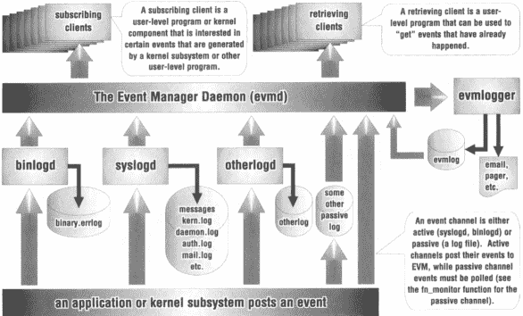

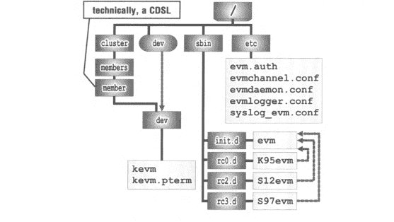

图 8-2：EVM 根目录层次结构

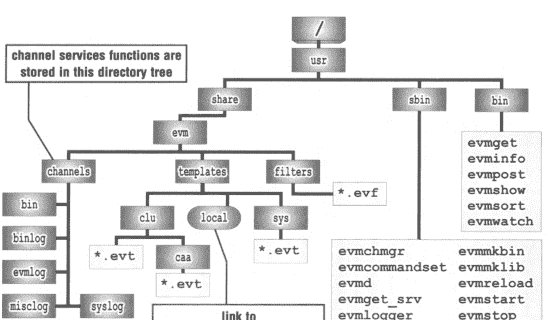

图 8-3：EVM `/usr` 目录层次结构

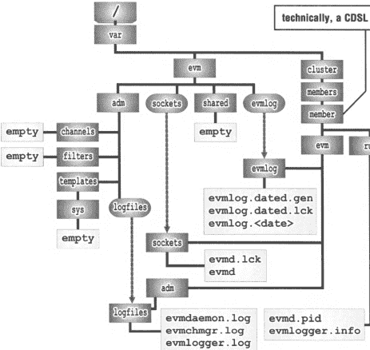

图 8-4：EVM `/var` 目录层次结构

## 8.2.1 EVM 常驻组件

EVM 有三个主要组件用于事件管理：

- `evmd`
- `evmchmgr`
- `evmlogger`

### 8.2.1.1 EVM 守护进程（`evmd`）

EVM 守护进程是 EVM 的主要分发中心。它在系统初始化时于运行级别 2 启动，尽管它在运行级别 3 之前无法访问远程连接。对 `evmd` 的通信通过套接字连接处理。发布和订阅请求由 `evmd` 直接处理。

然而，事件检索由派生的 `event_get` 服务程序处理（实际上是 `/usr/sbin/evmget_srv`。参见 `/etc/evmdaemon.conf`）。

EVM 守护进程根据 `/etc/evmdaemon.conf` 文件启动 Channel Manager 和 Logger 进程。事实上，它也可以配置为启动任何站点定义的同步客户端进程。

有关更多信息，请参阅 `evmd(8)` 和 `evmdaemon.conf(4)` 参考页。

### 8.2.1.2 EVM 通道管理器（`evmchmgr`）

通道管理器负责监控和清理 `/etc/evmchannel.conf` 文件中定义的通道，前提是它们定义了监视器（`fn_monitor`）或清理（`/fn_cleanup`）服务例程。通道管理器由 `evmd` 守护进程自动启动，不应作为独立程序运行。

默认情况下，`evmchmgr` 会将任何错误输出写入 `stderr`。

有关更多信息，请参阅 `evmchmgr(8)` 和 `evmchannel.conf(4)` 参考页。

### 8.2.1.3 EVM 记录器（`evmlogger`）

记录器程序是根据 `/etc/evmlogger.conf` 文件定义的 EVM 事件的订阅者。此守护进程订阅事件，然后将它们写入事件日志（例如 `/var/adm/evmlog/evmlog.dated`）或使用转发命令转发它们（例如向 `root` 账户发送电子邮件）。记录器由 `evmd` 守护进程自动启动，但也可以通过创建配置文件并使用 "`-c`" 开关启动 `evmlogger` 进程作为独立程序运行。例如：

```
# evmlogger -c $HOME/evm/myEVMLogger.conf
```


默认情况下，`evmlogger` 会将任何错误输出写入 `stderr`。

有关更多信息，请参阅 `evmlogger(8)` 和 `evmlogger.conf(4)` 参考页。

## 8.2.2 EVM 配置文件

EVM 配置文件位于 `/etc` 目录中。我们在上一节中已经提到过一些配置文件：这里我们再次列出它们，并附上之前未提及的额外文件。

- `evm.auth`  
  `evm.auth` 文件是事件授权文件。它定义了谁可以发布或访问事件和服务例程。有关更多信息，请参阅第 8.6.1 节或 `evm.auth(4)` 参考页。

- `evmchannel.conf`  
  `evmchannel.conf` 文件用于配置 EVM 通道及其功能。该文件由 `evmchmgr` 读取（请参阅第 8.2.1.2 节）。表 8-1 显示了可为每个通道定义的服务。  
  有关更多信息，请参阅 `evmchannel.conf(4)` 参考页。

- `evmdaemon.conf`  
  `evmdaemon.conf` 文件是 `evmd` 的配置文件。其中其他内容包括，该文件指示 `evmd` 守护进程启动 `evmchmgr` 和 `evmlogger` 进程，使用哪个 `event_get` 服务程序，以及是否接受远程连接。  
  有关更多信息，请参阅 `evmdaemon.conf(4)` 参考页。

- `evmlogger.conf`  
  `evmlogger.conf` 文件用于配置 `evmlogger`（请参阅第 8.2.1.3 节）。  
  有关更多信息，请参阅 `evmlogger.conf(4)` 参考页。

- `syslog_evm.conf`  
  `syslog_evm.conf` 配置文件由 `syslogd` 守护进程使用，用于定义应转发给 EVM 守护进程的哪些 syslog 事件。有关更多信息，请参阅 `syslog_evm.conf(4)` 参考页。

对配置文件进行任何更改后，您需要通知 EVM 该更改，通过通知 EVM 常驻组件（请参阅第 8.2.1 节了解更多信息）重新加载配置文件。

### 事件通道服务

| Function | Keyword | Description |
|---|---|---|
| Cleanup | `fn_cleanup` | 该函数由 `evmchmgr` 守护进程每天调用，用于归档和/或删除该通道使用的日志文件。 |
| Event Detail | `fn_details` | 该函数由 `evmshow -d` 调用，以从通道获取事件内容的详细视图。 |
| Event Explanation | `fn_explain` | 该函数由 `evmshow -x` 调用，以从通道获取事件的解释，以及如果合适，必要的操作。 |
| Retrieval | `fn_get` | 该函数由 `evmget_srv` 程序调用，以从通道检索事件。注意，这发生在运行 `evmget` 命令时。 |
| Monitor | `fn_monitor` | 该函数由 `evmchmgr` 守护进程定期调用，以检查通道的状态，并在必要时发布 EVM 事件。监视函数通常为被动事件通道定义。 |

表 8-1：EVM 通道服务

重新配置所有 EVM 常驻组件：

```
# evmreload
```

仅重新配置 EVM 守护进程：

```
# evmreload -d
```

仅重新配置 EVM 通道管理器进程：

```
# evmreload -c
```

仅重新配置 EVM 日志进程：

```
# evmreload -l
```

如果您对事件模板进行了更改，请在重新配置 EVM 守护进程之前先检查模板语法，使用以下命令。

```
# evmreload -n
```

有关更多信息，请参阅 `evmreload(8)` 参考页。

## 8.2.3 EVM 通道

通道是事件的来源。有两种类型的通道：

- **Active**  
  主动通道的一个例子是 `syslogd` 守护进程。`syslogd` 守护进程从应用程序或内核子系统接收事件，并传统上将事件记录到 `/etc/syslog.conf` 中定义的一个或多个日志文件中。`syslogd` 守护进程已被修改为同时充当 EVM 的通道。现在，`syslogd` 守护进程接收事件，记录该事件，并将事件发送给 `evmd` 守护进程。

- **Passive**  
  被动通道的一个例子是日志文件。日志文件不主动，即它不会“主动”向 `evmd` 守护进程发送事件。但是，如果订阅客户端正在查找由事件通道定义的类型的事件，则 `evmget_srv` 程序将从日志中检索事件并将其传递给订阅者。

通道在 `/etc/evmchannel.conf` 文件中定义；通道服务在 `/usr/share/evm/channels/<channel>` 目录树中定义；通道过滤器在 `/usr/share/evm/filters/<channel>.evf` 中定义；通道事件模板在 `/usr/share/evm/templates/sys/<channel>.evt` 中定义。例如：

有哪些通道被定义？

```
# /usr/bin/evminfo -lc

syslog
binlog
misclog
evmlog
```

选择其中一个通道。在此示例中，我们选择 `binlog`。

```
# ls /usr/share/evm/channels/binlog

binlog2evm  binlog_details  binlog_get
binlog_cleanup  binlog_explain  binlogshow
```


channels 目录包含 binlog 通道的服务例程。我们可以通过参考 `/etc/evmchannel.conf` 文件来验证这一点。

```
# cat /etc/evmchannel.conf

# ==============================
# 事件通道：二进制错误日志
# ==============================
channel {
        name             binlog
        path             /usr/share/evm/channels/binlog
        events           @SYS_VIP.binlog
        fn_get           "binlog_get -r 8"
        fn_details       "binlog_details -decevent -ca localhost"
        fn_explain       "binlog_explain"
        fn_cleanup       "binlog_cleanup"
}
...
```

在你问“那些 `binlog2evm` 和 `binlogshow` 文件是什么？”之前...

```
# grep binlog2evm *

binlog_get:CONVTOOL=$DIR/binlog2evm                 # 将 binlog 事件转换为 EVM 事件

# grep binlogshow *

binlog_details:CONVTOOL='${DIRNAME}$0' ./binlogshow
```

最后，过滤器和模板定义在 `/usr/share/evm/filters/binlog.evf` 和 `/usr/share/evm/templates/sys/binlog.evt` 文件中（参见第 8.2.4 节和第 8.2.5 节）。

关于通道的最后一点说明：如果计划定义自己的通道，请将定义放在 `/etc/evmchannel.conf` 中，但将支持文件放在 `/var/evm/adm` 目录树中，而不是 `/usr/share/evm`。

## 8.2.4 EVM 过滤器文件

EVM 过滤器文件位于 `/usr/share/evm/filters` 目录中（站点定义的过滤器文件应放在 `/var/evm/adm/filters` 目录中）。过滤器文件应以后缀 `.evf` 结尾。

有关更多信息，请参阅第 8.5 节。

## 8.2.5 EVM 命令

EVM 命令的使用示例在第 8.7 节中，除了在第 8.2.2 节中已展示的 `evmreload(8)` 命令。EVM 命令如表 8-2 所示。

**表 8-2：EVM 命令**

| 运行?* | 命令 | 位置 | 手册 | 类型 | 描述 |
|---|---|---|---|---|---|
| ✓ | `evmget` | `/usr/bin` | 1 | binary | 此程序从日志文件中检索事件，并以二进制 EVM 事件的形式写入 stdout。 |
| ✓ | `evminfo` | `/usr/bin` | 1 | binary | 此程序提供有关 EVM 子系统的信息。它还提供配置文件语法验证。 |
| ✓ | `evmpost` | `/usr/bin` | 1 | binary | 此程序允许从命令行或脚本发布事件。它为管理员和用户提供向 EVM 发布快速（或简单）消息的能力。 |
| ✓ | `evmshow` | `/usr/bin` | 1 | binary | 此程序显示 EVM 事件。 |
| ✓ | `evmsort` | `/usr/bin` | 1 | binary | 此程序对 EVM 事件进行排序。 |
| ✓ | `evmwatch` | `/usr/bin` | 1 | binary | 此程序监视系统或集群以等待事件发生。它还可以列出 EVM 子系统已知的已注册事件。 |
| ✗ | `evmchmgr` | `/usr/sbin` | 8 | binary | `evmchmgr` 程序是 EVM 通道管理器。不要在命令行上运行此程序。 |
| ✗ | `evmcommandset` | `/usr/sbin` | - | sh | 此 shell 脚本主要为 EVM 的多平台实现定义命令及其位置。 |
| ✗ | `evmd` | `/usr/sbin` | 8 | binary | 此程序是 EVM 守护进程。不要在命令行上运行此程序。 |
| ✗ | `evmget_srv` | `/usr/sbin` | - | binary | `evmget_srv` 程序由 `evmd` 守护进程调用，当 `evmget` 命令请求检索 EVM 事件时。 |
| ✓ | `evmlogger` | `/usr/sbin` | 8 | binary | 此程序是 EVM 记录器。 |
| ✗ | `evmmkbin` | `/usr/sbin` | - | binary | 此程序由 `evmmkib` 命令使用，将事件模板编译为 `evmd` 守护进程的二进制格式。 |
| ✗ | `evmmkib` | `/usr/sbin` | - | sh | 此脚本由 `evmd` 和 `evmreload` 命令使用，为 `evmkin` 程序设置环境。 |
|  | `evmreload` | `/usr/sbin` | 8 | sh | 此 shell 脚本发布一个事件以使 EVM 守护进程重新读取其配置文件。它还验证事件模板文件和配置文件的语法。 |
| ✓ | `evmstart` | `/usr/sbin` | 8 | sh | 此 shell 脚本启动 EVM 守护进程。 |
| ✗ | `evmstop` | `/usr/sbin` | 8 | sh | 此 shell 脚本停止 EVM 守护进程，尽管在正常情况下不应运行它。 |

*✓ 表示程序可以运行。✗ 表示程序不应运行。

## 8.2.6 EVM 模板文件

Tru64 UNIX 的 EVM 模板文件位于 `/usr/share/evm/templates/sys` 目录；TruCluster Server 模板位于 `/usr/share/evm/templates/clu`；站点定义的模板文件应放置在 `/usr/share/evm/templates/local` 中（实际上是 `/var/evm/adm/templates` 的链接）。

模板文件名必须以后缀 `.evt` 结尾，且文件必须由 root 或 bin 所有，并且权限为 0400、0600、0440 或 0640 才能被识别。如果所有者或权限不正确，您可能会看到警告：

```
# evmreload

2001-03-26        05:04:04        evmklib:        Warning:

/usr/share/evm/templates/local/tcrhb.tcrhb.evt ignored - incorrect owner or permissions
```

更多信息请参见第 8.4 节。

## 8.2.7 EVM 图形用户界面

事件查看器是 EVM 的 GUI。它通过 `sysman` 程序调用。

```
$ sysman event_viewer
```


图 8-1 显示了来自 curses 界面的事件查看器的屏幕截图，而图 8-2 显示了 CDE GUI。更多信息请参见 `evmviewer(8)` 参考页。

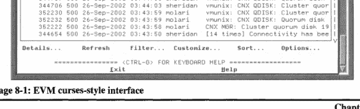

图 8-1：EVM curses 风格界面

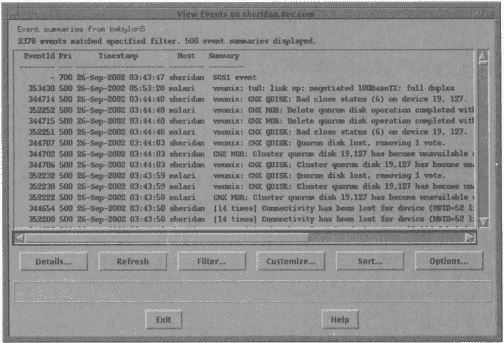

图 8-2：EVM CDE GUI

# 8.3 EVM 优先级与 syslog 和 binlog 优先级

事件优先级显示在表 8-3 中。EVM 优先级范围为 0-700，其中 700 intended 为最高优先级，而 syslog 优先级范围为 7-0，其中 (0) 为最高。binlog 优先级范围仅有三个有效优先级，粒度远不如前者。

| Event Priorities |  |  |  |
|---|---|---|---|
| Name | EVM | syslog | binlog |
| process-to-process | 0 | — | — |
| debug | 1–99 | 7 | low (5) |
| information | 100–199 | 6 |  |
| notice | 200–299 | 5 |  |
| warning | 300–399 | 4 | high (3) |
| error | 400–499 | 3 |  |
| critical | 500–599 | 2 |  |
| alert | 600–699 | 1 | severe (1) |
| emergency | 700 | 0 |  |

表 8-3：事件优先级

EVM 优先级为零保留给不希望任何人查看的事件。这些低优先级事件可用于应用程序之间的通信，例如另一个进程发出的心跳事件以保持自身存活（正如您将在 NetRAIN 事件部分 [第 9 章，第 9.2.3 节] 中看到的，所有注册的事件优先级均为零）。默认情况下，优先级低于 200 的事件不会被 EVM 记录器记录。

`EvmEvent(5)` 参考页列出了 EVM 优先级及其预期用途。

# 8.4 事件模板

我们已经讨论了事件是什么以及事件如何处理，但没有讨论事件如何定义。为了发布事件，事件必须被定义。

随 Tru64 UNIX 和 TruCluster Server 提供的事件模板文件按事件类型将事件分组到模板文件中；例如，硬件网络事件位于 `hw.net.ev` 文件中，ADFS 文件系统事件位于 `fs.adfs.evt` 文件中。

模板文件具有以下格式：

```
event {

        name             event_name

        format           format_specifier

        priority         priority

        cluster_event    true | false

        i18n_catalog     i18n_cat

        i18n_set_id      i18n_set

        i18n_msgid       i18n_msg

        reference        reference_string

        var {

                name     variable_name

                type     variable_type

                value    variable_value

        }

}
```

- `name`

每个事件必须具有由至少三个组件组成的名字属性。组件由句点 (`.`) 分隔。例如：

`tcrhb.timeEvent.overdue`

- `format`

`format` 属性是事件的文本。例如：

“TCR Handbook: this book is overdue”

### priority

优先级是 0（零）到 700 之间的任意值。请参阅 `EvmEvent(5)` 参考页以了解优先级定义。

### cluster_event

`cluster_event` 属性用于定义事件的范围。如果 `cluster_event` 为 "true"，则如果该事件在集群中的任何成员上发生，集群中的每个成员都会看到它。如果 `cluster_event` 为 "false"，则只有生成该事件的成员才会看到该事件。正如前面的示例所示，`hw.evt` 模板文件中的所有事件默认 `cluster_event` 值为 "true"。

### i18n_catalog, i18n_set_id, i18n_msg_id

如果您使用消息目录，则 "i18n" 属性可用于索引事件文本的目录消息。更多信息请参阅 `evmtmpl(5)` 参考页。

### reference

这是一个文本字符串，将由事件通道的解释函数使用。该字符串的格式由事件通道定义。

### var

您还可以通过定义 "var" 块向事件传递变量。变量有三个属性：`name`、`type` 和 `value`。"`name`" 属性是变量的名称，"`type`" 属性可以是 `EvmEvent(5)` 参考页中定义的几种不同类型之一。类型 "`STRING`" 为默认值。"`value`" 属性是您希望变量具有的默认值。

下面是包含变量的虚构事件的模板：

```
event {

  name        tcrhb.timeEvent.overDue

  format      "TCR HB: this book is overdue. $dueDate is the due date."

  priority    400

  var         {name dueDate type STRING value "Today"}

}
```

将事件模板输入到文件中。

```
# cd /usr/share/evm/templates/local ; mkdir tcrhb ; cd tcrhb
```

```
# cat > tcrhb.evt
event {

    name        tcrhb.timeEvent.overDue

    format      "TCR HH: this book is overdue. $dueDate is the due date."

    priority    400

    var         {name dueDate type STRING value "Today"}

}
^D
```

设置所有者和权限。

```
# chown root tcrhb.evt
# chmod 540 tcrhb.evt
```

检查模板文件的语法错误。

```
# evmrload -n
```

告诉 EVM 关于新的模板。

```
# evmreload
```

发布新的事件。

```
# echo "event { name tcrhb.timeEvent.overDue }" | evmpost
```

检查事件是否已发布。

```
# evmget -A -f "[name tcrhb]*"
TCR Handbook: this book is overdue. Today is the due date.
```

再次发布事件。这次，传递一个值给 "`dueDate`" 变量。

```
# print "event
> { name tcrhb.timeEvent.overDue
>  var {name dueDate value "\${date}"} }" | evmpost
```

检索事件。这次你应该看到两个事件，因为这是我们第二次发布事件。

```
# evmget -A -f "[name tcrhb]*"
TCR Handbook: this book is overdue. Today is the due date.
TCR Handbook: this book is overdue. Mon Mar 26 05:34:29 EST 2001 is the due date.
```

最后，你可以通过将属性条目放在事件定义之外，来为模板文件中的所有事件定义默认属性值。事件定义内的属性将覆盖“全局”属性值。以下是 `hw.evt` 模板文件中的摘录，说明了这一点：

```
================ Hardware event defaults =================
cluster_event   true
priority         200
ref              cat:evexmp.cat:800
================ Hardware event templates =================
event {
    name        @SYS_VP0.hw.deregistered
    priority    400
```


```
    format      "A hardware component has been de-registered (HWID=$hwId)"

    var         (name hwId  type UINT64  value 0)

}
...

event {

    name        @SYS_VP0.hw.scan_completed

    format      "A hardware scan has just completed"

}
```

请注意，`cluster_event`、`priority` 和 `ref` 属性未在事件模板内定义。这意味着这些条目下方的任何事件模板都将具有这些属性默认值，除非在事件模板内明确覆盖。因此，`@SYS_VP0.hw.scan_completed` 事件模板将具有 200 的“默认”优先级，但 `@SYS_VP0.hw.deregistered` 事件模板将覆盖默认优先级并分配 400 的优先级。

有关事件模板的更多信息，请参阅 `evmtemplate(5)` 和 `EvmEvent(5)` 参考页面。

## 8.5 事件过滤器和过滤事件

事件过滤器是你用来从 EVM 子系统获取特定事件的东西。可以把它想象成在你的购物清单上加上限定条件。

如果你说，“我想买一张音乐录音”，那会带你到一家有数百甚至数千张录音的商店。

说“我想要一张 CD 格式的音乐录音”，你就缩小了搜索范围一些。但让我们更具体一点。

“我想要一张在过去两年内由一位受欢迎的蓝调吉他手录制的 CD 音乐录音。”

### 8.5.1 事件关键字

事件过滤器帮助我们缩小我们正在寻找的事件数量。Tru64 UNIX 定义了几个关键字（见表 8-4）来帮助缩小事件范围。

事件关键字也可以组合起来形成复杂过滤器。复杂过滤器是由两个或多个关键字与其中一个定义的逻辑运算符组合而成：

- AND（你可以使用 AND 关键字或 `&`）。
- OR（你可以使用 OR 关键字或 `|`）。
- NOT（你可以使用 NOT 关键字或 `!`）。

事件过滤器关键字*
| 关键字 | 值 | 示例 | 描述 |
|---|---|---|---|
| Name | event-name-specifier | [!name *.clu.*] [name *.clu.*] [name sys.unix.?] | 事件的名称，如事件模板中定义或通配符字符串。有效的通配符为：“*”（0 个或多个组件）或 “?”（恰好一个组件）。 |
| Priority | equality-operator¹ integer | [prio >= 200] | 优先级范围为 0 - 700。 |
| Timestamp | time-range-specifier² | [time *:6:1-3:*:*:*] | time-range-specifier 如下所示。任何字段都可以使用匹配所有可能值的 “*” 通配符。你也可以像示例中那样使用值范围。 |
| Age | equality-operator¹ age-specifier | [age < 1d] [age > 1d] | age-specifier 是一个整数后跟一个字母。有效字母为：w（周），d（天），h（小时），m（分钟），s（秒） |
| Before | absolute-time-specifier³ | [before 2000:6:1:03:00:00] | 绝对时间值。无通配符。 |
| Since | absolute-time-specifier³ | [since 2000:6:1:03:00:00] | 绝对时间值。无通配符。 |
| Host_name | hostname | [host sheridan] | 任何有效主机名。 |
| Cluster_name | cluster_name | [cluster babylon5] | 任何集群名称。 |
| Event_id | equality-operator¹ integer | [id <= 10] | 表示事件 ID 的整数。参见 EvnEvent(5)。 |
| 1- equality-operator | = | eq | 等于 |
| | < | lt | 小于 |
| | > | gt | 大于 |
| | <= | le | 小于或等于 |
| | >= | ge | 大于或等于 |
| | != | ne | 不等于 |
| 2 - time-range-specifier | year:month-of-year:day-of-month:day-of-week:hours:minutes:seconds | 可以使用范围 (-) 指定符和通配符 (*) |
| 3 - absolute-time-specifier |  | 不能使用范围或通配符 |
*请参阅 `EvnFilter(5)` 参考页面获取更多信息。

# 表 8-4：事件过滤器关键字

例如：

```
[name *.evm] AND [prio <= 500] AND NOT [before 2001:03:24:00:00:00]
```

返回所有在 2001 年 3 月 24 日之前优先级小于或等于 500 的 "evm" 事件。

为了确保复杂过滤器的正确顺序，您也可以使用括号 "(" 和 ")" 将过滤器包含在内。

```
([name *.evm] | [name ?.??.?]) & [age <= 2d]
```

返回所有 "evm" 事件或包含三个组件且年龄小于或等于两天的任何事件。

要使用过滤器，您可以在 `evmget`、`evmwatch`、`evmshow(1)` 或 `evmsort(1)` 命令上使用 "-f" 开关。例如：

```
# evmget -f "([name *.evm] | [name ?.??.?]) & [age <= 2d]"
```

有关更多信息，请参阅 `EvmFilter(5)` 参考页。

## 8.5.2 事件过滤器文件

除了事件关键字之外，还有一种方法可以创建复杂过滤器并将其存储以供重复使用（有点像环境变量）。这些可重复使用的过滤器可以存储在过滤器文件中。

Tru64 UNIX 和 TruCluster Server 包含多个过滤器文件。这些过滤器文件位于 `/usr/share/evm/filters` 中。事件过滤器文件的扩展名为 ".evf"。表 8-5 显示了过滤器文件目录及其搜索顺序。

要覆盖文件搜索顺序，您可以定义 `EVM_FILTERDIR` 环境变量。

### 事件过滤器文件目录

| 目录 | 搜索顺序 * | 描述 |
|---|---|---|
| 当前工作目录 | 1 | |
| `$HOME/.sysman/evmfilters` | 2 | 用户定义的过滤器文件应放置在此目录中。 |
| `/var/evm/adm/filters` | 3 | 站点特定的过滤器文件应放置在此目录中。 |
| `/usr/share/evm/filters` | 4 | Tru64 UNIX 和 TruCluster Server 提供的过滤器文件位于此目录中。 |
| * - 可以通过 `EVM_FILTERDIR` 环境变量覆盖 |

表 8-5：EVM 过滤器文件目录

事件过滤器文件具有以下语法：

```
filter {

  name        filter_name

  value       filter_value

  include     filter_element

  exclude     filter_element

  title       filter_title

}
```

`filter_name` 是您的过滤器的名称。`filter_value` 是一个关键字过滤器字符串。用于 "include"（逻辑 OR）和 "exclude"（逻辑 AND NOT）属性的 `filter_element` 是关键字过滤器字符串，您可以使用它来进一步细化您的过滤器。最后，`filter_title` 属性是对过滤器的描述。例如：

```
filter {

  name  'scsi'

  value "[name @SYS_VP8.binlog.hw.scsi]"

  title "Binlog SCSI events"

}
```

此过滤器来自位于 `/usr/share/evm/filters` 目录中的 `binlog.evf` 文件。要使用此过滤器，您将使用以下语法："@filter_file:filter_name"。要使用 binlog 过滤器文件中的 scsi 过滤器，请使用："@binlog:scsi"。请注意，此过滤器不包含 "include" 或 "exclude" 属性。每个过滤器定义可以有任意数量的 "include" 或 "exclude" 属性。

```
filter
{
  name      net
  value     "[name @SYS_VP8.hw.net]*"
  include   "[name @SYS_VP8.clu.clua]*"
  exclude   "[prio < 200]*"
```


```
  exclude   "[age > 1w]*"

}
```

这是一个示例，定义了一个名为 `"net"` 的过滤器，它将检索名称匹配 `sys.unix.hw.net` 或 `sys.unix.clu.clua` 的事件，只要事件的优先级大于 200 并且事件发生时间不超过一周。

换句话说，您可以创建一个过滤器文件并使用此命令：

```
$ evmget -A -f @myfilterfile:net
```

或输入此命令：

```text
# evmget -A -f "[name *.hw.net] | [name *.clu.clua] & [prio < 200] & [age > 1w]"
```

# NOTE:

`@SYS_VP@` 值是一个宏，定义了“厂商”和“产品名称”。该宏解析为什么？

```text
# evminfo -vp
SYS.unix
```

您应该使用此值而不是使用实际值。这将完成两项任务：

- 1. 它使您的过滤器文件具有可移植性。
- 2. 它给予厂商更改其产品名称的自由，而无需您做更多工作。

有关事件过滤器文件的更多信息，请参阅 `evmfilterfile(5)` 参考页。

## 8.6 其他 EVM 主题

### 8.6.1 EVM 安全

`/etc/evm.auth` 文件定义了哪些用户和/或组有权发布、订阅（监视）或检索特定事件。`evm.auth` 文件包含两种类型的条目：

- `event_rights`
- 

此条目定义了特定事件类的权限。每个 `event_rights` 条目包含三个字段：

```text
event_rights {
              class  event_class
              post   rights_list
              access rights_list
              }
```

`class` 字段包含事件类（例如 `@SYS_VP@.evm.msg.admin`）。事件必须具有基本模板。有关更多信息，请参阅第 8.4 节。

`post` 字段包含有权发布此事件类别的用户列表。

`access` 字段包含有权检索或订阅此类事件的用户列表。

`rights_list` 在表 8-6 中定义。

如果 `rights_list` 包含空格，则必须用双引号（`"`）括起来。`rights_list` 中的多个用户和/或组必须用逗号（`,`）分隔。除非被明确拒绝，否则 root 用户对所有事件和服务拥有隐式权限。

例如：

```
event_rights {
        class  @SYS_VP@.binlog     # binary error log events
        post   root
        access "root, group=adm"
}
```

root 用户可以发布 `sys.unix.binlog` 类型的事件，root 用户和 `adm` 组中的用户可以检索这些事件。如果你担心将来的可移植性，应使用 `@SYS_VP@` 宏来引用系统（sys.unix）事件。

- `service_rights`

此条目类型定义守护进程为请求客户端执行特定服务的权限。每个 `service_rights` 条目包含两个字段：

```
service_rights {
        service  service_name
        execute  rights_list
}
```

`service` 字段包含特定服务。服务必须在 `/etc/evmdaemon.conf` 中定义。截至撰写本文时，尚不支持用户自定义服务。

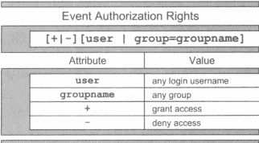

**表 8-6：事件授权权限**

`execute` 字段包含被授权执行此服务的用户和/或组。

例如：

```
service_rights {
        service       event_get       # event_get service - handles evmget requests
                      execute +
}
```

所有用户都可以执行 `event_get` 服务。`event_get` 服务由 `evmget` 程序使用。

有关更多信息，请参阅 *Tru64 UNIX System Administration Guide*（《Tru64 UNIX 系统管理指南》）第 13 章和 `evm.auth(4)` 参考手册页。

## 8.6.2 EVM 远程访问

远程访问默认是禁用的。要启用远程访问，请将 `/etc/evmdaemon.conf` 中的 `remote_connection` 属性修改为“true”。

截至撰写本文时，远程用户没有身份验证。远程用户被授予最低级别的访问或发布权限。有关更多信息，请参阅 *Tru64 UNIX System Administration Guide*（《Tru64 UNIX 系统管理指南》）第 13 章。

## 8.6.3 EVM API

编写使用 EVM 的应用程序超出了本书的范围。但是，如果我们不提及 EVM 提供了一个完整的 API，使您能够编写可以发布事件或订阅事件的程序，那就有些失职了。有关更多信息，请参阅 *Tru64 UNIX Programmer’s Guide*（《Tru64 UNIX 程序员指南》）第 14 章，以及第 3 节中关于 EVM API 的参考手册页。要查找所有 `Evm` 调用，请尝试以下命令：

```
# man -k evm | grep -E '^((Evm)(.*)\(3\))'
```

或者，您可以使用我们的小脚本（URL 见附录 B），它是一个基于章节的“man -k”脚本，带有格式化输出。

```
# sman 3 Evm
```

在 `/usr/examples/evm` 目录中也有程序示例。

## 8.7 使用 EVM

本节不会试图涵盖 EVM 子系统中的每一个可能功能；相反，它将讨论我们发现的一些有趣用途，以及它们与 TruCluster Server 产品的关系。有关 EVM 的更深入分析，我们建议参阅 *Tru64 UNIX System Administration Guide*（《Tru64 UNIX 系统管理指南》）或以下参考手册页：

- `evmget(1)`
- `evmpost(1)`
- `evmsort(1)`
- `evm(5)`
- `EvmFilter(5)`
- `evmstart(8)`
- `evmviewer(8)`
- `evminfo(1)`
- `evmshow(1)`
- `evmwatch(1)`
- `EvmEvent(5)`
- `evmreload(8)`
- `evmstop(8)`

可以使用 `man -k` 命令或我们基于章节的 `sman` 脚本（获取方式见附录 B）获取完整的参考手册页列表。

### 8.7.1 如何查看哪些事件已在 EVM 中注册？

您可以使用带 `-i` 选项的 `evmwatch` 命令来检索已注册的事件。

> **注意：**
>
> 在 Tru64 UNIX 5.1 版本之前，`evmwatch` 和 `evmget` 命令不存在 `-A` 命令选项。`evmwatch` 命令新增的 `-A` 选项会自动调用 `evmshow`，而 `evmget` 命令会自动调用 `evmsort` 命令。如果您使用的是 Tru64 UNIX 5.0A 版本，请使用以下命令代替 `evmwatch` 的 `-A` 命令选项：

```
# evmwatch -i | evmshow
```

```
# evmwatch -A -i
```

由于该命令会产生大量事件，我们可能希望将搜索范围限制为仅网络相关事件。

使用 V5.0A，执行 `evmwatch -i -f "[name *.net]" | evmshow`。
使用 V5.1（及更新版本），执行 `evmwatch -A -i -f "[name *.net]"`。

```text
# evmwatch -A -i -f "[name *.net]"
NIFF: node sheridan detected a failed network connection on network via interface
NIFF: node sheridan has detected an available network connection on network via interface
NIFF: node sheridan has declared a connectivity alert with network via interface
NETRAIN: node sheridan detected a failed network connection on network via interface
```


```text
NETRAIN: node sheridan has detected an available network connection on network via interface
NETRAIN: node sheridan has declared a connectivity alert with network via interface
```

好的，这样我们缩小了范围，但如果我们想查看事件的名称而不是格式文本呢？`EvmEvent(5)` 参考页定义了可用于创建`show-template`的“标准数据项”。`show-template`可通过`-t`开关为`evmget`、`evmshow`、`evmsort`和`evmwatch`命令创建（或者如果使用相同的`show-template`，可以使用你喜欢的格式设置`EVM_SHOW_TEMPLATE`环境变量）。

使用 V5.0A，执行：`evmwatch -i -f "[name *.net]" | evmshow -t "@name"`
使用 V5.1（或更新版本），执行 `evmwatch -A -i -f "[name *.net]" -t "@name"`

```text
# evmwatch -A -i -f "[name *.net]" -t "@name"
sys.unix.hw.net.niff.down
sys.unix.hw.net.niff.up
sys.unix.hw.net.niff.alert
sys.unix.hw.net.netrain.down
sys.unix.hw.net.netrain.up
sys.unix.hw.net.netrain.alert
```

### 8.7.2 如何等待事件发生？

使用不带`-i`开关的`evmwatch`命令即可轻松实现等待系统或集群上事件发生。

使用 V5.0A（或更新版本）：

```text
# evmwatch | evmshow
```

### 8.7.4 如何查看已配置的通道？

```text
# evmoinfo -lc
syslog
binlog
misclog
evmlog
```

### 8.7.5 如何获取来自特定通道的事件？

你可以使用`-C`标志限制`evmget`搜索的范围到特定通道。此功能在 *Tru64 UNIX* 版本 5.1 中添加到 EVM。

```text
# evmget -A -C binlog -f "[age < 1d]" -t "@timestamp @name @@"
28-Mar-2001 07:36:13 sys.unix.binlog.op.timestamp System timestamp
28-Mar-2001 07:37:41 sys.unix.binlog.hw.scsi SCSI event
28-Mar-2001 07:37:41 sys.unix.binlog.hw.scsi SCSI event
28-Mar-2001 07:37:41 sys.unix.binlog.hw.scsi SCSI event
28-Mar-2001 16:17:42 sys.unix.binlog.op.timestamp System timestamp
```

要从多个通道检索信息，请使用多个`-C`开关。

```text
# evmget -A -C binlog -C syslog -f "[age < 1d]" -t "@timestamp @name @@"
```

### 8.7.6 如何格式化从事件接收到的“timestamp”？

如你所见，你可以使用`@timestamp`过滤器检索时间和日期，但这会同时给出时间和日期。如果你只想要时间戳的特定部分，可以使用`evmshow`并通过`-T`开关指定时间格式。你使用的格式与`date(1)`命令使用的格式相同。

```text
# evmget -f "[prio >> 700]" | evmshow -T "%A (%D) %H:%M"
Thursday (03/22/01) 09:22 Correctable error reporting state changed
Thursday (03/22/01) 09:30 Correctable error reporting state changed
```

### 8.7.7 如何发送事件？

你可以使用`evmpost`命令发送（或发布）事件。`evmpost`命令从输入流（或文件）接收输入，将输入转换为 EVM 的二进制格式，然后将事件发送到 EVM 守护进程以分发给订阅者。

```text
# echo "event { name tcrhb.timeEvent.overDue }" | evmpost
```

这只是使用事件模板文件中定义的默认值将`tcrhb.timeEvent.overDue`事件发布到 EVM（有关更多信息，请参阅第 8.4 节）。

你还可以将变量传递给事件，这些变量在事件的模板中定义。例如，在`tcrhb.timeEvent.overDue`事件中，我们定义了变量`dueDate`，它被定义为字符串，默认值是 "Today"。

```text
event {
  name        tcrhb.timeEvent.overDue
  format      "TCR Handbook: this book is overdue. $dueDate is the due date."
  priority    400
  var         {name dueDate type STRING value "Today"}
}
```

为了使用`dueDate`变量的替代值发布事件，我们可以执行以下操作：

```text
# echo "event { name tcrhb.timeEvent.overDue var (name dueDate value `date`)}" \
| evmpost
```

如果你不想在命令行上输入事件来发布它，可以将其放在文件中，让`evmpost`读取该文件。

```text
# evmpost myEvent
```

你也可以使用`-a`（管理员）和`-u`（用户）开关向 EVM 发布简单消息。

```text
# evmpost -a "Starting the upgrade for the C++ compiler" -p 201
# evmpost -u "I am here!"
```

#### NOTE:

如果您使用的是 `csh` shell，则需要转义 `!` 字符，像 `\!` 这样。这是为了能够打印出 `!` 字符。省略 `\` 将导致出现 "": Event not found." 错误。请注意，错误信息中的 "Event" 并不是指 EVM 事件，而是 C shell 表示您尝试调取的历史命令未找到的方式。`!` 是从历史列表中调取命令的方式。

### 8.7.8 How Can I Send an Event from a Script?

您可以通过在脚本中使用`evmpost`命令来从脚本中发布事件。`evmpost(1)`参考页中也有一个脚本的简短摘录。

### 8.7.9 How Can I Format the Event Information I Receive?

可以使用`evmwatch`、`evmget`或`evmshow`命令的`-t`开关来格式化事件信息。`-t`使您能够为命令创建`show-template`。格式可以使用`EvmEvent(5)`参考页中定义的任何有效的 EVM 数据项。在`show-template`中使用数据项时，请以`@`为前缀。数据项在`EvmEvent(5)`参考页中以大写形式列出，但您可以使用小写。请注意`@a`是实际的事件文本，其中文本中引用的任何变量值都被替换为其引用。

```text
# evmget -A -t "@pid [@priority] @name: @a" -f "[prio > 600]"
- [700] sys.unix.binlog.hw.correctable_rpt_switch: Correctable error reporting state changed
- [700] sys.unix.binlog.hw.correctable_rpt_switch: Correctable error reporting state changed
302 [700] sys.unix.hw.net.niff.down: NIFF: node sheridan detected a failed network connection on network 192.168.0.69 via interface tu0
```

如果您发现自己 constantly 使用相同的格式，您可能希望在`EVM_SHOW_TEMPLATE`环境变量中定义该格式。


# export EVM_SHOW_TEMPLATE="@pid [@priority] @name: @a"

# `evmget -A -f "[name *.hw]"`

21667 [300] sys.unix.hw.dev_base_name_changed.tape__hwid.123: Device base name changed from unknown to tape0 (HWID=123)

21667 [300] sys.unix.hw.dev_base_name_changed.tape__hwid.124: Device base name changed from unknown to tape1 (HWID=124)

从 V5.1A 开始，换行符 (`\n`) 和制表符 (`\t`) 可用于提高事件输出的可读性。例如，您可以通过使用 `"\n"` 在事件输出中插入换行符。

# `evmget -A -f "[age < 1d]"` \
> `-t "%n%t%timestamp - %event_id [%priority]%n%name\n%"` | more

26-Sep-2002 03:43:59 - 344680 [200]

sys.unix.clu.drd.server_leave_hwid.52

DRD: Removed (unmapped) DRD server molari

在过滤器关键字旁边使用 `s` 字符可以设置最小字段宽度。例如，要将 `cluster_event` 字段的最小字段宽度设置为五，您可以使用以下命令。

# `evmget -A -f "[age < 1d]"` \
> `-t "@cluster_event%5 -@name"` | more

True  - sys.unix.hw.net.niff.alert

False - sys.unix.evm.logger.log_closed

False - sys.unix.evm.logger.log_started

False - sys.unix.evm.mark

False - sys.unix.binlog.chan.binlog_size

False - sys.unix.binlog.hw.acsi

True  - sys.unix.clu.drd.server_leave_hwid.52

False - sys.unix.binlog.hw.acsi

True  - sys.unix.clu.drd.server_add_hwid.52

True  - sys.unix.clu.drd.new_accessnode_hwid.52

True  - sys.unix.clu.drd.new_accessnode_hwid.52

...

## 8.7.10 How Can I Find Out Which Filters are Available?

过滤器关键字在 `EvmFilters(5)` 参考页中定义。您可以在位于 `/usr/share/evm/filters`（系统）和 `/var/evm/adm/filters`（站点定义）目录的过滤器文件中找到过滤器。

```
$ ls /var/evm/adm/filters /usr/share/evm/filters
/usr/share/evm/filters:
binlog.evf  evm.evf    sys.evf    syslog.evf
/var/evm/adm/filters:
<no output>
```

此外，TruCluster Server Handbook 网站（请参阅附录 B 中的 URL）包含一个名为 `evf(1)` 的 Korn Shell 脚本，可用于查找过滤器文件中有哪些过滤器可用。

## `evf [-v] [-d FilterFileDir] [file1 file2...filen]`

`evf` 脚本如果未使用 `"-d"` 开关或 `EVF_DIR_PATH` 环境变量，将使用当前工作目录、`/var/evm/adm/filters` 和 `/usr/share/evm/filters` 作为默认搜索路径。

```
# evf binlog
/
[no event filter files found]
/var/evm/adm/filters
[no event filter files found]
/usr/share/evm/filters
binlog.evf
@binlog:binlog
@binlog:scsi
@binlog:lsm
@binlog:info
@binlog:msg
@binlog:startup
@binlog:shutdown
@binlog:panic
@binlog:timestamp
@binlog:unknown
```

在此示例中，使用了 `"-d"` 开关仅搜索 `/usr/share/evm/filters` 目录；`"-v"` 开关通过执行 `"evmshow -f filter_exp -F"` 显示过滤器的详细信息。

```
# evf -v -d /usr/share/evm/filters binlog
/usr/share/evm/filters
binlog.evf
@binlog:binlog      -> [name sys.unix.binlog]
@binlog:scsi        -> [name sys.unix.binlog.hw.scsi]
@binlog:lsm         -> [name sys.unix.binlog.sw.lsm]
@binlog:info        -> [name sys.unix.binlog.op.info]
@binlog:msg         -> [name sys.unix.binlog.op.info.ascii_msg]
@binlog:startup     -> [name sys.unix.binlog.op.startup]
@binlog:shutdown    -> [name sys.unix.binlog.op.shutdown]
@binlog:panic       -> [name sys.unix.binlog.op.panic]
@binlog:timestamp   -> [name sys.unix.binlog.op.timestamp]
@binlog:unknown     -> [name sys.unix.binlog.unknown_class]
```

你可以在指定目录的每个文件中使用以下命令查看所有过滤器：

```
# evf -d /usr/share/svm/filters
```

如果你只想查看几个文件，请用空格分隔它们。

```
# evf syslog binlog
```

`evf` 命令也接受标准 shell 通配符作为文件规范，前提是该文件规范用双引号 (`"`) 括起来。以下示例将在 `EVF_DIR_PATH` 中搜索所有以 `"log"` 结尾的过滤器文件，所有以 `"c"` 开头后跟 `"l"` 或 `"a"` 再后跟 `"u"` 或 `"a"` 的过滤器文件，以及任意四个字母的过滤器文件。

```
# export EVF_DIR_PATH="/var/svm/adm/filters /var/share/svm/filters"
# evf -v *"log" *"c[la][ua]" ?????"
```

有关 `evf` 命令的更多信息，请参阅 `evf.tar.gz` 工具包中包含的 `evf(1)` 参考页。

## 8.7.11 如何查看过滤器文件中过滤器的格式？

如果您正在使用过滤器文件中的过滤器，并且想查看它实际过滤的内容，您可以查看过滤器文件（如果您知道其位置），或者您可以要求 `evmshow` 为您显示。

```
# evmshow -f @binlog:scsi -F
( { name sys.unix.binlog.hw.scsi } )
```

## 8.7.12 如何检查我创建的模板的语法？

如果您是管理员，可以使用 `"evmreload -n"` 命令。

```
# evmreload -n
```

如果您是用户，可以使用 `evmpost`。

```
# cat New_Events.evt | evmpost -r -M | evmshow -D
```


## 8.7.13 如何对事件进行排序？

由于事件可能来自各种通道，因此显示的顺序并不总是您期望看到的顺序。此外，您可能希望按不同的数据项对事件进行排序。`evmsort` 命令就是为此任务而设计的。

### NOTE:

从 Tru64 UNIX 版本 5.1 开始，`evmget` 命令在使用 `"-A"` 开关时会自动调用 "`evmsort -A`" 命令。

要对事件进行排序，请使用 `"-s"` 开关，后跟 `Sort-Spec`。 `Sort-Spec` 定义为 EVM 数据类型的冒号 (`:`) 分隔字符串。排序顺序是通过在 `Sort Spec` 中的 EVM 数据类型后放置 `"+"` 或 `"-"` 来确定的（`"+"` 表示升序排序，而 `"-"` 表示降序排序）。如果您未指定排序顺序，则默认为升序。

例如：

```
@timestamp+:@name:@priority-
```

这会按时间戳（升序）对每个事件进行排序，然后按名称（升序），然后按优先级（降序）排序。

以下示例将产生相同的结果。

```
# evmget | evmsort -s "@timestamp+:@name:@priority-" | \
> evmshow -t "@timestamp [@priority] @name"
```

或：

```
# evmget | \
> evmsort -A -s "@timestamp+:@name:@priority-" -t "@timestamp [@priority] @name"
```

或：

```
# evmget -A -s "@timestamp+:@name:@priority-" -t "@timestamp [@priority] @name"
```

返回：

```
27-Mar-2001 02:00:01 [200] sys.unix.evm.chmgr.cleanup_done
27-Mar-2001 02:00:39 [500] sys.unix.syslog.mail
28-Mar-2001 07:37:41 [200] sys.unix.sysman.station.update_object.HOST.elroy
28-Mar-2001 07:37:43 [300] sys.unix.hv.dev_base_name_changed.tape._hwd1.123
28-Mar-2001 07:37:43 [300] sys.unix.hv.dev_base_name_changed.tape._hwd1.124
29-Mar-2001 18:02:41 [200] sys.unix.evm.nark
29-Mar-2001 18:15:41 [500] sys.unix.syslog.mail
29-Mar-2001 18:17:44 [200] sys.unix.binlog.op.timestamp
```

如果您发现自己经常使用相同的格式，您可能希望在 `EVM_SORT_SPEC` 环境变量中定义排序顺序。如果例如 `EVM_SHOW_TEMPLATE` 和 `EVM_SORT_SPEC` 都已定义，那么您的 `evmget` 命令可以简化为：

```
# export EVM_SHOW_TEMPLATE="@timestamp [@priority] @name"
# export EVM_SORT_SPEC="@timestamp+@name+@priority"
# evmget -A
```

## 8.7.14 如何找到有关我检索到的事件的更多信息？

`evmshow` 命令有三个选项可以返回有关事件的附加信息（如果可用）：

- `"-d"` 从通道的 `"fn_details"` 例程返回事件的详细信息。
- `"-x"` 从通道的 `"fn_explain"` 例程返回事件的解释。
- `"-D"` 返回事件完整内容的格式化转储。

假设您从系统中检索了一系列事件。其中一个看起来很有趣，您决定想要更多信息。以下是使用每个开关的示例：

```
# evmget -x '{id = 4817}' | evmshow
29-Mar-2001 12:44:36 [200] sys.unix.syslog.auth
```

```
# evmget -x '{id = 4817}' | evmshow -x
Syslog authorization events are posted by Security Integration
Architecture (SIA) components to report actions such as granting of
superuser privileges to a user through the "su" command, or refusal
to grant access.
Authorization events should be monitored by the System
Administrator.
```

```
# evmget -f "[id = 4817]" | evmshow -D
格式化消息：
login: ROOT login on /dev/pts/1
事件数据项：
事件名称      : sys.unix.syslog.auth
优先级        : 200
PID           : 302
PPID          : 1
事件 ID       : 4817
时间戳        : 29-Mar-2001 12:44:36
主机 IP 地址  : 192.168.0.69
主机名        : sheridan
用户名        : root
格式          : login: ROOT login on /dev/pts/1
参考          : cat:evmexp.cat:200
变量项：
无
```

```
# evmget -f "[id = 4817]" | evmshow -d
EVM 事件名称: sys.unix.syslog.auth ================================
Syslog 授权事件由安全集成架构（SIA）组件发布，用于报告诸如通过“su”命令授予用户超级用户权限或拒绝访问等操作。
授权事件应由系统管理员进行监控。
==============================================================
格式化消息：
login: ROOT login on /dev/pts/1
事件数据项：
事件名称      : sys.unix.syslog.auth
优先级        : 200
PID           : 302
PPID          : 1
事件 ID       : 4817
时间戳        : 29-Mar-2001 12:44:36
主机 IP 地址  : 192.168.0.69
主机名        : sheridan
用户名        : root
格式          : login: ROOT login on /dev/pts/1
参考          : cat:evmexp.cat:200
变量项：
无
==============================================================
```


## Tru64 UNIX 集群钩子：NIFF、NetRAIN 和 LAG

在本章中，我们将讨论基础 Tru64 UNIX 操作系统中包含的各种网络组件，这些组件可用于提高可用性和吞吐量。

我们将介绍以下组件：

| 组件 | 章节 |
| --- | --- |
| 网络接口故障查找器（NIFF） | 9.1 |
| 独立网络接口冗余阵列（NetRAIN） | 9.2 |
| 链路聚合 | 9.3 |

### 9.1 网络接口故障查找器（NIFF）

网络接口故障查找器是 Tru64 UNIX 的一个新组件，用于监控网络接口的连接问题。为了在 Tru64 UNIX 独立环境中监控网络接口，你需要使用 `niffconfig(8)` 命令告知 NIFF。

> **注意：**
> 在 TruCluster Server 环境中，已配置的网络接口由 NIFF 自动监控。

一旦通过 `niffconfig` 添加接口，NIFF 的内核级部分——称为流量监控线程（`nifftmt(7)`）——就会监控该接口。如果接口未能响应，`nifftmt` 会向 EVM 发布一个事件。

用户级 NIFF 守护进程（`niffd(8)`）订阅由 `nifftmt` 生成的 EVM 事件。当出现连接问题时，`niffd` 的职责是在被 `nifftmt` 标记为不活跃的接口上生成流量，以验证该接口是否真正宕机。

NIFF 与 NetRAIN（见下文）结合使用，为独立系统提供高可用性网络解决方案。在集群中，集群别名（CLUA）子系统和集群应用可用性（CAA）子系统也会使用 NIFF。我们将在第 16 章和第 23 章分别更详细地介绍 CLUA 和 CAA。

要添加一个由 NIFF 监控的接口，请键入以下命令（将 `tu0` 替换为你希望监控的接口）。

```
niffconfig -a tu0
```

要检查 NIFF 眼中的接口状态，你可以使用 `-u` 或 `-v` 开关，如以下示例所示：

```
niffconfig -u

Interface:  tu0, status: UP
```

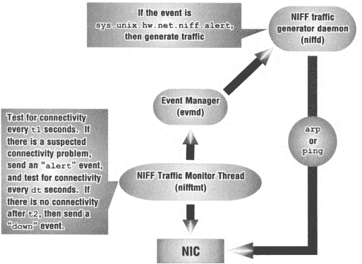

```
# niffconfig -v

Interface: tu0, description: , status: UP, event: ALERT, state: GREEN

t1: 20, dt: 5, t2: 60, time to dead: 30, current_interval: 20, next time: 20
```

图 9-1 显示了 `nifftmt` 到 `niffd` 的通信路径。

`nifftmt` 线程每隔 `t1` 秒检查一次被监控的接口。如果 `nifftmt` 检测到连接问题，它会向 EVM 发布一个 `sys.unix.hw.net.niff.alert` 事件，然后每隔 `dt` 秒开始检查被监控的接口。`niffd` 守护进程从 EVM 接收 `sys.unix.hw.net.niff.alert` 事件，并开始在接口上生成流量，直到它收到 `sys.unix.hw.net.niff.down` 或 `sys.unix.hw.net.niff.up` 事件。如果经过 `t2` 秒后，被监控接口的计数器仍未增加，则该接口被标记为 DEAD，并由 `nifftmt` 发送 `sys.unix.hw.net.niff.down` 事件。

#### 9.1.1 NIFF 事件

NIFF 事件定义在 `/usr/share/evm/templates/sys/hw.net.evt` 中。以下是已注册的 NIFF 事件：

```
# evmwatch -A -i -f "[name *.niff]" -t "[@priority] @name"

[600] sys.unix.hw.net.niff.down

[300] sys.unix.hw.net.niff.up

[200] sys.unix.hw.net.niff.alert
```

有关 NIFF 的更多信息，请参阅 Tru64 UNIX 5.0A 和 5.1 版的《Tru64 UNIX 网络管理指南》，或 V5.1A 版的《Tru64 UNIX 网络管理：连接指南》。你也可以查阅 `niff(7)`、`nifftmt(7)`、`niffd(8)` 和 `niffconfig(8)` 的参考手册页。

### 9.2 独立网络接口冗余阵列（NetRAIN）

Tru64 UNIX 提供了一种将多个网络接口卡（NIC）分组在一起，使其作为一个高可用性网络运行的方法，通常称为独立网络适配器冗余阵列或 NetRAIN。

NetRAIN 是一个虚拟接口，通过将两个或多个 NIC 分组为一个数组来工作，操作系统将其视为一个接口。每个 NetRAIN 接口只使用一个 IP 地址，并且任何时刻只有一个活跃的 NIC（有关多个活跃 NIC 共用同一个 IP 地址的内容，请参阅下一节中的“链路聚合”）。如果活跃的 NIC 出现故障，空闲的 NIC 便会联机。其酷炫之处在于，如果你恰好通过 NetRAIN 接口连接到系统，当 NIC 发生故障时，在新的 NIC 上线期间你可能会经历短暂的暂停，但不会被断开连接！

当前支持的阵列数量为 `nr_maxdev - 1`。`nr_maxdev` 属性在 `netrain` 子系统中定义，默认值为 128。

```
# sysconfig -q netrain nr_maxdev

netrain:

nr_maxdev = 128
```

有关你所使用的 Tru64 UNIX 版本的 `netrain` 子系统的最新信息，请参阅 `sys_attrs_netrain(5)` 参考页。

#### 9.2.1 无 NetRAIN 的网络配置

无 NetRAIN 的网络配置如图 9-2 所示。没有冗余，因此如果网络接口发生故障，系统将无法再在该子网上通信。

在不使用 NetRAIN 配置网络接口时，你（或你喜欢的网络配置程序）会在 `/etc/rc.config` 中修改以下参数：

- `MAX_NETDEVS`

  `MAX_NETDEVS` 属性是可以配置的最大网络设备数。这应大于或等于 `NUM_NETCONFIG`。

  ```
  # rcmgr get MAX_NETDEVS
  2
  ```

- `NUM_NETCONFIG`

  `NUM_NETCONFIG` 属性是要配置的网络设备数量。这必须等于已配置的 `NETDEV_#`/`IFCONFIG_#` 对的数量。

  ```
  # rcmgr get NUM_NETCONFIG
  2
  ```

- `NETDEV_#`（其中“#”是网络配置的实例）

  获取要配置的接口。

  ```
  # rcmgr get NETDEV_0
  tu0
  ```

- `IFCONFIG_#`（其中“#”是网络的实例）

  要传递给 `NETDEV_#` 接口的 `ifconfig(8)` 程序的配置信息。

  ```sh
  # rcmgr get IFCONFIG_0
  192.168.0.69 netmask 255.255.255.0
  ```

有几个程序可用于在 Tru64 UNIX 中配置网络接口：`netconfig`、`sysman net_wizard`、`sysman interface`、`setup` 和 `checklist`。然而，配置 NetRAIN 尚无程序引导你完成此任务。

#### 9.2.2 配置 NetRAIN

> **CAUTION:**
> 
> 为 LAN 集群互连配置 NetRAIN 与本节将讨论的方法大不相同。我们将在第 10 章介绍 LAN 集群互连的配置。

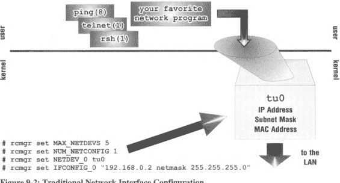

图 9-2：传统网络接口配置

NetRAIN 配置起来相当容易，但必须遵循一些规则以确保成功。

- 阵列中的所有 NIC 必须物理连接到同一子网，但应具有通往子网的独立路径以实现冗余。换句话说，你可能不希望将两个 NIC 连接到同一个集线器，因为如果集线器损坏，你将从两个 NIC 失去对子网的连接。
- 阵列中的所有 NIC 必须为同一类型（以太网、FDDI、ATM 等）。
- 阵列中的所有 NIC 必须具有相同的速度和操作模式（全双工、半双工）。
- 要配置在 NetRAIN 集中使用的所有 NIC 必须处于空闲状态（例如，未当前配置）。
- 你不能在 NetRAIN 虚拟接口（`nr`）或配置在 NetRAIN 集合中的任何 NIC 上运行 LAT。

使用 NetRAIN 的网络配置如图 9-3 所示。

##### 9.2.2.1 删除正在使用的接口（如果有）

如果一个或多个 NIC 当前正在使用中，请删除它们。最简单的方法是使用 `sysman` 命令配合 `interface` 加速器。

```
# sysman interface
```

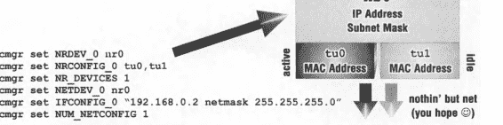

```
# rcmgr set NRDEV_0 nr0
# rcmgr set NRCONFIG_0 tu0,tu1
```


# rcmgr set NR_DEVICES 1

# rcmgr set NETDEV_0 nr0

# rcmgr set IFCONFIG_0 "192.168.0.2 netmask 255.255.255.0"

# rcmgr set NUM_NETCONFIG 1

图 9-3：NetRAIN 接口配置

然而，你也可以使用手动方法删除接口。

1. 删除正在运行的接口。

```
# ifconfig delete tu0
tu0: delete inet address 192.168.0.69
```

```
# ifconfig delete tu1
tu1: delete inet address 192.206.126.69
```

2. 将 `NUM_NETCONFIG` 属性减少你要删除的接口数量。

```
# rcMgr get NUM_NETCONFIG
2
```

```
# rcMgr set NUM_NETCONFIG 0
```

3. 查找你要移除的接口的 `NETDEV_#` 属性。

```
# grep -E "tu0|tu1" /etc/rc.config
NETDEV_0="tu0"
NETDEV_1="tu1"
```

4. 删除 `NETDEV_#` 和 `IFCONFIG_#` 属性。

```
# for i in `grep -E "tu0|tu1" /etc/rc.config`
> do
> DELNUM="${i##*_}"
> print "deleting NETDEV_${DELNUM}"
> rcMgr delete NETDEV_${DELNUM}
> print "deleting IFCONFIG_${DELNUM}"
> rcMgr delete IFCONFIG_${DELNUM}
> done
deleting NETDEV_0
deleting IFCONFIG_0
deleting NETDEV_1
deleting IFCONFIG_1
```

## 9.2.3 NetRAIN 事件

NetRAIN 事件定义在 `/usr/share/evm/templates/sys/hw.net.evt` 中。以下是已注册的 NetRAIN 事件。

```sh
# evmwatch -A -i -f "[name = netrain]" -t "{@priority} @name"
[0] sys.unix.hw.net.netrain.down
[0] sys.unix.hw.net.netrain.up
[0] sys.unix.hw.net.netrain.alert
```

有关 NetRAIN 的更多信息，请参阅适用于 5.0A 和 5.1 版本的 Tru64 UNIX 网络管理指南，或适用于 5.1A 版本的 Tru64 UNIX 网络管理：连接指南。另请查阅 `nr(7)` 和 `sys_attrs_netrain(5)` 参考页。

## 9.3 链路聚合 LAG

> **注意：**
>
> 截至本文撰写时，LAN 集群互连不支持链路聚合。

链路聚合 或 汇聚 是从 Tru64 UNIX 5.1A 版本开始新增的一项功能。它与 NetRAIN 类似，都为网络提供更高的冗余度。与 NetRAIN 不同的是，集合中的所有 NIC 都可以同时处于活动状态，从而实现负载共享和增加网络带宽。

入站和出站流量都会分发到链路聚合组中的所有接口。根据 `lag(7)` 参考页所述，“在发送数据包时，系统使用负载分发算法来确定在哪个附属端口上发送数据包。支持以下负载分发算法：”

- 对于 IP 数据包，端口是基于目的 IP 地址的哈希值选择的。对于非 IP 数据包，端口是基于目的 MAC 地址的哈希值选择的。所有发往特定目标系统的流量都使用链路聚合组中的同一端口。这确保了数据包按顺序到达。¹

¹ 来自 Tru64 UNIX 5.1A 版本的 `lag(7)` 参考页。

### 9.3.1 配置链路聚合组 LAG

只要满足以下条件，配置 LAG 就很简单：

- 数组中的所有 NIC 必须位于同一子网中，并专用于同一服务器或交换机。
- 数组中的所有 NIC 必须为同一类型 目前仅支持以太网。
- 数组中的所有 NIC 必须具有相同的速度并以全双工模式运行。
- 要配置在 LAG 集合中的所有 NIC 必须处于空闲状态 例如，未当前配置。
- 你不能在 LAG 虚拟接口 `lag` 或配置在 LAG 集合中的任何 NIC 上运行 LAT。

目前，要配置 LAG，你必须编辑 `/etc/inet.local` 文件。如果此配置方法在未来版本中发生变化，请不要感到惊讶，因为 NetRAIN 在 V4.0f 中以类似方式配置，但在 V5.0 中已移至 `/etc/rc.config`。

1. 验证链路聚合子系统是否已在内核中配置。

```text
# sysconfig -q lag
framework error: subsystem 'lag' not found
```

如果未配置，请在你的内核配置文件 `/usr/sys/conf/HOSTNAME` 中添加 `"options LAG"`，重建内核，将内核复制到根 `/` 目录，然后重新启动。

2. 验证 NIC 是否未被使用。如果它们已配置，请参阅第 9.2.2.1 节，了解如何取消配置接口的信息。

3. 编辑 `/etc/inet.local` 文件。

```text
# cat >> /etc/inet.local
lagconfig -
lagconfig -p tu0 key=1
lagconfig -p tu1 key=1
ifconfig lag0 192.168.0.69 netmask 255.255.255.0 up
^D
```

4. 重新启动系统。

```text
# shutdown -nx now
```

5. 登录并验证 LAG 接口是否已配置并正常运行。

```
# lagconfig -s lag=lag0
lag0: Attached Interfaces: ( tu1 tu0 )
    key = 1
    Max ports = 8
```

```
# ifconfig lag0
lag0: flags=c63<UP,BROADCAST,NOTRAILERS,RUNNING,MULTICAST,SIMPLEX>
    inet 192.168.0.69 netmask ffffff00 broadcast 192.168.0.255 mtu 1500
```

两个接口都处于活动状态吗？使用 `netstat` 命令检查网络计数器。

```
# netstat -i | grep -E "^(tu0|tu1|lag0|Name)"
Name    Mtu  Network           Address          Ipkts Ierrs  Opkts Oerrs Coll
lag0    1500 <Link>            0:10:64:30:3a:29   50    0      36    0     0
lag0    1500 192.168           sheridan          50    0      36    0     0
tu0     1500 <Link>            0:10:64:30:3a:29   45    0      41    0     0
tu1     1500 <Link>            0:10:64:30:3a:29    9    0       0    0     0
```

两个接口上都有一些流量。请注意，`lag0` 接口本身显示没有流量。生成一些流量。

```
# ping -f -c 100000 192.168.0.255
PING 192.168.0.255 (192.168.0.255): 56 data bytes
---192.168.0.255 PING Statistics---
100534 packets transmitted, 100000 packets received, +534 duplicates, 0% packet loss
round-trip (ms) min/avg/max = 0/80/85 ms
```

再次检查计数器。

```
# netstat -i | grep -E "^(tu0|tu1|lag0|Name)"
Name    Mtu  Network           Address          Ipkts Ierrs  Opkts Oerrs Coll
lag0    1500 <Link>            0:10:64:30:3a:29  201057  0    100109  0     0
lag0    1500 192.168           sheridan         201057  0    100109  0     0
```


tu0     1500 <Link>            0:10:64:30:3a:29  100643  0     326    0     0

tu1     1500 <Link>            0:10:64:30:3a:29  100692  0    100534  0     0

```
看起来 tu1 接口发送了 ping，而由于我们选择的 ping 地址，两个接口都收到了它们。
```

## 10 创建单节点集群

> “一个被新想法拓展的心灵，永远不会回到它原来的维度。”
> —— 奥利弗·温德尔·霍姆斯

在第4章中，我们讨论了集群配置规划，包括支持TruCluster Server的Tru64 UNIX配置规划，以及TruCluster Server自身的配置规划。在第5章中，我们讨论了Tru64 UNIX的实际安装，同样是为支持TruCluster Server的安装。在第6章到第9章中，我们讨论了在Tru64 UNIX中使集群实现更简单的要素——“集群钩子”。现在，终于到了本章，我们将讨论TruCluster Server的安装与配置，以及单节点集群的创建。

在本章中，精心的规划和准备将共同帮助我们构建出相当具体且非凡的东西——一个高可用、高可扩展的UNIX集群。因此，我们将假定你已经完成了安装和配置TruCluster Server以及创建UNIX集群所需的全部规划和准备工作。

## 10.1 集群安装之前

如果你已经跳过前面的章节直接阅读本章，而没有阅读第3章、第4章和第5章，我们建议你停下来，至少在继续之前仔细复习这三章。一般来说，规划是成功的关键。

为了最好地理解设计和规划一个集群需要什么，我们建议你回顾第2章到第9章，并使用第4.8节中的集群准备工作表与检查清单，来帮助设计和规划你的集群实施方案。没有扎实的知识和理解基础，规划通常只会浪费时间和精力。

### 10.1.1 Tru64 UNIX文件系统速览

让我们快速查看一个尚未集群化的Tru64 UNIX系统，并使用`mount(8)`命令检查已挂载的文件系统：

```
# mount

root_domain#root on / type advfs (rw)

/proc on /proc type procfs (rw)

usr_domain#usr on /usr type advfs (rw)

var_domain#var on /var type advfs (rw)
```

如果我们只检查系统级文件系统，会看到Tru64 UNIX系统所预期的内容——root（/）、/usr、/var和/proc。在这种情况下，除/proc外，所有文件系统都是AdvFS文件系统。没什么异常，对吧？

现在，让我们通过查看这些系统级AdvFS文件系统所在的文件系统域的位置来扩展我们所看到的内容。

```
# ls /etc/fdmns

.advfslock_fdmns      .advfslock_var_domain   var_domain/

.advfslock_root_domain root_domain/

.advfslock_usr_domain  usr_domain/
```

同样，这符合预期，但让我们将其作为后续比较的基准——在集群创建之后。

### 10.1.2 集群所需的磁盘

在开始创建集群之前，让我们简要回顾一下构建集群公共文件系统、成员专用文件系统和仲裁磁盘所需的磁盘和分区。¹ 我们还将讨论一些关于分区大小的具体细节，以支持这些文件系统和磁盘。

以下详细说明了构建单节点集群所需的磁盘：

- 共享总线上一块或多块磁盘，用于承载集群范围的AdvFS文件系统：cluster_root（/）、cluster_usr（/usr）和cluster_var（/var）。
- 共享总线上每个集群成员的一块引导磁盘。
- 根据集群中成员的数量，共享总线上一块完整的磁盘作为仲裁磁盘。

> ¹ 这也在前面的表4.4中指定过。

此列表不包括Tru64 UNIX的原始系统磁盘。

什么需要磁盘，什么需要分区？在集群的初始创建过程中，预计将为以下集群公共文件系统使用物理磁盘分区：

- cluster_root
- cluster_usr
- cluster_var

虽然成员引导磁盘也将使用分区来创建其两个文件系统和集群状态分区，但`clu_create(8)`程序只会要求提供整块磁盘，然后使用“a”、“b”和“h”分区。至于仲裁磁盘，虽然要求并使用整块磁盘，但只有“h”分区带有cnx标签。

顺便提一下，如果你想使用LSM来镜像集群上的文件系统，你可以在原始的Tru64 UNIX系统上设置LSM，但等到集群的第一个成员启动后再进行任何文件系统的镜像。在使用`clu_create`命令进行集群的初始创建期间，不能使用LSM卷。

创建单成员集群后，你可以使用`volmigrate(8)`命令将cluster_root域移动到LSM卷，然后镜像该卷。请注意，使用`volmigrate`命令移动cluster_root实际上是将数据从你在初始集群创建命令`clu_create`中指定的磁盘分区，移动到运行`volmigrate`时必须指定的新目标存储。有关在TruCluster Server配置中使用LSM的更多信息，请参阅第14章。

表10-1中的信息，连同表4-5中的信息，为确定应在你的Tru64 UNIX/TruCluster Server规划工作表与检查清单（来自第4.8节）中使用的磁盘和磁盘分区提供了依据。我们将使用这份完成的工作表作为构建集群的蓝图。

表10-1中的“TruCluster Server手册关于分区大小的建议”列包含了几处生产环境中集群的平均大小，因此这是一个更现实的建议。“currently_used”一词指的是分区中当前使用的磁盘空间，而不是Tru64 UNIX系统磁盘的当前分区大小。

+   编辑并写出磁盘的磁盘标签，提供适当的分区大小。

```
# disklabel -e dsk1
```

注意，如果你倾向于使用图形界面，也可以使用 `diskconfig(8)` 命令。

+   将我们感兴趣的分区的文件系统类型从 "unused" 改为适当的使用中类型。

```
# disklabel -eF dsk1a AdvFS

# disklabel -eF dsk1b swap

# disklabel -eF dsk1h cnx
```

注意，截至本文撰写时，`diskconfig` 命令不支持设置 "cnx" fstype。

由于你很可能拥有超过一个成员的集群，并且成员的启动磁盘很可能相同，因此你可以通过将第一个成员的磁盘标签保存到文件，然后将其写入其他成员的启动磁盘，来快速分区额外的成员启动磁盘。例如，我们计划使用 `dsk2` 作为第二个成员的启动磁盘。

保存磁盘标签。

```
# disklabel -r dsk1 > /tmp/bd.lbl
```

写入磁盘标签。

```
# disklabel -Rr -t advfs dsk2 /tmp/bd.lbl
```

### 10.1.3 关于仲裁磁盘

Connection Manager (`CNX`) 的职责之一是在通信故障的情况下确保集群内的数据完整性。它通过一种投票机制来实现这一点，在该机制中，只有在存在多数票或仲裁的情况下，才允许进行处理和 I/O。仲裁磁盘可以增加该投票机制；因此，它有可能增加集群的高可用性。

尽管仲裁磁盘不是很大，最小为 1 MB，但我们要强调的是，整个磁盘都被使用。还应注意，仲裁磁盘不需要磁盘标签，并且不会有文件系统占用其任何分区。`clu_create` 程序将把 1 MB 的 fstype 为 "cnx" 的标签写入仲裁磁盘的 "h" 分区。

什么时候应该使用仲裁磁盘？如果您有一个双节点集群，则强烈建议使用仲裁磁盘。如果您的集群大于两个节点，则取决于集群中的节点数量，尽管您不应在成员数为奇数的集群中配置仲裁磁盘。有关 Connection Manager 和集群中仲裁的更多信息，请参阅第 17 章。

在使用 `clu_create(8)` 命令进行集群的初始创建期间，您将被要求提供一个仲裁磁盘。如果您的集群将包含偶数个成员，并且您计划使用仲裁磁盘，那么在提示时当然可以提供仲裁磁盘。如果您计划将集群作为单成员集群运行一段时间以“感受集群”，那么我们建议您在集群初始创建期间不要创建仲裁磁盘。在第二个成员添加到集群后，可以使用以下命令轻松添加仲裁磁盘：

```
clu_quorum -d add <disk> <# of votes>.
```


如果您发现不需要仲裁磁盘，但计划在 much 之后增加集群中的成员数量，那么在共享总线上预留一个小型磁盘以用作仲裁磁盘是有意义的。该磁盘甚至可以配置为零票仲裁磁盘。有关更多信息，请参阅第 17.8.3 节。

## 10.1.4 使用集群准备工作表和清单

在第 4.8 节中，我们创建了 Tru64 UNIX/TruCluster Server 规划工作表和清单。使用此工作表，您应该能够以非常直接的方式规划集群的实现。请将其用作构建的指南。

## 10.2 TruCluster Server 软件的安装

现在我们已经完成了规划并了解了构建集群所需的条件，让我们开始加载 TruCluster Server License PAK 并安装 TruCluster Server 软件子集。如果您已经将 TruCluster Server License PAK 加载到系统上，请跳至第 10.2.2 节 安装 TruCluster Server 软件。

### 10.2.1 加载 TruCluster Server License PAK

加载许可证 PAK 的一种快速简便的方法是使用 `lmsetup(8)`。我们在将要安装和配置 TruCluster Server 软件子集的系统上加载 TruCluster Server 的许可证 PAK。

```
# /usr/sbin/lmfsetup

Register PAK (type q or quit to exit) [template]

    Issuer : dec

    Authorization Number : ala-ng-xxxxxx-xxxx

    Product Name : tcs-ua

    Producer : dec

    Number of units : 1050

    Version :

    Product Release Date :

    Key Termination Date :

    Availability Table Code : h

    Activity Table Code :

    Key Options : mod_units,alpha

    Product Token :

    Hardware-Id :

    Checksum : 2-wwww-xxxx-yyyy-zzzz

PAK registered for template successfully

Register PAK (type q or quit to exit) [template] q

You have registered at least one new PAK. Until it is loaded by use of the lmf reset, lmf load for each newly registered PAK, or rebooting your system, software dependent on them will be treated as if the registrations had not been performed.

Would you like a lmf reset to be performed at this time? [Yes] Yes
```

现在来验证一下 TruCluster Server 的许可证 PAK 是否已加载并激活。为此，我们使用 `lmf(8)` 命令。

```
$ /usr/sbin/lmf list for tcs-ua

TCS-UA                active                unlimited
```

## 10.2.2 安装 TruCluster Server 软件

请注意，虽然建议在安装 TruCluster Server 软件子集之前加载 TruCluster Server 许可证 PAK，但这不是必需的。可以在没有 TruCluster Server 许可证 PAK 的情况下安装 TruCluster Server 软件子集，但如果许可证 PAK 未激活，你将无法使用这些软件子集中的任何一个。

现在让我们继续安装 TruCluster Server 软件子集。

- 首先，让我们挂载 Tru64 UNIX 关联产品第 2 卷 CD-ROM。其中包含 TruCluster Server 软件子集。

```
$ mount -r /dev/disk/cdrom0c /mnt
```

- 现在，让我们 `cd` 到 `TruCluster Server` 套件目录，看看将要安装的内容。

```
# cd /mnt/TruCluster/kit && ls

TCRBASE520      TCRMAN520      TCRMIGRATE520      instrctl/
```

`TruCluster Server` 安装包含三个软件子集：

| 软件子集 | 描述 | 内容 |
|---|---|---|
| TCRBASE520 | `TruCluster Server` 基本组件 | 实现 `TruCluster Server` 所需的所有强制组件。 |
| TCRMAN520 | `TruCluster Server` 参考手册页 | 参考手册页。 |
| TCRMIGRATE520 | `TruCluster Server` 迁移工具 | 用于从 `TruCluster` 生产服务器和 `TruCluster` 可用服务器迁移的迁移工具。其中还包含对排查常规集群相关问题有用的工具。 |

使用 `setld(8)` 命令，我们执行 `TruCluster Server` 软件子集的安装。我们选择安装所有 `TruCluster Server` 子集，但如果你不打算从 `TruCluster` 1.5 或 1.6 版进行迁移（参见第 26 章），则不需要 TCRMIGRATE 子集。

```
# /usr/sbin/setld -l .

*** Enter subset selections ***

The following subsets are mandatory and will be installed automatically

unless you choose to exit without installing any subsets:

    - TruCluster Base Components

The subsets listed below are optional:

    There may be more optional subsets than can be presented on a single

    screen. If this is the case, you can choose subsets screen by screen

    or all at once on the last screen. All of the choices you make will

    be collected for your confirmation before any subsets are installed.

- TruCluster(TM) Software :

    1) TruCluster Migration Components

    2) TruCluster Reference Pages

Or you may choose one of the following options:

3) ALL mandatory and all optional subsets

4) MANDATORY subsets only

5) CANCEL selections and redisplay menus

6) EXIT without installing any subsets

Estimated free diskspace(MB) in root:293.1 usr:1428.5 var:1200.6

Enter your choices or press RETURN to redisplay menus.

Choices (for example, 1 2 4-6): 3
```

选择安装所有 TruCluster Server 软件子集后，系统会要求我们确认选择。

```
You are installing the following mandatory subsets:

    TruCluster Base Components

You are installing the following optional subsets:

- TruCluster(TM) Software :

    TruCluster Migration Components

    TruCluster Reference Pages

Estimated free diskspace(MB) in root:293.1 usr:1428.5 var:1200.6
```


Is this correct? (y/n): y

```
确认我们要安装的软件子集选择后，安装开始。
```

```
Checking file system space required to install selected subsets:

File system space checked OK.

3 subsets will be installed.

Loading subset 1 of 3 ...

TruCluster Migration Components

    Copying from . (disk)

    Verifying

Loading subset 2 of 3 ...

TruCluster Reference Pages

    Copying from . (disk)

    Verifying

Loading subset 3 of 3 ...

TruCluster Base Components

    Copying from . (disk)

    Verifying

3 of 3 subsets installed successfully.
```

+   软件子集安装完成后，各个子集将作为系统的一部分进行配置。

```
Configuring "TruCluster Migration Components" (TCRMIGRATES20)

Configuring "TruCluster Reference Pages" (TCRMANS20)

Running : /usr/sbin/mkwhatis : in the background...

Configuring "TruCluster Base Components" (TCRBASES20)

Use /usr/sbin/clu_create to create a cluster.
```

+   在我们开始创建集群之前，可以验证所有 TruCluster Server 软件子集是否已正确安装。

```
# /usr/sbin/setld -i | grep -i TCR

TCRBASES20      installed          TruCluster Base Components (TruCluster(TM) Software)

TCRMANS20       installed          TruCluster Reference Pages (TruCluster(TM) Software)

TCRMIGRATES20   installed          TruCluster Migration Components (TruCluster(TM) Software)
```

## 10.3 安装 Tru64 UNIX 和 TruCluster Server 补丁

在我们开始创建集群之前，Tru64 UNIX 和/或 TruCluster Server 软件通常会有补丁或后期修复。由于使用 HP 的 `dupatch(8)` 设施安装补丁会为所有“已安装”的软件子集而不是所有“已配置”或“活动”的软件子集安装补丁，因此在此流程阶段安装补丁是最有效率的。

截至本文撰写时，Tru64 UNIX 和 TruCluster Server 的最新补丁可从以下网站获取：http://www.support.compaq.com/patches

如果你问：“为什么他们现在安装补丁，而不是在创建集群之后？”有两个答案。首先，在此阶段安装补丁比在集群创建后安装所需的时间更少，因为我们无需进行耗时的集群滚动升级²过程。其次，也是更重要的原因是在我们实际创建集群时，我们希望拥有最好且最新版本的软件来执行此操作。

> ² 注：V5.1A 补丁包 2 及更高版本中提供了一种“无滚动”补丁程序，可实现集群中更快的补丁处理过程。有关更多信息，请参阅第 25 章。

虽然你当然可以在多用户模式下安装补丁，但我们建议你在单用户模式下安装补丁，以防止出现诸如两位系统管理员同时操作同一系统的潜在问题。

以下说明了对 Tru64 UNIX 和 TruCluster Server 进行补丁安装的开始。此操作在 TruCluster Server 软件安装完成后，但在集群实际配置之前执行。

```
# ./dupatch

Enter path to the top of the patch distribution,

or enter "q" to quit : .

* A new version of patch tools required for patch management

  is now being installed on your system.

* Tools updated, invoking the updated Patch Utility...

Tru64 UNIX Patch Utility (Rev. 32-02)

==============================

  - This dupatch session is logged in /var/adm/patch/log/session.log

Main Menu:

---------

1) Patch Installation

2) Patch Deletion

3) Patch Documentation

4) Patch Tracking

5) Patch Baseline Analysis/Adjustment

h) Help on Command Line Interface

q) Quit

Enter your choice: 1
```

```
Tru64 UNIX Patch Utility (Rev. 32-02)

==============================

  - This dupatch session is logged in /var/adm/patch/log/session.log

Patch Installation Menu:

1) Pre-installation Check ONLY

2) Check & Install patches in Single-User Mode

b) Back to Main Menu

q) Quit

Enter your choice: 2
```

```
There may be more optional products than can be presented on a single screen. If this is the case, you can choose products screen by screen or all at once on the last screen. All of the choices you make will be collected for your confirmation before any products are installed.

1) Patches for Tru64 UNIX V5.1A

2) Patches for TruCluster Server V5.1A

Or you may choose one of the following options:

3) ALL of the above

4) CANCEL selections and redisplay menus

5) EXIT without installing any products

Enter your choices or press RETURN to redisplay menus.

Choices (for example, 1 2 4-6): 3
```

```
You are installing patches (to be selected) from the following products:

    Patches for Tru64 UNIX V5.1A

    Patches for TruCluster Server V5.1A

Is this correct? (y/n): y

..
```


有关在 Tru64 UNIX 上安装补丁的更多信息，请查阅你将要安装的补丁包的 Tru64 UNIX 和 TruCluster 软件产品补丁包安装说明指南。

## 10.4 创建集群

现在到了“有趣”的部分——创建单节点集群。要创建集群，我们使用 `clu_create(8)` 命令。`clu_create` 命令执行以下操作：

+ 它提示系统管理员输入创建单节点集群所需的信息。
+ 它标记磁盘，创建根 `(/)`、`/usr` 和 `/var` 文件系统，以及第一个成员的引导磁盘，将数据复制到新创建的文件系统，创建 CDSLs，并更新系统配置信息。
+ 可选配置仲裁磁盘。
+ 下一步是第一个集群成员的内核构建。此时，系统管理员将有机会修改内核配置文件。
+ 最后一步是配置与引导相关的 SRM 控制台变量：`bootdef_dev`、`boot_reset` 和 `boot_dev`。这允许从集群成员的 `boot_partition` 引导集群。

现在，让我们毫不拖延地构建一个集群！

## 10.4.1 clu_create(8) 命令

让我们从执行 `clu_create` 命令开始这一过程。`clu_create` 命令的一个贴心功能是，它会准确告诉你它将执行哪些操作，然后提示你确认这些操作是否确实是你想要执行的。

```
# /usr/sbin/clu_create

This is the TruCluster Creation Program

You will need the following information in order to create a cluster:

- Cluster name (a hostname which is also used as the default cluster alias)

- Cluster alias IP address

- Clusterwide root disk and partition (for example, dsk4b)

- Clusterwide usr disk and partition (for example, dsk4g)

- Clusterwide var disk and partition (for example, dsk4h)

- Quorum disk device (for example, dsk4)

- Number of votes assigned to the quorum disk

- Member ID

- Number of votes assigned to this member

- First member's boot disk (for example, dsk5)

- First member's virtual cluster interconnect IP name

- First member's virtual cluster interconnect IP address

- First member's physical cluster interconnect devices

- First member's NetRAIN device name

- First member's physical cluster interconnect IP address

The program will prompt for this information, offering a default value when one is available. To accept the default value, press Return. If you need help responding to a prompt, either type the word 'help' or type a question mark (?) at the prompt.

The program does not begin to create a cluster until you answer all the prompts, and confirm that the answers are correct.

Cluster creation involves the following steps:

- Labeling disks (when required)

- Creating AdvFS domains

- Copying the files on the current root, usr, and var partitions to the clusterwide partitions

- Creating additional CDELs

- Updating configuration files

- Building a kernel and copying it to the first member's boot disk

After the kernel is built and copied, you will halt the system and boot it using the first member's boot disk.

Do you want to continue creating the cluster? [yes]:
```

### 10.4.1.1 输入集群别名

首先，系统会提示我们输入集群别名。这里，我们查看集群准备检查表和工作表，找到我们计划使用的集群别名和 IP 地址。

```
Each cluster has a unique cluster name, which is a hostname used to identify the entire cluster.

Enter a fully-qualified cluster name []:babylon5.dec.com

Checking cluster name: babylon5.dec.com

You entered 'babylon5.dec.com' as your cluster name.

Is this correct? [yes]:
```

该值将成为 `clu_base:cluster_name` 属性的值，也称为默认集群别名（更多信息请参阅第 16 章）。

### 10.4.1.2 输入集群别名 IP 地址

```
The cluster alias IP address is the IP address associated with the default cluster alias. (192.168.168.1 is an example of an IP address.)

Enter the cluster alias IP address []: 

Checking cluster alias IP address: 192.168.0.70

You entered '192.168.0.70' as the IP address for the default cluster alias.

Is this correct? [yes]:
```

集群别名 IP 地址会被写入 `/etc` 目录下的 `hosts` 文件中。

### 10.4.1.3 输入 cluster_root、cluster_usr 和 cluster_var 分区

根据集群准备检查表和工作表中的磁盘及分区规划信息，我们输入为 `cluster_root`、`cluster_usr` 和 `cluster_var` 预留的分区。

```
The cluster root partition is the disk partition (for example, dsk4b) that will hold the clusterwide root (/) file system.

Note: The default 'a' partition on most disks is not large enough to hold the clusterwide root AdvFS domain.
```


```
Enter the device name of the cluster root partition []: dsk6a
Checking the cluster root partition: dsk6a

You entered 'dsk6a' as the device name of the cluster root partition.
Is this correct? [yes]: <Enter>
```

The cluster usr partition is the disk partition (for example, `dsk6g`) that will contain the clusterwide usr (`/usr`) file system.

Note: The default `g` partition on most disks is usually large enough to hold the clusterwide usr AdvFS domain.

```
Enter the device name of the cluster usr partition []: dsk6g
Checking the cluster usr partition: dsk6g

You entered 'dsk6g' as the device name of the cluster usr partition.
Is this correct? [yes]: <Enter>
```

The cluster var device is the disk partition (for example, `dsk6h`) that will hold the clusterwide var (`/var`) file system.

Note: The default `h` partition on most disks is usually large enough to hold the clusterwide var AdvFS domain.

```
Enter the device name of the cluster var partition []: dsk6h
Checking the cluster var partition: dsk6h

You entered 'dsk6h' as the device name of the cluster var partition.
Is this correct? [yes]: <Enter>
```

## 10.4.1.4 Enter the Quorum Disk

In planning this cluster, we set aside a quorum disk as we plan to have an even number of members in the cluster. In this section, we are prompted for the name of the quorum disk that was set aside.

```
Do you want to define a quorum disk device at this time? [yes]: <Enter>
The quorum disk device is the name of the disk (for example, dsk5) that will be used as this cluster's quorum disk.

Enter the device name of the quorum disk []: dsk5
Checking the quorum disk device: dsk5
The device you have selected for the quorum disk must be re-labeled with new cxn partition data. Performing this operation may cause data contained on this device to be destroyed.

Do you want to use this device anyway? [yes]: <Enter>

You entered 'dsk5' as the device name of the quorum disk device.
Is this correct? [yes]:
```

Next, we are prompted for the number of votes the quorum disk will have. We choose to have the quorum disk be assigned 1 vote; however, if we were to operate the cluster as a single-member cluster for awhile, then this should be set to zero votes.

```
By default the quorum disk is assigned '1' vote(s).

To use this default value, press Return at the prompt.

The number of votes for the quorum disk is an integer usually 0 or 1.

If you select 0 votes then the quorum disk will not contribute votes to the cluster. If you select 1 vote then the quorum disk must be accessible to boot and run a single member cluster.

Enter the number of votes for the quorum disk [1]:

Checking number of votes for the quorum disk: 1

You entered '1' as the number votes for the quorum disk.

Is this correct? [yes]:
```

## 10.4.1.5 Enter the Member ID

Here we are prompted for the cluster member ID. As this is the first member of the cluster, we select the default of "1"; however, it can be any integer from 1 to 63.

By default, no matter what the member ID of the first cluster member, it is required that the first cluster member is assigned 1 vote.

```
The default member ID for the first cluster member is '1'.

To use this default value, press Return at the prompt.

A member ID is used to identify each member in a cluster.

Each member must have a unique member ID, which is an integer in the range 1-63, inclusive.

Enter a cluster member ID [1]:

Checking cluster member ID: 1

You entered '1' as the member ID.

Is this correct? [yes]:

By default the 1st member of a cluster is assigned '1' vote(s).

Checking number of votes for this member: 1
```


This will become the value of the generic:member:id attribute.

## 10.4.1.6 Enter the Member Boot Disk

From the planning we have done, enter the disk that we will use for this member's boot disk. Given that we had pre-configured our disk's partitions differently than the default partition sizes (and set the partitions "in-use"), notice the dialogue around the partition sizes. This is how we were able to use the appropriate partition sizes for swap.

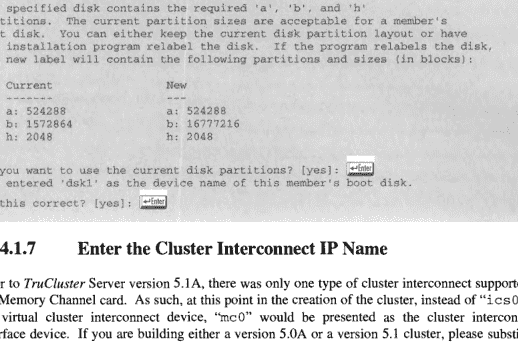

## 10.4.1.7 Enter the Cluster Interconnect IP Name

Prior to TruCluster Server version 5.1A, there was only one type of cluster interconnect supported – the Memory Channel card. As such, at this point in the creation of the cluster, instead of "`ics0`" as the virtual cluster interconnect device, "`mc0`" would be presented as the cluster interconnect interface device. If you are building either a version 5.0A or a version 5.1 cluster, please substitute "`mc0`" for "`ics0`".

By default, the cluster interconnect IP name is the individual system's name with "-ics0" appended to it. Prior to TruCluster Server version 5.1A, the default interconnect IP name is the individual system's name appended with "-mc0". For more information on this subject, please see section 4.4.1.5.

As this cluster interconnect IP name will be used for the internode communications among the cluster members, we recommend using this default value.

3 This is for TruCluster Server version 5.1A or higher.

## 10.4.1.8 输入集群互连 IP 地址

默认情况下，子网 `10.0.0.0` 用作集群成员之间节点间通信的专用网络。任何当前为专用网络或将来会成为专用网络且不在 DNS 配置中的子网也应可用。更多信息，请参阅 4.4.1.5 和 4.4.2.3 节。

同样在默认情况下，将成员 ID 追加到 `10.0.0.0` 子网后得到的地址会作为默认的集群互连 IP 地址。为简单起见，又因为它是 RFC 1918 规定的保留地址（私有且不可路由），使用此默认值作为集群互连 IP 地址是非常合理的。

The virtual cluster interconnect IP address '`10.0.0.1`' was created by replacing the last byte of the default virtual cluster interconnect network address '`10.0.0.0`' with the previously chosen member ID '`1`'.

To use this default value, press Return at the prompt.

The virtual cluster interconnect IP address is the IP address associated with the virtual cluster interconnect IP name. (`192.168.168.1` is an example of an IP address.)

Enter the IP address for the virtual cluster interconnect [`10.0.0.1`]:
```
Checking virtual cluster interconnect IP address: 10.0.0.1
```
You entered '`10.0.0.1`' as the IP address for the virtual cluster interconnect.

Is this address correct? [yes]:

## 10.4.1.9 输入集群互连类型

`clu_create` 命令输入中的这一部分是新增的，在 TruCluster Server 5.0A 或 5.1 版本中并不存在。随着 TruCluster Server 5.1A 中将以太网局域网（LAN）作为集群互连加入，必须提供某种方式来指定使用内存通道还是 LAN 作为集群互连。在本部分中，我们将可以选择要为集群使用哪种集群互连类型。

有关配置不同类型集群互连硬件的更详细信息，请参阅第 4.4 节。

这里我们将提供两个分别使用不同集群互连类型的示例。第一个示例使用内存通道，第二个使用以太网局域网。

- 使用内存通道作为集群互连非常简单。我们只需选择内存通道作为互连类型，确认这是我们所想要的，然后就完成了。

  您将使用哪种类型的集群互连？

  | 选项 | 互连类型 |
  |-----------|---------------------------|
  | 1         | 内存通道            |
  | 2         | 局域网        |
  | 3         | 以上都不是         |
  | 4         | 帮助                      |
  | 5         | 重新显示所有选项 |

  输入您的选择 [1]: 1

```
You selected option '1' for the cluster interconnect

Is that correct? (y/n) [y]: y
```

```
Device 'mc0' is the default physical cluster interconnect interface device

Checking physical cluster interconnect interface device name(s): mc0
```

- 使用以太网局域网作为集群互连比使用内存通道卡要复杂一些。我们不选择内存通道，而是选择局域网作为互连类型，然后确认这确实是我们想要的互连。不过，我们的选择还没有结束。

  您将使用哪种类型的集群互连？

  | 选项 | 互连类型 |
  |-----------|---------------------------|
  | 1         | 内存通道            |
  | 2         | 局域网        |
  | 3         | 以上都不是         |
  | 4         | 帮助                      |
  | 5         | 重新显示所有选项 |

  输入您的选择 [1]: 2

```
You selected option '2' for the cluster interconnect

Is that correct? (y/n) [y]:
```

在本示例中，我们使用千兆以太网 LAN 卡作为集群互连，并且现在必须告诉软件其设备类型。在本例中，该设备为“`alt0`”。出于示例目的，由于我们仅使用一个以太网设备作为集群互连，因此我们选择不将此以太网设备放入 NetRAIN 集中。有关 NetRAIN 的更多信息以及使用 NetRAIN 的好处，请参阅第 9 章和第 12 章。


The physical cluster interconnect interface device is the name of the physical device(s) which will be used for low level cluster communications. Examples of the physical cluster interconnect interface device name are: `tu0`, `eo0`, and `nr0`.

Enter the physical cluster interconnect device name(s) []: `alt0`

Would you like to place this Ethernet device into a NetRAIN set? [yes]: `no`

Checking physical cluster interconnect device name(s): `alt0`

You entered '`alt0`' as your physical cluster interconnect interface device name(s). Is this correct? [yes]:

现在软件知道了物理集群互连设备是什么，我们需要物理集群互连 IP 名称和 IP 地址。物理集群互连 IP 名称由单词“`member`”创建，并附加成员 ID 和“-icsctcp0”。在我们的示例中，这将是 `member1-icsctcp0`。这对我们来说是自动完成的。

默认物理集群互连 IP 地址是通过将成员 ID“1”附加到默认私有子网 `10.1.0.0` 创建的。同样，出于简单起见，我们决定接受此默认值，因为它是保留地址且符合 RFC 1918（私有且不可路由），并且是满足我们在创建集群方面的需求的良好选择。

The physical cluster interconnect IP name '`member1-icsctcp0`' was formed by appending '`-icsctcp0`' to the word '`member`' and the member ID.

Checking physical cluster interconnect IP name: `member1-icsctcp0`

The physical cluster interconnect IP address '`10.1.0.1`' was created by replacing the last byte of the default cluster interconnect network address '`10.1.0.0`' with the previously chosen member ID '`1`'.

To use this default value, press Return at the prompt.

The cluster physical interconnect IP address is the IP address associated with the physical cluster interconnect IP name. (`192.168.168.1` is an example of an IP address.)

Enter the IP address for the physical cluster interconnect [`10.1.0.1`]:
Checking physical cluster interconnect IP address: `10.1.0.1`

You entered '`10.1.0.1`' as the IP address for the physical cluster interconnect.

Is this address correct? [yes]:

有关将以太网 LAN 卡配置为集群互连的更多信息，请参阅第 4.4.2 节。

## 10.4.1.10 输入摘要

现在我们已完成创建单节点集群所需的所有输入，我们有机会查看我们输入的所有内容。鉴于我们有两个使用不同集群互连类型的单独示例，我们也有两个不同的配置摘要。

第一个配置摘要是我们使用 Memory Channel 作为集群互连时使用的。如果所有条目看起来都很好，我们只需在提示是否要创建集群时回答“yes”。

You entered the following information:

Cluster name: `babylon5.dec.com`

Cluster alias IP Address: `192.168.0.70`

Clusterwide root partition: `dsk6a`

Clusterwide usr partition: `dsk6g`

Clusterwide var partition: `dsk6h`

Clusterwide libn partition: `Not-Applicable`

Quorum disk device: `dsk5`

Number of votes assigned to the quorum disk: `1`

First member's member ID: `1`

Number of votes assigned to this member: `1`

First member's boot disk: `dsk1`

First member's virtual cluster interconnect device name: `ics0`

First member's virtual cluster interconnect IP name: `molari-ics0`

First member's virtual cluster interconnect IP address: `10.0.0.1`

First member's physical cluster interconnect devices `mc0`

First member's NetRAIN device name `Not-Applicable`

First member's physical cluster interconnect IP address `Not-Applicable`

If you want to change any of the above information, answer 'n' to the following prompt. You will then be given an opportunity to change your selections.

Do you want to continue to create the cluster? [yes]:


- 最后一个配置摘要是当我们使用以太网 LAN 作为集群互连时使用的。同样，如果我们同意所有条目都很好，我们只需在提示是否要创建集群时回答“yes”。

请注意，使用 Memory Channel 和以太网 LAN 作为集群互连之间存在细微差别。除了物理集群互连设备不同之外，你还能看出有什么不同吗？物理集群互连 IP 地址呢？当我们使用以太网 LAN 作为集群互连时，我们实际上会被要求将其作为输入。

You entered the following information:

Cluster name:                              babylon5.dec.com
Cluster alias IP Address:                  192.168.0.70
Clusterwide root partition:                dsk6a
Clusterwide usr partition:                 dsk6g
Clusterwide var partition:                 dsk6h
Clusterwide il8n partition:                Not-Applicable
Quorum disk device:                        dsk5
Number of votes assigned to the quorum disk: 1
First member's member ID:                  1
Number of votes assigned to this member:   1
First member's boot disk:                  dsk1
First member's virtual cluster interconnect device name: ics0
First member's virtual cluster interconnect IP name:     molari-ics0
First member's virtual cluster interconnect IP address:  10.0.0.1
First member's physical cluster interconnect devices     alt0
First member's NetRAIN device name        Not-Applicable
First member's physical cluster interconnect IP address   10.1.0.1

If you want to change any of the above information, answer 'n' to the following prompt. You will then be given an opportunity to change your selections.

Do you want to continue to create the cluster? [yes]:

Now that we are satisfied with all our entries and it matches our plan for the creation of our cluster, from the Cluster Preparation Worksheet and Checklist, we are ready to configure the cluster.

## 10.4.1.11 Configuring the Cluster

As we have already provided the `clu_create` software and all the inputs required to create a single-node cluster, let's see what happens during the actual configuration and creation of the cluster.

First, the member disk and the quorum disk are labeled, and the `cnx` partition on each is initialized.

```
Creating required disk labels.

Creating disk label on member disk : dsk1

Initializing cnx partition on member disk : dsk1h

Creating disk label on quorum disk : dsk5

Initializing cnx partition on quorum disk : dsk5h
```

Next, the AdvFS domains are created for all our system level file systems and for the first cluster member. These AdvFS domains are `cluster_root`, `cluster_usr`, `cluster_var`, and finally, the first cluster member's `boot_partition` (`root1_domain`).

- This is the output from the configuration using Memory Channel as a cluster interconnect.

```
Modifying configuration files required for cluster operation:

Creating /etc/fstab file.

Configuring cluster alias.

Updating /etc/hosts - adding IP address '192.168.0.70' and hostname 'babylon5.dec.com'

Updating member-specific /etc/inittab file with 'cms' entry.

Updating /etc/hosts - adding IP address '10.0.0.1' and hostname 'molari-ics0'

Updating /etc/rc.config file.

Updating /etc/sysconfigtab file.

Retrieving cluster_root major and minor device numbers.

Creating cluster device file CDSLS.

Updating /.rhosts - adding hostname 'babylon5.dec.com'

Updating /etc/hosts.equiv - adding hostname 'babylon5.dec.com'

Updating /.rhosts - adding hostname 'molari-ics0'

Updating /etc/hosts.equiv - adding hostname 'molari-ics0'

Updating /etc/ifaccess.conf - adding deny entry for 'ee0'

Updating /etc/ifaccess.conf - adding deny entry for 's10'

Finished updating member1-specific area.
```

- This is the output from a configuration using Ethernet LAN as the cluster interconnect.

```
Modifying configuration files required for cluster operation:

Creating /etc/fstab file.

Configuring cluster alias.

Updating /etc/hosts - adding IP address '192.168.0.70' and hostname 'babylon5.dec.com'

Updating member-specific /etc/inittab file with 'cms' entry.

Updating /etc/hosts - adding IP address '10.0.0.1' and hostname 'molari-ics0'

Updating /etc/hosts - adding IP address '10.1.0.1' and hostname 'member1-icstcp0'

Updating /etc/rc.config file.

Updating /etc/sysconfigtab file.
```


Retrieving cluster_root major and minor device numbers.

Creating cluster device file CDSLS.

Updating `/.rhosts` - adding hostname 'babylon5.dec.com'

Updating `/etc/hosts.equiv` - adding hostname 'babylon5.dec.com'

Updating `/.rhosts` - adding hostname 'molari-ics0'

Updating `/etc/hosts.equiv` - adding hostname 'molari-ics0'

Updating `/.rhosts` - adding hostname 'member1-icstcp0'

Updating `/etc/hosts.equiv` - adding hostname 'member1-icstcp0'

Updating `/etc/ifaccess.conf` - adding deny entry for 'ee0'

Updating `/etc/ifaccess.conf` - adding deny entry for 's10'

Finished updating member1-specific area.

```
+   接下来，为第一个集群成员构建新的内核并复制到指定位置。
```

Building a kernel for this member.

Saving kernel build configuration.

The kernel will now be configured using the doconfig program.

*** KERNEL CONFIGURATION AND BUILD PROCEDURE ***

Saving `/sys/conf/MOLARI` as `/sys/conf/MOLARI.bck`

*** PERFORMING KERNEL BUILD ***

Working...Mon Mar 25 12:03:40 PST 2002

The new kernel is `/sys/MOLARI/vmunix`

Finished running the doconfig program.

The kernel build was successful and the new kernel

has been copied to this member's boot disk.

Restoring kernel build configuration.

## 10.4.1.12 更新 SRM 控制台变量

在下一节中，依赖于引导的 SRM 控制台变量将被创建或更新，以便允许从新创建的集群成员的引导磁盘启动。需要注意的是，这些依赖于引导的 SRM 控制台变量并未设置为 root (/)，而是设置为集群成员的引导磁盘。

```
Updating console variables

Setting console variable 'bootdef_dev' to dsk1

Setting console variable 'boot_dev' to dsk1

Setting console variable 'boot_reset' to ON

Saving console variables to non-volatile storage
```

## 10.4.1.13 完成新单节点集群的创建

最后，`clu_create` 命令完成并询问我们是否要重新启动系统以启动新创建的单节点集群。

```
clu_create: Cluster created successfully.

To run this system as a single member cluster it must be rebooted.

If you answer yes to the following question clu_create will reboot the system for you now. If you answer no, you must manually reboot the system after clu_create exits.

Would you like clu_create to reboot this system now? [yes]
```

## 10.4.2 检查集群配置

系统重新启动后，它作为新的单节点集群启动。让我们检查一下有什么变化。

### 10.4.2.1 检查文件系统

就文件系统而言，情况看起来有些不同。使用 `mount` 命令，我们看到有三个新的集群文件系统用于 root (/)、/usr 和 /var。我们还看到新集群成员的 boot_partition 是分开的。

```
# /sbin/mount

cluster_root#root on / type advfs (rw)

cluster_var#var on /var type advfs (rw)

root1_domain#root on /cluster/members/member1/boot_partition type advfs (rw)

cluster_usr#usr on /usr type advfs (rw)

/proc on /proc type procfs (rw)
```

仔细查看，我们看到为这些文件系统创建了四个新的 AdvFS 域。我们还看到原始 Tru64 UNIX 系统级文件系统的 AdvFS 域仍然可用但未挂载。

```
# ls /etc/fdmns

.advfslock_cluster_root   cluster_root/

.advfslock_cluster_usr    cluster_usr/

.advfslock_cluster_var    cluster_var/

.advfslock_root1_domain   root1_domain/

.advfslock_root_domain    root_domain/

.advfslock_user_domain    usr_domain/

.advfslock_var_domain     var_domain/
```

通过查看域的目录，可以验证我们选择的设备是否已设置。这里有一个可能的方法：

```
# for i in $(ls -l /etc/fdmns | awk '/^d/ { print $9 }')
> do
> cd /etc/fdmns/$i
> print "\n$PWD"
> ls -l | awk '{ print "\t"$9,$10,$11 }'
> done
```

```
*****  Checking daemons on members  *****
*****
*****  Checking member molari-ics0 daemons
        aliasd is RUNNING
        aliasd_niff is RUNNING
        /sbin/klroadsrv is RUNNING
        /usr/sbin/evmd is RUNNING
        /usr/sbin/nifd is RUNNING
        /usr/sbin/portmap is RUNNING
        /usr/sbin/caad is RUNNING
        /usr/sbin/clu_wal1 is RUNNING
        /usr/sbin/xntpd is RUNNING
        /usr/sbin/gated is RUNNING
        /usr/sbin/clu_mibs is RUNNING
        /usr/sbin/rdginit is RUNNING
        /usr/sbin/snmpd is RUNNING
        /usr/sbin/syslogd is RUNNING
        /usr/sbin/binlogd is RUNNING
        /usr/sbin/mountd is RUNNING
        /usr/sbin/nfsd is RUNNING
        /usr/sbin/smnsd is RUNNING
        /usr/sbin/clu_wal1 is RUNNING
        /usr/sbin/xntpd is RUNNING
        /usr/sbin/gated is RUNNING
        /usr/sbin/clu_mibs is RUNNING
        /usr/sbin/rdginit is RUNNING
        /usr/sbin/snmpd is RUNNING
        /usr/sbin/syslogd is RUNNING
```


`/usr/sbin/binlogd` is RUNNING

`/usr/sbin/mountd` is RUNNING

`/usr/sbin/nfsd` is RUNNING

`/usr/sbin/smnsd` is RUNNING

*****

*****  Checking the synchronization between members  *****

*****

`molari-ics0`: delay:0.000976 offset:0.000488  Sun Apr 21 00:59:10 2002

`check_cds1_config` : Checking installed CDSLs

`check_cds1_config` : Successfully verified CDSL configuration

## 10.5.2 检查连接管理器子系统

现在让我们检查连接管理器子系统。`clu_get_info(8)` 命令提供有关集群及其所有集群成员的详细信息。该命令也从 `clu_check_config` 命令中执行。

```text
# /usr/sbin/clu_get_info -full

Cluster information for cluster babylon5

Number of members configured in this cluster = 1

memberid for this member = 1

Cluster incarnation = 0xb63fd

Cluster expected votes = 2

Current votes = 2

Votes required for quorum = 1

Quorum disk = dsk5h

Quorum disk votes = 1

Information on each cluster member

Cluster memberid = 1

Hostname = molari.dec.com

Cluster interconnect IP name = molari-ics0

Cluster interconnect IP address = 10.0.0.1

Member state = UP

Member base O/S version = Compaq Tru64 UNIX V5.1A (Rev. 1885)

Member cluster version = TruCluster Server V5.1A (Rev. 1312)

Member running version = INSTALLED

Member name = molari

Member votes = 1

csid = 0x10001
```

The `clu_quorum(8)` command is used for configuring or deleting a quorum disk and adjusting the quorum disk votes, individual member node votes, and overall expected votes. This command can also be used to display information about what quorum is in a cluster. For more detailed information concerning the `clu_quorum` command, please read Chapter 17 on the Connection Manager or the `clu_quorum(8)` reference page.

In any event, let's look at quorum in our new single-node cluster using the `clu_quorum` command.

```text
# /usr/sbin/clu_quorum

Cluster Quorum Data for: babylon5 as of Sun Apr 21 01:27:16 PDT 2002

Cluster Common Quorum Data

Quorum disk: dsk5h

File: /etc/sysconfigtab.cluster

Attribute                File Value

expected votes                     2

Member 1 Quorum Data

Host name: molari.dec.com                     Status: UP

File: /cluster/members/member1/boot_partition/etc/sysconfigtab

Attribute    Running Value    File Value

current votes    2             N/A

quorum votes     1             N/A

expected votes   2             2

node votes       1             1

qdisk votes      1             1

qdisk major      19            19

qdisk minor      384           384
```

## 10.5.3 Check the Cluster Alias Subsystem

The `cluamgr(8)` command is used to manage and report information and statistics about cluster aliases. As this cluster was just created, there should only be information about one cluster alias – the default cluster alias. Let’s see what information is provided.

```text
# /usr/sbin/cluamgr -s all

Status of Cluster Alias: babylon5.dec.com

netmask: 0

aliasid: 1

flags: 7<ENABLED,DEFAULT,IP_V4>

connections rcvd from net: 30

connections forwarded: 22

connections rcvd within cluster: 17

data packets received from network: 8796

data packets forwarded within cluster: 1361

datagrams received from network: 2190

datagrams forwarded within cluster: 37

datagrams received within cluster: 3068

fragments received from network: 0

fragments forwarded within cluster: 0

fragments received within cluster: 0

Member Attributes:

memberid: 1, selw=3, selp=1, rpri=1 flags=11<JOINED,ENABLED>
```

As we can see, the cluster alias is “babylon5.dec.com” and it only has one cluster member in the cluster. This is evident by the `memberid` field.

More information on cluster aliases can be found in Chapter 16 on the Cluster Alias Subsystem.

## 10.5.4 Check the Device Request Dispatcher (DRD) Subsystem

The command used to configure and report on the DRD subsystem is the `drdmgr(8)` command. Let’s use the `drdmgr` command to look at the properties of the disk containing the `cluster_root` file system.

First, let’s find out what disk is used for the `cluster_root` domain.


# `/sbin/showfmdn` `cluster_root`

Id                Date Created        LogPgs Version Domain Name

3d013e89.0000fc70 Sun Apr 21 16:06:49 2002 512    4      cluster_root

Vol   512-Blks   Free   % Used Cmode Rblks Wblks Vol Name

1L    1048576    769360  27%    on     256    256    `/dev/disk/dsk6a`

```
Now let’s use the drdmgr command to examine dsk6.
```

```
# /sbin/drdmgr dsk6
```

View of Data from member molari as of 2002-04-21:01:24:17

Device Name: dsk6

Device Type: Direct Access IO Disk

Device Status: OK

Number of Servers: 1

Server Name: molari

Server State: Server

Access Member Name: molari

Open Partition Mask: 0xc1 - a g h

Statistics for Client Member: molari

Number of Read Operations: 8189

Number of Write Operations: 910513

Number of Bytes Read: 145510400

Number of Bytes Written: 8068251648

Notice that molari is both the server and the client (Access Member Name) for this disk. Also notice that three partitions are open on this disk (from the Open Partition Mask) – partitions a, g, and h. These partitions correspond to the AdvFS domains for cluster_root, cluster_usr, and cluster_var.

Now let’s look at the quorum disk.

```
# /sbin/drdmgr dsk5
```

View of Data from member molari as of 2002-04-21:01:29:39

Device Name: dsk5

Device Type: Direct Access IO Disk

Device Status: OK

Number of Servers: 1

Server Name: molari

Server State: Server

Access Member Name: molari

Open Partition Mask: 0

Statistics for Client Member: molari

Number of Read Operations: 200979

Number of Write Operations: 200977

Number of Bytes Read: 205805568

Number of Bytes Written: 102903808

As you can see, there appears to be quite a bit of I/O activity to this disk but there does not appear to be any open partitions. As this is the quorum disk, the Connection Manager does not have any partitions open.

For more detailed information on the DRD subsystem, please review Chapter 15 on the Device Request Dispatcher.

## 10.5.5 检查集群文件系统（CFS）子系统

`cfsmgr(8)` 命令用于管理和收集集群中已挂载文件系统的信息。

在创建单节点集群后，让我们看看 `cfsmgr` 命令提供了哪些信息。

```
# /sbin/cfsmgr
```

Domain or filesystem name = cluster_root#root

Mounted On = `/`

Server Name = molari

Server Status : OK

Domain or filesystem name = root1_domain#root

Mounted On = `/cluster/members/member1/boot_partition`

Server Name = molari

Server Status : OK

Domain or filesystem name = cluster_var#var

Mounted On = `/var`

Server Name = molari

Server Status : OK

Domain or filesystem name = cluster_usr#usr

Mounted On = `/usr`

Server Name = molari

Server Status : OK

由于这是一个单节点集群，可以合理地预期所有文件系统的服务器都是集群中唯一的成员。有关集群文件系统子系统的更详细信息，请参阅第 13 章。

## 10.5.6 检查集群应用可用性（CAA）子系统

`caa_stat(8)` 命令用于获取处于 CAA 子系统控制下的应用程序的状态。处于 CAA 子系统控制下的应用程序通常一次只能在一个集群节点上运行。CAA 是高可用性机制，如果运行该应用程序的集群节点变得不可用，则会将应用程序故障转移。

默认情况下，通常 `cluster_lockd` 会配置为新集群上的 CAA。使用 `caa_stat` 命令可提供其状态的统计信息。

```
# /usr/bin/caa_stat -t
```

Name      Type        Target   State    Host

-----------------------------------------------

cluster_lockd application ONLINE   ONLINE   molari

dhcp      application OFFLINE  OFFLINE

named     application OFFLINE  OFFLINE

有关 CAA 的更多信息，请查阅第 23 章和第 24 章关于集群应用可用性。

## 10.5.7 检查网络别名

从以下输出中，我们可以看到 Memory Channel 互连上有一个网络处于启动并可用状态。

```
# netstat -I ics0
```

Name  Mtu  Network    Address          Ipkts Ierrs  Opkts Oerrs Coll

ics0  7000 <Link>     ics0:42.0.0.0.1   82417  0      82791  0     0

ics0  7000 10.0.0     molari-ics0       82417  0      82791  0     0

请注意，我们的集群别名 `babylon5` 并未出现在我们正在使用的子网关联的接口上。

```
# netstat -I ee0
```

Name  Mtu  Network    Address          Ipkts Ierrs  Opkts Oerrs Coll

ee0   1500 <Link>     0:50:8b:ae:fe:dc 1172451 0     115869 0     0

ee0   1500 DLI       none             1172451 0     115869 0     0

ee0   1500 138.127.89 molari           1172451 0     115869 0     0


## 10.6 参考文献

- TruCluster Server 集群安装指南。
- TruCluster Server 集群管理指南。
- Tru64 UNIX 和 TruCluster 软件补丁摘要和发行说明。
- Tru64 UNIX 和 TruCluster 软件补丁包安装说明指南。
- 参考页（文中已注明）。

## 添加集群成员/删除集群成员

> “从混乱中发现简洁。从不和谐中发现和谐。困难的中心就是机会。” - 阿尔伯特·爱因斯坦

在第 10 章中，我们讨论了如何基于仔细的集群配置规划和准备来创建单节点集群。在本章中，我们将扩展这一讨论。我们将讨论创建集群的下一步，即通过添加新成员来扩展集群。为了完善我们对创建和扩展集群的回顾，我们将讨论如何删除集群成员。

只要有适当的注意、规划和准备，从集群中添加新成员和删除成员都是直接而简单的活动，可以非常快速地完成。因此，继续使用第 4.8 节中的集群准备清单和工作表作为指南非常重要。清单和工作表就像房屋的蓝图一样——你绝不会想在没有先制定显示其架构将是什么样的计划的情况下开始建造房屋。

作为一个相当不科学的测试，我们计时看看将一台新的 AlphaServer 添加并配置到现有的 TruCluster Server 环境中需要多长时间。我们从系统初始加电到新系统作为集群成员启动并运行的最快时间为 32 分钟。虽然我们当然不能算是印第安纳波利斯 500 赛车场维修站的成员，但请考虑安装和配置一台单服务器的正常时间。如果建造一台服务器需要一个半小时到两个小时，建造两台服务器则需要三到四个小时。相比之下，构建一个双成员集群大约需要两到两个半小时。相当不错！

这是否给了我们关于我们能多快向现有集群添加新成员的炫耀权？不，但它确实表明，只要有适当的规划和准备，以及 TruCluster Server 软件，向集群添加新成员就是一个直接而简单的任务。同样适用于从集群中删除成员。

## 11.1 准备

据说准备不足就是在为失败做准备。牢记这一点，请花时间规划和准备集群的部署。从第 4.8 节的集群准备清单和工作表开始制定部署计划，然后执行该计划。

### 11.1.1 规划添加另一个集群成员

有关向集群添加成员的所有要素均在第 4 章中进行了详细讨论。请查阅第 4 章以获取更多信息，并且请再次使用集群准备清单和工作表作为规划集群的指南。

### 11.1.2 准备就绪

您应该从至少一个已成功配置的单节点集群开始。假设您已计划并准备好向集群添加成员，那么您就可以准备向集群添加新成员了。以下小节涵盖了一些最后的事项。

#### 11.1.2.1 一次添加或删除一个成员

由于添加新成员或删除成员非常容易，因此需要注意的是，您应在启动对另一个集群成员的添加或删除操作之前，完全完成对一个集群成员的添加或删除。为什么？为了避免任何集群法定人数问题。在集群的上下文中，保持法定人数并在添加或删除集群成员时根据需要进行调整至关重要。

#### 11.1.2.2 新成员引导磁盘

此时应已确定要添加的集群成员的引导磁盘或 `boot_partition`。如果尚未确定，请查阅第 4 章以及集群部署计划。

此时，使用第 10.1.2 节中的信息正确分区成员引导磁盘并为其写入适当的 `disklable`。写入 `disklable` 后，它应具有成员 `boot_partition`、`swap` 和集群状态分区所使用的适当 in-use `fstype`。如果不是这种情况，请参阅第 10.1.2 节，审查集群部署计划，并再次创建适当的 `disklable`。

#### 11.1.2.3 初始化 SRM 控制台变量

如果新集群成员的与引导相关的 SRM 控制台变量尚未初始化以防止新集群成员在安装期间启动，则应在开始将该成员添加到集群的过程之前完成此操作。有关更多信息，请参阅第 4.5.3 节。

## 11.2 添加新集群成员

要向集群添加新系统或新成员，我们在现有集群成员上执行 `clu_add_member(8)` 命令。`clu_add_member` 命令执行以下操作：

- 在 `cluster_root`、`cluster_usr` 和 `cluster_var` 文件系统中为新成员创建目录和文件。
- 为新成员标记并填充引导磁盘。
- 配置分层产品软件子集。
- 构建新内核并将其复制到新成员的 `boot_partition` 中。
- 将会话记录写入日志文件 `clu_add_member.log`，该文件位于 `/cluster/admin` 目录中。它还将新成员的配置信息写入同一目录中的 `.membern.cfg` 文件（其中 n 为新成员的 `memberid`）。
- 新集群成员上没有软件安装。由于这是一个集群，我们只需安装一次软件，而这是在集群首次创建时完成的。

在现有集群成员上执行 `clu_add_member` 命令。请注意，与第 10 章中的 `clu_create` 命令类似，`clu_add_member` 命令会告诉我们需要哪些信息以及它将执行哪些操作来创建新的集群成员。

```
# /usr/sbin/clu_add_member

This is the TruCluster Add Member Program

You will need the following information in order to add a member to the cluster:

- Hostname

- Member ID (1-63)

- Members Votes

- Member's boot disk (for example, dsk7)

- Member's virtual cluster interconnect IP name

- Member's virtual cluster interconnect IP address

- Member's physical cluster interconnect devices

- Member's NetRAIN device name

- Member's physical cluster interconnect IP address

- Member's cluster license

The program will prompt for this information, offering a default value when one is available. To accept the default value, press Return if you need help responding to a prompt, either type the word 'help' or type a question mark (?) at the prompt.

The program does not begin to add the member until you answer all the prompts, and you confirm that the answers are correct.
```

添加成员涉及以下步骤：

- 标记启动磁盘（如果需要）
- 创建 AdvFS 域
- 创建额外的 CDSL
- 更新配置文件

然后，从新成员的启动磁盘引导 `genvmunix`。首次引导时，新成员将：

- 配置分层产品子集
- 构建内核并将其复制到成员的启动磁盘
- 引导新内核

添加新集群成员时，我们首先要做的第一件事是确认这正是我们打算做的。

```
Do you want to continue adding this member? [yes]: yes
```

## 11.2.1 输入主机名

在与 `clu_add_member` 程序的下一个对话中，系统提示我们输入为新集群成员保留的完全限定主机名。对于决定如何称呼该系统，我们参考规划文档——集群准备检查表和工作表。

```
Each cluster member has a hostname, which is assigned to the HOSTNAME variable in /etc/rc.config.

Enter the new member's fully qualified hostname []:sheridan.dec.com

Checking member's hostname: sheridan.dec.com

You entered 'sheridan.dec.com' as this member's hostname.

Is this name correct? [yes]: yes
```

## 11.2.2 输入成员 ID 和预期票数

接下来，系统提示我们输入此新集群成员的成员 ID。默认情况下，按顺序下一个可用的成员 ID 会呈现。在这种情况下，它是 2；但是，我们可以使用最多 63 的任何数字。当然，这仅限于该成员 ID 当前未被其他集群成员使用的情况。

```
The next available member ID for a cluster member is '2'.

To use this default value, press Return at the prompt.
```


A member ID is used to identify each member in a cluster.

Each member must have a unique member ID, which is an integer in the range 1-63, inclusive.

Enter a cluster member ID [2]: 2

Checking cluster member ID: 2

You entered '2' as the member ID.

Is this correct? [yes]: yes

默认情况下，该新集群成员获得 1 票。在这种情况下，接受此默认值是合理的。有关仲裁和连接管理器的更详细信息，请参阅第 17 章。

By default, when the current cluster's expected votes are greater then 1,

each added member is assigned 1 vote(s). Otherwise, each added member is assigned 0 (zero) votes.

To use this default value, press Return at the prompt.

The number of votes for a member is an integer usually 0 or 1

Enter the number of votes for this member [1]: 1

Checking number of votes for this member: 1

You entered '1' as the number votes for this member.

Is this correct? [yes]: yes

## 11.2.3 输入成员启动磁盘

由于每个独立的集群成员必须有自己的启动设备或 `boot_partition`，系统提示我们输入将用于此新集群成员的磁盘名称。鉴于我们已为此做好了规划，我们参考已完成的集群准备检查表和工作表，以获取已预留并已正确分区的新集群成员 `boot_partition` 的磁盘信息。

Each member has its own boot disk, which has an associated device name; for example, '`dsk5`'.

Enter the device name of the member boot disk []: `dsk2`

Checking the member boot disk: `dsk2`

1 请参阅关于新成员启动磁盘的第 11.1.2.2 节和关于集群磁盘的第 10.1.2 节。

The specified disk contains the required '`a`', '`b`', and '`h`'

partitions. The current partition sizes are acceptable for a member's

boot disk. You can either keep the current disk partition layout or have

the installation program relabel the disk. If the program relabels the disk,

the new label will contain the following partitions and sizes (in blocks):

| Current | New |
|---|---|
| a: 524288 | a: 524288 |
| b: 1572864 | b: 16777216 |
| h: 2048 | h: 2048 |

Do you want to use the current disk partitions? [yes]: yes

You entered '`dsk2`' as the device name of this member's boot disk.

Is this correct? [yes]: yes

如您所见，我们已成功使用了自定义分区的成员启动磁盘。有关我们用来实现此目标的特殊技术的更多信息，请参阅第 10.2.1 节。

## 11.2.4 输入集群 IP 名称

正如我们在第 4 章和第 10 章中所述，随着 TruCluster Server 5.1A 版本的发布以及以太网 LAN 作为内存通道的备用集群互连的加入，集群互连设备名称从“`mc0`”更改为“`ics0`”。这样做的目的是使集群互连设备现在可以是虚拟的。这一更改伴随着一些默认命名约定的更改，因此默认情况下，新集群成员的虚拟集群互连 IP 名称是主机名后附加“-`ics0`”。在 TruCluster Server 5.1A 版本之前，此默认集群互连 IP 名称是主机名后附加“-`mc0`”。虽然任何不在 DNS 配置中的 IP 名称都应可用，但我们建议使用默认值以保持简单性和一致性，并且因为它已经具有很强的描述性。

Device '`ics0`' is the default virtual cluster interconnect device

Checking virtual cluster interconnect device: `ics0`

The virtual cluster interconnect IP name '`sheridan-ics0`' was formed by

appending '-`ics0`' to the system's hostname.

To use this default value, press Return at the prompt.

Each virtual cluster interconnect interface has a unique IP name (a

hostname) associated with it.

Enter the IP name for the virtual cluster interconnect [`sheridan-ics0`]: `sheridan-ics0`

Checking virtual cluster interconnect IP name: `sheridan-ics0`

You entered '`sheridan-ics0`' as the IP name for the virtual cluster interconnect.

Is this name correct? [yes]: yes

## 11.2.5 输入集群互连 IP 地址

在第 10 章中，子网 `10.0.0` 被用作集群成员之间节点间通信的专用网络。默认情况下，`10.0.0` 子网加上成员 ID 会作为新成员的默认集群互连 IP 地址。为了保持一致性，并且由于它是 RFC 1918（私有且不可路由）保留地址，使用这个默认值作为虚拟集群互连 IP 地址是一个不错的选择。

The virtual cluster interconnect IP address '`10.0.0.2`' was created by replacing the last byte of the virtual cluster interconnect network address '`10.0.0.0`' with the previously chosen member ID '`2`'.

To use this default value, press Return at the prompt.

The virtual cluster interconnect IP address is the IP address associated with the virtual cluster interconnect IP name. (`192.168.168.1` is an example of an IP address.)

Enter the IP address for the virtual cluster interconnect [`10.0.0.2`]: `10.0.0.2`

Checking virtual cluster interconnect IP address: `10.0.0.2`

You entered '`10.0.0.2`' as the IP address for the virtual cluster interconnect.

Is this address correct? [yes]: yes


## 11.2.6 输入集群互连类型²

从 TruCluster Server 5.1A 版开始，`clu_add_member` 命令与 `clu_create` 命令一样，让我们可以选择使用以太网 LAN 或 Memory Channel 作为集群互连。³ 在添加新成员的这一步，系统会提示我们选择集群互连类型。

为了便于说明，我们提供了两个示例，展示选择集群互连类型时应该是什么样子。第一个示例使用 Memory Channel，第二个示例使用以太网 LAN。

- 使用 Memory Channel 非常简单。我们只需选择 `mc0` 作为物理集群互连设备，确认选择，然后就完成了。

```
Device 'mc0' is the default physical cluster interconnect interface device

To use this default value, press Return at the prompt.
```

² `clu_add_member` 的这一部分在 TruCluster Server 5.0A 版和 TruCluster Server 5.1 版中不存在。

³ TruCluster Server 5.0A 版和 TruCluster Server 5.1 版仅支持 Memory Channel 作为集群互连。

```
The physical cluster interconnect interface device is the name of the physical device(s) which will be used for low level cluster node communications. Examples of the physical cluster interconnect interface device name are: tu0, es0, and nr0.

Enter the physical cluster interconnect device name(s) [mc0]: mc0

Checking physical cluster interconnect interface device name(s): mc0

You entered 'mc0' as your physical cluster interconnect interface device name(s). Is this correct? [yes]: yes
```

- 添加新集群成员时，使用以太网 LAN 作为物理集群互连比使用 Memory Channel 更复杂。首先，系统会提示我们输入物理集群互连设备。在我们的示例中，我们使用千兆以太网 LAN 卡 —— `alt0`。

```
The physical cluster interconnect interface device is the name of the physical device(s) which will be used for low level cluster node communications. Examples of the physical cluster interconnect interface device name are: tu0, ee0, and nr0.

Enter the physical cluster interconnect device name(s) []:alt0

Would you like to enter another Ethernet device? [yes]:no

Checking physical cluster interconnect interface device name(s): alt0

You entered 'alt0' as your physical cluster interconnect interface device name(s). Is this correct? [yes]:yes
```

然后系统会提示我们指定这些接口是否应配置在 NetRAIN 虚拟接口中。有关 NetRAIN 的更多信息，请参阅第 9 章。在我们的示例中，我们选择不为 NetRAIN 接口设备名称输入任何内容，因为我们只有一个以太网设备用于集群互连。

```
Enter a NetRAIN interface device name []:
```

现在软件已经知道物理集群互连设备是什么了，我们还需要物理集群 IP 名称和地址。如第 4 章和第 10 章所述，该名称由单词 `member` 加上成员 ID 和 `-icstcp0` 构成。系统会自动为我们创建该名称。

将成员 ID 附加到默认私有子网 10.1.1.0 上，就创建了默认的物理集群 IP 地址。在我们的示例中，该 IP 地址将是 10.1.1.0.2。同样，我们接受这个默认值。

物理集群互连 IP 名称 '`member2-icstcp0`' 是通过将 '-icstcp0' 追加到单词 'member' 和成员 ID 后面形成的。
正在检查物理集群互连 IP 名称: `member2-icstcp0`

物理集群互连 IP 地址 '`10.1.0.2`' 是通过将物理集群互连网络地址 '`10.1.0.0`' 的最后一个字节替换为先前选择的成员 ID '`2`' 而创建的。
要使用此默认值，请在提示符处按 Return。

集群物理互连 IP 地址是与物理集群互连 IP 名称关联的 IP 地址。（192.168.168.1 是 IP 地址的一个示例。）

输入物理集群互连的 IP 地址 [`10.1.0.2`]:`10.1.0.2`
正在检查物理集群互连 IP 地址: `10.1.0.2`

你输入了 '`10.1.0.2`' 作为物理集群互连的 IP 地址。
这个地址正确吗？ [yes]:yes

有关将以太网 LAN 卡配置和用作集群互连的更多信息，请参阅第 4.4.2 节。

## 11.2.7 TruCluster 服务器许可证 PAK

最后，`clu_add_member` 命令会提示我们输入最后一项输入——TruCluster 服务器许可证 PAK。对于此提示，我们可以选择立即为新集群成员添加许可证 PAK，或者在启动新集群成员后稍后使用 `lmsetup` 命令。在我们的示例中，我们选择输入 TruCluster 服务器许可证 PAK。

```
Each cluster member must have its own registered TruCluster Server license. The data required to register a new member is typically located on the License PAK certificate or it may have been previously placed on your system as a partial or complete license data file. If you are prepared to enter this license data at this time, clu_add_member can configure the new member to use this license data. If you do not have the license data at this time you can enter this data on the new member when it is up and running.

Do you wish to register the TruCluster Server license for this new member at this time? [yes]: yes
```

```
By default the TruCluster Server license data is entered by invoking the editor that is defined by your EDITOR environment variable. If the environment variable is undefined, the vi editor will be invoked.

clu_add_member will display a template that includes all the fields on a PAK and an additional field for your comment. You must transfer the values from your License Pak certificate to the template, then save and exit the editor.

Do you wish to enter the data using the 'vi' editor? [yes]: yes
```

接下来的输入摘要基于使用以太网 LAN 作为集群互连。

```
You entered the following information:
```


Member's hostname:                      `sheridan.dec.com`

Member's ID:                            `2`

Number of votes assigned to this member: `1`

Member's boot disk:                     `dsk2`

Member's virtual cluster interconnect devices:  `ic0`

Member's virtual cluster interconnect IP name:  `sheridan-ics0`

Member's virtual cluster interconnect IP address: `10.0.0.2`

Member's physical cluster interconnect devices:  `aic0`

Member's NetRAIN device name:           Not Applicable

Member's physical cluster interconnect IP address: `10.1.0.2`

Member's cluster license:               Entered

If you want to change any of the above information answers 'n' to the following prompt. You will then be given an opportunity to change your selections.

Do you want to continue to add this member? [yes]: yes

```
在每个示例中，我们确认摘要，并在提示继续添加集群成员时回答 “yes”。
```

## 11.2.9 配置集群

下一节不需要任何输入，因为所有选择和条目都已完成。让我们了解一下正在进行的工作。

首先，将磁盘标签写入新集群成员的启动磁盘。然后初始化此磁盘上的 `cnx` 分区。

```
Creating required disk labels.

Creating disk label on member disk : dsk2

Initializing cnx partition on member disk : dsk2h
```

新集群成员启动磁盘的 AdvFS 域以及新集群成员的成员特定文件将一并创建。

```
Creating AdvFS domains:

    Creating AdvFS domain 'root2_domain#root' on partition '/dev/disk/dsk2a'.

Creating cluster member-specific files:

    Creating new member's root member-specific files

    Creating new member's usr member-specific files

    Creating new member's var member-specific files

    Creating new member's boot member-specific files
```

接下来，作为新集群成员添加的一部分，将执行配置修改和系统文件的更新。同样，由于我们有两种使用不同集群互连类型的配置示例，因此我们也有两种对系统文件进行修改的示例。

- 如果使用 Memory Channel 作为集群互连，则对系统文件的更新如下所示：

```
Modifying configuration files required for new member operation:

Updating /etc/hosts - associating IP address '10.0.0.2' with hostname 'sheridan-ics0'

Updating /etc/rc.config

Updating /etc/rc.config

Updating /etc/sysconfigtab

Updating member-specific /etc/inittab file with 'cms' entry.

Updating /.rhosts - adding hostname 'sheridan-ics0'

Updating /etc/hosts.equiv - adding hostname 'sheridan-ics0'

Updating /etc/cfgmgr.auth - adding hostname 'sheridan.dec.com'

Configuring cluster alias.

Configuring Network Time Protocol for new member

Adding interface 'molari-ics0' as an NTP peer to member 'sheridan.dec.com'

Adding interface 'sheridan-ics0' as an NTP peer to member 'molari.dec.com'

Registering TruCluster Server License
```

- 如果使用以太网 LAN 作为集群互连，则对系统文件的更新如下所示：

```
Modifying configuration files required for new member operation:

Updating /etc/hosts - associating IP address '10.0.0.2' with hostname 'sheridan-ics0'

Updating /etc/hosts - adding IP address '10.1.0.2' and hostname 'member2-icscp0'

Updating /etc/rc.config

Updating /etc/sysconfigtab

Updating member-specific /etc/inittab file with 'cms' entry.

Updating /etc/securetty - adding ptys entry

Updating /.rhosts - adding hostname 'sheridan-ics0'

Updating /etc/hosts.equiv - adding hostname 'sheridan-ics0'

Updating /.rhosts - adding hostname 'member2-icscp0'

Updating /etc/hosts.equiv - adding hostname 'member2-icscp0'

Updating /etc/cfgmgr.auth - adding hostname 'sheridan.dec.com'

Configuring cluster alias.

Configuring Network Time Protocol for new member

Adding interface 'molari-ics0' as an NTP peer to member 'sheridan.dec.com'

Adding interface 'sheridan-ics0' as an NTP peer to member 'molari.dec.com'

Registering TruCluster Server License
```

一旦新集群成员添加的整个配置完成，就会显示一份关于在新集群成员上下一步该做什么的说明列表。

```
Configuring automatic subset configuration and kernel build.

CNX MGR: Adjust expected votes operation completed with quorum.

clu_add_member: Initial member 2 configuration completed successfully.

From the newly added member's console, perform the following steps to

complete the newly added member's configuration:

1. Set the console variable 'boot_osflags' to 'A'.

2. Identify the console name of the newly added member's boots device.

>>>show device

The newly added member's boot device has the following properties:

Manufacturer: DEC

Model: HSGB0
```


Target: IDENTITY?

Lun: UNKNOWN

Serial Number: SCSI-WID:01000010:6000-1fe1-0001-6950-0009-1420-0755-0038

Note: The SCSI bus number may differ when viewed from different members.

3. Boot the newly added member using `genvmunix`:

```
>>>boot -file genvmunix <new-member-boot-device>
```

During this initial boot the newly added member will:

o Configure each installed subset.

o Attempt to build and install a new kernel. If the system cannot build a kernel, it starts a shell where you can attempt to build a kernel manually. If the build succeeds, copy the new kernel to `/vmunix`. When you are finished exit the shell using 'D' or 'exit'.

o The newly added member will attempt to set boot related console variables and continue to boot to multi-user mode.

o After the newly added member boots you should setup your system default network interface using the appropriate system management command.

## 1.3 启动新的集群成员

让我们按照 `clu_add_member` 命令完成后显示的说明进行操作。

首先，让我们设置 `boot_osflags` 控制台变量：

```
P00>>> set boot_osflags 'a'
```

接下来，让我们识别新集群成员的启动设备。⁴

```
P00>>> show device

Dga2.1001.0.7.1      $1$DGA2          HSG80  V86F
```

## IMPORTANT:

如果您使用 SCSI 设备作为成员启动磁盘，则该设备在新集群成员上的位置可能与运行 `clu_add_member` 命令的集群成员所看到的设备位置不同。由于操作系统级别的设备命名与物理设备位置无关（即不依赖于总线-目标-逻辑单元语义），因此这可能导致从新成员的角度错误地识别设备。

例如，如果 `dsk2`（新成员的启动磁盘）是 SCSI 磁盘，则其位置将由其总线-目标-逻辑单元（b-t-l）决定，而不是光纤通道标识符。然而，b-t-l 不会决定设备名称（请参阅第 7 章）。

从当前集群成员：

```
# hwmgr -v -d -dsf dsk2

HWID: Device Name    Mfg      Model          Location

------------------------------------------------------------

49: /dev/disk/dsk2c   COMPAQ   BD009635C3     bus-2-targ-0-lun-0
```

这相当于当前集群成员控制台上的 `DKB0`。

```
>>> show dev

dka0.0.0.14.0       DKA0      COMPAQ BB00923586 B017

dka100.1.0.14.0     DKA100    COMPAQ BB00923586 B017

dkb0.0.0.15.0       DKB0      COMPAQ BD009635C3 B017

dkb100.1.0.15.0     DKB100    COMPAQ BD009635C3 B017

dkb200.2.0.15.0     DKB200    COMPAQ BD009635C3 B017

dkb300.3.0.15.0     DKB300    COMPAQ BD009635C3 B017

dkb400.4.0.15.0     DKB400    COMPAQ BD009635C3 B017

dkb500.5.0.15.0     DKB500    COMPAQ BD009635C3 B017
```

但是，新系统不必与当前集群成员具有相同的总线编号。因此，member1 上的总线 2 在 member2 上可能是总线 3，导致 `dsk2` 在 member2 的控制台上显示为位置 `DKC0`（见图 11-1）。

⁴ 有关在光纤通道交换环境中确定启动设备并使该设备在 SRM 控制台上可见的更多信息，请参阅第 4.2.5 节。


## Figure 11-1: SCSI Device Location vs. Naming

如果您不确定设备的位置，可以使用带有 "flash" 选项的 `hwmgr` 命令从当前集群成员定位设备。

```
# hwmgr flash light -dsk dak2 -seconds 60 -nopause
```

此命令将使磁盘的活动灯在 60 秒内点亮（默认值为 30 秒）。请注意，“-nopause”选项将导致灯不闪烁，而是在命令持续时间内保持点亮。找到设备后，您可以根据需要物理追踪电缆到主机总线适配器。

了解您的硬件配置非常重要。

现在让我们从新集群成员的启动设备启动通用内核。

```
P00>>> boot -file genvunix dga2
```

随着新集群成员继续启动，它将配置所有已安装的软件子集。

```
Executing Installation Tasks...

*** SYSTEM CONFIGURATION ***

-

[Configure installed software subsets.]

[Configure installed patch kit.]

-
```

配置完所有已安装的软件子集后，将为新集群成员构建一个新的 UNIX 内核。然后将此新内核复制到指定位置。

```
*** KERNEL CONFIGURATION AND BUILD PROCEDURE ***

*** PERFORMING KERNEL BUILD ***

A log file listing special device files is located in /dev/MAKEDEV.log

Working...Wed Mar 27 16:35:42 PST 2002

The new kernel is /sys/SHERIDAN/vmunix

Copying new kernel to /vmunix ...
```

一旦完成，新集群成员将继续启动到多用户模式。

## 11.4 Configuring the New Cluster Member

进入多用户模式后，新集群成员的配置将继续进行系统默认网络接口的设置。第一个提示询问我们是否准备好为新集群成员添加网络接口配置。我们可以选择稍后使用 "`sysman net_wizard`" 命令或 `clu_netsetup(8)` 命令来执行此操作，也可以选择现在配置网络接口。对于我们的集群，我们选择现在配置接口。

```
clu_add_member was unable to determine the network configuration for the interface associated with this system's hostname. You may configure this interface using the clu_netsetup by answering 'yes' to the following question. If you decide not to run clu_netsetup, then the time it takes the system to boot will be considerably longer.

Would you like to run clu_netsetup at this time? [yes]: yes

**** TruClusters Add Member Network Interface Configuration ****

1 Configure Interface

2 Exit

Enter the number for your choice: 1


## CONFIGURE/DELETE NETWORK INTERFACES

You can configure or delete network interfaces. Configuration information is updated in `/etc/rc.config` and `/etc/hosts`. Choose `configure` or `delete` at the prompt.

```
Enter whether you want to "(c)onfigure" or "(d)elete" network interfaces. If you are finished, press the RETURN key: c
```

接下来，我们被要求选择要配置的网络接口。在我们的例子中，我们选择 `ee0` 设备。您的配置很可能不同，因此请计划您要为网络接口使用的设备。

```
You will now be asked a series of questions about the system.

Default answers are shown in square brackets ([]). To use a
default answer, press the RETURN key.

This machine contains the following network interfaces:

    ee0

    s10

Which interface do you want to configure [ee0]: ee0

You want to configure "ee0". Is this correct [yes]? yes
```

我们随后会被提示输入主机名和将用于此网络接口的网络 IP 地址。

```
Enter the hostname for interface "ee0" []: sheridan.dec.com

The hostname for interface "ee0" is "sheridan.dec.com".

Is this correct [yes]? yes

Enter the Internet Protocol (IP) address for interface "ee0"
in dot notation []: 192.168.0.69

The IP address for interface "ee0" is "192.168.0.69".

Is this correct [yes]? yes
```

我们随后会被提示输入本地网络的子网掩码，并被询问是否对网络接口使用任何额外的 `ifconfig(8)` 标志。

```
Subnetworks allow the systems on a local area network to be on different
physical networks. For the following question, use the default answer
unless the existing local area network is using subnet routing.

If the local area network is using subnet routing, you need to know
the subnet mask.

Enter the subnet mask in dot notation (255.255.255.0): 255.255.255.0

The subnet mask for "ee0" is "255.255.255.0".

Is this correct [yes]? yes

For the following question USE THE DEFAULT ANSWER unless you would like
to add additional flags (found in the ifconfig reference page) to the
ifconfig command. Normally, you will use THE DEFAULT ANSWER.

Do you want to use additional ifconfig flags for this interface [no]? no
```

最后，我们被要求在配置开始前确认所输入的网络接口信息。

```
The configuration looks like:

    interface "ee0" hostname: "sheridan.dec.com"

    ifconfig ee0 192.168.0.69 netmask 255.255.255.0

Is this correct [yes]? yes
```

```
**** UPDATING /etc/rc.config ****

"e0" is configured in /etc/rc.config

Do you want to configure another network interface [yes]? no

Enter whether you want to press "(c)onfigure" or "(d)elete" network interfaces.

If you are finished, press the RETURN key:

**** TruClusters Add Member Network Interface Configuration ****

    1  Configure Interface

    2  Exit

Enter the number for your choice: 2

**** Interface Configuration Completed ****
```

网络接口完成后，立即为新的集群成员设置与引导相关的 SRM 控制台变量。

```
Setting console variables

set bootdef_dev = dsk2

set boot_dev = dsk2

set boot_reset = on
```

如果已配置电子邮件，则随后将其集群化，以便集群中的所有成员——既有成员和新添加的成员——都可以发送和/或接收电子邮件。

```
Clusterizing mail...
```

## 11.5 安装所有 License PAKs

在新集群成员上要做的最后一件事之一是安装该集群成员特有的所有剩余 License PAKs。注意：作为向集群添加新成员的一部分，我们已经输入了 TruCluster Server License PAK，因此无需重新安装。

我们建议使用 `lmsetup(8)` 命令，特别是用于安装多个 License PAKs。这是安装 License PAKs 最简单、最直接的机制。

```
# /usr/sbin/lmfsetup
```

一旦安装了所有 License PAKs 并重置了 License Management Facility 的数据库，我们使用 `lmF(8)` 命令验证所有 License PAKS 是否处于活动状态。

```
# /usr/sbin/lmf list

Product          Status            Users: Total    Active

OSF-SVR          active            unlimited
OSF-USR          active            unlimited
OSF-BASE         active            unlimited
OSF-BASE         active, multiple  unlimited
TCS-UA           active            unlimited
```

## 11.6 验证新的集群成员

最后，让我们探索新添加的集群成员并验证一切是否已配置并正常运行。

首先，让我们使用 `hwmgr(8)` 命令查看集群。

```
# /sbin/hwmgr -view cluster

Member ID   State   Member HostName
--------    -----   ----------------
1           UP      molar1.dec.com
2           UP      sheridan.dec.com (localhost)
```

现在让我们看看挂载了哪些文件系统。正如我们所见，新集群成员的 `boot_partition` 已被挂载。

```
# mount

cluster_root#root on / type advfs (rw)
```


```text
root2_domain#root on /cluster/members/member2/boot_partition type advfs (rw)

cluster_var#var on /var type advfs (rw)

root1_domain#root on /cluster/members/member1/boot_partition type advfs (rw)

cluster_var#usr on /usr type advfs (rw)

/proc on /proc type procfs (rw)
```

最后，让我们检查集群配置，看看它是什么样子的。要检查集群配置，我们使用`clu_check_config(8)`命令，该命令检查 TruCluster Server 的大多数单个子系统。我们已精简输出，仅显示 member2 的信息。

```text
# /usr/sbin/clu_check_config

Starting Cluster Configuration Check...

******************** Log Start ********************

Sun Apr 21 00:59:06 PDT 2002

****

**** Output from running clu_get_info -full

****

Cluster information for cluster babylon5

Number of members configured in this cluster = 2

memberid for this member = 1

Cluster incarnation = 0x15512

Cluster expected votes = 3

Current votes = 3

Votes required for quorum = 2

Quorum disk = dsk5h

Quorum disk votes = 1

Information on each cluster member

--

Cluster memberid = 2

Hostname = sheridan.dec.com

Cluster interconnect IP name = sheridan-ics0

Cluster interconnect IP address = 10.0.0.2

Member state = UP

Member Base OS version = Compaq Tru64 UNIX V5.1A (Rev. 1895)

Member cluster version = TruCluster Server V5.1A (Rev. 1312)

Member running version = INSTALLED

Member name = sheridan

Member votes = 1

csid = 0x20002

****

**** Output from running cfsmgr -v

****

Domain or filesystem name = root2_domain#root

Mounted On = /cluster/members/member2/boot_partition

Server Name = sheridan

Server Status : OK

****

**** Output from running cluamgr -s all

****

**** Running cluamgr on member sheridan-ics0

Status of Cluster Alias: babylon5.dec.com

netmask: 0

aliasid: 1

flags: 7<ENABLED,DEFAULT,IP_V4>

connections rcvd from net: 16

connections forwarded: 4

connections rcvd within cluster: 34

data packets received from network: 1050

data packets forwarded within cluster: 325

datagrams received from network: 884

datagrams forwarded within cluster: 878

datagrams received within cluster: 30

fragments received from network: 0

fragments forwarded within cluster: 0

fragments received within cluster: 0

Member Attributes:

memberid: 1, selw=3, selp=1, rpri=1 flags=11<JOINED,ENABLED>

memberid: 2, selw=3, selp=1, rpri=1 flags=11<JOINED,ENABLED>

*****  Checking daemons on members  *****

*****

*****  Checking member sheridan-ics0 daemons

aliasd is RUNNING

/sbin/kloaddsrv is RUNNING

/usr/sbin/evm is RUNNING

/usr/sbin/nifrd is RUNNING

/usr/sbin/portmap is RUNNING

/usr/sbin/quaad is RUNNING

/usr/sbin/clu_wall is RUNNING

/usr/sbin/xntpd is RUNNING

/usr/sbin/gated is RUNNING

/usr/sbin/clu_mib is RUNNING

/usr/sbin/rdaiginit is RUNNING

/usr/sbin/snmpd is RUNNING

/usr/sbin/syslogd is RUNNING

/usr/sbin/binlogd is RUNNING

/usr/sbin/mountd is RUNNING

/usr/sbin/nfsd is RUNNING

/usr/sbin/smd is RUNNING

/usr/sbin/clu_wall is RUNNING

/usr/sbin/xntpd is RUNNING

/usr/sbin/gated is RUNNING

/usr/sbin/clu_mib is RUNNING

/usr/sbin/rdginit is RUNNING

/usr/sbin/snmpd is RUNNING

/usr/sbin/syslogd is RUNNING

/usr/sbin/binlogd is RUNNING

/usr/sbin/mountd is RUNNING

/usr/sbin/nfsd is RUNNING

/usr/sbin/smd is RUNNING

*****

*****  Checking time synchronization between members  *****

*****

molari-ics0: delay:0.000976 offset:0.000488  Sun Apr 21 00:59:10 2002

sheridan-ics0: delay:0.000976 offset:-0.000093  Sun Apr 21 00:59:10 2002

check_cdsl_config : Checking installed CDSLs

check_cdsl_config : Successfully verified CDSLs configuration
```


从 `clu_check_config` 的输出可以看出，这个集群看起来确实已经配置完成并处于可运行状态。

## 11.7 从集群中移除成员

在本章结尾，我们将讨论如何从集群中移除成员。为避免出现任何法定人数（quorum）问题，你应该一次只移除一个集群成员，并适当调整法定人数磁盘上的投票数，以维持集群的法定人数。要从集群中移除成员，我们使用 `clu_delete_member(8)` 命令。在查看其执行示例之前，我们先来看一下 `clu_delete_member` 命令实际做了什么。

### 11.7.1 `clu_delete_member` 命令

`clu_delete_member` 命令执行以下操作：

- 它会挂载即将被删除成员的 `boot_partition`，并删除文件系统中的所有文件。从此刻起，该集群成员将无法再从该磁盘启动。

### 警告：

如果使用了 `clu_delete_member -f` 命令，即使该成员的启动磁盘不可访问，它也会删除该成员。这样你就可以删除启动磁盘已损坏或因任何原因而无法访问的成员。

- 如果待删除的成员拥有投票权，且其启动磁盘可访问，它会在整个集群中调整 `cluster_expected_votes` 的值。

### 警告：

如果 `clu_delete_member` 命令无法挂载启动分区，它将无法确定待删除成员持有的票数。因此，`cluster_expected_votes` 的值不会在整个集群中重置。如果遇到这种情况，请在 `clu_delete_member` 命令执行完毕后，使用 `clu_quorum(8)` 命令检查 `cluster_expected_votes` 的值。5 很可能需要调整该值。

- 它会从集群公共文件系统（`cluster_root`、`cluster_usr` 和 `cluster_var`）中删除待删除成员的所有特定目录和文件。

5 关于法定人数的更多详细信息，请参阅第 17 章“连接管理器”。

### IMPORTANT:

由于系统管理员可以在其他目录中创建特定成员的文件，因此在执行完 `clu_delete_member` 命令后，必须手动删除这些文件。

- 它会从 `/./rhosts` 和 `/etc/hosts.equiv` 文件中删除即将被删除成员的主机名，以用于其集群互连接口。
- 它会在 `/cluster/admin` 目录中写入日志文件 `clu_delete_member.log`。

`clu_delete_member` 命令可以交互式运行，也可以使用简单的命令行参数运行。例如，要从集群中删除 `member3`，请使用以下命令：

```
/usr/sbin/clu_delete_member -m 3
```

## 11.7.2 删除集群成员的步骤

现在我们知道了 `clu_delete_member` 命令实际执行的操作，让我们回顾一下删除集群成员所需的实际步骤。

- 1. 首先，我们需要确定待删除的成员是否为集群的关键投票成员。这是至关重要的一步，因为我们不希望因失去法定人数而影响集群的操作。

在停止待删除成员之前，我们使用 `clu_quorum(8)` 命令来确定这样做是否安全。
- 2. 关闭待删除的集群成员。
- 3. 确保所有剩余的集群成员都已启动并正常运行。使用 `clu_get_info –full` 命令进行验证。
- 4. 现在进行实际的集群成员删除操作。在另一台集群成员上运行 `clu_delete_member` 命令以从集群中移除已停止的成员。`clu_delete_member` 命令可以交互式运行，也可以使用命令行参数运行。
- 5. 在删除成员之前，如果集群成员数为偶数并且配置了法定人数磁盘，则必须删除法定人数磁盘或将法定人数磁盘的票数从 1 改为 0。

> 有关调整法定人数票数的更多信息，请参阅第 17 章 连接管理器。

```
/usr/sbin/clu_quorum -d remove

Collecting quorum data for Member(s): 1 2

Quorum disk successfully removed.
```

或

```
/usr/sbin/clu_quorum -d adjust 0

Collecting quorum data for Member(s): 1 2

Quorum disk votes successfully adjusted.
```

如果另一方面，删除该成员后成员数量变为偶数，则应添加法定人数磁盘和/或将法定人数磁盘的票数从 0 改为 1。

```
/usr/sbin/clu_quorum -d add dak5 1

Collecting quorum data for Member(s): 1 2

    Initializing cnx partition on quorum disk : dak5h

Quorum disk votes successfully adjusted.
```

或

```
/usr/sbin/clu_quorum -d adjust 1

Collecting quorum data for Member(s): 1 2

Quorum disk votes successfully adjusted.
```

### WARNING:

切勿在 `clu_delete_member` 或 `clu_add_member` 命令正在处理过程中添加、删除或修改法定人数磁盘。

## 11.7.3 `clu_delete_member` 命令的执行

在我们的示例中，让我们交互式地执行 `clu_delete_member`。与创建集群或添加新集群成员所需的其他命令一样，`clu_delete_member` 命令会显示它将执行的操作，然后询问用户是否继续。

```
# /usr/sbin/clu_delete_member

This is the TruCluster Delete Member Program

You will need the following information in order to delete a member from

the cluster:

        -- Member ID (1-63)

The program will prompt for this information, offering a default

value when one is available. To accept the default value, press Return.

If you need help responding to a prompt, either type the word 'help'

or type a question mark (?) at the prompt.

The program does not begin to delete the member until you answer

all the prompts, and confirm that the answers are correct.

Deleting a member involves the following steps:

        Removing the files from the member boot disk. (If accessible)

        Removing member specific areas from the /, /usr, and /var file systems.

        Removing the deleted members entries in shared configuration files.

Do you want to continue deleting a member from this cluster? [yes] : yes
```

接下来，`clu_delete_member` 命令会提示输入要删除的集群成员。如果该集群成员未停止且准备好被删除，请不要继续操作，并请参阅第 11.7.2 节。

在我们的示例中，我们要删除集群 `member3`。

```
A member ID is used to identify each member in a cluster.

Each member must have a unique member ID, which is an integer in

the range 1-63, inclusive.

Enter a cluster member ID []: 3

Checking cluster member ID: 3

You entered '3' as the member ID.

Is this correct? [yes]: yes

You entered the following information:

        Member's ID: 3

If any of this information is incorrect, answer 'n' to the following
```


prompt. You can then enter the correct information.

Do you want to continue to delete a cluster member? [no] yes

```
最后，我们可以看到 `clu_delete_member` 命令在执行过程中发出的消息。
```

```
Deleting member disk boot partition files

  Member disk boot partition files deleted

Initial cluster deletion successful, member '3' can no longer join the cluster. Deletion continuing with cleanup

Cluster expected votes: required

Removing deleted member entries from shared configuration files

  Removing cluster interconnect interface 'tester-ics0' from /.rhosts

Deleting Member Specific Directories

  Deleting: /cluster/members/member3/

  Deleting: /usr/cluster/members/member3/

  Deleting: /var/cluster/members/member3/

clu_delete_member: The deletion of cluster member '3' completed successfully.
```

`clu_delete_member` 命令完成后，我们必须调整仲裁盘的投票数。由于我们拥有一个成员数为偶数的集群，因此将仲裁盘的投票数从 0 改为 1。

```
$ /usr/sbin/clu_quorum -d adjust 1

Collecting quorum data for Member(s): 1 2

CXM MGR: Adjust quorum disk votes operation completed with quorum.

Quorum disk votes successfully adjusted.
```

就删除集群成员而言，这基本上就是全部内容了，正如所承诺的那样，这是一个简单直接的过程。

## 11.8 参考资料

- *TruCluster* 服务器集群安装指南
- *TruCluster* 服务器集群管理指南
- *Tru64* UNIX 和 *TruCluster* 软件补丁摘要和发行说明
- *Tru64* UNIX 和 *TruCluster* 软件补丁包安装说明文档
- 参考页（文中已注明）

## 重新审视集群钩子

现在集群已经运行起来，是时候扩展 Tru64 UNIX 中用于更轻松启用集群的那些“钩子”了。我们的初步讨论始于第 6 章并延续至第 9 章。本章将重新审视以下主题：

- 文件系统层次结构
- 成员特定或集群通用？
- 上下文相关符号链接（CDSL）
- 硬件管理数据库
- 硬件管理器（`hwmgr(8)`）
- 设备特殊文件管理器（`dsfmgr(8)`）
- 事件管理器（EVM）
- 网络接口故障查找器（NIFF）
- NetRAIN
- 链路聚合（LAG）

| 章节中重新审视的覆盖范围 | 原始覆盖章节 |
|---|---|
| 12.1 | 6 |
| 12.1.1 | 6 |
| 12.2 | 6 |
| 12.3.1 | 7 |
| 12.3.2 | 7 |
| 12.3.3 | 7 |
| 12.4 | 8 |
| 12.5 | 9 |
| 12.6 | 9 |
| 12.7 | 9 |

## 12.1 重新审视文件系统层次结构

我们从集群创建后文件系统层次结构的变化开始。第一个变化是文件系统的位置。在我们的独立系统中，我们在两个 AdvFS 域上有三个文件系统：

- root_domain#root - 根（/）文件系统
- usr_domain#usr - /usr 文件系统
- usr_domain#var - /var 文件系统

现在我们拥有一个双成员集群，则有五个文件系统：

- cluster_root#root – 根（/）文件系统
- cluster_usr#usr – /usr 文件系统
- cluster_var#var – /var 文件系统
- root1_domain#root – member1 的启动磁盘
- root2_domain#root – member2 的启动磁盘

图 12-1 显示了 TruCluster Server 文件系统布局。

你会看到的第二个变化是成员目录更多了。

```
# for i in /usr /var
> do
> cd ${i}/cluster/members
> print "\n{%PWD}"
> ls -ld *
> done
[/cluster/members]
 lrwxr-xr-x   1 root     system       6 Dec 13 16:39 member -> (memb)
 drwxr-xr-x   9 root     system    8192 Dec 13 16:43 member0
 drwxr-xr-x   9 root     system    8192 Dec 13 16:54 member1
 drwxr-xr-x   9 root     system    8192 Dec 14 13:12 member2
[/usr/cluster/members]
 lrwxr-xr-x   1 root     system       6 Dec 13 16:40 member -> (memb)
 drwxr-xr-x   7 root     system    8192 Dec 13 16:40 member0
 drwxr-xr-x   7 root     system    8192 Dec 13 16:43 member1
 drwxr-xr-x   7 root     system    8192 Dec 14 13:04 member2
[/var/cluster/members]
 lrwxr-xr-x   1 root     system       6 Dec 13 16:42 member -> (memb)
 drwxr-xr-x  21 root     system    8192 Dec 13 16:42 member0
 drwxr-xr-x  21 root     system    8192 Dec 13 16:42 member1
 drwxr-xr-x  21 root     system    8192 Dec 14 13:05 member2
```


这是可以预期的，因为我们现在拥有一个双成员集群。然而，一个更有趣的目录位于每个集群成员的成员目录内——该目录是成员的启动分区（`boot_partition`）。

### 12.1.1 启动分区

启动分区是存放成员启动所需文件所在的目录。成员使用的是启动分区而不是根分区来启动。当我们创建集群时，原本是 `root_domain#root` 的根分区被 `cluster_root#root` 取代。由于根分区是集群范围挂载的，因此它不能是可启动分区；因此，有必要拥有一个成员特定的启动分区并带有启动块


## 图 12-1：集群中的文件系统层次结构

每个成员都可以使用它来引导自身进入集群。每个成员都有自己的引导分区，挂载在 `/cluster/members/member/boot_partition`。

考虑这种新的文件系统层次结构时，立刻会产生两个问题：

- 如果 `root` 是 `cluster-common` 而内核位于那里，我如何在没有 `root` 的情况下引导？
- 如果我现在有一个引导分区，它里面有什么？

要回答第一个问题，让我们扩展一下本节前面所述的内容。每个成员必须拥有自己的引导磁盘。为什么？首先，每个成员必须拥有自己的内核，因为成员之间可能存在硬件差异。其次，当另一个成员尝试从它引导时，无法打开引导分区。因此我们需要一块仅有一个成员会尝试访问的独立磁盘，从而解决第二个问题，并且在该磁盘上放置内核和相关的支持文件，从而解决第一个问题。

成员引导磁盘包含三个分区：

- 引导分区 - 磁盘开头的“a”分区。
- 主交换分区 - “b”分区。
- `cnx` 分区 - 磁盘末尾的“h”分区，大小为 1MB。

在成员引导磁盘的第 0 块是引导块（AdvFS 域的 `rzboot.advfs`）。该引导块指向位于逻辑块号（LBN）64 的主引导代码（`bootrz.advfs`）。正是此引导代码打开 `osf_boot` 可执行文件，后者进而加载内核。`osf_boot` 文件和内核都位于引导分区中。除了

`osf_boot` 和内核之外，我们还应该期待什么？比如 `sysconfigtab` 文件呢？硬件数据库中的一些内容呢？

回到第二个问题，“如果我现在有一个引导分区，它里面有什么？”让我们来看一下。

```
# ls -R ./local../boot_partition

.tags        genvunix    osf_boot    quota.user

etc          mdec        quota.group vmunix

./local../boot_partition/.tags:

./local../boot_partition/etc:

clu_bdmgr.conf  dec_devsw.db      dec_hwc_ld.b  dvrdevtab

clu_recover.dat dec_devsw.db.bak  dec_hwc_ld.b.bak fwevdb

dzr_db          dec_hw.db         dec_scsi.db   gen_databases

dzr.dbase       dec_hw.db.bak     dec_scsi.db.bak sysconfigtab

./local../boot_partition/mdec:

bootblks
```

正如你所见，整个分区包含少量文件，其中许多你可能以前见过一两次。事实上，引导分区在我们的测试集群上目前使用约 35MB。

```
# du -sk ./local../boot_partition

35645  ./local../boot_partition
```

## 12.1.2 成员特定或集群通用？（重访）

现在我们有了集群，应该更容易理解为什么我们必须同时拥有成员特定和集群通用的文件。由于集群的目的是像一个大型系统而不是许多独立工作的较小的系统那样运行，集群成员共享许多文件。事实上，集群成员共享大部分文件。它们还共享许多应用程序的通用配置，但并非所有应用程序。

正如我们在上一节指出的那样，每个成员都需要自己的文件才能引导。例如，内核必须根据成员的特定硬件配置进行定制。由于成员很可能具有独特的硬件配置，每个成员也有自己的 `/dev` 目录以及成员特定的硬件数据库。每个成员都需要自己的主机名和 IP 地址；因此，`rc.config` 文件是成员特定的。我们在第 6 章中讨论了其中大部分内容，但觉得在这里重申很重要。

## 12.2 CDSLs 重访

我们还想指出，成员特定的位置不仅位于根目录（`/`）、`/usr` 和 `/var` 目录的 `cluster/members/member` 目录下。

例如，`/etc/rc.config` 是指向 `/.local../etc/rc.config` 的链接，但 `/etc/sysconfigtab` 指向 `/.local../boot_partition/etc/sysconfigtab`。这两个文件都是成员特定的。

```
## ln /etc/rc.config /etc/myconfigtab
/etc/rc.config -> ../cluster/members/{memb}/etc/rc.config
/etc/sysconfigtab -> ../cluster/members/{memb}/boot_partition/etc/sysconfigtab
```


请记住 `/.local..` 是一个 `CDSLink`，指向 `/cluster/members/{memb}`。

在第 6.3 节中，我们展示了独立系统上存在的 `CDSLinks`。表 12-1 显示了 `CDSLinks`

| Root | CDSLinks |
|---|---|
| boot_partition | `/etc/cli_alias.config` → `../cluster/members/{memb}/etc/cli_alias.config`<br>`/etc/ntp.conf` → `../cluster/members/{memb}/etc/ntp.conf`<br>`/etc/ddr.db` → `../cluster/members/{memb}/boot_partition/etc/ddr.db`<br>`/etc/ddr.db.bak` → `../cluster/members/{memb}/boot_partition/etc/ddr.db.bak`<br>`/etc/dec_devsw.db` → `../cluster/members/{memb}/boot_partition/etc/dec_devsw.db`<br>`/etc/dec_devsw.db.bak` → `../cluster/members/{memb}/boot_partition/etc/dec_devsw.db.bak`<br>`/etc/dec_hw.db` → `../cluster/members/{memb}/boot_partition/etc/dec_hw.db`<br>`/etc/dec_hw.db.bak` → `../cluster/members/{memb}/boot_partition/etc/dec_hw.db.bak`<br>`/etc/dec_hwc_1db` → `../cluster/members/{memb}/boot_partition/etc/dec_hwc_1db`<br>`/etc/dec_hwc_1db.bak` → `../cluster/members/{memb}/boot_partition/etc/dec_hwc_1db.bak`<br>`/etc/dec_scsi.db` → `../cluster/members/{memb}/boot_partition/etc/dec_scsi.db`<br>`/etc/dec_scsi.db.bak` → `../cluster/members/{memb}/boot_partition/etc/dec_scsi.db.bak`<br>`/etc/dvrdevtab` → `../cluster/members/{memb}/boot_partition/etc/dvrdevtab`<br>`/etc/exm.db` → `../cluster/members/{memb}/boot_partition/etc/exm.db`<br>`/etc/exm.db.bak` → `../cluster/members/{memb}/boot_partition/etc/exm.db.bak`<br>`/etc/enu.info` → `../cluster/members/{memb}/boot_partition/etc/enu.info`<br>`/etc/fwdvdb` → `../cluster/members/{memb}/boot_partition/etc/fwdvdb`<br>`/etc/gen_databases` → `../cluster/members/{memb}/boot_partition/etc/gen_databases`<br>`/etc/i2o_bs.db` → `../cluster/members/{memb}/boot_partition/etc/i2o_bs.db`<br>`/etc/i2o_bs.db.bak` → `../cluster/members/{memb}/boot_partition/etc/i2o_bs.db.bak`<br>`/etc/sysconfigtab` → `../cluster/members/{memb}/boot_partition/etc/sysconfigtab`<br>`/mdec/bootblks` → `../cluster/members/{memb}/boot_partition/mdec/bootblks`<br>`/genvmunix` → `cluster/members/{memb}/boot_partition/genvmunix`<br>`/osf_boot` → `cluster/members/{memb}/boot_partition/osf_boot`<br>`/vmunix` → `cluster/members/{memb}/boot_partition/vmunix` |
| usr | `/usr/.smdh./FCRBASE520.sts` → `../cluster/members/{memb}/.smdh./FCRBASE520.sts`<br>`/usr/.smdh./TCRMAM520.sts` → `../cluster/members/{memb}/.smdh./TCRMAM520.sts`<br>`/usr/.smdh./TCRIMGRATE520.sts` → `../cluster/members/{memb}/.smdh./TCRIMGRATE520.sts` |
| var | `/var/ypbindings` → `cluster/members/{memb}/ypbindings` |

# 表 12-1：集群创建以来新增的 CDSLinks

自安装 `TruCluster Server` 软件并创建集群以来添加到系统中的内容。

回到我们关于引导分区的讨论：如果内核和 `osf_boot` 文件现在位于 `./local/./boot_partition`，那么我们是否改变了通常查找这些文件的位置，对吧？嗯，既是也不是。虽然这些文件从技术上讲位于不同的位置，我们仍然可以从它们在根目录中的先前位置引用它们，因为那里有 `CDSL`。

```
# find / | grep boot_partition

genunix -> cluster/members/(memb)/boot_partition/genunix

osf_boot -> cluster/members/(memb)/boot_partition/osf_boot

vmunix -> cluster/members/(memb)/boot_partition/vmunix
```

## 12.2.1 CDSL 与 `mv(1)` 命令

正是由于上一个示例的输出，我们不得不讨论在替换作为 `CDSL` 的文件时不要使用 `mv` 命令的重要性。如你所见，内核（`/vmunix`）现在是一个 `CDSL`。多年来，我们都会构建新内核，然后将其从构建位置移动到根目录。事实上，过去就是这样教的。我们现在必须摒弃所学，改用 `cp(1)` 命令。

像往常一样构建内核。

```
# doconfig -c MOLARI

*** KERNEL CONFIGURATION AND BUILD PROCEDURE ***

Saving /sys/conf/MOLARI as /sys/conf/MOLARI.bck

Do you want to edit the configuration file? (y/n) [n]:

*** PERFORMING KERNEL BUILD ***

Working...Mon Dec 17 11:59:58 EST 2001

The new kernel is /sys/MOLARI/vmunix
```

复制内核。

```
# cp /sys/MOLARI/vmunix /
```

从构建目录中移除内核，并记住该内核是一个硬链接。

```
# cd /sys/MOLARI ; ls -i vmunix* | sort

26247 vmunix.swap

26711 vmunix

26711 vmunix.MOLARI

26711 vmunix.sys
```

```
# rm vmunix vmunix.MOLARI vmunix.sys
```

## 12.2.2 修复损坏的 CDSL

如果你意外（或以其他方式）移除了 `CDSL`，可以使用 `mkcdsl(8)` 命令修复它。

例如，我们出于习惯不小心将新内核移动到了根目录。

```
# mv /sys/MOLARI/vmunix /
```

内核现在位于根目录中，而 `vmunix` 不再是 `CDSL`。

```
# file /vmunix
/vmunix:

COFF format alpha executable or object module not stripped - version 3.13-14
```


我们知道`/vmunix`应该是一个`CDSL`，但如果我们不知道这一点呢？那么，我们可以运行`cdslinvchk(8)`命令，它会告诉我们存在一个缺失的链接以及该链接应该是什么。还应注意，`clu_check_config(8)`也会执行`cdslinvchk`。

# cdslinvchk

```
Failed CDSL inventory check. See details in /var/adm/cdsl_check_list
```

```
# cat /var/adm/cdsl_check_list
```

```
Expected CDSL: /vmunix -> cluster/members/(memb)/boot_partition/vmunix

An administrator or application has replaced this CDSL with:

-rwxr-xr-x 1 root system 21009120 Dec 17 12:00 /vmunix
```

既然我们知道链接应该是什么，就可以使用`mkcdsl`命令修复它。我们将使用“-b”选项创建`CDSL`，使其指向`boot_partition`，并使用“-c”选项将文件复制到`CDSL`指向的位置。

```
# mkcdsl -bc /vmunix
```

验证该过程是否成功。

```
# cdslinvchk
Successful CDSL inventory check
```

有关`CDSL`以及`cdslinvchk`和`mkcdsl`命令的更多信息，请参阅第6章和/或`cdslinvchk(8)`和`mkcdsl(8)`参考手册页。

## 12.3 硬件管理再讨论

在集群中，硬件管理与独立系统相比大体上没有变化。但话又说回来，`Tru64 UNIX`（从版本5.0开始）中硬件处理方式的重新设计，正是为了满足两件事：

- 到存储设备的多路径。
- `TruCluster Server`。

不过，有几点已经发生了变化，我们认为最好让您了解这些差异。

### 12.3.1 硬件管理数据库再讨论

创建集群时出现的第一个小变化是，一些以前位于`/etc`目录中的硬件数据库已被迁移到每个成员的引导分区，并被`CDSL`取代（参见图12-2）。

表12-2列出了这些数据库及其在集群或独立系统中的相应位置。

### 12.3.2 hwmgr(8) 命令再讨论

`hwmgr`命令具有集群感知能力。但是，必须将焦点放在集群上，才能查看整个集群范围内的结果，否则你将只会看到特定成员的信息。例如，如果你想查看集群上的设备，可以使用“`hwmgr -view device`”命令。


[molari]
```
# hwmgr view device | tee hwmgr_view_device.molari
HWID  设备名称          制造商          型号          位置
-------------------------------------------------------------------
3: /dev/dmapl/dmapl                (unknown)      (unknown)
4: scp
5: /dev/kev m
35: /dev/disk/floppy0c      3.5in floppy   fdi0-unit-0
46: /dev/disk/cdrom0c       COMPAQ  CRD-8402B     bus-1-targ-0-lun-0
47: /dev/disk/dsk0c         COMPAQ  BD009734A3    bus-2-targ-0-lun-0
50: /dev/disk/dsk1c         COMPAQ  BD009635C3    bus-3-targ-0-lun-0
51: /dev/disk/dsk2c         COMPAQ  BD009635C3    bus-3-targ-1-lun-0
52: /dev/disk/dsk3c         COMPAQ  BD009635C3    bus-3-targ-2-lun-0
53: /dev/disk/dsk4c         COMPAQ  BD009635C3    bus-3-targ-3-lun-0
54: /dev/disk/dsk5c         COMPAQ  BD009635C3    bus-3-targ-4-lun-0
55: /dev/disk/dsk6c         COMPAQ  BD009635C3    bus-3-targ-5-lun-0
```

在两个成员上执行"`hwmgr -view device`"命令的输出可以看到，两者略有不同。差异的原因是你看到了每个成员对硬件的物理视图。我们使用了`tee(1)`命令来将输出保存到文件中，以便我们可以看到两个成员硬件之间的差异。我们将使用`diff(1)`命令。

```
# diff hwmgr_view_device.*
4,8d3

< 4: scp

< 5: /dev/kev m

< 35: /dev/disk/floppy0c      3.5in floppy   fdi0-unit-0

< 46: /dev/disk/cdrom0c       COMPAQ  CRD-8402B     bus-1-targ-0-lun-0

< 47: /dev/disk/dsk0c         COMPAQ  BD009734A3    bus-2-targ-0-lun-0

14a10,15

> 58: scp

> 59: /dev/kev m

> 89: /dev/disk/floppy1c      3.5in floppy   fdi0-unit-0

> 102: /dev/disk/cdrom1c       COMPAQ  CRD-8402B     bus-0-targ-0-lun-0

> 103: /dev/disk/dsk8c         COMPAQ  BB009235B6    bus-2-targ-0-lun-0

> 104: /dev/disk/dsk9c         COMPAQ  BB009235B6    bus-2-targ-1-lun-0
```

前面带有"<"的输出显示的是`molari`特有的硬件，而前面带有">"的输出显示的是`sheridan`的硬件。

## 12.3.2.1 如何查看集群范围的硬件视图？

许多`hwmgr`命令选项提供了将命令“聚焦”到成员或集群的能力。可以使用"-cluster"选项来聚焦整个集群。

## 12.3.2.2 如何查看另一个成员的硬件视图？

可以使用"--member"选项来聚焦特定成员。

```
[sheridan]
# hwmgr -view device -cluster
HWID  设备名称          制造商      型号          主机名  位置
--------------------------------------------------------------------------
3:  /dev/dmapl/dmapi                          molari
3:  /dev/dmapl/dmapi                          sheridan
4:  acp                     (unknown)          molari     (unknown)
5:  kev m                                    molari
35: /dev/disk/floppy0c        3.5in floppy       molari     fdi0-unit-0
46: /dev/disk/cdrom0c  COMPAQ  CRD-8402B          molari     bus-1-targ-0-lun-0
47: /dev/disk/dsk0c   COMPAQ  BD009734A3         molari     bus-2-targ-0-lun-0
50: /dev/disk/dsk1c   COMPAQ  BD009635C3         molari     bus-2-targ-0-lun-0
51: /dev/disk/dsk2c   COMPAQ  BD009635C3         sheridan   bus-3-targ-0-lun-0
51: /dev/disk/dsk2c   COMPAQ  BD009635C3         molari     bus-3-targ-1-lun-0
```


```
51: /dev/disk/dsk2c   COMPAQ  BD009635C3         sheridan   bus-3-targ-1-lun-0
52: /dev/disk/dsk3c   COMPAQ  BD009635C3         molari     bus-3-targ-2-lun-0
52: /dev/disk/dsk3c   COMPAQ  BD009635C3         sheridan   bus-3-targ-2-lun-0
53: /dev/disk/dsk4c   COMPAQ  BD009635C3         sheridan   bus-3-targ-3-lun-0
54: /dev/disk/dsk5c   COMPAQ  BD009635C3         sheridan   bus-3-targ-4-lun-0
55: /dev/disk/dsk6c   COMPAQ  BD009635C3         sheridan   bus-3-targ-5-lun-0
58: scp                     (unknown)          sheridan   (unknown)
59: kev m                                    sheridan
89: /dev/disk/floppy1c        3.5in floppy       sheridan   fdi0-unit-0
102: /dev/disk/cdrom1c COMPAQ  CRD-8402B          sheridan   bus-0-targ-0-lun-0
103: /dev/disk/dsk8c  COMPAQ  BB009235B6         sheridan   bus-2-targ-0-lun-0
104: /dev/disk/dsk9c  COMPAQ  BB009235B6         sheridan   bus-2-targ-1-lun-0
```

```
[sheridan]

# hwmgr -view device -member molari

HWID  设备名称          制造商      型号          主机名  位置

--------------------------------------------------------------------------

3:  /dev/dmapl/dmapi                          molari
4:  scp                     (unknown)          molari     (unknown)
5:  kev m                                    molari
35: /dev/disk/floppy0c        3.5in floppy       molari     fdi0-unit-0
46: /dev/disk/cdrom0c  COMPAQ  CRD-8402B          molari     bus-1-targ-0-lun-0
47: /dev/disk/dsk0c   COMPAQ  BD009734A3         molari     bus-2-targ-0-lun-0
50: /dev/disk/dsk1c   COMPAQ  BD009635C3         molari     bus-3-targ-0-lun-0
51: /dev/disk/dsk2c   COMPAQ  BD009635C3         molari     bus-3-targ-1-lun-0
52: /dev/disk/dsk3c   COMPAQ  BD009635C3         molari     bus-3-targ-2-lun-0
53: /dev/disk/dsk4c   COMPAQ  BD009635C3         molari     bus-3-targ-3-lun-0
54: /dev/disk/dsk5c   COMPAQ  BD009635C3         molari     bus-3-targ-4-lun-0
55: /dev/disk/dsk6c   COMPAQ  BD009635C3         molari     bus-3-targ-5-lun-0
```

## 12.3.2.3 `hwmgr` 命令选项的焦点是什么？

确定某个命令选项是否可以集群范围聚焦或重定向到另一成员的最简单方法是使用 `-help` 选项询问 `hwmgr`。例如，假设我们想扫描新硬件，但希望确保扫描在集群范围内执行。

```
# hwmgr -help scan

Usage: hwmgr -scan component [ -id <hardware-component-ID> ]
    [ -category <hardware-category> ]
    [ -recurs ]
    [ -instance <member-instance-number> ]
    [ -member <cluster-member-name> ]
    [ -cluster ]

Usage: hwmgr -scan [name] -entry <hardware-name>
    [ -member <cluster-member-name> ]
    [ -cluster (scan cluster-wide) ]

Usage: hwmgr -scan scsi
    [ -bus <scsi-bus> ]
    [ -target <scsi-target> ]
    [ -lun <scsi-lun> ]
    [ -member <cluster-member-name> ]
```

根据帮助输出，`hwmgr -scan component` 命令提供了 `member` 或 `cluster` 选项，而 `hwmgr -scan scsi` 命令仅提供 `member` 选项。表 12-3 显示了各种 `hwmgr` 命令以及它们是否可以定向到集群或备用成员。

> NOTE:
> 我们编写了一个脚本来在每个成员上运行 `hwmgr scan scsi` 命令。`clu_scan_scsi` 脚本可在 TruCluster Server Handbook 网站上获得（有关 URL，请参阅附录 B）。

## 12.3.3 `dsfmgr(8)` 命令回顾

在集群中使用 `dsfmgr` 命令时，有几点需要注意：

- 添加设备类时，指定 `c` 作为 `entry_type` 以指示该设备将具有集群范围的作用域。

```
# dsfmgr -a class guitar c 755
```


请参阅以下输出的最后一行以查看前一个命令的结果。

## hwmgr (8) 命令选项

| option | -member | -cluster | option | -member | -cluster |
|---|---|---|---|---|---|
| add name | ✓ | x | scan component | ✓ | ✓ |
| delete component | x | x | name | ✓ | ✓ |
| name | ✓ | x | scsi | ✓ | x |
| scsi | x | x | set attribute | ✓ | ✓ |
| edit name | ✓ | x | show component | ✓ | ✓ |
| scsi | ✓ | x | name | ✓ | x |
| get attribute | ✓ | ✓ | scsi | ✓ | x |
| category | x | x | status component | ✓ | x |
| locate | x | x | unconfigure | ✓ | x |
| offline | x | x | unidict | ✓ | x |
| online | x | x | unload name | ✓ | x |
| power | x | x | view cluster | x | x |
| redirect scsi | x | x | devices | ✓ | ✓ |
| refresh component | ✓ | ✓* | env | x | x |
| scsi | ✓ | x | hierarchy | ✓ | x |
| reload name | ✓ | x | timestamps | ✓ | ✓ |
| remove | ✓ | x | transaction | ✓ | ✓ |

* - default

## 表 12-3：hwmgr 命令选项

- 使用 `"-s"` 选项时，Device Class Directory Default Database 的 scope 中出现 `"c"` 表示该类是集群范围的。

```
$ dsfmgr -s | grep -p "Device Class Directory Default Database"
```

```
Device Class Directory Default Database:

# scope mode name

----------------

1 1 0755 .

2 1 0755 none

3 c 0755 cport

4 c 0755 disk

5 c 0755 rdisk

6 c 0755 tape

7 c 0755 ntapes

8 c 0755 changer

9 c 0755 dsmap

10 c 0755 guitar
```

我们使用了 `grep(1)` 命令以缩短 `"dsfmgr -s"` 输出的相当冗长的输出并节省几棵树。

- 用于创建传统设备特殊文件名的 `"-o"` 和 `"-O"` 选项在集群中不能使用，因为集群不支持传统设备特殊文件。

## 12.4 事件管理器（EVM）回顾

在集群中，您将有多个系统生成事件。在 TruCluster Server 版本 5.0A 之前，集群中生成的事件仅限于成员特定。换句话说，每个成员都会通过 `syslog` 和/或 `binlog` 记录自己的事件，除非管理员设置了集中式日志存储库，否则日志也驻留在每个成员的 `/var/adm` 目录中。在 TruCluster Server 版本 5.0A 之前，由于成员日志的分隔，排查集群问题往往是一项艰巨的体验。例如，要排查八成员集群中的问题，管理员需要查看来自八个系统的日志。这可能意味着每个系统最多有九个日志（`binary.errlog`、`messages` 和 `/var/adm/syslog.dated` 中的七个日志），或八成员集群中有七十二个日志。合并、排序、搜索和分析这么多日志是一项巨大的工作！正如我们在第 8 章中所写，`EVM` 就是专门为解决此类情况而设计的。

在集群中，事件可以记录到特定成员或整个集群。有一个事件属性 `cluster_event`，如果设置为 `true`，则会集群范围生成该事件。相反，如果设置为 `false`，则该事件按成员生成。大多数 `EVM` 事件模板的 `cluster_event` 属性设置为 `true`。此外，`EVM` 具有从集群中任何或所有成员检索事件的能力。

### 12.4.1 哪些 EVM 事件是集群范围的？

要确定事件是否为集群范围，可以使用 `evmwatch(8)` 命令。

```
# evmwatch -l | evmsort -A -s @cluster_event:@name -t "@cluster_event%" - @name*
```

```
True  - sys.unix.clu.caa.action_script

True  - sys.unix.clu.caa.app.error

True  - sys.unix.clu.caa.app.modified

True  - sys.unix.clu.caa.app.registered

...

False - sys.unix

False - sys.unix.binlog

False - sys.unix.binlog.hw.backplane_raid_ctr

False - sys.unix.binlog.hw.console

...
```

`evmwatch(8)` 和 `evmsort(8)` 命令的选项可以在各自的参考页面中找到；然而，这里是对我们上面使用的选项的解释。

`evmwatch`:
`-i` - 此选项返回所有已加载的事件模板。

我们将输出通过管道传输到 `evmsort(8)` 命令，以便首先按 `cluster_event` 然后按名称对事件进行排序。

`evmsort`:
`-A` - 此选项调用 `evmshow` 命令以生成已排序事件的格式化输出。
`-s` - 此选项是排序规范。在此例中，我们按 `cluster_name` 的反字母顺序排序，然后按名称的字母顺序排序。
`-t` - 此选项用于定义“显示模板”，其设置为以五字符（`%5`）字段显示 `cluster_event`，然后是一个空格、一个连字符、一个空格以及事件名称。

截至本文撰写时，已定义了 338 个事件，其中 142 个事件为集群范围事件。

```
# evmwatch -A -i -t @cluster_event | wc -l
```

```
338
```

```
# evmwatch -A -i -t @cluster_event | grep True | wc -l
```

```
142
```

## 12.4.2 如何从成员检索事件？

您可以使用 `evmget(8)`、`evmshow(8)` 和 `evmwatch` 命令以及 `"-f [host = hostname]"` 选项按成员的主机名过滤事件。

```
> evmget -f "[host molar] AND [age < 1d]" | \
> evmshow -t - @host_name -T "W"
```

```
00:00:52 - molari.tcrhb.com: sys.unix.hw.net.niff.alert

00:00:57 - molari.tcrhb.com: sys.unix.hw.net.niff.alert

00:02:57 - molari.tcrhb.com: sys.unix.hw.net.niff.alert

00:03:02 - molari.tcrhb.com: sys.unix.hw.net.niff.alert

00:08:02 - molari.tcrhb.com: sys.unix.hw.net.niff.alert

00:08:07 - molari.tcrhb.com: sys.unix.hw.net.niff.alert

00:09:07 - molari.tcrhb.com: sys.unix.hw.net.niff.alert

00:09:12 - molari.tcrhb.com: sys.unix.hw.net.niff.alert

03:03:12 - molari.tcrhb.com: sys.unix.fs.advsf.sfet.umount

03:03:12 - molari.tcrhb.com: sys.unix.clu.cfa.advsf.not_served

04:10:32 - molari.tcrhb.com: sys.unix.hw.net.niff.alert

04:10:37 - molari.tcrhb.com: sys.unix.hw.net.niff.alert
```


## 12.4.3 EVM 事件过滤器和模板回顾

当安装 *TruCluster Server* 时，会向系统添加额外的事件模板，这些模板特定于 *TruCluster Server*。如果您查看 `/usr/share/evm/templates` 目录，您会发现一个新的 clu 子目录。此外，新的集群过滤器文件也包含在 `/usr/share/evm/filters` 目录中。图 12-3 显示了添加的事件过滤器和模板文件及其位置。

### 12.4.3.1 EVM 事件回顾

在独立系统上，有两个集群事件。

```
evmwatch -i -f $sys:clu | evmshow -A -a @name -t @name
```

`sys.unix.clu.versw`

`sys.unix.clu.versw.msg.success`

在集群上 however，有四十七个集群事件。


**Figure 12-3: EVM Additions in a Cluster**

```
evmwatch -l -f @sys:clu | evmsort -A -s @name -t @name
```

`sys.unix.clu.caa.action_script`

`sys.unix.clu.caa.app.error`

`sys.unix.clu.caa.app.modified`

`sys.unix.clu.caa.app.registered`

`sys.unix.clu.caa.app.running`

`sys.unix.clu.caa.app.stopped`

`sys.unix.clu.caa.app.transition`

`sys.unix.clu.caa.app.unregistered`

`sys.unix.clu.caa.cli`

`sys.unix.clu.caa.err`

`sys.unix.clu.caa.res_modified`

`sys.unix.clu.caa.res_registered`

`sys.unix.clu.caa.res_unregistered`

`sys.unix.clu.cfs.advsfs_no_server`

`sys.unix.clu.cfs.advsfs_not_served`

`sys.unix.clu.cfs.advsfs_served`

`sys.unix.clu.cfs.fs_no_server`

`sys.unix.clu.cfs.fs_not_served`

`sys.unix.clu.cfs.fs_served`

`sys.unix.clu.clua.config`

`sys.unix.clu.clua.leave`

`sys.unix.clu.clua.netroute`

`sys.unix.clu.clua.no_gated`

`sys.unix.clu.clua.proxy`

`sys.unix.clu.clua.routerport`

`sys.unix.clu.clua.routerstart`

`sys.unix.clu.clua.routerstop`

`sys.unix.clu.cnx.member.join`

`sys.unix.clu.cnx.member.leave`

`sys.unix.clu.cnx.qdisk.loss`

`sys.unix.clu.cnx.qdisk.regain`

`sys.unix.clu.cnx.quorum.gain`

`sys.unix.clu.cnx.quorum.loss`

`sys.unix.clu.drd.new_accessnode`

`sys.unix.clu.drd.no_accessnode`

`sys.unix.clu.drd.server_add`

`sys.unix.clu.drd.server_leave`

`sys.unix.clu.member.add`

`sys.unix.clu.member.delete`

`sys.unix.clu.shutdown.abort`

`sys.unix.clu.shutdown.caa_alert`

`sys.unix.clu.shutdown.clean`

`sys.unix.clu.shutdown.private`

`sys.unix.clu.shutdown.start`

`sys.unix.clu.versaw`

`sys.unix.clu.versw.msg_success`

`sys.unix.clu.wall`


### 12.4.3.2 EVM 过滤器回顾

所添加的过滤器可以通过使用我们创建的`evf(1)`脚本来查看。我们在第 8 章中讨论了`evf`脚本。

```
# evf -v -d /usr/share/evm/filters c[la][ua]

/usr/share/evm/filters

caa.evf

@caa:caa      -> [name sys.unix.clu.caa]
@caa:app      -> [name sys.unix.clu.caa.app]
@caa:cli      -> [name sys.unix.clu.caa.cli]
@caa:err      -> [name sys.unix.clu.caa.err]
@caa:res      -> [name sys.unix.clu.caa.res]

clu.evf

@clu:clu      -> [name sys.unix.clu]
@clu:cfs      -> [name sys.unix.clu.cfs]
@clu:cnx      -> [name sys.unix.clu.cnx]
@clu:drd      -> [name sys.unix.clu.drd]
@clu:member   -> [name sys.unix.clu.member]
@clu:shutdown -> [name sys.unix.clu.shutdown]
@clu:wall     -> [name sys.unix.clu.wall]
@clu:caa      -> [name sys.unix.clu.caa]
@clu:clua     -> [name sys.unix.clu.clua]
```

## 12.5 NIFF 重新审视

NIFF 在集群中是自动配置的，因为成员网络接口的健康状况对集群别名（CLUA）子系统以及集群应用可用性（CAA）资源监控都非常重要。

### 12.5.1 NIFF 与 CLUA

当集群成员进入运行级别 3 时，`aliasd(8)`守护进程会被启动；它进而创建一个名为`aliasd_niff(8)`的子进程。`aliasd_niff`进程订阅了来自 EVM 的所有 NIFF 事件，尽管它实际上只关心那些表示网络接口已被标记为启动（`sys.unix.hw.net.niff.up`）或关闭（`sys.unix.hw.net.niff.down`）的事件。当`aliasd_niff`从 EVM 收到其中一个事件时，它会通知`aliasd`，以便处理集群别名所需的任何路由更改。有关 NIFF 的更多信息，请参阅第 9 章以及`niff(7)`、`niffmt(7)`和`niffd(8)`参考页。有关集群别名的更多信息，请参阅第 16 章以及`aliasd(8)`/`aliasd_niff(8)`参考页。

### 12.5.2 NIFF 与 CAA

NIFF 在 CAA 中也发挥作用。如果有任何网络资源在 CAA 中注册，那么资源管理器（`caad(8)`）会加载一个监视器（`network.so`），该监视器订阅`sys.unix.hw.net.niff.up`和`sys.unix.hw.net.niff.down`事件，以便 CAA 知道由于网络接口故障而需要迁移资源时。我们将在第 23 章和第 24 章中更详细地介绍 CAA。有关 CAA 的更多信息也可以在`caa(4)`和`caad(8)`参考页以及 TruCluster Server Cluster Highly Available Applications Guide 中找到。

## 12.6 NetRAIN 重新审视

NetRAIN 在集群中得到完全支持。集群成员可以为其拥有的任何一组网络接口配置 NetRAIN。如果一个成员配置了 NetRAIN，并不意味着所有成员都必须为 NetRAIN 配置，因为网络接口是成员特定的。

此外，TruCluster Server 版本 5.1A 包含对局域网（LAN）集群互连的支持，该互连也可以配置为 NetRAIN 集。

有关 NetRAIN 的更多信息，请参阅第 9 章、V5.0A 或 V5.1 版的 Tru64 UNIX Network Administration Guide，或 Tru64 UNIX Network Administration: Connections Guide。有关 LAN 集群互连的更多信息，请参阅第 9 章以及适用于版本 5.1A 的 TruCluster Server Cluster LAN Interconnect guide。

## 12.7 链路聚合（LAG）重新审视

截至本文撰写时，LAG（或 trunking）只能用于未与 LAN 集群互连关联的网络接口。你必须安装至少初始补丁包（IPK）才能使 LAG 在 V5.1A 上工作。LAG 在 V5.0A 或 V5.1 上不存在。有关更多信息，请参阅第 9 章和 Tru64 UNIX Network Administration: Connections Guide。

## 12.8 参考文献

- The TruCluster Server Technical Overview Guide.
- The TruCluster Server Cluster Administration Guide.
- The TruCluster Server Cluster Highly Available Applications Guide.
- The TruCluster Server Cluster LAN Interconnect Guide (V5.1A).
- The Tru64 UNIX Network Administration Guide (V5.0A & V5.1).
- The Tru64 UNIX Network Administration: Connections Guide (V5.1A).
- Reference pages (noted within the text).

## 集群文件系统（CFS）

在本章中，我们讨论 Tru64 UNIX 集群的一项真正杰出的特性：集群文件系统。你可能听说过“单系统映像（SSI）”这个术语，而我们不同意“映像”这个词，因为它暗示所有集群成员使用同一个内核，但 CFS 确实为所有集群成员提供了对所有文件系统的统一、透明视图。这种能力，加上第 16 章中介绍的集群别名子系统，构成了 Tru64 UNIX 集群的核心。

你可能在想：“有什么特别的？我可以用 NFS 实现！” 不，其实你不能。NFS 能让集群中的每个成员共享根（`/`）文件系统吗？不能。而且，CFS 是透明地做到这一点的。没有花哨的挂载命令，没有额外的配置文件。如果你想在集群上挂载一个文件系统，你只需登录集群中的任意一个成员，发出一个普通的`mount(8)`命令，**所有**集群成员都会在同一个挂载点看到同一个文件系统。如果 NFS 文件系统的 NFS 服务器崩溃会怎样？文件系统拜拜了。CFS 不会遇到这个问题，因为另一个集群成员会透明地接管为其他集群成员提供文件系统的任务。CFS 完成了所有这些，同时仍然遵守 X-Open 和 POSIX 标准。这真的很酷！

最终结果是，在 TruCluster Server 环境中，你可以登录集群的任何成员，并对集群挂载文件系统上的文件拥有几乎相同的视图。我们说“几乎”是因为有些文件是成员特定的，作为 CDS 实现（参见第 6 章和第 12 章的讨论）。

### 13.1 CFS 是如何做到这一点的？

你可能想知道 CFS 如何在不需要你去学习如何使用新文件系统的情况下完成这一切。CFS 方便地夹在虚拟文件系统（VFS）和物理文件系统之间（见图 13-1），并充当路由器（或交通警察），将 VFS 的 I/O 引导到所有物理部分。

用户运行一个需要执行文件 I/O 的程序。该程序使用在非集群环境中通常使用的相同 I/O 例程（`open`、`read`、`write`、`fcntl`等），这些例程与 VFS 接口，VFS 与 CFS 接口。CFS 的任务是协调对物理文件系统的访问，通过确定物理文件在集群中的位置

- 直接 I/O 13.7
- 并发直接 I/O 13.7.1
- 直接访问缓存读取 13.8

更多信息也可以在 TruCluster Server 技术概述版本 5.1 和 5.1A（第 2.2 节）以及 TruCluster Server 集群管理指南（第 9 章）中找到。

集群中的任何成员都可以成为 CFS 服务器，并且在运行集群的任何实例中很可能存在多个 CFS 服务器，因为每个文件系统（或域）都有一个 CFS 服务器。

### 13.2.1 哪个成员是 CFS 服务器？

你可以使用`cfsmgr(8)`命令查看哪个成员是每个文件系统或域的 CFS 服务器。

```
# cfsmgr /u1 /kits

Domain or filesystem name = /u1

Server Name = sheridan

Server Status : OK

Domain or filesystem name = /kits

Server Name = sheridan

Server Status : OK
```


请注意，你可以通过不带任何参数使用`cfsmgr`命令来查看所有已挂载的文件系统。

当集群首次形成时，最先启动的成员很可能成为其可以看到的所有文件系统的 CFS 服务器。随着其他成员加入集群，它们将作为其成员引导分区文件系统的服务器，以及位于本地总线或半共享总线上的任何文件系统的服务器，而先前启动的成员（们）没有物理访问权限。CFS 总是会选择一个与设备有直接连接的成员作为位于该设备上的文件系统的 CFS 服务器。

以下是我们双成员集群中哪些文件系统由（成员）提供服务的示例：

``` 
# cfs

CFS Server          Mount Point                     File System          FS Type

------------------  -------------------------------  --------------------  -----

molari              /cluster/members/member1/        root1_domain#root    AdvFS

                    boot_partition

sheridan      /cdrom                /dev/disk/cdrom1c        CDFS
sheridan      /mnt                 /dev/disk/dsk5a          UFS
sheridan      /                    cluster_root#root        AdvFS
sheridan      /usr                 cluster_us#usr           AdvFS
sheridan      /var                 cluster_var#var          AdvFS
sheridan      /kits                extra#kits               AdvFS
sheridan      /ul                  home#ul                  AdvFS
sheridan      /cluster/members/member2/  root2_domain#root    AdvFS
sheridan      /boot_partition      
sheridan      /fafrak           tcrhb#fafrak             AdvFS
sheridan      /lola               tcrhb#lola               AdvFS
```

从输出中我们可以推断，sheridan 很可能是第一个启动的成员（或者说，molari 在某个时间点被重新启动过）。在这种情况下，sheridan 首先被启动。

### 注意：

`cfs` 命令不是 Compaq 随附的命令，而是为本书编写的一个 Perl 脚本，以便我们能按集群成员排序的格式化表格输出显示`cfsmgr`命令的原始输出。所有信息都是通过带`-F raw`和`-a server`选项的`cfsmgr`命令收集的。

``` 
# cfsmgr -F raw -a server

molari 1 2001 07 03 17 39 58

cluster_root#root AdvFS FS / sheridan 0 1

root1_domain#root AdvFS FS /cluster/members/member1/boot_partition molari 0 1

root2_domain#root AdvFS FS /cluster/members/member2/boot_partition sheridan 0 1

cluster_us#usr AdvFS FS /usr sheridan 0 1

cluster_var#var AdvFS FS /var sheridan 0 1

home#ul AdvFS FS /ul sheridan 0 1

extra#kits AdvFS FS /kits sheridan 0 1

tcrhb#fafrak AdvFS FS /fafrak sheridan 0 1

tcrhb#lola AdvFS FS /lola sheridan 0 1

/dev/disk/cdrom1c CDFS FS /cdrom sheridan 0 1

/dev/disk/dsk5a UFS FS /mnt sheridan 0 1
```


```text
你可以从 TruCluster Server Handbook 网站下载 cfs 命令（URL 见附录 B）。cfs 有两个版本：

- V5.1A、V5.1B          cfs
- V5.1                 cfs_p5.005

Tru64 UNIX 5.1A 版本包含 Perl 5.6.0 版本，cfs 命令利用了 V5.6.0 特有的功能。因此，如果你系统上安装了 Perl 5.6.0 或更高版本，请使用 cfs；否则请使用 cfs_p5.005。
```

## 13.3 文件系统支持

CFS 支持的物理文件系统如表 13-1 所示。请注意，我们还在表中列出了命名管道，尽管命名管道（或 fifo）不是文件系统，但 fifo 是文件系统中的一种文件。嘿，我们只是想让文档中至少出现三次 fifo 这个词。

| 新增？ | 文件系统 | 读/写 | 只读 | 仅本地 | 备注 |
|---|---|---|---|---|---|
|  | 高级文件系统 (advfs) | ✓ |  |  | CFS 服务器是挂载该域的成员。如果 CFS 服务器发生故障，另一个成员将成为该域的 CFS 服务器。CFS 服务器的选择基于与底层存储的连接性。 |
|  | 网络文件系统 (nfs) |  |  |  |  |
|  | 服务器 | ✓ |  |  | 所有成员都可以是 NFS 服务器。在 V5.1A 之前，NFS 客户端必须使用默认集群别名（见第 16 章）。参见第 20.4 节。 |
|  | 客户端 | ✓ |  |  | CFS 服务器是挂载远程文件系统的成员。如果该成员发生故障，CFS 服务器不会转移到另一个成员——远程文件系统将被卸载。可以通过 automount 或 autofs 实现自动挂载，以提供更高的可用性解决方案。 |
|  | PC-NFS | ✓ |  |  | 所有成员都可以是 NFS 服务器。在 V5.1A 之前，NFS 客户端必须使用默认集群别名（见第 16 章）。 |
| V5.1A | 内存文件系统 (mfs) | 仅服务器 |  |  | 使用 `-o server_only` 选项挂载时支持 MFS，因此只有挂载它的成员可用。如果该成员发生故障，文件系统不会故障转移到另一个成员。 |
| V5.1A | UNIX 文件系统 (ufs) | 仅服务器 |  |  | 如果使用 `-o server_only` 选项挂载该文件系统，则该文件系统对挂载它的成员可读写，而对其他任何成员不可用。如果该成员发生故障，文件系统将被卸载，并且不会自动故障转移到另一个成员。 |
|  |  |  | ✓ |  | 如果以集群范围挂载，UFS 以只读方式提供。CFS 服务器是挂载该文件系统的成员。如果 CFS 服务器发生故障，另一个成员将成为该域的 CFS 服务器。CFS 服务器的选择基于与底层存储的连接性。 |
|  | CD-ROM 文件系统 (cdfs) |  | ✓ |  | CFS 服务器是直接连接到 CD-ROM 设备的成员。由于 CD-ROM 设备在共享总线上不受支持，如果提供服务的成员发生故障，该设备将变得不可访问。 |
| V5.1 | DVD-ROM 文件系统 (dvdfs) |  | ✓ |  | CFS 服务器是直接连接到 DVD-ROM 设备的成员。由于 DVD-ROM 设备在共享总线上不受支持，如果提供服务的成员发生故障，该设备将变得不可访问。 |
|  | 文件描述符文件系统 (fd fs) | ✓ | ✓ |  | 仅对发出挂载命令的成员可用。 |
|  | 文件叠加挂载文件系统 (ffm) | ✓ | ✓ |  | 仅对发出挂载命令的成员可用。 |
|  | 命名管道 (fifo) | ✓ | ✓ |  | 管道的两端必须位于同一个成员上。 |
|  | 进程文件系统 (procfs) | ✓ | ✓ |  | 所有成员都在本地 /proc 挂载点挂载自己的 procfs。该文件系统仅对那个成员可访问。 |
|  | UNIX 域套接字 (AF_UNIX) | ✓ | ✓ |  | 使用套接字的进程必须位于同一个成员上。 |

表 13-1：支持的文件系统

如果某个文件系统在集群范围内挂载，且为该文件系统提供服务的成员发生故障，只要集群中还有另一个成员具有通往包含该文件系统的设备的活动路径，那么CFS就会自动将服务器功能重新定位到该成员。此规则有两个例外：

- 文件系统以分区文件系统方式挂载（即 `mount -o server_only`）。参见第13.4节。
- 文件系统是NFS文件系统。

如果集群成员正作为NFS挂载文件系统的CFS服务器（即该集群成员是NFS客户端）并且该成员发生故障，则该NFS挂载的文件系统会在整个集群范围内被卸载。

为防止成员故障时丢失NFS挂载的文件系统，可以为您希望重新挂载的NFS文件系统配置`automount`或AutoFS（`autofs`）。

有关`automount`的更多信息，请参阅`automount(8)`参考页、《Tru64 UNIX 5.1A版网络管理：服务指南》或《Tru64 UNIX 5.1版或5.0A版网络管理指南》。

有关`autofs`的更多信息，请参阅`autofs(8)`、`autofs mount(8)`和`sys_attrs_autofs(5)`参考页，以及《Tru64 UNIX 5.1A版网络管理：服务指南》或《Tru64 UNIX 5.1版网络管理指南》。V5.0A不支持AutoFS。另请参见第20.4节。

## 13.4 文件系统分区

在TruCluster Server产品的第一个版本（V5.0A¹）中，当您在集群中的任何成员上发出`mount`命令时，所有成员都会自动在同一挂载点访问该文件系统。虽然这通常被认为是一件好事，但可能有些原因会使您不希望集群中的每个成员都能访问某个文件系统。例如，您可能有一个应用程序，由于应用程序本身未内置同步机制，只能同时在其中一个成员上运行。如果该应用程序位于所有成员都能访问的文件系统上，那么该应用程序有可能被同时在多个成员上启动。

虽然您可以设置一个集群应用程序可用性（CAA）应用程序资源，以在集群中自动启动/停止/重定位应用程序，但除非设置应用程序的权限（这实际上可能会带来其他问题），否则无法阻止某人启动该应用程序。有关CAA的信息，请参见第23章和第24章。

### 13.4.1 挂载分区文件系统

仅在一个成员上挂载文件系统非常简单。您只需在`mount(8)`命令中添加`-o server_only`选项即可。例如，我们集群中的`/kits`挂载点当前是在集群范围内挂载的。我们可以通过对集群中的每个成员发出`df(1)`或`mount`命令来验证这一点。

```text
[sheridan]
# df /kits

Filesystem     512-blocks     Used Available Capacity Mounted on
extra#kits    13054928   4875562   8082544    38%    /kits
```

```text
[molari]
# df /kits

Filesystem     512-blocks     Used Available Capacity Mounted on
extra#kits    13054928   4875562   8082544    38%    /kits
```

那么让我们卸载该文件系统，并使用`-o server_only`选项重新挂载它。请注意，我们只需在一个成员上发出`umount(8)`命令即可在集群范围内卸载该文件系统。

```text
[sheridan]
# umount /kits
```

```text
[sheridan]
# mount -o server_only extra#kits /kits
```

如果我们现在在每个成员上重新发出`df`命令，应该会看到`/kits`仅挂载在sheridan上。让我们检查一下：

```text
[sheridan]
# df /kits

Filesystem     512-blocks     Used Available Capacity Mounted on
extra#kits    13054928   4875562   8082544    38%    /kits
```

```text
[sheridan]
# rsh molari-ics0 df /kits
/kits: Permission denied
```

在最后一个示例中，我们决定使用`rsh(1)`访问另一个集群成员，这样就不需要登录了。我们只是偷懒……实际上是高效。让我们更进一步，看看当我们尝试在每个成员上操作`/kits`目录时会发生什么。

```sh
[sheridan]
# cd /kits ; ls
.tags                 local                 sbin
v5.1A                 perl                  usr
acrobat_v405.tar.gz   quota.group           var
cluster               quota.user
```


[molari]

# ls /kits

ls: /kits: No permission

```sh
[molari]
# cd /kits
ksh: /kits: permission denied
```

也许你会想：“如果它是作为分区文件系统挂载的，除了从 `cd`、`df` 和 `ls` 命令得到错误消息之外，我如何验证这一事实？”你可以使用 `cfsmgr` 命令，虽然它只会显示文件系统已挂载，而不会显示它是作为分区文件系统挂载的。而 `mount` 命令会显示文件系统是作为分区文件系统挂载的，但不会指明哪个系统是 CFS 服务器。

```sh
[molari]
# cfsmgr /kits
Domain or filesystem name = /kits
Server Name = sheridan
Server Status: OK
```

你还可以使用 `-h` 开关查看集群中另一个成员所看到的情况。

```sh
[molari]
# cfsmgr -h sheridan /kits
Domain or filesystem name = /kits
Server Name = sheridan
Server Status: OK
```

你也可以使用 `mount` 命令，然后通过 `grep(1)` 过滤 “server_only”。

```sh
[molari]
# mount | grep server_only
extra#kits on /kits type advfs (rw, server_only)
```

除了使用 `cfsmgr` 和 `mount` 命令之外，我们建议你使用 `cfs` 命令并查找 “@”，它会告诉你文件系统是否作为分区文件系统挂载。

```sh
# cfs
```

| CFS 服务器 | 挂载点 | 文件系统 | 文件系统类型 |
|---|---|---|---|
| molari | /cluster/members/member1/boot_partition | root1_domain#root | AdvFS |
| sheridan | /cdrom | /dev/disk/cdrom1c | CDFS |
| sheridan | /mnt | /dev/disk/dsk5a | UFS |
| sheridan | / | cluster_root#root | AdvFS |
| sheridan | /usr | cluster_usr#usr | AdvFS |
| sheridan | /var | cluster_var#var | AdvFS |
| sheridan | @ /kits | extra#kits | AdvFS |
| sheridan | /ul | home#ul | AdvFS |
| sheridan | /cluster/members/member2/boot_partition | root2_domain#root | AdvFS |
| sheridan | /fafrak | tcrhb#fafrak | AdvFS |
| sheridan | /lola | tcrhb#lola | AdvFS |

在上面的 `cfs` 命令输出中，`/kits` 文件系统是作为分区文件系统挂载的。

## 13.4.2 分区文件系统的规则与限制

正如生活中的大多数事物一样，也存在某些规则和限制。表 13-2 显示了与各个 TruCluster Server 版本相关的具体规则和限制。

### 表 13-2：文件系统分区规则与限制

|  | V5.1A | V5.1 | V5.0A |
|---|---|---|---|
| 支持的文件系统 | AdvFS、MFS、UFS | AdvFS | 不支持 |
| 自动故障转移？通过 CFS？ | 否 | 否 |  |
| 通过 CAA？ | 是¹ | 是¹ |  |
| 手动重新定位（即 `cfsmgr -a server=member`）？ | 否 | 否 |  |
| NFS 导出？ | 是² | 否 |  |
| 在同一域中混合集群范围和分区文件集？ | 否³ | 否³ |  |
| 在分区文件系统下挂载文件系统？ | 否 | 否 |  |
| 挂载更新（即 `mount -u -o server_only`）？ | 否 | 否 |  |

1. 尽管 CFS 不支持自动故障转移，但你可以配置一个 CAA 资源，以便在资源重新定位时卸载和挂载文件系统。有关示例，请参见第 24 章。

2. 在 V5.1A 中，NFS 客户端必须使用默认集群别名的限制已被解除，因此你可以创建新别名，将该别名放入 `/etc/exports.aliases` 文件中，并通过启动脚本或 CAA 资源将其限制在挂载了分区文件系统的成员上。有关示例，请参见第 24 章。有关 `/etc/exports.aliases` 文件的更多信息，请参见第 20 章。

3. `mount` 命令的 `-o server_only` 选项适用于一个域中的所有文件集。换句话说，如果某个域中已有一个文件集以集群范围方式挂载，那么你无法在同一域中以 `-o server_only` 方式挂载另一个文件集——否则会收到错误。反之，如果某个域中有一个文件集以 `-o server_only` 方式挂载，那么该域中随后挂载的任何其他文件集也将以 `-o server_only` 方式挂载。

让我们看看当你试图绕过这些规则时会发生什么。

### 13.4.2.1 以 `-o server_only` 方式挂载不支持的文件系统

我们已将一张 ISO-9660 格式的 CD 放入 `/dev/disk/cdrom1c`。根据规则，我们不能以 `-o server_only` 方式挂载此文件系统，那么如果我们仍然尝试，会发生什么？CD-ROM 驱动器位于 sheridan 的本地总线上，因此我们将尝试从 sheridan 以 `-o server_only` 方式挂载该驱动器。请注意，即使该驱动器是 sheridan 的本地设备，我们也可以轻松地从 molari 挂载该驱动器。实际上，由于设备请求分派器（DRD），集群中任何位置的设备都可以被集群中的任何成员访问（我们将在第 15 章讨论 DRD）。

```sh
[sheridan]
# mount -o server_only /dev/disk/cdrom1c /mnt
```

```sh
[sheridan]
$ df /mnt
Filesystem     512-blocks    Used Available Capacity Mounted on
/dev/disk/cdrom1c 263948   263948        0     100%    /mnt
```

现在挂载第二个分区的文件集。

```
# mount -o server_only tcrhb#lola /lola
Cannot mount fileset server_only when existing domain is not.
tcrhb#lola on /lola: Function not implemented
```

第二个文件集完全无法被挂载。卸载文件系统，以便我们接下来可以以 "-o server_only" 方式挂载它。

```
# umount /fafrak
```

## 13.4.2.3.2 第一个文件集以 "-o server_only" 方式挂载

这次我们将以分区方式挂载第一个文件集。

```
# mount -o server_only tcrhb#fafrak /fafrak
```

后续的挂载不会失败，但也会被分区。例如：

```
# mount tcrhb#lola /lola
WARNING: Domain is already specified server_only so this mount will be.
```

```
# mount | grep server_only
tcrhb#fafrak on /fafrak type advfs (rw, server_only)
tcrhb#lola on /lola type advfs (rw, server_only)
```

或者，你也可以使用 cfs 命令的输出通过管道传递给 grep 命令——其优点是，你还可以看到分区文件系统的服务器成员是哪一个。

```
# cfs | grep @
molari      @ /fafrak      tcrhb#fafrak          AdvFS
molari      @ /lola        tcrhb#lola            AdvFS
```

## 13.4.2.4 在分区文件系统的挂载点下挂载文件系统

当你尝试在分区文件系统的挂载点下挂载一个文件系统时会发生什么？你会得到一个错误——真的，不是开玩笑。不信我们？好吧，如果我们来证明一下呢？

```
[sheridan]
```


```
# mount -o server_only tcrhb#fafrak /fafrak
```

```
[sheridan]
# mount extra#kits /fafrak/kits
extra#kits on /fafrak/kits: Permission denied
```

## 13.4.2.5 尝试挂载更新

你不能通过挂载更新使文件系统变为 `-o server_only`。例如：

```
[sheridan]
# umount /fafrak
```

```
[sheridan]
# mount tcrhb#fafrak /fafrak
```

```
[sheridan]
# mount -u -o server_only /fafrak
Cannot update existing mount to be server-only.
```

如果你想将已挂载的文件系统从集群范围挂载更改为分区挂载，那么你必须卸载文件系统并以 `-o server_only` 方式重新挂载文件系统。

然而，你可以从只读模式挂载更新文件系统到读写模式。让我们重新挂载 `tcrhb#fafrak` 文件系统为 `-o server_only, ro`，以便我们尝试将挂载更新为读写。

```
[sheridan]
# umount /fafrak
```

```
[sheridan]
# mount -o server_only,ro tcrhb#fafrak /fafrak
```

```
[sheridan]
# mount | grep fafrak
tcrhb#fafrak on /fafrak type advfs (ro, server_only)
```

```
[sheridan]
# mount -u /fafrak
WARNING: Domain is already specified server_only so this mount will be.
```

```
[sheridan]
# mount | grep fafrak
tcrhb#fafrak on /fafrak type advfs (rw, server_only)
```

## 13.5 配额

Tru64 UNIX 在三个层面上提供配额支持：

- 用户
- 组
- 文件集（仅 AdvFS）

TruCluster Server 一直支持文件集配额，但用户和组配额支持直到 V5.1A 才添加。

为了防止配额支持对集群文件系统性能产生不利影响，在配额执行上做出了妥协。妥协之处在于，用户或组可能超出其配额，最多可超出 `cfs` 子系统中的 `quota_excess_blocks` 属性。默认情况下，此值设置为每个成员 1 MB——因此在一个八节点集群中，任何用户或组都可能超出其配额最多 8 MB。`quota_excess_blocks` 属性可以在系统运行时重新配置（请注意以下示例中 `op` 字段中的 "R"）。

```
# sysconfig -Q cfs quota_excess_blocks
cfs:
quota_excess_blocks - type=ULONG op=CRQ min_val=0 max_val=18446744073709551615
```

属性值以千字节表示，如下一个示例所示。

```
# sysconfig -q cfs quota_excess_blocks
cfs:
quota_excess_blocks = 1024
```

如果你想将值增加到例如 2 MB，可以使用以下命令：

```
# sysconfig -r cfs quota_excess_blocks=2048
quota_excess_blocks: reconfigured
```

```
# sysconfig -q cfs quota_excess_blocks
cfs:
quota_excess_blocks = 2048
```

请注意，此时你仅在当前登录的成员上增加了该值。集群中每个成员的 `cfs:quota_excess_blocks` 属性值不必相同。

有关 `cfs` 子系统属性的更多信息，请参阅 `sys_attrs_cfs(5)` 参考页。

## 13.6 令牌和缓存一致性

于是 CFS 服务器对 CFS 客户端说：“这是我对你的感谢令牌！” 但说正经的，CFS 服务器在向 CFS 客户端发送 I/O 时往往会附带赠送一个令牌。令牌是 CFS 服务器使用的一种轻量级同步方法，用来保证集群中的每个成员对文件的视图都相同——这就是所谓的缓存一致性。

有两种令牌模式：

- `READ` - 共享。可同时由一个或多个成员持有。
- `READ/WRITE` - 独占。可同时由一个成员持有。

有三种令牌类型：

- `MHOLD` - 当文件的 vnode² 被缓存于 CFS 客户端时存在，但并不意味着该成员实际上在缓存任何数据。
  CFS 服务器使用 `MHOLD` 令牌来跟踪文件被缓存的位置，以便在发生某些事件时通知这些 CFS 客户端，例如文件被解除链接。
  `MHOLD` 令牌从不被明确请求或撤销。
- `ATTR` - 保护文件的缓存属性和数据。当 CFS 客户端缓存文件数据或属性（文件大小、上次修改时间等）时存在。
- `DIOMAP` - 保护 AdvFS 扩展映射。用于直接 I/O 和直接访问缓存读取，以缓存文件的 AdvFS 扩展映射。
  文件的扩展映射指示数据在卷上的位置。

> ² vnode（或虚拟节点）是文件序列号的内存表示。在 UFS 中，序列号称为 inode。在 AdvFS 中，序列号称为 tag 或 `bfNode`（位文件节点）。

每当需要执行读、写、获取属性或设置属性操作时，CFS 客户端就会请求一个令牌。令牌在操作完成前一直被持有。

CFS 服务器授予令牌的方式如下：

- 如果 CFS 客户端请求文件的令牌，且没有其他 CFS 客户端持有该文件的令牌，则 CFS 服务器将授予该令牌。
- 如果 CFS 客户端请求文件的令牌模式为 `READ/WRITE`，而另一 CFS 客户端已持有该文件的 `READ/WRITE` 或 `READ` 模式令牌，则 CFS 服务器将向当前持有令牌的 CFS 客户端发送撤销请求。一旦令牌被返回，CFS 服务器将把令牌授予请求客户端。
- 如果 CFS 客户端请求文件的令牌模式为 `READ`，而另一 CFS 客户端已持有该文件的 `READ/WRITE` 模式令牌，则 CFS 服务器将向当前持有令牌的 CFS 客户端发送撤销请求。一旦客户端将令牌降级为 `READ` 模式或返回令牌，CFS 服务器将把令牌授予请求客户端。
- 如果 CFS 客户端请求文件的令牌模式为 `READ`，而另一 CFS 客户端当前已持有 `READ` 模式令牌，则 CFS 服务器将把令牌授予请求客户端。

例如，在一个四节点集群中，成员 1-3 已以只读方式打开文件 `MyDataFile`。他们都持有设置为 `READ` 模式的令牌。第四个成员请求令牌以写入该文件，而该文件已被其他三个成员打开。CFS 服务器将撤销成员 1-3 持有的令牌，并在令牌被返回后，将 `MyDataFile` 的令牌以 `READ/WRITE` 模式授予 `member4`。当令牌被撤销时，成员缓存中关于 `MyDataFile` 的信息将被失效。一旦写操作完成，`member4` 将释放或将令牌降级为 `READ` 模式，然后其余成员即可再次被授予 `READ` 模式的令牌。

令牌目前按文件为单位授予，尽管正在研究更细粒度的方案。

## IMPORTANT：

不要将令牌与文件锁定混淆。令牌不会像文件锁定那样同步对文件的访问以保证 I/O 有序。如果您希望应用程序同步对文件的访问，您有两个选择：

- 集群 unaware（POSIX – X/OPEN） – `fcntl(2), lockf(3), flock(2)`³
- 集群 aware – 分布式锁管理器（`DLM`）⁴ 应用程序编程接口（API）

³ `flock` 技术上不是 POSIX 或 X/OPEN 标准的一部分，但使用的是 `fcntl` 函数（是的）。

⁴ 参见第 18 章。

请注意，术语“cluster unaware”用于表示此方法不会使您的应用程序“感知”到它处于集群中。换句话说，它并不是 TruCluster Server 独有的 API。事实上，由于 CFS 对 POSIX 和 X/OPEN API 的支持，一个为在独立系统上使用这些标准 API 进行文件锁定而编写的应用程序，可以将该应用程序迁移到集群中，它将提供集群范围的文件锁定。无需特殊修改，这确实很酷！

令牌的任务是保证成员的缓存在任何特定时间都不会对文件有不同的视图。

下面是一个简化示例（注意，我们不标明令牌类型，只标明令牌模式）。在此示例中，`Member1` 为节点 `sheridan`，`Member2` 为节点 `molar1`。

| Token Mode: | `Member1` | `Member2` |
|---|---|---|
| `READ/WRITE` | No Token. |

在 `member1` 上，使用您喜欢的编辑器打开一个新文件。将文件写入磁盘但不要退出编辑器。

```
[sheridan]
# vi MyDataFile
```


```
i

La Dee Da

Yadda yadda yadda

Esc

:w
```

| Token Mode: | Member1 | Member2 |
|---|---|---|
| Token downgraded to READ. Cache flushed. |  | READ |

在 `member2` 上，输出该文件。

```
[molar1]

# cat MyDataFile

La Dee Da

Yadda yadda yadda
```

两个成员对文件的视图是相同的。

| Token Mode: | Member1 | Member2 |
|---|---|---|
| Token revoked. Cache flushed & invalidated. |  | READ/WRITE |

在 `member2` 上，向文件追加一些信息。

```
[molar1]

# cat >> MyDataFile

toodle loo

'D
```

| Token Mode: | Member1 | Member2 |
|---|---|---|
|  | READ | Token downgraded to READ. Cache flushed. |

在两个成员上，显示文件。

```
[molar1]

# cat MyDataFile

La Dee Da

Yadda yadda yadda

toodle loo
```

```
[sheridan]

# cat MyDataFile

La Dee Da

Yadda yadda yadda

toodle loo
```

两个成员仍然对文件有相同的视图。

| Token Mode: | Member1 | Member2 |
|---|---|---|
|  | READ/WRITE | Token revoked. Cache flushed & invalidated. |

在 `member1` 上，再次将文件写入磁盘。
请记住，我们仍在编辑器中。

```
[sheridan] - still in vi

:w
```

| Token Mode: | Member1 | Member2 |
|---|---|---|
|  | Token downgraded to READ. Cache flushed. | READ |

在 `member2` 上，再次输出该文件。

```
[molar1]

# cat MyDataFile

La Dee Da

Yadda yadda yadda
```


这里使用令牌显示的行为应该对您很熟悉，因为这正是独立系统在没有令牌的情况下的行为。尝试在独立系统上使用两个进程进行此示例。结果将是相同的。

要收集有关令牌的更多信息，您可以使用`cfsstat(8)`命令。您可以通过使用`cfsstat`命令分别使用`tokens`和`tokstats`选项来获取令牌的一般信息和统计信息。要按客户端或服务器检索特定文件的特定令牌信息，请分别使用`clitok_log`和`svrtok_log`选项。

有关更多信息，请参阅 TruCluster Server Cluster Administration Guide 和`cfsstat(8)`参考页。

## 13.7 Direct I/O

Direct I/O 最早在 V5.0A⁵ 中引入。当文件以 Direct I/O 标志打开时，对该文件执行的所有 I/O 都将绕过 Unified Buffer Cache（UBC）。要为文件启用 Direct I/O，文件必须使用`open(2)`系统调用以`O_DIRECTIO`标志作为模式打开。

注意：
- Direct I/O 只能为 AdvFS 文件系统上的文件启用。
- Direct I/O 只能在文件上启用，而不能在整个文件系统上启用。
- 您不能`mmap(2)`使用 Direct I/O 打开的文件。

图 13-2 说明了启用 Direct I/O 时 I/O 的流程。请注意，尽管 I/O 是“直接的”，但该术语并不意味着 I/O 直接进入磁盘，而只是意味着它直接进入 CFS 服务器（尽管如果 CFS 服务器是执行 Direct I/O 的成员，则 I/O 将直接进入磁盘，绕过 UBC）。

虽然 Direct I/O 对于已经使用自己的缓存机制的应用程序（例如数据库）来说可能是一种性能增强，但通常不被视为性能增强，实际上可能导致性能下降，因为写入设备比写入内存慢得多。

对于绕过 UBC 并直接进入磁盘的 Direct I/O，您需要 Concurrent Direct I/O。


图 13-2：V5.0A 中的 Direct I/O

⁵ 适用于 TruCluster Server 产品。Tru64 UNIX 在 V5.0 的基本操作系统中添加了对 Direct I/O 的支持。

### 13.7.1 并发直接 I/O（CDIO）

并发直接 I/O 于 V5.1⁶ 中引入，使具有对文件所在设备直接访问权限的成员不仅可以绕过 UBC，还可以绕过 CFS 服务器进行与日志更新和元数据操作（文件大小更改等）无关的 I/O。那些分配存储的写入仍将继续发送到 CFS 服务器。

还值得注意的是，CDIO 真正地是并发的——所有与共享存储设备具有直接物理连接的成员都可以同时对文件系统进行读写。

图 13-3 说明了使用 CDIO 的 I/O 流程。

集群会跟踪在集群上执行的并发直接 I/O 操作，并且这些统计信息可以使用带有`direction`选项的`cfsstat`命令检索。

有关直接 I/O 的更多信息，请参阅 TruCluster Server Cluster Administration Guide 和`open(2)`参考页。

## 13.8 直接访问缓存读取

在 V5.1A 中，当集群成员从文件读取数据且文件大小大于或等于 64KB，并且该文件位于物理连接到该成员的设备上的 AdvFS 文件系统上时，则读取将直接执行。元数据操作和日志更新仍将通过 CFS 服务器进行；写入也将通过 CFS 服务器进行，除非文件也是以`O_DIRECTIO`打开。图 13-4 说明了 V5.1A 中的 I/O 流程。通过直接执行读取，可以减少跨集群互连的流量。


图 13-3：并发直接 I/O

> ⁶ 适用于 TruCluster Server 产品。Tru64 UNIX 在 V5.0 的基础操作系统中添加了对 CDIO 的支持。

如果成员没有对包含 AdvFS 文件系统的设备进行直接访问，则读取仍将像这些设备直接连接到系统那样发送到设备（而不是发送到 CFS 服务器），如图 13-5 所示。是 DRD 子系统将读取请求发送到具有对包含文件系统的存储设备直接连接性的集群成员。换句话说，请求仍将在 I/O 子系统层次结构中的较低级别远程处理。

直接访问缓存读取默认启用，并且目前没有可用的子系统属性来修改此设置，尽管使用直接 I/O 的应用程序将不会使用直接访问缓存读取。


图 13-4：直接访问缓存读取


图 13-5：直接访问缓存读取 – 无物理连接

## 13.9 CFS 性能优化

在本节中，我们将讨论提高 CFS 性能的各种方法。远非对该主题的权威论述，这只是我们在寻求性能改进时为您提供一些可查找位置——以及也许一两个“灵丹妙药”的尝试。如同任何关于性能优化和调优的讨论一样，您的实际效果可能因道路状况、轮胎压力、月相周期等而大不相同。

可以在以下位置寻求性能优化：

- CFS 服务器负载均衡
- 文件系统容量问题
- I/O 传输大小调整
- CFS 内存使用调整
- 预读和写后线程调整

| Section |
|---|
| 13.9.1 |
| 13.9.2 |
| 13.9.3 |
| 13.9.4 |
| 13.9.5 |

由于 CFS 位于 UBC 和物理文件系统之上，因此优化这些其他子系统对于获得环境的最佳性能非常重要。

有关 CFS 性能优化的更多信息，请参阅 TruCluster Server Cluster Administration Guide 和`sys_attrs_cfs(5)`参考页。有关 UBC 和文件系统优化的更多信息，请参阅 Tru64 UNIX File System Administration Handbook 和 Tru64 UNIX System Configuration and Tuning 手册。

### 13.9.1 CFS 服务器负载均衡

#### 13.9.1.1 手动负载均衡

正如我们在 13.2.1 节中演示的那样，首先启动的集群成员很可能成为集群中大多数文件系统的 CFS 服务器，因为它将是第一个在共享总线上挂载文件系统的成员。这可能成为性能问题，并且目前没有自动迁移文件系统以在集群成员之间负载均衡 CFS 服务器的功能。

您可以使用带有`-a server`选项的`cfsmgr`命令手动将 CFS 服务器迁移到另一个成员。

例如，让我们将`tcrhb#fafrak`文件系统从服务器`sheridan`迁移到服务器`molari`。

```
# cfsmgr /fafrak
Domain or filesystem name = /fafrak
Server Name = sheridan
Server Status : OK
```

```
# cfsmgr -a server=molari /fafrak
```

你也可以添加`-x`开关来将底层磁盘存储重新定位，以便在本地继续提供服务。这只有在设备不支持直接访问 I/O（DAIO）时才有用。有关 DAIO 设备的更多信息，请参阅第 15 章。

让我们使用`cfsmgr`命令验证重新定位是否成功。

```
# cfsmgr /fafrak
Domain or filesystem name = /fafrak
Server Name = molari
Server Status: OK
```

**NOTE:**

由于每个 AdvFS 域都有一个 CFS 服务器，将多文件集域中的文件系统文件集重新定位会导致该域中的所有文件集都被重新定位。例如，如果你还记得本章早期的示例，`tcrhb`域包含两个文件集：`fafrak`和`lola`。如果在我们重新定位`/fafrak`文件系统时`tcrhb#lola`文件集已挂载，那么`/lola`文件系统也将被重新定位。

```
# mount tcrhb#lola /lola
```

```
# cfs | grep -E "^CFS|^-|tcrhb*"
```

| CFS Server | Mount Point | File System | FS Type |
| --- | --- | --- | --- |
| `molari` | `/fafrak` | `tcrhb#fafrak` | AdvFS |
| `molari` | `/lola` | `tcrhb#lola` | AdvFS |

```
# cfsmgr -a server=sheridan /fafrak
```

```
# cfs | grep -E "^CFS|^-|tcrhb*"
```


| CFS Server | Mount Point | File System | FS Type |
| --- | --- | --- | --- |
| sheridan | /fafrak | tcrhb#fafrak | AdvFS |
| sheridan | /lola | tcrhb#lola | AdvFS |

## 13.9.1.2 Automatic Load Balancing⁷

尽管没有自动 CFS 服务器负载均衡功能，但你可以在系统启动时（或在 CAA 应用程序资源操作脚本⁸中）使用 CFS 服务器重新定位脚本来自动将文件系统重新定位到特定成员。你选择用来确定哪些文件系统应由哪个成员提供服务的标准由你决定，但请考虑以下几点：

- 从使用该文件系统或域最多的成员提供服务。
- 在所有成员之间平均分配文件系统或域。
- 仅将部分成员配置为 CFS 服务器，让其他成员作为计算服务器。
- 将位于同一磁盘上的文件系统或域配置到同一 CFS 服务器。

尽管其中一些建议是相互排斥的，但它们旨在说明在配置集群时有许多选择。重要的是你要考虑到集群的使用情况，并根据其预期用途进行配置。

### 13.9.1.2.1 How Do You Determine Which Member Is Using the File System the Most?

使用带有 `-a statistics` 开关的 `cfsmgr` 命令或带有 `-s` 开关的 `cfs` 脚本中的任意一个即可。使用 `cfsmgr` 命令时，你必须为集群中的每个成员运行一次命令，以获取指定文件系统的统计信息。相比之下，我们的 `cfs` 命令就是为你完成此操作的。下面示例中我们使用 `cfs` 命令，但我们会展示等效的 `cfsmgr` 命令而不显示输出。

例如，给定文件系统 `tcrhb#fafrak`，让我们看看哪个成员正在提供该文件系统，然后按成员确定该文件系统的统计信息。

```
# cfs -s /fafrak

/fafrak [tcrhb#fafrak] (dsk6c,dsk5b):
```

| Member | read | write | lookup | getattr | readlink | access | other |
| --- | ---: | ---: | ---: | ---: | ---: | ---: | ---: |
| molari: | 148568 | 100000 | 2 | 0 | 0 | 2 | 3 |
| \* sheridan: | 0 | 0 | 0 | 0 | 0 | 0 | 0 |
| total: | 148568 | 100000 | 2 | 0 | 0 | 2 | 3 |

CFS 服务器是 sheridan，如输出第一列中的 `*` 所示。如果第一列中有 `@`，则该成员是 CFS 服务器，并且文件系统是分区文件系统（即使用 `-o server_only` 命令选项挂载）。

正如你所见，CFS 服务器实际上并没有对文件系统执行任何 I/O，而另一个成员执行的 I/O 却多得多。

**NOTE:**

等效的 `cfsmgr` 命令为：

1. 获取 member1 的统计信息。 `# cfsmgr -h molari -a statistics /fafrak`
2. 获取 member2 的统计信息。 `# cfsmgr -h sheridan -a statistics /fafrak`

## 13.9.2 File System Capacity Issues

CFS 服务器向 CFS 客户端授予块保留，以便在写入数据回文件系统时保证有可用空间。

由于可用空间已被保留，CFS 客户端不必在每次写入后都将数据传回 CFS 服务器，而是可以将其缓存在本地，并在后台以 64K 块的形式传回脏页——甚至在文件关闭之后。当 CFS 客户端用完保留空间时，它会向 CFS 服务器请求更多空间。CFS 服务器将授予额外的空间，如果必要，甚至会从其他 CFS 客户端那里收回空间保留，除非文件系统的空闲空间变得过低。

当文件系统的空闲空间低于 10% 或 50MB（以较小者为准）时，可能会出现严重的性能问题，因为 CFS 服务器会保留这部分空间，并且不再向 CFS 客户端授予块保留。如果 CFS 客户端无法获得块保留，它必须直写到 CFS 服务器以确保正确的 ENOSPC 错误处理，从而消除了在本地缓存数据的性能优势。有关 ENOSPC 的详细信息，请参阅 `errno(2)` 参考页。

故事的寓意？不要让你的文件系统变得太满。

## 13.9.3 Do Not Adjust the Block I/O Transfer Size

在 TruCluster Server Cluster Administration Guide 第 9 章中记录了有关调整块 I/O 传输大小的调优部分。在发布后，我们收到了来自 Compaq CFS 工程师的通知，称他们不建议调整块 I/O 传输大小。

**WARNING: DO NOT ADJUST THE BLOCK I/O TRANSFER SIZE!**

调整块 I/O 传输大小可能会导致不良副作用，例如头痛、头晕、嗜睡、思维迟缓和普遍的易怒。

---

⁷ CFS Load Balancing 计划在 V5.1B 中推出——有关详细信息，请参阅 `cfsd(8)` 参考页。

⁸ 有关 CAA 和操作脚本的更多信息，请参阅第 24 章。另请参阅第 21 章第 21.4 节，其中包含一个示例负载均衡脚本（`cfs1db`）。

## 13.9.4 调整 CFS 内存使用

如果你的应用程序报告 EMFILE 错误，“打开的文件太多”，你可能遇到以下两种与内存相关的问题之一：

- 1. 该成员已用完 vnodes。
- 2. CFS 服务器已达到 `svrcfstok_max_percent`。

### 13.9.4.1 CFS 客户端是否已用完 vnodes？

要查看 CFS 客户端是否已用完 vnodes，你可以使用你喜欢的内核调试器获取全局变量 `total_vnodes` 和 `free_vnodes` 的值。然后使用 `sysconfig(8)` 命令获取 `vfs` 子系统中的 `max_vnodes` 属性值。

如果 `total_vnodes` 等于 `vfs:max_vnodes` 且 `free_vnodes` 等于零，则应增加 `vfs:max_vnodes` 值。

我们编写了一个 Perl 脚本来获取值并进行计算，这样我们就不必记住规则或变量名。

```
# ./vnode

If the total (in-use) vnodes is equal to vfs:max_vnodes and

the free vnodes is equal to zero, then increase vfs:max_vnodes

vnodes in-use    vfs:max_vnodes    AND    free vnodes = zero

-------------    -------------    ------    -------------

6129         <      18699            2706

This member has available vnodes.

Verify that the CFS server has not exceeded cfs:svrcfstok_max_percent
```

使用手动方法：

```
# sysconfig -q vfs max_vnodes

vfs:

max_vnodes = 18699
```

### vfs:max_vnodes 属性值

| 最小值 | 最大值 | 默认值 |  |
|---|---|---|---|
| 0 | 1717986918 | 1000 | 如果系统主内存为 24MB 或更少 |
|  |  | 系统主内存 5% 中可容纳的 vnodes 数量。 | 如果系统主内存大于 24MB |

表 13-3：max_vnodes 属性值

# NOTE:

`max_vnodes` 变量也是一个内核全局变量，也可以通过内核调试器获取。

`max_vnodes` 属性可以使用 `sysconfig` 命令动态重新配置。

```
# sysconfig -r vfs max_vnodes=50000
```


`max_vnodes` 属性的最小值、最大值和默认值如表 13-3 所示。

如果 CFS 客户端未超过 `max_vnodes` 并且仍有空闲 `vnodes` 可用，则应检查 CFS 服务器是否已达到 `svrcfstok_max_percent`。

### 13.9.4.2 CFS 服务器是否已达到 `svrcfstok_max_percent`？

CFS 服务器必须跟踪缓存在 CFS 客户端上的所有 `vnodes` – 这需要大约 1600 字节的系统内存用于每个缓存 `vnode` 的数据结构（令牌结构、AdvFS 访问结构、`vnode` 结构等）。CFS 服务器最多可以使用 `cfs:svrcfstok_max_percent` 的主内存来保存这些数据结构。`svrcfstok_max_percent` 属性的默认值为 25%，但可以设置为 5% 到 50%。

截至本文撰写时，为了查看 CFS 服务器是否已达到 `svrcfstok_max_percent`，你需要使用内核调试器查看 `svrtok_active_svrcfstok` 和 `cfs_max_svrcfstok` 内核全局变量的值。

```
# print 'printf "svrtok_active_svrfctok = %d, \\n"',
> cfs_max_svrfctok = %d, svrtok_active_svrfctok;
> quit ; | dbx -k /vmunix 2> /dev/null | tail -1
svrtok_active_svrfctok = 4608, cfs_max_svrfctok = 76833
```

如果 `svrtok_active_svrfctok` 大于或等于 `cfs_max_svrfctok`，则可以尝试以下一项或多项建议来重新运行你的文件系统：

1. 使用 `cfsfsngr(8)` 命令将一些文件系统迁移到另一个集群成员。请参阅第 13.9.1.1 节了解更多信息。
2. 使用你喜欢的内核调试器增加内核全局变量 `cfs_max_svrfctok` 的值。

    ```
    # dbx -k /vmunix
    (dbx) assign cfs_max_svrfctok=92500
    92500
    (dbx) pd cfs_max_svrfctok
    92500
    (dbx) quit
    ```

3. 使用 `sysconfigdb(8)` 或 `dxkerneltuner(8)` 命令在 `/etc/sysconfigtab` 中增加 `cfs:svrfctok_max_percent` 的值，然后重新启动该成员。

**NOTE:** 我们从不回避挑战，我们编写了一个名为 `cfssvrtok` 的脚本，它会检查 `svrtok_active_svrfctok` 和 `cfs_max_svrfctok` 的值，然后为你提供修改 `cfs_max_svrfctok` 的选项。

### 13.9.4.3 CFS 服务器是否内存耗尽？

如果作为 CFS 服务器运行的成员没有大量内存，你可能需要考虑将 `cfs:svrcfstok_max_percent` 属性的值设置为低于 25% 的默认值。我们不建议你这样做，除非你发现该成员持续内存耗尽并且你无法添加额外内存。

### 13.9.5 调整预读和写回线程

CFS 客户端对文件的顺序访问由预读和写回线程处理。默认情况下，CFS 读取以 64KB 为增量进行远程读取，即从 CFS 服务器读取，因此如果 CFS 检测到多次顺序读取，它会使用预读线程提前读取下一块数据，以期该数据也会被请求。

但是，如果你使用的是 TruCluster Server 版本 5.1A，则 CFS 将使用直接访问缓存读取（参见第 13.8 节），因此读取将直接从存储设备进行，从而绕过 CFS 服务器并可能减少集群互连流量。此外，使用直接访问缓存读取时，I/O 通常可以更大（首选 I/O 传输大小为 128KB）。请注意，即使使用直接访问缓存读取，预读线程仍然会被使用。

写回线程用于在后台写入缓存中的脏页。它尝试从缓存中找到其他连续的脏页，将页面合并为更大的 I/O 传输到文件系统。

这些线程是内核空闲任务的一部分，可以通过使用以下 `ps(1)` 命令并通过管道传递给 `grep(1)` 命令来查看。

```
# ps -elm | grep cfsiod
```

默认情况下，每个集群成员上存在 32 个预读和写回线程。这可以通过将之前的命令字符串通过管道传递给 `wc(1)` 命令来轻松验证。

```
# ps -elm | grep cfsiod | wc -l
       32
```

如果你的 CFS 客户端一次顺序访问超过 32 个大文件，你可能需要增加这个数字以提高性能。判断是否需要更多预读/写回线程的一个基本检查是检查等待线程的状态：

```
# ps -emo states,wchan | grep cfsiod
S   cfsiod_
S   cfsiod_
S   cfsiod_
S   cfsiod_
S   cfsiod_
```

如果大多数等待线程处于“S”状态（即线程已休眠约 20 秒以下）并且等待线程的计数波动很大，你可能需要增加预读和写回线程的数量。

`cfs` 子系统中的 `cfs_async_biod_threads` 属性可用于动态修改预读和写回线程的数量。`cfs_async_biod_threads` 的取值范围为 0 到 128。要修改 `cfs_async_biod_threads`，可以使用 `sysconfig` 命令，如以下示例所示。

检查 `cfs_async_biod_threads` 属性的初始值。

```
# sysconfig -q cfs cfs_async_biod_threads
cfs:
cfs_async_biod_threads = 32
```

重新配置 `cfs_async_biod_threads` 属性，将其设置为 100。

```
# sysconfig -r cfs cfs_async_biod_threads=100
cfs_async_biod_threads: reconfigured
```

验证重新配置是否成功。

```
# sysconfig -q cfs cfs_async_biod_threads
cfs:
cfs_async_biod_threads = 100
```

你也可以看到线程已被创建。

```
# ps -elm | grep cfsiod_ | wc -l
100
```

**NOTE:** 此练习是在相对空闲的集群成员上执行的，因此我们能够说明线程数量等于 `cfs` 子系统中的 `cfs_async_biod_threads` 属性值。可能你会看到比实际配置更少的线程数，当运行以下命令时：

```
# ps -elm | grep cfsiod_ | wc -l
```

这很可能表明线程当前正在运行。我们搜索的 `"cfsiod_"` 字符串实际上来自 `WCHAN`，它是线程正在等待的事件的地址（或部分名称）。换句话说，如果线程未处于等待状态，其 `WCHAN` 将不是 `"cfsiod_"`。

根据 TruCluster Cluster Administration Guide 第 9 章，预读和写回线程在未使用时消耗的资源很少，因此增加线程数量可能不会损害你的性能。但是，如果你计划增加线程数量，请以适度的增量进行，并在提高到最大值之前评估其对系统的效果。由于该属性可以动态修改，如果你注意到任何不利影响，可以在无需重新启动系统的情况下降低该值。

一旦你找到了适合你配置的属性值，你需要使用 `sysconfigdb` 或 `dxkerneltuner` 命令将其放入系统的 `/etc/sysconfigtab` 文件中。

## 13.10 CFS 事件

CFS 事件定义在 `/usr/share/evm/templates/clu/cfs.evt` 模板文件中。以下是已注册的 CFS 事件：

```
# evmwatch -A -i -E "[name *.cfs]" -t "@[priority] @name"
[200] sys.unix.clu.cfs.advs.served
[200] sys.unix.clu.cfs.fs.served
[200] sys.unix.clu.cfs.advs.not_served
[200] sys.unix.clu.cfs.fs.not_served
[300] sys.unix.clu.cfs.advs.no_server
[300] sys.unix.clu.cfs.fs.no_server
```


## 13.11 参考文献

- The TruCluster Server Technical Overview Guide.
- The TruCluster Server Cluster Administration Guide.
- The Tru64 UNIX System and Configuration Guide.
- The Tru64 UNIX File System Administration Handbook, by Steven M. Hancock, Digital Press (ISBN: 1-55558-227-3)
- Reference pages (noted within the text).

## 集群逻辑存储管理器（CLSM）

集群逻辑存储管理器子系统是逻辑存储管理器（Logical Storage Manager）的集群感知版本（逻辑存储管理器是 Veritas Software Corporation 的 VERITAS Volume Manager 的移植版）。CLSM 允许你在集群中使用逻辑存储管理器（LSM）。

## 14.1 逻辑存储管理器简介

以下是对逻辑存储管理器的简要介绍。欲了解更深入的信息，请参阅 Tru64 UNIX 逻辑存储管理器指南以及 Steve Hancock 所著的 Tru64 UNIX 文件系统管理手册。

LSM 本质上是软件实现的 RAID。什么是 RAID？请参阅图 14-1。

LSM 管理一个物理存储池，并允许你以多种方式划分该池以创建虚拟设备，这些虚拟设备以逻辑卷的形式呈现给操作系统。这些逻辑卷可通过位于 `/dev/vol` 和 `/dev/rvol` 子目录中的块设备和字符设备特殊文件分别访问。

如 图 14-2 所示，CLSM 子系统位于 I/O Mapper 和设备请求调度器（DRD）之上，文件系统层之下。

¹ LSM 基于 Veritas Volume Manager 的 2.3 版本。Compaq 也进行了额外开发以增强产品（例如，TruCluster 支持）。

### 14.1.1 LSM 架构

LSM 架构由四个主要组件组成：

- 物理磁盘
- 子磁盘
- Plex
- 卷

图 14-3 显示了各个组件如何交互。

### 什么是 RAID？

RAID 代表 [独立 -或- 低成本] 磁盘冗余阵列。

RAID 定义了某些“级别”（或以特定格式分组的磁盘驱动器），以便它们可以组合起来作为单个磁盘（或卷）运行。

最常见的 RAID 级别是：

- RAID 0 - 条带化
- RAID 1 - 镜像
- RAID 0+1 - 条带化 + 镜像
- RAID 5 - 带奇偶校验的条带化

### RAID 0

操作系统将三个物理磁盘视为一个大型（逻辑）磁盘。然而，对设备的 I/O 会均匀地（条带化）分布在所有物理磁盘上。条带宽度是在定义 RAIDset（卷）时创建的固定大小。注意：RAID 0 不提供冗余。

### RAID 1

操作系统将两个物理磁盘视为一个大型（逻辑）磁盘。然而，对设备的写入会复制（镜像）到两个物理磁盘上。

### RAID 0+1

操作系统将六个物理磁盘视为一个大型（逻辑）磁盘。然而，对设备的 I/O 会均匀地（条带化）分布在成对的镜像物理磁盘上

### RAID 5

操作系统将四个物理磁盘视为一个大型（逻辑）磁盘。然而，对设备的 I/O 会均匀地（条带化）分布到物理磁盘上，并且每个写入的 XOR (*) 也会写入磁盘，以便如果磁盘发生故障，可以重新创建该磁盘。

图 14-1：什么是 RAID？


图 14-2：集群设备 I/O 子系统关系

```
/dev/vol/mydg/homevol  /dev/vol/mydg/kitsvol  /dev/vol/mydg/dbvol

/dev/rvol/mydg/homevol  /dev/rvol/mydg/kitsvol  /dev/rvol/mydg/dbvol
```


图 14-3：LSM 对象的关系

### 14.1.1.1 物理磁盘

物理磁盘就是你所想的那样：硬盘驱动器。然而，在 LSM 术语中，物理磁盘可以只是磁盘上的一个分区。一个或多个磁盘/分区可以由 LSM 在一个“池”或磁盘组中管理。磁盘组是一组磁盘/分区，通常按其预期功能分组（即，数据库磁盘组）。虽然你可以拥有多个磁盘组，但必须至少有一个磁盘组，即根磁盘组（rootdg）。请参阅图 14-4。

当磁盘/分区被纳入 LSM 的控制下时，它可以被视为三种 LSM 磁盘类型之一：

- sliced disk
- simple disk
- nopriv disk

`sliced disk` 是默认的磁盘类型，当整个未使用的磁盘被纳入 LSM 控制时使用。`sliced disk` 由两个分区组成：一个分区用于私有 LSM 元数据，另一个分区用于用户数据（也称为公共数据）。私有元数据分区的默认大小为 4096 个块。

`simple disk` 是默认的磁盘类型，当磁盘的未使用分区被纳入 LSM 控制时使用。`simple disk` 由单个分区组成，分区的开头用于私有 LSM 元数据；分区的其余部分用于用户数据。

`nopriv disk` 是默认的磁盘类型，当包含用户数据的磁盘或分区被封装到 LSM 中时使用。`nopriv disk` 不包含任何 LSM 特定数据。

### 14.1.1.2 子磁盘

子磁盘是物理磁盘上的一组连续磁盘块。子磁盘可以是整个磁盘，也可以只是磁盘的一部分。

### 14.1.1.3 Plex

`plex` 由一个或多个子磁盘组成。有两类 `plex`：

- 数据
- 日志

数据 `plex` 用于保存卷的数据，可以是：

- 串联（写入子磁盘是顺序进行的）。
- 条带化（RAID0）。
- RAID5 plex。

串联 `plex` 可以由不同大小的子磁盘组成。条带化和 RAID5 `plex` 应由大小为条带宽度（默认 64K）的倍数的子磁盘组成，以避免不必要地拆分 I/O 请求。

图 14-5 说明了串联 `plex` 和条带化 `plex` 之间的差异。

```
`disklabel -r dsk5 | grep -p "8 part" | awk '{ printf("%2s %10s %10s %10s\n", $1,$2,$3,$4) }' | tail -10`
```


LSMpub
LSM 公共数据
磁盘的剩余部分
这是“g”分区

LSMpriv
LSM 私有数据
4096 块
这是“h”分区

LSMsimp
同一分区上的 LSM 公共和私有数据
私有数据位于分区的开头

LSMnoprv
仅 LSM 公共数据
无私有数据
这是一个分区或磁盘，其中已有数据

图 14-4：LSM 磁盘类型


concatvol
（1024 块）

stripevol
（1024 块）

concatvol-01
（1024 块）
块 0-499 dsk1-01
块 500-1023 dsk2-01

stripevol-01
（1024 块 – 条带宽度 64K）
块 0-127、256-383、512-639、… dsk1-01
块 128-255、384-511、640-767、… dsk2-01

图 14-5：LSM 串联和条带化 Plex

日志 plex 可以是：
- 脏区域日志（DRL）plex。
- RAID5 日志 plex。

日志 plex 用于跟踪镜像或 RAID5 卷上的写入活动，并在系统故障后用于恢复卷的完整性。有关更多信息，请参阅《Logical Storage Manager Guide》。

### NOTE：

截至本文撰写时，集群中不支持 RAID5 plex。

### 14.1.1.4 Volume

卷由一个或多个 plex 组成。如果卷内有多个数据 plex，则为镜像卷（即写入卷的数据会在每个数据 plex 上重复）。由两个或多个串联数据 plex 组成的镜像卷是 RAID1 风格的卷，而由两个或多个条带化数据 plex 组成的镜像卷是 RAID0+1 风格的卷。卷是操作系统使用的逻辑设备，就像物理磁盘或分区一样。卷可通过位于 `/dev/rvol` 子目录中的卷字符设备特殊文件用作原始设备。您也可以在卷上创建文件系统，该文件系统将使用位于 `/dev/vol` 子目录中的卷块设备特殊文件。

### 14.2 Why Do I Need LSM?

由于 LSM 是软件 RAID 实现，因此它是基于硬件的 RAID 的低成本替代方案。虽然 LSM 有一些限制，阻止您实现完整的无单点故障（NSPOF）解决方案，如我们在下一节中将讨论的那样，但它仍然可以在最重要的地方为您提供所需的冗余：您的数据和集群公共文件系统。此外，如果您从之前的 TruCluster 配置（V1.5 或 V1.6）迁移而来，并且它是一个 NSPOF 集群，那么您正在使用 LSM（这是实现 NSPOF 解决方案的唯一方法，因为直到 Tru64 UNIX 版本 5.0 才支持到存储设备的多路径）。

LSM 继续得到支持这一事实为您提供了实现冗余的另一种选择。结合基于 LAN 的集群互连，您可以组建一个低成本、冗余且功能强大的集群。从 TruCluster Server 版本 5.1A 开始，您可以使用 LSM 镜像 `cluster_root`、`cluster_usr`、`cluster_var`、`swap` 分区，当然还有您的数据。这意味着您现在拥有了一种低成本的集群解决方案。在 V5.1A 之前，`cluster_root` 和 `swap` 不能纳入 LSM。

法定磁盘的目的是为了提供额外的冗余，它本身并不是单点故障（SPOF）。并且一个成员的引导磁盘丢失也不会导致集群范围内的故障，因此它也不是 SPOF。此外，更换法定磁盘或成员的引导磁盘并不是一个非常困难或耗时的过程（我们将在第 22 章中介绍该过程）。

如果您已在当前 V5.0A 之前的集群上使用 LSM，那么迁移您在 LSM 卷上的任何数据都可以用最少的停机时间完成。

### NOTE：

为了启用许多高级 LSM 功能（镜像、条带化等），您需要安装 LSM-OA 许可证产品授权密钥（PAK）。这是一个额外付费的许可证，因此除非您已拥有它，否则您需要联系 Compaq 或经销商获取它。

### 14.3 CLSM Rules of the Road

现在您对 LSM 有了一些了解，让我们讨论在 TruCluster Server 环境中您可以使用 LSM 做什么以及不能做什么。我们将本节分为三个部分：

|  | Section |
|---|---:|
| 常见 CLSM 注释、规则和限制 | 14.3.1 |
| 集群公共文件系统规则和限制 | 14.3.2 |
| 成员引导磁盘规则和限制 | 14.3.3 |

### 14.3.1 Common CLSM Notes, Rules, and Restrictions

以下规则和限制适用于 CLSM：
- 集群中不支持 RAID5 LSM 卷。
- `volstat(8)` 命令返回的统计信息仅适用于运行该命令的成员。截至本文撰写时，没有集群范围的 `volstat` 命令。
- 使用“list”开关的 `voldisk(8)` 命令返回的输出在与 LSM 控制无关的设备方面可能在成员之间不一致。

```
                  [local]

# voldisk list

DEVICE      TYPE      DISK      GROUP       STATUS

dsk0        sliced    -         -           unknown

dsk1        sliced    -         -           unknown

dsk2        sliced    -         -           unknown

dsk3        sliced    -         -           unknown

dsk4        sliced    -         -           unknown

dsk5h       simple    dsk5h     rootdg      online

dsk6        sliced    -         -           unknown
```


[sheridan]
# voldisk list
DEVICE   TYPE    DISK    GROUP    STATUS
dsk1     sliced  -       -        unknown
dsk2     sliced  -       -        unknown
dsk3     sliced  -       -        unknown
dsk4     sliced  -       -        unknown
dsk5h    simple  dsk5h   rootdg   online
dsk6     sliced  -       -        unknown
dsk7     sliced  -       -        unknown
dsk8     sliced  -       -        unknown

- 只有一个根磁盘组（`rootdg`），并且由所有集群成员共享。
  由于集群中只有一个共享的根磁盘组，我们建议将 `rootdg` 中的设备放在所有集群成员共享的共享总线上，以获得最高可用性。实际上，这对任何磁盘组都是一个很好的建议。
- 所有成员共享一个通用的 LSM 配置。
  就像启用所有文件系统共享的集群文件系统（CFS）² 和启用所有存储设备共享的设备请求调度程序（DRD）³ 一样，CLSM 使所有 LSM 卷能够共享给集群中的每个成员。
- 脏区日志记录（DRL）在每个集群成员上私下进行。
  当向镜像卷添加日志复本时，会启用 DRL。DRL 日志复本将数据复本划分为一组连续的区域，并跟踪对镜像卷执行的写入操作对这些区域所做的任何更改。此信息用于通过仅恢复已修改的卷区域来重新同步镜像卷的复本，从而加快镜像卷的恢复时间。
  脏区日志的大小必须至少为 65 个块，才能在镜像卷上启用 DRL。`volassist(8)` 命令会在添加卷时自动计算 DRL 复本的大小，因此你无需担心计算合适的大小。在 TruCluster Server 配置中，DRL 通常为每 GB 65 个块，最多为 4160 个块，尽管实际上该算法稍微复杂一些，因为它会根据实际区域大小向下舍入任何不可用空间。
- LSM 磁盘组中的所有磁盘应具有相同的连接性（参见图 14-6）。
  如果你有一个由 `member1` 私有总线上的磁盘组成的磁盘组，不要向同一磁盘组添加来自 `member2` 私有总线的磁盘。
  如果你有一个由多个总线上的磁盘组成的磁盘组，请确保这些总线在集群内的连接性相同。


图 14-6：CLSM 磁盘组连接性

## 14.3.2 集群通用文件系统规则和限制

- 在 V5.1A 之前，`cluster_root` 域不能是 LSM 卷或其 AdvFS 卷之一是 LSM 卷。为了将 `cluster_root` 域置于 LSM 控制之下，你必须使用 `volmigrate(8)` 命令。有关更多信息，请参阅第 14.7.1 节。
- `cluster_usr` 和 `cluster_var` 域可以使用 `volencap(8)` 命令封装到 LSM 中。或者，在 V5.1A 中，你可以使用 `volmigrate` 命令将这些域迁移到 LSM 卷。有关如何在迁移和封装之间做出决定的讨论，请参阅第 14.7 节。
- 集群的法定磁盘不能是 LSM 卷。

## 14.3.3 成员引导磁盘规则和限制

- 成员的 `boot_partition` 不能是 LSM 卷。
- 成员的 `cnx` 分区不能是 LSM 卷。
- 在 V5.1A 之前，你不能将成员的 `swap` 分区封装到 LSM 中。
  有关封装 `swap` 分区的示例，请参阅第 14.7.2.4 节。

## NOTE:

在 TruCluster Server 版本 5.1A 的发行说明第 3.7 节中，有一条说明指出，使用基本主机名长度超过 24 个字符的成员封装 `swap` 分区时存在问题（即 `thisismyhostnameanditisreallylong.tcrhb.com` 中的 "`thisismyhostnameanditisreallylong`"）。解决方案是缩短基本主机名。

## 14.4 在集群中配置 LSM

如果你在创建集群之前已在独立系统上配置了 LSM，那么 LSM 将自动配置。一旦在集群中配置了 LSM，随后添加到集群中的每个成员都将配置 LSM。

如果你在创建集群之前未配置 LSM，不必绝望——可以在运行中的集群上配置 LSM。事实上，在集群中配置 LSM相当直接。将运行中的集群配置为使用 LSM 与在独立系统上配置 LSM 只有细微差别。

1. 找到共享总线上未使用的磁盘（或分区）用作 `rootdg` 中的第一个磁盘。
   你可以使用 `lwmgr(8)` 命令确定哪些设备位于共享总线上。一旦找到潜在设备，请确保它未被使用。有几件事需要检查以验证你不会丢失重要数据。

- 使用 `cfsmgr(8)` 命令或我们自制的 `cfs` 脚本来查看已挂载的文件系统及其设备。这将提醒你当前正在使用的设备。

```
# cfs -s | grep dsk

/ [cluster_root#root] (dsk1a):

/usr [cluster_usr#usr] (dsk1g):

/var [cluster_var#var] (dsk1h):

/kits [extra#kits] (dsk8h):

/u1 [home#u1] (dsk7h):

/cluster/members/member1/boot_partition [root1_domain#root] (dsk2a):

/cluster/members/member2/boot_partition [root2_domain#root] (dsk3a):
```

- 使用 `clu_quorum(8)` 或 `clu_get_info(1)` 命令查看哪个设备用作集群法定磁盘。

```
# clu_quorum | grep dsk

Quorum disk: dsk4h
```

```shell
# clu_get_info | grep disk

Quorum disk : sdb4
```

- 使用 `disklabel(8)` 命令检查设备的磁盘标签，以查看哪些分区未使用，以及你心中的分区是否与“正在使用”的分区重叠。

```text
# disklabel sdb | grep -E "8 part"

8 partitions:

  size        offset    fstype  fsize  bsize  cpg  # cyl  values

 a:  2933672         0    4.2BSD   1024   8192   16  #  0 - 385*

 b:  3490644    1293637    unused      0      0    #  385* - 1557*

 c:  1773524         0    unused      0      0    #  0 - 5289*

 d:  3389144    5234331    unused      0      0    #  1557* - 2566*

 e:  4180140    8623475    unused      0      0    #  2566* - 3810*

 f:  4969099   12893615    unused      0      0    #  3810* - 5289*

 g:  5959156     5234331    unused      0      0    #  1557* - 3331*

 h:  6580037   11193487    unused      0      0    #  3331* - 5289*
```

- 检查 `/etc/fdmns` 子目录。这些子目录包含指向集群上 AdvFS 域使用的设备的符号链接。你还记得我们在第 6 章中创建的 `fln` Korn shell 函数吗？如果不记得，你可以使用 `ls(1)` 命令通过管道传递给 `awk(1)` 命令来完成此示例，或查阅第 6 章。

```shell
# ls -l /etc/fdmns/* | sort | uniq

dsk0a -> /dev/disk/dsk0a

dsk0g -> /dev/disk/dsk0g

dsk1a -> /dev/disk/dsk1a

dsk1g -> /dev/disk/dsk1g

dsk1h -> /dev/disk/dsk1h

dsk2a -> /dev/disk/dsk2a

dsk6c -> /dev/disk/dsk6c

dsk7a -> /dev/disk/dsk7a

dsk7g -> /dev/disk/dsk7g

dsk7h -> /dev/disk/dsk7h

dsk8a -> /dev/disk/dsk8a

dsk8h -> /dev/disk/dsk8h
```

等效的 `ls` 和 `awk` 命令是：

```shell


1. 在集群中的一个成员上执行以下任一命令：

```shell
# ls -l /etc/fdmns/* | awk '{ print $9,$10,$11 }' | sort | uniq
```

或：

```shell
# ls -lR /etc/fdmns | awk '/->/ { print $9,$10,$11 }' | sort
```

2. 在集群中的一个成员上运行 `volsetup(8)` 命令。

```text
[imolar]

# volsetup dsk5h

LSM: Creating Logical Storage Manager device special files.

Checking for an existing LSM configuration

Initialize vold to the root disk group:

Add disk dsk5h to the root disk group as dsk5h:

Addition of disk dsk5h as dsk5h succeeded.

Initialization of vold and the root disk group was successful.

Volwatch daemon started - mail only

You must run 'volsetup -s' on each additional node in the
cluster to initially set up LSM, unless using the clu_add_member
to add additional nodes now. The clu_add_member utility
will automatically start LSM on the new node.
```

3. 在所有其他现有成员上，使用 `-s` 开关运行 `volsetup` 命令。

```text
[sheridan]

# volsetup -s

Starting LSM...

LSM: Creating Logical Storage Manager device special files.

LSM volwatch Service started - mail only
```


`-s` 开关用于更新成员的 `/etc/inittab` 文件，创建特定于成员的 LSM 设备，并在成员上启动 LSM 守护进程。

> **NOTE:**
>
> 如果我们还没有使用 `clu_add_member(8)` 命令将第二个成员添加到集群中，那么步骤 3 将是不必要的，因为任何新添加到集群的成员，现在 LSM 已配置，将自动配置为使用 LSM。你将不需要对任何新添加的成员使用 `volsetup -s` 命令，只需对现有成员使用即可。

## 14.5 LSM 命令

本章的意图并不是教你如何使用 LSM，而是向你展示独立系统上的 LSM 与集群中的 LSM 之间的差异，我们认为至少可以给你一个概念，哪些命令可以用来创建 LSM 卷。

LSM 拥有一系列完成各种任务的命令。让我们看看使用哪些命令以及何时可能想要使用它们。

可以使用 LSM 的三个接口：

- 图形用户界面 GUI⁴
- 基于菜单
- 命令行

使用 LSM 时可以采取两种方法：

- 自上而下
- 自下而上

我们并不是指开车时“敞篷”或喝啤酒时喊“干杯！”，而是指用于创建和操作各种 LSM 组件的命令的使用方式。图 14-7 说明了这两种方法。


图 14-7：自上而下 vs. 自下而上

⁴ 需要 LSM-OA 许可证 PAK 才能使用。

自顶向下命令（表 14-1）旨在消除使用 LSM 时的许多复杂性。借助一条命令（`volassist`），您可以创建由两个条带化 plex 组成的卷。

### LSM 自顶向下命令

**表 14-1：LSM 自顶向下命令**

| 命令 | 位置 | 手册 | 类型 | 描述 |
|---|---|---|---|---|
| `volassist` | `/sbin` | 8 | binary | 用于创建、镜像、备份、扩展、收缩和移动 LSM 卷的程序。 |
| `voldiskadd` | `/usr/sbin` | 8 | sh | 添加一个或多个磁盘供 LSM 使用。 |
| `voldisksetup` | `/usr/sbin` | 8 | sh | 设置一个磁盘供 LSM 使用。 |
| `volevac` | `/usr/sbin` | 8 | sh | 从磁盘中迁移出所有卷。 |
| `volmirror` | `/usr/sbin` | 8 | sh | 在磁盘上镜像卷或控制默认镜像。 |

随着您对 LSM 越来越熟悉，您可能会发现自顶向下命令有些限制性（或者对于需要完成的特定操作而言可能过于宽泛）。自底向上命令（表 14-2）允许更细粒度的控制。

### LSM 自底向上命令

**表 14-2：LSM 自底向上命令**

| 命令 | 位置 | 手册 | 类型 | 描述 |
|---|---|---|---|---|
| `voldg` | `/sbin` | 8 | binary | 管理 LSM 磁盘组。 |
| `voldisk` | `/sbin` | 8 | binary | 创建并管理 LSM 磁盘。 |
| `voledit` | `/sbin` | 8 | binary | 创建、删除和修改 LSM 记录。 |
| `volmake` | `/sbin` | 4/8 | binary | 创建 LSM 对象。这是一个高级命令，可用于快速创建许多 LSM 对象。它运行时看起来像自顶向下命令，但准备过程绝对是更自底向上的方式。非常强大。 |
| `volmend` | `/usr/sbin` | 8 | binary | 修复（修补）LSM 配置记录中的简单问题。 |
| `volplex` | `/sbin` | 8 | binary | 管理 LSM plex。 |
| `volsd` | `/sbin` | 8 | binary | 管理 LSM 子磁盘。 |
| `volume` | `/sbin` | 8 | binary | 管理 LSM 卷。 |

例如，如果使用一条自顶向下命令即可创建镜像条带化卷，那么使用自底向上命令完成同一目标需要多少条命令？答案是八条。

- `volmake(8) volmake sd` - 创建一个子磁盘（4）
- `volmake plex` - 创建一个条带化 plex（2）
- `volmake vol` - 创建一个卷（1）
- `volume(8) volume start` - 初始化并启动卷（1）

通常，您可以使用自顶向下命令向 LSM 添加磁盘并添加新卷，并使用自底向上命令管理 LSM 对象。GUI 和基于菜单的程序见表 14-3。

除了创建和操作 LSM 对象之外，还有可用于显示 LSM 配置信息和统计信息的命令（表 14-4）、管理命令和守护进程（表 14-5），以及有助于将数据移入和移出 LSM 的命令（表 14-6）。

### LSM GUI 和基于菜单的程序

**表 14-3：LSM GUI 和基于菜单的程序**

| 命令 | 位置 | 手册 | 类型 | 描述 |
|---|---|---|---|---|
| `dxlsm` | `/usr/bin/X11` | 8X | binary | 已被 `lamsa` 命令取代。 |
| `lamsa` | `/usr/bin` | 8 | ksh | 此脚本启动基于 Java 的存储管理员程序。 |
| `lamsad` | `/usr/sbin` | 8 | ksh | 此脚本启动基于 Java 的存储管理员守护进程。 |
| `voldiskadm` | `/usr/sbin` | 8 | sh | 用于管理 LSM 磁盘的菜单驱动界面。 |

### LSM 信息命令

**表 14-4：LSM 信息命令**

| 命令 | 位置 | 手册 | 类型 | 描述 |
|---|---|---|---|---|
| `volinfo` | `/usr/sbin` | 8 | binary | 打印卷的可访问性和可用性。 |
| `volnotify` | `/usr/sbin` | 8 | binary | 显示 LSM 配置事件。 |
| `volprint` | `/sbin` | 8 | binary | 显示 LSM 配置。 |
| `volstat` | `/usr/sbin` | 8 | binary | 显示 LSM 统计信息。 |

### LSM 管理命令与守护进程

**表 14-5：LSM 管理命令与守护进程**

| 命令 | 位置 | 手册 | 类型 | 描述 |
|---|---|---|---|---|
| `lsmbstartup` | `/sbin` | 8 | sh | 系统启动时启动 LSM 的脚本。 |
| `lsmsetup` | `/usr/sbin` | 8 | symlink | 指向 `volsetup` 命令的符号链接。 |
| `vold` | `/sbin` | 8 | binary | LSM 卷配置守护进程。 |
| `voldctl` | `/sbin` | 8 | binary | 控制 LSM 卷配置守护进程（`vold`）。 |
| `volinstall` | `/usr/sbin` | 8 | sh | 在 LSM 安装后设置 LSM。创建 LSM 设备特殊文件等。 |
| `voliod` | `/sbin` | 8 | binary | 启动、停止并报告 LSM 内核 I/O 守护进程。 |
| `volrecover` | `/sbin` | 8 | binary | 执行卷恢复操作。 |
| `volrestore` | `/usr/sbin` | 8 | sh | 从 `volsave` 命令保存的信息中恢复完整或部分 LSM 配置。 |
| `volrootmir` | `/usr/sbin` | 8 | sh | 创建在新磁盘上启动所需区域的镜像。集群中不支持！ |
| `volsave` | `/usr/sbin` | 8 | sh | 保存 LSM 配置。 |
| `volsetup` | `/usr/sbin` | 8 | sh | 通过创建 `rootdg` 磁盘组来初始化 LSM。 |
| `voltrace` | `/usr/sbin` | 8 | binary | 跟踪卷上的操作。 |
| `volunroot` | `/usr/sbin` | 8 | sh | 在独立系统上从 LSM 中删除 root 和 swap。集群中不支持！ |
| `volwatch` | `/usr/sbin` | 8 | sh | 监视 LSM 的故障事件并执行热备用。 |

### LSM 迁移命令

**表 14-6：LSM 迁移命令**

| 命令 | 位置 | 手册 | 类型 | 描述 |
|---|---|---|---|---|
| `volencap` | `/usr/sbin` | 8 | binary | 对单个系统或集群上的磁盘、磁盘分区或 AdvFS 域，或一个或多个集群成员的交换设备进行封装。 |
| `vollogcnvt` | `/usr/sbin` | 8 | sh | 用于从 V5 之前的块更改日志记录 BCL 转换为脏区域日志记录 DRL 的实用程序。 |
| `volmigrate` | `/usr/sbin` | 8 | ksh | 将 AdvFS 域存储从物理存储移动到 LSM 卷（`volmigrate`）或从 LSM 卷移动到物理存储（`volummigrate`）。 |
| `volreconfig` | `/sbin` | 8 | sh | 与 `volencap` 命令一起使用以完成封装过程。 |
| `volummigrate` | `/usr/sbin` | 8 | symlink | 请参阅 `volmigrate`。 |

## 14.6 导入磁盘组

在涉及集群的情况下导入磁盘组与处理独立系统不同。

在集群中导入磁盘组时，需要考虑几种场景：

- 从独立系统将磁盘组导入到集群。
- 从集群将磁盘组导入到独立系统。
- 从集群将磁盘组导入到另一个集群。

除了这些场景之外，我们还必须认识到，自 Tru64 UNIX 版本 5.0 起，已引入了一个全新的 LSM 版本，其中除了其他内容外，还更改了磁盘上的元数据以及日志记录的方式。由于这些差异，从运行 Tru64 UNIX 5.0 之前的系统导入磁盘组的方式必须与从运行 Tru64 UNIX 5.0 或更新版本系统导入磁盘组的方式不同。

导入磁盘组使用 `voldg(8)` 命令。这与你在独立系统上使用的命令相同。表 14-7 显示了根据我们将要导入的磁盘组的来源而基于的额外 `voldg` 命令选项。

除 `rootdg` 之外的任何磁盘组都可以被导出和导入。虽然你不能导出 `rootdg`，但我们将向你展示如何从另一系统导入 `rootdg`。

### `voldg import` 命令选项

**表 14-7：`voldg(8)` 命令导入选项**

| from | to | option(s) |
|---|---|---|
| Tru64 UNIX 版本 5.0 或更新 | TruCluster Server | `-o shared` |
| Digital UNIX 版本 3.2 - 4.0E<br>Tru64 UNIX 版本 4.0F - 4.0G | TruCluster Server | `-o convert_old -o shared` |
| TruCluster Server | Tru64 UNIX 版本 5.0 或更新 | `-o private` |
| TruCluster Server | Digital UNIX 版本 3.2 - 4.0E<br>Tru64 UNIX 版本 4.0D - 4.0G | unsupported* |

* = 有一种情况可以做到，请参阅第 14.5.2.2 节

### 14.6.1 从独立系统导入磁盘组到集群

#### 14.6.1.1 来自 Tru64 UNIX 版本 5.0 或更新版本

要从独立系统导入磁盘组到集群，请使用以下流程：

1. 从独立系统上的 LSM 导出磁盘组。


```
# volume -g mydg stopall
```

```
# voldg deport mydg
```

- 2. 从独立系统断开存储连接。

- 3. 将存储连接到集群。

- 4. 扫描每个集群成员的 SCSI 总线。

    ```
    [heridan]

    # hwmgr -scan scsi -bus 3
    ```

    ```
    [heridan]

    # hwmgr -scan scsi -bus 3 -member molazl
    ```

- 5. 创建设备特殊文件（如果必要）。

    ```
    # dsfmgr -K
    ```

- 6. 确定新的设备名称。

    ```
    # hwmgr -show scsi -bus 3
    ```

- 7. 重建 LSM 卷设备节点。

    ```
    # voldctl enable
    ```

- 8. 导入磁盘组。

    - 如果磁盘组不是 `rootdg`（注意：如果磁盘组中并非每个磁盘都可用，则可能还需要 `-f` 开关）：

        ```
        # voldg -o shared -c import mydg
        ```

    - 如果磁盘组在原始系统上是 `rootdg`，则你需要重命名磁盘组，因为集群已有一个 `rootdg`。

        在导入根磁盘组之前，你必须确定独立系统的 `rootdg` 的磁盘组标识符（DGID）。

        ```
        # voldisk list dsk10 | grep group
        group: name=rootdg id=999905375.1022.delemn
        ```

        使用新的磁盘组名称导入磁盘组。我们将使用 `mydg`。

        ```
        # voldg -o shared -n mydg -c import id=999905375.1022.delemn
        ```

- 9. 在后台恢复磁盘组的卷。

    ```
    # volrecover -ab -g mydg
    ```

### 14.6.1.2 来自 Tru64 UNIX 5.0 之前的版本

- 1. 保存 LSM 配置。

    虽然保存 LSM 配置始终是一个好主意，但如果要将磁盘组从运行 Digital UNIX 版本 3.2 至 4.0E，或 Tru64 UNIX 版本 4.0F 至 4.0G 的系统移动，则尤其重要，因为你可能需要将其移回。一旦磁盘组导入到运行 Tru64 UNIX 版本 5.0 或更新版本的系统上的 LSM，元数据将被转换为新格式，不再与旧格式兼容。只要你备份了旧格式，并且没有进行后续的元数据更改（例如分离或移动数据复本），就可以将元数据恢复到旧的、V5 之前的格式。

    ```
    # volsave -d /MyLSMbackupDirectory
    ```

- 2. 从独立系统上的 LSM 中导出磁盘组。

    ```
    # volume -g mydg stopall
    ```

    ```
    # voldg deport mydg
    ```

- 3. 断开存储与独立系统的连接。

- 4. 将存储连接到集群。

- 5. 在每个集群成员上扫描 SCSI 总线。

    ```
    [sheridan]

    # hwmgr -scan scsi -bus 3
    ```

    ```
    [sheridan]

    # hwmgr -scan scsi -bus 3 -member molari
    ```

- 6. 创建设备特殊文件（如有必要）。

    ```
    # devmgr -K
    ```

- 7. 确定新的设备名称。

    ```
    # hwmgr -show scsi -bus 3
    ```

- 8. 重建 LSM 卷设备节点。

    ```
    # voldctl enable
    ```

- 9. 导入磁盘组。

    - 如果磁盘组来自 V3.2 至 V4.0G 的独立系统，并且不是 `rootdg`：

        ```
        # voldg -o shared -o convert_old -fc import mydg
        lsm:voldg: WARNING: Volume myvol: Temporarily renumbered due to conflict
        ```

    - 如果磁盘组来自 V3.2 至 V4.0G 的独立系统，并且是 `rootdg`，则需要重命名磁盘组，因为集群中已有一个 `rootdg`。在导入要重命名的磁盘组之前，必须先确定独立系统 `rootdg` 的磁盘组标识符（DGID）。

        ```
        # voldisk list dsk10 | grep group
        group: name=rootdg id=999905375.1022.delenn
        ```

        使用新的磁盘组名称导入磁盘组。我们将使用 `mydg`。

        ```
        # voldg -o shared -o convert_old -n mydg -fc import id=999905375.1022.delenn
        ```

- 10. 启动卷。

    ```
    # volprint -Aht myvol
    Disk group: mydg
    V NAME USERTYPE KSTATE STATE LENGTH READPOL PREFLEX
    PL NAME VOLUME KSTATE STATE LENGTH LAYOUT NCOL/WID MODE
    SD NAME PLEX DISK DISKOFFS LENGTH [COL/]OFF DEVICE MODE
    v myvol fsgn DISABLED CLEAN 2097152 SELECT -
    p1 myvol-01 myvol DISABLED CLEAN 2097152 CONCAT - RW
    sd mydg_01-01 myvol-01 mydg_01 0 2097152 0 dsk10 ENA
    ```

    ```
    # volume -g mydg startall
    ```

有关详细信息，请参阅《Logical Storage Manager 手册》或 `volume(8)`、`voldisk(8)`、`voldg(8)`、`volrecover(8)` 和 `volsave(8)` 参考手册页。

## 14.6.2 将磁盘组从集群导入独立系统

### 14.6.2.1 从 TruCluster Server 导入到 V5.0+ 独立系统

从集群迁移到运行 Tru64 UNIX 5.0 或更高版本的独立系统的过程与第 14.6.1.1 节中描述的过程几乎相同，唯一区别在第 8 步。使用以下命令：

```
# voldg -o private -c import mydg
```

### 14.6.2.2 从 TruCluster Server 导入到 V3.2 至 V4.0G 的独立系统

#### 注意：

如果磁盘组并非来自一个在将数据移至 TruCluster Server 环境之前执行过 `volsave` 的系统，则此过程将无法工作。此过程实际上是一个恢复过程，不应用于在 V5.0 之前的操作系统环境之间来回移动磁盘组。

如果要将磁盘组移回到运行 Digital UNIX 3.2 至 4.0E 或 Tru64 UNIX 4.0F 至 4.0G 的独立系统，则需要从备份中恢复元数据。用以下过程替换第 14.6.1.2 节中的步骤 5–10：

- 5. 在每个集群成员上扫描 SCSI 总线。

    ```
    # scu scan edt
    ```

- 6. 恢复 LSM 配置。

    ```
    # volrestore -i -g mydg -d /MyLSMbackupDirectory
    ```

- 7. 将磁盘组中的卷初始化为 CLEAN 状态（必要时可重复执行）。

    ```
    # volume -g mydg init clean myCoolVolume myMultiPlex
    ```

- 8. 启动磁盘组中的所有卷。

    ```
    # volume -g mydg startall
    ```

有关详细信息，请参阅《Logical Storage Manager 指南》或 `volume(8)`、`voldg(8)` 和 `volrestore(8)` 参考手册页。

## 14.6.3 将磁盘组从集群导入集群

### 14.6.3.1 从 TruCluster Server 到 TruCluster Server

从集群迁移到运行 TruCluster Server 5.0A 或更高版本的集群的过程与第 14.6.1.1 节中描述的过程几乎相同，唯一区别在第 8 步。使用以下命令：

```
# voldg -C import mydg
```


### 14.6.3.2 从 TruCluster 1.5 或 1.6 到 TruCluster Server

从运行 TruCluster 1.5 或 1.6 的集群导入磁盘组时，应使用随 TruCluster Server 5.0A（或更高版本）提供的 `TCRMIGRATE` 子集中包含的 `clu_migrate_*` 脚本。我们将在第 26 章讨论从 V1.5 或 V1.6 迁移以及这些 `clu_migrate_*` 脚本。

## 14.7 迁移还是封装？这是个问题

在本节中，我们将讨论何时可能需要或需要进行迁移，以及何时可能需要或需要进行封装。

- 将 AdvFS 域迁移到 LSM 卷时，实际上是将数据从当前与该域关联的存储移动到由不同底层存储组成的 LSM 卷。要将 AdvFS 域迁移到 LSM，请使用 `volmigrate` 命令。反之，要将 LSM 迁移到 AdvFS 域，请使用 `volumigrate` 命令。

- 在 TruCluster Server 5.1A 之前，`volmigrate` 和 `volumigrate` 命令并不存在，因此迁移 AdvFS 域必须手动完成，可使用以下两种方法之一：要么将域中每个文件系统的数据备份并恢复到 LSM 卷，要么使用 `addvol(8)` 命令将 LSM 卷添加到 AdvFS 域，然后使用 `rmvol(8)` 命令删除非 LSM 卷。但即使是这些方法，也不支持在 `cluster_root` 文件系统上使用。

- 请注意，在迁移方面我们只提到 AdvFS 域，因为 `volmigrate` 命令只支持 AdvFS 域。

- 你可以在集群运行期间迁移域——无需重启！

- 当你封装磁盘、磁盘分区或 AdvFS 域时，底层存储将成为 LSM 卷。与迁移不同，封装不需要额外的存储，因为当前存储只是被纳入 LSM 控制之下。要封装磁盘、磁盘分区或 AdvFS 域，请使用 `volencap` 命令。

- 如果你封装的磁盘、磁盘分区或 AdvFS 域当前正在使用中，则封装将不会完成，直至重启。但是，如果这些设备处于休眠状态，则无需重启即可完成封装。

### 迁移还是封装？

**场景：** 你想要使用 LSM 来镜像、条带化或管理一个磁盘、磁盘分区或 AdvFS 域，而该磁盘、磁盘分区或 AdvFS 域中已包含你想要保留的数据。

| 磁盘、磁盘分区或 AdvFS 域 | V5.1A 迁移 | V5.1 封装 | V5.0A 封装 |
|---|---|---:|---:|---:|
| `cluster_root` 域 | ✓ | × | × | × |
| `cluster_usr` 和/或 `cluster_var` 域 | ✓ | ✓ | ✓ | ✓ |
| 成员的 swap 分区 | × | ✓ | × | × |
| 成员的 boot 分区 | × | × | × | × |
| 成员的 cnx 分区 | × | × | × | × |
| 集群的 quorum 磁盘 | × | × | × | × |
| 你的应用数据 | ✓ | ✓ | ✓ | ✓ |

✓ = 支持，× = 不支持

### 表 14-8：LSM 迁移或封装

表 14-8 是我们整理的一张比较表，帮助你根据特定的磁盘、磁盘分区或 AdvFS 域来决定使用哪种方法。

如果你使用的是 V5.1A 且表格表明你在迁移和封装之间有选择，那么你的决定应基于站点策略和/或配置限制。表 14-9 可用于帮助你在 V5.1A 上在迁移和封装之间做出选择。

> **注意：**
> 
> 集群公共域（`cluster_root`、`cluster_usr` 和 `cluster_var`）必须被纳入根磁盘组（`rootdg`）。

### 14.7.1 使用 `volmigrate(8)` 命令迁移

如果你有一个 AdvFS 域和额外的存储，你可以使用 `volmigrate` 命令将你的数据迁移到 LSM 卷。事实上，这是将 `cluster_root` 纳入 LSM 的唯一方法。

### 迁移或封装决策树

| 问题 | 是 | 否 |
|---|---|---|
| 1 数据是否在 AdvFS 域中？ | 转到 2 | 封装 |
| 2 该域是否为 `cluster_root`？ | 转到 3 | 转到 4 |
| 3 你是否有额外的存储？ | 迁移 | × |
| 4 该域是否为 `cluster_usr` 或 `cluster_var`？ | 转到 5 | 转到 8 |
| 5 你是否有额外的存储？ | 转到 6 | 转到 7 |
| 6 你是否想重用现有存储？ | 转到 7 | 迁移 |
| 7 你可以重启集群吗？ | 封装 | × |
| 8 该域是否正在使用？ | 转到 9 | 转到 10 |
| 9 你可以卸载文件系统吗？ | 转到 10 | 转到 5 |
| 10 你是否有额外的存储？ | 转到 11 | 封装 |
| 11 你是否想重用现有存储？ | 封装 | 迁移 |

* × = 此处无法到达

### 表 14-9：V5.1A 的 LSM 迁移或封装决策树

执行迁移而非封装的优势在于，当前正在使用的域可以迁移到 LSM 卷，而无需重启集群。缺点是你需要额外的未使用存储，并且你想要迁移的数据必须位于 AdvFS 域中。

#### 注意：

`volmigrate` 命令使用 AdvFS `addvol(8)` 命令。你需要 ADVFS-UTILITIES 许可证 PAK 才能使用 `addvol` 命令。

要将 AdvFS 域迁移到一个或多个 LSM 卷，请使用以下流程：

#### 1. 识别足够大的未使用存储以容纳 AdvFS 域。

- 使用 `showfdmn(8)` 命令了解域的大小。

```text
# showfdmn cluster_root

Id                Date Created      LogPgs Version Domain Name

3acde49b.0004ec69 Fri Apr  6 11:45:31 2001    512      4 cluster_root

Vol   512-Blks   Free  % Used Cmode Rblks Wblks Vol Name

1L    1048576    644544  39%    on    256   256   /dev/disk/dsk1a
```

- 找到足够大的磁盘来容纳该域。
- 在我们的例子中，由于我们要迁移 `cluster_root`，我们还希望找到共享总线上的设备。由于我们知道 `cluster_root` 目前位于共享总线上，并且 `dsk1` 是我们用于 `cluster_root` 的磁盘，那么让我们找到 `dsk1` 所在的总线。

```text
# hwmgr -view device -dsk dsk1

HWID: Device Name          Mfg       Model          Location

------------------------------------------------------------

50: /dev/disk/dsk1c        COMPAQ    BD009635C3     bus-3-targ-0-lun-0
```

```text
# hwmgr -show scsi -bus 3

SCSI   DEVICEID HOSTNAME DEVICE DEVICE DRIVER NUM DEVICE FIRST

HWID:  DEVICED   TYPE     SUBTYPE OWNER PATH FILE VALID PATH

------------------------------------------------------------

50: 2        molari    disk   none   2     1     dsk1  [3/0/0]

51: 3        molari    disk   none   2     1     dsk2  [3/1/0]

52: 4        molari    disk   none   2     1     dsk3  [3/2/0]

53: 5        molari    disk   none   2     1     dsk4  [3/3/0]

54: 6        molari    disk   none   2     1     dsk5  [3/4/0]

55: 7        molari    disk   none   2     1     dsk6  [3/5/0]
```

根据我们在 14.4 节中的讨论，我们确定 `dsk5` 是我们集群中唯一可用的磁盘。事实上，我们已经用它来配置 LSM。由于我们只使用了磁盘上的一个分区，我们将使用 `dsk5` 上的另一个可用分区来迁移我们的 `cluster_root` 域。我们可以使用 `disklabel` 命令找到未使用的分区。

```text
# disklabel -r disk5 | grep -v '  part'
8 partitions:
```


```
#        size       offset     fstype  fsize  bsize  cpg  # ~Cyl values

 a:     1293637          0       unused     0      0    # 0 - 385*

 b:     3906059    1293637       unused     0      0    # 385* - 1557*

 c:    17773524    5230330       unused     0      0    # 0 - 5289*

 d:     3389144    5234331       unused     0      0    # 1557* - 2566*

 e:     4180140    8623475       unused     0      0    # 2566* - 3810*

 f:     6499090   12803615       unused     0      0    # 3810* - 5289*

 g:     5959156    5234331       unused     0      0    # 1557* - 3810*

 h:     6580037   11193447       LSMsimp     0      0    # 3331* - 5289*
```

分区 `"a"` 看起来足够大，所以我们将使用它。

- 2. 备份域中的数据——以防万一。

- 3. 在 `LSM` 中定义磁盘。

```
# voldisksetup -i disk5a
```

- 4. 将磁盘添加到 `rootdg`。

```
# vxdg adddisk clu_rootdg=disk5a
```

- 5. 迁移！

```
# volligrate cluster_root clu_root

volassist -Uclu_root make cluster_rootvol 1048576 clu_root init=active nlog=0

addvol /dev/vol/vol cluster_rootvol cluster_root

rmvol /dev/dsk/dsk1a cluster_root

rmvol: Removing volume '/dev/disk/dsk1a' from domain 'cluster_root'

rmvol: Removed volume '/dev/disk/dsk1a' from domain 'cluster_root'
```

- 6. 验证迁移是否成功。
  - 检查 `cluster_root` 域。

```
# showdomain cluster_root

                                Id              Date Created  LogPgs  Version  Domain Name

3acde49b.0004e69c  Fri Apr  6 11:45:31 2001     512       4      cluster_root

Vol     512-Blks             Free  % Used  Cmode  Rblks  Wblks  Vol Name

  2L    1048576          644608     39%     on    65536  65536  /dev/vol/rootdg/clust

                                                                 er_rootvol
```

`cluster_root` 域现在使用的是 `LSM` 卷，`"cluster_rootvol"` 设备特殊文件位于 `/dev/vol/rootdg` 目录中。

- 检查 `LSM`。

```
# volprint -aht cluster_rootvol

Disk group: rootdg

V NAME        USETYPE  KSTATE  STATE   LENGTH  READPOL  PREFPLEX

PL NAME       VOLUME   KSTATE  STATE   LENGTH  LAYOUT   NCOL/WID MODE

SD NAME       PLEX     DISK    DISKOFFS LENGTH  [COL/OFF DEVICE MODE

v  cluster_rootvol cluroot  ENABLED ACTIVE 1048576 SELECT  -  -

pl cluster_rootvol-01 cluster_rootvol ENABLED ACTIVE 1048576 CONCAT -  RW

sd clu_root-01 cluster_rootvol-01 cluster_root 0 1048576 0  dak5a  ENA
```

# NOTE:

如果出于某种原因你想撤销迁移决定，可以使用 `volumigrate` 命令。以下示例中，我们将把 `cluster_root` 域移回原始分区。

```
# volumigrate cluster_root dskla

addvol /dev/disk/dskla cluster_root

rmvol /dev/vol/rootdg/cluster_rootvol cluster_root

rmvol: Removing volume '/dev/vol/rootdg/cluster_rootvol' from domain 'cluster_root'

rmvol: Removed volume '/dev/vol/rootdg/cluster_rootvol' from domain 'cluster_root'

voledit -g rootdg -rf rm cluster_rootvol
```

```
# voldg rmdisk clu_root
```

```
# voldisk rm dak5a
```

`cluster_root` 域已恢复到其原始设备。

## 14.7.1.1 Migrate and Mirror the Cluster-Common File Systems

`volmigrate` 命令的主要原因之一是提供在线过程来迁移 `cluster_root` 域，正如我们在本节前面所说明的那样。为什么这很重要？为了避免必须关闭整个集群。

在 `V5.1A` 中添加对 `cluster_root`（和 `swap`）的支持允许通过利用 `LSM` 在总线之间镜像 `cluster-common` 域，从而实现更低成本的集群配置，以解决 `NSPOF` 故障。

因此，我们想，如果你有一个没有多总线、双冗余硬件 `RAID` 控制器的集群，你可能会想看一个使用 `LSM` 镜像你的 `cluster-common` 设备的示例。

以下是你需要采取的步骤：

- 1. 找到一个足够大的磁盘（或磁盘）来迁移 `cluster_root`、`cluster_usr` 和 `cluster_var` 域。
  - 理想情况下，你希望磁盘位于与 `cluster-common` 域当前所在的总线不同的共享总线上。此外，选择磁盘至少与当前 `cluster-common` 磁盘一样大，以便你可以重用原始的 `cluster-common` 磁盘作为镜像。
  - 我们的 `cluster-common` 域位于同一磁盘上，因此在本示例的其余部分中我们将使用另一个相同大小的磁盘。

- 2. 保存磁盘标签，以防你想恢复到原始的（非 `LSM`）配置。

```
# disklabel -r dsk1 > /dsk1_noLSM.lbl
```

- 3. 将你将用作目标磁盘的磁盘添加到 `LSM`。
  - 在本例中，我们将使用 `dsk6`。我们将使用整个磁盘并让 `LSM` 创建所需的卷，而不是将磁盘拆分为每个域的单独分区。

```
# voldisksetup -i dsk6
```

- 4. 将磁盘添加到根磁盘组。

```
# voldg adddisk dsk6
```

- 5. 迁移 `cluster-common` 域（这可能需要一段时间——请耐心等待）。

```
# volmigrate cluster_root dsk6

volassist -Uclu root make cluster_rootvol 1048576 dsk6 init=active nlog=0

addvol /dev/vol/rdg/cluster_rootvol cluster_root

rmvol /dev/disk/dsk1b cluster_root

rmvol: Removing volume '/dev/disk/dsk1b' from domain 'cluster_root'

rmvol: Removed volume '/dev/disk/dsk1b' from domain 'cluster_root'
```


# volmigrate cluster_usr dak6

```
volassist -Ufsgen -g rootdg make cluster_usrvol 8389344 dak6 init=active
addvol /dev/vol/rootdg/cluster_usrvol cluster_usr
rmvol /dev/disk/dsk1g cluster_usr
rmvol: Removing volume '/dev/disk/dsk1g' from domain 'cluster_usr'
rmvol: Removed volume '/dev/disk/dsk1g' from domain 'cluster_usr'
```

# volmigrate cluster_var dak6

```
volassist -Ufsgen -g rootdg make cluster_varvol 8323280 dak6 init=active
addvol /dev/vol/rootdg/cluster_varvol cluster_var
rmvol /dev/disk/dsk1h cluster_var
rmvol: Removing volume '/dev/disk/dsk1h' from domain 'cluster_var'
rmvol: Removed volume '/dev/disk/dsk1h' from domain 'cluster_var'
```

## 6. 验证迁移是否成功。

您可以使用 `volprint` 和 `showfdmn` 命令。此外，使用 `disklabel` 命令验证磁盘标签。当然，集群正在运行这一事实也是一个很好的迹象，表明一切按计划进行。

## 7. 将原始的 cluster-common 磁盘添加到 LSM。

```
# voldisksetup -i dsk1
```

## 8. 将原始的 cluster-common 磁盘添加到根磁盘组。

```
# voldg addisk dsk1
```

## 9. 镜像卷（这可能需要一段时间——请耐心等待）。

```
# volmirror dak6 dak1
```

## 10. 为镜像卷添加日志 plex。

我们将使用 `dsk5h`，因为它是根磁盘组内不同的物理磁盘。`volassist(8)` 参考手册建议不要将日志 plex 放置在与卷数据相同的物理磁盘上。

```
# volassist addlog cluster_usrvol dak5h

# volassist addlog cluster_varvol dak5h
```

## 11. 验证镜像是否成功完成。

```
# volprint cluster_rootvol cluster_uservol cluster_varvol
```

Disk group: `rootdg`

| TY | NAME | ASSOC | KSTATE | LENGTH | PLOFFS | STATE | TUTIL0 | PUTIL0 |
|---|---|---|---|---|---|---|---|---|
| v | cluster_rootvol | cluroot | ENABLED | 1048576 | - | ACTIVE | - | - |
| pl | cluster_rootvol-02 | cluster_rootvol-02 | ENABLED | 1048576 | - | ACTIVE | - | - |
| sd | dsk1-01 | cluster_rootvol-02 | ENABLED | 1048576 | 0 | - | - | - |
| pl | cluster_rootvol-01 | cluster_rootvol | ENABLED | 1048576 | - | ACTIVE | - | - |
| sd | dsk6-01 | cluster_rootvol-01 | ENABLED | 1048576 | 0 | - | - | - |
| v | cluster_uservol | fsgen | ENABLED | 8389344 | - | ACTIVE | - | - |
| pl | cluster_uservol-02 | cluster_uservol-02 | ENABLED | 8389344 | - | ACTIVE | - | - |
| sd | dsk1-02 | cluster_uservol-02 | ENABLED | 8389344 | 0 | - | - | - |
| pl | cluster_uservol-03 | cluster_uservol | ENABLED | LOGONLY | - | ACTIVE | - | - |
| sd | dsk5-01 | cluster_uservol-03 | ENABLED | 195 | LOG | - | - | - |
| pl | cluster_uservol-01 | cluster_uservol-01 | ENABLED | 8389344 | - | ACTIVE | - | - |
| sd | dsk6-03 | cluster_uservol-01 | ENABLED | 8389344 | 0 | - | - | - |
| v | cluster_varvol | fsgen | ENABLED | 8323280 | - | ACTIVE | - | - |
| pl | cluster_varvol-02 | cluster_varvol | ENABLED | 8323280 | - | ACTIVE | - | - |
| sd | dsk1-03 | cluster_varvol-02 | ENABLED | 8323280 | 0 | - | - | - |
| pl | cluster_varvol-03 | cluster_varvol | ENABLED | LOGONLY | - | ACTIVE | - | - |
| sd | dsk5-02 | cluster_varvol-03 | ENABLED | 195 | LOG | - | - | - |
| pl | cluster_varvol-01 | cluster_varvol | ENABLED | 8323280 | - | ACTIVE | - | - |
| sd | dsk6-02 | cluster_varvol-01 | ENABLED | 8323280 | 0 | - | - | - |

### NOTE:

如果我们有额外的磁盘，就可以在之前的示例中减少步骤数，这样就不需要重复使用原始的 cluster-common 磁盘。例如，有了额外的磁盘后，方法会变得更简单。重复前两个步骤。

- 3. 将您将用作目标磁盘的磁盘添加到 LSM。

```
# voldisksetup -i dsk6 dsk7
```

- 4. 将磁盘添加到根磁盘组。

```
# voldg adddisk dsk6

# voldg adddisk dsk7
```

- 5. 迁移并镜像 cluster-common 域（这可能需要一段时间——请耐心等待）。

```
# volmigrate -m 2 cluster_root dsk6 dsk7

volassist -Ucluroot make cluster_rootvol 1048576 nmirror=2 dsk6 dsk7 init=active

nolog=0

addvol /dev/vol/rootdg/cluster_rootvol cluster_root

rmvol /dev/disk/dsk1b cluster_root

rmvol: Removing volume '/dev/disk/dsk1b' from domain 'cluster_root'

rmvol: Removed volume '/dev/disk/dsk1b' from domain 'cluster_root'
```

```
# volmigrate -m 2 cluster_usr dsk6 dsk7

volassist -Ufsgen -g rootdg make cluster_usrvol 8389344 nmirror=2 dsk6 dsk7 init=active

addvol /dev/vol/rootdg/cluster_usrvol cluster_usr

rmvol /dev/disk/dsk1g cluster_usr

rmvol: Removing volume '/dev/disk/dsk1g' from domain 'cluster_usr'

rmvol: Removed volume '/dev/disk/dsk1g' from domain 'cluster_usr'
```

```
# volmigrate -m 2 cluster_var dsk6 dsk7
```


```
volassist -Ufsgen -g rootdg make cluster_varvol 8323280 nmirror=2 dsk6 dsk7 init=active

addvol /dev/vol/rootdg/cluster_varvol cluster_var

rmvol /dev/disk/dsk1h cluster_var

rmvol: Removing volume '/dev/disk/dsk1h' from domain 'cluster_var'

rmvol: Removed volume '/dev/disk/dsk1h' from domain 'cluster_var'
```

- 6. 验证迁移和镜像是否成功。

您可以使用`volprint`和`showfdmn`命令。此外，使用`disklabel`命令验证磁盘标签。当然，集群正在运行这一事实也是一个很好的迹象，表明一切按计划进行。

- 7. 从`cluster_usrvol`和`cluster_varvol`中移除日志 plex，因为它们位于包含卷数据的同一磁盘上。添加来自另一块磁盘的新日志 plex。

定位日志 plex。

```
# volprint | grep LOG

p1 cluster_usrvol-03 cluster_usrvol ENABLED LOGONLY - ACTIVE - -

sd dsk6-03 cluster_usrvol-03 ENABLED 195 LOG

p1 cluster_varvol-03 cluster_varvol ENABLED LOGONLY - ACTIVE - -

sd dsk6-05 cluster_varvol-03 ENABLED 195 LOG
```

```
# volplex -v cluster_usarvol dis cluster_usarvol-03
# voledit -rf rm cluster_usarvol-03
```

```
# volplex -v cluster_varvol dis cluster_varvol-03
# voledit -rf rm cluster_varvol-03
```

使用根磁盘组中的另一磁盘添加新的日志 plex。

```
# volassist addlog cluster_usarvol dsk5h
# volassist addlog cluster_varvol dsk5h
```

8. 验证一切是否成功完成。

```
# volprint cluster_rootvol cluster_usarvol cluster_varvol

Disk group: rootdg

TY NAME            ASSOC        KSTATE   LENGTH   PLOFFS   STATE   TUTIL0  PUTIL0

v  cluster_rootvol  cluroot      ENABLED  1048576  -        ACTIVE  -       -

pl cluster_rootvol-01 cluster_rootvol ENABLED 1048576 - ACTIVE - -

ad dsk6-01        cluster_rootvol-01 ENABLED 1048576 0 - - -

pl cluster_rootvol-02 cluster_rootvol ENABLED 1048576 - ACTIVE - -

ad dsk7-01        cluster_rootvol-02 ENABLED 1048576 0 - - -

v  cluster_usarvol  fagen       ENABLED  8389344  -        ACTIVE  -       -

pl cluster_usarvol-01 cluster_usarvol ENABLED 8389344 - ACTIVE - -

ad dsk6-02        cluster_usarvol-01 ENABLED 8389344 0 - - -

pl cluster_usarvol-02 cluster_usarvol ENABLED 8389344 - ACTIVE - -

ad dsk7-02        cluster_usarvol-02 ENABLED 8389344 0 - - -

pl cluster_usarvol-03 cluster_usarvol ENABLED LOGONLY - ACTIVE - -

ad dsk5h-01       cluster_usarvol-03 ENABLED 195 LOG - - -

v  cluster_varvol   fagen       ENABLED  8323280  -        ACTIVE  -       -

pl cluster_varvol-01 cluster_varvol ENABLED 8323280 - ACTIVE - -

ad dsk7-03        cluster_varvol-01 ENABLED 8323280 0 - - -

pl cluster_varvol-02 cluster_varvol ENABLED 8323280 - ACTIVE - -

ad dsk6-04        cluster_varvol-02 ENABLED 8323280 0 - - -

pl cluster_varvol-03 cluster_varvol ENABLED LOGONLY - ACTIVE - -

ad dsk5h-02       cluster_varvol-03 ENABLED 195 LOG - - -
```

## 14.7.2 使用 `volencap(8)` 命令封装

当您使用 `volencap` 命令封装 AdvFS 域、磁盘或磁盘分区时，设备上已有的数据将保持不变。这是一件好事，因为如果您决定移除 LSM，则无需重新创建或恢复数据。

`volencap` 命令接受分区、磁盘或域作为输入：

- 如果您选择封装单个磁盘分区，则将从该磁盘分区创建一个 nopriv 磁盘和一个 LSM 卷。
- 如果您选择封装整个磁盘，则将为磁盘上每个未标记为未使用的分区创建一个 nopriv 磁盘和一个 LSM 卷。
- 如果您选择封装 AdvFS 域，则域中所有 AdvFS 卷都将成为 LSM 卷。

`volencap` 命令会在 `/etc/vol/reconfig.d` 目录中创建文件，`volreconfig(8)` 命令会使用这些文件，根据输入给 `volencap` 命令的设备创建 LSM 卷、plex 和子磁盘。

### 14.7.2.1 封装 AdvFS 域

除 `cluster_root` 域之外，任何域都可以封装。要将 `cluster_root` 域置于 LSM 控制之下，必须使用 `volmigrate` 命令（参见本章前面的 14.7.1 节）。

只要域未被使用，封装就不需要重启。如果可能，请卸载要封装的域中的文件系统，以避免重启集群。

要封装域，请执行以下操作：

```
# volencap tcrhb

Setting up encapsulation for tcrhb.

For AdvFS domain tcrhb:

  - Creating nopriv disk dsk6c.

The following disks are queued up for encapsulation or use by LSM:

dsk6c

Please consult the Cluster Administration Guide for steps

that you will need to follow to complete the encapsulation.
```

您可以通过使用带有 `"-s"` 选项的 `volencap` 命令查看哪些设备已排队等待封装：

```
# volencap -s

The following disks are queued up for encapsulation or use by LSM:

dsk6c
```

为了完成封装过程，我们需要运行 `volreconfig` 命令。

### 注意：

如果您决定不完成封装过程，可以通过使用带有 `"-k <diskname|partition>"` 选项的 `volencap` 命令取消对一个设备的封装，或者使用 `"-k -a"` 选项取消所有排队中的封装请求：

```
# volencap -k dsk6c
```

-或-

```
# volencap -k -a
```

只要排队等待封装的设备未被使用，`volreconfig` 命令即可完成封装过程。

```
# volreconfig

Encapsulating dsk6c.

The following disks were encapsulated successfully:

    dsk6c
```


您可以使用 `volprint` 命令来验证封装是否成功。

```
# volprint | grep dsk6

dm dsk6c-AdvFS fsg6c      -      17773524 -      -      -

v  vol-dsk6c   fsg6en    ENABLED 17773524 -      ACTIVE -      -

pl vol-dsk6c-01 vol-dsk6c ENABLED 17773524 -      ACTIVE -      -

sd dsk6c-01   vol-dsk6c-01 ENABLED 17773524 0      -      -      -
```

您还可以使用 `fln` 函数（或使用 `ls -l` 命令）验证域卷链接是否已更新。

```
# fln /etc/fdmns/tcrhb

rootdg,vol-dsk6c -> /dev/vol/rootdg/vol-dsk6c
```

### 14.7.2.1.1 封装 `cluster_usr` 或 `cluster_var`

封装任何其他域与封装 `cluster_usr` 或 `cluster_var` 域之间的主要区别在于 `/usr` 和 `/var` 无法卸载。换句话说，在

## `volencap swap`

为 `dsk2b` 设置封装。

- 为配置区创建简单磁盘 `dsk2f`（`privlen=4096`）。
- 警告：空间取自 -> `dsk2b` `dsk2f`
- 为 `molari-swap` 创建 `nopriv` 磁盘 `dsk2b`。

以下磁盘已排队等待封装或由 LSM 使用：
`dsk2f` `dsk2b`

请参阅《Cluster Administration Guide》，了解完成封装所需遵循的步骤。

```
# volreconfig

EXEC: voletit -rf rm molari-swap01

EXEC: voldg rmdisk dsk2b

EXEC: voldisk rm dsk2b

lsm:voldisk: ERROR: Failed to obtain locks:

dsk2b: no such object in the configuration

The system will need to be rebooted in order to continue with

LSM volume encapsulation of:

dsk2f dsk2b
```

此时 `volreconfig` 命令会提示您重新启动系统。我们将给用户五分钟时间。

```
Would you like to either quit and defer encapsulation until later or commence system shutdown now? Enter either 'quit' or time to be used with the shutdown(8) command (e.g., quit, now, 1, 5): [quit] 5

Shutdown at 13:45 (in 5 minutes) [pid 525876]

#

*** System shutdown message from root@molari.tcrhb.com ***

System going down in 5 minutes

... Place selected disk partitions under LSM control.

..

System going down in 2 minutes

..

System going down in 60 seconds

-

System going down in 30 seconds
```

您可以通过将所有设备指定为 `volencap` 命令的参数，然后在每个成员上发出 `volreconfig` 命令，来封装所有集群成员的 swap 分区，但

我们认为更简单且风险更小的方法是按如下方式在每个成员上分别发出 `volencap` 和 `volreconfig` 命令：

```shell
[host1]
#/usr/sbin/volencap swap / /sbin/volreconfig
```

```shell
[host2]
# rsh sheridan-acs0 "/usr/sbin/volencap swap / /sbin/volreconfig"
```

通过一次重启一个成员来完成封装过程。

有关更多信息，请参阅 *TruCluster Server Cluster Administration Guide* 和 `volencap(8)` 参考页。

## 14.7.3 Unencapsulation

没有 `volunencap` 命令，因此取消封装之前已封装的磁盘、磁盘分区或 AdvFS 域的唯一方法就是硬办法。

### 14.7.3.1 Unencapsulating an AdvFS Domain

在 14.7.2.1 节中我们封装了我们的 `tcrhb` 域。在本节中我们将从 LSM 中移除该域。

要从 LSM 中移除已封装的 AdvFS 域，请按以下步骤操作：

1. 卸载文件系统。

2. 停止卷。

   ```
   # volstop vol-dsk6c
   ```

3. 移除卷。

   ```
   # voledit -rf rm vol-dsk6c
   ```

4. 从磁盘组中移除磁盘。

   ```
   # voldisk list | grep dsk6c
   dsk6c     noprive     dsk6c0-AdvFS  rootdg     online
   # voldg rmdisk dsk6c-AdvFS
   ```

5. 保存磁盘的标签。

   ```
   # disklabel -r dsk6 > /tmp/dsk6.lbl
   ```

6. 从 LSM 中移除磁盘。

   ```
   # voldisk rm dsk6c
   ```

7. 编辑保存的标签，将 `fstype` 从 `LSMnoprv` 改回 `AdvFS`。

   首先查看当前标签：

   ```
   # grep -E "LSM|AdvFS" /tmp/dsk6.lbl
   c: 17773524 0 LSMnoprv # 0 - 5289*
   ```

   然后使用 `perl` 命令替换：

   ```
   # perl -l.orig -pe 's/LSMnoprv/ AdvFS/g' /tmp/dsk6.lbl
   ```

   前一个示例中 `AdvFS` 前有三个空格。

   验证修改：

   ```
   # grep -E "LSM|AdvFS" /tmp/dsk6.lbl
   c: 17773524 0 AdvFS # 0 - 5289*
   ```

8. 替换磁盘的标签。

   ```
   # disklabel -rR dsk6 /tmp/dsk6.lbl
   ```

9. 修复 AdvFS 域的卷链接。

   ```
   # find /etc/fdms -name "*dsk6*"
   /etc/fdms/tcrhb/rootdg.vol-dsk6c

   # cd /etc/fdms/tcrhb ; ln -s /dev/disk/dsk6c ; rm rootdg.vol-dsk6c ; fln
   dsk6c -> /dev/disk/dsk6c
   ```

10. 挂载文件系统。

    ```
    # mount tcrhb#fafrak /fafrak
    # df /fafrak
    Filesystem      512-blocks      Used  Available Capacity Mounted on
    tcrhb#fafrak    17773520    157782    17604000    1%    /fafrak
    ```

### 14.7.3.2 Unencapsulating a Disk or Disk Partition

取消封装磁盘或磁盘分区与上一节中详细说明的取消封装 AdvFS 域类似。按步骤 1-8 操作，并在适当位置替换 `AdvFS`。例如，如果磁盘分区包含 UFS 文件系统，则应将 `fstype` 替换为 `4.2BSD`。

### 14.7.3.3 Unencapsulating a Swap Partition

需要以下步骤才能从 LSM 中取消封装 swap 分区。此过程假定之前已封装的 swap 分区位于成员的引导磁盘上。

1. 从成员的 `sysconfigtab` 文件的 `vm:swapdevice` 属性中移除 LSM 卷。

2. 为 `vm:swapdevice` 属性创建节文件。

   ```
   # cat > swap.stanza

   vm:

   *D
   ```

   ```
   # sysconfigdb -l vm | grep swapdevice >> swap.stanza ; cat swap.stanza

   vm:
   ```


`swapdevice = /dev/vol/rootdg/molari-swap01`

如果您要从成员的根磁盘中移除 swap 设备，则还需移除 `lsm:lsm_rootdev_is_volume` 并将值设为零。

```
# sysconfigdb -l lsm >> swap.stanza ; cat swap.stanza
```
```
vm:

    swapdevice = /dev/vol/rootdg/molari-swap01

lsm:

    lsm_rootdev_is_volume = 2
```

```
# perl -i -pe 's/\/.volume = ?\/.volume = 0/' swap.stanza ; cat swap.stanza
```
```
vm:

        swapdevice = /dev/vol/rootdg/molari-swap01

lsm:

        lsm_rootdev_is_volume = 0
```

现在我们已经创建了所需的 stanza 文件，可以更新成员的 `sysconfigtab` 文件。

```
# sysconfigtab -e -f swap.stanza vm
```

```
# sysconfigtab -a -f swap.stanza lsm
```
```
warning: duplicate attribute in lsm: was lsm_rootdev_is_volume = 2, now lsm_root
dev_is_volume = 0
```

### 2. 查找 swap 卷的 subdisk 以及该 subdisk 所在的物理磁盘上是否存在 private region 分区

```
# voldisk volprint -g swap01
```
```
Disk group: rootdg

TY NAME             ASSOC       KSTATE   LENGTH   PLOFFS   STATE    TUTIL0  PUTIL0

v  molari-swap01    swap        ENABLED  1568768  -        ACTIVE    -       -

pl molari-swap01-01 molari-swap01 ENABLED 1568768 -       ACTIVE    -       -

sd disk2b-01        molari-swap01-01 ENABLED 1568768 0       -         -       -
```

看起来 swap 卷正在使用 `/dev/disk/dsk2b`。验证这一点。

```
# voldisk list | grep -E "dsk2[a-h]" | ^DEV$
```
```
dsk2b       nopriv     dsk2b      rootdg      online

dsk2f       simple     dsk2f      rootdg      online
```

输出表明 `dsk2.f` 很可能是一个磁盘上的 private region。在下结论之前，我们也可以验证这一点。

```
# disklabel -r dsk2 | grep LBN
```
```
b:       1568768       524288   LSMinopr                 * 156*-622*

f:             4096      2093056   LSMsimpr                 * 622*-624*
```

F 分区只有 4096 个扇区，并且除了 swap 分区之外它是磁盘上唯一的另一个 LSM 分区，这是一个很好的迹象，表明 `dsk2f` 是一个 private region。

### 3. 删除 swap 磁盘的 private region 分区。

```shell
# voldg rmlck dsk2f
```

```shell
# voldisk rm dsk2f
```

### 4. 重启该成员。

```shell
# shutdown -sr +5 "Unencapsulating swap from LSM"
```

### 5. 成员重启后，登录并从 LSM 中删除该成员的 swap 卷。

```shell
# voledit -rf rm molari-swap01
```

### 6. 从 LSM 中删除 swap 分区。

```shell
# voldg rmlck dsk2b
```

```shell
# voldisk rm dsk2b
```

### 7. 编辑该成员根磁盘的 `disklabel`，将 private region（分区 f）合并回 swap 分区。在本示例中，我们将使用 `perl` 命令快速编辑标签——你也可以使用任何你熟悉的编辑器代替这三个 `perl` 命令。

保存标签。

```text
# disklabel -r dsk2 | tee boot_partition.lbl | grep -p "8 part"
```
```
8 partitions:

#        size       offset   fstype fsize bsize   cpg   # ~Cyl values

a:       524288          0   AdvFS                     # 0 - 156*

b:      1568768     524288   unused     0     0       # 156*- 622*

c:     17773524          0   unused     0     0       # 0 - 5289*

d:             0          0   unused     0     0       # 0 - 0

e:             0          0   unused     0     0       # 0 - 0

f:          4096    2093056   unused     0     0       # 622*- 624*

g:      15674324    2097152   AdvFS                     # 624*- 5289*

h:          2048   17771476   UFS                       # 5289*- 5289*
```

编辑标签。

```
perl -i -pe 's/15667864/1572864/' boot_partition.lbl

perl -i -pe 's/0/256/' boot_partition.lbl

perl -i -pe 's/4093656/0/' boot_partition.lbl
```

```
grep -v 'stanza' boot_partition.lbl
```
```
# partition     offset    fs_type  size  size  cpg  #  *CYL values

  a:             524288          0       AdvFS              * 0 - 156*

  b:            1572864     524288  unused      0     0    * 156* - 622*

  c:           17773524          0  unused      0     0    * 0 - 5289*

  d:                  0          0  unused      0     0    * 0 - 0*

  e:                  0          0  unused      0     0    * 0 - 0*

  f:                  0          0  unused      0     0    * 622* - 624*

  g:            15674324     2097152  AdvFS              * 624* - 5289*

  h:                2048    17771476  cnx                 * 5289* - 5289*
```

将标签放回该成员的根磁盘上。

```
disklabel -rw advfs disk2 boot_partition.lbl
```

### 8. 允许该成员开始使用 swap 分区。

```
swapon -a /dev/disk/dsk2b
```

### 9. 将 `vm:swapdevice` 属性添加到该成员的 `sysconfigtab` 文件中。

```
cat > swap_noXLm.stanza
```
```
vm:


```
swapdevice = /dev/disk/dsk2b
^D
sysconfigdb -m -f swap_noXLm.stanza vm
```


## 14.8 LSM 和 `dn_setup` 命令

截至本文撰写时，`dn_setup` 命令不会重新创建 LSM 设备特殊文件。如果您使用 `dn_setup` 命令并带 “-clean” 或 “-init” 选项，您将需要使用第 7 章第 7.5.2.1 节中描述的流程重新创建 LSM 设备特殊文件：“How Can I Reinitialize My /dev and /devices Directories?”

## 14.9 CLSM 事件

虽然 CLSM 没有事件，但 LSM 事件位于 `/usr/share/evm/templates/sys/lsm.volnotify.evt` 文件中。

## 14.10 参考文献

- *TruCluster Server Technical Overview Guide*。
- *TruCluster Server Cluster Administration Guide*。
- *Tru64 UNIX Logical Storage Manager Guide*。
- *Tru64 UNIX File System Administration Handbook*，作者 Steven M. Hancock，Digital Press 出版（ISBN: 1-55558-227-3）。
- 文中注明的参考页。

## 15 设备请求调度器（DRD）

在本章中我们将讨论设备请求调度器集群子系统。设备请求调度器，如你可能已经猜到的，是调度请求到设备的子系统。实际上，它将 I/O 请求调度到集群中的任何存储设备（事实上 Compaq 内部有些工程师更喜欢称其为 DeviceIO Request Dispatcher）。DRD 还使集群能够对连接到集群中任何成员的所有存储设备有一个集群范围的视图。存储设备可以位于集群中任何系统的任何总线上；而且不仅仅是共享总线——私有总线也由 DRD 处理。DRD 不会区别对待；任何存储设备都是其管辖范围。真正棒的是，DRD 从用户的角度来看是完全透明地完成所有这些的。

你可能开始看到这里的一个趋势。每个成员都可以看到所有文件系统，每个成员都可以看到所有设备（即使是私有总线上的设备），而且所有事情都是透明完成的。不仅你的用户不需要特殊培训来使用集群，他们甚至不必知道他们正在使用集群！除少数例外，目标是让所有集群成员协同工作，使得用户将集群视为一个系统。

### 15.1 DRD 概念

DRD 的主要功能是协调对集群中存储设备的访问。这种协调是通过为所有存储设备提供一个集群范围的命名空间、各集群成员的 DRD 组件之间的通信（DRD 是一个客户端/服务器实现），以及审慎使用 I/O 屏障来防止 rogue 节点损坏集群范围存储设备上的数据来实现的。

#### 15.1.1 集群范围设备命名空间

DRD 子系统是使集群中的每个成员都能看到集群中每个存储设备的机制。由于设备在被发现时会被赋予名称，当一个成员加入集群时，其设备会被命名。设备命名已在第 7 章中详细讨论过。

集群中的第一个成员将按检测到的顺序为其检测到的设备分配名称（见图 15-1）。


## 图 15-1：集群范围设备命名

必须记住，设备名称与设备的全球唯一标识符（WWID）相关联，而非设备在总线上的位置。有关更多信息，请参阅第 7 章中关于 WWID 的讨论。如图所示，直接连接到 member1 的设备具有最低的设备名称（即 floppy0、cdrom0、dsk0-dsk6 和 tape0）。当第二个成员加入集群时，直接连接到它的设备（并且未直接连接到 member1）将被检测到，命名将继续使用序列中的下一个数字（即 floppy1、cdrom1、dsk7-dsk9）。当第三个成员加入集群时，直接连接到它的设备（并且未直接连接到 member1 或 member2）将被检测到，并按连接到 member2 的设备之后顺序命名（即 floppy2、cdrom2、dsk10-dsk11）。

DRD 会在以下三种情况下查找设备：

- 启动时。
DRD 会在启动时查询硬件管理子系统，以获取其需要管理的设备。

- 设备打开。
如果在请求打开某个设备时 DRD 不知道该设备，它将查询硬件管理子系统以获取该特定设备。

- 设备检测。
当新设备添加到系统时，硬件管理子系统会在检测到时向 EVM 发布事件（例如执行 "`hwmgr -scan scsi`" 命令的结果）。DRD 是硬件管理子系统向 EVM 发布事件的订阅者。

## 图 15-2：TruCluster Server I/O 子系统架构

#### 15.1.2 集群范围的 I/O

集群中对存储设备的所有 I/O 都会经过 DRD 子系统，正如您现在所熟悉的 TruCluster I/O 子系统架构图（图 15-2）所示。直接 I/O（参见第 13 章）、字符 I/O 以及块/文件 I/O 最终都会经由 DRD。图中即使是“客户端”路径，也会通过节点间通信子系统（ICS）发送到另一个集群成员的 DRD。

DRD 是一种按设备实现的客户端/服务器实现。而且，更值得一提的是，某些设备可以由多个成员同时提供服务。那么 DRD 是如何做到这一点的呢？实际上，DRD 可以采用两种方法：间接方法或直接方法。

间接方法使用客户端/服务器（或称受服务）技术，其中一个集群成员充当某设备的 DRD 服务器，所有其他成员都是 DRD 客户端（仅通过该 DRD 服务器访问设备）。这与 TruCluster Production Server 产品中的分布式原始磁盘（另一个 DRD）组件的运作方式类似¹。

直接方法则通过支持直接访问 I/O（DAIO）的设备来实现。DAIO 实现源于为 TruCluster Production Server 1.5 版所做的多节点同时访问（MUNSA）²工作。

##### 15.1.2.1 直接访问 I/O（DAIO）设备

如果设备支持直接访问 I/O，则该设备可以由多个 DRD 提供服务。什么决定设备是否具备 DAIO 能力？

- 设备必须启用硬件坏块替换功能。
- 设备必须支持带标签排队（tagged queuing），以便主机进行命令排序。
- 设备必须支持来自多个发起方的同时访问。

TruCluster Server 5.0A、5.1 和 5.1A 版本支持的所有磁盘设备都具备 DAIO 能力。

图 15-3 说明了在四成员集群中如何访问 DAIO 设备。在图中，您可以看到集群中的每个成员都能直接访问磁盘。每个成员的说明文字展示了在各成员上运行 `drdmgr(8)` 命令时会得到的一个略有不同的视图。由于集群中每个成员都与磁盘所在的总线有物理连接，因此“number of servers”属性的值为 4。服务器列在“server name”字段中。所有四个成员的“server state”均为“Server”，这一事实表明这四个成员都可以主动访问此磁盘。有效的服务器状态为：“Server”和“Not Server”。

尽管该设备有四个活动服务器，但每个成员将一次通过一个服务器访问磁盘。成员当前用于访问设备的服务器由“access member name”指示。默认情况下，如果成员本身也是服务器，则其“access member name”始终为其自身。

在图 15-3 中，每个成员都可以直接访问，因为它们与设备所连接的总线物理相连，并且设备支持 DAIO（如“device type”字段所示）。在撰写本文时，您会在 `drdmgr` 命令的输出中看到四种有效的设备类型：“Direct Access IO Disk”（在图中表示为 DAIO）、“Served Disk”、“Served Tape”和“Served Changer”。

设备可能是 DAIO，但集群中仍有无法直接访问该设备的成员。尽管设备可以拥有多个服务器，但由于物理连接的限制，该设备可能只有一个服务器。图 15-4 展示了私有总线上的 DAIO 设备。DRD

> ¹ 有关分布式原始磁盘和 TruCluster Production Server 的更多信息，请参阅第 2 章。
> ² MUNSA 不包含在正式发布的产品中。它是专门为客户创建的补丁。

```
device name: dsk8
device type: DAIO
number of servers: 4
server name: N1
server state: Server
server name: N2
server state: Server
server name: N3
server state: Server
server name: N4
server state: Server
access member name: N2
```

```
device name: dsk8
device type: DAIO
number of servers: 4
server name: N1
server state: Server
server name: N2
server state: Server
server name: N3
server state: Server
server name: N4
server state: Server
access member name: N3
```

```
device name: dsk8
device type: DAIO
number of servers: 4
server name: N1
server state: Server
server name: N2
server state: Server
server name: N3
server state: Server
server name: N4
server state: Server
access member name: N1
```

```
device name: dsk8
device type: DAIO
number of servers: 4
server name: N1
server state: Server
server name: N2
server state: Server
server name: N3
server state: Server
server name: N4
server state: Server
access member name: N4
```

## 图 15-3：直接访问 I/O


```
device name: dsk8
device type: DAIO
number of servers: 1
server name: N2
server state: Server
access member name: N2
```

```
device name: dsk8
device type: DAIO
number of servers: 1
server name: N2
server state: Server
access member name: N2
```

## 图 15-4：DAIO 设备，私有总线

并不真正关心设备的物理位置。如果一个成员想要访问它没有物理连接的设备，它会将请求分派给在具有直接连接的成员上的 DRD。

### NOTE:

像 RZ26、RZ28、RZ29 和 RZ1CB-CA 这样的旧 SCSI 设备默认情况下未启用坏块替换，因此如果您添加此类型的设备，可以运行 `clu_disk_install` 脚本来启用坏块替换。如果同时安装多个设备，此脚本的完成可能需要一段时间。

##### 15.1.2.2 Served Devices

如果设备是被服务的设备，则集群中的一个成员会主动将设备服务给其他集群成员，而不管该设备是否可以通过物理连接被多个成员访问（即共享总线）。

磁带和磁带库设备以及所有 CD-ROM、DVD-ROM³、软盘设备，以及一些硬盘设备都是被服务的设备。不过，与磁带和磁带库设备不同，CD-ROM、DVD-ROM 和软盘设备截至目前，无法位于共享总线上。

图 15-5 显示了一个具有共享总线上被服务磁带设备的两成员集群。请注意，有两个潜在的服务器，然而 member1 的服务器状态为“Not Server”。这是因为磁带设备不是 DAIO 设备。换句话说，虽然两个成员都可以服务该设备，但一次只能有一个设备服务该设备；因此该设备的设备类型为“served”——在本例中为“Served Tape”。


Figure 15-5: Served Device, Shared Bus

³ DVD-ROM 设备在 V5.1 及更高版本中受支持。

#### 15.1.3 I/O Barriers

I/O Barriers 用于在集群中模拟单系统在关机或故障时如何处理 I/O。换句话说，当独立系统关机或崩溃时，任何未完成的 I/O 在成员重新启动时都不会被传递到设备。

I/O Barrier 是软件和硬件/固件的组合。在软件端，DRD 通过在没有仲裁的节点上阻止 I/O 来创建屏障，而在硬件/固件端，I/O Barriers 在 CAM 层通过总线复位、总线设备复位和持久保留来实现。

当集群正常运行时，所有成员都被允许对集群中的所有存储设备执行 I/O。事情变得有趣起来，当一个成员关机、崩溃或变得无法通信时（注意：当集群正在形成以及成员加入集群时，DRD 也会为集群中所有新设备竖起 I/O Barriers）。

当连接管理器⁴（CNX）感知到一个成员离开集群，无论是自愿还是其他原因，它都会启动集群成员资格转换，以确定哪些节点被允许继续留在集群中，哪些节点不被允许。当成员资格转换开始时，DRD 会阻止并排队任何新的 I/O，同时排出之前排队的任何 I/O。至少这是应该发生的情况。然而，由于成员可能正在经历导致成员资格转换发生的硬件或软件错误，成员可能无法正确排出，而是继续将 I/O 传递到共享存储。

一旦集群成员资格转换完成，CNX 会指示 DRD 在不再是集群成员的任何节点周围竖起 I/O Barrier。I/O Barrier 保证由不再是成员的节点提交给 DRD 的任何 I/O 都不会提交到集群范围内的共享存储。

例如，使用本章前面图 15-1 中的三成员集群，假设 member1 正在向 disk4 写入时发生了导致 member1 关机的情况。表 15-1 显示在时间 T1，所有三个成员都能够对集群中的任何存储设备执行 I/O，当 member1 出现故障导致其关机时。在时间 T2，集群整体必须经过由每个成员上的 CNX 处理的集群成员资格转换，以确定哪些成员可以继续参与集群。此时，DRD 将阻止任何新的 I/O 并将其排队，以便在集群震荡完成后提交。在转换之前排队的任何 I/O 都将被排出。在 CNX 确定新的集群成员资格之后（时间 T3），那些被投票踢出“集群俱乐部”的成员将被锁定——换句话说，I/O Barriers 被竖起，任何分布式锁管理器³（DLM）锁都被重新配置。

你可能会想知道当 DRD “排出”之前排队的 I/O 时会发生什么。我们向 TruCluster Server 工程师之一提出了这个问题，他解释说，待处理的 I/O 请求会被处理（从共享存储设备读取或写入共享存储设备）。如果 I/O 收到错误并且需要重试，则会重新排队。从共享存储设备返回给 DRD 的 I/O 会返回给调用线程。当排出完成后，不再有未完成的 I/O 需要处理，任何新的 I/O 都将被排队。

⁴ 有关连接管理器的更多信息，请参阅第 17 章。

³ 有关分布式锁管理器的更多信息，请参阅第 18 章。

| 集群成员 | 时间 |  |  |  |
|---|---|---|---|---|
|  | T1 | T2 | T3 | T4 |
| member1 | I/O 正常进行 | 新的 I/O 被阻塞并排队，除非因 H/W 和/或 S/W 错误而阻止 | 先前排队的 I/O 被清空，除非因 H/W 和/或 S/W 错误而阻止 | I/O 屏障 | I/O 被拒绝 |
| member2 | I/O 正常进行 | 新的 I/O 被阻塞并排队 | 先前排队的 I/O 被清空 | 新的 I/O 被阻塞并排队 | I/O 正常进行 |
| member3 | I/O 正常进行 | 新的 I/O 被阻塞并排队 | 先前排队的 I/O 被清空 | 新的 I/O 被阻塞并排队 | I/O 正常进行 |
|  | member1、member2 和 member3 是集群成员。可以对任何存储设备执行 I/O。 | CNX 检测到与 member1 的连接问题并开始集群成员资格转换。DRD 将阻塞并排队新的 I/O，直到集群转换完成。DRD 将清空在集群状态转换之前排队的 I/O。 | I/O 屏障被建立，任何 DLM 锁将被重新配置。 | member1 不再是集群成员。时间=T2 后从 member1 提交的任何 I/O 将被拒绝。member2 和 member3 上的 I/O 将继续。 |

## 表 15-1：集群成员资格转换和 I/O 屏障

## 15.2 配置 DRD

由于 DRD 子系统设计为自动配置，因此通常不需要任何设置。然而，你可以做一些事情来修改配置，例如更改设备的访问成员名称或服务器以及重置设备的 DRD 统计信息。

### 15.2.1 更改访问成员名称

通常，设备的访问成员名称不应需要修改；然而，由于有几个实例可能有用，该功能可通过 `drdmgr` 命令使用。你需要更改访问成员名称的一个实例是当你想在集群中跨 DRD 服务器平衡 I/O 时，成员并非都具有对设备进行物理访问的能力，如图 15-6 所示。

在图 15-6 中，member2 和 member3 可以直接访问 `dsk8`，但 member1 和 member4 不能，因此它们必须通过 member2 或 member3 访问 `dsk8`。默认情况下，首先启动的成员将成为其他成员的服务器。在图 15-6 中，member2 很可能


在 member3 之前启动，因此是 member1、member4 和其自身的“访问成员”。然而，我们可能希望分发负载，以便 member2 不处理所有远程 DRD 请求。我们可以通过使用 `drdadmin` 命令修改 member1 或 member4 的访问成员来实现。例如，我们将把 member4 上的访问成员从 member2 更改为 member3。


```
# drdadmin -h n4 -a accessnode=a3 dsk8
```

该命令的结果如图 15-7 所示。


## 图 15-8：在半共享总线上负载均衡多个设备

请注意，该配置理论上更平衡，但根据 `member2` 和 `member3` 的工作负载，这可能不一定是最好的选择。

另一种解决方案可能是将半共享总线上几个磁盘的负载在两个成员之间平衡，如图 15-8 所示。

在此图中，`member2` 为 `member1` 和 `member4` 提供奇数编号的磁盘，而 `member3` 为 `member1` 和 `member4` 提供偶数编号的磁盘。请注意，`member2` 和 `member3` 将直接访问所有磁盘，因为它们具有直接访问权限。

### 注意：

即使我们说明了一个包含半共享总线配置的集群，我们仍然建议尽可能让所有总线由所有成员共享，因为这是最高可用性解决方案且最易于管理。我们不反对私有总线解决方案的唯一情况是用于 `swap`、`/tmp` 和/或非关键数据，其中高可用性不是优先事项。

### 15.2.2 更改服务器

更改设备的服务器是你可能想要为共享总线上的被服务设备执行的操作。如果你还记得第 15.1.2.2 节，被服务设备不能同时拥有多个活动服务器，因此如果你希望特定成员直接访问被服务设备，而它正被另一个成员服务，你就需要更改服务器。


## 图 15-9：双成员集群中共享总线上的被服务设备

假设您想使用磁带驱动器备份 `dsk0`（位于 `member1` 私有总线上的磁盘），如图 15-9 所示。该磁带驱动器是一个“被服务磁带”设备，当前由 `member2` 提供服务。您会希望在 `member1`（`sheridan`）上运行备份例程，因为它是唯一可以直接访问该磁盘的成员。

您需要做的第一件事是使用 `drdmgr` 命令检查当前由谁在为该磁带设备提供服务。

```
# drdmgr -a server -a accessnode tape1
```

View of Data from member sheridan as of 2001-05-19:23:41:54

Device Name: tape1

Device Type: Served Tape

Device Status: OK

Number of Servers: 2

Server Name: sheridan

Server State: Not Server

Server Name: molari

Server State: Server

Access Member Name: molari

从 `drdmgr` 命令的输出可以看出，`sheridan` 当前并未为 `tape1` 提供服务。

如果 `sheridan` 能够直接访问磁带设备，磁带 I/O 就不必跨集群通信互连传输，这样效率会更高。要更改服务器，可以使用如下 `drdmgr` 命令：

```
# drdmgr -a server=sheridan tape1
```

结果如图 15-10 所示，并通过以下 `drdmgr` 命令输出得到验证。


## 图 15-10：服务器重新定位后双成员集群中共享总线上的被服务设备

```
# drdmgr -a server -a accessnode tape1
```

View of Data from member sheridan as of 2001-05-19:23:49:25

Device Name: tape1

Device Type: Served Tape

Device Status: Online

Number of Servers: 2

Server Name: sheridan

Server State: Server

Server Name: molari

Server State: Not Server

Access Member Name: sheridan

请注意，您可以同时更改多个设备的服务器。例如，如果 `tape1` 是磁带自动装载机（tape jukebox）中两个磁带设备之一，您可以同时移动 `tape1`、换带机（`mc0`）以及另一个磁带驱动器（`tape2`），如下所示：

```
# drdmgr -a server=sheridan tape1 tape2 mc0
```

然后您可以使用以下 `drdmgr` 命令验证结果（此处未显示输出）：

```
# drdmgr -a server -a accessnode tape1 tape2 mc0
```

## 15.2.3 重置统计信息

有时，重置某个成员上设备的统计信息以测试其连接性会很有用——事实上，我们将在下一节中进行这项操作。要为当前登录的成员上的设备重置统计信息，请执行以下命令：

```
[sheridan]
# drdmgr -a statistics=0 dsk5
```

要为另一个成员上的同一设备重置统计信息，您无需登录到该成员，只需使用 `-h` 选项即可。设备统计信息是按成员分别统计的。

```
[sheridan]
# drdmgr -h molari -a statistics=0 dsk5
```


## 15.3 DRD 示例

在本节中，我们将更详细地探讨 `drdmgr` 命令，并展示一些 DAIO 和被服务设备 I/O 的示例。我们已经讨论了在集群中 DAIO 设备与被服务设备的 I/O 应当如何工作，下面就用几个示例来验证。这里另一个有趣的事情是演示如果在集群内造成路径故障会发生什么。听起来很有趣？有点吓人？好吧，非常吓人？至少我们的集群不在生产环境中，所以我们可以放心试验而不会有被解雇的风险——或者说我们是这么希望的。

### 15.3.1 共享总线上的 DAIO 磁盘示例

让我们看看 DRD 如何响应对字符（`/devices/rdisk/*`）和块（`/devices/disk/*`）设备特殊文件的 I/O 请求。我们已在第 13 章讨论了直接 I/O 和文件 I/O，因此这里不再展示示例。在下面的示例中，我们将使用双成员集群，尽管这些示例也可以在更大的集群上完成。

#### 15.3.1.1 字符 I/O

我们将使用 `dd(1)` 命令对共享总线上的一个空闲设备进行读写。我们当前没有使用 `dsk5`，磁盘上也没有我们丢不起的数据。如果您选择尝试此练习，我们建议您非常非常确定该设备或分区未被使用。如果没有可用的磁盘或分区可供写入，那就只读取它。

我们创建了两个文件 `MyFile.molari` 和 `MyFile.sheridan`，其中反复打印了成员的主机名。每个文件的大小在 5 到 8 MB 之间。

```
[molari]
# ddrmgr dak5

    View of Data from member molari as of 2001-07-19:16:39:53

                    Device Name: dak5
                    Device Type: Direct Access IO Disk
                    Device Status: OK
              Number of Servers: 2
                    Server Name: molari
                   Server State: Server
                    Server Name: sheridan
                   Server State: Server
             Access Member Name: molari
              Open Partition Mask: 0
      Statistics for Client Member: molari
             Number of Read Operations: 0
            Number of Write Operations: 0
                  Number of Bytes Read: 0
               Number of Bytes Written: 0
```

```
[molari]
# ddrmgr -h sheridan dak5

    View of Data from member sheridan as of 2001-07-19:16:39:47

                    Device Name: dak5
                    Device Type: Direct Access IO Disk
                    Device Status: OK
              Number of Servers: 2
                    Server Name: molari
                   Server State: Server
                    Server Name: sheridan
                   Server State: Server
             Access Member Name: sheridan
              Open Partition Mask: 0
      Statistics for Client Member: sheridan
             Number of Read Operations: 0
            Number of Write Operations: 15822
                  Number of Bytes Read: 0
               Number of Bytes Written: 8912310
```

请注意，第二个 `ddrmgr` 命令使用了 `"-h"` 开关，从 member `molari` 获取 member `sheridan` 的统计信息。设备是一个 DAIO 设备，每个 member 都是一个服务器。另请注意，每个 member 的访问 member 名称就是其自身。

由于 `sheridan` 的统计信息不为零，我们将在开始之前将其设为零。

```
[molari]
# ddrmgr -a statistics=0 -h sheridan dak5
```

```
[molari]
# drmgr -a statistics -h sheridan dak5

View of Data from member sheridan as of 2001-07-19:16:46:55

Device Name: dak5
Statistics for Client Member: sheridan
Number of Read Operations: 0
Number of Write Operations: 0
Number of Bytes Read: 0
Number of Bytes Written: 0
```

让我们使用字符设备特殊文件将每个 member 的 `"MyFile"` 写入 `dak5` 的 `"h"` 分区。我们将从 `molari` 开始写入，并在写入完成后再从 `sheridan` 开始写入。

```
[molari]
# dd if=MyFile.molari of=/dev/rdisk/dak5h
11718+1 records in
11718+1 records out
```

```
[molari]
# drmgr -a statistics dak5

View of Data from member molari as of 2001-07-19:16:55:19

Device Name: dak5
Statistics for Client Member: molari
Number of Read Operations: 0
Number of Write Operations: 11719
Number of Bytes Read: 0
Number of Bytes Written: 6000000
```

```
[molari]
# drmgr -a statistics -h sheridan dak5

View of Data from member sheridan as of 2001-07-19:16:55:25

Device Name: dak5
Statistics for Client Member: sheridan
Number of Read Operations: 0
Number of Write Operations: 0
Number of Bytes Read: 0
Number of Bytes Written: 0
```

请注意，`sheridan` 上的统计信息仍然为零。

```
[sheridan]
$ dd if=/myfile.sheridan of=/dev/rdisk/dsk5h
15625+0 records in
15625+0 records out
```

```
[sheridan]
$ drdmgr -a statistics dsk5

View of Data from member sheridan as of 2001-07-19:17:00:01

Device Name: dsk5
Statistics for Client Member: sheridan
Number of Read Operations: 0
Number of Write Operations: 15625
Number of Bytes Read: 0
Number of Bytes Written: 8000000
```

```
[sheridan]
$ drdmgr -a statistics -h molari dsk5

View of Data from member molari as of 2001-07-19:17:00:09

Device Name: dsk5
Statistics for Client Member: molari
Number of Read Operations: 0
Number of Write Operations: 11719
Number of Bytes Read: 0
Number of Bytes Written: 6000000
```

由于设备支持 DAIO 且每个 member 都有物理访问权限，因此每个 member 都能够独立地写入设备，而无需通过集群互连传递数据。

#### 15.3.1.2 Block I/O

执行块 I/O（即从块设备特殊文件读取和写入）是在发送到 DRD 之前由集群文件系统（CFS）层处理的。由于 CFS 以客户端/服务器方式实现，即使设备支持 DAIO 并且位于可被执行 I/O 的 member 直接访问的共享总线上，DRD 也不会在那些是 CFS 客户端的 member 上参与（除非调用直接 I/O 或直接访问缓存读取 [参见第 13 章]）。块设备特殊文件位于 `/devices` 目录层次结构中，因此由 `cluster_root` 域的 CFS 服务器提供服务。

因此，让我们演示在集群中如何执行块 I/O。我们将再次使用 `dd` 命令，但这次我们将使用 `dsk5` 的块设备特殊文件。

我们需要做的第一件事是找出哪个 member 是 `cluster_root` 域的 CFS 服务器。为此我们将使用 `cfsmgr(8)` 命令。

```
# cfsmgr -d cluster_root
域或文件系统名称 = cluster_root
服务器名称 = sheridan
服务器状态 : OK
```

节点 `sheridan` 是 CFS 服务器。

让我们在执行任何 I/O 之前先重置两个成员的统计信息。


```
[molari]
# drdmgr -a statistics=0 dsk5
```

```
[molari]
# drdmgr -a statistics=0 -h sheridan dsk5
```

我们将在 `molari` 上发出 `dd` 命令，以说明 `sheridan` 上的 DRD 将执行实际工作。I/O 请求将发送到根 (`/`) 文件系统的 CFS 服务器。CFS 服务器将 I/O 请求分派到物理文件系统层。然后 I/O 将被分派到 I/O 映射器子系统，然后下达到同一成员上的 DRD。I/O 架构已在图 15-2 中说明。

```
[molari]
# dd if=myfile.molari of=/dev/disk/dsk5h
11718+1 records in
11718+1 records out
```

请注意，我们使用的是块设备特殊文件 (`/dev/disk/dsk5h`)，而不是字符设备特殊文件 (`/dev/rdisk/dsk5h`)。让我们看看从 `molari` 看到的 `dsk5` 的 DRD 统计信息。

```
[molari]
# drdmgr -a statistics dsk5
View of Data from member molari as of 2001-07-19:22:30:12
Device Name: dsk5
Statistics for Client Member: molari
Number of Read Operations: 0
Number of Write Operations: 0
Number of Bytes Read: 0
Number of Bytes Written: 0
```

正如你所见，`molari` 上的 DRD 从未看到任何 I/O。而 `sheridan` 上的 DRD 则相当忙碌。

```
[molari]
# drdmgr -a statistics -h sheridan dsk5
View of Data from member sheridan as of 2001-07-19:22:34:01
    Device Name: dsk5
    Statistics for Client Member: sheridan
    Number of Read Operations: 2930
    Number of Write Operations: 11719
    Number of Bytes Read: 6000640
    Number of Bytes Written: 24000512
```

## 15.3.2 DAIO 磁盘在私有总线上的示例

当任何磁盘位于私有总线上时，所有 I/O 请求都将被引导到对磁盘具有直接物理访问权限的成员。这也意味着，如果唯一具有设备访问权限的成员宕机，则设备将无法访问。

例如，`dak8` 位于仅 `sheridan` 本地使用的总线上。我们怎么知道？确定此的最直接方法是使用 `hwmgr(8)` 命令，如下所示：

```
[molari]
# hwmgr -view devices -daf dak8
hwmgr: No such hardware ID or category.
```

```
[molari]
# hwmgr -view devices -daf dak8 -m sheridan
HWID: Device Name        Mfg        Model        Hostname    Location
---------------------------------------------------------------
103: /dev/disk/dak8c      COMPAQ     BB00923SB6   sheridan    bus-2-targ-1-lun-0
```

该设备在 `molari` 上不存在，但在 `sheridan` 上存在。更进一步，我们可以检查总线。

```
[molari]
# hwmgr -show scsi -bus 2
SCSI        DEVICE    DEVICE    DRIVER    NUM    DEVICE    FIRST
HWID: DEVICEID HOSTNAME  TYPE      SUBTYPE   OWNER   PATH      FILE      VALID PATH
--------------------------------------------------------------------------------
47:   1        molari    disk      none      0       1         dak0      [2/0/0]
```

```
[molari]
# hwmgr -show scsi -bus 2 -m sheridan
SCSI        DEVICE    DEVICE    DRIVER    NUM    DEVICE    FIRST
HWID: DEVICEID HOSTNAME  TYPE      SUBTYPE   OWNER   PATH      FILE      VALID PATH
--------------------------------------------------------------------------------
102:  1        sheridan  disk      none      2       1         dak7      [2/0/0]
103:  2        sheridan  disk      none      2       1         dak8      [2/1/0]
```

每个成员都有一个 `bus-2` 这一事实并没有每个成员在 `bus-2` 上有不同的设备那么有趣。存储设备在集群中是唯一的，这证明这是私有总线。有关 `hwmgr` 命令的更多信息，请参阅第 7 章以及 `hwmgr(8)` 参考页。

你可以使用 `drdmgr` 命令检查设备的路径，但这只能告诉你设备是否有活动路径，而不能说明设备是否位于私有总线上。

查看来自 `molari` 的 `drdmgr` 命令的输出，你会看到它甚至不包含统计信息，因为 `molari` 上的 `dsk8` 的 DRD 只是客户端（即它没有对磁盘的直接物理访问）。请注意，从 `sheridan` 看到的输出包含两个成员的统计信息，但 `molari` 的统计信息为零。

```
[molari]
# drdmgr dsk8
View of Data from member molari as of 2001-07-19:23:00:56
Device Name: dsk8
Device Type: Direct Access IO Disk
Device Status: OK
Number of Servers: 1
Server Name: sheridan
Server State: Server
Access Member Name: sheridan
Open Partition Mask: 0x80 < h >
```

```
[molari]
# drdmgr -h sheridan dsk8
View of Data from member sheridan as of 2001-07-19:23:33:52
Device Name: dsk8
Device Type: Direct Access IO Disk
Device Status: OK
Number of Servers: 1
Server Name: sheridan
Server State: Server
Access Member Name: sheridan
Open Partition Mask: 0x80 < h >
Statistics for Client Member: molari
Number of Read Operations: 0
Number of Write Operations: 0
Number of Bytes Read: 0
Number of Bytes Written: 0
Statistics for Client Member: sheridan
Number of Read Operations: 20319
Number of Write Operations: 12819
Number of Bytes Read: 153012224
Number of Bytes Written: 56055808
```

你可以看到 `dsk8` 上已经有相当多的 I/O。这主要是因为 "h" 分区（如 "Open Partition Mask" 所指示）。该分区包含 `/kits` 文件系统（额外工具包）。

```
# cfsmgr -a devices -d extra
```


```
**************************************************
List of Devices Used for extra
Number of Devices = 1
    1  -  dsk8h
**************************************************
```

All I/O to/from `dsk8` goes through DRD on `sheridan`.

If we write to the `"a"` partition on `dsk8` from `molari` (we know it is not used), and then query DRD statistics, you will see stats on `molari` are still zero, while stats on `sheridan` increase.

```
[molari]
# drdmgr -a statistics=0 -h sheridan dsk8
```

```
[molari]
# dd if=MyFile.molari of=/dev/disk/dsk8a
11718+1 records in
11718+1 records out
```

```
[molari]
# drdmgr -a statistics -h sheridan dsk8
View of Data from member sheridan as of 2001-07-19:23:50:25
    Device Name: dsk8

Statistics for Client Member: molari
    Number of Read Operations: 0
    Number of Write Operations: 0
    Number of Bytes Read: 0
    Number of Bytes Written: 0

Statistics for Client Member: sheridan
    Number of Read Operations: 2933
    Number of Write Operations: 11719
    Number of Bytes Read: 6006784
    Number of Bytes Written: 24000512
```

## 15.3.3 服务设备示例

当设备为服务设备时，只能有一个服务器访问它。如果服务设备位于共享总线上，则连接到总线的任何成员都可以成为该设备的服务器，但任何时刻只有一个成员是服务器。我们在图 15-9 中已对此进行了说明。在本节中，我们将展示访问服务磁带设备时 I/O 的流向。

在我们的双成员集群中，我们有一个位于共享总线上的磁带设备。如 15.1.2.2 节所述，磁带设备不是 DAIO 设备。在展示 I/O 如何通过 DRD 流向我们的服务磁带设备之前，让我们先看看当前哪个成员正在为其提供服务。

```
[sheridan]
# drdmgr tape0
    View of Data from member sheridan as of 2001-07-24:14:34:56
        Device Name: tape0
        Device Type: Served Tape
        Device Status: OK
        Number of Servers: 2
        Server Name: sheridan
        Server State: Not Server
        Server Name: molari
        Server State: Server
        Access Member Name: molari
        Open Partition Mask: 0
        Statistics for Client Member: sheridan
        Number of Read Operations: 0
        Number of Write Operations: 0
        Number of Bytes Read: 0
        Number of Bytes Written: 0

        Statistics for Client Member: molari
        Number of Read Operations: 0
        Number of Write Operations: 0
        Number of Bytes Read: 0
        Number of Bytes Written: 0
```

```
[sheridan]
# drdmgr -h molari tape0
    View of Data from member molari as of 2001-07-24:14:35:24
        Device Name: tape0
        Device Type: Served Tape
        Device Status: OK
        Number of Servers: 2
        Server Name: sheridan
        Server State: Not Server
        Server Name: molari
        Server State: Server
        Access Member Name: molari
        Open Partition Mask: 0
        Statistics for Client Member: sheridan
        Number of Read Operations: 0
        Number of Write Operations: 0
        Number of Bytes Read: 0
        Number of Bytes Written: 0
```

从上面的输出可以看出，`molari` 是服务器。由于设备上两个成员的统计信息目前均为零，因此在开始示例前我们无需重置统计信息。如果你是在家庭版中跟随操作（即在你的集群上执行这些示例），你的设备计数器可能大于零，因此在继续之前你可能需要重置它们。好的，让我们做一些 I/O。

```
[sheridan]
# tar -cvf /dev/tape/tape0 ./someCool.txtFile
a ./someCool.txtFile 50 Blocks
```

```
[sheridan]
# tar -tvf /dev/tape/tape0
blocksize = 20
-rw------- 0/0 25157 Jul 24 14:13:41 2001 ./someCool.txtFile
```

由于 `molari` 是服务器，而 `sheridan` 是我们运行 `tar(1)` 命令的位置，如果一切按预期工作，那么 I/O 计数器应在 `molari` 上增加，而 `sheridan` 上不应增加。

```
[sheridan]
# drdmgr -a statistics tape0
    View of Data from member sheridan as of 2001-07-24:14:38:20
        Device Name: tape0

    Statistics for Client Member: sheridan
        Number of Read Operations: 0
        Number of Write Operations: 0
        Number of Bytes Read: 0
        Number of Bytes Written: 0

    Statistics for Client Member: molari
        Number of Read Operations: 0
        Number of Write Operations: 0
        Number of Bytes Read: 0
        Number of Bytes Written: 0
```

```
[sheridan]
# drdmgr -h molari -a statistics tape0
    View of Data from member molari as of 2001-07-24:14:38:50
        Device Name: tape0

    Statistics for Client Member: sheridan
        Number of Read Operations: 3
        Number of Write Operations: 3
        Number of Bytes Read: 151552
        Number of Bytes Written: 30720
```


```
让我们更改服务器并验证更改是否成功。
```

```text
[sheridan]

# drdmgr -a server=sheridan tape0
```

```text
[sheridan]

# drdmgr -a server tape0

View of Data from member sheridan as of 2001-07-24:14:39:48

    Device Name: tape0

    Device Type: Served Tape

    Device Status: OK

    Number of Servers: 2

    Server Name: sheridan

    Server State: Server

    Server Name: molari

    Server State: Not Server
```

既然 sheridan 正在充当服务器，这次让我们重置统计信息，并从 molari 和 sheridan 执行一些 I/O 操作。

```text
[molari]

# drdmgr -a statistics=0 tape0
```

```text
[molari]

# drdmgr -h sheridan -a statistics=0 tape0
```

```text
[molari]

# tar -cvf /dev/tape/tape0 ./someCool.txtFile

a ./someCool.txtFile 50 Blocks
```

```text
[molari]

# tar -tvf /dev/tape/tape0

blocksize = 20

-rw------- 0/0 25157 Jul 24 14:13:41 2001 ./someCool.txtFile
```

```text
[sheridan]

# tar -cvf /dev/tape/tape0 ./someCool.txtFile

a ./someCool.txtFile 50 Blocks
```

```text
[sheridan]

# tar -tvf /dev/tape/tape0

blocksize = 20

-rw------- 0/0 25157 Jul 24 14:13:41 2001 ./someCool.txtFile
```

这次的 I/O 操作应该会汇总在 sheridan 上。

```text
[sheridan]

# drdmgr -s statistics tape0

    View of Data from member sheridan as of 2001-07-24:14:44:23

                 Device Name: tape0

Statistics for Client Member: sheridan

    Number of Read Operations: 3

   Number of Write Operations: 3

         Number of Bytes Read: 151552

        Number of Bytes Written: 30720

Statistics for Client Member: molari

    Number of Read Operations: 3

   Number of Write Operations: 3

         Number of Bytes Read: 151552

        Number of Bytes Written: 30720
```

```text
[sheridan]

# drdmgr -h molari -a statistics tape0

    View of Data from member molari as of 2001-07-24:14:44:47

                 Device Name: tape0

Statistics for Client Member: sheridan

    Number of Read Operations: 0

   Number of Write Operations: 0

         Number of Bytes Read: 0

        Number of Bytes Written: 0
```

## 15.3.4 DRD 路径故障响应

如果 sheridan 失去了对设备的直接物理访问，会发生什么？让我们来一探究竟。

在这个示例中，我们将通过从 sheridan 的一个 SCSI 适配器上拔出 SCSI 电缆来模拟路径故障。具体来说，我们将拔掉连接到共享总线的电缆。“共享总线？不，不要拔共享总线！你不能拔共享总线上的电缆，因为 sheridan 的启动分区就在共享总线上！集群公共分区也在共享总线上！”你惊呼道。正如我们本章前面所述，我们的集群是一个测试集群，所以我们没什么可失去的。sheridan 会崩溃吗？sheridan 会挂起吗？让我们来找出答案，但首先让我们看看共享总线上有哪些磁盘。

```text
[sheridan]

# hwmgr -show scsi -bus 3

             SCSI             DEVICE   DEVICE  DRIVER NUM DEVICE FIRST

HWID:  DEVID HOSTNAME  TYPE    SUBTYPE  OWNER   PATH FILE  VALID PATH

 50:  3     sheridan   disk    none     2       1    dsk1  [3/0/0]

 51:  4     sheridan   disk    none     2       1    dsk2  [3/1/0]

 52:  5     sheridan   disk    none     2       1    dsk3  [3/2/0]

 53:  6     sheridan   disk    none     2       1    dsk4  [3/3/0]

 54:  7     sheridan   disk    none     2       1    dsk5  [3/4/0]

 55:  8     sheridan   disk    none     2       1    dsk6  [3/5/0]
```

sheridan 和 molari 的共享总线都是总线 3，总线上一共有六个磁盘（dsk1-dsk6）。使用我们在第 13 章中介绍的 `cfs` 脚本，我们将查看哪些文件系统使用哪些磁盘，以便观察拔掉电缆时会发生什么。你也可以使用“`cfsmgr -a devices`”命令获取此信息，我们之前在 15.3.2 节中演示过该命令。

```text
[sheridan]

# cfs -a | grep dsk

/ [cluster_root#root] (dsk1a);

/usr [cluster_usr#usr] (dsk1g);

/var [cluster_var#var] (dsk1h);

/kits [extra#kits] (dsk5h);

/u1 [home#u1] (dsk7b);

/cluster/members/member1/boot_partition [root1_domain#root] (dsk2a);

/cluster/members/member2/boot_partition [root2_domain#root] (dsk3a);

/fafrak [tcrb#fafrak] (dsk6c);
```

接下来，让我们查看 sheridan 正在提供哪些文件系统：

```text
[sheridan]

# cfs -h sheridan
```


| CFS 服务器 | 挂载点 | 文件系统 | 文件系统类型 |
| --- | --- | --- | --- |
| sheridan | / | cluster_root#root | AdvFS |
| sheridan | /usr | cluster_usr#usr | AdvFS |
| sheridan | /var | cluster_var#var | AdvFS |
| sheridan | /kits | extra#kits | AdvFS |
| sheridan | /u1 | home#u1 | AdvFS |
| sheridan | /cluster/members/member2/boot_partition | root2_domain#root | AdvFS |

从 `cfs` 脚本的输出可以看出，`sheridan` 是集群公共文件系统及其自身启动分区的 CFS 服务器。

在我们的集群配置中，`dsk1` 是保存 `cluster_root`、`cluster_usr` 和 `cluster_var` 的磁盘，而 `dsk3` 保存 `sheridan` 的启动分区。那么，让我们看看 DRD 对于 `dsk1` 和 `dsk3` 有哪些信息。

[sheridan]

``` 
# drmgrd -a server -a accessinode disk1 disk3
```

截至 2001-07-23 23:53:46 来自成员 `sheridan` 的数据视图

设备名称：`disk1`
设备类型：Direct Access To Disk
设备状态：OK
服务器数量：2
服务器名称：`molari`
服务器状态：Server
服务器名称：`sheridan`
服务器状态：Server
访问成员名称：`sheridan`

设备名称：`disk3`
设备类型：Direct Access To Disk
设备状态：OK
服务器数量：2
服务器名称：`molari`
服务器状态：Server
服务器名称：`sheridan`
服务器状态：Server
访问成员名称：`sheridan`

现在我们知道了哪些磁盘在共享总线上，哪些文件系统在使用这些磁盘，`sheridan` 为哪些文件系统充当 CFS 服务器，以及 `sheridan` 上的 DRD 配置情况，让我们准备拔掉插头（或在这种情况下拔掉电缆）。

在 `molari` 和 `sheridan` 上，让我们监控 EVM 事件，以便在电缆断开时可以看到集群看到了什么。我们将使用以下命令：

``` 
# export EVM_SHOW_TEMPLATE="@member_id [@priority] @name"

# evmwatch -A -f "[name *.scsi] [name *.drd] [name *.cfa]"
```

我们拔掉了插头；让我们看看发生了什么。我们来看一下来自 `molari` 的输出：

[molari]

``` 
# export EVM_SHOW_TEMPLATE="@member_id [@priority] @name"
```

[molari]
``` 
# evmwatch -A -f "[name *.scsi] [name *.drd] [name *.cfa]"
```

2 [200] sys.unix.clu.drd.server_leave._hwid.50
2 [200] sys.unix.clu.drd.server_leave._hwid.53
2 [200] sys.unix.clu.drd.server_add._hwid.50
2 [200] sys.unix.clu.drd.accessinode._hwid.50
2 [200] sys.unix.clu.drd.new_accessinode._hwid.50
2 [200] sys.unix.clu.drd.server_leave._hwid.52
2 [200] sys.unix.clu.drd.server_add._hwid.53
2 [200] sys.unix.clu.drd.new_accessinode._hwid.53
2 [200] sys.unix.clu.drd.new_accessinode._hwid.51
2 [200] sys.unix.clu.drd.server_add._hwid.52
2 [200] sys.unix.clu.drd.new_accessinode._hwid.52
2 [200] sys.unix.clu.drd.new_accessinode._hwid.52

`sheridan` 为什么还能运行？让我们查明原因。使用 `hwmgr` 命令，让我们看看我们还能看到哪些设备：

[sheridan]

``` 
# hwmgr -show scsi -bus 3
```

| HWID | SCSI | DEVICEID | HOSTNAME | DEVICE | DEVICE | DRIVER | NUM | DEVICE | FIRST |
|------|------|----------|----------|--------|--------|--------|-----|--------|-------|
|      |      |          |          | TYPE   | SUBTYPE| OWNER  | PATH| FILE   | VALID PATH |
|---------------------------------------------------------------|
| 50:  | 3    | sheridan | disk     | none   | 0      | 1      | dsk1|        |        |
| 51:  | 4    | sheridan | disk     | none   | 2      | 1      | dsk2|        |        |
| 52:  | 5    | sheridan | disk     | none   | 0      | 1      | dsk3|        |        |
| 53:  | 6    | sheridan | disk     | none   | 0      | 1      | dsk4|        |        |
| 54:  | 7    | sheridan | disk     | none   | 2      | 1      | dsk5|        |        |
| 55:  | 8    | sheridan | disk     | none   | 2      | 1      | dsk6|        |        |

如果将此输出与断开电缆前收到的 `hwmgr` 命令输出进行比较，你可以看到我们已不再有对设备的任何有效路径。

DRD 在 `sheridan` 上看到了什么？我们可以使用之前使用过的同一个 `drdmgr` 命令来查明：

[sheridan]

``` 
# drdmgr -a server -a accessnode dsk1 dsk3
```

截至 2001-07-24:00:27:02 来自成员 `sheridan` 的数据视图

设备名称：`dsk1`
设备类型：Direct Access IO Disk
设备状态：OK
服务器数量：1
服务器名称：`molari`
服务器状态：Server
访问成员名称：`molari`

设备名称：`dsk3`
设备类型：Direct Access IO Disk
设备状态：OK
服务器数量：1
服务器名称：`molari`
服务器状态：Server
访问成员名称：`molari`

从上面的输出可以看出，`molari` 现在正在为 `sheridan` 提供数据服务。

好吧，现在来看真正的难题，“哪个成员是 `cluster_root`、`cluster_usr`、`cluster_var` 和 `sheridan` 的 boot_partition 的 CFS 服务器？”嗯，我们没有看到任何 CFS 事件。`sheridan` 在不再直接访问设备的情况下仍能提供文件系统服务吗？你可以肯定。

[sheridan]

``` 
# cfs
```


| CFS Server | Mount Point | File System | FS Type |
|------------|-------------|-------------|---------|
| `molari` | `/cluster/members/member1/ boot_partition` | `root1_domainroot` | AdvFS |
| `molari` | `/fafax` | `tcshbafax` | AdvFS |
| `sheridan` | `/` | `cluster_rootroot` | AdvFS |
| `sheridan` | `/usr` | `cluster_sher/usr` | AdvFS |
| `sheridan` | `/var` | `cluster_var/var` | AdvFS |
| `sheridan` | `/kits` | `extrakits` | AdvFS |
| `sheridan` | `/u1` | `home/u1` | AdvFS |
| `sheridan` | `/cluster/members/member2/ boot_partition` | `root2_domainroot` | AdvFS |

这怎么可能？嗯，CFS 服务器将 I/O 请求发送到 DRD。CFS 从未看到错误，因为 DRD 通过自动重新路由分派请求的处理方式解决了问题。DRD 感知到它不能再使用正在使用的访问成员，因此它从设备的服务器列表中获取了新的访问成员。

在我们重新连接电缆后，DRD 几乎立即再次注意到设备。检查其中一个设备的路径，我们看到：

```
[sheridan]
# drdmgr -a check_path dsk1

截至 2001-07-24:00:42:42 来自成员 sheridan 的数据视图

设备名称：dsk1
本地设备路径：Exists
```

路径已恢复。`sheridan` 上的 DRD 也再次在本地提供磁盘服务。

```
[sheridan]
# drdmgr -a server -a accessnode dsk1 dsk3

截至 2001-07-24:00:42:53 来自成员 sheridan 的数据视图

设备名称：dsk1
设备类型：Direct Access IO Disk
设备状态：OK
服务器数量：2
服务器名称：molari
服务器状态：Server
服务器名称：sheridan
服务器状态：Server
访问成员名称：sheridan

Device Name: dsk3

Device Type: Direct Access IO Disk

Device Status: OK

Number of Servers: 2

  Server Name: molari

  Server State: Server

  Server Name: sheridan

  Server State: Server

Access Member Name: sheridan
```

我们只是重新连接了电缆——其余工作由 DRD 自动且透明地完成。这真是令人难以置信的东西！

## 15.4 DRD 事件

DRD 事件定义在 `/usr/share/evm/templates/clu/drd.evt` 模板文件中。以下是已注册的 DRD 事件。

```
# evmwatch -A -i -f "[name *.drd]" -t "[@priority] @name"

[200] sys.unix.clu.drd.server_add

[200] sys.unix.clu.drd.server_leave

[200] sys.unix.clu.drd.new_accessnode

[300] sys.unix.clu.drd.no_accessnode
```


## 15.5 参考文献

- TruCluster Server 技术概述指南。
- TruCluster Server 集群管理指南。
- 参考页（文中已注明）。

## 集群别名子系统（CLUA）

乍一看，集群别名的概念似乎很简单。只需想出一个名称和地址供网络中使用，以代表整个集群。有什么大不了的？首先，让我们退后几步，提醒自己为什么网络中的节点首先要被赋予名称。

### 16.1 网络节点名称

网络位置不使用名称的替代方案是始终使用 32 位（随着 IPv6 即将到来，将变为 128 位）IP地址来引用目标。习惯之后，IP地址并不难记住，对吧？你会更容易记住“frodo”还是 192.128.168.34？除了铁杆极客之外，我们假设大多数人会发现名称比IP地址更容易使用和记忆。在你的站点，你可能正在使用域名服务（DNS），具体来说是伯克利互联网名称域（BIND）服务，来帮助进行节点名称到IP地址（以及反向）的转换。BIND 支持常用的 whatz.ting.ugot.com 风格的命名。

### 16.2 集群别名IP地址

所以听起来我们要做的就是为集群建立一个别名名称，将其与一个IP地址关联起来，就这样各位女士们先生们——集群别名诞生了。但我们将与集群别名关联什么IP地址？所有集群成员都有网络接口，而所有接口都有与其关联的IP地址。我们应该将集群别名与其中哪一个IP地址关联？如果你选择一个代表成员网络接口的现有IP地址（暂时设想每个成员只有一个网络接口），所有客户端流量（`telnet(1)`、`ftp(1)`、`nfs(4)` 等）都将被导向该单个集群成员。这难道不是违背了拥有集群（以及集群别名）的初衷吗？

集群别名名称必须与一个不绑定到集群中单个成员的单个网络接口的IP地址相关联；否则，集群网络服务的大部分将会在一台（可能过载的）集群成员上执行。听起来我们应该将集群别名与一个不被集群成员的特定网络接口使用的IP地址相关联。好吧，让我们采用这种方式，看看它可能如何运作。

大多数人认为IP地址用于在网络中定位目标机器。这在一定程度上是正确的，但在掌握集群别名（CLUA）子系统的复杂性之前，必须先阐明几点。IP地址与网络接口相关联，而不是机器。因此，当你向某个工具（如 `ping(8)`、`telnet`、`ftp` 等）提供一个所谓的节点名称时，你实际上是在标识一个网络接口，而只是间接地标识机器。由于一台机器可以有多个网络接口，因此它可以拥有多个IP地址。

#### 16.2.1 MAC 地址

你还应该记住，IP地址通常与 48 位媒体访问控制（MAC）地址相关联（看起来像 08-00-2b-12-34-56）。MAC 地址被“烧录”到网络设备（想想以太网设备）上的 PROM 芯片上，以便唯一标识每个设备。当IP地址分配给网络设备时，MAC 地址会与该IP地址相关联。

不知如何，我们必须取一个不与任何特定接口相关联，也未直接与任何集群成员相关联的IP地址，并将其与一个 MAC 地址相关联，以便网络客户端能够使用集群中的服务，而不会过度负担某个特定的集群成员。听起来要让这项工作奏效，需要大量的障眼法。

当网络中的客户端连接到服务器时，它通过运行在客户端上需要网络访问的应用程序（由端口号标识）来完成，并通过“节点名称”标识服务器。“节点名称”由 `/etc/hosts` 文件的内容，或 BIND、NIS 或其他机制的内容翻译成IP地址。IP地址通过在客户端内存中的地址解析协议（ARP）缓存中查找该IP地址而被翻译成 MAC 地址。如果IP地址未在 ARP 缓存中找到（缓存信息大约在 20 分钟后衰减），客户端会使用 ARP 广播请求来查找谁拥有客户端试图访问的IP地址。单个（希望是）网络节点会用其 MAC 地址（有时称为 ARP 地址或硬件地址）作出响应，该地址会被客户端缓存以供后续使用。最后，使用 MAC 地址作为数据报的目标，将请求发送到线路上。当数据报到达适当的接口时，它会被呈现给 IP 软件进行处理。（请注意，我们只在这里讨论 IP。其他网络协议会遵循类似的一系列步骤。）IP 软件会检查目标IP地址是否确实是该网络节点的接口。如果是，数据包将被呈现给传输控制协议（TCP）软件或用户数据报协议（UDP）软件。如果不是，IP 会检查该节点是否有转发（路由）职责。如果有，它会检查其内存中的路由表，以查看如何将数据报路由到其目的地。这些传输层协议（TCP 和 UDP）然后将有效载荷传递给目标应用程序，该应用程序由 16 位端口号标识。

我们提到所有这些内容是为了让你为 CLUA 的精妙与复杂做好准备。

### 16.3 CLUA 子系统 – 美女与野兽

我们已经确定应该创建一个集群别名。我们将把它与一个不被任何集群成员使用的 IP 地址关联起来（并且也不能被集群所在网络或子网中的任何其他节点使用）。现在我们需要将新选定的集群别名 IP 地址与一个 MAC 地址关联起来。不幸的是，我们不能随意编造一个 MAC 地址（稍后会详细介绍），但我们可以将多个 IP 地址与单个网络设备关联起来。这为接口设置了一个 IP 别名。听起来我们所要做的就是通过 `ifconfig(8)` 命令使用所选 IP 地址设置一个 IP 别名，然后客户端就可以使用集群别名了。

再次听起来，我们又回到了可能导致所选集群成员因网络服务过载的问题，因为客户端发出的所有请求都将使用集群别名 IP 地址，该地址将被转换为所选集群成员上接口的 MAC 地址。

#### NOTE:

不要将集群别名与 IP 接口别名混淆。这两个概念相似。有关为接口创建 IP 别名的信息，请参阅 `ifconfig(8)` 参考页。

### 16.4 Proxy ARP

为了避免物理上驻留在所用 MAC 地址的设备上的成员过载的问题，我们将所选的集群成员视为集群的“proxy ARP 主节点”。proxy ARP 主节点集群成员将负责处理对集群别名的访问请求，并将请求路由到适当的其他集群成员（见图 16-1）。一次只有一个集群成员会充当 proxy ARP 主节点，


图 16-1：集群别名 IP 到 MAC

尽管如果当前主节点失败或从集群中移除，集群中的任何成员都可以接管此职责。

当选择新的 proxy ARP 主节点时，网络客户端发出 ARP 请求时返回的 MAC 地址将与 proxy 主节点更改之前不同。如果 IP 地址到 MAC 的转换已存在于客户端的 ARP 缓存中，客户端将不会发出 ARP 请求。客户端的 ARP 缓存可能在 ARP 缓存衰减所需的 ~20 分钟内保存了错误的 MAC 地址。因此，客户端可能在很长一段时间内向一个不存在的 MAC 地址发送数据报，然后才发现其缓存中的 MAC 信息是错误的（见图 16-2）。这不是一件好事。

#### 16.4.1 Gratuitous ARP

集群软件试图通过发送 gratuitous ARP 广播来补偿这一点，以通知所有网络节点它们需要在 ARP 缓存中替换一个条目。这消除了客户端 ARP 缓存过时的潜在混乱。

以下示例说明了 gratuitous ARP。所有输出均来自客户端节点。请注意，随着集群中当前 proxy ARP 服务器的关闭，与 babylon5 关联的硬件地址如何发生变化。

请注意，集群成员 sheridan 的 `tu0` 接口 MAC 地址以“3a:29”结尾，而集群成员 molari 的 `tu0` 接口 MAC 地址以“12:31”结尾。

```
# rsh sheridan /usr/sbin/netstat -i tu0

Name  Mtu  Network       Address          Ipkts  Ierrs  Opkts  Oerrs  Coll

tu0   1500 <Link>        00:10:64:30:3a:29  452512  0  267120  2  0
tu0   1500 DLI           none              452512  0  267120  2  0
tu0   1500 192.168.0    sheridan          452512  0  267120  2  0
```


图 16-2：Gratuitous ARP 被忽略或拒绝

```
# rsh molari /usr/sbin/netstat -I tu0

Name Mtu Network Address Ipkts Ierrs Opkts Oerrs Coll

tu0 1500 <Link> 0:10:64:30:12:31 1244810 0 595031 3 0
tu0 1500 DLI none 1244810 0 595031 3 0
tu0 1500 192.168.0 molari 1244810 0 595031 3 0
```

```
# ping clualias

PING clualias.dec.com (192.168.18.23): 56 data bytes
```


```
64 bytes from 192.168.18.23: icmp_seq=0 ttl=64 time=1 ms

64 bytes from 192.168.18.23: icmp_seq=1 ttl=64 time=0 ms

----clualias.dec.com PING Statistics----

2 packets transmitted, 2 packets received, 0% packet loss

round-trip (ms) min/avg/max = 0/0/1 ms
```

在关闭 sheridan（当前 proxy ARP 主节点）之前，客户端在其 ARP 缓存中具有 "3a:29" 地址。

```
# arp clualias
clualias (192.168.18.23) at 00-10-64-30-3a-29
```

关闭 sheridan！

在关闭 sheridan 之后，客户端在其 ARP 缓存中看到 "12:31" 地址。

```
# arp clualias
clualias (192.168.18.23) at 00-10-64-30-12-31
```

客户端访问仍然无缝工作。

```
# ping clualias
PING clualias.dec.com (192.168.18.23): 56 data bytes

64 bytes from 192.168.18.23: icmp_seq=0 ttl=64 time=0 ms

64 bytes from 192.168.18.23: icmp_seq=1 ttl=64 time=0 ms

----clualias.dec.com PING Statistics----

2 packets transmitted, 2 packets received, 0% packet loss

round-trip (ms) min/avg/max = 0/0/0 ms
```

无法再访问 sheridan（成员已关闭）。

```
# rsh sheridan /usr/sbin/netstat -I tu0
sheridan: Connection timed out
```


**图 16-3：通过 Gratuitous ARP 刷新客户端 ARP 缓存**

确认 molari 的可访问性和 MAC 地址。

```
# rsh molari /usr/sbin/netstat -I tu0
Name Mtu Network Address Ipkts Ierrs Opkts Oerrs Coll
tu0 1500 <Link> 0:10:64:30:12:31 1245087 0 595328 3 0
tu0 1500 DLI none 1245087 0 595328 3 0
tu0 1500 192.168.0 molari 1245087 0 595328 3 0
```

然而，客户端节点可能运行着一个忽略 Gratuitous ARP 广播的 IP 软件包。如果你的站点就是这种情况，你将需要设置一个即使代理 ARP 主节点发生变化也不会改变的假 MAC 地址。这实际上是一个虚拟的（或伪造的）MAC 地址。因此这个非常重要的选项被称为 Virtual MAC 或 vMAC。

## 16.4.2 Virtual MAC (vMAC)

vMAC 的目标是允许客户端系统引用一个 IP 地址，该地址解析为一个 MAC 地址，而该 MAC 地址在集群生命周期中代理 ARP 主控职责从一个集群成员转移到另一个集群成员时不会发生变化（参见图 16-4）。这允许其 IP 软件设计为忽略 Gratuitous ARP 请求的客户端使用标准的集群别名机制与集群交互。这不需要客户端做任何特殊努力。但集群成员必须在 `/etc/rc.config.common` 文件中设置某些 vMAC 变量。

在我们查看如何设置 vMAC 之前，重要的是要意识到你的以太网设备可能并不像你想象的那么简单。前面我们将设备描述为具有一个“烧录”的 MAC 地址，该地址最终会与分配给接口的 IP 地址相关联并出现在客户端系统的 ARP 缓存中。虽然这在本质上是正确的，但其功能远不止于此。你可能知道你可以为一个接口设置多个 IP 地址（称为 IP 别名——不要与本章前面提到的集群别名混淆）。接口也可以使用 `ifconfig(8)` 命令的 `physaddr` 或 `vphysaddr` 选项分配一个额外的 MAC 地址（有关更多信息，请参阅 `ifconfig(8)` 参考页）。

你大概可以看出我们要带你去哪里。为了支持 vMAC，当前的代理 ARP 主节点将使用一个 MAC 别名配置其网络接口，该别名将与集群别名 IP 地址相关联。如果代理 ARP 主集群成员发生故障，幸存的成员将自动被选为集群别名的新的代理 ARP 主节点，并使用相同的 vMAC 地址。这意味着客户端无需在其 ARP 缓存中更改任何内容。他们当前拥有的 MAC 地址仍然是正确的。完全对客户端透明，集群上的代理 ARP 主节点已经更改。

所有集群成员都将通过在 `/etc/rc.config.common` 文件中将 `VMAC_ENABLED` 设置为“yes”来以相同的方式配置以支持 vMAC。

```
# rcmgr -a set VMAC_ENABLED yes
```

默认情况下，vMAC 地址将按如下方式形成：取集群别名 IP 地址并将其转换为十六进制。（`192.168.18.23` 变为 `C0:A8:12:17`）。然后在前面加上默认的 vMAC 前缀，即 `AA:01`，得到完整的 vMAC 地址 `AA:01:C0:A8:12:17`。如果需要，可以通过在 `/etc/rc.config.common` 文件中将 `VMAC_PREFIX` 设置为其他值来更改 vMAC 前缀值（`AA:01`）。

```
# rcmgr -a set VMAC_PREFIX "B3:02"
```

当客户端尝试 ping `192.168.18.23` 时，如果客户端的 ARP 缓存中没有该地址的当前转换，客户端会发送 ARP 请求广播询问“谁拥有”`192.168.18.23`。集群上的当前代理 ARP 主节点将使用 vMAC 地址进行响应。客户端会将该信息存储在其 ARP 缓存中以供将来使用。客户端形成一个目标 MAC 地址为 `AA:01:C0:A8:12:17` 的数据报，该数据报被


**图 16-4：vMAC 的工作方式**

集群中的当前代理 ARP 主节点接收到。代理 ARP 主节点可能会自行处理请求，也可能将请求路由到另一个集群成员。

路由决策将在下一节中讨论。

以下示例显示了使用 `cluamgr -r vmac` 命令在双成员集群中启用 vMAC。然后关闭代理服务成员。请注意，客户端在其 ARP 信息中看不到任何变化。

以下 `rcmgr` 命令将确保 vMAC 在系统启动时启用。`-c` 选项会在集群范围的 `/etc/rc.config.common` 文件中放置一个条目。

```
[molari]
# rcmgr -c set VMAC_ENABLED yes
```

```
[molari]
# rcmgr -c get VMAC_ENABLED
VMAC_ENABLED="yes"
```

`clu_alias` 脚本（可在 BRUDEN 或 Digital Press 网站获得——参见附录 B）通过在集群中的每个系统上运行 `/usr/sbin/cluamgr -r vmac` 命令来在所有集群成员上启用 vMAC。

```
# clu_alias -r vmac
member1: (molari) "/usr/sbin/cluamgr -r vmac"
member2: (sheridan) "/usr/sbin/cluamgr -r vmac" accessing via sheridan-ics0
```

在以下序列中，客户端成功 ping 集群别名（babylon5）并缓存 vMAC 地址。

```
# ping babylon5
PING babylon5.dec.com (192.168.0.70): 56 data bytes

64 bytes from 192.168.0.70: icmp_seq=0 ttl=64 time=1 ms

64 bytes from 192.168.0.70: icmp_seq=1 ttl=64 time=0 ms
```

```
# arp babylon5
babylon5 (192.168.0.70) at aa-01-c0-a8-00-46
```

以下序列显示集群成员 molari 是当前的代理 ARP 主节点。

```
[molari]
# /sbin/arp babylon5
babylon5 (192.168.0.70) at aa-01-c0-a8-00-46 permanent published
```


```
sheridan# /sbin/arp babylon5

babylon5 (192.168.0.70) -- no entry
```

关闭`molari`（当前的代理ARP服务器）！正如你所料，集群成员`sheridan`成为新的代理ARP服务器。然而，这次客户端的ARP缓存没有变化，因为`aa-01-c0-a8-00-46`地址是一个vMAC地址。

```
# ./clu_arp babylon5

member1: (molari) "/sbin/arp babylon5" - accessing via molari-ics0

babylon5 (192.168.0.70) at aa-01-c0-a8-00-46 permanent published

member2: (sheridan) "/sbin/arp babylon5"

babylon5 (192.168.0.70) -- no entry
```

现在，回到客户端，注意它并不知道集群中刚刚发生的变动。ARP信息与`molari`作为代理ARP主节点时相同。

```
# arp babylon5

babylon5 (192.168.0.70) at aa-01-c0-a8-00-46
```

从客户端的角度来看，一切正常。

```
# ping babylon5

PING babylon5.dec.com (192.168.0.70): 56 data bytes

64 bytes from 192.168.0.70: icmp_seq=0 ttl=64 time=0 ms

64 bytes from 192.168.0.70: icmp_seq=1 ttl=64 time=0 ms

---babylon5.dec.com PING Statistics---

2 packets transmitted, 2 packets received, 0% packet loss

round-trip (ms) min/avg/max = 0/0/0 ms
```

## 16.5 集群别名路由

因此，数据报到达集群的代理ARP主节点。下一步是将该数据报传递给集群中合适的成员进行最终处理。代理ARP主节点上的IP软件可以看到目的IP地址（与集群别名关联的IP地址）是它真正拥有的IP地址之一。如果请求是针对新的TCP或UDP连接，它会使用一个加权且可能采用轮询方式的候选目标成员列表来决定将请求转发给谁。如果是一个已存在的TCP/IP连接，它会转发给相应的成员。

请注意，是IP软件根据内存路由表的内容做出路由决策。一个常见的误解是路由守护进程（`routed(8)`和`gated(8)`）负责做出路由决策并实现路由。路由守护进程的工作是填充路由表。这意味着一个系统有可能被配置为路由器，但并没有运行路由守护进程。再次强调，路由行为包括转发到达某个系统但最终目的地不是该系统的数据包。因此，这些数据包必须通过一个能将其送往更接近目的地的接口发送出去。在集群内部，通过CI将数据包转发给目标集群成员的行为有时被称为“隧道传输”。

### 16.5.1 别名路由与IP路由

在集群中，路由决策主要涉及集群别名路由，而非标准IP路由。我们建议您使用路由设备或非集群系统来执行标准IP路由。（这样可以将两种类型的路由分开，以便于管理。关于标准IP路由的更多讨论，请参阅第20章。）集群别名路由提供了一种机制，通过该机制，入站网络服务请求（如`telnet`、`ftp`、NFS等）可以根据需要分散到集群成员之间。从代理ARP主节点到其他集群成员的数据包转发将使用CI（集群互连），它可以是内存通道或基于LAN的连接。

#### 16.5.1.1 主动承担别名路由

发出以下命令的集群成员已主动承担名为`clua_den`的集群别名的路由责任。但它并未主动承担实际处理客户端对`clua_den`的请求。请注意，字符串`clua_den`必须能够通过`/etc/hosts`文件、BIND、NIS或其他机制解析为IP地址，此序列才能正常工作。在集群本身，`/etc/hosts`文件是最好的选择，而为了客户端使用方便，可能更倾向于使用BIND或NIS。（不太吸引人的选择是使用IP地址而不是集群别名。）

```
# cluamgr -a alias=clua_den
```

集群成员可以表明愿意承担路由职责，和/或加入服务处理职责（即成为集群别名的一员）。请注意，在主动承担路由职责（以及在此情况下创建别名）之后，路由表中并未添加任何额外信息。

```
# netstat -rn | wc -l

14
```

#### 16.5.1.2 自愿为别名提供服务（加入）

于是你认为在集群成员请求“加入”服务职责后，路由表中自然会添加某些内容（请参阅以下一系列命令）。

```
# netstat -rn | wc -l

14
```

路由表仍无变化。集群别名守护进程（`aliasd(8)`）尚未被告知需要为新别名开始处理活动。

```
# netstat -rn | wc -l

14
```

下一次输出显示，一旦守护进程被告知（通过`cluamgr -r start`命令），它就会在路由表中添加一条新路由。

```
# cluamgr -r start
# netstat -rn | wc -l
15
# netstat -r | grep clua_den
clua_den localhost UGH 0 0 lo0
```

#### 16.5.1.3 代理 ARP 主节点

还请注意，创建该别名的集群成员在其缓存中有一个特殊的ARP条目，表明该条目是永久的（不会在20分钟后从缓存中删除）并且已发布（由免费 ARP支持）。该成员将作为此别名的代理ARP主节点。

```
# arp clua_den

clua_den (192.168.0.129) at 00-10-64-30-12-31 permanent published
```

#### 16.5.1.4 别名状态和统计信息

以下输出显示了此集群成员所知的所有别名的信息和统计信息。第一个条目是默认集群别名（本例中为`babylon5`），第二个条目是新创建的`clua_den`别名。

```
[molari]

# cluamgr -s all

Status of Cluster Alias: babylon5.dec.com

netmask: 0.0.0.0

aliasid: 1

flags: 7<ENABLED,DEFAULT,IP_V4>

connections rcvd from net: 5

connections forwarded: 2

connections rcvd within cluster: 7

data packets received from network: 1373

data packets forwarded within cluster: 1289

datagrams received from network: 180

datagrams forwarded within cluster: 180

datagrams received within cluster: 6

fragments received from network: 0

fragments forwarded within cluster: 0

fragments received within cluster: 0

Member Attributes:

memberid: 1, selw=3, selp=1, rpri=1 flags=11<JOINED,ENABLED>

memberid: 2, selw=3, selp=1, rpri=1 flags=11<JOINED,ENABLED>

Status of Cluster Alias: clua_den

netmask: 0.0.0.0

aliasid: 2

flags: 5<ENABLED,IP_V4>

connections rcvd from net: 0

connections forwarded: 0

connections rcvd within cluster: 0

data packets received from network: 0

data packets forwarded within cluster: 0

datagrams received from network: 0

datagrams forwarded within cluster: 0

datagrams received within cluster: 0

fragments received from network: 0

fragments forwarded within cluster: 0

fragments received within cluster: 0
```


Member Attributes: `memberid: 1, selw=1, selp=1, rpri=1 flags=11<JOINED,ENABLED>`

此输出的成员属性部分表明，两个成员（这个双成员集群）已加入对发往默认集群别名（`babylon5`）的客户端请求的服务职责。此外，两个成员都已启用以处理路由职责（尽管在任何时候只有一个成员会为特定别名执行路由）。请参阅下面“`cluamgr -s`”命令的选定部分。请注意，只有一個成员参与新别名（`clua_den`）。

```shell
# cluamgr -s all | grep -E "Status|[Mm]ember|^s* uniq"

Status of Cluster Alias: babylon5.dec.com

Member Attributes:

memberid: 1, selw=3, selp=1, rpri=1 flags=11<JOINED,ENABLED>

memberid: 2, selw=3, selp=1, rpri=1 flags=11<JOINED,ENABLED>

Status of Cluster Alias: clua_den

Member Attributes:

memberid: 1, selw=1, selp=1, rpri=1 flags=11<JOINED,ENABLED>
```

以下输出来自另一个集群成员。请注意，它所知道的唯一集群别名是默认集群别名（`babylon5`）。

```shell
[sheridan]
# cluamgr -s all

Status of Cluster Alias: babylon5.dec.com

netmask: 0.0.0.0
aliasid: 1
flags: 7<ENABLED,DEFAULT,IP_V4>
connections rcvd from net: 6
connections forwarded: 5
connections rcvd within cluster: 3
data packets received from network: 2929
data packets forwarded within cluster: 332
datagrams received from network: 99860
datagrams forwarded within cluster: 6
datagrams received within cluster: 99558
fragments received from network: 0
fragments forwarded within cluster: 0
fragments received within cluster: 0

Member Attributes:

memberid: 1, selw=3, selp=1, rpri=1 flags=11<JOINED,ENABLED>
memberid: 2, selw=3, selp=1, rpri=1 flags=11<JOINED,ENABLED>
```

以下 `cluamgr` 命令使发出命令的成员成为 `clua_den` 集群别名的路由器。

```text
[sheridan]
# cluamgr -a alias=clua_den
```

由于别名守护进程尚未被要求刷新其缓存信息，因此路由表中没有任何明显变化。

```shell
[sheridan]
# netstat -r | grep clua_den
```

以下命令为此成员添加对别名 `clua_den` 的服务职责。请注意：路由表仍无变化。

```text
[sheridan]
# cluamgr -a alias=clua_den,join
```

```text
[sheridan]
# netstat -r | grep clua_den
```

现在，`clua_den` 别名已反映为在两个集群成员上均已“加入”并“启用”。

```text
# cluamgr -s clua_den | grep -E "^Status|^M?member|^$" | uniq

Status of Cluster Alias: clua_den

Member Attributes:

memberid: 1, selw:1, selp=1, rxpri=1 flags=11<JOINED,ENABLED>
memberid: 2, selw:1, selp=1, rxpri=1 flags=11<JOINED,ENABLED>
```

通过 `cluamgr -r start` 命令刷新路由表信息后，路由表将被更新，以反映对 `clua_den` 别名所指向流量的处理。路由表显示，`clua_den` 的流量可由 `localhost`（即本成员）处理。请注意，路由职责不会在本成员上处理（至少目前不会），这由本成员 ARP 表中缺少“permanent and published”条目所表明。

```text
[sheridan]
# cluamgr -r start
```

```text
[sheridan]
# netstat -r | grep clua_den
clua_den          localhost          UH          0       0  100
```

```text
[sheridan]
# arp clua_den
arp: clua_den: Unknown host
```

## 16.5.1.5 创建别名

还记得上次你看到一只鸭子在池塘水面上优雅滑行的情景吗？在水面之下，那双带蹼的小脚正在疯狂地划动！这就是我们看待集群别名的方式。你必须承认，集群别名看起来像水面，但实际上相当复杂（我们尚未完全掌握划水节奏的真相）。在深入探讨集群别名的更深层内容之前，我们认为也许是时候退一步，审视一下这个集群特性的用处了。

### 16.5.1.5.1 为何使用其他别名？

无论你是否需要，集群软件都会创建一个默认集群别名。客户端节点可以使用默认集群别名访问集群内可用的服务。听起来很棒，不是吗？既然这么棒，为什么我们还需要创建额外的集群别名呢？

如果你的配置将包含资源仅涉及部分集群成员的应用，那么建立一个仅由选定集群成员“加入”的独立别名是有意义的。或者，如果你的客户端期望将集群用作 NFS 服务器，但并非所有集群成员都能以同等性能访问 NFS 服务的存储，那么最好设置另一个别名。该别名可以包含选定的集群成员，或者包含所有集群成员但设置不同的选择权重（`selw`）值，以帮助负载均衡或以其他方式确定哪些成员用于承担大部分 NFS 服务活动。请注意，在新的别名中包含所有集群成员可能仍然是最好的做法，以防首选成员发生故障。访问速度慢总比无法访问要好。

额外的别名通过 `cluamgr` 命令创建和管理。请注意，`/etc/clu_alias.config` 文件的内容将是一系列（至少一条）`cluamgr` 命令。创建默认集群别名的条目将在下一节中展示。以下示例创建了一个名为 `clua_den` 的别名，并安排发起命令的集群成员“加入”该别名，并在必要时为该别名路由。为了让其他集群成员也识别该别名，需要在其他成员上执行此命令。如第 16.5.1.4 节所示，“`cluamgr -s all`”命令提供有关集群别名使用的统计信息和状态报告。

```text
# cluamgr -a alias=clua_den,join
```

## 16.5.1.6 使别名永久生效

在命令行提示符下使用 `cluamgr` 命令所做的任何更改在重启后都不会保留。为了使别名永久生效，必须向 `/etc/clu_alias.config` 文件中添加条目。该文件是一个 CDSL，因此允许每个成员管理自己的一组别名。此文件的内容将是 `cluamgr` 命令。以下示例显示了一个仅定义了默认集群别名的 `/etc/clu_alias.config` 文件。

```text
# cat /etc/clu_alias.config
/usr/sbin/cluamgr -a selw=3,selp=1,join,alias=DEFAULTALIAS
```

该文件在启动时由 `/sbin/init.d/clu_alias` 脚本作为脚本执行。以下是 `/sbin/init.d/clu_alias` 脚本的摘录。

`test -s` 语法用于检查文件是否存在且大小非零。

```text
if test -s "/etc/clu_alias.config"
then
  /etc/clu_alias.config
fi
```

有关更多信息，请参阅 `clu_alias.config(4)` 参考页。

## 16.5.1.7 删除别名

如果集群成员需要相对于其先前已“加入”的别名更改其职责，则该成员可以“离开”该别名。这将消除成员通过别名提供客户端请求服务的责任，但不会消除别名路由责任。以下示例显示集群成员离开别名。

```text
[molari]
# cluamgr -s clua_den | grep -E "^Status|^[Mm]ember|^$" | uniq
```


Status of Cluster Alias: `clua_den`

Member Attributes:

`memberid`: 1, `selw`=1, `selp`=1, `rpri`=1 `flags`=11`<JOINED,ENABLED>`

`memberid`: 2, `selw`=1, `selp`=1, `rpri`=1 `flags`=11`<JOINED,ENABLED>`

```
下一个命令显示集群成员 molari 请求“离开”集群别名 clua_den。
```

```
[molari]
# cluamgr -a alias=clua_den,leave
```

```
[molari]
# cluamgr -s clua_den | grep -E "^Status|^[Mm]ember|^$" | uniq
Status of Cluster Alias: clua_den

Member Attributes:

memberid: 1, selw=1, selp=1, rpri=1 flags=11<JOINED,ENABLED>

memberid: 2, selw=1, selp=1, rpri=1 flags=10<ENABLED>
```

以下 `rsh` 命令请求 `sheridan` 也“离开” `clua_den` 集群别名。

```
# rsh sheridan /usr/sbin/cluamgr -a alias=clua_den,leave
```

请注意，别名仍然存在，并且两个成员仍然是该别名的潜在路由器。为了停止路由，必须发出 `cluamgr -r stop` 命令（这会停止所有集群别名的路由），或将 `rpri` 属性设置为零（这会停止单个别名的路由）。

```
# cluamgr -s clua_den | grep -E "^Status|^[Mm]ember|^$" | uniq
Status of Cluster Alias: clua_den

Member Attributes:

memberid: 1, selw=1, selp=1, rpri=1 flags=10<ENABLED>

memberid: 2, selw=1, selp=1, rpri=1 flags=10<ENABLED>
```

根据我们的测试，对特定别名的所有成员将 `rpri` 值设置为 0（然后使用“`cluamgr -r start`”命令重新启动路由活动）将使集群对该别名没有指定的代理 ARP 主机。这与 `cluamgr(8)` 参考页中的以下摘录相反。

```
A value of 0 is a special case. If you set rpri=0 for an alias on a member system, that system will not route cluster alias traffic into the cluster unless two conditions are met: all active members of that alias have rpri=0, and that system is elected to provide the proxy ARP response for the alias.
```

工程部门已告知我们，实现已更改（如上所述），并且参考页目前（V5.1a）不正确，但将在未来得到纠正。需要强制执行的是新代理 ARP 主机的选举。这肯定会在重新启动后发生，但您可能希望通过手动将 `rpri` 重置为非零值在您希望成为新的代理 ARP 主机的集群成员上，然后使用“`cluamgr -r start`”命令重新启动路由活动来强制执行该操作。

## 16.5.1.8 集群别名的动态路由

现在我们已经掌握了所有这些出色的别名信息，是时候完善我们对网络客户端与集群本身之间交互的理解了。我们已经讨论了 ARP 协议在请求服务之前确定实际目标集群成员的作用，然后在集群内部将其路由到最终目的地。但是，如果客户端不在与集群相同的子网中（假设集群网络接口位于一个子网中），来自客户端的请求如何解析？

假设网络客户端距离集群有几个跳数（将跳数视为访问网络路由器的次数）。一旦我们离开局域网，我们精彩的 MAC 魔法就对我们没有用了。必须有一种机制，使集群能够向局域网中的其他路由器通告其路由表中的内容。一旦路由器接收到通告，该路由器反过来会通过其每个网络接口广播通告其路由表中的内容，依此类推。

## 16.5.1.9 动态路由守护进程

以这种方式，路由到集群别名的存在会在路由器之间传播。使用的协议称为路由信息协议（RIP）。通告由运行 RIP 协议的守护进程发送和接收。在集群中，推荐的动态路由守护进程是 `gated`（发音为 gate-dee），尽管在 V5.1B（或安装了适当补丁包的 V5.1A）中，支持使用 `routed`（发音为 route-dee）和静态路由。因此，远在数跳之外的客户端可以被指示使用适当的网络接口将数据报发送到集群。一旦数据报到达与集群处于同一网络（或子网）内的路由器，本章前面讨论的 MAC 级活动就会发生。

`daemon` 维护一个特殊的传统 `/etc/gated.conf` 文件的版本，称为 `/etc/gated.conf.member`，其中 “n” 为集群成员 ID。请注意，此文件（`/etc/gated.conf.member`）不是 CDSL，但根据命名约定它是成员特定的。这允许成员为集群别名的子集提供路由服务。不要手动编辑 `/etc/gated.conf.member` 文件。它由 `aliasd` 自动管理。

通常，`/sbin/init.d/clu_alias` 文件将用于集群别名子系统的初始化。此启动时脚本执行 `/etc/clu_alias.config` 文件，其中包含一个或多个 `cluamgr` 命令，用于设置默认集群别名（以及可能的其他别名）。

```sh
# cat /etc/clu_alias.config
/usr/sbin/cluamgr -a selw3,selp=1,join,alias=DEFAULTALIAS
```

`cluamgr` 命令的用途通常仅限于故障排除情况，但对于管理临时别名、获取别名状态和统计信息、重新启动路由以及使 `/etc/clu_alias_services` 文件被重新读取也很有用。在本章中，它主要用于演示目的。

### 16.5.1.10 The gated.conf.member File

当在成员上启动集群别名路由（或使用 “`cluamgr -r start`” 重新启动）时，`gated` 进程会使用 `gated.conf` 的特殊集群版本（`/etc/gated.conf.member`）启动，其中包含描述到集群别名的主机路由的 RIP 信息。请注意传递给集群成员上 `gated` 的命令行参数。

```sh
# ps -m | grep gated | grep -v grep
1051031 ??       S       0:00.13 /usr/sbin/gated -f /etc/gated.conf.member2
```

`gated` 进程通过系统配置的所有网络接口发送广播，通告其已知并负责路由的任何集群别名的路由。请记住，别名可以“加入”，在这种情况下集群成员愿意提供别名所代表的服务，或者别名可以被路由，或者两者兼而有之。使用 `gdc(8)` 命令将 `gated` 的当前状态转储到文件中，如果您对 `gated` 的功能感兴趣需要更多详细信息（有关更多信息，请参阅 `gdc(8)` 参考页。）

```text
# cat /etc/gated.conf.member2
# This file created automatically by "aliasd", DO NOT EDIT!
# Set up a trace file in /usr/tmp
traceoptions "/usr/tmp/gated.log" replace size 1000k files 2 general;
# any dead interfaces will be entered here with a high (i.e. undesirable)
# preference, so that gated will be compelled to put a better route
# in the kernel forwarding table
interfaces {
    interface all passive;
};
# broadcast routes with RIP if at least one interface is healthy
# make a default route through the cluster interconnect look expensive
# If an interface has been marked as "dead" by NIFF then NIC
# will also exclude RIP routes via the affected interface.
# This closes a hole where gated doesn't qualify the interfaces
```


# over which it hears broadcasts, and will possibly install a route
# through a dead interface.
# Lastly, we place a catch-all "all noripin noripout" here so that
# if an interface is brought on-line after aliasd has started, it
# won't automatically get used by gated.

`rip yes` {
    `broadcast`;
    `interface ics0 ripin ripout metricout 10`;
    `interface tu0 ripin ripout`;
    `interface all noripin noripout`;
};

# one "host" or network number per alias
# aliasd will also reroute direct routes for interfaces
# marked as "dead" by NIFF by inserting a new gateway
# for that route here

`static` {
    `host 192.168.0.70 interface 127.0.0.1`;
};

# arrange to export alias host/network routes:
# o don't publish routes learned through RIP
# o publish the "static" routes given above, except for
#   orphaned networks that we're routing around
# o publish direct routes for virtual subnets which have real
#   interfaces attached to them
# this default may have been learned from RIP (proto rip)
# or it may have been statically configured (proto kernel)
# we give a slight advantage to a default route via RIP

`export proto rip interface 10.0.0.2` {
    `proto rip` {
        `default`;
    };
    `proto kernel` {
        `default metric 3`;
    };
};

`export proto rip interface 192.168.0.69` {
    `proto rip restrict`;
};

下面的示例使用了与本书相关的网站上提供的 `clu_ps` 脚本。

```
# clu_ps "-e -ho pid,command" | grep -E 'PID|gated|\*[-a]' | member | grep -v grep
================================================================================
member2 (sheridan)      ps -Ao pid,command
--------------------------------------------------------------------------------
PID COMMAND
1051031 /usr/sbin/gated -f /etc/gated.conf.member2
================================================================================
member1 (molar1)        ps -Ao pid,command
--------------------------------------------------------------------------------
PID COMMAND
539007 /usr/sbin/gated -E /etc/gated.conf.member1
================================================================================
```

主机路由在路由表中具有最高优先级。因此，如果一台路由器的同一个路由表中同时拥有主机路由（到特定主机的路由）、网络路由（到网络的路由）以及默认路由（当路由表中没有其他有用条目时使用的路由），它总会优先选择主机路由。如果你决定使用虚拟子网而不是标准公共子网来创建集群别名（参见16.8节中的虚拟子网示例），这一信息就变得很重要。

## 16.6 别名属性

注意我们是如何巧妙地绕过了其他别名属性的。只有专业的作者和技术上的"躲子弹高手"才能做到这一点。既然我们知道你很好奇，那么就来讨论一下到目前为止一直避开的某些路由和别名问题。

### 16.6.1 rpri 别名属性

如果多个集群成员愿意为某个别名提供路由，集群如何确定哪个成员真正从线路上获取数据包并做出后续路由决策？每个成员都可以为别名应用一个路由优先级（`rpri`）。`rpri` 数值越高（范围为0-100），该成员被选中执行路由活动的可能性就越大。

> 注意：
>
> `rpri` 值为0表示该成员不想自愿承担路由职责，除非其他每个成员也在试图"躲子弹"。这实际上会使该成员在正常情况下无法成为别名路由器。`rpri` 值为100是一种特殊情况，而正常的 `rpri` 值（1-99）会在路由表中放置一个成本度量为14的条目。如果设置 `rpri` 为100，则会显示相同的路由表信息，但成本度量为10。RIP 客户端将优先选择成本较低的路由。

## 16.7 别名子系统属性

你必须拥有可用的 IP 地址才能创建别名。如果你没有任何可用的 IP 地址，我们将在本章第16.8节中演示如何绕过这个问题。假设你有额外的 IP 地址可用于集群别名。你可以创建多少个别名？为什么需要创建更多别名？默认情况下，你只能创建8个别名（7个加上默认集群别名）。如果需要更多，则必须修改 `clua` 子系统中的 `max_aliasid` 属性。这是一个动态属性，但请确保在所有集群成员上一致地修改它。上次我们检查时，集群别名的最大数量大约在 102k 的范围内。这应该够用了吧，你觉得呢？以下输出记录了 `clua` 子系统属性。请注意，`max_aliasid` 是唯一一个无需惠普工程部门建议即可修改的 `clua` 属性。

```
# sysconfig -q clua max_aliasid
clua:
max_aliasid = 8
```

```
# sysconfig -Q clua max_aliasid
clua:
max_aliasid: type=INT op=CRQ min_val=2 max_val=102400
```

以下内容摘自 `sys_attrs_clua` 参考手册页。

```
max_aliasid
Determines the maximum number of cluster aliases allowed. Although the theoretical maximum is 102,400 aliases, the practical upper limit is memory-restricted. There are no known issues with the use of 100 or so aliases.

When increasing the value of this attribute, be sure to increase it consistently on all cluster members before using the additional aliases.
```


## 16.8 虚拟子网与公共子网

如果使用的是真实子网中的 IP 地址，且该子网包含一个或多个集群成员中的接口，则该子网被称为"公共"子网。客户端节点会将来自公共子网的集群别名视为网络上的实际节点。在使用公共子网时，客户端定位集群别名的主要方式是通过代理 ARP。集群内的任何路由


### 图 16-5：公共子网：物理视图与逻辑视图

将对客户端透明。超出本地网络的路由将仅涉及主机路由（无网络路由）。

假设你的站点没有空闲的 IP 地址。这是否意味着你不能使用集群别名？这种糟糕的情况将消除集群中更重要的功能之一。

解决方案是使用来自“虚拟子网”的 IP 地址。“虚拟子网”由与任何真实接口都无关联的 IP 地址组成。客户端将通过充当该别名路由器的集群成员来访问虚拟子网中的 IP 地址（自然由集群别名使用）。在处理高流量时，公共子网可能比虚拟子网提供更好的性能，尽管虚拟子网提供了更大的灵活性。

处理虚拟子网时的一个显著区别是，`gated` 通告的路由将同时是网络路由和主机路由（公共子网仅通告主机路由）。


### 图 16-6：虚拟子网：物理视图与逻辑视图

即使为子网分配了多个别名，网络路由也应每个成员通告一次。

### 注意：

你不能使用集群互连所用子网中的地址。这对公共子网别名同样适用。此外，虚拟子网中的地址不能在网络上使用。如果你选择的虚拟子网恰好是现实世界中某个真实子网，那么通用路由器不应在外部路由此子网。

使用`cluamgr`命令在子网上设置虚拟选项。

```
# cluamgr -a alias=clus_den,virtual
```

以下输出显示集群成员使用虚拟子网创建集群别名。请注意，该 IP 地址不得与真实接口关联。

```
# grep clus_den_virt /etc/hosts

192.206.126.99  clus_den_virt
```

```
# cluamgr -a alias=clus_den_virt,mask=255.255.255.0,join,virtual=t
```

```
# cluamgr -s clus_den_virt
Status of Cluster Alias: clus_den_virt
netmask: ffffff
Member Attributes:
memberid: 20, selw=1, selp=1, rpri=1 flags=31<JOINED,ENABLED,VIRTUAL>
```

集群别名路由尚未重启。请注意，路由表中有 15 个条目，ARP 缓存中没有与别名相关的任何内容。

```
# netstat -r | wc -l
15
```

```
# arp clus_den_virt
clus_den_virt (192.206.126.99) -- no entry
```

重启当前集群成员上的路由后，路由表增加了两个条目。ARP 表没有显示额外数据，因为虚拟子网不像公共子网路由那样直接依赖代理 ARP。

```
# cluamgr -r start
```

```
# arp clus_den_virt
clus_den_virt (192.206.126.99) -- no entry
```

```
# netstat -r | wc -l
17
```

```
# netstat -r
192.206.126    localhost    UG    0    0 100
clus_den_virt  localhost    UH    0    0 100
```

以下输出来自客户端节点。我们运行了`routed`守护进程，并指定它以静默模式运行（`-q`不发送出站路由通告）并显示其活动跟踪（`-t`）。`routed`守护进程与`gated`守护进程一样理解 RIP 协议。因此，在网络中混合使用`routed`和`gated`守护进程是合法的，只要两者不在同一网络节点上运行即可。输出的第一部分是标准的`routed`启动序列，它发送广播（192.168.0.255）以宣布其存在，并从自身的端口 520（192.168.0.104.520）收到回音。到目前为止，一切正常。

```
# routed -q -t
Tracing packets started Wed Sep 18 20:04:53 2002
Wed Sep 18 20:04:53:
ADD dst 127.0.0.0, router 127.0.0.1, metric 1,
flags UP state PASSIVE|INTERFACE|CHANGED|EXTERNAL timer 0
ADD dst 192.168.0.0, router 192.168.0.104, metric 1,
flags UP state INTERFACE|CHANGED timer 0
STOCADDRT: File exists
REQUEST to 192.168.0.255 0 Wed Sep 18 20:04:53:
REQUEST from 192.168.0.104.520 Wed Sep 18 20:04:53:
```

此后的`routed`跟踪发生在集群成员上发出`cluamgr -r start`命令之后。集群上的`gated`守护进程（地址为 192.168.0.69）向客户端通告了两个条目：一条网络路由，标识了当尝试访问网络 192.206.126 上的节点时与之通信的路由器；一条主机路由，标识了当尝试访问地址为 192.206.126.99 的接口时与之通信的路由器。这些条目被添加到客户端路由表中的当前信息中。

```
REQUEST from 192.168.0.69.520 Wed Sep 18 20:19:04:
RESPONSE from 192.168.0.69.520 Wed Sep 18 20:19:09:

Wed Sep 18 20:19:09:
ADD dst 192.206.126.99, router 192.168.0.69, metric 15,
    flags UP|GATEWAY|HOST state CHANGED timer 0
ADD dst 192.206.126.0, router 192.168.0.69, metric 2,
    flags UP|GATEWAY state CHANGED timer 0
```

我们停止了`routed`守护进程，并使用`routed -q`命令在后台重新启动它，以消除重复的跟踪输出。客户端节点的路由表中包含了以下条目，这些条目是由定义了`clua_den_virt`别名的集群成员上运行的`gated`发送给它的。这两个条目都表明，sheridan（一个集群成员）是通往目的地的路径。第一个条目是网络条目；第二个条目是主机条目。

```
# netstat -r
..
192.206.126      sheridan.dec.com UG      0    0 cu0
clua_den_virt    sheridan.dec.com UGH     0    0 cu0
..
```

在接下来的序列中，客户端路由表中的主机特定条目显示了流量，但网络计数器却没有变动。主机路由优先于网络路由。

```
# rsh clua_den_virt hostname
sheridan.dec.com
# rsh clua_den_virt hostname
sheridan.dec.com
```

```
# netstat -r
..
192.206.126      sheridan.dec.com UG      0    0 tu0
clua_den_virt    sheridan.dec.com UGH     2   13 tu0
..
```

当客户端尝试访问虚拟子网上的另一个节点，而该节点目前并未在客户端路由表中以主机路由形式体现时，就会使用网络路由。这可能有助于通过一条网络通告来汇总集群中虚拟子网上的一系列集群别名。

```
# ping 192.206.126.98
PING 192.206.126.98 (192.206.126.98): 56 data bytes
----192.206.126.98 PING Statistics----
6 packets transmitted, 0 packets received, 100% packet loss
```

```
# netstat -r
192.206.126        sheridan.dec.com UG        0      6 tu0
clua_den_virt      sheridan.dec.com UGH       0     13 tu0
...
```


回到集群上，我们可以看到相应的计数器在增长。如果客户端请求的最终目的地是另一个集群成员，“转发”计数就会增加，这表明集群路由（转发）正在发生。

```
# cluamgr -s clua_den_virt
```

Status of Cluster Alias: `clua_den_virt`

`netmask`: `ffffff`

`aliasid`: `3`

`flags`: `5<ENABLED,IP_V4>`

`connections rcvd from net`: `4`

`connections forwarded`: `0`

`connections rcvd within cluster`: `4`

`data packets received from network`: `22`

`data packets forwarded within cluster`: `0`

`datagrams received from network`: `0`

`datagrams forwarded within cluster`: `0`

`datagrams received within cluster`: `0`

`fragments received from network`: `0`

`fragments forwarded within cluster`: `0`

`fragments received within cluster`: `0`

Member Attributes:

`memberid`: `2`, `selw=1`, `selp=1`, `rp ri=1 flags=31<JOINED,ENABLED,VIRTUAL>`

## 16.8.1 不常见，有点虚拟

如果你在《韦氏词典》中查找“virtual”一词，会看到如下定义：“在本质上或效果上存在，尽管未得到正式承认或认可”。或者你可以简化这个定义，直接说“virtual”就是“假的”。所以当我们谈论虚拟子网时，实际上是在谈论一个“假的”子网。说它假，是因为该子网上并没有真正定义任何接口。假设我们只想使用虚拟子网中的几个地址作为别名呢？

根据上一节的内容，我们可以通过在 `cluamgr` 命令中附加 `virtual` 或 `virtual=t` 语法，使用虚拟子网中的地址来创建别名，例如：

```
# cluamgr -a alias=clua_den_virt,mask=255.255.255.0,join,virtual=t
```

别名 `clua_den_virt` 对应于一个 IP 地址（`192.206.126.99`），该地址位于一个没有真实接口的子网上。想一想，如果我们使用完全相同的语法，但省略 `virtual=t`，那会意味着什么？这个别名不仍然是位于一个“假的”子网上吗？确实如此，但不会有到该子网的网络路由通告，只会有主机路由的通告。

以下语法在虚拟子网中创建别名，但不会向虚拟子网通告网络路由（它仍然通告主机路由）。请注意，在此语法中，唯一将别名标识为位于虚拟子网中（而不是普通子网）的事实是，别名的 IP 地址位于没有真实接口的子网中。

```
# cluangr -a alias=clua_den_virt,mask=255.255.255.0,join
```

如果您有多个集群，并且希望使用来自同一虚拟子网的 IP 地址在多个集群上创建别名，则此技术可能很有用。如果在创建别名时使用 `virtual=t` 选项，则外部路由器将被告知到该子网的网络路由，这可能会将流量导向错误的集群。只有在您拥有多个集群并且需要在多个集群之间仅使用一个虚拟子网时，这才是一个问题。

我们建议（出于理智原因）如果可能的话，为每个集群使用单独的虚拟子网。

## 16.9 保留地址

请求评论（RFC）`1918` 列出了三个“私有”IP 地址区域。私有地址本质上是不可路由的，因此可以在网络内部使用，而无需正式拥有这些地址。唯一潜在的问题是，如果您使用这三个地址组之一，`gated` 足够智能，不会通告它们。如果您的客户端位于局域网内，这不是问题。但如果您有更复杂的网络安排，`gated` 必须被明确指示通告您可能已分配给集群别名的这些“私有”地址。使用 `cluangr -r resvok` 命令来通知 `aliasd` 并间接通知 `gated` 您的意愿。保留的私有地址范围如下：

```
10.0.0.0 - 10.255.255.255
172.16.0.0 - 172.31.255.255
192.168.0.0 - 192.168.255.255
```

应谨慎使用此选项。将这些地址中的任何一个设置为可路由可能会在广域网中产生重大影响。在实验过程中，我们无意中设法从乔治亚州的一台机器访问了澳大利亚的一个集群成员。经审查，集群管理员在未完全理解其影响的情况下使用了此选项。他的动态路由器（与他的集群位于同一局域网）正在通告对上表中几个私有地址的访问。

## 16.10 CLUA 和 IP 端口

到目前为止，本章的大部分内容都集中在别名、IP 地址、ARP 以及与集群别名路由相关的各种活动和属性上。CLUA 拼图中仍缺少一个重要部分。客户端请求如何被定向到适当的服务器进程？不是定向到适当的服务器，而是定向到实际提供服务的成员上的适当服务器进程。您应该已经了解请求如何到达适当的集群成员，但该集群成员可能正在运行许多不同的应用程序，其中任何一个都可能是客户端请求的

目标，或者目标进程可能需要由 `inetd` 启动。这就像被丢在某个社区，却完全不知道如何到达正确的房子。

如果我们暂时忘记集群，专注于典型的网络客户端-服务器活动，您可能会回忆起套接字这个概念在网络管理员或网络程序员的脑海中可以代表许多事物。它可以代表系统调用（请参阅 `socket(2)` 参考页）、数据结构、文件、网络通信的端点，或 32 位 IP 地址和 16 位端口号的组合。设想一下，仅使用 48 位信息（32 位 IP 地址加上 16 位端口号）就能在 Internet 上识别一个进程的能力。相当令人印象深刻，不是吗？

### 16.10.1 服务文件

端口号是一个 16 位整数，用于表示一个应用程序。两个更知名的端口号是 `ftp` 的 `21` 和 `telnet` 的 `23`。端口号可以在集群共享的 `/etc/services` 文件中查看。请注意，可用于 TCP 服务的端口号有 64k 个，可用于 UDP 服务的端口号还有另外 64k 个。

```
# cat /etc/services
#
# Description: The services file lists the sockets and protocols used for
#              Internet services.
#
# Syntax: ServiceName PortNumber/ProtocolName (alias 1,...,alias n| [#comments])
#
# ServiceName    official Internet service name
# PortNumber     the socket port number used for the service
# ProtocolName   the transport protocol used for
# aliases        unofficial service names
# #comments      text following the comment character (#) is ignored

echo            7/tcp
 echo           7/udp
discard          9/tcp          sink null
discard          9/udp          sink null
systat          11/tcp          users
daytime         13/tcp
daytime         13/udp
netstat         15/tcp
quote           17/tcp          text
chargen         19/tcp          ttytst
chargen         19/udp          ttytst
ftp             21/tcp
ftp             21/udp
telnet          23/tcp
smtp            25/tcp          mail

(more)

rje           10403/tcp
rje           10403/udp
wnn4          22273/tcp         # Wnn Ver 4.1
AdvFS         30000/tcp         # AdvFS GUI/daemon communications
gii              616/tcp        # GateD Interactive Interface
```


## 16.10.2 查看端口和套接字使用情况

可以使用`netstat -a`命令显示集群成员（或任何系统）上端口和套接字的当前使用情况。以下输出中的本地地址和外地地址列以最后一点之后的数字或助记符形式显示端口号（`molari.dec.com.4035`中的端口号为 4035）。

```
# netstat -a

Active Internet connections (including servers)

Proto Recv-Q Send-Q Local Address          Foreign Address        (state)

tcp    0     0  molari.dec.com.4035    dns5.dec.com.domain    TIME_WAIT

tcp    0   217  molari.dec.com.telnet  laptop2.dec.com.1184   ESTABLISHED

tcp    0     0  babylon5.dec.com.domain *.*                    LISTEN

tcp    0     0  molari.dec.com.domain  *.*                    LISTEN

tcp    0     0  localhost.domain       *.*                    LISTEN

tcp    0     0  molari-ics0.domain     *.*                    LISTEN

tcp    0     0  *.*.596                 *.*                    LISTEN

--

(lots more)

tcp    0     0  molari.dec.com.1153    *.*                    LISTEN

tcp    0     0  localhost.1153         *.*                    LISTEN

tcp    0     0  molari-ics0.1153       *.*                    LISTEN

tcp    0     0  molari.dec.com.1152    *.*                    LISTEN

tcp    0     0  localhost.1152         *.*                    LISTEN

tcp    0     0  molari-ics0.1152       *.*                    LISTEN

tcp    0     0  *.830                  *.*                    LISTEN

tcp    0     0  *.2049                 *.*                    LISTEN

tcp    0     0  *.1022                 *.*                    LISTEN

tcp    0     0  *.gill                 *.*                    LISTEN

tcp    0     0  *.tftp                 *.*                    LISTEN

udp    0     0  *.2049                 *.*

udp    0     0  *.time                 *.*

udp    0     0  babylon5.dec.com.domain *.*

udp    0     0  molari.dec.com.domain  *.*

udp    0     0  localhost.domain       *.*

udp    0     0  molari-ics0.domain     *.*

udp    0     0  *.111                  *.*

udp    0     0  *.1139                 *.*

udp    0     0  *.1144                 *.*

udp    0     0  *.1145                 *.*

udp    0     0  *.1146                 *.*

udp    0     0  babylon5.dec.com.ntp   *.*

udp    0     0  molari.dec.com.ntp     *.*

udp    0     0  localhost.ntp          *.*

--

(lots more)

--
```

通过在之前的`netstat`命令中添加`-n`选项，可以更轻松地辨别原始端口号。同样，最右边的点之后的数字是端口号。

```
# netstat -an

Active Internet connections (including servers)

Proto Recv-Q Send-Q Local Address          Foreign Address        (state)

tcp      0      0 192.168.0.69:4034      192.168.0.2:53         TIME_WAIT

tcp      0      0 192.168.0.69:4035      192.168.0.2:53         TIME_WAIT

tcp      0  300 192.168.0.69:23        192.168.0.2:1184       ESTABLISHED

tcp      0      0 192.168.0.70:53        *:*                    LISTEN

tcp      0      0 192.168.0.69:53        *:*                    LISTEN

tcp      0      0 127.0.0.1:53           *:*                    LISTEN

tcp      0      0 10.0.0.2:53            *:*                    LISTEN

tcp      0      0 *:596                  *:*                    LISTEN

...(lots more)

tcp      0      0 192.168.0.69:1153      *:*                    LISTEN

tcp      0      0 127.0.0.1:1153         *:*                    LISTEN

tcp      0      0 10.0.0.2:1153          *:*                    LISTEN

tcp      0      0 192.168.0.69:1152      *:*                    LISTEN

tcp      0      0 127.0.0.1:1152         *:*                    LISTEN

tcp      0      0 10.0.0.2:1152          *:*                    LISTEN

tcp      0      0 *:830                  *:*                    LISTEN

tcp      0      0 *:2049                 *:*                    LISTEN

tcp      0      0 *:1022                 *:*                    LISTEN

tcp      0      0 *:61                   *:*                    LISTEN

tcp      0      0 *:111                  *:*                    LISTEN

udp      0      0 *:2049                 *:*

udp      0      0 *:37                   *:*

udp      0      0 192.168.0.70:53        *:*
```


```
udp      0      0 192.168.0.69:53        *:*
udp      0      0 127.0.0.1:53           *:*
udp      0      0 10.0.0.2:53            *:*
udp      0      0 *:111                  *:*
udp      0      0 *:1139                 *:*
udp      0      0 *:1144                 *:*
udp      0      0 *:1145                 *:*
udp      0      0 *:1146                 *:*
udp      0      0 192.168.0.70:123       *:*
udp      0      0 192.168.0.69:123       *:*
udp      0      0 127.0.0.1:123          *:*
...(lots more)
```

## 16.10.3 动态分配的端口号

可以通过检查`/etc/services`文件将端口号与实际应用程序关联起来（参见第 16.10.1 节）。请注意，并非所有数字都可以在该文件中找到。例如，检查`/etc/services`文件中的`telnet`条目会显示`telnet`与 TCP 端口号 23 相关联。但连接有两端。`telnet`连接的另一端使用什么端口号？运行`telnetd`的服务器端将与端口号 23 相关联。客户端将分配一个为用户请求保留的端口。

这些客户端端口由内核中的网络软件动态选择。由于客户端通常不是集群成员，因此客户端可用的这些“临时”端口往往很充足。但我们是否曾说过集群不能作为客户端？

## 16.10.4 集群作为客户端

当集群成员作为客户端时，这些动态分配的端口会发生什么情况？动态端口号必须对集群唯一，以便区分特定集群成员中的应用程序与在另一个集群成员中运行的同一应用程序，而我们知道集群最多可有 8 个成员（目前）。在典型的客户端/服务器网络活动中，有多少个动态端口可供使用？

可用动态端口的数量可以通过计算两个 `inet` 子系统属性之间的差值来确定 - `ipport_userreserved`（默认为 5000）和 `ipport_userreservedmin`（默认为 1024）。差值为 3976。使用默认值，该数字表示集群中任何时刻可以同时执行的客户端活动的数量。虽然 3976 这个数字对于单节点机器来说可能已经足够，但对于多成员集群来说可能是一个瓶颈。

HP 建议在成员数超过两个的集群上将 `ipport_userreserved` 属性增加到其最大值（65535）。这将为集群成员提供大约 63k 个端口供并发使用。请参阅第 19.3.7.3 节，了解修改 `ipport_userreserved` 的示例。

## 16.10.5 inetd.conf 文件

诸如 `telnet` 和 `ftp` 之类的网络应用程序的服务器端（`telnetd` 或 `ftpd`）不会在客户端请求访问（通过 `telnet` 或 `ftp` 命令）之前启动。服务器守护进程由 `inetd` 守护进程启动，后者负责处理 `/etc/inetd.conf` 文件中列出的任何服务的启动。下面是 `inetd.conf` 文件的示例。

```
# cat /etc/inetd.conf
#
#
# Internet server configuration database
#
# Description: The inetd.conf file is the first file that the inetd daemon reads for information on how to handle Internet service requests. It contains global services that can be run on all members in a cluster.
#
# Precedence: Entries in inetd.conf.local will override entries in inetd.conf because it is read after inetd.conf.
#
# Syntax: ServiceName SocketType ProtocolName Wait/NoWait UserName \
ServerPath ServerArgs
# ServiceName name of an Internet service defined in the /etc/services file
# SocketType type of socket used by the service, either stream or dgram
# ProtocolName name of an Internet protocol defined in the /etc/protocols file
```

```text
# hostname
clumach4
```

```text
# ping clu_ftp_den
PING clu_ftp_den (192.168.0.171): 56 data bytes

---clu_ftp_den PING Statistics---
3 packets transmitted, 0 packets received, 100% packet loss
```

```text
# grep den /etc/hosts
192.168.0.171    clu_ftp_den
```

集群成员也在 `/etc/hosts` 文件中反映了别名名称和 IP 地址：

```text
[molari]
# grep den /etc/hosts
192.168.0.171    clu_ftp_den
```

在集群成员 `molari` 上创建别名。

```text
[molari]
# /usr/sbin/cluamgr -a aliasclu_ftp_den
```

```text
[molari]
# /usr/sbin/cluamgr -s clu_ftp_den

Status of Cluster Alias: clu_ftp_den

netmask: 0
aliasid: 2
flags: <ENABLED,IP_V4>
connections recvd from net: 0
connections forwarded: 0
connections recvd within cluster: 0
data packets received from network: 0
data packets forwarded within cluster: 0
datagrams received from network: 0
datagrams forwarded within cluster: 0
datagrams received within cluster: 0
fragments received from network: 0
fragments forwarded within cluster: 0
fragments received within cluster: 0
Member Attributes:
memberid: 2, selw=1, selp=1, ipr1=flags=10<ENABLED>
```

别名尚未加入，且 `aliasd` 尚未意识到新的别名。让我们纠正这种情况。

```sh
[molari]
# /usr/sbin/cluamgr -a alias=clu_ftp_den,join
```


[molari]
# `/usr/sbin/cluamgr -s clu_ftp_den`

Status of Cluster Alias: `clu_ftp_den`

netmask: 0
aliasid: 2
flags: 5 ENABLED, IP_V4>
connections recv from net: 0
connections forwarded: 0
connections rcvd within cluster: 0
data packets received from network: 0
data packets forwarded within cluster: 0
datagrams received from network: 0
datagrams forwarded within cluster: 0
datagrams received within cluster: 0
fragments received from network: 0
fragments forwarded within cluster: 0
fragments received within cluster: 0
Member Attributes:
memberid: 2, selw=1, selp=1, prio=1 flags=11<JOINED,ENABLED>

```sh
[molari]
# /usr/sbin/cluamgr -r start
```

来自客户端系统：

```text
# ping clu_ftp_den

PING clu_ftp_den (192.168.0.171): 56 data bytes
64 bytes from 192.168.0.171: icmp_seq=0 ttl=64 time=1 ms
64 bytes from 192.168.0.171: icmp_seq=1 ttl=64 time=0 ms

---clu_ftp_den PING Statistics---
2 packets transmitted, 2 packets received, 0% packet loss
round-trip (ms) min/avg/max = 0/0/1 ms
```

```text
# telnet clu_ftp_den

Trying 192.168.0.171...
Connected to clu_ftp_den.
Escape character is '^]'.

Compaq Tru64 UNIX V5.1A (Rev. 1885) (molari.dec.com) (tpts/1)

login: root

# exit

Connection closed by foreign host.
```

Cluster member `sheridan` 不知道 `clu_ftp_den` 别名。

```
[sheridan]
# /usr/sbin/cluamgr -s all

Status of Cluster Alias: babylon5.dec.com

netmask: 0
aliasid: 1
flags: 7<ENABLED,DEFAULT,IP_V4>
connections rcvd from net: 5
connections forwarded: 5
connections rcvd within cluster: 0
data packets received from network: 1277
data packets forwarded within cluster: 174
datagrams received from network: 26
datagrams forwarded within cluster: 0
datagrams received within cluster: 28
fragments received from network: 0
fragments forwarded within cluster: 0
fragments received within cluster: 0
Member Attributes:
memberid: 1, selw=3, selp=1, rpri=1 flags=11<JOINED,ENABLED>
memberid: 2, selw=3, selp=1, rpri=1 flags=11<JOINED,ENABLED>
```

举例来说，假设你创建了一个别名，并且只有四成员集群中的三个成员实际加入该别名。当客户端使用集群别名请求 `telnet`/`ftp`/其他网络服务时，别名本身并不会固有限制其仅用于特定子集的网络服务。集群别名仅确定当网络上的客户端节点使用别名（毕竟它是一个 IP 地址）时将可能响应的集群成员列表。

图 16-7 记录了集群别名子系统所做的一些决策。端口可访问性可以通过使用 `/etc/inetd.conf`、`/etc/inetd.conf.local`、`/etc/services` 或 `/etc/clua_services` 文件来操作。

## 16.10.6 The inetd.conf.local File

为了提供对集群提供的网络服务更细粒度的控制，存在一个成员特定的 `/etc/inetd.conf` 文件版本，称为 `/etc/inetd.conf.local`。`/etc/inetd.conf.local` 文件提供了一种机制，使得集群中的单个成员可以有效地“关闭”其响应特定服务请求的能力。（这也可以反过来理解——也就是说，你可以集群范围内禁用所有服务，然后在适当成员的 `/etc/inetd.conf.local` 文件中重新启用选定的服务。）成员特定的本地文件在集群范围的 `/etc/inetd.conf` 文件之后读取。默认情况下，`/etc/inetd.conf.local` 文件的内容仅为注释（参见以下示例）。

Figure 16-7: Cluster Alias Connection Decision Tree

```
# cat /etc/inetd.conf.local
#
# ##############################################################################
#
# Internet server configuration database
#
# Description: The inetd.conf.local file is the second file that the inetd
# daemon reads for information on how to handle Internet service
# requests. It contains local services that can only
# be run on this member, and not other members, in a cluster.
# It can also be used to disable a service for this member
# by using 'disable' in the ServerPath field of a service.
#
# Precedence: Entries in inetd.conf.local will override entries in
# inetd.conf because it is read after inetd.conf.
```


```
#
# Syntax:  ServiceName  SocketType  ProtocolName  Wait/NoWait  UserName \
#                    ServerPath  ServerArgs
#
# ServiceName       name of an Internet service defined in the /etc/services file
# SocketType        type of socket used by the service, either stream or dgram
# ProtocolName      name of an internet protocol defined in the /etc/protocols file
# Wait/NoWait       determines whether the inetd daemon waits for
#                   a datagram server to release the socket before continuing
#                   to listen at the socket
# UserName          the login that inetd should use to start the server
# ServerPath        full pathname of the server
# ServerArgs        optional command line arguments that inetd should use to
#                   execute the server
```

如果我们在文件中添加以下行，则拥有此文件的集群成员将被禁止满足客户端对`telnet`（或任何其他）服务的请求。

```
telnet stream tcp nowait root disable telnetd
```

上述行中的关键语法是`disable`，它将在`inetd`读取`/etc/inetd.conf`的内容之后被读取，从而在所有集群成员上启用`telnet`服务，除了在其成员特定的`/etc/inetd.conf.local`文件中包含`disable`语法的成员之外。

### NOTE:

此功能在 V5.0A 或 V5.1 中不起作用。它在 V5.1A 及更高版本中有效，但 V5.1A 的发行说明错误地指出它已损坏。（发行说明到你阅读本文时可能已被更正。）如果你仍在使用 V5.0A 或 V5.1，解决此问题的方法是从集群范围的`/etc/inetd.conf`文件中完全禁用该服务，然后在适当的成员特定的`/etc/inetd.conf.local`文件中重新启用它。

需要记住的关键点是，集群别名决定了哪些成员可以为使用该别名的客户端请求提供服务，但别名无法控制哪些服务在特定成员上可用。`/etc/inetd.conf.local`文件提供了进一步确定哪些服务可从单个集群成员获得的能力。

这种额外的服务粒度控制并非免费。CLUA 在确保客户端请求最终被交付给能够完全响应的集群成员方面会付出额外的努力。例如，假设`selp`属性指示`member1`应该处理客户端对`telnet`服务的请求。进一步假设客户端使用集群别名将目标标识为集群（或集群的子集）。CLUA 子系统将基于`member1`具有最高的`selp`属性选择`member1`来处理该活动，但假设`member1`的

## Chapter 16

`/etc/inetd.conf.local` 文件。这将最终导致 CLUA 子系统根据`selp`选择下一个最佳成员。

这些决策会消耗额外的 CPU 周期。但是，一旦 TCP 连接建立，就不需要重复 CLUA 发现和路由过程。请注意，对于 UDP，由于 UDP 的无连接特性，CLUA 决策过程需要一定程度的重复。

以下输出展示了在默认`selp`和`selw`值下，集群成员作为网络服务器的正常轮询使用情况。

从客户端系统：

```
# rsh clua_den /usr/sbin/cluamgr -s clua_den | grep -E "^Status|^[Mm]ember" | more

Status of Cluster Alias: clua_den
Member Attributes:
memberid: 1, selw=1, selp=1, rpri=1 flags=11<JOINED,ENABLED>
memberid: 2, selw=1, selp=1, rpri=1 flags=31<JOINED,ENABLED,VIRTUAL>
```

```
# rsh clua_den hostname
molari.dec.com

# rsh clua_den hostname
sheridan.dec.com

# rsh clua_den hostname
molari.dec.com

# rsh clua_den hostname
sheridan.dec.com
```

如果我们更改其中一个成员（`molari`）的`selp`属性，则具有最高`selp`值的成员将始终被选中来处理来自客户端的服务请求，如下例所示。

```
[molari]
# cluamgr -a alias=clua_den,selp=2

[molari]
# cluamgr -s clua_den | grep -E "^Status|^[Mm]ember" | uniq

Status of Cluster Alias: clua_den
Member Attributes:
memberid: 1, selw=1, selp=1, rpri=1 flags=11<JOINED,ENABLED>
memberid: 2, selw=1, selp=2, rpri=1 flags=31<JOINED,ENABLED,VIRTUAL>
```

在客户端，现在的行为偏向于具有最高`selp`值的成员（`molari`）。

从客户端系统：

```
# rsh clua_den hostname
molari.dec.com
# rsh clua_den hostname
molari.dec.com
# rsh clua_den hostname
molari.dec.com
```

但如果在成员的`/etc/inetd.conf.local`文件中禁用了该服务，那么`selp`的主导地位将失去意义，如下例中成员`sheridan`收到请求所示。`kill -HUP`命令通知`inetd`配置文件已发生更改。

```
[molari]
# grep rshd /etc/inetd.conf.local
shell stream tcp nowait root disable /usr/sbin/rshd rshd
```

```
# kill -HUP 1049621
```

从客户端系统：

```
# rsh clua_den hostname
sheridan.dec.com
# rsh clua_den hostname
sheridan.dec.com
# rsh clua_den hostname
sheridan.dec.com
```

## 16.10.7 clua_services 文件

是不是开始觉得你已经掌握了 CLUA 和各种网络服务之间的关系？系好安全带——还有更多内容。还记得本章前面介绍的简洁的`/etc/services`文件吗？事实上，在集群中，CLUA 子系统使用的是`/etc/clua_services`文件。该文件的外观和感觉与`/etc/services`文件几乎相同，但它允许使用几个可以与各种服务关联的新集群属性。这些集群属性由文件开头的注释描述。


```
# cat /etc/clua_services
#
# Description: The services file lists the properties of
#              Internet sockets and protocols used with
#              TruCluster Alias.
#
# Syntax: ServiceName PortNumber/ProtocolName [opt_1,...,opt_n] [#comments]
#
# ServiceName        official Internet service name (informational only)
# PortNumber         the socket port number used for the service
# ProtocolName       the transport protocol used for the service
# opt_n              options, one or more of the following:
#
#                     < the following options are mutually exclusive >
#                     in_multi      may act as a server on multiple nodes
#                     in_single      may act as a server on one node, with transparent
#                                    failover to an instance of the service on another node
#                                    (default for both TCP and UDP)
#                     in_noalias     this port will not receive inbound alias messages
#
#                     < the following options may be used with any option above >
#                     out_alias      if this port is used as a destination, the default
#                                    cluster alias will be used as the source address
#                     in_nolocal     connections to non-alias addresses will not be
#                                    honored
#                     static         this port may not be assigned as a dynamic port
#                                    (e.g. as an ephemeral port or through bindsvport)
#                                    Should be set for any ports above 512 used by an
#                                    active daemon (e.g. those in inetd.conf)
#
# #comments           text following the comment character (#) is ignored
#
# echo               7/tcp          in_multi
# echo               7/udp          in_multi
# discard            9/tcp          in_multi
# discard            9/udp          in_multi
# daytime            13/tcp         in_multi
# daytime            13/udp         in_multi
# netstat            15/tcp         in_single
# quote              17/udp         in_multi
# chargen            19/tcp         in_multi
# chargen            19/udp         in_multi
# ftp                21/tcp         in_multi
# telnet             23/tcp         in_multi,out_alias
# --
# bootps             67/udp         in_single,out_alias
# tftp               69/udp         in_single
# finger             79/tcp         in_noalias
# --
# (lots more)
```

在以下各节中，我们将更改`/etc/clua_services`文件中各种服务的条目。只有在通过`cluamgr -f`命令使集群别名子系统感知到这些更改后，更改才会生效。此外，如果服务由`inetd`提供，则`inetd`守护进程也必须被告知此更改。可以通过对`inetd`子进程发出`kill -HUP`命令来实现。以下输出使用了 Digital Press 和 BRUDEN 网站提供的`clu_alias`脚本，URL 参见附录 B。

```
[sheridan]
# ./clu_alias -f
member1: (molari) "/usr/sbin/cluamgr -f" - accessing via molari-ics0*
member2: (sheridan) "/usr/sbin/cluamgr -f"
```

```
[sheridan]
# kill -HUP $(cat /var/run/inetd.pid)
```

```
[sheridan]
# kill -HUP $(cat /var/cluster/members/member1/run/inetd.pid)
```

使用以下语法可以更简洁地实现相同结果：

```
# kill -HUP $(cat /var/cluster/members/member[12]/run/inetd.pid)
```

在 V5.1A 之前，`kill`命令不是集群范围内的命令。如果您使用的是 V5.0A 或 V5.1，则需要使用`rsh`命令。

```
# rsh hostname `kill -HUP $(cat /var/run/inetd.pid)`
```

这在第 16.10.7.1 节的示例中有所展示。

## 16.10.7.1 The in_single Attribute

默认情况下，每个服务都与其关联了`in_single`属性。该属性表示发往该服务的传入流量一次只能在一台集群成员上交付。它并不强制要求只能运行一个服务的活动实例。它表示如果需要启动第二个服务的活动实例，只要第一个实例仍在运行，它就会在与第一个实例相同的集群成员上启动。这通常会导致服务在运行最旧`inetd`的成员上运行。

如果第一个实例所在的成员已宕机，CLUA 软件将选择另一台合格的集群成员来提供请求。但在任何时候，都不会有多于一个活动实例在多于一个集群成员上运行，活动是指接受传入通信。其他集群成员上可能存在该应用的非活动实例，但再次强调，活动实例一次只会在一台集群成员上执行。

以下示例将集群设置为`tftp`服务器。`tftp`关联的属性是`in_single`，因此我们应该看到所有`tftpd`服务器实例都在一台集群成员上执行。

```
[molari]
# grep tftp /etc/clua_services

tftp      69/udp      in_single
```

创建一个用于`tftp`实验的目录。

```
# mkdir /tftp
```

创建一个大小适中的文件，以便`tftp`请求执行需要一些时间。

```
# dd if=/dev/zero of=/tftp/big1 bs=64k count=100k
3494+0 records in
3493+0 records out
```

允许所有请求者访问。


```
# chmod a+rwx /tftp/big1
```

```
# ls -l /tftp/big1
-rwXrwxrwx 1 root system 228982784 Sep 2 16:29 /tftp/big1
```

更改 `/etc/inetd.conf` 中 `tftp` 的条目，使其允许 `tftp` 访问 `/tftp` 目录中的文件。目前，它仅支持访问 `/tmp` 中的文件。

```
# grep tftp /etc/inetd.conf
#tftp dgram udp wait root /usr/sbin/tftpd tftp d /tmp
```

这个有趣的 `sed` 命令搜索以 `"tftp"` 开头的行，将字符串 `"/tmp"` 替换为字符串 `"/tftp"`，并将修改后的文件放在 `/etc/inetd.conf.tmp` 中。然后用它来替换原始文件。

```
# sed -e 's/^#tftp/tftp/' -e 's/tmp/tftp/' /etc/inetd.conf > /etc/inetd.conf.tmp
```

```
# mv /etc/inetd.conf.tmp /etc/inetd.conf
```

```
# grep tftp /etc/inetd.conf
 tftp dgram udp wait root /usr/sbin/in.tftpd tftp /tftp
```

```
# cat /var/run/inetd.pid
1049621
```

```
# kill -HUP $(cat /var/run/inetd.pid)
# rah sheridan-ics0 'kill -HUP $(cat /var/run/inetd.pid)'
```

或

```
# kill -HUP $(cat /var/cluster/members/member[12]/run/inetd.pid)
```

在客户端，在后台发出两个 `tftp` 命令后，两个 `tftp` 服务器都在同一台集群成员上运行。不管发出多少个 `tftp` 命令，结果都一样。它们都将由在同一台集群成员上运行的守护进程提供服务，这是因为 `in_single` 服务属性。可以把 `in_single` 理解为传入请求在单个集群成员上得到服务。

从客户端系统：

```
# tftp babylon5 -g /tftp/big1 /dev/null &
[1] 29390
```

```
# tftp babylon5 -g /tftp/big1 /dev/null &
[2] 29392
```

从集群成员：

```
[molari]
# ps -A | grep tftp | grep -v grep
1049590 ?? S 0:02.01 tftpd /tftp
1049598 ?? S 0:01.25 tftpd /tftp
```

```
[sheridan]
# ps -A | grep tftp | grep -v grep
<no output>
```

## 16.10.7.2 The in_multi Attribute

The most common alternative to `in_single` is `in_multi`. This attribute indicates that if a service is already running on one cluster member, and a client requests a second instance, the service may run on a different cluster member if warranted. Thus, the service can potentially be running on multiple cluster members simultaneously. The cluster member(s) chosen to run the server will be determined by the highest `selp` cluster alias attribute. If there are multiple members with the same `selp` value, the members will be used `selw` times before switching to the next cluster member with equal `selp`. Cluster members with lower `selp` values will not be used unless all members with higher `selp` are down or otherwise unavailable.

The following example replaces the `in_single` service attribute with the `in_multi` service attribute. Thus we can see the `tftpd` daemons running on both members. The example uses the default cluster alias (`babylon5`). By default, the `selw` for the default cluster alias is 3. For this example, it is changed to 1, in order to see the results of the `in_multi` service attribute more easily.

```
[molar1]
# cluamgr -s babylon5 | grep selw

memberid: 1, selw=3, selp=1, rpri=1 flags=11<JOINED,ENABLED>
memberid: 2, selw=3, selp=1, rpri=1 flags=11<JOINED,ENABLED>
```

```
[molar1]
# cluamgr -a alias=babylon5,selw=1
```

```
[molar1]
# cluamgr -s babylon5 | grep selw

memberid: 1, selw=3, selp=1, rpri=1 flags=11<JOINED,ENABLED>
memberid: 2, selw=1, selp=1, rpri=1 flags=11<JOINED,ENABLED>
```

```
[sheridan]
# cluamgr -a alias=babylon5,selw=1
```

```
[sheridan]
# cluamgr -s babylon5 | grep selw

memberid: 1, selw=1, selp=1, rpri=1 flags=11<JOINED,ENABLED>
memberid: 2, selw=1, selp=1, rpri=1 flags=11<JOINED,ENABLED>
```

Next we change the service to `in_multi`.

```
[molar1]
# grep tftp /etc/clua_services

tftp                 69/udp          in_single
```

```
# grep tftp /etc/clua_services
 tftp 69/udp in_noalias,in_multi
```

```
# cluamgr -f
Illegal option supplied
service file entry: tftp 69/udp in_noalias,in_multi
```

The following example shows that the result of applying the `in_noalias` service attribute to the `tftp` service prevents the `tftpd` server daemon from running when requested from a client that is using a cluster alias to access the service. The `in_noalias` attribute has no effect if the client requests the service using an actual member name instead of an alias.

From the client system:

```
# rsh molari grep tftp /etc/clua_services
 tftp 69/udp in_noalias
```

No current `tftp` activity on either cluster member.


```
# rsh molari ps -A | grep tftp | grep -v grep
# rsh sheridan ps -A | grep tftp | grep -v grep
```

Try to get some tftp activity going using the cluster alias.

```
# tftp babylon5 -g /tftp/big1 /dev/null &
[1] 5118
```

```
# tftp babylon5 -g /tftp/big1 /dev/null &
[2] 5119
```

No luck because of the `in_noalias` service attribute.

```
# rsh molari ps -A | grep tftp | grep -v grep
# rsh sheridan ps -A | grep tftp | grep -v grep
```

Now try to get some tftp activity going using the actual cluster member names (not an alias).

```
# tftp molari -g /tftp/big1 /dev/null &
[1] 5139
```

The `tftpd` daemon started on molari because we used the actual member name. Our request, therefore, was not affected by the `in_noalias` attribute.

## 16.10.7.4 The in_nolocal Attribute

As you (hopefully) recall, a cluster alias provides an additional IP address through which access to cluster services may be gained. You may want to restrict access to a service such that the clients must use a cluster alias to get access to the service. Attaching the `in_nolocal` attribute to a service indicates that there should be no access to the service unless the alias is used. This means that use of any of the member’s local IP interface addresses (or node names) will not provide access to any service with the `in_nolocal` attribute.

The following example first shows successful client access to a service using a cluster alias, and then shows an unsuccessful attempt due to the `in_nolocal` attribute having been applied to the `tftp` service.

From the client system:

```
# rsh sheridan grep tftp /etc/clua_services
 tftp 69/udp in_multi;in_nolocal
```

Get some tftp activity going using the cluster alias. Works like a charm.

```
# tftp babylon5 -g /tftp/big1 /dev/null &
[1] 5182
```

```
# rsh molari ps -A | grep tftp | grep -v grep
1049867 ?? S 0:00.00 tftpd /tftp
```

Try to get some tftp activity going using a member name. No luck because of the `in_nolocal` attribute.

```
# tftp sheridan -g /tftp/big1 /dev/null &
[1] 5202
```

```
# rsh sheridan ps -A | grep tftp | grep -v grep
```

## 16.10.7.5 The out_alias Attribute

When communication takes place between nodes in a network, the nodes will identify themselves in the IP header with an IP address that is in use on the sending node. This would normally be the IP address associated with a local interface and not the IP address associated with a cluster alias. In the case where various authentication mechanisms may be in place, these mechanisms may function better if the sending node’s (actually a cluster member’s) IP address is the IP address associated with

```
# rsh molari ps -A | grep tftp | grep -v grep
1049745 ?? S 0:01.70 tftpd /tftp
```

使用集群别名而不是某种不可预测的、基于接口的 IP 地址，该地址在某些情况下可能在通信的不同阶段来自不同的集群成员。最好让标识发送节点的 IP 地址保持一致且可预测。它还隐藏了响应（或请求）来自集群的事实。这是通过将 `out_alias` 属性应用于服务来实现的。

此服务属性对于允许使用 `/etc/hosts.equiv` 或 `~/.rhosts` 文件在网络中多个节点上的帐户之间建立信任的 `rlogin`、`rsh` 和 `rcp` 服务特别有用。无需在这些文件中为每个集群成员放置一个条目，服务器（非集群成员）可以在文件中放置一个条目。该单个条目将包含集群别名。

以下示例使用 `login` 服务作为使用 `out_alias` 属性的服务的示例。删除该属性后，`rlogin` 活动需要密码。在删除 `out_alias` 属性之前，系统之间的信任是永久的，并且可以方便地无需密码登录。 不言而喻，你可能不希望在高度安全的计算环境中启用此信任。

```
 [sheridan]
# grep login /etc/clua_services
login                 513/tcp             in_multi,out_alias,static
```

从 `login` 行中删除 `out_alias` 并发出 `cluamgr -f` 命令以通知 CLUA 软件更改。

```
 [sheridan]
# grep login /etc/clua_services
login                 513/tcp             in_multi,static
```

```
# cluamgr -f
```

使用集群别名登录。注意没有请求密码。这通常表明客户端和服务器之间通过 `/etc/hosts.equiv` 文件或 `~/.rhosts` 文件启用了信任。有关这些文件的更多信息，请参阅 `hosts.equiv` 或 `rhosts` 的参考页。

从客户端系统：

```
# rlogin babylon5
Last login: Tue Sep 3 00:41:34 EDT 2002 from babylon5.dec.com
"
```

```
# hostname
sheridan.dec.com
```

请注意，当登录请求由 molari 处理时，会提示输入密码信息。正如你将在下面看到的，`/etc/hosts.equiv` 文件和/或 `~/.rhosts` 文件包含的是集群别名而不是单个集群成员名称。只要 `out_alias` 属性应用于 `/etc/clua_services` 文件中的 `login` 服务，这就可以正常工作。

从客户端系统：

```
# rlogin babylon5

Password:

Last login: Tue Sep  3 00:46:19 EDT 2002 from babylon5.dec.com

```


```text
# hostname
molari.dec.com
```

为了实现在从 `/etc/clua_services` 文件中删除 `out_alias` 属性之前启用的便捷信任，我们必须在 `~/.rhosts` 文件中为每个单独的集群成员输入一行。

```text
[ molari]
# cat /.rhosts
babylon5.dec.com
sheridan-ics0
molari-ics0
climach4
climach3
```

```text
[ molari]
# cat >> /.rhosts
molari
sheridan
```

```text
[ molari]
# cat /.rhosts
babylon5.dec.com
sheridan-ics0
molari-ics0
climach4
climach3
molari
sheridan
```

现在登录无需密码即可工作。

从客户端系统：

```text
# rlogin babylon5
Last login: Tue Sep  3 00:48:42 EDT 2002 from sheridan.dec.com
```

你可以将 `out_alias` 属性理解为传出流量将使用别名 IP 地址来标识网络上的发送节点。

## 16.10.7.6 The `static` Attribute

最终标志 `static` 使与端口号高于 512 的服务相关联的服务与其分配的端口号静态关联。端口号将不会被分配为动态端口。例如，一旦端口 540 与 `uucp` 关联（由 `inetd` 启动），该端口将只与 `uucp` 服务关联。

如前所述，如果你对 `/etc/clua_services` 文件进行更改，你将必须通过 `cluamgr -f` 命令强制重新读取该文件（在每个成员上）。如果更改涉及由 `inetd` 启动的服务，还必须使用 `kill -HUP` 命令重新启动 `inetd`（在每个成员上）。

## 16.11 CAA vs. CLUA

到目前为止，本章解释了当服务由 `inetd` 守护进程按需启动时会发生什么。还有其他网络服务在启动时启动，例如 NFS、DNS/BIND 和 NIS。这些服务通常通过 CAA 子系统控制（有关 CAA 示例，请参阅第 24 章）。CAA 设计用于管理一次在单个集群成员上运行的应用程序。将其与 CLUA 子系统形成对比，后者负责路由到集群别名的客户端连接请求。有时 CAA 和 CLUA 的概念似乎模糊不清，但如果你记住 CLUA 涉及集群别名路由决策，而 CAA 涉及启动、管理和故障转移应用程序，那么区别应该变得清晰。

CAA 在具有 `in_single` CLUA 属性的应用程序上最有用。CAA 将负责启动其控制下的应用程序，在必要时进行应用程序故障转移，并监控 CAA 控制的应用程序运行所需的任何资源的可用性。有关 CAA 的更多信息，请参阅第 23 章和第 24 章。

## 16.12 NFS and Aliases

NFS 是在启动时启动的网络服务的示例。因此，它不受 `inetd` 守护进程的控制。在集群中典型使用 NFS 作为高可用性 NFS 服务器。请记住，NFS 是一种软件机制，允许文件系统（或目录）通过远程挂载对网络中的客户端节点可访问。我们是否应该担心哪个集群成员实际充当 NFS 服务器？

在正常情况下，其中要服务的存储位于所有集群成员共享的总线上，哪个成员提供数据几乎没有区别。但想象一下，选择的集群成员执行 NFS 服务却没有直接访问要服务的存储所涉及的开销。这将需要在 CI 上产生额外的流量，以便访问要通过 NFS 提供的数据的 CFS 服务器。哎呀！这简直是系统资源的浪费。

### 16.12.1 `exports.aliases` 文件

在这种情况下，一种解决方案是定义一个包含具有直接存储访问权限的成员的集群别名，然后让客户端在进行远程挂载时使用该集群别名。问题在于，除非使用默认集群别名请求，否则 `mountd` 将无法工作——或者如果该别名反映在 `/etc/exports.aliases` 文件中（V5.1.1a 新增）。此简单文件由客户端在其远程挂载请求中可能使用的集群别名列表组成。此文件不将别名与特定文件系统关联。有关更多信息，请参阅第 20 章，或 `/etc/exports.aliases` 文件的内容，或 `exports.aliases(4)` 参考页。

## 16.13 CLUA 组件

在本章中，我们讨论了 CLUA 的许多方面。乍看之下似乎是一个相当直接的概念，结果却出现了许多“如果”。结果是一个由许多组件组成的集群子系统，包括进程（`aliased` 和 `aliasd_nif`）、文件（`/etc/clua_alias.config`、`/sbin/init.d/clua_alias`、`/etc/gated.conf`、`/etc/gated.conf.membern`、`/etc/clua_services`、`/etc/exports.aliases`）、一个实用程序（`cluamgr`）、一个 API（`clua_isalias(3)`）和其他（本书未讨论）、一个内核子系统（`clua`）以及各种其他内核组件（本书也未讨论——有关支持 CLUA 的内核活动的更多信息，请参阅 TruCluster Cluster Technical Overview）。

## 16.14 参考文献

- *TruCluster* Server Cluster Administration Guide.

- *TruCluster* Server Cluster Technical Overview.

- HP *TruCluster* Server Internals Course Materials.

- HP *TruCluster* Server Configuration and Management Course Materials.

- *Tru64* UNIX Reference Pages (noted within the text).


# 连接管理器

> “我们必须团结一致，否则我们必将各自悬挂。”
>
> — Benjamin Franklin

在之前的十六章中，我们讨论了集群是什么；为什么要将集群作为计算平台；如何规划、安装和配置集群；以及使集群正常工作的一些组件。我们尚未涉及的是集群是如何形成的，以及各个系统如何成为成员。

当有足够数量的投票成员达到法定人数时，就会形成集群。法定人数定义为简单多数。必须存在法定人数才能形成集群。同样，必须存在法定人数才能使现有集群继续执行有用的工作，或当成员关闭或离开集群时。

确定法定人数的第一步是计算集群的预期票数。集群的预期票数值为如果每个投票成员都在运行并且法定人数磁盘¹，如果配置了投票，则可用时可用的最大票数。在由五个成员组成的集群中，集群的预期票数值为五，假设每个成员有一票。截至本文撰写时，成员可以有一票或零票。

一旦确定了集群的预期票数值，就会计算法定人数所需的票数。如果集群的票数足以满足或超过法定人数票数值，则会形成集群。

负责确定集群是否达到法定人数的内核子系统是连接管理器（CNX）。

在本章中，我们将介绍连接管理器集群组件、投票和法定人数策略以及法定人数磁盘。此外，我们还将介绍系统启动时发生的情况、哪些子系统被配置、您可以看到的启动消息、集群是如何形成的，以及系统如何成为现有集群的成员。

¹ 我们将在 17.2.4 节和 17.8.3 节中更详细地介绍法定人数磁盘。

## 17.1 什么是连接管理器？

简单的答案是，连接管理器动态收集反映集群成员之间连接性和通信的数据，并使用这些数据做出集群成员资格决策。为了形成集群（或节点加入已建立的集群），所有成员必须能够完全相互通信。

更复杂的答案是，连接管理器是一个分布式、多线程的内核组件，执行以下任务：

- 形成集群。

- 维护集群成员列表并确保每个活动成员具有相同的列表。

- 将成员添加到集群。

- 从集群中移除成员。

- 检测并处理成员故障。

- 在 CNX 事件发生时通知已注册的内核子系统。

- 当成员加入或离开集群时重新配置集群（也称为集群状态转换）。

- 检测潜在的集群分区并确保该分区的最多一侧保持活动状态作为集群。

## 17.2 CNX 架构

CNX 架构由以下几个组件组成：

- CNX 内核线程。

- 集群系统块（CSB）。

- 法定人数磁盘（包括 `cnx` 分区）。

- 每个成员引导磁盘上的 `cnx` 分区。

- `clubase` 和 `cnx` 子系统。

- 存储 `clubase` 属性值的 `sysconfigtab` 和 `sysconfigtab.cluster` 文件。


图 17-2：CNX 集群子系统通信

在本节开始，我们将概述 CNX 如何在集群中进行通信。

### 17.2.1 CNX 通信


每个配置为集群成员的系统都有一个 `CNX`，它与连接到集群互连的任何其他系统的 `CNX` 进行通信（或尝试通信）。如图 17-1 所示，`CNX` 使用节点间通信子系统（`ICS`）²作为与其他成员 `CNX` 的通信接口。

除了与其他系统上的 `CNX` 通信外，`CNX` 还负责与其他集群子系统通信。`CNX` 主要使用三种方法：

- 使用事件管理器（`EVM`）发布事件。
- 向那些已向 `CNX` 注册例程的集群子系统分发回调。
- 重建分布式锁管理器（`DLM`）²和内核组服务（`KGS`）³。

图 17-2 展示了从 `CNX` 到各个集群子系统的通信流程。

> ² 关于 `ICS`、`DLM` 和 `KCH`/`KGS` 的讨论，请参阅第 18 章。
> ³ 也称为 Kernel Cat Herder（`KCH`）；更多详细信息请参阅第 18 章。

当某个成员加入或离开集群时，`CNX` 必须通知 `DLM` 和 `KGS`。这称为集群重建。

`DLM` 和 `KGS` 都用于同步集群中的资源，因此让这些组件感知集群成员关系的任何变化非常重要。

图 17-3 总结了集群重建期间 `CNX` 与其他集群子系统的交互以及回调事件。

这里我们有意不提供过多细节，因为 `CNX` 的大部分内部工作对外部不可见。然而，我们确实想展示 `CNX` 在维持集群运行方面的重要性。由于 `CNX` 负责决定哪些系统可以或不可以成为集群成员，它还必须与各个集群子系统通信，以便资源和数据保持同步，防止损坏。

例如，考虑设备请求分发器（`DRD`）。`DRD` 使集群中任何位置的所有存储设备对集群中的所有成员可用。当发生“Cluster Reconfiguration Pending”回调事件时，`CNX` 即将将一个或多个成员从集群中移除。为了防止那些将不再属于集群的系统对集群存储设备执行任何进一步的 I/O，`DRD` 必须建立 I/O 屏障。`CNX` 负责告知 `DRD` 何时放置 I/O 屏障。有关 `DRD` 和 I/O 屏障的更多信息，请参阅第 15 章。


图 17-3：`CNX` 重建与回调

### 17.2.2 CNX 线程

如前所述，`CNX` 是多线程的；确切线程数可能因集群状态以及是否配置了法定磁盘而有所不同。例如，下面是我们编写的一个脚本，它显示了我们集群中一个成员上的 `CNX` 线程。

```
# ./cnxthreads -p

          WCHAN
----------------
[ 1] "wait for rbld"   - e616e8
[ 2] "wait for rbld"   - e61728
[ 3] "csb event thread" - csb eve
[ 4] "wait for csb"    - e60fe0
[ 5] "wait for csb"    - e60ff8
[ 6] "wait for csb"    - e61010
[ 7] "wait for csb"    - e61028
[ 8] "wait for csb"    - e61040
[ 9] "wait for csb"    - e61058
[10] "wait for csb"    - e61070
[11] "cnx grim reaper" - cnx gri
[12] "qdisk tick delay" - qdisk t
USER   %CPU PRI  SCNT WCHAN          USER      SYSTEM COMMAND               PID
root   0.0  38    0 *                0:00.00   1:28.27 [kernel idle]        1048576
       0.0  38    0 e616e8            0:00.00   0:00.00
       0.0  38    0 e61728            0:00.00   0:00.00
       0.0  38    0 csb eve            0:00.00   0:00.00
       0.0  38    0 e60fe0            0:00.00   0:00.00
       0.0  38    0 e60ff8            0:00.00   0:00.00
       0.0  38    0 e61010            0:00.00   0:00.00
       0.0  38    0 e61028            0:00.00   0:00.00
       0.0  38    0 e61040            0:00.00   0:00.00
       0.0  38    0 e61058            0:00.00   0:00.00
       0.0  38    0 e61070            0:00.00   0:00.00
       0.0  38    0 cnx gri            0:00.00   0:00.00
       0.0  38    0 qdisk t            0:00.00   0:01.66
```

在我们的成员上共有十二个线程。我们的脚本显示了线程的实际“等待消息”，同时也显示了如果使用 `ps (8)` 命令时等待通道（`WCHAN`）字段会是什么。“`-p`”选项会运行一条“`ps -emo THREAD,command,pid`”命令并显示 `CNX` 线程。另一个值得注意的有趣点是，这些线程属于 `[kernel idle]` 任务的一部分。

表 17-2 列出了构成 `CNX` 的线程及其各项任务。

### 17.2.3 集群系统块（CSB）

您可能已经从前一节中某些线程的名称注意到，`CNX` 似乎对称为 `CSB` 的东西感兴趣。`CSB`（即集群系统块）实际上是一种包含集群成员信息的数据结构。事实上，每个成员

#### 17.2.3.1 化身编号

化身编号（或 `incarn`）是一个伪随机数，用于唯一标识当前存在的集群和成员实例。可以使用带有 `"--full"` 选项的 `clu_get_info(8)` 命令检索 `incarn`。

```
# clu_get_info -full | grep incarn
Cluster incarnation = 0x923f8
```

#### 17.2.3.2 集群系统识别号（csid）

每个成员都有一个 `csid` 用于将集群成员标识给集群。`csid` 由 `csid` 向量中的索引号组成（本质上它表示成员加入集群的顺序），以及该成员自集群形成以来加入集群的次数。例如 `csid` 为 `0x30001` 表示第一个加入集群的成员自集群形成以来已（重新）加入集群三次。

您可以使用带有 `"--full"` 或 `"--raw"` 选项的 `clu_get_info` 命令查看 `csid`。它也是 `cnx` 子系统中的 `node_csid` 属性。

以下是来自一个双成员集群的示例，其中 `memberid` 和 `csid` 向量索引相匹配。

```
# clu_get_info -raw | awk '/"M/ { FS=""; print "memberid: "$2", csid: "$12 }'
memberid: 1, csid: 0x30001
memberid: 2, csid: 0x10002
```

以下是来自一个八成员集群的示例，其中 `memberid` 和 `csid` 向量索引不匹配。

```
# clu_get_info -raw | awk '/"M/ { FS=""; print "memberid: "$2", csid: "$12 }'
memberid: 1, csid: 0x10003
memberid: 2, csid: 0x20008
memberid: 3, csid: 0x10002
memberid: 4, csid: 0x10006
memberid: 5, csid: 0x10007
memberid: 6, csid: 0x20005
memberid: 7, csid: 0x10001
memberid: 8, csid: 0x20004
```

### 17.2.4 仲裁磁盘

仲裁磁盘可以被视为一个虚拟集群成员，因为它可以为成员数为偶数的集群增加一个额外的投票，从而提高集群的可用性。为了使磁盘用作仲裁磁盘，必须满足以下条件：

- 磁盘必须未使用，因为仲裁磁盘专用于 `CNX` 使用。
- 强烈建议磁盘位于连接到所有投票集群成员的共享总线上。
- 集群中只能有一个仲裁磁盘。

仲裁磁盘可以为集群贡献一票或零票。

我们将在第 17.8.3 节中更详细地介绍仲裁磁盘。

### 17.2.5 cnx 分区

仲裁磁盘包含一个 `cnx` 分区，大小为 1 MB（2048 个扇区），位于 `"h"` 分区上。事实上，这是整个磁盘上唯一可用的分区！由于磁盘上使用的空间很少，我们建议使用尽可能小的磁盘。

每个成员的引导磁盘也都有一个位于 `"h"` 分区上的 `cnx` 分区。

尽管两种类型的磁盘都包含 `cnx` 分区，但它们使用分区中的不同部分（我们将在第 17.8.5.1 节中了解）。


以下一系列 Korn shell 命令显示了我们集群磁盘的磁盘标签中的 `cnx` 分区信息。

```
# for i in dsk2 dsk3 dsk4
> do
> echo ; echo "$(i)" "\n"
> disklabel -r $(i) | 
> awk '/label:/ { printf ("%s - %s",$2) } \
> /h:/ { printf ("partition: h, type: %s, size: %s sectors\n",$4,$2) }'
> done

[dsk2] clu_member1 - partition: h, type: cnx, size: 2048 sectors

[dsk3] clu_member2 - partition: h, type: cnx, size: 2048 sectors

[dsk4] Quorum - partition: h, type: cnx, size: 2048 sectors
```

在第 17.8.5 节中，我们将讨论如何管理 `cnx` 分区。

## 17.2.6 clubase 子系统

形成（或加入）集群所需配置信息存储在 Cluster Base（clubase）子系统中，位于 `/cluster/members/{memb}/boot_partition/etc` 目录中的成员特定 `sysconfigtab` 文件中。您可以使用带有 `-l` 选项的 `sysconfigdb(8)` 命令查看成员 `sysconfigtab` 文件中 clubase 子系统的属性和值。

```
# sysconfigdb -l clubase

clubase:
    cluster_qdisk_major = 19
    cluster_qdisk_minor = 272
    cluster_qdisk_votes = 1
    cluster_expected_votes = 3
    cluster_node_votes = 1
    cluster_name = babylon5
    cluster_node_name = molari
    cluster_node_inter_name = molari-ics0
    cluster_interconnect = mct
    cluster_seqdisk_major = 19
    cluster_seqdisk_minor = 80
```

`cluster_expected_votes` 属性也存储在位于 `/etc` 目录中的集群范围 `sysconfigtab.cluster` 文件中。子系统属性在表 17-3 中描述。

```
# sysconfigdb -t /etc/sysconfigtab.cluster -l clubase

clubase:
    cluster_expected_votes = 3
```

`sysconfigtab.cluster` 文件用于在重启时使应与每个成员的 `sysconfigtab` 文件中相同的子系统属性值保持同步。当成员达到运行级别 3 时，会调用 `clu_min` 脚本来将 `sysconfigtab.cluster` 文件中的条目传播到成员的 `sysconfigtab` 文件中。

有关 clubase 子系统的更多信息，请参阅 `sys_attrs_clubase(4)` 参考页。

### clubase 子系统属性

**表 17-3：Clubase 子系统属性**

| Attribute | Description |
|---|---|
| `cluster_expected_votes` | 此属性包含集群在所有投票成员都正常运行时所期望的最大投票数。请注意，如果配置了仲裁磁盘并分配了投票，则该值也包括仲裁磁盘的投票。`cluster_expected_votes` 属性值在 **所有** 集群成员上应保持一致。 |
| `cluster_interconnect` | 此属性包含集群互连类型。截至本文撰写时，可以是 `mct`（Memory Channel Transport）或 `tcp`（LAN Interconnect）。 |
| `cluster_name` | `cluster_name` 属性包含集群的名称。所有成员必须具有相同的集群名称。该属性还用作默认集群别名的名称。有关集群别名的更多信息，请参阅第 16 章。 |
| `cluster_node_inter_name` | 此属性包含虚拟集群互连（`ics0`）的节点名称。 |
| `cluster_node_name` | 此属性包含集群成员的节点名称。 |
| `cluster_node_votes` | 此属性包含该成员将为仲裁贡献的投票数。截至本文撰写时，该值可以为 0 或 1。 |
| `cluster_qdisk_major, cluster_qdisk_minor` | 这是仲裁磁盘 “h” 分区的 major 和 minor 编号。此分区是 `cnx` 分区，在第 17.4 节中有讨论。 |
| `cluster_qdisk_votes` | 此属性包含仲裁磁盘将为仲裁贡献的投票数。截至本文撰写时，该值可以为 0 或 1。 |
| `cluster_seqdisk_major, cluster_seqdisk_minor` | 这是成员启动磁盘 “h” 分区的 major 和 minor 编号。此分区是 `cnx` 分区，在第 17.4 节中有讨论。 |

## 17.3 仲裁与投票

仲裁是简单多数。没有仲裁，集群将不会形成。如果集群正在运行并丢失太多票，则会失去仲裁，集群将被挂起。

当集群被挂起时，所有对集群管理存储的访问、所有进程活动以及任何网络操作都会被挂起。唯一的例外是 CNX 和 DRD 子系统继续运行，以便它们可以：

- 使集群进入静默状态。
- 排空正在处理的任何未决 I/O。
- 继续访问集群成员和仲裁磁盘上的 `cnx` 分区。
- 尝试从存活成员重新组建集群。

注意：集群在失去仲裁后可能仍会运行一段时间；然而，所有指向集群存储的应用 I/O 将被挂起以保持数据完整性。

集群看起来像是挂起了，但实际上并未挂起。如果您检查控制台，您将看到类似以下的输出：

```
CNX MGR: quorum lost, suspending cluster operations.
```

连接管理器继续运行，尝试积累足够的投票以重新获得仲裁，使集群能够恢复运行。

```
CNX MGR: quorum (re) gained, (re) starting cluster operations.
```

添加到集群中的每个系统都可以是投票成员或非投票成员。此外，可以向集群添加仲裁磁盘以提高可用性，并在集群分区时充当决胜者。目前，系统可以拥有一个投票或零个投票（仲裁磁盘也是如此）。

每个成员（或潜在成员）都基于“仲裁算法”来确定仲裁。

### 17.3.1 仲裁算法

CNX 根据集群中所有投票成员（以及如果配置并分配了投票的仲裁磁盘）正常运行时所期望看到的投票数来计算达到仲裁所需的投票数。

CNX 需要做的第一件事是确定完全连接的正在启动的最大节点数（意味着每个节点都可以与每个其他节点通信）。

其次，CNX 将从“完全连接”的节点集中确定集群的预期投票数（CEV）。

CEV 定义为以下各项中的最大值：

- 先前的 CEV。

  先前的 CEV 仅在集群正在进行成员资格转换时适用，而不适用于集群首次形成时（因为先前集群实例的 CEV 未被存储）。

> 4 有关仲裁磁盘的更多信息，请参阅第 17.8.3 节。

- 最高成员特定的 `cluster_expected_votes` 属性值。

  这是每个成员 `sysconfigtab` 文件中 `clubase:cluster_expected_votes` 属性，位于 `/.local../boot_partition/etc` 目录下。

  通常此值应对所有成员相同。

- 节点投票数（`cluster_node_votes`）和仲裁磁盘投票数（`cluster_qdisk_votes`）之和。

  `cluster_node_votes` 和 `cluster_qdisk_votes` 位于 clubase 子系统中。特定值在每个成员的 `sysconfigtab` 文件中定义，位于 `/.local../boot_partition/etc` 目录下。

最后，CNX 将确定达到仲裁所需的投票数。

仲裁投票（QV）值按如下方式计算：

```
QV = round_down ((CEV + 2)/2)
```

另一种看待方式，特别是如果你是程序员：

```
QV = (CEV >> 1) + 1
```

例如，在一个三成员集群中，每个成员各有一票，每个成员的 `cluster_expected_votes` 值应为 3。

如果 CEV 为 3：

```
QV = (3 + 2) / 2
QV = 5 / 2
QV = 2.5
QV = 2
```

因此，为了形成集群，至少需要启动两个系统。

下面是一个用于计算仲裁的一行 Perl 脚本。


```
# perl -e 'printf("%d\n", (CEV >> 1) + 1);'
```

```
# perl -a 'printf("%d\n", (3 >> 1) + 1);'
2
```

让我们假设集群已完全启动，并且我们使用 `clu_add_member(8)` 命令添加第四个成员。“BEFORE” 值是在执行 `clu_add_member` 命令之前 CNX 将使用的值。“AFTER” 值是在执行 `clu_add_member` 命令之后但在新添加的成员启动之前 CNX 将使用的值。而“BOOT” 值是在新成员启动并尝试加入集群之后 CNX 将使用的值。

|  | BEFORE | AFTER | BOOT |
|---|---|---|---|
| CEV | 3 | 3 | 4 |
| QV | 2 | 2 | 3 |
| Current Votes | 3 | 3 | 4 |
| Member-Specific cluster_expected_votes | 3 | 4 | 4 |

集群之前的预期投票值为 3。然而，当新成员被添加时，每个成员的预期投票值将在其 `sysconfigtab` 文件中修改为 4。由于有 3 个成员处于运行状态，因此当前投票数为 3。

一旦新成员启动，`CEV` 将重新计算为 4，这将使 `QV` 增加到 3。如果 `QV = 3`，则需要 4 个集群成员中的 3 个启动才能形成集群。此时向集群添加仲裁盘将提高集群的可用性。

|  | BEFORE | AFTER |
|---|---|---|
| CEV | 4 | 5 |
| QV | 3 | 3 |
| Current Votes | 4 | 5 |
| Member-Specific cluster_expected_votes | 4 | 5 |

通过添加仲裁盘，`QV` 值不会改变，但潜在投票数增加了 1，从而减少了达到仲裁所需的成员数。

表 17-4 显示了形成集群所需的投票数以及何时配置仲裁盘的建议。

## 17.4 集群分区

当通信故障发生时，连接管理器的任务是确保只形成一个集群或维护一个集群。如果集群“分区”成多个活动集群，就可能发生诸如数据损坏之类的严重问题。这当然是非常糟糕的事情！

为了防止这种情况发生，连接管理器将检测到问题并重新配置集群，以移除与其它集群成员通信不完整的任何成员。任何无法与其它集群成员完全通信的成员将被阻止加入集群，并且在许多情况下，它将 panic。

### 达到仲裁所需的投票数

`QV = (CEV >> 1) + 1`

| # of Members with 1 Vote | Quorum Disk with 1 Vote | Expected Votes (CEV) | Votes Required for Quorum (QV) | % of Voting Members Required for Quorum | Recommendation |
|---|---|---|---|---|---|
| 2 | x | 2 | 2 | 100% | Bad Idea |
| 2 | ✓ | 3 | 2 | 67% | Highly Recommended |
| 3 | x | 3 | 2 | 67% | Highly Recommended |
| 3 | ✓ | 4 | 3 | 75% | Bad Idea |
| 4 | x | 4 | 3 | 75% | Bad Idea |
| 4 | ✓ | 5 | 3 | 60% | Highly Recommended |
| 5 | x | 5 | 3 | 60% | Highly Recommended |
| 5 | ✓ | 6 | 4 | 67% | Bad Idea |
| 6 | x | 6 | 4 | 67% | Okay |
| 6 | ✓ | 7 | 4 | 57% | Recommended |
| 7 | x | 7 | 4 | 57% | Highly Recommended |
| 7 | ✓ | 8 | 5 | 63% | Bad Idea |
| 8 | x | 8 | 5 | 63% | Okay |
| 8 | ✓ | 9 | 5 | 56% | Recommended |

## 表 17-4：达到仲裁所需的投票数

下面是可能因集群分区而出现的 panic 字符串：

- `"CNX MGR: partition action"`
- `"CNX MGR: this node removed from cluster"`
- `"CNX MGR: phasel form: cluster already formed"`
- `"CNX MGR: restart requested to resynchronize with cluster with quorum"`
- `"CNX MGR: rcnx_status: restart requested to resynchronize with cluster with quorum"`
- `"CNX QDISK: configuration error. Qdisk in use by cluster of different name."`
- `"CNX QDISK: configuration error. Qdisk written by cluster of different name."`
- `"CNX QDISK: Yielding to foreign owner without quorum."`
- `"CNX QDISK: Yielding to foreign owner with provisional quorum."`
- `"CNX QDISK: Yielding to foreign owner with quorum."`

集群分区可能发生的情况的一个例子是，如图 17-4 所示，在配置了仲裁盘的双成员集群的 CI 电缆中断的情况下。

由于每个成员都无法通过 CI 与对方通信，并且它们各自都有足够的投票数来达到仲裁，因此分区是可能的。换句话说，由于 `member1` 的 `CEV` 值为 3，这意味着需要 2 票才能达到仲裁。好吧，`member1` 有 2 票

(1 个用于自身，1 个因为它可以声明法定人数磁盘)。`member2` 也是同样的情况。因此如果两个成员都能凑够足够的票数达到法定人数，我们就会出现问题。幸运的是，`CNX` 已为这种场景做好准备，结果其中一个成员会 panic，很可能出现上面列出的最后两个 panic 字符串之一。已声明法定人数磁盘的成员将继续运行。

## 17.5 启动序列

要了解集群是如何形成的（或者说节点如何成为成员），让我们看看在集群中启动一个节点时会发生什么。

当从集群配置中某个节点的控制台发出 `boot` 命令时，该节点将从其成员启动磁盘启动。启动磁盘在逻辑块号（`LBN`）零处包含启动块。

```
CPU 0 booting

(boot dk7b100.1.0.3.2 -flags A)
block 0 of dk7b100.1.0.3.2 is a valid boot block
```

### 17.5.1 从启动块到内核


启动块代码指向位于 `LBN` 64 的主引导代码。

```
reading 19 blocks from dkb100.1,0,3,2
bootstrap code read in
Building RAM table
base = 20000, image_start = 0, image_bytes = 2600
initializing HWBP at 2000
initializing page table at 1f2000
initializing machine state
setting affinity to the primary CPU
jumping to bootstrap code
```

主引导代码加载位于启动磁盘的 `boot_partition`（分区“a”）上的 `osf_boot` 程序。`osf_boot` 程序负责在交互式启动（即 `boot -fl i`）中提示内核和子系统属性。`osf_boot` 程序也负责加载内核。

```
UNIX boot - Wednesday August 01, 2001

Loading vmunix ...
Loading at 0xfffffe0000023000

Sizes:
text = 8624320
data = 1778320
bss = 3900872
Starting at 0xfffffe0000242360
```

一旦内核被加载并开始执行，在进入单用户模式之前会发生许多事情，包括集群形成！所以，请把你的赞美诗翻到《V. M. Unix 颂歌》，并跟随阅读。请随意在灵感来临时大声喊出或一起唱。

### 17.5.2 从加载内核到子系统配置


虽然我们不打算逐一讲解内核启动序列中的每一步，但我们想指出几个步骤，以帮助理解集群是如何形成的。

内核最早的任务之一是读取 `sysconfigtab` 文件。这就是为什么 `sysconfigtab` 文件位于 `boot_partition` 上的 `etc` 目录中的原因。一旦读取了 `sysconfigtab` 文件，内核就会将属性加载到配置管理数据库（`cfgdb`）中，加载配置管理器（`cm`）子系统，并设置子系统回调机制。回调机制加载后，内核会配置所有静态内核子系统。

如果你好奇内核如何知道要配置哪些子系统，请查看任何成员的 `/sys/HOSTNAME` 目录中的 `conf.c` 文件。

```
# cd /usr/sys/MOLARI ; grep -p static_subsys_list conf.c \
> | grep CFG_STATE_LOADED | cut -d, -f2 | cut -d" -f2 | tee /tmp/conf_c
rm
rmvm
rdg
clubase
kevm_clu
drd
cnx
kch
dim
mcs
clua
lcs_nl
lcs_ll_tcp
lcs_ll_mct
cfs
cms
token
icsnet
clsm
...
```

`conf.c` 文件是由 `config(8)` 程序创建的，该程序由 `doconfig(8)` 脚本运行。

当然，一旦系统运行起来，使用 `sysconfig` 程序查询配置管理器以查看哪些子系统是静态加载的通常要简单得多。

```
# sysconfig -m | grep static | cut -d: -f1 | tee /tmp/sysconfig
```

使用 `diff(1)` 命令比较我们在前两个示例中创建的两个文件，我们可以看到它们之间没有差异。

```
# diff /tmp/conf_c /tmp/sysconfig
<no output>
```

大约有 97 个静态子系统被加载到内核中。当然，这个数字会根据你的配置和所选选项而有所不同。

```
# wc -l /tmp/sysconfig /tmp/conf_c
     97 /tmp/sysconfig
     97 /tmp/conf_c
    194 total
```

### 17.5.3 交互式引导子系统属性覆盖

回到我们关于引导的讨论……

```
Loading vmunix symbol table ... [2188944 bytes]
Alpha boot: available memory from 0x10c8000 to 0xffe3000
```

在“Loading vmunix symbol table ... [2188944 bytes]”和紧接着的一行（“Alpha boot: available memory from 0x10c8000 to 0xffe3000”）之间，系统会读取 `sysconfigtab` 文件、配置静态子系统，并检索通过交互式引导在命令行上输入的任何子系统属性值，然后用这些值覆盖从 `sysconfigtab` 读取的值。

通过交互式引导，可以覆盖 `sysconfigtab` 中的属性值。请记住这一点，因为我们将在第 17.8.5 节中利用此功能。

**警告：**

与独立系统不同，集群成员在缺少 `sysconfigtab` 文件（例如 `boot -fl c`）的情况下无法引导，因为系统需要一些非常重要的集群基础（`clubase`）子系统属性才能形成或加入集群。

以下是在没有 `sysconfigtab` 文件的情况下引导时会发生什么的一个示例。

```
>>> boot -fl c

TruCluster Server V5.1A (Rev. 1312); 08/14/01 10:35
panic (cpu 0): clubase_cfg: no cluster name in /etc/sysconfigtab

trap: invalid memory fetch access from kernel mode

  faulting virtual address:    0x0000000000000000
  pc of faulting instruction:  0x0000000000000000
  ra contents at time of fault: 0xffeffe000079414
  sp contents at time of fault: 0xfffffe0413427920

DUMP: A dump found in memory will tie up 2605056 bytes until released.
```

### 17.5.4 子系统回调调度点

当静态子系统被配置时，它可以注册回调例程，以便在引导过程的稍后时间完成其配置。可以将其视为子系统的唤醒呼叫。事实上，由于一个子系统可以注册多个回调，并且可以为引导过程中的不同点注册回调，因此可以将其视为既是唤醒呼叫又是贪睡按钮。为了说明这一点，下面是一位作者的妻子早上起床去上班的过程：

她把闹钟设在早上 5:30。闹钟响起时，她按下贪睡按钮，决定再蜷缩 15 分钟（回调 1）。到了早上 5:45，回调 2 触发；她翻了个身，再次按下贪睡按钮，进行 15 分钟的淋浴前小睡。最后，在早上 6:00，最后一个回调被触发，闹钟响起，表示该开始新的一天了。

当到达特定的调度点时，回调例程会被触发。此外，在相同的调度点，某些子系统必须在其他子系统之前或之后配置，因此回调例程也可以按指定的优先级注册，以确保回调按正确的顺序被调用。当到达某个调度点时，所有为该调度点注册的子系统回调将按优先级顺序执行。回调调度点定义在位于 `/sys/include/sys` 目录下的 `sysconfig.h` 文件中。

我们不打算讨论每个调度点会发生什么，而是将在表 17.5 中展示您在配置各种集群及集群相关子系统时可能看到的引导消息（如果有的话）。这些消息将出现在系统控制台上，以及 `/var/adm` 目录下的 `messages` 文件中。

有关特定子系统的更多信息，您可以查阅 `sys_attrs_subsystem` 参考手册页。

## 17.6 配置连接管理器

当配置为在集群中运行的系统被引导时，它在配置连接管理器时将执行以下步骤。

- 初始化数据结构，包括集群成员列表。
- 创建主 `CNX` 事务线程（“`csb event thread`”）。
- 设置 10 秒的唤醒呼叫。超时后尝试形成集群。
- 创建远程通信线程（“`wait for csb`”）。目前有 7 个线程。
- 创建 `grim reaper` 线程（“`cnx grim reaper`”）。
- 创建 `CNX` `pinger` 线程（“`cnx pinger`”）。
- 如果配置了仲裁磁盘，则启动仲裁磁盘线程（“`qdisk tick delay`”）。

如您所见，此时 `CNX` 有多个线程在运行，理论上同时在处理事情。然而，有些事情（或多或少）需要按顺序发生。

## 集群子系统启动消息

| 调度点 | 子系统 | ics | 启动消息 |
|---|---|---|---|
| CFG_PT_LOCK_AVAIL CFG_PT_PREDCONF | mchan | mct | mchan0: Module revision = 35 mchan0: jumpered as VHD configuration mchan0 at pci0 slot 16 |
| CFG_PT_TOPOLOGY_CONF | kevm_clu |  |  |
|  | rm | mct | rm primary: mchan0, hubslot = 0, phys_rail 0 (size 512 MB) rm primary: log_rail 0 (size 512 MB), phys_rail 0 (mchan0) |
| CFG_PT_OLD_CONF_ALL CFG_PT_POSTCONF0 | mvm |  |  |
|  | rdg | mct | Configuring RDG to use Memory Channel |
|  | tcp | Configuring RDG to use TCP |
| clubase |  | TruCluster Server V5.1a (Rev. 1312): 08/14/01 10:35 |
|  | clubase | TNC kproc creator daemon: Initialized and Ready clubase: configured |
| ics_ll_mct | mct | ics_mct: icsinfo set for node 1 ics_mct: Declaring this node up 1 |
| ics_ll_tcp | tcp | ics_ll_tcp: cluster network interface started: rendezvous port is 900 ics_tcp_init: Declaring this node up 1 |
| ics_hl | mct | ics_hl: Configuring memory channel as transport. |


|  |  |  |
| --- | --- | --- |
|  | `tcp` | `ics_hl`: Configuring TCP as transport. |
| `cnx` |  |  |
| `icsnet` | `icsnet`: configured |  |
| `drd` | `drd` configured 0 |  |
| `kch` | `kch`: configured |  |
| `dlm` | `dlm`: configured |  |
| `CFG_PT_CLU_CONF` | `clubase` | Starting CFS daemons |
|  | `cfs` | Registering CFS Services Initializing CFRSREC ICS Service Registering CFSMTPS remote syscall interface |
|  | `cms` | Registering CMS Services |
|  | `token` |  |
|  | `clua` | cluster alias subsystem enabled |
|  | `clsm` | `clsm`: checking for peer configurations `clsm`: initialized |
|  |  | `clsm`: loading root configuration |
| `onx` |  | CNX MGR: insufficient votes to form cluster: have 1 need 2 CNX QDISS: Adding 1 quorum disk vote toward formation. CNX MGR: Cluster babylon5 incarnation 0x910e6 has been formed CNX MGR: Founding node id is 1 csid is 0x10001 CNX MGR: membership configuration index: 1 (1 additions, 0 removals) CNX MGR: Node molari 1 incarn 0x310e6 csid 0x10001 has been added to the cluster |
|  | `clubase` |  |

## 17.6.1 节点通告

CNX pinger 线程会反复发送通告消息，直到系统成为集群成员。一旦系统成为集群成员，CNX pinger 线程就会自行终止。

基本上，这里发生的是 CNX pinger 线程通过 ICS BOOT 通道³在集群互连上广播一条通告消息。如果有任何其他系统已启动并准备接收该通告消息，它们将通过交换信息来响应引导系统。节点通告中包含集群名称、节点名称、化身（incarnation）、成员 ID、版本以及如何通过 ICS 到达该节点。

你可能会看到类似如下的消息：

```
CNX MGR: Node molari id 1 incarn 0x914b6 attempting to form or join cluster babylon5
```

图 17-5 展示了节点通告的通信流程。

当通告消息被集群成员（或潜在成员）接收时，各系统之间会建立通信通道，并交换更多信息以充实彼此的 CSB 信息。


**图 17-5: CNX 节点通告**

5 有关 ICS 子系统的更多信息，请参见第 18 章。

注意，每个系统都包含自己的集群成员（或潜在成员）列表，该列表用于确定它可以与哪些系统通信，并计算预期投票值，最终计算法定投票值。

由于我们经常被问到“这些 ICS Server 线程有什么用？”，我们特意加入图 17-5 来展示各个 CNX 线程与 ICS 线程之间的交互。如你所见，集群成员之间的这种远程过程调用（RPC）通信是通过 ICS 完成的。ICS Server 线程是内核线程，用于发送和接收来自许多集群子系统的通信。

有关 ICS 的更多信息，请参见第 18 章。

## 17.6.2 集群形成

十秒后，如果节点没有收到来自集群的消息，它将尝试形成一个集群。

```
CNX MGR: insufficient votes to form cluster: have 1 need 2
```

如控制台输出所示，节点在形成集群时首先计算自己的投票。系统实际上会在此处循环，直到获得足够的投票以达到法定人数。

如果配置了法定磁盘（quorum disk），你会看到类似下面的消息：

```
CNX QDISK: Adding 1 quorum disk vote toward formation.
```

在输出的最后两行中，你可以看到已经添加了足够的投票以达到法定人数，因为第一条消息显示“have 1 need 2”。换句话说，CNX 已确定为达到法定人数需要 2 票。当法定磁盘的投票被添加后，CNX 将获得所需的第二票。

一旦添加了足够的投票以达到法定人数，集群将形成，如下面的输出所示。

```
CNX MGR: Cluster babylon5 incarnation 0x94a1e has been formed
CNX MGR: Founding node id is 1 csid is 0x10001
CNX MGR: membership configuration index: 1 (1 additions, 0 removals)
CNX MGR: quorum (re)gained, (re)starting cluster operations.
CNX MGR: Node molari 1 incarn 0x94a1e csid 0x10001 has been added to the cluster
```

### 17.6.2.1 集群形成——详细信息

你还想要更多细节？那就请听好了。

当系统决定形成一个集群时，它会执行以下操作：

- 从系统已建立通信的节点列表中，确定哪些节点是潜在成员。
- 如果列表中的节点已是集群成员：
  - 验证该系统具有相同的仲裁磁盘（如果已配置），否则 `panic`。

    ```
    CNX MGR: quorum disk doesn't match cluster member
    ```

  - 发送“加入请求” – 参见第 17.6.3 节。
- 如果列表中的节点是潜在成员，但仲裁磁盘不匹配，集群将无法形成，并会循环显示以下消息，直到不匹配的节点被停止。

  ```
  CNX MGR: cannot form: existing nodes disagree on quorum disk.
  ```

  这仅在集群管理员（或具有超级用户访问权限的人员）错误修改了成员的 `sysconfigtab` 时才会发生。关于投票和仲裁磁盘的管理更改应仅使用 `clu_quorum(8)` 命令进行。

- 如果列表中的节点是具有投票权的潜在成员：
  - 统计这些潜在成员的投票数。
  - 确定最大预期投票数。

如果已配置仲裁磁盘，请确保它未被其他系统或集群使用。

- 如果仲裁磁盘未被使用，则将其投票加入潜在投票计数中。
- 如果仲裁磁盘正在使用中，则很可能存在通信问题。

  ```
  CNX MGR: cannot form: quorum disk is in use. Unable to establish contact with members using disk.
  ```

不要尝试形成集群。

检查是否有足够的投票数达到仲裁。

- 如果没有，您将看到以下消息：

  ```
  CNX MGR: insufficient votes to form cluster: have 1 need 2
  ```

- 成为此 CNX 事务的“协调者”。

  任何成员都可以成为任何特定 CNX 事务的协调者，但同一时间只能有一个协调者。协调者在 CNX 事务期间主导操作，以确保其有序（或协调）进行。


**图 17-6：描述节点**

- 为每个被选为潜在成员的节点分配一个 CSID。
- 互相描述节点（参见图 17-6）并准备一个连通性矩阵（或拓扑）。

将矩阵视为显示节点连通性的拓扑位图。目标是确定最佳连接（或完全连接）的集群。这是为了防止集群分区。

如果每个成员都能与其他所有成员通信，则矩阵对所有成员来说都将相同。这是正常运行环境。

当存在通信问题时，此矩阵可能不相同。CNX 将根据拓扑位图确定最佳连接的集群。无法通信的系统将挂起或 panic。矩阵中的系统将继续作为集群运行。

图 17-7 显示了存在通信问题的连通性矩阵示例。每个成员都可以与仲裁磁盘通信，但 `member3` 和 `member5` 无法与其他成员通信。由于 CNX 将检测到此问题，`member3` 和 `member5` 将不被允许加入集群。

- 根据连通性矩阵确定最佳连接的集群并清除


**图 17-7：连通性矩阵（又称拓扑位图）**


连通性矩阵中未被选为集群一部分的节点。

- 根据最佳连接集群配置的最大预期投票值计算仲裁。
- 如果有足够的投票数达到仲裁，则形成集群。

通过三阶段提交事务来形成集群。如果最佳连接集群列表中的所有节点都同意提出的集群，则每个节点将确认提案（阶段 1）、准备提交事务（阶段 2）并提交事务（阶段 3）。采用三阶段的原因是为了确保每个节点都同意，并且作为额外的故障保护，检测之前未检测到的任何通信问题（参见图 17-8）。

## 17.6.3 加入集群

正如我们在第 17.6.1 节中所了解的，当 `CNX` 配置时，首先发生的事情之一是 `CNX` `pinger` 线程发送公告消息。如果系统已与现有集群的成员建立通信通道，它将发送加入请求


图 17-8：集群形成事务

`cluster` 而不是尝试形成一个集群。

系统加入集群的启动过程与形成集群的系统基本相同，只是当系统意识到存在集群后，它会向现有集群成员发送加入请求，如图 17-9 所示。

一旦发送了加入请求，集群成员中的一个将暂时负责响应此请求，成为集群的“集群协调器”。协调员的工作如下：

- 确定请求加入的节点是否会导致集群失去法定人数。如果是这样，则该节点不能被允许加入集群。

```
CNX MGR: join request rejected: adding node would cause cluster to lose quorum
..
CNX MGR: halting join rejected 20 times
```

- 为节点分配一个 `CSID` 并继续向每个集群成员描述请求方，并向请求方描述每个集群成员（见图 17-10）。由于每个成员应该已经为请求方分配了 `CSB`，并且请求方应该已经为每个集群成员分配了 `CSB`，因此此步骤实际上涉及 `CSB` 的验证和传递 `CSID`。
- 向新节点描述集群（见图 17-10）。这涉及将当前集群的信息传递给请求方，包括世代号、创始人、每个成员的 `CSID` 等。
- 根据请求方加入集群计算法定人数。
- 准备连接矩阵（或拓扑）。


### Figure 17-9: Send a Join Request


### Figure 17-10: Describe Member & Cluster


### Figure 17-11: Member Join Transaction

- 启动一个三阶段事务以将请求方添加到集群中（见图 17-11）。如果所有成员和请求方都同意该提议，则每个节点将确认该提议（阶段 1）、准备提交事务（阶段 2）并提交事务（阶段 3）。

## 17.7 Quorum and Voting Strategies

一些系统管理员质疑需要法定人数才能形成集群的明智性，尤其是在大型集群配置中，因为需要同时启动大量节点。我们不认为这是个问题，因为集群的目的之一是高可用性——重点是让尽可能多的成员参与集群。此外，要求形成和维护集群时拥有多数票（法定人数），在任何时候都不会存在多个集群，从而保持数据完整性。

随之而来的必然问题是：

- “好吧，如果我想将我的系统的一半停机进行维护怎么办？”
- “如果我需要将几个系统从集群中取出一段时间用于开发项目怎么办？”
- “如果我的系统有一半崩溃了怎么办？”

虽然我们不明白为什么有人要拆分其生产集群，但特殊和不可预见的情况确实会发生，这通常需要创造性的解决方案，所以……

您应始终为集群规划最大可用性，即使某些成员不可用。以下是一些提示：

- 如果您有一个投票成员数量为偶数的集群，请配置一个法定磁盘。请参阅第 17.8.3.1 节。
- 如果您有一个投票成员数量为奇数的集群，请不要配置法定磁盘（或将法定磁盘配置为零票——请参阅第 17.8.3.1.1 节）。
- 只有与 `cluster_root`、`cluster_usr` 和 `cluster_var` 文件系统有直接物理连接的成员才应为投票成员。
- 如果成员将因计划但时间较长的原因停机，请将该成员的票数设置为零（即非投票成员）。请参阅第 17.8.2.1 节。
- 如果意外丢失了多个成员，以至于再一次故障将导致集群失去法定人数，请在成员再次添加到集群之前调整集群的预期票数。请参阅第 17.8.2.2 节。

预期票数和成员票数都可以进行管理修改，因此在集群内修改票数以使其形成或继续所需的票数更少并不是什么大问题。在以下各节中，我们将讨论在集群中管理法定人数。

## 17.8 管理仲裁

当你使用 `clu_add_member(8)` 命令向集群添加成员，或使用 `clu_delete_member(8)` 命令从集群中移除成员时，投票会自动调整以维持仲裁。通常这就足够了；然而，可能存在需要更改集群预期投票数或某个成员投票数的情况（例如，如果你需要为预防性维护而移除多个集群成员）。如果确实需要管理上修改投票，你应该使用 `clu_quorum(8)` 命令。

### 17.8.1 查看仲裁状态

判断是否拥有仲裁的最简单方法是查看你是否可以登录系统（或如果你已登录，查看在输入命令时系统是否做出响应）。撇开显而易见的情况不谈，你可能想了解集群当前的投票和仲裁状态。你可以不带任何命令选项使用 `clu_quorum` 命令。

```
# clu_quorum
Cluster Quorum Data for: babylon5 as of Thu Jan 10 03:37:04 EST 2002

Cluster Common Quorum Data
Quorum disk:    dsk4h
File:          /etc/sysconfigtab.cluster

Attribute                         File Value
expected votes                              3

Member 1 Quorum Data
Host name:       molnari.tcrchb.com          Status: UP
File:            /cluster/members/member1/boot_partition/etc/sysconfigtab

Attribute              Running Value       File Value
current votes                  3                 N/A
quorum votes                   2                 N/A
expected votes                 3                   3
node votes                     1                   1
qdisk votes                    1                   1
qdisk major                   19                  19
qdisk minor                  112                 112

Member 2 Quorum Data
Host name:       sheridan.tcrchb.com          Status: UP
File:            /cluster/members/member2/boot_partition/etc/sysconfigtab

Attribute              Running Value       File Value
current votes                  3                 N/A
quorum votes                   2                 N/A
expected votes                 3                   3
node votes                     1                   1
qdisk votes                    1                   1
qdisk major                   19                  19
qdisk minor                  112                 112
```

从 `clu_quorum` 命令的输出中，你可以看到我们的集群已配置了仲裁磁盘。此外，你可以看到集群当前正在使用的值（“Running Value”）以及成员下次启动时将使用的值（“File Value”）。


`clu_quorum` 命令从成员的 `sysconfigtab` 文件中获取“File Value”信息，如其所示，但“Running Value”来自哪里？此信息存储在连接管理器（`cnx`）内核子系统中。

### 17.8.1.1 cnx 子系统

`cnx` 子系统包含系统当前正在使用的属性。

```
# sysconfig -q cnx

cnx:
name = Connection Manager
version = 1
cluster_name = babylon5
cluster_founder_cs id = 65537
node_cnt = 2
has_quorum = 1
qdisk_trusted = 1
member_cnt = 2
current_votes = 3
expected_votes = 3
quorum_votes = 2
qdisk_major = 19
qdisk_minor = 112
qdisk_votes = 1
mem_seq = 2
add_seq = 2
rem_seq = 0
node_id = 2
node_name = sheridan
node_cs id = 65537
node_votes = 1
node_expected_votes = 3
msg_level = 1
```

正如输出所示，`clu_quorum` 命令的“Running Value”中的所有属性（以及更多）都已表示出来。

有关 `cnx` 子系统的更多信息，请参阅 `sys_attrs_cnx(5)` 参考页。

### 17.8.1.2 sysconfigtab 文件和 clubase 子系统

集群基础（`clubase`）子系统包含定义集群的属性，如 17.2.6 节所述。这些属性在系统启动时从系统的 `sysconfigtab` 文件加载。虽然属性值可以在成员的 `sysconfigtab` file，如果不重启系统，这些更改不会反映在 `clu base` 子系统中。这并不是什么大问题，因为这些属性仅用于配置或加入集群。系统的运行值存储在 `cnx` 子系统中，正如我们在上一节讨论的那样。

下面是一个示例，说明 `sysconfigtab` 文件可能与 `clu base` 子系统所能看到的内容不同。我们启动了一个单成员集群。系统的 `sysconfigtab` 文件显示没有配置仲裁盘，并且 `cluster_expected_votes` 的值为 1。

```
# sysconfigdb -l clu base

clu base:
    cluster_expected_votes = 1
    cluster_quorum_conf_active = 0
    cluster_qdisk_major = 0
    cluster_qdisk_minor = 0
    cluster_qdisk_votes = 0
    cluster_name = babylon5
    cluster_node_name = molari
    cluster_node_inter_name = molari-ics0
    cluster_node_votes = 1
    cluster_interconnect = mct
    cluster_seqdisk_major = 19
    cluster_seqdisk_minor = 96
```

系统上的 `clu base` 子系统确认了这些值。

```
# sysconfig -q clu base cluster_expected_votes \
> cluster_qdisk_major cluster_qdisk_minor cluster_qdisk_votes

clu base:
    cluster_expected_votes = 1
    cluster_qdisk_major = 0
    cluster_qdisk_minor = 0
    cluster_qdisk_votes = 0
```

我们现在将再添加一个集群成员以及一个仲裁盘。要添加第二个成员，我们将使用 `clu_add_member(8)` 命令，正如我们在第 11 章讨论的那样。我们将在第 17.8.3.1 节讨论如何添加仲裁盘。为了节省篇幅，我们这里不显示输出，而是说明这些操作如何影响集群。

查看在添加了仲裁盘和成员后我们成员上的 `clu base` 子系统，可以看到没有任何变化。

```
# sysconfig -q clu base cluster_expected_votes \
> cluster_qdisk_major cluster_qdisk_minor cluster_qdisk_votes

clu base:
    cluster_expected_votes = 1
    cluster_qdisk_major = 0
    cluster_qdisk_minor = 0
    cluster_qdisk_votes = 0
```

然而，`sysconfigtab` 文件确实反映了最近的更改。

```
# sysconfigdb -l clu base | grep -E "expected|_qdisk"
cluster_expected_votes = 3
cluster_qdisk_major = 19
cluster_qdisk_minor = 112
cluster_qdisk_votes = 1
```

## CAUTION:

不要修改成员的 `sysconfigtab` 文件来调整投票。应使用 `clu_quorum` 命令。`clu_quorum` 命令包含逻辑以确保你不会尝试设置会导致集群失去仲裁的值。此外，它还会确保每个成员的 `cluster_expected_votes` 值相同。

另一个重要点是，`cluster_expected_votes` 属性也存储在集群公共文件 `/etc/sysconfigtab.cluster` 中。`clu_quorum` 命令也会确保该文件得到正确更新。

你也可以使用带 “`-v`” 选项的 `clu_quorum` 命令来查看 `clu base` 子系统的值。它们位于 “Booted Value” 字段下。参见图 17-12。

当 `molari` 启动时，`cluster_expected_votes` 为 1，并且未配置仲裁盘。在执行 `clu_add_member` 命令后，你可以看到 `sheridan` 的 `cluster_expected_votes` 值为 2。最后，在 `sheridan` 启动后我们添加了仲裁盘。我们之所以知道这一点，是因为 “Running Value” 和 “File Value” 都表明已配置仲裁盘，但两个成员的 “Booted Value” 都未显示仲裁盘。

## NOTE:

`clu_quorum` 命令会将更改记录到位于 `/cluster/admin` 目录的 `clu_quorum.log` 文件中。

### 17.8.2 Modifying Votes

有时可能需要将成员的状态从投票成员（即拥有 1 票的成员）更改为非投票成员（即拥有零票的成员）。

为什么要将成员更改为非投票成员？每当系统将从集群中临时但长时间移除时，调整形成和维护集群所需的票数是个好主意。你可以使用 `clu_delete_member(8)` 命令删除该成员，但这会过度处理。通过将成员设为非投票成员，集群的预期票数也会减少一。

```
# clu quorum -v
```

集群仲裁数据 for: `babylon5` 于 Wed Jan 23 04:48:03 EST 2002

## Cluster Common Quorum Data

仲裁磁盘: `dsk4h`

文件: `/etc/sysconfigtab.cluster`

| Attribute | File Value |
|---|---|
| expected votes | 3 |

## Member 1 Quorum Data

主机名: `molari.tcrhb.com` 状态: UP

文件: `/cluster/members/member1/boot_partition/etc/sysconfigtab`

| Attribute | Running Value | File Value | Booted Value |
|---|---:|---:|---:|
| current votes | 3 | N/A | N/A |
| quorum votes | 2 | N/A | N/A |
| expected votes | 3 | 3 | 1 |
| node votes | 1 | 1 | 1 |
| qdisk votes | 1 | 1 | 0 |
| qdisk major | 19 | 19 | 0 |
| qdisk minor | 256 | 256 | 0 |

## Member 2 Quorum Data

主机名: `sheridan.tcrhb.com` 状态: UP

文件: `/cluster/members/member2/boot_partition/etc/sysconfigtab`


| Attribute | Running Value | File Value | Booted Value |
|---|---|---:|---:|---:|
| current votes | 3 | N/A | N/A |
| quorum votes | 2 | N/A | N/A |
| expected votes | 3 | 3 | 2 |
| node votes | 1 | 1 | 1 |
| qdisk votes | 1 | 1 | 0 |
| qdisk major | 19 | 19 | 0 |
| qdisk minor | 256 | 256 | 0 |

`cnx` — `sysconfigtab` — `clubase`

Figure 17-12: "`clu_quorum -v`" explained

## IMPORTANT

如果将一个成员变为非投票成员导致集群拥有奇数个投票成员，你还应将仲裁磁盘的投票调整为零（或暂时从集群中移除仲裁磁盘）。请参阅第 17.8.3 节了解有关管理仲裁磁盘的更多信息。

### 17.8.2.1 How to Adjust a Member's Votes

你可以使用带有 "`-m`" 选项的 `clu_quorum` 命令来调整成员可以贡献的投票数。

```
clu_quorum -m member_name #votes
```

截至本文撰写时，`#votes` 参数的唯一可接受值是 0 或 1。

```
# clu_quorum -m molari 0
Collecting quorum data for Member(s): 1 2

Member votes successfully adjusted.
```

要验证投票是否已更改，可以发出以下命令：

```
# clu_get_info -m 1 -full | grep -E "Hostname|votes"

Hostname = molari.tcrhb.com
Member votes = 0
```

`clu_get_info(8)` 命令的 "`-m 1`" 选项获取 `member1` 的信息。注意两个命令中 "`-m`" 选项的细微差别 -- `clu_quorum` 使用成员的名称，而 `clu_get_info` 使用 `memberid`。由于这种不一致，可能更容易坚持使用不带选项的 `clu_quorum` 命令。

```
# clu_quorum | grep -E "^Host|^node|Running"

Host name:       molari.tcrhb.com                 Status:              UP
Attribute                 Running Value             File Value
node votes                         0                       0
Host name:       sheridan.tcrhb.com                Status:              UP
Attribute                 Running Value             File Value
node votes                         1                       1
```

为了调整成员的投票，集群必须能够访问该成员的 `boot_partition`。然而，如果成员处于关闭状态，`boot_partition` 将被卸载。如果成员处于关闭状态，但集群中至少有一个成员可以物理访问该成员的启动磁盘，你可以向 `clu_quorum` 命令添加 "`-f`" 选项以“强制”操作。 "`-f`" 选项会挂载成员的 `boot_partition`，修改 `sysconfigtab` 文件，然后卸载成员的 `boot_partition`。这就是为什么成员启动磁盘应可被多个集群成员访问的一个好理由。如果成员处于关闭状态，`clu_quorum` 命令会通知你。

```
# clu_quorum -m molari 1
Collecting quorum data for Member(s): 1 2

*** Error ***
One or more cluster members are DOWN. You may use the -f option to force the quorum operation.
```

添加 "`-f`" 选项后，`clu_quorum` 命令会成功完成。

```
# clu_quorum -f -m molari 1
Collecting quorum data for Member(s): 1 2

Member votes successfully adjusted.
```

你也可以使用 "`-f`" 选项查看已关闭系统的 `sysconfigtab` 值。

```
# clu_quorum -f | grep -E "^Host|^node|Value" | tail -6
Host name: molari.tcrhb.com Status: DOWN
Attribute File Value
node votes 3
Host name: sheridan.tcrhb.com Status: UP
Attribute Running Value File Value
node votes 1 1
```

### 17.8.2.2 How to Adjust the Cluster’s Expected Votes

用于确定集群的仲裁投票（形成集群和保持集群运行所需的投票数）的就是集群的预期投票（CEV）值。

一旦集群形成，如果成员加入或离开集群，CEV 值不会被降低。请记住，CEV 值等于以下各项的最大值：

- 之前的 CEV 值。这是当前集群 incarnation 中上一次状态转换时计算的 CEV 值。
- 所有成员的 `cluster_expected_votes` 值中的最大值。该值应在每个成员上相同。
- 所有 `cluster_node_votes` 的总和，加上 `cluster_qdisk_votes`（如果仲裁磁盘已配置并分配了投票）。

那么如果足够多的集群成员发生故障，以至于再发生一次故障就会导致集群失去仲裁会发生什么？

降低 CEV 值只有两种方法。你可以使用 `clu_delete_member` 命令删除一个成员，或使用带有 "`-e`" 选项的 `clu_quorum` 命令。

例如，假设一场雷暴袭击了包含一个集群的建筑物，导致 50% 的集群成员崩溃。由于雷暴的严重性，为这些成员供电的变压器停止工作，导致这些成员在不确定的时间内处于关闭状态。

集群包含八个投票成员，并配置了一个投票仲裁磁盘。鉴于此配置，CEV 值为 9，这意味着形成仲裁所需的票数将为 5。由于集群成员的 50% 崩溃，集群当前的 `votes` 值为 5（4 个投票成员和仲裁磁盘）。

如果再出现一次故障，集群将失去仲裁。由于宕机的成员在一段时间内不会通电，我们希望通过降低形成集群所需的成员数量来调整 CEV 值，从而提高集群的可用性。

你可以使用带有 "`-e`" 选项的 `clu_quorum` 命令来调整 `cluster_expected_votes` 属性（以及集群当前的预期票数值）。

```
clu_quorum -e #votes
```

`#votes` 参数不能设置为会导致集群失去仲裁的任何值。

```
# clu_quorum -e 12

*** Error ***
The requested expected vote adjustment would result in an
expected votes value of '12'. This value would cause all members of the
current cluster configuration to lose quorum.
```

`#votes` 参数不能设置为低于当前 `votes` 值减一的任何值。这会增加集群分区的可能性，这是不好的。

在我们的示例中，当前 `votes` 值为 5，因此低于 4 的任何值都是非法的。

```
# clu_quorum -e 3

*** Error ***
The requested expected vote adjustment would result in an illegal
expected votes value of '3'. This value is too low.
```

`#votes` 参数不能设置为零。

```
# clu_quorum -e 0

*** Error ***
Expected Votes cannot be set to 0 (Zero).
```

`#votes` 参数通常可以设置为当前 `votes` 的 +/-1，前提是不会失去仲裁。我们将预期票数设置为当前 `votes` 值。


```
# clu_quorum -e 5

Collecting quorum data for Member(s): 1 2 3 4 5 6 7 8

*** Error ***
One or more cluster members are DOWN. You may use the -f option to force the
quorum operation.
```

由于某些成员宕机，我们将需要使用`-f`选项。

```
# clu_quorum -f -e 5

Collecting quorum data for Member(s): 1 2 3 4 5 6 7 8

Expected vote successfully adjusted.
```

如前所述，`clu_quorum`命令会修改每个成员的`syncftab`文件中的`cluster_expected_votes`值以及`/etc/sysconfigtab.cluster`文件（一个集群公共文件）。

## 17.8.3 管理仲裁磁盘

我们之前提到过，添加仲裁磁盘是通过向集群当前的 votes 值添加一票来提高集群可用性的一种方法。我们还提到，仲裁磁盘应仅在具有偶数个成员的集群中使用。

这如何提高集群的可用性？让我们看看。图 17-13 显示了一个未配置仲裁磁盘的四成员集群。

如果我们失去一个成员，是否会失去仲裁？由于一图胜千言，让我们看看图 17-14 有什么说法。

到目前为止，一切都很好。一个成员宕机，但由于当前 votes 等于仲裁 votes，集群将继续运行。现在，让我们再关闭一个成员。

我们已失去仲裁，因此集群被挂起（见图 17-15）。


### 图 17-14：无仲裁磁盘的四成员集群 – 一个成员宕机


### 图 17-15：无仲裁磁盘的四成员集群 – 两个成员宕机


### 图 17-16：带仲裁磁盘的四成员集群


好的，让我们再试一次，这次使用仲裁磁盘。我们将从图 17-16 开始。

有什么不同？嗯，集群的预期 votes 以及当前 votes 都增加了，但仲裁 votes 保持不变。你可能已经看出接下来会怎样。让我们快进到之前相同的场景——两个成员宕机。这次我们会失去仲裁吗？我们提供图 17-17 供您审阅。

具有偶数个成员并带有仲裁磁盘的集群具有更高的可用性。


除了在成员数为偶数的集群中为集群增加一个投票外，仲裁磁盘还充当平局决胜者，以在集群互连通信故障的情况下解决集群分区 [见第 17.4 节]。

值得注意的是，由于仲裁磁盘的 cnx 分区上包含的信息类型 [见第 17.8.5.1 节]，以及 CNX 识别和管理仲裁磁盘的方式，各种集群互连通信故障都可以被诊断出来，因为集群成员可以从仲裁磁盘上蚀刻的标记中“感知”到某些异常，这些标记是由我们集群的宿敌、来自深处的分裂大脑反集群所留下的……划掉——由于某种原因，作者在短暂的一瞬间以为自己正在写一部新的科幻冒险悬疑小说。药物已服用。我们现在将您带回“管理仲裁磁盘”，正在进行中……

……各种集群互连通信故障都可以被诊断出来，因为集群成员可以通过其他集群写入仲裁磁盘上的数据“感知”到某些异常。

在集群能够将仲裁磁盘的投票添加到当前用于仲裁的总投票数之前，必须信任仲裁磁盘。

如果满足以下所有条件，则仲裁磁盘受信任：

- 尝试为集群声明该磁盘的成员对磁盘具有直接物理访问权限。

注意：这就是为什么仲裁磁盘应该是位于总线上且集群中每个成员都可以直接访问的磁盘的重要原因。

- 成员可以从磁盘读取和写入磁盘。

- 成员可以声明仲裁磁盘的所有权，或是已声明仲裁磁盘的集群的成员。

您可以通过检查该成员上的`cnx::qdisk_trusted`属性来确定仲裁磁盘是否受信任。

```
[sheridan]
# sysconfig -c cnx qdisk_trusted

cnx:
qdisk_trusted = 1
```

正如之前的输出所示，sheridan 信任仲裁磁盘。

任何成员都可以为集群声明仲裁磁盘，但一次只有一个成员会声明它。如果发生导致集群状态转换的 CNX 事件，仲裁磁盘将被重新声明，这可能导致不同的成员为集群声明该磁盘。

大约每五秒钟，每个集群成员的 qdisk 线程都会从仲裁磁盘读取并写入仲裁磁盘，以确保仲裁磁盘仍然可访问并且作为该集群的仲裁磁盘正常运行。

尽管 CNX 只使用仲裁磁盘的很小一部分 [恰好是位于“h”分区上的 1MB]，此磁盘上不应包含您希望保留的任何数据。仲裁磁盘上未放置任何 I/O 屏障；因此任何节点都可以写入磁盘。因此，磁盘上的数据可能被损坏。

有关 I/O 屏障的更多信息，请参阅第 15.1.3 节。

## 17.8.3.1 如何添加仲裁磁盘

您可以使用`clu_quorum`命令并使用`-d add`选项将仲裁磁盘添加到集群中。

```
clu_quorum -d add disk_name #votes
```

参数是磁盘的设备特殊文件名和投票数。您只能将 0 或 1 输入为`#votes`值。

```
# clu_quorum -d add dsk4 1

Collecting quorum data for Member(s): 1 2

  Initializing cnx partition on quorum disk : dsk4h

Quorum disk successfully created.
```

一旦仲裁磁盘被添加到集群中，CNX 仲裁磁盘线程就会启动。

```
# cnxthreads | grep qdisk

[12] "qdisk tick delay" - "qdisk t
```

### NOTE：

磁盘不需要在其上带有磁盘标签，因为`clu_quorum`命令会为磁盘贴上标签。`clu_quorum`命令会通知您没有标签，但会继续执行而不会出现问题。

```
*** Info ***
Disk available but has no label: dsk4
```

### 17.8.3.1.1 添加零投票的仲裁磁盘

您可能会想知道为什么要添加一个没有投票的仲裁磁盘。一个原因是在使用它之前为仲裁磁盘保留磁盘。如果您当前有一个成员数为奇数的集群，添加一个有投票的仲裁磁盘并不是一个好主意，因此为了避免创建仲裁磁盘可能有害而不是有帮助的情况，您可以以 0 投票值添加它。

它怎么会造成伤害？考虑一个三成员集群。集群的预期投票值为 3，这将使仲裁投票等于 2。多少个成员可以失败并且仍然保持仲裁？只有一个。

如果您向三成员集群添加一个投票为 1 的仲裁磁盘，预期投票值将增加到 4，这将使仲裁投票增加到 3。现在有多少个成员可以失败？只有一个。那么，我们怎么伤害了自己呢？通过添加另一个潜在的故障点。

### 17.8.3.1.2 添加没有相等连接性的仲裁磁盘

如果您尝试使用没有对所有成员相等连接性的磁盘添加仲裁磁盘，`clu_quorum`命令会警告您此操作可能导致疯狂 [或至少导致仲裁丢失]。

```
# clu_quorum -d add dsk4 1
Collecting quorum data for Member(s): 1 2

All members do not have direct access to the specified quorum disk: dsk4
Members without direct access to the quorum disk may be more likely to lose quorum than those members with direct access to the quorum disk.
Do you want to continue with this operation? [yes]:
```

尽管 TruCluster Server 集群管理指南仅说明仲裁磁盘应位于共享总线上，我们认为将仲裁磁盘放置在除连接到所有成员的共享总线之外的任何位置都不是一个好主意！

### 17.8.3.1.3 添加已有数据的仲裁磁盘

截至本文撰写时，向集群添加仲裁磁盘（已有数据）是不受支持的。如前所述，仲裁磁盘上不会放置 I/O 屏障，因此磁盘上的数据可能会被覆盖或损坏。作为安全机制，如果你尝试添加一个具有正在使用分区的磁盘，`clu_quorum`命令将返回错误。

如果拟议的仲裁磁盘在分区上包含 AdvFS 文件系统，`clu_quorum`命令将返回以下错误（即使文件集未挂载）：


```
# clu_quorum -d add dsk6 1
*** Error ***
Disk 'dsk6' has at least one partition that is in use.
The partition in use is open as an Advfs Domain.
*** Error ***
Cannot configure quorum disk.
```

如果拟议的仲裁磁盘包含 LSM 分区且 LSM 已配置，`clu_quorum` 命令将返回以下错误：

```
# clu_quorum -d add dsk6 1
*** Error ***
Disk 'dsk6' has at least one partition that is in use.
The partition in use is open as an LSM volume.
*** Error ***
Cannot configure quorum disk.
```

### WARNING:

如果集群上未使用 LSM，`clu_quorum` 命令将把磁盘添加为仲裁磁盘。它将用新的磁盘标签替换现有的磁盘标签，且不会给出错误。

如果拟议的仲裁磁盘在分区上包含 UFS 文件系统，并且文件系统已挂载，`clu_quorum` 命令将返回以下错误：

```
# clu_quorum -d add dsk6 1
*** Error ***
Disk 'dsk6' has at least one partition that is in use.
The partition in use is open as a UFS Filesystem.
*** Error ***
Cannot configure quorum disk.
```

### WARNING:

如果 UFS 文件系统未挂载，`clu_quorum` 命令将把磁盘添加为仲裁磁盘。它将用新的磁盘标签替换现有的磁盘标签，且不会给出错误。

## 17.8.3.2 如何移除仲裁磁盘

如果你有仲裁磁盘但希望移除它，使用带 `"-d remove"` 选项的 `clu_quorum` 命令即可。

```
# clu_quorum -d remove
Collecting quorum data for Member(s): 1 2

Quorum disk successfully removed.
```

你可能有什么理由要移除仲裁磁盘？如果由于向集群添加或移除成员导致成员数量变为奇数，你应该移除仲裁磁盘或至少将其投票数调整为零。

一旦仲裁磁盘从集群中移除，CNX 仲裁磁盘线程将被停止。我们可以通过运行我们编写的 `cnxthreads` 程序并 `grep "qdisk"` 来验证。 不应显示任何输出。

```
# cnxthreads | grep qdisk
```

## 17.8.3.3 如何调整仲裁磁盘投票数

如果你有仲裁磁盘并且需要长时间关闭集群中的某个成员，但又不想移除仲裁磁盘，可以使用带 `"-d adjust"` 选项的 `clu_quorum` 命令。

```
clu_quorum -d adjust #votes
```

将 `#votes` 值设为零。

```
# clu_quorum -d adjust 0
Collecting quorum data for Member(s): 1 2

Quorum disk votes successfully adjusted.
```

一旦成员重新加入集群，你可以通过重复该命令并将 `#votes` 值从 0 改为 1 来调整仲裁磁盘投票数。

```
# clu_quorum -d adjust 1
Collecting quorum data for Member(s): 1 2

Quorum disk votes successfully adjusted.
```

## 17.8.3.4 如何替换故障的仲裁磁盘

替换故障的仲裁磁盘在第 22 章第 22.6 节中有所说明。

## 17.8.4 当成员不可用时使用 clu_quorum 命令

由于 `clu_quorum` 命令会修改每个成员的 `sysconfigtab` 文件，该文件位于 `/.local/boot_partition/etc`，因此可以推断每个成员的 `boot_partition` 需要被挂载，以便修改 `clustbase` 子系统属性。这只是所有成员都应能够直接访问成员引导磁盘所在总线的一个重要原因。

例如，如果你使用 `clu_quorum` 命令修改投票或添加/移除仲裁磁盘，当某个成员处于宕机状态时，你将收到错误。

```
# clu_quorum -d add dsk4 1
Collecting quorum data for Member(s): 1
*** Warning ***
Cannot access member 1's member specific /etc/sysconfigtab file.
2

*** Error ***
One or more cluster members are DOWN. You may use the -f option to force the quorum operation.
```

如果磁盘位于共享总线上，则可以使用 `"-f"` 选项。

```
# clu_quorum -f -d add dsk4 1
Collecting quorum data for Member(s): 1 2

Initializing cnx partition on quorum disk : dsk4h
Adding the quorum disk could cause a temporary loss of quorum until the disk becomes trusted.
Do you want to continue with this operation? [yes]:
Quorum disk successfully created.
```

如果 down 节点的启动磁盘不在集群成员可以挂载的总线上，则即使使用 `"-f"` 开关，之前的命令也会失败。

## 17.8.5 管理 cnx 分区

`cnx` 分区可以使用集群启动磁盘管理器（`clu_bdmgr(8)`）命令进行管理，尽管这种情况很少需要。

当卷被添加到 `cluster_root` 域时，`cluster_root` 域会被置于 LSM 控制之下；并且当仲裁磁盘被添加或移除时，`cnx` 分区会自动更新。事实上，系统管理员需要直接操作来管理 `cnx` 分区的唯一时间就是当成员启动磁盘发生故障时。

带有 `"-c"` 选项的 `clu_bdmgr` 命令可用于准备启动磁盘。该命令将在 `"a"` 分区上创建 AdvFS 文件系统。它还将在 `"h"` 分区上创建 `cnx` 分区，但不会对其进行配置。

```
# clu_bdmgr -c dsk6 2

Error: Disk 'dsk6' has at least one partition that is in use.
The partition in use is open as an AdvFS Domain.
Domain root2_domain already exists for member 2. If you continue this
domain will be removed and a new domain of the same name will
be created.

Do you want to continue creating this boot disk? [yes]:
rmfdmn: domain root2_domain removed.

Creating AdvFS domains:
Creating AdvFS domain 'root2_domain#root' on partition '/dev/disk/dsk6a'.
```

正如前面的输出所示，文件系统已创建。`cnx` 分区也被创建但未配置（由 `disklabe1(8)` 和 `clu_bdmgr` 命令证明）。带有 `"-d"` 选项的 `clu_bdmgr` 命令用于从 `cnx` 分区检索配置信息。

```
# disklabe1 -r dsk6 | grep cnx
h:      2048    17771476    cnx        # 5289*- 5289*
```

```
# clu_bdmgr -d dsk6
Bad magic number for ADVFS
*** Error ***
Cannot produce cnx configuration file for device /dev/disk/dsk6h
Failure to process request
```

如果成员启动磁盘发生故障，则必须恢复 `cnx` 分区。好消息是，每次成员启动时，`cnx` 分区配置都会保存到启动分区上的文件中。`clu_max` 启动脚本在运行级别 3 执行时，会调用带有 `"-b"` 选项的 `clu_bdmgr` 命令，将 `cnx` 分区配置信息保存到 `/.local../boot_partition/etc/clu_bdmgr.conf` 文件中。


要从配置文件恢复 `cnx` 分区，请使用带有 `"-h"` 选项的 `clu_bdmgr` 命令。

```
# clu_bdmgr -h dsk6 /.local../boot_partition/etc/clu_bdmgr.conf
```

由于截至本文撰写时，每个成员启动磁盘上的 `cnx` 分区都是相同的，我们使用我们登录的成员的 `clu_bdmgr.conf` 文件来恢复 `cnx` 分区，而不是使用该成员恢复的 `boot_partition`。

一旦 `cnx` 分区恢复，`clu_bdmgr -d` 命令将返回配置信息。

```
# clu_bdmgr -d dsk6
# clu_bdmgr configuration file
# DO NOT EDIT THIS FILE
#TYP:m:CFS:/dev/vol/cluster_rootvol:LSM:30,/dev/disk/dsk5h|simp,/dev/disk/dsk6g|simp,/dev/disk/dsk5g|simp::
```

`clu_bdmgr -d` 的输出显示了在 `/sys/include/sys` 中 `clupt.h` 文件中定义的四个字段标识符。

```
# grep -E "[A-Z] field id" /sys/include/sys/clupt.h
#define CLUP_TYP_NAME "TYP:" /* TYP field identifier+separator */
#define CLUP_LSM_NAME "LSM:" /* LSM field identifier+separator */
#define CLUP_CFS_NAME "CFS:" /* CFS field identifier+separator */
#define CLUP_CNX_NAME "CNX:" /* CNX field identifier+separator */
```

`TYP` 字段表示这是一个成员启动磁盘，如 `m` 所示（`q` 表示仲裁磁盘）。`CFS` 字段表示 `cluster_root` 域中的卷。最后一个字段是 `LSM` 字段，它列出了序列号（30）、设备及其 LSM 磁盘类型（`/dev/disk/dsk5h|simp`、`/dev/disk/dsk6g|simp` 和 `/dev/disk/dsk5g|simp`）。

### NOTE

`clu_quorum` 命令将仲裁磁盘的 `cnx` 分区配置信息存储在 `/cluster/admin` 目录中的 `clu_quorum_qdisk` 文件中。

我们将在第 22 章中更详细地介绍如何恢复成员的启动磁盘。有关 `clu_bdmgr` 命令的更多信息，请参阅 `clu_bdmgr (8)` 参考页面。

## 17.8.5.1 Cnx 分区上有什么？

在深入研究 `cnx` 分区的细节之前，应该注意的是，关于该主题的文档并不多。这是有意为之的，因为大多数信息对于日常管理集群通常没有用，尽管我们注意到在罕见情况下，它可能有助于排查与仲裁相关的某些集群问题。最后，你应该知道，这里提供的信息仅在撰写本文时有效，因为集群工程师可能会选择在未来的 TruCluster Server 版本中修改 `cnx` 分区的布局。

那么，为什么还要提供这些信息呢？嗯，许多、许多系统管理员、学生和支持人员都要求提供有关 `cnx` 分区的更多信息。

根据位于 `/sys/include/sys` 目录下的 `clupt.h` 头文件，`cnx` 分区目前被分为三个部分：


仲裁和成员两个分区都被划分为五个段：

## 仲裁分区 (0 - 255K)


## 成员分区 (256K - 511K)


- Quorum — 64K Quorum 段
- PIT — 16K 分区时间 (PIT) 段
- AdvFS — 16K AdvFS `cluster_root` 设备段
- CLSM — 16K 集群逻辑存储管理器 (CLSM) `cluster_root` 设备段
- Spare Space — 128K 备用段

仲裁分区仅在仲裁磁盘上使用，而成员分区仅在成员磁盘上使用。仲裁磁盘使用的分区不会在成员分区上使用。截至撰写本文时，PIT 部分似乎在两个分区中均未使用。

我们编写了一个小程序 (`cnxread`) 来检查 `cnx` 分区上包含的信息，以查看磁盘上实际存储了什么信息。我们将使用它来说明仲裁磁盘和成员磁盘上 `cnx` 分区的内容。

### 17.8.5.1.1 仲裁段

仲裁段包含两个部分：

- 集群和所有者信息部分
- 活动部分

集群和所有者信息部分包含有关当前声称拥有仲裁磁盘的集群和成员的信息。此信息包括：

- 集群信息
  - 集群的名称
  - 集群的世代号
  - 集群创建者的 CSID
  - 集群中的成员数量
  - 仲裁磁盘拥有的票数
  - 集群当前拥有的票数
  - 集群达到仲裁所需的票数
  - 一个标志，指示集群是否拥有仲裁
- 所有者信息
  - 所有者的 CSID
  - 所有者的世代号
  - 所有者的名称
  - 所有者的成员 ID
  - 节点声称拥有磁盘的时间

活动部分包含有关上次访问仲裁磁盘的时间以及由哪个成员访问的信息。活动部分包含的信息包括：

- 写入者的 CSID
- 写入者的世代号
- 写入者的名称
- 写入者的成员 ID
- 活动计数
- 最后一次写入执行的时间

每个成员上的仲裁磁盘线程大约每五秒尝试访问一次仲裁磁盘。

让我们看看我们的仲裁磁盘上有什么。

```
# cnxread dsk4

The CNX Partition info for /dev/rdisk/dsk4h. This is the quorum disk.

Quorum Section Information:

babylon5 (CSID: 0x10001, incarn: 0x6478c)

# Members - Current Votes - Quorum Votes - Qdisk Votes
2 3 2 1

Qdisk claimed on 20020110 at 01:20:19 by member:
sheridan (CSID: 0x10002, incarn: 0x7bd63, memberid: 2)

Qdisk written on 20020110 at 04:41:04 by member:
molari (CSID: 0x20001, incarn: 0x92f6a, memberid: 1)

Activity count = 3883
```

请注意 `sheridan` 声称拥有仲裁磁盘，但 `molari` 是最后写入磁盘的成员。如果我们重新运行该程序，任一成员都有同等机会成为最后的写入者，因为所有成员都会写入仲裁磁盘。例如，这里是程序的另一次运行的输出，其中 `sheridan` 是写入者。

```
# cnxread dsk4

The CNX Partition info for /dev/rdisk/dsk4h. This is the quorum disk.

Quorum Section Information:

babylon5 (CSID: 0x10001, incarn: 0x6478c)

# Members - Current Votes - Quorum Votes - Qdisk Votes
2 3 2 1

Qdisk claimed on 20020110 at 01:20:19 by member:
sheridan (CSID: 0x10002, incarn: 0x7bd63, memberid: 2)

Qdisk written on 20020110 at 04:41:09 by member:
sheridan (CSID: 0x10002, incarn: 0x7bd63, memberid: 2)

Activity count = 3984
```

我们现在将使用 `cnxread` 转储 `molari` 成员磁盘的 `cnx` 分区上的仲裁段。默认情况下，`cnxread` 程序不会显示仲裁段，因为成员磁盘的仲裁段未被使用，但如果我们使用 `"-q"` 选项，我们可以指示程序输出仲裁段。

```
# cnxread -q dak2
```

The CNX Partition info for `/dev/rdisk/dsk2h`. This is a member boot disk.

Quorum Section Information:

nada (CSID: 0, incarn: 0)

# Members - Current Votes - Quorum Votes - Qdisk Votes

0           0           0           0

Qdisk claimed on 19691232 at 19:00:00 by member:


```
nobody (CSID: 0, incarn: 0, memberid: 0)

Qdisk written on 19691232 at 19:00:00 by member:

nobody (CSID: 0, incarn: 0, memberid: 0)

Activity count = 0
```

The quorum section contains nothing of interest on a member disk.

## 17.8.5.1.2 Partition in Time (PIT) Segment

As of this writing, the PIT segment has been reserved for future use.

## 17.8.5.1.3 AdvFS `cluster_root` Devices Segment

This segment is defined in the `clupt.h` file as containing the following information:

- A magic number
- A data sequence number
- The number of devices in the `cluster_root` domain
- An array of device IDs

Using the `cnxread` program to look at a member's boot disk cnx partition, we can see that the `cluster_root` domain has only one device.

```
# cnxread dsk2
The CNX Partition info for /dev/rdisk/dsk2h. This is a member boot disk.
Cluster Root Filesystem (AdvFS) Segment Information

Magic #: 0x42534, Sequence #: 88

      maj,min
      ----
Devices: { 1}: 19, 52
```

We can quickly determine what device has major/minor number of “19, 52” by using the following command:

```bash
# ls -l /dev/disk/* | grep "19, 52"

brw-------    1 root     system       19, 52 Nov 27 03:59 /dev/disk/dsk1b
```

Let’s temporarily add a device to the `cluster_root` domain.

```bash
# addvol /dev/disk/dsk6g cluster_root
```

```text
# cnxread dsk2

The CNX Partition info for /dev/rdisk/dsk2h.  This is a member boot disk.

Cluster Root Filesystem (AdvFS) Segment Information

  Magic #: 0x42534, Sequence #: 90

                    maj,min

  Devices: [  1]: 19,142

           [  2]: 19, 52
```

The second device is also shown.

## 17.8.5.1.4 CLSM `cluster_root` Devices Segment

The CLSM segment is similar to the AdvFS segment in that it contains device information.  This segment contains:

- A magic number
- A sequence number
- The LSM (or Veritas) version number
- Number of devices
- An array of device information (device name, type, ID)

Here’s the output of a member boot disk’s cnx partition using an LSM volume for the `cluster_root` device. For more information on using LSM in a cluster, see Chapter 14.

```
# cnxread -l dsk2

The CNX Partition info for /dev/rdisk/dsk2h. This is a member boot disk.
Cluster Root Filesystem (AdvFS) Segment Information

Magic #: 0x42534, Sequence #: 116

      maj,min
      ----
Devices: [ 1]: 40, 5

CLBN Segment Information

Magic #: 0x4185, Sequence #: 22, Version 3.1

      maj,min
      ----
Devices: [ 1]: 19,128   dsk5h (simp)
        [ 2]: 19,142   dsk6g (simp)
        [ 3]: 19,126   dsk5g (simp)
```

In our cluster, `dsk5g` and `dsk6g` are the two plexes in a mirrored volume that are used for `cluster_root`. The first device listed (`dsk5h`) is the private region disk in the `rootdg`. We are not exactly sure why it shows up because it is not in the `cluster_root` volume, but it does appear that any device in the `rootdg` will show up in the output.

```
# volprint -g rootdg
TY NAME          ASSOC        KSTATE   LENGTH   PLOFFS   STATE   TUTIL0  PUTIL0
dg rootdg        rootdg       -        -        -        -       -       -
dm clu_mroot     dsk5g        -        8686058  -        -       -       -
dm clu_root      dsk6g        -        8686058  -        -       -       -
dm dsk5h         dsk5h        -        8686058  -        -       -       -
v  cluster_rootvol cluroot  ENABLED 1048576  -        ACTIVE  -       -
pl cluster_rootvol-01 cluster_rootvol ENABLED 1048576  -   ACTIVE  -       -
sd clu_mroot-01 cluster_rootvol-01 ENABLED 1048576 0   -       -       -
pl cluster_rootvol-02 cluster_rootvol ENABLED 1048576  -   ACTIVE  -       -
sd clu_root-01 cluster_rootvol-02 ENABLED 1048576 0   -       -       -
```

## 17.9 如何恢复法定人数

如果您丢失了法定人数，并且无法通过启动额外的成员来恢复它，则有办法在无需重建集群的情况下纠正该问题。

例如，假设我们有一个六成员集群，没有法定人数磁盘，并且由于某种原因有三名成员崩溃了（被宇宙射线击中或其他原因）。剩下的三名成员将没有足够的投票数来保持集群运行。由于我们丢失了法定人数，因此我们不能使用 `clu_quorum` 命令来调整集群的预期投票数。那我们该怎么办？


我们可以停止其中一个已挂起的集群成员并交互式启动它以调整集群的预期投票数。`clubase`子系统中的`cluster_adjust_expected_votes`属性，设置为零时，将导致集群将预期投票数调整为其当前可以看到的投票数。

您可以通过在`-flags`启动选项中使用`i`交互式启动系统。注意：`a`表示系统不应在单用户模式下停止，而应完全启动。

```
>>> boot -flag ai
(boot dkb100.1.0.3.2 -flags ai)
block 0.0.0.1.0.3.2 is a valid boot block
reading 19 blocks from dkb100.1.0.3.2
bootstrap code read in
Building FRU table
base 200000, image_start = 0, image_bytes = 2600
initializing HWRPB at 2000
initializing page table at 1f2000
initializing machine state
setting affinity to the primary CPU
jumping to bootstrap code

UNIX boot - Wednesday August 01, 2001

Enter: <kernel_name> [option_1 - option_n]
...or: ls [name] 'help' or 'quit' to return to console
press Return to boot 'vmunix'
```

启动过程将在`#`提示符处停止并等待输入。此时，输入内核名称，后跟任意数量的由空格分隔的`subsystem:attribute=value`字符串。在我们的例子中，内核是`vmunix`，子系统是`clubase`，属性是`cluster_adjust_expected_votes`，值是`0`。

```
# vmunix clubase:cluster_adjust_expected_votes=0
```

此时节点将继续启动。一旦连接管理器启动，集群将根据当前可用的投票数调整预期投票数。

```
Loading vmunix ...
Loading at 0xffffffc000023000.

Sizes:
text = 8624320
data = 1778320
bss = 3908272
Starting at 0xffffffc0000242360

Loading vmunix symbol table ... [2188944 bytes]
Kernel argument clubase:cluster_adjust_expected_votes=0
Alpha boot: available memory from 0x1c78000 to 0x1ffffc000

CNX MGR: after joining the cluster, expected votes CNX MGR: Join operation complete
CNX MGR: membership configuration index: 4 (3 additions, 1 removals)
CNX MGR: cannot adjust expected votes, cluster busy.
CNX MGR: Node molari 1 incarn 0xdf41e csid 0x10001 has been added to the cluster
CNX MGR: cannot adjust expected votes, cluster busy.
ics_mct: Declaring this node up 1
CNX MGR: Node sheridan 2 incarn 0x4c64 csid 0x50002 has been added to the cluster
CNX MGR: Node delem 3 incarn 0xecf4fc csid 0x30003 has been added to the cluster
CNX MGR: cannot adjust expected votes, cannot become coordinator.
CNX MGR: Using current votes (3) for expected votes.
CNX MGR: Adjust expected votes operation completed with quorum.
CNX MGR: quorum (re)gained, (re)starting cluster operations.
```

### CAUTION:

您只能使用`clubase:cluster_adjust_expected_votes=0`来恢复已形成的集群的法定人数。它不能用于形成集群。

此外，`cluster_adjust_expected_votes`属性仅影响当前已形成集群的预期投票值。换句话说，这将使您的集群运行起来，但不会永久更改每个成员的`sysconfigtab`文件中的`cluster_expected_votes`值。如果您需要使更改永久化，请在集群恢复法定人数后使用带有`-e`或`-m`选项的`clu_quorum`命令。

截至本文撰写时，`cluster_adjust_expected_votes`属性未在`sys_attrs_clubase(5)`参考页中记录，但在 TruCluster Server Cluster Administration Guide 中有记录。

## 17.10.1 在投票不足和/或仲裁磁盘失败的情况下形成集群

如果我们将之前的场景修改为包含一个已失败的仲裁磁盘，是否可以仅通过使用`cluster_expected_votes`值单独进行交互式启动？可以，也不可以。虽然你可以在仲裁磁盘失败的情况下启动集群，但仲裁磁盘线程会尝试重试该磁盘一段时间，然后最终放弃。在 V5.1A 之前，这会延迟启动过程。作为替代方案，在交互式启动提示符下，添加第二个属性`cluster_qdisk_votes`。

```
# vmunix clubase:cluster_expected_votes=3 clubase:cluster_qdisk_votes=0
```

另一个选项是在交互式启动提示符中添加`cluster_qdisk_major`和`cluster_qdisk_minor`属性，这样`cnx`就不会加载`qdisk`属性了。

```
# vmunix clubase:cluster_expected_votes=2 clubase:cluster_qdisk_votes=0 clubase:cluster_qdisk_major=0 clubase:cluster_qdisk_minor=0
```

### CAUTION：

交互式启动提示符行必须是连续的一行。不要使用`\`来换行继续到下一行；它将不起作用。此外，请务必非常小心地正确输入所有内容。拼写错误通常会被子系统忽略。不幸的是，这不会产生你期望的效果，因为你将无法成功覆盖属性值。

## 17.11 参考文献

- The TruCluster Server Technical Overview Guide.

- The TruCluster Server Cluster Administration Guide.

- The TruCluster Server Internals Course Material.

- Reference pages (noted within the text).

## 18 杂项子系统

你早上起床，开车去上班。通常你不会特别注意道路、路灯、停车标志、汽车引擎或建筑物。它们就那样存在。然而，试想如果没有道路，或者也许有道路但没有红绿灯和其他交通管制，驾车上班会有多困难。噩梦般的场景，不是吗？本章以标准的早上上班路程为切入点，揭示了交通控制系统和道路的关键基础设施。节点间通信服务（ICS – 集群通信所行驶的道路）、分布式锁管理器（DLM – 交通管制）、内核组服务（KGS – 提供车队成员资格和集群通信期间的决策）以及可靠数据报（RDG – 在集群上提供应用程序之间消息传递 – 喇叭鸣响和转向信号）机制将在本章中进行描述。我们还将研究集群挂载子系统（CMS）和令牌子系统，以完善我们对杂项子系统的讨论。

这些组件对于集群的底层运行至关重要，而这些杂项子系统为本书前面讨论的所有组件提供了关键基础设施。

### 18.1 节点间通信服务（ICS）


节点间通信子系统（ICS）支持集群内成员之间的通信。它提供了本章引言中提到的道路和交通管制基础设施。在 TruCluster 的 V1.X 版本中，由于集群互连（CI）仅支持内存通道，因此不需要像 ICS 这样灵活的集群通信组件。将以太网用作集群成员之间通信介质的引入，为集群传输引入了另一个选项。基本上，集群软件必须支持在通信介质之间在 MC 和 LAN 之间进行选择的能力（就像在选择州际公路或当地道路之间）。ICS 的开发并不是为了支持 LAN 而事后补充，而是为了无缝地为未来的集群互连做好准备，并消除早期 TruCluster 软件中的依赖关系。

ICS 提供了在集群成员之间承载通信的手段。它被组织为一个抽象层，这意味着随着底层硬件技术随时间变化，它不必发生根本性改变。ICS 分为两个层级：下层处理细节


### Figure 18-1: ICS Cluster Subsystem Communication

传输数据，而上层为依赖 ICS 的服务提供硬件无关的接口。

因此，集群软件组件（集群服务——如 `CFS`、`CLSM`、`CNX`、`CLUA`、`DLM`、`DRD`，以及未来其他服务）目前已构建，并且未来可以构建，以与 ICS 的高层进行通信，消除了处理底层硬件技术复杂性的必要性，并为组件之间提供更层次化的关系。高层 ICS 代码代表服务与适当的低层 ICS 软件进行通信。图 18-1 显示了 ICS 子系统如何融入集群子系统组件层次结构。它位于实际通信硬件之上，位于 `CFS`、`CNX`、`DLM` 和 `DRD` 等关键组件之下。ICS 之下将是构成硬件设备驱动程序的任何软件（Memory Channel、Ethernet、其他）。

ICS 内部有两层软件：

- High-level ICS (`ics_hl`)
  - 用于集群子系统（`CFS`、`CLSM`、`CNX`、`DRD`、`DLM`、`CLUA`）。
  - 为组件初始化提供硬件无关支持（由 `DRD` 使用）。
  - 提供支持集群成员变更的信息（由 `CNX` 使用）。
  - 提供高层服务器控制代码（由 `DLM` 使用）。
  - 提供跨互连的通用数据传输（由 `CFS` 使用）。

- Low-level ICS (`ics_ll_mct` or `ics_ll_tcp`)
  - 提供传输特定（非硬件无关）的组件。
  - 处理跨集群互连的实际数据发送和接收。
  - 检测通信故障。
  - 低层 ICS 软件仅由高层 ICS 中的例程调用。

图 18-2 说明了 ICS 的结构。


### Figure 18-2: ICS Cluster Subsystem Communication – Detailed

```
# sman all sys attrs ics
```

| Section | Reference Page | Description |
|---|---|---|

| 5 | sys_attrs_ics_hl | `ics_hl` 子系统属性 |
| 5 | sys_attrs_ics_ll_tcp | `ics-ll-tcp` 子系统属性 |
| 5 | sys_attrs_icsnet | `icsnet` 子系统属性 |

## 18.1.1 ICSNET

ICSNET 是另一个与 ICS 高层软件接口的服务。ICSNET 本质上是一个网络驱动程序，它将 TCP/IP（或 UDP/IP）头和数据放在 CI 中，以 Ethernet 格式封装（尽管数据可能并未通过 Ethernet 发送）。考虑这样一种情况：信息从网络中获取，需要传递给除接收数据的成员之外的集群成员。假设该集群使用 Memory Channel 作为其 CI。与接收网络传输的集群成员物理连接的 Ethernet 设备将发出中断并导致 Ethernet 驱动程序的中断服务例程执行。

最终，`netisr_thread` 内核线程将执行以处理中间层 IP 协议栈决策。数据将被存储在消息缓冲区结构中（称为 `mbufs`）。到目前为止，这都是网络活动的正常处理。此时的问题是，数据的处理

可能发生在错误的集群成员上。（我们假设接收成员不是数据最终要发送到的成员。）数据应转发到目标成员，并在目标集群成员上的接收应用程序中完全处理。数据（在 `mbufs` 中）必须通过 CI（此处为 Memory Channel）发送到正确的集群成员，但 Memory Channel 可通过 ICS 访问（见图 18-2）。控制将按惯例转移到 `netisr_thread` 软件以通过 IP 栈处理数据，但 ICSNET 软件将被 `netisr_thread` 调用，以通过 Memory Channel（或在基于 LAN 的集群中为 Ethernet）将数据传递给目标集群成员。

ICS 网络驱动程序（ICSNET）在集群的稳定运行期间用于将源自集群应用程序的消息（与集群内核服务相对）通过 CI 传输。集群内核服务直接与 ICS 接口，如图 18-2 所示。

## 18.1.2 ICS Implementation

ICS 使用客户端-服务器策略实现。请求在客户端服务（如 `CFS`、`CLSM`、`DRD`、`CLUA`、`DLM` 等）内开始执行；然后通过远程过程调用传输到 ICS 服务器执行。见图 18-2。ICS 服务器软件实现为潜在动态数量的守护进程。守护进程包含一个或多个线程，提供执行 ICS 客户端发出的 RPC 服务器端的上下文。支持客户端请求的守护进程数量可以根据单个客户端请求的需求而是静态的或动态的。

ICS 子系统可能会根据工作负载和服务的性质请求创建更多守护进程。例如，为 `DLM` 创建的服务器端 ICS 守护进程数量将不是动态的，因为处理应按请求接收的顺序执行。另一方面，`DRD` 的守护进程数量将从根据 `DRD` 活动请求量而增长和缩小的池中获取。以下输出显示了一些支持 ICS 的守护进程。

```
# ps -eo pid,command | grep ics
524291 [icssvr_nomen_dae]
524292 [icssvr_throttle_]
524293 [icssvr_daemon_fr]
524294 [icssvr_daemon_fr]
524295 [icssvr_nanny]
524296 [icscli_throttle_]
524298 [icssvr_daemon_fr]
524299 [icssvr_daemon_fr]
524300 [icssvr_daemon_fr]
524301 [icssvr_daemon_fr]
524302 [icssvr_daemon_fr]
524303 [icssvr_daemon_pe]
524304 [icssvr_daemon_pe]
524305 [icssvr_daemon_pe]
524306 [icssvr_daemon_pe]
524307 [icssvr_daemon_pe]
524308 [icsvvr_daemon_pe]
524309 [icsvvr_daemon_fr]
524310 [icsvvr_daemon_fr]
524311 [icsvvr_daemon_fr]
524312 [icsvvr_daemon_fr]
524328 [icsvvr_daemon_pe]
524929 [icsvvr_daemon_pe]
524946 [icsvvr_daemon_pe]
524947 [icsvvr_daemon_pe]
525602 [icsvvr_daemon_fr]
525603 [icsvvr_daemon_fr]
```

以下输出来自基于 Memory Channel 的集群。程序将在 BRUDEN 或 Digital Press 网站上提供（有关 URL，请参阅附录 B）。

```
# ./kernel_idle_threads | grep ics
55:0x0fffffc00009c380:0x0fffffc0000a607b8:"ics_mct_thread"
59:0x0fffffc00009d0d80:0x0fffffc0000a1038:"ics_mct_recv_nohandle"
118:0x0fffffc0009eaa80:0x0fffffc0000a2888:"ics_mct_heapwalker_main"
```

以下输出是在基于 LAN 的集群上生成的。它显示了 16 个 ICS 内核线程。


```
# ./kernel_idle_threads | grep ics
116:0x0fffffc001db0500:0x0fffffc001db1800a:"ics_chan_listen"
117:0x0fffffc001db0480:0x0fffffc001db138a:"ics_chan_listen"
118:0x0fffffc001db0c00:0x0fffffc001db170a:"ics_chan_listen"
119:0x0fffffc001db1000:0x0fffffc001db18a0a:"ics_chan_listen"
120:0x0fffffc001db1080:0x0fffffc001db16a0a:"ics_chan_listen"
121:0x0fffffc001db10700:0x0fffffc001db1918a:"ics_chan_listen"
122:0x0fffffc001db1080:0x0fffffc001db1950a:"ics_chan_listen"
123:0x0fffffc001db10600:0x0fffffc001db1988a:"ics_chan_listen"
124:0x0fffffc001db1180:0x0fffffc001db19c0a:"ics_chan_listen"
125:0x0fffffc001db11500:0x0fffffc001db1a40a:"ics_chan_listen"
126:0x0fffffc001db11800:0x0fffffc001db1a38a:"ics_chan_listen"
127:0x0fffffc001db11200:0x0fffffc001db1a70a:"ics_chan_listen"
128:0x0fffffc001db12000:0x0fffffc001db1a8a:"ics_chan_listen"
129:0x0fffffc001db12380:0x0fffffc001db1ae0a:"ics_chan_listen"
130:0x0fffffc001db12700:0x0fffffc001db1b10a:"ics_chan_listen"
131:0x0fffffc001db12a80:0x0fffffc001db1b50a:"ics_chan_listen"
```

```
# ps -lmp 524288 | grep ics | wc -l
16
```

以下各节进一步描述了选定的 ICS 服务器进程。

## 18.1.2.1 ICS 服务器守护进程来自池 [`icssvr_daemon_fr`]

一些服务能够共享一个守护进程池，以动态满足其处理需求。使用此守护进程池的服务包括 CFS、CLSM、DRD 和 KGS。这些服务在集群生命周期内的活动水平可能差异很大。因此，有意义地处理它们的 ICS 请求，使得系统将在活动高峰期间动态创建更多这些守护进程。

请注意，守护进程的计数也具有向下灵活性，因此在某一点你可能会看到 N 个这些守护进程，而在另一点你可能会看到 N-2 个。

## 18.1.2.2 每节点 ICS 服务器守护进程 [`icssvr_daemon_pe`]

一些服务需要更可预测的服务器环境。可预测性基于每个节点的服务器守护进程。这就像拥有一条多车道高速公路，每条车道带你到确切的一个位置。从技术上讲，这些车道称为“通道”。（至少你不必担心出口编号，或在这些车道行驶时跟上交通。）需要这种服务器环境的服务包括 CLUA、CNX、DLM、Memory Channel Transport（MCT）等。

## 18.1.2.3 杂项 ICS 服务器守护进程

还有两个 ICS 服务器守护进程用于处理特殊情况。`icssvr_nodem_daemon` 在内核级内存分配失败并且需要线程上下文以等待内存被释放时使用。此守护进程很少需要。

`icssvr_throttle_daemon` 也应很少使用。它被唤醒以处理由于内存不足而被节流的客户端活动。此守护进程将负责在客户端的通道或内存问题得到解决后唤醒任何被节流的客户端。

## 18.1.2.4 ICS 通道

使用 ICS 的集群成员之间的流量通过通道进行。每个通道可以处理零个或多个服务。想象一下上一节中的多车道高速公路示例，并将一个集群成员上的 Distributed Lock Manager 服务放在车道（通道）的一端，将另一个集群成员上的 Distributed Lock Manager 服务放在另一端。将数据放在通道上可保证交付给目标服务以及交付顺序。对于 DLM 这样的服务，这些保证对于确保对锁定资源的公平访问至关重要。

现在想象一下超级高速公路上的一条车道，多个服务使用同一条车道。这需要在接收端进行一些调度，以确保消息到达目标成员上的正确服务。这种策略用于 CFS、AdvFS 和 CMS 经过的通道。它们共享一个通道。效果很好，因为这些服务都是文件相关的。18.1.4 节显示了由 `cfss tat(8)` 命令生成的通道统计信息。

表 18-1 关联了各种服务及其相关通道。

### 每个 ICS 通道的 ICS 服务

| 通道 # | 服务 | 集群子系统 | 服务数 | ICS 服务器守护进程 |
|---|---|---|---|---|
| BOOT 0 | CNX (CLUSTER_PANIC) | cnx | 3 | 每个节点 |
|  | SIGNAL | ics_hl |  | 自定义 |
|  |  | ics_hl |  | 来自池 |
| PRI0 1 | none | n/a | 0 | n/a |
| PRI1 2 | none | n/a | 0 | n/a |
| CFS 3 | ADVFS, CFS, FS | cfs | 4 | 来自池 |
|  | CMS | cms |  | 来自池 |
| NET 4 | CLUMGT | cluabase | 2 | 来自池 |
|  | ICSNET | icsnet |  | 自定义 |
| CLSM 5 | CLSM | clsm | 1 | 来自池 |
| DRD 6 | DRDV1, DRDV2 | drd | 2 | 来自池 |
| TUNL 7 | TUNNEL | clua | 1 | 每个节点 |
| CLUA 8 | CLUA | clua | 1 | 每个节点 |
| KEV M 9 | KEV M | kevm_clu | 1 | 每个节点 |
| CFSR 10 | CFSREC | cfs | 1 | 来自池 |
| RBLD 11 | RBLD | cnx | 2 | 来自池 |
|  | SSN | n/a |  | 来自池 |
| KCH 12 | KCH | kch | 1 | 来自池 |
| DLM 13 | DLM | dlm | 1 | 每个节点 |
| TEST 14 | (TEST1), (TEST1), (TEST2), (TEST3), (TEST4), (TEST5), (TEST6), (TEST7) | n/a | 7 | 各不相同 |
| PBT 15 | MCTCTL_SVC | ics_ll_met | 1 | 每个节点 |

### 表 18-1：每个 ICS 通道的 ICS 服务

## 18.1.2.5 ICS 服务器保姆进程 [`icssvr_nanny`]

那么谁来负责所有这些健康强壮的 ICS 服务器进程呢？当你年轻时，你可能有一位保姆照顾你（或者你可能只是有你年长的兄弟、邻居，或街上古怪的老 Hal）；同样，ICS 服务器进程由“保姆”进程监视。它会在需要时创建基于池的进程，并在集群成员加入和离开时创建基于每个节点的进程。

如果你是一个非常调皮的孩子，有很多兄弟姐妹，你可能需要第二位保姆。同样，当 ICS 服务器保姆压力过大时，其他保姆可能会加入。（我们猜他们在必要时只是呼叫备份协助。）请注意，截至本文撰写时，看到超过一个保姆的情况是不寻常的。

## 18.1.3 ICS 属性

以下输出提供了支持 ICS 的 sysconfig 属性信息。

### 注意：

典型的集群成员将使用 `ics_ll_tcp` 或 `ics_ll_mct` 属性，但不会同时使用两者，尽管两组属性都可见。此外，请注意，低级属性未记录，除非 HP 工程指示您更改，否则不应更改。我们在此列出它们是为了显示 ICS 子系统内的软件级别的存在。


``` 
# for i in $(sysconfig -m | grep ics | cut -d: -f1)
> do
> print
> sysconfig -q $i
> done
```

ics_hl:
ics_hl_debug = 1
Module_Config_Name = attribute does not allow this operation
ics_hl_verbose = 2
ics_idle_daemons_lwm = 4
ics_idle_daemons_hwm = 15

ics_ll_tcp:
Module_Config_Name = attribute does not allow this operation
ics_tcp_rendezvous_port = 0
ics_tcp_ports[0] = 0
...
ics_tcp_ports[15] = 0
ics_tcp_inetaddr0 =
ics_tcp_netmask0 =
ics_tcp_adapter0 =
ics_tcp_ipmtu0 = 1500
ics_tcp_nro[0] =

ics_tcp_nro[7] =

### ICS 高级属性。

### ICS 低级 TCP 属性。

```
ics_ll_mct:
ics_mct_debug_flags = 0
ics_mct_fsw_timeout = 4096
ics_mct_raw_timeout = 4096
ics_mct_old_vers = 1
ics_mct_new_vers = 1
ics_mct_heap_timeout = 30
ics_mct_small_bucket = 512
ics_mct_medium_bucket = 2048
ics_mct_large_bucket = 8192
ics_mct_frag_freeLim = 32
ics_mct_nodedown_timeout = 100
ics_mct_nodedown_paniclimit = 0
ics_mct_enabled = 1
ics_mct_auto_oobucket_up = 0
ics_mct_hb_disable = 0
ics_mct_yield_ticks = 10
Module_Config_Name = attribute does not allow this operation

icsnet:
hdw_addr = 42:00:00:00:00:01
verbose = 0
icsnet_mtu = 7000
```

### ICS 低级内存通道传输属性。

### 网络接口通信属性。

### 内部管理的 MAC 地址。

为了快速处理来自 ICS 客户端服务请求无序活动（例如 CFS 和 DRD）的活动峰值，会保留一个空闲进程池。`ics_hl` 子系统属性 `ics_idle_daemons_lwm` 设置此池的低水位标记。进程计数可增长至 `ics_idle_daemons_hwm`，甚至可超过它以处理重大的活动突发。

```
# sysconfig -q ics_hl ics_idle_daemons_hwm
ics_hl:
ics_idle_daemons_hwm = 15
```

```
# ps aux | grep icsvr_daemon_fr | wc -l
18
```

一旦进程计数增加，它永远不会再降至高水位标记以下，并且如果它保持低于高水位标记，则根本不会减少。之前的输出显示了属性值，然后统计了当前进程数。在这种情况下，计数超过了高水位标记。如果这种情况持续出现，可能需要提高 `ics_idle_daemons_hwm`，因为这可能表明 ICS 守护进程的持续创建和删除。如果内核进程创建守护进程显示出明显的 CPU 时间，您应该提高高水位标记。

```
# ps -eo user,pid,time,command | awk '/USER|kproc/ { print $0 }'
USER       PID   TIME COMMAND
root    524290 0:00.05 [kproc_creator_da]
```

上述输出中的 CPU time 列显示没有可测量的 CPU 时间，因此无需更改 `ics_hl` 子系统属性。

## 18.1.4 ICS 统计

`cfsstat` 命令中的 “ics” 选项提供 ICS 活动的统计信息。尽管命令名称如此，它提供了丰富的 ICS 统计信息。它可以与 `interval` 选项一起发出，从而很好地了解正在进行的 ICS 活动。

请注意，`cfsstat` 中有许多选项专注于各种 ICS 统计信息，如表 18-2 所示。

| ICS Options to cfsstat(8) |

|---|---|---|

| Option | V5.1B V5.1A | V5.1 V5.0A | Description |

| ics | ✓ | ✓ | Displays all ICS statistics |

| icsstat | ✓ | ✓ | Displays ICS client/server statistics |

| icschan | ✓ | ✓ | Displays ICS channel statistics (same as icschanbytes) |

| icsvc | ✓ | ✓ | Displays ICS service statistics (same as icsvccbytes) |

| icschanbps | ✓ | x | Displays ICS channel statistics (byte per second mode) |

| icschanops | ✓ | x | Displays ICS channel statistics (ops per second mode) |

| icschanbytes | ✓ | x | Displays ICS channel statistics (byte mode) |

| icschancounts | ✓ | x | Displays ICS channel statistics (count mode) |

| icsvccbytes | ✓ | x | Displays ICS service statistics (byte mode) |

| icsvcccounts | ✓ | x | Displays ICS service statistics (count mode) |

| icschanhistot | ✓ | x | ICS channel transfer size histograms (total table) |

| icschanhistcli | ✓ | x | ICS channel transfer size histograms (client table) |

| icschanhistsvr | ✓ | x | ICS channel transfer size histograms (server table) |

| icschanhistclisend | ✓ | x | ICS channel transfer size histograms (cli send table) |

| icschanhistclirecv | ✓ | x | ICS channel transfer size histograms (cli recv table) |

| icschanhistsvrrecv | ✓ | x | ICS channel transfer size histograms (svr recv table) |

| icschanhistsvrsend | ✓ | x | ICS channel transfer size histograms (svr send table) |

| icschanhistall | ✓ | x | ICS channel transfer size histograms (all tables) |

| icslog | ✓ | ✓ | Displays last 200 message sent/received by ICS -- Available only in DEBUG kernels |

Table 18-2: ICS options to the cfsstat(8) command

以下输出按通道显示 ICS 统计信息。

```
# cfsstat -i 5 icschanbps
TOTAL BOOT PRI0 PRI1 CPS NET CLSM DRD TUNL CLUA KEVN CFSR RB LD KCH DLM TEST
680m 15k 90m 9k 282m 1m 520 265m 17k 32m 6m 0 0 316k 2m 0
136m 0 0 0 0 0 0 0 0 808 0 0 0 0 0 0
3k 0 0 0 0 0 0 0 0 3k 0 0 0 0 350 0
2k 0 1k 0 284 0 0 0 0 808 0 0 0 0 175 0
7k 0 0 0 7k 0 0 0 0 0 0 0 0 0 0 0
```


以下输出让你了解从 `cfstat` 可获得的惊人数量的统计信息。 `"-s"` 选项要求按从大到小的顺序排序显示，并消除任何零统计信息。

```
# cfsstat -s ics | more

ICS static stats:
16 total number of channels (istat_num_chans)
3 total number of priority channels (istat_num_prios)
64 maximum number of services (istat_max_svcs)
27 number of elements per histogram (istat_hist_num_elems)
4 histogram element size (istat_hist_elem_size)

ICS client stats:
31554 number of sync rpcs sent (istat_clirpc)
8404 number of async rpcs sent (istat_climsg)
11 signals forwarded (istat_clisigforward)
1 signal forward retries (istat_clisigforward_retry)

ICS server stats:
319 number allocated handles (istat_svrhand_create)
319 number of handles in use (istat_svrhand)
110854 number of sync rpcs recvd (istat_svrrpc)
11849 number of async rpcs recvd (istat_svrmsg)
1 handle allocs deferred due to no memory (istat_svrhand_nomem)
13 number of daemons created (istat_svrdaemon_create)
13 number of waiting daemons (istat_svrdaemon)

ICS Channel Stats: Total bytes per interval: 403219489 (cli: 8% svr: 91%)
Channel Svcs Usage CliSend CliRecv SvrRecv SvrSend
6 DRD 2 70% 7796 21096 2661844 280235728
3 CPS 4 22% 6984632 16638304 37480556 29464584
9 PRI0 0 4% 2298888 67800 14105516 188824
8 CLUA 1 1% 5821840 1208 2545200 928
9 KEVN 1 1% 216940 0 2113344 0
13 DLM 1 0% 716276 0 685032 0
12 KCH 1 0% 1239311 72644 134066 62348
5 CLSM 1 0% 235564 4 0 0
4 NET 2 0% 118208 0 116964 0
7 TUNL 1 0% 2184 0 110080 0
0 BOOT 3 0% 10800 72 10316 32
15 PBT 1 0% 4912 1640 51596 1736
2 PRI1 0 0% 900 456 452 232
10 CFSR 1 0% 216 36 72 12
11 RB LD 1 0% 0 0 0 0
```

ICS 服务统计：每个间隔的总字节数：403219569（客户端：88 服务器：918）

| 服务 | 通道# | 优先级 | 使用率 | 客户端发送 | 客户端接收 | 服务器接收 | 服务器发送 |
|---|---:|---:|---:|---:|---:|---:|---:|
| DRDVI | 6 | 7 | 70% | 5276 | 1560 | 2633064 | 280202392 |
| FS | 3 | 53 | 20% | 6936472 | 10096108 | 373396624 | 27511174 |
| CFS | 3 | 15 | 5% | 2219684 | 4637128 | 13979868 | 1886716 |
| LUA | 8 | 2 | 1% | 3821840 | 1208 | 2545200 | 928 |
| KEVM | 9 | 1 | 1% | 2169040 | 0 | 2111344 | 0 |
| MDLM | 13 | 6 | 0% | 716280 | 8 | 685036 | 8 |
| ADFS | 3 | 36 | 0% | 59224 | 135364 | 82272 | 253480 |
| KCH | 12 | 2 | 0% | 123911 | 72644 | 134066 | 62348 |
| CLSM | 5 | 13 | 0% | 235564 | 0 | 0 | 0 |
| ICSNET | 4 | 2 | 0% | 118208 | 0 | 116964 | 0 |
| CFSREC | 10 | 5 | 0% | 65940 | 68 | 123300 | 72 |
| TUNNEL | 7 | 2 | 0% | 2184 | 0 | 110160 | 0 |
| DRDV2 | 6 | 7 | 0% | 2520 | 19536 | 32732 | 34584 |
| CNX | 0 | 25 | 0% | 10800 | 72 | 10316 | 32 |
| MCTCLT | 15 | 8 | 0% | 4912 | 1640 | 5196 | 1736 |
| ECS | 3 | 9 | 0% | 2032 | 1424 | 128 | 160 |
| RELD | 11 | 1 | 0% | 896 | 448 | 448 | 224 |
| SNUAND | 0 | 3 | 0% | 384 | 48 | 0 | 0 |

**总计：**

| 间隔 | BOOT | PRIO | PRI0 | CFS | NEI | CLSM | DRD | TUNL | CLUA | KEVM | CFSR | RELD | KCH | DM | TEST |
|---|---:|---:|---:|---:|---:|---:|---:|---:|---:|---:|---:|---:|---:|---:|---:|
| 0 | 0 | 0 | 0 | 0 | 0 | 0 | 0 | 0 | 0 | 0 | 0 | 0 | 0 | 0 | 0 |
| 1 | 0 | 0 | 0 | 0 | 0 | 0 | 0 | 0 | 0 | 0 | 0 | 0 | 0 | 0 | 0 |
| 2 | 0 | 0 | 0 | 0 | 0 | 0 | 0 | 0 | 0 | 0 | 0 | 0 | 0 | 0 | 0 |
| 4 | 0 | 1k | 2 | 0 | 0 | 1 | 0 | 0 | 534 | 0 | 12 | 0 | 0 | 0 | 0 |
| 8 | 17 | 4 | 86 | 0 | 0 | 0 | 125 | 0 | 0 | 0 | 4 | 0 | 0 | 0 | 0 |
| 16 | 1 | 4 | 84 | 0 | 0 | 0 | 175 | 0 | 0 | 0 | 12 | 0 | 0 | 0 | 0 |
| 32 | 4 | 813 | 0 | 39k | 82 | 0 | 530 | 0 | 0 | 0 | 299 | 0 | 0 | 0 | 0 |
| 64 | 3 | 2k | 0 | 5k | 2k | 0 | 5k | 1k | 0 | 0 | 387 | 0 | 0 | 0 | 0 |
| 128 | 0 | 2k | 0 | 120k | 11 | 0 | 159 | 25 | 0 | 127 | 0 | 78 | 0 | 0 | 0 |
| 256 | 77 | 1k | 0 | 90k | 0 | 0 | 153 | 0 | 0 | 9k | 0 | 109 | 4k | 0 | 0 |
| 512 | 0 | 84 | 0 | 2k | 0 | 0 | 23 | 0 | 0 | 24 | 0 | 311 | 0 | 0 | 0 |
| 1k | 0 | 169 | 0 | 226 | 0 | 0 | 12 | 0 | 0 | 0 | 0 | 0 | 0 | 0 | 0 |
| 2k | 0 | 330 | 124 | 0 | 0 | 0 | 0 | 0 | 1k | 0 | 0 | 12 | 0 | 0 | 0 |
| 4k | 0 | 305 | 82 | 0 | 0 | 0 | 0 | 0 | 0 | 0 | 0 | 9 | 0 | 0 | 0 |
| 8k | 0 | 1k | 0 | 2k | 0 | 0 | 1k | 0 | 0 | 0 | 0 | 0 | 0 | 0 | 0 |


| 16k | 0 | 138 | 0 | 118 | 0 | 0 | 126 | 0 | 0 | 0 | 0 | 3 | 0 | 0 | 0 |
| 32k | 0 | 3 | 0 | 70 | 0 | 0 | 584 | 0 | 0 | 0 | 0 | 0 | 0 | 0 | 0 |
| 64k | 0 | 0 | 0 | 16 | 0 | 0 | 3k | 0 | 0 | 0 | 0 | 0 | 0 | 0 | 0 |
| 128k | 0 | 0 | 0 | 0 | 0 | 1 | 212 | 0 | 0 | 0 | 0 | 0 | 0 | 0 | 0 |
| 256k | 0 | 0 | 0 | 0 | 0 | 0 | 0 | 0 | 0 | 0 | 0 | 0 | 0 | 0 | 0 |
| 512k | 0 | 0 | 0 | 0 | 0 | 0 | 0 | 0 | 0 | 0 | 0 | 0 | 0 | 0 | 0 |
| 1m | 0 | 0 | 0 | 0 | 0 | 0 | 0 | 0 | 0 | 0 | 0 | 0 | 0 | 0 | 0 |
| 2m | 0 | 0 | 0 | 0 | 0 | 0 | 0 | 0 | 0 | 0 | 0 | 0 | 0 | 0 | 0 |
| 4m | 0 | 0 | 0 | 0 | 0 | 0 | 0 | 0 | 0 | 0 | 0 | 0 | 0 | 0 | 0 |
| 8m | 0 | 0 | 0 | 0 | 0 | 0 | 0 | 0 | 0 | 0 | 0 | 0 | 0 | 0 | 0 |
| 16m | 0 | 0 | 0 | 0 | 0 | 0 | 0 | 0 | 0 | 0 | 0 | 0 | 0 | 0 | 0 |
| more | 0 | 0 | 0 | 0 | 0 | 0 | 0 | 0 | 0 | 0 | 0 | 0 | 0 | 0 | 0 |

## 18.2 分布式锁管理器（DLM）

大多数系统管理员对应用程序可用的锁定机制具备基本了解。应用程序用来实现某种互斥形式的一些较常见函数包括 `flock(2)`、`fcntl(2)` 和 `lockf(3)`。正如你可能预料到的，集群的引入为锁定场景增加了一层复杂性。支持传统锁定的内核数据结构位于特定系统的物理内存中。这引发了对在 TruCluster Server 集群中请求 UNIX（POSIX）锁是否有效的合理担忧。无需担心。CFS 符合 POSIX 标准，已准备好处理所有锁请求。

但是，传统的 UNIX 锁在复杂程度上不足以满足集群环境中运行的许多组件和应用程序的需求。TruCluster Server 分布式锁管理器（DLM）组件提供了一种分布式（集群范围）锁定形式，它通过以下特性远远超越了传统锁：

- 不仅仅是排他锁和共享访问锁（请参阅下面的 `dlm(4)` 参考手册页摘录）
- 当被持有的锁当前正在阻塞另一个应用程序对该锁的请求时，异步通知锁持有者
- 异步锁授予通知
- 锁转换能力（同步和异步）
- 由应用程序创建的、表示被竞争资源的资源名称
- 按资源的锁值块，用于竞争应用程序之间的通信
- 死锁检测和通知机制
- 用于创建集群感知应用程序的 DLM API

以下是 `dlm(4)` 参考手册页中显示可用锁类型的摘录。

```
DLM_NLMODE

Null mode (NL). This mode grants no access to the resource; it serves as a placeholder and indicator of future interest in the resource. The null mode does not inhibit locking at other lock modes; further, it prevents the deletion of the resource and lock value block, which would otherwise occur if the locks held at the other lock modes were dequeued.
```

`DLM_CR` 模式

并发读 (`CR`)。此模式授予调用者对资源的读取访问权限，并允许其他用户对资源进行写访问。此模式用于以非受保护的方式从资源读取数据，因为其他用户可以在读取过程中修改该数据。此模式通常在以更细粒度使用子锁进行额外锁定时使用。

`DLM_CW` 模式

并发写 (`CW`)。此模式授予调用者对资源的写访问权限，并允许其他用户对资源进行写访问。此模式用于以非受保护的方式向资源写入数据，因为其他用户可以同时向资源写入数据。此模式通常在以更细粒度使用子锁进行额外锁定时使用。

`DLM_PR` 模式

受保护读 (`PR`)。此模式仅授予调用者和其他用户对资源的读取访问权限。不允许写入访问。这是传统的共享锁。

`DLM_PW` 模式

受保护写 (`PW`)。此模式授予调用者对资源的写访问权限，并仅允许其他用户对资源进行读取访问；其他用户必须指定并发读模式访问。不允许其他写入者访问资源。这是传统的更新锁。

`DLM_EX` 模式

独占 (`EX`)。独占模式授予调用者对资源的写访问权限，并不允许其他用户访问资源。这是传统的独占锁。

DLM 如何使用？哪些 TruCluster Server 组件使用它以及它们使用哪些资源名称？用户应用程序可以使用 DLM 吗？DLM 用于协调集群范围内的活动。它不限于文件锁定。DLM 锁定对资源名称的访问，该资源名称代表系统资源。资源可以是真实的（设备、数据结构、别名等）或临时的（用户定义或系统定义的资源名称，表示任何内容——或无内容）。

一个自制的资源名称，如以下示例所示，是 `den`。此资源名称代表我们想象中的产物，什么也不是，尽管我们可以在一种通信场景中使用它，其中在 `member1` 上运行的应用程序需要知道在 `member2` 上是否运行着一个伴随应用程序（在同一集群内）。如果第一个应用程序对名为 `den` 的资源获取独占锁，那么当第二个应用程序尝试对名为 `den` 的资源获取独占锁时，它会被拒绝。它会收到不成功的状态返回。此时它就知道伴随应用程序正在运行。如果它收到成功状态返回，它就知道自己是正在运行的伴随应用程序中的第一个，而另一个当前未运行。

这些应用程序锁定了什么？没有任何我们可以指出的东西。它们锁定了一个资源名称，该名称对它们有意义，而对集群中任何其他应用程序都没有意义。以下是与 DLM 相关的系统属性（总计约 60 个）的截断显示。

```
$ showlocks -d dlm

dlm:
dlm_name             = Distributed Lock Manager - V2.0
dlm_lkbs_allocated    = 36
dlm_rems_allocated    = 36
dlm_tot_lkids         = 8191
dlm_lkids_inuse       = 36
dlm_deadlkqlen        = 0
dlm_timeout_len       = 0
```

请注意，以下是 `kdbx(8)` 命令。它显示了支持集群组件的许多资源块 (RSB) 资源名称，以及支持我们 `gen` 资源（数组元素 2605）的资源名称。此命令完成需要一段时间，而本次运行在完成前被停止。在双成员集群的两个成员上运行此命令会很有趣，以查看每个成员的锁数据库是否相同。请记住，此组件被称为分布式锁管理器，因为内存中锁数据库的部分可以分布在集群的各个成员中。然而，如果锁定只需使用一个成员即可完成，那么其他成员对锁定活动几乎不需要或不需要了解。

但是如果另一个集群成员请求一个锁，而该锁当前仅在一个集群成员上使用会怎样？新加入锁定场景的成员将如何得知他想要锁定的资源已在另一个成员上被锁定？一种解决方案是将锁数据库（整体）真正分布在所有集群成员的内存中。此解决方案浪费内存，并且每次创建、测试、删除锁或以任何方式访问锁时都会在成员之间产生流量。

实际解决方案分发一个锁主表，该表在每个集群成员上完全相同。当请求对锁的访问时，资源名称（代表锁）会通过哈希算法传递，最终生成锁主表（称为锁目录向量表）中的偏移量。表中的适当条目将标识负责处理此特定资源相关锁流量的集群成员。所有针对特定资源的新锁请求都将汇聚到同一个负责的集群成员，该成员将负责将锁流量导向正在为主持该资源锁结构的集群成员（参见图 18-3 和图 18-4）。请注意，一旦请求成员被告知位置


## Figure 18-4: DLM – Directing Lock Request to the Lock Master

对于特定锁的控制成员，后续针对同一锁的锁活动将直接发送到该控制成员。

这看起来像是多了一层间接且收益不大，但实际上，它允许锁目录向量表在集群成员关系不变的情况下保持恒定。与此同时，定向成员会将流量导向控制成员。控制成员将拥有该特定资源的锁数据库的主拷贝。其他集群成员可能是其他锁的主控。因此，锁数据库及其相关的处理职责在集群中是分布式的。


如果某个成员请求一个全新的锁，例如我们示例中的“den”，字符串“den”将被哈希为一个介于零到集群成员数量减一之间的数字。所得数字将用作锁目录向量表的偏移量，以确定哪个成员是该资源的定向器。会查询定向成员以查找资源“den”的主成员。定向器回复称其目前对资源“den”没有任何了解，因此判定主控将是请求成员。（是你要求的，你来处理。）定向成员会记录下“den”的新主控是请求成员的事实，以便任何后续来自集群成员的请求都将被导向负责锁主控信息的适当成员。

当某个成员离开集群时，DLM 数据库必须重建。这可能需要为资源选择新的主控，并会导致目录向量被重新创建并分发给所有剩余成员。

讨论 TruCluster Server 的内部实现超出了本书的范围，但你可以浏览以下输出中的资源名称，看看是否能认出一些使用 DLM 进行集群范围同步的集群组件和服务。另请注意，并非所有集群组件都使用 DLM。

```
# kdbx -k /vmunix

[kdbx] array_action "rhash_tbl_entry_t *" @ $191 &rhash_tbl[0] -cond kc.chain!=0 p %i, (char *)(%c.chain).rsbdm.resnam
134 0xffffffff001d4c9878 "cfs_devt:swap:19_83"
209 0xffffffff00024995f8 "rootdg"
249 0xffffffff001ba9c838 "cfs_si_616_0"
347 0xffffffff001a235c38 " /etc/exports/377"C
515 0xffffffff000dd07238 "cluster_lockd"C
527 0xffffffff001d597738 "cfs_devt:19_198"
572 0xffffffff000984f8b8 "cfs_si_1126_1"
639 0xffffffff000343738 "clua_doorbl"
727 0xffffffff000b6e7b8b "00000000-PR-DBP815000000-MM-DBP8"B
790 0xffffffff0006cbfb8 "cfs_si_1484_0"
841 0xffffffff000eec8f8 "clua_si_2301_0"
917 0xffffffff001a235d8 "RPC100005.17"A*
981 0xffffffff00077bf238 "clua_si_1142_1"
1056 0xffffffff001e98378 "clua_si_2793_1"
1070 0xffffffff000e6618 "clua_si_765_1"
1100 0xffffffff00195aa38 "clua_si_619_1"
1337 0xffffffff000342e8 "clua_pm_16.85_0.35"
1464 0xffffffff000bcd0838 "clua_si_1198_1"
1492 0xffffffff001a9de8b8 "clua_si_111_1"
1563 0xffffffff001a2341f8 "clua_si_1137_0"
1576 0xffffffff0019246978 "clua_si_965_1"
1637 0xffffffff000b5b9b8 "clua_si_316_1"
1782 0xffffffff000d12d378 "00000000-PR-DBP815000000-MM-DBP8"B
2141 0xffffffff001d5eb8 "cfs_devt:19_126"
2508 0xffffffff001e9dc38 "596"
2539 0xffffffff001d59e8b8 "cfs_devt:19_114"
2570 0xffffffff00195b5f8 "clua_si_842_0"
2656 0xffffffff000a5f8b8 "dev"
2656 0xffffffff001a2345b8 "clua_si_618_0"
2845 0xffffffff001d59f9b8 "cfs_devt:19_128"
2851 0xffffffff00029a6a8b8 "clua_si_1143_1"
2852 0xffffffff00024ca8b8 "00000001-PR-DAALL_DB0000-MM-DAAL"B
2884 0xffffffff001d59e0b8 "lock_dg"
3258 0xffffffff000e670f8 "00000000-MN-DAALL_DB"
3370 0xffffffff001d59e38 "clua_si_3356_1"
3576 0xffffffff000344218 "clua_si_1149_0"
3755 0xffffffff001e3a8b8 "clua_si_1122_0"
3863 0xffffffff000455c38 "clua_si_1124_1"
3874 0xffffffff001d59e68 "cfs_devt:40_5"
4061 0xffffffff001ba9d0f8 "RPC100005.6_"
4397 0xffffffff001ce39738 "00000001-PR-DBP815000000-MM-DBP8"B
4536 0xffffffff000e60378 "00000000-MS-DBP815"
4539 0xffffffff0019247b8b8 "clua_si_967_0"
4585 0xffffffff000a3e7d78 "00000001-MP-DBP815"
4610 0xffffffff00032015f8 "00000001-MN-DBP815"
4769 0xffffffff000b5aab8 "clua_si_177_0"
5136 0xffffffff000d0e678 "clua_si_1022_1"
5259 0xffffffff0004554b8 "clua_si_1123_0"
-
```

Figure 18-5 显示了 DLM 在组件层次结构中的位置。


有关 DLM 的更多信息可在附录 B 中找到。

## 18.3 可靠数据报 (RDG)

可靠数据报提供集群中应用程序之间的消息传递。我们在章节介绍中将此功能描述为“按喇叭和转向灯”。某些集群应用程序需要低延迟、高带宽的消息系统。当你按喇叭时，通常是为了向其他司机指示一个重要事件。传统上，数据报是一种不可靠的通信机制（你的喇叭可能听不到）。数据报通常是无连接的，这意味着数据报发送到目标时没有任何投递保证。传统数据报消息传递的好处是开销低，通常比基于连接的机制更快。

可靠数据报服务提供了一种机制，使得集群感知应用程序可以可靠地向集群中的其他应用程序发送消息（安排确保你的喇叭一定会被听到），同时仍保持与传统数据报相关的高速和低延迟。

为有兴趣使用 RDG 的应用程序开发人员提供了两种基本使用模型：端点和缓冲区。

- 端点
  - 接收方调用 RDG 创建一个端点。
  - 端口号由系统选择或指定。
  - 接收方预排队接收地址。
  - 发送方发送到接收方的端点（节点号，端口）。
  - 节点号映射到 IP 地址。
- 缓冲区
  - 接收方地址空间缓冲区被映射用于接收数据。
  - 缓冲区 ID 由系统选择或指定。
  - 接收方预排队区域以保存消息。
  - 发送方通过指定目标节点号和缓冲区 ID 进行写入。

有关 RDG 活动的统计信息可以通过使用文档较少（无参考页）的 `rdgstats` 命令查看。`rdgstats` 命令显示了 `sysconfig -q rdg` 命令输出中的一部分统计信息。默认情况下，它显示自系统启动以来的统计信息。您可以使用“-d”选项在一段时间内获取统计信息的快照。例如，`rdgstats -d 20` 在显示之前收集 20 秒的统计信息。您还可能希望在运行 `rdgstats` 命令之前通过使用“`sysconfig -r rdg stats_zero=1`”将 RDG 统计信息清零。

```text
# sysconfig -r rdg stats_zero=1
stats_zero: reconfigured
```

```text
# find / -name *rdg*
/usr/sbin/rdginit
/usr/sbin/rdgstats
/usr/shlib/lib/rdg.so
/usr/ccs/lib/librdg.a
/usr/opt/TruCluster/sys/rdg.mod
/usr/share/man/man5/sys_attrs_rdg.5
/usr/sys/include/sys/rdg.h
/usr/sys/XPNIN/rdg.mod
/usr/sys/XPNIN/rdg.h
```

← 注意该命令

← RDG 共享库

← RDG 目标库

← RDG 内核模块

← RDG 属性的手册页

← RDG 头文件


`sysconfig -q rdg` 的输出示例：

```text
# sysconfig -q rdg
rdg:
version                 = 39
ident                   = RDG V3.9.46
max_objs                = 1024
msg_q_size              = 32
msg_size                = 16384
stats_collect           = 1
stats_zero              = 0
assertions              = 0

rdg_tcp_interface       = tu0
```

← 大量属性（主要是统计信息）

以下输出显示了 RDG 相关的最大值和最小值。

```text
# sysconfig -Q rdg
rdg:
version -      type=INT    op=Q    min_val=1      max_val=10000
ident -        type=STRING op=Q    min_len=1      max_len=256
max_objs -     type=INT    op=CQ   min_val=0      max_val=90000
msg_q_size -   type=INT    op=CQ   min_val=0      max_val=10000
msg_size -     type=INT    op=CQ   min_val=0      max_val=1048576
stats_collect - type=INT   op=CRQ  min_val=0      max_val=1
stats_zero -   type=INT    op=CRQ  min_val=0      max_val=1
assertions -   type=INT    op=CRQ  min_val=0      max_val=1
...
```

以下输出在运行使用 RDG API 构建的应用程序（例如某些数据库产品）的集群中会更有用。

```text
# rdgstats
Cluster membership status of node molari-ics0 is MEMBER

RDG statistics - time duration: 0
RDG statistics:
molari-ics0:
  snd_msg_attempts = 0
  snd_buf_attempts = 0
  snd_blocks = 0
  snd_msg_successes = 0
  snd_buf_successes = 0
  snd_thread_wakeups = 0
  snd_kernel_queued_local = 0
  snd_kernel_queued_remote = 0
  rcv_msg_attempts = 0
  rcv_blocks = 0
  rcv_msg_successes = 0
  rcv_thread_wakeups = 0
  bytes_sent = 0
  bytes_rcvd = 0

Aggregate sends: 0
Aggregate receives: 0
```

以下性能评论仅为近似值。

如果 `Aggregate sends` 除以 Memory Channel 轨道的数量接近 300-400 MB/s，集群可能通过添加另一个 Memory Channel 轨道而表现更好。此外，对于每个系统，将 `bytes_sent` 和 `bytes_rcvd` 属性相加并除以 Memory Channel 轨道的数量。如果每个系统的总数大于 60 MB/s，添加额外的轨道可能会带来好处。请联系您的 HP 代表了解有关 RDG 性能和统计信息的更多详细信息。

为了在你的集群感知应用中使用 RDG，你将从 RDG 库中调用 RDG 例程。这通常由数据库软件完成。以下从 RDG 共享库中提取了一些函数名。再次强调，此 API 未发布，因此进一步信息应来自你的 HP 代表。

```
# odump -Dt /usr/shlib/librdg.so | grep Rdg
[ 14] RdgInit
[ 15] RdgShutdown
[ 16] RdgNodeLookup
[ 17] RdgClusterIncarn
[ 18] RdgSpLookup
[ 19] RdgBufLookup
[ 20] RdgBufCreate
[ 21] RdgBufDestroy
[ 22] RdgSpCreate
[ 23] RdgSpDestroy
[ 24] RdgIoPost
[ 25] RdgIoPoll
[ 26] RdgIoCancel
```

## 18.4 内核组服务（KGS 又名 KCH）

如章节介绍所述，内核组服务提供了“车队成员资格和集群通信期间的决策”。集群本质上是动态变化的。成员可以被添加和移除，应用程序可以来去，服务可以发生变化，等等。如果车队中的某个人想去当地的甜甜圈店，我们只是把他放下，还是我们都去？为了跟踪所有这些来来往往，并提供在变化期间调解决策的机制，KGS 被设立。

据说在该软件开发期间，它有一个名字，表明其控制和调解职责的难度。他们称之为内核猫群管理员（KCH）。正如你在以下示例输出中看到的那样，旧的缩写仍然有效。因此你会注意到对 KGS 和 KCH 的引用。两个术语都指相同的功能。图 18-6 显示了 KGS 在组件层次结构中的位置。


图 18-6：KGS 集群子系统通信


### 图 18-7：KGS – “我需要吃甜甜圈。”

基本思路是隐藏集群内部发生的动态活动细节，免于客户端知晓。KGS 由 CFS、CLUA、CMS 和 DRD 使用，并可能被其他组件使用。为了获知与特定服务相关的集群事件，服务会要求 KGS 允许它们加入一个“集合”。（这个集合就像一群猫。想象一下让一群猫朝同一个方向移动有多困难。如果你曾经花时间与猫相处过，你就知道这意味着什么。）如果集合成员（发起者）察觉到其他成员应被告知的一个变化，它会以“提案”的形式将此信息发送给 KGS（即“我想吃甜甜圈” – 图 18-7）。

集合中的其他成员会由 KGS 通知该提议的变更（“我们都去甜甜圈店吧” – 图 18-8）。

成员对是否“接受”提案进行“投票”（“你们有多少人想去？” – 图 18-9）。


### 图 18-8：KGS – “我们都去甜甜圈店吧。”


### 图 18-9：KGS – “你们有多少人想去？”

如果任何成员“拒绝”提案，则不会“提交”（变更不被认可 – 车队中的某个人需要去上班或正在节食）。否则，变更将被提交（“我们去吃甜甜圈” – 图 18-10）。

KGS 是决策过程中的调解者。示例如下：如果一个系统尝试运行一个可能与现有集群中运行的软件不兼容的软件产品，试图“加入”现有软件集合的系统可以向 KGS 报告其运行的软件版本。如果它与集群当前成员上运行的软件不兼容，将会出现“拒绝”，并且请求成员的软件活动可能被排除在集群之外或以其他方式不允许运行不兼容的软件。这一不幸事件将由 KGS 报告给申请人。此示例要求软件使用 KGS 机制构建（通常保留给内核组件）。KGS 的另一个使用示例在第 18.5 节（集群挂载服务）中介绍。


### 图 18-10：KGS – “我们去吃甜甜圈。”

下面输出中显示的子系统属性没有参考页面支持。我们给出的是对这些属性含义的最佳估计。在查看它们之前，这里有一些额外的术语和概念。


首先发起`set`的成员将是`synchronizer`成员（可以把它想成锁管理器中的导演——它使用类似的策略）。对`set`的其他引用是通过将`set`名称哈希成一个数字来解析的，使用该数字作为目录权重表中的偏移量，该表包含集群系统 ID（`csids`）。在哈希表中计算出的偏移位置找到的`csid`将是该`set`的`synchronizer`成员的导演的 ID。请注意，导演成员也可能是`synchronizer`。导演成员（通过目录权重表找到）检查其`set`信息，以查看它是否知道请求的`set`的`synchronizer`是哪个成员。`director`响应`initiator`并指出`synchronizer`成员是谁。对该`set`的后续请求将直接发送给`synchronizer`。其思想是将 KGS 活动分布在集群的成员上。如果集群中有一个成员的容量远大于其他成员，你可以通过增加下面的`kch_dirwt`属性来提高它被选为`synchronizer`的几率（最大值是 4）。请注意，截至本文撰写时，`kch_dirwt`的值固定为 1。

## CAUTION:

这些属性不应被更改，除非由 HP 工程部门指示这样做。

```
# sysconfig -q kch
kch:
kch_enabled = 1
kch_sets_allocated = 25
kch_mbrs_allocated = 25
kch_lstnrs_allocated = 0
kch_dirwt = 1
kch_set_tbl_hash_size = 8192
```

- Service enabled (1=yes)
- Existing set count
- Members are active set participants
- Listeners are nonvoting members of a set
- Directory table weighting factor
- Hash table size

```
# sysconfig -Q kch
kch:
kch_enabled - type=INT op=CQ min_val=0 max_val=1
kch_sets_allocated - type=UINT op=Q min_val=0 max_val=4294967295
kch_mbrs_allocated - type=UINT op=Q min_val=0 max_val=4294967295
kch_lstnrs_allocated - type=UINT op=Q min_val=0 max_val=4294967295
kch_dirwt - type=INT op=Q min_val=0 max_val=4
kch_set_tbl_hash_size - type=UINT op=CQ min_val=8192 max_val=32768
```

## 18.5 Cluster Mount Services (CMS)

到现在你可能已经意识到，集群背后有许多组件在努力使整个复杂环境的运行尽可能透明。其中一个默默完成工作的组件是 Cluster Mount Services (CMS)。不知怎么的，神奇的是，当你在集群的一个成员上挂载文件系统时，所有其他成员都能看到挂载点。并不是说我们要把它变成内部讨论，但每个已挂载的文件系统都在内核中由一个挂载结构支持。没什么大不了，对吧？考虑到该活动是在一个集群成员上发起的，但最终却写入了所有集群成员的内核地址空间！这是一项非常令人印象深刻的壮举，需要所有集群成员之间进行同步（是的，它确实涉及 DLM 来实现部分同步——但你已经在想了，对吧？）。

以下输出显示了限制每种文件系统类型可用的集群范围挂载数量的 CMS 子系统属性。

```
# sysconfig -q cms

cms:
  cmsdbg_flags = 0
  cfs_advs_mount_limit = 4096
  cfs_cdf_mount_limit = 512
  cfs_dvfs_mount_limit = 512
  cfs_nfs_mount_limit = 8192
  cfs_ufs_mount_limit = 512
  cfs_vxfs_mount_limit = 512
```

```
# sysconfig -Q cms

cms:
  cmsdbg_flags = type=ULONG op=CRQ min_val=0 max_val=18446744073709551615
  cfs_advs_mount_limit = type=INT op=CRQ min_val=0 max_val=2147483647
  cfs_cdf_mount_limit = type=INT op=CRQ min_val=0 max_val=2147483647
  cfs_dvfs_mount_limit = type=INT op=CRQ min_val=0 max_val=2147483647
  cfs_nfs_mount_limit = type=INT op=CRQ min_val=0 max_val=2147483647
  cfs_ufs_mount_limit = type=INT op=CRQ min_val=0 max_val=2147483647
  cfs_vxfs_mount_limit = type=INT op=CRQ min_val=0 max_val=2147483647
```

挂载活动始于涉及 CFS 的本地挂载命令，最终通过 RPC 传播到其他集群成员。CMS 活动大量涉及 KGS（第 18.4 节）。事实上，我们可以说 CMS 是 KGS 的客户端。CMS 从 KGS 接收挂载提案（以及成员变更信息）。挂载成员可能会被告知（通过 KGS）该文件系统已被另一成员挂载。在这种情况下，CMS 只是“加入”KGS set。如果尚未被另一成员挂载，则该成员会提议其他成员“加入”代表该文件系统的新 KGS set。

KGS 是 CMS 的核心，并使用 DLM 进行同步。

## 18.6 Token 子系统

现在文件系统已经挂载完成，我们的用户可以开始对其进行 I/O 操作了。但当各个集群成员上的软件访问文件时，我们如何协调它们？集群中完全支持文件锁定，因此任何应用级锁定都能正常工作。让我们再往食物链下游想一想（更接近野兽的肚子——内核）。以下输出显示了支持`token`子系统的唯一系统属性。

```shell
# sysconfig -q token
token:
svrtok_hash_size = 3183
```

```text
# man sys_attrs_token
(...)

svrtok_hash_size
    Determines the size of the svrcfstok hash table.

    On a CFS server, the svrcfstok hash table manages data structures that
    represent each active file in the cluster.

    For better hashing performance, the value you assign should be an odd
    number. Because of this, if you set svrtok_hash_size to an even value,
    the software automatically adds a 1 to it.

    On a system that is strictly a CFS client, you can set svrtok_hash_size to its
    minimum value, 64.

    Supported operations: Query; Configure at boot time

    Default value: 797

    Minimum value: 64

    Maximum value: 16384
```

显然，这些`token`重要到足以配得上一个哈希表，以便系统能够快速定位`token`信息。请注意，CFS 服务器将拥有更大的哈希表以促进对`token`数据的更快访问。CFS 客户端通常需要的`token`更少。

内核不使用统一缓冲缓存（UBC）缓存文件系统数据吗？每个成员都有 UBC 吗？这两个问题的答案都是肯定的，而这正是复杂性所在。系统如何知道当前缓存在本地内存（UBC）中的文件系统数据是否仍然与磁盘上的数据（或在其他成员的缓存中）同步？请注意，缓存一致性在第 13 章关于 CFS 中有讨论。

这个问题通过`token`子系统来处理。简单来说：如果代表文件系统数据的`token`被 CFS 客户端持有，那么缓存的数据就是正确的。如果客户端未持有`token`，客户端将从 CFS 服务器请求`token`，并且数据将从 CFS 服务器的缓存（如果可能）或从 CFS 服务器的磁盘获取。


你可能会想：“如果另一个 CFS 客户端当前持有 `token` 怎么办？” 在这种情况下，CFS 服务器通知所有客户端 `token` 已被“撤销”，因此如果任何客户端再次请求数据，他们就知道必须与 CFS 服务器核对。事件序列在第 13 章中有介绍。

以下输出提供了集群中 `token` 使用的一些统计信息（更多示例见第 13 章）。

```shell
# cfstat -S tokstat | more

Total CFS messages processed: 1736541
    token messages: 97978 ( 5%)
tok_rets      tok_grants    tok_reqs      tok_revs
87777 89%     3672 3%       3672 3%        2857 2%
```

```shell
# cfstat -S tokens | more

Client token stats:
Request stats:
    0               total number of otw requests (requests_sent)
Request hold failures:
    3647            ( 0%) holds causing otw requests (tok_hold_reqent)
Release stats:
    14              release with revokes waiting (tok_release_revoke)
    14              delayed releases (tok_release_delayed)
Grant stats:
    3647            total number of grants received (grants_received)
    3647            (100%) total number of grants processed (tok_grants)
Installs stats:
    179931          total number of installs received (tok_installs)
Revoke stats:
    2605            total revokes received (revokes_received)
    739             (28%) total revokes processed (tok_revokes)
    173901          total returns sent (returns_sent)
    206             ( 7%) revoke failure due to no cnode. (fhtovp_nocp)
    13              ( 0%) revoke failure due to hold count (tok_revokes_hcnt)

Server token stats:
Return stats:
426758          total number of returns received (returns_received)
Requests stats:
5720            total number of requests received (reqs_recvd)
297960          (520%) total number of requests processed (tok_reqs)
5720            (100%) total number of grants sent (grants_sent)
889             (15%) requests granted w/out revoking (tok_req_grants)
4831             (84%) requests causing revokes (tok_req_revoke)
Installs stats:
636490          total number of installs tried (tok_insts)
259014          (40%) number of successful installs (tok_insts_grants)
revoke stats:
4831            total number of revokes sent (revokes_sent)
Miscellaneous Stats

Server token processing stats:
10551           messages queued to client
  5720           (54%) grants (msg_queued[1][0])
  4831           (45%) revokes (msg_queued[1][1])
10551           messages sent to client
  5720           (54%) grants (msg_processed[1][0])
  4831           (45%) revokes (msg_processed[1][1])
Client token processing stats:
6253            messages queued to server
  3647           (58%) requests (msg_queued[0][0])
  2606           (41%) returns (msg_queued[0][1])
6253            messages sent to server
  3647           (58%) requests
  2606           (41%) returns
2606            total returns processed
```

## 18.7 参考文献

- TruCluster Server Cluster Administration Guide.
- TruCluster Server Technical Overview.
- HP TruCluster Server Internals Course Materials.
- Tru64 UNIX Reference Pages (noted within the text).

## 系统管理任务

典型的系统管理员的日常工作包括处理许多任务，例如响应用户请求、响应管理层请求、参加与响应管理层和用户请求相关的会议、添加和维护账户、维护文件系统、维护磁盘和其他设备、协助网络管理团队、处理性能、网络和硬件问题，以及管理各种其他临时职责，最终归结为救火。

本章将帮助你理解集群启动后系统管理员生活的差异（以及相似之处）。下一章（第20章）将重点介绍网络管理在集群环境中的不同之处，最后，在第21章中，我们将介绍用于管理集群本身的工具（而不是管理集群中的系统）。

## 19.1 集群中的系统管理

不幸的是，集群几乎无法提供任何帮助来减少你在会议上花费的时间或为用户提供指导。尽管人际互动可能占用管理员大量时间，但我们在此并未为工作的这一部分提出任何解决方案。如果 HP 能保证减少在系统管理中处理人际互动所花费的时间，它可能会在一周内售出100万个集群。

一种想象你的管理状况的方式是，与 bean counters 的会议已经举行完毕。你已经决定从 HP 购买一台 TruCluster Server，并且正在阅读本书以帮助理解和正确使用该系统。请注意，我们将集群称为“系统”。在许多方面，集群应被视为一个单一系统。我们知道事实。集群是一系列紧密耦合的机器，共享一个共同的管理界面和共同资源。

### 19.1.1 统一管理界面（SysMan）

管理 Tru64 UNIX 系统通常由一位相当有经验的 UNIX 人员来完成，他使用某种 UNIX 风格成长起来，主要使用命令行界面对系统进行更改和请求。这个半虚构的人知道每个命令的每个选项，并且准备好在通知后两秒内处理所有配置、安装、监控和性能问题。——不是！实际上，许多系统管理员都是被迫从事这份工作。他们可能最初是工程师、程序员、支持人员或其他类型的技术人员。有一天，“真正的”系统管理员突然离开（或被要求离开），让你拿着那个俗语中的 Tru64 UNIX 管理员包。

Tru64 UNIX 为系统管理任务提供了几种选项。其中大多数都是为了标准化、同质化或以其他方式改善系统管理员的生活而产生的。我们最近与一位焦头烂额、超负荷工作的管理员进行了交谈，她负责超过400个系统！它们并非全部都是 Tru64 UNIX，她确实有一些帮助，但远远不够。很明显，HP 能做的任何事情来让她作为系统管理员的生活更轻松都将非常受欢迎。Compaq/HP 一直在努力简化管理 Tru64 UNIX 系统的任务，这项努力导致了 `sysman(8)` 实用程序（及其许多选项）的创建以及 Insight Manager 的创建。


大多数人认为 `sysman` 只是一个 GUI 工具，为管理员提供点按式界面来完成大部分常用的管理活动。实际上它不仅仅是这样。我们提到所有这些是因为 `sysman` 实用程序可以被赋予“焦点”，该焦点可以是成员特定、集群范围或两者兼有。因此，你可能已经用来管理独立系统的 `sysman` 活动在集群中也最有可能同样适用。

`sysman` 套件实际上由三个工具组成：`sysman -menu`、`sysman -station`（可以用 `sms` 命令执行）以及命令行上的 `sysman`。这三个选项都通向相同的功能（在很大程度上）。请注意，有关 `sysman` 的更多信息可在第5章中找到。

这三个选项的区别在于它们可以被调用的方式。例如，可以从集群成员、PC 或通过 Insight Manager 使用网络调用 `sysman` 命令的 `-menu` 选项。这要求该工具能够在各种环境中运行，包括 X Window System、Java、Java Applet 和字符单元。

图 19-1 显示了 `sysman` 命令的集群部分。请注意屏幕上 TruCluster 特定的部分。

有关 SysMan 的更多介绍，请参阅 Tru64 UNIX 管理员指南第4.2节；Cheek、Fafrak、Hancock、Moore、Yates；Digital Press，ISBN 1-5558-255-9；或 Tru64 UNIX 系统管理员指南第1章。

我们未来的大部分讨论将集中在各种命令上，但你可能一开始更习惯以管理独立系统的方式管理你的集群。正如你在后续章节中将看到的那样，大约有30个命令是专门为在集群中运行而创建的（在 Tru64 UNIX 中大约有600个管理命令）。


Figure 19-1: SysMan Menu

## 19.2 Commands in a Cluster

现在你已经知道有用于系统管理的一些菜单式工具可用，让我们深入一点，看看 Tru64 UNIX 命令是如何被调整来处理集群范围的活动的。你将在第 21 章看到仅限集群的命令。请记住，我们在 SSI（单系统映像）环境中工作，所以我们真的不应该太担心每个单独的命令。我们会在兴致上来时提及一些命令，好吗？

### 19.2.1 Administration Commands

挑选你最喜欢的管理命令或系统数据库文件（`ps(1)`、`disklabel(8)`、`df(1)`、`du(1)`、`vmstat(1)`、`sysman`、`passwd(4)`、`adduser(8)`、`fuser(8)`、`hwmgr(8)`、`mount(8)` 等）。列表几乎无穷无尽，不是吗？当你在集群成员上运行命令时，它要么无论使用哪个集群成员运行都产生相同的输出，要么产生特定于成员的结果。同样，你访问的文件（`vmunix`、`printcap(4)`、`inittab(4)`、`rc.config(8)` 等）可以是特定于成员的，也可以是集群范围的。请注意，`rc.config` 和 `init(8)` 在第 6 章中有讨论。

Tru64 UNIX 提供了这两种机制，以便向应用程序呈现单一系统接口。请注意，一些命令已被修改以支持集群范围的请求。以下显示展示了来自一个命令（`wall(1)`）的输出，该命令添加了集群特定选项（`-c`）。

```
[molari]
# wall -c

test
^D
```

```
[molari]
#

Broadcast Message from obrien@molari.dec.com (pts/3) at 16:28 ...

test
```

出于好奇，我们检查了 `wall` 命令是如何将消息发送到其他集群成员的。以下输出显示，传统的 `wall` 命令已被修改为使用一个非传统的程序 `/usr/sbin/clu_wall`。我们可以假设大多数具有集群特定选项的其他命令都以某种方式被修改以集群范围地处理其职责。

```
# strings $(which wall) | grep sbin/clu | sort | uniq

/usr/sbin/clu_wall
```

### 19.2.2 Shutdown Command

`shutdown` 命令是另一个被修改以处理集群范围活动的命令示例。请注意，`-c` 选项会导致采取特殊操作来处理关机进行期间的用户登录尝试（`/etc/nologin` 和 `/etc/nologin_hostname`）。为防止新成员加入正在关机的集群，会创建 `/cluster/admin/.clu_shutdown_file` 并在文件中添加一条描述请求关机的成员和时间（见下例）的条目。在启动集群范围关机之前也会检查此文件，从而防止发生多个同时的关机请求。`/cluster/admin/.clu_shutdown_log` 文件顾名思义。它记录有关集群关机的信息（见以下示例）。另请注意，`init`、`halt(8)` 和 `reboot(8)` 已被修改为不再卸载文件系统。

```
# cd /cluster/admin && ls -l .clu_shut*
-rw------- 1 root system 149 Jul 4 01:54 .clu_shutdown_file
-rw-r--r-- 1 root system 3572 Jul 4 01:54 .clu_shutdown_log
```

```
# cat /cluster/admin/.clu_shutdown_file
BEGIN_ENTRY
HOST=molari
TIME=Sat Aug 17 14:25:50 2001
CMND=shutdown now
MEMBER_SHUTDOWN_SEQUENCE=molari-ics0
END_ENTRY
```

```
# date
Sat Aug 17 15:22:13 EDT 2001
```

```
# shutdown -c now
```

集群启动后，让我们登录并再次检查关机文件。请注意，日志文件跟踪集群关机的历史，而关机文件跟踪最后一次关机。

```
# cat /cluster/admin/.clu_shutdown_file
BEGIN_ENTRY
HOST=molari
TIME=Sat Aug 17 15:22:47 2001
CMND=shutdown now
MEMBER_SHUTDOWN_SEQUENCE=molari-ics0
END_ENTRY
```

```
# cat .clu_shutdown_log
BEGIN_ENTRY
HOST=molari
TIME=Sat Aug 17 12:38:54 2001
CMND=shutdown now
MEMBER_SHUTDOWN_SEQUENCE=molari-ics0
END_ENTRY
```

```
BEGIN_ENTRY
HOST=molari
TIME=Sat Aug 17 14:25:50 2001
CMND=shutdown now
MEMBER_SHUTDOWN_SEQUENCE=molari-ics0
END_ENTRY

BEGIN_ENTRY
HOST=molari
TIME=Sat Aug 15 15:22:47 2001
CMND=shutdown now
MEMBER_SHUTDOWN_SEQUENCE=molari-ics0
END_ENTRY
```

```
# date
Sat Aug 17 15:56:39 EDT 2001
```

### 19.2.3 File System Manipulation Commands

其他命令似乎在集群中无需任何特殊选项即可正常工作。考虑文件操作命令如 `showfdmn(8)`、`mkfdmn(8)`、`mount(8)` 等的目的。CPS 使其操作本质上具有集群范围。因此你不会在文件系统相关命令中看到特殊的集群选项。某些命令（如 `passwd(1)` 命令）使用集群范围的数据库文件，因此间接成为集群导向的。

集群中的备份和恢复活动与独立系统的备份和恢复类似，但由于成员共享文件系统（在很大程度上），你只需备份一次集群，而非每个成员一次。CDSL 被视为任何其他符号链接一样处理。

### 19.2.4 Kill Command

`kill(1)` 命令将正常工作并向目标进程发送信号，即使该进程运行在另一个集群成员上。你可能已经领先我一步，弄清楚这在进程标识符（PIDs）特定于系统时是如何可能的。PID 中几个位的含义发生了变化。如果你曾经渴望回到可以方便理解 PIDs 的好时光，以下脚本可能会有所帮助。

```
# ps -Ao pid,comm | grep init
524289 init
525353 rdgin it
```


```
# ./cvtpid 524289
1
cluster pid = 524289; standalone pid = 1

# ./cvtpid 525353
1065
cluster pid = 525353; standalone pid = 1065

# cat cvtpid
#! /usr/bin/ksh
if [[ $# != 1 ]]
then
    print "USAGE: $0 <pid_to_converts>"
    exit 1
fi
sapid=$(print "$1 % (2 ^ 19 )" | bc )
print cluster pid = $1; standalone pid = $sapid
```

让我们在集群成员 sheridan 上启动一个进程。注意 PID 为 1067727。

```
[sheridan]
# cat &
[1]      1067727
```

在 molari 上，让我们看看能否看到该进程。看不到。除了 `grep` 命令本身外，什么也没有出现。

```
[molari]
# ps -Ao pid,comm | grep 1067727
532818 grep 1067727
```

或者使用我们自制的集群范围 `ps` 命令 `clu_ps`（本章稍后讨论）。

```
# clu_ps "-efp 1067727"
================================================================================
member2 (sheridan)          ps -efp 1067727
--------------------------------------------------------------------------------
UID     PID   PPID  C STIME   TTY            TIME CMD
root    1067727 1067722 0.0 03:31:28 pts/1   0:00.01 cat
================================================================================
```

该进程不在 molari 上，不过我们早已知道。然而，这并不能阻止我们从 molari 上终止运行在 sheridan 上的进程。

```
[molari]
# kill 1067727
```

进程消失了！

```
[sheridan]
# ps -Ao pid,comm | grep 1067727

532818 grep 1067727

[sheridan]
# jobs -l

[1] + 1067727  Terminated      cat &
```

从 V5.0 开始，Tru64 UNIX 修改了 PID 的格式，使其在第 19-26 位包含集群成员标识符（参见第 6 章第 6.5 节）。这使得引用 PID 的命令（如 `kill` 命令）可以间接使用 ICS 来确定目标进程位于哪个成员上。

请注意，对 PID 1 使用 `kill` 命令只会向发出命令的成员上的 `init` 进程发送信号。

另请注意，独立系统（不在集群中）将被分配成员标识符 0。回想一下，您可以通过以下 `sysconfig` 命令来查看系统的集群成员 ID：

```
# sysconfig -q generic memberid
generic:
memberid = 1
```

在集群中，最低的成员标识符为 1。`ps` 命令就是一个例子，它只显示与其运行所在成员相关的信息。在我们翘首以盼集群版 `ps` 的同时，下面是来自一个自制脚本的输出，该脚本完成集群范围的 `ps` 工作。在此期间，该脚本可从 Digital Press 网站和 BRUDEN 网站获得（URL 参见附录 B）。要使用我们的 `clu_ps` 脚本从 member2 获取“`ps`”信息：

## 19.3 公共文件

集群范围文件是 TruCluster Server 产品的一个显著特征。然而，拥有公共管理文件是那种好坏参半的情况。不妨静下心来想一想，例如，你是否希望有一个集群公共的 `/etc/rc.config` 文件。你很快就会发现，有些配置项（如 `HOSTNAME`）不应在成员之间共享。而共享诸如 `/etc/passwd` 之类的文件则带来了好消息：集群在用户面前呈现为单个系统。

### 19.3.1 passwd 和 group 文件

添加新用户帐户是典型系统管理活动的一个例子，由于集群公共文件的存在，这一活动变得更简单（或至少不会更难）。`/etc/passwd` 文件和 `/etc/group` 文件均由所有集群成员共享。因此，通过 `sysman accounts`、`adduser` 或 `dxaccounts(8)` 添加到这些文件中的任何信息，所有集群成员都能立即访问。因此，无需在每个集群成员上重复操作，只需执行一次即可。由公共目录中的数据库文件提供的任何活动也将以类似方式工作。

### 19.3.2 挂载文件系统

如果你创建并挂载一个文件系统，所有集群成员会立即看到它。再次重申，如果你将集群视为一个单一系统，那么所有成员基本上都应看到相同的文件（除了一些配置和支持文件），这是合情合理的。不用说，`/etc/fstab` 文件由所有集群成员共享。

### 19.3.3 交换空间

那么交换空间呢？它不是从文件系统分配的，因此无法由 CFS 操作处理。交换空间是从一个或多个原始分区分配的。既然我们被引导着将集群视为一个单一系统，那是否意味着所有系统都由一个唯一的交换空间提供服务？答案是，交换分区由 `sysconfigtab(4)` 的 vm 子系统部分中的 `swapdevice` 条目指定。`/etc/sysconfigtab` 文件是 CDSL，因此是成员特定的。所以每个成员都有自己的交换空间。请注意，如果你习惯于在 `/etc/fstab` 中反映交换空间，请改变这一习惯。该项在该文件中已不再有意义。还要注意，如果你使用 `swapon(8)` 命令动态添加更多交换空间，该添加操作将是成员特定的。

如果你关注性能，HP 建议将交换分区放在使用它的成员本地的磁盘上。这样可以减轻共享总线（交换分区通常所在的总线）上的一些流量。我们建议你仔细考虑这一点。每个人都想从自己的系统中榨取最后一点性能。但在这种情况下，性能的提升是以可靠性为代价的。如果你的非共享总线适配器发生故障，你的

directories 在第 7 章、第 12 章和第 15 章中进行了讨论，而引导序列则在第 17 章中得到了更深入的考察。

那么集群如何在提供从根目录向下统一的集群范围目录层次视图的同时，仍为每个系统提供对成员特定版本的 `vmunix` 文件（以及其他文件）的访问呢？答案是上下文相关符号链接（CDSLs）。`vmunix` 文件在集群中是一个 CDSL，它指向 `/.local../boot_partition/vmunix`，因此是一个成员特定的文件。

### 19.3.6 CDSLs

还记得你在接触 UNIX 时学习过符号链接吗？它们通常被认为是非常了不起的东西。我们记得曾使用符号链接来释放已满磁盘的空间，只需将一堆文件移动到磁盘空间较少的磁盘上。然后我们从原始目录创建了一个指向不同磁盘上文件位置的符号链接，以便不破坏期望文件位于原始位置的软件。CDSL 将这种能力提升到了另一个层次。它们提供了一种机制，其中对符号链接的引用（上下文相关）将被翻译成成员特定目录中的位置（CDSLs 在第 6 章和第 12 章中有所介绍）。请记住，CDSL 并不是集群用于创建成员特定文件的唯一机制。有时文件名本身就表明哪个成员拥有并使用该文件（例如 `/etc/gated.conf.member*`）。虚拟文件系统软件（Tru64 UNIX 内核的一部分）会将字符串 "member" 与成员自己的集群成员 ID 一起插入到 "(memb)" 位置，从而提供对必须包含成员特定信息的文件的完全透明访问。

### 19.3.7 系统启动

CDSLs 在系统启动期间发挥着重要作用。此主题在第 17 章中有更全面的介绍，但我们在此提及以提醒你其重要性。随着系统启动，它会启动 `init` 进程（以前是 PID #1，现在是更大的 PID，但其最右边的 19 位包含一个 1。参见第 19.2.4 节中的 `cvtid` 脚本）。`init` 进程运行 `init` 守护进程，该守护进程读取 `/etc/inittab` 文件的内容以获取其执行指令。

#### 19.3.7.1 inittab 文件


inittab 文件将包含启动 `getty(8)` 进程的条目（如有必要），并执行 `rc0(8)`、`rc2(8)` 和 `rc3(8)` 脚本（以及其他内容）。由于每个系统可能希望以不同方式启动，`/etc/inittab` 文件是一个 CDSL。然而，成员特定的 inittab 文件很可能几乎相同。init 部分的系统启动会有多少差异取决于系统？如果某个特定成员具有唯一的本地设备（非存储定向），那么其进程、守护进程或其他支持软件只需在该特定成员上启动即可。如果软件需要在不进行故障转移的情况下强制在仅一个成员上运行，则使用受限的 CAA 放置策略。如果软件需要在一次仅在一个成员上运行，并具有故障转移功能，则使用 CAA。基本上，除非软件可以在每个成员上运行，否则它不应位于 `rc?.d` 中，除非你基于 `rc.config` 中的变量做出启动决策。

此外，`/sbin/rc0`、`rc2` 和 `rc3` 脚本都是集群公共的，`/sbin/init` 程序本身也是集群公共的（我们为什么需要不止一个副本的 `init` 程序呢）？系统管理方面的含义是，如果管理员将启动特定软件的内容放入 `rc3` 脚本中，该软件最终将在所有成员上启动，因为 `rc3.d` 和 `rc3` 文件是集群公共的。

需要注意的是，如果你有一个应用程序将其启动信息安装在 `init.d/rc?.d` 中，并且该应用程序不能同时运行多个副本，那么应从 `rc?.d` 目录中删除该链接，并且应由 CAA 管理该应用程序。有关 CAA 的更多信息，请参阅第 23 章和第 24 章。

### 19.3.7.2 rc.config 脚本

在执行启动脚本时，将运行 `rc.config` 脚本。大多数人并不知道 `rc.config` 是一个脚本。常见的误解是它是一个包含适用于各种启动活动的一系列属性的文件。它实际上是一个 Bourne shell 脚本，创建了一系列导出的变量。导出的变量在其创建的脚本之外仍然存在。因此，这些变量可供后续脚本使用，例如由 `rc` 脚本运行的脚本。

```
# fln /etc/rc.config
/etc/rc.config -> ../cluster/members/(memb)/etc/rc.config
```

注意：`fln` Korn shell 函数在第 6 章中定义。

```
# ls -lL /etc/rc.config
-rwxr-xr-x 1 bin bin 5252 Oct 31 2001 /etc/rc.config
```

```
# cat /etc/rc.config
#!/bin/sh
#
# Read in the cluster attributes before overriding them with the member
# specific options.
#
. /etc/rc.config.common
#
CLU_BOOT_FILESYSTEM="root1_domain#root"
export CLU_BOOT_FILESYSTEM
#
```

请注意 `rc.config` 是一个 CDSL，因此是成员特定的。另请注意 `rc.config` 请求执行一个名为 `rc.config.common` 的集群公共脚本（在上述文件中大约向下五行，加粗）。因此，系统可以通过 `/etc/rc.config` 获取各种系统特定配置项，也可以通过 `/etc/rc.config.common` 获取集群通用属性。（详情请参见第 6 章）。

那么我们何时会使用这个新的 `rc.config.common` 文件，以及如何向其中添加条目并与其交互？传统上，`rc.config` 是通过 `rcmgr` 命令进行修改的。是的，我们知道。你可能只是用 `vi(1)` 编辑了 `rc.config` 文件。技术上你应该使用 `rcmgr` 命令。现在文件被拆分为集群通用部分和成员特定部分后，这一点尤其重要。`rcmgr` 命令具有选项，允许你指定更改是应用于整个集群（`rc.config.common`）还是特定系统（`rc.config`）。命令选项为 `"-c"`（集群范围）和 `"-h"`（主机特定）。`rcmgr` 命令上还有第三个选项，用于指定站点特定的 `rc.config` 文件（`rc.config.site`）。该文件可能包含描述站点特定软件特征的变量。

### 19.3.7.3 sysconfigtab 文件

还有其他系统配置选项需要处理。Tru64 UNIX 读取 `/etc/sysconfigtab` 文件的内容以访问系统属性和驱动程序特征。该文件是成员特定的，因此集群中的每个成员都可以根据其将运行的应用程序进行适当调整。同样地，与 `rc.config` 一样，`sysconfigtab` 也将有一个集群范围的版本，称为 `/etc/sysconfigtab.cluster`。因此，如果所有集群成员完全相同，大部分系统属性可以反映在 `/etc/sysconfigtab.cluster` 文件中。大多数放置在集群范围文件中的系统属性在启动时会被合并到成员特定的 `/etc/sysconfigtab` 文件中（参见 `/sbin/init.d/clu_min`）。

```
# fin /etc/sysconfigtab
/etc/sysconfigtab -> ../cluster/members/(memb)/boot_partition/etc/sysconfigtab
```

```
# ls -l /etc/sysconfigtab
-rwxr-xr-x 1 bin bin 22756 Dec 31 20:18 /etc/sysconfigtab
```

```
# sysconfigdb -t /etc/sysconfigtab.cluster -l inet
inet:
    iport_userreserved = 65535
```

下一个输出显示集群成员的 `/etc/sysconfigtab` 文件并未反映 `inet` 条目。

```
# for i in 1 2
> do
>   print "\nmember$i's sysconfigtab:"
>   sysconfigdb -t /local/.../member$i/boot_partition/etc/sysconfigtab -l inet
> done
member1's sysconfigtab:
inet: Entry not found in /cluster/members/member1/boot_partition/etc/sysconfigtab

member2's sysconfigtab:
inet: Entry not found in /cluster/members/member2/boot_partition/etc/sysconfigtab
```

下一个输出显示了未记录的（无参考页）`/usr/sbin/clu_update_sysconfig` 命令，该命令实际上强制将 `/etc/sysconfigtab.cluster` 文件中发现的更改分发到成员特定的 `/etc/sysconfigtab` 文件中，然后使用 `"for"` 循环显示每个成员上的 `sysconfigtab` 文件。

```
# /usr/sbin/clu_update_sysconfig /etc/sysconfigtab.cluster
<no output>
```

```
# for i in 1 2
> do
>   print "\nmember$i's sysconfigtab:"
>   sysconfigdb -t /local/.../member$i/boot_partition/etc/sysconfigtab -l inet
> done

member1's sysconfigtab:
inet:
    iport_userreserved = 65535

member2's sysconfigtab:
inet:
    iport_userreserved = 65535
```

请注意，未打补丁的 V5.1A 系统将不允许使用以 `/etc/sysconfigtab.cluster` 作为目标文件的 `sysconfigdb` 命令。

## 19.4 一般管理差异

下表列出了管理组件，并指出它们是集群范围还是成员特定。

某些命令是成员特定的，仅返回命令执行所在成员的信息（如 `fuser`、`volstat(8)`、`ps`、`mailstats(8)`、`uptime(1)`、`vmstat`、`who(1)` 等）。详情可在参考页以及 TruCluster Server 集群管理指南和 Tru64 UNIX 系统管理指南中找到。

其他命令有限，但会提供超出命令发出成员的有趣信息（`iostat(1)` 可以显示本地磁盘和共享总线上磁盘的磁盘统计信息；然而，统计信息仅与本地成员产生的流量相关）。

还有一些命令添加了新选项（如 `"-c"`），以指示命令应集群范围运行（如 `"hwmgr view device -cluster"` 和 `"shutdown -c"`），或其输出中包含集群范围信息，如 `"dsfmgr -s"`，它指示设备在 `'scope'` 列中的本地或集群范围可见性（如下所示）。


```
# dsfmgr -s
dsfrmgr: show all datum for system at /
Device Class Directory Default Database:
# scope mode name
--- --- ------------
1 1 0755
2 1 0755 none
3 c 0755 cport
4 c 0755 disk
5 c 0755 rdisk
6 c 0755 tape
7 c 0755 ntape
8 c 0755 changer
9 c 0755 dmapix
```

`scope` 字段中的 `c` 表示设备类目录是集群范围的。

## 系统管理任务

| 任务 | 集群范围 | 成员特定 | 章节或节 | 备注 |
| --- | --- | --- | --- | --- |
| 记账 | × | ✓ | 19 | 在特定主机上启用。`rcmgr -h 3 set ACCOUNTING YES`<br>在集群范围内启用。`rcmgr -c set ACCOUNTING YES` |
| 审计 | ✓ | × | 19.4.4.1 | 集群范围配置，成员特定审计日志。 |
| 备份 | ✓ | × | 22 | CDSL 是正常的符号链接。 |
| Cron | × | ✓ | 21 | `/usr/spool/cron` 是一个 CDSL |
| 转储 | × | ✓ | A | 使用 `dumpsys` 强制在每个成员上进行转储。 |
| EVM 事件 | ✓ | ✓ | 8, 12 | `cluster_event` 属性强制向所有成员发布 |
| 文件系统 | ✓ | ✓ | 6, 13 | CFS 允许集群范围的文件系统 |
| 内核构建 | × | ✓ | 12 | 内核配置文件位于 `cluster_usr` 中，可以在任何成员上构建，但内核本身是成员特定的。 |
| 许可 | × | ✓ | 4, 5, 10, 11 | 每个集群成员都必须单独获得许可。 |
| 加载软件 | ✓ | × | 10, 19 | 安装一次，由 CAA 支持 |
| LSM | ✓ | ✓ | 14 | 不能用于成员引导分区 |
| 非存储设备 | × | ✓ | 19 | 成员特定的 |
| 操作系统安装/更新 | ✓ | × | 5, 11, 19, 26 | 支持滚动升级 |
| 性能 | ✓ | ✓ | 19, 21, A | 集群服务为集群范围，本地服务为成员特定 |
| 打印 | ✓ | × | 19.4.3 | 新的 `on` `printcap` 属性 |
| 进程与调度 | × | ✓ | 6, 19.2.4 | PID 在集群范围内，调度为成员特定 |
| 关机 | ✓ | ✓ | 19.2.2 | 支持集群范围关机 |
| 启动 | × | ✓ | 17 | 成员特定的启动文件 |
| 存储设备 | ✓ | × | 7, 12, 15 | 通过 DRD 和 CFS 支持 |
| 系统时间 | × | ✓ | 20 | 必须同步 |
| 用户账户 | ✓ | × | 19.3.1 | 密码和组文件是集群范围的 |

**表19-1：系统管理任务**

## 第19章

```text
# hwmgr -view devices -cluster
HWID: Device Name          Mfg      Model          Hostname   Location
--------------------------------------------------------------------------
3: /dev/dmap1/dmap1                         molari
3: /dev/dmap1/dmap1                         sheridan
4: /dev/scp_scsi                            molari
5: /dev/kvm                                molari
35: /dev/disk/floppy0c       COMPAQ  3.5in floppy   molari     fdi0-unit-0
46: /dev/disk/cdrom0c        COMPAQ  CRD-8402B      molari     bus-1-targ-0-lun-0
47: /dev/disk/dsk0c          COMPAQ  BD009734A3     sheridan   bus-2-targ-0-lun-0
50: /dev/disk/dsk1c          COMPAQ  BD009635C3     molari     bus-3-targ-0-lun-0
50: /dev/disk/dsk1c          COMPAQ  BD009635C3     sheridan   bus-3-targ-0-lun-0
51: /dev/disk/dsk2c          COMPAQ  BD009635C3     molari     bus-3-targ-1-lun-0
51: /dev/disk/dsk2c          COMPAQ  BD009635C3     sheridan   bus-3-targ-1-lun-0
52: /dev/disk/dsk3c          COMPAQ  BD009635C3     molari     bus-3-targ-2-lun-0
53: /dev/disk/dsk3c          COMPAQ  BD009635C3     sheridan   bus-3-targ-2-lun-0
54: /dev/disk/dsk5c          COMPAQ  BD009635C3     molari     bus-3-targ-4-lun-0
54: /dev/disk/dsk5c          COMPAQ  BD009635C3     sheridan   bus-3-targ-4-lun-0
55: /dev/disk/dsk6c          COMPAQ  BD009635C3     molari     bus-3-targ-5-lun-0
55: /dev/disk/dsk6c          COMPAQ  BD009635C3     sheridan   bus-3-targ-5-lun-0
58: scp                                      molari
59: kvm                                     sheridan
89: /dev/disk/floppy1c       COMPAQ  3.5in floppy   sheridan   fdi0-unit-0
102: /dev/disk/cdrom1c        COMPAQ  CRD-8402B      sheridan   bus-0-targ-0-lun-0
103: /dev/disk/dsk8c          COMPAQ  BD009235B6     sheridan   bus-2-targ-0-lun-0
104: /dev/disk/dsk9c          COMPAQ  BD009235B6     sheridan   bus-2-targ-1-lun-0
108: /dev/disk/dsk4c          COMPAQ  BD009635C3     molari     bus-3-targ-3-lun-0
108: /dev/disk/dsk4c          COMPAQ  BD009635C3     sheridan   bus-3-targ-3-lun-0
```

`hwmgr` 命令还有其他几个面向集群的选项，例如 `-member` 允许将命令聚焦于特定的集群成员，或者 `-cluster` 强制命令在整个集群范围内执行。默认操作是命令从发起成员的角度工作。

有关 `hwmgr` 和 `dsfmgr` 的更多信息，请参见第7章和第12章。

### 19.4.1 AdvFS

多年来，高级文件系统（AdvFS）的重要性日益增强。起初它问题重重。但问题被逐渐、扎实地解决，因此当前版本的 AdvFS（第4版）非常稳健。事实上，从 5.0 版开始，它就是 Tru64 UNIX 的默认文件系统。在此之前，默认文件系统是 UFS。

在集群环境中，可以使用 AdvFS 来扩展 `cluster_root` 域。你会说，这有什么了不起的？嗯，通常 root 域无法扩展，所以这确实了不起！一般来说，我们不鼓励使用多卷域，但在必要时向 AdvFS 域添加一个更大的卷，然后移除较小的卷，这确实很方便。请注意，添加和移除卷需要 ADVANCED-UTILITIES 许可。

在 AdvFS 集群中，文件集配额与用户和组配额一样可用。注意，在 AdvFS 集群中的用户和组配额自 V5.1A 起可用（有关更多信息，请参阅第 13 章）。


`verify(8)` 实用程序可以使用 `"-a"` 选项在活动域上运行。这允许在集群处于运行状态时检查 `cluster_root` 域。这是一个重大消息，因为通常 `verify` 会在没有挂载文件集的域上运行。以下示例显示了 `verify` 命令在 `cluster_root` 域（活动域）上运行。注意，由于域当前处于活动状态，下面输出中会报告一些多余的错误（以粗体显示）。

## CAUTION:

`verify -a` 命令应仅在作为该域的 CFS 服务器的成员上运行。

域的 CFS 服务器可以从 `cfsmgr(8)` 命令的输出中得知。

```
# cfsmgr /
Domain or filesystem name = /
Server Name = molari
Server Status : OK
```

```
# showfdmn cluster_root
Id          Date Created      LogPgs Version Domain Name
3be01cb1.000be1e0 Wed Oct 31 10:45:53 2001 512 4 cluster_root
Vol 512-Blks Free % Used Cmode Rbks Wbks Vol Name
1L 401408 165040 59% on 256 256 /dev/disk/dsk3b
```

```
# df /
Filesystem     512-blocks Used Available Capacity Mounted on
cluster_root#root 401408 215962 165040 57% /
```

```
# /sbin/advfs/verify -a cluster_root
+++ Domain verification +++
Domain Id 3be01cb1.000be1e0
Checking disks ...
Checking storage allocated on disk /dev/disk/dsk1b
Checking mcell list ...
Checking that all in-use mcells are attached to a file's metadata mcell chain...
Checking tag directories ...
Found 2 references to files that cannot be found in any directory.
Most likely this is from file activity on the active domain.
+++ Fileset verification +++
++++ Fileset root ++++
Checking frag file headers ...
Checking frag file type lists ...
Scanning directories and files ...
100
Scanned 175 directories.
Scanning tags ...
2100
Scanned a total of 2146 tags.
Searching for lost files ...
Creating //lost+found
2100
Found 4 lost files out of 2146 checked.
Most likely this is from file activity on the active domain.
```

在不太可能的情况下，集群成员在 `verify` 命令活动时发生故障，导致文件集处于无法挂载状态，不要绝望。检查 `/etc/fdmns/domain_name/fset[0-9]_verify_identifier` 下找到的临时挂载点，其中 `identifier` 是 `verify` 实用程序选择的唯一 id。卸载并删除这些挂载点，您应该又恢复正常。这些奇怪的挂载点之所以遗留下来，是因为 `verify` 在操作中途被中断，其临时挂载被切换到另一个成员。（这不会发生在独立系统上。）

当一个以前是独立的节点被添加到现有集群时，没有神奇的方法让其域被识别并使其文件系统被挂载。好吧，也许该机制有点神奇。考虑到诸如 `verify`、`defragment(8)`、`salvage(8)`、`advscan(8)`、`fixfdmn(8)` 等命令所完成的工作，总是令人惊叹，这些命令是省力的（有时是保工作的）实用程序。新成员的 AdvFS 文件系统必须在 `/etc/fstab` 文件中体现，该文件由所有集群成员共享。让域被识别可以通过两种方式完成：手动在 `/etc/fdms` 下为新域名称创建目录条目，然后创建指向域卷的符号链接；或使用（有点神奇的）`advscan` 命令，该命令搜索 AdvFS 分区，并在适当时在 `/etc/fdms` 中创建条目。

`verify` 实用程序以特殊方式处理 `cluster_root` 域。正如我们所讨论的，如果使用 `"-a"` 选项调用，实用程序可以在文件系统挂载时检查根文件系统的完整性。但在使用 `"-a"` 选项时，强大的修复选项 `"-f"` 和 `"-d"` 是不可用的。所以你手头有一个来自 `verify` 的精彩报告，指出存在多个元数据错误，你希望该实用程序（足够智能，可以判断域的元数据存在问题）能够更进一步，尽力修复这些问题。在正常情况下这不是什么大问题，因为目标域上没有挂载文件系统，因此 `verify` 可以随心所欲地处理元数据。但当 `cluster_root` 是问题域时，我们遇到了棘手的情况，因为 `cluster_root` 文件系统已挂载，无法卸载，否则将失去对几乎所有东西的访问，包括 `verify` 命令本身。

在这种情况下，您必须启动“紧急修复”磁盘，它可以是初始集群成员的系统磁盘。启动后，您可以让 `verify` 尝试修复 `cluster_root` 域，或从备份存储中恢复该域。

### 19.4.2 事件管理器

事件管理器（EVM）支持集群范围的事件。某些事件将具有 `cluster_event` 属性。如果该属性设置为 `false`，事件将仅发布在生成该事件的成员上；否则它将发布在所有集群成员上。CAA、CFS、CLUA、CNX 和 DRD 集群子系统具有 EVM 模板。

事件管理器在第 8 章中讨论，`cluster_event` 属性在第 12 章中介绍。

### 19.4.3 打印

连接到集群成员的打印机可以被其他集群成员访问。

使用 `lprsetup(8)` 时，将会出现额外的 `on` 属性，用于指示哪个集群成员与打印机有物理连接。`/etc/printcap` 文件不是 CDSL，因此由所有集群成员共享。以下输出显示了新的 `on` printcap 选项的使用情况，然后显示了在 `lprsetup` 中输入 `?` 时在提示输入 `on` 字符串时可获得的信息。

```
# grep ':on' /etc/printcap
:on=molari:\
```

```
# lprsetup

Tru64 UNIX Printer Setup Program

Command < add modify delete exit view quit help >: m
```

正在修改打印机条目，输入 '?' 获取帮助。

输入要修改的打印机名称（或输入 view 查看 printcap 文件）：lp0

输入要更改的符号名称。

输入 'p' 打印当前值，输入 'l' 列出所有 printcap 值，或输入 'q' 退出。

输入符号名称：on

babylon5 集群中有 3 个节点。

是否要查看集群成员节点名列表（y/n）？ y

| 成员 ID | 成员主机名 |

|-----------|-----------------|

| 1         | molari          |

| 2         | sheridan        |

| 3         | ivanova         |

为符号 'on' 输入新值？ [molari] ？

`on` 参数指定 on-list，即被授权为假脱机队列运行队列守护进程的一个或多个集群成员节点名列表。on-list 字符串的格式如下面的示例所示：

```
on=localhost: \
on=node1: \
on=node1,node2,node3: \
```

如果未指定此参数，则默认假定为 `localhost`。

on-list 中节点的顺序（从左到右）指定了从最高到最低的优先级，成员节点父打印守护进程将使用该优先级来确定由哪个成员节点运行队列守护进程。

如果指定了 `localhost`，则所有成员节点都将被授权运行队列守护进程。实际运行它的节点由第一个在此队列为空时向队列提交作业的节点决定。

在集群中，仅对于使用 TCP 连接的打印机，才应指定 `localhost` 或不指定值。

如果设备连接到属于多节点集群一部分的节点，则连接到 `/dev/` 目录中所指定设备的打印机必须指定 on-list。如果集群仅包含一个节点，建议指定 on-list。

对于非集群的独立主机，是否使用指定本地主机名或 'localhost' 的 on-list 是可选的。

输入新值，或按 RETURN 使用默认值。


```
Enter a new value for symbol `on`? [molari]  <Enter>
```

还有一个用于协调集群成员中 `lpd(8)` 活动的新锁文件。以下是 `lpd(8)` 参考手册页的摘录。

```
/usr/spool/lpd/lpd.lock
    On clustered systems, this transient file is created to contain the
    daemon status. Note that the /usr/spool/lpd directory is a Context
    Dependent Symbolic Link (CDSL) and should not be manually created or
    destroyed.
```

请注意，`/usr/spool/lpd` 目录是一个 CDSL，因此假脱机目录是特定于成员的。`/usr/spool/lpd/lpd.lock` 文件用于同步每个集群成员上运行的 `lpd` 守护进程的活动。打印机的日志文件（通常位于 `/usr/adm/lp0err` 或类似的文件名）不是符号链接，因此所有集群成员都会将打印活动记录到同一文件中。参考手册页警告 `lpd` 不使用其日志文件，因此您可能需要使用 `crontab` 条目定期监视其大小（请参阅 `/usr/var/spool/cron/crontabs` 下的现有条目）。

# 第 19 章

## 19.4.4 安全性

安全性被视为集群范围的选项。要么所有系统都启用了增强安全性运行，要么没有任何成员启用了增强安全性运行。因此，集群被视为单一安全域。HP 建议在创建集群之前启用增强安全性。否则，整个集群将必须关闭并重新启动，作为增强安全配置过程的一部分。高可用性也就这样了！！我们建议您在开始安装和配置第一个集群成员之前，评估站点的安全需求。如果在第一个成员上设置了安全性，它将自动准备好在其后添加的所有集群成员上运行。

### 19.4.4.1 ACL

鉴于 CFS 的存在，其提供集群范围的文件系统，任何与访问控制列表（ACL）关联的文件都将在集群范围内受到其 ACL 的保护。

### 19.4.4.2 审计

如果您正在使用审计，则每个成员上都会运行一个 `auditd(8)` 守护进程。`auditd` 守护进程将写入特定于成员的审计日志文件。审计日志文件是唯一特定于成员的安全相关文件。使用审计的管理员通常对某些事情多疑（有时不无道理）。请放心，如果某个集群成员宕机，审计将在其余系统上继续运行。请注意，审计是在集群范围内启用或禁用的，但实际上它在每个集群成员上独立运行。

### 19.4.4.3 .rhosts 和 hosts.equiv 文件

如果您所在站点的环境使用户倾向于使用 “r” 命令（`rlogin(1)`、`rcp(1)`、`rsh(1)`），则应注意，传出请求将被标识为来自集群别名（而不是单个集群成员的名称）。这可能会对使用 `/etc/hosts.equiv` 文件或 `~/.rhosts` 文件在网络中的计算机之间建立的任何“信任”产生影响。

#### 警告

集群软件当前在集群互连上使用 `rsh`。因此，无论您是否需要，根目录中都会存在 `.rhosts` 文件，并且会存在 `/etc/hosts.equiv` 文件。这些文件将包含一个条目，列出集群别名以及集群软件本身生成的几个名称（即 `hostname-ics0` 和 `member1-icstcp0`）。在 Tru64 UNIX 的 V5.1B 中，将有一个 `ssh` 命令（目前尚不存在）用于通信，为集群软件实用程序提供更强大的节点间通信机制，并减少对 `/.rhosts` 和 `/etc/hosts.equiv` 文件的依赖。

## 19.5 参考文献

- *TruCluster* 服务器集群管理指南。
- *Tru64* UNIX 系统管理指南。
- *Tru64* UNIX 参考手册。
- *Tru64 UNIX 系统管理员指南* – Cheek, Fafrak, Hancock, Moore, Yates (Digital Press, ISBN: 1-55558-255-9).

# 网络管理任务

网络管理可能比传统系统管理更称得上是一门黑魔法。大多数人倾向于将这两种职能归并到一个共同的标题“系统管理”之下。为了我们的目的，我们将分别讨论它们。本章讨论与集群世界相关的网络管理问题。

上次我们看到，网络管理团队刚刚冲过走廊去追踪一个路由/NFS/NIS/硬件/BIND/某个其他神秘网络问题。想象一下，当我们把集群机器引入到他们已经沸腾的职责大锅中时，团队的反应！在上一章“系统管理任务”中，我们看到有些命令在集群中无需修改即可运行，并且对所有成员通用；有些只需稍作修改；另一些则是集群成员所特有的。这里也一样，某些面向网络的服务将是通用的，另一些将是成员特有的，还有少数不被推荐。

# 20.1 路由

几年前，《SysAdmin》杂志上发表了一篇文章，作者在文中讨论了路由和子网掩码。仅仅几栏就足以让我们确信文中存在若干错误概念。考虑到文章作者自认为对路由概念理解得足够透彻，甚至能在杂志上发表文章，那么完全可以公正地说，路由是网络管理中最不为人理解、也最容易出错的一个方面。《TruCluster 服务器集群管理指南》建议不要将集群配置为路由器。这并不意味着它不能充当路由器；只是不推荐这样做。从某种程度上说，这对你是个好消息。

去买一个专门处理路由的硬件/软件吧。为什么要将集群的优雅浪费在将 IP 数据包从一个网络转发到另一个网络这样狭隘的任务上呢？你的集群有更重要的处理工作要做。

## 20.1.1 集群别名路由

在第 16 章的集群别名讨论中，我们提到了处理传入的集群别名访问请求路由的一些责任细节。这种活动涉及集群内部的路由。事实上，集群内部路由的必要性正是工程师建议不要将集群用作完整 IP 路由器的原因。集群已经承担了一项路由职责，即将集群别名流量路由到集群内合适的目标成员。集群中的每个成员通常都运行 `gated` 动态路由守护进程，并引用一个特殊版本的 `gated.conf` 文件，名为 `/etc/gated.conf.member`，其中“n”是成员编号。该文件由 `aliased` 创建和维护，任何人都不得直接编辑。尝试出于自己的目的修改 `gated.conf(4)` 文件，极有可能最终导致集群别名子系统无法正常工作。成员专用的 `gated.conf.member` 文件将为 `gated` 守护进程提供必要的信息，以建立默认集群别名路由，并要求 `gated` 守护进程使用路由信息协议（RIP）通告该路由。

## 20.1.2 路由选项

在 V5.1A 的补丁套件 1（PK1）之前，`gated(8)` 动态路由守护进程是唯一受支持的动态路由守护进程。PK1 中实施了若干变更。无论是其他流行的路由守护进程 `routed(8)`，还是 `/etc/routes` 文件中反映的静态路由支持，都与集群别名子系统和 `aliased(8)` 不兼容。改进后的 `aliased` 虽然仍针对 `gated` 进行了优化，但可以与成员上运行的 `routed` 或 `gated`（两者不能同时运行）配合工作。事实上，即使成员上既没有运行 `routed` 也没有运行 `gated`，`aliased` 也能运行。这需要配置静态路由。不要忽视这样一个事实：动态路由守护进程（`routed` 和 `gated`）有工作要做。尽管看起来奇怪，但它们的工作并不是执行路由。它们的工作是用正确的路由信息填充内存中的路由表，以便路由动作能够以智能且高效的方式发生。

## 20.1.3 路由信息协议与 gated

在集群中，`gated` 始终是使用路由信息协议（RIP）实现的。RIP 允许便捷地周期性（每 30 秒）公布成员路由表中当前的信息，并在适当时接受来自其他动态路由守护进程的路由表信息。路由守护进程的目标是使所有网络路由器和终端节点中存在的路由表信息尽可能准确。HP 在发行说明中建议：“配置集群执行非标准路由任务，应仅由经验丰富的网络管理员完成。”因此，我们将把本章其余部分重点放在使用 `gated` 动态路由守护进程的标准集群路由配置上。

## 20.1.4 gated 的配置文件

如前所述，每个成员的 `aliasd` 守护进程（第 16 章讨论的集群 alias 组件的一部分）将创建一个成员特定的 `gated.conf` 文件（不是 CDS L），命名为 `/etc/gated.conf.membern`（其中的 "n" 用成员编号替换）。以下示例展示了成员特定的 `gated.conf` 文件。（有关此文件语法的更多信息，请参阅以下参考页：`gated.conf(4)`、`gated.control(4)`、`gated.proto(4)`、`gated_intro(4)`）。

```
# cd /etc && file gated*

gated.conf: symbolic link to ../../cluster/members/(memb)/etc/gated.conf
gated.conf.default: c program text
gated.conf.member1: c program text
gated.conf.member2: c program text
```


```
# cat /etc/gated.conf.member1
# This file created automatically by "aliasd", DO NOT EDIT!
#

traceoptions "/usr/tmp/gated.log" replace size 1000k files 2 general;
# any dead interfaces will be entered here with a high (i.e. undesireable)
# preference, so that gated will be compelled to put a better route
# in the kernel forwarding table

interfaces {
    interface all passive;
};
# broadcast routes with RIP if at least one interface is healthy
# make a default route through the cluster interconnect look expensive
# If an interface has been marked as "dead" by NIFF then we
# will also exclude RIP routes via the affected interface.
# This closes a hole where gated doesn't qualify the interfaces
# over which it hears broadcasts, and will possibly install a route
# through a dead interface.
#
# Lastly, we place a catch-all "all nripin noripout" here so that
# if an interface is brought on-line after aliasd has started, it
# won't automatically get used by gated.
#
rip yes {
    broadcast;
    interface ics0 ripin ripout metricout 10;
    interface tu0 ripin ripout metricout 10;
    interface tu1 ripin ripout;
    interface all noripin noripout;
};
```

```
# one "host" or network number per alias
#
# alias will also reroute direct routes for interfaces
# marked as "dead" by NIF by inserting a new gateway
# for that route here
#
```

注意，接下来的几行描述了默认的集群 `alias`。

```
static {
    host 192.168.0.70 interface 127.0.0.1;
};
```

# arrange to export alias host/network routes:
#
# o don't publish routes learned through RIP
# o publish the "static" routes given above, except for
#   ophaned networks that we're routing around
# o publish direct routes for virtual subnets which have real
#   interfaces attached to them
#
# for the cluster interconnect, arrange to broadcast a
# high-cost default route over it
#
# this default may have been learned from RIP (proto rip)
# or it may have been statically configured (proto kernel)
# we give a slight advantage to a default route via RIP

注意，接下来的几行描述了集群互连 Cluster Interconnect (CI) 虚拟地址。

```
export proto rip interface 10.0.0.1 {
    proto rip {
        default;
    };
    proto kernel {
        default metric 3;
    };
};
```

注意，接下来的几行描述了 LAN 互连。

```
export proto rip interface 10.1.0.1 {
    proto rip {
        default;
    };
    proto kernel {
        default metric 3;
    };
};

export proto rip interface 192.168.0.68 {
    proto rip restrict;
};
```

够丑的吧？你可能开始明白为什么 HP 建议除非你非常熟悉 `gated` 和网络管理，否则不要将系统设置成 IP 路由器。（参见 `gated.conf.membern` 文件的第一行：“# This file created automatically by "aliasd", DO NOT EDIT!”）

还是想试试？那么请根据文档集中的 *TruCluster* Server Cluster Administration Guide 中的步骤进行操作（第 6 章）：如果 `gated` 正在运行，请使用以下命令停止它：

```
# /sbin/init.d/gateway stop
```

1. 输入以下命令：

```
# cluamgr -r start,nogated
```

2. 修改 `gated.conf`（改为你正在使用的配置文件名）。

使用 "`cluamgr -r nogated,start`" 命令创建的 `/etc/gated.conf.membern` 版本作为自定义 `gated` 配置文件编辑的基础。你需要将 `/etc/gated.conf.membern` 文件中的集群 `alias` 信息正确合并到你的自定义配置文件中。

3. 使用以下命令启动 `gated`：

```
# /sbin/init.d/gateway start
```

在这种特殊情况下，你将为 `gated` 提供一个非标准的配置文件供其使用（也许需要使用开放最短路径优先 Open Shortest Path First (`OSPF`) 而不是 RIP）；因此，你需要在 `/etc/rc.config.common` 中为 `CLUA_ROUTE_ARGS` 输入字符串 "`nogated`" ，以防止 `aliasd` 在重启时使用 `gated.conf.membern` 文件重新启动 `gated`。

检索 `rc.config.common` 文件中的 `CLUA_ROUTE_ARGS`。我们这样做是为了验证是否没有之前的属性值（并在必要时合并内容）。

```
# rcmgr -q get CLUA_ROUTE_ARGS
```

添加 `CLUA_ROUTE_ARGS` 环境变量的新值。

```
# rcmgr -s set CLUA_ROUTE_ARGS "nogated"
```

## NOTE：

不要将 `CLUA_ROUTE_ARGS` 环境变量放在成员特定的 `rc.config` 文件中。

## 20.2 集群中的 BIND (DNS)

TCP/IP（或互联网总体）中最为人所熟知的组件之一是域名系统（DNS）。目前使用最广泛的 DNS 选项是无处不在的伯克利互联网名称域（BIND）。由于今天许多广告中常见的万维网标识符（即 `www.bruden.com`），你会在任何地方都看到它。正如你可能知道的，BIND 只是一种可扩展的方案，用于提供将节点名称（`whatz.ting.ugot.com`）转换为 IP 地址（`193.12.23.45`）或反之的能力。长话短说，BIND 是通过一系列提供寻址信息给其他服务器并最终提供给客户端的服务器来实现的。


你的集群可以配置为运行 BIND 服务器、BIND 客户端或两者兼有。如果你将集群配置为 BIND 服务器，则只有一台成员实际提供服务（第一个服务器通常是你在其上运行 `bindconfig(8)` 或 `"sysman dns"` 命令的成员）。这将是唯一运行 BIND 服务器守护进程（恰当地命名为 `named(8)`）的成员。`named` 守护进程被实现为 CAA 资源；因此在成员故障的情况下，另一台成员将接管服务器职责。请记住，一次只有一个成员实际在提供服务。

```
# caa_stat -t named
Name        Type        Target    State    Host
------------------------------------------------
named       application ONLINE    ONLINE   molari
```

其他 BIND 服务器（和客户端）应引用默认集群别名以在其 `/etc/resolv.conf` 文件中标识 BIND 服务器的名称（该文件在集群范围内）。

## 20.3 集群中的 DHCP

动态主机配置协议（DHCP）提供了一种机制，使得系统可以动态地获得 IP 地址。这通常（但不一定）在启动时完成。如果你通过 DSL 连接到网络，你很可能在启动 PC 时通过 DHCP 获得一个 IP 地址。该地址每次启动时可能都不同。

集群不能作为 DHCP 客户端运行，因为集群需要静态地址，但它可以作为 DHCP 服务器运行。服务器将访问一个数据库，该数据库标识要借出的 IP 地址池并标识合法客户端。集群将作为 DHCP 服务器运行，并通过 CAA 提供故障转移功能。

```
# caa_stat -t dhcp
Name        Type        Target    State    Host
------------------------------------------------
dhcp        application ONLINE    ONLINE   sheridan
```

由于 DHCP 数据库将通过 CFS 的魔力对集群的所有成员可用，因此 CAA 在必要时处理故障转移相对容易。

所有 DHCP 客户端必须使用默认集群别名请求访问 DHCP 服务器，以避免在提供服务的成员离开集群时每次都需要重新配置 DHCP 软件。

## 20.4 集群中的 NFS

NFS 是一种使用非常广泛的机制，用于允许对文件系统进行透明的远程访问。它需要在客户端系统（执行远程挂载请求）和服务器系统（提供远程访问）之间进行协作。

### 20.4.1 NFS 客户端

将集群成员设置为主 NFS 客户端意味着由客户端成员挂载的任何 NFS 文件系统都将通过挂载成员对集群的其他成员可访问。其他成员也可以是 NFS 客户端，但一次只能有一个成员挂载特定的 NFS 导出文件系统。NFS 客户端将远程挂载（或访问）实际上存在于网络中另一系统上的文件系统（或目录）。鉴于我们对 CFS 的了解，可以合理地期望挂载在一台成员上的文件系统对所有成员可见。对于 NFS 挂载的文件系统来说确实如此。事实上，一台成员会请求远程挂载，但所有其他成员将通过实际执行挂载的成员访问远程挂载的文件系统。请求 NFS 挂载的成员自动成为该文件系统的 CFS 服务器（参见图 20-1）。


图 20-1：NFS 客户端 – CFS 服务器

> 注释：
>
> 如果挂载成员失效，NFS 挂载将会消失，并且除非配置了 `automount(8)`（V5.0A-V5.1A）或 `autofs(8)`（V5.1-V5.1B），否则另一个成员不会自动成为新的 NFS 客户端/CFS 服务器。

```
# mount -t nfs
/usr/patches@delenn on /patches type nfs (v3, ro, nosuid,udp, hard, intr)
```

```
# cfsmgr /patches
Domain or filesystem name = /patches
Server Name = molari
Server Status : OK
```

```
# ls -l /patches
T64V51AB01AS0001-20020116.tar.gz
T64V51AB02AS0002-20020513.tar.gz
```

#### 20.4.1.1 AutoFS

请注意，如果已挂载远程文件系统并通过 CFS 向所有其他集群成员提供访问权限的客户端成员失效，则所有成员都将失去对远程文件系统的访问。AutoFS 在 Tru64 UNIX 版本 5.1 中作为 `automount` 命令的更高可用性选项而提供。HP 建议使用 AutoFS 作为“automount”机制，通过该机制在引用时自动挂载远程文件系统。更重要的是，如果在集群中配置了 AutoFS，它将使用 CAA 进行配置，以便可以安排挂载文件系统的自动故障转移。

```
# caa_stat -t autofs
Name          Type        Target    State    Host
---------------------------------------------------
autofs        application ONLINE    ONLINE    molari
```

请注意，这基于客户端活动（NFS 挂载仅在客户端完成）。有关 AutoFS 的更多信息，请参阅文档集中的 Tru64 UNIX Network Administration Guide: Services（网络管理指南在 V5.1A 中拆分为两本书）。

存在一种有趣的 autofs 替代方案。它涉及创建 CDSL（将是集群范围的）并使用 CDSL 作为 NFS 挂载点。其优点是会有

乍看之下似乎合理。但它强调了 CDSL 在导出的文件系统中可能成为一个问题。

```
# file /etc/rc.config
/etc/rc.config: symbolic link to ../cluster/members/{memb}/etc/rc.config
```

```
# grep "HOSTNAME=" /cluster/members/member?/etc/rc.config
/cluster/members/member0/etc/rc.config:HOSTNAME="molari.dec.com"
/cluster/members/member1/etc/rc.config:HOSTNAME="molari.dec.com"
/cluster/members/member2/etc/rc.config:HOSTNAME="sheridan.dec.com"
```

从客户端系统挂载集群的 `/etc` 目录。

```
# mount babylon5:/etc /mnt
```

```
# grep "HOSTNAME=" /mnt/rc.config
HOSTNAME="delenn.dec.com"
```

### 20.4.2.2 从 NFS 服务器职责中排除成员

如果需要，可以使用带有 `"-focus"` 选项的 `"sysman"` 将某些成员从 NFS 服务职责中排除（有关更多信息，请参阅 TruCluster Server Cluster Administration Guide）。通过将配置实用程序（`sysman` 或 `nfsconfig`）聚焦于特定成员，它将覆盖集群范围的配置。因此，您可以将集群配置为 NFS 服务器，然后根据需要排除某些成员。以下输出显示 NFS 服务变量通常反映在 `/etc/rc.config.common` 文件中，但如果成员被重新配置为成员特定的 NFS 服务器，则变量会出现在成员特定的 `/etc/rc.config` 文件中。

```
# grep -i nfs /etc/rc.config /etc/rc.config.common
/etc/rc.config.common:NUM_NFSIOD="7"
/etc/rc.config.common:export NUM_NFSIOD
/etc/rc.config.common:NFS_CONFIGURED="1"
/etc/rc.config.common:export NFS_CONFIGURED
/etc/rc.config.common:NFSSERVING="1"
/etc/rc.config.common:export NFSSERVING
/etc/rc.config.common:NFSLOCKING="1"
/etc/rc.config.common:export NFSLOCKING
/etc/rc.config.common:PCNFSD="0"
/etc/rc.config.common:export PCNFSD
```

```
# nfsconfig -ui cui -focus molari
```

取消配置该成员，然后将其重新配置为成员特定的 NFS 服务器。


```
# grep -i NFS /etc/rc.config /etc/rc.config.common
/etc/rc.config:NFS_CONFIGURED="1"
/etc/rc.config:export NFS_CONFIGURED
/etc/rc.config:NFS SERVING="1"
/etc/rc.config:export NFSSERVING
/etc/rc.config:NFSLOCKING="1"
/etc/rc.config:export NFSLOCKING
/etc/rc.config:PCNFSD="0"
/etc/rc.config:export PCNFSD
--
```

或者，您可以保留 `rc.config.common` 中的 NFS 值，以便所有成员都已配置，然后将 `NFS_CONFIGURED` 设置为 `0` 在您不希望配置的成员的 `rc.config` 文件中。`rc.config` 文件会覆盖 `rc.config.common` 中的值。

#### 20.4.2.3 exports.aliases 文件

请注意，NFS 客户端必须引用默认集群别名（或在 `/etc/exports.aliases` 文件中建立的别名 – V5.1A 中的新功能），以便集群能够透明地提供某些 NFS 服务器故障转移功能。以下输出显示了尝试使用成员名称而不是默认集群别名进行 NFS 挂载。成功的挂载使用集群别名来标识服务器。

```
# showmount -e babylon5
Exports list on babylon5:
/etc                         Everyone
/usr/den                     Everyone
```

```
# showmount -e molari
Can't do Exports rpc: RPC: Program unavailable
```

```
# mount molari:/etc /mnt
Can't access molari::/etc: Connection refused
```

```
# mount babylon5:/etc /mnt
```

```
# df -t nfs
Filesystem              512-blocks     Used  Available Capacity Mounted on
babylon5:/etc            1002864   185468    805728    19%     /mnt
```

本质上，如果当前为导出的文件系统提供访问服务的成员发生故障，另一个集群成员应接替其职责，继续提供服务。

NFS 客户端和服务器守护进程可以同时在多个集群成员上运行。目前，无法限制将某个挂载点导出到特定别名。但通过使用 `/etc/exports.aliases` 文件，客户端可以使用仅由特定集群成员加入的别名来执行挂载命令，从而使得只有集群中被选中的成员（该别名的成员）才会为请求的客户端提供 NFS 服务。

```
# *** You must be very careful to ensure that for each file system
# being exported to NFS clients, the CFS server of the file system
# is a member of the cluster alias being used by the clients.
# Otherwise performance will be severely degraded for NFS over UDP
# mounts. This is because an attempt is always made to tunnel NFS
# over UDP packets to the CFS server for the file system. If the
# server is not a member of the cluster alias being used, then
# each packet is randomly assigned to a node that is a member of
# the alias by the cluster alias round robin algorithm. Having 10
# requests for the same file handled by different CFS clients will
# severely degrade performance.
```

更多信息，请参阅 `exports.aliases(4)` 参考手册页。

可以使用 `nfsconfig` 或 `sysman` 配置 NFS。使用 `sysman` 而不指定焦点，表示配置应面向整个集群进行。因此，任何配置信息都将放置在 `/etc/rc.config.common` 中。

### 20.4.3 NFS 锁定

在应用程序与 NFS 挂载的文件系统打交道时，可能需要进行文件锁定。如果需要，则必须在客户端成员上运行 `rpc.lockd(8)` 和 `rpc.statd(8)` 守护进程的客户端副本。这些锁定守护进程的服务器版本每次将在集群中的一个成员上运行。在您的集群中，这些守护进程作为由 CAA 管理的高可用性应用程序资源（`cluster_lockd`）运行。

```
# caa_stat -t cluster_lockd
Name           Type        Target   State    Host
---------------------------------------------------
cluster_lockd  application ONLINE   ONLINE   molari
```

有关 CAA 的更多信息，请参阅第 23 章和第 24 章。有关 NFS 锁定的更多信息，请参阅 `rpc.lockd(8)` 和 `rpc.statd(8)` 参考手册页，以及 *Tru64 UNIX* 网络管理指南（V5.0A 和 V5.1）和 *Tru64 UNIX* 网络管理：服务指南（V5.1A 及更高版本）。

## 20.5 集群中的 NIS

网络信息服务（NIS）是另一种基于客户端/服务器的机制，通过该机制可以有效地在网络节点间分发数据。NIS 的一个常见用途是在多个网络节点之间分发 `/etc/passwd` 文件，以便在一个节点上更改的密码能够有效地分发到所有节点。主服务器负责将数据库文件（例如密码文件）的副本分发给从服务器（如果有）。NIS 客户端向服务器请求信息，并随着请求获取数据。客户端不保存数据库文件的副本。从服务器则保存有主服务器发送给它们的文件副本。

集群可以是 NIS 客户端、NIS 从服务器或 NIS 主服务器。此服务在集群中不具备与 NFS 同等的灵活性。您不能使某些成员提供服务，而其他成员作为客户端运行。所有成员必须使用相同的 NIS 域名。这意味着，您不能将 NIS 设置为集群的一半服务一个域，而另一半服务另一个域。如果在创建集群时已配置 NIS，则集群启动时 NIS 将正常工作。您也可以在集群启动后使用 `nissetup(8)` 配置 NIS。在其他成员上，使用“`/sbin/init.d/nis start`”。对于主服务器、从服务器或客户端，配置 NIS 的一般顺序是在一个成员上使用 `nissetup`，然后手动在其余所有成员上启动 NIS。

NIS 服务器映射传输守护进程（`ypxfrd(8)`）控制以下活动：主服务器向从服务器发送信息（`yppush(8)`），或从服务器向主服务器请求数据（`ypxfr(8)`）。`ypxfrd(8)` 是多实例的，在所有成员上均处于活动状态。`rpc.yppasswdd(8)` 也存在于主服务器集群的所有成员上，但它是单实例的。换句话说，同一时间集群中只有一个 `rpc.yppasswdd` 实例在运行，但它并未作为 CAA 实现。

## 20.6 杂项服务

本节提供您可能在集群中使用的其他几个服务的概要信息。

### 20.6.1 Internet 服务器守护进程（`inetd`）

Internet 守护进程（`inetd(8)`）负责响应传入的网络请求，启动许多其他服务器守护进程。`inetd` 的配置文件（`/etc/inetd.conf`）是一个集群范围的文件。它提供了一种机制，用于请求应在每个成员上以相同方式运行的基于守护进程的服务。在集群中，还有另一个配置文件（`/etc/inetd.conf.local`）。它用于配置各成员的服务。要禁用集群中某个特定成员上的服务，请修改“local”配置文件，使其在 `/etc/inetd.conf.local` 文件中的 `ServerPath` 字段中反映为 `disable`。

#### 警告：

在 V5.0A 和 V5.1 中，`disable` 不起作用。这一事实已在发行说明中明确说明。在 V5.1A 中，它确实起作用，但发行说明仍声称它是坏的。

### 20.6.2 邮件


所有运行邮件实用程序的集群成员必须具有相同的邮件配置并使用相同的协议。例如，如果在一个集群成员上使用 SMTP，则必须在所有集群成员上使用 SMTP。SMTP 是集群感知协议，将使用默认的集群别名。其他邮件协议（MTS、UUCP、X.25、DecNET Phase IV、DecNET Phase V）将集群成员视为独立系统。`mailstats(8)` 实用程序将返回特定于成员的结果，因为它引用了特定于成员的 `/usr/adm/sendmail/sendmail.st` 文件。注意，`mailstats` 命令在未打补丁的 V5.1A 系统中无法工作。该命令在 V5.1B 中可正常工作。

如果需要，可以使用集群别名选择优先级和选择权重在集群成员之间对邮件活动进行负载均衡（更多信息请参阅第16章）。使用 `mailconfig(8)` 或 `mailsetup(8)` 配置邮件，但不要在这些实用程序之间切换，因为它们使用不同的配置文件格式。

## 20.6.3 NIFF - NetRAIN

网络接口故障查找器守护进程 (`niffd(8)`) 必须在每个成员上运行，以监视网络连通性。NIFF 还与集群别名子系统结合使用。`aliasd` 派生一个子进程 (`aliasd_niff`)，用于订阅与 niff 相关的 EVM 事件，并在接口宕机时通知 `aliasd`，以便调整别名路由。

如果需要，NIFF 守护进程可用于监视 NetRAIN 伪设备。NetRAIN 将一系列物理网络设备标识为一个虚拟网络设备。如果集合中的活动接口发生故障，NetRAIN 软件将使用相同的 IP 地址故障转移到集合中的另一个网络接口。

第9章和第12章介绍了 NIFF 和 NetRAIN。有关这些选项的更多信息，另请参阅文档集中的 Tru64 UNIX 网络管理手册。

## 20.6.4 ifaccess.conf 文件

为了防止不速之客决定伪装成您集群的成员并访问您所有宝贵的数据，系统提供了一个接口访问过滤器文件 (`/etc/ifaccess.conf`)。该文件提供了一种机制，使接口可以定义并限制来自各种网络或子网对接口的访问。如果您的集群使用 LAN 接口，则每个成员必须提供一个 `/etc/ifaccess.conf` 文件，其中包含虚拟网络地址（通常为 10.0.0.1）的条目以及每个物理接口的网络地址条目。（Memory Channel 不需要物理地址条目，但确实需要虚拟网络接口地址的条目。）

在除第一个成员之外的每个集群成员上，您必须手动编辑 `/etc/ifaccess.conf` 文件，并为每个网络接口的物理网络地址添加一行。以下输出显示了 `/etc/ifaccess.conf` 文件的内容：

```
                  Interface Access Filtering Configuration File

# Description:  The ifaccess.conf file contains the permit/deny mode for
#               one or more interfaces running the Internet Protocol.
#
# Syntax:       interface-name  address  mask  action
#
# Comment lines begin with number sign (#).
#
# Example:
#
# lo0 16.1.0.0 255.255.255.0 permit    # permit net 16.1.0 on lo0
# lo0 16.0.0.0 255.0.0.0 deny       # deny and log net 16.0 on lo0
# tu1 192.15.32.0 255.255.255.0 deny  # deny net 192.15.32 on tu1
#
# Refer to the ifaccess.conf(4) man page for further explanation.
#
lo0 10.0.0.0 255.255.255.0 deny
tu0 10.0.0.0 255.255.255.0 deny
tu1 10.0.0.0 255.255.255.0 deny
tu2 10.0.0.0 255.255.255.0 deny
```

为了额外安全，请务必在向 `ifaccess.conf` 文件添加信息后运行 `ifconfig` 命令并指定“filter”参数。在编写本文档时，必须手动启用过滤。

```
# ifconfig tu0 filter
```

## 20.6.5 NTP

为了保持所有集群成员在时间上的虚拟同步，使用了网络时间协议（NTP）。NTP 使用时间分层策略，其中时间可以被认为是

比从另一台 NTP 服务器提供的时间更准确。最准确的时间来自“stratum 1”服务器，该服务器从某个高度可靠的来源获得准确时间（请参阅 www.ntp.org 获取公共服务器列表）。如果一个成员提供的时间是从 stratum 1 服务器获取的，则该成员提供的时间值将被视为来自 stratum 2 服务器，以此类推。如果 NTP 客户端从多个 NTP 服务器接收时间，它 simply 选择来自 stratum 评级最低的服务器的时间。

根据 Tru64 UNIX Cluster 安装手册，当你发出 `clu_create(8)` 命令时，集群的第一个成员会自动配置 NTP。然而，自 V5.1A 起，`clu_create` 脚本只是检查你是否已配置 NTP，如果没有，则报错。因此，我们建议在安装第一个集群成员之前先安装 NTP。如果您将使用一个或多个外部时间源，务必按上述描述安装 NTP，因为当/如果软件追上文档时，`clu_create` 和 `clu_add_member` 命令将把成员设置为彼此的 NTP 对等体。

随着其他集群成员被添加到集群中，NTP 会自动为它们配置。集群中的所有成员都被配置为 NTP 对等体。这允许所有集群成员向其他集群成员提供其版本的时间。这种机制通常能在万分之一秒内提供同步。请注意，两个时间不同步的成员将被逐渐（而不是即时地）重新同步。这避免了如果时间变化过于剧烈和快速而导致软件后果的可能性。

为了避免盲人领盲，我们建议将初始系统上的 NTP 配置为与准确的外部源同步；虽然起初，您可能希望让一个成员与 127.127.0.1 同步（本地参考时钟 – 有关更多信息，请参阅 `ntp_manual_setup(7)` 和 `ntp.conf(4)` 参考页）。

## 20.7 摘要图表

表 20-1 提供了有关集群中网络管理任务的有用信息。

### 网络服务

| Service | Configuration | Cluster Aware | CAA | Notes |
| --- | --- | --- | --- | --- |
| DHCP client |  | x | x | 不允许。仅静态地址。 |
| DHCP server | common | x | ✓ | 实现为单实例、高可用性 CAA 应用资源（dhcp）。客户端应使用默认集群别名。 |
| DNS/BIND client | common | x | x | `/etc/resolv.conf` 是集群公共文件。 |
| DNS/BIND server | common | x | ✓ | 实现为单实例、高可用性 CAA 应用资源（named）。 |
| NFS client | common | x | x | 默认情况下，NFS 在所有成员上配置并启用。 |
| NFS server | common | ✓ | x | NFS 服务器实现为集群感知。默认情况下，NFS 在所有成员上配置并启用。V5.1A 之前，客户端必须使用默认集群别名。自 V5.1A 起，可在 `/etc/exports.aliases` 中定义备用别名。 |
| NFS server | common | x | ✓ | `rpc.statd` 和 `rpc.lockd` 的服务器版本实现为单实例、高可用性 CAA 应用资源（cluster_lockd）。 |
| NFS autofs | common | x | ✓ | 实现为单实例、高可用性 CAA 应用资源（autofs）。 |
| NIS client | common | x | x | 默认情况下，NFS 在所有成员上配置并启用。 |
| NIS master server | common | ✓ | x | 如果在某个成员上配置，则在所有成员上配置相同。`ypserv` 为多实例，并在所有成员上处于活动状态。虽然 `rpc.yppasswd` 在每个节点上运行，但它是单实例；一次只有一个守护进程实际处于活动状态。客户端应使用默认集群别名。 |
| NIS slave server | common | x | x | 默认情况下，NFS 在所有成员上配置并启用。 |
| NTP | member-specific | x | x | 必须同步时间。成员配置为对等体。 |
| Routing | member-specific | x | x | 必须在 V5.1A PK1 之前启用。 |


| Routing gated | common | x | x | 由 CLUA（aliasd）添加并维护的成员特定路由信息。 |

## 20.8 Internet Express

既然我们正处于网络相关的氛围中，我们认为应该提及一套有用的网络管理工具包，你可能想要探索一下。其中大多数实用程序已被修改以在集群中工作。以下摘自 Compaq/HP 的产品描述：

> “Internet Express 是由 Compaq/HP 开发的流行开源 Internet 软件和网络管理软件的集合。客户被鼓励购买 Internet Express 的服务合同，使其有权接收 Internet Express 的升级，Internet Express 约每四个月发布一次。”

Internet Express 产品提供以下特性和优势：

- 在 Tru64 UNIX 上测试并通过认证的开源 Internet 软件集合（二进制文件和源代码）
- Internet 软件的自动安装和配置
- 基于 Web 的 Internet Express 管理实用程序，用于管理 Internet 服务并调整内核属性以提高 Internet 服务性能
- Internet Monitor（基于 Web 的服务质量监视器）
- 用于系统身份验证的 LDAP 模块
- 基于 Apache 且具有 SSL 功能的 Compaq 安全 Web 服务器
- iPlanet（Netscape）目录服务器（受许可证限制，最多 200,000 条目）
- Netscape LDAP 软件开发工具包
- FireScreen（基于 screend 的基本防火墙）
- 对 TruCluster Server 的支持 – 所有服务均配置为在 TruCluster Server 上运行，提供真正的高度可用环境
- 部分组件支持 IPv6：
  - UW-IMAP、Pine（IMAP 客户端）、POP3、procmail、sendmail、TCP wrapper、IRC（聊天客户端和服务器）
  - Apache 2.0 早期采用者套件。
  - Mozilla 0.9.8 Web 客户端评估套件

你可以通过任何支持 JavaScript 的图形化 Web 浏览器访问 Internet Express 管理实用程序。联机帮助通过链接提供至管理指南（HTML 格式）。

URL 为：

```
http://www.tru64unix.compaq.com/internet/osis.htm
```

## 20.9 参考文献

- *TruCluster Server 集群管理指南*
- *TruCluster Server 技术概述*
- *Tru64 UNIX 系统管理指南*
- *Tru64 UNIX 网络管理指南（V5.0A 和 V5.1）*
- *Tru64 UNIX 网络管理指南：服务（V5.1A）*
- *Tru64 UNIX V5.1A 集群发行说明*
- *Tru64 UNIX 5.1A 和 TruCluster Server 5.1A：补丁包-0001 的补丁摘要和发行说明*
- *Tru64 UNIX 参考页（文中注明）。*
- *Tru64 UNIX 系统管理员指南* – Cheek, Pafrak, Hancock, Moore, Yates（Digital Press，ISBN：1-55558-255-9）。

## 集群管理任务

在集群构建完成后，需要实施某些管理任务以确保系统平稳运行。其中一些任务涉及监控集群的行为；其他任务则更为复杂，涉及更改集群的行为。了解作为系统管理员朋友的守护进程的行为也很有好处，这样你就知道要检查并保持运行的是哪些守护进程。

在本章中，我们将涵盖以下内容：

- 集群管理 GUI 第 21.1 节
- 移动 /tmp 文件系统 21.2
- 将 Swap 移动到本地磁盘 21.3
- 负载均衡 CFS 服务器 21.4
- 配置变量 21.5
- 集群范围的 cron 21.6
- 重要服务监控守护进程 21.7
- 需要拥有和保存的重要文件和信息 21.8
- 集群命令摘要 21.9

### 21.1 集群管理 GUI

系统管理员可以使用一个不错的图形用户界面（GUI）来监控和管理集群。这类工具在集群中尤其有用，因为它们呈现了各种集群组件的图片和布局，无论我们谈论的是硬件、文件系统还是其他集群组件。启动此 GUI 非常简单。从图形化显示设备启动 SysMan。

```
# sysman -station
```

或

```
# sms
```

这将启动一组窗口，其外观大致如下：


图 21-1：SysMan Station – 主屏幕

如图 21-1 所示，你可以在主类别中快速了解集群的“正常或异常”情况。如果其中一个类别不是带有复选标记的绿色方框，你可以双击该图标查看其为何为黄色或红色。

由于本书不是彩色的，图 21-2 描述了在查看 SysMan Station 主屏幕时可能看到的三种可能的图标。

图 21-3 特别有帮助，尤其是在大型集群中，因为你可以查看每个成员以及集群是如何组建的。此显示还允许你查找特定组件上的错误或管理组件。例如，通过选择磁盘，你可以修改磁盘标签、创建 AdvFS 域，或启动事件查看器以查看是否有任何与该磁盘相关的事件，如图 21-4 所示。

|  |  |  |

|---|---|---|

| ✓ | GREEN | 这表示一切正常。 |
| ⚠ | YELLOW | 这表示存在潜在问题，已发生事件。 |
| ✖ | RED | 这表示已发生严重问题。 |

图 21-2：SysMan Station – 颜色/图标说明

## 图 21-3：SysMan Station – 硬件视图

## 图 21-4：SysMan 菜单弹出窗口


## 图 21-5：SysMan Station -- 物理文件系统视图

SysMan Station 可以显示多个视图，正如你可能猜到的那样，硬件视图是最有用的视图之一。我们不会查看每个视图，但还有一个特别好的视图是 physical_filesystems 视图，如图 21-5 所示。

此视图列出了各个系统以及每个已挂载文件系统的 CFS 服务关系。如果你想管理 CFS 配置，可以从此显示启动 CFS 管理器并更改文件系统的 CFS 服务器。此外，你可能希望保持此视图处于活动状态，以监控集群生命周期中 CFS 关系如何以及是否发生变化。

## 21.2 移动 /tmp 文件系统

系统管理员经常希望将 `/tmp` 文件系统移动到集群成员本地的驱动器或移动到另一块磁盘以提高文件系统性能。移动 `/tmp` 的另一个原因是用户可能会通过写入 `/tmp` 来填满根文件系统。将其作为单独的文件系统可以消除这种可能性。

### 21.2.1 在本地磁盘上创建 /tmp

首先在所需磁盘/分区上创建 AdvFS 域和文件集。

```
# mkfdmn /dev/disk/dsk21c gilligan_tmp
```

```
# mkfset gilligan_tmp tmp
```

然后修改 `/etc/fstab` 文件以包含此挂载。

```
gilligan_tmp/tmp    /cluster/members/member2/tmp    advfs rw 0 0
```

你可以通过发出 `clu_get_info(8)` 命令来验证 gilligan 确实是 member2。

```
[gilligan]
# clu_get_info -m 2

    Cluster memberid = 2
    Hostname = gilligan.alf.cpgcorp.net
    Cluster interconnect IP name = gilligan-mc0
    Member state = UP
```

现在当 gilligan 启动时，由于它可以访问 dsk21，它将能够挂载文件系统。任何其他成员都将无法挂载文件系统，但这完全没问题。

### 21.2.2 在共享总线磁盘上创建 /tmp

另一种可能性是在共享总线上的磁盘上创建 `/tmp`。再次创建域和文件集并如上所述在 `/etc/fstab` 文件中添加条目。如果你希望 `/tmp` 仅对使用它的成员可访问，可以使用 `mount(8)` 命令使用 "-o server_only" 挂载文件系统。这不是必需的，但可能是期望的，并且即使文件系统位于共享资源上，也会像本地总线示例一样表现。

## 21.3 将 Swap 移动到本地磁盘

正如将 `/tmp` 移动到本地或替代位置是相当简单的操作一样，移动 swap 也是如此。你唯一需要做的就是修改 `/etc/sysconfigtab` 文件以列出你打算使用的 swap 分区：

```
vm:
swapdevice=/dev/disk/dsk15b,/dev/disk/dsk3b
```


然后执行 `swapon -a` 如果你是在添加额外的交换空间。如果你在替换主要的交换空间，则需要重启才能使此更改生效，因为你无法从操作系统中强行夺走一个交换分区。需要注意的是，将交换空间移动到本地磁盘有利于性能并减少对共享总线的 I/O，但它也会使该交换分区更容易受到控制器问题的威胁。如果交换被移动到本地分区并且该路径出现故障，可能会导致系统挂起或崩溃。如果交换分区位于共享磁盘上，只要至少有一个成员仍能访问该磁盘，你就不会遇到此问题。共享总线上拥有交换的另一个好处是，如果该成员崩溃并且由于某种原因无法启动，崩溃转储可以由另一个集群成员处理，并且在原始成员甚至尚未启动之前就可以开始崩溃分析。例如，如果我们知道 `dsk6b` 是另一个成员的交换分区并且该分区足够大以容纳崩溃转储，我们可以处理转储并创建所需的 `vmunix.0` 和 `vmzcore.0` 文件（并且从中创建 `crash-data.0` 如果我们愿意的话）。

```
# /sbin/savecore -d /dev/disk/dsk6b .
System went down at Thu Jun 27 23:11:13 2002
Saving 23949312 bytes of image in vmzcore.0
```

```
# /usr/bin/crashdc vmunix.0 vmzcore.0 > crash-data.0
```

```
# ls
crash-data.0    vmunix.0    vmzcore.0
```

要查看交换当前是如何配置的，请执行 `swapon -s` 命令：

```
# swapon -s
Swap partition /dev/disk/dsk16b (default swap):
  Allocated space:     211639 pages (1.61GB)
  In-use space:        129 pages ( 0%)
  Free space:          211510 pages ( 99%)

Swap partition /dev/disk/dsk4b:
  Allocated space:     124063 pages (969MB)
  In-use space:        129 pages ( 0%)
  Free space:          123934 pages ( 99%)

Total swap allocation:
  Allocated space:     335702 pages (2.56GB)
  Reserved space:      11873 pages ( 3%)
  In-use space:          258 pages ( 0%)
  Available space:    323829 pages ( 96%)
```

在此示例中有两个交换分区。

根据跨成员文件系统流量来平衡它们。例如，查看此输出并根据最近的过去判断 `/usr/staff` 文件系统是否应被重新定位，如果需要则应重新定位到哪个成员。

```
# cfs -s /usr/staff
/usr/staff [staff#staff] (dsk13c):
        read    write   lookup  getattr readlink access   other
-------- ------ ------ ------ ------ ------ ------ ------
batra:       0       0      26      0       0       1       5
* gamara:    0       0      26     27       0       1       5
mothra:     13      40      47      0       0      20      51
rodan:     225    12880     63      3       0      21      31
total:     238    12920    162     30       0      43      92
```

正如我们所见，成员 `rodan` 是对 `/usr/staff` 文件系统读写最重的成员，将其从 `gamara` 重新定位到 `rodan` 可能有益（上面的 `cfs` 输出中“*”表示 `gamara` 是 CFS 服务器）。如果认为过去的行为是未来行为的指标，这是一个好主意，但正如大多数股票经纪人会告诉你的，不要押上全部身家。基于你对集群的了解并辅以上述统计数据来进行这些 CFS 调整。

现在，让我们继续看示例脚本。在 HP 提供的解决方案出现之前，此脚本应能使管理 CFS 变得更容易。`cfsldb` 脚本提供了在本书网站上（参见附录 B），它从成员特定的 `rc.config` 文件中读取 `CFSSVR` 配置变量。该脚本将根据 `CFSSVR` 变量的内容重新定位文件系统。`CFSSVR` 是一个以空白分隔的挂载点列表，成员应提供这些挂载点。如果文件系统已由该成员提供服务，则跳过它。该脚本还在 `/cluster/admin` 中写入一个日志，名为 `cfsldb_<hostname>.log`，每次运行程序时都会被覆盖。

例如，要让一个成员提供服务 `root`、`/usr` 和 `/var`：

```
# rcmgr set CFSSVR ""/ /usr /var""
```

```
# ./cfsldb start
cfsldb: Relocating / from sheridan to molari...done!
cfsldb: Relocating /usr from sheridan to molari...done!
cfsldb: Relocating /var from sheridan to molari...done!
```

请注意，其他文件系统无需重新定位，因为它们已经位于正确的位置。

以下是您将在 `/var/adm/messages` 中看到的典型输出：

```
Jun 3 03:54:44 molari vmunix: Recovering filesystem mounted at / to this node ( member id 1)
Jun 3 03:54:44 molari vmunix: Recovery to this node (member id 1) complete for filesystem mounted at /
Jun 3 03:54:47 molari vmunix: Recovering filesystem mounted at /usr to this node (member id 1)
Jun 3 03:54:48 molari vmunix: Recovery to this node (member id 1) complete for filesystem mounted at /usr
Jun 3 03:54:51 molari vmunix: Recovering filesystem mounted at /var to this node (member id 1)
Jun 3 03:54:52 molari vmunix: Recovery to this node (member id 1) complete for filesystem mounted at /var
```

在实施此类脚本之前，请务必了解您的环境，因为它可能导致不良影响，例如额外的集群互连流量；如果多个节点有 I/O（尤其是当 I/O 模式不时变化时），这会降低文件系统性能。

## 21.5 配置变量（rc.config、rc.config.common）

在 Tru64 UNIX 5.0 版（以及随附的 V5.X TruCluster Server 软件）之前，所有配置变量都存储在 `rc.config` 文件中，并由 `rcmgr(8)` 实用程序管理。在 TruCluster Server 5.0A 版中，少数变量是成员专用的，但其他变量实际上在整个集群中是通用的，因此 `rc.config` 中发生了这种拆分。您可能还记得第 6 章的内容，`rc.config` 文件是一个 CDS L，包含成员专用的变量。以下是在 `rc.config` 中与集群相关的一些内容：

```
[gilligan]
# grep -E "CLU|TCR" /etc/rc.config
CLU_BOOT_FILESYSTEM="root2_domain#root"
export CLU_BOOT_FILESYSTEM
CLUSTER_NET="gilligan-mc0"
export CLUSTER_NET
TCR_INSTALL="TCR"
export TCR_INSTALL
TCR_PACKAGE="TCR"
export TCR_PACKAGE
CLU_NEW_MEMBER="0"
export CLU_NEW_MEMBER
CLU_VERSION="TruCluster Server V5.1 (Rev. 389)"
export CLU_VERSION
```

### 注意：


虽然支持 `rc.config.site` 文件，但 Tru64 UNIX 默认并不附带该文件，系统管理员需要自行创建和维护它。

接下来，我们快速浏览一下 `rc.config.common`，看看其中定义了哪些类型的变量。

```
...
NUM_NFSIOD="7"
export NUM_NFSIOD
NFS_CONFIGURED="1"
export NFS_CONFIGURED
NFSSERVING="1"
export NFSSERVING
...
NIS_DOMAIN="BRAVO"
export NIS_DOMAIN
NIS_ARGS="-s -S OSD, fathom.abc.net, reverse.abc.net"
export NIS_ARGS
NIS_SERVERARGS="**"
export NIS_SERVERARGS
SECURITY="BASE"
export SECURITY
...
```

安全设置、NIS 配置、NFS 等内容是集群通用的，因此将它们放在一个集群通用的变量定义文件中是合理的。这里要记住的要点是：在设置和检查变量定义时，需要记住两个文件。

关于 `rc.config` 的更多信息，请回顾第 6 章和第 12 章。

## 21.6 集群范围内的 cron

集群中一个容易混淆的地方涉及 `cron(8)` 守护进程。每个成员的 `crontab` 文件（位于 `/var/spool/cron/crontabs` 中）都是成员专用的——`/var/spool/cron` 是一个 CDS L。

```
# find /var/spool/cron
/var/spool/cron -> ../cluster/members/(memb)/spool/cron
```

`crontab` 文件不仅成员专用，而且 `cron` 守护进程也不了解集群。

```sh
# clu_ps | grep -E "member|^$|^--|cron" | grep -v grep
============================================================
member1 (molar)                 ps -ef
------------------------------------------------------------
root     525300 524289  0 13:47:26 ??          0:00.02 /usr/sbin/cron
============================================================
member2 (sheridan)              ps -ef
------------------------------------------------------------
root     1049553 1048577 0 13:47:25 ??        0:00.01 /usr/sbin/cron
============================================================
```

这意味着在每个成员上，`cron` 独立于所有其他成员运行，因而同一个备份数据目录的 `cron` 作业会在集群中所有成员上同时、对相同的文件系统运行。显然，这不是一个好的安排！

该问题在 HP 的 Best Practices（最佳实践）网站上的最佳实践文档之一中得到了解决：

`http://www.tru64unix.compaq.com/docs/best_practices/clus_bps.html`

这份最佳实践文档向您展示如何设置 CAA 服务，以处理需要以集群感知方式调度的 `cron` 作业。

有关设置 CAA 的更多信息，请参阅第 23 章和第 24 章。

## 21.7 必需服务监视守护进程（esmd）¹

有时，由于某个关键守护进程因某种原因而终止，集群会停止正常运行。这种情况应该很少见，但如果发生了，就需要系统管理员来识别问题、找出原因并予以纠正。为了在一定程度上消除此类问题，出现了一项新功能，即所谓的基本服务监视守护进程（`esmd`）。该守护进程会监视某些基本守护进程/服务（因此得名），并在它们终止时自动将其重新启动。但您可能会问：“谁来监视这些监视者？”`init` 进程会启动 `esmd`，并在其终止时自动重新启动它。那么，这些“基本服务”到底是什么？至少目前，它们是指事件管理器守护进程和 CAA 守护进程（如果在集群中）。如果您有一个“基本服务”，则应将其实现为 CAA 资源。有关 CAA 资源的更多信息，请参阅第 23 章和第 24 章。

由于所有状态更改和重新启动失败都会通过 `syslogd` 记录（记录到 `daemon.log`），或者在 `syslogd` 未运行时记录到控制台，因此您可以查看 `esmd` 正在做什么。如果 `esmd` 无法重新启动守护进程，它将通过 `syslogd` 发送一条高优先级消息。如果发生这种情况，系统管理员应调查问题、修复问题并手动重新启动该守护进程，因为 `esmd` 一旦未能重新启动某个守护进程，就不会再尝试重新启动它。在系统管理员修复失败尝试且守护进程重新运行后，`esmd` 将再次监视该守护进程，并且

¹ 此功能在 V5.1A Patch Kit 2 及更高版本中可用。

## 21.8 重要文件和信息：需要准备并保存

正如童子军所说，“未雨绸缪”。因此，在为最坏情况做计划时，最好手头备有某些文件——以电子形式、纸质形式或两者兼有。我们将讨论一些文件和/或命令输出，如果你需要重建一个损坏的集群，尤其是在你并非原始设置的主谋时，这些文件和/或命令输出将非常宝贵。

首先，让我们看一下命令输出（纸质版）：

- `/etc/rc.config*`

  列出配置变量（包括集群特定和非集群特定的）。

- `hwmgr -view hierarchy`

  显示整个硬件数据库列表。

- `hwmgr -view devices`

  显示所有设备，尤其是磁盘。

- `clu_check_config`

  显示配置数据。

- `clu_get_info -full`

  列出重要的集群配置数据，包括成员编号、版本等。

- `cluamgr -s all`

  显示集群别名，包括它们的选定优先级、权重和路由器优先级。

- `caa_stat -t -v`

  显示 CAA 服务及其状态以及运行位置。

- `volprint -Aht`

  列出所有 LSM 卷，包括其构成（plexes、subdisks、磁盘）。

- 文件系统布局图

  至少记录集群根目录、`/usr`、`/var`、仲裁磁盘和成员磁盘。

- 存储映射图（如果使用 SAN 则非常重要，需要一张图）

  你提供的这张图应包括控制器、交换机、存储控制器，以及使用了哪些端口以及用途。

现在是那些备份到磁带上或在从安装 CD 启动时可访问的文件：

- `vols`

  `save`

  可用于帮助重新创建 LSM 配置。

- `sys_check's escalate.tar`

  包含大量有用的配置信息。

- `/etc/*`

  包含大量系统配置文件，相对较小。

- `/var/cluster/caa/`

  CAA 配置文件和配置。

- `/cluster/admin`

  集群日志文件和配置信息。

来自启动磁盘 CNX 分区的配置数据。

保存 `clu_bdmgr.conf` 文件的副本，该文件位于 `/cluster/members/member<ID>/boot_partition/etc` 目录中。

- 站点特定 CDSLs 的清单。

  保存 `/var/adm/cdsl_admin.inv` 文件的副本。

- 存储你的 AdvFS 域的构成。

```
# ls -iR /etc/fdmns > etc_fdmns_links
```

- 将至关重要的 LSM 卷构成存储到一个文件中。

```
# volprint -Aht > lsm_volumes
```

- 保存许可证 PAKs

  在 Korn shell 中：

```
# for i in $(lmf list | awk '/^[A-Z0-9][A-Z0-9].*/ { print $1 }')
do
lmf issue \
./root/PAKS/${i}.pak $i lmf register - < \
/root/PAKS/${i}.pak
done
```

## 21.9 集群命令摘要

让我们回顾一些关键的集群命令和实用程序，并在此处对其进行编目。我们将从随集群软件或基本操作系统一起提供的标准实用程序开始，如表 21-1 和表 21-2 所示。

| 命令 | 描述 | 章节参考 |
|---|---|---|
| `arp(8)` | 显示地址解析协议表。 | 16 |
| `caa*(8)` | 集群应用程序可用性命令。 | 23, 24 |
| `cds linvchk(8)` | 检查当前 CDS L 清单。 | 6, 12 |
| `cfs mgr(8)` | 管理集群文件系统。 | 10, 13, 15 |
| `cfs stat(8)` | 显示集群文件系统统计信息。 | 13, 18 |


## 表 21-1：集群命令 – 第 1 部分

| 命令 | 描述 | 章节参考 |
|---|---|---|
| `cleanPR` | 从磁盘中删除持久保留。未记录。 | 22 |
| `clu_add_member(8)` | 向现有集群添加成员。 | 11 |
| `clu_bdmgr(8)` | 管理集群启动磁盘。 | 17, 22 |
| `clu_check_config(8)` | 检查集群的整体配置。 | 10 |
| `clu_create(8)` | 创建集群。 | 10 |
| `clu_delete_member(8)` | 从现有集群中删除成员。 | 11 |
| `clu_disk_install` | 允许磁盘作为直接访问 I/O 设备运行。 | 22 |
| `clu_get_info(8)` | 显示有关集群成员的详细信息。 | 10, 17 |
| `clu_quorum(8)` | 显示详细的仲裁信息并管理仲裁。 | 10, 11, 17, 22 |
| `clu_update_sysconfig` | 更新每个成员的成员特定子系统配置数据库。未记录。 | 19 |
| `clu_upgrade(8)` | 用于执行集群滚动升级。 | 25 |
| `cluamgr(8)` | 管理集群别名。 | 10, 16 |
| `dbx(1)` | 内核调试器 | 13 |
| `diskconfig(8)` | GUI 用于显示和修改磁盘分区布局。 | 4 |
| `disklabel(8)` | 显示和修改磁盘分区布局。 | 4, 14 |
| `dn_setup` | 脚本，使用 `dsfmgr` 根据用途创建或重新创建设备。 | 7 |
| `drdmgr(8)` | 管理设备请求调度程序（DRD）。 | 10, 15 |
| `dsfmgr(8)` | 管理设备特殊文件。 | 7, 12, 19 |
| `dupatch(8)` | 管理 Tru64 UNIX 系统或集群上的补丁。 | 25 |

| 命令 | 描述 | 章节参考 |
|---|---|---|
| `evm*` | 事件管理实用程序。 | 8, 12 |
| `hwmgr(8)` | 显示硬件设备信息。 | 7, 12, 14, 15, 19, 22 |
| `ifconfig(8)` | 配置网络接口。 | 9 |
| `installupdate(8)` | 执行更新安装。 | 25 |
| `lagconfig(8)` | 配置链路聚合组。 | 9 |
| `mc_cable` | 内存通道诊断命令。SRM 控制台。 | 4 |
| `mc_diag` | 内存通道诊断命令。SRM 控制台。 | 4 |
| `mkcdsl(8)` | 创建 CDSLs。 | 6, 12 |
| `mount(8)` | 挂载文件系统。 | 13 |
| `mv(1)` | CDSLs 的破坏者。 | 6 |
| `netstat(1)` | 显示网络统计信息。 | 9, 16 |
| `nfsconfig(8)` | 配置 NFS 系统。 | 20 |
| `niffconfig(8)` | 配置网络接口故障查找器 (NIFF)。 | 9 |
| `rcmgr(8)` | 获取和设置配置变量。 | 6 |
| `rdgstats` | 显示各种 RDG 统计信息。未记录。 | 18 |
| `scu(8)` | SCSI CAM 实用程序。 | 14, 22 |
| `shutdown(8)` | 关闭系统或整个集群。 | 19 |
| `sysconfig(8)` | 显示子系统配置数据库。 | 13 |
| `sysconfigdb(8)` | 更新子系统配置数据库。 | 14, 19 |
| `sysman(8)` | 系统管理接口。 | 19 |
| `verify(8)` | 检查 AdvFS 域。 | 19 |
| `vol*(8)` | LSM 配置命令。 | 14 |
| `wwidmgr` | 查看并使 Fibre Channel 结构中的存储可视。SRM 控制台。 | 4 |

## 表 21-2：集群命令 – 第 2 部分

除了标准实用程序外，还有一些只有我们提供的自定义命令。表 21-3 列出了这些命令及其简要描述和参考。

| 命令 | 描述 | 章节参考 |
|---|---|---|
| `cfs` | 以表格格式显示集群文件系统信息。 | 13, 15, 21 |
| `cfsld b` | CFS 自动迁移脚本。 | 21 |
| `cfssvrtok` | `cfs_max_svrcfstok` 的“调优助手”。 | 18 |
| `clu_alias` | 集群范围的 `cluagmr(8)` 命令。 | 16 |
| `clu_arp` | 集群范围的 `arp` 命令。 | 16 |
| `clu_exec` | 在集群范围内运行任意命令。 | 未使用 |
| `clu_ps` | 显示集群范围的“ps”输出。 | 16, 19, 21 |
| `clu_scan_scsi` | 集群范围的“`hwmgr scan scsi`”命令。 | 7, 8 |
| `clu_w` | 集群范围的“w”命令。 | 未使用 |
| `cnxread` | 显示 `cnx` 分区的信息。 | 17 |
| `cnxthreads` | 显示成员上的连接管理器线程。 | 17 |
| `cvtpid` | 解码集群进程 ID (`PID`)。 | 19 |
| `evf` | 脚本，用于查看过滤器文件中可用的 EVM 过滤器。 | 8, 12, 23 |
| `fln` | 显示 CDS L 的目标。 (Korn shell 函数。) | 6, 12, 14, 19, 21 |
| `kernel_idle_threads` | 显示 `[kernel_idle]` 进程中线程的详细信息。 | 18 |
| `sman` | 基于节的“man -k”。 | 18, 23, 28 |
| `vnode` | 实用程序，用于帮助查看是否需要某些 `vnode` 调优 | 13 |
| `wwid_decoder` | 解码全球唯一标识符头。 | 7 |

表 21-3：自定义集群命令

## 21.10 参考

- 集群管理指南。
- Compaq TruCluster Server 配置和管理课程。
- TruCluster Server 集群中使用 cron 的最佳实践。
- 参考页 (文中注明)。

## 22

## 集群维护和恢复

集群在运行良好时非常棒。即使事情没有运行得那么好时，集群也很棒，因为集群的高可用性和鲁棒性是其优势之一，但我们需要为一些可能出现的糟糕情况做好准备。例如，如果你丢失了整个成员引导磁盘 (仅影响单个成员) 或 `cluster_root`、`cluster_usr` 和 `cluster_var` 怎么办？或者如果你的数据文件系统出了问题怎么办？如果你遵循了我们的建议以及 TruCluster Server 文档中的建议，并构建了没有单点故障的集群，这些类型的问题应该极其罕见。但有时坏事仍然会发生。例如，在错误的位置执行一次错误的 "`rm *`" 将会造成广泛的损害，可能只有通过恢复受影响的文件系统才能修复。我们将处理这些类型的问题，并向你展示如何从一些棘手的情况下脱身。此外，我们还将展示如何更改集群的一些特性，例如 IP 地址和集群互连。

我们将涵盖以下内容：

- 关键集群文件系统的备份和恢复
- 更换 HBA 和/或 HSx 控制器
- 安装客户特定补丁
- 多路径存储
- I/O 屏障和 `cleanPR` 命令
- 如何更换失败的仲裁磁盘
- 从 MC 到 LAN 集群互连的迁移 (反之亦然)
- 名称和地址更改
- 参考

### 22.1 关键集群文件系统的备份和恢复

首先，在你的集群构建完成后，你必须制定集群备份方案。备份集群包括保存每个成员的引导磁盘、`cluster_root`、`cluster_usr` 和 `cluster_var`。虽然你可以使用企业级备份包来备份数据，但我们建议使用简单的方法（并且在操作系统 CD-ROM 上就有）如 `vdump(8)`/`vrestore(8)` 来处理这些关键的操作系统特定文件系统。否则你必须进行完整的操作系统安装，然后安装企业包，并且可能需要索引几盘磁带才能最终达到可以恢复任何数据的程度。使用 `vdump`/`vrestore` 这样简单的解决方案，你只需启动 OS CD 或一个基础 OS 独立磁盘即可立即开始恢复。

#### 22.1.1 成员启动磁盘和 Cluster-Common 文件系统的备份

让我们回顾一下成员启动磁盘包含的内容：在分区 "`a`" 上是存放 `/vmunix`、`sysconfigtab` 以及其他一些重要文件的文件系统；分区 "`b`" 是交换分区；分区 "`h`" 是 CNX 分区。关于 CNX 分区，每次系统启动时，它会自动保存一份可用于重建 CNX 分区的配置文件，位置为 `./local../boot_partition/etc/clu_bdmgr.conf`。有关 CNX 分区的更多信息，请参阅第 17.2.5 节和第 17.8.5 节。

有了当前版本的此文件，就可以使用 `clu_bdmgr(8)` 恢复任何集群启动磁盘的 CNX 分区。例如，给定成员 `gilligan` 的 `clu_bdmgr.conf` 文件，你可以使用以下命令修复成员 `skipper` 的 CNX 分区（位于 `dsk3` 上）。


```
[gilligan]
# clu_bdmgr -h dsk3 ./local../boot_partition/etc/clu_bdmgr.conf
```

现在 CNX 分区已经处理完毕，接下来只需一个简单的 `vdump` 命令即可为每个关键分区上的 AdvFS 文件系统制作备份磁带。

例如，要为 `member3` 的启动分区创建 `vdump` 磁带，可以使用以下命令：

```
# vdump 0f /dev/ntape/tapes /cluster/members/member3/boot_partition
```

对我们上面提到的每个文件系统重复此操作或你喜欢的 0 级 `vdump` 变体。在大多数环境中，既会有 0 级 `vdump`，也会有增量 `vdump`。只要确保在需要恢复任何特定文件系统时应用所有增量 `vdump` 即可。

在短短几分钟内重建整个启动磁盘（与从磁带恢复或求助于 `clu_delete_member` 和 `clu_add_member` 相比）。

```
[ /var/bd_backups ]
root@molari # ls -l
total 42312
-rw-r--r-- 1 root system 21627236 May 28 00:28 molari_bd_vdump.gz
-rw-r--r-- 1 root system 21688542 May 28 00:27 sheridan_bd_vdump.gz
```

## 22.1.2 恢复 Cluster Root

假设你的 `cluster_root` 文件系统上的关键文件已被删除，经过调查后你确定问题很严重（为了更有趣，`cluster_usr` 和 `cluster_var` 也受影响并且在同一磁盘上），于是你决定需要恢复文件系统。没有必要销毁当前称为 `cluster_root` 的文件系统，因为保留该文件系统将使你在事态平息后能够排查原始问题。不要惊慌！由于你有备份（我们假设是 `vdump` 磁带），你可以将集群恢复到集群已知的磁盘（首选选项）或恢复到集群新的磁盘上。

### 22.1.2.1 将 Cluster Root 恢复到现有磁盘

将 `cluster_root` 文件系统恢复到集群已知的磁盘是最简单的恢复场景。

要执行恢复，我们需要一个位于共享总线上的磁盘，可供集群所有成员访问，该磁盘在 `cluster_root` 问题出现前就已为集群所知，并且在 `cluster_root` 备份之前就已为集群所知。执行恢复的成员必须能够访问 Emergency Repair（ER）磁盘（或等效磁盘），并且此 OS 磁盘必须与集群具有相同的操作系统版本和补丁包。有关 ER 磁盘的更多讨论，请参阅第 22.1.3 节。

在此场景中：

- 原始 `cluster root` 为 `dsk5`。
- 可启动的独立（ER）磁盘为 `dsk13`。
- `cluster_root` 恢复到的磁盘为 `dsk11`。

1. 确保所有成员都已停止。

2. 启动 ER 磁盘或等效磁盘。

```
>>> boot DKB100
```

`DKB100` 在此集群中对应 `dsk13`。

## WARNING:

从 ER 磁盘启动后，您可能会看到存储的不同视图，即设备特殊文件名。

+   3. 确定在从 ER 磁盘启动时，新的 `cluster_root` 的设备名称是否与从集群启动时相同。

```sh
# hwmgmt -view devices
```

通过检查 Bus/Target/LUN 和磁盘名称来验证。如果目标设备的设备特殊文件名不同，请将其重命名以使其相同。这将避免日后的混淆。

```sh
# ddfgr -m dsk55 dsk11
```

+   4. 使用保存的磁盘标签信息按第 21 章对新的 `cluster_root` 磁盘进行分区，可能使用保存的磁盘标签的纸质版）。

```sh
# disklabel -e dsk11
```

+   5. 创建新的 `cluster_root`、`cluster_usr` 和 `cluster_var` 域和文件集（在我们的示例中它们都位于同一磁盘上，但这可能并不总是如此）。如果您使用的是 ER 磁盘，`/etc/fdmns/cluster_*` 目录将已存在，因此在尝试创建新域之前请先删除它们。

```sh
# cd /etc/fdmns
# rm -r cluster_root cluster_usr cluster_var
```

现在创建域。

```sh
# mkfdmn /dev/disk/dsk11a cluster_root
# mkfset cluster_root root
```

```sh
# mkfdmn /dev/disk/dsk11g cluster_usr
# mkfset cluster_usr usr
```

```sh
# mkfdmn /dev/disk/dsk11h cluster_var
# mkfset cluster_var var
```

### NOTE:

如果您需要额外的文件系统空间，您可以在此时为 `cluster_root` 添加多达两个额外的卷。只需记住在步骤 10、11 和 12 中将其考虑在内。有关更多详细信息，请参阅 *TruCluster Server* 集群管理手册第 11 章。

```sh
# advfs /dev/disk/dsk170e cluster_root
```

+   6. 挂载 `cluster_root`。

```sh
# mount cluster_root#root /mnt
```

+   7. 从备份中恢复 `cluster_root`。

```sh
# vrestore -xf /dev/tape/tape2 -D /mnt
# umount /mnt
```

+   8. 通过重复步骤 6 和 7 但针对 `cluster_usr#usr` 和 `cluster_var#var` 文件集来恢复 `cluster_usr` 和 `cluster_var`。 （或者您可以让 `cluster_root` 保持挂载状态，并在 `/mnt/usr` 和 `/mnt/var` 分别挂载这些文件集然后恢复它们。）

+   9. 如果在步骤 7 中卸载了它，请重新挂载 `cluster_root`。

```sh
# mount cluster_root#root /mnt
```

+   10. 修复恢复后的 `/etc/fdmns/cluster_root` 设备链接以反映新的设备名称。 （如果这些文件系统也被恢复，也请更新 `cluster_usr` 和 `cluster_var`。）

```sh
# cd /mnt/etc/fdmns/cluster_root
# rm *
# ln -s /dev/disk/dsk11a
```

+   11. 记录新的 `cluster_root` 设备的 major 和 minor 号码。

```sh
# file /dev/disk/dsk11a
/dev/disk/dsk11a:    block special (19/97)
```

12. 交互式启动成员引导磁盘，指定新恢复的 `cluster_root` 的 major 和 minor 号码（上面所示）。

```
>>> boot -flags "ia"
..
Enter: [kernel_name] [option_1 ... option_n]
or: ls [name]['help'] or: 'quit' to return to console
Press Return to boot `vmunix`
# vmunix cfs:cluster_root_dev1_maj=19 cfs:cluster_root_dev1_min=97
```

### NOTE:

在 `cluster_root_dev#_maj` 和 `cluster_root_dev#_min` 中，“#”的范围为 1 到 3，这意味着 `cluster_root` 中可以有 1 到 3 个 AdvFS 卷。

13. 一次启动一个集群成员。

### 22.1.2.2 Restoring Cluster Root to a New Disk

此过程更为复杂，如您所见，因此只有在共享总线上没有可用的磁盘时才选择此选项。事实上，您甚至可以为此类紧急情况配置“热备”磁盘。

在此场景中：

- 原始 `cluster_root` 为 `dsk5`。
- 成员引导磁盘为 `dsk6`。
- 可启动的独立（ER）磁盘为 `dsk13`。
- 恢复 `cluster_root` 的磁盘为 `dsk21`。

+   1. 确保所有成员都已停止。

+   2. 启动 ER 磁盘或等效磁盘。

```
>>> boot DKB100
```

`DKB100` 在此集群中对应 `dsk13`。

## WARNING:

从 ER 磁盘启动后，您可能会看到存储的不同视图，即设备特殊文件名。

3. 记下将作为新的 `cluster_root` 的磁盘的设备名称以及 Bus/Target/LUN。

```sh
# hwconfig -view device
```


### 4. 分区新的 cluster_root 磁盘（使用第 21 章中保存的磁盘标签信息，可能为保存磁盘标签的硬拷贝版本）。

```
# disklabel -e dsk21
```

### 5. 创建新的 cluster_root、cluster_usr 和 cluster_var 域及文件集（在我们的示例中它们都位于同一磁盘上，但这并不总是如此）。

如果您使用的是 ER 磁盘，`/etc/fdmns/cluster_*` 目录将已存在，因此在尝试创建新域之前请先删除它们。

```
# cd /etc/fdmns
# rm -r cluster_root cluster_usr cluster_var
```

现在创建域和文件集。

```
# mkfdmn /dev/disk/dsk21a cluster_root
# mkfset cluster_root root
```

```
# mkfdmn /dev/disk/dsk21g cluster_usr
# mkfset cluster_usr usr
```

```
# mkfdmn /dev/disk/dsk21h cluster_var
# mkfset cluster_var var
```

> # NOTE:
> 
> 如果您需要额外的文件系统空间，可以在此处为 new_root 添加最多两个额外卷。只需记住在步骤 21、27 和 28 中对它们进行说明。有关更多详细信息，请参阅 TruCluster Server Cluster Administration 手册的第 11 章。

```
# addvol /dev/disk/dsk70c cluster_root
```

### 6. 挂载 cluster_root。

```
# mount cluster_root#root /mnt
```

### 7. 从备份中恢复 cluster_root。

```
# vrestore -xf /dev/tape/tap2 -D /mnt
# umount /mnt
```

### 8. 通过重复步骤 6 和 7 但针对 `cluster_usr#usr` 和 `cluster_var#var` 文件集来恢复 cluster_usr 和 cluster_var。（或者您可以保持 cluster_root 挂载状态，并将这些文件集分别挂载到 `/mnt/usr` 和 `/mnt/var`，然后进行恢复。）

### 9. 如果在步骤 7 中卸载了它，请重新挂载 cluster_root。

```
# mount cluster_root#root /mnt
```

### 10. 将恢复的集群数据库和特定于成员的数据库复制到 ER 磁盘上的 `/etc`，以便在从 ER 磁盘重新启动时您将拥有正确的（集群）存储视图。

```
# cd /mnt/etc
# cp dec_unid_db dec_hwc_db dfsc.dat /etc
# cd /mnt/cluster/members/member1/etc
# cp dfs1.dat /etc
```

### 11. 如果尚未创建，请在 `/etc/fdmns` 中为成员引导磁盘创建链接。

```
# cd /etc/fdmns
# mkdir root1_domain
# cd root1_domain
# ln -s /dev/disk/dsk6a
```

### 12. 挂载成员引导分区。

```
# cd /
# umount /mnt
# mount root1_domain#root /mnt
```

### 13. 将数据库从成员引导分区复制到 ER 磁盘上的 `/etc`，以便在从 ER 磁盘重新启动时您将拥有正确的（集群）存储视图。

```
# cd /mnt/etc
# cp dec_devsw_db dec_hw_db dec_hwc_ldb dec_scsi_db /etc
```

### 14. 卸载成员引导分区。

```
# cd /
# umount /mnt
```

### 15. 创建 `.bak`（备份）数据库文件。

```
# cd /etc
# for i in dec_*db
> do
> cp $i $i.bak
> done
```

### 16. 使用 ER 磁盘作为引导设备重新启动到单用户模式。系统现在将使用集群先前拥有的相同硬件配置进行引导。

```
>>> boot -fl s DEB100
```

### 17. 扫描 SCSI 总线。

```
# hwsmgr -scan scsi
```

### 18. 以读写方式挂载根文件系统。

```
# mount -u /
```

### 19. 验证并更新设备数据库。

```
# dsfmgr -v -F
```

### 20. 显示并记下当前设备布局。

```
# hwsmgr -view devices
```

### 21. 如有必要，通过在 `/etc/fdmns` 目录中删除并重新创建正确的链接来修复本地文件域。检查 `usr_domain`、`root1_domain` 和 `cluster_root`，查看是否需要根据步骤 20 的输出进行更改。如果需要更改，请按以下示例操作：

```
# cd /etc/fdmns/cluster_root
# rm *
# ln -s /dev/disk/dsk11a
```

### 22. 挂载本地文件系统。

```
# bcheckrc
```

### 23. 将更新的集群数据库文件复制到 cluster_root，以便在重新启动新集群磁盘时，您将拥有正确的（集群）存储视图。

```
# mount cluster_root#root /mnt
# cd /etc
# cp dec_unid_db* dec_hwc_db* dfsc.dat /mnt/etc
# cp dfs1.dat /mnt/cluster/members/member1/etc
```

### 24. 修复 cluster_root 上的 `/etc/fdmns/cluster_root`。

```
# rm /mnt/etc/fdmns/cluster_root/*
# cd /etc/fdmns/cluster_root
# tar cf - * | (cd /mnt/etc/fdmns/cluster_root && tar xf -)
```

### 25. 如上一步所述修复 cluster_root 上的 `/etc/fdmns/cluster_usr` 和 `/etc/fdmns/cluster_var`。（此步骤仅在 cluster_usr 和 cluster_var 与 cluster_root 位于同一磁盘上时才必要。）

```
# rm /mnt/etc/fdmns/cluster_usr/*
# cd /etc/fdmns/cluster_usr
# tar cf - * | (cd /mnt/etc/fdmns/cluster_usr && tar xf -)
# rm /mnt/etc/fdmns/cluster_var/*
# cd /etc/fdmns/cluster_var
# tar cf - * | (cd /mnt/etc/fdmns/cluster_var && tar xf -)
```

### 26. 将更新的集群数据库文件复制到成员引导磁盘。

```
# cd /
# umount /mnt
# mount root1_domain#root /mnt
# cd /etc
# cp dec_devsw_db* dec_hw_db* dec_hwc_db* dec_scsi_db* /mnt/etc
```

### 27. 记录新 cluster_root 设备的 major 和 minor 号。

```
# file /dev/disk/dsk2la
/dev/disk/dsk2la:    block special (19/467)
```

### 28. 交互式启动成员引导盘，指定新恢复的 cluster_root 的 major 和 minor 号（上文）。

```
>>> boot -flags "1a"
Enter: <kernel_name> [option_1 ... option_n]
or: ls [name]['help'] or: 'quit' to return to console
Press Return to boot 'vmunix'
```

```
# vmunix cfs:cluster_root_dev1_maj=19 cfs:cluster_root_dev1_min=467
```

> # NOTE:
> 
> 在 `cluster_root_dev#_maj` 和 `cluster_root_dev#_min` 中，“#”的取值范围为 1 到 3，意味着 cluster_root 中可以有 1 到 3 个 AdvFS 卷。

### 29. 逐一启动每个集群成员。

## 22.2.1.3 Emergency Repair Disk


如前一节所述，要恢复 `cluster_root`，您必须拥有一个可引导的非集群操作系统盘，其操作系统版本和补丁级别与当前集群相同。我们的建议是，当您在集群上安装补丁包时，始终将补丁包 `tar(1)` 文件复制到 Emergency Repair（ER）盘上的文件系统；这样如果需要时您就能找到它。您可能会问 Emergency Repair 盘是什么？它就是您最初用来构建操作系统并从中运行 `clu_create(8)` 的盘。我们建议在安装后保留该盘和操作系统文件系统不变。

## 22.2.1.4 Replacing a Member Disk

如果您只需要更换一个成员盘，并且拥有“a”分区的 `vdump`，您可以恢复该盘或将数据恢复到新盘。以下流程中，您可以跳过任何“纠正”我们正在恢复到已为集群所知的不同盘这一事实的步骤（这些步骤会用“†”标记）。有关向系统添加磁盘的更多信息，请参阅第 7.4.4 节。我们的原始配置中 `molari`（`member1`）的成员引导盘为 `dsk2`，其替换盘为 `dsk10`。除非另有说明，所有步骤均在集群的已启动成员上执行。

- 1. 确保具有故障引导盘的成员已关闭。

```
# clu_get_info -m 1
```

- 2. 将 `dsk10` 设置为 `member 1` 的引导盘。

```
# /usr/sbin/clu_bdmgr -o dsk10 1
```

如果 `dsk10` 不是 `molari` 的原始引导盘，您将收到警告信息，并会看到将 `/etc/sysconfigtab` 文件更改为反映此更改的说明†。记下这些更改。它们看起来会像这样：

```
The new member's disk, dsk10, is not the same name as the original disk configured for domain root1_domain. If you continue the following changes will be required in member1's /etc/sysconfigtab file:
vm:
swapdevice=/dev/disk/dsk10b
clubase:
cluster_seqdisk_major=19
cluster_seqdisk_minor=195
```

- 3. 挂载 `molari` 的新引导盘 `root domain`。 （`clu_bdmgr` 命令创建了 `domain` 和 `fileset`。）

```
# mount root1_domain@root /mnt
```

- 4. 恢复成员的 `boot_partition`。

```
# vrestore -xf /dev/tape/tape0 -D /mnt
```

- 5. 根据步骤 2 中的早期说明修改 `/etc/sysconfigtab` 以反映新盘（`dsk10`）。提取现有成员的 `clubase` 和 `vm` 部分到一个 `stanza` 文件中：

```
# sysconfigdb -t /mnt/etc/sysconfigtab -l clubase vm > /tmp/bd.mod.stanza
```

编辑 `stanza` 文件：

```
# vi /tmp/bd.mod.stanza
```

使其如下：

```sh
# sysconfigtab -t /mnt/etc/sysconfigtab -a -f /tmp/bd_mod.stanza.vx
# sysconfigtab -t /mnt/etc/sysconfigtab -m -f /tmp/bd_mod.stanza clauses
```

- 6. 恢复“n”分区（`cnx`）。

```sh
# /usr/sbin/clu_bdmgr -h dsk10
```

- 7. 卸载成员的 `boot_partition`。

```sh
# umount /mnt
```

- 8. 在 `molari` 的控制台上调整 `bootdef_dev` 控制台变量以反映更改。

```text
>>> set bootdef_dev DKB202
```

设备 `DKB202` 是在 UNIX 中对应 `dsk10` 的适当控制台设备名称。

- 9. 启动 `molari`。

```text
>>> boot
```

## 22.1.5 Restoring a Critical Data File System

正如文件系统丢失对操作系统至关重要一样，关键数据文件系统的丢失也可能成为集群的问题。恢复数据或非 OS 文件系统在集群中与在独立的 Tru64 UNIX 系统中其实并无不同。例如，如果您的备份使用 `vdump` 制作，您就可以使用以下 `vrestore` 命令轻松恢复它们：

```sh
# vrestore -xf /dev/tape/tape0 -D /data
```

如果恢复到新盘，您当然必须先对其进行 `disklabel` 并创建新的文件系统（AdvFS 或 UFS），然后再进行恢复，并重命名设备特殊文件或调整对设备名称的任何引用（如在 `/etc/fdmns` 中）以指向新设备。关键在于，这并不是因为它是集群而变得特殊。

## 22.2 更换 HBA 和/或 HSx 控制器

在集群的生命周期中，你可能会遇到某些硬件故障，而这些本身并不是大问题，因为你的集群已配置为无单点故障（NSPOF）。处理这些维护项目通常只需要一点思考，然后集群就会继续愉快地运行。

### 22.2.1 更换 HSG80 控制器

在大多数情况下，如果你遇到存储控制器故障，例如 HSG80，通常一次只会有一对双控制器中的一个发生故障。在这种情况下，WWID 发生变化的前景不是问题；它会被剩余的控制器接管，并在更换故障控制器后得以保留。然而，如果你遇到双重故障或其他导致 WWID 被销毁的故障，则必须能够在 HSG80 上重置 WWID。你可以通过 HSG80 控制台上的单个命令来完成此操作。

```
HSG80> set this wwn=5000-1FE1-0000-9630
```

在这种情况下，“5000-1FE1-0000-9630”是 WWID，“YO”是校验和。你可以从 HSG80 控制器获取这两个值。这些值位于设备上，而非可更换的控制器本身，而是位于 HSG80 机箱的更永久部件上。

### 22.2.2 更换 HSZ70 控制器

如果你的控制器是双 `HSZ70`（透明故障转移或多总线故障转移），并且发生单次故障，只要在另一个出现问题之前更换故障控制器，你就没问题。如果你不幸遇到双重故障（这种情况极其罕见），那么你将不得不使用 `dsmgr(8)` 做一些工作，以将磁盘名称恢复到之前的状态。这就是我们建议保留第 21 章中提到的文件和命令输出的原因之一。此外，拥有最新的、已修补的 HSOF 软件非常重要。对于此过程正常工作，你的 HSZx0 至少应达到以下补丁级别：

- `HSZ40`：V37Z-1。

- `HSZ50`：V57Z-1。

- `HSZ70`：V77Z-1。

在继续操作之前，请熟悉这些 HSOF 命令。如果使用不当，它们可能会导致数据丢失。

- `set nofailover`

- `set failover copy=this`

- `set multibus_failover copy=this`

#### 22.2.2.1 HSZ70 在透明故障转移模式下

此过程适用于 `HSZ70`，也适用于配置为透明故障转移模式的 `HSZ40` 和 `HSZ50` 控制器。操作系统必须启动以处理控制器更改。如果尚未启动，至少必须启动到单用户模式。

1. 从正在运行的操作系统开始（受影响 `HSZx0` 上的设备应存在并可见）。

2. 在连接到正常工作的控制器的情况下，在 `HSZx0` 上发出 `set nofailover` 命令。

3. 当绿色 LED 状态灯不再闪烁时，移除故障控制器。

4. 在每个成员上使用 `hwmgr -scan scsi -bus N`（其中“N”是与该 `HSZx0` 关联的总线号）扫描总线，或使用我们的 `clu_scan_scsi` 脚本（这将使我们注意到从双控制器到单控制器的变化）。

   你可能会在 `HSZx0` 控制台上看到几条“was dual, now single”消息。

   尽管 `hwmgr` 命令执行后提示符会很快返回，但扫描仅被启动。在进行下一步之前，请给扫描大约一分钟时间完成。

5. 更换故障控制器。

6. 再次使用 `hwmgr -scan scsi -bus N` 扫描总线。

7. 发出 `set failover copy=this` 命令（在连接到原始正常控制器时）。

   你应该会在 `HSZx0` 控制台上看到几条“upgraded to dual”消息。

8. 最后一次使用 `hwmgr -scan scsi -bus N` 或 `clu_scan_scsi` 扫描总线（这将使我们注意到从单控制器恢复到新的双冗余对的变化）。

#### 22.2.2.2 HSZ70 在多总线故障转移模式下

此过程需要对 TruCluster Server 版本 5.1A 或 5.1B 进行修补。截至本文撰写时，该补丁尚未包含在聚合补丁包中。


此过程适用于配置为多总线故障转移模式的 HSZ70。操作系统必须启动以处理控制器更改。如果尚未启动，至少必须启动到单用户模式。

## 注意

在 I/O 高峰期间避免执行此过程，否则可能出现“幻影”设备。请消除控制器的 I/O，或参阅 HSZ70 文档中有关端口静默（`port quiescence`）的内容。

1. 从正在运行的操作系统开始（受影响的 HSZ70 上的设备应存在且可见）。
2. 在 Tru64 UNIX 主机上，执行 `sysconfig -r cam_disk rec_use_alt_params=1` 命令切换到备用恢复时序（此类过程所需）。
3. 在连接到正常控制器的 HSZ70 上执行 `set nofailover` 命令。

   您可能会在 HSZ70 控制台上看到几条“was dual, now single”消息。
4. 当绿色 LED 状态指示灯不再闪烁时，移除故障控制器。
5. 在每台成员机上使用 `hwmgr -scan scsi -bus N` 扫描总线（其中 `N` 是与该 HSZ70 关联的总线号），或使用我们的 `clu_scan_scsi` 脚本（这将使我们能够注意到从双控制器到单控制器的变化）。

   即使 `hwmgr` 命令后提示符很快返回，扫描也只是刚刚启动。在继续下一步之前，请等待大约一分钟让扫描完成。
6. 更换故障控制器。
7. 再次使用 `hwmgr -scan scsi -bus N` 扫描总线。
8. 执行 `set multibus_failover copy=this` 命令（同时保持连接到原始的正常控制器）。

   您应该在 HSZ70 控制台上看到几条“upgraded to dual”消息。
9. 执行 `sysconfig -r cam_disk rec_use_alt_params=0` 命令以恢复默认恢复时序。
10. 最后使用 `hwmgr -scan scsi -bus N` 或 `clu_scan_scsi` 扫描一次总线（这将使我们能够注意到从单控制器回到新的多总线故障切换对的变化）。

## 22.2.3 更换光纤通道 HBA

在 Tru64 UNIX 版本 5 中更换故障的 KGPSA 时，无需执行任何特殊操作来保留现有的（磁盘）设备名称。但是，新的 KGPSA 将具有新的 WWID，因此会在 HSG80（或其他 FC 存储设备）上产生新的连接，这些连接需要特别处理，尤其是在实施选择性存储呈现（Selective Storage Presentation）以仅允许某些系统访问某些存储时。此外，可能还需要调整 SAN 分区以适应新的连接。有关 SAN 存储的更多信息，请参阅第 4 章。

## 22.2.4 更换共享 SCSI HBA

要更换 KZPBA、KZPSA 或其他共享存储 HBA，应确保保持相同的 SCSI ID，并确保正确的总线终端。有关存储设置的更多详细信息，请参阅第 4 章。

## 22.3 安装客户特定补丁

有时您的系统需要某个补丁，但该补丁并不存在于当前的聚合补丁套件中。可能是您向 HP Support 报告了问题，而他们提供了客户特定补丁（CSP）供您安装以解决所遇到的问题。或者，可能已经有一个早期发布补丁位于 `ftp(1)` 服务器上，但不在当前发布的补丁套件中。通常，这些补丁可以“手动”安装，也可以使用滚动升级方法安装。让我们看一下如何手动安装此补丁。有关滚动升级的更多信息，请参阅第 25 章。

以下面的虚拟补丁为例。您可能通过 HP Services 获得了此补丁，也可能是在 Tru64 UNIX ftp 补丁站点上找到的：

`http://ftp.support.compaq.com/public/unix/v5.1a/`

使用 `ftp` 将文件复制下来后的第一步是验证补丁 tar 文件的校验和。README 文件中列出了 `sum(1)` 和 `cksum(1)` 校验和，此外还有更复杂的“校验和”MD5 和 SHA1 结果。以下是检查此校验和（sum）的方法：

```text
# sum TCV51AB1-C0000000-11111-M-20020521.tar
60146 2810 TCV51AB1-C0000000-11111-M-20020521.tar
```

我们之所以要验证文件（校验和或其他验证方法之一），是为了合理确保我们没有获得截断的 tar 文件。没有什么比追查一个仅因文件传输问题而存在的故障更能浪费系统管理员的时间了。一旦我们确认文件完好，我们将创建一个安装目录，解包该套件并运行安装脚本。

```text
# mkdir -p /tmp/CSPkit1
# cd /tmp/CSPkit1
# tar -xvpzf TCV51AB1-C0000000-11111-M-20020521.tar
# cd patch_kit/TruCluster_V5.1A/ManualKit
# ./TCRPATC000000520.install.sh
```

运行脚本后，补丁文件（通常包含用于传递内核更改的“..mod”文件）会被移动到相应位置；如果需要对内核进行重建，系统会提示你执行内核构建。不要忘记在集群中的每个成员上执行此操作，然后使用 `cp(1)`（而不是 `mv(1)`）将新内核复制到位。为节省空间，之后可以删除 `/sys/HOSTNAME` 中的内核。有关内核构建和清理的更多信息，请参见第 12.2.1 节。

现在，只需在整个集群范围内重启一次，补丁即可生效。

## 22.4 多路径存储

在我们看到的许多集群建设中都采用了存储区域网络（SAN）。这在性能和灵活性方面都非常出色，但在追踪磁盘统计信息时可能会让人头疼。其中一个典型的统计指标是“跨 RAD I/O”。这种情况发生在 GS 系列 AlphaServer 上：磁盘 I/O 发起于一个 QBB³（或 RAD³），但会传输到另一个 RAD 才能写入磁盘。应尽可能通过在各个 QBB 之间分布足够多的 I/O 控制器来避免这种情况，但遗憾的是，由于架构限制（例如 PCI 总线插槽不足），可能无法完全消除。要了解这类 I/O 发生了多少，可以使用 `hwmgr` 检查：

```
# hwmgr -get attribute current | grep -E "dev_base_name|cross_rad|path_xfer"
```

输出如下所示：

```
dev_base_name = kevm
dev_base_name = dsk0
path_xfer_0 = 186
cross_rad_iocnt = 19
cross_rad_initiated_iocnt = 15
dev_base_name = dsk1
path_xfer_1 = 43
path_xfer_1 = 0
path_xfer_1 = 0
path_xfer_1 = 0
cross_rad_iocnt = 0
cross_rad_initiated_iocnt = 0
--
dev_base_name = dsk2
path_xfer_1 = 167
cross_rad_iocnt = 9
cross_rad_initiated_iocnt = 9
--
```

1. 目前还无法自动重启整个集群。你需要关闭整个集群（即执行“`shutdown -c now`”），然后逐个引导每个成员。
2. 四路构建模块
3. 资源亲和域


```
dev_base_name = dsk3
cross_rad_iocnt = 0
cross_rad_initiated_iocnt = 8
dev_base_name = dsk4
cross_rad_iocnt = 14
cross_rad_initiated_iocnt = 14
dev_base_name = dsk5
path_xfer_1 = 0
path_xfer_1 = 119
cross_rad_iocnt = 5
cross_rad_initiated_iocnt = 5
dev_base_name = dsk6
path_xfer_1 = 122
cross_rad_iocnt = 8
cross_rad_initiated_iocnt = 8
dev_base_name = dsk7
path_xfer_1 = 43
path_xfer_1 = 0
cross_rad_iocnt = 0
cross_rad_initiated_iocnt = 0
dev_base_name = cdr0m0
path_xfer_2 = 2
cross_rad_iocnt = 0
cross_rad_initiated_iocnt = 0
dev_base_name = dsk8
path_xfer_4 = 159639
cross_rad_iocnt = 8093
cross_rad_initiated_iocnt = 5253
dev_base_name = dsk9
path_xfer_4 = 364
cross_rad_iocnt = 99
cross_rad_initiated_iocnt = 99
dev_base_name = dsk10
path_xfer_4 = 619
cross_rad_iocnt = 315
cross_rad_initiated_iocnt = 306
dev_base_name = dsk11
path_xfer_6 = 747
cross_rad_iocnt = 248
cross_rad_initiated_iocnt = 239
dev_base_name = cdr0m1
path_xfer_7 = 2
cross_rad_iocnt = 0
cross_rad_initiated_iocnt = 0
dev_base_name = mc0
path_xfer_1 = 0
path_xfer_1 = 0
dev_base_name = tape0
path_xfer_1 = 0
dev_base_name = tape1
dev_base_name = scp0
path_xfer_1 = 0
path_xfer_1 = 0
path_xfer_1 = 0
path_xfer_1 = 0
```

从上面突出显示的输出中可以看到，`dsk8` 的跨 RAD I/O 最多。你可以通过为每个 QBB 配置一个到共享存储的 HBA 来避免部分跨 RAD I/O，但如果看到跨 RAD I/O 不均衡，则可能需要使用 `runon(1)` 命令指定某些 I/O 密集型应用程序在特定 QBB 或 RAD 上运行。此类进一步的 I/O 调优已超出本书范围。

## 22.5 I/O 屏障与 `cleanPR` 命令

在 TruCluster Server 5 中，I/O 屏障用于确保集群中的数据完整性。系统若要访问存储，该成员必须是集群的一部分，并且集群必须达到法定数（quorum）。当出现某些异常情况时，屏障会开始发挥作用，例如成员崩溃（panic）或成员挂起；或是“正常”情况，如发出 `halt` 命令、按下 `halt` 按钮或拔掉系统电源插头。在这些情况下，CNX 会请求 DRD 对大多数磁盘设备的写入施加屏障。请注意，某些设备（如下所列）周围并未设置屏障，因此不适合存放关键数据，因为没有屏障就无法确保这些数据的完整性。被排除在屏障列表之外的设备包括：交换设备、quorum 磁盘、启动设备和磁带机。

TruCluster Server 的屏障机制可对许多磁盘（例如 HSZ80、HSG80 和 HSV110 存储）使用 SCSI-3 持久保留（Persistent Reserve）命令集，但在一些个别情况下可能会引发问题，因为这些保留会持续存在（只有在磁盘从集群移到独立系统、执行集群恢复或重新安装时，这才会成为问题）。例如，如果 HSG80 的磁盘被重新分配，从集群中移到一个独立系统，那么该独立系统可能无法访问这些磁盘，因为这些设备上存在持久保留。

你可以使用 `cleanPR show` 命令查看持久保留：

```
# cleanPR show

cleanPR Version: 1.5
Checking device 5 1 100
    Key Entry 0: 0x30001
    Key Entry 1: 0x30002
    Key Entry 1: 0x30002
    Key Entry 3: 0x30001
    Key Entry 6: 0x30001
    Key Entry 6: 0x30002
    Key Entry 6: 0x30001
    Key Entry 6: 0x30002
Total of 5 devices found w/Persistent Reservations
Total of 0 devices cleared of Persistent Reservations
```

或者，如果你更好奇，也可以检查该设备，例如在 HSG80 上查看它是否存在持久保留。

```text
HSG80> show d100
LUN                Uses                 Used by
------------------------------------------------------------
D100               DISK30100
LUN ID:            6000-1FE1-000B-1A40-0009-0361-3888-0062
WORLDWIDE IDENTIFIER
Switches:
RUN                NOWRITE_PROTECT      READ_CACHE
READAHEAD_CACHE    WRITEBACK_CACHE
MAX_READ_CACHED_TRANSFER_SIZE = 32
MAX_WRITE_CACHED_TRANSFER_SIZE = 32
Access:
ALL
State:
ONLINE to this controller
Persistent reserved
MOREPREFERRED_PATH
Size:              17769177 blocks
Geometry (C/H/S): ( 5258 / 20 / 169 )
```

你注意到“State”下面的“Persistent reserved”了吗？这告诉我们 `D100` 单元有一个 PR。让我们继续追踪这个特定的单元，看看是谁设置的 PR。我们恰好知道 HSG80 上的 `D100` 单元是我们集群中的 `dsk108`（如果我们不知道，我们可以根据 WWID 来追踪）。

```text
# hwmgr -show scsi -full | grep -E "dsk|6000-1fe1-000b-1a40-0009-0361-3888-0062*"
272: 22    skipper   disk   none   2   4   dsk105 [5/1/105]
274: 18    skipper   disk   none   2   8   dsk106 [5/1/62]
563: 11    skipper   disk   none   0   8   dsk108 [5/1/100]
        WWID:01000010:6000-1fe1-000b-1a40-0009-0361-3888-0062
64:  0     skipper   disk   none   2   1   dsk9  [0/0/0]
67:  3     skipper   disk   none   2   4   dsk1  [5/1/1]
68:  4     skipper   disk   none   2   4   dsk2  [5/1/2]
69:  5     skipper   disk   none   0   5   dsk3  [5/2/3]
74:  8     skipper   disk   none   0   4   dsk15 [5/1/9]
75:  9     skipper   disk   none   0   4   dsk8  [5/1/8]
151: 23    skipper   disk   none   2   4   dsk20 [5/1/20]
```


```
# hwmgr -show scsi -full -id 563 | more
SCSI  DEVICEID HOSTNAME DEVICE DEVICE SUBTYPE OWNER PATH NUM DEVICE FIRST VALID PATH
HWID: DEVICEID          TYPE   SUBTYPE      PATH FILE
------------------------------------------------------------
563: 18    gilligan   disk   none   0   8   dsk108 [5/1/100]
        WWID:01000010:6000-1fe1-000b-1a40-0009-0361-3888-0062
```

| 总线 | 目标 | LUN | 路径状态 |
|-----|--------|-----|------------|
| 5   | 1      | 100 | valid      |
| 5   | 2      | 100 | valid      |
| 5   | 3      | 100 | valid      |
| 5   | 4      | 100 | valid      |
| 6   | 1      | 100 | valid      |
| 6   | 4      | 100 | valid      |
| 6   | 3      | 100 | valid      |
| 6   | 2      | 100 | valid      |

通过使用`scu(8)`，我们可以查看正在使用的预留键（正如`cleanPR show`所指示的那样）。

```
# scu
scu> set nexus bus 5 target 1 lun 100
Device: HSG80, Bus: 5, Target: 1, Lun: 100, Type: Direct Access
```

```
scu> show reservations

Persistent Reservation Header:
    Generation Value: 28
    Additional Length: 144

Reservation Descriptors:
    Reservation Key: 0x30001
    Scope-Specific Address: 0
    Reservation Type: 0x5 (Write Exclusive Registrants Only)
    Reservation Scope: 0 (LU - full logical unit)
    Extent Length: 0
    Reservation Key: 0x30002
    Scope-Specific Address: 0
    Reservation Type: 0x5 (Write Exclusive Registrants Only)
    Reservation Scope: 0 (LU - full logical unit)
    Extent Length: 0
    Reservation Key: 0x30002
    Scope-Specific Address: 0
    Reservation Type: 0x5 (Write Exclusive Registrants Only)
    Reservation Scope: 0 (LU - full logical unit)
    Extent Length: 0
    Reservation Key: 0x30001
    Scope-Specific Address: 0
    Reservation Type: 0x5 (Write Exclusive Registrants Only)
    Reservation Scope: 0 (LU - full logical unit)
    Extent Length: 0
    Reservation Key: 0x30001
    Scope-Specific Address: 0
    Reservation Type: 0x5 (Write Exclusive Registrants Only)
    Reservation Scope: 0 (LU - full logical unit)
    Extent Length: 0
    Reservation Key: 0x30002
    Scope-Specific Address: 0
    Reservation Type: 0x5 (Write Exclusive Registrants Only)
    Reservation Scope: 0 (LU - full logical unit)
    Extent Length: 0
    Reservation Key: 0x30001
    Scope-Specific Address: 0
    Reservation Type: 0x5 (Write Exclusive Registrants Only)
    Reservation Scope: 0 (LU - full logical unit)
    Extent Length: 0
    Reservation Key: 0x30002
    Scope-Specific Address: 0
    Reservation Type: 0x5 (Write Exclusive Registrants Only)
    Reservation Scope: 0 (LU - full logical unit)
    Extent Length: 0
```

预留键基于`CSID`（集群系统ID）；在我们的例子中，是`0x30001`和`0x30002`。有关`CSID`的更多信息，请参见第17.2.3.2节。

```
# clu_get_info -full | grep -E "Hostname|csid"
Hostname = skipper.dec.com
csid = 0x30001
Hostname = gilligan.dec.com
csid = 0x30002
```

如果所涉及的存储不属于集群，但基础操作系统仍然无法访问该存储，可以使用`cleanPR`命令清除持久预留（从独立系统发出）。

```
# cleanPR clean

cleanPR Version: 1.5

WARNING

This shell script will clear all Persistent Reservations
from the HSG80 devices attached to this system.

WARNING

Do you wish to proceed ? y/n [n]: y

Removing Persistent Reservations from all HSG80 devices...

Checking HSG80 at /dev/rdisk/dsk108a (SCSI #5 (SCSI ID #2) (SCSI LUN #100))
Checking HSG80 at /dev/rdisk/dsk6a (SCSI #5 (SCSI ID #9) (SCSI LUN #15))

Total of 0 devices found w/Persistent Reservations
Total of 0 devices cleared of Persistent Reservations
```

**警告：**

切勿在运行中的集群中使用`cleanPR clean`！这样做会破坏现有的I/O屏障，并可能导致数据损坏。

## 22.6 更换失败的仲裁磁盘

如果集群处于运行状态时仲裁磁盘发生故障，只要磁盘丢失不会导致集群失去仲裁，就可以在线更换它。

由于我们没有一个即将损坏的仲裁磁盘，我们将物理移除仲裁磁盘以说明如何更换它。如果您对集群在检测到仲裁磁盘出现问题时将看到的错误感兴趣，我们将使用 `evmwatch(8)` 命令监控此操作。此外，为节省空间我们将按一个成员进行过滤——两个成员都会记录事件，因此您会为每个成员看到相同的事件。并且一些重复的事件已被删减。


```
# export EVM_SHOW_TEMPLATES='@host) @name\n'
# evmwatch -f "host molari" -c evmshow -f "[\"%T\"]"
```

[08:44:53] (molari) `sys.unix.binlog.hw.scsi._hwid.106`
SCSI event

[08:44:59] (molari) `sys.unix.hw.state_change.unavailable.disk._hwid.106`
Component `SCSI$WID0c0000080000e100189f1f._hwid.106`
is in the unavailable state (`HWID=106`)

[08:44:59] (molari) `sys.unix.hw.no_connections.disk._hwid.106`
Connectivity has been lost for device (`HWID=106 lid=5 b1=3/3/0`)

[08:45:09] (molari) `sys.unix.binlog.hw.scsi._hwid.106`
SCSI event

[08:45:14] (molari) `sys.unix.clu.cnx.qdisk.loss`
CNX MGR: Cluster quorum disk 19,240 has become unavailable due to a read error (status 5)

[08:45:14] (molari) `sys.unix.clu.drd.server_leave._hwid.106`
DRD: Removed (unmapped) DRD server molari

[08:45:14] (molari) `sys.unix.syslog.kern`
vmunix: CNX QDISK: Cluster quorum disk 19,240 has become unavailable due to a read error (status 5).

[08:45:15] (molari) `sys.unix.clu.drd.server_add._hwid.106`
DRD: Added (mapped) DRD server molari

[08:45:15] (molari) `sys.unix.clu.drd.new_accessnode._hwid.106`
DRD: Server sheridan selected for device 106

[08:45:15] (molari) `sys.unix.clu.drd.new_accessnode._hwid.106`
DRD: Server sheridan selected for device 106

[08:45:15] (molari) `sys.unix.binlog.hw.scsi._hwid.106`
SCSI event

[08:45:15] (molari) `sys.unix.syslog.kern`
vmunix: CNX QDISK: Quorum disk lost, removing 1 vote.

[08:45:15] (molari) `sys.unix.clu.drd.no_accessnode._hwid.106`
DRD: No server found for device 106

# 1. 移除仲裁磁盘。

```
# clu_quorum -d remove
Collecting quorum data for Member(s): 1 2

Quorum disk successfully removed.
```

`EVM` 应会记录此操作的发生。

```
[08:46:10] (molari) sys.unix.syslog.kern
vmunix: CNX QDISK: Bad close status (6) on device 19, 240.

[08:46:10] (molari) sys.unix.syslog.kern
vmunix: CNX MGR: Delete quorum disk operation completed with quorum.
```

# 2. 验证仲裁磁盘是否已移除。

```
# clu_quorum | grep "Quorum disk"
Quorum disk: Not Configured
```

# 3. 查找失败设备的 HWID。

`EVM` 事件会记录出现故障的组件，但也可以使用 `hwmgr(8)` 命令找到它。

```
# hwmgr view device -dsk dsk4
HWID  Device Name     Mfg      Model          Location
------------------------------------------------------------
106:  /dev/disk/dsk4c  COMPAQ   8D009635C3     bus-3-targ-3-lun-0
```

# 4. 移除失败的组件。

```
# hwmgr del -id 106
hwmgr: Delete operation was successful
```

`EVM` 将会看到如下内容：

```
[08:46:59] (molari) sys.unix.hw.deregistered.undefined._hwid.106
A hardware component has been de-registered (HWID=106)
[08:46:59] (sheridan) sys.unix.hw.deregistered.undefined._hwid.106
A hardware component has been de-registered (HWID=106)
[08:46:59] (molari) sys.unix.syslog.kern
vmunix: drd_delete_device; received status 16 when attempting to delete hwid 106.
```

```
[08:47:01] (molari) sys.unix.syslog.daemon
syslog: hotswapd: subsystem hwc may have successfully run the command '/sbin/dsfmgr -Z rm_cluster_hwid 106 461197741623797587'
[08:47:02] (molari) sys.unix.syslog.daemon
syslog: hotswapd: subsystem hwc may have successfully run the command '/sbin/dsfmgr -Z rm_local_hwid 106 4612247179486683987'
```

# 5. 更换磁盘。

此时您可以物理更换磁盘，或识别另一块可作为仲裁磁盘使用的磁盘。在本示例中，我们将把磁盘重新插回。

# 6. 扫描新组件。

使用 `hwmgr` 命令识别新设备。

```
# hwmgr scan component -category disk -cluster
hwmgr: Scan request successfully initiated
hwmgr: Scan request successfully initiated
```

`EVM` 将会看到类似于下面的事件。


```
[08:48:29] (sheridan) sys.unix.hw.scan_completed.platform_hwid.56
A hardware scan has just completed
[08:48:30] (molari) sys.unix.hw.scan_completed.platform_hwid.1
A hardware scan has just completed
[08:48:46] (molari) sys.unix.binlog.hw.scsi
SCSI event
[08:48:46] (molari) sys.unix.hw.registered.disk_hwid.107
A hardware component has been registered (HWID=107)
[08:48:46] (molari) sys.unix.sysman.station_update.MEMBER
SysMan Station: daemon on host molari.fafrak.com has written new serialization files. These files allow the daemons to communicate state and topology changes.
[08:48:47] (sheridan) sys.unix.hw.registered.disk_hwid.107
A hardware component has been registered (HWID=107)
[08:48:49] (molari) sys.unix.hw.cluster_attribute_change.disk_hwid.107
A change has occurred in a cluster attribute for device (HWID=107 lid=5)
[08:48:50] (sheridan) sys.unix.hw.cluster_attribute_change.disk_hwid.107
A change has occurred in a cluster attribute for device (HWID=107 lid=6)
[08:48:51] (molari) sys.unix.hw.dev_base_name_changed.disk_hwid.107
Device base name changed from "unknown" to "dsk12" (HWID=107)
[08:48:51] (sheridan) sys.unix.hw.dev_base_name_changed.disk_hwid.107
Device base name changed from "unknown" to "dsk12" (HWID=107)
[08:48:54] (molari) sys.unix.syslog.daemon
syslog: hotswapd: subsystem hwc may have successfully run the command '/sbin/dsfmgr -Z cr_new 4612491815432330179'
```

扫描新硬件的替代方法：

```
# for i in molari sheridan
> do
> hwmgr scan scsi -member $i
> done
hwmgr: Scan request successfully initiated
hwmgr: Scan request successfully initiated
```

或者你可以使用我们编写的 `clu_scan_scsi` 脚本，其本质上做的是同样的事情。

7. 如果新磁盘是 RZ26、RZ28、RZ29 或 RZ1CB-CA，并且未位于 RAID 控制器后面（例如 HSZ 或 HSG 控制器），请运行 `clu_disk_install` 命令。

`clu_disk_install` 脚本运行 `scu(8)` 程序以启用磁盘的坏块替换，从而使设备能够作为直接访问 I/O（DAIO）设备运行。此命令完成可能需要一段时间，请耐心等待。

```
# clu_disk_install
```

**NOTE:**

如果磁盘在启动时存在，`clu_disk_install` 会自动运行并找到它。

8. 定位新设备。

```
# hwmgr -show scsi
```

| HWID: | SCSI DEVICEID | HOSTNAME | DEVICE TYPE | DEVICE SUBTYPE | DRIVER | OWNER NUM | PATH FILE | DEVICE FIRST VALID PATH |
|---|---|---|---|---|---|---|---|---|
| 50: | 3 | sheridan | disk | none | 2 | 1 | dsk1 | [3/0/0] |
| 51: | 4 | sheridan | disk | none | 2 | 1 | dsk2 | [3/1/0] |
| 52: | 5 | sheridan | disk | none | 2 | 1 | dsk3 | [3/2/0] |
| 54: | 7 | sheridan | disk | none | 2 | 1 | dsk5 | [3/4/0] |
| 55: | 8 | sheridan | disk | none | 0 | 1 | dsk6 | [3/5/0] |
| 102: | 0 | sheridan | cdrom | none | 0 | 1 | cdrom1 | [0/0/0] |
| 103: | 1 | sheridan | disk | none | 2 | 1 | dsk8 | [2/0/0] |
| 104: | 2 | sheridan | disk | none | 2 | 1 | dsk9 | [2/1/0] |
| 107: | 6 | sheridan | disk | none | 0 | 1 | dsk10 | [3/3/0] |

新设备是 `dsk10`。请注意，在 V5.1 上，设备名称并不总是分配。你可能会看到类似以下内容：

```
107: 6 sheridan disk none 0 1 (null) [3/3/0]
```

## 22.7 从 MC 迁移到 LAN 集群互连（反之亦然）

*TruCluster* Server 版本 5.1A 的令人兴奋的新功能之一是 LAN 集群互连。此功能使更多系统能够进行集群化并获得单一系统映像管理的优势（这意味着，首先，你只需安装一次操作系统，一次安装应用程序等）。我们将展示从 MEMORY CHANNEL 集群互连（CI）迁移到 LAN CI 所需的步骤。但首先，让我们回顾一下几个要求。

集群互连 LAN：

- 必须仅限于集群成员私用。
- 可以是直连或配置集线器或交换机，但不能同时使用两者。
- 必须在连接到集群成员的交换机端口上禁用生成树协议。
- 必须将交换机配置为“完全冗余的 LAN 集群互连”，以便它们之间没有数据包转发。
- 整个配置（包括交换机/集线器）必须是 100Mbps 或 1000Mbps 全双工。不建议使用半双工选项（集线器），因为集线器技术的性能有限。
- 必须配置为每个成员之间至少有一条点对点路径。
- 不得配置链路聚合（LAG）。
- 任意两个成员之间不得配置超过两个交换机。

### 22.7.1 从 MEMORY CHANNEL 迁移到 LAN 集群互连

假设你在 V5.1A 之前的版本构建了集群，升级到 V5.1A，现在想尝试一下你听说的 LAN CI。首先应该做的是取出 HP 提供的 *TruCluster* Server 集群 LAN 互连手册，并在第 4 章查找说明。这些步骤在手册中已详细说明，但我们将在此简要回顾。

要执行从 MC 到 LAN 互连的切换，我们显然必须安排一些停机时间，因为我们要对集群用于一系列通信的介质进行根本性更改，并且需要安装和/或移除硬件：

1. 关闭并断电每个成员。
2. 如果尚未安装，请安装私有 CI LAN 的网络适配器，并在控制台提示符下设置 NIC 的模式。例如：

```
>>> set ewa1_mode FastFD
```

3. 配置要使用的任何交换机或集线器。
4. 使用通用内核（`genvmunix`）启动并启动每个成员。（它将以 MEMORY CHANNEL 作为集群互连启动。）
5. 在每个成员上使用 `doconfig(8)` 构建新内核。
6. 将新内核复制（不要 mv！）到每个成员的 `/` 上。有关复制新内核的更多信息，请参阅第 12 章第 12.2.1 节。
7. 使用 `ifconfig(8)` 将网络配置为私有子网（仅集群成员）并测试其是否正常工作，然后再尝试将其用作集群互连。（不要使用任何网络设置工具或通过修改 `/etc/rc.config` 来配置网络，因为测试网络配置不得在重新启动后保留。）
8. 保存每个成员的 `/etc/sysconfigtab` 和 `/etc/rc.config` 的副本。


```
# for i in 1 2
> do
> cp /local/.../member${i}/boot_partition/etc/sysconfigtab \
> /local/.../member${i}/boot_partition/etc/sysconfigtab.ni
> cp /local/.../member${i}/etc/rc.config \
> /local/.../member${i}/etc/rc.config.ni
> done
```

9. 检查每个成员的 `/etc/rc.config` 中的 `NETDEV_*` 和 `NRDEV_*`。如果其中任何一个环境变量与要用于 CI 的 LAN 设备相关联，则必须手动编辑这些变量，以确保在启动期间不会与 LAN CI 配置发生干扰。（此步骤可能仅在你重新配置系统曾使用的 NIC 时才成为问题。）

10. 在每个成员上修改或添加 `clubase` 和 `ics_ll_tcp` 内核子系统，类似于以下内容：

```
clubase:
cluster_interconnect = tcp
```

```
ics_ll_tcp:
ics_tcp_adapter0 = nr0
ics_tcp_nr[0] = ee0
ics_tcp_nr[1] = ee1
ics_tcp_inetaddr0 = 10.1.0.1
ics_tcp_netmask0 = 255.255.255.0
```

如果未使用 NetRAIN 用于 CI，则显然会将 `ics_tcp_adapter0` 属性设置为 `"ee0"` 等值，并且不包含 `ics_tcp_nr*` 条目。有关修改 `sysconfigtab` 的详细信息，请参阅第 19.3.7.3 节。

11. 检查 `clubase:cluster_node_inter_name` 属性。

如果这是一个从早期版本升级而来的集群，节点名称可能包含“mc0”；如果有，请将其改为“ics0”。

例如，将 `molari-mc0` 改为 `molari-ics0`。

12. 编辑 `/etc/hosts` 文件，以反映 LAN CI 设备的新 IP 名称和地址。同样，如果该集群是从早期版本升级的，您可能需要将“mc0”条目改为“ics0”条目。

13. 如果是从早期版本升级的，请同时更改 `CLUSTER_NET` 配置变量以反映“ics0”名称。使用 `rcmgr get CLUSTER_NET` 检查，并使用 `rcmgr set CLUSTER_NET <node>_ics0` 进行更改。

14. 关闭所有成员。

15. 启动每个成员。

## 22.7.2 从 LAN 切换到 MEMORY CHANNEL 集群互连

要将集群从 LAN CI 转换为 MEMORY CHANNEL CI，过程类似但没那么复杂。

1. 关闭并断电每个成员。

2. 安装 MEMORY CHANNEL 硬件（如果使用集线器，则包括集线器）。

3. 使用通用内核（`genvmunix`）启动并引导每个成员。（它将使用 LAN 作为集群互连进行引导。）请注意，您可以在第 3 步中简单地将条目“`config_driver mchan`”添加到适当位置的 kernel 配置文件中（位于 `/sys/conf/<HOSTNAME>`）并重新构建内核，而不是引导通用内核。

4. 在每个成员上使用 `dconfig` 构建新内核。

5. 将新内核复制（不要使用 `mv`！）到每个成员的 `/` 目录。有关复制新内核的更多信息，请参阅第 12 章第 12.2.1 节。

6. 保存每个成员的 `/etc/sysconfigtab` 的副本。

```
> for i in 1 2
> do
> cp /../local/.../member${i}/boot_partition/etc/sysconfigtab \
> /../local/.../member${i}/boot_partition/etc/sysconfigtab.nl
> done
```

7. 修改每个成员上的 `clubase` 内核子系统，将 `cluster_interconnect` 属性改为“`mct`”，并从 `sysconfigtab` 中删除 `ics_ll_tcp` 子系统。

8. 关闭所有成员。

9. 启动每个成员。

## 22.8 名称和地址更改

构建集群后，您可能想要或需要更改其标识。例如，您可能需要更改 IP 地址或集群或集群成员的名称。这些更改在 Best Practices 文档和 TruCluster Server 集群管理指南第 5 章中进行了讨论，因此我们在此不做过多详述，仅简要概述进行这些更改所需的步骤。

### 22.8.1 更改集群名称

要使集群名称更改生效，必须在更改完成后关闭整个集群并重新启动。

1. 创建一个包含名称更改属性的 stanza 文件：`clubase:cluster_name`。

```
# cat > clubase-cluster_name.stanza
clubase:
    cluster_name=jetsons
^D
```

2. 将 stanza 文件合并到每个成员上的 `sysconfigtab` 文件中。

```
# sysconfigdb -t /etc/sysconfigtab.cluster -m -f \
clubase-cluster_name.stanza clubase
```

```
# /usr/sbin/clu_update_sysconfig /etc/sysconfigtab.cluster
```

3. 在 `/etc/hosts` 和 `/etc/hosts.equiv` 中更改集群名称。

在 `/etc/hosts` 中

```
192.168.0.159    minnow.dec.com  minnow   # Global cluster alias
```

变为

```
192.168.0.159    jetsons.dec.com jetsons  # Global cluster alias
```

在 `/etc/hosts.equiv` 中

```
minnow.dec.com
```

变为

```
jetsons.dec.com
```

4. 将新的集群名称添加到 `/hosts` 文件中，并在系统重新启动之前保留旧集群名称。请注意，任何其他引用旧集群名称的 `.hosts` 文件也需要更新。

```
jetsons.dec.com
```

5. 关闭整个集群并重新启动。

```
# shutdown -g +5 "Changing the cluster name."
```

6. 验证更改（这也是从 `/hosts` 中删除旧集群名称的好时机）。

```
# clu_get_info
```

如果您在此输出的开头看到新的集群名称，则说明集群名称更改成功。如果没有，请返回并确保每一步都完整执行。

### 22.8.2 更改集群 IP 地址

更改集群的 IP 地址要简单一些，并且不需要重新启动集群。但是，它确实需要重新启动每个集群成员，但您应该保持法定人数，因此集群将在更改期间继续运行。

1. 在 `/etc/hosts` 文件中更改集群的 IP 地址。

```
192.168.0.159      minnow.dec.com  minnow  # Global cluster alias
```

变为

```
192.168.0.160      minnow.dec.com  minnow  # Global cluster alias
```

2. 一次关闭并重新启动一个成员，直到所有成员都已重新启动。

3. 使用 `ping(8)` 命令验证更改，最好从集群外部的客户端执行。（这假设客户端 `/etc/hosts` 文件或任何网络名称数据库（如 DNS）已更新以反映新的名称/IP 地址。）

```
# ping minnow.dec.com
PING minnow.dec.com (192.168.0.160): 56 data bytes
64 bytes from 192.168.0.160: icmp_seq=0 ttl=64 time=5 ms
```

`ping` 输出应反映新的集群名称并报告 `ping` 成功。

## 22.8.3 更改成员名称、成员 IP 地址或互连地址

如果您需要更改成员名称、成员 IP 地址或成员的集群互连地址，则必须将该成员从集群中移除，然后以相应的更改重新添加。

- 1. 仅关闭该成员。
- 2. 使用剩余集群成员之一将该成员从集群中移除。

```
# clu_delete_member -m <memberid>
```

- 3. 使用剩余集群成员之一将该成员重新添加回集群。

```
# clu_add_member
```

重新添加成员时，请使用新的名称、IP 地址和/或互连地址。

## 22.9 参考资料

- TruCluster Server 技术概述手册。
- TruCluster Server 集群管理手册。
- TruCluster Server 集群 LAN 互连手册。
- 早期发布补丁文档。
- Tru64 UNIX 硬件管理（V5.1B）。
- 参考手册页（文内注明）。


# 多实例应用程序部署

| 如果您的应用程序… | CAA | 集群范围 |
|---|---|---:|
| 不需要同步 | ✓ | ✓ |
| 是多线程的 | ✓ | ✗ |
| 消息队列 | ✓ | ✗ |
| 信号量 | ✓ | ✗ |
| 共享内存 | ✓ | ✗ |
| 使用命名管道（fifo） | ✓ | ✗ |
| 使用管道（pipe） | ✓ | ✗ |
| 使用 Posix 文件锁 | ✓ | ✓ |
| 使用 DLM | ✓* | ✓ |

* - 集群感知应用程序的实例可以由 CAA 监控，以便应用程序能够自动重启。

## 表 23-1：多实例决策树

使用 DLM 的集群感知应用程序的一个示例是 UNIX 高级服务器（ASU）。ASU 可以安装为分布式（或集群感知）应用程序，也可以安装为使用 CAA 进行故障转移的单实例应用程序。不使用 DLM 的集群感知应用程序的一个示例是 Oracle 公司的 Oracle 并行服务器（OPS）。OPS 应用程序使用专有的锁定机制，使多个实例能够在该集群中的任意数量的成员上并行运行。

> **注意：**
>
> CAA 能够按预定义的时间间隔检查应用程序的状态，并在其未运行时重启它。许多集群架构师已经开始重视这种“自动重启”功能，并使用 CAA 来监控集群感知应用程序的实例。
>
> 我们将在第 23.6.4 节中更详细地讨论这一点，并在第 24.7 节中提供一个示例。

一个可以在多个集群成员上运行多实例的集群非感知应用程序示例是 Web 服务器（例如 Compaq Secure Web Server）。Web 服务器除了日志文件外不会写入文件，因此通过使用 CDS L 使日志文件特定于成员，Web 服务器就可以部署到整个集群。然而，务必牢记，并非所有 Web 服务器都仅用于提供页面。许多 Web 服务器充当应用程序服务器，因此在选择将 Web 服务器设为多实例之前，务必考虑应用程序（或 CGI 脚本）的同步能力（如果有的话）。如果 CGI 脚本写入公共文件而不对文件访问进行同步，则在集群中部署多个实例时可能会导致数据损坏。

使用 POSIX 或 X/Open API 进行文件锁定的应用程序可以在整个集群中运行多实例。可用的文件锁定调用是 `fcntl(2)`、`flock(2)` 和 `lockf(3)`；尽管 `fcntl` 在技术上也是 POSIX 标准中列出的唯一调用。

所有一次只能在一台系统上运行的限制性多实例应用程序都应使用 CAA 以实现高可用性（除非它们有其他提供高可用性的机制）。

## 23.3 什么是集群应用程序可用性？

集群应用程序可用性（CAA）功能是一个框架，用于管理和监控应用程序以使其高度可用。如果某个应用程序通常被限制为一次在一个集群成员上运行，则可以使用 CAA 将该应用程序从一个集群成员迁移到另一个集群成员，以保持该应用程序始终在集群内运行。

例如，如果您有一个名为“NaHA-Widget²”的应用程序，它被限制在 member1 上运行，而 member1 被关闭（或崩溃），“NaHA-Widget”会发生什么情况？它将不再对您的用户可用。

但是，如果该应用程序处于 CAA 的控制之下，并且 member1 被关闭（或崩溃），那么“NaHA-Widget³”将自动在另一个集群成员上启动。

CAA 监控并管理资源。资源可以是应用程序、网络接口、磁带和介质更换设备。资源通过创建配置文件来定义。创建配置文件后，必须将其注册到 CAA 资源管理器（`caad(8)`）中，然后才能对其进行管理。

### 23.3.1 CAA 架构

图 23-1 显示了 CAA 架构。

² 非高可用性 Widget

³ 现在是高可用性 Widget ©

**图 23-1：CAA 架构**

## 23.3.2 资源管理器 (caad)

每个成员都有一个资源管理器，它与其它集群成员的资源管理器进行通信。资源管理器监控各种资源类型，并在发生某些事件或满足其它条件时管理（启动、停止、迁移）应用程序资源。事件可以是从 EVM 接收到的事件（见表 23-2）或由集群管理员直接干预（例如，运行 `caa_*` 命令 – 见第 23.3.6 节）。术语“其它条件”用于表示当资源配置文件中定义的某个属性值达到阈值时，导致资源管理器采取行动。我们将在以下章节中进一步讨论此问题。

资源管理器仅监控和管理 CAA 注册表（`/var/cluster/caa/registry/caa.reg*`）中的资源。换句话说，一旦你创建（或修改）一个资源，你必须将该资源注册到 CAA。

有关 CAA 资源管理器的更多信息，请参阅 `caad(8)` 参考页。

## 23.3.3 资源监控器

资源监控器是资源管理器用来监控和控制特定资源类型的共享库插件。由于 CAA 支持四种资源类型（截至本文撰写时），`/var/cluster/caa/monitors` 目录包含四个必需的资源监控器。


**表 23-2：CAA 组件 EVM 事件订阅**

请注意，自 V5.1A 起，存在一个资源监控器注册表 (`caa_type.reg`)，其中资源监控器向资源管理器注册。该注册表是一个文本文件，但请勿尝试编辑它。

资源监控器注册表中确实包含不可打印字符，因此要查看 `caa_type.reg` 文件中有哪些资源监控器，我们建议使用 `strings(1)` 命令。

```text
$ strings /var/cluster/caa/registry/caa_type.reg
application application.so SCRIPTPATH=/var/cluster/caa/script
network network.so NONE
tape tape.so NONE
changer changer.so NONE
```

`changer`、`tape` 和 `network` 资源监控器订阅 EVM 事件，以便在监控的硬件组件发生故障或变得可用时获知（见表 23-2）。

## 23.3.4 资源注册数据库

资源注册数据库位于 `/var/cluster/caa/registry` 目录中。文件名可能因安装的 TruCluster Server 软件版本而异，但以“`caa.reg`”开头。

我们将在第 23.4.4 节讨论资源属性；因此如果此时这些内容对你来说毫无意义也不必担心。我们的目的是向你展示如何获取信息，而不是如何解释它——这将在本章后面进行。

如果你是一位资深集群专家型人物（又名 TruCluster Server Snoopylogy 首席故障排除员 CT S²），并且想转储资源注册数据库的原始内容，你可以使用位于 `/usr/sbin/cluster` 目录中的一个相对不为人知（目前未记录因此不受支持）的工具 `caa_dbConvert`。

下面是一个将资源注册数据库 (`caa.reg.binaryDB`) 转储到 `/tmp` 目录的文本文件 (`caa.reg.txt`) 的示例。

```text
# cd /var/cluster/caa/registry
# /usr/sbin/cluster/caa_dbConvert DUMP caa.reg.binaryDB /tmp/caa.reg.txt
```

尽管我们没有展示 `/tmp/caa.reg.txt` 的内容，但其中确实包含大量有趣的信息。

**注意：**

如果在使用上述命令时看到以下错误，请使用完整路径名指定资源注册数据库（或像前一个示例那样更改目录位置）。

```text
mmapFile::mapFile, caa.reg.binaryDB, open error
```

例如：

```text
# caa_dbConvert DUMP /var/cluster/caa/registry/caa.reg.binaryDB /tmp/caa.reg.txt
```

### 23.3.4.1 资源注册历史数据库

资源注册历史数据库也位于 `/var/cluster/caa/registry` 目录中。与资源注册数据库一样，文件名可能因安装的 TruCluster Server 软件版本而异，但以 "`caa.his`" 开头。

**注意：**

截至本文撰写时，我们见过以下两个文件名：

- `caa.his` - V5.0A, V5.1, V5.1A（未修补）
- `caa.his.binaryDB` - V5.1A（IPK 及以上），V5.1B

资源注册表历史数据库用于跟踪资源的故障历史。该数据库与资源注册表数据库一样，格式为二进制，因此从数据库中获取信息的最佳方法是使用 `caa_stat` 命令。资源故障历史记录可使用 “`-v`” 选项检索。


```
# caa_stat -v nicUP
NAME=nicUP
TYPE=network
FAILURE_THRESHOLD=2
FAILURE_COUNT=0 on molari
FAILURE_COUNT=0 on sheridan
TARGET=ONLINE on molari
TARGET=ONLINE on sheridan
STATE=ONLINE on molari
STATE=ONLINE on Sheridan
```

与资源注册表数据库一样（如果你是 CT²S² 的话），你可以使用 `caa_dbConvert` 命令转储资源注册表历史数据库。

```
/usr/sbin/cluster/caa_dbConvert DUMP caa.his.binaryDB /tmp/caa.his.txt
```

以下是转换数据库的摘录，显示了 `nicUP` 资源的信息。

```
__RESOURCE__,nicUP
2_FAILURE_HISTORY,1018678401 1018682922
_
```

你可以看到 `nicUP` 资源最后两次失败的时间如下：

```
# perl -e 'foreach $i (1018678401,1018682922)
> { printf ("%s\n", scalar localtime $i) };'
Sat Apr 13 02:13:21 2002
Sat Apr 13 03:28:42 2002
```

## 23.3.5 目录布局

图 23.2 显示了大多数 CAA 相关目录和文件所在的位置。请注意，我们并未包含每一个文件或目录位置。如需完整列表，可使用 `find(1)` 命令。

```
# find / -name "*[Cc] [Aa] [Aa]*"
```

如果你恰好有一个运行了 V5.1A 修补版本的集群，你会看到一个混合的目录布局，其中包含 V5.1B 中看到的一些文件。这是因为 CAA 工程组为 “Compaq Database Utility with Oracle® Real Application Clusters” 所做的支持工作。

## V5.0A, V5.1, & V5.1A


## V5.1B


图 23-2：CAA 目录和文件

请注意，`/var/cluster/caa` 下的 `log` 子目录已过时，不应再使用。

## 23.3.6 CAA 命令

CAA 既提供命令行界面，也提供图形用户界面（GUI）。要确定有哪些 CAA 命令可用（或实际上有哪些 CAA 信息可用），最简单的方法是使用带 “-k” 选项的 `man(1)` 命令（或 `apropos(1)` 命令）。

```
# man -k caa
```

另一个选择是使用我们编写的 `sman` 脚本。`sman` 命令本质上是一个基于章节的 “man -k” 命令，同时还会格式化输出。`sman` 的优点是你可以将搜索条件缩小到你感兴趣的章节。例如，如果你只想要命令，可以将搜索限制在第 1 和第 8 节。

```
# sman [18] caa
```

| Section | Reference Page | Description |

|---|---|---|

| 8 | `caa_balance` | 查找应用程序资源的最佳成员，并在资源未放置在该成员上时将其迁移到该成员。 |

| 8 | `caa_profile` | 创建、验证、删除和更新 Cluster Application Availability（CAA）资源配置文件 |

| 8 | `caa_register` | 在 Cluster Application Availability（CAA）中注册资源 |

| 8 | `caa_relocate` | 将应用程序资源从一个集群成员迁移到另一个集群成员 |

| 1 | `caa_report` | 报告应用程序资源的可用性统计信息 |

| 8 | `caa_start` | 启动已在 Cluster Application Availability（CAA）中注册的资源。 |

| 1 | `caa_stat` | 提供集群中 Cluster Application Availability（CAA）资源的状态。 |

| 8 | `caa_stop` | 停止 Cluster Application Availability（CAA）应用程序资源 |

| 8 | `caa_unregister` | 注销 Cluster Application Availability（CAA）资源。 |

| 8 | `caad` | Cluster Application Availability（CAA）守护进程 |

使用 “all” 关键字将搜索所有 man 章节。

```
# sman all caa
Section  Reference Page  Description
-------- --------------- ------------------------------------------------
4         caa             Cluster Application Availability（CAA）
                          information
```

CAA 的好消息是，你将使用的命令都以 “caa_” 开头。你只需要记住想要执行的操作即可。

请注意，GUI 不会出现在 “man -k” 或 “sman” 的输出中。这是因为 GUI 是 `sysman(8)` 应用程序插件。使用 “sysman -list” 命令查找 sysman 加速器的列表。

```
# sysman -list | grep -i caa
| Cluster Application Availability (CAA) Management [caa]
```

要使用 “caa” 加速器通过 sysman 管理 CAA。

```
# sysman caa
```

# NOTE:

`caa_balance(8)` 和 `caa_report(1)` 命令是在 V5.1B 中添加的。

## 23.4 Resources

TruCluster Server 中，DRD 管理存储，CLSM 管理磁盘组，CFS 管理文件系统，而 CLUA 管理别名。

那么 CAA 管理什么？资源。

存在哪些类型的资源？

## 23.4.1 资源类型

截至本文撰写时，CAA 支持四种资源类型：

- Application

- Changer

- Network

- Tape

`Application` 资源必须具有资源配置文件（参见第 23.4.3 节）和一个动作脚本（参见第 23.4.5 节）。

非 `Application` 资源必须具有资源配置文件（当然，配置正确且功能正常的硬件也很重要）。

## 23.4.2 资源状态

表 23-3 显示了资源可以具有的状态以及每个状态相对于每个资源的描述。请注意，每个资源都将具有一个 TARGET 状态和一个当前 STATE。

## 23.4.3 资源配置文件

资源的配置文件包含定义该资源的属性。资源配置文件是一个 ASCII 文件，因此可以使用您喜欢的编辑器进行编辑，尽管您可能会发现使用 `caa_profile` 命令或使用 `sysman` 并使用“caa”关键字加速器来创建它很方便。

所有资源类型都需要资源配置文件。创建资源并不是沿途的最后一步。一旦配置文件被创建（以及任何时候它被修改），它必须在资源管理器中注册。

在以下各节中，我们将向您展示可用于每种资源类型的属性，以及必须使用的属性。我们还将向您展示如何注册资源，在配置文件被修改时更新注册，以及注销不再需要的资源。

让我们开始定义资源属性。

## 23.4.4 资源属性

截至本文撰写时，有四种资源类型。每种资源类型使用某些属性。某些属性是必需的，而其他属性是可选的。某些属性对所有资源类型都是通用的。

在以下各节中，我们将列出每个属性，说明它是否必需，确定其默认值，并描述其使用方式。

**资源属性类别** | **章节**

- Common — 23.4.4.1

- Application — 23.4.4.2

- Network — 23.4.4.3

- Tape and Media Changer — 23.4.4.4

有关最新资源属性信息，请参阅 `caa(4)` 参考页。

### 资源状态

| Resource | State | Description | TARGET* |

|---|---|---|---|

| Application | **ONLINE** | 由资源启动的应用程序正在运行。 | 资源已被设置为启动（即执行了 `caa_start`）。 |

| Application | **OFFLINE** | 由资源启动的应用程序未运行或资源已被管理停止。 | 资源已被设置为停止（即执行了 `caa_stop`）。 |


# 表 23-3：CAA 资源状态

| Application | `UNKNOWN` | 动作脚本中的停止入口点失败或达到 `SCRIPT_TIMEOUT`。要将状态设置回 `ONLINE`，请使用 `caa_stop -f resource_name`。 | 不适用。 |
| Network | `ONLINE` | 网络接口功能正常。 | 网络接口未失败。 |
| Network | `OFFLINE` | 网络接口已失败或配置错误。 | 网络资源已达到 `FAILURE_THRESHOLD`。一旦问题解决，可使用 `caa_start` 命令将 `TARGET` 设置为 `ONLINE`。 |
| Tape & Changer | `ONLINE` | 存在到设备的直接连接（通过 SCSI 或 Fibre Channel 总线）。 | 存在到设备的直接连接（通过 SCSI 或 Fibre Channel 总线）。 |
| Tape & Changer | `OFFLINE` | 不存在到设备的直接连接。这可能是由于路径故障，或者只是因为集群成员没有到设备所连接的总线的直接连接（例如专用或半共享总线）。 | 介质更换器或磁带资源已达到 `FAILURE_THRESHOLD`。一旦问题解决，可使用 `caa_start` 命令将 `TARGET` 设置为 `ONLINE`。 |

* - 可以使用 `caa_stat(1)` 或 `sysman caa` 命令查看 `STATE` 和 `TARGET`

## 23.4.4.1 常见资源属性

表 23-4 列出了每种资源类型共有的资源属性。

| 是否必需？ | 属性 | 默认值 | 描述 |
|---|---|---|---|
| ✓ | `TYPE = resource-type` | none | `resource-type` 可以是以下之一：<br>- `application`<br>- `changer`<br>- `network`<br>- `tape` |
| ✓ | `NAME = resource-name` | none | `resource-name`：<br>- 必须是唯一的、用户定义的名称，包含任何字母数字字符、句点、逗号或下划线。<br>- 不能以下划线开头。<br>- 必须与配置文件前缀的相同名称。 |
| ✗ | `DESCRIPTION = description` | none | `description` 是用户定义的描述该资源字符串。 |
| ✗ | `FAILURE_THRESHOLD = value` | 0 | `value` 是资源在一段时间内启动失败的次数，在此次数内 CAA 会将资源标记为 `OFFLINE` 并停止监控它（请参阅 `FAILURE_INTERVAL`）。`FAILURE_THRESHOLD` 和 `FAILURE_INTERVAL` 必须同时非零才能进行监控。<br><br>值为 0（零）会禁用失败阈值监控。 |
| ✗ | `FAILURE_INTERVAL = value` | 0 | `value` 是 `FAILURE_THRESHOLD` 进行统计和应用的时间（以秒为单位）。`FAILURE_THRESHOLD` 和 `FAILURE_INTERVAL` 必须同时非零才能进行监控。<br><br>值为 0（零）会禁用失败阈值监控。 |

表 23-4：CAA 常见资源属性

## 23.4.4.2 应用资源属性

表 23-5 和表 23-6 列出了特定于 Application 资源的资源属性。

### 应用资源属性

| 是否必需？ | 属性 | 默认值 | 描述 |
|---|---|---|---|
| ✓ | `ACTION_SCRIPT = script` | none | • `script` 是 CAA 在启动、停止以及（可选）检查应用资源时调用的 shell 脚本名称。<br>• `script` 通常与 `NAME` 属性（请参阅常见资源属性）中使用的名称相同，并带有 `.scr` 扩展名。<br>• 除非脚本位于 `/var/cluster/caa/script` 目录中，否则必须使用完整路径名。操作脚本必须包含 `start` 和 `stop` 入口点。 |
| ✗ | `CHECK_INTERVAL = seconds` | 60 | 在 CAA 调用操作脚本的 `check` 入口点之前将经过的秒数。值为 0（零）表示不执行检查。 |
| ✗ | `SCRIPT_TIMEOUT = seconds` | 60 | 操作脚本完成前允许的最大秒数，超过此时间 CAA 将返回错误状态。 |
| ✗ | `PLACEMENT = policy` | `balanced` | `policy` 可以是以下之一：<br>- `balanced`：放置资源，使集群中各资源的数量尽可能平衡（受依赖限制）。<br>- `favored`：在 `HOSTING_MEMBERS` 属性中列出的成员上启动资源。如果 `HOSTING_MEMBERS` 中列出的成员不可用，则在任何可用的集群成员上启动。<br>- `restricted`：在 `HOSTING_MEMBERS` 属性中列出的成员上启动资源。如果 `HOSTING_MEMBERS` 中列出的成员不可用，则不启动。 |
| Varies. See item description | `HOSTING_MEMBERS = members` | none | 其中 `members` 是资源可以或必须运行的成员的以空白分隔的列表（请参阅 `PLACEMENT`）。如果 `PLACEMENT` 为 `balanced`，则 `HOSTING_MEMBERS` 不使用。 |
| ✗ | `ACTIVE_PLACEMENT = value` | 0 | 如果 `value` 设置为 1，则当集群成员重新加入集群时，根据 `PLACEMENT` 属性重新评估资源的放置。请参阅第 23.6.3 节。 |

### 应用资源属性（续）

| 是否必需？ | 属性 | 默认值 | 描述 |
|---|---|---|---|
| ✗ | `OPTIONAL_RESOURCES = reslist` | none | 其中 `reslist` 是成员应尽可能提供的以空白分隔的资源列表。如果所列资源中部分甚至全部在成员上不可用，只要有成员可提供这些可选资源，则资源仍会启动，除非有成员可提供更大集合的这些可选资源。`reslist` 中资源的当前最大数量限制为 58。 |
| ✗ | `REQUIRED_RESOURCES = reslist` | none | 其中 `reslist` 是成员必须可用的以空白分隔的资源列表，以便此资源可以启动。 |
| ✗ | `REBALANCE = time` | none | 其中 `time` 的格式为 `t:day:hour:min`，用于指定重新评估发生的时间。`day`：一周中的某天（0 - 6），其中 0 = 星期日；`hour`：一天中的小时（0 - 23）；`min`：一天中的分钟（0 - 59）。可以使用星号（\*）作为通配符来指定每天和/或每小时。 |
| ✗ | `AUTO_START = value` | 0 | 如果 `value` 设置为 1，则在成员重新启动后，无论重新启动前资源的状态如何，都会自动启动应用资源。如果 `value` 设置为 0（零），则仅在重新启动前资源为 `ONLINE` 时才启动应用资源。 |
| ✗ | `RESTART_ATTEMPTS = value` | 1 | `value` 是资源管理器在尝试将资源迁移到其他位置之前，在该成员上尝试重新启动资源的次数。 |
| ✗ | `FAILOVER_DELAY = seconds` | 0 | 资源管理器在应用资源失败后，在尝试将应用资源迁移到其他位置之前等待的 `seconds` 秒数。 |

表 23-6：CAA 应用资源属性 – 第 2 部分

## 23.4.4.3 网络资源属性

| 是否必需？ | 属性 | 描述 |
|---|---|---|
| ✓ | `SUBNET = xxx.xxx.xxx.xxx` | `xxx.xxx.xxx.xxx` 为网络子网。网络子网是 IP 地址与网络掩码的按位与。IP 地址 = `18.32.64.121` & 网络掩码 = `255.255.255.0` 子网 = `18.32.64.0` |

表 23-7：CAA 网络资源属性

表 23-7 列出了特定于网络资源类型的唯一一个属性。

## 23.4.4.4 磁带和媒体更换器资源属性

| 是否必需？ | 属性 | 描述 |
|---|---|---|
| ✓ | `DEVICE_NAME = device-name` | `device-name` 为磁带或媒体更换器设备特殊文件名。您可以指定完整路径或仅设备特殊文件名。`/dev/tape/tape0` \| `tape0` `/dev/changer/mc0` \| `mc0` |

表 23-8：CAA 磁带和媒体更换器资源属性

表 23-8 列出了特定于磁带和媒体更换器资源两者共有的唯一一个属性。

## 23.4.5 类型定义文件


从 TruCluster Server 版本 5.1A-IPK 开始，`/var/cluster/caa/template` 目录中的 `TYPE_*.cap` 文件已被新文件格式类型定义文件 (`*.tdf`) 取代。此更改主要为了便于在应用程序资源中添加用户定义属性时的定制。

类型定义文件定义了资源的属性。以下条目定义资源属性。

- `attribute` - 属性的名称。
- `switch` - 这是 `caa_profile` 命令开关，用于为此属性分配值。
- `type` - 属性的数据类型。有效数据类型包括：`boolean`、`file`、`internet_address`、`name_list`、`name_string`、`positive_integer`、`string`。
- `default` - 属性的默认值。
- `required` - 属性是否必需。

例如，以下是应用程序资源类型定义文件 (`application.tdf`) 中定义 `AUTO_START` 属性的摘录。

```
# grep -p AUTO_START application.tdf
! ==============================
attribute: AUTO_START
type: boolean
switch: -o as
default: 0
required: no
```

`AUTO_START` 资源属性不是必需属性。资源的预期值为布尔值，默认值为 0。 `-o as` 开关是传递 `AUTO_START` 属性值给 `caa_profile(8)` 命令的命令选项（有关更多信息，请参阅第 23.4.6 节）。

此外，用户定义属性可以添加到应用程序资源类型定义文件。我们将在第 23.5.3.3 节中介绍此主题。

## 23.4.6 创建资源配置文件

资源配置文件可以通过多种方式创建。

- 使用 `caa_profile` 命令。
- 使用 `sysman caa` 命令（有关示例，请参阅第 23.5.2 节）。
- 使用您喜欢的编辑器创建配置文件。
- 使用上述选项的组合。

本节将探讨第一个选项。

`caa_profile` 命令可用于从位于 `/var/cluster/caa/template` 的默认配置文件模板创建资源，或使用 `-I` 选项使用位于其他位置的模板。

### `caa_profile(8)` 命令的主要选项

| 选项 | 描述 |
|---|---|
| `-create` | 创建资源配置文件 |
| `-delete` | 删除资源配置文件 |
| `-update` | 修改资源配置文件 |
| `-template` | 创建资源配置文件模板 |
| `-print` | 打印资源配置文件 |
| `-validate` | 验证资源配置文件以确定没有拼写错误。 |

表 23-9：CAA 配置文件主要选项

`caa_profile` 命令有许多、许多选项，但它们在逻辑上按主要、次要和三级选项分类。主要选项如表 23-9 所示。

`-create` 开关有许多附加选项，它们直接对应于第 23.4.4 节中显示的资源属性。我们制作了一张图表来说明这些对应关系（见表 23-10）。

请注意，`resource_name` 将成为 `NAME` 资源属性的值，而 `-t` 选项后的字符串将成为 `TYPE` 资源属性的值。

还需要注意的是，用于指示由 CAA 管理的程序（或应用程序）名称的 `-B` 选项。如果启动应用程序比执行一个程序更复杂，那么编辑生成的脚本（或自行编写）可能更容易，而不使用 `-B` 选项。

> **NOTE:**
> 资源在注册之前不会由 CAA 管理或监控。有关更多信息，请参阅第 23.4.11 节。

## 23.4.7 验证资源配置文件

使用 `caa_profile` 命令或 `sysman caa` 而不是手动编辑配置文件可以帮助您避免资源属性名称中的拼写错误。

要验证资源配置文件，请使用带有 `-validate` 选项的 `caa_profile` 命令。

```
# caa_profile -validate memberUP
```

```
# caa_profile -create resource_name -t application
```

```
# caa_profile -create resource_name -t network
```

| Option | Resource Attribute |
| -B | executable application |
| -a | ACTION_SCRIPT |
| -d | DESCRIPTION |
| -h | HOSTING_MEMBERS |
| -l | OPTIONAL_RESOURCES |
| -p | PLACEMENT |
| -r | REQUIRED_RESOURCES |
| -o ap | ACTIVE_PLACEMENT |
| as | AUTO_START |
| bt | REBALANCE |
| ci | CHECK_INTERVAL |
| fd | FAILOVER_DELAY |
| fi | FAILURE_INTERVAL |
| ft | FAILURE_THRESHOLD |
| ra | RESTART_ATTEMPTS |
| st | SCRIPT_TIMEOUT |

| Option | Resource Attribute |
| -s | SUBNET |
| -d | DESCRIPTION |
| -o fi | FAILURE_INTERVAL |
| ft | FAILURE_THRESHOLD |

```
# caa_profile -create resource_name -t [ changer | tape ]
```

| Option | Resource Attribute |
| -n | DEVICE_NAME |
| -d | DESCRIPTION |
| -o fi | FAILURE_INTERVAL |
| ft | FAILURE_THRESHOLD |

适用于所有 `-create` 版本的选项

| -f | 如果已存在之前的配置文件，则强制创建配置文件。 |
| -q | 以“静默”模式运行——不显示输出。 |

表 23-10：CAA 配置文件创建选项到资源属性

验证了什么？表 23-11 说明了被验证的属性。

## 23.4.8 更新资源配置文件

使用带有 `-update` 选项的 `caa_profile` 命令（或使用 `sysman` —— 参见第 23.5.2 节）来修改资源配置文件。您也可以使用您喜欢的编辑器编辑配置文件。

```
# caa_profile -h | grep update
caa_profile -update resource_name [option ...] [-o option,...] [-q]
```

### CAA 资源配置文件验证

| Attribute | Description | Error Message |
|---|---|---|
| NAME | 必须与配置文件名完全匹配，不含 `.cap` 扩展名。 | NAME attribute must be the same as filename |
|  | 必须不超过 128 个字符，不能为空，或以句点 (`.`) 开头 | Improper Name: .memberUP |
| TYPE | 必须是有效的资源类型。有效类型为：`application`、`changer`、`network`、`tape`。此属性区分大小写。 | Invalid Type: guitar |
| PLACEMENT | 必须是有效的放置策略。有效的放置策略可以为：`balanced`、`favored`、`restricted`。此属性区分大小写。 | PLACEMENT invalid: restrict |
| HOSTING_MEMBERS | 如果放置策略不是 `balanced`，则此属性必须存在。 | HOSTING_MEMBERS is required for: favored placement policy<br>HOSTING_MEMBERS is required for: restricted placement policy |
|  | 如果放置策略为 `balanced`，则此属性必须不存在。 | No HOSTING_MEMBERS is needed for balanced placement policy |
| ACTION_SCRIPT | 如果配置文件用于 `application`，则配置文件必须包含此属性。 | The ACTION_SCRIPT attribute of the resource profile must be set |
| SUBNET | 如果配置文件用于 `network` 资源，则配置文件必须包含此属性。实际的子网或硬件未被验证，尽管它确实会检查子网号是否格式正确。 | Invalid subset setting for network resource |


| `DEVICE_NAME` | 如果配置文件用于 changer 或 tape 资源，则配置文件必须包含此属性。不会检查硬件是否存在。 | `DEVICE_NAME` must be set for changer<br>`DEVICE_NAME` must be set for tape |

| `AUTO_START`<br>`CHECK_INTERVAL`<br>`FAILURE_DELAY`<br>`FAILURE_INTERVAL`<br>`FAILURE_THRESHOLD`<br>`RESTART_ATTEMPTS` | 如果配置文件用于 application 资源，则会检查这些属性。属性值必须是数字但不能为负数。然而，最大值未被检查。 | `AUTO_START` out of range: -1<br>`FAILURE_INTERVAL` out of range: 10 widgets |

| `OPTIONAL_RESOURCES`<br>`REQUIRED_RESOURCES` | 属性值不得包含冒号 (:)、分号 (;) 或逗号 (,)。然而，值不会被检查是否为现有资源的列表。 | `OPTIONAL RESOURCES` syntax error: nicUP:tapeDrive<br>`REQUIRED RESOURCES` syntax error: nicUP,tapeDrive |

您可以使用表 23-9 中列出的大多数选项。有关更多信息，请参阅 `caa_profile(8)` 参考页。

> **NOTE:**
>
> 任何时候资源配置文件被修改，资源注册数据库必须被更新。有关更多信息，请参阅第 23.4.12 节。

## 23.4.9 打印资源配置文件

打印配置文件可以通过三种方式完成。

- 在“sysman caa”中使用 `...` 按钮（参见第 23.5.2 节）。
- 使用带有“-print”选项的 `caa_profile` 命令。

```
$ caa_profile -h | grep print
        caa_profile -print {resource_name [...]} [-q]
```

```
$ caa_profile -print nicUP
NAME=nicUP
TYPE=network
DESCRIPTION=nicUP
FAILURE_INTERVAL=0
FAILURE_THRESHOLD=0
SUBNET=192.168.0.0
```

## 23.4.10 删除资源配置文件

删除配置文件可以通过以下三种方式完成：

- 使用 `rm(1)` 命令删除配置文件。
- 在“sysman caa”中使用 `...` 按钮（参见第 23.5.2 节）。
- 使用带有“-delete”选项的 `caa_profile` 命令。

```
$ caa_profile -delete nicUP
```

## NOTE:

你无法删除与已注册资源关联的配置文件。你会收到以下错误：

```
Can not delete profile for resource nicUP as it is currently registered.
```

有关注销资源的更多信息，请参阅第 23.4.13 节。

## CAUTION:

在 V5.1B 之前，使用 `caa_profile` 的 "-delete" 选项删除应用程序资源的配置文件也会删除该资源的操作脚本！注意，“sysman”也会做同样的事情。

```
# caa_profile -delete memberUP
```

```
# ls /var/cluster/caa/script/memberUP.scr
ls: /var/cluster/caa/script/memberUP.scr not found
```

有关 `caa_profile` 命令的更多信息，请参阅 `caa_profile(8)` 参考页。

## 23.4.11 Registering a Resource

创建并编辑资源配置文件后，必须在 CAA 中注册该资源，然后才能对其进行管理和监控。

## NOTE:

在将资源注册到 CAA 之前，你应始终执行以下操作：

- 验证配置文件（请参阅第 23.4.7 节）。
- 如果是应用程序资源，请参阅第 23.5.1 节中的“脚本提示”。
- 如果是非应用程序资源，请确保已对其进行配置。

你可以使用 `caa_register` 命令注册配置文件。

```
# caa_register myResource
```

有关注册资源的更多信息，请参阅 `caa_register(8)` 参考页。

## 23.4.12 Updating a Registered Resource

只要对资源配置文件进行了修改，CAA 必须得到通知。已注册的配置文件存储在 `/var/cluster/caa/registry` 中的 `caa.reg` 数据库中，而不是从配置文件目录读取。

如果配置文件是应用程序资源，则可以使用带有 "-u" 选项的 `caa_register` 命令更新配置文件。

```
# caa_register -u myApplicationResource
```

## NOTE:

在 V5.1B 之前，如果资源是非应用程序资源，则必须先注销该资源然后再注册。由于非应用程序资源仅用作应用程序资源的依赖项，因此这会带来一些不便，即应用程序资源也必须先注销然后再注册。

例如，假设我们有一个网络资源（`nicUP`），它是应用程序资源（`memberUP`）的 `REQUIRED_RESOURCE`。当我们尝试注销配置文件时，我们会收到一个错误。

```
# caa_unregister nicUP
Can't unregister 'nicUP' because it is required by other resources.
Could not unregister resource nicUP.
```

因此我们必须注销所有依赖于 `nicUP` 的资源。

- 1. 查找需要 `nicUP` 资源 的资源。

```
# grep nicUP *.cap | grep -v nicUP.cap
memberUP.cap:REQUIRED_RESOURCES=nicUP
```

- 2. 如果资源正在运行，则停止它。

```
# caa_stat -a memberUP -r && caa_stop memberUP
Attempting to stop 'memberUP' on member 'molari'
Stop of 'memberUP' on member 'molari' succeeded.
```

请注意，我们在 `caa_stat` 命令中使用了 "-r" 选项与 "-a" 选项来查看资源是否正在运行。

- 3. 如果资源已注册，则注销它。

```
# caa_stat -a memberUP -g && caa_unregister memberUP
```

请注意，我们在 `caa_stat` 命令中使用了 "-g" 选项与 "-a" 选项来查看资源是否已注册。

资源不能从 UNKNOWN 状态启动。必须先强制停止（请参阅第 23.4.15 节）。

关于启动资源的最后一点说明：非应用程序资源通常不需要启动才能使其处于 ONLINE 状态。但是，如果非应用程序资源达到其 `FAILURE_THRESHOLD`，则其目标状态将被设置为 OFFLINE。如果非应用程序资源处于 OFFLINE 目标状态，则可以使用 `caa_start` 命令将其设置为 ONLINE 目标状态。但是，请注意，在它变为 ONLINE 之前，你需要纠正导致资源首先进入 OFFLINE 状态的问题。

例如，我们有一个网络资源（`nicUP`），它当前处于 ONLINE 状态。

```
# caa_stat -t -v nicUP
Name          Type      R/RA  F/FT  Target  State    Host
------------------------------------------------------------
nicUP          network   -     0/2   ONLINE  ONLINE   molari
nicUP          network   -     1/2   ONLINE  ONLINE   sheridan
```

我们已将 `FAILURE_THRESHOLD` 设置为 2，将 `FAILURE_INTERVAL` 设置为 600。换句话说，`nicUP` 在十分钟内不能失败超过两次，否则其目标状态将被设置为 OFFLINE。

```
# caa_stat -p nicUP
NAME=nicUP
TYPE=network
DESCRIPTION=nicUP
FAILURE_INTERVAL=600
FAILURE_THRESHOLD=2
SUBNET=192.168.0.0
```

我们将直接拔掉与 `nicUP` 关联的网络的插头（即 sheridan 上的 tu0 接口）。


```
# ifconfig tu0
tu0: flags=63<UP,BROADCAST,NOTRAILERS,RUNNING,MULTICAST,SIMPLEX>
inet 192.168.0.69 netmask ffffff00 broadcast 192.168.0.255 mtu 1500
```

请注意，`tu0` 的 `inet` 地址是 `192.168.0.69`，而 `nicUP` 配置为使用的网络子网是 `192.168.0.0`。

插头被拔掉了。

```
# caa_stat -t -v nicUP
Name          Type      R/RA  F/FT  Target  State    Host
------------------------------------------------------------
nicUP          network   -     0/2   ONLINE  ONLINE   molari
nicUP          network   -     1/2   ONLINE  OFFLINE  sheridan
```

已经发生了故障 #1。我们重新插入接口，并等待状态返回 ONLINE。

```
# caa_stat -t -v nicUP
Name      Type     R/RA  F/FT  Target  State   Host
-----------------------------------------------
nicUP      network  -     0/2   ONLINE  ONLINE  molari
nicUP      network  -     1/2   ONLINE  ONLINE  sheridan
```

好的，再次拔掉插头。这将在 `FAILURE_INTERVAL` 内引发第二次故障，从而迫使目标状态变为 OFFLINE。

```
# caa_stat -t -v nicUP
Name      Type     R/RA  F/FT  Target  State   Host
-----------------------------------------------
nicUP      network  -     0/2   ONLINE  ONLINE  molari
nicUP      network  -     2/2   OFFLINE OFFLINE sheridan
```

重新插入接口。注意，目标状态仍为 OFFLINE。

```
# caa_stat -t -v nicUP
Name      Type     R/RA  F/FT  Target  State   Host
-----------------------------------------------
nicUP      network  -     0/2   ONLINE  ONLINE  molari
nicUP      network  -     0/2   OFFLINE ONLINE  sheridan
```

如果我们现在尝试启动一个依赖 `nicUP` 的资源，请注意结果。

```
# caa_start memberUP
molari : Resource memberUP (application) cannot run on molari
sheridan : Resource nicUP (network) is not available on sheridan
Resource memberUP has placement error.
```

第一条错误信息的原因是，我们将 `memberUP` 限制为仅在 `sheridan` 上运行。我们这样做纯粹是为了说明：如果某个 `REQUIRED_RESOURCE` 的目标状态被设置为 OFFLINE，那么依赖该 `REQUIRED_RESOURCE` 的资源将无法启动，第二条错误信息正说明了这一点。

下面是 `memberUP` 配置文件中的相关条目：

```
# caa_profile -print memberUP | grep -E "REQ|HOST|PLACE"
HOSTING_MEMBERS=sheridan
PLACEMENT=restricted
REQUIRED_RESOURCES=nicUP
```

要解决此问题，只需使用 `caa_start` 命令将 `nicUP` 资源的目标状态设置为 ONLINE。

```
# caa_start nicUP memberUP
'nicUP' re-enabled on member 'sheridan'
Attempting to start 'nicUP' on member 'sheridan'
Start of 'nicUP' on member 'sheridan' succeeded.
Attempting to start 'memberUP' on member 'sheridan'
Start of 'memberUP' on member 'sheridan' succeeded.
```

```
# caa_stat -t -v nicUP memberUP
Name          Type        R/RA  F/PT  Target  State   Host
------------------------------------------------------------
memberUP      application 0/1   0/0   ONLINE  ONLINE  sheridan
nicUP         network     -     0/2   ONLINE  ONLINE  molari
nicUP         network     -     0/2   ONLINE  ONLINE  sheridan
```

### 注意：

当某个依赖项变为 ONLINE 时，任何目标 `TARGET` 设置为 ONLINE 的依赖者也会随之启动。

有关启动资源的更多信息，请参阅 `caa_start(8)` 参考手册页。

## 23.4.15 停止资源

除非应用程序资源处于 UNKNOWN 状态，否则可以使用 `caa_stop` 命令将其停止。请注意，只有应用程序资源可以被停止。

```
# caa_stop memberUP
Attempting to stop 'memberUP' on member 'sheridan'.
Stop of 'memberUP' on member 'sheridan' succeeded.
```

如果“停止”入口失败，资源将处于 UNKNOWN 状态。为了使资源状态恢复到 OFFLINE，必须使用 `-f` 选项强制停止资源。

下面的示例中，我们修改了“停止”入口点，使其立即以状态 1 退出（任何非零状态都被视为失败）。

```
# caa_stop memberUP
Attempting to stop 'memberUP' on member 'sheridan'.
'memberUP' on member 'sheridan' has experienced an unrecoverable failure.
Human intervention required to resume its availability.
```

```
# caa_stat -t memberUP
Name      Type        Target    State     Host
memberUP  application OFFLINE   UNKNOWN   sheridan
```

“需要人工干预”意味着你需要确定失败的原因（并且可能需要手动停止你的应用程序）。另外，你可能希望修改操作脚本来自动处理（如果可能）最初导致失败的情况，以便将来不再需要“人工干预”。

一旦解决了失败原因，必须使用带 `-f` 选项的 `caa_stop` 命令将资源状态设置为 OFFLINE。

```
# caa_stop -f memberUP && caa_stat -t memberUP
Attempting to stop 'memberUP' on member 'sheridan'
Stop of 'memberUP' on member 'sheridan' succeeded.
Name      Type        Target    State     Host
memberUP  application OFFLINE   OFFLINE
```

现在可以使用 `caa_start` 命令启动该资源（参见第 23.4.14 节）。

在停止资源时，您也可以修改用户定义的资源属性。

```
# caa_stop USER_STOP_CODE=Because memberUP
```

有关用户定义的资源属性的更多信息，请参阅第 23.5.3.3 节。

有关停止资源的更多信息，请参阅 `caa_stop(8)` 参考手册页。

## 23.4.16 迁移资源


如果应用程序资源正在运行的集群成员发生故障，该资源将自动迁移到可用的集群成员。但是，有时您可能希望手动迁移该资源。应用程序资源可以迁移到另一个成员（包括非优先成员）。这可以通过使用 `caa_relocate` 命令来实现。

```
# caa_relocate memberUP
Attempting to stop 'memberUP' on member 'sheridan'
Stop of 'memberUP' on member 'sheridan' succeeded.
Attempting to start 'nicUP' on member 'molari'
Start of 'nicUP' on member 'molari' succeeded.
Attempting to start 'memberUP' on member 'molari'
Start of 'memberUP' on member 'molari' succeeded.
```

请注意，只有应用程序资源可以被迁移。

如果要将应用程序资源重新定位到特定成员，可以使用 `-c` 选项（未显示输出）。

```
# caa_relocate -c sheridan memberUP
```

可以在重新定位资源时修改用户定义的资源属性。

```
# caa_relocate USR_ATLAS_IP=192.168.0.74 atlasAPP
```

有关用户定义资源属性的更多信息，请参阅第 23.5.3.3 节。

如果应用程序资源的 `PLACEMENT` 设置为 `restricted`，并且没有其他可用的 `HOSTING_MEMBER`，则会看到以下错误：

```
# caa_relocate memberUP
molari : Resource memberUP (application) cannot run on molari
Resource memberUP has placement error.
```

资源将继续在当前所在的成员上运行。

关于重新定位的最后说明：你可以使用 `-s` 选项将该成员上当前运行的所有资源重新定位到另一个成员。

```
# caa_relocate -s molari
Attempting to stop 'memberUP' on member 'molari'
Stop of 'memberUP' on member 'molari' succeeded.
Attempting to start 'memberUP' on member 'sheridan'
Start of 'NICUP' on member 'sheridan' succeeded.
Attempting to start 'memberUP' on member 'sheridan'
Start of 'memberUP' on member 'sheridan' succeeded.
Attempting to stop 'cluster_lockd' on member 'molari'
Stop of 'cluster_lockd' on member 'molari' succeeded.
Attempting to start 'cluster_lockd' on member 'sheridan'
Start of 'cluster_lockd' on member 'sheridan' succeeded.
```

`注意`，`PLACEMENT` 为 `restricted` 的资源只有在 `HOSTING_MEMBER` 属性中存在另一个可用成员时才会被重新定位。此外，资源的 `REQUIRED_RESOURCES` 必须在目标成员上可用，重新定位才能成功。

有关资源重新定位的更多信息，请参阅 `caa_relocate(8)` 参考页。

## 23.4.17 负载均衡资源

基于特定集群成员的负载对应用程序资源进行放置，可以使用表 23-12 中所示的方法之一来实现。

### 应用程序资源放置和负载均衡

| 方法 | V5.1B | V5.1A | V5.1 | V5.0A |
|---|---|---|---|---|

| 命令 | `caa_start` | 集群管理员运行 `caa_start` 命令，资源会根据其 `PLACEMENT` 在可选 (`OPTIONAL_RESOURCES`) 和/或必需 (`REQUIRED_RESOURCES`) 依赖关系修改后进行最优放置。 | ✓ | ✓ | ✓ | ✓ |

| 命令 | `caa_relocate` | 集群管理员运行 `caa_relocate` 命令，资源会根据其 `PLACEMENT` 在可选 (`OPTIONAL_RESOURCES`) 和/或必需 (`REQUIRED_RESOURCES`) 依赖关系修改后进行最优放置。 | ✓ | ✓ | ✓ | ✓ |

| 命令 | `caa_balance` | 集群管理员运行 `caa_balance` 命令，资源管理器会重新评估资源的放置情况。负载均衡可以针对列出的应用程序资源集、列出的成员上的应用程序资源或集群中的所有应用程序资源进行重新评估。 | ✓ | x | x | x |

| 集群 | 形成 | 当集群形成时，所有 `TARGET` 状态为 `ONLINE` 的资源，或 `TARGET` 状态为 `OFFLINE` 且 `AUTO_START` 设置为 1 的资源将被启动并根据其 `PLACEMENT` 在可选 (`OPTIONAL_RESOURCES`) 和/或必需 (`REQUIRED_RESOURCES`) 依赖关系修改后进行最优放置。 | ✓ | ✓ | ✓ | ✓ |

| 集群 | 成员加入 | 当成员加入集群时，任何 `ACTIVE_PLACEMENT` 值为 1 的资源都将根据其 `PLACEMENT` 在可选 (`OPTIONAL_RESOURCES`) 和/或必需 (`REQUIRED_RESOURCES`) 依赖关系修改后进行重新评估并可能被重新定位。请注意，`AUTO_START` 也会被评估（参见形成） | ✓ | ✓ | ✓ | ✓ |

| 集群 | 成员离开 | 当成员离开集群时，任何在该成员上运行的资源都将根据资源的 `PLACEMENT` 在可选 (`OPTIONAL_RESOURCES`) 和/或必需 (`REQUIRED_RESOURCES`) 依赖关系修改后在另一个成员上进行最优放置。这可能导致资源不被重新定位到另一个成员，而是被停止。 | ✓ | ✓ | ✓ | ✓ |

| 时间 | 如果设置了 `REBALANCE` 属性，则应用程序资源的放置将在该属性设置的时间进行重新评估以实现最优放置。 | ✓ | x | x | x |

### 23.4.17.1 命令触发

有三个命令可使 CAA 评估应用程序资源的放置和平衡：

- `caa_balance` 命令。
- `caa_start` 命令（参见第 23.4.14 节）。
- `caa_relocate` 命令（参见第 23.4.16 节）。

从 V5.1B 开始，可以随时使用 `caa_balance` 命令重新评估集群中应用程序资源的放置。

- 重新评估集群中的所有应用程序资源。

```
# caa_balance -all
Attempting to stop `cluster_lockd` on member `alph11`
Stop of `cluster_lockd` on member `alph11` succeeded.
Attempting to start `cluster_lockd` on member `alph12`
Start of `cluster_lockd` on member `alph12` succeeded.
Resource clustercron is already well placed
Resource memberUP is already well placed
clustercron is placed optimally. No relocation is needed.
memberUP is placed optimally. No relocation is needed.
powerUP is placed optimally. No relocation is needed.
```

- 重新评估特定集群成员上的资源。


```
# caa_balance -s molari
Attempting to stop cluster_lockd on member alph13
Stop of cluster_lockd on member alph13 succeeded.
Attempting to start cluster_lockd on member alph11
Start of cluster_lockd on member alph11 succeeded.
Resource memberUP is already well placed
Resource powerUP is already well placed
memberUP is placed optimally. No relocation is needed.
powerUP is placed optimally. No relocation is needed.
```

- 重新评估特定的应用程序资源。

  ```
  # caa_balance memberUP powerUP
  Resource memberUP is already well placed
  Attempting to stop powerUP on member alph11
  Stop of powerUP on member alph11 succeeded.
  Attempting to start powerUP on member alph12
  Start of powerUP on member alph12 succeeded.
  memberUP is placed optimally. No relocation is needed.
  ```

有关应用程序资源负载平衡的更多信息，请参阅`caa_balance(8)`参考手册页以及《TruCluster Server 集群高可用应用程序指南》。

## 23.4.17.2 集群触发

当集群形成，或有成员加入或离开集群时，CAA 将根据以下条件平衡应用程序资源的负载：

- 集群形成时，资源的启动和负载平衡基于：

  - `AUTO_START`属性。
  - `ACTIVE_PLACEMENT`属性。
  - `PLACEMENT`和`HOSTING_MEMBERS`属性。
  - `REQUIRED_RESOURCES`和`OPTIONAL_RESOURCES`属性。

- 如果成员加入集群，资源的负载平衡基于：

  - `AUTO_START`属性。
  - `ACTIVE_PLACEMENT`属性。
  - `PLACEMENT`和`HOSTING_MEMBERS`属性。
  - `REQUIRED_RESOURCES`和`OPTIONAL_RESOURCES`属性。

- 如果成员离开集群，资源将根据以下属性进行故障转移（并平衡负载）：

  - `PLACEMENT`和`HOSTING_MEMBERS`属性。
  - `REQUIRED_RESOURCES`和`OPTIONAL_RESOURCES`属性。

### 23.4.17.2.1 集群形成时的资源放置与负载平衡

CAA 按如下方式确定要启动哪些资源：

- 如果资源的`TARGET`状态为`ONLINE`，则启动该资源。
- 如果资源的`TARGET`状态为`OFFLINE`，但`AUTO_START`设置为 1，则启动该资源。

当 CAA 启动资源时，必须将资源放置在满足资源配置文件中所设定条件的成员上，并考虑集群中当前运行的资源数量。

确定资源的`PLACEMENT`。如果`PLACEMENT`为`"favored"`或`"restricted"`，则确定有哪些`HOSTING_MEMBERS`可用。

- `PLACEMENT`为`"balanced"`

  - 无依赖

    将资源放置在在线资源数量最少的成员上。

  - `OPTIONAL_RESOURCES`

    将资源放置在有所需资源可用且正在运行的资源数量最少的成员上。如果没有成员具有所需的可用资源，则在运行资源数量最少的成员上启动。

  - `REQUIRED_RESOURCES`

    将资源放置在拥有所需资源且运行资源数量最少的成员上。如果没有任何成员拥有可用的所需资源，则不启动。

- `PLACEMENT`为`"favored"`

  - No Dependencies

    将资源放置在在线资源数量最少的优选成员上。如果没有可用的优选成员，则将资源放置在在线资源数量最少的非优选成员上。

  - `OPTIONAL_RESOURCES`

    将资源放置在拥有所需资源且运行资源数量最少的优选成员上。

    如果没有可用的优选成员，但存在拥有所需资源的非优选成员，则在非优选成员上启动该资源。

    如果没有任何成员拥有可用的所需资源，则仍在优选成员上启动该资源。

    如果没有可用的优选成员且没有任何拥有所需资源的非优选成员可用，则仍在非优选成员上启动该资源。

  - `REQUIRED_RESOURCES`

    将资源放置在拥有所需资源且运行资源数量最少的优选成员上。如果没有拥有所需资源的优选成员，但存在拥有所需资源的非优选成员，则在非优选成员上启动该资源。如果没有任何成员拥有可用的所需资源，则不启动。

- `PLACEMENT`为`"restricted"`

  - No Dependencies

    将资源放置在在线资源数量最少的受限成员上。如果没有可用的受限成员，则不启动。

  - `OPTIONAL_RESOURCES`

    将资源放置在拥有所需资源且运行资源数量最少的受限成员上。如果没有任何受限成员拥有可用的所需资源，则仍在受限成员上启动。

  - `REQUIRED_RESOURCES`

    将资源放置在拥有所需资源且运行资源数量最少的受限成员上。如果没有任何受限成员拥有可用的所需资源，则不启动。

1. 将`REBALANCE`属性设置为每周一、周三和周五午夜及中午重新评估。

   ```
   # caa_profile -update memberUP -o bt="t:1,3,5:00,12:00"
   ```

2. 更新注册。

   ```
   # caa_register -u memberUP
   REBALANCE entries will be added to clustercron
   ```

3. 验证更改是否已生效。

   ```
   # caa_stat -p memberUP | grep REBALANCE
   REBALANCE=t:1,3,5:00,12:00
   ```

#### NOTE:

应用程序资源负载均衡是通过集群范围的`cron(8)`应用程序资源`clustercron`实现的，该资源在 V5.1B 中引入。

类似的解决方案记录在 2001 年 9 月的《在 TruCluster Server 集群中使用`cron`》最佳实践中。然而，我们在此讨论的`clustercron`应用程序资源实现严格用于 CAA 使用，不应作为通用集群范围的`cron`使用。

本质上，`clustercron`被实现为单实例、高可用性应用程序。其任务是确保某些集群相关任务由`cron`运行。`clustercron`运行在哪台成员上，该成员的 root `crontab`文件就会被修改以运行这些集群相关任务。

例如，当我们更新`memberUP`的注册时，显示了以下消息：

```
REBALANCE entries will be added to clustercron
```

在`clustercron`运行的成员的`crontab`中放置了一个条目，该条目指示`cron`在每周一、周三和周五午夜及中午执行`caa_balance memberUP`命令。

让我们来证明一下。首先，查看`clustercron`运行的位置。

```
# caa_stat -t clustercron
Name        Type        Target    State     Host
-----------------------------------------------
clustercron application  ONLINE    ONLINE    moleri
```

由于`clustercron`运行在节点`molari`上，我们将在其`crontab`文件中搜索`memberUP`应用程序资源。

```
[molar]

# /usr/bin/crontab -l | grep memberUP

00 00,12 * * 1,3,5 /usr/sbin/caa_balance memberUP  #clustercronData
```

有关如何创建自己的集群范围`cron`解决方案的信息，请参阅最佳实践，“Using `cron` in a TruCluster Server Cluster”，可在以下位置获得：

`http://www.tru64unix.compaq.com/docs/best_practices`.


## 23.4.18 资源可用性统计

在 V5.1B 中，可以使用 `caa_report` 命令获取资源的可用性。您可以通过不使用任何开关来使用该命令查看每个资源的统计信息，或者，通过使用 `-a` 开关，可以选择要返回统计信息的资源。

```
# caa_report -a "memberUP powerUP"
Time report for period from earliest known begin-date to Wed Jul 3 00:02:10 2002

Application Availability Report for babylon5
Applications          starting/ending      uptime
------------------------------------------------
memberUP              Tue Jul 2 23:40:44 2002   99.61 %
                      Wed Jul 3 00:02:10 2002
powerUP                Tue Jul 2 23:41:06 2002   99.05 %
                      Wed Jul 3 00:02:10 2002
```

`caa_report` 命令可以通过使用 `-o` 开关仅返回具有非零统计信息的资源。此外，使用 `caa_report` 命令并使用 `-s` 开关将返回存在统计信息的所有资源。

特定时间段内应用程序的可用性可以通过 `-b time` 和 `-e time` 开关分别用于开始和结束时间范围来获取，其中 `time` 的形式为 `mm/dd/yy:hh:mm`。

要查看 `memberUP` 从 2002 年 6 月 15 日午夜到现在的可用性，您可以使用以下命令：

```
# caa_report -a memberUP -s 6/15/02:00:00
```

有关更多信息，请参阅 `caa_report(1)` 参考页。

## 23.4.19 资源状态

正如您现在可能已经注意到的那样，可以使用 `caa_stat` 命令确定资源的状态。`caa_stat` 命令生成的输出主要有两种形式：列表输出（每个资源多行）和表格输出（每个资源一行）。

列表输出是默认值，而表格输出是通过使用 `-t` 开关实现的。请注意，`caa_stat` 命令有一个 `-l` 开关可用于列表输出，尽管它是隐含的。

本章中您看到的大部分输出都是表格形式，主要是因为输出更紧凑。

以下是显示 `caa_stat` 命令以下输出形式的列表输出示例：

- 默认输出。
- 详细输出（`-v` 开关）。
- 使用 `-p` 开关获得的内存中配置文件（或当前注册的属性值）。
- 使用 `-f` 开关获得的完整输出（`-p` 和 `-v` 开关的组合）。

| 默认 | 详细 | 当前注册的属性值 | 完整（详细 + CRAV） |
|---|---|---|---|

| # caa_stat ARes<br>NAME=ARes<br>TYPE=application<br>RESTART_ATTEMPTS=1<br>RESTART_COUNT=0<br>REBALANCE=t::1:0<br>FAILURE_THRESHOLD=0<br>FAILURE_COUNT=0<br>TARGET=ONLINE<br>STATE=ONLINE on molari | # caa_stat -v ARes<br>NAME=ARes<br>TYPE=application<br>ACTION_SCRIPT=ARes.scr<br>RESTART_ATTEMPTS=1<br>RESTART_COUNT=0<br>REBALANCE=t::1:0<br>FAILURE_THRESHOLD=0<br>FAILURE_COUNT=0<br>TARGET=ONLINE<br>STATE=ONLINE on molari | # caa_stat -p ARes<br>NAME=ARes<br>TYPE=application<br>ACTION_SCRIPT=ARes.scr<br>ACTIVE_PLACEMENT=0<br>AUTO_START=0<br>CHECK_INTERVAL=60<br>DESCRIPTION=ARes<br>FAILOVER_DELAY=0<br>FAILURE_INTERVAL=0<br>FAILURE_THRESHOLD=0<br>HOSTING_MEMBERS=<br>OPTIONAL_RESOURCES=<br>PLACEMENT=balanced<br>REBALANCE=t::1:0<br>REQUIRED_RESOURCES=<br>RESTART_ATTEMPTS=1<br>SCRIPT_TIMEOUT=60 | # caa_stat -f ARes<br>NAME=ARes<br>TYPE=application<br>ACTION_SCRIPT=ARes.scr<br>ACTIVE_PLACEMENT=0<br>AUTO_START=0<br>CHECK_INTERVAL=60<br>RESTART_ATTEMPTS=1<br>RESTART_COUNT=0<br>DESCRIPTION=ARes<br>FAILOVER_DELAY=0<br>FAILURE_INTERVAL=0<br>HOSTING_MEMBERS=<br>OPTIONAL_RESOURCES=<br>PLACEMENT=balanced<br>REBALANCE=t::1:0<br>REQUIRED_RESOURCES=<br>RESTART_ATTEMPTS=1<br>SCRIPT_TIMEOUT=60<br>FAILURE_THRESHOLD=0<br>FAILURE_COUNT=0<br>TARGET=ONLINE<br>STATE=ONLINE on molari |

表 23-13：`caa_stat` 输出

### 23.4.19.1 如何确定资源是否已注册？

有几种方法可以确定资源是否已注册。你可以使用 `caa_stat` 命令，后跟资源名称。如果资源未注册，你将收到一条错误信息。

```
# caa_stat aNonRegisteredResource
Could not find resource aNonRegisteredResource.
```

然而，如果你在编写脚本，那么通过使用 `-g` 选项和 `-a resource` 选项来检查 `caa_stat` 命令的返回状态会容易得多。

```
# caa_stat -g -a memberUP ; echo $?
0
```

如果资源已注册，则返回零。

```
# caa_stat -g -a aNonRegisteredResource ; echo $?
1
```

如果资源未注册，则返回 `1`。

### 23.4.19.2 如何确定资源是否正在运行？

你可以使用 `caa_stat` 命令，后跟资源名称。如果资源的 `STATE` 为 `ONLINE`，则表示其正在运行。

你可以使用带有 `-r -a resource` 选项的 `caa_stat` 命令来检查返回状态。如果你正在编写脚本，这尤其有用。

```
# caa_stat -r -a memberUP ; echo $?
0
```

如果资源正在运行，则返回零。反之，如果资源未运行，则返回 `1`。

```
# caa_stop memberUP
Attempting to stop 'memberUP' on member 'alph12'
Stop of 'memberUP' on member 'alph12' succeeded.
```

```
# caa_stat -r -a memberUP ; echo $?
1
```

### 23.4.19.3 如何确定给定资源注册了哪些属性值？

你可以使用带有 `-p` 选项的 `caa_stat` 命令查看给定资源当前注册的属性值。请注意，要确定你是否记得在修改配置后更新资源的注册信息，这一选项尤其有用。

请注意，实际注册的内容可能与配置中的内容不同。

| 当前注册（内存中）： | 配置中： |
| --- | --- |
| `# caa_stat -p nicUP`<br>`NAME=nicUP`<br>`TYPE=network`<br>`DESCRIPTION=nicUP`<br>`FAILURE INTERVAL=600`<br>`FAILURE THRESHOLD=2`<br>`SUBNET=192.168.0.0` | `# caa_profile -print nicUP`<br>`NAME=nicUP`<br>`TYPE=network`<br>`DESCRIPTION=nicUP`<br>`FAILURE INTERVAL=0`<br>`FAILURE THRESHOLD=0`<br>`SUBNET=192.168.0.0` |

请记住，在修改配置后更新注册信息（参见第 23.4.12 节）。

### 23.4.19.4 如何查看哪些资源在特定集群成员上运行？


可以使用带有 `-c hostname` 选项的 `caa_stat` 命令检索特定集群成员的资源状态。

```
# caa_stat -t -c molari
```

| 名称 | 类型 | 目标 | 状态 | 主机 |
| --- | --- | --- | --- | --- |
| clustercron | application | ONLINE | ONLINE | molari |
| memberUP | application | ONLINE | ONLINE | molari |
| nicUP | network | ONLINE | ONLINE | molari |

更多信息，请参见 `caa_stat(1)` 参考页。

## 23.5 操作脚本

每个应用程序资源都必须有一个操作脚本。操作脚本负责启动和停止应用程序资源，并可选地检查应用程序资源的状态。

操作脚本可以用任何语言编写。唯一的要求是脚本能够接受命令行上的 `start`、`stop` 和（可选）`check` 参数。

- `myAppResource.scr start` — 启动 myAppResource
- `myAppResource.scr stop` — 停止 myAppResource
- `myAppResource.scr check` — 检查 myAppResource 的状态

**TruCluster Server** 软件包含一个 `template.scr`，`caa_profile` 命令使用它来创建应用程序资源。`template.scr` 脚本位于 `/var/cluster/caa/template` 目录中，包含所有三个入口点。

**注意：**

`template.scr` 脚本在我们迄今见过的几乎所有 TruCluster Server 版本中都有所不同。因此，本书中与该脚本相关的输出可能与你的集群上的输出有所不同。

### 23.5.1 应用程序资源操作脚本提示

本节包含编写操作脚本时需要考虑的一些建议。

1. 在注册应用程序资源之前，请完整测试你的脚本。
2. 操作脚本的命名形式应为 `AppResourceName.scr`。如果你的应用程序资源名为“guitar”，那么将操作脚本命名为 `guitar.scr` 是一个好主意。这不是硬性要求，但我们建议保持一致和简单，以避免混淆。
3. 确保你的脚本位于 `/var/cluster/caa/script` 目录中，并编辑应用程序资源配置中的 `ACTION_SCRIPT` 属性，使其为脚本名称。如果你选择将操作脚本放在其他目录中，请确保它位于集群所有成员物理共享的磁盘上，并作为分区文件系统挂载。分区文件系统已在第 13 章中介绍。如果操作脚本位于其他目录，则 `ACTION_SCRIPT` 属性必须包含完整路径名。

如果操作脚本位于…

```
/var/cluster/caa/script 目录中 –  ACTION_SCRIPT = guitar.scr

不在 /var/cluster/caa/script 目录中 –  ACTION_SCRIPT = /altScrDir/guitar.scr
```

我们建议将所有操作脚本放在 `/var/cluster/caa/script` 目录中。
4. 添加操作脚本可能需要用于正确执行的环境变量。操作脚本运行时不会继承用户 `.profile`、`.kshrc`、`.cshrc` 或 `.login` 脚本中的环境变量。例如，如果应用程序是一个 X Window System 应用程序，则需要设置 `DISPLAY` 环境变量。
5. 验证操作脚本已设置执行权限位。
6. 验证操作脚本归 root 所有，并且只有 root 拥有对脚本的写权限。
7. 退出状态定义如下：
   - `0`（零） — 成功
   - `!0`（非零） — 失败
8. 如果你的应用程序设计为在前台运行，请确保将其放到后台，否则你的动作脚本会超时（请参阅表 23-5 中的 `SCRIPT_TIMEOUT`），`caa` 会将其视为失败。
9. 如有必要，请重定向 stdin、stdout 和 stderr。

### 23.5.2 重定向动作脚本输出

默认情况下，动作脚本不会打开 stdin、stdout 和 stderr。因此，如果你需要动作脚本接收输入和/或写入输出，你需要显式处理此事。

例如，在 `memberUP` 资源 的动作脚本中，我们在 `start` 和 `stop` 入口点中放置了 "print" 语句。我们没有重定向输出。

```
# grep print memberUP.scr
    print "Entering the 'start' entry point for $_CAA_NAME..."
    print "Entering the 'stop' entry point for $_CAA_NAME..."
```

我们将启动 `memberUP` 资源。

```
# caa_start memberUP
Attempting to start "memberUP" on member "sheridan"
Start of "memberUP" on member "sheridan" succeeded.
```

请注意，输出中不包含我们的 print 语句。

从动作脚本获取信息有几种方法：

- 按任何脚本中的方式重定向 stdin、stdout 和 stderr。

```
$START_APPCMD > $tmpfile 2>&1
```

- 设置 `_CAA_UI_FMT` 环境变量，该变量在 V5.1A-IPK 中引入，可在使用 `caa_start`、`caa_stop` 和 `caa_relocate` 命令时将动作脚本的输出重定向到你的 stdout。

`_CAA_UI_FMT` 环境变量的有效值如下：

- `v`  - 详细

```
sheridan:memberUP:Entering the 'start' entry point for memberUP...
```

- `vs`  - 详细，但抑制 "member::resource:" 信息

```
Entering the 'start' entry point for memberUP...
```

按设置任何 shell 环境变量的方式设置环境。

为了完成本节开头开始的示例，让我们设置环境变量然后停止 `memberUP` 资源。

```
# export _CAA_UI_FMT=v
```

```
# caa_stop memberUP
Attempting to stop 'memberUP' on member 'sheridan'
Stop of 'memberUP' on member 'sheridan' succeeded
sheridan:memberUP:Entering the 'stop' entry point for memberUP...
```

你可以通过之前的输出看到，stdout 已按预期重定向。

### 23.5.3 CAA 动作脚本环境变量

在 V5.1A-IPK 中引入，应用程序资源动作脚本能够访问以下类别的多个环境变量：

- 配置文件属性
- 原因代码
- 用户定义属性
- 区域信息

#### 23.5.3.1 配置文件属性环境变量

可以通过在属性名称前加上 `_CAA_` 前缀在应用程序资源的动作脚本中访问任何配置文件属性。

例如，要查看资源的 `SCRIPT_TIMEOUT` 值，请使用 `_CAA_SCRIPT_TIMEOUT` 环境变量。

下面是一个简短且极其简单的代码片段（使用 Korn shell），说明如何根据特定属性值的取值做出决策。

```
# grep -p ARG memberUP.scr
if [[ $_CAA_REQUIRED_RESOURCES != "" ]]
then
ARG="REQ"
fi
if [[ $_CAA_OPTIONAL_RESOURCES != "" ]]
then
ARG="${ARG}OPT"
fi
START_APPCMD="/code/caa/xhostname $ARG"
```

如果存在任何必需资源...

将 `ARG` 设置为 "REQ"

如果存在任何可选资源...

将 `ARG` 设置为 `ARG` 当前值加上字符串 "OPT"。

在此示例中，动作脚本检查资源是否依赖于任何必需或可选资源。如果有，则会向资源将要启动的程序传递一个额外参数。

以下输出中显示了 `REQUIRED_RESOURCES` 和 `OPTIONAL_RESOURCES`。

```
# caa_stat -p memberUP | grep _RESOURCE
OPTIONAL_RESOURCES=nicUP
REQUIRED_RESOURCES=powerUP
```

因此 `START_APPCMD` 将被设置为 `"/code/caa/xhostname REQOPT"`。

#### 23.5.3.2 原因代码环境变量

当应用程序资源的动作脚本被调用时，`_CAA_REASON` 环境变量会被设置为调用脚本的原因。有效原因显示在表 23-14 中。


### 23.5.3.3 用户定义属性和环境变量

可以通过在位于`/var/cluster/caa/template`目录的`application.tdf`文件中定义新属性，为应用程序资源添加用户定义属性。定义后，用户定义属性可从应用程序资源配置文件和动作脚本中使用。

注意，用户定义的资源属性应始终以`"USR_"`开头，以便你的属性名称不会与CAA资源属性（当前存在或未来版本中可能存在）冲突。

此外，`caa_start`、`caa_stop`和`caa_relocate`命令已被修改，能够在启动、停止或迁移资源时覆盖在应用程序资源配置文件中定义的用户定义属性。此操作不是永久性的 - 它不会修改资源配置文件。它仅覆盖正在运行（或即将停止运行）实例的值，旨在用于修改动作脚本的行为。

#### 23.5.3.3.1 创建用户定义属性

定义用户定义属性只需在`application.tdf`文件中定义该属性即可。

1. 保存原始的`application.tdf`文件。

```shell
# cd /var/cluster/caa/template
```

```shell
# cp application.tdf application.tdf.orig
```

**CAA 原因代码**

| Reason | Description |
|---|---|
| user | 该动作脚本是由用户操作调用的。集群管理员运行了`caa_*`命令。 |
| failure | 该动作脚本是由失败条件的结果调用的。此原因通常是在`"check"`入口点失败的结果下设置的。 |
| dependency | 该动作脚本是由于是另一个资源的依赖项而被调用的。例如，如果`powerUP`资源是`memberUP`资源的依赖项，并且两个资源都处于`OFFLINE`状态，则如果`memberUP`资源被启动，`powerUP`资源也会被启动。此值将设置在`powerUP`的`__CAA_REASON`环境变量中。 |
| boot | 该动作脚本是在集群启动时被调用的。资源在集群关闭前正在运行。 |
| autostart | 该动作脚本是在集群启动时被调用的。资源的`AUTO_START`属性被设置为1并且资源在集群关闭前处于`OFFLINE`状态。 |
| system | 该动作脚本是由系统在正常维护期间调用的。 |
| unknown | 如果`__CAA_REASON`被设置为此状态，则动作脚本是在内部状态未知时被调用的。如果设置了此值，请记录应用程序和集群的状态，然后联系HP客户支持中心。 |

表 23-14：CAA 原因代码

2. 添加属性。

我们决定添加两个属性以从我们的应用程序资源管理集群别名。

```shell
# grep -p ALIAS application.cdf
# ==============================
attribute: USR_ALIAS_NAME
type: name_string
switch: -o an
default:
required: no
# ==============================
attribute: USR_ALIAS_IP
type: internet_address
switch: -o aa
default:
required: no
```

3. 你现在可以使用该属性。

例如，我们将使用新的属性创建一个新的应用程序资源。

```shell
# caa_profile -create aliasAPP -t application -B /code/caa/aliasAPP \
> -o arcaa_alias,aaq=192.168.1.71
```

我们可以通过使用`caa_profile`命令打印资源配置文件来验证资源是否已创建。请注意输出已被精简。

```shell
# caa_profile -print aliasAPP | grep -E "NAME|ALIAS"
NAME=aliasAPP
USR_ALIAS_IP=192.168.1.71
USR_ALIAS_NAME=caa_alias
```

#### 23.5.3.3.2 在动作脚本中使用用户定义属性

用户定义属性可以通过在属性名称前添加下划线前缀在应用程序资源的动作脚本中访问。

例如，我们在上一节中创建的`aliasAPP`资源的动作脚本中添加了两个打印语句。

```shell
# grep print aliasAPP.scr
print "_USR_ALIAS_NAME = ${_USR_ALIAS_NAME}"
print "_USR_ALIAS_IP = ${_USR_ALIAS_IP}"
```

我们仍然从23.5.2节设置了`__CAA_UI_FMT`环境变量，因此我们需要做的就是注册并启动资源（当然，我们也必须修改动作脚本并对其进行测试）。

```shell
# caa_register aliasAPP
```

```text
# caa_start aliasAPP
Attempting to start 'aliasAPP' on member 'sheridan'
Start of aliasAPP on member 'sheridan' succeeded.
_USR_ALIAS_NAME = "caa_alias"
_USR_ALIAS_IP = "192.168.1.71"
```

正如输出所示，我们的用户定义属性可以从动作脚本中访问。

#### 23.5.3.3.3 临时修改用户定义属性值

你可以使用`caa_start`、`caa_stop`和`caa_relocate`命令临时修改用户定义属性。

例如，我们将使用`caa_relocate`命令迁移`aliasAPP`并更改`USR_ALIAS_NAME`和`USR_ALIAS_IP`。

```shell
# caa_relocate USR_ALIAS_NAME=clu_faf USR_ALIAS_IP=192.168.1.77 aliasAPP
Attempting to stop 'aliasAPP' on member 'molari'
Stop of 'aliasAPP' on member 'molari' succeeded.
Attempting to start 'aliasAPP' on member 'sheridan'
Start of 'aliasAPP' on member 'sheridan' succeeded.
sheridan:aliasAPP: USR_ALIAS_NAME = "clu_faf"
sheridan:aliasAPP: USR_ALIAS_IP = "192.168.1.77"
molari:aliasAPP: USR_ALIAS_NAME = "clu_faf"
molari:aliasAPP: USR_ALIAS_IP = "192.168.1.77"
Start of 'aliasAPP' on member 'molari' succeeded.
```

请注意值已被修改。让我们将其迁移回另一个成员。这次我们不会修改属性值。

```shell
# caa_relocate aliasAPP
Attempting to stop 'aliasAPP' on member 'molari'
Stop of 'aliasAPP' on member 'molari' succeeded.
Attempting to start 'aliasAPP' on member 'sheridan'
Start of 'aliasAPP' on member 'sheridan' succeeded.
molari:aliasAPP: USR_ALIAS_NAME = "caa_alias"
molari:aliasAPP: USR_ALIAS_IP = "192.168.1.71"
sheridan:aliasAPP: USR_ALIAS_NAME = "caa_alias"
sheridan:aliasAPP: USR_ALIAS_IP = "192.168.1.71"
```

属性值恢复为资源配置文件中定义的值。

### 23.5.3.4 区域信息环境变量

`_CAA_CLIENT_LOCALE`环境变量包含一个以空格分隔的列表，其中列出了动作脚本被调用时的当前区域。

列表中包含的区域信息顺序如下：

`LC_ALL`, `LC_CTYPE`, `LC_MONETARY`, `LC_NUMERIC`, `LC_TIME`, `LC_MESSAGES`

以下是我们在集群中启动应用程序资源时得到的示例输出。

```shell
# grep _CAA_CLIENT_LOCALE /var/cluster/caa/script/powerUP.scr
print "_CAA_CLIENT_LOCALE = \"$ _CAA_CLIENT_LOCALE\""
```


由于我们仍然从 23.5.2 节设置了 `_CAA_UI_FMT` 环境变量，我们将启动 `powerUP` 资源但仅使用 `grep(1)` 过滤 `_CAA_CLIENT_LOCALE` 输出。

```
# caa_start powerUP | grep _CAA_CLIENT_LOCALE
_CAA_CLIENT_LOCALE = "C C C C C C"
```

有关区域设置的更多信息，请参阅 `locales(5)`、`locale(1)` 和 `setlocale(3)` 参考页面。

## 23.6 重新审视资源属性

我们对资源属性这个话题进行了一些思考，考虑了本章前面呈现的表格（参见第 23.4.4 节），并且几个有趣的问题涌入了我们集体的脑海（可怕吧？）。现在我们确信我们的出版商正摇着头，因为本章的页数在我们这些谦卑作者的疯狂科学家般的思维下不受控制地增长，但我们被迫以奇怪和随机的方式思考——对不起亲爱的出版商，对不起。到底是什么问题？请继续阅读。

在下面的示例中，依赖资源是 `memberUP`，支持的资源是 `nicUP`（网络资源）和 `powerUP`（应用资源）。

### 23.6.1 依赖关系——可选还是必需？

- 如果一个资源依赖于另一个资源，会发生什么如果它所依赖的资源消失或迁移？

要回答这个问题，让我们考虑两种场景：

- 1. `powerUP` 是 `memberUP` 的 `OPTIONAL_RESOURCE`。

```
# caa_stat -t -v memberUP powerUP
```

| Name | Type | R/RA | F/FT | Target | State | Host |
|---|---|---|---|---|---|---|
| memberUP | application | 0/1 | 0/0 | OFFLINE | OFFLINE | |
| powerUP | application | 0/1 | 0/0 | ONLINE | ONLINE | molari |

更新 `memberUP` 的配置文件，使 `powerUP` 成为 `OPTIONAL_RESOURCE`。

```
# caa_profile -update memberUP -l powerUP
```

使用更新后的 `memberUP` 配置文件更新 CAA 注册表并启动 `memberUP`。

```
# caa_register -u memberUP && caa_start memberUP
Attempting to start "memberUP" on member "molari"
Start of "memberUP" on member "molari" succeeded.
```

好的，两个资源都在 `molari` 上运行。让我们停止 `powerUP`。

```
# caa_stop powerUP
Attempting to stop "powerUP" on member "molari"
Stop of "powerUP" on member "molari" succeeded.
```

这对 `memberUP` 有不利影响吗？

```
# cca_status -v -w memberUP,powerUP
Name       Type         R/RA   F/FT   Target   State    Host
memberUP   application  0/1    0/0    ONLINE   ONLINE   molari
powerUP    application  0/1    0/0    OFFLINE  OFFLINE
```

应该吗？不，`powerUP` 只是“可选”，因此 `memberUP` 不会停止（甚至不会迁移）。如果 `powerUP` 是“必需”的 however...

- 2.

`powerUP` 是 `memberUP` 的 `REQUIRED RESOURCE`。

我们在这里需要做的第一件事是修改 `memberUP` 的配置文件，停止 `memberUP`，并更新注册表。

```
# cca_profile -update memberUP -l " " -R powerUP; cca_stop memberUP

Attempting to stop memberUP on member 'molari'
Stop of 'memberUP' on member 'molari' succeeded.
```

```
# cca_register -u memberUP ; cca_start memberUP

Attempting to start 'powerUP' on member 'molari'
Start of 'powerUP' on member 'molari' succeeded.
Attempting to start 'memberUP' on member 'molari'
Start of 'memberUP' on member 'molari' succeeded.
```

请注意 `powerUP` 也启动了。这是因为 `memberUP` 现在要求 `powerUP` 在同一成员上运行。让我们看看如果我们尝试迁移或停止 `powerUP` 会发生什么。

```
# cca_relocate powerUP

sheridan : Resource memberUP (application) is running on molari

Resource powerUP has placement error.
```

```
# cca_stop powerUP

Resources depending on powerUP are running
Resource powerUP has placement error.
```

没有成功。我们能否强制 `powerUP` 迁移或停止？`caa_relocate`（或 `caa_start`）命令的“-f”选项允许 CAA 停止和/或启动应用程序资源所依赖的那些资源，以使任务成功。例如，由于我们想将 `memberUP` 迁移到 `molari`，但 `memberUP` 需要 `powerUP`（目前在 `sheridan` 上），同时停止 `powerUP` 以及 `memberUP` 并将它们都启动在 `molari` 上。

```
# caa_relocate powerUP -f
Attempting to stop 'memberUP' on member 'molari'
Stop of 'memberUP' on member 'molari' succeeded.
Attempting to stop 'powerUP' on member 'molari'
Stop of 'powerUP' on member 'molari' succeeded.
Attempting to start 'powerUP' on member 'sheridan'
Start of 'powerUP' on member 'sheridan' succeeded.
Attempting to start 'memberUP' on member 'sheridan'
Start of 'memberUP' on member 'sheridan' succeeded.
```

```
# caa_stat -t -v memberUP powerUP
Name            Type        R/RA  F/FT  Target    State   Host
---------------------------------------------------------------
memberUP        application 0/1   0/0   ONLINE    ONLINE  sheridan
powerUP         application 0/1   0/0   ONLINE    ONLINE  sheridan
```

```
# caa_stop powerUP -f
Attempting to stop 'memberUP' on member 'sheridan'
Stop of 'memberUP' on member 'sheridan' succeeded.
Attempting to stop 'powerUP' on member 'sheridan'
Stop of 'powerUP' on member 'sheridan' succeeded.
```

```
# caa_stat -t -v memberUP powerUP
Name            Type        R/RA  F/FT  Target    State   Host
---------------------------------------------------------------
memberUP        application 0/1   0/0   OFFLINE   OFFLINE
powerUP         application 0/1   0/0   OFFLINE   OFFLINE
```


因此我们能够成功强制迁移和停止 `powerUP`；然而 `memberUP` 也被迁移和停止了。

最后，为了完成我们对第一个问题的回答，让我们将 `nicUP` 添加为 `REQUIRED_RESOURCE`，更新 `CAA` 注册数据库，启动 `memberUP`，然后拔掉与 `nicUP` 关联的网络。

```
# caa_profile -update memberUP -l "" -r "powerUP nicUP"
```

```
# caa_register -u memberUP ; caa_start memberUP
Attempting to start 'powerUP' on member 'sheridan'
Start of 'powerUP' on member 'sheridan' succeeded.
Attempting to start 'nicUP' on member 'sheridan'
Start of 'nicUP' on member 'sheridan' succeeded.
Attempting to start 'memberUP' on member 'sheridan'
Start of 'memberUP' on member 'sheridan' succeeded.
```

在拔掉网络之前，您可能希望启动 `evmwatch(1)` 来监控故障转移活动。

```
$ evmwatch -A -t "@name {@priority}\n@\n"
```

注意，“`-t`” 选项中使用 “`\n`” 是在 `V5.1A` 中引入的。

由于会产生大量事件，因此未显示输出。`NIFF` 将网络接口标记为 `down`，这将生成一个事件（`sys.unix.hw.net.niff.down`）。在表 23-2 中我们列出了 `CAA` 订阅的 `EVM` 事件——请注意 `sys.unix.hw.net.niff.down` 是网络资源监视器感兴趣的事件之一。因此，`CAA` 发起了对 `memberUP` 和 `powerUP` 的迁移。

```
$ caa_stat -t -v memberUP powerUP nicUP
```

| Name | Type | R/RA | F/FT | Target | State | Host |
|---|---|---|---|---|---|---|
| memberUP | application | 0/1 | 0/0 | ONLINE | ONLINE | molari |
| nicUP | network | - | 0/2 | ONLINE | ONLINE | molari |
| nicUP | network | - | 0/2 | ONLINE | OFFLINE | sheridan |
| powerUP | application | 0/1 | 0/0 | ONLINE | ONLINE | molari |

### 如果一个资源依赖于多个资源，会发生什么情况如果这些资源并不都在同一个成员上运行？依赖资源会启动在哪里？

这只是我们上一个示例的扩展。让我们停止 `memberUP`，将 `powerUP` 迁移到 `sheridan`，然后启动 `memberUP` 看看会发生什么。

```
$ caa_stop memberUP ; caa_relocate powerUP -c sheridan
Attempting to stop 'memberUP' on member 'molari'
Stop of 'memberUP' on member 'molari' succeeded.
Attempting to stop 'powerUP' on member 'molari'
Stop of 'powerUP' on member 'molari' succeeded.
Attempting to start 'powerUP' on member 'sheridan'
Start of 'powerUP' on member 'sheridan' succeeded.
```

```
$ caa_start memberUP
molari : Resource powerUP (application) is already running on sheridan
sheridan : Resource nicUP (network) is not available on sheridan
Resource memberUP has placement error.
```

我们得到一个错误。好吧，让我们尝试强制启动。

```
$ caa_start memberUP -f
Attempting to stop 'powerUP' on member 'sheridan'
Stop of 'powerUP' on member 'sheridan' succeeded.
Attempting to start 'powerUP' on member 'molari'
Start of 'powerUP' on member 'molari' succeeded.
Attempting to start 'nicUP' on member 'molari'
Start of 'nicUP' on member 'molari' succeeded.
Attempting to start 'memberUP' on member 'molari'
Start of 'memberUP' on member 'molari' succeeded.
```

这样可以工作。如果资源不是必需而是可选的呢？那么 `memberUP` 将在可选资源最充足的成员上启动。

## 23.6.2 Dependencies Versus Placement Policy

### 如果一个资源被偏好到某个成员，但它所依赖的资源运行在非偏好成员上，依赖资源会启动在哪里？

如果资源的放置策略设置为“`favored`”，但可选资源位于非偏好成员上，资源将会在偏好成员上启动。下面是一组可用于验证此断言的命令。未显示输出。

```
# caa_stop memberUP
# caa_profile -update memberUP -p favored -h sheridan -r "" -l "powerUP nicUP"
# caa_register -u memberUP
# caa_start memberUP
# caa_stat -t -v memberUP powerUP nicUP
```

如果资源的放置策略设置为“`favored`”，但必需资源运行在非偏好成员上，资源将会在非偏好成员上启动。你可以使用上一个示例中的同一组命令——只需在 `caa_profile` 命令中交换 “`-l`” 和 “`-r`” 选项即可（尽管你不需要再次使用 “`-p`” 或 “`-h`”，因为这些无需修改。）

```
# caa_profile -update memberUP -l "" -r "powerUP nicUP"
```

### 如果一个资源被限制到某个成员，但它所依赖的资源运行在不在 `HOSTING_MEMBERS` 列表中的成员上，依赖资源会启动在哪里？

这是对我们上一个示例的轻微修改。如果资源的放置策略设置为“`restricted`”，但可选资源位于 `HOSTING_MEMBERS` 列表之外的成员上，资源将会在受限成员上启动。

```
# caa_stop memberUP
# caa_profile -update memberUP -p restricted -h sheridan -r "" -l "powerUP nicUP"
# caa_register -u memberUP
# caa_start memberUP
# caa_stat -t -v memberUP powerUP nicUP
```

注意，如果我们再次拔掉电缆，`nicUP` 将被设置为 `OFFLINE` 且 `memberUP` 将被停止。


如果再次插入电缆，`memberUP` 会自动启动吗？由于目标状态仍然是 `ONLINE`，所以会。插入电缆。


## 23.6.3 Active Placement

**仅当**应用程序资源应在更优的成员可用时立即被重新定位时，才使用 `ACTIVE_PLACEMENT` 属性。应谨慎使用此属性，因为它可能导致用户比必要时更频繁地受到干扰。

例如，假设你有一个双成员集群，其中应用程序资源更倾向于 `member1`。如果 `member1` 因任何原因变得不可用，应用程序资源将重新定位到 `member2`。在 `member2` 上重启应用程序资源至少需要几秒钟（但可能长达数分钟），从而干扰用户完成工作的能力。

好消息是应用程序资源将自动重启。坏消息是它不一定是透明的。

如果将 `ACTIVE_PLACEMENT` 设置为 `1`，当 `member1` 重启时，`CAA` 将自动将应用程序资源重新定位回 `member1`（更优成员）。这意味着用户将再次受到干扰。


如果 `member1` 出现问题导致其反复宕机又重启会怎样？随着机器崩溃并重启，用户将持续受到干扰。

将 `ACTIVE_PLACEMENT` 属性设置为 1 的替代方案是让集群管理员在重新定位干扰最小时将应用程序资源重新定位到更优成员。`REBALANCE` 属性正是为解决此场景而存在的。

## 23.6.4 Polling an Application Resource

资源管理器的一项可选功能是能够每隔 `CHECK_INTERVAL` 秒检查一次应用程序资源的状态。为了利用此功能，动作脚本必须具有编写用于检查应用程序状态的 `check` 入口点。如果检查不成功，则表示应用程序未运行；因此，CAA 将使用 `start` 入口点运行动作脚本以重启应用程序。

此 `check` 入口点可以简单到执行 `ps(1)` 并搜索命令名称或 PID，也可以复杂到联系应用程序并执行某些功能以确定其状态。具体实现由负责编写动作脚本的集群管理员或开发人员决定。

请注意，`/var/cluster/caa/template` 目录中的 `template.scr` 脚本使用 `ps` 和 `grep` 命令执行简单检查。这是 `caa_profile` 和 `sysman caa` 命令使用的默认脚本。

### NOTE:

尽管 `template.scr` 中执行的 `check` 很简单，但它效率低下且无法处理应用程序挂起的场景。因此，我们强烈建议你重写动作脚本的 `check` 入口点，以探测应用程序以验证其是否真正运行。

## 23.7 CAA Events

CAA 事件定义在 `/usr/share/evm/templates/clu/caa/caa.evt` 模板文件中。下面是已注册的 CAA 事件。

```
# evmwatch -i -f "[name *.caa]" | \
> evmsort -A -s "@priority" -t "{(@priority) @name"
```

- [200] `sys.unix.clu.caa.action_script`
- [200] `sys.unix.clu.caa.app.trigger` ← added in V5.1A IPK
- [200] `sys.unix.clu.caa.cli`
- [200] `sys.unix.clu.caa.err`
- [300] `sys.unix.clu.caa.app.registered`
- [300] `sys.unix.clu.caa.app.running`
- [300] `sys.unix.clu.caa.app.stopped`
- [300] `sys.unix.clu.caa.app.transition`
- [300] `sys.unix.clu.caa.app.unregistered`
- [300] `sys.unix.clu.caa.res.profile.create` ← added in V5.1A IPK
- [300] `sys.unix.clu.caa.res.profile.delete` ← added in V5.1A IPK
- [300] `sys.unix.clu.caa.res.profile.update` ← added in V5.1A IPK

```
[500] sys.unix.clu.caa.app.error
[500] sys.unix.clu.caa.app.modified
[500] sys.unix.clu.caa.res.modified
[500] sys.unix.clu.caa.res.registered
[500] sys.unix.clu.caa.res.unregistered
```

CAA 还有以下预定义的事件过滤器。

```
# evf -vd /usr/share/evm/filters caa clu
> | awk '/evf|^/ { print "^", $1, "> next" } /caa/ { print }'

/usr/share/evm/filters

caa.evf
    @caa:caa              -> [name sys.unix.clu.caa]
    @caa:app              -> [name sys.unix.clu.caa.app]
    @caa:cli              -> [name sys.unix.clu.caa.cli]
    @caa:err              -> [name sys.unix.clu.caa.err]
    @caa:res              -> [name sys.unix.clu.caa.res]

clu.evf
    @clu:caa              -> [name sys.unix.clu.caa]
```

顺便说一下，下面的命令就足够了。我们添加了 `awk` 行以使输出更紧凑，并过滤掉任何非 CAA 相关的过滤器。

```
# evf -vd /usr/share/evm/filters clu caa
```

`evf(1)` 命令是为 *TruCluster Server Handbook* 编写的，并不是 *TruCluster Server* 或 *Tru64 UNIX* 软件发行版的一部分。请访问该书的网站下载 – 附录 B 包含 URL。

## 23.8 参考文献

- *TruCluster Server* 集群技术概述。
- *TruCluster Server* 集群高可用应用程序。
- 参考页（文中已注明）。

# CAA 示例

在上一章中我们讨论了 CAA 的工作原理细节。在本章中我们将讨论如何为一些常见任务实现应用程序资源。

- 一个简单的高可用资源
- 一个具有依赖关系的高可用资源
- 一个具有 CFS 服务器迁移的高可用资源
- 一个需要私有挂载文件系统的高可用资源
- 一个需要管理其自身集群别名的高可用资源
- 一个非高可用资源，用于自动（重新）启动应用程序
- 互斥资源
- 使用 SysMan 创建资源

## 24.1 创建资源 – 分步进行

一旦你确定需要一个资源来实现高可用应用程序，以下是你必须采取的步骤来创建、注册和启动一个资源。

1. 创建资源配置文件
2. 如果你创建了应用程序资源，创建操作脚本
3. 测试你的操作脚本
4. 验证资源配置文件
5. 将资源注册到 CAA
6. 启动资源

## 24.2 简单、高可用资源

简单的高可用资源可以定义为管理一个应用程序的应用程序资源。

### 24.2.2 创建应用程序资源

使用 `caa_profile(8)` 命令我们可以创建一个应用程序来管理 `xhostname` 脚本。注意，使用应用程序的完整路径名。

```
# caa_profile -create myFirstCAA_app -t application -B /code/caa/xhostname
```

`caa_profile` 命令将创建两个文件：一个配置文件和一个操作脚本。

```
# ls /var/cluster/caa/*/myFirstCAA_app*
/var/cluster/caa/profile/myFirstCAA_app.cap
/var/cluster/caa/script/myFirstCAA_app.scr
```

由于 `xhostname` 脚本设计为在 X Window System 环境中显示并在前台运行，我们需要修改操作脚本（`myFirstCAA_app.scr`）。

定位主 `case` 语句并在其之前添加 `DISPLAY` 环境变量。

找到这些行：

```
case $1 in
'start')
```

在其上方添加一行：

要在特定系统上显示：

```
export DISPLAY="yourSystemNameHere:0"
```

要在资源运行的成员上显示：

```
export DISPLAY=$( /sbin/hostname -s ):0
```

然后定位脚本中执行命令的行。它将在主 `case` 语句下方几行，在 `start` case 中。

| 行 | 原始 | 建议修改 |
|---|---|---|
| V5.0A — 361 | `$START_APPCMD >> ${LOG}` | `$START_APPCMD >> ${LOG} &` |
| V5.1 — 320 | `out=${START_APPCMD}` | `out=${START_APPCMD} &` |
| V5.1A — 322 | `$START_APPCMD >$tmpfile 2>&1` | `$START_APPCMD >$tmpfile 2>&1 &` |

## 24.2.3 测试应用程序资源

确保操作脚本正常工作。在本例中，如果操作脚本成功启动 `xhostname` 脚本，如图 24-1 所示并成功退出，则操作脚本按我们预期的方式工作。

```
# /var/cluster/caa/script/myFirstCAA_app.scr start
```


如果这样可行，那么验证停止入口点是否也有效。

```
# /var/cluster/caa/script/myFirstCAA_app.scr stop
```

这是一个非常简单的示例，测试你的应用程序资源操作脚本可能需要更彻底。有关更多信息，请参阅第 23.5 节。

## 24.2.4 验证、注册并启动应用程序资源

操作脚本测试完成后，验证资源配置文件。

```
# caa_profile -validate myFirstCAA_app
```

如果配置文件验证通过，则注册资源。有关更多信息，请参阅第 23.4.7 节。

```
# caa_register myFirstCAA_app
```

资源成功注册后，启动资源。有关更多信息，请参阅第 23.4.11 节。

```
# caa_start myFirstCAA_app
Attempting to start 'myFirstCAA_app' on member 'molari'
Start of 'myFirstCAA_app' on member 'molari' succeeded.
```

启动资源后，为确保万无一失，将其迁移。

```
# caa_relocate myFirstCAA_app
Attempting to stop 'myFirstCAA_app' on member 'molari'
Stop of 'myFirstCAA_app' on member 'molari' succeeded.
Attempting to start 'myFirstCAA_app' on member 'sheridan'
Start of 'myFirstCAA_app' on member 'sheridan' succeeded.
```

## 24.3 依赖资源

创建依赖资源与我们在第 24.2 节中创建简单的高可用性资源时采用的方法类似。不同之处在于，我们还必须创建要依赖的资源（或资源）。

确定应用程序的需求（或依赖关系）。例如，如果你有一个连接到数据库的应用程序，则可以定义两个应用程序资源：

- `DBuser` - 为使用数据库的应用程序创建应用程序资源。将数据库应用程序资源（`DB`）设置为 `OPTIONAL_RESOURCE` 或 `REQUIRED_RESOURCE` 属性列表之一。
- `DB` - 为你的数据库创建应用程序资源。

注意，资源名称是虚构的，并非特定于任何资源类型。

另一个示例是用于通过网络备份客户端系统的应用程序资源。在这种情况下，集群充当网络上其他系统的备份服务器。可以说，备份应用程序应位于与网络以及备份介质（磁带和介质机器人）具有直接物理连接的集群成员上。在此示例中，你可以定义四个资源：

- `BackupNet` - 为你的网络备份程序创建应用程序资源。将网络（`BackupNIC`）、磁带（`BackupTAPE`）和更换器（`BackupROBOT`）资源设置为 `OPTIONAL_RESOURCE` 或 `REQUIRED_RESOURCE` 属性列表之一。
- `BackupNIC` - 创建网络资源。
- `BackupTAPE` - 创建磁带资源。
- `BackupROBOT` - 创建更换器资源。

注意，与前一个示例一样，资源名称是虚构的，并非特定于任何资源类型。

有关依赖资源的更多信息，请参阅第 23.6.1 节和第 23.6.2 节。

## 24.4 CFS 服务器迁移

应用程序的可用性通常取决于其成功访问应用程序数据的能力。如果应用程序数据位于文件系统上（而不是原始设备上），那么将应用程序资源和 CFS 服务器位于同一服务器上肯定会更高效。由于目前没有可用于监控文件系统 CFS 服务器位置的“CFS 服务器”资源类型，也无法作为应用程序资源的依赖项，因此以下是几种可能的解决方案：

- 创建一个监控并迁移 CFS 服务器的应用程序资源。
- 将 CFS 服务器资源和监控功能添加到现有的应用程序资源中。

### IMPORTANT：

如果你计划在多文件集域中迁移文件系统，请记住 CFS 服务器按域为 AdvFS 文件系统提供服务。

换句话说，不要创建一个将知识迁移到 `member1` 的资源，而另一个资源将 `knowwhere` 迁移到 `member2`。

有关更多信息，请参阅第 13 章。

### 24.4.1 CFS 服务器应用程序资源

CFS 服务器应用程序资源也可以实现为创建简单的、高可用性的应用程序资源（请参阅第 24.2 节），并考虑以下事项：

- 修改 `application.tdf` 类型定义文件，为文件系统和挂载点添加两个用户定义属性。这两个属性都应定义为 `name_list` 类型。
- 修改操作脚本中的 `start` 和 `check` 入口点以执行 CFS 服务器迁移任务。

#### 24.4.1.1 添加 USR_CFS 和 USR_MNT_PT 用户定义属性

`USR_CFS` 属性将用于定义文件系统列表，而 `USR_MNT_PT` 属性将用于应与文件系统列表匹配的挂载点列表（实际上操作脚本应检查是否如此）。

```
USR_CFS   =  cluster_root#root cluster_usr#usr cluster#var
USR_MNT_PT =  / /usr /var
```

1. 保存原始 `application.tdf` 文件的副本。

```
# cd /var/cluster/caa/template
```

```
# cp application.tdf application.tdf.orig
```

> `application.tdf` 文件从 V5.1A/PK1 开始位于 `/var/cluster/caa/template` 目录中。

2. 修改 `application.tdf` 文件。

应将以下条目添加到该文件中。

```
####################
attribute: USR_CFS
type: name_list
switch: -o cfs
default:
required: no
```

```
####################
attribute: USR_MNT_PT
type: name_list
switch: -o mp
default:
required: no
```

#### 24.4.1.2 创建 CFS 服务器操作脚本

如第 24.4.1 节所述，操作脚本的 `start` 和 `check` 入口点应被修改，以检查 CFS 服务器的文件系统列表，并在使用该应用程序资源的主机不是 CFS 服务器时重新定位 CFS 服务器。

需要向操作脚本中添加以下任务：

- 检查文件系统是否已挂载。
  - 如果文件系统未挂载，则要么挂载它，要么发布一条消息并退出。
  - 如果文件系统是私有挂载，则退出，因为要么该主机已挂载它从而它是 CFS 服务器，要么该主机未挂载它，在这种情况下它无法被该主机卸载或重新定位。

以下代码片段（用 Korn shell 编写）是检查文件系统状态的一种方法。

```
ic=0
jc=0
for i in $USR_CFS
do
    (( ic += 1 ))
    for j in $USR_MNT_PT
    do
        (( jc += 1 ))
        if (( $ic != $jc ))
        then
            continue
        fi
        fs=$(mount | grep $i" )" , stat=$?
```

- 遍历文件系统列表。
- 遍历挂载点列表。
- 确保文件系统和挂载点在列表中处于相同的位置。
- 查看文件系统是否已挂载。
- 如果重新定位失败，是否应再次尝试？如果要尝试，尝试多少次？何时应放弃并返回错误？

这些问题没有唯一的答案。请根据最佳判断使用，并尝试几种选项以查看哪种最适合您的配置。

#### 24.4.1.3 创建 CFS 服务器应用程序资源

在本节中，我们将创建一个名为 `cfs_common` 的 CFS 服务器应用程序资源。`cfs_common` 资源将是一个 `favored` 资源，并用于将 CFS 服务器职责重新定位到 `member1`（`molari`）以供 `cluster_root`、`cluster_usr` 和 `cluster_var` 使用。当然，此资源（或类似资源）可作为另一个应用程序资源的依赖项使用。

我们将使用以下选项使用 `caa_profile` 命令：

- `-a` - 我们的自定义 CFS 服务器脚本。
- `-o cfs` - 用于设置 `USR_CFS` 属性变量。
- `-o mp` - 用于设置 `USR_MNT_PT` 属性变量。
- `-o as` - 设置 `AUTO_START`。
- `-o ap` - 设置 `ACTIVE_PLACEMENT`。
- `-p` - 将 `PLACEMENT` 设置为 `favored`。
- `-h` - 设置 `HOSTING_MEMBER`。


```
# caa_profile -create cfs_common -t application -a cfs_relo.scr \
> -o cfs="cluster_root#root cluster_usr#usr cluster_var#var",\
> mp="/ /usr /var",as=1,ap=1 -p favored -h molari
```

使用带`-print`选项的`caa_profile`命令验证资源配置文件。

```
# caa_profile -print cfs_common
NAME=cfs_common
TYPE=application
ACTION_SCRIPT=cfs_relo.scr
ACTIVE_PLACEMENT=1
AUTO_START=1
CHECK_INTERVAL=60
DESCRIPTION=cfs_common
FAILOVER_DELAY=0
FAILURE_INTERVAL=0
FAILURE_THRESHOLD=0
HOSTING_MEMBERS=molari
OPTIONAL_RESOURCES=
PLACEMENT=favored
REQUIRED_RESOURCES=
RESTART_ATTEMPTS=1
SCRIPT_TIMEOUT=60
USR_CFS=cluster_root#root cluster_usr#usr cluster_var#var
USR_MNT_PT=/ /usr /var
```

## 24.4.2 从应用程序资源重新定位 CFS 服务器

与其为将文件系统重新定位到不同的 CFS 服务器创建单独的资源，您可以向应用程序资源的操作脚本中添加逻辑以执行重新定位。

您需要修改`start`和`check`入口点。

- 验证文件系统是否已挂载。如果未挂载，您应该挂载它还是让资源启动失败？

- 定位文件系统的 CFS 服务器。

  - 如果该主机是 CFS 服务器，则无需重新定位。

  - 如果 CFS 服务器不是该主机，则重新定位 CFS 服务器。

- 如果重新定位成功，则启动应用程序。

- 如果重新定位不成功，您是否重试？

  - 如果要重试，您必须确定尝试重新定位域的次数。

  - 您还必须决定如果无法重新定位域应采取什么操作。

    - 是否应无论如何启动资源？很可能。您的用户使用通过集群互连访问其数据的应用程序会比完全无法使用该应用程序更高效。

## 24.5 私有存储资源

随着 CFS 的出现，所有文件系统都可供所有集群成员使用。对于正常的集群操作，这可能就是您想要的。但是，如果您有数据希望限制在单个成员中呢？

*TruCluster Server* 支持私有挂载文件系统的概念（也称为分区文件系统 -- 参见第 13 章，第 13.4³ 节）。分区文件系统由一个集群成员挂载并可访问。

为什么您想要一个分区文件系统资源？如果您有一个使用数据的应用程序资源，并且您不希望任何其他集群成员能够访问该数据，那么分区文件系统可能是解决方案。如果您有位于 UFS 文件系统上的应用程序数据，并且希望文件系统以读写⁴方式挂载并且文件系统具有高可用性，

³ 分区文件系统在 V5.0A 中未得到支持。

⁴ 读写 UFS 支持始于 *TruCluster Server* 版本 5.1A，但仅限于分区文件系统

然后创建一个分区文件系统资源。或者你可能有一个应用程序希望使用内存文件系统（MFS）。在 V5.1A 中，MFS 作为分区文件系统得到支持。

什么是分区文件系统资源？它是一个挂载和卸载一个或多个文件系统的应用程序资源。

实现分区文件系统资源相对直接。

- 创建一个应用程序资源。

在创建应用程序资源时，一个需要考虑的潜在实现细节是如第 24.4.1.1 节所示，将文件系统和挂载点放在资源配置文件中。

- 在`start`入口点，挂载文件系统。

```
# mount -o server_only kits@kits /kits
```

- 在`stop`入口点，卸载文件系统。

- 如果在应用程序停止后文件系统上可能仍有打开的文件，你可能需要考虑使用 `fuser(8)` 命令来处理这种情况。

## 24.6 Cluster Alias Resource

对于大多数应用程序，默认的集群别名应该足够。对于那些需要限制在成员子集上或更改负载均衡行为的应用程序，可以定义备用集群别名。一般来说，管理集群别名与 CAA 无关，除了资源可能会管理使用集群别名的应用程序。

那么我们为什么要有这一节呢？在某些情况下，你可能希望对集群别名的处理有比集群别名子系统单独提供的更精细的控制。例如，如果你想将别名限制为运行应用程序资源的成员，但应用程序没有启动可以设置为 `clua_services(4)` 文件中 "in_single" 服务的网络守护进程。

例如，你有一个应用程序（我们称之为`widget`），你希望你的用户使用它。`widget` 运行在 `member1` 上。用户通过 `telnet(1)` 连接到 `member1` 并开始使用 `widget`。如果 `member1` 不可用，则应用程序不可用。

如果你实现一个应用程序资源来管理 `widget`，你将希望将一个集群别名绑定到资源上，这样如果资源被迁移，别名会跟随 `widget`。

使别名跟随 `widget` 有几种可能的解决方案：

- 使用 `cluamgr(8)` 命令。

- 使用 `ifconfig(8)` 命令。

### 24.6.1 Alias Resource Using `cluamgr`

使用 `cluamgr(8)` 命令将 `widget` 别名“加入”到 `widget` 资源动作脚本的`start`入口点。当资源迁移到另一个集群成员时，使用 `cluamgr` 命令在 `widget` 资源动作脚本的`stop`入口点“离开”`widget` 别名。

- 保存一份原始 `application.tdf` 文件的副本。

- 按如下方式向 `application.tdf` 文件添加一个属性：

  - 如果你想使用别名名称，创建一个`name_string`属性。

    ```
    attribute: USR_ALIAS_NAME
    type: name_string
    switch: -o an
    default:
    required: no
    ```

  - 如果你想使用别名 IP 地址，创建一个`internet_address`属性。

    ```
    attribute: USR_ALIAS_IP
    type: internet_address
    switch: -o aa
    default:
    required: no
    ```

  - 如果你需要多个别名，创建一个`name_list`属性。

    ```
    attribute: USR_ALIAS_NAMES
    type: name_list
    switch: -o al
    default:
    required: no
    ```

- 在`start`入口点：

  ```
  # cluamgr -a alias=$(USR_ALIAS_NAME),join,rpri=1
  ```

  ```
  # cluamgr -x start
  ```

- 在`stop`入口点：

  ```
  # cluamgr -a alias=$(USR_ALIAS_NAME),leave,rpri=0
  ```

### NOTE:

截至本文撰写时，一旦创建了集群别名，它会一直存在直到集群关闭，无论当前是否有任何集群成员加入该别名。换句话说，即使最后一个集群成员使用 `cluamgr` 命令“离开”别名，别名仍然存在。最后一个为别名路由的成员将继续响应别名请求。

然而，如果 `widget` 资源被停止的可能性很小，并且你不希望用户在资源不可用时连接到集群，你可能需要考虑以下章节中的选项。

有关集群别名子系统的更多信息，请参阅第 16 章。

### 24.6.2 Alias Resource Using ifconfig

使用 `ifconfig(8)` 命令的 "alias" 选项。

此选项不使用集群别名子系统，尽管它允许你向网络接口添加别名。

使用 `ifconfig` 命令的 "alias" 选项有一些限制：

- 1. 定义别名时必须使用 IP 地址而不是别名名称。

- 2. 每个接口只能有一个别名。

为了使用 `ifconfig` 实现别名：

- 保存一份原始 `application.tdf` 文件的副本。

- 如第 24.6.1 节所示，将 `USR_ALIAS_IP` 属性添加到 `application.tdf` 文件中。

- 创建一个`name_string`属性（命名为 `USR_ALIAS_INTERFACE`）并按如下方式将其添加到 `application.tdf` 文件中：

```
#!===========================
attribute: USR_ALIAS_INTERFACE
type: name_string
switch: -o ai
default:
required: no
```

在`start`入口点：


```
# ifconfig ${USR_ALIAS_INTERFACE} alias ${USR_ALIAS_IP}
```

在“stop”入口点：

```
# ifconfig ${USR_ALIAS_INTERFACE} -alias ${USR_ALIAS_IP} abort
```

### 注意：

你也可以使用 `ifconfig` 命令来绑定虚拟 MAC 地址。

- 在 `application.tdf` 文件中添加一个`name_string`属性（命名为 `USR_ALIAS_VMAC`），如下所示：

```
#!===========================
attribute: USR_ALIAS_VMAC
type: name_string
switch: -o av
default:
required: no
```

在 “start” 入口点中：

```
$ ifconfig ${USR_ALIAS_INTERFACE} alias ${USR_ALIAS_IP} \
> physaddr ${USR_ALIAS_VMAC}
```

在 “stop” 入口点中：

```
$ ifconfig ${USR_ALIAS_INTERFACE} -alias ${USR_ALIAS_IP} \
> -physaddr ${USR_ALIAS_VMAC} abort
```

## 24.7 受限资源的自动重启

许多客户使用 CAA 不仅仅是为了让应用程序高度可用。既然 CAA 能够定期轮询应用程序的状态，并在出现（或当出现）这种情况时采取措施，为什么不利用这一功能来自动重启那些可能是多实例甚至具有集群感知能力的应用程序呢？

实现方法很简单，关键在于 “check” 入口点。遗憾的是，我们无法详细说明如何实现 “check” 入口点，因为判断应用程序的健康状况具有高度主观性和应用特定性。不过，我们可以提供一些指导原则。

- 如果你有一个多实例或分布式应用程序，请为每个实例创建资源。

- 将 `PLACEMENT` 设置为 `"restricted"`。

- 将 `HOSTING_MEMBERS` 属性设置为要限制资源所在的成员。

  - 如果你正在为多实例或分布式应用程序设置多个资源，请将 `HOSTING_MEMBERS` 属性设置为每个资源对应一个成员，且不要重复。

- 如果你希望在集群启动时重启资源，无论集群关闭时资源处于何种状态，请将 `AUTO_START` 属性设置为 `"1"`。

- 将 `ACTIVE_PLACEMENT` 设置为 `"1"`。

## 24.8 互斥资源

如果你有一个应用程序必须一直运行，但又不能与另一个应用程序同时运行在同一成员上，该怎么办？

在本节中，我们将介绍处理这种情况的一种可行方案。

对于必须始终运行的应用程序，我们将创建一个名为 `prodAPP` 的应用资源。我们的另一个应用程序（不能与 `prodAPP` 运行在同一成员上）将称为 `devAPP`。

`prodAPP` 资源将被“优先（favored）”放置在 member1（`molari`）上，而 `devAPP` 应用程序将被“限制（restricted）”在 member2（`sheridan`）上。在这种场景下，如果两个成员都处于运行状态，那么两个资源将分别运行在相反的成员上。当 member1 变得不可用时，有趣的事情就开始了。

如果 member1 不可用，`prodAPP` 将迁移到 member2，但 `prodAPP` 和 `devAPP` 不能同时运行在同一成员上！

### 24.8.1 创建 `USR_MUTEX` 属性

为了让 `prodAPP` 和 `devAPP` 知道哪个资源是它们的“互斥资源（anti-resource）”，我们将创建一个用户定义的应用资源属性，用于此目的。该属性将是名为 `USR_MUTEX` 的`name_list`类型。

- 保存一份原始 `application.tdf` 文件的副本。

- 将以下条目添加到 `application.tdf` 文件中。

```
#!===========================
attribute: USR_MUTEX
type: name_list
switch: -o mx
default:
required: no
```

### 24.8.2 创建 `prodAPP` 应用资源

`prodAPP` 应用资源将使用以下属性来定义：

- `-B` — 我们的 `prodAPP` 应用程序。

- `-h` — 宿主成员。在本例中为 `molari`。

- `-p` — 放置策略。在本例中为 `favored`。

- `-o as` — 设置 `AUTO_START`。

- `-o mx` — 互斥资源列表。在本例中为 `devAPP`。

使用 `caa_profile` 命令创建 `prodAPP` 应用资源。

```
# caa_profile -create prodAPP -t application -B /code/caa/prodAPP \
> -o mx=devAPP,ass1 -h molari -p favored
```

在 `prodAPP` 操作脚本的 “start” 入口点中，我们需要添加逻辑来检查 `devAPP` 的状态和位置。如果 `devAPP` 正在同一成员上运行，则停止它。如果 `devAPP` 未运行，并且 `prodAPP` 正在其优先成员之一上运行，则启动 `devAPP`。

下面这段代码（使用 Korn shell 编写）是处理停止和启动 `devAPP` 的一种方法。

```
host=$(hostname -s)
 memb=$NO_MEMB

 for i in $USR_MUTEX
 do
   caa_stat -a $i -r
   if (( $? == 0 )); then
     memb=$(caa_stat -t $i \
       | tail -1 \
       | awk '{ print $5 }')
     if [[ $memb == $host ]]; then
       caa_stop $i
     fi
   else
     start_mutex=0
     for j in $CAA_HOSTING_MEMBERS
     do
       if [[ $host = $j ]]; then
         start_mutex=1
         break
       fi
     done
     if (( $start_mutex )); then
       for k in $USR_MUTEX
       do
         caa_start $k
       done
     fi
   fi
done
```

- 遍历互斥资源列表。

- 检查资源是否正在运行。

- 如果资源正在运行...

- 运行 `caa_stat ($i)` 命令。

- 获取最后一行。

- 返回资源正在运行的成员名称。

- 如果该成员与此成员相同...

- 停止互斥资源。

- 遍历宿主成员列表。

- 如果我们运行在应该运行的位置...

- 设置一个变量。

- 停止循环。

- 如果我们运行在应该运行的位置...

- 遍历互斥资源列表。

- 启动互斥资源。

### 24.8.3 创建 `devAPP` 应用资源

`devAPP` 应用资源将使用以下属性来定义：

- `-B` — 我们的 `devAPP` 应用程序。

- `-h` — 宿主成员。在本例中为 `sheridan`。

- `-p` — 放置策略。在本例中为 `"restricted"`。

- `-o mx` — 互斥资源列表。在本例中为 `prodAPP`。

```
# caa_stat -t devAPP prodAPP
Name      Type        Target  State   Host
---------- ---------- -------- ------- --------
devAPP    application ONLINE   ONLINE  sheridan
prodAPP   application ONLINE   ONLINE  molari
```

`prodAPP` 的 action script "start" 入口点的逻辑是否生效？让我们通过将 `prodAPP` 迁移到 `sheridan` 来查看。

```
# caa_relocate prodAPP
Attempting to stop 'prodAPP' on member 'molari'
Stop of 'prodAPP' on member 'molari' succeeded.
Attempting to start 'prodAPP' on member 'sheridan'
Start of 'prodAPP' on member 'sheridan' succeeded.
```

如果逻辑生效，`devAPP` 应该被停止。


尝试启动 `devAPP`。

```
# caa_stat -t devAPP prodAPP
Name      Type        Target  State   Host
---------- ---------- -------- ------- --------
devAPP    application OFFLINE  OFFLINE 
prodAPP   application ONLINE   ONLINE  sheridan
```

`devAPP` 的 action script `start` 入口点的逻辑似乎正在工作，但我们只测试了将 `prodAPP` 迁移到 `sheridan` 时 `prodAPP` 的 action script `start` 入口点的第一个分支。

让我们通过将 `prodAPP` 迁移到 `molari` 来完成测试。

```
# caa_relocate prodAPP
Attempting to stop 'prodAPP' on member 'sheridan'
Stop of 'prodAPP' on member 'sheridan' succeeded.
Attempting to start 'prodAPP' on member 'molari'
Start of 'prodAPP' on member 'molari' succeeded.
```

如果我们的逻辑生效，`devAPP` 应该已在 `sheridan` 上重新启动。

## Main Menu Buttons

| Button | Equivalent CAA Command |
|---|---|
| Setup... |  |
| Start... | `caa_start` |
| Stop... | `caa_stop` |
| Relocate... | `caa_relocate` |
| Details... | `caa_stat -p` |

## Setup Menu Buttons

| Button | Equivalent CAA Command |
|---|---|
| Add... | `caa_profile -create` |
| Modify... | `caa_profile -update` |
| Delete... | `caa_profile -delete` |
| Register... | `caa_register` |
| Unregister... | `caa_unregister` |

Table 24-1: Main Menu and Setup Menu Buttons to `caa_*` Commands


Figure 24-3: CAA Setup Window


Figure 24-4: CAA Setup: Add Resource Popup and Resource Type Pulldown Menu

- 选择一个唯一且相对描述性的资源名称。

  在我们的示例中，我们选择将资源命名为“`memberUP`”，以表示如果该资源在集群中的某处正在运行，则表示成员已启动。

- 使用下拉菜单选择资源类型。

  在此示例中，我们将创建一个应用程序资源。

- 单击 [redacted] 按钮继续 – 这将弹出图 24-5 所示的窗口。

下一步是输入没有默认值所需的配置文件属性。

| Resource | Required Resource Attribute without a default value |
|---|---|
| Application | `ACTION_SCRIPT` |
| Changer | `DEVICE` |
| Network | `SUBNET` |
| Tape | `DEVICE` |

在我们的例子中，我们将选择要管理的应用程序名称和 action script 名称。对于更复杂的应用程序，我们可能会编写自己的 action script。然而，由于我们将使用我们编写的非常简单的 Tcl/Tk 应用程序（参见第 24.2.1 节），我们将选择生成默认 action script，并简单地指定应用程序的路径。选择生成默认 action script 会导致 `sysman caa` 从 `/var/cluster/caa/template` 目录复制 `template.scr` 脚本，并在脚本中的适当位置插入应用程序名称和资源名称。

```
grep -E "memberUP|hostname" /var/cluster/caa/script/memberUP.scr

SERVICE_NAME="memberUP"
PROBE_PROCS="/code/caa/xhostname"
START_APPCMD="/code/caa/xhostname"
```

请注意，action script 名称是资源名称加上 `.scr` 扩展名。另请注意，脚本默认将位于 `/var/cluster/caa/script` 目录中。我们建议所有 action script 保持在此默认目录中。

此时，您可以通过单击 **OK** 按钮采用默认配置文件属性。或者，您可以通过单击 **Options** 按钮来自定义配置文件属性。

### 24.9.1.1 Customize Profile Attributes

Options 弹出窗口包含剩余属性的默认值。每个资源类型的 Options 弹出窗口如图 24-6 所示。


**图 24-7：CAA 信息弹出窗口**

在我们的简单应用程序资源中，我们将采用所有默认值，只是我们将添加一个资源描述（`DESCRIPTION` 配置文件属性）。添加资源描述的文本后，单击 **OK** 按钮 – 这将使您返回到资源设置弹出窗口（图 24-5）。再次单击 **OK** 按钮，资源将被创建（见图 24-7）。

然后系统会提示您注册该资源，如图 24-8 所示。

随后会出现另一个信息弹出窗口，告知您注册成功。它看起来与图 24-7 中所示的弹出窗口相似，即在提醒开始资源之前的那个弹出窗口（图 24-8 中的最右侧弹出窗口）。

### 24.9.1.2 修改操作脚本

在我们启动 `memberUP` 资源之前，我们需要做一些小的修改。我们选择的应用程序 — `xhostname` — 是一个典型的 X Window System 应用程序，设计为在前台运行；因此我们需要修改操作脚本以在后台启动 `xhostname`。如果不这样做，将导致操作脚本超时并向资源管理器返回错误，这是一种应避免的情况。此外，


**图 24-8：CAA 资源注册弹出窗口和开始资源信息弹出窗口**

由于这是一个 X Window System 应用程序，它需要我们设置 `DISPLAY` 环境变量。

```
# diff memberUP.scr memberUP.scr.orig
315,316d314
< export DISPLAY="*dlenno:0.0"
>
322c320
<     out=$($START_APPCMD)&
---
>     out=`$START_APPCMD`
```

上面的 `diff(1)` 命令显示了我们添加 `DISPLAY` 环境变量的位置以及我们修改启动应用程序的那一行，在其中插入了与号（`&`）。请注意，我们还将重音符（`` ` ``）命令替换替换为 `$( )` 语法以提高清晰度。

### 24.9.1.3 注册、启动、停止和重新定位资源

资源创建后，选择该资源并通过按图 24-3 所示的 Register... 按钮注册资源。最后，您可以通过单击主 CAA 窗口中图 24-2 所示的相应按钮来启动、停止和重新定位资源。

## 24.10 参考文献

- The TruCluster Server Cluster Administration Guide.

- The TruCluster Server Cluster Highly Available Applications Guide.

- The TruCluster Server Technical Overview Guide.


- Reference pages (noted within the text).

# 执行滚动升级

TruCluster Server 最大的维护优势之一是滚动升级。执行滚动升级允许在无需关闭集群的情况下更新操作系统和集群软件。这种独特的能力有助于 TruCluster Server 的主要主题之一 – 高可用性。在本章中，我们将讨论如何在集群中实现很少或没有服务停机时间的滚动升级。

所以你可能在心里说，“‘集群中没有服务停机时间’到底是什么意思？这在 UNIX 系统上是不可能实现的。”我们在这里向你保证，这正是发生的事情。在滚动升级期间，每次只升级一个集群成员。升级完成后，该集群成员将被恢复运行，然后再升级集群中的另一个成员。对访问集群服务的用户的影响很小，在大多数情况下，用户甚至不知道滚动升级正在进行。

如果你仔细想想，TruCluster Server 软件的设计者对于允许在操作系统和集群软件组件的混合版本环境中运行集群是极具创意的。

## 25.1 可在滚动升级中执行的任务

通过执行滚动升级可以完成三个基本任务：

1. 将基本操作系统和集群软件从一个版本升级到下一个版本。
2. 为当前版本的操作系统和集群软件打补丁。
3. 安装新硬件交付套件（NHD）。¹ 有关新硬件交付套件的更多信息，请参阅 Compaq 的 Tru64 UNIX 新硬件交付发行说明和安装说明。

> ¹ 集群必须至少运行 TruCluster Server 版本 5.1A 才能使用此功能。

**表 25-1：TruCluster Server 升级路径**

| 如果您位于... | 且希望升级到... | 推荐的升级流程 |
|---|---|---|
| V5.1 | V5.1A | 从 V5.1 执行滚动升级到 V5.1A。 |
| V5.0A | V5.1A | 从 V5.0A 执行滚动升级到 V5.1。执行从 V5.1 到 V5.1A 的滚动升级。 |
| V5.0A | V5.1 | 从 V5.0A 执行滚动升级到 V5.1。 |
| V5.0 | V5.0A - V5.1A | 没有直接的升级路径。执行完整安装。或者，移除 V5.0 集群软件，执行 Tru64 UNIX 的更新安装，然后安装 TruCluster Server 软件。 |
| V1.[56]* | V5.0A - V5.1A | 没有直接的升级路径。执行 TruCluster 迁移。有关更多信息，请参阅第 26 章。 |

* - TruCluster 可用服务器环境 (ASE) 或 TruCluster 生产服务器 (PS)

虽然您一次只能执行一次滚动升级，但您可以在执行升级时完成多个任务。我们是什么意思？好吧，假设您想将 TruCluster Server 版本 5.1 升级到 TruCluster Server 版本 5.1A，并为 Tru64 UNIX 版本 5.1A/TruCluster Server 版本 5.1A 安装补丁包 1。这可以通过首先在滚动升级的安装阶段² 执行滚动版本升级，然后执行滚动补丁来轻松完成。

## 25.2 TruCluster Server 版本 5.X 的升级路径

截至本文撰写时，Compaq 的 *TruCluster Server* 软件的最新版本是 *TruCluster Server* 版本 5.1A。表 25-1 提供了 *TruCluster Server* 版本 5.X 的升级路径。

## 25.3 滚动升级的阶段

对集群进行滚动升级是通过一系列有序的阶段完成的。这些阶段在表 25-2 中表示。

> ² 有关安装阶段的更多信息，请参阅第 25.3 节，滚动升级的阶段。

**表 25-2：滚动升级阶段**

| 阶段 | 执行任务的描述 | 运行级别 | 成员 | 时间 |
|---|---|---|---|---|
| 准备 | 备份集群。<br><br>为滚动升级选择主节点。<br><br>更新固件。<br><br>`# clu_upgrade -v check setup 1` | 单用户或多用户<br><br>多用户<br><br>控制台<br><br>多用户 | 任意<br><br>主节点 | 时间可能因需要备份的文件系统大小和数量而有很大差异。 |
| 设置 | `# clu_upgrade setup 1`<br><br>重新启动除主节点外的所有集群成员。 | 多用户 | 主节点<br>除主节点外的所有成员 | 45 - 120 分钟 |
| 预安装 | `# clu_upgrade preinstall` | 多用户 | 主节点 | 15 - 30 分钟 |
| 安装 | `# clu_upgrade install`<br><br>更新安装（`installupdate`）和/或<br><br>新硬件交付（NHD）套件安装（`nhd_install`）和/或<br><br>补丁套件安装（`dupatch`） | 多用户<br><br>单用户<br><br>单用户<br><br>单用户或多用户 | 主节点 | 30 - 120 分钟 |
| 安装后 | `# clu_upgrade postinstall` | 多用户 | 主节点 | < 1 分钟 |
| 滚动 | 一次一个成员，关闭系统。<br><br>更新固件。<br><br>启动到单用户模式。<br><br>在单用户模式下：<br>`# bcheckrc`<br>`# update`<br>`# swapon -a`<br>`# clu_upgrade roll` | 控制台<br><br>单用户 | 除主节点外的所有成员 | 每个集群成员 15 - 30 分钟 |
| 切换 | 在任意成员上运行 `clu_upgrade switch`<br><br>一次一个成员重新启动所有成员。 | 多用户 | 任意<br>全部 | < 1 分钟<br>正常重启时间。 |
| 清理 | 在任意成员上运行 `clu_upgrade clean` | 多用户 | 任意 | 30 - 90 分钟 |
| 撤销 | 在切换步骤之前，可以撤销任何或所有步骤。有关更多信息，请参阅第 25.6 节。 | 多用户 | 根据被撤销的步骤而变化。 | 根据被撤销的步骤而变化。 |

本表中指定的时间是近似值，取决于系统的速度、存储的速度，以及命令是否在 CFS 服务器上执行（针对 `cluster_root`（或 `/`）、`cluster_usr`（或 `/usr`）以及 `cluster_var`（或 `/var`）文件系统）。请注意，设置阶段所需的时间可能相当长（超过 120 分钟）——取决于集群中节点的数量。其原因是所有系统级文件的副本都会在磁盘上制作。

## 25.4 开始滚动升级前需要考虑的问题

磁盘空间需求是在对集群进行任何滚动升级期间的重要问题。一般来说，根文件系统（`cluster_root#root`）中应至少有 50% 的可用空间；`/usr` 文件系统（`cluster_usr#usr`）中应至少有 50% 的可用空间；`/var` 文件系统（`cluster_var#var`）中应至少有 50% 的可用空间。如果不是这种情况，则应从这些文件系统中删除不需要的文件，或使用 `addvol(8)` 命令临时添加未使用的卷到这些文件系统中。

**警告：**

在向这些系统级文件系统添加额外的未使用卷时，请不要尝试使用仲裁盘上的未使用磁盘分区。否则将给您带来很多麻烦，并可能导致整个集群停机。

关于磁盘空间需求的最后一点：建议每个集群成员的 `boot_partition` 上至少有 50 MB 的可用空间。如果不是这种情况，则应从成员的根域中删除不需要的文件。如果您无法在成员的根域中释放任何空间，请不要使用 `addvol` 命令添加额外空间。相反，请参阅第 22 章中有关如何恢复集群成员启动磁盘的部分。

## 25.5 滚动升级

不用多说，让我们向您展示如何执行滚动升级，其阶段在以下流程图中描述（见图 25-1）。

### 25.5.1 准备阶段

为滚动升级准备集群包括多个部分。在继续滚动升级的下一阶段之前，必须完成这些部分的每一项。


**图 25-1：滚动升级流程**

#### 25.5.1.1 确定哪个集群成员将成为主成员

“主成员”被选为首先进行滚动的集群成员。通常，良好的做法是选择正在提供根文件系统、`/usr` 文件系统和 `/var` 文件系统的集群成员。以下提供了如何确定哪个集群成员正在提供这些文件系统的示例。

让我们找出哪个集群成员或系统正在提供 `/`、`/usr` 和 `/var`：

```
# cfsmgr / /usr /var
Domain or filesystem name = /
Server Name = molari
Server Status : OK

Domain or filesystem name = /usr
Server Name = molari
Server Status : OK

Domain or filesystem name = /var
Server Name = molari
Server Status : OK
```


或者，你可以使用我们的 `cfs` 脚本。

```
# cfs | grep -E "cluster_root|cluster_usr|cluster_var"
molari      /          cluster#root        AdvFS
molari      /usr        cluster_usr#usr     AdvFS
molari      /var        cluster_var#var     AdvFS
```

如果其中一个或多个文件系统（`/`、`/usr` 或 `/var`）正在由另一个集群成员提供，你可以使用 `cfsmgr` 命令轻松地重新定位此文件系统。

```
# cfsmgr /var
Domain or filesystem name = /var
Server Name = sheridan
Server Status : OK
```

```
# cfsmgr -h sheridan -r -a SERVER=molari /var
```

```
# cfsmgr /var
Domain or filesystem name = /var
Server Name = molari
Server Status : OK
```

其他集群成员的系统固件。有关安装系统固件的更多信息，请参阅第 5 章 安装 Tru64 UNIX。

# 警告：

KGPSA 主机总线适配器的固件升级可能会更改光纤通道（FC）节点名称。

在制作本章所需的测试过程中，我们遇到了一个问题以及来自 HP 支持的警告，这与升级 KGPSA 上的固件有关。

升级 KGPSA 上的固件可能会更改 FC 节点名称。“此升级不能掉以轻心，因为 FC 节点名称的更改会改变 Tru64 UNIX 平台上 HSG80 上的连接状态。”如果集群的存储系统“正在使用选择性存储呈现（将条目设置到 Access_Enable 表中），那么所有这些新连接都必须重命名，并且旧连接将被删除。”³

以下是这些连接更改的示例以及如何纠正它们：

- KGPSA 固件升级前 SHOW CONNECTION：

```
BLS-HSG1> SHOW CONNECTION
Name        Operating system   Controller   Port   Address   Status   Offset
MOLARI1B01  TRU64_UNIX         THIS         2      000008    OL this  00
HOST_ID=1000-0000-C921-92C9          ADAPTER_ID=1000-0000-C921-92C9
MOLARI1A01  TRU64_UNIX         THIS         2      000002    OL this  00
HOST_ID=1000-0000-C921-93B0          ADAPTER_ID=1000-0000-C921-93B0
```

- 固件升级后 SHOW CONNECTION：

```
BLS-HSG1> SHOW CONNECTION
Name        Operating system   Controller   Port   Address   Status   Offset
INEWCON02   WINNT              THIS         2      000008    OL this  00
HOST_ID=2000-0000-C921-92C9          ADAPTER_ID=1000-0000-C921-92C9
INEWCON03   WINNT              THIS         2      000002    OL this  00
HOST_ID=2000-0000-C921-93B0          ADAPTER_ID=1000-0000-C921-93B0
MOLARI1B01  TRU64_UNIX         THIS         2      000008    Offline  00
HOST_ID=1000-0000-C921-92C9          ADAPTER_ID=1000-0000-C921-92C9
MOLARI1A01  TRU64_UNIX         THIS         2      000002    Offline  00
HOST_ID=1000-0000-C921-93B0          ADAPTER_ID=1000-0000-C921-93B0
```

> ³ Compaq Support Blitz TD 2807-C。

请注意，两个新连接 !NEWCON02 和 !NEWCON03 是出现在 MOLARI1B01 和 MOLARI1A01 中的相同 KGPSA 适配器，但固件升级已更改了连接上的光纤通道节点名称或 HOST_ID。系统的旧连接现在处于 OFFLINE 状态，系统无法访问使用选择性存储呈现⁴呈现的任何单元。在集群中，尤其是在滚动升级期间，这将不是一个非常理想的情况，但可以很容易地解决。

- 重新编辑连接条目后 SHOW CONNECTION：


请注意，旧连接 MOLARI1B01 和 MOLARI1A01 已被删除。新连接 !NEWCON02 被重命名为 MOLARI1B01，而 !NEWCON03 被重命名为 MOLARI1A01。

在我们继续之前关于固件的最后一点。如果你的集群中的任何系统具有 EISA 总线，而大多数基于 EV5 和 EV56 Alpha 的系统都有，你必须运行 EISA 配置实用程序（ECU）。ECU 是第三方软件，通常随你的系统硬件一起在软盘上提供。如果你没有当前的 ECU 软盘，请在开始滚动升级之前联系你的 HP 支持代表以获取替换副本。

## 25.5.1.4 确定集群是否已准备好升级

```
# clu_upgrade -v check setup 1
Retrieving cluster upgrade status
```

这会验证以下内容：

- 没有滚动升级正在进行中。
- 所有集群成员都在运行相同版本的 operating system 和集群软件。
- 没有集群成员在运行标记文件⁵。
- 有足够的可用磁盘空间来执行集群的滚动升级。

⁴ 有关选择性存储呈现的更多信息，我们将参考 Compaq StorageWorks 手册中关于 HSG80 控制器（ACS 手册）的部分。

⁵ 有关标记文件的更多信息，请参阅第 25.5.2.1 节。

## 25.5.2 设置阶段

在设置阶段，执行以下子任务：

- 创建并初始化滚动升级日志。此文件可在 `/cluster/admin/cli_upgrade.log` 中找到。
- 重新发出 "`clu_upgrade -v check setup`" 命令。
- 创建一组标记文件以准备滚动升级。标记文件用于使集群能够同时运行两个不同版本的 operating system 和集群软件。这就是为什么必须有足够的可用磁盘空间来执行滚动升级。
- 对于除主成员外的所有集群成员，将 `/etc/sysconfigtab` 属性 `generic:rolls_ver_lookup` 设置为 1。这允许尚未“滚动”的集群成员使用标记文件进行操作。

到目前为止，无论您计划执行更新安装、新硬件交付安装还是补丁包安装，设置阶段所做的任务都相同。

### 25.5.2.1 关于标记文件及其工作原理的说明

什么是标记文件，为什么您应该关心？正如我们在上一小节所述，标记文件是在准备滚动升级时创建的。其主要目的是使集群能够同时运行两个不同版本的 operating system 和集群软件。是魔法还是聪明的技巧？您来评判吧！

首先，标记文件通常创建在其原始文件所在的同一目录中。每个标记文件都设置了一个 AdvFS 属性。这称为 `DEC_VERSION_TAG`。

接下来，如果集群成员的 `/etc/sysconfigtab generic:rolls_ver_lookup` 属性设置为 1，则路径名解析包括确定特定文件是否在其文件名前面加上 `.old..` 以及副本是否设置了 `DEC_VERSION_TAG` 属性。如果同时满足这两个条件，则在尝试使用该文件时，请求将被重定向以使用前面加上 `.old..` 的文件。看吧，真是魔法！

好吧，现在我们已经让您彻底困惑了，让我们尝试用一个例子来简化问题。如果您在尚未滚动的成员上运行命令 `/usr/sbin/dump`，那么实际执行的是 `/usr/sbin/.old..dump`。在已滚动的成员上执行相同命令将执行新更新的 `/usr/sbin/dump` 命令。

您可能会发现，允许两种不同版本的 operating system 和集群软件共存的此功能在测试和验证用户应用程序在新软件版本上是否正常工作时尤其有用。


请注意，由于 *TruCluster Server* 版本 5.1A 是最新版本，我们尚未测试更新安装到 *TruCluster Server* 的更高版本。

### 25.5.2.3 新硬件交付的设置阶段

截至本文撰写时，关于执行集群新硬件交付的滚动升级所需的内容尚未记录太多。根据现有信息，当对 NHD 安装执行滚动升级时，在设置阶段，NHD 安装包会从其源介质复制到 `/var/adm/update/NHDKit`，以便在安装阶段使用。有关新硬件交付包的更多信息，请参阅 Compaq 的 *Tru64 UNIX New Hardware Delivery Release Notes and Installation Instructions*，待该文档发布时。

### 25.5.2.4 补丁包安装的设置阶段

与更新安装或 NHD 安装的设置阶段不同，补丁包的设置阶段在复制文件以提高可访问性方面不会做任何额外操作。

同样，如果您的现有集群处于 *TruCluster Server* 版本 5.0A 或 *TruCluster Server* 版本 5.1，您将看到的 “`clu_upgrade setup 1`” 命令输出与使用 *TruCluster Server* 版本 5.1A 时略有不同。

以下 “`clu_upgrade setup 1`” 命令的示例输出来自 *TruCluster Server* 版本 5.1 系统：

> ⁶ 这是 *TruCluster Server* 版本 5.1A 或更高版本的功能。

```
# clu_upgrade setup 1

这是集群升级程序。

您已表示要执行升级的“setup”（设置）阶段。

是否要继续升级集群？ [yes]:yes

将执行哪种类型的升级？

1) 使用 installupdate 命令进行滚动升级

2) 使用 dupatch 命令进行滚动修补

3) 同时进行滚动升级和滚动修补

4) 退出集群软件升级

输入您的选择：2
```

以下是当您在 TruCluster Server 5.1A 版本上执行补丁安装时，在设置阶段会看到的内容：

```
# clu_upgrade setup 1

这是集群升级程序。

您已表示要执行升级的“setup”（设置）阶段。

是否要继续升级集群？ [yes]:yes

将执行哪种类型的滚动升级？

选择    升级类型

----------------------------------------

1            使用 installupdate 命令进行升级

2            使用 dupatch 命令进行修补

3            使用 nhd_install 命令进行新硬件交付

4            以上全部

5            以上都不是

6            帮助

7            再次显示所有选项

----------------------------------------

输入您的选择（例如，1 2 2-3）：2

您选择了以下滚动升级选项：2

是否正确？ (y/n) (y):y
```

### 25.5.2.5 设置阶段的验证

已知设置阶段在集群节点数超过两个，或是在较旧、更老式的 AlphaServer 架构（如 AlphaServer 2100s）上会花费很长时间——超过两个小时。原因是系统文件正在被复制到标签文件集中。集群节点越多，需要复制的系统文件就越多，因此完成所需的时间就越长。请在这一阶段保持耐心。

以下是来自双成员集群设置阶段的示例输出。您的集群在完成该阶段后，应收到类似下面的输出：

```
正在为成员 1 备份成员特定数据

......

正在创建标签文件

......

集群升级的“setup”阶段已成功完成。

除成员“1”外，请重新启动所有集群成员。

升级的“setup”阶段已成功完成。
```

此时，除主成员外的所有集群成员都必须重新启动。重新启动后，其他集群成员一旦启动完成，就会运行在标签文件上。

### 25.5.2.6 重新启动前关于设置阶段的另一件事……

如果其他每个集群成员上的固件尚未升级，我们强烈建议您借此机会升级每个系统的固件。

## 25.5.3 预安装阶段

预安装阶段仅在设置阶段结束时其他集群成员已重新启动之后，才在集群的主成员上执行。该阶段执行以下子任务：

- 通过验证所有成员均运行在标签文件上，而主成员没有运行标签文件，确认集群已准备好继续升级。

- 对主成员的成员特定系统文件进行磁盘备份。

- 验证标签文件，并将其与它们的清单文件进行匹配。

以下是更新安装的预安装阶段的示例输出：

```
# clu_upgrade preinstall

这是集群升级程序。

您已表示要执行升级的“preinstall”（预安装）阶段。

是否要继续升级集群？ [yes]:yes

正在检查标签文件

......

集群升级的“preinstall”阶段已成功完成。
```

在主成员上，运行 `installupdate` 命令之前，请执行以下步骤：

```
# shutdown -h now

>>> boot -fl s

当系统进入单用户模式时，运行以下命令：

# init s

# bcheckrc

# update

# kloadsrv

# lmf reset
```

有关使用 `installupdate` 命令的详细信息，请参阅《Tru64 UNIX 安装指南》。

升级的“preinstall”阶段已成功完成。

This next sample output is from the Preinstall Stage for a Patch Kit installation:

```
# clu_upgrade preinstall

This is the cluster upgrade program.
You have indicated that you want to perform the 'preinstall' stage of the upgrade.
Do you want to continue to upgrade the cluster? [yes]:yes
Checking tagged files.
................................................
The cluster upgrade 'preinstall' stage has completed successfully.
You can now run the dupatch command on the lead member.
```

## 25.5.4 Install Stage

Now that we have all the preliminaries out of the way, we are finally ready to get this show on the road. The Install Stage of the rolling upgrade is where we actually get to start upgrading the software. All stages previous to this have been in preparation of this stage.

All the tasks of the Install Stage are executed on the lead member. The commands for each of the tasks that can be executed are: `installupdate(8)` and/or `dupatch(8)` and/or `nhd_install(8)`. See Table 25-3 for the combination of tasks that can be performed.

As of this writing, NHD installation kits have not been made available. Therefore, while the `nhd_install` command is mentioned here, no example of `nhd_install` output is provided.

| Tasks | Supported Version |  |  | Command(s) |
|---|---|---|---|---|
|  | V5.0A | V5.1 | V5.1A |  |
| Update Installation | ✓ | ✓ | ✓ | `installupdate` |
| Patch Kit Installation | ✓ | ✓ | ✓ | `dupatch` |
| Update Installation and Patch Kit Installation | ✓ | ✓ | ✓ | 1. `installupdate`<br>2. `dupatch` |
| New Hardware Delivery (NHD) Kit Installation | × | × | ✓ | `nhd_install` |


| New Hardware Delivery (NHD) Kit Installation and Patch Kit Installation | × | × | ✓ | 1. `nhd_install`<br>2. `dupatch` |
| Update Installation, New Hardware Delivery (NHD) Kit Installation, and Patch Kit Installation* | × | × | ✓ | 1. `installupdate`<br>2. `nhd_install`<br>3. `dupatch` |

* This is only supported if you have previously installed the NHD kit on a TruCluster Server version 5.1A cluster.

Table 25-3: Rolling Upgrade Tasks

For more information on this topic, we refer you to Compaq’s Tru64 UNIX New Hardware Delivery Release Notes and Installation Instructions when they become available.

### 25.5.4.1 Install Stage for an Update Install

Let’s now follow the individual steps required to perform the Install Stage for an Update Installation:

1. Shutdown the lead member.

```
# shutdown -hs now
System going down IMMEDIATELY
...
```

2. Update the system firmware on the lead cluster member. Please review the Warning in section 25.5.1.3.

3. Boot to single user mode.

```
P00>>> boot -fl s

Loading vmunix ...
..
INIT: SINGLE-USER MODE
...
```

4. Manually run the `bcheckrc(8)` command to check and mount all file systems.

```
# bcheckrc
Checking device naming:
Passed.
Checking local filesystems
Mounting / (root)
user_cfg.pt: reconfigured
root_mounted_rw: reconfigured
Mounting /cluster/members/member1/boot_partition (boot filesystem)
user_cfg.pt: reconfigured
root_mounted_rw: reconfigured
user_cfg.pt: reconfigured
dsfmgr: NOTE: updating kernel basenames for system at /
scp kewm tty00 tty01 lp0 dmapi scp0 dsk0 dsk1 dsk2 dsk3 dsk4 dsk5 dsk6 dsk7 dsk8 dsk9 dsk10 floppy0 cdrom0 dsk13
Mounting local filesystems
exec: /sbin/mount_advfs -F 0x14000 cluster_root#root /
cluster_root#root on / type advfs (rw)
exec: /sbin/mount_advfs -F 0x4000 cluster_usr#usr /usr
cluster_usr#usr on /usr: Device busy
exec: /sbin/mount_advfs -F 0x4000 cluster_var#var /var
cluster_var#var on /var: Device busy
...
```

```
You selected the following kernel options:
System V Devices
NTP V3 Kernel Phase Lock Loop (NTP_TIME)
Kernel Breakpoint Debugger (KDEBUG)
Packetfilter driver (PACKETFILTER)
STREAMS pktl module (PKCT)
Digital Versatile Disk File System (DVDFS)
ISO 9660 Compact Disc File System (CDFS)
Audit Subsystem
Is that correct? (y/n) [y]: y
```

11. A check is then made for file type conflicts. If obsolete files are detected, you are given the option to archive them, view them, or continue with the Update Installation. In our case, we were not really interested in archiving or viewing obsolete files. You may choose to do otherwise.

```
*** Checking for file type conflicts ***
Working...
Obsolete files are files that were shipped with the previous version
of the operating system that the current version does not require.
Obsolete files are removed during the Update Installation. To save
any of these files, archive them now.
File Administration Menu
--------------------------
a) Archive Files
v) View List of Files
x) Return to Previous Menu
Enter your choice: x
Continuing update install...
```

12. The Update Installation again checks to make sure that we have enough space in our file systems. As you can see, the designers of Tru64 UNIX software are being very careful to ensure that there is indeed enough space to perform an Update Installation.

```
*** Checking file system space ***
Update Installation is now ready to begin software load. Please check the
/var/adm/smlogs/update.log file for errors after the installation is complete.
Do you want to continue the Update Installation? (y/n) [n]: y
```

13. The new version of the Operating System files is copied to a predetermined area for faster and easier access during the roll of the other cluster members. The upgraded Tru64 UNIX Operating System is then loaded.


```
Copying the new version of the operating system files to
/var/adm/update/OSKit. This information will be used by the clu_upgrade
command to roll the remaining cluster members and should not be
modified in any way. This operation may take a while.
Working...
*** Load Tru64 UNIX V5.1A Operating System (Rev 1885) Software Subsets ***
*** Starting prototile merges for Tru64 UNIX V5.1A Operating System (Rev 1885)
*** Finished prototile merges for Tru64 UNIX V5.1A Operating System (Rev 1885)
```

14. 最后，升级后的 TruCluster Server 软件子集已安装并加载。

```
^^^ Load Tru64 UNIX TruCluster(TM) Server Software V5.1A (Rev 1312) Software Subsets ^^^
*** Subsets will be installed.

Loading subset 1 of 3 ...

TruCluster Migration Components
    Copying from /var/adm/update/TruClusterKit (disk)
    Verifying

Loading subset 2 of 3 ...

TruCluster Reference Pages
    Copying from /var/adm/update/TruClusterKit (disk)
    Verifying

Loading subset 3 of 3 ...

TruCluster Base Components
    Copying from /var/adm/update/TruClusterKit (disk)
        Working.... Thu Nov 8 13:09:18 PST 2001
    Verifying
3 of 3 subsets installed successfully.

*** Starting profile merges for Tru64 UNIX TruCluster(TM) Server Software V5.1A (Rev 1312) ***

*** Finished profile merges for Tru64 UNIX TruCluster(TM) Server Software V5.1A (Rev 1312) ***

*** Starting configuration merges for Update Install ***

Update Installation complete with loading of subsets.
Rebooting system with Compute Computer Corporation Tru64 UNIX V5.1A
 generic kernel for configuration phase...

Removing temporary update installation files...done.
***
```

15. 主集群成员将重新启动。系统恢复后，软件子集首先在 `member0` 上配置，然后在 `member1` 上配置。在此实例中，`member1` 是指定的主集群成员。

> **NOTE:**
>
> 你可能会注意到，部分配置消息显示软件子集正在 `member0` 上配置。这只是集群根文件系统上的目录 `/cluster/members/member0`，而不是集群成员 `member0`。

16. 在所有软件子集配置完成后，将为集群主成员构建一个新内核。新内核将被复制到位，系统再次重新启动。

```
...
rebooting.... (transferring to monitor)

...
The system is ready.
```

```
Company T64 UNIX V5.1A (Rev. 1885) (malari.gene.com) console
login: root
Password:

****************************************************************
The 'clu' cluster is currently in a rolled state and the software versions
that are available are different depending on which cluster member you
are on. Additional information about the exact state of the system
can be obtained using the /usr/bin/clu_upgrade command.
****************************************************************
```

17. 在升级安装的此阶段，我们几乎完成了本阶段的任务。下一步将是验证安装阶段是否已完成且成功。请参阅第 25.5.5.1 节。

## 25.5.4.2 补丁包安装的安装阶段

我们已经看到了执行更新安装的安装阶段所需的各个步骤。现在让我们看看执行补丁包安装的安装阶段需要什么：

1. 在主集群成员上更新系统固件。请查看第 25.5.1.3 节中的警告。

2. 我们现在准备安装补丁包。再次强调，以下命令必须在主成员上执行：

   如果从多用户模式安装补丁包：

   ```
   # cd /usr/patch_kit
   # ./dpatch
   ```

   ← 或你的补丁包所在位置

   如果从单用户模式安装补丁包：

   ```
   # shutdown -sb now
   # bcheckrc
   # reinit start
   # cd /usr/patch_kit
   # ./dpatch
   ```

   ← 或你的补丁包所在位置

> **WARNING:**
>
> 虽然你可以选择在多用户或单用户模式下安装补丁包，但我们同意 HP 的建议，即补丁包安装应在此单用户模式下执行。这样做将降低另一位系统管理员造成非预期问题的风险。

由于每个补丁包的内容因版本而异，我们在这里不会详述，而是请你参考补丁包的摘要和发行说明以获取更详细的信息。还应注意，补丁包的安装时间已知从三十分钟到两小时不等。这取决于补丁包中补丁的数量以及你尝试修补的服务器类型。

3. `dpatch` 命令完成后，重新启动主集群成员。

## 25.5.5 安装后阶段

安装后阶段验证安装阶段是否已完成，并且更新安装和/或补丁包安装和/或 NHD 套件安装已成功完成。此阶段必须在“主”成员上执行。

```
# clu_upgrade postinstall
This is the cluster upgrade program.
You have indicated that you want to perform the 'postinstall' stage of the upgrade.
Do you want to continue to upgrade the cluster? [yes]: yes
```

```
The 'postinstall' stage of the upgrade has completed successfully.
```

我们现在建议你在将其他集群成员滚动到此新版本之前，先测试新升级的软件。

### 25.5.5.1 测试新升级的 TruCluster Server 软件

首先，让我们通过在各个集群成员之间迁移集群文件系统来测试集群文件系统。在此示例中，我们刚刚在服务器 `molari` 上完成了 `installupdate`。服务器 `sheridan` 尚未滚动到新版本的 TruCluster Server 软件。

```
# cfsmgr -v -a server /
Domain or filesystem name = /
Server Name = sheridan
Server Status : OK
```

```
# cfsmgr -h sheridan -r -a SERVER=molari /
Recovering filesystem mounted at / to this node (member id 1)
Recovery to this node (member id 1) complete for filesystem mounted at /
```


```
# cfsmgr -v -a server /
Domain or filesystem name = /
Server Name = molari
Server Status : OK
```

- 验证待滚动的成员处于单用户模式，不是主集群成员，并且尚未滚动。
- 备份待滚动成员的所有成员特定文件。
- 设置将在重启时执行的 `it(8)` 脚本。这些 `it` 脚本实际执行新软件的安装和更新。

`clu_upgrade roll` 命令的输出结果与安装阶段期间所做的事情非常相似。如果执行了版本更新，则 `clu_upgrade roll` 的输出将与 `installupdate` 命令的输出非常相似。对于补丁包的安装也同样如此。

现在让我们展示在滚动阶段实际发生了什么：

首先我们需要关闭此集群成员以升级系统固件。再次，请查看第 25.5.1.3 节中的警告。

```
# shutdown -ha now

Halting processes ...
```

接下来我们需要将系统引导到单用户模式。一旦完成，我们使用 `checkcrc` 来检查并挂载所有文件系统，并使用 `lmf reset` 命令重置所有 License PAK 使其激活。

```
P0>>> boot -fl 0

INIT: SINGLE-USER MODE
#
```

```
# /sbin/checkcrc
```

```
# lmf reset
Combine OSF-USR ALS-NQ-2000NQ03-99 with OSF-USR UNIX-SERVER-TEMPLATE-USER
```

现在让我们开始此集群成员的滚动或升级。请注意，执行的第一项任务之一是备份成员特定文件。

### 25.5.6.1 使用 `installupdate` 程序后滚动集群成员

在版本更新安装后滚动集群成员的输出可能看起来非常熟悉。应该是这样，因为这基本上就是 `installupdate` 期间发生的事情，只是最后有一些不同。为了避免过于冗余，我们将在此示例中仅指出差异。

```
# clu_upgrade roll
This is the cluster upgrade program.
You have indicated that you want to perform the 'roll' stage of the upgrade.
Do you want to continue to upgrade the cluster? [yes]:yes
```

```
Backing up member-specific data for member: 2
*** START UPDATE INSTALLATION (Thu Nov 8 13:39:22 PST 2001)***
Checking for installed supplemental hardware support...
Completed check for installed supplemental hardware support
Checking for retired hardware done.
Initializing new version information (OSF)...done
Initializing new version information (TCR)...done
Initializing the list of member specific files for member2...done
Update Installation has detected the following update installable products on your system:
Tru64 UNIX V5.1A-4 Operating System (Rev 1278)
Tru64 UNIX TruCluster(TM) Server Software V5.1A-4 (Rev 619)

These products will be updated to the following versions:
Tru64 UNIX V5.1A Operating System (Rev 1885)
Tru64 UNIX TruCluster(TM) Server Software V5.1A (Rev 1312)

It is recommended that you update your system firmware and perform a complete system backup before proceeding. A log of this update installation can be found at /var/adm/smlogs/update.log.
Do you want to continue the Update Installation? (y/n) [ ]: y
```

```
Do you want to select optional kernel components? (y/n) [n]: y
```

```
Do you want to archive obsolete files? (y/n) [n]: n
```

```
FLAGS:
*** Checking for conflicting software ***
The following software may require reinstallation after the Update Installation is completed:
COMPAQ C++ Version 6.3 for COMPAQ UNIX Systems
DEC C++ Class Libraries Version 4.0 for Tru64 UNIX
DECevent
Development Enhancement Tools for Tru64 UNIX
Do you want to continue the Update Installation? (y/n) [y]: y
```

```
*** Determining installed Operating System software ***
*** Determining installed Tru64 UNIX TruCluster(TM) Server Software X5.1A-4 (Rev 619) software ***
Working...
*** Determining kernel components ***
*** KERNEL OPTION SELECTION ***
```

```
Selection   Kernel Option
---------------------------------------------
 1          System V Devices
 2          NTP V3 Kernel Phase Lock Loop (NTP_TIME)
 3          Kernel Breakpoint Debugger (KDEBUG)
 4          Packetfilter driver (PACKETFILTER)
 5          IP-in-IP Tunneling (IPTUNNEL)
 6          IP Version 6 (IPV6)
 7          Point-to-Point Protocol (PPP)
 8          STREAMS pack module (PACKT)
 9          Data Link Bridge (DPLI V2.0 Service Class 1)
10          X/Open Transport Interface (XTIOS, TIMOD, TIRDWR)
11          Digital Versatile Disk File System (DVDFS)
12          ISO 9660 Compact Disc File System (CDFS)
13          Audit Subsystem
14          All of the above
15          None of the above
16          Help
17          Display all options again
---------------------------------------------
Choices (for example, 1 2 4~6): 1 2 3 4 8 11 12 13
```


```
You selected the following kernel options:
        System V Devices
        NTP V3 Kernel Phase Lock Loop (NTP_TIME)
        Kernel Breakpoint Debugger (KDEBUG)
        Packetfilter driver (PACKETFILTER)
        STREAMS packet module (PACKT)
        Digital Versatile Disk File System (DVDFS)
        ISO 9660 Compact Disc File System (CDFS)
        Audit Subsystem
Is that correct? (y/n) [y]: y
```

```
*** Checking for file type conflicts ***
*** Checking for obsolete files ***
*** Checking file system space ***

Update Installation is now ready to begin modifying the files necessary
to reboot the cluster member off of the new OS. Please check the
/var/adm/smlogs/update.log and /var/adm/smlogs/inst.log files for errors
after the installation is complete.

Do you want to continue the Update Installation? (y/n) [n]: y
*** Starting configuration merges for Update Install ***
```

到目前为止，很难将此输出与`installupdate`的输出区分开来。滚动阶段特有的输出在下一部分。

```
The critical files needed for reboot have been moved into place. The
system will now reboot with the generic kernel for Compaq Computer
Corporation Tru64 UNIX V5.1A and complete the rolling upgrade for this
member (member2).
```

## Chapter 25

'roll' 阶段已成功完成。此成员必须重新启动才能运行新安装的软件。

您现在是否要重新启动此成员？[ ]：yes

您表示您现在要重新启动此成员。

这是正确的吗？[yes]：yes

升级的 'roll' 阶段已成功完成。

一旦集群成员完成重新启动，它就会为成员 2 配置单独的软件子集。

在所有软件子集的配置完成后，将为此集群成员构建一个新内核。新的内核将被复制到原位，系统将被重新启动。

```
Saving /sys/conf/SHERIDAN as /sys/conf/SHERIDAN.bck
The system will now automatically build a kernel
with the selected options and then reboot. This can take
up to 15 minutes, depending on the processor type.
*** PERFORMING KERNEL BUILD ***
...
System rebooting
```

此集群成员现已在新的 TruCluster Server 软件上运行。

### 25.5.6.2 `dupatch` 程序后滚动集群成员

Patch Kit 安装后滚动集群成员的输出，比 Update 安装后滚动要简单得多。

```
# clu_upgrade roll

This is the cluster upgrade program.
You have indicated that you want to perform the 'roll' stage of the upgrade.
Do you want to continue to upgrade the cluster? [yes]: yes
```

```
Backing up member-specific data for member: 2
...
The 'roll' stage has completed successfully. This member must be rebooted in order to run with the newly installed software.
Do you want to reboot this member at this time? [ ]: yes
```

```
You indicated that you want to reboot this member at this time.
Is that correct? [yes]: yes
```

集群节点重新启动后，将安装并配置新修补的软件子集。最后构建新的内核并复制到原位。集群成员再次重新启动，但此时系统恢复后将运行在新修补的 TruCluster Server 软件上。

### 25.5.6.3 关于滚动集群成员的最后说明

Roll 阶段要到除主集群成员外的每个集群成员都被滚动后才算完成。如果在所有集群成员都被滚动之前，某个集群成员宕机且无法重新启动，建议将此集群成员从集群中删除。滚动集群升级完成后且系统修复后，您始终可以重新将此集群成员添加回集群。

### 25.5.7 Switch 阶段

Switch 阶段是我们实际启用在 Install 阶段安装的新软件功能的地方。直到此时，在 Install 阶段之后、Roll 阶段完成之前，集群实际上运行在两个不同版本的运行系统和 TruCluster Server 软件上。其实现方式之一是确保不同版本软件之间的活动功能尽可能兼容。这是通过在整个集群达到相同版本的软件之前，有效地“关闭”或禁用 Roll 阶段安装的所有新功能来处理的。

详细来说，执行 `clu_upgrade switch` 命令时会发生什么：

- 首先，它验证所有集群成员都已滚动，并且它们都运行在相同版本的运行系统和 TruCluster Server 软件上。
- 然后，在每个集群成员的 `/etc/sysconfigtab` 文件中设置运行系统和集群软件的新版本号。此版本 ID 对应于正在运行的内核。

此 `clu_upgrade switch` 命令在多用户模式下执行，并且可以在任何集群成员上执行。此命令仅执行一次，并且仅在集群的一个节点上执行。

```
# clu_upgrade switch
This is the cluster upgrade program.
You have indicated that you want to perform the 'switch' stage of the upgrade.
Do you want to continue to upgrade the cluster? [yes]: yes
```

```
Initiating version switch on cluster members
"
The cluster upgrade 'switch' stage has completed successfully.
All cluster members must be rebooted before running the 'clean' command.
```

`clu_upgrade switch` 命令完成后，集群中的每个成员都必须逐一重新启动。为了系统管理员和用户的方便，每个集群成员的重新启动可以分时进行。

**注意：**

请注意，一旦 Switch 阶段完成或“切换开关被抛出”，您将无法再发出任何 `clu_upgrade undo` 命令。

### 25.5.8 清理阶段

清理阶段是滚动升级的最后阶段。`clu_upgrade clean` 命令执行以下操作：

- 验证 Switch 阶段是否已完成。
- 删除所有带标签的 (`.Old`) 文件。
- 删除由 `clu_upgrade` 命令创建的所有磁盘备份。
- 删除 Kit 安装目录：`/var/adm/update/TruClusterKit`、`/var/adm/update/OSKit` 和/或 `/var/adm/update/NHDKit`。
- 在 `/cluster/admin/clu_upgrade/history/release_version` 中为刚刚完成的升级创建一个目录。该目录包含升级每个阶段的日志文件。

以下是 `clu_upgrade clean` 命令输出的示例：


# `clu_upgrade clean`
This is the cluster upgrade program.
You have indicated that you want to perform the `'clean'` stage of the upgrade.
Do you want to continue to upgrade the cluster? [yes]:yes
Deleting tagged files.
Removing back-up and kit files
........................................................
The Update Administration Utility is typically run after an update installation to manage the files that are saved during an update installation.
Do you want to run the Update Administration Utility at this time? [yes]:yes
The Update Installation Cleanup utility is used to clean up backup files created by Update Installation. Update Installation can create two types of files: `.PreUPD` and `.PreMRG`. The `.PreUPD` files are copies of unprotected customized system files as they existed prior to running Update Installation. The `.PreMRG` files are copies of protected system files as they existed prior to running Update Installation.

此时，集群现在运行在新升级的软件上。

## 25.6 检查滚动升级的状态

有时你会想要检查滚动升级的状态或验证你在滚动升级过程中的位置。表 25-4 中的命令可用于获取滚动升级的状态。只要未启动清理阶段，这些命令即可随时执行。

### 如何检查滚动升级状态

| 命令 | 命令的功能 |
|---|---|
| `clu_upgrade -v`<br>`clu_upgrade -v status` | 显示滚动升级的状态。 |
| `clu_upgrade check [stage]` | 检查是否可以执行特定阶段。如果未指定阶段，则会检查是否可以执行下一个阶段。 |
| `clu_upgrade started stage`<br>`clu_upgrade completed stage` | 检查指定的阶段是否已开始或已完成。 |
| `clu_upgrade check roll memberid` | 检查指定的集群成员（`memberid`）是否已滚动到新软件。 |
| `clu_upgrade tagged check [product code]` | 检查是否已为指定产品创建了带标签的文件。如果未提供产品代码，则会检查所有带标签的文件与集群上安装的所有产品。 |

表 25-4：如何检查滚动升级状态

```
# clu_upgrade -v status
Retrieving cluster upgrade status.
Upgrade Status
Stage          Status                 Date
setup          started:               Thu Nov  8 08:04:14 PST 2001
               lead member:           1
               cluster kit source:    /cdrom1/TruCluster/kit/
               completed:             Thu Nov  8 08:22:18 PST 2001
preinstall     started:               Thu Nov  8 08:40:42 PST 2001
               completed:             Thu Nov  8 08:41:12 PST 2001
install        started:               Thu Nov  8 12:12:12 PST 2001
               completed:             Thu Nov  8 13:15:33 PST 2001
postinstall    started:               Thu Nov  8 13:14:25 PST 2001
               completed:             Thu Nov  8 13:14:25 PST 2001
roll           started:               Thu Nov  8 13:38:36 PST 2001
               members rolled:        1 2
               completed:             Thu Nov  8 13:52:22 PST 2001
```

## 如何撤销

| 撤销的阶段 | 命令 | 注释 |
|---|---|---|
| Setup | `clu_upgrade undo setup` | 必须在主节点上执行，且不能有其他集群成员正在运行标记文件。如果有集群成员正在运行标记文件，则使用命令 `clu_upgrade tagged disable memberid command` 来禁用指定集群成员上的标记文件。 |
| Preinstall | `clu_upgrade undo preinstall` | 此命令必须在主集群成员上运行。 |
| Install | `clu_upgrade undo install` | 停止主集群成员，然后在任何其他集群成员上执行此命令。此命令完成后启动主集群成员。 |
| Postinstall | `clu_upgrade undo postinstall` | 此命令必须在主集群成员上运行。 |
| Roll | `clu_upgrade undo roll memberid` | 停止你希望撤销 Roll 阶段的集群成员，然后在任何其他集群成员上执行此命令。此命令完成后启动已停止的集群成员。 |

表 25-5：如何撤销

## 25.7 在滚动升级中撤销一个阶段

除 Switch 阶段和 Clean 阶段外，几乎任何阶段都可以撤销。我们是什么意思呢？好吧，我们有能力撤销滚动升级的阶段。在下一张表中，我们展示了哪些阶段可以撤销，如何撤销该阶段，以及与此过程相关的任何注释。参见表 25-5。

## 25.8 卸载补丁包

卸载补丁包与安装补丁包非常相似——前提是你选择使原始补丁包安装可逆。

如本章所述，你将按照滚动升级的每个阶段进行操作，就好像你实际上是在安装补丁包一样。你甚至会执行 `dupatch` 命令，但与其按照补丁包安装的说明进行操作，不如按照补丁包卸载的说明进行操作。`dupatch` 命令完成后且补丁包完全卸载后，按照你通常的方式继续完成滚动升级的剩余阶段。

## 25.9 滚动升级的日志文件

像许多系统管理员一样，我们知道你会好奇，并想知道滚动升级的“尸体埋在哪里”。无论滚动升级成功还是中止，包含日志以及每个阶段开始或完成的时间线的目录都在 `/cluster/admin/clu_upgrade/history` 目录中。

让我们快速查看一下此目录的内容。

```
# pwd
/cluster/admin/clu_upgrade/history
```

```
# ls
Compaq.Tru64.UNIX.V5.0A.Rev.1094/  Compaq.Tru64.UNIX.V5.1.Rev.732-1/
Compaq.Tru64.UNIX.V5.1.Rev.732/
```


```
# cd Compaq.Tru64.UNIX.V5.1.Rev.732-1 && ls
clean.completed          roll.completed.member2
clean.started            roll.started
clu_upgrade.log          roll.started.member1
installupdate            roll.started.member2
installupdate.member     setup.completed
patch.completed          setup.started
patch.started            switch.completed
postinstall.completed    switch.completed.member1
postinstall.started      switch.completed.member2
preinstall.completed     switch.started
preinstall.started       tag_files.list
roll.completed           tag_files.miss
roll.completed.member1
```

文件名不言自明。我们建议你在对集群执行滚动升级时，利用机会检查这些文件的内容。

## 25.10 确定已安装哪些补丁

许多系统管理员曾问我们：“既然集群已打补丁，是否有快速的方法确定确切安装了哪些补丁包？”实际上，这是一个简单且异常快速的过程。以下展示了两种确定已安装到集群上的补丁包的方法：

```
# dupatch -track -type kit
  * Previous session logs saved in session.log. [1-25]
  This dupatch session is logged in /var/adm/patch/log/session.log
Gathering details of relevant patches, this may take a bit of time
```

系统上安装的补丁来自以下补丁套件：

- T64V51AS0001-20001114 OSP510
- T64V51AS0001-20001114 TCR510
- T64V51AS0002-20001204 OSP510
- T64V51AS0002-20001204 TCR510
- T64V51AS0003-20010521 OSP510
- T64V51AS0003-20010521 TCR510

注意

当列出某个补丁套件时，并不一定意味着该套件中的所有补丁都已安装到您的系统上。

或者

```
# grep KITNAME /var/adm/patch/log/event.log
KITNAME=<T64V50AS0001-20000718> TCR505, OSP505
KITNAME=<T64V50AS0001-20000718> OSP505, TCR505
KITNAME=<T64V51AS0001-20001114> TCR510, OSP510
KITNAME=<T64V51AS0001-20001114> OSP510, TCR510
KITNAME=<T64V51AS0002-20001204> OSP510, TCR510
KITNAME=<T64V51AS0002-20001204> TCR510, OSP510
KITNAME=<T64V51AS0003-20010521> TCR510, OSP510
KITNAME=<T64V51AS0003-20010521> OSP510, TCR510
```

这两个示例都表明，已为 Tru64 UNIX 版本 5.1 和 TruCluster Server 版本 5.1 安装了补丁套件 1、2 和 3。有关各个补丁套件的更多信息，请参阅每个补丁套件的补丁摘要和发行说明文档。

## 25.11 非滚动补丁升级

虽然当前执行滚动升级的补丁策略旨在提供最大程度的可用性，但许多系统管理员表示，这种高可用性选项并未用于关键任务服务。尽管集群已启动并可用，但一旦补丁套件的安装开始，集群就被视为已停机，因此不可用。可以理解的是，系统管理员希望有一种更简单、实施更快且能最大限度减少重启次数的补丁应用解决方案。

HP 的集群工程师针对这一新需求提出了一个创新的解决方案。他们不是对补丁套件执行滚动升级，而是提供新功能以支持非滚动补丁升级。

这是如何实现的呢？`dupatch` 程序将被修改，以提供将整个集群作为一个整体进行打补丁的选项。`dupatch` 将在集群的一个成员上运行，一旦完成补丁管理，它将向其他集群成员发出命令，以执行补丁传播、补丁配置以及为每个集群成员构建各自的内核。这也意味着，在非滚动补丁升级进行期间，集群上不应有用户或用户应用程序运行。

关于非滚动补丁升级过程有一点需要注意：由于它使用了 Tru64 UNIX 中的事件管理（EVM）子系统⁸，因此所有集群节点都必须处于多用户模式，并且网络服务已启动并可用。

这听起来是个不错的未来功能，对吧？在撰写本文时，非滚动补丁升级的初步测试已相当令人印象深刻。使用这一新功能，为 Tru64 UNIX 版本 5.1 和 TruCluster Server 版本 5.1 上的三节点集群打补丁大约需要 36 分钟。一个八节点集群则花费了 1 小时 20 分钟。

这一功能何时可用，适用于哪些版本的 TruCluster Server？这一新功能计划从 2002 年春末的 Tru64 UNIX 版本 5.1A/TruCluster Server 5.1A 补丁套件 2 开始引入。目前尚不清楚 HP 是否会在后续的 V5.0A 和 V5.1 补丁套件中提供相同的功能。

## 25.12 参考资料

- 《TruCluster Server 集群安装指南》。
- 《TruCluster Server 集群管理指南》。
- 《Tru64 UNIX 和 TruCluster 软件补丁摘要和发行说明》。
- 《Tru64 UNIX 和 TruCluster 软件补丁套件安装说明》文档。
- Compaq 支持快报 TD 2807-C。
- 参考手册页（文中已注明）。

⁸ 有关事件管理（EVM）子系统的更多信息，请参阅第 8 章——事件管理器。

## 迁移到 TruCluster Server

从 TruCluster Production Server 或 TruCluster Available Server 版本 1.[56] 迁移到 TruCluster Server 版本 5.X 是一项相当重要的任务，因为您无法执行“滚动”升级；实际上，您不能将 V1.[56] 集群连接到 V5.X 集群。不过，有一些工具可以帮助您进行迁移（我们使用“迁移”一词，因为它比“升级”更能准确描述这一过程）。有三种基本的迁移选项，我们将逐一讨论并说明最常用的一种。我们还将提出一些从旧类型集群迁移到新集群时所需的注意事项和要求。

我们将涵盖以下内容：

- 迁移评估
- 迁移工具
- 迁移选项
- 迁移示例
- 迁移收益
- 参考资料

| 章节 |
|---|
| 26.1 |
| 26.2 |
| 26.3 |
| 26.4 |
| 26.5 |
| 26.6 |

## 26.1 迁移评估

在开始任何形式的迁移之前，您应该评估当前的情况，以确定在成功迁移之前需要完成哪些工作。

### 26.1.1 迁移问题

请考虑以下迁移问题清单。在启动迁移之前，您必须解决这些问题，因为如果不提前规划，其中许多问题都可能成为阻碍迁移的“拦路虎”。

- 集群互连（LAN 或 Memory Channel），在许多配置中（例如仅 ASE 配置）可能尚未就位。
- 如果您当前使用 Memory Channel 1，并且将向集群添加更新的系统（例如仅支持 Memory Channel 2 的 DS 或 ES 系列 AlphaServers），您应注意 Memory Channel 1 和 Memory Channel 2 不能在同一导轨上共存（混合）。您应检查 Supported Options 网站以查看支持的内容。

http://www.compaq.com/alphaserver/products/options.html

- 额外的共享 SCSI 控制器以消除单点故障。
- 额外的网络接口以减少单点故障。
- *Tru64 UNIX* 版本 5.X 是一个主要的系统升级，您应阅读发行说明和安装指南，在深入操作前熟悉各种变更。
- 应用程序必须在 *Tru64 UNIX* 版本 5.X 上得到支持。您的生产应用程序在 V5.X 上受支持的版本可能与安装、配置和实现大不相同。在继续之前请了解这一点。


- V5.X 中 AdvFS 文件系统在磁盘上的结构发生了变化。此变更仅与新创建的文件域相关，域的旧格式与 V5.X 兼容。操作系统升级期间不会对现有域结构进行更新。
  - 新的磁盘结构允许在域中跟踪更多文件，并在创建和访问文件时提供更好的性能。
- Logical Storage Manager（LSM）在运行 `installupdate(8)` 期间会进行磁盘更改。如果在升级前运行 `volsave(8)`（并保存 volsave 生成的文件），这些更改可以回滚：`clu_migrate_save` 运行 volsave。注意：如果您升级，此回滚 LSM 磁盘结构的能力很重要；然而，我们建议全新安装 V5.X，而不是使用 `installupdate` 升级到 V5.X。
- *TruCluster* Server V5.X 需要新的许可证（TCS-UA），该许可证是成员特定的；即必须安装在每个成员上。
- UFS 文件系统不支持集群范围的读写（但从 V5.1A 起，在单成员独占挂载时支持读写）。¹
- V1.[56] 配置中的多个 ASE 很棘手，需要特别考虑，但很少发生。有关多个 ASE 的更多信息，请参阅第 26.4.6 节。
- ASE 特定环境变量（例如 `MEMBER_STATE`、`ASEROUTING`、`ASE_ID` 和 `ASE_PARTIAL_MIRRORING`）在 *TruCluster* Server 中不存在。

> ¹ 使用 “`mount -o server_only`”。

## 26.1.2 Migration Planning

问自己以下问题，以了解您将如何迁移到新版本以及需要哪些资源和硬件。

- 当前集群中有多少系统，以及其中是否有任何系统可在迁移中使用？如果您选择迁移选项 3，这一点很关键。迁移选项在第 26.3 节中介绍。
- 操作系统和 TruCluster 的当前版本是什么？迁移工具需要 TruCluster V1.5 或 V1.6。
- V5.X 集群的未来成员中是否有额外的 PCI 插槽？这是以防需要添加集群互连和/或额外的存储卡。
- 迁移可接受的停机时间是多少？此维护窗口必须考虑，尤其是如果选择迁移选项 3，需要一些“硬”停机时间。
- 是否有引用 Tru64 UNIX 版本 4.X 磁盘名称（`/dev/rz23c`）的脚本？这些必须修改（或添加符号链接），因为 TruCluster Server 不支持旧设备名称。请参阅 `clu_migrate_save` 输出以获取映射。
- 使用了哪些应用程序？这些需要检查是否与 Tru64 UNIX 版本 5.X 兼容。
- 使用了哪些类型的 ASE 服务？ASE 服务类似于版本 5.X 中的 CAA 资源。有关 CAA 资源的更多信息，请参阅第 23.4 节。
- TruCluster Server 版本 5.X 中不需要磁盘服务，因为共享存储的特性。
  - 您不再需要将应用程序资源与存储关联，因为存储（有少数例外）可从每个成员访问。您也可以创建 CAA 资源，使应用程序尝试将存储定位到运行应用程序的成员。请参阅第 24 章的示例。
  - 如果您想设置迁移策略和/或设置启动和停止脚本，则需要 CAA 资源，这些脚本在 TruCluster Server 中合并为一个脚本。
  - 不需要 NFS 服务；相反，NFS 服务已完全集成到 V5.X 集群中。客户端可以使用默认集群别名或另一个集群别名进行 NFS 挂载。有关 NFS 服务的更多信息，请参阅第 20.4.2 节，有关 exports.aliases 文件的详细信息，请参阅第 20.4.2.3 节。
  - 旧式的 DRD 服务也不需要，但您可能需要创建符号链接以指向新的设备名称（`/dev/rdisk/dskN[a-h]1`），以便应用程序运行。
- SRM 固件、存储控制器（HSx）和主机总线适配器（KxPxx）的版本是什么？这些都应更新到最新版本。
- 新集群公共文件系统或磁盘是否存在单点故障？您应使用软件和/或硬件镜像的组合来镜像 cluster_root、cluster_usr 和 cluster_var。您可以使用 LSM 来镜像 cluster_usr 和

`clu_migrate_configure`

`clu_migrate_configure` 脚本使用 `clu_migrate_save` 保存的数据来配置 V5.X 集群上的存储和文件系统。在这四个脚本中，它是唯一在 V5.X 集群上运行的脚本。该脚本用于选项 2 或选项 3。

注意：使用“`clu_migrate_configure -x`”可以查看 `clu_migrate_configure` 将要执行的操作，而无需实际执行任何指令。

有关 `clu_migrate_*` 脚本的更多详细信息，请参阅 *TruCluster Server 集群安装手册* 的第 8 章。

## 26.3 迁移选项

那么，当您无法执行滚动升级，也无法将 V5.X 集群与 V1.5/6 集群连接（除了可能通过 LAN 以外）时，如何将 V1.5/6 集群迁移到 V5.X？您有三个选项可供选择。这些选项通常被视为停机时间和费用之间的权衡。

- 选项 1：
  创建一个由新系统和存储组成的独立集群。构建并测试该集群后，将 V1.5/6 集群的功能迁移到这个新的 V5.X 集群。问题是很少有人能够拥有获得这些额外硬件的条件。
- 选项 2：
  创建一个独立的、也许规模有限的集群，使用新系统和至少足够的存储空间来建立集群并测试应用程序。新集群完全配置并测试后，将 V1.5/6 集群中的旧存储物理连接到新集群。此选项比选项 1 稍便宜，但仍需要额外的硬件。
- 选项 3：
  使用现有的 V1.5/6 集群的硬件和存储进行升级。从 V1.5/6 集群中移除并断开一个成员，安装并配置一个独立的 Tru64 UNIX V5.X 系统，关闭 V1.5/6 集群中的其余系统，将 V1.5/6 的存储连接到独立的 V5.X 系统，配置存储，创建单成员集群，然后将其他系统添加到新集群。此选项需要的额外硬件最少（可能需要一些额外的磁盘、HBA 和 LAN 互连卡（如果对集群互连使用 LAN 互连））。

## 26.4 迁移示例

让我们来演示“选项 3”示例。我们将主要使用现有硬件，在精简的 4.X 集群继续维持生产的同时，配置和测试 5.X 集群，然后以最短的停机时间完成迁移。如果 V1 应用程序或 CAA 资源出现问题，您将看到如何恢复到完整的 4.X 集群。

### 26.4.1 规划

规划。我们怎么强调规划迁移和集群布局的重要性都不为过。如果您跳过这一步，可能会在不久的将来被迫重建集群。规划过程的一部分应包括阅读 TruCluster 手册。《TruCluster Server 集群技术概述》是一本小手册，您应该从头到尾阅读，因为它将让您了解 TruCluster Server 的组件和技术。规划的另一个关键部分是确定需要升级哪些分层产品。不要忽视这一点，因为您在 V5.X 上运行的某些分层产品可能与当前版本不同，因此需要学习更新的产品。

### 26.4.2 检查现有硬件的兼容性

规划好集群的布局和迁移方式后，就可以开始执行了。安装 TCRMIGRATE5X5 子集并运行 `clu_migrate_save`（以构建可自动执行部分迁移的数据）。另外，在每个成员上运行“`sys_check –escalate`”（这既是预防措施——您需要这些数据，以防必须重做部分 V1.5/6 基础设施——也能让您了解集群上有哪些硬件）。根据规划结果和“`sys_check –escalate`”数据，购买新集群所需的任何硬件。这也是考虑将任何 UFS 文件系统转换为 AdvFS 的好时机。如果您现在转换文件系统，即使迁移因某种原因未能完成，您也无需重复此任务。图 26-1 显示了我们 V1.5/6 集群的起始状态。

注意：在此状态下转换为 AdvFS，您将沿用旧的 AdvFS 磁盘结构。稍后，您应通过创建新的文件域并将数据恢复到该域来转换为新结构。

### 26.4.3 分而治之

从 V1.5/6 集群中选择一个要移除的成员（这将是我们的 V5.X 集群的滩头阵地）。将任何已确定的所需硬件添加到该系统。同时更新固件，并在移除的系统上安装 Tru64 UNIX V5.X，如图 26-2 所示。请注意，此时存储和集群互连都不共享。请记住，我们建议全新安装 V5.X，而不是通过 `installupdate` 升级到 V5.X，因为自 V4.X 以来操作系统发生了许多重大变化（仅举几例：AdvFS、LSM 和集群）。

### 26.4.4 创建 TruCluster Server 集群

在您新安装的 V5.X 系统上安装 TruCluster Server。这是应用最新补丁包的好时机。（仅仅安装 TruCluster 子集并不会创建集群。）此外，您应该为集群通用文件系统（cluster_root、cluster_usr 和 cluster_var）划分磁盘分区。现在运行 `clu_create` 创建单成员集群。您新的“拆分”集群应类似于图 26-3。同样，这是两个完全独立的单成员集群。

# 图 26-1：V1.[56] 集群

# 图 26-2：为新集群做准备 – 安装 Tru64 UNIX


# 图 26-3：创建一个单成员 TruCluster Server 集群

## 26.4.5 测试 CAA 资源

安装应用程序并在必要时设置任何测试数据库。根据应用程序的不同，最好在运行 `clu_create` 之前安装应用程序，但请参考应用程序的安装指南以获取进一步信息。为将迁移到 V5.X 集群的 ASE 服务创建 CAA 应用程序资源并对其进行测试。测试后，将其设为 OFFLINE，以便生产存储可以移入新集群（替换原型），如 图 26-4 所示。

## 26.4.6 收集配置数据

在 V1.[56] 集群上，确保没有任何服务具有放置策略以防止服务在剩余节点上运行。（否则我们将无法获取该服务，并且在迁移的此阶段服务将不可用。）如有必要更改放置策略并运行 `clu_migrate_save`。然后将所有 ASE 服务设为 OFFLINE（使用 `asemgr -x <service>` 命令），以防需要返回到 V1.[56] 集群，并关闭 V1.[56] 集群（在我们的示例中只有一个成员），如 图 26-5 所示。`clu_migrate_save` 输出示例：

```
beginLog molari Thu May 16 15:24:22 EDT 2002

                 TruCluster Migration Data Gather Tool
                 _________________________________

      ******************** Running preliminary checks ********************

      ******************** Backing up for Recovery ********************
Backing up console variables
      (to /var/TruCluster_migration/molari-mc0/ConsoleVars)
Backing up LSM configuration
      (to /var/TruCluster_migration/molari-mc0/Backup.d/LSM.d/)
volg: Volume daemon is not accessible
Backing up disk labels
      (to /var/TruCluster_migration/molari-mc0/Backup.d/Disklabels.d/)
      Saving disk label for rz0
      Saving disk label for rz16
      Saving disk label for rz17
      Saving disk label for rz18
      Saving disk label for rz19
      Saving disk label for rz20
*** Warning: Cannot access /dev/rrz21c
scu: Unable to open device /dev/rrz21c, ENXIO (6) - No such device or address

      ********** Labeling Disks for Device Name Mapping on V5. **********
Labeling disk label packids . . .
Labeling device /dev/rrz0c with "rz0"
```

² 磁盘标签字段 “label” 包含旧设备名称的名称：“label: @rz34。”

### 图 26-4：创建和测试应用程序资源

### TruCluster Server

### 图 26-5：保存当前集群的配置信息

### TruCluster Server

```
Labeling device /dev/rrz1c with "@rz1s"
Labeling device /dev/rrz1c with "@rz1t"
Labeling device /dev/rrz1c with "@rz1s"
Labeling device /dev/rrz1c with "@rz1s"
Labeling device /dev/rrz2c with "@rz20"
*** Warning: Cannot access /dev/rrz21c
scu: Unable to open device /dev/rrz21c, ENXIO (6) - No such device or address
**************** Gathering Information for Migration ****************
Gathering ASE database information (might take a long time for large ASEs) ...
Saving ASE information ...
LSM disk group information
Distributed Raw Disk information
AdvFS domain information
Mount point information
NFS export information
Service information
User-defined action scripts
```

```
****** Copy Migration Information to a Tru64 UNIX V5.* System ******
The directories containing the information gathered by this utility must be
copied to the system that will become the first member of the new cluster. If
the /.rhosts file on that system allows access for root@domain, this utility can copy these directories automatically. Otherwise, manually copy the directories after this utility exits.

Copy the directories? (y/n):
After this utility exits, copy the following directory and its contents to
the Tru64 UNIX system that will be the first member of the new cluster:

        /var/TruCluster_migration/molari-mc0/

Press Return to continue ...

*************** TruCluster Data Gather Completed ****************
Information regarding the gathered information can be found in the file:
    /var/TruCluster_migration/molari-mc0/README

A log of this session can be found in the file:
    /var/TruCluster_migration/molari-mc0/Log.d/clu_migrate_save.log
```

如果您恰好有多个 ASE，那么您可能会有相同的设备名称（`/dev/rz10c`）引用两个不同的物理设备（一次在 ASE 1 中，一次在 ASE 2 中）。您可以将所有服务迁移到每个 ASE 中的单个成员，并在每个持有所有服务的成员上运行 `clu_migrate_save`（保存两组数据）。一旦 V5.X 集群安装完成并且所有成员都已添加，运行 `clu_migrate_configure` 两次（一次针对来自两个 ASE 的每组保存数据），然后手动解决基于重复磁盘设备名称的任何冲突。

## 26.4.7 应用配置数据

如 图 26-6 所示，将数据（存储）移动到 V5.X 集群并运行 `clu_migrate_configure` 来配置存储。然后使用实际生产数据测试应用程序资源。顺便说一下，`clu_migrate_configure -x` 将显示脚本会做什么，而不会实际执行。

如果测试成功，请继续执行第 26.4.8 节；否则，现在返回到 V1.[56] 集群，按照第 26.4.11 节开始的说明进行操作。

## 26.4.8 将其他成员连接到新集群

为其他成员添加任何所需硬件；更新其固件；设置 SRM 环境变量（`bootdef_dev`、`boot_reset`、`auto_action`）；并将“新”系统重新连接到集群互联网和共享存储，以便我们可以将其添加到集群中，如 图 26-7 所示。


# TruCluster Server

## 26.4.9 将旧成员添加到新集群

如图 26-8 所示，在 V5.X 集群上运行 `clu_add_member` 以添加新成员。`clu_add_member` 完成后，您可以启动新的 V5.X 集群成员，配置其网络接口，并配置一个仲裁磁盘（至少对于双成员集群我们将配置一个仲裁磁盘）。

图 26-6：向新集群应用配置数据

图 26-7：将第二系统连接到新集群

图 26-8：将第二系统添加到新集群


## 26.4.10 欣赏新集群

如果你已经进行到这一步，恭喜！请参阅图 26-9 查看新迁移集群的样貌。将应急修复磁盘标记为此类并保留以备不时之需（即，如果你需要启动非集群成员来恢复根文件系统，请参阅第 22 章）。

## 26.4.11 返回到 V1.[56] 集群

如果迁移失败，将生产数据（存储）重新连接到 V1.[56] 集群；启动 V1.[56] 集群（由一个成员组成）；运行 `clu_migrate_recover` 并将 ASE 服务设为 `ONLINE`（`asengmr -s <service>`），如图 26-10 所示。


如果你希望完全撤销迁移，将 V4.0X/V1.[56] 恢复到已移除的节点并将其重新加入 V1.[56] 集群。

## 26.4.12 日志在哪里？

一次成功的选项 3 升级的日志可以在以下位置找到：

`http://www.tru64unix.compaq.com/docs/highavail/migration/migration_log.htm`

## 26.5 迁移优势

1. 更灵活的配置（可使用 LAN 互连） – 第 3 章。
2. 单一系统映像（管理） – 第 1 章和第 2 章。
3. 集群文件系统 – 第 2 章和第 13 章。
4. 由于以下原因带来的性能优势：
   - a. CFS 和“改进的”DRD – 第 13 章和第 15 章。
   - b. 可使用最新的 AlphaServers。
   - c. 可使用更新、更快的存储。
5. 改进的可管理性 – GUI 管理界面 – 第 5 章、第 11 章和第 19 章。
6. 简化的安装/配置 – 第 10 章、第 11 章和第 12 章。
7. 系统管理的总体易用性（LSM、软件安装等） – 第 14 章和第 19 章。
8. 集群别名（集群或集群子集对客户端显示为单台机器） – 第 16 章。
9. CAA 用于单实例应用的高可用性以及 ASE 风格的启动和停止脚本可轻松迁移 – 第 23 章和第 24 章。
10. CAA 允许资源依赖、轮询和自动重启功能 – 第 23 章和第 24 章。
11. CAA 相对于 ASE 的优势（无需在操作脚本中管理存储）；更灵活的依赖规则提供更广泛的故障转移选择 – 第 23 章和第 24 章。
12. 应用兼容性（如果应用可在 Tru64 UNIX V5.x 上运行，它将在 TruCluster V5.x 上运行） – 第 3 章。
13. 大型多节点数据库应用的绝佳平台 – 第 3 章。
14. 更具可扩展性（更容易添加成员） – 第 11 章。
15. 支持光纤通道多路径存储访问 – 第 4 章。
16. 更大的存储配置 – 第 4 章。
17. 广泛的 SCSI 地址 – 第 4 章。
18. 改进的 AdvFS 性能 – 第 13 章。
19. 集群化的 LSM 看起来与独立系统上的 LSM 相同） – 第 14 章。
20. 无需集群成员之间对称的 I/O 配置 – 第 3 章。
21. 你会很酷。

## 26.6 参考资料

- TruCluster Server 技术概述指南。
- TruCluster Server 集群管理指南。
- TruCluster Server 集群安装指南。
- TruCluster 迁移研讨会。
- TruCluster Server 研讨会。
- TruCluster Server 集群高可用应用。
- 参考页（文中已注明）。

# TruCluster Server 故障排除

在这里，我们查看我们遇到的问题并提供如果您看到它们时该怎么办的建议。

## A.1 故障排除

### A.1.1 系统/集群挂起（或似乎挂起）

- 是否有 CNX 消息指示丢失仲裁？（检查 `/var/adm/messages`。）

  如果有，请遵循第 17 章关于恢复仲裁的建议。

- 成员是否响应 `ping(8)`？

  如果不响应，成员可能已挂起或暂停：强制崩溃（参见章节 A.1.2）。

- 尝试以 root 身份在控制台登录。

  如果可以，请检查资源（内存、CPU、I/O、CFS）以查看是否有东西被压垮。也检查事件日志和控制台日志。

### A.1.2 系统/集群挂起 II

如果单个成员确实挂起（不响应 `ping`、无法在控制台登录、无交互进程响应等），您可能需要对挂起的成员强制崩溃（它也可能影响集群其余部分的性能或响应能力）。为此：

1. 在每个响应的成员上使用 `dumpsys(8)` 命令将内存快照复制到转储文件。默认情况下，`dumpsys(8)` 命令将转储写入 `/var/adm/crash`，这是一个 CDS L 链接到 `/cluster/members/{memb}/adm/crash`。

   ```
   # dumpsys
   Saving /var/adm/crash/vmcore.0
   ```

2. 使用 `clu_quorum` 确保当您停止挂起成员时，集群不会失去法定数（quorum）。（参考第 17 章。）

3. 通过手动停止该成员，并在控制台提示符下运行 `crash`，使挂起的成员崩溃。

   ```text
   >>> crash
   ```

4. 启动之前挂起的成员。启动期间，`savecore(8)` 会运行并在 `/var/adm/crash` 中捕获转储。如果系统无法启动，请尝试启动到单用户模式并手动收集崩溃文件：

   ```sh
   # /sbin/checkrc
   # /sbin/init.d/savecore
   # /sbin/init.d/crashd
   ```

   这会在默认位置（`/var/adm/crash`）创建崩溃文件。

您应该将崩溃文件发送给 HP 支持进行分析。

### A.1.3 系统运行缓慢

如果您的集群成员运行缓慢，您应该像在独立系统上那样，运行常用工具来尝试识别子系统，并尽可能识别出具体的问题元素。

- `vmstat(1)`

  您应该拥有健康的空闲时间（通常非零）、零或接近零的页面换出，以及健康的空闲列表大小（大于 `vm_page_free_target` — `sysconfig -q vm vm_page_free_target`）。

- `netstat(1)`

  查找大量活动，尤其是冲突（如果是以太网）。冲突超过流量的 10% 通常是不好的迹象，但这不是硬性规定。

- `collect(8)`

  使用 `collect` 来满足几乎所有性能收集需求，但 I/O 统计尤其有用。注意是否有任何磁盘不堪重负。什么算不堪重负？这超出了本书的范围，但它是 HBA、存储子系统以及单个磁盘本身的一个因素。历史数据也是很好的参考，用于判断磁盘（或其他任何东西）是否比平时更快被耗尽。


```text
# collect -d d
Initializing (10.0 seconds) ... done.

#### RECORD 1 (1032229234:0) (Mon Sep 16 22:20:34 2002) ####

# DISK Statistics
#DSK   NAME   %/T/  RAS R/W/S  W/S WKB/S  AVS  AWA  AWO  WIO  %BSY
 0    cdrom0  0/5/0    0     0    0   0.00 0.00 0.00 0.00 0.00
 1    dskc0   1/0/0    0     0    0   13.33 0.00 0.00 0.00 0.10
 2    dsk9    2/0/1    0     0    0    0.00 0.00 0.00 0.00 0.00
 3    dsk10   2/0/2    0     0    0    0.00 0.00 0.00 0.00 0.00
 4    dsk11   2/0/3    0     0    0    0.00 0.00 0.00 0.00 0.00
 5    dsk12   2/0/4    0     0    0    0.00 0.00 0.00 0.00 0.00
 6    dsk13   2/0/5    0     0    0    0.00 0.00 0.00 0.00 0.00
 7    dsk14   2/0/6    0     0    0    0.00 0.00 0.00 0.00 0.00
 8    dsk1    2/1/0    3   139    0   21.37 0.00 0.07 0.00 5.49
 9    dsk2    2/1/1   15  1943    0   22.83 0.00 0.36 0.00 21.47
10    dsk3    2/1/2    0     0    0    0.00 0.00 0.00 0.00 0.00
11    dsk4    2/1/3    0     0    0    0.00 0.00 0.00 0.00 0.00
12    dsk5    2/1/4    0     0    0    0.00 0.00 0.00 0.00 0.00
13    dsk6    2/1/5    2   170    0   30.42 0.00 0.08 0.00 6.69
14    dsk7    2/1/6    0     0    0   17.50 0.00 0.01 0.00 0.70
15    dsk8    2/1/7    0     0    0    0.00 0.00 0.00 0.00 0.00
16    dsk18   2/2/0    0     0    0    0.00 0.00 0.00 0.00 0.00
17    dsk19   2/2/1    0     0    0    0.00 0.00 0.00 0.00 0.00
18    dsk20   2/2/2    0     0    0    0.00 0.00 0.00 0.00 0.00
```

在本例中，`dsk2` 有一些活动，但还不算严重：21.47% 的 BSY（忙碌）。

- `ps(1)`

此命令列出当前进程。如果性能问题出在单个进程上，您将从该输出中很好地了解到这一点。使用“`pcpu`”关键字，您可以查看当前 CPU 使用率最高的用户。

```text
# ps -eo pcpu,etime,user,pid,comm | sort -r | head
%CPU       TIME USER       PID COMMAND
 5.2    16:40.18 monboot  1132662 monboot-2.3.7
 4.4    11:54.07 gry      1168434 x18t133tsp34k0
 1.3     0:00.04 root     1138862 sshd
 0.6    02:46.58 root     1048576 kernel_idle
 0.2    13:31.87 aey      1049022 more README
 0.0     9:17.01 root     1048088 evmd
 0.0     5:21.51 cjy      1052689 telnet justice
 0.0     3:04.06 root     1048692 update
 0.0     2:32.01 bly      1052606 ksh
```

我们本可以使用 `ps aux | head`，但格式化输出难以阅读。您可以使用任一命令，或者自行组合。

+   - `evmget(1)`

使用 `EVM_SHOW_TEMPLATE`，您可以定义从 `evmget`、`evmwatch(1)`、`evmsort(1)` 和 `evmshow(1)` 命令返回的信息。

```
# export EVM_SHOW_TEMPLATE=
> "@timestamp {@event_id}\n[@priority] @name\n@\n\n"
```

`/usr/share/evm/filters` 目录中存在两个与集群相关的过滤器模板文件，如我们编写的 `evf` 脚本所示。

```
$ ./evf -vd /usr/share/evm/filters clu caa

/usr/share/evm/filters

clu.evf

@clu:clu          -> [name sys.unix.clu]
@clu:cfs          -> [name sys.unix.clu.cfs]
@clu:cnx          -> [name sys.unix.clu.cnx]
@clu:drd          -> [name sys.unix.clu.drd]
@clu:member       -> [name sys.unix.clu.member]
@clu:shutdown     -> [name sys.unix.clu.shutdown]
@clu:wall         -> [name sys.unix.clu.wall]
@clu:caa          -> [name sys.unix.clu.caa]
@clu:clua         -> [name sys.unix.clu.clua]

caa.evf

@caa:caa          -> [name sys.unix.clu.caa]
@caa:app          -> [name sys.unix.clu.caa.app]
@caa:cli          -> [name sys.unix.clu.caa.cli]
@caa:err          -> [name sys.unix.clu.caa.err]
@caa:res          -> [name sys.unix.clu.caa.res]
```

通过设置 `EVM_SHOW_TEMPLATE` 并使用 `"@clu"` 过滤器，您可以使用以下 `evmget` 命令检索发生的所有与集群相关的事件。

```
$ evmget -A -f @clu
29-Aug-2002 01:55:24 (13)
[200] sys.unix.clu.cnx.quorum.gain
CNX MGR: Node has (re)gained quorum (current votes 2, quorum votes 2)
--
```

在进行故障排除时，通常很有用先广泛搜索然后再适当地收紧范围（也许将事件限制在特定时间段内）；例如，要返回过去两小时内发生的所有事件：

```
# evmget -A -f "[age < 2h]*"
29-Aug-2002 03:36:14 (968)
[200] sys.unix.clu.drd.new_accessnode__hwid.105
DRD: Server molari selected for device 105
...
```

一旦找到感兴趣的事件，您可以使用带 `"-d"` 选项的 `evmshow` 命令获取更多信息。

## A.1.4 解析事件

取自前面示例的事件 ID，我们可以按如下方式获取更多信息：


```
# evmget -f "[event_id = 968]" | evmshow -d
EVM Log event ================================
EVM event name: sys.unix.clu.drd.new_accessnode__hwid.105

This event is posted by a DRD client to indicate that it has
selected a server as a new access node for the specified device.

===============================================
Formatted Message:
DRD: Server molari selected for device 105

Event Data Items:
Event Name      : sys.unix.clu.drd.new_accessnode__hwid.105
Cluster Event   : True
Priority        : 200
PID             : 1061550
PPID            : 1061518
Event Id        : 968
Member Id       : 2
Timestamp       : 29-Aug-2002 03:36:14
Host IP address : 192.168.0.69
Cluster IP address: 192.168.0.70
Host Name       : sheridan.dec.com
Cluster Name    : babylon5
Format          : DRD: Server $server_name selected for device $_hwid
Reference       : cat:evmexp_clu.cat

Variable Items:
disk_type (STRING) = "SERVED"
server_name (STRING) = "molari"
_hwid (INT64) = 105
reason_code (INT32) = 0
```


## A.1.5.2 内存通道地址空间窗口大小

为了使冗余内存通道导轨能够使用 512MB 地址空间窗口大小运行，每个内存通道必须位于单独的 PCI 总线上。您可以使用`show config`命令来确定内存通道卡的位置。

```
P00>>>show config

    Bus 00  Slot 08: DEC PCI MC                         mca0.0.0.8.0        Rev: 22, mca0

    Bus 01  Slot 03: DEC PCI MC                         mca1.1.0.3.0        Rev: 22, mca1
```

```
>>> mc_diag -d
LCERR  MC PORT  PEBAR  CFG304  CFG10  MODCFG  POS
mca0 - 00204800 00000000 42400000 80000000 04000006 40000008 0000000b 00000004
mca1 - 00204800 00000000 42400000 80000000 04000006 48000008 0000000b 00000004
```

### 图 A-5：内存通道 2 内存窗口大小为 512MB

如何在不查看卡的情况下确定地址空间窗口大小？`MODCFG` 字段的第 2 位指示内存窗口大小。如果第 2 位未设置，则地址空间窗口大小为 512MB。参见图 A-5。

## A.1.5.3 `MCERR` 字段

`MCERR` 字段应始终为零。然而，非零的 `MCERR` 字段不一定是致命的。我们曾遇到过 DS10 系统上的内存通道在 SRM 控制台准备就绪之前未能完成其上电自检的情况。如果发生这种情况，请运行 `init` 命令，这应该可以清除问题。如果未清除错误，您可以对系统进行断电循环。作为在向 HP 记录电话之前清除错误的最后手段，请关闭系统并重新安装卡。

有关 `mc_diag -d` 位字段的更多信息，请参阅随内存通道硬件提供的《内存通道服务信息指南》第 3 章（故障排除）。该指南还包含有关内存通道硬件故障排除的额外提示。

## A.1.6 CNX 问题（法定人数、CNX 启动挂起等）

如果您遇到法定人数问题或集群似乎挂起并且 CNX 消息显示在控制台上，请尝试将 `sysconfig` 调试值 `cnx:msg_level`（默认值 1）和 `cnx:debug_msg_level`（默认值 0）均设置为 5，要么在启动时设置（通过修改 `/etc/sysconfigtab`），要么使用 `sysconfig -r cnx <attribute>=5` 实时设置。这些设置会导致更详细的 CNX 消息记录到控制台、`/var/adm/messages` 和 `/var/adm/syslog.dated/current/kern.log`，这可以帮助您或 HP 支持人员了解集群中 CNX 行为的更多线索。

## A.1.7 无法从集群成员看到您的共享存储

这通常是持久保留问题，并且只应在孤立情况下发生。请参考第 15.13 节和第 22.5 节，了解有关 I/O 屏障的详细信息以及它们可能阻碍您的情况。您可以使用 `cleanPR show` 从集群的角度检查持久保留：

```
cleanPR show
    cleanPR Version: 1.5

Checking device 5 1 100

    Key Entry 0: 0x30001

    Key Entry 1: 0x30002

    Key Entry 1: 0x30002

    Key Entry 3: 0x30001

    Key Entry 6: 0x30001

    Key Entry 6: 0x30002

    Key Entry 6: 0x30001

    Key Entry 6: 0x30002

Total of 5 devices found w/Persistent Reservations

Total of 0 devices cleared of Persistent Reservations
```

您还可以在存储控制器（`HSG80> show <unit>`）上检查设备，查看输出中的“State”下是否将设备列为“persistent reserved”。

```
HSG80> show d100

LUN                         Uses                 Used by
------------------------------------------------------------
D100
    LUN ID:        6000-1F21-000B-1A40-0009-0361-3888-0062
    NOIDENTIFIER
    Switches:
    RUN           NOWRITE_PROTECT          READ_CACHE
    READ_AHEAD_CACHE    WRITEBACK_CACHE
    MAX_READ_CACHED_TRANSFER_SIZE = 32
    MAX_WRITE_CACHED_TRANSFER_SIZE = 32
    Access:
        ALL
    State:
        ONLINE to this controller
        Persistent reserved
        NOPREFERRED_PATH
    Size:           17769177 blocks
    Geometry (C/H/S): ( 5258 / 20 / 169 )
```

如果确实在存储中发现存在持久保留（Persistent Reservations），您可以引导紧急修复磁盘（这意味着需要关闭集群），然后使用 `cleanPR clean` 命令清除所有持久保留。

```
cleanPR clean
                    cleanPR Version: 1.5

                              WARNING

          This shell script will clear all Persistent Reservations
```


```
from the HSX80 devices attached to this system.

                              WARNING

Do you wish to proceed ? <y/n> [n] : y

          Removing Persistent Reservations from all HSX80 devices...

Checking HSG80 at /dev/rdsk/dsk108a (SCSI #5 (SCSI ID #2), (SCSI LUN #100))

Checking HSG80 at /dev/rdisk/dsk6a (SCSI #9 (SCSI ID #9), (SCSI LUN #15))

Total of 0 devices found w/Persistent Reservations

Total of 0 devices cleared of Persistent Reservations
```

如果`cleanPR clean`命令未能解决所有 PR，您可以手动运行`scu`命令来清除它们。

```
# scu

scu> set nexus bus 2 target 0 lun 3

scu> preserve clear
```

> **警告：**
>
> **切勿清除**集群成员上的持久保留！您会移除所需的保留。如果您需要运行`cleanPR clean`命令或需要使用`scu`手动清除保留，请始终先关闭集群，然后引导操作系统的独立版本，例如紧急修复磁盘。

## A.1.8 升级 KGPSA 固件会导致 `HOST_ID` 变化

在升级 KGPSA 主机总线适配器上的固件后，KGPSA 的 `HOST_ID` 连接可能会发生变化。如果发生这种情况，任何通过该适配器访问且在 HSG80 上使用选择性存储呈现（SSP）进行隔离的存储似乎都会“消失”。之所以看起来消失，是因为我们在 HSG80 上使用 `HOST_ID` 来配置连接（使用 SSP 时）。如果 `HOST_ID` 发生变化，由于连接名称不同，SSP 设置将不再适用。例如，请考虑以下这样的连接：

固件更新前：

```
HSG80> SHOW CONNECTION
Connection
Name      Operating system  Controller  Port  Address  Status  Offset
UNIX01    TRU64 UNIX         THIS        2     000008   OL      this    00
          HOST_ID=1000-0000-C123-ABCD  ADAPTER_ID=1000-0000-C123-ABCD
```

固件更新后：

```
HSG80> SHOW CONNECTION
Name      Operating system  Controller  Port  Address  Status  Offset
INEWCON02 TRU64 UNIX         THIS        2     000008   OL      this    00
          HOST_ID=2000-0000-C123-ABCD  ADAPTER_ID=1000-0000-C123-ABCD
UNIX01    TRU64 UNIX         THIS        2     000008   Offline 00
          HOST_ID=1000-0000-C123-ABCD  ADAPTER_ID=1000-0000-C123-ABCD
```

一旦发现此问题，您可以通过在存储控制器（HSG80）上删除旧连接并重命名新连接来快速解决。有关存储配置（包括选择性存储呈现）的更多信息，请参见第 4 章。

## A.1.9 CAA 守护进程（`caad`）在引导时无法启动

这里的原因是，该成员上可能没有注册 TruCluster Server 许可证。每个成员都必须拥有 TCS-UA 许可证。请参阅《集群管理手册》（第 11 章）。引导消息可能如下所示：

```
TruCluster Software is not licensed for use on this system.
This system will continue running but Cluster Availability
will not function. Please install the TCS-UA license and reboot this member.Error:
CAA daemon not started.
CAA dependent system services will not start.
NFS mount daemon started
NFS export service started
Cannot communicate with the CAA daemon.
...
14-Sep-2002 18:01:37 [600] esmd: System Error: The CAA daemon has failed and cannot be restarted
```

您还可能在`/var/adm/messages`文件中看到消息：

```
Sep 14 18:07:30 kyle vmunix: This cluster member is missing the TCS-UA license PAK
```

## A.1.10 挂载 `cluster_root` 时的 CFS 启动错误

首次启动的成员在尝试挂载 `cluster_root` 时会出现 CFS 错误。你可能会看到类似如下的错误信息：

```
WARNING: Magic number on ADVFS portion of CNX partition on quorum disk is not valid
```

这可能是 quorum 磁盘本身或通往 quorum 磁盘的路径存在问题。请参阅《Cluster Administration》手册（第 11 章）。

## A.1.11 挂载引导分区时 CFS 启动错误

当将一个成员引导到现有集群中时，你可能会看到以下错误：

```
cfs_mountroot: CFS server already exists for node boot partition
```

这通常表明 `boot_partition` 当前正被另一个集群成员挂载。请卸载 `boot_partition`。

## A.1.12 无法卸载不再由集群成员提供服务的文件系统

使用“`cfsmsg -e`”查看文件系统是否正在被服务。如果显示为“Not Served”，你可以使用“`cfsmsg -u`”命令强制卸载该域。有关详细信息，请参阅《TruCluster Server Cluster Administration》手册第 11 章。

## A.1.13 AutoFS 文件系统变得繁忙或无响应

强制卸载该成员提供的 AutoFS 拦截点和 autofs 文件系统。有关详细信息，请参阅《TruCluster Server Cluster Administration》手册第 7 章。

## A.1.14 其他“意外”且未具体涵盖的情况

检查`/var/adm/syslog.dated`中的`console`、`kern.log`和`daemon.log`；`/var/adm`中的消息；Compaq Analyze（`ca`）；以及`evmget`（及其相关过滤器）。 admittedly 这是一个范围很广的排查，但随着你在上述内容中发现问题或异常结果，你可以缩小排查范围。例如，如果你在 `messages` 文件中发现 AdvFS I/O 错误，你可以开始使用 `ca` 查找存储错误，以诊断可能的存储或控制器问题。

## A.2 参考资料

- TruCluster Server 技术概述指南。

- TruCluster Server 集群管理指南。

- TruCluster Server 集群高可用应用程序。

- Memory Channel Service 信息指南（适用于 MC1 – 订单号 EK-PCIRM-SV.B01）

- Memory Channel Service 信息指南（适用于 MC2 – 订单号 EK-PCIMC-SV.A01）

- 参考页（文中已注明）。

## 资源

本附录提供了有关 Tru64 UNIX 和 TruCluster Server 的额外资源参考——包括印刷版和电子版。

### B.1 本书中使用的程序和脚本

本书中使用的所有程序和脚本均可在 Digital Press 和 BRUDEN Corporation 网站上获取。

- Digital Press - `http://www.bh.com/companions/1555582591`

- BRUDEN Corporation - `http://www.bruden.com`

### B.2 教育资源


BRUDEN Corporation 是 HP 批准的 Tru64 UNIX、OpenVMS 和 TruCluster Server 培训供应商之一。

BRUDEN Corporation - `http://www.bruden.com`

## B.3 电子资源

互联网上有许多关于 UNIX 的额外信息来源。我们所列出的来源之所以被选出，是因为我们在编写本书以及日常管理 TruCluster 服务器的过程中发现它们很有用。所有网站和电子邮件分发地址截至本文撰写时均准确；然而，需要注意的是，随着 HP 与 Compaq 的近期合并，我们预计其中许多地址将会发生变化。

### B.3.1 邮件列表

#### B.3.1.1 Compaq Services’ Tru64 UNIX 补丁邮件列表

HP 的 Compaq Services 维护着一个邮件列表，可自动通知订阅者 Tru64 UNIX 软件产品的最新补丁。要订阅此邮件列表，请访问以下网站：`http://www.support.compaq.com/patches/mailing-list.shtml`

#### B.3.1.2 Compaq Services’ 安全邮件列表

HP 的 Compaq Services 还维护着一个邮件列表，可自动通知订阅者 Compaq 软件产品的最新安全问题和补丁。要订阅此邮件列表，请访问以下网站：`http://www.support.compaq.com/patches/mailing-list.shtml`

#### B.3.1.3 Tru64-UNIX-Managers 列表

Tru64-UNIX-Managers 列表（前身为 Alpha-OSF-Managers 列表）是为管理运行 HP Tru64 UNIX（前身为 Compaq Tru64 UNIX（前身为 Digital UNIX（前身为 Digital OSF/1）））的 Alpha AXP 系统的人员提供快速故障排除帮助的工具。其主要目的是为 Tru64 UNIX 管理员提供一个快速的信息来源，用于解决时间紧迫的系统管理问题。

要订阅该列表，请向 `majordomo@ornl.gov` 发送一条包含命令 `"subscribe tru64-unix-managers"` 的消息。

Tru64-UNIX-Managers 列表的归档地址为：`http://www.ornl.gov/its/archives/mailing-lists`

### B.3.2 USENET 新闻组

有几个新闻组可能对 Tru64 UNIX 和 TruCluster Server 的系统管理员特别感兴趣。它们如下：

- `comp.unix.tru64` - 主要的 Tru64 UNIX 新闻组。
- `comp.unix.osf.osf1` - Tru64 UNIX 讨论的存档。
- `comp.unix.osf.misc` - Tru64 UNIX 杂项讨论组。

### B.3.3 WWW 资源（HP）

HP 在 Tru64 UNIX 产品（包括 TruCluster Server）以及与 Tru64 UNIX 配合使用的产品上维护了多个有用的网站。截至本文撰写时，这些网站的地址是准确的；然而，随着 Compaq 与 HP 的合并，我们预计这些网站地址会发生变化。

#### B.3.3.1 Tru64 UNIX 主页

HP 的 Tru64 UNIX 部门维护了一个非常完整且最新的网站，专门用于 Tru64 UNIX 和 TruCluster Server。读者可以在此找到许多有助于成功部署和管理 Tru64 UNIX 或 TruCluster Server 系统的有用链接。

`http://www.tru64unix.compaq.com`

#### B.3.3.2 在线文档

HP 的 Tru64 UNIX 部门以在线且可搜索的格式维护所有 Tru64 UNIX 和 TruCluster Server 文档。

##### B.3.3.2.1 Tru64 UNIX 在线文档

`http://www.tru64unix.compaq.com/docs/pub_page/doc_list.html`

##### B.3.3.2.2 TruCluster Server 文档

`http://www.tru64unix.compaq.com/docs/pub_page/cluster_list.html`

#### B.3.3.3 技术更新

HP 的 Tru64 UNIX 部门发布有关 Tru64 UNIX 和 TruCluster Server 的最新技术信息。请监控这些网站以获取有关这些产品的最新信息。

##### B.3.3.3.1 Tru64 UNIX 软件产品技术更新信息

`http://www.tru64unix.compaq.com/docs/pub_page/os_update.html`

##### B.3.3.3.2 TruCluster Server 软件产品技术更新信息

`http://www.tru64unix.compaq.com/docs/pub_page/tcr_update.html`

##### B.3.3.7.1 Tru64 UNIX 新硬件交付文档

`http://www.tru64unix.compaq.com/docs/nhd`

##### B.3.3.7.2 新硬件交付技术更新信息

`http://www.tru64unix.compaq.com/docs/pub_page/nhd_update.html`

#### B.3.3.8 Compaq 服务在线主页

HP 的 Compaq 服务主页提供各种有用的在线服务，从呼叫记录到问题诊断等。

`http://www.compaq.com/support`

#### B.3.3.9 WEBES 主页

基于 WEB 的企业服务（WEBES）套件提供诊断工具（包括 Compaq Analyze），可帮助分析 Tru64 UNIX 系统。

`http://www.compaq.com/support/svctools/webes/index.html`

#### B.3.3.10 StorageWorks 信息

HP 的 StorageWorks 部门提供在线信息，有助于设置和管理成功部署 TruCluster Server 系统所需的存储硬件。由于主要的 HP StorageWorks 网站导航可能具有挑战性，我们提供了几个链接，以便更轻松地访问必要的信息。

##### B.3.3.10.1 StorageWorks HSZ RAID 控制器文档

`http://www.compaq.com/products/storageworks/array-and-scsi-controllers/HSxuserdocs.html`

##### B.3.3.10.2 StorageWorks HSG RAID 阵列控制器软件（ACS）文档

`http://www.compaq.com/products/storageworks/acs/documentation.html`

##### B.3.3.10.3 StorageWorks 光纤通道 SAN 交换机文档

`http://www.compaq.com/products/storageworks/fcsanswitch816/documentation.html`

##### B.3.3.10.4 StorageWorks 企业虚拟阵列（EVA）文档

`http://www.compaq.com/products/storageworks/enterprise/documentation.html`

##### B.3.3.10.5 EVA 虚拟控制器软件（VCS）文档

`http://www.compaq.com/products/sanworks/vcs/index.html`

#### B.3.3.11 Tru64 UNIX 的共享软件和免费软件

该网站提供访问 Tru64 UNIX 的共享软件和免费软件。

`http://www.tru64unix.compaq.com/demos/`

### B.3.4 WWW 资源（非HP）

#### B.3.4.1 系统管理、网络和安全（SANS）研究所

SANS 研究所的宗旨是让计算机安全专业人员、审计员、系统管理员和网络管理员能够分享他们所学到的经验教训，并找到他们面临的挑战的解决方案。该研究所的网站包含对管理互联网上任何系统都有用的宝贵信息。

`http://www.sans.org`

#### B.3.4.2 UNIX Guru Universe

UNIX Guru Universe 长期以来一直是 UNIX 信息的首要门户之一。该网站包含许多关于 UNIX 的有用信息链接。

`http://www.ugu.org`

#### B.3.4.3 Tru64.org

Tru64.org 网站是 Tru64 UNIX 和 TruCluster Server 最全面的门户。它拥有大量资源，包括邮件列表、文章和常见问题解答，均与 Tru64 UNIX 相关。

`http://www.tru64.org`

需要指出的是，该网站与 HP 无关。

#### B.3.4.4 Tru64 UNIX 用户组


Encompass USR 用户组是原 DECUS，美国分部的继承者。他们的网站包含大量有用的信息和许多与 *Tru64* UNIX 相关的有用链接：

[http://www.encompassus.org](http://www.encompassus.org)

## B.4 补充阅读

由于本书重点关注 *TruCluster Server*，我们仅对 *Tru64* UNIX 中的若干主题进行了轻微涉及。要更深入地了解这些 *Tru64* UNIX 上的主题，请参阅以下书籍：

### B.4.1 Tru64 UNIX 文件系统管理 (AdvFS, LSM 等)

- *Tru64 UNIX File System Administration Handbook*
  - Author(s): Hancock, Steven M.
  - Publisher: Digital Press, 2000.
  - ISBN: 1555582273

### B.4.2 Tru64 UNIX 系统管理

- *Tru64 UNIX System Administrators Guide*
  - Author(s): Cheek, Matthew; Fafrak, Scott; Hancock, Steven; Moore, Martin; and Yates, Greg
  - Publisher: Digital Press, 2002.
  - ISBN: 1555582559

### B.4.3 Tru64 UNIX 故障排除

- *Tru64 UNIX Troubleshooting: Diagnosing and Correcting System Problems*
  - Author(s): Moore, Martin; Hancock, Steven M
  - Publisher: Digital Press, 2002.
  - ISBN: 1555582745

### B.4.4 Oracle 9i on Tru64 UNIX/TruCluster Server

- *Tru64 UNIX-Oracle9i Cluster Quick Reference*
  - Author(s): Donar, Tim
  - Publisher: Digital Press, 2002.
  - ISBN: 1555582729

### B.4.5 杂项集群思考

- *In Search of Clusters*
  - Author(s): Pfister, Gregory F
  - Publisher: Prentice Hall PTR, 1995.
  - ISBN: 0138997098

## C

## 索引

- Access Control Lists (ACLs), 595
- Action scripts, 710–18
  - application resource tips, 711–12
  - CFS server, 733–35
  - defined, 710
  - environment variables, 713–18
  - locale information environment variable, 717–18
  - modifying, 749–50
  - output, redirecting, 712–13
  - profile attribute environment variables, 713–14
  - reason code environment variables, 714
  - requirement, 710
  - user-defined attributes, 714–17
  - See also Cluster Application Availability (CAA) subsystem
- `ACTIVE_PLACEMENT` attribute, 724
- Adding cluster members, 282–93
  - preparation, 282
  - process, 283–93
  - See also Cluster members
- Adding quorum disks, 525–28
  - with existing data, 527
  - without equal connectivity, 526
  - with zero values, 526
  - See also Quorum disk
- Address Resolution Protocol (ARP)
  - cache, 434, 436
  - gratuitous, 436–38
  - proxy, 435–41
  - request, 436
- `addvol(8)` command, 381, 383
- Administration commands, 573–74
- Advanced File System (AdvFS), 29
  - in cluster environment, 589
  - Daemon, 128
  - for expanding `cluster_root` domain, 589
  - importance, 589
  - I/O errors, 811
  - quorum disk with, 527
  - use of, 123
  - use requirement, 122
  - See also AdvFS domains
- Advanced Server for UNIX (ASU), 39, 671
- AdvFS domains, 266, 270
  - encapsulating, 381–82, 392–94
  - migrating, to LSM volume, 381, 383–86
  - size, 384
  - unencapsulating, 396–98
  - volume links, fix, 397
- ADVFS-UTILITIES license PAK, 383
- Alias attributes, 452–53
  - `rpri`, 452–53
  - `selp`, 453, 471, 472
  - `selw`, 453
  - subsystem, 454
  - See also Cluster aliases
- `aliasd(8)` daemon, 324
- Alias routing, 441–52
  - dynamic, 449
  - dynamic, daemons, 449–50
  - 主机路由，458
  - IP 路由对比，442
  - 网络路由，458
  - 重新启动，456
  - 表，446
  - 自愿执行，442
  - 另请参阅 集群别名
- Alpha 固件，85–87
  - 资源，816
  - 更新，85
  - 升级，执行，86–87
  - 验证，103–4
- AlphaServer，85–87
- 应用程序资源
  - 操作脚本提示，711–12
  - 属性，683–85
  - CFS 服务器，732–35
  - 创建，729
  - 从属，730–31
  - `devAPP`，742–43
  - 放置，基于负载，700–701
  - 轮询，725
  - `prodAPP`，741–42
  - 注册，730
  - 从中重定位 CFS 服务器，736
  - 启动，730
  - 测试，729–30
  - 验证，730
  - 另请参阅 资源
- 应用程序
  - 计算资源，41
  - 创建，728
  - 多实例，670–72
  - 多个，38, 42–43
  - 并行，39–40
  - 权限位，728
  - 重定位，51
  - 单实例，669–70
  - 状态，检查，671
  - 测试，在升级后的 TruCluster Server 软件上，773
  - 在 TruCluster Server 迁移中，787
  - 类型，37
- `application.tdf` 文件，714
- 异步多处理 (ASMP)，19
- ATM LAN 仿真 (LANE)，98
- `ATTR` 令牌，341
- `auditd(8)` 守护进程，595
- 审计，595
- `auto_action` 变量，105
- AutoFS，604–5
  - 可用性，604
  - 繁忙/无响应，810
  - 相关信息，604
- `automount(8)` 命令，332
- 自动重启受限资源，740
- 可用性，65
  - AutoFS，604
  - 作为设计标准，44–45
  - 多实例应用程序，670
  - 单实例应用程序，670
  - 存储，53
- 可用服务器环境 (ASE)，23
  - CAA 资源以及，680
  - 环境变量，786
  - 从（ASE）迁移，332
  - 多个，786
- `awk(1)` 命令，155, 369
- 备份
  - 集群通用文件系统，636–37
  - `cluster_root`，537
  - 数据库文件，创建，643
  - 企业级软件包，636
  - 成员引导磁盘备份，636–37
- `bash` shell，163
- `bcheckrc(8)` 命令，766
- 伯克利互联网名称域 (BIND)，433, 602
  - 客户端，602
  - 定义，602
  - 服务器，602
  - 支持，433
- 二进制错误记录器 (`binlogd`)，195
- 块 I/O，405, 418–20
  - 执行，418
  - 传输大小，351
- 引导块，500
  - 代码，500
  - 到内核，500–501
- `boot` 命令，500, 503
- `bootdef_dev` 变量，105
- 引导磁盘
  - AdvFS 域，291
  - 备份，636-37
  - 引导，645
  - 将更新后的集群数据库文件复制到，644


- 磁盘标签写入，291
- 进入，285-86
- 成员，分区，309
- 成员，规则和限制，367
- 新成员，282
- 引导消息，809
- `boot_osflags`变量，104-5
- 引导分区
  - 定义，308
  - LSM 卷以及，367
  - 成员，309
  - 挂载，642
  - 挂载，CFS 引导错误，810
  - 恢复，646
  - 卸载，643, 647
- `boot_reset`变量，105
- 引导顺序，500-504
- `caa_balance`命令，679
  - `-all`选项，702
  - `-s`选项，702
  - 使用，702
- `caa_dbConvert`命令，677
- `caa_profile`命令，679, 681, 687
  - `-a`选项，735
  - `-B`选项，688
  - `-create`选项，688
  - `-delete`选项，691
  - 文件创建，729
  - `-h`选项，722, 735
  - `-l`选项，722
  - `-o ap`选项，735
  - `-o as`选项，735
  - `-o cfs`选项，735
  - `-o mp`选项，735
  - 选项，688
  - `-p`选项，722, 735
  - `-print`选项，691, 735
  - 参考页，692
  - `-r`选项，722
  - `-update`选项，689
  - `-validate`选项，688
- `caa.reg`数据库，693
- `caa_register`命令，679, 692
- `caa_relocate`命令，679, 699
  - `-c`选项，700
  - `-f`选项，719
  - `-s`选项，700
- `caa_report`命令，679
  - `-a`选项，707
  - `-b time`选项，707
  - `-e time`选项，707
  - `-o`选项，707
- `caa_start`命令，679
  - `-all`选项，695
  - `-c`选项，694
  - `-f`选项，719
  - 参考页，698
  - `-t`选项，696-97
  - `-v`选项，696-97
- `caa_stat`命令，278-79, 675, 679
  - `-a`选项，693
  - `-c "hostname"`选项，710
  - `-f`选项，708
  - `-g`选项，693
  - 列表输出，708
  - `-l`选项，708
  - `-p`选项，675, 710
  - 资源名称，709
  - `-t`选项，629, 708
  - `-v`选项，629, 677
- `caa_stop`命令，679, 698
  - `-f`选项，698, 699
  - 与 `UNKNOWN` 状态，698
- `caa_unregister`命令，679, 694
- 缓存一致性
  - 定义，341
  - 令牌以及，341-45
- 回调
  - 调度点，503-4
  - 例程，504
- `cat(1)`命令，669, 675, 691
- `cds1invchk(8)`命令，159-60, 313
- `clu_check_config(8)`
  - 执行，313
  - 定义，159
- 中央处理器。另请参阅 CPU
- CFS 客户端，351
  - 顺序文件访问，355
  - 令牌，568
  - 虚拟节点，352-53
  - 另请参阅 集群文件系统 (CFS)
- `cfs`命令，330
  - 下载，330
  - 输出，335
  - `-s`开关，350
  - 用于查看 CFS 布局，623
- `cfsmgr(8)`命令，278
  - `-a server`开关，330, 348
  - `-a statistics`开关，350
  - `-e`开关，810
  - `-F raw`开关，330
  - `-h`开关，334, 351
  - 输出，590
  - `-r`开关，349
  - `-u`开关，810
  - 用于查看服务器集群成员，329-30
- CFS 服务器
  - 操作脚本，733-34
  - AdvFS 文件系统服务，732
  - 应用程序资源，732-35
  - 应用程序资源创建，735
  - 识别，590
  - 负载均衡，348-51, 623-26
  - 位置，检查，734
  - 成员，329-30
  - 内存，354
  - 重定位，731-37
  - 重定位失败，734-35
  - 重定位脚本，350
  - `svrcfstok_max_percent`，353-54
  - 令牌，569
  - 另请参阅 集群文件系统 (CFS)
- `cfsstat(8)`命令，345
  - `clitok_log`选项，345
  - `ics`选项，552
  - `-S`选项，553, 569
  - `svrtok_log`命令，345
  - `tokens`选项，345
  - `tokstats`选项，345
- 更换器资源，属性，686
- 通道 (EVM)
  - 活动，202
  - 配置，查看，220
  - 定义，202
  - 定义，202
  - 目录，202-3
  - 从中获取事件，220
  - 被动，202
- 通道 (ICS)，548-49
  - 服务，548
  - 每通道服务，549
- 字符 I/O，405, 415-18
- 检查表剪贴板，133, 134
- `cleanPR`命令，654-57
  - `clean`选项，657, 807-8
  - 用于清除持久预留，657
  - `show`选项，654
- 清理阶段，779-93
- `clu_add_member`命令，97, 283-93, 370, 514
  - 引导磁盘，285-86
  - 集群互连类型，287-89
  - 集群 IP 地址，287
  - 集群 IP 名称，286
  - 定义，283
  - 执行，283
  - 主机名，284
  - 输入摘要，290-91
  - 成员 ID 和预期投票，284-85
  - 仲裁磁盘与，304
  - TruCluster Server 许可证 PAK，289-90
- `clu_alias.config(4)`参考页，448
- `cluamgr(8)`命令，276, 447
  - 使用别名资源，738-39
  - `-a`选项，445, 738
  - 所做更改，447
  - `-f`选项，473, 478
  - `-r resvok`选项，460
  - `-r start`选项，446, 449, 457
  - `-r stop`选项，448
  - `-r vmac`选项，440
  - `-s all`选项，629
  - `-s`选项，444-45
  - for temporary alias management, 450 → 用于临时别名管理，450
  - for troubleshooting situations, 450 → 用于故障排除情形，450
- `clua_services`文件，472-83
  - 更改其中的条目，473
  - 定义，472
  - `in_multi`属性，477-78
  - `in_noalias`属性，478-80
  - `in_nolocal`属性，480
  - `in_single`属性，474-76
  - `out_alias`属性，480-83
  - 示例，473
  - `static`属性，483
- `clubase`子系统，494, 515-17
  - 属性，495
  - `cluster_adjust_expected_votes`属性，538, 539
  - 定义，494
- `clu_bdmgr(8)`命令，530
  - `-c`选项，530
  - `-d`选项，530, 531
  - 参考页面，531
- `clu_bdmgr.conf`文件，531
- `clu_check_config(8)`命令，272-74, 299-301, 629
  - `cdslinkvchk`执行，313
  - 定义，272, 629
  - 输出，272-74, 300-301
- `clu_create(8)`命令，97, 249, 257-69, 645
  - 集群别名 IP 地址，258
  - 集群别名名称，258
  - 集群配置，266-69
  - 集群互联 IP 地址，262
  - 集群互联 IP 名称，261-62
  - 集群互联类型，262-64
  - 配置摘要（基于 LAN 的互联），265-66
  - 配置摘要（内存通道），265
  - 创建完成，269
  - 功能，256
  - 输入摘要，265-66
  - 日志检查，271
  - 成员引导磁盘，261
  - 成员 ID，260
  - 仲裁磁盘，259-60
  - SRM 控制台变量，269
- `clu_delete_member`命令，302-6, 514
  - 使用命令行参数，303
  - 已完成，306
  - 定义，302
  - 执行，305-6
  - `-f`开关，302
  - 功能，302-3
  - 交互式，303, 305
  - 消息传递，306
  - 仲裁磁盘和，304
  - 运行，303-4
  - 警告，302
- `clu_get_info`命令，274-75, 368-69
  - `-full`选项，303, 492, 629
  - 用于获取 `incarn`，492
  - `-m 1`选项，519
  - `-raw`选项，492
- `clu_migrate_configure`命令，794
- `clu_migrate_save`命令，792-94
- `clu_netsetup(8)`命令，296
- `clu_ps`命令，577, 579
  - `-h`选项，579
  - `-p`选项，579
  - 脚本，578-79
- `clu_quorum(8)`命令，275, 303, 368
  - `-d add`选项，525
  - `-d adjust`选项，528
  - 定义，514
  - `-d remove`选项，528
  - `-e`选项，520-22
  - `-f`选项，519-20, 522, 529
  - `-m`选项，518
  - 输出，514-15
  - “运行值”信息，515


`sysconfigtab.cluster` 文件管理，585

`-v` 选项，518

用于投票调整，517

当成员不可用时，529-30

不带命令选项，514

`clu_quorum.log` 文件，517

## 集群管理任务

集群级 cron，627-28

命令摘要，632-34

配置变量，626-27

基本服务监视守护进程 (`esmd`)，628-29

图形用户界面 (`GUI`)，617-20

重要文件/信息，629-31

负载均衡 `CFS` 服务器，623-26

交换区移动，621-22

`/tmp` 文件系统移动，620-21

## 集群别名（CLUA），23, 32, 433-84

`CAA` vs., 483

检查，276

公共子网别名，50

复杂性，434

组件，484

决策过程，471

定义，32

IP 端口和，460-83

`NIFF` 和，324

关系，32

虚拟子网别名，51

## 集群别名

附加，447

属性，452-53

连接决策树，469

使用虚拟子网创建，459-60

动态路由，449

消除，448-49

IP 地址，433-34

IP 接口别名 vs., 435

IP 到 MAC，435

创建，446-47

永久创建，447-48

`NFS` 和，483-84

代理 ARP 主设备，439, 443

路由，441-52, 598

状态和统计信息，444-46

子系统属性，454

临时（别名）管理，450

主动提供服务，443

## 集群别名资源，737-40

使用 `cluamgr`，738-39

使用 `ifconfig`，739-40

生存性，739

另请参阅：资源（Resource(s)）

## 集群应用程序可用性（CAA）

子系统，27, 669, 726

操作脚本，710-18

体系结构，672-73

候选者，669

检查，278-79

用于检查应用程序状态，671

`CLUA` vs., 483

`CNX` 和，488

命令，679-80

守护进程无法启动，809-10

定义，27, 669, 672

目录/文件布局示意图，678

目录布局，677-79

事件，725-26

示例，727-50

信息弹出窗口，749

主窗口，745

管理，680

多实例应用程序和，670-72

`NIFF` 和，324-25

选项窗口，748

预定义事件过滤器，726

配置文件初步选项，688

配置文件验证，690

原因代码，715

关系，27

用于重定位应用程序，51

资源管理器（`caad`），673

资源监视器，673-74

资源注册弹出窗口，749

资源注册表数据库，674-77

资源，680-710

`resources, testing`, 792

`setup resources`, 747

`setup window`, 746

`single-instance applications and`, 670

`start resources informational popup`, 749

`with sysman`, 745–50

`uses`, 672

`Cluster-aware applications`, 27–28

`Cluster-common disk(s)`, 387

`adding, to LSM`, 388

`adding, to root disk group`, 388

`Cluster-common files`, 145, 310

`differentiating`, 146–48

`location`, 145

`rc.config.common`, 146, 151, 606, 607

`Cluster-common file system`

`migrating`, 386–91

`rules and restrictions`, 367

`Cluster configuration planning`, 57–110

`checklist`, 107–9

`CI hardware`, 88–101

`console level preparation`, 102–6

`disk devices`, 57–85

`failure`, 57

`firmware`, 85–88

`future expansion`, 76

`hardware RAID`, 72–81

`hardware storage`, 65–72

`licensing requirements`, 106

`network`, 106–7

`swap areas`, 63–64

`Tru64 UNIX system disk`, 58–63

`Cluster design`, 35–55

`applications and`, 37–43

`availability and`, 43–44

`CLUA common-subnet alias and`, 50

`computing resources`, 41

`default options`, 35–36

`example`, 36–37

`Fibre Channel based storage`, 36

`hardware RAID/LVM decision`, 53–54

`homogeneity of members`, 36

`independent paths and`, 55

`introduction to`, 35–37

`network interfaces and`, 49

`parallel applications and`, 39–40

`quorum disk and`, 45–46

`redundant Memory Channel`, 36

`redundant NICs`, 36

`scalability and`, 44–45

`size`, 36

`storage configuration`, 52–53

`tradeoffs`, 35

`Cluster File System (CFS)`, 23, 29, 327–57

`block I/O and`, 418

`boot error (mounting boot partition)`, 810

`boot error (mounting cluster_root)`, 810

`capacity issues`, 351

`checking`, 278

`common code and`, 581

`defined`, 29, 327

`events`, 357

`file system support`, 331–32

`I/O requests to DRD`, 431

`load balancing`, 348–51

`memory usage`, 352–54

`performance optimizations`, 348–57

`POSIX compliance`, 555

`read-ahead thread`, 355–57

`relationships`, 29

`write-behind thread`, 355–57

See also `CFS clients`; `CFS server`

`Cluster formation`, 507–10

`details`, 507–10

`process`, 507

`transaction`, 510

`without enough votes`, 540–41

See also `Connection Manager (CNX)`

`Cluster interconnect (CI)`, 25, 46–49

`as cluster design decision`, 46–48

`cluster IP name/address determination`, 100

`comparison`, 48, 101

`dual-redundant`, 48–49

`functions`, 89

`hardware, configuring/verifying`, 88–101

`IP address`, 262

`IP name`, 261–62

`LAN-based`, 46, 47, 98–100

`Memory Channel`, 46, 47, 90–97

`as migration issue`, 786

`role of`, 46–47

`types`, 46

`types, entering`, 262–64, 287–89

`virtual address`, 600

`Cluster Logical Storage Manager (CLSM)`, 359–402

`defined`, 359

`disk group connectivity`, 367

`events`, 402

`location`, 359

`notes, rules, and restrictions`, 365–67

See also `Logical Storage Manager (LSM)`

`Cluster members`

`adding`, 44–45, 283–93151

`adding, one at a time`, 282

`add preparation`, 282

`boot device, identifying`, 294

`boot disk`, 81, 261

`booting`, 293–96


# 索引

## boot_partition
`boot_partition`, 282, 285–86

## in CFS server
in `CFS` server, 329–30

## communication between
communication between, 24

## configuring
configuring, 296–98

## deleting
deleting, 282, 302–6

## file system use determination
file system use determination, 350–51

## homogeneity of
homogeneity of, 36

## IDs
`IDs`, 146, 260

## interconnect address, changing
interconnect address, changing, 668

## IP address, changing
`IP` address, changing, 668

## lead, determining
lead, determining, 756–57

## lead, reboot
lead, reboot, 770

## locking
locking, 89

## memberid
`memberid`, 284

## multiple network interfaces
multiple network interfaces, 32

## name, changing
name, changing, 668

## new, boot disk
new, boot disk, 282

## old, adding to cluster
old, adding to cluster, 794–95

## planning
planning, 282

## potential, in cluster formation
potential, in cluster formation, 508

## qdisk thread
`qdisk` thread, 525

## rebooting
rebooting, 400

## resource run determination on
resource run determination on, 710

## retrieving events from
retrieving events from, 321

## rolling
rolling, 773–78

## rolling, after dupatch program
rolling, after `dupatch` program, 777

## rolling, after installupdate program
rolling, after `installupdate` program, 774–77

## scalability
scalability, 45

## shared storage view, troubleshooting
shared storage view, troubleshooting, 806–8

## single, multiple applications on
single, multiple applications on, 42–43

## specific files
specific files, 145

## systems, homogeneity
systems, homogeneity, 43

## UNIX kernel building for
`UNIX` kernel building for, 296

## verifying
verifying, 299–301

## as VLM systems
as `VLM` systems, 64

## votes, adjusting
votes, adjusting, 518–20

See also `Clusters`

## Cluster Mount Services (CMS)
`Cluster Mount Services (CMS)`, 567

defined, 567

output, 567

## Cluster partition
`Cluster partition`, 498–500

defined, 498

illustrated, 500

panic strings, 499

sizes, 248

## cluster_root
`cluster_root`

backup, 637

checking, 590

copying updated cluster database files to, 644

device name determination, 638

disk partitioning, 638

domain creation, 641

expanding, 589

major/minor numbers, 640, 645

mounting, 639, 641

mounting, `CFS` boot error, 810

repairing, 592

restoring, 637–45

restoring, to existing disk, 637–40

restoring, to new disk, 640–45

verify utility and, 592

## Clusters
`Clusters`

alias `IP` address, 258

alias name, 258

backing up, 757

`BIND` in, 602

checking, with `hwmgx(8)` command, 272

chronology, 6

as closely coupled, 21–22

configuration, checking, 270–72

configuring, 266–69, 291–93

coupling, 22

creating, 790–91

defined, 1–2, 23

`DHCP` in, 602–3

Disaster Tolerant (`DT`), 8

disks for, 246–49

distributed computing vs., 2

failover cluster, 2

firmware for, 85–88

heterogeneous, 43

homogeneous, 43

hung, 799–800

installation, before, 245–50

interconnect, 24

`IP` address, 287

`IP` address, changing, 667–68

`IP` name, 286

joining, 510–13

`LSM`, 31

maintenance and recovery, 635–68

name, changing, 666–67

network planning, 106

`NFS` in, 603–9

`NIS` in, 609

preparation checklist, 107–9

single-node, creating, 245–79

`SSI` application, 2, 3

`SSI` systems, 2, 3–4

stretch, 8

subsystem components, 34

system administration in, 571–73

two-member, 22

`UNIX`, 2

upgrade determination, 759

`V1.56`, 796–97

`VAXCluster`, 4

verification, 272–79

See also Cluster members

## Cluster's Expected Votes (CEV)
`Cluster's Expected Votes (CEV)`, 496–97, 513

adjusting, 520–22

defined, 496–97

recalculation, 498

## Cluster system block (CSB)
`Cluster system block (CSB)`, 490–92

defined, 490

events stored in, 491

list of, 491

## cluster_usr
`cluster_usr`, 639, 642

domain creation, 641

restoring, 639, 642

## cluster_var
`cluster_var`

domain creation, 641

restoring, 639, 642

## Cluster-wide device naming
`Cluster-wide device naming`, 403–4

## Cluster-wide files
`Cluster-wide files`, 580–87

directories, 581

`fstab`, 580

group, 580

`inittab`, 582–83

`passwd`, 580

`rc.config` scripts, 583–84

`sysconfigtab`, 584–87

system startup, 582–87

`vmunix`, 581–82

## Cluster-wide I/O
`Cluster-wide I/O`, 405–8

## clu_upgrade command
`clu_upgrade` command

clean option, 779

roll option, 773–74

setup option, 761

switch option, 778

`-v check setup` option, 760

`-v status` option, 779–80

## cnx partition
`cnx` partition, 493, 530–37

`AdvFS cluster_root` devices

segment, 535–36

`CLSM cluster_root` devices

segment, 536–37

configuration, 531

configuration information storage, 531

contents, 532–37

information, retrieving, 530

information display, 493

## Context-Dependent Symbolic Links (CDSLs)
`Context-Dependent Symbolic Links (CDSLs)`, 145, 146, 158–63, 310–13, 582

additional, since cluster creation, 311

broken, repairing, 313

`cdslinvchk(8)` command and, 159–60

creation, 267

defined, 147

exporting file systems containing, 605–6

maintaining, 159–62

`mkcdsl(8)` command and, 158–59

`mv(1)` command and, 162, 312–13

public service announcement, 158

removing, 160, 313

resolved, 147

root (`/`) directory, 156

shells and, 162–63

`/usr` directory, 157

`/var` directory, 157

## cp(1) command
`cp(1)` command, 162, 312, 652


CPU

defined, 17

multiple, systems, 19–20

single, computer, 17–19

`crashdc(8)` command, 581

Crash files, 800

`cron(8)` daemon, 627–28

`crontab` file, 627, 706

C shell, 162

`csh` shell, 162, 163

`csid`, 492

Customer Specific Patches (CSPs)

defined, 651

installing, 651–52

`cut(1)` command, 171

`dcc d.dat` file, 173

`dd` command, 415, 419

`ddr.db`, 174

`dec_cdb`, 174

`dec_devsw_db`, 174

`dec_hwc_1db`, 174–75

`dec_hw_db`, 174

DECSafe ASE, 4

`dec_scs i_db`, 175

`dec_unid_db`, 175–76

Deleting cluster members, 302–6

with `clu_delete_member` command, 302–6

completion, 306

one at a time, 282

steps for, 303–4

See also Cluster members

Dependent resources, 730–31

`devAPP` application resource, 742–43

`/dev` directory, reinitializing, 193–94

Device Request Dispatcher (DRD), 30, 403–32

access member name, changing, 410–12

checking, 276–77

concepts, 403–10

configuring, 410–15

defined, 30, 403

events, 432

by example, 415–32

handling requests, 30

information on, 277

I/Os returned to, 409

looking for devices, 404

path failure response, 426–32

relationships, 30

rerouting of I/O, 55

statistics, 419

statistics, querying, 422

Devices

checking paths to, 421

cluster-wide naming, 403–4

DAIO, 349, 406–8

DRD looking for, 404

I/O subsystem relationship, 361

served, 408, 413–14, 422–26

statistics, resetting, 414

viewing, 314

`/devices` directory, reinitializing, 193–94

Device Special File Manager. See `dsfmgr` command

Device special files

block, 418

checking, for inconsistencies, 194

creating, for new device, 189

databases, error-free verification, 192

errors, repairing, 192–93

EVM, 196

exchanging, 191

information, viewing, 189

location of, 168

naming conventions, 168

renaming, 189

tape, creating from installation CD, 194

`df(1)` command, 333

`dfsc.dat` file, 176–77

`dfsl.dat` file, 176–77

`diff(1)` command, 316, 502

DIOMAP tokens, 341

Direct Access Cached Reads, 346–47, 355

enabling, 347

illustrated, 347

non physical connection, 347

Direct-Access I/O (DAIO) devices, 349, 406–8

illustrated, 407

on private bus, 407

on private-bus examples, 420–22

on semi-shared bus, 411

on shared bus examples, 415–20

Direct I/O, 328, 345–46

Concurrent, 328, 346

enabling, 345

illustrated, 345

information on, 346

I/O flows with, 345

Disaster Tolerant (DT) clusters, 8

`diskconfig(8)` command, 62, 63

Disk Configuration application, 61–62

Disk groups, 366

connectivity, 367

deporting, from LSM, 376, 378

identifier (DGID), 377

importing, 374–81

importing, from cluster to cluster, 380–81

importing, from cluster to standalone system, 379–80

importing, from standalone system to cluster, 376–79

removing disks from, 396–97

volumes, initializing, 380

volumes, starting, 380

`disklabel(8)` command

checking disk label with, 369

partitioning with, 60–61

Disk labels

checking, 369

editing, 397, 400–401

replacing, 397

saving, 387, 397, 631

Disk partitions

encapsulating, 394

layout, 122

selections, verifying, 126

standalone layout, 126

unencapsulating, 398

Disk(s)

adding, to LSM, 387

for cluster, 246–49

cluster-common, 387

disklabel, editing, 249

Emergency Repair (ER), 645

encapsulating, 381–82, 394

"hot spare," 640

minimum configuration, 52

physical, 362

removing, from disk group, 396–97

requirement, 246–49

swap, 400

system, 78–80, 122

unencapsulating, 398

Distributed Lock Manager (DLM), 26, 27–28, 89, 555–60

cluster subsystem communication, 560

as cluster-wide mechanism, 28

for cluster-wide synchronization, 558

in component hierarchy, 559

create a lock, 557

定义，28, 555

关系，28

用于资源同步，489

使用，556

`dn_setup` 命令，193–94

定义，193

`-init` 选项，193

`-install_tape` 选项，194

与 LSM，402

`-sanity_check` 选项，194

域名服务（DNS）服务器

规范，135, 139

DRD 客户端，405

`drdmgr (8)` 命令，276–77

`-a` 开关，413, 414

用于检查设备路径，421

`-h` 开关，415, 416

输出，421

DRD 服务器，405

`ds.fmgr` 命令，173, 188–93, 318–20

数据库文件，188–89

定义，188

`-e` 选项，191, 192

`-K` 选项，181, 189

`-m` 选项，189, 190

`-O` 选项，320

`-o` 选项，320

选项，319

参考，193

`-R` 选项，191

`-s` 选项，189, 319, 587

使用，318–20


`-vF` 选项，192

`-V` 选项，192

`-Z` 选项，190

`dumpsys` (8) 命令，799

`dupatch` 程序，254, 255

在非滚动补丁升级中，783–84

之后滚动集群成员，777

`dxkernel_tuner` (8) 命令，354

动态设备识别（DDR）

数据库，174

动态主机配置协议（DHCP），602–3

客户端，602, 603

数据库，603

定义，602

服务器，602, 603

动态路由

集群别名的，449

守护进程，449–50

EISA 配置实用程序（ECU），87

定义，759

固件更新，87–88

电子资源，813–19

邮件列表，814

USENET 新闻组，814

WWW（HP），815–18

WWW（非 HP），818–19

另请参阅资源（Tru64 UNIX/TruCluster Server）

电子邮件服务器规范，136, 141

紧急修复（ER）磁盘，58, 645, 808

封装，381–82

AdvFS 域，392–94

决策，383

定义，381

磁盘，394

磁盘分区，394

与 LSM 迁移的比较，381–82

交换分区，394–96

取消封装及相关，396–401

验证，393

使用 `volencap` (8) 命令，391–96

环境变量（操作脚本），713–18

`__CAA_CLIENT_LOCALE`，717

`__CAA_REASON`，714

`__SCRIPT_TIMEOUT`，713

类别，713

区域设置信息，717–18

`profile` 属性，713–14

原因代码，714

用户定义属性，714–17

错误

AdvFS I/O，811

引导，810

“状态数据库中未找到设备记录”，191–92

设备特殊文件数据库，修复，192–93

“第二个设备状态为活动”，190–91

基本服务监视器守护进程（`esmd`），628–29

事件管理器（EVM），26, 195–229, 320–24

集群中的新增，322

API，216

API 共享库，196

应用程序，196

通道管理器，199

通道，202–3

通道服务，201

集群范围事件支持，592

命令，204

组件，196–206

配置文件，200–201

curses 风格界面，205

守护进程，198–99

定义，195

设备特殊文件，196

事件日志记录器，195–96

事件路径，195

事件查看器，205–6

过滤器文件，203

过滤器，323–24

图形用户界面（GUI），205

日志记录器，199

消息，27

优先级，206–7

出版公司类比，196

远程访问，216

常驻组件，198–99

根目录层次结构，197

安全性，214–16

模板文件，205

使用，217–29

`/usr` 目录层次结构，197

`/var` 目录层次结构，198

事件，322–23

授权权限，215

在集群上，322–23

集群应用程序可用性（CAA）子系统，725–26

`cluster_event` 属性，320

集群文件系统（CFS），357

集群逻辑存储管理器（CLSM），402

集群范围，320–21

默认属性值，210

设备请求调度器（DRD），432

示例，196

过滤器文件，212–14

过滤器，210, 321, 322–24

从特定通道获取，220

信息查找，227–29

信息格式化，222–23

关键字，211–12

NetRAIN，240

NIFF，233

解析，803–4

优先级，206

注册确定，217–18

检索，219

从成员检索，321

发送，221–22

从脚本发送，222

排序，226–27

在独立系统上，322

模板，207–10

“时间戳”格式，220

等待，218–19

`evf` 命令，323–24, 726

`-d` 开关，224, 225

`-v` 开关，224, 225

`evm.auth` 文件，200, 214–16

`event_rights`，214–15

`service_rights`，215–16

`evmchannel.conf` 文件，200

`evmchmgr`，199

`evmd`，198–99

`evmd daemon.conf` 文件，200

`evmget` 命令，802–3

`-A` 开关，220, 227

`-C` 开关，220

`-E` 开关，212, 227–28, 321

`-t` 开关，222

`evmlogger`，199

`evmlogger.conf` 文件，200

`evmpost` 命令，222

`-a` 开关，221

`-u` 开关，221

`evmreload` 命令

`-c` 开关，201

`-d` 开关，201

`-l` 开关，201

`-n` 开关，201, 225

`evmshow` 命令

`-D` 开关，227, 228

`-d` 开关，227, 228, 803

`-f` 开关，225, 321

`-T` 开关，220, 222

`-x` 开关，227

`evmsort` 命令，217

`-A` 开关，226, 321

`-s` 开关，226, 321

`-t` 开关，321

`evmwatch` 命令

`-a` 开关，219

`-f` 开关，321

`-i` 开关，217, 321

用于监视故障转移活动，720

`-t` 开关，222, 721

`exports.aliases` 文件，484, 607–8

定义，608

摘录，608

参考页，608

故障仲裁磁盘

集群信息，541

HWID，659

移除，659

更换，529, 658–63

另请参阅仲裁磁盘

故障转移集群

定义，2

互连，2

与 SSI 应用集群的比较，3

另请参阅集群

故障转移模式，66–68

定义，66

多总线，66–67

透明，66, 68

光纤分布式数据接口（FDDI），98

光纤通道

RAID 控制器，182

存储，36

交换机，88, 182

文件系统

CFS 支持，331–32

检查，270–71

创建，127–28

层次结构，154–55, 307–10

层次结构示意图，309

布局确定，122–27

挂载，333–35, 580

快速查看，246

在独立系统中，307

在双成员集群中，308

类型选择，121–27

卸载，333, 396

卸载故障排除，810

另请参阅特定文件系统

“文件值”信息，515

过滤器文件，212–14

目录，212

相关信息，214

语法，213

过滤器，210, 323–24

查找可用的，223–25

CAA，726

集群，323–24

格式查看，225

另请参阅事件管理器（EVM）；事件

`find(1)` 命令，155, 677

固件，85–88

Alpha，85–87

ECU，87–88

光纤通道交换机，88

HBA，88

HSZ/HSG RAID 阵列控制器，88

平台依赖性，85

更新导致 HOST_ID 更改，808–9

更新，757–59

验证，103–4

`fln` Korn shell 函数，155

`fstab` 文件，580

`fuser` 命令，587

`gated`，598

配置文件，599–601

RIP 和，598

启动，601

`gated.conf` 文件，599，601

`gated.conf.membern` 文件，450–52

`gen_databases`，177

Gratuitous ARP，436–38

定义，436

图示，436

`grep` (1) 命令，178，355

`dsfgmr` 命令和，319–20

`hwmgr` 命令和，178

`ps` 命令和，355

`server_only` 选项，334

`group` 文件，580

硬件

属性，设置，187–88

属性，查看，185–86

查找，188

信息，查看，185

新添加的，查看，184

移除，184

存储，配置，65–72

验证，102–3

查看，183

硬件管理，314–20

集群范围视图，316–17

成员视图，317

硬件管理数据库，172–77，314

`dccd.dat`，173

`dcdd.dat`，173

`dar.db`，174

`dec_cdb`，174


- `dec_devsw_db`，174
- `dec_hwc_ldb`，174–75
- `dec_hw_db`，174
- `dec_scsi_db`，175
- `dec_unid_db`，175–76
- `dfsc.dat`，176–77
- `dfsl.dat`，176–77
- 在 `/etc` 中，315
- `gen_databases`，177
- 位置，315
- 硬件管理器。参见 `hwMgr` 命令
- 硬件 RAID，53–54，65
  - 数组控制器，支持，65–66
  - 配置，72–81
  - 另见 RAID
- 异构集群，43
- 均质集群，43
- 主机总线适配器 (HBAs)，36
  - Fibre Channel，替换，650–51
  - 固件，88
  - 共享 SCSI，替换，651
- 主机路由，458
- `hosts.equiv` 文件，595
- `hosts` 文件，667，668
- HSG80 控制器
  - Compaq StorageWorks 手册，759
  - 新连接，651
  - 替换，648
- HSZ70 控制器
  - 文档，650
  - 在多总线故障切换模式下，649–50
  - 补丁级别，648
  - 替换，648–50
  - 在透明故障切换模式下，649
- 挂起的系统/集群，799–800
- `hwMgr` 命令，177–88，314–18，420，421
  - 使用检查集群，272
  - 集群感知，177，314
  - `-cluster` 选项，316–17，589
  - 集群导向选项，589
  - 定义，177
  - `-delete component` 选项，184
  - `-flash light` 选项，188
  - `-flash` 选项，295
  - `-get a -a dev_base_name` 选项，185–86
  - `-get a -a manufacturer` 选项，186
  - `-get attribute` 选项，185
  - `-get attr` 选项，187，188
  - `-help` 选项，318
  - `-help view dev` 选项，180
  - `-member` 选项，317，589
  - `-nopause` 选项，295
  - 具有焦点的选项，318
  - 参考，178
  - `-scan component` 选项，318
  - `-scan scsi` 选项，180，184，318
  - `-set attr` 选项，187
  - `-show scsi` 选项，180，181，182，184
  - 子系统管理，177
  - `-v d` 选项，182
  - `-view devices` 选项，179，181，314，629
  - `-view hierarchy` 选项，183，629
- `hwmgr_get(8)`，179
- `hwmgr_ops(8)`，179
- `hwmgr_show(8)`，179
- `hwmgr_view(8)`，179
- ICSNET，89，545–46
  - 定义，545
  - 使用，546
  - 另见 Internode Communication Subsystem (ICS)
- `icssvr_nanny`，549–50
- `icssvr_nodem_daemon`，548
- `icssvr_throttle_daemon`，548
- `ifaccess.conf` 文件，611
- `ifconfig(8)` 命令，435，439
  - `alias` 选项，739
  - 使用 `alias` 资源，739–40
  - 使用虚拟 MAC 地址，740
- 轮回编号 (`incarn`)，492
- `inetd(8)` 守护进程，609–10
- `inetd.conf` 文件，464–68
  - `alias` 创建，465–66
  - 示例，464–65
- `inetd.conf local` 文件，468–72
  - 内容，468
  - 定义，468
  - `"disable"` 语法，470
  - 示例，469–70
  - 服务可用性判定，470
  - 在其中启用服务，468
- `init` 守护进程，149，164，582
- 初始化
  - 磁盘组卷，380
  - RAID 集，76
  - 运行级别，149
  - SRM 控制台变量，282
- `inittab` 文件，582
- `in_multi` 属性，477–78
  - 定义，477
  - 示例，477–78
  - 作为在多个成员上处理的传入请求，478
  - 另见 `clua_services` 文件
- `in_noalias` 属性，478–80
  - 定义，478
  - 示例，479–80
  - `in_multi` 和，478
  - 另见 `clua_services` 文件
- `in_nolocal` 属性，480
- `in_single` 属性，474–76
  - 定义，474
  - 作为在单个集群成员上服务的传入请求，476
  - 另见 `clua_services` 文件
- 安装 (Tru64 UNIX)，113–30
  - 从安装 CD 启动，114
  - 文档，112
  - 文件系统创建，127–28
  - 文件系统类型选择，121–27
  - 完整，设置信息，115–16
  - 内核选项选择，120–21
  - 补丁，254–56
  - 哲学，111–12
  - 安装前准备，113
  - 安装前确认选择，127
  - 安装软件选择，117–20
  - 软件子集，127–28
  - 开始，115
  - 任务，113
- 安装 (TruCluster Server)，250–54
  - 许可证 PAK，250–51
  - 补丁，254–60
  - 过程，251–54
  - 软件子集，252
- 安装阶段，765–72
  - 用于补丁包安装，771–72
  - 用于更新安装，766–71
  - 另见 Rolling upgrade
- `installupdate(8)` 命令，767，768，774–77
- 交互式启动
  - 提示，541
  - 子系统属性覆盖，503
- Internet 守护进程，609–10
- Internet Express，614
- Internode Communication Subsystem (ICS)，25–26，543–54
  - 属性，550–52
  - 通道，548–49
  - CI 子系统关系，25
  - 客户端-服务器策略实现，546
  - 通信图示，544，545
  - 守护进程，546
  - 定义，25，543
  - 开发，543
  - 功能，543
  - 高层，544
  - ICSNET，545–46
  - `icssvr_nodem_daemon`，548
  - `icssvr_throttle_daemon`，548
  - 实现，546–50
  - 层级，543–44
  - 低层，544
  - 低层 Memory Channel 传输属性，551
  - 网络接口通信属性，551
  - 从池中服务器守护进程，548
  - 每节点服务器守护进程，548
  - 服务器 "nanny" 进程，549–50
  - 服务器软件，546
  - 软件层，544
  - 统计，552–54
  - 统计输出，553–54
- 中断服务例程 (ISR)，18
- I/O
  - 架构，419
  - 块，405，418–20
  - 字符，405，415–18
  - 集群范围，405–8
  - 计数器，424
  - 跨 RAD，653
  - 直接，328，345–46
  - 直接访问 I/O (DAIO)，406–8
  - 不平衡跨 RAD，654
  - 请求，419
  - 返回给 DRD，409
- I/O 屏障，409–10
  - `cleanPR` 命令和，654–57
  - 集群成员转换和，410
  - 定义，409
  - 票据盘和，525，527
  - 用途，409，654
- IP 地址
  - 集群，287，667–68
  - 集群别名，433–34
  - 集群成员，668
  - 翻译为 MAC 地址，434
- IP 接口别名，435，438
- IP 端口
  - 客户端侧，463
  - CLUA 和，460–83
  - 动态，464
  - "ephemeral," 463
  - 查看，462–63
- `kdbx(8)` 命令，557
- 内核
  - 从引导块到，500–501
  - 加载，到子系统配置，501–2
  - Mach，13
  - 读取 `sysconfigtab` 文件，501


- 内核组服务 (KGS)，26，563–66
  - 共享，465
  - 添加 cluster-common 磁盘到，388
  - 管理命令和守护进程，374
  - 架构，360–64
  - Bottom-Up 命令，372–73
  - 命令，371–74
  - 组件，360
  - 成员共享的配置，366
  - 在集群中配置，368–70
  - 定义，31
  - 从中驱逐磁盘组，376，378
  - 在设计决策中，53–54
  - 缺点，54
  - 磁盘组，366，374–81
  - `dn_setup` 命令及，402
  - 功能，359
  - GUI 和基于菜单的程序，373
  - 信息命令，373
  - 接口，371
  - 介绍，359–64
  - 迁移命令，375
  - 迁移或封装，381–401
  - 迁移或封装决策树，383
  - 使用其镜像文件系统，247
  - 镜像存储，54
  - 需求，364–65
  - 对象关系，361
  - 物理磁盘，362
  - plex，362–64
  - 关系，31
  - 子磁盘，362
  - 支持，31
  - Top-Down 命令，372
  - 卷，364
  - 工作方法，371
  - 另见 LSM 卷
- Log plexes
  - 添加，388，391
  - 定义，364
  - 移除，390
  - 另见 Plexes
- `lpd(8)` 命令，594
- `lpd.lock` 文件，594
- `lprsetup(8)` 命令，592
- `ls(1)` 命令，369
- LSM 卷
  - `boot_partition` 及，367
  - `cluster_root` 域及，367
  - `cnx` 分区及，367
  - 定义，364
  - 设备节点，重建，376，378
  - 迁移 AdvFS 域到，381，383–86
  - 镜像，388
  - 移除，398
  - 另见 Logical Storage Manager (LSM)
- MAC 地址，434，435
  - 定义，434
  - IP 地址转换为，434
  - 不存在，436
- Mach 内核，13
- `mailconfig(8)` 命令，610
- 邮件列表，814
- `mailsetup(8)` 命令，610
- `mailstats(8)` 命令，587，610
- `mc_cable` 诊断命令，95–97
  - 执行示例，95–97
  - 目的，95
  - 在标准集线器模式下，96–97
  - 使用考虑，95
  - 在虚拟集线器模式下，95–96
  - 警告，95
- `mc_diag` 命令，94
- `mc_diag -d` 命令，804–6
  - 定义，804
  - 显示字段，804
- 媒体访问控制。另见 MAC 地址
- `members` 目录，154，156
- 成员特定目录，146，154
- 成员特定文件，145，310
  - 创建，148
  - 区分，146–48
  - 位置，145
  - `rc.config`，146
- 内存
  - CFS 服务器，354
  - 互锁机制，20
  - 物理，17
  - 需求，验证，102
  - TruCluster Server 需求，57
  - 虚拟，13–14
  - 布线，15–16
- Memory Channel 适配器卡，89
  - 位置确定，805
  - 测试，94–97
  - 使用，94
  - 验证，94–97
- Memory Channel (MC)，5，24，89
  - 2 集线器配置，805
  - 2 内存窗口大小，806
  - 2 虚拟集线器配置，805
  - 作为集群互连，90–97
  - 比较，48，101
  - 使用配置输出，268
  - 定义，47
  - 双冗余，48–49，804
  - 硬件验证，103
  - 集线器，47
  - 集群创建信息，97
  - LAN 互连 vs.，101
  - MC1 跳线设置，90
  - MC2 跳线设置，91
  - 迁移到 LAN 集群
    - 互连，663–66
    - 新成员添加及，287–88
  - 性能，48
  - 冗余，36
  - 作用，46–47
  - 标准集线器模式，92–93
  - 使用系统文件更新，292
  - 用作集群互连，263
  - 虚拟集线器模式，90–92
  - 另见 Cluster interconnect (CI)
- 迁移
  - cluster-common 域，390
  - cluster-common 文件系统，386–91
  - 决策，383
  - 定义，381
  - 封装 vs.，382
  - 逆转，386
  - 验证，388，390
  - 使用 `volmigrate(8)` 命令，382–91
- 迁移 (TruCluster Server)，785–98
  - 评估，785–88
  - 好处，797
  - CAA 资源测试及，792
  - 集群创建及，790–91
  - 配置数据及，792–94
  - 示例，789–97
  - 失败，796–97
  - 硬件兼容性，790
  - 问题，785–86
  - 选项，785，789
  - 规划，787–88，790
  - 脚本，788–89
  - 工具，788–89
- 镜像
  - 添加，388，390
  - LSM，54，247
  - 验证，389，390
- `mkcds1(8)` 命令，158–59
  - `-a` 选项，605
  - `-b` 选项，313
  - CDSL 维护及，160–62
  - `-c` 选项，160，313
  - 功能，158
  - `-i` 选项，161
  - 使用，158–59，160–62
- `mkfdmn(8)` 命令，576
- `more(1)` 命令，691
- `mount(8)` 命令，270，576，608
  - `-o server_only` 选项，333，335–37，338，339
  - `-u` 开关，340
- 挂载
  - 在域中挂载另一个文件集，337–38
  - CFS 启动错误 (boot 分区)，810
  - CFS 启动错误 (`cluster_root`)，810
  - `cluster_root`，639，641
  - 文件系统，580
  - 挂载点下的文件系统，338–39
  - 本地文件系统，644
  - 成员启动分区，642
  - 分区文件系统，333–35

## 索引

- 不受支持的文件系统，335–37
- 更新，339–40
- `MHOLD` 令牌，341
- 多总线故障转移模式，66–67
  - 特征，67
  - 定义，66
  - 图示，67
  - 软件支持，69
  - *另请参见* 故障转移模式
- 多实例应用程序，670–72
  - 属性，670
  - 可用性，670
  - CAA 与，670，671
  - 定义，670
  - *另请参见* 应用程序
- 多路径存储，652–54
- 多个应用程序，38
  - 缺点，38
  - 示例，38
  - 在单个成员上运行，42–43
  - *另请参见* 应用程序
- 多 CPU 系统，19–20
  - ASMP，19
  - 定义，19
  - SMP，20
- 多用户登录，39
- 互斥资源，741–45
  - 实际应用，743–45
  - `devAPP`，742–43
  - `prodAPP`，741–42
  - `USR_MUTEX` 属性与，741
  - *另请参见* 资源
- `mv(1)` 命令，162，312–13
- 名称更改，666–67
- NetRAIN，33，49，233–40
  - 集群支持，325
  - 配置规则，236
  - 配置，235–39
  - 定义，233
  - 事件，240
  - 独立性，51
  - 接口配置，236，238–39
  - 无需时的网络配置，234–35
  - Tru64 UNIX 配置选项，51
- `netstat` 命令，800
  - `-a` 选项，462
  - `-n` 选项，462
- 网络管理任务，597–615
  - 集群中的 BIND (DNS)，602
  - 集群中的 DHCP，602–3
  - 杂项服务，609–12
  - 集群中的 NFS，603–9
  - 集群中的 NIS，609
  - 路由，597–601
  - 汇总图表，612–13
- 网络信息服务 (NIS)，609
  - 客户端，609
  - 服务器，39，135，140，609
- 网络接口故障查找器 (NIFF)，32–33，231–33
  - CAA 与，324–25
  - CLUA 与，324
  - 守护进程，610
  - 定义，231
  - 事件，233
  - 流程，232
- 网络接口，49
  - 已完成，298
  - 失败，50，51
  - `ifconfig(8)` 标志，297
  - 信息确认，297
- 网络
  - 别名，检查，279
  - 集群信息，106–7
  - 集群规划，106
  - 硬件，验证，102–3
  - 作为松耦合，21
  - 资源属性，686
  - 路由，458
  - 路由，设置，135，138
- 网络时间协议 (NTP)，611–12
  - 自动配置，612
  - 对等体，612
  - 时间层策略，611–12
- 网络时间协议 (NTP) 服务器，135，139，612
- 新硬件交付 (NHD) 套件，751
  - 资源，816–17
  - 为其设置阶段，762
- NFS，603–9
  - 别名与，483–84
  - 客户端，603–5
  - 限制，327
  - 锁定，608–9
  - 服务器，605–8
  - 服务，39，136，140
- NICs
  - 配置，134，138
  - 故障，234
  - 分组，233
  - 单配置，50
- `niffconfig` 命令，232–33
  - `-a` 开关，232
  - `-u` 开关，232
  - `-v` 开关，233
- `niffd(8)` 守护进程，610


NIS 服务器，39
映射传输守护进程，609
主服务器，609
从服务器，609
指定，135，140
节点公告，506–7
非滚动补丁升级，783–84
非统一内存访问 (NUMA)，16–17
无单点故障 (NSPOF)，364，648
`nr(7)` 参考页，240
Oracle Parallel Server (OPS)，671
组织，本书，8–9
OSF-BASE 许可证 PAK，134，137
图示，137
信息，136
`osf_boot` 文件，312
`osf_boot` 程序，501
`os_type` 变量，105
`out_alias` 属性，480–83
定义，481
示例，481–82
作为使用别名 IP 地址的传出流量，483
用途，481
另请参见 `clua_services` 文件
并行应用程序
定义，39
缺点，39–40
示例，40
类型，39
另请参见 应用程序
解析事件，803–4
分区文件系统
挂载，333–35
重新定位，337
规则和限制，335–40
另请参见 文件系统
分区存储单元
配置，77，79，80
创建，77，79，80
分区
使用磁盘配置应用程序，61–62
使用 `disklabel(8)` 命令，60–61
示例大小，62
文件系统，332–40
布局，59
RAID 0+1 集合，80
RAID 1 集合，78
RAID 5 集合，77
存储集限制，73
另请参见 Tru64 UNIX 系统磁盘
分区
引导，282，285–86，308–10
集群，498–500
磁盘，122，126，394
`fstype`，249
成员引导磁盘，309
根，308
大小，248
交换，394–96
`passwd` 文件，580
补丁
安装，254–56
资源，816
网站，254
补丁套件安装
Install Stage, 771–72
Preinstall Stage, 765
reversing, 781
rolling cluster members after, 777
Setup Stage, 763–64
Patch Kits
contents, 772
installed determination, 782–83
Summary and Release Notes, 772
uninstalling, 781
Persistent reservations, 654
clearing, 657
keys, 656, 657
viewing, 654
Physical disks, 362
Physical memory, 17
`ping(8)` command, 668
Plexes, 362–64
adding, 388
categories, 362
concatenated, 362, 363
data, 362
defined, 362
log, 364, 388, 390
striped, 362, 363
See also Logical Storage Manager (LSM)
Port numbers
64k, 461
dynamically assigned, 463
viewing, 461
Postinstall Stage, 772–73
Preinstall Stage, 764–65
for Patch Kit installation, 765
subtasks, 764
for Update Installation, 764
See also Rolling upgrade
Printing, 592–94
default printer specification, 136, 141
resource profiles, 691
Print server specification, 136, 141
Private addresses, 460
Private storage resource, 736–37
Process IDs (PIDs), 576
decimal to binary conversion, 165
expanded, 163–65
format, 578
`kill` command on, 578
range by member, 164
structure definition, 164
structure illustration, 165
`prodAPP` application resource, 741–42
Production Server (PS), 23
environment, 23
services, 680
Profile attribute environment variables, 713–14
Profiles. See Resource profiles
Proxy ARP, 435–41
Proxy ARP master, 436, 438, 441
for alias, 443
for cluster alias, 439
cluster member, 439
current, 440
`ps` command, 355, 578, 587, 801
defined, 801
`pcpu` keyword, 801
QBBs, 652
configuring, 653
I/O intensive applications running on, 654
Quick Setup, 133–43
default printer/print server specification, 136, 141
DNS/BIND server specification, 135, 139
E-mail server specification, 136, 141
Main screen, 134, 137
network routing setup, 135, 138
NFS services specification, 136, 140
NIC setup, 134, 138
NIS server specification, 135, 140
NTP server specification, 135, 139
OSF-BASE License PAK, 134, 137
starting, 133
summary pages, 136, 142
Quorum
calculating, 511
defined, 485
determination, 485
- division, 532
- enough votes for, 508
- managing, 514–37
- regaining, 538–39
- status, viewing, 514–17
- strategies, 513
- votes (QV), 497–98, 499
- voting and, 494–98

## Quorum Algorithm

- adding, 522, 525–28
- with AdvFS file system, 527
- benefits, 46, 523–24
- checking, 277
- claiming, 525
- in cluster creation, 259–60
- conditions, 493
- configuration decision, 45
- example, 46
- failed, cluster formation and, 541
- failed, replacing, 529, 658–63
- four-member cluster with, 523–24
- four-member cluster without, 522–23
- I/O Barriers and, 525, 527
- labeling, 526
- managing, 522–29
- QV value, 498
- removal verification, 659
- removing, 528, 659
- requirement, 46
- size, 249
- thread, 525
- as tiebreaker, 524
- trusted, conditions, 524
- trusted, determination, 524–25
- with UFS file system, 527
- as virtual cluster member, 493
- votes, adjusting, 528–29

## Quorum segment

- Activity Section, 533
- Cluster and Ownership Section, 533
- See also `cnx` partition

## Quotas

- enforcement compromise, 340
- support levels, 340

# RAID


## configuration, saving, 76

## defined, 360

## hardware-based, 53, 65, 72–81

## levels, 75

## RAID 0, 360

## RAID 0+1, 75, 79–80, 360

## RAID 1, 75, 78–79, 360

## RAID 5, 75, 76–78, 360

## software-based, 53, 65

## RAID array controllers

- firmware, 88
- supported, 65–66

## RAID sets

- building, 76–81
- initializing, 76
- RAID 0+1, building, 79–80
- RAID 1, building, 78–79
- RAID 5, building, 76–78
- Spare Sets for, 81

`rc.config` common file, 146, 151, 606, 607
- defined, 146
- variables, 627

`rc.config` file, 146
- cluster-related elements, 626
- configuration variables stored in, 626
- defined, 629
- execution flow, 150, 151
- member-specific, 606
- modifying, 151–53
- scripts, 583–84
- site-specific, 584
- variable definition in, 151

`rc.config.site` file, 146, 151

`rcmgr(8)` command, 151–53
- `-c` switch, 152, 153
  - defined, 151
- `-h` switch, 152, 153
- `IFCONFIG_#` attribute, 235, 237, 238
- `MAX_NETDEVS` attribute, 234
- `NETDEV_#` attribute, 234, 237, 238
- `-n` switch, 152, 153
- no switch option, 153
- NUM_NETCONFIG 属性, 234, 237, 238
- options, 152

`rdgstats` 命令, 561

预读线程, 355–57

`REBALANCE` 属性, 705–6

独立网络接口冗余阵列。参见 NetRAIN

已注册资源
- 属性值, 710
- 创建, 692
- 确定, 709
- 注销, 694
- 更新, 693–94
- 另见 Resource(s)

可靠数据报（RDG）, 560–63
- 缓冲区, 561
- 定义, 560
- 端点, 560
- 库, 563
- 最大值, 562
- 最小值, 562
- 模型, 560–61
- 输出, 562
- 统计, 561
- 使用, 563

远程过程调用（RPCs）, 21, 507

保留地址, 460

资源属性, 681–86, 718–25
- 应用程序, 683–85
- AUTO_START, 687
- 类别, 682
- 通用, 683
- 网络, 686
- 磁带和媒体更换器, 686

资源负载均衡, 700–707
- 应用程序, 选项, 701
- 在集群形成时, 703–4
- 集群发起, 703–5
- 命令发起, 702
- 时间发起, 705–7
- 当成员加入集群时, 705
- 当成员离开集群时, 705

资源管理器（caad）, 673

资源监视器, 673–74
- 定义, 673
- 注册表, 674
- 类型, 674
- 另见 Cluster Application Availability（CAA）子系统

资源配置文件, 681
- 属性, 自定义, 748–49
- 创建, 687–88
- 删除, 691–92
- 打印, 691
- 更新, 689–91
- 验证, 688–89
- 验证, 735

资源注册数据库, 674–77
- 二进制文件, 675
- 定义, 675
- 历史, 676–77
- 位置, 674
- 另见 Cluster Application Availability（CAA）子系统

资源(s), 680–710
- 自动重启受限, 740
- 可用性统计, 707
- 集群别名, 737–40
- 创建, 分步, 727
- 定义, 680
- 定义, 672
- 依赖关系, 718–22
- 依赖关系与放置策略, 722–24
- 依赖, 730–31
- 高度可用, 727–30
- 监控/管理, 672
- 互斥, 741–45
- 放置, 703–4
- 轮询, 725
- 私有存储, 736–37
- 注册, 692, 730, 750
- 注册确定, 709
- 重新定位, 699–700, 750
- 运行确定, 709
- 在集群成员上运行确定, 710
- 启动, 694–98, 719, 730, 750
- 状态, 681, 682
- 状态, 708–10
- 停止, 698–99, 719, 750
- 测试, 729–30, 792
- 类型定义文件, 686–87
- 类型, 680, 681
- 注销, 693, 694
- 验证, 730
- 另见 Cluster Application Availability（CAA）

资源（Tru64 UNIX/TruCluster Server）, 813–20
- 教育, 813
- 电子, 813–19
- 邮件列表, 814
- 程序/脚本, 本书, 813
- 补充阅读, 819
- USENET 新闻组, 814
- WWW（HP）, 815–18
- WWW（非 HP）, 818–19

恢复
- `boot_partition`, 646
- `cluster_root`, 637–45
- `cluster_usr`, 639, 642
- `cluster_var`, 639, 642
- `cnx` 分区, 531
- 关键数据文件系统, 647
- `.rhosts` 文件, 595, 667

滚动升级
- Clean Stage, 753, 779
- 集群备份与, 757
- 集群就绪确定与, 759
- 磁盘空间需求与, 754
- 固件更新与, 757–59
- 流程, 755
- Install Stage, 753
- 主成员确定与, 756–57
- 日志创建, 760
- 日志文件, 782
- 执行, 751–84
- Postinstall Stage, 753, 772–73
- Preinstall Stage, 753, 764–65
- Preparation Stage, 753, 754–59
- Roll Stage, 753, 773–78
- Setup Stage, 753, 760–64
- 阶段, 752–54
- 阶段, 撤销, 781
- 状态, 检查, 779–80
- Switch Stage, 753, 778
- 任务, 751–52, 765
- Roll Stage, 773–78
  - 使用 `clu_upgrade roll` 命令, 773–74
  - 性能, 773
  - 另见 Rolling upgrade

`root(/)` 目录, 154, 155, 196
- 备份, 631
- EVM 层次结构, 197
- 分区 CDSLs（独立系统）, 156
- 大小, 126
- 根分区, 308

路由, 597–601
- 集群别名, 441–52, 598
- 动态, 449–50
- `gated` 与, 598–601
- 选项, 598
- RIP, 598
- 路由信息协议（RIP）, 598

`rpc.lockd(8)` 守护进程, 608, 609

`rpc.statd(8)` 守护进程, 608, 609

`rpri` 别名属性, 452–53

`rsh(1)` 命令, 333, 448

运行级别初始化, 149

运行时配置执行流程, 150

`savecore(8)` 命令, 581, 800

可扩展性, 65
- 集群成员, 45
- 集群, 44–45

SCSI
- 设备, 位置与命名, 295
- 共享 HBA, 替换, 651

SCSI 持久保留命令集, 654

`scu(8)` 命令, 656, 661

安全, 595
- ACLs, 595
- 审计, 595
- 作为集群范围选择, 595
- EVM, 214–16

`sed` 命令, 475

选择性呈现存储, 69–72
- defined, 69
- 设置偏移量和, 72
- 支持, 69
- 使用, 69–72

`selp` 别名属性, 453, 471, 472

`selw` 别名属性, 453

半共享总线
- 其上的 DAIO 设备, 411
- 其上的负载均衡, 412
- 被服务设备, 408
- 定义, 422
- 示例, 422–26
- 在共享总线上, 413, 414, 422
- 在双节点集群上, 423

服务器规划工作表和清单, 250

`setld(8)` 命令, 252

设置程序, 133

设置阶段, 760–64
- 固件升级和, 764
- 针对 NHD, 762
- 针对 Patch Kit 安装, 763
- 子任务, 760
- 针对更新安装, 761–62
- 验证, 763–64
- 另见滚动升级

共享总线
- 其上的 `cluster-common` 分区, 426
- 服务器迁移后被服务设备, 414
- 双节点集群中被服务设备, 413, 414
- 其上的交换空间, 581
- 其上的磁带设备, 423
- 其上的 `/tmp` 创建, 621

共享库, 14–15
- 链接到, 14
- 列表, 15
- 机制, 14


另见 Tru64 UNIX

Shells

C, 162

CDSL 和, 162–63

Korn, 162, 493, 733

对符号链接的响应, 163

`show dev` 命令, 85

`showfdmn(8)` 命令, 384, 576

`shutdown` 命令, 574–76, 587

简单锁, 20

单实例应用程序, 669–70

可用性, 670

CAA 和, 669

定义, 669

另见应用程序

单节点集群创建, 256–72

完成, 269

配置检查, 270–72

磁盘要求, 246–49

分区大小, 248

补丁安装, 254–56

仲裁, 275

TruCluster Server 软件安装和, 250–54

单点故障 (SPOF), 365

单系统映像 (SSI), 327

应用程序集群, 2, 3

系统集群, 2, 3–4

软件

RAID, 53, 65

安装选择, 117–20

软件子集

配置, 128, 254

安装, 127–28

强制性选择, 117–18

可选分类, 119

可选选择, 118–20

可选验证, 120

选择验证, 253

TruCluster Server 安装, 252

排序, 事件, 226–27

备用集, 81

SRM 控制台变量

检查, 271

初始化, 282

更新, 269

标准集线器模式, 92–93

定义, 92

MC2 配置, 93

标准模式下的 `mc_cable` 命令, 96–97

冗余配置, 93

另见内存通道 (MC)

`static` 属性, 483

统计

集群别名, 444–46

设备, 414

DRD, 419, 422

ICS, 552–54

RDG, 561

令牌子系统, 569–70

移动到本地磁盘, 621–22

在共享总线上, 581

解封装, 398–401

交换空间, 580–81

分配, 580

定义, 580

在共享总线上, 581

切换阶段, 778

对称多处理 (SMP), 20

定义, 20

图示, 20

系统, 16

`sys_attrs_cfs(5)` 参考页, 348

`sys_attrs_netrain(5)` 参考页, 240

`sys_check(8)` 实用程序, 631

`sysconfig(8)` 命令, 352

-1 选项, 494

`max_vnodes` 选项, 352–53

-r 选项, 561

`sysconfigdb(8)` 命令, 354

`sysconfigtab.cluster` 文件, 494

`sysconfigtab` 文件, 515–17

属性, 584

不使用启动, 503

更改反映在, 517

集群范围视图, 584

编辑和, 540

管理, 585

成员, 515–16

读取, 501

系统, 516

查看值, 520

投票调整和, 517

`syslog_evm.conf` 文件, 200

SysMan, 133, 572–73

菜单, 143, 573

菜单弹出, 619

导航信息, 136

Station - 颜色/图标描述, 618

Station - 硬件视图, 619

Station - 主屏幕, 618

Station - 物理文件系统视图, 620

`sysman` 命令, 205

存储

架构, 53

可用性, 53

配置, 52–53

路径故障检测, 55

选择性呈现, 69–72

存储区域网络 (SANs), 68

异构环境, 68–69

实现, 652

StorageWorks 信息, 817–18

伸缩集群, 8

`strings(1)` 命令, 176

子磁盘

定义, 362

交换卷, 399

子网

公共, 455

虚拟, 455–59

子系统

启动消息, 505

回调分发点, 503–4

交互式启动, 属性覆盖, 503

另见特定子系统

补充阅读, 819

交换区

在本地可访问磁盘上, 64

位置决策, 64

规划, 63–64

主, 63

在共享总线上, 63

VLM 系统和, 64

交换磁盘, 400

`swapon(8)` 命令

-a 选项, 622

交换空间和, 580

交换分区

封装, 394–96

列出, 621

-focus 选项, 606

-list 选项, 680

-menu 选项, 572

net_wizard 选项, 296

-station 选项, 572

系统

挂起, 799–800

运行缓慢, 800–803

启动时站点特定变量, 149

系统管理, 571–96

管理命令, 573

在集群中, 571–73

集群范围文件, 580–87

命令, 573–79

文件系统操作命令, 576

kill 命令, 576–79

shutdown 命令, 574–76

SysMan, 572–73

任务选项, 572

任务, 588

系统磁盘

分区布局, 122

为其构建 RAID 0+1 集, 79–80

为其构建 RAID 1 集, 78–79

为其构建 RAID 5 集, 76–78

系统消息记录器 (`syslogd`), 195

系统优先级级别 (SPLs), 17–18

标记文件, 760

磁带资源属性, 686

`tar (1)` 文件, 645

Tcl/Tk 脚本, 728, 748

TCP/IP, 21

`tcsh` shell, 163

`tee (1)` 命令, 316

模板, 207–10

检查, 209

定义, 207

元素, 207–8

示例, 208

格式, 207

参考, 210

语法检查, 225–26

另见事件

线程

连接管理器 (CNX), 490, 491

pinger, 506, 510

qdisk, 525

仲裁磁盘, 525

预读, 355–57

写回, 355–57

/tmp 文件系统

在本地磁盘上创建, 620–21

在共享总线磁盘上创建, 621

移动, 620

令牌

ATTR, 341

行为, 344

缓存一致性和, 341–45

CFS 客户端, 568

CFS 服务器, 569

定义, 341

DIOMAP, 341

示例, 343–44

文件锁定 vs., 342

收集信息, 345

已授予, 342

作业, 343–44

MHOLD, 341

READ 模式, 341

READ/WRITE 模式, 341

令牌子系统, 568–70

统计, 569–70

系统属性支持, 568

流量监控线程(niff tmt (7)), 231, 233

传输控制协议 (TCP)

软件, 434

透明故障转移模式, 66, 67

特征, 66

定义, 66

图示, 68

另见故障转移模式

故障排除, 799–811

AutoFS 文件系统

繁忙/无响应, 810

CAA 守护进程未启动, 809–10

无法卸载文件系统, 810

Distributed Lock Manager (DLM)，26，27–28，89，555–60

documents，112

evolution，4–7

features，7

first version，7

gated and，107

Handbook Recommendations on Partition Sizes，247

Installation Manual，247

Intermode Communication Subsystem (ICS)，25–26，543–54

Logical Storage Manager (LSM)，31，53–54，360–401

Memory Channel (MC)，24，90–97，804–6

memory requirements，57

migrating to，785–98

overview，23–33

Quick Specs，23

software installation，250–54

software testing，772–73

troubleshooting，799–811

upgrade paths，752

TruCluster (TCR) Product umbrella，4

Two-member clusters，22

Type definition file，686–87

Unencapsulation，396–401

AdvFS domain，396–98

disk，398

disk partition，398

swap partition，398–401

See also Encapsulation

Unified Buffer Cache (UBC)，14，345

defined，14

Direct I/O and，345

page count，14

UNIX Guru Universe，818

UNIX kernel

building，129–30

building，for new cluster member，296

configuring，129–30


- options selection, 120–21
- running, 130
- `unmount(8)` command, 333, 339
- Update Installation
  - Install Stage, 766–71
  - Preinstall Stage, 764
  - rolling cluster members after, 774–77
  - Setup Stage, 761–62
- Updates
  - Alpha Firmware, 85
  - `mount`, 339
  - SRM console variables, 269
  - system file, with LAN-based interconnect, 292
- Upgrade paths, 752
- `uptime(1)` command, 587
- USENET newsgroups, 814
- User Datagram Protocol (UDP), 434
- User-defined attributes, 714–17
  - creating, 714–16
  - using, in action scripts, 716
  - value, temporarily modifying, 716–17
- `USR_CFS`, 732–33
- `USR_MNT_PT`, 732–33
- `USR_MUTEX`, 741
- User mode, 22
- `/usr` directory, 125, 154, 155, 196
  - backup, 631
  - EVM hierarchy, 197
  - partition CDSLs (standalone system), 157
- V1.[56] cluster, 796–97
- `/var` directory, 125, 154, 155, 196
  - backup, 631
  - EVM hierarchy, 198
  - partition CDSLs (standalone system), 157
- VAXCluster, 4
- `verify(8)` command, 590
  - `-a` option, 590
  - cluster member failure during, 591
  - `cluster_root` domain and, 592
- Very Large Memory (VLM) systems, 64
- Virtual File System (VFS), 29
  - as client-server architecture, 328–30
  - interfaces, 327
  - I/O architecture, 328
- Virtual hub mode, 90–92
  - MC2 configuration, 91
  - `mc_cable` command in, 95–96
  - redundant configuration, 92
  - See also Memory Channel (MC)
- Virtual MAC (vMAC), 438–41
  - in action, 439
  - address, 439, 441
  - address formation, 439
  - enabled in two-member cluster, 440
  - goal, 438
  - with `ifconfig` command, 740
  - support, 439
  - variables, 438
- Virtual memory, 13–14
- Virtual subnets, 455–59
  - alias creation with, 459–60
  - defined, 459
  - physical vs. logical view, 455
  - separate, for each cluster, 460
  - setting, 456
- `vmstat` command, 587, 800
- `vmunix` file, 581–82
- `voldg(8)` command, 375
- `voldisk(8)` command, 365
- `volencap(8)` command
  - `-a` switch, 393
  - defined, 391
  - encapsulation with, 391–96
  - input, 392
  - `-k` switch, 393
  - reference page, 396
  - `-s` switch, 392
  - `swap` keyword, 394–95
- `volmake(8)` command, 373
- `volmigrate(8)` command, 381, 394
  - migrating with, 382–91
  - use, 381
- `volprint` command, 393
  - `-Aht` option, 629
  - encapsulation verification with, 393
- `volreconfig` command, 393, 395, 396
- `volsetup(8)` command, 370
- `volstat(8)` command, 365, 587
- `volume(8)` command, 373
- `volumigrate` command, 381
- Votes
  - cluster formation without enough, 540–41
  - enough for quorum, 508
  - expected, 496–97, 513
  - expected, adjusting, 520–22
  - member, 513
  - member, adjusting, 518–20
  - modifying, 517–22
- Voting, 494–98
  - members, odd number of, 518
  - strategies, 513
- `wall(1)` command, 574
- WEBES homepage, 817
- Web serving, 39
- `who(1)` command, 587
- Worldwide identifiers (WWID), 169–72
  - composition, 171
  - defined, 169
  - formats, 170–72
  - header, 170
  - for HSZ, 171, 172
- Write-behind thread, 355–57
- `wwid_decoder` program, 170–72
- `wwidmgr` commands, 81–85
  - `-clear all`, 82
  - `-quickset`, 83
  - `-show reachability`, 83
- WWW resources, 815–19
  - Alpha systems firmware, 816
  - Best Practices, 816
  - New Hardware Delivery information, 816–17
  - online documentation, 815
  - patch information, 816
  - SANS institute, 818
  - shareware/freeware for Tru64 UNIX, 818
  - StorageWorks information, 817–18
  - technical updates, 815
  - Tru64.org, 818
  - Tru64 UNIX 主页, 815
  - Tru64 UNIX 用户组, 819
  - UNIX Guru Universe, 818
  - WEBES 主页, 817
  - 另见 电子资源
- `zsh` shell, 163
