# Ubuntu 15.04 Server 与 Systemd：管理与参考

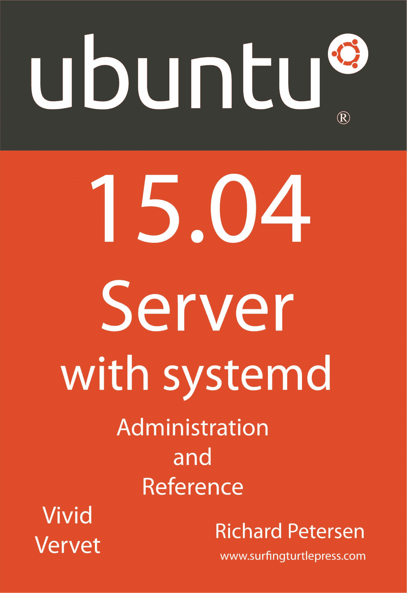

献给 Larisa 和 Aleina

请向以下邮箱咨询：editor@surfingturtlepress.com

## 前言

本书被设计作为 Ubuntu 15.04 服务器的管理和参考源，涵盖了 Ubuntu 服务器及其支持应用程序。书中不仅涵盖了服务器工具，还涵盖了底配置文件和系统实现。重点在于管理员在执行关键服务器支持和管理任务时需要了解的知识。`systemd` 服务管理系统已集成书中，取代了已弃用的 Upstart 系统。涵盖的主题包括软件管理、`systemd` 服务管理、AppArmor 安全、OpenSSH 和网络时间协议。书中检查了关键服务器，包括 Web、FTP、CUPS 打印、NFS 和 Samba Windows 共享。涵盖的网络支持服务器和应用程序包括 Squid 代理服务器、域名系统 (BIND) 服务器、DHCP、分布式网络文件系统、`IPtables` 防火墙和云计算。

本书分为五部分：入门、服务、共享资源、网络支持和 Shell。

- **第一部分** 侧重于基础任务，例如安装 Ubuntu Server CD、从 Ubuntu 存储库管理软件，以及桌面和命令行界面的基本用法。
- **第二部分** 检查了互联网服务器以及如何使用单元文件通过 `systemd` 管理服务。详细涵盖了 Postfix 邮件服务器、`vsftpd` FTP 服务器、Apache Web 服务器以及新闻和数据库服务器的配置与实现。
- **第三部分** 处理在本地网络或互联网上提供共享资源的服务器。检查的服务包括 CUPS 打印服务器、NFS Linux 网络文件服务器、Samba Windows 文件和打印服务器、GFS 分布式文件系统以及 Ubuntu 支持的云计算服务。
- **第四部分** 涵盖了提供网络支持的服务器，如 Squid 代理服务器、Bind 域名系统 (DNS) 服务器、DHCP 服务器以及 `IPtables` 和 `FirewallD` 防火墙。还检查了关键网络操作，如 IPv6 自动配置、TCP/IP 网络和网络监控工具。
- **第五部分** 回顾了 Shell 命令，包括用于管理文件的命令，以及 Shell 脚本、变量和配置文件。Ubuntu Server CD 只安装命令行界面，没有桌面。为了管理您的系统及其文件，您将需要了解 Shell 命令。

## Linux 文档

## 裸服务 (MAAS)

## 在服务器上通过命令行访问 USB 驱动器

### System V 脚本及生成的 `systemd` 服务文件：`/etc/init.d` 和 `/run/systemd/generator.late`

## `ntp` 服务器

## NTP 访问控制

## AppArmor 工具

## Puppet

## 安全外壳：OpenSSH

### 身份验证

### SSH 设置

#### 授权密钥 (Authorized Keys)

#### `ssh`, `scp`, `sftp` 和 `sftp-server`

#### SSH 配置

## 6. 邮件服务器

## `Postfix`

### 使用 `dpkg-reconfigure` 快速配置

### Ubuntu 的 `main.cf` 文件

### `main.cf` 中的 Postfix 指令

### 直接连接

### Postfix 灰名单策略服务器 (Greylisting Policy)

### 控制客户端、发送者与收件者

### `Dovecot`

## 垃圾邮件：`SpamAssassin`

### 邮件列表：`Mailman`

## 7. FTP

### FTP 用户账户：`anonymous`

### 非常安全的 FTP 服务器

### 防火墙访问

### 本地权限

### 连接限制

### 拒绝访问

### 命令访问

### 独立服务器上的 `vsftpd` 虚拟主机

### ProFTPD

## 8. Web 服务器

## 文档：`conf-available/apache2-doc.conf`

## 用户配置：`.my.cnf`

## 打印机设备与配置

## 编辑打印机配置

## `cupsd.conf`

## `lpc`

## 11. 网络文件系统、网络信息系统和分布式网络文件系统：NFS、NIS 和 GFS

## 按需挂载 NFS：`autofs`

## Corosync 集群引擎

## Samba 密码：`smbpasswd`

## 身份验证

`gnome-core` 软件包现在依赖于 GNOME GDM 显示管理器（`lightdm` 软件包），它将安装并运行 X 服务器。初始默认桌面将是 Ubuntu，由于尚未安装，请在登录窗口将桌面更改为 GNOME。

除了 GNOME 偏好工具和文本编辑器外，没有安装其他额外的软件，包括管理工具。你可能想要安装 Synaptic 软件包管理器（软件管理）、GNOME 终端、GNOME 系统工具（用户和时间管理）、`gnome-utils`（日志查看器）、GNOME 磁盘工具以及更新管理器，如下：

```
sudo apt-get install synaptic gnome-terminal gnome-system-tools gnome-utils gnome-disk-utility update-manager
```

此外，你可能还需要一些管理工具，如 `system-config-printer-gnome`、`system-config-samba` 和 `gnome-nettool`。

```
sudo apt-get install system-config-printer-gnome system-config-samba gnome-nettool
```

基础 GNOME 主题已安装。如果你想使用 Ubuntu Ambiance 或 Radiance 主题，请安装 `light-themes` 软件包，然后打开 应用程序 | 系统工具 | 系统设置 | 外观，选择主题选项卡以切换到 Ubuntu Ambiance 或 Radiance 主题。

```
sudo apt-get install light-themes
```

如果你想使用硬件驱动，可以安装 `jockey-gtk`。对于 Web 浏览器，你可以安装 `firefox` 或 `epiphany-browser` 软件包。

```
sudo apt-get install firefox
```

## ubuntu-desktop

对于桌面功能，建议安装整个 Ubuntu 桌面。Ubuntu 桌面将安装全套桌面软件包，包括多媒体和图形软件包，这些在你的服务器上可能用不到。新增的软件包不会降低服务器性能；它们只是占用额外的磁盘空间（约 1 GB 或更多）。同时，Ubuntu 桌面还会安装你可能想要使用的所有管理软件包，如 Synaptic 软件包管理器、网络管理器、用户和组管理以及更新管理器。

你使用 `ubuntu-desktop` 元软件包和 `tasksel` 软件管理工具安装 Ubuntu 桌面（你也可以使用 `apt-get`）。使用 `sudo` 命令运行 `tasksel`，然后使用方向键移动到 Ubuntu Desktop 条目并按空格键。然后按 Tab 键到 OK 按钮并按回车。

```
sudo tasksel
```

你也可以如下所示使用 `apt-get` 配合 `ubuntu-desktop` 元软件包。

```
sudo apt-get install ubuntu-desktop
```

下载和设置可能需要一小时或更久。然后注销并重启系统。LightDM 将如图 3-2 所示启动。

注意：你也可以安装 KDE 或 XFCE 桌面，使用其中任何一个来代替 GNOME。安装 XFCE 请使用带有 `xauth` 和 `xorg` 的 `xfce4`。对于极简 KDE 桌面，安装带有 `xauth` 和 `xorg` 的 `kdebase` 软件包。对于完整的 KDE 桌面（包括 KDM 登录界面），请安装 `kubuntu-desktop` 软件包。

## 服务器安装选项

总结一下，你的选项有：

- 仅 Server CD，带有优化的服务器内核，但仅使用命令行界面。没有支持或服务器配置工具。
- 先使用 Server CD，提供优化的服务器内核，然后从 Ubuntu 仓库安装 GNOME 桌面（`gnome-core`、`xauth`、`xorg`），这会安装 GDM 显示管理器。安装你需要的额外软件包，`gnome-utils`、`gnome-system-tools`、`gnome-nettool` 和 `light-themes`。
- 先使用 Server CD，提供优化的服务器内核，然后从 Ubuntu 仓库安装 Ubuntu 桌面（`ubuntu-desktop`）。将实现 LightDM 自动启动。
- 先使用桌面 DVD，然后使用 Synaptic 软件包管理器从 Ubuntu 仓库安装服务器内核（`linux-server`）和服务器软件包。你将一直运行额外的 X Windows 系统。但你可以使用服务器配置工具和桌面编辑器。对于小型或家庭网络，效率下降微乎其微。

选择最适合你的选项。请记住，运行服务器不需要 Server CD。Server CD 中的所有服务器在 Ubuntu 仓库中都可用，并可以在任何桌面系统中运行。你失去的是优化的服务器内核，这对于小型或家庭网络并非必需，或者你以后也可以安装使用。

此外，除非你进行专业安装或擅长直接编辑配置文件，否则不要低估桌面服务器配置工具能提供的帮助。对于本地网络服务器（如 NFS、CUPS 和 Samba），有非常棒的工具。对于互联网服务器（如 Apache 和 FTP），工具很少，且大多数工具都过于简单、选项有限。对于大多数负载密集型互联网服务器，需要直接编辑服务器配置文件。

> Apache 2.4 Web 服务器的配置目录和文件发生了变化。
> `systemd` 取代了 `SysVinit` 和 `Upstart` 作为系统和会话管理器。`systemd` 使用位于 `/lib/systemd/system` 和 `/etc/systemd/system` 目录下的单元文件来管理服务、文件系统和设备。
> 某些服务（如 Apache）仍在 `/etc/init.d` 目录中安装 `SysV` 初始化脚本。这些脚本用于自动生成 `systemd` 文件，这些文件被放置在 `/run/system/generator.late` 目录。
> Ubuntu 15.04 服务器镜像可在 Amazon EC2 云端可用，并列在 Ubuntu Cloud Images 网站上：[`cloud-images.ubuntu.com`](http://cloud-images.ubuntu.com)。需要浏览器。

Ubuntu 15.04 服务器镜像可用于 Ubuntu OpenStack 和 Amazon EC2 云端：[`www.ubuntu.com/`](http://www.ubuntu.com/) 云和 [`help.ubuntu.com/community/EC2StartersGuide`](https://help.ubuntu.com/community/EC2StartersGuide)。

裸即服务 (MAAS) 允许你部署、管理、记录和监控多个服务。它是为企业数据中心设计的，并安装配置。

安全特性：请参阅 [`wiki.ubuntu.com/Security/Features`](https://wiki.ubuntu.com/Security/Features) 文，包括 AppArmor、防火墙、文件系统加密和硬件安全（加固）等主题。

# 使用 Landscape 管理系统

Landscape 是 Ubuntu 的管理和监控管理服务，通过托管的 Web 界面访问。你可以向 Ubuntu 在注册 Landscape 服务。通过 Landscape，你可以管理、监控和维护网络上的机器，还可以安装和更新主机软件。你可以在此处了解更多关于 Landscape 的信息：[`http://www.ubuntu.com/management`](http://www.ubuntu.com/management)

机器可以分组组，允许你在不同的组上安装包。你可以通过 Landscape 直接访问自定义仓库，用它在你的机器上安装软件。你还可以管理用户和服务器，添加和删除用户，以及启动和停止服务器。

Landscape 还在每台机器上安装了自己的监控程序，提供有关使用情况、硬件状态和性能的报告。你还可以管理进程，检测那些使用最多资源的进程。

此外，Landscape 支持云计算，允许你像管理网络上的机器一样管理云上的系统实例。Landscape 可以管理 Amazon EC2 云端和 Ubuntu 云基础设施上的 Ubuntu 实例。

# Ubuntu Linux 帮助与文档

网上提供了大量关于 Ubuntu 的帮助和文档，从详细的安装步骤到初学者问题（参见 表 1-1）。Ubuntu 15.04 的文档位于 [`help.ubuntu.com/15.04/`](https://help.ubuntu.com/15.04/)。该网站包含 Ubuntu 服务器指南。Firefox Web 浏览器启动页显示了两个主要帮助网站的链接：位于 [`help.ubuntu.com`](https://help.ubuntu.com) 的 Ubuntu 文档和位于 [`community.ubuntu.com`](http://community.ubuntu.com) 的 Ubuntu 社区。常见问题的答案请检查 [`askubuntu.com/`](http://askubuntu.com/)。它为许多技术问题提供了详细解答。

如需详细的在线支持，请使用 [`ubuntuforums.org`](http://ubuntuforums.org) 的 Ubuntu 论坛。此外，还有博客、新闻网站以及标准的 Linux 文档。Ubuntu 社区包含 Ubuntu 文档、支持、博客和新闻。“贡献”部分链接到你可以为开发、艺术设计、文档和支持做出贡献的网站。

有关邮件列表，请检查 [`lists.ubuntu.com`](https://lists.ubuntu.com)。有针对此类类别的 Ubuntu 公告、特定版本的社区支持，以及桌面、服务器或移动实现等领域的开发列表。对于 Samba 支持和 LAMP 服务器安装等更专门的任务，请检查 [`www.ubuntugeek.com`](http://www.ubuntugeek.com)。

| 站点 | 描述 |
| :--- | :--- |
| [`help.ubuntu.com`](https://help.ubuntu.com) | 桌面、服务器和安装的帮助 |
| [`packages.ubuntu.com`](http://packages.ubuntu.com) | Ubuntu 软件包列表和搜索 |
| [`ubuntuforums.org`](http://ubuntuforums.org) | Ubuntu 论坛 |
| http:/askubuntu.com/ | 常见问题的答案 |
| [`www.tldp.org`](http://www.tldp.org) | Linux 文档项目网站 |
| [`community.ubuntu.com/`](http://community.ubuntu.com/) | 文档、支持、新闻和博客的链接 |
| [`lists.ubuntu.com`](https://lists.ubuntu.com) | Ubuntu 邮件列表 |

表 1-1：Ubuntu 帮助与文档

## help.ubuntu.com

Ubuntu 特定的文档可在 https://help.ubuntu.com 获取。在列出的链接中，你可以找到不同版本的特定文档。务必首先检查版本帮助页面获取文档，尽管内容可能较少且主要涵盖变化过的区域。Ubuntu 版本通常包含桌面、安装和服务器指南。最有用的页面之一是社区贡献页面，[`help.ubuntu.com/community`](https://help.ubuntu.com/community)。在这里你将找到关于安装、使用桌面和配置设备的详细文档。

## ubuntuforums.org

Ubuntu 论坛为用户提供详细的在线支持和讨论 ([`ubuntuforums.org`](http://ubuntuforums.org))。“绝对初学者”部分为新用户获取答案提供了区域。置顶线程包含了快速和完整的安装指南。你可以使用搜索功能找到你感兴趣的话题讨论。主要支持类别涵盖网络、多媒体、笔记本电脑、安全和 64 位支持。

其他社区讨论涵盖正在工作，如虚拟化、艺术与设计、游戏、教育与科学、Wine、辅助技术以及 Ubuntu 云。在这里你还将找到社区公告和新闻。

论坛社区是你讨论其他任何事情的地方。

Linux 文档项目 (LDP) 开发了一套完整的 Linux 手册。文档可以在 LDP 主站 [`www.tldp.org`](http://www.tldp.org) 获取。已安装软件的 Linux 文档位于你的 `/usr/share/doc` 目录。

# 2. 安装 Ubuntu 服务器

安装 Ubuntu Linux 已成为一个非常简单的程序，只有几个带有默认条目的屏幕。一组预选软件集合已经安装。你的大多数设备（如显示器和网络连接）都会自动检测。最困难的部分将硬盘的手动分区，但可以使用引导式分区对于使用整个硬盘的安装，这通常是这种情况。

有关服务器特定的安装细节，请务必检查 Ubuntu 服务器指南安装章节：

[`https://help.ubuntu.com/stable/serverguide/installation.html`](https://help.ubuntu.com/stable/serverguide/installation.html)


对于关于关键安装主题的非常详细信息，从获取 CD 到首次启动系统，以及关于分区和自动安装的附录，请查阅 Ubuntu 安装指南/安装 Ubuntu 15.04（Ubuntu 文档 | Ubuntu 15.04 | 安装 Ubuntu），地址为：

[`https://help.ubuntu.com/15.04/installation-guide/index.html`](https://help.ubuntu.com/15.04/installation-guide/index.html)

Ubuntu Server CD 使用基于文本的界面。本指南不会带您完成所有步骤。相反，它详细介绍了关键的安装主题，如启动安装磁盘和准备您的硬盘。

本章涵盖了基本的安装程序，但您应该咨询服务器安装和安装指南以获取更详细的信息。

## 升级

你可以直接从 Ubuntu 15.04 版本进行升级。首先，如果尚未安装，请安装 `update-manager-core` 包。然后编辑 `/etc/update-manager/release-upgrades` 文件并修改 `Prompt` 选项。

```
sudo nano /etc/update-manager/release-upgrades
```

将 `Prompt` 选项设置为 `normal`。

```
Prompt = normal
```

然后运行带有 `-d` 选项的 `do-release-upgrade` 命令。此操作将执行任何必要的系统配置更改。

```
sudo do-release-upgrade -d
```

## Ubuntu Server CD

Ubuntu Server CD 是为硬件服务器设计的，这些系统仅运行服务器，而不执行任何其他任务（如桌面应用程序）。不会安装 Ubuntu 桌面。你将只会看到命令行界面和如 `nano` 编辑器之类的命令行工具来管理你的服务器配置。你必须知道如何手动编辑服务器配置文件并输入你的条目。

然而，服务器软件不必从 Server CD 安装。你可以直接从 Ubuntu 仓库下载并安装任何服务器。如果你愿意，可以安装 Ubuntu 桌面版，然后使用基于 GNOME 的桌面工具（如 Ubuntu 软件中心中的 `Synaptic Package Manager` 软件包管理器）来安装你需要的服务器。你也可以使用桌面服务器配置工具来管理你的服务器。这些工具在直接从 Server CD 安装时是不可用的。

从桌面安装的缺点是你会产生运行桌面界面（即 GNOME）的开销。大多数商业和专业企业服务器都是时间敏感的，需要管理海量的交易。桌面界面会严重降低性能。然而，对于一个简单的家庭或本地服务器（交易量较少），桌面产生的开销很小或没有。它也会让管理你的服务器变得简单得多。

### 获取安装服务器 CD

你可以从以下地址下载 Ubuntu Server CD：

[`http://www.ubuntu.com/download/server`](http://www.ubuntu.com/download/server)

你也可以从以下地址直接下载 Ubuntu Server CD：

[`http://releases.ubuntu.com/vivid/`](http://releases.ubuntu.com/vivid/)

Ubuntu Server CD 同时有 32 位和 64 位版本。如果你想使用 64 位版本，请确保你的 CPU 兼容 64 位（目前大多数 CPU 都是如此）。64 位版本速度更快。

Ubuntu DVD 包含了桌面和服务器应用程序。你可以从以下地址下载：

[`http://cdimages.ubuntu.com/releases/vivid/release/`](http://cdimages.ubuntu.com/releases/vivid/release/)

你可以直接下载 Server CD，或者使用 `BitTorrent`、`Jigdo`、`Metalinks` 或 `Zsync` 下载方法。这些方法的 Server CD 下载文件位于：

[`http://releases.ubuntu.com/vivid/`](http://releases.ubuntu.com/vivid/)

使用 `BitTorrent` 请使用如 `transmission` 或 `ktorrent` 等 `BitTorrent` 客户端。

请查看 [`help.ubuntu.com`](http://help.ubuntu.com) 上的 `Jigdo` 下载帮助页面获取有关使用 `Jigdo` 的详情。

[`https://help.ubuntu.com/community/JigdoDownloadHowto`](https://help.ubuntu.com/community/JigdoDownloadHowto)

关于在 Ubuntu 中使用 `metalink` 的信息：

[`https://wiki.ubuntu.com/MetalinkIsoDownloads`](https://wiki.ubuntu.com/MetalinkIsoDownloads)

## 从 Server CD 安装 Ubuntu

服务器安装 CD 包含了 Linux 上可用的所有服务器。这些包括 Samba Windows 网络服务器、邮件服务器和 DNS 服务器。安装 DVD 也包含了这些内容。Server CD 用于精简服务器，仅运行服务器而不提供任何桌面支持。事实上，Server CD 不包含或安装 GNOME 和 KDE 桌面。这是一种非常特殊的服务器安装。

Server CD 使用基于文本的安装界面，使用 `TAB`、`空格键`和方向键进行选择。在安装软件之前，会显示一个软件选择屏幕，允许你选择想要安装的服务器。使用方向键移动到某个选项，并按`空格键`进行选择。

当你启动服务器安装时，你将使用命令行界面。系统不会安装桌面。桌面被认为是服务器不必要的开销。用户在 Ubuntu 登录提示处输入用户名，然后在密码提示处输入密码。

安装 Linux 涉及若干多个过程，从创建 Linux 分区开始，然后加载 Linux 软件、选择时区并创建新用户账户。Ubuntu 使用的安装程序是一个基于屏幕的程序，它会逐步引导你完成所有这些过程。

## 7. 准备分区

系统将扫描磁盘并启动分区器。对于自动分区，你可以选择使用 `Guided`（引导式）分区，它将自动为你设置好分区。你可以选择使用 `LVM` 或 `LVM` 加密文件系统。你也可以选择进行手动分区，自己设置分区。

## 8. 基础系统

随后将安装基础系统。

## 9. 选择服务器软件

选择你想要安装的服务器软件包。`LAMP` 包含 Apache Web 服务器和 MySQL 数据库服务器。

## 10. 完成安装

完成后，系统会提示移除 DVD/CD-ROM。然后按下 `ENTER`。

## 启动安装程序

如果你的电脑可以从 DVD/CD-ROM 启动，你可以直接从 CD-ROM 或 DVD-ROM 开始安装。只需在启动电脑之前，将 CD-ROM 放入 CD 驱动器，或将 DVD-ROM 放入 DVD 驱动器。开启或重启电脑后，安装程序将启动。

Ubuntu Server CD 设计用于安装服务器。安装程序将向你显示一个列有以下选项的菜单（参见 图 2-1 ):

- `Install Ubuntu Server`（安装 Ubuntu Server）

- `Multiple server install with MAAS`（通过 MAAS 安装多台服务器）

- `Check disc for defects`（检查磁盘缺陷）

- `Test memory`（测试内存）

- `Boot from first hard disk`（从第一硬盘启动）

- `Rescue broken system`（修复损坏的系统）

`Install Ubuntu Server` 将开始安装（参见下一节）。

`Multiple server install with MAAS` 将服务器加入裸金属服务 (`MAAS`)，该服务用于管理服务器。参见 `https://wiki.ubuntu.com/ServerTeam/MAAS`。提供网络服务器的云支持。（等待，应提供网络服务器的云支持。）

`Check disc for defects` 将检查你的 CD 刻录是否存在故障。

`Test Memory` 将检查你的内存。

`Boot from first hard disk` 将让你的 CD 充当引导器，如果第一硬盘上安装了操作系统，则会启动它。使用它可以启动由于某些原因引导程序无法访问的系统。

`Rescue a broken system` 将启动 Ubuntu 并允许你挂载损坏的系统。然后你可以对系统配置进行更改。

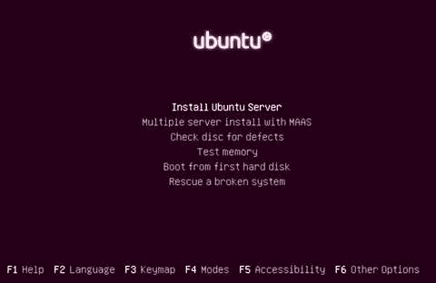

图 2-1：服务器 CD 安装磁盘启动菜单

屏幕底部有一系列你可以为安装过程设置的选项。可以通过功能键 `1` 到 `6` 访问。

`F1 Help F2 Language F3 Keymap F4 Vga F5 Accessibility F6 Other Options`

此处列出了这些选项的描述：

- `Help`（帮助）：启动参数和安装前提条件

- `Languages`（语言）：语言列表，弹出菜单

- `Keymap`（键位）：键盘语言，弹出菜单

- `Modes`（模式）：列出可能的安装模式：`Normal`

- `Accessibility`（辅助功能）：对比度设置、放大镜、屏幕键盘和盲文支持

- `Other options`（其他选项）：打开一个可编辑的文本行，列出当前选择菜单的选项。你可以在此处添加其他选项，修改或删除现有选项。菜单列出了几个特殊选项，如 `Expert`（专家）模式、`acpi=off`、`noapic`、`nolapic`、`edd=on`、`nodmraid`（无硬件 RAID）、`nomodeset` 和 `Free Software only`（仅限自由软件）。按 `ESC` 返回主菜单。`Expert` 模式将提供对安装的更详细的控制。

使用箭头键在菜单项之间移动，然后按 `ENTER` 选择该项。如果需要添加选项，请按 `F6` 键。将显示一个可以输入选项的命令行。当前选项已列出。使用退格键删除，使用箭头键在行内移动。按 `ESC` 键返回菜单。

## 启动 Ubuntu 安装

系统随后检测你的硬件，提供可能需要的任何配置规范。例如，如果你有一个 `IDE CD-RW` 或 `DVD-RW` 驱动器，它将被自动配置。

| 键位 | 操作 |

| :--- | :--- |

| `TAB` | 移动到 Continue、OK、Yes、No 和 Go Back 按钮 |

| `ENTER` | 执行选定的按钮 |

| `Arrow, up and down` | 在菜单选择之间移动 |

| `Arrow, left and right` | 在某些屏幕上于 Go Back 和 Continue 按钮之间移动 |

| `PageUp and PageDown` | 每次一页滚动列表 |

表 2-1：安装键位

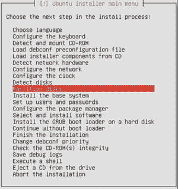

图 2-2：安装程序主菜单

安装过程中出现的每个屏幕中，默认项都已被选中，这通常是由安装程序的自动检测功能完成的。选中项将高亮显示。如果这些项是正确的，你只需按 `ENTER` 接受它们并进入下一个屏幕。某些屏幕将显示 `Continue` 按钮。使用 `Tab` 键移动到该按钮。许多屏幕还有 `Go Back` 按钮。`Tab` 键会在 `Continue` 和 `Go Back` 按钮之间循环。在某些屏幕上，你也可以使用箭头键在 `Go Back` 和 `Continue` 按钮之间移动。安装键列在 表 2-1 中。

在安装过程的任何时候，都可以按 `Tab` 到 `Go Back` 并按 `ENTER` 显示“Ubuntu 安装程序主菜单”，列出完整的任务集（参见 图 2-2 ).

### 语言和键盘

首先，你选择 `Language`（语言）（参见 图 2-3 ）。使用上/下箭头键在列表中移动。到达选择目标时按 `ENTER` 键。检测到的（等待，默认的）已被选中。如果正确，直接按 `ENTER`。

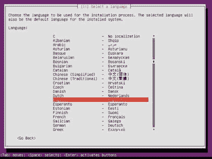

图 2-3：语言

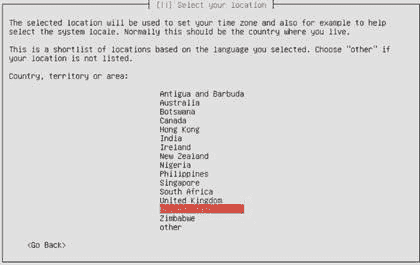

图 2-4：位置

然后，选择你的 `location`（位置）、国家或地区（参见 图 2-4 ）。使用上/下键移动到选择。按 `ENTER` 键确认选择并进入下一个屏幕。

随后你会被要求选择键盘。首先询问你是否想通过输入按键自动检测。默认回答是 `NO`，你可以按 `ENTER` 移动到手动选择屏幕。默认键盘将被选中，例如 `U.S. English`。

如果你的地区有多个键盘布局，另一个屏幕将列出它们并提示你选择一个。

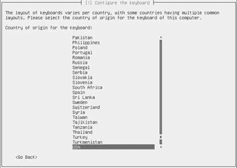

图 2-5：键盘布局

### 网络配置和 Cobbler

随后你配置网络接口。如果你有多个硬件网络连接，会被要求选择其中一个（通常是以太网连接 `eth0`）。如果你使用 DHCP 服务器配置网络信息，将仅提示你为服务器输入主机名（参见 图 2-6  ).

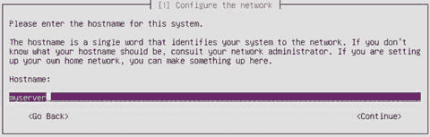

图 2-6：网络配置

如果你为服务器使用固定 IP 地址，选择 `Go Back` 并选择 `Configure network manually` 项以手动配置网络信息。随后的屏幕将提示：

- 服务器的 IP 地址

- 你的网络子掩码

- 网络网关 IP 地址（连接到的路由器地址）

- 名称服务器（DNS 服务器）IP 地址

- 你的的主机名

### 创建管理员用户

在接下来的屏幕上，你将输入用户的全名、登录名以及该用户的密码（参见第 2-8 和 2-9 节）。你正在创建的用户将具有管理权限，允许你更改系统配置、添加新用户和打印机并安装新软件。系统还会询问你是否要加密你的主目录，以增加额外的安全级别（参见 图 2-10 ).

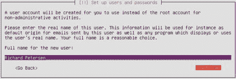

图 2-7: 创建用户

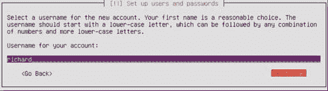

图 2-8: 创建用户名

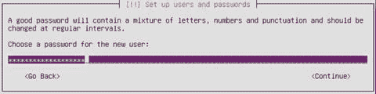

图 2-9: 创建用户密码

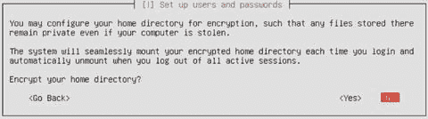

图 2-10: 加密私有目录

## 时区

然后你选择你所在的时区（参见 图 2-11 ）。时区将从网络时间服务器检测，并提示你确认。如果不正确，你可以选择“否”以从时区列表中选择。


图 2-11: 时区

## 分区

然后系统会要求你指定想要在硬盘上使用的 Linux 分区和硬磁盘配置。对于 LVM 分区，在配置任何分区之前必须设置一个 `LVM Group`（LVM 组）。这意味着分区表会在你配置分区之前被写入。此操作是不可逆的。无论对于引导式 LVM 分区还是手动 LVM 分区都是如此。

如果你是手动设置标准分区而非 LVM 分区，分区将在分区过程结束时进行更改或格式化。在分区程序执行结束时，系统会明确询问你是否将分区更改写入磁盘。在此点之前，你可以在任何时候退出安装，你的原始分区将保持不变。

分区选项将根据系统上硬磁盘的数量而变化。如果你有多个硬盘，它们将被列出。。你还可以选择在哪个磁盘上安装 Ubuntu。

### 使用 LVM 的引导式分区

如果你只想使用可用驱动器和空闲空间创建你的 Linux 系统，Ubuntu 提供了自动分区选项。它支持 LVM、RAID 和加密文件系统。

Ubuntu Server 提供了引导式选项，为整块磁盘设置默认配置。你必须有一块完全空白的磁盘供 Ubuntu 服务器使用（参见 图 2-12 ）。每个选项前都有“Guided”（引导式）字样。这些选项包括：

* 引导 - 使用整个磁盘

* 引导 - 使用整个磁盘并设置 LVM

* 引导 - 使用整个磁盘并设置加密 LVM

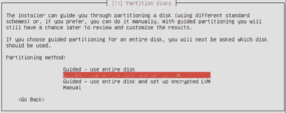

图 2-12: 分区选项

如果你的磁盘已经划分了区，且分区有大量的未未使用空间，系统会显示另一个允许你调整磁盘大小的选项。将列出需要调整大小的分区，通常是最后一个分区。请注意，调整大小可能花费很长时间。

* 引导 - 调整 `SCSI1 (0,0,0)`，分区 #5 (sda)` 并使用释放的空间

如果你已经在硬盘上设置了 Linux 分区，并想要覆盖该现有的 Linux 分区，系统将显示一个允许你重用该分区的选项。

* 引导 - 重用分区 `SCSI1 (0,0,0)`，分区 #5 (sda)`

如果你的磁盘有大量的连续未使用（空闲）空间，你将获得使用它的选项。

* 引导 - 使用最大的连续空闲空间

在引导式分区中，Windows 和 Linux 的 `/home` 分区不会被覆盖。然而，引导选项要求硬盘上有空闲空间来安装你的系统。

如果你不确定你的分区将如何被格式化，且你的系统中有几个你想要保留的分区，你可能想要选择“Manual”（手动）选项，这样你就可以选择想要使用的特定分区，并指定它们进行格式化和安装。

如果你选择了引导式选项，系统会要求你选择要在哪个磁盘上设置分区（参见 图 2-13 ）。


图 2-13: 选择用于分区的硬盘

默认的引导式分区将设置两个分区：一个作为交换分区（swap），另一个用于整个文件系统（`/`）的 `ext4` 分区。

默认的 LVM 分区将为引导目录设置一个 `ext2` 文件系统，然后设置一个带有两个 `LVM` 卷的 LVM 文件系统`Group`），一个用于交换分区，另一个用于根目录（即除引导目录以外的 Ubuntu 系统）。

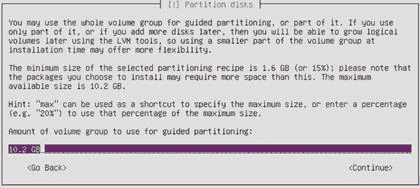

图 2-14: LVM 分区大小

加密 LVM 将增加一个用于加密文件系统密码的额外提示。你的 LVM 根目录和交换文件系统将被加密，但引导文件系统不会。每当你的系统启动时，系统都会提示你输入加密文件系统的口令。加密增加了额外的安全级别，特别是对于像服务器那样可以被公开访问的文件系统。对性能的影响微乎其微。


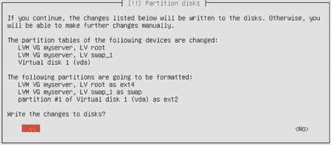

图 2-15: 创建分区

使用 LVM 引导式分区，你还将获得设置整体分区大小的选项。此选项旨在为硬盘留出空闲空间。LVM 卷比普通的 `ext4` 分区更好，因为你可以轻松地扩展或替换它们。默认大小将使用整个硬盘（参见图 2-14）。在创建分区之前，将显示分区配置并提示你接受。这是你退出分区的最后机会。默认将选中“否”按钮。

## 手动分区

要手动配置硬盘，首先要规划想要设置的分区以及它们的大小。你可以为系统上的任何目录设置不同的分区。许多系统为 `/home`、`/var`、`/srv` 以及 `/`（根）和 `/boot` 设置单独分区。你当然需要一个交换分区。

- `/var` 目录存储经常变化的数据，如打印机队列文件。
- `/srv` 目录存储服务器数据，如 Web 服务器页面和 FTP 站点。
- `/home` 目录存储用户文件以及任何用户数据。
- `/` 根目录是系统目录。所有其他文件系统和分区都挂载在其上。
- `/boot` 引导目录存储 Linux 内核和引导配置。如果你对根分区使用 LVM 分区，则需要单独的引导分区。引导目录不能位于 LVM 分区上。

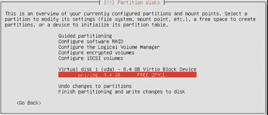

图 2-16: 选择要分区的磁盘

除了引导分区外，所有这些都可以是 LVM 卷。LVM 卷比普通的 `ext4` 分区更好，因为你可以轻松地扩展或替换它们。对于标准的 `ext4` 分区，你受限于首次设置分区时指定的大小。以下示例设置了两个基础分区：一个交换分区，另一个用于根系统。首先你选择要在哪个磁盘上创建分区（参见图 2-16）。

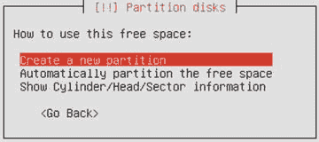

图 2-17: 选择创建分区

然后你选择分区方法。你可以手动创建分区，或者直接自动划分空闲空间（参见图 2-17）。

在选择创建新分区后，系统会提示你输入大小。默认将选择剩余的空闲空间。以 `MB` 或 `GB` 指定分区大小。输入 `max` 将使用所有剩余的空闲空间。然后选择该分区应为主分区还是逻辑分区，以及位于磁盘的末尾还是开头（参见图 2-18）。

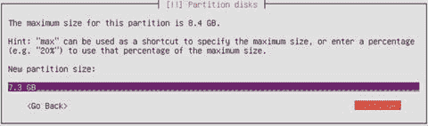

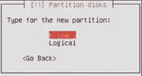

图 2-18：选择分区大小

在分区设置屏幕上，你将指定挂载点、文件系统类型（`Use as`，用作）和标签。在 `Use as` 选项上按 `ENTER` 键将显示一个对话框，列出供选择的文件系统类型。标准的 Linux 分区将使用 `ext4`，交换分区将使用 `swap area`（交换区），而 `LVM` 分区将使用 `Physical volume for LVM`（LVM 物理卷）。

在图 2-19 中，设置了一个根系统分区。类型为 `ext4`，挂载点为根目录 `/`，标签为 `minute`。

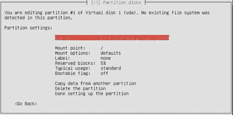

图 2-19：分区配置

**注意：** 通过手动分区，你还可以设置软件 RAID 设备。首先创建 RAID 分区，然后在“分区磁盘”页面上会列出一个 `Configure RAID devices`（配置 RAID 设备）项。选择此项并创建一个 `MD drive`（MD 驱动器），选择用于驱动器的 RAID 分区以及 RAID 类型。

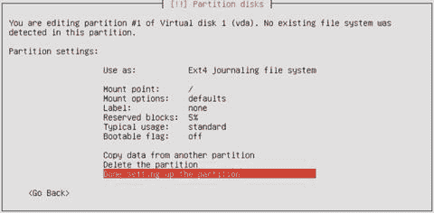

图 2-20：手动创建的分区

如果你正在设置 `LVM` 分区，请为 `Use as` 选项选择 `physical volume for LVM`。分区磁盘屏幕随后将增加一个 `Configure the Logical Volume Manager.`（配置逻辑卷管理器）项。选择此项以设置你的卷组及其逻辑卷。系统会先提示你创建一个卷组，并指定其设备和标签。然后创建逻辑卷（`Create a logical volume`，创建逻辑卷）。为每个逻辑卷输入标签和大小。然后你返回分区程序，它将列出你所有的逻辑卷。选择每个并按回车，然后选择文件系统类型和挂载点（交换分区将没有挂载点）。

对于挂载点，对话框将列出常见的挂载点，例如用于根文件系统的 `/`、用于用户的 `/home` 以及用于启动分区的 `/boot`。

当你准备就绪时，移动到最后一个选项并按 `ENTER`，`Done setting up the partition.`（已完成分区设置）。

完成后，你的分区将显示在你的磁盘项下（参见图 2-20）。要实际创建分区，移动到最后一项并按 `ENTER`，`Finish partitioning and write changes to disk.`（完成分区并将更改写入磁盘）。系统将显示一个对话框，显示将要格式化的分区，类似于图 2-15。按 Tab 键移动到 `Yes`（是）按钮并按 `ENTER` 以应用你的分区更改。

## 在硬盘上复用现有的 Linux 分区

如果你已经有一个带有 Linux 分区的硬盘并想要复用它们，请在“分区磁盘”（Partition disks）屏幕上选择 `Manual`（手动）选项。在这种情况下，你有一个已经在用于 Linux 的硬盘，且硬盘上已经为你的 Ubuntu 系统设置了分区。然而，你不想保留这些分区上的任何数据。实际上，你只是想为新版本复用这些分区，从而创建一个完全全新的安装，但使用旧的分区。执行此操作后，这些分区上的所有当前数据都将被销毁。此过程避免了更改硬盘上分区表的需求。你只需保留已有的分区。在这种情况下，你希望覆盖现有的分区，擦除它们上的所有数据。

此过程经常用于那些已经备份了数据、并只想在硬盘上为新版本创建一个全新安装的用户。此外，Linux 系统可以配置为将数据保存在与根分区分离的分区上，例如为 `/home` 目录设置一个独立分区。在这种情况下，你只需要覆盖根分区，而保持其他 Linux 分区不变。

手动“分区磁盘”（Partition Disks）屏幕将列出你当前的分区，显示每个分区的编号、大小和文件系统类型。使用方向键移动到你想复用的分区并按 `ENTER`。将显示该分区的“分区设置”（Partition settings）屏幕（参见图 2-19）。`Use as:` 项将设置为 `do not use.`（不使用）。按 `ENTER` 显示文件系统类型列表，对于根系统使用 `Ext4`。要覆盖分区，移动到下一项 `Format the partition`（格式化分区）并按 `ENTER` 切换到 `yes, format it`（是，格式化它）选项。移动到 `Mountpoints`（挂载点）项并按 `ENTER`，然后在显示的列表中选择根文件系统项，并按 `ENTER`。然后移动到 `Done setting up the partition`（已完成分区设置）项并按 `ENTER` 返回分区列表。你将看到根分区的分区项显示为 `ext4` 文件系统类型和 `/` 挂载点。

然后移动到最后一项 `Finish partitioning and write changes to the disk`（完成分区并将更改写入磁盘）并按 `ENTER`。系统将显示一个最终警告屏幕，提示你将更改写入磁盘，并列出将进行的更改（参见图 2-15）。如果正确，按 Tab 键移动到 `Yes`（是）按钮并按 `ENTER`。

## 选择服务器：软件包任务

基础系统将被安装（参见图 2-21）。


图 2-21：安装基础系统

访问 Ubuntu 仓库时，会提示输入 http 代理，如果你的网络连接需要。

系统随后提示选择管理更新的选项（参见图 2-22）。你可以选择 `no automatic updates`（不自动更新）、`install security`（安装安全更新）或使用 Ubuntu 的 `Landscape` 服务执行更新。`No automatic updates` 选项需要管理员登录。`Install security` 选项将安装 `unattended-upgrades` 软件包，它将自动执行安全更新。

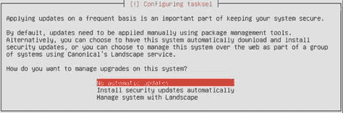

图 2-22：选择选项

在“软件选择”（Software Selection）屏幕上，系统提示你选择想要安装的服务器（参见图 2-23）。使用方向键移动到某项并按空格键选择。选项列在此处：

- `DNS server`：这是 `BIND` 域名服务服务器（参见第 15 章）。
- `Lamp server`：`LAMP` 服务器设置一个带有支持软件的 Web 服务器。它包含了 `Apache` Web 服务器、`MySQL` 数据库服务器以及用于 Web 支持的 `PHP` 服务器（Linux、Apache、MySQL 和 PHP）（参见第 8 章和第 9 章）。
- `Mail server`：这是 `Postfix` 邮件服务器（参见第 6 章）。
- `OpenSSH server`：这是 `SSH`（安全外壳）服务器，用于安全的加密传输。
- `PostgreSQL database`：这是一个可选的数据库服务器（参见第 9 章）。
- `Print server`：这是 `CUPS` 打印服务器（参见第 10 章）。
- `Samba file server`：这是 `SAMBA` 文件服务器，提供访问 Windows 网络上的共享目录和打印机（参见第 12 章）。
- `Tomcat Java server`：这是支持 Web 应用的 `JAVA Servlet` 和 `Java Server Pages (JSP)` 的 `Tomcat` 实现。
- `Virtual Machine host`：基于内核的虚拟机服务器，`KVM` (`libvirt`)。
- `Ubuntu Desktop USB`：用于在 USB 驱动器上安装 Ubuntu 桌面的镜像。
- `Manual package selection`：选择你特定的软件包。你可以选择想要安装的额外软件包。

“手动软件包选择”选项将启动 Aptitude 软件包管理器，允许你选择要安装的单个软件包，而不是使用服务器和元包分类。请参阅第 4 节关于如何使用 Aptitude 的描述。使用 `+` 符号标记软件包进行安装，使用 `-` 将其移除。使用 `ENTER` 和方向键在软件包列表中进行导航，使用 `q` 关闭标签页。`?` 列出所有命令。你将看到某个软件包条目变为绿色并带有 `i` 字符，表示该包已标记为安装。准备就绪后，按 `g` 显示列出你所选内容的预览屏幕，然后再次按 `g` 执行所有软件包安装。完成后，按 `q` 返回安装程序。

选择完服务器软件包后，按 Tab 键切换到 `Continue`（继续）按钮并按 `ENTER`。随后系统和所选软件将开始安装。

在安装过程中，对于 MySQL (LAMP)，系统会提示你输入密码。对于 Postfix (邮件服务器)，系统会提示你选择配置类型。对于 Internet 选项，你需要为你的服务器网络输入域名。

如果系统中存在其他操作系统，它们将被检测并列在“Configure grub-pc”屏幕中。如果所有其他操作系统列列正确，你就可以安装引导程序。将选中 `Yes` 按钮，按 `ENTER` 继续。如果你想使用旧的 LILO 引导程序或不使用任何引导程序，按 Tab 键切换到 `Go Back`（返回）按钮并按 `ENTER` 以列出“Ubuntu 安装主菜单”（参见图 2-2）。在这里你可以选择安装 LILO 或不安装任何引导程序。


图 2-24：完成安装

剩余的配置和引导程序安装将为你自动完成。如果在磁盘上检测到另一个操作系统（如 Windows），系统将提示你在主引导记录上安装引导程序。安装随后完成。服务器磁盘弹出，系统将提示你重启（参见图 2-24）。

注意：JeOS 不再受支持。相反，请在 Ubuntu Server 安装界面按 `F4`。

# 恢复、救援和引导程序重新安装

Ubuntu 提供了启动因某些原因失败的系统的方法。可以引导但无法启动的系统可以在恢复模式下启动，该模式已为你设置为引导程序菜单中的一个选项。对于甚至无法引导的系统，可能需要更高级的操作。你可以使用服务器 CD 访问此类损坏的系统。

## 恢复

如果由于某些原因你的系统无法启动，可能是由于冲突的配置、库或应用程序导致的。在 GRUB 菜单上，首先选择“Advanced options for Ubuntu”（Ubuntu 高级选项）以打开高级选项菜单。然后选择恢复模式项，即结尾带有 `(recovery mode)` 标签的 Ubuntu 内内核项，所示。


这将启动一个菜单，你可以使用方向键和 `ENTER` 键从几个恢复选项中进行选择（参见图 2-25）。这些包括 `resume`、`fsck`、`remount` 和 `root`。菜单上会显示每个项目的简短描述。

`root` 选项将以 root 用户身份启动 Ubuntu 并带有命令行 shell 提示符。在这种情况下，你可以在恢复模式下引导 Linux 系统，然后使用 `Vi` 和 `nano` 等文本编辑器编辑配置文件，移除可疑库，或使用 `apt-get` 重新安装损坏的软件。

如果你忘记了密码，可以在 GRUB 菜单中选择恢复模式，然后选择“Drop to root shell prompt”（进入 root shell 提示符）项。然后使用用户名运行 `passwd` 命令。系统将提示你重新输入该用户的密码。然后你可以运行 `halt` 命令关闭系统。当你重启时，新密码将生效。

`resume` 项将正常启动 Ubuntu，但处于命令行模式。

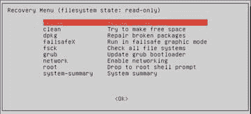

图 2-25：恢复菜单

要救援一个损坏的系统，请选择 `root` 项。你损坏的系统将被挂载并可以通过命令行界面访问。然后你可以使用命令行操作和编辑器来修复配置文件。

## 使用 Ubuntu Server CD 救援损坏的系统

如果你无法从硬盘安装启动系统，可以使用 Server CD 启动并从启动菜单中选择“Rescue a broken system”（救援损坏的系统）（参见图 2-1）。按照提示启动你的系统，选择语言、位置、键盘、主机名和时区。在请求时选择文件系统。出现“Enter rescue mode”（进入恢复模式）屏幕，提供了挂载系统的选项（参见图 2-26）。你损坏的系统将被挂载并可以通过命令行界面访问。然后你可以使用命令行操作和编辑器来修复配置文件。

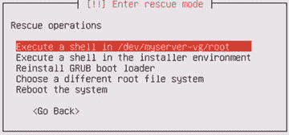

图 2-26：Server CD 救援模式选项

## 重新安装引导程序

如果你有一个在同一台机器上运行 Windows 和 Linux 的多引导系统，你可能会遇到需要重新安装引导程序的情况。如果你的 Windows 系统完全崩溃且你需要安装新版本的 Windows，在你升级到新版本 Windows 后添加了 Linux，会出现这个问题。Windows 安装将覆盖你的引导程序（或者你可以在主引导记录 MBR 上安装引导程序）。你将无法访问系统。

你可以使用 Ubuntu Desktop 手动重新安装引导程序。该过程较复杂，因为你需要挂载系统。在 Ubuntu LiveCD 上，你可以使用 GParted 找到 Ubuntu 使用的分区（应用程序 | 其他 | 分区）。在终端窗口（应用程序 | 杂项）创建一个挂载系统的目录。

```bash
sudo mkdir myubuntu
```

然后挂载它，确保你有正确的文件系统和分区（双引导系统通常为 `/dev/sda5`）。

```bash
sudo mount -t ext4 /dev/sda5 myubuntu
```

然后，使用 `grub-install` 和分区设备名称安装引导程序，带有 `--root-directory` 选项指定挂载 Ubuntu 的目录。`--root-directory` 选项需要完整路径，对于 Ubuntu LiveCD 来说，用户目录 `/home/ubuntu`。使用示例中的 `myubuntu` 目录，完整路径将为 `/home/ubuntu/myubuntu`。然后输入以下 `grub-install` 命令。

```bash
sudo grub-install --root-directory=/home/ubuntu/myubuntu /dev/sda
```

这将重新安装当前的 GRUB 引导程序。你可以重启，GRUB 引导程序将启动。

# 金属即服务 (MAAS)

MAAS 允许你像管理虚拟机服务器一样管理硬件服务器（物理置备）。你可以在此处了解更多关于 MAAS 的信息：

[`www.ubuntu.com/cloud/orchestration/deployment`](http://www.ubuntu.com/cloud/orchestration/deployment)查看 Ubuntu MAAS 页面有关设置 MAAS 服务的信息。

[`wiki.ubuntu.com/ServerTeam/MAAS`](https://wiki.ubuntu.com/ServerTeam/MAAS)

MAAS 使用 DHCP 服务器连接到硬件机器（节点）。要设置 MAAS，你需要使用 Ubuntu Server CD 安装，选择第二个安装选项。

`Ubuntu MAAS 安装或加入。`

系统将提示你创建新的 MAAS 服务器或连接到已运行的服务器（加入）。在创建新的 MAAS 服务器后，对话框会通知 MAAS 服务器已安装在你的系统中，并显示带有 `/MAAS` 后缀的 IP 地址。

当你首次重启安装了 MAAS 的系统时，你将需要使用以下命令设置一个 MAAS 管理用户。

```bash
maas createsuperuser
```

然后，你必须设置一个专用的 MAAS DHCP 服务器，或者修改你当前的 DHCP 服务器以支持 MAAS。对于专用的 MAAS DHCP 服务器，请安装 `mass-dhcp` 包。你需要为节点指定 IP 地址范围、它们使用的网关以及网络域。


随后，你可以使用`mass-import-isos`命令导入 Ubuntu 镜像。然后，使用 Ubuntu Server CD 将节点添加到你的 MAAS 服务以进行注册，或者使用 PXE 从 MAAS 仪表板（Web 界面）注册它们。更多信息请参阅：

[`https://wiki.ubuntu.com/ServerTeam/MAAS/AddNodes`](https://wiki.ubuntu.com/ServerTeam/MAAS/AddNodes)

在 MAAS 管理账户中，你随后接受并配置这些节点。

[`http://ip-address/MAAS`](http://ip-address/MAAS)

然后你可以使用 JuJu 配合 MAAS 来部署和管理云服务。

[`https://wiki.ubuntu.com/ServerTeam/MAAS/Juju`](https://wiki.ubuntu.com/ServerTeam/MAAS/Juju)

首先，你为 JuJu 创建一个 MAAS API 密钥（MAAS Preferences 对话，Add Key 条）。创建一个 JuJu 目录（`.juju`）并在其中配置`environments.yaml`文件。这里显示了 Ubuntu 的示例。

```yaml
environments:
  maas:
    type: maas
    maas-server: 'http://maas.server.ip:80/MAAS'
    maas-oauth: '${maas-api-key}'
    admin-secret: 'nothing'
    default-series: vivid
```

随后你为 JuJu 节点生成 SSH 密钥（`ssh-keygen`），然后运行 JuJu bootstrap 命令将节点分配到 JuJu 环境。

```bash
juju bootstrap
```

# 3. 使用基础：登录、接口与帮助

使用 Linux 已经成为一个近乎直觉的过程，拥有易用的界面，包括图形化登录和像 GNOME 和 KDE 桌面。即使是标准的 Linux 命令行界面也变得更加用户友好，具有可编辑的命令、历史列表和基于光标的工具。要开始使用 Linux，你必须知道如何访问你的 Linux 系统，一旦进入系统，就要知道如何执行命令和运行应用程序。

Linux 以轻松访问详尽的帮助文档而闻名。登录系统后，可以快速获取有关任何 Linux 命令和实用程序的信息。你可以访问描述每个命令的在线手册，或获取提供更详细解释不同 Linux 特性的帮助。Linux Documentation Project 提供的全套手册包含在你的系统中，可以进行浏览或打印。GNOME 和 KDE 桌面都提供了帮助系统，可以轻松访问桌面、系统和应用程序帮助文件。

你可以先安装 Ubuntu 服务器，稍后再安装 Ubuntu 桌面。这将为你提供 Ubuntu 服务器的所有配置文件，以及适用于这些服务器的桌面配置工具。

## Ubuntu 服务器启动

如果你是从服务器磁盘安装的，则没有安装桌面。启动时，会显示命令行界面。启动程序使用`tty1`（终端 1 设备）显示命令行界面。与桌面一样，Ubuntu 服务器版也使用 Plymouth 启动。在`tty1`上，Plymouth 不会显示任何启动消息。启动消息显示在终端 7（`tty7`）上，你可以通过按下`Alt-F7`访问它。消息记录在`/etc/log/boot`文件中。

Ubuntu 现在使用`systemd`登录管理器`logind`来管理登录和会话，取代了不再支持的`consolekit`。你可以通过`/etc/systemd/logind.conf`文件配置登录管理器选项。你可以设置如终端数量（默认为 6）、空闲操作以及硬件键操作（如电源键）。详情请查看`logind.conf`帮助页。

启动程序默认不提供交互式支持。如果你有文件系统挂载问题，这将是一个问题，此时需要运行`fsck`来检查或修复文件系统。要启用交互式支持，请按照下一节所述编辑 GRUB 启动项，添加`splash`选项，然后启动。此时将显示 Plymouth 启动屏，系统会通知并提示你任何文件系统挂载问题。要将 Plymouth 启动屏设置为默认值，请向`/etc/default/grub`文件添加`splash`选项。

登录提示随后会要求输入用户名。这是你在安装期间设置的用户名（参见 图 3-1）。

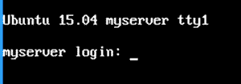

图 3-1：服务器登录提示

输入用户名后，系统会提示输入密码。登录后，你就可以运行命令。将显示基本的服务器状态信息，例如系统负载和登录用户数（参见 图 3-2）。

要关闭系统，请使用`sudo`命令输入`halt`。系统会提示输入密码。

```bash
sudo halt
```

在登录提示界面，你可以通过`Ctrl-Alt-Del`键重启系统。

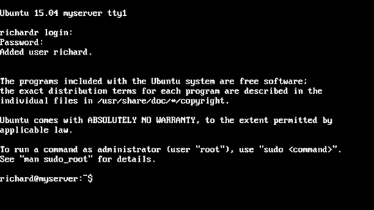

图 3-2：服务器登录

## Grub 选择与编辑

如果你有多个操作系统或想要恢复模式，可以使用 GRUB 菜单进行选择。如果没有检测到操作系统，默认 GRUB 菜单是禁用的。要启用 GRUB 菜单，你必须先编辑配置文件修改`HIDDEN_TIMEOUT`选项。默认情况下该选项设置为 0，从而禁用了 GRUB 菜单。

```text
GRUB_HIDDEN_TIMEOUT=0
```

GRUB 配置文件位于`/etc/default/grub`。你可以从服务器命令行界面使用`vi`、`emacs`或`nano`等文本编辑器编辑它。`nano`编辑器提供了简单的光标界面，便于编辑。使用`Ctrl-o`保存更改并使用`Ctrl-x`退出。

```bash
sudo nano /etc/default/grub
```

修改完成后，你必须运行`update-grub`命令使更改生效。

```bash
sudo update-grub
```

在 图 3-3 中，`GRUB_HIDDEN_TIMEOUT`选项被注释掉了。

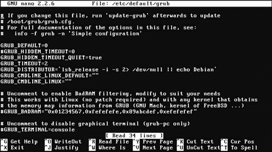

图 3-3：使用 nano 编辑 /etc/default/grub

启用后，GRUB 菜单会在启动时显示几秒钟，按下箭头键可以让 GRUB 等待你做出选择。你的 GRUB 菜单列出了 Ubuntu 以及安装在硬盘上的其他操作系统（如 Windows）。使用箭头键移动到你想要的条目并按回车键。按下`e`键可以编辑 GRUB 条目（参见 图 3-5 ).

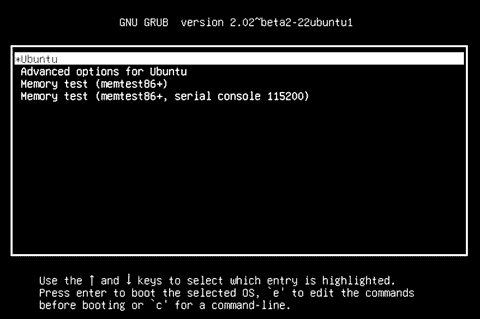

图 3-4：Ubuntu GRUB 菜单

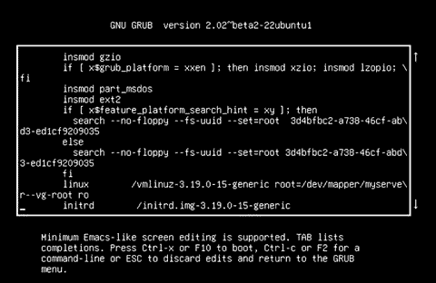

图 3-5：编辑 GRUB 菜单项

要更改特定行，请使用方向键移动到该行。你可以使用箭头键在行内移动。`Backspace`键会删除字符，而直接输入将插入字符。所有更改都是暂时的。只有通过直接编辑 GRUB 配置文件才能进行永久更改：`/etc/default/grub`文件以及`/etc/grub.d`目录下的文件，然后运行`sudo update-grub`命令。

# 命令行界面

出于效率考虑，Ubuntu 服务器 CD 不会安装桌面界面。相反，你使用传统的 UNIX 命令行界面，通过登录提示符访问系统，并在命令行中从键盘输入命令。

## 通过命令行界面访问 Ubuntu

对于命令行界面，你最初会收到一个登录提示符。登录提示符之前显示的是你为系统设置的主机名（hostname）。在本示例中，主机名是`turtle-server`。当你完成 Linux 使用后，首先注销（log out）。随后 Linux 将显示完全相同的登录提示符，等待你或另一个用户再次登录。这等同于 LightDM 登录窗口。然后你可以登录另一个账户。

登录账户后，你就可以输入并执行命令。登录 Linux 账户涉及两个步骤：输入用户名，然后输入密码。输入你用户账户的用户名。如果你输错了，可以使用`BACKSPACE`键删除字符。在下一个示例中，用户输入用户名`richard`，然后会被提示输入密码：

```
Ubuntu 15.04 my-server tty1
my-server login: richard
Password:
```

当你输入密码时，屏幕上不会显示。这样做是为了保护你的密码不被他人看到。如果你输入的用户名或密码错误，系统将返回错误信息“Login incorrect”（登录错误），并再次要求你输入用户名，从头开始登录过程。你可以重新输入用户名和密码。

一旦正确输入了用户名和密码，你就登录了系统。系统会显示你的命令行提示符，等待你输入命令。注意命令行提示符是一个美元符号（`$`）。在 Ubuntu 中，提示符之前是用户名和主机名。两者都由一组括号括起。

```
[richard@turtle-server]$
```

要结束会话，执行`logout`或`exit`命令。这将让你返回登录提示符，Linux 将等待另一个用户登录。

```
[richard@turtle-server]$ logout
```

相反，如果要从命令行关闭系统，你需要输入`halt`命令。该命令将为你注销并关闭系统。这需要管理员权限。

```
$ sudo halt
```

## 使用命令行界面

在使用命令行界面时，系统会给你一个简单的提示符，你在其中输入命令。即使你在使用像 GNOME 桌面，有时也需要在命令行中执行命令。你可以在终端（terminal）窗口中这样做，可以通过桌面启动栏（dash）的“应用程序”（Accessories）类别中的“终端”来访问它。

Linux 命令大量使用了选项（options）和参数（arguments）。请小心在命令行中将参数和选项放在正确的顺序上。Linux 命令的格式为命令名，后跟选项，然后是参数，如下所示：

```
$ command-name options arguments
```

选项是一个由一个或两个连字符（-）之前的单字母代码，用于修改命令执行的操作类型。选项和参数可能是可选的，也取决于具体的命令。例如，`ls`命令可以接受选项`-s`。`ls`命令显示目录下的文件列表，而`-s`选项以块为单位添加每个文件的大小。你按照如下方式在命令行中输入命令及其选项：

```
$ ls -s
```

如果你不确定某个命令使用的格式和选项，可以通过显示其帮助页（man page）来快速检查命令语法。大多数命令都有帮助页。只需输入`man`命令并将命令名作为参数即可。

参数是命令执行任务时可能需要的数据。在很多情况下，这是一个文件名。参数作为命令行上的一个单词输入，出现在任何选项之后。例如，要显示文件内容，可以使用`more`命令并将文件名作为其参数。配合文件名`mydata`使用`less`或`more`命令在命令行中的输入方式如下：

```
$ less mydata
```

命令行实际上是一个你可以编辑的文本缓冲区。在按下回车键（ENTER）执行命令之前，你可以在命令行上编辑命令。编辑功能提供了一种纠正输入命令及其选项时可能犯的错误的方法。`BACKSPACE`键让你能够删除刚刚输入的字符（光标左侧的字符），`DEL`键让你能够删除光标右侧的一个字符。通过这种删除字符的能力，如果你想的话，可以`BACKSPACE`掉整行，删掉你输入的内容。`CTRL-U`会删除整行命令行并让你在提示符处重新开始。

你可以使用`UP ARROW`（向上方向键）重新显示上次执行的命令。你可以重新执行该命令，也可以编辑它并执行修改后的命令。这在你需要重复某些操作（例如编辑同一个文件）时很有帮助。当你已经执行了输入错误的命令时也有帮助。

## 在服务器上通过命令行界面访问 USB 驱动器

当你连接 USB 驱动器时，它会被检测到，但不会被挂载。USB 驱动器通常格式化为`vfat`系统。要访问 USB 驱动器，你需要创建一个挂载点。你只需要创建一次。使用`mkdir`命令创建目录。

```
mkdir myusb
```

要将 USB 驱动器挂载到该目录，输入挂载命令并指定类型。你需要管理员权限，所以需要使用`sudo`命令。

```
sudo mount -t vfat /dev/sdb1 myusb
```

然后你可以通过进入 myusb 目录来访问 USB 驱动器。

```
cd myusb
ls
```

写入操作仍然需要管理员权限。

```
sudo cp mydata myusb
```

要写入整个目录及其子目录，你需要在`cp`命令中添加`-R`选项。

```
sudo cp -R mydatadir myusb
```

完成 USB 驱动器操作后，请确保先卸载它再拔掉。

```
sudo umount /dev/sdb1
```

## 设置日期和时间

你可以手动或通过引用时间服务器设置系统日期时间。你也可以使用本地硬件时钟。要手动设置系统时间，使用`date`命令。`date`命令有多个选项可以调整日期。你可以使用`--set`选项按月份或分钟设置时间。你可以使用一组数字从月、日、时、分、年开始设置特定时间。以下命令将日期设置为 2008 年 7 月 22 日上午 8:15。

```
sudo date 072208152008
```

`date`命令还有针对日、月或年的格式化选项。

要使用时间服务器，使用`ntpdate`命令和时间服务器的地址。

```
sudo ntpdate ntp.ubuntu.com
```

要访问硬件时钟，使用`hwclock`命令。该命令本身将显示硬件时钟时间。

```
hwclock
```

`--hctosys`选项将使用硬件时钟的时间设置系统时钟，而`--systohc`选项将系统时间重置硬件时钟。使用`--set`和`--date`可以将硬件时钟设置为特定时间。

```
sudo hwclock --systohc
```

时区是在您安装系统时设置的。如果您需要更改，可以从`/usr/share/zoneinfo`子目录下的文件中复制新的时区。这些文件按位置和城市排列。将新的时区复制到`/etc/localtime`文件即可。

```bash
sudo cp /usr/share/zoneinfo/Europe/London /etc/localtime
```

## 使用命令行界面编辑文件：文本编辑器

如果您仅使用命令行界面，则通常需要直接编辑配置文件来配置您的系统和服务器。您将需要使用基于命令行的编辑器来执行编辑任务。大多数命令行编辑器提供一个基于屏幕的界面，这使得显示和编辑文件变得非常简单。您的系统中默认安装了两个标准的命令行编辑器：`vi`和`nano`。表 3-1 列出了几种常见的命令行文本编辑器。您用于启动编辑器的命令也是编辑器的小写名称，例如用于 Vi 编辑器的`vi`，以及用于 Emacs 的`nano`、`joe`和`emacs`。

`vi`编辑器是大多数 Linux 和 UNIX 系统使用的标准编辑器。对于习惯了桌面编辑器的人来说，它可能很难使用。`nano`编辑器要易用得多，具有一个基于屏幕的界面，您可以使用方向键进行导航。如果您还不熟悉`vi`，可能想改用`nano`。

`nano`编辑器是一个简单的基于屏幕的编辑器，允许您直视化地编辑文件，使用方向键和翻页键在文件中移动。您使用控制键来执行操作。`Ctrl-x`将退出并提示您保存文件，`Ctrl-o`将保存文件。

| 编辑器 |  |
| :--- | :--- |
| vi | Vi 编辑器，使用困难，被认为是 Linux 和 Unix 系统上的标准编辑器，默认安装 |
| nano | 易于使用的基于屏幕的编辑器，默认安装 |
| emacs | 强大且复杂的基于屏幕编辑器，虽然比 Vi 更容易使用，位于 Ubuntu 软件仓库 |
| vim | vi 更易用的版本，位于 Ubuntu 软件仓库 |
| joe | 类似于 Emacs 的简单基于屏幕编辑器，位于 Universe 仓库 |
| the | 类似于 Emacs 的基于屏幕编辑器，位于 Universe 仓库 |
| ne | 类似于 nano 的简单基于屏幕编辑器，位于 Universe 仓库 |
| aee | 类似于 nano 的简单基于屏幕编辑器，位于 Universe 仓库 |

**表 3-1：命令行界面文本编辑器**

### 使用 nano

使用`nano`命令启动 nano。要编辑配置文件，您需要管理员权限。您将使用`sudo`命令启动`nano`。图 3-6 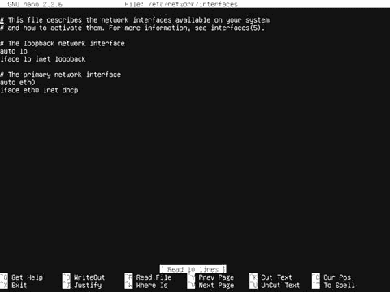显示了使用 nano 编辑器编辑`/etc/network/interfaces`文件。要编辑像`/etc/network/interfaces`这样的配置文件，请输入以下内容。

```bash
sudo nano /etc/network/interfaces
```

您可能会发现更强大的编辑器`vim`和`emacs`很有帮助。您必须先安装它们。`vim`编辑器为`vi`提供了一个稍微容易一点的界面。`Emacs`提供了一个类似于`nano`的界面，但复杂得多。

**图 3-6：使用 nano 编辑**

其他您可能发现有用的简单基于屏幕编辑器还有`joe`、`aee`、`ne`和`the`。它们在 Universe 仓库可用。`joe`和`the`类似于`Emacs`。`ne`和`aee`更像`nano`。

## 从命令行访问的帮助资源

您有几种不同的资源可以获取系统的帮助。如果您安装了桌面，可以使用 Ubuntu 帮助中心。Ubuntu 服务器光不会安装桌面。您将可以使用命令行帮助工具，如`man`页和`info`页。`/usr/share/doc`目录将存放为应用程序安装的任何文档。对于许多服务器（如 Bind 服务器），这些包含了有用的示例或基于 Web 的手手册。通常，服务器等应用程序的文档包含在单独的软件包中，名称通常带有`-doc`后缀，例如用于 DNS BIND 文档的`bind9-doc`。

系统中已经安装了大量的支持文档，也可以从在线资源获取。


如果您需要提问，可以在[`answers.launchpad.net`](http://answers.launchpad.net)和[`askubuntu.com`](http://askubuntu.com)获取帮助支持。在这里您可以提交您的问题，并检查已回答的问题。

## 应用程序文档

在您的系统中，`/usr/share/doc`目录包含每个应用程序安装的文档文件。在每个目录下，您通常可以找到该应用程序的`HOW-TO`、`README`和`INSTALL`文档。某些文档将包含详细手册。许多应用程序有单独文档包，通常带有`-doc`后缀，如`bind9-doc`。此类文档可能位于它们的包名下，而不是应用程序名，例如 DNS 服务器文档位于`/usr/share/doc/bind9-doc`。

## Man Pages

您还可以访问 Man 页，即 Linux 命令的手册，使用`man`命令从命令行界面访问它们。输入`man`后跟您想要信息的命令。

```bash
$ man ls
```

按下空格键将您带到下一页。按下`b`键将您返回上一页。完成后，按`q`键退出工具并返回命令行。

## Info Pages

GNU 应用程序的在线文档（例如`gcc`编译器和`Emacs`编辑器）也以 info 页的形式存在。您可以通过输入`info`命令访问这些文档。这会弹出一个显示不同应用程序的特殊屏幕。info 界面有自己的命令集。您可以在命令行提示符输入`info`来了解更多信息。

## 使用 Ubuntu 桌面界面

Ubuntu 桌面将安装完整的桌面包，包括您可能在服务器上不需要的多媒体和图形包。Ubuntu 桌面还安装了您可能需要的管理包，如软件包管理器、Ubuntu 软件中心、网络管理器、用户和组管理以及更新管理器。

您可以使用`ubuntu-desktop`元软件包和`tasksel`软件管理工具在服务器上安装 Ubuntu 桌面。使用`sudo`命令运行`tasksel`，使用方向键移动到 Ubuntu Desktop 项并按下空格键。然后切换到 OK 按钮并按 ENTER。

```bash
sudo tasksel ubuntu-desktop
```

下载和设置可能需要一小时或更久。然后注销并重启系统。LightDM 将启动，如图 3-7 所示。

### Light 显示管理器：LightDM

图形登录界面会显示一个登录窗口，其中有一个框，列出了用户名菜单。当前选中的用户名将显示一个文本框，您可以在其中输入密码。按下 ENTER 后，您将登录所选账户，桌面将启动。

图形化登录由 Light 显示管理器（LightDM）处理。LightDM 负责管理登录界面、验证用户密码和用户名，然后启动选定的桌面。

从 LightDM，你可以通过`CTRL-ALT-F1`键切换到命令行界面，然后通过`CTRL-ALT-F7`键切换回 LightDM。`F1`到`F6`键提供不同的命令行终端，例如`CTRL-ALT-F3`对应第三个命令行终端。


图 3-7: 带有用户列表的 LightDM 登录界面

当 LightDM 启动时，它会显示用户列表（参见图 3-7）。屏幕右上角的会话（电源图标）菜单显示`Suspend`（挂起）、`Restart`（重启）和`Shut Down`（关机）条目。时间显示在电源图标旁边。将鼠标悬停在时间上会将其展开为日历并显示日期。时间旁边的声音菜单允许你调整或静音声音。网络菜单允许你配置网络访问。键盘菜单允许你选择键盘。辅助功能菜单显示如屏幕软键盘、高对比度和屏幕阅读器等选项。

你可以使用方向键在用户列表中移动。对于选定的用户，系统会提示你输入用户密码（参见图 3-8）。输入密码后，按`ENTER`键或点击右侧箭头。桌面随后将启动。


图 3-8: LightDM 登录界面：密码输入

访客会话（Guest Session）用户没有密码，只有一个简单的 Log In 按钮。远程登录用户会提示输入电子邮件地址和密码，如下所示。

 

如果你安装了多个桌面界面（例如 Kubuntu），用户名右侧会出现一个 Ubuntu 图标。点击它可以显示一个菜单（参见图 3-9），你可以在从中选择想要启动的桌面界面。该菜单显示所有已安装的可能的桌面界面。在这里，你可以选择 KDE 来使用 KDE 桌面。除非你已经安装了 KDE，否则不会显示 KDE 选项。你上次登录时选择的界面会被自动选中。一旦你做出选择，点击`OK`条目或向左箭头返回到带有密码文本框的用户列表。你选择的桌面的图标将显示在你的名字旁边。输入密码并按`ENTER`键启动带有所选界面的 Ubuntu。

 

图 3-9: 带有桌面选择的 LightDM 登录界面

如果你从用户桌面注销，将返回 LightDM 登录界面。要关闭你的 Ubuntu 系统，请选择会话菜单（电源图标，右上角）中的`Shut Down`条目。你也可以通过点击 Ubuntu 桌面顶部右侧的会话图标直接关闭系统。桌面会话菜单将显示包含`Lock`（锁屏）、`Log Out`（注销）、`Restart`（重启）、`Suspend`（挂起）和`Shut Down`（关机）的条目。

**提示**：若要使用键盘从登录界面重启系统，你必须先进入命令行界面。按下`Ctrl-Alt-F1`进入命令行界面，然后按下`Ctrl-Alt-Del`重启系统。

### 会话菜单和用户切换器

Ubuntu 桌面在顶部面板右侧显示一个会话菜单，图标为齿轮电源图标（参见图 3-10）。你通常使用会话菜单来注销、重启或关闭系统。菜单的最后部分显示`Log Out`、`Suspend`、`Restart`和`Shutdown`条目。`Log Out`条目会注销你的会话并返回登录界面。从菜单中，你也可以直接从桌面关闭或重启系统。要重启，选择`Restart`条目。使用`Lock`条目锁定桌面访问。

`System Settings`条目会打开 GNOME 3 系统设置对话框，通过它你可以访问桌面管理工具，例如用户、鼠标和触控板以及蓝牙工具。访客会话允许访客登录。

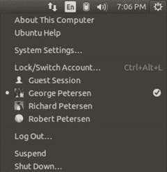 

图 3-10: 配置了单用户和多用户的桌面会话菜单

用户切换器集成在会话菜单中。它不再像在之前的版本中那样是一个独立的菜单。用户切换器条目列出了系统上的其他用户。它允许你切换到另一个用户，而无需注销或结束当前的用户会话。用户切换操作会在你登录另一个用户时保持你的登录状态。你的活动程序将在后台继续运行。

如果你的系统设置了多个用户，则`Lock`条目将变为`Lock/Switch Account`（锁定/切换账户）条目，允许你从锁屏界面以当前未登录的用户身份登录。其他用户也会列在`Lock/Switch Account`条目下方（参见图 3-10）。已登录的用户旁边将有一个对标记。

### 访客登录

Ubuntu 支持访客账户，允许其他用户使用你的系统，而无需为他们提供自己的账户或使用别人的账户。它设计用于让他人快速查看网站等情况。访客登录可以通过会话菜单中的`Guest Session`条目访问（参见图 3-9）。访客用户将立即进入他们自己的桌面，而你的账户保持锁定状态。访客用户名将出现在顶部面板的用户切换器菜单中。从访客账户注销后，将显示 LightDM 登录界面，让你重新登录自己的账户。访客用户也可以使用用户切换器菜单切换到另一个用户，而访客会话将保持登录状态。这样，访客用户的工作会被保留，同时你可以访问另一个用户或自己的账户。然后你可以切换回访客用户。

### 锁屏

你可以通过选择会话菜单中的`Lock`条目或按下`Ctrl-Alt-L`来锁定屏幕并挂起系统。要重新启动，按下空格键将出现锁屏对话框（参见图 3-11）。这与登录界面相同，只有一个你用户名的条目和密码提示。输入密码即可重新启动你的桌面会话。

从锁屏，你还可以通过点击屏幕右上角的会话按钮切换到另一个用户，打开一个包含其他用户条目的菜单。选择一个以打开该用户的 LightDM 登录界面。


图 3-11: 锁屏

### 关机和注销

要从 Ubuntu 桌面关闭系统，点击顶部面板右侧的会话图标（电源轮）打开会话菜单。关机选项显示在菜单底部：`Log out`（注销）、`Suspend`（挂起）和`Shut Down`（关机）（参见图 3-10）。要注销，可以使用会话菜单中的`Log Out`项，这将带您返回登录界面，您可以在那里以不同的用户身份登录。`Restart`（重启）是关机对话框中的一个选项。

有几种方法可以关闭系统：

- 会话菜单：选择一个关机选项（参见图 3-10）。
- 按下电脑上的电源按钮。这将打开一个带有关机选项的菜单（参见图 3-13）。
- 如果显示器冻结或损坏，一种安全的关机并重启方法是按下命令行界面键（如`CTRL-ALT-F1`）返回命令行界面，然后按下`CTRL-ALT-DEL`重启。您也可以在命令行界面（终端）上登录，然后输入`sudo shutdown -h now`命令。

当您从会话菜单选择`Shut Down`、`Suspend`或`Log Out`项时，将显示相应的对话框。在关机对话框中，您还可以选择重启（参见图 3-12）。在注销对话框中，您还可以选择锁定。

 

图 3-12：关机和重启对话框

您也可以按下电脑电源按钮来关闭、重启或挂起系统，这将显示一个带有`Lock`（锁定）、`Suspend`（挂起）、`Restart`（重启）和`Shut Down`（关机）菜单项的关机对话框（参见图 3-13）。


图 3-13：关机对话框

使用`Suspend`临时停止系统，这将极少或不消耗电源。按下空格键重新显示锁定的登录界面，您可以再次访问账户并从离开的地方继续会话。

# Ubuntu 桌面 (Unity)

Ubuntu 15.04 支持两种主要的不同的桌面界面：Ubuntu 和 Kubuntu。Ubuntu 桌面 DVD 安装 Ubuntu。Ubuntu 桌面使用 Ubuntu Unity 界面。

Ubuntu 倾向于由适当显示驱动程序提供的硬件加速。如果您当前的图形驱动程序不支持硬件加速，将使用运行在 CPU 上的`OpenGL`通过`LLVMpipe`进行加速模拟登录。这可能会导致系统变慢。

Kubuntu DVD 安装 KDE 桌面界面。您也可以使用 Ubuntu 软件中心的 KDE 元软件包：`kubuntu-desktop`或`kubuntu-full`，在 Ubuntu 桌面系统上安装 KDE。尽管 GNOME 和 KDE 界面看起来相似，但它们是非常不同的桌面界面，具有用于选择偏好设置独立工具。

Ubuntu 使用 Ubuntu Ambiance 主题作为界面，以 Ubuntu 屏幕背景和菜单图标作为默认（参见图 3-11）。另一个 Ubuntu 主题名为 Radiance。Ambience 是一个较深颜色的主题，而 Radiance 使用较浅的颜色。本书中的示例使用了 Ambiance 主题。您可以在 Appearance 对话框的 Look 选项卡的 Theme 菜单中切换到 Radiance 主题。可以通过自定义仪表栏（Customization dash）和系统设置（System Settings）访问 Appearance 工具。

| 按键 | 操作 |
| :--- | :--- |
| `SHIFT` | 移动文件或目录，默认 |
| `CTRL` | 复制文件或目录 |
| `CTRL-SHIFT` | 为文件或目录创建链接 |
| `F2` | 重命名选中的文件或目录 |
| `CTRL-ALT-Arrow (右, 左, 上, 下)` | 移动到不同的桌面 |
| `CTRL-w` | 关闭当前窗口 |
| `ALT-spacebar` | 打开窗口操作的窗口菜单 |
| `ALT-F2` | 打开运行命令框 |
| `ALT-F1` | 打开应用程序菜单 |
| `Ctrl-F` | 查找文件 |

表 3-2：窗口和文件管理器快捷键

Ambience 和 Radiance 主题将窗口控制按钮（关闭、最大化和最小化按钮）放置在窗口标题栏的左侧，所示。有三个窗口按钮：用于关闭的`x`、用于最小化的横线（`-`）和用于最大化的方形。关闭按钮用橙色高亮。


窗口按钮 

要移动窗口，点击并拖动其标题栏。每个窗口都支持`Minimize`（最小化）、`Maximize`（最大化）和`Close`（关闭）。

# Ubuntu Unity

Ubuntu 桌面 (Unity) 是为了提高效率设计的现代界面。Ubuntu 桌面 (Unity) 提供了与系统交互的独特方式。

## 界面

Ubuntu 桌面 (Unity) 是为了提高效率设计的现代界面。Ubuntu 桌面 (Unity) 提供了与系统交互的独特方式。

## Dash

Ubuntu 桌面 (Unity) 是为了提高效率设计的现代界面。Ubuntu 桌面 (Unity) 提供了与系统交互的独特方式。

## 启动

Ubuntu 桌面 (Unity) 是为了提高效率设计的现代界面。Ubuntu 桌面 (Unity) 提供了与系统交互的独特方式。

## 启动

Ubuntu 桌面 (Unity) 是为了提高效率设计的现代界面。Ubuntu 桌面 (Unity) 提供了与系统交互的独特方式。

## 启动

Ubuntu 桌面 (Unity) 是为了提高效率设计的现代界面。Ubuntu 桌面 (Unity) 提供了与系统交互的独特方式。

## 启动

Ubuntu 桌面 (Unity) 是为了提高效率设计的现代界面。Ubuntu 桌面 (Unity) 提供了与系统交互的独特方式。

## 启动

Ubuntu 桌面 (Unity) 是为了提高效率设计的现代界面。Ubuntu 桌面 (Unity) 提供了与系统交互的独特方式。

|  | 主文件夹 |
|  | Firefox 浏览器 |
|  | LibreOffice 文字处理 |
|  | LibreOffice 表格 |
|  | LibreOffice 幻灯片 |
|  | Ubuntu 软件中心 |
|  | 系统设置 |
|  | 工作区切换 |
|  | 垃圾箱 |

表 3-3：Ubuntu Unity 启动器默认项目和图标

### Gnome 文件管理器 (Nautilus)

Ubuntu (Unity) 使用`Nautilus`文件管理器。你可以通过“前往”（Go）菜单中的项访问主文件夹，或者通过点击启动器中的`主文件夹`项目。这将打开一个文件管理器窗口，显示你的主目录。你的主目录已经为常用文件创建了默认目录。这些目录包括`Pictures`（图片）、`Documents`（文档）、`Music`（音乐）、`Videos`（视频）和`Downloads`（下载）。

你的办公应用程序默认将将文件保存到`Documents`目录。图像和照片应用程序会将图像文件放在`Pictures`目录。`Desktop`文件夹将存放所有保存到桌面的文件和目录。当你下载文件时，它会被放置在`Downloads`目录。

文件管理器窗口显示多个组件，包括一个工具栏和一个显示设备、文件系统、书签和文件夹的侧边栏。使用工具栏右侧按钮提供的`view`（查看）和`tools`（工具）菜单管理文件和文件夹（缩放、排序、创建文件夹和书签）。当你打开新文件夹时，将使用同一个窗口显示它，你可以使用向前和向后的箭头在之前打开的目录之间移动。位置栏显示当前文件夹及其父文件夹的文件夹按钮。你可以点击父文件夹跳转到那里。图 3-17 显示了文件管理器窗口。从桌面应用程序菜单栏（顶栏）上的`Files`（文件）菜单中，你可以打开新的文件管理器窗口、访问 ftp 站点、输入路径（位置）或管理书签。

文件管理器还支持标签页。你可以在同一个文件管理器窗口中打开多个文件夹。要打开新标签页，从`File`（文件）菜单选择`New Tab`（新建标签）或按`Ctrl-t`。你可以使用`Tabs`（标签）菜单中的项从一个标签移动到另一个，或者重新排列标签。你还可以使用`Ctrl-PageUp`和`Ctrl-PageDown`键在标签之间移动。使用`Shift-Ctrl-PageUp`和`Shift-Ctrl-PageDown`键重新排列标签。

文件管理器支持通过按键和鼠标点击的组合实现完整的拖放功能。你可以将文件夹、图标和应用程序拖到桌面或其他打开了其他文件夹的文件管理器窗口。移动操作是默认的拖放操作（你也可以在拖动时按`SHIFT`键）。要复制文件，按`CTRL`键，然后在释放鼠标按钮之前点击并拖动。要创建链接（快捷方式），在拖动图标时同时按住`CTRL`和`SHIFT`键，将其拖到你想让链接出现的地方（例如桌面）。

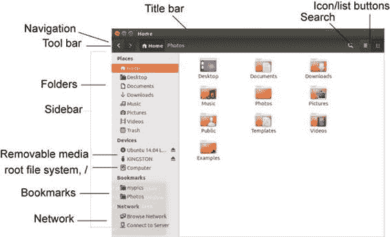 

图 3-17：主文件夹的文件管理器

注意：K 桌面环境 (KDE) 在屏幕底部显示一个面板，看起来与 GNOME 桌面顶部的面板非常相似。文件管理器看起来略有不同，但操作方式与 GNOME 文件管理器相同。

### 桌面网络连接


网络连接将由`Network Manager`为你完成设置，它会自动检测你的有线和无线网络连接。`Network Manager`提供连接的状态信息，允许你根据需要轻松从一个已配置的连接切换到另一个。对于初始配置，它会尽可能检测有关新连接的信息。

有线连接会自动启动。对于无线连接，当用户登录时，`Network Manager`会选择该用户优的连接。用户可以从检测到的无线网络列表中选择要使用的无线连接。

网络菜单在顶部面板右侧显示一个`Network Manager`图标。`Network Manager`图标会根据连接类型和你的连接状态而变化。以太网（有线）连接将显示两个方向相反的箭头。无线连接将显示交错的波形图（参见图 3-18）。如果没有激活的连接（无线或有线），则显示一个空波形图。当`Network Manager`建立有线或无线连接时，它会显示脉动的交错波形图。如果你同时具有有线和无线连接，且有线处于激活状态，将显示有线连接图像（相反箭头）。

  

图 3-18：`Network Manager`有线、无线和未连接图标。

## Network Manager 有线连接

对于连接到有线网络（如以太网连接）的计算机，`Network Manager`会自动检测网络连接并建立连接。大多数网络使用`DHCP`自动提供 IP 地址和网络服务器等网络信息。每当你启动系统时，`Network Manager`都可以自动连接网络。网络连接可能会标记为类似`connection 1`，`eth0`是实际以太网设备名称。当你连接时，会显示已建立连接的消息，如下所示。


`Network Manager`面板图标将显示方向相反的箭头，如下所示。


`Network Manager`菜单显示你的有线连接，此处显示`connection 1`。


要断开有线连接，可以选择此菜单中的`Disconnect`（断开）。菜单将显示你已断开。有线连接将作为选项显示。稍后重新连接时，选择可用的有线连接，在此示例中`connection 1`。


## Network Manager 无线连接

如果有多个无线接入点，系统可以选择不同的网络连接，而不是单一的 DSL 或电缆连接。对于在不同位置访问不同无线连接的笔记本电脑来说尤其如此。不需要每次遇到新连接都手动配置，`Network Manager`工具可以配置并选择要使用的连接。

`Network Manager`将扫描无线连接，检查扩展集标识符 (`ESSID`)。如果`ESSID`识别出以前使用过的连接，则会选择它。如果发现多个，则选择最近使用的一个。如果只发现新连接，则`Network Manager`将等待用户选择。只有在用户登录时，才会选择连接。

打开`Network Manager`菜单查看所有可能的网络连接列表，包括所有可用无线连接（参见图 3-19 ）。无线项目显示无线网络名称和显示信号强度的波形图。具有有线和无线设备的计算机会显示`Wired Network`和`Wireless Networks`条目。只有无线设备的计算机仅显示`Wireless Networks`。你可以通过从菜单选择`Enable Wireless`来禁用无线网络的显示。该项旁边的勾标记将被移除，并禁用无线检测。要重新激活无线连接，再次点击`Enable Wireless`项。该项旁边将显示勾标记，你的无线连接现在列在`Network Manager`菜单中。

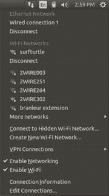 

图 3-19: 网络管理器连接菜单：有线和无线

注意：如果计算机同时具有有线（`Ethernet` 或拨号上网）和无线连接设备（大多数笔记本电脑都是如此），你将看到有线和无线网络的条目。

要连接到无线网络，请在`Network Manager`菜单中找到该网络项并点击它。如果这是你第一次尝试连接该网络，系统将提示你输入连接信息：无线安全类型和密码。系统将检测并显示网络所使用的无线安全类型。如果类型不正确，你可以使用下拉菜单选择正确的方法。条目将根据所选的方法发生变化。`WPA` 密码是较常见的方法之一。图 3-20 显示了使用 `WPA` 安全方法的无线网络密码提示。有一个复选框可以让你在需要检查输入是否正确时显示密码。点击 `Connect` 激活连接。

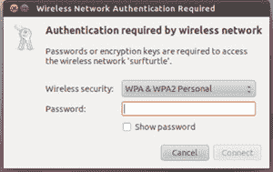

图 3-20: 网络管理器无线身份认证

一旦连接成功，将显示一条消息指示连接已建立，如下。


要断开特定的无线网络，在`Network Manager`菜单上点击无线条目下的 `Disconnect` 选项。

当你第一次连接到无线网络时，系统会在从 `System dash` 访问的 `Network Connections` 对话的 `Wireless` 选项卡中为无线连接创建一个配置项。

当你第一次进行无线连接时，系统将提示你设置密钥环（keyring）。密钥环存储你的无线连接密码，允许你每次连接无线网络时无需重新输入网络密码。系统会要求你创建一个用于访问密钥环的密码。这是一次性操作。一旦密钥环设置，任何额外的无线连接密码都将添加到其中。当你首次登录并尝试连接无线网络时，系统会提示你输入密钥环密码。

在 KDE 上，点击 `Plasma panel` 上的 `Network Manager` 图标会显示 `KDE Network Manager` 小部件。接口在左侧，连接在右侧。要查看无线连接列表，点击左侧的 `WLAN Interface` 图标。右侧将显示关于 `WLAN interface` 的信息以及可能的无线连接列表。点击你想要使用的项以打开 `Add Network Connection` 对话框，该框显示 `Wireless Security` 选项卡，你可以在其中选择安全类型并输入密码。如果你尚未设置 `KDE Wallet` 密码，系统现在会提示你设置。这将允许日后自动访问连接。随后你即完成连接。你可以点击 `Show Less` 按钮隐藏活动连接以外的所有连接。点击 `Show More` 查看所有可能的连接，以便你切换到另一个连接。`Manage Connections` 按钮会打开 `KDE Network Manager` 对话框，你可以在其中管理所有的连接。

无线连接也可以被隐藏。这些是不广播 `SSID` 的无线连接，使得自动扫描无法检测到它们。要连接到隐藏的无线网络，请 le 在 `Network Manager` 菜单上选择“Connect to hidden wireless network”。`Connection` 下拉菜单将选择 `New` 条目。如果你之前设置过任何隐藏连接，它们也会列在 `Connection` 下拉菜单中。对于 `New` 连接，输入无线网络名称并选择安全方法。在这两种情况下，系统都会提示你输入网络密钥环密码。

## Network Manager

网络菜单还提供了编辑连接、关闭连接（`Enable Networking` 和 `Enable Wireless`）、禁用所有网络访问（`Enable Networking`）或查看连接信息的选项，如下。在 Ubuntu (Unity) 上，这些条目包含在 `Network Manager` 菜单中。具有有线和无线连接的计算机将会有 `Enable Networking` 和 `Enable Wireless` 条目。选择 `Enable Wireless` 将断开无线连接，保持有线连接激活状态。`Enable Wireless` 复选框将取消勾选，并显示消息告知你的无线连接已断开。选择 `Enable Networking` 将禁用有线连接以及任何无线连接。这样做可以在离线状态下工作，无需网络访问。

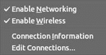

仅带有有线网络设备（无无线）的计算机将仅显示 `Enable Networking` 条目。选择它将断开任何网络访问，允许你离线工作。

## 在桌面上设置共享目录 (nautilus-share)

GNOME 桌面还提供了一种设置共享文件夹的简单方法。`nautilus-share` 软件包（随桌面默认安装）提供了使用 `Samba` 和 `NFS` 的自动配置和访问。你必须先安装 `Samba` 和 `NFS` 服务器。

要在你的 Ubuntu 系统上共享文件夹，请右键点击它并选择 `Sharing Options`。这将打开一个窗口，你可以在其中允许共享，并决定是否允许修改、添加或删除文件夹中的文件（参见图 3-21）。你也可以文件属性对话框上的 `Share` 选项卡。你可以允许任何在系统中没有账户的用户（访客）访问。一旦做出选择，点击 `Create Share` 按钮。如果你需要，稍后可以共享选项。为了让用户创建共享，他们必须拥有权限。新用户默认没有此权限。在 `Users and Group Advanced` 对话框的 `Privileges` 选项卡上，勾选“Share files with the local network”。

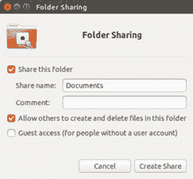

图 3-21: 共享选项

要允许其他用户访问，必须更改文件夹权限。系统会提示允许 `Nautilus` 进行这些更改。只需点击“Add the permissions automatically”按钮（参见图 3-21）。

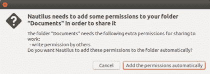

图 3-22 共享权限提示

注意：如果你正在运行防火墙，请确保为 `NFS` 和 `Samba` 服务配置访问，包括浏览支持。否则，其他计算机对共享文件夹的访问可能会被阻止。

共享文件夹在文件窗口图标旁边会显示共享图标。


为了允许其他计算机访问，请确保安装了共享服务器：Windows 系统使用 `Samba`，Linux/Unix 系统使用 `NFS` (`nfs-kernelserver`)。服务器会自动为你配置并运行。在安装这些服务器之前，你无法共享文件夹。如果没有安装共享服务器，首次尝试共享文件夹时会提示安装（参见图 3-23）。点击 `Install service` 按钮。`Samba` 服务器将被下载并安装。随后将提示你重启桌面会话。点击 `Restart session` 按钮。你现在将处于 `LightDM` 登录界面。再次登录，然后打开你想共享的文件夹的共享对话框（Sharing Options）。

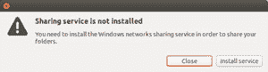 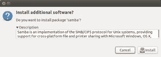

图 3-23: 安装共享服务的提示 (Samba 和 NFS)

注意：与网络上的其他 Linux 系统共享文件夹（目录），你使用 `NFS` 服务 (`nfs-kernelserver`)。对于 Windows 系统，你使用 `Samba` 服务 (`samba`)。对于 Samba 配置，可以使用 `system-config-samba`。

你也可以通过 Synaptic 软件包管理器（`samba` 软件包）以及 Ubuntu 软件中心 | 系统 | Unix 的 SMB/CIFS 文件、打印和登录服务器（`samba`）直接安装 Samba 服务器。会有两个服务器通过使用 `/etc/init.d` 目录下的 `smbd` 和 `nmbd` 服务脚本安装并运行（`samba` 服务脚本已不再使用）。`smbd` 服务器是 Samba 服务器本身，而 `nmbd` 服务器是网络发现服务器。

如果 Samba 服务器未能启动，你可以在终端窗口中使用以下命令手动启动它：

```bash
sudo service nmbd start
sudo service smbd start
```

你可以使用 `status` 选项检查当前状态，并使用 `restart` 选项重启：

```bash
sudo service nmbd status
sudo service smbd status
```

在首次安装时，Samba 会导入你 Ubuntu 系统上已经配置好的用户账户。你的 Ubuntu 系统中，与 Ubuntu 账户用户名和密码相同的对应的 Windows 用户将自动连接到 Ubuntu 共享文件夹。如果 Windows 用户的密码不同，Windows 将提示该用户输入用户名和密码。这是 Ubuntu 的用户名和密码。如果 Windows 用户用户名相同但密码不同，用户应输入相同的用户名和 Ubuntu 用户密码，而不是 Windows 密码。

任何用户都拥有所有共享内容的访问权限。如果你想根据特定用户和密码实现受限访问，则必须使用 Samba 配置工具（如 `system-config-samba`）配置用户级访问，如下一节所述。

稍后要更改文件夹的共享权限，请打开文件夹的属性窗口并选择“共享”（Share）选项卡。当你进行更改时，会显示“修改共享”（Modify Share）按钮。点击它可以进行更改。

**注意：** Avahi（随桌面安装）让你的 Ubuntu 桌面可以直接访问任何共享的 Windows 目录。但 Windows 或 Linux 客户端只能通过 Samba 和 NFS 访问你的共享 Ubuntu 目录。

## 桌面上的终端窗口

终端窗口允许你在命令行中输入 Linux 命令，可以通过“应用程序”透镜 | “辅助工具”过滤器中的“终端”（Terminal）来访问。它还为你提供了一个 shell 界面，用于使用 shell 命令而不是你的桌面操作。命令行是可编辑的，允许你使用退格键删除行上的字符。按下按键将插入该字符。你可以使用左右箭头键在行内任何位置移动，然后按键插入字符，或使用退格键删除字符（参见图 3-24）。文件夹、文件和可执行文件的颜色不同：黑色表示文件，蓝色表示文件夹，绿色表示可执行文件，青色表示链接。共享文件夹以绿色背景显示。

终端窗口会记住你之前输入的命令。使用向上和向下箭头可以使这些命令在命令行中逐个显示。按下 `ENTER` 键重新执行当前显示的命令。你甚至可以在运行之前对之前的命令进行编辑，允许你执行上一个命令的修改版本。如果你需要使用不同的参数重新执行一个复杂命令，或者你输错了一个复杂命令并想在不重新输入整个命令的情况下进行纠正，这将会非常有帮助。终端窗口将显示该会话中之前的所有交互和命令。使用滚动条查看运行过的任何之前的命令及其显示结果。

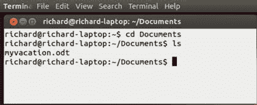

| 辅助技术 | 启用如辅助登录和键盘屏幕等功能。 |
| :--- | :--- |
| 备份 | Deja Dup 备份工具 |
| 蓝牙 | 蓝牙检测与配置 |
| 亮度与锁定 | 设置屏幕亮度以及闲置时变暗或锁定屏幕的时间。 |
| 颜色 | 为设备设置色彩方案 |
| 详情 | 系统和硬件信息、默认应用程序以及可移动式介质的默认设置。 |
| 显示器 | 更改您的屏幕分辨率、刷新率和屏幕方向。 |
| 键盘 | 配置键重复敏感度以及特殊任务的按键。 |
| 语言支持 | 语言选择 |
| Landscape 服务 | Canonical 的 Landscape 商业管理服务 |
| 鼠标和触控板 | 鼠标和触控板配置：选择手部方向、速度和辅助功能。 |
| 网络 | 允许你开启和关闭线及无线网络。你可以访问可用的无线网络和代理配置。 |
| 在线账户 | 为社交网络应用程序配置在线账户。 |
| 电源 | 设置笔记本电脑闲置时的电源选项。 |
| 打印机 | 使用 `system-config-printer` 配置打印机（参见第 10 章） |
| 声音 | 配置音效、输出音量、音频设备选项、输入音量和声音应用程序设置。 |
| 时间与日期 | 设置时间和日期（包括时区）以及时钟显示选项。 |
| 安全与隐私 | 管理何时需要密码、历史日志和搜索选项。 |
| 软件与更新 | 管理存储库和驱动程序（附加驱动选项页） |
| 文本输入 | 配置键盘：选择选项、型号和打字间隔，如慢速、粘跳键和粘滞键等辅助功能。 |
| 通用访问 | 为屏幕阅读器、字体大小、对比度、视觉提示、屏幕键盘和基于键的鼠标设置通用访问设置。 |
| 用户账户 | 管理用户，一个 GNOME 3 工具 |
| Wacom 图形写板 | Wacom 图形写板配置 |

表 3-4：桌面系统设置

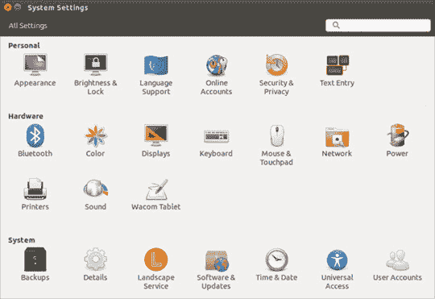 

图 3-27：系统设置对话框

许多人会调用之前的版本中提供的 Ubuntu 支持系统工具，例如`声音` (`PulseAudio`）和`打印` (`system-config-printer`)。另一些人使用新的 GNOME 3 配置和管理工具，如`亮度`、`用户账户`和`电源`。`颜色` 工具允许你为扫描仪、相机和打印机等不同设备选择色彩方案。系统设置工具打开时顶部有一个“所有设置”按钮，你可以点击它返回系统设置对话框。表 3-4 列出了系统设置工具。

## Ubuntu 帮助中心

大量的支持文档已经安装在你的系统中，并且可以从在线资源访问。GNOME 和 KDE 桌面带有帮助系统，这些系统使用类似浏览器的界面显示帮助文件。帮助浏览器支持 Ubuntu 帮助中心，该中心提供 Ubuntu 特定的帮助。

如果你需要提问，可以选择 `帮助 | 获取在线帮助` 来访问 [`answers.launchpad.net`](https://answers.launchpad.net) 和 [`askubuntu.com`](http://askubuntu.com) Ubuntu 帮助支持。在这里你可以提交你的问题，并查看关于 Ubuntu 的已解答。

## Ubuntu 桌面指南


要启动 Ubuntu 桌面指南，请从会话菜单中选择“Ubuntu 帮助”。指南显示了多个涵盖 Ubuntu 主题的链接（参见图 3-28）。涵盖的 Unity 主题包括`启动器`、`Dash`、指示器菜单、窗口管理和工作空间访问。你可以使用左右方向键切换你之前显示过的文档。你还可以搜索主题。搜索框显示当前文档的名称。点击搜索栏可以输入搜索词。按 `ENTER` 显示结果。你还可以点击搜索框右侧的黄色星按钮（或从书签菜单选择“添加书签”）为文档和搜索结果添加书签。

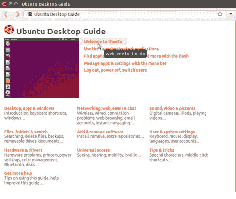 

图 3-28：Ubuntu 桌面指南

这些页面的组织方式更像常见问题文档，具有更详细的标题，旨在让你更清晰地理解文档的主题（参见图 3-29）。`声音`、视频和图片链接会打开一个包含“为什么不”等条目的页面。


图 3-29：Ubuntu 桌面指南

`声音`、视频和图片链接会打开一个包含“为什么不”等条目的页面。

`声音`、视频和图片链接会打开一个包含“为什么不”等条目的的页面。

`声音`、视频和图片链接会打开一个包含条目（参见图 3-30）的页面。在大多数页面的底部，`更多信息`部分将包含

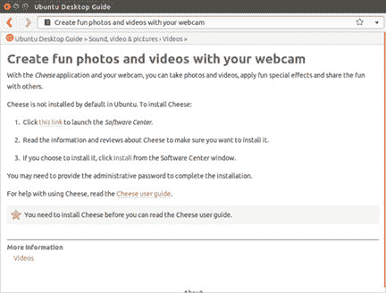

图 3-30：Ubuntu 桌面指南

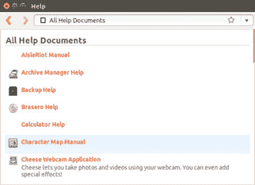

图 3-31：Ubuntu 帮助

## 4. 管理软件

安装软件是由具有管理权限的用户执行的管理功能。除非你在安装期间选择了安装所有包，否则你的系统中仅安装了用户可用的许多应用程序和实用程序中的一部分。在 Ubuntu 上，你可以轻松使用`apt-get`命令从系统中安装或删除软件，或者从桌面上使用`Synaptic 软件包管理器`。

`APT`（高级软件包工具）被集成为主要的安装软件包工具。当你使用`apt-get`、`Ubuntu Center`或`Synaptic 软件包管理器`安装包时，`APT`将被调用并自动选择相应的包。

`DEB`软件包包含了软件应用程序所需的所有文件。Linux 应用程序通常由多个安装在不同目录下的文件组成。程序本身可能位于名为`/usr/bin`的目录；在线手册位于另一个目录，库文件位于另一个目录。

### Ubuntu 软件包管理软件

虽然所有 Ubuntu 软件包具有相同的`DEB`格式，但可以使用不同的软件包管理工具进行管理和安装。主要的软件管理工具是`APT`。某些工具可以在命令行界面操作，而另一些工具只在桌面上工作。

查看《Ubuntu 服务器指南 | 软件包管理》了解基本的命令行软件操作和存储库配置。

[`https://help.ubuntu.com/stable/serverguide/package-management.html`](https://help.ubuntu.com/stable/serverguide/package-management.html)

### 命令行界面工具

如果你安装的是 Ubuntu 服务器 CD，你将只能访问以下命令行界面的工具。

#### 软件管理

- `tasksel`：用于选择软件包组和特定服务器的基于界面。此工具运行在由 Ubuntu Server CD 安装的命令行界面上。你也可以在桌面的终端窗口中运行它。使用方向键移动到某一项，使用空格键选择，使用 Tab 键移动到 OK 按钮。在 OK 按钮上按回车键执行安装。

- `aptitude`：`dpkg`或`apt-get`等工具的前端，基于屏幕，使用它自己的数据库`/var/lib/aptitude`。

- `apt-get`：用于安装、更新和删除软件的主要命令行工具，使用它自己的数据库`/var/lib/apt/`，仓库信息位于`/var/cache/apt/`。

- `dpkg`：旧的命令行工具，用于安装、更新、删除和查询软件包。使用它自己的数据库`/var/lib/dpkg`，仓库信息位于`/var/cache/apt`，与 APT 相同。

### 桌面工具

如果你安装了 Ubuntu Desktop DVD 或其变体（如 Kubuntu），你将可以使用以下桌面界面工具，也可以使用终端窗口运行上述列出的命令行工具。

- `APT`（高级软件包工具）：Synaptic 软件包管理器、Ubuntu 中心、`update-manager`、`dpkg`和`apt-get`都是 APT 的前端。

- Ubuntu Software Center：管理软件包的 GNOME 图形前端，仓库信息位于`/var/cache/apt`，与 APT 相同。

- Update Manager：更新已安装软件的 Ubuntu 图形前端，使用 APT。

- Synaptic Package Manager：管理软件包的图形前端，仓库信息位于`/var/cache/apt`，与 APT 相同。Ubuntu 不再支持它了。

- `Muon`是 KDE 软件管理器，APT 的图形前端。

### Ubuntu 软件仓库

Ubuntu 仓库有四个主要组件或区域：`main`、`restricted`、`universe`和`multiverse`。这些组件的详细说明见：

[`https://help.ubuntu.com/community/Repositories/Ubuntu`](https://help.ubuntu.com/community/Repositories/Ubuntu)

Ubuntu 发行版的软件包完整列表以及搜索功能位于：

[`packages.ubuntu.com`](http://packages.ubuntu.com)

#### 仓库组件

主 Ubuntu 仓库包含以下仓库组件：

- `main`：官方支持的 Ubuntu 软件（canonical），包含 GStreamer Good 插件。

- `restricted`：常用且许多应用程序必需的，但不是开源或免费许可的软件，例如用于硬件支持的 Nvidia 和 ATI 专有显卡驱动。由于它们不是开源的，因此不能保证正常工作。

- `universe`：所有未由 Ubuntu 直接支持的开源 Linux 软件，包含 GStreamer Bad 插件。

- `multiverse`：不符合许可要求且不被认为本质的 Linux 软件。不一定能正常工作。例如，GStreamer ugly 包就在此仓库中。查看 [`www.ubuntu.com/about`](http://www.ubuntu.com/about) /about-ubuntu/licensing。

#### 仓库

除了 Ubuntu 仓库外，Ubuntu 还维护了其他几个仓库，主要用于现有软件包的维护和支持。`updates`仓库存放某个版本的更新软件包。`security updates`仓库包含每个系统都需要的关键安全软件包更新。

- Ubuntu repository：符合 Ubuntu 标准的软件包集合，组织为`main`、`universe`、`multiverse`和`restricted`部分。

- Updates：主仓库中（包括 main 和 restricted 部分）软件包的更新。

- Backports：为下一个 Ubuntu 版本开发的软件，但为当前版本而进行了打包。不保证能工作或未经过完全测试。现在默认启用 Backports 访问。

- Security updates：针对主仓库软件的关键安全修复。

- Partners：经过测试可在 Ubuntu 上运行的第三方专有软件。你需要手动授权访问。

Backports 仓库为新旧软件提供未最终定型或开发版本。它们不保证能工作，但可能提供所需的功能。

#### Ubuntu 仓库配置文件：sources.list 和 sources.list.d

仓库配置由 APT 使用`/etc/apt`目录下的配置文件管理。`/etc/apt/sources.list`文件持有仓库条目。main 和 restricted 部分默认启用。一个条目由格式如下的单行组成：

`format URI release section`

格式通常为`deb`，代表 Debian 软件包格式。`URI`（通用资源标识符）提供仓库的位置，例如 FTP 或 Web URL。release 名称是特定 Ubuntu 发行版的官方名称，如`vivid`或`oneric`。Ubuntu 15.04 的名为`vivid`。section 可以是一个或多个标识该发布版本仓库区域的术语。可以使用多个术语来指定一个区域，例如用`main`和`restricted`来指定 Ubuntu 仓库中的 restricted 部分。`Multiverse`和`Universe`部分可以通过单个术语指定：`universe`和`multiverse`。如果你愿意，也可以列出单个软件包。这里显示了 Vivid restricted 部分的条目。

```
deb http://us.archive.ubuntu.com/ubuntu/  vivid  main restricted
```

相应的源码仓库将使用`deb-src`格式。

```
deb-src http://us.archive.ubuntu.com/ubuntu/ vivid main restricted
```

某个区域的更新仓库通过`-updates`后缀引用，例如`vivid-updates`。

```
deb http://us.archive.ubuntu.com/ubuntu/  vivid-updates  main restricted
```

某个区域的安全仓库使用后缀`-security`引用，如`vivid-security`。

```
deb http://security.ubuntu.com/ubuntu/  vivid-security  main restricted
```

Universe 和 Multiverse 部分应该都已启用。每个部分都有更新仓库以及相应的源码仓库，如 Universe 所示。

```
deb http://us.archive.ubuntu.com/ubuntu/ vivid universe
deb-src http://us.archive.ubuntu.com/ubuntu/ vivid universe
deb http://us.archive.ubuntu.com/ubuntu/ vivid-updates universe
deb-src http://us.archive.ubuntu.com/ubuntu/ vivid-updates universe
```

Debian 发行版和 Ubuntu 都使用 Debian 软件包格式（`DEB`）作为它们的软件包。Debian 软件包提供了两种基础包管理器可以使用：高级软件包工具（`APT`）和 Debian 软件包工具（`dpkg`）。`APT`设计用于与仓库配合，并用于在 Ubuntu 上安装和维护你所有的安装。虽然你可以使用`dpkg`直接作为单个文件安装包，但始终建议使用`APT`。符合 Ubuntu 标准的软件信息和软件包文件可以从 ubuntu.com 获取。

你还可以下载应用程序的源代码版本，然后在系统上进行编译和安装。这一过程过去通过使用`configure`脚本得到了显著简化。大多数源代码（包括软件）都随带一个`configure`脚本进行分发。`configure`脚本会自动检测你的系统并生成一个`Makefile`，它用于编译应用程序并创建一个与你的系统兼容的二进制文件。在大多数情况下，通过几次`Makefile`操作，你可以在任何系统上编译并安装源代码。

从源代码安装需要安装支持的开发库和源代码头文件。你可以针对每个每个主要平台单独进行操作，例如`GNOME`、`KDE`或仅针对内核。或者，你可以运行`APT`元软件包`build-essential`以适用于所有 Ubuntu 软件包。

```
sudo apt-get install build-essential
```

#### 软件包

Debian 软件包会自动解析依赖关系，安装任何需要的软件包，而不是简单地报告缺失。软件包以软件名称、版本号和`.deb`扩展名命名。访问 us.debian.org 获取更多信息。文件名格式如下：

- 软件包名

- 版本号

- 发行版标签和构建版本

专门为 Ubuntu 创建的软件包在这里将带有`ubuntu`标签。与其连接的是构建版本，即该软件包为 Ubuntu 构建的次数。运行软件包的系统类型，例如用于 32 位系统的`i386`，用于 Intel 和 AMD 64 位的系统的`amd64`、`x86_64`。软件包格式始终为`deb`。例如，`apt`的包名为`apt-get`，版本号和构建版本为`0.8.1-17`，架构为适用于 64 位系统的`amd64`。

```
apt-get_0.8.1-17_amd64.deb
```

下一个软件包具有`ubuntu`标签，专门为 Ubuntu 创建。版本号为`1`，构建版本为`1`，带有`ubuntu`标签。架构是用于 32 位系统的`i386`。

```
ubuntu_i386.deb
```

#### 使用 tasksel 安装和删除软件

安装服务器软件包的最简单方法是使用`tasksel`，它将显示所有服务器元软件包以及你配置仓库中其他元软件包的列表。要运行`tasksel`，请在 shell 提示符输入`tasksel`命令。如果你正在使用桌面，请打开终端窗口并输入`tasksel`命令。

```
sudo tasksel
```

如果你想在不安装或卸载任何软件的情况下退出`tasksel`，按 Tab 键移动到 OK 按钮并按`ENTER`。`tasksel`将结束，你返回到 shell 提示符。`tasksel`工具显示一个基于键盘的对话框，列出了服务器和软件包集合。已安装的软件包在其条目旁边有一个星号。使用方向键移动到某个条目并按空格键进行选择。当你完成所有选择后，使用 Tab 键移动到 OK 按钮。然后按`ENTER`键安装所选的软件。

图 4-1：Tasksel 服务器和元软件包安装

你也可以使用`tasksel`卸载软件包。已安装的软件包旁边有一个星号。移动到你想删除的软件包并按空格键。星号将消失，留下一个空括号。按 Tab 键移动到 OK 按钮并按`ENTER`。将显示一个安装窗口，未勾选的软件包集合将被移除。

`tasksel`的最后一个条目是“手动选择”（Manual Selection）。选择此条目将打开`Aptitude`软件包管理器（在下一节中讨论），它为你提供了一个基于屏幕的界面来安装、删除和更新单个软件包。

`tasksel`对话框显示了大量的软件包集合列表，涵盖了互联网服务器、Ubuntu 桌面及其衍生版本，甚至图形和多媒体软件包。桌面将安装一个完整的桌面系统，例如包含`LightDM`的 Ubuntu 桌面。如果你安装了桌面，`X server`和桌面界面将自动启动，就像你从 Ubuntu 桌面 DVD 而不是服务器 CD 安装一样。尽管如此，你仍然在使用服务器内核。

如果你已经知道想要安装的服务器或软件包集合的名称，可以使用`tasksel`命令配合`install`选项和包名直接安装软件包。你不需要使用屏幕界面。包名通常与屏幕界面上列出的相同，但全小写并用连字符连接单词，例如 Samba 服务器对应为`samba-server`。`--list-tasks`选项列出了屏幕界面上使用的服务器和元软件包名称及其描述。以下命令直接安装 Samba 服务器。

```
sudo tasksel install samba-server
```

你可以使用`remove`选项来删除服务器或元软件包。查看`tasksel`的 Man 页以获取完整的选项集。以下示例删除了 DNS 服务器（`BIND`）。

```
sudo tasksel remove dns-server
```

#### 使用 Aptitude 管理软件

`Aptitude`软件工具在命令行界面上提供了一个基于键盘的屏幕界面，用于管理软件。由于其易于使用的屏幕界面，`Aptitude`对于没有桌面的 Ubuntu 服务器安装是非常有效的软件包管理工具。

检查 Ubuntu 服务器指南 | 软件包管理 | Aptitude 基础操作。

`https://help.ubuntu.com/stable/serverguide/aptitude.html`

| 键 | 描述 |
| :--- | :--- |
| `Ctrl-t` | 菜单，`Ctrl-t`将在菜单和主屏幕之间切换。菜单项也会显示相应的按键操作。 |
| `Arrow`和`Page up/down` | 移动到选择 |
| `ENTER` | 展开类别或打开软件包描述 |
| `q` | 退出当前屏幕。如果打开了一个屏幕，则退出 Aptitude |
| `+` | 标记软件包进行安装 |
| `-` | 标记软件包进行删除 |
| `g` | 安装并删除已标记的软件包，第一次`g`显示将要安装和删除的软件包预览。再次按`g`执行实际的安装和删除操作。在预览屏幕上按`q`可退出预览而不执行任何安装和删除操作。 |
| `/` | 搜索软件包，即查找操作 |
| `u` | 更新软件包列表 |
| `U` | 标记软件包进行更新，使用`g g`执行实际更新。 |
| `?` | 显示按键命令列表 |
| `F6`和`F7` | 在标签（屏幕）之间向前向后移动 |

表 4-1：Aptitude 按键命令


顶部的菜单栏允许你使用方向键选择用于软件包管理、搜索和视图的菜单及项目（参见图 4-2）。你使用`Ctrl-t`键访问菜单，并使用方向键移动到不同的菜单。如果只打开了一个屏幕，只需按`q`键即可退出`aptitude`。虽然`Aptitude`可以同时打开多个屏幕，但一次只显示一个。屏幕的标签列在菜单栏下方。当你打开一个新屏幕时，它的标签将显示在菜单下方。按`q`键将关闭当前屏幕，如果只打开了一个屏幕，则将退出`Aptitude`。要从一个标签页移动到另一个标签页，请使用`F6`和`F7`键。要查看所有键命令的列表，请按`?`键。几个常用的按键命令列在表 4-1 中。

通过在命令行输入`sudo aptitude`命令来启动`Aptitude`。在桌面环境中，打开一个终端窗口。

```
sudo aptitude
```

屏幕将有两个主视图：顶部按类别列出软件包，底部显示所选软件包或类别的信息。在顶部视图中，使用方向键移动到某项，然后按`ENTER`键展开该项。类别将展开为软件包列表，软件包将打开详细描述以及依赖包列表。使用`+`键标记某个软件包进行安装，使用`-`键标记已安装的软件包进行移除。你也可以使用`Package`菜单中的`Install`（安装）和`Remove`（移除）项目。

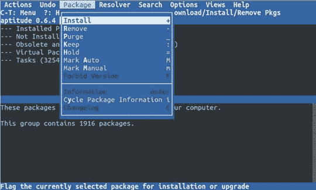

图 4-2: Aptitude 软件包管理器

| 代码 | 说明 |
| :--- | :--- |
| i | 已安装的软件包 |
| c | 软件包未安装，但软件包配置仍留在系统中 |
| p | 已从系统中彻底清除 (Purged) |
| v | 虚拟软件包 |
| B | 损坏的软件包 |
| u | 已解压文件，但软件包尚未配置 |
| C | 半配置 - 配置失败并需要修复 |
| H | 半安装 - 移除失败并需要修复 |

表 4-2: Aptitude 软件包代码

每个软件包条目以一个表示软件包状态的字母开头。未安装的软件包将标记为`p`，表示已清除的软件包（即系统中不存在）。已安装的软件包将带有字母`i`。标记为安装或移除的软件包将有一个额外的字母，表示尚未执行的操作。当一个软件包被标记为安装时，它将同时带有`p`和`i`（参见图 4-3），如下所示的`alien`软件包条目所示。表 4-2 列出了`Aptitude`的软件包代码。


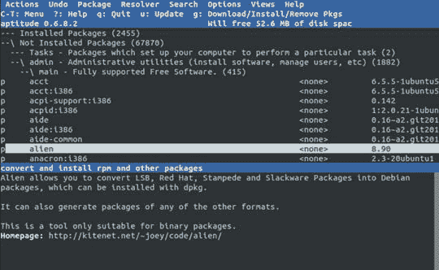

图 4-3: Aptitude: 选择软件包

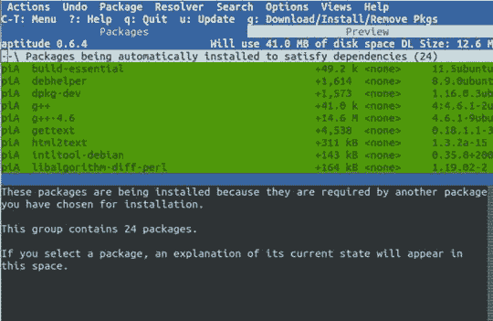

图 4-4: Aptitude: 安装软件包

一旦你选择了要安装（或移除）的软件包，按`g`键。系统将列出要安装和移除的软件包预览（参见图 4-4）。然后再次按`g`键；你需要按两次`g`才能安装。`Aptitude`将切换到 shell 界面，在软件包安装时显示下载、解压和设置消息。随后你会被提示按回车键（`ENTER`键）返回`Aptitude`界面。要安装，你也可以两次选择`Actions | Install/remove packages`菜单项目。

如果你知道软件包名称，可以搜索它以便定位。要打开搜索窗口，按`/`键（或从菜单栏（`Ctrl-t`）使用右方向键移动到`Search`菜单并选择`Find`）。输入搜索内容并按`ENTER`。选中的软件包将被列出并突出。

在图 4-4 中，你还会看到实际上打开了两个标签（屏幕）：Packages（软件包）和 Preview（预览）。当前显示的是 Preview 标签。你可以使用`F7`和`F6`键移动到另一个标签（Packages）并切回。使用`q`键关闭标签。在 Preview 标签打开状态下，按`q`将退出并关闭 Preview 屏幕。

## 使用 APT 管理软件

APT 设计用于与仓库配合工作，并会为你处理任何依赖关系。它使用`dpkg`安装和移除单个软件包，但也可以确定需要安装哪些依赖包，并从仓库查询和下载软件包。APT 的几种流行工具可以让你轻松管理软件，例如 Synaptic 软件包管理器、Ubuntu 软件中心和`aptitude`。Ubuntu 软件中心和 Synaptic 软件包管理器依赖于 GNOME 等桌面界面。如果你使用的是命令行界面，可以使用`apt-get`管理软件包。在命令行使用`apt-get`命令可以安装、更新和移除软件包。查看`apt-get`手页以获取`apt-get`命令的详细列表（参见表 4-3）。

```
`apt-get` `package`
```

| 命令 | 说明 |
| :--- | :--- |
| update | 下载并同步 APT 支持的仓库的可用和更新软件包列表。 |
| upgrade | 安装已安装软件包的新版本。 |
| dist-upgrade | 将所有已安装的软件包升级到新版本 |
| install | 安装特定软件包，使用其名称而非完整软件包包名。 |
| remove | 从系统中移除软件包。 |
| source | 下载并提取源码包。 |
| check | 检查损坏的依赖关系。 |
| clean | 清除缓存中下载的软件包。用于释放磁盘空间。 |

表 4-3: apt-get 命令

`apt-get`工具还可以让你轻松同时更新整个系统。`update`和`upgrade`这两个术语与其他软件工具有所不同。在`apt-get`中，`update`命令仅更新你的软件包列表，检查可能需要安装新版本的软件包，但不会安装这些版本。从技术上讲，它更新了`APT`用来确定哪些软件包需要更新的软件包列表。`upgrade`术语用于表示软件包的实际更新；即下载并安装新版本。`apt-get`中所属的“更新（updating）”，在其他软件包管理器中被称为“获取待更新的软件包列表”。在`apt-get`中，“升级（upgrading）”才是其他软件包管理器中执行更新的操作。

**提示**：在使用`apt-get`时，`update`和`upgrade`术语可能会混淆。`update`操作仅更新`Apt`软件包列表，而`upgrade`实际上会下载并安装更新后的软件包。

### 升级系统

升级只需简单运行带有`upgrade`命令的`apt-get`。在不指定软件包的情况下，使用带有`upgrade`命令的`apt-get`将升级你的整个系统。添加`-u`选项可以在软件包升级时列出它们。首先，使用`update`命令确保你的仓库信息（软件包列表）是最新的，然后执行`upgrade`命令。

```bash
sudo apt-get update
```

```bash
sudo apt-get -u upgrade
```

对于自动更新，如果尚未安装，请安装`unattended-upgrades`软件包。

```bash
sudo apt-get install unattended-upgrades
```

安全更新默认开启的。若要配置更新，你需要编辑`/etc/apt/apt.conf.d/50unattended-upgrades`文件。

```bash
sudo nano /etc/apt/apt.conf.d/50unattended-upgrades
```

要允许更新，请从`Unattended-Upgrade::Allowed-Origins`中删除`${distro_id} ${distro_codename}-updates`条目前的注释字符（`//`）。

```bash
Unattended-Upgrade::Allowed-Origins {
      "${distro_id} ${distro_codename}-security";
//      "${distro_id} ${distro_codename}-updates";
//      "${distro_id} ${distro_codename}-proposed";
//      "${distro_id} ${distro_codename}-backports";
};
```

在`/etc/apt/apt.conf.d/10periodic`文件中，你可以指定更新频率以及下载和软件包列表更新的频率。

```bash
APT::Periodic::Update-Package-Lists "1";
APT::Periodic::Download-Upgradeable-Packages "1";
APT::Periodic::AutocleanInterval "7";
APT::Periodic::Unattended-Upgrade "1";
```

若要接收更新通知，请安装`apticron`软件包。

```bash
sudo apt-get install apticron
```

编辑`/etc/apticron/apticron.conf`文件设置通知选项，例如发送通知消息的邮箱地址。

### 命令行搜索与信息：`dpkg-query`和`apt-cache`工具

`dpkg-query`命令允许你列出软件包的详细信息。它在命令行（终端窗口）中运行。使用带有`-l`选项的`dpkg-query`可以列出所有的软件包。

```bash
dpkg-query -l
```

`dpkg`命令可以作为`dpkg-query`的前端，检测其选项以执行相应的任务。上述命令也可以这样运行：

```bash
dpkg -l
```

列出特定软件包需要包名精确匹配，除非使用模式匹配操作符。以下命令列出了`wine`软件包（Windows 兼容层）。

```bash
dpkg-query -l wine
```

将模式匹配操作符（如`*`）放在模式之后将显示任何以指定模式开头的软件包。带有操作符的模式需要放在单引号中，以防止 shell 尝试使用该模式来匹配当前目录下的文件名。以下示例查找了所有以 "wine" 模式开头的软件包。这包括名称如`wine-doc`和`wine-utils`的软件包。

```bash
dpkg-query -l 'wine*'
```

你可以通过`grep`执行额外的搜索来进一步精炼结果。以下操作首先输出所有以`wine`开头的软件包，然后从这些结果中通过`grep`操作仅列出名称中包含`dev`模式的软件包，例如`wine-dev`。

```bash
dpkg -l 'wine*' | grep 'dev'
```

使用`-L`选项仅列出软件包已安装的文件。

```bash
dpkg-query -L wine
```

若要查看软件包的状态信息，包括其依赖和配置文件，请使用`-s`选项。字段将包括`Status`（状态）、`Section`（区域）、`Architecture`（架构）、`Version`（版本）、`Depends`（依赖包）、`Suggests`（建议）、`Conflicts`（冲突）和`Conffiles`（配置文件）。

```bash
dpkg-query -s wine
```

状态信息还会提供建议的依赖。这些是未安装但可能使用的软件包。对于`wine`软件包，建议安装`msttcorefonts` Windows 字体包。

```bash
dpkg-query -s wine | grep Suggests
```

使用`-S`选项确定特定文件属于哪个软件包。

```bash
dpkg-query -S filename
```

你也可以通过`apt-cache`工具获取信息。使用`search`命令进行搜索。

```bash
apt-cache search wine
```

若要查找特定软件包的依赖关系，请使用`depends`命令。

```bash
apt-cache depends wine
```

若要显示软件包描述，请使用`show`命令。

```bash
apt-cache show wine
```

注意：在`aptitude`软件包管理器中，你可以使用`aptitude`命令配合`search`和`show`选项进行查找和显示。

### 源

虽然可以直接安装源码，最好的方法是使用`apt-get`。使用`source`命令配合包名。软件包将被下载并解压。

```bash
sudo apt-get source wine
```

`--download`选项让你只下载源码包而不解压。`--compile`选项将下载、解压、编译源码并打包成 Debian 二进制包，准备安装。

如果某个软件包需要任何依赖包来运行，你还需要下载并编译这些包。若要获取需要的文件，请使用`build-dep`选项。

```bash
sudo apt-get build-dep wine
```

### 从 Ubuntu 桌面管理软件

如果你安装了 Ubuntu 桌面（无论是通过 Server 安装还是直接从 Desktop 安装），你可以使用桌面级软件管理工具。

#### 从桌面管理的仓库：软件与更新

如果你有桌面界面，可以使用“软件与更新”对话框（旧称为软件源）管理仓库，允许你启用或禁用仓库部分以及添加新条目。该对话框直接编辑`/etc/apt/sources.list`文件。你可以从“应用程序”棱镜、“系统”过滤器访问它。你也可以从 Ubuntu 软件中心的“编辑”菜单，以及从 Synaptic 软件包管理器的“设置”菜单中的“仓库”项访问它。

## 其他软件选项卡

在`Other Software`（其他软件）选项卡上，你可以为第三方软件添加存储库（参见图 4-6）。Ubuntu 合作伙伴的存储库已经列出，但未勾选。如果你想访问来自合作伙伴库的软件（如 Adobe Reader），请勾选该项。要手动添加第三方存储库，点击`Add Volume`（添加卷）按钮。这将打开对话框，在其中输入完整的`APT`条目，以`deb`格式开头，随后是 URL、发行版本以及部分或软件包。这是它将出现在`/etc/apt/sources.list`文件中的行。输入完成后，点击`Add Source`（添加源）按钮。

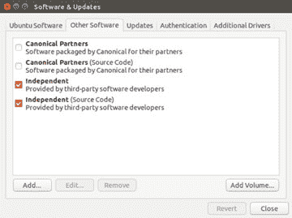

图 4-6: 软件与更新-其他软件配置

## 更新选项卡

`Updates`（更新）选项卡允许你配置如何处理更新（参见图 4-7）。该选项卡同时指定了你的更新存储库以及如何管理自动更新。你有选项安装`Important Security Updates`（重要安全更新）（vivid-security）、`Recommended Updates`（推荐更新）（vivid-updates）、`Pre-released Updates`（预发布更新）（vivid-proposed）以及`Unsupported Updates`（不支持的更新）（vivid-backports）。重要安全和推荐更新已被选中；这些涵盖了整个 Ubuntu 存储库的更新。如果你从 backports 或预发布库安装了任何软件包，预发布和不支持的更新将非常有用。

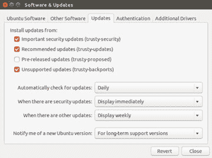

图 4-7: 软件与更新-更新配置

系统已配置为每天自动检查更新。你可以通过取消勾选“Check for updates”（检查更新）复选框来选择不检查更新。你还有处理更新的选项。你可以自动安装任何安全更新而无需确认。你可以在后台下载更新。或者你可以收到可用更新的通知，然后在需要时选择安装它们。这些选项是互斥的。

在此选项卡上，你还可以选择对哪些版本进行通知：仅 LTS 版本、所有版本或无版本。

## 身份验证选项卡

`Authentication`（身份验证）选项卡显示安装在系统上的存储库软件签名密钥（参见图 4-8）。Ubuntu 要求安装的任何软件包都需要签名密钥。所有 Ubuntu 存储库的签名密钥已安装并列在此选项卡上，包括你的 CD/DVD 光盘。

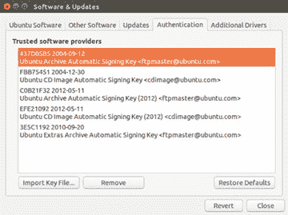

图 4-8: 软件与更新-身份验证，软件包签名密钥

大多数其他第三方或自定义存储库将提供供你下载和导入签名密钥文件。你可以从`Authentication`选项卡手动添加此类密钥。点击`Import Key File`（导入密钥文件）打开文件浏览器，选择下载的密钥文件。此过程与`apt-key add`操作相同。两者都是添加`APT`用于在安装从存储库下载的`DEB`软件包之前的密钥。

完成更改并点击`Close`（关闭）按钮后，`Software & Updates`工具将通知你的软件软件包信息已过期，并显示`Reload`（重加载）按钮。点击`Reload`按钮使新的存储库或组件在你的软件包管理器（如`Ubuntu Software Center`（Ubuntu 软件中心）和`Synaptic Package Manager`（同步软件包管理器））中可用。你也可以通过运行`apt-get update`、在`Synaptic Package Manager`上点击`Reload`按钮，或在`Software updater`（软件更新器）上点击`Check`按钮来重新加载你的存储库配置。

## 使用 Ubuntu 软件中心管理软件包

要简单卸删除软件，可以使用`Ubuntu Software Center`，它是 Ubuntu 支持的主要软件包管理器。`Ubuntu Software Center`被设计为管理所有软件的集中实用程序。`Ubuntu Software Center`也是商业 Ubuntu 应用程序的商店。关于`Ubuntu Software Center`的更多详情，请从`Ubuntu Software Center`的`Help`（帮助）菜单中选择`Ubuntu Software Center Help`打开`Ubuntu Help`对话框。


要使用`Ubuntu Software Center`，点击`Launcher`启动器上或来自`System`仪表栏的`Ubuntu Software Center`图标。`Ubuntu Software Center`显示一个工具栏，和一个左侧显示类别和软件列表的侧边栏（参见图 4-9）。

右侧的“What's New”（新特性）和“Top Rated”（高评分）部分提供了新和热门应用程序的列表。点击图标显示其信息标签页，在其中你可以安装该应用程序或链接到其网站。点击每个部分右上角的`More`更多）按钮可以打开新软件和高评分软件的完整列表。“Recommended For You”（为你推荐）功能根据你已安装的软件列出你可能感兴趣的应用程序。点击“Turn on Recommendations”（开启推荐）链接来开启此功能（此外，你也可以从`View`菜单选择`Turn On Recommendations`）。

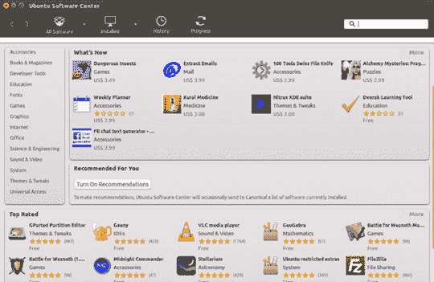 

图 4-9: Ubuntu 软件中心

工具栏提供了前进和后退按钮，用于浏览查看过的软件列表和搜索结果。在工具栏上，软件图标和菜单允许你选择想要查看或搜索的软件类别。`All Software`所有软件）图标显示所有可用软件。图标右侧的下拉菜单允许你将视图和搜索限制为某些软件类别，例如用于 Ubuntu 支持软件的“Provided by Ubuntu”（Ubuntu 提供）、“Canonical Partners”（Canonical 合作伙伴，来自 Adobe 等 Ubuntu 合作伙伴提供的软件），以及用于购买软件的“For Purchase”（可购买）。

点击`All Software`图标显示软件类别，如左侧栏中的 Office、Graphics、Internet 和 System。点击类别将列出软件及其简要描述（参见图 4-10）。某些类别会有子类别，例如 Graphics 下 Drawing（绘图）和 Viewers（查看器）（参见图 4-11）。你可以滚动列表找到你想要的软件包。已安装的软件将在小图标上显示绿色勾标记。要再次显示软件类别侧边栏，只需点击`All Software`按钮。


图 4-10: Ubuntu 软件中心软件包列表


图 4-11: Ubuntu 软件中心子类别

要安装软件包，首先找到它。找到软件包后，你可以点击它在右侧显示`Install`安装按钮，点击即可安装（参见图 4-10）。在软件包安装期间，侧边栏将显示安装进程。

如果你想获取有关软件包的更多信息，点击`More Info`更多信息按钮打开该应用程序的新标签页。未安装软件包的应用程序标签页将具有`Install`按钮并显示应用程序的详细描述，以及`License`许可证和价格（如果有）（参见图 4-12）。对于 Ubuntu 存储库中的软件，大多数拥有`Open Source`开源许可证且免费。你可以点击`Website`链接访问应用程序网站。如果显示了应用程序缩图，你可以点击它显示全图。在`Add-ons`附加标题下列出了与你的应用程序相关的软件列表。已安装的软件包已标记。要安装额外的软件包，请点击其复选框。`Add-ons`列表上方会出现`Apply Changes`应用更改按钮，你只需点击即可。

“People Also Installed”（人们还安装了）部分列出了安装该软件包的用户也安装的其他应用程序。这些热门应用程序与该软件包相似或互补。

随后将列出版本、许可证、大小和更新信息。更新信息指明该软件包是否受 Ubuntu 存储库的支持。如果 `Canonical` 未提供关键更新，则该软件包属于 `Universe` 或 `Multiverse` 存储库。之后是用户评论，提供了有关软件稳定性和实用性的信息。

你也可以通过点击此页面上的 `Install` 按钮从此处安装应用程序（如果应用程序已安装，则会显示 `Remove` 按钮）。系统提示你输入密码。你也可以在 `File` 菜单中选择 `Install` 项（`File` | `Install`）。

`Info` 页面上的进度条将显示下载和安装进度。工具栏上还会出现一个 `"Progress"` 图标。点击它可以显示进度条和包名（参见 图 4-13 ）。在进行安装时，该应用程序的 `Launcher` 项将被放置在启动器（Launcher）上。`Launcher` 项上的进度条会显示安装进度（参见 图 4-13 ）。安装完成后，该 `Launcher` 项将位于当前会话的启动器上。你可以通过选择其快速列表中的 `"Lock to launcher"` 条目使其永久停留在启动器上。


图 4-13：Ubuntu 软件中心和启动器项的下载与安装进度

完成后，应用程序页面将显示一个 `Remove` 按钮和一个带有已安装（installed）标签和日期的绿色勾标记（参见 图 4-14 ）。应用程序列表中的项目也将有一个绿色复选标记图标，表示该应用程序已安装。


图 4-14：Ubuntu 软件中心已安装的应用程序

要删除软件包，请先在包列表中找到它并选择它。将出现一个 `Remove` 按钮，你可以点击它将其删除。你也可以使用应用程序 `Info` 页面上的 `Remove` 按钮。

你可以使用 `Search` 框进行搜索。搜索是在描述和包名上进行的。要移除搜索列表并返回 `All Software` 页面，点击搜索框右侧的 `x` 按钮图标。搜索可以在类别和子类别内进行。要进行全局搜索，请从 `"All Software"` 页面进行搜索。在 图 4-15 中，列出了所有矢量相关的应用程序。


图 4-15：Ubuntu 软件中心搜索

如果你选择了一个类别并显示如 `Graphics` 之类的类别页面，则搜索将仅在该类别的软件包中进行。在 图 4-16 中，仅列出了 `Graphics` | `Drawing` 子类别中的矢量应用程序。


图 4-16：Ubuntu 软件中心类别内搜索

在 Ubuntu 软件中心工具栏上，`Installed` 图标列出了已安装的软件，并带有用于已安装的 Ubuntu、`Partner` 和 `Purchased` 软件的下拉菜单。列出了如 `Graphics` 和 `Office` 等软件类别，你可以展开它们以显示已安装的软件包（参见 图 4-17 ）。

在工具栏上，`History` 图标显示了所有包更改、安装、更新和删除列表。

Ubuntu 软件中心是 `APT` 包管理器的前端端。当你使用 Ubuntu 软件中心安装软件包时，会调用 `APT` 并自动从相应的在线存储库中选择并下载该软件包。


图 4-17：Ubuntu 软件中心已安装的软件

Ubuntu 软件中心列出的软件包是使用 `app-install-data` 软件包设置的，可以通过 `Synaptic Package Manager` 访问。`app-install-data` 和 `app-install-data-partner` 软件包已经安装。这些软件包列出了 Ubuntu 存储库中常用的软件包。此外，你还可以安装 `app-install-data-edubuntu` 软件包来列出 edubuntu 教育软件包。

## Synaptic 包管理器

`Synaptic Package Manager` 已被 Ubuntu 软件中心取代，成为主要的包管理器。它默认不安装。Ubuntu 不再支持 `Synaptic`，尽管 Ubuntu 社区仍提供支持。软件包按名称列出，并包括如库和系统关键包等辅助包。一旦安装，你可以在系统仪表栏（dash）上访问 `Synaptic Package Manager`。

`Synaptic Package Manager` 显示三个窗格：侧边窗格列出软件类别和按钮，顶部窗格列出软件包，底部窗格显示所选软件包的描述。当选择一个软件包时，描述窗格还会显示 `Get Screenshot` 按钮。如果有，点击此按钮将下载并显示应用程序的图像。点击 `Get Changelog` 按钮将显示列出应用程序更改的窗口。

`Synaptic Package Manager` 窗口左下角的按钮提供了组织和精炼所示软件包列表的选项（参见 图 4-18 ）。有五个可用选项：`Sections`、`Status`、`Origin`、`Custom` 和 `Search results`。上方对话框会根据你选择的选项而变化。点击 `Sections` 按钮将列出软件类别，如 `Base System`、`Communications` 和 `Development`。`Status` 按钮将列出已安装和未安装的软件。`Origin` 按钮显示不同的存储库及其部分，以及本地安装的内容。`Custom filters` 允许你选择过滤器进行显示。`Search results` 将列出当前和之前的搜索，允许你在它们之间移动。

 

图 4-18：Synaptic 包管理器：快速搜索

`Sections` 选项默认选中（参见 图 4-19 ）。你可以选择列出所有软件包，或使用面板提供的类别精炼你的列表。面板中的 `All` 项将列出所有可用软件包。软件包组织为 `Base System`、`Cross Platform` 和 `Communications` 等类别。每个类别进一步按 `multiverse`、`universe` 和 `restricted` 软件细分。

要进行快速搜索，在 `"Quick search"` 框中输入要搜索的模式，结果就会出现。在 图 4-18 中，使用 `inkscape` 模式来定位 Inkscape 图形软件。快速搜索将在选定的部分内进行。选择不同的部分会将你的快速搜索模式应用于该部分中的软件包。点击 `Editors` 部分并使用 `inkscape` 搜索模式将得不到结果，因为 Inkscape 不是一个编辑器包。


图 4-19：Synaptic 包管理器：部分

`Status` 项进一步精炼已安装的软件为手动安装或可更新（参见 图 4-20 ）。本地软件由你手动下载和安装的软件包组成。

通过 `Origin` 选项，Ubuntu 兼容存储库可能会根据 `multiverse`、`universe` 和 `restricted` 软件进一步精炼访问。主部分选择 Ubuntu 支持的软件。


图 4-20：Synaptic 包管理器：状态

要进行更详细的搜索，你可以使用 `Search` 工具。点击工具栏上的 `Search` 按钮打开带有文本框的 `Search` 对话，你可以在其中输入搜索术语。弹出菜单允许你指定要搜索的软件包功能，例如“描述和名称”（Description and Name）。你还可以搜索软件包的其他功能，如 `Name`、维护者名称（`Maintainer`）、软件包版本（`Version`）、可能依赖的包（`Dependencies`）或相关包（`Provided Packages`）。搜索结果将显示在列表中。你可以通过点击此列表中的搜索项在搜索结果之间来切换。

## 属性

要查找有关软件包的信息，选择该软件包并点击 `Properties` 按钮。这将打开一个包含 `Common`、`Dependencies`、`Installed Files`、`Versions` 和 `Description` 标签的窗口。`Common` 标签提供章节、版本和维护者信息。`Installed Files` 标签显示你具体安装了哪些文件，这对于查找配置文件的精确位置、名称以及命令非常有用。`Description` 标签显示有关软件的详细信息。`Dependencies` 标签显示此软件所需的所有依赖软件包包（通常是库）。

## 安装软件包

在安装软件之前，你应该按下 `Reload` 按钮从活动存储库加载最新的软件包列表。

要安装软件包，右键点击其名称显示弹出菜单，并选择 `Mark for installation`（标记待安装）项。如果存在任何依赖包，将打开一个对话框列出这些包。点击对话框中的 `Mark` 按钮标记这些包待安装。随后，`Synaptic Package Manager` 窗口中对应软件包的复选框将被标记。

一旦你选择了想要安装的软件包，点击工具栏上的 `Apply` 按钮开始安装过程。将弹出一个 `Summary` 对话框显示所有要安装的软件包。你有下载软件包文件的选项。列表中列出了要安装的软件包数量、下载大小以及占用的磁盘空间。点击 `Summary` 对话框上的 `Apply` 按钮下载并安装软件包。随后将出现一个下载窗口，显示软件包安装的进度。你可以选择显示单个软件包的进度，这将打开一个终端窗口，列出每个正在下载和安装的软件包。

下载完成后，对话框名称将变为 `Installing Software`（正在安装软件）。你可以选择在完成后自动关闭对话框。有时安装需要用户输入来配置软件。如有必要，将提示你输入信息。

当你右键点击软件包名称时，还会看到 `Mark Suggested for Installation`（标记建议安装）或 `Mark Recommended for Installation`（标记推荐安装）选项。这些将标记可以增强你所选软件的应用程序，尽管它们并非必需。如果该应用程序没有建议或推荐包，则这些项将显示为灰色。

某些软件（如需要大量的桌面或办公套件）可以使用元软件包（metapackages）一次性选择。元软件包包含配置文件，用于选择、下载和配置此类复杂软件所需的范围软件包。例如，`kubuntu-desktop` 元软件包将安装整个 Kubuntu 桌面（Sections | Meta Packages）。

## 移除软件包

要移除软件包，首先找到它。然后右键点击它并选择 `Mark package for removal`（标记软件包待移除）项。这将保持配置文件不受影响。或者，你可以标记软件包进行完全移除，这将也会移除任何配置文件，即 `Mark for Complete Removal`（标记完全移除）。依赖包不会被移除。

一旦你标记了要移除的软件包，点击 `Apply` 按钮。摘要对话框将显示将移除的软件包。点击 `Apply` 移除它们。

`Synaptic Package Manager` 可能不会移除依赖包，特别是可能被其他应用程序使用的共享库。这意味着你的系统中可能安装了从未被使用的软件包。它们的持续存在不会产生任何危害。

注意：你可以通过创建搜索过滤器进一步在 `Synaptic Package Manager` 上细化对软件包的搜索。选择 `Settings | Filters` 菜单项打开过滤器窗口。要创建新过滤器，点击位于过滤器列表下方的 `New` 按钮。

## 使用软件更新更新 Ubuntu

针对特定的软件包以及系统组件，新的更新正在不断准备中。这些以更新的形式发布，你可以从软件存储库下载并安装到你的系统中。这些包括应用程序、服务器甚至内核的新版本。此类更新范围从单个软件包到整个组件不等。更新你的 Ubuntu 系统是一个非常简单的程序，可以使用 `Software Updater`，它是 `APT` 的图形化更新界面。

当有可用更新时，`Software Updater` 项目会出现在 `Launcher`（启动器）上。你可以从它的快速列表中调用更新，如下：


从快速列表调用时，`Software Updater` 图标会显示进度条。完成后，将显示一个指示更新完成或需要重启的对话框。


你也可以通过 `Applications` 透镜下的 `System` 过滤器手动启动 `Software Updater`，或者点击在可用可用时出现的 `Software Updater` 启动器图标。手动调用时，`Software Updater` 显示一个简单的对话框，显示要下载的内容以及“Remind Me Later”（稍后提醒）和“Install Now”（立即安装）按钮（参见图 4-21）。手动更新让你对更新有更多控制，让你选择要安装的软件包。

 

图 4-21：已选软件包的软件更新

要查看要更新的实际软件包，点击“Details of updates”（更新详情）箭头。软件包按应用程序分类组织，例如用于 Linux 操作系统软件包的 Ubuntu base，用于 Firefox 更新的 Firefox，以及用于办公更新的 LibreOffice。你可以将这些展开为单个软件包。每个项的复选框允许你取消选择任何你不想更新的特定软件包（参见图 4-6）。软件包根据重要性组织，从“Important”（重要的安全更新开始，随后是“Recommended”（推荐更新）。你应该始终安装安全更新。你系统上配置的所有 `APT`-兼容存储库都将被检查是否有更新。


图 4-22：更新详情

要查看特定更新的详细描述，选择该更新并点击“Technical description”（技术描述）箭头（参见图 4-23）。将显示两个标签：`Changes` 和 `Description`。`Changes` 标签列出详细的更新信息，`Description` 提供有关软件的信息。

点击 `Install Now` 按钮开始更新。软件包将从相应的存储库下载。下载完成后，软件包将更新。


在下载和安装时，会出现一个显示下载和安装进度的对话（参见图 4-24）。你可以选择显示单个文件的进度。将打开一个窗口，列出每个文件及其进度。下载完成后，将安装更新。点击 `Details` 箭头查看特定软件包的安装消息。`Software Updater` 启动器项也会显示安装过程的进度条和更新数量，如图 4-24 所示。

 

图 4-24：下载更新

更新完成后，软件更新器将显示一条消息，说明您的系统是最新的。如果安装了关键包（例如新内核），系统将提示您重启系统。电源图标将变为红色作为警告，会话（`Session`）菜单中将新增“需要重启”选项。

## 从应用程序仪表板安装软件

你可以直接从仪表板上的“应用程序”透视图（`Applications` lens）安装软件包。如果你已经知道了想要软件的名称，这可能是安装软件最简单、直接的方法。打开仪表板并点击应用程序透视图，然后搜索您想要的应用程序。使用“过滤结果”（`Filter results`）按钮在特定类别（如 `Office` 或 `Internet`）中搜索。结果列在“更多建议”（`More suggestions`）标题下（参见图 4-25）。标签会指示该软件是否为免费。


图 4-25：在仪表板上搜索软件，应用程序视图

点击应用程序图标可以在仪表板上打开其详细信息。将显示应用程序窗口的图像，以及描述和版本号（参见图 4-26）。有一个指向开发网站的按钮。来自 `Ubuntu` 仓库的软件将有一个“免费下载”（`Free Download`）按钮。点击该按钮开始下载和安装。系统会先提示输入管理密码。随着下载和安装的进行，启动器上会出现该应用程序的图标和进度条（参见图 4-26）。将鼠标悬停在图标上会显示“正在安装”的状态消息。

 

图 4-26：从仪表板安装应用程序

## 用于单独 DEB 包的 Ubuntu 中心

你也可以使用 `Ubuntu` 中心安装单个 `DEB` 软件包。通常这些包直接从网站下载，很少或没有依赖包。当你用浏览器下载特定包时，系统会提示你用 `Ubuntu` 中心打开它。`Ubuntu` 中心将打开该软件包的安装页面，显示有关包的信息并检查它是否与你的系统兼容。点击“安装”（`Install`）按钮下载并安装该包。建议使用 `Ubuntu` 中心来安装手动下载的包。

你也可以先下载包，稍后从文件管理器窗口（通常是下载文件夹）中选择它。双击应该用 `Ubuntu` 中心打开该包。你也可以右键点击并选择用 `Ubuntu` 中心打开。

## 软件包类型

`Ubuntu` 使用符合 `Debian` 标准的软件软件包（`DEB`），其文件名扩展名为 `.deb`。其他软件包（例如你需要编译的源码形式软件包）可能会以压缩存档的形式发布。这些包通常具有 `.tar.gz`、`.tgz` 或 `.tar.bz2` 扩展名。`.rpm` 软件包是 `Red Hat` 软件包，用于 `Red Hat`、`Fedora`、`SuSE` 以及其他使用 `RPM` 包的 `Linux` 发行版。它们与 `Ubuntu` 不直接兼容。你可以使用 `alien` 命令将大多数 `RPM` 包转换为 `DEB` 包，然后在 `Ubuntu` 上安装。表 4-2 列出了在各种 `Linux` 软件包中发现的几种常见文件扩展名。你可以直接从 `http://packages.ubuntu.com` 下载任何符合 `Ubuntu` 标准的 `deb` 包以及原始源码包。

## 使用 dpkg 管理非仓库包

你可以使用 `dpkg` 安装你直接下载的简单软件包包文件。在这种情况下，你不是从仓库安装的。相反，是你手动从 `Web` 或 `FTP` 站点将包文件下载到系统中的某个文件夹中。这种情况非常罕见，适用于 `Ubuntu` 仓库或任何启用 `APT` 的仓库中不可提供的软件。请记住，大多数软件已在你的 `Ubuntu` 或启用 `APT` 的仓库中。在执行直接下载并使用 `dpkg` 安装之前，先在那里检查该软件包。`dpkg` 配置文件位于 `/etc/dpkg` 目录。配置存储在 `dpkg.cfg` 文件中。详细选项列表请参见 `dpkg` 手册页。

使用 `dpkg` 的一种情况是你自己构建的包，例如将另一种格式的包转换为 `Debian` 包 (`DEB`) 时创建的包。将 `RPM` 包（`Red Hat` 软件包管理器）转换为 `Debian` 包格式时就是如此。

对于 `dpkg`，你使用 `-i` 选项安装包，使用 `-r` 移除它。

```bash
sudo dpkg -i package.deb
```

`dpkg` 的主要缺陷是它不提供依赖支持。它会通知你所需的依赖，但你必须单独安装它们。`dpkg` 只安装指定的包。对于没有依赖项的包，它是理想的。

你使用 `-I` 选项直接从 `DEB` 包文件中获取包信息。

```bash
sudo dpkg -I package.deb
```

要移除包，请使用 `-r` 选项配合软件包名称。你不需要像 `.386` 或 `.deb` 那样的版本或扩展信息。使用 `dpkg` 移除带有依赖关系的包时，你必须先手动移除所有依赖项。在此之前，你将无法卸载该包。软件配置文件不会移除。

| 扩展名 | 软件包类型 |
| :--- | :--- |
| `.deb` | `Debian`/`Ubuntu` 软件包 |
| `.gz` | `gzip` 压缩文件（使用 `gunzip` 解压） |
| `.bz2` | `bzip2` 压缩文件（使用 `bunzip2` 解压；在配合 `tar` 时使用 `j` 选项，如 `xvjf`） |
| `.tar` | `tar` 存档文件（使用 `tar` 的 `xvf` 提取） |
| `.tar.gz` | `gzip` 压缩的 `tar` 存档文件（使用 `gunzip` 解压并 `tar` 提取；配合 `tar` 时使用 `z` 选项，如 `xvzf`，一步完成解压和提取） |
| `.tar.bz2` | `bzip2` 压缩的 `tar` 存档文件（使用 `tar -xvj`） |
| `.tz` | 使用 `compress` 命令压缩的 `tar` 存档文件 |
| `.Z` | 使用 `compress` 命令压缩的文件（使用 `decompress` 命令解压） |
| `.bin` | 自解压软件文件 |
| `.rpm` | 使用 `Red Hat` 软件包管理器创建的软件包，用于 `Fedora`、`Red Hat`、`Centos` 和 `SuSE` 发行版 |

表 4-4：`Linux` 软件包文件扩展名

如果你安装了一个需要依赖的包但未能安装这些依赖项，你的安装数据库将被标记为有损坏包。在这种情况下，在修复损坏包之前，`APT` 不允许安装新包。你可以带有 `-f` 和 `install` 选项运行 `apt-get` 命令来一次修复所有损坏包。

```bash
sudo apt-get -f install
```

## 从压缩存档安装软件：.tar.gz

源码形式的 `Linux` 软件应用程序可以在互联网上的不同站点。你可以下载任何此类软件并将其安装到你的系统中。最新版本通常以压缩存档的形式提供。如果应用程序没有 `DEB` (`Ubuntu`) 版本，则始终以压缩存档的形式下载。

### 解压和提取软件

在解压归包之前，请将其移动到你想要存放的目录。当源代码文件被解压时，它们会生成自己的子目录，你可以在该目录中编译并安装软件。一旦安装完成，你就可以删除该目录，保留原始的源码包文件（`.tar.gz`）。例如，文件 `antigrav_0.0.3.orig.tar` 会被解压到一个名为 `antigrav_0.0.3.orig` 的子目录。在某些情况下，包含预编译二进制文件的软件包被设计为直接解压到其将要使用的系统子目录。

虽然你可以分步执行解压缩和提取操作，但你会发现更常用的方法是使用单个命令同时完成这两个操作。`tar` 实用提供了你可以使用的解压缩选项，可以让 `tar` 首先为你解压文件，并调用指定的解压缩工具。`z` 选项会自动调用 `gunzip` 来解压 `.gz` 文件，而 `j` 选项用于解压 `.bz2` 文件。对于 `.Z` 文件使用 `Z` 选项。例如，要将对 `.tar.gz` 文件的解压缩和提取操作合并为一个 `tar` 命令，请在选项列表中插入 `z` 选项，即 `xzvf`。下一个示例展示了如何一步到位完成解压缩和提取：

```bash
tar xvzf antigrav_0.0.3.orig.tar.gz
```

对于 `.bz2` 压缩的归包，你使用 `j` 选项而不是 `z` 选项。

```bash
tar xvjf antigrav_0.0.3.orig.tar.bz2
```

以 `.bin` 结尾的文件是自解压包。像运行命令一样运行该 `bin` 文件。你可能需要使用 `chmod` 使其具有可执行权限。然后在命令行中输入该文件作为命令，在文件名前前加上 `./`。

```bash
sudo chmod 755 package
```

提取过程会创建一个由软件名称和发布版本组成的子目录。在之前的述示例中，提取创建了一个名为 `antigrav_0.0.3.orig` 的子目录。你可以进入该子目录并检查其中的文件，例如 `README` 和 `INSTALL` 文件。

```bash
cd antigrav_0.0.3.orig
```

软件的安装方法可能因每个软件包而异。通常会随安装程序提供说明。如果包含，请务必查阅 `README` 和 `INSTALL` 文件。

### 编译软件

某些软件以源代码的形式存在，你需要在安装之前对其进行编译。这对于为跨平台实现设计的程序尤其如此。设计运行在各种 `Linux` 和 `UNIX` 系统上的程序可能以源代码形式发布，并在这些不同的系统中下载和编译。近年来，通过使用配置脚本极大简化了此类软件的编译，这些脚本会自动检测给定系统的硬件和软件配置，然后允许你据此编译程序。例如，系统上的 `C` 编译器名称可能是 `gcc` 或 `cc`。配置脚本会检测当前存在哪一个，并选择它用于程序编译。

**注意：** 某些软件将使用 `Python` 等脚本语言运行，而不是像 `C++` 那样的编程语言代码。这些软件可能只需要执行设置操作（`setup` 命令），而不需要编译。安装后，它们将直接使用脚本语言解释器（如 `Python`）运行。

`configure` 脚本的工作原理是生成一个为该特定系统定制的 `Makefile`。`Makefile` 包含了编译程序的详细命令，包括任何预处理、对所需库的链接以及按正确顺序编译程序组件。许多复杂应用程序的 `Makefile` 可能需要访问多个软件子目录，每个目录都有单独的编译组件。使用 `configure` 和 `Makefile` 脚本极大地自动化了编译过程，将流程简化为几个简单的步骤。

首先，切换到软件源代码解压到的目录，如下例所示：

```bash
# cd /usr/local/src/antigrav_0.0.3.orig
```

在编译软件之前，请阅读随附的 `README` 或 `INSTALL` 文件。它们为你提供了如何编译和安装该特定程序的详细说明。

大多数软件可以通过三个简单的步骤完成编译和安装。第一步是 `./configure` 命令，它生成自定义的 `Makefile`。第二步是 `make` 命令，它使用工作目录中的 `Makefile`（在这种情况下，就是你刚刚通过 `./configure` 命令生成的 `Makefile`）来编译你的软件。最后一步也使用 `make` 命令，但这次带有 `install` 选项。由 `./configure` 命令生成的 `Makefile` 也可能包含在你的系统上安装软件的指令。使用 `install` 选项仅运行那些安装命令。要执行安装，你必须以 `root` 用户登录，从而能够根据需要将软件文件添加到系统目录中。如果软件使用了配置脚本，编译和安装通常只涉及以下三个简单命令：

```bash
./configure
make
make install
```

在之前的示例中，`./configure` 命令执行配置检测。`make` 命令使用 `./configure` 操作生成的 `Makefile` 脚本执行实际编译。`make install` 命令将程序安装到你的系统中，将可执行程序放置在 `/usr/local/bin` 等目录中，并将任何配置文件放在 `/etc`。它创建的任何共享库可能会进入 `/usr/local/lib`。

一旦你编译并安装了应用程序，并且确认运行正常，就可以删除提取软件时创建的源代码目录。你可以保留归包文件（`tar`），以防需要再次提取软件。使用带有 `-rf` 选项的 `rm` 命令，这样所有子目录将被删除，而你无需确认每次删除。

**提示：** 记住在 `configure` 命令之前加上点和斜杠。`./` 指的是当前目录下的命令，而不是另一个同名的 `Linux` 命令。

某些软件可能为 `./configure` 操作设置了特定选项。要找到这些选项，你可以使用带有 `--help` 选项的 `./configure` 命令：

```bash
./configure --help
```

一个实用的常用选项是 `-prefix` 选项，它让你指定安装目录：

```bash
./configure -prefix=/usr/bin
```

注意：如果你正在编译基于 `X`、`GNOME` 或 `KDE` 的程序，请确保已安装它们的开发库。

### 检查软件软件包的数字签名

数字签名的一个非常有效的用途是验证软件软件包未被篡改。软件软件包在传输过程中可能被拦截，其部分系统级文件可能会被更改或替换。来自你的发行版的软件包以及来自信誉良好的 `GNU` 和 `Linux` 项目的软件包都经过了数字签名。签名提供了修改散列信息，用以检查软件包的完整性。数字签名可能包含在软件包文件中，也作为单独的文件发布。要导入 `APT` 可用于检查软件包的密钥，你可以使用 `apt-key` 命令。`APT` 会自动检查数字签名。要检查不是 `APT` 仓库系统的软件包文件的数字签名，你可以使用 `gpg` 命令配合 `--verify` 选项。这些可能包括作为压缩包（如 `.tar.gz`）形式提供的软件包，而 `APT` 可以自行检查所有的 `DEB` 软件包。

#### 使用 apt-key 导入软件公钥

首先，你需要确保你已经拥有签名者的公钥。数字签名是用软件分发者的私钥加密的；该分发者就是签名者。一旦你拥有该签名者的公钥，就可以检查从那里接收到的任何数据。对于第三方软件仓库，你必须安装它们的公钥。一旦安装了密钥，就不需要再次安装。

`Ubuntu` 在其发行版包含了并安装了自身的公钥。对于 `Ubuntu` 仓库中的任何软件包，所需的公钥已由 `APT` 自动安装并检查。对于其他网站，你可能需要从其网站下载公钥并进行安装。你可能还需要添加仓库支持以访问与 `Ubuntu` 兼容的软件。下载完成后，你可以使用 `apt-key` 命令安装公钥，供 `APT` 在软件验证中使用。`Ubuntu` 使用 `apt-key` 命令来维护软件包的公钥。使用带有 `add` 选项的 `apt-key` 命令添加密钥。若要实际访问软件仓库，你还需要在 `/etc/apt/sources.list.d` 目录下安装其 `APT` 配置文件。

### 检查软件压缩存档

许多以压缩存档形式（`.tar.gz` 或 `.tar.bz2`）存在的软件软件包会提供以 `.sig` 结尾的独立文件作为签名。要检查这些签名，你需要使用带有 `--verify` 选项的 `gpg` 命令。例如，最新版本的 `Sendmail` 软件包以压缩存档 `.tar.gz` 的形式分发。其数字签名提供在一个独立的 `.sig` 文件中。首先，你得从 `Sendmail` 网站下载并安装 `Sendmail` 软件的公钥（密钥名称中可能包含年份）。`Sendmail` 将其所有密钥合并到一个名为 `PGPKEYS` 的装甲过的文本文件中。

```bash
gpg --import PGPKEYS
```

你也可以使用带有 `--search-key` 和 `--keyserver` 选项的 `gpg` 命令来导入密钥。与搜索词匹配的密钥将以编号列表的形式显示。系统会提示你输入想要密钥的编号。在下例示例的结果中，2007 年的 `Sendmail` 密钥编号将是 `7`。这是用于 2007 年发布软件的密钥。

```bash
gpg --keyserver pgp.mit.edu --search-keys Sendmail
```

除了使用 `gpg`，你还可以使用“加密和密码密钥”应用程序（`Accessories | Encryption and Password Keys`）来查找并导入密钥。

要检查软件存档（`tar.gz` 文件），你还需要下载其数字签名文件。对于压缩存档（`.tar.gz`），你可以使用以 `.gz.sig` 结尾的 `.sig` 文件，对于未压缩存档使用 `.tar.sig`。然后，使用 `gpg` 命令和 `--verify` 选项，利用 `.sig` 文件中的数字签名来检查软件存档的真实性和完整性。

```bash
$ gpg --verify sendmail.8.14.2.tar.gz.sig sendmail.8.14.2.tar.gz
```

```bash
gpg: Signature made Wed 31 Oct 2007 08:23:07 PM PDT using RSA key ID 7093B841
gpg: Good signature from "Sendmail Signing Key/2007 <sendmail@Sendmail.ORG>"
```

你也可以只指定签名文件，`gpg` 将自动搜索并选择同名但不带 `.sig` 或 `.asc` 扩展的文件。

```bash
gpg --verify sendmail.8.14.2.tar.gz.sig
```


将来，当你从 Sendmail 网站下载任何使用此密钥的软件时，你只需要执行 `--verify` 操作即可。但请记住，来自同一网站的不同软件包可能使用不同的密钥。你必须确保已经为你正在检查的软件导入并签署了相应的密钥。

**提示：** 如果需要，可以使用 `--fingerprint` 选项来检查密钥的有效性。如果你确定密钥是有效的，可以使用 `--sign-key` 命令对其进行签名。

# 第二部分：服务

### 5. 使用 systemd 管理服务
### 6. 邮件服务器
### 7. FTP
### 8. Web 服务器
### 9. 新闻和数据库服务

## 5. 使用 systemd 管理服务

单个 Linux 系统可以提供多种类型的服务，范围从安全到管理，并包括更明显的互联网服务，如 Web 和 FTP 站点、电子邮件和打印服务。安全工具（如安全 Shell (SSH) 和 Kerberos）作为服务运行，以及管理网络工具，如动态主机配置协议 (DHCP) 和轻量级目录访问协议 (LDAP)。网络连接接口本身就是一个可以随需要重启的服务。每个服务都作为一个持续运行的守护进程，寻找针对其特定服务的请求。在 Web 服务的情况下，请求来自远程用户。你可以通过启动或关闭它们的守护进程来开启或关闭服务。

系统启动由 `systemd` 服务管理。用于启动单个服务的 System V init 系统已被淘汰。

`systemd` 为所有系统任务和服务设置套接字（sockets）。`systemd` 任务的配置定义在 `/lib/systemd/system` 目录下的单元文件中。在这方面，`systemd` 文件取代了以前在 Sys V init 的 `/etc/inittab` 文件中的项。`systemd` 还拥有自己版本的 `shutdown`、`reboot`、`halt`、`init` 和 `telinit`，每个版本都有自己的帮助页（man page）。

`systemd` 完全兼容 `/etc/init.d` 目录下的 System V 脚本以及 `/etc/fstab` 文件。SystemV 脚本和 `/etc/fstab` 被视为 `systemd` 使用的额外配置文件。如果 `/etc/init.d` 目录中存在 System V 脚本，且尚未生成相应的 `systemd` 单元配置文件，则 `systemd` 将使用它们来生成相应的单元配置文件。`systemd` 配置始终具有最高优先级。如果需要，`systemd` 还会使用 System V init `/etc/rc.d` 目录中的启动和停止优先级文件来确定依赖关系。`/etc/fstab` 中的项用于生成相应的 `systemd` 单元文件，然后用于管理文件系统。`systemd` 还支持快照，允许将服务恢复到之前的状态。

`systemd` 配置（`.service`）文件位于 `/lib/systemd/system` 目录，被认为是你不应修改的系统文件。你可以将它们复制到 `/etc/systemd/system` 目录并对副本进行更改。`/etc/systemd/system` 中的文件具有更高优先级。`logind` 守护进程的配置文件 `logind.conf` 位于 `/etc/systemd` 目录。

Ubuntu 还使用 `systemd` 服务处理时间（`timedated`）、位置（`localed`）、登录（`logind`）和主机（`hostnamed`）（`systemd-services` 包）。可以使用相应的 `systemd` 控制应用程序进行：`timedatectl`、`localectl` 和 `hostnamectl`。Ubuntu 使用 shim 守护进程（`systemd-shim`）通过 Dbus 与 `systemd` 守护进程交互。配置文件位于 `/etc/dbus-1/system.d`。

### systemd 基础配置文件

你可以使用位于 `/etc/systemd` 目录下的配置文件为系统、登录管理器、用户和 journal 服务配置 `systemd`。当作为系统服务运行时，`systemd` 使用 `system.conf` 文件，否则使用 `user.conf` 文件。你可以设置诸如日志级别（`LogLevel`）和资源大小限制等选项。参见 `systemd.conf`（`system.conf` 和 `user.conf`）、`logind.conf` 和 `journald.conf` 的帮助页以获取可用选项详情。

### 单元 (units)

`systemd` 将任务组织成单元，每个单元都有一个单元配置文件。有几种类型的单元（参见表 5-1）。单元文件名带有扩展名，用于指定其单元类型。服务类型扩展为 `.service`，挂载类型扩展为 `.mount`。服务类型的功能与 System V init 脚本非常相似。服务可以停止、启动和重启。`systemctl` 命令将列出所有单元，包括它生成的单元。

单元也可以用于套接字、设备和挂载任务。`socket` 类型实现了 `inetd` 和 `xinetd` 使用的连接类型，允许你按需启动服务。`device` 类型引用由 `udev` 检测到的设备。`mount` 类型管理文件系统的挂载点，而 `automount` 在应自动挂载时激活该挂载点。一个 `automount` 单元文件有一个对应的挂载单元文件，它使用该文件来挂载文件系统。同样，socket 类型通常有一个对应的服务类型，用于执行该套接字的任务。

每个单元内部都包含控制服务、套接字、设备或挂载点的指令（directives）。某些指令是单元类型特有的。这些指令列在相应的帮助页中，例如服务单元的 `systemd.service`，或挂载单元的 `systemd.mount`（参见表 5-1）。

```bash
man systemd.service
```

单元通用的选项列在 `systemd.exec` 和 `systemd.unit` 帮助页中。`systemd.unit` 页面列出了所有单元通用的指令，如 `Wants`、`Conflicts`、`Before`、`SourcePath` 和 `Also`。`systemd.exec` 页面列出了单元执行程序时的选项，例如服务器守护进程的启动。这些包括 `User`、`group`、`WorkingDirectory`、`Nice`、`Umask` 和 `Environment` 等选项。`systemd.exec` 页面涵盖了服务、套接字、挂载和交换单元的选项。`systemd.directives` 帮助页提供了所有 `systemd` 单元选项列表以及每个选项的帮助页。

| 单元类型 | 单元帮助页 | 描述 |
| :--- | :--- | :--- |
| `service` | `systemd.service` | 服务如服务器，可以启动和停止 |
| `socket` | `systemd.socket` | 服务的套接字（允许 inetd 类服务，AF_INET） |
| `device` | `systemd.device` | 设备 |
| `mount` | `systemd.mount` | 文件系统挂载点 |
| `automount` | `systemd.automount` | 文件系统的自动挂载点。与 mount 单元配合。 |
| `target` | `systemd.target` | 文件系统的自动挂载点。分组单元 |
| `path` | `systemd.path` | 目录管理 |
| `snapshot` | `systemd.snapshot` | 使用 `systemctl` 命令保存运行时状态。 |
| `swap` | `systemd.swap` | `systemd` 为交换系统生成的交换单元。 |
| `timer` | `systemd.timer` | 基于时间的单元激活。对应服务文件。时间格式在 `systemd.time` 页面指定。 |
| | `systemd.unit` | 所有单元通用的选项帮助页 |
| | `systemd.exec` | 服务、套接字、挂载和交换单元执行环境选项帮助页 |
| | `systemd.special` | `systemd` 特殊目标的帮助页，如 `multi-user.target` 和 `printer.target`。 |
| | `systemd.time` | `systemd` 的时间格式 |
| | `systemd.directives` | 所有 `systemd` 选项及其对应的帮助页。 |

表 5-1：`systemd` 单元类型和帮助页

目标（target）单元用于分组单元。例如，目标用于模拟运行级别。多用户目标（`multi-user.target`）组了在 System V 中运行在运行级别 3 的单元。实际上，目标组了在特定运行级别运行特定任务的服务。打印机目标激活 CUPS 服务，图形目标（`graphical.target`）模拟运行级别 5。目标也可以用于引用其他目标。默认目标（`default.target`）指定了默认运行级别。

区分 `/etc/systemd/system` 目录下的 wants 目录与 `/lib/systemd/system` 目录下的 wants 目录是非常重要的。`/lib/systemd/` 目录下的是由系统设置的，应该保持原样。为了管理你自己的依赖项，可以在 `/etc/systemd/system` 目录中设置相应的 wants 目录。`/etc/systemd` 目录始终具有优先级。例如，在 `/etc/systemd/system/multi-user.target.wants` 目录中，你可以存放想要在 `multi-user.target`（运行级别 3）下启动的服务链接。你的系统会自动为你启用的服务安装链接，例如 `ufw.service` 和 `vsftpd.service`。这些都是指向 `/lib/systemd/system` 目录中实际服务文件的链接。`multi-user.target.wants` 目录包含指向 `ufw.service` 的链接，用于启动防火墙。`printer.target.wants` 目录有一个指向 `cups` 服务的链接。

禁用服务会将其从 `/etc/systemd/system` 中的 wants 目录中删除。例如，禁用 `vsftpd` 服务会将其从 `/etc/systemd/system/multi-user.target.wants` 目录中删除。在这种情况下，原始服务文件 `vsftpd.service` 仍留在 `/lib/systemd/system` 目录中。如果你再次启用该服务，它会被添加到 `/etc/systemd/system/multi-user.target.wants` 目录中。

`/etc/systemd/system` 目录也包含服务的链接。`/etc/systemd/system/syslog.service` 文件是 `/lib/systemd/system/rsyslog.service` 的链接。`/etc/systemd/system/dbus-org.freedesktop.Avahi.service` 链接引用 `/lib/systemd/system/avahi-daemon.service`。

你可以使用 `systemctl` 来管理 `systemd`。旧的服务管理工具 `service` 已经修改为使用 `systemctl` 来执行启动和停止等对服务的操作。

## Unit 文件语法

单元文件由括括号括的关键词指定的节组成。所有单元都有一个单元节 `[Unit]` 和一个安装节 `[Install]`。这些节的选项在 `systemd.unit` 手页中有描述。可以使用以 `#` 或 `;` 字符开头行来编写注释。请参见表 5-2 的常用 Unit 和 Install 节选项列表。

单元文件的 `Unit` 节包含关于单元的通用信息。`Description` 选项提供了有关该单元管理的任务的信息，此处所示的 `Vsftpd` 服务器。

```
Description=vsftpd FTP server
```

`Documentation` 选项列出了应用程序文档的 URI。

```
Documentation=man:dhcpd(8)
```

注意：单元文件的语法基于 `.desktop` 文件，而 `.desktop` 文件又受到 Windows ini 文件的启发。`.desktop` 类型的文件符合 XDB 桌面条目规范。

可以使用单元节中的 `Before`、`After`、`Requires`、`Wants` 和 `Conflicts` 选项指定依赖的类型。`After` 和 `Before` 配置单元的顺序。在以下 `vsftpd.service` 文件的 `After` 选项中，`vsftpd` 服务在 `networking.target` 之后启动。

```
After=network.target
```

| Unit 选项 |  |
| :--- | :--- |
| `[Unit]` | |
| `Description` | 单元的描述。 |
| `Documentation` | 引用文档的 URI。 |
| `Requires` | 服务所需的单元。这是一个强制性要求。如果所需的单元失败，该单元也会失败。 |
| `Wants` | 服务希望的单元。这不是一个强制性要求。如果所需的单元失败，该单元仍会启动。与 wants 目录的功能相同。 |
| `Conflicts` | 负向单元依赖。启动该单元会停止 `Conflicts` 选项中列出的单元。 |
| `Before` | 单元排序。单元在列出的单元之前启动。 |
| `After` | 单元排序。单元等待列出的单元启动后才启动。 |
| `OnFailure` | 单元失败时要运行的单元。 |
| `SourcePath` | 生成配置的文件，例如从 `/etc/fstab` 生成的挂载单元文件。 |
| `[Install]` | |
| `WantedBy` | 在列出的单元的 `.wants` 子目录中设置单元的符号链接。当列出的单元激活时，该单元也会激活。这不是一个强制性要求。 |
| `RequiredBY` | 在列出的单元的 `.requires` 子目录中设置单元的符号链接。当列出的单元激活时，该单元也会激活。这是一个强要求。 |
| `Alias` | 单元安装时的额外名称。别名实现为指向单元文件的符号链接。 |
| `Also` | 与此单元一起安装的额外单元。 |

表 5-2：`systemd` Unit 和 Install 节选项（适用于所有单元，`systemd.unit`）

`Requires` 选项设置了单元之间的依赖关系。这是一个强依赖。如果其中一个失败，另一个也会失败。在以下 `graphical.target` 单元文件的 `Requires` 选项中，只有在 `multi-user` 启动时才能启动图形目标。

```
After=multi-user.target display-manager.service rescue.target
```

`Wants` 选项设置了较弱的依赖，需要激活，但在发生时不会触发失败。这是图形目标和显示管理器服务如 `GDM` 的情况。

```
Wants=display-manager.service
```

可以使用多种条件选项，例如 `ConditionACPower`，如果为真，则检查系统是否使用电源。在以下示例中，`ConditionPathExists` 检查 `/etc/default` 目录下是否存在文件。

```
ConditionPathExists=/etc/default/isc-server
```

某些单元文件是由 `systemd` 自动生成的，允许你使用旧的配置方法。例如，用于管理文件系统的单元文件是从 `/etc/fstab` 生成的。`SourcePath` 选项指定了生成单元文件的配置文件。此处显示了 `boot.mount` 单元文件的 `SourcePath` 选项。

```
SourcePath=/etc/fstab
```

`Install` 节提供了单元的安装信息。`WantedBy` 和 `RequiredBY` 选项指定了该单元需要的需要的单元。对于管理如 Vsftpd 和 DHCP 服务器的服务单元，安装节具有 `multi-user.target` 的 `WantedBy` 选项。这产生了在级别 2、3、4、5 下运行服务器的效果。当 `multi-user` 目标激活时，该单元也会激活。

```
WantedBy=multi-user.target
```

`WantedBy` 选项的实现方式是在目标单元的 wants 子目录中设置该单元的链接。对于 `multi-user.target` 单元，名为 `multi-user.target.wants` 的子目录包含了指向它的所有想要它的单元的链接，例如用于 FTP 服务的 `vsftpd.service`。这些 wants 符号链接设置在 `/etc/systemd/system` 目录下，可以随着启用和禁用服务而更改。`RequiredBY` 是强得多的依赖。

`Alias` 选项列出了可以引用此单元的其他单元名称。在 `ssh.service` 文件中，你会发现用于 `sshd.service` 的 `Alias` 选项。

```
Alias=sshd.service
```

`Also` 选项列出了在此单元启动时应该激活的其他单元。CUPS 服务有一个 `Also` 选项来启动 CUPS 套接字和路径。

```
Also=cups.socket cups.path
```


不同类型的单元有自己的选项。服务、套接字、目标和路径单元都有适用于其任务的选项。

## 特殊目标

目标文件（target file）为服务、挂载、套接字和设备分组。`systemd` 有了一组特殊的目标文件，用于特定目的（参见表 5-3）。其中某些目标用于按需服务，如 `bluetooth` 和 `printer`。当连接 `bluetooth` 设备时，`bluetooth` 目标会变为激活状态。当你连接打印机时，`printer` 目标会被激活，进而激活 `CUPS` 打印服务器。`sound` 目标在系统启动时激活并运行所有与声音相关的单元。更多细节请参阅 `special.target` 手页。

有几个特殊的目标文件设计用于实现 System V 中运行级别（runlevels）的功能（参见表 5-4）。这些包括 `rescue`、`multi-user` 和 `graphical` 目标。在启动时，`systemd` 会激活 `default` 目标，它是指向特殊目标的链接，例如 `multi-user.target` 和 `graphical.target`。你可以在 GRUB 中通过 `systemd.unit` 内核命令行选项来覆盖默认目标。

以下操作将启动救援目标：

```
systemd.unit=rescue.target
```

在 GRUB 启动菜单上，你可以编辑内核启动行并添加以下选项以启动到命令行界面而不是桌面。

```
systemd.unit=multi-user.target
```

以下操作将启动救援目标：

```
systemd.unit=rescue.target
```

| 特殊单元 | 描述 |
| :--- | :--- |
| `basic.target` | 在早期启动阶段运行的单元 |
| `bluetooth.target` | 当蓝牙设备激活时启动 |
| `printer.target` | 当连接打印机时启动打印机服务。 |
| `sound.target` | 当检测到声学设备时启动，通常在启动时运行。 |
| `display-manager.service` | 指向显示服务（如 LightDM 或 KDM）的链接。 |
| `ctrl-alt-del.target` | 当用户按下 Ctrl-Alt-Del 键时激活，这是指向重启系统的 `reboot.target` 的链接。 |
| `system-update.target` | 实现离线系统更新。下载后，更新将在系统重启时执行，此时系统会检测到该目标的存在。 |

表 5-3：特殊单元

| 特殊运行级别目标 | 描述 |
| :--- | :--- |
| `default.target` | 启动时要激活的特殊目标引用 |
| `rescue.target` | 启动基础系统和救援 shell |
| `emergency.target` | 启动基础系统，并带有启动完整系统的选项 |
| `multi-user.target` | 启动命令行界面、多用户和非图形界面（类似于运行级别 3） |
| `graphical.target` | 启动图形界面（桌面）（类似于运行级别 5） |

表 5-4：特殊运行级别目标（启动）

在 GRUB 启动菜单上，你可以编辑内核启动行并添加以下选项以启动到命令行界面而不是桌面。

```
systemd.unit=multi-user.target
```

你也可以像之前的版本中那样简单地添加一个 `3`，因为运行级别链接也会引用 `systemd` 中的特殊目标。`3` 将引用运行级别 3 目标，该目标链接到多用户目标。以下是 `multi-user.target` 文件的副本。多用户目标需要 `basic` 目标来加载基础系统（`Requires`）。它与 `rescue` 目标冲突（`Conflicts`），并且在 `basic` 目标之后运行。它可以被隔离允许你切换特殊目标（`AllowIsolate`）。

### multi-user.target

```ini
[Unit]
Description=Multi-User System
Documentation=man:systemd.special(7)
Requires=basic.target
Conflicts=rescue.service rescue.target
After=basic.target rescue.service rescue.target
AllowIsolate=yes
```

`graphical.target` 依赖于 `multi-user.target`。以下是 `graphical.target` 单元文件的副本。它要求 `multi-user.target` 必须激活（`Requires`）。任何为多用户目标运行的内容（包括服务器）也会为图形目标（桌面）运行。桌面目标在 `multi-user.target` 之后运行（`After`）。它不会为 `rescue.target` 运行（`Conflicts`）。它还希望 `display-manager` 服务运行（GDM 或 KDM）（`Wants`）。你可以隔离它以切换到另一个目标（`AllowIsolate`）。

### graphical.target

```ini
[Unit]
Description=Graphical Interface
Documentation=man:systemd.special(7)
Requires=multi-user.target
Wants=display-manager.service
Conflicts=rescue.service rescue.target
After=multi-user.target rescue.service rescue.target display-manager.service
AllowIsolate=yes
```

### 修改单元文件：`/etc/systemd/`

`systemd` 使用单元文件来管理设备、挂载和服务。这些文件位于 `/etc/systemd/`。服务、套接字、挂载和交换的单元文件在执行环境方面共享相同的选项（参见表 5-5）。这些选项位于对应类型的单元节中，例如服务的 `[Service]` 或套接字的 `[Socket]`。通过这些选项你可以设置功能，如 `WorkingDirectory`、文件创建掩码（`UMask`）和系统日志级别（`SysLogLevel`）。`Nice` 设置默认调度级别。`User` 指定运行单元的进程的用户 ID。

```
User=mysql
```

| 执行选项 | 描述 |
| :--- | :--- |
| `WorkingDirectory` | 设置应用程序的工作目录 |
| `RootDirectory` | 应用程序的根目录 |
| `User, Group` | 应用程序的用户和组 ID |
| `Nice` | 为应用程序设置优先级 |
| `CPUSchedulingPriority` | 应用程序的 CPU 调度优先级 |
| `UMask` | 文件模式创建掩码，默认为 02 |
| `Environment` | 为应用程序设置环境变量 |
| `StandardOutput` | 将标准输出重定向到连接，如日志、控制台或空 |
| `SysLogLevel` | 系统日志级别，如警告、报警、信息或调试 |
| `DeviceAllow, DeviceDeny` | 控制应用程序对设备的访问 |
| `ControlGroup` | 将应用程序分配到控制组 |

表 5-5：`systemd` 执行选项（服务、套接字、挂载、交换）(`systemd.exec`)

服务单元文件用于运行应用程序和命令，例如 Samba（`smb`）服务器和 Web（`httpd`）服务器。它们包含一个 `[Service]` 部分，其选项在 `systemd.service` Man 手页中有所说明。请参阅表 5-6 的若干常用服务选项列表。服务单元文件的扩展名为 `.service`，前缀是服务器程序的名称，例如用于 DHCP 服务器的 `isc-dhcp-server.service` 和用于 Very Secure FTP 服务器的 `vsftpd.service`。表 5-7 列出了几款流行的服务器。

以下是 `Vsftpd` 服务单元文件 `vsftpd.service` 的副本。`Vsfptd` FTP 服务在网络启动后启动。要运行的服务器程序指定为 `/usr/sbin/vsftpd`（`ExecStart`）。该服务在系统启动时由 `multi-user.target`（`WantedBy`）安装。

### vsftpd.service

```ini
[Unit]
Description=vsftpd FTP server
After=network.target

[Service]
Type=simple
ExecStart=/usr/sbin/vsftpd /etc/vsftpd.conf
ExecReload=/bin/kill -HUP $MAINPID
ExecStartPre=-/bin/mkdir -p /var/run/vsftpd/empty

[Install]
WantedBy=multi-user.target
```

| 服务选项 |  |
| :--- | :--- |
| `ExecStart` | 服务启动时执行的命令，例如运行应用程序或服务器。 |
| `Type` | 启动类型，例如 simple（默认）、forking、dbus、notify 或 idle。 |
| `ExecStartPre, ExecStartPost` | 在 `ExecStart` 命令之前之后执行的命令。 |
| `TimeStartSec` | 在启动 `ExecStart` 命令之前等待的时间。 |
| `Restart` | 当 `ExecStart` 命令结束时重启。 |
| `PermissionsStartOnly` | 布尔值，如果为 true，则应用基于权限的选项，例如 `User`。 |
| `RootDirectoryStartOnly` | 布尔值，如果为 true，`RootDirectory` 选项仅适用于 `ExecStart` 选项。 |

表 5-6：`systemd` 服务选项 `[Service]` (`systemd.service`)

`bind9.service` 文件更为简单，它将配置引用包含程序命令中。它在网络服务之后运行，并由 `multi-user.target` 启动。

### bind9.service

```ini
[Unit]
Description=BIND Domain Name Server
Documentation=man:named(8)
After=network.target

[Service]
ExecStart=/usr/sbin/named -f -u bind
ExecReload=/usr/sbin/rndc reload
ExecStop=/usr/sbin/rndc stop

[Install]
WantedBy=multi-user.target
```

| 服务单元文件 |  |
| :--- | :--- |
| `NetworkManager` | 启动或关闭网络连接的操作。 |
| `cups` | CUPS 打印守护进程 |
| `dhcpd` | 动态主机配置协议守护进程 |
| `httpd` | Apache Web 服务器 |
| `iptables` | 控制用于静态防火墙的 IPtables 守护进程 |
| `ip6tables` | 用于 IP 协议版本 6 的静态防火墙 IPtables |
| `krb5kdc` | Kerberos kdc 服务器 |
| `nfs-server` | 网络文件系统 |
| `postfix` | Postfix 邮件服务器 |
| `sendmail` | Sendmail MTA 守护进程 |
| `smbd` | 用于 Windows 主机的 Samba |
| `squid` | Squid 代理缓存服务器 |
| `sshd` | Secure Shell 守护进程 |
| `systemd-journald` | 系统日志守护进程 |
| `vsftpd` | Very Secure FTP 服务器 |
| `ypbind` | 网络信息服务 (NIS) |

表 5-7：`/lib/systemd/system` 中的服务单元文件集合

### System V 脚本和生成的 systemd 服务文件：`/etc/init.d` 和 `/run/systemd/generator.late`

某些服务尚未为 `systemd` 原生配置。它们在安装时没有 `systemd` 服务文件。相反，在 `/etc/init.d` 目录中安装了一个 SysV 脚本。`systemd` 生成器根据这些脚本创建 `systemd` 服务文件。

### 按需服务和独立服务

要像以前的 `inetd` 那样按需激活服务，你需要使用一个 `.socket` 文件来配合 `.service` 文件。CUPS 就是这种情况，它有一个 `cups` 服务文件和对应的 `cups` socket 文件。`sockets.target` 的 `WantedBy` 选项将 socket 绑定到特殊的 `sockets.target`，这使得单元变为套接字激活。

`Socket` 部分列出了套接字的选项，通常是监听哪个套接字（`ListenStream`）。`systemd.socket` Man 手页列出了套接字选项。

### cups.service

```ini
[Unit]
Description=CUPS Scheduler
Documentation=man:cupsd(8)

[Service]
ExecStart=/usr/sbin/cupsd -l
Type=simple

[Install]
Also=cups.socket cups.path
WantedBy=printer.target
```

### Path units

`systemd` 使用路径单元（path units）来监控路径。有时一个服务单元有一个对应的路径单元来监控目录，例如 `cups.path` 和 `cups.service` 的情况。`Path` 部分的选项列在表 5-9 以及 `systemd.path` 手页中。这里显示 `cups.path` 单元文件。`PathExists` 选项检查打印机队列文件是否存在。

### cups.path

```ini
[Unit]
Description=CUPS Scheduler

[Path]
PathExists=/var/cache/cups/org.cups.cupsd

[Install]
WantedBy=multi-user.target
```

| 路径选项 | 说明 |
| :--- | :--- |
| `PathExists` | 如果文件存在则激活 |
| `PathExistsGlob` | 如果存在匹配模式的文件则激活，例如指定目录下的任何文件。 |
| `PathModified` | 如果文件被修改过则激活 |

表 5-9：路径选项 (`systemd.path`)

### Template unit files

有一种特殊类型的单元文件称为模板文件（template file），它允许在运行时使用一个模板文件生成多个单元文件。模板用于用于生成服务实例的服务，例如 `getty` 终端、`OpenVPN` 连接和 `rsync` 连接。模板文件的文件名以 `@` 符号结尾。如果为某个服务找不到对应的单元文件，`systemd` 将检查是否存在可以应用于它的模板文件。`systemd` 将服务名称与模板名称进行匹配，然后为该特定服务生成一个实例单元文件。

例如，终端使用 `getty` 服务（获取 TTY）。由于你不知道可能会使用多少个终端，它们是使用 `getty@.service` 单元文件自动生成的。

在配置文件中，`%I` 占符用于替换服务名。给定服务名 `getty@tty3`，`%I` 占符替换为 `tty3`。

```bash
ExecStart=-/sbin/agetty --noclear %I $TERM
```

这里显示了 `getty@.service` 模板文件。

### getty@.service

```ini
[Unit]
Description=Getty on %I
Documentation=man:agetty(8) man:systemd-getty-generator(8)
Documentation=http://0pointer.de/blog/projects/serial-console.html
After=systemd-user-sessions.service plymouth-quit-wait.service
After=rc-local.service
# 如果在启动过程中产生了额外的 getty，那么我们应该
# 确保在 getty.target 之前完成同步，尽管
# getty.target 实际上并没有拉入它。
Before=getty.target
IgnoreOnIsolate=yes
# 在没有虚拟控制台系统中，不要启动任何 getty。注意
# 串口 getty 由 `serial-getty@.service` 覆盖，而不是此
# 。
ConditionPathExists=/dev/tty0

[Service]
# VT 由 TTYVTDisallocate 清除
ExecStart=-/sbin/agetty --noclear %I $TERM
Type=idle
Restart=always
```


```
RestartSec=0

UtmpIdentifier=%I

TTYPath=/dev/%I

TTYReset=yes

TTYVHangup=yes

TTYVTDisallocate=yes

KillMode=process

IgnoreSIGPIPE=no

SendSIGHUP=yes

# 为控制台 getty 取消区域设置，因为控制台在显示
# 国际化消息时存在问题。

Environment=LANG= LANGUAGE= LC_CTYPE= LC_NUMERIC= LC_TIME= LC_COLLATE= LC_MONETARY= LC_MESSAGES= LC_PAPER= LC_NAME= LC_ADDRESS= LC_TELEPHONE= LC_MEASUREMENT= LC_IDENTIFICATION=

[Install]
WantedBy=getty.target
DefaultInstance=tty1
```

# 运行级别与特殊目标

在旧的 System V 中，Linux 系统可以根据不同的级别运行，称为“运行级别”（runlevels），取决于你想要赋予它的功能。在 System V 下，Linux 有几个从 0 到 6 编号的运行级别。当你启动系统时，你会进入默认运行级别。运行级别 0、1 和 6 是执行特定功能的特殊运行级别。运行级别 0 是关机状态。运行级别 6 是重启状态——它会关机并重启系统。运行级别 1 是单用户状态，仅允许超级用户访问且不运行任何服务。

`systemd` 使用目标（targets）代替运行级别。运行级别 0 是 `poweroff.target`，运行级别 6 是 `reboot.target`，运行级别 1 是 `rescue.target`。运行级别 3 是 `multi-user.target`，运行级别 5 是 `graphical.target`。

| 运行级别 | 目标名称 |
| :--- | :--- |
| 0 | `poweroff.target` |
| 1 | `rescue.target` |
| 2 | `multi-user.target` |
| 3 | `multi-user.target` |
| 4 | `multi-user.target` |
| 5 | `graphical.target` |
| 6 | `reboot.target` |

这正是 `telinit` 命令实际执行的操作。

## systemd 与文件系统的自动挂载：`/etc/fstab`

扩展名为 `.mount` 的 systemd 单元文件可用于自动挂载文件系统。通常，`systemd` 会读取 `/etc/fstab` 来获取挂载信息。如果 `/etc/systemd` 目录下存在挂载单元文件，则其具有优先级，但 `/etc/fstab` 的优先级高于 `/lib/systemd` 目录中的任何挂载单元文件。`/etc/fstab` 文件用于存储挂载配置信息。挂载单元文件的大部分选项与 `/etc/fstab` 文件中的选项对应，指定设备路径名称、挂载点、文件系统类型和挂载选项（参见表 5-11）。事实上，`/etc/fstab` 文件中的条在启动时会被转换为挂载单元文件，然后由 `systemd` 用于执行实际的挂载操作。这些挂载单元文件是由 `systemd-fstab-generator` 创建的，可以在 `/run/systemd/generator` 目录下找到。

以下 `fstab` 文件条目在 `/run/systemd/generator` 目录中有对应的挂载文件：用于启动文件系统的 `boot.mount`（UEFI 启动系统的 `boot-efi.mount`）、用于主文件系统的 `home.mount` 以及用于根文件系统的 `-.mount`。对于交换文件系统，会生成一个交换单元文件。

```
UUID=1059a-4a86-4072-982e-000717229b9f / ext4   errors=remount-ro  0 1
UUID-=5537-AF41 /boot/efi    vfat     umask=0077  0 1
UUID=147b-4a86-4072-982e-000717229b6g /home ext4   default  0 1
UUID=cba958e4-4a86-4072-982e-000717228355 none     swap    sw  0 0
```

对于此示例，用于根文件系统的 `-.mount` 文件将具有以下挂载选项。根目录在挂载文件名中用连字符 `-` 表示，而不是斜杠 `/`。挂载选项列在 `[Mount]` 节中。

```
[Mount]
What=/dev/disk/by-uuid/1059a-4a86-4072-982e-000717229b9f
Where=/
Type=ext4
Options=errors=remount-ro
```

`home.mount` 文件引用了主文件系统的分区并将其挂载到 `/home` 目录。

```
[Mount]
What=/dev/disk/by-uuid/147b-4a86-4072-982e-000717229b6g
Where=/home
Type=ext4
FsckPassNo=2
```

`boot.mount` 文件将 `/boot` 目录下挂载存放内核的 `ext4` 文件系统。

```
[Mount]
What=/dev/disk/by-uuid/e759aa59-4a86-4072-982e-000717229b4a
Where=/boot
Type=ext4
FsckPassNo=2
```

`boot-efi.mount` 文件挂载了存放启动信息的 `vfat` efi 文件系统。

```
[Mount]
What=/dev/disk/by-uuid/5537-AF41
Where=/boot/efi
Type=vfat
Options=umask=0077
```

| 挂载选项 | 描述 |
| :--- | :--- |
| `What` | 设备路径 |
| `Where` | 挂载点的目录 |
| `Type` | 文件系统类型 |
| `Options` | 挂载选项 |
| `DirectoryMode` | 创建的文件系统挂载目录的权限 |
| `TimeoutSec` | 等待挂载操作完成的时间 |
| 自动挂载选项 | 描述 |
| `Where` | 文件系统的挂载点。如果不存在，则将创建。 |
| `DirectoryMode` | 任何创建目录的权限。 |

表 5-11：systemd 挂载和自动挂载文件选项 `[Mount]` `[Automount]`

所有单元文件会将 `/etc/fstab` 文件指定为 `SourcePath`，即生成配置的文件。

```
SourcePath=/etc/fstab
```

它们都会在任何本地文件系统之前挂载。

```
Before=local-file-fs.target
```

用于根文件系统的 `-.mount` 文件将具有以下挂载选项。根目录在挂载文件名中用连字符 `-` 表示，而不是斜杠 `/`。挂载选项列在 `[Mount]` 节中。

`home.mount` 文件引用了主文件系统的分区并将其挂载到 `/home` 目录。

`boot.mount` 文件将 `/boot` 目录下挂载存放内核的 `ext4` 文件系统。

`boot-efi.mount` 文件挂载了存放启动信息的 `vfat` efi 文件系统。

## 关机与重启

你可以使用 `shutdown` 和 `poweroff` 命令来关闭系统。`shutdown` 命令提供了更多选项。请记住，使用的 `shutdown` 是 `systemd` 版本，它将使用 `poweroff.target` 来实际关闭系统。`poweroff` 命令带有 `-f` 选项强制关闭，带有 `--reboot` 选项则重启系统。

```
poweroff
```

`shutdown` 命令有一个时间参数，可以在你关机之前给系统用户发出警告。你可以指定关机的精确时间，或者从当前时间开始的一段分钟。精确时间通过 `hh:mm` 指定小时和分钟。时间段通过 `+` 和分钟数指示。

`shutdown` 命令接受多个选项，你可以通过这些选项指定你希望关闭系统的方式。`-h` 选项代表 halt（停止），简单地关闭系统，而 `-r` 选项则关机后重启。在下一个示例中，系统将在十分钟后关机：

```bash
shutdown -h +10
```

要立即关机，你可以使用 `+0` 或单词 `now`。以下示例将立即关机并重启：

```bash
shutdown -r now
```

使用 `shutdown` 命令时，你可以包含一条警告消息发送给所有当前登录的用户，让他们在你关机之前有时间完成正在做的工作。

```bash
shutdown -h +5 "System needs a rest"
```

如果你没有指定 `-h` 或 `-r` 选项，`shutdown` 命令将关闭多用户模式并将你切换到管理单用户模式。实际上，你的系统状态将从 3（多用户状态）变为 1（管理单用户状态）。此时只有 root 用户处于激活状态，允许 root 用户执行任何其他用户可能会产生干扰的必要系统管理操作。

注意：`halt` 命令现在仅是停止系统，而不会将其关闭。

| 命令 | 说明 |
| :--- | :--- |
| `shutdown [-rkhncft] time [[[ message]]` | 在指定的时间段后关闭系统，并向用户发出警告；你可以在时间参数之后指定自己的警告消息；如果既没有指定 `-h` 也没有指定 `-r` 来关闭系统，系统将设置为管理模式，运行级别（runlevel）状态 1。 |

| 参数 | |
| :--- | :--- |
| Time | 有两种可能的格式：可以是 `hh:mm` 格式的绝对时间，其中 `hh` 为小时（一位或两位数字），`mm` 为分钟（两位数字）；也可以是 `+m` 格式，其中 `m` 为等待的分钟数；`now` 是 `+0` 的别名。 |
| Option | |
| :--- | :--- |
| `-t sec` | 通知 `init` 在向进程发送警告和杀死信号之间等待 `sec` 秒，然后再切换到另一个运行级别。 |
| `-k` | 并不实际关闭；仅向所有人发送警告消息。 |
| `-r` | 关机后重启，运行级别状态 6。 |
| `-h` | 关机后停止，运行级别状态 0。 |
| `-n` | 不调用 `init` 执行关机；由你手动执行。 |
| `-f` | 重启时跳过文件系统检查 (`fsck`)。 |
| `-c` | 取消正在运行的关机；不需要时间参数。 |

表 5-12：系统关机选项

# 管理服务

你可以选择运行某些服务以及运行这些服务的特殊目标（运行级别）。大多数服务都是服务器，例如 Web 服务器或 FTP 服务器。其他服务提供安全保障，例如 SSH 或 Kerberos。你可以使用 `systemctl` 或 `service` 工具决定使用哪些服务。

## 启用服务：在启动时自动启动服务

Apache Web 服务器、Samba 服务器和 FTP 服务器现在由 `systemd` 守护进程处理。你可以使用 `systemctl` 命令管理服务。旧的 `service` 命令仅仅是 `systemctl` 命令的前端。

要让服务在启动时运行，你需要首先以 root 用户身份使用 `systemctl` 工具将其启用。使用 `enable` 命令来启用服务。以下命令启用了 `vsftpd` 服务器和 Samba 服务器 (`smb`)。`systemctl` 命令使用位于 `/lib/systemd/system` 或 `/etc/systemd/system` 目录的服务配置文件。

```
sudo systemctl enable vsftpd.service
```

```
sudo systemctl enable smb
```

## 手动管理服务

使用 `systemctl` 的 `start`、`stop` 和 `restart` 命令手动启动、停止和重启服务。`enable` 命令仅用于自动启动服务。你可以选择使用 `start` 命令手动启动它。你可以随时使用 `stop` 和 `restart` 命令停止和重启服务。`condrestart` 命令仅在服务器已停止时才启动它。使用 `status` 命令检查服务的当前状态。

```
sudo systemctl start vsftpd
```

```
sudo systemctl restart vsftpd
```

```
sudo systemctl condrestart vsftpd
```

```
sudo systemctl stop vsftpd
```

```
sudo systemctl status vsftpd
```

你也可以使用 `service` 来启动、停止或重启服务。它仅仅是 `systemctl` 命令的前端，由后者使用 `systemd` 执行实际操作。

```
service start vsftpd
```

## service 命令

`service` 命令现在仅仅是 `systemctl` 命令的前端，由后者使用 `systemd` 执行实际操作。`service` 命令无法启用（enable）或禁用（disable）服务。它只执行管理操作，如 `stop`（停止）、`restart`（重启）和 `status`（状态）。要手动启动和停止服务，可以使用 `service` 命令。使用 `service` 命令时，通过带有 `stop` 参数输入服务名来停止它，带有 `start` 参数启动，带有 `restart` 参数重启。`service` 命令在终端窗口中运行。你必须先使用 `su` 命令登录为 root 用户，或者在配置的情况下使用 `sudo` 命令。以下命令将启动 `vsftpd` FTP 服务。

```
sudo service vsftpd start
```

`systemd` 版本的 `service` 命令实际上会调用 `systemctl` 命令来运行位于 `/lib/systemd/system` 中的服务 systemd `.service` 单元文件。如果服务未被启用，`systemd` 将将其启用。你可以使用 `systemctl` 命令执行与 `service` 命令相同的操作。以下是之前命令的等效操作。

```
sudo systemctl vsftpd vsftpd
```

注意：Upstart 已被弃用。

## /etc/default

`/etc/default` 目录存放服务启动时设置运行时选项的脚本。例如`/etc/default/apache2` 脚本设置缓存清理选项。`/etc/default/ufw` 脚本设置防火墙默认。

## 使用 rcconf 管理服务

Ubuntu 提供了 `rcconf` 来管理服务。`rcconf` 从终端窗口或命令行运行，提供了一个基于光标的简单界面，使用方向键和空格键开启或关闭服务。

```
sudo rcconf
```

## 网络时间协议，NTP

为了让服务器正确运行，它们需要始终保持正确的时间。全球互联网服务器以协调世界时 (UTC) 的形式提供时间。然后使用本地时区计算本地时间。时间通过互联网连接从互联网服务器获取。你可以选择使用本地时钟，尽管这可能精确精确得多。

通常，主机上的时间存储在计时芯片 (TOY) 中，该芯片在机器关机时维持时间。机器重启时将使用该时间。使用网络时间协议的主机可以使用从互联网服务器获取的时间调整时间。如果差异超过 1000 秒（约 15 分钟），则要求系统管理员手动设置时间。

Ubuntu 仓库中提供了 NTP 服务器及其文档的软件包。你可以使用 `apt-get`、`aptitude` 或（在桌面端）Synaptic 软件包管理器安装它们。

```
ntp
```

```
ntp-doc
```

文档将位于 `/usr/share/doc/ntp-doc` 目录下，格式为 Web 页面。

`/usr/share/doc/ntp-doc/html/index.html`

# ntp 服务器

NTP 服务器名称为 `ntpd`，由 `/etc/init.d/ntp` 脚本管理。使用 `start`、`stop` 和 `restart` 选项来管理服务器。在 `/run/systemd/generator.late` 目录下会生成一个相应的 systemd 服务文件 `ntp.service`。

```bash
sudo service ntp start
```

随后，可以配置您的主机系统以使用 NTP 并访问您的 NTP 时间服务器。

要检查时间服务器的状态，您可以使用 `ntpq` 命令。使用 `-p` 选项可以显示当前状态。

```bash
ntpq -p
```

# ntp.conf 配置文件

NTP 服务器配置文件为 `/etc/ntp.conf`。该文件列出了您的时间服务器用于同步同步的互联网时间服务器。请查看 `ntp.conf` 帮助页（Man page）以获取 NTP 服务器配置指令的完整列表。

在 `ntp.conf` 文件中，`server` 指令指定了 NTP 服务器用于访问时间的互联网地址。其中包含 Ubuntu 时间服务器的默认条目，但您可以为其他时间服务器添加更多条目。

```bash
server ntp.ubuntu.com
```


### NTP 访问控制

对 NTP 服务器的访问控制由`restrict`指令决定。NTP 服务器可以从互联网访问，任何人都可以访问它。您可以指定访问选项和允许访问的主机地址。默认选项允许您指定一组默认选项。`noquery`、`nrust`、`nopeer`和`nomodify`选项拒绝所有访问。`nrust`选项在未专门允许访问的情况下不会信任主机。`nomodify`选项防止对时间服务器进行任何修改。`noquery`选项甚至不允许来自其他主机的查询，除非经过专门允许。

```
restrict -4 default kod notrap nomodify nopeer noquery
```

在此处显示了默认的`/etc/ntp.conf`文件。

```
#/etc/ntp.conf, configuration for ntpd: see ntp.conf(5) for help

driftfile /ver/lib/ntp/ntp.drift

# 如果您想记录统计信息，请启用此项

#statsdir /var/log/ntpstats/

statistics loopstats peerstats clockstats
filegen loopstats file loopstats type day enable
filegen peerstats file peerstats type day enable
filegen clockstats file clockstats type day enable

# 使用 NTP Pool Project 的服务器。由 Ubuntu 技术委员会
# 于 2011-02-08 批准 (LP: #104525)。更多信息请访问 http://www.pool.ntp.org/join.html
server 0.ubuntu.pool.ntp.org
server 1.ubuntu.pool.ntp.org
server 2.ubuntu.pool.ntp.org
server 3.ubuntu.pool.ntp.org

# 使用 Ubuntu 的 ntp 服务器作为备用
server ntp.ubuntu.com

# 访问控制配置；详情见
# /usr/share/doc/ntp-doc/html/accopt.html
# 网页 <http://support.ntp.org/
# 可能会有帮助。
restrict -4 default kod notrap nomodify nopeer noquery
restrict -6 default kod notrap nomodify nopeer noquery
```

`sudo apparmor_status`

### AppArmor 工具

| 工具 | 描述 |
| :--- | :--- |
| `apparmor_status` | 关于 AppArmor 策略的状态信息 |
| `aa-audit applications` | 为指定的应用程序启用 AppArmor 消息日志记录 |
| `aa-complain` | 将 AppArmor 设置为投诉模式（complain mode） |
| `aa-enforce` | 将 AppArmor 设置为强制模式（enforce mode） |
| `aa-autodep application` | 为新应用程序生成基础配置文件 |
| `aa-logprof` | 分析配置文件的 AppArmor 投诉消息并建议修改配置文件 |
| `aa-genprof application` | 为应用程序生成配置文件 |
| `aa-unconfined` | 列出未受 AppArmor 控制（无配置文件）的应用程序 |

### 表 5-13: AppArmor 工具

`aa-logprof`工具分析 AppArmor 日志，以确定任何应用程序配置文件是否需要进行更改。系统将显示建议的更改，用户可以允许 (A) 或拒绝 (D)。在投诉模式下，默认设置为允许；在强制模式下，默认设置为拒绝。您还可以使用新的 (N) 选项进行自定义更改。如果您希望将更改应用到建议路径中的所有文件和目录，可以选择 glob 选项 (G)，这本质上是将路径中的最后一个目录或文件替换为全局文件匹配通符`*`。

`aa-autodep`工具将为新应用程序或未限制的应用程序生成基础 AppArmor 配置文件。如果您想要一个更有效的配置文件，可以使用`aa-genprof`分析应用程序的使用情况并据此生成配置控制。

`aa-genprof`工具将为指定的应用程序更新或生成详细的配置文件。`aa-genprof`首先将配置文件设置为投诉模式。然后您启动并使用该应用程序，在使用的过程中生成投诉模式的日志消息。随后，`vgenprof`会提示您扫描投诉消息以进一步细炼配置文件 (S)，或完成 (F)。扫描时，会检测到不同的违规行为，并提示用户允许或拒绝建议的控制。您可以重复扫描操作，直到您认为配置文件可以接受为止。选择完成 (F) 以完成配置文件并退出。

## AppArmor 配置

AppArmor 配置位于`/etc/apparmor.d`。不同配置文件的配置位于`/etc/apparmor.d`。加载的配置文件文件文件名与其路径相同，使用点代替斜杠来分隔目录名。`smbd` (Samba) 应用程序的配置文件是`usr.sbin.smbd`。对于 CUPS (`cupsd`)，它是`usr.sbin.cupsd`。对于时间服务器，它是`user.sbin.ntpd`。额外的配置文件（如 Samba 和 Apache）通过`apparmor-profiles`软件包安装（默认未安装）。

`sudo apt-get install apparmor-profiles`

AppArmor 配置文件的配置规则由一个路径以及在该路径上允许的权限组成。AppArmor 规则和权限的详细说明可以在`apparmor.d`的 Man 页中找到，其中包含配置文件示例。以`*`匹配符号结尾的路径将选择该目录下的所有文件。`**`符号选择所有文件和子目录。支持所有文件匹配操作（`*`、`[]`、`?`）。权限包括`r`（读）、`w`（写）、`x`（执行）和`l`（链接）。`u`权限允许不受限制的访问。以下条目允许对`/var/log/samba/cores/smdb`目录下的所有文件和子目录进行写入。

```
/var/log/samba/cores/smbd/** rw,
```

`/etc/apparmor.d/abstractions`目录包含多个配置文件共用的规则文件。这些文件中的规则通过`include`指令读取到实际配置文件中。存在音频、samba 和视频等应用程序的抽象。某些抽象会包含其他更通用的抽象，例如针对 X 服务器 (X) 或 GNOME (gnome)。例如，Samba smbd 服务器的配置文件`usr.sbin.smbd`将有一个指向`samba`抽象的`include`指令。该抽象包含了`smbd`和`nmbd`服务器共用的规则，这两者都被 Samba 服务使用。`include`指令中使用的`<>`表示`/etc/apparmor.d`目录。抽象文件列表可以在`apparmor.d`的 Man 页中找到。`include`指令以`#`字符开头。

```
#include <abstractions/samba>
```

在某些情况下，配置文件可能需要访问其通常不应访问的目录中的某些文件。在这种情况下，它可能需要使用子配置文件（sub-profile）来允许访问。实际上，应用程序更改了“帽子”，获得了在原始配置文件中不具备的权限。

`armor-profiles`软件包将激活几个常用的配置文件，并在`/etc/apparmor.d`目录中为它们设置配置文件，例如 samba (`usr.sbin.nmbd`和`usr.sbin.smbd`)、Dovecot 邮件 pop 和 imap 服务器 (`usr.sbin.dovecot`) 以及 Avahi (`usr.sbin.avahi-daemon`)。

该软件包还会在`/usr/share/doc/apparmor-profiles/extras`目录下为许多应用程序提供默认默认文件，例如 vsftpd FTP 服务器 (`usr.sbin.vsftpd`)、ClamAV 病毒扫描器 (`usr.bin.freshclam`) 和 Squid 代理服务器 (`usr.sbin.squid`)。某些服务应用程序位于`/usr/lib`目录，并将具有`usr.lib`前缀，例如 Postfix 服务器，它使用多个配置文件，以`usr.lib.postfix`开头。要使用这些额外的配置文件，请将它们复制到`/etc/apparmor.d`。以下示例复制了 vsftpd 服务器的配置文件。

```
sudo cp /usr/share/doc/apparmor-profiles/extras/usr.sbin.vsftpd /etc/apparmor.d
```

## 远程管理

对于远程管理，您可以使用 OpenSSH 和 Puppet。OpenSSH 允许您通过网络安全地远程控制和传输文件。Puppet 允许您管理配置。

## Puppet

Puppet 允许您自动配置远程系统，即使它们可能是不同的 Linux 发行版。与其手动配置每个系统，您可以使用 puppet 将管理任务抽象为资源抽象层 (RAL) 中的资源。然后，您可以使用 Puppet 配置语言为资源指定基本值或操作。管理类型包括服务、文件和组。例如，您可以使用 puppet 通过 APT 或 Synaptic 等包管理器对服务进行更新。

Puppet 配置可能会变得非常复杂。一旦设置完成，就可以完全跨您的所有网络系统自动化配置更改。详细文档和指南请参考以下内容：

[`docs.puppetlabs.com/`](http://docs.puppetlabs.com/)

Puppet 配置位于`/etc/puppet`目录。Puppet 对服务的的操作在位于 manifests 目录下的`init.pp`文件的模块中指定。在 Apache 的 Ubuntu 示例（Ubuntu Server Guide, Puppet）中，apache 模块位于：

```
/etc/puppet/modules/apache2/manifests/init.pp
```

在 Ubuntu 上，客户端使用 puppet 客户端 (`puppet`包），而服务器使用 puppetmaster 守护进程 (`puppetmaster`包）。在 puppet 客户端上，使用`service`命令手动启动和停止 puppet 服务。对于服务器，启用 puppetmaster 服务。

在防火墙上为 Puppet 端口`8140`添加访问权限。

对于客户端，puppet 运行时配置在`/etc/default/puppet`文件中设置。在此处通过将`START`变量设置为`yes`来设置守护进程启动。

在服务器上，`/etc/default/puppetmaster`文件中的 puppetmaster 配置允许你设置端口条目和日志服务。默认条目被注释掉了。删除注释字符`#`即可启用。

当你首次设置客户端-服务器的 puppet 连接时，客户端和服务器必须对客户端的 SSL 证书进行签名。首先在客户端上运行 puppet。在服务器上运行`puppet cert --list`命令来查看客户端的证书请求。然后使用`puppet cert --sign`对证书进行签名。

# 安全外壳 (OpenSSH)

尽管防火墙可以保护网络免受外部尝试侵入的攻击，但保护来自外部源的网络合法通信安全的问题仍然存在。一个特别的问题是想要远程连接到你网络的用户。此类连接可能会被监控，用户登录你的网络时使用的密码和用户 ID 等信息可能会被复制并在稍后用于破解。一种解决方案是使用`SSH`进行远程登录以及其他类型的远程连接（如 FTP 传输）。`SSH`会加密远程用户与你网络上系统之间的任何通信。

`SSH`协议已成为互联网工程任务组（IETF）的正式标准。免费开源版本由`OpenSSH`项目开发并维护，目前由`OpenBSD`项目支持。`OpenSSH`是大多数 Linux 发行版（包括 Ubuntu）提供的版本。你可以在 [www.openssh.org](http://www.openssh.org) 了解更多关于`OpenSSH`的信息，在该网站你可以下载最新版本，尽管你的发行版会提供当前的 RPM 版本。

`SSH`通过验证用户和加密其传输来确保连接安全。身份验证通过公钥加密处理。一旦验证通过，传输将由`SSH`服务器和客户端为特定会话约定的加密算法进行加密。`SSH`支持多种加密算法。身份验证同时应用于主机和用户。`SSH`首先对特定主机进行验证，验证其是一个可以进行安全通信的有效`SSH`主机。然后对用户进行验证，验证该用户确实是其所称的人。

## 加密

`SSH`验证中使用的公钥加密使用了两个密钥：公钥和私钥。公钥用于加密数据，而私钥用于解密数据。每个主机或用户都有自己的公钥和私钥。公钥分发给其他主机，这些主机可以使用它来加密经过验证的数据，只有主机的私钥才能解密这些数据。例如，当主机向另一个系统上的用户发送数据时，主机使用其之前从该用户处收到的公钥加密验证数据。该数据只能由用户对应的私钥解密。公钥可以安全地从一个主机通过开放网络发送到另一个主机，允许其安全地安装在不同的主机上。你可以将此过程认为发生在客户端和服务器之间。当客户端向服务器发送数据时，它首先使用服务器的公钥加密数据。然后服务器可以使用它自己的私钥解密数据。

建议使用由密码短控制的公私钥对对`SSH`传输进行身份验证。与`PGP`不同，`SSH`仅在身份验证过程中使用公钥加密。一旦验证通过，参与者将同意使用一种公共加密算法来加密传输。身份验证将验证参与者的身份。每个意图使用`SSH`访问远程账户的用户首先需要创建用于验证过程的公钥、私钥以及密码短。然后用户将其公钥发送到他们想要访问的远程账户，并在该账户上安装公钥。当用户尝试访问远程账户时，该账户就可以使用用户的公钥来验证该用户确实是其所称的人。该过程假设远程账户已经设置了自身的`SSH`私钥和公钥。用户为了访问远程账户，必须知道远程账户的`SSH`密码短。`SSH`通常用于用户在不同系统上有两个或多个账户，并希望能够相互安全地访问它们。在这种情况下，用户已经拥有每个账户的访问权限，并在每个账户上安装`SSH`，为每个账户提供自己的公私钥以及相应的密码短。

### 身份验证

`SSH`版本 1 和版本 2 的身份验证机制略有不同。然而，用户的操作步骤是相同的。基本上，用户会创建公钥和私钥。为此，你使用`ssh-keygen`命令。然后，用户的公钥必须分发给原始用户希望访问的那些用户。通常这是用户在另一个主机上的账户。密码短进一步保护了访问。原始用户需要知道另一个用户的密码短才能访问它。

`SSH`版本 1 使用`RSA`验证。当远程用户尝试登录账户时，系统会检查该账户是否拥有远程用户的公钥。然后使用该公钥加密一个挑战值（通常是一个随机数），该挑战值只能由远程用户的私钥解密。当远程用户收到加密的挑战值时，该用户使用其私钥解密挑战值。`SSH`版本 2 可以使用`RSA`或`DSA`验证。远程用户首先使用私钥加密会话标识符并对其签名。然后账户使用远程用户的公钥解密加密的会话标识符。该会话标识符已由`SSH`为该会话设置。

`SSH`身份验证首先对主机进行，然后对用户进行。每个主机都有自己的用于验证的主机密钥（公钥和私钥）。一旦主机通过验证，就会对用户进行查询。每个用户都有自己的公钥和私钥。SSH 服务器上想要接收远程连接的用户必须维护这些远程用户的密钥列表。同样，SSH 主机将维护公钥列表。

# SSH 软件包、工具和服务器

`SSH`在 Linux 系统上通过`OpenSSH`实现。OpenSSH 软件包包含了元软件包 (`ssh`)、OpenSSH 服务器 (`openssh-server`) 和客户端 (`openssh-clients`)。这些软件包还需要`OpenSSL` (`openssl`)，它安装了`SSH`使用的加密库。

`SSH`工具在表 5-7 中列出。它们包含了多个客户端程序，如`scp`、`ssh`以及 SSH 服务器。SSH 服务器 (`sshd`) 为使用 SSH 客户端连接的任何人提供服务。

对于版本 2，实际工具的名称带有后缀 2。版本 1 工具的后缀为 1。然而，安装时为每个工具设置了不带后缀的链接。例如，如果你安装了版本 2，有一个名为`scp`的链接指向`scp2`。你可以使用该链接调用工具。使用`scp`会启动`scp2`。表 5-14 指定了链接名称，因为这些名称在每个版本中都是相同的。某些应用程序（如`sftp`）仅适用于版本 2。

可以使用`service`或`systemctl`命令手动启动、停止和重启服务器。

```
sudo service sshd restart
```


| 应用程序 | 描述 |
| :--- | :--- |
| `ssh` | SSH 客户端 |
| `sshd` | SSH 服务器（守护进程） |
| `sftp` | SSH FTP 客户端，安全文件传输程序。仅限版本 2。使用 `?` 列出 sftp 命令(SFTP 协议) |

| 命令 | 说明 |
| :--- | :--- |
| `sftp-server` | SSH FTP 服务器。仅支持版本 2 (SFTP 协议) |
| `scp` | SSH 复制命令客户端 |
| `ssh-keygen` | 用于生成密钥的工具。`-h` 用于帮助 |
| `ssh-keyscan` | 用于自动收集公主机密钥以生成 `ssh_known_hosts` 文件的工具 |
| `ssh-add` | 将 RSA 和 DSA 身份添加到身份代理中 |
| `ssh-agent` | SSH 身份代理程序，持有用于公钥身份验证的私钥 (RSA, DSA) |
| `ssh-askpass` | X Window 系统用于查询密码的实用，由 `ssh-add` 调用 (openssh-askpass) |
| `ssh-askpass-gnome` | 用于查询密码的 GNOME 工具，由 `ssh-add` 调用 |
| `ssh-signer` | 签名基于主机的身份验证包。仅支持版本 2。必须具有 suid root 权限（由安装完成） |
| `slogin` | 远程登录（版本 1） |

表 5-14：SSH 工具

你必须配置防火墙以允许访问 `ssh` 服务。该服务被设置为使用 TCP 协议在端口 22 上运行，即 `tcp/22`。如果你直接管理 `IPTables` 防火墙，添加以下 `IPtables` 规则直接管理访问。该规则接受端口 22 的 TCP/IP 协议数据包输入。

```bash
iptables -A INPUT -p tcp --dport 22 -j ACCEPT
```

### SSH 设置

使用 SSH 涉及创建自己的公钥和私钥，然后将公钥分发给你想要访问的其他用户。这些可以是不同的用户，或者仅仅是你远程系统上的自己的用户账户。通常人们从本地客户端远程登录到远程服务器上的账户，也许是从家里的电脑登录到公司电脑。你的家里电脑就是你的客户端账户，而公司电脑上的账户就是你的服务器账户。在你的客户端账户上，你需要生成公钥和私钥，然后将公钥副本放在服务器账户中。你可以通过简单的发送密钥文件或从软磁盘上拷贝文件来实现。一旦服务器上的账户有了你客户端用户的公钥副本，你就可以从客户端账户访问服务器账户。系统还会提示你输入服务器账户的密码短。你必须知道这个密码才能访问该账户。图 5-2 展示了允许用户 george 访问账户 cecelia 的 SSH 设置。


图 5-2：SSH 设置与访问

为了让你能够 SSH 访问其他账户：

- 你必须在你的账户上创建公钥、私钥以及密码短。你需要使用此密码从另一个账户访问你的账户。
- 你必须将你的公钥分发到你想要访问的其他账户，将其放置在 `.ssh/authorized_keys` 文件中。
- 其他账户也必须设置公钥、私钥以及密码短。
- 你必须知道另一个账户的密码才能访问它。

## 使用 ssh-keygen 创建 SSH 密钥

你使用 `ssh-keygen` 命令创建公钥和私钥。你需要指定想要使用的加密类型。你可以使用 DSA 或 RSA 加密。使用 `-t` 选项指定类型，并使用小写的加密名称（`dsa` 或 `rsa`）。在下面的示例中，用户创建了一个使用 RSA 加密的密钥：

```bash
ssh-keygen -t rsa
```

`ssh-keygen` 命令提示你输入密码短，它将将其作为一种密码来保护你的私钥。密码短应该是几个单词长。系统还会提示你为密钥输入文件名。如果你不输入，SSH 将使用默认值。公钥将获得扩展名 `.pub`。`ssh-keygen` 命令生成公钥并将其放置在你的 `.ssh/id_dsa.pub` 或 `.ssh/id_rsa.pub` 文件中，取决于你指定的密钥类型；它将私钥放在相应的 `.ssh/id_dsa` 或 `.ssh/id_rsa` 文件中。

| 文件 | 说明 |
| :--- | :--- |
| `$HOME/.ssh/known_hosts` | 记录用户登录过的所有主机的密钥（不在 `/etc/ssh/ssh_known_hosts` 中的）。 |
| `$HOME/.ssh/random_seed` | 随机数生成器的种子。 |
| `$HOME/.ssh/id_rsa` | 包含用户的 RSA 身份验证身份。 |
| `$HOME/.ssh/id_dsa` | 包含用户的 DSA 身份验证身份。 |
| `$HOME/.ssh/id_rsa.pub` | 包含用于身份验证的 RSA 公钥。此文件的内容应添加到所有你想使用 RSA 身份验证登录的机器上的 `$HOME/.ssh/authorized_keys` 中。 |
| `$HOME/.ssh/id_dsa.pub` | 包含用于身份验证的 DSA 公钥。 |
| `$HOME/.ssh/authorized_keys` | 包含用于身份验证的公钥。 |
| `/etc/ssh/ssh_known_hosts` | 系统级已知主机列表。 |
| `/etc/ssh/sshd_config` | SSH 服务器配置。 |
| `/etc/ssh/config` | 系统级配置。 |
| `.ssh/authorized_config` | 用户级配置。 |
| `.ssh/rc` | 用户级配置。 |

表 5-15：SSH 配置

如果你需要更改密码短，可以使用 `ssh-keygen` 和 `-p` 选项来实现。每个用户在其主目录下都有一个名为 `.ssh` 的目录。公钥、私钥以及 SSH 配置都放在这里。如果你从源码构建，`make install` 将自动运行 `ssh-keygen`。

## Authorized Keys

公钥用于身份验证用户。你在远程系统使用公钥以允许该用户访问。公钥被放在远程账户的 `authorized_keys` 文件中。如果用户想要远程登录，他们首先会将公钥放入 `authorized_keys`。如果 turtle.mytrek.com 用户 larisa 想要访问 rabbit.mytrek.com aleina 账户，必须先将来自 `/home/larisa/.ssh/id_dsa.pub` 的 larisa 公钥放入 aleina 的 `authorized_keys` 中。用户 larisa 可以发送密钥或将其拷贝。简单的 `cat` 操作可以将密钥追加到授权密钥文件中。在下一个示例中，用户将 `larisa.pub` 文件中的 aleina 公钥添加到授权密钥文件中。`larisa.pub` 文件是用户之前收到的 `/home/larisa/.ssh/id_dsa.pub` 文件的副本。

```bash
cat larisa.pub >> .ssh/authorized_keys
```

注意：你也可以使用 seahorse 创建和管理 SSH 密钥。

注意：`.ssh/identity` 文件名用于 SSH 版本 1；它在旧发行版本中可能默认安装。SSH 版本 2 使用不同的文件名，`.ssh/id_dsa` 或 `.ssh/id_rsa`，取决于使用的是 RSA 还是 DSA 身份验证。

## 加载密钥

如果你经常连接各种远程主机，可以使用 `ssh-agent` 命令将私钥放入内存中，以便快速访问以解密接收到的传输。`ssh-agent` 命令旨在登录会话开始时使用。对于 GNOME，你可以使用由 `ssh-add` 用的 `openssh-askpass-gnome` 工具，它允许你在登录 GNOME 时输入密码。当你使用 SSH 客户端时，GNOME 会自动提供该密码。

虽然 `ssh-agent` 命令允许你将在内存中使用私钥，但你也必须专门地使用 `ssh-add` 命令将你的私钥加载到内存中。不带任何参数的 `ssh-add` 会从你的 `.ssh/id_dsa` 或 `.ssh/id_rsa.pub` 文件加载私钥。系统会提示你输入该私钥的密码短。要从内存中移除密钥，请使用带有 `-d` 选项的 `ssh-add`。如果有多个私钥，可以将它们全部加载到内存中。带有 `-l` 选项的 `ssh-add` 会列出当前加载的密钥。

## SSH Clients

SSH 最初设计用于替代远程访问操作，例如 `rlogin`、`rc` 和 `Telnet`，这些操作不进行加密并会引入安全风险。你还可以使用 SSH 对 X 服务器会话以及 FTP 传输（`sftp`）。`ssh-clients` 包包含了相应的 SSH 客户端来替换这些应用程序。通过 `slogin` 或 `ssh`，你可以从远程主机登录并执行命令和运行应用程序，就像使用 `rlogin` 和 `rsh` 一样。通过 `scp`，你可以在远程主机和网络主机之间复制文件，就像使用 `rcp` 一样。通过 `sftp`，你可以传输受加密保护的 FTP 文件。

## ssh

通过 `ssh`，你可以从本地客户端远程登录到网络上作为 SSH 服务器的远程系统。这里的“本地客户端”指的是网络外部的设备，例如你的家用电脑，而“远程”指的是你正在连接的网络上的某个主机系统。实际上，你从本地系统连接到远程网络主机。它被设计用于替代执行远程登录的 `rlogin` 和执行远程命令的 `rsh`。通过 `ssh`，你可以从本地站点登录到网络上的远程主机，然后发送要在该主机上执行的命令。`ssh` 命令还能够支持 X Window 系统连接。如果你从 X Window 系统环境（如 GNOME 或 KDE）建立 `ssh` 连接，此功能将自动启用。系统会在你的本地 X 服务器和远程 X 服务器之间为你建立一个连接。远程主机会设置一个虚拟 X 服务器，并通过它将任何 X Window 系统数据发送到你的本地系统，由你自己的本地 X 服务器进行处理。

`ssh` 登录操作功能与 `rlogin` 命令非常。你输入带有远程主机地址的 `ssh` 命令，随后是 `-l` 选项和你要登录的远程账户的用户名（username）。以下示例登录到 `rabbit.mytrek.com` 主机上的 aleina 用户账户：

```
ssh rabbit.mytrek.com -l aleina
```

你也可以在地址格式中为 `ssh` 使用用户名，例如：

```
ssh aleian@rabbit.mytrek.com
```

以下列表显示了用户 george 如何访问 `turtle.mytrek.com` 上的 cecelia 账户：

```bash
[george@turtle george]$ ssh turtle.mytrek.com -l cecelia

cecelia@turtle.mytrek.com's password:

[cecelia@turtle cecelia]$
```

提供了多种选项供你配置连接。大多数选项都有相应的配置选项，可以在配置文件中进行设置。例如，通过 `-c` 选项，你可以指定想要使用的加密方法，例如 `idea`、`des`、`blowfish` 或 `arcfour`。通过 `-i` 选项，你可以选择一个特定的私钥使用。`-C` 选项允许你按指定的级别对传输进行压缩（参见 `ssh` 帮助页获取完整的选项列表）。

## scp

你使用 `scp` 将文件从网络上的一个主机复制到另一个主机。`scp` 设计用于替代 `rcp`，它使用 SSH 传输数据并采用相同的身份验证和加密方法。如果身份验证需要，`scp` 会请求密码或密码。`scp` 运行方式与 `rcp` 类似。远程主机上的目录和文件通过文件名或目录之前的用户名和主机地址进行指定。用户名指定 `scp` 正在访问的远程用户账户，主机则是该账户所在的远程系统。你用 `@` 分隔用户和主机地址，用 `:` 分隔主机地址和文件或目录名。以下示例将用户当前目录下的文件 `party` 复制到 `rabbit.mytrek.com` 主机上用户 aleina 的生日目录：

```bash
scp party aleina@rabbit.mytrek.com:/birthday/party
```

特别值得关注的是 `-r`（递归）选项，它允许你复制整个目录。参见 `scp` 帮助页获取完整的选项列表。在下一个示例中，用户将整个 `reports` 目录复制到用户 justin 的项目目录：

```bash
scp -r reports justin@rabbit.mytrek.com:/projects
```

在下一个示例中，用户 george 从用户 cecelia 的家目录复制 `mydoc1` 文件：

```bash
[george@turtle george]$ scp cecelia@turtle.mytrek.com:mydoc1 .

cecelia@turtle.mytrek.com's password:

mydoc1      0% |                         |   0 --:--

ETA

mydoc1   100% |*****************************|  17 00:00

[george@turtle george]$
```

对于 Windows 系统，你也可以使用如 `winscp` 等 scp 客户端，它可以与启用了 scp 的 Linux 系统交互。

## sftp and sftp-server

通过 `sftp`，你可以传输加密保护的 FTP 文件。`sftp` 程序使用与 `ftp` 命令。该客户端仅支持 SSH 版本 2，运行方式与 `ftp` 类似，具有许多相同的命令。使用 `sftp` 代替 `ftp` 来调用 `sftp` 客户端。

```bash
sftp download.ubuntu.com
```

要使用 `sftp` 客户端连接到 FTP 服务器，该服务器需要运行 `sftp-server`。SSH 服务器调用 `sftp-server` 来为使用 `sftp` 客户端的用户提供加密传输。SSH 文件传输协议 (SFTP) 用于执行 FTP 操作。

## Port Forwarding (Tunneling)

如果由于某些原因，你只能通过一个不安全的主机连接到安全主机，`ssh` 提供了一种名为“端口转发”（port forwarding）的功能。通过端口转发，你可以保护连接中不安全的部分。这仅需指定不安全主机要连接的端口即可。这在本地主机和远程主机之间通过中间的不安全主机建立了一个直接连接。加密数据将直接通过。这一过程被称为“隧道技术”（tunneling），即通过连接的服务器创建加密数据的安全隧道。

你可以设置通到远程系统端口或到你本地系统端口的端口转发。要将远程系统的端口转发到本地系统端口，请使用带有 `-R` 选项的 `ssh`，随后是包含本地端口、远程主机地址和要转发的远程端口的参数，每个参数之间用冒号分隔。这通过在远程侧分配一个监听端口的字端（socket）来实现。当连接到此端口时，连接将通过安全通道转发，从本地机器连接到远程端口。以下示例中，本地系统的 22 端口连接到 `rabbit.mytrek.com` 主机的 23 端口：

```bash
ssh -R 22:rabbit.mytrek.com:23
```

要将本地系统的端口转发到远程系统端口，请使用 `-L` 选项，随后是包含本地端口、远程主机地址和要转发的远程端口的参数，每两个参数之间用冒号分隔。在本地侧分配一个监听端口的字端。当连接到此端口时，连接将通过安全通道转发，从本地机器连接到远程端口。以下示例中，本地系统的 22 端口连接到 `rabbit.mytrek.com` 主机的 23 端口：

```bash
ssh -L 22:rabbit.mytrek.com:23
```

你可以在 `.ssh/ssh_config` 文件中使用 `LocalForward` 和 `RemoteForward` 选项为特定主机设置端口转发，或为你连接的所有主机指定默认设置。

每个用户的 SSH 配置文件位于其 `.ssh/ssh_config` 文件中。`/etc/ssh/ssh_config` 文件用于设置全局范围默认值。在配置文件中，你可以设置各种选项，如 `ssh_config` 手页文档中所列的。该配置文件设计用于为你可能连接的不同远程主机指定选项。它被组织成若干段，每个段以 `HOST` 关键字开头，随后是主机的 IP 地址。接下来的行包含你为该主机设置的选项。段在下一个 `HOST` 条目处结束。特别值得关注的是 `User` 和 `Cipher` 选项。使用 `User` 选项可以指定允许访问远程系统的用户名称。通过 `Cipher` 选项，你可以为特定主机选择要使用的加密方法。加密方法包括 `triple-DES (3DES)`、`Arcfour (RSA’s RC4)` 和 `Advanced Encryption Standard (AES)`。以下示例允许来自 `turtle.mytrek.com` 的 `larisa` 访问，并在传输时使用 `3des` 加密：

```
Host turtle.mytrek.com

     User larisa

     Compression no

     Cipher 3des
```

大多数标准选项（包括加密算法）已作为注释项列出。删除 `#` 即可激活。

```
#   Ciphers aes128-ctr,aes192-ctr,aes256-ctr,arcfour256,arcfour128,aes128-cbc,3des-cbc
```

要指定适用于你连接的任何主机的全局选项，请创建一个以星号作为主机的 `HOST` 条目，`HOST *`。此条目必须放在配置文件的末尾，因为选项仅在第一次设置时更改。任何后续的选项条目都将被忽略。由于主机同时匹配自身的条目和全局条目，其特定条目应放在全局条目之前。星号 (`*`) 和问号 (`?`) 都是通配符匹配运算符，允许你指定一组具有相同后缀或前缀的主机。


`Host *`

```
PasswordAuthentication yes

ConnectTimeout 0

Cipher 3des
```

`Protocol` 选项允许你指定使用的 SSH 版本，1、2 或两者。默认情况下，为了向后兼容，两种协议都是接受的。通过将 `Protocol` 选项更改为 2，你可以将使用限制为更先进、更安全的 SSH2 协议。

```
Protocol 2
```

你使用`/etc/ssh/sshd_config`文件来配置 SSH 服务器。在这里你可以找到服务器选项，如使用的端口、密码要求和 PAM 使用。

## 6. 邮件服务器

邮件服务器为互联网用户提供电子邮件服务。它们有自己的 TCP/IP 协议，例如简单邮件传输协议（`SMTP`）、邮局协议（`POP`）和互联网邮件访问协议（`IMAP`）。邮件通过服务本地域的邮件服务器在互联网上传输。域名可以被视为大型互联网的子网，拥有自己的服务器来处理发送或接收给该子网用户的邮件。当用户发送邮件时，邮件首先从其主机系统发送到邮件服务器。然后，邮件服务器将邮件发送到互联网上的另一个邮件服务器，即为接收用户所在的子服务的服务器。接收邮件服务器会将邮件发送到接收者的主机系统。

在每个阶段，使用不同的代理（程序）执行不同类型的操作。邮件用户代理（`MUA`）是邮件客户端程序，例如`Evolution`、`Thunderbird`、`Kmail`或`mail`。通过`MUA`，用户编写邮件消息并发送。然后，邮件传输代理（`MTA`）在互联网上传输邮件。`MTA`是使用`SMTP`在互联网上从一个邮件服务器发送邮件到另一个邮件服务器的邮件服务器，在子网之间进行传输。在 Ubuntu 上，常用的`MTA`有`Postfix`和`Exim`。这些是邮件服务器守护进程，不断检查来自其他邮件服务器的入站邮件，并将出站邮件发送到相应的服务器。邮件服务器接收的入站邮件通过邮件交付代理（`MDA`）分发给用户。Ubuntu 支持`procmail`和`dovecot` MDA，它们接收邮件服务器的邮件并投递到用户账户。`Dovecot`将其交付功能称为`LDA`（本地投递代理），这与`MDA`相同。

Ubuntu 现在将`dovecot`和`Postfix`封装在一个元包中，以便将`MTA`和`LDA`以及`dovecot` IMAP 和`POP`服务器安装到`dovecot-postfix`软件包中。安装此包可以设置功能完全的邮件服务器。

对于那些不支持直接使用邮件服务器的系统，邮件检索代理（`MRA`）（如`fetchmail`）将手动从远程邮件服务器检索邮件，并将邮件重指向系统的邮件客户端（`MUAs`）。

### 邮件传输代理

在 Ubuntu 上，你可以安装并配置`Exim`、`Postfix`或`Sendmail`邮件服务器。你还可以设置你的 Linux 系统运行`POP`服务器。`POP`服务器会持有用户的邮件，直到他们登录访问消息，而不是直接将邮件发送到他们的主机上。推荐的两个`MTA`是`Exim`和`Postfix`，它们都在 Ubuntu 官方仓库中。`Sendmail`也可以从 Universe 仓库获取。

`Exim`是一种快速且灵活的`MTA`，类似于`Sendmail`。它在剑桥大学开发，具有不同的实现方式。`Courier`（Universe 仓库）是一个快速、小巧且安全的`MTA`，与`Sendmail`兼容。`Qmail`（Multiverse 仓库）也是一种快速且安全的`MTA`，具有自己的实现方式，并与`Postfix`竞争。

| 代理 | 描述 |
| :--- | :--- |
| Postfix | 快速、易配置且安全的邮件传输代理，与 Sendmail 兼容并设计用于取代它（Ubuntu 仓库） |
| Exim | 基于 Debian 的 MTA（Ubuntu 仓库） |
| Sendmail | 由 Sendmail 财团支持的邮件传输代理（Universe 仓库） |
| Courier | Courier MTA（Universe 仓库） |
| Qmail | 快速、灵活且安全的 MTA，具有自己的实现方式并与 Postfix 竞争（Multiverse 仓库） |

`Postfix`可在 Ubuntu 官方仓库获取。当你安装`Postfix`时，会出现两个配置屏幕，提示你选择想要的安装类型。第一个屏幕要求你选择标准配置，并默认选择了 Internet 站点（Internet site）（参见图 6-1）。你可以从 Internet site、Internet with smarthost、Satellite system、Local 或 No configuration 中进行选择。如果你使用桌面版（Synaptic 软件包管理器或 Ubuntu 软件中心）进行安装，界面看起来会有所不同，但提示内容是相同的。

`Postfix`不是一个大型程序，而是作为一个一组较小的程序实现的，每个程序都旨在执行特定的邮件相关任务。`Postfix`主守护进程持续运行并管理其他`Postfix`守护进程，仅在需要时运行它们。退信进程（bounce daemon）处理无法投递的邮件，简单重写进程（trivial-rewrite daemon）重定向消息，而`showq`进程提供打印队列的信息。

选项如下：

- **Internet site**：默认配置。邮件服务器直接与互联网交互。邮件通过`SMTP`直接发送。
- **Internet site with smarthost**：用于本地网络的邮件服务器，其转而使用 ISP 邮件服务器与互联网交互。通过`fetchmail`等邮件服务器访问工具从 ISP 邮件服务器接收和发送邮件。邮件可以直接从互联网接收，但无法直接发送。
- **Local only**：仅用于邮件服务器本地系统（`localhost`）上用户的系统邮件服务器（无网络访问）。
- **No configuration**：不对标准配置文件进行任何配置（需要由你进行详细配置）。
- **Satellite system**：仅用于发送邮件的输出转发邮件服务器（不接收邮件）。

接下来的配置屏幕将提示你输入系统邮件名称，并将你的计算机主机名作为默认值。

Ubuntu 仓库中还提供了其他几个`Postfix`支持包。这些包括包含示例的`Postfix`文档（`postfix-doc`）、LDAP（`postfix-ldap`）、PGSQL（`postfix-pgsql`）和 MySQL（`postfix-mysql`），以及`Postfix`灰名单支持（`postgrey`）。

`Postfix`由`systemd`使用`/run/system/generator.late/postfix.service`文件管理。该文件由`systemd-sysv-generator`根据`/etc/init.d/postfix`脚本生成。`Postfix`作为独立守护进程运行在多用户和图形目标上（运行级别目标 2, 3, 4 和 5）。`/etc/init.d/postfix`脚本用于启动、停止和重载服务器（`ExecStart`、`ExecReload`和`ExecStop`）。

### postfix.service

```ini
# Automatically generated by systemd-sysv-generator

[Unit]
Documentation=man:systemd-sysv-generator(8)
SourcePath=/etc/init.d/postfix
Description=LSB: Postfix Mail Transport Agent
Before=runlevel2.target runlevel3.target runlevel4.target runlevel5.target shutdown.target mail-transport-agent.target
After=local-fs.target remote-fs.target systemd-journald-dev-log.socket nss-lookup.target network-online.target time-sync.target postgresql.service mysql.service clamav-daemon.service postgrey.service spamassassin.service saslauthd.service dovecot.service
Wants=mail-transport-agent.target network-online.target
Conflicts=shutdown.target

[Service]
Type=forking
Restart=no
TimeoutSec=5min
IgnoreSIGPIPE=no
KillMode=process
GuessMainPID=no
RemainAfterExit=yes
ExecStart=/etc/init.d/postfix start
ExecStop=/etc/init.d/postfix stop
ExecReload=/etc/init.d/postfix reload
```

### Postfix 命令

几个`Postfix`命令允许你管理服务器任务。`sendmail`命令用于发送消息。你使用`mailq`显示邮件队列的状态。`newaliases`命令读取别名文件中列出的邮件别名，并将其存储在`Postfix`可使用的数据库文件中。

`postmap`命令用于维护`Postfix`使用的各种数据库文件，例如用于邮件别名的别名文件以及限制服务器接收消息的访问文件。你也可以将这些数据库文件实现为 MySQL 等 SQL 数据库，以便管理。`mysql_table`手页提供了有关如何配置 SQL 数据库支持的详细信息（检查`pgsql_table`查看 Postgresql 数据库支持）。你也可以用 LDAP 代替 SQL（`ldap_table`）。

此外，`Postfix`还提供了更底层的工具，所有工具都以`post`一词开头，例如维护别名数据库的`postalias`命令和显示打印队列文件的`postcat`命令。

### 使用 dpkg-reconfigure 进行快速配置

与其直接手动编辑`main.cf`文件，你可以使用`dpkg-reconfigure`命令执行自动配置。通过`postfix`选项，`dpkg-reconfigure`将运行一系列屏幕，提示你输入基础`Postfix`配置选项。就像你第一次安装`Postfix`一样，系统会提示你输入配置类型和系统邮件名称。额外的屏幕允许你输入更详细的选项，例如管理员帐户和支持的域名。

在使用`dpkg-reconfigure`命令之前，请务必使用如下命令备份你的`main.cf`文件。`dpkg-reconfigure`操作将完全替换`main.cf`文件。

```bash
sudo cp /etc/postfix/main.cf  # (注：此处原文不完整，补全为备份逻辑)
```

然后，你可以在终端中启动`dpkg-reconfigure`操作。

```bash
sudo dpkg-reconfigure postfix
```

`Postfix`的配置通过在其配置文件`main.cf`中设置参数来完成。此外，`master.cf`文件包含了运行`Postfix`服务的参数，`dynamicmaps.cf`文件则用于额外的运行时功能。

安装`Postfix`时会带有一个默认的`/etc/postfix/main.cf`文件，其中大多数核心配置值已经设置好。参数名称通常对用户友好。例如，目录位置由以`directory`结尾的参数指定，例如`queue_directory`用于指定`Postfix`队列的位置，`daemon_directory`用于指定`Postfix`守护进程的位置。大多数参数都已实现默认值。例如，针对特定的资源控制已设置了默认值，如邮件大小、时间限制以及每个队列允许的邮件数量。你可以通过编辑`main.cf`文件来更改参数值，以满足你的私有需求。在进行任何更改后，你只需要使用`postfix reload`命令重新加载配置即可：

```
postfix reload
```

### Ubuntu 的 main.cf 文件

Ubuntu 安装了自定义的`main.cf`版本，仅使用了少数选项，其中几个是 Debian 特有的。

`myorigin`参数指定了服务器发送的电子邮件的源地址。在 Debian/Ubuntu 上，该项被注释掉了。在 Ubuntu 上，`myorigin`的值设置为`myhostname`的值，这是你在`Postfix`安装过程中第二个配置屏幕中输入的。它是你邮件服务器的主机。或者，被注释的项指向持有主机名的文件，其值与`myhostname`相同。如果启用，该行将从指定文件（如`/etc/mailname`）读取源地址。

```
#myorigin=/etc/mailname
```

`main.cf`文件的第一行之一将设置横幅（banner）。在 Ubuntu 版本中，主机名和软件名称会显示 Ubuntu（`mail_name`设置为 Postfix）。

```
smtpd_banner = $myhostname ESMTP $mail_name (Ubuntu)
```

Ubuntu 的几个条目旨在提高服务器效率。出于效率考虑，`biff`选项被设置为`no`，关闭了邮件服务器的`biff`通知操作。

```
biff = no
```

`append_dot_mydomain`将域名添加到电子邮件地址中。此操作现在由 Thunderbird 和 Evolution 等邮件客户端（`MUA`）处理。Ubuntu 将其关闭。

```
# appending .domain is the MUA's job.
append_dot_mydomain = no
```

Ubuntu 包含一个关于`delay_warning_time`选项的注释项。该选项将在指定时间段后通知发送者未送达的邮件。默认时间段为四小时。

```
# 取消下一行的注释以生成“延迟邮件”警告
#delay_warning_time = 4h
```

`readme_directory`选项指定`Postfix`文档的位置。在 Ubuntu 上，`Postfix`文档由单独安装的`postfix-doc`包提供。如果没有安装该包，该选项将设置为`no`。如果已安装，位置将设置为`/etc/share/doc/postfix`。

```
readme_directory = /usr/share/doc/postfix
```

`html_directory`条目持有 Web 页面格式文档的位置。

```
html_directory = /usr/share/doc/postfix/html
```

指定了几个 TLS 选项以提供安全套接层（SSL）安全性。请参见下文关于 SMTP 身份验证的内容。

随后设置了网络选项，包括`myhostname`、`myddestination`和`mynnetworks`。这些是在配置期间设置的。`myhostname`是服务器 URL，`myddestination`是服务器支持的域名列表，`mynnetworks`是支持的网络列表。`alias_maps`指令指定持有与用户关联的别名的文件，例如 postmaster 的别名。`alias_database`指定持有目标地址别名的文件。通常它们是同一个文件`/etc/aliases`。如果你使用另一个邮件服务器发送接收邮件，则使用`relay_host`指令。如果你的邮件服务器直接收发邮件，则为空。

```
myhostname = my-server
alias_maps = hash:/etc/aliases
alias_database = hash:/etc/aliases
mydestination = my-server, localhost.localdomain, localhost
relayhost =
mynetworks = 127.0.0.0/8 [::ffff:127.0.0.0]/104 [::1]/128
```

为了方便控制垃圾邮件，通过`smptd_relay_restrictions`为中继操作设置了限制。在 Postfix 2.10 中，中继限制通过自己的选项指定，而不是使用接收者限制。允许从本地网络（`permit_mynetworks`）、经过验证的源（简单身份验证安全层，SASL）（`permit_sasl_authenticated`）进行中继，并拒绝未授权的目标（`defer_unauth_destination`）。

```
smptd_relay_restrictions = permit_mynetworks permit_sasl_authenticated defer_unauth_destination
```

然后列出了几个信箱配置条目。`mailbox_size`指令用于限制用户邮箱文件（存储其邮件的文件）的大小。它默认设置为 0，意味着无限大小。`recipient_delimiter`字符通常设置为`+`。

```
mailbox_size_limit = 0
recipient_delimiter = +
```

然后设置了某些基础网络选项。`inet_interfaces`指令指定支持邮件服务器的网络设备。通常将其设置为`all`。

```
inet_interfaces = all
```


Ubuntu 默认的 `main.cf` 文件显示在此，不包含邮件代理选项：
（此处省略了原文中大量重复的 Debian 特有说明）

对于实际邮件服务器，您应该为该服务器获取证书和密钥，并将 `smtpd_tls_cert_file` 和 `smtpd_tls_key_file` 选项指向新的证书和密钥文件。

[`help.ubuntu.com/stable/serverguide/certificates-and-security.html`](https://help.ubuntu.com/stable/serverguide/certificates-and-security.html)

# 邮件用户代理 (MUA) 选项与验证

当您安装如 `dovecot` 或 `procmail` 等邮件用户代理时，`main.cf` 文件将添加几个选项，用于表示已安装的 MUA 并指定使用的安全选项。`mailbox_command` 指令指定用于投递邮件到用户邮箱的邮件投递代理（确保已安装其中之一，如 `dovecot` 或 `procmail`）。如果您安装了 `procmail`，它将被列出。

```
mailbox_command = procmail -a "$EXTENSION"
```

如果您安装了 `dovecot`，则将改用它。

```
mailbox_command = /usr/lib/dovecot/deliver -c /etc/dovecot/conf.d/01-mail-stack-delivery.conf -m "${EXTENSION}"
```

`home_mailbox` 指定邮箱的子目录。

```
home_mailbox = Maildir/
```

对于 MUA 验证，建议安装 `dovecot-postfix` 软件包。这将为邮件客户端实现 SASL 安全性，并使用 `dovecot` 作为您的邮件投递代理。

为了支持 MUA，`dovecot` 将添加几个 `smtpd_sasl` 选项以提供 MUA 安全。`smtpd_sasl_auth_enable` 选项将启用 SASL 安全。`smtpd_sasl_type` 选项指定所使用的 MUA，例如 `dovecot`。`smtpd_sasl_security_options` 将列出 `nonanonymous` 以拒绝匿名使用。`smtpd_sasl_local_domain` 设置为服务器主机名。

`smtpd_recipient_restrictions` 选项为接收邮件设置了多个条件，例如 `reject_unknown_sender_domain`、`permit_mynetworks` 和 `reject_unauth_destination`。`smtpd_sender_restrictions` 对发出的邮件进行限制，如 `reject_unknown_sender_domain`。

此外，MUA 还有自己的 `smtpd_tls` 选项，例如 `smtpd_tls_received_header`、`smtpd_tls_mandatory_ciphers` 和 `smtpd_tls_auth_only`。

```
smtpd_sasl_auth_enable = yes
smtpd_sasl_type = dovecot
smtpd_sasl_path = private/dovecot-auth
smtpd_sasl_authenticated_header = yes
smtpd_sasl_security_options = noanonymous
smtpd_sasl_local_domain = $myhostname
broken_sasl_auth_clients = yes
smtpd_recipient_restrictions = reject_unknown_sender_domain, reject_unknown_recipient_domain, reject_unauth_pipelining, permit_mynetworks, permit_sasl_authenticated, reject_unauth_destination
smtpd_sender_restrictions = reject_unknown_sender_domain
smtp_use_tls = yes
smtpd_tls_received_header = yes
smtpd_tls_mandatory_protocols = SSLv3, TLSv1
smtpd_tls_mandatory_ciphers = medium
smtpd_tls_auth_only = yes
tls_random_source = dev:/dev/urandom
```

# Postfix 的 main.cf 指令

Postfix 提供了一系列广泛配置指令，允许您设置更复杂的配置。`/usr/share/postfix` 目录包含示例 `main.cf` 文件，列出了可用的指令，其中许多带有详细注释（请安装 `postfix-doc`）。您可以在以下位置找到带有详细注释的完整版 `main.cf`：

`/usr/share/postfix/main.cf.dist`

## 网络参数

您很可能需要设置几个网络参数。为了方便这一过程，Postfix 定义了存储关键网络信息的参数，例如存储系统主机名的 `myhostname`，以及存储网络域名域名的 `mydomain`。例如，`myhostname` 将被设置为主机 `turtle.mytrek.com`，而 `mydomain` 则仅为 `mytrek.com`。诸如 `myhostname` 和 `mydomain` 等参数本身被用作分配给其他参数的值。在 Ubuntu 上，`myhostname` 将设置为您在 Postfix 安装过程中第二个配置屏幕上输入的系统邮件名称。在下一个示例中，`myhostname` 和 `mydomain` 被设置为邮件服务器运行的主机及其网络域名：

```
myhosturtle.mytrek.com
mydomain=mytrek.com
```

`myorigin` 参数指定由服务器发送的电子邮件的起始地址。在 Debian/Ubuntu 上，该项被注释掉了。它被设置为持有主机名的文件，与 `myhostname` 的值相同。您可以像此处以及 `main.cf.dist` 示例版本所示，直接将 `myhostname` 的值分配给它：

```
myorigin=$myhostname
```

在 Ubuntu/Debian 上，该行将改为从指定文件（如 `/etc/mailname`）读取起始地址。

```
#myorigin=/etc/mailname
```

如果您使用的是直接连接到互联网的单一系统，您可能希望保留此配置，将邮件标记为由您的主机发送。然而，如果您的系统作为网关运行，您的邮件服务器将从该网络发送邮件。

```
myorigin=$myhostname
```

`inet_protocols` 选项指定要使用的协议。这可以是 `ipv4`、`ipv6` 或 `all`。

```
inet_protocols = ipv4
```

## 本地网络

`mydestination` 参数包含了邮件服务器接收的域名列表。默认情况下，这些包括 `localhost` 和您的系统主机名。

```
mydestination = $myhostname
```

如果您希望服务器接收整个本地网络的邮件，您则需要指定其域名。默认情况下，它设置为 `mydomain`。

```
mydestination = $mydomain
```

此外，如果您的主机使用其他主机名且有 DNS 记录标识您的主机，您需要指定这些名称。例如，您的主机可能是一个指向的 Web 服务器。主机 `turtle.mytrek.com` 也可能被识别为 `mytrek.com`。这两个名称都必须列在 `mydestination` 参数中。

```
mydestination = $myhostname $mydomain
```

如果您的系统是一个或多个本地网络的网关，您可以使用 `mynetworks` 参数来指定它们。这允许您的邮件服务器转递指向这些网络的邮件。网络使用 IP 地址指定。

```
mynetworks=192.168.0.0
```

`relay_domains` 参数允许您指定可以转递消息的域名地址。默认情况下，它设置为 `mydestination`：

```
relay_domains=$mydestination
```

连接到互联网网关的本地网络内的主机需要知道中继主机（邮件服务器）的标识。您可以使用 `relayhost` 参数进行设置。此外，`myorigin` 应仅设置为 `mydomain`。如果有 DNS 服务器标识网关为邮件服务器，您可以直接将 `relayhost` 设置为 `mydomain` 的值。如果没有，则 `relayhost` 应设置为网关/邮件服务器的具体主机名。如果您的本地网络没有运行 DNS 服务器，请务必将 `disable_dns_lookups` 设置为 `yes`。

```
relayhost=$mydomain
```

收到的邮件默认不会进行伪装（masqueraded）。这允许 Postfix 仍然能够将收到的邮件投递到特定的主机。如果你希望收到的邮件也进行伪装，则必须将 `envelope_recipients` 参数添加到 `masquerade_class` 参数赋值的值列表中。在这种情况下，Postfix 将无法再继续投递收到的邮件。

## 虚拟域名与虚拟账户

如果你的网络实现了虚拟域名，你将需要设置一个虚拟域名表，并使用 `virtual_maps` 选项指定该表。设置表非常简单，只需在如 `/etc/postfix/virtual` 的文件中列出虚拟名称及其对应的真实地址即可。然后使用 `postmap` 命令创建 Postfix 表：

```
postmap /etc/postfix/virtual
```

在 `main.cf` 文件中，使用 `virtual_maps` 参数指定该表。随后，Postfix 将使用此表来查找虚拟域名。

```
virtual_maps = hash:/etc/postfix/virtual
```

注意：请参阅 [`postfix.org`](http://postfix.org) 上的 Postfix FAQ，获取有关如何为网关、本地工作站或直接连接到互联网的主机（空服务器）设置 Postfix 的详细信息。

你可以设置虚拟账户，而不是为系统上的实际用户邮件账户。虚拟账户可以在标准的 Postfix 文本文件、SQL 数据库或 LDAP 条目中管理。对于管理大量虚拟账户，优先选择 SQL 数据库。为了支持 SQL，你首先需要在 MySQL 数据库中为域名（虚拟域名）、用户（用户账户）和转发（别名）创建表。相应的虚拟域名配置文件将列出数据库、表和要使用的主机等信息，例如用于 SQL 数据库访问的 `mysql_virt.cf` 和访问用户表的 `mysql_users.cf`。请查阅 [`www.postfix.org`](http://www.postfix.org) 上的文档以获取详细信息。

## Postfix 灰名单策略服务器

Postfix 还允许通过 Postfix 灰名单策略服务器支持灰名单机制（greylisting）。灰名单根据垃圾邮件发送者的邮件发送方式而非内容来拦截他们，其原理是垃圾邮件发送者在被拒绝后不会尝试重试（greylisting.org）。来自新的、未知来源的消息会被拒绝，此时有效的 MTA 将重试，而垃圾邮件发送者不会。为了支持灰名单策略服务器，Postfix 配置为将策略访问权限委托给服务器。在 `/etc/postfix` 目录下，你可以使用 `postgrey_whitelist` 文件将某些电子邮件地址排除在灰名单之外。

灰名单策略服务器作为独立服务器运行，使用它自己的启动脚本。`postgrey` 手页提供了有关服务器选项的详细信息。

## 控制用户和主机访问

通过访问文件（access file），你可以控制特定用户、主机和域的访问。访问文件的工作原理与 Sendmail 使用的文件非常相似。条目位于文件中，以用户、主机或域名或地址开头，随后是要执行的操作。用户、主机或域名可以被接受、不带消息地拒绝或带消息地拒绝。一旦创建了条目，可以使用 `postmap` 命令将其安装到 Postfix 数据库文件中：

```
postmap /etc/postfix/access
```

然后，你可以在各种 Postfix 操作中使用该访问文件来控制客户端、收件者和发送者。

还可以通过邮件滥用防止系统（MAPS）来控制访问，它提供了 RBL+ 服务，这是一组基于 DNS 的邮件地址数据库（mail-abuse.com）。这些数据库（如实时黑洞列表 RBL）列出了已知被邮件滥用者使用的邮件地址。域名或主机将与服务维护的列表进行匹配，该列表可以在本地服务器上访问或直接从在线站点访问。各种 Postfix 操作允许你使用 MAPS 数据库来控制客户端、收件者或发送者的访问。

## 头部和正文检查

通过 `header_checks` 参数，你可以指定一个 Postfix 表，在其中列出拒绝消息的标准。请检查 `/etc/postfix/header_checks` 文件获取详情。这些标准是能够匹配邮件头部的模式。你可以让匹配的消息被拒绝、带回复地拒绝、直接删除或带警告地记录。你可以选择采取若干种操作，包括 REJECT、DISCARD、WARN、HOLD 和 IGNORE。

```
header_checks = regexp:/etc/postfix/header_checks
```

在这种情况下，数据库 `/etc/postfix/header_checks` 将包含若干行，每行都有一个正则表达式和相应的操作。正则表达式可以是由 `header_checks` 参数中的 `regexp` 所示的标准正则表达式，也可以符合 Perl 兼容正则表达式正则表达式（PCRE）。

`body_checks` 参数允许你使用正则表达式和类似于 `header_checks` 的操作，在 `/etc/postfix/body_checks` 文件中逐行检查文本消息的正文。

## 控制客户端、发送者和收件者

结合 Dovecot 使用，Postfix 在 `/etc/postfix/main.cf` 文件中定义了所示的发送者和收件者控制：

```
smtpd_recipient_restrictions = reject_unknown_sender_domain,
  reject_unknown_recipient_domain, reject_unauth_pipelining, permit_mynetworks,
  permit_sasl_authenticated, reject_unauth_destination
smtpd_sender_restrictions = reject_unknown_sender_domain
```

还可以通过额外的或不同的客户端、发送者和收件者选项来配置 Postfix。通过 `smtpd_client_restrictions` 参数，你可以限制某些客户端对邮件服务器的访问。你可以应用的限制包括：`reject_hostname`（拒绝任何未解析的地址）、`permit_mynetworks`（允许 `mynetworks` 定义的客户端访问）以及 `check_client_access`（检查访问数据库以确定客户端是否应被接受）。`reject_rbl_client` 和 `reject_rhsbl_client` 参数将拒绝指定域的客户端。

```
smtpd_client_restrictions = permit_mynetworks,
  reject_unknown_client, check_client_access, reject_maps_rbl
```

`reject_rbl_client` 限制根据 MAPS 服务拒绝域名。该站点可以是在线站点，也可以是设置该服务的本地站点。`reject_rhsbl_client` 限制拒绝主机地址。

```
smtpd_client_restrictions = reject_rbl_client relays.mail-abuse.org
```

要实现访问文件的限制，你可以使用 `hash` 指令和文件名。

```
smtpd_client_restrictions = hash:/etc/postfix/access
```


相应的 `smtpd_sender_restrictions` 参数工作方式与其客户端副本非常相似，但它控制来自特定发送者的访问。它具有许多相同的限制，但增加了 `reject_non_fqdn_sender`（拒绝任何不带完全限定域名的邮件头）和 `reject_sender_login_mismatch`（要求发送者验证）。`reject_rhsbl_sender` 限制根据指定的 MAPS 服务拒绝域名。

`smtpd_recipient_restrictions` 参数将限制服务器接受邮件的收件者。限制包括 `permit_auth_destination`（允许授权的消息）和 `reject_unauth_destination`（拒绝未授权的消息）。`check_recipient_access` 限制检查本地网络中的收件者地址。`reject_unknown_recipient_domain` 限制拒绝没有 DNS 目的的收件者地址。`reject_rhsbl_recipient` 限制根据指定的 MAPS 服务拒绝域名。

你可以通过 `smtpd_helo_restrictions` 等参数进一步细化限制，该参数要求客户端发送 `HELO` 命令。限制参数包括 `reject_invalid_hostname`（检查语法错误）、`reject_unknown_hostname`（用于没有 DNS 目的记录的主机）以及 `reject_non_fqdn_hostname`（用于名称不是完全限定域名的主机）。`strict_rfc821_envelopes` 参数将实现严格的信封协议合规性。

**注意：** Sendmail 既作为服务器接收邮件，也作为服务器发送邮件。Sendmail 监听从其他主机接收的、发往其所服务的网络主机上用户的邮件，同时也处理用户发送给远程用户的消息，并确定将这些消息发送到哪些主机。你可以在 [`www.sendmail.org`](http://www.sendmail.org) 了解更多关于 Sendmail 的信息，包括在线文档和当前的软件软件包。你也可以从 [`www.sendmail.com`](http://www.sendmail.com) 获取商业版本。

# POP 和 IMAP 服务器：Dovecot

互联网邮件访问协议 (`IMAP`) 和邮局协议 (`POP`) 允许远程服务器为用户保留邮件，用户可以在准备绪时从那里获取邮件。与 `procmail` 直接将邮件消息投递到 Linux 系统上的用户账户不同，`IMAP` 和 `POP` 协议会保留邮件，直到用户访问 `IMAP` 或 `POP` 服务器上的账户。然后，服务器会将任何收到的消息传输到用户的本地邮箱中。此类服务器通常被 ISP 用于为用户提供互联网邮件服务。邮件不会直接发送到用户的机器，而是保存在 `IMAP` 或 `POP` 服务器中，直到被检索。Ubuntu 安装 Dovecot 作为其推荐的 `IMAP` 和 `POP` 服务器。它将作为 `dovecot-postfix` 软件包的一部分被安装，并被 Postfix 作为投递代理使用。其他流行的 `IMAP` 和 `POP` 服务器还有 Qpopper、Qmail POP 服务器、华盛顿大学 POP 和 `IMAP` 服务器，以及 Courier POP 和 `IMAP` 服务器。

你可以从不同的主机访问 `POP` 服务器；但，当你这样做时，所有消息都会被传输到该主机。它们不会保留在 `POP` 服务器上（尽管你可以设置选项来保留它们）。`POP` 服务器简单地将你的消息转发到请求的主机。当你从某台计算机访问你的消息时，它们将传输到那台计算机并从 `POP` 服务器上删除。如果你再次从另一台计算机访问你的 `POP` 服务器，之前的那些消息将会消失。

互联网邮件访问协议 (`IMAP`) 允许远程服务器为用户保留邮件，用户可以登录访问其邮件。与 `POP` 服务器不同，`IMAP` 服务器会保留用户的邮件消息。用户甚至可以将他们的邮件保存在 `IMAP` 邮件服务器上。这种方法的优处是将用户的邮件保留在一个中心化的位置，可以在网络上的任何地方进行访问。用户可以从网络上的任何主机登录邮件服务器，并读取、发送和保存邮件。

与 `POP` 不同，`IMAP` 允许用户在其邮件服务器上设置多个文件夹并在其中组织邮件。`IMAP` 还支持使用共享文件夹，多个用户可以访问特定主题的邮件。

## Dovecot

Dovecot 是 `IMAP` 和 `POP` 服务器的结合，也是一个 `LDA`（本地投递代理）。通过使用自己的索引方法，Dovecot 能够处理大量的电子邮件流量。它的特点是支持 `SSL` 以及多种身份验证方法。密码数据库支持影子密码、LDAP、PAM 和 MySQL。Dovecot 在 Ubuntu 主存储库中提供 `POP`、`IMAP`、常用软件包以及 `dovecot-postfixmeta` 软件包的形式。Dovecot 可以作为主要邮件服务器（包括 Postfix、Exim 和 Sendmail）的本地投递代理。有关详细的配置信息，请检查 [`wiki.dovecot.org/`](http://wiki.dovecot.org/)。有关 Dovecot `LDA` 的信息请检查 [`wiki.dovecot.org/LDA`](http://wiki.dovecot.org/LDA)。

`dovecot` 配置文件位于 `/etc/dovecot` 目录。主配置文件是 `/etc/dovecot/dovecot.conf`，它包含了位于 `conf.d` 子目录下的配置文件，如 `10-logging.conf`、`10-ssl.conf`、`10-auth.conf` 和 `10-mail.conf`。针对 `imap` 和 `pop3` 的特定选项位于它们自己的文件中。相应的副本存放在 `/usr/share/dovecot/conf.d` 目录中。这些是一些需要配置的基本设置：

- `protocols`：这可以设置为 `imap` 和 `pop3`，以及用于 `SSL` 加密连接的 `imaps` 和 `pop3s`。协议列在 `/usr/share/dovecot/protocols.d` 目录下。
- `listen`：可以设置为监听连接的 `IPv4` 或 `IPv4` 地址。`*` 字符表示所有 `IPv4` 网络接口，`[::]` 表示所有 `IPv6` 接口。
- 身份验证过程列在 `/etc/dovecot/conf.d` 目录下的 `10-auth.conf` 文件。
- `10-auth.conf` 文件中的 `mechanism` 默认为 `plain`。支持 `digest-MD5` 和 `cran-MD5` 方法，但如果你使用 SSL，则不需要它们。
- `mail_location`：默认邮件存储方法和位置（`/etc/dovecot/conf.d/10-mail.conf`）。在 Ubuntu 上，`dovecot` 配置设置在 `.conf` 文件中。这些文件在 `dovecot.conf` 的末尾被读取。它将设置协议、`ssl` 和 `mail_location` 选项。

```
!include conf.d/*.conf
```

Dovecot 支持 `mailbox` 或 `maildir` 格式。`mailbox` 格式使用单个文件存储多个消息。`maildir` 格式每条消息使用单独的文件，使得更新更高效。你可以通过设置 `mail_location` 让 Dovecot 使用 maildir。`%u` 符号可以表示用户名，`%h` 代表主目录。确保创建 maildir 目录并赋予其读写执行权限。

```
mail_location=mbox:/var/mail/%u
```

或者，你可以将邮件放在用户主目录的单独 mbox 文件中。

```
mail_location=mbox:~/mail:INBOX=/var/mail/%u
```

如果你安装了 Postfix，dovecot 通过 `/etc/postfix/main.cf` 文件中的 `home_mailbox` 选项配置邮件目录。这会将邮箱设置为用户主目录下的 `Maildir` 目录。

```
home_mailbox = Maildir/
```

# 其他 POP 和 IMAP 服务器

许多发行版还包含 Cyrus IMAP 服务器，你可以安装并使用它代替 Dovecot。此外，Linux 上还有其他可用的 `IMAP` 和 `POP` 服务器：

- 华盛顿大学 POP 和 `IMAP` 服务器 (ftp://ftp.cac.washington.edu/imap) 是华盛顿大学 `ipopd` 软件包的一部分（Universe repository）。POP 服务器守护进程名为 `ipop2d` 和 `ipop3d`。你的 Linux 系统作为网络的 `POP2` 和 `POP3` 服务器运行。

- Cyrus IMAP 服务器 ([`cyrusimap.web.cmu.edu`](http://cyrusimap.web.cmu.edu)) 具有安全控制和身份验证，使用易扩展的私有邮箱结构（Universe repository）。设计在专门的邮件服务器上运行，由卡内基梅大学支持和维护。Cyrus IMAP 服务器守护进程名为 `imapd`。

- Courier-IMAP 服务器 ([`courier-mta.org`](http://courier-mta.org)) 是一个小型、快速的 `IMAP` 服务器，提供了丰富的身份验证支持，包括 `LDAP` 和 `PAM`（Universe repository）。

**垃圾邮件：** `SpamAssassin`

通过 SpamAssassin，你可以对发送和接收的电子邮件进行垃圾邮件过滤。该过滤器会检查邮件头和内容，并根据旨在检测常见垃圾邮件的规则。当检测到垃圾邮件时，它会将邮件标记为垃圾邮件，以便邮件客户端随后将其丢弃。SpamAssassin 还会将垃圾邮件报告到垃圾邮件检测数据库。为 Linux 分发的 SpamAssassin 版本是由 Apache 项目开发的开源版本，位于 [`spamassassin.apache.org`](http://spamassassin.apache.org)。在那个处，你可以找到详细的文档、常见问题解答（FAQs）、邮件列表，甚至是 SpamAssassin 执行的测试列表。

注意：对于 `dovecot` IMAP 邮件，你可以使用 `dovecot-antispam` 插件来实现垃圾邮件检测。

SpamAssassin 规则文件位于 `/usr/share/spamassassin`。这些文件包含运行测试的规则，例如检测邮件头中的伪造 hello。SpamAssassin 的配置文件位于 `/etc/spamassassin`。`local.cf` 文件列出了系统范围的 SpamAssassin 选项，例如如何重写邮件头。`init.pre` 文件存放垃圾邮件系统配置。服务器选项（如启用 SpamAssassin）列在 `/etc/default/spamassassin` 文件中。

用户可以在其 `.spamassassin/user_prefs` 文件中设置自己的 SpamAssassin 选项。常用选项包括 `required_scorei`（用于设置将邮件分类为垃圾邮件的阈值）、许多白名单和黑名单选项（用于接受或拒绝来自特定用户和域的邮件），以及重写或仅添加垃圾邮件标签的标记选项。详情请查看 `Mail::SpamAssassin::Conf` 手帮助页面。

配置 Postfix 使用 SpamAssassin 可能会很复杂。此项任务的一个有用工具是 `amavisd-new`，它是邮件传输代理（如 `Exim` 或 `Postfix`）与内容检查器（如 `SpamAssassin`）及病毒扫描器之间的接口。详情请查看 [`www.ijs.si/software/amavisd/`](http://www.ijs.si/software/amavisd/)。

### 邮件过滤：Amavisd-new

请参阅 Ubuntu Server Guide 以获取有关如何设置邮件过滤的信息。

[`https://help.ubuntu.com/stable/serverguide/mail-filtering.html`](https://help.ubuntu.com/stable/serverguide/mail-filtering.html)

在 Ubuntu 上，你可以使用 `Amavisd-new` 设置邮件过滤，它会调用 `ClamAV` 病毒防护工具和 `SpamAssassin` 来过滤邮件。你也可以使用外部过滤器，例如用于 `Sendmail` 的 `opendkim` 和用于 `Postfix` 的 `python-policy-spf`。`Amavisd-new` 根据需要调用过滤工具。首先，使用外部过滤器（如 `opendkim` 或 `python-policy-spf`）对邮件进行过滤（`Postfix` 将同时使用两者），然后 `Amavisd-new` 调用 `ClamAV` 对邮件进行病毒扫描，随后由 `SpamAssassin` 分析判断是否为垃圾邮件。只有之后，`Amavisd-new` 允许将邮件放入收件箱。

要实现邮件过滤，请确保已安装了 `amavisd-new`、`spamassassin` 和 `clamav`，以及外部过滤器。

```
sudo apt-get install amavisd-new spamassassin clamav-daemon
```

```
sudo apt-get install opendkim postfix-policyd-spf-python
```

如果你还没有安装，Ubuntu 还建议安装支持的应用，如 `pyzor`、`razor` 以及提取工具（`arg`、`capextract`、`cpio`、`lha`、`nomarch`、`pax`、`rar`、`unrar`、`unzip`、`zip`）。

> 将 `clamav` 用户添加到 `amavis` 组，允许 `amavis` 使用 `clamav` 扫描文件。

```
sudo adduser clamav amavis
```

通过编辑 spamassassin 配置文件 `/etc/default/spamassassin` 并将 `ENABLED` 条目设置为 1 来启用 `spamassassin`。

```
ENABLED=1
```

> 然后启动 `spamassassin`。

```
sudo service spamassassin start
```

然后你可以使用 `/etc/amavis/conf.d` 目录下的文件配置 `Amavisd-new`。要激活病毒检测和 `spamassassin`，请编辑 `/etc/amavis/conf.d/15_content_filter_mode` 文件，并根据注释取消病毒检测和 `spamassassin` 行的注释。

Ubuntu 还建议通过将 `20_debian_defaults` 文件中的 `final_spam_destiny` 选项设置为 `D_DISCARD` 而不是 `D_BOUNCE`，来禁用垃圾邮件的退回响应。你也可以调整垃圾邮件检测级别：

```
$final_spam_destiny == D_DISCARD;
```

如果你的邮件服务器 DNS 地址与 DNS MX 记录不同，你必须在 `50_user` 文件中指定邮件服务器的域名。如果你的服务器支持不同的域名，你可以在 `local_domain_acl` 指令中列出它们。

`Amavisd-new` 还支持具有有效域密钥（DKIM）的域名和子名的白名单（DKIM 白名单）。这些在 `40_policy_banks` 文件中配置。

### 邮件列表：Mailman

Mailman 提供了一个 Web 界面用于管理用于电子邮件讨论和通讯的邮件列表。它支持 `Postfix`、`Sendmail`、`Exim` 和 `Qmail` 邮件服务器。要使用 `mailman`，你需要配置 `Apache` Web 服务器来运行 `mailman` 虚拟服务器。`mailman` 的默认 Apache 配置文件位于 `/etc/mailman/apache.conf`。你可以将该文件复制到 `Apache` sites-available 目录并命名为 `mailman.conf`。

```
sudo cp /etc/mailman/apache.conf /etc/apache2/sites-available/mailman.conf
```

对于 Postfix，你需要在 `/etc/postfix/main.cf` 文件指定邮件列表域名。你可以使用 `postconf -e` 命令添加 mailman 配置。

```
sudo postconf -e 'relay_domains = lists.example.com'
```

```
sudo postconf -e 'transport_maps = hash:/etc/postfix/transport'
```

```
sudo postconf -e 'mailman_destination_recipient_limit = 1'
```

在 `/etc/postfix/transport` 文件指定 mailman：

```
lists.example.com mailman:
```

然后重建传输映射。

```
sudo postmap -v /etc/postfix/transport
```

现在你就可以启动 mailman 服务了。

```
sudo service mailman start
```

使用 `newlist` 命令创建一个默认邮件列表。

```
sudo newlist mailman
```

7. FTP


文件传输协议（FTP）设计用于跨网络从一个系统向另一个系统传输文件。与大多数互联网操作一样，FTP 采用客户端/服务器模型。FTP 客户端程序可以允许用户与运行 FTP 服务器的远程系统传输文件。任何 Linux 系统都可以作为 FTP 服务器运行。它只需要运行服务器软件——带有适当配置的 FTP 守护进程。传输是在客户端和服务器系统的用户账户之间进行的。远程系统的用户必须登录到服务器上的账户，然后才能在该账户的目录中传输文件。一种名为 `ftp` 的特殊类型账户允许任何用户以 `anonymous` 为用户名登录。该账户拥有一组认为是公开的目录和文件，供网络上任何想要下载的人使用。

# 序言

FTP 服务器软件由一个 FTP 守护进程和配置文件组成。守护进程是一个持续检查来自远程用户 FTP 请求的程序。当接收到请求时，它会管理登录、建立与请求用户账户的连接，并执行远程用户发送的任何 FTP 命令。对于匿名 FTP 访问，FTP 守护进程允许远程用户使用 `anonymous` 作为用户名登录 FTP 账户。随后，该用户就可以访问为 FTP 账户设置的目录和文件。然而，作为进一步的安全措施，该守护进程会将该会话的根目录更改为 FTP 主目录。这向远程用户隐藏了系统的其他部分。通常情况下，系统上的任何用户都可以在向其开放的任何目录之间移动。使用匿名 FTP 登录的用户只能看到 FTP 主目录及其子目录。系统的其余部分对该用户隐藏的。这种效果是通过 `chroot` 操作（后文将讨论）实现的，该操作字面上直接将该用户的系统根目录更改为 FTP 目录。默认情况下，FTP 服务器还要求用户必须使用有效的 shell。它会检查 `/etc/shells` 文件中的有效 shell 列表。大多数守护进程都有提供关闭此功能的选项。

| FTP 服务器 | 站点 |
| :--- | :--- |
| Very Secure FTP Server (vsftpd) | vsftpd.beasts.org |
| ProFTPD | proftpd.org |
| PureFTP | pureftpd.org |
| 华盛顿大学网络服务器 (WU-FTPD) | wu-ftpd.org |

表 7-1: FTP 服务器

## 可用的服务器

Linux 系统上提供了多种 FTP 服务器可以使用（请参见 表 7-1 ）。三种较常见的服务器包括 `vsftpd`、`pureftpd` 和 `proftpd`。Very Secure FTP Server 提供了一个简单且安全的 FTP 服务器（`vsftpd` 软件包）。PureFTPD 服务器是一个基于 Troll-FTPd 的轻量级、快速且安全的 FTP 服务器（`pure-ftpd` 软件包），[`pureftpd.org`](http://pureftpd.org)。`ProFTPD` 是一个基于 Apache Web 服务器设计的流行的 FTP 守护进程（`proftpd-basic` 软件包）。它的特点是配置简化并支持虚拟 FTP 主机，[`proftpd.org`](http://proftpd.org)。另一个 FTP 守护进程——华盛顿大学 FTP 服务器是在 `vsftpd` 之前使用的标准服务器（`wu-ftpd` 软件包）。

您只能安装一个 FTP 服务器。如果您决定安装另一个，当前安装的将被移除。

## FTP 用户

在 FTP 服务器上有账户的普通用户只需登录账户即可获得完全 FTP 访问权限。此类用户可以直接从自己的账户或他们可能有权访问任何目录访问并传输文件。您还可以创建用户（即游客用户），他们对 FTP 公共目录具有受限访问权限。这涉及设置标准用户限制，并将 FTP 公共目录作为其主目录。用户还可以以匿名用户的身份登录，允许网络或互联网上的任何人都访问 FTP 服务器上的文件。

### 匿名 FTP: vsftpd

匿名 FTP 站点本质上是您系统上的一个特殊用户，其主目录中具有公开访问的目录和文件。任何人都可以登录此账户并访问其文件。由于任何人都可以登录匿名 FTP 账户，您必须小心限制远程 FTP 用户仅访问该匿名 FTP 目录中的文件。通常，用户的文件连接到您系统的整个文件结构。普通用户拥有写权限，允许他们创建或删除文件和目录。匿名 FTP 文件和目录可以配置为：文件系统的其余部分对他们隐藏，并只赋予远程用户读取权限。

一个 FTP 站点由一个 FTP 用户账户、一个 FTP 主目录以及对所选配置和支持文件的受控访问组成。大多数发行版在您安装系统时已经设置好了一个 FTP 用户账户。在 FTP 主目录中，您将有一个公开访问的目录，其中存放您想要提供给远程用户的文件。该目录通常命名为 `pub`，代表 public（公共）。

### FTP 用户账户: anonymous

为了允许其他用户通过匿名 FTP 访问您的系统，您必须拥有一个名为 `FTP` 的用户账户。Ubuntu 已经为您创建了该账户。然后您可以对 FTP 账户设置限制，以防止任何远程 FTP 用户访问系统的任何其他部分。该账户在 `/etc/passwd` 文件中的条目已设置为防止普通用户访问。以下是您在 Ubuntu 的 `/etc/passwd` 文件中找到的设置匿名用户登录 FTP 的条目：

```
ftp:x:117:134:ftp daemon,,,:/srv/ftp:/bin/false
```

密码字段中的 `x` 锁定了该账户，防止任何其他用户访问它，从而获得对其文件的控制或访问系统的其他部分。用户 ID `117` 是一个唯一 ID。注释字段为 "ftp daemon"。登录目录为 `/srv/ftp`。`/srv` 目录是通常用于服务器的位置。当 FTP 用户登录您的系统时，他们被放置在此目录中。

如果您想更改 FTP 服务器以使用不同的目录，只需将 FTP 用户的主目录更改为新目录即可。您可以使用带有 `-d` 选项的 `usermod` 命令进行更改。首先确保已创建了新目录。在下面的示例中，FTP 目录被改为 `/srv/myftp`。

```
sudo mkdir /srv/myftp
sudo usermod -d /srv/myftp ftp
```

FTP 主目录由 root 用户所有，而不是 FTP 用户。FTP 用户对 FTP 主目录没有管理控制权。使用 `ls -d` 命令检查 FTP 目录的所有权。

```
ls -ld /srv/ftp
```

如果您设置了不同的 FTP 目录，请务必更改目录的所有权。您使用 `chown` 命令，如下面的 myftp 目录示例所示：

```
sudo chown root.nogroup /srv/myftp
```

FTP 目录的权限设置为 755；root 用户具有读取、写入和执行权限，但其他所有人仅具有读取和执行权限。如果您创建了自己的 FTP 目录，请务必将该目录的权限更改为 755。使用 `chmod` 命令。

```
sudo chmod 755 /srv/myftp
```

保护您的系统的一个重要部分是防止远程用户使用受限目录之外的任何命令或程序。例如，您不会让用户使用您的 `ls` 命令列出文件名，因为 `ls` 位于您的 `/bin` 目录。同时，您希望让 FTP 用户能够使用 `ls` 命令列出文件名。较新的 FTP 守护进程（如 `vsftpd` 和 `ProFTPD`）通过创建对所需系统命令和文件的安全访问，同时将远程用户限制在 FTP 站目录内，从而解决了这个问题。

另一种更传统的解决方案是创建远程用户所需的某些系统目录和文件的副本，并将它们放置在 `ftp` 目录中，用户可以在那里访问它们。在 `ftp` 目录中放置一个 `bin` 目录，并将远程用户限制在该目录中，而不是使用系统的 `bin` 目录。当远程用户使用 `ls` 命令时，他们使用的是 `ftp/bin` 中的命令，而不是你在 `/bin` 中使用的那一个。要设置此类支持，你会在 `ftp` 目录中创建一个新的 `bin` 目录，然后复制 `ls` 命令并将其置于 `ftp/bin` 中。对于任何你想要让 FTP 用户使用的命令，都执行此操作。然后创建一个 `ftp/etc` 目录来存放 `passwd` 和 `group` 文件的副本。同样，此举的想法是防止 FTP 用户访问 `/etc` 目录中的原始文件。应该编辑 `ftp/etc/passwd` 文件，以删除你系统上任何普通用户的条目。所有其他条目的密码都应被设置为 `x` 以阻止访问。对于组文件，删除所有用户组并将所有密码设置为 `x`。创建一个 `ftp/lib` 目录，然后复制运行你在 `bin` 目录中放置的命令所需的库。

### 匿名 FTP 文件

位于 FTP 主目录下的名为 `pub` 的目录通常存放你提供给远程 FTP 用户下载的文件。当 FTP 用户登录时，他们会被放置在 FTP 主目录（`/srv/ftp`）中，然后可以切换到 `pub` 目录开始访问这些文件（`/srv/ftp/pub`）。在 `pub` 目录中，你可以根据需要添加任意数量的文件和目录。你甚至可以将某些目录指定为上传目录，允许 FTP 用户将文件传输到你的系统。

在 `pub` 目录下每个用于存放 FTP 文件的子目录中，你应该创建一个 `README` 文件和一个 `INDEX` 文件，以表示对 FTP 用户。`README` 文件包含该目录所含文件类型的简要描述。`INDEX` 文件包含文件列表以及每个文件内容的描述。

#### 非常安全的 FTP 服务器

Very Secure FTP Server (`vsftpd`) 这种量、快速、易用且安全。它的设计旨在避免大型 FTP 服务器应用程序的开销，同时保持极高的安全性。它还可以处理非常大的工作负载，管理 FTP 站点的高流量水平。它对于许多匿名和访客用户下载相同文件的站点可能是最好的。该 FTP 服务器是 Ubuntu 支持的服务器，可在 Ubuntu 主存储库中可用，并提供关键更新。

Very Secure FTP Server 从本质上旨在提供尽可能的安全性，充分利用 UNIX 和 Linux 操作系统的特性。服务器分为特权进程和非特权进程。非特权进程接收所有 FTP 请求，对其进行解释，然后通过 socket 发送到特权进程，再由特权进程安全地过滤所有请求。即使是特权进程也没有以全 root 权限运行，仅使用执行其任务所需的权限。此外，Very Secure FTP Server 使用它自己版本的 `ls` 等目录命令，而不是系统的版本。

请查看 [Ubuntu 服务器指南 | 文件服务器 | FTP 服务器]以获取基本配置。

[`https://help.ubuntu.com/stable/serverguide/ftp-server.html`](https://help.ubuntu.com/stable/serverguide/ftp-server.html)

请查看 表 7-2 获取 `vsftpd` 配置和支持文件的列表。

| 文件 | 描述 |
| :--- | :--- |
| `/etc/ftpusers` | 始终拒绝访问的用户 |
| `vsftpd.user_list` | 指定的用户拒绝访问（如果 `userlist_deny` 为 NO 则允许访问） |
| `vsftpd.chroot_list` | 允许本地用户访问（如果 `chroot_local_user` 开启则拒绝访问） |
| `/etc/vsftpd.conf` | vsftpd 配置文件 |
| `/etc/pam.d/vsftpd` | PAM vsftpd 脚本 |
| `/lib/systemd/system/vsftpd.service` | vsftpd 服务器的服务文件，独立运行 |
| `/home/ftp` | 匿名 FTP 目录 |

表 7-2：vsftpd 的配置和支持文件

Very Secure FTP server 包是 `vsftpd`。使用 `apt-get`、`aptitude` 或 Synaptic 软件包管理器安装它。该包还安装了匿名 FTP 支持。

```
sudo apt-get install vsftpd
```

Very Secure FTP Server 由 `systemd` 使用此处所示的 `vsftpd.service` 单元文件进行管理。它是一个网络启动后运行（After）的简单文件，并由 `multi-user.target`（运行级别 2, 3, 4 和 5）启动（WantedBy）。它通过 `/usr/sbin/vsftpd` 命令运行，并读取 `/etc/vsftpd/vsftpd.conf` 文件进行配置。

```ini
vsftpd.service
[Unit]
Description=vsftpd FTP server
After=network.target
[Service]
Type=simple
ExecStart=/usr/sbin/vsftpd /etc/vsftpd/vsftpd.conf
ExecReload=/bin/kill -HUP $MAINPID
ExecStartPre=-/bin/mkdir -p /etc/vsftpd
[Install]
WantedBy=multi-user.target
```

### 运行 vsftpd

Very Secure FTP 守护进程是 `vsftpd`。使用 `service` 进行启动、停止和重启。如果你之前启用了其他 FTP 服务器（如 ProFTPD），请先禁用它。每次修改配置时，确保重启服务器以生效。

```
sudo service vsftpd restart
```

#### 防火墙访问

要允许防火墙访问 FTP 端口（通常为端口 21），你应该使用 `ufw` 等配置工具。对于默认的 ufw 防火墙：

```
sudo ufw allow 21
```

如果你直接管理 iptables 防火墙，可以通过以下内容直接管理访问。这允许 21 端口的 TCP 协议流量。

```
iptables -A INPUT -p tcp --dport 21 -j ACCEPT
```

### 配置 vsftpd

你使用配置文件 `/etc/vsftpd.conf` 配置 `vsftpd`。配置选项简单且保持最少。文件包含一组指令，其中选项被赋值（等号两边没有空格）。选项可以是赋值为 `YES` 或 `NO` 值的开关标志，可以是取数值的功能，也可以是赋值字符串的选项。默认文件安装在 `/etc` 目录中。选项名称非常易懂。例如，`anon_upload_enable` 允许匿名用户上传文件；而 `anon_mkdir_write_enable` 让匿名用户创建目录。`vsftpd.conf` 的 Man 页列出了所有选项，并为每个选项提供了详细说明。

`vsftpd` 服务器以 `nobody` 用户身份运行非安全任务。`nobody` 用户被多个服务使用。你可以将其更改为专门用于 FTP 服务器的用户，例如 `ftpsecure`。在 `nopriv_user` 选项中设置用户名。

```
nopriv_user=ftpsecure
```

在以下来自 `vsftpd.conf` 文件的示例中，通过将 `anonymous_enable` 选项赋值为 `YES`可以启用匿名 FTP。请注意，如果你通过注释掉该选项来禁用，默认是启用匿名 FTP。`local_enable` 选项允许系统上的本地用户使用 FTP 服务器。

```
# Allow anonymous FTP? (注意 - 如果你注释掉此项，默认是允许)。
anonymous_enable=YES

#
# 取消此行的注释以允许本地用户登录。
local_enable=YES
```

如果你想让匿名用户在不提供密码的情况下登录，可以将 `no_anon_password` 设置为 `YES`。

### 本地用户权限

各种用户权限控制了本地用户如何访问服务器上的文件。如果你想允许本地用户在其账户下创建、重命名和删除文件及目录，则必须通过 `write_enable` 选项开启写权限。这样，他们上传的任何文件都可以删除。从字面上讲，`write_enable` 选项激活了一系列更改文件系统的命令，包括创建、重命名和删除文件以及目录。通过 `user_config_dir`，你可以配置特定用户。

```
write_enable=YES
```

你可以使用 `local_umask` 选项进一步指定上传文件的权限（022 是 `vsftpd.conf` 中推荐的默认值，它关闭了其他用户的写权限，并赋予所有者读、写、执行权限，赋予所有其他用户读和执行权限，即 755 权限设置）。

```
local_umask=022
```

| 选项 |  |
| :--- | :--- |
| `listen` | 设置独立运行模式 |
| `listen_port` | 为独立模式指定端口 |
| `anonymous_enable` | 启用匿名用户访问 |
| `local_enable` | 启用本地用户访问 |
| `write_enable` | 启用本地用户写权限（修改和创建文件） |
| `no_anon_password` | 指定匿名用户是否必须提交密码 |
| `anon_upload_enable` | 启用匿名用户上传 |
| `anon_mkdir_write_enable` | 允许匿名用户创建目录 |
| `aonon_world_readable_only` | 使上传的文件对所有用户均为只读 |
| `idle_session_timeout` | 设置空闲会话的超时时间（秒） |
| `data_connection_timeouts` | 设置失败连接的超时时间（秒） |
| `dirmessage_enable` | 显示目录消息 |
| `ftpd_banner` | 显示 FTP 登录消息 |
| `xferlog_enable` | 启用传输事务日志 |
| `xferlog_file` | 指定日志文件 |
| `deny_email_enable` | 拒绝在 vsftpd.banned 中指定电子邮件地址的匿名用户 |
| `userlist_enable` | 拒绝 vsftp.user_list 文件中指定用户的访问 |


| `userlist_file` | 根据 `userlist_deny` 的设置拒绝或允许用户访问 |

| `userlist_deny` | 设置为 YES 时，`userlist_file` 拒绝列表中的用户访问 |

| `chroot_list_enable` | 将用户限制在其主目录中 |

| `chroot_list_file` | 允许用户访问主目录。除非 `chroot_local_user` 设置为 YES，否则此文件包含不允许访问其主目录的用户列表 |

| `chroot_local_user` | 允许所有用户访问其主目录 |

| `pam_service_name` | 指定 PAM 脚本 |

| `ls_recurse_enable` | 启用递归列表 |

| `user_config_dir` | 用户特定配置的目录 |

表 7-3: `vsftpd.conf` 的配置选项

由于 ASCII 上传涉及某些安全风险，它们默认是关闭的。然而，如果你正在上传大型文本文件，你可能在特殊情况下想要启用它们。使用 `ascii_upload_enable` 允许 ASCII 上传。

### 匿名用户权限

你也可以允许匿名用户上传和删除文件，以及创建或删除目录。通过 `anon_upload_enable` 选项启用匿名用户上传。要让匿名用户也能重命名或删除其文件，你需要设置 `anon_other_write_enable` 选项。要让他们创建目录，你需要设置 `anon_mkdir_write_enable` 选项。

```
anon_upload_enable=YES
anon_other_write_enable=YES
anon_mkdir_write_enable=YES
```

`chroot_list_enable` 选项控制本地用户的访问，允许他们仅访问其家主目录，同时限制对系统的访问。`chroot_list_file` 选项指定一个文件（通常为 `vstfpd.chroot`），该文件列出了所有允许访问的用列表。你可以通过 `chroot_local_user` 选项允许所有本地用户访问。

```
chroot_local_users=YES
```

如果设置了此选项，则 `chroot_list_file` 指定的文件将具有相反的含义，列出所有不允许访问的用户。在以下示例中，本地用户的访问被限制在 `vsftpd.chroot` 中列出的用户中：

```
chroot_list_enable=YES
chroot_list_file=/etc/vsftpd.chroot_list
```

在 Ubuntu 上，`secure_chroot_dir` 选项用于指定一个非用户、安全且不可写的目录，当 FTP 不需要文件系统访问时使用该目录。

```
secure_chroot_dir=/var/run/vsftpd/empty
```

## 用户身份验证与 SSL 加密

`vsftpd` 服务器利用 `PAM` 服务对通过 FTP 远程访问其账户的本地用户进行身份验证。在 `vsftpd.conf` 文件中通过 `pam_service_name` 选项指定服务器使用的 PAM 脚本。

```
pam_service_sftpd
```

在 `/etc/pam.d` 目录中，你会找到一个名为 `vsftpd` 的 PAM 文件，其中包含控制 `vsftpd` 服务器访问的条目。PAM 目前配置为对有效账户的用户进行身份验证，并拒绝 `/etc/ftpusers` 文件列表中用户的访问。这里显示默认的 `/etc/pam.d/vsftpd` 文件：

```
# Standard behavior for ftpd(8)
auth required pam_listfile.so item=user sense=deny file=/etc/ftpusers onerr=succeed
# Note: vsftpd handles anonymouse logins on its own. Do not
```

```
WantedBy=multi-user.target
```

# vsftpd 虚拟用户

可以通过利用 PAM 验证授权用户来创建虚拟用户。实际上，你允许某些用户进行访问，而无需在 FTP 服务器系统上为他们实际创建账户。首先，创建一个 PAM 登录数据库文件，并配合 `/etc/pam.d` 目录下的 PAM 文件使用，该文件将访问该数据库（示例文件和文档请检查 `/usr/share/doc/vsftpd/examples/VIRTUAL_USERS`）。然后，创建一个虚拟 FTP 用户以及虚拟用户将访问相应的目录。在 `vsftpd.conf` 文件中，禁用匿名 FTP：

```
anonymous_enable=NO
local_enable=YES
```

然后启用访客访问：

```
guest_enable=YES
guest_userirtual
```

为了进行更精细的用户控制，你可以设置用户配置目录，为每个用户创建不同权限的文件。在 `/etc/vsftpd.conf` 文件中设置 `user_config_dir` 选项指向存放用户配置文件的目录。例如：

```
user_config_dir=/etc/vsftpd_user_conf
```

务必创建该目录。

```bash
sudo mkdir /etc/vsftpd_user_conf
```

在以用户名命名的独立文件中，输入你想要该用户的 vsftpd 权限和选项。更多信息请参见 `/usr/share/doc/vsftpd/examples/VIRTUAL_USERS_2`。

# 使用 rsync 使用 FTP

许多 FTP 服务器也支持使用 `rsync` 作为守护进程的 rsync 操作。这允许对 FTP 服务器上的文件进行智能增量更新。你可以更新目录中的多个文件，也可以单个文件（如大型 ISO 镜像）。

## 使用 rsync 访问 FTP 站点

要访问运行 rsync 服务的 FTP 服务器，你需要输入 `rsync` 命令，在主机名之后输入双冒号，然后输入你想要访问的目录路径或 FTP 服务器的模块之一。在以下示例中，用户从 `mytrek.com` FTP 站点更新本地的 `myproject` 目录：

```bash
sudo rsync ftp.mytrek.com::/home/ftp/pub/myproject /home/myproject
```

要查找 `rsync` 支持哪些目录，你需要检查该站点上的 `rsync` 模块。这些模块由站点的 `/etc/rsyncd.conf` 配置文件定义。一个模块只是包含所有子目录的目录。要查找可用模块，只需通过双冒号进入 FTP 站点。

```bash
sudo rsync ftp.mytrek.com::
```

`ftp`

这告诉你 `ftp.mytrek.com` 站点有一个 FTP 模块。要列出模块上的文件和目录，可以使用带有 `-r` 选项的 `rsync` 命令。

```bash
rsync -r ftp.mytrek.com::ftp
```

许多运行 rsync 服务器的站点已经设置好协议以访问可用的 rsync 模块（目录）。你甚至可以使用 `rsync` 只更新单个文件，例如可能已更改的 ISO 镜像。

# 配置 rsync 服务器

要配置 FTP 服务器允许客户端在你的站点上使用 `rsync`，你首先需要作为服务器运行 `rsync`。首先配置 `rsync` 作为服务器运行。rsync 配置文件为 `/etc/default/rsync`。将 `RSYNC_ENABLE` 条目设置为 true。

```
RSYNC_ENABLE=true
```

如果你进行了任何配置更改，务必使用 `service` 命令重启 rsync 服务器。

```bash
sudo service rsync restart
```

当作为守护进程运行时，`rsync` 将读取 `/etc/rsyncd.conf` 文件获取配置选项。在这里，你可以指定 FTP 选项，例如 FTP 站点文件的位置。`/etc` 目录中没有为你设置默认配置文件。你需要创建一个。你可以从 `/usr/share/doc/rsync/examples` 目录复制一个默认版本。

```bash
sudo cp /usr/share/doc/rsync/examples/rsyncd.conf /etc
```

配置文件被分为多个模块，每个模块都有自己的选项。模块是导出树（目录及其子目录）的符号表示。模块名包含在括号中，例如用于 FTP 模块的 `[ftp]`。你可以为该模块输入选项，例如使用 `path` 选项指定你的 FTP 站点目录和文件的位置（`/srv/ftp` 是 vsftpd 服务器的默认值）。用户 ID 和组 ID 可以 `uid` 和 `gid` 选项指定。默认值为 `nobody`。这里显示了一个带有 vsftpd 路径设置的示例 FTP 模块头：

```ini
[ftp]
    comment = public archive
    path = /srv/ftp
```

示例版本的 `rsyncd.conf` 将为你设置一个 `ftp` 模块，并分配了默认值。许多不常用的选项已用 `#` 字符注释掉。

为了获得更限制的访问，你可以添加 `auth users` 选项来指定授权用户；`rsync` 默认允许所有用户匿名访问。`hosts allow` 和 `hosts deny` 访问控制限制了特定主机的访问。通过 `rsync` 对 FTP 站点上区域的访问可以使用密钥文件进一步控制，例如 `/etc/rsyncd.secrets`。这是一个由冒号分隔的用户名和密码列表。

```
aleina:mypass3
larisa:yourpassword
```

```ini
[ftp]
    comment = public archive
    path = /srv/ftp
    auth users = aleina,larisa
    secrets file = /etc/rsyncd.secrets
```

注意：用于 Web 开发的 Zope 应用服务器也包含在 Ubuntu 的主仓库中。Zope 应用服务器 ([`zope.org`](http://zope.org)) 是一台集成了安全性、基于 Web 的管理与开发以及数据库接口功能的开源 Web 服务器。它由 Zope 公司开发，该公司也开发了 Python 编程语言。

# Apache Web 服务器

Apache Web 服务器是一个功能完备、免费的 HTTP（Web）服务器，由 Apache Server 项目开发和维护。该项目旨在提供一个可靠、高效且易于扩展的 Web 服务器，并根据其自身的 Apache 许可证提供免费的开源代码。服务器软件包括服务器守护进程、配置文件、管理工具和文档。Apache Server 项目由一个核心志愿者程序员小组进行维护，并受到全球大量贡献者的支持。Apache Server 项目是 Apache 软件基金会（以前称为 Apache Group）支持的几个项目之一。该非盈利组织为各种 Apache 开源项目提供财务、法律和组织支持，包括 Apache HTTPD 服务器、Java Apache、Jakarta 和 XML-Apache。Apache 软件基金会的网站为 [`apache.org`](http://apache.org)。表 8-1 列出了几个与 Apache 相关的网站。

Apache 最初基于伊利诺伊大学厄巴纳-香槟分校国家超级计算中心开发的 NCSA Web 服务器。从那时起，Apache 成为了一个独立的服务器，并成为世界上最流行的 Web 服务器之一。尽管最初是为 Linux 和 UNIX 系统开发的，但 Apache 已经成为包含 Windows 和 OS/2 版本的跨平台应用程序。Apache 在 [`httpd.apache.org`](http://httpd.apache.org) 为其服务器提供在线支持和文档。服务器安装时还提供了一个基于 HTML 的手册。

| 网站 | 描述 |
| :--- | :--- |
| [`apache.org`](http://apache.org) | Apache 软件基金会 |
| [`httpd.apache.org`](http://httpd.apache.org) | Apache HTTP 服务器项目 |
| [`jakarta.apache.org`](http://jakarta.apache.org) | Jakarta Apache 项目 |
| [`apache-gui.com`](http://apache-gui.com) | Apache GUI 项目 |
| [`php.net`](http://php.net) | PHP 超文本处理器，嵌入式 Web 页面编程语言 |
| [`zope.org`](http://zope.org) | Zope 应用服务器 |

表 8-1：Apache 相关网站

# Java: Apache Jakarta 项目

Apache Jakarta 项目支持开源 Java 软件 own；其网站位于 [`jakarta.apache.org`](http://jakarta.apache.org)。目前，Jakarta 支持许多项目，包括库、工具、框架、引擎和服务器应用程序。Tomcat 是 Java Servlet 和 JavaServer Pages 规范的开源实现。Tomcat 设计用于 Apache 服务器。JMeter 是一个 Java 桌面工具，用于测试服务器资源（如服务器脚本和 CGI 脚本）的性能。Velocity 是一个模板引擎，提供了方便访问 Java 对象的方法。Watchdog 是一个检查 servlet 容器兼容性的工具。Struts、Cactus 和 Tapestry 是 Java 框架，是开发 Java Web 程序的成熟方法。

# LAMP

在安装过程中，你可以作为 LAMP 软件包的一部分安装 Apache Web 服务器。LAMP 代表 Linux、Apache、MySQL 和 PHP。它本质上由 Web 服务器（Apache）、带有数据库支持（MySQL）和编程能力（PHP）组成。对于编程，默认选择 PHP，尽管你也可以使用 Python 或 Perl。它们共同提供了一个具有商业能力的网站，支持多用户、复杂数据以及应用程序支持。对于一个基础的信息型 Web 网站，你只需要 Apache Web 服务器。

LAMP 软件包包含来自 Ubuntu 主仓库的以下内容：

- `apache2`: Apache Web 服务器及所有支持包
- `mysql-server`: MySQL 数据库服务器
- `php5-mysql` 和 `libapache2-mod-php5`: 对 MySQL 和 Apache 的 PHP 支持

安装完成后，要安装 LAMP 包，可以在终端窗口中使用 `tasksel` 命令并选择 `install` 和 `lamp-server` 选项。

```bash
sudo tasksel install lamp-server
```


要允许网络上的其他主机访问你的 MySQL 数据库，你必须将 MySQL 服务器设置为接受来自本地网络的访问。你可以通过修改`/etc/mysql/my.cnf`中`mysqld`部分的`bind-address`选项来实现。初始情况下，此选项设置为`localhost`（`127.0.0.1`），仅允许本地机器访问。对于本地网络，你可以将其更改为机器在该网络上的 IP 地址，或连接到本地网络设备的 IP 地址。如果地址是动态分配的，请注释掉`bind-address`条目。如果你想允许 MySQL 使用多个接口（包括 localhost），则可以将`bind-address`设置为`0.0.0.0`。这允许 MySQL 使用你所有的网络接口。

# Ubuntu Apache 安装

在 Ubuntu Server CD 安装期间（LAMP 包），Ubuntu 将为你提供安装 Apache Web 服务器的选项。或者，你也可以之后作为`apache2`包安装 Apache Web 服务器（参见 Ubuntu 软件中心、Synaptic 软件包管理器）。

| 目录和文件 | 描述 |
| :--- | :--- |
| `.htaccess` | 基于目录的配置；`.htaccess`文件控制其所在目录的访问 |
| `/var/www` | 网站 HTML 文件目录 |
| `/etc/apache2` | Apache 服务器配置目录 |
| `/etc/init.d/apache2` | 用于启动和关闭 Apache Web 服务器的脚本 |
| `/etc/default/apache2` | Apache Web 启动配置 |
| `/usr/sbin` | Apache 服务器程序和工具的位置 |
| `/usr/share/doc/apache2-doc` | Apache 服务器手册，`apache2-doc`包 |
| `/var/log/apache2` | Apache 日志文件位置 |
| `/usr/lib/apache2` | Apache 模块目录 |
| `/usr/lib/cgi-bin` | Web CGI 脚本目录 |
| `/var/cache/apache2` | Apache 缓存目录 |

（注：提供的文本“Web 服务器通常在`/var/www`目录中设置你的网站。系统安装了一个简单的`index.html`测试页面供你检查 Web 服务器是否正常。你的配置文件位于另一个目录，`/etc/apache2`。表 8-2 列出了各种 Apache Web 服务器目录和配置文件。”已整合到上面的表格中。）

| 应用 | 描述 |
| :--- | :--- |
| `apache2ctl` | 控制 apache 服务器的启动、停止和重启 |
| `a2enmod` | 启用 Apache 模块 |
| `a2dismod` | 禁用 Apache 模块 |
| `a2enconf` | 启用`conf-available`中的 Apache 配置 |
| `a2disconf` | 禁用`conf-available`中的 Apache 配置 |

| 命令 | 说明 |
| :--- | :--- |
| `a2ensite` | 启用 Web 站点，加载其配置文件 |
| `a2dissite` | 禁用 Apache 站点 |
| `/etc/init.d/apache2` | 为 Ubuntu 设计的脚本，用于启动、停止和重启服务器，调用`apache2ctl`。由`systemd`管理。 |

### 表 8-3：Apache 管理工具

Apache 手档通过`apacha2-doc`软件包安装，并以 HTML 格式存放在`/usr/share/doc/apache2-doc/manual`目录下。你可以使用任何浏览器通过以下地址访问：

`http://localhost/manual/index.html`

Apache 还安装了几个管理应用程序，例如用于启动和停止服务器的`apache2ctl`、用于激活 Web 站点的`a2ensite`以及启用特定模块的`a2enmod`。`/etc/init.d/apache2`脚本旨在安全地运行`apache2ctl`，应用于手动启动和停止服务器。表 8-3

Apache 服务器由`systemd`使用`/run/systemd/generator.late`目录下的`apache2.service`文件管理。该文件由`systemd-sysv-generator`使用`/etc/init.d/apache2`文件生成。服务器在网络和文件系统挂载后（`After`）启动。`/etc/init.d/apache2`脚本用于启动、停止和重启服务器（`ExecStart`、`ExecStop`、`ExecReload`）。它在多用户和图形目标（运行级别 2、3、4 和 5）之后运行（`After`）。

```
apache2.service

# Automatically generated by systemd-sysv-generator

[Unit]

Documentation=man:systemd-sysv-generator(8)

SourcePath=/etc/init.d/apache2

Description=LSB: Apache2 web server

Before=runlevel2.target runlevel3.target runlevel4.target runlevel5.target shutdown.target

After=local-fs.target remote-fs.target network-online.target systemd-journald-dev-log.socket nss-lookup.target

Wants=network-online.target

Conflicts=shutdown.target

[Service]

Type=forking

Restart=no

TimeoutSec=5min

IgnoreSIGPIPE=no

KillMode=process

GuessMainPID=no

RemainAfterExit=yes

ExecStart=/etc/init.d/apache2 start

ExecStop=/etc/init.d/apache2 stop

ExecReload=/etc/init.d/apache2 reload
```

### Apache 多进程模块：MPM

Apache 现在使用多进程模块（MPMs）架构，这些模块旨在使 Apache 适应不同的操作系统，并处理某些多进程操作。对于主 MPM，Linux 系统使用`prefork`、`worker`或`event` MPM，而 Windows 则使用`mpm_winnt` MPM。`prefork`是一个标准的 MPM 模块，旨在兼容旧的 UNIX 和 Linux 系统，特别是那些不支持线程的系统。目前 Ubuntu 使用`worker`模块。你可以在`mods-available`目录下的模块配置文件配置这两者的工作负载参数：`mpm_prefork.conf`、`mpm_worker.conf`和`mpm_event.conf`文件。

### 启动和停止 Web 服务器

在 Ubuntu 上，Apache 作为独立服务器安装，并持续运行。你的系统将使用一个 init 脚本自动启动 Web 服务器守护进程，每当你启动系统时都会调用它。`/etc/init.d`目录下有一个名为`apache2`的 Web 服务器 init 脚本。该脚本使用`apache2ctl`工具来管理 Apache 服务器，允许你从命令行启动、停止和重启服务器。`apache2` init 脚本接受几个参数：`start`用于启动服务器，`stop`用于停止服务器，`restart`用于关闭并重启服务器。

要检查你的 Web 服务器，请在运行 Web 服务器的宿主机上启动浏览器，并使用`localhost`作为域名。你的 Web 服务器将在 80 端口提供访问。你将输入`http://localhost/`。你也可以直接输入主机名，例如`http://turtle`。如果你已经有一个被 DNS 服务器支持的互联网域名地址，可以使用它代替。这应该显示你放置在 Web 根目录中的首页。系统已为你设置了一个测试页面`index.html`文件，它将显示“It Works”字样。你的 Web 站点位于`/var/www`目录。这里就是你放置 Web 站点网页文件的地方。

当你配置 Web 站点时，你需要重新加载配置设置并重启 Web 服务器，以便新设置生效。你可以通过先运行带`reload`选项的`apache2`服务脚本，然后运行`restart`选项来实现。使用`service`命令调用`apache2`脚本。

```
sudo service apache2 reload

sudo service apache2 restart
```

你也可以使用`apache2`脚本通过`start`和`stop`选项启动和停止 Web 服务器。

```
sudo service apache2 start
```

通过`status`选项，你可以检查 Web 服务器是否已经在运行。

`apache2`脚本还可以用于运行`htcacheclean`守护进程，它会定期检查并清理磁盘缓存。使用`start-htcacheclean`选项启动`htcacheclean`，使用`stop-htcacheclean`停止它。

```
sudo service apache2 start-htcacheclean
```

一旦服务器运行，可以使用 Apache 提供的`ab`基准测试工具检查其性能。`ab`会告诉你的服务器可以处理多少次请求。`ab`接受网站 URL 作为参数。选项包括`-v`用于控制显示的详细程度；`-n`指定请求数（默认值为 1）；以及`-t`指定时间限制。

```
ab -v localhost/index.htm.
```

### Apache 配置

配置指令从`apache2.conf`文件运行。`apache2.conf`配置的文档版本安装在`/etc/apache2`。它包含了详细说明和默认项。尽管`apache2.conf`文件运行配置，但它是通过包含其他配置文件来实现的。实际上，Apache 配置分布在针对特定任务的配置文件中。Apache 配置列见表 8-4。

| 文件或目录 | 说明 |
| :--- | :--- |
| `apache2.conf` | Apache Web 服务器配置文件，运行其他配置文件 |
| `conf-available` | 存放特殊和本地配置文件的目录 |
| `conf-enabled` | 激活配置，链接到`conf-available`中的配置文件，由`apache2.conf`读取 |
| `ports.conf` | 定义 Web 服务器将使用的端口的指令 |
| `envvars` | `apache2.conf`及其他脚本使用的变量定义，定义 Apache 的用户、组和 pid |
| `mods-available` | 特定模块的配置文件，包括其指令包含模块。 |
| `mods-enabled` | 激活的模块，链接到`mods-available`中的配置文件，由`apache2.conf`读取 |
| `sites-available` | 特定站点的配置文件，包括目录指令 |
| `sites-enabled` | 激活的站点，链接到`sites-available`中的配置文件，由`apache2.conf`读取 |

主配置文件中的任何指令都可以通过位于目录内的`.htaccess`文件按目录为单位进行覆盖。尽管`.htaccess`文件最初仅设计为访问指令（access directives）设计，但它也可以包含任何资源指令，使你能够定制特定目录下 Web 页面的显示方式。你可以在`apache2.conf`文件中配置对`.htaccess`文件的访问。此外，`htcacheclean`的默认启动设置设置在`/etc/default/apache2`文件中，用于管理 Web 服务器缓存。

## 模块配置文件

许多曾经存在于`apache`核心的指令现在被放置在各自的模块和 MPM（多进程模块）中。由于这种模块化设计，某些指令已被弃用，例如`ServerType`。可用的模块及其配置文件位于`/etc/apache2/mods-available`目录。已启用的模块列在`/etc/apache2/mods-enabled`中，它们是指向`mods-available`目录下对应模块的链接。通过删除链接可以禁用模块。使用`a2enmod`命令启用模块，使用`a2dismod`命令禁用模块。这些命令的工作原理是通过向`/etc/apache2/mods-enabled`目录添加或删除可用模块的链接来实现。

模块将同时拥有`.conf`和`.load`配置文件。例如，`SSL`模块同时拥有`ssl.conf`和`ssl.load`文件。`.conf`文件保存配置模块的指令，而`.load`文件保存用于执行实际加载操作的`LoadModule`指令，并指定模块的位置和名称。它们在`mods-enabled`目录中的对应链接也有`.conf`和`.load`扩展名。

### conf-available 中的配置文件

与特定模块关联的额外配置文件位于`/etc/apache2/conf-available`目录。有时这些是其他应用程序设置的配置文件的链接。配置文件具有`.conf`扩展名，例如`security.conf`。除非启用，否则这些配置文件不会生效。已启用的配置文件列在`/etc/apache2/conf-enabled`中，它们是指向`conf-available`目录下对应文件的链接。链接也具有相同的`.conf`扩展名。通过删除链接可以禁用配置文件。使用`a2enconf`命令启用模块，使用`a2disconf`命令禁用模块。这些命令的工作原理是通过向`/etc/apache2/conf-enabled`目录添加或删除可用模块的链接来实现。

### 站点配置文件

Web 服务器上的所有站点都配置为虚拟主机（virtual hosts），其中一个名为`default`的特殊站点用于主 Web 服务器。通常情况下，你会将站点创建为虚拟主机，并将`default`留给管理。虚拟主机可以被启用或禁用，允许你开启或关闭对站点的访问。你使用`a2dissite`和`a2ensite`命令来启用或禁用站点。

你在服务器上设置的站点的配置文件列在`/etc/apache2/sites-available`目录。配置文件将包含`Directory`指令，用于指定站点的位置以及你为它设置的控制和功能。`000-default.conf`文件持有默认 Web 服务器的配置指令，例如指定默认站点位于`/var/www/html`的目录指令。所有站点配置文件都具有`.conf`扩展名。要使一个站点变为可访问，必须在`/etc/apache2/sites-enabled`目录中创建该指向其配置文件的链接。使用`ensite`命令创建此类链接。默认站点已经有一个链接（`000-default.conf`）。这些链接也具有`.conf`扩展名。

## Apache 配置指令

Apache 配置以输入 Apache 配置文件（`/etc/apache2`）的指令的形式存在。通过这些指令，你可以输入基本配置信息（例如你的服务器名称），或执行更复杂的操作（例如实现虚拟主机）。该设计足够灵活，允许你为特定目录和不同的虚拟主机定义配置功能。Apache 拥有多种不同的指令，执行多样化的操作，如控制目录访问、分配文件图标格式以及创建日志文件。大多数指令设置某些值，例如`DirectoryRoot`（它持有服务器 Web 页面的根目录）或`Port`（它持有服务器监听请求的系统端口）。简单指令的语法所示：

```
`directive` `option option` `...`
```

某些指令会创建块，块可以包含适用于特定服务器组件的指令（也称为块指令 block directives）。例如，`Directory`指令用于定义一个块，你在该块内放置仅适用于特定目录的指令。块指令成对出现：一个起始指令和一个终止指令。终止指令定义了块的结束，并由斜杠开头的相同名称组成。块指令接受一个参数，用于指定指令所应用的特定对象。对于`Directory`块指令，你必须指定一个将要应用的目录名称。`<Directory mydir>`块指令创建一个块，其内部的指令适用于`mydir`目录。该块由`</Directory>`指令终止。`<VirtualHost hostaddress>`块指令用于配置特定的虚拟 Web 服务器，必须包含用于该服务器的 IP 或域名地址。`</VirtualHost>`是它的终止指令。你放置在此块内的任何指令都将应用于该虚拟 Web 服务器。`<Limit method>`指令指定你想要限制的访问方法类型，例如`GET`或`POST`。位于块内的访问控制指令列出了你对这些方法设置的控制措施。块指令的语法如下：

```
<block-directive `option` `... >

`directive` `option` `...`

`directive` `option` `...`

</block-directive>
```


全局指令放置在其中一个主配置文件。特定站点的指令位于`/etc/apache2/sites-available`目录下的站点配置文件中。配置文件中的`Directory`指令可配置特定目录。然而，Apache同时也使用了基于目录的配置文件。任何Web站点目录都可能有自己的`.htaccess`文件，其中包含仅配置该目录的指令。如果你的站点有很多目录，或者某些目录有特殊的配置需求，你可以将它们的配置指令放在`.htaccess`文件中，而不是在主配置文件中填充特定的`Directory`指令。你还可以控制`.htaccess`文件中的哪些指令优于主配置文件中的指令。如果你的站点允许用户或客户端控制目录，你可能希望监控或禁用这些目录对`.htaccess`文件的使用。除非通过`AllowOverride`指令禁用，否则`.htaccess`文件中的指令可能会覆盖标准配置指令。

你可以在Apache网站`http://httpd.apache.org/docs/2.4/mod/quickreference.html`找到Apache Web配置指令列表，并且如果你安装了`apache2-doc`包，也可以在本地系统通过`http://localhost/manual/en/mod/quickreference.html`找到。

## 访问控制

通过访问控制指令`require`，你可以控制远程用户和主机对你网站的访问（请参见表8-5）。在Apache 2.4中，`require`指令替换了Apache 2.2中使用的`allow`、`order`、`deny`和`satisfy`指令。它由`mod_authz_host`模块实现。可以授予或拒绝访问权限。`all`术语指所有主机。`require`指令可以在全局范围内用于控制整个站的访问，也可以放置在`Directory`指令中以控制单个目录的访问。在以下示例中，允许所有用户访问：

```
require all granted
```

`require`指令对用户进行身份验证。身份验证可以指所有用户（`all`）、特定用户（`user`）、组（`group`）、用户所在的主机域名（`host`）、主机的IP地址（`ip`），甚至是表达式（`expr`）、HTTP方法（`method`）或环境变量（`env`）。在大多数情况下，它被用于确定所有用户（`all`）或来自指定主机（`host`或`ip`）的访问。

### Directory块

`Directory`块以`<Directory pathname>`指令开始，其中`pathname`是要配置的目录。结束指令使用相同的`< >`符号，但在单词"Directory"之前有一个斜杠：`</Directory>`。放置在此块中的指令仅适用于指定的目录。接接的示例拒绝了来自`www.myvids.com`请求对`mypics`目录的访问。

```
<Directory /var/www/mypics>
    Require all granted
    Require host www.myvids.com denied
</Directory>
```

通过`Options`指令，你可以启用目录中的某些功能，例如符号链接的使用、自动索引、执行CGI脚本以及内容协商。默认值是`All`选项，它会开启除内容协商（多视图）之外的所有功能。以下示例启用了自动索引（`Indexes`）、符号链接（`FollowSymLinks`）和内容协商（`Multiviews`）。在`/var/www`目录下放置了一个简单的`index.html`文件，以禁用该顶层目录（DocumentRoot）的自动索引（`Indexes`）。`Indexes`选项可能会带来安全风险。

```
Options Indexes FollowSymLinks Multiviews
```

在主配置文件或上级目录中通过指令进行的配置会被下级目录继承。存储在`.htaccess`文件和`Directory`块中的特定目录指令可以允许覆盖这些配置。这种能力可以通过`AllowOverride`指令进行控制。使用`all`参数，`.htaccess`文件可以覆盖任何之前的配置。使用`None`参数不允许覆盖，从而实际上禁用了`.htaccess`文件。你可以进一步控制特定组指令的覆盖。`AuthConfig`启用授权指令的使用，`FileInfo`用于类型指令，`Indexes`用于索引指令，`Limit`用于访问控制指令，而`Options`用于选项指令。

```
AllowOverride all
```

### 身份验证（Authentication）

你的Web服务器还可以以每个用户或每个组为基准，控制对你网站上特定目录的访问权限。你可以为身份验证设置不同级别的限制。访问可以限制为特定用户并要求密码，或者扩展为允许组内成员访问。你可以完全放弃密码，或者设置一种匿名类型的访问，如FTP所使用的类型。

要将身份验证指令应用于特定目录，你需要将这些指令放置在`Directory`块或目录的`.htaccess`文件中。使用`require`指令确定哪些用户可以访问该目录。你可以列出特定的用户或组。`AuthName`指令为用户提供身份验证域（realm），即用于识别此身份验证过程访问的特定资源集的名称。`AuthType`指令指定身份验证类型，例如basic或digest。`require`指令还需要`AuthType`、`AuthName`以及指定组和用户验证文件位置的指令。在以下示例中，仅允许用户`george`、`robert`和`mark`访问`newpics`目录：

```
<Directory /var/www/newpics>
    AuthType Basic
    AuthName Newpics
    AuthUserFile /web/users
    AuthGroupFile /web/groups
    <Limit GET POST>
        require users george robert mark
    </Limit>
</Directory>
```

要为目录设置匿名访问，请在目录的`Directory`块或`.htaccess`文件中将`Anonymous`指令与用户`anonymous`配合使用。你也可以使用`Anonymous`指令为特定用户提供访问，而无需要求他们提供密码。

Apache维护自己的用户和组验证文件，指定哪些用户和组被允许访问哪些目录。这些文件通常是简单的平文件，例如系统的密码文件和组文件。然而，这些文件可能会变得很大，从而减慢身份验证查找。作为替代，许多网站使用数据库管理文件代替这些平文件。然后使用数据库方法访问文件，提供更快的响应时间。Apache有相应的指令指定身份验证文件，取决于你使用的文件类型。`AuthUserfile`和`AuthGroupFile`指令用于指定具有标准平文件格式的验证文件位置。`AuthDBUserFile`和`AuthDBGroupFile`用于DB数据库文件，而`AuthDBMGUserFile`和`AuthDBMGGroupFile`用于DBMG数据库文件。

`htdigest`、`htpasswd`和`htdbm`程序是Apache软件包提供的工具，用于创建和维护用户身份验证文件，这些文件是列出有权访问网站上特定目录或资源的用户密码文件。`htdigest`和`htpasswd`程序管理简单的用户验证记录平文件，而`htdbm`使用更复杂的数据库管理格式。如果你的用户列表非常多，你可能希望使用数据库文件进行快速查找。`htdigest`以身份验证文件、域和用户名作为参数创建或更新用户条目。`htpasswd`也可以对密码进行加密。`htdbm`拥有一系列广泛选项来添加、删除和更新用户条目。使用了不同的数据库格式来设置此类文件。三种常见的格式是Berkeley DB2、NDBM和GNU GBDM。`htdbm`按此顺序查找这些格式的系统库。请注意在你的身份验证文件时保持格式一致。

### 目录级配置（Directory-level Configuration）

Apache最灵活的方面之一是其配置单个目录的能力。通过`Directory`指令，你可以定义仅适用于特定目录的指令块（参见表8-5）。此类指令可以放置在站点配置文件中。全局默认指令位于`apache2.conf`文件中。你也可以在特定目录内使用`.htaccess`文件来存放配置指令。这些指令随后仅适用于该目录。`.htaccess`的名称是通过`AccessFileName`指令设置的。如果你需要，可以更改它。

```
AccessFileName .htaccess
```

## 访问控制指令

| 指令 | 说明 |
| :--- | :--- |
| `require all granted` | 允许所有主机进行访问 |
| `require all denied` | 拒绝所有主机的访问 |
| `<Files filename> ... </Files>` | 通过文件名进行访问控制。类似于`<Directory>`指令和`<Location>`指令。`<Files>`节按照它们在配置文件中出现的顺序进行处理，在读取`<Directory>`节和`.htaccess`文件之后，但在`<Location>`节之前处理。`<Files>`可以嵌套在`<Directory>`节内部，以限制其所应用的文件系统部分。 |
| `<FilesMatch regex> ... </FilesMatch>` | 类似于`<Files>`指令，通过文件名进行访问控制，但使用的是正则表达式。 |
| `<Limit method method ... > ... </Limit>` | `<Limit>`和`</Limit>`规定了一组访问控制指令，这些指令仅适用于指定的访问方法（即任何有效的HTTP方法）。出现在`<Limit>`指令之外的访问控制指令适用于所有访问方法。方法名称包括`GET`、`POST`、`PUT`、`DELETE`、`CONNECT`和`OPTIONS`。 |
| `<LimitExcept method method ... > ... </LimitExcept>` | `<LimitExcept>`和`</LimitExcept>`规定了一组访问控制指令，适用于参数中未列出的任何HTTP访问方法。 |
| `<Location URL> ... </Location>` | `<Location>`指令通过URL进行访问控制。类似于`<Directory>`指令。 |
| `<LocationMatch regex> ... </LocationMatch>` | 以与`<Location>`相同的方式通过URL进行访问控制，使用正则表达式作为参数。 |
| `LimitRequestBody number` | 限制HTTP请求体的大小。 |

### 表8-5: 访问控制指令

一个Directory块（Directory block）以`<Directory pathname>`指令开始，其中`pathname`是要配置的目录。结束指令使用相同的`<>`符号，但在"Directory"一词前有一个斜杠：`</Directory>`。放置在此块内部的指令仅适用于指定的目录。

通过`Options`指令，你可以在目录中启用某些功能，例如使用符号链接、自动索引、执行CGI脚本和内容协商。默认值是`All`选项，它会开启除内容协商（Multiviews）之外的所有功能。以下示例启用了自动索引（`Indexes`）、符号链接（`FollowSymLinks`）和内容协商（`Multiviews`）。

```
Options Indexes FollowSymLinks Multiviews
```

主配置文件或上级目录中指令的配置会被下级目录继承。存储在`.htaccess`文件和`Directory`块中的特定目录指令可以允许覆盖这些配置。这种能力可以通过`AllowOverride`指令进行控制。使用`all`参数时，`.htaccess`文件可以覆盖之前的任何配置。使用`none`参数则不允许覆盖，实际上禁用了`.htaccess`文件。你可以进一步控制特定组指令的覆盖。`AuthConfig`启用授权指令的使用，`FileInfo`用于类型指令，`Indexes`用于索引指令，`Limit`用于访问控制指令，而`Options`用于选项指令。

```
AllowOverride all
```

当给的是目录的URL而不是HTML文件，且目录中没有默认网页页时，Apache会动态创建一个页面并显示它。这通常只是目录中不同文件的列表。实际上，Apache为你索引了目录中的项。你可以使用`IndexOptions`为生成和显示此类索引设置多个选项。使用`FancyIndexing`，网页项将带有图标和列标题显示，这些标题可以用于对列表排序。使用`VersionSort`，项按字母和数字进行排序。`NameWidth`设置列宽，使用`*`值根据需要设置宽度。`Charset`设置字符集，通常为UTF-8。完整选项列表请参阅`http://httpd.apache.org/docs/2.2/mod/mod_autoindex.html#indexoptions`。

```
IndexOptions FancyIndexing VersionSort NameWidth=* HTMLTable Charset=UTF-8
```

## 全局配置：apache2.conf, ports.conf和envvars

Apache配置将全局设置放在`apache2.conf`文件中，以及`ports.conf`和`envvars`文件中。特定模块的配置位于`modules-conf`目录。全局设置控制Web服务器的基本运行和性能。在这里，你可以设置配置位置、进程ID（PID）文件、超时、端口、环境变量定义和默认目录控制。

`ServerRoot`指令指定了你的Web服务器配置文件和模块的存放位置。该服务器根目录将用作其他目录条目的的前缀。

```
ServerRoot "/etc/apache2"
```

服务器的进程ID（PID）文件由`PidFile`设置。在Ubuntu上，进程ID文件由`/etc/apache2/envvars`文件中的`APACHE_PID_FILE`变量定义。

```
PidFile ${APACHE_PID_FILE}
```

连接和请求超时由`Timeout`、`KeepAlive`、`MaxKeepAlive`和`KeepAliveTimeout`指令处理。`Timeout`是Web服务器发送或接收请求的超时秒。`KeepAlive`允许持久连接，允许客户端在同一连接上发送多个请求。默认是关闭的。`KeepAliveRequests`设置持久连接上的最大请求数。`KeepAliveTimeout`是与客户端特定连接保持开启的时间。

`User`和`Group`指令设置运行Apache服务器的用户和组。

```
User ${APACHE_PID_FILE}
Group ${APACHE_PID_FILE}
```

`Listen`指令将服务器绑定到特定的端口或IP地址。默认是80。`Listen`指令定义在`/etc/apache2/ports.conf`文件中。

```
Listen 80
```

## apache2.conf中的目录安全默认

Apache最灵活的方面之一是配置单个目录的能力。通过`Directory`指令，你可以定义一个仅适用于特定目录的指令块。此类指令可以放置在`apache2.conf`文件中。

你也可以在特定目录中使用`.htaccess`文件来存放配置指令。这些指令随后仅适用于该目录。`.htaccess`的名称通过`AccessFileName`指令设置。如果你需要，可以更改它。

```
AccessFileName .htaccess
```

`apache2.conf`文件中定义了几个默认`Directory`块来控制对你的Web网站的访问。所有它们通过将`AllowOverride`指令设置为`none`来防止在这些目录中使用`.htaccess`文件。

```
AllowOverride None
```

对于Web网站的根目录`/`，允许符号链接。

```
<Directory />
    Options FollowSymLinks
    AllowOverride None
    Require all denied
</Directory>
```

```apache
<Directory /usr/share>
    AllowOverride None
    Require all granted
</Directory>
```

然后为网站目录`/var/www/`定义了目录块。这是所有Web文件的存放位置。`Require all granted`指令允许任何人访问这些文件。请注意，网站的文档目录在站点可用配置文件由`DocumentRoot`指令定义为`/var/www/html`。

```apache
<Directory "/var/www">
    Options Indexes FollowSymLinks
    AllowOverride None
    Require all granted
</Directory>
```


对于`srv`目录还列出了额外的注释指令，以备你想启用。

```apache
#<Directory "/srv ">
#   Options Indexes FollowSymLinks
#   AllowOverride None
#</Directory>
```

```apache
# Require all granted
#</Directory>
```

`Options`指令指定了显示默认索引的选项、允许符号链接并支持`MultiViews`。如果目录没有默认页面（`DirectoryIndex`），`Indexes`选项将列出文件。`MultiViews`支持内容协商，例如使用特定的语言或偏好的图像类型。

```apache
Options Indexes FollowSymLinks MultiViews
```

为了拒绝 Web 客户端访问`.htaccess`文件，定义了一个`FilesMatch`块，并带有访问控制指令`Require all denied`，这会拒绝所有用户的访问。`FilesMatch`指令引用任何以`.ht`开头的文件（点用斜杠转义）。`FilesMatch`指令允许使用正则表达式，在此例中为`^`表达式。`</FilesMatch>`结束了`<Files>`块。

```apache
<FilesMatch ~ "^\.ht">
    Require all denied
</Files>
```

## 日志 (Logs)

为了效率，关闭了`HostnameLookups`操作。如果开启`HostnameLookups`，将记录所有 Web 客户端，并为每个访问 Web 服务器的客户端生成 DNS 服务器查询。

```apache
HostnameLookups Off
```

`ErrorLog`指定了日志文件的位置（`APACHE_LOG_DIR`在`/etc/apache2/envvars`文件中设置）。

```apache
ErrorLog ${APACHE_LOG_DIR}/error.log
```

`LogLevel`设置记录消息的级别。通常使用`warn`级别，尽管你可以选择如`notice`、`info`、`debug`，以及更严重的`crit`、`alert`和`emerg`。

```apache
LogLevel warn
```

`LogFormat`指令定义了一些供`CustomLog`指令使用的别名，如`host_combined`、`common`和`referrer`。这些是消息保存在日志文件中的格式。这些格式使用替换符号，例如`%h`表示主机，`%t`表示时间，`%u`表示用户。以下定义了一个常用格式，显示主机、远程登录名、用户、时间、引号中的请求第一行、状态和大小。替换字符列在[`httpd.apache.org/docs/2.3/mod/mod_log_config.html`](http://httpd.apache.org/docs/2.3/mod/mod_log_config.html)。

```apache
LogFormat "%h %l %u %t \"%r\" %>s %0" common
```

`CustomLog`指令为未定义日志的虚拟主机定义默认日志。它现在定义在`/etc/apache2/conf-available/other-vhosts-access-log`文件，由`apache2.conf`文件读取。使用的格式是`vhost_combined`格式。

```apache
CustomLog ${APACHE_LOG_DIR}/other_vhosts_access.log vhost_combined
```

## apache2.conf 中包含的文件

`apache2.conf`文件通过`Include`和`IncludeOptional`指令包含所有的模块、端口和站点配置文件。特殊配置位于`conf-available`目录。

```apache
# 包含模块配置:
IncludeOptional mods-enabled/*.load
IncludeOptional mods-enabled/*.conf

# 包含端口列表
Include ports.conf

# 包含通用语句片段
IncludeOptional conf-enabled/*.conf

# 包含虚拟主机配置:
IncludeOptional sites-enabled/*.conf
```

## MPM 配置: mods-available

MPM`prefork`、`worker`和`event`模块的配置设置允许你根据工作负载需求定制你的 Apache Web 服务器。对于在轻负载下运行的标准 Web 服务器，默认项已设置好。你可以根据不同需求修改这些设置。这些设置位于`mods-available`目录下的`mpm_prefork.conf`、`mpm_worker.conf`和`mpm_event.conf`文件。`mods-enabled`目录中的链接显示已启用的模块，通常是`mpm_prefork`模块。使用`a2enmod`来启用你需要的模块。

UNIX 和 Linux 系统常用的三个 MPM 模块是`prefork`、`worker`和`event`。`prefork`模块支持每个进程一个线程，保持了与旧系统和模块的兼容性。`worker`模块支持每个进程多个线程，显著降低了系统资源的负载。`event`模块可以同时处理更多请求。它们共享几个相同的指令，如`StartServer`和`MaxRequestPerChild`。Ubuntu 目前使用`worker`模块。

Apache 运行一个父进程，并根据需要启动大量的子进程来处理请求。MPM 模块的配置重点在于可用进程的数量。`prefork`模块会在启动每个服务器时列出服务器数量；`worker`模块将控制线程，因为它为每个进程使用线程。`StartServer`指令列出了两个模块需要启动的服务器进程数。通常情况下，`prefork`会比`worker`模块大。

在`prefork`模块 (`mpm_prefork.conf`) 中，你需要为空闲服务器设置最小和最大值。`MaxClients`设置可以启动的最大服务器数量，`ServerLimit`设置允许的服务器数量。`MaxRequestsPerChild`设置一个服务器允许的最大请求数。

```apache
<IfModule mpm_prefork_module>
    StartServers 5
    MinSpareServers 5
    MaxSpareServers 10
    MaxClients 150
    MaxRequestsPerChild 0
</IfModule>
```

这些指令作为服务器访问的一种节流机制，控制可用进程并限制资源。在`prefork`配置中，`StartServer`设置为 5，空闲最小值为 5，最大空闲 20。这意味着最初会启动 5 个服务器进程等待请求，直到空闲进程少于 10。可以启动的最大服务器数量为 150。

在`worker` MPM (`mpm_worker.conf`) 中，初始启动 2 个服务器进程 (StartServer)。空闲线程设置为 25 和 75。最大线程数为 150，每个进程 25 个。

```apache
<IfModule mpm_worker_module>
    StartServers 2
    MinSpareThreads 25
    MaxSpareThreads 75
    ThreadLimit 64
    ThreadsPerChild 25
    MaxClients 150
    MaxRequestsPerChild 0
</IfModule>
```

`event` MPM 基于`worker` MPM 并具有相同的配置。它设计用于将处理交给辅助线程，释放主线程来处理新请求。

## 错误消息: conf-available/localized-error-pages.conf

在`conf-available/localized-error-pages`文件中配置，并与其他`conf-available`文件一起包含在`apache2.conf`文件中，的是国际化错误消息指令。`LanguagePriority`指令允许你对使用的语言进行排序。必须加载`mod_alias`、`mod_include`和`mod_negotiation`模块。`Alias`和`Directory`指令将错误目录指定为`/usr/share/apache2/error`。在这里你会找到不同消息的`.var`文件，例如`HTTP_BAD_GATEWAY.html.var`。这些`.var`文件包含了按`LanguagePriority`指令指定的语言显示消息的配置。

```apache
Alias /error/ "/usr/share/apache2/error
LanguagePriority en cs de es it nl sv pg-br ro
ErrorDocument 502 /error/HTTP_BAD_GATEWAY.html.var
```

## 安全 (Security): conf-available/security.conf

在`conf-available/security`文件中配置，并与其他`conf-available`文件一起包含在`apache2.conf`文件中，包含了站点安全指令。大多数条目均被注释掉了。`ServerTokens`决定站点响应头的内容。在 Ubuntu 上，它被设置为`OS`以返回操作系统类型。`ServerSignature`被设置为`On`，这会为服务器生成的页面添加服务器版本和主机名信息。`TraceEnable`被设置为`Off`以禁用跟踪请求。

### cgi-bin: conf-available/serve-cgi-bin.conf

在`conf-available/serve-cgi-bin`文件中配置，并与其他`conf-available`文件一起包含在`apache2.conf`文件中，包含了站点`cgi-bin`目录访问的指令。`cgi-bin`目录存放了网站的可执行脚本，如 CGI（通用网关接口）和 SSI（服务器端包含）脚本。为`cgi-bin`目录设置了别名，该目录实际位于`/usr/lib/cgi-bin`。

```apache
ScriptAlias /cgi-bin/ /usr/lib/cgi-bin/
```

随后对`/usr/lib/cgi-bin`目录设置了控制。允许所有用户访问。`Options`指定可以执行 CGI 程序，并且如果所有者匹配，则允许使用符号链接。不允许`Multiviews`。`ExeCGI`选项允许执行 CGI 脚本。`+`和`-`号用于指示某个选项是开启还是关闭。如果你对一个选项使用了`+`和`-`号，则你必须对所有选项都使用它们。

```apache
<Directory "/usr/lib/cgi-bin">
    AllowOverride None
    Options +ExecCGI -MultiViews +SymLinksIfOwnerMatch
    Require all granted
</Directory>
```

该配置文件文件还会检查`mod_cgi`和`mod_cgid`模块是否存在，如果找到，则定义`ENABLE_USR_LIB_CGI_BIN`变量。

### 文档：conf-available/apache2-doc.conf

如果你安装了`apache-doc`软件包，系统会在`/usr/share/doc/apache2-doc`为你设置好文档。apache 文档的配置文件位于`/etc/apache2/conf-available/apache2-doc.conf`。手册目录设置了别名（`/usr/share/doc/apache2-doc/manual`），并设置了控制以允许所有用户访问。

```apache
Alias /manual/ /usr/share/doc/apache2-doc/manual/
<Directory "/usr/share/doc/apache2-doc/manual/">
    Options Indexes FollowSymLinks
    AllowOverride None
    Require all granted
    AddDefaultCharset off
</Directory>
```

### 站点级配置指令

站点特定信息存储在`/etc/apache2/sites-availabledirectory`目录下的站点配置文件。`000-default.conf`站点配置文件将包含主服务器的指令。`default-ssl.conf`文件包含具有 SSL 支持的主服务器的配置。站点配置文件持有站点的特定信息，例如针对其网页的`Directory`指令，以及像管理员地址之类的服务器信息。身份验证的控制可以放置在特定的指令上。你可以使用默认配置文件作为部分模型。

站点配置文件开头有少量指令。大多数全局、模块和默认指令已经通过`apache2.conf`文件、添加的配置文件（`conf-available`目录）以及模块配置文件（`modules-conf`目录）启用。实际的站点配置文件最初只有几个指令。你可以添加想要应用到该站点的指令。

站点配置以`VirtualHost`指令开始。该指令可以命名站点的特定 IP 地址，或使用`*:80`表示主服务器（你可以使用完全限定域名名代替 IP 地址，但不建议这样做）。指令块以文件末尾的`</VirtualHost>`指令结束。你的站点特定指令（如`Directory`指令）放置在该块内。请记住，所有启用的站点级配置都将直接被读取，就像它们是一个大型`apache2.conf`文件中的一部分一样。

```apache
<VirtualHost *:80>
</VirtualHost>
```

以下是`ServerAdmin`指令的示例，用于设置用户发送管理问题邮件 mail 的地址。默认条目是`webmaster@localhost`。你可以将其替换为想要用于接收系统管理邮件的地址。

```apache
ServerAdmin webmaster@localhost
```

`DocumentRoot`指令指定了 Web 服务器 HTML 文件的位置。在 Ubuntu 上，这是`/var/www/html`目录。

```apache
DocumentRoot /var/www/html
```

`ServerName`指令（不用于默认主机）决定了虚拟主机的名称。

```apache
ServerName www.example.com
```

### Apache 虚拟托管

所有站点都被视为通过位于`/etc/apashe2/sites-available`目录的站点配置文件配置的虚拟主机。实际上，服务器可以充当多台服务器，每个托管的网站对外部用户来说都是分开的。

Apache 同时支持基于 IP 地址和基于名称的虚拟主机。基于 IP 地址的虚拟主机使用有效的注册 IP 地址，而基于名称的虚拟主机使用完全限定域名地址。这些域名地址由 host 头部提供。服务器随后可以根据域名确定正确的虚拟主机。

你可以使用`a2ensite`和`a2dissite`命令启用或禁用站点。启用的站点以符号链接的形式列在`/etc/apache2/sites-enabled`。

#### 主服务器虚拟主机：000-default.conf

主服务器必须有一个虚拟主机配置。这由 Ubuntu 在`/etc/apache2/sites-available/000-default.conf`文件中设置。`VirtualHost`指令以`<VirtualHost *:80>`开始，以`</VirtualHost>`结束。`DocumentRoot`设置为`/var/www/html`，即 Web 服务器 HTML 文件的位置。

对于日志记录，指定了`ErrorLog`位置并将`LogLevel`设置为`warn`。`APACHE_LOG_DIR`定义在`/etc/apache2/envvars`中。

如果你为主主机有一个别名，可以使用添加的`VirtualHost`指令来指定，该指令同样使用`*:80`名称，但将别名作为`ServerName`。以下示例设置了主服务器的默认值以及别名`www.turtle.com`和`www.turtle.org`。

```apache
<VirtualHost *:80>
    ServerName www.turtle.com
    ServerAdmin webmaster@mail.turtle.com
    DocumentRoot /var/www/html
</VirtualHost>

<VirtualHost 192.168.1.5>
    ServerName www.turtle.org
    ServerAdmin webmaster@mail.turtle.com
    DocumentRoot /var/www/html
</VirtualHost>
```

你可能需要修改`/etc/apache2/sites-available/000-default.conf`配置文件以反映你想要用于站点的服务器名称邮件地址。

这里显示`/etc/apache2/sites-available/000-default.conf`副本。

```apache
<VirtualHost *:80>
    ServerAdmin webmaster@localhost
```


`DocumentRoot /var/www/html`

```
# 可能的值包括：debug, info, notice, warn, error, crit,
# alert, emerg。
LogLevel warn
ErrorLog ${APACHE_LOG_DIR}/error.log
CustomLog ${APACHE_LOG_DIR}/access.log combined
```

某些情况下，对于某些全局配置的指令，你可能只想针对特定的站点进行配置。这将需要关闭它们的全局配置，并按站点启用它们。例如，对`cgi-bin`目录的访问目前是全局的，其`conf-available/serve-cgi-bin.conf`文件通过`conf-enabled`目录中的一个链接被启用。如果你只想让少数站点访问`cgi-bin`目录，而不是所有站点（全局），你应该禁用该全局链接。然后，在那些想要访问`cgi-bin`目录的站点的`sites-available`文件中，你需要为`serve-cgi-bin.conf`文件插入一个`include`语句。

使用`a2disconf`命令禁用配置文件的全局使用。这会删除它在`/etc/apache2/conf-enabled`目录中的链接。

```
a2disconf serve-cgi-bin.conf
```

在你想要访问`cgi-bin`目录的站点文件文件中添加以下`include`语句。

```
include conf-available/serve-cgi-bin.conf
```

### 主服务器的虚拟主机：`default-ssl.conf`

`default-ssl.conf`文件与默认站点文件具有相同的条目，但增加了 SSL 指令。指令通过详细的注释进行了说明。有几个指令被注释掉了，你可以根据需要启用它们，例如用于证书授权机构、吊销列表、客户端验证、SSL 选项和访问控制的指令。虚拟主机设置为使用端口 443，即`<Virtualhost_default_:443>`。

在 SSL Engine Switch 部分，启用了 SSL。

```
SSLEngine on
```

指定了一个自签名 SSL 证书

```
SSLCertificateFile    /etc/ssl/certs/ssl-cert-snakeoil.pem
```

```
SSLCertificateKeyFile /etc/ssl/private/ssl-cert-snakeoil.key
```

SSL 选项被应用于 Web 站点文件和`cgi-bin`。

```
<FilesMatch "\.(cgi|shtml|phtml|php)$">
    SSLOptions +StdEnvVars
</FilesMatch>
```

```
<Directory /usr/lib/cgi-bin>
    SSLOptions +StdEnvVars
</Directory>
```

为了使启用了 SSL 的 Web 服务器工作，你需要特定于你的 Web 点的 SSL 证书和密钥来实现 SSL 加密。详情请参阅 Ubuntu Server Guide 中的后续章节：

[`https://help.ubuntu.com/stable/serverguide/certificates-and-security.html`](https://help.ubuntu.com/stable/serverguide/certificates-and-security.html)

### 创建虚拟主机

创建新虚拟主机最简单的方法是复制默认文件并将其命名为新的 Web 站点。然后编辑该文件，添加带有站点域名的`ServerName`指令。务必更改`ServerAdmin`、`DocumentRoot`、`ErrorLog`和`CustomLog`指令。你也可以移除文档指令。以下示例实现了一个基于名称虚拟主机`www.mypics.com`。必须在`/var/www`目录下为该 Web 站点创建一个子目录，在此情况下为`/var/www/mypics/`，`DocumentRoot`设置为`/var/www/mypics/`。`Directory`指令现在引用`/var/www/mypics/`目录。不需要`/usr/share/doc`的`Directory`指令。如果你想在该站点上允许使用`.htaccess`文件，可以将`AllowOverride`指令更改为`all`。你还必须在 Apache 日志目录添加一个子目录用于日志，例如`/var/log/apache2/mypics`（`APACHE_LOG_DIR`）。基本步骤包括：

* 在`/etc/apache2/sites-available`中创建一个配置文件
* 在`/var/www/`为 Web 站点文档创建一个目录
* 在`/var/log/apache2/`为 Web 站点日志文件创建一个子目录

如果你的虚拟主机被其他域名引用，你可以使用`ServerAlias`指令指定它们，在所选的`VirtualHost`块中列出域名。

```
ServerAlias www.greatpics.org
```

此处名为`mypics`的示例配置文件将放置在`sites-available`目录中。显示的文件包含了`ServerName`和`ServerAlias`指令。

```
<VirtualHost *:80>
  ServerName www.mypics.com
  ServerAdmin webmaster@mail.mypics.com
  ServerAlias www.greatpics.org
  DocumentRoot /var/www/mypics/
  <Directory /var/www/mypics/>
    Options Indexes FollowSymLinks MultiViews
    AllowOverride None
    Require all granted
  </Directory>
  ErrorLog ${APACHE_LOG_DIR}/mypics/error_log
  LogLevel warn
  CustomLog ${APACHE_LOG_DIR}/mypics/access.log combined
</VirtualHost>
```

配置完成后，你就可以使用`a2ensite`命令激活站点。

```
sudo a2ensite mypics
```

### 基于名称的虚拟主机

上一节描述的 Apache 默认配置使用了基于名称的虚拟主机。通过基于名称的虚拟主机，你可以在不使用额外虚拟地址的情况下支持任意数量的虚拟主机。

如果你在服务器上实现了许多具有相同配置的虚拟主机，可以使用名为“动态虚拟主机”（dynamic virtual hosting）的技术来动态生成这些虚拟主机。实现虚拟主机的代码将变得短得多，因此你的服务器访问它们的速度会更快。添加更多虚拟主机只需创建相应的目录并在 DNS 服务器中添加相应的条目。

为了让动态虚拟主机工作，服务器使用`mod_vhost_alias`模块中的命令（支持 Apache `1.3.6` 及以上版本）将服务器名称和文档根目录重写为相应虚拟服务器的（对于`1.3.6`之前的旧版本 Apache，你需要使用`mod_rewrite`模块）。动态虚拟主机可以是基于名称或基于 IP 的。在何种情况下，你都必须设置`UseCanonicalName`指令，允许服务器使用虚拟主机名而不是服务器自身的名字。对于基于名称的托管，只需关闭`UseCanonicalName`。这允许你的服务器从用户请求的 host 头中获取主机名。对于基于 IP 的托管，你将`UseCanonicalName`指令设置为`DNS`。这允许服务器在 DNS 服务器中查找主机。

```
UseCanonicalName Off
```

```
UseCanonicalName DNS
```

然后，你必须让服务器能够定位各个虚拟主机的不同文档根目录和 CGI bin 目录。你使用`VirtualDocumentRoot`指令来指定虚拟主机目录的模板。例如，如果你将不同的主机目录放在`/var/www/hosts`目录下，可以相应地设置`VirtualDocumentRoot`指令。

```
VirtualDocumentRoot /var/www/hosts/%0/html
```

当访问该虚拟主机时，`%0`将替换为虚拟主机名称。使用该主机名创建动态虚拟主机目录是非常重要的。例如，对于名为`www.mygolf.org`的动态虚拟主机，你首先创建一个名为`/var/www/hosts/www.mygolf.org`的目录，然后为文档根和 CGI 程序创建子目录，如`/var/www/hosts/www.mygolf.org/html`。对于 CGI 目录，使用`VirtualScriptAlias`指令来指定你使用的 CGI 子目录。

```
VirtualScriptAlias /var/www/hosts/%0/cgi-bin
```

是一个基于名称的动态虚拟主机指令的简单示例：

```
UseCanonicalName Off
VirtualDocumentRoot /var/www/hosts/%0/html
VirtualScriptAlias /var/www/hosts/%0/cgi-bin
```

对`www.mygolf.com/html/mypage`的请求求值为：

`/var/www/hosts/www.mygolf.com/html/mypage`

这是一个动态虚拟主机的简单示例：

```
UseCanonicalName Off
NameVirtualHost 192.168.1.5
<VirtualHost 192.168.1.5>
  ServerName www.mygolf.com
  ServerAdmin webmaster@mail.mygolf.com
  VirtualDocumentRoot /var/www/hosts/%0/html
  VirtualScriptAlias /var/www/hosts/%0/cgi-bin
  ...
</VirtualHost>
```

若要实现基于 IP 的动态虚拟主机，请将`UseCanonicalName`设置为`DNS`而不是`Off`。

```
UseCanonicalName DNS
VirtualDocumentRoot /var/www/hosts/%0/html
VirtualScriptAlias /var/www/hosts/%0/cgi-bin
```

### 插值字符串

`mod_vhost_alias`模块支持各种插值字符串，每个字符串以`%`符号开头，后跟一个数字。`%0`引用整个网络地址。`%1`仅引用第一段，`%2`引用第二段，`%-1`引用最后部分，`%2+`从第二部分开始引用。例如，使用网络地址的第二部分作为目录名，使用以下指令：

```
VirtualDocumentRoot /var/www/hosts/%2/html
VirtualScriptAlias /var/www/hosts/%2/cgi-bin
```

在这种情况下，对`www.mygolf.com/html/mypage`的请求仅使用网络地址的第二部分。在`www.mygolf.com`中这将是“mygolf”，其求值为：

`/var/www/hosts/mygolf/html/mypage`

如果你使用`%2+`（如`/var/www/hosts/%2/html`），则对`www.mygolf.com/html/mypage`的请求求值为：

`/var/www/hosts/mygolf.com/html/mypage`

相同的方法也适用于 IP 地址，其中`%1`引用第一个 IP 地址段，`%2`引用第二个，依此类推。

### 动态虚拟主机的日志

动态虚拟主机的一个缺点是你只能为所有主机设置一个日志。但是，你可以编写自己的 shell 程序，简单地从该日志中提取出不同主机的条目。

```
LogFormat "%V %h %l %u %t \"%r\" %s %b" vcommon
CustomLog logs/access_log vcommon
```

**注意：** Apache 也支持基于 IP 地址的虚拟主机。你的服务器必须为每个虚拟主机准备不同的 IP 地址。每个机器可以拥有独立的物理网络连接。你可以配置 Apache 为每个虚拟主机运行一个独立的进程，分别监听每个 IP 地址，或者运行一个监听请求的单一进程。

### 9. 新闻与数据库服务

#### 新闻服务器

新闻服务器为互联网用户提供 Usenet。它们有自己的 TCP/IP 协议，即网络传输协议 (NNTP)。在大多数 Linux 系统上使用 InterNetNews (INN) 服务器。支持此协议的新闻组服务器被称为 NNTP 服务器。INN 由 Rich Salz 编写，目前由互联网软件协会 (ISC) 维护支持。你可以从其网站 [`www.isc.org`](http://www.isc.org) 下载当前版本。`/usr/share/doc`中的 INN 文档目录包含大量的示例。INN 的主程序是`innd`进程。INN 有两个版本：用于本地网络的较小的 INN 和用于大型网络的更复杂的 INN2。Ubuntu 使用 INN。

INN 还包含几个支持程序，用于提供维护和崩溃恢复，并对服务器性能和使用进行统计分析。`cleanfeed`实现了垃圾邮件保护，`innreport`根据日志生成 INN 报告。INN 还具有强大的过滤系统来筛选不需要的文章。

**注意：** Leafnode 是一种为连接互联网可能缓慢的小网络设计的 NNTP 新闻服务器。你可以使用`apt-get`或 Synaptic 软件包管理器安装 Leafnode 软件包 (`leafnode`)。文档可以在 [`leafnode.org`](http://leafnode.org) 获取。除了 Leafnode NNTP 服务器外，该软件包还包含了几个实用程序，如`Fetchnews`、`Texpire`和`NewsQ`，用于发送、删除和显示新闻文章。`slrnpull`是 Leafnode 的简单单用户版本，只能配合`slrn`新闻阅读器使用。

#### 数据库服务器：MySQL 和 PostgreSQL

大多数 Linux 发行版都包含了两个功能完整的数据库服务器：MySQL 和 PostgreSQL。MySQL 是两者中远受欢迎的，尽管 PostgreSQL 以提供更多功能而闻名。你可以通过表 9-1 列出的网站了解更多关于这些产品的信息。

检查 [`https://help.ubuntu.com/stable/serverguide/databases.html`](https://help.ubuntu.com/stable/serverguide/databases.html)。

#### 关系型数据库结构

MySQL 和 PostgreSQL 都使用关系型数据库结构。在关系型数据库中，数据被存储在表中，并使用标识符字段将数据与其他表中的条目关联。表中的每行都是记录，每条记录都有一个唯一标识符，例如记录编号。不同表之间的记录连接通过特殊表来实现，这些表将一个表中记录的唯一标识符与另一个表的标识符相关起来。

| 数据库 | 资源 | 软件包 |
| :--- | :--- | :--- |
| MySQL | [`mysql.com`](http://mysql.com) | mysql-server mysql-client |
| PostgreSQL | [`postgresql.org`](http://postgresql.org) | postgresql |

表 9-1：数据库资源

简单的单表数据库不需要唯一标识符。列出姓名和地址的简单地址簿就是单表数据库的示例。然而，大多数数据库访问不同类型的复杂信息，这些信息以各种方式相互关联。与其拥有包含重复信息的巨大记录，不如将数据划分到不同的表中，每个表持有数据的唯一实例。通过这种方式，数据就不会被重复；你只需要一个表来存储一个人名的唯一记录，而不是在每次引用该数据时都重复该姓名。关系组织随后承担了将一个数据与另一个数据关联的任务。通过这种方式，你可以使用较小的数据库文件存储大量信息。

虽然实现关系型数据库的方法有很多，但一个简单的经验是将数据组织成表，其中每个数据项都对应一个唯一实例。每条记录都分配一个唯一标识符（通常是数字）。为了将一个表中的记录与另一个表关联起来，你创建一个关联它们标识符的表。

结构查询语言（SQL）被大多数关系型数据库管理系统（RDBMS），包括 MySQL 和 PostgreSQL。以下命令将创建数据库：

```sql
CREATE DATABASE myphotos
```

在对数据库执行任何操作之前，你首先需要使用`USE`命令访问它。

```
USE myphotos
```

使用`CREATE TABLE`命令创建表；表名后的括号内列出了每个表的字段。对于每个字段，你需要指定名称、数据类型和其他选项，例如该字段是否可以有空值。

```sql
CREATE TABLE names (
    personid INT(5) UNSIGNED NOT NULL,
    name VARCHAR(20) NOT NULL,
    street VARCHAR(30) NOT NULL,
    phone CHAR(8)
);
```


## MySQL

MySQL 构建在客户端/服务器模型之上，由服务器守护进程（`mysqld`）处理来自客户端程序的请求。MySQL 为速度、可靠性和易用性而设计。它旨在成为大型数据库的快速数据库管理系统，同时也是一个适用于高强度使用的可靠系统。创建数据库时，使用标准的 SQL 语言。可以通过分配权限来控制用户访问。

在 Ubuntu 上，你可以安装 MySQL 服务器和客户端软件包，以及针对 Postfix、Exim 和 Apache 等某些服务的许多 MySQL 配置包。需要安装的软件包有 `mysql-client`、`mysql-common` 和 `mysql-server`。文档存储在 `mysql-doc` 软件包中，并安装在 `/usr/share/doc/mysql-doc`。

MySQL 由 `systemd` 使用 `/lib/systemd/system/mysql.service` 文件进行管理。对于服务文件，你可以在 `/etc/systemd/system` 目录下创建一个它的版本，其中包含原始版本。你会在 `/etc/systemd/system` 中创建一个包含 `/lib/systemd/system` 中系统版本的版本。然后，你添加一个带有额外选项的 `Service` 节，如下所示。

```ini
/etc/systemd/system/mysql.service

.include /lib/systemd/system/mysqld.service

[Service]

  LimitNOFILE=10000
```

或者，你可以在 `/etc/systemd/system/mysql.service.d` 目录下创建一个 `.conf` 文件。

这里是 `mysql.service` 文件：

```ini
mysql.service

# MySQL systemd service file

[Unit]
Description=MySQL Community Server
After=network.target
After=syslog.target

[Install]
WantedBy=multi-user.target

[Service]
User=mysql
Group=mysql
PermissionsStartOnly=true
ExecStartPre=/usr/share/mysql/mysql-systemd-start pre
ExecStart=/usr/bin/mysqld_safe
ExecStartPost=/usr/share/mysql/mysql-systemd-start post
TimeoutSec=600
Restart=on-failure
RuntimeDirectory=mysqld
RuntimeDirectoryMode=755
```

## MySQL 配置

MySQL 支持三个不同的配置文件：一个用于全局设置，另一个用于服务器特定设置，还有一个可选的用于用户自定义设置的文件。

> `/etc/mysql/my.cnf` 配置文件用于应用于客户端和服务器的全局设置。它是 `/etc/mysql/mysql.cnf` 文件的链接，该文件包含了来自 `/etc/mysql/conf.d` 和 `/etc/mysql/mysql.conf.d` 目录的配置文件。`conf.d` 目录持有提供用户配置的 `mysql.cnf` 文件，而 `mysql.conf.d` 目录也持有同名的文件。`my.cnf` 文件允许用户自定义他们的 MySQL。

`mysql.conf.d` 目录用于服务器特定设置。选项在 `/etc/mysql/my.cnf` 文件的 `mysqld` 节中设置。全局配置所示：

```ini
[mysqld]
user=mysql
pid-file=/var/run/mysqld.pid
socket=/var/run/mysqld/mysqld.sock
port=3306
basedir=/usr
datadir=/var/lib/mysql
tmpdir=/tmp
bind-address=127.0.0.1
log_error=/var/log/mysql/errorlog
expire_logs_days=10
max_binlog_size=100M
```

`mysqld_safe` 组将设置发送给客户端的选项，例如端口和套接字。`mysqld_safe` 文件用于启动脚本。

要查看当前为客户端和服务器设置的选项，你可以直接带 `--help` 选项运行 `mysqld`。

```bash
/usr/bin/mysqld --help
```

## MySQL 网络

使用 MySQL 数据库的网络服务允许网络上的主机访问。实际上，MySQL 数据库可以作为网络数据库服务器运行。为了允许网络上的其他主机访问 MySQL 数据库，你必须设置 MySQL 以接受网络源的访问。你通过 `/etc/mysql/my.cnf` 配置文件 `mysqld` 节中的 `bind-address` 选项来实现。最初，它设置为本地地址 `127.0.0.1`，仅允许本地机器访问。

```ini
bind-address = 127.0.0.1
```

如果地址是由 DHCP 服务器动态分配的，请用 `#` 符号注释掉 `bind-address` 项。如果未设置 `bind-address` 选项，默认值是允许任何访问。这也是快速启用 Apache Web 服务器等网络服务器使用的 MySQL 数据库的网络访问的一种方法。

要允许来自特定本地网络的访问，你可以将 `bind-address` 项更改为机器在该网络上的 IP 地址。如果你的机器的本地网络访问使用了额外的专用网络设备，可以使用该网络设备的 IP 地址。

```ini
bind-address = 192.168.0.52
```

如果你想允许 MySQL 使用多个网络接口（包括 localhost），你可以将 `bind-address` 设置为 `0.0.0.0`。这允许 MySQL 使用你所有的网络接口。

```ini
bind-address = 0.0.0.0
```

若要拒绝任何形式的网络访问（包括 localhost），你可以使用 `skip-networking` 选项。

```ini
skip-networking
```

此外，请确保你的防火墙已对 MySQL 服务器正在使用的端口启用了访问权限。MySQL 的默认端口为 `3306`。

对于 `ufw` 默认防火墙，你将使用以下命令。`ufw` 防火墙在 `/etc/ufw` 中维护其 `IPtables` 文件。你也可以使用 `Gufw` 工具（桌面版）在 Simple 选项卡中为端口 `3306` 添加访问权限。

```bash
sudo ufw allow 3306/tcp
```

如果你在直接管理 `IPtables` 防火墙，可以通过添加以下 `IPtables` 规则来直接管理访问。该规则接受针对端口 `3306` 的 TCP/IP 包输入。

```bash
iptables -A INPUT -p tcp --dport 3306 -j ACCEPT
```

## 用户配置：.my.cnf

访问数据库服务器的用户将在其主目录下拥有自己的配置文件：`.my.cnf`。在这里，用户可以指定连接选项，例如访问数据库所需的密码和连接超时时间。

```ini
[client]
password=mypassword
```

```ini
[mysql]
no-auto-rehash
set-variable = connect_timeout=2
```

```ini
[mysql-hotcopy]
interactive-timeout
```

## MySQL 工具

MySQL 提供了多种工具（如表 9-2 所示），包括服务器、客户端和管理工具。可以使用 `mysqldump` 命令处理备份。`mysqlshow` 命令将显示数据库，就像执行 SQL 命令 `SELECT *.*` 一样，而 `mysqlimport` 可以导入文本文件，就像 `LOAD INFILE` 一样。

| 命令 | 描述 |
| :--- | :--- |
| `mysqld` | MySQL 服务器 |
| `mysql` | MySQL 客户端 |
| `mysqladmin` | 创建和管理数据库 |
| `mysqldump` | 数据库备份 |
| `mysqlimport` | 导入文本文件 |
| `mysqlshow` | 显示数据库 |

表 9-2：MySQL 命令

要管理你的 MySQL 数据库，你使用 root 用户运行 `mysql`。`mysql` 客户端启动 MySQL 监控。作为 root 用户，你可以输入管理命令来创建数据库和数据库表、添加或删除记录，并执行显示数据等标准客户端任务。打开终端窗口。然后使用 `-u root` 和 `-p` 选项输入 `mysql` 命令。系统会提示输入 MySQL 密码。当你安装 MySQL 服务器时，系统提示你输入密码。这就是你访问 MySQL 监控时需要的密码。

```bash
mysql -u root -p
```

## 使用 mysql 和 mysqladmin 管理 MySQL

此命令将启动一个带有 `mysql>` 提示符的 MySQL 监控外壳。请确保用分号结束你的命令；否则监控器将提供一个带缩进的箭头提示符等待添加参数。在监控器中，结束命令的是分号而不是回车键，但一旦你输入了分号，再按回车键即可执行命令。

一旦 `mysql` 客户端启动，你可以使用 `status` 命令检查服务器状态，并使用 `show databases` 列出当前数据库。

```bash
mysql> status;
mysql> show databases;
```

一个 `mysql` 数据库最初是为自己的管理设置的。

## PostgreSQL

PostgreSQL 基于 `POSTGRESQL` 数据库管理系统，尽管它使用 SQL 作为查询语言。`POSTGRESQL` 是在加州大学伯克利分校开发的下一代研究原型。你可以从 PostgreSQL 官方网站 [`www.postgresql.org`](http://www.postgresql.org) 了解更多信息。PostgreSQL 是一个根据 GPL 许可证开发的开源项目。你可以使用 `postgresql` 包安装 PostgreSQL。

PostgreSQL 通常用于为高需求的 Internet 服务器（如 Web 服务器）提供数据库支持。通过几个简单的命令，你可以创建关系型数据库表。使用 `createuser` 命令创建一个 PostgreSQL 用户，你可以通过该用户登录服务器。然后可以使用 `createdb` 命令创建数据库，并使用 `create table` 指令构建关系表。远程用户对服务器的访问由 PostgreSQL 目录下的 `pg_hba.conf` 文件项控制，该目录通常位于 `/var/lib/pgsql`。

## 第 3 部分：共享资源

10. 打印服务

11. 网络文件系统、网络信息系统和分布式网络文件系统：NFS, NIS, 和 GFS

12. Samba

13. 云计算

CUPS 通过 `systemd` 使用按需套接字实现管理，涉及 `cups.service`、`cups.socket` 和 `cups.path` 文件。此外，一个特殊的 `printer.target` 单元会检测打印机何时连接到你的系统。`cups.service` 文件运行 CUPS 服务器 `/usr/sbin/cupsd`（`ExecStart`）。它在 `printer.target` 激活时运行，而这发生在用户连接打印机时（`WantedBy`）。`cups.socket` 单元文件让 CUPS 在 CUPS 套接字 `/var/run/cups/cups.sock` 上监听请求（`ListenStream`）。实际上，CUPS 的运行类似于旧的 `inetd` 守护进程，仅在需要请求时激活。`cups.path` 单元在系统启动时（`WantedBy=multi-user.target`）在 `/var/spool/cups` 设置 CUPS 打印目录（`PathExistsGlob`）。

### cups.service

```ini
[Unit]
Description=CUPS Scheduler
Documentation=man:cupsd(8)

[Service]
ExecStart=/usr/sbin/cupsd -l
Type=simple

[Install]
Also=cups.socket cups.path
WantedBy=printer.target
```

### cups.socket

```ini
[Unit]
Description=CUPS Scheduler

[Socket]
ListenStream=/var/run/cups/cups.sock

[Install]
WantedBy=sockets.target
```

### cups.path

```ini
[Unit]
Description=CUPS Scheduler

[Path]
PathExists=/var/cache/cups/org.cups.cupsd

[Install]
WantedBy=multi-user.target
```

### cups-browsed.service

```ini
[Unit]
Description=Make remote CUPS printers available locally
After=cups.service avahi-daemon.service
Wants=cups.service avahi-daemon.service

[Service]
ExecStart=/usr/sbin/cups-browsed

[Install]
WantedBy=multi-user.target
```

注：行打印机下一代 (LPRng) 曾是 Linux 和 UNIX 系统的传统的打印服务器，但从那时已从许多 Linux 发行版中移除。你可以在 [`lprng.sourceforge.net/`](http://lprng.sourceforge.net/) 了解更多关于 LPRng 的信息。

## 打印设备与配置

在使用任何打印机之前，你必须先在网络上的 Linux 系统上安装它。本地打印机直接安装在你自己的系统上。这涉及在打印机配置文件中为打印机创建一个条目，定义打印机的类型以及其他功能，如它使用的设备文件和打印池化目录。在 CUPS 上，打印机配置文件为 `/etc/cups/printers.conf`。安装打印机非常简单。你需要确定打印机使用哪个设备文件以及相应的配置条目。

提示：如果你找不到打印机的驱动程序，可能从 OpenPrinting 数据库 [`www.openprinting.org/drivers`](http://www.openprinting.org/drivers) 下载。该网站维护了详尽的驱动列表。

### 打印机设备文件

Linux 为已安装的打印机动态创建设备名称。USB 连接的打印机将被视为可插拔设备，可以轻松地连接到其他连接并仍然被识别。对于连接到特定端口的旧打印机，将生成专用的设备文件。例如，对于并行打印机，设备名称将为 `lp0`、`lp1`、`lp2` 等。这些名称中使用的数字对应于 PC 上的并行端口；`lp0` 对应 LPT1 并行端口，`lp1` 对应 LPT2 并行端口。串口打印机将使用串口，通过 `ttyS0`、`ttyS1`、`ttyS2` 等设备文件引用。

### 打印机 URI（通用资源标识符）

打印机可以是本地的或远程的。两者都使用通用资源标识符 (URI)。URI 支持用于与远程打印机通信的网络协议，以及用于引用本地打印机的设备连接。

远程打印机通过与其通信的协议进行引用，例如用于 UNIX 网络打印机的互联网打印协议 `ipp`、用于 Windows 网络打印机的 Samba 协议 `smb`，以及用于旧 LPRng Unix 服务器的 `lpd`。它们的 URI 类似于 Web URL，指示打印机所连接的系统的网络地址。

```
ipp://mytsuff.com/printers/queue1
```

```
smb://guest@lizard/myhp
```

对于连接的本地打印机（尤其是旧打印机），URI 将使用设备连接和设备名称。`usb:` 用于 USB 打印机，`parallel:` 用于连接到并行端口的旧打印机，`serial:` 用于连接到串口的打印机，`scsi:` 用于连接 SCSI 的打印机。

在 CUPS 的 `/etc/cups/printers.conf` 文件中，`DeviceURI` 条目将引用打印机的 URI。对于 USB 打印机，URI 使用 `usb:`。

```ini
DeviceURI usb://Canon/S330
```


### 打印池目录

当系统打印文件时，会使用名为打印池（spool directories）的特殊目录。打印任务是一个待打印的文件。当你将文件发送到打印机时，会创建它的副本并将其放在为该打印机设置的打印池目录中。打印池目录的位置从打印机配置文件中获取。在 Linux 上，打印池目录位于 `/var/spool/cups` 下以打印机命名的子目录。例如，`myepson` 打印机的打印池目录位于 `/var/spool/cups/myepson`。打印池目录包含多个用于管理任务的文件。某些文件使用打印机名称作为扩展名。

### CUPS 启动与重启

你可以使用 `service` 命令和 `cups` 脚本启动、停止和重启 CUPS。当你做出更改或安装打印机时，请确保重启 CUPS。服务器配置为系统启动时启动。`/etc/default/cups` 脚本持有 cups 服务器的启动选项，例如加载并行打印机模块的 `LOAD_LP_MODULE` 选项。

## 安装打印机

有多种方法可以安装 CUPS 打印机。最简单的方法是在桌面系统上使用 `system-config-printer` 工具。你也可以使用软件自带的基于浏览器的配置工具。或者你可以直接编辑 CUPS 打印机配置文件。

### 在桌面上使用 system-config-printer 配置打印机

打印机会自动检测并配置。对于移动打印机（如 USB 打印机），一旦你连接 USB 打印机，面板上就会出现打印机图标。如果有可用驱动程序，系统将自动为你选择并显示设置消息。如果没有驱动程序，将显示缺失驱动程序的通知，并打开新打印机对话框，你可以在其中选择驱动。

要更改配置或添加远程打印机，可以使用打印机配置工具 `system-config-printer`。此实用程序允许你为打印机选择合适的驱动程序，并设置打印选项（如纸张大小和分辨率）。你可以配置直接连接到本地计算机的打印机，也可以网络上远程系统的打印机。你可以通过应用程序视图中的系统过滤器选择“打印机”来启动 `system-config-printer`。

打印配置窗口显示了已安装打印机的图标（参见图 10-1）。菜单栏包含服务器配置与选择菜单、打印机功能（如属性和打印队列）、打印机类型，以及查看已发现的打印机菜单。工具栏上有手动添加新打印机和刷新打印配置的按钮。筛选搜索框允许您仅显示匹配搜索模式的打印机。点击搜索框中的 `x` 图标可以清除模式。点击文件搜索框中的放大镜图标将弹出一个弹出菜单，允许您按名称、描述、位置和制造商/型号进行搜索。您可以将搜索保存为搜索组。


图 10-2: 打印机属性窗口

要查看打印机设置（如打印机作业选项、访问控制和策略），请双击打印机图标或右键点击并选择 `Properties`（属性）。打开 `Printer Properties` 窗口后包含六个选项卡：`Settings`（设置）、`Policies`（策略）、`Access Control`（访问控制）、`Printer Options`（打印机选项）、`Job Options`（作业选项）和 `Ink/Toner Levels`（墨水/碳粉水平）（参见图 10-2）。


图 10-3: 打印配置窗口打印机菜单

### 打印机菜单

打印配置窗口的 `Printer` 菜单允许您重命名打印机、启用或禁用它并将其设置为共享打印机。选择打印机图标，然后点击 `Printer` 菜单（参见图 10-3）。您也可以通过右键点击打印机图标显示 `Printer` 菜单。`Delete`（删除）项将移除打印机配置。使用 `Set As Default`（设置为默认）项可以将打印机设置为系统默认或您的个人默认打印机。`properties` 项将打开该打印机的属性窗口。您还可以访问所选打印机的打印队列。如果打印机已经是默认打印机，`Set As Default` 项将显示为灰色。

当打印作业在打印队列中等待时，顶部面板会出现打印机图标。点击此图标将打开 `Document Print Status` 窗口，列出待处理的打印作业。您也可以从 `system-config-printer` 的 `Printer` 菜单、`View Print Queue`（查看打印队列）项（`Printer | View Print Queue`）打开此窗口。在 `Document Print Status` 窗口上，您可以更改作业的队列位置，也可以停止或删除作业（参见图 10-4）。从作业菜单中您可以取消、暂停（停止）、释放（重启）或重打印打印作业。只有当您在打印机设置高级对话框中设置 `preserve jobs` 选项时，才能使用重打印。您还可以对作业进行身份验证。从 `View` 菜单中，您可以选择仅显示刚打印的作业并刷新队列。


图 10-4: 打印队列

### 服务器设置

要检查服务器设置，请从 `Server` 菜单选择 `Settings`。这将打开一个新窗口，显示 `CUPS` 打印机服务器设置（参见图 10-5）。高级展开按钮显示作业历史和浏览器服务器选项。如果您想允许重打印，请选择 `"Preserve job files (allow reprinting)"` 选项。


图 10-5: 服务器设置


图 10-6: 选择 CUPS 服务器

要选择特定的 `CUPS` 服务器，请从 `Server` 菜单中选择 `Connect`（连接）项。这将打开一个 "Connect to CUPS Server" 窗口，其中有一个下拉菜单，列出了所有供选择的当前 `CUPS` 服务器（参见图 10-6）。

### 编辑打印机配置

要编辑已安装的打印机，请在打印配置窗口中双击其图标，或右键点击并选择 `Properties` 项。这将打开该打印机的 `Printer Properties` 窗口。侧边栏列出了配置选项卡。点击其中一个即可显示该选项卡。有 `Settings`（设置）、`Policies`（策略）、`Access Control`（访问控制）、`Printer Options`（打印机选项）、`Job Options`（作业选项）和 `Ink/Toner Levels`（墨水/碳粉水平）配置选项卡（参见图 10-8）。

一旦进行了更改，您可以点击 `Apply`（应用）保存更改并重启打印机守护进程。您可以使用 `Settings` 选项卡上的 `Tests` 和 `Maintenance` 任务测试您的打印机。`Print Test Page` 会打印一页，而 `Print Self-Test Page` 还会检查打印机硬件（如喷墨头）。


图 10-7: 打印机选项

在 `Settings` 选项卡上，您可以更改驱动程序和打印机名称等设置，并运行测试页（参见图 10-2）。如果需要更改选定的驱动程序，点击 `Make and Model` 项旁边的 `Change` 按钮，以打开打印机模型和驱动程序窗口，如“手动添加新打印机”部分所述。在那里，您可以指定想要使用的模型和驱动程序，甚至可以加载自己的驱动程序。如果必须更改设备 URI（位置和协议），可以点击 `Device URI` 项右侧的 `Change` 按钮打开 "Change Device URI" 对话框。

`Policies` 选项卡允许您启用或禁用打印机，确定其是否共享，以及是否允许接受作业（您也可以从打印机菜单启用或共享打印机）。您还可以指定错误，用于指定在作业开始或结束时的打印横幅是重试还是中止，以指示文档的安全级别，如机密和绝密。

`Access Control` 选项卡允许拒绝某些用户访问。

`Printer Options` 选项卡是您设置特定打印功能的地方，如纸张大小和类型、打印质量以及使用的输入托盘（参见图 10-7）。

在 `Job Options` 选项卡上，您可以选择默认打印功能，如副本数、方向以及单面或双面打印。选项被分为三类：`Common Options`（常用选项）、`Image Options`（图像选项）和 `Text Options`（文本选项）。仅显示较常用的选项。每个类别都有一个展开按钮，可显示该类别的所有选项。双面、输出顺序和媒介都是 `Common Options` 类别中的展开选项。

`Ink/Toner Levels` 选项卡将显示支持的打印机的墨水或碳粉水平以及状态消息。


图 10-8: 作业选项

### 默认系统和个人打印机

要将打印机设置为默认打印机，可以右键点击打印机图标并选择 `Set As Default`，或者单击打印机图标，然后从打印配置窗口的 `Printer` 菜单选择 `Set Default` 项（参见图 10-3）。将打开 `Set Default Printer` 对话框，提供设置系统默认或个人默认的选项（参见图 10-9）。系统默认打印机是您的 `CUPS` 服务器服务的默认打印机。


图 10-9: 设置默认打印机

系统默认打印机在打印配置窗口的打印机图标上有一个绿色勾选标记。

如果您希望使用不同的打印机（用户特定）作为您的默认打印机，可以将其设置为个人默认。要将打印机设置为个人默认，请在 `Set Default Printer` 对话框中选择 `"Set as my personal default printer"`。个人标志（黄色星星）将出现在打印配置窗口的打印机图标上。在图 10-10 中，`Canon-S300` 打印机是系统默认，而 `HP-DeskJet` 打印机是个人默认。


图 10-10: 系统默认和个人默认打印机

`Server` | `New` 菜单中的 `Class` 项允许你创建一个打印机类。你可以从 `Server` 菜单或通过 `Add` 按钮访问 `New` 菜单。此功能允许你选择一组打印机来打印作业，而不是只选择一个。这样，如果一台打印机忙碌或故障，系统会自动选择另一台打印机来执行作业。已安装的打印机可以分配到不同的类。

当你点击 `New` 菜单中的 `Class` 项时，会打开 `New Class` 窗口。在这里，你可以输入类的名称、任何注释以及位置（默认输入你的主机名）。下一个屏幕在右侧列出可用打印机（`Other printers`），在左侧列出你分配给该类的打印机（`Printers in this class`）。使用箭头按钮向类中添加或删除打印机。完成后点击 `Apply`。所选类的选项卡与打印机的选项卡非常相似，只是用 `Members` 选项卡代替了 `Printer Options` 选项卡。在 `Members` 选项卡中，你可以更改哪些打印机属于该类。

### 手动添加新打印机

打印机会自动检测，但在旧式打印机和网络打印机的情况下，你可能需要手动添加打印机。在这种情况下，点击 `Add` 按钮并选择 `Printer`。将打开 `New Printer` 窗口，显示一系列对话框，可以在其中选择连接方式、型号、驱动程序以及带有位置的打印机名称。

在 `Select Device` 对话框上，选择合适的打印机连接信息。已连接的本地打印机品牌将按名称列出，例如 `Canon`。对于远程打印机，你需要指定网络连接类型，例如连接到 Windows 系统的打印机使用 `"Windows printers via Samba"`，直接到网络的 HP 打印机使用 `"AppSocket/HP Direct"`，对于网络中 Linux 和 Unix 系统上的打印机使用 `"Internet Printing Protocol (ipp)"`。这些连接显示在 `Network Printer` 标题下。点击展开箭头显示。


图 10-11：选择新的打印机连接

对于大多数已连接的打印机，你的连接通常由 `udev` 决定，它现在管理所有设备。USB 打印机将简单描述为 USB 打印机，使用 `usb` URI 标识符（参见图 10-11）。对于较旧的本地打印机，你可能需要选择打印机连接的端口，例如用于旧式并行打印机的第一个并行端口 `LPT1`，或者连接到第一个串口的打印机端口 `Serial Port #1`。若要手动添加 USB 打印机，你将选择 `"Enter URI"` 项并输入由 `usb://` 前缀和你想给打印机指定的名称组成的 URI，例如 `usb://myepson`。

系统将针对适当的驱动程序进行搜索，包括可下载的驱动程序。如果找到驱动程序，将显示 `Choose Driver` 屏幕，并已为你选择了相应的驱动程序制造商。你只需点击前进按钮即可。在下一个同样标记为 `Choose Driver` 的屏幕上，列出了打印机型号和驱动程序文件，并已为你选择了合适的项。只需点击 `Forward` 按钮即可。随后会显示 `Describe Printer` 屏幕，你可以在其中输入 `Printer Name`、`Description` 和 `Location`。这些是你个人识别打印机的方法。然后点击 `Apply`。

如果未检测到打印机驱动程序或检测错误，在 `Choose Driver` 屏幕上，你有选项从打印机数据库、从 `PPD` 驱动程序文件或从 `OpenPrinting` 在线仓库选择驱动程序。选择显示将根据你选择的选项而更改。

- 数据库选项列出了可能的制造商。使用鼠标选择你想要的项（参见图 3-12）。
- 搜索选项显示了一个用于品牌和型号的搜索框。输入品牌（打印机制造商）和型号名称的一部分（见图 3-13）。搜索结果将出现在 `Printer model` 下拉菜单中。选择你想要的项。然后点击 `Forward`。


图 10-12：新打印机的打印机制造商


图 10-13：从 OpenPrinting 仓库搜索打印机驱动程序

`PPD` 文件选项显示了一个文件位置按钮，打开一个 `Select file` 对话框，你可以用它在系统中定位 `PPD` 文件。

如果你是从数据库中选择打印机，在下一个屏幕上你选择该制造商的型号及其驱动程序（参见图 10-14）。不过，对于某些旧打印机，虽然驱动程序可以在在线仓库找到，但你仍需从本地数据库中选择（驱动程序是相同的）。将列出为打印机选择的驱动程序。如果打印机有附加选项，`Installable Options` 屏幕将列出它们，允许你勾选你需要的项。


图 10-14：使用本地数据库的新打印机的打印机型号和驱动程序


图 10-15：新打印机的打印机名称和位置

然后你可以输入打印机名称和位置（参见图 10-15）。这些将为你输入。这些将使用你的主机名进行输入。准备就绪后点击 `Apply`。所选类的选项卡与打印机的选项卡非常相似，只是用 `Members` 选项卡代替了 `Printer Options` 选项卡。在 `Members` 选项卡中，你可以更改哪些打印机属于该类。

### 手动添加新打印机

打印机会自动检测，但在旧式打印机和网络打印机的情况下，你可能需要手动添加打印机。在这种情况下，点击 `Add` 按钮并选择 `Printer`。将打开 `New Printer` 窗口，显示出一系列对话框，你可以在其中选择连接方式、型号、驱动程序以及带有位置的打印机名称。

**注意：** `KDE 4` 提供了 CUPS 配置。通过 `Applications | System | Printer Configuration` 访问它。

### CUPS 浏览器工具

配置和安装打印机最简单的方法之一是使用 CUPS 配置界面，一种基于 Web 工具。CUPS 配置界面也可以管理打印机和作业。显示一个具有管理作业和打印机选项卡的 Web。你可以使用本地地址和端口 631 访问 CUPS。在你的浏览器中输入以下 URL：

`http://localhost:631`


图 10-16：CUPS 基于 Web 的配置：首页

你也可以通过命令行浏览器（如 `elinks`）使用此界面（先安装 `elinks`）。这允许你从命令行配置 CUPS。使用 `ENTER` 键显示菜单并进行选择。

```
elinks localhost:631
```


在浏览器中输入 `localhost:631` 将打开 CUPS 界面的首页。有不同部分的选项卡，还有添加打印机或获取帮助等特殊链接（参见图 10-16）。选项卡包括 `Administration`、`Classes`、`Online Help`、`Jobs` 和 `Printers`。你可以在 `Administration` 选项卡上管理。`Printers` 选项卡将列出已安装的打印机，并带有访问打印队列、打印机选项和作业选项等按钮。`Jobs` 选项卡列出你的打印作业并允许你管理它们。在会话期间尝试进行任何更改时，首先会被要求输入管理员的用户名（你的用户名）和密码（你的用户密码），就像执行 `sudo` 命令一样。

`Administration` 选项卡显示了 `Printers`、`Classes`、`Jobs` 和 `Server` 部分。服务器部分是你允许打印机共享的地方。按钮允许你查看日志并更改设置。


图 10-17：CUPS 基于 Web 的配置工具：管理选项卡


图 10-18：添加新打印机：CUP Web 界面

通过 CUPS 配置工具，你可以通过一系列 Web 页面在 CUPS 上安装打印机，每个页面都会请求不同的信息。要安装打印机，请点击 `Home` 页面或 `Administration` 页面上的 `Add Printer` 按钮。你必须先指定协议。在下一个屏幕上，你输入用于打印机的 `URI`。对于本地打印机，这是协议和主机名。系统将显示一个页面，你在其中输入打印机名称和位置（参见图 10-18）。`Sharing` 条目允许你选择共享打印机。位置是打印机连接的主机。该过程与 `system-config-printer` 类似。后续页面将提示你输入打印机的品牌和型号，你可以从可用列表中进行选择。如果你有 `PPD` 驱动文件，也可以改为加载它。读取完成后，点击 `Add Printer` 按钮。在随后的页面上，你将为打印机设置默认选项，如纸张尺寸和类型、颜色、打印质量和分辨率。


图 10-19: CUPS Web 配置工具：打印机标签页


图 10-20: CUPS Web 配置工具：管理打印机


图 10-21: CUPS Web 配置工具：打印机选项

要管理打印机，请点击 `Administration` 页面中的 `Printers` 标签页或 `Manage Printers` 按钮。`Printers` 页面将列出已安装的打印机（参见图 10-19）。点击打印机链接将打开一个用于管理作业和执行管理任务的页面（参见图 10-20）。通过 `Maintenance` 下拉菜单，你可以执行打印机和作业任务，如暂停打印机、打印测试页和取消所有作业。`Administration` 菜单允许你修改打印机、删除它并设置默认选项。选择 `Administration` 菜单中的 `Set Default Options` 项将显示一个可以配置打印机打印方式的页面（参见图 10-21）。页面顶部的链接显示设置某些选项的页面，如常规选项、输出控制、横幅以及额外功能（如打印方向、墨水类型、颜色密度和点大小）。常规选项首先列出，你可以在那里设置分辨率和纸张尺寸等基本功能。

注意：你可以使用 `lpadmin` 命令从命令行执行所有管理任务。详情请参阅 CUPS 文档。

## 在 CUPS 上配置远程打印机

要安装连接到 Windows 系统或运行 CUPS 的其他 Linux 系统的远程打印机，你需要使用特殊的 URL 协议指定其位置。对于远程主机上的另一个 CUPS 打印机，使用的协议是 `ipp`（互联网打印协议），而对于 Windows 打印机，将是 `smb`。使用 `LPRng` 的旧版 UNIX 或 Linux 系统将使用 `lpd` 协议。

要使用 CUPS 配置工具安装远程打印机，请在初始的 `Add Printer` 页面上指定远程打印机的网络协议。你可以从 Windows、互联网打印协议（其他 UNIX 或 Linux 系统）、Apple 和 HP JetDirect 连接的打印机以及旧的 `LPD` 线阵打印机中进行选择（参见图 10-22）。如果当前连接了网络打印机，它可能会列在 `Discovered Network Printers` 列表中。


图 10-22: CUPS Web 配置工具：网络打印机

## 使用 system-config-printer 在桌面上配置远程打印机

你使用特殊的 URI 协议指定打印机位置。对于本地连接的 USB 打印机，USB URI 是 `usb`。对于远程主机上的另一个 CUPS 打印机，使用的协议是 `ipp`（互联网打印协议），而对于 Windows 打印机，将是 `smb`。使用 `LPRng` 的旧版 UNIX 或 Linux 系统将使用 `lpd` 协议。

你可以使用 `system-config-printer` 在 Linux、UNIX 或 Windows 网络上设置远程打印机。当你添加新打印机或编辑现有打印机时，`New Printer` 对话框将在 `Network` 条目下列出可能的远程连接类型。选择远程连接项时，右侧将显示一个面板，你可以在其中输入配置信息。

要自动查找网络上的任何连接打印机，请点击 `Find Network Printer` 项。输入远程打印机连接的系统主机名，然后点击 `Find` 按钮。系统将搜索主机并将检测到的打印机作为 `Network Printer` 标题下的项显示（参见图 10-23）。

 

图 10-23: 查找网络打印机

要配置特定类型的打印机，请从可用项中选择。对于远程 Linux 或 UNIX 打印机，请选择互联网打印协议（`ipp`，用于较新系统）或 `LPD/LPR Host or Printer`（用于旧系统）。两个面板都显示 `Host` 名称的项。选择远程连接项时，右侧将显示一个面板，你可以在其中输入配置信息。

*(注：由于原文文本中存在大量段落重复，翻译部分已根据指令进行了逻辑合并与去重)*

```
sudo service smbd restart
```

```
sudo service nmbd restart
```

# 手动配置远程打印机

在 `printers.conf` 文件中，对于远程打印机，不再列出设备，`DeviceURI` 条目将包含一个 Internet 地址及其协议。例如，CUPS 服务器上的远程打印机（`ipp`）将如下所示（Windows 打印机将使用 `smb` 协议）：

```
DeviceURI ipp://mytsuff.com/printers/queue1
```

对于 Windows 打印机，你首先需要安装、配置并运行 Samba（CUPS 使用 Samba 访问 Windows 打印机）。当你在 CUPS 上安装 Windows 打印机时，使用 URL 协议 `smb` 指定其位置。允许登录打印机的用户名输入在主机名之前，并用 `@` 符号与主机名分隔。在大多数配置中，这是访客用户。以下是连接到名为 `lizard` 的 Windows 主机的名为 `myhp` 的 Windows 打印机的位置条目。其 Samba 共享引用为 `//lizard/myhp`：

```
DeviceURI smb://guest@lizard/myhp
```

要在 Samba 上启用 CUPS，你还必须将 `/etc/samba/smb.conf` 文件中的打印选项设置为 `cups`，如下所示：

```
printing = cups
```

```
printcap name = cups
```

注意：要让 Windows 主机访问共享的 Linux 打印机，你需要将其配置为 SMB 共享打印机。你可以通过 Samba 实现。

# CUPS 打印机类

CUPS 允许你选择一组打印机来打印作业，而不是只选择一个。如果某个打印机正忙或故障，可以自动选择另一台打印机来打印作业。这种打印机分组被称为类（classes）。安装打印机后，你可以将它们分成不同的类。例如，你可能希望将所有喷墨打印机归为一类，将激光打印机归为另一类，或者可能将连接到某个特定打印机服务器的打印机归为自己的类。

你可以通过 CUPS 配置工具的 `Administration` 选项卡点击 `Add Class` 按钮创建类。在 `Add Class` 页面上，你输入类的名称、其位置，然后从 `Members` 列表中选择要添加到该类的打印机。该类随后会出现在 `Classes` 选项卡上，显示其成员和状态。

如前所述，在 `system-config-printer` 上，你可以为打印机设置类。`Server | New` 菜单中的 `Class` 条目允许你创建打印机类。你可以从 `Server` 菜单或 `Add` 按钮访问 `New` 菜单。你也可以选择打印机或一组打印机并从 `Printer` 菜单选择“Create class”，自动将它们添加到新类中。

# CUPS 配置文件

CUPS 配置位于 `/etc/cups` 目录。这些文件列在表 10-2 中。`classes.conf` 和 `printers.conf` 文件可以通过 Web 界面管理。`printers.conf` 文件包含你安装的不同打印机的配置信息。如果你愿意，可以手动编辑这些文件中的任何一个。某些应用程序会有自己的配置文件，例如 Adobe Reader 的 `acroread.conf`。

| 文件名 | 说明 |
| :--- | :--- |
| `classes.conf` | 包含不同本地打印机类的配置 |
| `client.conf` | 列出指定客户端的特定选项 |
| `cupsd.conf` | 配置 CUPS 服务器 `cupsd` |
| `printers.conf` | 包含可用本地打印机的打印机配置 |
| `cups-files.conf` | CUPS 使用的文件和目录 |
| `cups-browsed.conf` | 访问远程和本地打印机 |
| `subscriptions.conf` | 打印机和打印作业信息的订阅控制 |

表 10-2：CUPS 配置文件

## cupsd.conf

CUPS 服务器通过位于 `/etc/cups` 的 `cupsd.conf` 文件进行配置。你必须手动编辑配置选项；该文件本身不通过 Web 界面进行配置。你安装 CUPS 时会安装一个带注释的 `cupsd.conf` 文件，其中列出了每个选项，尽管大多数选项都被注释掉了。注释行以 `#` 符号开头。每个选项都有详细的文档说明。服务器配置使用 Apache Web 服务器的语法，由一组指令组成。与 Apache 一样，这些指令中的若干个可以将其他指令分组为块。

要查看 `cupsd.conf` 指令的详细说明，请检查 CUPS 文档中的 `cupsd.conf`。你也可以从 CUPS 浏览器端管理工具的在线帮助页 `References` 链接引用此文档，该地址为 `http://localhost:631`。

[`http://www.cups.org/documentation.php/doc-1.7/ref-cupsd-conf.html`](http://www.cups.org/documentation.php/doc-1.7/ref-cupsd-conf.html)

`cupsd.conf` 文件从设置开始。

```
LogLevel warn
```

在 Ubuntu 上 CUPS 日志是禁用的。

```
MaxLogSize 0
```

`Listen` 指令设置接收连接的机器和套接字。它们默认设置为本地机器 `localhost` 端口 `631`。如果你使用专用的网络接口连接到本地网络，你将添加网卡的 IP 地址，允许来自网络机器的访问。

```
# 只监听来自本地机器的连接。
```

```
Listen localhost:631
```

```
Listen /var/run/cups/cups.sock
```

`Browsing` 指令允许你的打印机在网络上被发现，从而实现共享。对于共享打印，`Browsing` 指令设置为开启（默认为 Off）。`BrowseOrder` 的 `allow,deny` 将拒绝所有浏览传输，首先检查 `BrowseAllow` 指令的例外。反向（`deny,allow`）相反，接受所有浏览传输并首先检查被 `BrowseDeny` 指令拒绝的内容。默认 `cupsd.conf` 文件有一个 `BrowseOrder allow,deny` 指令，随后是 `BrowseAllow` 指令，后者设置为 `all`。要限制到特定网络，可以使用网络的 IP 地址代替 `all`。`BrowseProtocols` 列出了在本地网络上发布打印机的网络协议。`BrowseAddress` 指令将你的本地打印机作为共享打印机可用。它设置为 `@LOCAL` 以允许本地网络访问。你可以添加其他 `BrowseAddress` 指令以允许其他网络访问。

```
# 在本地网上显示共享打印机。
```

```
Browsing On
```

```
BrowseOrder allow,deny
```

```
BrowseAllow all
```

```
BrowseProtocols CUPS dnssd
```

```
BrowseAddress @LOCAL
```

CUPS 支持 `Basic` 和 `Digest` 形式的身份验证，由 `AuthType` 指令指定。`Basic` 身份验证需要用户名和密码。例如，为了使用 Web 界面，会提示输入 root 用户和 root 用户密码。`Digest` 身份验证利用存储在 CUPS `/etc/cups/passwd.md5` 文件中的用户密码信息，使用用户密码的 MD5 版本进行验证。此外，CUPS 还支持 `BasicDigest` 和 `Negotiate` 认证。`BasicDigest` 将使用 CUPS `md5` 密码文件进行基础认证。`Negotiate` 将使用 Kerberos 认证。默认身份类型通过 `DefaultAuthType` 指令设置，设置为 `Basic`。

```
# 当需要身份验证时的默认身份验证类型...
```

```
DefaultAuthType Basic
```

`WebInterface` 设置为 yes。

```
WebInterface Yes
```

### Location 指令

某些指令允许你对特定位置设置访问控制。这些位置可以是打印机或资源，例如管理工具或打印池目录。位置控制通过 `Location` 指令实现。有多个 `Location` 指令可以控制访问。第一个指令控制对服务器根目录 `/` 的访问。`Order allow, deny` 条目激活了对远程系统访问的限制。如果后续没有 `Allow` 或 `Deny` 条目，则默认拒绝所有访问。在 `"Order allow, deny"` 指令中，存在一个隐含的 `Allow localhost`，它始终允许本地机器访问。实际上，这里拒绝了所有系统的访问，仅允许本地系统进行访问。

```apache
# Restrict access to the server...
<Location />
  Order allow,deny
</Location>
```

另一个 `Location` 指令用于限制管理级访问，即 `/admin` 资源。`Order allow, deny` 指令拒绝除本地机器以外的所有系统的访问。

```apache
# Restrict access to the admin pages...
<Location /admin>
  Order allow,deny
</Location>
```

`Allow from` 和 `Deny from` 指令可以允许或拒绝来自特定主机和网络的访问。如果你只想允许对某特定机器的访问，可以使用带有该机器 IP 地址的 `Allow from` 指令。CUPS 还使用 `@LOCAL` 表示你的本地网络，并使用 `IF(name)` 表示特定的网络接口（`name` 是接口的设备名称），用于访问网络。如果你想允许本地网络上的所有其他系统进行管理访问，可以添加 `Allow from @LOCAL`。如果你添加了 `Allow` 指令，还需要显式地添加 `Allow localhost` 以确保本地机器的访问。

```apache
# Restrict access to the admin pages...
<Location /admin>
  Allow from localhost
  Allow from @LOCAL
  Order allow,deny
</Location>
```


以下条目将允许来自特定机器的访问。

```apache
Allow From 192.168.0.5
```

下一个位置指令限制对 CUPS 配置文件 `/admin/conf` 的访问。`AuthType default` 指令引用由 `DefaultAuthType` 设置的默认值。`Require user` 指令引用 `SystemGroup` 指令 `@SYSTEM`（定义在 `cups-files.conf` 文件中）。只有该组的用户才被允许访问。

```apache
# Restrict access to configuration files...
<Location /admin/conf>
  AuthType Default
  Require user @SYSTEM
  Order allow,deny
</Location>
```

# 默认操作策略：限制指令

随后为基础管理、打印机、打印作业和所有者操作定义了默认操作策略。默认操作策略部分以 `<Policy default>` 指令开始。`Limit` 指令用于实现每种操作的指令。作业操作涵盖发送文档、重启作业、暂停作业和恢复作业等任务。管理任务包括修改打印机配置、删除打印机、管理打印机类以及设置默认打印机。打印机操作管理暂停打印机、启用或禁用打印机以及关闭打印机等任务。所有者操作由取消作业和验证作业访问。

更多详情请参见管理操作策略的 CUPS 文档。

[`http://www.cups.org/documentation.php/doc-1.6/policies.html`](http://www.cups.org/documentation.php/doc-1.6/policies.html)

在所有默认的 `Limit` 指令上，仅允许本地机器（`localhost`）访问，`Order allow,deny`。

策略部分从用户和作业信息的访问控制开始。`JobPrivateAccess` 的默认值限制为所有者、系统和访问控制列表。`JobPrivateValues` 指定了私有化的值，例如作业名称、源主机和源用户。`SubscriptionPrivateAccess` 和 `SubscriptionPrivateValues` 指定了订阅属性的访问，例如作业完成或作业停止等打印机事件的通知。

`Limit` 指令用于创建和打印作业。

```apache
<Limit Create-Job Print-Job Print-URI Validate-Job>
  Order deny,allow
</Limit>
```

管理级和打印机的 `Limit` 指令都被设置为 `AuthType default`，并限制为管理用户访问，`Require user @SYSTEM`。此处显示了管理指令。

```apache
# All administration operations require an administrator to authenticate...
<Limit CUPS-Add-Modify-Printer CUPS-Delete-Printer CUPS-Add-Modify-Class CUPS-Delete-Class CUPS-Set-Default CUPS-Get-Devices>
  AuthType Default
  Require user @SYSTEM
  Order deny,allow
</Limit>
```

所有作业相关和所有者的 `Limit` 指令都需要所有者或管理员身份验证，`Require user @OWNER @SYSTEM`。此处显示所有者 `Limit` 指令。

```apache
# Only the owner or an administrator can cancel or authenticate a job...
<Limit Cancel-Job CUPS-Authenticate-Job>
  Require user @OWNER @SYSTEM
  Order deny,allow
</Limit>
```

对于所有其他任务，`<Limit All>` 将访问限制为本地机器（`localhost`）。

```apache
<Limit All>
  Order deny,allow
</Limit>
```

`AuthClass` 指令可以在 `Limit` 指令中使用，指定允许访问的打印机类。`System` 类包含 root 和 sys。默认策略之后有一组经过验证的策略，在 `Limit` 指令中添加了 `AuthType` 条目用于创建和打印作业。

```apache
<Limit Create-Job Print-Job Print-URI Validate-Job>
  AuthType Default
  Order allow,deny
</Limit>
```

可以使用 `cupsctl` 命令来修改你的 `cupsd.conf` 文件，而不是直接编辑文件。详情请查看 `cupsctl` 手页。不带选项的 `cupsctl` 命令将显示当前设置。通过此命令可以做的更改仅限于关闭远程管理或禁用打印。

> `remote-admin`: 启用或禁用远程管理
> `remote-any`: 启用或禁用远程打印
> `remote-printers`: 启用或禁用远程打印机的显示
> `share-printers`: 启用或禁用与其他系统共享本地打印机

这里显示 `subscriptions.conf` 示例：

```
# Subscription configuration file for CUPS v1.5.4
# Written by cupsd on 2013-03-13 14:13
NextSubscriptionId 119
<Subscription 118>
Events printer-state-changed printer-restarted printer-shutdown printer-stopped printer-added printer-deleted job-state-changed job-created job-completed job-stopped
Owner richard
Recipient dbus://
LeaseDuration 3600
Interval 0
ExpirationTime 1363212783
NextEventId 1
</Subscription>
```

### cups-files.conf

CUPS 用来管理打印任务的文件和目录可以在 `/etc/cups/cups-files.conf` 文件中配置。`ErrorLog` 指令指定了 CUPS 错误日志文件。

```
ErrorLog  /var/log/cups/error_log
```

`SystemGroup` 指令定义了 `cupsd.conf` 中 `@SYSTEM` 引用的用户。

```
SystemGroup lpadmin
```

### cups-browsed.conf

`cups-browsed.conf` 文件配置了 `cups-browsed` 守护进程，用于浏览远程和本地打印机。`BrowseRemoteProtocols` 定义了使用的协议。

```
BrowseRemoteProtocols  dnssd cups
```

`BrowseAllow` 指令可以将浏览限制在指定的服务器或网络。

```
BrowseAllow 192.168.1.0/24
```

`CreateIPPPrinterQueues` 指令允许检测非 CUPS 的 IPP 打印机。

### CUPS 命令行打印客户端

一旦打印任务进入打印队列，你可以使用多个打印客户端来管理打印机或打印机上的任务，例如 `system-config-printer` 和 CUPS 打印配置工具。你还可以使用几个命令行 CUPS 客户端，包括 `lpr`、`lpc`、`lpq` 和 `lprm` 命令。通过这些客户端，你可以打印文档、列出打印队列、重新排序并删除打印任务（有效取消）。对于网络连接，CUPS 为其命令提供了加密选项 `-E`，用于加密从网络发送的打印任务和打印信息。表 10-3 显示了各种打印命令。

注意：命令行客户端的名称以及语法与 Unix 和旧版 Linux 系统使用的 `LPR` 和 `LPRng` 命令行客户端相同。

#### lpr

`lpr` 客户端提交任务，然后由 `lpd` 接收并将其放入相应的打印队列；`lpr` 以文件名作为参数。如果没有指定打印机，则使用默认打印机。`-P` 允许你指定特定的打印机。在下一个示例中，用户先打印文件前言，然后将报告打印到名为 `myepson` 的打印机：

```
$ lpr preface
$ lpr -P myepson report
```

| 打印管理 | 说明 |
| :--- | :--- |
| GNOME 打印管理器 | GNOME 打印队列管理工具 (CUPS) |
| CUPS 配置工具 | 打印、管理和配置 CUPS |
| `lpr` options file-list | 打印文件，将文件复制到打印机的池目录，并将其放入打印队列以顺序打印。`-P` printer 在指定的打印机上打印文件 |
| `lpq` options | 显示打印队列中的打印任务。`-P` printer 显示指定打印机的队列。`-l` 打印详细列表 |
| `lpstat` options | 显示打印机状态 |
| `lprm` options printjob-id `or` printer | 从打印队列中删除打印任务。你通过 `lpq` 列出的任务编号来识别特定的打印任务。`-P` printer 删除指定打印机的所有打印任务 |
| `lpc` | 管理你的打印机。在 `lpc>` 提示符下，你可以输入命令来检查打印机状态并采取其他操作 |

表 10-3：CUPS 打印客户端

#### lpc

你可以使用 `lpc` 来启用或禁用打印机、重新排序它们的打印队列并重新执行配置文件。要使用 `lpc`，在 shell 提示符下输入命令 `lpc`。你会看到一个 `lpc>` 提示符，可以在其中输入 `lpc` 命令来管理打印机并重新排序任务。带有打印机名称的 `status` 命令会显示打印机是否就绪、有多少个打印任务等。

`stop` 和 `start` 命令可以停止打印机并重新启动。显示的打印机取决于为特定打印服务器配置的打印机。只有在你切换到 CUPS 后，在 CUPS 上配置的打印机才会出现。

```
$ lpc
lpc> status myepson
myepson:
  printer is on device 'usb' speed -1
  queuing is enabled
  printing is enabled
  1 entry in spool area
```

#### lpq and lpstat

你可以使用 `lpq` 和 `lpstat` 管理打印队列。`lpq` 命令列出当前队列中的任务。`lpstat` 提供打印机的信息。

```
$ lpq
myepson is ready and printing
```

#### lprm

`lprm` 命令用于从队列中删除打印任务。你可以指定任务 ID 或使用 `-P` 选项删除特定打印机的所有任务。

```
$ lprm 123
```

使用 `all` 或 `none` 来允许或拒绝所有用户或无用户访问。你可以通过将 `all` 或 `none` 与特定用户的访问结合创建异常。以下示例允许除 justin 外的所有用户访问：

```bash
lpadmin -p myepson -u allow:all deny:justin
```

### lpoptions

`lpoptions` 命令允许你设置打印选项和默认值，这些选项主要控制打印作业的打印方式。例如，你可以为特定的打印机设置颜色或页面格式。`-l` 选项列出打印机的当前选项，`-p` 选项指定打印机（你也可以使用 `-d` 设置默认打印机）。以下命令列出了 `myepson` 打印机的当前选项。

```bash
lpoptions -p myepson -l
```

打印选项使用 `-o` 配合选项名称和值设置，即 `-o option=value`。你可以使用 `-r` 选项移除打印选项。例如，要在纸张上双面打印，你可以将 `sides` 设置为 `two-sided`：

```bash
lpoptions -p myepson -o sides=two-sided
```

要移除该选项，请使用 `-r`。

```bash
lpoptions -p myepson -r sides
```

要显示可用选项列表，请查看 [`cups.org`](http://cups.org) 中 CUPS 软件手册的标准打印选项。

### cupsenable and cupsdisable

`cupsenable` 命令启动打印机，`cupsdisable` 命令停止打印机。使用 `-c` 选项可以取消打印机队列中的所有作业，`-r` 选项广播解释关机的消息。此命令禁用名为 `myepson` 的打印机。

```bash
cupsdisable myepson
```

这些是 System V `enable` 和 `disable` 命令的 CUPS 版本，为了避免冲突已重命名。

### accept and reject

`accept` 和 `reject` 命令允许你控制特定打印机的队列访问。`reject` 命令阻止打印机接受作业，而 `accept` 则允许新的打印作业。以下命令阻止 `myepson` 打印机接受打印作业：

```bash
reject myepson
```

`accept` 和 `reject` 的 Man 页为 `cupsaccept` 和 `cupsreject`。这些名称也是 `accept` 和 `reject` 命令的链接，允许你使用它们来替代。

### lpinfo

`lpinfo` 命令是一个实用的工具，可以让你了解系统上有哪些 CUPS 设备和驱动程序。使用 `-v` 用于设备，使用 `-m` 用于驱动程序。

```bash
lpinfo -m
```

### 11. 网络文件系统、网络信息系统和分布式网络文件系统：NFS、NIS 和 GFS

Linux 提供了多种工具来访问连接到网络的远程系统上的文件。网络文件系统 (`NFS`) 允许你连接并直接访问位于另一机器上的资源，如文件或 CD-ROM 等设备。新版本 `NFS4` 提供了更高的安全性，允许通过防火墙访问。网络信息服务 (`NIS`) 维护网络上所有系统的配置文件。

分布式网络文件系统基于 NFS 的基本概念以及 RAID 技术，创建了一个在跨大型网络的多个主机上实现的文件系统，实际上是将同一个文件系统分布在不同的主机之间。大多数 Linux 系统（包括 Ubuntu）使用的主要实现是 Red Hat 的全局文件系统 (`GFS`)。

#### 网络文件系统：NFS 和 /etc/exports

`NFS` 允许你将远程计算机上的文件系统挂载为就像是你本地系统的一部分一样。然后你可以直接访问该远程文件系统上的任何文件。这种方法的处是允许网络上的不同系统直接访问相同的文件，而无需每个系统都保留自己的副本。远程文件系统中只有一个副本，每台计算机都可以访问。你可以在 NFS 网站 [`nfs.sourceforge.net`](http://nfs.sourceforge.net) 了解更多信息。

要为系统设置 NFS 服务，请安装 `nfs-kernel-server`、`nfs-common` 和 `portmap` 包（仅选择 `nfs-kernel-server` 将自动选择其他包）。

```bash
sudo apt-get install nfs-kernel-server
```

#### NFS 守护进程

`NFS` 通过 TCP/IP 网络运行并使用远程过程调用 (`RPC`) 管理文件系统。持有文件系统的远程计算机将其提供网络上的其他计算机。通过导出文件系统来实现，这需要在名为 `/etc/exports` 的 NFS 配置文件中创建条目，并运行多个守护进程以支持其他系统的访问。这些包括 `rpc.mountd`、`rpc.nfsd` 和 `rpc.gssd`。对 NFS 服务器的访问可以通过 `/etc/hosts.allow` 和 `/etc/hosts.deny` 文件进行控制。这里列出了 `nfs-kernel-server` 包提供的 NFS 服务器守护进程。你可以在 `/etc/default/nfs-kernel-server` 文件中配置选项。

- `rpc.nfsd`: 接收来自远程系统的 NFS 请求并将其转换为本地系统的请求。
- `rpc.mountd`: 执行请求的挂载和卸载操作。
- `rpc.svcgssd`: 为 RPC 操作提供安全性 (`rpcsec_gss` 协议）。

额外的 NFS 支持守护进程由 `nfs-common` 包提供。你可以在 `/etc/default/nfs-common` 文件中配置选项。

- `rpc.gssd`: 对 `rpcsec_gss` 的客户端支持。
- `rpc.idmapd`: 映射用户和组。
- `rpc.statd`: 提供锁定支持。

# 导出

# 有效选项为 "yes" 和 "no"，默认值为 "no"。
`NEED_SVCGSSD=`

# `rpc.svcgssd.` 的选项
`RPCSVCGSSDOPTS=`

# `rpc.nfsd.` 的选项
`RPCNFSDOPTS=`

可以使用 `service` 命令访问 `rpc.statd`、`rpc.idmapd` 和 `rpc.gssd` 守护进程。

```bash
sudo service statd restart
sudo service idmapd restart
```


`sudo service gssd restart`

要配置是否启动 `statd`、`idmapd` 和 `gssd` 守护进程，您需要在 `/etc/default/nfs-common` 文件中设置选项。默认情况下，`statd` 和 `idmapd` 守护进程会启动。

`/etc/default/nfs-common`

```
# 如果没有为 `NEED_` 选项赋值，它们将尝试
# 自动检测；对于大多数人来说这足够了。`NEED_` 选项的
# 有值为 "yes" 和 "no"。
# 你是否要启动 `statd` 守护进程？NFSv4 不需要它。
NEED_STATD=

# `rpc.statd.` 的选项
# `rpc.statd` 是否应该监听特定端口？这在您拥有
# 基于端口的防火墙时特别有用。要使用固定端口，请将
# 将此变量设置为 statd 参数，例如："--port 4000 --outgoing-port 4001"。
# 更多信息请参阅 `rpc.statd(8)` 或 http://wiki.debian.org/?SecuringNFS
STATDOPTS=

# 你是否要启动 `idmapd` 守护进程？只有 NFSv4 需要。
NEED_IDMAPD=

# 你是否要启动 `gssd` 守护进程？Kerberos 挂载需要它。
NEED_GSSD=
```

## 使用 shares-admin 在桌面上设置 NFS 目录

您可以使用 `shares-admin` 工具轻松地设置 NFS 共享文件夹，该工具是 `gnome-system-tools` 包的一部分。Ubuntu 不再支持该包，它是 Universe 仓库的一部分。您可以从 Ubuntu 软件中心的系统列表中安装它。`shares-admin` 的菜单项是“共享文件夹”，默认是隐藏的。使用主菜单激活它，并在“其他”菜单下勾选它。要让该项目出现在 Unity 系统 Dash 中，您可能需要注销并重新登录。然后在系统 Dash 上选择“共享文件夹”。您也可以在终端窗口中直接输入 `shares-admin` 命令，而无需 `sudo` 或 `gksu` 命令。

 

图 11-1：共享文件夹工具

共享文件夹窗口有三个选项卡：共享文件夹、常规属性和用户（参见图 11-1）。在“常规”选项卡上，您可以指定 Windows 工作组名称，如果有 WINS 服务器，则在此处指定。在“共享文件夹”选项卡上，可以配置用户访问，但仅针对所有共享。使用“用户”选项卡来指定哪些用户可以访问共享文件夹（参见图 11-2）。


图 11-2：共享文件夹用户选项卡

要使用 `shares-admin` 管理 NFS 目录，您首先必须解锁它，以提供管理访问权限。点击左下角标记为“锁定”的锁按钮。会出现一个 PolicyKit 授权对话框，提示您输入密码。输入密码后，按钮标签将变为“点击以防止更改”，现在您可以添加或修改 NFS 目录了。


图 11-3：添加新的共享文件夹

要添加新的共享文件夹，点击“添加”按钮打开打开共享文件夹窗口（参见图 11-3）。在 `Path` 下拉菜单上，选择您想要共享的文件夹。如果所需的文件夹不在列表中，选择“其他”以打开针对整个系统的文件浏览器。然后您选择通过其进行共享的服务器。对于 NFS，选择“Unix 网络 (NFS)”。

然后您选择允许访问此文件夹的主机或网络（参见图 11-4）。点击“添加”打开“添加允许的主机”窗口。在这里，您可以选择主机名、IP 地址或网络地址，然后输入名称或地址。您还可以指定只读，否则访问权限为可写。


图 11-4：指定允许的主机或网络


图 11-5：具有主机访问的共享文件夹

允许的主机将出现在共享文件夹对话框中（参见图 11-5）。您可以添加更多主机，或删除其他主机以拒绝访问。完成后，点击“共享”按钮。共享文件夹将出现在“共享文件夹”列表中。

## NFS 配置：/etc/exports

`/etc/exports` 中的条目指定导出的文件系统以及可以访问内核的主机。`/etc/exports` 的格式如下：

```
directory-pathname host(options)
```

### 主机条目

在指定主机时，您有很大的灵活性。对于域内的主机，您只需使用主机名，而对于域外的主机，您需要使用完全限定域名。您也可以仅使用主机的 IP 地址。与其指定单个主机，可以使用 `*` 域内的所有主机。对于网络，可以使用带有 CIDR 格式的 IP 地址来指定子网掩码。您还可以使用用户组名称引用一组主机。用户组名称前有一个 `@` 符号。

```
host(options)

*(options)

*.domain(options)

192.168.1.0/255.255.255.0(options)

@netgroup(options)
```

### NFS 选项

`/etc/exports` 中的选项作为控制导出目录访问的权限。只读访问使用 `ro` 选项设置，读写访问使用 `rw` 选项。`sync` 和 `async` 选项指定写入操作是立即执行（`sync`）还是在服务器准备好时执行（`async`）。默认情况下，写入请求会被检查是否相关，如果是，则将它们一起写入（`wdelay`）。这可能会降低性能。可以使用 `no_wdelay` 覆盖此默认设置并在请求时执行写入。

如果导出了两个目录，其中一个是另一个的子目录，除非显式挂载，否则子目录是不可访问的（`hide`）。也就是说，挂载父目录不会让子目录变得可用。子目录在也被挂载之前保持隐藏。您可以使用 `no_hide` 选项来克服此限制（尽管可能会与某些文件系统产生问题）。

如果导出的目录实际上较大文件系统中的子目录，将检查其父目录以确保该子目录是有效目录（`subtree_check`）。此选项在只读文件系统上效果良好，但对于可以更改文件名和目录的可写文件系统可能会产生问题。您可以使用 `no_subtree_check` 选项取消此检查。

除了通用选项外，还有适用于用户级访问的选项。作为安全措施，客户端的 root 用户被 NFS 服务器视为匿名用户。这被称为“用户压缩”（squashing）。对于客户端 root 用户而言，压缩操作防止了客户端尝试伪装成 NFS 服务器的 root 用户。如果您希望特定客户端的 root 用户对 NFS 服务器具有 root 级控制权限，可以指定 `no_root_squash` 选项。为了防止任何客户端尝试伪装成 NFS 服务器上的用户，可以将他们分类为匿名用户（`all_squash` 选项）。此类匿名用户只能访问匿名组部分的目录和文件。

通常，如果客户端系统上的用户在 NFS 服务器上拥有用户账户，该用户就可以挂载并访问 NFS 服务器上的文件。然而，NFS 要求用户的 User ID（UID）在两个系统中必须相同。如果不是如此，该用户将被视为两个不同的用户。为了解决这个问题，可以使用 NIS 服务，将用户 ID 信息维护在一个地方，即 NIS 密码文件（详见下一节关于 NIS 的信息）。

| 通用选项 | 说明 |
| :--- | :--- |
| `secure` | 要求请求来自安全端口（小于 1024 的端口）。默认开启。 |
| `insecure` | 关闭 `secure` 选项。 |
| `ro` | 仅允许读取访问。默认设置。 |
| `rw` | 允许读写访问。 |
| `sync` | 请求时立即执行所有写入。默认设置。 |
| `async` | 当服务器就绪时执行所有写入。 |
| `no_wdelay` | 不检查写入是否相关而立即执行。这会降低性能。 |
| `wdelay` | 检查写入是否相关，如果是，则等待一起执行。这是默认设置。 |
| `hide` | 自动隐藏作为另一个导出目录子目录的。 |
| `subtree_check` | 检查文件系统的父目录以验证导出子目录。默认设置。 |
| `no_subtree_check` | 不检查父目录以验证导出子目录。 |
| `insecure_locks` | 不要求锁定请求认证。用于旧版本的 NFS。 |

| 用户 ID 映射 | 说明 |
| :--- | :--- |
| `all_squash` | 将所有 UID 和 GID 映射为匿名用户。用于 NFS 导出的 FTP 目录、日志目录等。 |
| `no_all_squash` | `all_squash` 的相反选项。 |
| `root_squash` | 将远程 root 请求映射为匿名 UID/GID。默认设置。 |
| `no_root_squash` | 关闭 root 压缩。允许 root 用户访问。 |
| `anonuid` | 显式设置用于 `all_squash` 和 `root_squash` 选项的匿名账户 UID。默认是 nobody。 |

## NFSv4

NFS 版本 4 是该协议的最新版本，具有增强的功能，例如更高的安全性、可靠性和速度。大多数命令与之前的版本相同，只有少数变化。例如，挂载 NFSv4 系统时需要指定 `nfs4` 类型。此外，对于 NFSv4，在 `/etc/exports` 文件中可以使用 `fsid=0` 选项来指定根位置。

```
/home/rich *(fsid=0,ro,sync)
```

上述条目让您无需在挂载操作中指定即可将文件系统挂载到 `/home/rich` 目录。

```
mount -t nfs4 rabbit.mytrek.com:/ /home/projects
```

NFSv4 还支持 `RPCSEC_GSS`（远程过程安全，通用安全服务）安全机制，它提供了私钥/公钥加密以及支持 Kerberos 的认证。Kerberos 有两种形式：`krb5i` 验证数据的完整性，`krb5p` 加密所有请求但会产生性能影响。使用 GSS 和 Kerberos 安全的示例列在 `/etc/exports` 文件的注释中。与其指定远程位置，使用 `rpcsec_gss` 协议配合 `krb5i` 安全（`gss/krb5i`）。示例中挂载的目录是 `/srv/nfs4/homes`，您可以根据需要设置。

```
# /srv/nfs4/homes gss/krb5i(rw,sync,no_subtree_check)
```

## NFS /etc/exports 示例

这里显示 `/etc/exports` 文件的条目示例。所有主机对挂载在 `/srv/pub` 目录的文件系统具有只读访问权限。然而，用户被视为匿名用户（`all_squash`）。`/srv` 目录通常用于服务器管理的目录和文件系统。在下一个条目中，为 `lizard.mytrek.com` 计算机挂载在 `/home/mypics` 目录的文件系统提供了读写权限。下一个条目允许 `rabbit.mytrek.com` 访问 NFS 服务器的 CDROM，仅使用读取访问。最后一个条目允许任何人对 `/home/rich` 进行安全访问。

`/etc/exports`

```
/srv/pub *(ro,insecure,all_squash,sync)

/home/mypics lizard.mytrek.com(rw,sync)

/media/cdrom rabbit.mytrek.com(ro,sync)

/home/rich *(secure)
```

## 应用更改

每次系统启动 NFS 服务器（通常在系统启动时），`/etc/exports` 文件将被读取，任何指定的目录将被导出。`xtab` 文件维护实际导出的列表。

如果您想在不重启的情况下立即导出 `/etc/exports` 文件中的新增条目，可以使用带有 `-a` 选项的 `exportfs` 命令。添加 `-v` 选项有助于显示 NFS 正在执行的操作。使用相同的选项来实现您对 `/etc/exports` 文件所做的任何更改。

```
exportfs -a -v
```

`-r` 选项将重新同步 `/var/lib/nfs/xtab` 文件与 `/etc/exports` 条目，移除任何其他导出或选项不同的导出。

```
exportfs -r -v
```

要导出新增条目并重新导出已更改的条目，可以结合 `-r` 和 `-a` 选项。

## 导出系统

# 控制对 NFS 服务器的访问

你可以使用多种方法来控制对 NFS 服务器的访问，例如使用 `hosts.allow` 和 `hosts.deny` 来允许或拒绝访问，以及使用防火墙拦截访问。

## /etc/hosts.allow 和 /etc/hosts.deny

`/etc/hosts.allow` 和 `/etc/hosts.deny` 文件用于限制服务器提供的服务的访问，仅允许来自你的网络或互联网（如果可访问）的主机访问。例如，你可以使用 `hosts.allow` 文件允许某些主机访问你的 FTP 服务器。`hosts.deny` 文件中的项显式拒绝某些主机的访问。对于 NFS，你可以通过控制对特定 NFS 守护进程（daemon）的访问来提供类似的安全性。`hosts.allow` 文件中的项与你在 `shares-admin` 工具的“添加允许主机”（Add Allow hosts）窗口（共享文件夹）中指定的项相同。

## Portmap 服务

第一道防线是控制对 `portmapper` 服务的访问。`portmapper` 告诉主机在系统的何处可以找到 NFS 服务。限制访问将远程主机无法定位 NFS。为了获得更高级别的安全性，你应该拒绝所有显式允许的主机之外的所有主机。在 `hosts.deny` 文件中，你应该放置以下项，默认拒绝所有主机的访问。`ALL` 是表示所有主机的特殊关键字。

```
portmap:ALL
```

`portmapper` 服务通过 `portmap` 名称进行引用。你可以在 `/etc/default/portmap` 文件中手动设置选项。

在 `hosts.allow` 文件中，你可以输入网络上的主机，或任何你想允许访问你的 NFS 服务器的主机。同样，指定 `portmap` 服务，然后列出允许访问的主机的 IP 地址。你可以列出特定的 IP 地址或使用子网掩码的网络范围。以下示例仅允许本地网络 `192.168.0.0/255.255.255.0` 以及主机 `10.0.0.43` 访问。你可以用逗号分隔地址：

```
portmap: 192.168.0.0/255.255.255.0, 10.0.0.43
```

`portmapper` 也被其他服务（如 `NIS`）使用。如果你在 `hosts.deny` 中关闭了对 `portmapper` 的所有访问，如果你正在运行这些服务，则也需要在 `hosts.allow` 中允许对 `NIS` 服务的。这些包括 `ypbind` 和 `ypserver`。此外，如果你支持远程命令，可能还需要为 `ruptime` 和 `rusers` 等远程命令添加项。

还建议对特定的 NFS 服务添加相同级别的控制。在 `hosts.deny` 文件中，你为每个服务添加项，如下：

```
mountd:ALL

statd:ALL
```

然后，在 `hosts.allow` 文件中，你可以为每个服务添加项：

```
mountd:  192.168.0.0/255.255.255.0, 10.0.0.43

statd:  192.168.0.0/255.255.255.0, 10.0.0.43
```

## Netfilter 规则

你可以使用 Netfilter 进一步控制访问，检查从某些主机到 NFS 服务使用端口的传输。`portmapper` 使用端口 111，`nfsd` 使用端口 2049。如果你有一个连接互联网的私有网络并想使其免受互联网的影响，Netfilter 将非常有帮助。通常，特定的网络设备（如以太网卡）用于互联网连接。以下示例假设设备 `eth1` 连接到互联网。任何尝试访问端口 111 或 2049 的数据包都将被拒绝。

```
iptables -A INPUT -i eth1 -p 111 -j DENY

iptables -A INPUT -i eth1 -p 2049 -j DENY
```

要为你的本地网络启用 NFS，你必须允许数据分包。假设 `eth0` 是用于本地网络的设备，你可以使用以下示例：

```
iptables -A INPUT -i eth0 -f -j ACCEPT
```


## 挂载 NFS 文件系统：NFS 客户端

一旦 NFS 让目录对不同的主机可用，这些主机就可以在自己的系统上挂载这些目录并访问它们。主机需要能够作为 NFS 客户端运行。当前的 Linux 内核都内置了 NFS 客户端功能。这意味着任何 NFS 客户端都可以通过执行简单的 `mount` 操作来挂载其有权访问的远程 NFS 目录。

| 选项 | 说明 |
| :--- | :--- |
| `rsize=`n` | NFS 从 NFS 服务器读取文件时使用的字节数。默认为 1,024 字节。设置为 8,192 可以极大提高性能。 |
| `wsize=`n` | NFS 向 NFS 服务器写文件时使用的字节数。默认为 1,024 字节。设置为 8,192 可以极大提高性能。 |
| `timeo=`n` | 在超时后发送第一次重传之前的等待时间（以十分之一秒为单位）。默认值为 0.7 秒。 |
| `retry`=n | 在放弃 NFS 挂载操作之前重试的分钟数。 |
| `retrans`=n | 在主要超时前 NFS 挂载操作的重传次数（软超时）。 |
| `soft` | 使用软挂载模式。 |
| `hard` | 使用硬挂载模式。这是默认值。 |
| `intr` | 允许中断 NFS 操作。 |
| `bg` | 在后台挂载。 |
| `tcp` | 使用 TCP 协议挂载 NFS。 |

表 11-2：NFS 挂载选项

## 自动挂载 NFS 文件系统：fstab

你可以通过 `fstab` 中的条目或显式的 `mount` 命令来挂载 NFS。你通过在 `fstab` 中放置项来自动挂载 NFS 文件系统。NFS 文件系统名称由所在的主机名和挂载的目录路径组成，两者用冒号分隔。例如，`rabbit.trek.com:/home/project` 指定在 `rabbit.trek.com` 上挂载 `/home/project`。`fstab` 中的 NFS 条目格式如下。对于 NFS 版本 1 到 3，文件类型为 `nfs`，而版本 4 为 `nfs4`。

`host:remote-directory  local-directory  nfs  0  0`

你可以在 NFS 条目中包含多个特定的选项。你可以指定往返数据的大小以及计算机等待响应的时间。你还可以指定文件系统是硬挂载还是软挂载。对于硬挂载的文件系统，由于某些原因远程系统未响应，你的计算机将持续尝试联系。软挂载的文件系统在指定的间隔后将放弃尝试并发出错误消息。硬挂载是默认值。持续尝试挂载的硬挂载系统将停止响应用户输入。由于这个原因，软挂载可能更好，因为它们会停止尝试持续失败的挂载。表 11-2 和 `mount` 手册页包含了这些 NFS 客户端选项列表。

一个 NFS 条目的示例如下。远程系统是 `mytrek.com`，文件系统挂载在 `/home/project`。该文件系统将挂载到本地系统的 `/home/dylan/projects` 目录。本地系统上的 `/home/dylan/projects` 目录必须已经创建。系统类型为 NFS，`timeo` 选项指定本地系统最多等待 20 十分之一秒（两秒）的响应。该挂载是软挂载，并且可以被 NFS 中断。

```
mytrek.com:/home/project /home/dylan/projects  nfs  soft,intr,timeo=20
```

你也可以使用 `mount` 命令配合 `-t nfs` 选项来显式挂载 NFS 文件系统。对于 NFSv4 文件系统，使用 `-t nfs4`。要显式挂载之前的条目，请使用以下命令：

```
mount -t nfs -o soft,intr,timeo=20 rabbit.mytrek.com:/home/projects /home/dylan/projects
```

当然，你可以使用 `umount` 命令卸载 NFS 目录。你可以指定本地挂载点，或者远程主机和目录，如下：

```
umount /home/dylan/projects
umount rabbit.mytrek.com:/home/projects
```

### 自动挂载 NFS：autofs

你还可以使用自动挂载服务 `autofs`（`autofs` 包）来挂载 NFS 文件系统。这需要在客户端进行额外的配置。`autofs` 服务仅在你尝试访问某个文件系统时才会挂载它。对指定目录的切换操作（`cd`）将触发挂载操作，在此时挂载远程文件系统。

`autofs` 服务通过一个主文件进行配置，用于列出映射文件，而映射文件反过来列出要挂载的文件系统。`/etc/auto.master` 文件就是 `autofs` 的主文件。主文件将列出可以挂载文件系统的根路径，并为这些路径各提供一个映射文件。映射文件将列出键（子目录）、挂载选项以及可以在该根路径目录中挂载的文件系统。在某些发行版中，`/auto` 目录已经作为实现为自动挂载文件系统的根路径。如果你愿意，可以在 `/etc/auto.master` 文件中添加你自己的文件系统以及你自己的映射文件。你会发现 `/etc/auto.master` 文件包含以下针对 `/auto` 目录的条目，其中将 `auto.misc` 列为其映射文件：

```
/auto    auto.misc  --timeout 60
```

紧随映射文件，你可以添加选项，如前面的示例所示。`timeout` 选项指定了在尝试自动卸载之前等待的非空活动秒数。

在映射文件中，你列出键、挂载选项和要挂载的文件系统。键将是本地系统上挂载文件系统的子目录。例如，要将 `rabbit.mytrek.com` 主机的 `/home/projects` 目录挂载到 `/auto/projects` 目录，使用以下条目：

```
projects  soft,intr,timeo=20  rabbit.mytrek.com:/home/projects
```

你也可以在主文件中为 NFS 文件系统创建一个新条目，如下所示：

```
/myprojects    auto.myprojects  --timeout 60
```

然后你创建一个 `/etc/auto.myprojects` 文件，并在其中放置用于 NFS 文件系统挂载的条目，如下所示：

```
dylan    soft,intr,rw  rabbit.mytrek.com:/home/projects
newgame  soft,intr,ro  lizard.mytrek.com:/home/supergame
```

### 网络信息服务：NIS

在支持 NFS 的网络中，许多资源和设备由相同的系统共享。通常情况下，每个系统对于每个设备或资源都需要自己的配置文件。更改涉及逐个更新每个系统。然而，NFS 提供了一种名为网络信息系统（NIS）的特殊服务，它为整个网络维护此类配置文件。对于更改，你只需要更新 NIS 文件即可。NIS 适用于大多数管理任务所需的信息，例如与用户、网络访问或设备相关的信息。例如，你可以通过 `NIS` 服务维护用户和密码信息，只需更新那些 NIS 密码文件即可。

`NIS` 服务通过 `/etc/nsswitch` 配置文件进行配置。以下是一些标准条目：

```
passwd:         compat
shadow:         compat
networks:       files
protocols:      db files
```

注意：NIS+ 是 NIS 的更高级的形式，提供了对加密和认证的支持。然而，它更难管理。

NIS 由太阳微系统（Sun Microsystems）开发，最初被称为太阳的“黄页”（YP）。NIS 文件保留在 `NIS` 服务器上（`NIS` 服务器有时仍被称为 `YP` 服务器）。网络上的各个系统使用 `NIS` 客户端向 `NIS` 服务器发出请求。NIS 服务器在名为 maps（映射）的特殊数据库文件中维护其信息。Linux 同时存在 `NIS` 客户端和服务器版本。Linux `NIS` 客户端可以轻松地使用 NIS 连接到任何网络。

注意：许多网络现在使用 LDAP 而不是 NIS 来管理用户信息和认证。

`NIS` 客户端作为大多数 Linux 发行版初始安装的一部分进行安装。`NIS` 客户端程序有 `ypbind`（`NIS` 客户端守护进程）、`ypwhich`、`ypcat`、`yppoll`、`ypmatch`、`yppasswd` 和 `ypset`。每个程序都有其详细用法的 Man 页。`NIS` 服务器程序有 `ypserv`（`NIS` 服务器）、`ypinit`、`yppasswdd`、`yppush`、`ypxfr` 和 `netgroup`——每个也有自己的 Man 页。当你安装 `NIS` 服务器（`nis` 包）时，会被提示输入 `NIS` 域并列出你的主机名。

```
# Automatically generated by systemd-generator
nis

[Unit]
SourcePath=/etc/init.d/nis
Description=LSB: NIS client and server daemons.
Before=runlevel2.target runlevel3.target
After=network-online.target rpcbind.target
Wants=network-online.target

[Service]
Type=forking
Restart=no
TimeoutSec=5min
IgnoreSIGPIPE=no
KillMode=process
GuessMainPID=no
RemainAfterExit=yes
ExecStart=/etc/init.d/nis
ExecStop=/etc/init.d/nis
ExecReload=/etc/init.d/nis
```

### /etc/nsswitch.conf

标准库中的不同函数必须配置为在你的系统上运行。以前，数据库类服务（如密码和 DNS 名称服务）直接访问这些函数。对于当前 Linux 版本使用的 C Library 2.x，这种配置是由一个名为名称切换（NSS）的方案实现的，该方案基于太阳 Solaris 2 使用的方法。系统配置文件位于 `/etc/nsswitch.conf`。一个条目由两个字段组成：服务和服务规范。服务由配置文件加冒号组成。第二个字段是该文件的配置规范，它包含了查找过程如何工作的指令。配置规范可以包含服务规范和操作项。服务规范是要搜索的服务。目前，有效的服务规范有 `nis`、`nisplus`、`files`、`db` 和 `compat`。并不是所有的都适用于每个配置文件。例如，`dns` 服务仅适用于 `hosts` 文件，而 `nis` 适用于所有文件。以下示例将首先检查本地的 `/etc/password` 文件，然后是 NIS。

```
passwd:      files nisplus
```

## NSS 支持的数据库

| 数据库 | 说明 |
| :--- | :--- |
| rpc | 远程过程调用名称和数字 |
| services | 网络服务 |
| shadow | 影子用户密码 |

表 11-3: NSS 支持的数据库

为了对 `passwd`、`group` 和 `shadow` 源进行更精细的访问，您可以在文件条目中使用 `+` 和 `-` 符号来确定该条目是否可以被 `nsswitch` 服务访问。`compat` 服务提供兼容模式，它会检查此类条目。如果没有此类条目，所有条目都将使用 `nis` 服务。`compat` 服务仅适用于 `passwd`、`group` 和 `shadow` 数据库。这提供了等同于文件和 `nis` 服务的功能。

如果您的 `passwd`、`group` 和 `shadow` 文件已经有了 `+` 和 `-` 条目，并且您需要文件条目的优先级高于 `nis` 服务，则可以在指定 `compat` 条目之前指定文件数据库。

```
passwd: files compat
```

操作项（Action item）指定了针对特定服务要执行的操作。操作项放置在服务后的括号内。配置规范可以列出多个服务，每个服务都有其自己的操作项。在以下示例中，`hosts` 文件的条目有一个配置规范，规定检查 `/etc/hosts` 文件和 `mdns4_minimal` 服务，如果没有找到，则检查 DNS 服务器和 `mdns4` 服务（多播 DNS 名称解析）。

```
hosts: files mdns4_minimal [NOTFOUND=return] dns mdns4
```

## NSS 配置服务

| 服务 | 说明 |
| :--- | :--- |
| files | 检查对应的 `/etc` 文件进行配置（例如，用于 hosts 的 `/etc/hosts`）；此服务适用于所有文件 |
| db | 检查对应的 `/var/db` 数据库进行配置；除 netgroup 以外的所有文件均有效 |
| compat | 提供 `nis` 和文件服务，并对 `+` 和 `-` 条目提供兼容性支持。仅适用于 `passwd`、`group` 和 `shadow` 文件 |
| dns | 检查 DNS 服务；仅对 hosts 文件有效 |
| nis | 检查 `NIS` 服务；对所有文件有效 |
| nisplus | NIS 版本 3 |
| hesiod | 使用 Hesiod 进行查找 |

## 操作项

操作项由一个状态和一个操作组成。状态持有服务查找的可能结果，而操作是在状态为真时要执行的操作。目前，可能的状态值为 `SUCCESS`、`NOTFOUND`、`UNAVAIL` 和 `TRYAGAIN`（服务临时不可用）。可能的操作有 `return` 和 `continue`：`return` 停止配置文件的查找过程，而 `continue` 继续下一个列出的服务。在前面的示例中，如果在 `NIS` 中未找到记录，则查找过程结束。

这里显示的是 `/etc/nsswitch.conf` 文件的副本，它列出了常用的条目。注释和被注释掉的条目以 `#` 开头：

```
/etc/nsswitch.conf
# /etc/nsswitch.conf
#
# GNU 名称服务切换功能的示例配置。
# 如果您安装了 `glibc-doc-reference` 和 `info` 软件包，请尝试：
# `info libc "Name Service Switch"` 获取有关此文件的信息。

passwd:         compat
group:          compat
shadow:         compat
hosts:          files mdns4_minimal [NOTFOUND=return] dns
networks:       files
protocols:      db files
services:       db files
ethers:         db files
rpc:             db files
netgroup:       nis
```


## 分布式网络文件系统

对于像 Linux 集群这样的大型分布式系统，Linux 还支持分布式网络文件系统，例如 Linux Oracle 集群文件系统（`OCFS2`）、Glustre、Gluster 存储平台（`GlusterFS`）以及 Red Hat 全局文件系统（`GFS` 和 `GFS 2`）。这些系统基于 `NFS` 的基本概念以及 `RAID` 技术，在跨大型网络的多个主机上实现文件系统，实际上是在极底层将同一个文件系统分布在不同的主机之间。您可以将其认为是一种在跨网络主机实现的 `RAID` 阵列，而不仅仅是单个系统。每个主机不再依赖于其自身硬盘上的文件系统，而是共同共享同一个分布式文件系统，该系统使用收集在不同分布式服务器上的硬盘。这更有效地利用了主机可用的存储空间，并为文件系统的使用提供了更集中的管理。

## 表 11-5：分布式文件系统

| 网站 | 名称 |
| :--- | :--- |
| http://fedoraproject.org/wiki/Cluster | Fedora 集群状态和链接 |
| http://www.corosync.org | Corosync 集群引擎 |
| http://clusterlabs.org/ | Pacemaker 集群服务 |
| http://oss.oracle.com/projects/ocfs2/ | OCSF2，Linux Oracle 集群文件系统 |
| https://access.redhat.com/knowledge/docs/en-US/Red_Hat_Enterprise_Linux/6/html/High_Availability_Add-On/index.html | Red Hat 高可用性扩展 |
| http://www.gluster.org | Gluster 存储平台 |
| http://wiki.lustre.org | Lustre 集群文件系统 |

Red Hat 全局文件系统（`GFS2`）、Gluster 存储平台（`GlusterFS`）以及 Linux 集群文件系统（`OCFS2`）均可通过 Ubuntu 仓库获取。`GlusterFS` 是开源且免费提供的，尽管也可以购买商业支持。在 Ubuntu 上，它通过 `glusterfs-server`、`glusterfs-common` 和 `glusterfs-client` 包进行安装。更多详情请访问 GlusterFS 网站 [`www.gluster.org`](http://www.gluster.org)，商业支持请访问 [`www.gluster.com`](http://www.gluster.com)。配置位于 `/etc/glusterfs`，并使用 `/etc/init.d` 中的 `glusterfsd` init 脚本启动。详细示例位于 `/usr/share/doc/glusterfs-server` 目录。

`OCFS2` 集群文件系统由 Oracle 作为开源软件提供。你可以通过 `ocfs2-tools` 和 `ocfs2-tools-dev` 包进行安装。`ocfs2console` 包安装了一个图形化管理界面，你可以在终端窗口中使用 `ocfs2console` 命令运行它。你可以用它来配置、挂载、格式化和检查你的 `OCFS2` 文件系统。你可以在 [`oss.oracle.com/projects/ocfs2/`](http://oss.oracle.com/projects/ocfs2/) 了解更多关于 `OCFS2` 信息。

注意：并行虚拟文件系统（`PVFS`）使用管理服务器来实现分布式网络文件系统，该服务器管理不同 I/O 服务器上的文件系统。管理服务器维护文件系统信息，包括访问权限、目录结构和元数据信息 [`www.pvfs.org`](http://www.pvfs.org)。

### Corosync 集群引擎

`Corosync Cluster Engine` 是用于集群服务的“用户空间内核”。它提供了集群环境中使用的通信、成员关系和其他服务的基础，[www.corosync.org](http://www.corosync.org)。这是一个开源 Linux 项目。Ubuntu 在 `corosync` 和 `corosynclib` 包中提供了符合 Ubuntu 标准的二进制文件。`Corosync` 包包含了 `corosync`、`corosync-cfgtool`（配置工具）和 `corosync-keygen`。

`Corosync` 由 `systemd` 使用 `corosync.service` 单元文件管理，该文件通过位于 `/usr/share/corosync` 的 `corosync` 脚本为多用户目标（target）启动 `Corosync` 服务。你可以使用 `service` 命令启动和停止 `corosync`。

它将核心基础设施与集群服务分离。`Corosync` 派自 OpenAIS 项目，提供的是底层的集群基础设施而非 API。

你可以在此处找到更多关于 `Corosync` 的信息：[`http://www.corosync.org/`](http://www.corosync.org/)

`Corosync` 是一个具有模块化设计的插件式集群引擎。模块被称为服务引擎（service engines），它们被插入到 `Corosync` 引擎中以利用 `Corosync` 集群服务。`Corosync` 组件包括：基于 OpenAIS 虚拟同步通信模型的 Totem 通信协议、活动组件替换（LCR）插件系统、用于服务引擎及其配置的对象数据库、日志系统以及进程间通信（IPC）管理器。服务引擎模块包括 LDAP 和 `corosync/openeais` 文件格式的配置、集群管理器（`pacemaker`，作为 `corosync` 的一部分运行）以及所有的隔离（fence）和隔离代理（fence agents）。

`Corosync` 通过 `/etc/corosync.conf` 配置文件进行配置。目前有四个指令形成了块，可以在其中指定选项。这些与 OpenAIS 使用的相同。四个指令分别是：用于 Totem 协议日志的 `totem`、用于 AMF 服务的 `amf` 以及用于事件服务的 `event`。请查看 `corosync.conf` 手页以获取指令和选项的完整说明。

`Corosync` 使用名为 Totem 的自定义协议执行多播通信。Totem 配置在 `corosync.conf` 文件的 `totem` 指令中指定，如下：

```
totem {

    version: 2

    secauth: off

    threads: 0

    interface {

        ringnumber: 0

        bindnetaddr: 192.168.1.1

        mcastaddr: 226.94.1.1

        mcastport: 5405

    }

}
```

## Pacemaker

要管理集群，你需要使用集群管理器。Ubuntu 推荐使用的是 Pacemaker 集群资源管理器（`pacemaker` 和 `pcs` 包）。旧的 `cman` 集群管理器已弃用。`pacemaker` 包安装 `pacemaker` 服务。`pcs` 包安装 `pacemaker` 配置服务。`Pacemaker` 可以配合 Redhat 的 `GFS2`、Oracle 的 `OCFS2` 以及集群 LVM（`CLVM2`）。在 Ubuntu 上，你通常会使用 `GFS2`。

`Pacemaker` 由 `systemd` 使用 `pacemaker.service` 单元文件管理，该文件由 `/etc/init.d` 中的 pacemaker System V 脚本生成。

安装后，你可以使用 Pacemaker 配置服务（`pcs`）来管理你的集群。`pcs` 守护进程由 `systemd` 使用 `pcsd.service` 单元文件管理。你可以使用 `pcs` 命令设置并管理你的集群。

请查看 Pacemaker 网站获取关于 `Pacemaker` 和用于 PCS 的 `Corosync` 详细文档 [`http://clusterlabs.org`](http://clusterlabs.org)。

## Red Hat 全局文件系统（GFS）

Red Hat 提供全局文件系统（`GFS`）作为一种开源免费的分布式网络文件系统。原始的 `GFS` 版本已被新版本的 `GFS`（`GFS 2`）取代，它使用一套类似的配置和管理工具，以及原生内核支持，而不是一系列看似不相关的包。`GFS 2` 的原生内核支持提供了许多内核级操作。`GFS 2` 现在通过 `Corosync` 集群引擎运行。你将为你的集群使用 `Corosync` 集群命令。`GFS2` 工具被放置在 `gfs2-utils` 包中，分布式锁管理器（`DLM`）命令放置在 `dlm` 包中。

许多旧的集群包和应用程序在 Ubuntu 中已被弃用，包括 `cman`、`rgmanager`、`openais`、`heartbeat`、`luci` 和 `system-config-cluster`。虽然在 `gfs2-utils` 中提供了底级的 `GFS` 命令，但你仍需使用 `Corosync` 和 `Pacemaker` 命令来管理集群。

如果你在存放 `GFS` 文件系统的设备上添加了可用空间，可以使用 `gfs2_grow` 将文件系统扩展到该可用空间。你可以在其中一个节点上运行它来扩展整个集群。如果你需要日志功能，必须首先使用 `gfs2_jadd` 工具添加日志文件。`gfs2_grow` 只能在已挂载的 `GFS` 文件系统上运行。

`GFS` 的日志文件安装在 `GFS` 文件系统之外的空间内，但在同一块设备上。在创建 `GFS` 文件系统后，你可以运行 `gfs2_add` 为其添加日志文件。如果你正在扩展当前的 `GFS` 文件系统，则需要先运行 `gfs2_add`。与 `gfs2_grow` 一样，`gfs2_add` 只能在已挂载的文件系统上运行。通过 `setfacl` 命令，你可以为文件和目录设置权限。

| 命令 | 描述 |
| :--- | :--- |
| `dlm_tool` | 分布式锁管理器，实现为内核模块。 |
| `gfs2_fsck` | GFS 2 文件系统检查器 |
| `gfs2_grow` | 扩展 GFS 2 文件系统 |
| `gfs2_jadd` | 为 GFS 2 文件系统添加日志 |
| `mkfs.gfs2` | 创建 GFS 2 文件系统 |
| `gfs2_quota` | 操作 GFS 2 磁盘配额 |
| `gfs2_edit` | 编辑 GFS 2 文件系统 |
| `getfacl` | 获取文件或目录的 ACL 权限 |
| `setfacl` | 为文件或目录设置访问控制列表（ACL） |

表 11-6：GFS2 工具

若要在集群设备上创建新的文件系统，你需要使用 `gfs2_mkfs` 命令并使用 `-t gfs2` 选项对其进行挂载。以下命令在 `/dev/gv0/mgfs` 上创建一个 `GFS` 文件系统，然后将其挂载到 `/mygfs` 目录。对于 `gfs2_mkfs`，`-t` 选项表示所使用的锁表，`-p` 选项指定锁协议。`-j` 选项指定日志数量，`-p` 选项指定要使用的锁协议。

```
gfs2_mkfs -t mycluster:mygfs -p lock_dlm -j 2 /dev/vg0/mgfs
```

```
mount -t gfs /dev/vg0/mgfs /gfs1
```

要让 `gfs` 服务脚本自动为你挂载 `GFS` 文件系统，你需要在 `/etc/fstab` 文件中为其添加条目。如果不让文件系统自动挂载，请添加 `noauto` 选项。

```
/dev/vg0/mgfs  /mygfs  gfs2  noauto,defaults  0  0
```

`GFS` 还支持访问控制。你可以通过限制用户或组对某些文件或目录的访问，并指定读或写权限。通过 `setfacl` 命令，你可以为文件和目录设置权限。你使用 `-m` 选项修改 ACL 权限，使用 `-x` 删除它。`getfacl` 获取文件或目录的当前权限。以下命令设置用户 dylan 对 myfile 的读取访问权限。

```
setfacl -m u:dylan:r myfile
```


### 12. Samba

通过 Samba，你可以让 Microsoft Windows 网络上的 Windows 客户端连接到由 Linux Samba 服务器控制的服务（如共享文件、系统和打印机），同时允许 Linux 系统访问 Windows 系统上的共享文件和打印机。Samba 是一组 Linux 工具，允许你通过 Windows 网络与 Windows 系统进行通信。实质上，Samba 允许 Linux 系统或网络表现得像一个 Windows 服务器，使用与 Windows 网络相同的协议。虽然大多数 UNIX 和 Linux 系统使用 TCP/IP 协议进行网络连接，但 Windows 联网使用一种不同的协议，称为服务器消息块 (SMB) 协议，该协议实现了运行 Windows 的 PC 局域网 (LAN)。SMB 使用名为网络基本输入输出系统 (NetBIOS) 的网络接口，允许 Windows PC 共享打印机和磁盘空间等资源。此类网络上的一个 Windows PC 可以访问另一个 Windows PC 磁盘驱动器上的文件夹，就像该文件夹是自己的一样。SMB 最初为小型局域网设计的。为了将其连接到更大的网络（包括包含 UNIX 系统的网络），微软开发了通用互联网文件系统 (CIFS)，它仍然使用 SMB 和 NetBIOS 进行 Windows 网络通信。

Andrew Tridgell 想将他的 Linux 系统连接到 Windows PC，于是编写了一个他称为 Samba 的 SMB 客户端和服务器。Samba 允许 UNIX 和 Linux 系统连接到 Windows 网络，就像它们是 Windows PC 一样。UNIX 系统可以在 Windows 系统上共享资源，就像它们是另一个 Windows PC。Windows PC 也可以访问 UNIX 系统上的资源，就像它们是 Windows 系统一样。实质上，Samba 已经成为了标准的、免费的版本。

| 包名 | 描述 |
| :--- | :--- |
| `samba` | Samba 服务器 |
| `samba-common` | Samba 配置文件和支持工具 |
| `samba-doc` | Samba 文档，包括示例 |
| `samba-doc-pdf` | 文档的 PDF 版本 |
| `smbclient` | 用于访问共享的 Samba 客户端 |
| `smbfs` | Samba 共享的挂载和卸载工具 |
| `system-config-samba` | Red Hat 的 Samba 桌面配置工具 |
| `kdenetwork-filesharing` | KDE 上的 Samba 共享配置 |
| `gnome-system-tools` | GNOME 上的 Samba 共享配置 |
| `nautilus-share` | 使用 GNOME 文件管理器的快速共享配置 |

表 12-1：Ubuntu 上的 Samba 包

你可以从 Samba 的 Web 和 FTP 站点获取大量文档：[`www.samba.org`](http://www.samba.org)。Samba HOW-TO 文档也可以在 [`www.tldp.org`](http://www.tldp.org) 获取。软件包自带了详尽的文档，并安装在系统的 `/usr/share/doc/samba-doc` 目录下。请确保安装了 `samba-doc` 包。`htmldocs` 子目录包含各种文档资源。所有内容均为网页格式。文档包括 HOWTO、通过示例、使用 Samba 以及开发者指南。示例中包含了用于各种配置的示例 `smb.conf` 文件。

在 Ubuntu 上，Samba 软件被组织成几个包，其中如 `system-config-samba` 等配置工具位于单独包中。通过选择 `samba` 服务器包，将会自动选择 `smbclient` 和 `samba-common` 等必要的支持包。文档和配置工具必须手动选择。

Samba 软件包包含两个服务器守护进程和若干个实用程序（参见表 12-2）。`smbd` 守护进程为 SMB 客户端以及支持 SMB 的系统（如 Windows）提供文件和打印服务。`nmbd` 守护进程提供 NetBIOS 名称解析和服务浏览支持。额外的包提供了支持工具，例如 `smbclient`，它允许 Linux 客户端以类似 FTP 的方式访问 Samba 服务。`mount.cifs` 和 `umount.cifs` 命令允许 Linux 客户端挂载和卸载 Samba 共享目录（通过 `mount` 命令配合 `-t cifs` 参数使用）。`smbstatus` 工具显示 SMB 服务器的当前状态以及谁正在使用它。你可以使用 `testparm` 来测试 Samba 配置。`smbtar` 是一个脚本，可以直接将 SMB/CIFS 共享资源备份到 Unix 磁带驱动器。`nmblookup` 命令可以将 Windows 的 NetBIOS 名称映射到 IP 地址。

基础的 Samba 配置支持由 `nautilus-share` 和 `shares-admin`（GNOME）提供。对于更复杂的配置，你可以使用 `system-config-samba`，这是一个 GNOME 桌面工具，通过它你可以设置对 Samba 共享的安全访问。配置文件保存在 `/etc/samba` 目录下。

Samba 提供四种主要服务：文件和打印服务、身份验证与授权、名称解析和服务公告。SMB 守护进程 `smbd` 提供文件和打印服务，以及这些服务的身份验证和授权。这意味着网络上的用户可以共享文件和打印机。你可以通过要求用户提供密码来控制对这些服务的访问。当用户尝试访问共享目录时，系统会提示输入密码（用户模式）。用户模式为每个用户提供不同的密码。Samba 为此目的维护了它自己的密码文件：`/etc/samba/smbpasswd`。

名称解析和解析公告由 `nmbd` 服务器处理。名称解析本质上是将 NetBIOS 名称解析为 IP 地址。服务公告（也称为浏览）是让网络上的可用服务列表对已连接的 Windows PC（以及通过 Samba 连接的 Linux PC）可见。

Samba 还包含 `winbind` 守护进程，它允许 Samba 服务器使用 Windows 域提供的身份验证服务。Samba 服务器不再维护自己的用户列表来允许访问，而是利用 Windows 域身份验证服务来验证用户。

| 应用 | 描述 |
| :--- | :--- |
| `nautilus-share` | 内置于 GNOME Nautilus 文件管理器中的基础文件共享配置 |
| `system-config-samba` | Samba 配置工具（由 Red Hat 提供），用于通过 GNOME 桌面界面配置 `smb.conf` |
| `shares-admin` | 旧版 GNOME Samba 配置工具（已弃用），在终端窗口中输入 `shares-admin` |
| `smbd` | Samba 服务器守护进程，为 SMB 客户端提供文件和打印服务 |
| `nmbd` | Samba 守护进程，提供 NetBIOS 名称解析和服务浏览支持 |
| `winbind` | 使用 Windows 域提供的身份验证服务 |
| `mount.cifs` | 在 Linux 客户端上挂载 Samba 共享目录（通过 `mount` 命令配合 `-t cifs` 参数使用） |
| `smbpasswd` | 更改 Samba 服务器上的 SMB 加密密码 |
| `pdbedit` | 编辑 Samba 用户数据库文件。这是一个安全帐户管理器 (SAM) 数据库。 |
| `tdbbackup` | 备份 Samba `.tdb` 数据库文件。 |
| `smbcontrol` | 向 Samba 服务器发送管理消息，如关闭或关闭共享。 |
| `smbstatus` | 显示 SMB 网络连接的当前状态 |
| `testparm` | 测试 Samba `smb.conf` |
| `nmblookup` | 将 Windows PC 的 NetBIOS 名称映射到其 IP 地址 |
| `/etc/default/samba` | Samba 启动选项 |

表 12-2：Samba 服务器应用程序

### 启动和访问 Samba

安装完成后，Samba 通常被配置为自动启动。你可以使用 `rcconf` 开启或关闭此选项。对于简单的 Samba 配置，你可以使用 Ubuntu 的 `system-config-samba` 来配置你的 `/etc/samba/smb.conf` 文件。如果你进行了更改，必须重启 Samba 服务器才能使其生效。要使用新配置重启 Samba，请使用 `service` 命令。`start`、`stop` 和 `restart` 选项将分别启动、停止和重启服务器。在终端窗口中运行以下命令来重启 Samba。

```bash
sudo service smbd restart
sudo service nmbd restart
```

Samba 服务器由两个守护进程组成：`smb` 和 `nmb`。你可能需要先以 root 用户身份使用 `service` 命令启用然后启动这些守护进程。在提示符处（在桌面上打开终端窗口），使用 `sudo` 命令访问 root 用户，然后使用 `enable` 命令对 `smb` 和 `nmb` 服务器输入 `systemctl` 命令来启用服务器，然后使用 `service` 命令配合 `start` 命令启动它。一旦启用，每当系统启动时服务器都应该自动启动。Samba 由 `systemd` 管理。

```bash
sudo systemctl nmb enable
sudo systemctl smb enable
service nmb start
service smb start
```

在 Ubuntu 15.04 中，Samba 由 `systemd` 管理。

```bash
sudo systemctl nmb enable
sudo systemctl smb enable
service nmb start
service smb start
```

在命令行界面上，使用 `UFW` 默认防火墙，你将使用以下 `ufw` 命令。`UFW` 防火墙将其 `IPtables` 文件维护在 `/etc/ufw` 中。

```bash
ufw allow 135/tcp
ufw allow 137:138/udp
ufw allow 445/tcp
```

如果你在桌面界面操作，可以使用 `Gufw` 工具为 `UFW` 防火墙设置 Samba 端口。你需要将端口作为简单规则添加（见第 17 章）。在桌面上，`UFW` 防火墙会阻止从桌面远程浏览 Samba 文件（`Places | Network` 窗口），因为浏览使用了未允许的额外广播包。你必须添加一条规则允许从端口 `137/udp` 访问任何，或者输入以下命令。该规则将广播限制在本地网络。大多数私有网络使用本示例指定的网络地址 `192.168.0.0/24`（见第 17 章）。

```bash
sudo ufw allow from 192.168.0.0/24 port 137 proto udp
```

如果你直接管理你的 `IPtables` 防火墙，可以通过添加以下 `IPtables` 规则来管理访问。这接受对端口 `137`、`138` 和 `139` 上的 `TCP/IP` 协议包输入。

```bash
iptables -A INPUT -p tcp --dport 135 -j ACCEPT
iptables -A INPUT -p udp --dport 137-138 -j ACCEPT
iptables -A INPUT -p tcp --dport 445 -j ACCEPT
```


# 使用 system-config-samba 设置 Samba（桌面版）

在 Ubuntu 桌面上，可以使用 GNOME 文件管理器（`nautilus-share`）的文件夹共享功能轻松设置目录共享，见第 3 章。对于更复杂的配置，你可以编辑 `/etc/samba/samba.conf` 文件，或者使用像 `system-config-samba` 这样的桌面配置工具配置。在 Ubuntu 上，`system-config-samba` 工具（见 图 12-1 ）提供了基础配置。Ubuntu 不直接支持 `system-config-samba` 工具，但在 Universe 仓库中可用。使用 `Synaptic Package Manager` 或通过 `Ubuntu Software Center | System Tools | Samba` 安装 `system-config-samba` 包。

 

图 12-1：使用 `system-config-samba` 配置 Samba 服务器

**注意：** 如果你已经使用 `Nautilus` 共享功能为 Windows 系统设置了文件共享，`system-config-samba` 将显示这些 Samba 共享的配置信息。

安装完成后，在 Unity 上你可以从 `Applications | Customization` 或 `System` 启动器中作为 Samba 打开 Samba。

# Samba 服务器配置

你首先需要配置 Samba 服务器，指定可以访问目录和打印机等共享资源的用户。在 `Samba Preferences` 菜单中，选择 `Server Settings` 打开 `Server Settings` 对话框。

在 `Basic` 选项卡上，输入你的 Windows 网络工作组名称（见 图 12-2 ）。Windows 给出的默认名称为 `MSHOME` 或 `WORKGROUP`。使用已赋予你的 Windows 网络的工作组名称。对于家庭网络，你可以自行决定。只需确保所有电脑使用相同的工作组名称即可。在 Windows 系统上，`Control Panel` 中的 `System` 将显示 Windows 工作组名称。描述就是你希望在 Windows 系统上显示的 Samba 服务器的名称。Windows 7 家庭网络无需任何特殊配置即可与 Samba 一工作。


图 12-2：Samba 服务器设置，Basic 选项卡

在 `Security` 选项卡上，你可以选择想要使用的认证类型（见 图 12-3 ）。认证模式指定了访问级别，可以是 `user`、`server`（独立认证服务器）、`ADS`（Kerberos 域）或 `domain`（Windows 域控制器）。`User-level` 访问通过用户密码限制访问。通常，你会选择加密密码，而不是让它们以明文通过网络传输。`Guest` 用户是允许访问你希望向任何用户开放的共享或打印机的账户名称，无需提供密码。弹出菜单将列出你当前的所有用户，并默认选择 `"No Guest Account"`。除非你想让每个人都能访问某个共享，否则你不会有一个 `Guest` 账户。


图 12-3：Samba 服务器设置，Security 选项卡

# Samba 用户

为了用户认证，你可能希望将 Windows 用户与特定的 Linux 账户关联。在 `Preferences` 菜单中选择 `Samba Users` 打开 `Samba Users` 对话框（见 图 12-4 ）。在安装 Samba 时在系统中设置的 Ubuntu 用户已经列出，使用其用户名和密码供 Windows 用户访问。如果你想添加新的 Samba 用户，点击 `Add User` 打开 `Create New Samba User` 窗口。在那里，你可以从弹出菜单中选择 `Unix Username`，然后输入用于该用户的 `Windows Username` 和 `Samba` 密码。


图 12-4：Samba 用户

一旦你创建了 Samba 用户，其名称将出现在 Samba Users 窗口的 Samba 用户列表中。稍后修改或删除 Samba 用户时，使用相同的 Samba Users 窗口，从列表中选择用户并点击 `Edit User` 修改密码等条目，或点击 `Delete User` 移除该 Samba 用户。

**注意：** 如果密码提示阻止了你从 Ubuntu 系统访问 Windows 7 共享，你可能需要卸载 Windows 7 系统上的 `"Windows Sign In Assistant"`。


图 12-5：创建一个新的 samba 用户


图 12-6：新 Samba 共享，Basic 选项卡

# Samba 共享

要设置简单共享，在 `Samba Server Configuration` 窗口中点击 `Add Share`，这将打开 `Create Samba Share` 窗口（见 图 12-6 ）。


图 12-7：Samba 共享，Access 选项卡

在 `Basic` 选项卡上，选择要共享的 Linux 目录（点击 `Browse` 查找），然后指定其是否可写且可见。

在 `Access` 选项卡上，你可以选择将共享开放给所有人或仅针对特定用户（见 图 12-7 ）。系统中所有的 Samba 用户都列在那里带有复选框，你可以选择想要授予权限的用户。


图 12-8：带有共享的 Samba

你的新共享将显示在 `Samba Server Configuration` 窗口中（见 图 12-8 ）。显示共享的目录、共享名称、可见性、读写权限和描述。稍后修改共享时，点击其条目并点击 `Properties` 按钮（或双击）。这将打开一个编辑共享的窗口，包含你创建共享时使用的相同的 `Basic` 和 `Access` 选项卡。

为 Windows 客户端建立连接，你需要指定 Windows 工作组名称并配置密码。工作组名称是 Windows 2000、NT 和 XP 中“我的网络位置”中显示的名称（或在早期 Windows 版本的“网络邻域”的“整个网络”窗口中显示的名称）。在 Vista 和 Windows 7 上，它简单称为“网络”。要在 Windows XP 上设置工作组名称，请打开`控制面板`中的`系统`，在`计算机名称`面板上，点击`重命名或更改域条目` 旁的`更改` 按钮。这将打开一个带有`工作组`设置的对话框，你可以在其中输入工作组名称。默认值可能是 `WORKGROUP` 或 `MSHOME`。你可以设置自己的工作组名称，但你所有的计算机都必须配置为使用该名称。

在你的 Ubuntu Samba 服务器上，你可以在 `system-config-samba` 的服务器`Settings` 窗口中指定网络名称。或者，你也可以手动在 `smb.conf` 文件中输入网络名称，在 `global` 部分的 `workgroup=` 条目中指定工作组名称。工作组名称应为大写且不包含空格。Windows XP 系统使用的默认名称是简单的 `WORKGROUP`。此时 `smb.conf` 中的 `workgroup` 条目看起来如下：

```
workgroup = WORKGROUP
```

## 从 Windows 访问 Samba 共享

在 Windows 客户端上，当你从“我的网络位置”（Vista 上的“网络”）选择“查看工作组计算机”时，将看到列出的 Samba 服务器。Samba 服务器将显示你在 Samba 配置中为它定义的描述。打开该图标将显示包含该 Samba 服务器上所有已配置共享和打印机的窗口。

当 Windows 用户想要访问 Linux 系统上的新共享时，他们会打开“我的网络位置”（Vista 上的“网络”），然后通过“添加网络位置”为共享添加网络位置条目，或者通过“查看工作组计算机”查看你 Windows 网络上的计算机。选择 Linux Samba 服务器将显示你的 Samba 共享。要访问共享，用户需要输入用户名和 Samba 密码。你可以选择记住用户名和密码以实现自动访问。

你还需要确保你的 Windows 系统已启用 TCP/IP 网络功能。如果你的 Windows 客户端已连接到微软网络，则可能已经是这样了。如果你需要将 Windows 系统直接连接到运行 Linux Samba 服务器的 TCP/IP 网络，你应该检查该 Windows 系统是否已启用了 TCP/IP 网络。这涉及确保安装了微软网络客户端和 TCP/IP 协议，并且你的网卡（NIC 适配器）配置为使用 TCP/IP。Windows 7、Vista、2000 和 XP 上的步骤略有不同。

## 与 Samba 客户端共享 Windows 目录和打印机

要管理目录共享，请在`控制面板`的管理窗口中打开`计算机管理`工具。点击`共享文件夹`，你可以在那里看到`共享`、`会话`和`打开`文件夹。要添加新共享，点击`共享`文件夹，然后点击`操作`菜单并选择`新建文件共享`。会话`和`打开`文件夹的`操作`菜单允许你断开活动会话和文件夹。

### 共享 Windows 目录

要共享目录，右键点击该目录并从弹出菜单中选择`共享`（Windows XP 上为`共享和安全`）。点击`共享此文件夹`并输入共享名称，即 Samba 将通过该名称识别该目录。你可以指定是否允许他人更改共享上的文件。你还可以指定用户限制（默认允许最大值）。你可以进一步点击`权限`按钮来控制用户的访问。在此处，你可以指定哪些用户具有访问权限以及访问类型。例如，你可以仅允许对目录进行读取访问。

### 共享 Windows 打印机

要共享打印机，在`打印机`窗口中找到该打印机并右键点击它，选择`共享为`选项。这将打开`共享`面板，你可以在那里点击`共享为` 按钮并输入其他主机识别该打印机的名称。例如，在名为 `lizard` 的 Windows 客户端上，若要将名为 `Epson Stylus Color` 的打印机共享为 `myepson`，该打印机的共享面板将勾选`共享为` 按钮并输入名称 `myepson`。然后，当用户双击“附近的附近的计算机”窗口中的 `lizard` 图标时，标记为 `myepson` 的打印机图标将会出现。

要让 Linux 系统使用此打印机，必须先在该 Linux 系统上将其配置为远程 Windows 打印机。你可以使用 `system-config-printer` 工具轻松地完成（见第 10 章）。

## 用户级安全

对于独立式服务器，Samba 主要提供用户级安全，要求远程系统上的用户使用 Samba 注册的密码登录。用户级安全需要使用 Windows 加密密码。Windows 使用它自己的加密方法。为了让 Samba 处理此类密码，它必须维护自己的与 Windows 兼容的密码数据库。它不能使用 Linux 密码数据库。Windows 在登录过程中还会使用额外信息，例如用户登录的位置。

用户级安全要求每个想从 Windows 系统登录 Samba 共享的用户在 Samba 服务器上都必须有一个相应的用户账户。这些用户是 `system-config-samba` Samba 用户窗口中列出的（参见图 12-4 ）。此外，该账户必须有一个单独的 Samba 密码以登录 Samba 共享。

用户级安全要求每个想从 Windows 系统登录 Samba 共享的用户在 Samba 服务器上都必须有一个相应的用户账户。这些用户是 `system-config-samba` Samba 用户窗口中列出的（参见图 12-4 ）。此外，该账户必须有一个单独的 Samba 密码以登录 Samba 共享。

Samba 服务器上的账户不需要与 Windows 系统上使用的用户名相同。可以为 Samba 用户指定 Windows 用户。在 `system-config-samba` 中，`创建 Samba 用户`窗口允许你在`Windows 用户名`条目中输入 Windows 用户（参见图 12-5 ）。Windows 用户到 Linux 用户的映射位于 `/etc/smbusers` 文件中。

当 Windows 用户在尝试访问 Samba 共享时，将提示登录。该 Windows 用户将输入 `rpetersen` 作为用户名以及为 `richard` 设置的 Samba 密码。在 `system-config-samba` 中，这是`创建 Samba 用户`窗口中`Samba 密码`条目中的密码。

以下将 Windows 用户 `rpetersen` 映射到 Samba（Linux）用户 `richard`：

```
richard = rpetersen
```

用户级安全由密码后端数据库管理。默认使用 `tdbsam` 后端数据库。这是一个 tdb 数据库文件（简单数据数据库），存储 Samba 密码以及 Windows 扩展信息。`tdbsam` 数据库为小型网络设计。对于使用 LDAP 管理用户的系统，可以使用启用 LDAP 的后端 `ldbsam`。`ldbsam` 数据库为较大的网络设计。以前使用的 `smbpasswd` 文件仍然可用，但仅为了向后兼容。这里显示了 `smb.conf` 中用户访问的默认配置条目，尽管对于独立式服务器，假设使用的是用户安全。`smb.conf` 文件中将不会列出 `security` 。

```
security = user

passdb backend = tdbsam
```

如果您正在使用启用了 LDAP 的 Samba 数据库 `ldbsam`，您将需要使用特殊的 LDAP Samba 工具来管理用户。这些工具由 `smbldap-tools` 软件包提供，并以 `smbldap` 术语前缀。提供了用于添加、修改和删除用户及组的工具，例如 `smbldap-useradd`、`smbldap-userdelete` 和 `smbldap-groupmod`。您使用 `sbmldap-passwd` 命令通过 LDAP 管理 Samba 密码。`smbldap-userinfo` 命令用于获取有关用户的信息。您通过配置 `/etc/smbldap-tools/smbldap.conf` 文件来配置您的 LDAP Samba 工具支持。

Samba 还提供了自带的 Samba 密码可插拔认证模块 (PAM) 模块 `pam_smbpass.so`。通过该模块，您为 Samba 密码提供了 PAM 认证支持，从而能够在受 PAM 控制的网络上使用 Windows 主机。该模块可用于您的 PAM Samba 文件配置的身份验证和密码管理。PAM Samba 文件中的以下条目将使用 Samba 密码数据库实现 PAM 认证和密码：

```
auth required pam_smbpass.so nodelay

password required pam_smbpass.so nodelay
```

请确保在 `smb.conf` 文件中启用 PAM：

```
obey pam restrictions = yes
```

### Samba 密码：smbpasswd

在用户级安全下，Windows 客户端访问 Samba 服务器资源仅允许该客户端上的用户进行。访问 Samba 服务器所使用的用户名和 Samba 密码必须在 Samba 密码数据库中注册。

注意：如果您正在使用旧的 `smbpasswd` 文件，可以使用 `mksmbpasswd.sh` 脚本生成一个由 `/etc/passwd` 文件列出的所有用户组成的 `smbpasswd` 文件。您将 `passwd` 文件的内容通过给 `mksmbpasswd.sh`，然后使用重定向（`>`）创建该文件。

您可以使用 `system-config-samba` 或 `smbpasswd` 工具来管理 Samba 密码。在 `system-config-samba` 中，您使用 Samba 用户窗口（首选项 | Samba 用户）来添加或编辑密码（参见图 12-4）。或者，您可以在终端窗口中使用 `smbpasswd` 命令来添加或以后更改密码。要为特定用户添加或更改密码，您可以使用带有用户名的 `smbpasswd` 命令：

```
$ smbpasswd dylan

New SMB Password: new-password

Repeat New SMB Password: new-password
```

用户可以使用 `smbpasswd` 更改自己的密码。下面的示例显示了您如何使用 `smbpasswd` 更改 Samba 密码。如果您没有 Samba 密码，可以按回车键。

```
$ smbpasswd

Old SMB password: old-password

New SMB Password: new-password

Repeat New SMB Password: new-password
```

如果您不想使用密码，可以使用带有 `-n` 选项的 `smbpasswd`。`smb.conf` 文件需要将空密码选项设置为 yes。

如果您正在使用旧的 smb 密码文件，请确保 Samba 已配置为使用加密密码。将 `encrypt passwords` 选项设置为 `yes` 并指定 SMB 密码文件。

### 管理 Samba 用户：smbpasswd 和 pdbedit

要管理用户，您可以使用 `smbpasswd` 命令、`pdbedittool` 或 `system-config-samba`。带有 `-a` 选项的 `smbpasswd` 命令将添加用户，带有 `-x` 选项将删除用户。要启用或禁用用户可以使用 `-e` 和 `-d` 选项。

```
smbpasswd -a aleina
```


`smbpasswd` 命令可以在旧的 `smbasswd` 文件或较新的 `tdbsam` 后端数据库文件上运行。对于 `tdbsam` 后端数据库文件，您可以使用 `pdbedit`。添加用户使用 `-a` 选项，删除用户使用 `-x` 选项。

```
pdbedit -a larisa
```

这是一个命令行工具，具有添加和删除用户的选项，以及更改密码和设置主目录等功能。您还可以将用户条目导入或导出到其他后端数据库。

`pdbedit` 命令允许您显示更多关于用户的信息。要显示后端数据库中的用户，可以使用 `-L` 选项。添加 `-v` 选项以获取详细信息。对于特定用户，添加用户名即可。

```
pdbedit -Lv richard
```

对于最小密码长度或重试次数等域策略，您使用 `-P` 选项。

```
pdbedit -P
```

您使用 `-i` 和 `-e` 选项导入和导出数据库条目。以下将条目从旧的 `smbpasswd` 文件导入到新的 `tdbsam` 后端数据库。

```
pdbedit -i smbpasswd -e tdbsam
```

如果您的系统使用启用了 LDAP 的 Samba 数据库，请使用 `smbldap` 工具管理用户和组。

### Samba smb.conf 文件

Samba 配置存储位于 `/etc/samba` 目录下的 `smb.conf` 文件中。Samba 配置工具（如 `system-config-samba`）会为您维护此文件。或者，您可以直接手动编辑文件，创建自己的 Samba 配置。如果您的 Samba 配置非常复杂，您可能需要这样做。直接编辑可以提供更精细的共享控制。您可以在终端窗口中使用 `testpm` 命令来检查对 `/etc/samba/smb.conf` 文件文件的更改的语法。

```
testpm
```

`smb.conf` 文件被分为两个部分：用于全局选项和用于共享服务。共享服务（也称为共享）可以是文件空间服务（客户端将其作为本地文件系统的扩展使用）或打印服务（客户端访问运行服务器的打印机）。文件空间服务是允许客户端访问的目录；它们可以使用它作为其文件系统的扩展。打印服务为客户端提供对服务器上打印机的访问。

`/etc/samba/smb.conf` 文件包含了各种资源的配置，以及适用于所有资源的全局选项。Linux 在您的 `/etc/samba` 目录下安装了 `smb.conf` 文件。该文件包含了 Ubuntu 的默认设置。您可以编辑该文件以适应您的需求。注释以 `#` 符号注释，被禁用的指令以分号 `;` 注释。您可以移除指令开头的分号以使其生效。有关 Samba 配置参数的完整列表，请查看 `smb.conf` 的帮助页。一组大量的示例 `smb.conf` 文件位于 `/usr/share/doc/samba-doc` 目录下的 examples 子目录下（安装 `samba-doc` 软件包）。

`smb.conf` 文件组织两个两个组：全局设置和共享定义，每个组都有一个注释标记。全局设置部分包含多个子部分：浏览/识别、网络、调试/计数、认证、域、打印和杂项。它们使用较短的注释行。

一个章节以节标签开始，标签由包含在括号内的共享资源名称组成。特殊章节外，节标签可以是你选择的任何名称。在节标签之后，分行输入了该服务的不同参数。这些参数定义了要授予服务用户的访问权限。例如，对于一个目录，你可能希望它是可浏览的但只读的，并且使用某台打印机。参数的输入格式为 `parameter name = value`。你可以在注释行的开头放置分号来输入注释。

下面是一个简单的章节配置示例。节标签包含在括号内，其后跟着两个参数条目。`path` 参数指定允许访问的目录。`writeable` 参数指定用户对该目录及其文件空间是否有写入权限。

```
[mysection]
path = /home/chris
writeable = true
```

打印机服务具有相同的格式，但需要某些其他参数。`path` 参数指定打印机打印池目录的位置。`read-only` 和 `printable` 参数设置为 `true`，表示该服务是只读且可打印的。`public` 表示任何人都可以访问该服务。

```
[myprinter]
path = /var/spool/samba
read only = true
printable = true
public = true
```

参数条目可以是同义的但具有相同含义的不同条目。例如，`read only = no`、`writeable = yes` 和 `write ok = yes` 都含义相同，即为用户提供写入权限。

**提示**：`writeable` 选项是 `read only` 选项的反向别名。`writeable = yes` 条目与 `read only = no` 条目相同。

### 变量替换

对于分配给参数的字符串值，你可以结合替换运算符。这为指定可能取决于上下文的值（如用户名）提供了更大的灵活性。

| 变量 | 描述 |
| :--- | :--- |
| `%S` | 当前服务的名称 |
| `%P` | 当前服务的根目录 |
| `%u` | 当前服务的用户名 |
| `%H` | 用户的家目录 |
| `%h` | 运行 Samba 的互联网主机名 |
| `%m` | 客户端机器的 NetBIOS 名称 |
| `%L` | 服务器的 NetBIOS 名称 |
| `%M` | 客户端机器的互联网名称 |
| `%I` | 客户端机器的 IP 地址 |

表 12-3: Samba 替换变量

例如，假设一个服务需要为每个登录的用户使用单独的目录。此类目录的可以使用 `%u` 变量指定，该变量会替换为当前用户名。字符串 `path = /tmp/%u` 对于 justin 用户将变为 `path = /tmp/justin`，对于 dylan 用户将变为 `path = /tmp/dylan`。列表列出了一些常用的替换变量。

### 全局设置

`Global Settings` 决定了整个服务器的配置，并指定了用于主和目录部分的默认条目。在此章节中，你会找到工作组名称、密码配置和目录设置的条目。这里讨论了几个较重要的条目。

#### 浏览/标识

`Workgroup` 条目指定了你想为网络赋予的工作组名称。这是在 Windows 客户端“网络”窗口显示的显示组名称。`smb.conf` 文件中的默认 `Workgroup` 条目显示在此：

```
[global]
# 将此更改为 Samba 服务器将加入的工作组/NT 域名称
workgroup = WORKGROUP
```

Samba 服务器支持的每个 Windows 客户端的工作组名称必须相同。在 Windows 客户端上，工作组名称通常可以在控制面板系统工具的“网络标识”或“常规”选项卡中找到。在许多客户端上，默认值为 `WORKGROUP`。这也是 `smb.conf` 文件中指定的默认名称。如果你想使用另一个名称，必须相应地更改 `smb.conf` 文件中的 `workgroup` 条目。`smb.conf` 文件中的 `workgroup` 条目与每个 Windows 客户端上的工作组名称必须一致。在示例中，工作组名称为 mygroup。

```
workgroup = mygroup
```

`server string` 条目包含了你希望在客户端系统上为服务器显示的描述性名称。在 Windows 系统上，这是显示在 Samba 服务器图标上的名称。默认值是 `Samba Server`，但你可以将其更改为任何喜欢的名称。

```
# server string 等同于 NT 说明（Description）字段
server string = %h server (Samba, Ubuntu)
```

**注意**：你还可以将 Samba 配置为 Windows NT 网络的主域控制器 (PDC)。作为 PDC，Samba 会建立其他系统将使用的 Windows 域，而不是参与一个已建立的工作组。

域名解析通常由 `WINS` 服务器（Windows NetBIOS 名称服务，`nmbd`）提供。此处显示了 `WINS` 支持。

```
wins support = no
```

#### 网络

此子章节包含接口指令，用于将网络接口分配给特定的网络。这些条目默认被注释掉。此处显示了以太网设备上的 localhost 的注释条目。

```
interfaces = 127.0.0.0/8
bind interfaces only = yes
```

#### 调试/计数

此章节包含用于设置 Samba 服务器日志的指令。`log file` 指令使用 `%m` 符号配置，以便为连接到服务器的每个机器设置单独的日志文件。

```
log file = /var/log/samba/%m
```

日志文件的最大设置为 1000 行。

```
max log size = 1000
```

要让 Samba 仅通过 `syslog` 记录日志，请将 `syslog only` 选项设置为 `yes`。

```
syslog only = yes
```

`syslog` 指令设置为 `0`，则仅向系统日志记录简要信息。详细日志将由 Samba 服务器处理。

```
syslog = 0
```

`panic action` 指令在发生崩溃时通知管理员。

```
panic action = /usr/share/samba/panic-action %d
```

### 身份验证

Samba 服务器的 `server role` 可以是独立服务器、成员服务器或域控制器（主、备用或活动目录）。通常服务器是独立服务器。`server role` 决定了安全性。对于独立服务器，安全性是 `user`，这需要密码登录。

```
server role = standalone server
```

Windows 客户端在登录过程中使用加密密码。密码默认是加密的并通过密码数据库管理。在以下条目中，安全性设置为用户级（`user`），密码数据库文件使用 `tdbsam`。

```
passdb backend = tdbsam
```

随后开启对可插拔认证模块 (PAM) 安全性的支持。

```
obey pam restrictions = yes
```

将 unix 密码与 smb 密码同步。

```
unix password sync = yes
```

当更改 Samba 密码时，需要将它们与 UNIX 密码同步。`unix password sync` 指令开启同步功能，而 `passwd` 程序和 `passwd chat` 指令则使用 `passwd` 命令和指定的提示来更改密码。

```
unix password sync = yes
```

```
passwd program = /usr/bin/passwd %u
```

```
passwd chat = *Enter\snew\s*\spassword:* %n\n *Retype\snew\s*\spassword:* %n\n *password\supdated\successfully* .
```

PAM 也用于 Samba 客户端的密码更改。

```
pam password change = yes
```

作为一种安全措施，你可以将 SMB 服务的访问限制在某些指定的本地网络中。在主机的网络上，输入你允许访问的本地网络的网络地址。若要拒绝网络中除几个特定主机以外的所有人的访问，你可以在网络地址后使用 EXCEPT 选项并加上这些主机的 IP 地址。localhost (127) 始终会自动包含在内。下一个示例允许访问两个本地网络：

```
hosts allow = 192.168.1\. 192.168.2.
```

`map to guest` 指令设置为 `bad user`。这将允许任何未知用户以访客身份登录。然而，登录失败的 Samba 用户将不允许访问，即使是访客也是。

```
map to guest = bad user
```

## 域

Domains 子节将你的 Samba 服务器配置为微软公共域控制器 (PDC)。所有这些指令默认都是被注释的。请参见本章稍后关于“公共域控制器”的章节，了解如何在微软网络上将你的 Samba 服务器设置为 PDC。

## 打印

`load printers` 指令将自动加载你的打印机列表。

```
load printers = yes
```

`printing` 指令指定打印服务器（默认为 `CUPS`），而 `printcap name` 指令指定打印机配置文件的名称。

```
printing = cups
```

```
printcap name = cups
```

对于 `LPRng` 和 `CUPS` 打印有一套独立的条目，每个都有一个 `printing` 和 `printcap name` 指令。大多数系统现在使用 `CUPS`，但某些其他系统可能仍在使用 `LPRng`。

## 杂项

Misc 子节包含用于自定义服务器的条目。大多数都被注释了，但 `usershare` 指令除外，它允许用户创建公共共享。`include` 指令允许你为 `/home/samba/etc` 目录下的特定机器设置配置文件，这些文件在机器连接时会被读取。

```
include = /home/samba/etc/smb.conf.%m
```

`domain master` 指令仅在你的服务器作为 PDC 运行运行时使用。

```
# domain master = auto
```

还有针对使用 `Winbind` 服务器的用户的条目，指定了用户和组 ID 范围以及使用的 shell。

```
# winbind 的某些默认值（确保你没有将这些范围
# 用于其他地方。）
idmap uid = 10000-20000
idmap gid = 10000-20000
template shell = /bin/bash
```

`usershare` 指令允许非 root 用户共享文件夹。被注释的 `user max shares` 条目可以限制用户可以设置的共享数量。

```
usershare max shares = 100
```

`user allow guests` 指令允许用户创建公共共享，允许访客访问这些共享。

```
# 允许被授予 usershare 权限的用户创建
# 公共共享，而不仅仅是身份验证的
usershare allow guests = yes
```

你可以使用访客用户登录来让资源对任何人可用，而无需密码。访客用户登录将处理任何未使用特定账户登录的用户。Samba 通常配置为使用 `nobody` 用户作为访客用户。或者，你可以设置并指定一个特定用户作为访客用户。你可以通过 `smb.conf` 文件中的 `guest ok` 和 `guest account` 条目来指定访客用户。确保将访客用户添加到密码文件中（你也可以在 `system-config-samba` 服务器设置对话框、安全选项卡、访客账户菜单中设置访客用户）。

```
guest ok = yes
guest account = nobody
```

此外，本节提供了若干性能调优，例如为 Linux 系统设置套字选项。

## 共享定义

Share Definitions 部分将包含常用共享定义的节，以及你自己设置的任何共享，例如共享目录或打印机。有三个特殊的节：`homes`、`netlogon` 和 `profiles`，它们用于特殊用途。

### Homes 部分

Homes 节指定了远程用户通过 SMB 协议访问用户主目录的默认控制设置。将 `browseable` 条目设置为 `no` 可以防止客户端在文件浏览器中列出文件。`read only` 条目指定用户是否对其主目录中的文件具有读取权限。`create mask` 和 `directory mask` 条目设置了新文件和目录的默认权限。权限为 0700，允许所有者读取/写入/执行权限。`valid users` 条目使用 `%S` 宏来匹配服务。你可以添加 `writeable` 指令来允许写入访问。

```
writeable = yes
```

所有条目都被注释，禁用了对主目录的访问。要启用主目录的访问，请取消分号。如果你正在设置 PDC 并选择将配置文件存在用户目录，那么 homes 节及其条目必须取消注释。

```
[homes]
comment = Home Directories
browseable = no
read only = yes
valid users = %S
create mask = 0700
directory mask = 0700
```

### printers 和 print$ 部分

`printers` 部分指定了访问打印机的默认控制。这些用于没有特定节的打印机。将 `browseable` 设置为 `no` 直接向客户端隐藏 Printers 部分。`path` 条目指定 Samba 使用打印文件的位置。要启用打印功能，`printable` 指目必须设置为 yes。要允许访客打印，将 `guest ok` 条目设置为 `yes`。Printers 节的标准实现所示：

```
[printers]
comment = All Printers
browseable = no
path = /var/spool/samba
guest ok = no
printable = yes
read only = yes
create mask = 0700
```


下文 `print$` 部分指定了 Windows 客户端在你的 Samba 服务器上哪里可以找到打印驱动程序。打印驱动程序位于 `/var/lib/samba/printers` 目录且是只读的。`browseable`、`read only` 和 `guest ok` 指令已被注释。可以启用以浏览驱动程序。`write list` 指令允许你远程管理 Windows 打印驱动。`lpadmin` 是你的管理员组名称。

```bash
# Windows 客户端查找此共享名称作为下载
# 驱动程序的来源
[print$]
comment = Printer Drivers
path = /var/lib/samba/printers
browseable = yes
read only = yes
guest ok = no
write list = root, @lpadmin
```

## 共享

特定共享资源（例如系统上的目录）的节放在 Homes 和 Printers 节之后。对于定义共享目录的节，为共享输入一个标签。然后在单独的行上，输入其路径和你想设置的各种权限。在 `path =` 选项中，指定目录的完整路径。`comment =` 选项持有共享的标签。你可以让目录变为可写、公共或只读。你可以使用 `valid users` 条目控制对目录的访问，你可以用它列出允许访问的用户。对于未设置的选项，将使用 Global、Homes 和 Printers 节中输入的默认值。

以下示例是 `myprojects` 共享。在这里，`/myprojects` 目录被定义为向任何具有访客权限的用户开放的共享资源。

```ini
[myprojects]
comment = Great Project Ideas
path = /myprojects
read only = no
guest ok = yes
```

要限制特定用户的访问，可以列出一组有效用户。将 `guest ok` 选项设置为 `no` 可以禁止其他用户的访问。

```ini
[mynewmusic]
comment = New Music
path = /home/specialprojects
valid users = mark, richard
guest ok = no
read only = no
```

以下示例使 `georgep` 和 `richard` 用户可以访问并写入 `Documents` 文件夹。

```ini
[Documents]
path = /home/richard/Documents
writeable = yes
browseable = yes
valid users = georgep, richard
```

要允许完全公共访问，请将 `guest ok` 条目设置为 `yes`，且不设置 `valid users` 条目。

```ini
[newdocs]
comment = New Documents
path = /home/newdocs
guest ok = yes
read only = no
```

要设置一个可以由多个用户共享的目录，且每个用户对其创建的文件具有控制权，只需在 `Valid Users` 条目中列出用户即可。任何创建文件的权限在高级模式下通过 `Create Mask` 条目进行指定（与创建模式相同）。在此示例中，权限被设置为 `765`，这为所有者提供了读取/写入/执行权限，为组员提供了读取/写入权限，并为所有其他人员提供了读取/执行权限（默认值为 `744`，即组和其他和其他权限为只读）：

```ini
[myshare]
comment = Writer’s projects
path = /usr/local/drafts
valid users = Justin, chris, dylan
guest ok = no
read only = no
create mask = 0765
```

### 打印机共享

对特定打印机的访问定义在 `smb.conf` 文件的 `Printers` 部分。对于打印机，您需要包含 `Printer` 和 `Printable` 条目，并指定所使用的打印服务器类型。通过 `Printer` 条目，您可以为打印机命名，通过将 `Printable` 条目设置为 `yes`，您可以允许其打印。您可以使用 `valid users` 条目并将 `Public` 条目设置为 `no` 来控制对特定用户的访问。对于公共访问，请将 `public` 条目设置为 `yes`。对于 `CUPS` 服务器，请将打印选项设置为 `cups`。

以下示例设置了一个允许访客用户访问的打印机。这允许网络上的任何用户使用该打印机。用户需要对打印机的打印缓存目录（位于 `/var/spool/samba`）具有写入权限。请记住，任何打印机都必须首先安装在您的系统中。以下打印机已作为 `myhp` 安装。您使用 `CUPS` 管理工具为 `CUPS` 服务器设置打印机。`Printing` 选项可以从 `Printers` 共享继承。

```ini
[myhp]
path = /var/spool/samba
read only = no
guest ok = yes
printable = yes
printer = myhp
oplocks = no
share modes = no
printing = cups
```

与共享一样，您可以将打印机的使用限制为某些用户，拒绝公共访问。以下示例设置了一个仅允许 `larisa` 和 `aleina` 用户访问的打印机（如果您需要，可以添加其他用户）。用户需要对打印机的打印缓存目录具有写入权限。

```ini
[larisalaser]
path = /var/spool/samba
read only = no
valid users = larisa aleina
guest ok = no
printable = yes
printing = cups
printer = larisalaser
oplocks = no
share modes = no
```

### 测试 Samba 配置

在对 `smb.conf` 文件进行更改后，您可以使用 `testparm` 程序查看条目是否输入正确。`testparm` 会检查 Samba 条目的语法和有效性。默认情况下，`testparm` 检查 `/etc/samba/smb.conf` 文件。如果您使用不同的文件作为配置文件，可以将其作为参数传递给 `testparm`。您还可以让 `testparm` 检查特定主机是否可以访问配置文件设置的服务。

## 域登录配置

Samba PDC 使用域登录服务，用户可以通过该服务登录到网络。域登录服务被微软称为 `netlogon` 服务。它所使用的 Samba 共享也称为 `netlogon`。要配置域登录服务，您需要将 `domain logons` 选项设置为 `yes`，或者将 `server role` 选项设置为 `"primary classic domain controller"` 或 `"backup domain controller."`。

```ini
domain logons = yes
```

登录路径（logon path）引用用户使用的配置文件。`%N` 将是服务器名称，`%U` 引用用户名。可以设置在独立的 profiles 共享中，也可以设置在用户家目录中。以下内容将引用 profiles 共享中的用户配置文件。您还必须通过通过取消注释 `smb.conf` 文件中的 profiles 共享条目来定义该 profiles 共享。

```ini
logon path = \\%N\Profiles\%U
```

如果配置文件存储在用户的家目录而不是 `Profiles` 共享中，则您应该取消以下条目。您还需要通过取消注释 homes 共享条目来允许访问用户家目录。

```ini
logon path = \\%N\%U\profile
```

登录驱动器（logon drive）和登录目录（logon home）指定用户家目录的位置。登录驱动器设置为 `H:` 盘。`%N` 解析为服务器名称，`%U` 解析为用户。

```ini
logon drive = H:
logon home = \\%N\%U
```

登录脚本可以由系统设置，也可以由用户设置。

```ini
# 登录脚本的名称取决于机器名称
logon script = logon.cmd
```

然后您可以启用用户添加操作，将用户、用户组和机器添加到 PDC。`add machine` 条目允许 Samba 在 Windows 系统首次加入由 PDC 控制的网络时，自动为其添加受信任的机器账户。

```ini
add user script = /usr/sbin/adduser --quiet --disabled-password --gecos "" %u
add machine script  = /usr/sbin/useradd -g machines -c "%u machine account" -d /var/lib/samba -s /bin/false %u
add group script = /usr/sbin/addgroup --force-badname %g
```

随后，您需要在 `smb.conf` 文件中设置 `netlogon` 共享。该共享持有 `netlogon` 脚本——在此情况下为 `/var/lib/samba/netlogon` 目录——该目录不应该是可写的，但应允许所有用户访问（`Guest OK`）。在 `smb.conf` 文件的共享定义部分，您会发现被注释的 `[netlogon]` 部分。请如下所示移除条目中的分号注释。

```ini
# 取消注释以下内容并为域登录创建 netlogon 目录
# (您也需要配置 Samba 作为域控制器)
[netlogon]
comment = Network Logon Service
path = /home/samba/netlogon
guest ok = yes
read only = yes
```

如果您选择使用 profiles 共享来存储用户配置文件，则应该启用该 profiles 共享。取消注释以下内容来定义 profiles 共享。这些条目位于 netlogon 共享之后。

```ini
[profiles]
comment = Users profiles
path = /home/samba/profiles
guest ok = no
browseable = no
create mask = 0600
directory mask = 0700
```

profiles 共享是存储用户 netlogon 配置文件的地方。相反，如果您使用用户的家目录来存储其配置文件，则不需要定义和使用 profiles 共享。如果您选择将用户配置文件存储在用户家目录中，应取消注释 homes 共享条目。

## 使用客户端访问 Samba 服务

连接到 SMB 网络的客户端系统可以访问 Samba 服务器提供的共享服务。Windows 客户端应该能够通过 Windows 桌面上的“我的网络位置”或“网络”自动访问共享目录和服务。对于连接到相同网络的 Linux 系统，可以使用 GNOME Nautilus 文件管理器、KDE 文件管理器，以及特有的 Samba 客户端程序来访问 Samba 服务。

通过 Samba 的命令行客户端 `smbclient`，本地 Linux 系统可以连接到 Samba 服务器上的共享目录，传输文件并运行 shell 程序。使用带有 `-t cifs` 选项的 `mount` 命令可以将 Samba 服务器上的目录挂载到 Linux 客户端的本地目录上。`cifs` 选项调用 `mount.cifs` 来挂载目录。

### 从 GNOME 访问 Windows Samba 共享

您可以使用 Nautilus（GNOME 文件管理器）访问您的 Samba 共享。选择“位置 (Places) | 网络 (Network)”来打开网络窗口，它会显示您的网络图标。在此窗口中，打开 Windows 网络文件夹以列出您的 Windows 网络组的文件夹，例如 `WORKGROUP`。打开 Windows 组文件夹将列出该组中的主机。这些将显示您共享的 Windows 主机的主机图标。点击主机图标将列出该主机上所有的共享资源。

或者，您可以在浏览器模式下启动 Nautilus 并在位置框中输入 `smb:` 协议，以显示所有 Samba 和 Windows 网络，从那里您可以访问 Samba 和 Windows 共享。

### smbclient

`smbclient` 工具的操作方式类似于 FTP，用于使用 SMB 协议访问系统。通过 `smbclient`，您可以访问 Samba 服务器或 Windows 系统上的 SMB 共享服务。许多 `smbclient` 命令与 FTP 命令相似，例如用于传输文件的 `mget` 或用于删除文件的 `del`。

你也可以使用 `smbclient` 来访问位于 Windows 客户端上的共享资源。指定 Windows 客户端的计算机名称及其共享文件夹。在下一个示例中，用户访问了名为 `lizard` 的 Windows 客户端上的 `windata` 文件夹。该文件夹配置为允许任何人访问，因此用户只需在密码提示处按回 ENTER 键即可。

```bash
$ smbclient //lizard/windata
```

登录后，你可以执行 `smbclient` 命令来管理文件和更改目录。可以使用 `!` 操作符执行 Shell 命令。要传输文件，你可以使用 `mget` 和 `mput` 命令，就像在 FTP 程序中使用它们一样。`recurse` 命令允许你开启递归以一次性复制整个子目录。你可以使用文件匹配运算符（在此称为掩码）来选择某些文件。文件匹配（掩码）运算符有 `*`、`[]` 和 `?`（见第 19 章）。默认掩码为 `*`，匹配所有内容。以下示例使用 `mget` 复制所有以 `.c` 结尾的文件，如 `myprog.c`：

```bash
smb> mget *.c
```

### mount.cifs: mount -t cifs

使用 `mount` 命令配合 `-t cifs` 选项，Linux 客户端可以将共享目录挂载到其本地系统。`cifs` 选项调用 `mount.cifs` 命令执行挂载操作。`mount.cifs` 命令的语法与 `smbclient` 命令相似，具有许多选项。`mount.cifs` 命令的参数是 Samba 服务器和共享目录，随后是你想要挂载的本地目录。与其显式使用 `mountcifs`，不如使用类型为 `cifs` 的 `mount` 命令。`mount` 命令将运行 `/sbin/mount.cifs` 命令，调用 `smbclient` 来挂载文件系统。以下示例将 `myreports` 目录挂载到本地系统的 `/mnt/myreps`：

```bash
mount -t cifs //turtle.mytrek.com/myreports /mnt/myreps -U dylan
```

使用 `-t cifs` 选项的 `umount` 命令卸载目录，这将调用 `umount.cifs` 命令。

```bash
umount -t cifs /mnt/myreps
```

要挂载服务器上特定用户的家目录，指定 `homes` 服务和用户的登录名。以下示例将用户 `larisa` 的家目录挂载到本地系统的 `/home/larisastuff`：

```bash
mount -t cifs //turtle.mytrek.com/homes /home/larisastuff -U larisa
```

你也可以挂载 Windows 客户端上的共享文件夹。指定 Windows 客户端的计算机名称及其文件夹。如果文件夹名称包含空格，请用单引号括起来。在以下示例中，用户将 `lizard`  `windata` 文件夹挂载为 `/mylinux`。对于任何人都可以访问的文件夹，在密码提示处按 ENTER 即可：

```bash
$ mount -t cifs //lizard/windata /mylinux
Password:
$ ls /mylinux
_hi_mynewdoc.doc_myreport.txt
```

完成后，使用 `umount` 命令和 `-t cifs` 选项卸载共享文件夹：

```bash
umount -t cifs /mylinux
```

如果需要用户级访问，你还可以指定用户名和密码作为选项：

```bash
mount -t cifs -o user=mypass //lizard/windata /mylinux
```

你也可以在 `/etc/fstab` 条目中使用 `cifs` 类型来自动挂载 Samba 文件系统：

```bash
//lizard/windata /mylinux cifs defaults 0 0
```


## 13. 云计算

Ubuntu 为云计算提供了深度集成的支持。Ubuntu 提供私有云和公有云支持。公有云访问 Amazon EC2 系统，私有云使用 Ubuntu Enterprise Cloud 建立自己的云服务。两者都使用云计算标准 `EC2`（弹性计算）。云计算支持仍在。带有链接的 Ubuntu 云计算概述位于：

[`www.ubuntu.com/cloud/`](http://www.ubuntu.com/cloud/)

你需要使用浏览器来设置访问并管理你的云。可以使用如 `elinks` 或 `lynx` 的命令行浏览器，或者如果你安装了 ubuntu 桌面或基础 GNOME 界面，可以使用 `Firefox` 或 `Epiphany`。

查看 Amazon EC2 文档获取更多详情，包括位于 [`docs.amazonwebservices.com`](http://docs.amazonwebservices.com) 的用户指南和入门指南。

### 公有云：Amazon EC2 云

Ubuntu 15.04 服务器版本支持访问由 Amazon Web Services (AWS) 提供的 Amazon EC2 云。这是一项你需要注册并付费的商业服务。一旦获得访问权限，就可以访问 Ubuntu 服务器的 Amazon 镜像 (AMI) 并设置从 Amazon EC2 云运行的应用程序。查看 Ubuntu 公有云页面获取概述。

[`www.ubuntu.com/cloud/`](http://www.ubuntu.com/cloud/)

你可以在此处了解更多 Amazon EC2 云的信息：

[`aws.amazon.com/ec2/`](http://aws.amazon.com/ec2/)

### 设置访问

在 Amazon 云上，你可以访问由 Ubuntu 提供的 Ubuntu 15.04 服务器系统的公共 Amazon 镜像 (AMI)。你必须创建一个 Amazon EC2 账户，设置安全，然后设置你的云。查看 Ubuntu EC2 入门指南以了解如何设置访问。

[`help.ubuntu.com/community/EC2Startersguide`](https://help.ubuntu.com/community/EC2Startersguide)

要查找 Amazon 上可用哪些 AMI，你可以使用 Cloud Images 网站：

[`cloud-images.ubuntu.com`](http://cloud-images.ubuntu.com)

为了确保访问 Amazon EC2 云端，你必须确保你的安全证书和密钥已安装，并供管理 AMI 访问的 EC2 API 工具可用。你将在你的 AWS 账户中创建一个证书和私钥。点击 `Account` 标签页并选择 `Security Credentials`。点击 `X.509 Certificates` 标签页。在此标签页上，点击“Create a new Certificate”链接。这会打开一个对话框，其中包含下载私钥和证书的按钮。请记住你下载证书和私钥的位置。私钥文件以 `pk-` 开头，证书文件以 `cert-` 开头。

如果你已经建立了账户，但你的 Ubuntu 系统无法访问，你需要生成一个新的证书以下载私钥。登录并点击 `Account` 标签页，选择 `Security Credentials` 链接。点击 `X.509 Certificates` 标签页，然后点击“Create a new Certificate”链接。打开一个对话框，包含下载私钥和 `X.509` 证书的按钮。

记下你在 `Security Credentials` 页面底部列出的账户 ID。

然后你设置三个 shell 变量并导出它们使其成为全局变量。这些变量设置在你家目录下的 `.bashrc` 文件中。这些变量保存了私钥、Amazon 证书和 JAVA OpenJDK 的位置。

- `EC2_PRIVATE_KEY`: Amazon EC2 私钥文件的位置和名称
- `EC2_CERT`: Amazon EC2 证书文件的位置和名称
- `JAVA_HOME`: JAVA OpenJDK 软件的位置

`EC2StartersGuide` 提供了一个示例格式赋予 https://help.ubuntu.com/community/EC2Startersguide`](https://help.ubuntu.com/community/EC2Startersguide)

以下是示例：

```bash
export EC2_PRIVATE_KEY=$HOME/<where your private key is>/pk-XXXXXXXXXXXXXXXXX.pem

export EC2_CERT=$HOME/<where your certificate is>/cert-XXXXXXXXXXXXXXXXXXXXXX.pem

export JAVA_HOME=/usr/lib/jvm/java-6-openjdk-amd64/
```

证书和密钥文件的名称可能非常复杂。在命令行界面，复制文件名的简单方法是使用 `ls` 命令列出它们，并将名称保存到一个文件中，然后你可以在 `nano` 中进行复制和粘贴。

```bash
ls *.pem > mykeyname

nano mykeyname
```

要访问 Ubuntu Server 公共 AMI，你还需要生成 SSH 密钥。使用 `ec2-add-keypair` 命令创建 SSH 密钥。确保将输出保存到文件中，在本例中命名为 `myec2key.pem`。你也可以使用 AWS 控制台设置 SSH 密钥。

```bash
ec2-add-keypair myec2key > myec2key.pem
```

将文件权限设置为 `600`。

```bash
chmod 600 myec2key.pem
```

使用 `ec2-authorize` 命令通过 SSH 端口（端口 22）授权访问。

```bash
ec2-authorize default -p 22
```

你可以将制作的 SSH 密钥分配给 `EC2_KEYPAIR` 变量，然后在你的 `ec2` 命令中使用该变量来引用密钥。

```bash
export EC2_KEYPAIR=<your keypair name> # 仅需名称，不是文件名
```

此外，你可以为你的云实例指定 EC2 区域站点。这些列在 `EC2StartersGuide` 网页上。例如，`us-east-1` 表示美国东部，`eu-west-1` 表示欧洲。区域站点 URL 被分配给 `EC2_URL` 变量。

```bash
export EC2_URL=https://ec2.<your ec2 region>.amazonaws.com
```

然后你可以编辑 `.bashrc` 文件，在末尾添加 EC2 变量并复制粘贴密钥文件名。

```bash
nano .bashrc
```

在桌面界面上，你可以使用 `gedit`（查看 | 显示隐藏文件）编辑 `.bashrc` 文件并进行复制粘贴。你将要添加的行示例在 `EC2StartersGuide` 网页上列出，并在此处显示，带有示例密钥和证书名称。在本例中，密钥位于用户的 `HOME` 目录（`$HOME`）中，尽管你可能想将它们放在更安全的目录中。在桌面界面上，你可以直接从网页复制并粘贴到用 `gedit` 编辑的 `.bashrc` 文件。

```bash
export EC2_KEYPAIR=myec2key # 仅需名称，不是文件名

export EC2_URL=https://ec2.us-west-1.amazonaws.com

export EC2_PRIVATE_KEY=$HOME/pk-ABCDE2MA6RCNEC7LCXEDULV7H6JBZZZZ.pem

export EC2_CERT=$HOME/cert-ABCDE2MA6RCNEC7LCXEDULV7H6JBZZZZ.pem

export JAVA_HOME=/usr/lib/jvm/java-6-openjdk-amd64/
```


### Ubuntu AMI 云镜像

Ubuntu 的官方 AMI ID 通过 Ubuntu Cloud Images 网站列出：[`http://cloud-images.com/`](http://cloud-images.com/)

使用`ec2-describe-instances`命令可以检查您的 AMI 状态，并确保它已关闭。

# Amazon AWS 管理控制台

如果你在系统上可以使用桌面 Web 浏览器，也可以使用 AWS 管理控制台来管理和访问您的 Amazon EC2 云。点击`EC2`选项页来管理您的 AWS EC2 服务。任务列在导航面板中，按实例（Instances）、镜像（Images）、EBS 和网络与安全（Networking & Security）进行组织。你可以为访问创建私钥（SSH）并启动基于 AMI 镜像的实例。

[`http://aws.amazon.com/console/`](http://aws.amazon.com/console/)

访问 Ubuntu 镜像最简单的方法是使用 Ubuntu Cloud Images 网站，首先找到您需要的镜像，然后点击“启动（Launch）”按钮，该按钮会指向打开 AWS 管理控制台以配置该镜像的实例。系统将引导您完成配置和启动实例的步骤，以及创建用于访问实例的私钥（SSH）。实例创建后，可以通过点击导航栏中的“实例（Instance）”链接来管理它。你可以终止一个实例，勾选其复选框，然后从实例操作（Instance Actions）菜单中选择“终止（Terminate）”。

# 创建 AMI 的信息

你可以使用 Amazon AMI 工具创建自己的 AMI。安装`ec2-ami-tools`包。

要创建 AMI，你需要使用`ec2-bundle-image`工具。然后，你使用`ec2-upload-bundle`工具将其上传到 Amazon EC2 云。`/etc/ec2/amitools`目录将存放 EC2 证书。

EC2 AMI 工具的列表和解释位于：

[`http://docs.amazonwebservices.com/AWSEC2/latest/CommandLineReference/`](http://docs.amazonwebservices.com/AWSEC2/latest/CommandLineReference/)

点击此网页左侧窗格上的“AMI 工具参考（AMI Tools Reference）”链接。

# Cloud-Init

`cloud-init`包提供了用于云实例配置和自定义的脚本。它适用于 AMI 镜像。它包含在实例初始化期间安装 SSH 密钥、登录凭据（EC2 SSH 密钥）、存储库访问以及设置主机名的支持。`/etc/cloud-init`目录存放`cloud-config.cfg`配置文件，其中指定了要运行的脚本，以及用于主机名和 Ubuntu 存储库配置的子目录。更多详情请参见 [`help.ubuntu.com/community/CloudInit`](https://help.ubuntu.com/community/CloudInit)。

# OpenStack

OpenStack 是 Ubuntu 目前支持的私有/公共云软件，取代了 Eucalyptus。你可以在此处了解更多关于 OpenStack 信息：

[`http://www.openstack.org`](http://www.openstack.org)

详细文档（包括用户指南）可用：

[`http://docs.openstack.org`](http://docs.openstack.org)

你可以使用 OpenStack 面板（`horizon`）来管理你的云（Universe 仓库）。它提供了一个用于管理 OpenStack Nova 云控制器的 Web 界面。

OpenStack 由多个服务组成，包括计算（`Nova`）、存储（`Cinder`）、镜像（`Glance`）、网络（`Neutron`）、编排（`Heat`）和数据库支持（`Trove`）。Ubuntu 上的软件包以`nova`开头（Ubuntu 主仓库）。OpenStack 支持多种虚拟机，包括 KVM 和 Xen，以及 MySQL 和 PostgreSQL 等数据库后端。它还支持 LDAP 用户数据库。

# Ubuntu Cloud

Ubuntu Cloud 指 Ubuntu 提供的全系列云软件和服务。这些服务包括公共云（在 Amazon AWS 等公共云上的 Ubuntu 实例）以及 Ubuntu OpenStack（你可以自己搭建的 OpenStack 支持云）。请参：

[`http://www.ubuntu.com/cloud`](http://www.ubuntu.com/cloud)

Ubuntu OpenStack 指你可以使用 Ubuntu 提供的 OpenStack 应用和服务器自行构建的云。OpenStack 云可以是私有的、公有的，也可以是两者的混合体。它们可以使用 Juju charms（应用）进行管理。

此外，Ubuntu Advantage 服务（云管理）为 Ubuntu OpenStack 提供专业支持。然后你可以使用`Landscape`来管理你的 Ubuntu 云。更多信息请参见：

[`http://www.ubuntu.com/management`](http://www.ubuntu.com/management)

**注意：** Ubuntu 不再支持 Ubuntu Enterprise Cloud 和 Eucalyptus 云软件。

# 服务编排

为了实现云应用服务，Canonical 提供了`JuJu`和金属即服务（`MAAS`）。`JuJu`是一套服务编排工具集，`MAAS`提供硬件置备。通过`JuJu`，你可以管理云服务的安装、配置和可用性，并通过`MAAS`为这些服务设置硬件资源。`Juju`（以前称为 Ensemble）是一个服务编排系统，提供了配置、升级和部署云服务的工具（`juju`包，Universe 仓库）。它允许你监控服务的使用并扩展部署。更多信息请参见：

[`https://juju.ubuntu.com/`](https://juju.ubuntu.com/)

`JuJu`通过将应用组件（如对其他软件的依赖和各种配置设置）组合成称为`charm`的实体来编排。通过 charms，`JuJu`可以快速管理云服务。`charm`基本上是一个脚本，即一组部署云服务的指令。目前已经有多个可用 charm。通过`JuJu` charm，你可以轻松地部署云服务，指定使用的节点数并选择如`AmazonEC2`或`OpenStack`等云服务。使用`charm`，你可以缩小节点数量或快速关闭服务。有关`JuJu`的更多信息请访问：

[`https://juju.ubuntu.com/`](https://juju.ubuntu.com/)

**注意：** Ubuntu 还提供了`Docker`，这允许任何应用程序作为容器运行在任何类型的服务器上（裸机、虚拟机、公共云和 OpenStack），[`www.docker.io`](https://www.docker.io)。

# 第 4 部分：网络支持

- 14. 代理服务器: Squid
- 15. 域名系统
- 16. 使用 IPv6, DHCPv6 和 DHCP 进行网络自动配置
- 17. 防火墙
- 18. 管理 TCP/IP 网络

## 14. 代理服务器: Squid

代理服务器作为本地网络与更大网络（如互联网）之间的中间。本地客户端对网络服务的请求由代理服务器处理，从而加速交易并控制访问。代理服务器维护常用 Web 页面的当前副本，通过消除频繁访问原始站点来加快 Web 访问。它们还执行安全功能，保护服务器免受未经授权的访问。

| 协议 | 说明和端口 |
| :--- | :--- |
| `HTTP` | 页面，端口 3128 |
| `FTP` | 通过网站进行 FTP 传输，端口 3128 |
| `ICP` | 互联网缓存协议，端口 3130 |
| `HTCP` | 超文本缓存协议，端口 4827 |
| `CARP` | 缓存数组路由协议 |
| `SNMP` | 简单网络管理协议，端口 3401 |
| `SSL` | 安全套层 |

表 14-1：Squid 支持的协议

# Squid

Squid 是一款用于 Web 客户端的开源代理缓存服务器，旨在加速互联网访问并为 Web 服务器提供安全控制。它为 Web 客户端实现了代理缓存服务，在用户发出请求时缓存网页。用户访问的网页副本会被保存在 Squid 缓存中，当请求被产生时，Squid 会检查其是否拥有最新副本。如果 Squid 拥有最新副本，它将从缓存中返回该副本，而不是查询原始站点。如果没有最新副本，它将从原始站点检索。替换算法会定期替换缓存中的旧对象。通过这种方式，Web 浏览器就可以将本地 Squid 缓存作为代理 HTTP 服务器。Squid 目前处理支持 HTTP、FTP 和 SSL 协议的网页（Squid 无法与 FTP 客户端配合使用），每个协议都有关联的默认端口（参见表 14-1）。它还支持用于网页缓存的 ICP（互联网缓存协议）、HTCP（超文本缓存协议）以及提供状态信息的 SNMP（简单网络管理协议）。

你可以在 [`squid-cache.org`](http://squid-cache.org) 获取更多关于 Squid 的信息。详细信息请查阅其网站上的 Squid FAQ 和用户手册。FAQ 也安装在你的`/usr/share/doc/squid`目录下。

## 功能

作为代理，Squid 的功能不仅仅是缓存 Web 对象。它在 Web 浏览器（客户端）和它们访问的服务器之间作为中间运行。客户端不是直接连接到服务器，而是连接到代理服务器。然后代理将请求转发到 Web 服务器。这对于 Web 服务器放置在防火墙服务器之后的情况有用，可以保护它免受外部访问。代理可以在防火墙上访问，防火墙可以在客户端和 Web 服务器之间传输请求和响应。这种设计通常用于允许 Web 服务器在受保护的本地网络上运行，同时可以通过互联网访问。你还可以使用 Squid 代理为本地主机提供互联网访问。本地主机无需使用提供完整互联网访问的网关，而是可以使用代理来仅允许 Web 访问。你还可以将两者结合，允许网关访问，但使用代理服务器为 Web 访问提供更多控制。此外，Squid 的缓存能力为本地主机提供了更快的 Web 访问。

从技术上讲，你可以使用代理服务器简单管理 Web 服务器与想要通信的客户端之间的流量，而完全不进行缓存。Squid 作为代理缓存服务器结合了这两种能力。

Squid 还提供了安全功能，让你能够对访问你 Web 服务器的主机进行控制。你可以拒绝某些主机的访问并允许其他主机的访问。Squid 还支持使用 SSL 等加密协议。加密通信通过隧道（直接通过而不读取）直接通过 Squid 服务器传输到 Web 服务器。

## 安装与配置

Squid 由加利福尼亚大学圣地亚哥分校的应用网络研究实验室 (NLANR) 根据 GNU 公共许可证支持并分发。该工作基于 Harvest 项目，旨在创建一个 Web 索引系统，该系统包含一个名为`cached`的高性能缓存守护进程。你可以从 Squid 主页 [`squid-cache.org`](http://squid-cache.org) 获取当前的源码版本和在线文档。Squid 软件软件包（`squid`）由 Squid 服务器和若干用于如 LDAP 和 HTTP 等服务的支持性脚本组成。你还可以安装名为`cachemgr.cgi`的缓存管理器脚本，即`cachemgr.cgi`软件包。`cachemgr.cgi`脚本允许你查看运行中的 Squid 服务器的统计数据。Squid 2.7 版本在 Ubuntu 主仓库中可用。你也可以安装 Squid 3 版本（Universe 仓库），但 Canonical 不支持更新。

```bash
sudo apt-get install squid3
```

查看《Ubuntu 服务器指南 | Web 服务器 | Squid - 代理服务器》进行基础配置。

[`https://help.ubuntu.com/stable/serverguide/squid.html`](https://help.ubuntu.com/stable/serverguide/squid.html)

同样查看 Ubuntu 社区关于 Squid 的文档：

[`https://help.ubuntu.com/community/Squid`](https://help.ubuntu.com/community/Squid)

## 服务管理

Squid 服务器由`systemd`使用`systemd`文件进行管理，显示如下。它是为多用户目标（运行级别 2, 3, 4 和 5）启动的（WantedBy）。使用`/usr/sbin/squid3`程序来启动、停止和重启服务器（`ExecStart`, `ExecReload`, `ExecStop`）。

```ini
squid3.service

# 由 systemd-sysv-generator 自动生成

[Unit]
Documentation=man:systemd-sysv-generator(8)
SourcePath=/etc/init.d/squid3
Description=LSB: Squid HTTP Proxy version 3.x
Before=runlevel2.target runlevel3.target runlevel4.target runlevel5.target shutdown.target
After=network-online.target remote-fs.target systemd-journald-dev-log.socket nss-lookup.target
Wants=network-online.target
Conflicts=shutdown.target

[Service]
Type=forking
Restart=no
TimeoutSec=5min
IgnoreSIGPIPE=no
KillMode=process
GuessMainPID=no
RemainAfterExit=yes
ExecStart=/etc/init.d/squid3 start
ExecStop=/etc/init.d/squid3 stop
ExecReload=/etc/init.d/squid reload
```

你可以使用`service`命令手动停止、启动和重启服务器。

```bash
service squid stop
```

## 配置客户端浏览器

Squid 支持标准代理和透明缓存。对于标准代理缓存，用户需要配置浏览器以访问 Squid 服务器。另一方面，透明缓存不需要浏览器配置。透明缓存通过`iptables`实现，拦截请求并将其定向到代理。

对于标准代理缓存，用户需要在浏览器配置中指定代理服务器。为此，他们需要运行 Squid 服务器的 IP 地址以及它使用的端口。代理通常使用端口 3128。代理运行在 turtle.mytrek.com (192.168.0.1) 并使用端口 3128。

```
192.168.0.1 3128
```

在 Firefox、Mozilla 和 Netscape 上，用户首先在编辑菜单下的首选项中选择代理面板。然后，在手动代理配置的视图面板中输入之前的信息。用户将看到 FTP、HTTP 和安全代理的条目。对于 Web 访问，在 FTP 和 Web 框中输入 IP 地址。在端口框中输入 3128。

对于 GNOME，在系统设置网络对话框中选择网络代理选项卡；对于 KDE 桌面上的 Konqueror，在首选项 | Web 浏览菜单窗口中选择代理面板。在这里，你可以输入代理服务器地址和端口号。

在 Linux 和 UNIX 系统上，本地主机可以设置`http_proxy`和`ftp_proxy`环境变量来配置支持 Linux 的 Web 浏览器访问。你可以将这些定义放在`.profile`或`/etc/profile`文件中，以便在每次登录时自动定义。

```bash
http_proxy=192.168.0.1:3128
ftp_proxy=192.168.0.1:3128
export http_proxy ftp_proxy
```

或者，你可以使用代理的 URL。

```bash
http_proxy=http://turtle.mytrek.com:3128
```


对于 Elinks 浏览器，你可以在其配置文件`/etc/elinks.conf`中指定代理。设置 FTP 和 Web 代理主机选项，如下：

```ini
protocol.http.proxy.host  turtle.mytrek.com:3128
protocol.ftp.proxy.host  turtle.mytrek.com:3128
```

在本地主机上的客户端使用代理服务器之前，必须在服务器的`squid.conf`文件中对其授予访问权限，该文件在后文“安全”章节有描述。可以轻松地为整个网络提供访问权限。对于此处使用的示例网络，你需要在`squid.conf`文件中放置以下条目。这些内容将在后续章节中详细说明。

```
acl mylan src 192.168.0.0/255.255.255.0
```

```
http_access allow mylan
```

提示：需要作为标准代理缓存访问你的 Squid 服务器的 Web 客户端需要服务器的地址以及 Squid HTTP 端口（默认为 3128）。

# squid.conf 文件

Squid 配置文件为`squid.conf`，位于`/etc/squid3`目录。在`/etc/squid3/squid.conf`文件中，你可以设置通用选项，例如所使用的端口、控制服务器访问的安全选项，以及用于配置缓存操作的缓存选项。Squid 软件提供的`squid.conf`默认版本包含了所有标准条目的详细解释以及注释过的默认条目。条目由指定不同属性的标签组成。例如，`maximum_object_size`设置了传输对象的大小限制。

```
maximum_object_size 4 MB
```

作为代理，Squid 会为特定服务使用某些端口，例如用于浏览器等 HTTP 服务的 3128 端口。Squid 已经设置了默认端口号。如果你需要使用其他端口，可以在`/etc/squid3/squid.conf`文件中设置它们。以下条目显示了如何设置浏览器端口：

```
http_port 3128
```

注意：Squid 使用简单网络管理协议（SNMP）向管理你网络的 SNMP 代理提供状态信息和统计数据。你可以通过`squid.conf`文件中的`snmp access`和端口配置来控制 SNMP。

# 代理安全

Squid 可以利用其作为 Web 客户端和 Web 服务器之间中介的身份来实现访问控制，决定谁可以访问 Web 服务器以及如何访问。Squid 通过检查对已设置控制的主机和域的访问控制列表（ACLs）来实现这一点。当它发现来自这些主机之一的 Web 客户端尝试连接到 Web 服务器时，它会执行该控制。Squid 支持多种控制措施，可以拒绝或允许远程主机 Web 客户端访问 Web 服务器（参见表 14-2）。实际上，Squid 为 Web 服务器专门设置了一个防火墙。

配置 Squid 安全的第一步是创建 ACL。这些是你想要设置控制的主机和域的列表。你使用`acl`命令定义 ACL，为你设置控制的系统创建一个标签。然后使用如`http_access`等命令来定义这些控制。你可以通过使用多个`acl`选项（例如源 IP 地址、域名，甚至是时间和日期）来定义一个系统或一组系统。例如，`src`选项用于具有特定源地址的系统或系统组。要为地址为 192.168.0.0 到 192.168.0.255 的本地网络系统定义`mylan` `acl`条目，请使用以下 ACL 定义：

```
acl mylan src 192.168.0.0/255.255.255.0
```

| 选项 | 说明 |
| :--- | :--- |
| `src` ip-address/netmask | 客户端的 IP 地址 |
| `src` addr1-addr2/netmask | 地址范围 |
| `dst` ip-address/netmask | 目标 IP 地址 |
| `myip` ip-address/netmask | 本地套接 IP 地址 |
| `srcdomain` domain | 反向查找，客户端 IP |
| `dstdomain` domain | 来自 URL 的目标服务器；对于`dstdomain`和`dstdom_regex`，如果基于 IP 的 URL，将尝试反向查找 |
| `srcdom_regex [-i]` expression | 匹配客户端名称的正则表达式 |
| `dstdom_regex [-i]` expression | 匹配目的地的正则表达式 |
| `time` [day-abbrevs] [h1:m1-h2:m2] | 天、小时和分钟指定的时间。星期缩写：S = 周日, M = 周一, T = 周二, W = 周三, H = 周四, F = 周五, A = 周六 |
| `url_regex [-i]` expression | 匹配整个 URL 的正则表达式 |
| `urlpath_regex [-i]` expression | 匹配 URL 路径的正则表达式 |
| `port` ports | 特定的端口或端口范围 |
| `proto` protocol | 特定的协议 |
| `method` | 特定的方法，如 GET |
| `regex [-i]` expression | 匹配用户代理的正则表达式 |
| `ident` username | 用于路由的 |
| `src_as` number | 用于路由的 |
| `dst_as` number | 用于路由的 |
| `proxy_auth` username | 用于访问控制 |
| `snmp_community` string | 用于访问 |

对于使用代理的系统，你也可以控制它们可以访问的站点。对于目标地址，你可以创建一个带有`dst`限制符的`acl`条目。`dst`限制符将站点地址作为参数。然后，你可以创建一个`http_access`选项来控制对该地址的访问。下面的示例拒绝了任何使用代理的用户访问目标站点`rabbit.mytrek.com`。如果你有一个本地网络通过代理访问网络，可以使用此类命令来限制对某些站点的访问。

```
acl myrabbit dst rabbit.mytrek.com
http_access deny myrabbit
```

# 代理缓存

Squid 主要使用互联网缓存协议（`ICP`）与其他网络缓存进行通信。它还支持更具实验性的超文本缓存协议（`HTCP`）和缓存数组路由协议（`CARP`）。

使用`ICP`协议，你的 Squid 缓存可以连接到其他 Squid 缓存或其他缓存服务器，例如 Microsoft 代理服务器、Netscape 代理服务器和 Novell BorderManager。通过这种方式，如果你的网络中的 Squid 缓存没有请求的 Web 页面的副本，它可以联系另一个缓存来查看该页面是否存在，而不是直接访问原始站点。你可以通过将 Squid 连接到缓存层级来配置其他 Squid 缓存。Squid 支持由`child`（子）、`sibling`（兄弟）和`parent`（父）术语表示的缓存层级。`Sibling`和`child`缓存处于同一级别，当无法在自己的 Squid 缓存中找到请求时，会自动进行查询。如果这些查询失败，则会查询`parent`缓存，它会随后搜索自己的`child`和`sibling`缓存——或者在需要时搜索自己的`parent`缓存，依此类推。

你可以通过在`squid.conf`文件中使用以下条目注册你的缓存，建立连接到主 NLANR 服务器的缓存层级：

```
announce_period 1 day
announce_host tracker.ircache.net
announce_port 3131
```

使用`cache_peer`来建立到其他缓存的父、兄弟和子连接。该选项有五个字段。前两个字段由查询缓存的主机名或 IP 地址以及缓存类型（`parent`、`child`或`sibling`）组成。第三和是该缓存的 HTTP 和`ICP`端口，通常为`3128`和`3130`。最后一个用于`cache_peer`选项，例如`proxy-only`（为了不在本地保存获取的对象）、`no-query`（用于不支持`ICP`的缓存）以及`weight`（用于为`parent`缓存分配优先级）。下面的示例设置了到父缓存的连接：

```
cache_peer sd.cache.nlanr.net parent 3128 3130
```

Squid 提供了几个配置缓存内存的选项。`cache_mem`选项设置主要分配给当前正在使用的对象（传输中的对象）的内存。如果可用，该空间也可以用于频繁访问的对象（热点对象）和失败的请求（负缓存对象）。默认值是 8MB。下面的示例将其设置为 256MB：

```
cache_mem 256 MB
```

你可以使用缓存管理器（`cachemgr.cgi`）来管理缓存，并在缓存管理器运行时查看其统计信息。要运行缓存管理器，请使用浏览器执行`cachemgr.cgi`脚本（该脚本应放置在 Web 服务器的`cgi-bin`目录下）。

# 日志

Squid 保留了几个日志，详细记录访问、缓存性能和错误消息。日志文件位于`/var/log/squid3`目录。

- `access.log`存储发送到你的代理的请求。
- `cache.log`存储 Squid 服务器消息，例如错误和启动消息。
- `store.log`存储关于 Squid 缓存的信息，例如添加或删除的对象。

# 15.域名系统

域名系统（`DNS`）是一种互联网服务，用于定位并将域名翻译为相应的网际协议（`IP`）地址。所有连接到互联网的计算机都使用 IP 地址进行标识。由于网络上的平均用户可能需要访问许多不同的主机，跟踪所需的 IP 地址很快变成了一个问题。使用名称标记主机并使用这些名称访问它们要容易得多。名称与 IP 地址相关联。当用户使用名称访问主机时，首先查找对应的 IP 地址，然后使用其提供访问。

随着 IPv4 到 IPv6 地址的转换，`DNS`服务器将有一些配置差异。这里涵盖了这两种，尽管某些主题为了更清晰起见将使用 IPv4 地址，因为它们更容易表示。

查看 [Ubuntu Server Guide | Domain Name Service (`DNS`)](https://help.ubuntu.com/stable/serverguide/dns.html) 获取基础配置。

`https://help.ubuntu.com/stable/serverguide/dns.html`

## DNS 地址翻译

将 IP 地址翻译为关联名称的过程相当简单。小型网络只需要基础配置即可轻松建立。当你处理较大的网络和互联网时，任务就会变得复杂得多。任务的巨大规模可能使`DNS`配置成为一项复杂的操作。

## 全限定域名

IP 地址与相应的名称相关联，这些名称被称为全限定域名。全限定域名由三个或更多部分组成。第一部分是标识主机的名称，其余部分是该主机所在的网络。全限定域名的网络部分通常简单地称为域名，而主机部分称为`hostname`（尽管这也被用于指代整个全限定域名）。实际上，子网被称为域名。全限定域名`www.linux.org`可以拥有 IPv4 地址`198.182.196.56`。

## IPv4 地址

IP 地址可以采用较新的`IPv6`（网际协议版本 6）格式，也可以较旧且常用的`IPv4`（网际协议版本 4）格式。由于`IPv4`格式更易读，这些示例将使用该格式。在旧的`IPv4`格式中，IP 地址由四部分数字组成，并用点分隔。根据网络类型，前几个部分用于网络地址，最后的一个或多个部分用于主机地址。在小型网络使用的标准 C 类网络中，前三个部分是计算机的网络地址，最后部分是计算机的主机 ID（如示例所示）。例如，在地址`192.168.0.2`中，`192.168.0`是网络地址，`2`是该网络内计算机的主机 ID。它们共同构成从互联网任何地方标识计算机的 IP 地址。然而，IP 地址很难记忆且容易出错。

## IPv6 体系

`IPv6`地址使用了一种完全不同的方法，旨在提供更大的灵活性并支持巨大的地址空间。有三种不同的`IPv6`地址类型：`unicast`（单播）、`multicast`（多播）和`anycast`（任播），其中`unicast`是最常用的。`unicast`地址指向特定的接口。根据地址的使用方式，有几种`unicast`地址类型。例如，你可以有一个用于互联网访问的全局单播地址，也可以有一个用于私有网络的唯一单播地址。

尽管 IPv6 地址由 8 段 128 位组成（每段 16 位，2 字节），但它由多个字段组成，这些字段大致对应 IPv4 地址的段结构和功能：网络信息、子网信息和接口标识符（主机 ID）。网络信息包含一个指示网络连接类型的格式前缀。此外，可以使用一个子网标识符来指定本地子网。网络信息占据前几段；剩余部分用于接口 ID。接口 ID 是根据网络设备的介质访问控制（MAC）地址生成的 64 位（四段）扩展唯一标识符（EUI-64）。IP 地址以十六进制数表示，使得它们难以使用。每段之间用冒号隔开，一组连续的零值段可以留空。

## 手动翻译
`/etc/hosts`

互联网上的任何计算机都可以维护一个文件，手动将 IP 地址与域名关联起来。在 Linux 和 UNIX 系统上，该文件被称为`/etc/hosts`文件。在这里，你可以输入经常访问的计算机的 IP 地址和域名。然而，使用这种方法，每台计算机都需要一份互联网上所有其他计算机的完整列表，而且该列表必须不断更新。在早期，这在互联网上显然是不可行的，尽管对于小型、隔离的网络以及简单的家庭网络仍然是可能的。

## DNS 服务器
域名系统的实现是为了处理将互联网上任何计算机的域名翻译为其 IP 地址的任务。该任务通过相互连接的管理域名系统的服务器（也称为 DNS 服务器或名称服务器）完成。这些 DNS 服务器维护着完全限定域名（FQDN）及其 IP 地址的列表，并将它们相互匹配。它们为网络提供的服务被称为域名系统。互联网由许多称为“域”的已连接子网组成，每个域都有自己的域名系统（DNS）服务器，用于跟踪其网络上所有计算机的完全限定域名和 IP 地址。DNS 服务器层级链接到根服务器，根服务器反过来连接到整个互联网中的其他根服务器以及其子网上的 DNS 服务器。给定 DNS 服务器负责的网络部分称为“区域”（zone）。虽然一个区域可能对应一个域，但实际上许多区域可能位于一个域内，每个区域都有自己的名称服务器。这对于大型域是如此的，因为系统数量太多，一个名称服务器无法管理。

## DNS 操作
当用户输入完全限定域名来访问远程主机时，解析程序会查询本地网络的 DNS 服务器，请求该远程主机对应的 IP 地址。有了 IP 地址后，用户就可以访问远程主机。在图 15-1 中，`rabbit.mytrek.com`用户想要连接到远程主机`lizard.mytrek.com`。主机`rabbit.mytrek.com`首先向网络的 DNS 服务器（在此例为`turtle.mytrek.com`）发送请求，查找名称`lizard.mytrek.com`并找到其 IP 地址。`turtle.mytrek.com`上的 DNS 服务器随后向请求主机`rabbit.mytrek.com`返回`lizard.mytrek.com`的 IP 地址`192.168.0.3`。有了 IP 地址，`rabbit.mytrek.com`的用户就可以连接到`lizard.mytrek.com`。


图 15-1：DNS 服务器操作

## DNS 客户端：解析器
为主机网络服务的 DNS 服务器名称维护在主机的`/etc/resolv.conf`文件中。在建立互联网连接时，由互联网服务提供商（ISP）提供的 DNS 服务器（也称为名称服务器）被放在此文件中。这些名称服务器会解析你在访问不同互联网站点时使用的任何完全限定域名。例如，当你在浏览器中输入网站名称时，名称服务器会查找该名称，然后使用与名称相关的 IP 地址访问该站点。在此文件中，`nameserver`术指向 DNS 服务器的 IP 地址。

`/etc/resolv.conf`

```
search mytrek.com   mytrain.com
nameserver 192.168.0.1
nameserver 192.168.0.3
```


## 局域网地址

如果你正在为未连接到互联网的局域网（LAN）设置 DNS 服务器，你应该使用一组为此类本地网络保留的特殊 IP 数字（也称为私有网络或内网）。在实现 IP 掩装（masquerading）时尤为如此，此时只有网关机器具有互联网地址，而其他机器则使用该地址连接互联网。IPv4 和 IPv6 协议对本地地址使用不同的地址格式。许多本地和家庭网络仍使用 IPv4 格式，这也是下例本地寻址示例中所使用的格式。

| 地址 | 网络 |
| :--- | :--- |
| `10.0.0.0` | A 类网络 |
| `172.16.0.0`–`172.31.255.255` | B 类网络 |
| `192.168.0.0` | C 类网络 |
| `127.0.0.0` | 特殊网络（用于回环） |

### IPv4 私有网络

IPv4 为私有网络提供了一个地址范围。表 15-1 列出了这些地址：

- A 类：`10.0.0.0` 到 `10.255.255.255`（1670 万主机）
- B 类：`172.16.0.0` 到 `172.31.255.255`（104 万 576 个主机）
- C 类：`192.168.0.0` 到 `192.168.255.255`（65536 个主机）
- 回环：`127.0.0.0` 到 `127.255.255.255`

这些数字最初是为分类寻址设计的。然而，它们同样可以用于无分类域间路由（CIDR）寻址，你可以创建主机数量较少的子网。

### IPv6 私有网络

IPv6 通过唯一本地地址支持私有网络，这些地址提供了与 IPv4 私有地址相同的功能。本地地址没有公共路由信息，它们无法访问互联网，被限制在所在的站点。唯一本地地址仅使用三个字段：格式前缀、子网标识符和接口标识符。站点级地址具有格式前缀 `fc00`。如果你没有子网，它将被设置为 `0`。这将给你网络前缀 `fc00:0:0:0`。你可以省略组连续的零得到 `fc00::`。接口 ID 字段将持有接口识别信息，类似于 IPv4 中的主机 ID 信息。

`fc00::` IPv6 唯一本地前缀

回环设备将具有特殊地址 `::1`，也称为本地主机（localhost）。

`::1` IPv6 回环网络

如果你正在搭建局域网（LAN），例如小型企业或家庭网络，你可以自由使用 C 类 IPv4 网络（254 个或更少主机），如这些示例中所使用的特殊网络号 `192.168`。这些是用于你本地机器的数字。你可以使用网卡（如以太网卡和以太网集线器）建立私有网络（如内网），然后为你的机器配置从 `192.168.0.1` 开始的 IP 地址。主机段范围从 1 到 254，其中 255 用于广播地址。如果你的家庭网络中有三台机器，你可以给它们分配 `192.168.0.1`、`192.168.0.2` 和 `192.168.0.3` 地址。然后，你可以通过在其中一台机器上运行 DNS 服务器为你的网络设置域名系统服务。这台机器将成为你网络的 DNS 服务器。然后你可以为你的机器分配完全限定域名（FQDN），并配置你的 DNS 服务器将这些名称翻译为相应的 IP 地址。例如，如图 15-1 所示，你可以给机器 `192.168.0.1` 命名 `turtle.mytrek.com`，给机器 `192.168.0.2` 命名 `rabbit.mytrek.com`。你还可以通过在机器上为它们设置服务器，在网络上实现 Internet 服务，如 FTP、Web 和邮件服务。然后你可以配置 DNS 服务器，让用户使用完全限定域名访问这些服务。例如，对于 `mytrek.com` 网络，可以使用名称 [www.mytrek.com](http://www.mytrek.com) 访问 Web 服务器。你可以不用域名系统，而是每台机器的 `/etc/hosts` 文件包含网络中所有机器的 IP 地址和域名的列表。但在这种情况下，对于任何更改，你都必须更新每台机器的 `/etc/hosts` 文件。

### BIND

目前 Linux 系统使用的 DNS 服务器软件是伯克利互联网命名域（BIND）。`BIND` 原初开发于加州大学伯克利分校，目前由互联网软件协会（ISC）维护和支持。你可以从其网站 [www.isc.org](http://www.isc.org) 获取 `BIND` 信息和当前的软件发布版本。软件包中包含了网页文档和手册。在该网站上，你还可以访问 `BIND` 管理手册以获取详细的配置信息。`/usr/share/doc` 下的 `BIND` 文档目录 `bind9-doc` 包含了大量的文档，包括网页手册和示例。域名系统的 Linux 指南 `DNS-HOWTO` 提供了详细的示例。文档、新闻和 DNS 工具可以从 [www.dns.net/dnsrd](http://www.dns.net/dnsrd) DNS 资源目录获取。该网站包含大量的链接和在线文档，包括 `BIND` 操作指南（BOG）。

Ubuntu 上的 DNS 服务器包有：

```
bind9
```

```
bind9-doc
```

注意：由 D.J. Bernstein 编写的 `djbdns` 服务器专门针对安全设计，提供了一系列小型服务器守护进程，每个进程都执行专门的任务。`djbdns` 将名称服务器、缓存服务器和区域传输任务分离到单独程序中：`tinydns` (tinydns.org) 实现了网络的权威名称服务器，而 `dnscache` 实现了一个解析来自 Web 浏览器等 DNS 客户端请求的缓存服务器。

### BIND 服务器和工具

BIND DNS 服务器软件由一个名称服务器守护进程、几个示例配置文件和解析器库组成。截至 1998 年，从 8.x 系列号开始的 `BIND` 新版本使用新语法实现了一个新的配置文件。9.0 版本添加了新的安全功能和对 IPv6 的支持。以数字 4.x 开头的旧版本使用带有旧语法的不同配置文件。目前包括 Ubuntu 在内的大多数发行版都安装了较新的 9.x 版本的 `BIND`。

| 工具 | 描述 |
| :--- | :--- |
| `dig` domain | 域名信息抓取工具（Domain Information Groper），获取 DNS 服务器信息的工具。优于 `nslookup` |
| `host` hostname | 对主机的简单查询 |
| `nslookup` domain | 查询 DNS 服务器以获取域名和主机信息的工具 |
| `named-checkconf` | BIND 工具，用于检查你的 DNS 配置文件 `/etc/named.conf` 的语法 |
| `named-checkzone` | BIND 工具，用于检查你的 DNS 区域文件的语法 |
| `nslint` | 检查你的 DNS 配置和区域文件语法的工具 |
| `rndc` command | 远程命名守护进程控制器（Remote Name Daemon Controller），用于管理 DNS 服务器的管理工具（版本 9.x） |
| `ndc` | 名称守护进程控制器（版本 8.x） |
| `bind9` | 使用 `/etc/init.d/bind9` 脚本通过 `service` 命令启动、停止和重启名称服务器 |

表 15-2：BIND 诊断和管理工具

BIND 名称服务器守护进程的名称是 `named`。要让你的机器作为名称服务器运行，`named` 作为独立守护进程运行。在 Ubuntu 上，`named` 由 `service` 命令管理。你可以使用 `service9` 脚本启动、停止和重启守护进程。

```
sudo service9 restart
```

`rndc` 程序随 `BIND`（`bind9utils`）提供，用于启动、停止和检查服务器状态。配置在 `/etc/rndc.conf` 中。带有 `stop` 命令的 `rndc` 会停止 `named`，带有 `help` 命令会列出所有 `rndc` 命令。如果你不带参数启动 `dig`，它将进入交互模式，你可以在那里发布不同的 `dig` 命令来精炼查询。

`bind9.service` 单元：

```ini
[Unit]
Description=BIND Domain Name Server
Documentation=man:named(8)
After=network.target

[Service]
ExecStart=/usr/sbin/named -f -u bind
ExecReload=/usr/sbin/rndc reload
ExecStop=/usr/sbin/rndc stop

[Install]
WantedBy=multi-user.target
```

为了检查 DNS 配置和区域文件的语法，BIND 提供了 `named-checkconf` 和 `named-checkzone` 工具：`named-checkconf` 将检查 DNS 配置 `named.conf` 的语法，`named-checkzone` 将检查区域文件。还有其他语法检查工具，例如类似于编程工具 `lint` 的 `nslint`。

### 域名系统配置

你使用配置文件、多个区域文件和一个缓存文件来配置 DNS 服务器。名称服务器负责的网络部分称为区域（zone）。区域不等同于域名（domain），因为在一个大型域中，你可以有多个区域，每个区域都有自己的名称服务器。你也可以让一个名称服务器服务多个区域。在这种情况下，每个区域都有自己的区域文件。

区域文件（Zone files）包含资源记录，为 DNS 服务器负责的网络中的计算机提供主机名与 IP 地址的关联。区域文件存在于服务器网络和本地机器。区域条目定义在 `named.conf` 文件中。在这里，你为主、从和正向 DNS 服务器放置区域条目。这里描述了最常用的区域类型：

- **主区域（Master zone）**：这是 DNS 服务器支持的网络的主区域文件。它包含了该网络上所有主机从域名到 IP 地址的映射。
- **从用区域（Slave zone）**：这些是对你网络其他 DNS 服务器的引用。你的网络可以有一个主 DNS 服务器和若干个从用 DNS 服务器来分担负载。从用 DNS 服务器会自动从主 DNS 服务器复制其配置文件（包括所有区域文件）。主配置文件的任何更改都会触发这些文件自动下载到从用 DNS 服务器上。事实上，你只需要管理主 DNS 服务器的配置文件，因为这些文件会自动复制到从用 DNS 服务器上。
- **正向区域（Forward zone）**：正向区域列出了网络之外的名称服务器，如果你的网络名称服务器无法解析地址，则应该搜索这些服务器。
- **IN-ADDR.ARPA 区域**：DNS 还可以提供反向解析，使用 IP 地址来确定关联的域名地址。此类查询由 `IN-ADDR.ARPA` 区域文件提供。每个主区域文件通常有一个对应的 `IN-ADDR.ARPA` 区域文件，为该区域提供反向解析。对于每个主区域条目，都存在一个名为 `IN-ADDR.ARPA` 的对应反向映射条目，以及一个本地主机（localhost）条目。该条目执行从 IP 地址到域名的反向映射。区域条目的名称使用域名 IP 地址，即从主机而非网络开始列出的分段 IP 地址。因此，对于 IP 地址 `192.168.0.4`（其中 `4` 是主机地址），对应的域名 IP 地址为 `4.0.168.192`，即反序列出分段。本地主机的反向映射为 `1.0.0.127`。
- **IP6.ARPA 区域**：这是 `IN-ADDR.ARPA` 区域的 IPv6 等效物，为该区域提供反向解析。`IP6.ARPA` 区域使用位标签，提供了一种易于编写的位级格式，DNS 管理员无需进行反向计算。
- **IP6.INT 区域**：这是 `IP6.ARPA` 区域的旧形式，等同于 IPv4 `IN-ADDR.ARPA` 区域，为区域提供反向解析。`IP6.INT` 使用半字节（nibble）格式来指定反向。在这种格式下，十六进制 IPv6 地址被分割为每个 32 位十六进制数并反序列出，每个段之间用句号分隔。
- **提示区域（Hint zone）**：提示区域指定根名称服务器，并用点（`.`）表示。对于像互联网这样更大的网络，它们有自己的 DNS 服务器。DNS 服务器以这种层级方式连接，每个服务器都拥有其根服务器，它可以向其发送解析查询。根服务器在提示区域中指定。

### DNS 服务器类型

有几种服务器，每种都设计用于在命名系统中执行不同的任务。基础 DNS 服务器是主服务器。每个网络必须至少有一个主服务器，负责解析网络上的名称。大型网络可能需要几台 DNS 服务器。其中一些可以是可以从主服务器直接更新的从用服务器。另一些可以是网络中的主机使用的备用主服务器。这两种通常被称为从用服务器（secondary servers）。对于 DNS 服务器无法解析的 DNS 请求，可以将请求转发到网络外的特定 DNS 服务器，例如互联网上的服务器。网络中的 DNS 服务器可以设置为执行此任务，并称为转发服务器（forwarder servers）。为了帮助分担负载，可以在网络内设置作为缓存服务器的本地 DNS 服务器。此类服务器仅收集其之前发送到主服务器的请求的查询结果。任何重复的请求都可以由缓存服务器回答。能够对具有权威性的区域回答 DNS 查询的服务器被称为权威服务器（authoritative server）。它将每个主机的 DNS 名称与 IP 地址关联。例如，主服务器就是权威服务器。因此，存在隐身服务器（stealth servers，见下文列表）。缓存服务器不是权威的。它只持有从其他服务器获取的任何内容，无法保证这些关联是有效的。

- **主服务器（Master server）**：这是某个区域的主 DNS 服务器。
- **从用服务器（Slave server）**：从主服务器接收区域信息的 DNS 服务器。
- **转发器服务器（Forwarder server）**：将未解析的请求转发到外部 DNS 服务器的服务器。可用于隐藏局域网上的其他服务器于互联网。
- **仅缓存服务器（Caching only server）**：缓存从 DNS 服务器接收的 DNS 信息并使用它解析本地请求。
- **隐身服务器（Stealth server）**：未被主服务器列为名称服务器的区域的 DNS 服务器。

### Bind 服务器文件的位置

BIND 使用的配置和区域文件都放在 `/etc/bind/` 目录下。区域文件以 `db` 为前缀，例如本地主机区域的 `db.127`。

- `/etc/bind/named.conf`：BIND 配置文件
- `/etc/bind/db.*`：BIND 区域文件

`named` 守护进程的配置文件为 `/etc/bind/named.conf`。它使用类似于 C 语言的灵活语法。该格式允许对选定的区域进行轻松配置，实现了如访问控制列表和分类日志等功能。`named.conf` 文件由 BIND 配置语句以及附带的块组成，块内列出了特定的选项。配置语句后跟着参数和一个由花括号分隔的块。块内部是选项和功能条目行。每个条目都以分号结束。注释可以使用 C、C++ 或 Shell/Perl 语法：包含在 `/* */` 中、前于 `//` 或前于 `#`。以下示例显示了一个区域语句，随后是区域名称和一个以左花括号（`{`）头的选项块。每个选项条目都以分号结束。整个块以右花括号结束，后面也跟着一个分号。`named.conf` 条目的格式在此所示，以及允许的不同类型的注释。

```
// comments
/* comments */
# comments

statements {
    options and features; // comments
};
```

接下来的示例显示了一个简单的缓存服务器条目：

```
// a caching only nameserver config
//
zone "." {
    type hint;
    file "named.ca";
};
```

一旦创建了配置文件，就应该使用 `named-checkconfig` 工具检查其语法。在 shell 命令行中输入该命令。如果没有指定配置文件，它将默认为 `/etc/bind/named.conf`。

```bash
named-checkconfig
```


### zone 语句

`zone` 语句用于指定名称服务器服务的域名。要创建一个 `zone` 语句，输入关键字 `zone`，随后是放在双引号内的域的名称。不要在域名末尾加点。在以下示例中，域名内部有一个点，但末尾没有，`mytrek.com`；这与区域文件不同，区域文件要求完整域名末尾有点。

| 类型 | 描述 |
| :--- | :--- |
| `master` | 主 DNS 区域 |
| `slave` | 从用 DNS 服务器；由主 DNS 服务器控制 |
| `hint` | 根 DNS 互联网服务器集 |

| 语句 | 说明 |
| :--- | :--- |
| `forward` | 将其任何查询转发到其他服务器 |
| `stub` | 类似于从用区域，但仅持有 DNS 服务器的名称 |

**表 15-3: DNS BIND 区域类型**

在区域名称之后，你可以指定类（`class`），它代表互联网（Internet）。你也可以省略它，在这种情况下假设为 `in`（只有少数其他极少使用的、晦涩的类）。在区域块中，你可以放置多个选项（参见[表 15-3]）。两个基本选项是 `type` 和 `file`。`type` 选项用于指定区域类型。`file` 选项用于指定用于此区域的区域文件名称。你可以从几种类型的区域中选择：`master`（主）、`slave`（从）、`stub`（根）、`forward`（转发）和 `hint`（提示）。

`master` 区域指定该区域持有主信息并授权对其进行操作。在旧的 4.x BIND 配置中，主服务器被称为原始服务器（primary server）。`slave` 区域表示该区域需要定期从指定的区域名称服务器更新其数据。如果你的名称服务器作为另一个主（`master`）DNS 服务器的备服务器运行，请使用此项。`stub` 区域仅复制其他名称服务器条目，而不是整个区域。`forward` 区域将所有查询指向 `forwarders` 语句中指定的名称服务器。`hint` 区域指定了所有互联网 DNS 服务器使用的根名称服务器集。

你还可以指定几个选项，这些选项可以覆盖通过 `options` 语句设置的任何全局选项。[表 15-3] 列出了 BIND 区域类型。以下示例显示了 `mytrek.com` 域的简单区域语句。它的类是互联网（`in`），其类型是 `master`。它的区域文件名称通常与区域名称相同，在此情况下为 `mytrek.com`。

```
zone "mytrek.com" in {
    type master;
    file "mytrek.com";
};
```

| 语句 | 说明 |
| :--- | :--- |
| `/*` 注 `*/` | C 语言语法的 BIND 注释。 |
| `//` 注 | C++ 语法的 BIND 注释。 |
| `#` 注 | Unix shell 和 Perl 语法的 BIND 注释。 |
| `acl` | 定义一个命名的 IP 地址匹配列表。 |
| `include` | 包含一个文件，并将其解释为 `named.conf` 文件的一部分。 |
| `key` | 指定用于身份验证和授权的密钥信息。 |
| `logging` | 指定服务器记录的内容以及日志消息发送的地点。 |
| `options` | 全局服务器配置选项以及其他语句的默认值。 |
| `controls` | 声明供 `ndc` 工具使用的控制通道。 |
| `server` | 为指定的服务器基准设置某些配置选项。 |
| `sortlists` | 根据查询源对指定的网络给予优先考虑。 |
| `trusted-keys` | 定义预配置到服务器中并隐含信任的 DNSSEC 密钥。 |
| `zone` | 定义一个区域。 |
| `view` | 定义一个视图。 |

**表 15-4: BIND 配置语句**

### 配置语句

其他语句，如 `acl`、`server`、`options` 和 `logging`，允许你为名称服务器配置不同的功能（参见[表 15-4]）。`server` 语句定义了与远程名称服务器关联的特性，例如传输方法和事务安全的密钥 ID。`control` 语句定义了特殊的控制通道。`key` 语句定义了一个密钥 ID，用于 `server` 语句，将身份验证方法与特定的名称服务器关联（参见本章稍后的“DNSSEC”）。`logging` 语句用于为名称服务器配置日志选项，例如日志文件的最大大小和消息的严重性级别。[表 15-5] 列出了 BIND 语句。

`sortlists` 语句允许你在查询返回多个响应时指定使用的偏好。例如，你可以给你的 `localhost` 网络或私有本地网络（如 `192.168.0.0`）赋予优先考虑。

### options 语句

`options` 语句定义了全局选项，且在配置文件中可以使用一次。大量的选项涵盖了如转发、名称检查、目录路径名、访问控制和区域传输等组件（参见[表 15-6]）。完整的列表可以在 BIND 文档中找到。`options` 语句列在 `/etc/bind/named.conf.options` 文件中。它通过 `include` 语句包含在 `named.conf` 文件中。

```
include "/etc/bind/named.conf.options"
```

| 选项 | 说明 |
| :--- | :--- |
| `type` | 指定区域类型。 |
| `file` | 指定区域的文件。 |
| `directory` | 指定区域文件的位置。 |
| `forwarders` | 列出 DNS 服务器的主机。 |
| `masters` | 指定主 DNS 服务器。 |
| `notify` | 允许主服务器在区域数据更改时通知其从服务器。 |
| `allow-transfer` | 指定哪些主机允许接收区域传输。 |
| `allow-query` | 指定允许查询的主机。 |
| `allow-recursion` | 指定允许在服务器上执行递归查询的主机。 |

**表 15-5: 区域选项**

#### directory 选项

大多数文件中发现的一个重要选项是 `directory` 选项，它持有名称服务器的文件。以下示例取自 `/etc/bind/named.conf.options`：

```
options {
    directory "/var/cache/bind";
    forwarders { 192.168.0.34; 192.168.0.47; };
};
```

#### forwarders 选项

另一个常用的全局选项是 `forwarders` 选项。通过 `forwarders` 选项，当本地 DNS 服务器无法解析查询时，你可以列出几个 DNS 服务器。这对于可能需要连接到互联网的本地网络有用。

#### notify 选项

当启用 `notify` 选项时，主区域 DNS 服务器每次更改配置都会向任何从服务器发送消息。随后从服务器可以执行区域传输，下载更改的配置文件。从服务器始终使用从主服务器复制的 DNS 配置文件。`notify` 选项接受一个参数 `yes` 或 `no`，其中 `yes` 是默认值。使用 `no` 参数，可以防止主服务器向从服务器发送任何消息，实际上阻止了任何区域传输。

| 选项 |  |
| :--- | :--- |
| `sortlist` | 根据查询源对指定的网络给予优先考虑。 |
| `directory` | 指定区域文件的目录。 |
| `forwarders` | 列出请求可以转发到的 DNS 服务器主机。 |
| `allow-transfer` | 指定哪些主机允许接收区域传输。 |
| `allow-query` | 指定允许查询的主机。 |
| `allow-recursion` | 指定允许在服务器上执行递归查询的主机。 |
| `notify` | 允许主服务器在区域数据更改时通知其从服务器。 |
| `blackhole` | 用于消除 `allow-query` 拒绝响应的选项。 |

**表 15-6: options 语句的 Bind 选项**

#### named 配置文件

BIND 配置使用三个命名的配置文件来处理你的区域和服务器选项。这些文件位于 `/etc/bind` 目录。

- `named.conf`: 它是 BIND 的主配置文件。此文件将读取 `named.conf.local`、`named.conf.options` 和 `named.conf.default-zones` 文件。DNS 服务器实际上只会查找 `named.conf` 文件。
- `named.conf.options`: 此文件包含你 DNS 服务器的全局选项。
- `named.conf.local`: 在此处添加你自己的区域（`zone`）配置项。
- `named.conf.default-zones`: 此文件列出了本地主机（`localhost`）和广播（`broadcast`）区域的条目，用于 DNS 服务器访问自身的主机。

# named.conf 配置文件

`named.conf` 配置文件包含三个 `include` 语句，用于读取 `named.conf.local`、`named.conf.options` 和 `named.conf.default-zones` 文件的内容。你应该对这些文件进行任何更改，而不是对 `named.conf` 文件，尽管如果你愿意，也可以向 `named.conf` 文件中添加更改。首先读取 `named.conf.options` 文件以设置全局选项，然后是包含你 DNS 服务器区域语句的 `named.conf.local` 文件，最后是包含根级访问、本地主机和广播的标准区域定义的 `named.conf.default-zones` 文件。此处显示了由 BIND 服务器包安装到 `/etc/bind` 目录的 `named.conf` 文件。该文件使用 C++ 语法的注释 `//` 开头。

```
/etc/bind/named.conf

// 这是名为 BIND DNS 服务器 named 的主配置文件。
//
// 在自定义此配置文件之前，请阅读 /usr/share/doc/bind9/README.Debian.gz
// 以获取关于 Debian 中 BIND 配置文件
// 结构的信息。
//
// 如果你只是要添加区域，请在 /etc/bind/named.conf.local 中进行。

include "/etc/bind/named.conf.options";
include "/etc/bind/named.conf.local";
include "/etc/bind/named.conf.default-zones";
```

# named.conf.options 配置文件

`named.conf.options` 文件包含一个列出全局选项的 `options` 语句。`directory` 选项将区域和缓存文件的目录设置为 `/var/cache/bind`。在此目录中，你将找到区域文件和反向映射文件的链接，以及名为 `named.ca` 的缓存文件。原始文件将位于 `/etc/bind`。`forwarders` 选项可用于你的 ISP DNS 服务器。`dnssec-validation` 选项启用了 DNSSEC 支持。

```
/etc/bind/named.conf.options

options {
    directory "/var/cache/bind";

// 如果你与想要通信的服务器之间存在防火墙，
// 你可能需要修复防火墙以允许多个
// 端口通信。请访问 http://www.kb.cert.org/vuls/id/800113
// 如果你的 ISP 提供了一个或多个 IP 地址用于稳定的
// 名称服务器，你可能想将它们作为转发器（forwarders）。
// 取消以下块的注释，并插入地址
// 替换所有的 0 占位符。

    // forwarders {
    //      0.0.0.0;
    // };

========================================================================

    // 如果 BIND 记录了关于根密钥过期的错误信息，
    // 你需要更新你的密钥。请访问 https://www.isc.org/bind-keys
    //
========================================================================

    dnssec-validation auto;
    auth-nxdomain no;    # 符合 RFC1035
    listen-on-v6 { any; };
};
```

# named.conf.local 配置文件

在 `named.conf.local` 文件中，你为特定的 DNS 服务器添加区域语句。最初此文件是空的，除了几条注释。以下是 `named.conf.local` 文件的示例。

```
//
// 一个简单的 BIND 配置
//

zone "mytrek.com" {
    type master;
    file "/etc/bind/db.mytrek.com";
};

zone "1.168.192.IN-ADDR.ARPA" {
    type master;
    file "/etc/bind/db.192.168.0";
};
```

第一个区域语句定义了 `mytrek.com` 域名的区域。它的类型为 `master`（主），其区域文件名为 `mytrek.com`。下一个区域用于上一个区域的反向映射。它的名称由 `mytrek.com` 域 IP 地址的反向列表加上 `IN-ADDR.ARPA` 术语组成。`mytrek.com` 域是 `192.168.0`，因此反向为 `0.168.192`。`IN-ADDR.ARPA` 域是一个支持网关和互联网到主机映射的特殊域。`local` 文件也是你包含私有非互联网地址（以 `192`、`10` 和 `172` 到 `172.31` 开头的地址）本地地址定义的地方（见第 18 章）。如果不使用它们，应该在 `zones.rfc198` 中包含它们的占位定义。

`include "/etc/bind/zones.rfc198"`

# named.conf.default-zones 配置文件

`named.conf` 文件将从 `named.conf.default-zones` 读取任何默认区域。`named.conf.default-zones` 使用 `include` 指令配置 `localhost`、`broadcast` 和根级区域。你不需要修改 `named.conf.default-zones`。此处由 BIND 服务器安装到 `/etc/bind` 目录的 `named.conf.default-zones` 文件所示。

```
/etc/bind/named.conf.default-zones

// 为根服务器提供提示的区域
zone "." {
    type hint;
    file "/etc/bind/db.root";
};

// 根据 RFC1912 的 localhost 和
// 广播区域
zone "localhost" {
    type master;
    file "/etc/bind/db.local";
};

zone "127.in-addr.arpa" {
    type master;
    file "/etc/bind/db.127";
};

zone "0.in-addr.arpa" {
    type master;
    file "/etc/bind/db.0";
};

zone "255.in-addr.arpa" {
    type master;
    file "/etc/bind/db.255";
};
```

`.` 区域用于访问根服务器，对应 `db.root` 区域。`localhost` 区域语句配置本地主机地址。`127` 语句定义了环回接口（`localhost`）的反向映射，系统用于自身以及启用本地用户之间的通信。主机的区域文件为 `db.local`，其反向查找文件为 `db.127`。然后为广播区域 `0` 和 `255` 设置反向查找区域，分别位于 `db.0` 和 `db.255` 区域文件中。

# IPv6 named.conf.local 示例

IPv6 版本与上述版本非常相似，只是反向区域条目中的 `IN-ADDR.ARPA` 域被 `IP6.ARPA` 域取代。`IP6.ARPA` 使用提供地址位指定的比特标签。这仅仅是完整的十六进制地址，包含零，且没有冒号。你需要为 `mytrek.com` 域和 `localhost` 域使用 `IP6.ARPA` 格式的 IPv6 地址。

```
named.conf.local

// 一个简单的 BIND 9 配置
//
zone "mytrek.com" {
    type master;
    file "/etc/bind/db.mytrek.com";
};

zone "[xFC00000000000000/64].IP6.ARPA" {
    type master;
    file "/etc/bind/db.fc0";
};
```


# 区域文件的资源记录

你的名称服务器在区域文件和反向映射文件中持有网络中主机的域名信息。资源记录用于将 IP 地址与完全限定域名关联起来。对于名称服务器服务的区域中的每台计算机都需要一个记录。一个记录占据一行，尽管你可以使用括号为一个记录使用多行，`SOA` 记录通常就是如此。资源记录使用如下所示的标准资源记录格式：

`name` `[<ttl>] [<class>] <type> <rdata>` [<comment>]

| 类型 | 描述 |
| :--- | :--- |
| `A` | IPv4 主机地址，将主机名映射到 IPv4 地址 |
| `AAAA` | IPv6 主机地址 |
| `A6` | 支持链式地址的 IPv6 主机地址 |
| `NS` | 该区域的权威域名服务器 |
| `CNAME` | 规范名称，用于为主机名定义别名 |
| `SOA` | 权限起始（Start of Authority），起始区域文件中的 DNS 条目，指定域名的名称服务器以及服务器联系人、序列号等其他功能 |
| `WKS` | 公知服务描述 |
| `PTR` | 指针记录，用于反向域名查询，将 IP 地址映射到主机名 |
| `RP` | 包含主机联系信息的文本字符串 |
| `HINFO` | 主机信息 |
| `MINFO` | 电子邮箱箱或邮件列表信息 |
| `MX` | 邮件交换器，告知远程站点您区域的邮件服务器 |
| `TXT` | 文本字符串，通常是关于主机的信息 |
| `KEY` | 域私钥 |
| `SIG` | 资源记录签名 |
| `NXT` | 下一个资源记录 |

表 15-7：域名系统资源记录类型

## 资源记录类型

此处，`name` 是该记录的名称。它可以是一个域名，也可以是一个主机名（完全限定域名名）。如果您仅指定了主机名，则会附加默认域名。如果不存在名称条目，则使用上一个特定的名称。如果使用 `@` 符号，则使用名称服务器的域名。`ttl`（生存时间）是一个可选条目，用于指定记录缓存的时长（由 `$TTL` 指令设置默认值）。`class` 是记录的类别。大多数资源记录条目中使用的类别是 `IN`，代表 Internet（互联网）。默认情况下，它与 `named.conf` 文件中为域指定的类别相同。`type` 是记录的类型。`rdata` 是资源记录数据。以下是一个资源记录条目的示例。名称为 `rabbit.mytrek.com`，类别为 `Internet`（`IN`），类型为主机地址记录（`A`），数据为 IP 地址 `192.168.0.2`。

```
rabbit.mytrek.com.    IN   A      192.168.0.2
```

不同类型的主机和名称服务器操作存在不同类型的资源记录（请参见表 15-7 的资源记录类型列表）。`A`、`NS`、`MX`、`PTR` 和 `CNAME` 是常用类型。`A` 用于将域名与 IP 地址匹配的主机地址记录。`NS` 用于引用名称服务器。`MX` 指定服务此区域的邮件服务器的主机地址。名称服务器接收发送到该主机的邮件。`PTR` 类型用于指向其他资源记录的记录，并用于反向映射。`CNAME` 用于识别系统上主机的别名。

## 生存时间指令和字段：$TTL

所有区域文件都以生存时间（Time To Live）指令开头，该指令指定了客户端在再次从 DNS 服务器刷新信息之前应保留所提供的 DNS 信息的时间。从实际角度考虑，这至少应该是一天，但如果计划了更早的服务器更改，您可以临时缩短时间，稍后恢复。事实上，每条记录都有一个生存时间值，可以通过 `TTL` 字段显式指定。这是资源记录中的第二个字段。如果记录中没有指定 `TTL` 字段，则可以使用 `$TTL` 指令定义的默认值。`$TTL` 指令位于每个区域文件的开头。默认情况下，它以秒为单位列出时间，通常为 `86400` 秒（24 小时）。

```
$TTL 86400
```

您也可以以天（d）、小时（h）或分钟（m）指定时间，例如：

```
$TTL 2d3h
```

当作为字段使用时，`TTL` 将作为第二个字段指定的时间。在下面的示例中，`turtle` 资源记录可以缓存三天。这将覆盖 `TTL` 时间指令中的默认时间：

```
turtle     3d      IN    A      192.168.0.1
```

## 权限起始：SOA

区域或反向映射文件始终以一种特殊的资源记录开头，称为权限起始（SOA）记录。该记录指定所有后续记录对于该域都是权威的。它还持有有关名称服务器域的信息，这些信息将提供给其他名称服务器。`SOA` 记录格式与其他资源记录相同，但其数据段的安排不同。`SOA` 记录的格式如下：

```
name {ttl} class SOA Origin Person-in-charge (
Serial number
Refresh
Expire
Minimum)
```

每个区域都有自己的 SOA 记录。SOA 开始于 `named.conf` 条目中指定的区域名称。这通常是一个域名。使用 `@` 符号作为名称，它的作用类似于指向域名的宏。类别通常是 `IN`。`SOA` 是类型。`Origin` 是记录的源头机器，通常是运行名称服务器的机器。`person-in-charge` 是管理名称服务器的人员的电子邮件地址（使用点而不是 `@`）。

BIND 支持 IPv6 地址。IPv6 IP 地址的格式与常用的 IPv4 地址格式完全不同。IPv6 不使用分为四段的数字，而是使用分为七段的十六进制数。在下面的示例中，`turtle.mytrek.com` 与一个唯一本地 IPv6 地址 `fc00::` 关联。唯一本地地址只有三个字段：格式前缀、子网标识符和接口标识符。子网标识符的空段可以用一对空冒号（`::`）表示。接口标识符后续是 `8:800:200C:417A`。

```
turtle.mytrek.com. IN     AAAA     FC00::8:800:200C:417A
```

IPv6 还支持使用 IPv4 地址作为接口标识符，而不是基于 MAC 的标识符。IPv6 地址的网络信息部分将使用 IPv6 表示法，而剩余的接口（主机）标识符将使用完整的 IPv4 地址。这些被称为混合地址。在下一个示例中，`lizard.mytrek.com` 被赋予了一个使用 IPv6 网络信息和 IPv4 接口信息的混合地址。该 IPv6 网络信息用于一个 IPv6 唯一本地地址。

```
lizard.mytrek.com. IN      AAAA         fc00::192.168.0.3
```

`AAAA` 记录在大多数网络中用于 IPv6 记录。`AAAA` 记录的工作方式与标准的 `A` 地址记录非常相似，需要完整的 IPv6 地址。`A6` 记录是 IPv6 记录的一个实验版本。它可以更灵活，因为它不需要完整的地址。相反，你可以将 `A6` 记录链联起来，每个记录中仅指定地址的一部分。例如，你可以仅为主机指定接口标识符，而让网络信息由另一个 IPv6 记录提供（你可以像实现 `AAAA` 记录一样实现一个带有完整地址的 `A6` 记录）。在下一个示例中，第一个 `A6` 记录仅列出了主机 `divit` 的接口标识符地址。紧随地址之后的是域名 `mytrek.com`，其地址将用于补全 `divit` 的地址并提供网络信息。下一个 `A6` 记录提供了 `mytrek.com` 的网络地址信息。

```
divit.mygolf.com. IN    A6  0:0:0:0:1234:5678:3466:af1f mytrek.com.
mytrek.com.       IN    A6  3ffe:8050:201:1860::
```

## 邮件交换器：MX

邮件交换器记录 `MX` 指定了用于该区域或特定主机的邮件服务器。邮件交换器是接收发送该主机邮件的服务器。在下面的示例中，发送到该区域内任何机器地址的邮件都将发送到该邮件服务器，然后由其将其发送给特定的机器。例如，发送到 `rabbit.mytrek.com` 上用户的邮件将首先发送到 `turtle.mytrek.com`，然后将其转发到 `rabbit.mytrek.com`。在下面的示例中，主机 `192.168.0.1`（`turtle.mytrek.com`）被定义为 `mytrek.com` 域的邮件服务器：

```
mytrek.com. IN     MX  10  turtle.mytrek.com.
```

你也可以从 `SOA` 记录中继承域名，将域名条目留空。

```
             IN     MX  turtle.mytrek.com.
```

你也可以用 IP 地址，但在较大的网络中，可能需要域名来搜索和解析特定机器的 IP 地址，而该 IP 可能会发生。

```
mytrek.com. IN     MX  10  192.168.0.1
```

`MX` 记录识别一个额外的字段，用于指定邮件交换器的优先级。如果你的区域有多个邮件服务器，你可以在 `MX` 记录中为它们分配不同的优先级。数字越小，优先级越高。这样，如果邮件无法到达第一个邮件服务器，它可以路由到备用服务器以到达主机。在下面的示例中，发送到 `mytrek.com` 域主机的邮件首先路由到位于 `192.168.0.1`（`turtle.mytrek.com`）上的邮件服务器，如果失败，则路由到 `192.168.0.2`（`rabbit.mytrek.com`）上的邮件服务器。

```
mytrek.com. IN MX 10 turtle.mytrek.com.
             IN MX 20 rabbit.mytrek.com.
```

你也可以为特定主机指定邮件服务器。在下面的示例中，`lizard.mytrek.com` 的邮件服务器被指定为 `rabbit.mytrek.com`：

```
lizard.mytrek.com. IN   A  192.168.0.3
                    IN  MX  10  rabbit.mytrek.com.
```

## 别名：CNAME

`CNAME` 类型的资源记录用于为主机指定别名。别名通常用于运行不同类型服务器的机器。在下面的示例中，`ftp.mytrek.com` 是 `turtle.mytrek.com` 的别名。

```
ftp.mytrek.com. IN CNAME turtle.mytrek.com.
```

`CNAME` 术语代表规范名称（canonical name）。规范名是主实际名称。在前面的示例中，规范名是 `mytrek.com`。别名（称为 `CNAME`）是 `ftp.mytrek.com`。别名不能用于 `NS`（名称服务器）或 `MX`（邮件服务器）记录。对于这些记录，你需要使用原始名称或 IP 地址。

实现别名的一种更稳定的方法是只需为主机创建另一个地址记录。你可以为同一个 IP 地址拥有任意数量的主机名，只要它们经过认证即可。例如，要让 `www.mytrek.com` 成为 `turtle.mytrek.com` 的别名，你只需为它添加另一个地址记录，将其 IP 地址设为 `turtle.mytrek.com`。

```
turtle.mytrek.com. IN A 192.168.0.1
www.mytrek.com. IN A 192.168.0.1
```

## 指针记录：PTR

`PTR` 记录用于从 IP 地址到主机的反向映射。`PTR` 记录用于反向映射文件。名称项持有反转的 IP 地址，数据项持有主机名称。下面的示例将 IP 地址 `192.168.0.1` 映射到 `turtle.mytrek.com`：

```
1.1.168.192 IN PTR turtle.mytrek.com.
```

在 `PTR` 记录中，你可以仅指定地址的最后一个数字段（主机地址），让 DNS 填充地址的域名部分。在下一个示例中，`1` 自动添加域名地址 `1.168.192` 以形成 `1.1.168.192`：

```
1 IN PTR turtle.mytrek.com.
```

## 主机信息：HINFO, RP, MINFO 和 TXT

`HINFO`、`RP`、`MINFO` 和 `TXT` 记录用于提供主机信息。`RP` 记录允许你指定负责特定主机的人。`HINFO` 记录提供基本的硬件和操作系统识别。`TXT` 记录用于输入任何文本。`MINFO` 提供主机的邮件和邮箱信息。这些记录的使用非常谨慎，因为它们可能会暴露过多服务器信息。

## 区域文件

DNS 服务器使用多个覆盖 DNS 不同组件的区域文件。每个区域使用两个区域文件：主区域文件和反向映射区域文件。区域文件包含区域内主机的资源记录（resource records）。反向映射文件包含提供域名条目反向映射的记录，使你能够从 IP 地址映射到域名。从技术上讲，用于区域文件的文件名可以是任何名称，但在 Ubuntu 服务器上，区域文件使用 `db` 作为前缀，例如 localhost 区域使用 `db.local`。文件名在 `named.conf` 和 `named.conf.local` 文件的区域语句（zone statement）的条目中指定。如果你的服务器支持多个区域，你可能希望使用一个表示特定区域的名称。域名用作区域文件的名称。例如，`mytrek.com` 区域将有一个同名且带有 `db` 前缀的区域文件，如 `db.mytrek.com`。在示例中使用的区域文件名为 `db.mytrek.com`。反向映射文件也可以任何名称，尽管它通常是其对应区域文件中指定的反向 IP 域名。例如，在 `mytrek.com.zone` 区域文件中，反向映射文件将命名为 `db.192.168.0`，这是 `db.mytrek.com` 区域文件中定义的 `mytrek.com` 域的 IP 地址。该文件包含域名中所有主机地址的反向映射，允许将其主机名地址映射到其相应的 IP 地址。此外，BIND 还为 localhost 设置了一个缓存文件和一个反向映射文件。缓存文件保存了名称服务器连接的根名称服务器的资源记录。缓存文件称为 `db.root`。localhost 反向映射文件 `db.local` 持有本地回环接口 `localhost` 的反向 IP 资源记录。

一旦创建了区域文件，你就应该使用 `named-checkzone` 工具检查它们的语法。该工具要求你同时指定区域和区域文件。在接下来的示例中，在 `/etc/bind` 目录下，检查了区域文件 `db.mytrek.com` 中的 `mytrek.com` 区域：

```
named-checkzone mytrek.com db.mytrek.com
```

## 互联网区域的区域文件

区域文件持有遵循特定格式的资源记录。文件以定义默认域或包含其他资源记录文件的通用指令开始。其后是一个单一 SOA 记录、名称服务器记录和域资源记录，然后是不同主机的资源记录。注释以分号开头，可以放置在文件的任何位置。`@` 符号的作用类似于一个特殊的宏，代表记录所属的区域域名。`@` 符号用在资源记录或 SOA 记录的第一个字段中，作为该区域的域名。可以使用 `*` 匹配字符指定多个名称。资源记录的第一个字段是其所属的域名称。如果名称留空，则将自动使用另一个资源记录中上一个显式名称条目。通过这种方式，你可以列出多个适用于同一主机的条目，而无需重复主机名。此文件中使用的任何未以点（.）结尾的主机或域名都会在其后附加该区域的域名。例如，如果区域域名是 `mytrek.com`，且一个资源记录的名称为 `rabbit` 且没有末尾点，则会自动在其后附加该区域的域名，你得到 `rabbit.mytrek.com.`。每当你输入完整的完全限定域名（例如 `turtle.mytrek.com.`）时，请务必包含末尾的点。

### 指令

你还可以使用几个指令来设置全局属性。`$ORIGIN` 设置附加到不以点结尾的地址名称的默认域名。`$INCLUDE` 包含文件。`$GENERATE` 可以生成域名或 IP 地址仅通过迭代数字的记录。`$ORIGIN` 指令通常用于指定地址记录中使用的根域。请确保包含末尾的点。以下示例将域源设置为 `mytrek.com.`，它将自动附加到随其后的 `lizard` 主机名上：

```
$ORIGIN mytrek.com.
lizard IN A 192.168.0.2
```

### SOA 记录

区域文件以 SOA 记录开始，指定名称服务器运行的机器以及其他规范。`@` 符号用于 SOA 记录的名称，表示区域的域名。在 SOA 之后，列出名称服务器资源记录（NS）。在名称服务器记录正下方是域本身的资源记录。其后是主机地址（A）、别名（CNAME）和邮件交换器（MX）的资源记录。以下示例显示了一个示例区域文件，它以 SOA 记录开始，随后是 NS 记录、域的资源记录，然后是各个主机的资源记录：

```
db.turtle.mytrek.com
; Authoritative data for turle.mytrek.com
;
$TTL 86400
@ IN SOA turtle.mytrek.com. hostmaster.turtle.mytrek.com.(
                              93071200 ; Serial number
                              1000 ; Refresh 3 hours
                              3600 ; Retry 1 hour
                            360000 ; Expire 1000 hours
                             86400 ; Minimum 24 hours )
@ IN NS turtle.mytrek.com.
@ IN A 192.168.0.1
@ IN MX 10 rabbit.mytrek.com.
turtle IN A 192.168.0.1
```


`turtle HINFO PC-86 LINUX`

`ftp IN CNAME turtle.mytrek.com`

`www IN A 192.168.0.1`

`rabbit IN A 192.168.0.2`

`lizard IN A 192.168.0.3`

`@ IN HINFO MAC MACOS`

前两行是关于此区域文件的服务器的注释。此文件中每个资源记录的类均为 `IN`，表示这些是互联网记录。`SOA` 记录以 `@` 符号开头，代表该区域的域名。在示例中，它是 `mytrek.com`。此文件中使用的任何未以点结尾的主机或域名都会附加该域名。例如，在接下来的资源记录中，`turtle` 没有点，因此会自动扩展为 `turtle.mytrek.com`。`rabbit` 和 `lizard` 也是如此。它们被视为 `rabbit.mytrek.com` 和 `lizard.mytrek.com`。此外，在 `SOA` 中注意 `hostmaster` 的电子邮件使用的是点而不是 `@` 符号；`@` 是区域文件的特殊符号，不能用于任何其他用途。

## 名称服务器记录

下一个资源记录指定该区域的名称服务器。在这里，它是 `mytrek.com..`。注意此资源记录的名称是空的。如果名称为空，资源记录将从上一个记录继承名称。在这种情况下，`NS` 记录继承了 `SOA` 记录中 `@` 的值。这是该区域的域名，`NS` 记录指定 `turtle.mytrek.com` 为该区域的名称服务器。

```
IN NS turtle.mytrek.com.
```

这里继承了域名。该条目可以读取为如下。注意域名末尾的点：

```
mytrek.com. IN NS turtle.mytrek.com.
```

## 地址记录

接下来的地址记录为域本身设置地址。这通常与名称服务器相同，在本例中为 `192.168.0.1`（`turtle.mytrek.com` 的 IP 地址）。这使用户能够引用域本身，而不是其中的特定主机。随后是一个邮件交换记录，将域的邮件路由到名称服务器。用户可以向 `mytrek.com` 域发送邮件，邮件将路由到 `turtle.mytrek.com`。

```
IN A 192.168.0.1
```

`mytrek.com. IN A 192.168.0.1`

## 邮件交换记录 (Mail Exchanger Record)

接下来的记录是邮件交换 (`MX`) 记录，列出了 `turtle.mytrek.com` 和 `fast.mytrek.com` 为该区域的邮件服务器。一个主机可以有多个邮件交换记录。可能存在多个可以路由邮件的主机。这些主机可以在邮件交换记录中列出，你可以设置优先级（数字越小优先级越高）。在示例中，如果无法访问 `turtle.mytrek.com`，则其邮件将通过 `rabbit.mytrek.com` 路由，该服务器也被设置为处理 `mytrek.com` 域名的邮件：

```
      IN     MX    100    turtle.mytrek.com.
      IN     MX    150    rabbit.mytrek.com.
```

同样，域名名是继承的。条目可以读取为：

```
mytrek.com.  IN      MX  100  turtle.mytrek.com.
mytrek.com.  IN       MX  150  rabbit.mytrek.com.
```

## 带有主机名的地址记录 (Address Record with Host Name)

后续的资源记录是一个地址记录 (`A`)，它将 IP 地址与完全限定域名 `turtle.mytrek.com` 关联。该资源记录名称仅包含 `turtle` 且末尾没有点号，因此它会自动扩展为 `turtle.mytrek.com`。此记录提供了 `turtle.mytrek.com` 可以映射的 IP 地址。

```
turtle  IN    A     192.168.0.1
```

## 继承的名称 (Inherited Names)

紧随其后的是几条名称为空的资源记录。它们从上一个完整记录继承了名称——在本例中，即 `turtle.mytrek.com`。上，这些记录也适用于该主机。使用空名称是列出同一主机附加资源记录的简单方法（注意这里有一个明显的缩进）。第一条记录是信息记录，提供了机器的硬件和操作系统。

```
      IN    HINFO    PC-686 LINUX
```

## 别名记录 (Alias Records)

如果你使用同一台机器运行多个不同的服务器（例如 Web 和 FTP 服务器），你可能希望为这些服务器分配别名，以便用户更容易访问。用户可能会发现使用实际域名（如 `turtle.mytrek.com`）来访问运行在上面的 Web 服务器，不如使用以下内容更方便：对于 Web 服务器，使用 `www.mytrek.com`；对于 FTP 服务器，使用 `ftp.mytrek.com`。你可以使用别名记录来实现此类功能。在示例区域文件中，为 `turtle.mytrek.com` 机器存在一个 `CNAME` 别名记录：`FTP`。下一条记录为 `www` 实现了一个别名，使用了针对同一台机器的另一个地址记录。这些名称条目没有以点号结尾，因此它们会自动附加域名 `mytrek.com`。`www.mytrek.com` 和 `ftp.mytrek.com` 是 `turtle.mytrek.com` 的别名。用户输入这些 URL 将自动访问 `turtle.mytrek.com` 机器上的相应服务器。

## 回环地址记录 (Loopback Record)

随后列出了该区域内另外两台机器的地址和邮件交换记录：`rabbit.mytrek.com` 和 `lizard.mytrek.com`。你可以为这些条目添加 `HINFO`、`TXT`、`MINFO` 或别名记录。

## IPv6 区域文件示例 (IPv6 Zone File Example)

这是使用 IPv6 地址的相同区域文件。地址是本地唯一的 (`FC00`) 而不是全局的 (`3`)，提供了私有网络地址。使用了 `AAAA` IPv6 地址记录。

**注意：** 在 Ubuntu 上，如果你的网络没有使用区域来实现私有地址空间，你可以将这些地址重定向到空配置文件 `db.empty`。使用 `include` 语句将 `RFC 1912` 配置文件 `zones.rfc1912` 加载到 `named.conf.local` 文件。

```
; Authoritative data for turle.mytrek.com, IPv6 version
;
$TTL 1d
@ IN SOA turtle.mytrek.com. hostmaster.turtle.mytrek.com.(
                              93071200 ; Serial number
                              10800 ; Refresh 3 hours
                              3600 ; Retry 1 hour
                              360000 ; Expire 1000 hours
                              86400 ; Minimum 24 hours
      @ IN NS      turtle.mytrek.com.
      IN AAAA      FC00::800:20C:17A
      IN MX       0  turtle.mytrek.com.
      IN MX       15  rabbit.mytrek.com.
turtle   IN AAAA      FC00::800:20C:17A
        IN HINFO      PC-686 LINUX
ftp     IN CNAME     turtle.mytrek.com.
www     IN AAAA      FC00::800:20C:417A
rabbit  IN AAAA      FC00::FEDC:BA98:7654:3210
lizard  IN AAAA      FC00::E0:18F7:3466:7D
        IN HINFO      MAC MACOS
```

## 本地主机区域文件：named.localhost

`db.local` 区域文件实现了对名为 `localhost` 的本地回环接口的映射。此文件包含了对 `IPv4` 和 `IPv6` 地址的支持。`localhost` 的 `IPv4` 地址是 `127.0.0.1`，`IPv6` 地址是 `::1`。这些是作为机器本地地址的特殊地址，允许机器自我访问。`IPv4` 地址类型为 `A`，地址为 `127.0.0.1`，而 `IPv6` 地址类型为 `AAAA`，地址为 `::1`。

```
      A     127.0.0.1
      AAAA    ::1
```

显示了 `db.local` 区域文件：

```
db.local
$TTL 604000
@    IN SOA      @ localhost  root.localhost. (
                              2 ; Serial
                              604800 ; Refresh
                              86400 ; Retry
                              360000 ; Expire
                              86400 ; Minimum
) ; Negative Cache
      @ IN NS      turtle.mytrek.com.
      IN A     127.0.0.1
      IN AAAA    ::1
```

## 反向映射文件 (Reverse Mapping File)

反向查询通过反向文件启用。反向映射文件将域名映射到 IP 地址。这些必须是实际主机，而不是 `CNAME` 记录定义的别名。

### IPv4 IN-ADDR.ARPA 反向映射格式

在 `IPv4` 中，反向查询的区域使用一个特殊的域名，由反反的 IP 地址组成，并扩展 `in-addr.arpa`。这个反向 IP 地址成为反向映射文件中 `@` 符号引用的区域。例如，IP 地址为 `192.168.43` 的域的反向区域名称为 `43.168.192.in-addr.arpa`：

```
zone "168.192.in-addr.arpa" in {
    type master;
    file "db.192";
};
```

`; 域的反向映射 1.168.192.IN-ADDR.ARPA`

```
;
$TTL 86400
@ IN SOA turtle.mytrek.com. hostmaster.turtle.mytrek.com.(
                               92050300 ; Serial (yymmddxx format)
                              10800 ; Refresh 3hHours
                               3600 ; Retry 1 hour
                             3600000 ; Expire 1000 hours
                               86400 ) ; Minimum 24 hours
@               IN NS      turtle.mytrek.com.
1               IN PTR     turtle.mytrek.com.
2.1.168.192  IN    PTR     rabbit.mytrek.com.
3               IN    PTR     lizard.mytrek.com.
```

### IPv6 反向映射格式

在 IPv6 中，反向映射可以使用当前的 `IP6.ARPA` 域格式，也可以使用旧的 `IP6.INT` 格式进行处理。使用 `IP6.ARPA` 时，地址由位级表示法，将十六进制地址放在方括号内。第一个括号前有一个反斜杠。地址前必须有一个 `x`，表示这是一个十六进制地址。紧随地址之后的是一个数字，表示引用的位数。在 128 位地址中，通常前 64 位引用网络地址，后 64 位用于接口地址。接下来的示例显示了 `lizard` 的网络地址和接口地址。

```
FC00:0000:0000:0000:00E0:18F7:3466:007D  lizard IPv6 地址
[xFC00000000000000/64]             lizard 网络地址
[x00E018F73466007D/64]             lizard 接口地址
```

在带有 `IP6.ARPA` 扩展名的 named 配置文件中，反向映射的区域目将使用网络地址的位级表示法。

```
zone "[xfc0000000000000/64].IP6.ARPA" in {
            type master;
            file "fec.ip6.arpa";
        };
```

反向映射文件随后对接口地址使用相同的位级格式。

```
$TTL 1d
@ IN SOA turtle.mytrek.com. hostmaster.turtle.mytrek.com.(
                               92050300 ; Serial (yymmddxx format)
                              10800 ; Refresh 3hHours
                               3600 ; Retry 1 hour
                             3600000 ; Expire 1000 hours
                               86400 ) ; Minimum 24 hours
@                               IN    NS      turtle.mytrek.com.
                         [x008000200C17A/64]    IN    PTR      turtle.mytrek.com.
                         [xFEDBA9876543210/64]    IN    PTR      rabbit.mytrek.com.
                         [x00E018F73466007D/64]    IN    PTR      lizard.mytrek.com.
```

### 主地主机反向映射

`localhost` 反向映射文件实现了名为 `localhost` 的回环接口的反向映射，其地址为 `127.0.0.1`。`localhost` 反向映射名称使用 IP 地址的网络部分 `127.0.0`，并命名为 `db.127`。地址 `127.0.0.1` 是特殊地址，作为你机器的本地地址运行。在 `named.conf-zones` 文件的该区域语句中，区域名称为 `127.in-addr.arpa`。区域目显示在此：

```
zone "127.in-addr.arpa" {
            type master;
            file "/etc/bind/db.127";
};
```

用于 localhost 映射的文件名为 `db.127`，尽管它可以是任何名称。该区域文件同时支持 IPv4 和 IPv6 地址。

### 用于回环接口的 BIND 反向数据文件

```
;
$TTL    604800
@      IN    SOA     localhost.localhost. (
                            1    ; Serial
                            60480    ; Refresh
                            86400    ; Retry
                            241200    ; Expire
                            60480 )  ; Negative Cache
;
@      IN    NS      localhost.
1.0.0   IN    PTR      localhost.
```


`NS` 记录指定了 `localhost` 应该使用的名称服务器。该文件有一个 `PTR` 记录将 IP 地址映射到 `localhost`。作为名称使用的 `1.0.0` 会展开并附加区域域——在这种情况下，它给出了 `1.0.0.127`，一个反向 IP 地址。`db.127` 文件的内容显示在此。注意 `localhost` 末尾的点。

### 子域与从服务器

向 DNS 服务器添加子域，只需在 `named` 配置文件中创建一个额外的主目，然后放置名称服务器和权威条目。反向映射的从服务器则在主区域文件中放置其名称服务器和权威条目。

### 子域区域

一个反向映射的区域目在带有 `IP6.ARPA` 扩展的 `named` 配置文件中，使用网络地址的位级表示法。

### 主机反向映射

`localhost` 反向映射文件实现了名为 `localhost` 的回环接口的反向映射，其地址为 `127.0.0.1`。`localhost` 反向映射名称使用 IP 地址的网络部分 `127.0.0`，并命名为 `db.127`。地址 `127.0.0.1` 是特殊地址，作为你机器的本地地址运行。在 `named.conf-zones` 文件的该区域语句中，区域名称为 `127.in-addr.arpa`。区域目显示在此：

```
zone "127.in-addr.arpa" {

            type master;

            file "/etc/bind/db.127";

};
```

用于 `localhost` 映射的文件名为 `db.127`，尽管它可以是任何名称。该区域文件同时支持 IPv4 和 IPv6 地址。

### 用于回环接口的 BIND 反向数据文件

```
;
$TTL    604800
@      IN    SOA     localhost.localhost. (
                            1    ; Serial
                            60480    ; Refresh
                            86400    ; Retry
                            241200    ; Expire
                            60480 )  ; Negative Cache
;
@      IN    NS      localhost.
1.0.0   IN    PTR      localhost.
```

`NS` 记录指定了 `localhost` 应该使用的名称服务器。该文件有一个 `PTR` 记录将 IP 地址映射到 `localhost`。作为名称使用的 `1.0.0` 会展开并附加区域域——在这种情况下，它给出了 `1.0.0.127`，一个反向 IP 地址。`db.127` 文件的内容显示在此。注意 `localhost` 末尾的点。

### 子域与从服务器

向 DNS 服务器添加子域，只需在 `named` 配置文件中创建一个额外的主目，然后放置名称服务器和权威条目。反向映射的从服务器则在主区域文件中放置其名称服务器和权威条目。

### 子域区域

一个反向映射的区域目在带有 `IP6.ARPA` 扩展的 `named` 配置文件中，使用网络地址的位级表示法。

### IPv6 反向映射

在 IPv6 中，反向映射可以使用当前的 `IP6.ARPA` 域格式，也可以使用旧的 `IP6.INT` 格式进行处理。使用 `IP6.ARPA` 时，地址由位级表示法，将十六进制地址放在方括号内。

接下来的示例显示了 `lizard` 的网络地址和接口地址。

```
FC00:0000:0000:0000:00E0:18F7:3466:007D  lizard IPv6 地址
[xFC00000000000000/64]             lizard 网络地址
[x00E018F73466007D/64]             lizard 接口地址
```

在带有 `IP6.ARPA` 扩展的 `named` 配置文件中，反向映射的区域目将使用网络地址的位级表示法。

```
zone "[xfc00000000000000/64].IP6.ARPA" in {
            type master;
            file "fec.ip6.arpa";
        };
```

反向映射文件随后对接口地址使用相同的位级格式。

```
$TTL 1d
@ IN SOA turtle.mytrek.com. hostmaster.turtle.mytrek.com.(
                               92050300 ; Serial (yymmddxx format)
                              10800 ; Refresh 3hHours
                               3600 ; Retry 1 hour
                             3600000 ; Expire 1000 hours
                               86400 ) ; Minimum 24 hours
@                               IN    NS      turtle.mytrek.com.
                         [x008000200C17A/64]    IN    PTR      turtle.mytrek.com.
                         [xFEDBA9876543210/64]    IN    PTR      rabbit.mytrek.com.
                         [x00E018F73466007D/64]    IN    PTR      lizard.mytrek.com.
```

### 主地主机反向映射

`localhost` 反向映射文件实现了名为 `localhost` 的回环接口的反向映射，其地址为 `127.0.0.1`。`localhost` 反向映射名称使用 IP 地址的网络部分 `127.0.0`，并命名为 `db.127`。地址 `127.0.0.1` 是特殊地址，作为你机器的本地地址运行。在 `named.conf-zones` 文件的该区域语句中，区域名称为 `127.in-addr.arpa`。区域目显示在此：

```
zone "127.in-addr.arpa" {
            type master;
            file "/etc/bind/db.127";
};
```

用于 `localhost` 映射的文件名为 `db.127`，尽管它可以是任何名称。该区域文件同时支持 IPv4 和 IPv6 地址。

### 用于回环接口的 BIND 反向数据文件

```
;
$TTL    604800
@      IN    SOA     localhost.localhost. (
                            1    ; Serial
                            60480    ; Refresh
                            86400    ; Retry
                            241200    ; Expire
                            60480 )  ; Negative Cache
;
@      IN    NS      localhost.
1.0.0   IN    PTR      localhost.
```

`NS` 记录指定了 `localhost` 应该使用的名称服务器。该文件有一个 `PTR` 记录将 IP 地址映射到 `localhost`。作为名称使用的 `1.0.0` 会展开并附加区域域——在这种情况下，它给出了 `1.0.0.127`，一个反向 IP 地址。`db.127` 文件的内容显示在此。注意 `localhost` 末尾的点。

### 子域与从服务器

向 DNS 服务器添加子域，只需在 `named` 配置文件中创建一个额外的主目，然后放置名称服务器和权威条目。反向映射的从服务器则在主区域文件中放置其名称服务器和权威条目。

### 子域区域

一个反向映射的区域目在带有 `IP6.ARPA` 扩展的 `named` 配置文件中，使用网络地址的位级表示法。

```
masters { 192.168.0.1; };
```

## 从机记录 (Slave Records)

在主 DNS 服务器上，主 SOA 区域文件中包含了一些条目，用于标识持有从机 DNS 服务器的主机并将其指定为 DNS 服务器。在这个示例中，你会将以下内容放入 `mytrek.com` 区域文件中：

```
IN       NS       192.168.0.2
```

你还会在 `mytrek.com` 反向映射文件中为该名称服务器添加一个条目：

```
IN       NS       192.168.0.2
```

## 控制传输 (Controlling Transfers)

主 DNS 服务器可以使用 `allow-transfer` 语句来控制哪些从机服务器可以从这里传输区域信息。放置该语句并列出你想要允许访问的从服务器的 IP 地址列表。此外，主 DNS 服务器应确保其 `notify` 选项未被禁用。`notify` 选项通过 `options` 或名为 `zone` 配置条目中的 `notify no` 语句禁用。只需删除 `no` 参数即可启用 `notify`。

## 增量区域传输 (Incremental Zone Transfers)

BIND 支持增量区域传输 (IXFR)。以前，在更新时，所有的区域数据都会被替换，而不是仅对添加几个资源记录等更改进行编辑。通过增量区域传输，主区域会维护一个更改数据库。然后，只有更改会被传输到从机区域，从机使用这些信息来更新其自己的区域文件。要实现增量区域传输，你必须在 `options` 部分开启 `maintain-ixfr-base` 选项。

```
maintain-ixfr-base yes;
```

然后，你可以在区域部分中使用 `ixfr-base` 选项来指定一个存储更改的特定数据库文件。

```
ixfr-base "db.mytrek.com.ixfr";
```

## IP 虚拟域名 (IP Virtual Domains)

基于 IP 的虚拟托管允许单台机器使用多个 IP 地址。如果一台机器有两个注册的 IP 地址，则可以使用任何一个来对该机器进行地址。如果你想将额外的 IP 地址视为域中的另一个主机，你只需要在域的区域文件中为它创建一个地址记录即可。该主机的域名将与你的域名相同。然而，如果你想为额外的 IP 使用不同的域名，则必须为它设置一个虚拟域名。这涉及为它创建一个带有其自身区域文件的新区域语句。例如，如果额外的 IP 地址是 `192.168.0.42` 且你想给它分配域名 `sail.com`，你必须在命名配置文件中为它创建一个新的区域语句和一个新的区域文件。区域语句看起来如下所示。该区域文件名为 `sail.com`：

```
zone "sail.com" in {
    type master;
    file "sail.com";
};
```

在 `db.sail.com` 文件中，名称服务器名称为 `turtle.mytrek.com`，电子邮件地址为 `hostmaster@turtle.mytrek.com`。在名称服务器 (NS)记录中，名称服务器是 `turtle.mytrek.com`。

```
; sail.com 的权威数据
;
$TTL 1d
@ IN SOA turtle.mytrek.com. hostmaster.turtle.mytrek.com. (
                               93071200 ; Serial (yymmddxx)
                               10800 ; Refresh 3 hours
                               3600 ; Retry 1 hour
                               3600000 ; Expire 1000 hours
                               86400 ; Minimum 24 hours )
IN       NS      turtle.mytrek.com.
IN       MX      10 turtle.mytrek.com.
IN       A       192.168.0.42 ;address of the sail.com
jib      A       192.168.0.42
www      A       jib.com
ftp      CNAME jib.com
```

这是同一台使用名称服务器运行的原始地址的机器。`turtle.mytrek.com` 也是处理发往 `sail.com` 邮件 (MX) 的主机。随后，地址记录将额外的 IP 地址 `192.168.0.42` 与 `sail.com` 域关联。该域上的虚拟主机随后被定义为 `jib.com`。此外，为该主机创建了 `www` 和 `ftp` 别名，创建了 `www.com` 和 `ftp.com` 虚拟主机。在你的反向映射文件（`/var/named/192.168.0`）中，为任何虚拟域名添加 `PTR` 记录。

```
42.168.0.12 IN PTR sail.com
42.168.0.12 IN PTR jib.com
```

你还需要配置你的网络连接，以监听机器上的两个 IP 地址。

## 缓存文件 (Cache File)

缓存文件用于连接 DNS 服务器到互联网上的根服务器。该文件可以是任何名称。在 Ubuntu 上，缓存文件名为 `db.root`。缓存文件通常是你的 BIND 软件安装的标准文件，它列出了互联网上指定根服务器的资源记录。以下示例显示了从 `db.root` 文件中取的示例条目：

```
; 以前的 NS.INTERNIC.NET
;
. 360000 IN NS A.ROOT-SERVERS.NET.
A.ROOT-SERVERS.NET. 198.4.0.4
; 以前的 NS.INTERNIC.NET
;
. 360000 IN NS B.ROOT-SERVERS.NET.
B.ROOT-SERVERS.NET. 198.4.2.4
; 以前的 NS.INTERNIC.NET
;
. 360000 IN NS C.ROOT-SERVERS.NET.
C.ROOT-SERVERS.NET. 192.33.4.4
; 以前的 NS.INTERNIC.NET
;
. 360000 IN NS D.ROOT-SERVERS.NET.
D.ROOT-SERVERS.NET. 192.33.5.9
```


; 以前的 NS.INTERNIC.NET
;
. 360000 IN NS E.ROOT-SERVERS.NET.
E.ROOT-SERVERS.NET. 199.9.13.201

; 以前的 NS.INTERNIC.NET
;
. 360000 IN NS F.ROOT-SERVERS.NET.
F.ROOT-SERVERS.NET. 192.36.42.37

; 以前的 NS.INTERNIC.NET
;
. 360000 IN NS G.ROOT-SERVERS.NET.
G.ROOT-SERVERS.NET. 192.23.0.100

; 以前的 NS.INTERNIC.NET
;
. 360000 IN NS H.ROOT-SERVERS.NET.
H.ROOT-SERVERS.NET. 192.23.230.100

; 以前的 NS.INTERNIC.NET
;
. 360000 IN NS I.ROOT-SERVERS.NET.
I.ROOT-SERVERS.NET. 192.39.144.12

; 以前的 NS.INTERNIC.NET
;
. 360000 IN NS J.ROOT-SERVERS.NET.
J.ROOT-SERVERS.NET. 198.39.24.212

; 以前的 NS.INTERNIC.NET
;
. 360000 IN NS K.ROOT-SERVERS.NET.
K.ROOT-SERVERS.NET. 192.53.0.10 23

; 以前的 NS.INTERNIC.NET
;
. 360000 IN NS L.ROOT-SERVERS.NET.
L.ROOT-SERVERS.NET. 192.57.128.223

; 以前的 NS.INTERNIC.NET
;
. 360000 IN NS M.ROOT-SERVERS.NET.
M.ROOT-SERVERS.NET. 198.51.101.123

; 以前的 NS.INTERNIC.NET
;
. 360000 IN NS N.ROOT-SERVERS.NET.
N.ROOT-SERVERS.NET. 192.37.99.123

; 以前的 NS.INTERNIC.NET
;
. 360000 IN NS O.ROOT-SERVERS.NET.
O.ROOT-SERVERS.NET. 192.51.100.123

; 以前的 NS.INTERNIC.NET
;
. 360000 IN NS P.ROOT-SERVERS.NET.
P.ROOT-SERVERS.NET. 192.28.128.123

; 以前的 NS.INTERNIC.NET
;
. 360000 IN NS Q.ROOT-SERVERS.NET.
Q.ROOT-SERVERS.NET. 192.28.144.123

; 以前的 NS.INTERNIC.NET
;
. 360000 IN NS R.ROOT-SERVERS.NET.
R.ROOT-SERVERS.NET. 192.28.160.123

; 以前的 NS.INTERNIC.NET
;
. 360000 IN NS S.ROOT-SERVERS.NET.
S.ROOT-SERVERS.NET. 192.23.190.10

; 以前的 NS.INTERNIC.NET
;
. 360000 IN NS T.ROOT-SERVERS.NET.
T.ROOT-SERVERS.NET. 192.23.203.10

## 动态更新 (Dynamic Update)

在某些情况下，你需要动态更新区域。而不是手动编辑区域文件来制作更改，一个过程会自动更新区域并保存更改。动态更新由主区域更新从机区域执行，由 DHCP 服务器为 DNS 服务器提供 IP 地址执行。日志文件记录了区域的所有更改，扩展名为 `.jnl`。如果系统崩溃，将读取此文件。如果你想手动更新区域，需要先删除日志文件；否则你的更改会被日志文件覆盖。

你可以使用 `allow-update` 选项来指定哪些可以更新。

## DHCP 和日志文件 (DHCP and Journal Files)

通过指定 `allow-update` 选项来允许区域自动更新。该选项指示了可以执行更新的主机。

```bind
allow-update {turtle.mytrek.com;};
```

或者，对于主区域，你可以使用 `update-policy` 语句创建更精细的访问规则。通过 `update-policy` 语句，你可以为不同的主机和类型的主机列出允许和拒绝规则。

## TSIG 签名与更新 (TSIG Signatures and Updates)

在 BIND 9.x 中，TSIG 签名名称代替主机名或 IP 地址用于 `allow-update` 和 `update-policy` 语句（参见有关 TSIG 的章节）。使用 TSIG 签名实现了执行动态更新的主机的身份验证，提供了更高的安全性。例如，为了允许 DHCP 服务器更新区域文件，你需要在命名配置文件的区域语句中放置 `allow-update` 条目。

TSIG 密钥在 `key` 语句中定义，命名为之前通过 `dnssec-keygen` 命令创建的密钥。算法为 `HMAC-MD5`，密钥是 `dnssec-keygen` 生成的 `.private` 文件中的加密密钥。

```bind
key mydhcpserver {
    algorithm HMAC-MD5;
    secret "ONQafbBLnv9H8hRqq/WA==";
};
```

随后可以使用密钥名称在 `allow-update` 语句中指定一个 TSIG 密钥。

## 手动更新：nsupdate (Manual Updates: nsupdate)

你可以使用更新过程执行任何你想要的更新。你可以手动执行更新，也可以使用脚本自动执行。对于 DHCP 更新，DHCP 服务器设计用于对 DNS 服务器进行动态更新。你需要相应配置 DHCP 服务器，指定要使用的 TSIG 密钥和要更新的区域。

你可以使用 `nsupdate` 命令手动执行更新，使用 `-k` 选项指定密钥文件。

```bash
nsupdate -k myserver.private
```

在提示符下，你可以使用 `nsupdate` 命令来实施更改。你可以通过记录的完整或部分条来匹配记录。要更新记录，你首先需要删除旧记录，然后添加更改后的版本，如下：

```
update delete rabbit.mytrek.com. A 192.168.0.2
update add rabbit.mytrek.com. A 192.168.0.44
```

## DNS 安全：访问控制列表、TSIG 和 DNSSEC

DNS 安全目前允许你控制主机对 DNS 服务器的特定访问，并提供服务器之间的加密通信以及 DNS 服务器的验证。通过访问控制列表，你可以确定谁可以访问你的 DNS 服务器。包含在 BIND 9.x 中的 DNS 安全扩展（DNSSEC）提供了基于公私钥加密的验证和传输。TSIG（事务签名）使用共享私钥为服务器提供身份验证，以确保 DNS 服务器与 DHCP 服务器之间动态更新等操作的安全。

一旦配置了 DNSSEC，你可以通过在 `/etc/bind/named.conf.options` 文件中放置 `dnssec-enable` 选项来启用它。

```
dnssec-enable yes;
```

## 访问控制列表

为了控制其他主机的访问，你使用通过 `acl` 语句实现的访问控制列表。通过在访问控制主机列表上使用 `allow` 和 `deny` 选项，允许你拒绝或允许指定主机访问命名服务器。通过 `allow-query`，你可以将查询限制在指定的主机或网络。通常，这将导致返回一个“拒绝访问”的响应。你可以通过使用 `options` 语句中的 `blackhole` 选项来进一步消除这种响应。

你使用 `acl` 语句定义 ACL，后面跟着你想要给列表的标签，然后是地址列表。地址可以是 IP 地址、网络地址或基于 CIDR 表示法的地址范围。你也可以使用之前定义的 ACL。接下来的示例定义了一个名为 `mynet` 的 ACL：

```
acl mynet { 192.168.0.1; 192.168.0.2; };
```

如果你指定的是范围（例如一个网络），你还通过在这些地址之前加一个感叹号（`!`）来向列表添加异常。在接下来的示例中，`myexceptions` ACL 列出了 `192.168.0.0` 网络中的所有主机，但 `192.168.0.3` 除外：

```
acl myexceptions {192.168.0.0; !192.168.0.3; };
```

已经为你定义了四个默认 ACL。你可以在任何使用地址列表作为参数的选项中使用它们。它们是：`any`（所有主机）、`none`（无主机）、`localhost`（所有本地 IP 地址）以及 `localnet`（所有由 DNS 服务器提供的本地网络上的所有主机）。

在下一个示例中，创建了 `mynet` 的 ACL。随后在 `mytrek.com` 区域中，仅允许这些主机查询服务器。由于服务器没有从 DNS 服务器，区域传输被完全禁用了。`blackhole` 选项拒绝来自 `myrejects` 列表的访问，且不发送任何拒绝通知。

```
acl mynet { 192.168.0.0; };
acl myrejects { 10.0.0.44; 10.0.0.93; };
zone "mytrek.com" {
    type master;
    file "mytrek.com";
    allow-query { mynet; };
    allow-recursion { mynet; };
    allow-transfer { none; };
    blackhole {myrejects};
};
```

一旦定义了列表，你就可以区域语句中使用 `allow-query`、`allow-transfer`、`allow-recursion` 和 `blackhole` 选项来控制对区域的访问。`allow-query` 指定了可以查询 DNS 服务器的主机。`allow-transfer` 用于主/从区域，指定是否允许更新传输。`allow-recursion` 指定了那些可以在服务器上执行递归查询的主机。`blackhole` 选项将拒绝其列表中任何主机的连接，且不发送拒绝响应。

## 密钥

不同的安全措施将使用通过 `dnssec-keygen` 命令生成的加密密钥。你可以使用 `dnssec-keygen` 创建不同类型的密钥，包括区域（`ZONE`）、主机（`HOST`）和用户（`USER`）密钥。你通过 `-n` 选项指定密钥类型。区域密钥需要名称 `ZONE` 以及区域域名的名称。区域密钥用于 DNSSEC 操作。接下来的示例为 `mytrek.com` 区域创建一个区域密钥：

```
dnssec-keygen -n ZONE mytrek.com.
```

要创建主机密钥，你将使用 `HOST` 类型。`HOST` 密钥通常用于 TSIG 操作。

```
dnssec-keygen -n HOST turtle.mytrek.com.
```

你可以进一步指定加密算法（`-a`）和密钥大小（`-b`）。使用 `-h` 选项获取 `dnssec-keygen` 选项的列表。目前，你可以从 `RSA`、`DSA` 和 `HMAC-MD5` 中选择。位范围将根据算法而异。`RSA` 范围从 512 到 4096，`DSA` 范围从 512 到 1024，而 `HMAC-MD5` 范围为 768。接下来的示例使用 768 位密钥和 `DSA` 算法创建一个区域密钥：

```
dnssec-keygen -a DSA -b 768 -n ZONE mytrek.com.
```

## DNSSEC

DNSSEC 为 DNS 提供加密身份验证。通过 DNSSEC，你可以创建一个通过加密签名安全标识的区域。这种安全形式主要用于保护主服务器和从服务器之间的连接，确保主服务器仅向授权的从服务器传输记录，并进行安全通信。建立这种连接的两个服务器使用一对公私钥进行操作。实际上，你有一个父区域可以通过加密传输安全地验证子区域。这涉及为每个子区域创建区域密钥，并让父区域使用这些密钥来验证。

## 区域密钥

你使用 `dnssec-keygen` 命令生成区域密钥，并通过 `-n` 选项指定区域类型 `ZONE`。对于密钥名称，你使用区域域名的名称。接下来的示例为 `mytrek.com` 区域创建一个区域密钥：

```
dnssec-keygen -n ZONE mytrek.com.
```

在区域文件中，你随后使用三种 DNSSEC DNS 资源记录来为特定区域实现安全通信：`KEY`、`SIG` 和 `NXT`。在这些记录中，你使用已为区域生成的已签名密钥。`KEY` 记录持有与区域、主机或用户关联的公钥。`SIG` 记录存储一组资源记录的数字签名和过期日期。`NXT` 记录用于确定域的资源记录不存在。此外，若干实用工具可以让你管理 DNS 加密。通过 `dnskeygen` 工具，你生成了用于加密的公钥和私钥。`dnssigner` 使用区域的私钥对区域进行签名，建立身份验证。

要使用 DNSSEC 安全 DNS 区域，你首先使用 `dnskeygen` 为 DNS 区域创建公钥和私钥。然后使用 `dnssigner` 创建验证密钥。在 DNS 区域文件中，你输入一个 `KEY` 资源记录，并在其中包含公钥。公钥将显示为一长串随机字符。对于 `KEY` 记录，你输入域名名，随后是 `KEY`，然后是公钥。

```
mytrek.com. KEY 0x4101 3 3 (`
AvqyXgKk/uguxkJF/hbRpYzxZFG3x8EfNX389l7GX6w7rlLy
BJ14TqvrDvXr84XsShg+OFcUJafNr84U4ER2dg6NrlRAmZA1
jFfV0UpWDWcHBR2jJnvgV9zJB2ULMGJheDHeyztM1KGd2oGk
Aensm74NlfUqKzy/3KZ9KnQmEpj/EEBr48vAsgAT9kMjN+V3
NgAwfoqgS0dwj5OiRJoIR4+cdRt+s32OUKsclAODFZTdtxRn
vXF3qYV0S8oewMbEwh3trXi1c7nDMQC3RmoY8RVGt5U6LMAQ
KITDyHU3VmRJ36vn77QqSzbeUPz8zEnbpik8kHPykJZFkcyj
jZoHT1xkJ1tk )
```

对于身份验证，你可以对特定域或主机的特定资源记录进行签名。输入域名或主机，随后是术 `SIG`，然后是资源记录的签名。

```
mytrek.com. SIG KEY 3 86400 19990321010705 19990218010705 4932 com. (`
Am3tWJzEDzfU1xwg7hzkiJ0+8UQaPtlJhUpQx1snKpDUqZxm
igMZEVk= )
```

`NXT` 记录允许对查询进行否定回答。

```
mytrek.com. NXT ftp.mytrek.com. A NS SOA MX SIG KEY NXT
```


### 签名密钥

要在父区域（主）DNS 服务器和子区域（从）DNS 服务器之间建立安全通信，然后需要将公钥发送到父区域。在在那里，密钥可以由父区域进行签名。由于你可能有多个区域密钥，因此使用`dnssec-makekeyset`命令创建一个密钥集。这会生成一个扩展名为`.keyset`的文件，然后将其发送到父区域。父区域使用`dnssec-signkey`命令对子区域的密钥集进行签名。这将生成一个前缀为`signedkey-`的文件。它被发送回子区域，现在包含了子区域的密钥集和父区域的签名。一旦子区域拥有`signedkey-`文件，就可以使用`dnssec-signedzone`命令进行签名。

要实现拆分 DNS（split DNS）空间，你需要为内部外部视图设置不同的 DNS 服务器。内部 DNS 服务器将持有有关本地主机的 DNS 信息。外部 DNS 服务器通过网关维护与互联网的连接，并管理任何允许外部访问的本地主机的 DNS 信息，例如`FTP`或`Web sites`（网站）。网关和互联网可访问的站点构成了网络上主机的外部视图。内部服务器处理所有对本地主机或子域的查询。对外部主机（如互联网站点）的查询将发送到外部服务器，然后由它们将其转发到互联网。发送到运行外部服务器（如互联网`FTP`和`Web sites`）的本地主机的查询将发送到外部 DNS 服务器处理。从互联网发送到本地主机的邮件首先由外部服务器处理，然后它们将消息转发到内部服务器。通过拆分 DNS 配置，本地主机可以访问其他本地主机、互联网站点以及维护互联网服务器的本地主机。另一方面，互联网用户只能访问那些对互联网开放的主机（由外部服务器提供服务），例如具有`FTP`和`HTTP`等互联网服务器的主机。然而，互联网用户可以向任何本地主机（内部或外部）发送邮件。

你还可以使用`DNS views`来管理私有网络的连接，该网络可能仅使用一个互联网地址将其主机连接到互联网。在这种情况下，内部视图持有私有地址（`192.168.`），而外部视图将一个带有互联网地址的网关主机连接到互联网。这增加了一层安全性，提供了类似于 IP 伪装（IP masquerading）的结果。

### 配置视图

DNS 视图通过`allow-query`和`allow-transfer`等允许语句进行配置。通过这些语句，你可以指定区域可以向之发送和接收查询以及传输的主机。例如，内部区域可以接受其他本地主机的查询，但不能来自具有外部访问权限（如互联网服务器）的本地主机查询。然而，本地互联网服务器可以接受来自本地主机的查询。所有互联网查询都转发到网关。在外部配置中，本地互联网服务器可以接受来自任何地方查询。网关接收来自本地主机和本地互联网服务器的查询。

在以下示例中，一个由三个内部主机和一个外部主机组成的网络被设置为拆分视图。这里有两个 DNS 服务器：一个用于内部网络，另一个基于外部主机用于外部访问。实际上，它们构成了一个网络，但被拆分为两个视图。内部视图被称为`mygolf.com`，外部视图被称为`greatgolf.com`。在每个配置中，内部主机被指定在 ACL 标签`internals`中，而外部主机被指定在 ACL 标签`externals`中。如果你想将整个 IP 地址范围指定为内部，你可以简单地使用网络地址，如`192.168.0.0/24`。在`options`中，`allow-query`、`allow-recursion`和`allow-transfers`限制了网络内的访问。

### 拆分视图示例

以下示例仅显示实现内部视图（见下一页）所需的配置条目。在`mygolf.com`区域中，仅在内部主机之间允许查询和传输。全局`allow-recursion`选项允许内部之间进行递归。

`Internal DNS server`

```
acl internals { 192.168.0.1; 192.168.0.2; 192.168.0.3; };
acl externals {10.0.0.1;};
options {
            forward only;
            forwarders {10.0.0.1;}; // forward to external servers
            allow-transfer { none; }; // allow-transfer to no one by default
            allow-query { internals; externals; };// restrict query access
            allow-recursion { internals; }; // restrict recursion to internals
            }
zone "mygolf.com" {
            type master;
            file "mygolf";
            forwarders { };
            allow-query { internals; };
            allow-transfer { internals; }
            };
```

在外部 DNS 服务器的配置中，为`internals`和`externals`设置了相同的 ACL。在`options`语句中，现在允许`externals`和`internals`同时进行递归。在`mygolf.com`区域中，允许两者进行递归。

`External DNS server`

```
acl internals { 192.168.0.1; 192.168.0.2; 192.168.0.3; };
acl externals {10.0.0.1;};
options {
            forward only;
            forwarders {10.0.0.1;}; // forward to external servers
            allow-transfer { none; }; // allow-transfer to no one by default
            allow-query { any; }; // restrict query access
            allow-recursion { internals; externals; }; // restrict recursion to internals
            }
zone "greatgolf.com" {
            type master;
            file "greatgolf";
            forwarders { };
            allow-query { any; };
            allow-transfer { any; }
            };
```

### 16. 使用 IPv6 和 DHCP 进行网络自动配置

许多网络现在提供 IPv6 自动配置或`DHCP`（动态主机配置协议）服务，这些服务会自动为连接的主机提供网络配置。自动配置可以是无状态的（如 IPv6 的情况），也可以是有状态的（通过`DHCP`）。无状态 IPv6 自动配置不需要独立的服务器或源来连接。它是即插即用的操作，网络接口和路由器可以直接确定地址。`DHCP`是一种较旧的方法，需要单独的服务器来管理和分配地址。

通过`DHCP`协议，管理员使用 IP 地址池，并根据需要为主机分配 IP 地址。该协议还可以用于提供所有必要的网络信息，例如网络网关或子网掩码。无需单独配置每个主机，网络配置可以由中央`DHCP`服务器处理。地址可以使用持续时间可以通过租约来控制，从而有效利用可用地址。如果你的网络使用`DHCP`配置系统，那么你就不需要手动配置它。

目前有两个版本的`DHCP`：一个用于原始 IPv4 协议，另一个被称为`DHCP6`用于 IPv6 协议，后者包含了 IPv4 协议缺乏的动态配置信息。

#### IPv6 无状态自动配置

在 IPv6 网络中，该协议包含了可以直接配置主机的信息。在 IPv4 中，你要么必须手动配置每个主机，要么依赖`DHCP`服务器提供配置信息。在 IPv6 中，配置信息直接集成到 Internet 协议中。IPv6 地址自动配置在`RFC 2462`中有详细描述。

IPv6 自动配置能力被称为无状态，这意味着它可以在不依赖外部服务器的情况下直接配置主机。相反，`DHCP`（包括`DHCP6`）是有状态的，主机依赖外部`DHCP`服务器提供配置信息。无状态自动配置的优势是主机不需要依赖`DHCP`服务器来维持网络连接。网络甚至可以是移动的，连接到一个子网或另一个子网，并根据需要自动生成地址。

为了在局域网上自动配置主机，IPv6 利用了每个网络设备的硬件 MAC 地址。该地址用于生成一个临时地址，主机可以通过该地址进行查询和配置。

MAC 地址被用于创建链路本地地址（link-local address），该地址包含链路本地前缀`FE80::0`以及后跟的接口标识符。链路本地前缀用于物理连接的主机，例如小型局域网上的主机。

随后，会对生成的地址进行唯一性测试。通过使用邻居发现协议（`NDP`），系统会检查网络上的其他主机，以确定是否已有其他主机在使用生成的链路本地地址。如果没有其他主机使用该地址，则将该地址分配给该局域网。此时，主机仅持有一个在本地物理网络内有效的本地链路地址。链路本地地址无法路由到更大的网络。


图 16-1：无状态 IPv6 地址自动配置

### 生成完整地址：路由器公告

一旦确定了链路本地地址，就会查询网络路由器以额外的配置信息。这些信息可以是有状态的（stateful）、无状态的（stateless）或两者兼有。对于无状态配置，会直接提供网络地址等信息；而对于有状态配置，主机会被引导至`DHCPv6`服务器，从那里获取配置信息。两者可以结合工作。通常使用无状态方法处理地址，而使用有状态的`DHCPv6`服务器提供 DNS 服务器地址等其他配置信息。

在无状态地址的情况下，路由器提供更大的网络地址，例如网络的 Internet 地址。随后，该地址将此添加到本地地址中，替换原始的链路本地前缀，从而产生完整的全局 Internet 地址，或者在私有网络中产生唯一本地地址（unique-local addresses）。路由器会例行发布此地址信息，尽管也可以通过特定请求获取。使用`NDP`查询这些信息。在正式分配地址之前，重复地址检测（DAD）程序会检查该地址是否在使用。该过程取决于路由器是否以路由器公告的形式提供适当的地址信息。如果没有路由器或没有路由公告，则必须使用如`DHCPv6`等有状态方法或手动配置来提供地址。


图 16-2：使用 IPv6 自动配置进行路由器重编号

图 16-1 显示了一个使用无状态地址自动配置的网络。每个主机首先使用自己的 MAC 硬件地址确定接口标识符，并使用`FE80::0`前缀为每个主机创建一个临时的链路本地地址。这允许与网络路由器进行初始通信。路由器随后使用其网络前缀创建完整的 Internet 地址，替换链路本地前缀。

### 路由器重编号

在 IPv6 中，路由器具有通过更改网络前缀对其网络上的地址进行重编号的能力。重编号通过路由器重编号（`RR`）协议执行。（路由器重编号描述参见`RFC 2894`）。当网络更改 ISP 商且需要更改所有主机的地址时，通常会重编号。它也可以用于移动网络，即网络可以接入不同的更大的网络并在每次接入时重编号。

通过重编号，路由器会在生成地址时通过指定网络前缀的过期限制，对地址设置时间限制，类似于`DHCP`中的租约时间。为了便于过渡，在新地址使用期间，接口仍然保留旧地址作为弃用地址（deprecated addresses）。新地址将成为任何新连接连接的首选地址，而弃用地址将用于旧连接。实际上，一个主机可以有两个地址：一个是弃用的，一个是优选的。这种地址重新生成有效地实现了主机的重编号。

**注意**：IPv6 版本的 DHCP（`DHCPv6`）为那些仍希望在 IPv6 网络上使用类似 DHCP 服务的网络提供有状态自动配置。`DHCPv6`项目提供了`DHCPv6`服务器和客户端的一个版本，并位于 Ubuntu Universe 仓库中的`wide-dhcpv6`软件包集中。你可以在`https://fedorahosted.org/dhcpv6/`了解更多关于`DHCPv6`项目的信息。服务器需要其自己的 Wide`DHCPv6`客户端。请记住，Ubuntu 目前提供对`ISC DHCP`版本 4.1 服务器的支持，它集成了`DHCPv6`支持并已正式取代了`DHCPv6`项目软件`https://www.isc.org/software/dhcp/new-features-4.1.0`。

### Linux 作为 IPv6 路由器：radvd

对于作为路由器运行的 Linux 系统，你会使用`radvd`（路由器公告守护进程）来发布地址，并在`/etc/radvd.conf`文件（Ubuntu 主仓库）中指定网络前缀。`radvd`守护进程会检测来自主机的路由器网络地址请求（称为路由器请求，router solicitors），并使用路由器公告为它们提供网络地址。这些路由器公告还将广播，为任何未发送请求的主机提供网络地址。要让`radvd`工作，你必须开启 IPv6 转发。使用`sysctl`将`net.ipv6.conf.all.forwarding`设置为`1`。启动`radvd`守护进程时使用`radvd`启动脚本。要检查`radvd`发送的路由器地址，可以使用`radvdump`。

```bash
sudo service radvd start
```

你必须亲自配置`radvd`守护进程，指定要广播的网络地址。然而，配置非常简单，因为完整地址将使用主机的地址自动生成。配置由接口项组成，接口项又列出接口选项、前缀定义以及需要时的路由器定义。配置放在`/etc/radvd.conf`文件，看起来如下：

```conf
interface eth0 {
    AdvSendAdvert on;
        prefix fc00:0:0:0::/64
        {
          AdvOnLink on;
          AdvAutonomous on;
        };
};
```


这假设一个接口`eth0`用于本地网络。此接口配置列出了一个接口选项（`AdvSendAdvert`）和一个前缀定义以及选项。要为特定前缀指定选项，请在前缀定义后的括号内添加。前缀定义指定了你的 IPv6 网络地址。如果局域网有自己的网络地址，你需要提供其 IPv6 网络前缀地址。对于私有网络（例如家庭网络），可以使用唯一本地 IPv6 前缀，它类似于 IPv4 私有网络地址`192.168.0`。前面的示例使用了用于私有 IPv6 网络的唯一本地地址`fc00:0:0:0::`，长度为 64 位。

接口选项`AdvSendAdvert`向主机发布网络地址。`AdvAutonomous`网络前缀选项提供自动地址配置，而`AdvOnLink`仅意味着在指定的网络接口上接收主机请求。

随后将使用第二个网络接口将 Linux 系统连接到 ISP（互联网服务供应商）或更大的网络。如果 ISP 支持 IPv6，则只需向 ISP 路由器发送路由器请求包（router solicitation）即可。这将使用连接到互联网的网卡硬件地址以及 ISP 路由器的通告网络地址，自动生成您的 Internet 地址。正如之前在图 16-2 所示，`eth0`网络接口连接到本地网络，而`eth1`连接到互联网。

# DHCP

DHCP 为连接到 TCP/IP 网络（无论是互联网还是局域网）的系统提供配置信息。网络上的机器作为 DHCP 客户端运行，从其所在网络上的 DHCP 服务器获取网络配置信息。网络上的机器运行 DHCP 客户端守护进程，自动从其网络上的 DHCP 服务器接收其网络配置信息。这些信息包括其 IP 地址，以及网络的名称服务器、网关和代理地址（包括子网掩码）。本地系统无需手动配置任何内容，只需指定它应该从哪个 DHCP 服务器获取网络配置即可。这具有额外优点，即对网络上不同系统的网络配置进行集中控制。网络管理员可以从 DHCP 服务器管理网络上所有系统的网络配置。

DHCP 服务器还支持几种 IP 地址分配方法：自动、动态和手动。自动分配为主机分配一个永久的 IP 地址。手动分配分配由网络管理员指定的 IP 地址。通过动态分配，DHCP 服务器仅在主机实际上需要使用 IP 地址时才为网络上的主机分配 IP 地址。动态分配从 IP 地址池中获取地址，主机在需要时可以使用这些地址，并在完成后将其释放。

当前版本的 DHCP 支持 DHCP 故障转移协议（DHCP failover），其中两个 DHCP 服务器支持同一个地址池。如果其中一个故障，另一个可以继续为网络提供 DHCP 服务。两个服务器都是同步的，并且对于网络上的每台主机都拥有相同的网络支持信息副本。在此方案中，主服务器和备服务器通过`primary`和`secondary`语句进行指定。

不同的操作系统有多种 DHCP 服务器和客户端可用。Ubuntu 主仓库提供了来自互联网软件联盟 (ISC) 并在 [www.isc.org](http://www.isc.org) 的 DHCP 版本 4 软件。参见 [`www.isc.org/software/dhcp/new-features-4.1.0`](https://www.isc.org/software/dhcp/new-features-4.1.0)。它集成了对 IPv4 和 IPv6 地址的支持。可用的软件包括 DHCP 服务器 (`isc-dhcp-server`)、常用的 DHCP 文件 (`isc-dhcp-common`)、客户端 (`isc-dhcp-client`) 和中继 (`isc-dhcp-relay`)。Ubuntu 不再支持 DHCP 版本 3。

```bash
sudo apt-get install isc-dhcp-server
```

# 配置 DHCP 客户端主机

配置主机使用 DHCP 服务器只需为主机的网络接口设备（如以太网卡）设置选项即可。对于 Linux 主机，您可以使用发行发行版网络工具来设置主机自动访问 DHCP 服务器获取网络信息。在配置 Internet 连接的网络工具面板上，您通常会找到一个选择 DHCP 的复选框。点击此框将启用 DHCP。

客户端支持通过`dhclient`工具实现。当您的网络启动时，它会使用`dhclient`设置您的 DHCP 连接。虽然默认设置通常足够了，但您可以使用`/etc/dhcp/dhclient.conf`文件进一步配置 DHCP 客户端。请参阅`dhclient.conf`手页以获取配置选项的详细列表。`/etc/dhcp/dhclient-enter-hooks.d`和`/etc/dhcp/dhclient-exit-hooks.d`文件为 Avahi、Samba、时间服务器 (NTP) 和调试提供了进一步的配置。检查`dhclient-script`手页以获取更多细节。DHCP 连接的租约信息保存在`/var/lib/dhcp/dhclient.leases`文件中。您也可以直接运行`dhclient`来配置 DHCP 连接。

```bash
dhclient
```

# 配置 DHCP 服务器

DHCP 服务器包提供了一个单一服务器`dhcpd`分别用于 IPv4 地址分配和 IPv6 地址分配。每种形式的分配都有单独的文件：对于 IPv4 是`/etc/dhcp/dhcpd.conf`，对于 IPv6 是`/etc/dhcp/dhcpd6.conf`。IPv6 配置的文档已集成在 DHCP 服务器的手页中。请查看`dhcpd.conf`手页以获取有关 IPv4 和 IPv6 地址分配的详情。IPv6 部分标记为`DHCP6`。`dhcp-options`手页列出了 DHCP/DHCP6 选项。任何服务器运行时参数都可以在两种分配方法对应的`/etc/default`文件中设置：`/etc/default/dhcpd`和`/etc/default/dhcpd6`。参数赋值给`DHCPDARGS`变量。

对于 IPv4 地址分配，systemd 使用`/lib/systemd/system`目录下的`isc-dhcp-server.service`文件管理 DHCP 服务器。对于 IPv6 地址分配，它使用`isc-dhcp-server6.service`文件。DHCP 服务器在网络之后 (After) 并且针对多用户目标 (WantedBy) 启动。它使用`/usr/sbin/dhcpd`命令启动，该命令从`dhcpd.conf`读取配置。`isc-dhcp-server6.service`文件与之相同，只是`dhcpd`命令读取`dhcpd6.conf`文件并带有`-6`选项。

```ini
[Unit]
Description=ISC DHCP IPv4 server
Documentation=man:dhcpd(8)
Wants=network-online.target
After=network-online.target
After=time-sync.target
ConditionPathExists=/etc/default/dhcp-server
ConditionPathExists=/etc/ltsp/dhcpd.conf
ConditionPathExists=/etc/dhcp/dhcpd.conf

[Service]
EnvironmentFile=/etc/default/dhcp-server
RuntimeDirectory=dhcp-server
#Allow dhcp server to write lease and pid file as 'dhcpd' user
ExecStartPre=/bin/chown dhcpd:dhcpd /run/dhcp-server
#The leases file needs to be root:root when dropping privileges
ExecStart=/bin/sh -ec '
  CONFIG_FILE=/etc/dhcp/dhcpd.conf;
  if [ -f /etc/ltsp/dhcpd.conf ]; then CONFIG_FILE=/etc/ltsp/dhcpd.conf; fi; \
  [ -e /var/lib/dhcp/dhcpd.leases ] || touch /var/lib/dhcp/dhcpd.leases; \
  chown root:root /var/lib/dhcp/dhcpd.leases; \
  exec dhcpd -user dhcpd -group dhcpd -f -4 -pf /run/dhcp-server/dhcpd.pid -cf $CONFIG_FILE $INTERFACES'

[Install]
WantedBy=multi-user.target
```

使用`service`命令配合`isc-dhcp-server`或`isc-dhcp-server6`命令以及`start`、`restart`和`stop`选项。以下示例使用 IPv4 或 IPv6 地址启动 DHCP 服务器。使用`stop`选项关闭它，使用`restart`重启它们。

```bash
sudo service isc-dhcp-server start
sudo service isc-dhcp-server6 start
```

动态分配的 IP 地址（称为租约）将分配给给定时间。当租约过期时，可以扩展或生成新的。当前的租约列在`/var/lib/dhcp`目录下的`dhcpd.leases`文件中。

`/etc/dhcp/dhcpd.conf`

DHCP 服务器的配置文件为`/etc/dhcp/dhcpd.conf`。在这里，你可以指定各种参数和声明，用于定义 DHCP 服务器如何访问网络上不同的 DHCP 客户端，以及定义 DHCP 服务器向客户端传递的信息的选项。这些参数、声明和选项可以针对某些子网或特定主机进行全局定义。全局参数、声明和选项适用于所有客户端，除非被子网声明或主机声明中的相应声明和选项覆盖。从技术角度来说，`dhcpd.conf`文件中的所有条目都是声明或参数的语句。

所有语句都以分号结束。选项在`options`参数语句中指定。参数与声明的区别在于，参数定义了是否以及如何执行任务（例如分配租约的时间有多长）。声明则描述网络特征，例如要分配的地址范围或可访问的网络。参见表 16-1 获取常用声明和选项的列表。

### 声明

声明为 DHCP 服务器提供信息，或指定其要执行的操作。例如，`range`声明用于指定动态分配给主机的 IP 地址范围：

`range 192.168.0.5 192.168.0.128;`

通过参数，你可以指定服务器如何处理客户端。例如，`default-lease-time`声明设置分配给客户端的租约秒数。`filename`声明指定客户端使用的启动文件。`server-name`声明告知客户端其启动的主机名。`fixed-address`声明可用于客户端分配静态 IP 地址。请查看`dhcpd.conf`的 Man 页面获取完整列表。

| 条目 |  |
| :--- | :--- |
| **声明** | |
| `shared-network` name | 表示某些子网是否共享相同的物理网络。 |
| `subnet` subnet-number netmask | 引用整个地址子网。 |
| `range [ dynamic-bootp ] low-address [ high-address];` | 提供动态分配的最高和最低 IP 地址。 |
| `host` hostname | 引用特定的主机。 |
| `group` | 允许你对一组参数和声明进行标记，然后使用标签将它们应用于子网和主机。 |
| `allow unknown-clients; deny unknown-clients;` | 不向未知客户端动态分配地址。 |
| `allow bootp; deny bootp;` | 决定是否对`bootp`查询做出响应。 |
| `allow booting; deny booting;` | 决定是否对客户端查询做出响应。 |
| **参数** | |
| `default-lease-time time;` | 为租约分配秒数。 |
| `max-lease-time time;` | 分配租约的最大长度。 |
| `hardware hardware-type hardware-address;` | 指定硬件类型（以太网或环形网络）和地址。 |
| `filename "filename";` | 指定初始启动文件的名称。 |
| `server-name "name";` | 指定客户端启动的服务器名称。 |
| `next-server server-name;` | 指定加载`filename`中指定的启动文件的服务器。 |
| `fixed-address address [, address ... ];` | 为客户端分配固定地址。 |
| `get-lease-hostnames flag;` | 决定是否查找并使用客户端的 IP 地址。 |
| `authoritative; not authoritative;` | 拒绝无效地址请求。 |
| `server-identifier hostname;` | 指定服务器。 |
| **选项** | |
| `option subnet-mask ip-address;` | 指定客户端的子网掩码。 |
| `option routers ip-address [, ip-address... ];` | 指定客户端子网上的路由器 IP 地址列表。 |
| `option domain-name-servers ip-address [, ip-address... ];` | 指定客户端使用的域名服务器列表。 |
| `option log-servers ip-address [, ip-address... ];` | 指定客户端使用的日志服务器列表。 |
| `option host-name string;` | 指定客户端的主机名。 |
| `option domain-name string;` | 指定域名。 |
| `option broadcast-address ip-address;` | 指定广播地址。 |
| `option nis-servers ip-address [, ip-address... ];` | 指定 NIS 服务器。 |
| `option smtp-server ip-address [, ip-address... ];` | 指定 SMTP 服务器。 |
| `option pop-server ip-address [, ip-address... ];` | 指定 POP 服务器。 |
| `option ntp-server ip-address [, ip-address... ];` | 指定 NNTP 服务器。 |
| `option www-server ip-address [, ip-address... ];` | 指定 Web 服务器。 |

你还应该定义租约时间，包括默认时间和最大时间：

`default-lease-time 600;`

`max-lease-time 7200;`

对于小型、简单的家庭网络，你只需要像这里列出`range`声明以及任何全局选项即可。如果你的 DHCP 服务器管理多个子网络，你将必须使用`subnet`声明。

为了给网络分配动态地址，DHCP 服务器要求对你的网络拓扑结构进行映射。这意味着它需要知道哪些网络地址属于特定的网络。即使你只使用一个网络，也需要为其指定地址空间。你通过`subnet`声明来定义网络。在`subnet`声明内部，你可以指定用于用于该网络的任何参数、声明或选项。`subnet`声明会告知 DHCP 服务器给定子网所包含的可能 IP 地址。这是由网络 IP 地址和该网络的子网掩码决定的。下一个示例定义了一个地址空间从 192.168.0.0 到 192.168.0.255 的本地网络。`range`声明允许从 192.168.0.5 到 192.168.0.128 分配地址。

```
subnet 192.168.1.0 netmask 255.255.255.0 {
         range 192.168.0.5 192.168.0.128;
```

3.0 之前的 DHCP 版本要求你甚至映射未由 DHCP 服务的连接网络接口。因此，每个网络接口都必须有一个相应的`subnet`声明。未受 DHCP 服务没有像所示的`not` `authoritative`参数（192.168.2.0 是一个不由 DHCP 服务的网络）。在 3.0 及更高版本中，DHCP 简单地忽略未映射的网络接口：

```
subnet 192.168.2.0 netmask 255.255.255.0 {
     not authoritative;
}
```

接下来的示例`dhcpd.conf`文件显示了用于动态地址的简单 DHCP 服务器的实现：

`/etc/dhcp/dhcpd.conf`

```
option routers 192.168.0.1;
 option subnet-mask 255.255.255.0;
 option domain-name "mytrek.com ";
 option domain-name-servers 192.168.0.1;
subnet 192.168.1.0 netmask 255.255.255.0 {
           range 192.168.0.5 192.168.0.128;
           default-lease-time 21600;
           max-lease-time 43200;
          }
```


### DHCP 动态 DNS 更新

对于同时也支持域名服务器（DNS）的网络，IP 地址的动态分配目前需要解决一个主要限制：DHCP 需要与 DNS 服务器同步。DNS 服务器将主机名与特定的 IP 地址关联，而在动态分配的情况下，DHCP 服务器随机向不同的主机分配自己的 IP 地址。这些地址可能与 DNS 服务器预期与主机名关联的 IP 地址相同。解决此问题的方案是动态 DNS（DDNS）。通过动态 DNS，DHCP 服务器能够自动更新 DNS 服务器，提供其分配给不同主机的 IP 地址。你可以在 `dhcpd.conf` 手页中找到有关动态 DNS 的详细信息。

注意：或者，如果你想通过固定地址静态地同步你的 DHCP 和 DNS 服务器，你可以配置 DHCP 将这些固定地址分配给主机。然后你可以让 DHCP 服务器执行 DNS 查询以获取它应该分配的 IP 地址，或者你可以在 DHCP 配置文件中手动分配相同的 IP 地址。执行 DNS 查询的优势是在一处（即 DNS 服务器）指定 IP 地址。

DHCP 服务器具有动态更新 BIND DNS 服务器区域配置文件的能力。通过在 `named.conf` 文件中为区域文件指定 `allow-update` 选项，你可以启用 DNS 服务器上的动态更新。此外，强烈建议使用 TSIG 签名密钥来引用和验证 BIND 和 DHCP 服务器。启用使用 TSIG 密钥涉及同步你的 DHCP 和 DNS 服务器的配置。两者都必须配置为相同的域名使用相同的密钥。首先，你需要使用 `dnssec-keygen` 创建一个共享密钥 TSIG 签名密钥。在 DNS 服务器中，你在服务器的 `named.conf` 文件中放置 TSIG 密钥声明和 `allow-update` 条目，如下例所示：

```
key mydhcpserver {
    algorithm HMAC-MD5;
    secret "ONQAfbBLnvWU9H8hRqq/WA==";
}

zone "mytrek.com" {
    allow-update mydhcpserver;
}

zone "0.1.168.192.in-addr.arpa" {
    allow-update mydhcpserver;
}
```

您可能想为每个子网指定不同的策略，例如不同的租用时间。`subnet` 声明中的任何条目将覆盖全局设置。因此，如果您已经设置了全局租用时间，`subnet` 声明中的租用设置将覆盖该子网设置。下一个示例为不同的子网设置了不同的租用时间以及不同的地址分配。第一个子网的租用时间取自全局租用时间设置，而第二个子网定义了自己的租用时间：

```
default-lease-time 21600;
max-lease-time 43200;

subnet 192.168.1.0 netmask 255.255.255.0 {
    range 192.168.0.5 192.168.0.75;
}

subnet 192.168.1.128 netmask 255.255.255.252 {
    range 192.168.0.129 192.168.0.215;
    default-lease-time 56000;
    max-lease-time 62000;
}
```

如果您的子网属于同一个物理网络，您需要通过将它们声明为共享网络来告知服务器这一事实。您通过将子网声明放在 `shared-network` 声明中并指定共享网络的名称来实现这一点。该名称可以是任何描述性名称，尽管您可以使用域名。在 `shared-network` 声明内部且 `subnet` 声明之外指定的任何选项对于这些子网都是全局的。在下一个示例中，子网属于同一个物理网络，因此被放置在 `shared-network` 声明中：

```
shared-network mytrek.com {
    default-lease-time 21600;
    max-lease-time 43200;

    subnet 192.168.1.0 netmask 255.255.255.0 {
        range 192.168.0.5 192.168.0.75;
    }

    subnet 192.168.1.128 netmask 255.255.255.252 {
        range 192.168.0.129 192.168.0.215;
        default-lease-time 56000;
        max-lease-time 62000;
    }
}
```

### DHCP 固定地址

与其为您的主机使用可能的 IP 地址池，您可能想为每个主机分配一个特定的地址。使用 DHCP 服务器仍然可以由您控制哪个地址将分配给特定主机。然而，要为特定主机分配地址，您需要知道该主机网络接口卡（NIC）的硬件地址。实际上，您需要告知 DHCP 服务器必须将特定的网络连接设备与指定的 IP 地址关联。要做到这一点，DHCP 服务器需要知道您指的是哪个网络设备。您可以通过硬件地址（称为 MAC 地址）来识别网络设备。要查找客户端的硬件地址，请登录客户端并使用 `ifconfig` 命令查找网络设备的信息。要列出所有网络设备，请使用 `-a` 选项。如果您知道网络设备的名称，可以使用该名称。下一个示例将列出关于第一个以太网设备 `eth0` 的所有信息：

```
ifconfig eth0
```

这将列出客户端所有网络连接设备的信息。带有 `HWaddr` 术的条目（通常是第一个）将显示 MAC 地址。一旦您有了 MAC 地址，就可以可以在 DHCP 服务器上使用它为该设备分配特定的 IP 地址。

在 `dhcpd.conf` 文件中，您使用 `host` 声明为客户端设置固定地址。在 `host` 声明内部，您放置一个 `hardware` 选项，在其中列出网络连接设备的类型及其 MAC 地址。然后使用 `fixed-address` 参数指定分配给该设备的 IP 地址。在以下示例中，MAC 地址为 `08:00:2b:4c:29:32` 的客户端网络设备被分配了 IP 地址 `192.168.0.2`：

```
host rabbit {
    option host-name "rabbit.mytrek.com";
    hardware 08:00:2b:4c:29:32;
    fixed-address 192.168.0.2;
}
```

你可以从几种不同的流行防火墙管理工具中选择（参见表 17-2）。Ubuntu 现在提供了自己的防火墙配置工具，称为 Uncomplicated Firewall（`ufw`）。`IPtables` 和 `ufw` 位于 Ubuntu 主仓库中，而其他防火墙工具位于 Universe 仓库中。你也可以选择使用其他流行的管理工具，如 `Fwbuilder`。`Gufw` 提供了一个桌面界面。本章将介绍 `Gufw` 以及底层的 `IPTables` 防火墙应用程序。在 Synaptic 包管理器中搜索 firewall 可以查看更完整的列表。此外，你还可以使用 `FirewallD` 动态防火墙，它使用守护进程而不是生成 `iptables` 命令。

# 使用 Uncomplicated Firewall：`ufw` 设置防火墙

Uncomplicated Firewall（`ufw`）现在是 Ubuntu 的官方防火墙应用程序。它提供了一个简单的防火墙，可以通过几条命令行操作进行管理。像所有防火墙应用程序一样，`ufw` 使用 `IPTables` 来定义规则并运行防火墙。`ufw` 仅是 `IPtables` 的管理接口。默认的 `IPtables` 规则保留在 `before` 和 `after` 文件中，新增的规则位于用户文件中。`IPtables` 规则文件存放在 `/etc/ufw` 目录。某些软件包的防火墙配置将存放在 `/usr/share/ufw` 目录。你可以在 Ubuntu 防火墙网站 [`wiki.ubuntu.com/UncomplicatedFirewall`](https://wiki.ubuntu.com/UncomplicatedFirewall) 以及《Ubuntu 托（版服务器指南》（Ubuntu Server Guide）中的 Ubuntu 防火墙章节 [`help.ubuntu.com/stable/serverguide/firewall.html`](https://help.ubuntu.com/stable/serverguide/firewall.html) 了解更多关于 `ufw` 的信息。指南还显示了如何在 `ufw` 上实现 IP NAT。

| 防火墙 | 说明 |
| :--- | :--- |
| `IPTables` | IPTables: netfilter, NAT, 和 mangle. [`netfilter.org`](http://netfilter.org) (主仓库) |
| `ufw` | Uncomplicated Firewall, `ufw`. [`wiki.ubuntu.com/UncomplicatedFirewall`](https://wiki.ubuntu.com/UncomplicatedFirewall) (Ubuntu 主仓库), 另见 Ubuntu 服务器指南 [`doc.ubuntu.com`](http://doc.ubuntu.com) |
| `Gufw` | Uncomplicated Firewall 的 GNOME 界面。[`help.ubuntu.com/community/Gufw`](https://help.ubuntu.com/community/Gufw) |
| `Fwbuilder` | 防火墙配置工具，允许更复杂的配置 [`www.fwbuilder.org`](http://www.fwbuilder.org) (Universe 仓库) |
| `Shorewall` | Shoreline 防火墙 (Universe 仓库) |
| `FirewallD` | 动态防火墙守护进程, [`fedorahosted.org/firewalld/`](https://fedorahosted.org/firewalld/) (Universe 仓库) |

表 17-2：Ubuntu 防火墙配置工具

现在，你可以使用 `ufw` 命令或 `Gufw` 桌面工具来管理 `ufw` 防火墙。

`ufw` systemd 单元文件管理静态 `IPtables` 规则，就像以前发布版本中的 System V 脚本一样。`iptables` 命令将防火墙规则保留在 `/etc/ufw/`。`ufw` 操作运行 `ufw-init` 脚本来启动和停止防火墙。运行时配置从 `/etc/default/ufw` 读取。

### ufw.service

```ini
[Unit]
Description=Uncomplicated firewall
DefaultDependencies=no
Before=network.target

[Service]
Type=oneshot
RemainAfterExit=yes
ExecStart=/lib/ufw/ufw-init start quiet
ExecStop=/lib/ufw/ufw-init stop

[Install]
WantedBy=multi-user.target
```

### ufw 命令

`IPtables` 防火墙规则可以通过在命令行和终端窗口中输入 `ufw` 命令来设置。大多数用户可能只需要使用 `ufw` 命令来允许或拒绝 Web 服务器或 Samba 服务器等服务的访问。要检查当前防火墙状态并列出这些允许或阻塞的服务，请使用 `status` 命令。

```bash
sudo ufw status
```

| 命令 | 说明 |
| :--- | :--- |
| `enable` \| `disable` | 开启或关闭防火墙 |
| `status` | 显示状态以及允许或拒绝的服务。 |
| `logging on` \| `off` | 开启或关闭日志记录 |
| `default allow` \| `deny` | 设置默认策略，allow 是开放的而 deny 是限制性的 |
| `allow service` | 允许服务的访问。服务定义在 `/etc/services` 中，其中指定了该服务的端口。 |
| `allow port-number/protocol` | 使用指定的协议允许特定端口的访问。协议可选的。 |
| `deny service` | 拒绝服务的访问 |
| `delete service` | 删除已安装的规则 |
| `allow proto` | 指定协议 |
| `from address` | 指定源地址 |
| `to address` | 指定目的地址 |
| `port` | 指定端口 |

表 17-3：UFW 操作（注：文中提到的 `ufwcommands` 可能指 `ufw` 命令）

Uncomplicated Firewall（`ufw`）现在是 Ubuntu 的官方防火墙应用程序。它提供了一个简单的防火墙，可以通过几条命令行操作进行管理。像所有防火墙应用程序一样，`ufw` 使用 `IPTables` 来定义规则并运行防火墙。`ufw` 应用程序仅是 `IPtables` 的管理接口。默认的 `IPtables` 规则保留在 `before` 和 `after` 文件中，新增的规则位于用户文件中。`IPtables` 规则文件存放在 `/etc/ufw` 目录。某些软件包的防火墙配置将存放在 `/usr/share/ufw` 目录。你可以在 Ubuntu 防火墙网站 [`wiki.ubuntu.com/UncomplicatedFirewall`](https://wiki.ubuntu.com/UncomplicatedFirewall) 以及《Ubuntu 托（版服务器指南》（Ubuntu Server Guide）中的 Ubuntu 防火墙章节 [`help.ubuntu.com/stable/serverguide/firewall.html`](https://help.ubuntu.com/stable/serverguide/firewall.html) 了解更多关于 `ufw` 的信息。指南还显示了如何在 `ufw` 上实现 IP NAT。

Uncomplicated Firewall（`ufw`）现在是 Ubuntu 的官方防火墙应用程序。它提供了一个简单的防火墙，可以通过几条命令行操作进行管理。像所有防火墙应用程序一样，`ufw` 使用 `IPTables` 来定义规则并运行防火墙。`ufw` 应用程序仅是 `IPtables` 的管理接口。默认的 `IPtables` 规则保留在 `before` 和 `after` 文件中，新增的规则位于用户文件中。`IPtables` 规则文件存放在 `/etc/ufw` 目录。某些软件包的防火墙配置将存放在 `/usr/share/ufw` 目录。你可以在 Ubuntu 防火墙网站 [`wiki.ubuntu.com/UncomplicatedFirewall`](https://wiki.ubuntu.com/UncomplicatedFirewall) 以及《Ubuntu 托（版服务器指南》（Ubuntu Server Guide）中的 Ubuntu 防火墙章节 [`help.ubuntu.com/stable/serverguide/firewall.html`](https://help.ubuntu.com/stable/serverguide/firewall.html) 了解更多关于 `ufw` 的信息。指南还显示了如何在 `ufw` 上实现 IP NAT。

现在你可以使用 `ufw` 命令或 `Gufw` 桌面工具来管理 `ufw` 防火墙。

`ufw` systemd 单元文件管理静态 `IPtables` 规则，就像以前发布版本中的 System V 脚本一样。`iptables` 命令将防火墙规则保留在 `/etc/ufw/`。`ufw` 操作运行 `ufw-init` 脚本来启动和停止防火墙。运行时配置从 `/etc/default/ufw` 读取。

### ufw.service

```ini
[Unit]
Description=Uncomplicated firewall
DefaultDependencies=no
Before=network.target

[Service]
Type=oneshot
RemainAfterExit=yes
ExecStart=/lib/ufw/ufw-init start quiet
ExecStop=/lib/ufw/ufw-init stop

[Install]
WantedBy=multi-user.target
```

### ufw 命令

`IPtables` 防火墙规则可以通过在命令行和终端窗口中输入 `ufw` 命令来设置。大多数用户可能只需要使用 `ufw` 命令来允许或拒绝 Web 服务器或 Samba 服务器等服务的访问。要检查当前防火墙状态并列出这些允许或阻塞的服务，请使用 `status` 命令。

```bash
sudo ufw status
```


Uncomplicated Firewall（`ufw`）现在是 Ubuntu 的官方防火墙应用程序。它提供了一个简单的防火墙，可以通过几条命令行操作进行管理。像所有防火墙应用程序一样，`ufw` 使用 `IPTables` 来定义规则并运行防火墙。`ufw` 应用程序仅是 `IPtables` 的管理接口。默认的 `IPtables` 规则保留在 `before` 和 `after` 文件中，新增的规则位于用户文件中。`IPtables` 规则文件存放在 `/etc/ufw` 目录。某些软件包的防火墙配置将存放在 `/usr/share/ufw` 目录。你可以在 Ubuntu 防火墙网站 [`wiki.ubuntu.com/UncomplicatedFirewall`](https://wiki.ubuntu.com/UncomplicatedFirewall) 以及《Ubuntu 托（版服务器指南》（Ubuntu Server Guide）中的 Ubuntu 防火墙章节 [`help.ubuntu.com/stable/serverguide/firewall.html`](https://help.ubuntu.com/stable/serverguide/firewall.html) 了解更多关于 `ufw` 的信息。指南还显示了如何在 `ufw` 上实现 IP NAT。

现在你可以使用 `ufw` 命令或 `Gufw` 桌面工具来管理 `ufw` 防火墙。

`ufw` systemd 单元文件管理静态 `IPtables` 规则，就像以前发布版本中的 System V 脚本一样。`iptables` 命令将防火墙规则保留在 `/etc/ufw/`。`ufw` 操作运行 `ufw-init` 脚本来启动和停止防火墙。运行时配置从 `/etc/default/ufw` 读取。

### ufw.service

```ini
[Unit]
Description=Uncomplicated firewall
DefaultDependencies=no
Before=network.target

[Service]
Type=oneshot
RemainAfterExit=yes
ExecStart=/lib/ufw/ufw-init start quiet
ExecStop=/lib/ufw/ufw-init stop

[Install]
WantedBy=multi-user.target
```

### ufw 命令

`IPtables` 防火墙规则可以通过在命令行和终端窗口中输入 `ufw` 命令来设置。大多数用户可能只需要使用 `ufw` 命令来允许或拒绝 Web 服务器或 Samba 服务器等服务的访问。要检查当前防火墙状态并列出这些允许或阻塞的服务，请使用 `status` 命令。

```bash
sudo ufw status
```

| 命令 | 说明 |
| :--- | :--- |
| `enable` \| `disable` | 开启或关闭防火墙 |
| `status` | 显示状态以及允许或拒绝的服务。 |
| `logging on` \| `off` | 开启或关闭日志记录 |
| `default allow` \| `deny` | 设置默认策略，`allow` 是开放的而 `deny` 是限制性的 |
| `allow service` | 允许服务的访问。服务定义在 `/etc/services` 中，其中指定了该服务的端口。 |
| `allow port-number/protocol` | 使用指定的协议允许特定端口的访问。协议可选的。 |
| `deny service` | 拒绝服务的访问 |
| `delete service` | 删除已安装的规则 |
| `allow proto` | 指定协议 |
| `from address` | 指定源地址 |
| `to address` | 指定目的地址 |
| `port` | 指定端口 |

表 17-3：UFW 操作（注：文中提到的 `ufwcommands` 可能指 `ufw` 命令）

`before.rules` 文件将指定一个带有 `*` 符号的表格，例如用于 netfilter 表的 `*filter`（相应的 IPv6 之前的规则位于 `before6.rules` 文件中）。对于 NAT 表，您将使用 `*nat`。在每个表分段的末尾，需要一个 `COMMIT` 命令来指示 `ufw` 应用规则。规则假设使用 `iptables` 命令，其中 `-A` 表示允许（allow），`-D` 表示拒绝（deny）。以下内容如果放置在 `before.rules` 文件的结尾，将实现 IP 转发（参见 Ubuntu 防火墙服务器文档）。此特定规则适用于第一个以太网设备（`eth0`）本地网络（`192.168.0.0/24`）。

# nat 表规则

```bash
*nat
:POSTROUTING ACCEPT [0:0]

# Forward traffic from eth1 through eth0.
-A POSTROUTING -s 192.168.0.0/24 -o eth0 -j MASQUERADE

# don't delete the 'COMMIT' line or these nat table rules won't be processed
COMMIT
```


`ufw` 的默认设置位于`/etc/default/ufw`。在这里，您将通过设置关联变量找到指定的默认`INPUT`、`OUTPUT`和`FORWARD`策略，例如用于`INPUT`的`DEFAULT_INPUT_POLICY`和用于`OUTPUT`的`DEFAULT_OUTPUT_POLICY`。`DEFAULT_INPUT_POLICY`变量设置为`DROP`，使`DROP`成为`INPUT`规则的默认策略。`DEFAULT_OUTPUT_POLICY`变量设置为`ACCEPT`，`DEFAULT_FORWARD_POLICY`变量设置为`DROP`。要允许 IP 伪装（NAT），可以将`DEFAULT_FORWARD_POLICY`设置为`ACCEPT`。这些项目仅设置默认策略。您设置的任何用户规则将具有优先级。

# Gufw

`Gufw`最初打开时防火墙是禁用的，没有配置任何端口。应用程序最初处于锁定。点击窗口右下角的解锁按钮。`Status`按钮设置为关闭，盾牌图像将变为灰色。要启用防火墙，只需点击`Status`按钮的左侧，将状态设置为开启。盾牌图像将着色并列出防火墙规则。图 17-1 显示了防火墙已启用并列出了几个 Samba 端口的规则。列出了针对 IPv4 和 IPv6（`v6`）网络协议的规则。

 

图 17-1: Gufw

`Gufw`对话有一个防火墙部分和四个选项卡：`Home`（首页）、`Rules`（规则）、`Report`（报告）和`Log`（日志）。防火墙部分有一个用于开启或关闭防火墙的`Status`按钮。有一个用于`Home`、`Office`和`Public`配置的`Profile`菜单。用于设置默认防火墙规则的`Incoming`（入站）和`Outgoing`（出站）下拉菜单。选项有`Deny`（拒绝）、`Reject`（拒绝并响应）或`Allow`（允许），分别应用于入站和出站流量。默认情况下，入站流量被拒绝（`Deny`），出站流量被允许（`Allow`）。您在`Rules`选项卡中指定的规则将创建异常，仅允许某些流量进入或流出。如果您选择了`Allow`选项，防火墙将接受所有入站流量。在这种情况下，您应该设置规则来拒绝访问某些流量，否则防火墙将失效，允许访问所有流量。`Report`选项卡列出了活动的服务和端口，例如端口`139`上的 Samba 服务器（`smbd`）。`Log`选项卡列出了防火墙通知。您可以复制通知，也可以删除日志。`Home`选项卡提供了有关如何使用`Gufw`的基础帮助。

要添加规则，点击`Rules`选项卡左下角的加号按钮（`+`）打开“添加规则”对话框，该框有三个管理规则的选项卡：`Preconfigured`（预配置）、`Simple`（简单）和`Advanced`（高级）。`Preconfigured`选项卡提供五个菜单：第一个用于策略（`Allow`、`Deny`、`Reject`和`Limit`），第二个用于流量方向（`In`或`Out`），第三个用于应用程序类别，第四个用于子类别，第五个用于规则的特定应用程序或服务。主要类别有`Audio video`（音频视频）、`Games`（游戏）、`Network`（网络）、`Office`（办公）和`System`（系统）。`Network`类列出了大多数网络服务，如`SSH`、`Samba`和`FTP`。如果规则存在安全问题，将显示警告。

如果您需要修改应用程序的默认规则，可以点击箭头按钮打开该规则的`Advanced`选项卡。

点击`Add`按钮添加规则。一旦添加，规则的端口条目将出现在`Rules`部分。在图 17-2 中，Samba 服务已被选中并添加，在 Rules 部分中显示为“137,138/udp ALLOW IN Anywhere”。


图 17-2: Gufw 预配置规则

应用程序和服务也可以被阻止。要防止`FTP`服务访问，您需要首先选择`Deny`，然后选择`Service`，然后选择`FTP`条目。

除了`Allow`和`Deny`外，您还可以选择`Limit`选项。`Limit`选项将启用连接速率限制，限制给定端口每 30 秒的连接不超过 6 次。这是为了防止暴力破解攻击。

如果没有预配置条目，您可以使用`Simple`选项卡允许访问端口（参见图 17-3）。第一个菜单用于规则（`Allow`、`Deny`、`Reject`和`Limit`），第二个用于协议（`TCP`、`UDP`或`both`）。在 Port 文本框中您输入端口号。


图 17-3: Gufw 简单规则

在`Advanced`选项卡上，您可以输入更复杂的规则。您可以为`tcp`或`udp`协议设置允许或拒绝规则，并指定入站和出站的主机（`ip`）和端口（参见图 17-4）。


图 17-4: Gufw 高级规则

如果您决定删除规则，可以在`Rules`部分选择它，然后点击减号（`-`）。要删除多个规则，可以点击并按住`Shift-click`选择一组规则，然后点击减号。

您可以通过选择规则并点击编辑按钮（齿轮图像）来编辑任何规则，打开“更新规则”对话框（参见图 17-5）。对于简单规则，您只能更改几个选项，但可以开启日志。


图 17-5: Gufw 编辑规则

您还可以为检测到的活动端口创建规则。在`Listening Report`部分点击端口，然后点击该部分底部的加号。这将打开位于`Advanced`选项卡的“添加规则”对话框，其中已包含该端口的服务名称和端口号（参见图 17-6）。您可以更改任何选项。端口号已经输入。


图 17-6: Gufw 为活动端口创建规则

# IPtables, NAT, Mangle 和 ip6tables

网络安全的良好基础是设置 Linux 系统作为网络的防火墙，保护其免受未经授权的访问。您可以使用防火墙来实现包过滤或代理。包过滤是决定防火墙主机接收到的包是否应发送到本地网络的过程。包过滤软件检查数据源和目的地址，如果允许则发送包。

通过代理，您可以控制对特定服务的访问，例如 Web 或 FTP 服务器。每个您想要控制的服务都需要一个代理。Web 服务器有自己的 Web 代理，而 FTP 服务器有 FTP 代理。代理还可以用于缓存常用数据（如 Web 页面），这样用户无需频繁访问源。Linux 系统上常用的代理软件是`Squid`。

防火墙执行的额外任务是网络地址转换（NAT）。网络地址转换将数据包重定向到适当目的地。它执行诸如将数据包重定向到特定主机、将数据包转发到其他网络以及更改数据包的主源以实现 IP 伪装等任务。

防火墙还可以执行数据包整形，通过修改包信息来控制路由、连接大小和优先级等操作。

注意：`IP Chains`包是`IPtables`的前身，曾用于运行 2.2 内核的 Linux 系统。它仍然在某些 Linux 系统上使用。`IP Chains`的 Linux 网站（旧版本 Linux 中使用的`ipfwadm`的继任者）目前位于 [www.netfilter.org/ipchains](http://www.netfilter.org/ipchains)。`IP Chains`不再被包含在许多 Linux 发行版中。

`Netfilter`软件包为 Linux 2.4 及以上版本的内核实现了数据包过滤和 NAT 任务。`Netfilter`软件由`Netfilter Project`开发，你可以在 [`www.netfilter.org`](http://www.netfilter.org) 了解更多信息。

## Iptables

用于执行数据包过滤和 NAT 任务的命令是`iptables`，该软件通常简称为`Iptables`。`Netfilter`使用不同的规则表分别实现数据包过滤和 NAT 任务。这种方法简化了数据包过滤任务，让`IPtables`执行数据包过滤检查，而无需承担进行地址转换的开销。NAT 操作也从与数据包过滤检查混合中解脱出来。你使用`iptables`命令进行数据包过滤、NAT 任务和数据包整形。每个操作都有它们自己的规则表：`filter`用于数据包过滤，`nat`用于 NAT 任务，`mangle`用于数据包整形。对于 NAT，你通过`-t nat`选项指定 NAT 表。对于`mangle`表，你使用`-t mangle`选项。数据包过滤是默认。可以使用`-t filter`选项指定，但通常会省略，假设如果没有指定表，则默认为过滤操作。此外，`netfilter`还在`raw`表中处理连接跟踪操作的某些豁免情况。

在 Ubuntu 上，防火墙应用程序（如`ufw`）将设置它们自己的包含`iptables`命令的`iptables`文件。当运行这些文件，它们将设置用于过滤、转换和整形数据包的表和规则。`iptables`文件位于`/etc/ufw`。如果你想手动设置规则并使其自动启动，可以使用`iptables-persistent`服务（`iptables-persistent`包）。`iptables-persistent`服务将使用你在`/etc/iptables/rules`文件中设置的规则运行`IPtables`规则。使用`iptables-persistent`脚本运行`iptables-restore`以从规则文件中加载规则。

```
sudo service iptables-persistent start
```


## ip6tables

`ip6tables` 命令提供了对 IPv6 地址的支持。它与 `Iptables` 相同，不同之处在于允许使用 IPv6 地址而不是 IPv4 地址。`ip6tables` 同时支持 `filter` 和 `mangle` 表，但不支持 NAT 表。`filter` 表支持与 `IPtables` 相同的选项和命令。`mangle` 表将允许专门的包包更改，就像 `IPtables` 那样，使用 `PREROUTING`、`INPUT`、`OUTPUT`、`FORWARD` 和 `POSTROUTING` 规则。某些扩展的名称带有 `ipv6` 标签，例如 `ipv6-icmp`，它对应于 `IPtables` 的 `icmp` 扩展。`ipv6headers` 扩展用于选择 IPv6 头部。

## arptables

`arptables` 工具允许你管理 IPv4 地址解析协议（ARP）的规则。`ARP` 用于 IPv4 本地网络以发现与 IP 地址关联的硬件地址（MAC 地址）。一旦建立，就可以连接到该地址。通过这种方式，本地网络上的主机可以检测并连接到另一个主机。`arptables` 设置 `IPtables` 规则来控制这些主机之间的访问。支持 `filter`、`mangle` 和 `nat` 表。安装 `arptables` 包。`arptables` 有自己的保存和加载 ARP 规则的命令，`arptables-restore` 和 `arptables-save`。它用于管理本地网络上的传输。

## ebtables

`ebtables` 工具管理以太网桥接的规则。安装 `ebtables` 包。配置文件为 `/etc/sysconfig/ebtables-config`。`ebtables` 有它自己的启动脚本 `/etc/init.d/ebtables`，并使用 `ebtables-save` 和 `ebtables-restore` 保存和加载 `ebtables` 规则。

## xtables

`xtables` 是一个结合了 `iptables`、`ip6tables` 和 `arptables` 代码的底层框架。防火墙模块挂在此框架上。直接连接到此框架的模块以 `xt` 前缀开头。

## Modules

`Netfilter` 设计为模块化和可扩展。可以通过模块的形式添加功能，例如 `state` 模块，它添加了连接跟踪。大多数模块作为 `IPtables` 服务的一部分加载。其他模块是可选的；你可以选择在安装规则之前加载它们。`IPtables` 模块位于 `/lib/modules/kernel-version/kernel/net/ipv4/netfilter`，其中 `kernel-version` 是你的内核版本。对于 IPv6 模块，检查 `ipv6/netfilter` 目录。自动加载的模块具有 `ipt_` 前缀，而可选模块只有 `ip_` 前缀。如果你正在编写自己的 `iptables` 脚本，你需要添加 `modprobe` 命令来加载可选模块。可选的 `IPtables` 模块也称为辅助模块，位于 `/lib/modules/kernel-version/kernel/net/netfilter` 目录。适用于 `netfilter` 表的模块以 `nf` 开头，所有表的以 `ipt` 开头。辅助模块的一个示例是跟踪已连接包的连接跟踪模块，如 `nf_conntrack_ipv4.ko`。

## Packet Filtering

`Netfilter` 本质是一个包管理框架，可以检查特定网络协议的包并通知监听它们的内核部分。构建在 `Netfilter` 框架之上的是 `iptables` 实现包选择系统。通过 `iptables`，可以设置不同的规则表来选择包。Netfilter 目前支持三个表：`filter`、`nat` 和 `mangle`。数据包过滤通过 `filter` 表实现，该表包含丢弃或接受包的规则。网络地址转换操作（如 IP 伪装）通过 `nat` 表实现，该表包含伪装规则。`mangle` 表用于专门的包更改。可以在包发送之前、接收时或转发时对其进行更改。这种结构具有可扩展性，新模块可以定义自己的表和自己的规则。这极大地提高了效率。包不再需要检查一个大表，而是只访问它们所需的规则表。

IP 表规则使用 `iptables` 命令进行管理。对于该命令，你需要指定要管理的表。默认是 `filter` 表，不需要指定。你可以随时使用 `-L` 和 `-n` 选项列出你添加的规则，如下所示。`-n` 选项表示对 IP 地址和端口仅使用数字输出，避免对主机名进行 DNS 查询。不过你也可以只使用 `-L` 选项来查看端口标签和主机名：

规则被组合成不同的链。内核使用链来管理其接收和发送的数据包。链简单来说就是规则清单。这些规则规定了对包含特定标头的数据包采取什么操作。规则以“if-then-else”结构运行。如果数据包不匹配第一条规则，将检查下一个规则，依此类推。如果数据包不匹配任何规则，内核将查询链策略。通常，此时数据包会被拒绝。如果数据包匹配某个规则，它将被传递到目标，由目标决定如何处理该数据包。标准目标列在表 17-4 中。如果数据包不匹配任何规则，将被传递给链的默认目标。

## 目标

目标可以是另一个规则链，甚至是用户定义的规则链。数据包在最终到达目标之前可能会经过多个链。对于用户定义的链，默认目标始终是调用它的链中的下一条规则。这建立了一种类似于编程语言中程序或函数调用的控制流。当某个规则以用户定义的链作为目标时，激活时将执行该用户定义的链。如果没有匹配到任何规则，执行将返回原始链中的下一条规则。

**提示**：可以通过 Netfilter 提供的内核补丁添加特殊目标和选项。例如，`SAME` 补丁为所有连接返回相同的地址。Netfilter Makefile 的 patch-o-matic 选项将补补你的内核源码，添加对新目标和选项的支持。你可以重新编译并安装内核。

| 目标 | 功能 |
| :--- | :--- |
| ACCEPT | 允许数据包通过防火墙。 |
| DROP | 拒绝数据包访问。 |
| REJECT | 拒绝访问并通知发送者。 |
| QUEUE | 将数据包发送到用户空间。 |
| RETURN | 跳到链的末尾并让默认目标处理。 |

表 17-4: IPtables 目标

## 防火墙和 NAT 链

内核使用三个防火墙链：`INPUT`、`OUTPUT` 和 `FORWARD`。当通过接口接收数据包时，使用 `INPUT` 链来确定如何处理它。内核随后使用路由信息决定将其发送到哪里。如果内核将数据包发送到另一个主机，则检查 `FORWARD` 链。在实际发送数据包之前，还会检查 `OUTPUT` 链。此外，还实现了两个 NAT 表链 `POSTROUTING` 和 `PREROUTING` 用于处理伪装和数据包地址修改。内置的 Netfilter 链列在表 17-5 中。

| 链 | 描述 |
| :--- | :--- |
| INPUT | 入站数据包的规则 |
| OUTPUT | 出站数据包的规则 |
| FORWARD | 转发数据包的规则 |
| PREROUTING | 重定向或修改进入数据包的规则，仅限 NAT 表 |
| POSTROUTING | 重定向或修改输出数据包的规则，仅限 NAT 表 |

表 17-5: Netfilter 内置链

## 添加和修改规则

你使用 `iptables` 命令添加和修改链规则。`iptables` 命令由命令 `iptables` 组成，后跟一个表示要执行命令的参数（参见表 17-6）。例如，`iptables -A` 是添加新规则的命令，而 `iptables -D` 是删除规则的命令。`iptables` 命令列在表 17-4 中。

| 选项 | 功能 |
| :--- | :--- |
| `-A` 链 | 在链后追加规则。 |
| `-D` 链 `[rulenum]` | 从链中删除匹配的规则。删除链中的规则 `rulenum`（1 = 第一条）。 |
| `-I` 链 `[rulenum]` | 在链中插入到 `rulenum` 位置（默认 1 = 第一条）。 |
| `-R` 链 `rulenum` | 替换链中的规则 `rulenum`（1 = 第一条）。 |
| `-L` `[chain]` | 列出链或所有链中的规则。 |
| `-E` `[chain]` | 重命名链。 |
| `-F` `[chain]` | 除（清空）链或所有链中的所有规则。 |
| `-R` 链 | 替换规则；规则从 1 开始编号。 |
| `-Z` `[chain]` | 清零链或所有链中的计数器。 |
| `-N` 链 | 创建新的用户定义链。 |
| `-X` 链 | 删除用户定义的链。 |
| `-P` 链 | 修改链的策略。 |

表 17-6: IPtables 命令

以下命令简单列出 `iptables` 创建的链及其规则。使用 `-n` 显示 `iptables` 命令创建的默认值。

```
iptables -L -n

Chain input (policy ACCEPT):

Chain forward (policy ACCEPT):

Chain output (policy ACCEPT):
```

向链添加新规则，使用 `-A`。使用 `-D` 移除，使用 `-R` 替换。跟随命令列出适用于规则链，例如 `INPUT`、`OUTPUT` 或 `FORWARD` 链，或用户定义的链。

## IPtables 选项

iptables 包设计为可扩展，具有许多选项。

| 选项 | 功能 |
| :--- | :--- |
| `-p` | 指定协议，如 TCP、UDP、ICMP 或 ALL。 |
| `-s` `address[/mask]` `[port[::]]` | 源地址匹配。带有端口参数可以指定端口。 |
| `--sport` `[port[::]]` | 源端口。你可以使用冒号:port 指定端口范围。 |
| `-d` `address[/mask]` `[port[::]]` | 目的地址匹配。带有端口参数可以指定端口。 |
| `--dport` `[port[::]]` | 目的端口指定。 |
| `--icmp-type` | 指定 ICMP 类型。 |
| `-i` `name[+]` | 指定输入接口（例如 `eth0`）。`+` 符号作为通配符。名称结尾的 `+` 匹配所有该前缀的接口（`eth+` 匹配所有以太接口）。仅用于 `INPUT` 链。 |
| `-j` `target [port]` | 指定规则的目标（为 `REDIRECT` 指定 `[port]`）。 |
| `--to-source` `address[/mask]` `[port[::]]` | 用于 `SNAT` 目标，重写数据包的新的源 IP 地址。 |
| `--to-destination` `address[/mask]` `[port[::]]` | 用于 `DNAT` 目标，重写数据包的新的目的 IP 地址。 |
| `-n` | 地址和端口的数值输出，用于 `-L`。 |
| `-o` `name[+]` | 指定输出接口名称。仅用于 `FORWARD` 和 `OUTPUT` 链。 |
| `-t` 表 | 指定要使用的表，如 `-t nat` 用于 NAT 表。 |
| `-v` | 详细模式，显示规则详情，用于 `-L`。 |

| 选项 | 说明 |
| :--- | :--- |
| `-x` | 展开数字（显示精确值），与 `-L` 使用。 |
| `[!] -f` | 匹配分段数据包的从第二个到最后一个片段。 |
| `[!] -V` | 打印包版本。 |
| `!` | 对选项或地址取反。 |
| `-m` | 指定要使用的模块，例如 state（状态）。 |
| `--state` | 指定状态模块的选项，如 NEW、INVALID、RELATED 和 ESTABLISHED。用于检测数据包的状态。`NEW` 引用 SYN 包（新连接）。 |
| `--syn` | SYN 包，新连接。 |
| `--tcp-flags` | TCP 标志位：SYN, ACK, FIN, RST, URG, PS，以及表示所有标志的 ALL。 |
| `--limit` | limit 模块（`-m limit`）的选项。用于控制匹配的速率，即每秒匹配指定的次数。 |
| `--limit-burst` | limit 模块（`-m limit`）的选项。在限制生效前指定最大突发数。用于控制拒绝服务攻击。 |

### 表 17-7: IPtables 选项

在以下示例中，用户向 `INPUT` 链添加了一条规则，以接受所有源自地址 `192.168.0.55` 的数据包。任何接收（`INPUT`）且源地址（`-s`）匹配 `192.168.0.55` 的数据包将被接受并通过（`-j ACCEPT`）：

```
iptables -A INPUT -s 192.168.0.55 -j ACCEPT
```

### 接受与拒绝数据包：DROP 和 ACCEPT

有两个内置目标：`DROP` 和 `ACCEPT`。其他目标可以是用户定义的链或添加的扩展，例如 `REJECT`。使用两个特殊目标来管理链：`RETURN` 和 `QUEUE`。`RETURN` 表示链的结束并返回到起始的链。`QUEUE` 用于将数据包发送到用户空间。以下示例将丢弃所有来自 `www.myjunk.com` 站的入数据包：

```
iptables -A INPUT -s www.myjunk.com -j DROP
```

你可以使用 `!` 符号将规则变为其取反形式。例如，要接受除特定地址以外的所有入数据包，请在 `-s` 选项和该地址之前放置 `!` 符号。以下示例将接受除来自 IP 地址 `192.168.0.45` 以外的所有包：

```
iptables -A INPUT -j ACCEPT ! -s 192.168.0.45
```

你可以使用域名或 IP 号来指定单个地址。对于地址范围，你可以可以使用其网络的 IP 号和网络 IP 掩码。IP 掩码可以是 IP 号，也可以仅仅是组成掩码的位数。例如，网络 `192.168.0` 中的所有地址都可以用 `192.168.0.0/255.255.255.0` 或 `192.168.0.0/24` 表示。要指定任何地址，你可以使用 `0.0.0.0/0.0.0.0` 或简单使用 `0/0`。默认情况下，如果不存在 `-s` 或 `-d`，规则将引用任何地址。以下示例接受来自（源）`192.168.0.0/24` 中任何主机、并发往（目的）任何地方的消息（省略了 `-d` 选项，或者也可以写为 `-d 0/0`）：

```
iptables -A INPUT -s 192.168.0.0/24 -j ACCEPT
```

`iptables` 规则通常应用于特定的网络，例如用于连接互联网的以太网接口。对于连接到互联网的单个系统，你将有两个接口：一个是你的连接，另一个是环回接口（`lo`），用于系统内部用户之间的内部连接。互联网的网络接口使用接口的设备名称引用。例如，设备名称为 `eth0` 的第一块以太网。使用 `PPP` 协议且设备名为 `ppp0` 的调制解调器其名称将为 `ppp0`。在 `iptables` 规则中，你使用 `-i` 选项来指示输入设备；它只能用于 `INPUT` 和 `FORWARD` 链。`-o` 选项指示输出设备，只能用于 `OUTPUT` 和 `FORWARD` 链。规则随后可以应用于特定设备到达和离开的数据包。在以下示例中，第一个引用以太网设备 `eth0`，第二个引用 `lo`：

```
iptables -A INPUT -j DROP -i eth0 -s 192.168.0.45

iptables -A INPUT -j ACCEPT -i lo
```

### 用户自定义链

在 `iptables` 中，`FORWARD` 和 `INPUT` 链是分别评估的。它们之间不产生交互。这意味着，如果你想完全阻止某些地址通过你的系统，你需要为它们同时添加 `FORWARD` 规则和 `INPUT` 规则：

```
iptables -A INPUT -j DROP -i eth0 -s 192.168.0.45

iptables -A FORWARD -j DROP -i eth0 -s 192.168.0.45
```

如果您的系统托管着互联网服务（例如 Web 或 FTP 服务器），您可以使用 `IPtables` 来控制对它的访问。您可以通过使用源端口（`--sport`）或目的端口（`--dport`）选项结合服务使用的端口来指定特定服务。`IPtables` 允许您对端口使用名称，例如对 Web 服务器端口使用 `www`。服务的名称及其它们使用的端口列在 `/etc/services` 文件中，该文件将端口映射到特定的服务。对于域名服务器，端口为 `domain`。如果您愿意，也可以使用端口号，只需在数字前加冒号即可。以下示例将接受所有发送到位于 `192.168.0.43:` 的 Web 服务器的数据包：

```
iptables -A INPUT -d 192.168.0.43 --dport www -j ACCEPT
```


这里显示了常见的检查端口及其对应的标签：

| 服务 | 端口号 | 端口标签 |
| :--- | :--- | :--- |
| Auth | 113 | auth |
| Finger | 79 | finger |
| FTP | 21 | ftp |
| NTP | 123 | ntp |
| Portmapper | 111 | sunrpc |
| Telnet | 23 | telnet |
| Web server | 80 | www |

您还可以使用端口引用来保护某些服务并拒绝其他服务。如果您正在设计一个对互联网开放得更高的防火墙，允许用户更自由地使用互联网连接，这种方法经常会被使用。如果您知道某些服务是有害的（例如 `Telnet` 和 `NTP`），可以有选择地拒绝它们。例如，要在您的防火墙上拒绝任何类型的 `Telnet` 操作，可以丢弃所有来自 Telnet 端口 `23` 的入站数据包。为了保护 `NFS` 操作，您可以拒绝对 portmapper 所用端口 `111` 的访问。您可以使用端口号，也可以使用端口名。

```
# 在防火墙上拒绝外部对 portmapper 端口的访问。
iptables -A arriving -j DROP -p tcp -i eth0 --dport 111
```

```
# 在防火墙上拒绝外部对 telnet 端口的访问。
iptables -A arriving -j DROP -p tcp -i eth0 --dport telnet
```

规则列表将如下所示：

```
DROP      tcp --  0.0.0.0/0     0.0.0.0/0     tcp dpt:111
DROP      tcp --  0.0.0.0/0     0.0.0.0/0     tcp dpt:23
```

一个与端口相关的安全问题是访问范围从 `6000` 到 `6009` 的 `X` 服务器端口访问。在相对开放的防火墙上，这些端口可能被用于通过您的 `X` 服务器非法访问您的系统。可以使用冒号指定端口范围，例如 `6000:6009`。您也可以对第一个端口使用 `x11`，即 `x11:6009`。可以通过使用 `SSH` 来保护 `X` 服务器上的会话，`SSH` 通常通过端口 `6010` 访问 `X` 服务器。

```
iptables -A arriving -j DROP -p tcp -i eth0 --dport 6000:6009
```

### 数据包状态：连接跟踪

更有用的扩展之一是状态扩展（state extension），它可以轻松检测数据包的跟踪信息。连接跟踪（Connection tracking）维护有关连接的信息，例如源、目的和端口。它提供了确定哪些数据包属于已建立或相关的连接的有效手段。要使用连接跟踪，您首先需要通过 `-m state` 指定状态模块。然后您可以使用 `--state` 选项。在此处，您可以指定以下任何状态：

| 状态 | 描述 |
| :--- | :--- |
| NEW | 创建新连接的数据包 |
| ESTABLISHED | 属于现有连接的数据包 |
| RELATED | 与现有连接相关但不是其一部分的数据包，例如 ICMP 错误包或建立 FTP 数据连接的数据包 |
| INVALID | 出某些原因无法被识别的数据包 |
| RELATED+REPLY | 与已建立的连接相关但不是直接属于其一部分的数据包 |

如果您正在设计一个旨在保护本地网络免受来自外部网络任何渗透尝试的防火墙，您可能希望限制入站数据包。简单地通过拒绝所有数据包来访问是不可行的，因为连接到外部服务器（例如互联网上的服务器）的用户必须从它们那里接收信息。相反，您可以拒绝用于发起连接的特定类型数据包访问。其思想是攻击者必须从外部发起连接。此类数据包的头部其 `SYN` 位被设置为开启，而 `FIN` 和 `ACK` 位为空。状态模块的 `NEW` 状态会匹配任何此类 `SYN` 数据包。通过为此类数据包指定 `DROP` 目标，您拒绝了任何尝试与您的系统建立连接的数据包访问。任何试图从外部连接到您的系统的人都无法连接。您的本地系统中已向外部主机发起连接的用户仍然可以与它们通信。以下示例将丢弃任何在 `eth0` 接口上尝试创建新连接的数据包，尽管它们在任何其他接口上将被接受：

```
iptables -A INPUT -m state --state NEW -i eth0 -j DROP
```

您可以在 `eth0` 设备上使用 `!` 运算符结合 `ACCEPT` 目标，以创建一个允许除 `eth0` 之外所有数据包的规则。这种方法通常用于 NAT 规则，以允许非 `eth0` 的新连接包。

```
iptables -A INPUT -m state --state NEW -i eth0 -j DROP
```

NAT 操作的数据包选择规则被添加到由 `iptables` 命令管理的 NAT 表中。要向 NAT 表中添加规则，你需要使用 `-t nat` 选项指定 NAT 表，如下所示：

```
iptables -t nat
```

使用 `-L` 选项，你可以列出已添加到 NAT 表的规则：

```
iptables -t nat -L -n
```

添加 `-n` 选项将以数字形式列出 IP 地址和端口。这将加快列表生成，因为 `iptables` 将不会尝试进行 DNS 查询来确定 IP 地址的主机名。

# Nat 目标与链

此外，有两种类型的 NAT 操作：源 NAT（源 NAT，指定 `SNAT` 目标）和目的 NAT（目的 NAT，指定 `DNAT` 目标）。`SNAT` 目标用于修改源地址的规则，而 `DNAT` 目标用于修改目的地址的规则。

内核使用 NAT 表中的三个链进行 NAT 操作。这些是 `PREROUTING`、`POSTROUTING` 和 `OUTPUT`。`PREROUTING` 用于目的 NAT (`DNAT`) 规则。这些是到达的数据包。`POSTROUTING` 用于源 NAT (`SNAT`) 规则。这些用于离开的数据包。`OUTPUT` 用于本地生成的数据包的目的 NAT 规则。

此处显示了仅适用于 NAT 表的目标：

| Target | Description |
| :--- | :--- |
| SNAT | 修改源地址，使用 `--to-source` 选项指定新的源地址。 |
| DNAT | 修改目的地址，使用 `--to-destination` 选项指定新的目的地址。 |
| REDIRECT | 重定向数据包。 |
| MASQUERADE | IP 伪装。 |
| MIRROR | 反转源和目的并发回发送者。 |
| MARK | 修改标记（Mark）字段以控制消息路由。 |

与包过滤一样，你可以指定源 (`-s`) 和目的 (`-d`) 地址，以及输入 (`-i`) 和输出 (`-o`) 设备。`-j` 选项将指定如 `MASQUERADE` 之类的目标。你可以通过向 `POSTROUTING` 链添加 `MASQUERADE` 规则来实现 IP 伪装：

```
iptables -t nat -A POSTROUTING -o eth0 -j MASQUERADE
```

要更改离开系统的数据包的源地址，你需要使用带有 `SNAT` 目标的 `POSTROUTING` 规则。对于 `SNAT` 目标，你使用 `--to-source` 选项指定源地址：

```
iptables -t nat -A POSTROUTING -o eth0 -j SNAT --to-source 192.168.0.4
```

要更改到达系统的数据包的目的地址，你需要使用带有 `DNAT` 目标的 `PREROUTING` 规则以及 `--to-destination` 选项：

```
iptables -t nat -A PRETROUTING -i eth0 -j DNAT --to-destination 192.168.0.3
```

指定端口允许你更改到达特定端口的数据包的目的地。实际上，这让你能够实现端口转发。在下一个示例中，每个到达 80 端口（Web 服务端口）的数据包都将被重定向到 10.0.0.3，在这种情况下，这将是一个运行 Web 服务器的系统。

```
iptables -t nat -A PRETROUTING -i eth0 -dport 80 -j DNAT --to-destination 10.0.0.3
```

通过 `TOS` 和 `MARK` 目标，你可以对数据包进行标记改处理以控制其路由或优先级。`TOS` 目标为数据包设置服务类型，可以使用普通服务、`minimize-cost` 或 `maximize-throughput` 等标准来设置优先级。

# Nat 重定向：透明代理

NAT 表可以用于实现任何种类的数据包重定向，该过程对用户是透明的。重定向通常用于实现透明代理。数据包的重定向通过 `REDIRECT` 目标执行。对于透明代理，接收到的数据包可以自动重定向到代理服务器。例如，到达 Web 服务端口 80 的数据包可以重定向到 Squid 代理服务端口（通常为 3128）。这涉及一个重定向数据包的命令，在 `PREROUTING` 链上使用 `REDIRECT` 目标：

```
# iptables -t nat -A PREROUTING -i eth1 --dport 80 -j REDIRECT --to-port 3128
```

# 数据包改标记：Mangle 表

数据包改标记表（mangle table）实际上用于修改数据包信息。专门应用于此表的规则通常旨在控制数据包的常规行为，如路由、连接大小和优先级。实际上修改数据包（而非简单重定向或停止它）的规则只能在 mangle 表中使用。例如，`TOS` 目标可以直接在 mangle 表中使用通过修改服务类型（Type of Service）字段来修改数据包的优先级。可以设置 `TCPMSS` 目标来控制连接大小。`ECN` 目标允许你回避 ECN 黑洞，而 `DSCP` 目标允许你更改 DSCP 位。某些扩展（如 `ROUTE` 扩展）将更改数据包，在这种情况下是重写其目的地，而不仅仅是重定向它。

mangle 表通过 `-t mangle` 选项指定。使用以下命令查看 mangle 表中的链：

```
iptables -t mangle -L
```

显示了几个 mangle 表目标：

| Target | Description |
| :--- | :--- |
| TOS | 修改服务类型以管理优先级。 |
| TCPMSS | 控制连接大小。 |
| ECN | 回避 ECN 黑洞。 |
| DSCP | 更改 DSCP 位。 |
| ROUTE | 重写数据包的目的地。 |

# IPtables 脚本

你现在有足够的信息来创建一个简单的 `iptables` 脚本。以下脚本为连接 Internet 的单机系统提供了基本保护。此示例使用 `iptables` 和 IPv4。对于 IPv6 地址，将使用 `ip6tables`，相应的 NAT 规则将作为 mangle 规则实现。

更多细节以及目标列表请参见 [netfilter.org](http://www.netfilter.org)。

虽然你可以从 shell 输入 `iptables` 规则，但在关闭系统时这些规则将会丢失。你可能需要将你的 `iptables` 规则放置在可以执行的脚本中。加载规则使用 `iptables-restore` 命令：

```
sudo iptables-restore < myfilter
```

`iptables-save` 命令将加载的规则保存到指定文件中。你可以使用此命令保存由 `ufw` 等防火墙设置的规则副本，并将该文件作为自定义规则的依据。然后你可以使用 `iptables-restore` 加载你的自定义规则。

```
sudo iptables-save > currentfirewall
```

## IPtables 脚本示例：IPv4

图 17-7 带有防火墙的网络

```
myfilter

# 防火墙网关系统地址为 10.0.0.1，使用 eth0
# 私有网络地址为 192.168.0.0，使用 eth1
# Web 站点地址为 10.0.0.2

# 关闭 IP 转发
echo 0 > /proc/sys/net/ipv4/ip_forward

# 清空链规则
iptables -F INPUT
iptables -F OUTPUT
iptables -F FORWARD

# 设置默认（策略）规则
iptables -P INPUT DROP
iptables -P OUTPUT ACCEPT
iptables -P FORWARD ACCEPT

# IP 欺骗：拒绝内部网络中任何具有外部源地址的数据包
iptables -A INPUT -j LOG -i eth1 ! -s 192.168.0.0/24
iptables -A INPUT -j DROP -i eth1 ! -s 192.168.0.0/24
iptables -A FORWARD -j DROP -i eth1 ! -s 192.168.0.0/24

# IP 欺骗：拒绝任何外部数据包（任何不在 eth1 上的）具有的
# 内网源地址
iptables -A INPUT -j DROP \! -i eth1 -s 192.168.0.0/24
iptables -A FORWARD -j DROP \! -i eth1 -s 192.168.0.0/24

# IP 伪欺，拒绝任何带有 localhost 地址的外部数据包
# （不在 lo 接口上（任何 eth0 或 eth1 上）但源地址为 localhost 的包）
iptables -A INPUT -j DROP -i \! lo -s 127.0.0.0/255.0.0.0
iptables -A FORWARD -j DROP -i \! lo -s 127.0.0.0/255.0.0.0

# 允许防火墙系统用户的所有入站消息
iptables -A INPUT -j ACCEPT -i lo

# 允许与 Web 服务器（地址 10.0.0.2），www 端口进行通信
iptables -A INPUT -j ACCEPT -p tcp -i eth0 --dport www -s 10.0.0.2

# 允许 Web 服务器到内网的已建立连接
iptables -A INPUT -m state --state ESTABLISHED,RELATED -i eth0 -p tcp --sport www -s 10.0.0.2 -d 192.168.0.0/24 -j ACCEPT

# 防止 Web 服务器到内网的新连接
iptables -A OUTPUT -m state --state NEW -o eth0 -p tcp --sport www -d 192.168.0.0/24 -j DROP

# 允许外部到系统的已建立和相关的通信
iptables -A INPUT -m state --state ESTABLISHED,RELATED -i eth0 -p \! icmp -j ACCEPT

# 防止外部发起的连接
iptables -A INPUT -m state --state NEW -i eth0 -j DROP
iptables -A FORWARD -m state --state NEW -i eth0 -j DROP

# 允许本地网络通过 eth1 往返防火墙的所有本地通信
iptables -A INPUT -j ACCEPT -p all -i eth1 -s 192.168.0.0/24

# 设置地址伪装允许内部机器访问外部网络
iptables -t nat -A POSTROUTING -o eth0 -j MASQUERADE

# 接受 ICMP Ping 和目标不可达
# 其他数据包将被 INPUT 和 OUTPUT 策略拒绝
iptables -A INPUT -j ACCEPT -p icmp -i eth0 --icmp-type echo-reply -d 10.0.0.1
iptables -A INPUT -j ACCEPT -p icmp -i eth0 --icmp-type echo-request -d 10.0.0.1
iptables -A INPUT -j ACCEPT -p icmp -i eth0 --icmp-type destination-unreachable -d 10.0.0.1

# 开启 IP 转发
echo 1 > /proc/sys/ipv4/ip_forward
```

## 图 17-8：应用于本地网络的防火墙规则

该脚本为私有网络配置了一个简单的防火墙。在此配置中，所有来自外部的远程访问都被拦截，但允许网络内连接进行双向通信。在这个示例中，防火墙系统充当地址为 `192.168.0.0` 的私有网络的网关。为了示例目的，互联网地址为 `10.0.0.1`。系统有两个以太网设备：一个用于私有网络（`eth1`），另一个用于互联网（`eth0`）。网关系统还支持地址为 `10.0.0.2` 的 Web 服务器。示例中过长而无法单行显示的条目在第二行继续。图中说明了适用于网络不同部分的基础规则。起初，在脚本中你将通过使用 `-F` 清空当前的 `iptables`，然后为用户定义的规则设置策略（默认目标）。在设置规则时应关闭 IP 转发：

```
echo 0 > /proc/sys/ipv4/ip_forward
```


## 丢弃策略 (Drop Policy)

首先，为 `INPUT` 和 `FORWARD` 内置链设置了 `DROP` 策略。这意味着如果数据包不符合任何规则中的任何标准，它将被丢弃。然后，拒绝了所有的 IP 伪欺攻击以及任何从外部发起连接（SYN 数据包）的尝试。外部连接尝试也会被记录。这是一个非常基础配置，可以通过添加 `iptables` 规则根据你的需求对其进行优化。

```bash
iptables -P INPUT DROP
iptables -P OUTPUT ACCEPT
iptables -P FORWARD ACCEPT
```

## IP 伪欺 (IP Spoofing)

保护私有网络免受任何数据包 IP 伪欺的一种方法是检查专用于私有网络的以太网设备上是否存在任何外部地址。在本示例中，设备 `eth1`（专用于私有网络）上源地址不是私有网络地址（`! 192.168.0.0`）的任何包都被拒绝。此外，检查来自外部的任何包是否将私有网络指定为其源。在本示例中，在私有网络（`eth1`）以外的任何以太网设备上，源地址为私有网络的数据包都将被拒绝。相同的策略也可以应用于本地主机。

### IP 伪欺，拒绝内网中带有外部源地址的数据包

```bash
iptables -A INPUT -j LOG -i eth1 ! -s 192.168.0.0/24
iptables -A INPUT -j DROP -i eth1 ! -s 192.168.0.0/24
iptables -A FORWARD -j DROP -i eth1 ! -s 192.168.0.0/24
```

### IP 伪欺，拒绝任何带有内网源地址的外部包（任何不在 `eth1` 上的包）

```bash
iptables -A INPUT -j DROP ! -i eth1 -s 192.168.0.0/24
iptables -A FORWARD -j DROP ! -i eth1 -s 192.168.0.0/24
```

### IP 伪欺，拒绝任何带有 localhost 地址的外部包

（不在 `lo` 接口上（任何 `eth0` 或 `eth1` 上）但源地址为 localhost 的包）

```bash
iptables -A INPUT -j DROP -i \! lo -s 127.0.0.0/255.0.0.0
iptables -A FORWARD -j DROP -i \! lo -s 127.0.0.0/255.0.0.0
```

然后，你将设置规则允许系统内部（localhost）发送和接收的所有包通过。

```bash
iptables -A INPUT -j ACCEPT -i lo
```

## 服务器访问 (Server Access)

对于 Web 服务器，你想允许外部用户访问，但阻止任何尝试从 Web 服务器进入私有网络的连接。在下一个示例中，所有消息都接受 Web 服务器，但 Web 服务器无法与私有网络联系。这防止了任何人通过 Web 服务器入侵本地网络。

### 允许与 Web 服务器（地址 `10.0.0.2`），`www` 端口进行通信

```bash
iptables -A INPUT -j ACCEPT -p tcp -i eth0 --dport www -s 10.0.0.2
```

### 允许 Web 服务器到内网的已建立连接

```bash
iptables -A INPUT -m state --state ESTABLISHED,RELATED -i eth0 -p tcp --sport www -s 10.0.0.2 -d 192.168.0.0/24 -j ACCEPT
```

### 防止 Web 服务器到内网的新连接

```bash
iptables -A OUTPUT -m state --state NEW -o eth0 -p tcp --sport www -d 192.168.0.0/24 -j DROP
```

```bash
iptables -A INPUT -j ACCEPT -p all -i eth1 -s 192.168.0.0/24
```

## 列出规则

列出这些 `iptables` 选项将显示每个选项的不同规则，如下所示：

```bash
$ iptables -L
```

```
Chain INPUT (policy DROP)
target  prot opt source             destination
LOG     all -- !192.168.0.0/24  anywhere        LOG level warning
DROP    all -- !192.168.0.0/24  anywhere
DROP    all --  192.168.0.0/24  anywhere
DROP    all --  127.0.0.0/8      anywhere
ACCEPT  all --  anywhere        anywhere
ACCEPT  tcp --  10.0.0.2        anywhere        tcp dpt:http
ACCEPT  tcp --  10.0.0.2       192.168.0.0/24  state RELATED,ESTABLISHED tcp spt:http
ACCEPT  !icmp --  anywhere        anywhere        state RELATED,ESTABLISHED
DROP    all --  anywhere        anywhere        state NEW
ACCEPT  all --  192.168.0.0/24  anywhere
ACCEPT  icmp --  anywhere       10.0.0.1        icmp echo-reply
ACCEPT  icmp --  anywhere       10.0.0.1        icmp echo-request
ACCEPT  icmp --  anywhere       10.0.0.1        icmp destination-unreachable

Chain FORWARD (policy ACCEPT)
target  prot opt source             destination
DROP    all -- !192.168.0.0/24  anywhere
DROP    all --  192.168.0.0/24  anywhere
DROP    all --  127.0.0.0/8      anywhere
DROP    all --  anywhere        anywhere        state NEW

Chain OUTPUT (policy ACCEPT)
target  prot opt source             destination
DROP    tcp --  anywhere     192.168.0.0/24  state NEW tcp spt:http
```

```bash
$ iptables -t nat -L
```

```
Chain PREROUTING (policy ACCEPT)
target  prot opt source             destination

Chain POSTROUTING (policy ACCEPT)
target  prot opt source             destination
MASQUERADE all --  anywhere      anywhere

Chain OUTPUT (policy ACCEPT)
target  prot opt source             destination
```

## 用户自定义规则

对于更复杂的规则，你可能想要创建自己的链（chain）来减少重复。一种常见的方法是为 `INPUT` 和 `FORWARD` 链定义一个用户链，这样就不必为每个链重复 `DROP` 操作。相反，你只需要一个用户链，让 `FORWARD` 和 `INPUT` 链都进入该链进行 `DROP` 操作。请记住，除了共享的规则外，`FORWARD` 和 `INPUT` 操作可能有独立的规则。在下一个示例中，创建了一个名为 `arriving` 的用户自定义链。该链在脚本顶部使用 `-N` 选项定义：

```bash
iptables -N arriving
```

用户链必须在定义后才能作为其他规则的节点（target）。因此，你必须先定义并添加该链的所有规则，然后将其作为节点。首先定义 `arriving` 链并添加其规则。然后在文件末尾，将其用作 `INPUT` 和 `FORWARD` 链的节点。`INPUT` 链列出了接受数据包的规则，而 `FORWARD` 链具有 `ACCEPT` 策略，默认会接受这些数据包。

```bash
iptables -N arriving
iptables -F arriving
```

### IP 欺骗，拒绝内部网络中任何具有外部源地址的数据包

```bash
iptables -A arriving -j LOG  -i eth1 ! -s 192.168.0.0/24
iptables -A arriving -j DROP  -i eth1 ! -s 192.168.0.0/24
```

```bash
iptables -F inputservice
iptables -F outputservice
# 允许到服务的通信
iptables -A inputservice -j ACCEPT -p tcp -i eth0
# 允许从服务到内部网络的已建立连接
iptables -A inputservice -m state --state ESTABLISHED,RELATED -i eth0 \
  -p tcp -d 192.168.0.0/24 -j ACCEPT
# 防止从服务到内部网络的新连接
iptables -A outputservice -m state --state NEW -o eth0 -p tcp \
  -d 192.168.0.0/24 -j DROP
# 为 Web 服务器运行端口 www（端口 80）运行规则
iptables -A INPUT --dport www -j inputservice
iptables -A INPUT --dport www -j outputservice
# 为 FTP 服务器运行端口 ftp（端口 21）运行规则
iptables -A OUTPUT --dport ftp -j inputservice
iptables -A OUTPUT --dport ftp -j outputservice
```

## IP 伪装 (IP Masquerading)

在 Linux 系统上，你可以设置一种网络，使得网络上的多个系统可以共享一个互联网连接。通过这种方式，仅需一个 IP 地址，多个不同的系统就可以连接互联网。这种方法被称为 IP 伪装（IP masquerading），即一个系统伪装成另一个系统，并使用该系统的 IP 地址。在这样的网络中，一个系统通过自己的 IP 地址连接到互联网，而其他系统则通过局域网（LAN）连接到该系统。当本地系统想要访问网络时，它会伪装成连接互联网的系统，借用它的 IP 地址。

IP 伪装在 Linux 上是使用 `iptables` 防火墙工具实现的。实际上，你设置了一个防火墙，然后对其进行配置以执行 IP 伪装。目前，IP 伪装支持所有常见的网络服务——正如 `iptables` 防火墙一样——例如网页浏览、Telnet 和 ping。其他服务（如 IRC、FTP 和 RealAudio）需要使用某些模块。任何你想让本地系统访问的服务都必须位于防火墙系统上，因为请求和响应实际上是由该系统上的服务处理的。

在 Linux 系统上实现的 IP 伪装，具有互联网地址的机器也是使用该防火墙互联网地址连接互联网的局域网机器的防火墙和网关。实现 IP 伪装的防火墙有时被称为 MASQ 网关。通过 IP 伪装，连接互联网的系统（防火墙）监听来自其局域网主机的互联网请求。当它收到请求时，它会将请求的本地主机的 IP 地址替换为防火墙的互联网 IP 地址，然后将请求发送到互联网，仿佛该请求是它自己的。来自互联网的回复随后发送到防火墙系统。防火墙收到的回复是使用其互联网地址指向防火墙的。然后，防火墙确定回复的是哪个本地系统的请求。接着，它剥离自己的 IP 地址，并通过局域网将响应发送到本地主机。从本地机器的角度来看，该连接是透明的。它们看起来是直接连接到互联网。

### 伪装局域网 (Masquerading Local Networks)

IP 伪装通常用于允许私有网络上的机器访问互联网。这些可以是家庭网络或小型局域网中的机器，例如用于小型企业。这样的网络可能只有一台具有互联网访问能力的机器，因此只有一个互联网地址。本地私有网络将从私有网络分配的范围中选择 IP 地址（`10.`、`172.16.` 或 `192.168.`）。理想情况下，防火墙有两个以太网卡：一个用于局域网接口（例如 `eth1`），另一个用于互联网接口（如 `eth0`）。用于互联网连接的卡（`eth0`）将被分配互联网 IP 地址。本地网络的以太网接口（在本例中为 `eth1`）是防火墙以太接口。你的私有局域网将有一个如 `192.168.0` 的网络地址。它的以太防火墙接口（`eth1`）将被分配 IP 地址 `192.168.0.1`。实际上，防火墙接口让防火墙作为局域网的网关。然后配置防火墙伪装任何来自私有网络的的数据包。你的局域网需要自己的 DNS 来识别网络上的机器，包括你的防火墙。每个本地机器都需要指定防火墙为其网关。为它们使用单独接口，例如两个以太网卡。

### 伪装 NAT 规则 (Masquerading NAT Rules)

在 Netfilter 中，IP 伪装是一种 NAT 操作，不像 IP 链（IP Chains）那样与数据包过滤集成。IP 伪装命令放置在 NAT 表上，并与包过滤命令分开处理。使用 `iptables` 在 NAT 表上放置伪装规则。首先使用 `-t nat` 选项引用 NAT 表。然后使用 `-o` 选项指定输出设备并在 `-j` 选项中使用 `MASQUERADE` 命令向 `POSTROUTING` 链添加规则。

```bash
iptables -t nat -A POSTROUTING -o eth0 -j MASQUERADE
```

### IP 转发 (IP Forwarding)

下一步是开启 IP 转发，可以手动开启，也可以通过设置 `/etc/sysctl.conf` 文件设置 `net.ipv4.ip_forward` 并运行带 `-p` 选项的 `sysctl`。IP 转发默认关闭。对于 IPv6，使用 `net.ipv6.conf.all.forwarding`。`/etc/sysctl.conf` 条目如下：

```text
net.ipv4.ip_forward = 1
net.ipv6.conf.all.forwarding = 1
```

然后运行带 `-p` 选项的 `sysctl`。你可以用 `echo` 命令直接更改转发文件：

```bash
echo 1 > /proc/sys/net/ipv4/ip_forward
echo 1 > /proc/sys/net/ipv6/conf/all/forwarding
```

### 伪装特定主机 (Masquerading Selected Hosts)

与其将所有本地主机伪装为防火墙的单一 IP 地址，可以使用 NAT 表重写某些主机的地址。这种方法通常希望某些本地主机显示为服务器的设置。使用 `DNAT` 和 `SNAT` 目标，可以将数据包定向到特定的本地主机。例如，之前示例中的 Web 服务器可以配置为本地主机，通过 `DNAT` 目标重定向任何收到的 `10.0.0.2` 包。假设 Web 服务器设置在 `192.168.0.5`。它可以在互联网上显示为 `10.0.0.2`。发送到 `10.0.0.2` 的数据包将由 NAT 表重写并定向到 `192.168.0.5`。你将使用带 `-d` 选项的 `PREROUTING` 链处理传入数据包，并使用带 `-s` 选项的 `POSTROUTING` 链处理传出数据包。

```bash
iptables -t nat -A PREROUTING -d 10.0.0.2 --to-destination 192.168.0.5 -j DNAT
iptables -t nat -A POSTROUTING -s 192.168.0.5 --to-source 10.0.0.2 -j SNAT
```

**提示**：伪装与 `FORWARD` 链结合。如果你为 `FORWARD` 链指定了 `DROP` 策略，还需要为被伪装的网络开启 `FORWARD` 操作。

## 使用 FirewallD 的动态防火墙

FirewallD 作为守护进程运行，实现动态防火墙。你不再从文件离线加载规则，而是直接将其添加到 FirewallD 守护进程中。Ubuntu 不支持 FirewallD，但在 Ubuntu 仓库中可用。它是 Fedora 和 Suse Linux 的默认防火墙。文档请参阅：

[`http://fedoraproject.org/wiki/FirewallD`](http://fedoraproject.org/wiki/FirewallD)


`FirewallD` 通过设置网络区域来定义不同类型网络连接的信任程度（参见表 17-9）。每个区域可以包含多个连接，但一个连接只能属于一个区域。`FirewallD` 定义了多个区域，其中大多数区域是可以更改的（可变的）。`drop` 和 `block` 区域是不可变的，旨在停止所有入站数据包。`public`、`external` 和 `dmz` 区域专为不可信的网络设计，仅暴露系统的部分内容。`work`、`home` 和 `internal` 区域用于受信任的网络。`trusted` 区域（同样是不可变的）允许所有网络连接。

| 区域 (Zone) | 描述 (Description) |
| :--- | :--- |
| `drop` (不可变) | 拒绝所有入站连接，接受出站连接。 |
| `block` (不可变) | 拒绝所有入站连接，并发出 ICMP 主机拒绝消息。 |
| `trusted` (不可变) | 允许所有网络连接 |
| `public` | 公共区域，不信任其他计算机 |
| `external` | 用于开启了地址伪装的计算机，保护本地网络 |
| `dmz` | 用于公共可访问但访问受限的计算机。 |
| `work` | 用于受信任的工作区域 |
| `home` | 用于受信任的家庭网络连接 |
| `internal` | 用于内部网络，限制入站连接 |

表 17-9：`FirewallD` 区域

区域配置位于 `/etc/firewalld/zones`。你可以使用 `firewall-config` 或 `firewall-cmd` 来管理你的区域并添加新区域。默认区域在 `/etc/firewalld.conf` 配置文件通过 `DefaultZone` 变量设置。初始它被设置为 `public`。默认区域和回备区域保存在 `/lib/firewalld/zones` 中。

区域文件以 XML 文件格式保存，其中列出了区域名称以及允许的服务和端口。还包含任何伪装、ICMP 和端口转发选项。

## 动态与静态防火墙：`FirewallD` 与 `iptables` 命令

传统的防火墙是静态的。你修改防火墙规则，然后重启防火墙以加载规则。动态防火墙（如 `FirewallD`）可以在不重启防火墙的情况下应用修改后的规则。然而，规则必须由 `FirewallD` 守护进程直接管理。你不能使用 `iptables` 命令为 `firewalld` 守护进程添加防火墙规则。事实上，`FirewallD` 并没有传统意义上的 netfilter 规则。你不需要像使用静态的 `iptables` 那样列出一组供防火墙读取的规则。相反，你使用 `firewall-config` 和 `firewall-cmd` 工具直接配置防火墙。

 

图 17-9：`firewall-config`：运行时配置

虽然 Ubuntu 直接不支持，但你可以使用 `FirewallD` 动态防火墙守护进程来设置防火墙。你可以使用 `systemctl` 命令手动禁用和启用 `FirewallD`。

```
sudo systemctl enable firewalld
```

```
sudo systemctl disable firewalld
```

在 Ubuntu 上，`FirewallD` 由 `firewalld` 服务脚本管理。你可以使用 `service` 命令启动和停止它。你需要在终端窗口中使用以下命令启动 `FirewallD` 守护进程。

```
sudo service firewalld start
```

你可以通过 `stop` 命令停止它。

```
sudo service firewalld stop
```

## `firewall-config`

在桌面端，你可以使用 `firewallld-config` 来配置 `Firewalld`。你也可以从命令行使用 `firewallld-cmd` 命令。要设置防火墙，请运行 `firewall-config`（系统 | 防火墙）（参见图 17-9）。顶部的按钮栏有一个用于重载（Reload）已保存的防火墙的按钮。

通过 `firewall-config`，你可以配置“运行时配置”（Runtime Configuration）或“永久配置”（Permanent Configuration）。从“配置”（Configuration）菜单中选择其一。“运行时配置”显示你当前的运行设置，而“永久”配置在重新重载或重启之前不会生效。如果你想编辑区域和服务，则需要选择“永久配置”（参见）。此视图在区域滚动框底部显示一个用于编辑区域的工具栏，并在“服务”选项卡上有一个用于编辑服务协议、端口和目标地址的“编辑”按钮。

可以从“视图”（View）菜单显示额外的标签，用于配置 ICMP 类型并直接添加防火墙规则（直接配置）。

从“选项”（Options）菜单你可以重载已保存的防火墙。

防火墙配置是针对给定区域设置的，例如 `home`、`work`、`internal`、`external` 或 `public` 区域。每个区域都可以有自己的配置。区域列在 `firewall-config` 窗口左侧的“区域”滚动框中（参见图 17-10）。选择你想配置的一个。`firewall-config` 窗口默认打开为 `Public`。你可以从“系统默认区域”（System Default Zone）对话框中选择默认区域（参见图 17-11），该对话框通过“选项”菜单中的“更改默认区域”打开。


图 17-10：`firewall-config`：永久配置


图 17-11：默认区域

如果你从“视图”选择“永久配置”，在区域滚动框下方会显示一个区域工具栏。通过 `+` 按钮可以添加区域，`-` 可以移除区域。`pencil` 按钮可以编辑区域。`添加` 和 `编辑` 按钮打开“区域设置”，你可以在此处输入区域名称、描述和目标（参见图 17-12）。默认目标是 `ACCEPT`。其他选项有 `REJECT` 和 `DROP`。“加载默认值”按钮（黄色箭头）加载你所做的设置。


 

图 17-12：区域设置

每个区域也可以拥有一个或多个网络连接。从“选项”菜单选择“更改区域的连接”打开“网络连接”对话框，你可以在此处添加网络连接。

对于给定区域，你可以配置服务、端口、地址伪装、端口转发和 ICMP 过滤器（参见图 17-8）。Linux 系统通常用于运行服务器。如果你正在创建一个强大的防火墙但仍想运行如 Web 服务器、FTP 服务器、Samba 浏览或 SSH 加密连接，你需要在“服务”选项卡中指定它们。Samba 浏览允许从 GNOME 或 KDE 桌面访问共享内容。

对于所选的服务，你可以指定服务设置，例如它使用的端口和协议、任何模块以及特定的地址。默认设置已为你配置，例如 Samba 使用 `TCP` 协议的端口 `139`。要修改服务的设置，点击“服务”选项卡打开“服务设置”窗口（参见图 17-13）。从左侧的“服务”滚动框中选择要编辑的服务。对于给定的服务，然后可以使用“端口和协议”、“模块”和“目标”标签来指定端口、协议、模块和地址。在“端口和协议”标签页上点击 `添加` 按钮打开“端口和/协议”对话框，你可以在此处添加端口或端口范围，并从“协议”菜单中选择协议（参见图 17-14）。在“目标”标签上，你可以为服务输入 `IPv4` 或 `IPv6` 目标地址。


图 17-13：服务设置


图 17-14：服务协议和端口

“端口”标签允许你指定某些服务可能开放的端口，例如 BitTorrent。点击 `添加` 按钮打开对话框，你可以在其中选择端口号以及要控制的协议（`tcp` 或 `udp`），或输入特定的端口号或范围。

如果您的系统被用作本地网络的互联网网关，您可以实施伪装（masquerading）来隐藏本地主机免受互联网的外部访问。尽管如此，这还需要 IP 转发，当您选择伪装时，它会自动启用。本地主机仍然可以访问互联网，但它们将伪装成您的网关系统。您应该选择连接互联网的接口进行伪装。伪装仅适用于 IPv4 网络，不适用于 IPv6 网络。

`Port Forwarding` 标签允许您设置端口转发，将传输从一个端口引导到另一个端口，或到另一个系统的不同端口。点击 `Add` 按钮添加端口，并指定其协议和目标（参见图 17-15）。


图 17-15: 端口转发


图 17-16: ICMP 过滤器

`ICMP Filters` 标签允许您阻止 ICMP 消息。默认情况下允许所有 ICMP 消息。阻止 ICMP 消息可以使系统更安全。某些类型的 ICMP 消息通常会被阻止，因为它们可用于渗透或过载系统，例如 `ping` 和 `pong` ICMP 消息（参见图 17-16）。

如果您有特定的防火墙规则需要添加，请使用 `Direct Configuration` 标签（显示 `View | Direct Configuration` 菜单）。

## `firewall-cmd`

`firewall-cmd` 命令在命令行界面上运行，使用选项为不同的区域（zone）设置功能。区域修改选项（如 `--add-service`）可以是运行时的（runtime）或永久的（permanent）。运行时更改在重启或重载后消失。要使更改永久，需要添加 `--permanent` 选项，为持久化配置而非运行时配置更改。

使用 `get` 选项显示防火墙信息。`--get-zones` 选项列出您的区域，`--get-services` 选项列出当前区域支持的服务，`--get-icmptypes` 列出 ICMP 类型。

```
firewall-cmd --get-zones
firewall-cmd --get-services
firewall-cmd --get-icmptypes
```

`--get-default-zone` 选项列出默认区域，`--set-default-zone` 设置一个新的默认区域。

```
firewall-cmd --set-default-zone home
```

要查找某个区域启用了哪些功能，请使用 `--list-all` 选项配合 `--zone=` 选项指定区域。

```
firewall-cmd home --zone=home --list-all
```

区域分配网络接口。有接口选项可以添加、删除或更改接口。使用 `query` 选项检查接口是否属于某个区域。

```
firewall-cmd --zone=home --query-interface=eth0
```

服务、端口、伪装、icmp 和转发选项可以是运行时的或持久的（永久的）。`--service` 选项可以向区域添加和删除服务。

```
firewall-cmd -add-service=vsftp
```

要使更改永久（持久化模式），请添加 `--permanent` 选项。

```
firewall-cmd --permanent -add-service=vsftp
```

`--query-service` 选项检查某个区域是否启用了某服务。

```
firewall-cmd --zone=home -query-service=http
```

`--port` 选项用于添加、删除或查询端口。

```
firwall-cmd --zone=home --add-port=22
```

添加 `--permanent` 选项使其永久。

```
firwall-cmd --permanent --zone=home --add-port=22
```

`--masquerade` 选项添加、删除和查询伪装的区域。

```
firewall-cmd --zone=work --add-masquerade
```

`--icmp-block` 选项添加、删除和查询 ICMP 类型。

```
firewall-cmd --zone=work --add-icmp-block=echo-reply
```

如果您的防火墙需要自定义防火墙规则，可以使用 `--direct` 选项添加、删除和列出规则。这些使用 `IPtables` 语法编写的规则。您必须指定协议、表、链和参数。以下列出了您添加到 `netfilter` 表的规则。这些规则不会保存，每次重启或重载时必须重新添加。您可以编写一个 `firewall-cmd` 规则脚本来实现此。

```
firewall-cmd --direct --get-rules ipv4 netfilter
```

以下添加了一个简单的 netfilter 规则。

```
Firewall-cmd --direct -add-rule ipv4 netfilter INPUT Deny
```

## 18. 管理 TCP/IP 网络

Linux 系统配置为连接到使用 TCP/IP 协议的网络。这些是互联网和许多局域网（LAN）使用的相同协议。TCP/IP 是一个健壮的协议集，旨在为不同操作系统和硬件之间的系统提供通信。TCP/IP 协议开发于 20 世纪 70 年，是国防高级研究计划署（DARPA）的一个特别项目，旨在增强大学和研究中心之间的通信。这些协议最初在 UNIX 系统上开发，大部分研究在加利福尼亚大学伯克利分校完成。

Linux 作为 UNIX 的一个版本，受益于最初对 UNIX 的许多关注。目前，TCP/IP 协议的开发由互联网工程任务组（IETF）管理，而 IETF 又由互联网协会（ISOC）监督。ISOC 监督负责互联网发展不同领域的组，例如互联网分配数字机构（IANA），它负责互联网地址（参见表 18-1）。多年来，TCP/IP 协议标准和文档以意见征询（RFC）文档的形式发布。请访问 IETF 网站 `http://www.ietf.org` 检查最新的 RFC 以获取当前进展。

### TCP/IP 协议套

TCP/IP 协议套由多个不同的协议组成，每种协议都是为 TCP/IP 网络中的特定任务设计的。三个基本协议是传输控制协议（`TCP`），它处理接收和发送通信；网协议（`IP`），它处理实际传输；以及用户数据报协议（`UDP`），它也处理接收和发送数据包。网协议（`IP`）是其他协议使用的基础协议，处理实际传输，带有发送者和接收者信息的包。`TCP` 协议设计用于处理协作的消息或数据。该协议检查接收到的包并按指定顺序排序，形成原始消息。对于发出的数据，`TCP` 协议将数据拆分为单独的包，并指定顺序。`UDP` 协议旨在工作在更原始的层次，也将数据拆分为包，但不检查它们的顺序。TCP/IP 协议设计用于提供稳定可靠的连接，确保所有数据都被接收并重新组织成原始顺序。相比之下，`UDP` 设计仅用于尽可能发送数据，而不保证所有包都能被接收或放在正确的顺序。

其他协议提供各种网络和用户服务。域名系统（`DNS`）提供地址解析，文件传输协议（`FTP`）提供文件传输，网络文件系统（`NFS`）提供对远程文件系统的访问。表 18-2 列出了 TCP/IP 套件中的协议。这些协议利用 `TCP` 或 `UDP` 发送和接收包，而后者反过来使用 `IP` 协议传输包。

在 TCP/IP 网络中，消息被拆分成小的组件，称为数据报（datagrams），这些数据报通过各种互联的路由传输并递送到目标计算机。一旦接收，数据报就会重新组合成原始消息。数据报本身可以被拆分为更小的数据包（packets）。数据包是网络间实际传输的物理消息单元。事实证明，将消息作为小组件发送比作为一个大型、笨重的传输发送要可靠且快速得多。使用小组件时，如果一个丢失或损坏，只需重新发送该组件；而如果大型传输的任何部分损坏或丢失，则必须重新发送整个消息。

| 组别 | 标题 | 描述 |
| :--- | :--- | :--- |
| ISOC | 互联网学会 | 互联网专家专业会员组织，监督处理网络政策问题的委员会和工作组 [www.isoc.org](http://www.isoc.org) |
| IESG | 互联网工程指导小组 | 负责 IETF 活动和互联网标准过程的技术管理 [www.ietf.org/iesg.html](http://www.ietf.org/iesg.html) |
| IANA | 互联网数字分配机构 | 负责互联网协议 (IP) 地址 [www.iana.org](http://www.iana.org) |
| IAB | 互联网架构委员会 | 定义互联网的整体架构，为 IETF 提供指导和宏观方向 [www.iab.org](http://www.iab.org) |
| IETF | 互联网工程任务组 | 互联网的协议工程和开发分支 [www.ietf.org](http://www.ietf.org) |

表 18-1：TCP/IP 协议开发组

你 Linux 系统上的 TCP/IP 网络配置是使用一组网络配置文件来实现的（参见表 18-6）。这些文件中的许多可以使用桌面上的网络工具（如 `NetworkManager`）进行管理。你也可以使用更专业的程序，例如 `netstat`、`ifconfig`、`Wireshark` 和 `route`。某些配置文件可以使用文本编辑器由自己地进行修改。`ifconfig` 实用程序允许你配置网络接口，添加新接口并修改其他接口。`ifconfig` 和 `route` 实用程序是低级程序，需要更多关于你网络的特定知识才能有效使用。`netstat` 实用程序提供有关你网络连接状态的信息。`Wireshark` 是一种网络协议分析器，允许你捕获数据包跨越网络传输，并选择你想要检查的包。

## 零配置网络：Avahi 与链路本地地址


零配置网络（Zeroconf）允许在不需要 DHCP 服务器或静态 IP 地址的情况下建立非路由的私有网络。Zeroconf 配置允许用户自动连接到网络并访问所有网络资源（如打印机），而无需执行任何配置。在 Linux 上，零配置网络通过 `Avahi`（[`avahi.org`](http://avahi.org)）实现，它包含了支持多播 DNS（`mDNS`）和 DNS 服务发现（`DNS-SD`），可以自动检测网络上的服务。IP 地址使用 `IPv6` 或 `IPv4` 链路本地（`IPv4LL`）确定。IPv4 链路本地地址从 `168.254.0.0` 网络池分配。它源自 Apple 的 Bonjour Zeroconf 实现，是一个目前用于桌面工具的免费开源的的版本，例如 GNOME 虚拟文件系统。Ubuntu 通过 `Avahi` 守护进程实现了完整的 Zeroconf 网络支持（实现多播 DNS 发现），并通过 `avahi-autoipd` 提供本地 IPv4 地址的动态配置。两者都作为桌面配置的一部分安装。

| 传输 | 描述 |
| :--- | :--- |
| TCP | 传输控制协议；使系统处于直接通信 |
| UDP | 用户数据报协议 |
| IP | 互联网协议；传输数据 |
| ICMP | 互联网控制消息协议；用于 IP 的状态消息 |

| 路由 | 描述 |
| :--- | :--- |
| RIP | 路由信息协议；确定路由 |
| OSPF | 开放最短路径优先；确定路由 |

| 网络地址 | 描述 |
| :--- | :--- |
| ARP | 地址解析协议；确定系统的唯一 IP 地址 |
| DNS | 域名系统服务；将主机名翻译为 IP 地址 |
| RARP | 反向地址解析协议；确定系统的地址 |

| 用户服务 | 描述 |
| :--- | :--- |
| FTP | 文件传输协议；使用 TCP 从一个系统传输文件到另一个系统 |
| TFTP | 简单文件传输协议；使用 UDP 传输文件 |
| Telnet | 远程登录到网络上的另一个系统 |
| SMTP | 邮件传输协议；在系统之间传输电子邮件 |
| RPC | 远程过程调用；允许远程系统进行通信 |

| 网关 | 描述 |
| :--- | :--- |
| EGP | 外部网关协议；为外部网络提供路由 |
| GGP | 网关网关协议；在网关之间提供路由 |
| IGP | 内部网关协议；为内部网络提供路由 |

| 网络服务 | 描述 |
| :--- | :--- |
| NFS | 网络文件系统；允许在远程机器上挂载文件系统 |
| NIS | 网络信息服务；跨网络维护用户帐户 |
| BOOTP | 启动协议；使用服务器上的启动信息启动系统 |
| SNMP | 简单网络管理协议；提供 TCP/IP 配置的状态消息 |
| DHCP | 动态主机配置协议；自动为主机系统提供网络配置信息 |

表 18-2：TCP/IP 协议族

`Avahi` 的支持工具（如 `avahi-browse` 和 `avahi-publish`）位于 `avahi-utils` 软件包中。专用工具（如 `SSH` 和 Shell 工具）位于 `avahi-ui-tools` 软件包中。KDE Zeroconf 解决方案也通过 `Avahi`（`kde-zeroconf`）提供。

## IPv4 和 IPv6

传统上，TCP/IP 地址分为四个段，由点分隔的数字组成。这被称为 IP 地址。IP 地址实际上代表一个 32 位整数，其二进制值识别网络和主机。这种形式的 IP 地址遵循互联网协议第 4 版，也称为 `IPv4`。`IPv4`（这里描述的 IP 地址类型）仍在使用。

目前，第 6 版 IP 协议（称为互联网协议 `IPv6`）正在取代旧的 `IPv4`。`IPv6` 通过使用 128 位扩展了可能的地址数量。它与仍在使用 `IPv4` 的系统完全兼容。`IPv6` 地址的表示方式不同，使用一组八段 16 位段，每段之间用冒号分隔。每个段由一个十六进制数表示。一个示例地址为：

```
FC00:0:0:0:800:BA98:7654:3210
```

`IPv6` 的优势包括：

- `IPv6` 具有简化的头部，允许更快的处理。
- `IPv6` 为加密和认证以及虚拟专用网络（VPN）提供支持，使用了 `IPsec` 协议。
- 它最大的优势之一是扩展了地址空间到 2 的 128 次可能的主机（数万亿）。这远超 `IPv4` 支持的 42 亿。
- `IPv6` 支持主机地址的无状态自动配置，无需 DHCP 配置此类地址。地址可以直接使用接口的 `MAC`（介质访问控制）硬件地址生成。
- `IPv6` 支持服务质量（QoS）操作，为多媒体和电信任务提供足够的响应时间。
- 多播功能已内置在协议中，为多媒体任务提供直接支持。多播地址也提供了与 `IPv4` 广播地址相同的功能。

> 通过任播地址（anycast addressing）可以确保更健壮的传输，数据包可以定向到任播系统组，其中只需要一个系统接收它们即可。支持给定网络的多个 DNS 服务器可以被指定为一个任播组，其中只需要一个 DNS 服务器接收传输，从而提高了传输成功通过的几率。

> IPv6 为移动节点（如 PDA、笔记本电脑和手机）提供了更好的接入支持。

# TCP/IP 网络地址

传统的 `IPv4` TCP/IP 地址被分为四段，由点隔开的数字组成。IP 地址的一部分用于网络地址，另一部分则用于识别该网络中主机上的特定接口。你应该意识到，IP 地址是分配给接口（例如 `Ethernet` 网卡或 `modems` 调制解调器）的，而不是计算机。通常一台计算机只有一个接口，并仅使用该接口的 IP 地址进行访问。在这方面，IP 地址可以被看作识别网络上的特定主机系统，因此 IP 地址通常被称为主机地址。

事实上，一个主机系统可以有多个接口，每个接口都有自己的 IP 地址。对于作为从局域网到互联网的网关和防火墙的计算机来说，情况如此。一个接口通常连接到局域网，另一个接口通过两个 `Ethernet` 网卡连接到互联网。每个接口（如 `Ethernet` 网卡）都有自己的 IP 地址。其他的 `Ethernet` 网卡也有自己的 IP 地址。如果你使用 `modem` 连接到 ISP（服务提供商），你将设置一个点点协议（`PPP`）接口，该接口也会有自己的 IP 地址（通常由 ISP 动态分配）。

## IPv4 网络地址

IP 地址分为两部分：一部分识别网络，另一部分识别特定的主机。网络地址识别主机上特定接口的所属网络。实现 IP 地址的网络部分和主机部分有两种方法：原始的基于类的 IP 划分和当前的无类域间路由（`CIDR`）划分。基于类的 IP 划分将官方预先指定的地址部分作为网络和主机地址，而 `CIDR` 划分允许使用 `netmask` 动态确定这些部分。

### 基于类的 IP 地址

最初，IP 地址是根据类别划分的。在互联网上，`IPv4` 网络根据其大小分为三类：`A` 类、`B` 类和 `C` 类。`A` 类网络仅使用第一段作为网络地址，其余三段用于主机，允许大量计算机连接到同一个网络中。大多数 IP 地址引用的是较小的 `C` 类网络。对于 `C` 类网络，前三段用于识别网络，只有最后一段识别主机。总而言之，这形成了一个唯一地址，可用于识别 TCP/IP 网络中计算机上的任何网络接口。例如，在 IP 地址 `192.168.1.72` 中，网络部分是 `192.168.1`，接口/主机部分是 `72`。该接口/主机是地址为 `192.168.1.0` 的网络的一部分。

在 `C` 类网络中，前三个数字识别 IP 地址的网络部分。这部分被分为三个网络数字，每个数字识别一个子网。互联网上的网络被组织成子网，从最大的开始缩小到较小的子网络。最后一个数字用于识别特定的计算机，称为主机。你可以将互联网看作是一系列带有子网络的网络；这些子网又有它们自己的子网。最右侧的数字识别主机计算机，其前的数字识别该计算机所属的子网。它左侧的数字识别该子网所属的网络，依此类推。互联网地址 `192.168.187.4` 引用了由数字 `187` 识别的网络的第四台计算机。网络 `187` 是由 `168` 识别的较大网络的一个子网。这个较大的网络本身又是由 `192` 识别的网络的子网。其划分方式如下：

| `192.168.187.4` | IPv4 地址 |
| :--- | :--- |
| `192.168.187` | 网络识别 |
| `4` | 主机识别 |

### 子网掩码（Netmask）

系统使用 `netmask` 从主机地址导出网络地址。你可以将 IP 地址看作一系列 32 位二进制位，其中一些用于网络，其余的用于主机。`netmask` 将网络位设置为 `1s`，将主机位设置为 `0s`（参见图 18-1）。在标准的基于类的 IP 地址中，你主机地址中网络部分的所有数字都设置为 `255`，而主机部分设置为 `0`。这产生了将组成网络地址的所有二进制位设置为 `1s` 的效果。这就是你的 `netmask`。因此，主机地址 `192.168.1.72` 的子网掩码是 `255.255.255.0`。网络部分 `192.168.1` 已设置为 `255.255.255`，而主机部分 `72` 已设置为 `0`。系统随后可以使用你的 `netmask` 处理主机地址。

基于类的 IP 地址组织方式正在被 `CIDR` 格式所取代。`CIDR` 设计用于中型网络，即主机数量大于 256 且小于 65,534 的网络之间。基于类 C 的 IP 地址仅使用一个段，即一个 8 位整数，最大值为 256。基于类 B 的 IP 地址使用两个段，组成一个 16 位整数，其最大值为 65,534。你可以将地址想象为一个占用 4 个字节的 32 位整数，其中每个字节是 8 位。每个段对应这四个字节中的一个。类 C 网络使用三个段（或 24 位）来组成其网络地址。反之，类 B 网络使用两个段（或 16 位）作为其地址。通过这种方案，允许的主机地址和网络地址可以一次一个字节地、从一个段到另一个段地进行更改。

通过 `CIDR` 寻址，你可以按位定义主机地址和网络地址，而不是整个段。例如，你可以使用 `CIDR` 寻址将主机段从 8 位扩展到 9 位，而无需将其跳到类 B 的 16 位（两个段）。


图 18-1：基于类的掩码操作

### CIDR 寻址表示法

`CIDR` 寻址表示法通过在 IP 地址中包含掩码信息来实现这一点（网络掩码应用于 IP 地址以确定地址的网络部分）。在 `CIDR` 表示法中，组成网络地址的位数放在 IP 地址之后，用斜杠分隔。例如，类 C 地址 `192.168.187.4` 的 `CIDR` 形式为：

`192.168.187.4/24`

图 18-2 显示了一个 `CIDR` 地址及其网络掩码的示例。IP 地址为 `192.168.1.6`，网络掩码为 22 位，即 `192.168.1.6/22`。网络地址占用 IP 地址的前 22 位，剩余的 10 位用于主机地址。主机地址等同于类 IP 地址的第四段（8 位）加上第三段的 2 位。

表 18-3 列出了所有不同的 IPv4 `CIDR` 网络掩码以及相应的最大主机数量。列出了掩码的短形式和全形式。


图 18-2：CIDR 寻址

### IPv4 CIDR 寻址

任何标准类 C IPv4 IP 地址的网络地址都占用前三个段（24 位）。如果你想创建一个最多包含 512 个主机的网络，可以为它们分配 IP 地址，其中网络地址为 23 位，主机地址占用 9 位（0–511）。然而，IP 地址的表示法保持不变，仍使用四个 8 位段。这意味着给定段的数字既可以用于网络地址，也可以用于主机地址。段不再完全属于主机地址或网络地址。分配 23 位网络地址和 9 位主机地址意味着，第三段中的数字既是网络地址的一部分，也是主机地址的一部分——前 7 位用于网络，最后 1 位用于主机。在接下来的示例中，第三个数字 145 被用作网络地址的结束和主机地址的开始：

`192.168.145.67/23`

这种情况使 `CIDR` 寻址复杂化，在某些情况下表示地址的唯一方法是指定两个或多个网络地址。请查看 [www.ietf.org](http://www.ietf.org) 上的 `RFC 1520` 获取详情。

`CIDR` 还允许网络管理员提取 IP 地址中官方的主机部分，将其划分为主机更少的子网络。这被称为子网划分（subnetting）。网络在互联网或更大的网络中具有其官方 IP 网络地址。该网络的网络管理员可以使用 `CIDR` 网络掩码在其内部创建几个较小的网络。一个经典的例子是将具有 254 个主机的标准类 C 网络划分为两个各 64 个主机的较小网络。你通过使用 `CIDR` 掩码从 IP 地址的主机部分取一位并将其用于子网络。在原始 254 个地址范围内，第一位被设置为 1 的数字代表一个子网，而其他第一位设置为 0 的数字则构成剩余的网络。在网络地址为 `192.168.187.0` 的网络中（最后一段用于主机名），该最后一个主机段可以进一步拆分为两个子网，每个子网都有自己的主机。对于两个子网，你使用最后一个 8 位段中的第一位作为网络。剩余的 7 位可以用于主机地址，从而每个网络提供 127 个主机的范围。其位设置为 0 的子网范围为 1 到 127，`CIDR` 掩码为 25。第一个主机的 8 位段为 `00000001`。因此，`192.168.187.0/25` 就是一个示例。

| 简写形式 | 完整形式 | 最大主机数量 |
| :--- | :--- | :--- |
| `/8` | `/255.0.0.0` | 16,777,215（A 类） |
| `/16` | `/255.255.0.0` | 65,535（B 类） |
| `/17` | `/255.255.128.0` | 32,767 |
| `/18` | `/255.255.192.0` | 16,383 |
| `/19` | `/255.255.224.0` | 8,191 |
| `/20` | `/255.255.240.0` | 4,095 |
| `/21` | `/255.255.248.0` | 2,047 |
| `/22` | `/255.255.252.0` | 1,023 |
| `/23` | `/255.255.254.0` | 511 |
| `/24` | `/255.255.255.0` | 255（C 类） |
| `/25` | `/255.255.255.128` | 127 |
| `/26` | `/255.255.255.192` | 63 |
| `/27` | `/255.255.255.224` | 31 |
| `/28` | `/255.255.255.240` | 15 |
| `/29` | `/255.255.255.248` | 7 |
| `/30` | `/255.255.255.252` | 3 |

表 18-3：CIDR IPv4 网络掩码

### IPv4 预留地址

某些数字是被保留的。`127`、`0` 和 `255` 数字不能作为官方 IP 地址的一部分。数字 `127` 用于指定系统上环回接口（loopback interface）的网络地址。环回接口允许系统上的用户在系统内部进行相互通信，而无需通过网络路由。其网络地址为 `127.0.0`，IP 地址为 `127.0.1`。

对于基于类的 IP 寻址，数字 `255` 是一个特殊的标识符，可以用它向网络上的所有节点发送广播。在 IP 地址的任何部分使用 `255` 都会引用连接在该层级的所有计算机。例如，`192.168.255.255` 会广播到网络 `192.168` 的所有计算机、所有子网及其主机。`192.168.1.255` 会广播到本地网络上的每台计算机。如果你在网络部分使用 `0`，则主机数将指向本地网络中的某台计算机。例如，`0.0.0.6` 指向你本地网络中的第六台计算机。如果你想向本地网络上的所有计算机发送广播，可以使用数字 `0.0.0.255`。

对于 CIDR 寻址，广播地址看起来非常像普通 IP 地址。如前节所述，CIDR 寻址允许使用任意数量的位来组成网络部分或主机部分的 IP 地址。对于广播地址，主机部分的所有位都必须设置为 `1`（参见 index_split_027.html_filepos23017）。一组特殊的数字被预留用于非互联网局域网（LAN）（参见 RFC1918）。这些数字以特殊网络 `192.168`（用于 C 类网络）开头，如这些示例所示。如果你正在建立一个局域网（例如业务网络或家庭网络），你可以自由地为本地机器使用这些数字。你可以使用网卡（如以太网卡和集线器）建立内网，然后为你的机器配置从 `192.168.0.1` 开始的 IP 地址。主机段可以扩展到 `255`。如果你在家庭网络上有三台机器，可以给它们分配地址 `192.168.0.1`、`192.168.0.2` 和 `192.168.0.3`。你可以在本地机器上实现 Internet 服务（如 FTP、Web 和邮件服务），并使用互联网的任何部分来利用这些服务。它们都使用互联网上使用的 TCP/IP 协议。例如，通过 FTP 工具，你可以在网络上的机器之间传输文件。通过邮件工具，你可以从一台机器向另一台机器发送消息，通过 Web 浏览器，你可以访问安装在运行自有 Web 服务器的机器上的本地 Web 站点。如果你想让其中一台机器连接到互联网或其他网络，可以将其设置为网关机器。按照惯例，网关机器通常被赋予 `192.168.0.1` 地址。通过称为 IP 掩码（masquerading）的方法，可以让任何非互联网机器通过网关连接互联网。

| IPv4 私有地址 | 网络类别 |
| :--- | :--- |
| `10.0.0.0` | A 类网络 |
| `172.16.0.0–172.31.255.255` | B 类网络 |
| `192.168.0.0` | C 类网络 |
| `127.0.0.0` | 环回网络（用于自通信） |

表 18-4：非互联网 IPv4 本地网络地址


数字也预留给了 A 类和 B 类非互联网本地网络。表 18-4 (`index_split_027.html_filepos23148`) 列出了这些地址。主机部分的地址从 `0` 到 `255`。例如，B 类网络范围从 `172.16.0.0` 到 `172.31.255.255`，提供 `32` 个可能的子网。C 类网络范围从 `192.168.0.0` 到 `192.168.255.255`，提供 `256` 个可能的子网，每个子网有 `256` 个可能的主机。网络地址 `127.0.0.0` 预留给系统的环回接口，允许其自通信，使同一系统上的用户相互发送消息。

## 广播地址

广播地址允许系统向网络上的所有系统发送相同的消息。对于基于类的 IPv4 寻址，你可以通过主机地址轻松确定广播地址：广播地址的主机部分设置为 `255`，网络部分保持不变。因此，主机地址 `192.168.1.72` 的广播地址是 `192.168.1.255`（将地址的主机部分结合 `255`）。对于 CIDR 寻址，广播地址看起来非常像普通 IP 地址。如前节，CIDR 寻址允许使用任意数量的位组成网络部分或主机部分的 IP 地址。对于广播地址，主机部分的所有位必须设置为 `1`（参见 `index_split_027.html_filepos230361`）。一组特殊的数字被预留用于非互联网局域网（LAN）（参见 RFC1918）。这些数字以特殊网络 `192.168`（用于 C 类网络）开头，如这些示例所示。如果你正在建立局域网（例如业务或家庭网络），你可以自由地为本地机器使用这些数字。你可以使用网卡（如以太网卡和集线器）建立内网，然后为你的机器配置从 `192.168.0.1` 开始的 IP 地址。主机段可以扩展到 `255`。如果你在家庭网络中有三台机器，可以给它们分配地址 `192.168.0.1`、`192.168.0.2` 和 `192.168.0.3`。

| IP 地址 | 广播地址 | 广播数字 | 二进制等值 |
| :--- | :--- | :--- | :--- |
| `192.168.1.72` | `192.168.1.255` | `255` | `11111111` |
| `192.168.4.6/22` | `192.168.7.255/22` | `7.255` | `00000111.11111111` |


图 18-3：基于类和 CIDR

事实上，你可以将 C 类地址仅仅认为是 24 位（前三个段）。`255` 仅仅是 `11111111`。

## 网关地址

某些网络指定了一台计算机作为通往其他网络的网关。所有从网络到或其他或其他网络的连接都通过这台网关计算机。大多数局域网使用网关建立与互联网的连接。如果你处于这类网络，必须提供网关地址。如果你的网络没有连接到互联网或更大的网络，你可能不需要网关地址。网关地址是为网络提供网关服务的系统地址。在许多网络中，该主机被赋予主机 ID 为 `1`，因此地址为 `192.168.0` 的网络的网关地址可能是 `192.168.0.1`，但这仅是一种惯例。要确定你的网关地址，请询问你的网络管理员。

## 名称服务器地址

许多网络（包括互联网）都拥有提供域名系统服务（DNS）的计算机，该服务将网络和主机的域名转换为 IP 地址。这些被称为网络的域名服务器。DNS 允许你的计算机在网络上通过你的域名（而不是你的 IP 地址）来被识别。你也可以使用其他系统的域名来引用它们，因此不需要知道它们的 IP 地址。然而，你必须知道你网络中任何域名服务器的 IP 地址。

IPv6 体系引入了互联网协议下寻址系统格式和方法的重大变化（详见信息请参阅 `RFC 3513`，[www.ietf.org/rfc](http://www.ietf.org/rfc) 或 [www.faqs.org](http://www.faqs.org)）。有多种不同的寻址方式，其网络段具有不同的字段。主机段已扩展到 64 位地址，允许对数量得多的系统进行直接寻址。每个地址都以一个类型字段开头，用于指定地址类型，这将决定其网络段的组织方式。这些更改的设计不仅是为了扩展地址空间，还为了在地址层级对传输提供更强的控制。

**注意：** Ubuntu 分发版在内核中已启用了 IPv6 支持。内核对 IPv6 的支持由 `IPv6` 内核模块提供。内核配置支持可以在 Device Drivers | Networking Support | Networking Options | The IPv6 Protocol 下找到。

# IPv6 地址格式

IPv6 地址由 128 位组成，多于 IPv4 地址中使用的 32 位。前 64 位用于网络寻址，其中前几位预留用于指示地址类型。后 64 位用于接口地址，称为接口标识符字段。用于子网划分的位数可以通过 `CIDR` 掩码进行调整，类似于 IPv4 CIDR 寻址（见前一节）。

IPv6 地址写为八段，每段表示 16 位（总共 128 位）。为了更方便地表示 16 位二进制数，使用了十六进制数。十六进制使用 16 个唯一数字，而不是八进制计数中使用的 8 个。这些数字是 0–9，后面紧接的是字符 A–F。

在接下来的示例中，前四段代表 IPv6 地址的网络部分，后四段代表接口（主机）地址：

```
FC00:0000:0000:0000:0008:0800:200C:417A
```

你可以省略任何给定段中的任何前置前导零，但不能省略末尾零。全为零的段可以缩减为单个零。

```
FC00:0:0:0:8:800:200C:417A
```

用于 localhost 寻址的环回地址可以使用七个前导零和一个 1 来写入。

```
0:0:0:0:0:0:0:1
```

许多地址将包含连续的零序列。IPv6 支持一种简写符号来表示相邻字段中的多个零序列。这由双冒号（`::`）组成。每个地址只能使用一次 `::` 符号。

```
FC00::8:800:200C:417A
```

环回地址 `0000000000000001` 可以缩减为仅如下：

```
::1
```

为了简化从 IPv4 寻址到 IPv6 的过渡，还支持一种包含 IPv4 地址的寻址形式。在这种情况下，IPv4 地址（32 位）可以表示 IPv6 地址的最后两个段，并可以使用 IPv4 记法写入。

```
FC00::192.168.0.3
```

# IPv6 接口标识符

IPv6 地址的标识符部分占据后 64 位，由四个包含四个十六进制数字的段组成。接口 ID 是一个 64 位（四段）扩展唯一标识符（`EUI-64`），由网络设备的介质访问控制（`MAC`）地址生成。

# IPv6 地址类型

IPv6 地址有三种基本类型：单播、组播和任播。

- 单播地址用于发送到单个目的地的数据包。
- 任播地址用于可以发送到多个目的地的数据包。
- 组播地址用于将数据包广播到范围范围内的目的地。

| IPv6 地址格式前缀和保留地址 | 说明 |
| :--- | :--- |
| 3 | 全局单播地址 |
| FE8 | 单播链路本地地址，用于网络上物理连接的主机，用于 DHCP 等效功能。 |
| FC00 | 单播唯一本地地址，可与 IPv4 私有地址相比。 |
| 0000000000000001 | 单播环回地址（用于系统自通信，localhost） |
| 0000000000000000 | 未指定地址 |
| FF | 组播地址 |

表 18-5：IPv6 格式前缀和保留地址

在 IPv6 中，寻址由作为某种地址类型的格式前缀控制。格式前缀是 IP 地址的第一个字段。三种主要的单播网络地址类型是全局、链路本地和唯一本地。全局、唯一本地和链路本地由各自的格式前缀指示。

- 全局地址以地址类型 3 开头，唯一本地地址以 `FE00` 开头，链路本地以 `FE8` 开头。全局地址可以在互联网上发送。
- 链路本地地址用于局域网上物理连接的系统。它通常被用于 DHCP 地址。
- 唯一本地可用于局域网上的任何主机。唯一本地地址的工作方式类似于 IPv4 私有地址；它们仅用于本地访问。

此外，IPv6 有一些特殊地址。`0000000000000001` 是环回地址，`0000000000000000` 是未指定地址。

在双栈方法中，网络上同时支持 IPv6 和 IPv4 地址。应用程序和 DNS 服务器可以使用其中任何一种来传输数据。

翻译通过 NAT 表根据需要将 IPv6 地址翻译为相应的 IPv4 地址，反之亦然。这样，IPv4 应用程序就可以自由与 IPv6 应用程序进行交互。IPv6 到 IPv6 的传输将直接通过，从而实现完整的 IPv6 功能。

当一个 IPv6 网络需要通过无法处理 IPv6 地址的 IPv4 网络传输到另一个网络时，就会使用隧道技术。通过隧道，IPv6 包被封装在 IPv4 包内部，然后 IPv4 网络使用外部的 IPv4 地址来传递数据包。隧道技术有多种方法，如下所示，还有直接手动操作：

- **6-over-4**: 在网络内部使用，利用 IPv4 多组播来实现虚拟局域网以支持 IPv6 主，而无需 IPv6 路由器（RFC 2529）
- **6-to-4**: 用于允许 IPv6 网络连接到并通过更大的 IPv4 网络（互联网），使用 IPv4 网络地址作为 IPv6 网络前缀（RFC 3056）
- **隧道代理（Tunnel brokers）**: 创建隧道的 Web 服务（RFC 3053）

## TCP/IP 配置文件

`/etc` 目录下的组配置文件（见表 18-6）用于设置和管理你的 TCP/IP 网络。这些配置文件指定了诸如主机名和域名名、IP 地址以及接口选项等网络信息。你想要访问的其他互联网主机的 IP 地址和域名都输入在这些文件中。如果你在安装期间配置了网络，你已经可以在这些文件中找到那些信息了。

### 识别主机名：/etc/hosts

如果没有 TCP/IP 网络用于识别计算机的唯一 IP 地址，就无法找到特定的计算机。由于 IP 地址难以使用或记忆，因此我们使用域名。每个 IP 地址都对应一个域名。当你使用域名引用网络上的计算机时，你的系统会将其转换为关联的 IP 地址，然后你的网络可以使用该地址来定位该计算机。

最初，网络上的每台计算机都负责维护一份主机名及其 IP 地址的列表。该列表仍然保留在 `/etc/hosts` 文件中。当你使用域名时，你的系统会在 hosts 文件中查找其 IP 地址。系统管理员负责维护此列表。由于互联网的爆炸式增长和更大网络的发展，关联域名和 IP 地址的责任已由域名服务器接管。然而，hosts 文件仍用于存储频繁访问的主机的域名和 IP 地址。你的系统在额外访问名称服务器之前，通常会先检查 hosts 文件以获取域名的 IP 地址。

| 地址 | 描述 |


# TCP/IP 配置

## 地址与文件

| 主机地址 | 系统的 IP 地址；它包含一个识别你所处网络的网络部分和一个识别你自身系统的主机部分 |
| :--- | :--- |
| 网络地址 | 你所属网络的 IP 地址 |
| 广播地址 | 用于一次向你网络上的所有主机发送消息的 IP 地址 |
| 网关地址 | 你的网关系统的 IP 地址，如果有的话（通常是你的主机 IP 地址的网络部分，并将主机部分设置为 1） |
| 域名服务器地址 | 你的网络使用的域名服务器的 IP 地址 |
| 子掩码（Netmask） | 用于确定你 IP 地址的网络部分和主机部分 |

| 文件 | 描述 |
| :--- | :--- |
| `/etc/hosts` | 将主机名与 IP 地址关联，列出远程主机的域名及其 IP 地址 |
| `/etc/network/interfaces` | 网络接口 |
| `/etc/network` | 服务的网络连接启动脚本 |
| `/etc/host.conf` | 列出解析器选项 |
| `/etc/nsswitch.conf` | 名称切换服务配置（见第 11 章） |
| `/etc/resolv.conf` | 列出域名服务器的名称、IP 地址 (`nameserver`) 以及远程主机可能所在的域名 (`search`) |
| `/etc/protocols` | 列出你系统上可用的协议 |
| `/etc/services` | 列出可用网络服务（如 FTP 和 Telnet）以及它们使用的端口 |

**表 18-6：TCP/IP 配置地址和文件**

`hosts` 文件中域名条目的格式为 IP 地址，后跟域名，中间用空格分隔。然后你可以为主机名添加别名。在条目后的同一行中，你可以输入注释。注释始终以 `#` 符号开头。你已经在 `hosts` 文件中找到了一个 `localhost` 的条目，其 IP 地址为 `127.0.0.1`；`localhost` 是你的计算机使用的一种特殊标识，用于让系统上的用户之间进行本地通信。本地主机的域名是 `localhost.localdomain`。IP 地址 `127.0.0.1` 是你的计算机使用的一种特殊标识，用于让系统上的用户之间进行本地通信。（注：此处原文存在大量重复句子，翻译已按要求精简）。

如果您需要手动配置连接，可以通过编辑 `/etc/network/interfaces` 文件直接输入配置项。`iface` 命令用于定义接口。其参数是接口名称、它所使用的协议（IPv4 使用 `inet`，IPv6 使用 `inet6`）以及连接类型：`static`、`dhcp`、`ppp`（拨号上网）或 `bootp`。每个协议和连接类型都可以支持不同的选项。详情请查阅接口的 man 页（帮助文档）。

以下示例使用 IPv4 协议为第一个以太网设备 `eth0` 设置静态 IP 地址。地址条目指定了 IP 地址，以及这些服务器 IP 地址的子掩码和网关：

```
auto eth0
iface eth0 inet static
address 192.168.0.5
netmask 255.255.255.0
gateway 192.168.0.1
```

如果您应使用 DHCP 服务器来设置地址信息，则需要指定 `dhcp`：

```
auto eth0
iface eth0 inet dhcp
```

您使用 `auto` 条目来指定接口是否应通过 `ifup -a` 命令启动。该命令由 `/etc/init.d/networking` 脚本运行，该脚本会在系统启动以及每次重启网络时运行。

如果您进行了更改，随后可以使用 `init networking` 脚本重启网络服务：

```bash
sudo /etc/init.d/networking restart
```

## `/etc/services`

`/etc/services` 文件列出了您系统上可用的网络服务（如 `FTP` 和 `Telnet`），并将每个服务与特定的端口关联。在这里，您可以查看到您的 Web 服务器正在检查哪个端口，或者您的 FTP 服务器使用了哪个端口。您可以为服务指定一个别名，在端口号之后指定即可。然后您可以使用该别名引用该服务。

## `/etc/protocols`

`/etc/protocols` 文件列出了系统当前支持的 TCP/IP 协议。每个条目显示了协议号、关键字标识符和简要描述。完整列表请参见 [`www.iana.org/assignments/protocol-numbers`](http://www.iana.org/assignments/protocol-numbers)。

## `/etc/hostname` 和 `hostnamectl`

`/etc/hostname` 文件包含您的主机名。您可以使用 `hostnamectl` 命令显示当前的主机名以及相关的所有信息，例如机器 ID、使用的内核、架构、机箱（计算机类型）和操作系统（如果需要，可以添加 `status` 选项）。系统支持三种类型的主机名：`static`、`pretty` 和 `transient`。您可以使用 `hostnamectl set-hostname` 命令配合相应的类型来设置每种类型。静态主机名（`static`）用于在网络上识别您的计算机（通常是完全域名）。您可以使用 `--static` 选项来设置。漂亮主机名（`pretty`）是提供给计算机用户的描述性主机名。可以通过 `set-hostname` 配合 `--pretty` 选项设置。临时主机名（`transient`）是由 `DHCP` 等网络服务分配的，可以通过 `--transient` 选项进行管理。如果不加选项，`set-hostname` 命令将该名称应用于所有主机名类型。

```bash
hostnamectl set-hostname --pretty "my computer"
```

`set-chassis` 命令设置计算机类型，可以是 `desktop`、`laptop`、`server`、`tablet`、`handset` 和 `vm`（虚拟系统）。若未指定类型，它将恢复为系统默认值。`set-icon-name` 设置图形应用程序用于主机的名称。

## `host.conf`

名称服务器由解析器（resolvers）查询。解析器是专门用于从名称服务器获取地址的程序。要在系统上使用域名，必须设置解析器。您的本地解析器通过 `/etc/host.conf` 和 `/etc/resolv.conf` 文件配置。

您的 `host.conf` 文件列出了解析器选项（见表 18-7）。每个选项可以有多个字段，用空格或制表符分隔。您可以在行开头使用 `#` 输入注释。这些选项告诉解析器使用哪些服务。列表的顺序很重要。解析器从列出的第一个选项开始，依次移动到下一个。您可以在 `/etc` 目录下找到 `host.conf` 文件，以及其他配置文件。

| 选项 | 描述 |
| :--- | :--- |
| `order` | 指定名称解析方法的顺序：`hosts` 检查本地 `/etc/host` 文件中的名称；`bind` 查询 DNS 名称服务器以获取地址；`nis` 使用网络信息服务协议获取地址 |
| `alert` | 检查尝试访问您系统的远程站点地址；您可以使用 `on` 和 `off` 选项开启或关闭 |
| `nospoof` | 确认尝试访问您系统的远程站点地址 |
| `trim` | 检查本地主机的文件；删除域名并仅检查主机名；允许您在 `hosts` 文件中仅使用主机名来对应 IP 地址 |
| `multi` | 检查本地 `hosts` 文件；允许一个主机拥有多个 IP 地址；您可以使用 `on` 和 `off` 选项开启或关闭 |

**表 18-7：解析器选项，`host.conf`**

您的 `host.conf` 文件已经预设了访问大多数 DNS 服务的标准配置。这里显示了默认的 `host.conf` 文件。`order` 选项指示解析器首先在您的 `/etc/hosts` 文件中查找名称，如果查找失败，则查询名称服务器。系统没有多个地址。

```
# The "order" line 仅供旧版本的库使用。
order hosts,bind
# multiple addresses
multi on
```

`ifconfig` 命令接受的参数包括接口名称、IP 地址以及选项。`ifconfig` 命令随后会将 IP 地址分配给该接口。现在，你的系统知道该接口存在，并且它引用了一个特定的 IP 地址。此外，你还可以指定该 IP 地址是主机地址还是网络地址。你可以使用域名作为 IP 地址，前提是该域名已在 `/etc/hosts` 文件中与其对应的 IP 地址一并列出。`ifconfig` 命令的语法如下：

```
ifconfig interface-host_net_flag address options
```

`host_net_flag` 可以是 `-host` 或 `-net`，用于指示主机或网络 IP 地址。`-host` 标志是默认值。`ifconfig` 命令可以有多个选项，这些选项用于设置接口的不同功能，例如其可以传输的最大字节数（`mtu`）或广播地址。`up` 和 `down` 选项用于激活和禁用接口。在接下来的示例中，`ifconfig` 命令配置了一个以太网接口：

```
ifconfig eth0 192.168.0.1
```

| 选项 | 描述 |
| :--- | :--- |
| Interface | 网络接口的名称，例如 `eth0` 表示第一个以太网设备，或 `ppp0` 表示第一个 PPP 设备（调制解调器） |
| `up` | 激活接口；如果指定了 IP 地址，则隐含 |
| `down` | 禁用接口 |
| `allmulti` | 开启或关闭混杂模式；前面的连字符（`-`）表示关闭；这允许网络监控 |
| `mtu` | 每次传输中通过此接口发送的最大字节数 |
| `dstaddr` address | 点对点连接上的目标 IP 地址 |
| `netmask` address | IP 网络子掩码；前面的连字符（`-`）表示关闭 |
| `broadcast` address | 广播地址；前面的连字符（`-`）表示关闭 |
| `point-to-point` address | 接口的点对点模式；如果包含地址，则将其分配给远程系统 |
| `hw` | 设置接口的硬件地址 |
| Address | 分配给接口的 IP 地址 |

**表 18-8：`ifconfig` 选项**

对于像这样的简单配置，`ifconfig` 会自动生成标准的广播地址和子掩码。标准的广播地址是主机地址位为 255 的网络地址。对于 C 类网络，标准子掩码是 `255.255.255.0`，而对于 A 类网络，标准子掩码是 `255.0.0.0`。然而，如果你连接到一个具有特定子掩码和广播地址的网络，在使用 `ifconfig` 时必须手动指定它们。指定广播地址的选项是 `broadcast`；网络掩码的选项是 `netmask`。[表 18-8] 列出了若干 `ifconfig` 选项。在接下来的示例中，`ifconfig` 包含了子掩码和广播地址：

```
ifconfig eth0 192.168.0.1 broadcast 192.168.0.255 netmask 255.255.255.0
```

一旦配置了接口，你可以使用 `ifconfig` 配合 `up` 选项激活它，并配合 `down` 选项禁用它。如果你在 `ifconfig` 操作中指定了 IP 地址（如前面的示例所示），则 `up` 选项是隐含的。

```
ifconfig eth0 up
```

点对点接口如并行 IP (PLIP)、串行链路 IP (SLIP) 和点对点协议 (PPP) 要求你包含 `pointopoint` 选项。PLIP 接口名称通过带有数字的 `plip` 名称标识。例如，`plip0` 是第一个 PLIP 接口。SLIP 接口使用 `slip0`。PPP 接口以 `ppp0` 开始。点对点接口通常运行在两个主机之间，例如通过调制解调器连接的两台计算机。当你指定 `pointopoint` 选项时，需要包含主机的 IP 地址。在接下来的示例中，配置了一个 PLIP 接口，将 IP 地址为 `192.168.1.72` 的计算机与 IP 为 `192.166.254.14` 的计算机连接起来。如果 `/etc/hosts` 中列出了这些系统的域名，则可以使用这些域名代替 IP 地址。

```
ifconfig plip0 192.168.1.72 pointopoint 192.166.254.14
```

如果需要，你也可以使用 `ifconfig` 配置你的环回设备。环回设备的名称为 `lo`，其 IP 地址是特殊地址 `127.0.0.1`。

`ifconfig` 命令对于检查接口的状态非常有用。如果你输入 `ifconfig` 并加上接口名称，将显示信息：

```
ifconfig lo
```

路由表中的每个条目都有几个字段，提供如路由目的和接口类型等信息。不同的字段列在[表 18-9]中。

通过 `add` 参数，你可以为带有 `-net` 选项的网络或带有 `-host` 选项的 IP 接口添加路由。`-host` 选项是默认选项。此外，你随后可以指定多个信息参数，例如子掩码（`netmask`）、网关（`gw`）、接口设备（`dev`）和默认路由（`default`）。如果你的系统中多个接口（例如多个以太网卡），你必须使用 `dev` 参数指定接口名称。如果你的网络有一个网关主机，你使用 `gw` 参数来指定它。如果你的系统连接到网络，路由表中至少有一个指定默认路由的条目。这是数据包在没有其他路由通往其目的地时采用的路由。以下示例是以太网接口的路由：

```
route add 192.168.1.2 dev eth0
```

| 字段 | 描述 |
| :--- | :--- |
| Destination | 路由的目的 IP 地址 |
| Gateway | 路由使用的网关 IP 地址或主机名；`*` 表示不使用网关 |
| Genmask | 路由的生成掩码 |
| Flags | 路由类型：U = 激活、H = 主机、G = 网关、D = 动态、M = 修改 |
| Metric | 路由的成本 |
| Ref | 依赖于此路由的路由数量 |
| Window | AX.25 网络中的 TCP 窗口 |
| Use | 使用次数 |
| Iface | 此路由使用的接口类型 |

**表 18-9：路由表条目**

如果您的系统只有一个以太网设备作为 IP 接口，您可以省略 `dev eth0` 参数：

```
route add 192.168.1.2
```

您可以通过调用 `ifconfig` 命令并带有 `del` 参数和该路由的 IP 地址来删除您建立的任何路由，例如：

```
route del 192.168.1.2
```

对于网关，您首先向网关接口添加路由，然后添加一条指定其为网关的路由。在本例中，网关接口的地址为 `192.168.1.1`：

```
route add 192.168.1.1
route add default gw 192.168.1.1
```

如果您使用网关访问子网，请添加该网络的网络地址（在本例中为 `192.168.23.0`）：

```
route add -net 192.168.23.0 gw dev eth1
```

要在系统的另一个不同网络接口上添加另一个 IP 地址，请使用带有新 IP 地址的 `ifconfig` 和 `route` 命令。以下命令配置了 IP 地址为 `192.168.1.3` 的第二个以太网卡 (`eth1`)：

```
ifconfig eth1 192.168.1.3
route add 192.168.1.3 dev eth1
```

提示：InfiniBand 通常用作本地网络连接的替代品。请查看 Linux InfiniBand 项目 [`infiniband.sourceforge.net`](http://infiniband.sourceforge.net)。

# 监控您的网络：`ping`、`netstat`、`tcpdump`、`Ettercap`、`Wireshark` 和 `Nagios`

Linux 上提供了多种应用程序来让您监控网络活动。诸如 `EtherApe`、`Ettercap` 和 `Wireshark` 等图形化应用程序提供了详细的显示和日志，让您分析并检测网络使用模式。其他工具如 `ping`、`netstat` 和 `traceroute` 则提供了特定的服务。表 18-10 列出了各种网络信息工具。

`EtherApe`、`Ettercap` 和 `Wireshark` 工具可以在“应用程序 \| 互联网”(Applications \| Internet) 菜单访问。`ping`、`traceroute` 和 `netstat` 等工具可以在“应用程序 \| 管理 \| 网络工具”(Applications \| Administration \| Network Tools) 中访问，也可以在命令行（终端窗口）中单独运行。`EtherApe` 为您的协议活动提供简单的图形化显示。偏好对话框允许您设置功能，例如要检查的协议和要报告的类型。

## GNOME 网络工具：`gnome-nettool`

GNOME Nettool 实用 (`gnome-nettool`) 为网络信息工具提供了 GNOME 接口，例如 `ping` 和 `traceroute` 操作，以及用于查询网络上的用户和主机的 `Finger`、`Whois` 和 `Lookup`（见图 18-4）。Nettool 默认安装，可以通过“应用程序 \| 其他 \| 网络工具”访问。第一个选项卡“设备”(Devices) 描述了您连接的网络设备，包括每个设备的配置和传输信息，例如硬件地址和传输字节数。它列出了 IPv4 和 IPv6 主机地址。

```
sudo apt-get install gnome-nettool
```


您可以使用`ping`、`finger`、`lookup`、`whois`和`traceroute`操作来查找网络上系统和用户的状态信息。`ping`操作用于检查远程系统是否正在运行。您使用`finger`来查找网络上其他用户的信息，查看他们是否已登录或是否收到了邮件。`traceroute`工具可以追踪消息传递给您时经过的计算机网络和系统序列。`Whois`将提供特定域名的域名信息，`Lookup`将同时提供域名和IP地址。`netstat`显示您的网络路由（使用的地址）和活动服务（打开的端口及其使用的协议）；使用`127.0.0.1`代表您的本地计算机。

# 网络信息：ping, finger, traceroute, host

您可以使用`ping`、`finger`、`traceroute`和`host`命令来查找网络上系统和用户的状态信息。`ping`命令用于检查远程系统是否正在运行。`ping`的参数是您想要检查的系统名称。如果您想要检查的系统已关闭，`ping`会发出超时消息，指示无法建立连接。`ping`程序向主机发送请求。主机随后回传，并显示在您的屏幕上。`ping`程序会持续发送此类请求，直到您按下`CTRL-C`停止它。如果`ping`无法访问主机，它会发出显示主机不可达的消息。如果`ping`失败，可能表明您的网络连接不正常——仅是特定接口问题、基础配置问题或物理连接不良。`ping`工具使用了第17章中讨论的`ICMP`。网络可能会作为安全措施阻止这些协议，从而导致`ping`无法工作。`ping`失败可能仅表示查询网络采取了安全预防。

| 网络信息工具 | 描述 |
| :--- | :--- |
| ping | 检测系统是否连接到网络。 |
| finger | 获取网络上用户的信息。 |
| who | 检查哪些用户在线。 |
| whois | 获取域名信息。 |
| host | 获取远程主机的网络地址。 |
| traceroute | 追踪消息经过的计算机网络和主机序列。 |
| wireshark | 分析流量的协议分析器。 |
| gnome-nettool | ping、finger等网络工具的GNOME接口。 |
| mtr and xmtr | 结合ping和traceroute操作（系统工具中的Traceroute）。 |
| EtherApe | 分析协议活动。 |
| Ettercap | 用于中间人攻击的嗅探程序。 |
| netstat | 实时网络状态监控。 |
| tcpdump | 捕获并保存网络包。 |
| Nagios | Nagios网络监控、nagio3包、/etc/nagios3配置目录、localhost浏览器访问 |

### 表18-10：网络工具

使用`ping`时，输入`ping`和主机名称。下一个示例检查`www.ubuntu.com`是否连接到网络：

```
$ ping www.ubuntu.com
PING www.ubuntu.com (91.189.94.8) 56(84) bytes of data.
64 bytes from jujube.canonical.com (91.189.94.8): icmp_seq=1 ttl=48 time=609 ms
64 bytes from jujube.canonical.com (91.189.94.8): icmp_seq=2 ttl=48 time=438 ms
64 bytes from jujube.canonical.com (91.189.94.8): icmp_seq=3 ttl=48 time=568 ms
^C
--- www.ubuntu.com ping statistics ---
4 packets transmitted, 3 received, 25% packet loss, time 3554ms
rtt min/avg/max/mdev = 438.939/539.125/609.885/72.824 ms
```

你可以使用`finger`命令获取你网络上其他用户的信息，并使用`who`命令查看当前系统中有哪些用户在线。`who`和`w`命令会列出所有当前连接的用户，以及他们登录的时间、持续时间以及登录位置。`w`命令提供了更详细的信息，它有若干个选项可以指定详细程度。`who`命令旨在在本地系统或网络上运行；`finger`可以在大型网络（包括互联网）上运行，尽管出于安全考虑，大多数系统都禁用了它。

# host

通过`host`命令，你可以找到连接到你网络的远程系统的地址信息。这些信息通常由系统的IP地址、域名地址、域名别名和邮件服务器组成。这些信息是从你的网络域名服务器获取的。对于互联网而言，这包括所有你可以通过互联网连接到的系统。

`host`命令是确定远程站点的IP地址或URL的有效方法。如果你只有某个站点的IP地址，可以使用`host`来查找它的域名。对于网络管理来说，IP地址可以帮助你在`/etc/host`文件中创建自己的域名条目。这样一来，你就不需要依赖远程域名服务器（DNS）来定位站点了。

```
$ host gnomefiles.org
```

```
gnomefiles.org has address 67.18.254.188
```

```
gnomefiles.org mail is handled by 10 mx.zayda.net.
```

```
$ host 67.18.254.188
```

```
188.254.18.67.in-addr.arpa domain name pointer gnomefiles.org.
```

# traceroute

互联网连接通过各种路由建立，经过一系列相互连接的网关主机。从一个系统到另一个系统的路径可能不同，其中某些路径可能比其他路径更快。对于慢连接，你可以使用`traceroute`来检查连接到主机的路由，监控路由经过的中间网关数量及其速度。`traceroute`命令的参数是你想要检查路由的系统主机名或IP地址。可以使用选项来指定参数，如服务类型（`-t`）或源主机（`-s`）。`traceroute`命令将返回路由经过的主机列表，以及发送到每个网关的三次探测时间。大于五秒的时间将用星号*显示。

```
traceroute rabbit.mytrek.com
```

你还可以使用`mtr`或`xmtr`工具同时进行ping和追踪（位于“系统工具”菜单中的Traceroute）。

# Ettercap

Ettercap是一种用于检测中间人攻击的嗅探程序。在这种攻击中，数据包在传输过程中被检测并修改，以便让未经授权的用户访问网络。你可以使用它的图形界面或命令行界面。Ettercap可以对所有连接进行统一嗅探（Unified sniffing），也可以对网络接口之间的连接进行桥接嗅探（Bridged sniffing）。Ettercap使用插件来执行特定任务，例如使用`dos_attack`检测拒绝服务攻击，使用`dns-spoof`检测DNS欺骗。检查插件的帮助选项卡，或输入`ettercap -P list`获取完整列表。Ettercap可以以多种模式运行，包括文本模式、命令行光标模式、使用文件中命令的脚本模式，甚至作为自动记录结果的守护进程运行。

# Wireshark

Wireshark是一种网络协议分析器，允许你捕获在网络上传输的数据包，并选择和检查你想检查的协议数据包。你可以检查特定传输的数据包，以可读格式显示数据。你可以通过“应用程序 | 互联网 | Wireshark”访问Wireshark。Wireshark界面显示三个面板：当前数据包列表、当前选中数据包的协议树以及所选数据包的内容。第一个面板按时间、源、目的和协议对目进行分类，每个类别都有按钮头部。要按特定类别对一组目进行排序，请点击其头部。例如，按协议分组，点击Protocol按钮；按目的分组，点击Destination按钮。

## Capture Options

要配置Wireshark，你需要从Capture菜单中选择Options条目（`Capture | Options`）。这将打开一个选项窗口，你可以在其中选择要监控的网络接口。在这里你还可以选择选项，例如存储捕获信息的文件和捕获大小限制，以及筛选数据包的过滤器。当选择混杂模式（promiscuous mode）时，你可以看到通过该设备的所有网络流量；而关闭它，你只能看到目标为该设备的数据包。然后你可以点击启动按钮开始Wireshark。要停止和启动Wireshark，请选择Capture菜单上的Stop和Start条目。

> Capture Files选项允许你选择一个文件来保存捕获的内容。如果没有选择文件，数据将直接显示在Wireshark窗口中。如果你想保留网络流量的持续运行快，可以使用环形缓冲区（ring buffers）。这些用于保存捕获数据的系列文件。当它们满时，捕获将重新从第一个文件开始保存，此类推。勾选“Use multiple files”来启用此选项。

> Limit让你设置捕获数据包的大小限制。

> Capture Filter让你选择想要检查的协议类型。

> Display Options控制数据包是否在Wireshark窗口中实时显示。

> "Enable network name resolution"在可能的情况下启用显示主机和域名而非IP地址。

## Wireshark Filters

过滤器允许你选择符合特定标准的数据包，例如来自特定主机的数据包。标准使用数据包捕获支持的表达式指定。Wireshark过滤器使用的表达式类似于`tcpdump`使用的表达式。查看`tcpdump`手页以获取详细说明。

你可以在Find选项卡（`Edit`）中设置Search过滤器来搜索某些数据包，或者在Options选项卡（`Capture`）中设置Capture Filter来选择记录哪些数据包。两者的过滤器窗口是相同的。在过滤器窗口上，你可以选择你想要搜索的协议。过滤器名称和字符串将出现在Properties部分。

要创建一个新过滤器，在Filter Name框中输入你想给它起的名字。然后在Filter String框中输入过滤器表达式，例如`icmp`。然后点击New。你的新过滤器将出现在列表中。要更改过滤器，选中它并在Filter String框中更改其表达式，然后点击Change。

过滤器表达式由一个ID（例如主机名称或编号）和一个修饰符（qualifier）组成。修饰符有三种：类型、方向和协议。类型可以引用主机、网络或端口。类型修饰符为`host`、`net`和`port`。方向选择源或目的数据包或两者。源限定符为`src`，目的限定符为`dst`。如果没有目的限定符，则选择两个方向。Protocol允许你指定特定协议的数据包。协议使用小写名称表示，例如ICMP使用`icmp`。例如，列出来自特定主机的所有数据包的表达式为`src host` hostname，其中hostname是源主机。以下示例将显示来自192.168.0.3主机的所有包：

```
src host 192.168.0.3
```

仅使用`host`将检查进入和离开该主机的所有包。`port`修饰符将检查通过特定端口的数据包。要检查特定协议，你使用协议名称。例如，要检查所有ICMP数据包，你应该使用表达式

```
icmp
```

还有几个特殊的限定符，允许你进一步控制选择结果。`gateway`限定符可以让你检测到通过网关的数据包。`broadcast`和`multi-cast`限定符用于检测广播到网络中的数据包。`greater`和`less`限定符可以应用于端口或IP地址等数字。

你可以使用`and`、`or`或`not`将多个表达式组合成单一的复杂布尔表达式。这让你能够创建一个更精细的过滤器。例如，要仅捕捉来自主机`192.168.0.2`的ICMP数据包，你可以使用：

```
src host 192.168.0.3 and icmp
```

## tcpdump

像Wireshark一样，`tcpdump`会捕获网络包并将其保存到文件中以便你对其进行检查。`tcpdump`完全通过命令行操作。你必须打开一个终端窗口来运行它。通过使用各种选项，你可以精炼捕获内容，指定你想要的数据包类型。`tcpdump`使用一组选项来指定要执行的操作，包括限制捕获的大小、决定将其保存到哪个文件，以及选择任何你想应用的过滤器。查看`tcpdump`的Man页以获取完整的选项列表。

- `-i`选项允许你指定要监听的接口。
- 使用`-c`选项，你可以限制捕获的数据包数量。
- 数据包默认输出到标准输出。要将其保存到文件，你可以使用`-w`选项。
- 你稍后可以使用`-r`选项读取数据包文件，并对其应用过滤器表达式。

`tcpdump`命令的参数是一个过滤器表达式，你可以用它来精炼捕获内容。Wireshark使用与`tcpdump`相同的过滤器表达式（参见Wireshark关于过滤器的讨论）。

## netstat

`netstat`程序提供有关网络连接状态的实时信息，以及网络统计数据和路由表。`netstat`命令有多个选项可以使用，用于获取关于你网络的各种类型信息。

```
$ netstat
```

```
Active Internet connections
Proto Recv-Q Send-Q Local Address Foreign Address (State) User
tcp 0 0 turtle.mytrek.com:01 pango1.mytrain.com.:ftp ESTABLISHED dylan
Active UNIX domain sockets
Proto RefCnt Flags Type State Path
unix 1 [ ACC ] SOCK_STREAM LISTENING /dev/printer
unix 2 [ ] SOCK_STREAM CONNECTED /dev/log
unix 1 [ ACC ] SOCK_STREAM LISTENING /dev/nwapi
unix 2 [ ] SOCK_STREAM CONNECTED /dev/log
unix 2 [ ] SOCK_STREAM CONNECTED
unix 1 [ ACC ] SOCK_STREAM LISTENING /dev/log
```

不带选项的`netstat`命令会列出系统上的网络连接。首先列出活跃的TCP连接，然后列出活跃的域套接字（domain sockets）。域套接字包含了用于系统与其他系统建立通信的进程。你可以使用带有`-r`选项的`netstat`显示路由表，使用带有`-i`选项的`netstat`显示不同网络接口的使用。

## nagios3

Ubuntu也支持企业级网络监控软件Nagios。你可以通过`nagios3`包安装Nagios。系统会自动选择并安装所有依赖包，包括用于文档的`nagios3-doc`以及用于DNS、MySQL和NTP等服务器的`nagios-plugins`。你可以使用`apt-get`、`aptitude`或从桌面端的Synaptic包管理器进行安装。

```
sudo apt-get install nagios3
```

确保`nagios3`服务正在运行。如果没有运行，请在命令行或终端窗口输入以下命令启动它。

```
sudo service nagios3 start
```

在安装nagios时，系统会提示你输入管理员密码。会出现一个标记为“Configuring nagios3-cgi”的Debconf对话框，提示输入密码并重复密码。这就是你访问Nagios时使用的密码。

然后打开浏览器并使用以下URL访问你的nagios界面：

```
http://localhost/nagios3
```

系统会提示你输入用户和密码。使用用户`nagiosadmin`和你在安装nagios时提示输入的密码。

```
nagiosadmin
```

`nagios3`服务正在运行。如果没有运行，请在命令行或终端窗口输入以下命令启动它。

```
sudo service nagios3 start
```

`nagios3`服务正在运行。如果没有运行，请在命令行或终端窗口输入以下命令启动它。

... 使用以下URL访问你的nagios界面。

```
http://localhost/nagios3
```

`nagios3`服务正在运行。如果没有运行，请在命令行或终端窗口输入以下命令启动它。

```
sudo service nagios3 start
```

`nagios3`服务正在运行。如果没有运行，请在命令行或终端窗口输入以下命令启动它。

```
sudo service nagios3 start
```

Linux开发了了种不同类型的shell：Bourne Again shell (BASH)、Korn shell、TCSH shell和Z shell。所有shell均供你使用，尽管`BASH` shell是默认shell。你只需要一种类型的shell即可完成你的工作。Ubuntu Linux包含了所有主要的shell，尽管它安装并使用`BASH` shell作为默认shell。如果你使用命令行shell，除非你指定其他shell，否则你将使用`BASH` shell。本章将讨论`BASH` shell，它与其他shell具有许多相同的功能。


你可以在表 19-1 列出的各自网站上找到更多关于 shell 的信息。此外，每个已安装的 shell 都有详细的在线手册。使用 `man` 命令配合 shell 的关键字可以访问它们：`bash` 对应 `BASH` shell，`ksh` 对应 Korn shell，`zsh` 对应 Z shell，`tsch` 对应 TSCH shell。例如，命令 `man bash` 将访问 `BASH` shell 的在线手册。

注意：你可以在 [www.gnu.org/software/bash](http://www.gnu.org/software/bash) 找到更多关于 `BASH` shell 的信息。你的 Linux 系统上可以使用 `man` 命令配合 `bash` 关键字查看详细的在线手册。

## 命令行

Linux 命令行界面由单行组成，你可以在其中输入带有选项和参数的命令。从 GNOME 或 KDE，可以通过打开终端窗口（应用程序 | 附件 | 终端）来访问命令行界面。如果你通过命令行界面启动 Linux，登录后将看到一个 `BASH` shell 命令行。

默认情况下，`BASH` shell 具有美元符号（`$`）提示符，但 Linux 还有其他几种类型的 shell，每种 shell 自己的提示符（例如 C shell 使用 `%`）。根用户将拥有不同的提示符 `#`。shell 提示符（此处所示）标记了命令行的开始：

```
$
```

你可以在提示符处输入带有选项和参数的命令。例如，使用 `-l` 选项，`ls` 命令将显示关于每个文件的信息，列出大小以及最后修改日期和时间等数据。在下一个示例中，用户输入 `ls` 命令，后面跟着 `-l` 选项。`-l` 选项之前的连字符是必须的。Linux 用它来区分选项和参数。

```
$ ls -l
```

如果你只想显示特定文件的信息，你可以在 `-l` 选项之后添加该文件名作为参数：

```
$ ls -l mydata
-rw-r--r-- 1 chris weather 207 Feb 20 11:55 mydata
```

提示：某些命令可能很复杂且执行需要一些时间。当你错误地执行了错误的命令时，可以使用中断键——`CTRL-C` 中断并停止此类命令。

你可以在按下回车键之前输入一个反斜杠来分多行输入命令。反斜杠“转义”了回车键，实际上是让同一条命令行延续到下一行。在下一个示例中，`cp` 命令分三行输入。前两行以反斜杠结束，实际上使三行都变成了同一个命令行。

```
$ cp -i \
mydata \ \
/home/george/myproject/newdata
```

你还可以用分号（`;`）分隔符在同一行内输入多个命令。实际上，分号的作用是执行操作。命令将按照输入的顺序执行。以下命令执行执行 `ls` 命令，紧接着执行 `date` 命令。

```
$ ls ; date
```

你还可以使用 `&&` 运算符在同一行内条件条件运行多个命令。只有在前一个命令为真时，才会执行该命令。此功能对于在同一行运行多个依赖脚本非常有用。在下一个示例中，只有当 `date` 命令成功执行时，才会运行 `ls` 命令。

```
$ date && ls
```

提示：命令也可以作为参数在命令行中运行，并将其结果用于其他命令。要在命令行中运行命令，请用反引号将命令括起来。

| 移动命令 | 操作 |
| :--- | :--- |
| `CTRL-F`, `RIGHT-ARROW` | 向前移动一个字符 |
| `CTRL-B`, `LEFT-ARROW` | 向后移动一个字符 |
| `CTRL-A` 或 `HOME` | 移动到行首 |
| `CTRL-E` 或 `END` | 移动到行尾 |
| `ALT-F` | 向前移动一个单词 |
| `ALT-B` | 向后移动一个单词 |
| `CTRL-L` | 清屏并将行置于顶部 |

| 编辑命令 | 操作 |
| :--- | :--- |
| `CTRL-D` 或 `DEL` | 删除光标所在处的字符 |
| `CTRL-H` 或 `BACKSPACE` | 删除光标前的字符 |
| `CTRL-K` | 剪切从光标位置到行尾的内容 |
| `CTRL-U` | 剪切从光标位置到行首 |
| `CTRL-W` | 剪切上一个单词 |
| `CTRL-C` | 剪切整行 |
| `ALT-D` | 剪切行的剩余部分 |
| `CTRL-D` 或 `DEL` | 剪切从光标位置到行首 |
| `CTRL-Y` | 粘贴上次剪切的内容 |
| `CTRL-V` | 插入引号文本 |
| `CTRL-T` | 交换字符位置 |
| `ALT-T` | 交换单词位置 |
| `ALT-L` | 将当前单词转为小写 |
| `ALT-U` | 将当前单词转为大写 |
| `ALT-C` | 将当前单词首字母大写 |
| `CTRL-SHIFT-_` | 撤销上一次修改 |

表 19-2: 命令行编辑

## 命令和文件名补全

`BASH` 命令行内置了一个可以执行命令行和文件名补全的功能。通过按下 `TAB` 键可以实现自动补全。如果你作为命令或文件名参数输入了不完整的模式，可以按下 `TAB` 键来激活命令和文件名补全功能，从而补全该模式。目录名称后会带有一个正斜杠（`/`）。如果有多个命令或文件具有相同的前缀，shell 会简单地发出哔哔声并等待你再次按下 `TAB` 键。随后它会列出可能的命令补全列表，并等待你添加足够的字符以选择唯一的命令或文件名。对于你知道可能存在多种可能性的情况，你可以直接按下 `ESC` 键而不是两次 `TAB`。在接下来的示例中，用户输入了一个带有不完整文件名的 `cat` 命令。当用户按下 `TAB` 键时，系统会搜索匹配项，并在找到项后填充文件名。用户随后可以按下 `ENTER` 执行该命令。

```
$ cat pre <`tab>
$ cat preface
```

自动补全也适用于变量、用户和主机的名称。在这种情况下，部分文本需要由特殊字符引导，以指示名称的类型。以下是可能的自动补全列表：

- 文件名以任何文本或 `/` 开始。
- Shell 变量文本以 `$` 符号开头。
- 用户名文本以 `~` 符号开头。
- 主机名文本以 `@` 开始。
- 命令、别名和文件中的文本以普通文本开头。

变量以 `$` 符号开头，因此任何以美元符号开头的文本都被视为待补全的变量。变量是从之前定义的变量（如系统 shell 变量）中选择的。用户名波号（`~`）开头。主机名以 `@` 符号开头，可能的名称取自 `/etc/hosts` 文件。例如，要补全变量为 `$HOM`，只需按下 tab 键。

```
$ echo $HOM <tab>
$ echo $HOME
```

如果你只输入了 `H`，则可以按两次 `TAB` 来查看所有以 `H` 开头的变量。命令行会重新显示，让你能够补全名称。

```
$ echo $H <tab> <tab>
$HISTCMD $HISTFILE $HOME $HOSTTYPE HISTFILE $HISTSIZE $HISTNAME
$ echo $H
```

你还可以使用相应的命令键专门选择要补全的文本类型。在这种情况下，名称以什么种符号开头并不重要。

| 命令（按下 `CTRL-R` 列出可能的补全） |  |
| :--- | :--- |
| `TAB` | 自动补全 |
| `TAB TAB` 或 `ESC` | 列出可能的补全 |
| `ALT-/`, `CTRL-R-/` | 文件名补全，普通文本自动补全 |
| `ALT-$`, `CTRL-R-$` | Shell 变量补全，`$` 自动 |
| `ALT-~`, `CTRL-R-~` | 用户名补全，`~` 自动 |
| `ALT-@`, `CTRL-R-@` | 主机名补全，`@` 自动 |
| `ALT-!`, `CTRL-R-!` | 命令名补全，普通文本自动补全 |

**表 19-3：命令行文本补全命令**

例如，按下 `ALT-~` 将将当前文本视为用户名。按下 `ALT-@` 将其视为主机名，按下 `ALT-$` 将其视为变量。按下 `ALT-!` 将其视为命令。要显示可能的补全列表，请配合相应的补全键按下 `CTRL-X`，例如使用 `CTRL-X-$` 列出可能的变量补全。完整列表请参见表 19-3。

## 历史记录

`BASH` shell 维护一个你之前输入的命令的历史列表。你可以通过按下 `UP ARROW`（向上箭头）逐个在命令行显示显示命令。按下 `DOWN ARROW`（向下箭头）向下列表中移动。当在命令行上显示这些之前的命令时，可以修改并执行其中任何一个。

> **提示：** 当你执行了一个输入错误的命令时，重新显示命令的能力非常有帮助。在这种情况下，你会看到一个错误消息和一个新的命令行。通过按下 `UP ARROW` 键，你可以重新显示上一个命令，对其进行修正，然后……

### 历史事件

在 `BASH` shell 中，history 实用程序记录你执行的最新的命令。命令从 1 开始编号，并且对记住的命令数量有限制——默认是 500。history 实用程序是一种短期记忆，跟踪你执行的最新的命令。要查看你最近的命令集，请在命令行上输入 `history` 并按下 `ENTER`。然后会显示你最近的命令列表，前面带有一个数字。

```
$ history
1 cp mydata today
2 vi mydata
3 mv mydata reports
4 cd reports
5 ls
```

这些命令中的每一个在技术上都被称为“事件”。事件描述了一个已采取的操作——一个已执行的命令。事件根据它们的执行顺序编号。最近的事件编号最大。这些事件中的每一个都可以通过其编号或命令中的起始字符来识别。

history 实用程序允许你使用 `!` 命令引用并执行历史事件。`!` 后面紧跟一个标识命令的引用。例如，历史列表中的第三条命令通过以下方式引用：

```
$ !3
mv mydata reports
$ !mv
mvdata reports
```

| 历史命令 | 说明 |
| :--- | :--- |
| `CTRL-N` 或 `DOWN ARROW` | 到历史列表中的下一个事件 |
| `CTRL-P` 或 `UP ARROW` | 到历史列表中的上一个事件 |
| `ALT-<` | 移动到历史列表的开头 |
| `ALT->` | 移动到历史列表的结尾 |
| `ALT-N` | 向前搜索，下一个匹配项 |
| `ALT-P` | 向后搜索，上一个匹配项 |
| `CTRL-S` | 搜索历史，向前增量搜索 |
| `CTRL-R` | 反向搜索历史，反向增量搜索 |
| `fc event-reference` | 使用标准编辑器编辑事件并执行它。选项：`-l` 列出最近的历史事件（与 `history` 命令相同）；`-e editor event-reference` 调用指定的编辑器编辑特定事件。 |

| 历史事件引用 | 说明 |
| :--- | :--- |
| `!event num` | 通过事件编号引用事件 |
| `!!` | 引用上一个命令 |
| `!characters` | 引用起始字符的事件 |
| `!?pattern?` | 引用包含模式的事件 |
| `!-event num` | 通过相对于第一个事件的偏移量引用事件 |
| `!num-num` | 引用事件范围 |

**表 19-4：历史命令和历史事件引用**

你也可以使用列表末尾的偏移量来引用事件。负数将从列表末尾向该事件进行偏移，从而对其进行引用。在下一个示例中，第四条命令 `cd mydata` 使用负偏移量进行引用并执行。请记住，你是从列表末尾（在此情况下为事件 5）向列表开头（事件 1）方向偏移的。从事件 5 开始偏移 4 个位置将你置于事件 2。

```
$ !-4
```

```
vi mydata
```

要引用上一个事件，你可以使用紧跟在后面的 `!`，例如 `!!`。在下一个示例中，`!!` 命令将执行用户上次执行的最后一个命令——在本例中是 `ls`：

```
$ !!
```

```
ls
```

`mydata today reports`

## 文件名扩展：`*`、`?`、`[]`

文件名命令中最常用的参数。通常你只知道文件名的一部分，或者你想引用多个具有相同扩展名或相同开头字符的文件。Shell 提供了一组特殊字符，用于搜索、匹配并生成文件名列表。这些字符是星号、问号和括号（`*?`）。给定一个部分文件名，Shell 使用这些匹配操作符搜索文件并将其扩展为找到的文件名列表。Shell 将部分文件名参数替换为扩展后的匹配文件名列表。此文件名列表可以作为 `ls` 等命令的参数，这些命令可以处理许多文件。表 19-5 列出了 Shell 的文件扩展字符。

### 匹配多个字符

星号（`*`）引用以特定字符集开头或结尾的文件。你将星号放在一组构成模式的字符之前或之后，该模式将是在文件名中要搜索的内容。

如果星号放在模式之前，则会搜索以该模式结尾的文件名。如果星号放在模式之后，则会搜索以该模式开头的文件名。任何匹配的文件名都会复制到该操作生成的文件名列表中。

在下一个示例中，系统将搜索所有以模式“doc”开头的文件名并生成列表。然后，搜索所有以模式“day”结尾的文件名并生成列表。最后一个示例显示了如何将 `*` 用于任何字符的组合。

```
$ ls
```

```
doc1 doc2 document docs mydoc monday tuesday
```

```
$ ls doc*
```

```
doc1 doc2 document docs
```

```
$ ls *day
```

```
monday tuesday
```

```
$ ls m*d*
```

```
monday
```

```
$
```

文件名通常包含用点指定的扩展名，后面跟着一个表示文件类型的字符串，例如 C 文件的 `.c`，C++ 文件的 `.cpp`，甚至是 JPEG 图像文件的 `.jpg`。扩展名没有特殊状态，只是组成文件名的字符的一部分。使用星号很容易选择具有特定扩展的文件。在下一个示例中，使用星号仅列出所有具有 `.c` 扩展的文件。放在 `.c` 之前的星号构成了 `ls` 命令的参数。

```
$ ls *.c
```

```
calc.c main.c
```

你可以将 `*` 与 `rm` 命令配合使用删除多个文件。星号首先选择具有给定扩展名、或以给定字符集开头或结尾的文件列表，然后将此文件列表交给 `rm` 命令进行删除。在下一个示例中，`rm` 命令删除所有以模式“doc”开头的文件：

```
$ rm doc*
```

| 常用 Shell 符号 | 执行功能 |
| :--- | :--- |
| `ENTER` | 执行命令行。 |
| `;` | 在同一条命令行上分隔不同的命令。 |
| `` `command` `` | 执行命令。 |
| `$(command)$` | 执行命令。 |
| `[]` | 匹配文件名中的一类可能的字符。 |
| `\` | 引用随后的字符。用于引用特殊字符。 |
| `\|` | 将一个命令的标准输出管道作为另一个命令的输入。 |
| `&` | 在后台执行命令。 |
| `!` | 历史命令。 |

| 文件扩展符号 | 执行功能 |
| :--- | :--- |
| `*` | 匹配文件名中的任何字符集。 |
| `?` | 匹配文件名中的任何单个字符。 |
| `[]` | 匹配文件名中的一类字符。 |

| 重定向符号 | 执行功能 |
| :--- | :--- |
| `>` | 将标准输出重定向到文件或设备，如果文件不存在则创建它，如果已存在则覆盖文件。 |
| `>!` | 如果文件已存在，感叹号强制覆盖文件。 |
| `<` | 从文件重定向标准输入。 |
| `>>` | 将标准输出追加到文件。 |
| `2>` | 将标准错误重定向到文件。 |
| `2>&1` | 将标准错误重定向到标准输出。 |

将文件名放在双引号中也会对该字符进行引用。

```bash
$ ls "answers?"
```

`answers?`

对于包含空格字符（如空格键）的文件名或目录也是如此。在这种情况下，你可以使用反斜杠对文件或目录名中的空格进行引用，或者将整个名称放在双引号中。

```bash
$ ls My\ Documents
```

`My Documents`

```bash
$ ls "My Documents"
```

`My Documents`

## 生成模式

虽然 `{}` 并不是一种文件扩展操作，但它通常用于生成名称，你可以利用这些名称创建或修改文件和目录。大括号操作只生成名称列表，它不会匹配现有的文件名。模式放置在大括号内，并用逗号分隔。放置在大括号内的任何模式都将通过使用其前或其后的模式（或两者都有）来生成该模式的变体。假设你想生成一组以“doc”开头，但仅以“ument”、“final”和“draft”模式结尾的名称。以下是操作方法：

```bash
$ echo doc{ument,final,draft}
```

`document docfinal docdraft`

由于生成的名称并不一定存在，你可以在命令中使用 `{}` 操作来创建目录，如下所示：

```bash
$ mkdir {fall,winter,spring}report
$ ls
```

`fallreport springreport winterreport`

## 标准输入/输出与重定向

输入输出操作中的数据组织方式与文件类似。键盘输入数据被放置在排列为连续字节集的数据流中。来自命令或程序的输出数据也放在数据流中，并排列为连续的字节集。在 Linux 中，这种输入数据流被称为标准输入，而输出数据流被称为标准输出。专门用于错误消息的独立输出数据流被称为标准错误。


由于标准输入和标准输出的组织方式与文件相同，它们可以轻松与文件交互。Linux 具有重定向功能，让你轻松地在文件中移动数据。你可以重定向标准输出，使其不在屏幕上显示，而是保存到文件中。你也可以将标准输入从键盘重定向到文件，以便从文件而不是键盘读取输入。

当执行产生输出的 Linux 命令时，该输出被放在标准输出数据流中。标准输出流的默认目标是一个设备——在这种情况下是屏幕。设备（如键盘和屏幕）被视为文件。它们接收和发送与字节流文件组织方式相同的字节流。屏幕是一个显示连续字节流的设备。默认情况下，标准输出将将其数据发送到屏幕设备，然后由屏幕显示这些数据。

例如，`ls` 命令生成所有文件名列表并将列表输出到标准输出。接下来，标准输出中的该字节流被重定向到屏幕设备。然后，文件名列表打印在屏幕上。`cat` 命令也将输出发送到标准输出。文件的内容被复制到标准输出，其默认目标是屏幕。然后，文件的内容显示在屏幕上。

| 命令 | 执行 |
| :--- | :--- |
| `ENTER` | 执行命令行 |
| `;` | 在同一条命令上分隔多个命令 |
| `command\` opts args` | 在回车前输入反斜杠，以便在下一行继续输入命令 |
| `` `command` `` | 执行命令 |
| **文件名扩展的特殊字符** | 执行 |
| `*` | 匹配任意字符集 |
| `?` | 匹配任意单个字符 |
| `[]` | 匹配一组可能的字符 |
| `\` | 引用随后的字符。用于引用特殊字符 |
| **重定向** | 执行 |
| `command > filename` | 将标准输出重定向到文件 |
| `command < filename` | 从文件重定向标准输入 |
| `command >> filename` | 将标准输出追加到文件 |
| `command 2> filename` | 将标准错误重定向到文件 |
| `command 2>&1` | 将标准错误重定向到标准输出 |
| `command | command` | 将一个命令的标准输出作为另一个命令的输入（管道） |

提示：当你尝试对命令的输入文件和重定向目标文件使用相同的文件名时，就会出错。在这种情况下，由于重定向操作是先执行，输入文件因为其存在而会被破坏并被同名文件替换。当命令执行时，它会发现输入文件是空的。

你还可以使用 `>>` 重定向操作符将标准输出追加到现有文件中。这不会覆盖文件，而是将标准输出中的数据添加到文件的末尾。在下一个示例中，`myarticle` 和 `oldarticle` 文件被追加到 `allarticles` 文件。随后，`allarticles` 文件将包含 `myarticle` 和 `oldarticle` 的内容。

```
$ cat myarticle >> allarticles
$ cat oldarticle >> allarticles
```

## 标准输入

许多 Linux 命令可以从标准输入接收数据。标准输入本身从设备或文件接收数据。标准输入的默认设备是键盘。在键盘上键入的字符被放入标准输入，然后重定向到 Linux 命令。就像标准输出一样，你也可以重定向标准输入，从文件而不是键盘接收输入。重定向标准输入的操作符是小于号（`<`）。在下一个示例中，标准输入被重定向接收来自 `myarticle` 文件的输入，而不是键盘设备（使用 CTRL-D 结束输入）。`myarticle` 的内容通过重定向操作读取到标准输入。然后 `cat` 命令读取标准输入并显示 `myarticle` 的内容。

```
$ cat < myarticle
hello Christopher
How are you today
$
```

你可以结合标准输入和输出的重定向操作。在下一个示例中，`cat` 命令没有文件名参数。没有文件名参数时，`cat` 命令从标准输入接收并将输出发送到标准输出。然而，标准输入已重定向为从文件接收数据，而标准输出已重定向为将其数据放入文件。

```
$ cat < myarticle > newarticle
```

## 重定向标准错误：>&, 2>, |&

当你执行命令时，可能会发生错误。你可能提供了错误的参数数量，或者发生了某种系统错误。当发生错误时，系统会发出错误消息。通常，此类错误消息会与标准输出一起显示在屏幕上。错误消息被放在另一个名为标准错误的另一个标准字节流中。在下一个示例中，给 `cat` 命令的参数是一个不存在的文件名 `myintro`。在这种情况下，`cat` 命令将简单地发出错误。重定向操作符列在 表 19-6 中。

```
$ cat myintro
cat : myintro not found
```

由于错误消息在标准输出之外的数据流中，这意味着如果你将标准输出重定向到文件，错误消息仍然显示在屏幕上供你查看。尽管标准输出可能被重定向到文件，但标准错误仍然指向屏幕。在下一个示例中，`cat` 命令的标准输出被重定向到文件 `mydata`。包含错误消息的标准错误仍然指向屏幕。

```
$ cat myintro > mydata
cat : myintro not found
```

就像标准输出一样，你也可以重定向标准错误。这意味着你可以将错误消息保存在文件中以便日后参考。如果你需要保存错误消息的记录，这非常有帮助。与标准输出一样，标准错误的默认目标是显示器。使用特殊的重定向操作符，你可以将标准错误重定向到选择的任何文件或设备。如果你重定向了标准错误，错误消息将不会显示在屏幕上。你稍后可以通过查看保存这些消息的文件来检查它们。

所有的标准字节流都可以在重定向操作中通过数字引用。数字 0、1 和 2 分别引用标准输入、标准输出标准错误。默认情况下，输出重定向 `>` 作用于标准输出 `1`。你可以通过在输出重定向操作符前加上数字 2，`2>`，使其作用于标准错误。在下一个示例中，`cat` 命令再次生成了错误。错误消息被重定向到数字 2 表示的标准字节流，即标准错误。

```
$ cat nodata 2> myerrors
$ cat myerrors
cat : nodata not found
```

你还可以使用数字 2 和重定向追加操作符 `>>` 将标准错误追加到文件中。在下一个示例中，用户将标准错误追加到 `myerrors` 文件，该文件随后作为错误日志。

```
$ cat nodata 2>> myerrors
$ cat compls 2>> myerrors
$ cat myerrors
cat : nodata not found
cat : compls not found
$
```

要同时重定向标准输出和标准错误，你需要为每一个准备单独的重定向操作和文件。在下一个示例中，标准输出被重定向到文件 `mydata`，而标准错误被重定向到 `myerrors`。如果 `nodata` 存在，`mydata` 将包含其内容的副本。

```
$ cat nodata 1> mydata 2> myerrors
cat myerrors
cat : nodata not found
```

然而，如果你想在用于重定向标准输出的同一个文件中保存错误，你需要将标准错误重定向到标准输出。你可以通过在数字前加上和符号 `&` 来引用标准字节流。`&1` 引用标准输出。你可以在重定向操作中使用此类引用使标准字节流成为目标文件。重定向操作 `2>&1` 将标准错误重定向到标准输出。实际上，标准输出变成了标准错误的目标文件。反之，重定向操作 `1>&2` 将标准输入重定向到标准错误。

## 管道：|

你可能会遇到需要将数据从一个命令发送到另一个的情况。换句话说，你可能想将命令的标准输出发送到另一个命令，而不是目标文件。假设你想将文件名列表发送到打印机打印。你需要两个命令来实现这一点：生成文件名列表的 `ls` 命令和将列表发送到打印机的 `lpr` 命令。实际上，你需要获取 `ls` 命令的输出并将其作为 `lpr` 命令的输入。你可以认为数据正从一个命令流向另一个命令。在 Linux 中形成这种连接，你使用所谓的管道。管道操作符（`|`，竖线字符）放在两个命令之间，在它们之间建立了连接。一个命令的标准输出变成另一个命令的标准输入。管道操作接收管道符之前命令的输出，并将这些数据作为输入发送到管道符之后的命令。正如下一个示例所示，你可以用管道连接 `ls` 命令和 `lpr` 命令。`ls` 命令输出的文件名列表被管道到 `lpr` 命令。

```
$ ls | lpr
```

你可以将管道操作与其他 Shell 特性（如文件扩展字符）结合使用，以执行特殊操作。下一个示例只打印 .c 扩展的文件。使用 `ls` 命令配合星号和“*.c”来生成带有 .c 扩展的文件名列表。然后将此列表管道到 `lpr` 命令。

```
$ ls *.c | lpr
```

在在上一个示例中，使用了文件名列表作为输入，但重要的是，管道操作的是命令的标准输出，无论该输出是什么。整个文件的内容，甚至是多个文件的内容，都可以从一个命令管道到另一个命令。在接下来的示例中，`cat` 命令读取并输出 `mydata` 文件的内容，然后将这些内容管道到 `lpr` 命令：

```
$ cat mydata | lpr
```

Linux 有许多可以生成修改输出的命令。例如，`sort` 命令读取文件内容并生成一个每行按字母顺序排序的版本。`sort` 命令处理包含项目列表的文件效果最好。像 `sort` 这样输出输入修改版本的命令被称为过滤器（filters）。过滤器通常与管道配合使用。在下一个示例中，生成了 `mylist` 的排序版本并将其管道到 `more` 命令以便在屏幕上显示。原始文件 `mylist` 没有被修改，也没有被排序。只有标准输出中的 `sort` 输出是经过排序的。

```
$ sort mylist | more
```

管道到命令中的标准输入可以通过标准输入参数（`-`）进行更精细的控制。当你将破折号用作命令的参数时，它代表标准输入。

## 20. 操作文件和目录

在 Linux 中，所有文件都组织在目录中，而目录反又在一个整体的文件结构中以分级方式相互连接。文件的引用不仅根据其名称，还根据其在此文件结构中的位置。你可以创建任意数量的新目录，向文件结构中添加更多目录。Linux 文件命令可以执行复杂的操作，例如移动或复制整个目录及其子目录。你可以使用 `find`、`cp`、`mv` 和 `ln` 等文件操作来定位文件，并将它们从一个目录复制、移动或链接到另一个目录。桌面文件管理器（如 KDE 和 GNOME 桌面上的 `Konqueror` 和 `Nilus`）提供了图形界面，可以使用图标、窗口和菜单执行相同的操作（见第 3 章）。本章将重点介绍你在 shell 命令行中用于管理文件的命令，例如 `cp` 和 `mv`。然而，无论你使用命令行还是桌面文件管理器，底层的文件结构都是相同的。

虽然它们不是 Linux 文件结构的一部分，但你也可以使用一些特殊工具来访问 Windows 分区和软磁盘。这些工具的格式与 Linux 文件命令非常相似。

存档用于备份文件或将它们合并成包，然后可以通过互联网作为单个文件传输，或发布到 FTP 站点以便于下载。Linux 和 UNIX 系统上标准的归档工具是 `tar`，它有多个桌面图形前端。你有多种压缩程序可供选择，包括 GNU zip (`gzip`)、`Zip`、`bzip` 和 `compress`。

## Linux 文件

你可以使用任何字母、下划线和数字来命名文件。你也可以包含点和逗号。除非某些特殊情况下，否则你不应该以点开头文件名。其他字符（如斜杠、问号或星号）被系统留作特殊字符使用，不应作为文件名的一部分。文件名可以长达 256 个字符。文件名也可以包含空格，但在命令行中引用此类文件名时，请确保将其括在引号中。在 GNOME 或 KDE 等桌面上，你不需要使用引号。

你可以将扩展名作为文件名的一部分。点用于区分文件名本身和扩展名。扩展名对于对文件分类很有用。你可能对某些按照惯采用的标准扩展名熟悉。例如，C 源代码文件始终具有 `.c` 扩展名。包含编译对象代码的文件具有 `.o` 扩展名。当然，你可以创建自己的文件扩展名。以下示例都是有效的 Linux 文件名。请记住，在命令行中引用带空格的名字时，你必须将其括在引号中，如“New book review”：

```
preface
chapter2
9700info
New_Revisions
calc.c
intro.bk1
New book review
```

特殊的初始化文件也用于存储 shell 配置命令。这些是隐藏文件（或称为点文件），以点开头。命令和应用程序使用的点文件具有预定义的名称，例如用于存储 Mozilla 数据和配置文件的 `.mozilla` 目录。请记住，当你使用 `ls` 显示文件名时，点文件将不会被显示。要包含点文件，你需要使用带有 `-a` 选项 `ls`。

`ls -l` 命令显示文件的详细信息。首先显示权限，然后是链接数、文件所有者、用户所属组的名称、以字节为单位的文件大小、文件最后修改的日期和时间以及文件名。权限指示谁可以访问文件：用户、组组成员或其他所有用户。组名表示允许访问该文件对象的组。`mydata` 的文件类型是普通文件。只存在一个链接，表示该文件没有其他名称，也没有其他链接。所有者名称为 `chris`，与登录名相同，组名为 `weather`。其他用户可能也属于 `weather` 组。文件大小为 207 字节，最后修改于 2 月 20 日上午 11:55。文件名是 `mydata`。

如果你想显示目录中所有文件的此类详细信息，只需使用 `ls -l` 命令即可。

```
$ ls -l
-rw-r--r-- 1 chris weather 207 Feb 20 11:55 mydata
-rw-rw--r-- 1 chris weather 568 Feb 14 10:30 today
-rw-rw--r-- 1 chris weather 308 Feb 17 12:40 monday
```

虽然所有普通文件都是字节流格式，但它们的使用方式可能不同。最显著的区别是二进制文件和文本文件。编译后的程序就是二进制文件的示例。然而，即使是文本文件也可以根据其不同的用途进行分类。你可以拥有包含 C 语言源代码或 shell 命令的文件，甚至是一个空文件。该文件可以是一个可执行程序，也可以是一个目录文件。Linux 的 `file` 命令可以帮助你确定文件的用途。它通过检查文件的前几行来尝试对其进行分类。`file` 命令会在这些前几行中寻找特殊关键字或特殊数字，但其结果并不总是准确的。在下一个示例中，`file` 命令检查了两个文件的内容并确定了它们的分类：

```
$ file monday reports
monday: text
reports: directory
```


如果你需要逐字节检查整个文件，可以使用`od`（八进制转储）命令，该命令可以对文件进行转储。默认情况下，它会以八进制表示打印每个字节。不过，你也可以指定字符、十进制或十六进制表示形式。当你需要检测文件中的任何特殊字符或想要显示二进制文件时，`od`命令非常有帮助。

## 文件结构

Linux 将文件组织成一组层次连接的目录。每个目录可能都包含文件或其他目录。在这方面，目录发挥着两个重要功能：目录存放文件，就像文件存放在文件抽屉里一样；目录连接到其他目录，就像树上的分支与其他分支连接一样。由于与树具有相似性，这种结构通常被称为树形结构。

Linux 文件结构从根目录`/`开始分支为若干个目录。在根目录内，有几个系统目录包含了作为 Linux 系统特性的文件和程序。根目录还包含一个名为`/home`的目录，其中包含了系统中所有用户的家目录。每个用户的家目录又包含了用户为自己使用而创建的目录。这些每个目录也可以包含其他目录。这种嵌套目录从用户的家目录分支出来。

**注意**：用户的家目录可以是任何目录，尽管它通常是以用户的登录名命名的目录。该目录位于你 Linux 系统中名为`/home`的目录。例如，名为`dylan`的用户将有一个名为`dylan`的家目录，位于系统的`/home`目录中。用户的家目录是系统中名为`/home`目录的子目录。

## 家目录

当你登录系统时，你会被放置在家目录中。系统赋予该目录的名称与你的登录名相同。你首次登录时创建的任何文件都会组织在你的家目录中。在家目录内，你可以创建更多目录。然后你可以切换到这些目录并在其中存储文件。系统中的其他用户也是如此。每个用户都有一个家目录，通过相应的登录名进行识别。用户也可以创建自己的目录。

你可以通过目录名称或通过将其设置为工作目录来访问目录。每个目录在创建时都会赋予一个名称。你可以在文件操作中使用此名称来访问该目录中的文件。你也可以将目录设置为你的工作目录。如果你在文件操作中没有任何目录名称，则将访问工作目录。工作目录就是你当前所在的目录。当你登录时，工作目录就是你的家目录，它通常与你的登录名相同。你可以通过`cd`命令移动到另一个目录来更改工作目录。

## 路径名

你在创建目录或文件时给出的名称并不是它的全名。目录的全名是它的路径名。目录之间层次嵌套的关系形成了路径，这些路径可以用于唯一或绝对地标识和引用任何目录或文件。文件结构中的每个目录都可以认为拥有自己独特的路径。系统识别目录的实际名称始终从根目录开始，并由该目录下方嵌套的所有目录组成。

在 Linux 中，你通过列出路径中的每个目录并用正斜杠分隔来编写路径名。路径中第一个目录之前的斜杠表示根。`chris`目录的路径名是`/home/chris`。如果`chris`目录下有一个名为`reports`的子目录，那么`reports`目录的完整路径名就是`/home/chris/reports`。路径名同样适用于文件。当你在目录下创建文件时，你给文件起了一个名字。然而，系统识别文件的实际名称是文件名加上从根目录到文件所在目录的路径。例如，`monday`的路径名是`/home/chris/reports/monday`（根目录由第一个斜杠表示）。`monday`文件的路径由根、`home`、`chris`和`reports`目录以及文件名`monday`组成。

| 目录 | 功能 |
| :--- | :--- |
| `/` | 文件系统结构的起点，称为根。 |
| `/home` | 包含用户的家目录。 |
| `/bin` | 所有的标准命令和实用程序。 |
| `/usr` | 存放系统使用的文件和命令；此目录细分为若干子目录。 |
| `/usr/bin` | 包含面向用户的命令和实用程序。 |
| `/usr/sbin` | 包含系统管理命令。 |
| `/usr/lib` | 存放编程语言的库。 |
| `/usr/share/doc` | 存放 Linux 文档。 |
| `/usr/share/man` | 存放在线 Man 文件。 |
| `/var/spool` | 存放池文件，例如为打印作业和网络传输生成的文件。 |
| `/sbin` | 包含启动系统的系统管理命令。 |
| `/var` | 存放变化的文件，例如邮件邮箱文件。 |
| `/dev` | 存放设备（如终端和打印机）的文件接口（由 udev 动态生成，请勿编辑）。 |
| `/etc` | 存放系统配置文件和任何其他系统文件。 |

表 20-1：Linux 中的标准系统目录

路径名可以是绝对的或相对的。绝对路径名是从根目录开始的文件或目录的完整路径名。相对路径名从你的工作目录开始；它是文件相对于你工作目录的路径。工作目录就是你当前所在的目录。使用上一个例子，如果`chris`是你的工作目录，文件`monday`的相对路径名是`reports/monday`。`monday`的绝对路径名是`/home/chris/reports/monday`。

从根目录到你的家目录的绝对路径可能特别复杂，有时甚至会被系统管理员更改。为了方便引用，你可以使用波浪号`~`，它代表你家目录的绝对路径名。你必须指定从家目录开始的剩余路径。在下一个示例中，用户引用了`reports`目录下的`monday`文件。波浪号代表用户家目录的路径`/home/chris`，然后指定到`monday`文件的剩余路径。

```
$ cat ~/reports/monday
```

Linux 文件结构的根目录包含几个系统目录，这些目录包含了用于运行和维护系统的文件和程序。许多目录还包含其他子目录，其中包含执行 Linux 特定功能的程序。例如，`/usr/bin`目录包含用户执行的各种 Linux 命令，如`lpl`。`/bin`目录存放系统级命令。表 20-1 列出了基础系统目录。

# 列出、显示和打印文件：`ls`、`cat`、`more`、`less`和`lpr`

操作系统的主要功能之一是文件管理。你可能需要对文件执行某些基本输出操作，例如在屏幕上显示它们或进行打印。Linux 系统提供了一系列命令，用于执行基本文件管理操作，如列出、显示和打印文件，以及复制、重命名和删除文件。这些命令通常由单词的缩写组成。例如，`ls`命令是“list”的缩写，用于列出目录中的文件。`lpr`命令是“line print”（行打印）的缩写，用于打印文件。`cat`、`less`和`more`命令用于在屏幕上显示文件内容。表 20-2 列出了这些命令及其不同的选项。当你登录 Linux 系统时，你可能想要列出主目录下的文件列表。`ls`命令可以输出文件和目录列表，对这很有用。`ls`命令有许多可能的选项，可以根据特定特征显示文件名。

## 显示文件：`cat`、`less`和`more`

你可能还需要查看文件的内容。`cat`和`more`命令在屏幕上显示文件内容。`cat`的名字代表 concatenate（连接）。

```
$ cat mydata

computers
```

`cat`命令一次性将文件的整个文本输出到屏幕。当文件很大时这会产生一个问题，因为文本在屏幕上滚动得极快。`more`和`less`命令的设计旨在克服这一限制，它们每次只显示一屏文本。然后你可以随意在文本中向前或向后移动。你通过输入命令名后跟要查看的文件来调用`more`或`less`命令（`less`是一个更强大且可配置的显示工具）。

```
$ less mydata
```

当`more`或`less`调用文件时，会显示第一屏文本。要继续到下一屏，请按`F`键或空格键（SPACEBAR）。要向文本向后移动，请按`B`键。你可以随时按`Q`键退出。

| 命令或选项 | 执行 |
| :--- | :--- |
| `ls` | 此命令列出文件和目录名称。 |
| `cat` 文件名 | 此过滤器可显示文件。它可以接受文件名作为参数。它将这些文件的内容直接输出到标准输出（默认重定向到屏幕）。 |
| `more` 文件名 | 此实用程序按屏显示文件。按空格键继续到下一屏，按`q`退出。 |
| `less` 文件名 | 此实用程序也按屏显示文件。按空格键继续到下一屏，按`q`退出。 |
| `lpr` 文件名 | 将文件发送到行打印机进行打印；可以使用文件列表作为参数。使用`-P`选项指定打印机。 |
| `lpq` | 列出打印作业的打印队列。 |
| `lprm` | 从打印队列中删除打印作业。 |

表 20-2：列出、显示和打印文件

## 打印文件：`lpr`、`lpq`和`lprm`

通过`lpr`和`lprm`等打印命令，你可以执行打印操作，如打印文件或取消打印作业（参见表 20-2）。当你需要打印文件时，使用`lpr`命令将文件发送到连接系统的打印机。在下一个示例中，用户打印了`mydata`文件：

```
$ lpr mydata
```

如果你想一次打印多个文件，可以在`lpr`命令后的命令行上指定多个文件。在接下来的示例中，用户同时打印了`mydata`和`preface`文件：

```
$ lpr mydata preface
```

打印作业被放在队列中，并在后台一个接一个打印。在文件打印时，你可以继续其他工作。你可以使用`lpq`命令随时查看特定打印作业的位置，该命令会提供打印作业的所有者（发送作业的用户登录名）、打印作业 ID、字节大小以及当前存放该作业的临时文件。

如果你需要取消不需要的打印作业，可以使用`lprm`命令，该命令接受打印作业的 ID 号或所有者姓名作为参数。然后，它会将打印作业从打印队列中删除。对于这项任务，`lpq`很有帮助，因为它为你提供了使用`lprm`所需的打印作业 ID 和所有者。

要删除一个目录及其所有子目录，你可以使用带有`-r`选项的`rm`命令。这是一个非常强大的命令，可能会轻易地删除你所有的文件。系统会针对每个文件向你提问。如果想在不提示的情况下直接删除所有文件和子目录，请添加`-f`选项。以下示例删除了`reports`目录及其所有子目录：

```
rm -rf reports
```

### 显示目录内容

你已经看到过如何使用`ls`命令列出工作目录下的文件和目录。然而，为了区分文件名和目录名，你需要使用带有`-F`选项的`ls`命令。这样在列表中的每个目录名称后都会加上一个斜杠。

```
$ ls

weather reports articles

$ ls -F

weather reports/ articles/
```

`ls`命令还接受任何目录名称或目录路径作为参数。这使你无需先切换到该目录即可列出其中一个目录下的文件。在下一个示例中，`ls`命令以目录名`reports`作为参数。然后再次执行`ls`命令，但这次使用的是`reports`的绝对路径。

```
$ ls reports

monday tuesday

$ ls /home/chris/reports

monday tuesday

$
```

### 遍历目录

`cd`命令接受你想要移动的目录名称作为参数。该目录名称可以是工作目录下的子目录名，也可以是系统中任何目录的完整路径。如果你想回到主目录，只需要输入`cd`命令本身，无需带入文件名参数。

```
$ cd reports

$pwd

/home/chris/reports
```

### 引用父目录

每个目录总有一个父目录（根目录除外）。例如，在前面的列表中，`reports`的父目录是`chris`目录。当创建一个目录时，会生成两个条目：一个用点（`.`）表示，另一个用双点（`..`）表示。点代表目录自身的路径，双点代表其父目录的路径。作为命令参数使用的双点用于引用父目录。单点则引用目录本身。

你可以使用单点来引用你的工作目录，而不是使用它的路径。例如，为了将一个文件复制到工作目录并保持相同名称，可以使用点来代替工作目录的路径。从这个意义上说，点是工作目录的另一个名称。在下一个示例中，用户将`chris`目录下的`weather`文件复制到`reports`目录。`reports`目录是工作目录，可以用单点表示。

```
$ cd reports

$ cp /home/chris/weather .
```

`..`符号经常用于引用父目录中的文件。在下一个示例中，`cat`命令显示父目录中的天气文件。该文件的路径是`..`符号（代表父目录）加上斜杠和文件名。

```
$ cat ../weather

raining and warm
```

**提示：** 你可以使用带有`..`符号的`cd`命令从下级目录逐步返回目录树中连续的父目录。

### 文件和目录操作：find, cp, mv, rm, ln

随着创建的文件越来越多，你可能想要备份它们、更改它们的名称、删除其中一些，甚至为它们起别名。Linux 提供了若干文件命令，可以用它们搜索文件、复制文件、重命名文件或删除文件。如果你有大量文件，还可以搜索它们来定位特定的文件。这些命令都是完整单词的缩写，仅包含两个字符。`cp`命令代表“copy”（复制），用于复制文件；`mv`代表“move”（移动），用于重命名或移动文件；`rm`代表“remove”（删除），用于擦除文件；`ln`代表“link”（链接），用于为文件添加另一个名称，通常用作原始文件的快捷方式。双字符规则的例外是`find`命令，它通过搜索你的文件名来查找文件。所有这些操作都可以通过 GUI 桌面环境（如 GNOME 和 KDE）完成。

### 搜索目录：find

一旦大量文件被存储在许多不同的目录中，你可能需要搜索它们来定位某个特定文件或特定类型的文件。`find`命令允许你从命令行执行此类搜索。`find`命令接受目录名称作为参数，随后是若干可能的选项，这些选项指定了搜索类型和搜索标准；然后它会在列出的目录及其子目录中搜索符合这些标准的文件。`find`命令可以通过名称、类型、所有者甚至最后更新时间来搜索文件。

```
$ find directory-list -option-criteria
```

`-name`选项以模式作为标准，并指示`find`搜索匹配该模式的文件名。要按名称搜索文件，你使用`find`命令，后面跟着目录名、`-name`选项以及文件名。

```
$ find directory-list -name filename
```

`find`命令还有仅执行动作的选项，例如输出搜索结果。如果你想让`find`显示它找到的文件名，只需在命令行中包含`-print`选项以及任何其他选项。`-print`选项是一个动作，指示`find`将所有文件的名称写入标准输出（也可以使用`-ls`选项以长格式列出文件）。在下一个示例中，用户在`reports`目录中搜索名为`monday`的文件。一旦定位，将打印其相对路径。

```
$ find reports -name monday -print

reports/monday
```

`find`命令根据指定的目录列表打印文件名。如果你指定绝对路径，则会输出找到的绝对路径；如果你指定相对路径，则只输出相对路径。在前面的示例中，用户在目录列表中指定了相对路径`reports`。输出的文件名以该相对路径开头。在下一个示例中，用户在目录列表中指定了绝对路径。输出的文件名使用该绝对路径。

```
$ find /home/chris -name monday -print

/home/chris/reports/monday
```

**提示：** 如果你需要找到特定程序或配置文件的位置，可以使用`find`从根目录开始搜索。以根用户登录并使用`/`作为目录。该命令在整个文件系统中搜索`more`命令的位置：`find / -name more -print`。

### 搜索工作目录

如果你想搜索工作目录，可以使用路径中的点来表示工作目录。双点则代表父目录。下一个示例使用点表示工作目录，搜索该目录下所有的文件和子目录。如果你的工作目录是主目录，这是一个搜索你所有目录的方便方法。注意输出的文件名以点开头。

```
$ find . -name weather -print

./weather
```


| 命令或选项 | 执行 |
| :--- | :--- |
| `find` | 根据搜索标准搜索目录。该命令有若干选项指定了标准的类型和要执行的动作。 |
| `-name` 模式 | 搜索文件名符合模式的文件。 |
| `-lname` 模式 | 搜索符号链接文件。 |
| `-group` 名称 | 搜索属于组组的文件。 |

## `find` 命令

| 选项 | 说明 |
| :--- | :--- |
| `-gid` | 根据组 ID 搜索属于某个组的文件。 |
| `-user` | 搜索属于某个用户的文件。 |
| `-uid` | 根据用户 ID 搜索属于某个用户的文件。 |
| `-size num` | 搜索大小为 `num` 块的文件。如果在 `num` 后添加 `c`，则按字节（字符）搜索大小。 |
| `-mtime num` | 搜索在 `num` 天前最后修改的文件。 |
| `-newer pattern` | 搜索在 `pattern` 匹配的文件之后修改的文件。 |
| `-context scontext` | 根据安全上下文（SE Linux）搜索文件。 |
| `-print` | 将搜索结果输出到标准输出。结果通常是文件名列表，包括完整路径。 |
| `-type filetype` | 搜索指定文件类型的文件。文件类型可以是 `b`（块设备）、`c`（字符设备）、`d`（目录）、`f`（文件）或 `l`（符号链接）。 |
| `-perm permission` | 搜索设置了特定权限的文件。使用八进制或符号格式表示权限。 |
| `-ls` | 提供每个文件的详细列表，包括所有者、权限、大小和日期信息。 |
| `-exec command` | 在找到文件时执行命令。 |

### 表 20-4：`find` 命令

你可以使用 shell 通配符作为搜索文件的模式准则的一部分。但是，必须对特殊字符加引号，以避免被 shell 求值。在接下来的示例中，将搜索 `programs` 目录下所有带有 `.c` 扩展的文件（由星号 `*` 表示），然后使用 `-ls` 动作以长格式显示它们：

```
$ find programs -name '*.c' -ls
```

### 定位目录

你也可以使用 `find` 命令来定位其他目录。在 Linux 中，目录被正式归类为一种特殊类型的文件。虽然所有文件都以字节流格式存在，但某些文件（如目录）被以特殊方式使用。从这个意义上说，可以认为文件具有一种文件类型。`find` 命令有一个名为 `-type` 的选项，用于搜索指定类型的文件。`-type` 选项接受一个表示文件类型的单字符修符。表示目录的修符是 `d`。在接下来的示例中，同时使用目录名和目录文件类型来搜索名为 `travel` 的目录：

```
$ find /home/chris -name travel -type d -print
/home/chris/articles/travel
$
```

文件类型并不是如此不同的文件类型，因为文件格式应用于操作系统的其他组件（如设备）。从这个意义上说，设备被视为一种文件，你可以使用 `find` 来搜索设备、目录以及普通文件。[表 20-4] 列出了 `find` 命令 `-type` 选项可用的不同类型。

你还可以使用 `find` 操作根据所有权或安全准则搜索文件，例如属于特定用户或具有特定安全上下文的文件。`-user` 选项定位所有属于特定用户的文件。以下示例列出了用户 `chris` 在整个系统中创建或拥有的所有文件。要仅列出用户主目录下的文件，你需要使用 `/home` 作为起始搜索目录。这将找到用户主目录中的所有文件，以及该用户在其他用户目录中拥有的文件。

```
$ find / -user chris -print
```

### 复制文件

要复制文件，你只需为 `cp` 提供两个文件名作为参数（参见[表 20-5]）。第一个文件名是待复制的文件名——即已经存在的文件。这通常被称为源文件。第二个文件名是你想要副本的名称。这将创建一个包含源文件中所有数据副本的新文件。这第二个参数通常被称为目标文件。`cp` 命令的语法如下：

```
$ cp source-file destination-file
```

在接下来的示例中，用户将名为 `proposal` 的文件复制到名为 `oldprop` 的新文件中：

```
$ cp proposal oldprop
```

你可能会用 `cp` 命令在无意中破坏另一个文件。`cp` 命令通过先创建一个文件然后将数据复制其中来生成副本。如果另一个文件与目标文件同名，该文件将被销毁并创建一个同名的新文件。默认情况下，Ubuntu 配置你的系统以检查是否存在同名的副本（`cp` 被别名为带有 `-i` 选项的命令）。要将文件从你的工作目录复制到另一个目录，你需要将该目录名作为 `cp` 命令的第二个参数。在接下来的示例中，复制了 `proposal` 文件。

（注：原文中存在大量重复的段落，已根据翻译要求进行去重处理，保留核心逻辑与格式说明）

| 命令 | 说明 |
| :--- | :--- |
| `cp filename filename` | 复制文件。`cp` 接受两个参数：原始文件和新副本的名称。你可以使用路径名跨目录复制文件。 |
| `cp -r dirname dirname` | 将子目录从一个目录复制到另一个目录。复制的目录包含所有的子目录。 |
| `mv filename filename` | 移动（重命名）文件。`mv` 命令接受两个参数：第一个是待移动的文件。第二个参数可以是新文件名或目录的路径。如果是目录名，则文件将字面上移动到该目录，更改文件的路径。 |
| `mv dirname dirname` | 移动目录。在这种情况下，第一个和最后一个参数都是目录。 |
| `ln filename filename` | 为文件创建别名，称为链接。可以在一个目录中创建一个引用另一个目录中文件的链接。 |
| `rm filenames` | 删除文件。可以接受任意数量的文件名作为参数。字面上删除文件的链接。如果一个文件有多个链接，你需要删除所有链接才能删除文件。 |

### 移动文件

你可以使用 `mv` 命令来重命名文件，或者将文件从一个目录移动到另一个目录。当使用 `mv` 重命名文件时，只需将新文件名作为第二个参数。第一个参数是要重命的文件当前名称。如果你想在移动文件时重命名，可以在目录名之后指定文件的新名称。在接下来的示例中，`proposal` 文件被重命名为 `version1`：

```
$ mv proposal version1
```

与 `cp` 一样，`mv` 很容易不小心删除文件。在重命名文件时，你可能会无意中选择一个已经被另一个文件使用的文件名。在这种情况下，那另一个文件将被删除。`mv` 命令还有一个 `-i` 选项，它会先检查是否已经存在同名文件。

你还可以使用任何特殊字符来生成一个供 `mv` 使用的文件名列表。在下一个示例中，用户将当前目录下的所有源代码文件移动到 `newproj` 目录：

```
$ mv *.c newproj
```

如果你想将给定目录中的所有文件移动到另一个目录，可以使用 `*` 来匹配并生成所有这些文件的列表。在下一个示例中，用户将 `reports` 目录下的所有文件移动到 `repbks` 目录：

```bash
$ mv reports/* repbks
```

注意：将文件复制到 CD-R/RW 或 DVD-R/RW 光盘最简单的方法是使用内置的 Nautilus 刻录刻录功能。只需插入空白光盘，将其作为文件夹打开，并将文件拖入其中。系统会自动提示你刻录这些文件。

## 复制和移动目录

你也可以一次复制或移动整个目录。`cp` 和 `mv` 都可以接受目录作为第一个参数，允许你将子目录从一个目录移动到另一个目录（参见表 20-5）。第一个参数是要要移动或复制的目录名称，第二个参数是放置它的目录名称。用于文件的相同路径结构也适用于移动或复制目录。

你同样很容易地将子目录从一个目录复制到另一个。要复制目录，`cp` 命令要求你使用 `-r` 选项，它代表“递归”（recursive）。它指导 `cp` 命令复制目录以及其可能包含的任何子目录。也就是说，从该目录开始的整个目录树将被复制。在下一个示例中，`travel` 目录被复制到 `oldarticles` 目录。现在有两个 `travel` 子目录，一个在 `articles` 中，另一个在 `oldarticles` 中。

```bash
$ cp -r articles/travel oldarticles
$ ls -F articles
/travel
$ ls -F oldarticles
/travel
```

## 删除文件和目录：`rm` 命令

随着对 Linux 的使用，你会发现你使用的文件数量迅速增加。在 Linux 中生成文件很容易。像编辑器这样的应用程序以及像 `cp` 这样的命令都可以轻松创建文件。最终，许多文件可能会变得过时且无用。你可以使用 `rm` 命令删除它们。`rm` 命令可以接受任意数量的参数，允许你列出多个文件名并同时删除它们。在下一个示例中，文件 `oldprop` 被删除了：

```bash
$ rm oldprop
```

使用 `rm` 命令时要小心，因为它是不可逆的。一旦文件被删除，就无法恢复（没有撤销操作）。使用 `-i` 选项，系统会针对每个文件单独提示你，并询问你是否真的想要删除它。如果你输入 `y`，文件将被删除。如果你输入其他任何内容，文件将不会被删除。在下一个示例中，指示 `rm` 命令删除 `proposal` 和 `oldprop` 文件。随后 `rm` 命令会对每个文件请求确认。用户决定删除 `oldprop`，但不删除 `proposal`。

```bash
$ rm -i proposal oldprop
Remove proposal? n
Remove oldprop? y
$
```

## 链接：`ln` 命令

你可以使用 `ln` 命令为一个文件提供多个名称。你这样做可能是因为你希望使用不同的文件名来引用文件，以便从不同的目录访问它。添加的名称通常被称为链接。Linux 支持两种类型的链接：硬链接（hard links）和符号链接（symbolic links）。硬链接从字面上说是同一个文件的另一个名称，而符号链接的作用类似于引用另一个文件的快捷方式。符号链接要灵活得多，可以在许多不同的文件系统上工作，而硬链接局限于你的本地文件系统。此外，硬链接引入了安全忧虑，因为允许通过一个可能具有公共访问权限的链接直接访问你想要保护的原始文件。链接通常实现为符号链接。

### 符号链接

要设置符号链接，你使用带有 `-s` 选项的 `ln` 命令以及两个参数：原始文件的名称和新添加的文件名。`ls` 操作会列出两个文件名，但物理上存在一个文件。

```bash
$ ln -s original-file-name added-file-name
```

在下一个示例中，`today` 文件被赋予了额外的名称 `weather`。它只是 `today` 文件的另一个名称。

```bash
$ ls
today
$ ln -s today weather
$ ls
today weather
```

你可以通过在同一个文件上多次使用 `ln` 命令给同一个文件赋予多个名称。在下一个示例中，`today` 文件被分配了名称 `weather` 和 `weekend`：

```bash
$ ln -s today weather
$ ln -s today weekend
$ ls
today weather weekend
```

如果你列出符号链接及其文件的完整信息，你会发现显示的信息是不同的。在下一个示例中，用户使用带有 `-l` 选项的 `ls` 命令列出了 `lunch` 和 `/home/george/veglist` 的完整信息。行的第一个字符指定文件类型。符号链接有它们自己的文件类型，用 `l` 表示。“group” 之后的数字是文件的大小。

```bash
$ls -l lunch /home/george/veglist
lrw-r--r-- 1 chris group 4 Feb 14 10:30 lunch
-rw-r--r-- 1 george group 793 Feb 14 10:30 veglist
```

删除其原始名称（以及任何硬链接）。如果留下了任何符号链接，它们将无法访问文件。在这种情况下，符号链接将包含一个不再存在的文件的路径。

### 硬链接

你可以通过在同一个文件上多次使用 `ln` 命令给同一个文件赋予多个名称。要设置硬链接，你使用不带 `-s` 选项的 `ln` 命令以及两个参数：原始文件的名称和新添加的文件名。`ls` 操作会列出两个文件名，但物理上存在一个文件。

```bash
$ ln original-file-name added-file-name
```

在下一个示例中，`monday` 文件被赋予了额外的名称 `storm`。它只是 `monday` 文件的另一个名称。

```bash
$ ls
today
$ ln monday storm
$ ls
monday storm
```

要删除具有硬链接的文件，你需要删除它的所有硬链接。文件名实际上被视为该文件的链接——因此有了 `rm` 命令来删除文件的链接。如果你对一个文件有多个链接并只删除了其中一个，其他的链接将留在原地，你可以通过它们引用文件。即使你删除了原始链接——文件的原始名称，情况也是如此。任何添加的链接都将同样有效。在下一个示例中，使用 `rm` 命令删除了 `today` 文件。然而，存在指向相同文件的链接，被称为 `weather`。然后可以使用 `weather` 名称引用该文件。

```bash
$ ln today weather
$ rm today
$ cat weather
The storm broke today
and the sun came out.
$
```


归档用于备份文件或将它们合并成包，然后可以作为单个文件通过互联网传输，或发布到 FTP 站点以便下载。Linux 和 Unix 系统使用的标准归档工具是 `tar`，存在多个图形界面（GUI）前端。你有多种压缩程序可选择，包括 GNU zip（`gzip`）、`Zip`、`bzip` 和 `compress`。表 20-6 列出了常用的归档和压缩应用程序。

| 应用程序 | 说明 |
| :--- | :--- |
| `tar` | 归档创建和提取 [www.gnu.org/software/tar/manual/tar.html](http://www.gnu.org/software/tar/manual/tar.html) |
| FileRoller (Archive Manager) | `tar` 和 `gzip/bzip2` 的 GNOME 前端 |
| `gzip` | 文件、目录和归档压缩 [www.gnu.org/software/gzip/manual/](http://www.gnu.org/software/gzip/manual/) |
| `bzip2` | 文件、目录和归档压缩 [www.gnu.org/software/gzip/manual/](http://www.gnu.org/software/gzip/manual/) |
| `zip` | 文件、目录和归档压缩 |

表 20-6：归档和压缩应用程序

### 使用 File Roller 进行文件的归档和压缩

GNOME 提供了 `File Roller` 工具（可以通过“附件”菜单访问，标记为“归档管理器”），它作为归档和压缩文件的 GUI 前端，让你能够使用图形界面执行 `Zip`、`gzip`、`tar` 和 `bzip2` 操作。你可以查看归档的内容，提取你需要的文件，并创建新的压缩归档。当你创建归档时，通过指定文件名扩展名来确定其压缩方法，例如 `gzip` 使用 `.gz` 或 `bzip2` 使用 `.bz2`。你可以从“文件类型”菜单选择不同的扩展名，或手动输入扩展名。要同时归档和压缩文件，可以选择像 `.tar.bz2` 这样的组合扩展名，它同时使用 `tar` 归档并使用 `bzip2` 压缩。点击“添加”将文件添加到归档中。要从归档中提取文件，打开归档以显示归档文件列表。然后你可以点击“提取”来提取特定文件或整个归档。

提示：`File Roller` 也可以轻松查看归档文件的内容。从文件管理器中，右键点击归档并选择“用归档管理器打开”。将显示该归档中的文件和目录列表。对于子目录，双击其条目。此方法也适用于 DEB 软件文件，让你浏览组成软件软件包的所有文件。

### 归档文件和设备：tar

`tar` 工具为文件和目录创建归档。通过 `tar`，你可以归档特定文件，在归档中更新它们，并根据需要向该归档添加新文件。你甚至可以归档整个目录及其所有文件和子目录，所有这些内容都可以从归档中恢复。`tar` 工具最初设计用于在磁带上创建归档。（“tar”术语代表带 archive [tape archive]。然而，你可以在任何设备（如软磁盘）上创建归档，或者创建一个归档文件来存放归档。）`tar` 工具是备份文件或将多个文件合并为单个文件进行网络传输的 ideal 选择（File Roller 是 `tar` 的 GUI 界面）。关于 `tar` 的更多信息，请查看 man 页或在线 man 页 [www.gnu.org/software/tar/manual/tar.html](http://www.gnu.org/software/tar/manual/tar.html)。

注意：作为 `tar` 的替代方案，你可以使用 `pax`，它设计用于处理不同的 Unix 归档格式（如 `cpio`、`bcpio` 和 `tar`）。你可以提取、列出和创建归档。如果你正在处理使用不同归档格式的 Unix 系统创建的归档，`pax` 工具非常有帮助。

| 命令 | 执行 |
| :--- | :--- |
| `tar` options files | 将文件备份到磁带、设备或归档文件。 |
| `tar` optionsf archive_name filelist | 将文件备份到指定为 `archive_name` 的特定文件或设备。`filelist`；可以是文件名或目录。 |
| 选项 | |
| `c` | 创建新归档。 |
| `t` | 列出归档中文件的名称。 |
| `r` | 将文件附加到归档。 |
| `U` | 使用新和修改的文件更新归档；仅添加自归档以来已修改的文件，或归档中已不存在的文件。 |
| `--delete` | 从归档中删除文件。 |
| `w` | 在归档每个文件之前等待用户确认；允许你有选择地更新归档。 |
| `x` | 从归档中提取文件。 |
| `m` | 从归档中提取文件时，不分配新的时间戳。 |
| `M` | 创建一个多卷归档（multiple-volume archive），可以存储在多块软磁盘上。 |
| `f` archive-name | 将磁带归档保存到文件归档名称，而不是默认磁带设备。当给定归档名称时，`f` 选项将 tar 归档保存到该名称的文件。 |
| `f` device-name | 将 tar 归档保存到设备（如软磁盘或磁带）。`/dev/fd0` 是你的软磁盘的设备名；默认设备是该设备。 |
| `v` | 显示归档的每个文件名。 |
| `z` | 使用 `gzip` 压缩或解压缩。 |
| `j` | 使用 `bzip2` 压缩或解压缩。 |

表 20-7：归档文件：tar

### 显示归档内容

GNOME 和 KDE 的两个文件管理器都可以显示 `tar` 归档的内容。内容以文件的形式显示，你可以按名称、类型或其他字段进行排序。你甚至可以读取文件。点击文本文件将用文本编辑器打开，图像将用图像查看器打开。如果文件管理器无法确定用什么程序显示文件，将提示你选择应用程序。两个文件管理器都可以对远程文件系统上的归档（如 FTP 站点上的 `tar` 归档）执行相同操作。你可以获取它们的列表并读取其 readme 文件。Nautilus 文件管理器（GNOME）也可以提取归档。右键点击归档并选择“提取”。

### 创建归档

在 Linux 上，`tar` 常用于在设备或文件上创建归档。通过使用 `f` 选项，你可以引导 `tar` 将文件归档到特定设备或文件。在 `f` 选项后面紧跟设备或文件的名称。使用 `f` 选项的 `tar` 命令的语法如下例所示。设备或文件名通常被称为归档名称。创建 `tar` 归档文件时，文件名通常赋予 `.tar` 扩展名。这只是习惯，并非强制。你可以列出任意文件名。如果指定了目录名称，其所有子目录都包含在归档中。

```
$ tar options`f` archive-name`.tar` directory-and-file-names
```

要创建归档，使用 `c` 选项。与 `f` 选项结合使用，c 在文件上创建归档。你将此选项放在 `f` 选项之前并相邻。注意 tar 选项前面没有连字符。表 20-7 列出了你可以与 `tar` 使用的不同选项。在下一个示例中，目录 `mydir` 及其所有子目录都被保存到文件 `myarch.tar` 中。在这个示例中，`mydir` 目录包含文件 `mymeeting` 和 `party`，还有一个名为 `reports` 的目录，其中包含三个文件：`weather`、`monday` 和 `friday`。

```
$ tar cvf myarch.tar mydir
```

```
mydir/
mydir/reports/
mydir/reports/weather
mydir/reports/monday
mydir/reports/friday
mydir/mymeeting
mydir/party
```

用户稍后可以使用 `x` 选项从磁带中提取目录。`xf` 选项从存档文件或设备中提取文件。`tar` 解压操作会生成所有子目录。在下一个示例中，`xf` 选项指导 `tar` 从 tar 文件 `myarch.tar` 中提取所有文件和子目录：

```
$ tar xvf myarch.tar
```

```
mydir/
mydir/reports/
mydir/reports/weather
mydir/reports/monday
mydir/reports/friday
mydir/mymeeting
mydir/party
```

你使用 `r` 选项向已创建的归档添加文件。`r` 选项会将文件追加到归档中。在下一个示例中，用户将 letters 目录下的文件追加到 `myarch.tar` 归档。在这里，目录 `mydocs` 及其文件被添加到 `myarch.tar` 归档：

```
$ tar rvf myarch.tar mydocs
```

```
mydocs/
mydocs/doc1
```

# 更新归档

如果你更改了之前归档的目录中的任何文件，可以使用 `u` 选项指示 `tar` 用任何修改过的文件更新归档。`tar` 命令会将每个归档文件的最后更新时间与用户目录中的文件时间进行比较，并将自上次归档以来更改的文件复制到归档中。这些目录中新创建的文件也会添加到归档中。在下一个示例中，用户用 `mydir` 目录中最近修改或新创建的文件更新了 `myarch.tar` 文件。在这种情况下，`gifts` 文件被添加到了 `mydir` 目录。

```
tar uvf myarch.tar mydir
```

```
mydir/
mydir/
```

如果你需要查看归档中存储了哪些文件，可以使用带有 `t` 选项的 `tar` 命令。下一个示例列出了 `myarch.tar` 归档中存储的所有文件：

```
tar tvf myarch.tar
```

```
drwxr-xr-x root/root 0 2000-10-24 21:38:18 mydir/
drwxr-xr-x root/root 0 2000-10-24 21:38:51 mydir/reports/
-rw-r--r-- root/root 22 2000-10-24 21:38:40 mydir/reports/weather
-rw-r--r-- root/root 22 2000-10-24 21:38:45 mydir/reports/monday
-rw-r--r-- root/root 22 2000-10-24 21:38:51 mydir/reports/friday
-rw-r--r-- root/root 22 2000-10-24 21:38:18 mydir/mymeeting
-rw-r--r-- root/root 22 2000-10-24 21:36:42 mydir/party
drwxr-xr-x root/root 0 2000-10-24 21:48:45 mydocs/
-rw-r--r-- root/root 22 2000-10-24 21:48:45 mydocs/doc1
drwxr-xr-x root/root 0 2000-10-24 21:54:03 mydir/
-rw-r--r-- root/root 22 2000-10-24 21:54:03 mydir/gifts
```

注意：要使用多个 CD/DVD-ROM 备份文件，你首先需要使用 `-M` 选项（多卷选项）创建一个拆分归档，该归档由几个文件组成。ISO DVD 的磁带大小可以通过磁带长度选项 `--tape-length=2294900` 来指定。

# 压缩归档

`tar` 操作不会对归档文件进行压缩。如果你想压缩归档文件，可以指示 `tar` 调用 `gzip` 工具来对其进行压缩。使用小写 `z` 选项，`tar` 在归档之前会先使用 `gzip` 压缩文件。在提取文件时，相同的 `z` 选项也会调用 `gzip` 对其解压。

```
$ tar czf myarch.tar.gz mydir
```

要使用 `bzip2` 代替 `gzip` 在归档之前压缩文件，你需要使用 `j` 选项。在提取文件时，相同的 `j` 选项也会调用 `bzip2` 对其解压。

```
$ tar cjf myarch.tar.bz2 mydir
```

记住，压缩归档中的单个文件与压缩整个归档之间存在差异。通常，创建一个归档是为了作为一个单一 tar 文件一次性传输多个文件。为了缩短传输时间，归档越小越好。你可以使用压缩工具 `gzip` 对归档 tar 文件进行压缩以减小其尺寸，然后发送压缩版本。接收者可以将其解压，恢复 tar 文件。在 tar 文件上使用 `gzip` 通常会生成一个扩展名为 `.tar.gz` 的文件。`.gz` 扩展会被添加到压缩后的 gzip 文件。下一个示例使用相同名称但扩展名为 `.gz` 创建 `myarch.tar` 的压缩版本：

```
$ gzip myarch.tar
```

```
$ ls
```

```
$ myarch.tar.gz
```

| 选项 | 说明 |
| :--- | :--- |
| `-num` | 决定压缩的速度和大小；范围从 –1 到 –9。数字越小，速度越快但压缩率越低，导致的文件较大但压缩和解压速度快。因此–1 的压缩最快但尺寸最大；–9 生成的文件非常小，但压缩和解压时间更长。默认值为 –6。 |

表 20-8：gzip 选项

```bash
$ gzip mydata
$ ls
```
`mydata.gz`

要解压 gzip 文件，可以使用带有 `-d` 选项的 `gzip` 命令或 `gunzip` 命令。这些命令解压具有 `.gz` 后缀的压缩文件，并将其替换为相同文件名但没有 `.gz` 后缀的解压版本。当你使用 `gunzip` 时，甚至不需要输入 `.gz` 后缀；`gunzip` 和 `gzip-d` 会假定其存在。表 20-8 列出了不同的 `gzip` 选项。

```bash
$ gunzip mydata.gz
$ ls
```
`mydata`

**提示**：在桌面上，你可以通过文件管理器找到一个归包并双击它来提取内容。你也可以右键点击并选择用归档管理器打开。这将启动 File Roller 程序，它将打开归包并列出其内容。你可以选择提取归包。如果归包已压缩，File Roller 将使用相应的工具解压缩（`bzip2`、`zip` 或 `gzip`），然后提取（`tar`）。

你还可以压缩归档 tar 文件。这将产生扩展名为 `.tar.gz` 的文件。压缩归档文件通常用于跨网络传输极大的文件。

```bash
$ gzip myarch.tar
$ ls
```
`myarch.tar.gz`

你可以使用调用 `gzip` 的 `-z` 选项单独压缩 tar 文件的成员。使用 `z` 选项，`tar` 会调用 `gzip` 在将文件放入归档之前进行压缩。然而，使用 `z` 选项压缩成员的归档无法更新，也无法从中添加内容。所有成员都必须压缩，并且必须同时添加。

### compress 和 uncompress 命令

你也可以使用 `compress` 和 `uncompress` 命令来创建压缩文件。它们生成具有 `.Z` 后缀的文件，并使用与 `gzip` 不同的压缩格式。`compress` 和 `uncompress` 命令并不广泛使用，但你可能会遇到 `.Z` 文件。你可以使用 `uncompress` 命令来解压 `.Z` 文件。`gzip` 实用是标准的 GNU 压缩工具，应该用来代替 `compress`。

### 使用 bzip2 压缩

另一个流行的压缩工具是 `bzip2`。它使用 Burrows-Wheeler 块排序文本压缩算法和哈夫曼编码压缩文件。其命令行选项设计上与 `gzip` 类似，但并不完全相同（完整列表请参阅 `bzip2` 帮助页）。你使用 `bzip2` 命令压缩文件，并使用 `bunzip2` 解压。`bzip2` 命令创建扩展名为 `.bz2` 的文件。你可以使用 `bzcat` 将压缩数据输出到标准输出。`bzip2` 命令分块压缩文件，并允许你指定块的大小（块越大压缩率越高）。与使用 `gzip` 一样，你可以使用 `bzip2` 压缩 tar 归档文件。以下示例将 `mydata` 文件压缩为扩展名为 `.bz2` 的 bzip 压缩文件：

```bash
$ bzip2 mydata
$ ls
```
`mydata.bz2`

要进行解压，对 bzip 文件使用 `bunzip2` 命令：

```bash
$ bunzip2 mydata.bz2
```

### 使用 Zip

`Zip` 是一种基于 PKZIP 模型的压缩和归档工具，PKZIP 最初用于 DOS 系统。`Zip` 是一种用于 Windows、Mac、MS-DOS、OS/2、Unix 和 Linux 系统的跨平台工具。`Zip` 命令可以处理由 PKZIP 创建的归档，并可以使用 Zip 归档文件。你使用 `zip` 命令压缩文件。这将创建一个具有 `.zip` 后缀的 Zip 文件。如果没有列出任何文件，`zip` 将压缩后的数据输出到标准输出。你还可以使用 `-` 参数让 `zip` 从标准输入读取。要压缩目录，需要包含 `-r` 选项。第一个示例归档并压缩了一个文件：

```bash
$ zip mydata
$ ls
```
`mydata.zip`

下一个示例归档并压缩了 reports 目录：

```bash
$ zip -r reports
```

支持全套归档操作。使用 `-f` 选项，你可以用新版本更新 Zip 归档中的特定文件。`-u` 选项替换或添加文件，`-d` 选项从 Zip 归档中删除文件。还存在加密文件、进行 DOS 到 Unix 的换行转换以及包含隐藏文件的选项。

要解压并提取 Zip 文件，你需要使用 `unzip` 命令。

```bash
$ unzip mydata.zip
```


## 21. Shell 变量与脚本

Shell 脚本以特定方式组合 Linux 命令以执行特定任务。不同类型的 Shell 提供了许多用于创建 Shell 脚本的编程工具。你可以定义变量并为它们赋值。你还可以在脚本文件中定义变量，并在脚本执行时让用户交互式地输入值。Shell 提供了循环和条件控制结构，可以重复 Linux 命令或对要执行的命令做出决策。你还可以构建执行算术或比较操作的表达式。所有这些 Shell 编程工具的操作方式与其他编程语言中的工具类似。

## 在每个 shell 中，你都可以进入并执行命令。你可以使用 shell 变量进一步增强 shell 的功能。shell 变量允许你存储数据，并在 shell 中执行不同的命令时，可以反复引用这些数据。例如，你可以定义一个 shell 变量来存储一个复杂文件名的名称。这样，你就不需要在不同的命令中重复输入文件名，而是可以通过 shell 变量来引用它。

你在 shell 中定义的变量，这些变量被称为 shell 变量。某些实用程序（例如 `Mail` 实用程序）有自己的 shell 以及相应的 shell 变量。你也可以使用 shell 脚本创建自己的 shell。你有一个在登录后立即激活的用户 shell，这通常被称为“登录 shell”（login shell）。特殊的系统级参数变量就定义在这个登录 shell 中。shell 变量也可以用于定义 shell 的环境。

**注意：** 只要你的 shell 处于激活状态，shell 变量就会一直存在——也就是说，直到你退出 shell 为止。例如注销会导致退出登录 shell。当你再次登录时，你在登录 shell 中可能需要的任何变量必须重新定义。

## 变量的定义与评估：`=`、`$`、`set`、`unset`

当你第一次使用变量时，就在 shell 中定义了一个变量。变量名可以是任何字母组合，包括下划线。名称中也可以包含数字，但数字不能作为名称的第一个字符。名称不能包含任何其他类型的字符，例如感叹号、安培符号，甚至是空格。这些符号被 shell 保留供其内部使用。此外，变量名不能包含多个单词。shell 使用命令行上的空格来区分命令的不同组件，如选项、参数和命令名。

你使用赋值运算符（`=`）给变量赋值。你输入变量名、赋值运算符，然后是所赋值的值。**不要在赋值运算符周围放置任何空格**。例如，赋值操作 `poet = Virgil` 将失败。（C shell 的赋值操作类型略有不同。）你可以为变量分配任何字符组合。在接下来的示例中，变量 `poet` 被赋值为字符串 `Virgil`：

```
$ poet=Virgil
```

一旦你为变量分配了值，你就可以使用变量名来引用该值。你通常将变量的值作为命令的参数。你可以通过在变量名前面加上 `$` 运算符来引用变量的值。美元符号 `$` 是一个特殊运算符，它使用变量名来引用变量的值，实际上是评估该变量。评估会检索变量的值（通常是一组字符）。这组字符随后会替换命令行上的变量名。在变量名之前的任何 `$` 处，变量名都会被变量的值替换。在下一个示例中，shell 变量 `poet` 被评估，其内容 `Virgil` 被用 `echo` 命令的参数。`echo` 命令仅是将一组字符回显或打印到屏幕上。

```
$ echo $poet
Virgil
```

你必须小心区分变量的评估与其名称本身。如果你在变量名之前漏掉了 `$` 运算符，那么你拥有的只是变量名本身。在接下来的示例中，变量名缺少了 `$` 运算符。在这种情况下，`echo` 命令的参数是单词 `poet`，因此输出 `poet`：

```
$ echo poet
poet
```

变量的内容经常被用作命令参数。常见的命令参数是目录路径。反复输入一个正在使用的目录路径可能会很麻烦。如果你将目录路径赋值给变量，你就可以直接使用评估后的变量来代替。当你使用 `$` 运算符评估变量时，分配给变量的目录路径就会被检索。下一个示例将一个目录路径分配给变量，然后在拷贝命令中使用评估后的变量。`ldir` 的评估（即 `$ldir`）结果是路径 `/home/chris/letters`。拷贝命令评估为 `cp myletter /home/chris/letters`。

```
$ ldir=/home/chris/letters
$ cp myletter $ldir
```

你可以使用 `set` 命令获取所有定义变量的列表。如果你决定不需要某个变量，可以使用 `unset` 命令将其移除。`unset` 命令会取消变量定义。

## 变量值：字符串

你分配给变量的值可以由任何字符组成。这些字符可以是你显式输入的字符字符串，也可以执行 Linux 命令获得的结果。在大多数情况下，你需要使用单引号、双引号、反斜杠或反引号对你的值进行引用。单引号、双引号和反斜杠允许你以不同的方式对字符串加引号。反引号（back quotes）具有执行 Linux 命令并将其结果作为命令行参数的特殊功能。

## 字符串引用：双引号、单引号和反斜杠

变量值由任何字符组成。然而，当你想要包含也被 shell 用作运算符的字符时，就会出现问题。你的 shell 拥有某些在评估命令行时使用的元字符。空格用于解析命令行上的参数。星号 `*`、问号 `?` 和括号用于生成文件名列表的元字符。点 `.` 代表当前目录。美元符号 `$` 用于评估变量，而大于 `>` 和小于 `<` 是重定向运算符。安培符号 `&` 用于执行后台命令，管道 `|` 输出。如果你想将这些字符的任何一个作为变量值的一部分，首先需要对它们进行引用。在命令行上引用元字符会使其变成一个普通字符。它不会被 shell 评估。

你可以使用双引号、单引号和反斜杠来引用此类元字符。双引号和单引号允许你一次引用多个元字符。双引号或单引号内的任何元字符都会被引用。反斜杠会引用其紧随其后的单个字符。

如果你想给变量分配多个单词，你需要引用分隔这些单词的空格。你可以通过将所有单词封装在双引号内来实现这一点。你可以将此理解为创建一个要赋值给变量的字符字符串。当然，封装在双引号内的任何其他元字符也会被引用。

在接下来的第一个示例中，双引号封装了由空格分隔的单词。因为空格被封装在双引号内，它们被视为字符，而不是用于解析命令行参数的定隔符。在第二个示例中，双引号还封装了一个点，将其视为仅仅一个字符。在第三个示例中，星号也被封装在双引号内。星号被视为字符串中的另一个字符，不会被评估。

```
$ notice="The meeting will be tomorrow"
$ echo $notice
The meeting will be tomorrow
$ message="The project is on time."
$ echo $message
The project is on time.
$ notice="You can get a list of files with ls *.c"
$ echo $notice
You can get a list of files with ls *.c
```

然而，双引号并不引用用于评估变量的美元符号。在双引号内的变量名旁的 `$` 运算符仍然会被评估，将变量名替换为其值。变量的值随后将成为字符串的一部分，而不是变量名。在某些情况下，你可能希望引号内的变量被评估。在下一个示例中，使用了双引号以便将赢者的姓名包含在通知中。

```bash
$ winner=dylan
$ notice="The person who won is $winner"
$ echo $notice
The person who won is dylan
```

另一方面，有时你可能不希望引号内的变量被评估。在这种情况下，你必须使用单引号。单引号会抑制任何变量求值，并将美元符号 `$` 视为另一个普通字符。在接下来的示例中，单引号阻止了对 `winner` 变量的评估。

```bash
$ winner=dylan
$ result='The name is in the $winner variable'
$ echo $result
The name is in the $winner variable
```

如果在这种情况下使用了双引号，就会发生意料之外的变量评估。在接下来的示例中，字符 `"$winner"` 被解释为一次变量评估。

```bash
$ winner=dylan
$ result="The name is in the $winner variable"
$ echo $result
The name is in the dylan variable
```

你始终可以通过在任何元字符（包括 `$` 运算符）之前加上反斜杠 `\` 来对其进行引用。使用反斜杠是为了引用 `ENTER` 键（换行符）。当你既想评估字符串内的变量又想包含 `$` 字符时，反斜杠非常有用。在接下来的示例中，反斜杠被放在 `$` 之前以便将其视为美元符号字符：`\$`。同时，由于使用的双引号没有引用 `$` 运算符，变量 `$winner` 仍然会被评估。

```bash
$ winner=dylan
$ result="$winner won \$100.00"
$ echo $result
dylan won $100.00
```

## 引用命令：单引号

然而，某些时候你可能可能想在 Linux 命令周围使用单引号。单引号允许你将编写的命令赋值给变量。这样做之后，你就可以将变量名作为 Linux 命令的另一个别名。在命令行上输入由 `$` 运算符引导的变量即可执行该命令。在接下来的示例中，一个 shell 变量被赋值了构成列出文件 Linux 命令的字符 `'ls -F'`。请注意命令周围的单引号。当该 shell 变量在命令行上被评估时，它包含的 Linux 命令将变成命令行参数，并由 shell 执行。

```bash
$ lsf='ls -F'
$ $lsf
mydata /reports /letters
$
```

实际上，你正在为命令创建另一个名称，类似于别名。

## 自 Linux 命令的值：反引号

虽然你可以通过输入字符或字符串来创建变量值，你也可以从其他 Linux 命令获取值。要将 Linux 命令的结果赋值给变量，你首先需要执行该命令。如果你在命令行上将 Linux 命令放在反引号（`` ` ``）中，该命令会首先执行，其结果将成为命令行上的一个参数。在赋值的情况下，可以通过先将命令放在反引号中执行，从而将命令的结果赋值给变量。反引号可以被认为是一个由待执行命令组成的表达式，其结果随后被赋值给变量。命令本身的字符不会被赋值。在接下来的示例中，命令 `ls *.c` 被执行，其结果随后赋值给变量 `listc`。`ls *.c` 会生成所有 .c 扩展文件的列表。该文件列表随后被赋值给变量 `listc`。

# Shell 基础操作与变量

```bash
$ listc=`ls *.c`
$ echo $listc
main.c prog.c lib.c
```

请记住单引号（`'`）和反引号（`` ` ``）的区别。单引号将 Linux 命令视为一组字符，而反引号则强制执行 Linux 命令。在某些情况下，你可能会无意中输入单引号，而本意是想使用反引号。

在下方的第一个示例中，变量 `lscc` 的赋值使用了单引号，而不是反引号来包裹 `ls *.c` 命令。在这种情况下，`ls *.c` 只是赋值给变量 `lscc` 的字符。在第二个示例中，反引号包裹了 `ls *.c` 命令，强制执行该命令。生成一个以 `.c` 结尾的文件列表并赋值给 `lscc` 的值。

```bash
$ lscc='ls *.c'
$ echo $lscc
ls *.c
```

```bash
$ lscc=`ls *.c`
$ echo $lscc
main.c prog.c
```

## Shell 脚本：用户自定义命令

你可以将 shell 命令放置在一个文件中，然后让 shell 读取并执行文件中的命令。从这个意义上说，该文件充当了一个 shell 程序，像程序中的语句一样执行 shell 命令。包含 shell 命令的文件称为 shell 脚本（shell script）。

你使用标准文本编辑器（如 Vi 编辑器）将 shell 命令输入脚本文件。配合脚本文件名使用的 `sh` 或 `.` 命令将读取脚本文件并执行命令。在接下来的示例中，名为 `lsc` 的文本文件包含一个 `ls` 命令，用于只显示扩展名为 `.c` 的文件：

```bash
lsc
ls *.c
```

运行 `lsc` 脚本的结果所示：

```bash
$ sh lsc
main.c calc.c
$ . lsc
main.c calc.c
```

## 执行脚本

你可以通过设置脚本文件的可执行权限来省略 `sh` 和 `.` 命令。当脚本文件由文本编辑器首次创建时，它只具有读写权限。使用 `chmod` 命令配合 `+x` 选项将赋予脚本文件可执行权限。一旦变为可执行，在 shell 提示符处输入脚本文件名并按回车即可执行该脚本文件及其中的 shell 命令。实际上，脚本文件名变成了一个新的 shell 命令。通过这种方式，你可以使用 shell 脚本设计并创建自己的 Linux 命令。你只需要设置一次权限。

在下一个示例中，将 `lsc` 文件所有者的可执行权限设置为开启。然后像执行任何 Linux 命令一样直接执行 `lsc` shell 脚本。

```bash
$ chmod u+x lsc
$ lsc
main.c calc.c
```

可能需要指定正在使用的脚本位于当前工作目录。你可以通过在脚本名称前加上点和斜杠组合来实现，例如 `./lsc`。点是表示当前工作目录名称的特殊字符。斜杠是目录路径分隔符。以下示例展示了如何执行 `lsc` 脚本：

```bash
$ ./lsc
main.c calc.c
```

## 脚本参数

与任何 Linux 命令可以接受参数一样，shell 脚本也可以接受。命令行上的参数从 `1` 开始按顺序引用。使用 `$` 运算符和位置数字来引用参数。第一个参数通过 `$1` 引用，第二个通过 `$2` 引用，以此此类推。在接下来的示例中，`lsext` 脚本打印指定扩展名的文件。第一个参数是扩展名。然后使用参数 `c` 执行脚本（当然，必须设置可执行权限）。

```bash
lsext
ls *.$1
```

运行带参数的 `lsext` 脚本的结果所示：

```bash
$ lsext c
main.c calc.c
```

在下一个示例中，打印带行号文件的命令被放置在一个名为 `lpnum` 的可执行文件中，它接受一个文件名作为参数。`cat` 命令配合 `-n` 选项首先输出带行号的文件内容。然后将此输出管道传输到 `lpr` 命令，由其打印。打印行号的命令在后台执行。

```bash
lpnum
cat -n $1 | lpr &
```

运行带参数的 `lpnum` 脚本的结果所示：

```bash
$ lpnum mydata
```

你可能需要一次引用多个参数。使用的参数数量可能各异。在 `lpnum` 中，你可能想一次打印三个文件，而在另一个时间打印五个文件。`$` 运算符配合星号 `$*` 引用命令行上的所有参数。使用 `$*` 可以让你创建接受不同数量参数的脚本。在下一个示例中，使用 `$*` 重写 `lpnum`，以便每次使用时接受不同数量的参数：

```bash
lpnum
cat -n $* | lpr &
```

## 环境变量与子 shell

### 作用机制

当你登录账户时，Linux 系统会生成你的用户 shell（user shell）。在这个 shell 中，你可以发布命令并声明变量。你还可以创建并执行 shell 脚本。但是，当你执行 shell 脚本时，系统会生成一个子 shell（subshell）。你会有两个 shell：你登录的那个和为脚本生成的那个。在脚本 shell 中，你可以执行另一个 shell 脚本，该脚本将生成它自己的 shell。当脚本执行完成后，它的 shell 会终止，你回到执行它的那个 shell。从这个意义上说，你可以拥有许多 shell，每个嵌套在另一个内部。

### 局部作用域

在 shell 中定义的变量对于该 shell 是局部的。如果你在 shell 脚本中定义变量，那么当脚本运行时，该变量在该脚本的 shell 中定义并对它是局部的。其他任何 shell 都无法引用它。从某种意义上说，变量是局部的。

## Shell 配置

### 常用 Shell

Linux 系统上通常使用四种 shell：Bourne Again shell (bash)、AT&T Korn shell (ksh)、csh 和 zsh。bash 是 Bourne shell 的高级版本，包含了 Korn shell 的许多功能。csh 是 C shell 的增强版本，zsh 是 Korn shell。尽管它们的差异很大，但 Linux shell 共享许多功能。

### 配置文件

- `.bashrc`: bash 默认配置文件。
- `.bash_aliases`: 用于存储 bash 别名（aliases）的文件。
- `.profile`: 登录 shell 配置文件。
- `.bash_profile`: 登录 shell 配置文件（通常调用 `.bashrc`）。
- `.zshrc`: zsh 默认配置文件。
- `.zprofile`: zsh 配置文件。
- `.zlogout`: zsh 退出配置文件。

### 别名 (Aliases)

你可以使用 `alias` 命令为命令创建另一个名称。`alias` 命令的操作像宏（macro）一样展开它代表的命令。`alias` 并没有替换命令本身，而是为命令提供了另一个名称。注意：`alias` 命令使用的等号周围不要留空格。

在示例中，`list` 成为 `ls` 命令的另一个名称：

```bash
$ alias list=ls
$ list
```


如果你想让别名自动定义，需要在配置文件中输入`alias`操作。在 Ubuntu 上，别名定义在用户的`.bashrc`文件或`.bash_aliases`文件中。要使用`.bash_aliases`文件，必须取消`.bashrc`文件中对应的注释。只需编辑`.bashrc`文件并移除注释符号：

```bash
# .bashrc

if [ -f ~/.bash_aliases ]; then
    . ~/.bash_aliases
fi
```

也可以直接在`.bashrc`中定义：

```bash
# .bashrc

alias ll='ls -l'
alias la='ls -A'
alias l='ls -CF'
```
