# Ubuntu 23.04 核心：Ubuntu 23.04 桌面版与服务器版指南


Ubuntu 可以认为是当今最受推崇和最广泛使用的 Linux 发行版之一。Ubuntu 因其易用性和可靠性受到赞誉，同时也拥有一批忠实的 Linux 用户群体和一个活跃的开发者社区。

《Ubuntu 23.04 基础》旨在提供有关 Ubuntu 发行版的安装、使用和管理的详细信息。对于初学者，本书涵盖了如操作系统安装、GNOME 桌面环境基础、配置电子邮件和 Web 服务器，以及安装软件包和系统更新等主题。书中还涵盖了额外的安装主题，例如与 Microsoft Windows 的双系统启动，以及所有重要的安全主题，例如配置防火墙以及用户和组管理。

对于经验丰富的用户，书中详细介绍了远程桌面访问、Cockpit Web 界面、逻辑卷管理 (LVM)、磁盘分区、交换空间管理、KVM 虚拟化、Secure Shell (SSH)、Linux 容器以及使用 Samba 和 NFS 进行文件共享等主题，以提供这一企业级操作系统的全面概述。


Ubuntu 与一般的 Linux 一样有两种类型的用户账户：一种是标准用户账户，对操作系统的许多管理文件和功能的访问受限；另一种是具有特权权限的超级用户（root）账户。通常，用户可以通过登录为 root 用户或使用 `su -` 命令并输入 root 密码来获取 root 权限。在接下来的示例中，用户通过 `su -` 命令获取 root 权限：

```
[demo@demo-server ~]$ su -

Password:

[demo@demo-server ~]#
```

注意，普通用户的命令提示符以 `$` 符号结尾，而 root 用户则是 `#` 字符。在操作命令行工作时，这是判断你当前是否以 root 用户身份发布命令的有用指示。

如果 `su -` 命令失败，则由于安全原因，系统上的 root 账户已被禁用。在这种情况下，可以使用 `sudo` 命令，如下文所示。

使用 `sudo`，非 root 用户可以执行需要 root 权限的单条命令。考虑以下尝试使用最新补丁和软件包更新操作系统的操作：

```bash
$ apt update

Reading package lists... Done

E: Could not open lock file /var/lib/apt/lists/lock - open (13: Permission denied)
```

可选地，可以配置用户账户使其拥有 root 级权限。与其先使用 `su -` 命令获取 root 权限，不如具有管理权限的用户账户可以使用 `sudo` 运行其他原本受限的命令：

```bash
$ sudo apt update

[sudo] password for demo:

Hit:1 http://us.archive.ubuntu.com/ubuntu bionic InRelease
```

为了在不重复使用 `sudo` 命令的情况下执行多个命令，可以通过以下方式访问具有持久超级用户权限的命令提示符：

```
[demo@demo-server]$ sudo su -

[demo@demo-server]#
```

在本书开头尽早提出这个问题的原因是，书中列出的许多命令行示例将需要 root 权限。与其重复地在每个命令行示例前都加上“以 root 身份运行命令”的说明，将使用行首的命令提示符来指示是否需要以 root 身份执行命令。如果命令可以作为普通用户运行，命令将以 `$` 命令提示符为开头，如下：

```bash
$ date
```

相反，如果命令需要 root 权限，则命令将以 `#` 命令提示符为开头：

```bash
# apt install openssh-server
```


如果您正在使用 GNOME 桌面并需要访问命令提示符，则需要打开一个终端窗口。这可以通过在桌面背景右键点击并选择“在终端中打开”菜单选项，如图 1-1

图 1-1

也可以使用 `Ctrl-Alt-T` 快捷键在 GNOME 桌面内打开终端窗口。

配置 Linux 系统通常涉及编辑文件。对于 Linux 初学者来说，可能不清楚应该使用哪种编辑器。如果您正在运行终端会话且还没有偏喜的编辑器，我们建议使用 `nano` 编辑器。要在终端窗口中启动 `nano`，请输入以下命令：

```bash
# nano <file>
```

其中 `<file>` 替换为想要编辑的文件路径。例如：

```bash
# nano /etc/passwd
```

一旦加载，`nano` 将如图 1-2 所示所示：

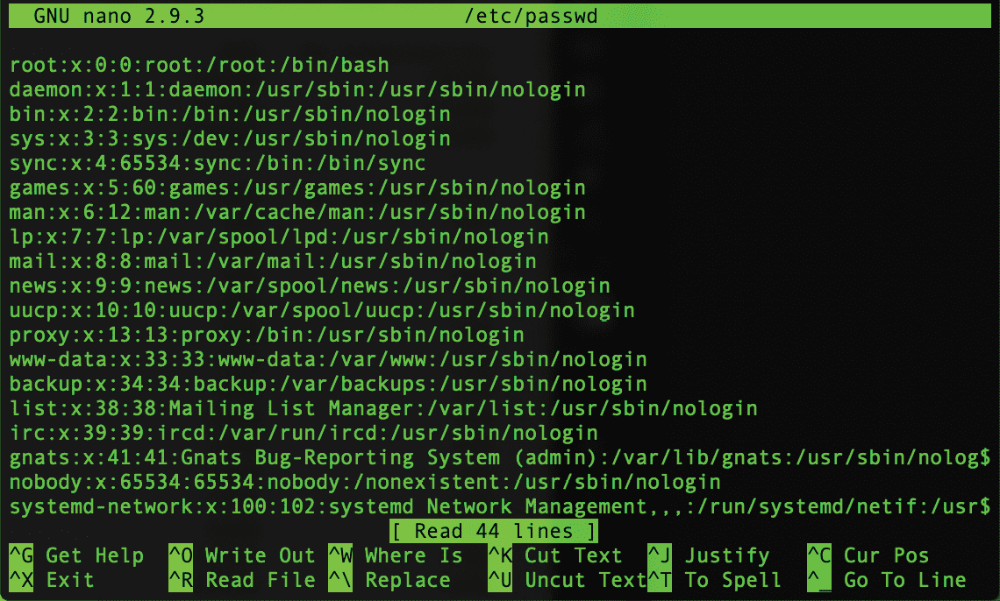

图 1-2

要创建一个新文件，请如下方式运行 `nano`：

```bash
# nano
```

当完成文件编辑后，输入 `Ctrl-S` 保存文件，然后按 `Ctrl-X` 退出。要打开现有文件，请使用 `Ctrl-R`。

如果您喜欢在 GNOME 环境中使用图形化编辑器，`gedit` 是执行基础编辑任务的良好起点。要从桌面启动 `gedit`，按 `Alt-F2` 显示命令窗口，如图 1-3 所示：


图 1-3

在文本字段中输入 `gedit` 并按回车键。稍等片刻，`gedit` 将加载并准备好打开、创建和编辑文件：

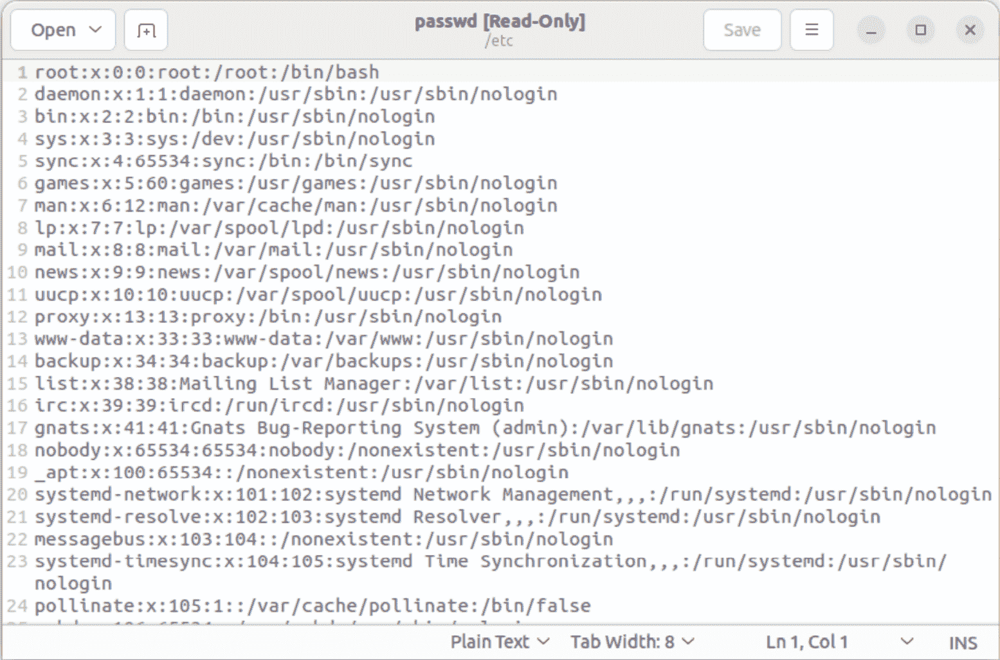

图 1-4

或者，在终端窗口中启动 `gedit`，无论带不带文件路径：

# gedit
# gedit /etc/passwd
```


我们希望您对购买本书感到满意。如果您发现书中任何错误或有任何意见、问题或疑虑，请通过电子邮件联系我们的支持团队：feedback@ebookfrenzy.com。

## 1.5 勘
尽管我们尽力确保内容的准确性，但对于涵盖如此规模和复杂领域的书籍，出现某些错误和遗漏不可避免的。书中已知的问题及其解决方案将列在以下 URL：

[`www.ebookfrenzy.com/errata/Ubuntu2304.html`](https://www.ebookfrenzy.com/errata/ubuntu2304.html)

如果您发现勘中未列出的错误，请通过电子邮件告知我们：feedback@ebookfrenzy.com。


Ubuntu Linux 是 Linux 操作系统多种变体（也称为发行版）之一，是英国英国公司 Canonical Ltd. 的产品。该公司由 Mark Shuttleworth 于 1994 年创立。然而，Linux 的起源追溯得更远。本章将概述 Linux 操作系统和 Ubuntu 的历史。


Linux 是一个操作系统，与 Windows 作为操作系统的方式非常相似（而且 Linux 和 Windows 之间存在许多相似之处）。“操作系统”一词用于描述在计算机硬件与我们日常运行的应用程序之间充当中间层的软件。当程序员编写应用程序时，他们与操作系统交互以执行诸如向硬盘器写入文件和在屏幕上显示信息等任务。如果没有操作系统，每一位程序员都必须编写代码来直接访问系统的硬件。此外，程序员必须能够支持有以来创建的每一件硬件，以确保应用程序可以在任何可能的硬件配置上运行。由于操作系统处理了所有这些硬件复杂性，应用程序开发变成了一项简单得的任务。Linux 只是当今许多不同操作系统之一。


要理解 Linux 的历史，我们必须追溯到 20 世纪 60 年代后期。当时，AT&T 停止了对名为 Multics 的新操作系统的开发。然而，AT&T 的两位工程师肯·汤普森（Ken Thompson）和丹尼斯·里奇（Dennis Ritchie）决定利用他们从 Multics 项目中学到的知识，创建一个名为 UNIX 的新操作系统，该系统迅速在企业和学术机构中流行起来并被广泛采用。

各种专有的 UNIX 实现相继上市，包括由 IBM (`AIX`)、惠尔尔-帕克（`HP-UX`）和太阳微系统公司（`SunOS` 和 Solaris）创建的版本。此外，安德鲁·S·塔能鲍（Andrew S. Tanenbaum）创建了一个名为 MINIX 的类 UNIX 操作系统，专为教学用途设计，并向大学提供源代码访问。


Linux 的起源可以追溯到两个人的工作和哲学。Linux 操作系统的核心是一个被称为 `kernel`（内核）的组件。这是操作系统运行所需的核心功能集。`kernel` 管理系统资源，并处理硬件与应用程序之间的通信。Linux 内核由林斯·托瓦尔斯（Linus Torvalds）开发，他由于不喜欢 MS-DOS，并且由于不急于等待 MINIX 在新的英特尔 80386 微处理器上可用而心急意焚，因此决定编写他自己的类 UNIX 内核。当他完成 `kernel` 的第一个版本时，他以开源许可发布了它，允许任何人下载源代码并自由使用和修改它，而无需向林斯支付任何费用。

大约同一时间，自由软件基金会的理德·斯尔曼（Richard Stallman）——自由和开源软件的坚定支持者正在开发他自己的开源操作系统。然而，斯尔曼最初并没有专注于 `kernel`，而是开始开发使用和维护操作系统所需的所有 UNIX 工具、实用程序和编译器的开源版本。当他完成这些基础设施的开发时，明显的解决方案是将他的工作与林斯写的 `kernel` 结合，创建一个完整的操作系统。这种结合被称为 GNU/Linux。纯主义者坚持 Linux 应该一直被称为 `GNU/Linux`（事实上，曾有一次理德·斯尔曼拒绝向未将 Linux 称为 `GNU/Linux` 的出版物接受媒体采访）。这是合理的，因为自由软件基金会开发的 GNU 工具构成了 `GNU/Linux` 重要且至关重要的部分。遗憾的是，大多数人和出版物将 Linux 称为 Linux，这种情况可能会一直持续。


如前所述，Ubuntu 是许多 Linux 发行版之一。构成 Ubuntu 发行版的源代码源于一个备受推崇的 Linux 发行版 Debian，由伊恩·默奇（Ian Murdoch）创建。

一位名叫马克·舒特尔沃（Mark Shuttleworth）的南非互联网巨头（他通过将公司卖给 VeriSign 赚了约 5 亿美元）决定是时候需要一个更易用户的 Linux 了。他采用了 Debian 发行版，并将其转化为一个更符合人类习惯的发行版，命名为 Ubuntu。随后他成立了一家名为 Canonical Ltd 的公司来推广和支持 Ubuntu。

如果你是 Linux 新手，或者已经在使用 Linux 并想尝试不同的 Linux 发行版，你可能找不到比 Ubuntu 更好的选择了。


“Ubuntu”是一个古祖鲁语和科霍萨语词，意为“对他人的仁爱”。Ubuntu 也意味着“因为我们大家的存在，我才成为我”。选择这个词是因为这些情感准确地描述了 Ubuntu 发行版精神。

## 总结

Linux 操作系统的起源可以追溯到林斯·托瓦尔斯和理德·斯尔曼的工作，形式为 Linux `kernel` 结合 GNU 项目构建的工具和编译器。

多年来，Linux 的开源特性导致了各种不同 Linux 发行版的发布。其中一种发行版就是 Ubuntu，它基于由 Canonical Ltd（由马克·舒特尔沃创立的公司）创建的 Debian Linux 发行版。
## 在空白驱动器上安装 Ubuntu

现在有三种部署 Ubuntu 系统的方法。一种方法是购买新硬件，或者重新利用现有的计算机系统以在上面安装和运行操作系统。或者，可以使用虚拟化平台（如 `VirtualBox` 或 `VMware`）在现有操作系统的虚拟机内部安装并运行 Ubuntu。另一种选择是使用 `Amazon AWS`、`Google Cloud` 或 `Microsoft Azure` 等服务（仅举举例）创建一个云端操作系统实例。由于云端实例通常是通过选择一个预配置的、即可运行的且已针对云平台优化的操作系统镜像，并以此作为 Ubuntu 系统的基础，因此在这种情况下不需要执行手动操作系统安装。

另一方面，如果你计划在自己的硬件上安装 Ubuntu 或使用虚拟化环境，学习 Ubuntu 路径的第一步就是安装操作系统。

Ubuntu 可以安装在空白磁盘环境中（即清除整个磁盘上的所有现有分区并完全分配给 Ubuntu），也可以安装在双启动环境中，即 Ubuntu 与磁盘上的另一个操作系统共存（通常是微软 Windows 家族的某一个成员）。

在本章中，我们将介绍从本地或远程安装介质进行空白磁盘安装的方法。

### Ubuntu 安装选项

可以从以下网页免费下载 Ubuntu：
`https://ubuntu.com/download`

该页面提供了多种下载选项，取决于如何安装和使用该操作系统：

- Ubuntu Desktop：下载操作系统桌面版的安装介质。该版本旨在用于需要图形化桌面环境的台式机和笔记本系统，且仅适用于 64 位 x86 系统。桌面版可以以 ISO 镜像的形式下载，然后可以使用本章后面概述的步骤将其写入 USB 驱动。启动后，桌面介质将允许你在执行安装之前通过运行 Live Ubuntu 会话来测试 Ubuntu。


*   **Ubuntu Server**: 下载用于操作系统服务器版的 Live Server ISO 安装媒体。此镜像旨在安装到不需要图形化桌面环境的服务器上，适用于 x86、ARM、IBM POWER (PowerPC) 和 s390x (IBM System z 主机) 系统。该安装媒体不包含在安装前尝试 Ubuntu 的选项，并使用基于文本的安装程序，而不是 Ubuntu Desktop 使用的图形化安装程序。这允许将 Ubuntu 安装在没有图形控制台的系统上。

Ubuntu Server 镜像也可用于执行预启动执行环境（`PXE`）网络安装。使用 `PXE` 安装 Ubuntu 时，Ubuntu 镜像将安装在特殊配置的服务器上（称为 `PXE` 启动服务器）。然后，将要安装 Ubuntu 的客户端系统配置为从 `PXE` 启动服务器上的镜像通过网络启动（假设客户端硬件支持 `PXE`），以启动安装。


显然，在开始安装之前，需要在桌面版和服务器版镜像之间做出决定。如果你想在安装之前尝试 Ubuntu，那么桌面版选项是最佳解决方案，因为它允许你从安装媒体启动 Ubuntu，而无需先在磁盘驱动器上安装。此选项还允许从交互式内部启动安装。

如果不需要图形化桌面环境，且目标系统没有互联网访问或图形控制台，则推荐使用 Live Server ISO 镜像，因为这可以在不需要下载任何额外包的情况下构建一个功能完整的服务器。

无论选择何种安装方法，在安装后都可以向系统中添加或删除包，以根据特定需求配置系统。


为了本章的目的，将使用图形化安装程序安装 Ubuntu 桌面环境。因此，请从以下 URL 下载 Ubuntu Desktop 23.04 ISO 镜像：

`https://ubuntu.com/download/desktop`

DVD ISO 镜像是自包含的，包含了安装 Ubuntu 系统所需的所有包，并按照以下约定命名：

`ubuntu-<version>-<edition>-<architecture>.iso`

例如，适用于 64 位 Intel/AMD 系统的 Ubuntu 23.04 桌面 ISO 镜像命名如下：


下载镜像后，请将其刻录到磁盘中，或使用下一节中的步骤将媒体写入 USB 驱动器并配置你的虚拟化环境将其视为 DVD 驱动器。

## 3.4 将 ISO 安装镜像写入 USB 驱动器

如今，操作系统的安装更有可能通过 USB 驱动器而不是 DVD 进行。下载了 Ubuntu 的 ISO 安装镜像后，将镜像写入 USB 驱动器的步骤将取决于驱动器连接到 Linux、macOS 还是 Windows 系统。本节其余部分概述的步骤假设 USB 驱动器是新的，或已重新格式化以删除任何现有数据或分区：

### 3.4.1 Linux

在 Linux 上向 USB 驱动器写入 ISO 镜像的第一步是识别设备名称。在插入 USB 驱动器之前，通过列出 `/dev` 中的设备来识别系统已检测到的存储设备：

```
# ls /dev/sd*
```

`/dev/sda /dev/sda1 /dev/sda2`

将 USB 驱动器连接到 Linux 系统并运行 `dmesg` 命令以获取最近系统消息列表，其中一个将是检测到 USB 驱动器的报告，类似于下所示：

```
[445597.988045] sd 6:0:0:0: [sdb] Attached SCSI removable disk
```

此输出告诉我们，应该预期设备名称包含 `sdb`，我们可以通过再次列出 `/dev` 中的设备名称来确认这一点：

```
# ls /dev/sd*
```

`/dev/sda /dev/sda1 /dev/sda2 /dev/sdb`

从此输出中，我们可以知道 USB 驱动器已被分配给 `/dev/sdb`。在将 ISO 镜像写入设备之前的下一步是运行 `findmnt` 命令确保它没有被自动挂载：

```
# findmnt /dev/sdb?
```

TARGET SOURCE FSTYPE OPTIONS
`/media/demo/C24E-6727 /dev/sdb1 vfat rw,nosuid,nodev, ...`

如果 `findmnt` 命令指示 USB 驱动器已挂载，请在继续操作之前将其卸载：

```
# umount /media/demo/C24E-6727
```

一旦文件系统已卸载，请使用如下 `dd` 命令将 ISO 镜像写入驱动器：

```
# dd if=/path/to/iso/<image name>.iso of=/dev/sdb bs=512k
```

写入过程可能需要一些时间（长达 10-15 分钟），取决于镜像大小和运行它的系统速度。镜像写入完成后，将出现类似下面的输出，USB 驱动器即可准备好安装 Ubuntu：

```
4056+1 records in
4056+1 records out
2126544896 bytes (2.1 GB, 2.0 GiB) copied, 625.911 s, 3.4 MB/s
```


在 macOS 上向连接到系统的 USB 驱动器写入 ISO 镜像的第一步是使用 `diskutil` 工具识别设备。在连接 USB 设备之前，打开终端窗口并运行以下命令：

```
$ diskutil list
```

`/dev/disk0 (internal):`
# TYPE SIZE IDENTIFIER
`0: GUID_partition_scheme *1 TB`
`1: EFI 209.7 MB`
`2: APFS Container 473.6 GB`
`3: APFS Volume Preboot 421.6 MB`
`4: APFS Volume Recovery 517.0 MB`
`5: APFS Volume VM 1.1 GB`

建立设备基后，插入 USB 驱动器端口并再次运行命令。应该相同的相同，但多了一个 USB 驱动器的条目：

`/dev/disk3 (external, physical):`
# TYPE SIZE IDENTIFIER
`0: GUID_partition_scheme *16.0 GB`

在上述示例中，USB 驱动器已被分配给 `/dev/disk3`。在继续之前，按如下卸载磁盘：

```bash
$ diskutil unmount /dev/disk3
```

disk3 上所有卷卸载成功。

最后，使用 `dd` 命令将镜像写入设备，注意引用原始磁盘设备（`/dev/rdisk3`）并在提示时输入用户密码：

```
$ sudo dd if=/path/to/iso/image.iso of=/dev/rdisk3 bs=1m
```

写入完成后，USB 驱动器已就绪。


Windows 和 macOS 上有多种免费工具可以将 ISO 镜像写入 USB 驱动器，但一种专门为写入 Linux 镜像编写的工具是 Fedora Media Writer 工具，可以从以下 URL 下载：

`https://getfedora.org/en/workstation/download/`

安装后，插入目标 USB 驱动器，启动写入工具并选择 Select .iso file 选项。点击 Next 进入写入选项界面，在点击 Select 按钮之前选择 USB 驱动。在弹出的文件选择对话中，导航并选择 Ubuntu 安装 ISO 镜像，然后点击 Open。最后，点击 Write 按钮开始将镜像写入 USB 驱动器。

镜像写入完成后，设备即可准备好进行安装。


将 Ubuntu 安装介插入适当的驱动器并启动系统。如果系统尝试从硬盘驱动启动，你将需要进入电脑的 BIOS 设置并更改启动顺序，使其首先从安装介驱动器启动。在初始启动序列完成后，将出现图 3-4 所示的 `GRUB` 菜单：

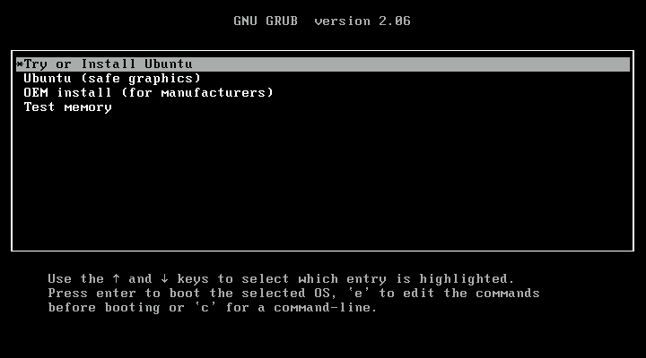

图 3-4

使用方向键选择 `Try`（试用）或 `Install Ubuntu`（安装 Ubuntu）菜单选项，然后按 `Enter`（回车）键进入 Ubuntu Live 会话。Ubuntu 完全启动后，将显示下方图 3-5 所示的窗口：

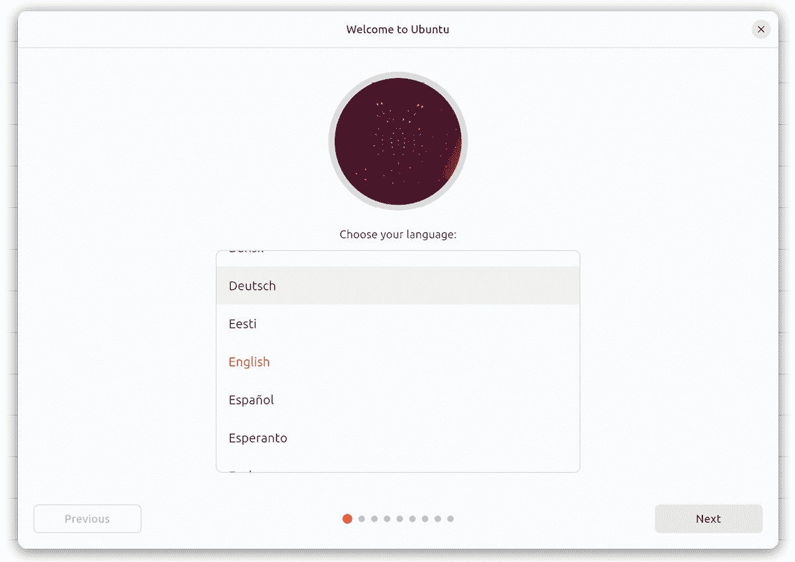

图 3-5

选择你偏好的语言，然后点击 `Next`（下一步）按钮。在下一个屏幕上，提供了选项供你试用 Ubuntu Live 会话或开始安装过程：

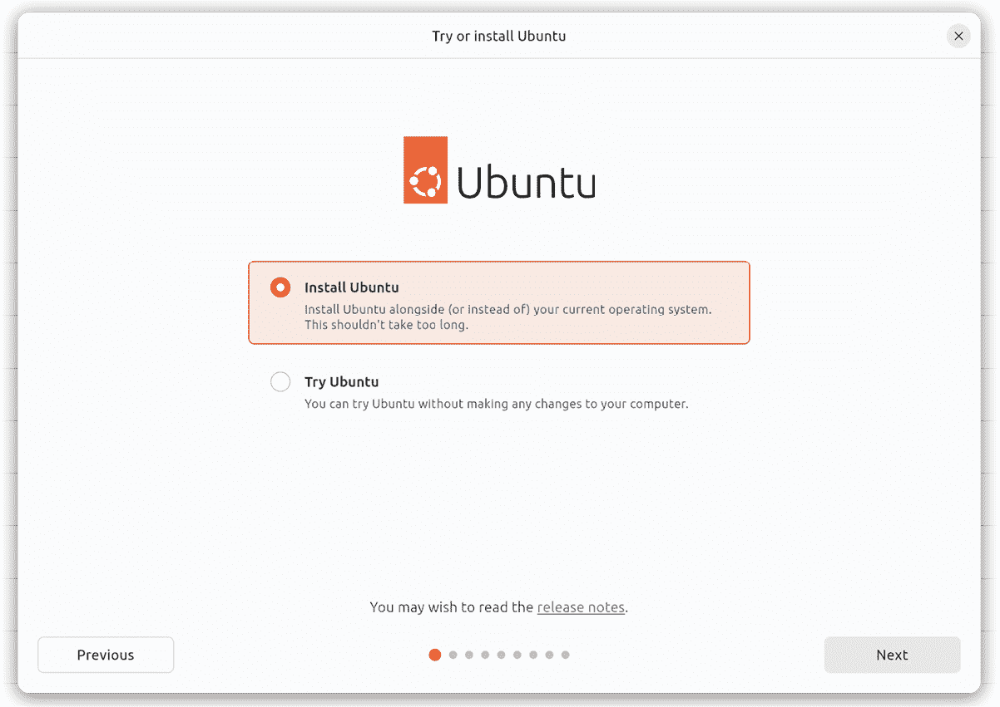


选择 `Install Ubuntu` 选项，然后点击 `Next`（下一步）按钮进入键盘布局屏幕：

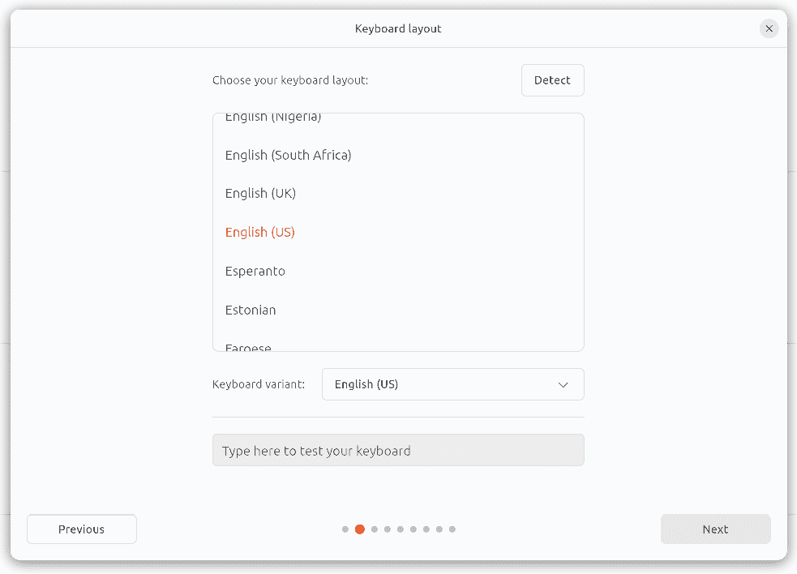

图 3-6

选择你的键盘布局；或者如果你不确定，可以点击 `Detect`（检测）按钮通过一些步骤识别你的键盘，然后点击 `Next`（下一步）选择安装期间要使用的网络连接：

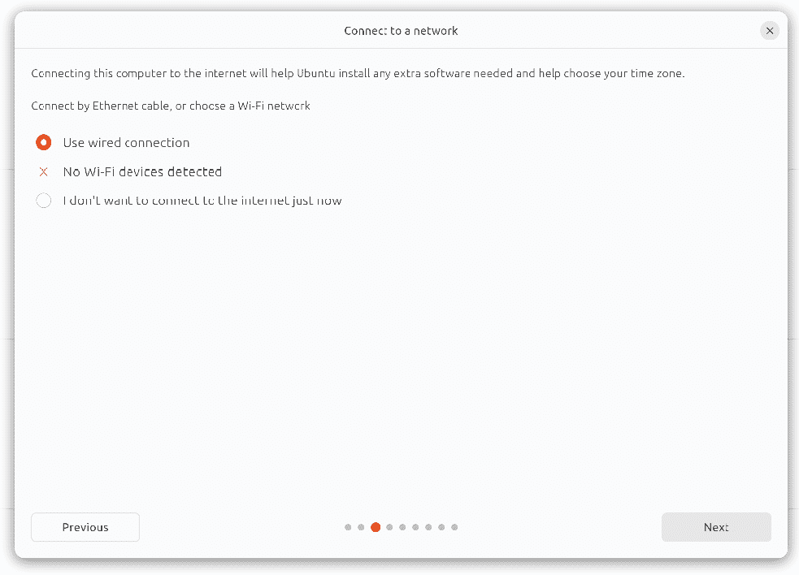

图 3-7

在下一个屏幕上，选择执行 `Normal`（标准）安装还是 `Minimal`（最小）安装：

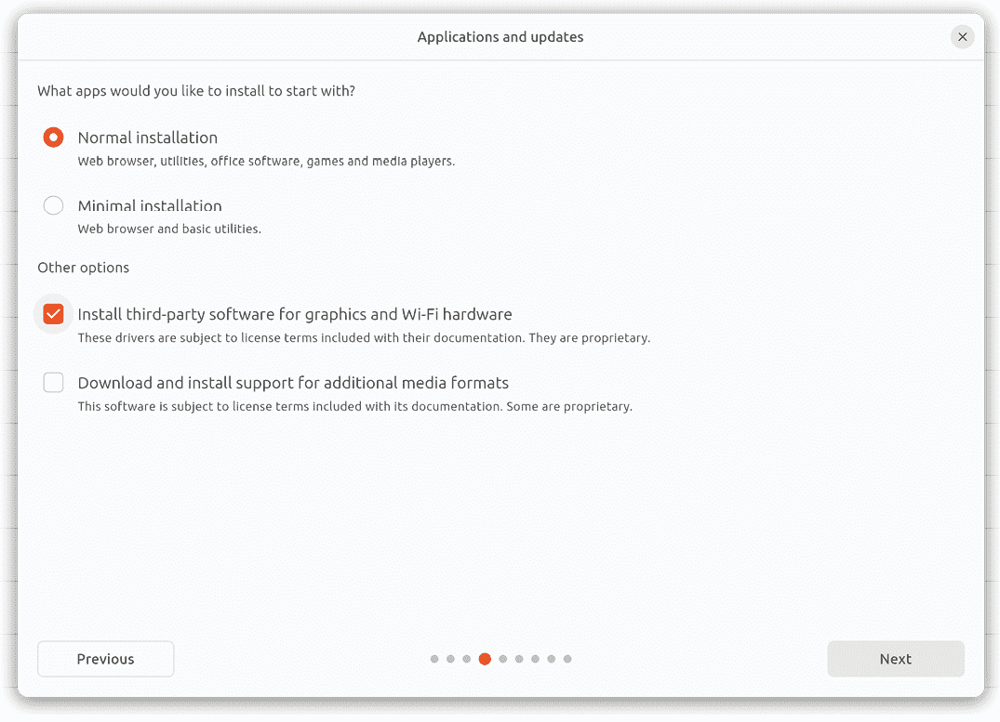

图 3-8

如果你有足够的磁盘空间，并且想探索 Ubuntu 自带的主要应用程序和实用而无需以后手动安装它们，请选择 `Normal` 选项。或者，为了避免用你可能永远需要的软件占用系统，请选择 `Minimal` 选项。无论此处何种选择，在未来的任何时候，Ubuntu 提供的所有软件都可以轻松安装或删除。

安装过程中还提供了一个更新组成 Ubuntu 发行版的软件包的选项。Ubuntu 与大多数活跃支持的操作系统一样，在发布给公众后的很长一段时间内持续更新错误修复和安全补丁。如果选择了此选项且系统连接到互联网，安装程序将下载自 Ubuntu 安装镜像发布以来发布的所有更新，并在安装期间将其应用到系统。如果你选择不在安装过程中进行此更新，这些更新可能在安装完成后的任何时间应用。

第二个选项提供了是否安装第三方非开源软件的选项，用以支持特定的硬件设备以及在系统上播放专有媒体文件。某些用户强烈反对使用任何未在公共许可下发布的软件。如果你是这些人之一，请不要选择此选项。反之，如果你只想获得 Ubuntu 安装的最佳体验，则推荐选择此选项。

做出相应选择后，点击 `Next`（下一步）按钮进入磁盘分配屏幕：
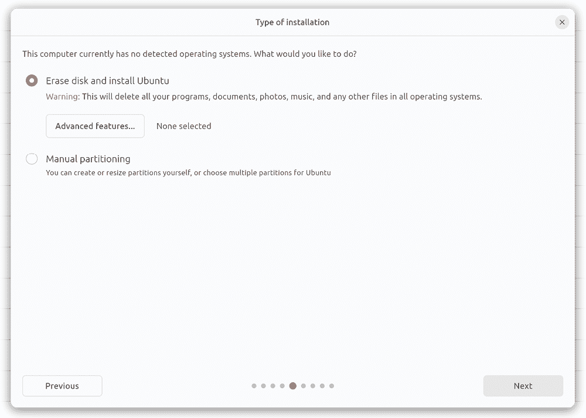

图 3-9

假设这是一个没有现有操作系统的新磁盘，安装程序将提供擦除整个磁盘并将其用于 Ubuntu 的选项（在这种情况下，安装程序将计算并实施典型且推荐的分区布局）。或者，要定义你自定义的磁盘布局，请选择 `Manual partitioning`（手动分区）选项手动创建并调整包含操作系统和数据的磁盘分区的大小。

点击 `Advanced Features...`（高级功能）按钮将提供使用逻辑卷管理（`LVM`）的选项。强烈建议使用 `LVM` 以使系统磁盘和分区的管理更容易，该主题在“向 Ubuntu 23.04 卷组和逻辑卷添加新磁盘”章节中有详细介绍：

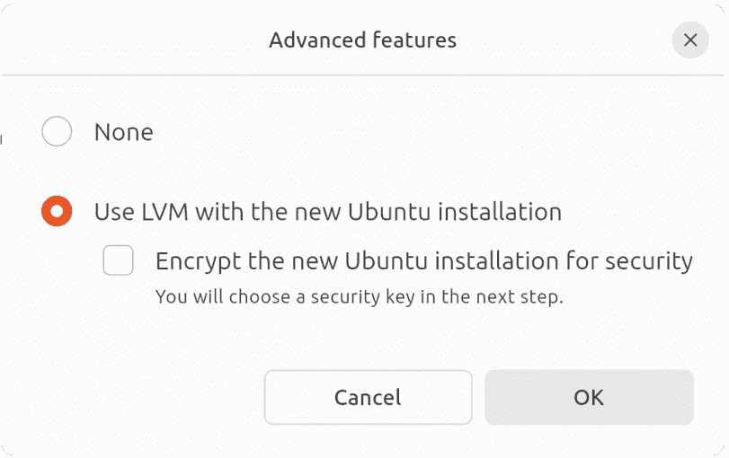

图 3-10

如果存储在磁盘上的数据安全性是首要考虑的问题，请选择加密 Ubuntu 安装的选项。如果选择了此选项，下一个屏幕将提示你选择一个安全密钥，之后每次系统启动时都需要输入该密钥。

在本示例中，选择使用 `LVM` 选项并点击 `OK`。

做出选择后，点击 `Next`（下一步）按钮检查磁盘分区信息：

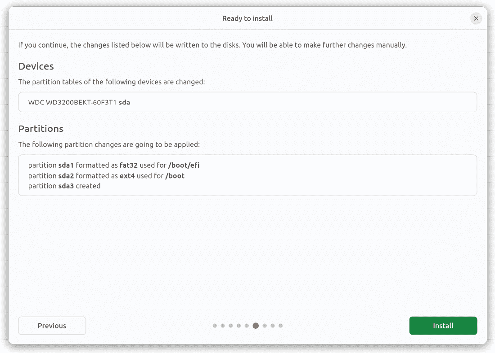

图 3-11

点击 `Install`（安装）按钮开始安装。在安装进行期间，安装程序将询问有关你地理位置的信息以配置时区设置：


图 3-12

接下来，安装程序将要求为系统上的第一个账户提供用户名和密码：

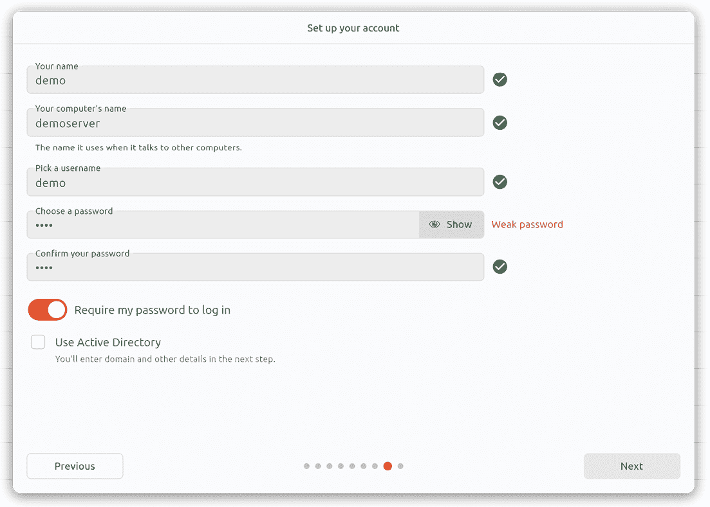

图 3-13

还提供了一个选项来规定用户每次想要登录系统时是否必须指定密码。默认情况下，每次 Ubuntu 启动时都会显示登录屏幕，请求用户名和密码凭据。如果你是系统的唯一用户并希望跳过此屏幕并在每次系统启动时自动登录，请在继续之前务必关闭 `Require my password to log in`（登录需要密码）开关。

一旦回答了所有问题，安装程序将直接继续安装。取决于你系统的速度以及你是否在安装期间下载更新，此过程可能需要一些时间。要查看安装程序正在执行步骤的详细视图，请参考图 3-14：

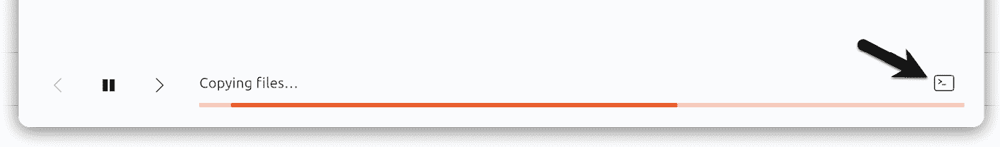

图 3-14

安装完成后，对话框将更新并提示系统已好重启：


图 3-15

当你准备好重启时，点击 `Restart`（重启）按钮。安装程序可能会提示你移除安装介质，系统将花费一些时间关机。此时，取出 USB 闪盘并按 Enter 键继续。


系统启动后，如果启用了密码选项，GNOME 显示管理器（`GDM`）登录屏幕图 3-16)将出现。要访问系统，选择用户名并输入安装期间指定的密码：

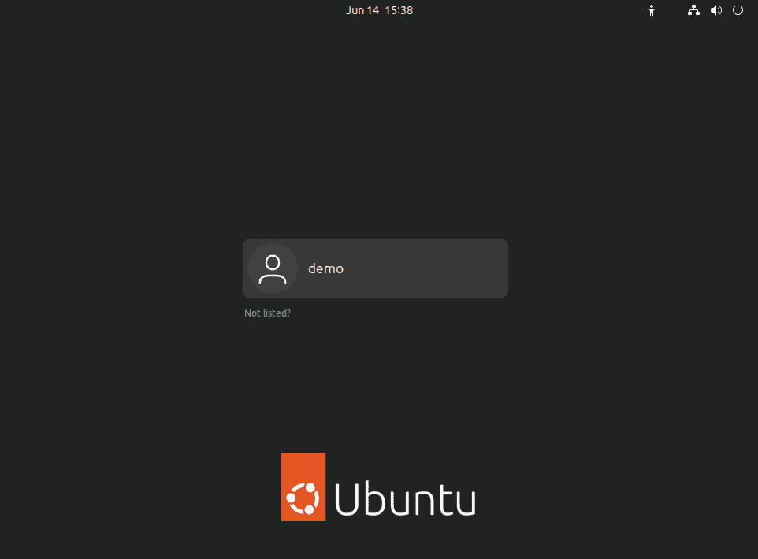

图 3-16

或者，如果安装配置为直接登录桌面，在系统重启后将出现 GNOME 桌面图 3-17)：


图 3-17

## 3.8 安装更新

与现在的大多数操作系统一样，Ubuntu 发行的每个特定版本在发布后都会持续演进。这通常以错误修复和安全更新的形式出现，有时通过互联网下载并安装到系统中的新功能。

最佳实践建议安装 Ubuntu 后的第一步是确保将所有可用更新应用到系统。当有可用更新时，`Software Updater`（软件更新器）将显示如下对话框，并从中安装更新：

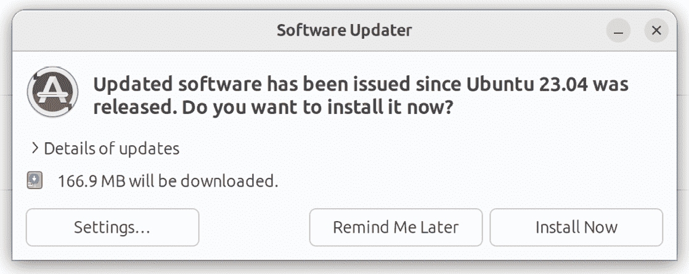

图 3-18


你也可以通过终端（Terminal）窗口中的命令行提示符使用 `apt` 包管理器工具安装更新。要检查是否有可用更新，右键点击桌面背景，并在弹出的菜单中选择`Open in Terminal` ：

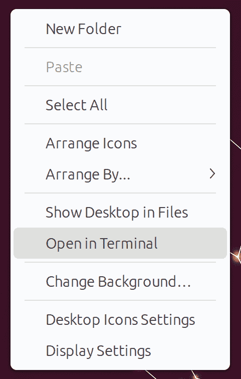

图 3-19
在 `Terminal` 窗口中，运行以下命令以获取 root 权限并更新软件包列表：

```bash
$ sudo su -
# apt update
```

如果有可更新的软件包，命令将显示类似下面的输出：

```
.
.
.
Reading package lists... Done
Building dependency tree
Reading state information... Done
220 packages can be upgraded. Run 'apt list --upgradable' to see them.
```

任何待处理的更新可以使用 `apt` 工具应用：

```bash
# apt upgrade
```

执行后，`apt` 工具将提供一个可用更新的软件包列表，并提示许可以执行更新：

220 upgraded, 7 newly installed, 0 to remove and 0 not upgraded.
Need to get 75.2 MB/286 MB of archives.
After this operation, 34.8 MB of additional disk space will be used.
Do you want to continue? [Y/n]

一旦升级完成，安装基本上结束了。


在启动过程中，系统会显示 Ubuntu 启动界面（splash screen），它会隐藏系统加载时生成的所有启动消息。若要在启动过程中使这些消息可见（如 图 3-20 所示），只需在系统启动时按下键盘上的 `Esc` 键即可：

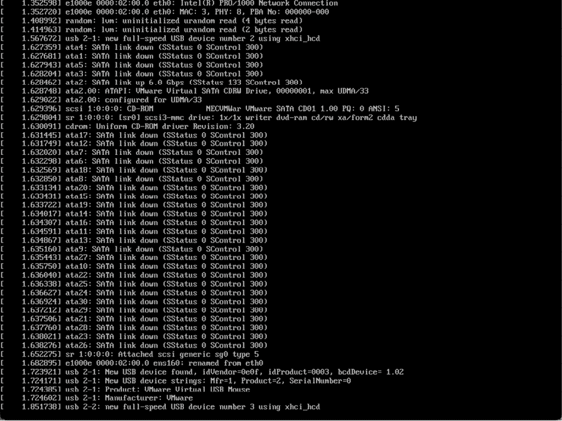

图 3-20

可以通过编辑 `/etc/default/grub` 文件并更改 `GRUB_CMDLINE_LINUX` 设置来更改默认行为，使其默认情况下始终显示消息。该设置默认类似于以下内容：

`GRUB_CMDLINE_LINUX="... rhgb quiet"`

如果你是 Linux 新手且不熟悉可用的编辑器，请参考“Introduction”章节中概述的编辑器建议。例如，要使用 `nano` 编辑器，输入以下命令来启动编辑器并加载 grub 文件：

```bash
# nano /etc/default/grub
```

要移除图形启动界面以便在不按 `Esc` 键的情况下看到消息，请从设置中移除 `splash` 和 `quiet` 选项：

`GRUB_CMDLINE_LINUX=""`

此更改将导致系统显示系统生成的所有启动消息。

完成更改后，运行以下命令生成新的启动配置，以便在下次系统启动时生效：

```bash
# grub-mkconfig --output=/boot/grub/grub.cfg
```


使用 Ubuntu 的第一步是安装操作系统。在云服务器的情况下，此任务通常在根据云服务提供商提供的系列选项为系统选择操作系统镜像时自动完成。然而，在自己的硬件或虚拟机上进行安装则需要下载以 `ISO` 镜像形式呈现的安装介质，将该镜像写入 DVD 或 USB 驱动器等合适的存储设备中，并从其启动。一旦安装完成，安装自原始安装镜像创建以来发布的任何操作系统更新都是关重要的。


Ubuntu 与大多数 Linux 发行版一样，可以愉快地与几乎任何版本的 Windows 共存在于硬盘上。这种概念被称为双启动（dual-booting）。本质上，当你启动 PC 时，将看到一个菜单，提供启动 Ubuntu 或 Windows 的选项。显然，你一次只能运行一个操作系统，但值得注意的是，无论你的硬盘 Windows 分区是使用 `NTFS`、`FAT16` 还是 `FAT32` 格式化的，你都可以在 Ubuntu 中访问磁盘 Windows 分区上的文件。

在安装过程中，Ubuntu 安装程序会检测驱动器上的 Windows 安装，并提供删除它并将整个磁盘用于 Ubuntu，或与 Windows 共享磁盘的选项。在后的情况下，你可以指定用于 Ubuntu 的磁盘百分比。

根据 Ubuntu 文档，完整的 Ubuntu 桌面版安装至少需要 25 GB 的磁盘空间，以及更多空间来存储你随后创建的任何文件。一旦选择了用于 Ubuntu 的磁盘空间，安装程序将调整 Windows 分区的大小（而不破坏任何数据），并将磁盘的剩余部分用于 Ubuntu。

本章将演示如何设置 Ubuntu 和 Windows 10 的双启动系统，更改计算机系统开机时的默认启动系统，并概述如何从 Ubuntu 内部访问位于磁盘 Windows 分区上的文件。

在本章中，假设已按照上一章概述的步骤，使用 Ubuntu 桌面安装镜像创建了可启动的 Ubuntu 安装 USB 驱动器，并且系统已配置为启动时从 USB 驱动器启动。


将 Ubuntu 安装介质插入驱动器并启动系统。如果系统启动了 Windows，你需要进入计算机的 `BIOS` 设置并更改启动顺序，以便首先从安装介质驱动器启动。在初始启动序列完成后，将出现如图 4-1 所示的`GRUB`菜单：


图 4-1

使用方向键选择`Try or Install Ubuntu` 选项，然后按 `Enter` 进入 Live Live 会。Ubuntu 完全启动后，将出现下方图 4-2 所示的窗口：


图 4-2

## 4.2 安装 Ubuntu

选择`Install Ubuntu` 选项，然后点击 `Next` 按钮进入键盘布局界面：


图 4-4

要么选择你的键盘布局，或者如果你不确定，点击 `Detect` 按钮通过一些步骤识别你的键盘，然后点击 `Next` 选择安装期间使用的网络连接：


图 4-5

在下一个屏幕上，选择执行 `Normal` 安装还是 `Minimal` 安装：

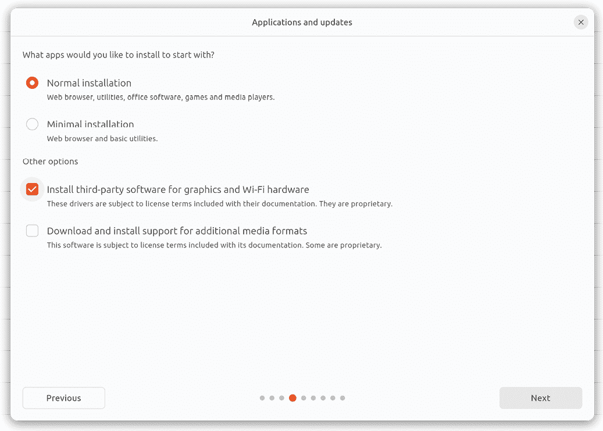

图 4-6

如果你有充足的磁盘空间并希望探索 Ubuntu 包含的主要应用程序和实用，而无需以后手动安装它们，请选择 `Normal` 选项。或者，为了避免使用你可能永远需要的软件填充系统，请选择 `Minimal` 选项。无论在此做出什么选择，在未来的任何时候都可以轻松安装或卸载 Ubuntu 提供的所有软件。


第二个选项提供了选择，决定是否安装第三方非开源软件，以支持特定的硬件设备以及在系统上播放专有媒体文件。某些用户强烈反对使用任何未在公共许可下发布的软件。如果你是其中一员，请不要选择此选项。相反，如果你只想从你的 Ubuntu 安装中获得体验，那么推荐选择此选项。

做出妥当选择后，点击“Next”（下一步）按钮进入磁盘分配界面：

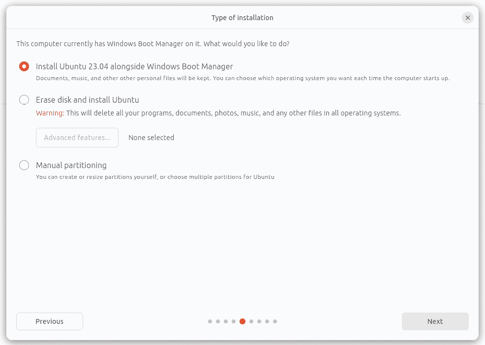
图 4-7

由于我们的意图是配置双启动系统，因此“与 Windows Boot Manager 并排安装”（Install Ubuntu alongside Windows Boot Manager）选项是所需的选择。选中此选项后，点击“Continue”（继续）按钮继续。后续屏幕允许配置分配给每个操作系统（在这种情况下为 Windows 和 Ubuntu）的磁盘空间：

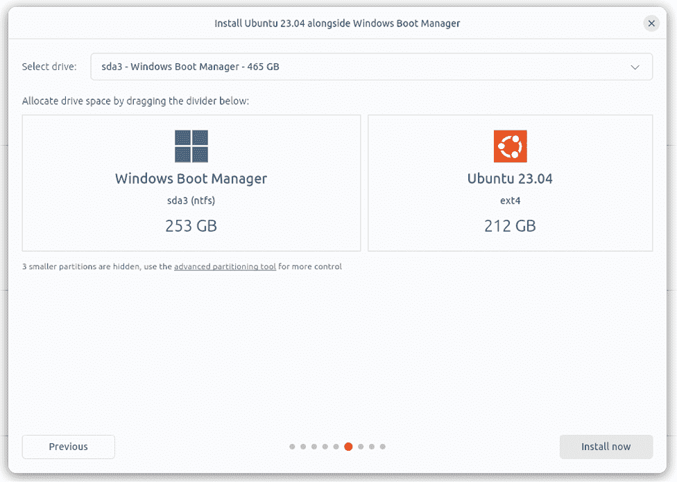
图 4-8

此时，你必须决定将 Windows 分区的多少空间分配给 Ubuntu 安装。移动滑块（在图中位于 Windows 分区和 Ubuntu 分区之间），直到 Ubuntu 分区的分配大小达到你让你满意的程度。对于完整的 Ubuntu 桌面安装，至少应提供 25GB 的空间。

完成选择后，点击“Next”按钮查看磁盘分区信息：

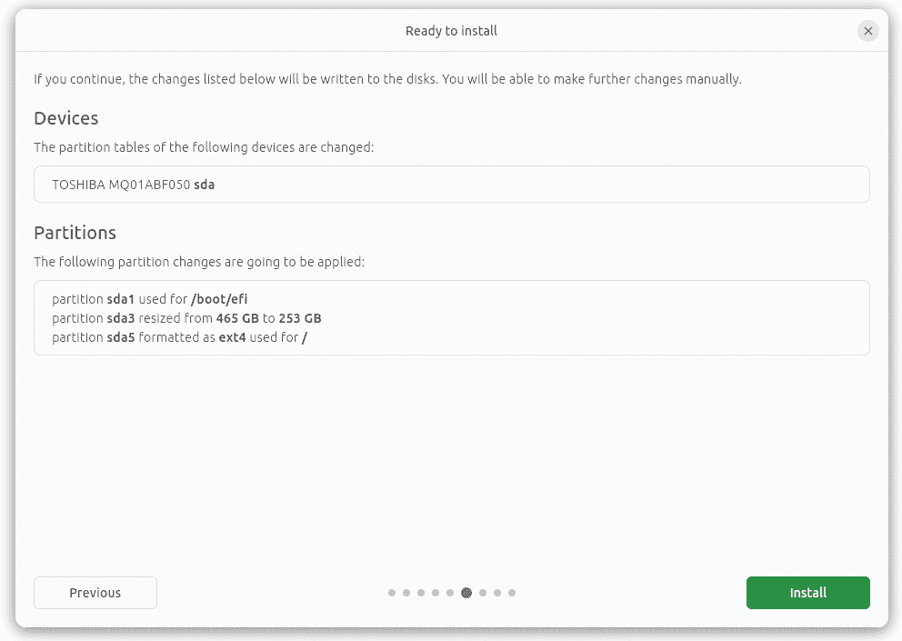

点击“Install”（安装）按钮开始安装。在安装进行期间，安装程序会询问你有关地理位置的信息以配置时区设置：


图 4-10

接下来，安装程序将要求你为系统的第一个账户提供用户名和密码：


图 4-11

系统还提供了一个选项，用于规定用户每次想要登录系统时是否必须指定密码。默认情况下，每次启动 Ubuntu 都会显示登录界面，请求用户名和密码凭据。如果你是系统的唯一用户，并希望跳过此屏幕并在每次系统启动时自动登录，请确保在继续关闭关闭登录需要密码”（Require my password to log in）开关。

回答所有问题后，安装程序将直接继续安装。取决于你的系统速度以及你是否选择在安装期间下载更新，此过程可能需要一些时间。要查看安装程序正在执行步骤的更详细视图，请点击图 4-12 中高亮的按钮：


图 4-12

安装完成后，对话框将更新并通知你系统已准备好重启：

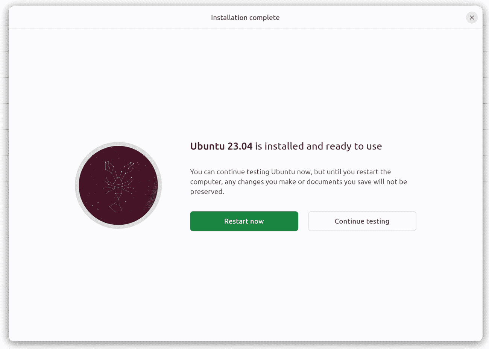
图 4-13

当你准备好重启时，按下“Restart now”（立即重启）按钮。安装程序可能会提示你移除安装介质，系统将花费几秒钟关闭。此时，移除 USB 闪存盘并按 Enter（回车）键继续。


当系统重启时，将出现类似下图所示的屏幕，提供启动 Windows 或 Ubuntu 的选项：

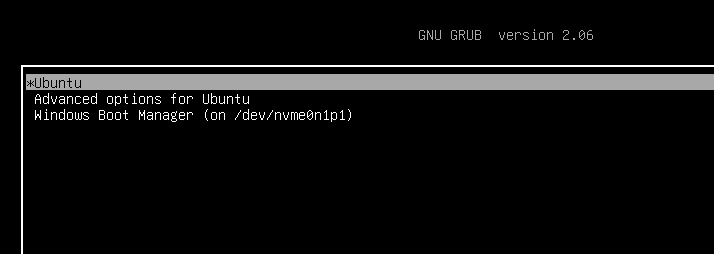
图 4-14

按 Enter 启动 Ubuntu。如果你想启动 Windows，请使用键盘方向键选择 Windows Boot Manager 选项。如果你选择启动 Ubuntu，操作系统将加载，并出现 Ubuntu 登录界面（除非选择了自动登录选项）。输入你在安装过程中设置的用户名和密码，你将登录 Ubuntu 桌面环境。

## 4.4 修改默认启动选项

当系统启动时，将出现启动选项屏幕，并等待 10 秒让用户选择操作系统。如果在超时结束前未进行选择，将启动默认操作系统。在新配置的系统上，默认操作系统将是标准的 Ubuntu 镜像。然而，可以在 Ubuntu 内部更改此默认值。

一系列启动配置选项（包括 10 秒超时和“在空白磁盘驱动上安装 Ubuntu”中列出的启动设置）在 `/etc/default/grub` 文件中声明，在新建安装中，该文件的内容如下：

```bash
GRUB_DEFAULT=0
GRUB_TIMEOUT_STYLE=hidden
GRUB_TIMEOUT=10
GRUB_DISTRIBUTOR=`lsb_release -i -s 2> /dev/null || echo Debian`
GRUB_CMDLINE_LINUX_DEFAULT="quiet splash"
GRUB_CMDLINE_LINUX=""
```

更改默认启动系统的第一步是在此文件中声明 `GRUB_SAVEDEFAULT` 设置，并将 `GRUB_DEFAULT` 设置为 `saved`：

```bash
GRUB_DEFAULT=saved
GRUB_SAVEDEFAULT=true
GRUB_TIMEOUT_STYLE=hidden
GRUB_TIMEOUT=10
```

此设置允许在启动配置中保存一个新的默认值。接下来，运行 `grub-set-default` 命令，使用从 0 开始计数的数字系统来更改默认设置。例如，如果 Windows 10 选项位于菜单的第 5 个，则将其设置为默认项的命令为：

```bash
grub-set-default 4

通过运行以下命令检查设置是否生效：

```bash
grub-editenv list
```
注意 `saved_entry` 值已设置为 4。更改默认后，重新生成配置：

```bash
grub-mkconfig --output=/boot/grub
```
重启系统并验证默认。

## 4.5 从命令行访问 Windows 分区

在双启动配置下运行 Ubuntu，仍然可以访问 Windows 分区。这可以通过命令行手动挂载分区，或从桌面使用 `gnome-disks` 图形工具来实现。

从命令行操作时，此过程的第一步是为我们的 Windows 分区创建一个目录。在本示例中，我们将创建一个名为 `/mnt/windows` 的目录：

```bash
mkdir /mnt/windows
```

为了识别分配给 Windows 分区的设备名称，使用 `fdisk` 命令：

```bash
fdisk -l
```


`$Recycle.Bin` `pagefile.sys` `swapfile.sys`

`$WinREAgent` `PerfLogs` `System Volume Information`

`Documents and Settings` `ProgramData` `Users`

`DumpStack.log` `Program Files` `Windows`

`DumpStack.log.tmp` `Program Files (x86)`

`OneDriveTemp` `Recovery`

为了在每次系统启动时自动挂载，只需将相应的挂载行添加到 `/etc/fstab` 文件中：

```bash
/dev/nvme0n1p3 /mnt/windows ntfs defaults 0 0
```

如需在任何时间卸载 Windows 文件系统：

```bash
# umount /mnt/windows
```


使用桌面环境挂载分区的第一步是启动 `disks` 磁盘工具。加载桌面后，右键点击桌面背景，从弹出菜单中选择“Open Terminal”（打开终端）。在终端窗口中，在启动 `Disks` 工具之前，先获取 root 权限：

```bash
$ gnome-disks
```

一旦磁盘工具启动，将出现一个类似于图 4-15 所示的窗口：

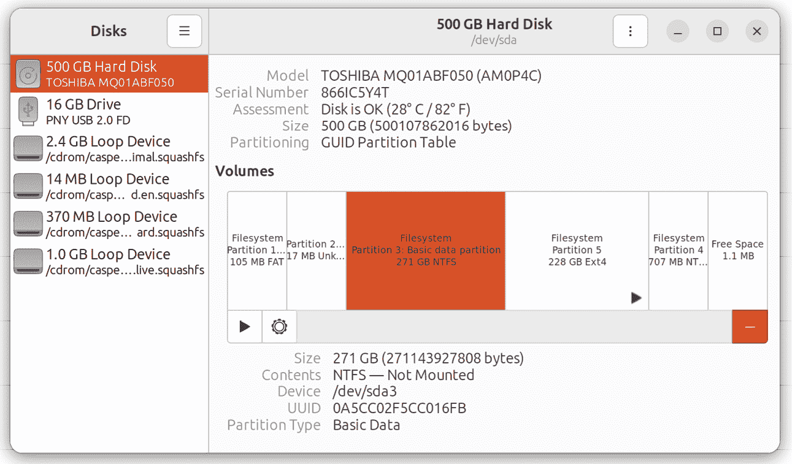
图 4-15

要查看有关分区的信息，请从对话框 `Volumes`（卷）部分的图形化表示中选择该分区。在上面的示例中，Windows 系统分区被选中并高亮。要挂载该分区以便在 Ubuntu 内部访问内容，请选择该分区并点击图 4-16 所示的选项按钮显示菜单：

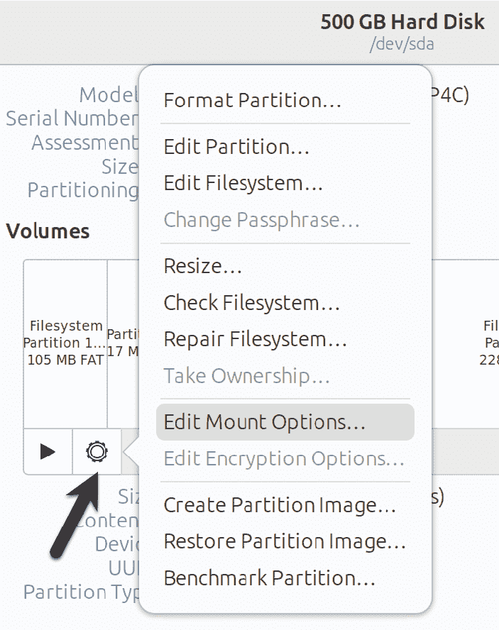
图 4-16

从菜单中，选择 `Edit Mount Options...`（编辑挂载选项...）以显示图 4-17 所示的对话框。关闭 `User Session Defaults`（用户会话默认）开关，并启用了 `Show in user interface`（在用户界面中显示）选项。在 `Mount Point`（挂载点）文本字段中，将路径更改为 `/mnt/windows`。如果需要在每次系统重启时自动挂载，请启用 `Mount at system startup`（系统启动时挂载）选项：

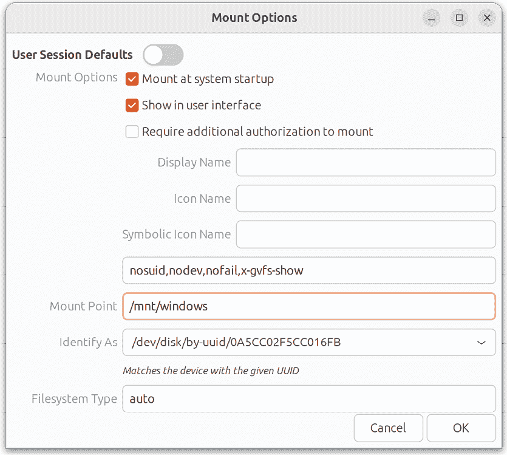
图 4-17

修改完成后，点击 `OK` 按钮返回主对话框。要挂载分区，只需点击下方图 4-18 所示的高亮 `mount` 按钮：

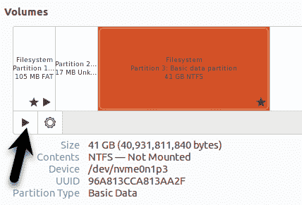
图 4-18

分区挂载后，退出 `gnome-disks` 并注意 栏（dock）中出现了该卷的图标，如图 4-19 所示（注意，如果禁用了 `Show in user interface` 选项，则不会出现此图标）：


图 4-19

双击图标，即可使用 `Files`（文件）工具浏览分区：

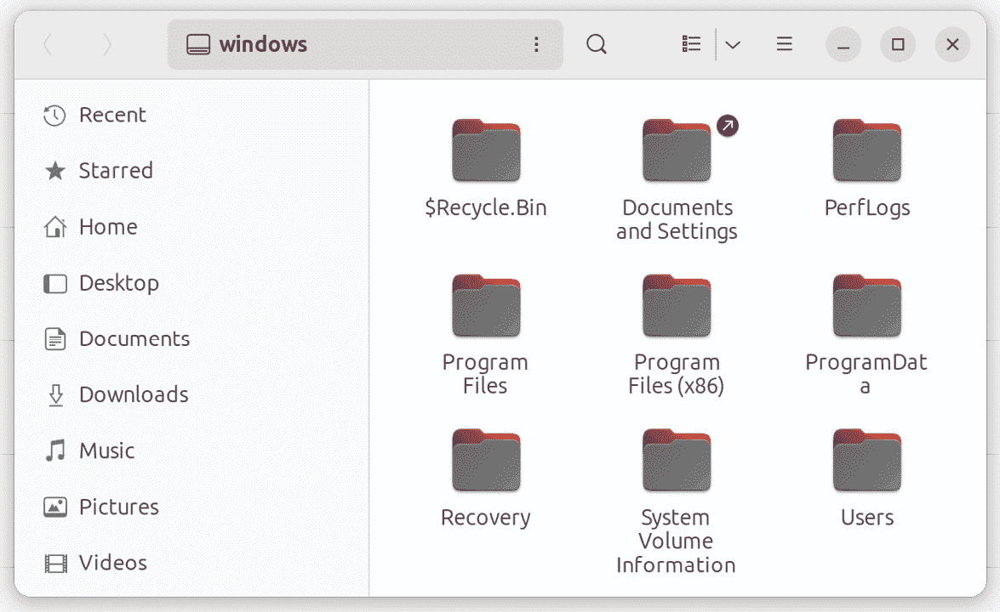
图 4-20

要卸载分区，点击 `mount` 按钮（它将变为停止按钮），如上方的图 4-18 所示。


Ubuntu 可以通过创建双启动环境，与 Windows 操作系统在同一磁盘驱动器上安全共存。这涉及到在安装期间缩小 Windows 系统占用的空间，以为 Ubuntu 腾出空间。一旦安装了 Ubuntu，就可以修改启动菜单配置以更改默认操作系统。可以通过命令行或使用 `Disks` 桌面工具从 Ubuntu 访问磁盘驱动器上的 Windows 分区。


在上一章中，我们查看了在与 Windows 相同的磁盘上安装 Ubuntu。这种所谓的“双启动”配置允许用户在单个磁盘驱动器上安装两个操作系统，并在系统通电时选择启动其中一个。

本章适用于那些已经决定足够喜欢 Ubuntu，并打算从磁盘上完全删除 Windows，将剩余空间用于 Linux 的用户。在接下来的章节中，我们将使用命令行工具和 `gnome-disks` 工具逐步完成这一过程。

### 5.1 卸载 Windows 分区

如果按照“与 Windows 双启动 Ubuntu”章节中的步骤从 Ubuntu 内部挂载了 Windows 分区，在继续本章之前，应采取步骤卸载分区。假设 Windows 分区被挂载为 `/mnt/windows`，可以按以下方式卸载：

```bash
# umount /mnt/windows
```

如果之前向 `/etc/fstab` 文件添加了 `/mnt/windows` 自动挂载，也应对进行编辑将其删除。

## 5.2 从磁盘上删除 Windows 分区

为 Ubuntu 使用释放 Windows 分区空间的第一步是删除该分区。但在在此之前，必须备份 Windows 分区中的任何需要的数据。完成此操作后，即可继续本章。要删除 Windows 分区，首先需要使用 `fdisk` 工具识别它们所在的磁盘：

```bash
# fdisk -l
```


分区 3 已删除。

命令 (输入 m 获取帮助): `d`

分区编号 (1,4,5, 默认 5): `4`

分区 4 已删除。

既然我们已经删除了 Windows 分区，必须在空出的磁盘空间中创建新的 Ubuntu 分区。分区编号必须与第一个删除的分区编号匹配（在本例中为 2）。此外，还需要精确地输入旧分区报告的起始扇区和结束扇区（`fdisk` 通常会默认提供正确的值，但双重检查是明智的）：
命令 (输入 m 获取帮助): `n`

分区编号 (2-4,6-128, 默认 2): `2`

起始扇区 (206848-134217694, 默认 206848):

结束扇区, +/-sectors 或 +/-size{K,M,G,T,P} (206848-80185343, 默认 80185343):

已创建一个类型为 'Linux filesystem' 的新分区 2，大小为 38.1 GiB。

完成这些更改后，下一步是检查设置是否正确：

命令 (输入 m 获取帮助): `p`

```
Disk /dev/nvme0n1: 64 GiB, 68719476736 bytes, 134217728 sectors
Disk model: VMware Virtual NVMe Disk
Units: sectors of 1 * 512 = 512 bytes
Sector size (logical/physical): 512 bytes / 512 bytes
I/O size (minimum/optimal): 512 bytes / 512 bytes
Disklabel type: gpt
Disk identifier: F0D04B58-29F5-4B6B-B10F-07295BEF9AAC
Device Start End Sectors Size Type
/dev/nvme0n1p1 2048 206847 204800 100M EFI System
/dev/nvme0n1p2 206848 80185343 79978496 38.1G Linux filesystem
/dev/nvme0n1p5 80185344 132833279 52647936 25.1G Linux filesystem
```

为了提交更改，我们现在需要将新的分区信息写入磁盘并退出 `fdisk` 工具：
命令 (输入 m 获取帮助): `w`

分区表已更改。

正在同步磁盘。


为了使新分区适用于 Ubuntu 使用，需要在其上创建文件系统。当前版本 Ubuntu 推荐的文件系统类型是 XFS，它将在标题为 “向 Ubuntu 23.04 系统添加新硬盘驱动器” 的章节中进行详细介绍。使用 `mkfs.xfs` 命令按如下方式进行文件系统的创建（在必要时安装 `xfsprogs` 包）：

```bash
# apt install xfsprogs
# mkfs.xfs -f /dev/nvme0n1p2
```

```
meta-data=/dev/nvme0n1p2 isize=512 agcount=4, agsize=2499328 blks
        = sectsz=512 attr=2, projid32bit=1
        = crc=1 finobt=1, sparse=1, rmapbt=0
        = reflink=1 bigtime=0 inobtcount=0
data = bsize=4096 blocks=9997312, imaxpct=25
        = sunit=0 swidth=0 blks
naming =version 2 bsize=4096 ascii-ci=0, ftype=1
log =internal log bsize=4096 blocks=4881, version=2
        = sectsz=512 sunit=0 blks, lazy-count=1
realtime =none extsz=4096 blocks=0, rtextents=0
```

## 5.4 挂载新分区

接下来，我们需要挂载新分区。在本例中，我们将它挂载到名为 `/data` 的目录。然而，你可以自由使用任何所需的有效挂载点来挂载新分区，或将其作为逻辑卷的一部分（细节将在标题为 “向 Ubuntu 23.04 卷组和逻辑卷添加新硬盘” 的章节中进行介绍）。首先，我们需要创建一个作为挂载点的目录：

```bash
# mkdir /data
```

其次，我们需要编辑 `/etc/fstab` 中的挂载表，以便分区在每次系统启动时自动挂载。在 `/etc/fstab` 文件的底部添加以下行来挂载新分区（修改 `/dev/nvme0n1p2`）。

最后，我们可以运行以下命令检查分区：

```bash
# df -h
```


下一步是修改引导。由于分区发生了变化，我们需要更新引导配置。

```bash
# update-grub
```

## 5.6 使用 GNOME Disks

`gnome-disks` 工具提供了一个比命令行更友好的替代方案。要配置挂载点，请选择分区并点击如图  5-9 所示的设置按钮。


图 5-9

从设置菜单中选择`Edit Mount Options...`项以显示图 5-10 所示的对话框。
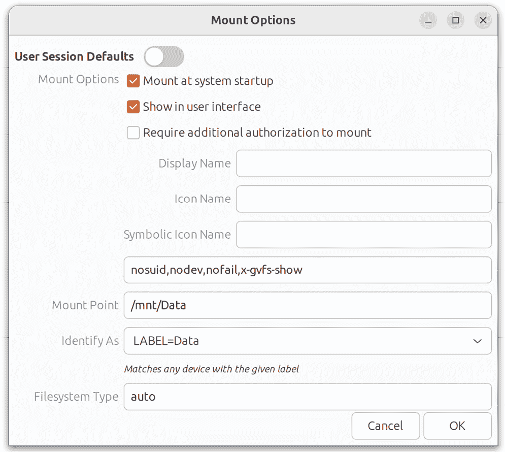

图 5-10

关闭`User Session Defaults`开关，并根据您的需求配置挂载点。在上方图中，该分区在系统启动时挂载到 `/mnt/Data`，并配置为通过标签“Data”进行识别。

设置完成后，点击`OK`，然后点击图 5-11 中突出显示的挂载按钮：

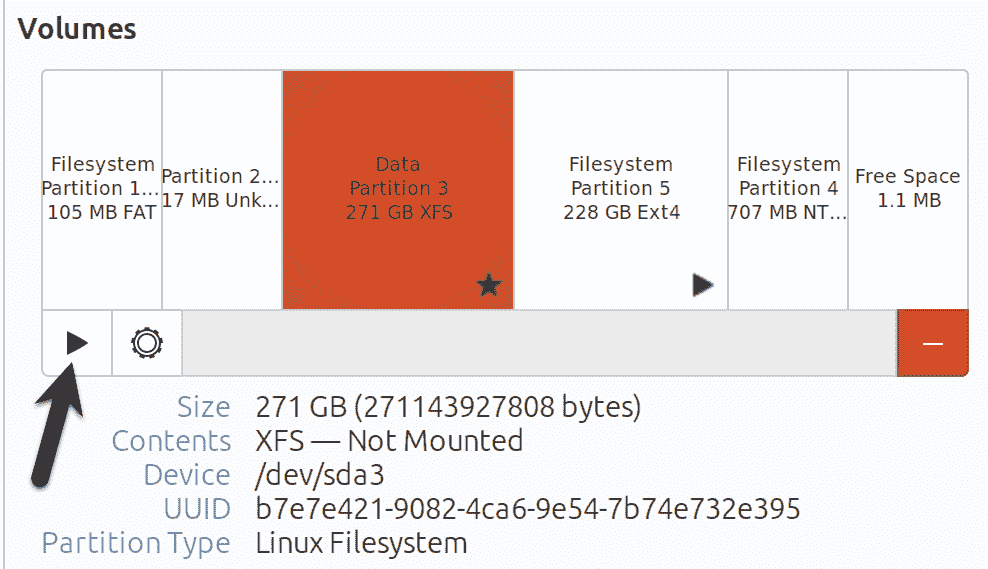

图 5-11

要检查分区现在已挂载并准备就绪，请运行以下命令显示可用空间：

```bash
$ df -h /mnt/Data
```

Filesystem Size Used Avail Use% Mounted on

/dev/sda3 253G 1.8G 251G 1% /mnt/Data

最后，按照本章前面概述的步骤更新启动菜单以移除 Windows 选项。

## 5.7 总结

在双启动配置中，可以随时删除 Windows 分区以识别哪些分区属于 Windows 并将其删除，为 Ubuntu 系统腾出空间。删除后，可以使用未分配空间创建新的文件系统并进行挂载，供 Ubuntu 系统使用。

## 6. GNOME 44 桌面导览

Ubuntu 23.04 包含了 GNOME 44 桌面环境。虽然缺乏 Windows 和 macOS 桌面的复杂性，但 GNOME 提供了一个整洁且直观的桌面环境，包含了窗口环境的所有基本功能，并且具有可以快速学习的优势。

在本章中，我们将介绍 GNOME 桌面的主要功能，并概述如何执行基本任务。


如果在安装 Ubuntu 23.04 过程中使用了 Ubuntu Desktop 镜像，则 GNOME 桌面将已经安装，并在每次系统启动时自动启动。

如果安装的是 Ubuntu 服务器配置，则系统安装的软件包中不会包含 GNOME 桌面。对于没有连接显示器的服务器级系统，安装图形化桌面环境的想法似乎是多余的。然而，值得注意的是，远程访问 GNOME 桌面也是可能的，因此即使在所谓的无头服务器（即缺少显示器、键盘和鼠标的服务器）上，安装 GNOME 桌面软件包可能仍然有益。关于建立远程桌面访问的话将在本书的“Ubuntu 23.04 Remote Desktop Access with Vino”章节中详细介绍。

如果安装配置未包含 GNOME 桌面，可以使用以下命令随时进行安装：

```bash
# apt install ubuntu-gnome-desktop
```

安装完成后，下一次重启系统时将出现桌面登录界面。

### 6.2 GNOME 44 桌面概览

下方图 6-1 所示屏幕显示了在启动任何其他程序或进行配置更改之前，典型的新启动 GNOME 桌面会话的外。

主桌面区域（标记为 A）是启动应用程序和实用程序时窗口出现的地方。

屏幕顶部的栏（B）称为顶栏（top bar），包含活动菜单（C）、日期和时间以及一组按钮和图标，包括网络状态、音频量、电池电量以及其他状态和账户设置：


图 6-1

当前在桌面上的活动应用程序的应用程序菜单也会出现在顶栏中。例如，图 6-2 显示了终端（Terminal）应用的应用程序菜单：

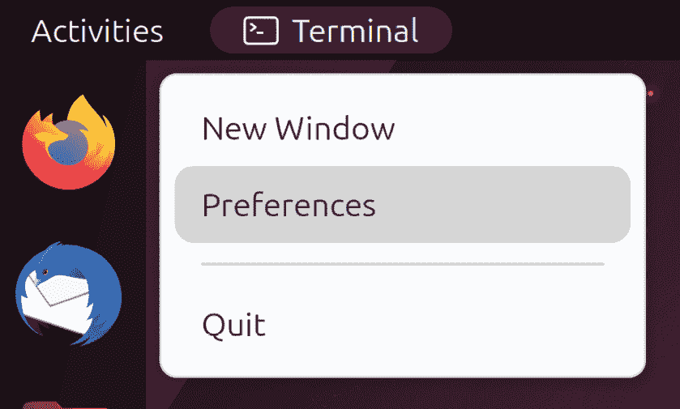

图 6-2

根据应用程序的不同，应用程序窗口栏中可能提供包含额外选项的菜单。例如，图 6-3 显示了终端内置菜单：

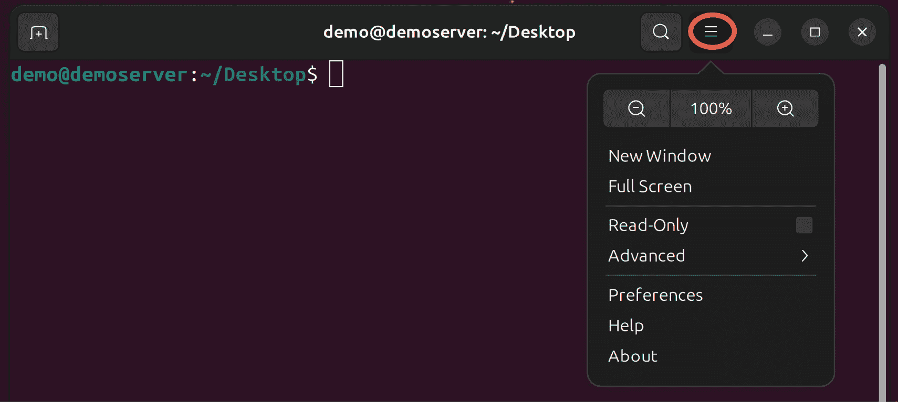

图 6-3

通过右键点击程序（dock）中的应用程序图标，可以使用另一个菜单，如图 6-4 所示：

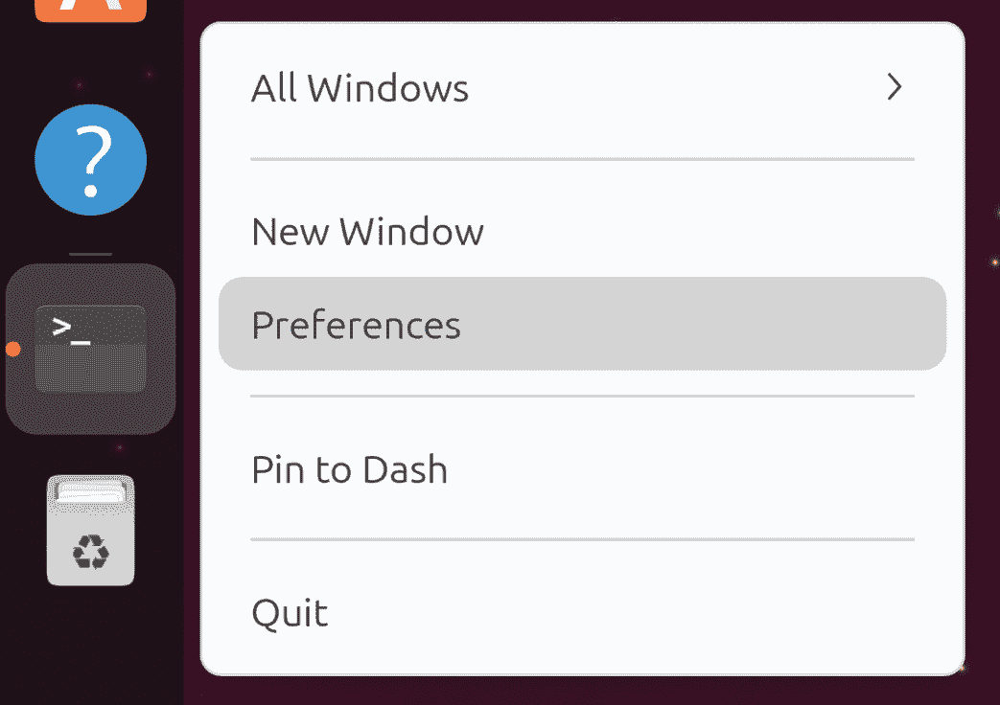


### 6.3 启动活动


图 6-5

默认情况下，程序栏将显示一组定义的常用应用程序图标，还将包含任何当前运行的应用程序的图标。如果应用程序当前正在运行，它将在图标左侧带有一个圆点标记；如果运行了多个副本，则每个实例都会显示一个点。

要启动应用程序，只需点击程序栏中的图标。

要找到未包含在程序栏中的应用程序，一种方法是选择“显示应用程序”（在上方图 6-5 中标记为 A），以显示如图 6-6 所示的可供浏览的应用程序列表：

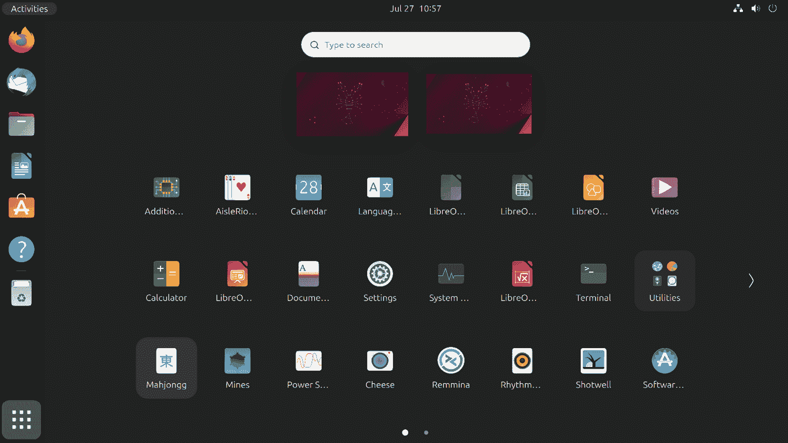

图 6-6

注意，可以通过选择屏幕底部中央的按钮来过滤列表以显示所有应用程序或仅显示频繁使用的应用程序。同样重要的是，列表中的某些条目实际上是存放其他应用程序的文件夹。在上面的屏幕图中例如，“实用工具”（Utilities）项提供了对一组工具的访问，例如系统监视器、磁盘管理工具和终端窗口。

浏览应用程序的替代方案是使用搜索栏进行搜索，当通过点击顶栏中的“活动”（Activities）显示仪表面板时就会出现，如图 6-7 所示：

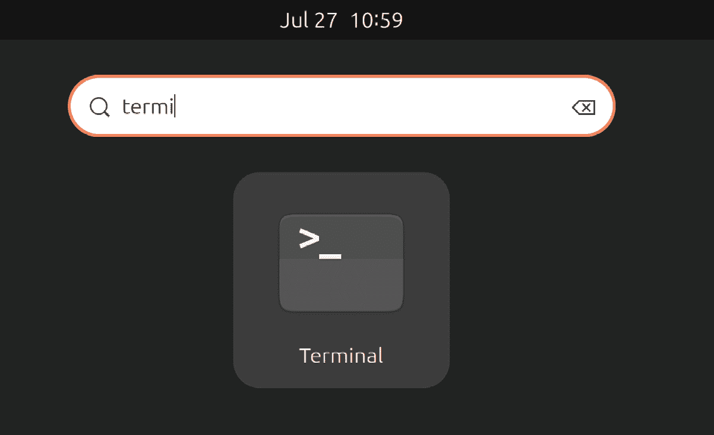

图 6-7

在搜索框中输入文字时，匹配列表将进行精简。

为了更方便地将应用程序添加到程序栏，找到该应用程序的图标，右键点击并选择“添加到收藏”菜单选项：

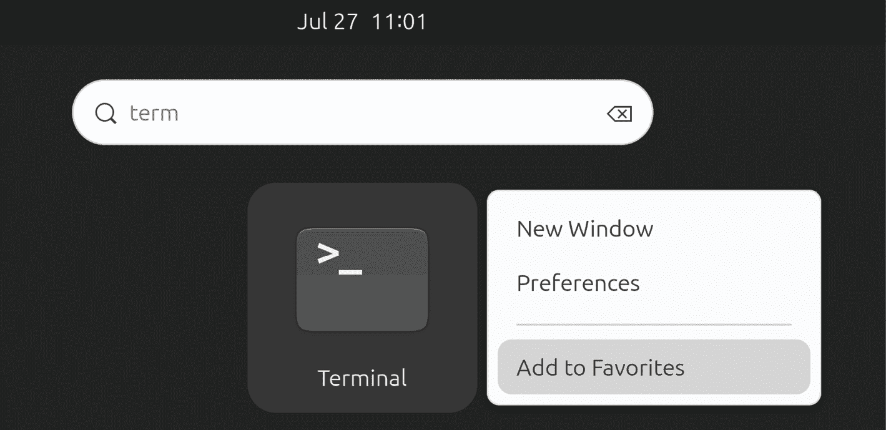

图 6-8

要从程序栏移除应用，右键点击程序中的图标并选择“移除收藏”。

### 6.4 窗口管理

与其他桌面环境一样，应用程序在 GNOME 中以窗口形式运行。当打开多个应用程序窗口时，`Super + Tab` 快捷键将显示切换面板（图 6-9），允许选择另一个窗口作为当前活动窗口（`Super` 键是 Windows 键，如果是 Mac 键盘则为 Cmd 键）：


图 6-9

如果应用程序打开了多个窗口，切换器将在第二个面板中显示这些窗口以便可以选择特定的窗口：


图 6-10

反向循环切换器中的图标，使用 `Shift + Tab` 快捷键。


### 6.5 使用工作空间


应用程序窗口出现的屏幕区域称为工作区（workspace），GNOME 允许配置多个工作区。要查看当前的工作区，点击顶部栏上的 `Activities`（活动，如上方 图 6-1 所示，标记为 C）或按下键盘上的 `Super` 键显示以下屏幕：


图 6-11

上图中标记为 A 的区域是当前选中的工作区。点击标记为 B 和 C 的区域将分别选择并显示上一个和下一个工作区。中间的工作区面板 (A) 显示当前活动的应用程序窗口。将鼠标指针悬停在窗口上将显示一个关闭按钮，可用其退出窗口。要将窗口从一个工作区移动到另一个工作区，请显示工作区面板并将应用程序窗口拖放到目标工作区。当窗口被添加到空白工作区时，工作区面板将添加另一个空白工作区，从而创建多个工作区。

工作区缩略图 (D) 提供了一种在工作区之间切换的方便方法，在处理多个工作区时特别有用。

要删除工作区，可以关闭该工作区上的所有窗口，或者将它们移动到另一个工作区。

“显示应用程序”屏幕也提供了访问当前工作区的途径，如下图 6-12 所示：

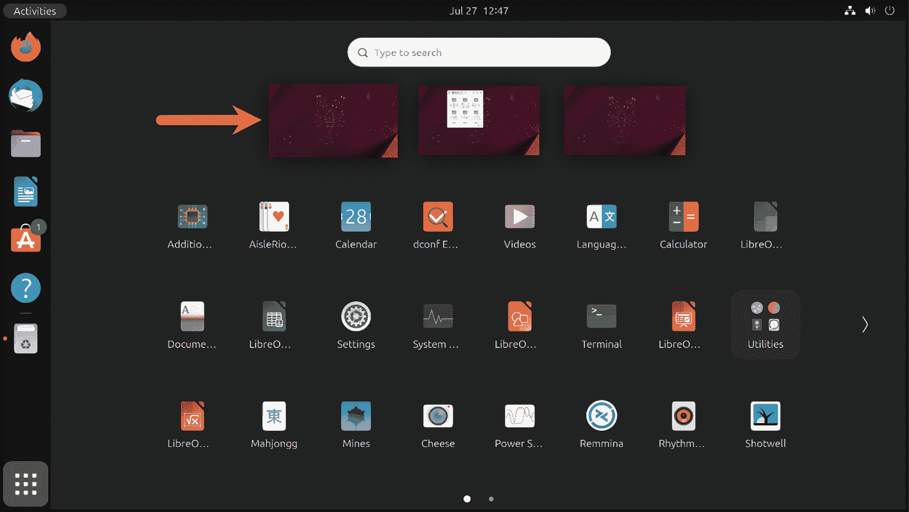

图 6-12

### 6.6 日历与通知

当系统需要通知你某个事件（例如系统或应用程序更新可用）时，工作区顶部会出现一个弹出面板。通过点击顶部栏上的日期和时间可以访问日历和任何之前的通知，如图 6-13 所示：

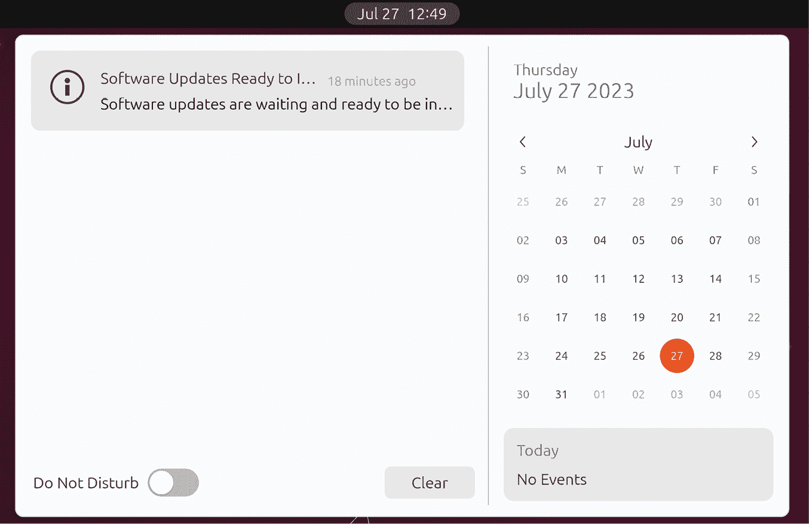

图 6-13

### 6.7 桌面设置

要访问桌面设置，请点击顶部栏最右侧的按钮显示如图 6-14 所示的菜单：

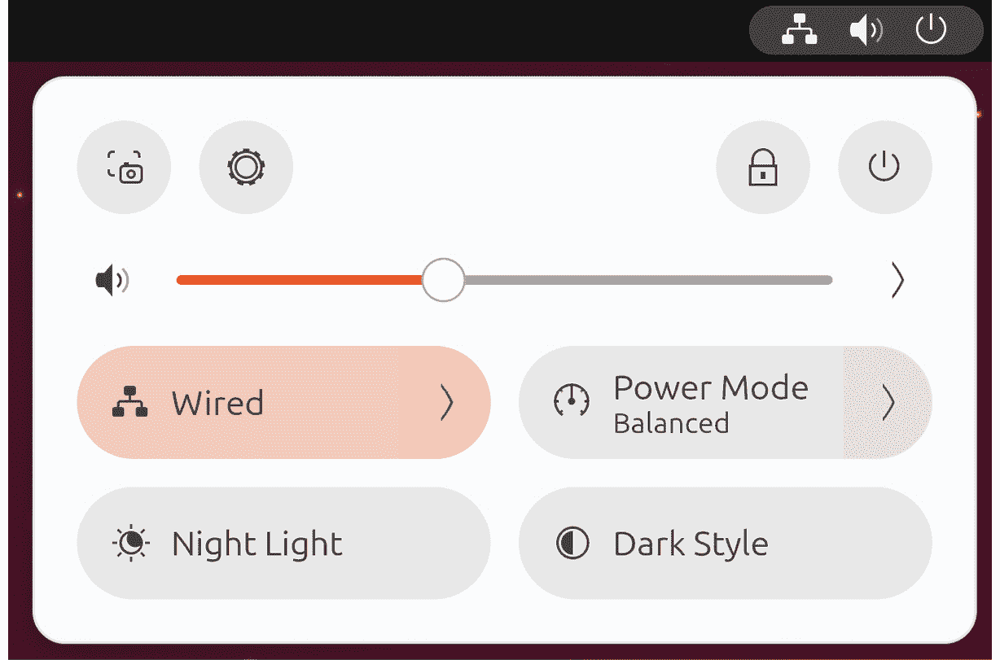

图 6-14

菜单提供了快速访问常用设置的功能，例如系统节电模式、桌面主题、音量和当前网络连接。电源按钮允许你注销桌面，或重启或关闭系统。点击菜单左上角的按钮可以截图。截图按钮右侧显示齿轮图标的按钮将打开 GNOME 设置应用程序。

设置应用程序提供了广泛的选项，例如以太网和 WiFi 连接、屏幕背景自定义选项、屏幕锁定和电源管理控制以及语言偏好。要探索每个类别中可用的设置，只需从设置窗口的左侧面板中选择选项即可：

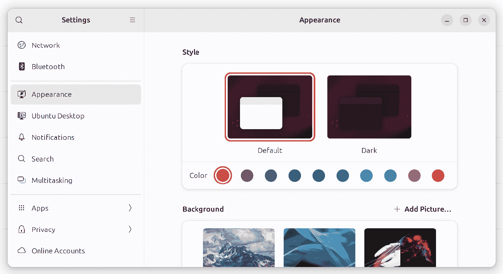
图 6-15

上述图 6-14 所示的菜单还包括切换用户、调整音频音量、切换到不同的 WiFi 网络以及注销、重启或关闭系统的选项。

### 6.8 自定义程序栏 (Dock)

可以在设置应用中通过选择 Ubuntu Desktop 选项来更改程序栏的大小、位置和行为，如图 6-16 所示：

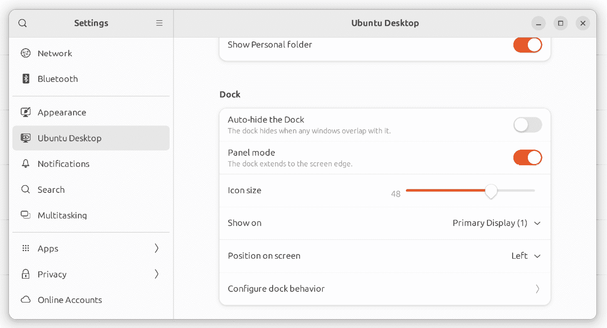

图 6-16

位置可以设置为屏幕的四边任一，可以使用图标大小来缩小程序栏尺寸。最后，如果启用自动隐藏程序栏选项，程序栏将从视图中消失，直到鼠标指针移动到它当前所在的屏幕边缘。

### 6.9 安装 Ubuntu 软件

与 macOS、Windows、iOS 和 Android 等其他操作系统一样，Ubuntu 拥有以 Ubuntu Software 工具形式形式的“应用商店”。程序栏中通常会放置一个图标，如图 6-17 所示，该图标包含可用更新的应用程序数量：


图 6-17

加载后，该工具将提供一个可在系统上安装的应用程序列表，并根据类别、推荐和编辑精选进行分组。也可以对可用应用程序库进行搜索以找到特定项目：


图 6-18

要安装应用程序，只需在 Ubuntu Software 窗口中选择它并点击安装按钮即可：


图 6-19

### 6.10 基础自定义之外

GNOME 桌面在设计上是一个简洁且不杂乱的环境，自定义选项极少。然而，这并不意味着无法对桌面进行额外的更改。事实上，GNOME 项目专门为此目的开发了一个名为 `GNOME Tweaks`（优化）的工具。要安装此工具，请打开 Ubuntu Software 工具，搜索并安装 `GNOME Tweaks` 应用程序。一旦安装并启动，将出现如下所示的对话框：

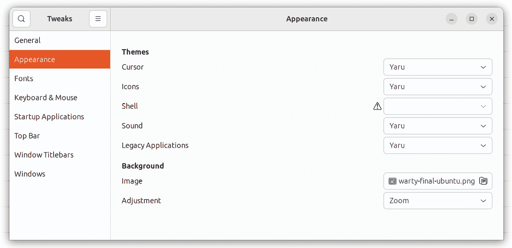

图 6-20

现在提供了广泛的桌面自定义选项。事实上，选项多到无法在本书中全部涵盖，因此在继续之前花些时间进行实验。


Ubuntu 包含 GNOME 44 桌面环境，可以在初始安装时包含或单独安装。与其他大多数桌面环境不同，GNOME 旨在提供一个简洁且易用的窗口用户界面。GNOME 桌面的主要区域包括顶部栏、活动概览和启动（Dash）。此外，GNOME 支持多个工作区，使运行的应用程序保持有序且屏幕不杂乱。设置应用程序中还提供了各种配置选项，包括桌面设置、音频、网络配置和 WiFi 选择。

## 7 Cockpit

尽管配备了最新的桌面环境，但 Ubuntu 本身是一个服务器操作系统。因此，大多数 Ubuntu 部署都是针对远程物理服务器或云虚拟机实例。通常，这些系统在没有键盘、鼠标或显示器的情况下运行，仅可以通过网络连接通过命令行符直接访问。这为从远程管理系统带来了挑战。虽然通过远程访问命令行和桌面环境确实可以实现很多功能，但对于必须在企业级操作系统上执行的管理和监控任务，需要一个一致且整合的解决方案。

Cockpit Web 管理界面提供了此功能。本章将解释如何安装、配置和访问 Cockpit 界面，同时提供 Cockpit 关键功能的概述，其中许多功能将在后面的章节中详细介绍。

### 7.1 Cockpit 概述

Cockpit 是一个轻量级的 Web 界面，允许远程执行常规系统管理任务。安装并配置后，系统管理员打开本地浏览器窗口并导航到远程服务器的 Cockpit 端口。将 Cockpit 界面加载到浏览器并登录后，可以使用管理和监控工具以可视化的方式执行广泛的任务。


在后台，Cockpit 使用相同的工具来执行通常在命令行工作时使用的任务，并自动更新以反映系统其他部分发生的变化。这使得 Cockpit 可以与其他管理工具和技术配合使用，而不会产生一种方法覆盖另一种方法的风险。Cockpit 还可以被配置为访问多个服务器，允许通过单个浏览器会话同时对多个服务器进行管理和监控。

Cockpit 默认安装时已捆绑了一系列广泛工具，并允许根据需要安装额外的扩展插件。Cockpit 的设计还允许您结合 HTML 和 JavaScript 创建自己的自己的扩展程序，以添加缺失或自定义的功能。

Cockpit 的模块化设计还允许许多功能嵌入到其他基于 Web 的应用程序中。

## 7.2 安装并启用 Cockpit

Ubuntu 默认通常不安装 Cockpit，但可以通过几个简单的步骤进行设置和启用。第一步是按照如下方式安装 Cockpit 软件包：

```bash
apt install cockpit
```

接下来，需要启用 `cockpit.socket` 服务：

```bash
systemctl enable --now cockpit.socket
```

最后，如果您的系统上启用了防火墙，则需要在防火墙上打开必要的端口，以允许远程浏览器连接到达 Cockpit（有关防火墙的详情，请参阅“Ubuntu 23.04 防火墙基础”）。

如果启用了 `ufw`：

```bash
ufw allow 9090
```

如果启用了 `firewalld`：

```bash
firewall-cmd --add-service=cockpit --permanent
firewall-cmd --reload
```


如果您可以访问安装了 Cockpit 的服务器桌面环境，打开浏览器窗口并导航到 `https://localhost:9090` 以访问 Cockpit 登录界面。相反，如果服务器是远程的，请使用域名或 IP 地址访问服务器（例如，`https://myserver.com:9090`）。

当建立连接时，浏览器可能会警告连接不安全。这是因为 Cockpit 服务使用了自签名证书。选择继续访问网站的选项，或者为了将来避免出现此消息，选择高级选项并为服务器地址添加异常。一旦连接，浏览器将加载下方所示的图 7-1 登录页面：

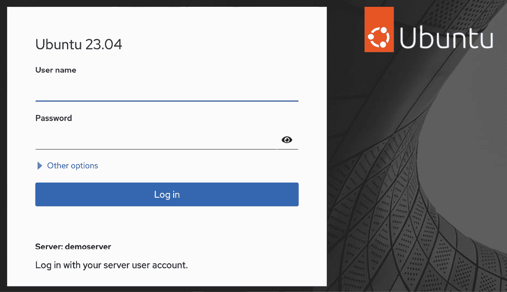
图 7-1

使用 `root` 身份或您的用户账户凭据登录 Cockpit 界面。注意，由于权限限制，以用户身份登录时，Cockpit 界面内的某些任务将受到限制。在这种情况下，Cockpit 控制台将显示标记为“受限访问”（Limited Access）的按钮，如图 7-2 所示：


图 7-2

要提升您的权限，点击受限访问按钮并在提示时输入您的密码：

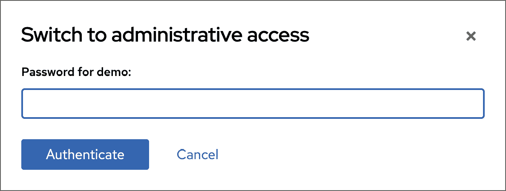

图 7-3

登录后，Cockpit 将显示概览屏幕。

## 7.4 概览

概览屏幕提供了当前系统的概览，包括对 CPU、内存、存储和网络活动性能指标的访问。此屏幕还包含有关系统的信息，包括底层硬件、主机名、系统时间以及系统软件是否为最新版本。还提供了重启或关闭系统的选项。

例如，图 7-4 显示了 Cockpit 界面的概览页：

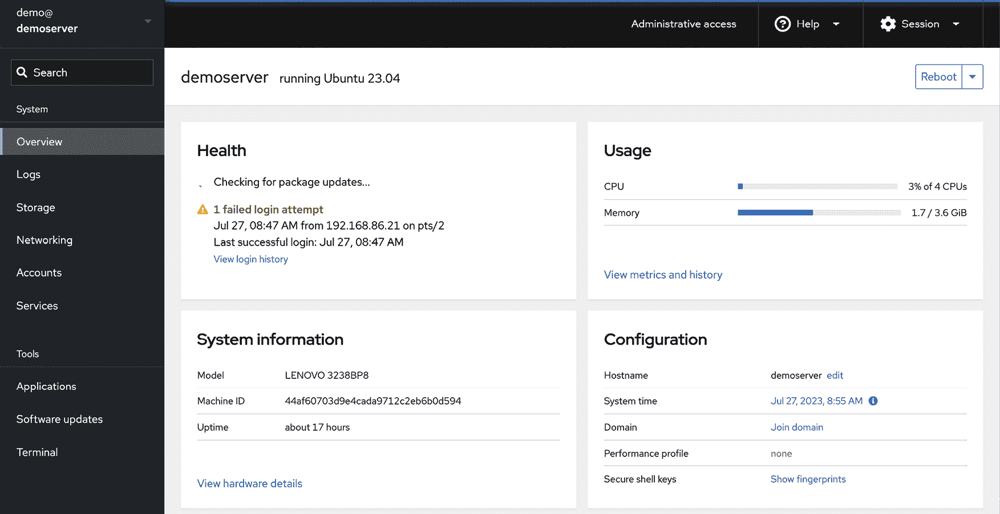
图 7-4

要获取特定类别的更多信息，请点击相应的链接。例如，图 7-5 显示了系统性能历史屏幕：

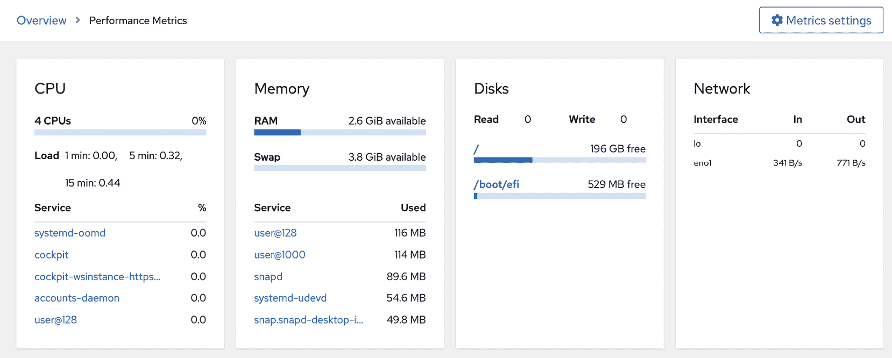
图 7-5

## 7.5 日志

当选择“日志”类别时，Cockpit 会显示 `systemd` 日志的内容。选择一个日志条目将显示整个日志消息。日志条目按最新在顶部排序，并包含了菜单，用于根据不同的时间范围和消息严重程度过滤日志。

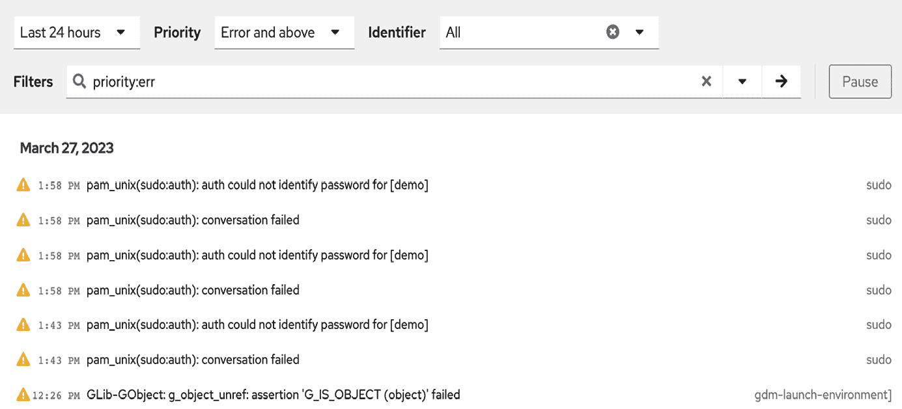
图 7-6

## 7.6 存储

选择“存储”选项来查看和管理系统上的存储，包括磁盘、分区、卷组、网络文件系统（NFS）挂载和 RAID 存储。此屏幕还允许实时监控磁盘 I/O 活动，并列出了用于查询和管理存储设备的系统 `udisksd` 日志输出：

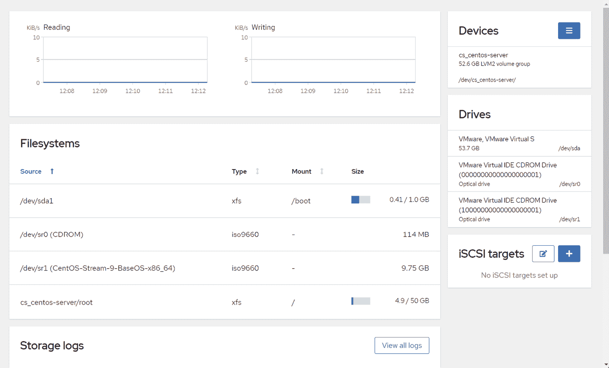
图 7-7

## 7.7 网络

网络屏幕提供了有关各种网络相关配置和服务的信息，包括网络接口和防火墙设置。此外，它还允许配置更改，例如创建网络网桥或设置虚拟网络：
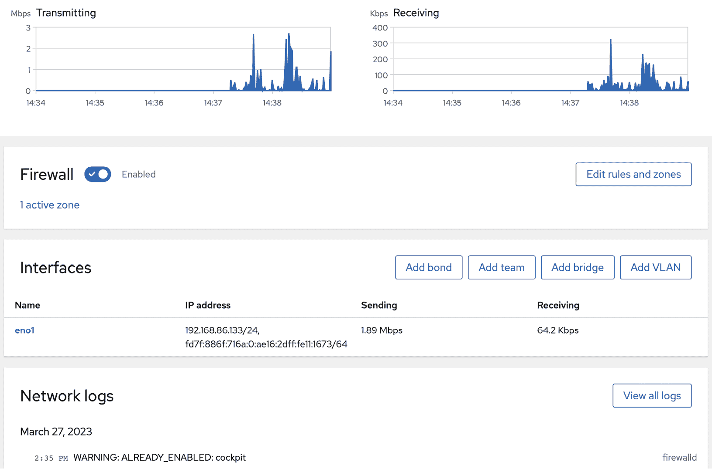
图 7-8

## 7.8 账户

选择此选项查看系统上配置的当前用户账户，并为其他用户创建账户。用户管理的主题将在相应的管理 Ubuntu 23.04 用户和组章节中介绍：


图 7-9

点击现有账户查看详情并进行更改。用户账户详情页也可用于为远程访问添加公密钥，如在 Ubuntu 23.04 上配置 SSH 密钥认证章节所述。

## 7.9 服务

此屏幕显示服务器上运行的系统服务，并允许添加、删除、停止和启动这些服务。


图 7-10

服务的主题将在管理 Ubuntu 23.04 systemd 章节中详细介绍。

## 7.10 应用程序

之前提到可以通过扩展为 Cockpit 添加额外功能。这些可以是自开发的，也可以是第三方提供的。应用程序屏幕列出了已安装的扩展并允许添加或删除扩展：

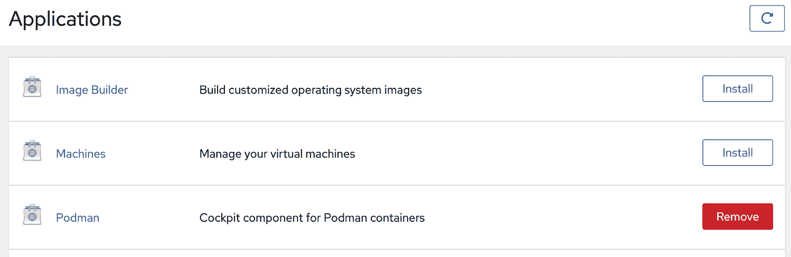
图 7-11

如果 cockpit 界面中没有“应用程序”选项，可以如下如下安装：
```bash
apt install cockpit-packagekit
```

## 7.11 虚拟机

虚拟化允许在单一计算机系统中同时运行多个操作系统实例，每个系统运行在自己的虚拟机中。虚拟机 Cockpit 扩展提供了一种创建和管理安装在服务器上的虚拟机客户端的方法：


图 7-12

虚拟机扩展并非默认安装，但可以通过 Cockpit 应用程序屏幕或运行以下命令添加：

```bash
apt install cockpit-machines
```

在 Ubuntu 中使用虚拟化将从虚拟化技术概述章节开始介绍。

## 7.12 软件更新

如果系统有任何软件更新，它们将在这里列出并可以从此屏幕进行安装：


图 7-13

如果 Cockpit 软件更新屏幕可用，可以如下安装：

```bash
apt install cockpit-packagekit
```

## 7.13 终端

正如名称所示，终端屏幕提供了命令行提示符访问：


图 7-14


Cockpit 可以配置为在单个会话中管理多个服务器。要向 Cockpit 会话中添加另一个主机，请点击图 7-15 中突出显示的按钮以显示主机（Hosts）面板：


图 7-15

点击`Add new host`添加新主机按钮，输入另一个系统的 IP 地址或主机名，并在点击`Add`添加按钮之前选择一种颜色，将此服务器与之前添加到 Cockpit 的其他服务器区分开：


图 7-16

如果你是第一次连接到远程服务器，Cockpit 将要求你接受一个新的 `SSH` 密钥。接受密钥后，系统将提示你输入上方图 7-16 中指定的用户名密码。系统还提供了设置并授权受密码保护的 `SSH` 密钥的选项，以便在下次需要访问第二个主机系统时实现自动登录：


图 7-17

要在主机之间切换，请显示主机面板（见图 7-15）并选择所需的系统。


在标准安装中，Cockpit 不保留图表显示的时间窗口之外的任何性能指标数据。为了保留 Cockpit 收集的数据，需要安装 Cockpit Co-Pilot (`PCP`) 包。首先按照以下方式安装 `cockpit-pcp` 包：

```bash
apt install cockpit-pcp
```

安装 `cockpit-pcp` 后，注销当前 Cockpit 会话并重新登录。

接下来，显示性能指标（Performance Metrics）屏幕并点击`Metrics`设置按钮显示如图 7-18 所示的屏幕，开启`Collect metrics`选项并点击`Save`：


图 7-18

在 Cockpit 收集数据经过足够的时间后，指标信息将如图 7-19 所示出现，并按小时块分类：


图 7-19

### 7.16 总结

Cockpit Web 界面允许在浏览器内可视化地执行远程系统管理任务，而无需依赖命令提示符和命令行工具。一旦安装并启用，系统管理员即可打开浏览器，连接到远程服务器并登录 Cockpit 界面。在后台，Cockpit 使用与通过提示提示符相同的命令行工具，允许这两种选项都可以使用，而不会产生配置冲突的风险。此外，Cockpit 使用模块化框架，允许添加额外的扩展，并能够开发和集成自定义扩展。一个 Cockpit 会话可以用于管理单个服务器，也可以配置为同时访问多个服务器。

## 8. 在 Ubuntu 23.04 上使用 Bash Shell

学习与 Ubuntu 及通用的 Linux 发行版工作的重要部分通常涉及熟练在 shell 环境中工作。虽然 Linux 包含的 GNOME 等图形桌面环境为操作系统提供了用户友好的界面，但 shell 环境提供了图形桌面工具无法实现的更强大的功能、灵活性和自动化。shell 环境还提供了一种桌面环境不可用时与操作系统交互的方法，这在处理如 Ubuntu 等基于服务器的操作系统或无法完全启动的损坏系统时很常见。

因此，本章旨在概述 Ubuntu 默认的 shell 环境（特别是 `Bash` shell）。

## 8.1 什么是 Shell？

Shell 是一个交互式命令解释器环境，在其中可以在提示符处输入命令，或者将命令作为脚本写入文件中执行。Shell 的起源可以追溯到 `UNIX` 操作系统的早期。事实上，在 Linux 早期，在引入图形桌面环境之前，shell 是用户与操作系统交互的唯一方式。

多年来，开发了多种 shell 环境。第一个广泛使用的 shell 是由 Stephen Bourne 在贝尔实验室编写的 `Bourne shell`。

另一个早期产物是 `C shell`，它与 `C` 编程语言在语法上有相似之处，并引入了命令行编辑和历史记录等可用性增强。

`Korn shell`（由 David Korn 在贝尔实验室开发）基于 `Bourne` 和 `C` shell 提供的特性。

Ubuntu 的默认 shell 是 `Bash shell`（`Bourne Again SHell` 的缩写）。该 shell 最初作为 `Bourne shell` 的开源版本，由 Brian Fox 为 `GNU` 项目开发，并基于 `Bourne shell` 和 `C shell` 提供的特性。

## 8.2 获取 Shell 访问

在 GNOME 桌面环境中，可以通过选择顶栏中的`Activities`选项、在搜索栏中输入`Terminal` 并点击`Terminal` 图标，从`Terminal`窗口访问 shell 提示符。

例如，在使用 `SSH` 远程登录 Ubuntu 服务器时，用户将看到一个 shell 提示符。在 Ubuntu 23.04 上配置 SSH 密钥认证将介绍使用 `SSH` 访问远程服务器的细节。当启动未安装桌面环境的服务器系统时，用户在完成控制台或远程登录后将进入 shell。

## 8.3 在提示符处输入命令

在提示符处输入命令只需输入命令并按 `Enter` 键。有些命令执行时是静的，但大多数命令会在返回提示符之前显示某种形式的输出。例如，可以使用 `ls` 命令显示当前目录中的文件和文件夹：

```bash
ls
Downloads Music Public Templates Videos
```

可用命令要么内置于 shell，要么位于物理文件系统中。可以使用 `which` 命令识别命令在文件系统上的位置。例如，查找 `ls` 可执行文件在文件系统的位置：
```bash
which ls
alias ls='ls --color=auto'
/usr/bin/ls
```

显然，`ls` 命令位于 `/usr/bin` 目录。注意还配置了别名，该主题将在本章后续讨论。使用 `which` 命令定位内置命令的路径将导致提示找不到执行文件。例如，尝试查找 `history` 命令（它是内置于 shell 的，而不是文件系统上的可执行文件）将产生类似下面的输出：

```bash
which history
/usr/bin/which: no history in (/home/demo/.local/bin:/home/demo/bin:/usr/share/Modules/bin:/usr/local/bin:/usr/bin:/usr/local/sbin:/usr/sbin)

## 获取命令信息

Linux shell 可用的许多命令看起来很晦涩。要获取有关命令功能及其如何使用的详细信息，请使用 `man` 命令并将命令名作为参数。例如，了解更多关于 `pwd` 命令的信息：

```bash
man pwd
```

执行上述命令时，将显示 `pwd` 命令的详细描述。许多命令在带有 `--help` 命令行选项运行时也会提供额外信息：

```bash
wc --help
```

## 8.5 Bash 命令行编辑


早期的 shell 环境不提供任何形式的行编辑功能。这意味着如果你在输入长命令行的开头时发现了错误，必须删除之后的所有字符，纠正错误然后重新输入命令的剩余部分。幸运的是，`Bash` 提供了丰富的命令行编辑选项，如下表所示：

| 键位序列 | 动作 |
| :--- | :--- |
| Ctrl-f 或 右箭头 | 光标向前移动一个位置 |
| Delete | 删除当前光标下方的字符 |
| Backspace | 删除光标左侧的字符 |
| Ctrl-` | 撤销上一次更改（可以重复以撤销所有之前的更改） |
| Ctrl-a | 将光标移动到行首 |
| Ctrl-e | 将光标移动到行尾 |
| Meta-f 或 Esc 后按 f | 光标向后移动一个单词 |
| Meta-b 或 Esc 后按 b | 光标向后移动一个单词 |
| Ctrl-l | 清除当前命令以外的所有屏幕内容 |
| Ctrl-k | 从当前光标位置删除到行尾 |
| Meta-d 或 Esc 后按 d | 删除到当前单词末尾 |
| Meta-DEL 或 Esc 后按 DEL | 删除到当前单词开头 |
| Ctrl-w | 删除从当前光标位置到上一个空白符的内容 |

表 8-1


除了命令行编辑功能，`Bash` shell 还提供了命令行历史记录支持。可以使用 `history` 命令查看之前执行过的命令列表：

```bash
$ history
    1 ps
    2 ls
    3 ls –l /
    4 ls
    5 man pwd
    6 man apropos
```

此外，可以使用 `Ctrl-p`（或向上箭头）和 `Ctrl-n`（或向下箭头）在之前输入的命令之间来回滚动。最后，当历史记录中显示了所需的命令时，按下 `Enter` 键执行它。

另一种选项是输入 `!` 字符，紧接着输入要重复的命令的前几个字符，然后按 `Enter` 键。

## 8.7 文件名简写

许多 shell 命令接受一个或多个文件名作为参数。例如，要显示名为 `list.txt` 的文本文件的内容，可以使用如下 `cat` 命令：

```bash
$ cat list.txt
```

同样，通过指定所有文件名作为参数，可以显示多个文本文件的内容：

```bash
$ cat list.txt list2.txt list3.txt list4.txt
```

与其输入每个名称，不如使用模式匹配指定所有符合特定标准的文件。例如，可以使用 `*` 通配符来简化上面的示例：

```bash
$ cat *.txt
```

上述命令将显示所有以 `.txt` 扩展结尾的文件内容。这可以进一步限制为任何以 `list` 开头并以 `.txt` 结尾的文件：

```bash
$ cat list*.txt
```

可以使用 `?` 字符指定单字符匹配：
```bash
$ cat list?.txt
```

## 8.8 文件名和路径补全

与其输入完整的文件名或路径，或使用模式匹配来减少输入量，shell 提供了文件名补全功能。要使用文件名补全，请输入文件或路径名的前几个字符，然后按两次 `Esc` 键。shell 将根据目录中匹配你输入字符的第一个文件或路径名为你补全文件名。要获取可能的匹配项列表，在输入前几个字符后按 `Esc =`。


如前所述，许多 shell 命令在执行时会输出信息。默认情况下，这些输出去向名为 `stdout` 的设备文件，它本质上是运行 shell 的终端窗口或控制台。相反，shell 从名为 `stdin` 的设备文件接收输入，默认是键盘。

可以使用 `>` 字符将命令的输出从 `stdout` 重定向到文件系统上的物理文件。例如，要将 `ls` 命令的输出重定向到名为 `files.txt` 的文件，需要以下命令：

```bash
$ ls *.txt > files.txt
```

完成后，`files.txt` 将包含当前目录下的文件列表。同样，可以将文件的内容作为 `stdin` 馈给命令。例如，将文件内容重定向为输入到命令中：

```bash
$ wc –l < files.txt
```

上述命令将显示 `files.txt` 文件中的行数。

需要注意的是，使用 `>` 重定向操作符会创建一个新文件或截断现有文件。要向现有文件追加内容，请使用 `>>` 操作符：

```bash
$ ls *.dat >> files.txt
```

除了标准输出，shell 还提供了使用 `stderr` 的标准错误输出。当命令的输出重定向到 `stdout` 时，命令生成的任何错误消息都会重定向到 `stderr`。这意味着如果 `stdout` 重定向到文件，错误信息仍然显示在终端上。这通常是期望的行为，但如果需要，也可以 `2>` 操作符重定向 `stderr`：

```bash
$ ls dkjfnvkjdnf 2> errormsg
```

命令执行完成后，`errormsg` 文件将包含一个找不到名为 `dkjfnvkjdnf` 文件的错误报告。

可以使用 `&>` 操作符将 `stderr` 和 `stdout` 都重定向同一个文件中：

```bash
$ ls /etc dkjfnvkjdnf &> alloutput
```

执行完成后，`alloutput` 文件将包含 `/etc` 的列表。


除了 I/O 重定向，shell 还允许将一个命令的输出直接管道作为另一个命令的输入。管道操作通过在两个或多个命令之间放置 `|` 字符来实现。例如，要统计系统中运行的进程数，可以将 `ps` 命令的输出管道通过 `wc` 命令：

```bash
$ ps –ef | wc –l
```

命令行上可以执行的管道操作数量没有限制。例如，找到包含 `Smith` 名字文件的行数：

```bash
$ cat namesfile | grep Smith | wc –l
```

## 8.11 配置别名

随着你对 shell 环境的熟练，你可能会经常带有参数执行命令。例如，你可能经常带有 `l` 和 `t` 使用 `ls` 命令：

```bash
$ ls –lt
```

为了减少命令时的输入量，可以创建一个映射到命令和参数的别名。例如，为了创建一个输入 `l` 将执行 `ls –lt` 命令的别名，可以使用语句：

```bash
$ alias l="ls –lt"
```

现在在提示符输入 `l` 将执行原始语句。


Shell 环境变量提供了数据和设置的临时存储。shell 本身设置了若干环境变量，用户可以更改它们来修改 shell 的行为。可以使用 `env` 命令获取当前定义的变量列表：

```bash
$ env
SSH_CONNECTION192.168.0.19 61231 192.168.0.28 22
MODULES_RUN_QUANTINE=LD_LIBRARY_PATH
LANG=en_US.UTF-8
HISTCONTROL=ignoredups
HOSTNAME=demo-pc.ebookrenzy.com
XDG_SESSION_ID=15
MODULES_CMD=/usr/share/Modules/libexec/modulecmd.tcl
USER=demo
ENV=/usr/share/Modules/init/profile.sh
SELINUX_ROLE_REQUESTED=
PWD=/home/demo
HOME=/home/demo
...（此处省略）...
```

也许最有用的环境变量是 `PATH`。它定义了 shell 在命令行提示符输入命令时搜索的目录以及搜索顺序。新安装的 Ubuntu 系统用户账户的 `PATH` 环境变量配置如下：

```bash
$ echo $PATH
/home/demo/.local/bin:/home/demo/bin:/usr/share/Modules/bin:/usr/local/bin:/usr/bin:/usr/local/sbin:/usr/sbin
```


另一个有用的变量是 `HOME`，它指定当前用户的家目录。例如，如果你想让 shell 也在你家目录下的脚本目录中查找命令，你可以按照如下方式修改 `PATH` 变量：

```bash
$ export PATH=$PATH:$HOME/scripts
```

可以使用 `echo` 命令显示现有环境变量的当前值：

```bash
$ echo $PATH
```

你可以使用 `export` 命令创建自己的环境变量。例如：

```bash
$ export DATAPATH=/data/files
```

将命令的输出赋值给环境变量的一个实用技巧是在命令两边包上反引号（` ` ）。例如，将当前日期和时间赋值给名为 `NOW` 的环境变量：

```bash
$ export NOW=`date`
$ echo $NOW
Wed Mar 29 12:39:20 PM EDT 2023
```

如果有些在每次进入 shell 环境时都需要配置的环境变量或 `alias`（别名）设置，可以将它们添加到用户家目录中名为 `.bashrc` 的文件中。例如，以下 `.bashrc` 文件被配置为设置 `DATAPATH` 环境变量和一个 `alias`：

```bash
# .bashrc

### 来自全局定义
if [ -f /etc/bashrc ]; then
. /etc/bashrc
fi

### 用户特定环境
PATH="$HOME/.local/bin:$HOME/bin:$PATH"
export PATH

# 如果你不喜欢 systemctl 的自动分页功能，请取消下行的注释：
# export SYSTEMD_PAGER=

### 用户特定别名和函数
export DATAPATH=/data/files
alias l="ls -lt"

## 8.13 编写 Shell 脚本

到目前为止，我们完全专注于 Bash shell 的交互性。所谓交互性是指手动逐个输入命令并在提示符处执行它们。事实上，这只是 shell 功能的一一小部分。可以认为，shell 最强大的方面之一就是创建 shell 脚本的能力。shell 脚本是包含语句序列的文本文件，可以在 shell 环境中执行以完成任务。除了执行命令的能力外，shell 还提供了许多编程结构，例如 `for` 和 `do` 循环以及 `if` 语句，这些是你理所当然会在脚本语言中找到的。

遗憾的是，对 shell 脚本的详细概述超出了本章的范围。然而，许多致力于 shell 脚本的书籍网络资源对该主题的讲解远超我们在这里能实现的。因此，在本节中，我们仅提供 shell 脚本的一个小尝试。

创建 shell 脚本的第一步是创建一个文件（在本示例中，我们将其命名为 `simple.sh`），并将以下内容作为第一行：

```bash
#!/bin/sh
```

`#!` 称为“shebang”，是一个特殊的字符序列，表示执行该脚本所需的解释器路径是该行中的下一个项目（在本例中，位于 `/bin` 下的 `sh` 可执行文件）。如果你想使用的解释器是其中之一，它同样可以是 `/bin/csh` 或 `/bin/ksh`。

下一步是编写一个简单的脚本：

```bash
#!/bin/sh
for i in *
do
    echo $i
done

这个脚本所做的只是遍历当前目录下的所有文件并显示每个文件名。可以通过将脚本名作为参数传递给 `sh` 来执行此脚本：

```bash
$ sh simple.sh
```

为了使文件变为可执行（从而不再需要传递给 `sh` 命令），可以使用 `chmod` 命令：

```bash
$ chmod +x simple.sh
```

一旦在文件权限上设置了执行位，就可以直接执行它。例如：

```bash
$ ./simple.sh
```


在《Ubuntu Essentials》的这一章中，我们简要回顾了 Bash shell 环境。在图形化桌面环境中，很容易忘记操作系统的真正威力和灵活性通常只有通过放弃用户友桌面界面并使用 shell 环境才能发挥。此外，对于管理和维护没有安装桌面的服务器系统，或者在尝试修复受损到导致桌面或 `Cockpit` 界面无法启动的系统时，熟悉 shell 是必须的。

shell 的功能远超本章涵盖的内容。如果你是 shell 新手，我们强烈建议你寻找额外的资源。一旦熟悉了这些概念，你就会发现，在终端窗口中使用 shell 执行许多任务比在桌面上翻阅菜单和对话框要快得多。

## 9 管理 Ubuntu 23.04 用户和组

在安装 Ubuntu 期间，安装程序创建了一个 root 或超级用户账户并要求配置密码。安装程序还提供了为系统创建用户账户的机会。我们应该记住，Ubuntu 是一个企业级、多用户、多任务的操作系统。因此，为了利用 Ubuntu 的全部功能，可能需要给多个用户访问系统的权限。每个用户都应该有自己的用户账户登录、密码、家目录和权限。

用户进一步分为组以便于管理，这些组可以具有不同层次的权限。例如，你可能有一组在财务部门工作的用户。在这样的环境下，你可以创建一个 `accounts` 组并将所有财务部门的用户分配给该组。

本章将介绍在 Ubuntu 系统上添加、删除和管理用户及组的步骤。可以使用命令行工具、`Cockpit` Web 界面以及桌面设置（Settings）应用在 Ubuntu 上管理用户和组。在本章中，我们将查看用户管理的这些方法。


可以通过命令行使用 `adduser` 工具向 Ubuntu 系统添加新用户。要创建一个新用户账户，请输入类似下所示的命令：

```bash
# adduser john
```

默认情况下，这将在 `/home` 目录下为该用户创建一个家目录（在本例中为 `/home/john`）。要指定不同的家目录，请在创建账户时使用 `--home` 命令行选项：

```bash
# adduser --home /users/johnsmith john
```

`adduser` 命令会在创建账户期间提示输入密码。以后可以使用 `passwd` 命令更改此密码：

```bash
# passwd john
Changing password for user john.
New password:
Retype new password:
passwd: all authentication tokens updated successfully.
```

可以使用 `deluser` 工具通过命令行删除现有用户。虽然这会删除账户，但用户的文件和数据将保留在系统中：

```bash
# deluser john
```

也可以在删除过程中移除用户的家目录和邮件池：

```bash
# deluser --remove-home john
```

Ubuntu 系统上的所有用户都是一个或多个组的成员。默认情况下，新用户会被添加到与用户名同名的私有组中（在上面的示例中，为用户 `john` 创建的账户属于名为 `john` 的私有组）。然而，作为管理员，将用户组织成逻辑逻辑组是有意义的。例如，所有销售人员可能属于 `sales` 组，财务人员可能属于 `accounts` 组，以此此类推。使用 `groupadd` 命令行工具从命令行添加新组，例如：
```bash
# groupadd accounts
```

使用 `usermod` 工具从命令行将现有用户添加到现有组：

```bash
# usermod -G accounts john
```

注意，上述命令会将用户从 `-G` 之后未列出的但当前所属的辅助组中移除。要保留当前的组成员关系，请使用 `-a` 标志追加新的组成员关系：

```bash
# usermod -aG accounts,sales,support john
```


可以使用 `groupdel` 工具从系统中删除现有的组：

```
groupdel accounts
```

请注意，如果要删除的组是任何用户的主组或初始组，则无法将其删除。在删除该组之前，必须先删除该用户，或者使用 `usermod` 命令为该用户分配一个新的主组。可以使用 `usermod -g` 选项为用户分配新的主组：

```
usermod -g sales john
groupdel accounts
```

运行 `groups` 命令可以查看用户所属的组。例如：

```bash
$ groups john
john : accounts support
```

默认情况下，除非用户知道 root 密码，否则用户账户无法执行需要超级用户（root）权限的任务。但是，可以配置用户账户，以便使用 `sudo` 命令执行特权任务。这涉及到将用户账户作为 `sudo` 组的成员添加，例如：

```
adduser john sudo
```
一旦加入 `sudo` 组，用户将能够按照如下方式使用 `sudo` 执行本 otherwise 受限的任务：

```
apt update
Hit:1 http://us.archive.ubuntu.com/ubuntu jammy InRelease
Hit:2 http://security.ubuntu.com/ubuntu jammy-security InRelease
```

可以通过编辑 `/etc/sudoers` 文件并找到以下部分来修改 `sudo` 组的 `sudo` 权限：

### 允许 sudo 组的用户运行所有命令

```
%sudo ALL=(ALL) ALL
```

要禁用所有 `sudo` 组成员的 `sudo` 功能，请如下所示注释掉第二行：

### 允许 sudo 组的用户运行所有命令

```
# %sudo ALL=(ALL) ALL
```

要允许 `sudo` 组成员在无需输入密码的情况下使用 `sudo`（出于安全考虑，不建议这样做），请如下修改 `sudoers` 文件：

### 无需密码的操作

```
%sudo ALL=(ALL) NOPASSWD: ALL
```

在后台，所有这些命令仅仅更改了系统上的 `/etc/passwd`、`/etc/group` 和 `/etc/shadow` 文件。


如果系统中安装并启用了 Cockpit Web 界面（该主题在“Cockpit Web 界面概述”章节中介绍），可以在下方的图 9-1 所示的账户屏幕执行若干用户和组管理任务：


图 9-1

屏幕将显示系统上任何现有的用户账户，并提供添加额外账户的按钮。要创建新账户，点击“创建新账户”（Create New Account）按钮并在生成的对话框中输入所需信息（图 9-2）。请注意，该选项还可以创建账户但稍后锁定：


图 9-2

要修改用户账户，请从主屏幕选择该账户并对账户详情进行任何修改：


图 9-3

此屏幕允许执行各种任务，包括锁定或解锁账户、更改密码或强制用户配置新密码。此外，如果选择了“服务器管理员”（Server Administrator）选项，该用户将被添加到 `sudo` 组，并允许使用 `sudo` 执行管理任务。还提供了一个从系统中删除用户的按钮。

如果用户使用密钥加密的 SSH 连接远程访问系统，则可以在此屏幕内添加用户的公钥。`SSH` 访问和认证将在稍后的“在 Ubuntu 23.04 上配置基于密钥的身份验证”中介绍。


通过 GNOME 桌面设置应用提供了第三种用户账户管理选项。通过点击 GNOME 桌面右上角的图标并选择“设置”（Settings）选项，可以访问此应用，如图 9-4 所示：


图 9-4

当主设置屏幕出现时，点击左侧导航面板中的“用户”（Users）选项。默认情况下，设置将被锁定，无法对系统上的用户账户进行任何更改。要解锁设置应用，请点击下方的图 9-5 中的“解锁”（Unlock）按钮并输入您的密码。请注意，只有当以具有 `sudo` 权限的用户身份登录时，才能解锁设置：


图 9-5

一旦应用已解锁，点击“添加用户...”（Add User...）以显示下方的图 9-6 所示的对话框：


图 9-6

如果需要，选择“管理员”（Administrator）选项为新用户分配 `sudo` 权限。接下来，输入用户的全名和用户名，并现在分配密码，或者允许用户在首次登录账户时设置密码。输入信息后，点击“添加”（Add）按钮创建账户。

可以通过随时选择“用户”屏幕内相应的图标来查看、修改现有用户的设置或删除该账户，如图 9-7 所示。该选项还可以查看用户的登录活动。请注意，对账户进行任何更改都需要再次解锁设置：


图 9-7

## 9.4 总结

作为多操作系统，Ubuntu 的设计旨在支持多个用户。在安装期间，创建了 root 用户账户并分配了密码，同时也提供了创建用户账户的选项。可以通过命令行工具、Cockpit Web 界面或 GNOME 设置应用添加用户账户。除了账户，Linux 还实现了组的概念。可以使用命令行工具添加新组并分配用户，且每个用户至少属于一个组。默认情况下，标准用户没有执行特权任务的权限。但是，`sudo` 组的成员可以使用 `sudo` 命令执行特权任务。

## 10. 管理 Ubuntu 23.04 systemd 单元

为了掌握 Ubuntu 系统管理，理解 systemd 单元至关重要，特别是称为目标和服务的特定类型。本章将提供 Ubuntu 支持的不同 systemd 单元的概述，以及如何配置运行中 Linux 系统的许多服务。

### 10.1 理解 Ubuntu systemd 目标

Ubuntu 可以配置为进入若干状态（称为目标），每个状态都旨在提供特定的操作系统功能。系统管理员根据系统的用途来配置默认启动的目标。例如，桌面系统可能会被配置为使用图形用户界面目标启动。相比之下，云服务器系统更有可能启动到多用户目标级别。


服务（Service）是一个通常在后台运行的进程，提供特定的功能。例如，`sshd` 服务是一个后台进程（也称为守护进程），它为系统提供安全的 shell 访问。不同的 `systemd` 目标（targets）被配置为根据该目标要提供的功能自动启动不同的服务集合。

目标和服务的都是 `systemd` 单元（unit）的类型，这个主题将在本章稍后部分介绍。


如前所述，Ubuntu 可以启动到若干目标级别之一。系统配置的默认目标将反过来决定启动哪些 `systemd` 单元。与系统启动和关机相关的目标可以总结如下：

* `poweroff.target` - 该目标关机系统。你不太希望将其作为默认目标。
* `rescue.target` – 导致系统以单用户模式启动，此时只有 root 用户可以登录。在此模式下，系统不会启动任何网络、图形用户界面或多用户服务。此运行级别是系统管理员执行系统维护或修复活动的理想选择。
* `multi-user.target` - 将系统启动到多用户模式，并具有文本控制台登录能力。
* `graphical.target` - 将系统启动到具有 X Window System 能力的联网多用户状态。默认情况下，图形桌面环境将在启动过程结束时启动。这是桌面或工作站最常见的运行级别。
* `reboot.target` - 重启系统。由于显而易见的原因，你不太希望将其作为默认目标。

除了上述目标外，系统还包含约 70 个其他目标，其中许多是上述主目标使用的子目标。例如，在后台，`multi-user.target` 还会启动一个名为 `basic.target` 的目标，该目标反过来启动 `sockets.target` 单元，该单元是不同进程之间通信所必需的。这确保了 `multi-user` 依赖的所有服务在启动过程中也被启动。

可以在终端窗口中运行以下命令来查看指定目标所依赖的目标和服务列表：

```
# systemctl list-dependencies <target>
```

例如，图 11-1 显示了 `graphical` 目标的 `systemd` 单元依赖部分列表（完整列表包含了完全完备的多用户系统所需的 140 多个目标和服务）：


图 10-1

列表以分级树的形式呈现，说明了某些依赖项具有自己的子依赖项。例如，滚动到列表底部会发现 `graphical` 目标依赖于一个名为 `cloud-init.target` 的云相关服务，该目标又有它自己的服务依赖：


图 10-2

列表每个项目左侧的彩色圆点表示该服务或目标的当前状态，如下：

* 绿色 - 服务或目标处于活动并运行状态。
* 白色 - 服务或目标处于非活动（死亡）状态。通常是因为该服务或目标尚未启用、由于某些原因已停止，或者服务或目标所依赖的条件未满足。
* 红色 - 服务或目标由于致命错误未能启动。

要查找有关 `systemd` 单元状态的更多详情，请使用 `systemctl status` 命令后跟单元名称，如下：

```
# systemctl status systemd-machine-id-commit.service
```

```
○ systemd-machine-id-commit.service - Commit a transient machine-id on disk
      Loaded: loaded (/usr/lib/systemd/system/systemd-machine-id-commit.service; static)
      Active: inactive (dead)
      Condition: start condition failed at Thu 2023-03-30 08:41:05 EDT; 16min ago
               └─ ConditionPathIsMountPoint=/etc/machine-id was not met
      Docs: man:systemd-machine-id-commit.service(8)
```


可以使用以下 `systemctl` 命令识别 Ubuntu 系统的当前默认目标：

```
# systemctl get-default
```

`multi-user.target`

在上述情况下，系统被配置为默认使用 `multi-user` 目标启动。可以随时使用 `systemctl` 命令配合 `set-default` 选项更改默认设置。以下示例将默认目标更改为在下次系统启动时启动图形用户界面：

```
# systemctl set-default graphical.target
```

```
Removed /etc/systemd/system/default.target.
Created symlink /etc/systemd/system/default.target → /lib/systemd/system/graphical.target.
```

默认更改操作的输出显示了 `systemctl` 命令在后台执行以实施更改的步骤。当前默认值通过从位于 `/etc/systemd/system` 的 `default.target` 文件建立符号链接，指向 `/usr/lib/systemd/system/` 文件夹中对应的目标文件（在本例中为 `graphical.target` 文件）来配置。

## 10.5 理解 systemd 单元和单元类型

如前所述，目标和服务都是 `systemd` 单元的类型。`/usr/lib/systemd/system/` 文件夹中的所有文件被称为 systemd 单元文件，每个单元都被归类为特定的单元类型。Ubuntu 支持 12 种不同的单元类型，包括已涵盖的目标和服务。

单元的类型由表 10-1 所示的文件扩展名表示：

| 类型 | 扩展名 | 类型描述 |
| :--- | :--- | :--- |
| Service | .service | 系统服务 |
| Target | .target | 目标组 |
| Device | .device | 内内核识别的设备 |
| Mount | .mount | 文件系统挂载点 |
| Path | .path | 文件系统文件或目录 |
| Scope | .scope | 外部创建的进程 |
| Slice | .slice | 管理层级组织进程的组 |
| Snapshot | .snapshot | systemd 管理器的保存状态 |
| Socket | .socket | 进程间通信接字 |
| Swap | .swap | 交换设备或交换文件 |
| Timer | .timer | systemd 定器 |

表 10-1

注意，目标单元类型与其他类型的区别在于它由一组服务或其他目标组成。

## 10.6 动态更改当前目标

之前介绍的 `systemctl set-default` 命令指定了下次启动时使用的目标，但不会更改当前的系统状态。要动态切换到不同的目标，请再次使用 `systemctl` 命令，使用 `isolate` 选项后跟目标。例如，要在不重启的情况下将当前系统切换到图形目标，可以使用以下命令：

```
# systemctl isolate graphical.target
```

执行后，系统将启动图形桌面环境。

## 10.7 启用、禁用和屏蔽 systemd 单元

新安装的 Ubuntu 系统将包含基础 systemd 服务单元，但可能不包含系统进入生产环境后最终需要的所有服务。例如，基础 Ubuntu 安装通常不会包含运行 Apache Web 服务器所需的包，其关键元素是 `apache2.service` 单元。

系统管理员将通过使用以下命令安装必要的 `apache2` 软件包来解决这个问题：

```
# apt install apache2
```


配置好 Web 服务器后，下一个任务是检查 `apache2` 服务单元的状态，以确定它是否已在安装过程中被激活：

```
systemctl status apache2.service
```

● apache2.service - The Apache HTTP Server
Loaded: loaded (/lib/systemd/system/apache2.service; disabled; vendor prese>
     Active: active (running) since Mon 2023-07-17 14:01:13 UTC; 40s ago
       Docs: https://httpd.apache.org/docs/2.4/
     Main PID: 22328 (apache2)
       Tasks: 55 (limit: 4517)
     Memory: 4.7M
       CPU: 24ms
     CGroup: /system.slice/apache2.service
             ├─22328 /usr/sbin/apache2 -k start
             ├─22329 /usr/sbin/apache2 -k start
             └─22330 /usr/sbin/apache2 -k start
```

注意，服务状态可能被列为 loaded（已加载）但 inactive（未激活），这通常发生在该服务在首次安装时被厂商预设置为禁用（disabled）的情况下。要启动一个未激活的服务，可以使用命令：

```
systemctl start apache2.service
```

在上面的示例输出中，状态显示该服务被禁用了（disabled）。这意味着当系统下次重启时，`apache2` 服务将不会自动启动，需要由系统管理员手动启动。

要配置服务在每次系统启动时自动运行，必须按照如下方式将其启用（enable）：

```
systemctl enable apache2.service

当前正在运行的服务可以随时通过以下方式停止：

```
systemctl stop apache2.service
```

既然服务已经启用，当系统下次重启到当前目标（target）时，`apache2` 服务将自动启动。例如，假设在系统运行多用户目标（multi-user target）时启用了该服务，那么 `apache2` 服务将作为另一个依赖项添加到 `multi-user.target` systemd 单元中。

在后台，`systemctl` 通过在 `/etc/systemd/system` 文件夹下的目标 `.wants` 文件夹中创建符号链接为目标添加依赖项。例如，`multi-user.target` 单元在 `/etc/systemd/system` 中有一个名为 `multi-user.target.wants` 的文件夹，其中包含指向 `/usr/lib/systemd/system` 中它所依赖的所有 systemd 单元的符号链接。检查此文件夹将显示与本章之前介绍的 `systemctl list-dependencies` 命令列出的依赖项之间的关联。

要配置服务使其不再作为目标依赖项自动启动，请按照如下方式将其禁用（disable）：

```
systemctl disable apache2.service
```

此命令将从 `.wants` 目录中删除指向 `apache2.service` 单元文件的符号链接，使其不再成为依赖项，因此在下次系统启动时不会被启动。

`.wants` 文件夹包含的依赖项如果不可用，不会阻止单元的启动和运行。**强制性依赖项**（换句话说，如果不可用将导致单元失败的依赖项）应该存放在 `.requires` 文件夹中（例如，`multi-user.target.requires`）。

除了启用和禁用，还可以如下所示屏蔽（mask）一个 systemd 单元：

```
systemctl mask apache2.service
```

被屏蔽的 systemd 单元在任何情况下都无法启用、禁用或启动，即使它被列为另一个单元的依赖项。对于系统而言，它就像被屏蔽的 systemd 单元不再存在一样。这对于确保单元无论系统条件如何都永远不会启动非常有用。重新访问该服务的唯一方法是取消屏蔽（unmask）：

```
systemctl unmask apache2.service
```


除了本章概述的命令行技术外，还可以在 Cockpit Web 界面内部查看和管理 systemd 单元。例如，假设 Cockpit 已经按照“Cockpit Web 界面概览”章节所述进行了安装和设置，可以通过登录 Cockpit 并选择左侧导航面板中标记为 A 的图 10-3 中的 `Services` 来访问系统上的 systemd 单元列表：


图 10-3

标记为 B 的选项行在标记为 C 的主区域显示特定类型的单元，其中每个单元的当前状态列在 `State` 列中。

从列表中选择一个单元将显示详细信息。例如，图 10-4 显示了以下内容的详细界面：


图 10-4

## 10.9 总结

新安装的 Ubuntu 系统包含一组基础单元，其中许多单元在后台运行以提供大量功能。这些单元按类型分类，最常见的是目标（targets）和服务（services）。目标单元是会被共同启动的其他单元的组组。系统有一个默认目标，定义了每次启动时要启动的其他单元。最常见的目标是那些引导系统进入多用户或图形模式的目标。此外，`systemctl` 命令行工具提供了执行任务的多种选项，其中许多也可以通过 界面进行。

## 11 软件包管理与更新

新安装的 Ubuntu 系统极可能包含执行预期任务所需的全部软件包。即使在安装了所有所需软件后，在系统生命周期内，几乎可以确定许多软件包会发布新版本。在某些情况下，你需要确保在系统上安装这些最新版本的软件包以修复漏洞和安全问题。

本章介绍了 Ubuntu 软件包管理的基本概念，解释了如何解决这些问题，并探讨了仓库和软件包的概念，同时介绍了如何列出、安装和移除组成系统的软件包。

### 11.1 仓库

Linux 基本上由一组提供核心功能的基础软件包以及一系列在基础操作系统之上添加功能的软件包和模块组成。当首次安装 Ubuntu 时，将根据安装阶段选择的软件安装许多不同的软件包。然而，一旦系统运行，就可以根据需要安装额外的软件。通常，所有属于 Ubuntu 的软件（换句话说，不是由第三方提供的软件）都使用高级软件包工具（`apt`）下载并安装到系统上。正如我们在之前的章节中看到的，这通常涉及在提示符处输入类似的命令：

```bash
apt install apache2
```

执行此类命令时，请求的软件将从远程仓库下载并安装到本地系统。默认情况下，Ubuntu 配置为从多个仓库下载软件：

- **main**：包含 Ubuntu 官方支持、测试和更新的核心软件包集。
- **restricted**：没有开源替代品的硬件设备的专有驱动程序。
- **universe**：包含 Ubuntu 团队未官方支持的软件包。但这些软件包由 Ubuntu 社区维护，包含了 main 仓库中没有的软件包。


- `multiverse` - 由于版权或其他法律问题，这些软件包可能不符合 Ubuntu 发布时采用的开源许可条款。

Ubuntu 系统当前启用的存储库列表包含在 `/etc/apt/sources.list` 文件中，可以加载到编辑器中查看和修改。你可以手动将该文件加载到编辑器，也可以使用以下命令选择任何可用编辑器进行编辑：

```bash
apt edit-sources
```


`deb http://ports.ubuntu.com/ubuntu-ports/ jammy main restricted`

在上面的示例中，列表配置为允许从主仓库和受限仓库下载软件包。`universe` 和 `multiverse` 仓库的条目也会包含在该文件中：

## 注意：来自此仓库的软件测试范围可能不如主发布版中的软件那么充分，尽管它包含了一些可能提供有用功能的新版本某些应用程序。

## 此外，请注意 backports 仓库中的软件将不会收到 Ubuntu 安全团队的任何审核或更新。

`deb http://us.archive.ubuntu.com/ubuntu/ lunar-backports main restricted universe multiverse`

要禁用某个存储库使其不再用于下载软件包，只需在行首添加一个字符“#”将其注释掉即可：

```bash
#deb http://ports.ubuntu.com/ubuntu-ports/ lunar-backports main restricted universe multiverse
```

除了标准存储库外，还有许多第三方存储库。如果需要使用其中一个，只需向 `sources.list` 文件中添加其条目即可。其中一个示例是合作伙伴（partners）存储库，可以如下所示添加到 `sources.list` 文件：

`deb http://archive.canonical.com/ubuntu lunar partner`

进行更改后，运行以下命令提交更改：

```bash
apt update
```


作为使用的替代方案，可以在 GNOME 桌面环境中使用“软件与更新”（Software & Updates）应用程序来配置存储库。要启动此程序，按下键盘上的特殊键（Windows 键盘上是 Windows 键，macOS 上是 Command 键，Chromebook 上是显示放大镜的键），并在搜索栏中输入 `Software & Updates`。在结果面板中点击相应的图标启动该程序。或者，打开终端窗口并运行以下命令：

```bash
update-manager
```

当程序加载时，如图 11-1 所示，点击 `Settings` 按钮：


图 11-1

在设置界面，在“从互联网下载”（Downloadable from the Internet）标题下启用或禁用所需的存储库：


图 11-2

要启用合作伙伴仓库，选择如图 11-3 所示的“其他软件”（Other Software）选项卡：


图 11-3

要添加其他第三方存储库，点击 `Add...` 按钮并在弹对话框中输入仓库信息：


图 11-4


`apt` 工具提供了一种直接从命令行执行大多数软件包管理任务的方法。在本节中，我们将探索一些更常用的 `apt` 命令行选项。

Ubuntu 系统保留了最新软件包信息的本地副本，因此建议在执行任何其他 `apt` 操作之前按照如下方式更新此列表：

```bash
apt update
```

最常见的 `apt` 活动之一是执行软件包安装：

```bash
apt install package_name
```

同样，可以使用 `remove` 选项从系统中移除已安装的软件包：

```bash
apt remove package_name
```

当以这种方式删除软件包时，与软件包相关的配置文件将保留在系统中。这允许稍后重新安装软件包而不会丢失任何自定义配置设置。若要在删除期间或甚至在删除完成后删除这些文件，请使用 `purge` 选项：

```bash
apt purge package_name
```

要获取可安装的软件包列表，请按如下方式使用 `apt`：

```bash
apt list
```

或者，要仅列出已安装的软件包，请配合 `--installed` 标志使用 `list` 选项：

```bash
apt list --installed
```

要检查系统是否已安装了特定软件包，请将 `list` 选项与包名结合：

```bash
apt list package_name
```

使用 `search` 选项列出所有符合特定标准的软件包。例如，列出所有与 Apache Web 服务器相关的软件包：

```bash
apt search apache
```

要查找哪个软件包包含特定文件，请使用 `apt-file` 命令。例如，列出包含名为 `gimp` 文件的软件包名称：

```bash
apt-file --package-only list gimp
```

要查看软件包的详细信息，运行带有 `show` 选项的 `apt`：

```bash
apt show apache2
```


```
Package: apache2
Version: 2.4.52-1ubuntu4.5
Priority: optional
Section: web
Origin: Ubuntu
Maintainer: Ubuntu Developers <ubuntu-devel@ubuntu.com>
Original-Maintainer: Debian Apache Maintainers <debian-apache@lists.org>
Bugs: https://bugs.launchpad.net/ubuntu/+file
Installed-Size: 546 kB
Provides: httpd, httpd-cgi
Pre-Depends: init-system-helpers (>= 1.54~)
Depends: init-system-helpers (>= 1.54~)
Recommends: ssl-cert
Suggests: apache2-doc
Conflicts: apache2.2-bin
Replaces: apache2.bin-common
Homepage: https://httpd.apache.org/
Task: lamp-server
Download-Size: 97.8 kB
APT-Manual-Installed: yes
APT-Sources: http://us.archive.ubuntu.com/ubuntu jammy-updates/main amd64 Packages
Description: Apache HTTP Server
The Apache HTTP Server Project's goal is to build a secure, efficient and extensible HTTP server as standards-compliant open source software.
安装此软件包将导致完整安装，包括配置文件、初始化脚本和支持脚本。
```

## 11.4 执行更新

在基础操作系统和已安装软件包的使用范围内，会发布多次更新以解决问题并添加功能。要从命令行手动下载并安装任何待处理更新，第一步是使用带有 `update` 选项的 `apt` 更新本地存储的软件包信息：

```bash
apt update
```

一旦更新了软件包信息，即可执行 `upgrade`。这将从 `sources.list` 文件配置的存储库下载任何已安装软件包的更新并将其安装到系统中：

apt upgrade
```

作为使用命令行的替代方案，可以使用“软件与更新”GNOME 桌面应用程序更新系统。如果有可用更新，将出现如图 11-5 所示的对话框，提供查看可用信息以及执行升级的选项：


图 11-5

## 11.5 启用自动更新

上一节查看了如何手动安装软件包升级。Ubuntu 系统也可以配置为自动安装更新。这可以通过命令行，也可以在“软件与更新”工具内部进行配置。


在“软件与更新”工具中，按照之前的说明打开“设置”界面，并点击“更新”选项卡显示图 11-6 所示界面：


图 11-6

选择系统检查更新的频率（每天、隔一天、每周等）。接下来选择当有可用更新时执行的操作（仅下载、下载并安装，或在桌面上显示通知）。你还可以配置更新程序，以便在有新版本的 Ubuntu 时通知你。

要从命令行配置自动更新，请遵循以下步骤：

1. 安装 `unattended-upgrades` 软件包：

```bash
# apt install unattended-upgrades
```

2. 编辑 `/etc/apt/apt.conf.d/50unattended-upgrades` 文件并找到以下行：

```text
.
.
      "${distro_id}ESMApps:${distro_codename}-apps-security";
      "${distro_id}ESM:${distro_codename}-infra-security";
// "${distro_id}:${distro_codename}-updates";
// "${distro_id}:${distro_codename}-proposed";
// "${distro_id}:${distro_codename}-backports";
.
.

3. 从需要自动安装更新的存储类型中删除 `//` 注释标记。

4. 编辑 `/etc/apt/apt.conf.d/20auto-upgrades` 文件并声明系统检查更新的频率（天数）：

```text
APT::Periodic::Update-Package-Lists "1";
APT::Periodic::Download-Upgradeable-Packages "1";
APT::Periodic::AutocleanInterval "0";
APT::Periodic::Unattended-Upgrade "1";
```

5. 执行干运行更新以确保设置有效：

```bash
# unattended-upgrades --dry-run --debug
```

在配置自动更新几天后，检查日志文件以确认更新是否正在按计划进行：

```bash
# cat /var/log/unattended-upgrades/unattended-upgrades.log
```

## 11.6 总结

Ubuntu 操作系统包含数千个软件软件包，这些软件包从主、受限、universe、multiverse、partner 和第三方存储库下载并安装。

软件包使用高级软件包工具（`apt`）或多个图形桌面工具之一进行安装，并从 `sources.list` 文件中定义的存储库下载。

除了安装和删除软件软件包外，`apt` 还可以用于将这些软件包升级到最新更新版本。这些软件升级可以手动执行，也可以配置为自动更新。

## 12. Ubuntu Snap 软件包管理

上一章探讨了如何使用高级软件包工具 (APT) 在 Ubuntu 系统上安装和更新软件软件包。近年来，Canonical, Ltd. 的 Ubuntu 团队一直在开发一种名为 `Snap` 的新软件包管理系统。尽管目前没有完全用 Snap 替换 APT 的官方计划，但现在可以作为“snaps”安装的软件包列表仍在不断增长中。

本章的目的是介绍 `Snap` 系统，强调其相对于 `APT` 系统的主要优势，并概述如何使用 `snap` 命令行工具来安装和管理基于 snap 的软件软件包。


`apt` 工具安装封装在 `.deb` 文件中的软件。使用 `apt` 安装的软件包通常依赖于其他软件包，这些软件包也需要安装才能正常运行。在安装过程中，`apt` 还会下载并安装这些额外的依赖项。

考虑一个依赖于特定图像库的图形设计应用。在安装期间，`apt` 将安装图形应用软件包，以及包含其所依赖的库的软件包。现在，假设用户决定安装另一个也依赖于相同图形库的图形工具。这通常不是一个问题，因为两个应用程序将共享同一个库，但如果两个应用程序依赖不同版本的库，可能会出现问题。因此，安装第二个应用可能会导致第一个应用无法正常工作。

`apt` 和 `.deb` 软件包的另一个限制是，很难在系统中并行安装同一工具或应用的两个不同版本。例如，用户可能想在保留图形应用 1.0 版本安装的同时，尝试 2.0 版本的最新 beta 版本。在尝试过 2.0 版本后，用户可能想删除 1.0 版本并只保留新版本，而这一任务使用 `apt` 是很难实现的。

`snap` 系统专门设计用于解决这类所示的缺陷。`snap` 工具安装 `.snap` 软件包，这些软件包包含了软件运行所需的所有库和资源。这避免了将任何依赖项作为单独、独立的软件包进行安装的需求。一旦安装了 snap，它就会被放置在一个自包含的位置，因此不会与其他软件包共享依赖项。例如，我们假设的图形应用每个都有它们自己的应用程序开发者所使用的精确图像库版本副本，该版本无法被删除、替换为不兼容的版本或被任何其他软件包安装覆盖。

当然，使用 snaps 会导致软件包文件变大，从而导致下载时间变长、安装性能变慢以及磁盘空间占用增加。尽管如此，这些缺点通常被 snap 软件包的优势所抵消。

Snap 还支持“通道”（channels）的概念，允许应用开发者发布同一应用程序的不同版本。Snap 通道是允许并行安装同一软件的多个版本的机制。

### 12.2 基本 Snap 命令

虽然许多软件包仍以 `.deb` 格式提供并使用 `apt` 安装，但现在以 snap 格式提供的应用和工具数量正在增加。事实上，Ubuntu 工具中列出的所有软件都是使用 snap 安装的。要列出特定类的可用 snap 软件包，请运行类似的命令：

```bash
# snap find "image editor"
```

上述命令将列出所有与图像编辑相关的可用下载和的 snap 软件包。其中一个结果将是 `gimp image editor`。关于 `gimp` snap 的详情如下：

```bash
# snap info gimp
```
（此处代码块内容保持原文不翻译）


`snap find` 命令也可用于通过名称查找特定软件包，以及提供相似功能的其他软件包。例如，搜索 VLC 媒体播放器应用也会列出类似的软件软件包：

snap find vlc
```

| Name Version Publisher Notes Summary |
|---|---|---|---|
| vlc 3.0.18 videolan | 终极媒体播放器 |
| orion-desktop 2.0.0 keshavnrj | 为 Linux 桌面设计的完整的比特客户端和流媒体传输 |
| gridplayer 0.4.3 vzhd1701 | 并排播放多个视频 |
| mjpg-streamer 2.0 ogra | UVC 摄像头流媒体工具 |
| audio-recorder 3.0.5+rev1432+pkg-7b07 brlin | 用于 Linux 的免费音频录音器（极其不稳定） |
| ustreamer 5.41 pgentili | 轻量级且快速的 MJPEG-HTTP 流器 |

`snap list` 选项可获取系统中已安装的 snap 软件包列表：

```bash
snap list
```

| Name Version Rev Tracking Publisher Notes |
|---|---|---|---|---|
| bare 1.0 2 latest/stable canonical | |
| canonical-livepatch 10.6.0 235 latest/stable canonical | - |
| core 16-2.59.5 15511 latest/stable canonical | |
| core20 20230622 1974 latest/stable canonical | |
| core22 20230703 817 latest/stable canonical | |
| firefox 115.0-2 2850 latest/stable/… mozilla | - |
| gnome-3-38-2004 0+git.efb213a 143 latest/stable/… canonical | - |
| gnome-42-2204 0+git.ff35a85 120 latest/stable canonical | - |

要安装 snap 软件包（例如安装 Remmina 远程桌面工具），运行带有 `install` 选项的 `snap` 命令，随后跟接要安装的软件包名称：

```bash
snap install remmina
```

要删除 snap 软件包，只需在运行带有 `remove` 选项的 `snap` 时指定软件包名称：

```bash
snap remove remmina
```
## 12.3 使用 Snap 通道

如果在执行安装时未指定通道，`snap` 将默认使用 `stable` 通道。这确保了安装的是软件的最新可靠版本。若要从不同的通道进行安装，请先使用 `snap info` 选项识别所需软件包当前可用的通道：

```bash
snap info remmina
```

```
name: remmina
summary: 远程桌面客户端
channels:
  latest/stable: v1.4.29 2022-12-20 (5599) 146MB -
  latest/candidate: ↑
  latest/beta: ↑
  latest/edge: v1.4.31+git102.f5485fcfd 2023-07-17 (5925) 144MB -
```

从上述输出中可以看到，虽然 Remmina 应用的稳定版本是 `v1.4.3+git13.688f5f75`，但在 `edge` 通道中有更更新的版本。

当然，`candidate`、`beta` 和 `edge` 通道以以越来越不稳定的形式提供软件访问（称为风险级别），但如果你想尝试软件包即将推出的功能的早期访问版本，请从较高风险的通道进行安装。例如：

```bash
snap install --channel=edge remmina
```

通道选择也可以缩写为 `--stable`、`--candidate`、`--beta` 或 `--edge`，例如：

```bash
snap install --edge remmina
```

如果软件包已经安装，可以使用 `switch` 选项更改风险级别：

```bash
snap switch channel=edge remmina
```

这将更改 `snap` 为指定软件包跟踪的通道。可以使用 `snap info` 命令识别软件包当前正在跟踪的通道：
```bash
snap info remmina
name: remmina
tracking: latest/edge
```

仅运行 `snap switch` 命令不会立即刷新软件包以使用新通道。为了理解其工作原理，探索 snap 刷新调度将会有帮助。


snap 系统包含一个名为 `snapd` 的后台服务，负责根据它们跟踪的通道刷新已安装的 snap。默认情况下，`snapd` 按固定间隔执行刷新操作（通常为每天四次）。要识别上一次刷新的时间以及下一次预计的时间，请运行以下命令：

```bash
snap refresh --time
timer: 00:00~24:00/4
last: today at 07:23 EDT
next: today at 14:25 EDT
```

上述输出还包含计时器信息，表明每 24 小时内将执行四次刷新：

```bash
timer: 00:00~24:00/4
```

`snap` 命令也可强制刷新所有已安装的 snap 软件包：

```bash
snap refresh
```

或者，刷新特定软件包：

```bash
snap refresh remmina
```

若要在等待下次 `snapd` 服务刷新之前将软件包切换到不同的通道，只需运行如下 `snap refresh` 命令并指定目标通道：

```bash
snap refresh remmina --channel=edge
```

snap 系统还拥有一组属性，可以通过修改这些属性来调整 `snapd` 使用的刷新调度：
- `timer`: 存储刷新频率。
- `hold`: 用于指定恢复刷新的日期和时间。
- `metered`: 当通过计费连接访问时暂停刷新操作。
- `retain`: 用于配置要保留的修订数量。


同样地，snap 的启用和禁用选项可以用于控制服务是否在系统启动时自动启动：

```bash
snap enable remmina.ssh-agent
```

```bash
snap disable remmina.ssh-agent
```

如果 snap 服务生成了日志文件，可以通过以下方式查看该文件：

```bash
snap logs remmina.ssh-agent
```

仍然可以使用 `systemctl` 命令来管理 snap 服务。这通常涉及在服务名称前加上“snap.”在前。例如：

```bash
systemctl status snap.remmina.ssh-agent
```

## 12.6 总结

直到最近，所有的 Ubuntu 软件包都存储在 `.deb` 文件中并使用高级软件包工具 (`APT`) 进行安装。现在，有越来越多的软件包可以使用 Snap 进行安装，Snap 是由 Canonical, Ltd. 开发的一种包管理系统。与 `apt` 软件包不同，`snap` 将软件包所需的所有依赖项封装在单个 `.snap` 文件中。这确保了软件包是自包含的，拥有运行其所需的所有库和资源的副本。这避免了软件包依赖于不同版本的相同共享资源和库时可能产生的冲突。Snap 系统还允许并行安装同一软件包的不同版本。Ubuntu 软件工具列出的所有软件都以 snap 包的形式提供。此外，`snap` 还可以从命令行安装、删除和管理软件包。


很难想象一个没有任何一个网络连接的 Ubuntu 系统，更难以想象这样一个孤立的系统如何有多大的实际用途。事实很明确，Ubuntu 的设计目的是通过网络和互联网连接提供企业级服务。因此，学习如何管理 Ubuntu 系统的关键部分涉及学习如何配置和管理安装在系统上的网络接口。

本章提供了 Ubuntu 上网络管理的概述，包括 `NetworkManager` 服务、工具以及其他一些实用程序。

### 13.1 NetworkManager 简介

`NetworkManager` 是一项专门设计用于便于管理 Linux 系统网络配置的服务和工具集，它是 Ubuntu 默认的网络管理服务。

除了在后台运行的服务之外，`NetworkManager` 还包含以下工具：

- `nmcli` - 一个通过命令行与 `NetworkManager` 工作的工具。当无法访问图形环境时，该工具非常有用，也可以用于脚本中进行网络配置更改。
- `nmtui` - 一个用于管理 `NetworkManager` 的基础文本用户界面。该工具可以在任何终端窗口中运行，允许通过选择菜单和输入数据来做出更改。虽然在执行基础任务时很有帮助，但 `nmtui` 缺乏 `nmcli` 工具提供的许多功能。
- `nm-connection-editor` - 一个完整的图形管理工具，提供了对大多数 `NetworkManager` 配置选项的访问。
- `GNOME Settings` - GNOME 桌面设置应用程序的网络屏幕允许执行基础网络管理任务。
- `Cockpit Network Settings` - Cockpit Web 界面的网络屏幕允许执行一系列网络管理任务。

尽管有多种方法可以管理 Ubuntu 上的网络环境，但本章将重点介绍 `nmcli` 命令。虽然当你可以访问桌面环境或已启用 Cockpit 时，图形化工具非常有帮助，但在只有命令行提示符的情况下，理解命令行界面是至关重要的。此外，图形化工具（包括 Cockpit）仅包含 `nmcli` 工具的部分功能。最后，一旦你熟悉了 `NetworkManager` 和 `nmcli`，这些技能在 ways 更直观的工具选项时将很容易地转换。对于图形化工具选项则不能如此。例如，如果你只用过 `nm-connection-editor`，那么使用 `nmcli` 就会更困难。

### 13.2 安装并启用 NetworkManager

对于大多数 Ubuntu 安装，默认应该安装了 `NetworkManager`。使用 `apt` 命令查看它是否需要安装：

```bash
apt -qq list network-manager
```

```
network-manager/lunar,now 1.42.4-1ubuntu2 amd64 [installed,automatic]
```

如有必要，按照以下方式安装软件包：

```bash
apt install network-manager

一旦安装了软件包，就需要启用 `NetworkManager` 守护进程，以便它在每次系统启动时启动：

```bash
systemctl enable NetworkManager
```

最后，启动服务并检查状态以验证启动是否成功：

```bash
systemctl start NetworkManager
systemctl status NetworkManager
```

```
● NetworkManager.service - Network Manager
      Loaded: loaded (/lib/systemd/system/NetworkManager.service; enabled; vendor preset: enabled)
      Active: active (running) since Sun 2023-07-16 12:46:48 EDT; 24h ago
        Docs: man:NetworkManager(8)
      Main PID: 725 (NetworkManager)
      Tasks: 3 (limit: 4352)
      Memory: 11.9M
        CPU: 5.018s
      CGroup: /system/slice/NetworkManager.service
               └─725 /usr/sbin/NetworkManager --no-daemon
```

### 13.3  nmcli 命令

`nmcli` 工具已作为 `NetworkManager` 软件包的一部分安装，可以使用以下语法从命令行执行：

```bash
nmcli [Options] Object {Command | help}
```

在上述语法中，`Object` 将是 `general`、`networking`、`radio`、`connection`、`device` 或 `agent` 之一，可以缩写为几个字母（例如，connection 使用 `con` 或字母 `c`）。例如，以下所有命令将输出有关设备的帮助信息：

```bash
nmcli device help
nmcli dev help
nmcli d help
```


```bash
nmcli general status
```

```
STATE CONNECTIVITY WIFI-HW WWAN-HW
connected full enabled enabled enabled
```

要检查安装在系统上的设备状态，可以使用以下命令：

```bash
nmcli dev status
```

```
DEVICE TYPE STATE CONNECTION
eno1 ethernet connected eno1
wlp0s26u12 wifi connected zoneone
virbr0 bridge connected virbr0
lo loopback unmanaged --
virbr0-nic tun unmanaged --
```

还可以通过 `-p` (pretty) 选项修改输出，使其更易于人类阅读：

```bash
nmcli -p dev status
```

```
=====================
 Status of devices
=====================
DEVICE TYPE STATE CONNECTION
---------------------------------------------------
eno1 ethernet connected eno1
wlp0s26u12 wifi connected zoneone
virbr0 bridge connected virbr0
lo loopback unmanaged --
virbr0-nic tun unmanaged --
```

相反，可以使用 `-t` 选项使输出更简洁，适用于自动化处理：

```bash
nmcli -t dev status
```

```
eno1:ethernet:connected:eno1
wlp0s26u12:wifi:connected:emilyzone
virbr0:bridge:connected:virbr0
lo:loopback:unmanaged:
```

输出显示系统安装了两个物理设备，一个是以太网，另一个是 WiFi。

桥 (`virbr0`) 条目是为虚拟机提供网络服务的虚拟设备（虚拟化主题将从“虚拟化技术概述”章节开始介绍）。

最后，环回接口是一个特殊的虚拟设备，允许系统与自身通信，通常用于执行网络诊断。

在使用 `NetworkManager` 时，理解设备（device）和连接（connection）之间的区别非常。。如所述，设备是物理或虚拟网络设备，而连接是设备连接的网络配置。

以下命令显示系统上配置的连接信息：


# nmcli con show

```
NAME UUID TYPE DEVICE
zoneone 2abecafa-4ea2-47f6-b20f-4fb0c0fd5e94 wifi wlp0s26u1u2
eno1 99d40009-6bb1-4182-baad-a103941c90ff ethernet eno1
virbr0 e13e9552-1765-42d1-b739-ff981668fbee bridge virbr0
zonetwo f940a2d1-8c18-4a9e-bf29-817702429b8a wifi --
zonethree fd65c5e5-3e92-4e9e-b924-1b0b07b70032 wifi --
```

上述输出显示 WiFi 设备（`wlp0s26u1u2`）已连接到名为 `zoneone` 的无线网络，而以太网设备（`eno1`）连接到名为 `eno1` 的连接。除了 `zoneone` 之外，NetworkManager 还列出了两个名为 `zonetwo` 和 `zonethree` 的其他 WiFi 连接，这两个连接目前都没有设备设备。

若要查找分配给连接的 IP 地址，可以使用 `ip` 工具配合 `address` 选项：

```
# ip address
```

上述命令也可以简写为：

```
```

```
3: wlp0s26u1u2: <BROADCAST,MULTICAST,UP,LOWER_UP> mtu 1500 qdisc mq state UP group default qlen 1000
    link/ether 74:da:38:ee:be:50 brd ff:ff:ff:ff:ff:ff
    inet 192.168.1.121/24 brd 192.168.1.255 scope global dynamic noprefixroute wlp0s26u1u2
        valid_lft 57584sec preferred_lft 57584sec
```

`ip` 命令将输出系统上检测到的所有设备的信息。例如，上述输出显示 WiFi 设备已分配了 IP 地址 `192.168.1.121`。

如果我们只想列出活跃的连接，可以使用带有 `-a` 选项的 `nmcli` 命令：

```
# nmcli con show -a
```

```
NAME UUID TYPE DEVICE
zoneone 2abecafa-4ea2-47f6-b20f-4fb0c0fd5e94 wifi wlp0s26u1u22
eno1 99d40009-6bb1-4182-baad-a103941c90ff ethernet eno1
virbr0 e13e9552-1765-42d1-b739-ff981668fbee bridge virbr0
```

要将 WiFi 设备连接从 `zoneone` 切换到 `zonetwo`，我们可以运行以下命令：

```
# nmcli device wifi connect zonetwo -ask
```

密码：

`-ask` 标志会导致 `nmcli` 提示用户输入 WiFi 网络的密码。若要在命令行中包含 WiFi 密码（这在脚本中执行命令时特别有用），请使用 `password` 选项：

```
# nmcli device wifi connect zonetwo password <password here>
```

`nmcli` 工具还可以按如下方式扫描可用的 WiFi 网络：

# nmcli device wifi list
```

```
IN-USE SSID MODE CHAN RATE SIGNAL BARS SECURITY
    zoneone Infra 6 195 Mbit/s 80 WPA2
* zonetwo Infra 11 130 Mbit/s 74 WPA1 WPA2
```

可以通过如下方式禁用当前活跃的连接：

```
# nmcli con down <connection name>
```

同样地，可以随时恢复非活跃连接的启用：

```
# nmcli con up <connection name>
```

当连接被关闭时，NetworkManager 会自动搜索另一个连接，激活它并将其分配到之前建立连接的设备上。为了防止在这种情况下使用连接，请按如下方式禁用 `autoconnect` 选项：

```
# nmcli con mod <connection name> connection.autoconnect no
```

以下命令可用于获取特定连接的附加信息。这包括所有连接属性的当前值：

```
# nmcli con show eno1
```

```
connection.id: eno1
connection.uuid: 99d40009-6bb1-4182-baad-a103941c90ff
connection.stable-id: --
connection.type: 802-3-ethernet
connection.interface-name: eno1
connection.autoconnect-priority: 0
connection.autoconnect-retries: -1 (default)
connection.multi-connect: 0 (default)
connection.auth-retries: -1
connection.timestamp: 1554833695
connection.read-only: no
connection.permissions: --
```

以下命令可用于获取特定连接的附加信息。这包括所有连接属性的当前值：

```
# nmcli con show eno1
```

### 13.5 交互式编辑

除了配合命令行选项使用 `nmcli` 外，该工具还包含一个交互模式，用于创建和修改连接配置文件。例如，下面的转录显示了如何使用交互模式创建一个名为 `demo_con` 的新以太网连接：

```
# nmcli con edit
```


有效的连接类型：`6lowpan`, `802-11-olpc-mesh (olpc-mesh)`, `802-11-wireless (wifi)`, `802-3-ethernet (ethernet)`, `adsl`, `bluetooth`, `bond`, `bridge`, `cdma`, `dummy`, `generic`, `gsm`, `infiniband`, `ip-tunnel`, `macsec`, `macvlan`, `ovs-bridge`, `ovs-interface`, `ovs-port`, `pppo`, `team`, `tun`, `vlan`, `vpn`, `vxlan`, `wimax`, `wpan`, `bond-slave`, `bridge-slave`, `team-slave`

输入连接类型：`ethernet`

```
===| nmcli interactive connection editor |===

正在添加新的 '802-3-ethernet' 连接

输入 'help' 或 '?' 查看可用命令。

输入 'print' 显示所有连接属性。


你可以编辑以下设置：connection, 802-3-ethernet (ethernet), 802-1x, dcb, sriov, ethtool, match, ipv4, ipv6, tc, proxy

nmcli> set connection.id demo_con

nmcli> set connection.interface eno1

nmcli> set connection.autoconnect yes

nmcli> set ipv4.method auto

nmcli> set 802-3-ethernet.mtu auto

nmcli> set ipv6.method auto

nmcli> save

正在保存带有 'autoconnect=yes' 的连接。这可能会导致连接立即激活。

你确定要保存吗？(yes/no) [yes] yes

连接 'demo_con' (cb837408-6c6f-4572-9548-4932f88b9275) 已成功保存。

nmcli> quit
```

相反，下面的记录修改了之前创建的 `static_ip` 连接配置，使其使用与原始指定不同的静态 IP 地址：

```
# nmcli con edit static_ip

===| nmcli interactive connection editor |===

正在编辑现有的 '802-3-ethernet' 连接：'static_ip'

输入 'help' 或 '?' 查看可用命令。

输入 'print' 显示所有连接属性。


你可以编辑以下设置：connection, 802-3-ethernet (ethernet), 802-1x, dcb, sriov, ethtool, match, ipv4, ipv6, tc, proxy

nmcli> print ipv4.addresses

ipv4.addresses: 192.168.1.200/24

nmcli> set ipv4.addresses 192.168.1.201/24

nmcli> save

连接 'static_ip' (3fccafb3-e761-4271-b310-ad0f28ee8606) 已成功更新。

nmcli> quit
```

在修改现有连接后，请指示 NetworkManager 重新加载配置方案：

```
# nmcli con reload
```

使用交互模式时，了解可以使用广泛的内置帮助系统来学习如何使用该工具非常有帮助。可以在 `nmcli >` 提示符下输入 `help` 或 `?` 来访问帮助主题：

```
nmcli> ?
```

------------------------------------------------------------------------------
---[ 主菜单 ]---

goto [<setting> | <prop>] :: 跳转到设置或属性

remove <setting>[.<prop>] | <prop> :: 设置或重置属性值

set [<setting>.<prop> <value>] :: 设置属性值

describe [<setting>.<prop>] :: 属性

print [all | <setting>[.<prop>]] :: 打印连接

verify [all | fix] :: 验证连接


activate [<ifname>] [/<ap>|<nsp>] :: 激活连接

back :: 返回上一级 (back)

help/? [<command>] :: 打印此帮助信息

nmcli <conf-option> <value> :: nmcli 配置

quit :: 退出 nmcli

------------------------------------------------------------------------------

### 13.6 配置 NetworkManager 权限

除了让在 Ubuntu 上管理网络变得更容易之外，NetworkManager 还允许为连接指定权限。例如，下面的命令将连接配置限制为 root 用户以及名为 john 和 caitlyn 的用户：

```
# nmcli con mod static_ip connection.permissions user:root,john,caitlyn
```

一旦 NetworkManager 重新加载了连接方案，`static_ip` 连接只有在至少有一个指定用户登录到系统的活动会话中时，才会激活并供其他用户访问。一旦这些用户中的最后一个人注销，连接将断开并保持未激活状态，直到其中一个用户重新登录。

此外，只有具有权限的用户才能更改连接状态或配置。

### 13.7 总结

NetworkManager 服务处理 Ubuntu 上的网络管理。NetworkManager 将网络视为由网络接口设备和连接组成。网络设备可以是物理以太网或 WiFi 设备，也可以是虚拟机客机使用的虚拟设备。连接代表设备所连接的网络，并通过连接方案进行配置。配置方案除了其他设置外，还将定义连接是静态 IP 还是动态 IP。一个配置方案将定义连接是否具有静态或动态 IP，以及在系统启动时是否自动连接。

NetworkManager 可以多种工具进行管理，包括 `nmcli` 命令行工具、`nmtui` 文本界面、`nm-connection` 图形界面以及 Cockpit 网页界面。

### 14. Ubuntu 防火墙基础

防火墙是保护单台计算机或网络免受外部攻击的重要组件。任何直接连接互联网的计算机都应该运行某种防火墙。

Ubuntu 内置了名为 `iptables` 的强大防火墙技术。如果你想了解 `iptables`，我们推荐以下资源：

[`www.linuxtopia.org/Linux_Firewall_iptables/index.html`](https://www.linuxtopia.org/Linux_Firewall_iptables/index.html)

本章将涵盖防火墙的基本概念、TCP/IP 端口和服务。Ubuntu 的防火墙配置将在“使用 firewalld 配置 Ubuntu 22.04 防火墙”和“使用 gufw 和 ufw 配置 Ubuntu 防火墙”章节中介绍。

### 14.1 理解端口和服务

现在常用的网络通信协议是 TCP/IP。它是互联网使用的协议，因此取代了大多数以前用于局域网（LAN）的协议。

TCP/IP 定义了总共 65535 个端口，其中 1023 个被认为是已知端口。必须理解的是，这些不是连接网缆的物理端口，而是每个网络连接上的虚拟端口，应用程序和服务可以通过它们在 TCP/IP 网络进行通信。事实上，流行的网络客户端和服务所使用的端口仅占已知端口组中更更小的子集。

操作系统可以提供多种 TCP/IP 服务。此类服务的完整列表见本章末尾的表格。仍然，此类服务包括运行安全 Web 服务器的 HTTPS、允许文件传输的 FTP、提供安全远程登录和文件传输的 SSH，以及传输电子邮件消息的 SMTP。每个服务都被分配到一个标准的 TCP/IP 端口。

#### 14.2 端口和服务的安全

服务器的安全涉及定义角色，并根据角色定义应该启用哪些服务和端口。例如，仅作为 Web 服务器的服务器应该只运行 HTTPS 服务（可能还运行用于远程管理的 SSH）。


系统安全涉及到从操作系统中移除任何不需要的服务，并确保使用防火墙阻塞与非本质服务相关的端口。定义哪些端口可以访问以及在什么情况下可以访问的规则是使用 `iptables` 规定的。

许多操作系统在安装时会默认安装并激活若干服务。在安装新的操作系统之前，必须对安装进行仔细规划。这种规划涉及决定哪些服务是不需要的，并识别哪些服务是被默认安装并启用的。部署新的操作系统安装绝不能仓忙。系统上的可用服务和开放端口越少，攻击者的攻击面和机会机会就越小。

### 14.3 Ubuntu 服务和 iptables 规则

默认情况下，新安装的 Ubuntu 系统没有定义限制端口访问的 `iptables` 规则。可以在终端窗口中执行以下命令查看当前的 `iptables` 设置：

```
# iptables -L

Chain INPUT (policy ACCEPT)

target prot opt source destination

Chain FORWARD (policy ACCEPT)

target prot opt source destination

Chain OUTPUT (policy ACCEPT)

target prot opt source destination
```

如上述输出所示，目前没有定义任何规则。虽然这看起来是不安全的配置，但必须记住，新安装的 Ubuntu 系统默认运行的服务很少，这使得端口对于潜在的攻击者来说是无用的。例如，访问新安装的 Ubuntu 系统上的 Web 服务器是不可能的，因为默认没有安装或运行 Web 服务器服务。一旦系统上开始激活服务，通过定义 `iptables` 规则来建立防火墙策略将变得非常重要。

有多种方法定义 `iptables` 规则，包括使用命令行工具和配置文件。例如，要阻止来自 IP 地址 `192.168.2.76` 访问端口 25（SMTP 邮件传输协议使用），可以在终端窗口中发布以下命令：

```
# iptables -A INPUT -s 192.168.2.76 -p tcp --destination-port 25 -j DROP
```

如果我们现在检查当前规则，将看到此规则目前列在列表中：

```
# iptables -L

Chain INPUT (policy ACCEPT)

target prot opt source destination

DROP tcp -- 192.168.2.76 anywhere tcp dpt:smtp

Chain FORWARD (policy ACCEPT)

target prot opt source destination

Chain OUTPUT (policy ACCEPT)

target prot opt source destination
```

该规则随后可以如下所示移除：

```
# iptables -D INPUT -s 192.168.2.76 -p tcp --destination-port 25 -j DROP
```

考虑到 `iptables` 的复杂性，创建几个用户友好的配置工具来简化规则创建过程并不令人意外奇。其中一种工具是 `firewall-cmd` 命令行工具，它将在“Ubuntu 22.04 使用 firewalld 进行防火墙配置”章节中介绍。

## 14.4 常用端口和服务

在继续介绍更复杂的防火墙规则之前，首先值得花时间概述 Ubuntu 系统可以提供的一些关键服务以及相应的端口号：

| 端口 | 分配 | 描述 |
| :--- | :--- | :--- |
| 20 | FTP | 文件传输协议（数据） - 文件传输协议提供了一种在连接到连接的计算机系统之间传输特定文件的机制。传输通常使用 `ftp` 客户端执行。大多数现代网络浏览器也可以在远程 FTP 服务器上浏览和下载文件。FTP 使用 `TCP`（而不是 `UDP`）传输文件，这被认为是一种高度可靠的传输机制。FTP 不对数据加密，不被认为是安全的文件传输协议。强烈建议用安全复制协议 (SCP) 和安全文件传输协议 (SFTP) 代替 FTP。 |
| 21 | FTP | 文件传输（控制） - 传统上，FTP 分配了两个端口（端口 20 和端口 21）。端口 20 最初被认为是数据传输端口，而端口 21 被分配用于通信控制信息。然而，在现代实现中，端口 20 很少使用，所有通信都在端口 21 上进行。 |
| 22 | SSH | 安全外壳 - Secure Shell 通过 `TCP/IP` 网络为主机提供安全加密的远程登录会话。原始的远程访问机制是 `Telnet` 协议。然而，由于 `Telnet` 以明文传输数据，因此强烈建议不要使用，而是使用安全外壳，它加密了所有通信，包括登录和密码凭据。SSH 还提供了使用安全复制协议 (SCP) 安全传输文件的机制，并且也是安全文件传输协议 (SFTP) 的基础。SSH 还替代了 `rsh` 和 `rlogin` 客户端。 |
| 23 | Telnet | Telnet - Telnet 是一种终端仿真协议，可以通过 `TCP/IP` 连接登录到远程系统。访问是基于文本的，允许用户在远程主机的命令提示符上输入，远程主机显示的文本将显示在本地 `Telnet` 客户端。Telnet 既不加密密码也不加密客户端与服务器之间通信的文本。因此，强烈建议使用 `telnet`。大多数现代系统将关闭端口 23 并禁用 `telnet` 服务以防止其使用。应该用 SSH 代替 Telnet。 |
| 25 | SMTP | 简单邮件传输协议 - SMTP 定义了邮件消息从一个网络主机发送到另一个网络主机的机制。SMTP 是一种直接的协议，要求邮件服务在接收主机上始终可用。通常，接收主机会将入站消息存储在队列中，供收件者随后使用 `POP3` 或 `IMAP` 协议进行访问。此外，SMTP 使用 `TCP` 传输协议来确保消息无误交付。 |
| 53 | DNS | 域名服务器 - `TCP/IP` 网络用于将主机名和完全限定域名 (FQDN) 翻译为 IP 地址的服务。 |
| 69 | TFTP | 简单文件传输协议 - TFTP 是文件传输协议 (FTP) 的精简版本。它具有减少的命令集且缺乏身份验证。TFTP 最显著的特征是它使用 `UDP` 传输数据。这导致了高速传输速度，因此缺乏数据可靠性。TFTP 通常用于无盘工作站的网络启动。 |
| 80 | HTTP | 超文本传输传输协议 - HTTP 用于从 Web 服务器下载文本、图形和多媒体到 Web 浏览器。它定义了浏览器和服务器之间的命令和控制机制，定义了客户端请求和服务器响应。HTTP 基于 `TCP` 传输协议，因此是一个面向连接的协议。 |
| 110 | POP3 | 邮局协议 - POP3 协议是一种从服务器存储和取回入站邮件消息的机制。在大多数企业环境中，入站邮件存储在邮件服务器上，并在用户检查邮件时下载到运行在用户桌面或笔记本电脑上的邮件客户端。然而，POP3 将所有新消息下载到客户端，不允许用户选择下载哪些消息、查看标头或仅下载部分消息。由于由于原因，`IMAP` 协议越来越多地被用来代替 POP3。 |
| 119 | NNTP | 网络新闻传输协议 - 负责从 Usenet 新闻服务器（即托管在远程服务器上的新闻组和论坛）发布和检索消息的协议。NNTP 运行在 OSI 栈的应用层，并使用 `TCP` 确保无误的消息检索和传输。 |


| 端口 | 协议 | 说明 |
| :--- | :--- | :--- |
| 123 | NTP | 网络时间协议 - 一种旨在将计算机时钟与外部时间源同步的协议。使用该协议，操作系统或应用程序可以远程 NTP 服务器请求当前时间。远程 NTP 服务器通常基于核时钟提供的时间。NTP 对于确保网络中的所有系统都设置为同一且准确的当日时间非常有用。这在安全情况下尤为重要，例如，当怀疑客户端或服务器上文件的访问或修改时间时。 |
| 143 | IMAP4 | 互联网消息访问协议第 4 版 - IMAP4 是一种先进且安全的电子邮件检索协议。IMAP 与 `POP3` 类似，允许用户访问存储在电子邮件服务器上的邮件消息。然而，IMAP 包含许多额外功能，例如选择性下载消息、查看消息标头、搜索消息以及下载消息的部分内容。此外，IMAP4 使用身份验证并完全支持 Kerberos 认证。 |
| 161 | SNMP | 简单网络管理协议 - 提供了一种机制，网络管理员可以通过它收集网络设备（如集线器、网桥、路由器和交换机）的信息。SNMP 协议允许运行在网络设备上的代理向中央管理器报告其状态，反之，允许管理器向设备代理发送新的配置参数。代理可以进一步配置为在发生某些特定事件（称为“陷阱”，traps）时通知管理器。SNMP 使用 `UDP` 发送和接收数据。 |
| 443 | HTTPS | 安全超文本传输协议 - 标准的 `HTTP`（非安全）协议以明文传输数据（即未加密，且任何可能截获流量的人都可见）。虽然这对于大多数网页浏览用途是可以接受的，但当需要从浏览器传输信用卡详细信息等敏感信息到 Web 服务器时，它会带来严重的安全风险。HTTPS 使用安全套接层（`SSL`）在客户端和服务器之间发送加密数据来解决这个问题。 |
| 2049 | NFS | 网络文件系统 - 最初由太阳微系统开发，随后在整个行业被采用。NFS 允许另一个系统通过网络访问远程系统的文件系统，就像该文件系统位于本地磁盘驱动器一样。NFS 广泛用于基于 `UNIX` 和 `LINUX` 的系统。后版本的 Microsoft Windows 也可以访问基于 `UNIX` 和 `LINUX` 的系统上的 NFS 共享文件系统。 |

表 14-1

## 14.5 总结

新安装的 Ubuntu 系统通常由于系统端口上没有运行的服务而被认为是安全的。然而，一旦系统开始配置使用，确保通过实施防火墙来保护它就变得重要。在配置防火墙时，理解各种端口及其相应的服务非常重要。

有多种防火墙选项，最基本的是对 `iptables` 防火墙接口进行命令行配置。通过 `firewalld` 可以更直观、更高级的选项，这将在下一章中介绍。

## 15. 使用 gufw 和 ufw 配置 Ubuntu 防火墙

在上一章中，我们查看了 Ubuntu 系统上的端口和服务。我们还简要查看了 Ubuntu 上的 `iptables` 防火墙规则，包括从命令行创建一些非常简单的规则。在本章中，我们将介绍使用名为 `gufw` 和 `ufw` 的两个工具进行更符合用户习惯的 `iptables` 配置方法。正如我们所看到的，`gufw` 和 `ufw` 可以对入站和出站网络流量及连接提供高水平控制，而无需理解底层的 `iptables` 语法。

### 15.1 gufw 和 ufw 概述

Ubuntu 自带一个名为 `ufw` 的软件包，它是 Uncomplicated Firewall（简单防火墙）的缩写。该包提供了一个命令行界面，用于管理和配置基于 Netfilter-`iptables` 的防火墙规则。`gufw` 工具为 `ufw` 提供了一个用户友好的图形界面，旨在让人无需在命令行发布 `ufw` 命令即可进行防火墙管理。

### 15.2 在 Ubuntu 上安装 gufw

虽然 Ubuntu 默认安装了 `ufw`，但并没有安装 `gufw` 包。因此，要安装 `gufw`，请打开终端窗口（`Ctrl-Alt-T`）并在提示符处输入以下命令：

```bash
apt install gufw
```

### 15.3 运行并启用 gufw

安装完成后，在 GNOME 桌面按 `Alt-F2` 并在“运行命令”文本框中输入 `gufw` 来启动 `gufw`。当首次调用时，防火墙可能是禁用状态，如图图 15-1 所示。

要启用防火墙，将状态开关 (A) 移到开启位置。默认情况下，主面板 (D) 将显示 `gufw` 首页，其中包含一些关于该工具的基本信息。从按钮行 (C) 中选择选项将更改面板中显示的信息。例如，选择 `Rules`（规则）按钮来添加、删除和查看规则。

`gufw` 工具提供了一小组预配置的配置文件，适用于工作、家庭和公共环境。要更改配置并查看设置，请从菜单 (B) 中选择配置。要修改现有配置，从菜单中选择它并使用 `Incoming`（入站）和 `Outgoing`（出站）菜单更改选择。要配置特定规则，显示 `Rules` 屏幕并根据需要添加、删除和修改规则。

`gufw` 工具提供了一小组预配置的配置文件...（此处重复原文中关于 gufw 的描述）...这些将应用到当前选中的配置。


一旦选择，将出现图 15-6 所示的对话框，并默认选中`Preconfigured`（预配置）选项卡。`Preconfigured`面板允许选择匹配特定应用程序和服务的规则。例如，对于来自`Skype`和`BitTorrent`等工具的流量，可以通过从`Application`（应用程序）菜单中选择相应，并相应选择`Policy`（策略）和`Direction`（方向）菜单来限制或允许流量。

为了查找特定的应用程序或服务，可以使用`Category`（类别）和`Subcategory`（子类别）菜单来过滤`Application`菜单中显示的项目。或者，也可以直接在`Application Filter`（应用程序过滤器）字段中输入应用程序或服务的名称来过滤菜单项：


图 15-6

`Policy`菜单提供了以下选项来控制所选应用程序或服务的流量：

- `Allow`（允许） – 允许在该端口通过流量。
- `Deny`（拒绝） – 不允许在该端口通过流量。不通知请求系统已被拒绝。数据包被直接丢弃。
- `Reject`（驳回） - 不允许在该端口通过流量。数据包被丢弃，并通知请求系统已被拒绝。
- `Limit`（限制） – 如果同一个 IP 地址在 30 秒内尝试建立 6 次或更多连接，则拒绝这些连接。

一旦定义了规则，点击`Add`（添加）按钮将实施该规则，关闭`Add Rule`（添加规则）对话框，新规则将列在`gufw`工具的主界面上（包含`IPv4`和`IPv6`协议的规则）：


图 15-7

要删除规则，请在列表中选择该规则并点击对话框底部的`-`按钮。同样，可以通过选择现有规则并点击`-`按钮右侧的齿轮按钮来编辑现有规则。

## 15.6 添加简单的防火墙规则

虽然预配置规则允许根据常用的服务和应用程序进行防火墙配置，但`Add Rule`对话框的`Simple`（简单）选项卡允许通过引用相应的`TCP/IP`端口来简单地定义入站和出站规则。已知应用程序和服务使用的端口仅代表了应用程序可用端口的一小部分，而对于这些端口，可能需要定义防火墙规则。例如，第三方应用程序可能会使用端口`5700`与远程服务器通信。在这种情况下，可能需要使用`Simple`面板允许此特定端口的流量：


图 15-8

规则可以配置为过滤`TCP`、`UDP`或这两种类型的流量。此外，端口可以指定为单个端口号或端口范围，其中起始端口和结束端口之间用冒号隔开（例如，`1000:1500`将该规则应用于`1000`到`1500`之间的所有端口）。或者，输入与端口关联的服务名称（例如，`https`或`ssh`）。

## 15.7 添加高级规则

到目前，我们查看了仅控制阻止流量类型的规则（例如，阻止端口`22`的入站流量），而不考虑流量的源或目的地。然而，通常情况下，需要定义规则以根据 IP 地址或 IP 地址范围来允许或拒绝流量。

为了示例，假设本地系统的 IP 地址为`192.168.0.102`。防火墙可以配置为仅允许来自 IP 地址为例如`192.168.0.105`的系统的端口`22`访问。要实现此点，应将`Advanced`（高级）设置面板的`From:`字段设置为连接请求源系统的 IP 地址（在本例中为`192.168.0.105`）。

`To:`字段提供了指定连接目标系统 IP 地址和端口的选项。在本例中，这将是本地系统（`192.168.0.102`）上的端口`22`。`To:` IP 地址实际上是可选的，可以留空：


图 15-9

假设主界面上的入站默认策略仍被设置为`Deny`或`Reject`，上述规则将仅允许 IP 地址为`192.168.0.105`的远程系统通过端口`22`对本地系统进行`SSH`访问。来自其他 IP 地址系统的 SSH 访问尝试将失败。注意，如果目标系统是本地系统，则`To:` IP 地址字段可以留空。

上述对话框中的`Insert`（插入）字段允许将新规则插入现有规则列表的指定位置，从而允许你控制规则在防火墙中的应用顺序。

使用 IP 地址位掩码也可以指定地址范围。例如，要为从`192.168.0.1`到`192.168.0.255`的 IP 地址范围创建规则，应在`From:`字段中输入 IP 地址为`192.168.0.0/24`。

同样，要指定一个范围，可以使用 IP 地址位掩码。例如，要为从`192.168.0.1`到`192.168.0.255`的 IP 地址范围创建规则……一个实用的计算器可以在[calculator.com](https://calculator.com)192.168.0.0/24。

## 15.8 从命令行配置防火墙

通过图形`gufw`工具可用的所有选项也可以通过`ufw`命令行实现。启用防火墙：

```bash
ufw enable
```

禁用防火墙：

```bash
ufw disable
```

可以使用以下命令获取防火墙状态：

```bash
ufw status
```

要获取更多信息，可以将上述命令与`verbose`选项结合：

```bash
ufw status
```

要更改这些设置，使用以下语法：

```bash
ufw default <policy> <direction>
```

例如，允许所有入站：

```bash
ufw default allow incoming
```

要在特定端口上允许或阻止流量，使用以下语法：

```bash
ufw <policy> <port>/<protocol>
```

例如，允许入站：

```bash
ufw allow incoming
```

同样，在端口`22`上允许入站：

```bash
ufw allow tcp
```

规则也可以通过引用对应端口的服务名称来声明。例如，允许端口`22`上的`SSH`访问：

```bash
ufw allow ssh
```

与`gufw`工具一样，`ufw`也允许从特定的 IP 地址控制访问。例如，允许来自 IP`192.168.0.20`的所有入站：

```bash
ufw allow from 192.168.0.20
```

要特定拒绝来自 IP 地址的流量：

```bash
ufw deny 192.168.0.20
```

要限制 IP 地址`192.168.0.20`仅访问端口`22`：

```bash
ufw allow from 192.168.0.20 to any port 22
```

要进一步限制该 IP 地址仅使用 TCP 数据包，使用以下语法：

```bash
ufw allow from 192.168.0.20 to any port 22 proto tcp
```

新规则在现有规则列表中的位置可以使用`insert`选项来声明。例如，创建一个新规则并插入规则列表的第 3 位置：

```bash
ufw insert 3 allow from 192.168.0.123 to any port 2
```

显示带有编号的规则列表：

```bash
ufw status numbered
```


[10] 22/tcp (v6) ALLOW IN Anywhere (v6)

识别出分配给规则的数字后，可以使用该数字从防火墙中删除该规则：

```
ufw delete 4
```

要获取 `ufw` 工具所有功能的完整列表，请带有 `--help` 参数运行命令：

```
ufw help
```

可以使用 `logging` 命令行选项启用或禁用防火墙活动的日志记录：

```
ufw logging on
ufw logging off
```

还可以声明 `ufw` 执行的日志记录量，在开启日志记录时可以设置为低（low）、中（medium）、高（high）或全部（full），例如：

```
ufw logging on low
```

`ufw` 日志文件位于：

`/var/log/ufw.log`

使用 `reload` 选项重启防火墙并重新加载所有当前设置：

```
ufw reload
```

最后，将防火墙重置为默认设置（这将删除所有现有规则和设置）：

```
ufw reset
```

## 15.9 总结

任何通过内部网络或互联网连接到其他系统的计算机系统都应该实施某种形式的防火墙，以降低攻击风险。Ubuntu 提供的简单防火墙（Uncomplicated Firewall）提供了一个简单而有效的防火墙，允许使用命令行或图形化 `gfw` 工具定义基本规则。本章概述了启用防火墙和配置防火墙规则的基础知识。

## 16. 使用 firewalld 进行基础 Ubuntu 防火墙配置

所有的 Linux 发行版都提供了某种形式的防火墙解决方案。在 Ubuntu 中，这表现为上一章概述的简单防火墙。本章将介绍 Ubuntu 可用的、以 `firewalld` 形式提供的更高级的防火墙解决方案。

### 16.1 firewalld 简介

`firewalld` 服务最初为基于 Red Hat 的 Linux 发行版开发，它使用一组规则来控制入站网络流量，并定义哪些流量被阻止，哪些流量被允许通过系统，它构建在名为 `iptables` 的更复杂的防火墙工具之上。

`firewalld` 系统提供了一种管理入站流量的灵活方法。例如，可以将防火墙阻止来自特定外部 IP 地址的流量，或阻止到达特定 TCP/IP 端口的所有流量。还可以定义规则将入站流量转发到不同的系统，或作为互联网网关来保护网络上的其他计算机。

与常见的安全实践一致，默认的 `firewalld` 安装配置为阻止所有访问，但 SSH 远程登录和系统用于获取动态 IP 地址的 DHCP 服务外（这两者对于系统管理员在安装完成后能够访问系统至关重要）。

Ubuntu 上防火墙配置的关键要素是：区域（zones）、接口（interfaces）、服务（services）和端口（ports）。

#### 16.1.1 区域 (Zones)

默认情况下，`firewalld` 安装时带有一系列预配置的区域。区域是一个预配置的规则集，可以随时应用于系统，以便快速实现特定场景的防火墙配置。例如，`block` 区域阻止所有入站流量，而 `home` 区域在假设系统运行在更安全的环境中（预期更高水平的信任）实施较不严格的规则。可以向系统添加新区域，并修改现有区域以添加或删除规则。也可以从系统中完全删除区域。表 16-1 列出了 Ubuntu 系统上默认可用的区域集：

| 区域 | 说明 |
| --- | --- |
| drop | 最安全的区域。仅允许出站连接，丢弃所有入站连接且不通知连接的客户端。 |
| block | 与 drop 区域类似，不同之处入站连接会被通过带有 `icmp-host-prohibited` 或 `icmp6-adm-prohibited` 通知进行拒绝。 |
| public | 用于连接到公共网络或互联网时，此时其他计算机不被认为是可信的。允许某些特定的入站连接。 |
| external | 当系统作为计算机网络的互联网网关时，`external` 区域应用于连接到互联网的接口。在实现本章后文所述的伪装或网络地址转换（NAT）时，该区域与 `internal` 区域配合使用。允许某些特定的入站连接。 |
| internal | 与 `external` 区域配合使用，并应用于连接到内部网络的接口。假设内部网络上的计算机是可信的。允许某些特定的入站连接。 |
| dmz | 用于系统运行在非军事化区（DMZ）时。这些通常是可以公开访问但与你内部网络其他部分隔离的计算机。允许某些特定的入站连接。 |
| work | 用于在工作环境的网络上运行系统时，此时其他计算机是可信的。允许某些特定的入站连接。 |
| home | 用于在家庭网络上运行系统时，此时其他计算机是可信的。允许某些特定的入站连接。 |
| trusted | 最不安全的区域。接受所有入站连接。 |

表 16-1

要查看区域的特定设置，请参考位于系统 `/usr/lib/firewalld/zones` 目录下的对应 XML 配置文件。例如，以下内容列出了 `public.xml` 区域配置文件的内容：

```xml
<?xml version="1.0” encoding="utf-8"?>
<zone>
  <short>Public</short>
  <description>用于公共区域。你不信任网络上的其他计算机不会伤害你的计算机。只接受特定的入站连接。</description>
  <service name="ssh"/>
  <service name="mdns"/>
  <service name="dhcp6-client"/>
</zone>
```

#### 16.1.2 接口 (Interfaces)

任何连接到互联网或网络（或两者）的 Ubuntu 系统至少包含一个物理或虚拟设备形式的接口。当 `firewalld` 运行时，这些接口每个都被分配到一个区域，允许为不同的接口分配不同的防火墙级别。考虑一个具有两个接口的服务器，一个连接外部，另一个连接内部网络。在这种情况下，外部接口可能会分配给 `external` 区域，而内部接口可以使用 `internal` 区域。

#### 16.1.3 服务 (Services)

TCP/IP 定义了一些在标准端口通信的服务。例如，安全的 HTTPS 连接使用端口 443，而 SMTP 邮件服务使用端口 25。为了选择性地启用特定服务的入站流量，可以区域添加 `firewalld` 规则。例如，`home` 区域不允许连接。可以通过向区域添加规则来启用此类流量，而无需引用特定的端口号。

#### 16.1.4 端口 (Ports)

虽然在添加 `firewalld` 规则时可以引用常用的 TCP/IP 服务，但在某些情况下需要允许未分配服务的特定端口入站连接。这可以通过引用特定端口而不是服务来实现。

## 16.2 检查 firewalld 状态

并不是 Ubuntu 安装都会默认安装并启用 `firewalld` 服务。可以通过以下命令检查服务的状态：

```
systemctl status firewalld
```

```
● firewalld.service - firewalld - dynamic firewall daemon
     Loaded: loaded (/lib/systemd/system/firewalld.service; enabled; vendor preset: enabled)
  Active: active (running) since Mon 2023-07-17 19:21:53 UTC; 16s ago
     Docs: man:firewalld(1)
     Main PID: 27151 (firewalld)
  Tasks: 2 (limit: 4517)
  Memory: 24.0M
     CPU: 244ms
```


CGroup: `/system.slice/firewalld.service`
└─27151 `/usr/bin/python3 /usr/sbin/firewalld --nofork --nopid`

Jul 17 19:21:53 demoserver systemd[1]: Starting firewalld - dynamic firewall daemon...
Jul 17 19:21:53 demoserver systemd[1]: Started firewalld - dynamic firewall daemon.

如有必要，可以通过以下方式安装 `firewalld` 服务：

```
apt install firewalld
```

`firewalld` 服务默认已启用的，因此它在安装完成后以及每次系统启动时都会自动运行。

## 16.3 使用 firewall-cmd 配置防火墙规则

`firewall-cmd` 命令行工具允许用户在终端窗口中查看 `firewalld` 的配置信息，并对区域（zones）和规则进行更改。

在更改防火墙设置时，意识到**运行时配置（runtime）**和**永久配置（permanent configurations）**的概念至关重要。默认情况下，任何规则更改都被视为运行时配置更改。这意味着虽然更改会立即生效，但在系统下次重启或 `firewalld` 服务重载时（例如，通过执行以下命令），更改将会丢失：

```
firewall-cmd --reload
```

要使更改永久生效，必须使用 `--permanent` 命令行选项。永久更改在 `firewalld` 服务重载之前不会生效，但在手动修改之前它们将一直有效。

### 16.3.1 识别和更改默认区域

要识别默认区域（换句话说，除非专门选择了不同的区域，否则所有接口将分配给该区域），请按如下方式使用 `firewall-cmd` 工具：

```
firewall-cmd --get-default-zone
```
public

将默认区域更改为另一个：

```
firewall-cmd --set-default-zone=home
```
success

### 16.3.2 显示区域信息

列出系统中所有可用区域：

```
firewall-cmd --get-zones
```
block dmz drop external home internal public trusted work

按如下方式获取当前激活的区域列表及其分配的接口列表：

```
firewall-cmd --get-active-zones
```
external
interfaces: eth0
internal
interfaces: eth1

特定区域当前配置的所有规则可以如下所示列出：

```
firewall-cmd --zone=home --list-all
```
home (active)
  target: default
  icmp-block-inversion: no
  interfaces: eth0
  sources:
  services: cockpit dhcpv6-client http mdns samba-client ssh
  ports:
  protocols:
  masquerade: no
  forward-ports:
  source-ports:
  icmp-blocks:
  rich rules:

使用以下命令列出当前可包含在 `firewalld` 规则中的：

```
firewall-cmd --get-services
```
RH-Satellite-6 amanda-client amanda-k5-client amqp amqps apcupsd audit bacula bacula-client bgp bitcoin bitcoin-rpc bitcoin-testnet bitcoin-testnet-rpc ceph ceph-mon cfengine cockpit ...

列出当前为某个区域启用的服务：

```
firewall-cmd --zone=public --list-services
```
cockpit dhcpv6-client ssh

获取端口规则列表如下所示：

```
firewall-cmd --zone=public --list-ports
```
9090/tcp

### 16.3.3 添加和删除区域服务

要向区域添加服务（在本例中，向 public 区域添加 HTTPS），将使用以下命令：

```
firewall-cmd --zone=public --add-service=https
```
success

默认情况下，这是一个运行时更改，因此添加的规则在系统重启后将丢失。要永久添加服务以使其在下次系统重启时仍然有效，请使用 `--permanent` 标记：

```
firewall-cmd --zone=public --permanent --add-service=https
```
success

要验证服务是否已已永久添加，请务必在请求服务列表时包含 `--permanent` 标记：

```
firewall-cmd --zone=public --permanent --list-services
```
cockpit dhcpv6-client http https ssh

```

请注意，作为一项永久更改，此新规则在系统重启或 `firewalld` 重载之前不会生效：

```
firewall-cmd --reload
```

使用 `--remove-service` 选项从区域删除服务。由于这是运行时更改，该规则将在系统下次重启时重新恢复：

```
firewall-cmd --zone=public --remove-service=https
```

要永久删除服务，请使用 `--permanent` 标记，如果需要更改立即生效，请记住重载 `firewalld`：

```
firewall-cmd --zone=public --permanent --remove-service=https
```

### 16.3.4 使用基于端口的规则

要启用特定端口，请使用 `--add-port` 选项。注意，在手动定义端口时，需要提供端口号和协议（TCP 或 UDP）：

```
firewall-cmd --zone=public --permanent --add-port=5000/tcp
```

在向区域添加规则时，也可以指定端口范围：

```
firewall-cmd --zone=public --permanent --add-port=5900-5999/udp
```

### 16.3.5 创建新区域

通过运行以下命令可以创建一个全新的区域。一旦创建，就可以像管理任何预定义区域一样管理该区域：

```
firewall-cmd --permanent --new-zone=myoffice
```
success

添加新区域后，需要重启 `firewalld` 之后区域才能可用：

```
firewall-cmd --reload
```
success

### 16.3.6 更改区域/接口分配

如前所述，系统上的每个接口都必须分配给一个区域。也可以使用 `firewall-cmd` 工具更改接口分配的区域。在以下示例中，`eth0` 接口被分配给 `public` 区域：

```
firewall-cmd --zone=public --change-interface=eth0
```
success

### 16.3.7 伪装（Masquerading）

伪装在网络管理领域更广为人知的网络地址转换（NAT）。当使用 Ubuntu 系统作为网络的互联网网关时，伪装允许所有内部系统在通过互联网通信时使用该 Ubuntu 系统的 IP 地址。这样做的好处是向外部实体隐藏内部 IP 地址，并避免了为网络上的每台计算机分配公网 IP。

使用以下命令检查防火墙上是否已启用伪装：

```
firewall-cmd --zone=external --query-masquerade
```

使用以下命令启用伪装（如果更改是永久的，请记住使用 `--permanent` 标记）：

```
firewall-cmd --zone=external --add-masquerade
```

### 16.3.8 添加 ICMP 规则

互联网控制消息协议（ICMP）用于网络上的客户端系统之间发送错误消息等信息。它也是 `ping` 命令的基础，网络管理员和用户都使用它来检测特定客户端在网络上是否存在。ICMP 类别允许阻塞特定的 ICMP 消息类型。例如，管理员可能会阻塞传入的 ping（回显请求）ICMP 消息，以防止基于 ping 的拒绝服务（DoS）攻击。

要查看可包含 `firewalld` 规则中的 ICMP 类型，请运行以下命令：

```
firewall-cmd --get-icmptypes
```
address-unreachable bad-header beyond-scope communication-prohibited destination-unreachable echo-reply ...

例如，以下命令为 `public` 区域永久添加了 `echo-reply`（ping 请求）消息的规则：

```
firewall-cmd --zone=public --permanent --add-icmp-block=echo-reply
```

### 16.3.9 实现端口转发

当 Ubuntu 系统作为内部计算机系统的互联网网关时，端口转发通常与伪装结合使用。端口转发允许通过互联网在特定端口到达防火墙的流量被转发到内部网络上的特定系统。这通过示例来描述可能为合适。


假设有一台 Ubuntu 系统作为内部计算机网络的防火墙，且网络中的其中一个系统被配置为 Web 服务器。假设该 Web 服务器系统的 IP 地址为 `192.168.2.20`。托管在该系统上的网站的域名记录配置了一个公共 IP 地址，而 Ubuntu 防火墙系统位于该 IP 之后。当 HTTP Web 页面请求到达端口 `80` 时，作为防火墙的 Ubuntu 系统需要知道如何处理该请求。通过配置端口转发（port forwarding），可以将所有网络流量重定向到托管 Web 服务器的内部系统（在这种情况下，IP 地址为 `192.168.2.20`），可以继续使用端口 `80` 或将流量重定向到目标服务器上的不同端口。事实上，端口转发甚至可以配置为将流量转发到与防火墙同一系统上的不同端口（这一概念被称为本地转发）。

要使用端口转发，首先按照如下方式启用地址伪装（masquerading）（在此情况下，假设连接到互联网的接口已分配给外部区域 external）：

```bash
firewall-cmd --zone=external --add-masquerade
```

要从一个端口转发到不同的本地端口，将使用类似下所示命令：

```bash
firewall-cmd --zone=external --add-forward-port=port=22:proto=tcp:toport=2750
```

在上面的示例中，任何到达端口 `22` 的 TCP 流量将将转发到本地系统的端口 `2750`。另一方面，以下命令将本地系统的端口 `20` 转发到 IP 地址为 `192.168.0.19` 的系统的端口 `22`：

```bash
firewall-cmd --zone=external \
             --add-forward-port=port=20:proto=tcp:toport=22:toaddr=192.168.0.19
```

同样，以下命令将本地端口 `20` 转发到 IP 地址为 `192.168.0.18` 的系统的端口 `2750`：

```bash
firewall-cmd --zone=external --add-forward-port=port=20:proto=tcp:toport=2750:toaddr=192.168.0.18
```

## 16.4 使用 firewall-config 管理 firewalld

如果你有图形化桌面环境，也可以使用 `firewall-config` 工具配置防火墙。虽然默认没有安装，但可以通过以下方式安装 `firewall-config`：

```bash
apt install firewall-config
```

启动 `firewall-config` 时，会出现主界面如图 16-1 所示：


图 16-1

该工具的关键区域总结如下：

- **A** - 显示所有当前激活的接口及其所属的区域（zones）。要将接口分配到不同的区域，请在此面板中选择它，点击 `Change Zone` 按钮，并在弹出的对话框中选择所需的区域。
- **B** - 控制显示的信息以及在工具内所做的任何更改适用于运行时规则还是永久规则。
- **C** - 系统上配置的区域、服务或 IPSets 列表。此面板列出的信息取决于从工具栏 `F` 选择的项。从此面板的列表中选择项目将更新标记为 `D` 的主面板。
- **D** - 主面板，包含有关工具栏 `E` 中当前选择类别的信息。在本例中，该面板显示的是 `public` 区域的服务。每个服务旁边的复选框控制该服务在防火墙中是否启用。在这些类别面板中，可以添加新规则，或配置、移除现有规则。
- **E** - 控制面板 `D` 中显示的内容。从此栏中选择项目将显示所选类别的当前规则。
- **F** - 控制面板 `C` 中显示的列表。

`firewall-config` 工具使用起来简单且直观，允许在视觉环境中执行许多使用 `firewall-cmd` 可完成的任务。

## 16.5 总结

经过仔细规划和实现的防火墙是任何安全系统中至关重要的组件。对于 Ubuntu 来说，`firewalld` 服务提供了一个既灵活又易管理的防火墙系统。

`firewalld` 服务使用“区域（zones）”的概念将一组防火墙规则分组，并包含了一套预定义的区域，旨在满足各种防火墙保护需求。这些区域可以被修改以添加或删除规则，也可以创建并配置全新的区域。系统中连接到网络或互联网的网络设备被称为接口（interfaces）。每个接口反会被分配给一个区域。操作 `firewalld` 的主要工具是 `firewall-cmd` 命令行工具和 `firewall-config` 图形实用程序。

## 17. 在 Ubuntu 23.04 上配置基于密钥的 SSH 身份验证

在安装 Ubuntu 系统时，默认配置允许通过安全 Shell (SSH) 连接进行远程命令行访问。`SSH` 为 `root` 账户以及安装期间添加的任何其他用户提供了受密码保护的加密系统访问。然而，这种级别的安全性是不够的，应该尽快升级为基于密钥的身份验证。

本章将概述通过基于密钥的身份验证来增强安全性的步骤。

### 17.1 Secure Shell (SSH) 概述

`SSH` 允许通过加密连接对系统进行远程命令行访问。`SSH` 为 `root` 账户以及安装期间添加的任何其他用户提供了受密码保护的加密系统访问。然而，这种级别的安全性是不够的，应该尽快升级为基于密钥的身份验证。

本章将概述通过基于密钥的身份验证来增强安全性的步骤。

### 17.1 Secure Shell (SSH) 概述

`SSH` 允许通过加密连接对系统进行远程命令行访问并传输文件。基础 `SSH` 配置由一个客户端（建立连接的计算机）和一个服务器（要连接的系统）组成。客户端和服务器之间的所有通信（包括密码）都是加密的，以防止第三方拦截。

基础 `SSH` 实现的固有缺陷是它完全取决于密码的强度。如果恶意者能够获取账户密码（通过猜测、欺骗或暴力破解攻击），系统就会变得脆弱。这种缺陷可以通过实施基于密钥的身份验证来解决。

### 17.2 基于密钥的身份验证

SSH 基于密钥的身份验证使用非对称公钥加密为远程系统访问增加额外的安全性。公钥加密的概念由 Whitfield Diffie 和 Martin Hellman 于 1975 年发明，基于使用私钥和公钥对。

在公钥加密系统中，公钥用于加密数据，只有私钥的所有者才能解密。

在 SSH 基于密钥身份验证的情况下，主机持有 SSH 客户端所在的私钥，而相应的公钥位于运行 SSH 服务器的系统上。因此，保护私钥至关重要，因为拥有私钥的任何人都可以登录远程系统。作为额外的保护层，私钥也可以被加密并受密码保护，每次建立连接时必须输入该密码。

### 17.3 设置基于密钥的身份验证

设置基于密钥的身份验证有四个步骤，总结如下：

1. 生成公钥和私钥。
2. 将公钥安装到服务器上。
3. 测试身份验证。
4. 在服务器上禁用基于密码的身份验证。

本章的剩余部分将为 Linux、macOS 和 Windows 客户端操作系统详细说明这些步骤。

### 17.4 安装并启动 SSH 服务

如果 SSH 服务器尚未在系统中安装并运行，可以使用以下命令进行添加：

```bash
apt install openssh-server

systemctl start ssh.service
systemctl enable ssh.service
```


# 17.5 从 Linux 和 macOS 客户端使用 SSH 密钥进行认证

设置 SSH 密钥认证的第一步是在客户端系统上生成密钥对。如果客户端系统运行 Linux 或 macOS，则可以使用 `ssh-keygen` 工具来实现：

## ssh-keygen

执行 `ssh-keygen` 命令将产生类似下所示输出：

```
Generating public/private rsa key pair.
Enter file in which to save the key (/home/<username>/.ssh/id_rsa):
```

按下 Enter 键接受密钥文件的默认位置。这将在当前用户家目录下的 `.ssh` 子目录下创建两个文件。私钥将存储在名为 `id_rsa` 的文件中，而公钥将存位于名为 `id_rsa.pub` 的文件中。

接下来，`ssh-keygen` 将提示输入一个密码短（passphrase）来保护私钥。如果提供了密码短，私钥将在本地磁盘上加密，在访问远程系统时需要该密码短。因此，为了更高的安全性，建议使用密码短。

```
Enter passphrase (empty for no passphrase):
```

最后，`ssh-keygen` 工具将生成以下输出，表示密钥已生成：

```
Your identification has been saved in /home/neil/.ssh/id_rsa.
Your public key has been saved in /home/neil/.ssh/id_rsa.pub.
The key fingerprint is:
SHA256:FOLGWEEGFIjWnCT5wtTOv5VK4hdimzWghZizUEMYbfo <username>@<hostname>
The key’s randomart image is:
+---[RSA 2048]----+
|.BB+=+*.. |
|o+B= * . . |
|===.. + . |
|*+ * . . |
|.++ o S |
|..E+ * o |
| o B * |
| + + |
| | |
+----[SHA256]-----+
```

下一步是将公钥安装到远程服务器系统上。可以使用 `ssh-copy-id` 工具来实现：

```bash
$ ssh-copy-id username@remote_hostname
```

例如：

```bash
$ ssh-copy-id neil@192.168.1.100
/usr/bin/ssh-copy-id: INFO: Source of key(s) to be installed: "/home/neil/.ssh/id_rsa.pub"
/usr/bin/ssh-copy-id: INFO: attempting to log in with the new key(s), to filter out any that are already installed
/usr/bin/ssh-copy-id: INFO: 1 key(s) remain to be installed -- if you are prompted now it is to install the new keys
neil@192.168.1.100’s password:
Number of key(s) added: 1
```

现在尝试使用 `ssh 'neil@192.168.1.100'` 登录机器，并检查只添加了你想要的密钥。

密钥安装后，尝试使用 `ssh` 客户端进行远程登录以测试认证是否有效：

```bash
$ ssh -l <username> <hostname>
```

如果私钥已用密码短加密，请在提示时输入该短以完成认证并建立到 Ubuntu 系统的远程访问：

```
Enter passphrase for key '/home/neil/.ssh/id_rsa':
Last login: Fri Mar 31 14:29:28 2023 from 192.168.86.21
[neil@demosystem02 ~]$
```

对服务器上任何其他需要远程访问的账户重复这些步骤。如果其他客户端系统也需要访问，请将 `id_rsa` 私钥文件复制到其他系统家目录下的 `.ssh` 子目录。

按照目前的配置，仍然可以使用安全性较低的密码认证访问远程系统。一旦你验证了密钥认证工作正常，则需要在系统中禁用密码认证。要了解如何更改此设置，请首先打开 `/etc/ssh/sshd_config` 文件并定位到以下行：

```
Include /etc/ssh/sshd_config.d/*.conf
```

这告诉我们 sshd 配置设置是由 `/etc/ssh/sshd_config.d` 目录下的文件控制的。这些文件名必须以数字开头，并具有 `.conf` 扩展名，例如：

- `01-permitrootlogin.conf`
- `50-cloud.conf`

数字前缀指定了该文件相对于文件夹中其他文件的优先级，其中 `01` 优先级最高。这确保了如果一个配置文件包含与另一个文件冲突的设置，优先级最高的那个将始终占优。

在 `/etc/ssh/sshd_config.d` 文件夹中，创建一个名为 `02-nopasswordlogin.conf` 的新文件，内容如下：

```
PasswordAuthentication no
```

保存文件并重启 `sshd.service` 执行更改：

```bash
# systemctl restart sshd.service
```

从现在起，将仅允许 SSH 密钥认证远程访问系统，在进行操作时将不再需要密码。

### 17.6 管理多个密钥

客户端系统中经常存在多个私钥，每个密钥对应不同的服务器。在建立连接时，可以指定要使用的特定私钥文件，例如：

```bash
$ ssh -i /path/to/private_key username@hostname
```

或者，你可以使用配置文件来定义别名。以下 `config` 文件定义了不同的服务器并允许引用它们：

```
Host work
    HostName 192.168.1.10
    User neilsmyth
    IdentityFile ~/.ssh/id_work

Host home
    HostName 192.168.0.21
    User neilsmyth
    IdentityFile ~/.ssh/id_home
```

现在，命令可以简化为：

```bash
$ ssh work
```

可以通过运行以下命令找到完整的配置文件选项：

```bash
$ man ssh_config
```

### 17.7 从 Windows 客户端使用 SSH 密钥认证

最新的 Windows 版本包含了 Linux 和 macOS 系统使用的 OpenSSH 实现子集。这允许通过 PowerShell 按照类似的步骤设置 SSH 密钥认证。

在 Windows 上搜索 PowerShell 并选择它。运行后将会出现 PowerShell 窗口，如图 17-1 所示：


如果你已有来自其他系统的私钥，将 `id_rsa` 文件复制到 Windows 系统上名为 `.ssh` 的文件夹。一旦文件到位，在 PowerShell 窗口中按如下方式测试认证：

```powershell
$ ssh -l <username>@<hostname>
```

例如：

```powershell
PS C:\Users\neil> ssh -l neil 192.168.1.101
Enter passphrase for key 'C:\Users\neil\.ssh\id_rsa':
```

在提示时输入密码短并完成认证过程。

如果尚未私钥，请在 PowerShell 窗口中使用 `ssh-keygen` 工具生成新的私公密钥对，步骤与 Linux 和 macOS 相同。密钥生成后，它们将再次位于当前用户家目录下的 `.ssh` 目录，公钥文件 `id_rsa.pub` 需要安装在远程 Ubuntu 系统上。遗憾的是，Windows PowerShell 不包含 `ssh-copy-id` 工具，因此此任务必须手动完成。

在 PowerShell 窗口中，切换到 `.ssh` 子目录并显示公钥 `id_rsa.pub` 文件的内容：

```powershell
PS C:\Users\neil> cd .ssh
PS C:\Users\neil\.ssh> type id_rsa.pub
```


```
ssh-rsa AAAAB3NzaC1yc2EAAAADAQABAAABAQDFgx1vzu59lll6/uQw7FbmKVsQ3fzLz9MW1fgo4sdsxXp81wCHNAlqcjx1Pgr9BJPXWUMInQOi7BQ5I+vc2xQ2AS0kMq3ZH9ybWuQe/U2GjueXZd0FKrEXrT55wM36Rm6Ii3roUCoGCzGR8mn95JvRB3VtCyDdzTWSi8JBpK5gV5oOxNTNPsewlLzouBlCT1qW3CKwEiIwu8S9MTL7m3nrcaNeLewTTHevvHw4QDwzFQ+B0PDg96fzsYoTXVhzyHSWyo6H0gqrft7aK+gILBtEIhWTkSVEMAzy1piKtCr1IYTmVK6engv0aoGtMUq6FnOeGp5FjvKkF4aQkh1QR28r neil@DESKTOP-S8P8D3N
```

选中文件内容并使用键盘快捷键 `Ctrl-C` 复制它。

保持在 `PowerShell` 窗口中，使用密码身份验证登录远程系统：

```bash
PS C:\Users\neil\.ssh> ssh -l <username> <hostname>
```

登录后，检查 `.ssh` 子目录是否存在。如果不存在，请按照以下方式创建它：

```bash
$ mkdir .ssh
```

进入 `.ssh` 目录并检查是否已存在 `authorized_keys` 的文件。如果不存在，创建该文件并将来自 Windows 系统的公钥文件内容粘贴其中。

如果 `authorized_keys` 文件已经存在，则它可能包含其他密钥。如果是此类所示，请编辑该文件并将新的公钥粘贴在文件的末尾。例如，以下文件包含两个密钥：

```
ssh-rsa AAAAB3NzaC1yc2EAAAADAQABAAABAQCzRWH27Xs8ZA5rIbZXKgxFY5XXauMv+6F5PljBLJ6j+9nkmykVe3GjZTp3oD+KMRbT2kTEEbDpFD67DNL0eiX2ZuEEiYsxZfGCRCPBGYmQttFRHEAFnlS1Jx/G4W5UNKvhAXWyMwDEKiWvqTVy6syB2Ritoak+D/Sc8nJflQ6dtw0jBs+S7Aim8TPfgpi4p5XJGruXNRScamk68NgnPfTL3vT726EuABCk6C934KARd+/AXa8/5rNOh4ETPstjBRfFJ0tpmsWWhhNEnwJRqS2LD0ug7E3yFI2qsNKGEzvAYUC8Up45MRP7liR3aMlCBil1tsy9R+IB7oMEycZAe/qj neil@localhost.localdomain

```
ssh-rsa AAAAB3NzaC1yc2EAAAADAQABAAABAQDFgx1vzu59lll6/uQw7FbmKVsQ3fzLz9MW1fgo4sdsxXp81wCHNAlqcjx1Pgr9BJPXWUMInQOi7BQ5I+vc2xQ2AS0kMq3ZH9ybWuQe/U2GjueXZd0FKrEXrT55wM36Rm6Ii3roUCoGCzGR8mn95JvRB3VtCyDdzTWSi8JBpK5gV5oOxNTNPsewlLzouBlCT1qW3CKwEiIwu8S9MTL7m3nrcaNeLewTTHevvHw4QDwzFQ+B0PDg96fzsYoTXVhzyHSWyo6H0gqrft7aK+gILBtEIhWTkSVEMAzy1piKtCr1IYTmVK6engv0aoGtMUq6FnOeGp5FjvKkF4aQkh1QR28r neil@DESKTOP-S8P8D3N
```

一旦将公钥安装到服务器上，通过从 `PowerShell` 窗口登录服务器来测试身份验证，例如：

```bash
PS C:\Users\neil\.ssh> ssh -l neil 192.168.1.100
```

输入密钥 `C:\Users\neil\.ssh\id_rsa` 的密码语

当所有账户都设置并验证了密钥身份验证后，按照上一节末尾所述禁用 Ubuntu 系统上的密码身份验证。

## 17.8 使用 PuTTY 进行 SSH 密钥认证

对于没有提供 OpenSSH 的 Windows 系统，或者作为使用 `PowerShell` 更灵活的替代方案，`PuTTY` 工具是一种广泛使用的替代方案。使用 `PuTTY` 的第一步是在任何需要 SSH 客户端的 Windows 系统上下载并安装它。`PuTTY` 是一个免费实用，可以通过以下链接下载：

[`www.chiark.greenend.org.uk/~sgtatham/putty/latest.html`](https://www.chiark.greenend.org.uk/~sgtatham/putty/latest.html)

下载与你的 Windows 系统匹配的安装程序。

## 17.9 使用 PuTTY 生成私钥

上一节探讨了在 `PuTTY` 中使用私钥和公钥。如果密钥不存在，可以使用包含在 `PuTTY` 安装中的 `PuTTYGen` 创建。

要生成密钥，启动 `PuTTYGen` 并点击 `Generate` 按钮。按照指示移动指针以生成随机数据，然后输入可选的密码语来加密私钥。一旦生成密钥，使用 `Save public key` 和 `Save private key` 保存文件。

## 17.10 总结

任何对 Ubuntu 系统的远程访问都必须以高安全性的方式进行。默认情况下，`SSH` 允许使用密码认证进行远程访问。然而，这使得系统容易受到猜测密码或或其他方式获取密码的攻击。因此，建议使用密钥认证。密钥认证使用涉及公钥和私钥的公钥加密。实施后，用户只有在使用与服务器公钥匹配的私钥时才能连接。作为额外的安全层，私钥也可以进行加密和密码保护。一旦实施密钥加密，服务器系统将配置为禁用不安全的密码认证支持。

## 18 Ubuntu 23.04 使用 Vino 进行远程桌面访问

Ubuntu 可以配置为通过网络或互联网连接对图形桌面进行远程访问。虽然默认未启用，但从网络或互联网上的任何系统显示并访问 Ubuntu 桌面相对简单。无论该系统运行 Linux、Windows 还是 macOS 都可以实现。事实上，甚至有适用于 Android 和 iOS 的应用程序可以在任何有数据信号的地方访问你的 Ubuntu 桌面。


远程桌面访问在许多场景下都非常有用。它可以让你或他人（例如）从同一网络或通过从另一台计算机系统查看并与你的 Ubuntu 桌面环境交互。当你离开座位（例如旅行期间）需要处理电脑上工作时，这非常有用。在同事或 IT 支持人员需要访问你的桌面来解决问题的情况下，这种方法同样有效。

Ubuntu 远程桌面支持使用虚拟网络计算 (VNC) 或微软的远程桌面协议 (RDP) 进行连接。使用 `RDP` 的优势是它可以让 Windows 客户端轻松访问 Ubuntu 桌面。因此，在本章中，我们将介绍在 Ubuntu 中使用 `RDP` 配置和使用远程桌面的关键方面。

### 18.1 远程桌面访问类型

在开始之前，重要的是理解本质上有两种远程桌面访问类型。本章涵盖的方法对于你主要将 Ubuntu 作为桌面操作系统并需要对通常的桌面会话进行远程访问的用户非常有用。配置完成后，你将接管你的桌面会话并对其进行远程查看和控制。

第二种方案适用于你需要在远程服务器系统上启动并访问一个或多个远程桌面会话的情况，无论远程系统是否连接了图形控制台。这允许你在远程系统上后台启动多个桌面会话，并通过网络或互联网连接对这些桌面进行查看和控制。

### 18.2 安全与不安全的远程桌面访问

在本章中，我们将涵盖安全和不安全的远程桌面访问方法。假设你是在安全内部网络的上下文中从一个系统访问到另一个一个系统，那么使用不安全的访问方法通常是安全的。另一方面，如果你计划通过任何类型的公共网络远程访问你的桌面，则必须使用安全的访问方法，以避免你的系统和数据受到损害。

### 18.3 在 Ubuntu 上启用远程桌面访问

Ubuntu 上的远程桌面访问由 `Vino` 软件包提供。`Vino` 是一个专门为 GNOME 桌面开发的远程桌面服务器。

启用远程访问的第一步是安装此包：

```bash
apt install vino
```

一旦安装了 `Vino`，下一步是在 GNOME 内部启用远程桌面访问。首先如图 18-1 所示打开“设置”应用：


图 18-1

在“设置”应用中，选择“共享”选项（在图 18-2 中标记为 A）：


图 18-2

打开“共享”开关 (B) 并点击“远程桌面”选项 (C)，以显示下方图 18-3 所示的对话框：


图 18-3

远程桌面对话框提供了以下配置选项来管理远程桌面访问：

- `远程桌面` - 控制是否允许远程桌面访问。
- `远程控制` - 如果启用，远程会话将能够使用鼠标和键盘与桌面环境进行交互。如果禁用此选项，远程会话将仅允许查看桌面。
- `用户名和密码` - 远程访问桌面所需的用户名和密码。

配置好设置后，关闭“远程桌面”和“设置”对话框。

### 18.4 连接到共享桌面

虽然许多操作系统都有远程桌面查看器实现，但在从 Ubuntu 或其他基于 Linux 的系统连接时，建议使用如 `Remmina` 桌面客户端。`Remmina` 是一个具有图形界面的友好工具，支持 `Vino` 使用的加密以确保远程连接的安全。

`Remmina` 通常默认安装在 Ubuntu 上，但如有需要可以通过以下方式安装：

```bash
apt install remmina
```

在远程 Linux 计算机上启动 `Remmina`，并将连接类型菜单（在图 18-4 中标记为 A）更改为 `RDP`，并在地址字段 (B) 输入要连接的远程系统的 IP 地址或主机（你也可以使用标记为 C 的按钮创建并保存连接）：


图 18-4

要建立连接，按下键盘上的 Enter 键开始连接过程。点击接受证书，之后将出现第二个屏幕请求桌面访问密码：


图 18-5

输入密码后，点击 OK 访问远程屏幕：


图 18-6

### 18.5 从 Windows 连接

由于我们已配置 `Vino` 使用 `RDP`，因此也可以通过使用微软的“远程桌面连接”应用程序从 Windows 客户端访问 Ubuntu 桌面。在 Windows 系统上，启动“远程桌面连接”并点击右下角的“显示选项”按钮以显示附加配置设置。输入 Ubuntu 系统的主机或 IP 地址以及在本章之前配置的用户名：


点击点击“连接”按钮，并在提示时输入密码以访问 Ubuntu 桌面：


图 18-8

## 18.6 总结

可以通过使用虚拟网络计算 (VNC) 或远程桌面协议 (RDP) 启用 Ubuntu 系统 GNOME 桌面环境的远程访问。VNC 和 RDP 由运行在远程服务器上的服务器和本地主机相应的客户端组成，允许远程访问运行在服务器上的桌面实例。

GNOME 桌面的标准远程服务器解决方案是 `Vino`。安装后，可以使用 `Remmina` 等远程桌面查看器从其他 Linux 系统建立远程桌面会话。使用 RDP 时，还可以使用“远程桌面连接”应用程序从 Windows 和 Mac 系统访问。

## 19. 远程显示 Ubuntu 23.04 应用程序 (X11 转发)

在上一章中，我们查看了如何在远程计算机上显示整个 Ubuntu 桌面。虽然当你需要远程显示整个桌面时这种方法很好，但如果你只想显示单个应用程序，这可能大材小用。因此，本章将介绍如何在远程系统上显示单个应用程序。

## 19.1 远程显示 Ubuntu 应用程序的要求

在一个 Ubuntu 系统上运行应用程序并在另一个系统上显示它需要一些前提条件。首先，要显示应用程序的系统必须运行 X 服务。如果该系统是运行着桌面环境的 Linux 或 UNIX 系统，那么这没有问题。但如果系统运行的是 Windows 或 macOS，你必须在其上安装 X 服务，才能从远程系统显示应用程序。


其次，运行应用程序的系统（而非显示应用程序的系统）必须被配置为允许 SSH 访问。有关在 Ubuntu 系统上配置 SSH 的详细信息，可以在“在在 Ubuntu 23.04 上配置基于密钥的身份验证” 章节中找到。该系统还必须运行 X.org 的 X 窗口系统，而不是 Wayland。要从桌面内部启用 X.org 系统，请注销 Gnome 桌面，在登录界面选择您的用户账户，然后点击屏幕右下角的设置按钮：


图 19-1

在像往常登录之前，从菜单中选择 GNOME on Xorg 选项。要恢复到 Wayland，请重复这些步骤，在登录界面设置菜单中选择 Ubuntu 选项。

另一种选项是编辑 `/etc/gdm3/custom.conf` 文件，如下所示取消 `WaylandEnable` 行的注释并重启系统：

```bash
# 取消下面行的注释以强制登录界面使用 Xorg
WaylandEnable=false
```

一旦重新登录桌面，打开终端窗口并运行以下命令以确认 X.org 系统已启用：

```bash
$ echo $XDG_SESSION_TYPE
```

上述命令将输出 `x11` 或 `wayland`，取决于当前的配置。

最后，必须配置 SSH 以允许 X11 转发。这是通过在要发生转发的系统上的 SSH 配置中添加以下指令来实现的。在 Ubuntu 默认情况下，`/etc/ssh/sshd_config` 文件包含一条指令，用于包含在 `/etc/ssh/sshd_config.d` 目录中的所有配置文件：

```bash
Include /etc/ssh/sshd_config.d/*.conf
```

在 `/etc/ssh/sshd_config.d` 文件夹中创建一个名为 `05_x11forwarding` 的新文件，并对其进行编辑，如下所示 `X11Forwarding` 属性已启用：

```bash
X11Forwarding yes
```

进行更改后，保存文件并重启 SSH 服务：

```bash
$ systemctl restart ssh
```

一旦满足上述要求，就应该能够远程显示基于 X 的桌面应用程序。请记住，并不是所有的 GNOME 应用都兼容 X11 转发。如果应用程序不兼容，当您尝试使用 X11 转发运行它时，会出现以下错误：

```
X11 connection rejected because of wrong authentication.
```

## 19.2 远程显示 Ubuntu 应用程序

远程显示应用程序的第一步是移动到要显示应用程序的系统。在该系统上，建立到远程系统的 SSH 连接，以便获得一个命令提示符。这可以通过 `ssh` 命令实现。在使用 `ssh` 命令时，我们需要使用 `-X` 标志来告诉它我们计划通过连接隧道传输 X11 流量：

```bash
$ ssh -X user@hostname
```

在上面的示例中，`user` 是用于登录远程系统的用户名，`hostname` 是远程系统的主机名或 IP 地址。在登录提示处输入您的密码，登录后，运行以下命令查看 `DISPLAY` 设置：

```bash
$ echo $DISPLAY
```

该命令的输出应该类似于下面的内容：

```
localhost:10.0
```

要显示应用程序，请从命令提示符运行它。例如：

```bash
$ xclock
```

执行时，上述命令应在远程系统上运行 `xclock`但在本地系统上显示用户界面。

## 19.3 可信的 X11 转发

您也可以通过向 `05_x11forwarding` 添加以下行并重启 ssh 服务器来启用可信的 X11 转发：

```bash
ForwardX11Trusted yes
```

可信的 X11 转发比不可信的转发快一点，但安全性较低，因为它没有参与 X11 安全控制。在使用可信的 X11 转发时需要 `-Y` 标志：

```bash
$ ssh -Y user@hostname
```

## 19.4 压缩 X11 转发

在使用较慢的连接时，可以使用 `ssh -C` 标志对 X11 数据进行压缩以提高性能：

```bash
$ ssh -X -C user@hostname
```

## 19.5 在 Windows 上显示远程 Ubuntu 应用

要在 Windows 上显示 Ubuntu 应用程序，必须在 Windows 系统上安装 SSH 客户端和 X 服务器。在 Windows 上安装和使用 PuTTY 客户端已在书中之前的“在 Ubuntu 23.04 上配置基于密钥的身份验证”章节中介绍。如果您已经在 Windows 系统上安装了 PuTTY，请参考该章节。

在 X 服务器方面，有多个选项，尽管流行的选择似乎是 VcXsrv，它可以从以下 URL 免费获取：

[`sourceforge.net/projects/vcxsrv/`](https://sourceforge.net/projects/vcxsrv/)

一旦安装了 VcXsrv X 服务器，桌面和开始菜单中将会出现名为 `XLaunch` 的应用程序。启动 `XLaunch` 并选择显示选项（最灵活的是 Multiple windows ，允许每个客户端应用在自己的窗口中显示）：


图 19-2

点击 Next 按钮继续进入剩余屏幕，接受默认设置。在最后一个屏幕上，点击 Finish 按钮启动 X 服务器。如果出现 Windows Defender 对话框，点击按钮允许访问所选网络。

一旦运行，`XLaunch` 将出现在任务栏中，可以通过右键点击图标并选择 Exit 选项退出：


图 19-3

带有 X 服务器并运行时，启动 PuTTY 并输入远程主机的连接信息或加载以前保存的会话。在建立连接之前，需要启用 X11 转发。因此，在 PuTTY 主窗口中，滚动左侧面板中的选项，展开 SSH 部分并选择 X11 选项，如图 19-4 所示：


图 19-4

勾选图 19-5 所示的 Enable X11 forwarding 复选框，返回会话屏幕并打开连接（如果计划再次使用，请保存会话）：


图 19-5

在 PuTTY 会话窗口内登录 Ubuntu 系统并运行桌面应用。应用程序打开的任何对话框也将在独立的窗口中出现，就像在 Ubuntu GNOME 桌面上一样。例如，图 19-6 显示了在 Windows 11 系统上显示的 Ubuntu `nm-connection-editor` 工具：


图 19-6

## 19.6 总结

对于需要远程访问单个 Ubuntu 桌面应用程序而非 GNOME 桌面的情况，X11 转发提供了一种远程显示图形应用程序的轻量级解决方案。显示应用程序的系统必须运行基于 X 窗口系统的桌面环境（如 GNOME）或安装并运行 X 服务器。一旦在远程服务器上启用了 X11 转发并从本地系统使用 X11 转发选项建立安全的 SSH 连接，大多数应用程序就可以在本地 X 服务器上远程显示。

## 20. 在 Ubuntu 23.04 上使用 NFS 与远程系统共享文件


Ubuntu 提供了两种机制与网络上的其他系统共享文件和文件夹。一种方法是使用名为 `Samba` 的技术。`Samba` 基于微软 Windows 文件夹共享，允许 Linux 系统使 Windows 系统能够访问文件夹，并允许从 Linux 访问 Windows 的文件夹共享。如果其他 Linux 和基于 UNIX 的系统安装并配置了 `Samba`，这种方法也可用于在它们之间共享文件夹。这是异构网络环境中共享文件夹的最流行方法。使用 `Samba` 进行文件夹共享将在 使用 Samba 在 Ubuntu 23.04 和 Windows 之间共享文件 中进行介绍。

另一个选项是专门针对 Linux 和基于 UNIX 的系统之间的文件夹共享，它使用了网络文件系统 (NFS)。`NFS` 允许某台 Linux 计算机上的文件系统通过网络连接被另一台 Linux 或 UNIX 系统访问。`NFS` 最初由 Sun 微型系统（现为 Oracle 集团的一部分）于 20 世纪 80 年代开发，并且仍然是共享远程 Linux/UNIX 文件系统的标准机制。

`NFS` 与 `Samba` 所使用的 Windows SMB 资源共享技术非常不同。本章将介绍使用 `NFS` 在 Ubuntu 与其他基于 UNIX/Linux 的系统之间基于网络的文件夹共享。

## 20.1 确保 Ubuntu 上运行 NFS 服务

第一个任务是验证 `NFS` 服务是否已在您的 Ubuntu 系统上安装并运行。这可以通过命令行或 Cockpit 界面实现。

首先通过在终端窗口运行以下命令来安装 `NFS` 服务：

```bash
apt install nfs-kernel-server
```

接下来，配置服务在系统启动时自动启动：

```bash
systemctl enable nfs-kernel-server
```

一旦启用服务，按照以下方式启动它：

```bash
systemctl start nfs-kernel-server
```

## 20.2 配置防火墙允许 NFS 流量

接下来，需要配置防火墙以允许 `NFS` 流量。如果启用了不 complicated 防火墙 (UFW)，运行以下命令添加规则以允许 `NFS` 流量：

```bash
ufw allow nfs
```

相反，如果您正在使用 `firewalld`，请运行以下 `firewall-cmd` 命令，并将 `<zone>` 替换为适用于您的防火墙和系统配置的区域：

```bash
firewall-cmd --zone=<zone> --permanent --add-service=mountd
firewall-cmd --zone=<zone> --permanent --add-service=nfs
firewall-cmd --zone=<zone> --permanent --add-service=rpc-bind
firewall-cmd --reload
```

### 20.3 指定要共享的文件夹

现在 `NFS` 正在运行且防火墙已配置好，我们需要指定远程 Linux 或 UNIX 系统可以访问 Ubuntu 文件系统的哪些部分。这些设置可以在 `/etc/exports` 文件中声明，必须修改该文件以导出通过 `NFS` 远程访问的目录。该文件中导出行的语法如下：

`<export> <host1>(<options>) <host2>(<options>)...`

在上述行中，`<export>` 被替换为要导出的目录，`<host1>` 是授予访问权限的系统名称或 IP 地址，`<options>` 代表要施加在该项访问上的限制（只读、读写等）。如果需要，可以在同一行上放置多个主机和选项条目。例如，下行向 IP 地址为 `192.168.2.38` 的主机授予 `/datafiles` 目录的只读权限：

```text
/datafiles 192.168.2.38(ro,no_subtree_check)
```

允许使用通配符将导出应用到多个主机。例如，下行允许所有外部主机对 `/home/demo` 进行读写访问：

```text
/home/demo *(rw,no_subtree_check)
```

虽然大多数 Linux 发行版默认使用推荐的 `no_subtree_check` 设置，但 Ubuntu 的 `NFS` 实现要求所有导出指令中必须包含 `no_subtree_check` 或 `subtree_check`。

对于本章，我们将如下所示配置 `/etc/exports` 文件：

```text
/tmp *(rw,sync,no_subtree_check)
/vol1 192.168.86.42(ro,sync,no_subtree_check)
```

一旦配置完成，需要使用 `exportfs` 命令按照如下方式使用最新的 `/etc/exports` 设置更新 NFS 服务器维护的导出文件系统表：

```bash
exportfs -a
```

也可以使用 `exportfs` 工具从命令行查看当前的共享设置：

```bash
exportfs
```

上述命令将生成以下输出：

```text
/vol1 192.168.86.42
/tmp <world>
```

### 20.4 访问共享文件夹

可以通过从命令行手动挂载来从客户端系统访问共享文件夹。但是，在尝试挂载远程 `NFS` 文件夹之前，必须在客户端系统上先安装 `nfs-common` 包：

```bash
apt install nfs-common
```

要从命令行挂载远程文件夹，打开终端窗口并创建一个您希望挂载共享文件夹的目录：

```bash
mkdir /home/tmp
```

接下来，使用远程 NFS 服务器的 IP 地址或主机名挂载远程文件夹：

```bash
sudo mount -t nfs 192.168.86.24:/tmp /home/tmp
```

此时远程 `/tmp` 文件夹将挂载到本地系统。

挂载远程文件夹时也可以指定选项。例如，以下命令将其配置为只读：

```bash
sudo mount -t nfs -o ro 192.168.86.24:/tmp /home/tmp
```

挂载后，`/home/tmp` 文件夹将包含远程文件夹的所有内容。

## 20.5 启动时挂载 NFS 文件系统

也可以通过编辑 `/etc/fstab` 文件来配置 Ubuntu 系统在启动时自动挂载文件系统。加载编辑器后，它可能类似于：

```text
192.168.86.24:/tmp /home/tmp nfs rw 0 0
```

## 20.6 卸载 NFS 挂载点

一旦使用 `NFS` 挂载了远程文件系统，可以使用 `umount` 命令并将本地挂载点作为参数进行卸载。例如，以下命令将卸载示例挂载点：

```bash
sudo umount /home/tmp
```

## 20.7 在 Cockpit 中访问 NFS 文件系统

除了在命令行挂载远程 NFS 文件系统外，还可以在 Cockpit Web 界面中执行挂载操作。假设 Cockpit 已在客户端系统上安装并配置，从浏览器登录 Cockpit 界面，并在左侧导航面板中选择“存储”选项。如果没有列出存储选项，则需要安装 `cockpit-storaged` 包：

```bash
apt install cockpit-storaged
systemctl restart cockpit.socket
```

Cockpit 服务重启后，重新登录 Cockpit 界面，此时“存储”选项应该是可见的。选择后，主存储页面将包含一个列出所有当前挂载的 NFS 文件系统的部分，如图 20-1 所示。


图 20-1


要挂载远程文件系统，请点击上方高亮的“+”按钮，并在生成的对话框中输入远程 NFS 服务器和文件系统共享的信息，以及本地挂载点和任何必要的选项，最后点击“添加”（Add）按钮：


图 20-2

要修改、卸载或删除 NFS 文件系统共享，请在 NFS 挂载列表中选择相应的挂载项（见上方图 20-1），以显示下方图 20-3 所示的页面：


图 20-3

在此界面中可以执行更改服务器或挂载点、卸载文件系统等任务。例如，“删除”（Remove）选项会卸载文件系统并从 `/etc/fstab` 文件中删除条目，这样在下次系统重启时就不会重新挂载。

## 20.8 总结

网络文件系统（NFS）是一种基于客户端/服务器的系统，最初由太阳微系统公司开发，为 Linux 和 Unix 系统提供了通过网络共享文件系统的方法。NFS 允许客户端系统访问并在（权限允许的情况下）修改位于远程服务器上的文件，就像这些文件存储在本地文件系统中一样。本章概述了 NFS，并列出了使用命令行或 Cockpit Web 界面配置客户端和服务器系统的选项。

## 21 使用 Samba 在 Ubuntu 23.04 和 Windows 之间共享文件

尽管 Linux 已经在桌面市场取得了一定立足点，但它的起源和未来在很大程度上仍然基于服务器。因此，Ubuntu 可以作为文件服务器并不意外。在网络环境中，Ubuntu 和 Windows 系统并肩使用也是常见现象。因此，一个常见的需求是 Ubuntu 系统上的文件能够通过网络连接被 Linux、UNIX 和基于 Windows 的系统访问。同样，Windows 系统上的共享文件夹和打印机可能需要被基于 Ubuntu 的系统访问。

Windows 系统使用服务器消息块（SMB）协议共享文件系统和打印机等资源。要让 Ubuntu 系统通过网络向 Windows 系统提供此类资源，反之亦然，它必须支持 SMB。这是通过一种名为 Samba 的技术实现的。除了提供 Linux 和 Windows 系统之间的集成外，Samba 还可以提供 Linux 系统之间的文件夹共享（作为上一章介绍的 NFS 的替代方案）。

在本章中，我们将学习 Ubuntu 系统上的文件系统资源和打印机与远程 Windows 和 Linux 系统共享的步骤，以及从 Ubuntu 访问 Windows 资源的方法。

### 21.1 从 GNOME 桌面访问 Windows 资源

在详细介绍 Samba 共享之前，值得注意的是，如果你只想从 GNOME 桌面内部访问 Windows 共享文件夹，那么 GNOME 文件（Files）应用程序已经提供了此类支持。文件应用程序位于侧边栏中，如图 21-1 所示：


图 21-1

启动程序后，在左侧导航面板中选择“其他位置”（Other Locations）选项，然后在主面板中点击“Windows 网络”图标，以浏览可用的 Windows 资源：


图 21-2

### 21.2 Samba 和 Samba 客户端

Samba 允许将 Ubuntu 资源与 Windows 系统共享，同时也允许将 Windows 资源与 Ubuntu 系统共享。Ubuntu 使用 Samba 客户端访问 Windows 资源。另一方面，通过安装和配置 Samba 服务，可以将 Ubuntu 资源与 Windows 系统共享。

### 21.3 在 Ubuntu 上安装 Samba

Ubuntu 安装过程中使用的默认设置通常不会安装必要的 Samba 软件包。除非你明确请求安装 Samba，否则你的系统中很可能没有安装。要检查是否安装了 Samba，请打开终端窗口并运行以下命令，检查每个包的[已安装]（installed）指示：

```bash
apt -qq list samba-common samba smbclient
```

可以使用 `apt` 命令行工具安装任何缺失的包：

```bash
apt install samba-common samba smbclient
```

### 21.4 配置 Ubuntu 防火墙启用 Samba

接下来，必须配置保护 Ubuntu 系统的防火墙以允许 Samba 流量。如果你使用的是简单防火墙（ufw），请运行以下命令：

```bash
ufw allow samba
```

或者，如果你使用 firewalld，请如下所示运行 `firewall-cmd` 命令：

```bash
firewall-cmd --permanent --add-port={139/tcp,445/tcp}
firewall-cmd --reload
```

在启动 Samba 服务之前，需要执行一些配置步骤，以定义 Ubuntu 系统如何向 Windows 系统显示，以及与远程客户端共享的资源。大多数配置任务发生在 `/etc/samba/smb.conf` 文件中。

### 21.5 配置 smb.conf 文件

Samba 是一个高度灵活且可配置的系统，它提供了许多选项来控制如何在 Windows 网络上共享资源。遗憾的是，这种灵活性可能会导致 Samba 过于复杂的错觉。然而，实际上，典型的安装不需要许多配置选项，而且设置基本配置的学习曲线相对较短。

在本章中，我们将查看如何将 Ubuntu 系统加入 Windows 工作组，并设置一个目录作为特定用户可以访问的共享资源。这种配置被称为独立 Samba 服务器。更高级的配置（例如在活动目录环境中集成 Samba）也是可用的，但超出了本书的范围。

配置 Samba 的第一步是编辑 `/etc/samba/smb.conf` 文件。

#### 21.5.1 配置 [global] 部分

smb.conf 文件被分为若干部分。第一部分是 `[global]` 部分，可以在此处指定适用于整个配置的设置。虽然这些设置是全局的，但在其他配置部分中可以覆盖。

第一个任务是定义 Ubuntu 资源的 Windows 工作组名称。这通过 `[global]` 部分的 `workgroup` 指令控制，其默认配置如下：

```ini
workgroup = WORKGROUP
```

根据需要将其更改为实际的工作组名称。

除了工作组设置外，其他设置表示这是一个独立服务器，将通过用户密码保护共享资源。在开始配置要共享的资源之前，还需要向 `[global]` 部分添加以下参数：

```ini
[global]
netbios name = LinuxServer
```

`netbios name` 属性指定了服务器在网络上可见的名称。

#### 21.5.2 配置共享资源

下一步是配置共享资源（换句话说，从 Windows 网络访问的资源）。为了实现这一点，需要为部分命名一个在共享时引用的名称。例如，如果我们计划共享 Ubuntu 系统的 `/sampleshare` 目录，我们可以将该部分命名为 `[sampleshare]`。在此部分中，有多种配置选项。然而，在本例中，我们将定义要共享的目录，指示该目录既可浏览又可写，并声明该资源为公共，以便访客用户访问：

```ini
[sampleshare]
comment = Example Samba share
path = /sampleshare
browseable = Yes
public = yes
writable = yes
```

要限制特定用户访问，可以使用 `valid users` 属性，例如：

```ini
valid users = demo, bobyoung, marcewing
```

#### 21.5.3 不必要的共享


`smb.conf` 文件已预配置了用于共享打印机和系统用户主目录的节。如果不需要共享这些资源，可以对相应的节注释掉，以便 Samba 忽略它们。在下面的示例中，`[homes]` 已被注释掉：

```bash
#[homes]
# comment = Home Directories
# valid users = %S, %D%w%S
# browseable = No
# read only = No
# inherit acls = Yes
```

### 21.6 创建 Samba 用户

任何需要访问 Samba 共享资源的用户都必须配置为 Samba 用户并分配密码。此任务可以通过 `smbpasswd` 命令行工具完成。例如，假设需要名为 `demo` 的用户能够从 Windows 系统访问我们 Ubuntu 系统的 `/sampleshare` 目录。为了满足这一需求，我们必须按照如下方式将 `demo` 添加为 Samba 用户：

```bash
smbpasswd -a demo
```
新的 SMB 密码：
再次输入新的 SMB 密码：
已添加用户 demo（Added user demo）。

现在我们已经完成了基础 Samba 服务器的配置，是时候测试我们的配置文件并启动 Samba 服务了。

## 21.7 测试 smb.conf 文件

可以使用 `testparm` 命令行工具对 `smb.conf` 文件中的设置进行错误检查，如下：

```bash
testparm
```
```
Load smb config files from /etc/samba/smb.conf
Loaded services file OK.
Weak crypto is allowed
Server role: ROLE_STANDALONE
Press enter to see a dump of your service definitions

# Global parameters
[global]
log file = /var/log/samba/%m.log
netbios name = LINUXSERVER
printcap name = cups
security = USER
wins support = Yes
idmap config * : backend = tdb
cups options = raw
[sampleshare]
comment = Example Samba share
guest ok = Yes
path = /sampleshare
read only = No
[homes]
browseable = No
comment = Home Directories
inherit acls = Yes
read only = No
valid users = %S %D%w%S

[printers]
browseable = No
comment = All Printers
create mask = 0600
path = /var/tmp
printable = Yes
```

## 21.8 启动 Samba 和 NetBIOS 名称服务

为了让 Ubuntu 服务器在 Windows 网络中运行，必须启动 Samba (SMB) 和 NetBIOS 名称服务 (NMB)。可选，还可以启用这些服务，以便在每次系统启动时自动启动：

```bash
systemctl enable smbd nmbd
systemctl start smbd nmbd
```

在尝试从 Windows 系统连接之前，使用 `smbclient` 实用程序验证共享是否已配置：

```bash
smbclient -U demo -L localhost
```
Password for [WORKGROUP\demo]:
Sharename Type Comment
--------- ---- -------
sampleshare Disk Example Samba share
print$ Disk Printer Drivers
IPC$ IPC IPC Service (demoserver server (Samba, Ubuntu))
demo Disk Home Directories
HP_OfficeJet_Pro_9020_series_9F6907 Printer HP_OfficeJet_Pro_9020_series

## 21.9 访问 Samba 共享

现在 Samba 资源已经配置好且服务正在运行，是时候从 Windows 系统访问共享资源了。在与 Ubuntu 系统处于同一工作组的适当 Windows 系统上，打开 Windows 资源管理器并右键点击侧边栏中的“网络”项，显示图 21-3 所示的菜单：


图 21-3

选择“映射网络驱动器...”菜单选项显示图 21-4 所示的对话框：


图 21-4

选择一个驱动器号并输入 Samba 共享的路径。例如，假设服务器名为 `LinuxServer` 且 Samba 用户名为 `demo`，则用户主目录的路径如下：

`\\LINUXSERVER\demo`

勾选“使用不同的凭据连接”框框并点击完成。当出现网络凭据对话框时，输入使用 `smbpasswd` 命令分配的 Samba 用户名和密码：


图 21-5

建立连接后，将出现一个新的 Windows 资源管理器对话框，其中包含共享 Ubuntu 文件夹的内容：


图 21-6

## 21.10 从 Ubuntu 访问 Windows 共享

如前所述，Samba 是双向的，不仅允许 Windows 系统访问托管在 Ubuntu 系统上的文件和打印机，还允许 Ubuntu 系统访问 Windows 系统上的共享资源。这是通过在本章开始安装的 `samba-client` 软件包实现的。如果目前尚未安装，请按照如下方式从终端窗口安装：

```bash
apt install smbclient
```

在 Ubuntu 桌面，可以使用“文件”应用程序或使用 `smbclient` 和 `mount` 工具通过命令行提示符来访问 Windows 系统上的共享资源。本节中的步骤假设 Windows 系统已启用恰当的网络共享设置。

要使用 GNOME 桌面访问 Windows 系统上的任何共享资源，启动“文件”应用程序并选择“其他位置”选项。这将显示图 21-7 所示的屏幕：


图 21-7

选择“网络”将显示检测到的 Windows 系统并允许访问任何共享。


图 21-8

或者，可以使用“连接到服务器”选项连接到特定系统。注意，远程系统的名称或 IP 地址必须以前缀 `smb://`，后面可以是特定的路径，例如：

`smb://WinServer/Documents`

在没有桌面环境下，可以使用 `mount` 命令并指定 `cifs` 文件系统类型从命令行挂载 Windows 共享。

## 21.11 总结

在本章中，我们查看了如何配置 Ubuntu 系统作为 Samba 客户端和服务器，以便与 Windows 系统共享资源。涵盖的主题包括安装 Samba 客户端和服务器软件包以及将 Samba 配置为独立服务器。此外，还介绍了 SELinux 的基本概念以及提供 Samba 访问的步骤。

## 22. 虚拟化技术概述

虚拟化是在单个计算机系统上同时运行多个操作系统的能力。虽然这不是一个新概念，但虚拟化近年来备受关注，因为它提供了一种充分利用服务器系统 CPU 和资源容量的方法，同时提供了稳定性（即如果一个虚拟化虚拟机崩溃，主机和其他任何虚拟机都会继续运行）。

虚拟化在尝试不同的操作系统而无需配置双启动环境时也帮助。例如，你可以在不重新划分磁盘、关闭 Ubuntu 并从 Windows 启动的情况下运行 Windows。相反，你可以在虚拟机中启动作为客户操作系统的虚拟化版本 Windows。同样，虚拟化允许你在 Ubuntu 系统中运行其他 Linux 发行版，从而提供对两个操作系统的并发访问。

在决定实施虚拟化的最佳方法时，清楚地目前提供的各种虚拟化解决方案至关重要。因此，本章的目的是用通用术语描述常用的虚拟化技术。

### 22.1 客户操作系统虚拟化


客户操作系统虚拟化（也称为基于应用程序的虚拟化）是最容易理解的概念。在这种情况下，物理宿主机运行着标准的、未修改的操作系统，例如 `Windows`、`Linux`、`UNIX` 或 `macOS`。运行在该操作系统上的是一个虚拟化应用程序，它的执行方式与任何其他应用程序（如文字处理器或电子表格）在系统上的运行方式非常相似。在该虚拟化应用程序内部，会创建一个或多个虚拟机，以便在宿主机计算机上运行客户操作系统。

虚拟化应用程序负责启动、停止和管理每个虚拟机，并本质上代表各个虚拟机控制对物理硬件资源的访问。虚拟化应用程序还参与一种被称为“二进制重写”（binary rewriting）的过程，这涉及扫描正在执行的客系统的指令流，并将任何特权指令替换为安全的仿真。这使得客系统认为自己是直接运行在系统硬件上，而不是在应用程序内的虚拟机中。

下图说明了基于客户操作系统的虚拟化：


图 22-1

如上图所示，客户操作系统运行在虚拟化应用程序的虚拟机中，而虚拟化应用程序又以类似于其他其他应用程序的方式运行在宿主机操作系统之上。客户操作系统与底层宿主机硬件之间的多层抽象不利于实现高水平的虚拟机性能。然而，这种技术的优势不需要对宿主机或客户操作系统进行任何更改，也不需要特殊的 CPU 硬件虚拟化支持。

### 22.2 管理程序（Hypervisor）虚拟化

在管理程序虚拟化中，管理程序的任务是处理虚拟机的资源和内存分配，并为高级的管理和监控工具提供接口。基于管理程序的解决方案被分为 `Type-1` 和 `Type-2`。

`Type-2` 管理程序（有时称为宿主型管理程序）作为软件应用程序安装并运行在宿主机操作系统之上，通过协调客户虚拟机对 `CPU`、内存和网络等资源的访问，来提供虚拟化能力。图 21-2 展示了使用 `Type-2` 管理程序虚拟化系统的典型架构：


图 22-2

为了理解 `Type-1` 管理程序如何工作，了解 `Intel x86` 处理器架构会有帮助。`x86` 系列 CPU 提供了一系列称为 `rings`（环）的保护级别，代码可以在其中执行。`Ring 0` 具有最高特权级，操作系统内核通常运行在该环中。在 `ring 0` 中执行的代码被认为运行在系统空间、内核模式或监视模式下。所有其他代码（如运行在操作系统上的应用程序）运行在特权较低的环中，通常是 `ring 3`。

与 `Type-2` 管理程序相反，`Type-1` 管理程序（也称为裸金属或原生管理程序）直接运行在宿主机系统的硬件的 `ring 0` 中。由于管理程序占据了 `CPU` 的 `ring 0`，运行在系统上的任何客户操作系统内核必须运行在特权较低的 CPU 环中。遗憾的是，大多数操作系统内核被显式编写为运行在 `ring 0`，因为它们需要执行只有在该环中才能执行的任务，例如执行特权 CPU 指令和直接操作内存。近年来针对这个问题设计了几种不同的解决方案，下面描述了每一种：

### 22.2.1 半虚拟化

在半虚拟化下，客户操作系统的内核经过专门修改，以运行在管理程序上。这通常涉及将仅在 `CPU` `ring 0` 中运行的特权操作替换为对管理程序的调用（称为 `hypercalls`，超调用）。管理程序则代表客户内核执行该任务。遗憾的是，这通常将支持限制在开源操作系统（如 `Linux`，它们可以被自由修改）以及所有者已同意针对特定管理程序进行必要代码修改的专有操作系统上。尽管存在这些问题，客户内核与管理程序直接通信的能力使得它比其他虚拟化方法具有更高的性能水平。

### 22.2.2 全虚拟化

全虚拟化为未修改的客户操作系统提供支持。“未修改”一词是指未为了运行在管理程序上而更改过的操作系统内核，因此它们仍然像运行在 `CPU` 的 `ring 0` 中一样执行特权操作。在这种情况下，管理程序提供 `CPU emulation`（CPU 仿真）来处理和修改由未修改的客户操作系统内核发的特权和受保护 CPU 操作。遗憾的是，这种仿真过程运行需要时间和系统资源，导致与半虚拟化相比的性能水平较低。

### 22.2.3 硬件虚拟化

硬件虚拟化利用了 `Intel` 和 `AMD` 最新几代 CPU 内置的虚拟化功能。这些技术分别称为 `Intel VT` 和 `AMD-V`，提供了运行未修改的客户虚拟机所需的扩展，且避免了全虚拟化 CPU 仿真中固有的开销。通俗地说，这些处理器在 `ring 0` 之上提供了一个额外的特权模式（`ring -1`），管理程序可以在其中运行，从而将 `ring 0` 留给未修改的客户操作系统。

下图说明了 `Type-1` 管理程序的虚拟化方法：


图 22-3

如上述插图所示，除了虚拟机之外，管理操作系统或管理控制也运行在管理程序之上，允许系统管理员对虚拟机进行管理。

### 22.3 虚拟机网络

为了实际使用，虚拟机需要连接到网络。一种方案是让客户连接到运行在宿主机操作系统内部的虚拟网络。在这种配置下，虚拟网络上的任何虚拟机都可以相互查看，但网络地址转换（NAT）提供了对外部网络的访问。当使用虚拟网络和 `NAT` 时，每个虚拟机使用宿主机系统的 IP 地址表示在外部网络（宿主机连接的网络）上。这是 `Ubuntu` 上 `KVM` 虚拟化的默认行为，且通常不需要额外配置。通常，默认会创建一个虚拟网络，命名为 `default`，设备为 `virbr0`。


更好的选项是在主机系统上配置一个网络桥接接口，让虚拟机可以连接到该接口。这不仅为虚拟机提供了在外部网络上的 IP 地址，还允许虚拟机和主机之间进行通信，该主题在标题为创建 Ubuntu 23.04 KVM 网络桥接接口”的章节中有介绍。

## 22.4 总结

虚拟化是在单个主机操作系统中运行多个虚拟机操作系统的能力。目前已经有了多种虚拟化方法，包括虚拟机操作系统和虚拟机程序（hypervisor）虚拟化。虚拟机程序虚拟分为 Type-1 和 Type-2 两类。Type-2 虚拟化解决方案分为半虚拟化、全虚拟化和硬件虚拟化，后者使用了某些 Intel 和 AMD 处理器模型的特殊虚拟化功能。

虚拟机客操作系统在网络方面有多种可选方案，包括 NAT、直接连接（MacVTap）和网络桥接配置。

## 23. 在 Ubuntu 23.04 上安装 KVM 虚拟化

早版本的 Ubuntu 提供两个虚拟化平台：基于内核的虚拟机（`KVM`）和 Xen。在最近的发行中，对 Xen 的支持已被移除，使得 `KVM` 成为 Ubuntu 提供的唯一内置虚拟化选项。除了 `KVM` 之外，VMware 和 Oracle VirtualBox 等产品也提供了第三方解决方案。由于 `KVM` 是随 Ubuntu 提供的，此虚拟化解决方案将在本章及后续章节中介绍。

在深入安装和运行 `KVM` 之前，值得讨论它是如何与上一节概述的各种虚拟化类型相结合的。

### 23.1 KVM 概述

`KVM` 被归为 Type-1 虚拟机程序虚拟化解决方案，它利用 Intel VT 和 AMD-V 硬件虚拟化支持，实现了对未修改的虚拟机操作系统的全虚拟化。

`KVM` 与许多其他 Type-1 解决方案的不同之处在于，它将 Linux 操作系统转换为虚拟机程序，从而在运行完整的企业级主机操作系统的同时，实现了裸金属虚拟化。

### 23.2 KVM 硬件要求

在继续本章之前，我们必须讨论在 `KVM` 环境中运行虚拟机的硬件要求。首先，`KVM` 虚拟化仅在某些类型的处理器上可用。如前所述，这些处理器必须包含 Intel VT 或 AMD-V 技术。

要检查虚拟化支持，请在终端窗口中运行 `lscpu` 命令：

```
lscpu | grep Virtualization:
```

如果系统包含支持 Intel VT 的 CPU，上述命令将提供以下输出：

```
Virtualization: VT-x
```

或者，当检测到支持 AMD-V 的 CPU 时，将显示以下输出：

```
Virtualization: AMD-V
```

如果 CPU 不支持虚拟化，上述 `lscpu` 命令将不会任何输出。

请注意，虽然上述命令仅报告处理器是否支持相应功能，但并不表示该功能当前在 BIOS 中已启用。这是因为在实践中，大多数系统的 BIOS 默认禁用了虚拟化支持。因此，在继续本教程之前，您应该检查 BIOS 设置，以确保已启用适当的虚拟化技术。

与双启动环境不同，虚拟化环境涉及在单个计算机系统中并发运行两个或多个完整的操作系统。这意味着系统必须具有足够的内存、磁盘空间和 CPU 处理能力，以舒适地并行运行所有这些系统。因此，在开始配置和安装过程之前，请检查 Ubuntu 以及您选择的虚拟机操作系统的最低系统要求，并验证主机系统是否有足够的资源来处理这两个系统的需求。

### 23.3 为 KVM 虚拟化准备 Ubuntu

与 Xen 不同，不需要运行特殊版本的内核来支持 `KVM`。因此，通过安装 `KVM` 内核模块，标准内核已经可以用于 `KVM` 使用，从而消除了安装和从特殊内核引导的需求。

然而，为了避免冲突，如果系统当前运行着启用 Xen 的内核，请在继续本章剩余内容之前重启系统并在启动菜单中选择非 Xen 内核。

设置和维护基于 KVM 的虚拟化系统所需的工具只有在 Ubuntu 系统安装过程中显式选择时才会默认安装。要从命令行安装 `KVM` 工具，请在终端窗口中执行以下命令：

```
apt install qemu-kvm libvirt-clients libvirt-daemon-system bridge-utils
```

如果您可以使用图形桌面环境，还建议安装 `virt-manager` 包：

```
apt install virt-manager
```

### 23.4 验证 KVM 安装

在继续进行之前，检查 `KVM` 安装是否正确是值得的。当 `KVM` 安装并运行时，将有两个模块加载到内核中。可以通过终端窗口中运行 `lsmod` 命令来验证这些模块是否存在：

```
lsmod | grep kvm
```

假设安装成功，上述命令应生成类似下面的输出：

```
kvm_intel 438272 0
kvm 1138688 21 kvm_intel
```

请注意，如果系统包含 AMD 处理器，`kvm` 模块可能会读取 `kvm_amd` 而不是 `kvm_intel`。

安装过程还应该配置了 `libvirtd` 守护进程在后台运行。再次使用终端窗口运行以下命令以确保 `libvirtd` 正在运行：

```
systemctl status libvirtd
```

```
● libvirtd.service - Virtualization daemon
      Loaded: loaded (/lib/systemd/system/libvirtd.service; enabled; vendor pres>
      Active: active (running) since Wed 2023-07-19 11:15:13 EDT; 21h ago
```

如果进程未运行，请如下方式启动它：

```
systemctl enable --now libvirtd
systemctl start libvirtd
```

如果可用桌面环境，可以通过选择“活动”并在搜索框中输入“virt”来运行 `virt-manager` 工具。当虚拟机管理器图标出现时，点击启动它。加载后，管理器应所示：


图 23-1

如果没有列出 `QEMU/KVM` 项，请选择`文件 -> 添加连接`菜单选项，并在生成的对话框中选择`QEMU/KVM 虚拟机程序`，然后点击`连接`按钮：


图 23-2

如果管理器未连接到虚拟机进程，右键点击列出的项并在弹出菜单中选择“连接”。

###### 23.5 总结

`KVM` 是一种 Type-1 虚拟机程序虚拟化解决方案，它利用 Intel VT 和 AMD-V 硬件虚拟化支持实现了对未修改的虚拟机操作系统的全虚拟化。它是 Ubuntu 自带的默认虚拟化解决方案，可以在任何具有适当处理器的 Ubuntu 系统上快速方便地安装。在安装并启用 KVM 支持后，后续章节将概述在 Ubuntu 主机上安装和管理虚拟机的某些选项。

## 24. 使用 Cockpit 在 Ubuntu 23.04 上创建 KVM 虚拟机


基于 KVM 的虚拟机可以在 Ubuntu 上使用 `virt-install` 命令行工具、`virt-manager` 图界面工具或 Cockpit Web 控制台的“虚拟机”模块进行轻松配置。本章将介绍使用 Cockpit 在 Ubuntu 宿主机上作为 KVM 虚拟机安装操作系统。标题为 “在 Ubuntu 23.04 上使用 virt-manager 创建 KVM 虚拟机” 的章节将介绍如何使用 `virt-manager` 工具创建新的虚拟机。

下一章 “使用 virt-install 和 virsh 创建 KVM 虚拟机” 将介绍通过命令行方式创建虚拟机的方法。

## 24.1 安装 Cockpit 虚拟机模块

默认情况下，虚拟机模块可能未包含在标准的 Cockpit 安装中。假设已安装并配置了 Cockpit，可以通过以下方式安装虚拟机模块：

```bash
apt install cockpit-machines
```

一旦安装完成，当下次登录 Cockpit 界面时，导航面板中将出现“虚拟机”选项（在图 24-1 中标记为 A）：


图 24-1

### 24.2 在 Cockpit 中创建虚拟机

要在 Cockpit 中创建虚拟机，点击图 24-1 中标记为 B 的“创建虚拟机”按钮以显示创建对话框。

在对话框中，为虚拟机输入名称，并选择安装介质是通过 URL 访问的 ISO 格式、本地文件系统路径，或者为客虚拟机请求选择供应商和操作系统类型信息，并选择“下载操作系统”选项以便在安装过程中自动下载安装镜像。

此外，指定用于操作系统安装的虚拟磁盘驱动的大小以及分配给虚拟机的内存量：


图 24-2

点击“创建并编辑”按钮来构建虚拟机。创建完成后，从列表中选择新虚拟机以显示配置详情，如图 24-3 所示：


图 24-3

正如“虚拟化技术概述”中所述，KVM 为虚拟机在网络配置方面提供了多种选项。要查看和更改虚拟机的网络设置，向下滚动到虚拟机概览屏幕的“网络接口”部分并点击“编辑”按钮：


图 24-4

在生成的对话框中，可以使用“网络类型”菜单更改网络连接类型，例如从虚拟网络 (NAT) 改为直接连接 (MacVTap) 或桥接到局域网。

### 24.3 开始安装

启动新虚拟机并从指定的安装介质安装客操作系统，点击概览页顶部的“安装”按钮。Cockpit 将启动虚拟机并更新控制台视图，此时将显示客操作系统的屏幕：


图 24-5

如果安装失败，请检查消息查看在打开安装镜像时是否发生错误。这通常是因为 QEMU 模拟器以用户 `qemu` 的身份运行，该用户无法访问 ISO 安装镜像所在的目录。要解决此问题，请打开终端窗口（如果是远程系统请通过 SSH 连接），切换到 ISO 镜像文件目录，并将 `libvirt-qemu` 用户添加到父目录的访问控制列表 (ACL) 中：

```bash
cd /path/to/iso/directory
setfacl -m u:libvirt-qemu:x ..
```

进行更改后，按如下方式检查设置：

```bash
getfacl ..
# file: ..
# owner: demo
# group: demo
user::rwx
user:libvirt-qemu:--x
group::r-x
mask::r-x
other::---
```

完成这些更改后，再次点击“安装”按钮完成安装。

要完成安装，就像在物理硬件上安装操作系统一样，与控制台视图中的屏幕进行交互。如果控制台太小无法无法容整个客操作系统屏幕，请点击右上角的“展开”按钮。

还可以使用 `virt-viewer` 工具从 Cockpit 浏览器会话之外连接并显示虚拟机的图形控制台。要在 Ubuntu 系统上安装 `virt-viewer`，运行以下命令：

```bash
apt install virt-viewer
```

`virt-viewer` 工具也适用于 Windows 系统，可以从以下 URL 下载：

https://virt-manager.org/download/

要连接到本地主机上运行的虚拟机，运行 `virt-viewer` 并在生成的对话框中选择您想要连接的虚拟机：


图 24-6

上述命令将列出基于系统的虚拟机。要列出并访问基于会话的虚拟机，启动 `virt-viewer`：

```bash
virt-viewer --connect qemu:///session
```

或者，也可以指定虚拟机名称以跳过选择框，例如：

```bash
virt-viewer demo-guest
```

要使用 SSH 连接运行在远程主机上的虚拟机，可以使用以下命令：

```bash
virt-viewer --connect qemu+ssh://<user>@<host>/system <guest name>
```

例如：

```bash
virt-viewer --connect qemu+ssh://root@192.168.1.122/system demo_guest
```

在使用此技术时，请注意在建立连接之前会提示输入用户密码。

一旦创建了虚拟机，Cockpit 界面就可以监控虚拟机并执行重启、关机或删除客系统等任务。磁盘面板中也包含一个添加磁盘的选项。

## 24.4 使用存储卷和存储池

当创建虚拟机时，它通常至少有一个虚拟磁盘驱动器。这些虚拟驱动器的镜像存储在存储池中。存储池可以是本地文件系统上的现有目录、文件系统分区、物理磁盘、逻辑卷管理 (LVM) 卷组，甚至是网络文件系统 (NFS)。

每个存储池划分为多个存储卷。存储卷通常是单个文件，代表一个磁盘驱动器，但也可以以物理分区、整个磁盘驱动器或 LVM 卷组的形式存在。

使用前面的步骤创建虚拟机时，会创建一个默认存储池来存储虚拟机镜像。该默认存储池占用根文件系统的空间，可以通过在 Cockpit 虚拟机界面选择图 24-1 上方面板标记为 C 的“存储池”选项进行查看。

选择后，将出现下方图 24-7 所示的屏幕，其中包含系统当前配置的存储池列表：


图 24-7

在上述示例中，默认存储池位于根文件系统，并将镜像存储在 `/var/lib/libvirtd/images` 目录下。要查看池中包含的存储卷，请选择图 24-8 中高亮的“存储卷”选项卡：


图 24-8


在演示客机的案例中，存储卷以名为 `demo-vm-guest.qcow2` 的镜像文件形式存在。此外，池还包含一个包含安装 ISO 镜像的存储卷。要查找特定虚拟机使用的是哪个存储卷，请返回虚拟机 Cockpit 主界面，选择该虚拟机并滚动到 `Disks` 面板，如图图 24-9 所示：


图 24-9

虽然为了测试目的和早期实验使用默认存储池是可以的，但建议为通用虚拟化用途创建额外的池。要创建一个新的存储池，在 Cockpit 中显示 `Storage Pools` 屏幕并点击 `Create storage pool` 按钮，以显示如图 24-10 所示的对话框：


图 24-10

在上面的示例中，正在创建一个名为 `MyPool` 的新存储池，该池使用本地文件系统中挂载为 `/MyPool` 的文件系统分区（磁盘驱动器、分区和挂载点的主题将在后的章节“向 Ubuntu 23.04 系统添加新磁盘驱动器”中介绍）。一旦创建，该池将列在 Cockpit 存储池屏幕中，并在创建新虚拟机时可以包含存储卷。

## 24.5 总结

本章概述了如何使用基于 Web 的 Cockpit 界面创建和管理基于 KVM 的虚拟机。Cockpit 界面的优势是不需要访问宿主机系统上运行的桌面环境。另一种可选方案是使用下一章概述的 `virt-manager` 图形工具。

## 25. 使用 virt-manager 在 Ubuntu 23.04 上创建 KVM 虚拟机

上一章探讨了如何使用 Cockpit Web 工具在 Ubuntu 上创建 KVM 虚拟机。考虑到一旦 Virtual Machines Cockpit 扩展完全实现，`virt-manager` 可能会在某一天停止使用，本章将介绍如何使用此工具创建新的虚拟机。

### 25.1 启动虚拟机管理器

如果你尚未执行操作，请按照以下方式安装 `virt-manager` 包：

```bash
apt install virt-manager
```

接下来，在终端窗口中通过运行 `virt-manager` 从命令行启动虚拟机管理器。加载完成后，虚拟机管理器将在显示以下屏幕之前提示输入当前活动用户的密码：


图 25-1

主屏幕列出了系统上运行的当前虚拟机。

默认情况下，管理器应该连接到系统的 `libvirtd` 实例。如果不是，请右键点击列表中的项并从弹出菜单中选择 `Connect` 连接到宿主机系统。

要管理基于会的虚拟机，选择 `File -> Add Connection...` 菜单选项以显示如图 25-2 所示的对话框：


图 25-2

从 Hypervisor 菜单中选择 `QEMU/KVM user session` 并点击此对话框中的 `Connect` 按钮。返回 `virt-manager` 主屏幕后，`QEMU/KVM` 会话应如上方图 25-1 所示列出。

要创建一个虚拟机系统，点击新建虚拟机按钮（工具栏中最左侧的按钮）以显示新虚拟机向导的第一个屏幕。在 `Name` 字段中，为虚拟机系统输入一个适当的描述性名称。在此屏幕上，还要选择安装客操作系统的介质位置。这可以是 CD 或 DVD 驱动器、本地主机可访问的 ISO 镜像文件、使用 HTTP、FTP、NFS 或 PXE 进行网络安装，或者现有虚拟机的磁盘镜像：


图 25-3

### 25.2 配置 KVM 虚拟机系统

点击 `Forward` 将显示一个寻求有关安装过程额外信息的屏幕。显示的屏幕和所需的信息将取决于在初始屏幕上所做的。例如，如果选择了 CD、DVD 或 ISO，此屏幕将询问 ISO 文件或物理介质设备的具体位置。此屏幕还会根据指定的安装介质识别客操作系统的类型和版本（例如 Windows 版本或 Linux 发行版）。如果无法识别，请关闭 `Automatically detect from installation media/source` 选项，输入操作系统名称的前几个字符，并从可能的匹配列表中选择一个选项：


图 25-4

完成这些设置后，点击 `Forward` 按钮配置 CPU 和内存设置。最佳设置将取决于宿主机上存在的 CPU 数量和物理内存量，以及将与新虚拟机并行运行的其他应用程序和虚拟机的需求：


图 25-5

在下一个屏幕上，提供了选项来创建指定大小的镜像磁盘、选择预定义的卷或创建一个指定格式的卷（`raw`、`vmdk`、`ISO` 等）。除非你有特定格式的需求（例如以后可能需要迁移到 VMware 虚拟化环境或需要专用磁盘或分区），否则在此屏幕上指定大小即可：


图 25-6

如果默认设置，虚拟机将使用默认存储池内的卷。要使用上一节创建的 `MyPool` 存储池，在点击 `Manage...` 按钮之前启用 `Select or create custom` 选项。在存储卷对话框中，选择左面板中的 `MyPool` 项，然后点击主面板中的 `+` 按钮创建一个新卷：


图 25-7

注意，对话框左下角的 `+` 按钮也可用于创建存储池，作为使用 Cockpit 界面的替代。在配置屏幕（图 25-8）上，命名存储卷，选择卷的大小，并点击 `Finish` 按钮创建卷并分配给虚拟机：


图 25-8

完成这些设置后，选择新卷并点击 `Choose Volume` 按钮。然后再次点击 `Forward` 按钮。最后一个屏幕显示配置的摘要。还有可用选项可以更改客机的虚拟网络配置，如图 25-9 所示：


图 25-9

### 25.3 启动 KVM 虚拟机

点击 `Finish` 按钮开始创建过程。虚拟机管理器将在启动客系统之前创建磁盘并配置虚拟机。最后，新虚拟机将出现在 `virt-manager` 主窗口中，状态设置为 `Running`，如图 25-10 所示：


图 25-10

默认情况下，虚拟机的控制台应该出现在虚拟机查看器窗口中。以后任何时间查看运行中的机器控制台，请确保在虚拟机列表中选择了它，并从工具栏中选择 `Open` 按钮。虚拟机查看器应准备好开始安装过程。


图 25-11

从现在开始，按照安装说明在 KVM 虚拟机中安装客户操作系统。

## 25.4 总结

在 Ubuntu 主机系统上创建新的基于 KVM 的虚拟机有多种方法。本章使用了 `virt-manager` 图形化工具来创建、配置和运行客户操作系统，包括创建一个新的存储卷。在涵盖了这些基础内容后，下一章将介绍如何从命令行创建虚拟机。

## 26. 使用 virt-install 和 virsh 创建 KVM 虚拟机

在之前的章节中，我们探索了如何使用 Cockpit 和 `virt-manager` 图形化工具在 Ubuntu 主机上创建 KVM 客户操作系统。本章将重点介绍如何使用 `virt-install` 和 `virsh` 命令行工具创建基于 KVM 的虚拟机。这些工具提供了等于 `virt-manager` 和 Cockpit 选项的所有功能，并且具有在脚本中使用以实现虚拟机创建自动化的额外优势。此外，`virsh` 命令还允许根据配置文件中的规范创建虚拟机。

`virt-install` 工具的作用是允许通过提供命令行选项列表来创建新的虚拟机。本章假设已安装了必要的 KVM 工具。详情请参阅“在 Ubuntu 23.04 上安装 KVM 虚拟化”章节。

### 26.1 运行 virt-install 构建 KVM 客户系统

`virt-install` 实用程序接受广泛命令行参数，这些参数提供了与正在创建的虚拟机相关的配置信息。某些命令行选项是强制性的（明确要求必须提供名称、内存和磁盘存储），而其他一些是可选的。

至少，`virt-install` 命令通常需要以下参数：

- `--name` - 分配给虚拟机的名称。
- `--memory` - 分配给虚拟机的内存量。
- `--disk` - 虚拟机存储镜像文件的名称和位置。该文件将在 `virt-install` 创建虚拟机期间创建，除非指定了 `--import` 选项以指示要使用现有的镜像文件。
- `--cdrom` 或 `--location` - 指定包含客户操作系统安装介质的本地路径或远程 ISO 镜像的 URL。

在使用 `virt-install` 时可用的所有参数摘要可以在 man 页中找到：

```bash
man virt-install
```

### 26.2 一个 Ubuntu virt-install 命令示例

参考上面的命令行参数列表，我们现在可以查看使用 `virt-install` 工具的命令行结构示例。

请注意，为了显示虚拟机并完成安装，在 `virt-install` 实用程序启动后，必须与虚拟机连接一个 `virt-viewer` 实例。默认情况下，`virt-install` 将虚拟机开始运行时尝试启动 `virt-viewer`。但是，如果 `virt-viewer` 不可用，`virt-install` 将等待建立 `virt-viewer` 连接。例如，如果主机系统具有图形桌面，则 `virt-viewer` 会话可能在主机系统上本地运行，或者从远程客户端建立连接，如“使用 virt-manager 在 Ubuntu 23.04 上创建 KVM 虚拟机”章节概述。

以下命令创建了一个新的 KVM 虚拟机，其配置为使用 KVM 半虚拟化运行 Ubuntu 客户机。它创建了一个新的 10GB 磁盘镜像，为虚拟机分配了 2048MB 内存，并为安装介质 ISO 镜像配置了虚拟 CD 设备：

```bash
virt-install --name demo_vm_guest --memory 2048 --disk path=/tmp/demo_vm_guest.img,size=10 --network network=default --cdrom /home/demo/iso/ubuntu-23.04-desktop-amd64.iso
```

当创建过程运行时，`virt-install` 命令将显示创建进度的状态更新：

```text
Starting install...
Allocating 'demo_vm_guest.img' | 10 GB 00:00:01
Running graphical console command: virt-viewer --connect qemu:///system --wait demo_vm_guest
```

一旦客户系统创建完成，`virt-viewer` 屏幕将出现，其中包含从指定安装介质加载的客户操作系统安装程序：


图 26-1

从这一点开始，按照客户操作系统的标准安装程序进行。

### 26.3 从命令行启动和停止虚拟机

既然已经从命令行创建了虚拟机，理所当然将来可能也需要从命令行启动它。这可以通过 `virsh` 命令行实用程序实现，引用创建期间分配给虚拟机的名称。例如：

```bash
virsh start demo_vm_guest
```

同样，可以如下向虚拟机发送关闭信号：

```bash
virsh shutdown demo_vm_guest
```

假设虚拟机对关闭信号没有响应且未开始正常关闭。在这种情况下，可以使用 `destroy` 指令销毁虚拟机（伴随着数据丢失的风险）：

```bash
virsh destroy demo_vm_guest
```

### 26.4 从配置文件创建虚拟机

`virsh create` 命令可以接受配置文件名称作为参数，以此创建新的虚拟机。配置文件使用 XML 格式。创建配置文件的简单方法是导出现有虚拟机的配置并对其进行修改。这可以通过 `virsh dumpxml` 命令实现。例如，以下命令将虚拟机 `demo_vm_guest` 的配置输出到名为 `demo_vm_guest.xml` 的文件中：

```bash
virsh dumpxml demo_vm_guest > demo_vm_guest.xml
```

一旦生成文件，将其加载到编辑器中以检查并更改设置。

至少必须更改 `<name>`、`<uuid>` 和镜像文件路径 `<source>` 以避免与源虚拟机发生冲突。对于 UUID，可以从文件中删除该行。

根据需要更改虚拟化类型、内存分配和 CPU 数量（仅为部分选项）。一旦修改完成，可以使用以下方式创建新的虚拟机：

```bash
virsh create demo_vm_guest.xml
```

## 26.5 总结

KVM 提供了 `virt-install` 和 `virsh` 命令行工具，作为使用 Cockpit 和 `virt-manager` 工具创建和管理虚拟机实例的快速高效替代方案。`virsh` 命令还包括基于 XML 配置文件的创建选项。

## 27. 创建 Ubuntu 23.04 KVM 网络桥接接口

默认情况下，Ubuntu 上的 KVM 虚拟化环境创建一个虚拟机连接的虚拟网络。也可以使用 MacVTap 驱动程序配置直接连接。但是，正如虚拟化技术概述章节所述，这种方法不允许主机和客户系统进行通信。

本章将涵盖在 Ubuntu 上创建网络桥接的步骤，允许客户系统共享主机的一个或多个物理网络连接，同时允许客户系统和主机系统进行通信。

在本章的剩余部分，我们将解释如何为基于 KVM 的客户操作系统配置 Ubuntu 网络桥接。

### 27.1 获取当前的 Network Manager 设置


可以使用 `NetworkManager` 命令行界面工具 (`nmcli`) 创建网络桥接器。Ubuntu 系统默认安装并启用了 `NetworkManager`，它负责检测并连接到网络设备，并提供一个管理网络配置的接口。

主机系统上的当前网络连接列表显示如下：

```bash
nmcli con show
NAME UUID TYPE DEVICE
Wired connection 1 daae7adc-2a52-3fa0-9085-25748531e1b6 ethernet eno1
virbr0 299e0d95-4f39-4e65-aace-c7abbd8b018d bridge virbr0
vnet2 bcb3cd6e-dae4-4545-b98b-e8f90c86dadb tun vnet2
```

上述输出显示，主机已通过名为 `eno1` 的设备建立了以太网网络连接，以及一个名为 `virbr0` 的默认桥接接口，该接口为默认连接到 KVM 虚拟机系统的基于 NAT 的虚拟网络提供了访问。

同样，可以使用以下命令来识别系统上配置的设备（包括虚拟和物理设备）：

```bash
nmcli device show
GENERAL.DEVICE: eno1
GENERAL.TYPE: ethernet
GENERAL.HWADDR: 00:23:24:52:52:57
GENERAL.MTU: 1500
GENERAL.STATE: 100 (connected)
GENERAL.CONNECTION: Wired connection 1
GENERAL.CON-PATH: /org/freedesktop/NetworkManager/ActiveC>
WIRED-PROPERTIES.CARRIER: on
IP4.ADDRESS[1]: 192.168.86.39/24
IP4.GATEWAY: 192.168.86.1
IP4.ROUTE[1]: dst = 169.254.0.0/16, nh = 0.0.0.0, mt >
IP4.ROUTE[2]: dst = 192.168.86.0/24, nh = 0.0.0.0, mt>
IP4.ROUTE[3]: dst = 0.0.0.0/0, nh = 192.168.86.1, mt >
IP4.DNS[1]: 192.168.86.1
IP4.DOMAIN[1]: lan
IP6.ADDRESS[1]: fda8:b48c:1079:0:5f:670e:a693:9ae2/64
IP6.ADDRESS[2]: fda8:b48c:1079:0:c734:89bd:8384:992d/64
IP6.ADDRESS[3]: fda8:b48c:1079:0:ec7b:35d8:8253:3739/64
IP6.ADDRESS[4]: fe80::1e40:b04c:3de4:5fe0/64
IP6.GATEWAY: --
IP6.ROUTE[1]: dst = fda8:b48c:1079::/64, nh = ::, mt >
IP6.ROUTE[2]: dst = fe80::/64, nh = ::, mt = 1024
IP6.ROUTE[3]: dst = fd56:6a14:af59:1::/64, nh = fe80:>
GENERAL.DEVICE: virbr0
GENERAL.TYPE: bridge
GENERAL.HWADDR: 52:54:00:00:A8:CA
GENERAL.MTU: 1500
GENERAL.STATE: 100 (connected (externally))
GENERAL.CONNECTION: virbr0
GENERAL.CON-PATH: /org/freedesktop/NetworkManager/ActiveC>
IP4.ADDRESS[1]: 192.168.122.1/24
IP4.GATEWAY: --
IP4.ROUTE[1]: dst = 192.168.122.0/24, nh = 0.0.0.0, m>
IP6.GATEWAY: --
```

上述部分输出表明，执行命令的主机系统包含一个物理以太网设备 (`eno1`) 和一个虚拟桥接器 (`virbr0`)。

也可以使用 `virsh` 命令列出系统当前配置的虚拟网络：

```bash
virsh net-list --all
 Name State Autostart Persistent
----------------------------------------------------------
 default active yes yes
```

目前，唯一存在的虚拟网络是 `virbr0` 提供的默认网络。现在已经获取了关于当前网络配置的基本信息，下一步是创建一个连接到物理网络设备（在本例中为 `eno1`）的网络桥接器。

## 27. 从命令行创建 Network Manager 桥接器

创建网络桥接器的第一步是向配置添加一个新连接。这可以通过 `nmcli` 工具实现，指定该连接为桥接，并为连接和接口提供名称：

```bash
nmcli con add ifname br0 type bridge con-name br0
```

一旦添加了连接，接需要在物理设备 `eno1`（从设备）和桥接连接 `br0`（主设备）之间建立桥接从接口，如下：

```bash
nmcli con add type bridge-slave ifname eno1 master br0
```

此时，NetworkManager 连接列表应该是：

```bash
nmcli con show
NAME UUID TYPE DEVICE
br0 8680c281-6d49-4f76-93b1-902c42514ca bridge br0
Wired connection 1 126ab0e8-d4d3-3326-bd5e-1fea169c5635 ethernet eno1
556042d4-2e5d-45fe-9c78-a2459e07265 bridge-slave-eno1 e6ba8ead-8fa9-4434-a884-d9225ecda0
```

下一步是启动桥接接口。如果通过网络连接（例如 SSH）执行配置桥接，因为在启动桥接之前必须关闭当前的 `Wired connection 1`。这意味着在桥接启用之前当前连接将会丢失，导致远程主机无法访问。

如果你是远程访问主机，可以通过创建一个执行网络更改的壳脚本来避免此问题。这将确保在关闭 `Wired connection 1` 接口后启用桥接。创建一个名为 `bridge.sh` 的壳脚本，包含以下命令：

```bash
#!/bin/bash
nmcli con down "Wired connection 1"
nmcli con up br0
```

一旦创建了脚本，执行它：

```bash
sh ./bridge.sh
```

当脚本执行时，关闭 `Wired connection 1` 连接将会丢失。几秒钟后，一旦 `br0` 连接激活，就可以重新连接到主机。注意，在某些情况下，桥接接口分配的 IP 地址可能与之前给系统的不同。尝试通过 `ssh` 重新连接时记住这一点。

如果你在主机本地操作，可以在终端窗口运行这两个 `nmcli` 命令而无丢失连接的风险：

```bash
nmcli con down "Wired connection 1"
nmcli con up br0
```

一旦桥接启动并运行，连接列表现在应该包含桥接和桥接从接口连接：

```bash
nmcli con show
NAME UUID TYPE DEVICE
br0 8680c281-6d49-4f76-93b1-902c42514ca bridge br0
virbr0 556042d4-2e5d-45fe-9c78-a2459e07265 bridge virbr0
bridge-slave-eno1 e6ba8ead-8fa9-4434-a884-d9225ecda0 ethernet eno1
Wired connection 1 126ab0e8-d4d3-3326-bd5e-1fea169c5635
```

注意 `Wired connection 1` 连接仍在列表中，但不再激活。要在请求列表时排除非活动连接，使用 `--active` 标记：

```bash
nmcli con show --active
NAME UUID TYPE DEVICE
br0 8680c281-6d49-4f76-93b1-902c42514ca bridge br0
virbr0 556042d4-2e5d-45fe-9c78-a2459e07265 bridge virbr0
bridge-slave-eno1 e6ba8ead-8fa9-4434-a884-d9225ecda0 ethernet eno1
```

## 27.3 声明 KVM 桥接网络

此时，桥接连接已在系统上，但对 KVM 环境不可见。运行 `virsh` 命令仍然列出默认网络为可用选项：

```bash
virsh net-list --all
 Name State Autostart Persistent
----------------------------------------------------------
 default active yes yes
```

在虚拟机使用桥接器之前，必须将其声明并添加到 KVM 网络配置中。这涉及创建一个定义文件，并再次使用 `virsh` 命令行工具。

首先创建一个名为 `bridge.xml` 的桥接网络定义文件，内容如下：

```xml
<network>
  <name>br0</name>
  <forward mode="bridge"/>
  <bridge name="br0" />
</network>
```

接下来，使用该文件定义新网络：

```bash
virsh net-define ./bridge.xml
```

一旦定义了网络，启动它并在如果需要，将其配置为每次系统重启时自动启动：

```bash
virsh net-start br0
virsh net-autostart br0
```

再次列出网络以验证桥接网络现在在 KVM 环境中可以访问：

```bash
virsh net-list --all
 Name State Autostart Persistent
----------------------------------------------------------
 br0 active yes yes
 default active yes yes
```

## 27.4 在虚拟机中使用桥接网络

要创建一个使用桥接网络的虚拟机，使用 `virt-install --network` 选项并指定 `br0` 桥接名称。例如：


```bash
virt-install --name demo_vm_guest --memory 1024 --disk path=/tmp/demo_vm_guest.img,size=10 --network network=br0 --cdrom /home/demo/ubuntu-23.04-desktop-amd64.iso
```

当客端操作系统运行时，它将出现在与主机系统相同的物理网络上，而不再位于基于 NAT 的虚拟网络中。

也可以通过 Cockpit 界面中编辑虚拟机、定位到“网络接口”（Network interfaces）部分并点击下方高亮显示的 `Edit`（编辑）按钮，为虚拟机选择桥接，如下图 27-1 所示：


图 27-1

在生成的界面设置对话框中，将`Interface type`（接口类型）菜单更改为`Bridge to LAN`（接到局域网），并将`Source`（源）设置为`br0`，如图 27-2 所示：


图 27-2

同样，当使用 `virt-manager` 工具创建新虚拟机时，桥接将在网络选择菜单中可用：


图 27-3

要修改现有虚拟机以使其使用桥接，请使用 `virsh edit` 命令。该命令将 XML 定义文件加载到编辑器中，可以在其中进行更改并保存：

```bash
virsh edit GuestName
```

默认情况下，文件将加载到 `vi` 编辑器中。要使用不同的编辑器，请更改 `$EDITOR` 环境变量，例如：

```bash
export EDITOR=gedit
```

要更改默认虚拟网络，请找到文件中的 `<interface>` 部分，对于 NAT 配置，其内容如下：

```xml
<interface type='network'>
      <mac address='<your mac address here>'/>
      <source network='default'/>
      <model type='virtio'/>
      <address type='pci' domain='0x0000' bus='0x01' slot='0x00' function='0x0'/>
</interface>
```

或者，如果虚拟机使用的是直接连接，该条目可能如下：

```xml
<interface type='direct'>
      <mac address='<your mac address here>'/>
      <source dev='eno1' mode='vepa'/>
      <model type='virtio'/>
      <address type='pci' domain='0x0000' bus='0x01' slot='0x00' function='0x0'/>
</interface>
```

要使用桥接，在保存文件之前，将 `source network` 属性更改如下：

```xml
<interface type='network'>
      <mac address='<your mac address here>'/>
      <source network='br0'/>
      <model type='virtio'/>
      <address type='pci' domain='0x0000' bus='0x01' slot='0x00' function='0x0'/>
</interface>
```

如果虚拟机已经在运行，更改在重启之前将不会生效。

### 27.5 使用 nm-connection-editor 创建桥接网络

如果主机系统可以使用本地或远程桌面访问，则可以使用 `nm-connection-editor` 图形化工具完成大部分桥接配置过程。要使用此工具，请在桌面内打开终端窗口并输入以下命令：

```bash
nm-connection-editor
```

当工具加载后，将显示如图 27-4 所示的窗口，列出当前配置的网络连接（本质上与 `nmcli con show` 命令生成的输出相同）：


图 27-4

要创建一个新连接，请点击窗口左下角的 `+` 按钮。然后，从生成的对话框（图 27-5）中从菜单里选择 `Bridge`（桥接）选项：


图 27-5

选中桥接选项后，点击 `Create`（创建）按钮进入桥接配置屏幕。在点击位于桥接连接列表右侧的 `Add` 按钮之前，先将 `connection`（连接）和 `interface name`（接口名称）字段均更改为 `br0`，如图 27-6 所示：


图 27-6

在连接类型对话框（图 27-7）中，在点击 `Create` 按钮之前，将菜单设置为`Ethernet`（以太网）：


图 27-7

现在会弹出另一个对话框，其中需要配置桥接从连接。在此对话框中，从 `Device`（设备）菜单中选择桥接要连接的物理网络（例如 `eno1`）：


图 27-8

点击 `Save`（保存）按钮以应用更改，如图 27-1 所示。如果虚拟机已经在运行，更改在重启之前将不会生效。

## 27.6 总结

默认情况下，KVM 虚拟机连接到使用 NAT 的网络。如果虚拟机具有自己的 IP 地址，则需要使用 `nmcli` 或 `nm-connection-editor` 工具配置桥接。

## 28 使用 virsh 管理 KVM

在之前的章节中，我们涵盖了在 Ubuntu 上安装和配置基于 KVM 的客操作系统。本章将探索 `virsh` 工具未涵盖的其他领域以及如何使用它。

### 28.1 virsh Shell 和命令行

`virsh` 既是命令行工具，也是交互式 shell。在命令行模式下使用时，在提示符处输入带有相应参数的命令。要作为命令行参数使用选项，请在终端提示符中使用，如下例所示：

```bash
virsh <option>
```

`virsh` 工具在 shell 模式下提供了一个可以在其中执行命令序列的交互环境。要在 virsh shell 中运行命令，请运行以下命令：

```bash
virsh
```

欢迎使用 virsh，虚拟化交互终端。

输入：'help' 获取命令帮助

       'quit' 退出

virsh #

在 virsh # 提示符处，输入想要运行的选项。以下 virsh 会话示例列出了当前的虚拟机，启动了名为 `FedoraVM` 的虚拟机，然后再次获取列表以验证虚拟机正在运行：

```bash
virsh # list
Id Name State
----------------------------------------------------
8 RHEL9VM running
9 CentOS9VM running
virsh # start FedoraVM
Domain FedoraVM started
virsh # list
Id Name State
----------------------------------------------------
8 RHEL9VM running
9 CentOS9VM running
10 FedoraVM running
```


# virsh help restore

## NAME
`restore` - 从文件中从保存的状态恢复域

## SYNOPSIS
`restore <file> [--bypass-cache] [--xml <string>] [--running] [--paused]`

## DESCRIPTION
恢复一个域。

## OPTIONS
- `--file` `<string>`: 要恢复的状态
- `--bypass-cache`: 恢复时避免文件系统缓存
- `--xml` `<string>`: 包含目标更新 XML 的文件名
- `--running`: 将域恢复到运行状态
- `--paused`: 将域恢复到暂停状态

---

## 28. 使用 `virsh` 管理客户系统

在本章的剩余部分，我们将更详细地查看其中一些命令。

### 28.2 列出客户系统状态
可以使用 `virsh` 工具的 `list` 选项随时查看 Ubuntu 虚拟化主机上客户系统的状态。例如：

```bash
virsh list
```

上述命令将显示输出，其中每个客户系统占一行，类似于下所示：

```
virsh # list
Id Name State
----------------------------------------------------
8 RHEL9VM running
9 CentOS9VM running
10 FedoraVM running
```

### 28.3 启动客户系统
可以使用 `virsh` 工具结合 `start` 选项，后跟要启动的客户操作系统的名称来启动操作系统。例如：

```bash
virsh start myGuestOS
```

### 28.4 关闭客户系统
`virsh` 工具的 `shutdown` 选项顾于名，用于关闭客户操作系统：

```bash
virsh shutdown guestName
```

注意，`shutdown` 选项允许客户操作系统在接收指令时执行有序关机。若要立即停止客户操作系统，可以使用 `destroy` 选项（但存在文件系统损坏和数据丢失的风险）：

```bash
virsh destroy guestName
```

### 28.5 挂起和恢复客户系统
可以使用 `virsh` 工具的 `suspend` 和 `resume` 选项挂起和恢复客户系统。例如，挂起特定系统：

```bash
virsh suspend guestName
```

同样，恢复暂停的系统：

```bash
virsh resume guestName
```

如果主机系统重启，挂起的会将会丢失。此外，请注意，挂起的系统仍然留在内存中。因此，为了保存会话使其不再占用内存并能够恢复到确切状态（即使在重启后），有必要保存并恢复客户系统。

### 28.6 保存和恢复客户系统
可以使用 `virsh` 实用程序保存和恢复运行中的客户操作系统。保存时，客户操作系统的当前状态被写入磁盘并从系统内存中移除。保存的系统随后可以在任何时间恢复（包括主机系统重启后）。

保存客户：

```bash
virsh save guestName path_to_save_file
```

恢复已保存的客户操作系统会话：

```bash
virsh restore path_to_save_file
```

### 28.7 重启客户系统
重启客户操作系统：

```bash
virsh reboot guestName
```

### 28.8 配置分配客户 OS 的内存
要配置分配给客户 OS 的内存，使用 `virsh` 命令的 `setmem` 选项。例如，以下命令将分配给客户系统的内存减少到 256MB：

```bash
virsh setmem guestName 256
```

注意，可接受的内存设置必须落在当前 `Domain` 可用的内存范围内。可以使用 `setmaxmem` 选项进行增加。

### 28.9 总结
`virsh` 工具为创建、监控和管理客户虚拟机提供了各种选项。如本章概述所示，该工具可以在命令行或交互式模式下使用。

---

## 29. Linux 容器简介

前面的章节涵盖了虚拟化概念，强调了使用 `KVM` 创建和管理虚拟机。本章将以 Linux 容器（Linux Containers）的形式介绍一种相关技术。虽然虚拟机和容器之间存在某些相似之处，但本章将概述它们的主要区别，并介绍 Linux 容器的概念和优势。本章还将介绍一些 Ubuntu 容器管理工具。在本章涵盖容器基础知识后，下一章将通过在 Ubuntu 上创建和运行容器的一些实际示例来进行。

### 29.1 Linux 容器与内核共享
简单来说，Linux 容器是虚拟化的轻量级替代方案。虚拟机在虚拟化环境中包含并运行整个客户操作系统。虚拟机运行在诸如虚拟机程序（hypervisor）的环境之上，虚拟机程序管理对主机系统物理资源的访问。

容器的工作原理是使用一种称为内核共享（kernel sharing）的概念，这利用了 Linux 和基于 UNIX 的操作系统的架构设计。

为了理解内核共享和容器如何工作，首先理解 Linux 或 UNIX 操作系统的两个主要组件是有帮助的。操作系统的核心是 `kernel`（内核）。简单来说，`kernel` 处理操作系统与物理硬件之间的所有交互。第二个关键组件是根文件系统，它包含了操作系统运行所需的所有库、文件和工具。利用这种结构，每个容器都有自己的根文件系统，但共享主机操作系统的 `kernel`。这种结构在下面的图 29-1 架构图中所示。

这种资源共享的实现依赖于 `kernel` 能够动态更改当前根文件系统（这种概念称为切换根或 chroot）到不同的根文件系统，而无需重启整个系统。Linux 容器本质上是这种能力的扩展，结合了运行时，运行时负责为主机系统上的执行和管理容器提供接口。可以使用多种运行时，包括 `Docker`、`lxd`、`containerd` 和 `CRI-O`。


图 29-1

### 29.2 容器的用途和优势
容器的主要优势是它们比虚拟化的资源开销小得多，允许在单台服务器上运行许多容器实例。它们可以根据需求快速高效地启动和停止。此外，容器在主机系统上原生运行，提供了虚拟机无法比拟的性能。

容器具有高度的可移植性，可以在系统之间轻松迁移。结合 `Docker`、`OpenShift` 和 `Kubernetes` 等容器管理系统，可以在跨多个服务器和云平台的大规模范围内部署和管理容器。

容器经常用于为应用程序创建轻量级执行环境。在这种情况下，每个容器提供了一个隔离的环境，包含应用程序以及该应用程序运行所需的所有运行时和支持文件。然后可以将容器部署到任何其他支持容器执行的兼容主机系统，且无需担心目标系统可能缺少应用程序所需的运行时配置——应用程序的所有依赖项已经在容器中了。

容器在桥接开发和生产环境的差距也很有帮助。通过在容器中进行开发和测试工作，将其传递到生产环境并安全启动，因为应用程序在与其开发和测试时相同的容器环境中运行。

容器还促进了大型复杂解决方案的模块化方法。与其将应用程序开发为单个单体实体，可以使用容器将应用程序设计为相互作用模块的组，每个模块运行在单独的容器中。


容器的一个可能缺点是客户操作系统必须与共享的内核版本兼容。例如，无法在 Linux 系统上的容器中运行 Microsoft Windows。同样，专为 2.6 版本内核设计的 Linux 客户系统也无法共享 2.4 版本的内核。然而，这些要求并不是容器的设计初衷。相反，不应将这些限制视为局限性，而应将其视为容器在提供简单、可扩展且可靠的部署平台方面的关键优势。

## 29.3 Ubuntu 容器工具

Ubuntu 提供了多种工具，用于创建、检查和管理容器。主要工具如下：

- `buildah` – 用于构建容器镜像的命令行工具。
- `podman` – 一个基于命令行的容器运行时和管理工具。执行诸如从远程仓库下载容器镜像，以及检查、启动和停止镜像等任务。
- `skopeo` – 一个命令行实用程序，用于转换容器镜像、在仓库之间复制镜像，以及在不下载镜像的情况下检查存储在仓库中的镜像。
- `runc` – 一个轻量级容器运行时，用于从命令行启动和运行容器。
- `OpenShift` – 一个企业级容器应用管理平台，由命令行和基于 Web 的工具组成。

上述所有工具都符合开放容器倡议 (OCI)，这是一个旨在确保容器在竞争性工具和平台之间遵循相同标准的规范。

## 29.4 Ubuntu Docker 仓库

尽管 Ubuntu 提供了一套设计用于替代 Docker 提供工具的工具，但这些工具在构建容器时仍需要访问 Ubuntu 镜像。为了实现这一目的，Ubuntu 团队在 Docker Hub 中维护了一套 Ubuntu 容器镜像。Docker Hub 是一个由多个仓库组成的在线容器仓库，每个仓库都包含广泛的容器镜像，供在构建容器时下载。仓库中的每个镜像都分别分配了一个仓库标签（例如，`211.04`、`20.10`、`23.04`、`latest` 等），在执行镜像下载时可以引用这些标签。例如，是 Docker Hub 中 Ubuntu 23.04 镜像的 URL：

```
docker://docker.io/library/ubuntu:23.04
```

除了从 Docker 和其他第三方托管仓库下载（容器术语中称为“拉取”，pull）容器镜像外，你还可以使用仓库来存储自己的镜像。这可以通过托管自己的仓库来实现，也可以利用现有的服务，例如 Docker、Amazon AWS、Google Cloud、Microsoft Azure 和 IBM Cloud 等众多选项之一。

## 29.5 容器网络

默认情况下，容器使用容器网络接口 (CNI) 桥接网络栈连接到网络。在桥接配置下，运行在服务器上的所有容器都属于同一个子网，因此可以相互通信。容器还通过桥接宿主系统的网络连接到外部网络。同样，主机可以通过虚拟网络接口（通常命名为 `podman0`）访问容器，该接口是在容器工具安装过程中创建的。

## 29.6 总结

Linux 容器提供了虚拟化的一种轻量级替代方案，并利用了 Linux 和 Unix 操作系统的结构优势。Linux 容器共享宿主操作系统的内核，每个容器都有自己的根文件系统，包含文件、库和应用程序。因此，容器是高效且可扩展的，为构建和部署模块化的企业级解决方案提供了理想平台。此外，还有多种工具和平台用于构建、部署和管理容器，包括第三方解决方案和 Ubuntu 提供的工具。

## 30. 在 Ubuntu 上使用容器

既然上一章已经介绍了 Linux 容器的基础知识，本章将演示如何在 Ubuntu 上使用 `Podman`、`Skopeo` 和 `Buildah` 工具创建和管理容器。本章的目的是让章节结束时，你将更清楚地理解如何在 Ubuntu 上创建和管理容器，并获得一个知识基础，以便继续探索 Linux 容器的力量。

### 30.1 安装容器工具

在开始使用容器之前，第一步是以下命令安装上一章列出的所有容器工具：

```bash
apt install curl
. /etc/os-release
sh -c "echo 'deb https://download.opensuse.org/repositories/devel:/kubic:/libcontainers:/stable/xUbuntu_${VERSION_ID}/ /' > /etc/apt/sources.list.d/devel:kubic:libcontainers:stable.list"
curl -L https://download.opensuse.org/repositories/devel:/kubic:/libcontainers:/stable/xUbuntu_${VERSION_ID}/Release.key | sudo apt-key add -
apt update
apt install podman skopeo buildah
```

### 30.2 拉取容器镜像

在本示例中，将从仓库拉取最新的 Ubuntu 版本。在拉取镜像之前，可以使用 `skopeo` 工具获取镜像仓库的信息，例如：

```bash
skopeo inspect docker://docker.io/ubuntu
```

```json
{
    "Name": "docker.io/library/ubuntu",
    "Digest": "sha256:bec5a2727be7fff3d308193cfde3491f8fba1a2ba392b7546b43a051853a341d",
    "RepoTags": [
        "10.04",
        "20.10",
        "23.04",
        "latest"
    ]
}
```
*(注：此处原文示例 JSON 内容与下方描述略有出入，按要求保留代码块翻译)*

除了从 Docker 和其他第三方托管仓库拉取容器镜像，你还可以使用仓库来存储自己的镜像。这可以通过托管自己的仓库来实现，也可以利用现有的服务，例如 Docker、Amazon AWS、Google Cloud、Microsoft Azure 和 IBM Cloud 等众多选项之一。

例如，拉取最新的 Ubuntu 镜像：

```bash
podman pull docker://docker.io/ubuntu:latest
```

Trying to pull docker.io/ubuntu:latest...
Getting image source
Copying blob 5af00eab974 done
Copying config 37f48916 done
Writing manifest to image destination
Storing signatures
37f489164b2067aacbde60d9e288e00af470d5dfc06b70

通过让 `podman` 列出所有本地镜像来验证镜像已存储：

```bash
podman images
REPOSITORY TAG IMAGE ID CREATED SIZE
docker.io/library/ubuntu latest 4e5021d20f6 3 weeks ago 66.6 MB
```

可以通过运行 `podman inspect` 命令获取本地镜像的详情：

```bash
podman inspect ubuntu:latest
```

该命令的输出应在本章之前对远程镜像执行的 `skopeo` 命令相同。

### 30.3 在容器中运行镜像

从仓库拉取的镜像是完全功能性的、无需修改即可在容器中运行的镜像。要运行镜像，使用 `podman run` 命令。在这里，将指定 `--rm` 选项表示我们希望在容器中运行镜像、执行一个命令并让退出。在这里，将使用 `cat` 工具输出容器根文件系统中 `/etc/passwd` 文件的内容：

```bash
podman run --rm ubuntu:latest cat /etc/passwd
```

```
root:x:0:0:root:/root:/bin/bash
daemon:x:1:1:daemon:/usr/sbin:/usr/sbin/nologin
bin:x:2:2:bin:/bin:/usr/sbin/nologin
sys:x:3:3:sys:/dev:/usr/sbin/nologin
sync:x:4:65534:sync:/bin:/bin/sync
games:x:5:60:games:/usr/games:/usr/sbin/nologin
man:x:6:12:man:/var/cache/man:/usr/sbin/nologin
```


```text
lp:x:7:7:lp:/var/spool/lpd:/usr/sbin/nologin
mail:x:8:8:mail:/var/mail:/usr/sbin/nologin
news:x:9:9:news:/var/spool/news:/usr/sbin/nologin
uucp:x:10:10:uucp:/var/spool/uucp:/usr/sbin/nologin
proxy:x:13:13:proxy:/bin:/usr/sbin/nologin
www-data:x:33:33:www-data:/var/www:/usr/sbin/nologin
backup:x:34:34:backup:/var/backups:/usr/sbin/nologin
list:x:38:38:Mailing List Manager:/var/list:/usr/sbin/nologin
irc:x:39:39:ircd:/var/run/ircd:/usr/sbin/nologin
gnats:x:41:41:Gnats Bug-Reporting System (admin):/var/lib/gnats:/usr/sbin/nologin
nobody:x:65534:65534:nobody:/nonexistent:/usr/sbin/nologin
_apt:x:100:65534::/nonexistent:/usr/sbin/nologin
```

比较容器内 `/etc/passwd` 文件的内容与宿主机系统上的 `/etc/passwd` 文件，你会发现它缺少了宿主机上存在的所有用户，这证实了 `cat` 命令是在容器环境中执行的。同时请注意，容器的启动、执行命令和退出都是在几秒钟内完成的。将此与启动整个操作系统、执行任务并关机虚拟机所需的时间进行对比，你就会开始欣赏容器的速度和效率。

要启动容器、保持其运行并访问其 shell，可以使用以下命令：

```bash
$ podman run --name=mycontainer -it ubuntu:latest /bin/bash
```

```text
root@4b49ddeb2987:/#
```

在这种情况下，使用了一个额外的命令行选项为容器分配了名称 `mycontainer`。虽然这是可选的，但相比使用自动生成的容器 ID，这使得容器更容易被识别和引用。

在容器运行期间，在不同的终端窗口中运行 `podman` 以查看系统上所有容器的状态：

```bash
$ podman ps -a
```

```text
CONTAINER ID IMAGE COMMAND CREATED STATUS PORTS NAMES
4b49ddeb2987 docker.io/library/ubuntu:latest /bin/bash About a minute ago Up About a minute ago mycontainer
```

要从宿主机在运行运行的容器中执行命令，只需使用 `podman exec` 命令，并引用运行中容器的名称以及要执行的命令即可。例如，以下命令将在名为 `mycontainer` 的容器中启动第二个 bash 会话：

```bash
$ podman exec -it mycontainer /bin/bash
```

```text
root@4b49ddeb2987:/#
```

请注意，尽管上面的示例引用了容器名称，但使用 `podman ps -a` 命令列出的容器 ID 实现相同的结果：

```bash
$ podman exec -it 4b49ddeb2987 /bin/bash
```

```text
root@4b49ddeb2987:/#
```

或者，`podman attach` 命令也会挂载到运行中的容器并访问 shell 提示符：

```bash
$ podman attach mycontainer
```

```text
root@4b49ddeb2987:/#
```

一旦容器启动并运行，就可以像任何其他 Ubuntu 系统一样进行任何额外的配置更改并安装软件包。

## 30.4 管理容器

容器一旦启动，它将继续运行，直到通过 `podman` 停止它，或者在容器运行时所启动的命令退出为止。例如，在宿主机上运行以下命令将导致容器退出：

```bash
$ podman stop mycontainer
```

或者，在容器内最后一个剩余的 bash shell 中按下 `Ctrl-D` 键序列会导致 shell 和容器同时退出。一旦它退出，容器的状态将发生相应的变化：

```bash
$ podman ps -a
```

```text
CONTAINER ID IMAGE COMMAND CREATED STATUS PORTS NAMES
4b49ddeb2987 docker.io/library/ubuntu:latest /bin/bash 6 minutes ago Exited (127) About a minute ago mycontainer
```

虽然容器不再运行，但它仍然存在并包含了对配置和文件系统进行的所有更改。如果你安装了软件包、更改了配置或添加了文件，这些更改将持久保留在 `mycontainer` 中。要验证这一点，只需按照如下方式重启容器：

```bash
$ podman start mycontainer
```

启动容器后，再次使用 `podman exec` 命令如之前所述在容器内执行命令。例如，再次获得 shell 提示符访问：

```bash
$ podman exec -it mycontainer /bin/bash
```

运行中的容器还可以按照如下方式使用 `podman pause` 和 `podman unpause` 命令进行暂停和恢复：

```bash
$ podman pause mycontainer
$ podman unpause mycontainer
```

### 30.5 将容器保存为镜像

一旦启动，容器将继续运行，直到通过 `podman` 停止它，或者在容器运行时所启动的命令退出为止。例如，在宿主机上运行以下命令将导致容器退出：

```bash
$ podman stop mycontainer
```

或者，在容器内最后一个剩余的 bash shell 中按下 `Ctrl-D` 键序列会导致 shell 和容器同时退出。一旦它退出，容器的状态将发生相应的变化：

```bash
$ podman ps -a
```

```text
CONTAINER ID IMAGE COMMAND CREATED STATUS PORTS NAMES
4b49ddeb2987 docker.io/library/ubuntu:latest /bin/bash 6 minutes ago Exited (127) About a minute ago mycontainer
```

虽然容器不再运行，但它仍然存在并包含了对配置和文件系统进行的所有更改。如果你安装了软件包、更改了配置或添加了文件，这些更改将持久保留在 `mycontainer` 中。要验证这一点，只需按照如下方式重启容器：

```bash
$ podman start mycontainer
```

启动容器后，再次使用 `podman exec` 命令如之前所述在容器内执行命令。例如，再次获得 shell 提示符访问：

```bash
$ podman exec -it mycontainer /bin/bash
```

### 30.6 从本地存储中删除镜像

为了在不再需要时从本地存储中删除镜像，只需运行 `podman rmi` 命令并引用名称或 ID。例如，删除上一节创建的镜像 `myimage`：

```bash
$ podman rmi myimage
```

### 30.7 删除容器

即使容器已经退出或停止，它仍然存在并可以随时重启。如果不再需要容器，可以按照如下方式将其删除：

```bash
$podman rm mycontainer
```

### 30.8 使用 Buildah 构建容器

Buildah 允许从现有容器、镜像或完全从零构建新容器。Buildah 还具有挂载容器文件系统的功能以便从宿主机访问和修改。

例如，以下 buildah 命令将从 Ubuntu 镜像（如果镜像尚未从仓库拉取，buildah 将先下载后创建容器）：

```bash
$ buildah from docker://docker.io/library/ubuntu:latest
```

运行此命令的结果将是一个名为 `ubuntu-workingcontainer` 的就绪容器：

```bash
$ buildah run ubuntu-workingcontainer cat /etc/passwd
```

## 30.9 总结

本章介绍了如何使用 `podman`、`skopeo` 和 `buildah` 工具在 Ubuntu 上创建 Linux 容器。

## 31. 设置 Ubuntu 23.04 Web 服务器

Apache Web 服务器是 Ubuntu 系统的众多软件包之一。Ubuntu 的可扩展性和韧性使其成为托管高流量网站的理想平台。

本章将解释如何配置 Ubuntu 系统使用 Apache 作为 Web 服务器，包括安全的（HTTPS）和不安全的（HTTP）配置。

### 31.1 配置 Ubuntu Web 服务器的要求

要设置自己的网站，您需要一台计算机（或云服务器实例）、操作系统、Web 服务器、域名、名称服务器和 IP 地址。

如前所述，Ubuntu 支持 Apache Web 服务器，在操作系统运行后即可轻松安装。


如果你在云实例上运行 Ubuntu，提供商分配的 IP 地址将列在服务器概览信息中。然而，如果你正在托管自己的服务器，并且你的互联网服务提供商（ISP）为你分配了静态 IP 地址，则你必须将你的域名与该地址关联。这是通过名称服务器实现的，所有的域名注册服务都会提供此服务。

如果你没有静态 IP 地址（即你的 ISP 为你提供了频繁更改的动态地址），你可以使用几种免费的动态 DNS（简简称 DDNS 或 DynDNS）服务之一，将你的动态 IP 地址映射到你的域名。

一旦你配置了域名和名称服务器，下一步是安装并配置你的 Web 服务器。

## 31.2 安装 Apache Web 服务器包

Ubuntu 的当前发行版本通常默认不会安装 Apache Web 服务器。要检查服务器是否已经安装，请运行以下命令：

```bash
apt -qq list apache2
```

如果 `apt` 生成了类似下面的输出，则说明 apache 服务器已经安装：

`apache2/lunar,now 2.4.55-1ubuntu2 amd64 [installed]`

如果 `apt` 输出未列出该包或未包含 `[installed]` 状态，请在命令行提示符处运行以下命令执行 Apache 安装：

```bash
apt install apache2
```

## 31.3 配置防火墙

在启动和测试 Apache Web 服务器之前，需要修改防火墙以允许 Web 服务器与外部世界通信。默认情况下，HTTP 和 HTTPS 协议分别使用端口 80 和 443，因此，取决于正在使用的协议，可能需要打开这两个端口中的一个或两个。如果你的 Ubuntu 系统受 Uncomplicated Firewall（简单防火墙，UFW）保护，可以使用以下命令仅启用不安全的 Web 流量（HTTP）：

```bash
ufw allow Apache
```

仅启用安全的（HTTPS）流量：

```bash
ufw allow 'Apache Secure'
```

或者，按照如下方式同时启用安全和安全的 Web 流量：

```bash
ufw allow 'Apache Full'
```

如果你正在使用 `firewalld`，可以使用以下命令打开 HTTP 和 HTTPS 端口。在打开端口时，务必指定适用于面向互联网的网络连接的防火墙区域：

```bash
firewall-cmd --permanent --zone=<zone> --add-port=80/tcp
firewall-cmd --permanent --zone=<zone> --add-port=443/tcp
```

打开必要的端口后，务必重新加载防火墙设置：

```bash
firewall-cmd --reload
```

在云托管服务器上，可能还需要在云控制台中为服务器实例启用相应的端口。请检查云提供商的文档以获取执行所需的步骤。

## 31.4 端口转发

假设托管 Web 服务器的 Ubuntu 系统位于受防火墙保护的网络中（另一台运行防火墙、包含内置防火墙保护的路由器或无线基站的计算机）。在这种情况下，你必须配置防火墙将端口 80 和 443 转发到你的 Web 服务器系统。执行此操作的机制在防火墙和设备之间不同，请查看你的文档了解如何配置端口转发。

## 31.5 启动 Apache Web 服务器

一旦安装了 Apache 服务器并配置了防火墙，下一步是验证服务器正在运行并在并在启动它。

要从命令行检查 Apache 服务的状态，请在命令行提示符处输入以下内容：

```bash
systemctl status apache2
```

如果上述命令表明 `apache2` 服务未运行，可以按如下方式从命令行启动它：

```bash
systemctl start apache2
```

如果你希望 Apache httpd 服务在系统启动时自动启动，运行以下命令：

```bash
systemctl enable apache2
```

## 31.6 测试 Web 服务器

安装完成后，下一步是验证 Web 服务器是否正在运行。

如果你可以（无论是本地还是远程）访问服务器的桌面环境，请启动 浏览器并在地址栏中输入 `http://127.0.0.1`（`127.0.0.1` 是回环网络地址，告诉系统连接到本地机器）。如果所有设置都正确，浏览器应该加载如图 31-1 所示的测试页面：


图 31-1

如果桌面环境不可用，请从服务器所在的同一本地局域网的另一台系统连接，或者如果是远程托管的，请使用分配给系统的外部 IP 地址。

## 31.7 为你的域名配置 Apache Web 服务器

设置 Web 服务器的下一步是为你的域名进行配置。要配置 Web 服务器，首先切换目录到 `/etc/apache2`，该目录包含若干文件和子目录。主配置文件名为 `apache2.conf`，它作为组织位于子目录中的模块化配置文件的中心。例如，`apache2.conf` 文件包含一行，用于导入位于 `sites-enabled` 文件夹中的文件中声明的配置设置：

```apache
# 包含虚拟主机配置：
IncludeOptional sites-enabled/*.conf
```

同样，`apache2.conf` 文件导入了 `ports.conf` 文件，该文件定义了 Apache 服务器监听网络流量的端口。

在 Ubuntu 上配置网站域名，首先切换目录到 `/etc/apache2`。在此目录中，你将找到两个子目录：`sites-available` 和 `sites-enabled`。进入 `sites-available` 目录。在该目录中你将找到一个默认文件，该文件可以作为你自己网站的模板。

将默认文件复制为与你的域名匹配的新文件：

```bash
cp 000-default.conf myexample.conf
```

使用你喜喜欢的编辑器编辑 `myexample.conf` 文件，其内容如下所示：

```apache
<VirtualHost *:80>
# ServerName 指令设置服务器用于标识自身的
# 方案、主机名和端口。在虚拟主机的范围内，
# ServerName 必须出现在请求的 Host: 头部中以
# 匹配此虚拟主机。对于默认虚拟主机（此文件）
# 值不是决定性的，因为无论如何它都作为最后的手段使用。
# 然而，你必须为任何显式的虚拟主机设置它。
ServerName example.com
ServerAdmin webmaster@localhost
DocumentRoot /var/www/html
# 可用的日志级别：trace8, ..., trace1, debug, info, notice, warn,
# error, crit, alert, emerg。
# 也可以为特定的
# 配置日志级别
# 例如
LogLevel info:warn
ErrorLog ${APACHE_LOG_DIR}/error.log
CustomLog ${APACHE_LOG_DIR}/access.log combined
# 对于来自 conf-available/ 的大多数配置文件
# 在全局级别启用或禁用，可以
# 为特定的虚拟主机包含一行。例如，
# 下面行在全局通过 “a2disconf” 禁用后，
# 仅为此主机启用 CGI 配置。
Include conf-available/serve-cgi-bin.conf
</VirtualHost>
```

`ServerAdmin` 指令定义了联系你网站管理员的人使用的电子邮件地址。将其更改为可以联系你的合适电子邮件地址：

`ServerAdmin webmaster@example.com`

接下来，需要取消注释 `ServerName` 指令（即移除 `#` 字符前）并定义它，以便 Web 服务器知道此配置文件指向哪个虚拟主机：

`ServerName myexample.com`

在下一阶段，我们需要使用 `DocumentRoot` 指令定义网站文件的位置。传统上使用 `/var/www/domain-name`：

`DocumentRoot /var/www/myexample.com`


完成更改后，我们现在需要按照以下方式启用站点：

```bash
a2ensite myexample.conf
```

此命令在 `sites-available` 目录下的 `myexample.conf` 文件和 `sites-enabled` 文件夹之间创建一个符号链接。

启用站点后，运行以下命令禁用默认测试站点：

```bash
a2dissite 000-default.conf
```

接下来，创建 `/var/www/myexample.com` 目录并在其中放置一个 `index.html` 文件。例如：

```html
<html>
<title>示例网页</title>
<body>
欢迎访问 MyExample.com
</body>
</html>
```

在完成这些更改后，运行 `apache2ctl` 命令检查配置文件是否存在错误：

```bash
apache2ctl configtest
```

Syntax OK（语法无误）

如果没有报告任何错误，请重新加载（reload）Apache Web 服务器，以确保它加载了我们新设置的配置：

```bash
systemctl reload apache2
```

最后，通过打开浏览器窗口并使用域名而不是 IP 地址访问站点，检查服务器配置是否正常工作。加载的网页应该是上面创建的 `index.html` 文件定义的那个。

### 31.8 安全网站的基础

在本章中创建的 Web 服务器和网站使用 80 端口的 HTTP 协议，因此被认为是不安全的。问题在于 Web 服务器与客户端（通常是用户的 Web 浏览器）之间的流量是以明文传输的。换句话说，数据未加密，且容易被截获。虽然对于一般的网页浏览来说这不是问题，但在执行登录网站或传输身份或信用卡详情等敏感信息等任务时，这是一个严重的漏洞。

如今，网站被要求使用 HTTPS，它使用安全套接层 (SSL) 或传输层安全协议 (TLS) 在 Web 服务器和客户端之间建立安全的加密通信。这种安全性通过结合使用公钥、私钥、会话加密以及证书来建立。

为了支持 HTTPS，网站必须拥有由名为证书颁发机构 (CA) 的受信任机构颁发的证书。当浏览器连接到安全网站时，Web 服务器会返回该站点 SSL 证书的副本，该证书还包含站点公钥的副本。浏览器随后受信任的证书颁发机构验证证书的真实性。

如果证书有效，浏览器将使用服务器发送的公钥加密会话密钥并将其传递给服务器。服务器使用私钥解密会话密钥，向浏览器发送加密确认。一旦完成此过程，浏览器和服务器将使用会话密钥加密所有后续传输，直到会话结束。

### 31.9 为 Apache 配置 HTTPS

默认情况下，Apache 服务器不包含实现安全 HTTPS 网站所需的模块。因此，第一步是如下方式在服务器系统上启用 Apache `mod_ssl` 模块：

```bash
a2enmod ssl
```

安装完成后重启 `apache2` 以将新模块加载到 Apache 服务器：

```bash
systemctl restart apache2
```

使用以下命令检查模块是否已加载到服务器：

```bash
apache2ctl -M | grep ssl_module
```

`ssl_module (shared)`

一旦安装了 `ssl` 模块，请重复本章上一节的步骤，为网站创建一个配置文件，这次使用 `sites-available/default-ssl.conf` 文件作为站点配置文件的模板。

假设模块已安装，下一步是为网站生成 SSL 证书。

### 31.10 获取 SSL 证书

网站的证书必须从证书颁发机构获取。在价格范围内有多种选择。然而，目前最好的选项是从以下 URL 从 Let’s Encrypt 获取免费证书：

[`letsencrypt.org/`](https://letsencrypt.org/)

从 Let’s Encrypt 获取证书涉及安装和运行 `Certbot` 工具。该工具将扫描服务器上的 Apache 配置文件，并提供为系统上配置的任何虚拟主机生成证书的选项。然后，它将生成证书并在 Apache 配置中为相应的网站添加虚拟主机条目。

按照 Let’s Encrypt 网站上的步骤在您的 Ubuntu 系统上下载并安装 `Certbot`，然后按照如下方式运行 `certbot` 工具来生成并安装证书：

```bash
certbot --apache
```

在请求电子邮件地址并寻求接受服务条款后，`Certbot` 将列出在 `httpd.conf` 文件中找到的域名，并允许选择一个或多个要安装证书的站点。`Certbot` 在获取并在系统上安装证书之前将执行一些检查：

您想为哪些名称激活 HTTPS？

- - - - - - - - - - - - - - - - - - - - - - - - - - - - - - - - - - - - - - - -

1: www.myexample.com

- - - - - - - - - - - - - - - - - - - - - - - - - - - - - - - - - - - - - - - -

用逗号和/或空格分隔选择相应的数字，或留空输入以选择显示的所有选项（按 ‘c’ 取消）：1

获取新证书

正在执行以下挑战：

www.myexample.com 的 http-01 挑战

等待验证中...

清理挑战

在 `/etc/httpd/conf` 处创建了一个 SSL vhost（虚拟主机）

部署证书到虚拟主机 `/etc/httpd/conf`

通过添加 Include 在 `/etc/httpd/conf/httpd-ssl.conf` 启用站点 `/etc/httpd/conf/httpd-ssl.conf`

`Certbot` 还将在 `/etc/apache2/sites-enabled` 目录下创建一个名为 `myexample-ssl.conf` 的文件，其中包含每个生成证书的域名对应的虚拟主机条目。这些内容如下：

```
<IfModule mod_ssl.c>
<VirtualHost *:443>
  ServerAdmin feedback@myexample.com
  ServerName www.myexample.com
  DocumentRoot /var/www/myexample
  ErrorLog logs/myexample_error_log
  CustomLog logs/myexample_access_log combined
  SSLCertificateFile /etc/letsencrypt/live/myexample.com/fullchain.pem
  SSLCertificateKeyFile /etc/letsencrypt/live/myexample.com/privkey.pem
  Include /etc/letsencrypt/options-apache.conf
</VirtualHost>
</IfModule>
```

最后，`Certbot` 将询问是否将未来的 HTTP 请求重定向到 HTTPS。换句话说，如果用户尝试 `http://www.myexample.com`，Web 服务器将将其重定向到 `https://www.myexample.com`：

请选择是否将 HTTP 流量重定向到 HTTPS，移除 HTTP 访问。

- - - - - - - - - - - - - - - - - - - - - - - - - - - - - - - - - - - - - -

1: 不重定向 - 对 Web 服务器配置不做进一步更改。

2: 重定向 - 将所有请求重定向到安全访问。对于新站点或如果您确定您的站点在 HTTPS 上运行正常，请选择此项。您可以通过编辑 Web 服务器配置来撤销此更改。

- - - - - - - - - - - - - - - - - - - - - - - - - - - - - - - - - - - - - -

选择相应的数字 [1-2] 然后输入（按 ‘c’ 取消）：2

如果您目前正在测试 HTTPS 配置并希望稍后保留 HTTP 版本，请选择不重定向选项。否则，通常建议重定向到 HTTPS。

一旦安装了证书，请在浏览器通过以下 URL 测试（将 `myexample.com` 替换为您自己的域名）：

[`www.ssllabs.com/ssltest/analyze.html?d=www.myexample.com`](https://www.ssllabs.com/ssltest/analyze.html?d=www.myexample.com)

如果证书配置成功，SSL Labs 报告将提供高评分，如图 31-2 所示：


图 31-2


作为最后的测试，打开浏览器窗口并使用 `https://` 前缀访问您的域名。页面应该像以前一样加载，且浏览器应该指示浏览器与服务器之间的连接是安全的（通常由地址栏中的挂锁图标表示，点击该可以查看更多信息）：


图 31-3

### 31.11 总结

Ubuntu 系统可以通过安装 `Apache` Web 服务器来托管网站。不安全的（`HTTP`）和安全的（`HTTPS`）网站都可以部署在 Ubuntu 上。安全网站使用安全套接层（`SSL`）或传输层安全（`TLS`）通过公共、私密和会话加密，结合受信任证书颁发机构颁证书，在 Web 服务器和客户端之间建立加密通信。

### 32. 配置 Ubuntu 23.04 Postfix 邮件服务器

除了作为 Web 服务器，电子邮件也是 Ubuntu 系统的主要用途之一，特别是在业务环境中。考虑到电子邮件的重要性和流行程度，某些人发现 Linux 系统上的邮件结构如此复杂时会感到很惊讶。这种复杂性往往让 Ubuntu 初学者感到无从从。

好消息是，大部分复杂性是为了让经验丰富的邮件管理员能够为大型企业安装实现复杂的配置。然而，对于大多数 Linux 管理员来说，建立一个基础邮件系统是相对简单的，让用户能够发送和接收电子邮件。

《Ubuntu 基础》的这一章将解释基于 Linux 的邮件配置基础知识，并逐步介绍配置基础邮件环境。为了提供核心内容，我们将邮件系统的复杂性留给关于该主题的进阶书籍。

#### 32.1 邮件系统的结构

一个完整的邮件系统由几个组件组成。以下是对每个每个组件的简要描述：

##### 32.1.1 邮件用户代理

典型用户可能对系统的这部分最熟悉。邮件用户代理（`MUA`），或邮件客户端，是用于编写、发送和读取电子邮件消息的应用程序。任何在任何计算机上写过和发送过消息的人都使用过某种类型的邮件用户代理。

Linux 上典型的图形化 MUA 有 `Evolution`、`Thunderbird` 和 `KMail`。对于那些偏好基于文本的邮件客户端的用户，还有更传统的 `Pine` 和 `mail` 工具。

##### 32.1.2 邮件传输代理

邮件传输代理（`MTA`）是邮件系统中负责将邮件消息从一台计算机传输到另一台计算机的部分（在本地局域网内或通过互联网到远程系统）。一旦配置正确，大多数用户只有在希望重新配置时才会直接与其选择的 MTA 交互。Linux 有许多 MTA 选择，包括 `Sendmail`、`Postfix`、`Fetchmail`、`Qmail` 和 `Exim`。

##### 32.1.3 邮件投递代理

基础设施的另一部分通常对用户隐藏，邮件投递代理（`MDA`）在后台运行，并在邮件传输代理和邮件客户端（`MUA`）之间对邮件消息进行过滤。MDA 最常见的形式是垃圾邮件过滤器，在所有的邮件消息到达用户邮件客户端（`MUA`）收箱之前从系统中删除。流行的 MDA 有 `Spamassassin` 和 `Procmail`。需要注意的是，某些邮件用户代理应用程序（如 `Evolution`、`Thunderbird` 和 `KMail`）包含了自己的 MDA 过滤。而其他（如 `Pine` 和 `Basla`）则没有。这可能是 Linux 初学者的困惑来源。

##### 32.1.4 SMTP

SMTP 是简单邮件传输协议（Simple Mail Transport Protocol）的缩写。邮件系统使用此协议将邮件从一个服务器传输到另一个服务器。该协议是 `MTAs` 用于相互通信和往返传输消息的语言。

##### 32.1.5 SMTP 中继

SMTP 中继是一种允许外部 SMTP 服务器发送电子邮件而不是托管本地 SMTP 服务器的协议。这通常涉及使用如 `Mailjet`、`SendGrid` 或 `MailGun` 等服务。这些服务避免了配置和维护自己的 SMTP 服务器，并通常提供分析等额外。

#### 32.2 配置 Ubuntu 邮件服务器

许多系统使用 `Sendmail` MTA 来传输邮件消息；在许多 Linux 发行版中，这是默认的邮件传输代理。遗憾的是，`Sendmail` 是一个复杂的系统，初学者和经验用户都难以理解和配置。由于它处理邮件消息的速度比许多较新的 MTA 慢，它也逐渐失去了青睐。

许多系统管理员现在使用 `Postfix` 或 `Qmail` 来处理邮件。两者都比 `Sendmail` 更快且更容易配置。

因此，本章我们将查看 `Postfix` 作为一种 MTA，因为它简单且流行。然而，如果你更倾向于使用 `Sendmail`，许多专门研究该主题的书籍会比本章讲解得透彻得多。

作为第一步，本章将介绍如何配置 Ubuntu 系统作为完整的邮件服务器。在本章的后半部分中，还将涵盖使用 SMTP 中继服务的步骤。

#### 32.3 Postfix 安装前的步骤

在安装 `Postfix` 之前的第一步是确保 `Sendmail` 没有已经在你的系统上运行。你可以使用以下命令检查此处：

```
systemctl status sendmail
```

如果未安装 `sendmail`，该工具将显示类似下方的消息：

```
Unit sendmail.service could not be found.
```

如果 `sendmail` 在你的系统上运行，则在安装和配置 `Postfix` 之前必须停止它。要停止 `sendmail`，请运行以下命令：

```bashsystemctl stop sendmail
```

下一步是确保 `sendmail` 在系统重启时不会自动重启：

```bashsystemctl disable sendmail
```

`Sendmail` 现在已关闭，并被配置为在系统启动时不自动启动。可选，若要从系统中完全移除 `sendmail`，请运行以下命令：

```bashapt remove sendmail
```

#### 32.4 防火墙/路由器配置

由于发送和接收邮件消息涉及网络连接，防火墙必须配置为允许 SMTP 流量。如果 `firewalld` 已激活，请使用如下 `firewall-cmd` 工具：

```bashfirewall-cmd --permanent --add-service=smtp
```

或者，如果启用了 `ufw`，使用以下命令配置其允许 SMTP 流量：

```bashufw allow Postfix
```

配置服务器与互联网之间的任何其他防火墙或路由器也是至关重要的，允许端口 25、143 和 587 的连接，并在必要时为这些端口配置端口转发到邮件服务器上的相应端口。

完成这些步骤后，我们现在可以安装 `Postfix`。

#### 32.5 在 Ubuntu 上安装 Postfix

默认情况下，Ubuntu 安装过程为大多数配置安装 `postfix`。要验证 `postfix` 是否已安装，使用以下 `apt` 命令：

```bashapt -qq list postfix
```

如果 `apt` 报告未安装 `postfix`，可以按以下方式安装：

```bashapt install postfix
```

`apt` 工具将下载并安装 `postfix`，并在 `/etc/passwd` 中配置特殊的 `postfix` 用户。

#### 32.6 配置 Postfix

`postfix` 的主配置位于 `/etc/postfix/main.cf` 文件。`/etc/postfix` 目录包含一个名为 `main.cf.proto` 的模板文件，你可以将其作为邮件系统配置的基础。互联网上的许多资源提供了关于 `postfix` 的详细信息，因此本节将侧重于使邮件运行的基础选项。尽管 `apt` 安装设置了一些基础配置选项，但它往往会漏掉某些设置并对其他设置预测错误，因此仔细检查 `main.cf` 文件。

`main.cf` 文件中的关键选项如下：

```
myhostname = mta1.domain.com
mydomain = domain.com

myorigin = $mydomain
```


`mydestination = $myhostname, localhost.$mydomain, localhost, $mydomain`

`inet_interfaces = $myhostname`

`mynetworks = subnet`

其他设置可能由安装程序为你配置好，或者只有在你想要尝试冒险并配置一个更复杂的邮件系统时才需要设置。

`myhostname` 的格式为 `host.domain.extension`。例如，如果你的 Linux 系统名为 `MyLinuxHost` 且你的互联网域名为 `MyDomain.com`，你可以按照如下方式设置 `myhostname` 选项：

`myhostname = mylinuxhost.mydomain.com`

`mydomain` 设置只是上述设置中的域名部分。例如：

`mydomain = mydomain.com`

`myorigin` 设置定义了输出邮件在到达收件人收件箱时看起来源自的域名名称，它应该设置为你的域名名：

`myorigin = $mydomain`

最重要的参数之一 `mydestination` 与入站邮件有关，它声明了该服务器作为最终递送目的地的域名。任何发送至不在此列表中的域名的入站邮件将被视为中继请求，根据 `mynetworks` 设置（下文所述），这通常会导致递送失败。

`inet_interfaces` 设置定义了系统上允许 `postfix` 接收邮件的网络接口，通常设置为 `all`：

`inet_interfaces = all`

`mynworks` 设置定义了哪些外部系统被信任可以使用该服务器作为 SMTP 中继。此设置的可能值如下：

- `host` - 仅信任本地系统。所有外部客户端尝试使用服务器作为中继的请求将被拒绝。
- `subnet` - 仅同一网络子网上的系统可以使用该服务器作为中继。例如，如果服务器的 IP 地址为 `192.168.1.29`，则 IP 地址为 `192.168.1.30` 的客户端系统可以使用服务器作为中继。
- `class` - 同一 IP 地址类（A、B、C）内的任何系统都可以使用服务器作为中继。

可以通过指定子网、地址范围或引用模式文件来手动定义受信的 IP 地址。以下示例将本地主机和子网 `192.168.0.0` 声明为受信 IP 地址：

`mynetworks = 192.168.0.0/24, 127.0.0.0/8`

对于此示例，将该属性设置为 `subnet`，以便与服务器处于同一本地网络的任何其他系统都可以通过 SMTP 中继发送邮件。相比之下，外部系统被阻止了这样做：

`mynetworks = subnet`

## 32.7 配置 DNS MX 记录

当你向域名注册商注册并配置域名时，DNS 设置中将已经配置了几个默认值。其中之一就是所谓的邮件交换器（MX）记录。该记录定义了收发至你域名的邮件应该发送到哪里，通常默认设置为由注册商提供的邮件服务器。如果你正在托管自己的邮件服务器，则 MX 记录应该设置为你的域名或邮件服务器的 IP 地址。进行此更改的步骤取决于你的域名注册商，但通常涉及编辑域名的 DNS 信息，并添加或编辑现有的 MX 记录，使其指向你的邮件服务器。

## 32.8 在 Ubuntu 系统上启动 Postfix

一旦在 `/etc/postfix/main.cf` 文件中配置了正确的设置，现在是启动 `postfix` 的时候了。可以通过如下命令行实现这一点：

```bash
# systemctl start postfix
```

如果 `postfix` 已经在运行，请确保使用以下命令加载配置更改：

```bash
# systemctl reload postfix
```

要配置 `postfix` 在系统启动时自动启动，请运行以下命令：

```bash
# systemctl enable postfix
```

`postfix` 进程现在应该启动。验证一切正常运行的良好方法是检查你的邮件日志。这通常位于 `/var/log/maillog` 文件中，现在应该包含类似于以下输出的条目：

```
Mar 25 11:21:48 demo-server postfix/postfix-script[5377]: starting the Postfix mail system
Mar 25 11:21:48 demo-server postfix/master[5379]: daemon started -- version 3.3.1, configuration /etc/postfix
```

只要没有记录错误信息，你就成功安装并启动了 `postfix`，并准备好测试 `postfix` 配置了。

## 32.9 测试 Postfix

测试 `postfix` 配置的一种简单方法是在系统上的本地用户之间发送邮件。要进行快速测试，请如下所示使用 `mail` 工具（其中 `name` 和 `mydomain` 分别替换为系统上的用户名和你的域名）：

```bash
# mail name@mydomain.com
```

在出现提示时，为邮件输入主题，然后输入邮件正文文本。要发送邮件，按下 `Ctrl-D`。例如：

```bash
# mail demo@mydomain.com
Subject: Test email message

This is a test message.
EOT
```

如果没有 `mail` 工具，可以按如下方式安装：

```bash
# apt install mailutils
```

重新运行 `mail` 命令，这次使用另一个用户，并验证设置是否生效：

```bash
# mail demo@mydomain.com
Subject: Test email message
```

如果邮件没有发送，请检查 `/var/log/mail`。成功的邮件递送将出现在日志文件中：

```
Mar 25 11:21:48 demo-server postfix/postfix-script[5377]: starting the Postfix mail system
Mar 25 11:21:48 demo-server postfix/master[5379]: daemon started -- version 3.3.1, configuration /etc/postfix
```
（注：此处根据上下文逻辑进行了修正，原文在测试部分存在部分格式错乱和重复，翻译时保持了逻辑一致性）

## 32.10 通过 SMTP 中继服务器发送邮件

SMTP 中继服务是配置邮件服务器处理发送邮件的替代方案。如之前所述，有许多可用服务，可以通过搜索“SMTP Relay Service”找到它们。大多数服务要求你以某种方式验证域名，并提供用于更新 DNS 设置的 MX 记录。你还会获得用户名和密码，这些必须添加到 `postfix` 配置中。本部分的后续假设 `postfix` 已安装在系统中，并且已完成 SMTP Relay 服务商要求的所有初始步骤。

首先编辑 `/etc/postfix/main.cf` 文件，使用你的域名配置 `myhostname` 参数：

`myhostname = mydomain.com`

接下来，在 `/etc/postfix` 中创建一个名为 `sasl_passwd` 的新文件，并添加中继服务提供的邮件主机、用户名和密码的行。例如：

`[smtp.myprovider.com]:587 neil@mydomain.com:mypassword`

注意上述条目也指定了端口 `587`。如果没有此设置，`postfix` 将默认使用端口 `25`，该端口被大多数 SMTP 中继服务商拦截。

创建密码文件后，使用 `postmap` 工具生成包含凭据的哈希数据库：

```bash
# postmap /etc/postfix/sasl_passwd
```

在继续之前，采取额外的步骤来保护你的 `postfix` 凭据：

```bash
# chown root:root /etc/postfix/sasl_passwd /etc/postfix/sasl_passwd.db
# chmod 0600 /etc/postfix/sasl_passwd /etc/postfix/sasl_passwd.db
```


在 `main.cf` 文件中，添加以下行来配置 SMTP 服务器的认证设置：

```
smtp_use_tls = yes

smtp_sasl_auth_enable = yes

smtp_sasl_password_maps = hash:/etc/postfix/sasl_passwd

smtp_tls_CAfile = /etc/ssl/certs/ca-bundle.crt

smtp_sasl_security_options = noanonymous

smtp_sasl_tls_security_options = noanonymous
```

最后，重启 `postfix` 服务：

```
# systemctl restart postfix
```

服务重启后，尝试使用 `mail` 工具或你偏好的邮件客户端来发送和接收邮件。

## 32.11 总结

一个完整的端到端邮件系统由邮件用户代理（MUA）、邮件传输代理（MTA）、邮件投递代理（MDA）和 SMTP 协议组成。Ubuntu 在 MTA 解决方案方面提供了多种选择，其中最流行的之一是 Postfix。本章概述了如何在 Ubuntu 系统上安装、配置和测试 `postfix`，使其作为邮件服务器，并使用第三方 SMTP 继继服务器发送和接收邮件。

## 33 为 Ubuntu 23.04 系统添加新硬盘驱动

用户和系统管理员遇到的第一个问题之一是系统需要更多的磁盘空间来存储数据。幸运的是，磁盘空间现在是最廉价的 IT 商品之一。在本章和下一章中，我们将介绍配置 Ubuntu 使用安装的新物理或虚拟硬盘驱动器提供的空间。

### 33.1 挂载的文件系统或逻辑卷

在 Ubuntu 系统上配置新硬盘驱动有两种方法。一种简单的方法是在新驱动上创建一个或多个 Linux 分区，在这些分区上创建 Linux 文件系统，然后将其挂载到特定的挂载点以便访问。本章将介绍这种方法。

另一种方法是向现有卷组添加新空间或创建一个新卷组。安装 Ubuntu 时，会创建一个名为 vgvg 的卷组。在该卷组内有三个名为 `root`、`home` 和 `swap` 的逻辑卷，分别用于存储 `/` 和 `/home` 文件系统以及交换分区。通过将新磁盘配置为卷组的一部分，我们可以增加现有逻辑卷可用磁盘空间。例如，使用这种方法，我们可以通过将新磁盘的部分或全部空间分配给 home 卷，来增大 `/home` 文件系统的尺寸。此主题将在“向 Ubuntu 23.04 卷组和逻辑卷中添加新硬盘”中详细讨论。

### 33.2 查找新硬盘

本教程假设已安装一个新的物理或虚拟硬盘，并且对操作系统可见。一旦添加，操作系统应该自动检测到新驱动器。通常，系统中的硬盘驱动器被分配为以 `hd`、`sd` 或 `nvme` 开头的设备名称，后跟着一个字母表示设备号。第一个设备可能是 `/dev/sda`，第二个可能是 `/dev/sdb`，以此此类推。

以下是仅连接到 SATA 控制器的典型系统的输出：

```
# ls /dev/sd*

/dev/sda /dev/sda1 /dev/sda2
```

这显示由 `/dev/sda` 表示的硬盘驱动器被分为两个分区，分别由 `/dev/sda1` 和 `/dev/sda2` 表示。

以下是安装第二个硬盘驱动后同一系统的输出：

```
# ls /dev/sd*

/dev/sda /dev/sda1 /dev/sda2 /dev/sdb
```

新硬盘驱动器已被分配给设备文件 `/dev/sdb`。该驱动器没有显示分区（因为我们尚未创建任何分区）。

此时，我们可以在新驱动上创建分区和文件系统并将其挂载访问，或者将磁盘作为物理卷作为卷组的一部分。要执行前者，请继续阅读本章；否则，请阅读“向 Ubuntu 23.04 卷组和逻辑卷中添加新硬盘”获取配置逻辑卷的详情。

### 33.3 创建 Linux 分区

下一步是在新硬盘驱动器上创建一个或多个 Linux 分区。这是通过使用 `fdisk` 工具实现的，它接受要分区的设备作为命令行参数：

```
# fdisk /dev/sdb

欢迎使用 fdisk (util-linux 2.37.4)。

更改将仅保留在内存中，直到你决定写入它们。

在使用 write 命令之前要小心。

设备不包含识别的分区表。

已创建一个新的 DOS 磁盘标签，标识符为 0x64d68d00。

命令 (m 帮助):

要查看磁盘上的当前分区，请输入 p 命令：

命令 (m 帮助): p

磁盘 /dev/sdb: 14.46 GiB, 15525216256 bytes, 30322688 sectors

磁盘型号: USB 2.0 FD

单位: 1 * 512 = 512 bytes 的扇区

扇区大小 (逻辑/物理): 512 bytes / 512 bytes

I/O 大小 (最小/最佳): 512 bytes / 512 bytes

磁盘标签类型: dos

磁盘标识符: 0x64d68d00
```

从上面的 `fdisk` 输出可以看出，该磁盘目前没有分区，因为之前未被使用。下一步是在磁盘上创建一个新分区，通过输入 `n`（创建新分区）和 `p` 来完成：

```
命令 (m 帮助): n
分区类型: 主
分区编号 (1-4, 默认 1): 1
起始扇区 (默认 2048): 2048
结束扇区 (默认 30322687): 30322687
创建一个类型为 'Linux' 的分区 1，大小为 14.5 GiB。
命令 (m 帮助): w
分区表已更改。
调用 ioctl() 重新读取分区表。
同步磁盘。
```

如果我们再次查看设备，将看到新分区为 `/dev/sdb`：

```
# ls /dev/sd*

/dev/sda /dev/sda1 /dev/sda2 /dev/sdb
```

下一步是在分区上创建文件系统。

### 33.4 在 Ubuntu 磁盘上创建文件系统

我们现在有一个已安装、Ubuntu 可见并配置了 Linux 分区。下一步是在分区上创建文件系统以便操作系统可以使用。在分区上创建文件系统的简单方法是使用 `mkfs.xfs` 工具：

```
# apt install xfsprogs

# umount /dev/sdb1

# mkfs.xfs -f /dev/sdb1
```

```
XFS for filesystem /dev/sdb1
block size         4096
number             3790080
data = bsize=4096 blocks=3790080
meta-data=/dev/sdb1 isize=512 agcount=4, agsize=947520
 \�\�����������=sectsz=512 attr=2, projid3bit=1
 \�\�����������=crc=1 finobt=1, sparse=1, rmap=0
naming =version 2 bsize=4096 ascii-ci=0, ftype=1
log =internal log bsize=4096 blocks=2560, version=2
 \���������������==sunit=0 swidth=0 blks, lazy-count=1
realtime =none extsz=4096 blocks=0, rtextents=0
```

在这种情况下，我们创建了一个 XFS 文件系统。XFS 是一种高性能文件系统，是 Ubuntu 的默认文件类型，并在并行 I/O 性能和日志记录方面具有若干优势。

### 33.5 日志文件系统概述

日志文件系统会在磁盘写入期间保留对文件系统进行的更改的日志或记录，用于快速恢复由于系统崩溃或断电等事件可能导致的损坏。


使用日志文件系统有几个优点。首先，多年来，在磁盘驱动器上存储的数据大小和容量呈指数级增长。非日志文件系统的问题在于，在发生崩溃后，必须运行 `fsck`（文件系统一致性检查）工具。`fsck` 工具将扫描整个文件系统，验证所有条目，并确保块被正确分配和引用。如果它发现损坏的条目，它将尝试修复问题。这里的问题存在两个方面：首先，`fsck` 工具并不总是能够修复损坏，你最终会在 `lost+found` 目录中得到数据。应用程序使用了这些数据，但系统不再知道它们是从哪里被引用的。另一个问题是时间问题。在庞大的文件系统上完成 `fsck` 过程可能需要很长时间，这可能导致不可接受的停机时间。

另一方面，带日志志文件系统在每次写入期间都会在磁盘上的一个日志区域记录信息（日志和数据不需要在同一台设备上）。这本质上是向文件系统执行“提交”数据的一种“意图”。记录的信息量是可配置的，范围从不记录任何内容到记录所谓的“元数据”（如所有权、时间戳信息等），再到记录“元数据”以及要写入文件的数据块。一旦日志更新，系统就会实际数据写入适当的文件系统区域，并标记一个条目表示数据已提交。

崩溃发生后，可以使用日志记录快速将文件系统恢复到上线，从而将使用 `fsck` 可能需要几分钟的时间缩短到几秒钟，而且额外的优点是数据丢失或损坏的概率大大降低。

## 33.6 挂载文件系统

现在我们已经已经在新磁盘驱动器的 Linux 分区上创建了新的文件系统，我们需要挂载它以便进行访问和使用。为了做到这一点，我们需要创建一个挂载点。挂载点简单来说就是文件系统将被挂的目录或文件夹。对于本示例，我们将创建一个 `/backup` 目录以匹配我们的文件系统标签（尽管这些值并不需要匹配）：

```bash
mkdir /backup
```

然后可以使用 `mount` 命令手动挂载文件系统：

```bash
mount /dev/sdb1 /backup
```

在不带参数的情况下运行 `mount` 命令将向我们显示所有当前挂载的文件系统（包括我们的新文件系统）：

```bash
mount
```

```
proc on /proc type proc (rw,nosuid,nodev,noexec,relatime)
sysfs on /sys type sysfs (rw,nosuid,nodev,noexec,relatime,seclabel)
.
.
/dev/sdb1 on /backup type xfs (rw,relatime,seclabel,attr2,inode64,logbufs=8,logbsize=32k,noquota)
```

## 33.7 配置 Ubuntu 自动挂载文件系统

为了设置系统在启动时自动挂载新文件系统，需要在 `/etc/fstab` 文件中添加一个条目。`fstab` 条目的格式如下：

`<device> <dir> <type> <options> <dump> <fsck>`

这些条目可以总结如下：

- `<device>` - 挂载文件系统的设备。
- `<dir>` - 作为文件系统挂载点的目录。
- `<type>` - 文件系统类型（`xfs`、`ext4` 等）。
- `<options>` - 额外的文件系统挂载选项，例如将文件系统设为只读或控制任何用户可以挂载文件系统。运行 `man mount` 以查看完整的选项列表。将此值设置为默认值将使用文件系统的默认设置（`rw, suid, dev, exec, auto, nouser, async`）。
- `<dump>` - 决定文件系统内容是否包含在 `dump` 工具执行的任何备份中。此设置很少使用，可以使用 `0` 值禁用。
- `<fsck>` - 在系统崩溃后是否由 `fsck` 检查文件系统，以及检查文件系统的顺序。对于像 XFS 这样的带日志文件系统，应将其设置为 `0`，以表示不需要检查。

接下来的示例显示了一个 `fstab` 条目，用于在 `/dev/sdb1` 分区上自动挂载我们的 `/backup` 分区：

```
/dev/sdb1 /backup xfs defaults 0 0
```

现在，`/backup` 文件系统将在每次系统重启时都会自动挂载。

## 33.8 使用 Cockpit 添加磁盘

除了使用本章概述的命令行工具处理存储工作外，还可以使用 Cockpit Web 控制台配置新的存储设备。要查看当前的存储配置，请登录 Cockpit 控制台并如[图 33-1]所示选择 `Storage` 选项：


图 33-1

要找到新添加的存储，滚动到 Storage 页面的底部，直到 `Drives` 部分进入视线（注意 `Drives` 部分也可能位于屏幕右上角）：


图 33-2

在上述情况下，新驱动器是 15.5 GB 的驱动器。选择新驱动器以显示如[图 33-3]所示的驱动器屏幕：


图 33-3

点击 Create partition 按钮并使用对话框指定分配给此分区的空间、文件系统类型（XFS）以及挂载选项。可以向驱动器添加分区：


图 33-4

设置好后，点击 Create partition 按钮提交更改。完成后，新分区将添加到磁盘，并创建相应的文件系统。

## 33.9 总结

本章介绍了如何向 Ubuntu 系统添加物理或虚拟磁盘驱动器。这是一个简单的过程：确保驱动器被操作系统检测、创建分区并在其上创建文件系统。虽然有很多类型，但通常推荐使用 XFS。一旦文件系统就绪，可以使用 `mount` 命令进行挂载。为了让新创建的文件系统启动时自动挂载，可以在 `/etc/fstab` 配置中进行添加。

## 34. 向 Ubuntu 23.04 组和逻辑卷添加新磁盘

在前一章中，我们查看了如何向 Ubuntu 系统添加新磁盘、创建分区和文件系统并挂载它们。创建固定分区和文件系统的另一种方法是使用逻辑卷管理（LVM）创建由一个或多个物理磁盘或分区组成的逻辑磁盘。

以根目录（`/`）文件系统为例。如果没有 LVM，该文件系统在安装操作系统时将以特定大小创建。如果安装了新的磁盘驱动器，没有方法可以将其中任何空间分配给 `/` 文件系统。唯一的选择是在新磁盘上创建新的文件系统并将其挂载到特定的挂载点。在这种情况下，虽然你在新文件系统上有充足的空间，但 `/` 文件系统仍然几乎已满。通过 LVM，可以将新磁盘（或部分）分配给包含根文件系统的逻辑卷，从而动态扩展可用空间。


在本章中，我们将介绍如何向卷组（volume group）和逻辑卷（logical volume）添加新的磁盘空间，为 Ubuntu 系统的 home 文件系统增加额外的空间。

### 34.1 逻辑卷管理 (LVM) 

LVM 提供了一种灵活且高级磁盘空间管理方法。LVM 并不是将每个磁盘驱动器分为固定大小的分区并在其中创建固定大小的文件系统，而是提供了一种将磁盘空间分组为逻辑卷的方法，逻辑卷可以轻松地调整大小和移动。此外，LVM 允许管理员通过为这些用户分配不同的卷组或逻辑卷，来精确控制分配给不同用户组的磁盘空间。当最初分配的空间用尽时，管理员可以增加空间，而无需将用户文件移动到不同的文件系统。

LVM 由以下组件组成：

#### 34.1.1 卷组 (VG)
卷组是一个高层容器，包含一个或多个逻辑卷和物理卷。

#### 34.1.2 物理卷 (PV)
物理卷代表存储设备，如磁盘驱动器或其他存储介质。

#### 34.1.3 逻辑卷 (LV)
逻辑卷等于磁盘分区，与磁盘分区一样，它可以包含一个文件系统。

#### 34.1.4 物理区 (PE)
每个物理卷 (`PV`) 都被划分为等大小的块，称为物理区。

#### 34.1.5 逻辑区 (LE)
每个逻辑卷 (`LV`) 都被划分为等大小的块，称为逻辑区。

假设我们正在创建一个名为 `VolGroup001` 的新卷组。该卷组需要物理磁盘空间才能运行，因此我们分配了三个磁盘分区 `/dev/sda1`、`/dev/sdb1` 和 `/dev/sdb2`。这些成为 `VolGroup001` 中的物理卷。然后，我们在卷组内部创建一个名为 `LogVol001` 的逻辑卷，它由三个物理卷组成。

如果 `LogVol001` 的空间用完了，我们将添加更多磁盘分区作为物理卷，并将它们分配给该卷组和逻辑卷。

## 34.2 获取逻辑卷信息

作为在 Ubuntu 中使用 LVM 的示例，我们将通过一个为标准 Ubuntu 安装的 `/` 文件系统添加空间的示例。考虑到根分区大小调整的灵活性需求，Ubuntu 将 `/` 文件系统设置为名为 `ubuntu-vg` 的卷组内的逻辑卷（称为 `ubuntu_lv`）。然而，在对 LVM 设置进行任何更改之前，务必首先收集信息。

运行 `mount` 命令将输出关于一系列挂载点的信息，包括以下关于 home 文件系统的对应条目：

```
/dev/mapper/ubuntu--vg-ubuntu--lv on / type ext4 (rw,relatime)
```

可以使用 `vgdisplay` 命令获取卷组信息：

```bash
vgdisplay

  --- Volume group ---

  VG Name ubuntu-vg
  System ID
  Format lvm2
  Metadata Areas 1
  Metadata Sequence No 2
  VG Access read/write
  VG Status resizable
  MAX LV 0
  Cur LV 1
  Open LV 1
  Max PV 0
  Cur PV 1
  Act PV 1
  VG Size <295.04 GiB
  PE Size 4.00 MiB
  Total PE 75529
  Alloc PE / Size 75529 / <295.04 GiB
  Free PE / Size 0 / 0
  VG UUID IIGC9W-1UBx-fajE-SMoK-rUdn-qw8E-0omd5P
```

如我们在上面的示例所示，`ubuntu-vg` 卷组的物理区大小为 4.00MiB，总共有 295.04GB 空间分配给逻辑卷。目前，已分配了 75529 个物理区，等于总容量。因此，我们必须添加一个多个物理卷来增加分配给 `ubuntu-vg` 卷组中任何逻辑卷的空间。`vgs` 工具也有助于快速显示系统中卷组可用空间的概览：

```bash
vgs

  VG #PV #LV #SN Attr VSize VFree
  ubuntu-vg 1 1 0 wz--n- <295.04g 0
```

同样，可以使用 `lvdisplay` 命令获取卷组中逻辑卷的信息：

```bash
lvdisplay

  --- Logical volume ---

  LV Path /dev/ubuntu-vg/ubuntu-lv
  LV Name ubuntu-lv
  VG Name ubuntu-vg
  LV UUID DaPi0C-vwvy-UudI-aUJQ-mFqx-rIhZ-rT7uHH
  LV Write Access read/write
  LV Creation host, time ubuntu, 2023-07-26 15:42:23 -0400
  LV Status available
  # open 1
  LV Size <295.04 GiB
  Current LE 75529
  Segments 1
```

如上面的示例所示，`/dev/ubuntu-vg/ubuntu-lv` 是逻辑卷的路径。为了理解使用了了什么，运行 `pvdisplay` 命令通常很有帮助：

```bash
pvdisplay

  --- Physical volume ---

  PV Name /dev/sda
  VG Name ubuntu-vg
  VG UUID IIGC9W-1UBx-fajE-SMoK-rUdn-qw8E-0omd5P
  PV Status active
  PE Size 4.00 MiB
  Total PE 75529
  Alloc PE / Size 75529 / <295.04 GiB
  Free PE / Size 0 / 0
```


既然已经创建了物理卷，我们现在需要使用 `vgextend` 命令将其添加到卷组（在本例中为 `ubuntu-vg`）：

```bash
vgextend ubuntu-vg /dev/sdb
```
卷组 "ubuntu-vg" 已成功扩展

新的物理卷现在已添加到卷组中，并准备好分配给逻辑卷。要执行此操作，我们运行 `lvextend` 工具，并提供我们想要扩展的卷的大小。在本例中，我们希望将根逻辑卷的大小扩展 14 GB。注意，我们需要提供逻辑卷的路径，该路径可以通过 `lvdisplay` 命令获取（在本例中为 `/dev/ubuntu-vg/ubuntu-lv`）：

```bash
lvextend -L+14G /dev/ubuntu-vg/ubuntu-lv
```

逻辑卷 ubuntu-vg/ubuntu-lv 的大小从 <295.04 GiB (75529 extents) 变为 <309.04 GiB (79113 extents)。
逻辑卷 ubuntu-vg/ubuntu-lv 已成功调整大小。

最后一步是调整逻辑卷上文件系统的大小以使用额外空间。执行方法取决于文件系统类型，可以使用以下 `df` 命令并检查 `Type` 列来识别类型：

```bash
df -T /
```

Filesystem Type 1K-blocks Used Available Use% Mounted
/dev/mapper/ubuntu--vg-ubuntu--lv ext4 303396024 22139044 265772260 8% /

如果 `/` 使用 `XFS` 文件系统格式化，则可以使用 `xfs_growfs` 工具对其进行调整大小：

```bash
xfs_growfs /
```

相反，如果文件系统类型为 `ext2`、`ext3` 或 `ext4`，则在执行文件系统调整大小操作时应使用 `resize2fs` 工具：

```bash
resize2fs /dev/ubuntu-vg/ubuntu-lv
```

一旦调整完成，文件系统将已扩展以使用新硬盘驱动器提供的额外空间。这一切都是在不移动任何文件或重启服务器的情况下完成的。对于系统用户来说，什么都没有改变（只是现在有更多磁盘空间了）。

## 34.4 总结

卷组和逻辑卷在 Ubuntu 系统的物理存储设备之上提供了一个抽象层，为分配多个硬盘提供的空间提供了一种灵活的方法。这允许动态地进行和更改磁盘空间分配，而无需重新划分硬盘以及在文件系统之间移动数据。本章概述了卷组、逻辑卷和物理卷的基本概念，并演示了如何使用命令行工具管理这些内容。

## 35. 添加和管理 Ubuntu 交换空间

维护 Ubuntu 系统性能的一个重要部分是确保有足够的交换空间，以与系统面临的内存需求相匹配。因此，本章的目标是提供 Ubuntu 上交换空间管理的概述。

### 35.1 什么是交换空间（Swap Space）？

计算机系统具有有限的物理内存供操作系统。当操作系统接近可用内存的限制时，它通过将内存页写入磁盘来释放空间。当操作系统需要这些任何页面时，随后会将它们重新读回内存。分配给此任务的磁盘区域称为交换空间（swap space）。

### 35.2 Ubuntu 推荐的交换空间

Ubuntu 推荐的交换空间取决于多个因素，包括系统内存容量、施加在内存上的负载以及系统是否需要支持休眠（hibernation）。Ubuntu 交换空间的当前指南如下：

| 安装的 RAM 容量 | 推荐的交换空间 | 启用休眠时的推荐交换空间 |
| :--- | :--- | :--- |
| 1GB | 1GB | 2GB |
| 2GB | 1GB | 3GB |
| 3GB | 2GB | 5GB |
| 4GB | 2GB | 6GB |
| 5GB | 2GB | 7GB |
| 6GB | 2GB | 8GB |
| 8GB | 3GB | 11GB |
| 12GB | 3GB | 15GB |
| 16GB | 4GB | 32GB |
| 24GB | 5GB | 48GB |

表 35-1

对于内存配置超过 24GB 的系统，请参考以下网页获取交换空间指南：
[`help.ubuntu.com/community/SwapFaq`](https://help.ubuntu.com/community/SwapFaq)

当系统进入休眠时，当前系统状态会被写入硬盘，主机将关闭。当机器随后开机时，系统状态将从硬盘恢复。这与挂起（suspension）不同，挂起时系统状态存储在 RAM 中。机器随后进入睡眠状态，此时系统 RAM 保持供电，而其他设备会被关闭。

### 35.3 识别当前的交换空间使用情况

Ubuntu 系统当前使用的交换空间可以通过多种方法识别。一种方法是输出 `/proc/swaps` 文件：

```bash
cat /proc/swaps
```

Filename Type Size Used Priority
/swap.img file 3778556 836928 -

另一种方法可以使用 `swapon` 命令：

```bash
swapon
```

NAME Type Used Priority
/swap.img file 3.6G -2

为了查看整体交换空间，可以使用 `free` 命令：

```bash
free
```

### 35.4 在 Ubuntu 中添加交换文件

可以通过创建文件并将其分配为交换来向 Ubuntu 添加额外的交换。首先使用 `dd` 命令创建文件。文件的大小可以通过 `count` 进行调整。例如，以下命令创建了一个文件：

```bash
dd if=/dev/zero of=/newswap bs=1024 count=2000
```

在将文件转换为交换之前，确保该文件具有安全的权限：

```bash
chmod 0600 /newswap
```

一旦创建了合适的文件，需要使用 `mkswap` 命令将其转换为交换：

```bash
mkswap /newswap
```

交换文件配置完成后，可以使用 `swapon` 工具将其实时添加到系统：

```bash
swapon /newswap
```

再次运行 `swapon` 应该会报告新文件正在被使用：

```bash
swapon
```

（注：此处对应输出应显示 3.6G 和 2G 情况）

可以通过以下方式使用 `swapoff` 工具动态移除交换空间：

```bash
swapoff /newswap
```

最后，修改 `/etc/fstab` 以在启动时自动添加交换。

### 35.5 将分区作为交换

作为指定文件作为交换的替代方案，整个磁盘分区也可以被指定为交换。实现此操作的步骤与添加交换文件的步骤相似。然而，在将分区分配给交换之前，请确保相应文件系统上的现有数据已备份或不再需要，并且该文件系统已卸载。

假设硬盘驱动器上存在一个分区 `/dev/sdb1`，第一步是再次使用 `mkswap` 工具将其转换为交换分区：

```bash
mkswap /dev/sdb1
```

接下来，将新分区添加到系统交换中并验证其确实已添加：

```bash
swapon /dev/sdb1
```

再次，修改 `/etc/fstab` 文件以在启动时自动添加交换分区。

### 35.6 为 Ubuntu LVM 交换卷添加空间

在配置逻辑卷管理且交换配置为逻辑卷的系统上，通过文件或磁盘分区添加交换的替代方案是扩展用于交换空间的逻辑卷。


第一步是使用 `lvdisplay` 工具识别当前可用的交换空间，以及用于交换空间的卷组（volume group）和逻辑卷（logical volume）。有关 LVM 的更多信息，请参阅章节向 Ubuntu 23.04 卷组和逻辑卷添加新磁盘：

### lvdisplay

```
  --- Logical volume ---
  LV Path /dev/ubuntu-vg/swap_1
  LV Name swap_1
  VG Name ubuntu-vg
  LV UUID nJPip0-Q6dx-Mfe3-4Aao-gWAa-swDk-7ZiPdP
  LV Write Access read/write
  LV Creation host, time ubuntu, 2020-01-13 13:16:18 -0500
  LV Status available
  # open 2
  LV Size 5.00 GiB
  Current LE 1280
  Segments 1
  Allocation inherit
  Read ahead sectors auto
  - currently set to 256
  Block device 253:1
```

显然，交换空间位于名为 `swap_1` 的逻辑卷上，该逻辑卷是名为 `ubuntu-vg` 卷组的一部分。下一步是验证卷组是否有可用空间可以分配给交换卷：

### vgs

```
  VG #PV #LV #SN Attr VSize VFree
  ubuntu-vg 2 3 0 wz--n- 197.66g <22.00g
```

如果可用空间足够满足额外的交换需求，请关闭交换并扩展交换逻辑卷，以尽可能使用所需的可用空间来满足系统的交换需求：

```
# lvextend -L+8GB /dev/ubuntu-vg/swap_1
     Logical volume ubuntu_vg/swap_1 successfully resized.
```

接下来，重新格式化交换卷并重新开启交换：

```
# mkswap /dev/ubuntu-vg/swap_1
mkswap: /dev/ubuntu-vg/swap_1: warning: wiping old swap signature.
Setting up swapspace version 1, size = 12 GiB (12754874368 bytes)
no label, UUID=241a4818-e51c-4b8c-9bc9-1697fc2ce26e
# swapon /dev/ubuntu-vg/swap_1
```

完成更改后，检查交换空间是否已经增加：

```
# swapon
NAME TYPE SIZE USED PRIO
/dev/dm-1 partition 12G 0B -2
```

### 35.7 向卷组添加交换空间

在上面的部分中，我们扩展了交换逻辑卷，以使用卷组中已有的可用空间。如果卷组中没有可用空间，则在扩展交换空间之前需要先添加空间。

从检查卷组的状态开始：

```
# vgs
  VG #PV #LV #SN Attr VSize VFree
  ubuntu-vg 1 2 0 wz--n- <73.75g 0
```

上述输出表明卷组内没有可用空间。然而，假设我们有为系统交换空间添加 8 GB 的需求。显然，这需要向卷组添加更多空间。为了本示例，假设有一个大小为 8 GB 且由 `/dev/sdb` 表示的磁盘可添加到卷组。第一步是将该分区转换为物理卷：

```
# pvcreate /dev/sdb
  Physical volume "/dev/sdb" successfully created.
```

如果创建失败并显示类似“Device `/dev/sdb` excluded by a filter”的消息，则可能在创建物理卷之前需要擦除磁盘：

```
# wipefs -a /dev/sdb
/dev/sdb: 8 bytes were erased at offset 0x00000200 (gpt): 45 46 49 20 50 41 52 54
/dev/sdb: 8 bytes were erased at offset 0x1fffffe00 (gpt): 45 46 49 20 50 41 52 54
/dev/sdb: 2 bytes were erased at offset 0x000001fe (PMBR): 55 aa
/dev/sdb: calling ioctl to re-read partition table: Success
```

接下来，需要扩展卷组以使用这个额外的物理卷：

```
# vgextend ubuntu-vg /dev/sdb
  Volume group "ubuntu-vg" successfully extended
```

此时，`vgs` 命令应该报告卷组已添加了 10 GB 的空间：

```
# vgs
  VG #PV #LV #SN Attr VSize VFree
  ubuntu-vg 2 2 0 wz--n- 83.74g <10.00g
```

现在卷组中有了额外的空间，就可以扩展交换卷来利用它。首先，使用 `swapoff` 工具关闭交换：

```
# swapoff /dev/ubuntu-vg/swap_1
```

接下来，扩展逻辑卷：

```
# lvextend -L+8GB /dev/ubuntu-vg/swap_1
```

然后，重新格式化交换卷：

```
# mkswap /dev/ubuntu-vg/swap_1
```

最后，重新开启交换：

```
# swapon /dev/ubuntu-vg/swap_1
```

检查交换空间是否已经增加：

```
# swapon
NAME TYPE SIZE USED PRIO
/dev/dm-1 partition 12G 0B -2
```

总结：交换空间是任何操作系统的重要组成部分。当内存受限时，交换空间允许系统通过将磁盘空间作为虚拟内存来继续运行。


如果标准终止信号未能终止进程，请使用 `-9` 选项重复执行 `kill` 命令。此命令发送 `KILL` 信号，它应该导致即使是冻结的进程也能退出，但并没有进程优雅退出的机会，可能会导致数据丢失：

```bash
kill -9 13217
```

要列出系统上运行的所有进程（包括所有用户和系统进程），执行以下命令：

```bash
ps -ax
PID TTY STAT TIME COMMAND
1 ? Ss 0:22 /usr/lib/systemd/systemd rhgb --switched-root
2 ? S 0:00 [kthreadd]
3 ? I< 0:00 [rcu_gp]
4 ? I< 0:00 [rcu_par_gp]
5 ? I< 0:00 [netns]
```

要列出所有进程并包含有关进程所有者、CPU 和内存使用情况的信息，使用 `-aux` 选项执行 `ps` 命令：

```bash
ps -aux
USER PID %CPU %MEM VSZ RSS TTY STAT START TIME COMMAND
root 2 0.0 0.0 0 0 ? S 09:59 0:00 [kthreadd]
root 3 0.0 0.0 0 0 ? I< 09:59 0:00 [rcu_gp]
root 4 0.0 0.0 0 0 ? I< 09:59 0:00 [rcu_par_gp]
root 5 0.0 0.0 0 0 ? I< 09:59 0:00 [netns]
root 7 0.0 0.0 0 0 ? I< 09:59 0:00 [kworker/0:0H-events_highpri]
root 9 0.0 0.0 0 0 ? I< 09:59 0:00 [kworker/0:1H-events_highpri]
demo 9788 0.1 1.4 763248 50480 ? Ssl 15:05 0:00 /usr/libexec/gnome-terminal-serv
demo 9814 0.0 0.1 224108 5664 pts/2 Ss 15:05 0:00 bash
demo 9849 0.0 0.0 222412 3588 pts/2 S+ 15:06 0:00 nano
demo 9873 0.0 0.1 233416 6280 pts/1 R+ 15:08 0:00 ps -aux
```

Linux 进程可以启动其自己的子进程（称为派生），导致进程之间产生分级父子关系。要查看进程树，请使用 `ps` 命令并包含 `-H` 选项。以下是执行 `ps -aH` 命令时的部分树输出内容：

```bash
ps -aH
PID TTY TIME CMD
10036 pts/3 00:00:00 ps
6350 pts/0 00:00:00 sudo
6354 pts/0 00:00:00 su
6355 pts/0 00:00:00 bash
5442 tty2 00:00:00 gnome-session-b
```

进程信息也可以通过 GNOME 桌面面的系统监视器（System Monitor）工具查看。该工具可以在桌面环境中搜索“System Monitor”来启动，也可以通过以下命令行启动：

```bash
gnome-system-monitor
```

一旦启动了系统监视器，选择位于工具栏上的“Processes”（进程）按钮，以列出系统上运行的进程，如下方的图 36-1 所示：


图 36-1

要更改列出的进程（例如，列出所有进程或仅列出您自己的进程），可以使用图 36-2 所示的菜单：


图 36-2

要过滤进程列表，点击标题栏中的搜索按钮并在搜索字段中输入进程名称：


图 36-3

要显示有关特定进程的附加信息，从列表中选择该进程并点击对话框右下角的按钮（在图 36-4 中标记为 A）：


图 36-4

点击该按钮后，将出现一个与图中标记为 B 的相似的对话框。从列表中选择一个进程并点击“End Process”（结束进程）按钮 (C) 来终止它。

要监控 CPU、内存、交换分区（swap）和网络使用情况，点击标题栏中的“Resources”（资源）按钮以显示如图 36-5 所示的屏幕：


图 36-5

要监控磁盘空间，点击标题栏中的“File Systems”（文件系统）按钮显示如下屏幕：


图 36-6

## 36.2 使用 top 进行实时系统监控

正如“Cockpit 界面概述”章节所概述，可以使用系统监视器来监控进程。`ps` 命令可以提供运行中进程的快照。虽然 GNOME 系统监视器可以监控 CPU、内存和交换分区的使用情况，但 `top` 命令是查看这些实时数据的理想工具。

当 `top` 运行时，它会显示所有 CPU 核心的内存和交换分区使用情况。该输出内容会持续更新，允许对系统进行实时监控：


图 36-7

要将显示的信息限制为特定用户的进程，请使用 `-u` 选项启动 `top`：

```bash
top -u john
```

要查看 `top` 可用的完整功能，请按 h 键或参考帮助页：

```bash
man top
```

## 36.3 命令行磁盘和交换分区监控

可以在 Cockpit 内通过 GNOME 系统监视器监控磁盘空间。然而，从命令行识别磁盘使用情况，`df` 命令提供了实用的概述：要查看当前的交换分区使用，运行 `free` 命令：

```bash
free
total used shared buff/cache available
Mem 3823720 879916 1561108 226220 1382696 247600
Swap 2097148 0 2097148
```

要持续监控内存和交换分区，使用 `-s` 选项运行 `free` 命令，指定每次更新之间的秒数（请注意，top 工具可能是查看这些数据的更好方法）：

```bash
free -s 1
total used shared buff/cache available
Mem 3823720 879472 1561532 226220 1382716 247644
Swap 2097148 0 2097148
```

要从命令行监控磁盘 I/O，可以考虑使用 `iotop` 命令，可以通过如下方式安装：

```bash
apt install iotop
```

安装并执行后（iotop 必须以系统权限运行），该工具将按进程显示实时磁盘 I/O 列表：


图 36-8

## 36.4 总结

即使系统看起来没有做什么，后台也有许多系统进程在运行。用户对系统的操作会导致额外进程的启动。进程可以使用某些系统资源，包括内存、交换分区、处理器周期、磁盘存储和网络带宽。本章探索了一系列工具，这些工具用于监控运行系统中的进程和资源，并在需要时杀死影响系统性能的异常进程。


## 路径
- `/etc/sshd_config`
- `/etc/ssh/sshd_config.d`
- `/etc/sudoers`
- `/etc/systemd/system`
- `/home`
- `/proc/swaps` 文件
- `.requires`
- `.ssh`
- `/usr/lib/systemd/system`
- `/var/log/maillog`
- `.wants`

## A
- 访问控制列表
- `ACL`
- 高级包工具
- AIX
- `alias`
- 别名
- AMD-V
- Andrew S. Tanenbaum

## Apache
- `mod_ssl`
- Apache Web 服务器
- `apt`
- `edit-sources`
- `install`
- 软件包管理
- `purge`
- `remove`
- `search`
- `show`
- 软件列表
- `update`
- `upgrade`
- `apt-file`
- `apt list`
- `authorized_keys` 文件

## B
### Bash
- 脚本
- Bash Shell
- 别名
- `.bashrc`
- `chmod`
- 命令行编辑
- `do` 循环
- `echo`
- 环境变量
- 文件名补全
- 文件名缩写
- `for` 循环
- `history`
- `HOME`
- 输入输出重定向
- `PATH`
- 路径补全
- 管道
- `sh`
- `stderr`
- `stdin`
- `stdout`
- `basic.target`
- 贝尔实验室
### 启动菜单
- Bourne Again
- Bourne shell
- Brian Fox
- 构建

## C
- `CA`
- Canonical 有限公司
- `cat`
- CentOS
- 历史
- `certbot`
- 证书授权
- 更改根目录
- `chmod`
- `chroot`
- `cifs` 文件系统
- `CNI`
- `Cockpit`
- 访问
- 账户管理
- 应用程序
- `cockpit-machines`
- `cockpit-storaged`
- 创建虚拟机
- 驱动器
- 启用
- 扩展
- 安装
- 日志
- 多台服务器
- 网络
- `NFS`
- 概述
- 持久化指标
- 端口
- 选择桥接
- 服务
- 存储
- 系统
- `systemd`
- 终端访问
- 用户管理
- 虚拟机
- `cockpit-machines`
- `cockpit.socket`
- `cockpit-storaged`
- 压缩 X11 转发
- 连接配置文件
- `containerd`
- 容器网络接口

### 容器
- 概述
- 拉取镜像
- 运行镜像
- 保存为镜像
- `CRI-O`
- C Shell

## D
- 守护进程
- David Korn
- `dd`
- `DDNS`
- Debian
- `default.target`


## D
- `df` 276, 288
- 磁盘驱动器
- 检测 263
- 磁盘 I/O 289
- 磁盘分区
- 格式化 44
- 磁盘使用 288
- `diskutil` 12
- `DISPLAY` 变量 170
- `dmesg` 11
- DNS 130
- DNS MX 记录 259
- Docker 235, 236
- do 循环 83
- 域名服务器 130
- 双系统 41
- 动态 DNS 245
- DynDNS 245

# E
- `echo` 82
- 邮件服务器 255
- `env` 82
- 环境变量 82
- 错误列表 5
- Exim 255
- `export` 82
- `exportfs` 176
- `ext2` 276
- `ext3` 276
- `ext4` 276

# F
- `fdisk` 41, 264, 274
- 创建分区 264
- 列出分区 264
- Fedora 写入器 13
- Fetchmail 255
- 文件名简写 80
- 文件系统
- 创建 265
- 挂载 266
- 文件传输（控制） 129
- 文件传输协议（数据） 129
- `findmnt` 11
- 防火墙
- `gufw` 133
- `ufw` 133
- 防火墙
- 概述 127, 143
- Web 服务器设置 246
- `firewall-cmd` 129, 146
- 邮件设置 257
- NFS 设置 175
- `firewall-config` 150
- firewalld
- 默认区域 146
- 显示区域信息 146
- `firewall-cmd` 146
- `firewall-config` 150
- ICMP 规则 149
- 接口 143, 145
- 列出服务 147
- 概述 143
- 永久设置 146
- 端口转发 149
- 端口规则 147, 148
- 端口 143, 145
- 重载 146
- 运行时设置 146
- 服务 143
- 状态 145
- 区域创建 148
- 区域/接口 148
- 区域 143
- 区域服务 147
- 用于 83
- 信任 X11 171
- FQDN 130
- 自由 278
- -s 标记 288
- 自由软件基金 8
- `fsck` 266
- `fstab` 177, 267
- FTP 127, 129
- 全虚拟化 194

# G
- `GDM` 21
- `gedit` 171
- `getfacl` 203
- GNOME 3 51
- GNOME 桌面
- 安装 51
- GNOME 桌面 51
- 安装 51
- 启动 51
- GNOME 显示管理器 21
- `gnome-system-monitor` 285
- GNU/Linux 8
- GNU 项目 8
- `graphical.target` 94
- `groupadd` 86
- `groupdel` 86
- 组 86
- 客户操作系统虚拟化 191
- `gufw` 133
- 添加简单规则 137
- 高级规则 138
- `allow` 136
- `deny` 136
- 启用 133
- 安装 133
- 限制 137
- 预配置规则 136
- 配置文件 134
- `reject` 137
- 运行 133

# H
- 硬件虚拟化 194
- 惠尔公司 7
- 休眠 278
- 历史记录 78, 79
- HOME 82
- HP-UX 7


# HTTP [131], [249]

`httpd.conf` [251]

`httpd-le-ssl.conf` [251]

# HTTPS [127], [132], [250]

# 超调用 [193]

# 超文本传输协议 [131]

# 安全的安全超文本传输协议 [132]

# 虚拟机管理器 [192]

# 超调用 [193]

# 类型-1 [192]

# 类型-2 [192]

# 虚拟机管理器虚拟化 [192]

## I

Ian Murdoch [8]

IBM [7]

`id_rsa` 文件 [154], [155], [157]

`id_rsa.pub` 文件 [154], [158]

`if` 语句 [83]

# IMAP [130]

# IMAP4 [131]

# 输入/输出重定向 [80]

## 安装

清理磁盘 [9]

Intel VT [194]

Intel x86

环级 [193]

# 互联网消息访问协议第 4 版 [131]

互联网服务提供商 [245]

# I/O 重定向 [81]

# `iotop` [289]

安装 [289]

# `iptables` [127], [129], [143]

规则 [128]

工具 [128]

`ip` 工具 [120]

# ISO 镜像

写入 USB 驱动器 [11]

ISP [245]

## J

# 日志文件系统 [266]

## K

# Kerberos [131]

内核 [7]

# `kill` [284]

`-9` 标志 [284]

KMail [255]

Korn shell [77]

# Kubernetes [236]

# KVM

硬件要求 [197]

安装 [198]

概述 [197]

`virt-manager` [198]

`kvm_amd` [198]

`kvm_intel` [198]

KVM 虚拟化 [195]

## L

LE [272]

Let’s Encrypt [250]

`libvirtd` [209]

`libvirtd` 进程 [199]

Linus Torvalds [7]

Linux 容器。逻辑区 [272]

逻辑卷 [272]

逻辑卷管理 [271]

回环接口 [119]

`lost+found` [266]

`ls` [78], [81]

`lscpu` [197]

`lsmod` [198]

`LV` [272]

`lvdisplay` [273], [275], [280]

`lvextend` [275]

`LVM` [271]

`lxd` [235]

## M

macOS

将 ISO 写入 USB 驱动器 [12]

MacVT [195]

邮件投递代理 [255]

邮件交换服务器 [259]

邮件传输代理 [255]

邮件用户代理 [255]

`main.cf` [257]

`man` [78]

Mark Shuttleworth [7], [8]

Martin Hellman [153]

MDA [255]

MINIX [7]

`mkfs.xfs` [44], [265]

`mkswap` [278], [279]

`mod_ssl` [250]

`mount` [36], [177], [188], [266], [272]

MTA [255]

MUA [255]

`multi-user.target` [94]

MX [259]

## N

NAT [195], [203]

NetBIOS [185]

NetBIOS 名称服务 [185]

网络地址翻译 [195]

网络桥接接口 [221]

网络文件系统 [132]

# NetworkManager

连接配置文件 [122]

启用 [118]

安装 [118]

权限 [126]

# 网络新闻传输协议 [131]

# 网络时间协议 [131]

# NFS [132]

Cockpit [177]

防火墙设置 [175]

`nfs-utils` [176]

NMB [185]

`nmcli` [117], [223]

激活连接 [121]

添加桥接 [223]

添加连接 [123]


# 命令行选项 118

- 禁用连接 121
- 删除连接 123
- 设备状态 119
- 通用状态 119
- 交互式 124
- 修改连接 122
- 权限 126
- 重新加载 122
- 显示连接 120
- 切换连接 121
- wifi 扫描 121
- `nm-connection-editor` 117
- `nmtui` 117

# 创建桥 227

- NNTP 131
- NTP 131
- nvme 263

# O

- OCI 237
- 开放容器标准 (Open Container Initiative) 237
- OpenShift 236, 237
- OSI 栈 131

# P

- 半虚拟化 (Paravirtualization) 193, 194

# Partition

- 挂载 44
- 修改密码 85
- PATH 82
- 路径补全 80
- PE 272
- 物理区 (Physical Extent) 272
- 物理卷 (Physical Volume) 272
- 管道 (Pipes) 81
- podman 237
- 附加 242
- 执行 241
- 列出镜像 240
- 暂停 243
- `ps -a` 242
- 删除 243
- 启动 242
- 恢复暂停 243
- POP3 131
- 端口转发 149, 246

# Ports

- 安全防护 127
- Postfix 255, 256
- 配置 257
- 安装 257
- `main.cf` 257
- `postmap` 261
- `sasl_passwd` 260
- 启动 259
- 测试 259
- `postmap` 261
- Post Office Protocol 131
- `poweroff.target` 93
- PowerShell 157
- 引导前环境 10
- 私钥 153
- `ps` 81, 283
- `-a 标记 283
- `-aux 标记 284
- `-H 标记 285
- `TERM` 信号 284
- `-u 标记 283
- 公钥 153
- 公钥加密 153
- `PuTTY` 159
- X11 转发 172
- `PuTTYgen` 159
- PuTTY Key 生成器 159
- PV 272
- `pvcreate` 275
- `pvdisplay` 274
- `pwd` 78
- PXE 10, 210

# Q

- `QEMU` 210
- `QEMU/KVM Hypervisor` 199
- `Qmail` 256

# R

- `reboot.target` 94
- 红帽公司 (Red Hat, Inc.) 7
- Remmina 桌面客户端 165
- 远程桌面访问 163, 164
- 启用 164
- 安全对比不安全 163
- 软件源 101
- 禁用 102
- 主库 101
- 管理 102
- 多源库 (multiverse) 102
- 限制性 101
- 源列表 102
- 社区库 (universe) 101
- `rescue.target` 93
- `resize2fs` 276
- RFC 3339 114
- 理查德·斯托曼 (Richard Stallman) 8
- `rlogin` 130
- root 用户 1
- `rsh` 130
- `runc` 237

# S

- Samba 175, 182
- 添加用户 184
- 防火墙设置 182
- 安装 182
- NetBIOS 185
- `smbclient` 185, 188
- `smb.conf` 182
- `smbpasswd` 184
- `testparm` 185
- Samba 客户端 182
- `sasl_passwd` 260
- SATA 263
- 安全文件传输协议 129
- 安全外壳 (SSH) 130, 153
- 安全套接层 (SSL) 250
- 安全套接层 (Secure Sockets Layer) 132


# Sendmail 255, 256

# 服务器消息块 181

## 服务

- 加固 127
- setfacl 203
- 设置应用 89
- 用户 89
- SFTP 129
- sh 84
- Shell 脚本 83
- 简单邮件传输协议 130
- 简单邮件传输协议 256
- 简单网络管理协议 132
- skopeo 237, 239
- 获取镜像信息 239
- SMB 181
- smbclient 185, 188
- smb.conf 182
- 测试 184
- testparm 184
- smbpasswd 184
- SMTP 127, 130, 256
- SMTP 继继 256, 260

# snap

- 通道 112
- 命令 110
- 禁用 115
- 启用 115
- 查找 110
- 信息 110, 113
- 安装 112
- 列表 111
- 日志 115
- 概述 109
- 软件包 109
- 刷新 113
- refresh.hold 113
- refresh.metered 113
- refresh.retain 113
- refresh.timer 113
- 移除 112
- 服务 115
- 设置系统 114
- 启动 115
- 停止 115
- 切换 112

# SNMP 132
# sockets.target 94

# Solaris 7
# sources.list 文件 102
# 产生 285

# SSH
- -C 参数 171
- X11 转发 170
- -X 参数 170
- SSH 127, 130, 153
- Microsoft Windows 157
- 多多个密钥 156
- ssh 客户端 155
- ssh-copy-id 155, 158
- sshd_config.d 170
- sshd_config.d 目录 156
- sshd_config 文件 156
- sshd 服务 156
- ssh-keygen 154
- SSH 服务 154
- 启动 154
- SSL 132, 250
- SSL 证书 250
- SSL 实验室 252
- stderr 81
- stdin 80
- stdout 80

# 存储设备
- 识别 11
- 存储池 205
- 存储卷 205
- su - 命令 1
- sudo 2
- wheel 组 86
# SunOS 7
# 超用户 1

# 交换空间
- swapoff 279
- swapoff u 281
- swapon 278, 282
- 添加分区 279
- 添加交换文件 278
- 添加到卷组 281
- 当前用量 278
- 扩展逻辑交换卷 279
- 推荐 277

# 系统
-  96
- 类型 96
- systemctl 95
- systemd 93
- 服务 93
- 目标 93
- 系统监器 285
- 系统进程 283

# T
- TCP/IP 127
- 常用端口 129
- Telnet 130
- 终端窗口 2
- TERM 信号 284

# testparm
- smb.conf 184
- TFTP 130
- TLS 250
- top 287
- -u 参数 288
- 传输层安全 250
- 简单文件传输协议 130
- 可信 X11 转发 171
- 类型-1 虚拟机 193
- 类型-2 虚拟机 193

# U
- Ubuntu
- 历史 8
- 含义 8
- UDP 129


# `ufw` (简单防火墙)
- 命令行选项
- 禁用
- 启用
- 日志
- 重载
- 重置
- 状态

# `umount`

# UNIX
- 起源

# `update-manager`
- 更新
- 自动

# USB 驱动器
- 设备名称

# 用户与组
- `userdel`
- `usermod`
- 用户进程

# V
- `VcXsrv`
- `VG`
- `vgdisplay`
- `vgextend`
- `vgs`
- `Vino` (安装)
- `virbr0`
- `virsh`
- `destroy`
- `dumpxml`
- `edit`
- `help`
- `list`
- `reboot`
- `restore`
- `resume`
- `save`
- `setmem`
- `setmemmax`
- `shell`
- `shutdown`
- `start`
- `suspend`
- `virt-install`
- `virt-manager` (安装)
- 新虚拟机向导
- 存储池
- `VirtualBox`
- 虚拟化
- `AMD-V`
- 全功能
- 客户机
- 硬件
- `hypercalls`
- `hypervisor`
- `Intel VT`
- `KVM 虚拟化`
- `MacVT`
- `Type-1`
- `Type-2`
- 虚拟机网络
- `virt-viewer`
- `vmdk`
- `VMware`
- 卷组

# W
- `Wayland`
- `WaylandEnable`
- `wc`
- Web 服务器
- 测试
- 端口
- wheel 组
- `which`
- `Whitfield Diffie`
- 通配符
- 通配符

# Windows 分区
- 文件系统访问
- 空间回收
- 卸载
- Windows `PowerShell`
- `wipefs`

# X
- `X11 转发`
- 压缩
- `X11Forwarding`
- `x86 家族`
- `Xen`
- `XFS 文件系统`
- `XFS 文件系统`
- `xfs_growfs`
- `XLaunch`
- `X.org`
- X Window 系统

