# Ubuntu 和 CentOS Linux 服务器管理

献给我的女儿 Safiyyah Nawar 和 Nuzairah Zainab

# 绪言

操作系统运行在我们计算机上的软件。它处理用户与计算机硬件之间所有的指令。但操作系统不仅仅是一个软件，它还由许多运行在该操作系统上的较小程序组成，帮助用户完成工作。我们在操作系统之上运行这些较小的程序来完成一切。

Linux 只是另一个操作系统。它是一个非常可靠的操作系统。Linux 既可以作为服务器操作系统，也可以作为桌面操作系统。

Linux 操作系统优秀有很多很多优点，原因如下：

## Tanvir Rahman

- 多用户操作系统：Linux 是一个多用户操作系统。这意味着多一个用户可以同时在一个系统上工作。

- 多任务操作系统：Linux 是一个多任务操作系统，你可以同时运行多个程序。这允许操作系统同时运行多个进程。

- 多平台操作系统：Linux 目前可以运行在 24 多种类型的平台上，以及基于 Intel 的 64 位个人电脑。所有的 Apple Mac 变体、Sun Spark、iPod，甚至是微软的 Xbox。

- 互操作性操作系统：Linux 可以与大多数网络协议和语言配合；它可以轻松与 Windows 操作系统、NOVEL、UNIX 以及市场份额较小的操作系统进行交互。

- 可扩展性操作系统：Linux 操作系统支持从信用卡大小的计算机（树莓派）到强大的服务器。世界上大多数服务器都在运行 Linux OS。它们也运行在低功耗计算机上。

- 可移植操作系统：Linux 是一个可移植的操作系统。Linux 主要用 C 语言编写。C 语言是一种专门为编写操作系统级软件设计的语言。它可以被移植到新的计算机上运行。

- 灵活性操作系统：Linux 操作系统可以用于制作路由器、图形工作站、家庭娱乐电脑、文件服务器、Web 服务器、邮件服务器、集群，任何计算目的。

- 稳定性：Linux 内核非常成熟。因为其稳定性，它被世界上大多数服务器使用。

- 高效性：Linux 的设计允许你只包含需要的内容，这就是为什么它可以既运行在树莓派上，也可以运行在大服务器上。

- 免费：Linux 是一个免费的操作系统。

## GNU 项目

GNU 代表（GNU 并非 UNIX）。为了创建一个 UNIX 操作系统的免费克隆版本，GNU 项目于 1984 年启动。为了维护自由软件，创建了 FSF（自由软件基金会）。它创建了 GNU C 编译器、EMACS 文本编辑器以及许多其他软件。

GNU 通用公共许可证（GPL）是一项极具创造意的执照许可证，用于通过版权来保护软件用户的自由。当软件在 GPL 下许可时，接收者受到版权的约束，必须尊重任何人使用和共享该软件的自由，并在必要时更改源代码。

## LINUX 历史

Linux 是基于 UNIX 的操作系统的克隆版本。Unix 是在贝尔实验室为 AT&T 公司创建的。为了制作 Unix 的免费克隆版本，Linus Torvalds 创建了 MINIX。他编写了作为 Linux Core 的内核。之后，许多开发者帮助他添加了更多功能和特性，当时 GNU 项目正在为计算机开发自由软件，为了创建一个操作系统，他们需要一个与硬件通信的功能性内核。他们采用了 Linux 内核并在内核之上添加了 GNU 软件，制作了 GNU/LINUX 操作系统。

Linus Torvalds 仍然被视为 Linux 内核的独裁。他最终决定哪些特性将添加到 Linux 内核中，哪些特性不会。

## Linux 打包：发行版

一个完整的 Linux 系统被称为发行版（Distribution）。Linux 发行版包含 Linux 内核、GNU 项目工具以及任何可以使操作系统功能多样化的软件。

Linux 有很多发行版。其中一些专门用于服务器，另一些用于桌面。每个定制的发行版都包含针对不同用户的软件包。

单一 Linux 发行版通常以不同的版本出现。例如，Centos 发行版带有完整的核心发行和一个 LIVE CD 版本。

Ubuntu 基于 Debian 发行版，而 CentOS 是商业版 RedHat Linux 发行的社区版本。

## 核心 Linux 发行版

核心 Linux 发行版包含 Linux Kernel 和 GNU 操作系统、一个或多个 DE（桌面环境）以及可以直接安装运行的应用。核心 Linux 发行版是完整的 Linux 发行版。以下是流行的发行版：

- Red Hat linux
- Fedora Core
- Centos Linux
- SUSE linux
- Ubuntu Linux
- Gentoo Linux
- Debian Linux
- Slackware Linux
- Mandriva Linux
- Turbo Linux
- Puppy Linux

我们使用 Ubuntu Linux 和 Centos Linux 来演示服务器是如何工作的。

## LINUX 原则

- 一切都作为文件运行，即使是系统硬件
- 小工作由单个程序完成
- 任何完成的工作将拆分为更小的部分，然后由不同的模块处理
- 所有配置将存储在文本文件中
- Linux OS 使用标准的分级文件结构，文件/用户文件在其中排列

## UBUNTU 服务器

Ubuntu 构建在 Debian 架构之上，由 Linux 服务器和桌面组成。Ubuntu 每六个月更新一次；Ubuntu 软件包基于 Debian 不稳定分支的包。Ubuntu 目前由 Canonical LTD 资助。从 17.10 版本开始，GENOME 3 是 Ubuntu 的默认 GUI 界面。我们将使用 Ubuntu Server 18.04.3 LTS 进行工作。你可以在此 URL 下载最新的长期支持 ubuntu server：

https://ubuntu.com/download/server

## CENTOS 服务器

CentOS 项目是一项社区驱动的自由软件努力，专注于围绕 Linux 平台提供一个稳健的开源生态系统。它基本上是 Redhat 的克隆。CentOS Linux 是一个一致、可管理的平台，适用于各种部署。对于某些开源社区来说，它是一个坚实、可预测的基础。你可以在此 URL 下载最新的长期支持 CentOS server：

https://centos.org/download/

## VMWARE 安装

### 第 1 步

安装所需的构建包

=> `sudo apt install build-essential`

### 第 2 步

从网站下载 VMware workstation player。

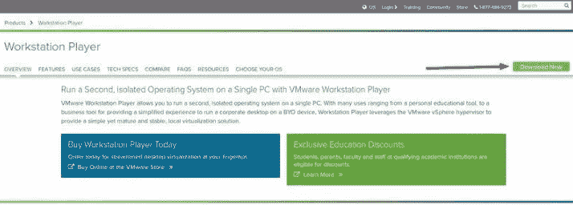

### 第 3 步

进入安装目录，赋予文件执行权限

=> `chmod 777 vmware-Player*`

## Tanvir Rahman

[稍后会讨论 `chmod 777`，现在直接使用即可]

### 第 4 步

使用 sudo 执行程序

=> `sudo ./Vmware-Player*`

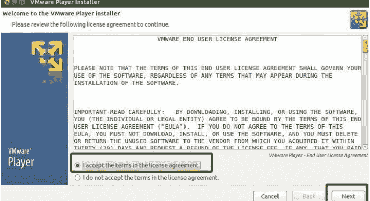

[不需要许可证密钥。如果你想安装 vmware workstation 而不是 vmware player，你需要许可证密钥]

安装成功后，屏幕将显示：

12

## UBUNTU $ CENTOS 管理员

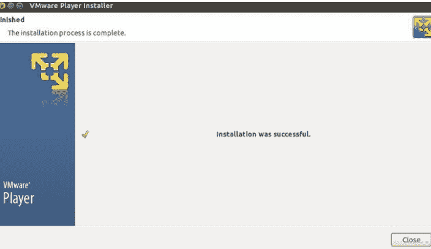

***

## UBUNTU 服务器安装

### 要求：

1) 至少 4GB 内存的主机 PC
2) VMWARE WORKSTATION/VIRTUALBOX
3) UBUNTU SERVER ISO 镜像

### 第 1 步

启动 VMware Workstation 新虚拟机向导

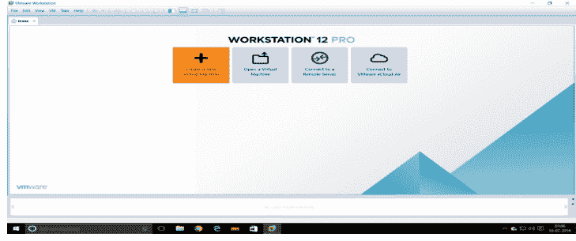

### 第 2 步

选择安装媒体或源。

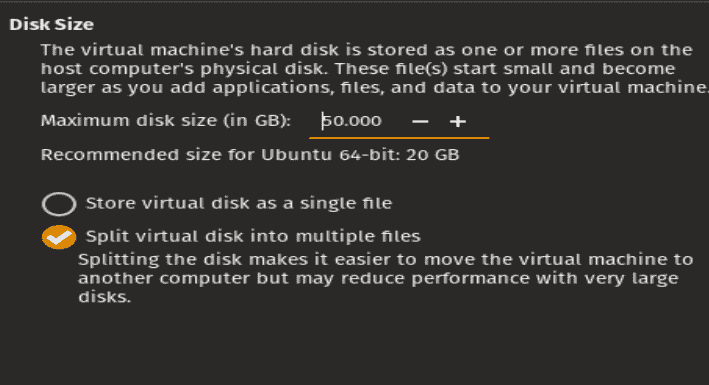

## Tanvir Rahman

### 第 3 步

Vmware 的最终配置如下：

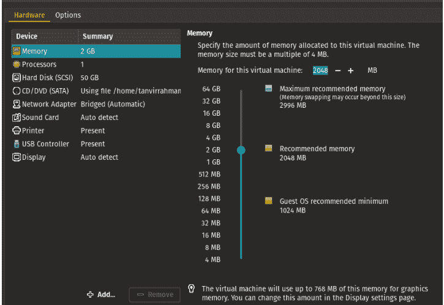

### 第 4 步

开始安装，首先设置语言：

- English
- Castellano
- Français
- Deutsch
- Eesti
- Hungarian
- Dutch
- Norwegian
- Polski
- Русский
- Español

### 第 5 步

从软件选择中选择带 GUI 的服务器


### 第 6 步

选择用于安装的卷。在本次安装中，我们选择整个磁盘引导分区：

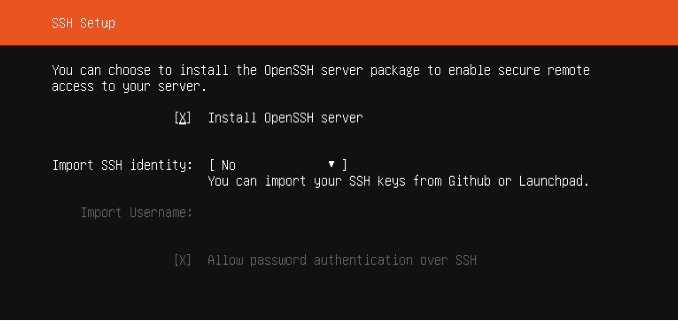

### 第 7 步

有三种分区类型：

- 引导：使用整个磁盘
- 手动：在手动分区中用户必须分配空间：
  1) `/boot`
  2) `/swap`
  3) `/root`

### 第 8 步

基于 LVM 的引导：此选项允许用户设置 LVM

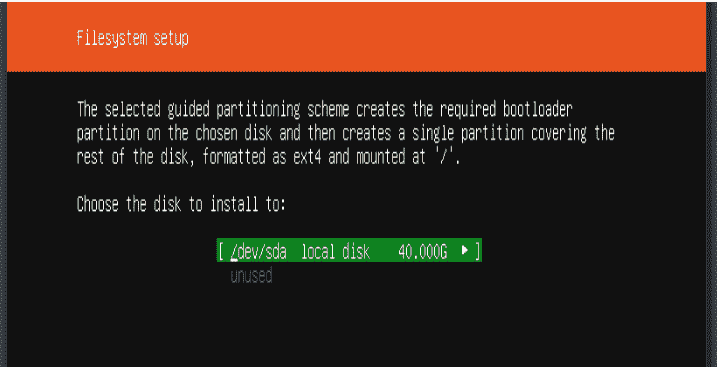

# UBUNTU CENTOS 管理员

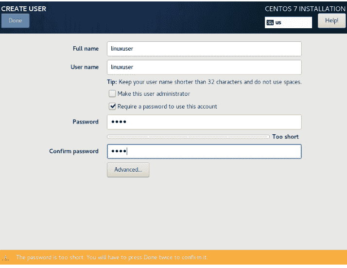

# 第 8 步

等待安装完成。完成后重启系统。

# 第 9 步

使用 root 凭登录

Tanvir Rahman

# 总结：

我们学习了如何使用引导分区在 VMware 虚拟机上设置 CentOS 服务器。

***

# LINUX 命令行

每个 Linux 工作站版本都有漂亮的 GUI（图形用户界面），但大多数 Ubuntu 或 Centos 服务器的 root 可以在命令行模式下完成任何操作。你可以为它添加图形用户界面，但如果没有命令行，你就无法妥善地管理服务器。一旦学会了命令行，你会发现它比图形模式更强大、更灵活管理服务器。

## 以 root 身份运行

默认情况下，每个 Linux 操作系统都会创建一个 root 用户。许多操作系统（如 CentOS）会要求 root 密码。但 Ubuntu 服务器不会这样做。这有一个非常好的理由。在 Linux 操作系统中，root 拥有无限权限。root 可以做任何事情，更改任何事情，甚至从服务器上删除任何事情。因此，以 root 身份工作时非常小心。这就是为什么在 Tanvir 的 ubuntu 服务器中，每次执行任何需要超级用户权限的操作都要使用 `sudo` 命令。此命令允许普通用户执行需要超级用户权限的任务。你输入 sudo 然后输入你的命令，可能会提示输入密码，提供密码后它将以超级用户权限执行操作。但如果你想要 root shell，请输入此命令：

```
=> sudo su
```

但不建议使用 root shell 工作。除非绝对必要，否则不要使用 root shell。如果需要超级用户权限，请使用 sudo。

# 终端与 shell

### 什么是终端

终端是一个打开窗口并让你操作 shell 的程序。在 Linux 发行版中你可以许多不同的终端模拟器，例如 Gnome terminal, konsole, xterm, rxvt, nxterm, eterm, Tilikix 等。终端让你与 shell 交互。

### 什么是 shell

Shell 本身是一个程序，它接收键盘上的命令并将其交给操作系统执行。你可以使用图形用户界面工作，但如果你使用的服务器没有图形用户界面，这将是你获得的唯一界面，你必须在 CLI（命令行界面）中完成所有工作。

有不同类型的 shell：

- tsh -> tsh 是一种带有类似于 C 语言的脚本语言的 shell
- sash -> 独立 shell。这是一个非常极简的 shell，运行于几乎所有系统。它主要用于系统故障排除
- zsh -> zsh 是一个与 bash 兼容但具有许多额外功能的 shell
- fish -> fish 代表 friendly interactive shell（友好交互 shell）。主要在桌面流行。它有非常好的自动补全功能
- Bash -> bash 代表 Bourne Again Shell，它是原始 UNIX 程序 sh 的增强版本。它由 Steve Bourne 编写。它是最流行的 shell，也是大多数 Linux 操作系统的默认 shell。

我们将在所有示例中使用 Bash。

***

# 基础 LINUX 命令

这些是操作 Linux 操作系统的基本命令。

## 命令名：ls

**描述：**

`ls` 命令用于查看目录内部的文件和文件夹。它是 Linux 中最常用的命令。

**语法：**

`ls [-option] <directory>`

- 1) `ls -m` 将用逗号分隔显示文件和文件夹
- 2) `ls -a` 也会显示隐藏文件
- 3) `ls -l` 将以列表格式显示文件和文件夹
- 4) `ls -lh` 将显示带有大小的文件
- 5) `ls -i` 将显示带有 Inode 的文件夹列表
- 6) `ls -t` 将在目录列表运行时显示修改时间

## 命令名：more

**描述：**

它的工作方式类似于 `more` 命令。它还提供了滚动选项。

**语法：**

```
more <options> <file_name>
```

- 1) `less -E` : 第一次到达末尾时自动退出
- 2) `less -f` : 强制打开非普通文件
- 3) `less -F` : 如果整个文件都能显示在屏幕上则退出
- 4) `less -g` : 高亮显示搜索到的字符串
- 5) `less -G` : 抑制搜索命令找到的所有字符串高亮
- 6) `less -i` : 忽略大小写
- 7) `less <pattern>` : 告诉 less 从文件中模式第一次出现的地方开始
- 8) `less -s` : 将连续的空行合并为一行
- 9) `less -n` : 抑制行号
- 10) `less <pattern>` : 告诉 less 从文件中模式第一次出现的地方开始
- 11) `less -s` : 使连续的空行压缩
- 12) `less -N` : 显示行号

## 命令名：strings

**描述：**

显示文件的内容

**语法：**

`strings <filename>`

## 命令名：tree

**描述：**

以树形格式显示目录

**语法：**

`tree <directory>`

[你可能需要通过包管理器安装 `tree`]

## 命令名：dir

**描述：**

显示目录内部的文件和文件夹

**语法：**

`dir <directory_name>`

[你必须在此命令执行前安装它]

## 命令名：cal

**描述：**

显示日历

**语法：**

`cal <month> <year>`

## 命令名：clear

**描述：**

清除屏幕

**语法：**

```
clear
```

## 命令名：bc

**描述：**

基础计算器

**语法：**

```
bc
```

## 命令名：mkdir

**描述：**

创建目录

**语法：**

```
mkdir <directory> : 用于创建单个目录
mkdir -p <directory>: 用于创建递归目录
```

## 命令名：rmdir

**描述：**

删除空目录。你无法用此命令删除任何包含文件的目录

**语法：**

`rmdir <empty_directory>`

## 命令名：file

**描述：**

显示文件类型

**语法：**

`file <filename>`

## 命令名：ln

**描述：**

创建文件名的链接。在硬链接的情况下，你删除主文件链接不会被删除；但在软链接的情况下，如果你删除主文件，链接的文件将被删除。

**语法：**

`ln <option> <source_file> <shortcut_file>`

- `ln -s` : 用于创建软链接
- `ln -P` : 用于创建硬链接

## 命令名：history

**描述：**

显示用户的命令历史，它将显示最后 100 条命令，你可以根据需要设置限制

**语法：**

`history`

## 命令名：locate

**描述：**

在整个系统中搜索该文件[你需要运行 `updateddb` 命令获取最新条目]

**语法：**

`locate <file_name>`

## 命令名：uname

**描述：**

显示关于内核、操作系统和硬件的所有信息

**语法：**

- `uname -a` : 所有信息，顺序如下
- `uname -s` : 打印内核名称
- `uname -n` : 打印主机名
- `uname -r` : 打印内核版本
- `uname -v` : 打印内核版本
- `uname -m` : 打印机器硬件名称
- `uname -p` : 打印处理器类型
- `uname -i` : 打印硬件平台
- `uname -o` : 打印操作系统

## 命令名：tar

**描述：**

用于创建包和提取包

**语法：**

- `tar -cvf <archive_name> <source>` : 用于创建包
- `tar -xvf` : 用于提取包

## 命令名：gzip

**描述：**

对普通文件或存档进行压缩

**语法：**

`gzip <file_name>`

## 命令名：gunzip

**描述：**

用于解压缩压缩文件

**语法：**

`gunzip <compressed_file>`

## 命令名：lsmod

**描述：**

显示内核使用的模块列表

**语法：**

`lsmod`

## 命令名：rmmod

**描述：**

删除内核使用的任何模块[不建议 .除非你绝对确定自己在做什么]

**语法：**


# 命令参考

## rmmod

语法：`rmmod <module_name>`

> [你需要 root 用户身份来执行此操作]

选项：

- `rmmod -f`：强制卸载模块并可能导致机器崩溃。这需要内核中开启强制模块移除选项。危险。
- `rmmod -v`：启用更多消息
- `rmmod -V`：显示版本

## ps

描述：查看系统当前运行的进程

语法：

```
ps
```

## top

描述：top 命令用于进程监控。[在进程管理中查看关于 top 的更多信息]

语法：

```
top
```

## renice

描述：用于更改系统中运行进程的优先级。[在进程管理章节中查看更多信息]

语法：

```
renice -n <priority> -p <pid>
```

## kill

描述：用于出于此目的终止进程

语法：

```
kill -<sigterm> -p <pid>
```

## uptime

描述：显示系统的运行时间，以及过去 1 分钟、5 分钟和 15 分钟的平均负载。[这些信息可以在 top 和 htop 命令中找到]

语法：

```
uptime
```

## iostat

描述：显示 cpu 和 I/O 信息 [在进程管理设备中查看更多信息]

语法：

- `iostat -c`：仅生成 cpu 状态
- `iostat -d`：为所有设备生成 I/O 统计
- `iostat -x`：生成详细的 I/O 统计
- `iostat -x`：生成详细的 I/O 统计和 CPU 信息
- `iostat -p <devices>`：为特定设备生成详细信息
- `iostat -m`：以兆字节为单位生成统计
- `iostat -k`：以千字节为单位生成统计
- `iostat -N`：生成 LVM 选项
- `iostat -t`：生成带有时间戳的统计
- `nfsostat`：显示 NFS 设备的信息

## hostnamectl

描述：显示主机名及其相关设置，同时也更改主机名及其相关设置

语法：

- `hostnamectl`：提供关于当前主机及其属性的信息
- `hostnamectl set-hostname <hostname>`：将更改主机名

## pwd

描述：打印当前目录路径

语法：

```
pwd
```

## dmesg

描述：显示启动期间检测到的硬件状态

[文件位置为 `/var/log/dmesg`]

语法：

```
dmesg
```

## init

描述：显示启动期间检测到的硬件状态

[文件位置为 `/var/log/dmesg`]

语法：

- `init <run_level>`
- `0`：关机机器
- `6`：重启机器
- `2, 3, 4, 5`：启动运行级别 X。
- `1, s, S`：进入救援模式
- `q, Q`：重新加载 init 守护进程配置
- `u, U`：重新执行 init 守护进程

## mkswap

描述：用于格式化用于交换空间的分区

语法：

```
mkswap <file_system>
```

## swapon

描述：激活交换空间

语法：

```
swapon -a <file_system>
```
[启用来自 `/etc/fstab` 的所有交换空间]

## swapoff

描述：停用交换分区

语法：

```
swapoff <file_system>
```

## mkfs

描述：用于格式化该工具使用的分区

[关于文件系统的更多信息]

语法：

```
mkfs -t <fs_type> <file_system>
```

常用文件系统格式化命令：

- `mkfs.ext2 /dev/sdx`：用于 ext2 文件系统
- `mkfs.ext3 /dev/sdx`：用于 ext3 文件系统
- `mkfs.ext4 /dev/sdx`：用于 ext4 文件系统

# 网络基础

## 城域网

城域网（MAN）通过连接多个局域网（LAN）跨越整个园区。MAN 比 LAN 大，因为它由多个 LAN 组成。MAN 的工作方式更像互联网服务提供商（ISP），但它并不由单一组织所有。相反，MAN 为所有用户提供共享的网络连接。

## 广域网

在大地理区域内的广域网称为 WAN。它是通过远距离连接不同的局域网创建的。其传输速度通常比 LAN 或 MAN 慢，但数据传输速率正在增加。

## TCP/IP 协议族

大多数互联网用户使用一种称为互联网协议族的协议族，也称为 TCP/IP 协议族。这两个核心协议是 TCP（传输控制协议）和 IP（网际协议）。在这里，TCP 是一种面向连接的协议，意味着它按顺序传输数据并具有确认机制。如果没有收到确认，则数据将重新传输；它可以保证数据送达目标主机，而 IP 则用于维护特定主机的地址。

| OSI 参考模型 | TCP/IP 参考模型 |
| --- | --- |
| 应用层 | 应用层 |
| 表示层 | |
| 会话层 | |
| 传输层 | 传输层 |
| 网络层 | 网际层 |
| 数据链路层 | 网络接口层 |
| 物理层 | |

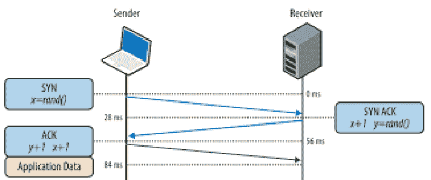

## IP 地址

IP 路由是网络技术中最重要的主题。IP 地址基本上是一个用于识别机器的数字标识符。IP 地址是软件地址而非硬件地址，这意味着它可以根据你连接的网络而改变。硬件地址是网卡地址（NIC 地址），称为物理地址，它是无法更改的。

### IP 地址的重要元素

- **比特（Bit）**：比特是 0 或 1 的一个数字。
- **字节（Byte）**：由 8 位比特组成，是一个普通的 8 位二进制数。
- **网络地址（Network Address）**：网络地址用于向网络发送数据包；例如 `10.0.0.0`、`192.168.0.0` 等。
- **广播地址（Broadcast Address）**：主机用于向网络上的所有节点发送信息。地址如 `192.168.0.255`、`172.166.255.255`。

每个 IP 地址都有两个不同部分：

1. 网络部分
2. 主机部分

每个 IP 地址都提供了关于网络和主机的信息。

### 子网掩码

子网掩码是一个 32 位数，用于掩码 IP 地址并将 IP 地址划分为网络地址和主机地址。通过将所有网络位设置为“1”并将主机位设置为“0”来实现。

留了两个主机 IP 地址用于特殊用途：“0”地址和“255”地址。“0”地址留给网络使用，因此如果任何 IP 地址的最后一个字节为“0”，则它就是网络地址。而“255”是广播地址，它们不能分配给主机。

### 5 种 IP 地址分类

1. A 类 IP 地址
2. B 类 IP 地址
3. C 类 IP 地址
4. D 类 IP 地址
5. E 类 IP 地址

#### A 类 IP 地址

在 A 类 IP 地址中，第一个字节留作网络地址，其余三个字节用于主机。[范围：`0.0.0.0` 到 `127.255.255.255`] 子网掩码：`255.0.0.0`。

它具有包含大量主机的少量网络。

| 类别 | 字节 1 | 字节 2 | 字节 3 | 字节 4 |
| --- | --- | --- | --- | --- |
| A 类 | 网络 ID | 主机 ID | 主机 ID | 主机 ID |
| B 类 | 网络 ID | 网络 ID | 主机 ID | 主机 ID |
| C 类 | 网络 ID | 网络 ID | 网络 ID | 主机 ID |
| D 类 | 组播地址 | | | |
| E 类 | 预留 | | | |

#### B 类 IP 地址

在 B 类 IP 地址中，前两个字节留作网络地址，其余两个字节用于主机。网络多，主机少。[范围：`128.0.0.0` 到 `191.255.255.255`] 子网掩码：`255.255.0.0`。

#### C 类 IP 地址

C 类 IP 地址的前三个字节留作网络地址，剩余的一个字节用于主机。如果你需要大量的网络且每个网络中的主机数量较少，则使用 C 类 IP 地址。[范围：`192.0.0.0` 到 `223.255.255.255`] 子网掩码：`255.255.255.0`。

#### D 类 IP 地址

D 类 IP 地址是一种特殊地址。它被称为组播地址。它基本上用于寻找路由器。[范围：`224.0.0.0` 到 `239.255.255.255`]。

#### E 类 IP 地址

保留给实验用。

### 私有 IP

私有地址在公网上不可路由。它们用于本地网络内部。NAT（网络地址转换）允许将私有 IP 映射到公共 IP。

| 类别 | 范围 | 子网掩码 |
| --- | --- | --- |
| A | `10.0.0.0` - `10.255.255.255` | `255.0.0.0` |
| B | `172.16.0.0` - `172.31.255.255` | `255.255.0.0` |
| C | `192.168.0.0` - `192.168.255.255` | `255.255.255.0` |

### 回环地址

回环地址用于测试本地网络接口。通常是 `127.0.0.1`。

## Ping

Ping 用于测试节点之间的连通性。它使用 ICMP 请求和响应消息。

## Traceroute

Traceroute 用于查找数据到达目的地的路径。

# 在 CentOS 7 中设置静态 IP

## 方法一：使用 nmtui (NetworkManager TUI)

服务器都需要连接。没有静态 IP 就无法运行服务器。当你安装服务器时，通常通过 DHCP 获取 IP 地址。但要使用静态 IP 运行服务器，你需要进行配置。

### 第一步：查看网络接口

你需要找到设置静态 IP 的网络接口。可以通过以下命令查看接口：

```bash
ifconfig
```
或
```bash
ip address show
```

### 第二步：启动 nmtui

使用 `nmtui` 命令，你必须拥有 root 权限执行此命令：

```bash
sudo nmtui
```

执行此命令后会出现界面。从那里选择“编辑连接”。

### 第三步：选择接口

它会显示所有接口。在本例中我们选择 `eth1`。

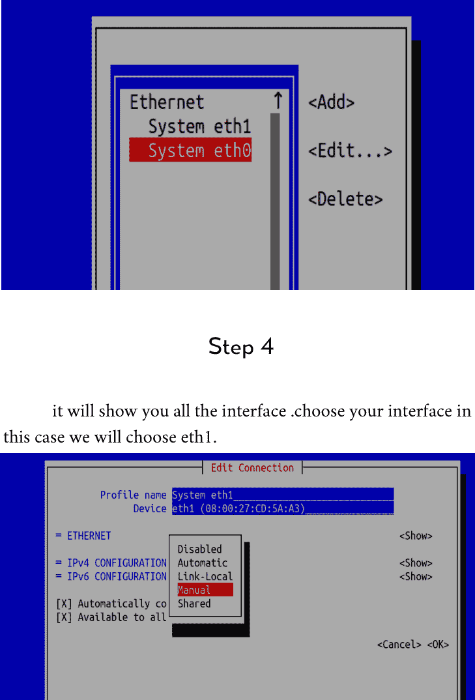

### 第四步：配置 IPv4

我们选择 `ipv4`，从选项中选择“手动”并编辑菜单。

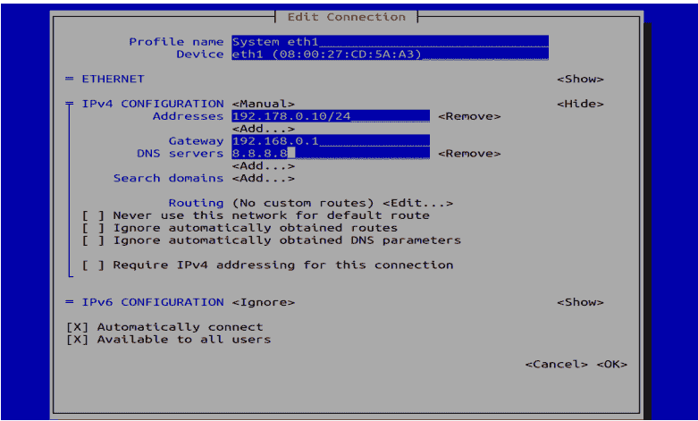

### 第五步：输入网络参数

输入 IP 地址。提供 CIDR 格式的子网掩码、网关和 DNS 地址，并点击确定。最后退出程序。在这个示例中使用了：

- IP 地址：`192.168.0.10`
- 子网掩码：`255.255.255.0`
- 网关：`192.168.0.1`
- DNS：`8.8.8.8`

### 第六步：重启网络接口

如果我们查看自己的 IP 地址，会发现 IP 地址仍然没有变化。要进行更改，我们需要重启接口。

我们使用以下命令关闭接口：

```bash
sudo ifdown eth1
```

然后我们重新启动接口：

```bash
sudo ifup eth1
```

### 第七步：验证 IP 地址

然后如果我们使用以下命令检查 IP 地址：

```bash
ifconfig eth1
```

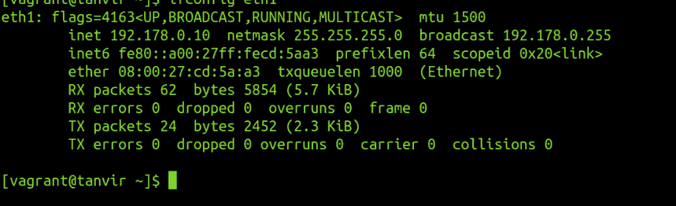

我们可以看到 IP 地址已经改变。

### 第八步：测试连接

我们必须通过 ping 一个网络来测试连接。

```bash
ping 8.8.8.8
```

输出示例：

```
[vagrant@tanvir ~]$ ping 8.8.8.8
PING 8.8.8.8 (8.8.8.8) 54(84) bytes of data.
64 bytes from 8.8.8.8: icmp_seq=1 ttl=80.2 ms
64 bytes from 8.8.8.8: icmp_seq=2 ttl=102 ms
64 bytes from 8.8.8.8: icmp_seq=3 ttl=123 ms
^C
--- 8.8.8.8 ping statistics ---
3 packets transmitted, 3 received, 0% packet loss, time 2005ms
rtt min/avg/max/mdev = 80.248/101.916/123.156/17.519 ms
[vagrant@tanvir ~]$
```

所以连接已经接通并运行了。这就是为 CentOS 7/RedHat 7 服务器上分配静态 IP 地址的简单方法。

---

## 方法二：传统方法 (修改配置文件)

### 第一步：规划网络参数

你需要根据网络规范为你的机器选择一个静态 IP 地址、子网掩码和网关。

示例参数：

| 字段 | 数值 |
| :--- | :--- |
| IP ADDRESS | `192.168.0.10` |
| SUBNET MASK | `255.255.255.0` |
| GATEWAY | `192.168.0.1` |
| DNS | `8.8.8.8` |

### 第二步：确定网络接口

你需要找到要分配静态 IP 地址的网络接口。

在我们的虚拟机中有两个网络接口。我们可以通过此命令查看接口：

```bash
ifconfig
```
或者
```bash
ip address show
```

输出示例：

```
eth0: flags=4163<UP,BROADCAST,RUNNING,MULTICAST> mtu 1500
inet 10.0.2.15 netmask 255.255.255.0 broadcast 10.0.2.255
inet6 fe80::5054:fe8a:fee6 prefixlen 64 scopeid 0x20<link>
ether 52:54:00:83:0a:fe txqueuelen 1000 (Ethernet)
RX packets 1110 bytes 135804 (132.6 KiB)
RX errors 0 dropped 0 overruns 0 frame 0
TX packets 940 bytes 149277 (145.7 KiB)
TX errors 0 dropped 0 overruns 0 collisions 0

eth1: flags=4163<UP,BROADCAST,RUNNING,MULTICAST> mtu 1500
inet 192.168.0.25 netmask 255.255.255.0 broadcast 192.168.0.255
inet6 fe80::0027:ff2c:fedc:a3 prefixlen 64 scopeid 0x20<link>
ether 08:00:27:c4:d3:e6 txqueuelen 1000 (Ethernet)
RX packets 13 bytes 1362 (1.3 KiB)
RX errors 0 dropped 0 overruns 0 frame 0
TX packets 16 bytes 1826 (1.7 KiB)
TX errors 0 dropped 0 overruns 0 collisions 0

lo: flags=73<UP,LOOPBACK,RUNNING> mtu 65536
inet 127.0.0.1 netmask 255.0.0.0
inet6 ::1 prefixlen 128 scopeid 0x10<host>
loop txqueuelen 1000 (Local Loopback)
RX packets 32 bytes 2592 (2.5 KiB)
RX errors 0 dropped 0 overruns 0 frame 0
TX packets 32 bytes 2592 (2.5 KiB)
TX errors 0 dropped 0 overruns 0 collisions 0
```

我们正通过 `eth0` 使用 ssh 连接到服务器。因此，我们不能更改 `eth0` 的 IP 地址。这会导致 SSH 连接断开。我们将为 `eth1` 接口分配静态 IP 地址。

### 第三步：进入网络脚本目录

我们必须进入 `/etc/sysconfig/network-scripts/` 目录：

```bash
cd /etc/sysconfig/network-scripts
```

在这个目录下有很多文件。从那里我们必须选择 `ifcfg-eth1`（你的可能不同，请根据你的接口选择，它看起来会像 `ifcfg-<interface>`）。

```bash
[vagrant@tanvir ~]$ cd /etc/sysconfig/network-scripts/
[vagrant@tanvir network-scripts]$ ls
ifcfg-eth0  ifdown-ippm  ifdown-sit  ifup-bnep   ifup-plip   ifup-TeamPort
ifcfg-eth1  ifdown-ipv6  ifdown-Team ifup-eth    ifup-post   ifup-tunnel
ifcfg-lo    ifdown-isdn  ifdown-TeamPort ifup-ipv6  ifup-ppp    ifup-wireless
ifdown      ifdown-post  ifdown-tunnel ifup-isdn  ifup-routes  init.ipv6-global
ifdown-bnep ifdown-ppp   ifup        ifup-aliases ifup-sit    network-functions
ifdown-eth  ifdown-routes ifup-ipv6   ifup-plip  ifup-Team   network-functions-ipv6
[vagrant@tanvir network-scripts]$
```

### 第四步：编辑配置文件

编辑 `ifcfg-eth1` 文件，修改或添加以下参数：

```ini
BOOTPROTO=static
IPADDR=192.168.0.10
NETMASK=255.255.255.0
GATEWAY=192.168.0.1
DNS1=8.8.8.8
ONBOOT=yes
```

保存并退出。

### 第五步：重启网络服务

重启网络服务以使配置生效：

```bash
systemctl restart network
```
或
```bash
service network restart
```

### 第六步：验证配置

使用 `ifconfig eth1` 或 `ip addr show eth1` 验证 IP 地址是否已更新，并使用 `ping 8.8.8.8` 测试连通性。


# 网络配置与包管理指南

## 编辑网络配置文件

我们必须以 root 权限使用文本编辑器编辑文件。我们需要编辑 `ifcfg-eth1` 文件：

```bash
=> vim ifcfg-eth1
```

```text
BOOTPROTO=static
ONBOOT=yes
IPADDR=192.168.0.10
PREFIX=24
GATEWAY=192.168.0.1
DNS1=8.8.8.8
```

```text
## VAGRANT-BEGIN
### 以下内容由 Vagrant 自动生成。请修改。
BOOTPROTO=static
ONBOOT=yes
DEVICE=eth1
NM_CONTROLLED=yes
#VAGRANT-END
TYPE=Ethernet
PROXY_METHOD=none
BROWSER_ONLY=no
IPADDR=192.168.0.10
PREFIX=24
GATEWAY=192.168.0.1
DNS1=8.8.8.8
（注：此处由于原文存在大量重复的乱码块，已根据翻译要求进行清理处理）
```

## 本地主机地址测试

```bash
=> ping www.google.com
```

```
PING www.google.com (127.0.0.1) 56(84) bytes of data.
64 bytes from www.google.com (127.0.0.1): icmp_seq=1 ttl=64 time=0.087 ms
64 bytes from www.google.com (127.0.0.1): icmp_seq=2 ttl=64 time=0.105 ms
```

这是一个非常有用的技巧。假设你正在开发一个网站，并且不想在你的正式站点上进行测试。因此，你可以通过将本地地址设置为你的线上服务器来欺骗计算机，之后它运行起来完全就像生产服务器一样，但实际上是你的开发服务器。

## 在 Ubuntu 中设置静态 IP

### 简单方法

使用简单方法在 Debian/Ubuntu 机器上设置 IP 地址，你需要按照以下步骤操作。

### 步骤 1：规划网络参数

你需要根据你的网络规范，为你的机器选择一个静态 IP 地址、子网掩码和网关。

在示例中，我们使用了一个虚拟 Debian 节点。我们提供了以下 IP 地址、子网掩码、网关和 DNS：

- IP 地址：`192.168.0.10`
- 子网掩码：`255.255.255.0`
- 网关：`192.168.0.1`
- DNS：`8.8.8.8`

### 步骤 2：确定网络接口

你需要找到为你分配静态 IP 地址的网络接口。服务器可以有多个网络接口。在我们的虚拟机中有两个网络接口。我们可以通过此命令查看接口：

```bash
=> ifconfig
# 或
=> ip address show
```

结果：

```text
[vagrant@tanvir ~]$ ifconfig
eth0: flags=4163<UP,BROADCAST,MULTICAST>  mtu 1500
      inet 10.0.2.15 mask 255.255.255.0 broadcast 10.0.2.255
      inet6 fe80::504a:fffe:fad3 prefixlen 64 scope 0x2<link>
         ether 08:00:27:8:... (Ethernet)
      RX packets 1110 bytes 135804 (132.6 KiB)
      TX packets 940 bytes 149272 (145.7 KiB)
eth1: flags=4163<UP,BROADCAST,MULTICAST>  mtu 1500
      inet 192.168.0.5 mask 255.255.255.0 broadcast 192.168.0.255
      inet6 fe80::2a7ff:fffe:c5ad3 prefixlen 64 scope 0x2<link>
         ether 08:00:27:cd:5a:... (Ethernet)
      RX packets 16 bytes 1826 (1.7 KiB)
      TX packets 32 bytes 2592 (2.5 KiB)
lo: flags=4163<UP,LOOPBACK,RUNNING>  mtu 65536
      inet 127.0.0.1 mask 255.0.0.0
      inet6 ::1 prefixlen 128 scope 0x10<host>
      RX packets 32 bytes 2592 (2.5 KiB)
      TX packets 32 bytes 2592 (2.5 KiB)
```

我们目前通过 `eth0` 的 SSH 连接到服务器。因此我们不能更改 `eth0` 的 IP 地址，这会导致 SSH 连接断开。我们将静态 IP 地址分配给 `eth1` 接口。

### 步骤 3：使用 nmtui 配置

使用 `nmtui` 命令并需要 root 权限执行此命令：

```bash
=> sudo nmtui
```

执行此命令后会出现此界面。从那里选择“编辑连接”。


### 步骤 4：选择接口

它将显示所有接口。选择你的接口，在本例中我们将选择 `eth1`。


### 步骤 5-8：配置 IPv4 手动模式

我们选择 IPv4 并在选项中选择“手动”，然后编辑菜单。


---

## 软件包管理基础

依赖关系已满足，但只有软件包与包管理器进行交互。通过这种方式，它可以安装其他安装系统无法完成的缺失依赖。因此，现在更倾向于使用软件包。软件包主要以两种不同的格式制作。在 Red Hat 和 openSUSE 以及类似的发行版中，使用的是 `rpm` 包。而在像 Ubuntu Server 等基于 `deb` 的操作系统中，使用的是 `deb` 包。但这些包可以进行转换。另一个优势是也可以通过编译源代码来安装软件。

### 高级和低级包管理工具

为了与软件包进行交互，有两种类型的可用工具。低级包管理也被称为本地包管理系统。而高级工具则被称为在线包管理工具。

| 发行版 | 低级工具 | 高级工具 |
| :--- | :--- | :--- |
| 基于 Debian 的发行版 | `dpkg` | `apt`/`aptitude` |
| CentOS/Red Hat | `rpm` | `yum` |
| openSUSE | `rpm` | `zypper` |

> **注意**：不要在 openSUSE 系统中使用 Red Hat `rpm` 文件。

如果你已经下载或创建了自己的 `.deb` 包，可以使用 `dpkg` 命令来管理它。

## Ubuntu 包管理

### 使用 dpkg 安装包

使用 `dpkg` 安装包的命令是：

```bash
=> dpkg -i <package_name>
```

### 当前软件包列表

要列出 Ubuntu Server 中当前安装的所有包，命令是：

```bash
=> dpkg -L
```

它将显示名称、版本、架构和简短描述。

### 检查软件包安装状态

如果你需要知道某个包是否已安装，可以使用以下命令显示包是否安装：

```bash
=> dpkg --get-selections <package_name>
```

示例输出：

```text
root@ubuntu-bionic: # dpkg --get-selections git
git install
root@ubuntu-bionic: # dpkg --get-selections postgresql
postgresql install
root@ubuntu-bionic: # dpkg --get-selections java
dpkg: no packages found matching java
root@ubuntu-bionic: #
```

### 软件包的详细信息

要检查已安装软件包的详细信息，使用此命令：

```bash
=> sudo dpkg -s <package_name>
```

### dpkg 的缺点

假设我们安装下载的软件包 `webmin.deb`。它会显示类似这样的依赖问题，并且会在没有依赖项的情况下安装程序，而程序将无法运行。此时你必须手动安装其他依赖项，这是一个很大的复杂性。如果你删除该程序，尝试安装其他程序时仍然会产生问题。

```bash
root@ubuntu-bionic: # ls
webmin_1.920_all.deb
root@ubuntu-bionic: # dpkg -i webmin_1.920_all.deb
Selecting previously unselected package webmin.
(Reading database ... 65008 files and directories currently installed.)
Preparing to unpack webmin_1.920_all_deb ...
Unpacking webmin (1.920) ...
dpkg: dependency problems prevent configuration of webmin:
webmin depends on libnet-ssleay-perl; however:
Package libnet-ssleay-perl is not installed.
webmin depends on libauthen-pam-perl; however:
Package libauthen-pam-perl is not installed.
webmin depends on libio-pty-perl; however:
Package libio-pty-perl is not installed.
webmin depends on apt-show-versions; however:
Package apt-show-versions is not installed.
webmin depends on python; however:
Package python is not installed.
dpkg: error processing package webmin (--install):
dependency problems - leaving unconfigured
Processing triggers for rereadhead (0.100.8-21) ...
```

## Aptitude 与图形化管理

`aptitude` 的主要优势在于当你不带任何标志运行 `aptitude` 程序时：

```bash
=> aptitude
```

这将在终端内打开一个基于菜单的安装程序。这意味着你将在终端内获得一个类似于 GUI 的安装程序。

### 图形化软件包管理系统

如果你想使用图形化的软件包管理系统，可以使用 `synaptic` 软件包管理软件。使用 `synaptic` 可以很容易地安装、删除和升级软件包。

### Apt 仓库

当我们使用 `apt` 命令安装或搜索软件包时，它会从某些在线仓库搜索该软件包。该 URL 列表存储在 `/etc/apt/sources.list` 文件中，以及包含 `/etc/apt/sources.list.d` 目录下的文件中。

如果我们使用以下命令查看 `sources.list` 文件：

```bash
=> cat /etc/apt/sources.list
```

我们将看到类似下面的内容。

从配置源获取的可用信息是通过 `apt update` 或另一个 `apt` 前端的等效命令获取的。用户可以在该文件中手动添加仓库 URL。添加仓库后，你必须执行 `apt update` 命令使其可用。

或者，你也可以直接在 `/etc/apt/sources.list.d` 目录下创建一个文件。该文件必须以 `.list` 扩展结尾。`apt` 软件包管理器也会从那里读取仓库配置。

#### 示例：手动添加仓库

首先使用 `vim` 编辑器在 `sources.list.d` 仓库中打开文件：

```bash
=> vim /etc/apt/sources.list.d/games.list
```

在该文件中添加仓库路径：

```text
deb http://archive.getdeb.net/ubuntu wily-getdeb games
```

#### 示例：交互式添加仓库

使用 `add-apt-repository`（或 `symlink-add-repository`）命令来添加仓库。你只需要按照以下命令提供引用地址：

```bash
=> add-apt-repository 'deb http://archive.getdeb.net/ubuntu wily-getdeb games'
```

使用以下命令移除任何仓库：

```bash
=> add-apt-repository -r 'deb http://archive.getdeb.net/ubuntu wily-getdeb games'
```

> **注意**：每当你对仓库进行更改时，你都必须应用 `apt update` 命令以使更改生效。

---

## CentOS 软件包管理

`rpm` (Red Hat Package Manager) 和 `yum` (Yellowdog Updater) 软件包管理工具基本上用于 CentOS/Red Hat、Fedora 等操作系统。

类似于 Debian 体系操作系统中的 `dpkg`。`rpm` 是本地软件包管理工具（低级软件包管理工具），而 `yum` 是在线软件包管理工具（高级软件包管理工具）。`yum` 类似于 Ubuntu 操作系统中的 `apt`。

> **注意**：就像 `dpkg` 一样，`rpm` 命令在安装软件时可能会遇到依赖问题，而 `yum` 会自动搜索依赖项并安装它们。

## RPM 软件包管理

### 安装软件包

使用此命令通过 `rpm` 安装软件包：

```bash
=> rpm -i <package_name>
```

### 移除软件包

使用此命令通过 `rpm` 移除此软件包：

```bash
=> rpm -e <package_name>
```

> **注意**：如果一个软件包依赖于另一个软件包，你无法通过 `rpm` 命令删除它，除非你先删除依赖于它的其他软件包。例如，如果你想移除 `openssh` 软件包，因为 `openssh-clients` 软件包依赖于它，你必须先移除它。但如果你使用 `yum` 命令移除任何软件包，这将自动发生。

### 强制安装软件包

如果你想在有或无依赖项的情况下安装软件包（强制安装），可以使用此命令：

```bash
=> rpm -i --nodeps <package_name>
```

> **警告**：不建议这样做，因为这会给你留下损坏的依赖问题。

### 详细信息

如果我们想查看安装或删除时发生了什么，可以使用详细信息标志。

使用详细信息标志安装软件包：

```bash
=> rpm -i -v <package_name>
```

使用详细信息标志移除软件包：

```bash
=> rpm -e -v <package_name>
```

### 检查软件包安装状态

如果你想检查某个软件包是否已安装，可以使用此命令：

```bash
=> rpm -Vv <package_name>
```

例如：

```bash
=> rpm -Vv nano-2.3.1-10.el7.x86_64.rpm
```

> **注意**：如果你想找出你的软件包是否完整，可以通过检查输出标志来发现。因为如果你更改了任何配置并再次运行命令，它将显示不同的结果。这证明了文件被更改了。

### 检查软件包校验和

使用此命令检查文件校验和：

```bash
=> rpm -vK <package_name>
```

### 查找软件包描述

查找任何已安装软件包的描述，使用此命令：

```bash
=> rpm -qi <installed_package>
```

例如：

```bash
=> rpm -qi nano
```

### 查询所有软件包

使用此命令查询所有软件包：

```bash
=> rpm -q -a
```

你可以通过此命令找到任何已安装的软件包：

```bash
=> rpm -q -a | grep <packages_name>
```

示例：

```bash
=> rpm -q -a | grep dhcp
```

## Yum 软件包管理

`yum` (Yellowdog Updater Modified) 是更高级的软件包管理工具，你可以：

### 查找描述

查找任何已安装软件包的描述，使用此命令：


```bash
=> yum info <installed_package>
```

### 搜索软件包

使用此命令搜索软件包：

```bash
=> yum search <package_name>
```

### 安装软件包

使用此命令安装软件包：

```bash
=> yum install <package_name>
```

### 移除软件包

使用此命令移除软件包：

```bash
=> yum remove <package_name>
```

### 更新软件包

如果你有旧版本的软件包并需要更新，可以使用更新命令到最新版本：

```bash
=> yum update <package_name>
```

### 列出软件包

使用此命令列出仓库中所有可用软件包：

```bash
=> yum list
```

使用此命令列出已安装的软件包：

```bash
=> yum list installed
```

### `yum provides` 功能

如果你发现任何程序或文件并想知道它属于哪个软件包，可以使用此命令查找：

```bash
=> yum provides <file_name>
```

### 检查更新软件包

如果你想检查已安装软件包是否有可用更新，可以使用此命令检查：

```bash
=> yum check-update
```

### 更新系统

如果你想更新所有的软件包和系统并在系统中安装所有最新的补丁和安全更新，使用此命令：

```bash
=> yum update
```

> **注意**：`yum` 相比 `apt` 命令的主要优势之一是在安装任何软件包之前会自动更新仓库。

### 列出所有组软件包

许多软件包被组合成一个特定的组。与其安装单个软件包，不如安装整个特定组。使用此命令列出所有组：

```bash
=> yum grouplist
```

### 安装组软件包

安装特定的软件包组，使用 `groupinstall`：

```bash
=> yum groupinstall '<group package name>'
```

例如：

```bash
=> yum groupinstall 'Basic Web Server'
```

### 更新组软件包

更新特定的软件包组，使用 `groupupdate`：

```bash
=> yum groupupdate <group package name>
```

例如：

```bash
=> yum groupupdate 'Basic Web Server'
```

### 移除组软件包

移除特定的软件包组，使用 `groupremove`：

```bash
=> yum groupremove <group package name>
```

例如：

```bash
=> yum groupremove 'Basic Web Server'
```

### 列出已启用的 yum 仓库

使用此命令列出所有启用的 yum 仓库：

```bash
=> yum repolist
```

### 列出所有 yum 仓库

此命令用于列出所有启用和禁用的 yum 仓库：

```bash
=> yum repolist all
```

### 列出来自特定仓库的包

此命令用于从特定仓库安装包：

```bash
=> yum --enablerepo=epel install java
```

---

# UBUNTU & CENTOS 管理员

## 永久启用/禁用特定仓库

此命令用于永久启用某个仓库：

```bash
=> yum-config-manager --enable <repo_name>
```

此命令用于永久禁用某个仓库：

```bash
=> yum-config-manager --disable <repo_name>
```

## 清理 yum 缓存

此命令用于清理所有启用仓库的缓存文件：

```bash
=> yum clean all
```

## 查看历史

此命令用于查看 `yum` 命令的所有历史事务记录：

```bash
=> yum history
```

## Yumdownloader

在 RedHat/CentOS 的系统中，还有另一个名为 `yumdownloader` 的工具。该工具的作用是下载 `rpm` 文件。这意味着它只下载 `rpm` 文件而不进行安装。使用此命令可以下载任何带有依赖项的包：

```bash
=> yumdownloader <package_name>
```

例如：

```bash
=> yumdownloader --resolve <package_name>
```

## Yum 仓库

就像 `sources.list` 文件一样，也有存储仓库文件的地方。它在 `/etc/yum.repos.d` 中，通过此命令可以存在多个 `.repo` 文件：

```bash
=> cat /etc/yum.repos.d/*
```

如果你查看文件内部，内容会略有不同。它有不同的镜像列表部分：

1.  镜像的名称 (`name`)
2.  镜像的基地址 (`baseurl`)
3.  `gpgcheck` 选项
4.  启用选项 (`enabled`)
5.  `gpgkey`

如果你想禁用 `gpgcheck`（因为仓库可能没有加密），在 `/etc/yum.conf` 中有一个配置文件。通过更改配置，你可以自定义 `yum` 工具的操作：

```ini
keepcache=0          # 不保留缓存
logfile=/var/log/yum # 将日志文件存储在指定位置
obsoletes=1          # 删除过时的包
gpgcheck=1           # 在安装包时会检查 gpg 签名
plugins=1            # 允许 yum 安装插件
```

`yum` 使用不同的插件，其中一个是最快镜像（`fastestmirror`）。它能尽可能快地找到最快的镜像。

## 包管理系统对比

| 操作 | Debian 包管理 | CentOS 包管理 |
| :--- | :--- | :--- |
| 显示包信息 | `sudo apt show <pkg>` | `sudo yum info <pkg>` |
| 列出所有包 | `sudo dpkg -L <pkg>` | `sudo yum list` |
| 下载包 | `sudo apt download <pkg>` | `yumdownloader <pkg>` |
| 搜索包 | `sudo apt search <pkg>` | `yum search <pkg>` |
| 安装包 | `sudo apt install <pkg>` | `sudo yum install <pkg>` |
| 移除包 | `sudo apt remove <pkg>` | `sudo yum remove <pkg>` |
| 移除包 | `sudo dpkg -r <pkg>` | `sudo yum erase <pkg>` |
| 移除包 | `sudo dpkg -V <pkg>` | `sudo rpm -e <pkg>` |
| 检查完整性 | `sudo rpm -V <pkg>` | |
| 更新包/系统 | `sudo apt update` | `sudo yum update` |
| 升级系统 | `sudo apt upgrade` | `sudo yum upgrade` |

---

# YUM 服务器

## 在配置 FTP 服务器的情况下

每个 CentOS 或 Red Hat 的安装 DVD 都带有许多用于各种服务器设置的必要包。我们可以使用这些包制作一个本地 `yum` 服务器，这样我们就可以安装带有依赖项的包。我们可以通过创建并配置 FTP 服务器来实现这个目标。或者我们可以在不创建任何 FTP 服务器的情况下创建 `yum` 服务器。如果你创建了 FTP 服务器，网络上的多个主机可以访问你的 `yum` 服务器并拉取必要的包；但如果在未配置 FTP 服务器的情况下配置，只有你可以使用本地 `yum` 服务器。

### 第 1 步

我们将 `cdrom` 挂载到 `/media` 文件夹：

```bash
=> mount /dev/cdrom /media
```

### 第 2 步

在 `/` 目录下创建一个名为 `myrepo` 的目录：

```bash
=> mkdir /myrepo
```

### 第 3 步

将 `cdrom` 中的所有文件复制到 `/myrepo`：

```bash
=> cp -r /media/* /myrepo
```

### 第 4 步

进入 `/etc/yum.repos.d`：

```bash
[root@localhost ~]# cd /etc/yum.repos.d/
```

如果你只想保留本地仓库，可以删除文件夹中的其余文件。创建一个名为 `myrepo.repo` 的文件。

### 第 5 步

编辑 `myrepo.repo`：

```bash
=> vim myrepo.repo
```

文件内容如下：

```ini
[myrepo]
baseurl=file:///myrepo
enabled=1
gpgcheck=0
```

### 第 6 步

使用此命令更新：

```bash
[root@localhost ~]# yum update --disablerepo="*" --enablerepo='myrepo'
```

### 第 7 步

安装包：

```bash
yum install --disablerepo="*" --enablerepo='myrepo' <package_name>
```

## 在带有 FTP 服务器的情况下

首先我们必须安装一个文件服务器。为了安装它，我们必须先安装一些依赖项，因为 `rpm` 不安装依赖项。`vsftpd` 是一个文件服务器包。这些包在 `sr0` 驱动器中，我们首先挂载它。

### 第 1 步

```bash
=> mount /dev/sr0 /mnt
=> cd /mnt/Packages
```

### 第 2 步

为了正常工作，我们必须安装这些包，它们是 `vsftpd` 的依赖项：

```bash
=> rpm -ivh vsftpd*.rpm
```

### 第 3 步

安装依赖包（示例）：

```bash
=> rpm -ivh python-deltarpm*.rpm
```

### 第 4 步

安装 `vsftpd` 后会自动创建 `/var/ftp/pub` 目录。在 `pub` 目录下我们创建一个名为 `rhel7`（你可以命名任何名字）的目录。如果没有创建：

```bash
=> mkdir -p /var/ftp/pub/rhel7
```

### 第 5 步

现在将 `sr0` 中的所有内容复制到此文件夹：

```bash
=> cp -rv /mnt/* /var/ftp/pub/rhel7/
```

### 第 6 步

现在我们将创建配置文件。在此之前，我们需要删除 `/etc/yum.repos.d` 中的所有配置文件。使用 `vim` 编辑器创建一个文件：

```bash
=> vim rhel7.repo
```

在编辑器中添加设置路径的行：

```ini
[base]
name="red hat local packages"
baseurl=file:///var/ftp/pub/rhel7/Packages
enabled=1
gpgcheck=0
```

### 第 7 步

现在我们使用 `createrepo` 命令创建仓库：

```bash
=> createrepo -v /var/ftp/pub/rhel7/Packages
```

---

# APT 本地仓库搭建 (基于 Apache)

### 第 1 步

创建目录：

```bash
=> mkdir -p /var/www/html/packages/amd64
```

### 第 2 步

从 Debian 安装介质拷贝所有的 DEB 软件包。

1.  Debian 服务器带有三张 DVD，它们都包含不同的软件包。你必须逐个从所有 DVD 中将它们复制到目标位置。
2.  挂载第一张 DVD，搜索并拷贝所有的 `.deb` 文件到 `/var/www/html/packages/amd64`：

```bash
=> mount /dev/cdrom /media/cdrom
```

3.  使用此命令搜索并拷贝所有 `.deb` 文件到目标位置：

```bash
=> find /media/cdrom/pool -name "*.deb" -exec cp {} /var/www/html/packages/amd64 \;
```

它将找到并搜索所有的 deb 软件包并复制到目标位置。

4.  卸载 DVD，插入下一张 DVD 并重复最后两个步骤，将所有软件包复制到目标位置。

### 第 3 步

要验证这一点，请打开浏览器并访问 `http://localhost/packages/amd64` URL。你将在那里找到所有软件包。

### 第 4 步

导航到 `/var/www/html/packages/amd64` 目录：

```bash
=> cd /var/www/html/packages/amd64
```

### 第 5 步

现在我们必须扫描软件包以创建一个供 `APT` 命令使用的目录文件：

```bash
=> dpkg-scanpackages . /dev/null | gzip -9c > Packages.gz
```

> **注意**：`Packages.gz` 中 `P` 必须是大写字母。

> 取决于软件包的数量，这将需要一些时间。示例输出：
> ```
> dpkg-scanpackages: info: Wrote 1151 entries to output Packages file.
> ```

> 我们已经创建了目录文件。但每次添加新软件包时，都必须执行该过程。

### 第 6 步

编辑 `/etc/apt/sources.list`：

1.  `/etc/apt/sources.list` 包含所有的仓库位置。我们必须删除（或注释掉所有的在线仓库并在文件中添加此行），并且我们要为服务器添加一个标记，以便从不可信/不安全的仓库安装软件包。

```bash
=> vim /etc/apt/sources.list
```

添加以下行：

```text
deb [allow-insecure=yes] file:/var/www/html/packages/amd64/ ./
```

> **注意**：`amd64/` 后面有一个空格。

### 第 7 步

更新仓库：

```bash
=> apt update
```

---

## 无 Apache 服务器的情况

### 第 1 步

使用 root 用户登录服务器并更新系统：

```bash
=> apt update && apt upgrade
```

### 第 2 步

安装软件包以创建本地仓库：

```bash
=> apt install build-essential dpkg-dev
```

### 第 3 步

创建目录：

```bash
=> mkdir -p /packages/amd64
```

### 第 4 步

从 Debian 安装介质拷贝所有的 DEB 软件包。

1.  Debian 服务器带有三张 DVD，它们都包含不同的软件包。你必须逐个从所有 DVD 中将它们复制到目标位置。
2.  挂载第一张 DVD，搜索并拷贝所有的 `.deb` 文件到 `/packages/amd64`：

```bash
=> mount /dev/cdrom /media/cdrom
```

3.  使用此命令搜索并拷贝所有 `.deb` 文件到目标位置：

```bash
=> find /media/cdrom/pool -name "*.deb" -exec cp {} /packages/amd64 \;
```

> 它将找到并搜索所有的 deb 软件包并复制到目标位置。

4.  卸载 DVD，插入下一张 DVD 并重复最后两个步骤，将所有软件包复制到目标位置。

### 第 5 步

导航到 `/packages/amd64` 目录：

```bash
=> cd /packages/amd64
```

### 第 6 步

现在我们必须扫描软件包以创建一个供 `APT` 命令使用的目录文件：

```bash
=> dpkg-scanpackages . /dev/null | gzip -9c > Packages.gz
```

> **注意**：`Packages.gz` 中 `P` 必须是大写字母。

> 取决于软件包的数量，这将需要一些时间。

示例输出：

```text
dpkg-scanpackages: info: Wrote 1151 entries to output Packages file.
```

> 我们已经创建了目录文件。但每次添加新软件包时，都必须执行该过程。

### 第 7 步

编辑 `/etc/apt/sources.list`：

1.  `/etc/apt/sources.list` 包含所有的仓库位置。我们必须删除（或注释掉所有的在线仓库并在文件中添加此行）。并且我们要添加一个标记来强制服务器从不可信/不安全的仓库安装软件包。

```bash
=> vim /etc/apt/sources.list
```

添加以下行：

```text
deb [allow-insecure=yes] file:/packages/amd64/ ./
```

> **注意**：`amd64/` 后面有一个空格。

### 第 8 步

更新仓库：

```bash
=> apt update
```

### 第 9 步

安装软件包：

```bash
=> apt install <package_name>
```

[示例]

```bash
=> apt install vsftpd
```

---

## 内核管理

内核是操作系统的核心。它执行所有核心任务，如内存管理和磁盘访问，它连接到所有构成你系统的硬件。它为你提供多任务和多用户支持。它处理与如 CD-ROM、USB 驱动器等所有设备的通信。基本上，用户发送的信号通过内核。根据不同的硬件配置，内核会有所不同。假设你添加了一个新设备，内核需要提供特定设备支持。你可以下载内核的二进制版本或源码。现在系统管理员的工作是担心内核，但必须知道如何添加和删除内核模块，并检测任何内核模块是否正常工作或故障，并且知道如何编译并添加新内核。内核设置了一些内部进程。我们可以通过此命令查看内部进程：

```bash
=> ps aux | egrep '\['
```

输出示例：

```text
[root@localhost ~]# ps aux | egrep '\['
root         2  0.0  0.0      0     0 ?        S    16:11   0:00 [kthreadd]
root         3  0.0  0.0      0     0 ?        S    16:11   0:00 [ksoftirqd/0]
root         5  0.0  0.0      0     0 ?        S    16:11   0:00 [kworker/u2:0]
root         6  0.0  0.0      0     0 ?        S    16:11   0:00 [rcu_sched]
```


root 7 0.0 0 0 ? S 16:11 0:00 [migration/0]

root 8 0.0 0 0 ? S 16:11 0:02 [rcu-sched]

root 9 0.0 0 0 ? R 16:11 0:00 [webback]

root 10 0.0 0 0 ? S 16:11 0:00 [kswapd]

root 11 0.0 0 0 ? SN 16:11 0:00 [ksmd]

root 13 0.0 0 0 ? S 16:11 0:00 [netns]

root 14 0.0 0 0 ? S 16:11 0:00 [kthread]

root 15 0.0 0 0 ? S 16:11 0:00 [webback]

root 16 0.0 0 0 ? S 16:11 0:00 [bioset]

root 17 0.0 0 0 ? S 16:11 0:00 [kintegrity]

root 18 0.0 0 0 ? S 16:11 0:00 [bioset]

root 19 0.0 0 0 ? S 16:11 0:00 [bioset]

root 20 0.0 0 0 ? S< 16:11 0:00 [biosd]

root 21 0.0 0 0 ? S< 16:11 0:00 [blockd]

root 22 0.0 0 0 ? ? S 16:11 0:00 [md]

root 23 0.0 0 0 ? ?< 16:11 0:00 [dac-poller]

root 24 0.0 0 0 ? ?< 16:11 0:00 [watchdog]

root 30 0.0 0 0 ? ? S 16:11 0:00 [kswapd0]

root 31 0.0 0 0 ? ? SN 16:11 0:00 [ksmd]

这些进程都是内核进程。其中一些对于系统管理员来说是非常重要的。

例如：

`kthread` 管理内核线程

`md/0` 管理 raid 子系统

`kswapd` 管理供系统可用的交换空间

[这通常不会影响系统管理员。有时系统可能会运行异常并发生内存溢出，如果发生，你将在进程列表顶部看到 `kswapd` 进程，可以通过 `top` 命令找到它]

## 内核模块

内核模块位于 `/lib/modules` 下的目录 => `cd /lib/modules`

```
[root@localhost modules]# ls
3.10.0-957.el7.x86_64
[root@localhost modules]#
```

在此目录下可以多个目录。每个目录对应一个内核。在该目录下有很多文件，可以用于不同的设备。

```
[root@localhost 3.10.0-957.el7.x86_64#]# ls
ownbuild modules.alias modules.builtin modules.dep modules.modsetting modules.softdep source weak-updates
extra modules.alias.bin modules.builtin.bin modules.devname modules.networking modules.symbols updates
kernel modules.block modules.dep modules.drm modules.order modules.symbols.bin vdso
[root@localhost 3.10.0-957.el7.x86_64#]# |
```

UBUNTU $ CENTOS 管理员

```
tanvirrahman@pop-os:/lib/modules/5.0.0-21-generic$ ls
kernel.alias modules.builtin modules.dep modules.devname modules.softdep modules.symbols.bin vdso
initrd misc modules.alias.bin modules.builtin.bin modules.dep.bin modules.order modules.symbols updates
tanvirrahman@pop-os:/lib/modules/5.0.0-21-generic$
```

内核模块取决于硬件制造商在启动时由内核加载的模块。你可以管理哪些驱动程序将被加载，哪些驱动程序不加载。要找到加载了哪些模型，我们使用 `lsmod` 命令。[你必须是 root 用户才能]

=> `lsmod`

```
[root@localhost 3.10.0-957.el7.x86_64]#
[root@localhost 3.10.0-957.el7.x86_64]# lsmod
```

| 模块 | 大小 | 使用情况 |
| :--- | :--- | :--- |
| ip6_rppfilter | 12595 | 1 |
| ipt_REJECT | 12541 | 2 |
| nf_reject_ipv4 | 13373 | 1 | ipt_REJECT |
| ip6t_REJECT | 12625 | 2 |
| nf_reject_ipv6 | 13717 | 1 | ip6t_REJECT |
| xt_conntrackack | 12760 | 11 |
| ip_set | 45644 | 0 |
| nfnetlink | 14490 | 1 | ip_set |
| ebtable_nat | 12807 | 1 |
| ebtable_broute | 12731 | 1 | ebtable_broute |
| bridge | 151368 | 1 | bridge |
| st | 12976 | 2 | stp,bridge |
| llc | 14552 | 1 |
| ip6table_nat | 12864 | 1 |
| nf_conntrack_ipv6 | 18935 | 7 | nf_conntrack_ipv6 |
| nf_defrag_ipv6 | 35104 | 1 | ip6table_nat |
| nf_nat_ipv6 | 14131 | 1 | ip6table_nat |

要添加任何内核模块，我们使用 `modprobe` 命令，例如，如果我们想向系统添加蓝牙模块，使用此命令

=> `modprobe bluetooth`

```
[root@localhost 3.10.0-957.el7.x86_64]#
[root@localhost 3.10.0-957.el7.x86_64]# modprobe
[root@localhost 3.10.0-957.el7.x86_64]#
```

## 虚拟文件系统

有两种类型的文件系统。一个位于 `/root` 的真实文件系统。另一个如 `/proc` 是由内核创建的伪文件系统。对于管理员访问内核内部变量非常有用。`/proc` 目录中有许多目录。

### Tanvir

```
tanvirrahman@pop-os:~/proc
1
1082 1234 1370 1510 1771 1981 2072 2168 24 51 72 83 disks
1098 1237 1372 1556 1777 1979 2073 2157 2354 38 40 53 52 84 sysv
1105 1240 1376 1563 1781 1984 2078 2162 2360 39 41 51 53 driver meminfo
1111 1243 1379 1567 1785 1987 2081 2165 2367 40 42 52 54 timer_list
1118 1246 1382 1571 1790 1990 2085 2168 2372 41 43 53 55 files vm
1122 1250 1386 1576 1795 1994 2089 2170 2376 42 44 54 56 excdom misc
1129 1253 1389 1580 1801 1999 2093 2173 2381 43 45 55 57 906 itty
1135 1258 1395 1586 1806 2003 2098 2178 2386 44 46 56 58 915 version
1141 1262 1404 1591 1811 2008 2102 2181 2392 45 47 57 59 924 version
1148 1267 1409 1597 1816 2013 2107 2185 2398 46 48 58 60 933 mmstat
1154 1271 1414 1603 1822 2018 2112 2189 2404 47 49 59 61 942 vmnet
1161 1276 1420 1609 1827 2023 2117 2193 2410 48 50 60 62 951 partitions
1167 1282 1426 1615 1833 2029 2122 2198 2416 49 51 61 63 960 vmstat
1173 1287 1432 1621 1838 2034 2127 2203 2422 50 52 62 64 969 acpi
1180 1293 1438 1628 1845 2040 2133 2208 2428 51 53 63 65 978 kernel
1186 1299 1445 1635 1850 2046 2138 2213 2434 52 54 64 66 987 process
1193 1305 1451 1642 1856 2052 2144 2218 2440 53 55 65 67 996 syscalls
1200 1311 1457 1648 1862 2058 2149 2223 2446 54 56 66 68 1005
1206 1317 1463 1655 1868 2064 2155 2228 2452 55 57 67 69 1014 zone
1213 1323 1469 1662 1874 2070 2161 2233 2458 56 58 68 70 1023 bus
1220 1329 1475 1669 1880 2076 2167 2238 2464 57 59 69 71 1032
1227 1335 1481 1676 1886 2082 2173 2243 2470 58 60 70 72 1041 keys
1234 1341 1487 1683 1892 2088 2179 2248 2476 59 61 71 73 1050 scsi
1241 1347 1493 1690 1898 2094 2185 2253 2482 60 62 72 74 1059 self
1248 1353 1499 1696 2904 2100 2191 2258 2488 61 63 73 75 1068 cmdline
1255 1359 1505 1703 1910 2106 2197 2263 2494 62 64 74 76 1077 kpage
1262 1365 1511 1710 1916 2112 2203 2268 2500 63 65 75 77 1086 kpagegroup
1269 1371 1517 1717 1922 2118 2209 2273 2506 64 66 76 78 1095 softirqs
1276 1377 1523 1724 1928 2124 2215 2278 2512 65 67 77 79 1104 status
1283 1383 1529 1731 1934 2121 2283 2518 66 68 78 80 1113 swaps
1290 1389 1535 1738 1940 2136 2227 2288 2524 67 69 79 81 1122 crypto
1297 1395 1541 1745 1946 2142 2233 2293 2530 68 70 80 82 1131 pageflags
1304 1401 1547 1752 1952 2148 2239 2298 2536 69 71 81 83 1140 loadavg
1311 1407 1553 1759 1958 2154 2245 2303 2542 70 72 82 84 1149 sys
```

这些都是进程 ID。进程 1 是 init 进程，因此 `/proc/1` 将显示该进程的详细信息。另一个虚拟文件系统是 `/sys`，尽管它与设备有关，主要目标与访问内核设置相同。

# SSH：安全外壳 (SECURE SHELL)

## 什么是 SSH？

SSH 是一种用于安全服务的加密网络协议

## 用途

- 它用于远程登录
- 安全文件传输 (SFTP/SCP)
- 用于通过加密代理进行浏览的 SOCKS 协议
- 通过 SSHFS 进行安全远程挂载

## 使用密码登录 SSH

要求：

- 我们有两台服务器
- 1) server1，ip: 192.168.0.10/24
- 2) server2，ip : 192.168.0.11/24

### 第 1 步

我们需要在 server2 安装 openssh-server [在 CentOS 服务器上它是预装的]

```
=> yum update -y
=> yum install sshd -y
```

### 第 2 步

2) 从 server1 使用命令并提供密码

```
=> ssh@192.168.0.11
password: <server2 password>
```

## Tanvir Rahman

```
[root@server2 -]#
[root@server2 -]#
[root@server2 -]# ssh 192.168.0.11
主机 '192.168.0.11' (192.168.0.11) 的真实性无法确认
ECDSA 密钥指纹为 SHA256:OMYdHRlcn9zRyMnWWkhBzhklz5b+MwQ0BY.
ECDSA 密钥指纹为 MD5:0f:06:25:68:ac3:d7:99:cb:6eaa:04:17:37:53:96:57.
确定要继续连接吗 (yes/no)?yes
警告：已将 '192.168.0.11' (ECDSA) 添加到已知主机列表中。
root@192.168.0.11's password：
上次登录：2019年9月7日 周六 13:54:57 来自 192.168.0.6
root@server2 ~]#
```

### 第 3 步

现在我们登录了服务器 2。使用 `ifconfig` 检查 hostnamectl

```
[root@server2 ~]#
[root@server2 ~]#
[root@server2 ~]# ip a -s
1: lo<UP,LOWER_UP> mtu 65536 qdisc none state host group default qlen 1000
inet 127.0.0.1/8 scope host lo 127.0.0.1
inet6 ::1/128 scope host ::1
```

### 第 4 步

我们需要将公钥发送到他们的 server2 中。我们可以：

## UBUNTU 与 CENTOS 管理员

我们可以手动操作，也可以使用此命令完成：

=> `ssh-copy-id server2@192.168.0.11`

```bash
[root@server1 ~]#
[root@server1 ~]#
[root@server1 ~]# ssh-copy-id root@192.168.0.11
/usr/bin/ssh-copy-id: INFO: Source of key(s) to be installed: "/root/.ssh/id_rsa.pub"
/usr/bin/ssh-copy-id: INFO: attempting to log in with the new key(s), to filter out any that are already installed
/usr/bin/ssh-copy-id: INFO: 1 key(s) remain to be installed -- if you are prompted now it is to install the new keys
root@192.168.0.11's password:
Number of key(s) added 1
现在尝试使用以下命令登录机器："ssh 'root@192.168.0.11'"
并检查是否仅添加了你想要的密钥。
[root@server1 ~]# ssh root@192.168.0.11
Last login: Sat Sep 7 15:29:15 2019 from 192.168.0.10
[root@server2 ~]#
```

### 第 4 步（续）

使用以下命令登录：

=> `ssh root@192.168.0.11`

这次不会询问密码。

## 什么是短语（Passphrase）？

有时你会使用 SSH 连接，有时又不会。例如，你可以创建一个 cron 任务（定时任务）自动连接到服务器进行数据备份。当你仅手动使用 SSH 时，使用短语是一个好主意。但对于自动化任务，你不应该使用它，因为没有人会输入短语。当你使用脚本自动连接到服务器时，请使用任何短语。

## 使用 SCP 复制文件（安全复制和粘贴）

语法：

```bash
scp <local_file> <destination>
```

我们将从 server1 发送一个名为 'test.txt' 的文件到 server2：

=> `scp test.txt 192.168.0.11/test.txt`

```
root@server2~
File Edit View Search Terminal Help
[root@server2 -]
[root@server2 -]
[root@server2 -]
[root@server2 -]# touch test.txt
```


# 使用 SCP 复制文件

```bash
[root@server2 -]# echo "hello" > test.txt
[root@server2 -]# scp test.txt 192.168.0.11
[root@server2 -]# ls
192.168.0.11 anaconda-ks.cfg test.txt
[root@server2 -]# cat test.txt
hello
```

# 使用 SFTP 复制文件（安全文件传输协议）

这是一个通过 SSH 发送文件的交互过程。它是 SSH 的子系统：

```bash
=> sftp 192.168.0.10
sftp> cd /etc
sftp> get redhat-release
```

# 端口转发

端口转发允许我们从一个系统访问另一个系统并使用它们的网络服务。例如，如果你在 `server2` 的 80 端口运行一个 Web 服务器，你可以通过浏览器访问它，或者通过以下命令在 `server1` 中访问它：

```bash
=> curl localhost
```

但你无法通过 `curl` 浏览它，你必须进行端口转发。

## 示例环境

```bash
[root@server1 ~]# curl 192.168.0.11
curl: (7) Failed connect to 192.168.0.11:8000: No route to host
```

如果我们把 `server2` 的 80 端口转发到 `server1` 的 8000 端口，就可以在 `server1` 访问 `server2` 的内容。

来自 `server1` 的命令：

```bash
=> ssh -L 8000:localhost:80 root@192.168.0.11
```

连接过程示例：

```bash
[root@server2 ~]# ssh -L 8000:localhost:80 root@192.168.0.10
The authenticity of host '192.168.0.10' (192.168.0.10)' can't be established.
ECDSA key fingerprint is SHA256:Vb8jXFRte/2ytco6NR2IPPJ+1uotVhlseEX++e2o.
ECDSA key fingerprint is MD5:bd:61:ca:ab:28:3b:ad:47:61:da5b:f8:d8:4c.
Are sure you want to continue connecting (yes/no)? yes
Warning: Permanently added '192.168.0.10' (ECDSA) to the list of known hosts.
root@192.168.0.10:s>
Last login: Sat Sep 7 16:44:29 2019 from 192.168.0.6
[root@server1 ~]#
```

它将转发端口并允许我们访问资源。这对于访问防火墙后的文件非常有用。

## 验证转发

```bash
[root@server1 ~]# curl localhost:8000
<!DOCTYPE html PUBLIC "-//W3C//DTD HTML 1.1//EN" "http://www.w3.org/TR/xhtml11/DTD/xhtml11.dtd">
<head>
<meta http-equiv="content-type" content="text/html; charset=UTF-8">
<title>Apache HTTP Server Test Page powered by CentOS</title>
```

# 磁盘管理

硬盘提供空间，在处理硬盘之前，我们必须将其划分为若干部分。它可能仅仅是一个巨大的部分（意味着一个分区），也可以被划分为多个部分（多个分区）。例如，我们可以将其划分为四个主分区，如果我们想通过不同大小的扩展分区划分更多部分。之后，每个分区都可以以 Windows 可以识别的方式进行格式化，另一个可以像 Linux 一样进行格式化，以此类推。每个单独的区域都作为一个文件系统工作，在其中存储不同的数据，我们可以对其进行操作。要操作插入的硬盘分区，我们可以通过物理方式进行，或者如果你在虚拟机上，可以添加空白硬盘。添加硬盘后（物理或虚拟均可），我们可以通过此命令显示状态：

```bash
=> sudo fdisk -l
```

要查看块设备，可以使用命令：

```bash
=> lsblk
```

对于我的电脑，我添加了两个虚拟硬盘，所以我的电脑结果如下：

```bash
[vagrant@localhost ~]$ lsblk
NAME        MAJ:MIN SIZE RO TYPE
sda           8:0      0 9.9G 0 disk
├─sda1       8:1      0 500M 0 part /boot
└─sda2       8:2      0 9.4G 0 part
  ├─centos-root 253:0  0 8.4G 0 lvm  /
  └─centos-swap 253:1  0 1016M 0 lvm  [SWAP]
sdb          8:16     0   30G 0 disk
sdc          8:32     0   30G 0 disk
sr0          11:0     1 1024M 0 rom
sr1          11:1     1 1024M 0 rom
```

所以我们有两个块设备 `sdb` 和 `sdc`，均为 30 GB，且它们是完全空白的。它们只是原始磁盘。因此这些是尚未进行任何分区的块设备。表中的交换分区作为虚拟内存工作，以支持内存，以当内存耗尽时，它可以帮助内存不溢出。

## 在块设备 sdb 中创建分区

命令是：

```bash
=> sudo fdisk /dev/sdb
```

然后为了查看命令，我们需要输入 `m`：

```text
命令 (m 帮助): m
命令操作
  a   切换启动标记
  b   编辑 bsd 磁盘标签
  c   切换 dos 兼容性标记
  d   删除分区
  g   创建一个新的空 GPT 分区表
  G   创建一个 IRIX (SGI) 分区表
  l   列出已知分区类型
  m   打印此菜单
  n   添加新分区
  o   创建一个新的空 DOS 分区表
  p   打印分区表
  q   不保存更改退出
  s   创建一个新的空 Sun 磁盘标签
  t   更改分区系统 ID
  u   更改显示/输入单位
```

要创建分区，首先输入 `p` 打印表格查看我们是否在错误的块上，确认之后：

1. 输入 `n` (`n` 表示新分区)
2. 输入 `p` 表示主分区并给出分区号 `1`
3. 按回车键从硬盘开始开始
4. 分配大小 `G/M/K`
5. 按回车键
6. 输入 `w` 保存

### 创建主分区示例

```text
命令 (m 帮助): n
分区号 (1-128, 默认 1): 1
起始扇区 (2048-6291456, 默认 2048):
最后一个扇区, +sectors 或 +size{K,M,G} (2048-6291456, 默认 6291456): +10G
已创建分区 1

命令 (m 帮助): w
分区表已更改！正在调用 ioctl() 重新读取分区表。正在同步磁盘。
```

### 创建交换分区示例

分区 ID 是另一件事，默认情况下 Linux 分区的 ID 是 `83`，要在 `fdisk` 中更改它，我们需要输入 `t` 选择类型并按 `L` 列出 ID 列表，给出分区号，然后输入分区 ID，最后输入 `w` 写入。例如，我们需要创建交换分区，必须执行以下命令：

```text
命令 (m 帮助): n
分区号 (1-128, 默认 2): 2
起始扇区 (0-6291456, 默认 0): 0
最后一个扇区, +sectors 或 +size{K,M,G,P} (0-6291456, 默认 6291456): +4G
已创建分区 2

命令 (m 帮助): t
分区号 (1-128, 默认 2): 2
分区类型 (L 列出所有类型): 1
已将分区 'Linux' 类型更改为 'Linux swap'

命令 (m 帮助): w
分区表已更改！正在调用 ioctl() 重新读取分区表。正在同步磁盘。
```

> **注意**：交换分区类型代码通常为 `82` (Linux swap)，请检查 ID 列表确认。要检查状态需要使用 `lsblk` 命令。

```bash
=> lsblk
```

## 格式化分区

在创建分区后，我们必须创建一个文件系统（格式化）：

```bash
=> mkfs.ext4 /dev/sdb1
```

## 挂载硬盘

在挂载分区之前，我们必须创建一个目录来挂载它：

```bash
=> mkdir /mnt
=> mount /dev/sdb1 /mnt
=> df -h
```

## 自动挂载

为了在启动时自动挂载，我们需要编辑文件 `/etc/fstab`：

```bash
=> vi /etc/fstab
```

添加以下内容：

```text
/dev/sdb1 /mnt ext4 defaults 0 2
```

## 检查挂载

运行命令：

```bash
=> mount -a
```

然后检查挂载是否成功：

```bash
=> df -h
```

## 总结

现在我们已经学会了如何管理硬盘：分区、格式化、挂载以及配置自动挂载。


```
sda      8:0 0 9.9G 0 disk
├─sda1   8:1 0 500M 0 part /boot
└─sda2   8:2 0 9.4G 0 part
  └─centos-root 253:0  0 8.4G 0 lvm /
  └─centos-swap 253:1  0 1016M 0 lvm
  [SWAP]
sdb          8:16     0   30G 0 disk
sdc          8:32     0   30G 0 disk
sr0          11:0     1 1024M 0 rom
sr1          11:1     1 1024M 0 rom
```

如果数据损坏，没有任何办法可以恢复数据，因此现在的问题是，为什么要使用 RAID 0。

使用 RAID 0 的主要优势是“速度”。因为当你使用多个磁盘控制器而不是一个时，访问数据的速度会更快。

## RAID 1

RAID 1 具有容错能力。RAID 1 被称为镜像。在镜像中，数据被写入每个 RAID 设备。每块磁盘都拥有另一块磁盘数据的完整副本。因此，如果一个磁盘故障，你可以从另一块磁盘访问相同的数据。


它极其安全。但效率非常低。因为它消耗了数据大小两倍的空间。例如，为了存储 80GB 的数据，你需要 160GB 的存储空间，由于数据必须写入多个磁盘中，因此这是一个缓慢的过程。

## RAID 5

RAID 5 同样具有容错能力。它是镜像的替代方案。它不是通过完全复制保存数据，而是通过校验位信息。校验信息占用一个驱动器，以便在数据丢失时用于恢复数据。这就是为什么 RAID 5 需要三个或更多磁盘。这是一种非常流行的磁盘存储方法。校验信息均匀地分布在所有磁盘中。数据的缺点是，校验位占据了整整一个磁盘容量的空间。这意味着如果你提供了 4 块 1TB 的磁盘，那么在 RAID 5 磁盘中你只能存储 3TB 的数据。

## RAID 10 (1+0)

RAID 10 实际上是 RAID 1 + RAID 0。它使用了这两种技术来存储数据。你必须使用至少 4 块磁盘来实现 RAID 10。在 RAID 10 中，数据像 RAID 0 一样在多个磁盘上进行条列，但每块磁盘像 RAID 1 一样在另一块磁盘上有一个完全副本。


它是条列和镜像的结合。因此 RAID 10 为我们提供了 RAID 1 的容错能力和 RAID 0 的速度。但缺点是，如果你实现了 RAID 10，只能使用总存储容量的一半。

# 在 CentOS 7 中创建 RAID 0

RAID 0 不具备容错能力，但它有一些优势：

- 它是高性能的
- 不会浪费空间
- 读写速度会很快

在虚拟机中设置 RAID 0：

要求：

- 虚拟机
- 两个磁盘
- 网络连接
- 一个静态 IP 地址（如果你想 SSH 连接服务器）

### 第 1 步

在 CentOS 7 虚拟机中添加两个 20GB 的磁盘。

#### 硬件选项

| 设备 | 摘要 |
|---|---|
| 内存 | 2 GB |
| 处理器 | 1 |
| 硬盘 (SCSI) | 70 GB |
| CD/DVD (IDE) | 使用文件 `/home/tanvirrahmman` |
| 网络适配器 | 桥接（自动） |
| 网络适配器 2 | 桥接（自动） |
| 声卡 | 自动检测 |
| 打印机 | 已存在 |
| USB 控制器 | 已存在 |
| 显示器 | 自动检测 |

磁盘文件：`/home/tanvirrahman/vmware/raido/CentOS 7 64-bit (fresh image)-vmd`

容量：当前大小: 8.8 MB，最大大小: 70 GB，系统剩余: 43.2 GB

磁盘信息：此虚拟磁盘未预分配。虚拟磁盘内容存储在单个文件中。

磁盘实用：在主机上挂载虚拟磁盘。整理碎片并合并剩余空间。扩展磁盘容量。压缩磁盘以回收空间。

+ 添加... -  高级...

#### 指定磁盘容量

你想让这个磁盘有多大？

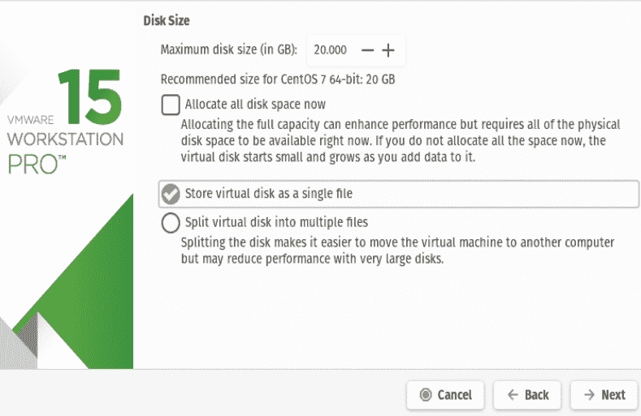

磁盘大小：最大磁盘大小 (GB): 20 - CentOS 7 64-bit 建议大小: 20 GB

分配所有空间：分配全部容量可以提高性能，如果现在不分配所有空间，虚拟磁盘将很小并随着你添加数据而增长。将虚拟磁盘存储为单个文件，将磁盘拆分为多个文件会使其移动到另一台计算机变得更容易，但对于大磁盘可能会降低性能。

| 设备 | 摘要 |
|---|---|
| 内存 | 2 GB |
| 处理器 | 1 |
| 硬盘 (SCSI) | 70 GB |
| CD/DVD (IDE) | 使用文件 `/home/tanvir` |
| 网络适配器 | 桥接（自动） |
| 网络适配器 2 | 桥接（自动） |
| 声卡 | 自动检测 |
| 打印机 | 已存在 |
| USB 控制器 | 已存在 |
| 显示器 | 自动检测 |
| 新硬盘 (SCSI) | 20 GB |
| 新硬盘 (SCSI) | 20 GB |

### 第 2 步

启动机器。

### 第 3 步

打开终端（或直接从主机 SSH 连接服务器）。

### 第 4 步

应用 `lsblk` 命令查看块设备。

```
=> lsblk
```

| NAME | MAJ:MIN | RM | SIZE | TYPE | MOUNTPOINT |
|---|---|---|---|---|---|
| sda | 8:0 | 0 | 70G | disk | |
| sda1 | 8:1 | 0 | 1G | part | /boot |
| sda2 | 8:2 | 0 | 69G | part | |
| centos-root | 253:0 | 0 | 45G | lvm | / |
| centos-swap | 253:1 | 0 | 2G | lvm | [SWAP] |
| centos-home | 253:2 | 0 | 22G | lvm | /home |
| sdb | 8:16 | 0 | 20G | disk | |
| sdc | 8:32 | 0 | 20G | disk | |
| sr0 | 11:0 | 1 | 4.3G | rom | |

有两个额外的块设备名为 `sdb` 和 `sdc`，使用这些驱动器制作 RAID 0。

### 第 5 步

安装 `mdadm` 包。

### 第 6 步

### 第 7 步

### 第 8 步

```
[root@server2]# fdisk /dev/sdb

欢迎使用 fdisk (util-linux 2.23.2)。

更改留在内存中，直到你决定写入。

在使用命令前请小心。

命令 (m 查看帮助): n

创建新分区

分区类型 (p, n, [l] 为扩展): p

分区编号 (1-4): 1

起始扇区 (默认 2048): 2048

最后扇区 (默认 +20971520): +20G

为 /dev/sdb 创建分区 1

/dev/sdb1 现在包含扇区 2048-20973596

命令 (m 查看帮助): t

选择分区 1

十六进制代码 (L 列出所有代码): fd

将分区类型 'Linux' 更改为 'Linux raid autodetect'

命令 (m 查看帮助): p

磁盘 /dev/sdb: 21.5 GB, 2147483640 bytes, 41943040 sectors

单位 = 1扇区 * 512 bytes = 512 bytes

扇区大小 (逻辑/物理): 512 bytes / 512 bytes

总扇区 (最小/最大): 512 bytes / 512 bytes

磁盘标签类型: dos

磁盘标识符: 0xc47f2b

设备     起始    结束  区块 Id 系统

/dev/sdb1 2048   41943096 41943048 fd Linux raid autodetect

命令 (m 查看帮助): w

分区表已更改！

调用 ioctl() 重新读取分区表。

同步磁盘。

[root@server2]#
```

### 第 9 步

对 `sdc` 执行相同步骤。

```
=> fdisk /dev/sdc
```

### 第 10 步

验证分区。

```
[root@server2 ~]# lsblk

NAME      MAJ:MIN SIZE TYPE MOUNTPOINT
sda       8:0    0 70G disk 
├─sda1   8:1    0  1G part /boot
└─sda2   8:2    0 69G part 
  └─centos-root 253:0  0 45G lvm /
  └─centos-swap 253:1  0 20G lvm [SWAP]
  └─centos-home 253:2  0 22G lvm /home
sdb       8:16   0 20G disk 
└─sdb1   8:17   0 20G part 
sdc       8:32   0 20G disk 
└─sdc1   8:33   0 20G part
sr0      11:0    1 4.3G 0 rom
```

### 第 11 步

使用 `mdadm` 进行检查。

```
[root@server2 ~]# mdadm --examine /dev/sd[b-c]1

mdadm: No md superblock detected on /dev/sdb1.
mdadm: No md superblock detected on /dev/sdc1.

[root@server2 ~]# 
```

### 第 12 步

创建 RAID md 设备。

```
=> mdadm --create /dev/md0 --level=stripe --raid-devices=2 /dev/sd[b-c]1
```

```
[root@server2 ~]#
mdadm --create /dev/md0 --level=stripe --raid-devices=2 /dev/sd[b-c]1
mdadm: Defaulting to version 1.2 metadata
mdadm: array /dev/md0 started.
[root@server2 ~]#
```

### 第 13 步

查看 RAID 0 设备的详细信息。

```
=> mdadm --detail /dev/md0
```

### 第 14 步

在文件系统上分配分区。

```
=> mkfs.ext4 /dev/md0
```

```
[root@server2 ~]# mkfs.ext4 /dev/md0

make2fs 1.42.0 (28-Dec-2013)

Filesystem label=
type Linux
Block size=4096 (log=2)
Fragment size=4096 (log=2)
Stride=128 blocks, Stripe width=256 blocks
262140 inodes, 10476544 blocks
53827 blocks (5.00%) reserved for the super user
First data block=0
Maximum filesystem blocks=2157969408
320 block groups
32768 groups per group, 32768 fragments per group
8192 inodes per group
Superblock stored on blocks:
  32768, 98304, 163848, 229376, 294912, 819200, 884736, 1605632, 2654208
  4096000, 7962624
Allocating group tables: done
Writing inode tables: done
Creating journal (32768 blocks): done
Writing superblocks and filesystem accounting information: done
```

### 第 15 步

挂载卷。

```
=> mkdir /mnt/raid0
=> mount /dev/md0 /mnt/raid0
```

### 第 16 步

检查挂载的卷。

```
=> df -h
```

```
[root@server2 ~]# df -h

Filesystem      Size  Used Avail Use% Mounted on
/dev/mapper/centos-root  45G  3.8G  42G  0% /
tmpfs           974M     0  974M  0% /dev/shm
tmpfs           991M  11M  981M  2% /run
tmpfs           991M     0  991M  0% /sys/fs/cgroup
/dev/sda1      1014M  166M  849M  17% /boot
/dev/mapper/centos-home  22G  39M  22G  1% /home
tmpfs           199M  12K  199M  1% /run/user/42
tmpfs           199M     0  199M  0% /run/user/0
/dev/md0        40G  49M  38G  1% /mnt/raid0

[root@server2 ~]#
```

### 第 17 步

使用 `lsblk` 检查块设备。

```
=> lsblk
```

```
[root@server2 ~]# lsblk

NAME        MAJ:MIN RM  SIZE RO TYPE  MOUNTPOINT
sda           8:0    0  70G  0 disk  
├─sda1        8:1    0  1G   0 part  /boot
└─sda2        8:2    0  69G  0 part  
  ├─centos-root 253:0  0  45G  0 lvm   /
  ├─centos-swap 253:1  0  20G  0 lvm   [SWAP]
  └─centos-home 253:2  0  22G  0 lvm   /home
sdb           8:16   0  20G  0 disk  
└─sdb1        8:17   0  20G  0 part  
  └─md0       9:0    0  40G  0 raid0 /mnt/raid0
sdc           8:32   0  20G  0 disk  
└─sdc1        8:33   0  20G  0 part  
  └─md0       9:0    0  40G  0 raid0 /mnt/raid0
sr0          11:0    1  4.3G  0 rom
```


## 在 CENTOS 中创建 RAID 1

RAID 0 虽然不具备容错能力，但它有一些优势：

- 它具有高性能
- 不会浪费空间
- 读写速度会很快

在虚拟机中设置 RAID 0：

- 要求：
  - 虚拟机
  - 两个磁盘
  - 互联网连接
  - 一个静态 IP 地址（如果你想 ssh 连接服务器）

### 第 1 步

在 centos7 虚拟机中添加两个 20GB 的磁盘。

## Tanvir Rahman

| 设备 | 摘要 |
| --- | --- |
| 内存 | 2 GB |
| 处理器 | 1 |
| 硬盘 (SCSI) | 70 GB `/home/tanvirrahman/vmware/raid0...cl1...` |
| CD/DVD (IDE) | 使用文件 `/tanvirrahm` |
| 网络适配器 | 桥接（自动） |
| 网络适配器 2 | 桥接（自动） |
| 声卡 | 自动检测 |
| 打印机 | 存在 |
| USB 控制器 | 存在 |
| 显示器 | 自动检测 |

磁盘文件
`/home/tanvirrahman/vmware/raid0/CentOS 7 64-bit (fresh image)-clvi`

容量
当前大小: 8.8 MB
最大大小: 70 GB
可用空间: 43.2 GB

磁盘信息
磁盘空间未为此虚拟机预分配。
虚拟机内容以单个文件形式存储。

磁盘工具
挂载卷。
虚拟机内容以单个文件形式存储。
磁盘空间未为此虚拟机预分配。
挂载卷。磁盘。

## UBUNTU & CENTOS 管理员

你想将其设置为多大？

| 设备 | 摘要 |
| --- | --- |
| 内存 | 2 GB |
| 处理器 | 1 |
| 硬盘 (SCSI) | 70 GB `/home/tanvirrahman/vmware/raid0...cl1...` |
| CD/DVD (IDE) | 使用文件 `/tanvirrahm` |
| 网络适配器 | 桥接（自动） |
| 网络适配器 2 | 桥接（自动） |
| 声卡 | 自动检测 |
| 打印机 | 存在 |
| USB 控制器 | 存在 |
| 显示器 | 自动检测 |

### 第 9 步

对 `sdc` 执行第 8 步

=>`fdisk /dev/sdc`

### 第 10 步

使用 `lsblk` 进行检查

## UBUNTU & CENTOS 管理员

## 第 1 步：在 CENTOS 7 中创建 RAID 5

在虚拟机中设置 RAID 5：

要求：
- 虚拟机
- 三块磁盘
- 网络连接
- 静态 IP 地址（如果你想 ssh 连接服务器）

### 第 1 步：在虚拟机中添加三块 20GB 磁盘

必须关闭虚拟机以减少内存占用。

### 第 2 步：启动机器

### 第 3 步：打开终端（或直接 ssh 到服务器）

### 第 4 步：应用 `lsblk` 命令查看块设备

=>`lsblk`

```
[root@localhost ~]# lsblk
NAME      MAJ:MIN RM RO TYPE MOUNTPOINT
sda       8:0    0  70G 0 disk
├─sda1   8:1    0  1G 0 part /boot
└─sda2   8:2    0  69G 0 part
  ├─centos-root 253:0 0  45G 0 lvm /
  ├─centos-swap 253:1 0  26G 0 lvm [SWAP]
  └─centos-home 253:2 0  22G 0 lvm /home
sdb       8:16   0  20G 0 disk
  └─sdb1   8:17   0  20G 0 part
sdc       8:32   0  20G 0 disk
  └─sdc1   8:33   0  20G 0 part
sdd       8:48   0  20G 0 disk
  └─sdd1   8:49   0  20G 0 part
sr0       11:0    1  4.3G 0 rom
```

有三个额外的设备 `sdb`、`sdc` 和 `sdd`，我们使用这三块硬盘来创建一个 raid 5。

### 第 5 步：安装 mdadm 包

```
=>yum update
=>yum install mdadm -y
```

### 第 6 步：检查软件包的版本

```
=>mdadm -version
```

### 第 7 步：使用 mdadm 检查硬盘

=>`mdadm --examine /dev/sd[b-d]`

```
[root@localhost ~]# mdadm --examine /dev/sd[b-d]
mdadm: No md superblock detected on /dev/sdb.
mdadm: No md superblock detected on /dev/sdc.
mdadm: No md superblock detected on /dev/sdd.
[root@localhost ~]#
```

### 第 8 步：为 RAID 创建分区

=>`fdisk /dev/sdb` (在该分区上创建 raid)

```
[root@server2 ~]# fdisk /dev/sdb
Welcome to fdisk (util-linux 2.23.2).
更改将仅保留在内存中，直到你决定写入它们。
在使用 write 命令前请要小心。
Command (m for help): t
Selected partition 1
Hex code (type L to list all codes): fd
Changed type of partition 'Linux' to 'Linux raid autodetect'
Command (m for help): P
Disk /dev/sdb: 21.2 GB, 2147483648 bytes, 41943040 sectors
Units = sector size of 1 = 512 bytes
Sector size (logical/physical): 512 bytes / 512 bytes
I/O size (alignment/optimal): 512 bytes / 512 bytes
Disk label: dos
Disk identifier: 0xc470f2b
Device     Start    End      Blocks Id System
/dev/sdb1 2048   41943039 4194091 fd Linux raid autodetect
Command (m for help): w
The partition table has been altered!
Calling ioctl() to re-read partition table.
Syncing disks.
[root@server2 ~]#
```

[查看块设备]

### 第 10 步：对 `sdc` 和 `sdd` 重复第 8 步

=>`fdisk /dev/sdc`
=>`fdisk /dev/sdd`

### 第 11 步：使用 `lsblk` 检查

=>`lsblk`

```
[root@localhost ~]# lsblk
NAME MAJ:MIN RM RO TYPE MOUNTPOINT
sda 8:0 0 70G 0 disk
├─sda1 8:1 0  1G 0 part /boot
└─sda2 8:2 0  69G 0 part
  ├─centos-root 253:0 0  45G 0 lvm /
  ├─centos-swap 253:1 0  26G 0 lvm [SWAP]
  └─centos-home 253:2 0  22G 0 lvm /home
sdb 8:16 0  20G 0 disk
  └─sdb1 8:17 0  20G 0 part
sdc 8:32 0  20G 0 disk
  └─sdc1 8:33 0  20G 0 part
sdd 8:48 0  20G 0 disk
  └─sdd1 8:49 0  20G 0 part
sr0 11:0    1  4.3G 0 rom
```

### 第 12 步：创建 RAID 设备

=>`mdadm --create /dev/md0 --level=5 --raid-devices=3 /dev/sdb /dev/sdc /dev/sdd`

### 第 13 步：查看 RAID 详情

=>`mdadm --detail /dev/md0`

### 第 14 步：格式化卷

=>`mkfs.ext4 /dev/md0`

### 第 15 步：挂载卷

=>`mkdir /mnt/raid`
=>`mount /dev/md0 /mnt/raid`

### 第 16 步：检查挂载的卷

=>`df -h`

## Tanvir Rahman

```bash
[root@localhost ~]# mdadm --examine /dev/sd[b-d]1
mdadm: No md superblock detected on /dev/sdb1.
mdadm: No md superblock detected on /dev/sdc1.
mdadm: No md superblock detected on /dev/sdd1.
[root@localhost ~]#
```

### 第 12 步

创建 RAID md 设备（带镜像）

=>`mdadm --create /dev/md0 --level=5 --raid-devices=3 /dev/sd[b-d]1`

```bash
[root@localhost ~]#
[root@localhost ~]# mdadm --create /dev/md0 --level=5 --raid-devices=3 /dev/sd[b-d]1
```

### 第 13 步

查看 RAID 0 设备的详细信息（注：原文此处为 RAID 0，但命令中创建的是 RAID 5）

```bash
=>mdadm -detail /dev/md0
```

### 第 14 步

使用此命令验证

```bash
=>mdadm -E /dev/sd[b-d]1 | grep raid5
```

```bash
root@localhost ~]# mdadm -E /dev/sd[b-d]1 | grep raid5
Raid Level : raid5
Raid Level : raid5
Raid Level : raid5
root@localhost ~]#
```

### 第 15 步

在文件系统上分配分区

```bash
=>mkfs.ext4 /dev/md0
```

```bash
[root@server2 ~]# mkfs.ext4 /dev/md0
mk2fs 1.42.9 (28-Dec-2013)
Filesystem label =
Os: Linux
Block size=4096 (log-2)
Fragment size=4096 (log-2)
Stripe=328 blocks, Stripe width=256 blocks
262144 inodes, 24654 blocks reserved for the super user
52387 blocks (5.0%) reserved for the block0
First data block=0
Maximum filesystems=2157969408
329 groups
32768 blocks per group, 32768 fragments per group
8192 indexes per group
Superblock backup stored on blocks:
32768, 98304, 163840, 229376, 294932, 819200, 884736, 1605632, 2654208,
4096000, 796264
Allocating group tables: done
Writing inode tables: done
Creating Journal (32768 blocks): done
Writing superblocks and filesystem accounting information: done
```

### 第 15 步 (续)

挂载卷

=>`mkdir /mnt/raid5`
=>`mount /dev/md0 /mnt/raid5`

### 第 17 步

检查挂载的卷

=>`df -h`

# UBUNTU CENTOS 管理员

```bash
[root@localhost]# df -h
Filesystem      Size Avail Use% Mounted on
/dev/mapper/centos-root 45G 3.6G 42G 8% /
devtmpfs        974M 0 974M 0% /dev
tmpfs           991M 0 991M 0% /dev
tmpfs           991M 11G 980M 2% /sys/fs/group
/dev/sda1        101G 166M 849M 17% /boot
/dev/mapper/centos-home 22G 33M 22G 1% /home
tmpfs           199M 4.0K 199M 1% /run/user/42
tmpfs           199M 28K 199M 1% /run/user/0
/dev/sdb0        4.3G 4.3G 0 100% /run/media/root/CentOS 7 x86_64
/dev/md0         40G 49M 38G 1% /mnt/raid5
[root@localhost]#
```

使用 `lsblk` 检查块设备

```bash
[root@localhost]# lsblk
NAME             MAJ:MIN RM SIZE RO TYPE MOUNTPOINT
sdb               8:0    0 70G  disk
sda               8:0    0 1G  part /boot
└-sda1            8:1    0 69G part 
└-centos-root 253:0  0 45G lvm /
└-centos-swap 253:1  0 26G lvm [SWAP]
└-centos-home 253:2  0 22G lvm /home
sdb               8:16   0 20G disk
sdb1              8:17   0 20G part
└-md0             9:0    0 40G raid5 /mnt/raid5
sdc               8:32   0 20G disk
sdc1              8:33   0 20G part
└-md0             9:0    0 40G raid5 /mnt/raid5
sdd               8:48   0 20G disk
sdd1              8:49   0 20G part
└-md0             9:0    0 40G raid5 /mnt/raid5
sr0               11:0   0 4.3G /run/media/root/CentOS 7 x86_64
[root@localhost]#
```

## 在 CENTOS 7 中创建 RAID 10

要求：
- 虚拟机
- 四块硬盘（最小）
- 网络连接
- 静态 IP 地址（如果你想 ssh 到服务器）

### 第 1 步

在虚拟机中添加四个 20GB 的硬盘

### 第 2 步

启动机器。

### 第 3 步

从服务器打开终端

### 第 4 步

应用 `lsblk` 命令查看块设备

```bash
[root@localhost]# lsblk
NAME        MAJ:MIN RM RO TYPE MOUNTPOINT
sda         8:0    0 70G disk
sda1        8:1    0 1G part /boot
sda2       8:2    0 69G part
-centos-root 253:0  0 45G /
-centos-swap 253:1  0 26G [SWAP]
-centos-home 253:2  0 22G /home
sdb         8:16   0 20G disk
sdb1        8:17   0 20G part
sdc         8:32   0 20G disk
sdd         8:48   0 20G disk
sde         8:64   0 20G disk
sr0         11:0   0 4.3G /run/media/root/CentOS 7 x86_64
```

使用 `sdb`、`sdc` 和 `sdd` 这三个块设备制作 raid 5。

### 第 5 步

安装 `mdadm` 包

```bash
=>yum update
=>yum install mdadm -y
```

### 第 6 步

检查软件包的版本

```bash
=>mdadm --version
```

### 第 7 步

使用 mdadm 检查硬盘

```bash
=>mdadm --examine /dev/sd[b-e]
```


# 第 8 章：为 RAID 创建分区

```bash
fdisk /dev/sdb
```

创建分区的说明：
1. 按 `n` 创建新分区。
2. 然后选择 `p` 主分区。
3. 下一步选择分区号 `1`。
4. 按回车给出默认值。
5. 下一步按 `p` 打印分区。

创建 Linux 自动分区的说明：
1. 按 `l` 列出所有类型。
2. 输入 `t` 选择分区。
3. 选择 `fd` (Linux auto) 并回车。
4. 然后再次使用 `p` 打印我们做的更改。
5. 使用 `w` 写入更改。

## 示例输出

```bash
[root@server2 ~]# fdisk /dev/sdb

Welcome to fdisk (util-linux 2.23).

更改将留在内存中，直到你决定写入。
在使用 write 命令前请小心。

设备不包含识别的分区表。
正在创建标识符为 0xc470f2b 的 dos 标签。

Command (m for help): n
Partition type:
  p primary (0 primary, 0 extended, 4 free)
Select (default p): p
Partition number (1-4, default 1):
First sector (2048-419439, default 2048):
Using default value 2048
Last sector, +sectors or +size(K,M,G) (2048-419439, default 419439):
Using default value 419439
分区 1 类型为 Linux，大小为 20 GB

Command (m for help): p
Disk /dev/sdb: 21.5 GB, 2147483648 bytes, 4194030 sectors
Units = sectors of 1 * 512 = 512 bytes
Sector size (logical/physical): 512 bytes / 512 bytes
I/O page size (optimal): 512 bytes / 512 bytes
Disk label type: dos
Disk identifier: 0xc470f2b

| Device | Boot | Blocks | Id | System |
|---|---|---|---|---|
| /dev/sdb1 | 2048 | 41943039 | 20 | Linux |

分区表已更改。
调用 ioctl() 重新读取分区。
```

# 第 9 章：对 `sdc`、`sdd`、`sde` 执行第 8 步

```bash
fdisk /dev/sdc
fdisk /dev/sdd
fdisk /dev/sde
```

# 第 10 章：使用 `lsblk` 检查

```bash
[root@localhost]# lsblk

NAME        MAJ:MIN RM SIZE RO TYPE MOUNTPOINT
sda         8:0    0 70G disk
sda1        8:1    0 1G part /boot
sda2       8:2    0 69G part
├─centos-root 253:0  0 45G /
├─centos-swap 253:1  0 26G [SWAP]
└─centos-home 253:2  0 22G /home
sdb         8:16   0 20G disk
sdb1        8:17   0 20G part
sdc         8:32   0 20G disk
sdd         8:48   0 20G disk
sde         8:64   0 20G disk
sr0         11:0   0 4.3G /run/media/root/CentOS 7 x86_64
```

# 第 11 章：创建 RAID 10 阵列

```bash
mdadm --create /dev/md0 --level=10 --raid-devices=4 /dev/sd[b-e]1
```

```bash
[root@localhost ~]# mdadm --create /dev/md0 --level=10 --raid-devices=4 /dev/sd[b-e]1
mdadm: Defaulting to version 1.2 metadata
md: array /dev/md0 started.
[root@localhost ~]# 
```

# 第 12 章：查看 RAID 设备的详细信息

```bash
mdadm --detail /dev/md0
```

```bash
[root@localhost ~]# mdadm --detail /dev/md0
/dev/md0:
Version : 1.2
Creation Time : Thu Sep 5 09:24:51 2019
Raid Level : raid10
Array Size : 41906176 (39.96 GiB 42.91 GB)
Used Size : 20953888 (19.98 GiB 21.46 GB)
Raid Devices : 4
Total Devices : 4
Persistence : Superblock is persistent
Update Time : Thu Sep 5 09:25:49 2019
State : clean, resyncing
Active Devices : 4
Working Devices : 4
Failed Devices : 0
Spare Devices : 0
Layout : near=2
Chunk Size : 512K
Consistency Policy : resync
Resync Status : 28% complete
Name : localhost.localdomain:0 (local to host localhost.localdomain)
UUID : 87ff83b:0213c1c1:bc932f37:1ae1b93d
Events : 4

| Number | Major | Minor | RaidDevice | State | Device |
|---|---|---|---|---|---|
| 0 | 8 | 17 | 0 | active sync set-A | /dev/sdb1 |
| 1 | 8 | 33 | 1 | active sync set-B | /dev/sdc1 |
| 2 | 8 | 49 | 2 | active sync set-A | /dev/sdd1 |
| 3 | 8 | 65 | 3 | active sync set-B | /dev/sde1 |
```

# 第 13 章：验证 RAID 成员

```bash
mdadm -E /dev/sd[b-e]1 | grep raid10
```

```bash
[root@localhost raid10]# mdadm -E /dev/sd[b-e]1 | grep raid10
Raid Level : raid10
Raid Level : raid10
Raid Level : raid10
Raid Level : raid10
[root@localhost raid10]# _
```

# 第 14 章：在文件系统上创建分区

```bash
mkfs.ext4 /dev/md0
```

# 第 15 章：挂载卷

```bash
mkdir /mnt/raid10
mount /dev/md0 /mnt/raid10
```

```bash
[root@localhost ~]# mkdir /mnt/raid10
[root@localhost ~]# mount /dev/md0 /mnt/raid10/
[root@localhost ~]# cd /mnt/raid10/
[root@localhost raid10]# ls
lost+found
[root@localhost raid10]# 
```

# 第 16 章：检查挂载的卷

```bash
df -h
```

# 第 17 章：使用 `lsblk` 检查块设备

```bash
lsblk
```

```bash
[root@localhost raid10]# lsblk
NAME      MAJ:MIN SIZE RO TYPE MOUNTPOINT
sda       8:0    70G 0 disk 
├─sda1   8:1     1G 0 part /boot
└─sda2   8:2    69G 0 part 
  ├─centos-root 253:0 45G 0 disk 
  ├─centos-swap 253:1 26G 0 svm [SWAP]
  └─centos-home 253:2 22G 0 svm /home
sdb      8:16   20G 0 disk
  ├─sdb1   8:17   20G 0 part
  └─md0   9:0    40G 0 raid10 /mnt/raid10
sdc      8:32   20G 0 disk
  ├─sdc1   8:33   20G 0 part
  └─md0   9:0    40G 0 raid10 /mnt/raid10
sdd      8:48   20G 0 disk
  ├─sdd1   8:49   20G 0 part
  └─md0   9:0    40G 0 raid10 /mnt/raid10
sde      8:64   20G 0 disk
  ├─sde1   8:65   20G 0 part
  └─md0   9:0    40G 0 raid10 /mnt/raid10
sr0      11:0    3G 0 loop
[root@localhost raid10]# _
```

# Linux 进程管理

## systemd

`systemd` 是一个 Unix 程序，它派生所有其他进程。`systemd` 替换了 `Init` 进程。它是启动时运行的进程，管理系统上的所有进程。

## 常见后台进程（守护进程）

| 进程名称 | 描述 |
|---|---|
| `cron` / `anacron` | `cron` 是一个任务调度器，允许用户在特定时间调度任务。`anacron` 是 `cron` 的一个版本，处理计算机关闭期间错过的任务。 |
| `dhcp` | 用于自动向网络设备分配 IP 地址的协议。 |
| `httpd` | 通过 HTTP 提供网页内容的 Web 服务器进程。 |
| `ntpd` | 网络时间协议守护进程，用于同步计算机系统的时钟。 |
| `sshd` | 安全 Shell 守护进程，允许远程登录服务器。 |
| `syslog` / `syslogd` | 系统日志服务，用于收集和记录系统消息。 |
| `ftpd` | 文件传输协议守护进程，用于在客户端和服务器之间传输文件。 |
| `maild` / `postfix` / `sendmail` | 邮件传输代理，用于路由、发送和接收电子邮件。 |
| `mysqld` | MySQL 数据库管理系统的守护进程。 |
| `openssl` | OpenSSL 库的守护进程，用于协商安全连接。 |

## 作业控制：前台与后台

当程序以前台运行时，我们使用 `CTRL+Z` 中断程序，然后使用 `bg` 命令在后台恢复该程序。

```bash
vagrant@localhost ~$ ping 8.8.8.8 > out1.txt
^Z
[1]+ Stopped ping 8.8.8.8 > out1.txt
vagrant@localhost ~$ bg
[1]+ ping 8.8.8.8 > out1.txt &
vagrant@localhost ~$ jobs
[1]+ Running ping 8.8.8.8 > out1.txt &
vagrant@localhost ~$ 
```

在将程序发送到后台后，如果我们想查看它们的活动，我们使用 `jobs` 命令来查看它们的运行状态。

```bash
[vagrant@localhost ~]$ ping 8.8.8.8 > out1.txt &
[1] 23599
[vagrant@localhost ~]$ ping 8.8.4.4 > out2.txt &
[2] 23600
[vagrant@localhost ~]$ jobs
[1]- Running      ping 8.8.8.8 > out1.txt &
[2]+ Running      ping 8.8.4.4 > out2.txt &
[vagrant@localhost ~]$ 
```

### 将进程从后台移到前台

要将任何后台进程带回前台，我们使用 `fg` 命令。
如果只输入 `fg`，它会将上一个后台作业带到前台。要将特定作业带到前台，我们在使用 `fg` 命令后使用作业 ID。

例如：
```bash
fg %1
fg %2
```

## 进程管理工具

对于 Linux 操作系统，有很多优秀的性能监控工具。下面解释了其中一些：

### `ps`

与进程管理相关最常用且最简单的命令是 `ps` 命令。通过 `ps` 命令，你可以查看当前系统上正在运行的进程列表。它会显示进程名称和进程 ID (PID)。

```bash
[vagrant@localhost ~]$ ps
PID TTY           TIME CMD
4613 pts/0       00:00:00 bash
23890 pts/0    00:00:00 ps
[vagrant@localhost ~]$ 
```

通过 `ps` 命令，我们可以尝试不同的开关，例如如果我们使用 `ps -e`，我们可以看到系统中的所有进程，或者你也可以使用此命令查看一个分页列表：
```bash
ps -e | more
```

```bash
[vagrant@localhost ~]$ ps -e | more
PID TTY TIME CMD
1 ? 00:00:03 systemd
2 ? 00:00:08 kthreadadd
3 ? 00:00:08 ksoftirqd/0
5 ? 00:00:00 worker/2:0
6 ? 00:00:00 worker/u2:0
7 ? 00:00:00 migration/0
8 ? 00:00:00 rcu_bh
9 ? 00:00:02 rcu_sched
10 ? 00:00:00 lru-add-drain
11 ? 00:00:00 watchdog/0
13 ? 00:00:00 kdevtmpfs
14 ? 00:00:00 netns
15 ? 00:00:00 khuntaskd
16 ? 00:00:00 writeback
17 ? 00:00:00 integrityityd
18 ? 00:00:00 bioset
```

如果我们想以完整格式列出输出，应该使用 `ps -ef` 命令。

```bash
[vagrant@localhost ~]$ ps -ef | more
UID PID PPID C STIME TTY TIME CMD
root 1 0 0 00:00:03 ? /usr/lib/systemd/systemd --system
root 2 0 0 00:00:08 ? kthreadadd
root 3 0 0 00:00:08 ? ksoftirqd/0
root 5 0 0 00:00:00 ? worker/2:0
root 6 0 0 00:00:00 ? worker/u2:0
root 7 0 0 00:00:00 ? migration/0
root 8 0 0 00:00:00 ? rcu_bh
root 9 0 0 00:00:02 ? rcu_sched
root 10 0 0 00:00:00 ? lru-add-drain
root 11 0 0 00:00:00 ? watchdog/0
root 13 0 0 00:00:00 ? kdevtmpfs
root 14 0 0 00:00:00 ? netns
root 15 0 0 00:00:00 ? khuntaskd
root 16 0 0 00:00:00 ? writeback
root 17 0 0 00:00:00 ? integrityd
root 18 0 0 00:00:00 ? bioset
```


如果我们想以完整格式列出输出，应该使用这些命令：
`ps -ef`。

或者你可以使用 `ps -el`
你也可以使用 `ps -ax`
或者 `ps -aux`

# 使用 ps 按用户查找进程

通过 `ps` 命令查找进程是可能的，因此作为管理员，你可以监控其他用户在做什么。

```bash
[vagrant@localhost ~]$ ps -u vagrant
PID TTY TIME CMD
4612 ? 00:00:00 sshd
4613 pts/0 00:00:00 bash
23954 pts/0 00:00:00 ps
[vagrant@localhost ~]$
```

在图中显示了三个进程。其中一个

# UBUNTU CENTOS 管理员

`uptime` 命令为我们提供了关于服务器运行了多久的信息，并提供了关于负载平均值的详细信息，此输出开头为：
1) 当前时间
2) 运行时间（服务器运行了多久）
3) 当前登录用户数
4) 负载平均值

最后是最重要的参数。

| 数字 | 描述 |
| :--- | :--- |
| 第一个数字 | 1分钟的负载平均 |
| 第二个数字 | 过去5 分钟的负载平均 |
| 第三个数字 | 过去15 分钟的负载平均 |

负载平均值显示了等待处理的进程数量。在这种情况下，数字 1 表示 CPU 被完全占用。如果服务器是双核或双 CPU，那么理想数字将是 2。

```bash
[vagrant@localhost ~]$ uptime
06:33:58 up 4:14, 1 user, load average: 0.00, 0.01, 0.05
[vagrant@localhost ~]$
```

## free

`free` 命令提供当前 RAM 和交换空间的信息。交换空间越少越好，因为交换是不利的。交换基本上是使用物理空间来补偿内存不足，这比实际 RAM 慢得多。还有缓存内存和缓冲区内存。缓存内存是可以立即释放的内存。缓冲区内存是进程使用的内存，在不终止进程无法释放。

```bash
[vagrant@localhost ~]$ free
              total        used        free      shared  buff/cache   available
Mem:        1014972       76908      636732        6792      301332      765736
Swap:       2097148           0     2097148
[vagrant@localhost ~]$
```

## Top

最有用且常用的提供几乎所有信息的命令是 `top` 命令。

```bash
top - 06:46:41 up 4:26, 1 user, load average: 0.15, 0.05, 0.06
Tasks: 79 total, 1 running, 78 sleeping, 0 stopped, 0 zombie
%Cpu(s): 0.3 us, 0.3 sy, 0.0 ni, 99.3 id, 0.0 wa, 0.0 hi, 0.0 si, 0.0 st
KiB Mem: 1014972 total, 635976 free, 77348 used, 301648 buff/cache
KiB Swap: 2097148 total, 2097148 free, 0 used.
```

处于睡眠模式，最后一个是僵尸进程（僵尸进程是指已停止但无法向其父进程提供退出状态的进程）。

第三行：第三行包含这些值

| 表头名称 | 描述 |
|--- | --- |
| us | 代表用户空间。它代表用户空间中的 CPU 活动。这些活动实际上是由用户名的不同命令启动的。 |
| sy | 代表系统空间中的 CPU 活动。这些实际上是内核例程。它们通常代表守护进程执行工作。 |
| ni | 表示处理低优先级进程所花费的时间 |
| id | CPU 空闲。高值实际上显示系统未在执行任何操作 |
| wa | 它表示 CPU 等待输入（连接到系统的 I/O 硬件，如硬盘、键盘、鼠标）的时间 |
| hi | CPU 用于与硬件通信的时间。例如，如果你从闪存器读取数据，此时该值将较高 |
| si | CPU 用于与软件通信的时间。通常情况下，它应该很低 |
| st | 此参数表示虚拟化监视程序从虚拟机中窃取的时间。如果你的系统没有虚拟机，此值为 0 |

**第四行：** 它显示 `free` 命令的确切输出（当前系统的内存统计）

**第五行：** 这部分是 `top` 窗口的下半部分。它提供了关于 CPU 使用率最活跃的进程详细信息。

| 表头名称 | 描述 |
|--- |--- |
| PID | 每个进程都有唯一的进程 ID（称为 PID），进程 ID 非常重要。例如，如果你想杀死一个进程，你需要提供该进程的进程 ID。 |
| USER | 使用该进程的用户名。许多进程以 root 身份运行，因此你会经常看到它。 |
| PR | 显示进程的优先级。这个数字表示进程何时再次获得 CPU 周期。值越低，优先级越高。优先级较高的进程将更早获得 CPU 周期，而低优先级进程将较晚获得 CPU 周期。 |
| NI | 进程的 NICE 值。通过 NICE 值的帮助，我们可以更改进程的优先级 |
| VIRT | 进程占用的内存总量 |
| RES | 进程当前正在使用的内存大小 |
| SHR | 进程与其他进程共享的共享内存量 |
| S | 显示进程的状态<br>-'R' 表示它正在运行<br>-'S' 表示它处于睡眠模式<br>-'Z' 表示它是一个僵尸进程<br>-'T' 表示已停止，可能是由作业控制信号停止<br>-'D' 表示不可中断的睡眠 |
| %CPU | 上一个轮询周期（通常为 5 秒）使用的 CPU 数量 |
| %MEM | 上一个轮询周期（通常为 5 秒）使用的内存量 |
| TIME+ | 表示进程自启动以来使用的总 CPU 时间 |
| COMMAND | 这是启动该进程的命令 |

## 杀死进程的命令

有不同的命令来终止进程

| 进程终止命令 | 描述 |
|---|---|
| `kill` | 最常用的命令，带有数值参数 (SIGKILL)，如果没有指定信号，则将向进程发送默认信号。 |
| `killall` | 如果我们想杀死多个进程，可以使用 `killall` 命令。例如，如果我们使用 `killall httpd`，它将杀死所有 Apache 服务器的实例。 |

我们可以使用 `top` 命令来杀死进程。在 `top` 交互界面上按下 `k`。系统会提示你输入进程的 PID。输入后，你必须输入要发送给进程的信号。指定数值后它将终止该进程。

`pkill` 是根据进程的其他信息终止进程的命令。它允许管理员通过详细信息查找进程，例如：
`pkill -U 501` 将杀死所有属于用户 501 的进程。

# 进阶 Linux 进程管理

Linux 操作系统有一些高级的进程监控工具。

下面解释了其中一些：

## htop

大多数熟悉 Linux 的系统管理员都使用过 `TOP` 命令行工具来查看哪个进程占用了最多的 CPU 或内存。有一个名为 `htop` 的类似工具，对于普通任务来说用得多。它是交互式的、实时的，最重要的是它非常用户友好，你可以一眼看出 CPU 利用率。

但要使用 `htop` 工具，我们必须先安装它。因为默认情况下系统中没有安装。

**在 Linux 中安装 htop 的步骤（使用不同的包管理器）：**

### Ubuntu

```bash
sudo apt install htop
```

### CentOS

在 CentOS 中安装，我们只需要添加 EPEL 仓库，这样 `yum` 就能找到它。

```bash
sudo yum -y install epel-release
sudo yum -y update
sudo yum -y install htop
```

安装成功后，我们必须输入 `htop`，应该能看到状态：

| PID | USER | VIRT | RES | CPU | COMMAND |
|---|---|---|---|---|---|
| 947 | root | 8561 | 3877 | 6.6 | / |
| 20736 | root | 31960 | 14904 | 5.3 | - |
| 1367 | root | 25840 | 25034 | 4.4 | - |
| 25199 | root | 25840 | 25034 | 4.3 | - |
| 25102 | root | 6736 | 6164 | 2.1 | - |
| 10544 | root | 12120 | 826 | 1.5 | - |
| 10588 | root | 8100 | 7460 | 1.3 | - |
| 10599 | root | 8100 | 7460 | 1.3 | - |
| 10555 | root | 8960 | 7324 | 1.1 | - |
| 10638 | root | 7184 | 7224 | 1.2 | - |
| 25115 | root | 6664 | 6156 | 1.0 | - |
| 25118 | root | 6696 | 6156 | 1.0 | - |

它看起来像 `top` 命令，但更具交互性和用户友好。

让我们聊聊 `htop` 的每个选项。

1. 第一个选项是 CPU，显示 CPU 利用率并带有图表模式。
2. 第二个选项是内存，显示实际使用的内存。
3. 第三个选项是系统使用的交换空间。
4. 右侧的下一个选项是任务。它显示总任务数、线程和运行中的任务。
5. 下一个选项显示系统的负载平均（Load average）。
6. 右侧显示服务器的运行时间（Uptime），显示服务器运行的时间。

显示处理后的状态：

| 状态码 | 含义 |
|---|---|
| `R` | 表示正在运行 |
| `S` | 表示处于睡眠模式 |
| `Z` | 表示僵尸进程 |
| `T` | 表示停止，可能是被作业控制信号停止 |
| `D` | 表示不可中断睡眠 |

| 列名 | 描述 |
|---|---|
| `%CPU` | 上一个轮询周期（通常为 5 秒）所使用的 CPU 百分比 |
| `%MEM` | 上一个轮询周期（通常为 5 秒）所使用的内存百分比 |
| `TIME+` | 表示该进程自启动以来已使用的 CPU 时间总和 |
| `COMMAND` | 这是启动该进程的命令 |

最有用的选项是底部的选项。屏幕底部有 10 个选项。

| 名称 | 描述 |
|---|---|
| `F1` | 帮助选项。它包含了其他所有选项的描述和短代码。 |
| `F2` | 设置选项。通过此选项你可以自定义 `htop` 工具的外观。你还可以通过此选项设置输出颜色以及你所需的选项。你可以设置哪些列应该显示，哪些列不显示。 |
| `F3` | 通过此选项你可以搜索特定的进程，只需输入 `F3` 和进程名称即可找到它。 |
| `F4` | 你可以使用此命令过滤进程，如果你输入进程名称，它将显示所有具有相同命令名称的进程。 |
| `F6` | 排序选项。你可以根据不同的选项对进程排序。你可以根据 PID、USER、优先级、时间等排序。 |
| `F7` | 用于降低任何进程的 Nice 值，Nice 值越低，优先级越高。 |
| `F8` | 用于增加任何进程的 Nice 值，Nice 值越高，优先级越低。 |
| `F9` | 它是 `kill` 命令。你选择一个进程并按 `F9`，它将向你显示想要发送给该进程的信号列表。这就是你如何杀死任何进程。 |
| `F10` | `htop` 的退出命令。 |

你也可以像使用 `top` 命令一样，通过命令按用户过滤进程。

```bash
htop -u <username>
```

## Fuser

`fuser` 命令基本上用于识别使用文件、目录或套接字的进程。该工具基本上显示使用作为命令参数传递的文件的进程 PID。假设你被分配了一个任务来识别使用特定文件的进程，`fuser` 命令让你根据进程所处的文件（或目录、套接字）来识别它们。对于块特殊设备，该命令列出使用该设备上任何文件的进程。不仅如此，该工具还允许你杀死这些进程，因此你不需要单独使用 `kill` 或 `killall` 命令。

`fuser` 命令输出显示进程 PID 列表，后跟着一个字母，表示进程如何使用文件。因为 `fuser` 命令不仅显示进程，还显示访问类型。

每种访问类型由字母表示：

| 项目 | 描述 |
|---|---|
| `c` | 将文件作为当前目录。 |
| `e` | 将文件作为程序的执行对象。 |
| `r` | 将文件作为根目录。 |
| `m` | 将文件作为共享库（或其他加载对象）。 |

> [记住 Linux 将一切都视为文件]

假设你想查看哪个进程正在使用根目录：

```bash
fuser /
```

```bash
root@localhost vagrant # fuser /
1rc 2rc 3rc 4rc 5rc 6rc 7rc 8rc 9rc 10rc 11rc 14rc
15rc 16rc 17rc 18rc 19rc 20rc 21rc 22rc 23rc 24rc 25rc 26rc 33rc 34rc
35rc 36rc 37rc 38rc 39rc 40rc 41rc 42rc 43rc 44rc 45rc 46rc 47rc 48rc 49rc 50rc
51rc 52rc 53rc 54rc 55rc 56rc 57rc 58rc 59rc 60rc 61rc 62rc 63rc 64rc 65rc
66rc 67rc 68rc 69rc 70rc 71rc 72rc 73rc 74rc 75rc 76rc 77rc 78rc 79rc 80rc
81rc 82rc 83rc 84rc 85rc 86rc 87rc 88rc 89rc 90rc 91rc 92rc 93rc 94rc 95rc 96rc 97rc 98rc 99rc 100rc
101rc 102rc 103rc 104rc 105rc 106rc 107rc 108rc 109rc 110rc 111rc 112rc 113rc 114rc 115rc 116rc 117rc 118rc
root@ vagrant]#
```

但这只显示了 PID，而且很难理解。所以我们添加冗余标志 `-v` 让结果现在包含更多信息：

```bash
root@localhost vagrant # fuser -v /
USER PID ACCESS COMMAND
root kernel mount /
root 1rc.. systemd
root 2rc.. kthread
root 3rc.. ksoftirqd/0
root 5rc.. worker/0:0
root 6rc.. worker/u2:0
root 7rc.. migration/0
root 8rc.. rcu_bh
root 9rc.. rcu_sched
root 10rc.. lru-add-drain
root 11rc.. watchdog/0
root 14rc.. netns
root 15rc.. khuntaskd
root 16rc.. writeback
root 17rc.. integrity
root 18rc.. bioset
root 19rc.. bioset
root 20rc.. bioset
root 21rc.. kblockd
root 22rc.. md
root 23rc.. edac-poller
root 24rc.. watchdog
root 26rc.. worker/u2:1
root 33rc.. kswap0
root 34rc.. ksmsd
root 35rc.. khugepage
root 36rc.. crypto
root 44rc.. throttled
root 45rc.. kmpath_rdacad
root 46rc.. kaluad
```

### 杀死进程

假设你想知道哪个进程正在使用特定的 `file.txt`。例如，创建一个 `ping.txt` 文件并存储 `ping www.google.com` 的输出：

```bash
ping www.google.com > ping.txt &
```

现在由 `ping` 命令创建的进程正在使用该文件，让我们用 `fuser` 命令检查一下：

```bash
fuser -v ping.txt
```

```bash
[vagrant@localhost ~]$ ping 8.8.8.8 >ping.txt &
[1] 4882
[vagrant@localhost ~]$ sudo fuser -v ping.txt
               USER PID ACCESS COMMAND
/home/vagrant/ping.txt:
               vagrant         4882 F.... ping
[vagrant@localhost ~]$ |
```

用于列出进程号和进程的用户登录名。

机器无法逃逸或篡改宿主机。这就是为什么虚拟机是测试应用程序的完美平台。即使是不同的服务器也可以安装在单个宿主机上。

# 虚拟机分类

## 系统虚拟机

系统虚拟机模拟真实计算机的所有属性并共享宿主机的物理资源。它的虚拟化技术由一种名为 `hypervisor`（虚拟机监控器）的软件提供。`hypervisor` 可以运行在操作系统之上，也可以运行在硬件之上。

## 进程虚拟机

进程虚拟机专门用于运行单个应用程序。当应用程序不使用时，该虚拟机就不存在。这种虚拟机主要用于运行与底层操作系统不兼容的程序。

# Hypervisor

## 1 型虚拟机

属于 1 型的 `hypervisor` 软件与物理硬件直接接触。对硬件的直接处理提高了运行在其上的客系统的效率和性能。这种虚拟化也称为裸金属虚拟机监控器。它们主要用于数据中心、云环境或企业。

- Oracle OVM
- SPARC
- Hyper-V
- KVM

## 2 型虚拟机

第 2 型虚拟化在硬件之上多了一个层，客操作系统共享硬件，但访问物理资源需要宿主机操作系统的权限。这基本上增加了一个额外的复杂性。

为什么 1 型的性能优于 2 型：

- VirtualBox
- VMware
- QEMU

# 容器


当我们第一次读到容器时，我们认为容器和虚拟机是一回事。但事实上它们并不完全相同，容器不是同一个概念。1979 年，UNIX 为操作系统添加了一个名为 `chroot` 的服务。它提供了一个运行应用程序和服务的隔离环境。2008 年，Linux 引入了称为 `LXC` 的 Linux 容器，现在仍在使用，这是一个为进程监控创建隔离环境的流行开源应用。2013 年，`DOCKER` 公司将其引入了视野。Docker 容器具有强大的应用程序编程接口 (API)、CLI、高效的模型和集群管理。

与虚拟机相比，Docker 平台将资源的抽象从硬件级提升到了操作系统级。这允许实现容器的各种优势，例如：应用程序的可移植性、基础设施分离和自包含的微服务。换句话说，虚拟机抽象了整个服务器，而容器抽象了操作系统内核。这是一种完全不同的虚拟化方法，并产生更快、更轻量级的实例，因此核心概念是 Docker 不通过独立的操作系统来隔离环境。

## 容器的实现 vs 虚拟机实现

你可以同时集成 `hypervisor` 和 `docker` 以获得更好的资源利用率。

## 为什么使用 Docker 而不是虚拟机

部署 Docker 的主要原因是硬件资源的高效利用。如果我们不使用任何虚拟化，大多数服务器的硬件资源利用率为 5% 到 10%。但通过适当的虚拟化技术，我们可以提高负载密度。

## 但也有问题

第一个问题是可移植性。当你尝试将应用程序从一个位置迁移到另一个位置时，我们必须传输整个操作系统，而且运行在 `VMware` 上的操作系统无法原生运行在 `Virtualbox` 上，这完全不可移植。

另一个问题是资源浪费，当你在服务器上部署应用程序时，即使是在虚拟机上，操作系统本身就需要大量的资源。这是硬件资源的极大浪费。你会发现你浪费了大部分资源仅仅在操作系统上。在 Docker 中，你不需要那样做。

***

## 创建 UBUNTU 虚拟服务器

我们可以使用 `KVM`、`libvirt` 来创建一个虚拟服务器。

### 安装软件包

如果你在 ubuntu 中：

```bash
sudo apt install kvm libvirt-bin virt-manager virt-viewer virt-top virtwhat
```

如果你在 CentOS/RedHat 中：

```bash
sudo yum groupinstall "virtualization"
```

### 安装操作系统

```bash
virt-install -name=<name_of_os> -vcpus=<how_many_cpu_use> -memory=<ram_size> -cdrom=<path_of_the_iso> --disk size=<how_many_disk_space_you_allocate> --os-variant='debian/arch/centos<choose_the_flavour>'
```

```bash
virt-install -name=my_os -vcpus=1 -memory=2048 -cdrom=<path_of_the_iso> --disk size=5 --os-variant='debian/arch/centos'
```

之后虚拟机将启动。你可以使用此命令查找操作系统的详情：

```bash
osinfo
```

> **重要提示**
>
> 你刚刚安装的操作系统将存储在 `/home/share/libvirt/images`。因此，如果你想完全删除操作系统，必须手动删除文件夹内的文件。查找所有已安装操作系统的列表：

```bash
virsh list
```

启动一个虚拟机：

```bash
virsh start <VM_name>
```

关闭虚拟机：

```bash
virsh shutdown <VM_name>
```

强制关闭虚拟机：

```bash
virsh destroy <VM_name>
```

删除虚拟机：

```bash
virsh undefine <VM_name>
```

***

## APACHE WEB 服务器

Web 服务器是通常用于存储网站的计算机，以便人们可以在互联网上访问它们。存储在 Web 服务器上的文件由客户端计算机上的浏览器读取。浏览器与 Web 服务器通信，从互联网为你获取信息。Web 服务器可以同时与多台计算机通信。计算机硬件在服务器中起着至关重要的作用。服务器快慢取决于处理器的速度。专用计算机用于这种服务目的。还需要一个程序来执行此操作。该程序被称为 Web 服务器。

所以 Web 服务器实际上是运行服务器软件的硬件。这种软件程序被称为守护进程（`daemon`）。它们在后台运行。

现代 Web 服务器带有一些额外功能，如提供电子邮件、文件传输协议。Web 服务器还运行安装在上面的程序，如 `wordpress`、`jooomla`、数据库等。Linux 中有不同的 Web 服务器：

- Apache HTTP server
- NGINX web server
- Apache Tomcat web server
- Lghttpd web server
- Open lite speed web server

在所有 Web 服务器中，Apache Web 服务器是全球使用最广泛的。世界上 52% 的网站运行在 Apache 上。Apache Web 服务器常见于 Linux 上。它拥有良好的文档和对其他软件项目的集成支持。

# 在 Linux 中安装 Apache Web 服务器

在某些操作系统中，Apache Web 服务器已经安装了。

### 第一步

首先，我们必须验证基于 redhat/centos 的系统中是否安装了 Apache：

```bash
sudo rpm -q httpd
```

```bash
sudo rpm -qa | grep httpd
```

或者

```bash
sudo rpm -q apache2
```

在基于 Debian 的系统中：

```bash
sudo dpkg -l apache2
```

```bash
sudo dpkg -l | grep 'apache2'
```

如果你得到空提示符或提示软件包未安装，则你必须安装它。

## 第二步 安装 Apache Web 服务器

在 CentOS 中：

```bash
sudo yum install httpd
```

或者你也可以直接下载包并手动安装：

```bash
sudo rpm -i <apache packages>
```

在基于 Debian 的系统中：

```bash
sudo apt install apache2
```

手动安装：

```bash
sudo dpkg --install <apache packages>
```

### Apache 应用的文件结构

`/usr/sbin/httpd`
- 包含服务器二进制文件

`/etc/httpd`
- 包含服务器配置文件

`/etc/httpd/conf`
- 目录包含主配置文件

`/etc/httpd/conf.d`
- 此目录下存储了如 `ssl.php`、`perl` 等模块的配置文件

`/etc/httpd/logs`
- 包含登录信息，它实际上是 `/var/log/httpd` 的符号链接

`/etc/httpd/modules`
- 指向 `/usr/lib/httpd/modules/` 的符号链接，其中包含服务器模块

`/var/run/httpd.pid`
- 服务器进程 ID

`/var/www/html`
- 包含公共 html 文件。所有的应用程序和 html css 文件都存储在这里，并且公共用户可以访问

`/etc/httpd/conf/httpd.conf`
- 主配置位于在该文件中

`ServerRoot "/etc/httpd"`

### ServerName

这是你必须更改的设置以运行你的服务器。这是你声明网站名称的地方。

## DocumentRoot

`DocumentRoot` 显示文档（html, css, images）所在的位置。也可以使用别名（aliases）和符号链接重定向到其他目录。默认值是 `/var/www/html`

## ErrorLog

`ErrorLog` 告诉你包含所有服务器错误的日志所在位置。此文件对于解决配置错误和确定流量状况至关重要。默认情况下，所有值为 warning 的消息都会记录。默认位置是 `/etc/httpd/logs/error_log`，还有一个指向 `/var/log/httpd` 的符号链接。

## Listen

`Listen` 命令告诉 Web 服务器使用哪些端口进行连接。默认使用 80。多个端口用于非安全 Web 通信。安全连接使用 443

## 启动 Apache 服务器

基于 red hat 的系统中：

```bash
service httpd start
```

或者

```bash
systemctl start httpd
```

基于 debian 的系统中：

```bash
systemctl start apache2
```

或者

```bash
service apache2 start
```

查找 Web 服务器进程的命令是：

基于 redhat 的系统：

```bash
service httpd status
```

基于 debian 的系统：

```bash
service apache2 status
```

另一种方法基于 redhat 的系统：

```bash
ps -ef | grep httpd
```

基于 debian 的系统：

```bash
ps -ef | grep httpd
```

## 本地访问 Web 服务器

你可以直接通过浏览器输入 URL `localhost` 来访问网站。大多数情况下，如果我们正确安装了 Web 服务器，我们看到的测试页面将显示 Apache 服务器正在运行。我们可以通过 `/etc/hosts` 文件为它起一个名字：

```bash
vim /etc/hosts
127.0.0.1 www.example.com
```

然后我们就可以使用名称 `www.example.com` 在本地访问网站。

## 外部访问 Web 服务器

如果 IP 地址在同一子网内，我们可以从其他机器访问此网站，只需通过输入 IP 地址即可访问。但在这种情况下，使用名称 `www.example.com` 并没有帮助，因为在另一台机器上是特定计算机的 IP 地址，我们也可以在 hosts 文件中放置相同的名称来解析它。理论上，我们可以在网络主机上这样做，但这并不实际。向每个 hosts 文件中添加域名是不可能的。即使我们这样做了，也无法从外部访问网站。这个问题可以通过配置和运行 DNS 来解决。

## 高级 Apache Web 服务器配置

Apache Web 服务器具有高度的可定制性。有很多我们可以自定义的指令。我们将讨论：

- Directory 标签（Directory Tags）
- Order(allow,deny)
- Indexes
- Directory Match
- Files 标签（Files tags）
- Directory, File and Locations 标签
- Redirect（重定向）

我们还涵盖了：

- 为网站配置单个 IP
- 为不同的网站配置两个 IP

### directory 标签

`directory` 标签允许你为不同的文件夹单独指定配置，可以使用每个配置自定义每个页面，每个配置的过程就像我们用于不同块文件夹的 `<Directory>` 标签一样。`directory` 标签采用以下形式：

```apache
<Directory directory_path>
控制访问 Web 页面的一系列选项
</Directory>
```

应用到 `/` 目录的目录目录配置：

```apache
<Directory />
Options FollowSymLinks
AllowOverride none
</Directory>
```

- `Options FollowSymLinks`：它允许网页使用符号链接。
- `AllowOverride none`：它告知是否由 `.htaccess` 文件控制该限制。默认值为 none。

### Order(allow,deny)

`Order` 指令指定了允许和拒绝如何工作。`(allow,deny)` 创建了默认允许，用于创建黑名单。`Order(deny,allow)` 创建了默认拒绝，用于创建白名单。`Order` 管理对目录的访问。我们可以使用以下方式允许或拒绝客户端访问服务器：

- 主机名
- 域名
- IP 地址
- 部分 IP 地址
- 子网

例如，如果服务器的 IP 为 `192.168.1.200`，位于局域网，我们只想允许该 IP 而拒绝其他所有，语法如下：

```apache
<Directory />
Order deny,allow
Deny from all
Allow from 192.168.1.200
</Directory>
```

更改后我们必须重启服务器。[记住，如果不添加 allow 语句，将无人访问网站]。

```bash
service httpd restart
或
service apache2 restart
```

### Indexes

`Indexes` 指令实际上告诉在请求时显示目录的列表。它取决于另一个名为 `DirectoryIndex` 的指令。`DirectoryIndex` 实际上告诉服务器服务器的默认页面。基本上客户端通过输入名称访问 Web ，而不是输入具体的页面 URL（如 `index.php` 或 `index.html`）。服务器实际上查找 `DirectoryIndex` 并自动呈现给用户。如果没有找到文件，则显示整个文件列表，如果目录标签中没有 `Options Indexes`，则不会显示任何目录列表。

### DirectoryMatch

位于 `DirectoryMatch` 内部的语句将适用于所有目录和子目录。如果任何人都尝试进一步自定义规则，则使用它。主要区别在于在 `DirectoryMatch` 中你必须使用正则表达式。

### Files 标签

它与 `directory` 标签非常相似。主要区别是 `directory` 标签通过其包含的指令在目录级别控制权限，而 `Files` 标签在文件级别执行相同的操作。简而言之，`Files` 标签可以用于管理单个文件，也可以用于许多文件。例如：

```apache
<Files "ht*">
  Require all denied
</Files>
```

这些位于 `Files` 内部的指令将防止 Web 客户端访问 `.htaccess` 和 `.htpasswd` 文件。

# UBUNTU CENTOS 管理员

普通正则表达式可以匹配多个文件，但规则只能有一个

这里还有一个 `FileMatch` 指令，它的作用与 `DirectoryMatch` 指令类似，用于通过复杂的正则表达式处理多个文件。

→ 节点标签 (Location tags)：

`location` 标签用法与文件和目录标签类似，唯一的区别是文件和目录标签用于控制其对应位置内部（如 `Directory` 和子目录），而 `location` 标签用于控制系统外部的内容。例如，Web 服务器的数据库交互可以通过 `location` 标签进行控制。

→ 重定向 (Redirect)：

重定向设置允许重定向 URL。它允许 Web 服务器重到一个新域名，如果你更改域名或尝试重定向到另一个站点，可以通过此指令来实现。

配置语法如下：

```apache
<IfModule alias_module>
Redirect permanent /<yoursite.html> <your_target_site_url>
Redirect permanent /index.html http://www.facebook.com
</IfModule>
```

## 虚拟主机 (Virtual Hosts)

在 Apache 服务器中，你可以在单台计算机上运行多个网站。这是一个非常强大且灵活的功能。它可以基于 IP 或名称运行。

虚拟主机可以运行 `httpd.conf` 文件中使用的所有选项。你可以将每个虚拟主机视为一个独立的配置文件。它就像是嵌套在一个 `httpd.conf 文件` 中的嵌套配置文件。

```apache
<VirtualHost *:80>
DocumentRoot /var/www/html/first_site
ServerName www.first.com
#其他指令
</VirtualHost>
```

这是基础级的 VPS 配置文件。

# 创建两个虚拟主机

### 步骤 1

首先，我们必须创建一个存放网站数据的目录结构。默认情况下，主 Apache 服务器的 Document root 是 `/var/www/`。

我们在 Document Root 内部为两个不同的虚拟主机创建了两个目录，并在每个文件夹内创建一个 `public` 文件夹。`public` 文件夹中的文件可以通过 public 访问。

```bash
sudo mkdir -p /var/www/first_site.com/public
sudo mkdir -p /var/www/second_site.com/public
```

我们将通过我们的 VPS 服务器提供两个网站：

- first_site.com
- second_site.com

### 步骤 2

我们可以看到使用 `sudo` 命令创建了目录，这意味着它属于 root 用户。如果不更改权限，它将只能由 root 用户进行修改。

```bash
chown -R <user>:<group> /var/www/first_site.com/public
chown -R <user>:<group> /var/www/second_site.com/public
```

### 步骤 3


我们给 `/var/var/www` 赋予了递归权限 755。

```
sudo chmod -R 755 /var/www
```

为什么是 755：

- 意味着用户可以读取、写入和执行
- 用户组只能读取和执行
- 其他人只能读取和执行

### 步骤 4

我们必须在 `first_site` 和 `second_site` 的 `public` 文件夹内各创建一个 `index.html` 文件，并放入一些 HTML 代码，这样在配置完成后我们就能判断它是否正常工作。

### 步骤 5

现在我们必须添加虚拟主机的配置。你可以添加其中两个：

```apache
<VirtualHost *:80>
...
</VirtualHost>
```

在主 `httpd.conf` 文件中添加。但我们有一种更高效的方法，因此我们会在 `/etc/httpd/` 目录下创建两个目录：

- `sites-available`
- `sites-enabled`

`sites-available` 目录存放主机文件，`sites-enabled` 目录将包含这两个文件的符号链接。这样当我们需要时，只需添加符号链接；当我们要禁用 VPS 时，只需删除符号链接。我们无需删除整个虚拟主机文件。

```
sudo mkdir /etc/httpd/sites-available
sudo mkdir /etc/httpd/sites-enabled
```

### 步骤 6

现在我们编辑主 `httpd.conf` 文件，并包含 `sites-enabled` 链接中的所有配置文件。

```
vim /etc/httpd/conf/httpd.conf
IncludeOptional sites-enabled/*.conf
```

但 `sites-enabled` 目录中目前还没有配置。让我们创建它。

### 步骤 7

```
vim /etc/httpd/sites-available/first_site.conf
```

```apache
<VirtualHost <ip>:80>
ServerName first_site.com
DocumentRoot /var/www/first_site.com/public
ErrorLog /var/www/first_site.com/error.log
</VirtualHost>
```

### 步骤 8

```
vim /etc/httpd/sites-available/second_site.conf
```

```apache
<VirtualHost *:81>
  ServerName second_site.com
  DocumentRoot /var/www/second_site.com/public
  ErrorLog /var/www/second_site.com/error.log
</VirtualHost>
```

好了，现在我们可以创建指向 `sites-enabled` 的链接。

### 步骤 9

```
sudo ln -s /etc/httpd/sites-available/first_site.conf /etc/httpd/sites-enabled/first_site.conf
sudo ln -s /etc/httpd/sites-available/second_site.conf /etc/httpd/sites-enabled/second_site.conf
```

完成……让我们启动服务器。

### 步骤 10

进入 `/` 并重启服务器。

```
systemctl restart httpd
```

## Tanvir Rahman

```
[root@localhost ~]#
[root@localhost ~]# ln -sf /usr/local/lws/lsphp56/bin/lsphp /usr/local/lws/fcgi-bin/lsphp
[root@localhost ~]# ln -sf /usr/local/lws/lsphp56/bin/lsphp /usr/local/lws/fcgi-bin/lsphp5
[root@localhost ~]# #
```

### 第 7 步

启动 mariadb 服务

```
systemctl start mariadb
```

```
[root@localhost ~]#
[root@localhost ~]# systemctl start mariadb
```

### 第 8 步

启用数据库服务器机自启

```
systemctl enable mariadb
```

```
[root@localhost ~]#
[root@localhost ~]#
[root@localhost ~]# systemctl enable mariadb
```

### 第 9 步

更改 mariadb root 密码

```
mysql_secure_installation
```

[输入 root 密码并更改默认密码]

## Tanvir Rahman

```
[root@localhost ~]#
[root@localhost ~]# mysql_secure_installation

注意：建议对生产环境中的所有 MariaDB 服务器都运行此脚本的所有部分！请仔细阅读每个步骤！

为了安全地将日志存入 MariaDB，我们需要 root 用户的当前密码。如果您刚刚安装了 MariaDB 且尚未设置 root 密码，则密码将为空，因此您在此处直接按回车即可。

输入 root 的当前密码（直接按回车表示无）：
OK，已成功使用密码，继续...

设置 root 密码可以确保没有人在没有适当授权的情况下登录 MariaDB root 用户。

要设置 root 密码？[Y/n] Y
新密码：
重新输入新密码：
密码更新成功！
正在重新加载权限表。
.. 成功！
```

### 第 10 步

查看 openlpeed 服务器状态

```
systemctl status lsws
service lws status
```

```
[root@localhost ~]#
[root@localhost ~]# service lws status
litespeed is running with PID 9789.
[root@localhost ~]# 
```

```
root@localhost ~# systemctl status lsws
lsws.service - LSB: lshttpd
Loaded: loaded (/etc/rc.d/init.d/lsws; bad; vendor preset: disabled)
Active: inactive (dead)
Docs: man:systemd-sys-generator(8)
root@localhost ~#|
```

### 第 11 步

打开终端并输入 `ifconfig` 获取您的 IP 地址

```
ifconfig
```

### 第 12 步

使用浏览器访问您的主机地址

```
<ip_address>:8088
```

[8088 端口是主 Web 服务器端口]

## Tanvir Rahman

### 第 13 步

点击此按钮测试已安装的 php

# 简单功能演示

来自 CGI 脚本的 Hello World

点击此处

如果您在安装期间启用了 PHP，

点击此处进行测试

点击此处

测试 PHP

自定义错误页面

页面缺失

| 系统 | |
| --- | --- |
| | Linux localhost.localdomain 3.10.0-957.el7.x86_64 #1 SMP Thu Nov 23 19:39:32 UTC 2018 x86_64 |
| | |
| 编译日期 | Jul 22 2019 11:31:48 |
| 服务器 API | LiteSpeedVS 7.5 |
| 虚拟目录支持 | disabled |
| 配置文件 (phpinfo) 路径 | /usr/local/ews/php56/etc |
| 已加载配置文件 | /usr/local/ews/php56/etc |
| 扫描此目录查找额外的 .ini 文件 | /usr/local/ews/php56/etc.d |
| 解析的额外 .ini 文件 | /usr/local/ews/php56/etc/php-20-bz2.ini, /usr/local/ews/php56/etc/php-20-calendar.ini, /usr/local/ews/php56/etc/php-20-ctype.ini, /usr/local/ews/php56/etc/php-20-curl.ini, /usr/local/ews/php56/etc/php-20-dom.ini, /usr/local/ews/php56/etc/php-20-file.ini, /usr/local/ews/php56/etc/php-20-gettext.ini, /usr/local/ews/php56/etc/php-20-hash.ini, /usr/local/ews/php56/etc/php-20-iconv.ini, /usr/local/ews/php56/etc/php-20-intl.ini, /usr/local/ews/php56/etc/php-20-opcache.ini, /usr/local/ews/php56/etc/php-20-pdo.ini, /usr/local/ews/php56/etc/php-20-pdo_mysql.ini, /usr/local/ews/php56/etc/php-20-sqlite.ini, /usr/local/ews/php56/etc/php-20-tokenizer.ini |

## Tanvir Rahman

### 第 14 步

查看 openlpeed 服务器的状态

```
systemctl status lsws
service lws status
```

```
[root@localhost ~]#
[root@localhost ~]# service lws status
litespeed is running with PID 9789.
[root@localhost ~]# 
```

```
root@localhost ~# systemctl status lsws
lsws.service - LSB: lshttpd
Loaded: loaded (/etc/rc.d/init.d/lsws; bad; vendor preset: disabled)
Active: inactive (dead)
Docs: man:systemd-sys-generator(8)
root@localhost ~#|
```

### 第 15 步

打开终端并输入 `ifconfig` 获取您的 IP 地址

```
ifconfig
```

### 第 16 步

使用浏览器访问您的主机地址

```
<ip_address>:8088
```

[8088 端口是主 Web 服务器端口]

## Tanvir Rahman

### 第 17 步

点击此按钮测试已安装的 php

# 简单功能演示

来自 CGI 脚本的 Hello World

点击此处

如果您在安装期间启用了 PHP，

点击此处进行测试

点击此处

测试 PHP

自定义错误页面

页面缺失

| 系统 | |
| --- | --- |
| | Linux localhost.localdomain 3.10.0-957.el7.x86_64 #1 SMP Thu Nov 23 19:39:32 UTC 2018 x86_64 |
| | |
| 编译日期 | Jul 22 2019 11:31:48 |
| 服务器 API | LiteSpeedVS 7.5 |
| 虚拟目录支持 | disabled |
| 配置文件 (phpinfo) 路径 | /usr/local/ews/php56/etc |
| 已加载配置文件 | /usr/local/ews/php56/etc |
| 扫描此目录查找额外的 .ini 文件 | /usr/local/ews/php56/etc.d |
| 解析的额外 .ini 文件 | /usr/local/ews/php56/etc/php-20-bz2.ini, /usr/local/ews/php56/etc/php-20-calendar.ini, /usr/local/ews/php56/etc/php-20-ctype.ini, /usr/local/ews/php56/etc/php-20-curl.ini, /usr/local/ews/php56/etc/php-20-dom.ini, /usr/local/ews/php56/etc/php-20-file.ini, /usr/local/ews/php56/etc/php-20-gettext.ini, /usr/local/ews/php56/etc/php-20-hash.ini, /usr/local/ews/php56/etc/php-20-iconv.ini, /usr/local/ews/php56/etc/php-20-intl.ini, /usr/local/ews/php56/etc/php-20-opcache.ini, /usr/local/ews/php56/etc/php-20-pdo.ini, /usr/local/ews/php56/etc/php-20-pdo_mysql.ini, /usr/local/ews/php56/etc/php-20-sqlite.ini, /usr/local/ews/php56/etc/php-20-tokenizer.ini |


# 测试 PHP

## 自定义错误页面

### 页面缺失

| 系统 | |
| --- | --- |
| | Linux localhost.localdomain 3.10.0-957.el7.x86_64 #1 SMP Thu Nov 23 19:39:32 UTC 2018 x86_64 |
| | |
| 编译日期 | Jul 22 2019 11:31:48 |
| 服务器 API | LiteSpeedVS 7.5 |
| 虚拟目录支持 | disabled |
| 配置文件 (phpinfo) 路径 | `/usr/local/ews/php56/etc` |
| 已加载配置文件 | `/usr/local/ews/php56/etc` |
| 扫描此目录查找额外的 .ini 文件 | `/usr/local/ews/php56/etc.d` |
| 解析的额外 .ini 文件 | `/usr/local/ews/php56/etc/php-20-bz2.ini`, `/usr/local/ews/php56/etc/php-20-calendar.ini`, `/usr/local/ews/php56/etc/php-20-ctype.ini`, `/usr/local/ews/php56/etc/php-20-curl.ini`, `/usr/local/ews/php56/etc/php-20-dom.ini`, `/usr/local/ews/php56/etc/php-20-file.ini`, `/usr/local/ews/php56/etc/php-20-gettext.ini`, `/usr/local/ews/php56/etc/php-20-hash.ini`, `/usr/local/ews/php56/etc/php-20-iconv.ini`, `/usr/local/ews/php56/etc/php-20-intl.ini`, `/usr/local/ews/php56/etc/php-20-opcache.ini`, `/usr/local/ews/php56/etc/php-20-pdo.ini`, `/usr/local/ews/php56/etc/php-20-pdo_mysql.ini`, `/usr/local/ews/php56/etc/php-20-sqlite.ini`, `/usr/local/ews/php56/etc/php-20-tokenizer.ini` |

### 第 14 步

查看 openlpeed 服务器的状态

### 第 15 步

查看 openlpeed 服务器的状态

### 第 16 步

查看 openlpeed 服务器的状态

### 第 17 步

查看 openlpeed 服务器的状态

## Tanvir Rahman

在两个不同的设备上使用电脑，因为它没有与电子邮件服务器同步。

但这并不是 `pop3` 协议的邮件问题，主要问题在于当你从设备上通过 `pop3` 从邮件服务器下载邮件时，它将从邮件服务器上删除。服务器上不会保留邮件的副本。因此假设你有两台设备，一个是移动设备，另一个是带有相同电子邮件账户和 `pop3` 协议的桌面电脑，如果你在移动设备上下载了邮件，那么你就无法在桌面电脑上下载相同的邮件，因为在你移动设备上下载邮件的那一刻，它就被从服务器上删除了。所以如果你使用多个设备来管理邮件，这就是 `pop3` 的缺点。

# IMAP

IMAP 代表互联网消息访问协议（Internet message access protocols）。IMAP 比 `pop3` 复杂一点。它非常适合多设备管理邮件，因为它在邮件服务器上留下了缓存（本地副本）。它会同步文件夹结构及其每一个文件。因此，如果邮件客户端配置了 IMAP，你将在用于访问的每台设备上看到相同的文件夹结构。但它也有一个缺点：如果你在其中一个设备上删除了任何邮件，为了保持同步，服务器和其他设备上的邮件也会被删除。如果你在文件夹结构中添加了文件夹，所有其他客户端也会执行操作。

要设置协议，你需要更改邮件客户端的设置。例如，如果你想从邮件服务器使用 `pop` 或 `imap`，你需要在入邮件服务器设置中添加 `pop.example.com` 或 `imap.gmail.com`。

# IMAP VS POP3

## pop3 优点：

- 1) 如果你只在一个设备上使用，`pop3` 更好
- 2) `pop3` 保存邮件服务器的位置
- 3) 节省互联网带宽，因为它只在有新邮件时才使用互联网

## pop3 缺点：

- 1) 邮件没有备份
- 2) 无法同时与多个客户端使用
- 3) 由于整个文件和附件都被下载了，你的设备可能会被病毒感染

## IMAP 优点：

- 1) 所有邮件都存储在邮件服务器上
- 2) 你可以使用多个设备进行管理
- 3) 同步

## IMAP 缺点：

- 1) 没有网络连接时无法查看邮件

# SMTP

SMTP 是发送邮件的协议。而 `pop3` 和 IMAP 是接收邮件的。SMTP 是一组用于验证和传输你邮件的命令。当你从邮件客户端发送邮件时，它将通过 SMTP 协议发送到邮件服务器。你的邮件服务器也称为 SMTP 服务器，例如 gmail (`smtp.gmail.com`)。然后你的 SMTP 服务器将再次通过 smtp 协议将邮件发送接收者的 SMTP 服务器。然后你可以通过 `pop3` 或 IMAP 下载邮件，或者直接通过 WEBMAIL 从服务器上读取。

SMTP 使用 TCP 协议，这是一种面向连接的协议。这意味着它能确保传输的可靠性。因此，如果由于某种原因邮件未送到目的地，你将收到相关通知。和 `pop3` 和 IMAP 一样，你必须将其配置到你的邮件客户端。例如，如果你使用 Gmail，你需要在发送邮件服务中添加 `smtp.gmail.com`。

# 邮件服务器

maildomain-abc.com

# 邮件服务器

maildomain-xyz.com

# 使用 POSTFIX 设置邮件服务器

# 在 CENTOS 服务器上设置 DOVECOT 和 SQUIRREL 邮件

# 设置 POSTFIX

### 步骤 1

在服务器上分配静态 IP 地址

[阅读关于 IP 地址章节以了解如何分配静态 IP 地址]

使用的地址为：

- ip: `192.168.0.100`
- subnet mask: `255.255.255.0`
- gateway: `192.168.0.1`
- dns: `8.8.8.8`

你的 IP 地址可能与此不同。

### 步骤 2

更改主机名并提供 FQDN（完全限定域名名）

#### UBUNTU & CENTOS 管理员

hostname: `mailserver.it.local`

```bash
=> hostnamectl set-hostname mailserver.it.local
=> exec bash
```

### 步骤 3

在 `/etc/hosts` 文件中添加主机名条目

```bash
=> vim /etc/hosts
```

```
192.168.0.100 mailserver.it.local
```

### 步骤 4

使用 `ping` 测试域名

```bash
=> ping mailserver.it.local
```

### 步骤 5

在文件中将 Selinux 从 `enforcing` 禁用为 `disabled`

```bash
=> /etc/sysconfig/selinux
```

```
SELINUX=disabled
```

### 步骤 6

更新存储库

```bash
=> yum update
```

### 步骤 7

安装 epel-release

```bash
=> yum install epel-release -y
=> yum update
```

### 步骤 8

通过防火墙允许默认的 Apache 端口 80

```bash
=> firewall-cmd --permanent --add-port=80/tcp
=> firewall-cmd --reload
```

### 步骤 9

安装 Postfix 软件包

```bash
=> yum install postfix -y
```

#### UBUNTU & CENTOS 管理员

额外步骤：如果你使用 VIM 编辑器，编辑主目录下的文件 `.vimrc` 并添加行 `set number`。之后你就可以在文本文件中看到行号。

### 步骤 10

配置 postfix # 配置 POSTFIX

### 步骤 1

编辑 `/etc/postfix/main.cf` 文件

```bash
=> vim /etc/postfix/main.cf
```

执行以下更改：

- 1) 修改 75 行，更改主机并设置主机名
- 2) 修改 83 行，更改域名并设置域名
- 3) 修改 98 行，更改主机名并设置主机名
- 4) 修改 99 行，更改源并设置源
- 5) 修改 113 行，更改接口并设置接口
- 6) 修改 119 行，更改协议并设置协议
- 7) 修改 166 行，更改目标并设置目标
- 8) 修改 264 行，更改网络范围并设置网络范围
- 9) 修改 419 行，更改邮件位置并设置邮件位置
- 10) 保存并退出

### 步骤 11

重启 postfix

```bash
=> systemctl restart postfix
```

### 步骤 12

检查 postfix 状态

```bash
=> systemctl status postfix
```

### 步骤 13

启用 postfix 开机启动

```bash
=> systemctl enable postfix
```

# DOVECOT

### 步骤 14

安装 dovecot 软件包

```bash
=> yum install dovecot -y
```

# 配置 DOVECOT

### 步骤 1

编辑 `/etc/dovecot/dovecot.conf`

```bash
=> vim /etc/dovecot/dovecot.conf
```

执行以下更改：

- 1) 修改 24 行，更改协议并设置协议
- 2) 修改 24 行，更改邮件位置并设置邮件位置
- 3) 修改 10 行，更改禁用明文认证并设置禁用明文认证
- 4) 修改 100 行，更改认证机制并设置认证机制
- 5) 保存

### 步骤 2

编辑 `/etc/dovecot/conf.d/10-master.conf`

```bash
=> vim /etc/dovecot/conf.d/10-master.conf
```

执行以下更改：

- 1) 修改 91 行，更改监听器用户db并设置监听器用户db
- 2) 修改 92 行，更改用户和组并设置用户和组
- 3) 保存并退出

### 步骤 3

重启 dovecot 服务

```bash
=> systemctl restart dovecot
```

### 步骤 4

检查 dovecot 服务状态

```bash
=> systemctl status dovecot
```

### 步骤 5

启用 dovecot 开机启动

```bash
=> systemctl enable dovecot
```

# SQUIRREL MAIL

### 步骤 6

安装 squirrelmail 软件包

```bash
=> yum install squirrelmail -y
```

# SQUIRREL MAIL 配置

### 步骤 7

进入 `/usr/share/squirrelmail/config`

```bash
=> cd /usr/share/squirrelmail/config
```

### 步骤 8

执行 `conf.pl`

```bash
=> ./conf.pl
```

[将出现配置提示]

- ii)
- I) 首先更改组织偏好
  => I
- II) 更改组织名称
  => I
- III) 给出一个名称，例如
  => 测试邮件服务器
- IV) 按回车
- V) 按 `S` 保存数据
  => S
- VI) 按 `R` 返回主菜单
  => R
- iii) 按 2 进入服务器设置
- I) 按 1 更改域名
  => 1
  => `it.local` ## 仅域名
- II) 按 `S` 保存数据
  => S
- III) 按 3 将 sendmail 更改为 SMTP
  => 2
- IV) 按 `S` 保存数据
  => S
- iv) 按 `Q` 保存并退出
- v) 为 squirrel mail 创建虚拟主机

# 虚拟主机配置（WEB 配置）

编辑文件 `/etc/httpd/conf/httpd.conf` => `vim /etc/httpd/conf/httpd.conf`

[将这些行添加到文件的末尾。记住这些是区分大小写敏感的]

```
Alias /webmail /usr/share/squirrelmail
<Directory /usr/share/squirrelmail>
  Options Indexes FollowSymLinks
  RewriteEngine On
  AllowOverride All
  DirectoryIndex index.php
  Order allow,deny
  Allow from all
</Directory>
```

### 第 19 步

重启 web 服务器 => `systemctl restart httpd`

### 第 20 步

Tanvir Rahman

检查 web 服务器状态

=> `systemctl status httpd`

### 第 21 步

设置 web 服务器开机时自动运行

=> `systemctl enable httpd`

# 非常重要的步骤

### 第 22 步

执行此命令

=> `setsebool httpd_can_network_connect=1`

### 第 23 步

打开浏览器并导航到 `<<your_ip/webmail>`

示例：

导航到 `192.168.0.100/webmail`

# 测试

### 第 24 步

创建两个不同的用户

- i)
  => `useradd tanvir`
  => `passwd tanvir`
- ii)
  => `useradd ornob`
  => `passwd ornob`
- iii) 使用 tanvir 登录并向以下地址发送邮件：
  => `ornob@it.local`
- iv) 从 `tanvir` 登出并使用 `ornob` 登录

如果一切顺利，你应该能看到来自 `tanvir@it.local` 的邮件

# 文件服务器

ftp 或文件传输协议设计用于跨网络传输大文件。ftp 的工作原理类似于客户端-服务器模型。FTP 程序允许用户向服务器上传文件并从服务器下载文件。任何 Linux 系统都可以作为 ftp 服务器运行。有一些软件包允许 Linux 系统充当 ftp 服务器。用户可以登录到该服务器并传输文件。该用户只能访问服务器的 Accounts 目录。有一种名为 `ftp` 的特殊类型账户，允许用户以用户名 `anonymous`（匿名）身份登录服务器。该账户有自己的目录，且该目录被认为是公共的，因为网络中的任何人都可以访问它。任何 Linux 系统都可以配置为支持匿名登录。ftp 服务器软件基于两点：

- ftp 守护进程 (`daemon`)
- 配置文件

## UBUNTU / CENTOS 管理员

`daemon` 是一个持续检查远程用户 ftp 请求的程序。当它收到请求时，它管理登录并为用户账户设置连接，为用户提供相应的目录。对于匿名 ftp 访问，ftp 守护进程允许远程用户使用 `anonymous` 作为用户名登录此服务器。为了安全起见，Linux 系统将相应的家目录设置为根目录，这样用户就无法访问计算机的其他文件和文件夹。用户只能看到其家目录，且用户只能看到其家目录（它将保持隐藏）。Linux 系统有多个 ftp 服务器软件包，其中最流行的是 `vsftpd` 和 `proftpd`。`proftpd` 是一种基于 Apache Web 服务器设计的流行 ftp 守护进程，它配置简单并支持虚拟 FTP 主机。另一个在许多 Linux 发行版中预装的流行软件是 `vsftpd`（非常安全的 FTP 服务器）。它支持匿名 ftp。

# 安装 VSFTPD

在 centros、fedora、redhat 中：

=> `sudo yum install vsftpd`

在基于 Debian 的发行版中：

=> `sudo apt install vsftpd`

如果你想自动启动服务器

=> `chkconfig vsftpd on`

在安装时，`/var` 目录中有一个 ftp 目录，你想要共享的文件位于 `/dev/ftp/pub` 目录。一旦连接网络，你可以在那里创建子目录，远程用户可以连接到你的系统并下载 pub 目录中的文件，如果你给予权限，他们也可以上传文件。所有默认配置都应用于这些目录，但 `vsftpd` 不创建任何可以上传文件的目录。我们通常称之为目录。你必须创建该目录并将其添加到默认 ftp 组，授予写入权限，以便用户在该目录中上传文件。

# FTP 用户

在文件服务器中拥有账户的普通用户可以通过其凭据登录以获得完全访问。该用户可以在其访问的所有目录中传输文件（包括上传和下载）。你还可以创建用户并限制他们对公共文件夹的访问。

# 为匿名用户创建 ftp 服务器

### 第 1 步

打开防火墙（如果有），我们需要同时打开 ftp-data（端口 20）和 ftp（端口 21）

=> `sudo ufw allow ftp-data`
=> `sudo ufw allow ftp`

### 第 2 步

创建一个共享目录

=> `sudo mkdir -p /var/ftp/pub`

### 第 3 步

将权限设置为 `nobody:nogroup`

=> `sudo chown nobody:nogroup /var/ftp/pub`

### 第 4 步

配置匿名访问

=> `vim /etc/vsftpd.conf`

设置：

`anonymous_enable=YES`
`local_enable=NO` 因为我们不希望本地用户通过 FTP 上传文件

### 第 5 步

在下方添加一些自定义配置，首先设置用户目录

=> `anon_root=/var/ftp`

停止密码检查：


=>`no_password=YES` 这是最重要的一点，无论用户如何，都显示用户和组为 ftp

`hide_ids=YES`

## 第 6 步

重启服务器

=>`sudo service vsftpd restart`

# 创建虚拟 FTP 主机

## 第 1 步

我们必须进入 `/etc/vsftpd.conf` 并取消注释（如果已注释）以下内容：

1. `write_enable=YES`
2. `local_enable=YES`

1. 如果你将 `write_enable` 设置为 `YES`，用户就可以在服务器上上传或写入，否则用户无法上传任何内容。
2. `local_enable` 设置为 `YES` 将允许本地用户账户连接到文件服务器。如果你不取消注释该行，那么当你安装 ftp 服务器并尝试使用 ftp 客户端访问时，将无法连接到服务器。

## 第 2 步

创建一个组

=>`sudo useradd <groupname>`

示例：

=>`sudo groupadd ftpgroup`

创建一个用户并加入组并设置家目录

=> `sudo useradd -d <path> -g <group> <username>`

示例：

=>`sudo useradd -d /home/ftp -g ftpgroup ftpuser`

添加密码：

=>`passwd <user>`

示例：

=>`passwd ftpuser`

## UBUNTU / CENTOS 管理员

## 第 3 步

创建相应的文件夹：

=>`sudo mkdir -p /home/ftp/files`

将所有更改更改用户和组

=>`sudo chown -R ftpuser:ftpgroup /home/ftp/files`

为 ftp 用户授予只读权限，该目录不可被删除，并为 root 用户授予写入权限

```
=>sudo chmod 555 /home/ftp
=>sudo chmod 775 /home/ftp/files
```

## 第 4 步

=>`/bin/systemctl restart vsftpd`

或

=>`service vsftpd restart`

通过浏览器访问 ftp 服务器：url（普通用户）：

`ftp://<user>:<password>@<ip/domainname>`

匿名 url：

`ftp://<ip address>`

或

`ftp://<ftp/anonymous>:<ftp/anonymous>@ip`

# 为什么代理服务器非常重要

## 缓存 (CACHE)

代理服务器提供的缓存可以提高你的网络性能。现在的问题是，什么是缓存？缓存是存储在代理服务器上的网站或数据的本地副本。因此，当你请求类似“www.youtube.com”时，代理服务器会检查服务器中是否保存了该网站的最新副本，然后将保存的副本发送给用户。所以，如果有 100 人通过代理服务器访问 YouTube，代理服务器只会发送一次请求，然后将本地副本发送给用户。这节省了带宽并提高了性能。不仅如此，如果你下载了一个文件，而另一个用户尝试下载同一个文件，代理服务器可以通过第一个用户下载文件时保存的本地副本提供服务。假设你的公司有数千名员工，他们都使用 Windows 系统，该系统需要定期更新，而更新需要大量时间。但如果通过代理，计算机就可以以极快的速度下载更新的本地副本，因为在创建本地副本后就不需要连接互联网。

## 提高安全性

代理服务器在提供隐私优势之外提供了安全优势。你可以配置代理服务器对你的网络请求进行加密，以防止窥探读取你的交易信息。你还可以防止已知的恶意网站通过代理服务器进行访问。另一个重要功能是轻松阻止有害网站。例如，我们可以使用 OpenDNS 阻止此网站，但在路由器级别配置会有点困难。但通过在代理服务器中使用 ACL（访问控制列表），我们可以自定义他们可以访问哪些网站以及不能访问哪些网站。配置非常简单。

### 访问被屏蔽的

代理服务器允许用户绕过公司或政府实施限制。假设你处于一个国家，你想访问的某些网站被运营商屏蔽了。但你可以轻松地连接到另一个国家的代理服务器，并通过该代理服务器轻松上网。代理服务器将为你访问被屏蔽的网站并将数据发送到你的计算机。

### 监控流量

如果你是系统管理员，有时需要监控用户通过代理服务器产生的流量。你可以轻松地监控服务器的流量和缓存。

# 在 UBUNTU 中设置 SQUID 代理服务器

## 服务器端配置

## 第 1 步

在 centos 中更新仓库（注：原文命令为 apt，通常用于 Ubuntu/Debian）

=> `apt update -y`

或者，

=> `apt-get update`

## 第 2 步

安装 squid 软件包

=> `apt install squid -y`

或者，

=> `apt-get install squid -y`

## 第 3 步

设置开机启动并启动 squid 服务

```
=> systemctl enable squid
=> systemctl start squid
```

## UBUNTU & CENTOS 管理员

## 第 4 步

检查进程状态 => `systemctl status squid`

## 第 5 步

编辑 squid 配置文件。在此配置中 -> 我们可以为可以使用代理服务器的客户端编写 acl

- 我们可以选择缓存内存
- 使用 acl 允许或拒绝特定网络
- 为代理服务器客户端阻止或允许特定网站

=> `vim /etc/squid/squid.conf`

* 默认情况下，squid 监听 3128 端口，你可以更改并设置一个不同的端口。如果我们想更改端口，必须更改 `http_port` 行并指定新端口

```
# Squid 正常监听端口 3128 
http_port 3128

# TAG: https_port
# 注意：此选项仅在 Squid 重新编译时启用了
# --with-openssl 时才可用
```

`http_port` : 端口号

你可以通过 acl（访问控制列表）控制 squid 服务器的访问。

你可以创建一个包含允许的 IP 地址列表的文本文件，将其包含在 acl 中并拒绝所有其他 IP 地址，以防止其他客户端连接到代理服务器。

创建一个名为“allowed_ips.txt”的包含允许 IP 地址的文件。

```
192.168.0.100
192.168.0.99
192.168.0.122
~
~
~
```

=>`vim allowed_ips.txt`

## UBUNTU & CENTOS 管理员

```
192.168.x.x
192.168.x.x
192.168.x.x
192.168.x.x
192.168.x.x
```

*现在将文件添加到 acl 中。

```
# 在此处插入你自己的规则，以允许来自你的客户端的访问
#
acl Allowed_ips src "/etc/squid/allowed_ips.txt"
http_access allow Allowed_ips
```

=> `vim /etc/squid/squid.conf`

## 语法

```
#acl <name> src "<filepath>"
#http_access allow <name>
```

## Tanvir Rahman

```
acl Allowed_ips src '/etc/squid/allowed_ips.txt'
http_access allow Allowed_ips
```

或者你可以通过允许所有客户端给所有客户端提供访问权限

```
### http_access allow localnet
http_access allow localhost
# 最后拒绝对此代理的所有其他访问
http_access allow all
```

`http_access allow all`

更改配置后，我们必须重启服务，以便配置更改成功加载。

=>`systemctl restart squid`

## 监控服务器的访问和缓存

## 第 1 步

监控用户的访问情况

进入文件 `/var/log/squid/access.log`

```
=> tail -f access.log
=> cat -f access.log | more
```

## 第 2 步

监控用户的缓存情况

进入文件 `/var/log/squid/cache.log`

```
=> tail -f cache.log
=> cat -f cache.log | more
```

这是在 CentOS 7 中设置 squid 代理服务器的基础配置。

# NFS 服务器

## 什么是 NFS 服务器

Linux 提供了许多不同的工具来访问其他计算机系统上的文件。对于与基于 Linux 的操作系统共享文件，我们实际上使用 NFS（这也包括 Mac OS，因为 Mac OS 是基于 Unix 的）。在 Windows 和 Linux 之间共享文件时，我们使用 Samba。NFS 允许你直接访问位于其他计算机上的资源。网络信息服务（NIS）维护网络上所有系统的配置。使用 NFS，你可以像操作本地系统一样挂载文件系统。

## NFS 进程

NFS 在 TCP/IP 协议上运行。通过导出文件系统使其在网络上可用。你需要在 `/etc/exports` 中创建条目并运行多个守护进程以支持访问：

- `rpc.bind`：接收来自远程系统的请求并将其到本地系统。
- `rpc.mountd`：执行挂载和卸载操作。
- `rpc.mapper`：将请求映射到相应的 NFS 进程。
- `rpc.quota`：提供磁盘配额管理。
- `rpc.statd`：当远程主机重启时提供锁定服务。
- `rpc.lockd`：处理系统崩溃时的锁恢复。

> 建议仅在本地网络中使用 NFS 服务器，如果要在互联网上使用，系统将是不安全的。

## 在 CentOS 中设置 NFS 服务器

### 服务器端

### 要求

- CentOS 服务器
- 客户端
- 服务器 IP：`192.168.0.7`

### STEP 1

首先在 CentOS 系统中安装内核模块

```
=>yum update
=> yum install nfs-utils nfs-lib -y
```

### STEP 2

我们需要向防火墙添加服务

```
=> firewall-cmd --permanent --add-service=nfs
=> firewall-cmd --reload
```

### STEP 3

启动时启用 NFS 服务

```
=>systemctl enable nfs
=>systemctl start nfs
```

### STEP 4

创建两个目录

1. 用于 root 的 `/var/lib/nfsroot`
2. 用于 public 的 `/var/lib/nfspublic`

```
=>mkdir -p /var/lib/nfsroot
=>mkdir -p /var/lib/nfspublic
```

### STEP 5

给 public 目录赋予权限

```bash
=>chmod 777 /var/lib/nfspublic
```

### STEP 6

编辑 `/etc/exports` 文件进行文件系统共享

=>`vim /etc/exports`

```
/var/lib/nfsroot 192.168.0.7/24(rw,sync,no_root_squash)
/var/lib/nfspublic *(rw,sync,root_squash)
```

- `*`：所有人可以使用
- `rw`：写入权限
- `sync`：当数据被修改时，双方都会同步数据
- `root_squash`：登录时将以 nobody 用户身份登录

### STEP 5

应用更改

=>`exportfs -ra`

### 客户端配置

### STEP 1

安装必要的包

```bash
=>yum install nfs-utils nfs-utils-lib
```

### STEP 2

挂载卷

```bash
=> mount -t nfs 192.168.0.7:/var/lib/nfspublic /mnt
```

这会将公共目录挂载到 `/mnt` 文件夹。

## 在 Ubuntu 中设置 NFS 服务器

### 服务器端配置

### 要求

- Ubuntu 服务器
- CentOS 客户端
- 服务器 IP：`192.168.0.7/24`

### STEP 1

首先在 Ubuntu 系统中安装内核模块

```bash
=>apt update
=> apt install nfs-kernel-server
```

### STEP 2

我们需要向防火墙添加服务

```bash
=> ufw allow from 192.168.0.7/24 to any port nfs
```

### STEP 3

启动时启用 NFS 服务

```bash
=>systemctl enable nfs
=>systemctl start nfs
```

### STEP 4

创建两个目录

1. 用于 root 的 `/var/lib/nfsroot`
2. 用于 public 的 `/var/lib/nfspublic`

```bash
=>mkdir -p /var/lib/nfsroot
=>mkdir -p /var/lib/nfspublic
```

### STEP 5

给 public 目录赋予权限

```bash
=>chmod 777 /var/lib/nfspublic
```

### STEP 6

编辑 `/etc/exports` 文件进行文件系统共享

=>`vim /etc/exports`

```
/var/lib/nfsroot 192.168.0.7/24(rw,sync,no_root_squash)
/var/lib/nfspublic *(rw,sync,root_squash)
```

- `*`：所有人可以使用
- `rw`：写入权限
- `sync`：当数据被修改时，双方都会同步数据
- `root_squash`：登录时将以 nobody 用户身份登录

### STEP 5

应用更改

=>`exportfs -ra`

### 客户端配置

### STEP 1

安装必要的包

```bash
=>yum install nfs-utils nfs-utils-lib
```

### STEP 2

挂载卷

```bash
=> mount -t nfs 192.168.0.7:/var/lib/nfspublic /mnt
```

这会将公共目录挂载到 `/mnt` 文件夹。

# Samba

## 什么是 Samba

Samba 是一种开源软件，用于与 Windows 客户端通信并像本地系统一样共享文件系统资源。Samba 通过通用文件系统 (CIFS) 提供这种功能。Samba 提供以下服务：

- 文件服务
- 身份验证与授权
- 名称解析
- 服务公告（浏览）

## 在 CentOS 中设置 Samba

### 服务器端配置

### 要求

1. CentOS 服务器，IP：`192.168.0.50`
2. 客户端 (Ubuntu 或 CentOS)，IP：`192.168.0.100`
3. 互联网连接

### STEP 2

更新仓库并安装必要的包

```bash
=> yum update -y
=>yum install samba-client samba-common
```

### STEP 3

创建一个组，并将可以使用 Samba 共享的用户加入该组。

```
[root@localhost ~]# groupadd test
[root@localhost ~]# useradd user1
[root@localhost ~]# useradd user2
[root@localhost ~]# usermod -a -G test user1
[root@localhost ~]# usermod -a -G test user2
```

### STEP 4

创建一个目录并为该用户和组赋予适当权限

Ubuntu管理员

```bash
=>mkdir /share
=>chmod 777 /share
=>chgrp test /share
```

```
[root@localhost -]# mkdir /share
[root@localhost]# chmod 777 /share
[root@localhost]# chgrp test /share
```

### STEP 5

配置 SELinux。你可以禁用 SELinux 或设置正确的布尔值，否则安全设置将不允许连接到服务器。在这里我们不会禁用 SELinux，而是更改布尔值。

=> `setsebool -P samba_export_all_ro=1 samba_export_all_rw=1`

=> `getsebool -a | grep samba_export`

=> `semanage fcontext -at samba_share_t "/share/(.*)\*"`

=> `restorecon /share`

```
[root@localhost -]# setsebool -P samba_export_all_ro=1
[root@localhost -]# setsebool -P samba_export_all_rw=1
[root@localhost -]# getsebool -a | grep samba_export
samba_export_all_ro --on
samba_export_all_rw --on
[root@localhost -]# semanage fcontext -at samba_share_t "/share/(.*)\*"
[root@localhost -]# restorecon /share
```

### STEP 6

更改防火墙设置以允许连接

=>`firewall-cmd --permanent --add-service=samba`

=>`firewall-cmd --reload`


```
[root@localhost ~]#
[root@localhost #] firewall-cmd --permanent --add-service=samba
success
[root@localhost #] firewall-cmd --reload
success
[root@localhost ~]#
```

### STEP 7

这是最重要的部分。我们需要编辑 Samba 共享的配置

=> `vim /etc/samba/smb.conf`

```
[share]
comment=Directory for samba share
browsable=yes
path=/share
public=no
valid users=@test
write list=@test
writeable=yes
create mask=0770
Force create mode=0770
force group=test
```

```
[share]
comment = Directory for samba share
create mask = 0770
force create mode = 0770
force group = test
path = /share
valid users = @test
write list = @test
writeable = yes
```

### STEP 8

用 `testparm` 命令测试配置。如果配置中有任何错误，该命令将告诉你。

=> `testparm`

```bash
[root@localhost ~]# testfarm
Load smb config files from /etc/samba/smb.conf
rlimit_max: increasing rlimit_max (1024) to minimum Windows limit (16384)
Processing section "[homes]"
Processing section "[printers]"
Processing section "[print]"
Processing section "[share]"
Loaded services file OK.
Server role: ROLE_STANDALONE

Press enter to see a dump of your service definitions
```

### 步骤 9

我们必须将 test 组的用户添加到 samba 中

=> `smbpasswd -a user1`

=> `smbpasswd -a user2`

## Tanvir Rahman

```bash
[root@localhost ~]# smbpasswd -a user1
New SMB password:
Retype SMB password:
Added user1.
[root@localhost ~]# smbpasswd -a user2
New SMB password:
Retype SMB password:
Added user2.
[root@localhost ~]#
```

### 步骤 10

重启 samba 服务以使更改生效

=> `systemctl start smb`

=> `systemctl start nmb`

```bash
[root@localhost ~]# systemctl start smb
[root@localhost ~]# systemctl start nmb
[root@localhost ~]#
```

### 步骤 11

我们必须启用 smb 和 nmb 服务以便它们在开机时启动

```bash
=> systemctl enable smb
```

```bash
=> systemctl enable nmb
```

```bash
[root@localhost ~]# systemctl enable smb
Created symlink from /etc/systemd/system/multi-user.target.wants/smb.service to
/usr/lib/systemd/system/smb.service.
[root@localhost ~]# systemctl enable nmb
Created symlink from /etc/systemd/system/multi-user.target.wants/nmb.service to
/usr/lib/systemd/system/nmb.service.
[root@localhost ~]#
```

## Tanvir Rahman

### 步骤 12

从服务器测试连接

```bash
=> smclient -L localhost -U user1
```

```bash
=> smclient -L localhost -U user2
```

## UBUNTU 与 CENTOS 管理员

```bash
[root@localhost ~#] smclient -L localhost -U user2
Enter SAMBA\user2's password:

| Sharename | Type | Comment |
| :--- | :--- | :--- |
| print$ | Disk | Printer Drivers |
| share | Disk | Directory for samba share |
| IPC$ | IPC | IPC Service (Samba 4.8.3) |
| user2 | Disk | Home Directories |

Reconnecting with SMB1 for workgroup listing.

| Server | Comment |
| :--- | :--- |
| Workgroup | Master |
| SAMBA | LOCALHOST |
[root@localhost ~#]
```

## 安装 SAMBA 客户端(LINUX)

### 步骤 1

在客户端安装软件包

```bash
=> yum update -y
```

```bash
=> yum install samba samba-client samba-common -y
```

```bash
=> yum install cifs-utils -y
```

### 步骤 2

从客户端测试连接

```bash
=> smclient -L 192.168.0.50 -U user1
```

```bash
ubuntu tanvirrahman@pop-os:~
> smclient -L 192.168.0.50 -U user1
WARNING: The "syslog" option is deprecated
Enter WORKGROUP\user1's password:

| Sharename | Type | Comment |
| :--- | :--- | :--- |
| print$ | Disk | Printer Drivers |
| share | Disk | Directory for samba share |
| IPC$ | IPC | IPC Service (Samba 8.4.3) |
| user2 | Disk | Home Directories |

| Server | Comment |
| :--- | :--- |
| Workgroup | Master |
| SAMBA | LOCALHOST |
| WORKGROUP | MECHANIC
```

### 步骤 3

为挂载创建目录并赋予适当权限

```bash
=> mkdir /share
```

```bash
=> chmod 777 /share
```

```bash
root@pop-os:~
> mkdir /share
root@pop-os:~
> chmod 777 /share
root@pop-os:~
```

### 步骤 4

挂载网络共享

```bash
=> mount //192.168.0.50/share -o username=user1
```

```bash
root@pop-os:~
> mount //192.168.0.50/share -o username=user1
Password for user1@192.168.0.50/share:
root@pop-os:~
```

### 步骤 5

查看网络共享

```bash
=> mount | grep cifs
```

### 附加步骤（永久挂载）

在 /share 文件夹中添加凭据文件

```bash
=> vim /share/.smbcredentials
```

username=user1

password=for_user

向 `/etc/fstab` 文件添加条目

```bash
=> vim /etc/fstab
```

```bash
//192.168.0.50/share cifs
credentials=/share/.smbcredentials
```

### 测试共享

从客户端侧在 /share 文件夹中创建一个文件

```bash
=> touch /share/test.txt
```

```bash
root@pop-os:/share
> touch /share/test.txt
root@pop-os:/share
>
```

现在从服务器侧测试

```bash
=> ls -l /share
```

```bash
[root@localhost ~]# ls -l /share
total 0
-rwxr-x--- 1 user1 test 0 Sep 7 00:00 test.txt
[root@localhost ~]#
```

## 在 UBUNTU 中设置 SAMBA 服务器

服务器端配置

### 步骤 1

1) UBUNTU 服务器，IP: `192.168.0.50`

2) 客户端 (UBUNTU 或 CENTOS)，IP: `192.168.0.100`

3) 网络连接

### 步骤 2

更新仓库并安装必要的 samba 软件包

Tanvir Rahman

```bash
=> apt update -y
=> apt install samba
```

### 步骤 3

创建一个组并将可以使用 samba 共享的用户加入该组

```bash
=> groupadd test
=> useradd user1
=> useradd user2
=> usermod -a -G test user1
=> usermod -a -G test user2
```

### 步骤 4

检查状态

```bash
=> sudo systemctl status nmbd
=> sudo systemctl status smbd
```

### 步骤 5

创建一个目录并为该用户和组赋予适当权限

```bash
=> mkdir /share
=> chmod 777 /share
=> chgrp test /share
```

### 步骤 6

配置 SELinux。你可以禁用 SELinux 或设置正确的 Boolean 值，否则将无法连接到服务器。在这里我们不会禁用 SELinux，而是更改 Boolean 值。

```bash
Configure SELinux.
```

```bash
[root@localhost ~]# systemctl enable smb
Created symlink from /etc/systemd/system/multi-user.target.wants/smb.service to
/usr/lib/systemd/system/smb.service.
[root@localhost ~]# systemctl enable nmb
Created symlink from /etc/systemd/system/multi-user.target.wants/nmb.service to
/usr/lib/systemd/system/nmb.service.
[root@localhost ~]#
```

### 步骤 7

从服务器测试连接

```bash
=> smclient -L localhost -U user1
```

```bash
=> smclient -L localhost -U user2
```

### 步骤 8

挂载网络共享

```bash
Configure SELinux.
```

```bash
[root@localhost ~]#
```

## UBUNTU 与 CENTOS 管理员

## 安装 SAMBA 客户端(LINUX)

### 步骤 1

在客户端安装软件包

```bash
=> yum update -y
```

```bash
=> yum install samba samba-client samba-common -y
```

```bash
=> yum install cifs-utils -y
```

### 步骤 2

从客户端测试连接

```bash
=> smclient -L 192.168.0.50 -U user1
```

```bash
ubuntu tanvirrahman@pop-os:~
> smclient -L 192.168.0.50 -U user1
WARNING: The "syslog" option is deprecated
Enter WORKGROUP\user1's password:

| Sharename | Type | Comment |
| :--- | :--- | :--- |
| print$ | Disk | Printer Drivers |
| share | Disk | Directory for samba share |
| IPC$ | IPC | IPC Service (Samba 8.4.3) |
| user2 | Disk | Home Directories |

| Server | Comment |
| :--- | :--- |
| Workgroup | Master |
| SAMBA | LOCALHOST |
| WORKGROUP | MECHANIC
```

### 步骤 3

为挂载创建目录并赋予适当权限

```bash
=> mkdir /share
```

```bash
=> chmod 777 /share
```

```bash
root@pop-os:~
> mkdir /share
root@pop-os:~
> chmod 777 /share
root@pop-os:~
```

### 步骤 4

挂载网络共享

```bash
=> mount //192.168.0.50/share -o username=user1
```

```bash
root@pop-os:~
> mount //192.168.0.50/share -o username=user1
Password for user1@192.168.0.50/share:
root@pop-os:~
```

### 步骤 5

查看网络共享

```bash
=> mount | grep cifs
```

### 附加步骤（永久挂载）

在 /share 文件夹中添加凭据文件

```bash
=> vim /share/.smbcredentials
```

username=user1

password=for_user

向 `/etc/fstab` 文件添加条目

```bash
=> vim /etc/fstab
```

```bash
//192.168.0.50/share cifs
credentials=/share/.smbcredentials
```

### 测试共享

从客户端侧在 /share 文件夹中创建一个文件

```bash
=> touch /share/test.txt
```

```bash
root@pop-os:/share
> touch /share/test.txt
root@pop-os:/share
>
```

现在从服务器侧测试

```bash
=> ls -l /share
```

```bash
[root@localhost ~]# ls -l /share
total 0
-rwxr-x--- 1 user1 test 0 Sep 7 00:00 test.txt
[root@localhost ~]#
```

## 在 UBUNTU 中设置 SAMBA 服务器

服务器端配置

### 步骤 1

1) UBUNTU 服务器，IP: `192.168.0.50`

2) 客户端 (UBUNTU 或 CENTOS)，IP: `192.168.0.100`

3) 网络连接

### 步骤 2

更新仓库并安装必要的 samba 软件包

Tanvir Rahman

```bash
=> apt update -y
=> apt install samba
```

### 步骤 3

创建一个组并将可以使用 samba 共享的用户加入该组

```bash
=> groupadd test
=> useradd user1
=> useradd user2
=> usermod -a -G test user1
=> usermod -a -G test user2
```

### 步骤 4

检查状态

```bash
=> sudo systemctl status nmbd
=> sudo systemctl status smbd
```

### 步骤 5

创建一个目录并为该用户和组赋予适当权限

```bash
=> mkdir /share
=> chmod 777 /share
=> chgrp test /share
```

### 步骤 6


配置 SELinux。你可以禁用 SELinux 或设置正确的 Boolean 值，否则将无法连接到服务器。在这里我们不会禁用 SELinux，而是更改 Boolean 值。

```bash
[root@localhost ~]# systemctl enable smb
Created symlink from /etc/systemd/system/multi-user.target.wants/smb.service to /usr/lib/systemd/system/smb.service.
[root@localhost ~]# systemctl enable nmb
Created symlink from /etc/systemd/system/multi-user.target.wants/nmb.service to /usr/lib/systemd/system/nmb.service.
[root@localhost ~]#
```

### 步骤 7：从服务器测试连接

```bash
=> smclient -L localhost -U user1
```

```bash
=> smclient -L localhost -U user2
```

### 步骤 8：挂载网络共享

```bash
[root@localhost ~]#
```

## UBUNTU & CENTOS 管理员

```bash
=> vim /share/.smbcredentials
username=user1
password=<password_for_user_1>
```

向 `/etc/fstab` 文件添加条目

```bash
=> vim /etc/fstab
```

```bash
//192.168.0.50/share /share cifs credentials=/share/.smbcredentials
```

### 测试共享

在客户端侧的 `/share` 文件夹创建一个文件

```bash
=> touch /share/test.txt
```

现在从服务器侧进行测试

```bash
=> ls -l /share
```

## Tanvir Rahman

[或者你可以使用任何 GUI 客户端来共享资源，如果你想与 Windows 共享（因为这也是创建 Samba 的原因），你不需要为此安装相关包。]

***

# COCKPIT

Cockpit 是一款免费开源系统监控应用程序，被认为一种基础基于 Web 的工具，用于监控和配置基本服务、系统健康状况并监控多台服务器及其性能。它允许你通过图形化界面启动/停止服务、生成诊断报告、管理用户、网络、VLAN 以及多台服务器。你可以通过单一界面监控多台服务器。对于初级系统管理员来说，这是一个非常重要的工具，并让你监控系统的几乎一切。

# 为 UBUNTU 服务器配置 COCKPIT

### 步骤 1
为你的 UBUNTU 系统分配静态 IP 地址 [你可以在 IP 地址部分找到]

### 步骤 2
更新仓库 `=> apt update -y`

### 步骤 3
安装 cockpit `=> apt install cockpit -y` [你也可以直接从 github 获取源码并进行编译]

### 步骤 4
设置启动时启用服务
`=> systemctl enable cockpit.socket`

### 步骤 5
重启服务
`=> systemctl restart cockpit.socket`

### 步骤 6
打开浏览器并输入 `<ip_address>:9090`
[端口: 9090]

### 步骤 7
输入 root 用户和密码登录

### 步骤 8
在此页面你可以监控：
- 系统内存
- 磁盘 I/O
- 网络流量
- CPU 性能

## Tanvir Rahman

### 步骤 9
在此页面你可以监控系统日志

# UBUNTU CENTOS 管理员

### 步骤 10
在此页面你可以监控网络和防火墙网络接口，你可以添加 vlan、bridge 和 team

## Tanvir Rahman

### 步骤 11
你还可以监控用户，可以在此页面添加或删除用户。

### 步骤 12
你可以监控并控制所有服务

# UBUNTU CENTOS 管理员

# 为 CENTOS 服务器配置 COCKPIT

### 步骤 1
为你的 centos 系统分配静态 IP 地址 [你可以在 IP 地址部分找到]

### 步骤 2
在系统中安装 "epel-release" 仓库 `=> yum install epel-release -y`

### 步骤 3
更新仓库 `=> yum update -y`

### 步骤 4
安装 cockpit [你也可以直接从 github 获取源码并进行编译，但在 centos 中在 epel-release 中，你需要手动操作]

### 步骤 5
设置启动时启用服务
`=> systemctl enable cockpit.socket`

### 步骤 6
编辑配置并禁用 SSL

```ini
=> vim /lib/systemd/system/cockpit.service
[Unit]
Description=Cockpit Web Service
Documentation=man-cockpit
Requires=cockpit.socket

[Service]
ExecPre=/usr/sbin/runctl --ensure --user=root --group=cockpit-ws --selinux-type=etc_t
ExecStart=/usr/libexec/cockpit --no-tls
PermissionsStart=true
User=cockpit-ws
Group=cockpit-ws
```

## Tanvir Rahman

在 `ExecStart=/usr/libexec/cockpit` 行之后添加 `--no-tls` 将禁用 SSL。

```ini
[Unit]
Description=Cockpit Web Service
Documentation=man-cockpit
Requires=cockpit.socket

[Service]
ExecPre=/usr/sbin/runctl --ensure --user=root --group=cockpit-ws --selinux-type=etc_t
ExecStart=/usr/libexec/cockpit --no-tls
PermissionsStart=true
User=cockpit-ws
Group=cockpit-ws
```

### 步骤 7
重启服务
`=> systemctl restart cockpit.socket`

### 步骤 8
打开浏览器并输入 `<ip_address>:9090`
[端口: 9090]

### 步骤 9
输入 root 用户和密码登录

### 步骤 10
在此页面你可以监控：
- 系统内存
- 磁盘 I/O
- 网络流量
- CPU 性能

## Tanvir Rahman

### 步骤 11
在此页面可以监控系统日志

# UBUNTU CENTOS 管理员

### 步骤 12
在此页面可以监控网络和防火墙网络接口，你可以添加 vlan、bridge 和 team

| 接口 | IP 地址 | 发送 | 接收 |
|---|---|---|---|
| ens33 | 192.168.100/24 | 0 bps | 0 bps |
| ens36 | | Inactive | |
| vbr0 | 192.168.122/24 | | |

## Tanvir Rahman

### 步骤 13
你还可以监控用户，可以在此页面添加或删除用户。

### 步骤 14
你可以监控并控制所有服务

## Tanvir Rahman

### 步骤 15
最重要的是，你可以用它生成整个系统的诊断报告。

# 它是做什么的

它根据从配置文件找到的正则表达式规则创建一个数据库。一旦创建完成，它将用于用于检查文件的完整性。它使用了多种消息摘要算法来检查文件的完整性，这些算法可以检测文件的版本。

# 特性

- 支持的消息摘要算法：md5, sha1, rmd160, tiger, crc32, sha256, sha512, whirlpool（通过 libmhash 额外：gost, haval, crc32b）
- 支持的文件属性：文件类型、权限、Inode、Uid、id、链接名、大小、块计数、链接数、Mtime、Ctime 和 Atime
- 如果编译时包含了支持，则支持 Posix ACL、SELinux、XAttrs 和扩展文件系统属性
- 为了简单起见，使用了纯文本配置文件和数据库
- 强大的正则表达式支持，用于有选择性地包含或排除要监控的文件和目录
- 如果编译时支持 zlib，则支持 gzip 数据库压缩
- 独立的静态二进制文件，便于进行客户端/服务器监控配置

# 在 CENTOS 中设置 AIDE

### 第 1 步
为服务器分配静态 IP 地址。centos 服务器 IP 地址：

```
IP: 192.168.0.100
SUBNET MASK: 255.255.255.0
GATEWAY: 192.168.0.1
DNS: 8.8.8.8
```

你的 IP 地址可能有所不同。

### 第 2 步
更新 centos 仓库
`=> yum update`

### 第 3 步
安装 epel-release

# UBUNTU $ CENTOS 管理员

`=> yum install epel-release -y`
`=> yum update`

### 第 4 步
安装 aide 软件包
`=> yum install aide -y`

### 第 5 步
创建数据库
`=> aide -init`
[这可能需要一些时间]

### 第 6 步
一旦创建数据库，你就可以像处理原始文件一样移动并重命名它以使其工作
`=> mv /var/lib/aide/aide.db.new.gz /var/lib/aide/aide.db.gz`

# 测试应用程序

### 第 7 步
为了测试，我们在 `/usr/sbin/` 目录下创建一个二进制文件
`=> touch /usr/bin/testbin`

### 第 8 步
再次检查数据库
`=> aide -check`

## Tanvir Rahman

让我们看看输出；

```
AIDE 0.15.1 found differences between database and filesystem!!
Start timestamp: 2019-08-26 07:19:13
```

总结：

| 文件总数: 160184 |
|---|
| 添加的文件: 2 |
| 删除的文件: 0 |
| 修改的文件: 0 |

已添加的文件：
added: `/sbin/testbin`
added: `/usr/sbin/testbin`

### 第 9 步
所以我们可以看到 aide 可以检测到文件的变化。

### 第 10 步
如果你认为这个文件是没有危险的，你可以将该文件添加到数据库中，这样在下次搜索时它就不会显示。使用此命令更新数据库
`=> aide -update`

# 在 UBUNTU 中设置 AIDE

### 第 1 步
为服务器分配静态 IP 地址。centos 服务器 IP 地址：

```
IP: 192.168.0.100
SUBNET MASK: 255.255.255.0
GATEWAY: 192.168.0.1
DNS: 8.8.8.8
```

你的 IP 地址可能有所不同。

### 第 2 步
更新 debian 仓库
`=> apt update`

### 第 3 步
安装 aide 软件包
`=> apt install aide -y`
[记住 aide 需要额外的包才能工作。因此请确保你通过 apt 安装了这些包]

### 第 4 步
创建数据库
`=> aideinit`
[这可能需要一些时间]

### 第 5 步
一旦创建数据库，你就可以像处理原始文件一样复制并重命名它使其工作
`=> cp /var/lib/aide/aide.db.new /var/lib/aide/aide.db`

### 第 6 步
现在我们需要更新配置文件
`=> update-aide.conf`

### 第 7 步
新生成的配置文件存储在名为 `/var/lib/aide/aide.conf.autogenerated` 的位置。

### 第 8 步
我们需要将配置文件复制到 `/etc/aide` 目录下的 `/etc/aide/aide.conf` 名称
`=> cp /var/lib/aide/aide.conf.autogenerated /etc/aide/aide.conf`

### 第 9 步
检查数据库
语法：`aide -c <conf file> --check`
`=> aide -c /etc/aide/aide.conf --check`

### 第 10 步
为了测试，我们在 `usr/sbin` 目录下创建一个二进制文件
`=> touch /usr/bin/testbin`

### 第 11 步
再次检查数据库
`=> aide -c /etc/aide/aide.conf -check`

### 第 12 步
所以我们可以看到 aide 可以检测到文件的变化。

### 第 13 步
如果你认为这个文件是没有危险的，你可以将该文件添加到数据库中，这样在下次搜索时它就不会显示了。使用此命令更新数据库
`=> aide -update`

# WEBMIN

Webmin 是一个基于 Web 的系统管理工具，你可以将 webmin 与基于 UNIX/LINUX 系统的 cockpit 进行比较，你可以完成每项管理任务，监控服务器、网络、防火墙、安全、身份验证过程，最重要的是带宽监控。和控制

你可以使用带宽监控工具在不同的网络接口上控制带宽，这是一个控制服务器带宽的有用工具。

要求：
- 已安装 Apache web server
- FQDN (Fully Qualified Name)
- CentOS server
- ubuntu server

# 在 CENTOS 中配置 WEBMIN

### 第 1 步
在 `/etc/yum.repos.d/` 创建仓库文件，因为不在 CentOS 官方仓库


# Webmin 安装与配置指南

## CentOS 中安装 Webmin

### 第 1 步：添加仓库

创建 `/etc/yum.repos.d/webmin.repo` 文件并添加以下内容：

```
[webmin]
baseurl = http://download.webmin.com/download/
mirrorlist = http://download.webmin.com/download/
enabled = 1
gpgcheck = 0
```

### 第 2 步：安装软件包

```bash
yum install webmin
```

### 第 3 步：访问 Web 界面

安装成功后，将显示进入 Web 界面的消息和 URL。现在可以使用 `https://localhost:10000/` 以 root 身份登录。

### 第 4 步：登录

在 Webmin 中以 root 用户密码登录。

## 硬件监控

你可以在 Webmin 页面中监控硬件负载。

## 登录和身份验证配置

| 选项 | 设置 |
| :--- | :--- |
| 允许密码登录？ | [x] 是 |
| 允许空密码登录？ | [x] 是 |
| 通过 root 登录？ | 是 |
| 允许 RSA (1) 身份验证？ | [x] 是 |
| 允许 RSA (2) 身份验证？ | [ ] 是 |
| 检查密钥权限？ | [x] 是 |
| 登录时显示/主机密钥？ | [x] 是 |
| 忽略未知主机文件？ | [ ] 是 |
| 登录前消息文件 | 无 |
| 用户授权密钥文件 | 默认: `~/.ssh/authorized_keys` |
| 每个连接的最大登录次数 | 默认: 6 |
| 使用挑战响应身份验证？ | [x] 是 |
| 忽略 `/etc/hosts` 文件？ | [x] 是 |

## 在 Ubuntu 中配置 Webmin

### 第 1 步：添加 GPG 密钥和仓库

```bash
wget -qO- http://www.webmin.com/jameron-key.asc | sudo apt-key add -
sudo add-apt-repository "deb http://download.webmin.com/download/repository sarge contrib"
```

### 第 2 步：安装软件包

```bash
sudo apt install webmin
```

### 第 3 步：访问 Web 界面

安装成功后，将显示进入 Web 界面的消息和 URL。

## 使用 FQDN 访问 Webmin

我们需要在 Apache 配置中创建一个虚拟主机，以便可以使用域名访问网站。假设我们的域名是 `example.com`。

### 第 1 步：编辑配置文件

```bash
vim /etc/apache2/sites-available/example.com.conf
```

### 第 2 步：添加虚拟主机配置

```
<VirtualHost *:80>
    ServerAdmin user@example.com
    ServerName example.com
    ProxyPass / http://localhost:10000/
    ProxyPassReverse / http://localhost:10000/
</VirtualHost>
```

### 第 3 步：防火墙放行端口

```bash
sudo ufw allow from any to any port 10000 proto tcp
```

### 第 4 步：禁用 SSL（可选，避免安全连接问题）

编辑 `/etc/webmin/miniserv.conf`：

```
ssl=0
```

### 第 5 步：添加域名到允许列表

编辑 `/etc/webmin/config`：

```
referers=example.com
```

### 第 6 步：重启服务

```bash
systemctl restart webmin
systemctl restart apache2
```

现在可以使用 FQDN `example.com` 访问 Webmin。

---

# 数据库服务器概述

数据库是一种在计算机系统中以有组织方式存储数据的应用程序。具有复杂设计的复杂数据可以很容易地存储在数据库应用程序中，几乎所有的 Web 应用程序都使用某种数据库。数据库主要分为两类：SQL 和 NoSQL。

- **SQL 数据库**：使用 SQL 语言查询、更新、存储和删除数据。常见的有 MariaDB、PostgreSQL、MS SQL Database、SQLite。
- **NoSQL 数据库**：常见的有 MongoDB、Redis、LMDB、CouchDB、Cassandra。

本文将重点讨论 MariaDB 的安装和配置。

---

# CentOS & Ubuntu 中的 MariaDB 服务器安装与配置

## 步骤 1：更新仓库并安装

### CentOS

```bash
yum update && yum install mariadb-server -y
systemctl enable mariadb
systemctl restart mariadb
```

### Ubuntu

```bash
apt update && apt install mariadb-server mariadb-client -y
systemctl enable mariadb
systemctl restart mariadb
```

## 步骤 2：安全加固

对于生产环境，必须进行安全加固。执行命令：

```bash
mysql_secure_installation
```

交互式配置示例：

```text
[root@localhost ~]# mysql_secure_installation

NOTE: RUNNING ALL PARTS OF THIS SCRIPT IS RECOMMENDED FOR ALL MariaDB SERVERS IN PRODUCTION USE! PLEASE READ EACH STEP CAREFULLY!

Enter current password for root (enter for none): 
OK, successfully used password, moving on...

Setting the root password ensures that nobody can log into the MariaDB root user without the proper authorisation.
Set root password? [Y/n] Y
New password: 
Re-enter new password: 
Password updated successfully!
Reloading privilege tables..
 ... Success!

Remove anonymous users? [Y/n] Y
 ... Success!

Disallow root login remotely? [Y/n] Y
 ... Success!

Remove test database and access to it? [Y/n] Y
 - Dropping test database...
 ... Success!
 - Removing privileges on test database...
 ... Success!

Reload privilege tables now? [Y/n] Y
 ... Success!

Cleaning up...

All done! If you've completed all of the above steps, your MariaDB installation should now be secure.

Thanks for using MariaDB!
```

> **注意**：你必须输入 root 登录密码然后进行配置。

## 步骤 3：使用 root 密码登录

```bash
mysql -u root -p
```

---

# 在数据库中创建用户与授权

我们将在 MariaDB 中创建一个数据库和一个用户，并授予该数据库的所有权限。

```sql
-- 创建数据库
CREATE DATABASE testdb;

-- 创建用户
CREATE USER 'testuser'@'localhost' IDENTIFIED BY 'password';

-- 授予权限 (注意: testdn 为原文笔误，应为 testdb)
GRANT ALL ON testdb.* TO 'testuser'@'localhost' IDENTIFIED BY 'password';

-- 刷新权限
FLUSH PRIVILEGES;
```

**执行结果示例：**

```
MariaDB [(none)]> CREATE DATABASE testdb;
Query OK, 1 row affected (0.00 sec)

MariaDB [(none)]> CREATE USER 'testuser'@'localhost' IDENTIFIED BY 'password';
Query OK, 0 rows affected (0.00 sec)

MariaDB [(none)]> GRANT ALL ON testdb.* TO 'testuser'@'localhost' IDENTIFIED BY 'password';
Query OK, 0 rows affected (0.01 sec)
```

## 使用新用户登录并创建表

```bash
mysql -u testuser -p
# 输入密码: password
```

```sql
USE testdb;
CREATE TABLE test (
    name VARCHAR(100) NOT NULL,
    id INT NOT NULL
);
```

**执行结果：**

```
MariaDB [(none)]> USE testdb;
Database changed
MariaDB [testdb]> CREATE TABLE test(name VARCHAR(100) NOT NULL, id INT NOT NULL);
Query OK, 0 rows affected (0.02 sec)
```

## 查看表结构

```sql
DESCRIBE test;
```

**输出：**

| Field | Type | Null | Key | Default | Extra |
| :--- | :--- | :--- | :--- | :--- | :--- |
| name | varchar(100) | NO | | NULL | |
| id | int(11) | NO | | NULL | |

---

# MariaDB 密码恢复

如果忘记 root 密码，可按以下步骤重置：

### 步骤 1：停止 MariaDB 服务

```bash
systemctl stop mariadb
```

### 步骤 2：以跳过权限表模式启动

```bash
mysqld_safe --skip-grant-tables --skip-networking &
```

### 步骤 3：无密码登录并修改密码

```bash
mysql -u root
```

```sql
USE mysql;
UPDATE user SET password=PASSWORD('new_password') WHERE User='root';
FLUSH PRIVILEGES;
EXIT;
```

### 步骤 4：重启 MariaDB 服务

```bash
systemctl restart mariadb
```

### 步骤 5：使用新密码登录验证

```bash
mysql -u root -p
# 输入新密码: new_password
```

> **注意**：原文中的“密码恢复”章节错误地重复了 `mysql_secure_installation` 内容，上述为标准的密码重置流程。


[root@localhost ~]# `mysql_secure_installation`

注意：建议在生产环境中的所有 MariaDB 服务器上运行此脚本的所有部分！请仔细阅读每个步骤！

为了登录 MariaDB 进行安全加固，我们需要 root 用户的当前密码。如果你刚刚安装了 MariaDB 尚未设置 root 密码，则密码将为空，你只需在此处输入即可。

- 匿名用户？ [Y/n] Y ... 成功！
- 通常情况下，root 只应允许从 'localhost' 连接。这确保了任何人无法通过网络使用 root 密码进行访问。
- 禁止 root 远程登录？ [Y/n] Y ... 成功！
- 默认情况下，MariaDB 自带名为 'test' 的数据库，任何人都可以访问。这也是用于测试，在移动到生产环境之前应该删除。
- 移除测试数据库及其访问权限？ [Y/n]

# 在 UBUNTU 中配置 IPA 服务器

## 第一步

为服务器和主机设置静态 IP 地址

在本实验中，服务器地址为：

```
IP: 192.168.0.102
GATEWAY: 192.168.0.1
DNS: 8.8.8.8
```

客户端地址为：

```
IP: 192.168.0.103
GATEWAY: 192.168.0.1
DNS: 192.168.0.102 [服务器地址]
```

重启连接以生效：

```
nmcli device down <NIC/device> / ifdown <NIC>
nmcli device up <NIC/device> / ifup <NIC>
```

> **重要提示**：如果你将客户端的 DNS 设置为服务器地址，除非你连接了第二个连接的网卡，否则你必须从本地仓库安装软件包，因为为了使用在线仓库，你需要像 `8.8.8.8` 这样的公共 DNS，但如果你在客户端使用本地仓库，则没有问题。

> 设置静态 IP 地址的过程请查看 IP 地址章节。

## 第二步

使用 `hostnamectl` 命令为服务器设置静态主机名 [server]

```
=> hostnamectl set-hostname "ipa.it.local"
```

```
=> exec bash
```

## 第三步

编辑服务器的 `/etc/hosts` 文件

```
=> vim /etc/hosts
```

添加此行：

```
192.168.0.102 ipa.it.local ipa
192.168.0.103 client 1.it.local client 1
```

## 第四步

使用 `ping` 命令测试

```
=> ping ipa.it.local
```

## 第五步

更新服务器仓库

```
=> apt update -y
```

## 第六步

（附加）：重启系统

```
=> reboot
```

## 第七步

在服务器机器上安装 `rng-tools` 软件包

`rng-tools` 主要用于加密

```
=> apt install rng-tools -y
```

## 第八步

配置 `rng-tools`

```
=> vim /etc/default/rng-tools
```

### 通过添加行设置随机数据的输入源

```
HRNGDEVICE=/dev/random
```

## 第九步

启用并启动 `rng-tools`

```
=> systemctl enable rng-tools
=> systemctl start rng-tools
```

## 第十步

在服务器机器上安装 `free-Ipa` 软件包

```bash
[server]
=> apt install freeipa-server -y
```

它将提示你输入这些选项：

输入 kerberos 服务器的主名

```
=> ipa.it.local
```

输入 kerberos 域的管理员服务器

```
=> ipa.it.local
```

## 第十一步

在服务器机器上安装 IPA 服务器

[server]
=> `ipa-server-install`

- 11-1: 你想配置集成 DNS 吗
=> no
- 11-2: 服务器主机名 [ipa.test.system]
=>> [Enter]
- 11-3: 请确认域名 [test.system]
=> [Enter]
- 11-4: 请提供域名 [TEST.SYSTEM]?
=> [Enter]
- 11-5: 目录管理员密码？
=> `<give_a_password>`
示例: `admin@ipa`
- 11-6: IPA 管理员密码？
=> `<give_a_password>`
示例: `admin@redhat`
- 11-7: 继续使用这些值配置系统吗？
=> yes

## 第十二步

启用 `ufw` [server] => `ufw enable`

## 第十三步

允许 tcp 端口

```bash
=> for i in 80 443 389 636 88 464; do sudo ufw allow proto tcp from any to any port i; done
```

## 第十四步

允许 udp 端口

```
=> for i in 88 464 123; do sudo ufw allow proto udp from any to any port i; done
```

## 第十五步

重启 `ufw` => `ufw reload`

## 第十六步

初始化管理员用户 [验证来自 kerberos 的管理员用户令牌] [你可以仅用用户名和密码登录，但要通过 kerberos 登录，必须执行该命令]

[server]
- 1)==> `kinit admin`
[password:] [与 FreeIPA 安装期间使用的密码相同]
- 2)==> `klist`

## 第十七步

再次重启系统 => `reboot`

## 第十八步

进入管理页面并使用用户名和密码登录 [server]

username: `admin`
password: `<admin_password>`

[打开网页浏览器访问 URL "http://ipa.test.system"]

## 第十九步

在管理页面创建用户 [server]

username: `<give a username>` / 例: `ipa`
lastname: `user1`
password: `<give_password>` / 例: `redhat@ipa`

> 你可以在 ubuntu 中安装 ipa 服务器，但由于某些 bug，不建议在 ubuntu server 上安装。ipa 服务器在 centros/redhat/fedora 服务器上运行完美，因此带有客户端的完整安装将在下一章描述。

# 在 CENTOS 中配置 IPA 服务器

## 第一步

为服务器和主机设置静态 IP 地址

在本实验中，服务器地址为：

```
IP: 192.168.0.102
GATEWAY: 192.168.0.1
DNS: 8.8.8.8
```

客户端地址为：

```
IP: 192.168.0.103
GATEWAY: 192.168.0.1
DNS: 192.168.0.102 [服务器地址]
```

重启连接以生效：

```
=> nmcli device down <NIC/device> / ifdown <NIC>
=> nmcli device up <NIC/device> / ifup <NIC>
```

> **重要提示**：如果你将客户端的 DNS 设置为服务器地址，除非你连接了第二个连接的网卡，否则你必须从本地仓库安装软件包，因为为了使用在线仓库，你需要像 `8.8.8.8` 这样的公共 DNS，但如果你在客户端使用本地仓库，则没有问题。

> 设置静态 IP 地址的过程请查看 IP 地址章节。

## 第二步

使用 `hostnamectl` 命令为服务器设置静态主机名 [server]

```bash
=> hostnamectl set-hostname "ipa.it.local"
```

```
=> exec bash
```

## 第三步

编辑服务器的 `/etc/hosts`

```bash
=> vim /etc/hosts
```

添加此行：

```
192.168.0.102 ipa.it.local ipa
192.168.0.103 client 1.it.local client 1
```

## 第四步

使用 `ping` 命令测试

```bash
=> ping ipa.it.local
```

## 第五步

更新服务器仓库

```bash
=> apt update -y
```

## 第六步

（附加）：重启系统

```
=> reboot
```

## 第七步

在服务器机器上安装 `rng-tools` 软件包

`rng-tools` 主要用于加密

```
=> apt install rng-tools -y
```

## 第八步

配置 `rng-tools`

```
=> vim /etc/default/rng-tools
```

### 通过添加行设置随机数据的输入源

```
HRNGDEVICE=/dev/random
```

## 第九步

启用并启动 `rng-tools`

```bash
=> systemctl enable rng-tools
=> systemctl start rng-tools
```

## 第十步

在服务器机器上安装 `free-Ipa` 软件包

```bash
[server]
=> apt install freeipa-server -y
```

它将提示你输入这些选项：

输入 kerberos 服务器的主名

```
=> ipa.it.local
```

输入 kerberos 域的管理员服务器

```
=> ipa.it.local
```

## 第十一步

在服务器机器上安装 IPA 服务器

[server]
=> `ipa-server-install`

- 7-1: 你想配置集成 DNS 吗
=> yes
- 7-2: 服务器主机名 [ipa.test.system]
=> [Enter]
- 7-3: 请确认域名 [test.system]
=> [Enter]
- 7-4: 请提供域名 [TEST.SYSTEM]
=> [Enter]
- 7-5: 目录管理员密码？
=> `<give_a_password>`
示例: `admin@ipa`
- 7-6: IPA 管理员密码？
=> `<give_a_password>`
示例: `admin@redhat`
- 7-7: 你想配置 DNS 转发器吗？
=> yes
- 7-8: 你想将这些服务器作为 DNS 转发器吗？
=> yes
- 7-9: 你想搜索缺失的反向区域？
=> no
- 7-10: 继续使用这些值配置系统吗？
=> yes

## 第十二步

配置用户家目录和防火墙 [server]

```bash
=> authconfig -enablemomedir -update
```

## 第十三步

将服务添加到防火墙

- 1)=> `firewall-cmd -permanent -add-service='freeipa-ldap'`
- 2)=> `firewall-cmd -permanent -add-service='ntp'`
- 3)=> `firewall-cmd -permanent -add-service=http`
- 4)=> `firewall-cmd -permanent -add-service=https`
- 5)=> `firewall-cmd -permanent -add-service=ldap`
- 6)=> `firewall-cmd -permanent -add-service=ldaps`
- 7)=> `firewall-cmd -permanent -add-service=kerberos`
- 8)=> `firewall-cmd -permanent -add-service=kpasswd`
- 9)=> `firewall-cmd -permanent -add-service='dns'`
- 10)=> `firewall-cmd -reload`

## 第十四步

检查一切是否运行正常

```
=> ipactl status
```

## 第十五步

将端口添加到防火墙

```bash
=> firewall-cmd --permanent --zone=public --add-port={80/tcp,443/tcp,302/tcp,636/tcp,88/tcp,464/tcp,53/tcp,88/udp,464/udp,53/udp,123/udp}
=> firewall-cmd -reload
```

## 第十六步

初始化管理员用户 [验证来自 kerberos 的管理员用户令牌] [你可以仅用用户名和密码登录，但要通过 kerberos 登录，必须执行该命令]

[server]
- 1)==> `kinit admin`
[password:] [与 FreeIPA 安装期间使用的密码相同]
- 2)==> `klist`

## 第十七步

再次重启系统 => `reboot`

## 第十八步

进入管理页面并使用用户名和密码登录 [server]

## 第十九步

在管理页面创建用户 [server]

username: `<give a username>` / 例: `ipa`
lastname: `user1`
password: `<give_password>` / 例: `redhat@ipa`

## 第二十步

设置反向 DNS 发现

[server]
在管理页面中转到：

[网络服务] -> [DNS] -> [DNS 区域] -> [ADD.ARPA] -> [添加]

记录名称：`103` //因为 ip 的最后一位数字是 103 [192.168.0.103]

记录类型：`PTR`

主机名：`client 1.it.local.`

> 记住主机名中 `client.it.local` 之后的点 (.) 是重要的。

服务器配置现已完成，现在我们必须配置客户端。

# 在 CENTOS 中配置 IPA 客户端

## 步骤 1

为服务器和主机设置静态 IP 地址。在本实验中，客户端地址为：

```
IP: 192.168.0.103
GATEWAY: 192.168.0.1
DNS: 192.168.0.102 [服务器地址]
```


# UBUNTU & CENTOS 管理员

## 步骤 2：设置主机名

```bash
hostnamectl set-hostname client1.it.local
```

## 步骤 3：编辑 `/etc/hosts` 文件

```bash
vim /etc/hosts
```

```text
192.168.0.103 client1.it.local client1
192.168.0.102 ipa.it.local ipa
```

## 步骤 4：重启网卡以生效

```bash
nmcli device down <NIC/device>
# 或
ifdown <NIC>

nmcli device up <NIC/device>
# 或
ifup <NIC>
```

## 步骤 5：使用 ping 进行测试

```bash
ping client1.it.local
ping ipa.it.local
```

## 步骤 6：安装 ipa-client-packages

```bash
yum install ipa-client
```

## 步骤 7：安装 ipa-client

```bash
ipa-client-install
# 交互式输入：
# 授权注册计算机：admin
# 密码：open12345
authconfig --enablemkhomedir --update
```

> 现在注销会话，并使用管理员提供的域用户名和密码登录。

---

# 在 IPA 上配置 NFS 服务器

## 为什么要安装 NFS 服务器？

因为当你使用域用户和密码登录计算机并在 IPA 服务器上存储某些文件时，如果你从另一台计算机登录，由于中央身份认证系统 (IPA)，你可能可以使用域用户名和密码登录，但你将找不到在具有相同域名的另一台计算机上创建的资源，这意味着你的数据不是漫游的。它被留在你使用的电脑上。因此，它无法完成集中管理，因为我们的目标是无论你使用哪个 IPA 客户端电脑，都可以登录你的域用户名和密码，并获取你的文件。你不需要坐在同一台电脑前。为了实现这一点，我们制作了一个 NFS 服务器。

## 我们在哪里安装 NFS 服务器？

你可以将 NFS 服务器安装在 IPA 服务器内部，但这不是推荐的做法。尽管在这个例子中我们使用 IPA 服务器作为 NFS 服务器。你可以在任何活跃的 IPA 客户端上安装 NFS 服务器（例如你可以将其安装在 `client1` 上）。基本上，我们选择一个空间较大的客户端，所有用户的资源都将保存在 NFS 服务器中。

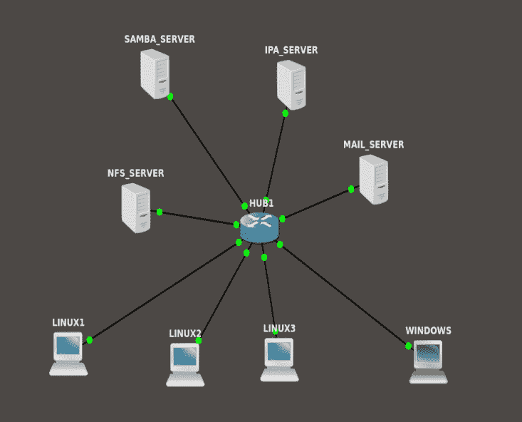

*Tanvir Rahman*

## NFS 服务器配置步骤

### 步骤 1：选择服务器

我们选择 IPA 服务器作为 NFS 服务器 [`ipa.it.local`]。

### 步骤 2：安装 NFS 服务器包

```bash
sudo yum install nfs-utils
```

### 步骤 3：编辑文件 `/etc/exports`

```bash
vim /etc/exports
```

```text
/home *(rw,sync)
```

### 步骤 4：启动 NFS 服务器

```bash
systemctl enable nfs-server
systemctl start nfs-server
```

### 步骤 5：启动 rpcbind

```bash
systemctl enable rpcbind
systemctl start rpcbind
```

### 步骤 6：添加防火墙规则

```bash
firewall-cmd --permanent --add-service nfs
firewall-cmd --reload
```

### 步骤 7：查看用于 NFS 服务器的挂载卷

```bash
showmount -e
```

> 如果一切顺利，你将看到已挂载的目录。

---

# IPA 客户端配置

> 你必须再次配置 `client1` 以与 NFS 服务器同步数据。

### 步骤 1：安装 nfs-utils 包

```bash
sudo yum install nfs-utils
```

### 步骤 2：编辑 `/etc/auto.master`

```bash
vim /etc/auto.master
```

添加此行：

```text
/home /etc/auto.autofs
```

### 步骤 3：创建 `/etc/auto.autofs`

```bash
vim /etc/auto.autofs
```

添加此行：

```text
syntax: * <ipa_server>:/home/&
* ipa:/home/&
```

> 例如，如果 `client1` 是 NFS 服务器，命令将是 `* client1:/home/&`。记住，使用的不是整个域名，只是客户端名称。

### 步骤 4：启动 autofs

```bash
systemctl enable autofs
systemctl start autofs
```

之后，你就可以使用域用户名和密码登录任何 IPA 客户端，并找到你自己的资源。

---

# 在 IPA 上配置 SAMBA 服务器

## 要求

- CentOS 服务器，IP: `192.168.0.1`
- 域用户和密码
- 网络连接

## 配置步骤

### 步骤 1：配置 IPA 上的 Samba 服务器

### 步骤 2：安装 samba 包

```bash
yum install -y samba-common
```

### 步骤 3：创建目录并赋予权限

```bash
mkdir /share
chmod 777 /share
```

### 步骤 4：添加用户

```bash
smbpasswd -a smuser1
smbpasswd -a smuser2
```

### 步骤 5：配置 SELinux

```bash
setsebool -P samba_home on
```

```bash
[root@localhost]# setsebool -P samba_home on
[root@localhost]# getsebool | grep samba_export
samba_export_home off
samba_export_home on
[root@localhost]# semanage fcontext -t samba_share "/share(/.*)?"
[root@localhost]# restorecon /share
```

### 步骤 6：更改防火墙设置允许连接

```bash
firewall-cmd --permanent --add-service samba
firewall-cmd --reload
```

```bash
[root@localhost]# firewall-cmd --permanent --add-service=samba
success
[root@localhost]# firewall-cmd --reload
success
```

### 步骤 7：编辑 Samba 共享配置

```bash
vim /etc/samba/smb.conf
```

```ini
[share]
comment=Samba 目录
browsable=yes
path=/share
writable=no
write list = smuser1
```

### 步骤 8：使用 `testparm` 命令测试配置

```bash
testparm
```

### 步骤 9：重启 Samba 服务器使更改生效

```bash
systemctl start smb
systemctl start nmb
```

```bash
[root@localhost]# systemctl start smb
[root@localhost]# systemctl start nmb
```

### 步骤 10：启用 smb 和 nmb 服务以便在启动时自动运行

```bash
systemctl enable smb
systemctl enable nmb
```

```bash
[root@localhost]# systemctl enable smb
Created symlink from /etc/systemd/system/multi-user.target.wants/smb.service to /usr/lib/systemd/system/smb.service.
[root@localhost]# systemctl enable nmb
Created symlink from /etc/systemd/system/multi-user.target.wants/nmb.service to /usr/lib/systemd/system/nmb.service.
```

### 步骤 11：从服务器测试连接

```bash
smbclient -L localhost -U smuser1
```

```bash
[root@localhost]# smbclient -L localhost -U smuser1
Enter SAMBA\smuser1's password:

Sharename       Type            Comment
--------        ------        -----------------
print$          Disk            Printer Drivers
share           Disk            Directory for samba
IPC$            IPC             IPC Service (Samba 4.8.3)
smuser1         Disk            Home Directories

Reconnecting with SMB1 for workgroup listing.
Server          Comment
--------        -----------------
Workgroup       Master
--------        -------
SAMBA           LOCALHOST
[root@localhost]# _
```

```bash
smbclient -L localhost -U smuser2
```

```bash
[root@localhost]# smbclient -L localhost -U smuser2
Enter SAMBA\smuser2's password:

Sharename       Type            Comment
--------        ------        -----------------
print$          Disk            Printer Drivers
share           Disk            Directory for samba
IPC$            IPC             IPC Service (Samba 4.8.3)
smuser2         Disk            Home Directories

Reconnecting with SMB1 for workgroup listing.
Server          Comment
--------        -----------------
Workgroup       Master
--------        -------
SAMBA           LOCALHOST
[root@localhost]# _
```

---

# 安装 SAMBA 客户端

## 第 1 步：在客户端安装包

```bash
yum update -y
yum install samba samba-client samba-common -y
yum install cifs-utils -y
```

## 第 2 步：从客户端测试连接

```bash
smbclient -L 192.168.0.50 -U smuser1
```

## 第 3 步：创建挂载目录并赋予适当权限

```bash
mkdir /share
chmod 777 /share
```

```bash
root@pop-os:~# mkdir /share
root@pop-os:~# chmod 777 /share
root@pop-os:~#
```

## 第 4 步：挂载网络共享

```bash
mount //192.168.0.50/share /share -o username=smuser1
```

```bash
root@pop-os:~# mount //192.168.0.50/share /share -o username=smuser1
Password for smuser1@192.168.0.50/share: ****
root@pop-os:~#
```

## 第 5 步：查看网络共享

```bash
mount | grep cifs
```

## 额外步骤（永久挂载）

在 `/share` 文件夹中添加凭据文件：

```bash
vim /share/.smbcredentials
```

```text
username=smbuser1
password=<password_for_user_1>
```

向 `/etc/fstab` 文件添加条目：

```bash
vim /etc/fstab
```

添加此行：

```text
//192.168.0.50/share /share cifs credentials=/share/.smbcredentials 0 0
```

## 测试共享

从客户端侧在 `/share` 文件夹中创建一个文件：

```bash
touch /share/test.txt
```

```bash
root@pop-os:/share# touch /share/test.txt
root@pop-os:/share#
```

现在从服务器侧测试：

```bash
ls -l /share
```

```bash
[root@localhost]# ls -l /share
total 0
-rwxr-xr-x 1 user test 0 Sep 7 00:00 test.txt
[root@localhost]#
```

---

# 在 UBUNTU 上配置 DHCP 服务器

## 要求

- GNS3 软件
- Ubuntu 服务器操作系统
- MikroTik 云托管路由器操作系统 (Router CHR)
- 用于启动操作系统的 VirtualBox
- VPCS（作为客户端的虚拟小型电脑）
- 有互联网连接更佳

## 架构图

- 云网络：`10.42.0.0/24`
- 云网关：`10.42.0.1`
- MikroTik 路由器：WAN 接口 IP `10.42.0.99`
- MikroTik 路由器：LAN 接口 IP `192.168.88.1`
- MikroTik 路由器：LAN 网络 `192.168.88.0/24`

*Tanvir Rahman*

## 设置所有内容

1. 下载 GNS3 并安装它
2. 下载 MikroTik RouterOS (云托管 CHR) (.ova 镜像)
3. 下载 Ubuntu Server
4. 下载 VirtualBox
5. 导入 OVA 镜像
   - a) 进入 Settings -> Network 并激活 4 个适配器，对于第一个进入 Advanced 并设置 Promiscuous mode -> Allow All
   - 然后进入 GNS3 -> Edit -> Preferences -> VirtualBox VMs -> New -> Select VM
   - 完成
   - b) 然后在窗口中选择 Edit -> Networks -> Adapters 设置为 4
   - c) 然后最后一个选项勾选 Allow GNS3 to use any configured Virtualbox adapter -> Yes
   - d) 你可以更改图标（可选）
   - e) 点击 Finish
6. 安装 Ubuntu 镜像：
   - a) 进入 Settings -> Network 并激活 4 个适配器，对于第一个进入 Advanced 并设置 Promiscuous mode -> Allow All
   - 然后进入 GNS3 -> Edit -> Preferences -> VirtualBox VMs -> New -> Select VM
   - 完成
   - b) 然后在窗口中选择 Edit -> Networks -> Adapters 设置为 4 (VVI)
   - c) 然后在最后一个选项勾选 Allow GNS3 to use any configured Virtualbox adapter -> Yes
   - 最后两个 b 和 c 步骤非常非常重要
7. 启动 Router OS

## Router OS 登录

```text
username: admin
password: <none>
```

## 路由器配置

```bash
[admin@MikroTik] > ip address add address=10.42.0.193/24 interface=ether1
[admin@MikroTik] > ip address add address=192.168.88.10/24 interface=ether2
```


# MikroTik 基础配置

```bash
[admin@MikroTik]/ip route add gateway=10.42.0.1
[admin@MikroTik]/ip firewall nat add chain=src action=masquerade
[admin@MikroTik]/ip dns set servers=8.8.8
[admin@MikroTik]> ping yahoo.com
```

# 启动 Ubuntu 服务器

- 打开终端
- 设置静态 IP

编辑网络配置文件：

```bash
sudo vim /etc/network/interfaces
```

配置内容如下：

```yaml
auto eth0
iface eth0 inet static
address 192.168.88.10
netmask 255.255.255.0
gateway 192.168.88.1
```

重启网络服务：

```bash
sudo /etc/init.d/networking restart
```

之后你就能连接互联网了。

# 安装 DHCP 服务器

更新仓库：

```bash
sudo apt-get update
```

安装 DHCP 软件包：

```bash
sudo apt-get install isc-dhcp-server
```

# 配置服务器

进入配置目录并编辑配置文件：

```bash
cd /etc/dhcp
vim dhcpd.conf
```

配置示例：

```bash
option domain-name "mydomain.org";
### 添加一个域名
option domain-name-servers 8.8.8;
```

## 基础子网声明

```bash
subnet 192.168.88.0 netmask 255.255.255.0 {
    range 192.168.88.20 192.168.88.200;
    option routers 192.168.88.1;
}
```

参数说明：

```bash
# 解释
subnet <give the network> netmask <give subnet> {
    range <starting ip in the range> <ending ip of the range>;
    option routers <gateway>
}
```

# 重启服务器

```bash
sudo /etc/init.d/isc-dhcp-server restart
```

# 客户端侧

启动客户端（此处以 VPCS 为例）：

```bash
PC-1> ip dhcp
DDORA
IP 192.168.88.21/24 GW 192.168.88.1
```

测试连通性：

```bash
PC-1> ping 8.8.8.8
84 bytes from 8.8.8.8 icmp_seq=1 ttl=116 time=59.929 ms
84 bytes from 8.8.8.8 icmp_seq=2 ttl=116 time=65.707 ms
```

如果你运行的是 Linux 客户端，打开终端并输入：

```bash
dhclient
```
