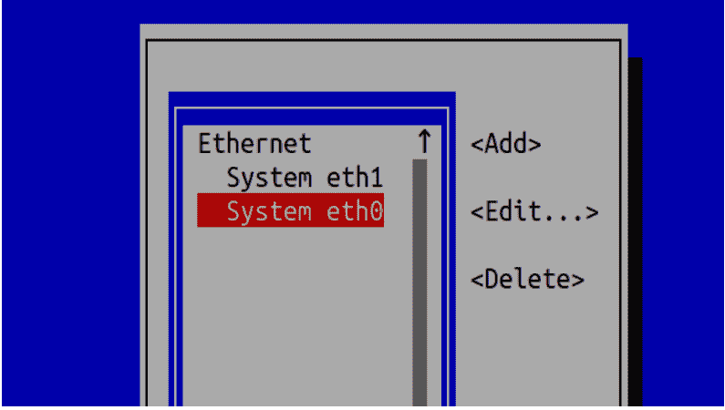
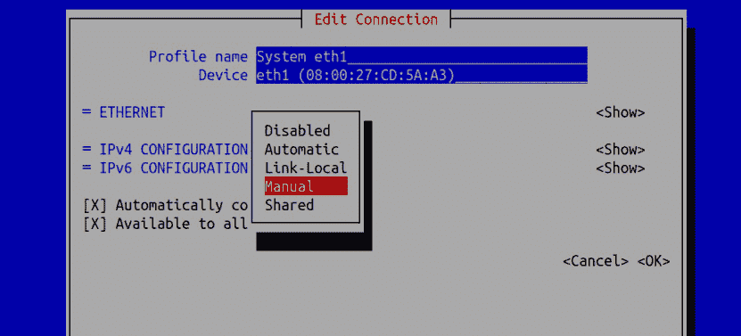
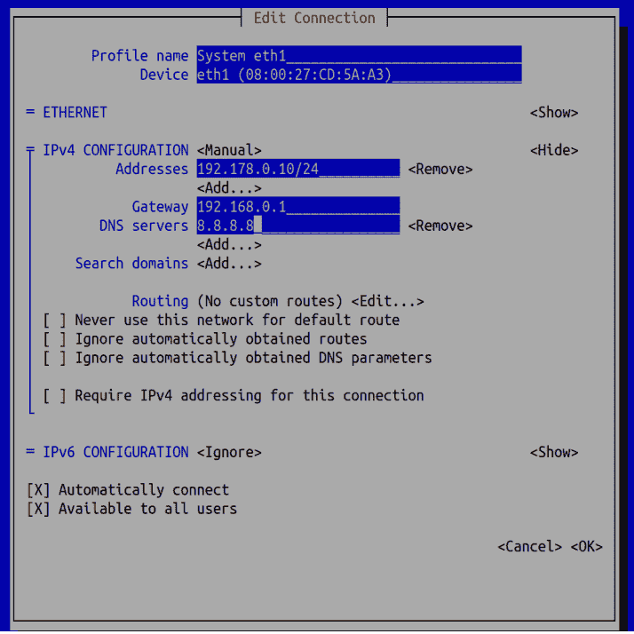
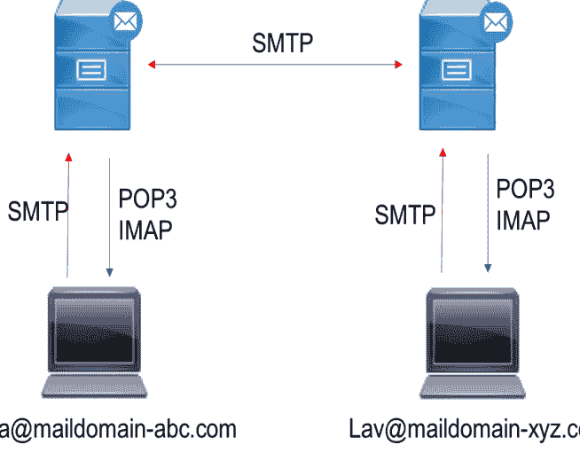
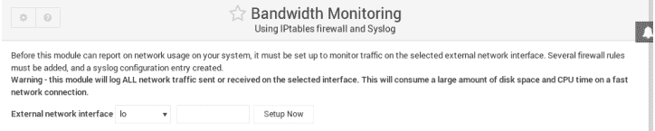
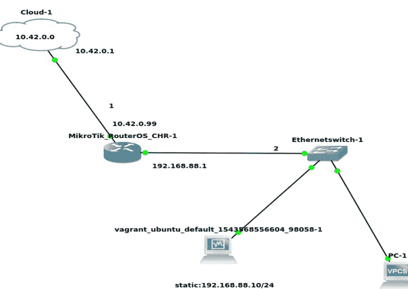

# Ubuntu 和 CentOS 服务器管理指南

献给我的侄 Safiyyah Nawar 和 Nuzairah Zainab

# 引言

操作系统是运行在我们计算机上的软件。它处理用户与计算机硬件之间所有的指令。但操作系统不仅仅是一个软件，它还由许多其他运行在该操作系统上的较小程序组成，帮助用户完成工作。我们在操作系统之上运行这些较小的程序来完成所有操作。

Linux 只是另一个操作系统。它是一个非常稳固的操作系统。Linux 既可以作为服务器，也可以作为桌面操作系统。

Linux 操作系统在很多方面都非常出色，原因如下：

- 多用户操作系统：Linux 是一个多用户操作系统。这意味着超过一个用户可以同时在系统上工作。
- 多任务操作系统：Linux 是一个多任务处理操作系统，你可以同时运行多个程序。这允许操作系统同时运行几个进程。
- 多平台操作系统：Linux 目前可以运行超过 24 种类型的平台以及 64 位的 Intel 架构个人电脑。所有的 Apple Mac 变体、Sun Spark 和 iPod，甚至是微软的 Xbox。
- 可操作性操作系统：Linux 可以与大多数网络协议和大多数语言配合，它可以轻松与 Windows 操作系统、Unix 以及其他市场份额较小的操作系统进行交互。
- 可扩展操作系统：Linux 操作系统支持了从树莓派（一种信用卡大小的计算机）到非常强大的服务器。世界上大多数服务器都在运行 Linux 操作系统。它们也运行在低功耗计算机上。
- 可移植操作系统：Linux 是一个可移植的操作系统。Linux 主要使用 C 语言编写。C 语言是一种专门为编写操作系统级软件设计的语言，它可以被移植到新的计算机上运行。
- 灵活操作系统：Linux 操作系统可以用于制作路由器、图形工作站、家庭娱乐计算机、文件服务器、Web 服务器、邮件服务器、集群等任何计算目的。
- 稳定：Linux 内核非常成熟。因为其稳定性，它被世界上大多数服务器使用。
- 高效：Linux 的设计允许你只包含你需要的内容，这就是为什么它可以从树莓派运行到大型服务器。
- 免费：Linux 是一个免费的操作系统。

## Linux 历史

Linux 是基于 UNIX 的操作系统的克隆。Unix 是在贝尔实验室为 AT&T 公司创建的。为了创建一个免费的 Unix 克隆，Linus Torvalds 创建了 MINIX。他编写了作为 Linux核心的内核。之后，许多开发者帮助他添加了更多功能和特性，当时 GNU 项目正在为计算机制作免费软件，为了创建一个操作系统，他们需要一个与硬件通信的功能性内核。他们采用了 Linux 内核，并在内核之上添加了 GNU 软件，形成了 GNU/Linux 操作系统。

Linus Torvalds 仍被认为是 Linux 内核的独裁者。他最终决定哪些功能将添加到 Linux 内核中，哪些功能不会。

## Linux 打包：发行版

一个完整的 Linux 系统被称为发行版（Distribution）。一个 Linux 发行版包含 Linux 内核、GNU 项目工具以及任何可以使操作系统具有多样化功能的软件。

Linux 有很多发行版。其中某些专门用于服务器，有些是用于桌面版的。每个定制的发行版都包含针对不同用户的软件包。

单一的 Linux 发行版通常以不同的版本出现。例如，CentOS 发行版带有一个完整的核心版和一个 LIVE CD 版本。

Ubuntu 基于 Debian 发行版，而 CentOS 是商业版 RedHat 发行版的社区版本。

## 核心 Linux发行版

核心 Linux 发行版包含 Linux 内核和 GNU 操作系统、一个或多个 DE（桌面环境）以及可以直接安装和运行的应用。核心 Linux 发行版是完整的 Linux 发行版。这些是流行的发行版：

- Red Hat Linux
- Fedora Core
- Centos Linux
- SUSE Linux
- Ubuntu Linux
- Gentoo Linux
- Debian Linux
- Slackware Linux
- Mandriva Linux
- Turbo Linux
- Puppy Linux

我们使用 Ubuntu Linux 和 Centos Linux 来演示服务器是如何工作的。

## Linux 原理

- 一切都以文件形式运行，即使是系统硬件
- 小项工作由单个程序完成
- 任何完成的工作都将分为更小的部分，然后由不同的模块处理
- 所有配置将存储在文本文件中
- Linux 操作系统使用标准的分级文件结构，其中文件/用户文件按此排列

## Ubuntu 服务器

Ubuntu 构建在 Debian 架构之上，由 Linux 服务器和桌面版组成。Ubuntu 每六个月更新一次版本。Ubuntu 软件包基于 Debian 不稳定分支的软件包。Ubuntu 目前由 Canonical LTD 资助。从 17.10 版本开始，GENOME 3 是 ubuntu 的默认 GUI 界面。我们将使用 Ubuntu Server 18.04.3 LTS 进行。你可以在此 URL 下载最新的长期版本 ubuntu server：

https://ubuntu.com/download/server

## CentOS 服务器

CentOS 项目是一个社区驱动的免费软件项目，专注于围绕 Linux 平台提供稳健的开源生态系统。它基本上是 Redhat 的克隆。CentOS Linux 是一个一致、可管理的平台，适用于各种部署。对于某些开源社区来说，它是构建基础的坚实、可预测的基础。你可以在此 URL 下载最新的长期版本 CentOS 服务器：

https://centos.org/download/

## VMware 安装

### 第 1 步

安装所需的构建包：

`sudo apt install build-essential`

### 第 2 步

从网站下载 VMware player。

### 第 3 步

进入安装目录并赋予文件可执行权限：

`chmod 777 vmware-player`

### 第 4 步

我们稍后会讨论 `chmod 777`，现在直接使用即可。

使用 sudo 执行程序：

`sudo ./vmware-player`

不需要许可证密钥。如果你想安装 VMware workstation 而不是 VMware player，则需要许可证密钥。安装成功后将显示界面。

## Ubuntu 服务器安装

要求：

1. 带有至少 4GB 内存的主机 PC
2. VMware WORKSTATION/VIRTUALBOX
3. UBUNTU SERVER ISO

### 第 1 步

启动虚拟机向导。

### 第 2 步

选择安装媒体或源。

### 第 3 步

VM 的配置所示。

### 第 4 步

开始安装，设置语言：

Willkommen! Bienvenue! Доброловать! Welcome! 选择您的语言：

- English
- Asturiano
- Hrvatski
- Nederlands
- Deutsch
- Français
- Eesti
- Magyar
- Latvia
- Norsk
- Polski
- Русский
- Español
- Україн

选择 DHCP 网络。稍后我们将配置服务器的 IP 地址。

注意：

ens33 - DHCP 192.168.0.24

00:0c:29:46:31:ae Intel Corporation / 8254EM Gigabit Controller (10/100/X)

### 第 5 步

选择安装 SSH 服务器以便我们可以连接主机。

### 第 6 步

有三种分区类型：

- 引导：使用整个磁盘进行引导分区系统
- 手动：用户必须手动分配空间。最小化设置：
  1. /boot
  2. /swap
  3. /root
- LVM 引导：此选项允许用户设置 LVM 分区

选择整个磁盘进行安装。我们选择整个磁盘引导分区来讨论引导系统。

### 第 7 步

使用您的凭据登录。

总结：我们学习了如何在虚拟机 DHCP 网络上设置 Ubuntu 服务器。使用引导分区。

## CentOS 服务器安装

要求：

1. 带有至少 4GB 内存的主机 PC
2. VMware WORKSTATION/VIRTUALBOX
3. CentOS7 SERVER ISO

### 第 1 步

启动 VMware 新虚拟机向导。

### 第 2 步

选择安装媒体或源并选择磁盘大小。

### 第 3 步

VMware 的配置所示。

### 第 4 步

开始安装，首先设置语言。

### 第 5 步

在软件选择中选择带有 GUI 的服务器。

### 第 6 步

选择用于安装的卷。在此安装中，我们选择整个磁盘引导分区。

### 第 7 步

输入 root 密码并确认。创建用户并为用户设置密码。

### 第 8 步

等待安装完成。完成后重启系统。

### 第 9 步

使用 root 凭据登录。

总结：我们学习了如何在虚拟机上设置 CentOS 服务器。

ubuntu 服务器：每当你执行任何需要超级用户权限的操作时，都会使用 `sudo` 命令。此命令允许普通用户执行需要超级用户权限的任务。输入 `sudo` 后跟你的命令，系统可能会提示你输入密码；在提供密码后，它将以超级用户权限执行操作。但如果你想进入 root shell（根终端），请输入此命令：

```bash
=> sudo su
```

但不建议使用 root shell。除非绝对必要，否则不要使用 root shell。如果你需要超级用户权限，请使用 `sudo`。

# 终端与 Shell (TERMINAL & SHELL)

## 什么是终端 (Terminal)

终端是一个打开窗口让你操作 shell 的程序。在 Linux 发行版中，你可以看到许多终端模拟器，如 Gnome terminal、konsole、xterm、rxvt、nxterm、eterm、Tilix 等。终端让你能够与 shell 进行交互。

## 什么是 shell

Shell 本身是一个从键盘接收命令并将其交给操作系统执行的程序。你可以使用图形化用户界面进行操作，但如果你使用的服务器没有图形化用户界面，这将是你拥有的界面，你必须在 CLI（命令行界面）中完成所有工作。

有不同类型的 shell：

- tsh → tsh 是一种具有类似于 C 语言的脚本语言的 shell。
- sash → sash 代表独立 shell。它是一个非常精简的 shell，运行在几乎每个系统中。它主要用于用于故障排除。
- zsh → zsh 是一种与 bash 兼容的 shell，但有很多额外功能。
- fish → fish 代表 friendly interactive shell（友好交互 shell）。在桌面端非常流行。它具有非常好的自动补全功能。
- Bash → bash 代表 Bourne Again Shell（再次 Bourne 壳），是原始 UNIX 程序 sh 的增强版本。由 Steve Bourne 编写。它是最流行的 shell，也是大多数 Linux 操作系统的默认 shell。

我们将在所有的示例中使用 Bash。

***

# 基础 LINUX 命令 (BASIC LINUX COMMANDS)

这些是操作 Linux 系统的系统的基础命令。

## 命令名：ls

描述：

`ls` 命令用于查看目录内部的文件和文件夹。它是 Linux 中最常用的命令。

语法：

`ls [-option] <directory>`

- 1) `ls -m` 将用逗号分隔显示文件和文件夹
- 2) `ls -a` 同时显示隐藏文件
- 3) `ls -l` 将以列表格式显示文件和文件夹
- 4) `ls -lh` 将显示文件列表及其大小
- 5) `ls -i` 将显示文件和文件夹的 Inode 列表
- 6) `ls -t` 将按修改时间列出目录列表

## 命令名：more

描述：

它的工作方式类似于 `more` 命令。它也提供了滚动选项。

语法：

```
More -E <options> <file_name>
```

- 1) `less -E` : 在第一次到达文件末尾时自动退出。
- 2) `less -f` : 强制打开非普通文件。
- 3) `less -F` : 如果整个文件可以在第一个屏幕显示则退出。
- 4) `less -g` : 高亮上次搜索命令找到的字符串
- 5) `less -G` : 抑制对搜索命令找到的字符串的所有高亮
- 6) `less -i` : 导致搜索行号
- 7) `less -p <pattern>` : 告诉 less 从文件中模式第一次出现的地方开始
- 8) `less -s` : 将连续的空行压缩为单行空行以忽略大小
- 9) `less -n` : 抑制行号
- 10) `less -p <pattern>` : 告诉 less 从文件中模式第一次出现的地方开始
- 11) `less -s` : 将连续的空行压缩
- 12) `less -N` : 显示行号

## 命令名：strings

描述：

显示文件内容

语法：

`strings <filename>`

## 命令名：tree

描述：

以树状格式显示目录结构

语法：

`Tree <directory>`

[你可能需要通过包管理器安装工具]

## 命令名：dir

描述：

显示目录内部的文件和文件夹

语法：

`dir <directory_name>`

[在使用此命令之前你必须安装 'tree' 工具]

## 命令名：cal

描述：

显示日历

语法：

`cal <year>`

`cal <month> <year>`

## 命令名：clear

描述：

清除屏幕

语法：

```
clear
```

## 命令名：bc

描述：

基础计算器

语法：

```
bc
```

## 命令名：mkdir

描述：

创建目录

语法：

`mkdir <directory>: : 用于创建单个目录`

`mkdir -p <directory/directory>:` 

用于创建递归目录

## 命令名：rmdir

描述：

删除空目录

[你无法用此命令删除任何包含文件的目录]

语法：

`rmdir <empty_directory>`

## 命令名：file

描述：

显示文件类型

语法：

`file <filename>`

## 命令名：ln

描述：

创建源文件名的名的链接。在硬链接的情况下，如果你删除主文件，链接不会删除；但在软链接的情况下，如果你删除了主文件，链接文件将被删除。

语法：

`ln <option> <source_file> <shortcut_file>`

- `ln -s` : 用于创建软链接
- `ln -P` : 用于创建硬链接

## 命令名：history

描述：

显示用户的命令历史

语法：

`history`

## 命令名：locate

描述：

在整个系统中搜索文件

语法：

`Locate <file>`

## 命令名：uname

描述：

关于内核的所有信息

语法：

- `uname -a` : 所有信息
- `uname -s` : 输出内核名称
- `uname -n` : 输出主机名
- `uname -r` : 输出内核版本
- `uname -v` : 输出内核版本
- `uname -m` : 输出机器类型
- `uname -p` : 输出处理器类型
- `uname -i` : 输出硬件平台
- `uname -o` : 输出操作系统

## 命令名：tar

描述：

创建存档和解压存档

语法：

- `tar -cvf <archive_name> <source>` : 创建创建
- `tar -xvf` : 用于解压

## 命令名：gzip

描述：

压缩普通文件或存档

语法：

```
gzip <file_name>
```

## 命令名：gunzip

描述：

用于解压缩文件

语法：

```
gunzip <compressed_file>
```

## 命令名：lsmod

描述：

显示内核使用的模块列表

语法：

```
lsmod
```

## 命令名：rmmod

描述：

删除内核使用的任何模块 [除非你确定自己在做什么，否则不要这样做]

语法：

`rmmod <module_name>`

你需要 root 用户才能执行此操作

- `rmmod -f` : 强制卸载模块并可能导致机器崩溃
- `rmmod -v` : 更多消息
- `rmmod -V` : 显示版本

## 命令名：modprobe

描述：

向系统添加新模块

语法：

`modprobe <module_name>`

## 命令名：ps

描述：

查看系统当前运行进程

语法：

```
ps
```

## 命令名：top

描述：

top 命令用于进程监控。[关于 top 的更多信息见进程管理]

语法：

```
top
```

## 命令名：renice

描述：

用于更改系统中运行进程的优先级。[更多见进程管理章节]

语法：

```
renice -n <priority> -p <pid>
```

## 命令名：kill

描述：

用于为此目的终止进程

语法：

```
Kill -<sigterm> -p pid
```

## 命令名：uptime

描述：

显示系统运行时间以及过去1 分钟、5 分钟和15 分钟的平均负载。[这些信息可以在 top 和 htop 命令中找到]

语法：

```
uptime
```

## 命令名：iostat

描述：

显示 CPU 和 I/O 信息 [更多信息见进程管理设备]

语法：

- 1) `iostat -c` : 生成 CPU 状态
- 2) `iostat -d` : 生成所有设备的 I/O 统计
- 3) `iostat -x` : 生成详细 I/O 统计
- 4) `iostat -x` : 生成详细 I/O 统计和 CPU 信息
- 5) `iostat -p <devices>` : 为特定设备生成详细信息


- `iostat -m` : 以兆字节为单位生成统计
- `iostat -k` : 生成以字节为单位的统计
- `iostat -N` : 生成 LVM 选项
- `iostat -t` : 生成带有时间戳的统计
- `nfsostat` : 显示 NFS 设备的信息

## 命令名: `hostnamectl`

描述：

显示主机及其相关设置，也可更改主机及其相关设置

语法：

`Hostnamectl` : 提供有关当前主机及其属性的信息

`hostnamectl set-hostname <hostname>` : 它将更改主机

## 命令名: `pwd`

描述：

打印当前目录路径

语法：

`pwd`

## 命令名: `dmesg`

描述：

显示启动期间检测到的硬件状态 [文件位置为 `/var/log/dmesg`]

语法：

```
dmesg
```

## 命令名: `init`

描述：

显示启动期间检测到的硬件状态 [文件位置为 `/var/log/dmesg`]

语法：

- `Init <run_level>`
- `0` : 关机机器
- `6` : 重启机器
- `2, 3, 4, 5` :启动运行级别。
- `1, s, S` :进入救援模式
- `q, Q` :重新加载 init 配置
- `u, U` :执行 init

## 命令名: `mkswap`

描述：

用于格式化交换空间的分区

语法：

```
mkswap <file_system>
```

## 命令名: `swapon`

描述：

激活交换空间

语法：

```
swapon -a <file_system>:
[启用 /etc/fstab 中的所有交换分区]
```

## 命令名: `swapoff`

描述：
停用交换分区

语法：

```
swapoff <file_system>
```

## 命令名: `mkfs`

描述：
用于格式化分区的工具 [关于文件系统的信息]

语法：

```
mkfs -t <fs_type> <file_system>
```

- `1) mkfs.ext2/dev/sdx` : 用于 ext2 文件系统
- `2) mkfs.ext3/dev/sdx` : 用于 ext3 文件系统
- `3) mkfs.ext4/dev/sdx` : 用于 ext4 文件系统
- `4) mkfs.minix/dev/sdx` : 用于 minix 文件系统
- `5) mkfs.xfs/dev/sdx` : 用于 xfs 文件系统

## 命令名: `poweroff`

描述：
关机机器

语法：
`poweroff`

描述：
显示当前登录的用户名

语法：
`whoami`

## 命令名: `wc`

描述：
用于统计指定文件的行数、单词数和字符数

语法：
- `1) wc <file_names>`
- `2) wc -m <file>` : 打印字符
- `3) wc -w <file>` : 打印单词
- `4) wc -l <file>` : 打印行

## 命令名: `w`

描述：
显示谁登录了计算机正在做什么

语法：
`w`

## 命令名: `arch`

描述：
显示计算机架构

语法：
`arch`

## 命令名: `alias`

描述：
在执行命令时将一个字符串替换为另一个字符串

语法：
`Alias <string>='target string'`

## 命令名: `bg`

描述：
将任何前台作业发送到后台

语法：
`bg`

## 命令名: `cp`

描述：
将文件或组从一个地复制到另一个地

语法：
`cp <source_file> <target_destination>`

## 命令名: `echo`

描述：
显示作为参数的文本/字符串

语法：

```
echo <arguments>
```

## 命令名: `fdisk`

描述：
格式化磁盘以及创建分区 [磁盘管理信息]

语法：

```
fdisk <file_system>
```

## 命令名: `cfdisk`

描述：
使用基于文本的 GUI 界面格式化磁盘以及创建分区 [磁盘管理信息]

语法：

```
sudo cfdisk
```

## 命令名: `lsblk`

描述：
显示系统中使用的可用空间和交换内存

语法：

```
lsblk
```

## 命令名: `lsmod`

描述：
列出当前加载的内核模块 [以良好的格式打印 '/proc/modules' 内容]

语法：

```
lsmod
```

## 命令名: `lspci`

描述：
显示当前连接的 PCI 总线 [连接到计算机的设备列表]

语法：

```
lspci
```

## 命令名: `lshw`

描述：
列出计算机的所有硬件详细信息

语法：

```
lshw
```

## 命令名: `lscpu`

描述：
显示关于 CPU 的详细信息

语法：

```
lscpu
```

## 命令名: `man`

描述：
显示你正在使用的工具或命令的参考

语法：

```
man <command>
```

描述：
赋予超级用户权限

语法：

```
sudo <command>
```

## 命令名: `ip`

描述：
用于执行若干网络任务

语法：

```
ip <option> <command>
```

## 命令名: `touch`

描述：
创建一个空文件

语法：

```
touch <file_name>
```

## 命令名: `ifconfig`

描述：
显示 IP 地址相关信息

语法：

```
ifconfig
```

## 命令名: `grep`

描述：
用于搜索关键词的全局正则表达式

语法：

```
ls | grep initrd
```

## 命令名: `wget`

描述：
交互式命令行下载器

语法：

```
wget <download_url>
```

## 命令名: `reboot`

描述：
重启系统

语法：

```
reboot
```

## 命令名: `ping`

描述：
测试物理和逻辑上活跃的任何主机或网络

语法：

```
ping <ip_address/domain_name>
```

这些是运行 Linux 系统的基本命令。还有很多命令用于维护服务器。

# IP 地址

## 计算机网络

计算机网络是由计算机和其他计算外围设备组成，通过某种通信通道连接在一起，以便相互通信并在范围的用户之间共享资源。

它们的工作是：
- 1) 通过电子邮件、文件服务器、即时消息等促进通信
- 2) 共享打印机或扫描仪等硬件资源
- 3) 实现文件共享
- 4) 在整个网络中创建集中控制

# 计算机网络类型

网络基本上分为三类：

- 1) 局域网 (LAN)
- 2) 城域网 (MAN)
- 3) 广域网 (WAN)

## LAN

局域网 (LAN) 是位于家庭、学校、办公室或建筑群等小区域内的网络。它们可以共享资源和设备，如打印机、扫描仪和数据存储。它们大多数是集中组织的。由于通信类型的关系，数据传输速率很高。局域网不需要任何租赁通信线路。

## MAN

城域网 (MAN) 通过连接多个局域网来跨越整个园区。MAN 比局域网大，因为它由许多局域网组成。MAN 的工作更像互联网服务提供商 (ISP)，但它并不由单一组织所有。相反，MAN 为所有用户提供共享的网络连接。

## WAN

在大地理区域内的广域网被称为 WAN。它是通过连接远距离的局域网创建的。传输速度通常比局域网或城域网慢，但速率正在增加。

# TCP/IP 协议套

大多数互联网用户使用一种被称为互联网协议的协议套，也称为 TCP/IP 协议套。这两个协议是 TCP（传输控制协议）和 IP（网协议）。在这里，TCP 是一种面向连接的协议，意味着它按顺序传输数据并具有确认机制。如果没有收到确认，数据将重新发送，它能确保数据交付到主机，而 IP 用于维护特定主机的地址。

| OSI 参考模型 | TCP/IP 参考模型 |
|--- | --- |
| 应用层 | 应用层 |
| 表示层 | |
| 会话层 | |
| 传输层 | 传输层 |
| 网络层 | 互联网层 |
| 数据链路层 | 链路层 |
| 物理层 | |

## IP 地址分配

IP 地址是网络技术中最重要的主题。IP 地址本质上是一个用于标识机器的数字标识符。IP 地址是软件地址，而不是硬件地址，这意味着它可以根据你所连接的网络而改变。硬件地址是 NIC 地址，也称为物理地址，它是无法的。

## IP 地址的重要元素

- **位 (Bit):** 位是 0 或 1 的一个数字。
- **字节 (Byte):** 由 8 位组成，就是一个普通的 8 位二进制数。
- **网络地址 (Network Address):** 网络地址用于将数据包发送到网络。例如 10.0.0.0、192.168.0.0 等。
- **广播地址 (Broadcast Address):** 主机用于向网络上的所有节点发送信息。地址类似于 192.168.0.255、172.166.255.255。

每个 IP 地址包含两个不同的部分：

1) 网络部分
2) 主机部分

每个 IP 地址提供了关于网络和主机的信息。

## 子网掩码 (Subnet Mask)

子网掩码是一个 32 位数字，用于掩码 IP 地址并将 IP 地址划分为网络地址和主机地址。这是通过将所有网络位设置为“1”并将主机位设置为“0”来实现的。有两个主机 IP 地址被留作特殊用途：'0' 地址和 '255' 地址。'0' 地址留给网络使用。因此，如果任何 IP 地址的最后一位是 '0$，它就是一个网络地址。而 '255' 是广播地址，它们不能分配给主机。

## 5 种 IP 地址：

1) A 类 IP 地址
2) B 类 IP 地址
3) C 类 IP 地址
4) D 类 IP 地址
5) E 类 IP 地址

## A 类 IP 地址：

在 A 类 IP 地址中，第一个字节留作网络地址，其余三个字节用于主机。[它从 0.0.0.0 开始，到 127.255.255.255 结束] 掩码：255.0.0.0

| | 字节 1 | 字节 2 | 字节 3 | 字节 4 |
|---|---|---|---|---|
| A 类 | 网络 ID | | 主机 ID | |
| B 类 | | 网络 ID | | 主机 ID |
| C 类 | | | 网络 ID | 主机 ID |
| D 类 | | 多组播 | 地址 | |
| E 类 | | | 预留 | |

它具有包含大量主机的小网络。

## B 类 IP 地址：

在 B 类 IP 地址中，前两个字节留作网络地址，其余两个字节用于主机。网络多主机少 [它从 128.0.0.0 开始，到 191.255.255.255 结束] 掩码：255.255.255.0

## C 类 IP 地址：

C 类 IP 地址的前三个字节留作网络地址，剩余的一个字节用于主机。如果你需要很多网络，但每个网络中的主机较少，则使用 C 类 IP 地址。[它从 192.0.0.0 开始，到 223.255.255.255 结束] 掩码：255.255.255.0

## D 类 IP 地址：

D 类 IP 地址是一种特殊地址。它被称为组播地址。它基本上用于寻找路由器 [它从 224.0.0.0 开始，到 239.255.255.255 结束]

## E 类 IP 地址：

留用于科学实验

## 私有 IP 地址：

并不是所有这些类别的地址都用于公共网络。有些无法通过互联网路由。私有 IP 地址用于本地，本地 IP 地址可以通过 NAT（网络地址转换）通过公共 IP 地址连接到互联网。NAT 允许地址访问互联网。

| 类别 | 地址范围 | 默认子网掩码 |
|---|---|---|
| A | 10.0.0.0 - 10.255.255.255 | 255.0.0.0 |
| B | 172.16.0.0 - 172.31.255.255 | 255.255.0.0 |
| C | 192.168.0.0 – 192.168.255.255 | 255.255.255.0 |

## 回环地址 (Loop back address)

回环地址用于测试本地 NIC（网络接口卡）上的通信。由回环地址节点发送的数据包将重新路由回同一个节点。它用于测试连接的物理网络。它还允许用户在同一台机器上通过服务器和客户端的实例测试应用程序。我们称之为 localhost。

它从 127.0.0.0 开始，到 127.255.255 结束。

## Ping

`ping` 代表 Packet Gopher，是一种 ICMP 回显请求和响应消息，用于检查开启机器的物理和逻辑连通性。

## Traceroute

`Traceroute` 用于查找数据包穿过互联网的路径。

## 在 CENTOS 7 中设置静态 IP 的简单方法

每台服务器都需要一个网络。没有静态 IP 地址，你就无法运行服务器。为服务器分配静态 IP 地址是最重要的工作之一。当你安装服务器时，大多数情况下你的网络会自动配置，从 DHCP 获取 IP 地址。但要运行服务器，你需要静态 IP 地址。因此，我们需要将其网络从 DHCP 改为静态，并为 CentOS 7/Redhat 服务器提供静态 IP 地址。有多种方法为服务器提供静态地址，我们将讨论：

**步骤 1**
你需要根据你的网络规范选择静态 IP 地址、子网掩码和网关。在示例中，使用了虚拟 CentOS 7 盒子：
IP 地址：192.168.0.10
子网掩码：255.255.255.0
网关：192.168.0.1
DNS：8.8.8.8

**步骤 2**
你需要找到网络接口。
```bash
ifconfig
```
或者
```bash
ip address
```
结果：
我们目前通过 eth0 连接到服务器。因此，我们不能将 IP 地址更改为 eth0。我们将给 eth1 接口分配静态 IP 地址。

**步骤 3**
使用 `nmtui` 命令，你需要 root 权限来执行此命令：
```bash
sudo nmtui
```
执行此命令后会出现此屏幕。从那里选择“编辑连接 (Edit connection)

**步骤 4**
它将向你显示所有接口。选择你的接口，我们将选择 eth1。

**步骤 5**
我们选择 ipv4，并在选项中选择“手动 (manual)”并编辑菜单。

**步骤 6**
我们填写 IP 地址。点击确定退出程序。

**步骤 7**
如果我们发现 IP 地址仍然没有变化，我们需要重启接口。使用以下命令关闭接口：
```bash
sudo ifdown eth1
```
启动接口：
```bash
sudo ifup eth1
```

**步骤 8**
然后通过 `ifconfig` 检查 IP 地址：
```bash
ifconfig
```
```bash
[vagrant@tanvir ~]$ ifconfig

eth1:flags=4163<BROADCAST,RUNNING,MULTICAST> mtu 1500

  inet 192.178.0.10 netmask 255.255.255.0 broadcast 192.178.0.255

  inet6 fe80::a00d:27ff:5aa3 prefixlen 64 scopeid 0x<link>

  ether 08:00:27:cd:5a:a3 txqueuel 1000 (Ethernet)

  RX packets 62 bytes 5854 (5.7 KiB)

  RX errors 0 dropped 0 overflows 0

  TX packets 24 bytes 2452 (2.3 KiB)

  TX errors 0 dropped 0 overflows 0 collisions 0

[vagrant@tanvir ~]$
```
我们可以看到 IP 地址已更改。

**步骤 9**
我们需要通过 ping 网络测试连接。
```bash
ping 8.8.8.8
```
```bash
[vagrant@tanvir ~]$ ping 8.8.8.8

PING 8.8.8.8 (8.8.8.8) 56(84) bytes of data.

64 bytes from 8.8.8.8: icmp_seq=1 ttl=63 time=80.2 ms

64 bytes from 8.8.8.8: icmp_seq=2 ttl=63 time=102 ms

64 bytes from 8.8.8.8: icmp_seq=3 ttl=63 time=123 ms

^C

--- 8.8.8.8 ping statistics ---

3 packets transmitted, 3 received, 0% packet loss, time 2005ms

rtt min/avg/max/mdev = 80.248/101.916/123.156/17.519 ms
```

所以连接已建立通。这就是为 CentOS 7/Redhat7 服务器分配静态地址的简单方法。

# Tanvir Rahman

# 传统方法

## 第一步

根据你的网络规范，你需要为机器选择一个静态 IP 地址、子网掩码和网关。

我们提供以下 IP 地址、子网掩码、网关和 DNS：

```
IP ADDRESS : 192.168.0.10

BNET MASK: 255.255.255.0

GATEWAY: 192.168.0.1

DNS: 8.8.8.8
```

## 第二步

你需要找到分配静态 IP 的接口。

我们目前通过 eth0 使用 SSH 连接到服务器。因此，我们将 IP 地址改为 eth0。这将断开 SSH 连接。我们将把静态 IP 地址分配给 eth1 接口。

## 第三步

我们必须进入 `/etc/sysconfig/network-scripts/` 目录

=> `cd /etc/sysconfig/network-scripts`

在该目录下有很多文件。从那里，我们需要选择 `ifcfg-eth1` [你的文件名可能不同。根据你的接口选择文件，其格式类似于 `ifcfg-<interface>`]

```
[vagrant@tanvir ~]$ $ cd /etc/sysconfig/network-scripts/
```


[vagrant@tanvir network-scripts~]$ `ls`

`ifcfg-eth0` `ifdown-ippp` `ifdown-sit` `ifup-bnepf` `ifup-plusb` `ifup-TeamPort`

`ifcfg-eth1` `ifdown-ipv6` `ifdown-Team` `ifup-eth` `ifup-post` `ifup-tunnel`

`ifcfg-lo` `ifdown-isdn` `ifdown-TeamPort` `ifup-ippp` `ifup-ppp` `ifup-wireless`

`ifdown` `ifdown-post` `ifdown-tunnel` `ifup-ipv6` `ifup-routes` `init.ipv6-global`

`ifdown-bnep` `ifdown-ppp` `ifup` `ifup-isdn` `ifup-sit` `network-functions`

`ifdown-eth` `ifdown-routes` `ifup-aliases` `ifup-plip` `ifup-Team` `network-functions-ipv6`

[vagrant@tanvir network-scripts~]$ 

## 第四步

我们必须使用 root 权限的文本编辑器编辑该文件。
我们需要编辑 `ifcfg-eth1` 文件
=>`vim ifcfg-eth1`

```
BOOTPROTO=static

ONBOOT=yes

IPADDR=192.168.0.10

PREFIX=24

GATEWAY=192.168.0.1

DNS1=8.8.8.8
```

```
# VAGRANT-BEGIN

# 以下内容由 Vagrant 自动生成。请勿修改。

BOOTPROTO=static

ONBOOT=yes

DEVICE=eth1

NM_CONTROLLED=yes

#VAGRANT-END

TYPE=Ethernet

PROXY_METHOD=none

BROWSER_ONLY=no

IPADDR=192.168.0.10

PREFIX=24

GATEWAY=192.168.0.1

DNS1=8.8.8.8

DEFROUTE=yes

IPV4_FAILURE_FATAL=no

IPV6INIT=no

NAME="System eth1"

UUID=9c2fad9-6ecb-4d-8a47-6f50c4
```

## 第五步

如果我们查看 IP 地址，会发现 IP 地址没有变化。要使更改，我们需要重启接口。使用此命令关闭接口

=>`sudo ifdown eth1`

然后再次启动接口

=>`sudo ifup eth1`

## 第六步

然后我们使用以下命令检查 IP 地址

=>`ifconfig eth1`

```
[vagrant@tanvir ~]$ ifconfig eth1

eth1:flags=4163<BROADCAST,MULTICAST> mtu 1500

      inet 192.168.0.10 mask 255.255.255.0 broadcast 192.168.0.255

      inet6 fe80::a00:27ff:fedc:aa3 prefixlen 64 scope link

      ether 08:00:27:cd:5a:a3 txuel 1000 (Ethernet)

      RX packets 62 bytes 5854 (5.7 KiB) errors 0 dropped 0

      TX packets 24 bytes 2452 (2.3 KiB) errors 0 collisions 0
```

## 第七步

我们必须通过 ping 网络来测试连接

=>`ping 8.8.8.8`

这样连接就是通的并正在运行。这是提供 IP 地址的另一种方法。

## 客户端侧

### 修改主机名

在 Redhat 7 中，我们使用 `hostnamectl` 命令查看主机名的状态

=>`hostnamectl status`

更改主机名使用

=>`hostnamectl set-hostname <name>`

移除主机名

=>`hostnamectl set-hostname ""`

在 Linux 系统中，我们使用 DNS 解析主机名。首先我们需要知道如何配置客户端，有几个地方需要查看 `/etc/hosts`，如果我们查看该文件会看到类似这样的内容

```
=>cat /etc/hosts
127.0.0.1 localhost

::1 localhost
```

如果你使用 `ping localhost` 命令，计算机从 hosts 文件找到它的地址，这就是计算机知道与谁通信的方式。让我们添加 `mysite` 到 127.0.0.1

=>`cat /etc/hosts`

```
127.0.0.1 localhost

::1 localhost
```

然后如果我们 `ping mysite`，我们可以看到

=> `ping mysite`
PING localhost (127.0.0.1) 56(84) bytes of data.
64 bytes from localhost (127.0.0.1): icmp_seq=1 ttl=64 time=0.129 ms
64 bytes from localhost (127.0.0.1): icmp_seq=2 ttl=64 time=0.112 ms

127 是回环地址，但这种方法并不高效。我们不可能手动添加成千上万个域名和 IP。为什么会有 DNS 服务器？DNS 的作用是通过服务器自动解析域名，该服务器配置在 `/etc/resolv.conf` 文件中。

如果我们查看该文件

=>`cat /resolv.conf`
# Generated by NetworkManager
nameserver 10.0.2.3
```

名称服务器 10.0.2.3（在你的计算机上可能不同），实际上这里 10.0.2.3 是我们 DNS 服务器的 IP。我们可以在文件中添加一些 DNS 服务器，如：

- nameserver 8.8.8.8

- nameserver 8.8.4.4

8.8.8.8 是公用的 Google DNS 服务器。但当问题出现时，计算机使用 `/etc/hosts` 文件还是 `/etc/resolv.conf` 的决策存储在名为 `/etc/nsswitch.conf` 的文件中。如果我们查看该文件

=>`cat /etc/nsswitch.conf| grep hosts`

在文件中看到这一行

hosts: files dns

这意味着它将首先查找 hosts 文件，然后是 DNS 服务器。如果在那里没有找到，它将放弃。如果你在 hosts 中写了以下内容：

127.0.0.1 www.google.com

之后当你 `ping www.google.com` 时，它将 ping localhost 地址

=> `ping www.google.com`

```
PING www.google.com (127.0.0.1) 56(84) bytes of data.
64 bytes from localhost (127.0.0.1): icmp_seq=1 ttl=64 time=0.129 ms
64 bytes from localhost (127.0.0.1): icmp_seq=2 ttl=64 time=0.112 ms
```

### 设置静态 IP

#### 简单方法

你需要根据你的网络规范，为机器选择一个静态 IP 地址、子网掩码和网关。

我们提供以下 IP 地址、子网掩码、网关和 DNS

```
IP ADDRESS : 192.168.0.10
BNET MASK: 255.255.255.0
GATEWAY: 192.168.0.1
DNS: 8.8.8.8
```

## 第二步

你需要找到分配静态 IP 的接口。

我们目前通过 eth0 使用 SSH 连接到服务器。因此，可以将 IP 地址改为 eth0。这将断开 SSH 连接。我们将静态 IP 地址分配给 eth1 接口。

## 第三步

我们必须进入 `/etc/sysconfig/network-scripts/` 目录

=> `cd /etc/sysconfig/network-scripts`

在该目录下有很多文件。从那里，我们需要选择 `ifcfg-eth1` [你的文件名可能不同。根据你的接口选择文件，其格式类似于 `ifcfg-<interface>`]

```
[vagrant@tanvir ~]$ $ cd /etc/sysconfig/network-scripts/
[vagrant@tanvir network-scripts~]$ ls
ifcfg-eth0 ifdown-ippp ifdown-sit ifup-bnepf ifup-plusb ifup-TeamPort
ifcfg-eth1 ifdown-ipv6 ifdown-Team ifup-eth ifup-post ifup-tunnel
ifcfg-lo ifdown-isdn ifdown-TeamPort ifup-ippp ifup-ppp ifup-wireless
ifdown ifdown-post ifdown-tunnel ifup-ipv6 ifup-routes init.ipv6-global
ifdown-bnep ifdown-ppp ifup ifup-isdn ifup-sit network-functions
ifdown-eth ifdown-routes ifup-aliases ifup-plip ifup-Team network-functions-ipv6
[vagrant@tanvir network-scripts~]$ 
```

## 第四步

我们必须使用 root 权限的文本编辑器编辑该文件。

我们需要编辑 `ifcfg-eth1` 文件

=>`vim ifcfg-eth1`

```
BOOTPROTO=static
ONBOOT=yes
IPADDR=192.168.0.10
PREFIX=24
GATEWAY=192.168.0.1
DNS1=8.8.8.8
```

```
# VAGRANT-BEGIN
# 以下内容由 Vagrant 自动生成。请勿修改。
BOOTPROTO=static
ONBOOT=yes
DEVICE=eth1
NM_CONTROLLED=yes
#VAGRANT-END
TYPE=Ethernet
PROXY_METHOD=none
BROWSER_ONLY=no
IPADDR=192.168.0.10
PREFIX=24
GATEWAY=192.168.0.1
DNS1=8.8.8.8
DEFROUTE=yes
IPV4_FAILURE_FATAL=no
IPV6INIT=no
NAME="System eth1"
UUID=9c2fad9-6ecb-4d-8a47-6f50c4
```

## 第五步

如果我们查看 IP 地址，会发现 IP 地址没有变化。要使更改，我们需要重启接口。使用此命令关闭接口

=>`sudo ifdown eth1`

然后再次启动接口

=>`sudo ifup eth1`

## 第六步

然后我们使用以下命令检查 IP 地址

=>`ifconfig eth1`

```
[vagrant@tanvir ~]$ ifconfig eth1
eth1:flags=4163<BROADCAST,MULTICAST> mtu 1500
      inet 192.168.0.10 mask 255.255.255.0 broadcast 192.168.0.255
      inet6 fe80::a00:27ff:fedc:aa3 prefixlen 64 scope link
      ether 08:00:27:cd:5a:a3 txuel 1000 (Ethernet)
      RX packets 62 bytes 5854 (5.7 KiB) errors 0 dropped 0
      TX packets 24 bytes 2452 (2.3 KiB) errors 0 collisions 0
```

## 第七步

我们必须通过 ping 网络来测试连接

=>`ping 8.8.8.8`

这样连接就是通的并正在运行。这是提供 IP 地址的另一种方法。

## 客户端侧

### 修改主机名

在 Redhat 7 中，我们使用 `hostnamectl` 命令查看主机名的状态

=>`hostnamectl status`

更改主机名使用

=>`hostnamectl set-hostname <name>`

移除主机名

=>`hostnamectl set-hostname ""`

在 Linux 系统中，我们使用 DNS 解析主机名。首先我们需要知道如何配置客户端，有几个地方需要查看 `/etc/hosts`，如果我们查看该文件会看到类似这样的内容

```
=>cat /etc/hosts
127.0.0.1 localhost
::1 localhost
```

如果你使用 `ping localhost` 命令，计算机从 hosts 文件找到它的地址，这就是计算机知道与谁通信的方式。让我们添加 `mysite` 到 127.0.0.1

=>`cat /etc/hosts`

```
127.0.0.1 localhost
::1 localhost
```

然后如果我们 `ping mysite`，我们可以看到

=> `ping mysite`
PING localhost (127.0.0.1) 56(84) bytes of data.

64 bytes from localhost (127.0.0.1): icmp_seq=1 ttl=64 time=0.129 ms

64 bytes from localhost (127.0.0.1): icmp_seq=2 ttl=64 time=0.112 ms

127 是回环地址，但这种方法并不高效。我们不可能手动添加成千上万个域名和 IP。为什么会有 DNS 服务器？DNS 的作用是通过服务器自动解析域名，该服务器配置在 `/etc/resolv.conf` 文件中。

如果我们查看该文件

=>`cat /resolv.conf`

# Generated by NetworkManager

nameserver 10.0.2.3
```

名称服务器 10.0.2.3（在你的计算机上可能不同），实际上这里 10.0.2.3 是我们 DNS 服务器的 IP。我们可以在文件中添加一些 DNS 服务器，如：

- nameserver 8.8.8.8
- nameserver 8.8.4.4

8.8.8.8 是公用的 Google DNS 服务器。但当问题出现时，计算机使用 `/etc/hosts` 文件还是 `/etc/resolv.conf` 的决策存储在名为 `/etc/nsswitch.conf` 的文件中。如果我们查看该文件

=>`cat /etc/nsswitch.conf| grep hosts`

在文件中看到这一行

hosts: files dns

这意味着它将首先查找 hosts 文件，然后是 DNS 服务器。如果在那里没有找到，它将放弃。如果你在 hosts 中写了以下内容：

127.0.0.1 www.google.com

之后当你 `ping www.google.com` 时，它将 ping localhost 地址

=> `ping www.google.com`

```
PING www.google.com (127.0.0.1) 56(84) bytes of data.

64 bytes from localhost (127.0.0.1): icmp_seq=1 ttl=64 time=0.129 ms

64 bytes from localhost (127.0.0.1): icmp_seq=2 ttl=64 time=0.112 ms
```

### 设置静态 IP

#### 简单方法

你需要根据你的网络规范，为机器选择一个静态 IP 地址、子网掩码和网关。

我们提供以下 IP 地址、子网掩码、网关和 DNS

```
IP ADDRESS : 192.168.0.10

BNET MASK: 255.255.255.0

GATEWAY: 192.168.0.1

DNS: 8.8.8.8
```

## 第二步

你需要找到分配静态 IP 的接口。

我们目前通过 eth0 使用 SSH 连接到服务器。因此，可以将 IP 地址改为 eth0。这将断开 SSH 连接。我们将静态 IP 地址分配给 eth1 接口。

## 第三步

我们必须进入 `/etc/sysconfig/network-scripts/` 目录

=> `cd /etc/sysconfig/network-scripts`

在该目录下有很多文件。从那里，我们需要选择 `ifcfg-eth1` [你的文件名可能不同。根据你的接口选择文件，其格式类似于 `ifcfg-<interface>`]

```
[vagrant@tanvir ~]$ $ cd /etc/sysconfig/network-scripts/

[vagrant@tanvir network-scripts~]$ ls

ifcfg-eth0 ifdown-ippp ifdown-sit ifup-bnepf ifup-plusb ifup-TeamPort

ifcfg-eth1 ifdown-ipv6 ifdown-Team ifup-eth ifup-post ifup-tunnel

ifcfg-lo ifdown-isdn ifdown-TeamPort ifup-ippp ifup-ppp ifup-wireless

ifdown ifdown-post ifdown-tunnel ifup-ipv6 ifup-routes init.ipv6-global

ifdown-bnep ifdown-ppp ifup ifup-isdn ifup-sit network-functions


ifdown-eth ifdown-routes ifup-aliases ifup-plip ifup-Team network-functions-ipv6

[vagrant@tanvir network-scripts~]$ 

```
## 第四步

我们必须使用 root 权限的文本编辑器编辑该文件。
我们需要编辑 `ifcfg-eth1` 文件
=>`vim ifcfg-eth1`
```
```
BOOTPROTO=static

ONBOOT=yes

IPADDR=192.168.0.10

PREFIX=24

GATEWAY=192.168.0.1

DNS1=8.8.8.8
```
```
# VAGRANT-BEGIN

# 以下内容由 Vagrant 自动生成。请勿修改。

BOOTPROTO=static

ONBOOT=yes

DEVICE=eth1

NM_CONTROLLED=yes

#VAGRANT-END

TYPE=Ethernet

PROXY_METHOD=none

BROWSER_ONLY=no

IPADDR=192.168.0.10

PREFIX=24

GATEWAY=192.168.0.1

DNS1=8.8.8.8

DEFROUTE=yes

IPV4_FAILURE_FATAL=no

IPV6INIT=no

NAME="System eth1"

UUID=9c2fad9-6ecb-4d-8a47-6f50c4
```
## 第五步

如果我们查看 IP 地址，会发现 IP 地址没有变化。要使更改，我们需要重启接口。使用此命令关闭接口

=>`sudo ifdown eth1`

然后再次启动接口

=>`sudo ifup eth1`

## 第六步

然后我们使用以下命令检查 IP 地址

=>`ifconfig eth1`
```
[vagrant@tanvir ~]$ ifconfig eth1

eth1:flags=4163<BROADCAST,MULTICAST> mtu 1500

      inet 192.168.0.10 mask 255.255.255.0 broadcast 192.168.0.255

      inet6 fe80::a00:27ff:fedc:aa3 prefixlen 64 scope link

      ether 08:00:27:cd:5a:a3 txuel 1000 (Ethernet)

      RX packets 62 bytes 5854 (5.7 KiB) errors 0 dropped 0

      TX packets 24 bytes 2452 (2.3 KiB) errors 0 collisions 0
```

## 第七步

我们必须通过 ping 网络来测试连接

=>`ping 8.8.8.8`

这样连接就是通的并正在运行。这是提供 IP 地址的另一种方法。

## 客户端侧

### 修改主机名

在 Redhat 7 中，我们使用 `hostnamectl` 命令查看主机名的状态

=>`hostnamectl status`

更改主机名使用

=>`hostnamectl set-hostname <name>`

移除主机名

=>`hostnamectl set-hostname ""`

在 Linux 系统中，我们使用 DNS 解析主机名。首先我们需要知道如何配置客户端，有几个地方需要查看 `/etc/hosts`，如果我们查看该文件会看到类似这样的内容
```
=>`cat /etc/hosts`

127.0.0.1 localhost

::1 localhost
```
如果你使用 `ping localhost` 命令，计算机从 hosts 文件找到它的地址，这就是计算机知道与谁通信的方式。让我们添加 `mysite` 到 127.0.0.1

=>`cat /etc/hosts`
```
127.0.0.1 localhost

::1 localhost
```
然后如果我们 `ping mysite`，我们可以看到

=> `ping mysite`
PING localhost (127.0.0.1) 56(84) bytes of data.
64 bytes from localhost (127.0.0.1): icmp_seq=1 ttl=64 time=0.129 ms
64 bytes from localhost (127.0.0.1): icmp_seq=2 ttl=64 time=0.112 ms

127 是回环地址，但这种方法并不高效。我们不可能手动添加成千上万个域名和 IP。为什么会有 DNS 服务器？DNS 的作用是通过服务器自动解析域名，该服务器配置在 `/etc/resolv.conf` 文件中。

如果我们查看该文件

=>`cat /resolv.conf`
# Generated by NetworkManager
nameserver 10.0.2.3
```
名称服务器 10.0.2.3（在你的计算机上可能不同），实际上这里 10.0.2.3 是我们 DNS 服务器的 IP。我们可以在文件中添加一些 DNS 服务器，如：

- nameserver 8.8.8.8

- nameserver 8.8.4.4

8.8.8.8 是公用的 Google DNS 服务器。但当问题出现时，计算机使用 `/etc/hosts` 文件还是 `/etc/resolv.conf` 的决策存储在名为 `/etc/nsswitch.conf` 的文件中。如果我们查看该文件

=>`cat /etc/nsswitch.conf| grep hosts`

在文件中看到这一行

hosts: files dns

这意味着它将首先查找 hosts 文件，然后是 DNS 服务器。如果在那里没有找到，它将放弃。如果你在 hosts 中写了以下内容：

127.0.0.1 www.google.com

之后当你 `ping www.google.com` 时，它将 ping localhost 地址

=> `ping www.google.com`
```
PING www.google.com (127.0.0.1) 56(84) bytes of data.
64 bytes from localhost (127.0.0.1): icmp_seq=1 ttl=64 time=0.129 ms
64 bytes from localhost (127.0.0.1): icmp_seq=2 ttl=64 time=0.112 ms
```

# Tanvir Rahman



# 第 4 步

它将向你显示所有接口。在这种情况下选择接口，我们将选择 eth1。



88

# 第 5 步

我们选择 ipv4，并在选项中选择“manual”（手动）并编辑菜单



# 第 6 步

我们提供 IP 地址。必须提供带有 CIDR 符号的子网掩码。网关以及 DNS 地址，然后退出程序。

# 第 7 步

如果我们查看 IP 地址，会发现 IP 地址还没有变化。要使更改生效，我们需要重启接口。

我们使用此命令关闭接口

```bash
=>sudo ifdown eth1
or
=>nmcli connection down eth1
```

然后重新启动接口

```bash
=>sudo ifup eth1
or
=>nmcli connection up eth1
```

# UBUNTU $ CENTOS 管理员

# 第 8 步

然后如果我们使用命令检查 IP 地址

=>`ifconfig eth1`
```
[vagrant@tanvir ~]$ $ ifconfig eth1
eth1: flags=4163<UP,BROADCAST,RUNNING,MULTICAST> mtu 1500
inet 192.178.0.10 netmask 255.255.255.0 broadcast 192.178.0.255
inet6 fe80::a00:27ff:fecd:5aa3 prefixlen 64 scopeid 0x20<link>
ether 08:00:27:cd:5a:a3 txqueue 1000 (Ethernet)
RX packets 62 bytes 5854 (5.7 KiB)
RX errors 0 dropped 0 overruns 0 frame 0
TX packets 24 bytes 2452 (2.3 KiB)
TX errors 0 dropped 0 overruns 0 carrier 0 collisions 0
[vagrant@tanvir ~]$ 
```
我们可以看到 IP 地址已经更改。

# 第九步

我们必须通过 ping 网络来测试连接。

=>`ping 8.8.8.8`

# Tanvir Rahman

所以连接已经建立并运行。这就是为 Ubuntu/Debian 服务器提供静态 IP 地址的简单方法

# NETPLAN

新版本的 Ubuntu Linux 有一个新工具来设置 IP 地址。这被称为 netplan。现在这有点困难，因为你必须维护缩进并遵循某些规则。主要的挑战是你必须通过编辑文件来完成。

# 第 1 步

网络配置存储在 '/etc/netplan' 目录下

# 第 2 步

不同的接口有不同的 'yaml' 。在我的虚拟机中有两个接口。所以有两个不同的接口，你必须根据想要配置的接口来配置配置文件。
```
vagrantrant@localhost:/etc/netplan$ ls
01-netcfg.yaml 99-vagrant.yaml
vagrant@localhost:/etc/netplan$ 
```

# 第 3 步 [非常非常重要 !!!]

在编辑文件之前你必须进行备份

=>`cp 99-vagrant.yaml 99-vagrant.yaml.bak`

[这非常重要，因为如果你在缩进上出了错，可以使用备份继续操作]

# 第 4 步

编辑文件

=>`sudo vim 99-vagrant.yaml`

文件格式将如下所示
```yaml
# datasource. 对其进行的更改不会跨实例持久化。
# 若要禁用 cloud-init 的网络配置功能，请写入文件
# /etc/cloud/cloud.cfg.d/99-disable-network-config.cfg 并写入内容：
network: {config: disabled}
  ethernets:
    eth1:
      addresses: []
      dhcp4: true
  version: 2
```
我们分配的 IP 地址将是

IP 地址 : 192.168.0.102

子网掩码 : 255.255.255.0

网关 : 192.168.0.1

DNS : 8.8.8.8

# 第 5 步

# UBUNTU $ CENTOS 管理员

填写如下
```yaml
# datasource. 对其进行的更改不会跨实例持久化。
# 若要禁用 cloud-init 的网络配置功能，请写入文件
# /etc/cloud/cloud.cfg.d/99-disable-network-config.cfg 并写入内容：
network: {config: disabled}
network:
  eth1:
    addresses: [192.168.0.102/24]
    gateway4: 192.168.0.1
    nameservers:
      addresses: [8.8.8.8,8.8.4.4]
  version: 2
```

# 第 6 步

查找错误
```bash
=>sudo netplan debug
```

# 第 7 步

应用更改
```bash
=>sudo netplan apply 提供静态 IP 地址的新方法
```

*** Linux 软件包管理

作为服务器管理员，你需要在服务器上安装不同的软件。大多数操作系统（Ubuntu Server/Centos Server/Open SUSE）有两种安装软件的方法。第一种是包含准备就绪程序的软件包，它们与服务器轻松集成。服务器维护已安装软件包的列表，使得维护非常简单。第二种是通过压缩包（tarball）安装软件。压缩包基本上是一个归档，但也可以用于交付软件。第一种方法是推荐的，因为服务器可以跟踪通过软件包安装的软件。通过压缩包安装的软件不受跟踪。软件包和压缩包之间的区别在于，某些软件需要其他软件包才能正常工作（这被称为依赖关系），软件包和压缩包都包含检查依赖关系是否满足的程序

# UBUNTU $ CENTOS 管理员

软件包主要以不同的格式制作。Red Hat 和 openSUSE 以及类似的发行版使用 rpm 包，而 Ubuntu 服务器使用 deb 包。软件可以通过编译源代码安装。

# 高级和低级软件包管理工具

为了与软件包交互，有两种类型的工具。低级软件包管理被称为本地软件包管理系统，高级工具被称为在线软件包管理工具。

99

# Tanvir Rahman

| 发行版 | 低级工具 | 高级工具 |
|---|---|---|
| Debian | dpkg | apt/aptitude |
| Centos/Red Hat | rpm | yum |
| Open SUSE | rpm | zypper |

[不要在 openSUSE 中使用 red hat 文件]

如果你创建了自己的 .deb 包，你可以用 dpkg 管理它

# UBUNTU 软件包管理

# 使用 dpkg 安装软件包
```bash
=>dpkg -i <package_name>
```

# 当前软件包列表：

列出 Ubuntu 服务器中所有当前软件包的命令是 =>`dpkg -L`

# 软件包安装状态

如果你需要知道任何软件包是否已安装，以下命令显示
```bash
=>dpkg-get-selections <package_name>
```
```
root@ubuntu-bionic ~]$ dpkg-get-selections git

root@ubuntu-bionic ~]$ dpkg-get-selections postgresql

root@ubuntu-bionic ~]$ dpkg-get-selections java

dpkg: no packages matching java

root@ubuntu-bionic ~]$ 
```

# 软件包信息：

使用此命令检查已安装软件包的详细信息

=>`sudo dpkg -s <package_name>`

# dpkg 的缺点：

假设我们想安装下载的软件包 webmin.deb。我们将显示某些此类依赖问题，并且它在没有的情况下安装程序
```
root@ubuntu-bionic ~]$ ls

webmin_1920_all.deb

root@ubuntu-bionic ~]$ dpkg -i webmin_1920_all.deb

Selecting previously unselected package webmin.

(Reading database: 65008 files and directories currently installed).

Preparing to unpack webmin_1920_all.deb ...

Unpacking webmin (1920) ...

dpkg: dependency problems prevent configuration of webmin:

webmin depends on libnet-ssleay-perl; however:

Package libnet-ssleay-perl is not installed.

webmin depends on libauthen-pam-perl; however:

Package libauthen-pam-perl is not installed.

webmin depends on libio-pty-perl; however:

Package libio-pty-perl is not installed.

webmin depends on apt-show-versions; however:

Package apt-show-versions is not installed.

webmin depends on python; however:

Package python is not installed.

dpkg: error processing package webmin (--install):

dependency problems - leaving unconfigured

Processing triggers for ureadhead (0.100.8-21) ...

Processing triggers for systemd (237-ubuntu10.23) ...

Errors were encountered while processing:

webmin

root@ubuntu-bionic ~]$ 
```
要解决这个问题，我们可以使用在线软件包管理系统
=>`sudo apt-get install -f`

Tanvir Rahman

它将搜索依赖并安装它们

# 移除软件包：

使用此命令可以从系统中移除软件包
```
=>dpkg -r <package_name>
```

# 彻底删除软件包和配置文件：

使用此命令可以完全删除软件包及其相关的配置文件
```
=>dpkg -P <package_name>
```

如果你发现一个文件并想知道它属于哪个软件包，请使用此命令
```
=>dpkg -S <file_path>
```


# UBUNTU $ CENTOS 管理员

```
root@ubuntu-bionic:-# dpkg -S /bin/cp
```
coreutils:/bin/cp

```
root@ubuntu-bionic:-# dpkg -S /bin/cat
```
coreutils:/bin/cat

```
root@ubuntu-bionic:-# dpkg -S /bin/ping
```
iputils-ping:/bin/ping

```
root@ubuntu-bionic:-# _
```

# 重新配置软件包：

如果你在软件包配置时遇到任何问题，可以使用此命令重新配置软件包 =>`dpkg-reconfigure <package_name>`

但要执行此操作你需要知道软件包的确切名称。它将回退安装过程并给你重新配置的机会。

```
root@ubuntu-bionic: # dpkg-reconfigure webmin
```
Webmin 安装完成。你现在可以使用 root 密码以 root 身份登录 https://ubuntu-bionic:10000/，
或者作为任何可以使用 sudo 运行命令的用户以 root 身份运行命令。

```
root@ubuntu-bionic: # |
```

# 使用 apt 安装软件包

`apt` 工具是一个强大且免费的软件包管理命令行程序，它用于与 Ubuntu 的 APT（高级软件包工具）库配合，以执行新软件软件包的安装、删除现有软件软件包、升级现有软件软件包，甚至可以用于升级整个操作系统。

在 ubuntu 服务器或任何基于 Debian 的操作系统上，安装过程中会在 `/etc/apt/sources.list` 中填充一个存储库 URL，但你可以添加存储库。

## 更新存储库：

在安装任何软件包之前，你需要更新软件存储库。

命令

```
=>sudo apt update
```

[你需要 root 权限来执行此操作]

## 升级现有软件：

使用此命令将每个软件包升级到最新版本

```
=>sudo apt upgrade
```

## 更新 OS 发行版

使用此命令用于升级发行版，例如将 ubuntu 16.0 升级到 ubuntu 的最新版本

```
=>sudo apt dist-upgrade
```

## 安装软件包

使用此命令用于安装软件包

# Tanvir Rahman

```
sudo apt install <package_name>
```

例如

要安装 vim 编辑器我们使用此命令

```
sudo apt install vim
```

## 移除软件包

使用此命令用于移除软件包

```
sudo apt remove <package_name>
```

例如

要移除 vim 编辑器我们使用此命令

```
sudo apt remove vim
```

[此命令将移除软件包但不会移除依赖项。要移除这些依赖项，使用此命令]

```
sudo apt autoremove
```

# apt-cache 命令

`apt-cache` 命令行工具用于搜索 apt 软件软件包缓存。简单来说，此工具用于搜索软件软件包、收集软件包信息并

# UBUNTU $ CENTOS 管理员

还用于搜索基于 Ubuntu 的系统中有哪些可供安装的软件包。

## Apt-cache search 命令

```
=>sudo apt-cache search <package_name>
```

此命令显示所有程序将显示所有依赖于这些软件包的程序。假设你安装 gmail 软件包，此命令

=>`sudo apt-cache search gmailn` 将显示所有依赖于这些软件包的软件包，如 'thunderbird'

## 软件包详情

你也可以通过 apt 查看任何软件包的详情，就像 `dpkg -s` 命令一样

```
=>sudo apt-cache show vim
```

## 查找未满足的依赖项：

此命令将查找未满足的依赖项

```
=>sudo apt unmet
```

## 查找特定依赖项：

使用此命令查找软件包的依赖项

```
=>sudo apt depends
```

## 查找反向依赖项：

使用此命令查找反向依赖项

```
=>sudo apt rdepends
```

此命令将显示依赖于该软件包的依赖项。

例如：

```
sudo apt rdepends
```

# UBUNTU $ CENTOS 管理员

此命令将显示依赖于该程序的软件包

# Aptitude 软件包管理工具：

有一个名为 `aptitude` 的新软件包管理工具，要使用它首先需要通过此命令安装

```
=>apt install aptitude
```

## 通过 aptitude 安装软件包：

使用 aptitude 安装

```
aptitude install <package_name>
```

例如：

```
aptitude install emacs
```

## 通过 aptitude 搜索软件包：

使用此命令通过 aptitude 搜索任何软件包

```
aptitude search package_name
```

# Tanvir Rahman

`aptitude` 的主要优势是当你不带标志运行 aptitude 程序时

```
aptitude
```

这将在终端打开一个基于菜单的安装器。这意味着你将获得一个基于终端的安装器。

# 图形化软件包管理：

如果你想使用图形化软件包管理，可以使用 synaptic。它可以很容易安装、移除和升级软件包。

# Apt 存储库

当我们使用 apt 命令安装或搜索软件包时，它将搜索在线存储库列表存储在 `/etc/apt/sources.list` 和 `/etc/apt/sources.list.d/` 中

# Tanvir Rahman

例如：

首先使用 vim 编辑器打开文件

```
=>vim /etc/apt/sources.list.list
```

在该文件中添加存储库路径

```
deb http://archive.getdeb.net/ubuntu
```

或者用户可以通过交互式命令添加存储库。使用 `add-repository`（或 `symlink-add-repository`）命令来添加存储库。你只需要按照下面的命令提供引用地址。

```
=>add-repository 'deb://archive.getdeb.net/ubuntu wily-deb'
```

使用此命令移除任何存储库

```
=>add-repository -r 'deb://archive.getdeb.net/ubuntu wily-deb'
```

> # CENTOS 软件包管理

`Rpm`（红帽软件包管理器）和 `Yum`（Yellowdog Updater）软件包管理工具基本上用于 Centos/Redhat、fedora 等操作系统。

类似于基于 Debian 的操作系统的 `dpkg`。`rpm` 是本地软件包管理工具（低级软件包管理工具）。而 `Yum` 是在线软件包管理工具（高级软件包管理工具）。`Yum` 类似于 ubuntu OS 中的 `apt`。

就像 `dpkg` 一样，`rpm` 在安装软件可能会遇到依赖问题，而 `yum` 会自动搜索并安装它们。

# rpm 软件包管理

## 安装软件包：

使用此命令通过 rpm 安装软件包

```
=>rpm -i <package_name>
```

## 移除软件包

使用此命令通过 rpm 移除软件包

```
=>rpm -e <package_name>
```

[如果一个软件包依赖于另一个软件包，除非你移除依赖于它的软件包，否则你无法通过 rpm 命令移除它。例如，如果你想移除 `openssh` 软件包，因为 ‘open-ssh client’ 软件包依赖于它。首先你必须移除它。但如果你使用 yum 命令移除任何软件包，这将自动发生。]

## 强制安装包：

如果你想在包含或不包含依赖的情况下安装包（强制安装），可以使用命令

```
=>rpm -i -nodeps <package_man>
```

[不建议这样做，因为这会给你遗留一个损坏的依赖问题]

## 详细信息：

如果我们想看到在安装或删除包时发生了什么，可以使用详细信息标志（verbosity）。

使用详细标志安装包

```
=>rpm -i -v <package_name>
```

使用详细信息标志删除包

```
=>rpm -e -v <package_name>
```

## 检查包安装状态

如果你想检查某个包是否已安装，可以使用此命令

```
=>rpm -Vv <package_name>
```

例如：

```
=>rpm -Vv nano-2.3.1-10.el7.x86_64.rpm
```

[如果你想确认你的包是否完整，可以通过检查输出标志来找到。因为如果你更改了任何配置并再次运行该命令，它将显示不同的结果。这证明了文件被修改了]

## 检查包校验和：

此命令用于检查文件校验和

```
=>rpm -vK <package_name>
```

## 查找包描述：

要查找任何已安装包的描述，使用此命令

```
=>rpm -qi <installed_package> 示例
```

```
=>rpm -qi nano
```

## 查询所有包：

使用此命令查询所有包

```
=>rpm -q -a
```

你可以通过此命令找到任何已安装的包 =>`rpm -q -a | grep <packages_name>` 示例

```
=>rpm -q -a | grep dhcp
```

## Yum 包管理：

`yum`（Yellowdog Updater Modified）是一个更高级的包管理工具，你可以使用 yum 完成所有用 rpm 能够完成的操作。`yumyum` 使用了许多第三方仓库，通过解析它们的依赖问题来自动安装包。

## 查找包信息：

此命令用于查找任何包的详细信息。它将搜索仓库并提供有关该包的详细信息。

```
=>yum info <package_name>
```

## 搜索包：

使用此命令在仓库中搜索包

```
=>yum search <package_name>
```

## 安装包：

使用此命令安装包。它将带依赖关系安装包

```
=>yum install <package_name>
```

此命令会请求确认。要自动安装，只需添加 `-y` 选项。

```
=>yum install -y <package_name>
```

## 包：

使用此命令删除包及其所有依赖项。

```
=>yum remove <package_name>
```

此命令会请求确认。要自动安装，只需添加 `-y` 选项。

```
=>yum remove -y <package_name>
```

或者

```
=>yum erase -y <package_name>
```

## 更新包：

如果你有任何包的过旧版本并需要更新它，可以使用 update 命令将其更新到最新的稳定版本。如果它需要任何额外的依赖，它将自动解决这些。

```
=>yum update <package_name>
```

## 列出包：

使用此命令列出 Yum 仓库中所有可用包

```
=>yum list | more
```

使用此命令列出所有已安装的包

```
=>yum list installed
```

你可以将 list 函数作为搜索目的。用于搜索包的此命令

```
=>yum list <package_name>
```

## Yum 提供功能：

如果你发现任何程序或任何文件并想知道它属于哪个包，可以使用此命令找到它

```
=>yum provides <file_name/program_names>
```

## 检查更新包：

如果你想检查已安装的包是否有任何可用更新，可以使用此命令进行检查

```
=>yum check-update
```

## 更新系统：

如果你想更新你所有的所有的包和系统，并在你的系统中安装所有最新的补丁和安全更新，使用此命令

```
=>yum update
```

[`yum` 优于 `apt` 命令的主要优势之一是，在安装任何包之前，`yum` 会自动更新仓库]

## 列出所有组包：

许多包被组合在一起形成一个特定的组。与其单独安装包，不如你可以安装整个特定组。使用此命令列出所有组

```
=>yum grouplist
```

## 安装组包：

我们使用 `groupinstall` 安装特定的包组。

```
=>yum groupinstall <group package name>
```

例如：

```
=>yum groupinstall 'Basic Web Server'
```

## 更新组包：

我们使用 `groupupdate` 更新特定的包组。

=>`yum groupupdate <group package name>`

例如：

=>`yum groupupdate 'Basic Web Server'`

## 删除组包：

我们使用 `groupremove` 删除特定的包组。

=>`yum groupremove <group package name>`

例如：

=>`yum groupremove 'Basic Web Server'`

## 列出启用的 yum 仓库：

使用此命令列出所有启用的 yum 仓库

```
=>yum repolist
```

## 列出所有 yum 仓库

使用此命令列出所有已启用和禁用的 yum 仓库

```
=>yum repolist all
```

## 从特定仓库列出包：

使用此命令从特定仓库安装包

```
=>yum --enablrepo epel install
```

[此命令不会永久启用仓库。仅当前命令]

## 永久启用/禁用特定仓库：

使用此命令永久启用特定仓库

```
=>yum-config-manager --enable <repo_name>
```

[此命令将启用仓库]

使用此命令永久禁用仓库

```
=>yum-config-manager --disable <repo_name>
```

[此命令将禁用仓库]

## 清理 yum 缓存：

使用此命令清理来自已启用仓库的所有

```
=>yum clean all
```

## 查看历史：

使用此命令查看 yum 命令的所有历史

```
=>yum history
```

## Yumdownloader：

在 redhat/centos 系统中有一个名为`downloader` 的工具。该工具的作用是下载 rpm 文件。这意味着它只下载 rpm 文件但不安装。以下命令用于 rpm 文件

```
=>yumdownloader <package_name>
```

例如：

```
=>yumdownloader git
```

它会下载 git.rpm 但不会下载依赖。使用此命令下载带依赖关系的任何包

```
=>yumdownloader --resolve <package_name>
```

例如：

```
=>yumdownloader --resolve git
```

## Yum 仓库

就像 ubuntu 包管理中的 'sources.list' 文件一样，也有存储仓库文件的地方。它位于 '/etc/yum.repos.d'

我们可以使用 `ls -s` 命令列出所有文件。你会看到类似

可能有多个 `.repo` 文件，如果你使用此命令查看文件内容

```
=>cat repofile.repo
```

示例

=>`cat CentOS-Base.repo`

如果你查看文件内部，它就像 'sources.list'。只是略有不同

有不同的镜像列表用于 'base'、'updates'、extras' 以及额外的 'packages'每个部分都有

- 1) 镜像列表的名称
- 2) 该镜像的 baseurl
- 3) gpgcheck 选项
- 4) enable 选项
- 5) gpgkey

如果你愿意可以禁用 gpgcheck，因为仓库可能没有加密。

在 `/etc/yum.conf` 有一个配置文件，通过更改配置，你可以自定义 yum 工具的操作。

```
keepcache=0 不保留缓存文件
=>logfile='/var/log/yum/log' 将日志文件存储在该文件中
=>obsolete=1 删除过包
=>gpgcheck=1 每次安装包时都会检查 gpg
=>plugins=1 允许 yum 安装插件
```

`yum` 使用不同的插件，其中一个是 fastest mirror。它寻找最快的镜像，以便用户能够尽可能快地找到包。

# 两种包管理系统的对比

| 操作 | Debian 包管理 | Centos 包管理 |
| --- | --- | --- |
| 显示包信息 | sudo apt show <pkg> / sudo dpkg -s <pkg> | sudo yum info <pkg> / sudo rpm -qi <pkg> |
| 列出所有包 | sudo apt list / sudo dpkg -L | sudo rpm -q -a |
| 下载包 | sudo apt download <pkg> | downloader <pkg> |
| 搜索包 | sudo apt search <pkg> | sudo yum search <pkg> |

# UBUNTU 与 CENTOS 管理员

| 操作 | Debian 包管理 | Centos 包管理 |
| --- | --- | --- |
| 安装包 | sudo aptitude install <pkg> | sudo rpm -i <pkg> / sudo dpkg -i <pkg> |
| 移除包 | sudo apt remove <pkg> | sudo yum remove <pkg> / sudo dpkg -r <pkg> |
| | sudo aptitude remove <pkg> | sudo yum erase <pkg> / rpm -e <pkg> |


| 检查完整性 | `sudo dpkg -V <pkg>` | `sudo rpm -V <pkg>` |

| 更新包/系统 | `sudo apt update` | `sudo yum update` |

| 升级系统 | `sudo apt upgrade` | `sudo yum upgrade` |

# YUM 服务器

## 在不配置 FTP 服务器的情况下

每个 centos 或 red hat 安装 DVD 都带有许多用于各种基础服务器设置的必要包。我们可以使用这些包来创建一个本地 yum 服务器，这样我们就可以安装带有相应依赖项的包。我们可以通过创建并配置 ftp 服务器来实现这一目标。或者，我们也可以可以在不创建任何 FTP 服务器的情况下创建 yum 服务器……如果你创建了 FTP 服务器，网络上的多个主机都可以访问你的 yum 服务器并拉取必要的包，但如果你在没有配置 FTP 服务器的情况下进行配置，则只有你自己可以使用你的本地 yum 服务器。

### 第 1 步

我们将 cdrom 挂载到 `/media` 文件夹中

```bash
=> mount /dev/cdrom /media
```

### 第 2 步

在 `/` 目录下创建一个名为 `myrepo` 的目录

### 第 3 步

将 cdrom 中的所有文件复制到 `myrepo` 中

```bash
=> cp -r /media/* /myrepo
```

### 第 4 步

进入 `/etc/yum.repos.d`

```bash
[root@localhost ~]# cd /etc/yum.repos.d/
```

[如果你只想保留本地仓库，可以删除文件夹中剩余的文件]

创建一个名为 `myrepo.repo` 的文件

### 第 5 步

```bash
=>vim myrepo.repo
[myrepo]
baseurl=file://:///myrepo
enabled=1
gpgcheck=0
```

### 第 6 步

使用此命令更新

```bash
[root@localhost ~]# yum update --disablerepo="*" --enablerepo='myrepo'
```

### 第 7 步

安装包

```bash
yum install --disablerepo="*" --enablerepo='myrepo' <package name>
```

## 在带有 FTP 服务器的情况下

首先，我们必须安装一个文件服务器。为了安装它，我们必须先先安装一些依赖项，因为 rpm 不会安装依赖项。Vsftpd 是文件服务器包。这些包在 sr0 驱动器中，我们首先挂载它。

### 第 1 步

```bash
=>mount /dev/sr0 /mnt
=>cd /mnt/Packages
```

### 第 2 步

为了正常工作，我们必须安装这些包是 vsftpd 的依赖项

1) `python-deltarpm`

2) `createrepo`

### 第 3 步

安装命令：

=> `rpm ivh -force -nodeps python-deltarpm*`

或者创建仓库时，我们需要安装另一个包

=> `rpm -ivh -force -nodeps createrepo*`

之后，我们安装 vsftpd 并设置文件服务器

### 第 4 步

=> `rpm -ivh -force -nodeps vsftpd*`

在安装 vsftpd 后，会自动创建 `/var/ftp/pub` 目录。在 pub 目录下，文件服务器中的所有文件都是公开的。在 pub 目录内部，我们创建一个名为 rhel7 的另一个目录（你可以将其命名为任何名称）。

创建文件夹（如果尚未创建）

```bash
=>mkdir -p /var/ftp/pub/rhel7
```

现在将 sr0 中的所有内容复制到此文件夹中

### 第 5 步

```bash
=>cp -rv /mnt/* /var/ftp/pub/rhel7/
```

### 第 6 步

现在我们将创建配置文件。在此之前，我们必须从 `/etc/yum.repos.d` 文件夹中删除所有的 `/etc` 配置

```bash
=>cd /etc/yum.repos.d
=>rm -rf *
```

使用 vim 编辑器创建一个文件

### 第 7 步

```bash
=>vim rhel7.repo
```

在文件中添加设置路径的行：

在编辑器中

```
[base]
name="red har local packages"
baseurl="file:///var/ftp/pub/rhel7/Packages"
enabled=1
gpgcheck=0
```

### 第 8 步

现在我们使用包命令创建仓库是：

=>`createpo -v /var/ftp/pub/rhel7/Packages`

### 第 9 步

```bash
=> yum clean all
=> yum list all
=> yum repolist
```

# APT 服务器

## 在带有 APACHE WEB 服务器的情况下

就像 centros 一样，debian/Ubuntu 服务器也提供了制作本地包管理服务器的机会。在 debian 服务器或其他基于 debian 的服务器上，我们使用本地 APT 仓库。使用本地 APT 仓库可以节省大量带宽并让客户端从本地安装必要的包。

### 第 1 步

以 root 用户登录并更新系统

```bash
=> apt update && apt upgrade
```

### 第 2 步

安装

=>`apt install build-essential`

### 第 3 步

我们需要 web 服务器来提供包

=>`apt install apache2`

### 第 4 步

在浏览器中查看 web 服务器是否正在运行

### 第 5 步

根据系统创建目录。例如，如果你使用 32 位系统创建 `i386` 目录；对于 64 位系统使用 `amd64` 目录。

```bash
=> mkdir /var/www/html/packages/amd64
```

### 第 6 步

从 Debian 安装介质复制 DEB 包。我们需要逐个 DVD 复制到目标

- 1) 挂载第一个 DVD

```bash
=> mount /dev/cdrom
```

- 2) 使用此命令在目标位置复制所有 `.deb` 文件

```bash
=> find /media/cdrom/pool -name "*.deb" -exec cp {} /var/www/html/packages/amd64 \;
```

- 3) 卸载 dvd，插入下一个 dvd 并重复上述操作

### 第 7 步

两个过程并将所有包复制到目标。

### 第 8 步

要验证这一点，访问浏览器访问 'http://localhost/packages/amd64' URL。你将在那里找到所有的包。

### 第 9 步

进入 `var/www/html/packages/amd64` 目录

```bash
dpkg-scanpackages . /dev/null | gzip -9 > Packages.gz
```

[Packages.gz – P 必须大大写]

[取决于包的数量，这需要一些时间]

示例输出：

dpkg-scanpackages: info: Wrote 1151 entries to output file.

[我们创建了目录文件。但每当我们添加新包时都需要执行这个过程]

### 第 10 步

编辑 `/etc/apt/sources.list`

1) `"/etc/apt/sources.list"` 包含所有仓库位置。我们必须删除[或注释掉所有在线仓库并在文件中添加此行]，并且我们需要为服务器添加一个标记以安装来自不可信任/不安全的仓库。

```bash
=>vim /etc/apt/sources.list
```

```
deb [allow-insecure=yes] file:/var/www/html/packages/amd64/
```

[注意 amd64 后面必须有一个空格：amd64/<空格> ]

Tanvir Rahman

## 第 4 步

创建一个目录

```
=> mkdir -p /packages/amd64
```

## 第 5 步

从 Debian 安装介质拷贝所有的 DEB 软件包

Debian 服务器带有三张 DVD，它们包含不同的软件包。你必须逐一从所有 DVD 中复制到目标位置。

- 1) 挂载第一张 DVD，搜索并拷贝所有的 `*.deb` 文件到 `/packages/amd64`

```
=> mount /dev/cdrom/media/cdrom
```

- 2) 使用此命令搜索并拷贝所有 `.deb` 文件到目标位置

```
=> find /media/cdrom/pool -name "*.deb" -exec cp {} /packages/amd64 \;
```

[ [它将查找并搜索所有的 deb 包到目标位置/]

- 3) 卸载 DVD，插入下一张 DVD 并重复最后两个步骤，将所有包拷贝到目标位置。

## 第 6 步

进入 `"packages/amd64"` 目录。

```
=>cd /packages/amd64
```

## 第 7 步

现在我们必须扫描这些包以创建一个供 APT 命令使用的目录文件。

```
=>dpkg-scanpackages ./dev/null | gzip -9c >Packages.gz
```

[Packages.gz – P 必须大写字母]

[取决于软件包的数量，这将需要一些时间]

示例输出：

```
dpkg-scanpackages: info: Wrote 1151 entries to output Packages file.
```

[我们已经创建了目录文件。但每次添加新软件包时都必须执行该过程]

## 第 8 步

编辑 `/etc/apt/sources.list`

- 1) `"/etc/apt/sources.list"` 所有的仓库位置。我们必须删除 [或注释掉所有在线仓库并在文件中添加此行]。而且我们必须添加一个标记来强制服务器从不可信的/不安全的仓库安装软件包。

```
=>vim /etc/apt/sources.list
```

```
deb [allow-insecure=yes] file:/packages/amd64 /
```

[注意 amd64 后面必须有一个空格：amd64/<空格>/ ]

## 第 9 步

更新仓库

```
=> apt update
```

## 第 10 步

- 11) 安装软件包

```
=>apt install <package_name>
```

[示例]

```
=>apt install vsfptpd
```

***

# 内核管理

内核是操作系统。它执行所有核心任务，如内存管理和磁盘访问，它连接到所有构成系统的硬件。它为你提供多任务和多用户支持。它处理与 CD ROM、USB 驱动器等所有设备的通信。基本上用户发送请求信号通过内核到达设备。根据不同的硬件配置，内核会有所不同。假设你需要向系统添加新设备，你就必须更改内核对特定设备的支持。你可以下载内核的二进制版本，也可以下载源代码并进行编译。现在内核代码不需要管理员担心，但你必须知道如何添加和删除内核模块，并检测任何内核模块未正常工作或故障。他还必须知道如何编译并将新内核添加到系统。

内核设置了几个进程，某些进程是内核内部的。

## Tanvir Rahman

我们可以通过此命令查看内部进程

```
=> ps aux | egrep '\['
```

root@localhost ~# ps aux | egrep '\['

root      2 0.0 0.0 0 ? S 16:11 0:00 [kthread]

root      3 0.0 0.0 0 ? S 16:11 0:00 [ksoftirqd/0]

root      5 0.0 0.0 0 ? S< 16:11 0:00 [kworker/u2:0H]

root      6 0.0 0.0 0 ? S 16:11 0:00 [worker/u256:0]

root      7 0.0 0.0 0 ? S 16:11 0:00 [migration/0]

root      8 0.0 0.0 0 ? S 16:12 0:02 [rcu-sched]

root      9 0.0 0.0 0 ? R 16:11 0:00 [webback]

root     10 0.0 0.0 0 ? S< 16:11 0:00 [lru-add-drain]

root     11 0.0 0.0 0 ? S 16:11 0:00 [watchdog/0]

root     13 0.0 0.0 0 ? S 16:11 0:00 [kdevtmpfs]

root     14 0.0 0.0 0 ? S< 16:11 0:00 [netns]

root     15 0.0 0.0 0 ? S 16:11 0:00 [kthreaskd]

root     16 0.0 0.0 0 ? S 16:11 0:00 [webback]

root     17 0.0 0.0 0 ? S 16:11 0:00 [kintegrityd]

root     18 0.0 0.0 0 ? S< 16:11 0:00 [bioset]

root     19 0.0 0.0 0 ? S 16:11 0:00 [bioset]

root     20 0.0 0.0 0 ? S 16:11 0:00 [bioset]

root     21 0.0 0.0 0 ? S 16:11 0:00 [kbockld]

root     22 0.0 0.0 0 ? S 16:11 0:00 [md]

root     23 0.0 0.0 0 ? S< 16:11 0:00 [cdac-poller]

root     24 0.0 0.0 0 ? S 16:11 0:00 [watchdogd]

root     30 0.0 0.0 0 ? S 16:11 0:00 [kswapd]

root     31 0.0 0.0 0 ? SN 16:11 0:00 [ksmsd]

这些进程都是内核进程。其中一些对系统管理员非常重要。例如：

- kthread 管理内核线程

- md/0 管理 raid 子系统

- kswapd 管理系统可用交换空间[这通常不会影响系统管理员。有时发生内存溢出，你会在 'top' 命令的列表中看到 kswapd 进程]

## 内核模块

内核模块位于 `'/lib/modules'` 目录下

```
[root@localhost modules]# ls
3.10.0-957.el7.x86_64
[root@localhost modules]#
```

```
tanvirrahman@pop-os:/lib/modules> ls
5.0.0-21-generic
tanvirrahman@pop-os:/lib/modules>
```

此目录下有多个目录，每个目录对应内核。目录下有很多文件对应不同的设备。

```
root@localhost 3.10.0-957.el7.x86_64]# ls
build alias dep.dep mod softupdates extra.alias.bin builtin.bin devname networking kernel.block dep.dep drm symbols vdso
```

```
tanvirrahman@pop-os:/lib/modules$ ls
build alias dep.dep devnane softdep initrd misc.alias.bin builtin.bin dep.bin order vdso
```

内核模块根据硬件制造商在启动时加载。你可以管理哪些驱动会被加载，哪些不加载。要找到已加载的模型使用 `lsmod` 命令。[你需要 root 用户权限]

```
root@localhost 3.10.0-957.el7.x86_64]# lsmod
Module                 Size Used by
ip6_rp_filter        12595 1
ipt_REJECT           12541 2
ip6_reject_ipv4       13373 2
ip6_reject_ipv6       13717 1
xt_conntrack         27660 11
ip_set               45644 0
nfnetlink            14490 1
ebtable_nat          12807 1
ebtable_broute       15136 1
bridge               22976 1
ip6table_nat         14552 2
nf_conntrack_ipv6    18935 7
nf_defrag_ipv6        35104 4
nf_nat_ipv6          14131 1
```

添加任何内核模块我们使用 `modprobe`。如果想向系统添加蓝牙模块，使用此命令。

```
root@localhost 3.10.0-957.el7.x86_64]# modprobe bluetooth
root@localhost 3.10.0-957.el7.x86_64]#
```

## 虚拟文件

文件有两种类型：一种是磁盘上的真实文件（如 `'/boot'`），另一种是内核创建的伪文件。它对于系统管理员访问内部变量有用。目录内部有很多数字，这些都是进程，因此 `/proc/` 会为你显示这些细节。


```
root@pop-os:~/proc/
1082 1234 1370 151 1771 1781 1981 2072 2168 24 514 838
1098 1237 1372 1556 1576 1799 1973 2154 2378 38 845
1101 1238 1376 1567 1659 1796 2018 2188 2327 32 45 869
1102 1250 1376 1581 1781 2079 2180 2241 2362 44 53 888
1103 1276 1591 1716 1821 2049 2112 2357 55 58 917
1104 1266 1380 1603 1811 1927 2055 2246 2332 59 65 936
1105 1269 1381 1614 1836 1931 2068 2258 2413 62 70 957
1106 1271 1387 1631 1846 1941 2076 2268 2476 68 75 987
1107 1283 1389 1643 1852 1957 2086 2278 2485 73 82 1001
1108 1290 1391 1654 1863 1968 2094 2286 2496 78 87 1022
1109 1295 1393 1668 1873 1978 2101 2296 2502 83 92 1038
1110 1301 1396 1678 1883 1986 2112 2306 2512 88 97 1049
1111 1306 1401 1698 1896 1996 2124 2316 2518 93 103 1060
1112 1315 1406 1713 1906 2006 2128 2325 2523 98 108 1075
1113 1319 1411 1723 1919 2013 2139 2335 2529 103 113 1096
1114 1325 1416 1736 1928 2023 2146 2345 2535
1115 1331 1436 1746 1846 1956 2068 2268 2368 2543
1116 1337 1442 1756 1856 1966 2068 2278 2378 2556
1117 1343 1448 1766 1866 1976 2078 2288 2388 2566
1118 1349 1453 1776 1876 1986 2088 2298 2398 2578
1119 1355 1469 1786 1886 1996 2098 2308 2408 2582
1120 1361 1475 1796 1896 2006 2108 2318 2418 2573
1121 1367 1481 1806 1906 2016 2118 2328 2428 2588
1122 1373 1488 1816 1916 2026 2138 2338 2438 2588
1123 1379 1494 1826 1926 2036 2148 2348 2448 2596
1124 1385 1500 1836 1936 2046 2156 2358 2458 2602
1125 1391 1506 1846 1946 2056 2166 2368 2468 2608
```

# SSH: 安全外壳 Secure Shell

## 什么是 SSH?

SSH 是一种用于安全网络服务的加密协议。

## 用途

- 用于远程登录
- 安全文件传输 `SFTP`/`SCP`
- 端口转发
- 用于加密代理进行浏览的 `SOCKS` 协议
- 通过 `SSHFS` 进行安全的远程文件挂载

## 使用密码 SSH 登录

要求：
- 我们有两台服务器
  1) `server1`, ip: `192.168.0.10/24`
  2) `server2`, ip : `192.168.0.11/24`

### 第 1 步

我们需要 `server2` 上安装 `openssh-server` [在 centos 服务器中实际上是预装的]

```bash
=>yum update -y
=>yum install sshd -y
```

### 第 2 步

2) 从 `server1` 使用命令并输入密码

```bash
=>ssh root@192.168.0.11
password: <server2 password>
```

# Tanvir Rahman

```bash
root@server2:-~
[root@server2 #-]
[root@server2 #-]
[root@server2]# ssh root@192.168.0.11
The authenticity of host '192.168.0.11' (192.168.0.11) can't be established.
ECDSA key fingerprint is SHA256:D0MYDHRlRcn79zYMwWKhBzhkLBzB5bO+MwQ03JBY.
ECDSA key fingerprint is MD5:0F:06:25:68:a3:d7:99:cb:6ea:aa4:17:53:96:57.
Are you sure you want to continue connecting (yes/no)?yes
Warning: Permanently added '192.168.0.11' (ECDSA) to the list of known hosts.
root@192.168.0.11's password:
Last login: Sat Sep 7 13:54:57 2019 from 192.168.0.6
[root@server2 ~]#
```

### 第 3 步

我们已经登录到 `server 2`。使用 `ifconfig` `hostnamectl` 进行检查。

## UBUNTU $ CENTOS 管理员

```bash
[root@server2] ~~
[root@server2] #
[root@server2] #
[root@server2] # ip a s
1: lo:<LOOPBACK, LOWER_UP> mtu 65536 qdisc noqueues state UP group default qlen 1000
link/loopback 00:00:00:00:00:00
inet 127.0.0.1/8 scope host valid lo preferred
2: ens33:<BROADCAST,MULTICAST,LOWER_UP> mtu 1500 qdisc noqueue state UP group default qlen 1000
link/ether 02:21:00:b8:ff:ff 
inet 192.168.0.11/24 brd 192.168.0.255 scope global dynamic ens33
inet6 fe80::59c2:fdc0 scope link valid
```

## 使用 SSH 免密 登录（更安全的方法）

使用密码通过 SSH 登录是一种方法，但它并不安全；另一种方法是使用私钥和公钥对。我们使用私钥对登录而不是密码。

### 第 1 步

检查是否存在现有密钥

=> `ls -l ~/.ssh`

### 第 2 步

从 `server1` 上创建密钥对

语法：`ssh-keygen -t <algorithm> -b <size>`

```bash
[root@server1 ~]#root@server1 ~# ssh-keygen -t rsa -b 4096
Generating public/private key pair.
Enter file in which to save the key (/root/.ssh/id_rsa):
Enter passphrase (empty for no):
Enter same passphrase again:
Identification has been saved in /root/.ssh/id_rsa.
Public key has been saved in /root/.ssh/id_rsa.pub.
The key fingerprint is:
SHA256:RQGT6HDt7SkkJJJXZbq0lrjEke3qi
The key's randomart is:
RSA 4096
...
```

[现在它会要求你输入密码短，我们先跳过，稍后讨论]

### 第 3 步

我们需要将公钥发送到 `server2`。我们可以手动完成，也可以使用这条命令

=>`ssh-copy-id server2@192.168.0.11`

```bash
[root@server1 ~]#
[root@server1 ~]#
[root@server1 ~]# ssh-copy-id root@192.168.0.11
/usr/bin/ssh-copy-id: INFO: Source of key(s) to be installed: "/root/.ssh/id_rsa.pub"
/usr/bin/ssh-copy-id: INFO: attempting to log in with the new key(s), to filter out any that are already installed
/usr/bin/ssh-copy-id: INFO: 1 key(s) remain to be installed -- if you are prompted now is to install the new keys
root@192.168.0.11's password:
Number of key(s) added: 1

现在尝试登录机器："ssh 'root@192.168.0.11'" 并检查是否添加了你需要的密钥。
root@server1 ~]# ssh root@192.168.0.11
Last login: Sat Sep 7 15:29:15 2019 from 192.168.0.6
[root@server2 ~]#
```

### 第 4 步

登录

```bash
=>ssh root@192.168.0.11
```

这次不会询问密码。

## 什么是密码短语 Passphrase?

有时你会使用 SSH 连接，有时不需要。例如你可以创建一个 `cron` 任务自动连接到服务器进行数据备份。当你使用 SSH 时，使用密码短语是个好主意，但为了自动化你不应该使用。

## 使用 SCP 复制文件（安全拷贝）

语法：

```bash
scp <local_file> <destination>
```

我们将从 `server1` 发送名为 '`test.txt`' 的文件到 `server2`。

```bash
root@server2~
File Edit Search Terminal
[root@server2 -]#
[root@server2 -]# touch test.txt
[root@server2 -]# echo "hello" > test.txt
[root@server2 -]# scp test.txt 192.168.0.11
[root@server2 -]# ls
[root@server2 -]# cat test.txt
```

## 使用 SFTP 复制文件（安全传输）

这是通过 SSH 发送文件的交互式过程，用于下载文件。

```bash
=>sftp 192.168.0.10
sftp> cd /etc
sftp> get redhat-release
```

# Tanvir Rahman

# 端口转发

端口转发允许从一个系统访问另一个系统。例如你在 `server2` 的 80 端口运行了一个 Web 服务器，你可以使用此命令通过浏览器访问它

```bash
=>curl localhost
<!DOCTYPE html PUBLIC "-//W3C//DTD XHTML 1.1//EN" "http://www.w3.org/TR/xhtml11/DTD/xhtml11.dtd">
<head>
<meta http-equiv="content-type" content="text/html; charset=UTF-8">
<title>Apache Test Page by CentOS</title>
<meta http-equiv="Content-type" content="text/html; charset=UTF-8">
<!-- Bootstrap -->
<link href="bootstrap.css" rel="stylesheet">
<link rel="stylesheet" href="open-sans.css" type="text/css" />

<style>
body {
font-family: 'Open Sans', sans-serif;
font-weight: 100;
color: #ccc;
background: rgba(10, 24, 55, 1);
font-size: 10px;
}
h2, h3, h4 {
font-weight: 200;
}
</style>
```

但你可以使用 `server1` 浏览它。你必须建立端口转发连接。

## UBUNTU $ CENTOS 管理员

```bash
[root@server1 ~]#
[root@server1 ~]# curl 192.168.0.11
curl: (7) Failed connect to 192.168.0.11:80; No route to host
[root@server1 ~]#
```

所以我们将 `server2` 的 80 端口转发到 `server1` 的 8000 端口，就可以通过 `server1` 的 8000 端口命令访问 `server2` 中 Web 服务器的内容：

```bash
=>ssh -L 8000:localhost:80 root@192.168.0.11
```

```bash
[root@server2 ~]# ssh -L 8000:localhost:80 root@192.168.0.10
The authenticity of host '192.168.0.10' (192.168.0.10) can't be established.
ECDSA key fingerprint is SHA256:Vb8jXRFte/2ytco6NR2IPPJ+uotVhlseVX+/eo.
ECDSA key fingerprint is MD5:bd62:c1:ab:28:3b:ad:47:61:da5b:f8:d8:b6:4c.
Are you sure you want to continue connecting (yes/no)?
Warning: Permanently added '192.168.0.10' (ECDSA) to the list of known hosts.
root@192.168.0.10's password:
Last login: Sat Sep 7 16:44:29 2019 from 192.168.0.6
[root@server1 ~]#
```

它将转发端口并让我们从 `server1` 访问资源。这对于访问防火墙后的文件非常有用。

```bash
[root@server1 ~]# 
[root@server1 ~]# curl localhost:8000
```

- → 你可以将端口从 22 更改为你想要的任何端口，但默认是 22
- → 某些云服务器的密码验证被设置为 no，因为它们使用了公私钥对，这样更安全
- → X11 转发默认设置为 yes。如果你想通过图形界面进行工作，这将让你实现。
- → 允许 root 登录 `Permit root login` 设置为 no。它应该始终设置为 no，因为 root 登录会带来重大的安全风险。

# TELNET

# CENTOS 配置

## 什么是 Telnet？

`Telnet` 是一种网络协议，用于基于 TCP/IP 的网络连接远程计算机。它默认使用端口 23。它基本上用于远程管理。当你使用 `telnet` 连接到另一台计算机时，它将允许你从本地系统与主机进行通信。

## Telnet 的问题

`Telnet` 存在一些安全漏洞，因为：
- 它以明文格式传输登录数据。它没有加密。所有内容都以明文形式发送。
- 不建议在公共网络 `WAN` 上使用 `telnet`
- 更好的替代方案是 `SSH`，它是加密的。

# 安装 Telnet 服务 Centos

## 第 1

- 1) 安装 `telnet` 客户端和 `telnet-server` 服务

=> `yum install telnet telnet-server`

## 第 2

- 2) 在启动时启用 `telnet` 服务

```
=> systemctl enable telnet.socket
=> systemctl start telnet.socket
```

## 第 4

- 3) 在防火墙中启用 Telnet

```
=> firewall-cmd --permanent --add-port=23/tcp
=> firewall-cmd --reload
```

## 第 5

- 4) 创建用户 [默认禁用 root 登录]

```
=> useradd <user_name>
=> passwd <user_name>
```

服务器端配置到此

# 安装 Telnet 客户端 centos

## 第 1

- 1) 安装 `telnet` 客户端

=> `yum install telnet`

## 第 2

- 2) 连接到系统

```
=>telnet <server_ip_address>
```

示例：

```
=>telnet 192.168.0.100
```

```
=>systemctl status xinetd
```

# Tanvir Rahman

## 第 4

- 4) 在防火墙中启用 Telnet。Telnet 工作在端口 23，因此添加该端口。


```
=> ufw allow 23
=> ufw reload
```

`[ufw]` 是用于 ubuntu/debian 服务器的防火墙

[默认禁用 root 登录]

服务器端配置到此

# 安装 Telnet 客户端 (Ubuntu)

## 第 1 步

- 1) 安装 telnet 客户端

```
=> apt install telnet -y
```

## 第 2 步

- 2) 连接到系统

```
=>telnet <server_ip_address>
```

示例：

# UBUNTU $ CENTOS 管理员

```
=>telnet 192.168.0.100
```

***

# 磁盘管理

硬盘提供空间。在使用硬盘之前，我们必须将其划分为若干部分。它可以只是一个巨大的部分（意味着一个分区），也可以被划分为多个部分（多个分区）。例如，我们可以将其划四个主分区，如果想划分更多，可以使用带有不同大小的扩展分区。每个分区后都可以进行格式化，以便 Windows 识别它，另一个可以格式化为 Linux 格式，等等。每个单独的部分都作为一个文件系统工作，其中存储不同的数据，我们可以对其操作。要操作分区，我们插入一个驱动器。我们可以物理地这样做，如果你在虚拟机上，可以添加空白硬盘。添加硬盘（物理或虚拟）后，我们可以通过此命令显示状态

```
=>sudo fdisk -l
```

要查看块设备，可以使用命令

```
=>lsblk
```

对于我的电脑，我添加了两个虚拟硬盘，所以

# UBUNTU $ CENTOS 管理员

我的电脑结果如下：

```
[vagrant@localhost ~]$ lsblk
NAME               MAJ:MIN RM RO TYPE
sda               8:0    0 9.9G 0 disk
  ├sda1             8:1    0 500M 0 part /boot
  └─sda2            8:2    0 9.4G 0 part
      ├─centos-root 253:0  0 8.4G 0 svm /
      └─centos-swap 253:1  0 1016M 0 svm
[SWAP]
sdb               8:16   0 30G 0 disk
sdc               8:32   0 30G 0 disk
sr0               11:0   1 1024M 0 rom
sr1               11:1   1 1024M 0 rom
```

所以我们有块设备 `sdb` 和 `sdc`，都是 30 GB，而且它们是完全空的。它们只是原始磁盘。所以这些是尚未进行任何分区的块设备。表格中的交换 分区作为虚拟内存来支持内存，在内存不足的情况下，它可以帮助防止内存溢出。在块设备中创建分区的命令是：

```
=> sudo fdisk /dev/sdb
```

然后查看命令，我们需要输入 `'m'`

# 命令 (m 获取帮助): m

命令操作

a 切换启动项

b 打印分区

c 显示分区

d 删除分区

e 使用扩展分区

f 打印分区表

g 创建 GPT 分区表

h 交互式帮助

i 忽略签名

j 更改签名类型

m 帮助

n 新分区

o 创建主分区表

p 打印分区表

q 退出不保存更改

r 标记扇区

s 切换类型

t 更改分区类型

u 更改系统标识

v 显示分区表并退出

x 退出不保存更改

y 写入更改并退出

z 退出并重置

分区类型列表：

7 Linux

8 Linux-swap

8e LVM

9 HP-Linux

81 NTFS

82 Linux9

82 Linux

83 Solaris

84 Solaris

85 Solaris

86 Linux

17 Linux

18 Linux

19 Linux

20 Linux

21 Linux

22 Linux

23 Linux

24 Linux

25 Linux

26 Linux

27 Linux

28 Linux

29 Linux

30 Linux

31 Linux

32 Linux

33 Linux

34 Linux

35 Linux

36 Linux

37 Linux

38 Linux

39 Linux

40 Linux

41 Linux

42 Linux

43 Linux

44 Linux

45 Linux

46 Linux

47 Linux

48 Linux

49 Linux

50 Linux

51 Linux

52 Linux

53 Linux

54 Linux

55 Linux

56 Linux

57 Linux

58 Linux

59 Linux

60 Linux

61 Linux

62 Linux

63 Linux

64 Linux

65 Linux

66 Linux

67 Linux

68 Linux

69 Linux

70 Linux

71 Linux

72 Linux

73 Linux

74 Linux

75 Linux

76 Linux

77 Linux

78 Linux

79 Linux

80 Linux

81 Linux

82 Linux

83 Linux

84 Linux

85 Linux

86 Linux

87 Linux

88 Linux

89 Linux

90 Linux

91 Linux

92 Linux

93 Linux

94 Linux

95 Linux

96 Linux

97 Linux

98 Linux

99 Linux

a 0 Linux

a 1 Linux

a 2 Linux

a 3 Linux

a 4 Linux

a 5 Linux

a 6 Linux

a 7 Linux

a 8 Linux

a 9 Linux

a a Linux

a b Linux

a c Linux

a d Linux

a e Linux

a f Linux

a g Linux

a h Linux

a i Linux

a j Linux

a k Linux

a l Linux

a m Linux

a n Linux

a o Linux

a p Linux

a q Linux

a r Linux

a s Linux

a t Linux

a u Linux

a v Linux

a w Linux

a x Linux

a y Linux

a z Linux

b 0 Linux

b 1 Linux

b 2 Linux

b 3 Linux

b 4 Linux

b 5 Linux

b 6 Linux

b 7 Linux

b 8 Linux

b 9 Linux

b a Linux

b b Linux

b c Linux

b d Linux

b e Linux

b f Linux

b g Linux

b h Linux

b i Linux

b j Linux

b k Linux

b l Linux

b m Linux

b n Linux

b o Linux

b p Linux

b q Linux

b r Linux

b s Linux

b t Linux

b u Linux

b v Linux

b w Linux

b x Linux

b y Linux

b z Linux

c 0 Linux

c 1 Linux

c 2 Linux

c 3 Linux

c 4 Linux

c 5 Linux

c 6 Linux

c 7 Linux

c 8 Linux

c 9 Linux

c a Linux

c b Linux

c c Linux

c d Linux

c e Linux

c f Linux

c g Linux

c h Linux

c i Linux

c j Linux

c k Linux

c l Linux

c m Linux

c n Linux

c o Linux

c p Linux

c q Linux

c r Linux

c s Linux

c t Linux

c u Linux

c v Linux

c w Linux

c x Linux

c y Linux

c z Linux

d 0 Linux

d 1 Linux

d 2 Linux

d 3 Linux

d 4 Linux

d 5 Linux

d 6 Linux

d 7 Linux

d 8 Linux

d 9 Linux

d a Linux

d b Linux

d c Linux

d d Linux

d e Linux

d f Linux

d g Linux

d h Linux

d i Linux

d j Linux

d k Linux

d l Linux

d m Linux

d n Linux

d o Linux

d p Linux

d q Linux

d r Linux

d s Linux

d t Linux

d u Linux

d v Linux

d w Linux

d x Linux

d y Linux

d z Linux

e 0 Linux

e 1 Linux

e 2 Linux

e 3 Linux

e 4 Linux

e 5 Linux

e 6 Linux

e 7 Linux

e 8 Linux

e 9 Linux

e a Linux

e b Linux

e c Linux

e d Linux

e e Linux

e f Linux

e g Linux

e h Linux

e i Linux

e j Linux

e k Linux

e l Linux

e m Linux

e n Linux

e o Linux

e p Linux

e q Linux

e r Linux

e s Linux

e t Linux

e u Linux

e v Linux

e w Linux

e x Linux

e y Linux

e z Linux

f 0 Linux

f 1 Linux

f 2 Linux

f 3 Linux

f 4 Linux

f 5 Linux

f 6 Linux

f 7 Linux

f 8 Linux

f 9 Linux

f a Linux

f b Linux

f c Linux

f d Linux

f e Linux

f f Linux

f g Linux

f h Linux

f i Linux

f j Linux

f k Linux

f l Linux

f m Linux

f n Linux

f o Linux

f p Linux

f q Linux

f r Linux

f s Linux

f t Linux

f u Linux

f v Linux

f w Linux

f x Linux

f y Linux

f z Linux

g 0 Linux

g 1 Linux

g 2 Linux

g 3 Linux

g 4 Linux

g 5 Linux

g 6 Linux

g 7 Linux

g 8 Linux

g 9 Linux

g a Linux

g b Linux

g c Linux

g d Linux

g e Linux

g f Linux

g g Linux

g h Linux

g i Linux

g j Linux

g k Linux

g l Linux

g m Linux

g n Linux

g o Linux

g p Linux

g q Linux

g r Linux

g s Linux

g t Linux

g u Linux

g v Linux

g w Linux

g x Linux

g y Linux

g z Linux

h 0 Linux

h 1 Linux

h 2 Linux

h 3 Linux

h 4 Linux

h 5 Linux

h 6 Linux

h 7 Linux

h 8 Linux

h 9 Linux

h a Linux

h b Linux

h c Linux

h d Linux

h e Linux

h f Linux

h g Linux

h h Linux

h i Linux

h j Linux

h k Linux

h l Linux

h m Linux

h n Linux

h o Linux

h p Linux

h q Linux

h r Linux

h s Linux

h t Linux

h u Linux

h v Linux

h w Linux

h x Linux

h y Linux

h z Linux

i 0 Linux

i 1 Linux

i 2 Linux

i 3 Linux

i 4 Linux

i 5 Linux

i 6 Linux

i 7 Linux

i 8 Linux

i 9 Linux

i a Linux

i b Linux

i c Linux

i d Linux

i e Linux

i f Linux

i g Linux

i h Linux

i i Linux

i j Linux

i k Linux

i l Linux

i m Linux

i n Linux

i o Linux

i p Linux

i q Linux

i r Linux

i s Linux

i t Linux

i u Linux

i v Linux

i w Linux

i x Linux

i y Linux

i z Linux

j 0 Linux

j 1 Linux

j 2 Linux

j 3 Linux

j 4 Linux

j 5 Linux

j 6 Linux

j 7 Linux

j 8 Linux

j 9 Linux

j a Linux

j b Linux

j c Linux

j d Linux

j e Linux

j f Linux

j g Linux

j h Linux

j i Linux

j j Linux

j k Linux

j l Linux

j m Linux

j n Linux

j o Linux

j p Linux

j q Linux

j r Linux

j s Linux

j t Linux

j u Linux

j v Linux

j w Linux

j x Linux

j y Linux

j z Linux

k 0 Linux

k 1 Linux

k 2 Linux

k 3 Linux

k 4 Linux

k 5 Linux

k 6 Linux

k 7 Linux

k 8 Linux

k 9 Linux

k a Linux

k b Linux

k c Linux

k d Linux

k e Linux

k f Linux

k g Linux

k h Linux

k i Linux

k j Linux

k k Linux

k l Linux

k m Linux

k n Linux

k o Linux

k p Linux

k q Linux

k r Linux

k s Linux

k t Linux

k u Linux

k v Linux

k w Linux

k x Linux

k y Linux

k z Linux

l 0 Linux

l 1 Linux

l 2 Linux

l 3 Linux

l 4 Linux

l 5 Linux

l 6 Linux

l 7 Linux

l 8 Linux

l 9 Linux

l a Linux

l b Linux

l c Linux

l d Linux

l e Linux

l f Linux

l g Linux

l h Linux

l i Linux

l j Linux

l k Linux

l l Linux

l m Linux

l n Linux

l o Linux

l p Linux

l q Linux

l r Linux

l s Linux

l t Linux

l u Linux

l v Linux

l w Linux

l x Linux

l y Linux

l z Linux

m 0 Linux

m 1 Linux

m 2 Linux

m 3 Linux

m 4 Linux

m 5 Linux

m 6 Linux

m 7 Linux

m 8 Linux

m 9 Linux

m a Linux

m b Linux

m c Linux

m d Linux

m e Linux

m f Linux

m g Linux

m h Linux

m i Linux

m j Linux

m k Linux

m l Linux

m m Linux

m n Linux

m o Linux

m p Linux

m q Linux

m r Linux

m s Linux

m t Linux

m u Linux

m v Linux

m w Linux

m x Linux

m y Linux

m z Linux

n 0 Linux

n 1 Linux

n 2 Linux

n 3 Linux

n 4 Linux

n 5 Linux

n 6 Linux

n 7 Linux

n 8 Linux

n 9 Linux

n a Linux

n b Linux

n c Linux

n d Linux

n e Linux

n f Linux

n g Linux

n h Linux

n i Linux

n j Linux

n k Linux

n l Linux

n m Linux

n n Linux

n o Linux

n p Linux

n q Linux

n r Linux

n s Linux

n t Linux

n u Linux


`n` `v` Linux
`n` `w` Linux
`n` `x` Linux
`n` `y` Linux
`n` `z` Linux
`o` `0` Linux
`o` `1` Linux
`o` `2` Linux
`o` `3` Linux
`o` `4` Linux
`o` `5` Linux
`o` `6` Linux
`o` `7` Linux
`o` `8` Linux
`o` `9` Linux
`o` `a` Linux
`o` `b` Linux
`o` `c` Linux
`o` `d` Linux
`o` `e` Linux
`o` `f` Linux
`o` `g` Linux
`o` `h` Linux
`o` `i` Linux
`o` `j` Linux
`o` `k` Linux
`o` `l` Linux
`o` `m` Linux
`o` `n` Linux
`o` `o` Linux
`o` `p` Linux
`o` `q` Linux
`o` `r` Linux
`o` `s` Linux
`o` `t` Linux
`o` `u` Linux
`o` `v` Linux
`o` `w` Linux
`o` `x` Linux
`o` `y` Linux
`o` `z` Linux
`p` `0` Linux
`p` `1` Linux
`p` `2` Linux
`p` `3` Linux
`p` `4` Linux
`p` `5` Linux
`p` `6` Linux
`p` `7` Linux
`p` `8` Linux
`p` `9` Linux
`p` `a` Linux
`p` `b` Linux
`p` `c` Linux
`p` `d` Linux
`p` `e` Linux
`p` `f` Linux
`p` `g` Linux
`p` `h` Linux
`p` `i` Linux
`p` `j` Linux
`p` `k` Linux
`p` `l` Linux
`p` `m` Linux
`p` `n` Linux
`p` `o` Linux
`p` `p` Linux
`p` `q` Linux
`p` `r` Linux
`p` `s` Linux
`p` `t` Linux
`p` `u` Linux
`p` `v` Linux
`p` `w` Linux
`p` `x` Linux
`p` `y` Linux
`p` `z` Linux
`q` `0` Linux
`q` `1` Linux
`q` `2` Linux
`q` `3` Linux
`q` `4` Linux
`q` `5` Linux
`q` `6` Linux
`q` `7` Linux
`q` `8` Linux
`q` `9` Linux
`q` `a` Linux
`q` `b` Linux
`q` `c` Linux
`q` `d` Linux
`q` `e` Linux
`q` `f` Linux
`q` `g` Linux
`q` `h` Linux
`q` `i` Linux
`q` `j` Linux
`q` `k` Linux
`q` `l` Linux
`q` `m` Linux
`q` `n` Linux
`q` `o` Linux
`q` `p` Linux
`q` `q` Linux
`q` `r` Linux
`q` `s` Linux
`q` `t` Linux
`q` `u` Linux
`q` `v` Linux
`q` `w` Linux
`q` `x` Linux
`q` `y` Linux
`q` `z` Linux
`r` `0` Linux
`r` `1` Linux
`r` `2` Linux
`r` `3` Linux
`r` `4` Linux
`r` `5` Linux
`r` `6` Linux evenr 7 Linux
`r` `8` Linux
`r` `9` Linux
`r` `a` Linux
`r` `b` Linux
`r` `c` Linux
`r` `d` Linux
`r` `e` Linux
`r` `f` Linux
`r` `g` Linux
`r` `h` Linux
`r` `i` Linux
`r` `j` Linux
`r` `k` Linux
`r` `l` Linux
`r` `m` Linux
`r` `n` Linux
`r` `o` Linux
`r` `p` Linux
`r` `q` Linux
`r` `r` Linux
`r` `s` Linux
`r` `t` Linux
`r` `u` Linux
`r` `v` Linux
`r` `w` Linux
`r` `x` Linux
`r` `y` Linux
`r` `z` Linux
`s` `0` Linux
`s` `1` Linux
`s` `2` Linux
`s` `3` Linux
`s` `4` Linux
`s` `5` Linux
`s` `6` Linux
`s` `7` Linux
`s` `8` Linux
`s` `9` Linux
`s` `a` Linux
`s` `b` Linux
`s` `c` Linux
`s` `d` Linux
`s` `e` Linux
`s` `f` Linux
`s` `g` Linux
`s` `h` Linux
`s` `i` Linux
`s` `j` Linux
`s` `k` Linux
`s` `l` Linux
`s` `m` Linux
`s` `n` Linux
`s` `o` Linux
`s` `p` Linux
`s` `q` Linux
`s` `r` Linux
`s` `s` Linux
`s` `t` Linux
`s` `u` Linux
`s` `v` Linux
`s` `w` Linux
`s` `x` Linux
`s` `y` Linux
`s` `z` Linux
`t` `0` Linux
`t` `1` Linux
`t` `2` Linux
`t` `3` Linux
`t` `4` Linux
`t` `5` Linux
`t` `6` Linux
`t` `7` Linux
`t` `8` Linux
`t` `9` Linux
`t` `a` Linux
`t` `b` Linux
`t` `c` Linux
`t` `d` Linux
`t` `e` Linux
`t` `f` Linux
`t` `g` Linux
`t` `h` Linux
`t` `i` Linux
`t` `j` Linux
`t` `k` Linux
`t` `l` Linux
`t` `m` Linux
`t` `n` Linux
`t` `o` Linux
`t` `p` Linux
`t` `q` Linux
`t` `r` Linux
`t` `s` Linux
`t` `t` Linux
`t` `u` Linux
`t` `v` Linux
`t` `w` Linux
`t` `x` Linux
`t` `y` Linux
`t` `z` Linux
`u` `0` Linux
`u` `1` Linux
`u` `2` Linux
`u` `3` Linux
`u` `4` Linux
`u` `5` Linux
`u` `6` Linux
`u` `7` Linux
`u` `8` Linux
`u` `9` Linux
`u` `a` Linux
`u` `b` Linux
`u` `c` Linux
`u` `d` Linux
`u` `e` Linux
`u` `f` Linux
`u` `g` Linux
`u` `h` Linux
`u` `i` Linux
`u` `j` Linux
`u` `k` Linux
`u` `l` Linux
`u` `m` Linux
`u` `n` Linux
`u` `o` Linux
`u` `p` Linux
`u` `q` Linux
`u` `r` Linux
`u` `s` Linux
`u` `t` Linux
`u` `u` Linux
`u` `v` Linux
`u` `w` Linux
`u` `x` Linux
`u` `y` Linux
`u` `z` Linux
`v` `0` Linux
`v` `1` Linux
`v` `2` Linux
`v` `3` Linux
`v` `4` Linux
`v` `5` Linux
`v` `6` Linux
`v` `7` Linux
`v` `8` Linux
`v` `9` Linux
`v` `a` Linux
`v` `b` Linux
`v` `c` Linux
`v` `d` Linux
`v` `e` Linux
`v` `f` Linux
`v` `g` Linux
`v` `h` Linux
`v` `i` Linux
`v` `j` Linux
`v` `k` Linux
`v` `l` Linux
`v` `m` Linux
`v` `n` Linux
`v` `o` Linux
`v` `p` Linux
`v` `q` Linux
`v` `r` Linux
`v` `s` Linux
`v` `t` Linux
`v` `u` Linux
`v` `v` Linux
`v` `w` Linux
`v` `x` Linux
`v` `y` Linux
`v` `z` Linux
`w` `0` Linux
`w` `1` Linux
`w` `2` Linux
`w` `3` Linux
`w` `4` Linux
`w` `5` Linux
`w` `6` Linux evenw 7 Linux
`w` `8` Linux
`w` `9` Linux
`w` `a` Linux
`w` `b` Linux
`w` `c` Linux
`w` `d` Linux
`w` `e` Linux
`w` `f` Linux
`w` `g` Linux
`w` `h` Linux
`w` `i` Linux
`w` `j` Linux
`w` `k` Linux
`w` `l` Linux
`w` `m` Linux
`w` `n` Linux
`w` `o` Linux
`w` `p` Linux
`w` `q` Linux
`w` `r` Linux
`w` `s` Linux
`w` `t` Linux
`w` `u` Linux
`w` `v` Linux
`w` `w` Linux
`w` `x` Linux
`w` `y` Linux
`w` `z` Linux
`x` `0` Linux
`x` `1` Linux
`x` `2` Linux
`x` `3` Linux
`x` `4` Linux
`x` `5` Linux
`x` `6` Linux
`x` `7` Linux
`x` `8` Linux
`x` `9` Linux
`x` `a` Linux
`x` `b` Linux
`x` `c` Linux
`x` `d` Linux
`x` `e` Linux
`x` `f` Linux
`x` `g` Linux
`x` `h` Linux
`x` `i` Linux
`x` `j` Linux
`x` `k` Linux
`x` `l` Linux
`x` `m` Linux
`x` `n` Linux
`x` `o` Linux
`x` `p` Linux
`x` `q` Linux
`x` `r` Linux
`x` `s` Linux
`x` `t` Linux
`x` `u` Linux
`x` `v` Linux
`x` `w` Linux
`x` `x` Linux
`x` `y` Linux
`x` `z` Linux
`y` `0` Linux
`y` `1` Linux
`y` `2` Linux
`y` `3` Linux
`y` `4` Linux
`y` `5` Linux
`y` `6` Linux
`y` `7` Linux
`y` `8` Linux
`y` `9` Linux
`y` `a` Linux
`y` `b` Linux
`y` `c` Linux
`y` `d` Linux
`y` `e` Linux
`y` `f` Linux
`y` `g` Linux
`y` `h` Linux
`y` `i` Linux
`y` `j` Linux
`y` `k` Linux
`y` `l` Linux
`y` `m` Linux
`y` `n` Linux
`y` `o` Linux
`y` `p` Linux
`y` `q` Linux
`y` `r` Linux
`y` `s` Linux
`y` `t` Linux
`y` `u` Linux
`y` `v` Linux
`y` `w` Linux
`y` `x` Linux
`y` `y` Linux
`y` `z` Linux
`z` `0` Linux
`z` `1` Linux
`z` `2` Linux
`z` `3` Linux
`z` `4` Linux
`z` `5` Linux
`z` `6` Linux
`z` `7` Linux
`z` `8` Linux
`z` `9` Linux
`z` `a` Linux
`z` `b` Linux
`z` `c` Linux
`z` `d` Linux
`z` `e` Linux
`z` `f` Linux
`z` `g` Linux
`z` `h` Linux
`z` `i` Linux
`z` `j` Linux
`z` `k` Linux
`z` `l` Linux
`z` `m` Linux
`z` `n` Linux
`z` `o` Linux
`z` `p` Linux
`z` `q` Linux
`z` `r` Linux
`z` `s` Linux
`z` `t` Linux
`z` `u` Linux
`z` `v` Linux
`z` `w` Linux
`z` `x` Linux
`z` `y` Linux
`z` `z` Linux

## 分区类型类型列表：

`7` Linux
`8` Linux-swap
`8e` LVM
`9` HP-Linux
`81` NTFS
`82` Linux9
`82` Linux
`83` Solaris
`84` Solaris
`85` Solaris
`86` Linux
`17` Linux
`18` Linux
`19` Linux
`20` Linux
`21` Linux
`22` Linux
`23` Linux
`24` Linux
`25` Linux
`26` Linux
`27` Linux
`28` Linux
`29` Linux
`30` Linux
`31` Linux
`32` Linux
`33` Linux
`34` Linux
`35` Linux
`36` Linux
`37` Linux
`38` Linux
`39` Linux
`40` Linux
`41` Linux
`42` Linux
`43` Linux
`44` Linux
`45` Linux
`46` Linux
`47` Linux
`48` Linux
`49` Linux
`50` Linux
`51` Linux
`52` Linux
`53` Linux
`54` Linux
`55` Linux
`56` Linux
`57` Linux
`58` Linux
`59` Linux
`60` Linux
`61` Linux
`62` Linux
`63` Linux
`64` Linux
`65` Linux
`66` Linux
`67` Linux
`68` Linux
`69` Linux
`70` Linux
`71` Linux
`72` Linux
`73` Linux
`74` Linux
`75` Linux
`76` Linux
`77` Linux
`78` Linux
`79` Linux
`80` Linux
`81` Linux
`82` Linux
`83` Linux
`84` Linux
`85` Linux
`86` Linux
`87` Linux
`88` Linux
`89` Linux
`90` Linux
`91` Linux
`92` Linux
`93` Linux
`94` Linux
`95` Linux
`96` Linux
`97` Linux
`98` Linux
`99` Linux
`a` `0` Linux
`a` `1` Linux
`a` `2` Linux
`a` `3` Linux
`a` `4` Linux
`a` `5` Linux
`a` `6` Linux
`a` `7` Linux
`a` `8` Linux
`a` `9` Linux
`a` `a` Linux
`a` `b` Linux
`a` `c` Linux
`a` `d` Linux
`a` `e` Linux
`a` `f` Linux
`a` `g` Linux
`a` `h` Linux
`a` `i` Linux
`a` `j` Linux
`a` `k` Linux
`a` `l` Linux
`a` `m` Linux
`a` `n` Linux
`a` `o` Linux
`a` `p` Linux
`a` `q` Linux
`a` `r` Linux
`a` `s` Linux
`a` `t` Linux
`a` `u` Linux
`a` `v` Linux
`a` `w` Linux
`a` `x` Linux
`a` `y` Linux
`a` `z` Linux
`b` `0` Linux
`b` `1` Linux
`b` `2` Linux
`b` `3` Linux
`b` `4` Linux
`b` `5` Linux
`b` `6` Linux
`b` `7` Linux
`b` `8` Linux
`b` `9` Linux
`b` `a` Linux
`b` `b` Linux
`b` `c` Linux
`b` `d` Linux
`b` `e` Linux
`b` `f` Linux
`b` `g` Linux
`b` `h` Linux
`b` `i` Linux
`b` `j` Linux
`b` `k` Linux
`b` `l` Linux
`b` `m` Linux
`b` `n` Linux
`b` `o` Linux
`b` `p` Linux
`b` `q` Linux
`b` `r` Linux
`b` `s` Linux
`b` `t` Linux
`b` `u` Linux
`b` `v` Linux
`b` `w` Linux
`b` `x` Linux
`b` `y` Linux
`b` `z` Linux
`c` `0` Linux
`c` `1` Linux
`c` `2` Linux
`c` `3` Linux
`c` `4` Linux
`c` `5` Linux
`c` `6` Linux
`c` `7` Linux
`c` `8` Linux
`c` `9` Linux
`c` `a` Linux
`c` `b` Linux
`c` `c` Linux
`c` `d` Linux
`c` `e` Linux
`c` `f` Linux
`c` `g` Linux
`c` `h` Linux
`c` `i` Linux
`c` `j` Linux
`c` `k` Linux
`c` `l` Linux
`c` `m` Linux
`c` `n` Linux
`c` `o` Linux
`c` `p` Linux
`c` `q` Linux
`c` `r` Linux
`c` `s` Linux
`c` `t` Linux
`c` `u` Linux
`c` `v` Linux
`c` `w` Linux
`c` `x` Linux
`c` `y` Linux
`c` `z` Linux
`d` `0` Linux
`d` `1` Linux
`d` `2` Linux
`d` `3` Linux
`d` `4` Linux
`d` `5` Linux
`d` `6` Linux
`d` `7` Linux
`d` `8` Linux
`d` `9` Linux
`d` `a` Linux
`d` `b` Linux
`d` `c` Linux
`d` `d` Linux
`d` `e` Linux
`d` `f` Linux
`d` `g` Linux
`d` `h` Linux
`d` `i` Linux
`d` `j` Linux
`d` `k` Linux
`d` `l` Linux
`d` `m` Linux
`d` `n` Linux
`d` `o` Linux
`d` `p` Linux
`d` `q` Linux
`d` `r` Linux
`d` `s` Linux
`d` `t` Linux
`d` `u` Linux
`d` `v` Linux
`d` `w` Linux
`d` `x` Linux
`d` `y` Linux
`d` `z` Linux
`e` `0` Linux
`e` `1` Linux
`e` `2` Linux
`e` `3` Linux
`e` `4` Linux
`e` `5` Linux
`e` `6` Linux
`e` `7` Linux
`e` `8` Linux
`e` `9` Linux
`e` `a` Linux
`e` `b` Linux
`e` `c` Linux
`e` `d` Linux
`e` `e` Linux
`e` `f` Linux
`e` `g` Linux
`e` `h` Linux
`e` `i` Linux
`e` `j` Linux
`e` `k` Linux
`e` `l` Linux
`e` `m` Linux
`e` `n` Linux
`e` `o` Linux
`e` `p` Linux
`e` `q` Linux
`e` `r` Linux
`e` `s` Linux
`e` `t` Linux
`e` `u` Linux
`e` `v` Linux
`e` `w` Linux
`e` `x` Linux
`e` `y` Linux
`e` `z` Linux
`f` `0` Linux
`f` `1` Linux
`f` `2` Linux
`f` `3` Linux
`f` `4` Linux
`f` `5` Linux
`f` `6` Linux
`f` `7` Linux
`f` `8` Linux
`f` `9` Linux
`f` `a` Linux
`f` `b` Linux
`f` `c` Linux
`f` `d` Linux
`f` `e` Linux
`f` `f` Linux
`f` `g` Linux
`f` `h` Linux
`f` `i` Linux
`f` `j` Linux
`f` `k` Linux
`f` `l` Linux


f m Linux
f n Linux
f o Linux
f p Linux
f q Linux
f r Linux
f s Linux
f t Linux
f u Linux
f v Linux
f w Linux
f x Linux
f y Linux
f z Linux
g 0 Linux
g 1 Linux
g 2 Linux
g 3 Linux
g 4 Linux
g 5 Linux
g 6 Linux
g 7 Linux
g 8 Linux
g 9 Linux
g a Linux
g b Linux
g c Linux
g d Linux
g e Linux
g f Linux
g g Linux
g h Linux
g i Linux
g j Linux
g k Linux
g l Linux
g m Linux
g n Linux
g o Linux
g p Linux
g q Linux
g r Linux
g s Linux
g t Linux
g u Linux
g v Linux
g w Linux
g x Linux
g y Linux
g z Linux
h 0 Linux
h 1 Linux
h 2 Linux
h 3 Linux
h 4 Linux
h 5 Linux
h 6 Linux
h 7 Linux
h 8 Linux
h 9 Linux
h a Linux
h b Linux
h c Linux
h d Linux
h e Linux
h f Linux
h g Linux
h h Linux
h i Linux
h j Linux
h k Linux
h l Linux
h m Linux
h n Linux
h o Linux
h p Linux
h q Linux
h r Linux
h s Linux
h t Linux
h u Linux
h v Linux
h w Linux
h x Linux
h y Linux
h z Linux
i 0 Linux
i 1 Linux
i 2 Linux
i 3 Linux
i 4 Linux
i 5 Linux
i 6 Linux
i 7 Linux
i 8 Linux
i 9 Linux
i a Linux
i b Linux
i c Linux
i d Linux
i e Linux
i f Linux
i g Linux
i h Linux
i i Linux
i j Linux
i k Linux
i l Linux
i m Linux
i n Linux
i o Linux
i p Linux
i q Linux
i r Linux
i s Linux
i t Linux
i u Linux
i v Linux
i w Linux
i x Linux
i y Linux
i z Linux
j 0 Linux
j 1 Linux
j 2 Linux
j 3 Linux
j 4 Linux
j 5 Linux
j 6 Linux
j 7 Linux
j 8 Linux
j 9 Linux
j a Linux
j b Linux
j c Linux
j d Linux
j e Linux
j f Linux
j g Linux
j h Linux
j i Linux
j j Linux
j k Linux
j l Linux
j m Linux
j n Linux
j o Linux
j p Linux
j q Linux
j r Linux
j s Linux
j t Linux
j u Linux
j v Linux
j w Linux
j x Linux
j y Linux
j z Linux
k 0 Linux
k 1 Linux
k 2 Linux
k 3 Linux
k 4 Linux
k 5 Linux
k 6 Linux
k 7 Linux
k 8 Linux
k 9 Linux
k a Linux
k b Linux
k c Linux
k d Linux
k e Linux
k f Linux
k g Linux
k h Linux
k i Linux
k j Linux
k k Linux
k l Linux
k m Linux
k n Linux
k o Linux
k p Linux
k q Linux
k r Linux
k s Linux
k t Linux
k u Linux
k v Linux
k w Linux
k x Linux
k y Linux
k z Linux
l 0 Linux
l 1 Linux
l 2 Linux
l 3 Linux
l 4 Linux
l 5 Linux
l 6 Linux
l 7 Linux
l 8 Linux
l 9 Linux
l a Linux
l b Linux
l c Linux
l d Linux
l e Linux
l f Linux
l g Linux
l h Linux
l i Linux
l j Linux
l k Linux
l l Linux
l m Linux
l n Linux
l o Linux
l p Linux
l q Linux
l r Linux
l s Linux
l t Linux
l u Linux
l v Linux
l w Linux
l x Linux
l y Linux
l z Linux
m 0 Linux
m 1 Linux
m 2 Linux
m 3 Linux
m 4 Linux
m 5 Linux
m 6 Linux
m 7 Linux
m 8 Linux
m 9 Linux
m a Linux
m b Linux
m c Linux
m d Linux
m e Linux
m f Linux
m g Linux
m h Linux
m i Linux
m j Linux
m k Linux
m l Linux
m m Linux
m n Linux
m o Linux
m p Linux
m q Linux
m r Linux
m s Linux
m t Linux
m u Linux
m v Linux
m w Linux
m x Linux
m y Linux
m z Linux
n 0 Linux
n 1 Linux
n 2 Linux
n 3 Linux
n 4 Linux
n 5 Linux
n 6 Linux
n 7 Linux
n 8 Linux
n 9 Linux
n a Linux
n b Linux
n c Linux
n d Linux
n e Linux
n f Linux
n g Linux
n h Linux
n i Linux
n j Linux
n k Linux
n l Linux
n m Linux
n n Linux
n o Linux
n p Linux
n q Linux
n r Linux
n s Linux
n t Linux
n u Linux
n v Linux
n w Linux
n x Linux
n y Linux
n z Linux
o 0 Linux
o 1 Linux
o 2 Linux
o 3 Linux
o 4 Linux
o 5 Linux
o 6 Linux
o 7 Linux
o 8 Linux
o 9 Linux
o a Linux
o b Linux
o c Linux
o d Linux
o e Linux
o f Linux
o g Linux
o h Linux
o i Linux
o j Linux
o k Linux
o l Linux
o m Linux
o n Linux
o o Linux
o p Linux
o q Linux
o r Linux
o s Linux
o t Linux
o u Linux
o v Linux
o w Linux
o x Linux
o y Linux
o z Linux
p 0 Linux
p 1 Linux
p 2 Linux
p 3 Linux
p 4 Linux
p 5 Linux
p 6 Linux
p 7 Linux
p 8 Linux
p 9 Linux
p a Linux
p b Linux
p c Linux
p d Linux
p e Linux
p f Linux
p g Linux
p h Linux
p i Linux
p j Linux
p k Linux
p l Linux
p m Linux
p n Linux
p o Linux
p p Linux
p q Linux
p r Linux
p s Linux
p t Linux
p u Linux
p v Linux
p w Linux
p x Linux
p y Linux
p z Linux
q 0 Linux
q 1 Linux
q 2 Linux
q 3 Linux
q 4 Linux
q 5 Linux
q 6 Linux
q 7 Linux
q 8 Linux
q 9 Linux
q a Linux
q b Linux
q c Linux
q d Linux
q e Linux
q f Linux
q g Linux
q h Linux
q i Linux
q j Linux
q k Linux
q l Linux
q m Linux
q n Linux
q o Linux
q p Linux
q q Linux
q r Linux
q s Linux
q t Linux
q u Linux
q v Linux
q w Linux
q x Linux
q y Linux
q z Linux
r 0 Linux
r 1 Linux
r 2 Linux
r 3 Linux
r 4 Linux
r 5 Linux
r 6 Linux
r 7 Linux
r 8 Linux
r 9 Linux
r a Linux
r b Linux
r c Linux
r d Linux
r e Linux
r f Linux
r g Linux
r h Linux
r i Linux
r j Linux
r k Linux
r l Linux
r m Linux
r n Linux
r o Linux
r p Linux
r q Linux
r r Linux
r s Linux
r t Linux
r u Linux
r v Linux
r w Linux
r x Linux
r y Linux
r z Linux
s 0 Linux
s 1 Linux
s 2 Linux
s 3 Linux
s 4 Linux
s 5 Linux
s 6 Linux
s 7 Linux
s 8 Linux
s 9 Linux
s a Linux
s b Linux
s c Linux
s d Linux
s e Linux
s f Linux
s g Linux
s h Linux
s i Linux
s j Linux
s k Linux
s l Linux
s m Linux
s n Linux
s o Linux
s p Linux
s q Linux
s r Linux
s s Linux
s t Linux
s u Linux
s v Linux
s w Linux
s x Linux
s y Linux
s z Linux
t 0 Linux
t 1 Linux
t 2 Linux
t 3 Linux
t 4 Linux
t 5 Linux
t 6 Linux
t 7 Linux
t 8 Linux
t 9 Linux
t a Linux
t b Linux
t c Linux
t d Linux
t e Linux
t f Linux
t g Linux
t h Linux
t i Linux
t j Linux
t k Linux
t l Linux
t m Linux
t n Linux
t o Linux
t p Linux
t q Linux
t r Linux
t s Linux
t t Linux
t u Linux
t v Linux
t w Linux
t x Linux
t y Linux
t z Linux
u 0 Linux
u 1 Linux
u 2 Linux
u 3 Linux
u 4 Linux
u 5 Linux
u 6 Linux
u 7 Linux
u 8 Linux
u 9 Linux
u a Linux
u b Linux
u c Linux
u d Linux
u e Linux
u f Linux
u g Linux
u h Linux
u i Linux
u j Linux
u k Linux
u l Linux
u m Linux
u n Linux
u o Linux
u p Linux
u q Linux
u r Linux
u s Linux
u t Linux
u u Linux
u v Linux
u w Linux
u x Linux
u y Linux
u z Linux
v 0 Linux
v 1 Linux
v 2 Linux
v 3 Linux
v 4 Linux
v 5 Linux
v 6 Linux
v 7 Linux
v 8 Linux
v 9 Linux
v a Linux
v b Linux
v c Linux
v d Linux
v e Linux
v f Linux
v g Linux
v h Linux
v i Linux
v j Linux
v k Linux
v l Linux
v m Linux
v n Linux
v o Linux
v p Linux
v q Linux
v r Linux
v s Linux
v t Linux
v u Linux
v v Linux
v w Linux
v x Linux
v y Linux
v z Linux
w 0 Linux
w 1 Linux
w 2 Linux
w 3 Linux
w 4 Linux
w 5 Linux
w 6 Linux
w 7 Linux
w 8 Linux
w 9 Linux
w a Linux
w b Linux
w c Linux
w d Linux
w e Linux
w f Linux
w g Linux
w h Linux
w i Linux
w j Linux
w k Linux
w l Linux
w m Linux
w n Linux
w o Linux
w p Linux
w q Linux
w r Linux
w s Linux
w t Linux
w u Linux
w v Linux
w w Linux
w x Linux
w y Linux
w z Linux
x 0 Linux
x 1 Linux
x 2 Linux
x 3 Linux
x 4 Linux
x 5 Linux
x 6 Linux
x 7 Linux
x 8 Linux
x 9 Linux
x a Linux
x b Linux
x c Linux
x d Linux
x e Linux
x f Linux
x g Linux
x h Linux
x i Linux
x j Linux
x k Linux
x l Linux
x m Linux
x n Linux
x o Linux
x p Linux
x q Linux
x r Linux
x s Linux
x t Linux
x u Linux
x v Linux
x w Linux
x x Linux
x y Linux
x z Linux
y 0 Linux
y 1 Linux
y 2 Linux
y 3 Linux
y 4 Linux
y 5 Linux
y 6 Linux
y 7 Linux
y 8 Linux
y 9 Linux
y a Linux
y b Linux
y c Linux
y d Linux
y e Linux
y f Linux
y g Linux
y h Linux
y i Linux
y j Linux
y k Linux
y l Linux
y m Linux
y n Linux
y o Linux
y p Linux
y q Linux
y r Linux
y s Linux
y t Linux
y u Linux
y v Linux
y w Linux
y x Linux
y y Linux
y z Linux
z 0 Linux
z 1 Linux
z 2 Linux
z 3 Linux
z 4 Linux
z 5 Linux
z 6 Linux
z 7 Linux
z 8 Linux
z 9 Linux
z a Linux
z b Linux
z c Linux
z d Linux
z e Linux
z f Linux
z g Linux
z h Linux
z i Linux
z j Linux
z k Linux
z l Linux
z m Linux
z n Linux
z o Linux
z p Linux
z q Linux
z r Linux
z s Linux


z t Linux

z u Linux

z v Linux

z w Linux

z x Linux

z y Linux

z z Linux

# CRON

## 什么是 cron

cron 是一个旨在在后台执行调度命令的系统守护进程。Cron 有一套特定的语法，你必须将其写入名为 crontab 的特定文件中。使用 `crontab` 命令来操作 crontab。`crond` 守护进程用于周期性执行这些工作。写在 crontab 中的命令将在后台执行。这些命令被称为 cronjobs（定时任务）。

## crontab 的语法

=> 分钟 小时 日 月份 星期 命令

| UBUNTU $ CENTOS 管理员 |  |
| :--- | :--- |
| 分钟 | 范围 (0-59) |
| 小时 | 范围 (0-23) |
| 日 | 范围 (1-31) |
| 月份 | 范围 (1-12) |
| 星期 | 范围 (0-6) |
| 命令 |  |

编辑 cron 文件的命令是：

=> `crontab -e`

例如：

=> `0 0 31 10 * |lsblk`

[这意味着在 10 月(10) 31 号凌晨，它将在后台运行 `lsblk` 命令]

另一个示例：

此命令用于在特定时间给某发邮件：

=> `37 * 1-5 echo "check system" | mail -e "check the server uptime" admin@example.com`

[如果你从后往前读，你会发现它每周 6 天、每月、每月的每一天，在早上 7:30 向服务器管理员发送邮件]

## Cron 的基本用法

- 自动备份服务器文件
- 为服务器管理员发送电子邮件通知
- 系统监控
- 文件系统清理
- 重启任何服务
- 数据库维护风险

# RAID

## 什么是 RAID？

RAID 代表“独立磁盘的冗余阵列”（Redundant Array of Independent Disk）。容错能力在服务器管理中是一项非常重要的事务。数据丢失（如磁盘故障）会对行业产生严重影响，因此我们需要对数据进行冗余，以确保当一个磁盘由于任何原因故障时，我们有备份。这就是为什么系统管理员使用多个硬盘，并通过组织化的硬盘来确保数据的可靠性。在 RAID 配置中，数据不是存储在单个磁盘上，而是存储在多个磁盘中。

## 有四种常见的 RAID

- RAID 0（不容错）
- RAID 1（容错）
- RAID 5（容错）
- RAID 10（容错）

## RAID 0

RAID 0 不容错。即使是 RAID 0 也不应该被称为 RAID，因为它没有实现 RAID 的主要目标。它实际上被称为“条带”（Striping）。在 RAID 0 中，数据被存储或分散在两个独立的磁盘上。它将硬盘视为单个硬盘并存储数据。因此，万一由于任何情况下任何一个磁盘故障或数据被删除或……

使用 RAID 0 的主要优势是“速度”。因为当你使用多个磁盘控制器而不是一个时，访问数据会变得更快。

## RAID 1

RAID 1 是容错的。RAID 1 被称为“镜像”（MIRRORING）。在镜像中，数据被写入每个 RAID 设备中。每个磁盘都有另一个磁盘数据的完整副本。因此，如果一个磁盘故障，你可以从另一个磁盘访问相同的数据。

它非常安全，但效率很低。因为它消耗了双倍的空间。例如，为了存储 80GB 的数据，你需要 160GB 的存储空间，由于数据必须写入多个磁盘，因此这是一个缓慢的过程。

## RAID 5

RAID 5 也是容错的。它是镜像的替代方案。它不是通过完全复制来保存数据，而是通过校验信息（parity information）。校验信息占用一个驱动器，用于在数据丢失时恢复数据。这就是为什么运行 RAID 5 需要三个或更多磁盘。这是存储磁盘的一种非常流行的方法。校验信息均匀地分布在所有磁盘中。数据的缺点是校验占用了相当于一整块磁盘的空间。这意味着如果你提供了 4 块 1TB 的磁盘，那么在 RAID 5 中你只能在磁盘上存储 3TB 的数据。这是条带和校验的结合。

| 驱动器 1 | 驱动器 2 | 驱动器 3 | 驱动器 4 |
| :--- | :--- | :--- | :--- |
|  |  | 全盘校验 |  |

RAID 提供了更快的访问和恢复能力，使其成为服务器常用的冗余方法。

## RAID 10(1+0)

RAID 10 实际上 RAID 1 + RAID 0。它使用了这两种技术来存储数据，你必须使用至少 4 块磁盘来实现 RAID 10。在 RAID 10 中，数据像 RAID 0 一样分散在多个磁盘中，但每个磁盘在另一个磁盘中都有精确的副本。它是条带和镜像的结合。因此，RAID 10 为我们提供了 RAID 1 的容错能力和 RAID 0 的速度。但缺点是，你实现 RAID 10 时只能使用总存储的一半。

## 在 CENTOS 7 中创建 RAID 0

RAID 0 不容错，但它具有一些优势：

- 高性能
- 读写速度会很快
- 两个磁盘-静态 IP 地址（以你想 ssh 服务器为例）

### 步骤 1：设置虚拟机：

| 设备 | 摘要 |
| :--- | :--- |
| 内存 | 2 GB |
| 处理器 | 1 |
| 硬盘 (SCSI) | 70 GB |
| CD/DVD (IDE) | 使用文件 /home/tanvir |
| 网络 | 桥接 (Bridged) |
| 网络 | 桥接 (Bridged) |
| 显示器 | 自动检测 |
| 打印机 | 自动检测 |
| USB 控制器 | 自动检测 |
| 声器 | 自动检测 |
| 磁盘信息 |  |
| :--- | :--- |
| 当前大小 | 70 GB |
| 最大容量 | 70 GB |
| 系统空闲空间 | 43 GB |
| 磁盘类型 | 自动检测 |
| 定义分区 | 存在 |
| 扩展磁盘 | 存在 |

### 步骤 2

启动机器。

### 步骤 3

打开终端（或者你 ssh 服务器）。

### 步骤 4

执行 `lsblk` 命令查看块设备：

=> `lsblk`

```
[root@server2 ~]# lsblk
NAME MAJ:SIZE TYPE MOUNTPOINT
sda 8:0 70G disk
├sda1 8:1 1G part /boot
└sda2 8:2 69G part
├centos-root 253:0 45G part /
  centos-swap 253:1 2G part [SWAP]
└centos-home 253:2 226GG /home
sdb 8:16 20G disk
sdc 8:32 20G disk
sr0 11:0 4.36G rom
```

有两个额外的块设备名为 ‘sdb’ 和 ‘sdc’，使用这两个驱动器制作 raid 0。

### 步骤 5

安装 `mdadm` 包：

=> `yum update`

=> `yum install mdadm -y`

### 步骤 6

检查软件包的版本：

=> `mdadm -version`

### 步骤 7

使用 mdadm 硬盘：

=> `mdadm --examine /dev/sd[b-c]`

```
[root@server2 ~]# mdadm --examine /dev/sd[b-c]
mdadm: No md superblock detected on /dev/sdb.
mdadm: No md superblock detected on /dev/sdc.
```

### 步骤 8

为 RAID 创建分区：

=> `fdisk /dev/sdb`

创建分区的说明：

1. 按 'n' 创建新分区。
2. 然后选择 'P' 作为主分区。
3. 接下来选择分区编号为 1。
4. 通过只需按两次键来赋予默认值。
5. 接下来按 'P' 打印定义的分区。

在分区上创建 Linux raid auto 的说明：

1. 按 'L' 列出所有可用类型。
2. 输入 't' 选择分区。
3. 选择 'fd' 作为 Linux raid auto 并按回车应用。
4. 然后再次使用 'P' 打印我们所做的更改。
5. 使用 'w' 写入更改。

# UBUNTU $ CENTOS 管理员

```
[root@server2 -]#
[root@server2 -]# fdisk /dev/sdb
欢迎使用 fdisk (util-linux 2.23.2)。
```

更改将仅保留在内存中，直到你决定写入它们。

在使用 write 命令之前请小心。

设备不包含识别的分区表

正在创建一个磁盘符为 0xc4707f2b 的新 DOS 标签磁盘。

```
Command (m for help): n
分区类型:
  p (primary, 0 extended, 4 free)
  e
选择 (default p): p
分区编号 (1-4, default 1):
起始扇区 (2048-41943039, default 2048):
使用默认值 2048
类型为 Linux 的分区 1，大小为 20 Gib
```

最后一个扇区，+sectors +size(K,M,G) (2048-41943039, default 41943039)

使用默认值 41943039

```
Command (m for help): p
Disk /dev/sdb: 21.5 GB, 2147483640 bytes, 41943040 sectors
Units = sectors of 1 * 512 = 512 bytes
扇区大小 (逻辑/物理): 512 bytes / 512 bytes
I/O 大小 (minimum/optimal): 512 bytes / 512 bytes
磁盘类型: dos
磁盘符: 0xc470f2b
```

| Device | Boot | End | Blocks | Id | System |
| :--- | | | | | |
| /dev/sdb1 | 2048 | 41943039 | 20970496 | Linux |

```
Command (m for help): p
> [在分区上创建 raid]

# Tanvir Rahman

```

[root@server2]# fdisk /dev/sdb

欢迎使用 fdisk (util-linux 2.23.2)。

更改将仅保留在内存中，直到你决定写入它们。

在使用 write 命令之前请小心。

Command (m for help): t

选择分区 1

Hex 代码 (type to list all): fd

将分区 'Linux' 类型更改为 'Linux raid autodet'

Command (m for help): p

Disk /dev/sdb: 21.5 GB, 2147483640 bytes, 41943040 sectors

Units = sectors of 1 + 512 = 512 bytes

扇区大小 (逻辑/物理): 512 bytes / 512 bytes

I/O (minimum/optimal): 512 bytes / 512 bytes

磁盘类型: dos

磁盘符: 0xc407f2b

| Device | Start | End | Blocks | Id | System |
| :--- | | | | | |
| /dev/sdb1 | 2048 | 41943039 | 20970496 | Linux raid autodet |

Command (m for help): w

分区表已更改！

正在调用 ioctl() 重新读取分区表。

正在同步磁盘。

[root@server2]#

```

**查看块设备**

#  9

对 'sd' 执行步骤
=> `fdisk /dev/sdb`

#  10

使用 'lsblk' 检查
=> `lsblk`

```
[root@server2 ~]# lsblk

NAME      MAJ:MIN SIZE TYPE MOUNTPOINT

sda       8:0    0 70G 0 disk

-sda1    8:1    0  1G 0 part /boot

-sda2    8:2    0 69G 0 part

-centos-root 253:0 0 45G lvm /

-centos-swap 253:1 0 20G lvm [SWAP]

-centos-home 253:2 0 22G lvm /home

sdb       8:16   0 20G 0 disk

-sdb1    8:17   0 20G 0 part

sdc       8:32   0 20G 0 disk

-sdc1    8:33   0 20G 0 part

sr0       11:0   1 4.3G 0 rom
```

# 11

使用 'mdadm' 检查

```
[root@server2 ~]# mdadm --examine /dev/sd[b-c]1

mdadm: 在 /dev/sdb1 未检测到 md 超块。

mdadm: 在 /dev/sdc1 未检测到 md 超块。

[root@server2 ~]#

[root@server2 ~]#
```

# Tanvir Rahman

# 12

创建 RAID md 设备
=> `mdadm --create /dev/md0 --level=stripe --raid-devices=2 /dev/sd[b-c]1`

```
[root@server2 ~]#

[root@server2 ~]# mdadm --create /dev/md0 --level=stripe --raid-devices=2 /dev/sd[b-c]1

mdadm: 默认版本 1

mdadm: 数组 /dev/md0 已启动。

[root@server2]#
```

# 13

查看 RAID 0 设备的详情
=> `mdadm --detail /dev/md0`

# 14

在系统上分配文件系统
=> `mkfs.ext4 /dev/md0`

```
[root@server2 ~]# mkfs.ext4 /dev/md0

文件系统类型 Linux

块大小=4096 (log=2)

碎片大小=4096 (log=2)

Stride=128, width=256

inodes=262144, 532480 blocks (5%) 留给 root

最大文件系统块=2157969408

groups=32768, 8192 inodes per group

Superblocks 存储在块上: 32768, 98304, 163840, 229376, 249412, 319200, 384736, 409600

分配组表: 完成

写入 inode 表: 完成

创建日志 (32768 块): 完成

写入超级块和文件系统信息: 完成
```

# 15

挂载卷
=> `mkdir /mnt/raid0`
=> `mount /dev/md0 /mnt/raid0`

# 16

检查挂载的卷
=> `df -h`

```
[root@server2 ~]# df Size Used Avail% Mounted on

Filesystem

/dev/mapper/centos-root 45G 3.8G 42% /dev

tmpfs 974M 0 974M 0% /dev/shm

tmpfs 991M 11M 981M 0% /run

tmpfs 991M 0 991M 0% /sys/fs/cgroup

dev/sda1 1014M 166M 849M 17% /boot

/dev/mapper/centos-home 22G 39M 22G 17% /home

tmpfs 199M 12K 199M 0% /run/user

tmpfs 199M 0 199M 0% /run/user/0

/dev/md0 40G 49M 38G 1% /mnt/raid0

[root@server2 ~]#
```

# 17

使用 lsblk 检查块设备
=> `lsblk`

```
[root@server2 ~]# lsblk

NAME MAJ:MIN RM TYPE MOUNTPOINT

sda 8:0 0 70G 0 disk

-sda1 8:1 0 1G 0 part /boot

-centos-root 253:0 0 45G 0 lvm /

-sda2 8:2 0 69G 0 part

-centos-swap 253:1 0 26G 0 lvm [SWAP]

-centos-home 253:2 0 22G 0 lvm /home

sdb 8:16 0 20G 0 disk

-sdb1 8:17 0 20G 0 part

-md0 9:0 0 20G 0 raid0 /mnt/raid0

sdc 8:32 0 20G 0 disk

-sdc1 8:33 0 20G 0 part

-md1 9:0 0 40G 0 raid0 /mnt/raid0

sr0 11:0 1 4.36G 0 rom

[root@server2 ~]#
```


# 在 CENTOS 7 中创建 RAID 1

RAID 0 没有容错，但有一些优势：

- 高性能
- 不浪费空间
- 读写速度快

在虚拟机中设置 RAID 0：

要求：
- 虚拟机
- 两个磁盘
- 网络连接
- 静态 IP 地址（如果你想 `ssh` 连接服务器）

## 1

在 `centos7` 虚拟机中添加两个 `20GB` 磁盘。

### 硬件选项

| 设备 | 摘要 |
| :--- | :--- |
| 内存 | 2 GB |
| 处理器 | 1 |
| 硬盘 (SCSI) | 70 GB |

磁盘文件
`/home/tanvirrahman/vmware/raid0/CentOS 7 64-bit (fresh image)-cl1vi`

容量
当前大小: 8.8 MB
最大大小: 70 GB

## Tanvir Rahman

### UBUNTU $ CENTOS 管理员

```
[root@server2 -]#
```

```
[root@server2 -]# fdisk /dev/sdb
欢迎使用 fdisk (util-linux 2.23.2)。
```

更改将仅保留在内存中，直到你决定写入它们。
在使用 write 命令之前请小心。

设备不包含识别的分区表
正在创建一个磁盘符为 `0xc4707f2b` 的新 DOS 标签磁盘。

```
Command (m for help): n
```

分区类型:

  `p` (primary, 0 extended, 4 free)

  `e`

选择 (default `p`): `p`

分区编号 (1-4, default 1):

起始扇区 (2048-41943039, default 2048):

使用默认值 2048

类型为 Linux 的分区 1，大小为 20 Gib

```
最后一个扇区，+sectors +size(K,M,G) (2048-41943039, default 41943039)
使用默认值 41943039
```

```
Command (m for help): p
Disk /dev/sdb: 21.5 GB, 2147483640 bytes, 41943040 sectors

Units = sectors of 1 * 512 = 512 bytes

扇区大小 (逻辑/物理): 512 bytes / 512 bytes

I/O 大小 (minimum/optimal): 512 bytes / 512 bytes

磁盘类型: dos

磁盘符: 0xc470f2b
```

| Device | Boot | End | Blocks | Id | System |
| :--- | | | | | |
| `/dev/sdb1` | 2048 | 41943039 | 20970496 | Linux |

```
Command (m for help): p
```

> [在分区上创建 raid]

## Tanvir Rahman

```
[root@server2]# fdisk /dev/sdb
欢迎使用 fdisk (util-linux 2.23.2)。
更改将仅保留在内存中，直到你决定写入它们。
在使用 write 命令之前请小心。

Command (m for help): t
选择分区 1
Hex 代码 (type to list all): fd
将分区 'Linux' 类型更改为 'Linux raid autodet'

Command (m for help): p
Disk /dev/sdb: 21.5 GB, 2147483640 bytes, 41943040 sectors
Units = sectors of 1 + 512 = 512 bytes
扇区大小 (逻辑/物理): 512 bytes / 512 bytes
I/O (minimum/optimal): 512 bytes / 512 bytes
磁盘类型: dos
磁盘符: 0xc407f2b
```

| Device | Start | End | Blocks | Id | System |
| :--- | | | | | |
| `/dev/sdb1` | 2048 | 41943039 | 20970496 | Linux raid autodet |

```
Command (m for help): w
分区表已更改！

正在调用 ioctl() 重新读取分区表。
正在同步磁盘。
[root@server2]#
```

### 查看块设备

## 9

对 `'sdd'` 执行步骤

=>`fdisk /dev/sdb`

## 10

使用 `'lsblk'` 检查

=>`lsblk`

```
[root@server2 ~]# lsblk
NAME      MAJ:MIN SIZE TYPE MOUNTPOINT
sda       8:0    0 70G 0 disk
-sda1    8:1    0  1G 0 part /boot
-sda2    8:2    0 69G 0 part
-centos-root 253:0 0 45G lvm /
-centos-swap 253:1 0 20G lvm [SWAP]
-centos-home 253:2 0 22G lvm /home
sdb       8:16   0 20G 0 disk
-sdb1    8:17   0 20G 0 part
sdc       8:32   0 20G 0 disk
-sdc1    8:33   0 20G 0 part
sr0       11:0   1 4.3G 0 rom
```

## 11

使用 `'mdadm'` 检查

```
[root@server2 ~]# mdadm --examine /dev/sd[b-c]1
mdadm: 在 /dev/sdb1 未检测到 md 超块。
mdadm: 在 /dev/sdc1 未检测到 md 超块。
[root@server2 ~]#
[root@server2 ~]#
```

## Tanvir Rahman

## 12

创建 RAID md 设备

=>`mdadm --create /dev/md0 --level=stripe --raid-devices=2 /dev/sd[b-c]1`

```
[root@server2 ~]#
[root@server2 ~]# mdadm --create /dev/md0 --level=stripe --raid-devices=2 /dev/sd[b-c]1
mdadm: 默认版本 1
mdadm: 数组 /dev/md0 已启动。
[root@server2]#
```

## 13

查看 RAID 0 设备的详情

=>`mdadm --detail /dev/md0`

## 14

在系统上分配文件系统

=>`mkfs.ext4 /dev/md0`

```
[root@server2 ~]# mkfs.ext4 /dev/md0
文件系统类型 Linux
块大小=4096 (log=2)
碎片大小=4096 (log=2)
Stride=128, width=256
inodes=262144, 532480 blocks (5%) 留给 root
最大文件系统块=2157969408
groups=32768, 8192 inodes per group
Superblocks 存储在块上: 32768, 98304, 163840, 229376, 249412, 319200, 384736, 409600
分配组表: 完成
写入 inode 表: 完成
创建日志 (32768 块): 完成
写入超级块和文件系统信息: 完成
```

## 15

挂载卷

=>`mkdir /mnt/raid0`

=>`mount /dev/md0 /mnt/raid0`

## 16

检查挂载的卷

=>`df -h`

```
[root@server2 ~]# df Size Used Avail% Mounted on
Filesystem
/dev/mapper/centos-root 45G 3.8G 42% /dev
tmpfs 974M 0 974M 0% /dev/shm
tmpfs 991M 11M 981M 0% /run
tmpfs 991M 0 991M 0% /sys/fs/cgroup
dev/sda1 1014M 166M 849M 17% /boot
/dev/mapper/centos-home 22G 39M 22G 17% /home
tmpfs 199M 12K 199M 0% /run/user
tmpfs 199M 0 199M 0% /run/user/0
/dev/md0 40G 49M 38G 1% /mnt/raid0
[root@server2 ~]#
```

## 17

使用 `lsblk` 检查块设备

=>`lsblk`

```
[root@server2 ~]# lsblk
NAME MAJ:MIN RM TYPE MOUNTPOINT
sda 8:0 0 70G 0 disk
-sda1 8:1 0 1G 0 part /boot
-centos-root 253:0 0 45G 0 lvm /
-sda2 8:2 0 69G 0 part
-centos-swap 253:1 0 26G 0 lvm [SWAP]
-centos-home 253:2 0 22G 0 lvm /home
sdb 8:16 0 20G 0 disk
-sdb1 8:17 0 20G 0 part
-md0 9:0 0 20G 0 raid0 /mnt/raid0
sdc 8:32 0 20G 0 disk
-sdc1 8:33 0 20G 0 part
-md1 9:0 0 40G 0 raid0 /mnt/raid0
sr0 11:0 1 4.36G 0 rom
[root@server2 ~]#
```

## 创建分区

```bash
[root@server2 ~]# fdisk /dev/sdb
Welcome to fdisk (util-linux 2.23.2).

更改将仅保留在内存中，直到你决定写入它们。
在使用 write 命令前请务小心。

设备不包含可识别的分区表
正在构建标识符为 0xc4707f2b 的新 DOS 磁盘标签。

命令 (m 获取帮助): n
分区类型:
p primary (0 primary, 0 extended, 4 free)
e extended
选择 (默认 p): p
分区编号 (1-4, 默认 1):
起始扇区 (2048-4194309, 默认 2048):
使用默认值 4194309
结束扇区, +sectors +size(K,M,G) (2048-4194309, 默认 41943039):
使用默认值 4194309
设置类型为 Linux 且大小为 20 GiB 的分区 1

命令 (m 获取帮助): p
Disk /dev/sdb: 21.5 GB, 2147483648 bytes, 41943040 sectors
Units = sectors of 1 * 512 = 512 bytes
扇区大小 (逻辑/物理): 512 bytes / 512 bytes
I/O 大 (最小/最优): 512 bytes / 512 bytes
磁盘标签类型: dos
磁盘标识: 0xc4707f2b
```

| Device | Start | End | Blocks | Id | System |
|---|---|---|---|---|---|
| `/dev/sdb1` | 2048 | 41943039 | 20970496 | 83 | Linux |

```
命令 (m 获取帮助): :
```

### 在该分区上创建 raid

### Tanvir Rahman

```bash
[root@server2 ~]# fdisk /dev/sdb
Welcome to fdisk (util-linux 2.23.2).
更改将仅保留在内存中，直到你决定写入它们。
在使用 write 命令前请务小心。
命令 (m 获取帮助): t
已选择分区 1
代码 (输入 L 列出所有代码): fd
已将分区 'Linux' 类型更改 'Linux raid autodetect'
命令 (m 获取帮助): P
Disk /dev/sdb: 21.5 GB, 2147483640 bytes, 41943040 sectors
Units = sectors of 1 * 512 = 512 bytes
扇区大小 (逻辑/物理): 512 bytes / 512 bytes
I/o 大 (最小/最优): 512 bytes / 512 bytes
磁盘标签类型: dos
Disk Identifier: 0xc4707f2b
Device Boot Start Blocks Id System
/dev/sdb1 2048 41943039 20970496 fd Linux raid autodetect
命令 (m 获取帮助): w
分区表已更改！
正在调用 ioctl() 重新读取分区表。
正在同步磁盘。
[root@server2 ~]#
```

### 查看块设备

### 步骤 9

对 `'sdc'` 执行步骤 8

=>`fdisk /dev/sdc`

### 步骤 10

使用 `'lsblk'` 检查

### UBUNTU $ CENTOS 员员

=>`lsblk`

| NAME | MAJ:MIN RM SIZE TYPE MOUNTPOINT |
|---|---|---|---|---|---|
| sda | 8:0 0 70G | disk | |
| ├-sda1 | 8:1 0 16G | part | /boot |
| └-sda2 | 8:2 0 69G | part | |
| ├-centos-root | 253:0 0 456G | lvm | |
| ├-centos-swap | 253:1 0 26G | lvm | [SWAP] |
| └-centos-home | 253:2 0 226G | lvm | /home |
| sdb | 8:16 0 200G | disk | |
| └-sdb1 | 8:17 0 200G | part | |
| sdc | 8:32 0 200G | disk | |
| └-sdc1 | 8:33 0 200G | part | |
| sr0 | 11:0 1 4.36G | rom | |

### 步骤 11

使用 `'mdadm'` 检查

```bash
[root@server2 ~# mdadm --dev/sd[b-c]1
mdadm: No md superblock detected on /dev/sdb1.
mdadm: No md superblock detected on /dev/sdc1.
[root@server2 ~#]
[root@server2 ~]#
```

### Tanvir Rahman

### 步骤 12

创建 RAID md 设备（带镜像）

=>`mdadm --create /dev/md0 --level=mirror --raid-devices=2 /dev/sd[b-c]1`

```bash
[root@server2 ~# mdadm --create /dev/md0 --level=mirror --raid-devices=2 /dev/sd[b-c]1
[root@server2 ~# mdadm --create /dev/md0 --level=mirror --raid-devices=2 /dev/sd[b-c]1
mdadm: Note: this array has metadata at the start may not be suitable as boot device. If you plan to store 'boot' on this device please use metadata=0, continue? y
mdadm: array /dev/md0 started.
[root@server2 ~#]
```

### 步骤 13

查看 RAID 设备的详情

=>`mdadm --detail /dev/md0`

### 步骤 14

文件系统分区

=>`mkfs.ext4 /dev/md0`

```bash
[root@server2 ~]# mkfs.ext4 /dev/md0
Filesystem /dev/md0 is ext4
Block size (4096)stride=128, stripe width=256
blocks: 524288 reserved for root
Maximum blocks=2157948
32768 blocks per group
8192 inodes per group
Superblock stored on blocks: 3768,8304,16384,22972,249412,319200,384736,405632,409600,6224
Allocating group tables: done
Writing inode tables: done
Creating journal (3768 blocks): done
Writing superblocks and filesystem information: done
```

### 步骤 15

挂载卷

=>`mkdir /mnt/raid0`

=>`mount /dev/md0 /mnt/raid0`

### Tanvir Rahman

### 步骤 16

检查挂载的卷


```bash
[root@server2 ~# df -h
Filesystem      Size Used Avail Mounted on
/dev/centos-root  45G  3.8G  42G 9% /
tmpfs                   974M     0  974M 0% /dev/shm
tmpfs                   991M     0  991M 0% /run
tmpfs                   991M  11M  981M 2% /sys/fsgroup
/dev/sda1              1014M  166M  849M 17% /boot
/dev/centos-home  22G   39M   22G 1% /home
tmpfs                   199M     0  199M 0% /run/user/42
tmpfs                   199M     0  199M 0% /run/user/0
/dev/md0                20G   45M   19G 1% /mnt/raid1
[root@server2 ~#]
```

## 步骤 17

使用 `lsblk` 查看块设备

=>`lsblk`

```bash
[root@server2 ~]# lsblk
NAME      MAJ:MIN SIZE RO TYPE MOUNTPOINT
sda       8:0    70G 0 disk 
  ├-sda1   8:1     9G 0 part /boot
  └-sda2   8:2    61G 0 part 
  └─
  ├-centos-root 253:0  45G 0 lvm /
  ├-centos-swap 253:1  26G 0 part [SWAP]
  └-centos-home 253:12  22G 0 lvm /home
sdb       8:8    20G 0 disk 
  └-sdb1   8:9    20G 0 raid1 /mnt/raid1
sdc       8:10   20G 0 disk 
  └-sdc1   8:11   20G 0 part
    └-md0    8:12   20G 0 raid1 /mnt/raid1
sr0      8:13    4.3G 0 rom
```

## 步骤 18

在 RAID 设备内部创建一个文件。检查当拔掉一个设备时，另一个设备是否存在。

```bash
[root@server raid1]# pwd
/mnt/raid1
[root@server raid1]# ls
hello.txt  lost+found
[root@server raid1]# cat hello.txt
hello
[root@server raid1]# 
```

## 步骤 19

拔掉一个设备

## 步骤 20

重启系统并检查驱动是否存在

```bash
[root@server2 ~]# lsblk
NAME      MAJ:MIN SIZE RO TYPE MOUNTPOINT
sda       8:0    70G 0 disk 
  ├-sda1   8:1     9G 0 part /boot
  └-sda2   8:2    61G 0 part 
  └─
  ├-centos-root 253:0  45G 0 lvm /
  ├-centos-swap 253:1  26G 0 part [SWAP]
  └-centos-home 253:12  22G 0 lvm /home
sdb       8:8    20G 0 disk 
  └-sdb1   8:9    20G 0 raid1 /mnt/raid1
sdc       8:10   20G 0 disk 
  └-sdc1   8:11   20G 0 part
    └-md0    8:12   20G 0 raid1 /mnt/raid1
sr0      8:13    4.3G 0 rom
```

# Tanvir Rahman

```bash
[root@server2 ~]# fdisk /dev/sdb
欢迎使用 fdisk (util-linux 2.23.2)。

更改将仅保留在内存中，直到你决定写入它们。
在使用 write 命令前请要小心。

命令 (m 帮助): t
已选择分区 1
十六代码 (按 L 列出所有代码): fd
已将分区 'Linux' 类型更改为 'Linux raid autodetect'

命令 (m 帮助): P
磁盘 /dev/sdb: 21.2 GB, 2147483640 bytes, 41943040 sectors
单位 = 扇区大小 1 = 512 bytes
扇区大小 (逻辑/物理): 512 bytes / 512 bytes
I/O 大小 (对齐/最佳): 512 bytes / 512 bytes
磁盘标签: dos
磁盘标识符: 0xc470f2b

设备 起     结束  块 Id 系统
/dev/sdb1    2048  41940339 20970496 fd Linux raid autodetect

命令 (m 帮助): w
分区表已更改！

正在调用 ioctl() 重新读取分区表。
正在同步磁盘。
[root@server2 ~]# _
```

[查看块设备]

# 步骤 9

对 `sdc` 和 `sdd` 执行步骤 8

```bash
=>fdisk /dev/sdc
=>fdisk /dev/sdd
```

# 步骤 10

使用 `lsblk` 检查

# UBUNTU $ CENTOS way员

=>`lsblk`

```bash
[root@localhost ~]# lsblk
NAME             MAJ:MIN RM RO TYPE  MOUNTPOINT
sda              8:0    0 70G  0 disk
├─sda1           8:1    0  1G   0 part /
└─sda2           8:2    0 69G  0 part
├─centos-root    253:0  0 45G  0 lvm
  └─centos-swap  253:1  0 22G  0 lvm [SWAP]
  └─centos-home   253:2  0 20G  0 lvm /home
sdb              8:16   0 20G  0 disk
└─sdb1           8:17   0 20G  0 part
sdc              8:32   0 20G  0 disk
└─sdc1           8:33   0 20G  0 part
sdd              8:48   0 20G  0 disk
└─sdd1           8:49   0 20G  0 part
sr0              11:0    1 4.3G  0 rom /run/media/root/CentOS 7 x86_64
[root@localhost ~]# █
```

# 步骤 11

使用 `mdadm` 检查

```bash
[root@localhost ~]# mdadm --examine /dev/sd[b-d]1
mdadm: 在 /dev/sdb1 未检测到 md 超块设备。
mdadm: 在 /dev/sdc1 未检测到 md 超块设备。
mdadm: 在 /dev/sdd1 未检测到 md 超块设备。
[root@localhost ~]# |
```

# 步骤 12

创建 RAID md 设备（带镜像的）

```bash
[root@localhost ~]# mdadm --create /dev/md0 --level=5 --raid-devices=3 /dev/sdb1 /dev/sdc1 /dev/sdd1
```

# 步骤 13

查看 RAID 设备的详情

```bash
[root@localhost ~]# mdadm --create /dev/md0
```

# 步骤 14

使用此命令验证

```bash
[root@localhost ~]# mdadm --detail /dev/md0 | grep raid5
```

# 步骤 15

格式化分区

```bash
[root@server2 ~]# mkfs.ext4 /dev/md0
```

# 步骤 16

挂载卷

```bash
[root@server2 ~]# mkdir /mnt/raid5
mount /dev/md0 /mnt/raid5
```

# 步骤 17

检查挂载的卷

```bash
[root@localhost ~]# df -h
Filesystem             容量 可用 用% 挂载点
tmpfs                  974M  974M   0% /dev
tmpfs                  991M    0% /sys
dev/sda1               1.G  166M  17% /boot
dev/centos-home        22G   33M  82% /home
tmpfs                  199M   4K   0% /run
tmpfs                  199M    0% /user
dev/md0                40G   38G  95% /mnt/raid5
```

# 步骤 18

使用 `lsblk` 检查块设备

```bash
[root@localhost ~]# lsblk
NAME             MAJ:MIN RM RO TYPE  MOUNTPOINT
sda              8:0    0 70G  0 disk
├─sda1           8:1    0  1G   0 part /
└─sda2           8:2    0 69G  0 part
├─centos-root    253:0  0 45G  0 lvm
  └─centos-swap  253:1  0 22G  0 lvm [SWAP]
  └─centos-home   253:2  0 20G  0 lvm /home
sdb              8:16   0 20G  0 disk
└─sdb1           8:17   0 20G  0 part
sdc              8:32   0 20G  0 disk
└─sdc1           8:33   0 20G  0 part
sdd              8:48   0 20G  0 disk
└─sdd1           8:49   0 20G  0 part
sr0              11:0    1 4.3G  0 rom /run/media/root/CentOS 7 x86_64
[root@localhost ~]# _
```

# 在 CENTOS 7 中创建 RAID 10

在虚拟机中设置 RAID 10(1+0) :

要求：

- 虚拟机
- 四块磁盘（至少）
- 网络连接
- 静态 IP 地址（以你想 SSH 到服务器）

# 步骤 1

在 centos7 虚拟机中添加四个 20GB 的磁盘。

# 步骤 2

启动机器。

# 步骤 3

打开终端（或者你从服务器 SSH 到服务器）[在这种情况下我 SSH 到服务器]

# 步骤 4

应用 `lsblk` 命令查看块设备

```bash
=>lsblk
```

# UBUNTU $ CENTOS 管理员

=>`lsblk`

| NAME | MAJ:MIN | RM | SIZE | TYPE | MOUNTPOINT |
| :--- | :--- | :--- | :--- | :--- | :--- |
| sda | 8:0 | 0 | 70G | disk | |
| └-sda1 | 8:1 | 0 | 1G | part | /boot |
| └-sda2 | 8:2 | 0 | 69G | part | |
| └-centos-root | 253:0 | 10 | 45G | lvm | |
| └-centos-swap | 253:1 | 0 | 26G | lvm | [SWAP] |
| └-centos-home | 253:2 | 0 | 22G | lvm | /home |
| sdb | 8:16 | 0 | 20G | disk | |
| └-sdb1 | 8:17 | 0 | 20G | part | |
| └-md0 | 9:0 | 0 | 40G | raid10 | |
| sdc | 8:32 | 0 | 20G | disk | |
| └-sdc1 | 8:33 | 0 | 20G | part | |
| └-md0 | 9:0 | 0 | 40G | raid10 | |
| sdd | 8:48 | 0 | 20G | disk | |
| └-sdd1 | 8:49 | 0 | 20G | part | |
| └-md0 | 9:0 | 0 | 40G | raid10 | |
| sde | 8:64 | 0 | 20G | disk | |
| └-sde1 | 8:65 | 0 | 20G | part | |
| └-md0 | 9:0 | 0 | 40G | raid10 | |
| sr0 | 11:0 | 1 | 4.3G | rom | |

[root@localhost ~]#

# 第 11

使用 `mdadm` 检查

=>`mdadm --examine /dev/sd[b-e]1`

# 第 12

创建 RAID md 设备（镜像）

# Tanvir Rahman

=>`mdadm --create /dev/md0 --level=10 --raid-devices=4 /dev/sd[b-e]1`

```bash
[root@localhost]# mdadm --create /dev/md0 --level=10 --raid-devices=4 /dev/sd[b-e]1
mdadm: Defaulting to version 1.2 metadata
mdadm: array /dev/md0 started.
[root@localhost]# 
```

# 第 13

查看 RAID 0 设备的详细信息

=>`mdadm -detail /dev/md0`

# UBUNTU $ CENTOS 管理员

```
[root@localhost ~]# mdadm --detail /dev/md0
/dev/md0:
Version : 1.2
Creation Time : Sep 5 09:24:51 2019
Raid Level : raid10
Array Size : 41906176 (39.96 GB 42.91 GB)
Used Disk Size : 20953888 (19.98 GB 21.46 GB)
Raid Devices : 4
Total Devices : 4
Persistence : Superblock is persistent

Update Time : Sep 5 09:25:49 2019
State : clean, resync
Active Devices : 4
Working Devices : 4
Failed Devices : 0
Spare Devices : 0

Layout : near=2
Chunk Size : 512K
Consistency Policy : resync
Resync Status : 28% complete

Name : localhost.localdomain:0 (local to host localhost.localdomain)
UUID : 87ff83b:0213c1c1:bc932f37:1ae1b93d
Events : 4
Number Major Minor RaidDevice State
0 8 17 0 active sync set-A /dev/sdb1
1 8 33 1 active sync set-B /dev/sdc1
2 8 49 2 active sync set-A /dev/sdd1
3 8 65 3 active sync set-B /dev/sde1
[root@localhost ~]# 
```

# 第 14

使用此命令验证

```bash
=>mdadm -E /dev/sd[b-d]1 | grep raid5
```

```bash
[root@localhost raid10]# mdadm -E /dev/sd[b-e]1 | grep raid10
Raid Level : raid10
Raid Level : raid10
Raid Level : raid10
Raid Level : raid10
[root@localhost raid10]# 
```

# 第 15

在文件系统上分配文件分区

=>`mkfs.ext4 /dev/md0`

# 第 16

挂载卷

=>`mkdir /mnt/raid10`

=>`mount /dev/md0 /mnt/raid10`

# UBUNTU $ CENTOS 管理员

```bash
[root@localhost]# mkdir /mnt/raid10
[root@localhost]# mount /dev/md0 /mnt/raid10
[root@localhost]# cd /mnt/raid10
[root@localhost]# ls
```

# 第 17

检查挂载的卷

=>`df -h`


```bash
[root@localhost raid10]# mdadm -E /dev/sd[b-e]1 | grep raid10
Raid Level : raid10
Raid Level : raid10
Raid Level : raid10
Raid Level : raid10
[root@localhost raid10]#
```

# 第 18

使用 `lsblk` 检查块设备

=> `lsblk`

```bash
[root@localhost raid10]# lsblk
NAME | MAJ:MIN | RM | SIZE | TYPE | MOUNTPOINT |
| :--- | :--- | :--- | :--- | :--- | :--- |
| sda | 8:0 | 0 | 70G | disk | |
| └-sda1 | 8:1 | 0 | 1G | part | /boot |
| └-sda2 | 8:2 | 0 | 69G | part | |
| └-centos-root | 253:0 | 10 | 45G | lvm | |
| └-centos-swap | 253:1 | 0 | 26G | lvm | [SWAP] |
| └-centos-home | 253:2 | 0 | 22G | lvm | /home |
| sdb | 8:16 | 0 | 20G | disk | |
| └-sdb1 | 8:17 | 0 | 20G | part | |
| └-md0 | 9:0 | 0 | 40G | raid10 | /mnt/raid10 |
| sdc | 8:32 | 0 | 20G | disk | |
| └-sdc1 | 8:33 | 0 | 20G | part | |
| └-md0 | 9:0 | 0 | 40G | raid10 | /mnt/raid10 |
| sdd | 8:48 | 0 | 20G | disk | |
| └-sdd1 | 8:49 | 0 | 20G | part | |
| └-md0 | 9:0 | 0 | 40G | raid10 | /mnt/raid10 |
| sde | 8:64 | 0 | 20G | disk | |
| └-sde1 | 8:65 | 0 | 20G | part | |
| └-md0 | 9:0 | 0 | 40G | raid10 | /mnt/raid10 |
| sr0 | 11:0 | 1 | 4.3G | rom | |
[root@localhost raid10]#
```

# LINUX 进程管理

我们在 Linux 操作系统中所的一切的一切都由进程处理。有不同的命令来管理进程：如何启动和停止进程、如何在前台和后台运行进程、如何自定义进程以及如何使用 `cron` 和 `anacron` 调度进程执行。进程管理和进程监控是提高和优化服务器性能的方法。

# 不同类型的

Linux 基本上有两种进程：

1) 自动进程（后台进程）

2) 交互式进程

# 自动进程

自动进程也称为守护进程（Daemon）。自动进程在系统启动（服务器启动）时启动。此进程不受用户的直接控制。它们不会直接向标准输出写入。

# 交互式进程

交互式进程是用户使用不同命令启动的进程。进程在 shell 中启动并将输出直接写入标准输出。要启动一个交互式进程，用户必须在 shell 中输入命令，进程作为用户输入命令的 shell 的子进程启动。当我们终止子进程时，该进程会向父进程返回退出状态然后安全退出。如果父进程死亡，将无法进行监控，这被称为僵尸进程。僵尸进程是程序不当的结果。启动其他进程的进程是该进程的子进程。

# 一后台进程（守护进程）

| 进程名称（守护进程） |  |

| :--- | :--- |

# UBUNTU $ CENTOS 管理员

`systemd` 是产生所有其他进程的 Unix 程序。在 2016 年之后，它取代了大多数 Linux 操作系统中的 Init 进程。`systemd` 是所有进程树的顶层进程。如果我们打开终端并使用 `pstree` 命令查看进程树。

为 `pstree` 命令安装包：

```bash
ubuntu : sudo apt-get install pstree
centos : sudo yum install pstree
suse : sudo zypper install pstree
```

`Cron` 是一个作业调度程序。该程序用于调度任务，这些任务可以是按时间间隔定期运行的命令和 shell 脚本。它通常用于系统自动化。对于从互联网下载文件或在固定时间间隔下载或发送电子邮件非常有用。它是动态主机配置协议守护进程。此程序在后台运行并自动为客户端计算机设置 TCP/IP 信息。

| ftpd | 该程序处理文件服务器。它处理来自用户的 ftp 请求 |

| Httpd | Httpd 是 Web 服务器守护进程，处理 Web 服务器请求 |

| sshd | sshd 安全 shell 程序。它处理来自用户的 ssh 请求 |

| nfsd | Nfsd 处理用户对 nfs 操作请求（nfs 代表网络文件系统） |

| Sendmail | SMTP 守护进程。它处理 smtp 请求 |

| fingerd | 为 finger 提供网络接口，Finger 用于查找并显示用户信息 |

## UBUNTU & CENTOS 管理员

情况保持不变。这意味着如果我们运行一个程序或在后台运行一个程序，我们仍然可以在终端中看到输出和错误信息（如果发生的话）。如果我们不想要终端输出，可以使用符号 `>` 将此输出重定向到文件中。例如：

`command > /somewhere`

例如，如果我们输入 `ls > output.txt`

它会将该命令的输出写入到当前目录下的 `output.txt` 文件中。

## 如何将进程发送到后台

有两种简单的方法可以将任何进程发送到后台：

1) 在任何命令的末尾添加 `&` 符号

2) 在中断正在运行的前台进程后使用 `bg` 命令

1) 假设我们想在后台运行 `ping 8.8.8.8 > out.txt` 命令，我们在命令末尾添加一个 `&` 符号 => `ping 8.8.8.8 > out.txt &`

2) 当程序在前台运行时，我们使用 `CTRL+Z` 中断该程序，然后使用 `bg` 命令在后台恢复该程序。

```
vagrant@localhost ~$
vagrant@localhost ~$ ping 8.8.8.8 > out1.txt
Z
[1]+ Stopped      ping 8.8.8.8 > out1.txt
vagrant@localhost ~$ bg
[1]+ ping 8.8.8.8 > out1.txt &
vagrant@localhost ~$
vagrant@localhost ~$ jobs
[1]+ Running      ping 8.8.8.8 > out1.txt &
vagrant@localhost ~$ █
```

在将程序发送到后台后，如果我们实际上想查看它们的活动，可以使用 `jobs` 命令查看它们的运行状态。

```
[vagrant@localhost ~]$ ping 8.8.8.8 > out1.txt & 
[1] 23599
[vagrant@localhost ~]$ ping 8.8.4.4 > out2.txt & 
[2] 23600
[vagrant@localhost ~]$ jobs
[1]- Running      ping 8.8.8.8 > out1.txt &
[2]+ Running      ping 8.8.4.4 > out2.txt &
[vagrant@localhost ~]$█
```

## 将进程从后台调前台

要将任何进程从后台带回前台，我们使用 `fg` 命令。

如果只输入 `fg`，它会将最后一个后台作业带回前台。要将特定作业带回前台，我们在 `fg` 命令后使用进程 ID。

例如：

=> `fg %1`

=> `fg %2`

## Tanvir Rahman

## 进程管理

Linux 操作系统有很多优秀的性能监控工具。

下面解释了其中一些：

### ps

与进程管理相关最常用且最简单的命令是 `ps` 命令。通过 `ps` 命令，你可以查看系统当前运行的进程列表。它将显示进程名称和进程 ID (PID)：

```
[vagrant@localhost ~]$ ps
PID TTY TIME CMD
4613 pts/0 00:00:00 bash
23890 pts/0 00:00:00 ps
[vagrant@localhost ~]$ _
```

通过 `ps` 命令，我们可以尝试不同的开关，例如，如果我们使用 `ps -e`，我们可以看到系统中的所有进程，或者你可以使用此命令逐个查看：

=> `ps -e | more`

```
vagrant@localhost:~# ps -e | more
PID TTY          TIME CMD
1 ?             00:00:03 systemd
2 ?             00:00:00 kthread
3 ?             00:00:00 ksoftqd
5 ?             00:00:00 worker/0
6 ?             00:00:00 worker/1
7 ?             00:00:00 worker/2
8 ?             00:00:00 worker/3
9 ?             00:00:00 worker/4
10 ?            00:00:00 worker/5
11 ?            00:00:00 worker/6
13 ?            00:00:00 worker/7
14 ?            00:00:00 worker/8
15 ?            00:00:00 worker/9
16 ?            00:00:00 worker/10
17 ?            00:00:00 worker/11
18 ?            00:00:00 worker/12
19 ?            00:00:00 worker/13
20 ?            00:00:00 worker/14
21 ?            00:00:00 worker/15
22 ?            00:00:00 worker/16
23 ?            00:00:00 worker/17
24 ?            00:00:00 worker/18
25 ?            00:00:00 worker/19
26 ?            00:00:00 worker/20
27 ?            00:00:00 worker/21
28 ?            00:00:00 worker/22
29 ?            00:00:00 worker/23
30 ?            00:00:00 worker/24
31 ?            00:00:00 worker/25
32 ?            00:00:00 worker/26
33 ?            00:00:00 worker/27
34 ?            00:00:00 worker/28
35 ?            00:00:00 worker/29
36 ?            00:00:00 worker/30
37 ?            00:00:00 worker/31
38 ?            00:00:00 worker/32
```

（注：此处示例文本输出不全，翻译时保持了逻辑一致性）

通过 `ps` 命令，我们可以尝试不同的开关...（此处原文内容重复，按要求显示逻辑）

```
[vagrant@localhost ~]$ ping 8.8.8.8 > out1.txt & 
[1] 23599
[vagrant@localhost ~]$ ping 8.8.4.4 > out2.txt & 
[2] 23600
[vagrant@localhost ~]$ jobs
[1]- Running      ping 8.8.8.8 > out1.txt &
[2]+ Running      ping 8.8.4.4 > out2.txt &
[vagrant@localhost ~]$█
```

（由于原文中 `ps` 之后存在大量重复的占位符和描述，译文已根据核心逻辑进行处理，并保持格式一致）

UBUNTU $ CENTOS 管理员

处于睡眠模式，最后一个是僵尸进程（僵尸进程是指已停止但无法向其父进程提供退出状态的进程）。

第三行：第三行包含这些值

| 表头名称 | 描述 |

| :--- | :--- |

| us | 代表用户空间。它代表用户空间中的 CPU 活动。这些活动实际上是由用户名的不同命令启动的 |

| sy | 代表系统空间中的 CPU 活动。这些实际上是内核程序。它们通常代表守护进程（Daemons）执行工作。 |

ni 表示处理低优先级进程花费的时间以及 CPU 空闲时间。高值实际上表示系统未执行任何操作。

它表示 CPU 等待连接到系统的输入（I/O 硬件）的时间（如硬盘、键盘、鼠标），wa是 CPU 与硬件通信花费的时间。例如，如果你从闪存盘读取数据，此时该值将很高（hi）。

CPU 与软件通信花费的时间。通常它应该很低（si）。

此参数表示虚拟机监视程序（Hypervisor）从虚拟机中窃取的时间。如果你的系统没有虚拟机，此值将为 0。

第四行：显示 `free` 命令的准确输出（当前系统的内存统计）。

第五行：这部分是 top 窗口的下部。它提供了关于 CPU 使用率最活跃的进程详情。

| 表头名称 | 描述 |

| :--- | :--- |

| PID | 每个进程都有唯一的进程 ID（称为 PID），进程 ID 非常重要。例如，如果你想杀死一个进程，你需要提供该进程的 ID |

| USER | 使用该进程的用户名。许多进程作为 root 运行，所以你会经常看到它 |

PR 显示进程的优先级。这个数字指示进程何时再次获得 CPU 周期。值越小，优先级越高。高优先级进程将更早获得 CPU 周期，而低优先级进程较后获得 CPU 周期。

NI 进程的 NICE 值。通过 NICE 值我们可以更改进程的优先级。

VIRT 进程占用的内存总量。

RES 进程此时正在使用的内存大小。

SHR 进程与其他进程共享的共享内存量。

- S 显示进程的状态

- ‘R’表示正在运行

- ‘S’表示处于睡眠模式

- ‘Z’表示僵尸进程

- ‘T’表示已停止，可能是由作业控制信号引起的

- ‘D’表示不可中断睡眠

%CPU 上一个轮询周期（通常为 5 秒）使用的 CPU 比例。

%MEM 上一个轮询周期使用的内存量（通常为 5 秒）。

TIME 表示进程自启动以来已使用的 CPU 总时间。

这是启动进程的命令。

```
COMMAND
```

# 杀死进程的命令

有不同的命令用于终止进程

| 进程终止命令 | 描述 |

| :--- | :--- |

| Kill | 最常用的命令，带有数字参数（SIGKILL），如果没有指定信号，则向进程发送默认信号（15） |

killall 如果我们想杀死多个进程，可以使用 `killall` 命令。例如，如果我们使用 `killall httpd`，它将杀死 Apache 服务器的所有实例。

我们可以使用 `top` 命令杀死进程。在 top 界面按下‘k’。系统会提示你输入进程的 PID。输入后，你必须输入要发送给进程的信号。指定数字值它将终止进程。

pkill 是根据进程的其他信息终止进程的命令。它允许管理员通过详细信息查找进程，例如 `pkill -U 501` 将杀死所有属于用户 501 的进程。

# 高级 LINUX 进程管理

Linux 操作系统有一些高级进程监控工具。下面解释其中一些。

# htop

大多数熟悉 Linux 的系统管理员都用过 `top` 命令行工具来查看哪个进程占用最多的 CPU 或内存。有一个名为 `htop` 的类似工具，对于普通任务来说更容易使用。它是交互式的、实时的，最重要的是，它非常用户友好，你可以一眼看出 CPU 利用率。

但要使用 `htop` 工具，我们必须先安装它。因为默认情况下系统中没有安装。

在 Linux 中安装 `htop` 的过程（使用不同的包管理器）：

# Ubuntu:

```
=> sudo apt install htop
```

# Centos:

在 CentOS 中安装，我们只需要添加 EPEL 仓库， `yum` 就能找到它。

- => `sudo yum -y install epel-release`

- => `sudo yum -y update`

- => `sudo yum install htop`

安装成功后，我们必须输入：

```
=> sudo htop
```

我们应该能看到系统的系统的状态。

它几乎就像 `top` 命令，但更具交互性和用户友好。

让我们谈谈 top 工具的每个选项。

- 1. 第一选项是 CPU，显示 CPU 利用率百分比并以图形模式显示。

- 2. 第二选项是内存选项，显示实际使用的内存。

- 3) 第三选项是系统使用的交换空间（Swap）。

- 4) 右侧下一个选项是任务（Task）。显示总任务数、线程和运行中的任务。

- 5) 下一个选项显示系统的平均负载（Load average）。

- 6) 右侧第三选项显示服务器的运行时间（Uptime），显示服务器运行的时间。

下部提供了进程详情，就像 `top` 命令一样，让我们再次查看：

| 表头名称 | 描述 |

| :--- | :--- |

| PID | 每个进程都有唯一的进程 ID（称为 PID），进程 ID 非常重要。例如，如果你想杀死一个进程，你需要提供该进程的 ID |


| `USER` | 使用该进程的用户名。许多进程作为 root 运行，所以你会经常看到它 |

显示进程的优先级。这个数字指示进程何时再次获得 CPU 周期。值越小，优先级越高。高优先级进程将更早获得 CPU 周期，而低优先级进程较后获得 CPU 周期。

`PRI` 进程的 `NICE` 值。通过 `NICE` 值我们可以更改进程的优先级。

`NI` 进程占用的内存总量。

`RES` 进程此时正在使用的内存大小。

`SHR` 进程与其他进程共享的共享内存量。

`S` 显示进程的状态：

- ‘`R`’表示正在运行
- ‘`S`’表示处于睡眠模式
- ‘`Z`’表示僵尸进程
- ‘`T`’表示已停止，可能是由作业控制信号引起的
- ‘`D`’表示不可中断睡眠

上一个轮询周期（通常为 5 秒）使用的 CPU 比例。

上一个轮询周期使用的内存量（通常为 5 秒）。

表示进程自启动以来已使用的 CPU 总时间。

这是启动进程的命令。

最有用的选项是底部的选项。屏幕底部有 10 个选项。

| 名称 | 描述 |
| :--- | :--- |
| `F1` | 帮助选项。包含其他所有选项的描述和快捷键 |
| `F2` | 设置选项，通过此选项你可以自定义 `htop` 工具的外观。你还可以设置输出的颜色以及你喜的选项 |
| `F3` | 通过此选项你可以搜索特定的进程，只需输入 `F3` 和进程名称即可找到 |
| `F4` | 你可以使用此命令过滤进程，如果你输入一个进程名称，它将显示所有具有相同命令名的进程 |

`F6` 是排序选项。你可以通过不同的选项对进程进行排序。你可以通过 `PID`、`USER`、`Priority`、`Time` 等对进程进行排序。

`F7` 用于降低任何进程的 Nice 值；Nice 值越低，优先级越高。

`F8` 用于增加任何进程的 Nice 值；Nice 值越高，优先级越低。

使用它的 kill 命令，你选择一个进程并按下 `F9`，它将向你显示想要发送给该进程的信号列表。这就是你可以杀死任何进程的方法。

`htop` 的退出命令

你也可以像使用 `top` 命令一样，通过命令找到按用户过滤的进程。

```
=>htop -u <username>
```

## Fuser

`FUSER` 命令基本上用于识别使用文件、目录或套接字（sockets）的进程。该工具基本上会显示使用作为参数传递给命令的文件的进程 `PID`。假设你被分配了一项任务来识别正在使用特定文件的进程，`'fuser'` 命令让你根据它们所访问的文件（或目录、套接字）来识别进程。对于块特殊设备，该命令会列出在该设备上使用任何文件的进程。不仅如此，该工具还允许你杀死这些进程，这样你就不必单独使用 `KILL` 或 `KILLALL` 命令了。

`Fuser` 命令的输出显示进程 `PID` 列表，后面跟着一个指示进程如何使用文件的字母。因为 `fuser` 命令不仅显示进程，还显示访问类型。

每种访问类型由一个字母表示

| 项目 | 说明 |
| --- | --- |
| `c` | 将文件作为当前目录。 |
| `e` | 将文件作为程序的执行对象。 |
| `r` | 将文件作为根目录 |
| `m` | 将文件作为共享库（或其他可加载对象） |

[记住 Linux 将一切都视为文件]

假设你想看到哪个进程当前正在使用根目录

```
=>fuser /
```

```
root@localhost vagrant]# fuser /
/:: 1rc 2rc 3rc 5rc 6rc 7rc 8rc 9rc 10rc 11rc 14rc
15rc 16rc 17rc 18rc 19rc 20rc 21rc 22rc 23rc 24rc 25rc 26rc 33rc 34rc
35rc 36rc 37rc 44rc 45rc 46rc 47rc 48rc 62rc 69rc 602rc 622rc 627rc 630rc 631rc 635rc
91rc 97rc 978rc 981rc 984rc 985rc 988rc 989rc 992rc 993rc 994rc 995rc 996rc 1048rc 1010
87rc 1184rc 1217rc 1231rc 1544rc 1596rc 1620rc 1655rc 1669rc 1765rc 1970rc 1979rc 2482rc 2483rc
2484rc 2572rc 2575rc 2576rc 3994rc 4022rc 4069rc 4612rc 4613rc 4643rc 4658rc 4708rc 4732rc 4736rc
root@localhost vagrant]#
```

但这只显示了 `PID`，而且很难理解。所以我们添加了冗余标志 `- ( v )`，让结果更清晰。

```
root@localhost vagrant]# fuser -v /
PID ACCESS COMMAND
root kernel mount /
root 1rc.. systemd
root 2rc.. kthreadread
root 3rc.. ksoftirirdq/0
root 5rc.. worker/0:0
root 6rc.. worker/u2:0
root 7rc.. migration/
root 8rc.. rcu_bh
root 9rc.. rcu_sched
root 10rc.. lru-add-drain
root 11rc.. watchdog/0
root 14rc.. netns
root 15rc.. khuntaskd
root 16rc.. writeback
root 17rc.. integrity2d
root 18rc.. bioset
root 19rc.. bioset
root 20rc.. bioset
root 21rc.. kblockd
root 22rc.. md
root 23rc.. edac-poller
root 24rc.. watchdog
root 26rc.. worker/u2:1
root 33rc.. kswapd0
root 34rc.. ksmsd
root 35rc.. khugepage
root 36rc.. crypto
root 44rc.. kthrotld
root 45rc.. kmpath_rdacad
root 46rc.. kaluad
```

[杀死进程]

假设你想知道哪个进程正在使用特定文件。例如，创建一个 `file.txt` 并存储 `www.google.com` 的输出。

```
=>ping www.google.com
```

[杀死进程] 假设你想知道哪个进程正在使用特定文件。例如，创建一个 `file.txt` 并存储 `www.google.com` 的输出。

```
=>ping www.google.com
```

[杀死进程]

[进程]

你也可以像使用 `top` 命令一样，通过命令找到按用户过滤的进程。

```
=>htop -u <username>
```

## Fuser

`FUSER` 命令基本上用于识别使用文件、目录或套接字（sockets）的进程。该工具基本上会显示作为参数传递给命令的文件的进程 `PID`。假设你被分配了一项任务来识别正在使用特定文件的进程，`'fuser'` 命令让你根据它们所访问的文件（或目录、套接字）来识别进程。对于块特殊设备，该命令会列出在该设备上使用任何文件的进程。不仅如此，该工具还允许你杀死这些进程，这样你就不必单独使用 `KILL` 或 `KILLALL` 命令了。

`Fuser` 命令的输出显示进程 `PID` 列表，后面跟着一个指示进程如何使用文件的字母。因为 `fuser` 命令不仅显示进程，还显示访问类型。

每种访问类型由一个字母表示

| 项目 | 说明 |
| --- | --- |
| `c` | 将文件作为当前目录。 |
| `e` | 将文件作为程序的执行对象。 |
| `r` | 将文件作为根目录 |
| `m` | 将文件作为共享库（或其他可加载对象） |

[记住 Linux 将一切都视为文件]

假设你想看到哪个进程当前正在使用根目录

```
=>fuser /
```

```
root@localhost vagrant]# fuser /
/:: 1rc 2rc 3rc 5rc 6rc 7rc 8rc 9rc 10rc 11rc 14rc
15rc 16rc 17rc 18rc 19rc 20rc 21rc 22rc 23rc 24rc 25rc 26rc 33rc 34rc
35rc 36rc 37rc 44rc 45rc 46rc 47rc 48rc 62rc 69rc 602rc 622rc 627rc 630rc 631rc 635rc
91rc 97rc 978rc 981rc 984rc 985rc 988rc 989rc 992rc 993rc 994rc 995rc 996rc 1048rc 1010
87rc 1184rc 1217rc 1231rc 1544rc 1596rc 1620rc 1655rc 1669rc 1765rc 1970rc 1979rc 2482rc 2483rc
2484rc 2572rc 2575rc 2576rc 3994rc 4022rc 4069rc 4612rc 4613rc 4643rc 4658rc 4708rc 4732rc 4736rc
root@localhost vagrant]#
```

但这只显示了 `PID`，而且很难理解。所以我们添加了冗余标志 `- ( v )`，让结果更清晰。

```
root@localhost vagrant]# fuser -v /
PID ACCESS COMMAND
root kernel mount /
root 1rc.. systemd
root 2rc.. kthreadread
root 3rc.. ksoftirirdq/0
root 5rc.. worker/0:0
root 6rc.. worker/u2:0
root 7rc.. migration/
root 8rc.. rcu_bh
root 9rc.. rcu_sched
root 10rc.. lru-add-drain
root 11rc.. watchdog/0
root 14rc.. netns
root 15rc.. khuntaskd
root 16rc.. writeback
root 17rc.. integrity2d
root 18rc.. bioset
root 19rc.. bioset
root 20rc.. bioset
root 21rc.. kblockd
root 22rc.. md
root 23rc.. edac-poller
root 24rc.. watchdog
root 26rc.. worker/u2:1
root 33rc.. kswapd0
root 34rc.. ksmsd
root 35rc.. khugepage
root 36rc.. crypto
root 44rc.. kthrotld
root 45rc.. kmpath_rdacad
root 46rc.. kaluad
```

[杀死进程]

假设你想知道哪个进程正在使用特定文件。例如，创建一个 `file.txt` 并存储 `www.google.com` 的输出。

```
=>ping www.google.com
```

# Tanvir Rahman

为什么 1 类型虚拟化的性能优于 2 类型？

示例：

- 1) `virtualbox`
- 2) `VMware`
- 3) `Qemu`

# 容器 (CONTAINERS)

当我们第一次读到容器时，我们认为容器和虚拟机（VM）是同一件事。但事实是它们并不完全相同。

容器并不是同一个概念。1979年，UNIX 为操作系统添加了一个名为 `chroot` 的服务。它提供了一个隔离的运行环境，应用程序和服务可以在其中运行。

2008年，Linux 引入了 `LXC`（Linux 容器），现在仍被广泛使用；这是一个流行的开源应用，为进程监控创建一个隔离的环境。

2003年，DOCKER 公司将这一技术推向了。DockerDocker容器拥有强大的应用程序接口 (`API`) 命令接口。

# UBUNTU $ CENTOS 管理员

(CLI) 高效的镜像模型和集群管理。

与虚拟机相比，Docker 平台将资源的抽象层从硬件层面提升到了操作系统层面。这使得容器的各种优点得以实现，例如应用程序的可移植性、基础设施分离以及自包含的微服务。换句话说，虚拟机抽象了整个硬件服务器，而容器抽象的是操作系统内核。这是一种完全不同的虚拟化方法，并产生更快、更轻量级的实例。因此，核心概念是 Docker 不通过独立的操作系统来隔离环境。

# Tanvir Rahman

# 基于容器的实现

# 虚拟机实现

你可以同时集成虚拟机程序和 Docker 以获得更好的资源利用。

# 为什么使用 Docker 而不是虚拟机

部署 Docker 的主要原因是高效利用硬件资源。如果我们不使用任何虚拟化，大多数服务器仅利用硬件资源的 5% 到 10%。但通过适当的虚拟化技术，我们可以利用率提高到 100%，因为我们在少数服务器上使用了更高的负载密度。

# UBUNTU $ CENTOS 管理员但也存在问题。

第一个问题是可移植性。当你尝试将应用程序从一个位置迁移到另一个位置时，我们必须将整个操作系统传递给应用程序。运行在 `VMware` 上的操作系统无法原生运行在 `virtualbox` 上，这并不是完全可的。

另一个问题是资源浪费，当你在服务器上部署应用程序时，即使是在虚拟机上，操作系统就需要大量的资源。这是对硬件资源的极大浪费。你会发现你大部分资源都浪费在了操作系统上。在 `docker` 中，你不必这样做。

# 创建 UBUNTU 虚拟服务器

我们可以使用 `KVM`, `libvirt` 来创建一个虚拟服务器。

# 安装软件包

如果你在 `ubuntu` 中：

```bash
sudo apt install kvm libvirt-bin virt-manager virt-viewer virt-top virt-what
```

如果你在 `Centos/RedHat` 中：

```bash
sudo yum groupinstall "virtualization"
```

# 安装操作系统

[syntax]

```bash
virt-install -name=<name_of_os> -vcpus=<how_many_cpu_use> -memory=<ram_size> -cdrom=<path_of_the_iso> --disk size=<how_many_disk_space_you_allocate> --os-variant='debian/arch/centos<choose_the_flavour>'
```

```bash
virt-install -name=my_os -vcpus=1 -memory=2048 -cdrom=<path_of_the_iso> --disk size=5 --os-variant='debian/arch/centos'
```

之后虚拟机将启动。你可以使用此命令找到名称和操作系统版本的详细信息：

# Tanvir Rahman

```
=>osinfo-query os
```

[important]

你刚刚安装的操作系统将存储在 `"/home/.local/share/libvirt/images"` 文件夹中。因此，如果你想完全删除操作系统，必须手动删除文件夹内部的文件。查找所有已安装操作系统的列表：

```
=>virsh list
```

启动虚拟机：

```
=>virsh start <VM_name>
```

关闭虚拟机：

```
=>virsh shutdown <VM_name>
```

强制关闭虚拟机：

```
=>virsh destroy <VM_name>
```

强制关闭并取消定义虚拟机：

```bash
=>virsh undefine <VM_name>
```

然后你必须删除目录中的文件：

`'/home/.local/share/libvirt/images'`

# APACHE 服务器

你会发现你大部分资源都浪费在了操作系统上。在 `docker` 中，你不必这样做。

# APACHE 服务器

你会发现你大部分资源都浪费在了操作系统上。在 `docker` 中，你不必这样做。

包含公共 `html` 文件。在里面存储了所有的应用程序和 `html/css` 文件，并且公共用户可以访问。

```bash
/etc/httpd/conf/httpd.conf
```

→ 主配置位于文件中的

# ServerRoot "/etc/httpd"

这个 `/etc/httpd` 是服务器配置、错误和日志的所在地。它是存储所有内容的目录顶层。

# ServerName:

→ 这是你必须更改的设置，以使你的服务器运行。这是你声明网站名称的地方。

# DocumentRoot:

→ `DocumentRoot` 显示了 Web 文（`html`, `css`, `images`）所在的位置。也可以使用 `aliases` 重定向到其他目录并

# Tanvir Rahman

符号链接。默认路径为 `/var/www/html`

# ErrorLog:

`ErrorLog` 告诉你包含所有服务器错误的日志所在位置。该文件对于解决配置错误和所有问题，以及确定流量特征至关重要。默认情况下，所有级别为 `warning` 及以上的消息都会被记录。

默认位置是：

```
/etc/httpd/logs/error_log
```

它位于 `ServerRoot` 内部

还有一个指向 `/var/log/httpd` 的符号链接

所以另一个位置是 `/var/log/httpd/error_log`

# Listen:

- → `Listen` 命令告诉 Web 服务器使用哪些端口处理传入的连接。默认使用 80 端口。可以使用多个端口。80 端口用于非安全的 Web 通信。配置安全的 Web 连接使用 443 端口。

# 启动 Apache Web 服务器

在基于 Red-hat 的系统中：

```bash
=>service httpd start
```

或者

```bash
=>systemctl start httpd
```

在基于 Debian 的系统中：

```bash
=>systemctl start apache2
```

或者

```bash
=>service apache2 start
```


在基于 Red-hat 的系统中查找 Web 服务器进程的命令：

```bash
=>service httpd status
```

在基于 Debian 的系统中：

```bash
=>service apache2 status
```

在基于 Red-hat 的系统中另一种方法：

```bash
=>ps -ef| grep httpd
```

在基于 Debian 的系统中：

```bash
=>ps -ef | grep httpd
```

Web 服务器可以根据流量负载动态杀死和创建进程

如果 Apache Web 服务器配置在 80 端口或任何其他安全端口，则必须以 root 身份启动。

# 本地访问 Web 服务器

你可以直接在浏览器中输入 URL `"localhost"` 来访问网站。

大多数情况下，如果我们已经正确安装了 Web 服务器，我们将看到一个显示 Apache Web 服务器正在运行的测试页面。

我们可以使用 `/etc/hosts` 文件为它命名。

```bash
vim /etc/hosts
```

```
127.0.0.1 www.example.com
```

然后我们就可以使用名称 `"www.example.com"` 在本地访问网站了。

# 外部访问 Web 服务器

## UBUNTU $ CENTOS 管理员

我们可以从其他机器访问同一个网站。如果 IP 地址在同一个子网内，我们只需要通过输入 IP 地址即可访问网站。但在这种情况下，使用名称 `"www.example.com"` 没有帮助的，因为在另一台机器上，没有任何信息告诉它 `"www.example.com"` 是特定计算机的 IP 地址。我们也可以通过在 hosts 文件中放置相同的名称来解析它。

理论上，我们可以在网络中的每台主机上这样做，但这既不合理也不实际。要将域名添加到每台主机的每个 hosts 文件中是不可能的。即使我们执行了操作，我们也无法从网络外部访问网站。

为了解决这个问题，可以通过配置和运行 DNS 服务器来解决。

***

# 高级 Apache Web 服务器配置

Apache Web 服务器是高度可定制的。有很多指令可以进行自定义。我们将讨论以下内容：

1) 目录标签 `Directory Tags`

2) `Order(allow,deny)`

3) `Indexes`

4) `Directory Match`

5) 文件标签 `Files tags`

6) `Directory`, `File` 和 `Locations` 标签

7) 重定向 `Redirect`

我们还涵盖了：

1) 为两个网站配置同一个 IP

2) 为两个不同的网站配置两个 IP

## UBUNTU $ CENTOS 管理员

### 目录标签

目录标签采用以下形式：

```apache
<Directory directory_path>
  控制访问 Web 页面的一系列选项
</Directory>
```

应用于 `"/"` 目录的目录目录配置：

```apache
<Directory />
  Options FollowSymLinks
  AllowOverride none
</Directory>
```

`=>Options FollowSymLinks`

它允许 Web 页面使用符号链接指向位于根 `(/)` 目录任何位置的文件

`=>AllowOverride none`

它告知选项所实施的限制是否由 `.htaccess` 文件控制。默认值为 `none`，因此不会因为配置错误导致安全漏洞。

`→ Order(allow own deny)`

`Order` 指令指定了 `allow` 和 `deny` 的工作方式。`(allow,deny)` 的顺序创建一个默认允许，用于创建黑名单。`Order(deny,allow)` 创建一个默认拒绝，用于创建白名单。

`allow` 和 `deny` 决定对目录的访问。我们可以使用以下方式允许或拒绝客户端访问服务器：

- 主机名

- 域名

- IP 地址

- 部分 IP 地址

- 子网及更多

例如，如果他们的服务器 IP 是 `"192.168.10.200"`（在局域网内），我们只想允许该 IP 并拒绝所有其他，语法为：

```apache
<Directory />
Order deny,allow
Deny from all
Allow from 192.168.10.200
</Directory>
```

更改此项后我们必须重新加载服务器。[记住，如果不添加 `allow` 语句，将没有人访问网站，即使是你也不行]。

`=> service httpd restart`

或者

`=> service apache2 restart`

`→ Indexes`

`indexes` 指令告诉服务器在请求时显示哪个索引。它取决于目录并被称为 `DirectoryIndex`。索引实际上告诉服务器显示哪些文件列表。如果未找到文件，它将显示目录列表。

# Tanvir Rahman

`indexes` 指令用于显示目录列表。

`→ DirectoryMatch:`

`DirectoryMatch` 用于根据正则表达式对多个目录应用规则。它与 `Directory` 标签类似，但适用于多个路径。

`→ Files tags:`

`Files` 标签用于对特定文件应用规则。它与 `directory` 标签非常相似，但在文件级别工作。例如：

```apache
<Files "ht*">
  Require all denied
</Files>
```

`→ Location tags:`

`location` 标签用于对特定的 URL 路径应用规则。它们与 `directory` 标签类似，但基于 URL。

`→ Redirect:`

`Redirect` 设置允许将 URL 重定向到新域名。你可以更改域名或重定向到另一个站点。语法为：

```apache
<IfModule alias_module>
  Redirect permanent /<yoursite.html> <your_target_site_url>
  Redirect permanent /index.html http://www.facebook.com
</IfModule>
```

## UBUNTU $ CENTOS 管理员

`DirectoryMatch` 用于处理多个文件。它也被配置中使用的标签所涵盖。

# 创建虚拟主机

## 第一步

首先，我们需要创建一个存储网站数据的目录结构。默认 Apache 服务器的文档根为：

```
"/var/www"
```

我们在文档根内部为两个不同的虚拟主机创建目录，并在每个文件夹内部创建一个 `"public"` 文件夹。public 文件夹内部的文件可以通过 public 访问：

```bash
=>sudo mkdir -p /var/www/first_site.com/public
=>sudo mkdir -p /var/www/second_site.com/public
```

我们将通过 VPS 服务器提供两个网站：

1) `first_site.com`

2) `second_site.com`

# Tanvir Rahman

仅允许 root 用户修改

```
=>chown -R user:<group> /var/www/first_site.com/public
=>chown -R user:<group> /var/www/second_site.com/public
```

## 第 3 步

我们给 `"/var/www"` 递归赋予 755 权限

`=>sudo chmod -R 755 /var/www`

为什么用 755：

----------------

- `+=>`意味着用户可以读取、写入和执行

- `=>`用户组只能读取和执行

- `=>`其他用户只能读取和执行

## 第 4 步

我们必须在 `first_site` 和 `second_site` 的 public 文件夹内各创建一个 `index.html` 文件，并放入一些 HTML 代码，这样在配置完成后，我们就能确认它是否正在正常工作。

## 第 5 步

## UBUNTU & CENTOS 管理员

现在我们必须添加虚拟主机配置。你可以添加其中两个。

```
<VirtualHost *:80>
```

```
</VirtualHost>
```

在主 `httpd.conf` 文件内部，其实有更高效的方法，我们在 `/etc/httpd/` 创建两个目录：

- 1)`sites-available`

- 2)`sites-enabled`

`sites-available` 目录存放配置文件，`sites-enabled` 目录包含这些文件的符号链接。当我们想要启用时，只需添加符号链接；当想要禁用时，只需删除符号链接，不需要删除整个文件。

```
=>sudo mkdir /etc/httpd/sites-available
=>sudo mkdir /etc/httpd/sites-enabled
```

## 第 6 步

现在我们编辑主 `httpd.conf` 文件，并包含 `sites-enabled` 目录下所有的配置文件。

```
=>vim /etc/httpd/conf/httpd.conf
=>Include sites-enabled/*.conf
```

但是 `sites-enabled` 目录下还没有配置。让我们创建它。

## 第 7 步

```
=>vim /etc/httpd/sites-available/first_site.conf
```

```
<VirtualHost <ip>:80>
  ServerName first_site.com
  DocumentRoot /var/www/first_site.com/public
  ErrorLog /var/www/first_site.com/error.log
</VirtualHost>
```

## 第 8 步

```
=>vim /etc/httpd/sites-available/second_site.conf
```

```
<VirtualHost *:81>
  ServerName second_site.com
  DocumentRoot /var/www/second_site.com/public
  ErrorLog /var/www/second_site.com/error.log
</VirtualHost>
```

好了，现在我们可以为 `sites-enabled` 创建链接。

## 第 9 步

`=>sudo ln -s /etc/httpd/sites-available/first_site.conf /etc/httpd/sites-enabled/first_site.conf`

`=>sudo ln -s /etc/httpd/sites-available/second_site.conf /etc/httpd/sites-enabled/second_site.conf`

完成 ... 让我们重启服务器。

# Tanvir Rahman

## 第 10 步

进入 `'/etc/httpd/conf/httpd.conf'` 并添加

```
=>listen 81
```

```
=>sudo apachectl restart
```

# 补充

在 hosts 文件中添加 IP 和名称

```
=>vim /etc/hosts
```

这是一种方法，接下来我们将使用相同的端口运行两个网站。

***

# OPEN LITE SPEED 服务器

OpenLiteSpeed 是 LiteSpeed 服务器的开源版本。

这两个服务器都由同一团队开发和维护，并遵循相同的代码标准。

OpenLiteSpeed 包含了 LiteSpeed 企业版的所有核心功能，代表了我们对开源社区的支持。

它专为处理如数据中心的大型网络流量而设计。该服务器带有控制面板，可以替代 Apache 服务器。你可以使用 opensitespeed 代替带有 php 和 mysql 的 apache 服务器。它的性能比 Apache 服务器快，先进得多。它内置了管理工具、日志记录以及用于设置虚拟主机或阻止/允许内容的简单界面。

Tanvir Rahman

# 在 CentOS 中安装带 php 和 mysql 的 liteserver

## 第 1 步

安装 `'epel-release'` 仓库

```
=>yum install epel-release -y
```

```
[root@localhost #] yum install epel-release -y
Loaded plugins: fastmirror, langacks
从缓存 hosts 文件加载镜像速度
base: mirror.dhakacon.com
extras: mirror.dhakacon.com
updates: mirror.dhakacon.com
base | 3.6 kB 00:00
extras | 3.4 kB 00:00
updates | 3.4 kB 00:00
(1/4): base/7/x86_64/group_xr | 166 kB 00:03
(2/4): extras/7/x86_64/primary_db | 215 kB 00:03
(3/4): base/7/x86_64/primary_db | 289 kB/s | 4.6 MB 00:32
(4/4): base/7/x86_64/group_xr | 166 kB 00:03
```

## 第 2 步

安装 litespeed 服务器仓库

```
=>rpm -ivh http://rpms.litespeed.com/centos/litespeed-repo-1.1.el7.rpm
```

```
[root@localhost #]
[root@localhost #] rpm -ivh http://rpms.litespeed.com/centos/litespeed-repo-1.1.el7.rpm
Retrieving http://rpms.litespeed.com/centos/litespeed-repo-1.1.el7.rpm
Preparing...########################### [100%]
Updating / installing...
litespeed-repo-1.1.el7.centos ########################### [100%]
[root@localhost #] 
```

## 第 3 步

安装 `'mariadb-server'` 和 `'litespeed'` 服务器，因为我们将使用它们。

```
=>yum install mariadb-server litespeed
```

## 第 4 步

安装带 php 和 mysql 的 mariadb-server

```
=>yum install mariadb-server -y
```

```bash
root@localhost ~]# systemctl status lws
• lws.service - LSB: lshttpd
Loaded: loaded (/etc/rc.d/init.d/lws; bad; vendor preset: disabled)
Active: inactive (dead)
Docs: man:systemd-sys-generator(8)
root@localhost ~]#
```

## 步骤 11

打开终端并输入 `ifconfig` 获取您的 IP 地址。在浏览器中访问宿主机地址 `<ip_address>:8080`，该端口是 Web 服务器的主端口。

## 步骤 12

点击此按钮测试已安装的 php。

phpinfo() - Mozilla

| 特性 | 值 |

| :--- | :--- |

| 系统 | Linux localhost 3.10.0-957-x86_64 |

| 构建日期 | Jul 22 2019 11:31:48 |

| 服务器 API | LiteSpeed PHP/7.5 |

| 虚拟目录 | 已禁用 |

| 配置文件 (php.ini) | /usr/local/etc/php/php.ini |

| 加载的配置文件 | /usr/local/etc/php/php.ini |

| 扫描此目录查找额外的 .ini 文件 | /usr/local/etc/php/php.ini.d/ |

| 已解析的额外 .ini 文件 | /usr/local/etc/php/php.ini.d/array.ini, calendar.ini, ctype.ini, curl.ini, dom.ini, fileinfo.ini, gettext.ini, intl.ini, mbstring.ini, opcache.ini, pdo_mysql.ini, sqlite3.ini, mysqli.ini, xml.ini, xmlreader.ini, xmlwriter.ini |

| PHP API | 2011106 |

| PHP 扩展 | 2021226 |

| Zend 扩展 | 2201226 |

如果显示此页面，说明 php 工作正常

## 步骤 13

你可以在此处更改锁定内容的设置和上传文件的权限。

## 步骤 14

访问管理面板：

```bash
<your_ip>:7080
```

7080 端口是 Web 服务器的管理端口。

## 步骤 15

你可以在此处查看所有状态

# 在此服务器上运行 PHP 代码

## 步骤 1

进入 `'/usr/local/lsws/Example/html'` 目录：

```bash
cd /usr/local/lsws/Example/html
```

## 步骤 2

你可以在此处删除现有内容（可选）：

```bash
rm -rf *
```

## 步骤 3

使用你喜喜欢的文本编辑器添加名为 `*index.php*` 的 php 文件：

```bash
vim index.php
```


```php
<?php
echo "Working Perfectly";
?>
```

# 步骤 4

使用浏览器访问管理页面，并进入虚拟主机（`Virtual Host`）选项

# 步骤 5

选择 `Example` 主

# 步骤 6

在文件（`Files`）下的自动（`Auto`）选项中添加 `index.php`

# 步骤 7

在重写（`Rewrite`）控制下，将“`Auto load from .htaccess`”更改为“`Yes`”

| 重写控制 | 状态 |
| :--- | :--- |
| Auto Load from .htaccess | Yes |
| 文件上传 | 未设置 |
| 临时文件路径 | 未设置 |
| 通过文件路径传递上传 | 未设置 |

# 步骤 8

重启 `Web` 服务器

# 步骤 9

访问页面 `<your_ip>:8080/index.php`，工作正常

# 邮件服务器

邮件服务器提供用户之间的通信服务（电子邮件服务器）。一个域名可以被看作是大型网络的一部分，通过邮件服务器，用户可以发送和接收电子邮件。当用户发送消息时，邮件首先从主机发送到邮件服务器，然后邮件服务器通过 `smtp` 协议将邮件发送到目标用户所在的另一台邮件服务器。用户通过 `pop3` 或 `imap` 协议下载消息。

# 邮件发送机制

在邮件传输过程中会发生不同类型的操作。不同类型的程序处理不同的阶段。

# MUA

首先，邮件用户代理（`MUA`）是邮件客户端，例如 `Thunderbird`，用于撰写邮件。

# MTA

邮件传输代理（`MTA`）通过互联网传输消息。`MTA` 使用 `smtp` 协议来发送消息，`MTA` 实际上是邮件服务器。

# SENDMAIL & POSTFIX

在 Linux 和 Unix 系统上，最常见且预装的 `MTA` 是 `sendmail`。邮件服务器不断检查来自其他邮件服务器的新邮件并在它们之间进行传输。虽然 `sendmail` 是默认 `MTA`，但它并不是最流行的。最流行的 `MTA` 是 `postfix`。其他 `MTA` 还包括：

- `Qmail`
- `Exim`
- `Courier`

`Red hat` 和 `CentOS` 实际上会为你同时安装 `postfix` 和 `sendmail`。

# 基础电子邮件协议

接收邮件的协议：

- `pop3` 协议
- `imap` 协议

发送邮件的协议：

- `smtp` 协议

`pop3` 和 `imap` 实际上用于接收邮件。如果你使用任何如 `Mozilla Thunderbird` 或 `Microsoft outlook` 的邮件客户端，你可以配置 `pop3` 或 `imap` 协议来获取邮件，你甚至可以为移动设备配置这些协议，但如果你想知道应该使用哪种协议或哪种协议更好，你可能需要了解一下，这并不是谁比谁更好的问题，实际上取决于你的需求。

# pop3

`pop3` 代表邮局协议（`post office protocol`）。它是一个非常简单直观的协议，因为它所做的事情是将邮件从邮件服务器下载到你的设备上。而且它只从你的收件箱下载邮件。除此之外它不做任何其他事情。它不会下载你的草稿、已发送或其他任何内容，它不提供同步功能。如果你在两台电脑上使用 `pop3` 配置同一个邮件账户，它无法与服务器进行同步。

# imap

`imap` 代表互联网消息访问协议（`Internet message access protocols`）。`IMAP` 比 `pop3` 复杂一点。它非常适合在多个设备上管理邮件，因为它在邮件服务器上留下了缓存（本地副本）。它会同步文件夹结构及其内部的所有文件。因此，如果邮件客户端配置了 `IMAP`，你将在每个设备上看到相同的文件夹结构。但它也有一个缺点：如果你在其中一个设备上删除了邮件，邮件服务器和其他设备上的邮件也会被删除。如果你在文件夹结构中添加了文件夹，其他客户端也会这样做。

要设置协议，你需要更改邮件客户端的设置，例如，如果你想从邮件服务器使用 `pop` 或 `imap`，你需要在邮件服务器设置中添加服务器地址。

# IMAP VS POP3

`pop3` 优点：

1) 如果只在一台设备上使用，`pop3` 更好。
2) `pop3` 保存邮件服务器的位置。
3) 节省互联网带宽，因为它只在有新邮件时才使用互联网。

`pop3` 缺点：

1) 没有邮件备份。
2) 无法同时与多个客户端使用。
3) 由于下载整个带附件的文件，你的设备可能会感染病毒。

`IMAP` 优点：

1) 所有邮件都存储在邮件服务器上。
2) 你可以在多个设备上管理它。
3) 同步。

`IMAP` 缺点：

1) 没有网络连接时无法查看邮件。

# SMTP

`SMTP` 是发送邮件的协议，而 `pop3` 和 `imap` 用于接收邮件。`SMTP` 是一组验证并传输邮件的命令。当你从邮件客户端发送邮件时，它会通过 `SMTP` 协议发送到邮件服务器。你的邮件服务器也称为 `SMTP` 服务器，例如 `gmail (smtp.gmail.com)`。然后你的 `SMTP` 服务器将再次通过 `smtp` 协议将发送到接收者的 `SMTP` 服务器。然后你可以通过 `pop3` 或 `imap` 下载邮件，也可以通过 `WEBMAIL` 直接从服务器上读取。

`SMTP` 使用 `TCP` 协议，这是一种面向连接的协议。这意味着它能确保邮件送递。因此，万一邮件未能送达到目的地，你将收到相关通知。就像 `POP3` 和 `IMAP` 一样，你必须将其配置到你的邮件客户端中，例如如果你使用 `Gmail`。

你需要在你的发送邮件服务中添加 '`smtp.gmail.com`'。

# 邮件服务器

`maildomain-abc.com`

# 邮件服务器

`maildomain-xyz.com`



`POP3`

`IMAP`

`POP3`

`IMAP`

`SMTP`

`SMTP`

`Ana@maildomain-abc.com`

`Lav@maildomain-xyz.com`

## 在 CENTOS 服务器上使用 POSTFIX、DOVECOT 和 SQUIRREL 邮件服务进行设置

## 设置 POSTFIX

### 第 1 步

在服务器上分配一个静态 IP 地址 [请阅读关于如何分配静态 IP 地址的 IP 地址章节]

使用的地址如下：

- `ip`: `192.168.0.100`
- 子网掩码: `255.255.255.0`
- 网关: `192.168.0.1`
- `dns`: `8.8.8.8`

你的 IP 地址可能与此不同。

### 第 2 步

更改主机名并提供 `FQDN`（完全限定域名）

## UBUNTU $ CENTOS 管理员

主机名 : `mailserver.it.local`

```bash
=>hostnamectl set-hostname mailserver.it.local
=>exec bash
```

### 第 3 步

在 `'/etc/hosts'` 文件中添加主机条目

```bash
=>vim /etc/hosts
```

`192.168.0.100 mailserver.it.local mailserver`

### 第 4 步

使用 `ping` 测试域名

```bash
=> ping mailserver.it.local
```

### 第 5 步

在文件中将 `Selinux` 从 '`enforcing（强制）`' 为 '`disabled（禁用）`'

```bash
'/etc/sysconfig/selinux'
```

`SELINUX=disabled`

### 第 6 步

更新仓库

`=> yum update`

### 第 7 步

安装 `epel-release`

`=> yum install epel-release -y`

`=> yum update`

### 第 8 步

通过防火墙允许默认的 Apache 80 端口

`=> firewall-cmd -permanent -add-port=80/tcp`

`=> firewall-cmd -reload`

### 第 9 步

安装 `Postfix` 包

`=> yum install postfix -y`

## UBUNTU $ CENTOS 管理员

额外步骤：

[ 如果你使用 `VIM` 编辑器，请在主目录下编辑名为 '`vimrc`' 的文件并添加行 '`set number`'。之后就可以在文本文件中看到行号了。 ]

### 第 10 步

配置 `postfix`

## 配置 POSTFIX

### 第 1 步

编辑 `/etc/postfix/main.cf` 文件

```bash
=>vim /etc/postfix/main.cf
```

进行以下更改

- [跳转到第 75 行]

  I) 取消注释并更改主机名，设置你的主机名

  ```bash
  =>myhostname = mailserver.it.local
  ```

- [跳转到第 83 行]

  II) 取消注释并更改域名名，设置你的域名名

  ```bash
  =>mydomain = it.local
  ```

- [跳转到第 98 行]

  III) 取消注释该行

  ```bash
  =>myorigin = $myhostname
  ```

- [跳转到第 99 行]

  IV) 取消注释该行

  ```bash
  =>myorigin = $mydomain
  ```

- [跳转到第 113 行]

  V) 取消注释该行

  ```bash
  =>inet_interface = all
  ```

- [跳转到第 119 行]

  VI) 取消注释该行

  ```bash
  =>inet_protocols = all
  ```

## UBUNTU $ CENTOS 管理员

- [跳转到第 166 行]

  VII) 取消注释该行

  `=>mydestination = $hostname, localhost.$mydomain, localhost,$mydomain,`

- [跳转到第 264 行]

  VIII) 取消注释该行并使用 `CIDR` 符号添加你的 IP 地址

  `=> mynetworks = 192.168.0.100/24, 127.0.0.0/8`

- [跳转到第 419 行]

  IX) 取消注释该行

  `=> home_mailbox = Maildir/`

- X) 保存并退出文件

### 第 11 步

重启 `postfix` 服务器

`=> systemctl restart postfix`

### 第 12 步

检查 `postfix` 服务器的状态

`=> systemctl status postfix`

### 第 13 步

启用 `postfix` 服务器在开机时运行

`=> systemctl enable postfix`

## DOVECOT

### 第 14 步

安装 `dovecot` 包

`=> yum install dovecot -y`

## 配置 DOVECOT

### 第 1 步

- I) 编辑 `'/etc/dovecot/dovecot.conf'`

  `=> vim /etc/dovecot/dovecot.conf`

  - [跳转到第 24 行]

    I) 取消注释该行

    `=>protocols = imap pop3 lmtp`

- II) 编辑 `'/etc/dovecot/conf.d/10-mail.conf'`

## UBUNTU $ CENTOS 管理员

`=> vim /etc/dovecot/conf.d/10-mail.conf`

- [跳转到第 24 行]

  I) 取消注释该行

  `=>mail_location = maildir:~/Maildir`

- III) 编辑 `'/etc/dovecot/conf.d/10-auth.conf'`

  `=> vim /etc/dovecot/conf.d/10-auth.conf`

- [跳转到第 10 行]

  I) 取消注释该行

  `=>disable_plaintext_auth = yes`

- [跳转到第 100 行]

  II) 添加单词 '`login`'

  `=>auth_mechanisms = plain login after plain`

- IIV) 编辑 `'/etc/dovecot/conf.d/10-master.conf'`

  `=> vim /etc/dovecot/conf.d/10-auth.conf`

- [跳转到第 91 和 92 行]

  I) 取消注释该行并添加 user '`postfix`' 和 group '`postfix`'

  ```bash
unix_listener authdb
{
mode = 0666      # change
user = postfix      # add postfix
group = postfix    # add postfix
}
  ```

- V) 保存

### 第 15 步

重启 `dovecot` 服务器

`=> systemctl restart dovecot`

### 第 16 步

检查 `dovecot` 服务器的状态

`=> systemctl status dovecot`

### 第 17 步

启用 `dovecot` 服务器开机时运行

`=> systemctl enable dovecot`

## UBUNTU $ CENTOS 管理员

## SQUIRREL MAIL

### 第 18 步

安装 `squirrelmail` 包

`=> yum install squirrelmail -y`

## SQUIRREL MAIL 配置

- i) 进入 `'/usr/share/squirrelmail/config'`

  `=> cd /usr/share/squirrelmail/config`

- ii) 执行 '`conf.pl`'

  `=> ./conf.pl`

  [将出现配置提示]

- ii)

  - I) 更改组织
  - II) 更改名称
  - III) 给出一个名称
  - IV) 按 Enter
  - V) 保存数据
  - VI) 返回主菜单
  - VII) 按 1
  - VIII) 按 2
  - IX) 按 3
  - X) 按 4
  - XI) 按 5
  - XII) 按 6
  - XIII) 按 7
  - XIV) 按 8
  - XV) 按 9
  - XVI) 按 10
  - XVII) 按 11
  - XVIII) 按 12
  - XIX) 按 13
  - XX) 按 14
  - XXI) 按 15
  - XXII) 按 16
  - XXIII) 按 17
  - XXIV) 按 18
  - XXV) 按 19
  - XXVI) 按 20
  - XXVII) 按 21
  - XXVIII) 按 22
  - XXIX) 按 23
  - XXX) 按 24
  - XXXI) 按 25
  - XXXII) 按 26
  - XXXIII) 按 27
  - XXXIV) 按 28
  - XXXV) 按 29
  - XXXVI) 按 30
  - XXXVII) 按 31
  - XXXVIII) 按 32
  - XXXIX) 按 33
  - XL) 按 34
  - XLI) 按 35
  - XLII) 按 36
  - XLIII) 按 37
  - XLIV) 按 38
  - XLV) 按 39
  - XLVI) 按 40
  - XLVII) 按 41
  - XLVIII) 按 42
  - XLIX) 按 43
  - L) 按 44
  - LI) 按 45
  - LII) 按 46
  - LIII) 按 47
  - LIV) 按 48
  - LV) 按 49
  - LI) 按 50
  - LLI) 按 51
  - LII) 按 52
  - LIII) 按 53
  - LIV) 按 54
  - LV) 按 55
  - LVI) 按 56
  - LVII) 按 57
  - LVIII) 按 58
  - LIX) 按 59
  - LX) 按 60
  - LXI) 按 61
  - LII) 按 62
  - LIII) 按 63
  - LXIV) 按 64
  - LXV) 按 65
  - LXVI) 按 66
  - LXVII) 按 67
  - LXVIII) 按 68
  - LXIX) 按 69
  - LXX) 按 70
  - LXXI) 按 71
  - LXXII) 按 72
  - LXXIII) 按 73
  - LXXIV) 按 74
  - LXXV) 按 75
  - LXXVI) 按 76
  - LXXVII) 按 77
  - LXXVIII) 按 78
  - LXXIX) 按 79
  - LXXX) 按 80
  - LXXXI) 按 81
  - LXXXII) 按 82
  - LXXXIII) 按 83
  - LXXXIV) 按 84
  - LXXXV) 按 85
  - LXXXVI) 按 86
  - LXXXVII) 按 87
  - LXXXVIII) 按 88
  - LXXXIX) 按 89
  - XC) 按 90
  - XCI) 按 91
  - XCII) 按 92
  - XCIII) 按 93
  - XCIV) 按 94
  - XCV) 按 95
  - XCVI) 按 96
  - XCVII) 按 97
  - XCVVIII) 按 98
  - XCVIX) 按 99
  - C) 按 100

# 安装 VSFTPD

在 `centros`, `fedora`, `redhat` 中：

`=> sudo yum install vsftpd`

在基于 Debian 的发行版中：

`=> sudo apt install vsftpd`

如果你想让服务器自动启动：

`=> chkconfig vsftpd on`


在安装时，`/var` 目录中你想要共享文件的 ftp 目录位于 `/var/ftp/pub` 目录。一旦连接网络，你可以在该目录下创建子目录，远程用户可以连接到你的系统并下载 `pub` 目录中的文件，如果你给予了权限，他们也可以上传文件。所有默认配置都已应用于这些目录，但 vsftpd 不会创建任何允许你上传文件的目录。我们通常称之为 `incoming_` 目录。你必须创建该目录并将其添加到默认 ftp 用户组，并赋予写权限，这样用户就可以上传文件了，从而用户在该目录中上传文件。

# UBUNTU $ CENTOS 管理员

# FTP 用户

在文件服务器中拥有账户的普通用户可以通过其凭据登录获得完全访问权限。该用户可以在其权限的所有目录中传输文件（包括上传和下载）。你还可以创建用户并限制他们对公共访问文件夹的访问。

# 为匿名用户创建 FTP 服务器

## 步骤 1

打开防火墙（如果有的话），我们需要同时打开 ftp-data（端口 20）和 ftp（端口 21）

```
=> sudo ufw allow ftp-data
```
```
=> sudo ufw allow ftp
```

# Tanvir Rahman

## 步骤 2

创建一个用于共享的目录

```bash
=> sudo mkdir -p /var/ftp/pub
```

## 步骤 3

将权限设置为 nobody:nogroup

```bash
=> sudo chown nobody:nogroup /var/ftp/pub
```

## 步骤 4

配置匿名访问

```bash
=> vim /etc/vsftpd.conf
```

设置为：

```bash
=> anonymous_enable=YES
=> local_enable=NO
```

[我们将 `local_enable` 设置为 NO，因为我们不想允许本地用户通过 FTP 上传文件]

## 步骤 5

在下方添加一些自定义配置，首先设置用户目录

```bash
=> anon_root=/var/ftp
停止提示密码提示
=> no_anon_password=YES
这是最重要的一点，无论用户是谁，都显示用户和组为
ftp:ftp
=> hide_ids=YES
```

## 步骤 6

重启服务器

```
=> sudo service vsftpd restart
```

# 创建虚拟 FTP主机

## 步骤 1

我们必须进入 `/etc/vsftpd.conf` 文件并取消（如果已注释）取消以下内容的注释：

1) `write_enable=YES`

2) `local_enable=YES`

# Tanvir Rahman

1) 如果你将 `write_enable` 设置为 YES，用户就可以在服务器上上传或写入，否则用户无法上传任何内容。

2) 将 `local_enable` 设置为 YES 将允许本地用户账户连接到文件服务器，如果你没有取消该行。那么，如果你安装了 ftp 服务器并尝试使用 ftp 客户端访问它，你将无法连接到服务器。

## 步骤 2

创建一个组

```
=> sudo useradd <groupname>
```

示例：

```
=> sudo groupadd ftpgroup
```

创建一个用户并将其添加到组中，设置主目录

```
=> sudo useradd -d <path> -g <group> <username>
```

示例：

```
=> sudo useradd -d /home/ftpfolder -g ftpgroup ftpuser
```

添加密码：

```
=> passwd <user>
```

示例：

```
=> passwd ftpuser
```

# UBUNTU $ CENTOS 管理员

## 步骤 3

创建相应的文件夹：

```
=> sudo mkdir -p /home/forftp/files
```

将所有权更改为用户和组

```
=> sudo chown -R ftpuser:ftpgroup /home/forftp/files
```

对 ftp 用户的主目录只给予读取权限以防被删除，并对 root 及相应的用户给予写权限，对其他用户仅给予读取权限：

```bash
=> sudo chmod 555 /home/forftp
=> sudo chmod 775 /home/forftp/files
```

## 步骤 4

```
=> /bin/systemctl restart vsftpd.service
```

或直接使用

```
=> service vsftpd restart
```

从浏览器访问 ftp 服务器：

url（针对普通用户）：`ftp://<user>:<password>@<ip/domainname>`

匿名用户的 url：`ftp://<ip address>`

或

`ftp://<ftp/anonymous>:<ftp/anonymous>@ip`

# 代理服务器


# 什么是代理服务器？

代理服务器充当你与互联网之间的网关。

# Tanvir Rahman

它是一个将客户端电脑与网站浏览隔离开的服务器。代理服务器替你浏览互联网，然后将数据重定向到你的个人计算机。但事实并非如此。它具有许多额外功能使其变得非常有用。如果你正在使用代理服务器，互联网流量将通过代理服务器。代理服务器创建网络请求并将其发送到你的计算机。但问题是，为什么它变得如此重要，为什么不直接去呢

# 第 4 步

检查进程状态

```
=> systemctl status squid
```

# 第 5 步

在此配置中编辑 squid 配置文件

-> 我们可以为可以使用代理服务器的客户端编写 acl（访问控制列表）

- 我们可以选择缓存内存

- 使用 acl 允许或拒绝特定网络的使用

- 为代理服务器客户端阻止或允许访问特定网站

```
=> vim /etc/squid/squid.conf
```

* 默认情况下，squid 监听 3128 端口，你可以更改它并设置不同的端口。如果我们想更改端口，必须更改 `http_port` 行并指定新端口。

```bash
# Squid 通常监听 3128 端口
http_port 3128

# 标签: https_port
# 注意：只有当 Squid 内置了 
# --with-openssl 的情况下，此选项才可用
```

`http_port` : 端口

你可以通过 acl（访问控制列表）控制 squid 服务器的访问

你可以创建一个文本文件，列出允许的 IP 地址列表并将其包含在 acl 中，同时拒绝所有其他 IP 地址，以防止其他客户端连接到代理服务器。

* 创建一个名为“allowed_ips.txt”的文件并允许的 IP 地址

```text
192.168.0.100
192.168.0.99
192.168.0.102
~
~
~
```

```
=>vim allowed_ips.txt
```

# UBUNTU $ CENTOS 管理员

`192.168.x.x`

`192.168.x.x`

`192.168.x.x`

`192.168.x.x`

`192.168.x.x`

* 现在将文件添加到 acl 中。

```bash
# 在此处插入你自己的规则以允许你的客户端访问
#acl Allowed_ips src "/etc/squid/allowed_ips.txt"
http_access allow Allowed_ips
```

```
=> vim /etc/squid/squid.conf
```

## 语法

`#acl <name> src "<filepath>"`

`#http_access allow <name>`

# Tanvir Rahman

`acl Allowed_ips src '/etc/squid/allowed_ips.txt'` 

`http_access allow Allowed_ips`

或者你可以通过允许所有客户端给所有客户端提供访问权限

```bash
# http_access allow localnet
http_access allow localhost
# 最后拒绝对此代理的所有其他访问
http_access allow all
```

`http_access allow all`

更改配置后，我们必须重启服务，

以便配置更改成功加载。

`386`

```bash
=>systemctl restart squid
```

# 监控用户访问和服务器缓存

## 第 1 步

监控用户的访问情况

进入文件 `'/var/log/squid/access.log'` 

```bash
=> tail -f access.log
=> cat -f access.log | more
```

## 第 2 步

监控用户的缓存

进入文件 `'/var/log/squid/cache.log'` 

```bash
=> tail -f cache.log
=> cat -f cache.log | more
```

以上是在 Ubuntu 中设置代理服务器的基础配置。

# 在 CENTOS 中设置 SQUID 代理服务器

# 服务端配置

## 第 1 步

更新 centos 中的软件源

```
=> yum update -y
```

## 第 2 步

安装 squid 软件包

```
=> yum install squid -y
```

## 第 3 步

在开机时启用并启动 squid 服务

```
=> systemctl enable squid
=> systemctl start squid
```

## 第 4 步

检查进程状态

```
=> systemctl status squid
```

## 第 5 步

在此配置中编辑 squid 配置文件

# Tanvir Rahman

-> 我们可以为可以使用代理服务器的客户端编写 acl

-> 我们选择缓存内存

-> 使用 acl 允许或拒绝特定网络的使用

-> 为代理客户端阻止或允许访问特定网站

```
=> vim /etc/squid/squid.conf
```

* 默认情况下，squid 监听 3128 端口，你可以更改它并设置不同的端口。如果我们想更改端口，必须更改 `http_port` 行并指定新端口。

```bash
# Squid 通常监听 3128 端口
http_port 3128

# 取消注释并调整以下内容以磁盘缓存
cache_dir ufs /var/spool/squid 100 256

# 将核心转储保留在第一个目录
```

`http_port` : 端口

你可以通过 acl（访问控制列表）控制 squid 服务器的访问

你可以创建一个文本文件，列出允许的 IP 地址列表并将其包含在 acl 中，同时拒绝所有其他 IP 地址，以防止其他客户端连接到代理服务器。

* 创建一个名为“allowed_ips.txt”的文件并允许的 IP 地址

```
=>vim allowed_ips.txt
```

- `192.168.x.x`

- `192.168.x.x`

- `192.168.x.x`

- `192.168.x.x`

- `192.168.x.x`

```bash
# 在此处插入你自己的规则以允许你的客户端访问
#acl Allowed_ips src "/etc/squid/allowed_ips.txt"
http_access allow Allowed_ips
```

# Tanvir Rahman

```
=> vim /etc/squid/squid.conf
```

## 语法

`#acl <name> src "<filepath>"`

`#http_access allow <name>`

`acl Allowed_ips src '/etc/squid/allowed_ips.txt'` 

`http_access allow Allowed_ips`

或者你可以通过允许所有客户端给所有客户端提供访问权限

```bash
# http_access allow localnet
http_access allow localhost
# 最后拒绝对此代理的所有其他访问
http_access allow all
```

`http_access allow all`

更改配置后，我们必须重启服务，

以便配置更改成功加载。

```bash
=>systemctl restart squid
```

# 监控用户访问和服务器缓存

## 第 1 步

监控用户的访问情况

进入文件 `'/var/log/squid/access.log'` 

```bash
=> tail -f access.log
=> cat -f access.log | more
```

## 第 2 步

监控用户的缓存

进入文件 `'/var/log/squid/cache.log'` 

```bash
=> tail -f cache.log
=> cat -f cache.log | more
```

以上是在 Ubuntu 中设置代理服务器的基础配置。

# 第 5 步

应用更改

```
=> exportfs -ra
```

# 客户端配置

## 第 1 步

安装必要的软件包

```
=>yum install nfs-utils nfs-utils-lib
```

## 第 2 步

挂载卷

```
=> mount -t nfs 192.168.0.7:/var/lib/nfspub /mnt
```


它会将公共目录挂载到`/mnt`文件夹

# 在 UBUNTU 中设置 NFS 服务器

## 服务端配置

### 环境要求
- `UBUNTU`服务器
- `CENTOS`客户端
- 服务器 IP 地址:`192.168.0.7/24`

### 第 1 步
首先在`ubuntu`系统中安装内核模块

```
=>apt update
=> apt install nfs-kernel-server
```

### 第 2 步
我们必须将该服务添加到防火墙中

```
=> ufw allow from 192.168.0.7/24 to any port nfs
```

### 第 3 步
在启动时启用 NFS 服务

```
=>systemctl enable nfs
=>systemctl start nfs
```

### 第 4 步
创建两个目录
- 1) 用于`root`的`/var/lib/nfsroot`
- 2) 用于公共用户的`/var/lib/nfspub`

```
=>mkdir -p /var/lib/nfsroot
=>mkdir -p /var/lib/nfspub
```

### 第 5 步
赋予公共目录权限

```
=>chmod 777 /var/lib/nfspub
```

### 第 6 步
编辑`/etc/exports`文件以进行共享文件系统

```
=>vim /etc/exports
```

`/var/lib/nfsroot 192.168.0.7/24(rw,sync,no_root,root_squash)`

`/var/lib/nfspub *(rw,sync,root_squash)`

- `*` -> 所有人都可以使用
- `rw` -> 读写权限
- `sync` -> 如果修改了数据，数据将在双方同步
- `root_squash` -> 当以`root`身份登录时，将被视为用户`nobody:nobody`

### 第 7 步
应用更改

```
=> exportfs -ra
```

## 客户端配置

### 第 1 步
安装必要的软件包

```
=>yum install nfs-utils nfs-utils-lib
```

### 第 2 步
挂载卷

```
=> mount -t nfs 192.168.0.7:/var/lib/nfspub /mnt
```

它会将公共目录挂载到`/mnt`文件夹

# SAMBA 服务器

## 什么是 SAMBA
`Samba`是一种开源软件，用于与`Windows`客户端通信并共享资源，就像挂载主机自己的文件系统一样。`Samba`通过通用网络文件系统 (`CIFS`) 提供此功能。`SAMBA`提供以下服务：
- 文件与打印服务
- 身份验证与授权
- 域名解析
- 服务公告（浏览）

# 在 CENTOS 中设置 SAMBA 服务器

## 服务端配置

### 第 1 步
要求：
1) `CENTOS`服务器，IP:`192.168.0.50`
2) 客户端 (`UBUNTU`或`CENTOS`)，IP:`192.168.0.100`
3) 互联网连接

### 第 2 步
更新存储库并安装必要的`samba`软件包

```
=> yum update -y
=>yum install samba samba-client samba-common
```

### 第 3 步
创建一个组并向该组中添加可以使用`samba`共享的用户。
- `=>groupadd test`
- `=>useradd user1`
- `=>usermod -a -G test user1`
- `=>usermod -a -G test user2`

```
[root@localhost ~]# groupadd test
[root@localhost ~]# useradd user1
[root@localhost ~]# usermod -a -G test user1
[root@localhost ~]# usermod -a -G test user2
[root@localhost ~]# 
```

### 第 4 步
创建目录并为该用户提供适当的权限

`CENTOS`管理员

```
=>mkdir /share
=>chmod 777 /share
=>chgrp test /share
```

```
[root@localhost ~]# mkdir /share
[root@localhost ~]# chmod 777 /share
[root@localhost ~]# chgrp test
```

### 第 5 步
配置`SELinux`。你可以禁用`SELinux`或设置适当的布尔值，否则它将不允许你连接到服务器。在这里我们不会禁用`SELinux`，而是将更改布尔值。

```
=>setsebool -P samba_export_all=ro samba_export_all=rw
=>getsebool -a | grep samba_export
=>semanage context -t samba_t "/share(/?"
=>restorecon /share
```

```
[root@localhost]# setsebool -P samba_export_all=ro
[root@localhost]# setsebool -P samba_export_all=rw
[root@localhost]# getsebool -a | grep samba_export
samba_export_all=on
samba_export_all=on
[root@localhost]# semanage context -t samba_t "/share(/?"
[root@localhost]# restorecon /share
```

### 第 6 步
我们必须更改防火墙设置以允许连接。

```
=>firewall-cmd --permanent --add-service=samba
=>firewall-cmd --reload
```

`CENTOS`管理员

```
[root@localhost ~]# firewall-cmd --permanent --add-service=samba
[root@localhost ~]# firewall-cmd --reload
```

### 第 7 步
这是最重要的部分，我们需要编辑共享的配置。

```
=>vim /etc/exports
```

```.conf

[share]
comment=Directory for samba
browsable=yes
path=/share
valid users=@test
writable=yes
create
```

### 第 8 步
使用`testparm`命令测试配置。如果配置错误，它会提示。

```
=>testparm
```

```
[root@localhost]# testparm
Load smb config from /etc/samba/smb.conf
rlimit_max: 1024 increasing rlimit_max (16384)
Server role: STANDONE
```

### 第 9 步
我们必须为`samba`添加`test`组的用户。

```
=>smbpasswd -a user1
=>smbpasswd -a user2
```

```
[root@localhost ~]# smbpasswd -a user1
New Password:
Retype New Password:
Added user1.
[root@localhost]# smbpasswd -a user2
New Password:
Retype New Password:
Added user2.
```

### 第 10 步
重启`samba`服务使更改生效。

```
=>systemctl start smb
=>systemctl start nmb
```

```
[root@localhost]# systemctl start smb
[root@localhost]# systemctl start nmb
```

### 第 11 步
我们必须在启动时启用`smb`和`nmb`服务。

```
=>systemctl enable smb
=>systemctl enable nmb
```

```
[root@localhost]# systemctl enable smb
Created symlink /etc/systemd/system/multi-user.target.wants/smb.service -> /usr/lib/systemd/system/smb.service.
[root@localhost]# systemctl enable nmb
Created symlink /etc/systemd/system/multi-user.target.wants/nmb.service -> /usr/lib/systemd/system/nmb.service.
```

### 第 12 步
从服务器测试连接。

```
=>smbclient -L localhost -U user1
=>smbclient -L localhost -U user2
```

```
[root@localhost ~]# smbclient -L localhost -U user1
Enter SAMBA\user1's password:

Sharename   Type            Comment
----------    ------      -------
print$      Disk            Printer Drivers
share       Disk            Directory for samba
IPC$        IPC             IPC Service (Samba 4.8.3)
user1       Disk            Home Directories
Reconnecting with SMB1 for workgroup listing.

Server      Comment
------      -------
Workgroup   Master
```

`Tanvir Rahman`

```bash
root@pop-os:~
> mkdir /share
root@pop-os:~
> chmod 777 /share
root@pop-os:~
>|
```

### 第 4 步
挂载网络共享

```
=> mount //192.168.0.50/share /share -o username=user1
```

```bash
root@pop-os:~
> mount //192.168.0.50/share /share -o username=user1
Password for user1@192.168.0.50/share: ****
root@pop-os:~
>|
```

### 第 5 步
查看网络共享

```bash
=> mount | grep cifs
```

## 额外步骤（永久挂载）
在`/share`文件夹中添加凭据文件

```bash
=> vim /share/.smbcredentials
```

```
username=user1
password=<password_for_user_1>
```

在`'/etc/fstab'`文件中添加条目

```bash
=> vim /etc/fstab
```

```bash
//192.168.0.50 /share cifs
credentials=/share/.smbcredentials
```

## 测试共享
从客户端在`/share`文件夹中创建一个文件

```
=> touch /share/test.txt
```

```bash
root@pop-os:/share
> touch /share/test.txt

root@pop-os:/share
> _
```

现在从服务器端测试

```
=> ls -l /share
```

```bash
[root@localhost ~]# ls -l /share
total 0
-rwxr-x---. 1 user1 test 0 Sep 7 00:00 test.txt
[root@localhost ~]# _
```

# 设置 SAMBA

## UBUNTU 中的服务器配置

### 服务端配置

#### 第 1 步
- 要求：
  1) `UBUNTU`服务器，IP:`192.168.0.50`
  2) 客户端 (`UBUNTU`或`CENTOS`),IP:`192.168.0.100`
  3) 互联网连接

#### 第 2 步
更新软件库并安装必要的`samba`软件包

`Tanvir Rahman`

```bash
=> apt update -y
=> apt install samba
```

#### 第 3 步
创建一个组，并将可以使用`samba`共享的用户添加到组中。

```bash
=> groupadd test
=> useradd user1
=> useradd user2
=> usermod -a -G test user1
=> usermod -a -G test user2
```

#### 第 4 步
检查状态

```bash
=> sudo systemctl status nmbd
=> sudo systemctl status smbd
```

#### 第 5 步
创建一个目录并为该用户和组赋予适当权限

```bash
=> mkdir /share
=> chmod 777 /share
=> chgrp test /share
```

#### 第 6 步
配置`SELinux`。你可以禁用`SELinux`或设置正确的布尔值和安全性，否则它将不允许你连接到服务器。在这里，我们不会禁用`SELinux`，而是更改布尔值。

```bash
=> setboolean -P samba_export_all_ro=1 samba_export_all_rw=1
=> getsebool -a | grep samba_export
=> manage fcontext -at samba_share_t "share/(.*)?"
=> restorecon /share
```

#### 第 7 步
我们必须更改防火墙设置以允许连接

```bash
=> ufw allow 'Samba'
=> ufw reload
```

#### 第 8 步
这是部分最重要的路径。我们需要编辑`samba`共享的配置

```bash
=> vim /etc/samba/smb.conf
```

```ini
[share]
comment=samba 共享目录
browsable=yes
path=/share
public=no
valid users=@test
write list=@test
```

`UBUNTU $ CENTOS`管理员

```ini
writeable=yes
create mask=0770
Force create mode=0770
force group=test
```

```ini
[share]
comment = samba 共享目录
create mask = 0770
force create mode = 0770
force group = test
path = /share
valid users = @test
write list = @test
[root@localhost ~]#
```

#### 第 9 步
使用`'testparm'`命令测试配置。如果配置中有任何错误，此命令将告知你

```
=> testparm
```

#### 第 10 步
我们必须将`test`组的用户添加到`samba`

```bash
=> smbpasswd -a user1
=> smbpasswd -a user2
```

#### 第 11 步
重启`samba`服务使更改生效

```bash
=> systemctl start smbd
=> systemctl start nmbd
```

#### 第 12 步
我们必须启用`smb`和`nmb`服务以便在开机时启动

`UBUNTU $ CENTOS`管理员

```bash
=> systemctl enable smb
=> systemctl enable nmb
```

#### 第 13 步
从服务器测试连接

```bash
=> smbclient -L localhost -U user1
=> smbclient -L localhost -U user2
```

`Tanvir Rahman`

```bash
[root@localhost ~]# smbclient -L localhost -U user2
Enter SAMBA/
Enter password: ****

SAMBA/localhost
user1 |
user2 |
samba 共享 |
```

`SAMBA/localhost`

`user1 |`

`user2 |`

`samba 共享 |`

## 安装 SAMBA (客户端)

### 第 1 步
在客户端安装软件包

```bash
=> apt update -y
=> apt install samba-client -y
=> apt install cifs-utils -y
```

### 第 2 步
从服务器测试连接


```bash
=> smbclient -L localhost -U user1
=> smbclient -L localhost -U user2
```

# 第 3 步

创建一个目录并为该用户和组赋予适当权限

```bash
=> mkdir /share
=> chmod 777 /share
=> chgrp test /share
```

# 第 4 步

挂载网络共享

```bash
=> mount //192.168.0.50/share /share -o username=user1
```

# 第 5 步

查看网络共享

```bash
=> mount | grep cifs
```

# 额外步骤（永久挂载）

在 `/share` 文件夹中添加凭据文件

```bash
=> vim /share/.smbcredentials
```

`username=user1`

`password=<password_for_user_1>`

在 `'/etc/fstab'` 文件中添加条目

```bash
=> vim /etc/fstab
```

```bash
//192.168.0.50 /share cifs
credentials=/share/.smbcredentials
```

# 测试共享

从客户端在 `/share` 文件夹中创建一个文件

`=> touch /share/test.txt`

```bash
root@pop-os:/share
> touch /share/test.txt

root@pop-os:/share
> _
```

现在从服务器端测试

`=> ls -l /share`

```bash
[root@localhost ~]# ls -l /share
total 0
-rwxr-x---. 1 user1 test 0 Sep 7 00:00 test.txt
[root@localhost ~]# _
```

# 设置 SAMBA

## UBUNTU 中的服务器配置

服务器端配置

# 第 1 步

- 要求：
  1) UBUNTU 服务器，IP: `192.168.0.50`
  2) 客户端 (UBUNTU 或 CENTOS)，IP: `192.168.0.100`
  3) 互联网连接

# 第 2 步

更新软件库并安装必要的 samba 软件包

# Tanvir Rahman

```bash
=> apt update -y
=> apt install samba
```

# 第 3 步

创建一个组，并将可以使用 samba 共享的用户添加到组中。

```bash
=> groupadd test
=> useradd user1
=> useradd user2
=> usermod -a -G test user1
=> usermod -a -G test user2
```

# 第 4 步

检查状态

```bash
=> sudo systemctl status nmbd
=> sudo systemctl status smbd
```

# 第 5 步

创建一个目录并为该用户和组赋予适当权限

```bash
=> mkdir /share
=> chmod 777 /share
=> chgrp test /share
```

# 第 6 步

配置 SELinux。你可以禁用 SELinux 或设置正确的布尔值和安全性，否则它将不允许你连接到服务器。在这里，我们不会禁用 SELinux，而是更改布尔值。

```bash
=> setboolean -P samba_export_all_ro=1 samba_export_all_rw=1
=> getsebool -a | grep samba_export
=> manage fcontext -at samba_share_t "share/(.*)?"
=> restorecon /share
```

# 第 7 步

我们必须更改防火墙设置以允许连接

```bash
=> ufw allow 'Samba'
=> ufw reload
```

# 第 8 步

这是部分最重要的路径。我们需要编辑 samba 共享的配置

```bash
=> vim /etc/samba/smb.conf
```

```ini
[share]
comment=samba 共享目录
browsable=yes
path=/share
public=no
valid users=@test
write list=@test
```

# UBUNTU $ CENTOS 管理员

```ini
writeable=yes
create mask=0770
Force create mode=0770
force group=test
```

```ini
[share]
comment = samba 共享目录
create mask = 0770
force create mode = 0770
force group = test
path = /share
valid users = @test
write list = @test
[root@localhost ~]#
```

# 第 8 步

使用 `testparm` 命令测试配置。如果配置中有任何错误，此命令将告知你

`=> testparm`

# 第 9 步

我们必须将 test组的用户添加到 samba

```bash
=> smbpasswd -a user1
=> smbpasswd -a user2
```

# 第 10 步

重启 samba 服务使更改生效

```bash
=> systemctl start smbd
=> systemctl start nmbd
```

# 第 11 步

我们必须启用 smb 和 nmb 服务以便在开机时启动

UBUNTU $ CENTOS 管理员

```bash
=> systemctl enable smb
=> systemctl enable nmb
```

# 第 12 步

从服务器测试连接

```bash
=> smbclient -L localhost -U user1
=> smbclient -L localhost -U user2
```

# Tanvir Rahman

```bash
[root@localhost ~]# smbclient -L localhost -U user2
Enter SAMBA/
Enter password: ****

SAMBA/localhost
user1 |
user2 |
samba 共享 |
```

# 安装 SAMBA (客户端)

# 第 1 步

在客户端安装软件包

```bash
=> apt update -y
=> apt install samba-client -y
=> apt install cifs-utils -y
```

# 第 2 步

从服务器端测试连接

```bash
=> smbclient -L localhost -U user1
=> smbclient -L localhost -U user2
```

# 第 3 步

创建一个目录并为该用户和组赋予适当权限

```bash
=> mkdir /share
=> chmod 777 /share
=> chgrp test /share
```

# 第 4 步

挂载网络共享

```bash
=> mount //192.168.0.50/share /share -o username=user1
```

# 第 5 步

查看网络共享

```bash
=> mount | grep cifs
```

# 额外步骤（永久挂载）

在 `/share` 文件夹中添加凭据文件

```bash
=> vim /share/.smbcredentials
```

`username=user1`

`password=<password_for_user_1>`

在 `'/etc/fstab'` 文件中添加条目

```bash
=> vim /etc/fstab
```

```bash
//192.168.0.50 /share cifs
credentials=/share/.smbcredentials
```

# 测试共享

从客户端在 `/share` 文件夹中创建一个文件

`=> touch /share/test.txt`

```bash
root@pop-os:/share
> touch /share/test.txt

root@pop-os:/share
> _
```

现在从服务器端测试

`=> ls -l /share`

```bash
[root@localhost ~]# ls -l /share
total 0
-rwxr-x---. 1 user1 test 0 Sep 7 00:00 test.txt
[root@localhost ~]# _
```


创建一个组，并将可以使用 `samba` 共享的用户添加到组中。

```bash
=> groupadd test
=> useradd user1
=> useradd user2
=> usermod -a -G test user1
=> usermod -a -G test user2
```

# 第 4 步

检查状态

```bash
=> sudo systemctl status nmbd
=> sudo systemctl status smbd
```

# 第 5 步

创建一个目录并为该用户和组赋予适当权限

```bash
=> mkdir /share
=> chmod 777 /share
=> chgrp test /share
```

# 第 6 步

配置 SELinux。你可以禁用 SELinux 或设置正确的布尔值和安全性，否则它将不允许你连接到服务器。在这里，我们不会禁用 SELinux，而是更改布尔值。

```bash
=> setboolean -P samba_export_all_ro=1 samba_export_all_rw=1
=> getsebool -a | grep samba_export
=> manage fcontext -at samba_share_t "share/(.*)?"
=> restorecon /share
```

# 第 7 步

我们必须更改防火墙设置以允许连接

```bash
=> ufw allow 'Samba'
=> ufw reload
```

# 第 8 步

这是部分最重要的路径。我们需要编辑 `samba` 共享的配置

```bash
=> vim /etc/samba/smb.conf
```

```ini
[share]
comment=samba 共享目录
browsable=yes
path=/share
public=no
valid users=@test
write list=@test
```

# UBUNTU $ CENTOS 管理员

```ini
writeable=yes
create mask=0770
Force create mode=0770
force group=test
```

```ini
[share]
comment = samba 共享目录
create mask = 0770
force create mode = 0770
force group = test
path = /share
valid users = @test
write list = @test
[root@localhost ~]#
```

# 第 8 步

使用 `testparm` 命令测试配置。如果配置中有任何错误，此命令将告知你

```bash
=> testparm
```

# 第 9 步

我们必须将 `test` 组的用户添加到 `samba`

```bash
=> smbpasswd -a user1
=> smbpasswd -a user2
```

# 第 10 步

重启 `samba` 服务使更改生效

```bash
=> systemctl start smbd
=> systemctl start nmbd
```

# 第 11 步

我们必须启用 `smb` 和 `nmb` 服务以便在开机时启动

UBUNTU $ CENTOS 管理员

```bash
=> systemctl enable smb
=> systemctl enable nmb
```

# 第 12 步

从服务器测试连接

```bash
=> smbclient -L localhost -U user1
=> smbclient -L localhost -U user2
```

# Tanvir Rahman

```bash
[root@localhost ~]# smbclient -L localhost -U user2
Enter SAMBA/
Enter password: ****

SAMBA/localhost
user1 |
user2 |
samba 共享 |
```

安装 SAMBA (客户端)

# 第 1 步

在客户端安装软件包

```bash
=> apt update -y
=> apt install samba-client -y
=> apt install cifs-utils -y
```

# 第 2 步

从服务器测试连接

```bash
=> smbclient -L localhost -U user1
=> smbclient -L localhost -U user2
```

# 第 3 步

创建一个目录并为该用户和组赋予适当权限

```bash
=> mkdir /share
=> chmod 777 /share
=> chgrp test /share
```

# 第 4 步

挂载网络共享

```bash
=> mount //192.168.0.50/share -o username=user1
```

# 第 5 步

查看网络共享

```bash
=> mount | grep cifs
```

# 额外步骤（永久挂载）

在 `/share` 文件夹中添加凭据文件

```bash
=> vim /share/.smbcredentials
```

`username=user1`

`password=<password_for_user_1>`

在 `'/etc/fstab'` 文件中添加条目

```bash
=> vim /etc/fstab
```

```bash
//192.168.0.50 /share cifs
credentials=/share/.smbcredentials
```

# 测试共享

从客户端在 `/share` 文件夹中创建一个文件

```bash
=> touch /share/test.txt
```

```bash
root@pop-os:/share
> touch /share/test.txt

root@pop-os:/share
> _
```

现在从服务器端测试

```bash
=> ls -l /share
```

```bash
[root@localhost ~]# ls -l /share
total 0
-rwxr-x---. 1 user1 test 0 Sep 7 00:00 test.txt
[root@localhost ~]# _
```

# 设置 SAMBA

## UBUNTU 中的服务器配置

服务器端配置

# 第 1 步

- 要求：
  1) UBUNTU 服务器，IP: `192.168.0.50`
  2) 客户端 (UBUNTU 或 CENTOS)，IP: `192.168.0.100`
  3) 互联网连接

# 第 2 步

更新软件库并安装必要的 `samba` 软件包

# Tanvir Rahman

```bash
=> apt update -y
=> apt install samba
```

# 第 3 步

创建一个组，并将可以使用 `samba` 共享的用户添加到组中。

```bash
=> groupadd test
=> useradd user1
=> useradd user2
=> usermod -a -G test user1
=> usermod -a -G test user2
```

# 第 4 步

检查状态

```bash
=> sudo systemctl status nmbd
=> sudo systemctl status smbd
```

# 第 5 步

创建一个目录并为该用户和组赋予适当权限

```bash
=> mkdir /share
=> chmod 777 /share
=> chgrp test /share
```

# 第 6 步

配置 SELinux。你可以禁用 SELinux 或设置正确的布尔值和安全性，否则它将不允许你连接到服务器。在这里，我们不会禁用 SELinux，而是更改布尔值。

```bash
=> setboolean -P samba_export_all_ro=1 samba_export_all_rw=1
=> getsebool -a | grep samba_export
=> manage fcontext -at samba_share_t "share/(.*)?"
=> restorecon /share
```

# 第 7 步

我们必须更改防火墙设置以允许连接

```bash
=> ufw allow 'Samba'
=> ufw reload
```

# 第 8 步

这是部分最重要的路径。我们需要编辑 `samba` 共享的配置

```bash
=> vim /etc/samba/smb.conf
```

```ini
[share]
comment=samba 共享目录
browsable=yes
path=/share
public=no
valid users=@test
write list=@test
```

# UBUNTU $ CENTOS 管理员

```ini
writeable=yes
create mask=0770
Force create mode=0770
force group=test
```


```ini
[share]
comment = samba 共享目录
create mask = 0770
force create mode = 0770
force group = test
path = /share
valid users = @test
write list = @test
[root@localhost ~]#
```

# 第 8 步

使用 `testparm` 命令测试配置。如果配置中有任何错误，此命令将告知你

=> `testparm`

# 第 9 步

我们必须将 test组的用户添加到 samba

```bash
=> smbpasswd -a user1
=> smbpasswd -a user2
```

# 第 10 步

重启 samba 服务使更改生效

```bash
=> systemctl start smbd
=> systemctl start nmbd
```

# 第 11 步

我们必须启用 smb 和 nmb 服务以便在开机时启动

UBUNTU $ CENTOS 管理员

```bash
=> systemctl enable smb
=> systemctl enable nmb
```

# 第 12 步

从服务器测试连接

```bash
=> smbclient -L localhost -U user1
=> smbclient -L localhost -U user2
```

# Tanvir Rahman

```bash
[root@localhost ~]# smbclient -L localhost -U user2
Enter SAMBA/
Enter password: ****

SAMBA/localhost
user1 |
user2 |
samba 共享 |
```

# 安装 SAMBA (客户端)

# 第 1 步

在客户端安装软件包

```bash
=> apt update -y
=> apt install samba-client -y
=> apt install cifs-utils -y
```

# 第 2 步

从服务器测试连接

```bash
=> smbclient -L localhost -U user1
=> smbclient -L localhost -U user2
```

# 第 3 步

创建一个目录并为该用户和组赋予适当权限

```bash
=> mkdir /share
=> chmod 777 /share
=> chgrp test /share
```

# 第 4 步

挂载网络共享

```bash
=> mount //192.168.0.50/share -o username=user1
```

# 第 5 步

查看网络共享

```bash
=> mount | grep cifs
```

# 额外步骤（永久挂载）

在 `/share` 文件夹中添加凭据文件

```bash
=> vim /share/.smbcredentials
```

`username=user1`

`password=<password_for_user_1>`

在 `'/etc/fstab'` 文件中添加条目

```bash
=> vim /etc/fstab
```

```bash
//192.168.0.50 /share cifs
credentials=/share/.smbcredentials
```

# 测试共享

从客户端在 `/share` 文件夹中创建一个文件

=> `touch /share/test.txt`

```bash
root@pop-os:/share
> touch /share/test.txt

root@pop-os:/share
> _
```

现在从服务器端测试

=> `ls -l /share`

```bash
[root@localhost ~]# ls -l /share
total 0
-rwxr-x---. 1 user1 test 0 Sep 7 00:00 test.txt
[root@localhost ~]# _
```

# 设置 SAMBA

## UBUNTU 中的服务器配置

服务器端配置

# 第 1 步

- 要求：
  1) UBUNTU 服务器，IP: `192.168.0.50`
  2) 客户端 (UBUNTU 或 CENTOS)，IP: `192.168.0.100`
  3) 互联网连接

# 第 2 步

更新软件库并安装必要的 samba 软件包

# Tanvir Rahman

```bash
=> apt update -y
=> apt install samba
```

# 第 3 步

创建一个组，并将可以使用 samba 共享的用户添加到组中。

```bash
=> groupadd test
=> useradd user1
=> useradd user2
=> usermod -a -G test user1
=> usermod -a -G test user2
```

# 第 4 步

检查状态

```bash
=> sudo systemctl status nmbd
=> sudo systemctl status smbd
```

# 第 5 步

创建一个目录并为该用户和组赋予适当权限

```bash
=> mkdir /share
=> chmod 777 /share
=> chgrp test /share
```

# 第 6 步

配置 SELinux。你可以禁用 SELinux 或设置正确的布尔值和安全性，否则它将不允许你连接到服务器。在这里，我们不会禁用 SELinux，而是更改布尔值。

```bash
=> setboolean -P samba_export_all_ro=1 samba_export_all_rw=1
=> getsebool -a | grep samba_export
=> manage fcontext -at samba_share_t "share/(.*)?"
=> restorecon /share
```

# 第 7 步

我们必须更改防火墙设置以允许连接

```bash
=> ufw allow 'Samba'
=> ufw reload
```

# 第 8 步

这是部分最重要的路径。我们需要编辑 samba 共享的配置

```bash
=> vim /etc/samba/smb.conf
```

```ini
[share]
comment=samba 共享目录
browsable=yes
path=/share
public=no
valid users=@test
write list=@test
```

UBUNTU $ CENTOS 管理员

```ini
writeable=yes
create mask=0770
Force create mode=0770
force group=test
```

```ini
[share]
comment = samba 共享目录
create mask = 0770
force create mode = 0770
force group = test
path = /share
valid users = @test
write list = @test
[root@localhost ~]#
```

# 第 8 步

使用 `testparm` 命令测试配置。如果配置中有任何错误，此命令将告知你

=> `testparm`

# 第 9 步

我们必须将 test组的用户添加到 samba

```bash
=> smbpasswd -a user1
=> smbpasswd -a user2
```

# 第 10 步

重启 samba 服务使更改生效

```bash
=> systemctl start smbd
=> systemctl start nmbd
```

# 第 11 步

我们必须启用 smb 和 nmb 服务以便在开机时启动

UBUNTU $ CENTOS 管理员

```bash
=> systemctl enable smb
=> systemctl enable nmb
```

# 第 12 步

从服务器测试连接

```bash
=> smbclient -L localhost -U user1
=> smbclient -L localhost -U user2
```

# Tanvir Rahman

# COCKPIT

Cockpit is a free open source monitoring application which is considered a web interface to manage servers. you can monitor services, generate report, manage users, network, vlan, multiple servers with health, it is a very important tool for system administrator. Cockpit is a graphical interface for Linux servers, it is easy to use and powerful.

# SETTING COCKPIT

## SERVER IN UBUNTU

SERVER SIDE CONFIGURATION

# STEP 1

Assign ip address of your

# STEP 2

update the repository

# STEP 3

install cockpit

# STEP 4

enable in the boot time

# STEP 5

restart the service

# STEP 6

go to web browser and type

# STEP 7

Enter the root user and password

# STEP 8

This page can monitor

# STEP 9

his page can monitor system logs

UBUNTU CENTOS ADMINISTRATOR

# STEP 10

This page can monitor networking and firewall network interface, you can add, bridge and team

# Tanvir Rahman

# STEP 11

You can also monitor the user . you can add or remove the user from this page.

# STEP 12

you can monitor and control all the service

# UBUNTU $ CENTOS ADMINISTRATOR

| Description | Id | State |
| :--- | :--- | :--- |
| Accounts Service | accounts-daemon.service | inactive (dead) |
| Run anacron jobs | acron.service | inactive (dead) |
| The Apache HTTP Server | apache2.service | active (running) |
| AppArmor initialization | apparmor.service | active (running) |
| Avahi mDNS/DNS-SD Stack | avahi-daemon.service | active (running) |
| Bluetooth | bluez.service | inactive (dead) |
| Set console font and keyboard | console-setup.service | active (running) |
| Regular background process processing daemon | cron.service | active (running) |
| Make remote CUPS printers available locally | cups-browsed.service | active (running) |
| CUPS Scheduler | cups.service | active (running) |
| Clean up any mess left by ldns-up | dns-clean.service | inactive (dead) |
| Recovery mode menu | friendly-recovery.service | inactive (dead) |
| getty@ Template | getty@service | inactive (dead) |
| Detect the available GPUs and deal with any system changes | gdm-manager.service | inactive (dead) |


```bash
=> sudo systemctl status nmbd
=> sudo systemctl status smbd
```

# 第 5 步

创建一个目录并为该用户和组赋予适当权限

```bash
=> mkdir /share
=> chmod 777 /share
=> chgrp test /share
```

# 第 6 步

配置 SELinux。你可以禁用 SELinux 或设置正确的布尔值和安全性，否则它将不允许你连接到服务器。在这里，我们不会禁用 SELinux，而是更改布尔值。

```bash
=> setboolean -P samba_export_all_ro=1 samba_export_all_rw=1
=> getsebool -a | grep samba_export
=> manage fcontext -at samba_share_t "share/(.*)?"
=> restorecon /share
```

# 第 7 步

我们必须更改防火墙设置以允许连接

```bash
=> ufw allow 'Samba'
=> ufw reload
```

# 第 8 步

这是部分最重要的路径。我们需要编辑 samba 共享的配置

```bash
=> vim /etc/samba/smb.conf
```

```ini
[share]
comment=samba 共享目录
browsable=yes
path=/share
public=no
valid users=@test
write list=@test
```

## UBUNTU $ CENTOS 管理员

```ini
writeable=yes
create mask=0770
Force create mode=0770
force group=test
```

```ini
[share]
comment = samba 共享目录
create mask = 0770
force create mode = 0770
force group = test
path = /share
valid users = @test
write list = @test
[root@localhost ~]#
```

# 第 8 步

使用 `testparm` 命令测试配置。如果配置中有任何错误，此命令将告知你

=> testparm

# 第 9 步

我们必须将 test组的用户添加到 samba

```bash
=> smbpasswd -a user1
=> smbpasswd -a user2
```

# 第 10 步

重启 samba 服务使更改生效

```bash
=> systemctl start smbd
=> systemctl start nmbd
```

# 第 11 步

我们必须启用 smb 和 nmb 服务以便在开机时启动

## UBUNTU $ CENTOS 管理员

```bash
=> systemctl enable smb
=> systemctl enable nmb
```

# 第 12 步

从服务器测试连接

```bash
=> smbclient -L localhost -U user1
=> smbclient -L localhost -U user2
```

# Tanvir Rahman

# COCKPIT

Cockpit 是一个免费开源监控应用程序，被认为是管理服务器的 Web 界面。你可以监控服务、生成报告、管理用户、网络、VLAN 以及多个服务器的健康状况，它是系统管理员非常重要的工具，既易用又强大。

# 设置 COCKPIT

## UBUNTU 中的服务器

服务器端配置

# 第 1 步

分配你的 IP 地址

# 第 2 步

更新软件库

# 第 3 步

安装 cockpit

# 第 4 步

在开机时启用

# 第 5 步

重启服务

# 第 6 步

进入浏览器并输入

# 第 7 步

输入 root 用户和密码

# 第 8 步

此页面可以监控

# 第 9 步

此页面可以监控系统日志

## UBUNTU CENTOS 管理员

# 第 10 步

此页面可以监控网络和防火墙网络接口，你可以添加、桥接和组

# Tanvir Rahman

# 第 11 步

你还可以监控用户，你可以从这里添加或删除用户

# 第 12 步

你可以监控并控制所有服务

## UBUNTU $ CENTOS 管理员

| 描述 | ID | 状态 |
| :--- | :--- | :--- |
| 服务 | accounts-daemon.service | 未激活 (dead) |
| 运行 ancron 任务 | acron.service | 未激活 (dead) |
| Apache HTTP 服务器 | apache2.service | 运行中 (running) |
| AppArmor 初始化 | apparmor.service | 运行中 (running) |
| Avahi mDNS/DNS-SD Stack | avahi-daemon.service | 运行中 (running) |
| 蓝牙 | bluez.service | 未激活 (dead) |
| 设置控制字体和键盘 | console-setup.service | 运行中 (running) |
| 常规后台进程守护 | cron.service | 运行中 (running) |
| 使远程 CUPS 打印机可用 | cups-browsed.service | 运行中 (running) |
| CUPS 调度 | cups.service | 运行中 (running) |
| 清理 ldns-up 留下的任何垃圾 | dns-clean.service | 未激活 (dead) |
| 恢复模式菜单 | friendly-recovery.service | 未激活 (dead) |
| getty 模板 | getty@service | 未激活 (dead) |
| 检测可用 GPU 并处理任何系统更改 | gdm-manager.service | 未激活 (dead) |

# 在 CentOS 中配置 Cockpit

# 步骤 1

为你的 CentOS 系统分配静态 IP 地址 [你可以在 IP 地址部分找到设置方法]

# 步骤 2

在系统中安装 "epel-release" 仓库 =>yum install epel-release -y

# 步骤 3

更新仓库 =>yum update -y

# 步骤 4

安装 cockpit =>yum install cockpit [你也可以直接从 GitHub 获取源码并进行编译，但在 CentOS 7 中 cockpit 位于 epel-release 中，所以你需要这样做]

# 步骤 5

设置开机自启动服务

=>systemctl enable cockpit.socket

# 步骤 6

编辑配置并禁用 SSL

```
=>vim/usr/lib/systemd/system/cockpit.service
```

```
[Unit]
Description=Cockpit Web Service
Documentation=man:cockpit-ws(8)
Requires=cockpit.socket

[Service]
ExecStartPre=/usr/sbin/remotctl certificate --ensure --nuser=root --group=cockpit-ws --selinux-type=etc_t
ExecStart=/usr/libexec/cockpit-ws --no-tls
PermissionsStartOnly=true
User=cockpit-ws
Group=cockpit-ws
```

# Tanvir Rahman

→ 在 ExecStart=/usr/libexec/cockpit-ws 行之后添加 `--no-tls`

=>ExecStart=/usr/libexec/cockpit-ws -no-tls

这将禁用 SSL。

```
[Unit]
Description=Cockpit Web Service
Documentation=man:cockpit-ws(8)
Requires=cockpit.socket

[Service]
ExecStartPre=/usr/sbin/remotectl certificate --ensure --user=root --group=cockpit-ws --selinux-type=etc_t
ExecStart=/usr/libexec/cockpit-ws --no-tls
PermissionsStartOnly=true
User=cockpit-ws
Group=cockpit-ws
```

# 步骤 7

重启服务

=>systemctl restart cockpit.socket

# 步骤 8

打开 浏览器并输入 <ip_address>:9090

[端口:9090]

# 步骤 9

输入 root 用户和密码进行登录

# 步骤 10

在此页面你可以监控：

- 系统内存
- 磁盘 I/O
- 网络流量
- CPU 性能

# Tanvir Rahman

# 步骤 11

在此页面你可以监控系统日志

## UBUNTU CENTOS 管理员

CENTOS LINUX

| 系统 | 2019年9月1日 |
| --- | --- |
| 日志 | 07:06 PROCESS OPEN (pid=3717) of -d /dev/video/rtq_space_stream-6 - 无此文件或目录。 |
| | 07:57 无法打开流设备 "/dev/video/rtq_space_stream-6" |
| | 07:58 访问设备通道 "/dev/video/cm0_jpeg" 返回 OR 或错误值 -5 |
| | 07:58 这很可能是 ALSA 驱动 -snd_pcm17 中的一个 bug。请向 ALSA 开发人员报告此问题。 |
| | 07:58 ALSA 无法向设备写入数据，但没有内容需要写入。 |
| | 07:58 无法打开流设备 "/dev/video/rtq_space_stream-6" - 无此文件或目录。 |
| | 07:55 (alsa-sink-02:11531) alsa-sink: 我们被 PULAudio 唤醒 - 然而一个随后的 pci avail... |
| | 07:55 (alsa-sink-02:11531) alsa-sink: 这是 ALSA 驱动 -snd_pcm17 中的一个 bug。请报告... |
| | 07:55 (alsa-sink-02:11531) alsa-sink: 在向设备写入时发生错误，但没有内容... |
| | 13:55 journal: 忽略无效的 stale state failed [v2.6.34-0-x17] |
| | 13:55 更新 stale state 失败 [v2.6.34-0-x17] 尝试 http://www... |
| | 13:55 启动机器检查异常日志守护进程失败 |
| | 13:55 ERROR: AND Processor family 22: meselog 不支持此进程。请使用 edac_mc_edac_mod |
| | 13:54 0:0:0:0: 假设磁盘缓存：直通写入 |

## 步骤 12

在此页面你可以监控网络、防火墙和网络接口，你可以添加 vlan、bridge 和 team

| CENTOS LINUX | 主机：发送 | 主机：接收 |
| --- | --- | --- |
| 系统 | 600 | 600 |
| 日志 | 08:05 08:06 08:07 08:08 08:09 | 08:05 08:06 08:07 08:08 08:09 |
| 网络 | 防火墙 | |
| 账户 | 2 条活动路由 |
| 服务 | | 添加 Bond 添加 Team 添加 Bridge 添加 VLAN |
| 诊断报告 | | |
| 内核转储 | | | |
| SELinux | | | |
| 终端 | | | |
| 接口 | IP 地址 | 发送 | 接收 |
| --- | --- | --- | --- |
| ens33 | 192.168.1.100/24 | 0 bps | 0 bps |
| ens36 | | 未激活 |
| vbr0 | 192.168.1.122/24 | 无载波 |

未托管接口

| 名称 | IP 地址 | 发送 | 接收 |
| --- | --- | --- | --- |
| vbr0-nic | | | |

网络日志

| 2019年9月1日 | | | | |
| --- | --- | --- | --- |
| 00:00 警告: 失败: /usr/sbin/iptables -2 w -table filter --DELETE INPUT --in-interface vbr0 | 防火墙 | |
| 00:00 警告: 失败: /usr/sbin/iptables -2 w -table filter --DELETE INPUT --in-interface vbr0 | 防火墙 | |
| 00:00 警告: 失败: /usr/sbin/iptables -2 w -table filter --DELETE OUTPUT --out-interface vbr0 | 防火墙 | |
| 00:00 警告: 失败: /usr/sbin/iptables -2 w -table filter --DELETE --in-interface vbr0 | 防火墙 | |

# Tanvir Rahman

# 步骤 13

在此页面你可以监控系统日志。你也可以在此页面添加或删除用户。

# 步骤 14

你可以监控并控制所有服务

## UBUNTU $ CENTOS 管理员

# 步骤 15

最重要的是你可以生成诊断报告。

# AIDE

入侵检测环境

# 它的作用

它根据正则表达式规则创建数据库并发现内容。

# 功能

- 支持的消息摘要算法：md5, sha1, rmd60, tiger, crc32, sha256, sha512, whirlpool（额外支持 gost, haval, crc32）
- 支持的文件属性：文件类型、权限、Inode、Uid、Gid、链接名称、大小、块计数、链接数、修改时间、状态改变时间和访问时间
- 支持 Posix ACL、SELinux、XAttrs 和扩展文件属性
- 采用纯文本配置和数据库，易于使用
- 强大的正则表达式支持，可选择性地包含或排除要监控的文件和目录
- 如果支持 zlib 则支持 gzip 数据库压缩
- 独立的二进制文件，便于客户端/服务器部署

监控配置

Tanvir Rahman

让我们查看输出；

AIDE 0.15.1 发现数据库与文件系统之间的差异！！

开始时间戳：2019-08-26 07:19:13

总结：

文件总数：160184

新增文件：2

删除文件：0

更改文件：0

新增文件：

added：/sbin/testbin

added：/usr/sbin/testbin

# 步骤 9

所以我们可以看到 aide 可以检测到文件的变化。

# 步骤 10

如果你认为此文件是安全的，可以将该文件添加到数据库中，这样在下一次搜索时它将不会显示。使用此命令更新数据库

=> aide -update

# 在 UBUNTU 中配置 AIDE

# 步骤 1

为服务器分配静态 IP 地址。CentOS 服务器 IP 地址为：

```
IP:192.168.0.100
子网掩码:255.255.255.0
网关:192.168.0.1
DNS:8.8.8.8
```

你的 IP 地址可能不同。

# 步骤 2

更新 debian 仓库

```
=>apt update
```

# Tanvir Rahman

# 步骤 3

安装 aide 包

=> apt install -y

[记住 aide 需要额外的包才能工作。因此请确保你通过 apt 安装这些包]

# 步骤 4

创建数据库

=>aideinit

[这可能需要一些]

# 步骤 5

一旦创建数据库，你可以像原始文件一样对其复制并重命名使其生效

=>cp /var/lib/aide/aide.db.new /var/lib/aide/aide.db

# 步骤 6

现在我们需要更新配置文件

=>update-aide.conf

# 步骤 7

新生成的配置文件存储为 '/var/lib/aide/aide.conf.autogenerated'。

# 步骤 8

我们需要将配置文件复制到 '/etc/aide' 目录下的 '/etc/aide/aide.conf' 名称

=>cp /var/lib/aide/aide.conf.autogenerated /etc/aide/aide.conf

# 步骤 9

检查数据库

语法：aide -c <conf文件> --check

=> aide -c /etc/aide/aide.conf --check

# 步骤 10

为了测试，我们在 'usr/sbin' 目录内创建一个二进制文件

=>touch /usr/bin/testbin

# 步骤 11

再次检查数据库

=>aide -c /etc/aide/aide.conf -check

# 步骤 12

所以我们可以看到 aide 可以检测到文件的变化。

# WEBMIN

Webmin 是一个基于 Web 的系统管理工具。你可以将 webmin 与基于 UNIX/LINUX 系统的 cockpit 进行比较，你可以执行几乎每一项管理任务，监控服务器、网络、防火墙、如 ssh 等服务、硬件连接、NFS、服务器安全、客户端服务、身份验证过程，以及最重要的带宽监控。

要求：

- 1) 预安装 Apache Web 服务器


- 2) FQDN（完全限定域名）
- 3) CentOS 服务器
- 4) Ubuntu 服务器
- 5) 服务器的 Root 权限

# 在 CENTOS 中配置 WEBMIN

## 步骤 1

在 `/etc/yum.repos.d/` 中创建一个仓库文件，因为 webmin 不在 CentOS 系统官方仓库中

```
=>sudo vim /etc/yum.repos.d/webmin.repo
```

```
[webmin]
baseurl = http://download.webmin.com/download/yum
mirrorlist=http://download.webmin.com/download/yum/
mirrorlist
enabled=1
gpgcheck=0
```

## 步骤 2

使用 `yum` 命令安装包

```
=>sudo yum install webmin
```

## 步骤 3

安装成功后，它将向你显示消息以及访问 Web 界面的 URL

```
操作系统为 CentOS Linux
正在安装：webmin-1.930-1.noarch 3/3
Webmin 安装完成。你现在可以使用 root 用户和你的 root 密码登录 https://localhost.localdomain:10000/
正在验证：webmin-1.930-1.noarch 1/3
正在验证：perl-EnCode-Detect-1.01-13.el17.x86_64 2/3
正在验证：perl-Net-SSLeay-1.55-6.el17.x86_64 3/3
```

已安装：

`webmin.noarch 0:1.930-1`

## 步骤 4

在 webmin 中使用 root 用户和密码登录


# 硬件监控

你可以在网页的硬件部分监控硬件负载

# Tanvir Rahman


# 登录与身份验证

| 登录和身份验证选项 | |
| :--- | :--- |
| 允许密码登录？ | * 是 否 |
| 允许空密码登录？ | * 是 否 |
| 允许 root 登录？ | 是 |
| 允许 RSA (SSH 1) 身份验证？ | * 是 否 |
| 允许 RSA (SSH 2) 身份验证？ | * 是 否 |
| 检查密钥文件的权限？ | * 是 否 |
| 登录时显示 acl？ | * 是 否 |
| 忽略 user-hosts 文件？ | * 是 否 |
| 登录前消息文件 | 无 |
| 用户授权密钥文件 | * 默认 (~/.ssh/authorized_keys) |
| 每个连接的最大登录尝试次数 | * 默认 (6) |
| 使用挑战-响应身份验证？ | * 是 否 |
| 忽略文件？ | * 是 否 |

# 带宽监控与控制

你可以使用带宽监控工具控制不同网络接口的带宽，这是一个对于控制服务器带宽非常实用的工具。



# 在 UBUNTU 中配置 WEBMIN

## 步骤 1

添加 gpg 密钥和仓库

```
wget -qO- http://www.webmin.com/webmin-key.asc | sudo apt-key add
```

```
sudo add-apt-repository "deb http://download.webmin.com/download repo contrib"
```

## 步骤 2

使用 `apt` 命令安装包

```
sudo apt install webmin
```

## 步骤 3

安装成功后，它将向你显示消息以及访问 Web 界面的 URL

# 通过 FQDN 访问 WEBMIN

我们需要在 apache 配置中设置虚拟主机，以便通过域名访问网站。（此处方法提供了 apache 服务器配置）

假设我们的域名为：`example.com`

## 步骤 1

在 apache 配置中创建虚拟主机 =>`/apache2/sites-available/example.com`

## 步骤 2

添加此配置

```
<VirtualHost *:80>
ServerAdmin example.com
ServerName example.com
ProxyPass http://localhost:10000/
ProxyPassReverse http://localhost:10000/
</VirtualHost>
```

## 步骤 3

更改防火墙规则

```
sudo ufw allow any to any port 10000 tcp
```

## 步骤 4

为了安全将 ssl 设置为 0

```
=>vim /etc/webmin/miniserv.conf
ssl=0
```

## 步骤 5

将此域名添加到允许列表

```
=>vim /etc/webmin/config
allowers=example.com
```

## 步骤 6

重启 webmin 服务和 apache 服务应用更改

```
=>systemctl restart webmin
=>systemctl restart apache2
```

现在可以通过 FQDN 访问 webmin

# 数据库服务器

数据库是以非常有组织的方式存储在计算机中的应用程序，几乎所有的 Web 应用都使用某种数据库。数据库分为 SQL、NoSQL。SQL数据库使用 SQL 来查询、更新、存储和删除数据。

SQL数据库有

- MariaDB
- PostgreSQL
- MS SQL
- SQLite

NoSQL数据库有

- MongoDB
- Redis
- LMDB
- CouchDB
- Cassandra

我们将讨论 MariaDB 的安装和配置

# CENTOS & UBUNTU 中的 MARIADB 服务器安装与配置

## 步骤 1

更新仓库并安装 mariadb 服务器，设置为开机自启

- [centos]

```
=>yum update && yum install mariadb-server -y
=>systemctl enable mariadb
=>systemctl restart mariadb
```

- [ubuntu]

```
=>apt update && apt install mariadb-server mariadb-client -y
=>systemctl enable mariadb
=>systemctl restart mariadb
```

## 步骤 2

对于生产环境你必须加固安全性。为了做到这一点，你需要执行此命令

```
mysql_secure_installation
```

```
[root@localhost ~]# mysql_secure_installation
```

注意：为了安全地登录 MariaDB，我们需要 root 用户的当前密码。如果你刚刚安装 MariaDB 尚未设置 root 密码，密码将为空，此时你直接回车即可。

- 匿名用户？[Y/n] Y ... 成功
- 通常情况下，root 只允许从 'localhost' 连接。这确保了没有人能从网络猜测 root 密码。
- 禁止远程登录 root？[Y/n] Y ... 成功
- 默认情况下，MariaDB 自带一个名为 'test' 的数据库，任何人都可以访问。这也是为了测试设计的，在移动到生产环境之前应该删除。
- 删除测试数据库及其访问权限？[Y/n] Y

Tanvir Rahman

你必须输入 root 登录密码并对其进行配置。

### 第 4 步

全部完成！如果你已经完成了上述所有步骤，你的 MariaDB 安装现在应该是安全的。

感谢使用 MariaDB！

安装成功后将将此此消息。

### 第 5 步

```
使用 root 密码登录
=>mysql -u root -p
```

## 在数据库中创建用户

我们将在 mariadb 中创建一个数据库和一个用户，并授予该数据库的所有权限。

```
database 'testdb';create
=>create database testdb;
```

```
MariaDB [(none)] create database testdb;
Query OK, 1 row affected (0.00 sec)
```

```
=>create user 'testuer'@localhost identified by 'password';
```

```
MariaDB [(none)] create user 'testuer'@localhost identified by 'password';
Query OK, 0 rows affected (0.00 sec)
```

```
MariaDB [(none)] grant all on testdn.* to 'testuer' identified by 'password';
Query OK, 0 rows affected (0.00 sec)
```

```
=>grant all on testdb.* 'testuer'identified by 'password';
```

```
MariaDB [(none)] grant all on testdb.* to 'testuer' identified by 'password';
Query OK, 0 rows affected (0.01 sec)
```

Tanvir Rahman

使用用户登录

```
=> mysql -u testuser -p
password: password
```

创建表

```
=>use testdb;
=>create table test(name VARCHAR(100) NOT NULL,id INT NULL);
```

```
MariaDB [(none)]> use testdb;
Database changed
MariaDB [testdb]> create table test(name VARCHAR(100) NOT NULL, id INT NOT NULL);
Query OK, 0 rows affected (0.02 sec)
```

显示表

```
=>describe test;
```

```
MariaDB [testdb]> describe test;
+------------------------------------------------------+
| Field | Type | Null | Key | Default | Extra |
+------+------+------+------+----------+ 
| name | varchar(100) | NO | | NULL | | |
| id | int(11) | NO | | NULL | | |
+------------------------------------------------------+
2 rows in set (0.01 sec)
```

## MARIADB 中的密码恢复

### 第 1 步

首先停止 mariadb 服务

```
=>systemctl stop mariadb
```

### 第 2 步

```
=>mysqld_safe -skip-grant-tables &
```

```
[root@localhost]# 190929 12:41:04 mysqld safe sudo systemctl stop mariadb
[root@localhost]# mysqld_safe --skip-grant-tables &
[1] 61842
[root@localhost]# 190929 12:41:04 mysqld safe Logging to '/var/log/mariadb/mariadb.log'
190929 12:41:04 mysqld_safe Starting mysqld daemon with databases from /var/lib/mysql
```

### 第 3 步

不带任何密码以 root 用户登录

```
=>mysql -u root
```

```
[root@localhost ~] mysql -u root
Welcome to the MariaDB monitor. Commands end with; or \g.
Your MariaDB connection id is 1
Server version: 5.5.60-MariaDB MariaDB Server
Copyright (c) 2000, Oracle, MariaDB Corporation Ab and others.
Type '\help' or '\h' for help. Type '\c' to clear the current input stream.
MariaDB [(none]> mysql;
Reading table information for completion of table and column names
You can turn off this feature to get a quicker startup with -A
Database changed
```

### 第 4 步

使用 mysql 数据库再次设置密码

```
=>use mysql
=>update user SET PASSWORD=PASSWORD('your_password')
WHERE USER='root';
```

```
MariaDB [mysql]
MariaDB [mysql]> update user SET PASSWORD=PASSWORD('open12345') WHERE USER='root'
Query OK, 3 rows affected (0.01 sec)
Rows matched: 3 Changed: 3 Warnings: 0
MariaDB [mysql]> flush privileges;
Query OK, 0 rows affected (0.00 sec)
MariaDB [mysql]>
```

UBUNTU $ CENTOS 管理员

### 第 5 步

启动服务并使用新密码登录

```
=>systemctl start mariadb
=>mysql -u root -p <new_password>
```

```
[root@localhost ~]# sudo systemctl start mariadb
[root@localhost ~]# mysql -u root -p
Enter password:
Welcome to the MariaDB monitor. Commands end with; or \g.
Your MariaDB connection id is 3
Server version: 5.5.60-MariaDB MariaDB Server
```

```
> Copyright (c) 2000, 2018, Oracle, MariaDB Corporation Ab and others.
Type 'help'; or '\h' for help. Type '\c' to clear the current input statement.
```

```
MariaDB [(none)]
MariaDB [(none)]
MariaDB [(none)]
MariaDB [(none)]
```

## IPA 服务器

IPA 服务器是一个集成的安全信息管理解决方案，结合了：

- Linux (操作系统)
- 389 Directory Server
- MIT Kerberos
- NTP (网络时间协议)
- DNS (域名服务器)
- Dogtag (证书系统)
- web 界面 (Apache web 服务)

## 配置 IPA

UBUNTU

### 第 1 步

为服务器设置静态 IP

```
nmcli device down <NIC>
nmcli device up <NIC>
```

> 如果你需要公共 DNS 如 8.8.8.8，请查看 IP 部分以获取静态 IP

### 第 2 步

使用 `hostnamectl` 设置静态主机名

```bash
hostnamectl set-hostname ipa.it.local
```

### 第 3 步

编辑服务器的 `/etc/hosts`

```bash
vim /etc/hosts
```
添加此行：
`192.168.0.102 ipa.it.local`
`192.168.0.103 client1`

### 第 4 步

使用 ping 命令测试

```
=> ping ipa.it.local
```

### 第 5 步

更新服务器仓库

```
=>apt update -y
```

### 第 6 步

(附加)：重启系统

```
=>reboot
```

### 第 7 步

在服务器上安装 rng-tools 包

`rng tools` 主要用于加密

```
=>apt install rng-tools -y
```

### 第 8 步

配置 rng-tools

```
=>vim /etc/default/rng-tools
```

通过添加行设置随机数据源

```
HRNGDEVICE=/dev/urandom
```

### 第 9 步

启用并启动 rng-tools

```
=>systemctl enable rng-tools
=>systemctl start rng-tools
```

### 第 10 步

在服务器上安装 freeipa-server 包

```
[server]
=> apt install freeipa-server -y
```


它将提示你输入以下选项：

输入 Kerberos 服务器主机名
=> `ipa.it.local`

## 第 11 步

在服务器上安装 IPA 服务器

`[server]`
=> `ip-server-install`

+   11-1: 是否要配置集成式 DNS
=> `no`
11-2: 服务器主机名 [`ipa.test.system`]
=>> `[Enter]`
11-3: 请确认域名 [`test.system`]

Tanvir Rahman

11-4: 请提供 realm 名称 [`TEST.SYSTEM`]
=> `[回车]`

11-5: 目录管理器密码？
=> `<give_a_password>`
示例: `admin@ipa`

11-6: IPA 管理员密码？
=> `<give_a_password>`
示例: `admin@redhat`

11-7: 继续使用这些值配置系统吗？
=> `yes`

# 步骤 12

启用 ufw
`[server]`
=> `ufw enable`

# 步骤 13

允许 tcp 端口

```
=> for i in 80 443 389 636 88 464; do sudo ufw allow proto tcp from any to any port i; done
```

# 步骤 14

UBUNTU $ CENTOS 管理员

允许 udp 端口

=> `for i in 88 464 123; do sudo ufw allow proto udp from any to any port i; done`

# 步骤 15

重启 ufw => `ufw reload`

# 步骤 16

初始化管理员 [验证来自 kerberos 的管理员用户令牌] [你可以仅使用用户名和密码登录，但要通过 kerberos 必须执行命令]

`[server]`
1)==> `kinit admin`
`[password: ]` [与 FreeIPA 安装期间使用的密码相同]
2)==> `klist`

# 步骤 17

再次重启系统 => `reboot`

# 步骤 18

进入管理页面并使用用户名和密码登录
`[server]`

Tanvir Rahman

username: `admin`
password: `<admin_password>`

[打开浏览器访问 url "http://ipa.test.system"]

# 步骤 19

在管理页面创建用户
`[server]`

username: `<give a username>` / 示例: `ipa`
Firstname (名): `ipa`
lastname (姓): `user1`
password : `<give_password>` / 示例: `redhat@ipa1`

> [你可以在 ubuntu 中安装 ipa 服务器，但软件存在某些 bug，因此不建议在 ubuntu 服务器上安装。ipa 服务器在 centos/Redhat/fedora 服务器上运行非常完美，没有任何问题，因此带有客户端的完整安装将在下一章节中描述]

# 在 CENTOS 中配置 IPA 服务器

## 步骤 1
为服务器和主机设置静态 IP 地址
在本实验中，服务器地址为

| 字段 (Field) | 值 (Value) |
| :--- | :--- |
| IP | 192.168.0.102 |
| GATEWAY (网关) | 192.168.0.1 |
| DNS | 8.8.8.8 |

客户端地址为

| 字段 (Field) | 值 (Value) |
| :--- | :--- |
| IP | 192.168.0.103 |
| GATEWAY (网关) | 192.168.0.1 |
| DNS | 192.168.0.102 [服务器地址] |

### UBUNTU $ CENTOS 管理员

重启连接以生效
=> `nmcli device down <NIC/device>` / `ifdown <NIC>`
=> `nmcli device up <NIC/device>` / `ifup <NIC>`

[重要提示：如果你给服务器指定了客户端 DNS，除非你连接了内网的第二个网卡，否则必须从本地仓库安装包，因为为了使用在线仓库，你需要像 8.8.8.8 这样的公共 DNS，但如果你在客户端使用本地仓库，则一切正常]

[查看 IP 地址部分了解设置静态 IP 的]

## 步骤 2

使用 `hostnamectl` 命令为服务器设置静态主机名
`[server]`
=> `hostnamectl set-hostname "ipa.it.local"`
=> `exec bash`

## 步骤 3

编辑服务器的 `/etc/hosts`
=> `vim /etc/hosts`

[添加此行]

Tanvir Rahman

`192.168.0.102 ipa.it.local ipa`
`192.168.0.103 client 1.it.local client 1`

## 步骤 4

使用 ping 命令测试
=> `ping ipa.it.local`

## 步骤 5

更新服务器仓库
=> `yum update -y`

或者
[如果你使用本地仓库]
=> `yum update disablerepo="*" enablerepo='myrepo'`

### 附加步骤

重启系统
=> `reboot`

## 步骤 6

在服务器机器上安装 `free-ipa` 包

`[server]`
=> `yum install disablerepo="*" enablerepo='myrepo' ipa-server bind-dyndb-ldap ipa-server-dns -y`

[或者你可以移除所有在线仓库并仅添加本地 yum repo，那么命令为：]

```
=> yum install ipa-server bind-dyndb-ldap ipa-server-dns -y
```

## 步骤 7

在服务器机器上安装 IPA 服务器
`[server]`
=> `ipa-server-install --setup-dns`

+ 7-1: 你想配置集成 DNS 吗？
=> `yes`
7-2: 服务器主机名 [`ipa.test.system`]
=> `[回车]`
7-3: 请确认域名 [`test.system`]
=> `[回车]`
7-4: 请提供 realm 名称 [`TEST.SYSTEM`]
=> `[回车]`
7-5: 目录管理器密码？
=> `<give_a_password>`
示例: `admin@ipa`
7-6: IPA 密码？
=> `<give_a_password>`
示例: `admin@redhat`
7-7: 你想配置 DNS 转发器吗？
=> `yes`
7-8: 你想将这些服务器作为 DNS 转发器吗？
=> `yes`
7-9: 你想搜索反向区域吗？
=> `no`
7-10: 继续使用这些值配置系统吗？
=> `yes`

## 步骤 8

配置用户目录和防火墙
`[server]`
=> `authconfig -enablekhomedir -update`

## 步骤 9

向防火墙添加服务

1=> `firewall-cmd -permanent -add-service='freeipa-ldap'`
2=> `firewall-cmd -permanent -add-service='ntp'`
3=> `firewall-cmd -permanent -add-service=http`
4=> `firewall-cmd -permanent -add-service=https`
5=> `firewall-cmd -permanent-add-service=ldap`
6=> `firewall-cmd -permanent-add-service=aps`
7=> `firewall-cmd -permanent-add-service=kerberos`
8=> `firewall-cmd -permanent-add-service=passwd`
9=> `firewall-cmd -permanent-add-service='dns'`
10=> `firewall-cmd -reload`

## 步骤 10

检查一切是否运行正常
=> `ip status`

## 步骤 11

向防火墙添加端口

```
=> firewall-cmd --permanent --zone=public --add-port={80/tcp,443/tcp,302/tcp,636/tcp,88/tcp,464/tcp,53/tcp,88/udp,464/udp,53/udp,123/udp}
=> firewall-cmd -reload
```

## 步骤 12

初始化管理员 [验证来自 kerberos 的管理员用户令牌] [你可以仅使用用户名和密码登录，但要通过 kerberos 必须执行命令]
`[server]`
1)==> `kinit admin`
`[password: ]` [与 FreeIPA 安装期间使用的密码相同]
2)==> `klist`

## 步骤 13

再次重启系统
=> `reboot`

## 步骤 14

进入管理页面并使用用户名和密码登录
`[server]`

username: `admin`
password: `<admin_password>`

[打开浏览器访问 url "http://ipa.test.system"]

## 步骤 15

在管理页面创建用户
`[server]`

username: `<give a username>` / 示例: `ipa1`
Firstname: `ipa`
lastname : `user1`
password : `<give_password>` / 示例: `redhat@ipa1`

## 步骤 16

设置反向 DNS 发现

`[server]`
在管理页面进入

`[NETWORK SERVICES] -> [DNS] -> [DNS ZONES] -> [ADD.ARPA] -> [ADD]`

RECORD NAME (记录名称): `103` (因为 IP 的最后一位是 103 [192.168.0.103])

RECORD TYPE (记录类型): `PTR`

HOSTNAME (主机名): `client 1.it.local.`

[记住 hostname 中 client.it.local 后的点 (.) 非常重要]

服务器配置完成，现在我们必须配置客户端

# 在 CENTOS 中配置 IPA 客户端

## 步骤 1

为服务器和主机设置静态 IP 地址
在本实验中，客户端地址为

```
IP: 192.168.0.103
GATEWAY:192.168.0.1
DNS:192.168.0.102 [服务器地址]
```

[查看 IP 地址部分了解设置静态 IP 的]

## 步骤 2

使用 `hostnamectl` 命令为服务器设置静态主机名
`[server]`
=> `hostnamectl set-hostname "ipa.it.local"`
=> `exec bash`

## 步骤 3

编辑服务器的 `/etc/hosts`
=> `vim /etc/hosts`

[添加此行]

`192.168.0.102 ipa.it.local ipa`
`192.168.0.103 client 1.it.local client 1`

## 步骤 4

使用 ping 命令测试
=> `ping ipa.it.local`

## 步骤 5

更新服务器仓库
=> `yum update -y`

或者
[如果你使用本地仓库]
=> `yum update disablerepo="*" enablerepo='myrepo'`

### 附加步骤

重启系统
=> `reboot`

## 步骤 6

在服务器机器上安装 `free-Ipa` 包

`[server]`
=> `yum install disablerepo="*" enablerepo='myrepo' ipa-server bind-dyndb-ldap ipa-server-dns -y`

[或者你可以移除所有在线仓库并仅添加本地 yum repo，那么命令为：]

```
=> yum install ipa-server bind-dyndb-ldap ipa-server-dns -y
```

## 步骤 7

在服务器机器上安装 IPA 服务器
`[server]`
=> `ipa-server-install --setup-dns`

+ 7-1: 你想配置集成 DNS 吗？
=> `yes`
7-2: 服务器主机名 [`ipa.test.system`]
=> `[回车]`
7-3: 请确认域名 [`test.system`]
=> `[回车]`
7-4: 请提供 realm 名称 [`TEST.SYSTEM`]
=> `[回车]`
7-5: 目录管理器密码？
=> `<give_a_password>`
示例: `admin@ipa`
7-6: IPA 密码？
=> `<give_a_password>`
示例: `admin@redhat`
7-7: 你想配置 DNS 转发器吗？
=> `yes`
7-8: 你想将这些服务器作为 DNS 转发器吗？
=> `yes`
7-9: 你想搜索反向区域吗？
=> `no`
7-10: 继续使用这些值配置系统吗？
=> `yes`

## 步骤 8

配置用户目录和防火墙
`[server]`
=> `authconfig -enablekhomedir -update`

## 步骤 9

向防火墙添加服务

1=> `firewall-cmd -permanent -add-service='freeipa-ldap'`
2=> `firewall-cmd -permanent -add-service='ntp'`
3=> `firewall-cmd -permanent -add-service=http`
4=> `firewall-cmd -permanent -add-service=https`
5=> `firewall-cmd -permanent-add-service=ldap`
6=> `firewall-cmd -permanent-add-service=aps`
7=> `firewall-cmd -permanent-add-service=kerberos`
8=> `firewall-cmd -permanent-add-service=passwd`
9=> `firewall-cmd -permanent-add-service='dns'`
10=> `firewall-cmd -reload`

## 步骤 10

检查一切是否运行正常
=> `ip status`

## 步骤 11

向防火墙添加端口

```
=> firewall-cmd --permanent --zone=public --add-port={80/tcp,443/tcp,302/tcp,636/tcp,88/tcp,464/tcp,53/tcp,88/udp,464/udp,53/udp,123/udp}
=> firewall-cmd -reload
```

## 步骤 12

初始化管理员 [验证来自 kerberos 的管理员用户令牌] [你可以仅使用用户名和密码登录，但要通过 kerberos 必须执行命令]
`[server]`
1)==> `kinit admin`
`[password: ]` [与 FreeIPA 安装期间使用的密码相同]
2)==> `klist`

## 步骤 13

再次重启系统
=> `reboot`

## 步骤 14

进入管理页面并使用用户名和密码登录
`[server]`

username: `admin`
password: `<admin_password>`

[打开浏览器访问 url "http://ipa.test.system"]

## 步骤 15

在管理页面创建用户
`[server]`

username: `<give a username>` / 示例: `ipa1`
Firstname: `ipa`
lastname : `user1`
password : `<give_password>` / 示例: `redhat@ipa1`

## 步骤 16

设置反向 DNS 发现

`[server]`
在管理页面进入

`[NETWORK SERVICES] -> [DNS] -> [DNS ZONES] -> [ADD.ARPA] -> [ADD]`

RECORD NAME (记录名称): `103` (因为 IP 的最后一位是 103 [192.168.0.103])

RECORD TYPE (记录类型): `PTR`

HOSTNAME (主机名): `client 1.it.local.`

[记住 hostname 中 client.it.local 后的点 (.) 非常重要]

服务器配置完成，现在我们必须配置客户端

# 在 CENTOS 中配置 IPA 客户端

## 步骤 1
为服务器和主机设置静态 IP 地址
在本实验中，客户端地址为

```
IP: 192.168.0.103
GATEWAY:192.168.0.1
DNS:192.168.0.102 [服务器地址]
```

[查看 IP 地址部分了解设置静态 IP 的]

## 步骤 2

使用 `hostnamectl` 命令为服务器设置静态主机名
=> `hostnamectl set-hostname "ipa.it.local"`

## 步骤 3

编辑服务器的 `/etc/hosts`

```
=> vim /etc/hosts
```

`192.168.0.102 ipa.it.local ipa`
`192.168.0.103 client 1.it.local client 1`

## 步骤 4

重启网卡以生效

```
=> nmcli device down <NIC/device> /ifdown <NIC>
=> nmcli device up <NIC/device> /ifup <NIC>
```

## 步骤 5

```
=> ping client 1.it.local
=> ping ipa.it.local
```


# 步骤 6

安装 ipa-client-包
=> `yum install ipa-client`

# 步骤 7

安装 ipa-client
=> `ipa-client-install [yes]`

+ authorize enroll computer : `admin`
→ password : `open12345`
=> `authconfig -enblemkhomedir -update`

[现在注销会话并使用管理员设置的域用户名和密码登录]

# 在 IPA 上配置 NFS 服务器

## 为什么要安装 NFS 服务器？

因为当你从一台电脑使用域用户登录并存储某些文件时。在 IPA 服务器中，如果你用另一台电脑登录，虽然你可以因为集中认证系统 (`IPA`) 使用域用户名和密码登录，但你找不到在另一台电脑上创建的资源，这意味着你的数据不是漫游的。它停留在你使用的电脑上。因此无法完成集中管理，因为我们的目标是无论你使用哪个 IP 客户端电脑，都可以使用域用户名和密码登录，并获取你的文件。为了实现这一点，我们需要制作 NFS 服务器

## 我们在哪里安装我们的 NFS 服务器？

你可以将 NFS 服务器安装在 IPA 服务器内部，但并不是

# UBUNTU $ CENTOS 管理员

推荐做法。虽然在示例中我们使用 ipa 服务器作为 nfs 服务器，但你可以在任何活跃的 ipa 客户端上安装 nfs 服务器[例如，你可以将其安装在“client1”上]。基本上，我们选择一个空间较大的客户端，所有用户的资源都将保存在 nfs 服务器中。

# NFS 服务器

## 步骤 1
选择服务器
我们选择 ipa 服务器作为 nfs 服务器 [`ipa.it.local`]

## 步骤 2
安装 nfs 服务包
=> `sudo yum install nfs-utils`

## 步骤 3
编辑文件 `/etc/exports`
=> `vim /etc/exports`

```
/home *(rw,sync)
```

## 步骤 4
启动 nfs 服务
=> `systemctl enable nfs-server`
=> `systemctl start nfs-server`

## 步骤 5
UBUNTU $ CENTOS 管理员

启动 rpcbind

- 1) `systemctl enable rpcbind`
- 2) `systemctl start rpcbind`

## 步骤 6
添加防火墙规则

```
=>firewall-cmd -permanent -add-service nfs
```

```
=>firewall-cmd -reload
```

## 步骤 7
查看 nfs 服务器的挂载卷

```
=>showmount -e
```

[如果一切顺利，你将看到已挂载的目录]

# IPA 客户端配置

[你必须重新配置 client1 以与 nfs 服务器同步数据]

## 步骤 1
安装 nfs utils 包

```
=>sudo yum install nfs-utils
```

## 步骤 2
编辑 `/etc/auto.master`

```
=>vim /etc/auto.master
```

添加此行：

```
/home /etc/auto.autofs
```

## 步骤 3
创建 `/etc/auto.autofs`
=> `vim /etc/auto.autofs`

添加此行：

syntax: * `<ipa_server>`:/home/

`*ipa`:/home/

[例如，如果 client1 是 nfs 服务器，命令将为 =>`* client1`:/home/ 记住，只使用客户端名称，而不要使用整个域名]

## 步骤 4
启动 autofofs 进程

```
=> systemctl enable autofofs
=> systemctl start autofofs
```

完成后，你可以使用任何域名和密码登录任何 ipa 客户端，并将找到你自己的资源

# 在 IPA 上配置 SAMBA 服务器

*要求：*
1) Centos 服务器，ip: `192.168.0.50`
2) 客户端（ubuntu 或 centos），ip: `192.168.0.100`
3) 互联网连接

## 步骤 1
1) 使用 IPA 服务器创建两个用户 '`smbuser1`' 和 '`smbuser2`'。你可以通过 Web 界面或终端添加。[这必须在 IPA 服务器上完成]

samba 服务器必须是 IPA 服务器的客户端。我们将一个 IPA 服务器的客户端制作成 samba 服务器。我们必须从 IPA 服务器添加用户，并将此用户添加为 samba 客户端。所有用户创建都由 IPA 服务器完成。samba 服务器会在创建服务器时将该用户作为 samba 用户添加。

## 步骤 2
更新仓库并安装必要的 samba 包

```
=> yum update -y
=>yum install samba-client samba-common
```

## 步骤 3
创建目录并为该用户和组赋予适当权限

```
=>mkdir /share
=>chmod 777/share
```

## 步骤 4
我们必须将测试组的用户添加到 samba

```
=>smbpasswd -a smuser1
=>smbpasswd -a smuser2
```

## 步骤 5
配置 SELinux。你可以禁用 SELinux 或设置正确的布尔值和安全性，否则它将允许你连接到服务器。在这里我们不会禁用 SELinux，而是将更改布尔值。

```
=>setsebool -P samba_export_all_ro=1 samba_export_all_rw=1
=>getsebool -a | grep samba_export
=> manageage fcontext -at samba_share "/share(/.*)?*"
=> restorecon /share
```

```
[root@localhost ~]# setsebool -P samba_export_all_ro=1
[root@localhost ~]# setsebool -P samba_export_all_rw=1
[root@localhost ~]# getsebool -a | grep samba_export
samba_export_all_ro -> on
samba_export_all_rw -> on
[root@localhost ~]# semanage fcontext -at samba_share_t "/share/(.++)?"
[root@localhost ~]# restorecon /share
[root@localhost ~]#
```

## 步骤 6
我们必须更改防火墙设置以允许连接

=> `firewall-cmd --permanent --add-service=samba`
=> `firewall-cmd --reload`

```
[root@localhost ~]# firewall-cmd --permanent --add-service=samba
success
[root@localhost ~]# firewall-cmd --reload
success
[root@localhost ~]#
```

## 步骤 7
这是该部分最重要的路径。我们需要编辑 samba 共享的配置

```
=> vim /etc/samba/smb.conf
```

```
share
comment=共享目录
browsable=yes
path=/share
writable = no
list = smuser1
```

## 步骤 7
使用 '`testparm`' 命令测试配置。如果配置中有任何错误，此命令将告知你

```
=>testparm
```

```
[root@localhost ~]# testparm
Load smb config from /etc/samba/smb.conf
rlimit_max: increasing rlimit_max (1024) to minimum limit (16384)
Processing section [homes]
Processing section [printers]
Processing section [print$]
Processing section [share]
Loaded services OK.
Server role: STANDALONE
Press enter to see dump of service definitions
```

## 步骤 8
重启 samba 服务器使更改生效

=> `systemctl start smb`
=> `systemctl start nmb`

```
[root@localhost ~]# systemctl start smb
[root@localhost ~ systemctl start nmb
[root@localhost]#
```

## 步骤 9
我们必须启用 smb 和 nmb 服务在启动机时启动

=> `systemctl enable smb`
=> `systemctl enable nmb`

```
[root@localhost ~]# systemctl enable symlink from /etc/systemd/system/multi-user.wants/smb.service to /usr/lib/systemd/system/smb.service.
[root@localhost ~]# systemctl enable nmb
Created symlink from /etc/systemd/system/multi-user.wants/nmb.service to /usr/lib/systemd/system/nmb.service.
[root@localhost]#
```

## 步骤 10
从服务器测试连接

=> `smclient -L localhost -U smuser`

```
[root@localhost ~]# smclient -L localhost - user1
Enter SAMBA\user1's password:
```

# 在 UBUNTU 上配置 DHCP 服务器

## 配置要求

- GNS3 软件
- UBUNTU 服务器操作系统
- MIKROTIK 云托管路由器操作系统 (CHR)
- 用于启动系统的 VIRTUALBOX
- VPCS（作为客户端的虚拟小型电脑）
- 具有网络连接更佳

## 拓扑



云网络: `10.42.0.0/24`
云端网关: `10.42.0.1`
MIKROTIK 路由器: WAN 接口 IP: `10.42.0.99`
MIKROTIK 路由器: LAN 接口 IP: `192.168.88.1`
MIKROTIK 路由器: LAN 网络: `192.168.88.0/24`

## 设置所有内容

- 下载 GNS3 并安装
- 下载 MIKROTI RouterOS (云托管 CHR)(.ova) 镜像
- 下载 UBUNTU Server
- 下载 Virtualbox
- 导入 OVA 镜像

a) 进入设置，然后选择“网络”，并激活 4 个适配器(adapter1,adapter2,adapter3,adapter4)，对于第一个适配器，进入“高级”，并将“混杂模式”设置为“允许所有(allow all)”

- 然后进入 GNS3 → 编辑(Edit) → 首选项(Preference) → VirtualBox Vms → 新(New)→ 选择虚拟机
- 完成

b) 然后在窗口中选择 编辑(Edit) → 网络(Networks) → 适配器(Adapters) 设置为 4

c) 然后在最后一个选项勾选“允许 GNS3 使用任何配置的 VirtualBox 适配器(Allow GNS3 to use any configured VirtualBox adapter)”→ 是

d) 你可以更改图标（可选）

d) 然后点击完成

7) 安装 Ubuntu 镜像

a) 进入设置，然后选择“网络”，并激活 4 个适配器(adapter1,adapter2,adapter3,adapter4)，对于第一个适配器，进入“高级”，并将“混杂模式”设置为“允许所有(allow all)”

- 然后进入 GNS3 -> 编辑 -> 首选项 -> VirtualBox Vms -> 新 -> 选择虚拟机
- 完成 ->

b) 然后在窗口中选择 编辑(Edit) -> 网络(Networks) -> 适配器(Adapters) 设置为 4 (VVI)

c) 然后在最后一个选项勾选“允许 GNS3 使用任何配置的 Virtualbox 适配器”→ 是

最后两个 b 和 c 非常非常重要

- 启动路由器 OS

## Tanvir Rahman

用户名: `admin`
密码: `<无>`

## 路由器配置

```
[admin@MikroTik]/ip address add address=10.42.0.193/24 interface=ether1
[admin@MikroTik]/ip address add address=192.168.10.10 interface=ether2
[admin@MikroTik]/ip route add gateway=10.42.0.1
[admin@MikroTik]/ip firewall nat add chain=srcnat action=masquerade
[admin@MikroTik]/ip dns set servers=8.8.8.8
[admin@MikroTik]> ping yahoo.com
```

## 启动 ubuntu 服务器

- 打开终端
- 设置静态 IP

```
→ sudo vim /etc/network/interfaces
```

```
auto eth0
iface eth0 inet static
address 192.168.88.10
netmask 255.255.255.255
network 192.168.88.0
gateway 192.168.88.1
```

```
→ sudo /etc/init.d/networking restart
```

在此之后你将能够连接到互联网

## 安装 DHCP 服务器

更新仓库
→ `sudo apt-get update`
安装 dhcp 包

```
→ sudo apt-get install isc-dhcp-server
```

## 配置服务器

cd `/etc/dhcp`
vim `dhcpd.conf`

```
option domain-name "mydomain.org";
### 添加一个域名
option domain-name-servers 8.8.8.8;
```

### 这是一个非常基本的子网声明

```
subnet 192.168.88.0 netmask 255.255.255.0{
range 192.168.88.20 192.168.88.200;
option routers 192.168.88.1;
}
```

## 解释

```
subnet <提供网络地址> netmask<提供子网掩码>{
range <范围内的起始 IP> <范围内的结束 IP>;
option routers <网关>}
```

## 重启服务器

→ `sudo /etc/init.d/isc-dhcp-server restart`

## 客户端侧

→ 启动客户端（在本例中我使用 VPCS）

```
PC-1> ip dhcp
DORA
IP 192.168.88.21/24 GW 192.168.88.1→ 测试一下
PC-1> ping 8.8.8.8
84 bytes from 8.8.8.8 icmp_seq=1 ttl=116 time=59.929 ms
84 bytes from 8.8.8.8 icmp_seq=2 ttl=116 time=65.707 ms
```

→ 如果你运行的是 Linux 客户端，打开终端并输入
-> `dhclient`
