# 非极客的 Ubuntu：无痛高效指南，第四版


## PRAISE FOR *UBUNTU FOR NON-GEEKS*

> “A fast, crystal-clear topical tour of the amazing collective accomplishment embodied in Ubuntu. I learned something new in every chapter, and ended up with a computer that did more of what I wanted it to do, faster. This book should come with every Ubuntu Live CD—it’s just the documentation I needed to take some of the mystery out of my machine.”
> 
> —BOING BOING
> 
> “Highly recommended to all Ubuntu newcomers.”
> 
> —PC WORLD
> 
> “If you’re a Linux novice, or an experienced user who wants a good book to recommend, I give this book a thumbs up.”
> 
> —LINUX TODAY
> 
> “This very nice book on Ubuntu Linux is clearly targeted at the neophytes who wish to take their first steps in installing and using Ubuntu. The author explains in a step-by-step manner the solutions to the problems that one might face in installing, configuring and using Ubuntu Linux.”
> 
> —SLASHDOT
> 
> “Grant makes it seem easy with his step-by-step instructions and plenty of screen shots.”
> 
> —LINUX.COM
> 
> “This is a good, practical book that reads well and doesn’t involve the victim in lots of superfluous stuff.”
> 
> —UNIX REVIEW
> 
> “With books like this in the hands of non-geeks, the lines of distinction between geeks and non-geeks might just begin to blur!”
> 
> —IT WORLD
> 
> “The best thing in Rickford Grant’s *Ubuntu Linux for Non-Geeks* is plenty of practical examples.”
> 
> —LINUX MAGAZINE
> 
> “Highly recommended for both new Linux users and new computer users in general.”
> 
> —BLOGCRITICS


谨以此纪念 James Howard Cremin 博士，他与家人一起在我动荡的早年给了我一个找到自我归属的地方，并在我一个圣诞早晨把他家一半的电都烧掉时仍能保持冷静。谨以此纪念他的儿子、我的朋友 John Cremin，他善良、完全无私，拥有一颗真正善良的心。我怀念你们二位。
—Rickford

致 Nan，
你是对的，我们不是！
—Phil

## 1 成为企鹅主义者

### 欢迎来到 Linux 世界 1

- 什么是 Linux？ ............................................................... 2
- 关于企鹅 .............................................................. 3
- 为什么你应该使用 Linux？ ....................................................... 3
- 这全都只是关于金钱吗？ ...................................................... 4
- 但 Linux 真的准备好用于桌面了吗？ ......................................... 4
- 什么是发行版？ ........................................................... 5
- 什么是 Ubuntu？ ............................................................... 5
- 为什么选择 Ubuntu？ .............................................................. 6
- 硬件兼容性 ....................................................... 7
- 潜入水中 ............................................................... 7
- 何时需要研究 ................................................... 8
- 硬件要求 ....................................................... 9
- 64 位机器用户的佳音 ............................................. 9
- Mac 用户的混合消息 ..................................................... 10
- 说 Ubuntu ............................................................ 10
- 我接下来该去哪里？ ..................................................... 10

## 2 涉水与潜水

### 运行和（如果愿意）安装 Ubuntu 11

- 小试牛刀 .............................................................. 12
- 选择，选择——安装选项 ........................................... 13
- 游泳——在 Windows 内安装 Ubuntu（Wubi 安装程序） ...... 13
- 完全潜入——在 Windows 外安装 Ubuntu ................... 16
- 准备行动 ......................................................... 17
- 执行行动 ............................................................... 18
- 如何返回 Windows？ ............................................... 24
- 哦不，我的电脑无法启动！ ................................................ 24

## 3 一个新的家

### 认识桌面 25

- 欢迎来到 GNOME 桌面 ................................................... 25
- 顶部面板 ............................................................... 27
- 左侧末端 ............................................................... 27
- 右侧末端 .............................................................. 27
- 底部面板 ............................................................ 29


### 项目 3A：自定义 GNOME 面板 29

- 3A-1：将实用按钮添加到面板 30
- 3A-2：将有趣的小程序添加到面板 31
- 3A-3：将程序启动器添加到面板 31
- 3A-4：更改面板启动器图标 33
- 3A-5：向面板添加抽屉 35
- 3A-6：向抽屉添加程序启动器 35
- 3A-7：将菜单的全部内容添加到面板 36
- 3A-8：在面板上移动项目 37

### 更多面板乐趣 37

### 项目 3B：操作菜单 38

- 3B-1：更改菜单中的图标 38
- 3B-2：更改菜单中图标的顺序 39

### 虚拟桌面 40

### 重访万达——GNOME 复活彩蛋 41

### 关机 43

## 4 不止于涉水

### 连接到互联网 45

- 你如何连接？ 46
- 设置有线连接 46
- 检查你的连接 46
- 为不使用 DHCP 的提供商设置有线或以太网连接 47
- 设置无线连接 49
- 硬件 49
- 激活你的无线网卡 50

## 5 滑行与滑动

### Linux 风格探索互联网 59

- Firefox：你的互联网浏览器 60
- 使用标签控制浏览器窗口混乱 60
- 使用实时书签保持更新 62
- 弹出窗口管理器 62
- 多媒体插件 62
- 项目 5：安装 Firefox 扩展 66
    - 5-1：下载并安装 ScribeFire 扩展 67
    - 5-2：设置 ScribeFire 扩展 69
- 使用 Evolution 收发邮件 69
- 另一种邮件选择：Thunderbird 70
- 通过 Empathy 与朋友聊天 71
    - 开始聊天 71
    - 告诉人们你不想聊天 73
- 微博——Twitter 及朋友 74
- 其他互联网应用 77

## 6 完善这只鸟

### 简单的方式下载、安装和更新程序 79

- 项目 6A：通过 Ubuntu 软件中心安装应用程序 80
    - 6A-1：选择要安装的应用程序 81
    - 6A-2：搜索应用程序 81
    - 6A-3：卸载应用程序 82
- 通过更新管理器执行系统升级 82
    - 你应该多久安装一次更新？ 83
    - 如果更新毁了你的日子……或系统 84
- 添加额外的软件源 86
- APT-URL：从网站安装 88
- 项目 6B：从 PPA 安装软件：OpenSonic 88
- 项目 6C：安装不可通过 Ubuntu 仓库获得的 DEB 包：Skype 90

## 7 整洁的巢

### Ubuntu 中的文件和光盘处理 93

- Nautilus：你的文件管理器 94
    - 侧边栏 95
    - 有时可见有时不可见 95
    - Nautilus 中的文件处理 96
        - 创建、命名和重命名文件夹 96
        - 移动文件和文件夹 97
        - 复制文件和文件夹 97
    - 在 Nautilus 中导航 98
        - 在 Nautilus 中使用面包屑浏览 98
        - 明确拼写——在 Nautilus 中键入文件路径 99
        - Nautilus 中的书签 99
- 理解 Linux 文件系统 100
    - 其他那些文件夹里有什么？ 101
- 将 Nautilus 用作网络浏览器 101
    - 将 Nautilus 用作 FTP 客户端 103
    - Nautilus 中的文件和文件夹权限 103
- 读取数据 CD 和 DVD 106
- 刻录数据 CD 和 DVD 106
    - 处理 CD-RW 108
    - 将 ISO 镜像刻录到光盘 109
    - 创建你自己的 ISO 镜像 110
    - 刻录多会话 CD 110
    - 刻录后续会话 111
    - 复制 CD 和 DVD 111
- USB 存储设备 112
- 使用蓝牙设备 113
    - 配对设备 113
    - 通过蓝牙发送文件 115
    - 通过蓝牙接收文件 115
- 备份你的文件 116


- 从备份中恢复 118
- 删除不需要的文件 119
- **项目 7：创建和提取压缩文件** 119

## 8 装扮你的桌面

### 自定义系统的外观和感觉 123

- **项目 8A：创建新用户账户** 124
  - 8A-1：创建账户 124
  - 8A-2：登录你的新账户 125
- **项目 8B：自定义你的桌面环境** 126
  - 8B-1：为文件夹添加图标 126
  - 8B-2：设置窗口背景（并再次使用图标） 127
  - 8B-3：美化侧边栏（并再次使用图标） 129
  - 8B-4：更改桌面背景 129
  - 8B-5：隐藏底部面板 132
  - 8B-6：下载并安装 Art Manager（GNOME Art） 133
  - 8B-7：更改窗口边框、控件和图标集 134
  - 8B-8：安装额外的窗口边框、控件和图标 136
  - 8B-9：更改窗口按钮的顺序 138
  - 8B-10：在桌面上放置“主文件夹”和“回收站”图标 139
  - 8B-11：拉伸桌面图标 140
  - 8B-12：再来一次！ 141
- 字体装饰狂潮：更改你的字体 141
- **项目 8C：安装 TrueType 字体** 143
  - 8C-1：获取字体文件 143
  - 8C-2：在本地安装字体 144
  - 8C-3：全局安装 TrueType 字体 145

### 项目 8D：更改登录屏幕 145

- 8D-1：美化登录屏幕 146
- 8D-2：为用户账户添加图片 147
- 8D-3：自动登录 148
- 选择屏幕保护程序 149
- 截屏 150
- 自定义视觉效果 151

## 9

### 简单可爱的小猫咪方法

### 认识 Linux 终端和命令行……以及它能做的酷炫事情 155

- 认识终端 156
- 使用命令终端进行一些有趣又实用的操作 158
- 无害的命令 158
  - `$ whoami` 158
  - `$ finger` 159
  - `$ pwd` 161
  - `$ df` 161
  - `$ ls` 162
  - `$ calendar` 162
  - `$ exit` 162
- 具有一定威力的命令
  - `$ mkdir` 163
  - `$ mv` 163
  - `$ cd` 163
  - `$ cp` 164
  - `$ rm` 164
  - `$ rmdir` 165
  - `$ chmod` 165
  - `$ sudo` 167
  - `$ locate` 167
  - `$ apt-get` 168
  - `$ aptitude` 169


- 你很快就会使用的另外几个小咬人命令
- `$ ln`
- `$ tar`

# 项目 9A：制定计划

# 项目 9B：使用 `pyWings` 进行更多命令练习

## 9B-1：为 `pyWings` 做准备（安装 `Tkinter`）

## 9B-2：获取 `pyWings`

## 9B-3：为 `pyWings` 创建 `LocalApps` 文件夹

## 9B-4：解压 `pyWings` Tarball

## 9B-5：将 `pyWings` 文件夹移动到你的 `LocalApps` 文件夹

## 9B-6：运行 `pyWings`

## 9B-7：为 `pyWings` 创建可启动链接

## 9B-8：再次运行 `pyWings`

## 9B-9：为你的 `LocalApps` 文件夹添加 emblems

# 项目 9C：使用 `Briscola` 进行命令练习复习

## 9C-1：获取 `Briscola`

## 9C-2：解压 `Briscola` Tarball 并重命名 `Briscola` 文件夹

# 项目 9D：从源码编译和安装程序：`Xmahjongg`

## 那么，什么是源码？

## 基础知识

## 9D-1：安装你需要的工具

## 9D-2：下载并解压 `Xmahjongg` 文件

## 9D-3：为 `Xmahjongg` 运行 `configure` 和 `make`

## 9D-4：安装并运行 `Xmahjongg`

## 9D-5：清理和/或卸载 `Xmahjongg`

## 自定义终端

## 终端中的标签式 `Shell` 会话

# 10 GUTENBIRD

## 设置和使用你的打印机和扫描仪

### 打印机

#### 确认你的打印机是否受支持

#### 让 Ubuntu 自动识别并设置你的打印机

#### 手动配置打印机

#### 设置通过网络连接的打印机

#### 给没有驱动的你

#### 打印细节

### 扫描仪

#### 使用 Simple Scan 无问扫描

#### 使用 XSane 进行不那么简单的扫描

#### 未识别的扫描仪

#### 为什么我的扫描图像这么大？

#### 扫描时应使用哪种分辨率？

# 11 POLYGLOT PENGUINS

## Linux 说你的语言

### 只读语言支持

### 输入非标准字符

# 12 工作中的企鹅：在 Linux 中开展业务

- OpenOffice.org
  - OpenOffice.org 应用程序
  - Microsoft Office 与 OpenOffice.org 文件兼容性
  - OpenOffice.org 功能
    - 认识按钮
- 使用 AbiWord 轻松进行文字处理
- 其他一些很棒的生产力应用
  - 便签
  - Tomboy
  - GnuCash
  - Scribus

# 13 挥舞画笔的企鹅：Linux 的艺术

- 项目 13A：从数码相机导入图像
  - 13A-1：通过 F-Spot somewhat 自动地将图像从相机导入计算机
  - 13A-2：通过 Nautilus 将图像从相机传输到计算机
- 项目 13B：在 F-Spot 照片管理器中处理数字图像
  - 13B-1：将图像导出到在线相册和画廊
  - 13B-2：使用标签整理您的照片收藏
- 使用 GIMP 进行艺术创作
- 使用 GIMP 调整图像大小和转换文件格式
- 了解更多
- Phatch 照片批量处理器
- 使用 Phatch
- `gpaint`
- Inkscape
- 项目 13C：安装 Picasa
  - 13C-1：下载和安装 Picasa 软件包
  - 13C-2：运行和设置 Picasa
- 其他值得考虑的图形应用
- gThumb 图像查看器
- Blender
- QCad
- Tux Paint

# 14 TUX 摇滚：Linux 音乐

- 音频文件格式


### 项目 14A：为音频应用安装 MP3 支持 ..................... 262

- Rhythmbox——您的音频播放器 ........................................... 264
- 将歌曲和专辑添加到 Rhythmbox 库 ................................ 264
- 使用 Rhythmbox 抓取音频 CD ................................................... 265
- 浏览 Rhythmbox 库 ...................................................... 265
- 在 Rhythmbox 中创建播放列表 ..................................................... 266
- 通过 Rhythmbox 访问在线音乐商店 ................................................... 267
- Rhythmbox 中的其他很棒功能 .................................................... 267

### 项目 14B：使用 Rhythmbox 收听流媒体 ....................... 268

- 14B-1：向 Rhythmbox 添加广播流 .......................................... 268
- 14B-2：向 Rhythmbox 添加更多广播流 ............................... 269
- 创建音频 CD ................................................................... 269
- 使用 Rhythmbox 烧录音频 CD .................................................... 269
- 使用 Brasero 烧录音频 CD ...................................................... 270

### 项目 14C：使用 RealPlayer 收听 RealMedia 流 ...................... 271

- 14C-1：下载和安装 RealPlayer ...................................... 271
- 14C-2：设置 RealPlayer 并测试您的安装 .......................... 272
- 其他很棒的音频应用 ............................................................... 272
- 替代播放器 ............................................................... 272
- 使用 Streamtuner 流式传输音乐 .................................................... 272
- EasyTAG 和音频标签工具 ....................................................... 273
- LMMS ....................................................................... 274
- Audacity .................................................................... 274
- MuseScore ................................................................... 274

## 15 为企鹅插上电源

使用 iPod、iPhone 和其他数字媒体设备工作 277

- 了解您的局限 ............................................................... 278
- 挂载和卸载您的 iPod 或 iPhone ........................................... 278
- [不] 自动更新您的 iPod 或 iPhone ............................................. 279
- 使用基于 Android 的手机 ................................................... 280
- 使用其他数字媒体播放器和手机 ............................. 282
- 使用 Rhythmbox 管理音频设备的音频文件 .............................. 282
- 将歌曲从音频设备复制到硬盘 .............................. 284
- 从 Rhythmbox 中弹出 iPod 或其他数字设备 .................... 285
- 向 iPod 写入时出现的问题 ....................................................... 285
- 在数字设备上处理照片 .......................................... 285
- 转换音频文件格式 ....................................................... 287
- 播放受保护的 AAC（M4P）文件 ...................................................... 288
- 在您的 iPod 上使用 Linux? ............................................................... 289
- 使用 . . . 您的 iPad? ....................................................... 289

## 16 沙发企鹅

Ubuntu 中的视频和 DVD 播放 291

- DVDs ....................................................................... 291
- 项目 16A：安装加密 DVD 支持 .................................. 292
- 我可以播放外语 DVD 吗？ ........................................................... 292

### Totem 媒体播放器

- 使用 Totem 播放 DVD、VCD 和其他多媒体文件 ................................... 294
- Totem 作为音频播放器？ ................................................................................ 294
- Totem 的另外几个很酷的功能 ............................................................... 295
- Totem 的替代品：VLC 媒体播放器 ........................................................... 296

- 使用 PiTiVi 编辑数字视频 ........................................................................ 297

### 项目 16B：使用 Kino 捕获数字视频 ....................................................... 299

#### 16B-1：安装 Kino 并设置系统 ............................................... 300
#### 16B-2：使用 Kino 捕获和编辑数字视频 ............................................ 300

- 其他视频应用 .............................................................................................. 303


# 17
羽毛状鳍
Linux 游戏
305

## 项目 17A：通过 Ubuntu 软件中心扩展游戏收藏 ............... 306

### 17A-1：安装缺失的 GNOME 游戏 ........................................................... 306

### 17A-2：安装一些 Linux 经典游戏：Frozen Bubble、Tux Racer 和 Pingus ........ 307

3D 游戏 ........................................................................................................ 310

检查硬件加速 ................................................................... 310

射击游戏 ............................................................................................... 311

策略游戏 ................................................................................................ 313

模拟器 ........................................................................................................ 314

更多 3D 游戏——超出 Ubuntu 软件中心 .................................... 317

## 项目 17B：安装基于 Java 的游戏：Schnapsen ............................................. 318

### 17B-1：安装 Java 运行时环境 ................................................... 318

### 17B-2：获取并解压 Schnapsen ........................................................... 319

### 17B-3：运行并将 Schnapsen 英文化 ........................................................ 320

在线游戏 ................................................................................................ 321

搜索更多游戏 ................................................................................ 321

# 18
企鹅在城门
在 Windows 世界中使用 Ubuntu
323

## 项目 18A：访问 Windows 分区上的文件（适用于双系统用户） .................. 324

### 18A-1：挂载 Windows 分区 ............................................................. 324

### 18A-2：卸载 Windows 分区 ........................................................ 325

在 Windows 中运行时的访问 Linux 分区 ............................................. 325

## 项目 18B：安装 Microsoft Windows 核心字体 ............................................. 326

双启动：更改启动顺序和超时 ............................................ 327

Linux 对应你的 Windows 应用程序 .................................................. 329

## 项目 18C：运行 Windows 程序 .............................................................. 329

### 18C-1：安装和测试 Wine ..................................................................... 330

### 18C-2：在 Wine 中安装 Windows 应用程序 ................................................. 330

### 18C-3：使用 PlayOnLinux 使 Windows 应用在 Wine 中运行 ........................... 332

在 Ubuntu 中安装 Windows ....................................................................... 334

与网络上的 Windows 用户共享文件 .............................................. 337

访问 Windows 计算机上存储的文件 .................................................. 337

使文件可从 Windows 计算机访问 ...................................... 337

# 19 保卫巢穴
### 安全
339

- 我的系统需要保护吗？ ......................................................... 340
- 第一道防线 .............................................................. 340
- 软件防火墙 ................................................................... 342
- 接管 Firestarter ....................................................... 344
- 确认 Firestarter 自动运行 ................................... 344
- 了解更多 ................................................................... 344
- ClamAV：Linux 风格的防病毒软件 ............................................ 344

### 项目 19A：使用 avast! 进行病毒扫描 ........................................... 346
- 19A-1：下载 avast! DEB 包和许可证密钥 ................... 346
- 19A-2：运行和使用 avast! ................................................... 346

### 项目 19B：加密你的文件 ................................................. 348
- 19B-1：创建加密文件文件夹 ......................................... 348
- 19B-2：如果出现问题如何恢复加密文件 ................... 349

### 项目 19C：数字 shred 文档 ....................................... 350
- 19C-1：尝试 `shred` 命令 .................................................. 350
- 19C-2：在 Nautilus 中将 `shred` 命令图形化 ........................ 351

# 20 一群企鹅
### Ubuntu 社区
355

- 带我去见 SABDFL ............................................................... 356
- Launchpad：通往 Ubuntu 社区的护照 .............................. 357


- Bugs，Bugs，辉煌的 Bugs ........................................................... 358
- 什么算作 Bug？ ............................................................... 358
- 报告 Bug .................................................................... 359

## B 适用于 AMD64、Opteron 或 Intel Core 2 用户的 Ubuntu 桌面 CD

409

- 下载并刻录 Ubuntu 桌面 CD ISO 到 CD ................................ 409
- 在 Windows 中刻录 ISO 到 CD ................................................... 410
- 在 OS X 中刻录 ISO 到 CD ...................................................... 410
- 从 Ubuntu 订购安装光盘 ............................................... 411
- 从其他在线来源订购安装光盘 ................................ 411

## C 手动分区你的硬盘

413

- 创建和删除分区 .................................................... 414
- 编辑现有分区 ........................................................ 416
- 分区类型 ............................................................. 416
- 根分区 ................................................................... 416
- 交换分区 ................................................................... 417
- 主目录分区 ................................................................ 417
- Windows 分区 ............................................................... 418
- 共享分区 ................................................................ 418
- 示例分区布局 .......................................................... 418
- 标准仅 Ubuntu 安装 ............................................... 418
- 带有独立主目录分区的仅 Ubuntu .............................................. 418
- 带有共享分区的 Ubuntu 和 Windows ...................................... 420
- 收尾 ..................................................................... 420

## D 资源

421

- 论坛 ........................................................................... 421
- Linux 参考 ................................................................ 422
- 博客 ............................................................................ 423
- 硬件兼容性问题 ..................................................... 423
- 无线连接 .............................................................. 423
- 免费下载 .................................................................. 424
- 应用程序和其他软件包 .................................................. 424
- 免费字体 ...................................................................... 424
- 新闻和信息 .............................................................. 424
- 杂志 ....................................................................... 424
- 书籍 ............................................................................ 425
- Ubuntu CD ...................................................................... 425

## 索引

427

## 关于作者

### Rickford Grant

我的计算生活始于很久以前，在 Commodore/Atari 时代。毫无疑问，受当时 Alan Alda 电视广告的启发，我购买了我的第一台机器，一台 Atari 600XL，配有用于存储的磁带驱动器和 16KB 的 RAM——比我想象中需要的还要多。在那台机器上的大部分时间，我必须承认，花在了玩卡带游戏和从已停刊的杂志 Antic 上抄写页页机器码以创建更多游戏上。最终，我对计算机的兴趣增加，尤其是在 UCLA 书店看到我的第一台（实际上也是第一台）Macintosh 之后。Mac 操作系统那种非常直白的特性让我成为了一个操作系统狂热者。迄今为止，我使用过很多不同的操作系统，包括从 Mac OS 到 OS X 的所有版本，从 3.1 到 7 的每个 Windows 版本，甚至是 IBM 几乎被遗忘的 OS/2。

尽管很想加入 Linux 的行列，但我很长时间一直避开它，因为我不禁像很多人一样把它看作是为从未见过阳光、深夜喝 Dr Pepper、吃 Domino’s 披萨的电脑极客准备的系统。然而，当我搬到日本，突然被装有日文版 Windows 的机器包围时，我遇到了许多问题，尤其是语言限制。由于所有东西，包括帮助文件，都是用日文写的，我最终只能使用大多数软件的很小一部分功能。然后还有那些烦人的 Windows 类型问题，比如不断的冻结和重启以及逐渐的系统变慢，最终只能通过重新安装系统来解决。获取我需要做我想做的事情的软件也对我的钱包造成了打击，我开始重新思考我对 Linux 的最初抵制。凭借 Linux 的多语言支持、系统稳定性和大量免费的软件包，有足够多的激励让我克服我对典型 Linux 用户的先入为主的观念。

在几次失败尝试让 Linux 在我那台由杂物拼凑而成的怪异、弗兰肯斯坦式的电脑上运行后，我最终使用基于 CD 的 Knoppix 发行版成功了，它运行得足够好，让我进一步上钩。我转向了 Mandrake（现在称为 Mandriva），因为据称它是新手最友好的版本，然后我也尝试了 SUSE，我发现它相当古怪。最终，我尝试了 Red Hat Linux 并坚持使用它，因为它根本不给我添麻烦；我和大多数人一样，不想承受不必要的麻烦。

我最初将工作和家里的三台桌面机器都设置成双启动系统，同时运行 Linux 和 Windows，但我逐渐发现自己只使用 Linux。虽然我曾预计会在 Linux 中遇到许多限制，这会迫使我经常回到 Windows，但我反而发现自己的生产力实际上提高了。除了缺乏对 Windows 流媒体的原生支持，我实际上能做更多的事情，因为我的机器上现在安装了广泛的软件基础。在不必花费我买不起的钱的情况下，我能够处理我的数字图像、从 CD 抓取歌曲、创建矢量绘图、创建 PDF 文件，并做各种在 Windows 下无法做的事情。我的双启动设置变成纯 Linux 设置只是时间问题。我不再是 Windows 用户。


自那些早期的 Linux 日子以来，我继续尝试了许多其他发行版，包括 JAMD、Xandros、Dann Small Linux，以及最近的 Ubuntu。我很高兴地报告说事情变得越来越容易和更好了，我当年为了让这台机器或那块硬件工作而遭受的早期挫折变得越来越成为过去。最棒的是，随着越来越多的发行版以可启动光盘的形式提供，让你可以在实际安装之前尝试 Linux，你通常甚至不需要冒险就能开始。

当然，开始 Linux 世界可能会有点令人望而生畏，尤其是在你身边没有人可以帮助你的情况下。事实上，我实际上是把这本书作为 Red Hat 9 的入门指南为我母亲写的，我刚把一台装有 Red Hat 的多余电脑给了她。那时，我根本没有计划写书；只是当时真的没有面向普通用户的书。那时可用的书都或多或少是极客导向的，因此根本不适合这个主题。我于是创建了一套相当详细的说明集，可以告诉她在机器上可能想做的一切，并且她能够理解。

我的姨妈抓住了这份“手稿”，并决定我必须尝试出版它。我随口回了一句例行的“得了吧”，然后就把它从脑子里抛开了一阵子。然而，我姨妈是个相当执着的性格，并没有放弃，于是我为了安抚她而把书提交出版。想必一封拒稿信就能解决问题；然而，我并没有收到拒稿信，反而我的第一本书 *Linux for Non-Geeks*，基于 Fedora Core I，诞生了。后来我转投 Ubuntu，而 *Non-Geeks* 系列也随之而来，推出了 *Ubuntu for Non-Geeks*。

我继续出版了 Ubuntu 书籍的另外两版，但我的新白天工作使得越来越难以抽出必要的时间来保持整本书的更新、精良，并在相当有限的时间内完成写作。似乎是时候引入一位合著者来推动进展了。于是 Phil Bull 登场了。Phil 是 *Ubuntu for Non-Geeks* 第三版的技术编辑，正因为他对本书的熟悉，加上他在 Ubuntu 文档方面的工作，他似乎是这份工作的完美人选。事实上，他住在我想象中有一天会站立、摆出《傲慢与偏见》中 Keira Knightley 姿势的 Stanage Edge 更近，也没坏事。

抛开这些 *rêves* 或 vacances 不谈，有 Phil 加入项目后，我们不仅能够更新书籍以反映系统和捆绑应用程序的变化，还能扩展其内容以涵盖可用技术和硬件的变化，并回应历版读者的建议。我相信，这些变化使这本书比以往更加全面——一本更好地服务于该系列最初目的的书：帮助你轻松舒适地进入 Linux 世界。

### Phil Bull

我在上一版 *Ubuntu for Non-Geeks* 中担任技术审校。这次，Rickford 和 Bill 觉得这本书需要一些新鲜的输入，于是请我共同撰写。我很乐意帮忙！

那么，我的背景是什么呢？好吧，电脑在我八岁起就占据了我大部分的空闲时间。我最初是在我叔叔的老 DOS 机器上玩游戏，很快我就发现自己在拆开家里的 PC 再重新组装起来，只为看看它是如何工作的。geeky 劲头到此并未停止；14 岁时，我自学编程，使用的是 Microsoft Word 和 Visual Basic for Applications（呃），我在十几岁时还做过一段时间的技术支持工作。然而，物理学在学业结束时成为了我的人生召唤，如今我全职研究宇宙学。不过我并没有完全抛弃电脑；事实证明，数值模拟在我的工作中非常重要，我目前花大量时间在一台 inexplicably 命名为 “WiganPier” 的八核 Mac 上模拟粒子碰撞。

我的 Linux 之旅始于 1999 年的一本旧《PC Pro》杂志。那里有一篇关于这种奇怪、看起来像外星人的操作系统的文章，我就知道我必须试试。遗憾的是，我的拨号调制解调器对下载 650MB 文件的前景嗤之以鼻，所以我不得不等到大约 2004 年左右，一位朋友寄给我一张 Xandros Linux CD。那之后，如人们所说，就是历史了：我迅速迁移到 Fedora，然后在 2006 年安顿在 Ubuntu 上。不久之后，我开始为 Ubuntu 编写文档，这项爱好我一直保持至今。我只是喜欢解决问题，为人们撰写清晰易懂的说明感觉更有成效（而且通常更有挑战性！），比做填字游戏更让人满足。

与 Rickford 合著这本书，在很多方面是我过去十多年计算生活的 culmination，我希望你会发现我对本卷的贡献有趣、易读，最重要的是，有用。在本节的其余部分，我将解释我所做的更改以及背后的一些逻辑。

各种各样的在线活动，过去是硬核极客的专属，如今已成为非极客日常生活的组成部分，因此我对我们的互联网覆盖进行了大幅 overhaul 以反映这一点。本版新增了使用 Twitter 和 Gwibber 进行社交网络的介绍、“3G”移动宽带连接的设置说明，以及使用 Firefox 网页浏览器的额外技巧。

Ubuntu 不仅仅是一套软件；项目背后有一个庞大、友好的社区，每个人都被邀请参与其中。对于那些习惯于其他操作系统所占据的僵化、公司化的电脑商店和支持热线的人来说，这可能有点出乎意料，但“社区氛围”确实是 Ubuntu 的杀手级特性之一。我已在新的第 20 章中努力传达这一信息。你将了解社区是如何运作的，社区能为你做什么，以及如果你喜欢的话，你如何加入并提供帮助。特别是，有大量关于通过 IRC 和论坛获取帮助和支持的内容。

电脑有时会出问题，所以你很可能在多年里学会了一些应对 Windows 故障或 Mac 灾难的技巧。然而，作为一名新的 Ubuntu 用户遇到问题可能会令人望而生畏，因为你可能还没有足够的经验知道如何处理。为此，我加入了一个全新的故障排除技巧和窍门章节。虽然涵盖了一些具体的常见问题，但我保持了大部分讨论相当概括。想法是为你配备一个与你多年来为之前的操作系统 painstakingly 建立起来的问题解决工具包相当的问题解决工具包，我希望到第 21 章结束时，如果遇到意外的错误或行为不正常的硬件，你会感到更加自信。

对于 Linux 新手来说，最常见的绊脚石就是第一个——安装——因此我们这次真的加强了对它的覆盖。第 21 章的大部分内容都专门用于解决安装问题，这样你就可以比以往更有信心地尝试 Ubuntu。有一个新的附录（A）专门介绍如何从 USB 记忆棒安装，这是 netbook 以及其他没有光驱的电脑所有者的首选方法。硬盘分区是另一个经常被引用的困惑来源，因此我还增加了一个新的附录（C），其中 packed 满了关于如何在安装期间手动分区硬盘的建议。

一旦 Ubuntu 安装完成，你可能会发现自己怀念以前操作系统的某些方面。对大多数人来说，那个以前的操作系统是 Windows，所以我增加了一个新章节（18）关于让 Ubuntu 和 Windows 可以愉快地协同工作。Wine 的覆盖范围也得到了增强，因此在 Linux 中运行 Windows 程序不再是件苦差事。

这个 Ubuntu 版本在安装应用程序的方式上带来了重大变化。现在一切都简单多了，因此我们将有关软件安装所需了解的几乎所有内容都整合到了第 6 章。那些曾经有时必要的不雅变通方法和复杂程序已不复存在；它们被更安全、更优雅的方式所取代，例如 Ubuntu 软件中心、PPA 和 APT-URL。

最后，针对“Linux 没有游戏”这一常见但错误的抱怨，Rickford 和我将整整第 17 章都献给了 Linux 游戏的最新发展。（关于它纯粹是为了让我们胡闹并玩一堆游戏而插入的传闻已被大大夸大。）不要忘记查看它；我们尽力为每个人都包含了一些内容。

除了新内容外，我们还用细齿梳仔细检查了整本书，以确保一切准确、最新且易于理解。我希望你喜欢阅读它。哦，还有最后一件事……欢迎来到 Ubuntu！

## 致谢

有不少人值得感谢，他们在本书撰写期间或之前提供了帮助和支持，还有其他人的帮助将在本书出版后到来。我（Rickford）现在就想向他们所有人表示感谢。

首先从我的家人和朋友开始，我要感谢我的母亲 Dixie Angelina Burckel-Testa；我的姨妈和叔叔 Danica Lucia 和 David Zollars；以及 Sumire，她以她的艺术和创造力不断激励着我。而且，在家庭和女朋友之间的维度里，特别向 Mini 致敬——“Pakalakal”。我还要感谢我的老朋友 Donald Hammang、Tracy Nakajima 和 Kimberly Jo Burk，他们帮助我保持了必要的连续性和平衡；以及我在日本的非常亲爱的朋友 Keith Hagan、Enryo Nagata 和 Setsu Uesaka，他们让我与我在那里获得的感受和喜悦保持联系。特别感谢也送给我的教父 Theophan Dort，他总是善良耐心地倾听我语无伦次的胡言乱语，并尽力在我的 otherwise 疯狂的世界中让我保持相对理智。


在任何书籍的制作中，编辑都非常重要，因此我很想感谢本版《Ubuntu for Non-Geeks》的编辑 Keith Fancher，他承担了处理来自两位作者的文件的艰巨任务，其中一位（我）特别擅长在编号和附件方面搞砸事情。干得好，Keith！还要感谢本版的技术编辑 Milo Casagrande，他尽力确保书中所有的细节都准确无误，以及校对 Kim Wimpsett，她确保每个 t 都被划掉，每段孤立的文字都被找到并处理。还要感谢那些负责将我们提交的文字和图像的杂乱无章变成一本书的人——Megan Dunchak、Ansel Staton 和 Riley Hoffman，他们也教会了我们一些关于索引的知识。太棒了！最后，特别感谢 William Pollock 不仅敢于接受当时完全陌生的我这个作者，还向我介绍了加州圣马特奥的一家很棒的 pupuseria。

在前几版中我独自工作，这次与合著者合作是一次新颖愉快的经历，因此我还想对那位合著者 Phil Bull 表示几句感谢。与 Phil 合作不仅为本书提供了新的灵感和想法，而且使本版的工作比之前版本更有趣、更不孤单。能有人一起交流想法总是很不错。

最后，特别感谢我的小黑猫、亲爱的小猫朋友 Miju，她尽管强烈抗议我占用她的时间写这本书，却依然倾听我所说的一切，并在我情绪低落时让我保持理智——尽管我承认当她在凌晨 4 点要求我把她转在我旋转椅上时我有点失控。为猫服务的生活就是如此。喵。

两位作者就有两套致谢，所以我想借此机会感谢所有帮助我（Phil）完成本书写作的人。

首先，我要感谢我的父母 Julie 和 Jeff 多年来给予我的爱、支持和家常菜。有一天，作为我感激的表达，我也许会把我所有的旧电脑垃圾从他们家里搬走！我还要感谢我的妹妹 Ellen，让事情变得有趣；Nan、Gramps 和 Nana 给予的关爱；以及我的姨妈和叔叔 Pam 和 Roy Beeson，他们（大多）愿意成为 Ubuntu 的小白鼠。

Emily Johnstone 在忍受我的胡闹并帮助我度过生活中的一些小障碍方面做得非常出色。我希望她知道我有多么感激她的友谊。我的好朋友（也是 fellow nerd）Kiran “K-Dizzle” Joshi 和 Leo “Tenacity” Huckvale 仔细阅读了我最初的涂鸦，并给了我继续写作的信心，而 Will “Willybobs” Whyles 是故障排除章节的灵感；谢谢，伙计们！我也很感激 Adam Blundred，尽管他错误地试图说服我 Windows 比 Linux 更好，但他一直是个很棒的朋友，以及 Matt Glover、Jamie Poole 和斯托克的其他朋友们带来的所有快乐时光。

在我待在曼彻斯特期间，Christina Smith、Amanda Jackson、Michel Schammel、Sarah Johnson、Sara Rehman 和 Jack Mason 让每一天都变得有趣，他们的友谊对我来说非常重要。Sally 和 Millican 家族这几年也是我生活的重要部分，我很感激他们与我分享的所有冒险。谢谢

必须感谢曼彻斯特大学物理系的各位；Bob、Richard、Fred、Lucio、Giampaolo 以及其他所有人，让我成为了今天的宇宙学家（无论他们是否本意如此），我由衷感谢他们的支持。

参与开源文档社区维系了我对人类的信心。能够参与 Ubuntu、GNOME 项目是一项特权，而 Matthew East、Shaun McCance、Paul Cutler、Daniel Holbach 和 Emma-Jane Hogbin 等人正是原因所在。特别要指出的是 Jim Campbell 的无尽慷慨，以及 Rich Johnson 试图让我无缘无故地使用我的口音。

这是我的第一本书，No Starch Press 的各位把这个过程从一次令人望而生畏的未知之旅转变为一次令人满意且愉快的体验。我们的编辑 Keith Fancher 始终坚定不移；他的评论和建议总是直击要害，如果没有他的指导，我可以公平地说我会迷失方向。作为我们的校对编辑，Kim Wimpfsett 令人钦佩地完成了将两位作者的成果转化为可读、连贯整体的任务，而 Milo Casagrande 不仅值得感谢他出色的技术审阅工作，还要感谢他在一次会议后去蓝调酒吧的访问后，在一个风雨交加的夜晚给我提供了一个落脚的地方。Riley Hoffman、Ansel Staton 以及幕后所有其他人员也应受到赞扬，他们辛勤工作使这本书得以上市。最后，我想感谢 William Pollock 在过去几年里给了我一系列出乎意料的工作机会，让我愉快地忙碌着。和你一起工作总是很有趣！

最后，我想表达我对我合著者的感激之情。如果没有他在历次修订中奠定的极其坚实的基础，本版《Ubuntu For Non-Geeks》就不可能实现，与他合作的经历绝对令人愉快。谢谢你，Rickford！

## INTRODUCTION


如果你现在正站在当地书店的过道里阅读这本书，你可能会想知道这本书是为谁写的。*Ubuntu for Non-Geeks*，顾名思义，是为那些对 Linux 感兴趣但需要一个起步点的读者准备的。

如果你熟悉计算机但不熟悉 Linux，或者你对 Linux 有所了解但不熟悉 Ubuntu，这本书就是为你准备的。这本书主要不是为那些经验丰富的极客或高级用户准备的；它是一本入门指南，将为你提供一些实践经验，让你在没有痛苦的情况下快速上手并熟悉 Ubuntu Linux 发行版。把这本书想象成一幅地图、一枚指南针和一双舒适的徒步靴，而不是一套安全带、一根绳索和一套冰爪。

### Version Compatibility

本版《Ubuntu for Non-Geeks》基于 Ubuntu 10.04（Lucid Lynx）桌面版。本书附带的 CD 是 Ubuntu 桌面 CD，它让你既可以在不安装的情况下试用 Ubuntu，也可以在准备好后将 Ubuntu 安装到硬盘上。它被称为 live CD。你可以从 CD 启动计算机，直接从 CD 运行 Ubuntu，而不会触及硬盘，这样你可以看看是否喜欢 Ubuntu 并确保 Ubuntu 能与你的硬件配合使用。如果在运行 live CD 后你喜欢所见的一切并且一切似乎都能正常工作，你就可以使用同一张光盘在计算机上安装 Ubuntu。（第 2 章中有操作说明。）

> NOTE 计算机世界是动态的，出版后本书中软件或项目文件链接可能会发生变化。请访问 `http://www.edgy-penguins.org/UFNG/` 获取更新。

### Concept and Approach

本书旨在作为一本方便的参考书和一种动态的学习体验：你在阅读过程中会获得一些实践经验。文本按技能递增的方式组织，因此在最大程度上，你不会被要求做一些你尚未学过的事情。此外，你可以通过几项练习或项目将所获得的各种知识碎片付诸实践。

本书中的项目还有一个次要目的：通过完成它们，你将学会配置和自定义你的 Ubuntu 系统。等你读完这本书时，你应该对 Ubuntu 有相当好的掌握。

以下章节描述应该能让你更好地了解将要发生的事情：

Chapter 1: Becoming a Penguinista—Welcome to the World of Linux

什么是 Linux？什么是 Ubuntu？什么是发行版？我可以……？我的……会……吗？第 1 章对这些以及你可能在介绍 Linux 世界以及如何在你的机器上运行它时产生的许多其他问题给出了答案。

Chapter 2: Wading and Diving—Running and (If You Like) Installing Ubuntu

随书附带的 CD 既可作为 live CD 也可作为安装 CD 使用。第 2 章告诉你如何从 CD 运行一个 live Ubuntu 会话，并且假设你在这样做之后感染了 Linux 病毒，如何将 Ubuntu 安装到你的硬盘上，要么作为唯一的系统，要么与 Windows 并存。

Chapter 3: A New Place to Call Home—Getting to Know the Desktop

无论你是来自 Windows 还是 Mac 世界的移民，你可能已经熟悉桌面的概念。第 3 章指出了 Ubuntu 的 GNOME 桌面与你之前操作系统的桌面之间的差异，并教你一些可以用来自定义外观和感觉的很酷技巧。它还包含几个巧妙的 GNOME 复活节彩蛋（隐藏惊喜）。

## 第4章：不止蹼足——连接互联网

“有电脑，就能网络旅行”完全可以成为互联网时代的座右铭，正因如此，第4章是你 Ubuntu 体验中不可或缺的一部分。在本章中，你将学习如何连接互联网以及设置无线和移动宽带连接。你还将找到使用调制解调器的技巧，以及一些实用的故障排除建议，以防你连接时遇到困难。

## 第5章：滑行探索——Linux 风格的互联网探索


在完成第4章之后，是时候认真对待这项互联网业务并开始物尽其用了。第5章带你游览 Ubuntu 的互联网应用套件，特别是 Firefox 网络浏览器。在开始使用 Twitter 和 Gwibber 进行社交网络速成课程之前，你将先了解 Ubuntu 的电子邮件和即时通讯工具。

## 第6章：完善小鸟——轻松下载、安装和更新程序

默认的 Ubuntu 安装包含了你所需的大多数软件，但互联网上还有更多免费的软件等待着你。第6章教你如何使用 Ubuntu 软件中心轻松下载和安装应用程序。你将了解系统和应用程序更新的知识，以及如何通过第三方软件源拓宽你的软件视野。

## 第7章：整洁的巢穴——Ubuntu 中的文件和光盘处理

从创建文件夹到复制文件再到浏览系统和网络，第7章涵盖了所有文件管理相关内容。你将学习如何使用 USB 存储设备、通过蓝牙传输文件、刻录数据 CD 和 DVD、处理 CD-RW 光盘和多会话 CD，以及创建文件和文件夹的节省空间的压缩归档。

## 第8章：为小鸟装扮——自定义系统的外观和感觉

厌倦了看着同样的旧桌面？怀念以前操作系统中的桌面？第8章告诉你如何通过改变系统几乎所有视觉元素的外观和感觉来摆脱似曾相识的忧郁，以及如何掌控 Ubuntu 的视觉特效引擎 Compiz。

## 第9章：简单的小猫方式——认识 Linux 终端和命令行……以及它能做的酷炫事情

许多人避开 Linux 是因为他们认为这是一个仍需通过输入命令来完成一切的系统。这种看法正如俗话所说，是“一堆被压扁的鳄梨”。尽管如此，仍有许多酷炫的事情可以通过基于命令行的终端来完成，第9章将告诉你所有关于它的内容，同时驯服你的恐惧并激发你对命令的兴趣。真的。

## 第10章：Gutenbird——设置和使用你的打印机和扫描仪

几乎每个拥有电脑的人都有或需要一台打印机。第10章告诉你如何让你的打印机（或扫描仪）在 Ubuntu 中正常工作。

## 第11章：多语企鹅——Linux 说你的语言

需要用乌尔都语写个便条？用韩语写书？给成都的朋友写封中文信？第11章为你提供了在世界上几乎任何语言中读写所需的一切。

## 第12章：工作中的企鹅——在 Linux 中投入工作

工作很枯燥，尤其是当你能做的事情如此之多时。尽管如此，对于几乎所有生活在简·奥斯汀小说之外的人来说，磨破手指也是生活的一部分，你会很高兴知道 Linux 在这方面有很多可提供。第12章向你介绍可用的各种生产力应用程序。

## 第13章：挥笔的企鹅——Linux 做艺术

具有艺术天赋的人会发现第13章特别有用。使用数码相机、修改图像以及构建网络相册只是涵盖的一些主题。

## 第14章：Tux Rocks——Linux 音乐

第14章是音乐爱好者的宝库。你将学习如何抓取 CD、编码 MP3 或 Ogg Vorbis 音频文件，甚至创建自己的混搭音频 CD。还涵盖了几种音频抓取和播放应用程序。

## 第15章：为企鹅插上插件——使用你的 iPhone、iPod 和其他数字媒体设备

你有 iPod 吗？iPhone？Droid？跳蚤市场买的 19 美元 MP3 播放器？想在 Ubuntu 中使用它吗？第15章告诉你怎么做。

## 第16章：沙发企鹅——Ubuntu 中的视频和 DVD 播放

坐在宿舍里试图弄清楚如何在你的 Ubuntu 化电脑上播放《The Baxter》的 DVD 拷贝？刚拍完你兄弟姐妹睡觉说话的视频，想对证据进行一些创意编辑？第16章涵盖了这些和其他视频相关主题。

## 第17章：羽毛鳍——Linux 游戏

如果音乐和艺术不足以让你分心，第17章为你提供了更多消遣：游戏。除了学习系统自带了哪些游戏外，你还将学习如何添加更多游戏，甚至如何运行基于 Java 的游戏。

## 第18章：守门的企鹅——在 Windows 世界中使用 Ubuntu

喜欢与否，微软 Windows 很可能还会继续存在（至少在可预见的未来）。第18章向你展示了如何在网络上在 Windows 和 Ubuntu 之间共享文件、安装 Windows 字体，甚至安装 Windows 程序以在 Ubuntu 下运行。双系统用户请注意：你将学习如何从 Ubuntu 访问 Windows 文件以及更改启动菜单。

## 第 19 章：保卫巢穴——安全

尽管 Linux 可能是你会用到的最安全可靠的操作系统，但第 19 章将告诉你如何为你的系统增加几道额外的防线。

## 第 20 章：企鹅群落——Ubuntu 社区

如果说有什么让 Ubuntu 不同于大多数 Linux 发行版，那就是围绕它的友好且不断成长的 Ubuntu 社区。在第 20 章中，你将学习如何通过报告错误、分享想法以及与其他用户交流来参与 Ubuntu 社区。

## 第 21 章：受伤的翅膀——修复常见问题

不要惊慌！如果计算机问题突然出现并破坏了你的乐趣，翻到第 21 章，留意其中众多（且五花八门的）故障排除提示。你将找到最常见问题的修复方法，以及一些关于诊断和治疗你可怜 PC 的通用建议。

## 附录 A：从 USB 闪存盘安装 Ubuntu

近年来，随着上网本的普及，从 CD 安装 Ubuntu 开始显得有些过时。附录 A 演示了如何从 USB 记忆棒安装 Ubuntu，如果你的计算机缺少 CD 驱动器，或者你觉得随书附赠的光盘太过吸引人而不忍心当作杯垫使用，本附录将特别有用。

## 附录 B：面向 AMD64、Opteron 或 Intel Core 2 用户的 Ubuntu 桌面 CD

随书附带的 CD 设计用于 i386 处理器。它也适用于大多数 64 位处理器，但无法以 64 位模式运行。如果你具备在 64 位模式下运行 Ubuntu 的条件，附录 B 将告诉你如何获得所需的一切。

## 附录 C：手动为硬盘分区

如果第 2 章中的基本分区建议还不能满足你，附录 C 将教你如何随心所欲地分割硬盘，摆脱 Ubuntu 安装程序那合理但最终过于简单的建议的约束。如果你是一个双系统用户，并希望找到一种在 Windows 和 Ubuntu 之间共享文件的简单方法，本附录正适合你。

## 附录 D：资源

你对 Ubuntu 痴迷并想表达出来吗？去论坛看看吧。你有硬件兼容性问题？有些网站似乎有所有答案。你在寻找免费下载，还是想了解其他 Linux 发行版？附录 D 是一个很好的起点。

## 如何使用本书

你可以把这本书仅当作参考书使用，但这不是其设计的主要初衷。理想情况下，你应当逐章阅读本书，并一路完成其中的项目。这将让你更全面地理解事情的运作方式（以及如何完成任务），并减少焦虑、困惑，甚至错误的发生机会。

最好在放松且有空闲时间时阅读本书并完成其中的项目。匆忙行事最容易导致出错。另外请记住，Linux 和本书中的项目充满乐趣，而不只是练习任务。Linux 很好玩，所以尽情享受吧！

## 关于本书中使用的约定

关于本书中使用的约定，有几点值得注意。**粗体**类型的项是您需要点击或以任何方式操作的内容，例如按钮、选项卡和菜单。定义词语或短语的地方，已用*斜体*标出。需要输入到终端窗口的文本采用粗体等宽字体。

## 关于本书中的项目

本书中的项目和其他信息主要面向使用随书附带的 CD 安装 Ubuntu 的读者。大多数信息也适用于从 Live CD 运行的 Ubuntu Live 会话。但请注意，有些项目和操作无法在 Live 会话中执行，因为它们需要写入硬盘的权限，而这在 Live 会话中是不可能的。

## 1 成为企鹅主义者

### 欢迎来到 Linux 世界


在第一章中，我们开始这项计划，让你在 Linux 世界中起步并顺利运行。如果你已经下定决心，并在机器上安装了 Ubuntu，那你基本上已经准备好了。另一些人可能已经在心理上做出了决定，但还没有把这个决定付诸行动。还有一些人可能正在书店的过道里读到这些文字，一边好奇 Linux 到底是什么，一边犹豫该把买书的钱花在这本书上，还是花在接下来几周每天早晨的一杯拿铁上。对于最后这一群人，我只能说：“买下这本书吧。”省省你的胃和神经吧。

无论如何，我们要做的第一件事是让你充分了解 Ubuntu 究竟是什么，为什么你可能想要安装和使用它，以及为此需要准备什么。我预料你会一路遇到很多问题，如果你和大多数人一样，也会有一些疑虑。我希望当你读完这本书、让你的 Linux 系统正常运行起来时，你的疑虑会消失，问题也大多会得到解答。不管怎样，在你准备好下定决心之前，你仍然可以先跟着做，因为随书附带的光盘中除了 Ubuntu 安装程序外，还有一个 Ubuntu 实时环境——这意味着你可以亲身体验 Ubuntu Linux 的操作感受，甚至不必动硬盘上的任何东西。你可以放松下来，放下担忧，顺其自然。

### 什么是 Linux？

你的计算机虽然由许多高度精密的部件组成，但实际上真的只是一堆……嗯，高度精密的部件。它本身除了开机、关机、转动一两张磁盘之外，什么也做不了。要想让它做出任何真正有用的事，需要一个操作系统（OS）来引导它。操作系统把这台配置优越但完全不谙世事的机器“教育”一番，至少让它能明白你想让它做什么。


你已经知道，并且可能使用过当今或过去存在的众多操作系统中的至少一种。Windows、DOS、OS/2 和 Mac OS 都是这样的操作系统，Linux 是又一个。然而，Linux 在能力和血统上都与这些操作系统有所不同。Linux 不是由某家公司或某个想效仿公司赚钱的业余者创造的。Linux 的核心——称为内核——是由计算机爱好者林纳斯·托瓦兹（Linus Torvalds）创建的，他是芬兰瑞典裔少数民族的一员，希望创建一种能够在家庭计算机上运行的类 Unix 系统——尤其是他自己的计算机。

托瓦兹没有把这一创造据为己有，而是可以说向全世界开放了它，全球的计算机极客们努力让它变得更好、更强大。正是这种围绕 Linux 内核核心构建的应用程序组合，构成了当今所有 Linux 发行版的精髓。

自 1991 年诞生以来，Linux 已获得众多粉丝和追随者。这些信徒称赞 Linux 功能丰富，同时健壮、可靠、免费且开放。然而，尽管有这些积极的特点，Linux 本身仍只是一个基于文本的系统。没有漂亮的桌面，也没有窗口或讨人喜欢的小图标让你坐在键盘前感到安全和舒适。尽管它可能很强大，Linux 严格来说仍然是一个黑屏、命令行驱动的操作系统。我想你可以把它看作打了类固醇的 DOS，尽管 Linux 纯粹主义者肯定会对这个想法不寒而栗。抱歉。

虽然你可以单独使用 Linux，在黑屏上输入命令来完成所有任务（这是 Linux 用作服务器时最常见的方式），但你不必这样做。可以公平地说，随着 1984 年 Macintosh 及其易用的图形用户界面（GUI，读作“goo-ee”）的出现，DOS 用户开始患上某种类似 GUI 嫉妒症的东西。他们开始叫嚷着要拥有属于自己的 GUI。最终结果是 Windows，它给了 DOS 一个 GUI，并让许多对命令行心存畏惧的用户轻松进入了微软世界。

同样，Linux 世界中的许多成员也感到需要并渴望走向图形化。整个社区开发了各种 GUI（称为窗口管理器和桌面环境），以及一个用于处理它们的子系统（有点令人困惑地被称为 X Window System），以实现……

变化。你的 Ubuntu 发行版所包含的图形桌面环境——GNOME——就是那种发展成果的一个例子。

## 关于企鹅

你可能一直在想章节标题中的企鹅，我还不如现在就解释一下。这只企鹅由林纳斯·托瓦兹选为 Linux 的吉祥物，而如今被认为是 Linux 企鹅的形象是由拉里·尤因设计的，名为 Tux（见图 1-1）。这不仅解释了全书中的鸟类学引用和图形，也解释了为什么 Linux 发行版中有这么多企鹅图标，以及为什么这么多程序都包含 penguin 或 Tux，比如 TuxRacer、XPenguins 和 Pingus。这一点，再加上 Linux 是一个革命性的操作系统，有助于解释为什么 Linux 用户有时被称为 Penguinistas。诚然，Ubuntu 不像其他发行版那样突出企鹅，但 Linux 就是 Linux，所以企鹅也住在 Ubuntu 里……只是不那么显眼而已。

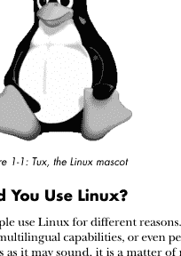

图 1-1：Tux，Linux 的吉祥物

## 为什么你应该使用 Linux？

人们使用 Linux 的原因各不相同。对许多人来说，这关乎性能、稳定性、多语言能力，甚至个人理念。然而，对另一些人而言，尽管听起来很俗气，但这关乎金钱。只需想一下通常开始使用一个操作系统需要花费多少。去你买软件的地方，在过道边走边看。在脑海中列出一张清单，列出你想买的所有东西及其价格：一个办公套件；一两款游戏；也许一个图形程序，用来让你在数码照片中看起来更美；还有一套防火墙、反垃圾邮件、杀毒和反广告软件，这些在 Windows 世界里你确实需要用来保护自己。现在算算多少钱。

当你从地上爬起来之后，你就会明白我们谈的是一大笔钱。另一方面，以这本书的价格，你将在 Linux 世界里得到你想要的一切，甚至更多。尽管许多人担心，但转向 Linux 不仅意味着节省开销，还意味着更强大的计算灵活性。你不会在某个关键时刻因为缺这个或那个程序而陷入困境——从一开始你就拥有一切，或者很容易就能免费下载……而且完全免费！

你可能会反驳说，其他操作系统也有很多免费软件应用程序，但拜托，面对现实吧——这些软件在功能上往往相当有限。那些更有劲头的程序大多是共享软件，而如今大多数共享软件都在某种程度上有所限制，或者只允许你短期使用，除非你愿意付费。当然，它们的费用相对较低，但这里 25 美元，那里 35 美元，最终也会积少成多。还有一个问题：其中一些程序会在你不知情的情况下安装后门或键盘记录器，或者让你的系统突然变成广告软件的花园。最后，至少以我的经验来看，这类程序大多不值这个要价。

## 一切都只是为了钱吗？

虽然金钱对普通用户来说很重要，但它肯定不是尝试 Linux 的唯一原因；还有其他各种原因。正如我提到的，Linux 以其稳定性著称。试着让你当前系统一个月不重启运行，看看会发生什么。Linux 已知可以连续运行一年以上而无需重启，且没有任何故障或性能下降。凭借其多语言能力，Linux 也是语言学生或多语言环境中用户的绝佳选择。

此外，Linux 可以无限定制：你可以让系统以你想要的方式呈现和行为，而不会被“向导式”流程折磨死。还有大多数 Linux 发行版附带的应用程序。它们不仅种类繁多，而且大多完全达到行业水准，其中一些如 Evolution、GIMP 和 Inkscape，让 Linux 世界之外的人羡慕不已。

最后，随着微软 Windows 7 系统的问世及其对硬件要求的提高（尤其是如果你想利用其最受吹捧的新功能），你可能会发现你当前的机器正快速走向过时。把它变成一台 Linux 机器将确保它还能继续服役好几年。毕竟，这么早把好硬件送去“退休”实在可惜。

## 但 Linux 真的准备好进入桌面了吗？

尽管 Linux 近年来取得了进步，这个问题仍然经常出现，这也情有可原。但请想一想：当你当前 Windows 系统上安装一个程序时，却收到错误消息说由于缺少某个 DLL 文件而无法运行，或者当你连接一块硬件却无法让它工作时，没有人会问那个操作系统是否准备好进入桌面。

在我自己的经验中，我发现没有任何理由怀疑 Linux 已经准备就绪。当然，Linux 偶尔会有一些怪癖，但其他操作系统也一样。Linux 已经准备好并且能够胜任。如果我母亲——几乎算不上电脑高手——能够用她的 Linux 系统完成她需要的工作，并且能一直玩到深夜而不把整个系统搞崩，那么我认为可以很安全地说你也会做得不错。

## 什么是发行版？

操作系统由执行大量不同功能的许多文件组成。由于没有 Linux 公司来打包和分发构成 Linux 的文件，将 Linux 连同你可能想要的应用程序一起以可工作的方式安装到你的电脑上的任务，就落在了各种各样的实体——公司、大学、用户组，甚至个人身上。这些实体创建了被称为发行版，或简称发行版的 Linux 系统和应用程序集合。你可以绕过这些发行版，尝试自己收集设置系统所需的一切，但你肯定会在过程中失去理智。大多数人，即使是最极客的，也会选择发行版。

大多数这些发行版，无论其最终目标受众如何，基本上都由相同的核心元素组成：核心操作系统（也就是我之前提到的 Linux 内核）；某种安装程序，用于将所有系统部件和应用程序正确安装到你的机器上；X Window System 以提供图形界面支持；一个或多个图形桌面环境；以及一系列应用程序，如文字处理器、音频播放器和游戏；以及使这些东西正常工作所需的所有文件。

当然，发行版的数量非常多。有些针对特定受众，例如企业、教育工作者、游戏玩家、学生、程序员、系统管理员以及特定语言用户。使每个发行版不同的，是捆绑在 Linux 内核上的软件，以及其他便利功能，如软件包（或应用程序）安装机制和系统本身的安装程序。一些发行版由于安装简便，尤其适合家庭用户。Ubuntu 是 Linux 世界中的一个相对新来者，是其中之一，它加入了在易用性领域长期流行的其他发行版，如 Mandriva、SUSE 和 Fedora Core。虽然其中一些实体对其发行版收费，但大多数也提供免费下载。

## 什么是 Ubuntu？

Ubuntu 是一个完全免费、易于使用且极其流行的面向桌面用户的 Linux 发行版。它是当今市场上最热门的 Linux 发行版之一。它也是少数几个具有可以被描述为社会议程的 Linux 发行版之一。

Ubuntu 是南非百万富翁 #1 企业家 Mark Shuttleworth 的创意，他可能更出名的是成为最早的太空游客之一——确切地说，是第一位进入太空的非洲人。Shuttleworth 投资超过 1000 万美元创立了 Ubuntu 基金会，这基于他对自由软件的信念，并为了修复他所描述的“bug #1”——微软对桌面 PC 市场的统治（https://bugs.launchpad.net/ubuntu/+bug/1）。

正如 Shuttleworth 在他的博客中所说（可在 https://wiki.ubuntu.com/MarkShuttleworth 获取）：

> 我相信自由软件将我们带入了一个新的技术时代，并带来了数字时代工具的普遍可及的承诺。我推动 Ubuntu 是因为我希望看到这一承诺成为现实。

正如你所见，这是一个愿景问题。


在我自己的经验中，我发现没有任何理由怀疑 Linux 已经准备就绪。当然，Linux 偶尔会有一些怪癖，但其他操作系统也一样。Linux 已经准备好并且能够胜任。如果我母亲——几乎算不上电脑高手——能够用她的 Linux 系统完成她需要的工作，并且能一直玩到深夜而不把整个系统搞崩，那么我认为可以很安全地说你也会做得不错。

## 什么是发行版？

操作系统由执行大量不同功能的许多文件组成。由于没有 Linux 公司来打包和分发构成 Linux 的文件，将 Linux 连同你可能想要的应用程序一起以可工作的方式安装到你的电脑上的任务，就落在了各种各样的实体——公司、大学、用户组，甚至个人身上。这些实体创建了被称为发行版，或简称发行版的 Linux 系统和应用程序集合。你可以绕过这些发行版，尝试自己收集设置系统所需的一切，但你肯定会在过程中失去理智。大多数人，即使是最极客的，也会选择发行版。

大多数这些发行版，无论其最终目标受众如何，基本上都由相同的核心元素组成：核心操作系统（也就是我之前提到的 Linux 内核）；某种安装程序，用于将所有系统部件和应用程序正确安装到你的机器上；X Window System 以提供图形界面支持；一个或多个图形桌面环境；以及一系列应用程序，如文字处理器、音频播放器和游戏；以及使这些东西正常工作所需的所有文件。

当然，发行版的数量非常多。有些针对特定受众，例如企业、教育工作者、游戏玩家、学生、程序员、系统管理员以及特定语言用户。使每个发行版不同的，是捆绑在 Linux 内核上的软件，以及其他便利功能，如软件包（或应用程序）安装机制和系统本身的安装程序。一些发行版由于安装简便，尤其适合家庭用户。Ubuntu 是 Linux 世界中的一个相对新来者，是其中之一，它加入了在易用性领域长期流行的其他发行版，如 Mandriva、SUSE 和 Fedora Core。虽然其中一些实体对其发行版收费，但大多数也提供免费下载。

## 什么是 Ubuntu？

Ubuntu 是一个完全免费、易于使用且极其流行的面向桌面用户的 Linux 发行版。它是当今市场上最热门的 Linux 发行版之一。它也是少数几个具有可以被描述为社会议程的 Linux 发行版之一。

Ubuntu 是南非百万富翁 #1 企业家 Mark Shuttleworth 的创意，他可能更出名的是成为最早的太空游客之一——确切地说，是第一位进入太空的非洲人。Shuttleworth 投资超过 $10 million 在基于他对自由软件的信念创立 Ubuntu 基金会，并为了修复他所描述的 "bug #1"——微软对桌面 PC 市场的统治（https://bugs.launchpad.net/ubuntu/+bug/1）。

正如 Shuttleworth 在他的博客中所说（可在 https://wiki.ubuntu.com/MarkShuttleworth 获取）：

> 我相信自由软件将我们带入了一个新的技术时代，并带来了数字时代工具的普遍可及的承诺。我推动 Ubuntu 是因为我希望看到这一承诺成为现实。

正如你所见，这是一个愿景问题。令人恰如其分的是，考虑到创造它的那个人及其目标，ubuntu 这个词来自祖鲁语和科萨语。Ubuntu，根据 Wikipedia 的说法，是一个概念，大致意思是“对他人的仁慈”或“我因我们而存在”。如果你感兴趣，2005 年的电影《In My Country》，虽然不是有史以来最伟大的电影之一，但在许多层面上是对 ubuntu 概念的 100 分钟的审视。

## 为什么选择 Ubuntu？

在这么多发行版中，你可能会想知道为什么要选择 Ubuntu。好吧，正如他们所说，数字不会说谎，而 Ubuntu 的受欢迎程度并非没有充分理由。以下特点尤其受大众欢迎：

### 易于安装

可以公平地说，如今大多数 Linux 发行版都很容易安装（而且安装速度比 Windows 更快、更容易）。Ubuntu 与这些改进保持一致，并且由于你可以在运行 live CD 时仅用几次鼠标点击就安装它，这意味着它几乎随时准备就绪。

### 易于使用

Ubuntu 易于使用，因为它在操作上非常像 Windows，但它比其他面向 Windows 用户的发行版更具 Linux 特色。它是为真正的人的需求而设计的，而不仅仅是电脑极客和宅男。

### DEB based

### 版本最新

有些发行版的更新速度慢如蜗牛，而另一些则极力追求前沿，结果常常漏洞百出。Ubuntu 采用合理的六个月发布周期，力求尽可能保持最新，同时确保所有功能在准备好正式发布之前不会被放出。这样一来，你便能拥有一个既与时俱进又较少缺陷的发行版。

### 稳定可靠

我知道这些词听起来像是炒作，但等你就 Ubuntu 折腾一番后，就会明白它们的含义。把东西打翻在地，它们会立刻恢复原状——这对于那些常常搞砸事情的新手来说非常重要。最让新用户望而却步的，莫过于一个需要时刻小心呵护的、不稳定的系统。

### 面向桌面用户

许多 Linux 发行版虽然在桌面领域表现出色，但更多地迎合了极客和开发者，用大量你可能永远不会用到的垃圾占用宝贵的磁盘空间。Ubuntu 的目标是从微软手中抢占桌面市场份额，因此始终牢记普通最终用户的需求。其结果是，Ubuntu 的 GNOME 桌面环境对普通桌面用户来说是一个非常舒适的地方。

### 硬件兼容性

好了，这些背景废话已经足够，是时候开始动手了。如果你还没有在机器上安装过 Linux，并且想知道能否安装，请放心：Ubuntu 可以运行在如今的大多数机器上。当然，只有等真正跑起来你才能知道。你的机器有太多细小的部件，很难说每一个都能与安装过程配合默契。显卡、声卡、网卡、显示器等等，都需要考虑在内。

## 开始动手

如果你打算买一台新机器来运行 Ubuntu，那么事先稍微担心一下并做一些检查是合情合理的；但如果你打算在现有机器上安装，我建议直接开始动手。毕竟，第一次尝试时你并不需要真正安装任何东西。本书就附带了一张 live CD（试用光盘），你只需把光盘放入驱动器，启动机器，然后“砰、砰、砰”，一两分钟内你就能跑起来（也可能不行）。如果一切似乎都在正常进行……那么，你的担忧就结束了，当你准备好并且愿意的时候，就可以继续安装系统。这正是 Ubuntu 的优势之一——不仅所有必需品都能装进一张 CD（其他发行版往往需要四张甚至更多），而且这张 CD 既是可运行的试用环境，又是安装程序！没有比这更方便的了。

## 需要调研时

如果 live CD 运行不顺利，你可以先查看第 21 章。如果在那里找不到问题的答案，就在网上搜索，看看能否找出是硬件拼图中的哪一部分导致了问题。（或者，如果你打算购买一台机器来安装 Ubuntu，可以搜索 Linux 支持的硬件。）当然，在这么做之前，你需要知道自己拥有哪些硬件型号。如果你想找到有价值的信息，至少应该知道自己的主板、中央处理器（CPU）、显示器和显卡型号。识别 CPU 和显示器应该相当容易，但主板和显卡可能需要多搜索一番。

如果你没有能明确说明这些设备品牌和型号的文档，那么你可以在 Windows 中查到大部分所需信息：进入 Windows 控制面板，双击“系统”，然后点击该窗口中的“硬件”选项卡。进入“硬件”选项卡后，点击“设备管理器”按钮，查看能找到的关于系统组件的信息。有时候那里的信息相当有限，因此你可能想试试 HWiNFO (http://www.hwinfo.com/) 或 Sandra (http://www.sissoftware.net/) 这样的共享软件，以便获得更有用的细节，比如主板的规格或当前配置所支持的显示模式。

HWiNFO 和 Sandra 都应该能提供你需要的关于主板的信息，但如果它们没有提供（或者你不想费心用它们），你总是可以打开电脑机箱直接查看主板，不过如果你是笔记本电脑，我不建议这么做。打开机箱后，你不必担心会损坏任何东西，因为你不需要碰任何东西——所以千万别碰。你可能需要手电筒才能找到型号，但型号名称和编号应该印在主板上某个位置，要么在主板中间，要么在边缘。例如，我的主板中央就清晰地印着“AOpen MX46-533V”。你也应该寻找类似的信息。

一旦你掌握了所有信息，就可以通过多种方式来检查硬件与 Ubuntu 的兼容性。你可以简单地在 Yahoo! 或 Google 上搜索，输入主板品牌和型号再加上 Linux 一词。这对其他硬件设备也同样适用。

你也可以在 Ubuntu 用户论坛（http://www.ubuntuforums.org/）或网上其他各种 Linux 论坛或邮件列表上提问。第 20 章可能会为你提供更多信息来源，附录 D 还列出了其他来源。在论坛发帖时，只需写明你是新手，想知道是否有人有在所述主板（或其他硬件）上使用 Ubuntu 的经验。你很可能会得到不少回复。Linux 用户通常在吸引新的“小企鹅”入伙方面相当热心。

## 硬件要求

抛开兼容性方面的所有担忧，你仍需要满足一些最低硬件要求：

- 任何搭载 1 GHz 或更高频率的基于 i386 的处理器，或 Intel 或 AMD 64 位处理器的计算机
- 大约 5 千兆字节（GB）的硬盘空间，不过拥有至少 10GB 会更舒适一些
- 足够的内存（RAM）


> 注意 本书附带的 CD 设计用于在基于 i386 的处理器机器上运行（基本上是所有 Pentium 芯片，包括 Celeron、Xeon 以及新的 Core Duo，以及 AMD 的处理器）。虽然此 CD 可以在搭载 AMD 或 Intel 64 位处理器的计算机上安装 Ubuntu，但它仅以 32 位模式运行。要充分利用你的 64 位处理器，你需要下载 Ubuntu 的 64 位版本。有关更多信息，请参阅附录 B。

至于随机存取存储器（RAM），官方规格说明你需要至少 512 兆字节（MB）才能运行 Ubuntu。虽然你或许可以用这个配置凑合，但用更多会好得多。我的经验法则是，无论处理什么操作系统，你都需要推荐的（而非最低的）内存再加上至少 128MB。无论官方规格如何说，都请多装一些。你不会后悔的。

说“内存越多越好”听起来可能有点简单，甚至有点轻率，但请相信我这一点。当内存不足时，无论运行什么系统，都会出现奇怪的事情：应用程序似乎需要数年才能打开或根本打不开，菜单需要很长时间才能渲染出小图标，而且冻结和系统整体崩溃也会频繁发生。换句话说，用太少 RAM 运行机器有点像在扫帚房里做 jumping jacks。确实可以做，但你会扭曲变形，而且每 1.4 秒就会把手砸到墙上。

幸运的是，如今找到内存小于 512MB 的机器已经相当困难了（在那些真正的老古董上也许是 256MB），但如果你恰好有这样一台机器，你至少可以安慰自己内存相对便宜，所以大胆去升级吧。

## 64 位机器用户的福音

再次强调，本书附带的 CD 设计用于在基于 i386 的处理器机器上运行，这几乎涵盖了市面上绝大多数 PC。如果你的机器支持 64 位，你会很高兴知道它也可用，只是不会以 64 位模式运行。抱歉，没戏。

幸运的是，对于那些对上一段内容有点失望的人来说，有好消息。Ubuntu 提供了原生的 64 位版本。请查阅附录 B，了解如何获取它。那里提供的信息对那些不小心丢失或损坏本书附带光盘的 i386 用户也很有用。

## Mac 用户的喜忧参半消息

如果你使用的是前 Intel 时代的 PowerPC Mac（例如搭载 G3、G4 和 G5 处理器的机型），你可能知道之前的 Ubuntu 版本曾提供 PowerPC 版本。不幸的是，自 Ubuntu 7.04 Feisty Fawn 版本起，这已不再如此。这意味着，如果你是 PowerPC Mac 用户，你将不得不使用较旧的 Ubuntu 版本，或使用一个非官方的、社区支持的 Ubuntu 10.04 Lucid Lynx 版本用于 PowerPC（`http://cdimage.ubuntu.com/ports/`）。

当然，如果你使用的是基于 Intel 的 Mac，你就幸运了：本书附带的磁盘可以在你的 Mac 上运行。毕竟，i386 中的 i 代表“Intel”。

## 说说 Ubuntu

值得注意的是，当你处理 Ubuntu 时，尤其是通过网络搜索信息时，你很可能会遇到很多奇怪的短语。特别是，我指的是看似不协调的短语，例如 Warty Warthog、Hoary Hedgehog、Breezy Badger、Dapper Drake、Edgy Eft、Feisty Fawn、Gutsy Gibbon、Hardy Heron、Intrepid Ibex、Jaunty Jackalope 和 Karmic Koala。这些是自 2004 年首次发布以来每个 Ubuntu 版本的非正式代号。你需要记住的重要一个是当前版本的代号，即本书光盘上的版本：10.04，代号为 Lucid Lynx。

你也可能会遇到一些 Ubuntu 主题的其他变体。这些是 Kubuntu，一个基于 KDE 的 Ubuntu 版本；Edubuntu，一个专为课堂使用而设计的 Ubuntu 特殊版本；Xubuntu，一个基于 XFCE 桌面的轻量级 Ubuntu 版本；以及 Ubuntu Studio，一个面向“创意人士”的新口味 Ubuntu，包含强大的图形、视频和音乐应用程序套件。甚至还有一个精简版的 Ubuntu，称为 Ubuntu Netbook Edition，专为上网本设计。

## 我接下来该去哪里？

现在你对 Linux 和 Ubuntu 的世界有了更多的了解，并且手握光盘，是时候开始了。如果你已经在机器上安装了 Ubuntu，只需直接翻到第 3 章即可。如果你的机器仍然没有 Linux，那么是时候让它试运行一下，看看你是否喜欢它了。所以现在，系好安全带坐在电脑前，系上马刺，直接进入下一章。是时候成为 Penguini sta 了！

## 2 试用与安装

*运行（如果愿意）安装 Ubuntu*


正如我已经提到的，Ubuntu 的一大优点是它提供的是一个 live CD，这意味着你可以在安装之前先试用它……或者，如果你愿意，根本就不安装。更好的是，与 Ubuntu 早期版本不同，如果你选择安装它，就不需要额外的安装 CD——Ubuntu 桌面版 CD 同时充当 live CD 和安装 CD。而在好-更好-最好的递进中，最好的点在于，从 live CD 安装实际上比你曾经处理过的任何其他安装过程都要容易得多，而且它甚至为你提供了不止一种方法。

在本章中，我将介绍从 live CD 启动和运行 Ubuntu 的基本方法，然后，假设你已经感染了 Linux 病毒，我将介绍将 Ubuntu 安装到你的硬盘上的无痛步骤，作为唯一的系统、在硬盘上的独立分区中、与 Windows 在各自分区中的传统双启动设置中，或者，对于稍微保守一点的人来说，直接从你的 Windows 系统中安装。如果你的电脑没有 CD 驱动器，不用担心，你仍然可以参与进来——请查看附录 A，了解如何改用 USB 闪存驱动器运行或安装 Ubuntu。不管你最终采用哪种方式，让我们把这本书派上用场，让 Ubuntu 运行起来。

### 小试身手

要品尝 Ubuntu 的风味（并检查你的硬件是否与 Ubuntu 完全兼容），可能没有比直接从 live CD 运行 Ubuntu 更好的方法了。要做到这一点，只需将 Ubuntu 桌面版 CD 放入光盘驱动器并重新启动机器。当机器启动时，它应该从 CD 启动，几秒钟后，你应该会看到一个紫色的 Ubuntu 启动屏幕，底部有几个图标。如果屏幕没有出现，而你的机器反而启动到通常的操作系统，那么很可能你的机器的 BIOS 设置需要更改，以便允许从 CD 启动。

你可以通过重新启动然后按下屏幕启动说明分配给访问 BIOS 设置的键来访问机器的 BIOS。这通常是 DELETE 或 F1（F2、F10 和 ESC 也很常见），但并非所有机器都相同。如果屏幕上的信息闪过太快而你错过了，你可以查阅用户手册以了解正确的键。一旦进入 BIOS 设置，请更改启动顺序，使你的 CD 驱动器排在第一位。

一旦你的机器从 live CD 启动并显示紫色的 Ubuntu 启动屏幕，你可以等待几秒钟让 Ubuntu 启动到真正的 live CD，或者按任意键（任意键）显示一个菜单，在其中你可以选择语言和其他设置。默认设置对我们的目的来说已经足够了，所以让键盘保持不动几秒钟，紫色屏幕将让位给一个加载屏幕（也是紫色的）。

再过几分钟，加载屏幕就会消失，取而代之的是如图 2-1 所示的安装窗口。现在你应该能够使用鼠标和键盘了，所以除非你想使用屏幕左侧的列表更改语言，否则点击 Try Ubuntu 10.04 按钮开始一个 live 会话。经过几秒钟的加载后，你将看到一个 Ubuntu 桌面，全部从 CD 运行。而且请记住，你的硬盘将保持不变，所以安心吧——你不会改变，更不用说伤害任何东西了。当你到达这一点时，你就可以开始了——但我会等到第 3 章再谈论这个问题。

> **NOTE** 需要用于输入某些语言（即中文、日文和韩文）的特殊输入机制在 live CD 会话中不受支持。

如果你想退出 live CD 并让你的电脑恢复正常，点击屏幕右上角的电源按钮，选择 Restart，然后从出现的窗口中再次选择 Restart。过了一会儿，你会被要求从驱动器中取出 CD 并按 ENTER。电脑将重新启动，很快就会带你回到正常的 Windows 桌面。如果你由于某种原因对 Restart 按钮没有运气，只要使用它前面的电源按钮关闭然后重新打开电脑应该是安全的。

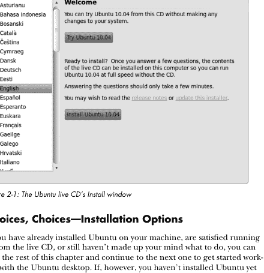

图 2-1：Ubuntu live CD 的安装窗口

## 选择，选择，再选择——安装选项

如果你已经在机器上安装了 Ubuntu，对从 live CD 运行它感到满意，或者仍然没有决定要做什么，可以跳过本章的其余部分，直接进入下一章开始使用 Ubuntu 桌面。如果，你还没有安装 Ubuntu，并且已经准备好并且迫不及待地想要安装，那么最好就待在原地继续阅读。

## 去游泳吧——在 Windows 内部安装 Ubuntu（Wubi 安装程序）


过去，如果你足够喜欢 Ubuntu 以至于想从硬盘运行它，但又担心损坏脆弱的 Windows 设置，你就……好吧，只能倒霉了。然而情况已经改变，因为现在有一个名为 `Wubi` 的安装选项，它让你可以直接在 Windows `C:` 驱动器上安装 Ubuntu，就像安装任何其他 Windows 程序一样。安装后，每次启动机器时，你都可以在 Windows 启动加载程序屏幕中选择启动到 Windows 还是 Ubuntu。你的 Windows 系统保持不变；你不需要分区硬盘；如果你以后出于任何原因想摆脱 Ubuntu，可以像卸载任何其他 Windows 应用程序一样操作。这对于胆小的人来说是一个很好的方法。

坦白说，这种方法可以被描述为半吊子，因为它并没有真正给你一个专用 Ubuntu 安装时通常获得的完整体验。它安装起来也更慢，因为 `Wubi` 需要从互联网下载安装文件（正确的安装文件不在 CD 上）。但这是一个相当不错的折中方案——它运行得 definitely 更快，而且比 Ubuntu live CD 会话好用得多，也更有趣得多。你还额外受益于能够将文件和设置保存到磁盘，这意味着你可以跟随本书中描述的任何内容。相当酷。

如果这种替代安装方法对你来说没有吸引力，请继续阅读第 16 页的“全情投入——在 Windows 外部安装 Ubuntu”。如果你还没有做出决定并且想了解更多关于这个 `Wubi` 安装程序的信息，请将浏览器指向 `http://wubi-installer.org/`。如果另一方面，你已经决定 `Wubi` 安装程序是你祈祷的答案，那么你需要做的是：在 Windows 运行的同时，将随书附带的 Ubuntu live CD 插入计算机的光盘驱动器。像图 2-2 中那样一个窗口会自动出现。

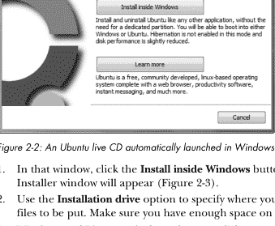

图 2-2：在 Windows 中自动启动的 Ubuntu live CD

1. 在该窗口中，单击 `Install inside Windows` 按钮。Ubuntu Installer 窗口将会出现（图 2-3）。
2. 使用 `Installation drive` 选项指定你希望将 Ubuntu 文件放置的位置。确保该驱动器上有足够的空间！
3. Windows 和 Linux 不能共享相同的磁盘空间，所以你需要为 Ubuntu 单独预留一些空间（你可以通过卸载 Ubuntu 轻松收回该空间，稍后会讨论）。通过从 `Installation size` 下拉列表中选择一个大小来选择你希望在 Ubuntu 中可用的磁盘空间。少于 6GB 的空间可能会非常受限。
4. 将 `Desktop environment` 保持为其默认值（Ubuntu），然后选择一个用户名和密码。你对自己的选择满意后，单击 `Install` 按钮。

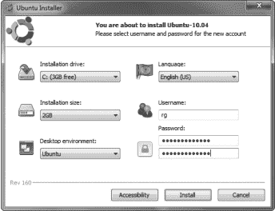

*图 2-3：在 Windows 内部选择安装 Ubuntu*

5. 如果你的机器此时尚未连接到互联网，你会被告知需要连接。必要时进行连接，如果出现警告窗口，请单击 `Retry` 按钮。

此时，`Wubi` 将开始下载它创建 Windows 环境中可启动的 Ubuntu 安装所需的文件。根据你的连接速度，这可能需要相当长的时间。

一切完成后，你将看到一个像图 2-4 那样的窗口，提示你重新启动。

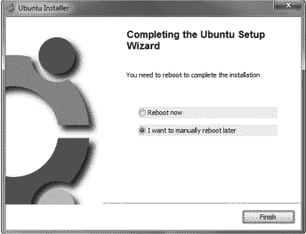

*图 2-4：Ubuntu 已完成其在 Windows 内部安装的第一阶段。*

6. 选择 `立即重启` 并在该窗口中单击 `完成` 按钮，之后你的机器将会重启。
7. 当机器重新启动时，你会看到 Windows 启动管理器，一个黑底白字的屏幕，允许你决定是在 Windows 还是在 Ubuntu 中启动。使用向下箭头键选择 `Ubuntu`，然后按 ENTER。

你的机器随后将开始 Ubuntu 启动过程，这对你来说应该是全新的领域。一旦 Ubuntu 桌面出现，Ubuntu 将开始为你设置系统，这可能需要一些时间，具体取决于你的机器速度。完成后，你将被带到登录屏幕（图 2-5）；你现在可以翻到第 3 章，因为你在这里的工作已经完成了。

如果你决定不想在机器上保留 Ubuntu，你可以从 Windows 中将其移除，通过进入 Windows 控制面板，选择 `添加或删除程序`，然后选择 `Wubi` 进行移除。

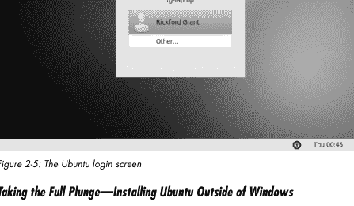

图 2-5：Ubuntu 登录屏幕

## 彻底投入——在 Windows 外安装 Ubuntu

如果你机器上还没有安装 Windows，可以跳过本节。如果你已安装，那么你将不得不决定是否要保留它。

可以在同一台机器上同时安装 Windows 和 Linux，并且让它们和谐共存。这被称为 *双启动设置*。设置这样一个系统也变得非常容易。我最初使用的是双启动设置，不过最终我发现自己只使用 Linux 那一侧。让大量磁盘空间被我不使用的 Windows 系统占用似乎是浪费宝贵的空间，所以最终我直接放弃了它，改用纯 Linux 方案。

我的感觉是，你应该先尝试 `Wubi` 的方式在 Windows 内安装 Ubuntu，然后在准备好后，再进行纯 Linux 方案并完全放弃 Windows。大多数人会发现 Ubuntu 可以满足他们所有的需求，所以除非你需要某个在 Linux 上没有对应替代品的特定应用程序，否则没有必要双启动。

如果你选择双启动设置，在任一系统中启动都很简单。当你启动机器时，你会看到 `GRand Unified Bootloader`（更广为人知的名称是 `GRUB`）屏幕，从中你可以选择继续启动 Linux 或选择 Windows。之后，所选系统的启动将按正常方式进行。这种设置运行良好且易于使用，所以你无需担心。

所以无论你决定走哪条路，你都不会出错。只要在开始安装前备份好你的重要文件即可。保持常识、耐心和积极的态度，你会没问题的。简而言之，不要担心。

## 为行动做好准备

与许多其他 Linux 发行版相比，准备 Ubuntu 安装所需的工作更少。一旦你决定是否要走双启动路线，你真正需要准备的只有一张 Ubuntu 桌面 CD，以及用于指导和安全性的这本书。你可能需要花费的唯一脑力是想出一个用户名和用户密码，就像大多数其他操作系统一样。

### 用户名和用户密码

你的用户名是你会经常看到的东西。你每次启动系统时都需要点击它，此外还有其他用途，所以请确保它是你能接受的。它可以只是你的名字、你的首字母或你想要的任何内容。但是，它必须以小写字母开头，后跟数字和/或其他小写字母。我的例如就是简单的 `rg`，但你也可以使用像 `hope4u2pal` 这样的名字，不过那样看起来会相当累人。

你还需要想出一个用户密码，你每次登录时都需要输入。它在你安装新软件或更改某些系统设置时也需要使用。它的长度应至少为八个字符，并由数字和字母（大小写）组成以提高安全性。当然，如果你愿意，也可以只用更少的字符和仅字母来应付。安装程序会在你输入的密码不可接受时提醒你，所以不用太担心。务必写下它并将写有密码的纸张保存在安全的地方，以免你把自己锁在系统之外。

> 注意 如果你有使用其他 Linux 发行版的经验，你可能会惊讶地得知在 Ubuntu 中 `root` 账户默认是被禁用的。因此，在安装步骤中没有输入 `root` 密码的环节。你可以查看论坛（`http://www.ubuntuforums.org/`）来了解绕过此设置的办法。你也可以在系统安装完成后随时设置 `root` 密码，所以如果拥有 `root` 账户对你很重要，不必担心。

### 双系统用户请注意

如果你打算创建双系统设置，在继续安装 Ubuntu 之前，最好先对当前 Windows 磁盘进行碎片整理。这一步并非严格必要，但可以让安装过程中的分区阶段稍微快一些，并且有助于防止不必要的意外。

如果你使用的是 Windows Vista 或 Windows 7，系统默认会定期自动对硬盘进行碎片整理，因此你无需额外操作即可使用。在其他版本的 Windows 上，你则需要手动进行碎片整理。在 Windows XP 中，你可以通过双击“我的电脑”，右键点击硬盘图标并选择“属性”来完成。然后在“属性”窗口中点击“工具”选项卡并点击“立即碎片整理”按钮即可对硬盘进行碎片整理。在 Windows 2000 中，你可以通过“开始”菜单选择“控制面板 ▸ 管理工具 ▸ 计算机管理 ▸ 磁盘碎片整理程序”来完成，而在 Windows 98 及其他一些版本中，你可以通过选择“程序 ▸ 附件 ▸ 系统工具 ▸ 磁盘碎片整理程序”来完成。碎片整理可能需要相当长的时间，因此你可能希望让它在夜间运行。

## 开始安装

好吧，现在我已经介绍了所有这些前期内容，让我们进入实际的 Linux 安装。把这本书放在你的腿上以便跟随操作，然后准备行动。是时候开始了！

幸运的是，对你来说，安装过程极其简单，因为实际需要你操作步骤很少。你所要做的就是在屏幕上点击按钮而已。没什么难的，对吧？


当然，当你查看这里列出的说明和描述时，它看起来可能很长很繁琐。事实并非如此。它会比你想象的更快结束。作为经常参考本文的初学者，你可能需要多花一点时间，当然，但总的来说，整个过程比 Windows 或 Mac OS X 更快更简单。并且请记住，在 Windows 和 OS X 中，你只是在安装操作系统以及少量捆绑的应用程序。而在 Ubuntu 安装中，另一方面，你不仅安装操作系统本身，还安装了你将来想要或需要使用的大多数应用程序。你将因此一次完成很多工作。

在开始之前还有一件事。有些人以相当大的忐忑来对待系统安装。安装过程让他们紧张，好像如果在某个环节点击错误，房子就会冒烟。毋庸置疑，没有这种担忧的必要。只要你已经备份了数据，你就会没事。如果第一次安装搞砸了，那又怎样？只需重新开始。不会造成任何损害，因为你没有东西可损害。只要确保你为该过程预留的时间比实际所需更多。不要在你必须上班或必须在市中心会见朋友前一小时才开始安装。匆忙会让人做出奇怪的事情。通过给你自己充足的时间，以及如我之前提到的，备份任何你会为之痛惜的数据，让事情变得简单。

如果你准备好了，以下是步骤：

- 1. `启动吧。` 如果你尚未这样做，从 Ubuntu 桌面 CD 启动你的机器。
- 2. `开始安装。` 这次，当你到达图 2-1 所示的安装窗口时，点击“安装 Ubuntu 10.04”按钮开始安装。这将打开安装向导的第一页“你在哪里？”（图 2-6）。

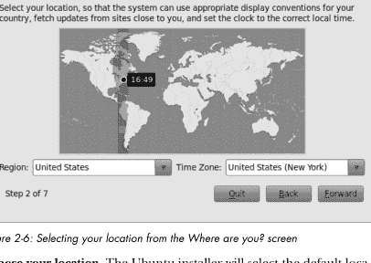

图 2-6：从“你在哪里？”屏幕选择你的位置

- 3. `选择你的位置。` Ubuntu 安装程序将为你选择的安装语言选择默认位置。如果你的位置不同，请直接点击地图选择适合你的位置。做出选择后，点击“前进”。
- 4. `选择键盘布局。` 安装向导的下一屏会显示你所选安装语言的默认键盘布局。如果你的键盘布局不同，请选择`自行选择`，从屏幕左侧窗格的位置列表中做出适当选择，然后从右侧窗格中该位置可用的布局中进行选择。如果不确定是否选择正确，可以在窗口底部的文本框中输入几个词来 double-check。一旦完成，点击`下一步`。如果需要，你可以在系统安装后添加其他键盘布局。
- 5. `准备磁盘空间。` 这一步你需要做什么取决于机器上的情况。假设磁盘上已有操作系统，例如 Windows，请接受最上面的选项（并排安装）。这将缩小你的 Windows（或其他操作系统）安装的尺寸，以便在新分区中安装 Ubuntu。默认情况下，分区器会使用安装 Ubuntu 所需的最小空间，但你肯定想要多一点空间，以便有成长和存储文件的余地。要为 Ubuntu 创建更大的分区，请拖动屏幕底部彩色条上两个分区之间的灰色按钮，直到你认为合适的组合为止（图 2-7）。完成后，点击`下一步`按钮。

如果你的硬盘上没有操作系统，或者你打算删除当前系统并用 Ubuntu 取代，则应选择第二个选项，`擦除并使用整个磁盘`；然后，如果有选择，请选择要安装系统的主驱动器。

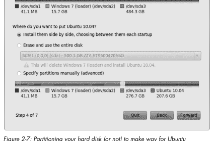

图 2-7：对硬盘进行分区（或不分区）以腾出空间给 Ubuntu

## 硬盘分区是什么？

到目前为止我多次提到分区，但你可能并不清楚我的意思。分区是硬盘上被“隔离开”的区域。它是将诸如操作系统之类的东西分开的有用方法。由于它们彼此隔离，不同的分区会被当作连接到计算机的不同硬盘处理，即使它们在同一物理硬盘上。

大多数计算机只有一个分区，占据整个硬盘。这就像拥有一栋完全开放式户型的房子——整栋房子就是一个大房间。如果你想完全移除 Windows 并改装 Ubuntu，Ubuntu 可以很愉快地接管整个分区（从而接管整个磁盘）并赶走前任居民 Windows。

如果你想在同一台计算机上安装两个操作系统，你必须为每个系统分配自己的分区（毕竟它们需要隐私）。回到房子类比，就像竖起隔断墙把房子分割成两个房间。如果你选择双启动 Windows 和 Ubuntu，安装程序会自动为你进行分区。当然，你可以选择每个分区的大小：你把 Ubuntu 分区做得越大，在 Ubuntu 中可用的磁盘空间就越多（而在 Windows 中就越少）。毕竟房子大小不变；只是隔断墙的位置在改变。

如果你想自己掌控过程，可以在附录 C 中找到有关手动分区硬盘的一些信息。如果你愿意，可以尝试一下。不过通常没有必要，因为 Ubuntu 安装程序很乐意为你处理此任务。

如果你想对磁盘空间做更复杂的操作，例如为数据和系统文件分别设置分区（如果需要重新安装或想在 Windows 和 Ubuntu 之间轻松共享文件时很方便），你需要使用最后一个选项手动指定分区。这更高级——请查阅附录 C 以获取指导。做出选择后，点击下一步。

根据你选择的分区方案，点击下一步按钮后，可能会出现一个小窗口，提醒你迄今为止所做的任何更改现在将被写入磁盘（图 2-8）。

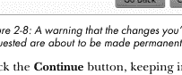

图 2-8：警告你所请求的更改即将永久生效

- 6. 点击`继续`按钮，请记住，如果你看到了警告信息，这就是不可回头的点。之后，等待分区器完成其工作（这可能需要一些时间，具体取决于磁盘的大小和磁盘上的内容）。
- 7. `指定你的身份。` 在安装向导的下一页中，系统会要求你提供你的真实姓名、登录名和密码。向导会根据你的用户名自动为你的电脑生成一个名称（在我这里是 `rg-laptop`），但如果你愿意，可以自由将其更改为其他名称（我将其更改为 `Ubuntu-Acer`）。一旦你像图 2-9 中那样填写完所有字段，点击 `Forward`。如果收到密码太弱的警告，请返回并添加几个额外字符后再试（或者直接忽略该消息并点击 `Continue`）。

> NOTE `注重安全的人可能会考虑在窗口底部选择 Require my password to log in and to decrypt my home folder 选项。这将加密你的主文件夹（所有文档都存储在其中），这样没有你的密码就无法查看其中的任何文件。如果你处理的是机密信息，这就很不错了，因为即使电脑被盗，数据也会相当安全。`

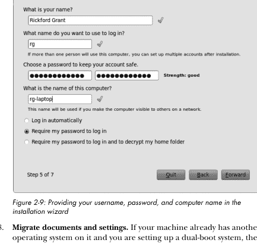

`Figure 2-9: Providing your username, password, and computer name in the installation wizard`

- 8. `迁移文档和设置。` 如果你的机器上已安装了另一个操作系统，并且你正在设置双启动系统，安装程序将扫描你的硬盘以尝试找到某些可以转移到新 Ubuntu 系统环境中的设置、文件夹和文档。如果出现迁移窗口，只需选中你想要传输的项目旁边的复选框，然后点击 `Forward。`
- 9. `准备安装。` 向导的最后一页（图 2-10）列出了你即将安装的系统和硬盘分区设置的详细信息，以及不可回头的警告。你已经走到这一步了，所以不妨继续下去，即使无法回头（如果你看到了图 2-8 中的警告消息的话）。点击 `Install`。

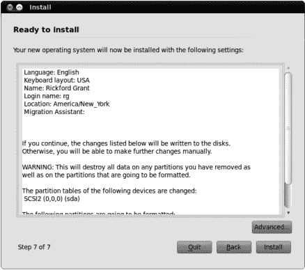

`Figure 2-10: Ready to install—the final page of the installation wizard`

分区器随后会执行必要的磁盘写入操作以完成分区过程，之后安装本身将无缝开始，无需你进行任何额外操作。安装的进度将在进度窗口中显示，并附带简短的幻灯片演示，这样你就不必担心（并且你会知道还剩下多少时间可以“在电视前放松”）。

- 10. `安装完成。` 当你完成安装的第一阶段时，会在新窗口中收到通知。你可以选择继续使用 live CD，或者重新启动机器并直接从硬盘运行 Ubuntu。好吧，你不会经历这一切只是为了继续使用 live CD，所以让我们选择第二个选项，点击 `Restart now` 按钮，在 live CD 自动弹出时将其从驱动器中取出，并在提示时按下 ENTER。你的机器随后将重新启动。

之后……嗯，这基本上就是全部了。你现在已经在机器上安装了 Ubuntu。恭喜！

## 如何重新进入 Windows？

如果你以双启动配置安装了系统，Ubuntu 与 Windows 并存，那么在计算机启动时应该会看到一个新的启动菜单。10 秒后 Ubuntu 将自动启动，但你也可以直接按 ENTER 来加快过程。

如果你想启动 Windows 而不是 Ubuntu，请使用键盘上的方向键在启动菜单中选择 Windows 选项，然后按 ENTER。Windows 应该会正常启动。如果你想将 Windows 设为默认启动项或更改启动时间延迟，请参阅第 18 章。

## 哦不，我的电脑无法启动！

如果安装过程失败，你可能无法启动计算机。幸运的是这种情况非常罕见，但如果发生在你身上，不要惊慌！有很多方法可以让你重新运行起来，所以请翻到第 21 章获取一些故障排除建议。

# 3

### 一个新的家

#### 认识桌面


现在 Ubuntu 已经启动运行，你准备好大干一场了。如果你是从硬盘运行 Ubuntu，启动时首先会看到登录屏幕，每次开机都会出现此屏幕（图 3-1）。无需让登录屏幕久等，点击你的用户名，输入密码，然后按 ENTER。片刻之后，你将面对 Ubuntu 的桌面。

## 欢迎使用 GNOME 桌面

图 3-2 显示了 Ubuntu 对 GNOME 桌面的实现，正如你所见，它与你在 Windows 或 Mac OS 环境中习惯的并无太大不同，除了它在屏幕顶部和底部都有任务栏，即面板。此外，没有桌面图标，除非是从 Ubuntu 桌面 CD 运行实时会话，在这种情况下你会看到一个用于运行安装向导的启动器（标记为 Install Ubuntu 10.04）和一个 Examples 文件夹，其中包含许多随 Ubuntu 捆绑的应用程序的示例

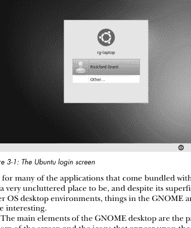

Figure 3-1: The Ubuntu login screen

文件。总的来说，这是一个非常简洁的地方，尽管它在表面上与其他操作系统桌面环境相似，但 GNOME 中的事物却足够不同以令人感兴趣。

GNOME 桌面的主要元素是屏幕顶部和底部的面板，以及出现在这些面板上的图标。桌面本身在启动时虽然是空的，但也会有不少活动，不过我稍后再谈。现在，我将重点关注这两个面板。

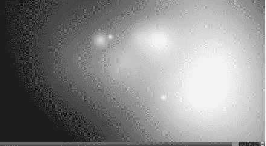

Figure 3-2: The GNOME desktop in Ubuntu

## 顶部面板

在桌面上的两个 GNOME 面板中，顶部面板基本上是所有活动的发生地。正如你所见，面板左端有三个菜单和几个图标，另一端则有一系列零碎的东西（图 3-3）。为了让你了解每个面板项目的作用，我现在将简要描述每一个，从左到右移动，这似乎是当今的时尚。

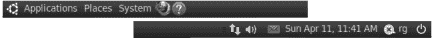

*Figure 3-3: The left and right sides of the top GNOME panel*

### 左端

在顶部面板的最左侧，你会找到一组三个菜单。这些菜单提供了系统在应用程序、位置和实用程序方面的大部分内容访问权限：

- **Applications menu** — 大多数应用程序、软件管理器和一些系统工具的访问点。
- **Places menu** — 你的系统导航器，可从中访问你的主文件夹、浏览计算机的文件系统和连接的网络，并在硬盘上搜索文件。
- **System menu** — 系统首选项和系统管理工具的访问点。

紧邻三个菜单右侧的是一组两个启动器。点击这些图标时，它们会启动以下应用程序：

- **Firefox** — 你的网页浏览器
- **Help** — 访问安装在你硬盘上的 Ubuntu 帮助文件

### 右端

在顶部面板的右侧是一系列可以执行各种功能的图标。其中一些是指示器，而另一些是允许你执行某些功能的 applet：

- **Network Manager Applet** — 让你查看网络状态并配置网络设备。当与无线网络连接一起使用时，此图标指示无线信号的强度并允许你轻松在无线网络之间切换。
- **Volume Control** — 音量控制器。废话。
- Mail/Message Indicator 一个指示器，让你知道何时收到电子邮件或聊天消息。它还允许你轻松发送电子邮件、检查地址簿，甚至通过一个名为 Gwibber 的应用程序检查和发送消息到社交网络网站，如 Facebook、Twitter 和 Flickr（图 3-4），你将在第 5 章中了解更多关于它的信息。

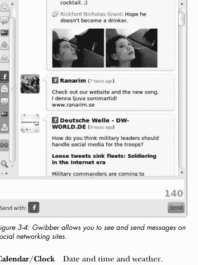

Figure 3-4: Gwibber allows you to see and send messages on social networking sites.

- Calendar/Clock 日期、时间和天气。
- Session Indicator 显示当前用户的名称并允许你更改你的 IM 状态以及访问你的社交网络、IM 和 Ubuntu One 的选项。
- Quit/Logout 允许你锁定屏幕、注销、关机、重启或切换用户。

其他指示器将根据你的硬件配置或系统状态出现：

- 蓝牙管理器 顾名思义，只出现在带有蓝牙功能的机器上。
- 电池指示器 在笔记本电脑上，显示你正在使用电池还是交流电源，如果使用电池，则显示电池剩余电量。

## 底部面板

底部面板，如图3-5所示，要简单得多，只包含四个项目，我现在简要描述一下：

- 显示桌面 一个按钮，可以最小化所有打开的窗口，让你在桌面被遮挡时看到桌面。
- 窗口列表 你打开的窗口或应用程序的列表。如果没有任何打开的内容，列表中就没有窗口。这与Windows任务栏中的情况非常相似。
- 工作区切换器 一个允许你在虚拟桌面之间切换的应用程序。（我将在第40页的“虚拟桌面”中进一步讨论。）
- 回收站 回收站没有什么神秘的……只是它在面板上的位置有点像Mac OS X风格。

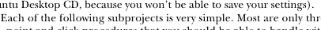

图3-5：GNOME底部面板

## 项目3A：自定义GNOME面板

GNOME面板并不是一成不变的。你可以添加启动器（分别称为Windows和Mac用户的程序快捷方式或别名）、实用程序，甚至娱乐工具，使其几乎可以做任何你想做的事情——当然，在有限范围内。在本项目的各个阶段，你将自定义你的面板，以获得一些实际操作经验，并让你在阅读本书其余部分时更加方便。当然，你可以自由更改我要求你做的任何自定义设置（不过如果你在Ubuntu Desktop CD的live会话中工作，你在这方面没有发言权，因为你无法保存设置）。

以下每个子项目都非常简单。大多数只是三步的点选操作，你应该可以毫无困难地完成。

### 3A-1：向面板添加实用按钮

GNOME面板允许你添加许多实用应用程序，称为小程序（applets）。每个小程序都有一些特定功能，例如跟踪你的股票、告诉你天气，或执行某些与系统相关的功能。首先，让我们向顶部面板添加一个有用的实用程序：强制退出按钮。强制退出按钮让你能够快速轻松地处理无响应的窗口。

是的，这种情况偶尔会发生：一个窗口突然拒绝做任何事情。无论你想让它做什么或它应该做什么，它都只是停在那里，仿佛在罢工（也许真的是）。只需单击一次强制退出按钮，你的光标就会变成一把强大的外科手术工具，可以杀死你点击的窗口。你绝对不想没有这个按钮，下面是如何将其添加到面板：

- 1. 右键单击顶部面板上的任意空白区域。
- 2. 在弹出的菜单中，选择**添加到面板**，之后将出现“添加到面板”窗口。
- 3. 在该窗口中，向下滚动，单击**强制退出**一次以突出显示它，如图3-6所示。单击**添加**按钮，然后点击**关闭**完成操作。

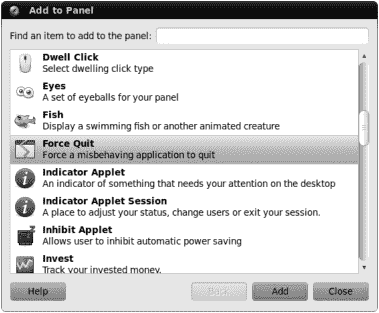

*图3-6：向面板添加启动器和实用小程序*

为了巩固你刚刚学会的操作，让我们再向面板添加一个实用程序：运行应用程序小程序。一旦你开始在Ubuntu中安装应用程序，你会发现其中一些应用程序不会自动在你的应用程序菜单中安装程序启动器。这意味着每次运行此类程序时，你必须打开终端窗口并输入命令，这很快就会让人厌烦。运行应用程序小程序是解决这个问题的一种方法。

要将运行应用程序小程序添加到面板，只需按照添加强制退出按钮时使用的相同步骤操作，但在第三步中，在“添加到面板”窗口中突出显示“运行应用程序”而不是“强制退出”。

> 注意 如果你以后决定不将运行应用程序小程序保留在面板上，或者你更喜欢键盘快捷键而不是点击操作，那么值得注意的是，你也可以按`ALT+F2`打开该小程序。

### 3A-2：向面板添加有趣的应用程序

GNOME面板不仅允许你添加非常实用的工具，还允许你添加看起来相当无用的娱乐程序。在本项目的这一部分，你将添加两个这样的娱乐程序：Eyes（眼睛）和一条名叫Wanda的小鱼。

乍一看，Wanda只是在摆动尾巴，喷出一两个泡泡。然而，如果你通过Ubuntu软件中心安装一个名为Fortune的小应用程序（你将在第6章学习如何使用它），然后点击Wanda，就会弹出一个窗口，她会在其中喷出各种名言和另类的俏皮话。

要一睹Wanda的行动（尽管行动可能有限），步骤与项目3A-1基本相同，但我会再完整地走一遍：

- 1. 右键单击顶部面板上的任意空白区域。
- 2. 在弹出的菜单中，选择“添加到面板”，之后将出现“添加到面板”窗口。
- 3. 在该窗口中，单击“鱼”一次以突出显示它，单击**添加**按钮，然后点击**关闭**。

现在Wanda已经在你的面板上就位，你可以添加Eyes，它是一双眼睛，会随着你的鼠标光标在桌面上移动而跟随。按照相同的过程，但在第三步中点击Eyes而不是“鱼”。

### 3A-3：向面板添加程序启动器


现在让我们转向更实用一点的内容——向面板添加程序启动器。虽然通过应用程序菜单导航来运行应用程序非常容易，但毫无疑问，有些应用程序你会频繁使用，希望更便捷地访问它们。OpenOffice.org 文字处理器 Writer 可能就是其中之一。

## 方法 1

你可以通过多种方式向面板添加启动器，但我们先从最常规的方法开始。要为 OpenOffice.org Writer 添加面板启动器，请按照以下步骤操作：

1. 右键单击顶部面板中的任意空白区域。
2. 在弹出的菜单中选择“添加到面板”，打开“添加到面板”窗口。
3. 在该窗口中，选择“应用程序启动器”，然后点击出现的“前进”按钮。
4. 随后会出现一个新屏幕，显示应用程序菜单的内容（图 3-7）。点击“办公”旁边的 + 展开该菜单，然后向下滚动并点击“OpenOffice.org 文字处理器”以将其高亮选中。
5. 点击“添加”按钮，然后点击“关闭”完成操作。

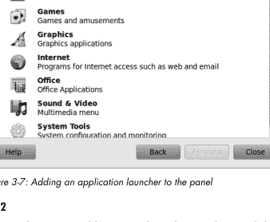

图 3-7：向面板添加应用程序启动器

## 方法 2

还有一种向面板添加程序启动器的方法，实际上会稍快一些。例如，我们将为 OpenOffice.org 电子表格程序 Calc 添加一个启动器。步骤如下：

1. 转到“应用程序”菜单，导航到并右键单击“办公 ▸ OpenOffice.org 电子表格”。
2. 在随后弹出的菜单中，选择“将此启动器添加到面板”（图 3-8）。电子表格启动器随即会出现在面板中。

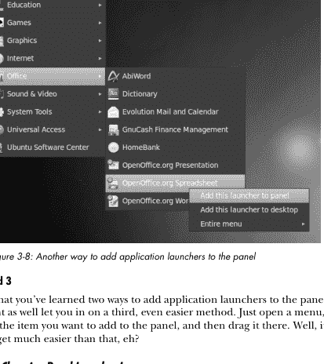

图 3-8：向面板添加应用程序启动器的另一种方法

## 方法 3

既然你已经学会了两种向面板添加应用程序启动器的方法，那我不妨再告诉你第三种更加简单的方法。只需打开一个菜单，选中要添加到面板的项，然后将其拖到面板中即可。嗯，这不能再简单了，对吧？

## 3A-4：更改面板启动器图标

你可能会觉得这两个新的程序启动器有点朴素，因此很难将它们区分开来。幸运的是，你可以非常轻松地更改任何启动器的图标。为了介绍具体方法，我将以这两个 OpenOffice.org 启动器为例。你需要执行以下操作：

1. 右键单击你添加的第一个程序启动器（文字处理器），然后从弹出菜单中选择“属性”。
2. 在随后出现的“启动器属性”窗口中，单击“OpenOffice.org 文字处理器”图标，这将打开“选择一个图标”窗口。
3. 在该窗口中，单击“浏览”按钮以打开“浏览”窗口。
4. 在该窗口顶部，单击“图标”按钮。在右侧窗格中，双击 `hicolor` 文件夹，再双击 `hicolor` 文件夹中的 `48x48` 文件夹，然后双击 `48x48` 文件夹中的 `apps` 文件夹。
5. 在该窗口中向下滚动，单击一次 `openofficeorg3-writer.png`（图 3-9）。

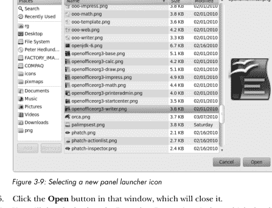

图 3-9：选择新的面板启动器图标

6. 单击该窗口中的“打开”按钮，窗口将关闭。
7. 然后你将回到“启动器属性”窗口，此时该窗口应如图 3-10 所示。如果是这样，请单击“关闭”。

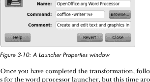

图 3-10：“启动器属性”窗口

完成上述更改后，请对另一个程序启动器执行基本相同的步骤，不过这次在步骤 3 中应选择 `openofficeorg3-calc.png` 作为图标。

## 3A-5：向面板添加抽屉

GNOME 面板中我非常喜欢的一个功能是抽屉。抽屉是一个小程序，通过让你添加下拉面板来节省面板空间，你可以将没有空间放在其他地方的启动器放入其中。这些抽屉也是放置某些应用程序启动器的方便位置，这些应用程序通常需要你在终端窗口或通过“启动应用程序”窗口输入命令来运行，例如你自己从源代码编译的应用程序或通过脚本运行的应用程序。你将在第 9 章中学习如何操作。当然，你可以在抽屉中放入任何你想要的东西，包括常用文件甚至整个菜单。

向面板添加抽屉非常简单，基本与之前向面板添加“强制退出”按钮的过程相同。你只需执行以下操作：

1. 右键单击顶部面板上的任意空白区域。
2. 从弹出菜单中选择“添加到面板”，之后将出现“添加到面板”窗口。
3. 在该窗口中，单击“抽屉”一次将其高亮，然后点击“添加”按钮。接着顺理成章地点击“关闭”来关闭该窗口。

## 3A-6：向抽屉添加程序启动器

刚刚添加的抽屉目前还是空的，因此让我们通过为三个有用但不太引人注目的系统实用程序添加启动器来充分利用它。这些实用程序是：系统监视器（可查看计算机正在运行的应用程序和进程、内存和 CPU 使用情况以及存储设备使用情况）；终端（可在其中输入并执行命令，我承认这有点极客，但非常有用）；以及 Ubuntu 软件中心（可用于下载和安装应用程序）。

你需要执行以下操作：

1. 右键单击面板中的抽屉小程序，然后在弹出菜单中选择“添加到抽屉”。
2. 在随后出现的“添加到抽屉”窗口中（外观和行为与“添加到面板”窗口相同），选择“应用程序启动器”，然后点击出现的“前进”按钮。
3. 在下一个屏幕上，单击“附件”旁边的小 +，向下滚动并单击“终端”以将其选中，然后点击“添加”按钮。终端启动器现在将被加载到抽屉中。
4. 接下来，继续向下滚动，单击“管理”旁边的小箭头。
5. 在该类别中向下滚动，直到找到“Ubuntu 软件中心”，单击它进行选择，然后点击“添加”。
6. 最后，向下滚动到“系统工具”类别，单击该类别旁边的小 +，从该组中选择“系统监视器”，然后点击“添加”，即可为系统监视器添加一个启动器。现在你可以关闭“添加到抽屉”窗口了。

## 3A-8：在面板上移动项目

好吧，现在你已经在本章中向面板添加了所有要添加的内容。它现在看起来可能有点杂乱，所以让我们通过移动项目来做一些整理。你会尝试在主题上将它们 somewhat 分组，以便更容易处理。

幸运的是，你可以非常轻松地移动面板启动器，只需右键单击相关启动器，从弹出菜单中选择 Move，然后将启动器拖到你想要放置的位置。启动器到达你想要的位置后，单击一次启动器，它就会停留在那里。

为了练习这种移动操作，让我们将你添加的启动器、菜单和抽屉移动并按以下顺序从左到右放置：Applications、Places、System、Firefox、Help、OpenOffice.org Writer、OpenOffice.org Calc、Sound & Video、Games、Drawer。将剩余的启动器放在面板的右侧，位于 Network Manager applet 或任何自动出现的其他项目左侧，按以下从左到右的顺序放置：Eyes、Wanda (Fish)、Force Quit。最后，将 Run Application applet 单独放置在两个启动器集群中间。当你完成所有更改后，你的面板应该看起来与图 3-13 中的我的面板几乎一样。

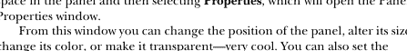

图 3-13：带有新启动器的 GNOME 面板

## 更多面板乐趣

除了你在项目 3A 中完成的基本自定义之外，你还可以做很多事情来改变面板的外观和感觉。当然，你可以通过右键单击相关项目然后在弹出菜单中选择 Remove From Panel 来删除任何启动器、抽屉或菜单，但还有更多选项。大多数这些选项可以通过右键单击面板中的任何空白区域然后选择 Properties 来获得，这将打开面板属性窗口。

从此窗口你可以更改面板的位置、调整其大小、更改其颜色或使其透明——非常酷。你还可以设置面板在不使用时自动消失，并在将鼠标光标移入面板通常所在区域时重新出现。不要害怕尝试——这就是乐趣的一半！

## 项目 3B：操作菜单

现在你已经了解了可以用面板做一些很酷且有用的事情，让我们继续讨论菜单的话题。GNOME 的一个非常好的功能是它允许你编辑其菜单。你可以添加启动器、删除项目、移动项目，甚至更改菜单中出现的图标。总的来说，你对事物有很大的控制权，但对于本项目，你将把工作限制在两个领域：更改图标和移动菜单项。

### 3B-1：更改菜单中的图标

正如你毫无疑问记得的那样，你添加到面板中的 OpenOffice.org Writer 和 Calc 启动器存在的一个问题是它们共享相当相似的图标。如果你选择 Applications ▸ Office，你会看到各种 OpenOffice.org 模块的图标，虽然不相同，但也有些相似。为了改善这种情况，你将把这些图标更改为你在项目 3A-4 中为两个面板启动器使用的同一套图标。在这种情况下，只需按照以下步骤操作：

1. 右键单击 Applications 菜单并选择 Edit Menus，或转到 System 菜单并选择 Preferences ▸ Main Menu。
2. 在随后出现的菜单编辑器窗口中（图 3-14），在左侧窗格中单击 Office。那个菜单的内容将随后出现在右侧窗格中。


3. 在窗口的右侧窗格中，单击 OpenOffice.org Word Processor 一次，单击 Properties 按钮。然后将出现一个 Launcher Properties 窗口。

4. 在该窗口的 Name 框中，首先将启动器的名称缩短为 Writer 或 Word Processor 或适合你的任何名称。

5. 接下来，单击 Icon 按钮（它上面没有写 Icon，而是显示 Writer 图标）。使用“项目 3A-4：更改面板启动器图标”第 33 页中描述的方法，导航到 `/usr/share/icons/hicolor/48x48/apps` 中的 Choose an icon 窗口。

6. 向下滚动到并单击 `openofficeorg3-writer.png`，然后单击 Open。

7. 新图标现在应该出现在 Launcher Properties 窗口中。单击 Close，你将能够在菜单编辑器窗口中看到更改。

8. 对 OpenOffice.org Spreadsheet 甚至 OpenOffice.org Presentation 重复该过程，如果你喜欢的话。只需确保为每个项目选择合适的名称并选择合适的图标（例如 Spreadsheet 使用 `openofficeorg3-calc.png`，Presentation 使用 `openofficeorg3-impress.png`）。完成后，将编辑器窗口保持打开状态以继续项目 3B-2 的工作。

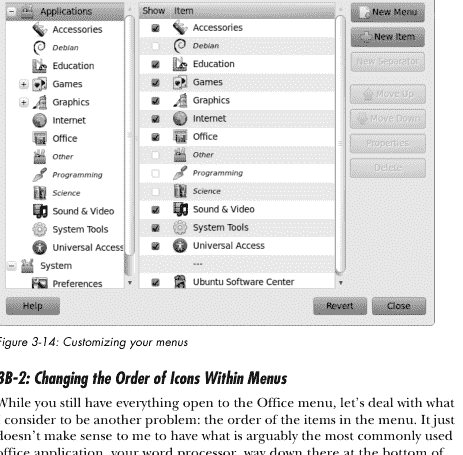

Figure 3-14: Customizing your menus

## 3B-2: Changing the Order of Icons Within Menus

While you still have everything open to the Office menu, let's deal with what I consider to be another problem: the order of the items in the menu. It just doesn't make sense to me to have what is arguably the most commonly used office application, your word processor, way down there at the bottom of the menu.

Remedying this situation is easy. Just click the OpenOffice.org Word Processor icon in the right pane of the menu editor window. Then click the Move Up button on the right side of the window as many times as necessary until the Word Processor icon is right there at the top of the list.

Now that your word processor is up there at the top of the menu, the other OpenOffice.org modules seem a bit out of place down at the bottom, so you might as well move the other OpenOffice.org modules up near the top too by using the same method.

While I'm being logical and all, why not make things even better by getting the Evolution launcher out of the Office menu and moving it over to the Internet menu, which seems a far more natural place for it to be? If you agree and want to hide this instance of Evolution, just uncheck the box next to its name. The name of that entry should then switch to italic typeface, indicating that the item in question will not be visible in the actual drop-down menu. Once you're done, your menu editor window should look something like mine in Figure 3-15.

If all seems fine to you, click Close and then select Applications ▸ Office to check out the results.

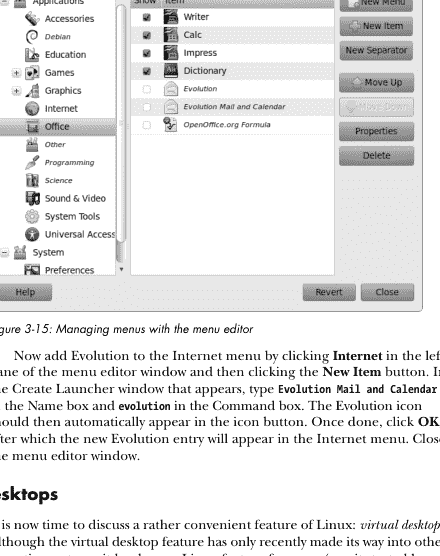

Figure 3-15: Managing menus with the menu editor

Now add Evolution to the Internet menu by clicking Internet in the left pane of the menu editor window and then clicking the New Item button. In the Create Launcher window that appears, type Evolution Mail and Calendar in the Name box and `evolution` in the Command box. The Evolution icon should then automatically appear in the icon button. Once done, click OK, after which the new Evolution entry will appear in the Internet menu. Close the menu editor window.

## Virtual Desktops

It is now time to discuss a rather convenient feature of Linux: virtual desktops. Although the virtual desktop feature has only recently made its way into other operating systems, it has been a Linux feature for years (yes, it started here, folks). But rather than babble on about what this virtual desktop business is and what it can do for you, it is probably best to have you learn about it by giving you some hands-on experience.

In your GNOME panel, click the Wanda (Fish), OpenOffice.org Writer, and Firefox launchers. You will then have three windows open in your present desktop, or workspace. Now look at the Workspace Switcher to the right of the bottom panel. There should be four boxes, with the one on the left (your present workspace) in light gray. If you click the box next to that, now in dark gray, all your open windows will suddenly disappear.

Actually, nothing has really disappeared—you are just viewing a new desktop. All your other windows are still open and running in the previous desktop.


In this second desktop, you can open something else: Select `Applications` ▸ `Games` ▸ `AisleRiot Solitaire`. The `AisleRiot Solitaire` card game will soon appear.

You now have windows open in two different desktops, and you can switch back and forth between them. To do so, just go to the Workspace Switcher in your panel, and click the now gray left box, which will take you to your original desktop. Once you’ve done that, the box for the workspace you were just in will turn dark gray, and you can then click that one to go back to your game desktop.

As you can imagine, this feature has some potential benefits for you, in addition to helping you avoid clutter. Just imagine that you are at work typing some long document in `OpenOffice.org Writer`. Eventually, you get tired and decide to goof off a bit by playing a game, such as `Mines`, for a while. To do this, you switch to another desktop where you open and play the game. A bit later, when you notice your boss making the rounds of the office, you simply switch back to the first desktop so that you look busy when he walks by and asks, “Keeping yourself busy, Boaz?” Phew!

By the way, you can also switch between virtual desktops by simultaneously pressing and holding `CTRL-ALT` and then pressing your left and right arrow keys to move to your targeted desktop.

So, what happens if, let’s say, you are running `OpenOffice.org Writer` in one workspace and the `GIMP` in another but suddenly think that it would be handy to have them both running in the same workspace? Do you quit the `GIMP` and start it up again in the other desktop? Fortunately, things are much simpler than that, and there are actually two ways to get the job done.

The first of these ways is to right-click the title bar of the window you want to move, and then select `Move to Workspace Left` or `Move to Workspace Right`. You can also select `Move to Another Workspace` and then select the workspace you want to move the window to by number: `Workspace 1`, `Workspace 2`, `Workspace 3`, and so on.

If you prefer keeping your hands more on your keyboard than on your mouse, you can also move a window from workspace to workspace by using hotkeys. With the window you want to move active (on top of the pile, so to speak), press and hold `SHIFT-CTRL-ALT`, and then use the left and right cursor keys to move the window to the desired desktop

## Wanda Revisited—GNOME Easter Eggs

Well, now that you’ve finished with your work in this chapter, it’s time to goof around a bit by revisiting our precocious piscean pal, Wanda. Knowing what you now do about Wanda the fish, you might find it odd for me to start talking about her again, but Wanda has a few more tricks beneath her fins. In fact, she is a good means by which to introduce two of GNOME’s most famous Easter eggs. Easter eggs, in case you don’t know, are hidden snippets of code that programmers seem to love to sneak into their programs. They are usually pretty useless things, but they can be found in all operating systems, numerous applications, and even on DVDs (to find out more about those, go to http://www.dvdeastereggs.com/). A good example of an Easter egg is my first

在我第一台Mac上遇到一个，那是一台古老的Mac SE，内存高达2MB。在那台机器上，你可以通过按下机器侧面很少使用的调试键，然后输入`G 41D89A`，调出Mac SE开发团队的图像（或者说是幻灯片？）。我想这挺酷的，但如果不是在某本杂志上读到过，我绝不会偶然发现它。

正如我的例子所示，访问这些复活节彩蛋通常需要一些非常规操作，这些操作在正常使用中永远不会执行。要查看与Wanda相关的复活节彩蛋，请单击你刚刚添加到面板上的“运行应用程序”按钮，在“命令”框中输入`gegls from outer space`，然后单击“运行”。然后你会看到一个奇怪的小游戏，属于《太空侵略者》类型，如图3-16所示，其中Wanda保卫我们心爱的星球免受……嗯，我想是gegls的入侵。

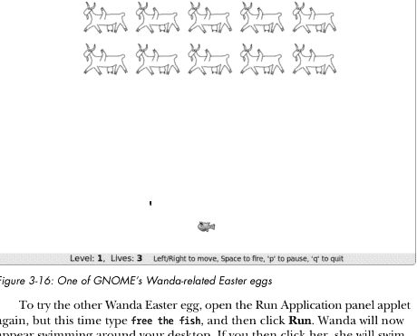

图3-16：GNOME中一个与Wanda相关的复活节彩蛋

要尝试另一个Wanda复活节彩蛋，请再次打开“运行应用程序”面板小程序，但这次输入`free the fish`，然后单击“运行”。Wanda现在会出现在你的桌面上游来游去。如果你点击她，她会游走并消失在画面之外……但她还会回来。

要结束Wanda的来去自如，你需要重启GNOME面板。有几种不太优雅的方法可以做到这一点，但目前你可以再次打开“运行应用程序”面板小程序，输入`killall gnome-panel`，然后单击“运行”。你的面板会消失一两秒钟，但很快就会重新出现。不过，Wanda会消失。

## 关机


既然你已经非常了解你的桌面环境，你可能会想结束今天的工作并关闭机器。要做到这一点，只需单击顶部面板最右侧的“退出”按钮（它看起来像一个电源按钮）。会出现一个菜单（图3-17），其中有八个选项可供选择：锁定屏幕、访客会话、从rg切换（无论你的用户名是什么）、注销、挂起、休眠、重启和关机。（从Ubuntu桌面CD运行live会话时，休眠不是可用选项。）选择“关机”，会出现一个小窗口确认你的决定。单击“关机”，关机过程将开始。但是，如果几秒钟内似乎没有任何反应，请同时按下`CTRL-ALT-DELETE`，这将打开“关闭计算机”窗口（图3-18）。在该窗口中，单击“关机”，之后关机将开始。

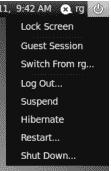

*图3-17：GNOME的会话菜单选项*

实际关机过程需要几秒钟，因为系统会关闭其各种服务。当这一切完成后，系统也应该关闭你的计算机电源，这样你就完成了。然而，在少数机器上，系统可能无法关闭你的计算机电源。你会知道是否如此，因为所有屏幕活动都会停止。如果到了这一步，15秒左右没有任何其他事情发生，那么只需按下电源按钮手动关闭机器。此时这样做是完全安全的。

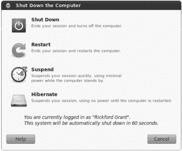

*图3-18：同时按下`CTRL-ALT-DELETE`会弹出“关闭计算机”窗口*

# 4

## 不止是蹼足

### 连接到互联网


如今，普通家庭计算机用户花在浏览网页和写电子邮件上的时间比做其他任何事情都多。即使你不怎么上网，仍然有许多其他应用程序本身并不是真正的互联网应用程序，但在某种程度上仍会使用互联网，例如在翻录音频CD以创建MP3文件时收集歌曲和专辑信息。拥有一台没有连接到互联网的计算机，就像买了一辆新的玛莎拉蒂却拒绝把它开出车库一样。

当然，你如何连接到互联网取决于你的硬件和提供商。这方面有多种可能性，包括高速局域网（LAN）、电缆调制解调器、移动（3G）宽带以及电话公司的ADSL连接。有些计算机仍然有内置的56Kbps调制解调器，或者可以连接外部拨号调制解调器，通过普通电话线进行较慢的连接。根据你所拥有的设备，在系统上进行设置应该很简单，对于LAN连接和任何其他使用以太网端口的方式（例如`cable modems`），在无线和移动连接的情况下可能需要多做一点工作，而在拨号连接时有时会有些挑战。本章将教你如何设置这些连接，而在下一章你将了解到 Linux 在最常用的 Internet 应用方面能提供什么。

## 如何连接？

你设置连接的方式 really depends on how you’re trying to connect to the Internet. 这里有一份清单来帮助你决定使用哪种方法：

- 如果你使用以太网电缆将计算机连接到墙上插座、路由器或电缆调制解调器，请转到第 46 页的“设置有线连接”。
- 如果你连接到无线网络或自己的无线路由器，请前往第 49 页的“设置无线连接”。
- 如果你使用连接到电话线的拨号调制解调器进行连接，第 53 页的“设置拨号连接”部分就是为你准备的。
- 如果你有一台内置于计算机或连接到 USB 端口的 ADSL 或 DSL 调制解调器，请尝试第 52 页的“使用 DSL 或 ADSL 调制解调器连接”。
- 如果你使用插入计算机的移动（3G）宽带连接，请跳到第 55 页的“移动（3G）宽带连接”。

## 设置有线连接

如果你从有线电视公司或 ISP 获得了高速 Internet 连接，或者你通过办公室的局域网连接到 Internet，那么你真的很幸运，因为这些设置可能是最容易处理的。我假设你已经按照 Internet 提供商的说明设置了路由器或调制解调器，因此剩下的就是在调制解调器/路由器（或局域网墙上插座）与计算机的网络插槽之间连接一根以太网电缆。完成之后，你应该无需再进行任何设置即可使用。

## 检查你的连接

如果你愿意，可以通过打开 Firefox（点击顶部面板中系统菜单旁边的 Firefox 启动器）来查看是否已连接，然后启动后尝试导航到常用站点，例如 `http://www.yahoo.com/`。如果站点打开了，你就知道一切就绪。

如果你在通过局域网或电缆调制解调器上网时遇到问题，可以尝试通过右键单击顶部面板中的网络管理器图标，取消弹出菜单中 **Enable Networking** 复选框的选中状态，等待几秒钟，然后再次选中弹出菜单中的 **Enable Networking** 复选框来刷新连接。如果这样不起作用，请尝试在物理连接到 Internet 源并使用以太网电缆的情况下重新启动机器。如果连接性问题仍然存在，可能是你的网卡不被 Linux 支持。这相对罕见，但幸运的是很容易解决（通过更换它）。

问题也可能是你的网络或服务提供商不通过动态主机配置协议（DHCP）自动分配地址。*DHCP* 是一种你的 Internet 提供商可以自动为你的系统提供连接 Internet 所需配置信息的方式。如果你的提供商不使用 DHCP，你将需要从网络管理员或服务提供商处获取有关设置的必要信息并自行输入。

## 为不使用 DHCP 的提供商设置电缆或以太网连接

要自行输入电缆或以太网设置，首先从你的网络管理员或 Internet 提供商处获取所需的设置，然后执行以下步骤：

1. 选择 **System › Preferences › Network Connections**。
2. 选择 **Wired** 选项卡（图 4-1），并从列表中通过单击一次选择网络连接（它应该有一个类似 *Auto eth0* 的名称）。如果列表中没有条目，则你的网卡未被正确识别。请查看第 390 页的“为你的网络/无线卡安装驱动程序”以了解如何修复此问题。

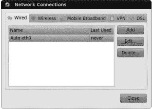

*Figure 4-1: The Network Connections window*

3. 点击 **Edit**，你将看到一个设置窗口。选择 **IPv4 Settings** 选项卡，并将 Method 设置从 Automatic (DHCP) 改为 **Manual**。

## 设置无线连接

有了合适的无线硬件，你现在几乎可以在任何能接收到（无线电）波的地方上网，换句话说。无论你是在早餐桌旁、在大学的图书馆，还是在当地的星巴克，你现在都可以在线上网，而无需将电脑物理连接到任何东西。

幸运的是，在 Ubuntu 中设置无线网络的过程相当容易，与你在上一节中刚刚读到的内容并没有太大区别。

### 硬件

如果你一直过着纯有线生活，或者在这方面只是缺乏经验，有几件事值得了解。要开始使用，你需要拥有合适的硬件。如果你只是想使用无线网络，那么你只需要一张无线网卡（有时称为 802.11a/b/g/n 卡或 WiFi 卡）。这些卡几乎都内置在所有现代笔记本电脑中，而对于老型号，它们通常是插入电脑侧面 PCMCIA 插槽的卡的形式（如下图 4-3 右侧所示）。

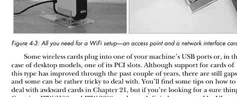

图 4-3：WiFi 设置所需的一切——一个接入点和一个网络接口卡

一些无线卡插入机器的 USB 端口之一，或在台式机型号的情况下，插入其 PCI 插槽之一。虽然过去几年对这类卡的支持有所改善，但仍然存在空白，有些卡处理起来相当棘手。你将在第 21 章找到一些处理棘手卡的技巧，但如果你想要一个稳妥的选择，Centrino IPW-2100 和 IPW-2200 卡肯定得到 Ubuntu 支持。至于内置或 PC 卡类型的卡，你会发现支持好得多，但即使如此，你也必须确保，或者至少希望，你使用的卡与 Linux 兼容。不管你对哪种无线卡感到好奇，最简单的方法就是直接尝试。Linux 内核现在内置了许多无线驱动程序，而 Ubuntu 更新经常提供新的驱动程序，因此，如果你使用的是与其中一个驱动程序兼容的卡，一切都会顺利进行。如果似乎不起作用，请查看 Ubuntu 支持的卡列表（`https://help.ubuntu.com/community/WifiDocs/WirelessCardsSupported/`），或查看 Ubuntu 论坛以找到兼容的驱动程序，或查看是否有人使用过你的特定卡。

如果你想在家中或办公室设置无线系统，那么你还需要购买一个无线接入点（WAP），如图 4-3 左侧所示。幸运的是，在这方面 Linux 兼容性并不是什么大问题，因为接入点不会与你的电脑物理接口，设置是通过你的网页浏览器处理的。

NOTE 接入点有几种不同的类型。最常见类型是无线路由器，许多 ISP 免费提供。


你应该注意的是，一些接入点要求你使用 Internet Explorer 来处理其设置任务。虽然可以通过 Wine 在 Linux 中运行 Internet Explorer（你将在第 18 章看到），但你不能百分之百确定它会工作。除非你在家里或办公室有 Windows 机器来处理此类任务，否则最好避开这种类型的接入点。

### 激活你的无线卡

设置 Linux 兼容的无线 PC 卡实际上相对简单。首先将你的接入点连接到你的互联网源，然后打开接入点。一旦它运行起来，将你的无线卡插入笔记本电脑的 `PCMCIA` 插槽或 `USB` 端口（除非你的无线连接是内置的，在这种情况下可以跳过此步骤）。外部卡上的任何 LED 灯在此时很可能会亮起。

如果在你启动电脑时接入点已打开，并且在启动期间无线卡已就位，那么你可能不需要做太多其他事情即可访问互联网。只需按照以下步骤操作：

- 1. 单击顶部面板上的 `Network Manager` 图标以显示下拉菜单，显示你附近存在的无线信号以及每个信号的强度（图 4-4）。
- 2. 从该菜单中，通过单击它选择你的接入点的信号（或任何你有权连接的其他波）。
- 3. 你的系统然后会尝试连接到互联网。一旦连接建立，`Network Manager` 图标将变成一个小的信号强度指示器。相当方便。
- 4. 如果你的网络有 `WEP` 或 `WPA` 密码，你将被提示输入它。在输入密码之前勾选显示密码会很有用，这样你可以检查是否有任何错误。完成后单击连接。

注意 大多数接入点采用了额外的安全级别，例如有线等效保密（`WEP`）或 Wi-Fi 保护访问（`WPA`）密钥。如果你设置接入点时没有自行选择密码，请尝试查看接入点底部或侧面的贴纸，看看是否使用了默认密码。如果你试图连接一个你并不知晓密钥的网络，那么很可能你本就不应该建立该连接。调皮，调皮。

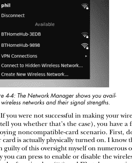

图 4-4：网络管理器会显示可用的无线网络及其信号强度。

如果你未能成功建立无线连接（系统会告诉你是否如此），除了令人恼火的不兼容网卡情况外，你还有几种可能性。首先，请再次确认你的网卡实际上是物理上已开启的。我知道这听起来很蠢，但我自己也多次犯过这种疏忽。许多笔记本电脑都有一个可按下的键来启用或禁用无线网卡；在我的机器上，你需要同时按下功能键（`FN`）和 `F2`。

另一种较少见的可能性是，你的网络不使用 `DHCP`，在这种情况下，你必须手动输入由网络管理员或服务提供商提供的连接设置。掌握这些信息后，只需按照第 47 页“为不使用 `DHCP` 的提供商设置有线或以太网连接”中列出的步骤操作即可。只需确保使用无线选项卡而不是有线选项卡即可。

如果你仍然无法无线连接，可能是网卡的驱动程序未安装，或者 Ubuntu 不支持该网卡。你可以尝试很多技巧来使其工作，因此请前往第 21 章，查找第 390 页的“为你的网络/无线网卡安装驱动程序”。

## 关闭或刷新你的无线连接

有时你会想要断开无线网络，例如当你在飞机上使用笔记本电脑时，或当你只是想连接到另一个网络时，就像你将笔记本电脑从一个无线热点移动到另一个热点时一样。

要做到这一点，点击网络管理器图标一次以显示可用的无线网络列表（即信号）。在该列表中，点击你所连接的无线网络名称下方的断开选项。一秒或两秒内，你将被断开。

如果你想关闭无线网卡（如果你要登机就应该这样做），并且你没有物理方式来操作它，比如开关或按钮，只需右键点击网络管理器图标，然后取消选择启用无线。如果想再次打开该网卡，只需返回该菜单，然后再次选择启用无线即可。

有时，你的无线网卡可能会无缘无故地失去连接，因此刷新连接（即再次关闭然后打开）以尝试恢复连接会很有用。最快的方法是点击网络管理器图标，然后点击列表中你无线网络的名称。你将被断开然后自动重新连接。

如果这样不起作用，请尝试使用网络管理器的启用无线选项禁用然后启用无线连接，如前所述。如果仍然没有成功，请尝试使用开关或按钮关闭然后打开无线网卡，如果你有的话，或者将其拔出再重新插入。最后，如果似乎什么都不起作用，请尝试重新启动计算机。

## 使用 DSL 或 ADSL 调制解调器连接

设置 `DSL` 或 `ADSL` 调制解调器有多容易取决于它的连接器。如果它可以使用以太网电缆连接，请使用它，并按照第 46 页“设置有线连接”中的说明操作；这比尝试使用 `USB` 电缆要容易得多！如果你有 `USB` 或内置调制解调器，请尝试本节中的说明并祝好运。

第一步是检查 Ubuntu 是否识别了你的调制解调器。假设它已经插入，点击 `系统 ▸ 首选项 ▸ 网络连接`，并选择 `DSL` 选项卡。如果该窗口中列出了连接，则表示你的调制解调器已被识别，你可以开始设置它。如果列表为空，请参考 `https://help.ubuntu.com/8.04/internet/C/modem s-adsl-usb.html` 以查看是否有任何步骤可以帮助你使调制解调器工作。

通过点击一次来选择连接，然后点击编辑。点击出现的编辑窗口的 `DSL` 选项卡，并将你的用户名和密码输入到相应的字段中。然后将你的连接信息（通常是电话号码）输入到服务框中，并点击应用。现在，点击顶部面板上的网络管理器图标，并从列表中选择你的 `DSL` 连接。网络管理器将尝试使用你的调制解调器连接——如果不成功，请返回并尝试更改一些设置，看看是否能使其配合。

## 设置拨号连接

尽管世界上大部分地区正在转向高速互联网连接，但你们中的许多人可能仍在使用拨号互联网连接，这意味着你需要一个传统的拨号调制解调器才能让你盒子以外的世界相连。万一你们这些宽带冲浪大神忘了，调制解调器就是那些每当拨号到互联网服务提供商时就会发出哨声、叮当声、尖叫声和喷气声的奇妙机器。我想你可以把它们想象成需要好好打个嗝的吵闹电话。

现在有个坏消息——在 Linux 世界中，很少有内置调制解调器得到支持，而那些受支持的，设置过程也可能非常令人沮丧。这种兼容性问题的主要原因是大多数内置调制解调器都依赖软件，而它们所依赖的软件是 Windows 的一部分，或是为 Windows 设计的。因此，这类调制解调器被称为 Winmodems（Win 调制解调器）。

当然，Linux 社区一直在研究应对这些 Winmodem 怪兽的方法，以便它们能与 Linux 系统兼容。虽然对市面上各种 Winmodem 型号的支持仍然不太完善，但情况比以前好多了，所以你也许能碰上好运。我的建议是先别急着疑惑和担心，直接试试你的调制解调器，看看能否工作。如果能用，那就万事大吉了。如果不行，嗯，那你确实还有一些选择，而且至少你还没有对系统造成任何损害。

闲话少说，让我们开始设置拨号连接的步骤吧。首先，从你的互联网服务提供商那里获取所需的设置信息。大多数提供商主要面向 Windows 用户，也常面向 Mac 用户，很少有提供 Linux 支持的。不过，从技术上讲，没有理由说你的 Linux 系统不能通过他们的设置工作，所以尽管去催他们、逼他们，直到他们给你想要的信息。之后，确保你的调制解调器连接到了一个可用的电话线上——例如，墙上的电话插孔。

现在该设置连接了。我将使用 `GNOME PPP` 程序来完成这里的所有设置，但有一个注意事项：它默认没有安装，而且你需要一个互联网连接才能安装它！如果你能临时使用其他互联网连接，那就连上它，然后使用 Ubuntu 软件中心下载并安装 `GNOME PPP`（参见第 6 章了解如何安装软件）。另一种选择是使用 `pppconfig` 命令，它默认已安装但难以使用。如果你别无选择只能使用 `pppconfig`，那就找另一台电脑查看 `https://help.ubuntu.com/community/DialupModemHowto/SetUpDialer/` 上的说明。

假设你用借来的互联网连接安装好了 `GNOME PPP`，你可以按照以下步骤设置你的调制解调器：

- 1. 选择 `应用程序 ▸ 互联网 ▸ GNOME PPP`，之后 `GNOME PPP` 窗口就会出现。
- 2. 点击“设置”（Setup），并确保你查看的是“调制解调器”（Modem）选项卡。
- 3. 点击 **“检测”（Detect）** 按钮来识别你的调制解调器。如果你收到一条消息说系统上没有找到调制解调器，那你就不走运了——你最好的办法是在 Ubuntu 论坛（`http://www.ubuntuforums.org/`）上寻求建议，或者尝试从“设备”（Devices）下拉列表中逐个尝试选择。
- 4. 如何更改其余设置取决于你的调制解调器和 ISP 的配置方式，所以现在先选择默认设置。如果这些默认设置不起作用，反复尝试又是一条可行之路。
- 5. 点击 **“关闭”（Close）** 返回 `GNOME PPP` 窗口。输入你的用户名和密码，并输入 ISP 提供的电话号码。
- 6. 点击 **“连接”（Connect）**。接着你应该能听到调制解调器开始拨号、喷气、搅拌的序列，与你的提供商建立连接。
- 7. 如果成功连接，你就可以开始浏览网页、收发邮件或进行其他在线活动了。如果收到错误消息，你能做的很少，只能深吸一口气，点击 **“设置”（Setup）** 按钮尝试调整你的设置。

## 如果调制解调器不兼容该怎么办


虽然听起来可能不是这样，但我刚才描述的几乎是最理想的情况。然而，如果你的调制解调器和 Ubuntu 互相看不顺眼该怎么办？嗯，有几个选择。我的第一个更激进的建议是，放弃你的拨号 ISP，找一个覆盖你本地的宽带提供商。如果那不可行，那么你有两条路可走。一种是尝试折腾你的调制解调器，看看能否让它工作。这个过程稍微复杂一些，但 `https://help.ubuntu.com/community/DialupModemHowto` 上有说明。如果你胆怯或是个新手，你可能会发现这个过程需要做的事情比你愿意处理的要多一些。

让调制解调器工作的更简单但更昂贵的方法是购买一个真正的硬件调制解调器。硬件调制解调器不依赖软件，因此它们可以与任何操作系统一起工作。你可以把它们想象成没有听筒的电话。

这类调制解调器有两种形式：内置式和外置式。至于内置式，USRobotics 的 56K V.92 Performance Pro 调制解调器（内置插槽）和 56 PC Card 调制解调器（PC 卡插槽，用于笔记本电脑）是真正的硬件调制解调器，容易购买且据说可用。你可以在 USRobotics 网站（`http://www.usr.com/`）上查看有关这些型号的更多信息，不过查看 Ubuntu 论坛获取建议总是一个好主意。也许所有解决方案中最安全的是购买一个外置拨号调制解调器。它们带有串口或 USB 连接器，放置在计算机外部的一个盒子里。由于调制解调器不使用你的操作系统来运行，它在忙碌时不会占用系统资源，这可能会带来计算机速度的提升。

Linux 对 USB 调制解调器的支持可能参差不齐，因此在购买之前请先做好研究。外置串行调制解调器是更稳妥的选择，因为大多数都应该能与你的系统配合使用……前提是你有串行端口。现代电脑很少再配备串行端口了，所以请检查一下你的电脑后面是否有带小插针的连接器（见图 4-5）。如果你担心，想要一个稳妥的选择，Zoom Telephonics（`http://www.zoom.com/`）生产一款与 Linux 兼容的外置串行调制解调器，而且公司在其网站上明确说明了这一点。USRobotics 56K V.92 External Faxmodem 据说也能工作，不过我本人并未试用过该型号。

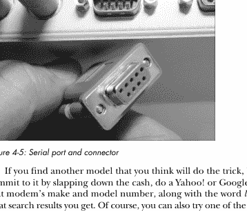

图 4-5：串行端口和连接器

如果你找到另一款你认为可行的型号，在掏钱购买之前，先用该调制解调器的品牌和型号加上单词 linux 在 Yahoo! 或 Google 上搜索一下，看看搜索结果如何。当然，你也可以尝试在 Linux 论坛中提问。很多人都有同样的需求，所以你一定能获得大量意见和建议。

## Mobile (3G) Broadband Connections

无线网络虽然方便自由，但覆盖范围仍然相当有限。如果你从不离开家或办公室附近，这不会成为问题，但如果你在路上，远离最近的无线咖啡馆，就会变得非常不方便。既然是 21 世纪，当然有办法绕过这一限制。

如果你是一名携带电脑的旅行者，你可能已经接触过移动宽带技术，也称为 3G。你只需一个 3G 卡（也莫名其妙地称为 dongle），将其插入电脑，即可通过手机网络连接到网络（图 4-6）。Ubuntu 从一开始就对大多数 3G 卡有相当不错的支持，而且设置过程非常简单：

1. 将你的 3G 卡或 dongle 插入电脑；新建移动宽带连接向导应会自动打开。如果没有，请点击 `System ▸ Preferences ▸ Network Connections`，打开 `Mobile Broadband` 选项卡，然后点击 `Add`。
2. 向导的第一页有一个下拉列表，应该显示你的 3G 卡的品牌和型号。如果显示的是 `Any Device`，则说明你的卡可能未被识别，请查看 `https://wiki.ubuntu.com/NetworkManager/Hardware/3G`，看看是否需要采取某些步骤让 Ubuntu 识别该卡。
3. 点击 `Forward`，从列表中选择你的国家，然后再次点击 `Forward`。
4. 从列表中选择你的移动宽带提供商，然后点击 `Forward`。
5. 现在你需要从下拉列表中选择你的宽带计费套餐（图 4-7）。选择正确的套餐非常重要，以免被错误收费。如果你没有看到合适的套餐，请选择 `My plan is not listed`，并致电你的宽带提供商询问在 Access Point Name（APN）框中应填写什么。
6. 点击 `Forward`，检查所有详细信息是否正确，然后点击 `Apply`。你将被带到一个 Editing 窗口，如果需要，可以在此输入你的账户 PIN 和密码等详细信息。
7. 点击 `Apply`，然后关闭 `Network Connections` 窗口以完成设置。

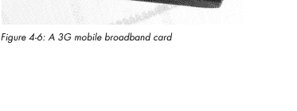

图 4-6：一张 3G 移动宽带卡

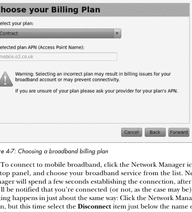

图 4-7：选择宽带计费套餐

要连接移动宽带，请点击顶部面板上的 `Network Manager` 图标，从列表中选择你的宽带服务。`Network Manager` 将花费几秒钟建立连接，之后你会收到已连接（或未连接）的通知。断开连接的方式也差不多：再次点击 `Network Manager` 图标，这次在列表弹出时，选择宽带服务名称下方刚好是的 `Disconnect` 项目。

## I'm Connected . . . So Now What?

理想情况下，你已通过有线连接、无线连接或其他方式愉快地连接到互联网。（如果没有，请参阅第 21 章获取一些连接故障排除提示。）这真是好消息，因为现在你可以让 Ubuntu 发挥作用，尝试一些预装的有趣的网络相关软件。准备好你的点击手指，翻页看看作为一名新 Linux 用户的在线生活是什么样的。

# 5

### SLIPPING AND SLIDING

*以 Linux 方式探索互联网*


现在你已经拥有了一个可用的互联网连接，你能用它做什么？好消息是 Linux 可以胜任你之前操作系统在网上能做的一切，而且在很多情况下它做得更快或更简单。Ubuntu 诞生于网络，因此不足为奇的是，它开箱即用就自带了一套非常完善的互联网就绪应用程序。

在本章中，你将对 Ubuntu 的互联网软件进行一次巡览，以便真正感受到这种 Linux 东西的能力。你将从像网页浏览器和邮件客户端这样的老牌工具开始，简要浏览即时通讯，然后转向更时髦的 Twitter 和微博方向。

#### Firefox: Your Internet Browser

你 Ubuntu 系统中的默认网页浏览器是 Firefox，它在 Linux 世界中越来越受欢迎，在 Windows 和 Mac 世界中也同样如此。你很可能已经是 Firefox 用户了，但如果你不是，也不用担心——在所有浏览器中事物或多或少都一样。那样的话，你应该能够在没有任何指导的情况下使用 Firefox 的基本功能。当然，它的一些功能确实使其有别于竞争对手，所以我会提到这些。

##### Controlling Browser Window Clutter with Tabs

通常当你在网页上点击一个链接时，新页面会在同一窗口中打开。在某些页面上，链接被编码为在新的独立窗口中打开新页面，或者你偶尔也可以通过右键点击链接然后选择“在新窗口中打开链接”选项来打开链接在新窗口中。这可能非常有用；然而，一旦你打开了不止几个浏览器窗口，就很难在所有打开的窗口中找到你要找的东西。这也会稍微减慢速度。

这就是 Firefox 的标签功能派上用场的地方（事实上非常方便，以至于几乎所有其他浏览器都复制了它）。要了解它是如何工作的，现在就亲自试试。点击顶部 GNOME 面板上的启动器打开你的 Firefox 浏览器（或选择 `Applications ▸ Internet ▸ Firefox Web Browser`）；然后使用 Firefox 方便的搜索框搜索单词 nyckelharpa，该搜索框位于浏览器窗口的右上角（见图 5-1）。默认情况下，Firefox 会使用 Google 对在搜索框中输入的关键词进行搜索。如果你愿意，可以通过点击搜索框中的彩色 gicon 然后做出选择来选择其他网站进行搜索。Amazon.com、eBay 和 Yahoo! 都可用，等等，你甚至可以添加其他网站。现在，让我们坚持使用 Google 进行本次搜索，在该搜索框中输入 nyckelharpa。输入完毕后，按 ENTER 键，之后搜索结果页面应该会出现在 Firefox 窗口的主窗格中。


顶部结果之一应该是美国 Nyckelharpa 协会，现在你将以新标签页而不是在同一窗口或新窗口中打开该页面。为此，右键点击该链接，并在出现的弹出菜单中选择“在新标签页中打开链接”。如果你愿意，也可以让事情变得稍微简单一些，省去弹出菜单选择步骤，只需用鼠标中键点击链接（或同时用两个鼠标按钮点击）或按住 `CTRL` 键的同时点击链接即可。无论哪种方式，新页面都会出现在新标签页中，而你的原始搜索结果页面仍保留在另一个标签页中，准备就绪（见图 5-2）。我很有信心地说，一旦你习惯了这个功能，你会想知道你以前怎么没有它。

Figure 5-1: Performing a Google search from the Firefox search box

Figure 5-2: A link opened in a new tab in Firefox

### Keeping Up-to-Date with Live Bookmarks

网络充斥着各种新闻和信息，很难跟踪所有内容。个人而言，我讨厌错过 Boing Boing 的每日离奇故事剂量，这个网站的副标题恰如其分地是“奇妙事物目录”（`http://www.boingboing.net/`）。幸运的是，Firefox 有一种巧妙的处理信息过载的方法，称为实时书签（也称为 RSS 订阅）。它们为任何支持它们的网站提供自动更新的文章列表。要看一个例子，点击 Firefox 地址栏下方的 Latest Headlines 链接——它是 BBC News 网站的实时书签，应该会显示给你一份长长的当前新闻故事列表。

你可以通过在地址栏中寻找橙色信标符号来检查网站是否具有 RSS 订阅（如下图 5-3 所示）。如果有，你就成功了！让我们以 Boing Boing 为例：在 Firefox 中加载 `http://www.boingboing.net/`，并点击信标图标。你会看到一份最新文章的列表以及页面顶部框中的订阅邀请。点击 `Subscribe Now`，然后在出现的窗口中点击 `Subscribe`，将实时书签添加到与 Latest Headlines 链接相同的工具栏中。

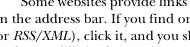

Figure 5-3: The beacon icon is displayed when a website has an associated RSS feed.

一些网站提供指向其 RSS 订阅的链接，而不是在地址栏中显示它们。如果你找到其中一个链接（它通常称为 ATOM 或 RSS/XML），点击它，你应该会被带到一份文章列表，顶部有一个框，就像前面的例子一样。从那里，将订阅源添加到书签中的步骤是相同的。

### Pop-up Manager

Firefox 还有许多其他有用的功能。其中之一是其弹出窗口管理器，它会抑制访问新网页时经常出现的那些烦人的弹出窗口。你可以从首选项窗口（`Edit ▸ Preferences`）启用或禁用此功能，点击该窗口顶部窗格中的 `Content` 图标，然后勾选或取消勾选 `Block pop-up windows` 框。你也可以允许某些站点提供弹出窗口（一些弹出窗口不仅有用，而且对站点正确运行是必要的），方法是点击该 `Block pop-up windows` 条目右侧的 `Exceptions` 按钮并输入相关站点的网址。

### Multimedia Plug-Ins

Firefox 最酷的事情之一是它允许你通过添加各种扩展来进一步扩展其功能。最常用的扩展以插件的形式出现。这些允许网页做的不只是显示文本和图片——你通常需要一个插件来观看视频或在线玩游戏。有三种插件比任何其他插件使用得更广泛，所以我将在这里集中介绍它们。

#### Flash

任何系统中最常用的浏览器插件是 Adobe 的 Flash Player。Flash 为网站提供了各种令人兴奋的多媒体效果和功能，因此被越来越多的网站使用。事实上，你可能已经在不知不觉中见过许多使用 Flash 增强的页面。例如，如果你曾在 YouTube 上看过视频，那你已经领略过 Flash 的神奇之处。

如何获取 Flash Player 插件？只需点击几下并连接互联网即可：

- 1. 选择“应用程序 ▸ Ubuntu 软件中心”以打开软件中心。
- 2. 在窗口右上角的搜索框中输入 `adobe flash`。
- 3. 在出现的列表中，单击 Adobe Flash 插件项一次。会出现一个“安装”按钮（图 5-4）。

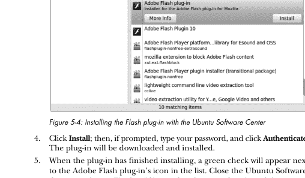

图 5-4：使用 Ubuntu 软件中心安装 Flash 插件

- 4. 单击“安装”；如果出现提示，输入密码，并单击“验证”。插件将被下载并安装。
- 5. 当插件安装完成后，列表中 Adobe Flash 插件图标旁边会出现一个绿色对勾。关闭 Ubuntu 软件中心，然后打开 Firefox（如果 Firefox 已经打开，请关闭并重新启动）。
- 6. 要检查插件是否正常工作，请找到一个使用 Flash 的网站。如果你一时想不起来，可以试试 YouTube（`http://www.youtube.com/`）。到达 YouTube 后，单击你看到的任意视频链接。如果 Flash 安装成功，应该会出现一个视频并开始播放（图 5-5）。

- 5. 完成后，附加组件窗口顶部会出现另一个栏。单击**重新启动 Firefox** 以完成插件安装（Firefox 重新打开时，你打开的所有页面都会重新出现）。
- 6. 前往 `http://www.farseergames.com/waterdemo/`。如果 Moonlight 安装正确，你应能看到一条小船在波浪中颠簸（图 5-6）。

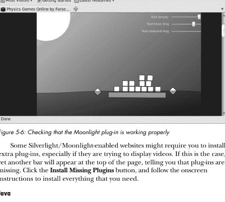

图 5-6：检查 Moonlight 插件是否正常工作

某些启用 Silverlight/Moonlight 的网站可能会要求你安装额外的插件，尤其是在它们尝试显示视频时。如果是这种情况，页面顶部会出现另一个栏，提示你缺少插件。单击“安装缺少的插件”按钮，并按照屏幕上的说明安装所需的一切。

#### Java

你可能会遇到的最后一个插件是 Java，它用于运行 Java 小程序。Java 小程序是一种可以在网页浏览器中运行的小型应用程序，通常用于游戏和演示。Ubuntu 预装了一个名为 IcedTea 的 Java 插件，因此无需额外安装任何东西。不过，最好还是看看它在实际中的表现，所以请前往 `http://www.turbotanks.com/`。如果 IcedTea 工作正常，应该会加载一个街机“坦克”游戏（图 5-7）。

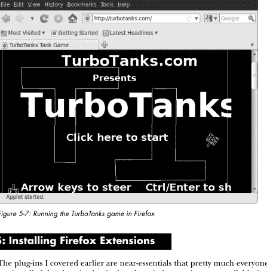

图 5-7：在 Firefox 中运行 TurboTanks 游戏

## Project 5：安装 Firefox 扩展

我之前介绍的插件几乎是每个人都安装了的必需品，但 Firefox 还有数百个其他不太重要的扩展可用。这些扩展以附加组件的形式提供，包含各种各样的东西；许多非常实用，而另一些则纯粹是趣味和搞怪。它们涵盖从博客写作工具、待办事项列表到图像查看器和旅行指南等范围。不过，在本项目中，你将安装一个名为 ScribeFire 的博客编辑器（图 5-8），它可以让你撰写文章、登录博客并上传你添加的内容。所有这些都可通过点击窗口右下角的一个图标按钮来完成。

> 注意：如果你没有博客但想尝试写博客，可以在免费托管网站上注册一个账户，例如 `http://www.blogger.com/`、`http://wordpress.com/`、`http://www.tumblr.com/` 或 `http://www.livejournal.com/`。

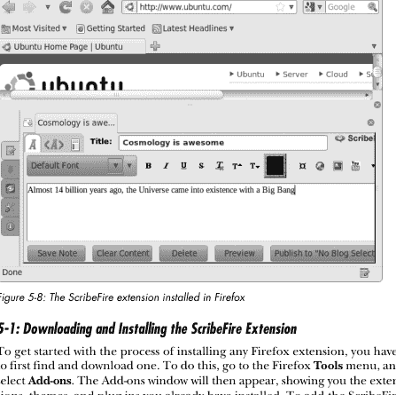

Figure 5-8: The ScribeFire extension installed in Firefox

### 5-1: Downloading and Installing the ScribeFire Extension


To get started with the process of installing any Firefox extension, you have to first find and download one. To do this, go to the `Firefox Tools` menu, and select `Add-ons`. The `Add-ons` window will then appear, showing you the extensions, themes, and plug-ins you have already installed. To add the `ScribeFire` extension, click the `Get Add-ons` button in the pane at the top of the window, after which `Firefox` will make some download recommendations that you can accept or ignore.

`ScribeFire` wasn’t one of `Firefox`’s recommendations at the time of writing, and chances are that it won’t be when you open the `Add-ons` window either. This being the case, just do a search for `scribefire` in the search box (`Figure 5-9`). Once you find it, click the `Add to Firefox` button.

A Software Installation window like the one shown in `Figure 5-10` will then appear. Just click the `Install Now` button in that window after it becomes active to start the installation.

`Figure 5-9`: Adding extensions in Firefox

`Figure 5-10`: Firefox gives you a preinstallation warning.

Once the installation process is complete, a message will appear in the `Add-ons` window telling you to restart `Firefox`. To do this, click the `Restart Firefox` button in the right-hand corner of that warning message (`Figure 5-11`).

`Figure 5-11`: A message appears telling you to restart Firefox after the installation is complete.

from your Internet logon password. Your mail password is not actually entered during the various wizard steps, so check the `Remember password` checkbox when filling in the `POP` details. When you first connect to your mail server, you will be prompted for your mail password, so you can type it at that time, and you won’t have to deal with it again.

## An Email Alternative: Thunderbird

`Evolution` is the most fully featured email software in the Linux world, but despite its obvious attractions and popularity, I prefer the more straightforward `Thunderbird` for my email chores. In contrast to the multifunctional `Evolution`, `Thunderbird` (`Figure 5-13`) is a more mail-oriented program that is very straightforward to use yet includes most of the most important email functions you’ve come to expect, such as junk mail filters. In fact, it is remarkably similar to Windows Mail in terms of appearance and handling. The fact that `Thunderbird` is also available in both Mac and Windows versions means that you may already be familiar with it.

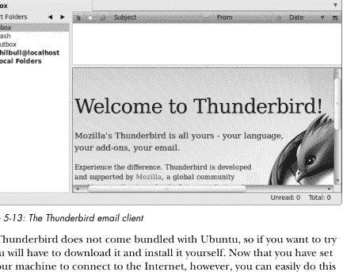

`Figure 5-13`: The Thunderbird email client

`Thunderbird` does not come bundled with Ubuntu, so if you want to try it, you will have to download it and install it yourself. Now that you have set up your machine to connect to the Internet, however, you can easily do this after going over the contents of Chapter 6 (OK, so I’m jumping the gun a bit again). Just do a search in the `Ubuntu Software Center` for `thunderbird`, click the `Mozilla Thunderbird Mail/News` item once, and click `Install` to install it. You may be asked to type the password for your Ubuntu user account, so do that and click `Authenticate`. Once it is installed, you can then run `Thunderbird` by selecting `Applications ▸ Internet ▸ Mozilla Thunderbird Mail/News`.

As I mentioned, both `Evolution` and `Thunderbird` are equally capable and possess essentially the same features in terms of mail handling. The difference is primarily a look-and-feel matter. Why not try both `Evolution` and `Thunderbird` and see which you like better?

By the way, if you find that you prefer `Thunderbird` to `Evolution`, you can add a panel launcher for it to make things easier on yourself when you want to run the program. Just go to `Applications ▸ Internet ▸ Mozilla Thunderbird Mail/News`, right-click that entry, and then in the pop-up menu that appears, select `Add this launcher to panel`.

## Chatting with Your Friends via Empathy


Email is an extremely useful tool, but there’s often quite a delay between sending a message and getting a response. What if you just fancy a quick chat? That’s where instant messaging (IM) comes in. If you’re not familiar with the concept, all you do is find your friend on an IM network and type a short message to them. Your message will show up on their screen in the blink of an eye. They can then reply to it, and you receive their reply just as quickly. So it continues, until you say goodbye and disconnect from the network.

There are lots of different IM networks out there, such as AIM, MSN/Windows Live, and Yahoo! Messenger. You can usually talk only to those people who are using the same network as you, and you’ll need an IM client application to connect to any of them. Ubuntu comes preinstalled with a fully featured IM client called Empathy, which has the ability to connect to multiple networks at once.

## Starting a Chat

For this section, I’m going to assume that you already have a user account on an instant messaging network. If you don’t, you’ll need to go to the network’s website and sign up (most of them are free). Now that you have your account details ready, let’s get Empathy connected to your chosen network:

1. Select System ▸ Preferences ▸ Messaging and VoIP Accounts. The Empathy Accounts window will open.
2. Choose Yes, I’ll enter my account details now, and click Forward.
3. Select your IM network from the drop-down list at the top of the window, and then enter your account details (Figure 5-14). You’ll normally need to enter your username and password.
4. Choose the No, that’s all for now option at the bottom of the window, and then click Forward.
5. You’ll be asked to enter your personal details. These are used to enable a feature that lets you talk to other people connected to the same local network as you—just enter them for now, choose a nickname, and click Apply. The Accounts window will disappear.

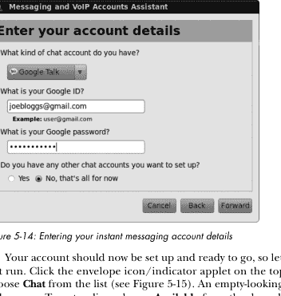

## 图 5-14：输入你的即时通讯账户详细信息

你的账户现在应该已经设置好并可以使用了，接下来我们来进行一次测试。点击顶部面板上的信封图标/指示器小程序，从列表中选择“聊天”（Chat）（见图 5-15）。一个看似空白的联系人列表会出现。若要上线，请从下拉列表中选择“可用”（Available）。如果你的任何即时通讯联系人/朋友/好友在线，他们就会显示在主窗口中。如果什么都没有出现，可以尝试选择“查看 ▸ 离线联系人”（View ▸ Offline Contacts），以防你的所有联系人此刻都处于离线状态。

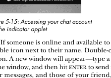

## 图 5-15：通过指示器小程序访问你的聊天账户

如果有人在线且可以聊天，他们的名字旁边会有一个绿色的气泡图标。双击他们的名字即可开始对话。一个新的窗口会出现——在窗口底部的输入框中输入消息，然后按回车键发送（示例见图 5-16）。你的消息以及朋友的回复会显示在对话窗口的主要区域。结束对话也很简单——直接关闭对话窗口即可。

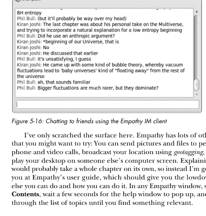

## 图 5-16：使用 Empathy 即时通讯客户端与朋友聊天

我这里只是浅尝辄止。Empathy 还有很多其他功能你可能想尝试：你可以向他人发送图片和文件、进行语音和视频通话、使用地理标签广播你的位置，甚至可以将你的桌面显示在别人的电脑屏幕上。要把这些都解释清楚，恐怕得单独写一整章，所以我还是直接带你去看 Empathy 的用户指南吧，它会告诉你还能做什么以及如何操作。在任意一个 Empathy 窗口中，选择“帮助 ▸ 内容”（Help ▸ Contents），等待几秒钟让帮助窗口弹出，然后浏览主题列表，直到找到相关内容。

## 告诉别人你不想聊天

聊天固然很好，但很少有人有精力整天聊个不停。当你连接到即时通讯网络后，如果在忙的时候有人试图与你开始对话，那会让人很烦。幸运的是，有一种简单的方法可以让所有人都知道你不希望被打扰。

在顶部面板上，你应该能看到你的用户名旁边有一个气泡图标。如果你已连接到即时通讯网络，气泡会被实心颜色填充，这意味着其他人可以看到你在线。点击气泡图标，从弹出的菜单中选择一个不同的状态（例如“离开”（Away）或“忙碌”（Busy））（图 5-17）。根据你选择的状态，其他人要么在尝试开始聊天时被告知你很忙，要么根本无法看到你在线。只需点击几下，就能换来宁静与安宁。

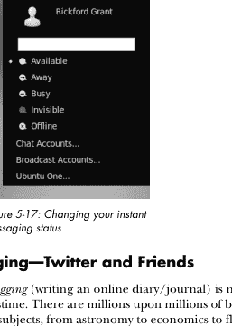

## 图 5-17：更改你的即时通讯状态

## 微博——Twitter 及其同类

博客（在线日记/日志）如今已成为一种成熟的互联网消遣方式。网上有数以百万计的博客，涵盖各种主题，从天文学到经济学，再到毛茸茸的小猫。内容质量参差不齐，但大多数博客文章都像是典型的报纸评论专栏。那么，如果你有一个博客，要求你必须在 140 个字符以内写完所有想说的话，会怎么样？这就是微博背后的理念：发布频繁、非常简短、类似公告的帖子。

Twitter 是最著名的微博网站（http://www.twitter.com/）。人们为 Twitter 找到了各种各样的用途：你可以让朋友知道你现在在做什么、接收突发新闻、与其他用户讨论热门话题、用手机发帖……不一而足。我刚才就跟着几个朋友之间的一场 Twitter 对话，他们正在观看一场冰球直播。每当有令人兴奋的事情发生时，他们就会发消息，这样我就能在事情发生几秒钟内通过文字跟进赛况。消息在 Twitter 上传播得飞快。

也许这种服务需要亲身尝试才能真正体会。如果你还没有账户，请点击 Twitter 首页上的“立即注册”（Sign up now）按钮，然后按照说明操作。完成后，可以在网站上四处看看，了解它的运作方式。基本思路是，你发布消息（推文）供你的关注者查看。人们可以在查看你的个人资料时点击按钮选择关注你。你也可以选择关注其他人——一旦你关注了某人，他们的所有推文都会显示在你的 Twitter 首页上供你阅读。大多数人会关注几个人，通常也会有一些关注者，不过这两种数量都没有任何限制。

Ubuntu 的微博世界入口叫做 Gwibber，该程序在第 3 章中首次提到。让我们来设置它，以便你可以看到它能做什么：


- 1. 选择 应用程序 ▸ Internet ▸ Gwibber Social Client 启动 Gwibber。由于这是你第一次运行它，Accounts 窗口将会显示，询问你想要添加哪种类型的账户。
- 2. 有几种类型的账户可用，但我将在本示例中使用 Twitter。从下拉列表中选择 Twitter，然后点击它下方的 Add 按钮。
- 3. 一个 Twitter 账户屏幕将会出现，如图 5-18 所示。输入你的 Twitter 用户名和密码，然后点击窗口右侧的 Add 按钮。
- 4. 一个新账户将会显示在 Gwibber Accounts 窗口左侧的列表中。点击 Close 完成添加账户。

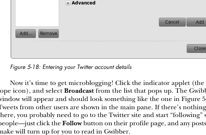

Figure 5-18: Entering your Twitter account details

现在是时候开始微博了！点击指示器小程序（信封图标），并从弹出的列表中选择 Broadcast。Gwibber 窗口将会出现，应该看起来像图 5-19 中的那样。其他用户发布的推文显示在主窗格中。如果里面什么都没有，你可能需要去 Twitter 网站并开始“关注”一些人——只需点击他们个人资料页面上的 Follow 按钮，他们发布的任何内容都会出现在 Gwibber 中供你阅读。

要发送自己的推文，在窗口底部的消息框中输入一些内容：例如 Ubuntu is awesome。你每条推文最多允许 140 个字符，剩余字符数显示在框的右下角。当你对所写内容满意时，点击 Send 将消息发布给所有人查看。随意这样做；你可以整天发推！

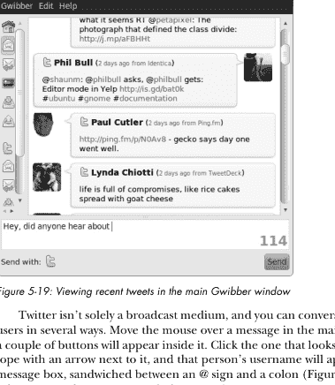

Figure 5-19: Viewing recent tweets in the main Gwibber window

Twitter 不仅仅是一个广播媒介，你可以通过几种方式与其他用户交流。将鼠标移到主窗格中的一条消息上，里面会出现几个按钮。点击看起来像信封旁边带箭头的那个按钮，该用户的用户名将会出现在消息框中，被 @ 符号和冒号夹在中间（图 5-20）。这就是你回复他人推文的方式——只需正常输入你的消息，但在冒号之后。

另一个按钮，看起来像一组齿轮和 cog，点击时会显示一个菜单（图 5-21）。Retweet 是该菜单中的一个有趣选项——点击它，你就会为所有你的朋友/关注者发布该消息的副本。这就是 Twitter 用户分享链接并在网络中传播新闻的方式。经常会发生这种情况，你会从朋友的朋友那里听到一些很酷的事情，这都要归功于这些转发。

如果你暂时用完 Gwibber，只需关闭窗口即可。你可以通过点击信封图标，像之前那样轻松再次打开它。


Figure 5-20: Replying to a tweet

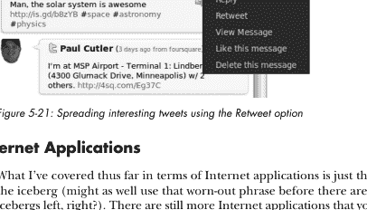

Figure 5-21: Spreading interesting tweets using the Retweet option

## Other Internet Applications

到目前为止我所介绍的 Internet 应用程序只是冰山一角（不妨在冰山都不剩之前先用一下这个陈词滥调，对吧？）。在完成第 6 章后，你可能还想考虑下载和安装更多 Internet 应用程序，包括 Liferea（一个独立的 RSS 订阅源阅读器）和 Miro（一个 Internet 电视浏览器）。如果这一切听起来很诱人，就让你的手指翻动起来吧——宝藏在等待！

## 6

### ROUNDING OUT THE BIRD

Downloading, Installing, and Updating Programs the Easy Way


Ubuntu 最方便的事情之一是它配备了一个非常简单易用的应用程序安装机制。其背后的引擎称为 Advanced Package Tool（APT），它允许你轻松下载、安装、更新和删除打包在 DEB 归档文件或包中的软件。

APT 是一种相当万无一失的安装程序方式；不会有任何东西遗漏，因为它会自动下载并安装主应用程序运行所需的任何文件。追踪这些称为依赖项的文件，对大多数 Linux 用户来说是一个很大的头痛。寻找然后安装这个文件或那个文件，以及这些文件本身可能拥有的任何依赖项的痛苦追寻，导致缺少依赖项问题被称为依赖地狱。APT 使这个问题几乎成为过去。

那么，APT 在哪里找到所有这些文件和应用程序呢？嗯，APT 搜索、下载和安装的包位于一组特定的在线仓库中。这些仓库是在线服务器，其中包含大量各种应用程序、支持文件等都为你的特定系统存储以供使用。所有最初随系统捆绑的文件，包括系统（内核）本身以及可用的更新，也都存储在那里。这与 Windows 或 Mac OS 完全不同，在那些系统中，你通常需要购买一张光盘或从网站下载安装程序文件才能获得新软件。APT 的一个问题是，它是一个命令行驱动的应用程序，这意味着你通过命令终端中的命令来控制它。幸运的是，Ubuntu 为 APT 提供了许多不同的图形前端，让你能够绕过命令行，使一切变得尽可能简单。在本章中，你将重点关注其中三个前端。

#### 项目 6A：通过 Ubuntu 软件中心安装应用程序

在所有 APT 前端中，最易于使用的是 Ubuntu 软件中心。作为最具图形化吸引力的前端之一，它在浏览酷炫或实用的应用程序时尤其有用。为了感受一下它，去应用程序菜单并选择 Ubuntu 软件中心。打开的窗口将类似于图 6-1。

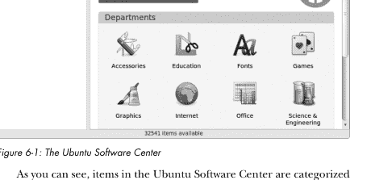

图 6-1：Ubuntu 软件中心

正如你所见，Ubuntu 软件中心中的项目分类方式与 Ubuntu 应用程序菜单中的分类方式基本相同。如果你点击窗口主面板中的任何部门图标，你将跳转到该类别下所有可用项目的列表。已安装的应用程序在其图标上会带有绿色对勾标记，而未安装的则仅显示普通图标。毫不奇怪，每个类别中的已安装项目与应用程序菜单的相关子菜单中的项目相一致。要查看所有已安装程序的列表，请点击窗口左侧面板中的已安装软件项。

##### 6A-1：选择要安装的应用程序

Ubuntu 软件中心可以同时安装多个应用程序，因此为了试用一下，你可以在本节中尝试安装几个有趣的应用程序。我们先从非常酷且非常实用的地址簿应用程序 Rubrica（见图 6-2）开始。要选择 Rubrica，请点击窗口主面板中的办公部门，滚动浏览可用应用程序列表，然后双击 Rubrica Addressbook 项。此时会显示有关 Rubrica 的信息页面。你现在只需点击安装 - 免费，并在提示时输入你的密码。这将开始安装。

在 Rubrica 下载和安装期间，页面上会出现一个进度指示器。安装完成后，Rubrica 页面将重新加载，并在 Installed 旁边显示一个绿色对勾图标，以表明它已成功添加到你的计算机中。就这么简单！选择应用程序 ▸ 办公 ▸ Rubrica Addressbook 启动该程序。

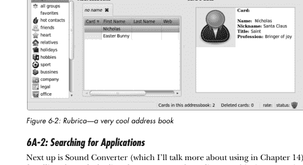

图 6-2：Rubrica——一个非常酷的地址簿

##### 6A-2：搜索应用程序

接下来是 Sound Converter（我将在第 14 章中详细介绍其用法）。滚动浏览程序列表可能很乏味，因此这次请尝试使用搜索功能：在屏幕右上角的搜索框中输入 Sound Converter，然后观看搜索结果的出现。Sound Converter 应该会出现在结果列表的顶部，选择它并点击安装。安装将像之前一样开始——但这次，请在程序仍在安装时尝试点击获取软件。

所有安装的魔法将在后台继续进行，你仍然可以浏览其他程序。无需等待！

最后，让我们添加一个名为 Sysinfo（图 6-3）的实用工具，它是一个系统分析器，可以告诉你有关计算机的各种信息。只需在搜索框中输入 sysinfo，点击出现的 Sysinfo 搜索结果，然后点击安装将其添加到安装队列中。它将在 Ubuntu 软件中心处理完 Sound Converter 后立即安装。

你可以通过进入应用程序菜单并在与你在 Ubuntu 软件中心找到该程序的“部门”相对应的子菜单中查找来运行已安装的应用程序——Rubrica 为办公，Sound Converter 为声音和视频，Sysinfo 为系统工具。

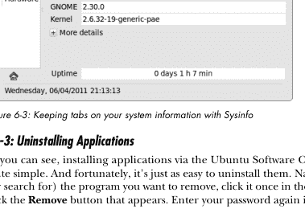

图 6-3：使用 Sysinfo 监控你的系统信息

##### 6A-3：卸载应用程序

正如你所见，通过 Ubuntu 软件中心安装应用程序非常简单。幸运的是，卸载它们也同样容易。导航到（或搜索）你想要移除的程序，在列表中点击它一次，然后点击出现的移除按钮。如果要求，再次输入你的密码，然后观看程序被卸载。


## 通过更新管理器执行系统升级

本章中我将介绍的第二个 APT 图形前端是更新管理器，用于更新你的系统。更新会定期提供，通常包含你已安装的软件包的新版本。大多数时候会发布新版本是因为它修复了某些安全问题，但更新也可以修复软件问题并引入新功能。

开始操作时，选择“系统 ▸ 管理 ▸ 更新管理器”，并确保 Ubuntu 软件中心当前没有正在安装或移除任何内容（你不能同时使用两个 APT 前端）。

一旦更新管理器窗口出现（图 6-4），点击“检查”按钮以确保软件包信息尽可能最新。然后系统会提示你输入密码。输入密码后，稍等片刻，更新管理器窗口中就会出现所有可用更新的列表。

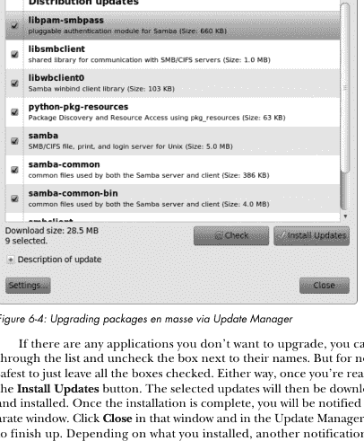

图 6-4：通过更新管理器批量升级软件包

如果有任何你不想升级的应用程序，可以逐一查看列表并取消其名称旁边的复选框。但就目前而言，最安全的做法是保持所有复选框都选中。无论如何，准备就绪后，点击“安装更新”按钮。所选更新将被下载并安装。安装完成后，你将在一个单独的窗口中收到通知。点击该窗口中的“关闭”以及更新管理器窗口中的“关闭”即可完成。视你安装的内容而定，可能会出现另一条通知，告知你需要重新启动系统才能使更改生效。如果是这样，最好听话并重新启动。

## 你应该多久安装一次更新？

Ubuntu 每天都会检查更新，如果发现更新，更新管理器窗口就会出现在你的桌面上。如果这种情况发生得太频繁，你觉得自己被更新骚扰了，请选择“系统 ▸ 管理 ▸ 软件源”。当软件源窗口出现时，选择“更新”标签（图 6-5），在“自动更新”下，将“检查更新”选项更改为其他选项。每周更新应该就足够了。你在那里还会找到几个其他有趣的选项。如果你选择在无确认的情况下安装安全更新，更新将自动进行，无需你干预。或者，你也可以选择在后台下载更新，这样当更新管理器弹出时就可以立即安装。


图 6-5：软件源窗口中的更新标签

## 如果一次更新毁了你的日子……或系统

现在，我不想让你太担心，但关于大规模系统更新的一件事是，之后有时事情就会变得一团糟，让你充满悔恨，满口脏话只等着脱口而出。无论使用什么操作系统，这都是生活的一部分。它可能发生在 Windows 中，也可能发生在 Mac OS 中，也可能发生在 Linux 中。因此，在安装看似重大的更新之前，最好先等待一段时间，并先查看用户论坛，看看是否有关于特定更新的灾难故事。在注意到更新和安装它之间间隔一周，应该能保护你免受大多数罕见事故的影响，但并不能保证。

> 注意：要判断更新是否“重大”，请查找名称中带有 `linux-` 的更新（例如 `linux-generic`，如图 6-6 所示）。这些是重要的系统软件包，也是最可能导致问题的软件包。

## 更新管理器

### 欢迎使用 Ubuntu

自 Ubuntu 发布以来，已发布了这些软件更新。如果你现在不想安装它们，可以稍后从管理菜单中选择“更新管理器”。

- Web content engine library for Gtk+ - data files (Size: 599 KB)
- `linux-generic`
  Complete Generic Linux kernel (Size: 3 KB)
- `linux-headers-2.6.32-20` (New install)
  Header files related to Linux kernel version 2.6.32 (Size: 9.0 MB)
- `linux-headers-2.6.32-20-generic` (New install)
  Linux kernel headers for version 2.6.32 on x86/x86_64 (Size: 709 KB)
- `linux-headers-generic`
  Generic Linux kernel headers (Size: 3 KB)
- `linux-image-2.6.32-20-generic` (New install)
  Linux kernel image for version 2.6.32 on x86/x86_64 (Size: 29.0 MB)
- `linux-image-generic`

Download size: 164.3 MB

197 selected.

Description of update


图 6-6：名称中带有 linux 的更新通常是重要的系统软件包

如果你安装了更新后发现系统无法再次启动，不用担心。并非一切都丢失了。事实上，几乎什么都没丢失。只需再次启动机器即可。如果你有一个双启动系统，你将像往常一样到达 GRUB 启动菜单。如果你不是双启动用户，你必须在计算机启动时立即按住 `SHIFT` 键才能进入此菜单。不要在 GRUB 菜单出现（或 Ubuntu 启动，在这种情况下你错过了时机，需要重新启动计算机并重试）之前松开 `SHIFT` 键。

在 GRUB 菜单中，你会看到似乎在硬盘上安装了不止一个 Ubuntu 系统，这在某种程度上是正确的。作为短期修复，你可以利用这一点，通过回到升级前所使用的核心系统（Linux 内核）来“回到过去”。只需使用方向键选择一个以比最高数字小的数字结尾的内核（例如 `2.6.32-20` 而不是 `2.6.32-22`），按 `ENTER`，瞧，你就回到了你熟悉和喜爱的系统。你每次启动机器时都必须这样做，但至少你有机会在研究问题并稍后再试之前备份你的重要文件。

说了这么多灾难和恢复的事情，我希望我没有吓跑你更新系统的想法。毕竟，很可能这种事情永远不会发生在你身上。尽管如此，知道如果事情真的出了问题，也无需惊慌是件好事。你有备份。

## 添加额外的软件源

Ubuntu 软件仓库包含超过 30,000 个软件包——足够用一辈子，或许你会这么想。但事实证明，在官方 Ubuntu 仓库之外，还有一个等待你的软件世界，而且获取起来并不困难。各种个人和公司会将 Ubuntu 中不可用的少量软件包编译成自己的第三方仓库。这些仓库通常可以免费访问，只要你能找到它们。你所需要做的就是告诉 APT 在 Ubuntu 的仓库之外，也在这些仓库中搜索软件包，这样你就能获取到额外的软件。

每个仓库都有自己的 APT 行。这类似于一个网址，但包含有关仓库的额外信息，APT 使用这些信息来判断仓库包含何种类型的软件包。你需要从要添加的仓库网站上获取正确的 APT 行，所以让我们选一个例子来看看它是如何工作的。打开 Firefox，并前往 `http://www.getdeb.net/updates/Ubuntu/all#how_to_install`。GetDeb 专注于为尚未正式进入 Ubuntu 的软件制作软件包。页面顶部应该有一个关于如何从 GetDeb 安装软件包的说明框，跳到列表中的第二项，找到 APT 行，它应该看起来像这样：`deb http://archive.getdeb.net/ubuntu lucid-getdeb apps`。这遵循所有 APT 行的相同格式：单词 `deb`，后跟一个网址，后跟几个其他单词，指定 APT 在查找程序时应检查仓库的哪个部分。选中 APT 行，右键单击它，然后从弹出菜单中选择“Copy”。

在 Firefox 中，你还需要获取仓库的 GPG 密钥（我将在本节末尾详细解释）。它应该链接自你获取 APT 行的同一网站；以 GetDeb 为例，前往 `http://archive.getdeb.net/getdeb-archive.key`，当打开 `getdeb-archive.key` 窗口时，选择“Save File”，然后单击“OK”保存密钥文件。

现在你已经拥有了这些关键信息，将仓库添加到系统上非常简单：

1. 选择 System ▸ Administration ▸ Software Sources。如果要求，输入你的密码，然后在出现的 Software Sources 窗口中单击 Other Software 选项卡。
2. 单击 Add。你将被提示输入 APT 行，因此将其粘贴到框中，然后单击 Add Source（图 6-7）。Other Software 列表中应出现一个新条目。
3. 选择 Authentication 选项卡，然后单击 Import Key File。使用出现的窗口找到你之前下载的 `.key` 文件。（它可能在你的 Downloads 文件夹中。）
4. 通过单击一次选择 `.key` 文件，然后单击 OK。检查受信任软件提供商列表，确保 GetDeb Archive Automatic Signing Key 现在已存在，如图 6-8 所示。

### 输入你要添加为源的仓库的完整 APT 行

APT 行包括仓库的类型、位置和组件，例如 `deb http://archive.ubuntu.com/ubuntu lucid main`。

APT line: `deb http://archive.getdeb.net/ubuntu lucid-getdeb apps`


Figure 6-7: Entering the APT line for the GetDeb repository

### Software Sources

Ubuntu Software Other Software Updates Authentication Statistics

### Trusted software providers

- 437D0585 2004-09-12

- Ubuntu Archive Automatic Signing Key <ftpmaster@ubuntu.com>

- FBB75431 2004-12-30

- Ubuntu CD Image Automatic Signing Key <cdimage@ubuntu.com>

- 46D7E7CF 2009-05-15

- GetDeb Archive Automatic Signing Key <archive@getdeb.net>

Import Key File Remove Restore Defaults Revert Close

Figure 6-8: Checking the list of trusted software providers to see whether the GetDeb key is there

- 5. 关闭 Software Sources 窗口。你会被告知可用软件的信息已过时，因此单击 Reload 以获取最新的软件包信息。下载可能需要一点时间。

- 6. 打开 Ubuntu Software Center（如果它已经打开，则先关闭再重新打开），并搜索你想要从新仓库获取的程序。例如，尝试搜索 BookWrite，这是一个有趣的小程序，可以帮助你写自己的小说。它应该像其他任何应用程序一样出现在搜索结果中，因此你可以以通常的方式安装它。

这确实有不少步骤，但这就是全部内容。这比开车去当地电脑商店买新程序要好得多吧？

最后再提醒一下：还记得之前提到的关于身份验证和 GPG 密钥的事情吗？它与一项安全措施有关，用于检查软件包是否确实来自你认为的来源。（理论上，有人可能会劫持一个仓库并在其中放置有害的假软件包。）如果你不添加 GPG 密钥，Ubuntu 软件中心将拒绝显示该仓库中的任何软件包，因为它不会信任该仓库。拥有 GPG 密钥并不足以让你完全免受不愉快惊喜的侵害，不过。你在使用第三方（即非 Ubuntu）仓库时应始终保持谨慎；在添加之前请确保它是可信的。

## APT-URL：从网站安装

现在你已将 GetDeb 添加到可用软件仓库列表中，你可以利用另一种 APT 前端。前往 `http://www.getdeb.net/`，并点击 Apps 选项卡。浏览程序列表，直到找到一个合适的——我选择了一个名为 `hamster-applet` 的时间管理应用程序——然后在其图片下方点击 Install this now。现在你可以通过点击网站上的链接来安装软件，而无需访问 Ubuntu 软件中心！

一个启动应用程序屏幕将会出现，其中 `apturl` 选项已被选中——点击 OK，如果提示则输入你的密码。然后你会看到一个类似图 6-9 的窗口；点击 Install，然后等待常规的下载和安装活动进行。全部完成后，在出现的窗口中点击 Close，然后在应用程序菜单中（或它最终出现的地方）找到你的新程序。快捷又简单。


图 6-9：使用 APTURL 从网站安装软件包

许多网站都支持 APT 链接，但除非你在电脑上添加了它们的仓库，就像你对 GetDeb 所做的那样，否则你将无法从它们那里下载软件。如果链接指向的程序已在 Ubuntu 仓库中可用，则可以像往常一样安装，无需在软件来源中进行任何进一步操作。

## 项目 6B：从 PPA 安装软件：OpenSonic

许多 Ubuntu 爱好者会染上编程的瘾，并决定自己制作软件。网络上存在各种各样的程序，有人编写它们只是为了满足自己的需求，而其中许多程序如果你知道去哪里找，就可以免费使用。幸运的是，现在其中大部分都可以在 Ubuntu 项目网站 Launchpad 上的个人软件包档案（PPAs）中找到。PPAs 是迷你的软件仓库，是人们轻松分享自制软件给他人的一种方式（重点在于自制——有时 PPA 中的软件无法正常工作）。你可以通过访问 `https://launchpad.net/ubuntu/+ppas` 并搜索你想要的内容来在 PPA 中找到软件。

在本示例中，你将了解如何安装 OpenSonic，这是一款经典刺猬索尼克游戏的开源混音版（见图 6-10）：

- 1. 在 `https://launchpad.net/ubuntu/+ppas` 的搜索框中输入 `lucid games`，然后点击 Search 开始。

- 2. 第一个搜索结果应该是 Games (Lucid)，因此点击该链接，并在加载的页面上查看标题为 Adding this PPA to your System 的部分。

- 3. 复制写着 `ppa:fa1k-t-j/games` 的部分——它是一个快捷方式，可用于添加此仓库，而无需使用更繁琐的 APT 行。（如果你好奇，仍可通过点击 Technical details about this PPA 链接来查看 APT 行。）

- 4. 选择 System ▸ Administration ▸ Software Sources，并选择 Other Software 选项卡。

- 5. 点击 Add，并将 PPA 快捷方式粘贴到提供的框中。然后，点击 Add Source。

- 6. 这次 GPG 密钥将自动添加，因此现在可以关闭软件来源窗口。

- 7. 在提示更新软件包信息时点击 Reload，然后打开 Ubuntu 软件中心并像安装其他任何软件包一样安装 OpenSonic。


图 6-10：游玩 OpenSonic

这只是一个例子——PPA 并非只被爱好者用来分发怀旧游戏。一些 Ubuntu 开发者也会使用 PPA 来提供最新版本的软件，尽管这种方式是非官方且未经测试的。例如，如果 OpenOffice.org 或 Firefox 推出了重要新版本，可以多多关注 Ubuntu 论坛（`http://www.ubuntuforums.org/`），看看是否有人已经通过自己的 PPA 提供了最新最好的版本。

## 项目 6C：安装无法通过 Ubuntu 软件源获取的 DEB 软件包：Skype

你可能还记得，你通过 Ubuntu 软件中心从各个软件源安装的应用程序都是以 DEB 软件包的形式存在的。尽管这些软件源看起来似乎包含了几乎所有可能用到的软件，但某些软件包出于种种原因永远不会进入软件源。Skype 就是其中之一。

如图 6-11 所示，Skype 是一款 IP 语音（VoIP）软件，让你可以通过互联网与其他 Skype 用户通话，音质清晰度堪比普通电话线路。最棒的是，它完全免费——即使拨打海外用户也是如此。Skype 还提供付费服务，例如 SkypeOut，你可以通过电脑拨打普通手机和固定电话号码，费用仅为普通电话资费的一小部分。


图 6-11：Skype

## 7

### 整洁的巢

*Ubuntu 中的文件与光盘处理*


无论你使用哪种操作系统，你都不得不处理文件。有些人非常有条理，文件第一次保存时就会把它放进一个命名合理的文件夹中。而另一些人则像我一样，把所有东西都保存到桌面上，直到桌面堆满垃圾、连壁纸都看不清了，才开始认真整理（如果把这些文件全部放进一个名为 *March17Cleanup* 的文件夹中也算整理的话）。

当然，文件不仅会存储在硬盘上，还会被复制到 CD、DVD、移动硬盘、U 盘以及其他存储介质和设备中，或从其中复制出来。文件也常常保存为归档文件，再通过压缩减少空间占用，从而更方便通过电子邮件发送，或放入可移动存储介质中。

说到这里，你可能已经猜到，本章要讲的是 Ubuntu 中的文件处理，尤其是与 Nautilus 文件管理器相关的内容，它是 GNOME 文件处理能力的核心。

#### Nautilus：你的文件管理器

正如我提到过的，在你的系统上创建文件查看与整理界面的程序叫做 Nautilus，它是 GNOME 桌面环境的一部分。你可能以前从未想过操作系统的文件管理器也是一个程序，但事实上它正是如此。（Windows 的文件管理器叫做 Windows 资源管理器。）要查看 Nautilus，只需进入“位置”（Places）菜单，然后选择“主文件夹”（Home Folder）。


当 Nautilus 打开你的主文件夹时（如图 7-1 所示），你会发现你可以按主题分类存放文件：文档、下载、音乐、图片、公共、模板和视频。还有一个名为“桌面”（Desktop）的文件夹，双击它会显示你存放在桌面上的所有内容（我桌面上有很多；你的桌面上很可能什么都没有）。还有一个名为“示例”（Examples）的文件夹，里面包含一些示例文件，让你了解 Ubuntu 为你准备了什么。

你可以随心所欲地创建更多文件夹和文件，因此，一旦你真正开始使用系统，这种预配置好的状态肯定会发生变化。事实上，你将在第 8 章中进行一些修改，让一切看起来更有生活气息。


图 7-1：在 Nautilus 窗口中看到的主文件夹内容

## 侧边栏

Nautilus 有许多值得一提的有趣功能，其中最为显眼的当属侧边栏，它出现在窗口的左侧。通过侧边栏，你可以借助可选的视图来查看各种信息。你可以点击侧边栏顶部的下拉菜单来进行选择（图 7-2）。


图 7-2：为 Nautilus 侧边栏选择视图

Ubuntu 中的默认视图是“位置”，这是一种快速导航工具。在“位置”中，你可以找到代表系统可用各种数据存储位置的图标，例如你的主文件夹、桌面、整个文件系统、你连接的任何网络共享（稍后会详细介绍），以及你系统中插入或连接的任何可移动存储介质或设备。点击其中任意图标，都会在 Nautilus 窗口的右侧面板中显示该位置的内容。

当然，还有其他视图，例如“树状视图”，它为你提供文件系统可展开的层级视图；以及“历史视图”，它显示了你在文件系统中最近访问过的位置，这与网页浏览器中的历史记录功能非常相似。还有其他视图可供你选择，其中几个将在第 8 章中用到。

## 时显时隐

侧边栏是一个相当方便的功能，但有时你可能希望有更多空间来查看窗口内容，因此想暂时去掉侧边栏。这很容易做到，只需点击侧边栏右上角的小灰叉按钮，或者进入 Nautilus 窗口的“视图”菜单，然后取消勾选“侧边栏”即可。该条目旁边的对勾标记会随之消失，侧边栏也会一并消失。想要恢复它，只需再次回到“视图”菜单，重新选择“侧边栏”即可。对勾标记会重新出现，侧边栏也会随之恢复。

还有另一种隐藏侧边栏的方法，许多人似乎是偶然发现的，通常结果是引发一些不必要的惊慌。如果你查看侧边栏右侧的灰色边框，会注意到在中间位置有一小段条纹区域（见图 7-3）。拖动这段条纹区域可以调整侧边栏的宽度。然而，大多数人没有立即意识到的是，只需点击这段条纹区域，就可以像开关一样隐藏或显示侧边栏。当侧边栏以这种方式隐藏时，条纹区域仍会出现在窗口的左边缘，但以前面提到的其他方式隐藏时则不会如此。

就是这样——侧边栏的小秘密。不，它并不是一个特别有趣的秘密，但它不仅能为你带来额外的便利，也能让你安心。


图 7-3：显示和隐藏 Nautilus 侧边栏的另一种方式

## Nautilus 中的文件处理

由于 Nautilus 主要是一个文件管理器，那么就该实际使用它的这一功能了。当然，如今大多数使用电脑的人都已经熟悉拖放操作的基础知识，以及创建文件夹、复制、剪切和移动文件的其他一些方法。但对于那些不熟悉这些基本操作某种方式的人来说，我会详细说明。如果你觉得这些内容有点多余，请为了大众的利益而耐心一点。

### 创建、命名和重命名文件夹

创建文件夹是一件相当简单的任务，有两种方法可以做到。最简单的方法（在我看来）是在 Nautilus 窗口内的任意空白处右键点击，然后在出现的弹出菜单中选择“创建文件夹”。

如果你更喜欢使用菜单而不是右键点击空白处，也可以通过选择`文件 ▸ 创建文件夹`来开始操作。

无论你在哪里选择“创建文件夹”，一个名为*未命名文件夹*的新文件夹都会出现在 Nautilus 窗口中。该文件夹的名称框会被高亮显示并被黑框包围，这意味着你可以立即通过直接输入来为该文件夹命名——除此之外无需点击或做任何其他操作。按 `ENTER` 键，或点击 Nautilus 窗口中的任意空白区域即可完成操作。

如果之后你决定需要调整一下给文件夹起的名字，甚至完全重新命名，你可以右键点击它，然后在弹出菜单中选择`重命名`。或者，你可以单击该文件夹一次以将其高亮，然后选择`编辑 ▸ 重命名`。之后，你可以为文件夹输入新名称，然后按 `ENTER` 键，或者点击 Nautilus 窗口中的任意空白区域来确认操作。

### 移动文件和文件夹

也许在 Nautilus 中你能执行的所有文件操作中，最简单的就是通过拖放来移动文件。我很确定任何使用过鼠标的人都熟悉这种特定的移动方式。不过，还有另一种移动文件和文件夹的方法：剪切和粘贴。

最简单的方法是右键点击你想要移动的文件（或文件夹），然后从弹出菜单中选择`剪切`（`编辑 ▸ 剪切`也能达到同样的效果）。此时，看起来似乎什么都没发生，因为文件仍然在那里，但别担心。

之后，右键点击目标文件夹中的任意空白处，然后在弹出菜单中选择`粘贴`。该文件将从其原始位置消失，并出现在新位置。

可以使用组合键来完成这个操作吗？当然可以。只需按照我刚才给出的步骤操作，但按 `CTRL-X` 剪切，按 `CTRL-V` 粘贴。

### 复制文件和文件夹

根据我刚才给出的说明，你完全可以想象出复制文件和文件夹的方法，因为它们本质上是同一主题的变体。只需右键点击你想要复制的文件，从弹出菜单中选择`复制`，右键点击目标位置中的任意空白处，然后选择`粘贴`。就按键而言，复制是 `CTRL-C`，照旧，粘贴是 `CTRL-V`。

还可以通过神奇的拖放来复制文件夹和文件，不过与简单的拖放移动相比，这需要更多操作；幸运的是，你现有的两只手就能很好地完成。只需在将想要复制的文件或文件夹拖到目标位置时按住 `CTRL` 键。确保先释放鼠标按钮，然后再释放 `CTRL` 键（顺序相反则不起作用），你就会发现文件的新位置出现了一个副本。

### 在 Nautilus 中导航

在 Nautilus 中浏览你的各种文件夹和子文件夹非常直接。事实上，在概念上它与你在 Windows 和 Mac OS 中习惯的几乎完全相同。你可以通过双击文件夹以及点击返回、向前和向上按钮的组合来简单地进入和退出文件夹。

### 在 Nautilus 中使用面包屑浏览

除了侧边栏提供的分层视图选项外，还有一个方便的功能可以让你的导航工作更轻松：Nautilus 的面包屑栏功能。当你不断深入文件夹森林时，Nautilus 会在导航栏中为你在通往当前查看文件夹的路上打开的每个文件夹留下面包屑（它们实际上看起来像按钮）。

举例来说，假设你在主文件夹中有一个名为 NordicStuff 的文件夹，里面有一个名为 SwedeStuff 的文件夹，里面有一个名为 Dalama 的文件夹，里面有一个名为 gooseberries 的文件夹。当你通过双击 NordicStuff 文件夹开始点击进入那个 gooseberries 文件夹时，Nautilus 会显示该文件夹的按钮……以及之前打开的任何文件夹。看一下图 7-4 就明白我的意思了。


图 7-4：Nautilus 中的面包屑导航

正如你所见，从你的主文件夹到目标 gooseberries 文件夹路径中的每个文件夹都有一个按钮。那又怎样，对吧？好吧，假设你想返回 NordicStuff 文件夹以打开一个文件，其中有一些文本你想复制然后粘贴到 gooseberries 文件夹中的一个文档里。这听起来像是一件小麻烦，对吧？

好吧，与其折腾返回按钮，就跟着面包屑走吧！只需点击 NordicStuff 面包屑按钮，该文件夹的内容就会呈现在你面前。需要返回 gooseberries 吗？只需点击 gooseberries 按钮。想回到 SwedeStuff 呢？只需点击 SwedeStuff 按钮。一切都很 fantastisk！

### 拼写出来——在 Nautilus 中输入文件路径

如果你更喜欢打字而不是点击，你会很高兴知道你可以通过输入路径来导航到文件夹。只需点击 Go 菜单并选择 Location（键盘快捷键爱好者可以按 `CTRL-L`）。然后位置栏中会出现一个框（图 7-5），显示当前位置，在我的浆果示例中，它将是 `/home/rg/NordicStuff/SwedeStuff/Dalama/gooseberries`。你可以在该框中输入目标文件夹的路径，然后按 `ENTER`，之后目标文件夹的内容将显示在 Nautilus 窗口的主窗格下方。


图 7-5：输入目标文件夹的路径

### Nautilus 中的书签

在深埋的子文件夹之间不断点击，值得一提的是 Nautilus 的另一个非常方便的功能：书签。是的，Nautilus 允许你为已导航到的文件夹添加书签。虽然你无疑熟悉为经常访问的网页创建书签，但你可能会想知道为什么要在文件系统中创建书签。


好吧，想象一下你有一个需要经常使用的文件夹，但它比上一节中的我的 gooseberries 文件夹埋得更深。到达那里需要过多的鼠标点击，而所有这些点击最终肯定会给你带来严重的腕管综合征。虽然这对你的医生来说很棒，但对你来说绝对不好。与其伤害自己，不如点击一次进入该文件夹，然后在 Nautilus 窗口中选择 Bookmarks ▸ Add Bookmark。此后，每当你想返回那个深埋的文件夹时，你只需点击 Bookmarks 菜单，该文件夹就会在下拉列表中等待你。

Nautilus 书签的另一个方便之处是它们也会出现在“另存为”对话框中，例如当你保存 OpenOffice.org 文档或通过 Firefox 下载文件时。要在任何此类“另存为”对话框中使用它们，只需点击“保存到文件夹”按钮，你就会找到你的书签。

## 理解 Linux 文件系统

在学习了所有这些路径输入、导航和书签操作之后，你应该基本上能够弄清楚如何在自己的主文件夹中从这里到达那里。尽管如此，了解你的主文件夹在整体结构中的实际位置仍然是个好主意，以防有一天你真的迷路了。要理解这一点，你应该对 Linux 文件系统有一个基本的了解，你会发现它与你之前使用的操作系统有所不同。

与 Windows 不同，Linux 文件系统都源自一个称为根的单一点，并由一个单独的正斜杠（`/`）表示。你的用户账户文件夹位于根下的一个名为 home 的子文件夹中。这表示为 `/home`，或者用文字来说，就是根内的主文件夹。如果你的用户账户名与我的一样是 rg，那么该文件夹的路径就是 `/home/rg`，或者是根内主文件夹内的 rg 文件夹。不管你的用户账户名或机器上其他账户的名称是什么，只要记住，当你迷路时，你的文件夹，以及机器上所有其他有用户账户的人的文件夹，都位于主文件夹内。如果你是更偏向图形化的人，图 7-6 中的地图应该能帮到你。


图 7-6：用户文件夹在 Linux 文件系统中的位置

## 那些其他文件夹里有什么？

不用说，Linux 文件系统不仅仅只有根、home 和用户账户文件夹。在与 home 同一层级上还有几个其他目录，不过在你知道自己在做什么之前，大多数情况下不应该去乱动它们。幸运的是，其中大多数文件夹都是写保护的，所以你应该能很好地保护自己免受自己的伤害。尽管如此，对那些其他文件夹的存在感到好奇是很自然的，因为……好吧，它们就在那里。所以，为了稍微满足你的好奇心，我会做一些解释。

在 Ubuntu 中，有四个文件夹包含了系统上大部分的应用程序。系统的基本元素位于 `/sbin` 中。其他需要存在但可能不被使用的元素，例如命令等，则位于 `/bin` 中。你实际认为的应用程序并以动手方式使用的绝大多数应用程序位于 `/usr` 中。最后，还有一些附加应用程序，例如 RealPlayer，会将自己安装到 `/opt` 中。

另外三个可能引起你兴趣的顶级文件夹是 `/etc`、`/lib` 和 `/media`。其中第一个 `/etc` 是系统上所有配置文件的位置。第二个 `/lib` 是系统或其上安装的应用程序所需的所有库的家。这些库相当于 Windows 中的 .dll 文件。最后，`/media` 是各种外部介质（如 USB 驱动器和 CD）的内容在插入时出现的位置。

还有其他顶级文件夹，但对于普通 Linux 新手来说，它们的用途有点不太直接，而且说实话，在这个阶段可能对你来说也没那么有趣。无论如何，正如我提到的，目前你没有理由去乱动这些文件夹，因为你可以通过不同且更安全的方式访问它们内部的项目。

## 将 Nautilus 用作网络浏览器

Nautilus 的另一个方便功能是它能够作为网络浏览器使用。例如，你可以通过在 Nautilus 窗口侧边栏中点击 **Network**，或在 GNOME 面板中进入 **Places** 菜单并选择 **Network**，来查看在你的家庭或办公网络上有哪些网络和共享可用。你也可以在 Nautilus 窗口内通过进入其 **Go** 菜单并选择 **Network** 来实现。然后，Nautilus 窗口中会出现该网络上任何网络或计算机的图标，如图 7-7 所示。从该窗口中，你就可以双击进入你有权限访问的共享，例如 Windows 机器的 *Shared Documents* 文件夹或 Mac 的公共文件夹。顺便说一下，如果你想知道共享是什么，我来为你澄清一下：网络共享是计算机上的一个位置，例如一个文件夹，网络上的其他用户可以访问并保存文件。Windows 系统上的 *Shared Documents* 文件夹是一个很好的

example. 网络上的其他用户可以从共享的 **Documents** 文件夹复制文件并（通常）向其中写入文件，而他们无法访问该机器文件系统的其他任何部分。

如果您尝试打开的共享需要用户名和密码，将在新窗口中要求您提供这些信息。请注意，在这种情况下，您需要输入的是要连接到的机器的用户名和密码——而不是您在 Ubuntu 中使用的用户名和密码（除非用户名和/或密码恰好相同，当然）。然后您可以像操作自己硬盘上的文件夹一样，从该共享复制文件和向其中复制文件。


*Figure 7-7: Viewing the computers on your network*

在某些情况下，尤其是尝试访问运行 OS X 的 Mac 上的共享时，双击方法将不起作用。即使在 Nautilus 窗口中出现了该机器的图标，您也无法访问该特定机器上的任何共享。在这种情况下，双击您要访问的机器的图标，然后在打开（到一个空窗口）后，选择 **Go › Location**。位置栏中会出现一个文本框（就像图 7-5 中一样），其中已列出您要访问的机器的位置。

在该位置后添加一个正斜杠（`/`），然后加上目标机器上使用的用户名。例如，如果目标机器名为 **cowboycats**，用户名为 **meatyou**，则位置为 `smb://cowboycats/meatyou`。您也可以通过在已输入的路径后添加内容，将范围缩小到机器上的特定文件夹，只要您知道该文件夹的路径即可；例如 `smb://cowboycats/meatyou/Documents`。如果您愿意，也可以输入 `smb://` 和您的 Mac 的 IP 地址，后者由用点分隔的四组数字组成。以我的一台机器为例，我会输入 `smb://192.168.0.100`。 （您可以通过进入 Mac 的系统偏好设置，点击共享，然后点击 Windows 共享来找到 Mac 的 IP 地址。地址应出现在服务选择窗格正下方。）

> NOTE 如果您在想，路径开头的 smb 代表 server message block，但为了方便（也许对记忆更有用），您可以将其简单地视为 Samba 的缩写，Samba 是 Unix-based 系统（如 Linux 和 Mac OS X）用于与 Windows 网络交互的软件。

一旦您在已连接的网络机器上找到了想要浏览的文件夹，最好使用 Nautilus 中的书签功能为该打开的共享窗口创建书签。然后您可以通过在 Nautilus 书签菜单中选择该共享的名称，轻松地在未来访问该共享。相当酷，如果我可以这么说的话。

## Using Nautilus as an FTP Client

Nautilus 不仅允许您浏览和挂载本地网络上的共享，还可以充当文件传输协议（FTP）客户端，例如当您想要更改远程服务器上网站的文件时。要执行此操作，请转到连接服务器窗口（File ▸ Connect to Server），然后将服务类型选择为 FTP（with login）。然后输入您的网站主机提供的信息，然后单击连接按钮。然后 FTP 网络共享图标将出现在桌面和侧边栏中。双击该图标，在提示时输入您的密码（该账户的密码——不是您的 Ubuntu 系统的密码，除非恰好相同），然后您将能够查看和添加您那里的文件。

## File and Folder Permissions Within Nautilus

随着您在 Ubuntu 世界中的探索，您会发现偶尔会遇到以某种方式被锁定的文件或文件夹，关于您能否读取它们、能否更改它们，或两者兼而有之。这些可读性和可更改性状态被称为权限。

现在，您可能会想知道这些权限的意义何在，为了帮助您理解，我将举一些它如何有用的例子。假设您有一些不想让配偶或孩子看到的文件——例如一些糟糕的诗歌或圣诞购物清单。通过拒绝对这些文件或包含这些文件的文件夹的读取权限，没有人能够偷看，除非他们擅长更改权限并且拥有更改这些文件或文件夹权限所需的权限。

另一个例子，想象您有一个花费了许多小时工作并最终完成的文档。为了消除您可能会以某种方式意外破坏该文件的担忧，您可以拒绝自己写入权限。通过这样做，您将无法保存对该文件所做的任何更改。

你会看到“另存为”选项，但如果你想更改文件本身，就必须更改权限。当你对某个文件或文件夹施加此类限制时，该图标上会出现一个挂锁标志，如图 7-8 所示。


图 7-8：Nautilus 会在权限限制你的行动自由时提示你。


## 在 Nautilus 中更改文件和文件夹权限

要在 `Nautilus` 中更改文件或文件夹权限，只需右键单击相应的文件或文件夹，然后从弹出菜单中选择“属性”。打开“属性”窗口后，单击“权限”选项卡，你就会看到该文件或文件夹的所有者是谁，以及你和其他人可以或不可以对它进行哪些操作。如图 7-9 所示，文件夹和文件的选项略有不同。


图 7-9：在 `Nautilus` 的“属性”窗口中更改文件和文件夹的权限

你可能会觉得权限这东西有点令人困惑，但实际上它非常简单。权限可以被授予或拒绝给文件或文件夹的所有者（你）、指定的组或其他所有其他人。传统上，这些权限被称为：

- **读取** 查看文件或文件夹内容的权限
- **写入** 更改文件或文件夹内容的权限
- **执行** 运行程序或脚本的权限

如图 7-9 所示，`Nautilus` 已尝试更明确地说明这些内容。不过，一般来说，你无需过分担心为自己文件设置权限，因为真正能够访问你的用户账户的只有你。你可能遇到的一个例外情况是将文件从 CD 传输到硬盘时。在这种情况下，文件会处于写保护状态，这意味着在更改这些文件的权限之前，你无法修改它们。你可以在“属性”窗口的“所有者”区域中更改此类文件的权限，以允许自己修改它们：在“访问”一词旁边的菜单中选择“读取和写入”（适用于文件），或在“文件访问”一词旁边的菜单中选择“创建和删除文件”（适用于文件夹）。完成后，单击“关闭”按钮，就大功告成了。

## 保护你的主文件夹隐私

对于我所说的“无需担心权限”这一说法，还有一个例外，而且可能是一个重要的例外，那就是主文件夹的权限状态，尤其是当其他人拥有你机器上的用户账户时。在 `Ubuntu` 中，当某人登录到自己在你电脑上的账户时，他们可以一路点击进入你的用户文件夹并查看其中的内容。

要解决这个问题——从而保护你的主文件夹不受侵犯、其中内容的隐私以及其所有者（你）的安心——你可以更改主文件夹的权限。具体操作如下：

- 1. 打开一个 `Nautilus` 窗口，然后点击侧边栏中的“文件系统”。整个硬盘的内容就会出现在 `Nautilus` 窗口的右侧窗格中。
- 2. 找到名为 `home` 的文件夹并双击。当你刚刚点击的 `home` 文件夹的内容出现在右侧窗格中时，那里应该只有一个文件夹——你自己的文件夹，其名称与你的用户名相同。例如，正如我之前提到的，我的用户名是 `rg`。
- 3. 右键单击你的文件夹，然后在弹出菜单中选择“属性”。
- 4. 在用户名的“属性”窗口（我的显示为“`rg` 属性”）中，单击“权限”选项卡。
- 5. 在“权限”选项卡中，向下找到“组”和“其他”部分，在“文件夹访问”字样旁边的下拉菜单中选择“无”。请务必在“组”和“其他”两个部分都进行此操作。完成后，你的窗口应该与图 7-10 中我的窗口一致。如果是这样，请点击“关闭”。


图 7-10：出于隐私目的更改主文件夹的权限

## 读取数据 CD 和 DVD

在 `Ubuntu` 中处理数据 CD 和 DVD 非常简单，因为一切都是自动化的。要读取包含数据而非音乐或视频的 CD 或 DVD，只需将光盘放入驱动器，CD 或 DVD 图标（它们看起来一样）就会自动出现在桌面上；如果你打开了一个 `Nautilus` 窗口，也会出现在侧边栏中。你可以双击其中任意一个图标，之后光盘的内容就会显示在 `Nautilus` 中。然后，你可以使用标准的拖放或复制粘贴操作将文件从 CD 或 DVD 复制到硬盘。

当你想取出 CD 或 DVD 时，只需右键单击该光盘的桌面图标或侧边栏中的图标，然后在弹出菜单中选择“弹出”。光盘会自动弹出。

## 刻录数据 CD 和 DVD

在 GNOME 中刻录数据 CD 和 DVD 极其简单，只要你的电脑连接了 CD 或 DVD 刻录机！你所要做的就是放入一张空白的可记录 CD（`CD-R`）或 DVD（`DVD-RW`、`DVD-R` 和 `DVD+RW`）

在你的驱动器中（都受 `Ubuntu` 支持），确保选择驱动器支持的媒体格式，然后会出现一个空白光盘窗口，询问你想要做什么。只需点击确定即可打开 `Nautilus` 的 CD/DVD 创建器窗口，该窗口与你毫无疑问注意到的其他 `Nautilus` 窗口看起来非常相似，只是位置栏下方有彩色条带以及写入光盘按钮（图 7-11）。


图 7-11：一个 `Nautilus` CD/DVD 创建器窗口，其中文件已准备好刻录到光盘

一旦 CD/DVD 创建器窗口打开，将你想要刻录的文件复制到光盘基本上就是一个简单的拖放操作。只需打开一个新的 `Nautilus` 窗口，然后将你想要刻录到光盘的文件从该窗口拖到 CD/DVD 创建器窗口。如果你更喜欢以一种明显 Windows 风格的方式操作，可以通过单击每个文件一次并在操作时按住 `CTRL` 键来选择要传输到光盘的文件，以进行多项选择。如果你想选择多个连续文件，可以单击组中的第一个文件，按住 `SHIFT`，然后单击组中的最后一个文件，自动选择中间的所有文件。做出选择后，松开 `CTRL` 或 `SHIFT` 键，右键单击任何一个高亮文件，并在弹出菜单中选择复制。之后，返回 CD/DVD 创建器窗口，右键单击任何空白区域，然后在弹出菜单中选择粘贴。

值得一提的是，你复制到 CD/DVD 创建器窗口中的文件实际上并没有被复制。相反，你在 CD/DVD 创建器窗口中看到的本质上是指向其原始位置中原始文件的链接。因此，如果你在将 CD/DVD 创建器窗口的内容刻录到光盘之前将其中一个文件从其原始位置移动，链接将不再起作用，该文件也不会被复制到光盘上。这不是什么大问题，因为所有其他文件仍会被正确写入光盘，但这是值得注意的事情。

其中一个区别是 `Nautilus` 会将你的 `CD-RW` 当作普通数据光盘而不是空白光盘来处理。这意味着当你将光盘放入驱动器时，会自动打开一个普通的 `Nautilus` 窗口，而不是 CD/DVD 创建器窗口。

要写入光盘，你需要手动从 `Nautilus` 窗口切换到 CD/DVD 创建器窗口，这很容易做到，只需在为该光盘打开的 `Nautilus` 窗口的 Go 菜单中选择 CD/DVD 创建器即可。如果看不到 CD/DVD 创建器选项，请点击 Go ▸ Location 并在位置栏中输入 `burn:///`（然后按 `ENTER`）代替。完成此操作后，窗口将变为 CD/DVD 创建器窗口。现在将你想要刻录到 CD 的文件拖到该窗口；准备好刻录后，点击写入光盘按钮。

与普通 `CD-R` 或 DVD 的情况一样，会出现一个 CD/DVD 创建器窗口。然而，当驱动器中放入已使用的 `CD-RW` 并在该窗口中点击刻录按钮时，会出现细微的差异。此时，会出现一个类似图 7-13 的新窗口，告诉你光盘似乎已有文件写入。点击该窗口中的空白光盘按钮，CD/DVD 创建器将擦除 `CD-RW` 上已有的文件，并用你拖到 CD/DVD 创建器窗口中的新文件替换它们。相当不错，对吧？


图 7-13：使用 `Nautilus` 擦除 `CD-RW`

## 将 ISO 映像刻录到光盘

当你从互联网下载 `Ubuntu` 或其他 Linux 发行版时，通常会下载一个或多个光盘映像，通常称为 `ISO`，因为此类文件以 `.iso` 扩展名结尾。`ISO` 是 CD 文件内容的映像，这意味着它是去掉介质本身的 CD。换句话说，如果 CD 有灵魂，`ISO` 就是 CD 的灵魂；去掉 CD 的金属和塑料，剩余的数据就是 `ISO`。

由于不可能通过互联网下载物理 CD，因此无体的 `ISO` 是最好的替代品。例如，要从网络获取可用的 `Ubuntu` 副本，你通常需要下载一个 `ISO`，然后将其刻录到空白 CD 上，以某种意义上让映像重新获得身体。在此过程中，你创建了安装 `Ubuntu` 所需的可工作安装光盘。

幸运的是，将 `ISO` 刻录到光盘是一项相当简单的任务。只需打开一个 `Nautilus` 窗口，找到你想要刻录到光盘的 `ISO` 文件的图标。右键单击 `ISO` 文件，在出现的弹出菜单中选择写入光盘。完成后，写入光盘窗口将会出现；只需单击刻录按钮，你就可以开始了。

## 创建自己的 ISO 镜像

谈到 `ISO` 时，知道你可以创建自己的 `ISO` 镜像是很有用的。当然，你可能不会到处创建自己的 Linux 发行版，但你可能会想出一些需要现在或将来反复刻录到光盘的文件集。要创建自己的 `ISO`，请按照创建数据 CD 的正常流程进行，但在写入光盘窗口（图 7-12）出现时，在“选择要写入的光盘”下方下拉菜单中选择镜像文件。之后，单击属性，这将打开一个新窗口，要求为你的新光盘镜像输入文件名。给它命名，单击关闭，然后按刻录按钮。短时间内，你就会拥有自己制作的 `ISO`。

## 刻录多会话 CD


如果你来自 Windows 环境，你一定熟悉多会话 CD。这些是在一次会话中添加数据的 CD。例如，你今天刻录几个文件到光盘，明天再添加几个，后天再添加几个文件。每次向同一张光盘刻录额外文件时，你都在添加一个会话，这就解释了多会话这个名称。如果这个解释听起来有点晦涩，你可以基本上把它想象成软盘的工作方式（尽管存储容量要大得多）。

Nautilus 对多会话光盘有基本支持，但这次让我们尝试一个更专业的工具：Brasero，这是一个功能更全面的应用程序，可用于你所有的光盘刻录任务。

你可以通过从应用程序菜单中选择“声音和视频 ▸ Brasero 光盘刻录机”来运行 Brasero。然后在打开的主 Brasero 窗口中，单击“数据项目”按钮。

要将第一个会话刻录到 CD，请将你想要刻录的文件从 Nautilus 拖放到空的 Brasero 窗口中（图 7-14），或单击 Brasero 工具栏上的“添加”按钮（看起来像一个 `+`）手动浏览文件。


图 7-14：使用 Brasero 创建多会话光盘

## 刻录后续会话

在 Brasero 中向多会话光盘添加新会话与创建初始会话的过程类似。以下是操作方法：

1. 运行 Brasero，单击“数据项目”按钮。
2. 将你的多会话光盘插入驱动器，并在驱动器停止旋转并且你已关闭该光盘的任何 Nautilus 窗口后，单击“导入”按钮，之后你之前会话的内容将出现在 Brasero 窗口中。
3. 使用创建原始会话时使用的任一方法向上一会话添加文件（通过拖放或选择并单击“添加”）。
4. 添加完所需文件后，单击“刻录”。从那时起的过程与第一次会话完全相同。要在后续会话中添加文件，只需再次按照前面概述的过程进行即可。

## 复制 CD 和 DVD

现在你熟悉了 Brasero，我将介绍它的另一个功能：CD/DVD 复制。要复制光盘，将其放入驱动器，启动 Brasero，然后单击“光盘复制”按钮。在随后出现的窗口中（图 7-15），单击“复制”按钮。

Brasero 将开始复制你的光盘。完成后，它会弹出光盘并提示你插入一张空白光盘。在你插入空白光盘几秒钟后，Brasero 将自动开始写入。过程完成后，光盘将被弹出。没什么大不了的。


图 7-15：使用 Brasero 复制光盘

## USB 存储设备

除非你在过去几年里一直躲在数字岩石下，否则你一定非常熟悉 USB 设备。你的打印机很可能是一台 USB 设备，扫描仪也是如此。虽然你的数码相机在传统意义上并不是 USB 设备，但很可能每次你将其连接到计算机以传输照片时，都是通过 USB 连接器进行的。

其中最受欢迎的 USB 设备是用于文件存储的设备。这些包括外部硬盘、闪存卡读卡器，以及俗称闪存盘的迷你、手指大小的设备（图 7-16）。闪存盘今天尤其受欢迎，实至名归：它们价格便宜，在需要传输大量数据时很方便，并且在跨平台（包括 Linux）兼容性方面相当安全。

使用 USB 存储设备非常容易。只需将设备插入计算机上的一个 USB 端口。设备上的 LED 会闪烁一下，系统读取其上的内容，之后该设备的光盘图标将出现在你的桌面上。几分钟后，Nautilus 窗口将打开，显示设备的内容。USB 设备的图标也会出现在 Nautilus 窗口的侧边栏中。然后你可以使用本章前面提到的拖放或复制粘贴程序在设备上复制文件。

一旦完成并想要移除设备，右键单击其桌面图标，并在弹出菜单中选择“安全移除驱动器”。（你也可以右键单击 Nautilus 侧边栏中的图标并选择相同选项。）如果有任何数据需要写入设备，系统将开始写入。完成后，设备的图标将从桌面和 Nautilus 文件夹中消失。请务必始终像这样安全移除 USB 驱动器，而不是简单地断开它们——否则，你可能会丢失数据。


图 7-16：USB 存储设备

## 使用蓝牙设备

既然我们正在讨论文件处理的话题，现在可能是学习如何使用蓝牙设备的好时机。如我在第 3 章中提到的，如果你的机器上配有蓝牙适配器，无论是内置还是插入 USB 端口，蓝牙图标将会出现在 GNOME 顶部面板的右侧。

## 配对设备

在你可以在蓝牙设备之间传输文件之前，你需要先将它们配对。操作步骤如下：

1. 点击顶部面板中的蓝牙图标，并选择“设置新设备”。
2. 在出现的蓝牙设置向导中，点击“前进”。
3. Ubuntu 随后会搜索你计算机附近的蓝牙设备。一旦发现设备，该设备将显示在窗口的中央窗格中，如图 7-17 所示。待你想要配对的设备出现后，点击它，然后点击“前进”按钮。
4. 在向导的下一页，会出现一个个人识别号码 PIN，如图 7-18 所示。你尝试连接的蓝牙设备中也应该会出现一个输入窗口。将 PIN 输入到该输入框中。
5. 假设配对成功，向导的最后一页将会出现。点击“关闭”以完成配对过程。

## 设备搜索

选择你要设置的设备

正在搜索设备...

| 设备 | 类型 |
| --- | --- |
| RG Phone | Phone |

仅显示以下蓝牙设备...

设备类型：

所有类型

PIN 选项...

取消

返回

前进

图 7-17：在 Ubuntu 中搜索并选择附近的蓝牙设备

## 设备设置

请在 'RG Phone' 上输入以下 PIN：

948968

取消

图 7-18：蓝牙向导会为你提供一个 PIN，以便输入到你要配对的设备中。

## 通过蓝牙发送文件

要通过蓝牙从你的计算机向另一台支持蓝牙的设备发送文件，请点击蓝牙面板图标，并选择“发送文件到设备”。随后会出现一个窗口，你可以在其中导航到目标文件。做出选择后，点击“打开”。随后会出现“选择设备”窗口，如图 7-19 所示。选择接收方机器，然后点击“发送到”。你的机器随后将开始传输文件。如果接收方机器设置为在接受蓝牙文件传输前先寻求许可，则你或接收方需要在接收方机器上执行适当的操作后才能完成传输。


图 7-19：选择配对的蓝牙设备以接收发送的文件

## 通过蓝牙接收文件

要通过蓝牙从另一台支持蓝牙的设备接收文件，你首先需要设置你的设备以允许此类传输。为此，请点击蓝牙面板图标，并选择“首选项”。在蓝牙首选项窗口中，点击你要设置的设备，然后点击“接收文件”。随后会出现一个“个人文件共享首选项”窗口。在该窗口中，勾选“接收文件到下载文件夹中通过蓝牙”的复选框。出于安全考虑，在“接受文件”右侧的下拉菜单按钮中选择“仅限已设置设备”。你的窗口应如下图 7-20 所示。如果是这样，请点击“关闭”。你的机器随后将自动接收通过蓝牙发送给它的文件并保存到“下载”文件夹。

## 备份你的文件

图 7-20：设置你的系统以接收来自其他蓝牙设备发送的文件。

你辛苦积累了所有文件。数小时的打字、数百张照片、一堆音乐 CD——所有这些都存储在硬盘上。那么，如果你的计算机出现问题会怎样？在许多情况下，答案是不幸的是，所有数据都将永远丢失。为了避免这种痛苦的经历，定期备份是一个很好的主意。

有许多备份实用程序可用，但 Déjà Dup 在我看来是最容易使用的。打开 Ubuntu 软件中心，并安装 Déjà Dup 备份实用程序。它会将自己放置在“应用程序”菜单的“系统工具”部分，所以前往那里并启动它。

现在是决定你要用来存储备份的内容的好时机。我有一个外置 USB 硬盘可以胜任，但你也可以使用 USB 闪存驱动器、可刻录 CD 或 DVD，甚至是网络服务器。我不建议将备份放在同一台计算机上。最好的做法是在原始文件和备份之间保持一定的距离，这样如果发生火灾或其他灾难，你至少会有一份副本保持完好。还要确保你有足够的空间用于备份；普通 CD 只有 700MB，而我仅“图片”文件夹就重达惊人的 4.3GB！


图 7-21：选择在 Déjà Dup 中保存备份文件的位置

> 注意：如果你想把备份文件放到 CD 或 DVD 上，你必须先将它们保存到某个文件夹中，然后再使用本章前面提到的刻录软件将该文件夹复制到光盘上。

点击“前进”，你会看到图 7-22 中的屏幕。你的第一个任务是决定要备份什么内容，因此查看标有“Include files in folders”的列表，目前其中应该只有你的“Home”文件夹。这对大多数人来说是相当合理的选择，因为你所有的文件都应该在“Home”文件夹中。你可以使用列表右侧的按钮随意添加和删除其他项目。


图 7-22：选择你要备份的文件


该屏幕上还有另一个列表，标为 `Except files in folders`。你可以用它来定义任何你不想备份的文件或文件夹。举例来说，如果你想备份 `Home` 文件夹中的所有内容，除了你的图片——也许你的备份磁盘没有足够的空间容纳所有图片。你只需要确保 `Home` 文件夹在 `Include files in folders` 列表中，而 `Pictures` 文件夹在 `Except files in folders` 列表中即可。

当你选择好要保留和要忽略的内容后，再次点击 `Forward` 进入摘要页面。检查一切看起来是否 hunky-dory，然后点击 `Backup` 开始备份。如果你选择了加密备份，你将被要求输入密码，输入后点击 `Continue`。

务必妥善保管该密码；否则，日后你将无法恢复备份文件！随后会进行一阵文件复制，如果你要备份的文件很多，可能需要花费一些时间。完成后，点击 `Close`，并安全移除你的备份磁盘（或你使用的其他介质）。

就这样……暂时如此。但请记住，如果不定期备份，备份就毫无意义，因为如果出现问题，你只能恢复较旧的文件，而无法恢复更新的文件。我大约每月备份一次，但我应该比这更频繁一些。这并不是什么大麻烦；当你下次使用 `Déjà Dup` 时，它会记住上次备份的所有设置。如果你想做不同的设置，点击主窗口中的 `Edit ▸ Preferences`，然后在那里更改选项。你还会找到自动备份的选项：打开 `Preferences` 窗口，勾选 `Automatically backup on a regular schedule` 设置，然后选择你希望备份发生的频率。点击 `Close`，`Déjà Dup` 应该会处理剩下的事情。

> NOTE Canonical，也就是 Ubuntu 背后的公司，现在提供了一项名为 `Ubuntu One` 的在线备份服务。有关该服务的更多信息，请访问 `https://one.ubuntu.com/`。

## Recovering from a Backup

理想情况下你永远不需要恢复备份，但如果需要，这里有一个快速指南：

- 1. 找到你的备份磁盘，将其连接到计算机，并启动 `Déjà Dup`。
- 2. 选择 `Edit ▸ Preferences`，并确保该磁盘被选为 `Backup location`。点击 `Close` 返回主屏幕。
- 3. 点击 `Restore`，如果你对备份进行了加密，请输入你选择的密码。
- 4. 系统会要求你选择要恢复的备份。选择看起来正确的那个（通常是最新的），然后点击 `Forward`。
- 5. 如果你希望文件被放回原来的位置，选择 `Restore files to original locations`。否则，你可以选择一个文件夹来恢复它们。再次点击 `Forward`。
- 6. 浏览摘要以确保一切看起来正常，然后点击 `Apply` 恢复你的文件。你可能需要重新输入加密密码，如果被要求，请继续操作。
- 7. 恢复完成后点击 `Close`，并检查文件是否已正确放回。

一切应该都恢复正常了。呼！

## 删除不需要的文件

还记得本章开头关于保持巢穴整洁的那些话吗？好吧，现在是时候擦亮你的大扫除工具，给你的主文件夹做一次全面检查了。

第一站是废纸篓。有时我会惊讶于这里积累了多少东西；我可以连续几周都不清空它。幸运的是，这种垃圾没有现实世界对应物那种令人不快的气味，所以唯一阻碍你的是快速检查一下，确保你没有不小心扔掉任何东西。点击底部面板上的废纸篓图标，窗口打开后，点击清空废纸篓以删除其中的所有文件。它们将被永久删除，无法恢复。

接下来是更复杂一点的东西。如果你硬盘空间不足，想知道原因（或者只是想随便看看你的文件），请选择 `应用程序 ▸ 附件 ▸ 磁盘使用分析器`。窗口出现后，点击扫描主目录，然后等待片刻，系统会计算你的文件夹大小。会出现一个彩色环形图表，并附带一个列表，显示你的硬盘空间都被消耗在哪里。将鼠标悬停在图表上的某个彩色区域上，即可查看占用最多空间的内容，或双击其中一个以放大特定文件夹。之后，就看你自己来清除硬盘占用大户了：在左侧列表中点击一个文件夹，然后选择移至废纸篓以删除它。

## 项目 7：创建和解压压缩文件

既然我一直在谈论文件存储，似乎很合适在本章结尾教你如何创建和解压压缩文件。在 Windows 世界中，这些通常被称为 Zip 文件，而在 Linux 世界中，操作名称是 tarball。Linux 这个名字，如果你想知道的话，来自于用于创建此类文件归档的应用程序 `Tar`。压缩归档有两个优点：它们让你可以将大量文件捆绑到一个方便的包中，而且还能压缩所有文件，使其在硬盘上占用的空间更少。如果你曾经尝试通过电子邮件向某人发送一堆文件，你就知道这有多有用。

无论如何，为了掌握一些实践操作，你将创建一个适用于 Windows/Linux/Mac 的 Zip 文件，然后将其解压。你可以通过打开一个 `Nautilus` 窗口并创建几个虚拟文件来开始操作。方法是进入 `Nautilus` 文件菜单并选择 `创建文档 ▸ 空文件`。一个新文件将出现在 `Nautilus` 窗口中，其名称处于高亮状态。你可以为文件输入名称，例如我使用的：`dogwood`。现在重复该过程创建第二个文件。我将把它命名为 `violet`。你的也可以用同样富有表现力的名字。

现在你有了两个文件，可以按照以下步骤创建压缩归档：

- 1. 选择两个文件，可以通过在文件旁边点击鼠标然后拖动光标（鼠标按钮仍按住）覆盖两个文件直到它们被高亮，或按住 `CTRL` 键并逐个点击每个文件。
- 2. 一旦两个文件都被高亮，右键单击其中一个，然后从弹出菜单中选择 `压缩`。
- 3. 在随后出现的压缩窗口中，在文件名文本框中输入 `blossoms`，然后从该框右侧的下拉菜单按钮中选择 `.zip`。一旦一切看起来像我在图 7-23 中设置的那样，点击 `创建` 按钮，之后你的两个文件的压缩归档（`blossoms.zip`）将出现在你的主文件夹中。


图 7-23：创建压缩归档

现在你知道如何将东西组合起来，让我们回到工作上来，学习同样简单的拆分任务——好吧，提取它：

- 1. 将原始的 `dogwood` 和 `violet` 文件拖到废纸篓以将其移开。
- 2. 双击你刚刚创建的 `blossoms.zip` 文件。显示文件内容的窗口将随之出现（图 7-24）。


图 7-24：解压压缩归档
- 3. 在该窗口中，点击 `解压` 按钮，之后将出现另一个名为“解压”的窗口。
- 4. 点击该窗口中的 `解压` 按钮，一秒钟之内（最多两秒），你就会在主文件夹中找到两份新的 `山茱萸` 和 `紫罗兰` 副本。

现在，你已经创建并解压了一个压缩归档文件，本例中是一个 Zip 文件。今后你还可以按照同样的流程创建一个压缩的 tar 包（也许使用真实文件而非占位文件），但到了选择归档类型时，请选择 `*.tar.gz*` 而不是 `*.zip*`。除了这一步之外，创建和解压的过程完全相同。

## 8

### 装扮小鸟

定制系统的外观与体验


在进入 Linux 世界之前，我几乎用过市面上所有的桌面操作系统。然而，尽管它们各有不同，我最终在每个系统上都会遭遇一种视觉上的厌倦感。我想你可能会称之为 GUI 疲劳。并不是说我厌倦了使用图形界面，而只是我忍不住对一成不变的图标、窗口边框和配色方案感到厌烦。当然，有些改动是可以进行的，但如果不付出性能代价去安装附加组件，就无法绕开基本的外观和感觉。

Linux 有一个让我无比高兴并一直如此的功能，那就是用户可以极大地改变事物的外观——我指的不只是图标和背景，而是所有一切，包括实际的窗口边框和控件。再加上 Linux 可用的各种图形桌面环境和窗口管理器，你就拥有了一个完全可定制的系统。难怪网上的 Linux 桌面截图比任何其他系统的都要多得多。如果你不相信，就去看看一个专门展示 Linux 截图的网站 `http://www.lynncs.org/`，并点击“截图”链接。

在系统外观和感觉方面，你可能不像我这样反复无常，但在学完本章的过程中，你将学会使用并享受 Linux 为你提供的全部图形化定制能力。

#### 项目 8A：创建新用户账户

如果你不愿改变当前系统设置的外观，可以创建一个新用户账户，并在登录新账户时尝试本章中的更改。如果你选择这样做，你日常的主目录环境将保持不变，因为在某个用户账户中执行的界面定制不会影响其他用户账户。完成项目后，你可以直接删除这个新用户账户。无论如何，都由你自己决定。

##### 8A-1：创建账户

要设置一个新用户账户，请按照以下步骤操作：

- 1. 选择 `系统 ▸ 管理 ▸ 用户和组`。
- 2. 出现 `用户设置` 窗口后，点击 `添加`。如果系统要求输入密码，请在框中输入密码，然后点击 `验证`。
- 3. 在出现的 `创建新用户` 窗口（图 8-1）中，在 `短名称` 框中输入一个新用户名；我在示例中使用的是 `graphika`。在 `姓名` 字段中，你可以随意输入；我用的是 `图形爱好者`。
- 4. 点击 `确定` 添加新用户。此时将出现 `更改用户密码` 窗口。


- 5. 应选择“手动设置密码”选项。为新用户输入一个密码；你应在密码中加入数字和字母，使其更难被猜中。在“确认”框中重新输入密码以确认你的选择，然后点击“确定”。

- 6. 你会被带回“用户设置”窗口（图 8-2）。从窗口左侧的列表中选择新的 graphika 账户，然后点击“账户类型”旁边的“更改”按钮。

- 7. 在出现的窗口中，通过选择“管理员”，让自己在新账户中获得安装软件和执行其他管理任务的能力。点击“确定”返回“用户设置”主窗口。

- 8. 点击“确定”，然后关闭“用户设置”窗口。新账户应该就可以使用了。

> 注意：通常情况下，安装软件和执行其他系统级更改（管理员）的权限在新用户账户中默认不被选中，因为你可能不希望你的孩子、同事或其他在你的计算机上拥有自己账户的人安装各种奇怪的东西并搞乱你的系统设置。不过，我们在这里需要这个权限，因为我们要安装一些东西。


*图 8-1：创建新用户账户*


*图 8-2：在“用户设置”窗口中显示的新用户账户*

### 8A-2：登录你的新账户

要使用此新账户，请点击顶部面板最右侧的电源按钮，然后点击 **注销**。会出现倒计时，但你可以跳过它；只需点击 **注销** 按钮即可。几秒钟后，你将回到登录屏幕。点击该窗口中的新用户名，输入该账户的密码，然后按 ENTER。你很快就会进入刚创建用户的全新、未触碰的桌面。

当你注销一个用户账户时，你正在运行的所有程序都将被关闭——如果你只是计划使用另一个账户几分钟，当你回到原始账户时，不得不重新打开所有东西会很烦人。幸运的是，有另一种选择：你可以临时切换用户。切换用户与注销/登录方法不同，因为你在登录到另一个账户时仍保持登录在原始账户中（或当计算机上的其他人登录到他们的账户时）。这样做可以保持所有打开的窗口和应用程序。这些窗口不会出现在你切换到的账户中，但当你切回来的账户时，它们会方便地在那里等待你。

如果你计划在两个账户之间来回切换，这是一个很好的方法。当，比如说，你的孩子需要登录他们的账户片刻来快速检查邮件、刻录一张 CD 在去海滩的路上播放，或为学校打印文件时，这也是一种很好的方法。当你的孩子完成后，你可以迅速回到你正在做的事情，而不必重新打开文件、网页或你在切换时碰巧处理的任何其他东西。

切换用户非常容易，只需点击顶部 GNOME 面板上的电源按钮并选择你想要切换到的用户账户。几秒钟后会要求你输入所选账户的密码，因此将其输入到框中，然后按 ENTER 键。之后，你将进入所选用户账户的桌面。

要通过切换用户的方式返回到原始用户账户，只需点击电源按钮，点击你来的用户名，然后在几秒钟的黑暗之后，会出现一个窗口，你必须在其中输入你要返回的账户的用户密码。输入你的密码，点击解锁，你就会回到原始桌面，一切都如你上次看到时一样，打开的窗口全部都在。相当酷。

## 项目 8B：自定义你的桌面环境

无论你决定使用哪个用户账户玩弄，你现在都准备行动了。到我们完成整个过程时，你将创建一个比你以前见过的更狂野、更华丽的桌面环境。所有这些都是为了好玩，当然，当你完成后，你应该能够完全自信地自行按自己的意愿自定义一切。所以，让我们开始吧。

### 8B-1：为文件夹添加徽章

Nautilus 最酷的事情之一是它允许你添加称为徽章的小文件夹顶部图标。这些徽章可以图形化地提醒你每个文件夹的用途，而且它们不仅适用于文件夹——你也可以将它们添加到文件上。当你更改桌面主题时，这些徽章的外观也会改变，所以本章后面你将获得更多视觉上的刺激。现在，让我们先学习如何使用它们，通过为“文档”文件夹添加一个。打开你的主文件夹，右键点击“文档”，然后在弹出菜单中选择“属性”。当“属性”窗口出现时，点击“徽章”标签，并向下滚动直到看到名为“个人”的徽章（图 8-3）。点击它旁边的复选框，然后点击“关闭”按钮。徽章现在应该出现在你的文件夹上。


图 8-3：为你的文件夹选择徽章

现在，为了额外练习，尝试将“声音”徽章添加到你的“音乐”文件夹。只需使用与之前相同的步骤，并替换适当的项目和条目。完成后，你应该有一个被音符包围的音乐文件夹——一个是徽章，另一个是文件夹的默认图标。并非所有文件夹都有默认图标，这时徽章就派上用场了。

### 8B-2：设置窗口背景（以及再次使用徽章）

一旦你添加了那两个徽章，你的文件夹应该看起来更活泼一些（而且本章后面你会让那些徽章看起来更活泼）。尽管如此，Nautilus 窗口的背景仍然是平淡的白色。如果你不想忍受这一点，你也可以更改它。要这样做，只需进入你的主窗口，点击“编辑”菜单，然后选择“背景和徽章”。“背景和徽章”窗口随后会出现（见图 8-4）。


## 图 8-4：为你的 Nautilus 窗口选择背景

从这个窗口，你可以将任何图案拖到你的主目录窗口中，或拖到任何其他 Nautilus 窗口中，图案就会成为你所有 Nautilus 窗口的背景。为了练习一下，向下滚动找到名为 Manila Paper 的图案，然后将其拖到主目录窗口主面板的空白处。完成后，以前白色的窗口区域将看起来像律师办公室里的壁纸。非常不错，如果你喜欢那种风格的话。当然你可以用同样的方式将其更改为不同的背景，或者通过将 Reset 样本拖入窗口来恢复默认的白色。

注意 如果你更喜欢为 Nautilus 窗口背景使用自己的图片，可以非常轻松地做到这一点。只需在新的 Nautilus 窗口中定位该图片，同时用鼠标左键和右键单击它（或如果你有三键鼠标，只用中键单击），然后将图片拖到目标窗口内的任何空闲空间。松开按钮后，在随后出现的弹出菜单中选择 Set as Background。

除了用于图案和颜色样本的按钮外，背景和徽标窗口中还有第三个按钮，名为 Emblems。单击 Emblems 按钮会显示你在项目 8B-1 中看到的所有徽标，从而为你提供另一种将它们添加到文件夹的方法。当一次为多个文件夹或文件添加徽标时，这种方法要方便得多。

要了解其工作原理，请单击 Emblems 按钮。然后将 Camera 徽标拖到你的 Pictures 文件夹，将 People 徽标拖到你的 Public 文件夹。所选徽标会立即出现在这些文件夹上，增加窗口中图标的不断增长的繁荣。

### 8B-3：美化侧边栏（以及再次使用徽标）

现在让我们改变 Nautilus 侧边栏的外观。保持背景和徽标窗口打开（如果你已经关闭了，再次打开它），单击 Nautilus 侧边栏中的 Places 菜单按钮，并选择 Information。

你现在也可以为侧边栏添加不同的背景图案，但为了练习，让我们添加一种颜色即可。为此，单击背景和徽标窗口中的 Colors 按钮。窗口现在将充满颜色样本。将 Grapefruit 样本拖到你的侧边栏，它就会从灰色变为——所有事情中——葡萄柚（尽管是一种非常深且颜色异常的葡萄柚）。你也可以通过添加另一种颜色来创建双色渐变效果。将 Mango 样本拖到侧边栏的底部（但仍在面板内），你应该会在面板内获得从上到下葡萄柚到芒果的渐变。当然，如果你不喜欢这套热带色彩，可以通过将 Reset 样本拖到该区域来恢复原始的默认灰色面板。完成后，你可以关闭背景和徽标窗口。

你的 Nautilus 窗口侧边栏提供了第三种处理徽标的方法。但在告诉你这种第三种（也是最后一种）方法之前，让我们先在主目录中添加另一个文件夹。创建一个文件夹并将其命名为 Finances，你可以用它来存储与你在现代体系中相对价值有关的文件。

创建新文件夹后，转到侧边栏，单击 Information 下拉菜单，并选择 Emblems。徽标列表将出现在侧边栏内。选择 Money 徽标并将其拖到你的 Finances 文件夹。接下来，选择 Plan 徽标并将其也拖到 Finances 文件夹。你也可以添加更多徽标——在 Nautilus 决定结束这种疯狂并阻止显示更多徽标之前，你大约可以放置四个。你的窗口现在应该看起来像图 8-5 所示的那样。

完成后，返回下拉菜单并选择 Places，以使一切恢复相对正常。

即使这不是你的菜，你也必须承认你的 Nautilus 窗口现在 definitely 更丰富多彩了。当然，你可以随意更改它的外观，但我请你稍后再做，因为你很快就会再次对它进行一些摆弄。

### 8B-4：更改桌面背景

现在你的主目录窗口已经全部装饰好了（或装饰过度了，这取决于你的审美），你可能会觉得你的桌面相比之下显得相当单调。

你可以通过右键单击桌面上的任何空闲空间并在弹出菜单中选择 Change Desktop Background 来轻松更改桌面背景（通常称为壁纸）。这将打开外观首选项窗口，打开到 Background 选项卡（见图 8-6）。


图 8-5：从 Nautilus 侧边栏选择徽标


图 8-6：更改桌面背景

## 安装额外的壁纸

正如你将鼠标悬停在其上时可以看到的那样，Ubuntu 中的默认壁纸叫做 Ubuntu。如果紫色斑点不是你的风格，点击其他任何壁纸即可立即更改桌面壁纸。有相当多的壁纸可供选择，但也许你更喜欢使用自己的图像。这些可以是数码相机的照片、你在电脑上创作的艺术作品，或是你想放在那里的任何东西。在本例中，你将前往网络获取并安装一些壁纸。
许多网站提供免费桌面壁纸——两个专门针对 Linux 用户的网站是 http://www.gnome-look.org/ 和 http://art.gnome.org/，但你可以从任何你喜欢的地方获取壁纸。我的最爱是天文每日图片 http://apod.nasa.gov/apod/。如果你想跟随使用我在这里使用的那个大号 Tux 壁纸，直接将你的网络浏览器指向 http://www.taiaabati.com/linux/OLDindex.php/，将页面向下滚动一点到第二个 TUX 部分，然后点击与你的屏幕最匹配的图像尺寸旁边的下载按钮。当图片出现在浏览器窗口中时，右键单击它，然后选择另存为图像。在保存图像窗口中，给它一个易于记住的名称（wall_TUX_2_1024x768.png 可能很精确，但过一段时间后处理起来可能会有点麻烦），或者使用我给它的名称 mightyTux.png，然后点击保存。如果你愿意，你可以从任何你喜欢的地方下载任何你喜欢的壁纸，只要它是受支持的格式，如 BMP、PNG 或 JPEG。一切都由你决定。
下载壁纸后，将其从下载文件夹移动到图片文件夹。你可能想创建一个 Wallpapers 子文件夹以便更好地组织，但这也由你决定。之后，你可以通过进入外观首选项窗口中的背景选项卡并点击添加按钮来安装新图像。然后出现的添加壁纸窗口中，导航到你的新壁纸，单击一次以突出显示它，然后单击打开。壁纸随后将在外观首选项窗口中突出显示，不久之后就会出现在桌面上（图 8-7）。一旦出现，点击关闭以完成该过程。

## 从互联网到桌面——快速简便的壁纸

也可以几乎自动地将网页上的图像设置为桌面壁纸，只需在你的网络浏览器中右键单击该图像，然后选择设为桌面背景。然后会出现一个小窗口，你可以在其中预览下载后屏幕上的效果（图 8-8）。你也可以在此窗口中调整桌面图像的位置（例如平铺或居中）和背景颜色。完成调整后，点击设置桌面背景按钮。图像随后将出现在桌面上，而图像文件将被保存到下载位置（默认情况下为你的主文件夹），标题为 Firefox_wallpaper.png。

图 8-7：新壁纸的桌面

图 8-8：选择网页图像作为桌面壁纸

### 8B-5：隐藏底部面板

你可能已经注意到，在图 8-7 中几乎看不到屏幕底部的面板。这是因为面板遮挡了新壁纸的底部，这让我很恼火。我通过右键单击底部面板中的空白区域并在弹出菜单中选择属性来进入面板属性窗口。在面板属性窗口中，我点击了自动隐藏复选框，然后点击关闭。自动隐藏功能的工作方式与 Windows 或 Mac OS X 中的一样——面板保持在视野之外，直到你将鼠标移动到它应该在的附近。你也可以做出同样的更改，但这是一个审美问题，我将留给你决定。啊，艺术自由的甜美滋味。

### 8B-6：下载并安装艺术管理器（GNOME Art）

在互联网上搜索要安装的壁纸本身可能是一次相当有趣的冒险，但有时也可能感觉像是一项任务。幸运的是对你、对我以及所有参与此事的人来说，有一个更简单的方法：艺术管理器。艺术管理器，也称为 GNOME Art，是一个方便的应用程序，它搜索 http://art.gnome.org/ 网站并下载所有可在该处获得的壁纸的列表，附带缩略图。它也可以为本项目后续部分中可用的各种窗口边框、控件和图标主题集执行此操作。使用缩略图列表，你可以轻松下载并安装你想要的任何内容——而无需在网络浏览器中放置光标。毋庸置疑，艺术管理器绝对很酷！
不幸的是，艺术管理器默认未安装。但是，在阅读了第 6 章之后，你知道下载和安装像艺术管理器这样的应用程序是多么容易。你所要做的就是运行 Ubuntu 软件中心，搜索 gnome-art，然后安装艺术管理器。
然后你可以通过选择系统 ▸ 首选项 ▸ 艺术管理器来运行艺术管理器。然后 GNOME Art 窗口将出现，里面绝对什么都没有。为了使用它并消除这种空虚，选择艺术 ▸ 背景 ▸ GNOME。（如果你愿意，可以选择全部而不是 GNOME，但下载可用壁纸列表所需的时间会更长。）
做出选择后，艺术管理器将开始下载 http://art.gnome.org/ 上所有可供你使用的内容。可能看起来一分钟左右什么都没发生，但这是正常的；只要坚持下去。下载背景预览可能需要几分钟，但完成后，你将看到可供选择的缩略图列表（图 8-9）。
现在你可以安装壁纸，滚动向下直到找到一个符合你喜好的，点击一次以突出显示它，然后点击安装按钮。艺术管理器随后将下载并安装它。之后，打开外观首选项窗口，并选择你刚刚下载的壁纸作为桌面壁纸。正如我之前所说，艺术管理器是一个非常方便的工具，尤其是在本项目中你很快就会再次使用它。


*图 8-9：使用 Art Manager 安装桌面壁纸*

### 8B-7：更改窗口边框、控件和图标集

现在我们来到了这段数字整容之旅中最令我喜爱的部分——更改 GNOME 中窗口边框和控件的显示方式。这个操作其实非常简单。选择 系统 ▸ 首选项 ▸ 外观。外观首选项窗口将打开到“主题”选项卡，显示系统上已安装的主题列表（见图 8-10）。Lucid Lynx 中的默认主题名为 *Ambiance*，但如你所见，还有其他几个主题。
为了让你掌握要领，请逐个单击列表中的每个主题查看效果。更改会立即生效。只需单击一个主题，就会更改你的窗口边框、控件，甚至如果你顺便看一眼主文件夹，还会更改图标。当你单击 Dust Sand 或 New Wave 时，这一点尤其明显。
每个主题都由一个窗口边框、一组控件和一组图标组成。你也可以自己搭配这些元素。例如，假设你喜欢 Dust 中控件低调的外观和颜色，但更喜欢 Clearlooks 的窗口图标和 Dark-Room 的边框。那么你不必失望，因为你可以创建一个由这三种不同元素组成的自定义主题。
要创建你自己的搭配主题，只需单击外观首选项窗口“主题”选项卡上的 自定义 按钮。将会打开一个新窗口，其中有五个选项卡：控件、颜色、窗口边框、图标和指针（图 8-11）。在每个选项卡中，你都可以选择自己偏好的组件。现在，让我们先单击 控件 选项卡并选择 Dust。然后点击 窗口边框 选项卡，选择 DarkRoom。最后，单击 图标 选项卡，选择 GNOME。
图 8-10：在 GNOME 中选择主题
图 8-11：在 Ubuntu 中创建自定义主题
现在请保持“自定义主题”窗口打开，但打开你的主文件夹，看看你都做了些什么。嗯……还不错。不过，也许你并不是很喜欢 DarkRoom 窗口边框的外观。要找到更适合你的样式，请再次单击“窗口边框”选项卡，向下浏览列表，逐个单击每个条目，直到看到你喜欢的内容（对我来说 New Wave 似乎很合适）并选择它。好多了？既然你满意了，就可以单击“关闭”按钮。
现在你将回到“外观首选项”窗口，会注意到新主题以“Custom”名称列出。如果你想保存这个新组合以备后用，请单击“另存为”按钮。这将打开一个对话框，你可以在其中为主题命名并编写简要注释。因此，为你的主题命名，如果愿意就写注释，然后点击“保存”。你的新主题将以你选择的名称按字母顺序出现在主题列表中。
完成这一切后，你的主文件夹窗口应该像图 8-12 那样（顺便也看看你的面板和应用程序菜单）。啊，太酷了！


图 8-12：更改系统窗口的外观

### 8B-8：安装其他窗口边框、控件和图标

如果你对自定义这件事感到兴奋，但对系统自带的主题选项还不满意，你可以下载并安装其他窗口边框、控件和图标。为了演示具体做法，我将带你创建一个仿 Mac 主题，它看起来与 Mac OS X 的标准 Aqua 主题相当相似，如图 8-13 所示。


图 8-13：一个“Aqua 化”的 Ubuntu 桌面

#### 获取并安装所需文件

要获取所需的文件，只需再使用一次 Art Manager。启动并运行后，选择 艺术 ▸ 背景 ▸ 其他。当可用壁纸列表出现在 Art Manager 窗口中后，向下滚动直到找到名为 Real shoot 的壁纸，单击“安装”按钮进行安装，然后在外观首选项窗口的“背景”选项卡中选择并应用它。
注意：如果从“艺术”菜单中选择某项后，Art Manager 没有自动开始下载可用文件列表，只需重新启动 Art Manager 再试一次。


接下来，通过在 Art Manager 中选择 艺术 ▸ 桌面主题 ▸ 应用程序，获取一组匹配的应用程序控件和窗口边框。当列表下载完后，查找名为 `Yattacie 3` 的文件并安装它。在随后出现的外观首选项窗口中，在“主题”选项卡的列表中选择 `Yattacie 3`。

最后，让我们回到 Art Manager，选择 艺术 ▸ 桌面主题 ▸ 图标，为混搭添加一些新图标。列表下载完成后，查找并安装 `Snow-Apple`。之后，基本上就是重复上一步，只不过这次要单击“自定义主题”窗口中的“图标”选项卡，然后选择 `Snow Apple`。

## 收尾工作

好吧，事情现在确实有点像 Mac 了，但我们还可以做更多来强调这种效果。通过右键单击面板空白区域并在弹出菜单中选择“属性”，打开底部面板的“面板属性”窗口。在该窗口的“常规”选项卡中，取消选中“展开”，然后将面板大小增加到约 54 像素。完成后，点击“关闭”，然后开始添加你最常用的应用程序的启动器。你可能还想移除工作区切换器和窗口列表以完成效果。右键单击当前打开窗口名称显示位置左侧的小点状或锯齿状部分，然后选择“从面板中移除”以去掉窗口列表，并右键单击底部面板上四个方块中的任意一个，然后选择“从面板中移除”以移除工作区切换器。

### NOTE

> 如果你想要一个更像 OS X 的 Dock，有很多可供选择；可以试试 `Avant Window Navigator`、`Cairo Dock` 或 `Docky`，它们都可以通过 Ubuntu 软件中心获得。你必须在“外观首选项”窗口的“视觉效果”选项卡中打开视觉效果（即设置为“正常”或“额外”），才能使用这些程序。

完成后，转到顶部菜单，并移除系统菜单旁边的两个图标。之后，添加一个“窗口选择器”小程序，以便你有一种方式在打开的窗口之间导航。你可能还想更改主文件夹中的背景，因为目前的暖色调已不再与你新的冷色配置相匹配。

转换现在已完成，但你也可以通过继续进行项目 8B-10，在桌面上添加垃圾桶和计算机图标，之后你的桌面应该看起来像我在图 8-13 中展示的那样。你可以保留新的 OS X-ish 主题，也可以切换到其他主题。为了保持一致性，我现在将切换回默认主题。顺便说一下，如果你决定保留这个仿 Aqua 主题，记得在“外观首选项”窗口中点击“另存为”按钮并为主题命名。

### 8B-9: 更改窗口按钮的顺序

如果你习惯使用 Windows，你可能会觉得窗口顶部的按钮顺序有点……奇怪。与其将最小化、最大化和关闭按钮放在窗口的右上角，Ubuntu 将它们放在左上角。我对这种布局没什么意见，但如果你觉得难以适应，你会很高兴知道很容易将其更改到右边：

- 1. 按 `ALT+F2` 打开“运行应用程序”窗口。
- 2. 在该窗口中输入 `gconf-editor` 然后按 `ENTER`，运行 GNOME 配置编辑器。
- 3. 当配置编辑器窗口出现时，点击 `apps` 旁边的 `+`，向下滚动到 `metacity`，然后点击该旁边的 `+`。
- 4. 点击展开的 `metacity` 部分中的 `general` 以显示一组选项。
- 5. 向下滚动到 `button_layout` 选项。它目前应设置为 `close,minimize,maximize:` ——这给出了按钮的顺序（例如，最大化按钮是第三个）以及它们出现在窗口的哪一侧（例如，三者都在冒号的左侧，所以按钮会出现在窗口的左侧）。
- 6. 要将按钮更改为熟悉的 Windows 顺序，点击 `button_layout` 选项的值开始编辑它。将旧值替换为 `:minimize,maximize,close`。
- 7. 按 `ENTER` 完成编辑，所有窗口中的窗口按钮应立即切换到另一侧（如图 8-14 所示）。


Figure 8-14: Putting the window buttons on the right side of the window

### 8B-10: 在桌面上放置主目录和垃圾桶图标

正如你所知，与 Windows、Mac OS X 或其他 Linux 发行版不同，Ubuntu 在安装后桌面是完全空的。很多人提倡这种做法，因为它阻止了将桌面永久用作存储文件和程序启动器的位置。毕竟，正如论点所说，你不会把垃圾桶或文件柜放在办公室的桌面上，对吧？

抛开所有这样的逻辑，很多人仍然更喜欢在桌面上拥有垃圾桶、硬盘和主文件夹，谢谢。 如果你也是其中之一，就像我一样，这里是你需要做的：

- 1. 打开 GNOME 配置编辑器，就像你在“项目 8B-9：更改窗口按钮的顺序”第 138 页中所做的那样。
- 2. 点击 `apps` 旁边的 `+`，向下滚动到 `nautilus`，然后点击该旁边的 `+`。
- 3. 在 `nautilus` 部分点击 `desktop`，之后该项目的选项会出现在窗口的右侧窗格中（图 8-15）。


图 8-15：使用配置编辑器向桌面添加图标

- 4. 勾选你希望在桌面上显示的项目旁边的复选框。你有四个未勾选的选项可供选择：`computer_icon_visible`，类似于 Windows 中的“我的电脑”文件夹；`home_icon_visible`，用于快速访问你的主文件夹；`network_icon_visible`，用于创建指向你的网络文件夹的链接，如果你使用它的话；以及 `trash_icon_visible`，用于你懂的那东西。
- 5. 勾选任何看起来有用的选项，完成后关闭配置编辑器。

## 8-11：拉伸桌面图标

GNOME 桌面中一个非常酷的功能是可拉伸的图标。这允许你将单个桌面图标调整到任意大小，这不仅在美观上令人愉悦，而且也非常实用。例如，你可以拉伸最常用的启动器之一以便更容易找到，或者你可以拉伸照片文件的缩略图，使其作为桌面艺术出现（见图 8-16）。

要拉伸桌面图标，右键单击该图标，并在弹出菜单中选择 `Stretch icon`。四个蓝色方块将出现在围绕图标的每个角落（如图 8-17 所示）。只需点击并拖动其中任何一个方块，直到图标达到你想要的大小。拉伸完成后，点击桌面上的任意位置，方块就会消失。如果你改变主意并想将图标恢复到原始大小，右键单击它，然后从菜单中选择 `Restore Icon’s Original Size`。


图 8-16：桌面图标可以拉伸到你想要的任意大小。


图 8-17：拉伸桌面图标

### 8B-12：再来一次！

现在你已经掌握了自定义几乎所有内容的必要知识，是时候向 graphika 说再见，开始在你自己的用户账户上工作了。点击屏幕右上角的电源按钮，选择 `Log Out`，然后点击 `Log Out` 按钮返回登录屏幕。现在，使用你的常用用户账户登录并开始为这个地方注入你的风格……

## 字体羽化狂欢：更改你的字体

到目前为止，Ubuntu 应该开始感觉更像你了：你已经设置了最喜欢的桌面壁纸，选择了最吸引人的窗口边框，并添加了大量图标……还有什么可以调整的呢？当然是你的字体！你在电脑屏幕上花费的大部分时间都是在阅读，所以为文本增添光彩也是很合乎逻辑的。要开始操作，请选择 `System ▸ Preferences ▸ Appearance`，这将再次打开外观首选项窗口。点击该窗口中的 `Fonts` 选项卡即可查看可用的选项（图 8-18）。

### 图 8-18：字体选项卡

如你所见，你可以在五个类别中指定字体偏好：应用程序、文档、桌面、窗口标题和终端（等宽字体）。要更改其中任何一项，只需点击相应的字体按钮，就会弹出一个 `Pick a Font` 窗口。这让你可以选择字体族、样式和大小，并在窗口底部预览当前选择。

一旦点击 `OK`，你所做的选择会立即生效，因此你很快就会知道自己是否能接受它们。与其他自定义方面不同，这些选择可能会让你发疯。当然，拥有最华丽的桌面、最狂野和最不匹配的颜色方案以及后尼安德特人时代见过的最傻的图标是很容易且有趣的，但如果你的字体选择过于失控，小心！毕竟你必须能够阅读结果。

你屏幕上看到的字体通常看起来相当平滑干净。然而，如果你使用的是 LCD 显示器，你可能会发现如果在外观首选项窗口的字体选项卡的 Rendering 部分中选择 `Subpixel smoothing (LCDs)`，字体会看起来更好。如果你不确定是否需要这样做，只需试试看是否能注意到任何差异即可。GNOME 在选择后立即应用更改，因此如果你能在首选项窗口后面保持一个包含文本的窗口打开，你就可以在做出选择时轻松看到每项选择的效果。


#### 项目 8C：安装 TrueType 字体


你的 Ubuntu 系统自带了各种非常好用、至少在我看来相当漂亮的 TrueType 字体。然而，这些字体在审美光谱上 tends to be a bit on the conservative side，而且许多用户会想要为系统字库添加一些更具特色的字体。就我个人而言，我曾有过一个很酷的想法，用古斯堪的纳维亚卢恩文字给朋友写信息。（当然，我的朋友泼了冷水，所以这个想法最终不了了之……）

你可能不会对给朋友发送神秘的卢恩文字信息感兴趣，但你可能想用某种哥特字体为活动打印奖状，或者你可能在为本地蜗牛饲养协会分会准备通讯，想使用一种圆润、泡泡状且黏滑的字体。不管你的偏好、目的或欲望如何，你最终都会想要在系统上安装其他 TrueType 字体，所以在这个项目中我会告诉你如何做到这一点。

你如何安装字体取决于谁会使用它们。如果你机器上只有一个用户账户，最简单的方法是本地安装字体，如“项目 8C-2：本地安装字体”第 144 页所述。本地安装的字体只有你或登录到你的用户账户的人才能使用。另一方面，如果你有多个用户账户并且希望字体对机器上的所有用户都可用，你需要全局安装它们——在这种情况下，请参阅第 145 页的“项目 8C-3：全局安装 TrueType 字体”。

### 8C-1：获取字体文件

互联网上充斥着免费字体。对于本项目，我会带你去 `http://www.fontfreak.com/` 网站，那里有一个非常不错的字体合集。一旦进入 FontFreak 主页，点击左侧页面“FREE FONTS”标题下的 Fonts 链接。下一页会问你是否想一次性下载网站上所有免费字体；点击 No thanks, I will download them one by one。这会带你进入免费字体主列表；浏览各个页面直到找到你喜欢的字体，然后点击它。你下载哪个字体完全由你决定，但一定要选择 PC 版本，而不是 Mac 版本。你可以通过点击字体页面底部的 Windows 图标来做到这一点（在写着 Download 的旁边）。当下载窗口弹出时，选择 Save File 并点击 OK 将字体保存为 `.zip` 文件。为了跟随本项目，请下载几款字体——我选择了 Ajaax Surreal Freak 和 Accidental Presidency。

下载完成后，将字体文件从 Downloads 文件夹（或你保存它们的位置）拖到你的主文件夹，以便于跟随我的说明。另外，在进行安装步骤之前，请务必解压你的字体文件。（右键点击每个 `.zip` 文件，并选择 Extract Here。）

### 8C-2：本地安装字体

如果你是电脑的唯一用户，本地安装字体就足够了。开始之前，你需要通过为系统提供放置字体的位置来设置系统。你只需要第一次这样做。以下是你必须做的操作：

- 1. 打开你的主文件夹，并在该窗口中通过选择 `File ▸ Create Folder` 创建一个不可见的 fonts 文件夹。
- 2. 当文件夹出现时，将其命名为 `.fonts`（名称前的句点意味着它将被隐藏）。
- 3. 通过点击 Reload 按钮隐藏新文件夹。你的 `.fonts` 文件夹应该不再可见。如果是这种情况，你可以关闭窗口——你的设置已成功。

现在一切都设置好了，让我们继续本项目，使用你下载的其中一种字体。在决定使用哪种字体后，请按以下步骤操作：

- 4. 选择已解压的字体文件（其名称可能以 `.ttf` 结尾），并通过右键点击选择 Copy 进行复制。
- 5. 按 `CTRL-L`，或选择 `Go ▸ Location`。这将在 Nautilus 中显示位置栏。
- 6. 在位置栏中，输入 `"~/.fonts"`，然后按 ENTER。`"~"` 符号是“我的主文件夹”的快捷方式。
- 7. 你应该会被带到刚刚创建的空 `.fonts` 文件夹，如图 8-19 所示。在文件夹中任意位置右键点击，并选择 Paste 将字体复制到文件夹中。

现在你已经安装了字体，你可以在其中一个应用程序中试用它，例如 OpenOffice.org Writer。（任何正在运行的应用程序需要在新字体在该应用程序的字体菜单中出现之前重新启动。）


图 8-19：空的 `.fonts` 文件夹

### 8C-3: 全局安装 TrueType 字体

正如我之前提到的，你刚刚本地安装的字体只能在你使用常用用户名登录时使用。如果你想安装可以供你以及计算机上其他拥有账户的人使用的字体，流程会略有不同，并且需要一点“超级用户”操作。你可以为本项目这一部分使用另一款你下载的字体。

全局安装字体的文件夹位于 root 区域，因此你需要以超级用户身份打开文件浏览器才能安装字体。超级用户是 root（管理员）用户的另一个名称。借助 `sudo` 系统（将在第 9 章详细介绍），可以在不切换到不同用户账户的情况下以 root 身份运行程序，但由于 root 可以修改重要的系统文件，除非绝对必要，否则不应以 sudo 模式运行程序。

以下是将字体文件放入全局字体目录的步骤：

- 1. 按 `ALT+F2`，然后在出现的框中输入 `gksudo nautilus /usr/share/fonts/truetype`。点击 Run，如果提示请输入你的密码。
- 2. 文件浏览器窗口将会打开。选择 `File ▸ Create Folder` 创建一个新文件夹；命名为 `MyFonts`。
- 3. 通过选择 `Places ▸ Home` 打开一个普通的文件浏览器（Nautilus）窗口，找到你想要安装的 `.ttf` 字体文件，并复制它（例如，右键点击它并选择 Copy）。
- 4. 切换回 `truetype` 文件浏览器窗口，打开你新建的 `MyFonts` 文件夹，并将字体文件粘贴进去。
- 5. 一定要关闭超级用户文件浏览器窗口——将其保持打开状态是灾难的配方！

> NOTE 第 1 步中的 `gksudo` 命令是你在第 9 章中将通过命令终端学习使用的非图形化 sudo 命令的图形环境版本。

现在你可以通过打开 OpenOffice.org 并在字体菜单中查找该字体来测试。记住，如果你在安装字体时 OpenOffice.org 已经打开，你需要重新启动 OpenOffice.org。

### Project 8D: 更改登录屏幕

总有一个例外。你可能已经把桌面和窗口设置成自己喜欢的样子了，但登录时显示的屏幕却一点没变——仍然是老式的默认主题，配着老式的默认背景。是时候给它换个新装了。

#### 8D-1: 美化登录屏幕

显示登录屏幕的软件叫做 GDM，它在你的计算机上有一个自己的隐藏用户账户。这看起来可能有点奇怪，但当多个用户共享时，许多 Linux 程序都是这样做的。你现在需要做的就是登录到这个隐藏用户账户并更改 GDM 的设置。幸运的是，这是一个相当直接的过程，甚至不需要你退出自己的账户：

- 1. 按 `ALT-F2` 打开 Run Application 窗口。
- 2. 在框中输入 `gksu -u gdm dbus-launch gnome-appearance-properties`，如图 8-20 所示。


Figure 8-20: Typing the command into the Run Application window

- 3. 点击 Run。你会被要求输入密码，输入后点击 OK。

> NOTE
>
> 执行此步骤时，你的面板上可能会出现一些额外的图标。别担心，它们是无害的，在你注销并重新登录后就会消失。

- 4. Appearance Preferences 窗口应该会出现。这个 Appearance Preferences 窗口的工作方式与本章前面你使用过的那个相同。
- 5. 使用 Background 选项卡更改登录屏幕后面的壁纸，使用 Theme 选项卡更改登录窗口的外观。
- 6. 当你对更改满意时，点击 Close，并注销你的用户账户以返回登录屏幕并检查你的更改。

请看图 8-21，看看你可以做什么。我把背景改成了看起来美味的樱桃图片，登录窗口改成了棕橙色的 Human 主题，营造出一种稍微更乡村的感觉。


Figure 8-21: Changing the way the login screen looks

### 8D-2: Adding a Picture to Your User Account


Aesthetics aside, it’s time to make things a little more personal. What better way to do this than by adding a picture to your user account? Select System ▸ Preferences ▸ About Me, and when the window appears (Figure 8-22), click the button that looks like a blank face. The Select Image window will appear—choose one of the stock images from the list, or use the pane on the left of the screen to find a picture from elsewhere (a passport photo, perhaps). Now, click Open to finalize your selection, and the picture will appear next to your username in the About Me window.

While you’re there, fill out some of the other information if you like. It’s not used for very much, but as anyone who has ever possessed a permanent marker knows, it can be fun to stamp your identity all over your things. When you’re finished, close the About Me window. The picture you chose will be displayed next to your username on the login screen the next time you start the computer (as you can see in Figure 8-21).


Figure 8-22: The About Me window

## 8D-3: Logging In Automatically

While you’re tinkering with the login screen, it seems like a good idea to mention some of the other login-related options that you can change. Log in to your user account again, and select System ▸ Administration ▸ Login Screen. Click the Unlock button, and type your password to gain access to the settings in the Login Screen Settings window that appears.

If you’re the only person who uses the computer, you can save time by having your user account automatically log in when the machine starts up. Select the Log in as option, and choose your username from the drop-down list (it should be selected automatically). If you’re not the only user but you’re the person who uses the computer for most of the time, there’s also a setting to give other people a chance to log in before you’re logged in automatically. Check Allow 30 seconds for anyone else to log in first, and change the amount of time you’d like GDM to wait before logging you in.

The last option in this window (the one talking about default sessions) can be used to switch between different desktop environments. As you know, Ubuntu uses the GNOME desktop by default, but you can install others like KDE and Xfce instead. That’s a bit of a teaser for you would-be geeks out there—if you want to perform the ultimate customization and change the whole desktop environment, this is one of the settings you’re going to need to change. Changing desktops is beyond the scope of this book, though, so I’m just going to leave it there! (If you’re interested in trying a different desktop environment, you might find https://help.ubuntu.com/community/FromUbuntuToKubuntu/ useful.)

> NOTE If you’re not keen on the sound that plays every time you log in, uncheck the Play log-in sound option in the Login Screen window.

When you’re happy with your changes, close the Login Screen Settings window, and restart your computer for the changes to take effect. Then, depending on which option you chose, either you’ll be logged in straightaway or an Automatic Login button will appear and count down the seconds until it logs you in. In the latter case, you can stop the automatic login by selecting a different username.

## Choosing a Screensaver


Screensavers used to be a must-have (and must-use) item for computer users who wanted to prevent damage (burn-in) to their monitors. Video display technology, however, has now advanced to the point where screensavers are no longer necessary. Nevertheless, screensavers are cool to look at, and plenty are available online to supplement the 15 that come installed by default. Right out of the box, the screensaver is set up to merely blank your screen after 5 minutes. However, you can also choose to have the various screensavers switch randomly every few minutes, or you can opt for a single screensaver that you especially like. You can change these settings by selecting System ▸ Preferences ▸ Screensaver, after which the Screensaver Preferences window (Figure 8-23) will appear.

> NOTE If you’d prefer a screensaver with a more personal touch, choose the Pictures folder option from the list on the left of the window. This will display a slide show of all the photos in your Pictures folder when the screensaver is activated.


Figure 8-23: Setting screensaver preferences

## 截取屏幕截图

现在你已经知道如何让你的 Ubuntu 桌面看起来更符合自己的风格了，你可能想要分享或记录你的艺术创作成果，而截取屏幕截图正是实现这一目的的方法。最简单的方法是通过选择 应用程序 ▸ 附件 ▸ 截取屏幕截图。

截图应用程序，如图 8-24 所示，将会出现。在此窗口中，你可以决定是拍摄整个屏幕的图像、屏幕的某一部分，还是选定的窗口。你还可以设置在截取屏幕截图前延迟一段时间，以便留出操作时间。你甚至可以为窗口截图添加效果，例如投影。


图 8-24：在 Ubuntu 中截取屏幕截图

准备就绪后，点击 截取屏幕截图，然后会出现如图 8-25 所示的窗口。在该窗口中，你可以为图像命名并决定保存位置。


图 8-25：在 Ubuntu 中保存屏幕截图

如果你愿意，也可以通过快捷键组合来截取屏幕截图。要拍摄整个屏幕的截图，只需按下 PRINT SCREEN 键。要拍摄单个窗口的截图，请按 ALT-PRINT SCREEN。

如果你尝试截取单个窗口的屏幕截图，你可能会发现无论怎么做窗口边框都无法显示。这并不是截图机制的问题，而是你的系统视觉效果引擎 Compiz 的副作用，我将在下一节中详细介绍它。一个解决方案是使用 GIMP 来完成截图任务（在第 13 章中讨论）。或者，你也可以直接关闭 Compiz：选择 系统 ▸ 首选项 ▸ 外观，然后在出现的 外观首选项 窗口中点击 视觉效果 选项卡。一旦进入该选项卡，选择 无（图 8-26）；更改应几乎立即生效，生效后，你可以关闭 外观首选项 窗口并再次尝试截取屏幕截图。


图 8-26：使用 视觉效果 选项卡关闭 Compiz

## 自定义视觉效果

在学习了如何使用更传统的工具自定义系统之后，现在是时候放开手脚，使用 Linux 世界提供的一些最新自定义工具来尽情玩乐了。Compiz，Ubuntu 的视觉效果引擎，为你的桌面提供了各种狂野而有趣的视觉效果。

只有当你的显卡支持其基本功能集时，Compiz 才会自动在启动时启用。判断你的机器是否已启用 Compiz 的一个简单方法是打开任何窗口（例如你的主文件夹），然后检查该窗口是否有投影（图 8-27 为示例）。如果有，则说明 Compiz 正在运行。


图 8-27：左侧的窗口有投影；右侧的没有。

默认启用的效果实际上只是冰山一角。根据显卡的性能，你会得到投影和一些其他花哨的功能，例如更酷的窗口打开过渡效果，但就这样了……至少表面上是这样。如果你愿意，可以通过选择 系统 ▸ 首选项 ▸ 外观，点击 首选项 窗口的 视觉效果 选项卡，最后在该选项卡中选择 额外 来提升效果。

我应该警告你，当你第一次尝试移动窗口时，它们开始像果冻一样晃动，不要感到惊慌——这是附加效果之一（Wobbly Windows）。

无论你的系统硬件能力如何，如果你真的想掌控 Compiz 所能提供的一切，安装 CompizConfig Settings Manager（图 8-28）是值得的，你可以通过 Ubuntu 软件中心获取（搜索 Advanced Desktop Effects Settings 并安装它）。安装后，你可以通过选择 系统 ▸ 首选项 ▸ CompizConfig Settings Manager 来运行它。

一旦安装了 CompizConfig Settings Manager，你就可以看到 Compiz 的所有功能，并根据自己的喜好挑选。虽然 Compiz 所提供的大部分内容本质上都是视觉享受（这正是本章的主题），但也有一些功能性工具和附加功能。我最喜欢的是 Annotate 工具，它允许你在做演示、头脑风暴或只是发泄时在屏幕上书写（如图 8-29 所示）。

要激活 Annotate 工具——或任何其他 Compiz 功能——打开 CompizConfig Settings Manager，并勾选其名称旁边的复选框。要了解如何实际使用已启用的功能，请点击该功能的名称。这将打开一个显示其设置的选项卡，包括启动该功能所需的按键（图 8-30）。

Figure 8-28: 控制 Compiz 的特效

### NOTE

用于默认 Compiz 快捷键的一些键可能看起来不熟悉；其中最常用的有 Super 键（通常是键盘上的 Windows 键）和 Button1（通常是你的左鼠标按钮）。

Figure 8-29: Compiz 的 Annotate 工具使用情况

## SIMPLE KITTEN WAYS

*Getting to Know the Linux Terminal and Command Line . . . and the Cool Things It Can Do*


很多人避开 Linux 是因为他们认为它是一个给电脑极客用的系统，一个你必须用硬办法做一切的环境——通过命令行。在这个图形界面时代，用打命令来完成事情的想法似乎是对 DOS 时代的可怕倒退，这让很多人望而却步，尤其是那些记得“旧时代”是什么样的人。

这种反应可以理解，但它并不能真正准确反映 Linux 世界的现实。毕竟，如今大多数 Linux 用户都使用某种图形界面。他们可以，而且经常确实能够，仅通过下拉菜单和鼠标点击就实现他们希望实现的一切。很多人能够完全不打开终端也过得相当愉快。你也可能如此。

尽管如此，命令行所具有的强大功能和便利性仍然值得称道。命令行现在可以在图形环境中使用这一事实也使其变得不那么令人望而生畏。终端只是在图形海洋中一个小小的基于文本的岛屿（见图 9-1）。使用命令行可以像你在系统上做的其他事情一样毫无痛苦，而且如果你愿意尝试，它实际上可以为你带来一点乐趣。


Figure 9-1: Putting the Terminal in perspective

不幸的是，许多关于如何使用命令行的指南都是由硬核命令行狂热者撰写的，他们对自己认为的很棒的东西的热情，无意中使他们所写的内容对刚接触 Linux 或想成为 Linux 用户的人来说显得更加令人却步。


为了你着想，我会尽量克制我自己的热情，以免把你吓回第 6 章和更舒适的 Ubuntu 软件中心世界。我还会尽量帮助你保持客观，通过尽可能地教你将命令行作为你所拥有的各种图形工具的补充来使用，而不是将其作为唯一的方法。当然，我不会在这方面涵盖每一个可能的角度——只是足够让你有所接触和经验，理想情况下让你对命令行感觉至少稍微轻松一些。谁知道呢；你是否真的会开始认为使用命令行是……有趣的？好吧，我不会太得意忘形。

## Meet the Terminal

你可以在 Ubuntu 系统中通过选择 **Applications › Accessories › Terminal** 来运行 Linux 命令行终端应用程序。当终端打开时，它在所有简洁中看起来就像图 9-2。


*Figure 9-2: The Terminal application*

正如你所见，它所显示的全部就是 `rg@rg-desktop:~$`。在这种情况下，`rg` 是我的用户名，`rg-desktop` 是我在安装期间给我的电脑起的名字，而波浪号（`~`）表示我位于我的主文件夹中。如果它显示 `~/Music`，例如，这意味着我当前位于主文件夹内的 *Music* 文件夹中。当然，这在你的情况下会有所不同，因为你的用户名和电脑名称会不同。如果你的用户名是 *frog* 而你的电脑名称是 *wetrock*，例如，命令行会显示 `frog@wetrock:~$`。如果这一切听起来对你来说相当晦涩，就这样想：终端中的 `username@computer name:~$` 相当于 Nautilus 中的你的主文件夹。

在终端中输入很简单；你只需像平常一样输入。你也可以使用 `DELETE` 和 `BACKSPACE` 键以及方向键来删除和插入字母或短语。为了练习，请尝试以下操作：

- 1. 输入 *I like strawberries so very much.*

- 2. 将 strawberries 改为 cherries（因为事实上樱桃好得多）。只需使用你的左箭头键将光标移动到 strawberries 第一个 *s* 之前。

- 3. 按你的 `DELETE` 键尽可能多次以擦除单词 strawberries（那就是 12 次，我想）。

- 4. 输入 *cherries*，然后使用你的右箭头键将光标移回这个有意义句子的末尾。

现在你已经完成了这段引人入胜的打字练习，按下 `ENTER` 键。正如你几乎会立即看到的，终端对你迄今为止的努力的回应仅仅是轻蔑的 1: `command not found`。虽然你输入了一串对你有意义的文本，但对你的系统来说它毫无意义。事实上，系统如此短视，以至于它除了你输入的第一个词（I）之外什么也看不到；而且因为 I 不是一个有效命令，系统不知道该如何处理它。

## 有些傻乎其却很有用的命令行终端小技巧

在命令行终端中输入内容时，有一个相当酷的地方，那就是它具有你可能会称之为短期记忆的功能。试试看，输入单词 cherry 然后按下 `ENTER`。忽略命令未找到的提示，继续输入 vanilla，然后按下 `ENTER`。现在输入 gelato，然后按下 `ENTER`。到目前为止，很蠢，对吧？其实也不完全是。让我们再把到目前为止输入过的所有内容都输入一遍，但这次只用一个键。

什么？

是的，只需按一次上箭头键，你会看到什么？没错——你最后输入的命令会出现，在本例中就是 gelato。再按一次上箭头键，你之前输入的命令就会出现——vanilla。再来一次？是的，cherry。再来一次作为压轴……我非常喜欢樱桃。

考虑到我们目前所掌握的，这一切可能看起来有点傻，但想象一下，你输入的不是这些傻乎乎的小词，而是要处理相当长的字符串，比如一个简单的复制命令（你将在本章后面学到），像这样：

```
cp Photos/mypics/stpierre/coastal/onthebeach1_27.jpg /home/frog/photos_for_mom/stpierre
```

通过输入该字符串，你是将名为 onthebeach1_27.jpg 的图像从 coastal 文件夹复制到另一个名为 stpierre 的文件夹。如果你想复制 coastal 文件夹中的另一张照片，比如 onthebeach1_16.jpg，你只需按一次上箭头键，使用左箭头键和 `DELETE` 键移动到 27 并将其删除，然后替换为 16。总体而言，这会简单得多，也快得多。它还能帮助你避免输入错误。不那么蠢了，对吧？

## 无害的命令

正如你现在所知，所有这些输入都很容易，但要真正用你的终端做些有用的事情，你需要输入命令——而这些命令的数量比你希望或需要的要多得多。为了让你入门，我们将从一些易于理解、无害且完全适合小猫的命令开始。

### `$ whoami`

没有比 `whoami` 更简单、更安全、甚至更似乎无用的命令了。与其帮助那些患有多重人格障碍的人在任何给定时刻发现他们是谁，`whoami` 命令只是告诉你当前登录的是哪个用户。试试看，在 `$` 后输入 `whoami` 然后按下 `ENTER` 键。记住命令是区分大小写的。

终端现在会告诉你当前登录人员的用户名。如果你以 frog 登录，你应该得到 frog 作为命令的答案。

### `$ finger`

如果你喜欢用 `whoami` 命令发现自己的身份，那么你可能会喜欢用 `finger` 命令了解更多关于自己的信息。你可以用多种方式使用 `finger` 命令，但一个非常简单的方法是查找特定用户的信息。试试在自己身上使用它，输入 `finger` 然后是你的用户名。在我的例子中，那就是 `finger rg`。输入命令后，按下 `ENTER`，看看会得到什么。你可以在图 9-3 中看到我的结果。


图 9-3：`finger` 命令的输出

正如你所见，我的登录名是 `rg`，我的真实姓名是 Rickford Grant，我的主目录是 `/home/rg`，我使用的是 `Bash` shell 来输入命令。我已从星期三 4 月 14 日 19:59 东部夏令时（EDT）开始登录，并且我的终端会话从星期四 4 月 15 日 19:26 开始保持打开。我没有邮件或计划。它不会告诉你我的社会安全号码或我母亲的娘家姓，但它还是挺酷的，你不觉得吗？

### 什么是 Shell？

正如你注意到的，我提到 `finger` 命令的结果显示我使用的是 `Bash` shell，所以你可能会合理地想知道 `Bash` 到底是什么。好吧，`Bash`（Bourne Again Shell）是 Linux 系统中使用的众多 shell 之一，而它正是随你的 Ubuntu 发行版（以及大多数其他发行版）一起提供的。Shell 是一个解释你输入到终端中的命令并将其传递给系统，以便系统可以对其采取行动的程序。我喜欢把它想成一个命令处理子系统，而终端则充当其图形前端。

## 什么是 .plan 文件？

我也曾提到，结果显示我没有 plan 文件，所以你也许想知道这是怎么回事。`.plan` 文件是一个存放在你主文件夹中的小文件；当其他用户对你使用 `finger` 命令时，他们会看到这个文件。传统上，`.plan` 文件包含关于你将要去哪里或正在做什么工作的信息。然而如今，大多数人用它们来留下古怪的小信息、引文或随便什么内容，就像他们在电子邮件签名中所做的那样。看一看图 9-4，了解我在主文件夹中添加 `.plan` 文件后会发生什么。


图 9-4：带有 `.plan` 文件的 `finger` 命令输出

现在你可以看到我的 plan 了，这是库尔特·冯内古特《泰坦的海妖》中的一句引文（或者，就此而言，也是艾尔·斯图尔特同名歌曲中的一句）。不过，你可以在你自己的 plan 文件中放入任何你想要的内容。你在项目 9A 中将有机会亲手创建自己的 plan 文件，所以如果你觉得这一切很有趣，就坚持看下去。

在继续之前，我应该提到，你也可以使用 `finger` 命令进行一些家庭谍报活动。假设你的孩子克里斯在你的电脑上有一个用户账户。克里斯想看场电影，需要你的允许，他声称自己在电脑前埋头苦干了一整天，写一份学校报告。如果你心存疑虑，可以输入 `finger chris` 看看事实到底是什么。这也许有点卑鄙恶劣，但确实管用。而且这条命令也是双向的：别人同样可以查看你。你可以通过查看自己最后一次登录 graphika 账户是什么时候来试一下（假设你在第 8 章创建了这样一个账户）。只需输入 `finger graphika`，然后按回车键。

你甚至可以用 `finger` 命令来查找其他系统上用户的信息，前提是对方网络的 finger 服务处于活动状态，而且你知道他们的电子邮件地址。输入类似 `finger username@hostname.com` 这样的命令就行。我觉得，这有点酷，但也有点瘆人。

## `$ pwd`

如果你知道你是谁，却不太确定你在哪里，`pwd`（打印工作目录）就派上用场了。`pwd` 命令会准确告诉你终端在你的目录树中的位置。


例如，假设我使用 `pwd` 命令时，我的终端位于我的个人主目录（实际上叫 `rg`）中，而这个目录又位于系统的主目录（实际上叫 `home`，所有用户账户目录都在这里）中；那么在我按下回车键后，终端会打印出 `/home/rg`。如果你尝试一下，也应该得到类似的结果。

> 注意：这里的“打印”一词与你的打印机无关；它只是表示响应会被打印到，或者说显示在终端中。

## $ df

另一个安全简单但更有用的命令是 `df`（磁盘文件系统）。`df` 命令会告诉你，在你挂载的各个磁盘分区上，你已经使用了多少磁盘空间，以及还有多少可用空间。试试输入 `df`，然后按回车键。你的输出应该类似图 9-5 所示（当然，这取决于你挂载的磁盘大小及其设置方式）。


图 9-5：`df` 命令的输出

你会注意到，这些大小是以千字节（KB）为单位给出的，而不是你可能更习惯的千兆字节（GB）和兆字节（MB），但有一个办法可以解决这个问题。许多命令接受一个标志（flag）或选项，来进一步微调命令的执行方式。这些标志直接写在主命令之后，前面有一个空格和一个连字符。

在这种情况下，你可以尝试使用 `-h`（人类可读）标志，让你的数字以你最熟悉的方式显示。试试在命令行中输入 `df -h`，然后按回车键。输出现在应该以更熟悉的格式出现了（见图 9-6）。


图 9-6：带 `-h` 标志的 `df` 命令输出

## $ ls

另一个无害但方便的命令是 `ls`（列出目录内容）。`ls` 命令显示当前目录中的内容。这相当于在 Nautilus 中双击文件夹查看里面内容的非图形化方式。试试输入 `ls`，然后按回车键。

如果你一直跟着我的命令操作，那么你的结果应该列出你主目录中的所有文件夹。你还可以使用 `-R` 标志，不仅显示文件夹中的文件列表，还显示子文件夹中的内容。当然，你在第 7 章和第 8 章创建的任何文件夹中都不应该有子文件夹，所以你可以暂时不尝试这个功能。相反，试试输入 `ls -a` 来查看你的不可见文件，即隐藏文件。

## $ calendar

这个命令我留给你自己动手实验。只需输入 `calendar`，然后按回车键，就能看到一些颇有意思的结果。

## $ exit

`exit` 命令很简单，它允许你退出终端。只需输入 `exit`，然后按回车键。终端窗口就会关闭。

## 有点真本事的命令

到目前为止，你尝试过的这些简单命令都属于安全可靠、挑不出毛病的那一种；它们只是向终端打印信息。现在，你将尝试从你使用的命令中获得一些真正具体的结果。只要你按照我的说明操作，这些命令也基本上是安全理智的。

## $ mkdir

你已经学会了如何通过菜单和鼠标创建文件夹，但你也可以使用命令行来完成此操作。命令是 `mkdir`（make directory），使用起来非常简单（尽管我从未完全确定派怎么会简单）。

要了解此命令的工作方式并练习接下来的命令，请现在使用 `mkdir` 命令创建一个名为 `command_exp`（command experiments 的缩写）的文件夹。你只需在新的 Terminal 窗口中输入 `mkdir command_exp` 然后按 ENTER 即可。新的文件夹应该出现在你的主文件夹中，所以去点击桌面上的主文件夹图标检查一下它是否在那里吧。

好，棒，布拉沃，布埃诺！现在让我们在那个新文件夹内再创建一个新文件夹——也就是一个子文件夹。我们把它叫做 `sub`。所以，只需输入 `mkdir command_exp/sub`，然后按 ENTER。你现在可以瞄一眼，看看 `sub` 文件夹是否出现在 `command_exp` 文件夹内。

## $ mv

下一个命令是 `mv`（move）命令，但在你尝试它之前，你需要创建一个虚拟文件——毕竟你需要有东西可移动。你可以通过使用另一个命令——`touch` 来做到这一点。要创建文件——我们称它为 `expfile.txt`——请前往 Terminal，输入 `touch expfile.txt`，然后按 ENTER。新的文件现在会出现在你的主文件夹中。

要移动你刚刚创建的文件，当然你会使用 `mv` 命令。只需输入 `mv expfile.txt command_exp/sub`（这告诉系统要移动哪个文件以及移动到哪里），然后按 ENTER。文件现在就在你的 `sub` 文件夹中了。

## $ cd

到目前为止，你一直在使用主文件夹中的命令行。使用 `cd` 命令，你可以更改 Terminal 的位置到另一个文件夹。这是一个非常实用的命令，在本书的项目中你会经常使用它。为了试用一下，让我们进入 `command_exp` 文件夹，输入 `cd command_exp` 然后按 ENTER。如果你操作正确，你的 Terminal 中的提示符现在应该显示为 `username@computer_name:~/command_exp$`。如果是这样，你可以拍拍自己的背。

在那里，你不妨试试带 R（递归）标志的 `ls` 命令，看看它如何工作。只需输入 `ls -R`，然后按 ENTER。你的 Terminal 现在应该显示你有一个名为 `sub` 的子文件夹，以及该子文件夹内一个名为 `expfile.txt` 的文件。

现在你暂时不想在那里做更多事情了，所以要回到主目录，只需输入 `cd` 然后按 ENTER，这会让你回到家，换句话说。

供将来参考，值得注意 `cd` 命令的另外几个快捷方式。如果你在一个子文件夹的子文件夹中，并且想后退一步（例如从 `/home/rg/peas/pudding` 回到 `/home/rg/peas`），你可以输入 `cd ..`（`cd` 和 `..` 之间有一个空格）然后按 ENTER。你也可以输入 `cd -`（`cd` 和 `-` 之间有一个空格）以返回到你之前所在的目录（例如从 `/home/rg` 回到 `/home/rg/peas/pudding`）。

## $ cp

人类天生善变，你可能会决定不仅希望 `expfile.txt` 文件在子文件夹中，还希望在最初所在的主目录中也有一份副本。要复制 `expfile.txt`，你可以使用 `cp`（copy）命令。

为此，命令需要知道你要复制的文件在哪里，它叫什么名字，以及你要把它复制到哪里，在本例中是你的主文件夹。通常你会输入 `cp command_exp/sub/expfile.txt /home/username` 来执行此操作，但如果你还记得本章开头我提到的内容，你可以将命令字符串中的 `/home/username` 部分缩写为 `~/`，它表示相同的意思，这是一个重要的提示，因为波浪号在在线说明中经常使用。因为减少手指磨损总是可取的目标，请输入以下命令，然后按 ENTER：

```
cp command_exp/sub/expfile.txt ~/ 
```

请确保在你要复制的文件和其目标之间留一个空格（在本例中是 `expfile.txt` 和 `~/` 之间）。

完成此操作后，你应该有两个 `expfile.txt` 副本，一个在主文件夹中，一个在子文件夹中。去看看吧，看看你的成果。

## $ rm

当你还是个孩子时，你可能曾体验过用乐高积木搭建城堡的乐趣，然后体验到推倒整个城堡的更大乐趣（最好是用 D 电池砸它）。你现在将展开类似的行动。这项怀旧事业中的第一个工具是 `rm`（remove）命令，你可以用它来删除文件。

`rm` 命令虽然非常有用且易于使用，但应谨慎使用。一旦你用此命令删除文件，就无法回头——文件不会被放入废纸篓；它永远消失了。

为了安全起见，让我们先尝试用 `rm` 命令删除我们在主文件夹中刚刚创建的那个 `expfile.txt` 副本。基本的 `rm` 命令结构由命令本身 `rm`，后跟你要删除的文件名组成。在本例中，你要删除位于主文件夹中的名为 `expfile.txt` 的文件。假设你的 Terminal 显示你当前在主目录，

通过输入 `rm expfile.txt` 然后敲一下老式的 ENTER 键来删除文件。文件随后就会消失，而且永远消失。

现在，通过删除位于子文件夹 `sub` 中的 `expfile.txt` 版本来加倍你的乐趣。在这种情况下，你需要指定文件的位置，因为它不在终端所在的目录中。只需输入 `rm command_exp/sub/expfile.txt`，然后按 ENTER。哦，很酷。是不是让你回想起什么？

## $ rmdir

你将继续使用 `rmdir`（remove directory）命令来玩乐，它是 `rm` 命令更大更强大的版本。

你应该像使用 `rm` 命令一样谨慎地使用 `rmdir` 命令。`rmdir` 没有重做机会。一旦你用此命令删除目录或文件夹，它就永远消失了。

要尝试此命令，可以删除你创建的那个 `sub` 文件夹。输入 `rmdir command_exp/sub`，然后按 ENTER。`sub` 文件夹现在应该消失了。

最后，为了让乐趣圆满结束，再使用 `rmdir` 命令一次来删除你之前创建的 `command_exp` 文件夹。你可能已经熟练掌握了，但以防万一，只需输入 `rmdir command_exp`，然后按 ENTER。

## $ chmod

在第 7 章中，你学习了如何通过 Nautilus 界面更改文件权限。这无疑是最简单的方法，但你可能会发现有时使用命令行方法更方便。


更改文件权限的命令是 `chmod`（change mode）。要使用它，只需输入命令，后跟你想赋予文件的权限，然后是文件本身的位置。例如，假设你从 CD 复制了一个 JPEG 文件 `mybirthday.jpg` 到硬盘上 Photos 文件夹内的 personal 子文件夹中，并且该文件是写保护的。要更改文件以便你拥有写权限（意味着你可以修改文件），你将输入以下内容然后按 ENTER：

```
chmod 744 ~/photos/personal/mybirthday.jpg
```

要一次性更改所有文件和子文件夹（以及这些子文件夹内的所有文件）的权限，你可以在 `chmod` 命令中添加 `-R`（recursive）标志。命令如下：

```
chmod -R 744 ~/photos/personal
```

顺便说一下，数字 `744` 会向你作为所有者授予读、写和执行（运行）权限，但只向其他人授予只读权限——在不确定时这是一个相当安全的选择。如果你想自己计算权限数字，其实很简单。你基本上处理的是三个数字位置，每个位置有八种数值可能性（0–7）。左侧位置代表所有者的权限，中间位置代表组的权限，第三个位置代表其他人的权限。

数字本身的含义如下：

- `7` 读、写和执行权限
- `6` 读和写权限
- `5` 读和执行权限
- `4` 只读权限
- `3` 读和执行权限
- `2` 只写权限
- `1` 只执行权限
- `0` 无权限

图 9-7 指出了每个数字的含义以及每个数字位置代表的内容。事实上，如果你不介意做一点简单的加法，事情甚至更容易理解。首先记住 `1` = 执行，`2` = 写，`4` = 读。将这些数字中的任意几个加在一起，就得到其他权限组合。例如，`1`（执行）+ `4`（读）= `5`（读和执行）。正如你所见，权限并没有那么复杂。


图 9-7：权限数字的含义

现在，如果你更喜欢字母而不是数字，你会很高兴知道还有另一种更改权限的方法，可能甚至更容易。在这种方法中，你只需要处理两组字母以及符号 `+` 和 `-`。

第一组包括以下内容：

- `u` User（文件所有者）
- `g` Group（指定的用户组）
- `o` Others（任何不是用户或组成员的人）
- `a` All（以上所有）

第二组由以下内容组成：

- `r` 读取
- `w` 写入
- `x` 执行

你可能已经能够猜出这整个过程是如何运作的，但我还是会详细说明，以防你今天的直觉已经用尽。假设你想更改一个文件（例如 `butterhaters.txt`）的权限，使机器上的所有用户都可以读取和写入它。打开终端窗口后，你可以通过输入 `chmod a+rw butterhaters.txt` 然后按 ENTER 来进行更改。

哎呀！刚想起来你并不希望任何人更改文件内容，对吧？那么，要收回该文件的写入权限，你只需输入 `chmod a-w butterhaters.txt` 然后按 ENTER 即可。正如你所见，`+` 用于授予权限，而 `-` 则收回权限。

这要简单得多，你必须承认。

## $ sudo

当你在第 6 章运行 Ubuntu 软件中心时，在运行程序之前首先被要求输入密码。原因正如我所提到的，Ubuntu 软件中心会将下载的文件安装到系统各处的各种文件夹中，其中几乎全部都是写保护的。通过提供你的密码，你是在告诉系统，作为密码持有者的你，有权允许 Ubuntu 软件中心执行此操作。

这种密码授权过程的命令版本就是 `sudo` 命令。要在写保护的文件夹中执行操作，你只需先输入 `sudo`，然后输入你想要执行的命令。例如，如果你想将一个图标图像，姑且称之为 `myicon.png`，复制到全局且写保护的 `pixmaps` 文件夹（`/usr/share/pixmaps`）中，你会输入 `sudo cp myicon.png /usr/share/pixmaps`。

在输入以 `sudo` 命令开头的命令并按 ENTER 后，你将被提示输入密码。一旦你输入密码并再次按 ENTER，命令将被执行。我应该提到，一旦你输入密码，它将在内存中保留大约五分钟。这意味着在该时间范围内再次使用 `sudo` 命令时，你不会被提示输入密码。

## $ locate

现在你已经熟悉了 `sudo` 命令，让我们通过使用 `locate` 命令来实际操作一下。`locate` 命令本质上是 Places 菜单中图形搜索工具的命令行替代品。使用该命令非常简单：只需输入命令，后跟一个空格和你想要查找的文件名即可。

不过，在你使用此命令之前，你需要为 `locate` 创建一个文件名数据库。这就是使用 `sudo` 命令以及另一个命令 `updatedb` 发挥作用的地方。只需输入 `sudo updatedb`，然后按 ENTER。输入密码后，似乎有一段时间什么都没发生，但不用担心。只要终端中的光标在闪烁，就说明正在进行中，当你的用户提示符返回时，你就已成功创建了数据库文件。此后，你就可以使用 `locate` 命令了。

哦，而且将来如果你觉得这个过程似乎越来越慢，不用担心——确实如此。你向系统添加的文件和应用程序越多，系统对其进行编目的时间就越长。

为了测试这个新命令，让我们查找你在第 3 章中使用的 `openofficeorg3-writer.png` 文件。只需输入以下内容，然后按 ENTER：

```
locate openofficeorg3-writer.png
```

你的结果应该类似于图 9-8 中的结果。


图 9-8：`locate` 搜索的结果

## $ apt-get

让我们继续介绍一个可能对你有点熟悉的命令：`apt-get`。是的，这个命令确实是控制强大的软件包下载和安装工具 APT 的一种方式，我在第 6 章中介绍过它。虽然通过命令行使用 APT 可能不如通过 Ubuntu 软件中心那样令人愉快，但这样做有时会很方便。我会在这里为你介绍基础知识。

为了好玩并获得一些无毒的 `apt-get` 练习，打开一个终端窗口，输入 `apt-get moo`，然后按 ENTER。此次尝试的结果，如你所见，是系统内部隐藏的另一个彩蛋的示例（图 9-9）。没什么用，是的，但这是使用 `apt-get` 的一个安全的第一步。


图 9-9：通过 `apt-get` 发现一个彩蛋

要真正使用 `apt-get` 命令，首先确保关闭你可能已打开的任何 APT 前端，例如 Ubuntu 软件中心。正如我提到的，你一次只能运行一个 APT 工具。一旦情况安全，涉及 `apt-get` 的任何操作都应始终从更新 APT 数据库开始，这样你下载的就是最新内容。要做到这一点，只需输入命令 `sudo apt-get update`。

如果你不想去 Ubuntu 软件中心而想安装单个软件包，可以通过输入 `sudo apt-get install package-name` 来实现。例如，如果你想下载并安装 Shufflepuck 游戏克隆版 Tuxpuck，你会输入 `sudo apt-get install tuxpuck`。如果你最终对 Tuxpuck 感到厌烦，因为输得太多，你可以通过输入 `sudo apt-get remove tuxpuck` 来卸载它。

最后，牢记第 6 章中提供的所有警告，如果你想通过命令行升级整个系统，可以通过输入 `sudo apt-get dist-upgrade` 来实现，但前提是先执行 `sudo apt-get update`。

## $ aptitude

为了结束本节，让我们以 `apt-get` 的一个日益流行的替代品 `aptitude` 来收尾。`aptitude` 流行的原因之一是它被认为比 `apt-get` 具有更优越的依赖处理；此外，由于其半图形界面，它也更易于使用，毋庸置疑。正是由于这种混合图形界面，详细讨论如何使用 `aptitude` 会让我们偏离本章的主要目的，即学习使用命令。鉴于此，我只会简要介绍其用法。

在终端窗口中输入 `sudo aptitude` 并按 ENTER 开始 `aptitude`。要安装软件包，你可以点击窗口顶部蓝色菜单栏中的 Search，在出现的下拉菜单中选择 Find，在搜索框中输入你要查找的软件包名称，然后点击 Ok。图 9-11。


图 9-10：`aptitude` 的半图形界面


图 9-11：在 `aptitude` 中执行软件包搜索

回到主 `aptitude` 屏幕，你会选择想要的软件包，点击页面顶部蓝色菜单条中的 Package，然后选择 Install。如果你愿意，在选择目标软件包后直接按 `+` 键也能达到同样的效果。你的软件包现在应该以绿色文字显示。你可以用同样的方式同时选择其他软件包进行安装。完成后，按键盘上的 `G`，下载和安装过程就会开始。如果你首先看到一个屏幕，提示某些软件包也将被安装或移除，请阅读该屏幕，然后再次按 `G` 进入实际安装。


也可以几乎以与 `apt-get` 相同的方式，使用几乎相同的参数，严格以命令模式使用 `aptitude`。要确保 `aptitude` 使用的软件包列表是最新的，你会先使用命令 `sudo aptitude update`。要安装软件包，例如拼图游戏 Tangrams（又名 `gtans`），你会输入 `sudo aptitude install gtans`。你会通过输入 `sudo aptitude remove gtans` 来卸载该软件包。

## 你很快就会使用的另外几个小技巧

这里是一个很好的地方来介绍另外两个命令，你将在本章以及本书其他地方被要求使用：`ln` 和 `tar`。你现在不必练习这些，因为你很快就会使用它们，但你最好知道它们是关于什么的。

### `ln`

你使用 `ln`（link）命令来创建一个链接文件，该文件启动或激活位于另一个文件夹中的另一个文件。当尝试激活深埋在硬盘上某个子文件夹的子文件夹的子文件夹中的文件时，这非常有用。该命令经常与 `-s`（symbolic）标志一起使用，这基本上提供了你在 Windows 中熟悉的快捷方式或 Mac 上的别名。

使用 `ln` 命令最简单的方法是首先使用 `cd` 命令将终端的位置更改为你想要放置链接的文件夹。然后你可以在命令行上输入 `ln` 命令，后跟你想要链接到的文件的路径。例如，假设你想在你的主文件夹中为你的自传 OpenOffice.org Writer 文件 `myLife.odt` 创建一个链接。

该文件深埋在主文件夹内的一堆子文件夹中：`/home/username/Documents/personal/self/autobiography/myLife.odt`。要创建链接，你需要打开一个新的终端窗口，输入以下命令字符串，然后按 ENTER：

```
ln -s Documents/personal/self/autobiography/myLife.odt
```

完成后，链接将出现在你的主文件夹中，作为一个与原始文件外观匹配的图标，尽管带有箭头以表示它是一个链接。

### `tar`

在第 7 章中你学习了如何创建和提取归档文件，或 `tarball`，但你知道你也可以使用命令行创建和提取 `tarball` 吗？`tar` 命令是实现这一点的关键。

要创建归档文件，你只需输入 `tar -cvf`，后面跟上最终 `tar` 包的名称，然后是你要归档的文件夹或文件名。例如，假设你想为你的 `photos` 文件夹创建归档，并想将其命名为 `pics4pals`。在这种情况下，你需要输入以下命令然后按 ENTER：

```
tar -cvf pics4pals.tar photos
```

正如你一定注意到的那样，该字符串中 `tar` 命令后面有一些标志。`c` 告诉 `tar` 程序创建一个新的归档。`v` 告诉程序以详细模式运行，或者说，在 Terminal 中执行时告诉你它正在做什么。最后，`f` 告诉程序其后的是文件信息。

如果在创建归档后，你突然想起还有一个文件想要添加到其中，你可以使用 `-r` 标志来追加归档。

例如，要向归档中添加一个名为 `cranky.png` 的文件，你需要输入以下内容然后按 ENTER：

```
tar -rvf pics4pals.tar cranky.png
```

当然，很可能你做 `tar` 包解压的操作会比创建多，所以你一定想知道如何操作。幸运的是，这个过程与创建 `tar` 包时使用的过程非常相似。主要区别在于第一个标志。与使用 `-c` 标志的 `tar` 命令不同，你将改用 `-x` 标志，它告诉 `tar` 程序提取指定的归档。所以如果你想提取一个名为 `spicyfood.tar` 的 `tar` 包，输入以下命令，然后按 ENTER：

```
tar -xvf spicyfood.tar
```

到目前为止你所做的是创建和提取归档，它们基本上只是文件集合。然而，它们并没有被压缩。事实上，你找到的大多数 `tar` 包都是压缩过的，你可以通过结尾 `tar.gz` 来判断。那里的 `gz` 意味着归档是用 `gzip` 程序压缩的。提取压缩的 `tar` 包与提取普通的 `tar` 归档一样简单；你只需添加 `-z` 标志，它告诉系统使用 `gzip` 程序解压缩归档。例如，如果你想提取一个名为 `gosedown.tar.gz` 的压缩 `tar` 包，输入以下命令，然后按 ENTER：

```
tar -xzvf gosedown.tar.gz
```

好吧，现在你知道了如何解压缩和提取 `gzipped` `tar` 包，你可能想知道如何创建它。这与创建 `tar` 归档本身又有点不同；你只需添加 `-z` 标志来告诉程序使用 `gzip` 压缩文件夹。例如，要创建你的 `Documentia` 文件夹的压缩版本，我们将其命名为 `tightdocs.tar.gz`，你需要输入以下内容并按 ENTER：

```
tar -czvf tightdocs.tar.gz Documentia
```

值得在此提到的是，你也可能会遇到用 `bzip` 程序压缩的一些文件。此类文件可以通过 `.bz` 或 `.bz2` 文件扩展名的某种变体来识别。处理这些文件应该不会有问题，因为命令几乎与 `gzip` 相同。只需在命令字符串中将 `-z` 替换为 `-j` 即可。

## 压缩和解压缩单个压缩文件

如果你想压缩或解压缩单个文件，你其实根本不需要使用 `tar` 程序，因为它的目的是创建包含多个文件的归档。你可以直接使用 `gzip` 和 `gunzip` 命令。例如，要压缩一个名为 `matilda.png` 的文件，你需要输入 `gzip matilda.png` 然后按 ENTER。`matilda.png` 文件随后会变成 `matilda.png.gz`。要解压缩文件，你需要输入 `gunzip matilda.png.gz` 然后按 ENTER，之后 `matilda.png` 文件就会恢复正常。

那么，你能压缩已经用 `tar` 命令创建的归档吗？当然可以。例如，要压缩前面提到的 `spicyfood.tar` 归档，你需要输入 `gzip spicyfood.tar`，然后——你就得到一个压缩的 `spicyfood.tar.gz` 归档。很酷，不是吗？

## 项目 9A：创建计划

现在你已经有了一些命令经验，是时候练习一下并充分利用这些命令了。在本项目中，你将从简单的事情开始，创建一个 `.plan` 文件，就像本章前面提到的那样。

实际的 `.plan` 文件是一个隐藏文件（你可以通过它名称前的点来看到），其中包含你添加到该文件的计划或信息。当别人使用 `finger` 命令来了解你更多信息时，该信息会出现在他们的 Terminal 输出中。你可能不需要这样的 `.plan` 文件，但它是一个足够简单的方法，可以开始更多地使用命令和 Terminal 本身，所以让我们试试看。


## 图 9-12：Pico 编辑器

最后，你需要在终端窗口中输入 `chmod 644 .plan` 来更改新 `.plan` 文件的权限，然后按下 ENTER。此时 `.plan` 文件应已位于你的主文件夹中，并且对所有人可读（见下文注释），因此继续测试你的工作，输入 `finger username` 并按下 ENTER。你在 `.plan` 文件中输入的消息现在应出现在结果中，取代之前找到的 no `.plan`。如果以后想更改 `.plan` 文件的内容，只需重复相同的步骤，并在 `.plan` 文件在 Pico 编辑器中出现时更改文本即可。

> NOTE `.plan` 文件的名称前面有一个句点，这意味着它是一个隐藏文件。因此，如果你查看主文件夹，除非你在 Nautilus 首选项窗口中勾选了“显示隐藏文件和备份文件”选项，否则将无法看到该文件。

## 项目 9B：使用 pyWings 进行更多命令练习

现在让我们通过安装一个简单且 admittedly 有点傻的占卜程序 `pyWings` 来进一步熟悉终端（见图 9-13）。`pyWings` 会针对你提出的任何问题给出神秘的指引。

要使用 `pyWings`，在输入框中输入你的困惑，点击左侧的一个关注图标（self、another、world），点击右侧的一个领域图标（love、work、truth），然后按下那个看起来像半只眼睛的大按钮。占卜者随后会告诉你它想说什么。作为示例，我问占卜者为什么我在天空如此晴朗时却感到如此沮丧，我选择了 `self` 作为关注点，`truth` 作为领域。图 9-14 显示了赐予我的智慧。

Figure 9-13: Seeking wisdom from pyWings

Figure 9-14: pyWings bestows its wisdom.

正如你所见，占卜者告诉我，“What we bring closer, grows to us,” 我会将其解读为……嗯，我也不确定该如何解读。

Hmmm。

`pyWings` 是用一种名为 Python 的编程语言编写的，该语言实际上创建的是脚本而不是真正的传统程序。你将在本章后面学到更多关于这种区别的知识，但我现在就可以提到的一点不同是，你实际上不需要安装 `pyWings`；你只需将其放在硬盘上的主文件夹中并从那里运行，基本上就是这样。

### 9B-1：为 pyWings 做准备（安装 Tkinter）


正如我提到的，pyWings 与你所知的其他大多数应用程序的一个区别是 pyWings 是一个 Python 脚本。为了为自己创建图形界面，pyWings 使用了一个名为 Tkinter 的工具箱，它是 Python 的事实标准（尽管不是唯一）GUI 工具箱。然而，Tkinter 已不再随 Ubuntu 一起打包，因此你需要自行下载并安装它。幸运的是，这很容易完成。

虽然可以通过打开 Ubuntu 软件中心并使用第 6 章中学到的方法简单地安装 Tkinter，但在本章这种面向命令行的大环境下，似乎更合适……没错，你猜对了，使用命令行。话虽如此，打开一个终端窗口，输入 `sudo apt-get install python-tk`，然后按下 ENTER。系统询问密码时，输入密码，然后按下 ENTER。APT 将搜索在线仓库并找到你的文件，以及使其正常运行所需的所有其他内容。一旦准备就绪，它会询问你是否要继续。你要继续，所以输入 `y`，然后按下 ENTER。当你的用户名提示符重新出现时，你就知道工作已完成，可以继续下一步。

> NOTE 如果你愿意，也可以使用 aptitude 执行此安装，使用我们在本章前面讨论过的方法。

### 9B-2：获取 pyWings

你几乎准备好开始“安装”pyWings 了，但在这样做之前，你需要从 http://sourceforge.net/projects/pywings/ 获取它。进入后，点击“View all files”按钮，然后下载文件 `pywings-1.1.tar.gz`。然后将该文件放在你的主文件夹中，以便你能轻松跟随本项目的后续内容。

### 9B-3：为 pyWings 创建 LocalApps 文件夹

正如我前面提到的，你将在主文件夹中本地安装 pyWings 程序。本地安装程序意味着你将程序及其所有支持和数据文件安装在主文件夹中。这让事情变得更容易一些，但也意味着该程序将无法供其他用户使用。这也意味着如果你不小心，可能会无意中删除它。

为了让事情变得稍微简单和安全一些，你将在主文件夹中创建一个文件夹，用来放置 pyWings 以及将来你会在本机安装的所有其他应用程序。合乎逻辑地，你会把这个文件夹命名为 LocalApps。

为了多练习一下，我们用命令来创建这个文件夹。打开终端，确保你在主文件夹中，输入以下命令，然后按回车键：

```
mkdir LocalApps
```

## 9B-4: 解压 pyWings 的 tar 包

现在是时候解压这个 tar 包了。你可以使用在第 7 章学到的双击方法，但既然你在这里使用的是命令行，那我们就用命令行来做吧。

首先，你要把 tar 包放到你将要解压文件的同一个文件夹中。通常这并非必要，因为大多数 tar 包的内容已经打包在一个文件夹里了。通过双击 tar 包在 File Roller 中打开它，你可以看到内容是按文件夹打包的，还是仅仅作为一组文件。就 pyWings 而言，属于后者，所以请按以下步骤操作：

- 1. 输入 `mkdir pywings` 并按回车键，创建一个 pywings 文件夹。
- 2. 输入 `mv pywings*.gz pywings` 并按回车键，将 pyWings 的 tar 包移动到该文件夹中。

  你可以看到，在这一步中你使用了星号（`*`）来节省一些键盘敲击。星号是一个通配符，在这种情况下它告诉系统移动所有以 pywings 开头、以 .gz 结尾的文件。幸运的是，你只有一项符合这些条件。
- 3. 输入 `cd pywings` 并按回车键，切换到新的 pywings 文件夹。
- 4. 现在开始用 tar 命令来解压 tar 包本身。为此，输入 `tar -xzvf pywings*.gz`，然后按回车键。

  同样，注意你使用了星号来节省一些按键，不过你也可以直接输入 `pywings-1.1.tar.gz` 来代替。
- 5. 最后，输入 `cd` 并按回车键，让终端返回你的主文件夹。

## 9B-5: 将 pyWings 文件夹移动到 LocalApps 文件夹

解压过程现已完成。不过，在继续运行 pyWings 之前，我们先把它移动到你在项目 9B-3 中创建的新 LocalApps 文件夹中。为此，输入以下命令，然后按回车键：

```
mv pywings LocalApps
```

## 9B-6: 运行 pyWings

既然 pyWings 已经就位并准备就绪，那我们就立刻启动这位伟大的神谕吧，这样你就能更好地了解如何处理困扰你的生活问题。

在终端中，确保你在主目录下，输入以下命令字符串，然后按回车键：

```
python ~/LocalApps/pywings/pywings.py
```

由于 `pywings.py` 是一个 Python 脚本，而不是一个应用程序，你是在提醒 Python 注意这一点，以便 Python 知道它需要处理这个脚本。如果一切按计划进行，pyWings 应该已经启动并运行起来，很快就会让你变得更聪明。

## 9B-7: 为 pyWings 创建可启动的链接

你刚刚使用的运行 pyWings 的方法效果不错，但每次你想知道命运为你安排了什么时，都要打开终端并输入那串有点长的命令，实在很麻烦。让我们想个办法，让以后的操作更轻松。

要从终端运行应用程序，你通常要输入该应用程序的名称，或者更准确地说，输入该程序的可执行文件的名称；因此，应用程序的名称就充当了一种命令。然而，要让系统识别该命令，该命令（可执行文件或其链接）必须位于系统可以找到的位置。每当你运行任何命令时，系统都会检查一系列位置（其中大多数是放置可执行文件的 bin 文件夹）来寻找该命令。

你可以轻松地了解这些位置在哪里：在新的终端窗口中输入 `echo $PATH`，然后按回车键。你会看到，在 Ubuntu 系统中，这些位置如下：

- `/usr/local/sbin`
- `/usr/local/bin`
- `/usr/sbin`
- `/usr/bin`
- `/sbin`
- `/bin`
- `/usr/games`

### 注意

`echo $PATH` 命令的结果不会像这里展示的易读图表那样显示，而是会以冒号分隔的单行形式显示。终端中实际显示的输出为 `/usr/local/sbin:/usr/local/bin:/usr/sbin:/usr/bin:/sbin:/bin:/usr/games`。

如果你输入的命令位于这些位置之一，那么该程序或脚本就会运行。然而，你肯定也知道，pyWings 并不在这些位置中的任何一个。它位于 `/home/username/LocalApps/pyWings`，因此，从某种意义上说，系统看不到它。

为了解决这个问题，你可以将 pyWings 脚本的路径添加到系统检查运行命令的路径列表中，以便系统知道你的新应用程序的存在。然而，让我们尝试另一种我认为更简单的方法。你将要在系统会检查命令的某个位置创建一个指向 pyWings 的链接，相当于一个可启动的别名。

要创建此链接，你将使用三个命令：`cd`（用于更改目录）、`sudo`（为你提供对目标文件夹的写入权限）以及 `ln -s`（用于创建链接）。

- 1. 在终端中，输入 `cd /usr/games`，然后按 ENTER。这会将你置于系统在你输入命令时搜索的文件夹之一中。
- 2. 输入 `sudo ln -s /home/username/LocalApps/pywings/pywings.py pywings`，然后按 ENTER。（注意 `pywings.py` 和 `pywings` 之间有一个空格。）

  该命令字符串末尾的 `pywings` 是你为链接指定的名称；链接的名称因此成为你将用来运行应用程序的命令。如果你不输入任何内容，链接将被命名为 `pywings.py`，这意味着每次你想启动程序时都需要多敲三个键。
- 3. 在提示时输入你的密码，然后按 ENTER。
- 4. 输入 `cd`，然后按 ENTER 将终端返回到你的主文件夹。

## 9B-8：再次运行 pyWings

现在你已经创建了链接，你应该能够更轻松地运行 pyWings 程序。要试一下，如果 pyWings 仍在运行则退出它，在终端窗口中输入 `pywings`，然后按 ENTER。你的个人 pyWings 占卜器应该会再次出现。

你已经减少了从终端运行 pyWings 所需的按键次数。然而，如果你真的很喜欢这个 pyWings 并且想经常使用它，最方便的方法可能是为你的面板、抽屉或应用程序菜单添加一个启动器。

例如，要添加 pyWings 面板启动器，右键单击面板中的任意空白区域，并选择添加到面板。当添加至面板窗口出现时，单击自定义应用程序启动器项，然后单击添加。在出现的创建启动器窗口中，在名称部分输入 `pywings`，在注释部分输入你想要的任何内容（例如 Your Obtuse Guru），并且假设你在项目 9B-7 中创建了一个可启动链接，在命令部分输入 `pywings`。对于图标，单击无图标按钮，然后四处查找直到找到一个符合你喜好的图标。我自己喜欢 `gnome-eog.png`。做出选择后，在浏览图标窗口中单击添加，然后在创建启动器窗口中单击确定。

## 9B-9：为你的 LocalApps 文件夹添加徽章


现在 pyWings 已成功安装并运行，添加一个徽章到你的新 LocalApps 文件夹是个好主意，这样你就不会无意中将其丢入回收站。你已经在第 8 章学过如何做到这一点，所以我不会给出逐步说明。

## 项目 9C：使用 Briscola 进行命令练习复习

如果你想巩固你在上一项目中运用的技能，为什么不来点地中海风情，试试 Briscola——一种简单却非常传统的意大利纸牌游戏（见图 9-15）？与 pyWings 这种 Python 脚本不同，Briscola 是一种不同风格的脚本，用一种名为 Tcl 的脚本语言编写，它使用名为 Tk 的东西来创建其图形界面。


图 9-15：Briscola

### 9C-1：获取 Briscola

你几乎准备好开始“安装”Briscola 了，但在这样做之前，你必须先获取它。你可以通过访问项目主页 http://www.rigacci.org/comp/software/ 并以传统方式下载它来获取 Briscola，但由于我们正在使用命令，让我们改用一个新命令 `wget` 来获取 Briscola。

为此，只需打开一个终端窗口，输入以下命令字符串，然后按 ENTER：

```
wget http://www.rigacci.org/comp/software/briscola/briscola-4.1.tar.gz
```

**注意**

*如果你通过这种方式下载 Briscola 时遇到任何问题，你也可以从本书的网站下载：http://www.edgy-penguins.org/UFNG/。*

在你的终端窗口中，你会看到 `wget` 正在运行，它连接到存储 Briscola 的网站然后下载文件。完成后，你会在主文件夹中找到 Briscola 的 tarball。

## 9C-2：解压 Briscola Tarball 并重命名 Briscola 文件夹

解压 Briscola tarball 本质上与 pyWings 的过程相同；不过，Briscola 已经打包在其自己的文件夹中，所以你不需要为它创建特殊文件夹。

虽然我相信你现在已经熟悉流程了，但我还是再告诉你一遍。只需打开一个终端窗口，输入以下命令，然后按 ENTER：

```
tar -xzvf briscola*.gz
```

一个新的文件夹 `Briscola-4.1` 将出现在你的主文件夹中，其中包含所有 Briscola 文件。为了今后更方便处理，让我们将文件夹的名称简化为 `briscola`。你已经知道如何通过右键方法做到这一点，但这次让我们通过命令行来做。为此，你使用，令人惊讶的是，`mv` 命令，后跟你要更改名称的文件名，后跟文件的新的名称。

试试看，输入以下命令并按 ENTER：

```
mv briscola-4.1 briscola
```

## 9C-3：准备 Briscola 脚本

大多数以 tarball 形式提供的应用程序都包含一个 README 文件，其中包含有关如何安装和使用该应用程序的信息。如果你双击 Nautilus 中 `briscola` 文件夹里的 `README` 文件，你会看到“HOW TO START”部分告诉你调整 `briscola.tk` 脚本的第一行以指向你的 Tk shell，并调整脚本的第二行以指向各种 Briscola 文件所在的目录。

要按照 README 文件中的说明进行调整，只需按照以下步骤操作：

1. 通过在终端窗口中输入 `locate wish` 并按 ENTER 来查找名为 Wish 的 Tk shell，然后将给出的位置记在一张纸上。你在搜索结果中可能会得到多个位置，但你想要的是 `/usr/bin/wish`。

2. 通过输入 `cd briscola` 并按 ENTER 将终端指向 `briscola` 文件夹。

3. 使用我们在 9A 项目中使用的 Pico 编辑器，通过输入 `pico briscola.tk` 并按 ENTER 来编辑 `briscola.tk` 文件。`briscola.tk` 文件将出现在你的终端窗口中的 Pico 编辑器中。

4. 将 `briscola.tk` 文件的非常第一行从 `#!/usr/local/bin/wish` 改为 `#!/usr/bin/wish`。

5. 在第二行中，将 `/usr/local/games/briscola` 改为 `/usr/share/games/briscola`，这就是你稍后将放置 Briscola 的位置。你的编辑器窗口现在应该看起来像图 9-16。


6. 在键盘上按 CTRL-X。

7. 输入 y，然后按 ENTER 保存你的更改。

8. 输入 `cd`，然后按 ENTER 将终端返回到你的主文件夹。

## 9C-4：将 Briscola 文件夹移动到全局位置

你可以将 `briscola` 文件夹移动到 `LocalApps` 文件夹并从那里运行它，就像你对 pWings 所做的那样，但这次，让我们做得有点不同，将整个东西移动到全局区域。这不仅可以防止任何强迫性整理倾向，还允许同一台计算机上的所有用户玩游戏。你需要使用 `sudo` 命令来执行此操作，以便在这些受保护的文件夹中拥有写入权限。

为此，只需在终端窗口中输入以下命令，然后按 ENTER：

```
sudo mv briscola /usr/share/games
```

当提示输入密码时，输入密码，然后按 ENTER。

## 9C-5：为 Briscola 创建可启动链接

即使你已将 Briscola 移动到全局位置，你仍然无法通过简单的单字命令运行它，因为 `briscola.tk` 文件不在系统的命令搜索路径中。就像你为 pyWings 所做的那样，你现在将为 Briscola 创建一个可启动链接来解决这个问题。以下是步骤：

1. 在终端中，输入 `cd /usr/games`，然后按 ENTER。

2. 现在通过输入 `sudo ln -s /usr/share/games/briscola/briscola.tk briscola` 创建链接，然后按 ENTER。

3. 输入 `cd`，然后按 ENTER 将终端返回到你的主文件夹。

现在你可以通过在终端中输入 `briscola` 并按 ENTER 来轻松运行 Briscola。

## 你能对 pyWings 做同样的事情吗？

当然可以。如果你想将 pyWings 移动到全局位置，只需按照你为 Briscola 移动 `pywings` 文件夹并创建链接的相同流程进行操作，当然要做必要的替换。你必须先删除之前创建的 pyWings 链接，通过输入以下命令并按 ENTER：

```
sudo rm /usr/games/pywings
```

之后，通过输入 `sudo mv ~/LocalApps/pywings /usr/share/games/pywings` 并按 ENTER 将 `pywings` 文件夹移动到全局区域。提示输入密码时，输入密码，然后按 ENTER。然后你可以通过输入 `cd /usr/games`，按 ENTER，输入 `sudo ln -s /usr/share/games/pywings/pywings.py pywings`，并再次按 ENTER 来创建可启动链接。

## 玩 Briscola

正如我已经提到的，Briscola 很容易——就像纸牌游戏一样容易。它是一种抢牌游戏，这意味着你打出一张牌，然后你的对手打出另一张牌，出更高点数牌的人赢得该手牌，或称该 trick。分数是根据该 trick 中涉及的牌来授予的。赢得 trick 的人随后将主导下一个 trick，这意味着赢家下次会先出牌。当所有牌都打完后，每个玩家的分数将被统计，得分更高的人获胜。做起来比描述起来简单得多。

## 想了解更多？

如果你想了解更详细的 Briscola 规则集（以及世界上几乎任何其他纸牌游戏），请查看 http://www.pagat.com/。

## 项目 9D：从源码编译和安装程序：Xmahjongg

虽然在早期更为常见，*从源码编译程序* 似乎仍然是一个你在 Linux 世界中比其他任何地方听到的更频繁的说法。对于初学者来说，仅是提到从源码编译程序就似乎足以让人望而却步。*编译* 和 *源码* 这两个词似乎会在新用户的内心激起一种不祥的预感。至少对我来说就是这样。

你完全可以在系统上从不编译任何东西的情况下长久生活并繁荣。你可以很愉快地继续使用现有的系统，或者只需通过更方便的 Ubuntu 软件中心来安装程序。尽管如此，一旦进入 Linux 世界，你很可能会遇到这种安装方法，并且可能会产生好奇，尤其是如果你进入社区中更极客的一面时。

### 那么，什么是源码？


开始之前，了解*源码*是什么可能是一个好主意，以便帮助你理解程序实际上是如何从程序员电脑上的原始状态变成你机器上可运行的应用的。首先程序员用一种编程语言编写程序。你可能听说过 BASIC 或 C 等编程语言，还有许多其他语言。程序员用这种语言实际写的是称为*源代码*，或*源码*的指令集。然而，你的计算机本身并不能理解任何这些源码。它就像计算机说的是古希腊语，而源码全是用法语写的。因此计算机需要某种解释器来帮助它。

程序员使用的各种语言被称为*高级语言*——它们相对容易被程序员阅读。另一方面，计算机只理解*低级语言*，这对大多数普通程序员来说很难处理。为了将高级语言指令转换为低级语言，计算机需要另一个程序来翻译。

如果这种翻译过程在程序运行时实际发生，那么翻译程序就称为*解释器*。使用解释器运行的应用通常称为*脚本*。本章前面提到的 pyWings 和 Briscuola 应用就是此类脚本应用的例子。

这类脚本的问题是它们可能比你熟悉的大多数应用更慢——计算机必须同时运行解释器、解释源代码并运行实际应用。这就像由现场口译员将一本法语书翻译成希腊语；确实非常慢。

作为替代，大多数程序使用编译器而不是解释器。*编译器*会在应用程序实际运行之前将高级源代码翻译成计算机可以理解的低级*机器码*，或*目标代码*。一旦完成这种翻译，计算机就再也不必处理高级指令了；它每次运行程序时只需读取翻译后的版本即可。这就像拥有一本外语书的译本，你随时都可以阅读。因为计算机可以在不同时使用解释器的情况下运行编译后的程序，所以编译程序比脚本运行得更快。因此所有操作系统的绝大多数应用都是编译的。

## 基础知识

从源码编译应用程序然后安装它的实际过程相当简单——真正意义上的“一、二、三”变戏法。基本上，在从归档文件（通常是 tarball 形式）中提取源代码后，你可以使用以下命令来完成任务：

- `./configure` 用于配置 `makefile`，它为 `make` 命令提供指令
- `make` 用于将源代码翻译成计算机可以理解的目标代码
- `sudo make install` 用于在受保护的文件夹中为自己授予写入权限然后安装应用程序
- `make clean` 用于在过程完成后清理残留物（清理混乱）

我知道这听起来像很多命令，但正如我一直说的，实际操作起来比在纸面上看起来容易得多，所以不必害怕。

## 9D-1：安装你需要的工具

在做任何其他事情之前，你必须先让系统准备好执行你即将要求它做的事情。因为 Ubuntu 是为普通计算机用户设计的，所以它不附带编译应用程序所需的各种应用程序和库。然而，好在你需要完成工作的一切都可以通过 Ubuntu 软件中心获得。为了为本章的工作（以及未来你很可能自己要做的许多其他工作）做好准备，请搜索并安装以下软件包：

- `build-essential`
- `libgtk2.0-dev`

## 9D-2：下载和解压 Xmahjongg 文件

为了获得从源码编译程序的实践经验，你将使用一个名为 Xmahjongg 的游戏，你可以在图 9-17 中看到它。如果你尝试过随 Ubuntu 发行版附带的 Mahjongg 版本，你会注意到这个版本对眼睛更友好，色彩也更丰富（查看项目网站 http://www.lcdf.org/xmahjongg/ 来欣赏它在全彩中的风采）。


*图 9-17：Xmahjongg 游戏*

Xmahjongg 可通过 Ubuntu 软件中心获取，因此并非绝对需要按照你即将采用的方式安装它，但这样做提供了一个绝佳的机会，让你学习如何从源代码编译程序。源代码量并不算大，所以不会花太多时间，而且无需调整。

首先，你需要下载 Xmahjongg 源代码。你可以从 Xmahjongg 项目页面（http://www.lcdf.org/xmahjongg/）获取。下载 `xmahjongg-3.7.tar.gz` 压缩包，如果有更新版本，也可以下载更新版本。不要下载该页面上提供的任何其他文件类型。

如果你愿意，也可以使用你在项目 9-C.1 中学到的 `wget` 命令来下载 Xmahjongg 压缩包。只需打开终端窗口，输入以下命令，然后按回车键：

```
wget http://www.lcdf.org/xmahjongg/xmahjongg-3.7.tar.gz
```

将文件保存到硬盘后，解压 `xmahjongg-3.7.tar.gz` 文件。你可以像本章前面学到的那样使用命令行，也可以双击文件并将其内容拖到合适的文件夹中。为了方便你按照我接下来给出的说明操作，请务必将解压后的 Xmahjongg 文件夹放在你的主文件夹中。然后你就可以开始行动了。

通常在此时，你会在文件夹中查找有关如何处理软件包的一些说明，就像本章前面在 Briscola 部分所做的那样。在大多数源代码包中，这些信息都包含在 `INSTALL` 文件中，就像 `xmahjongg-3.7` 文件夹中的那个一样（图 9-18）。要阅读 `INSTALL` 文件，只需双击它，它就会在 Gedit 中打开。

在这种情况下，你只需关闭 `INSTALL` 文件，因为它规定的步骤与我接下来列出的相同。不过，将来当你从源代码安装其他程序时，需要遵循源代码附带的 `INSTALL` 文件中的指示。大多数 `INSTALL` 文件中的指示会与我接下来描述的过程一致。

当然，很可能你在查看 `INSTALL` 文件的内容时，会开始怀疑它是用哪种外星语言写的。当你完全不明白 `INSTALL` 文件在说什么时，只需在软件包文件夹中查找一个 `configure` 文件。如果找到了，你就应该能够按照本项目中的说明进行操作。


*图 9-18：识别软件包中的 `INSTALL` 文件*

## 9D-3：为 Xmahjongg 运行 configure 和 make

现在你已经下载并解压了 Xmahjongg 压缩包，安装过程相当标准。以下是需要做的：

1. 打开终端窗口，然后输入 `cd xmahjongg*` 并按回车键，进入新文件夹。

   下一步是某种设置阶段，运行 `xmahjongg-3.7` 文件夹中的 `configure` 脚本。`configure` 脚本会检查它需要的文件、编译器和其他内容，然后在你的计算机上搜索这些内容是否存在，以及如果存在，它们在哪里。基于这些信息，它会生成一个名为 `makefile` 的文件，这是一组指令，用于告诉后续步骤中的 `make` 命令如何针对你的系统配置进行具体设置。

2. 输入 `./configure` 并按回车键，配置程序。

   在运行 `configure` 时，你会看到大量奇怪而神秘的内容从终端窗口中流过；这实际上是整个过程中每一步的实时记录。这可能需要一点时间，但不用担心。只要这些神秘文本不断流动，并且在整个过程结束时没有出现错误消息，一切都会顺利。

   当 `configure` 完成工作后，你会再次看到提示符，然后可以进入下一步，即转换或*编译*步骤。`make` 命令会读取 `configure` 生成的 `makefile`，了解需要在你的机器上进行哪些设置。然后它会调用编译器，将高级源代码转换为后续步骤中可以安装的低级、机器可读的文件。

3. 输入 `make` 并按回车键，执行此转换。

   你会再次看到更多神秘文本在窗口中流动，并且需要稍等片刻，通常比 `configure` 过程略长一点。一旦 `make` 完成了工作，你再次看到提示符，就可以安装程序了。

到目前为止，你还没有以任何方式改变系统。迄今为止的所有更改都只发生在 `xmahjongg-3.7` 文件夹中——你的系统仍然和你刚开始时一样纯净。当然，这种情况将在你执行最终安装步骤时立即结束。

## 9D-4：安装并运行 Xmahjongg

现在你已经到了这个流程的最后一步：`make install`。在这里，你是告诉系统安装你在 `make` 步骤中创建（或*编译*）的内容。请注意，由于安装发生在系统中受权限保护的部分，你需要在命令字符串中加上 `sudo`，以获得管理员权限。

要执行安装，输入 `sudo make install` 并按回车键。然后系统会提示你输入密码。输入密码并按回车键后，安装过程就会进行。一旦终端返回到用户提示符，Xmahjongg 即安装完成并可以运行。通常，从源代码编译的程序不会自动在应用程序菜单中安装启动器；你必须通过命令来运行它们。虽然你可以通过在“运行应用程序”面板小程序中输入命令来首次运行程序，但最好还是在终端窗口中输入命令来首次运行。如果安装过程中出现问题，终端会告诉你问题所在，而“运行应用程序”方法只会让你一头雾水。

要运行 Xmahjongg，只需在终端窗口中输入 `xmahjongg`，然后按回车键。如果一切正常，你就可以在应用程序菜单、GNOME 面板或面板抽屉中为 Xmahjongg 创建程序启动器了。

## 9D-5：清理和/或卸载 Xmahjongg


一旦你完成并且一切似乎都按预期工作，你通常会在`Xmahjongg`文件夹中进行整理，删除任何不必要的文件。你可以通过终端使用`cd`命令返回到`Xmahjongg`文件夹，输入`make clean`，然后按 ENTER 来完成此操作。

如果你想卸载`Xmahjongg`，打开一个终端窗口，使用`cd`命令返回到`Xmahjongg`文件夹，输入`sudo make uninstall`，然后按 ENTER。基本上，对于以这种方式安装的任何应用程序，流程都基本相同，尽管正如你可能想象的那样，卸载过程并不总是像我刚才描述的那样顺利，而且肯定没有通过 Ubuntu 软件中心那么容易。

卸载过程不那么配合的主要原因是`make uninstall`例程要求你保留原始项目文件夹，这意味着你必须保留一些你通常不需要在意的杂乱。此外，一些项目根本不提供`make uninstall`例程。这意味着你必须跟踪系统中所有内容被安装的位置，然后使用一系列`sudo rm`命令删除每个项目。

抛开所有这些消极因素，去吧，玩得开心，并测试你的命令行技能。你将来会有东西可以告诉你的孙辈。

## 自定义终端

终端在外观上是一个非常简单的应用程序，不过如果你愿意，可以稍微增添一些色彩。不仅可以在终端中更改背景和文本颜色，甚至可以显示你最喜欢的照片作为背景（如图 9-19 所示）或使背景透明。

要更改终端背景，打开终端，选择 编辑 ▸ 配置文件。当 配置文件 窗口出现时，选择你想要编辑的配置文件，第一次使用时为 默认，然后点击 编辑 按钮。在出现的 编辑配置文件 窗口中，点击 背景 选项卡，选择 背景图片（图 9-20），然后通过点击 图像文件 旁边的菜单按钮并在 选择背景图片 窗口中找到文件，导航到你想要用作背景的照片。当你找到选择的照片后，点击 打开。根据你用于背景的图像，你可能会发现文本在图像出现在终端后变得难以阅读。如果是这样，尝试移动 编辑配置文件 窗口中 在“遮罩透明或图像背景”文字下方的滑块。如果仍然不行，点击 颜色 选项卡，取消选择 使用系统主题颜色，然后尝试从 内置方案 文字旁边的菜单按钮中的预设 前景 和 背景 组合。


图 9-19：具有自定义背景和字体颜色的终端窗口


图 9-20：自定义终端窗口

如果你只是想使背景透明，返回到 背景 选项卡，选择 透明背景，并将滑块向右拖动。你也可以使用滑块来调整背景图像的遮罩程度，如果你选择了这种方式。

根据背景图像或桌面壁纸（如果你选择了透明方式）中的颜色，你可能还想更改终端的字体颜色以便于查看。要做到这一点，点击 颜色 选项卡，取消选择 使用系统主题颜色，然后进行适当的字体颜色选择。

## 终端中的标签页 Shell 会话

为了在本章结束时收尾，我想提一下 GNOME 终端的一个特别方便的功能：标签页。就像你可以通过标签页在同一个 Firefox 浏览器窗口中查看多个网页一样，终端应用程序中的标签页允许你在不打开更多终端窗口的情况下同时运行多个 shell 会话（见图 9-21）。这减少了桌面杂乱，通常使事情更容易处理。你可以通过打开终端并选择 文件 ▸ 打开标签页 在终端中打开新标签页。


图 9-21：在 GNOME 终端的标签页中运行多个 shell 会话

# 10 GUTENBERG

设置和使用你的打印机和扫描仪

打印机和扫描仪是两种最常见的计算机外设。这很合理，因为正是这两项工具将一台用于上网、玩游戏、播放音乐、进行数值计算的芯片盒子转变为有意义的生产工具——如果愿意的话，可以说是一个虚拟出版机构。这两项工具帮助你的计算机将数字信息转换为纸质副本（在打印机方面），并将纸质副本转换为数字信息（在扫描仪方面）。因此不足为奇的是，如今这些工具经常以多功能打印机的形式组合在一起。

在本章中，你将学习如何将这些有用的设备连接到你的计算机，如何设置它们，以及如何使用它们。如果你更喜欢使用数码相机而不是扫描仪，你可能想偷看一下第13章；否则，穿上你的打印机围裙，继续阅读吧。

## 打印机

除非你使用计算机的唯一目的就是玩游戏、听 MP3，或在炎热多风的日子里挡门，否则你肯定会想把机器连接到一台打印机上。尽管个人计算机本应开启无纸化办公时代，但事实证明，计算机作为桌面出版和通用工作工具的强大功能，使得生产高质量印刷文档的吸引力比以往任何时候都更大。

### 确认你的打印机是否受支持

为新系统设置打印机是一项相当简单的任务，而且在 Linux 世界中，打印机支持似乎随着每个版本的发布而变得更好。一般来说，Epson、Brother、Samsung 和 Hewlett-Packard 打印机的支持情况良好，而其他厂商和其他类型打印机的支持则稍显零散（尽管正在改善）。

如果你真的想确保你的打印机受支持，只需按照下一节中的说明尝试一下即可。如果你正在考虑购买打印机，或试图决定是否切换到 Linux，请访问 http://www.linuxprinting.org/。在该网站上，你可以查看在线数据库，看看你的打印机是否目前受支持，以及支持程度如何。受支持打印机的列表还包括有关哪些驱动程序最适合你的用途的信息。还有一页推荐的品牌和型号，以防你考虑购买一台打算与 Linux 系统一起使用的打印机。在做出购买决定之前请阅读此页。你可能还想查阅 Ubuntu 的列表 https://wiki.ubuntu.com/HardwareSupportComponentsPrinters/。

### 让 Ubuntu 自动识别和设置你的打印机

Ubuntu 中的打印机处理几乎是无需思考的，因为 Ubuntu 会自动检测大多数打印机。如果你有一台 USB 打印机，将其连接到计算机，然后打开打印机电源（反过来操作也应该完全没问题）。假设 Ubuntu 识别了你的打印机，而这种情况发生的可能性很大，系统设置例程进行时，一个小打印机图标会出现在右上角面板中。完成后，像图 10-1 中那样的小通知气泡会出现，告诉你打印机已被识别。在这种情况下，你无需再做任何事情——你的打印机已设置完成，可以使用。

然而，也有可能 Ubuntu 识别了你的打印机，但找不到与其完全匹配的驱动程序。在这种情况下，它会提供一个替代驱动程序，并且自动识别窗口的外观会与图 10-1 中的略有不同。


图 10-1：Ubuntu 通知你已自动识别并配置了你的打印机。

如果你发现自己处于这种情况，打印测试页以查看替代驱动程序是否正常工作是个不错的主意。你可以通过点击 系统 ▸ 管理 ▸ 打印，然后在出现的打印窗口中双击你的打印机来执行此操作。打印机属性窗口将打开；确保从窗口左侧的列表中选择 设置，然后点击 打印测试页 按钮（图 10-2）。如果测试页看起来正常（类似于图 10-3），一切应该都没问题，你可以关闭打印机属性和打印窗口。


图 10-2：通过打印机属性窗口为你的新打印机打印测试页

如果你有一台插入计算机并口的打印机，只要在开机时已连接，自动检测和设置也应该能工作。如果没有，请关闭系统并关闭计算机，连接打印机到计算机，打开打印机，然后再次启动计算机。祝好运，你的打印机这次应该会被自动识别和设置。你也可以尝试同样的方法来处理最初未被识别的 USB 打印机。


图 10-3：Ubuntu 测试打印页面

### 手动配置打印机

如果你的打印机没有被自动识别，你仍然可以手动进行设置。以下是需要做的操作：

1. 选择 System ▸ Administration ▸ Printing。打印窗口将会出现，显示已识别和/或已配置的打印机。

2. 点击 Add 按钮，之后系统会在 New Printer 窗口中显示任何新发现的设备（图 10-4）。

3. 在该窗口的左侧窗格中点击你的打印机条目，然后点击 Forward。

4. 系统随后会开始为你的打印机搜索驱动程序，并在向导的下一屏幕中识别出打印机的品牌。检查是否选择了正确的品牌，然后点击 Forward。

5. 在下一屏幕中，你的打印机型号应出现在左侧窗格中，而推荐的驱动程序会出现在右侧窗格中（图 10-5）。点击 Forward。


*图 10-4：手动设置打印机*


*图 10-5：打印机设置向导会推荐使用的驱动程序。*

6. 在向导的最后一屏中，填写空白以满足你的需求，然后点击 Apply，之后向导会关闭并询问你是否想要打印测试页。为了确保一切正常，打印测试页始终是一个好主意，所以点击 Yes。


你的系统会向打印机发送测试文档，并在一个小窗口中通知你已完成，你可以关闭该窗口。打印机应该很快打印出测试页。

> 注意 如果你的测试页没有按预期输出，或者你的打印机未被系统自动或正确配置，请查看`http://www.linuxprinting.org/`以了解你的型号是否有任何特殊要求或注意事项。

## 设置通过网络连接的打印机

如果你想使用通过家庭或办公网络连接的打印机，只需按照以下步骤操作：

1. 选择 System ▸ Administration ▸ Printing。打印窗口将会出现，显示已识别和/或已配置的打印机。
2. 点击 Add 按钮，之后 New Printer 窗口将会出现。
3. 在该窗口的左侧窗格中选择 Network Printer ▸ Windows Printer via SAMBA，点击该条目一次，然后点击页面右上角的 Browse 按钮。
4. 在出现的 SMB Browser 窗口中（图 10-6），导航到你想要使用的打印机，然后点击 OK。
5. 返回 New Printer 窗口后，点击 Forward 按钮。
6. 现在从第 196 页“手动配置打印机”中的步骤 5 继续操作。


图 10-6：在 Windows 网络上浏览连接的打印机

## 针对没有驱动的人

正如我提到的，Linux 尚未为某些打印机提供内置支持。对于拥有此类打印机的用户，你可以尝试几种方法来使其工作。

### 检查连接

你会惊讶于我有多少次只是通过打开打印机或晃动/重新插拔 USB 或并口连接器就成功解决了某人的打印机问题。打印机未通电和/或连接松动通常是打印机型号未能出现在打印机设置向导第一页的原因。

如果这种方法失败，请浏览`http://www.linuxprinting.org/`，因为有时 Linux 仅在打印机通过并口连接时才能支持某些打印机，即使它们在其他系统上可通过 USB 工作。

### 尝试你的 Windows 驱动程序

如果你的打印机附带安装光盘，你可能想在其中寻找驱动程序。该光盘上的驱动程序应以`.ppd`结尾（“PostScript printer description”的缩写）。要使用这些驱动程序之一，请按前面所述添加打印机，但在选择打印机品牌的新打印机窗口中，点击 Provide PPD file 选项。然后通过点击页面中间的按钮（None）尝试定位适当的文件。如果找到驱动程序，点击 Forward 按钮，然后继续打印机设置。

### 使用第三方驱动程序

最近，越来越多的 Linux 打印机驱动程序变得可用。如果你在打印机设置向导的第二页找不到你的打印机，只需在打印机品牌和型号加上单词 linux 进行谷歌搜索即可。例如，过去我有一台激光打印机未出现在`http://www.linuxprinting.org/`上，于是我搜索了打印机，samsung+SCX4100+linux，这让我找到了`http://www.driverstock.com/`，该网站为大多数操作系统，包括 Linux，提供免费打印机驱动程序。在该网站上，我不仅找到了打印机的驱动程序，还找到了其内置扫描仪的驱动程序。

你可能还想查看打印机制造商的网站，因为现在许多厂商为其众多打印机提供 Linux 驱动程序。Brother、Lexmark、Hewlett-Packard、Canon 和 Samsung 都提供此类驱动程序，举几个例子。还有一家德国公司（`http://www.turboprint.info/`）提供 Linux 驱动程序，尽管需要付费，但适用于难以处理的机器和高品质图形解决方案。

如果你碰巧找到了并下载了打印机的驱动程序，但该驱动程序不带自己的安装程序，只需按照尝试 Windows 驱动程序的说明操作即可。最后，别忘了尝试 Ubuntu 论坛（`http://www.ubuntuforums.org/`）看看是否有人有关于在系统上使用该打印机的工作经验。

## 试错法

最后，还有老式的试错方法，有时也能奏效。在通过向导窗口设置打印机时，可以尝试选择打印机厂商提供的其他打印机型号和/或驱动程序。

完成向导后，在打印窗口中双击你添加的打印机，点击设置标签，然后点击打印测试页按钮看看会发生什么。如果什么都没发生，点击设置屏幕上“型号和型号”行最右端的更改按钮，选择不同的打印机型号和/或驱动程序，然后回到设置屏幕，再次点击打印测试页按钮。重复该过程直到有东西能工作。祝你好运，可能会……好吧，如果你走投无路，就试试看。

## 打印详情

现在你的打印机已经设置好了，你肯定想开始打印了！这是一项简单的任务，与其在 Windows 和 Mac 世界中的工作方式并没有太大不同，所以你不需要太多解释就能继续。事实上，在 Ubuntu 中打印变得比以往任何时候都更容易，因为你通常想要调整的所有设置都放在了在应用程序文件菜单中选择打印时出现的打印窗口内的各个标签中。我甚至敢说，在 Ubuntu 中弄清打印选项现在比在 Windows 或 OS X 中更容易。

你应该知道，标签的功能可能会根据你正在打印的应用程序而有所不同。例如，从 GIMP 打印时看到的标签会与从 Firefox 打印时看到的略有不同。然而，常规和页面设置标签几乎总是在那里。话虽如此，我会给你介绍一下打印窗口中某些标签内可用的一些设置：

- General  打印机选择、要打印的页面、份数、打印顺序、整理
- Page Setup  每张纸的页数、缩放、纸张类型、纸张来源、输出托盘
- Options  打印框架、缩小以适应页面、打印背景、页眉和页脚
- Image Settings  大小、分辨率、页面定位
- Job  打印时间（现在、稍后、指定时间）、封面页
- Image Quality/Advanced  输出分辨率（DPI）、打印速度和质量

## 在 OpenOffice.org 中打印

偶尔，你会遇到 OpenOffice.org 这样的应用程序，其处理打印的方式略有不同。幸运的是，这些差异实际上可能使 OpenOffice.org 中的打印更像 Windows，从而让来自 Windows 世界的新手更容易跟随。如图 10-7 所示，OpenOffice.org 应用程序的主打印窗口允许你选择要使用的打印机、页码范围以及要打印的份数。你可以通过点击属性和/或选项按钮来访问其他选项。


图 10-7：OpenOffice.org 模块中的打印设置

## 打印为 PDF

Linux 的一个不错功能是你可以将大多数文档或网页保存为 PDF 文件。在某些情况下，例如在 OpenOffice.org 中，你通过将文档导出为 PDF 来实现。在大多数其他应用程序中，你则通过打印窗口来完成，这种情况下被称为“打印为 PDF”。无论你是保存为 PDF、导出为 PDF 还是打印为 PDF，本质上你都在做同一件事：创建文档的 PDF 文件。

这非常方便，因为它允许你创建他人无法更改的文档，同时无论阅读者使用什么文字处理程序或操作系统，都可以轻松阅读。最棒的是，这个功能在 Windows 世界中你需要付不少钱，而在你的系统中它是内置的，完全免费。

在大多数 GNOME 应用程序中（现在在 Firefox 中也可以），你可以通过转到相关应用程序的文件菜单并选择打印来打印为 PDF。当打印窗口（图 10-8）出现时，在打印机列表中选择打印到文件，并确保输出格式选择为 PDF。为 PDF 文件选择一个名称，然后点击打印按钮将其保存。

图 10-8：在大多数 GNOME 应用中将文件打印为 PDF

## 取消打印作业

这种情况人人都会遇到。你只想打印 57 页文档中的 1 页，却不小心启动了整份文档的打印。有什么办法可以节省墨水和 56 张纸？幸运的是，解决方法很简单。

一旦你点击了打印按钮，打印作业被发送到打印机后，顶部 GNOME 面板的最右侧（通常在其他项目左侧）会出现一个小的打印机图标，如图 10-9 所示。


图 10-9：打印时 GNOME 面板中会出现打印机图标。

只需单击该图标一次，就会弹出一个显示当前和排队打印作业的窗口（如图 10-10 所示）。你的错误打印作业会列在该窗口中，因此右键单击作业名称进行选择，然后在弹出菜单中选择取消。你会被询问是否真的要取消作业；点击是。

执行此操作后，队列窗口中列出的打印作业将消失，打印机将停止打印。然后你可以关闭打印队列窗口。这是一个非常简单的过程，你可能会发现它比在其他操作系统中遇到的效果更好。


图 10-10：通过打印队列窗口取消打印作业

在某些情况下，操作会更简单，特别是如果你是通过随驱动程序提供的安装程序自行安装打印机驱动程序的话。在许多此类情况下，驱动程序会提供自己的进度窗口，每次打印文档时都会出现。如果是这样，你只需在该窗口中单击取消按钮（或等效按钮）即可取消打印作业。


> 注意 在某些情况下，取消打印作业后你可能需要清除打印机。你可以通过关闭打印机，等待几秒钟，然后重新打开来实现。

## 检查墨水水平和其他打印机维护任务

打印机墨水（和碳粉）有一种以惊人速度消失的本领，因此自然会想检查墨盒的情况。你也可能会遇到打印机问题，例如打印件上有条纹或本应笔直的线条出现锯齿，因此可能需要清洁或校准打印头也很常见。不幸的是，没有一种简单的方法可以做到这一点，因为每种品牌的打印机处理方式都不同。我只提一下几种访问这些选项的方法，适用于最常见的品牌：

- `HPLIP` 这仅适用于惠普打印机。打开 Ubuntu 软件中心，安装 `HPLIP Toolbox`。选择 系统 ▸ 首选项 ▸ `HPLIP Toolbox` 运行它，并使用 `Supplies` 选项卡检查墨水水平，使用 `Actions` 选项卡对墨盒进行校准和清洁。

- `Inkblot` 这适用于许多爱普生、佳能和 HP 打印机——请检查 http://libinklevel.sourceforge.net/#supported/ 以查看你的打印机是否受支持。打开 Ubuntu 软件中心，安装 `Inkblot`，然后选择 应用 ▸ 系统工具 ▸ `Inkblot` 检查墨水水平。

- `escputil` 这适用于某些爱普生打印机，如果 `Inkblot` 不支持你的型号，值得一试。打开 Ubuntu 软件中心，安装 `escputil`。然后，通过选择 应用 ▸ 附件 ▸ 终端 打开一个终端。输入 `escputil -i`（不要忘记空格）并按 ENTER 显示墨水水平。要清洁打印头，输入 `escputil -c`。

如果你对这些实用程序没有运气，或者你的打印机品牌未列出，你可能仍然能够使用制造商自己的 Linux 驱动程序（如果存在）来访问墨水水平和维护功能。此外，一些较新的打印机允许你使用打印机上的控件检查墨水水平并校准和清洁墨盒。如有疑问，请查阅打印机手册。

## 扫描仪

扫描仪非常有用，而且是你可以买到的最便宜的外设之一。它们允许你将图像或文本页面以数字形式输入到计算机中——与你在复印机上复制文档的方式大致相同。

尽管扫描仪已经存在相当长的时间，Linux 对它们的支持仍然有点参差不齐。幸运的是，随着每个新的 Linux 版本发布，情况正在变得更好。后端——处理 Linux 中扫描仪识别和支持的系统隐藏部分——称为 `Sane`。如果你想知道 Linux 是否能够识别你的扫描仪，或者你正在考虑购买哪种类型的扫描仪，你可以访问 `Sane` 网站 http://www.sane-project.org/sane-mfgs.html/。

你将能够查看你的扫描仪是否受支持，或获取有关购买哪种扫描仪的提示。该页面相当长，因此你可能希望使用网页浏览器的查找功能（在 Firefox 中选择 编辑 ▸ 查找）搜索你的扫描仪型号。如我所述，你也可以尝试 Ubuntu 论坛（http://www.ubuntuforums.org/）并在那里寻求 Ubuntu 特定的建议。

## 使用 Simple Scan 无问答扫描

`Simple Scan` 是 Ubuntu 默认应用程序阵容中的新成员，它确实名副其实——只需几次点击即可将文档从扫描仪玻璃板传输到计算机屏幕。要运行 `Simple Scan`，请确保你的扫描仪已连接并已打开，然后选择 应用 ▸ 图形 ▸ `Simple Scan`。如果出现警告说未检测到扫描仪，请跳至第 207 页的“未识别的扫描仪”。

假设你的扫描仪已被识别，你将看到图 10-11 中的屏幕。

从这里开始很容易——从扫描按钮旁边的下拉菜单中选择你要扫描的文档类型（文本或照片）（菜单图标是一个小向下箭头），然后单击扫描。你的扫描仪将开始工作，短暂等待后，你将看到放置在扫描仪上的图片或文档的预览。你可以通过页面菜单中的选项或右键单击预览来裁剪和旋转图像。当你对扫描结果满意时，选择 文档 ▸ 保存 完成操作。

Figure 10-11: Scanning with Simple Scan

## Not-So-Simple Scanning with XSane

`Simple Scan` 将能够处理你大部分的扫描需求，但如果你需要进行一些特别复杂的扫描，你可以使用 `XSane`。`XSane` 是一个功能强大的扫描程序，packed 满了专业功能和微调选项（见 Figure 10-12）。使用 Ubuntu 软件中心搜索并安装 `XSane`，然后选择 Applications ▸ Graphics ▸ `XSane Image Scanner`。`XSane` 将会搜索已连接的扫描仪。如果找到，它将启动。如果没有，会出现一个窗口显示 “No devices available.” 如果发生这种情况，点击 Close 按钮，并跳到第 207 页的 “Unrecognized Scanners”。

Figure 10-12: Scanning with XSane

要实际扫描东西，将你的照片或文档放在扫描仪玻璃板上，然后点击 `XSane Preview` 窗口左下角的 `Acquire preview` 按钮。预览出现后，使用选择工具定义你想要扫描的确切区域，然后在主 `XSane` 窗口中选择你的分辨率和色彩深度设置。准备就绪后，点击 `Scan` 按钮。你的扫描图像随后会出现在一个 Viewer 窗口中（如图 10-13 所示）。


Figure 10-13: The results of your scan are displayed in a separate Viewer window.

在该窗口中，你可以使用提供的按钮和菜单项对扫描图像进行一些小的调整，然后通过选择 File ▸ Save image 来保存图像。

如果你想将扫描的文档转换为文本文件，你首先需要使用 Ubuntu 软件中心安装 `Gocr` 包。`Gocr` 执行一个称为光学字符识别的过程，它试图通过识别单个字母的形状来判断图像包含什么文本。（它仅适用于印刷文字，不适用于手写。）

一旦安装了 `Gocr`，像之前一样使用 `XSane` 扫描你的文档。这次，在点击 Save image 之前先点击从左数第二个按钮（上面写着 ABCDEF），你会发现现在也可以将文件保存为文本文档了。文本识别并不完美，所以保存后一定要检查文本文件以查找错别字。

`XSane` 还有很多其他技巧——访问 http://www.xsane.org/doc/sane-xsane-doc.html/ 以了解有哪些功能可用以及如何使用它们。

## Unrecognized Scanners

如果打开扫描程序时收到没有检测到扫描仪的消息，你的扫描仪可能未被 Ubuntu 正确识别。以下是你可以尝试的几种解决方法：

- 使用 Ubuntu 软件中心安装 `libsane-extras` 包。它包含一些默认未安装的扫描仪驱动程序。安装后，尝试再次打开你的扫描程序，看看是否有效。

- 按 `ALT+F2` 打开 Run Application 窗口；然后输入 `gksudo simple-scan`，并点击 Run，如有提示请输入你的密码。这将以 root（管理员）权限启动 `Simple Scan`，有时这能让扫描仪恢复工作。

- 如果仍然没有成功，请查看 https://wiki.ubuntu.com/Hardware SupportComponentsScanners/ 以查看是否需要遵循任何特殊说明，或在 Ubuntu 论坛（http://www.ubuntuforums.org/）上寻求建议。

## Why Are My Scanned Images So Big?

为了结束本节关于扫描的内容，让我来解答一个让很多人困惑的问题：为什么计算机屏幕上的扫描图像看起来比现实中的原件大得多？首先让人困惑的领域之一是像素每英寸（ppi）和点每英寸（dpi）这两个术语的使用存在模糊。多数应用程序可以互换使用这两个术语，但它们其实并不完全相同。为了简单起见，当你谈论屏幕上的图像时，你谈论的是像素（构成屏幕图像的小方块）每英寸，而当你谈论打印机分辨率时，你谈论的是点（打印机墨水点）每英寸。

你的计算机屏幕通常分辨率为 96ppi，而大多数现代喷墨和激光打印机分辨率为 300 到 1200dpi，有时甚至更高。这意味着以 96ppi 扫描的照片在屏幕上看起来还不错，但打印出来会显得很差。另一方面，以 300ppi 扫描的图片在打印输出中会看起来好得多，但在屏幕上以“实际大小”显示时会非常巨大。这是因为每英寸的像素数是三倍，所以在屏幕上看起来大三倍。

举例来说，查看 Figure 10-14，你可以看到同一张图像以三种不同分辨率扫描：96ppi、150ppi 和 300ppi。正如你所见，左侧的 96ppi 图像（尺寸为 5 by 6 英寸——大约与纸质复印件本身大小相同）最小，而另外两张图像则按比例更大（150ppi 图像约为 10 by 12 英寸，300ppi 图像约为 22 by 25 英寸）。


## 扫描时应该使用多大分辨率？


扫描时使用多大分辨率取决于多种因素，其中最重要的是你打算如何处理扫描完成的图像。当我查看电脑屏幕上的图 10-14 时，最小的图像看起来最好，中间的看起来还行，最大的看起来有点奇怪，不如另外两张清晰。基本上，当你为在电脑上显示而扫描图像时（例如用于网页），最好使用接近典型屏幕分辨率的 ppi——或稍大一些：96 到 150ppi。

当涉及打印时，就有一整套新的考虑因素需要纳入考量。首先是你扫描仪的局限性，因为不同型号有不同的最大分辨率。你的打印机的分辨率限制自然也是一个重要考虑因素。例如，激光打印机和喷墨打印机具有不同的特性；激光打印机通常比喷墨打印机产生更高质量的图像，而喷墨打印的输出受纸张类型的影响比激光打印机更大。

当然，如果你以比计划打印分辨率更高的分辨率扫描图像，你的打印输出不会受损，但最终会有大量文件占用过多磁盘空间。记住，扫描图像的分辨率越高，占用的磁盘空间也就越大。如果你在意这一点，可以在打印完成后使用诸如 `GIMP`（更多内容见第 13 章）之类的应用程序调整图像大小，但如果你希望从一开始就不要如此随意地使用磁盘空间，可以遵循以下非常通用的指导原则：

- 如果使用激光打印机，请以计划打印的分辨率进行扫描。
- 如果使用照片质量纸张的喷墨打印机，请以目标打印输出分辨率的大约 80% 进行扫描——对于 300dpi 的打印输出约为 240ppi。
- 如果使用普通纸张的喷墨打印机，请以目标打印输出分辨率的大约 65% 进行扫描——对于 300dpi 的打印输出约为 195ppi。

毋庸置疑，这些只是供你入门的建议。对你和你的特定扫描仪/打印机组合而言，最合适的分辨率可能略有不同。没有什么比一点点实验和反复试错更有效的方法了。在这种情况下，你其实不会出什么大错。给自己一些时间，不要沮丧，最重要的是，不要等到你急需扫描某样东西时才去尝试——要未雨绸缪。

## 11

### 多语言企鹅

#### Linux 说你的语言


如今，几乎所有的操作系统都是多语言的，或者至少有能力成为多语言系统。Linux 也是如此。只需打开你的网络浏览器，无需进行任何特殊安装，你就能阅读任何欧洲语言的页面，包括使用西里尔字母的语言，比如俄语。你甚至可以查看中文、日文、泰文、阿拉伯文和希伯来文等页面，这里仅举几例。

但 Linux 的多语言能力远不止于此，而且它处理多语言事务的方式使其很容易利用这些能力。你很快就会看到，你甚至可以设置你的系统，为你提供一个完全外语的环境，让你完全使用你所选择的语言进行工作。再加上日益增多的免费语言学习程序，你就拥有了一种真正有意义的学习工具。

#### 只读语言支持

如果你只想阅读用外语编写的网页或文档，除了少数罕见情况外，你无需安装任何额外的语言支持。从一开始，你就能查看你系统遇到的大多数任何语言的文档——不管是瑞典语、意大利语、中文、日语、阿拉伯语、希伯来语、俄语、越南语、亚美尼亚语还是泰语。凡是你语言能力范围内能读懂的内容，你都能读到（示例见图 11-1）。


图 11-1：Firefox 中显示的日文网页

`Firefox` 通常会自动识别网页所用的语言，从而正确显示该页面。但有时，页面作者可能忘记在 HTML 中包含该页面的字符编码，这种情况下，`Firefox` 不知道该页面是用另一种语言编写的，往往会用你系统的默认语言打开它。结果就是，你看到的页面上只有毫无意义的奇怪符号和字母组合。这时，请尝试将 `Firefox` 中的字符编码改为你认为该页面所使用的语言编码。有些语言使用不止一种编码方案，所以如果你不确定，就逐一试试。你可以在 `Firefox` 的“查看”菜单中选择“字符编码”来进行选择。在子菜单中，你可以为该页面的语言选择相应的编码。

### 输入非标准字符

在 Linux 中输入英语中不标准的字符，例如 ê、ç、β、φ、œ 和 â，可以在不做任何修改的情况下非常轻松地完成。在大多数情况下，你可以使用系统自带的字符映射实用程序来完成此操作，该程序位于 `Applications ▸ Accessories ▸ Character Map`。运行 `Character Map` 后，会出现如图 11-2 所示的窗口。


图 11-2：使用字符映射实用程序输入字符

要输入你想要的字符，只需在窗口左侧窗格中选择语言或字符集，然后在右侧窗格中双击你想要输入的字符。字符将出现在窗口底部“Text to copy”旁边的输入框中。只需单击 `Copy` 按钮，然后将字符粘贴到你想要放置的位置即可。

`OpenOffice.org` 提供了自己的方法供你使用。单击菜单栏中的 `Insert`，然后选择 `Special Character`。选择窗口将打开，你可以在其中选择想要的字符。完成后，单击 `OK` 按钮，字符将出现在你的文档中，之后选择窗口会自动关闭。双击你想要的字符也能达到同样的效果。

### 使用 Compose Key 选项

如果你只需要偶尔输入重音符号或变音符号，并且不特别想为此打开应用程序或进入特殊菜单，使用键盘的 compose key 选项是一个不错的选择。基本上，这意味着你使用键盘上较少使用的键之一，结合六个符号（‘ , ` , ~ , ^ ’）来帮助创建所谓的带重音字符。

> 注意 这些序列基于美国键盘布局。其他布局的组合可能不同。

### 添加键盘布局

如果你经常使用某种外语输入，可能会更方便为你使用的语言添加全新的键盘布局。例如，如果你经常使用瑞典语输入，因此经常使用字符 å、ä 和 ö，使用适当的键盘布局会比反复使用字符映射更容易。如果你在希腊语、俄语、塞尔维亚语、格鲁吉亚语或任何使用完全不同字母表的语言中输入，则更是如此。当然，你必须熟悉你选择的每种语言的键盘布局或键位图，但这是一项相对容易的任务。

要将外语键盘布局添加到系统的库中，你需要做的就是：

1. 选择 `System ▸ Preferences ▸ Keyboard`。
2. 在键盘首选项窗口中，单击 `Layouts` 选项卡。
3. 进入 `Layouts` 选项卡后，单击 `Add` 按钮。
4. 在随后出现的“Choose a Layout”窗口中，选择你想要添加的键盘布局，完成后单击 `Add`（图 11-4）。
5. 重复步骤 3–4 以添加其他布局（最多四个布局）。
6. 完成后，你的窗口应类似于图 11-5，但键盘布局选择略有不同。单击 `Close` 完成此过程。


图 11-4：选择和查看外语键位图

#### 图 11-5：在系统上查看活动的键盘布局

关闭键盘首选项窗口后，键盘布局指示器将出现在顶部面板的右上角。字母 `USA` 或 `GB` 将出现，表示你当前正在使用英语语言键位图。如果你单击该指示器，你将在已激活的任何其他布局之间切换。如果你不确定当前键位图中键的位置，可以通过右键单击指示器并在下拉菜单中选择 `Show Current Layout` 来获得帮助，之后新布局的地图将出现在单独的窗口中。该窗口中显示的键位图可能难以辨认，因此你可能需要通过拖动其底部其中一个角来扩展窗口。你也可以通过单击 `Print` 按钮从此窗口打印布局的副本。

如果你只是想选择单个键盘布局来替换当前布局（例如用英国英语代替美国英语，或用德语代替西班牙语），你可以从键盘首选项窗口中进行操作。只需添加你想要使用的键盘布局，然后通过单击每个布局然后单击 `Remove` 按钮来删除任何其他布局即可。

### 中文、日文和韩文输入

对于大多数欧洲语言（以及许多其他基于字母的非欧洲语言），在键盘上按下一个字母就会在屏幕上打印该字母。然而，中文、日文和韩文需要一种转换过程，由特殊应用程序（实际上是一组应用程序）处理被称为*输入法编辑器（IME）*。这些语言各自有专属的IME，由于三种书写系统的基本差异，每个IME也颇为不同。

#### 中文

尽管大多数人（至少是懂语言学的人）都会认为中文是最复杂的系统，因为其书写系统由成千上万的汉字组成，但事实上中文是最简单的。中文IME只需接收罗马化键盘输入，即*pinyin（拼音）*，并将其转换为汉字，即*Hanzi（汉字）*。对于IME而言，这本质上是一个简单的字典查找任务——大字典，简单的IME。如果拼音输入对应多个汉字，屏幕上会显示候选列表，用户只需从中选择合适的汉字即可。更新的中文IME还具备预测功能，能够根据你已输入的内容判断你接下来想输入什么（见图11-6）。尽管这些更“智能”的IME一开始用起来可能有点别扭，但一旦你掌握了要领，就会发现它们相当便捷。


图11-6：中文IME可以预测你将写什么……算是吧。

#### 日文


日文IME的任务要复杂得多，因为它需要处理三种书写系统：`Kanji（汉字）`（很久以前从中国借用的表意文字）、`hiragana（平假名）`（主要用于时态和格词尾的音标字母系统）和`katakana（片假名）`（主要用于外来语词汇）。不过，日语的标准输入法主要通过标准罗马键盘布局，外加一些额外的特殊功能键。因此，日语输入是一个两步过程：IME先在输入时将罗马化文本转换为平假名，然后按下空格键后将其转换为合适的汉字、片假名或平假名元素。

在Linux中）转换为平假名。当一行平假名高亮显示时，表示该行尚未进一步转换。然而，在第二行中，用户随后按下了空格键，使得IME将平假名字符串转换为合适的汉字、平假名和片假名元素。第一个词Linux被转换为片假名文本，因为它是外来词，而“日语输入”则被转换为汉字；其余部分保持平假名。

りなっくすでにほんごにゅうりょくができます。

リナックスで日本語入力ができます。

图11-7：日文输入过程中的IME转换

## 韩文

韩文IME的任务又与中国和日本的IME颇为不同，因为韩语的书写方式非常不一样。韩语要么完全使用称为Hangul（韩文/谚文）的字母书写，要么使用Hangul与从中文借用的表意文字Hanja（汉字）的组合书写。虽然Hanja字符本质上与中文的Hanzi（汉字）和日文的Kanji（汉字）相同，但韩语字母Hangul却有自己独特的外观，正如你在图11-8中看到韩语中Korea（韩国）一词的Hangug（k）那样。


图11-8：韩语中Korea（Hangug）用Hangul水平书写

这看起来很简单；然而，这种表述并不完全正确，因为韩语字母在页面上的排列方式非常独特。与平假名、片假名以及大多数其他使用字母书写语言通常并排排列的方式不同，Hangul字母按两两、三三甚至四个一组的方式组合，通常按顺时针方向书写。因此，IME必须在输入时接收键入内容（通常基于韩语字母键盘布局），并在将字母放入适当的音节块中时调整每个字母的大小、间距和位置（见图11-9）。


## 项目11：设置亚洲语言支持

那么，如果你希望在通常的英文环境下也能输入中文、日语、韩语、印地语、泰语或尼泊尔语，该怎么做？如果你想在同一文档中输入所有这些语言，又该怎么办？能做到吗？

当然可以。

实际上有几种方法可以实现这一点，但Ubuntu中的默认方法是易于使用的智能输入总线（IBus）。IBus支持大多数亚洲语言，包括中文、日语和韩语，并为其中许多语言提供了多种输入法。

### 11-1：选择输入法模块

要使用IBus，首先需要为你要输入的语言选择适当的输入模块。为此，进入**系统**菜单，选择**首选项 ▸ IBus首选项**。随后会出现一个窗口，询问你是否要启动IBus守护进程。点击**是**，之后可能还会出现另一个窗口，告诉你如果IBus无法工作该怎么办。在该窗口中点击**确定**。（幸运的是，这两个窗口只会在你首次启动IBus时出现。）随后会出现IBus首选项窗口。点击**输入法**标签。

> **注意** 守护进程是一种在后台运行的程序，普通用户通常不会感知到它，它为系统提供附加功能。对于IBus而言，这个附加功能就是能够输入复杂的字符集。

在该标签中，点击**选择输入法**下拉按钮，选择你需要的输入法，然后点击**添加**。你刚添加的输入法会出现在窗口主面板中默认方法English的下方。对其他想要添加的输入法重复此过程。完成后，根据你实际选择的语言，你的窗口应该会类似于图11-10所示的样子。选择完毕后，点击**关闭**按钮。

### 图 11-10：在 IBus 中选择复杂字符输入法

在选择输入法时你会注意到，某些语言，例如中文，有多种方法可供选择（如图 11-11 所示）。为了给你一些快速帮助，我将为中文、日文和韩文的学生或休闲用户推荐合适的选择。

- 对于简体中文标准拼音输入支持，选择 Chinese – py。
- 对于繁体中文注音/ Bopomofo 输入支持，选择 Chinese – bopomofo。
- 对于日文输入支持，选择 Japanese – anthy。
- 对于基于标准英文键盘的韩文输入，选择 Korean – romaja。

对于学习或教授中文的人，你可能还想选择 Chinese – pinyin，它允许你轻松地用带声调标记的罗马字母输入中文单词，如图 11-12 所示。只需按拼音逐个输入字符的音标，后跟该字符的声调数字（例如输入 zhong1 guo2 表示中国），然后声调符号就会出现在罗马化输出上方。非常方便。


*图 11-11：某些语言有不止一种输入法可供选择。*

### Nánnǐwān hǎo dìfāng

*图 11-12：IBus 让你可以轻松显示带声调标记的拼音字符读音。*

### 11-2：使用 IBus 输入亚洲语言

一旦你选择了输入法并关闭了 IBus 首选项窗口，一个看起来像迷你键盘的小图标将出现在顶部面板音量控制器右侧。如果你点击该面板，你将看到所有可用的输入法列在出现的下拉菜单中（如图 11-13 所示）。要使用此菜单，你需要打开一个允许文本输入的应用程序。为了尝试，我们使用 `gedit`（应用程序 ▸ 附件 ▸ gedit 文本编辑器）。


图 11-13：从 IBus 面板小程序访问语言输入法

一旦 `gedit` 出现，从 IBus 面板小程序中选择你想要使用的输入法。你选择的语言的输入调色板将出现在桌面右下角（图 11-14）。现在你就可以在 `gedit` 中使用所选输入法开始输入了。


图 11-14：IBus 输入调色板

要在输入法之间切换，有三个选项。首先，你可以进入 IBus 面板小程序并从菜单选项中更改方法。其次，你可以从输入调色板进行更改：点击当前输入法的名称将显示一个菜单，从中你可以选择替代方法（图 11-15）。最后，你可以使用热键组合在方法之间切换：`CTRL-spacebar` 在 IBus 开启和关闭之间切换，而 `ALT-SHIFT-L` 在一个输入法和下一个输入法之间切换。


图 11-15：从 IBus 输入调色板在输入法之间切换

### 设置 IBus 在登录时自动启动

正如你可能还记得第一次打开 IBus 首选项窗口时那样，你每次登录系统时都必须启动 IBus。如果你经常使用 IBus 并希望免去这一步，你可以轻松设置系统在登录时自动启动它。你所要做的就是选择 系统 ▸ 管理 ▸ 语言支持。

在语言选项卡中，在 键盘输入法系统 旁边的下拉菜单按钮中选择 `ibus`，如图 11-16 所示。完成后关闭窗口。下次登录时，IBus 将自动启动，并在你需要使用时准备就绪。


图 11-16：设置系统使 IBus 在登录时自动启动

如果 IBus 在下次登录时仍未自动启动，请尝试将其添加到系统的启动应用程序列表中。为此，选择 首选项 ▸ 启动应用程序，并在启动应用程序首选项窗口中点击添加按钮。在名称框中输入 `Ibus`，在命令框中输入 `/usr/bin/ibus-daemon -d`。完成后点击添加，然后关闭启动应用程序首选项窗口。

### 以另一种语言查看你的系统

最初吸引我进入 Linux 世界的众多事情之一就是能够为英语以外的语言安装语言支持，并用不同的语言构建全新的系统。在我的其中一台机器上，我安装了中文、日文、瑞典文以及我的默认英语支持。只需简单注销并再点击几次，我就可以用完全不同的语言界面重新登录。我可以随时拥有中文、日文或瑞典文系统。

这在你所处的环境中非常有用，尤其是当并非所有人都使用同一种母语时。例如在我以前的大学里，我的日本学生和中国学生有时会使用我的电脑，额外的语言支持让他们可以用自己的语言登录。如果你正在学习外语并且希望尽可能多地接触该语言，这也非常方便。总的来说，这是一个非常实用的功能。

在 GNOME 环境中利用此功能非常容易。基本上你所要做的就是为每种想要添加到系统中的语言安装一组支持文件。你可以通过进入 系统 ▸ 管理 ▸ 语言支持 来完成此操作，之后语言窗口将会出现。在该窗口中，点击 安装/移除语言 按钮。随后出现的 已安装语言 窗口中，通过勾选相应的方框从各种可用语言中进行选择。如果你要为具有复杂书写系统的语言（如日语）安装语言支持，请务必同时勾选 输入法 和 额外字体 旁边的方框（图 11-17）。


做出选择后，点击 应用更改 按钮。此时系统会提示你输入密码，提供所需信息后，语言支持工具将开始下载然后安装你指定的支持包。完成后，你会收到通知并回到语言窗口。


图 11-17：选择要安装的附加语言

安装完你想要的附加语言支持后，你可以通过使用语言窗口（系统 ▸ 管理 ▸ 语言支持）来选择让系统在不同的语言环境中打开。在该窗口的语言标签中，选择你下次登录时想要使用的语言，并将其拖到列表顶部（图 11-18）。对于具有复杂输入系统的语言，你也可以在 键盘输入法系统 旁边的菜单按钮中选择你喜欢的输入法，例如 `IBus`。然后你可以关闭窗口，注销，然后重新登录，之后你的系统将以你选择的语言显示。


图 11-18：选择你希望系统在下次登录时显示的语言

如果你愿意，你也可以从登录屏幕进行这些登录选择。一旦你在用户列表中点击你的名字，一组菜单将出现在屏幕底部的面板中。从该面板的 语言 菜单中选择你想要使用的语言。如果想要的语言不在那里并且你知道你已安装了它，请选择 其他，然后在出现的窗口中选择你要查找的语言。完成后，点击 确定，然后正常登录。

你的启动过程随后会继续进行，一切将如常进行。取决于你选择的语言，一旦桌面出现，你将进入另一个语言世界。你的菜单、应用程序，甚至当你将鼠标悬停在面板图标上时弹出的小提示窗口都将以新选择的语言显示（图 11-19）。


图 11-19：以塞尔维亚语显示的 应用程序 和 互联网 菜单

# 12 工作中的企鹅

## 在 Linux 中开始工作


我必须承认，当我想到计算的乐趣时，我倾向于想到游戏、音乐和图形等更享乐、自我放纵的领域。尽管如此，就像大多数计算机用户一样，我通常在电脑上做的事情是工作，而撰写这本书就属于这一类。

幸运的是，Linux 可以认真工作，并且做得和下一个操作系统一样好。我认为可以安全地说，在 Linux 世界中，你在家庭和办公生产力程序方面不会缺少任何东西，反而可能获得不少。在本章中，我将带你了解 Linux 在这方面的产品。

## OpenOffice.org

无论是否应该如此，人们对办公套件都非常痴迷，尽管大多数人很少需要超过一个文字处理器。办公套件中的事实标准是 Microsoft Office，它可在 both the Windows and Macintosh worlds. Of course, because it is a Microsoft product, you can be quite sure that no Linux version is available.

Fortunately, Linux does have an exceedingly capable office suite in the form of OpenOffice.org, which is, incidentally, also freely available (as in free) in Windows and Mac OS X versions. OpenOffice.org is not some lightweight sour-grapes substitute for the Microsoft Office-less Linux world; it is a full-featured contender, and in some cases, OpenOffice.org is a clear winner.

### OpenOffice.org Applications

The entire OpenOffice.org office suite consists of a number of application modules, and the most commonly used ones come bundled with Ubuntu. These include a word processor (Writer), a spreadsheet (Calc), and a presentation creator and player (Impress), all of which you can find by selecting Applications ▸ Office. In addition, there is a very handy vector drawing program (Draw), which you’ll find by selecting Applications ▸ Graphics. The database module (Base) and the mathematical formula editor (Math), though no longer packaged with Ubuntu, are still available as separate downloads via Ubuntu Software Center (by searching for and marking `openoffice.org-base` and `openoffice.org-math`, respectively).

Since giving full and detailed instructions on how to use each of these applications would take up an entire book (and there are entire books on the subject), I will simply introduce each module to you.

#### Writer

As I mentioned earlier, the word processor is the office application that the majority of users turn to most often. Fortunately, OpenOffice.org Writer is a good one (see Figure 12-1). It is chock-full of features and can read and save Microsoft Word files. Like Word, it will even let you save your documents as HTML files so that you can easily change your documents into web pages.

As I said, Writer is a very straightforward word processor, so I won’t go on about it, but if you would like an introduction to using Writer (or the other OpenOffice.org modules), check out the various tutorials and other resources available at `http://support.openoffice.org/`.

#### Calc

Calc is the OpenOffice.org spreadsheet application, and it is similar to Excel in terms of capabilities and general layout (see Figure 12-2). It can also, quite importantly, read and save Microsoft Excel files.


Figure 12-1: OpenOffice.org Writer


Figure 12-2: A graph created in OpenOffice.org Calc


Most people who don’t use spreadsheets think of them as sort of giant calculators used for computing uncomfortably large sets of numbers, such as payrolls (which was the original purpose of such applications). That’s right, of course, but spreadsheets can be used for everyday tasks too, such as projecting household budgets, calculating grade point averages (by teachers or students), figuring out how long it will take you to save up for your trip to Hungary, or even comparing the seat heights for the four or five motorcycles you are trying to choose among. And when doing any of these minor mathematical tasks, you can easily create graphs in order to make all the abstract numbers speak to you visually.

If numbers are just not your thing, you can still use Calc for creating lists of information, such as birthday lists, class rosters, shopping lists, address lists . . . whatever. You can even have Calc put the lists into alphabetical order, sort them by date of birth, and so on. Everyone eventually seems to find some use for Calc, so don’t ignore it entirely.

And if you are still not convinced that Calc has a place in your life, you might at least find some amusement from an Easter egg hidden within the program, which allows you to play a Space Invaders clone called Star-Wars (Figure 12-3). Just type `=GAME("StarWars")` into any cell in Calc, and press ENTER. The instructions are in German, but it should be easy enough to figure out how to play even if you don’t remember any of your high-school Deutsch.


Figure 12-3: Space Invaders in OpenOffice.org Calc? Yup.

## Impress

Impress 是 OpenOffice.org 对微软 PowerPoint 的回应，与之兼容。它允许你创建用于演示的精美幻灯片，同时还能创建配套的备注或讲义。尽管这些功能使 Impress 在商务和教育环境中相当实用，但作为家庭用户，你可能不会觉得它价值很高。

## Draw

对家庭用户更有用的是 OpenOffice.org Draw。虽然 Draw 在艺术意义上并不擅长创建真正的图形，但它非常适合创建流程图、组织图表（如婚礼招待会或会议的座位安排），或任何你希望对文本和图形的放置有更多控制的文档（尤其当两者结合时），例如传单、奖状、图表和通讯。在这种意义上，Draw 可以非常有效地用作简单的页面排版程序，如图 12-4 所示。


图 12-4：在 OpenOffice.org Draw 中创建 [并显示] 的通讯

## Microsoft Office 和 OpenOffice.org 文件兼容性

尽管我在本节中反复提到这一点，仍值得重申 OpenOffice.org 可以读取和写入 Microsoft Office 文件。这种兼容性相当不错，尽管表格有时会略有问题。

要读取 Microsoft Office 文件，你只需双击相关文件，它就会在适当的 OpenOffice.org 模块中打开。然而，在 OpenOffice.org 内部保存文件以在较早版本的 Microsoft Office 中使用时，你必须将其保存为适当的格式，因为 OpenOffice.org 默认会以其原生格式保存文件（Writer 文档为`.odt`，Calc 文档为`.ods`，Impress 文档为`.odp`），只有最新版本的 Office 才能处理这些文件。

要做到这一点，在保存文件时，点击保存窗口中`File type`旁边的 + 号，并在出现的可用文件格式列表中选择适当的 Microsoft Office 格式——例如，对于 Writer 文档，选择 **Microsoft Word 97/2000/XP**。

## OpenOffice.org 功能

OpenOffice.org 中的三个主要应用程序（Writer、Calc 和 Impress）与 Microsoft Office 中 Office 2007 之前的对应版本（Word、Excel 和 PowerPoint）相当相似，因此如果你使用的是这些版本的 Microsoft Office，切换到 OpenOffice.org 应用程序应该相对容易。

如果你没有任何 Microsoft Office 使用经验，你仍然会觉得它很直观，因为基本布局相当易懂。而且如果你在直觉方面有所欠缺，内置的帮助文件也相当不错。为了进一步帮助你，提示系统的工作方式与 Windows 和 Mac 世界中的工具提示一样。 （如果你不确定我在说什么，*tool tips* 就是当你将鼠标悬停在按钮或菜单项上时，弹出以告诉你该按钮或菜单项作用的小黄框。）另一个很酷且有用的帮助功能是`What’s This`，它是对提示系统的更详细版本。如果你选择`Help > What’s This`，你的光标将变成一个小问号。将该问号光标移到 OpenOffice.org 界面中的几乎任何项目上，你就会了解到它的作用，而不仅仅是它的名称。

尽管我所说的直观性如此，你仍可能会遇到一些不熟悉的界面项目。鉴于这种情况，我将简要讨论这些项目。我将以文字处理器 Writer 为例来描述这些内容，因此如果你想在跟随的同时运行 OpenOffice.org，Writer 对你来说可能也是一个方便的起点。

## Getting to Know the Buttons

虽然你应该能够弄清楚 OpenOffice.org 工具栏上大多数按钮的作用，但有一些按钮是所有 OpenOffice.org 模块共有的，值得更详细地解释。

### `Export to PDF`


导出为 PDF 按钮位于两个打印机按钮（`Print`和`Page Preview`）的左侧。你可以使用此按钮将文档 *export*，或保存为 PDF 文件。

### `Hyperlink`

单击`Hyperlink`按钮，即表格按钮左侧的按钮，会打开`Hyperlink`窗口，从中你可以为指定文档分配链接——不仅限于网页，还包括个人计算机上的文档，甚至是该文档内部的目标。虽然网页上的超链接是我们都习以为常的东西，但在文本文档之间建立超链接的想法听起来像是一个相当激进的概念。事实上，这是一个相当古老的想法，早在你我听说互联网之前就已经存在了。

### `Navigator`

顶部行倒数第四个按钮（看起来像星爆的那个）是`Navigator`按钮。单击此按钮（或直接按 F5 键）会打开`Navigator`窗口（见图 12-5），这是一个非常酷的导航功能，在处理冗长或复杂的文档时非常有用。

`Navigator`允许你轻松地在文档的页面之间甚至其内部元素之间来回跳转，例如章节、链接等等。假设你有一份包含大量插图的文档（就像本章一样），并且你想直接从一个图形跳到另一个图形。在这种情况下，你只需在`Navigator`窗口的主窗格中双击单词 Graphics，然后单击跳转按钮（位于页码选择器左侧的那些奇怪的小按钮）开始跳转。


*Figure 12-5: The Navigator window*

如果你处理的是包含各种标题级别的文档，例如本书中的所有章节，你也可以使用 Navigator 在这些级别之间切换。假设你在最后一刻决定为正在撰写的文档添加一个新主标题。你因此需要将之前所有的标题都降低一级：原来的主标题变成子标题，以此类推。通过双击单词 `Headings`，文档中列出的所有标题的文本就会出现。然后你可以选择列表中的一个标题并单击 `Demote Level` 按钮（即第二行按钮最右侧的那个）将其降一级。

## Gallery

Navigator 按钮右侧是 Gallery 按钮。单击此按钮后，Gallery——一个用于文档或网页的图形元素库——将出现在文档窗口顶部的单独窗格中（见图 12.6）。Gallery 中的元素范围从各种类型的线条到按钮再到彩色的三维甜甜圈，你甚至可以添加自己的项目。


Figure 12.6: The Gallery

即使不使用 Gallery，将图形插入文档也是一项相当简单的任务。你所需要做的就是选择 `Insert ▸ Picture ▸ From File`，然后找到你想要插入的图像文件。然而，如果你打算频繁使用某些图形，使用 Gallery 会更方便。一旦进入 Gallery，你的图形始终只需一两下点击即可访问，并且可以在 Gallery 浏览器窗口中方便地查看。

随 OpenOffice.org 提供的艺术品集合主要面向构建网页，但其他剪贴画在其他地方也有提供。例如，你可以在 http://www.openclipart.org/ 上找到一个很棒的集合。那里的一切都在公共领域，所以都可以免费使用。一定要查看“Game baddie”集合——那是我最喜欢的之一。

将这些（或其他任何）图形文件添加到 Gallery 相对容易。首先你必须为要添加的每组图像创建一个新类别（称为主题）。要创建自己的 Gallery 主题，只需在 Gallery 窗口中单击 `New Theme` 按钮。这将打开 `Properties of New Theme` 窗口，在那里你应该为主题命名。完成后，单击 `Files` 选项卡，然后单击 `Find Files` 按钮，这将打开 `Select Path` 窗口。从那里你可以导航到文件夹

in which you are storing your clip art, photos, or other graphics. Once you have found the folder, click the `OK` button, after which a list of all the files in that folder will appear in the `Properties of New Theme` window.

From this window, you can easily add images to your new Gallery theme by clicking the name of each image you want to add (you might want to make sure that the box next to the word `Preview` is checked to make things a bit easier) and then clicking the `Add` button. Once you have done that, a copy of the image will immediately appear in the Gallery browser in your theme, where it will remain for future use (Figure 12-7). When you are done adding images to your new theme, click the `OK` button, after which the `Properties of New Theme` window will close, revealing your new theme and its contents. To use one of the images in the Gallery, just right-click the image you want to insert into your document, choose `Insert`, and then select `Copy` or `Link` in the pop-up menu.

If you’re more of a convenience-oriented type, you will be happy to know that you can use the `Ubuntu Software Center` to download and install a significant portion of the clipart available from http://www.openclipart.org/. Just search for and install `openclipart-openoffice.org`. After the somewhat lengthy download and installation process is complete, restart OpenOffice.org (if it is running), and click the Gallery button. Your new collection will all be there!


Figure 12-7. Viewing clip art and your own collections in the Gallery

## Styles and Formatting

The final stop on our tour through OpenOffice.org’s unfamiliar buttons is the Styles and Formatting button, which is located at the far left side of the second row of buttons. This button acts as a toggle for the Styles and Formatting window (Figure 12-8), from which you can select and then apply styles to any of the various elements within your document. Oh, and if you just can't take your hands off the keyboard for a moment to fiddle with the mouse, you can also open the window by pressing the `F11` key.


Figure 12-8: The Styles and Formatting window

To give you an example of how convenient using styles can be, imagine that you are typing a bibliography page for some document you've prepared. You typed each entry as you might any paragraph, as in the following:

```
Smythe, W. (2004). Reconsidering the need for speech between non-human interlocutors beyond the age of seven. The Journal of the Society of Elves, Faeries, and Garden Gnomes, 20 (2), 125-147.
```


Like most paragraphs you type, the entry is formatted as a first-line indent, which is fine and dandy except that you want a hanging indent, which is the norm for bibliography entries. Rather than messing around with tabs or margins to get things the way you want, all you have to do is click your mouse anywhere within the paragraph and then double-click the Hanging indent entry in the Styles and Formatting window. After that, as if by magic (though you know better), the transformation is made:

```
Smythe, W. (2004). Reconsidering the need for speech between non-human interlocutors beyond the age of seven. The Journal of the Society of Elves, Faeries, and Garden Gnomes, 20 (2), 125-147.
```

You could follow the same procedure for each of your other entries or, with Hanging indent selected, click the paint can button in the Styles and Formatting window, after which your mouse cursor, when placed over the document, will appear as a paint can. Click in any other paragraph in your bibliography, and that entry, too, will be formatted in the new style. The process is essentially the same when applying different styles to any other document elements.

One thing that might annoy you when using the Styles and Formatting window is that it can be a pain at times, floating around as it does. It has a tendency to get in the way of your text no matter where you put it. Sure, you can toggle it on and off, but if you’re using it a number of times within the same document, this can get old too.

A happy compromise is to dock the Styles and Formatting window into the main document window. You can do this by dragging the Styles and Formatting window to the top-left or top-right corner of the document work area. When an outline of the Styles and Formatting window appears around the document portion of the window (as you can see in Figure 12-9), release the mouse button. The Styles and Formatting window will now appear as a pane on the side of the document window (Figure 12-10).


Figure 12-9: Preparing to dock the Styles and Formatting window into place within the main document window


图 12.10：样式和格式窗口作为主文档窗口内的面板放置

## 使用 AbiWord 轻松进行文字处理

如果 OpenOffice.org 的 Writer 比你日常文字处理任务所需的还要强大一些，而且你更希望有一个点击启动器后立即弹出的程序，那么你可以考虑尝试另一款文字处理器 AbiWord（图 12-11）。


图 12-11：另一款 Linux 文字处理器——AbiWord

AbiWord 拥有非常简洁易用的界面，你应该无需太多帮助就能掌握。它还具有一些相当有趣的功能，例如其自动调整大小功能，可在你增大或减小程序窗口大小时放大或缩小屏幕上的文档大小（字体、图像等）。而且，如果你想知道的话，AbiWord 可以保存和读取 Microsoft Word DOC 文件，并将文档保存为 PDF 文件。

你可以通过 Ubuntu 软件中心轻松安装 AbiWord，只需搜索 `abiword` 即可。安装完成后，你可以通过选择 应用程序 ▸ 办公 ▸ AbiWord 来运行它。

## 其他一些很酷的生产力应用

除了更传统的办公应用外，还有许多其他应用随系统一起提供或可用于你的系统，可以归类为“生产力”标签。我将在此向你介绍其中几个。

### 便签

Mac 用户对随 GNOME 桌面一起提供的数字版现在无处不在的小黄便贴式便签 Sticky Notes（图 12-12）一定很熟悉。GNOME 的 Sticky Notes 是一个面板小程序，你可以通过右键单击任何打开的面板空间，然后在出现的弹出菜单中选择 添加到面板 来将其添加到自己的面板中。当 添加到面板 窗口出现时，单击 Sticky Notes，然后单击 添加 按钮。通过单击 关闭 关闭 添加到面板 窗口。之后你就可以准备好进行记笔记了。


图 12-12：GNOME 的 Sticky Notes

### Tomboy

如果 Sticky Notes 对于你更戏剧化的记笔记需求来说还不够用，那么你可能会发现随系统一起提供的另一个应用 Tomboy（图 12-13）更适合你。与 Sticky Notes 一样，Tomboy 也作为面板小程序运行，但功能更全面，尽管它并不声称具有粘性。相反，你创建的各种笔记可以通过单击 Tomboy 面板小程序时出现的菜单中选择它们来查看。总的来说，这是一种非常方便的方法。

真正让 Tomboy 值得炫耀的是其搜索和超链接功能。这些功能允许你在整个 Tomboy 笔记库中搜索条目，并创建将一个笔记中的文本连接到另一个链接笔记的超链接。事实上，只要你输入的词与现有笔记标题匹配，Tomboy 就会自动创建超链接。为了让事情变得更令人兴奋（或至少更有用），Tomboy 通过其插件功能允许你将笔记导出为 HTML 或打印它们，无论是硬拷贝还是 PDF 文档。

如果你想尝试 Tomboy，请通过选择 应用程序 ▸ 附件 ▸ Tomboy Notes 启动它，之后 Tomboy 将出现在顶部 GNOME 面板中。


图 12-13：认真记笔记——Tomboy

### GnuCash

如果你熟悉个人财务管理软件 Quicken，那么你可能会对 GnuCash 感兴趣，它是 Linux 世界中个人理财领域最知名的产品。它可以读取 Quicken 和 Intuit QIF 文件，这使得从其他操作系统迁移过来更加方便。不幸的是，除非你住在德国，否则你不能使用 GnuCash 进行网上银行。但正如 GnuCash 的开发者自己所说，不要怪他们；怪你的银行。

要安装 GnuCash，只需在 Ubuntu 软件中心搜索 `gnucash`，然后同时安装 `gnucash` 和 `gnucash-docs`。安装完成后，你可以通过选择 **应用程序 ▸ 办公 ▸ GnuCash 财务管理** 来运行该应用程序。

### Scribus


为了完善，我们来到了一个开源桌面出版应用程序 `Scribus`（图 12-14），用于 `OpenOffice.org Writer` 和 `Draw` 无法胜任的时候。`Scribus` 设计用于生成商业级输出，支持专业出版功能，例如 CMYK 颜色、`PostScript` 处理以及创建颜色分离，仅举几例。


*图 12-14：Scribus*

你可以通过在 Ubuntu 软件中心搜索 *scribus* 来下载并安装 `Scribus`。安装完成后，你可以通过选择 **应用程序 ▸ 图形 ▸ Scribus** 来运行该应用程序。

## 13 刷焊企鹅

*Linux 做艺术*


现在你已经知道可以在 Linux 中开始工作了，是时候戴上你的贝雷帽来处理艺术方面了。是的，Linux 做艺术，而且正如你很快就会发现的，你的系统上有很多程序允许你创建和操作图形文件。如今，对大多数用户的图形工具包来说，也许没有什么比他们的数码相机更重要了，所以我们就从这里开始。

### 项目 13A：从数码相机导入图像

虽然 Linux 的扫描仪支持可能有点不稳定，但对数码相机的支持几乎是无忧的。事实上，如果 Ubuntu 无法识别你的相机类型，它就把它当作连接到你电脑 USB 端口的外置硬盘或闪存驱动器一样对待。即使你的相机在直接连接时似乎无法与电脑通信，你仍然可以通过从相机中取出存储卡，将其插入 USB 闪存存储卡读卡器，然后将该读卡器插入电脑的 USB 端口之一来将图像传输到硬盘。在这种情况下，你的系统会将卡读卡器挂载为外置驱动器（这基本上就是它），从而允许你将图像复制到硬盘。当然，即使你的相机与 Ubuntu 配合良好，你也可以使用这种方法——有些人无论如何都觉得这是最简单的方法。

#### 13A-1：通过 F-Spot somewhat 自动地将图像从相机导入计算机

当你通过 USB 数据线将相机连接到电脑，将相机置于播放模式并打开电源时，Ubuntu 通常会自动识别它并打开一个窗口，询问你如何导入相机上的照片。要通过 `F-Spot` 导入照片，请接受下拉菜单按钮中的默认选择，打开 `F-Spot`（如图 13-1 所示），然后单击确定。之后，你需要做以下操作：
- 1. 在出现的窗口中，你将看到相机上所有照片的缩略图和文件名。默认情况下，所有图像都被选中。但是，如果你只想复制部分图像，可以按住 `CTRL` 键并单击所需的图像，如图 13-2 所示。
- 2. 做出选择后，单击目标位置按钮，并选择要复制照片的位置。你的图片文件夹，或其下的子文件夹，可能是一个合理的选择。
- 3. 你也可以通过勾选附加标签框，然后从右侧的菜单按钮中选择所需的标签来为即将导入的照片添加标签。我将在项目 13B-2 中更多地谈论标签。
- 4. 最后，单击复制按钮。

图 13-1：Ubuntu 识别你的相机并询问你如何继续。

图 13-2：通过 `F-Spot` 照片管理器选择要从数码相机导入的照片

- 5. `F-Spot` 然后开始复制过程，在单独的窗口中显示其进度。当下载完成后，该窗口进度条中会出现“下载完成”字样。单击确定按钮。你现在可以在主 `F-Spot` 窗口中查看你的图像（图 13-3）。


图 13-3：在 `F-Spot` 中查看导入的数码相机图像

#### 13A-2：通过 Nautilus 将图像从相机传输到计算机

正如我提到的，你也可以使用 `Nautilus` 从相机导入照片。执行此操作的流程与我在项目 13A-1 中讨论的几乎相同，只是略有不同。以下是操作方法：
- 1. 将相机插入计算机的其中一个 USB 端口，并将相机置于播放模式。几秒钟内，像图 13-1 那样的窗口将会出现。在该窗口中，选择在下拉菜单按钮中选择“打开文件夹”而不是默认的 `F-Spot`，然后单击“确定”。一个 `Nautilus` 窗口将会出现，显示相机存储卡的内容。相机图标也会出现在该窗口以及任何其他打开的 `Nautilus` 窗口的侧边栏中（图 13-4），并在桌面上作为可双击的启动器出现。
- 2. 双击浏览相机上的文件夹，直到找到要导入的照片。
- 3. 将图像从相机拖放到主文件夹中的任何合理位置，或复制粘贴。
- 4. 完成传输后，要么单击 `Nautilus` 窗口左侧窗格中相机条目旁边的弹出图标，要么右键单击桌面上的相机图标并选择 **卸载**。相机图标将从侧边栏和桌面上消失。或者，最简单的方法是直接关闭相机，桌面和 `Nautilus` 中的相机实例也应自动消失。


*图 13-4：你也可以像使用 USB 驱动器一样从数码相机拖放照片。*

### 项目 13B：在 F-Spot 照片管理器中处理数字图像

`F-Spot` 不仅可以将图像从相机导入计算机，还充当方便的照片整理、浏览、查看和编辑工具。而且与 Ubuntu 默认的电子邮件软件 `Evolution` 配合使用时，`F-Spot` 允许你轻松通过电子邮件发送图像（**文件 › 通过邮件发送**），无需处理附件。你可以通过选择 **应用程序 › 图形 › F-Spot 照片管理器** 运行 `F-Spot`。请注意，首次使用时，系统会要求你选择要导入到 `F-Spot` 的图像所在的文件夹。

#### 13B-1：将图像导出到在线相册和图库

`F-Spot` 的一个非常酷的功能是，它允许你将图像导出到众多在线图库或相册网站，如 `Flickr` 和 `Picasa`，就像 Windows Live 照片库一样。将图像导出到在线图库或相册非常简单，我将以 `Picasa` 网络相册为例。以下是需要执行的操作：
- 1. 按住 `CTRL` 键并依次单击每张照片，选择要放入在线相册的照片。
- 2. 在主 `F-Spot` 窗口中，选择 照片 ▸ 导出到 ▸ `PicasaWeb`，之后会出现如图 13-5 所示的导出窗口。


图 13-5。通过 `F-Spot` 将图像导出到在线图库

- 3. 首次使用时，你需要单击窗口顶部的添加按钮（在“图库”一词右侧）来设置 `F-Spot` 以便能够访问你的在线图库。
- 4. 在出现的窗口中，输入你的在线相册/图库服务的用户名和密码（不是你的 Ubuntu 用户名和密码）。完成后在该窗口中单击“添加”。
- 5. 你也可以通过单击“相册”部分中的下拉菜单来决定要将照片添加到哪个在线相册。或者，如果你想创建新相册，请单击该菜单右侧的“添加”按钮，在出现的窗口中提供标题和描述，然后单击“添加”。
- 6. 返回导出窗口后，单击“导出”按钮。

`F-Spot` 然后会开始将你的图像上传到你的在线图库网站，并在进度窗口中告知你正在进行的操作。完成后，你的网络浏览器将打开到你的在线图库页面，显示你新上传的图像。你可以通过在导出窗口中选中或取消选中“上传完成后在浏览器中打开相册”复选框来切换此导出后自动打开浏览器的功能（图 13-5）。

#### 13B-2: 使用标签整理你的照片集

随着你的照片集不断增长，整理和找到所需内容会变得相当困难。幸运的是，`F-Spot` 有几种让这一过程更轻松的方法，其中之一就是位于缩略图查看窗格正上方的 timeline slider 时间线滑块，它允许你按年份和月份定位图像。

另一种额外且有趣的整理方式是使用标签，它允许你从主题上识别图像。应用标签并使用这些标签缩小照片搜索范围非常容易。

首先，要为图像应用标签，只需将 `F-Spot` 窗口左侧窗格中的相应标签图标直接拖放到你想要标记的图像上即可。你可以在一张图片上放置多个标签。添加标签后，标签图标的缩小版本会出现在图像下方，如图 13-6 所示。


图 13-6：使用 `F-Spot` 的标签功能来处理庞大的照片集

预设标签的数量相当有限，但你可以通过选择 Tags ▸ Create New Tag 来添加自己的标签。

在出现的 Create New Tag 创建新标签窗口中为你的标签命名，然后点击 Create 创建。新的标签随后会出现在 `F-Spot` 窗口的左侧窗格中，尽管它没有图标。有两种方法可以添加图标。一种是简单地将没有图标的标签拖到你想要用它标记的照片上，之后该图像的迷你缩略图将成为该标签的图标。

另一种方法是右键单击新标签并在弹出菜单中选择 Edit Tag 编辑标签。在出现的窗口中，单击 Icon 旁边的无图标按钮，然后在出现的窗口中选择其中一个预定义图标。你也可以使用这种方法来编辑自动创建的标签的照片，这允许你确定想要用作该标签图标的图片的精确部分（图 13-7）。


图 13-7：在 `F-Spot` 中修改用作图标标签的照片部分


通过标签搜索图像可能比最初向图像添加标签还要容易。假设你想找到所有标记为 Events 事件的图像。你首先需要进入 Find 菜单并选择 Find Selected Tag 查找所选标签。然后一个查找栏会直接出现在 F-Spot 窗口的缩略图查看区域上方。将 Events 标签的图标拖到该查找栏上，几乎立即被标记为 Events 的图像就会出现在下方的缩略图区域中。太棒了。

## 使用 GIMP 玩转艺术

Windows 和 Mac 世界可能有 Photoshop，但 Linux 世界有 GIMP（见图 13-8）。虽然可以说 GIMP 并没有 Photoshop 那么强大，但它是一款功能强大的竞争者，这可能解释了为什么它已被移植到 Mac 和 Windows。GIMP 允许你创建位图图形，并且非常重要地，可以润饰或完全修改图像文件。

使用 GIMP，你可以去除数码照片中的红眼，用气笔消除不需要的阴影（甚至面部瑕疵），为图像添加画布纹理，将照片变成油画，甚至在这里那里添加一个青椒——而且还有投影。


图 13-8：在 GIMP 中操作数码图像

由于并非每个人都需要或使用 GIMP 的强大功能，因此相关负责人不幸决定不再在 Ubuntu Desktop CD 上捆绑它，从而为更频繁运行的应用程序腾出空间。虽然这令人惋惜，但你仍然可以通过 Ubuntu Software Center 安装 GIMP。只需搜索 GIMP，然后像安装任何应用程序一样安装它，就像你在第 6 章中学到的那样。安装后，你可以通过选择 Applications ▸ Graphics ▸ GIMP Image Editor 来运行 GIMP。

## 使用 GIMP 调整图像大小和转换文件格式

与 F-Spot 一样，GIMP 也是调整图像大小的非常方便的工具。你只需在 GIMP 中打开的图像上右键单击，然后在弹出菜单中选择 Image ▸ Scale Image 即可。这将打开 Scale Image 缩放图像窗口，在其中你可以设置图像的新尺寸。

GIMP 也是将图像从一种文件格式转换为另一种格式的优秀工具。例如，你可以打开位图（`.bmp`）文件并将其保存为 PNG（`.png`）文件，将 JPEG（`.jpg`）文件保存为 GIF（`.gif`）文件，等等。

尽管也可以使用其他图形应用程序来完成此操作，但 GIMP 支持极其广泛的文件格式，甚至允许你将图像文件保存为压缩的 tarball，这使其成为真正的格式转换之王。

要执行文件转换，只需在 GIMP 中打开的图像上右键单击，然后在弹出菜单中选择 File ▸ Save As。你也可以从 File 菜单中进行同样的选择。无论哪种方式，Save Image 窗口随后会出现。在该窗口中，你可以通过在该窗口顶部 Name 框中用你想要转换到的格式的扩展名替换原始文件扩展名来指定新的文件格式。如果你不确定有哪些格式可用，请单击 Select File Type (By Extension) 左侧的小箭头，然后从下方出现的窗格中的选项中进行选择。要保存进行中的作品，请使用 GIMP 原生的 XCF 格式，以便以后可以继续处理该图像。

## Learning More

通过随意玩弄 GIMP 来学习使用它非常有趣。为了让你入门，大多数有趣的功能都位于任何图像窗口的 Filters 菜单中。当然，在修改文件之前，你应该先备份任何计划进行实验的文件。

如果你更喜欢通过手册和教程学习，而不是仅仅通过瞎搞来学习，你可以通过在 Ubuntu Software Center 中搜索 `gimp-help-en`，然后安装 Documentation for the GIMP (English) 来下载并安装 GIMP 用户手册。安装后，你可以从 GIMP 内的 Help 菜单访问手册。你也可以在线查看手册，网址为 http://docs.gimp.org/en/，并且可以在 http://www.gimp.org/tutorials/ 找到一系列教程。

## Phatch Photo Batch Processor

虽然 GIMP 和 F-Spot 在处理绝大多数照片整理和编辑任务方面都相当强大，但它们缺乏一种易于使用的批量文件转换方法，无法让你同时对一组文件应用各种转换。例如，假设你想将 100 张照片转换为看起来像带白边黑白快照的照片，比原图小 50%，具有相似的主题文件名，并且以 `.tiff` 而非 `.jpg` 格式保存。逐一应用所有这些更改将是极其痛苦的——幸运的是，Phatch 来救援了！（参见 Figure 13-9。）

你可以通过在 Ubuntu Software Center 中搜索 `phatch` 来下载并安装 Phatch。安装后，你可以通过选择 Applications ▸ Graphics ▸ Phatch PHoto bATCH Processor 来运行它。


Figure 13-9: Batch photo file conversions with Phatch

## Using Phatch

使用 Phatch 很简单，而且实际上非常有趣。然而，其界面对于初次使用者可能并不明显。考虑到这一点，以下是使用 Phatch 的简要说明：

- 1. 单击主 Phatch 窗口中的 + 按钮，Phatch actions 窗口将会出现。
- 2. 在该窗口中，选择你想要应用于照片的操作（转换），然后单击 Add。对你想要应用的任何其他操作重复此过程。
- 3. 添加完所有想要的操作后，单击主 Action List 中的每个操作，并为每个操作输入适当的参数（大小、文件格式、边框大小、输出位置等）。
- 4. 如果操作未按你想要的顺序排列，请单击你想要移动的操作，然后使用上下箭头按钮更改其位置。
- 5. 一切准备就绪后，使用有意义的名称保存你的 Action List，以便在需要时再次使用，然后选择 Tools ▸ Execute。
- 6. 在出现的窗口中，单击 **Browse Folder** 按钮找到你想要转换的照片，然后单击 **Batch** 按钮。
- 7. 随后会打开另一个窗口，显示将要处理哪些文件。在该窗口中单击 **Continue**。

Phatch 将会按照 Action List 中列出的顺序执行转换。它会显示其工作进度，然后会出现一个小窗口告知已完成。你可以在选择的

安装 `gpaint` 后，可以通过选择“应用程序 ▸ 图形 ▸ GNU Paint”来运行它。

## Inkscape

GIMP 与其他所谓的绘图程序一样，会以各种文件格式创建位图图像。这类图像记录了每个像素的位置和颜色。图像本质上就是点或像素的集合。你创建的文件就是这些像素的一张相当庞大的映射图，当图像被显示或打印时，这张映射图会告诉系统图像中每个元素的位置。

另一方面，绘图程序创建的是矢量图像，它们实际上是表示图像中各种形状的数学公式的集合。这可能听起来并不重要，但在某些情况下，此类绘图具有优势。优势之一是矢量图像文件比位图占用的硬盘空间更少。另一个优势（也许是最重要的）是，当图像放大时，矢量图像中的形状会保持平滑边缘。例如，以位图创建的平滑圆形在任意放大后都会开始出现锯齿状边缘（“锯齿”），而矢量图像中的同一个圆形无论放大多少倍，都会保持平滑圆润。

如果你有兴趣尝试绘图程序，那就试试 Inkscape（见图 13-11）。要下载并安装它，请在 Ubuntu 软件中心中搜索 `inkscape`。安装完成后，可以通过选择“应用程序 ▸ 图形 ▸ Inkscape”来运行它。


图 13-11：Inkscape

如果你想学习如何使用 Inkscape，请访问 Inkscape 主页：http://www.inkscape.org/。请务必点击该页面上的“图库”链接，查看使用该程序可以创建的示例，例如图 13-11 所示的图像，该图像来自 http://plurib.us/svg_gallery/。

## 项目 13C：安装 Picasa

如果不在 Linux 应用程序领域中提一提最新的成员之一 Picasa，那么用整个章节来介绍 Linux 的图形功能便不够完整。来自 Windows 和 Mac 世界的读者无疑都熟悉 Google 这款非常流行的图像查看、整理和编辑应用程序，而且你们也一定会高兴地发现 Linux 版本已经可用。Picasa 不是开源应用程序，这可能会让一些 Linux 死忠用户望而却步，但它免费、功能丰富、界面美观，而且绝对很酷（图 13-12）。它还让你可以轻松访问各种在线照片博客、照片冲印服务商和产品提供商，例如 PhotoStamps、Shutterfly、Kodak，甚至 Walgreens。


图 13-12：Picasa

### 13C-1：下载并安装 Picasa 软件包


Picasa 是免费的，获得它也相对容易——只需将浏览器指向 `http://picasa.google.com/linux`，然后点击“下载适用于 Linux 的 Picasa”按钮。进入下载页面后，点击相应的下载链接（如果你使用本书附带的安装盘，则应点击“适用于 Debian/Ubuntu i386”下方的链接）。

下载完成后，在硬盘上找到 Picasa 的 DEB 软件包，然后双击它。在出现的“软件包安装程序”窗口中，点击“安装软件包”按钮。如果提示输入密码，请输入密码，然后点击“确定”开始安装。安装过程完成后，安装进度窗口会通知你。之后，你可以关闭该窗口和软件包安装程序窗口。

### 13C-2：运行并设置 Picasa

Picasa 安装完成后，你可以通过“应用程序”菜单，选择“图形 ▸ Picasa ▸ Picasa”或“其他 ▸ Picasa”来运行它（菜单位置可能不同，即使是在同一台计算机上的不同用户账户下也是如此！）。第一次运行时，你会看到一个警告窗口，告知你 Picasa 可与 GNOME 集成，这样每当你将数码相机连接到计算机时，GNOME 就会运行 Picasa 来处理照片导入过程。做出你认为最合适的选择，之后会弹出另一个关于 Picasa/Firefox 集成的窗口（点击“确定”），最后会出现 Picasa 许可协议窗口。点击“下一步”表示同意所要求的内容，然后在下一个界面点击“我同意”。

然后 Picasa 会扫描你的桌面和主文件夹中的图像，并将找到的所有图像添加到其图库中。

使用 Picasa 应该非常简单，但如果你想了解更多信息，请访问 `http://picasa.google.com/linux/`。在该页面上，你可以找到基本概述、更多特定于 Linux 的信息链接（包括常见问题解答和论坛页面），以及 Picasa 入门指南。

## 其他一些值得考虑的图形应用程序

除了本章介绍的图形应用程序之外，还有更多可用程序。你可以通过 Ubuntu 软件中心获取所有这些程序。虽然你可以自行尝试现有的程序，但我要指出几个值得一提的。至少，这些应用程序会让你了解外面有那么多东西在等着你。

### gThumb 图像查看器

在较早版本的 Ubuntu 中，一个名为 gThumb 的应用程序（图 13-13）过去是预装的，非常适合处理照片类杂务。有些人希望它仍然预装。它几乎拥有 F-Spot 的所有功能，并且还有一些自己的功能（例如创建原始网络相册页面和有限的批量转换功能）。话虽如此，它实际上完全取决于你更喜欢 F-Spot 还是 gThumb（或者就此事而言，甚至 Picasa）。它们都是免费且易于使用的，所以不妨全部试试，看看你喜欢哪个。如果你喜欢，可以通过在 Ubuntu 软件中心中搜索 `gthumb` 来安装 gThumb。安装后，通过选择“应用程序 ▸ 图形 ▸ gThumb 图像查看器”来运行它。


图 13-13：gThumb

## Blender

或许当今最令人印象深刻的开源应用程序之一就是 Blender。Blender（图 13-14）是一款专业级的 3D 建模、动画和渲染程序。它相当复杂，但这正是其强大和受欢迎的来源（它几乎为所有操作系统都提供了版本）。如果你想在花费时间（和磁盘空间）安装它之前先了解更多关于 Blender 的信息，请访问 `http://www.blender3d.org/`。你可以通过在 Ubuntu 软件中心搜索 `blender` 来找到它，安装完成后，你可以通过选择 应用程序 ▸ 绘图 ▸ Blender（全屏）或 Blender（窗口）来运行它。

## QCad

另一个几乎进入所有操作系统的开源应用程序是 QCad（图 13-15）。QCad 是一款 2D 计算机辅助设计（CAD）程序，你可以用它创建技术图纸，例如房间内部、机器零件，甚至是乐器。（我见过一份用 QCad 制作的 Nyckelharpa 计划！）要了解更多信息，请访问项目主页 `http://www.ribbonsoft.com/qcad.html/`。在 Ubuntu 软件中心搜索 `qcad` 并安装该应用程序。安装完成后，你可以通过选择 应用程序 ▸ 绘图 ▸ QCad 来运行它。


图 13-14：Blender


图 13-15：QCad

## Tux Paint

为了收尾，让我们转向一个适合孩子（或我们内心的孩子）的应用程序，来看一下 Tux Paint。凭借其大而鲜艳的按钮以及有趣独特的工具，Tux Paint 如图 13-16 所示，是你的孩子可以操作并享受的应用程序。Tux Paint 最好的功能（至少在我看来）是它的印章，其中有很好的种类——从苹果到海马，从欧元硬币到靴子！哦，是的，它还会和你说话。点击一只鸭子印章，你不仅会听到一个声音说“duck”，还会听到我们与绿颈朋友联系在一起的“嘎嘎”声。在 Ubuntu 软件中心搜索 `tuxpaint`，安装后从 应用程序 ▸ 教育 ▸ Tux Paint 启动它。


图 13-16：Tux Paint

## 14

### TUX ROCKS

音乐 à la Linux


现在是时候转向音频方面了。是的，Linux 确实很摇滚，在本章中你将了解到你的系统所具备的音乐才能。你将学习如何抓取 CD、创建 MP3 和 Ogg Vorbis 文件（你可以通过其 `.mp3` 和 `.ogg` 文件名扩展名来识别这些文件）、添加专辑封面艺术、更改文件标签、播放音乐文件，以及将文件刻录到可在任何 CD 播放器中播放的音频 CD 上。你还将学习如何播放各种音频流。如果你有兴趣学习如何使用你的 iPod、iPhone 或其他数字媒体设备，或如何将音频文件从一种格式转换为另一种格式，那么你将不得不等到第 15 章。

## Audio File Formats

在我们继续之前，讨论音频数据可以在计算机上存储的各种格式可能最好。很长一段时间以来，事实上的标准一直是 WAV（由 Microsoft/IBM 创建，使用 `.wav` 扩展名）、AU（来自 Sun/Unix，使用 `.au` 扩展名）和 AIFF（来自 Apple，使用 `.aiff` 扩展名），所有这些都是未压缩格式。因此，以这些格式保存的文件非常庞大，平均一张 CD 质量的 WAV 文件约为每分钟 10MB。为了说明这一点，1988 年我的第一台 Macintosh 只有 40MB 的硬盘——比我想象中需要的空间多，但不足以存储 Nirvana 的“Come as You Are”的 WAV 文件。

随着计算机演变为今天的多媒体机器，很明显，那些吞噬磁盘空间的音频文件必须采取措施。因此开发了音频压缩格式。这些压缩格式的工作原理，简单来说，是通过剪掉人耳听不到的声音信号部分——有点像狗哨的方法。其中最广为人知和最受拥抱的音频压缩格式是 MP3。以 MP3 格式编码的音频文件可以小到原始 WAV 文件的十二分之一，而质量却没有明显损失。

另一种开发的音频压缩格式是 Ogg Vorbis。Ogg Vorbis 是开源社区的产物，因此与一直在使用尚未行使的专利权阴影下的 MP3 不同，它从一开始就摆脱了专利和许可的担忧。正因为如此，而且它在质量和性能方面与 MP3 相当（如果不是更好，正如许多人所声称的那样），Ogg Vorbis 成为了 Linux 社区的宠儿。

当你在本章中处理抓取音频文件时，你肯定会注意到另一种编码选项——FLAC。自由无损音频编解码器（FLAC）是一种编码格式，与 MP3 和 Ogg Vorbis 格式不同，它在编码过程中不会从音频文件中删除任何音频信息。其缺点是 FLAC 仅提供 30 到 50% 的空间节省，这远低于 MP3 或 Ogg Vorbis 实现的 80% 左右。其优点当然是 FLAC 文件在质量上应等同于 CD。

鉴于音频质量的保留，FLAC 成为一个理想的选择，如果你对 Ogg Vorbis 或 MP3 文件提供的音频质量不满意。它也是一个不错的选择，如果你想创建 Ogg Vorbis 和 MP3 文件……或者如果你只是不知道想使用哪一个。在这种情况下，你可以只抓取文件并以 FLAC 格式编码。正如我之前提到的，一旦你进入第 15 章，你将学习如何稍后转换 FLAC 文件，当你知道想要或需要什么时。

## Project 14A: Installing MP3 Support for Audio Apps

撇开所有关于 Ogg Vorbis 和 FLAC 的讨论，仍然有很多人喜欢或需要处理 MP3 文件。例如，你可能已经从你的音乐收藏中抓取了大量 MP3 文件，或者你可能喜欢收听众多以 MP3 格式广播的互联网电台。不幸的是，MP3 播放和编码支持并未包含在内


在 Ubuntu 中由于许可问题而缺失。即使你计划在未来的抓取和编码工作中使用 Ogg Vorbis 格式，安装 MP3 支持也是一个好主意，以便覆盖你所有的音频需求。而且这也是一个非常简单的过程。

安装 MP3 播放支持最简单的方法是双击你硬盘上已有的 MP3 文件。会出现一个窗口，询问你是否要搜索播放该文件所需的插件。点击 `Search`，之后会出现另一个窗口，显示你需要安装的内容（图 14-1）。在该窗口中勾选两个复选框，点击 `Install` 按钮，然后在随后出现的确认窗口中点击 `Confirm`。你将被要求输入密码，请输入，然后只需等待过程完成。完成后，你不仅可以播放 MP3 音频文件，还可以播放 MPEG 和 WMV 视频。


图 14-1：Ubuntu 帮助你找到所需的插件。

如果你愿意，你也可以通过 Ubuntu 软件中心非常轻松地下载并安装这些插件，只需搜索 `gstreamer`，然后安装 `gstreamer0.10-ffmpeg`（GStreamer ffmpeg 视频插件）、`gstreamer0.10-fluendo-mp3`（Fluendo mp3 解码器 GStreamer 插件）以及 `gstreamer0.10-plugins-ugly`（GStreamer 额外插件）。

至于 MP3 编码支持，它使你能够抓取 CD 并创建自己的节省空间的 MP3 文件，情况就没那么自动了。但这也不是什么大麻烦，因为你只需使用 Ubuntu 软件中心搜索并安装 `gstreamer0.10-plugins-ugly-multiverse` 即可。如果你还想为自己添加 AAC 编码能力，也应同时安装 `gstreamer0.10-plugins-bad-multiverse`。这样你就可以准备就绪，如下一节所述。

## Rhythmbox—你的音频播放器

Ubuntu 中的主要音频播放器称为 Rhythmbox（见图 14-2），它似乎功能上与 Apple 的 iTunes 应用的简化版差不多。这是一款相对易于使用的音频播放器，尽管早期有些怪癖，但在 Linux 世界中已拥有相当多的追随者。要运行 Rhythmbox，只需进入 `Applications` 菜单并选择 `Sound & Video` ▸ `Rhythmbox Music Player`。


图 14-2：Rhythmbox 音频播放器

## 向 Rhythmbox 库添加歌曲和专辑

如果你熟悉 Apple 的 iTunes，那么你也应该理解 Rhythmbox 中的库，因为它本质上是相同的概念。Rhythmbox 应该会自动导入你在 `Music` 文件夹中的所有内容，无需你额外操作。如果你更喜欢手动将歌曲添加到 Rhythmbox 库，可以打开首选项窗口（`Edit` ▸ `Preferences`），点击 `Music` 选项卡，然后取消勾选 `Watch my library for new files` 框。之后，你可以通过进入 `Music` 菜单，选择 `Import Folder`，然后导航到你想要添加的新专辑的文件夹，来将新专辑添加到 Rhythmbox 库。如果你想添加同一艺术家的多张专辑，只需导航到并选择该艺术家文件夹即可。如果你只想添加单个音频文件，也可以这样做——选择 `Music` ▸ `Import File`，然后导航到相关歌曲。

如果你不使用导航类型，你也可以通过其他方式添加文件和文件夹。最简单的方法是将你想要添加到库中的文件夹或歌曲拖放到 Rhythmbox 窗口的右窗格中。你也可以直接通过右键单击文件并在出现的弹出菜单中选择 `Open with` ▸ `Open with Rhythmbox` 来将歌曲添加到库中。

## 使用 Rhythmbox 抓取音频 CD

与 iTunes 一样，Rhythmbox 也允许你直接从 CD 抓取歌曲；将其转换为 Ogg Vorbis、MP3 或其他音频格式；然后将抓取的曲目添加到其音乐库中。步骤如下：

1. 打开 `Preferences` 窗口（`Edit` ▸ `Preferences`），点击 `Music` 选项卡，并选择你想要使用的编码格式（`Ogg Vorbis` 为默认值）。完成后，点击 `Close`。除非你经常更改编码格式，否则你不必多次执行此操作。
2. 在 Rhythmbox 窗口的左侧窗格中选择你的音频 CD。
3. 点击 Rhythmbox 窗口右上方的 `Copy to library` 按钮。抓取和编码过程随后将开始，进度将在 Rhythmbox 窗口的右下角显示。完成后，抓取的歌曲将自动出现在 Rhythmbox 库中。

> **NOTE** *如果你尚未安装 `gstreamer0.10-plugins-ugly-multiverse` 包，输出格式菜单中将不会出现 MP3 选项。*

## 浏览 Rhythmbox 库

Rhythmbox 库，你可以通过点击 Rhythmbox 窗口左侧窗格中的 `Music` 使其可见，是你添加到其中的所有音乐的集合。随着收藏的增长，这可能会变得有点难以管理。幸运的是，Rhythmbox 具有一个不错的浏览器功能，像 iTunes 中的那样，可以通过点击图 14-3 所示的 `Browse` 按钮来切换开启或关闭。此功能允许你在主库列表上方两个单独的窗格中查看艺术家和专辑的列表。如果你点击艺术家窗格中的特定艺术家，该艺术家的专辑列表将出现在右窗格中。然后你可以双击该右窗格中的其中一张专辑来播放它。如果你想播放该艺术家的所有专辑，只需双击左侧窗格中的艺术家姓名即可。总的来说，这是一个非常方便的功能。


图 14-3：Rhythmbox 中的 Browse 按钮

如果你想为浏览器添加一层分类，你可以添加一个流派窗格。要做到这一点，只需进入 `Edit` 菜单，选择 `Preferences`，选择出现的窗口的 `General` 选项卡，然后选择 `Genres, artists, and albums`。在 Preferences 窗口中点击 `Close` 按钮后，你将在 Rhythmbox 中拥有一个三窗格浏览器（图 14-4）。


图 1.4-4：展开分类的 Rhythmbox 浏览器

## 在 Rhythmbox 中创建播放列表

当然，你可以进一步定制以匹配每种情况和你的每种心情。毕竟，有时你会觉得对 Adam Lambert 来说有点太 ethereal 了，而这真是万幸。为了应对这样的时刻，你可以创建播放列表，即按预定顺序播放的歌曲列表。只需把每个播放列表想成一个点播电台……而所有的点播请求都是你自己的。

要在 Rhythmbox 中创建播放列表，请选择 `Music` ▸ `Playlist` ▸ `New Playlist`。当播放列表图标出现在 Rhythmbox 窗口的左窗格中时，输入该列表的名称，然后只需将你想要的歌曲从 `Library` 窗格拖到播放列表图标即可。歌曲本身仍保留在 `Library` 中，所以你实际上并没有移动任何东西——只是创建了别名。

你也可以创建自动播放列表，即会自动扫描 `Library` 以查找符合你创建条件的歌曲的列表。你可以为 `Library` 中某位特定艺术家的所有歌曲或特定流派的歌曲创建一个列表。要做到这一点，只需选择 `Music` ▸ `Playlist` ▸ `New Automatic Playlist`。会出现一个窗口，你可以在其中指定列表应包含的内容。你甚至可以指定列表中想要多少首歌。

创建好列表后，你可以通过单击一次列表，然后单击窗口顶部附近的播放按钮来播放它（或直接双击列表）。

## 通过 Rhythmbox 在线音乐商店

虽然 iTunes 只有 iTunes 商店，但 Rhythmbox 为你提供了多种选择，所有这些都可以通过 Rhythmbox 窗口左窗格中的 `Stores` 标题访问。其中两个商店 Jamendo 和 Magnatune 提供由独立艺术家以 Creative Commons 或开放许可发布的音乐。另一个商店是 Ubuntu One Music Store，它提供来自 7digital 目录的主流艺术家的音乐。那里出售的歌曲不受从其他在线商店购买的许多歌曲中常见的数字版权管理（DRM）限制。

## Rhythmbox 中的其他酷功能

Rhythmbox 包含一些值得注意的酷功能。除了能够管理播客外，它还支持显示专辑封面艺术。如图 14-2 和 14-4 所示，只要你在 Rhythmbox 中播放曲目，该曲目的专辑封面艺术就会自动下载并显示在窗口的左下角（前提是 Rhythmbox 能在网上找到封面）。


另一个很酷的功能与歌词有关。要使用此功能，你必须先通过选择 Edit 菜单并选择 Plugins 来激活它。在出现的配置插件窗口中（图 14-5），选中 Song Lyrics 复选框，然后单击关闭按钮。之后，转到 View 菜单并选择 Song Lyrics。Rhythmbox 然后会搜索互联网以查找你当前播放曲目的歌词并在单独的窗口中显示它们（图 14-6）。


图 14-5：激活 Rhythmbox 的歌词功能

最后，如果你使用 iTunes 并在播放曲目时喜欢一些视觉刺激，Rhythmbox 现在可以用自己的可视化器满足你。要激活它，请转到 **View** 菜单并选择 **Visualization**（你可以用同样的方式关闭它）。Rhythmbox 窗口的右半部分随后将被你所熟悉和喜爱的迷幻的狂野漩涡形状和色彩所填满。


*图 14-6：Rhythmbox 显示当前播放曲目的歌词。*

## 项目 14B：使用 Rhythmbox 收听流媒体

除了允许你播放音频 CD 或存储在硬盘上的音乐外，Rhythmbox 还允许你播放 MP3 或 Ogg Vorbis 格式的互联网广播流。要添加流，请单击 Rhythmbox 窗口左窗格中的 **Radio** 图标——你第一次打开时将只面对大约十几个电台。在本项目中，我将尝试通过向你展示如何自行添加流来丰富你的收藏。

### 14B-1：向 Rhythmbox 添加广播流

开始吧，让我们尝试添加 FIP，这是一个专注于 eclectic 的法国音乐电台。添加 FIP 的过程与添加任何其他流基本相同。以下是步骤：

1. 在 Rhythmbox 窗口的左窗格中单击 **Radio**。
2. 在菜单栏下方按钮条的右端，单击 **Create new Internet Radio Station** 按钮（看起来像一个小红色的收音机）。
3. 在随后出现的窗口中，输入 `http://www.tv-radio.com/station/fip_mp3/fip_mp3-128k.m3u/`，然后单击 **Add**。
4. 双击你的流的新条目以播放它。

你刚才所做的唯一问题是，流的标题在 Rhythmbox 窗口中显示为你输入的 URL，而在流派中则显示为 *unknown*。不用说，这并不是一种很方便的处理方式，尤其是当你列出了不止几个流之后，就必须在其中翻找才能弄清楚是什么。

纠正这种状况的过程很简单。只需右键单击该流，然后选择 **Properties**。在出现的窗口中，修改 Title 和 Genre 框中的内容，使其对你更有意义。正如你在图 14-7 中所见，我将标题用于 *Radio France – FIP*，流派用于 *Eclectic*。


*Figure 14-7: Changing a stream’s title and genre properties in Rhythmbox*

### 14B-2: Adding Additional Radio Streams to Rhythmbox

现在你已经尝到了 Rhythmbox 处理广播的滋味，你可能还想了解更多。啊，但这些广播流在哪里可以找到呢？对于最大的 MP3 流集合，请前往 `http://www.shoutcast.com/`，找到一个对你来说有趣的流，右键单击该流的 **Tune In!** 按钮，然后在弹出菜单中选择 **Copy Link Location**。之后，将 URL 粘贴到 Rhythmbox 的 New Internet Radio Station 窗口的 URL 框中，然后单击 **Add**。然后你就可以在 Rhythmbox 窗口的右窗格中双击该流来播放它。

## Creating Audio CDs

所有这些关于在计算机上编码和收听 MP3 和 Ogg Vorbis 文件的讨论都很好，但毫无疑问，有时你会希望将歌曲刻录到一张普通的音频 CD 上，以便在你沿着新泽西收费公路或文图拉高速公路艰难通勤时播放。幸运的是，这很容易做到，而且有几种方法可以实现。

### Burning Audio CDs with Rhythmbox

对于 Rhythmbox 用户来说，最简单的方法是从 Rhythmbox 内部完成所有操作。为此，首先创建一个包含你想要刻录到 CD 上的歌曲的播放列表，然后单击 **Create Audio CD** 按钮。会出现一个确认窗口，询问你是否要创建刚刚

## Project 14C: Listening to RealMedia Streams with RealPlayer

现在你已经知道如何播放 MP3 Internet 广播流，是时候通过安装 RealPlayer 11（图 14-9）来进一步完善你的系统了。虽然 RealMedia 流不如过去常见，但在互联网上仍然广泛可用。你也可以使用 RealPlayer 在有提供时播放 RealVideo 流。


*Figure 14-9: RealPlayer 11*

### 14C-1: Downloading and Installing RealPlayer

在 Ubuntu 中安装 RealPlayer，过去曾是一种时好时坏的小麻烦，现在比以往任何时候都容易，所以在进行本项目时你可以安心。以下是你需要做的操作：

1. 打开 Firefox，前往 `http://www.real.com/realplayer/linux/`，并单击 **Download DEB Installer** 链接。
2. 在随后出现的窗口中，接受默认选项 Open with Gdebi Package Installer，单击 **OK**。
3. 很快会打开一个 Package Installer 窗口，显示你即将安装的内容。单击 **Install Package** 按钮，然后在提示时提供你的密码。

几秒钟后，RealPlayer 以及运行 RealPlayer 所需的所有依赖项将被安装。完成后，关闭 Package Installer。

### 14C-2: Setting Up RealPlayer and Testing Your Installation

一旦 Real Player 11 安装在你的机器上，你需要完成最后的设置步骤，然后进行测试。你可以先选择 **Applications › Sound & Video › RealPlayer 11**。一个简单的设置向导将会出现，你可以自行轻松完成，因为你所要做的只是多次单击窗口右下角的按钮。完成向导后，RealPlayer 窗口将会出现。

你可以通过访问提供 RealAudio 内容的网站来测试你的 RealPlayer 安装，例如 `http://www.notmuch.com/`。点击你想要播放的任何文件的链接，之后会出现一个窗口询问你对该文件做什么。接受默认选项 `/opt/real/RealPlayer/realplay`（默认），点击确定。RealPlayer 随后会打开并播放你选择的流。

## 其他酷炫音频应用

到目前为止我介绍的应用只是 Ubuntu 为你在其软件仓库中准备的内容的一小部分。你可以先浏览 Ubuntu 软件中心列出的应用。试用它们，喜欢就保留，不喜欢就移除。毕竟，在 Linux 中这不会花费你任何费用。

为了给你一个起点，我会提及一些我认为值得研究的应用程序。

### 替代播放器

如果你对本章中我介绍的音乐播放器产生了更多兴趣，你很幸运——还有很多其他选择，浏览 Ubuntu 软件中心的 Sound & Video 分类即可发现。试试 Exaile、Banshee、Audacious 和 Listen 开始使用吧。哦，而且正如你在第 16 章中会发现的，如果你还没有发现，系统自带的 Totem 视频播放器也兼具音频播放功能。太棒了。

### 使用 Streamtuner 进行音乐流媒体


如果你是网络电台狂热爱好者，那么对你来说没有比 Streamtuner（图 14-10）更有用的应用了。Streamtuner 如其名所示，是一款在线广播流调谐器。它通过从各种来源下载可用的流列表工作，然后你可以轻松浏览。当你找到喜欢的内容时，只需选择该流，点击 Tune in 按钮，流就会在你选择的播放器中打开。大多数流的默认播放器是 Audacious，因此当你从 Ubuntu 软件中心下载 Streamtuner 时，它也会自动下载 Audacious，这是一款相当酷的音频播放器。你也可以通过进入其 Edit 菜单，选择 Preferences，然后在 Preferences 窗口的右侧窗格中，通过输入你想要使用的应用程序的命令来更改 Streamtuner 播放的默认应用程序。这通常是应用程序名称的全小写形式。例如，如果你希望播放来自 Totem，你需要点击 Listen to a `.m3u` file，向右滚动，并将 `audacious` 改为 `totem`。

你也会很高兴知道，你可以录制正在收听（甚至未收听）的流并将其保存为 MP3 文件。要从 Streamtuner 中录制流，只需右键单击目标流，并在弹出菜单中选择 Record。


#### 图 14-10：使用 Streamtuner 浏览网络电台流

## EasyTAG 和 Audio Tag Tool

对于真正的音频极客，这两个应用程序允许你更改 MP3 和 Ogg Vorbis 音乐文件的标签。EasyTAG 功能更全面，但 Audio Tag Tool（图 14-11）具有更友好的用户界面。两者都试试看，看看你喜欢哪个。在 Ubuntu 软件中心搜索 `easytag` 或 `tagtool`，安装一个或两个，然后通过选择 Applications ▸ Sound & Video，再在子菜单中做出适当选择来定位它们。


#### 图 14-11：在 Audio Tag Tool 中编辑 MP3 和 Ogg Vorbis 文件标签

## LMMS

Linux MultiMedia Studio（LMMS）是一款结合了 tracker/sequencer/synthesizer/sampler 的应用程序，具有现代、用户友好、图形化用户界面——至少 LMMS 主页是这么说的。我不能保证它有多容易使用，因为我对这个类型的应用了解不多。但在 Linux 世界中关于它的讨论很多，看起来也很酷，如图 14-12 所示。它听起来也很酷（安装后试试演示）。在 Ubuntu 软件中心搜索 `lmms`，安装程序，然后通过选择 Applications ▸ Sound & Video ▸ Linux MultiMedia Studio 运行它。


#### 图 14-12：使用 LMMS 创建音乐

## Audacity

如果你对播客感兴趣，你会发现一个反复被提及的应用是 Audacity。Audacity（图 14-13）是一款跨平台音频录制和编辑应用程序，不仅在 Linux 世界中被频繁使用，在 Mac 和 Windows 世界中也是如此。它允许你剪切和粘贴声音片段，提高音调，加快速度，添加回声和其他效果，以及……各种其他很棒的功能。通过 Ubuntu 软件中心搜索并安装 `audacity` 即可获取。然后通过选择 Applications ▸ Sound & Video ▸ Audacity 即可使用 Audacity。

## MuseScore

在结束本音乐章节之前，不提及这款简单而功能强大的乐谱记谱程序 MuseScore 将是一大遗憾。MuseScore（图 14-14）允许你通过鼠标、键盘或 midi 设备创建乐谱，每谱表最多可达四个声部。它还允许你播放已排版的作品。这对于像我这样的人来说是个很棒的功能，他们读不懂乐谱却想弄明白


#### Figure 14-13: 使用 Audacity 进行音频录制和编辑

a melody based on its score. Just copy the notes to a page in MuseScore, click the play button, and your theretofore elusive melody is there before your ears (as well as your eyes). Install MuseScore from the Ubuntu Software Center by searching for `musescore`, and then run it from Applications ▸ Sound & Video ▸ MuseScore.


#### Figure 14-14: 使用 MuseScore 将音符写到纸上

## 15

### PLUGGIN' IN THE PENGUIN

Working with Your iPod, iPhone, and Other Digital Media Devices


With all the talk in the previous chapter about ripping, encoding, and playing back audio files, you may be wondering whether Ubuntu will allow you to transfer any of those files to your digital media devices, such as your MP3 player or cell phone. Well, you will be happy to know that using your device on your Ubuntu system is quite easy—easier than ever before. No longer do you have to mess around with `mount` and `unmount` commands or edit system tables, and if you don’t know what I’m talking about, consider yourself lucky. Just plug in your device, and Ubuntu will do the rest.

#### Knowing Your Limits

Assuming you downloaded and installed the recommended audio codecs mentioned in Chapter 14, you shouldn’t encounter any problems handling music or podcasts on your digital media device in Ubuntu. Even if you didn’t install them, Ubuntu should automatically help you find the necessary items if you try to play a file it doesn’t support out of the box. Nevertheless, not all formats will work with equal degrees of comfort or success—it depends on your device and the file format’s compatibility with Ubuntu. As a general rule of thumb, most players will be able to handle MP3 files and unlocked AAC (.m4a) files. Check your device’s manual for specifics about other file formats (or just give them a try).

As far as Ubuntu goes, it can work with all the file formats mentioned with the exception of locked AAC files, but you will learn how to deal with this later in the chapter.

> **NOTE**
>


> Although working with your digital media devices in Ubuntu has become increasingly simple, it is still a relatively new procedure. It is always worth approaching things with a bit of caution by making sure to have backups of the files on your device before working with it on Ubuntu.

## Mounting and Ejecting Your iPod or iPhone

Working with your iPod or iPhone is an extremely simple process. Basically, just plug it in via a USB connector, and Ubuntu will mount the device so you can access it. An icon for your device will then appear on the desktop (Figure 15-1) and in the left pane of any Nautilus window you happen to have open. Two of those what-do-you-want-me-to-do-with-this-stuff type of windows that appear when you insert a music CD or DVD into your drive or connect a digital camera to your machine via USB cable—one for the music and podcasts on your device and one for the photos (also shown in Figure 15-1)—will also appear, usually one directly above the other. By default, Ubuntu will point you to Rhythmbox for music-handling chores and to F-Spot for photo handling, both of which will be discussed later in the chapter. Click OK in each window to accept Ubuntu’s choices.

To “eject” your iPod or iPhone, either right-click the desktop icon for the device and select Eject or, from a Nautilus window, click the eject button next to the icon for your device in the side pane of the window.


Figure 15-1: Ubuntu instantly recognizes your iPod or iPhone.

## (Not) Auto-updating Your iPod or iPhone

With the simple instructions as to how to use your iPod or iPhone with Ubuntu out of the way, it’s worth thinking about a couple of other things. Most important of these is the device’s auto-updating settings. When you enable auto-update on your iPod or iPhone via iTunes, the function is set up within the device itself. You can use your iPod in Windows, Mac OS, or Linux—or all of them interchangeably. If you set up your iPod to auto-update songs and playlists, however, you are leaving yourself open for trouble unless you have exactly the same music collection on all of your machines.

原因很简单。虽然 iTunes 允许你将文件添加到你的 iPod，但它不允许你从 iPod 复制文件。自动更新功能因此严格来说是单向的。这意味着每当你将启用自动更新的 iPod 连接到启用 iTunes 的电脑时，iTunes 会自动将库中的曲目添加到你的 iPod；更可怕的是，它会删除 iPod 上在该机器的 iTunes 库中不存在的任何曲目。我是通过惨痛的教训学到这一点的，当我把我妻子装满内容的 iPod 带到工作并插入我的办公室 Winbox，而它的 iTunes 库完全是空的。当我把那台小 Podster 带回家给她时，上面什么都没有了……嗯……接下来发生的事情并不好看。

在将设备带入 Linux 世界之前，请务必禁用 iPod 的自动更新功能。要做到这一点，请将你的 iPod 连接到你的 Mac 或 Windows 机器，并打开 iTunes。在 iTunes 窗口的左侧窗格中，在设备部分点击你的 iPod，然后在右侧窗格的摘要标签中，勾选“手动管理音乐”旁边的框（或在支持视频的 iPod 上勾选“手动管理音乐和视频”），如图 15-2 所示。接下来，如果你有一台支持照片的设备，请对照片重复同样的过程，点击右侧窗格中的照片标签，然后取消勾选“同步照片自”旁边的框。


图 15-2：在 iTunes 中禁用你的 iPhone/iPod 的自动更新功能

## 使用基于 Android 的手机

尽管 iPhone 仍然是智能手机之王，但它现在面临来自运行 Google Android 操作系统的手机的强劲竞争。幸运的是，在 Ubuntu 中使用你的 Android 设备非常简单，与使用 iPhone 或 iPod 只有细微差别。基本上，流程如下：

1. 使用随设备附带的 USB 数据线连接你的电脑和 Android 设备。
2. 你的手机屏幕顶部的通知栏应该会出现“USB 已连接”通知。下拉通知栏，然后触摸 **USB 已连接**。
3. 然后你的手机上应该会出现一个对话框，询问你是否挂载或取消连接。触摸 **挂载**。

> **注意** 由于今天在使用的 Android 系统版本不同，这里描述的过程细节可能与你的手机略有不同。你仍然应该能够跟随操作。

与 iPhone、iPod touch 和支持照片的 iPod 一样，接下来会出现两个窗口，询问你是否要运行 Rhythmbox 来处理你的音乐文件以及 F-Spot 来处理你的照片文件。你的设备的图标随后应该会出现在你的桌面上以及任何 Nautilus 窗口的侧边窗格中（图 15-3）。


*图 15-3：Ubuntu 识别你的 Android 设备并为你提供多种使用方式。*

要“弹出”你的 Android 设备，请右键点击桌面上的设备图标并选择弹出，或从 Nautilus 窗口中，点击窗口侧边窗格中设备图标旁边的弹出按钮。然后在你的手机上下拉通知托盘，并触摸关闭 USB 存储。在随后出现的对话框中，触摸关闭。

## 使用其他数字媒体播放器和手机

尽管 iPod 可能是最受欢迎的数字媒体播放器，iPhone 在智能手机市场占据王位，但它们绝不是唯一的玩家。正如我已经展示的那样，基于 Android 的手机也很受欢迎，还有其他设备，从简单的 15 美元 USB MP3 播放器到基于 Linux 的 Palm Pre 手机。


在 Ubuntu 中如何使用这些设备因设备而异，但大多数情况下，它们应该与 iPod 或 Android 设备以相同的方式工作，或与 USB 数据设备以相同的方式工作。Palm Pre 使用基于 Linux 的操作系统，在 Ubuntu 中与 iPhone 的工作方式相同，而我在 Office Depot 买的 19 美元通用 MP3 播放器则像一个 USB 闪存盘。最简单的方法是查看你的设备如何工作是将其通过 USB 数据线连接到电脑。如果没有出现询问你如何处理设备的窗口，请打开一个 `Nautilus` 窗口，看看是否能找到设备的图标。如果有，你可以使用久经考验的拖放方法来操作你的设备。你也可以使用 `Rhythmbox` 来操作通用设备上的音频文件，方法如下：

- 1. 如果设备上还没有，请创建一个 `Music` 文件夹。
- 2. 右键点击 `Music` 文件夹，并选择使用其他应用程序打开。
- 3. 在打开方式窗口中，选择 `Rhythmbox`（图 15-4），然后点击打开。

## 使用 Rhythmbox 管理你的音频设备的音频文件

正如我已经提到的，`Rhythmbox` 已被设为 iPhone、iPod、Android 设备以及 Ubuntu 中任何其他音乐播放器的默认应用程序。一旦 `Rhythmbox` 启动并运行，操作方式与 iTunes 几乎相同。

- 要查看你的 iPod 或其他设备的内容，请点击窗口左侧窗格中的设备图标。设备的内容随后会出现在窗口的右侧窗格中。
- 要将歌曲从你的库复制到你的设备，只需点击左侧窗格库部分中的音乐，然后将你想要的艺术家、专辑或单曲从右侧窗格拖到左侧窗格中的设备图标上。复制进度将在 `Rhythmbox` 窗口右下角的进度条中显示（图 15-5）。

Figure 15.4: 在处理通用 MP3 播放器上的音频文件时选择 `Rhythmbox` 作为应用程序

Figure 15.5: 通过 `Rhythmbox` 向数字音频播放器添加歌曲

## 从音频设备复制歌曲到硬盘

大多数数字媒体播放器都具备 iTunes 所没有的一项功能（至少在不安装特殊免费插件的情况下），即能够将歌曲从 iPhone/iPod 复制到硬盘（甚至是外部 USB 驱动器）。幸运的是，`Rhythmbox` 允许你非常轻松地完成此操作。

要使用 `Rhythmbox` 从 iPhone/iPod、基于 Android 的手机或其他数字媒体设备复制音乐，请选择要导出的曲目（按住 `CTRL` 键可进行多选，或使用标签选择整个艺术家或流派），然后将所选项目拖到桌面、`Music` 文件夹或你想要的任何位置。这种看似简单的方法唯一的缺点是，从 iPod/iPhone 复制文件时，你的硬盘上会出现带有奇怪文件名的文件，例如 `ZPAD.m4a` 或 `ATDT.mp3`，而不是在 iPhone/iPod 或 `Rhythmbox` 中显示的名称。这意味着你需要在文件传输到硬盘后重命名它们，如果文件很多或你只是忘记哪个文件是哪个，这就不是一件小事了。在后一种情况下，右键单击该文件，单击属性，然后单击音频选项卡，在那里你会找到原始文件名（图 15-6）。一旦知道了它，单击基本选项卡，在名称框中输入正确名称，然后单击关闭。


Figure 15-6: 查找错误标记的音频文件的属性

## 从 Rhythmbox 中弹出 iPod 或其他数字设备

当你在使用 `Rhythmbox` 完成对 iPod 或其他数字设备的操作后，可以通过单击 `Rhythmbox` 窗口左侧窗格中的条目，然后单击窗口顶部附近的弹出按钮来弹出它，或者右键单击左侧窗格中的图标并在出现的弹出菜单中选择弹出。如果 `Rhythmbox` 已关闭，这种右键单击弹出的方法也可以在 `Nautilus` 窗口中或已挂载设备的桌面图标上使用。

## 向 iPod 写入时出现问题

如果你有一台上次与 Mac 一起使用的 iPod（不包括 iPhone 和 iPod touch），你可能会发现虽然可以读取 iPod 上的文件，但无法向其写入文件。最可能的原因是你的 iPod 采用了苹果的原生 `HFS+` 文件系统格式，虽然这本身不是问题。问题在于 `HFS+` 格式的 iPod 已启用日志功能。日志功能是 `HFS+` 的一项功能，可防止因电力浪涌、断电或硬件故障而导致文件系统损坏。

然而，Linux 内核处理启用日志的 `HFS+` 格式设备并不理想。幸运的是，修复此问题的调整非常简单，甚至不算特别 geeky：你只需在 iPod 上禁用日志功能即可。

如果附近有 Mac，禁用 `HFS+` 格式 iPod 上的日志功能是一项非常简单的任务。只需将 iPod 插入 Mac，关闭自动打开的 iTunes，然后运行磁盘工具（位于应用程序文件夹内的实用工具文件夹中）。打开磁盘工具后，在窗口左侧窗格中按名称选择你的 iPod，按住 `OPTION` 键，然后在文件菜单中选择禁用日志记录。片刻之后，你的 iPod 上的日志功能将被禁用，且不会丢失任何数据。如果再次将 iPod 连接到 Linux 机器，你将能够像平常一样使用它。

## 在数字设备上处理照片

正如我已经提到的，如果你的手机或数字设备具有拍照功能并且 Ubuntu 自动识别它，你将被引导至 `F-Spot` 照片管理器，就像你将数码相机连接到 Ubuntu 机器时一样。同样，`F-Spot` 会盘点设备上的内容，然后允许你将照片复制到硬盘。

正如你在图 15-7 中所见，你首先选择要复制到硬盘的照片，添加标签（如果喜欢），然后单击复制。照片复制到磁盘后，它们将出现在主 `F-Spot` 窗口中（图 15-8），从那里你可以按需处理它们。

Figure 15-7: 使用 `F-Spot` 从 iPhone/iPod 或其他数码设备导入照片

Figure 15-8: `F-Spot` 可让你整理已下载到硬盘上的照片。

## 转换音频文件格式

正如我在本章开头指出的那样，在某些音频文件格式、你的硬件以及 Ubuntu 之间可能会存在不兼容的情况。幸运的是，`SoundConverter`（见图 15-9）可以轻松地将 Ogg Vorbis 文件转换为 MP3 格式，或反之亦然。它还可以将 AAC 文件转换为 MP3 或 Ogg Vorbis 格式，如果你感兴趣的话。由于 `SoundConverter` 未随 Ubuntu 捆绑提供，你需要自行安装。为此，只需运行 Ubuntu 软件中心，搜索 `soundconverter`，然后安装该应用程序即可。


Figure 15-9: 使用 `SoundConverter` 转换音频文件格式

要使用 `SoundConverter`，只需选择 `Applications ▸ Sound & Video ▸ Sound Converter`。一旦 `SoundConverter` 启动，通过点击 `Add File` 或 `Add Folder` 按钮将要转换的歌曲添加到主面板中。你也可以将音频文件从你的 `Music` 文件夹（或你存放它们的其他位置）拖拽过来。

选择好要转换的文件后，你需要选择要转换成的格式。你可以通过选择 `Edit ▸ Preferences` 然后在 Preferences 窗口（图 15-10）中做出选择来实现。在此期间，最好也告诉 `SoundConverter` 将转换后的文件放置在原始文件所在文件夹之外的其他位置。这样可以避免在自动扫描 `Music` 文件夹的 Linux 音频播放应用程序（例如 `Rhythmbox`）中出现重复文件。你可能还想勾选 `Create subfolders` 选项以保持整洁。

设置完成后准备转换时，点击 Preferences 窗口中的 Close，然后点击主窗口中的 Convert。`SoundConverter` 随后将开始工作。


*Figure 15-11: Ubuntu 会通知你找到的插件，以便让你播放受保护的 AAC 文件。*

## 在你的 iPod 上使用 Linux？

如果你在 Google 上搜索使用 iPod 与 Linux，你可能会注意到实际上可以用 Linux 形式替换 iPod 的苹果设计操作系统。现在，我并不提倡你这样做（而且我本人也绝对没有这样做），但有些人喜欢对手中的任何小工具进行极客式的折腾。如果你是这样的人或只是好奇，可以查看 http://www.ipodlinux.org/，或更受欢迎的 Rockbox（http://www.rockbox.org/），它还可在许多其他非苹果设备上运行。

## 使用 . . . 你的 iPad？

苹果最新推出的 iPad 在货架上仅有短短时间，而 Linux 爱好者已经开始尝试将其与 Linux 机器一起使用。据报道，截至当前版本 Ubuntu 10.04，iPad “基本”可用。如果你想看看 iPad 与你的 Ubuntu 驱动 PC 的配合情况，只需通过 USB 数据线连接两者，然后尝试看看效果如何。只需记住，你这样做需自行承担风险。

## Project 16A: 安装加密 DVD 支持


正如我已经提到的，Ubuntu 起初不允许你播放加密 DVD。为了观看此类 DVD（而这将是绝大多数 DVD），你需要安装一大堆东西，最关键的是 `libdvdread4` 包。幸运的是，如果你安装了我第 14 章中提到的音频支持文件，你已经完成了一半。如果没有安装或只是想 double-check，请先运行 Ubuntu 软件中心，然后确保你已安装这些文件以及一些有用的其他文件。如果缺少任何一项，请安装。以下是你需要拥有的内容：

- `gst-plugins-base`
- `gstreamer0.10-plugins-good`
- `gstreamer0.10-plugins-ugly`
- `gstreamer0.10-plugins-bad`
- `gst-ffmpeg`
- `libdvdread4`

现在你已经来到本项目所需的最后一步也是最关键的一步。对于此任务，你需要转向可靠的老式 Terminal（`Applications ▸ Accessories ▸ Terminal`）。打开 Terminal 后，输入以下命令，然后按 ENTER：

```
sudo apt-get install libdvdread4
```

对于几乎任何其他应用程序来说，到此就完成了，但 `libdvdread4` 要求你还运行随附的安装脚本才能完全完成任务。要运行脚本，请返回 Terminal，输入以下内容，然后按 ENTER：

```
sudo /usr/share/doc/libdvdread4/install-css.sh
```

一旦 Terminal 将你返回到用户提示符，过程就完成了。尝试将 DVD 放入光驱——Totem 应该会打开并开始播放 DVD。（你很快就会了解更多关于 Totem 的信息。）如果它不起作用，请打开 Ubuntu 软件中心，并检查前面列出的所有支持插件是否已安装。如果一切都在那里，请返回 Terminal，并再次执行最后两个步骤。

## 我可以播放外语 DVD 吗？

你的电脑可以播放任何广播标准（NTSC、PAL 或 SECAM）的 DVD 以及任何区域编码的 DVD。这比你连接到电视的 DVD 播放器设置更好，因为在美国，绝大多数独立式 DVD 播放器（我估计 99.9%）都

不允许你播放除 Region 1 NTSC 光盘之外的任何内容（NTSC 是美国的广播标准，也是其电视机设计显示的标准，而 DVD 区域为 1）。此信息通常提供在 DVD 包装的背面（参见图 16-1 中的示例），尽管为美国市场生产的绝大多数光盘的包装上并未包含它。


*Figure 16-1: Examples of regional encoding labels on DVD packages*

尽管就 DVD 播放而言，你的电脑具有美妙的万能特性，但仍有一个严重的注意事项需要牢记。根据你 DVD 驱动器的制造商，你只能在不同区域编码的 DVD 之间来回切换四到五次。之后，驱动器将被锁定到你当时正在播放的光盘的区域编码中……*永远*。这与你的操作系统无关——它纯粹是硬件问题。唯一例外的是那些标有 *Region Free* 或 *ALL* 的 DVD（有时不准确地标为 *Region 0*），这些 DVD 可以在任何地区的任何 DVD 播放器上播放，因此当你把其中一张放入电脑的 DVD 驱动器时，不会被计为一次区域编码切换。

如果你的驱动器最终锁定到某个区域编码，尤其是你 DVD 很少的区域编码，则有一些好消息。这个好消息来自 Videolan 的 `libdvdcss2` 库，该库包含在你在项目 16A 中安装的 libdvdread4 包中。`libdvdcss2` 库允许你播放加密的 DVD。除此主要功能外，`libdvdcss2` 理论上还允许你在 DVD 驱动器已锁定到某个区域的情况下播放来自多个区域的 DVD。它通过对驱动器进行一次神秘攻击（这是 Videolan 对此的说法）来实现，直到找到该驱动器的光盘密钥。当然，这种神秘轰炸过程可能需要几分钟时间，因此并不是最佳做法。不过总比被困住要好。绕过区域编码是否合法仍是一个有争议的话题，所以如果你关心此类问题，你应该做一些研究。

## Totem Movie Player

Ubuntu 默认的视频播放器是 Totem，如图 16-2 所示，它具有非常简单的界面，使用起来同样简单。你可以通过选择 `Applications ▸ Sound & Video ▸ Movie Player` 运行 Totem。你也可以像你刚刚学到的那样运行它，只需将 DVD 放入驱动器即可，因为 Ubuntu 设置为在你这样做时随时运行 Totem。


*Figure 16-2: Totem movie player*

## 使用 Totem 播放 DVD、VCD 和其他多媒体文件

正如我已经提到的，你只需将 DVD 放入驱动器即可在 Totem 中播放 DVD，之后 Totem 将打开并开始播放你的电影。如果你有一张《红色娘子军》的 VCD 拷贝迫不及待想看，你也可以用同样的方式观看。只需将 VCD 放入驱动器；Totem 应该会启动并开始播放它。

Totem 不仅可以播放 DVD 和 VCD，还可以播放 MPEG 文件，而且由于你安装了我一直唠叨的那一大堆软件包，它还可以播放 WMV 文件。你可以通过直接双击它们或进入 Totem Movie 菜单，选择 **Open**，然后导航到你想查看的视频文件来播放此类文件。

## Totem 作为音频播放器？

你在偏好设置窗口的 Display 选项卡上可能注意到有一个 Visual Effects 部分。嗯，那些视觉效果并不是为你播放的视频准备的，而是当通过 Totem 播放音频文件时伴随的视觉化效果（图 16-3）。是的，Totem 不仅做视频，还做音频。事实上，它有点奇怪地是 Ubuntu 中 Ogg Vorbis 和 MP3 文件的默认音频播放器。只需双击其中一个文件，Totem 就一定会弹出，成为播放应用，震耳欲聋地播放你的耳朵

out with your favorite melodies. Of course, you can also play such files from the Totem Movie menu by selecting Open and then navigating to the songs you want to play. If you have a CD in your disc drive, you can even use Totem as a CD player by going to the Movie menu and selecting Play Disc ‘Audio Disc’.


Figure 16-3: Totem as an audio player

## A Couple of Other Cool Totem Features

Totem has a couple other cool features that you might like to know about. One is its ability to perform screen captures of whatever video you happen to be viewing at the time. Just select `Edit ▸ Take Screenshot`, and you’ve got yourself a screen capture—a still image taken from a video file.

Another feature worth mentioning is Totem’s Sidebar. As you no doubt noticed, at the bottom-right corner of the Totem window there is a Sidebar button. If you click that button, a new pane will open at the right side of the Totem window. In that pane you can select and listen to BBC podcasts; search for and watch YouTube videos (Figure 16-4); and load, create, and save playlists. You can select from among these various functions from the drop-down menu button at the top of the Sidebar.


The playlists you create can consist of any combination of supported video or audio files, thus providing you with the whole multimedia banana. Any time you play a file in Totem, that file appears in the Playlist pane, but you can also add items to the list by simply dragging the files there from your desktop or any Nautilus window.

Download and install VLC from the Ubuntu Software Center, and once installed, run it by selecting Applications ▸ Sound & Video ▸ VLC media player. To View DVDs with VLC, insert a DVD into your drive, select Open VLC media player in the drop-down menu button in window that appears, and then click OK.

## Editing Digital Video with PiTiVi

Digital video cameras have become increasingly common in recent years, and still digital cameras (and even phones!) have also become more impressive in terms of their video-handling capabilities. In addition, more and more people are sharing their video creations on YouTube—it’s fair to say that home digital video is just about ubiquitous. Linux support for video processing is also catching up, though it’s not quite 100 percent there.

Ubuntu’s default video editor is called PiTiVi (Figure 16-6). You can run it by going to the Applications menu and selecting Sound & Video ▸ Pitivi Video Editor.


Figure 16-6: PiTiVi video editor

As you will immediately see, PiTiVi lacks the bells and whistles of applications like iMovie or Windows Live Movie Maker. It really is little more than a movie editor, allowing you only to trim and combine video clips. Some of its greatest limitations are its inability to capture video from digital video cameras or video streams, its inability to apply transitions or effects to videos, and, to top it all off, its inability to add titles to videos. Although these features are promised for the future, the fact that they are not available now makes the decision to bundle PiTiVi with Ubuntu a rather peculiar one.

Limitations and peculiarities aside, the actual editing process in PiTiVi is relatively straightforward. First you start a new project and decide its name and settings (`Project ▸ Project Settings`). Then you add files to that project, either by dragging and dropping from your home folder to the PiTiVi window or by clicking the Import clips button and then selecting the files you want to add via the Import a clip window that appears. The files, now called clips, will then appear in the Clip Library pane of the PiTiVi window. From that pane, you can drag the clips you want to work on to the timeline below and then split the clips, delete the embarrassing or boring bits out, and combine files (Figure 16-7). Be sure to save your project as you go along.


Figure 16-7: Editing video with PiTiVi

Once done with your editing, you can produce your new film by clicking the Render project button, after which a Render project window will appear. In that window, click the Choose File button, and then give your new film a title in the Choose file to render to window. This will be the name of the actual file that will be produced. Once done, click OK, and then click the Render

## 16B-1：安装 Kino 并设置系统

第一步也是最简单的一步是下载并安装 Kino。只需前往 Ubuntu 软件中心即可完成此操作。安装完成后，你可以通过选择 应用 ▸ 声音与视频 ▸ Kino 来查看 Kino。此时，你可以使用 Kino 处理硬盘上已有的视频文件并开始捕捉视频。如果你的摄像机通过 FireWire（IEEE 1394）连接器连接到计算机，则首次使用时必须执行以下几个步骤，以便系统能够识别该连接：

- 1. 使用随摄像机附带（或被迫购买的）FireWire 电缆将摄像机连接到计算机。
- 2. 将 DV 摄像机打开至播放模式。完成此操作后，`raw1394` 模块将出现在系统的 `/dev` 目录中，尽管起初你不会看到任何提示。
- 3. 经过几秒钟后，关闭摄像机，但保持电缆连接。
- 4. 打开一个终端窗口，输入 `cd /dev`，然后按 ENTER。
- 5. 在同一个终端窗口中，通过输入 `sudo chmod a+rw raw1394` 并按 ENTER 来更改 `raw1394` 模块的权限，以便机器上的每个人都可以对其进行读写。
- 6. 在提示时输入你的密码，然后按 ENTER。

如果一切顺利，你将返回到用户提示符，而终端中不会出现其他任何消息。你可以关闭终端窗口。

## 16B-2：使用 Kino 捕捉和编辑数字视频

完成我刚刚提到的准备步骤后，你就可以开始从摄像机捕捉视频了。为此，将摄像机连接到计算机（如果尚未连接），将摄像机打开至播放模式，然后启动 Kino。打开 Kino 后，点击播放窗格右侧的 Capture 选项卡。


现在你可以使用位于播放窗格下方的播放控制按钮。这些控制按钮实际上控制摄像机的功能。首先点击倒带按钮，直到到达你想要捕捉的视频片段的开头。到达后，点击播放按钮，之后摄像机上的视频将在 Kino 窗口中回放。当你到达想要开始捕捉的点时，点击 Kino 窗口中播放控制上方方的 Capture 按钮。Kino 随后会开始将视频捕捉到磁盘（默认在你的主文件夹中），并在窗口的主窗格中显示正在捕捉的内容（图 16-9）。为了便于管理，捕捉到的视频流将被拆分为多个文件，其数量取决于播放视频的长度。


*Figure 16-9: Capturing video from your digital camera with Kino*

当你想停止捕捉时，点击 `Stop` 按钮。然后你可以通过点击 `Edit` 选项卡并使用播放窗格底部的播放控制来查看捕捉到的视频。你也可以在时间线视图中查看视频（如下图 16-10 所示）以在视频的各个片段之间导航：点击 `Timeline` 选项卡，点击你想要查看的片段，然后使用播放窗格下方的播放控制。

如果你想尝试一些艺术效果，也可以在 Kino 中尝试可用的效果（其中一些示例显示在图 16-11 中），方法是点击 `FX` 选项卡，然后在 *Video Filter* 下方的下拉菜单中尝试各种效果。做出选择后，通过在 `Overwrite` 下方的框中输入开始和结束帧号来指定你想要转换（或至少尝试）的片段。要在不将更改保存到磁盘的情况下查看滤镜结果，请点击 `Play` 按钮。如果你决定要将片段转换以保留效果，请点击 `Render` 按钮，Kino 将创建仅包含该片段的新文件。你也可以双击这些文件（以及原始捕捉文件）以在 Totem 中查看它们，Totem 比 Kino 更适合观看视频。

Figure 16-10: Kino 的时间线视图

Figure 16-11: Kino 视频效果示例，处理前后

## Other Video Apps

## 其他视频应用

I’ve covered the main video applications in Ubuntu, but there are still others that you might want to consider, all of which are available via the Ubuntu Software Center. If you are interested in yet another alternative video/DVD player, you can try GNOME MPlayer, which has long had quite a significant following because of its ability to handle numerous video formats.

我已经介绍了 Ubuntu 中的主要视频应用程序，但仍有其他值得考虑的应用，均可通过 Ubuntu 软件中心获取。如果你想再试一个替代的视频/DVD 播放器，可以试试 GNOME MPlayer，由于其能够处理众多视频格式，它长期以来拥有相当可观的用户群。

Another cool application for video streaming enthusiasts is Miro Internet TV (Figure 16-12), which allows you to easily search, download, and play online video streams. Just perform an Ubuntu Software Center search for miro.

另一款适合视频流媒体爱好者的酷炫应用是 Miro Internet TV（图 16-12），它允许你轻松搜索、下载和播放在线视频流。只需在 Ubuntu 软件中心搜索 `miro` 即可。

If you have a webcam, you might also want to try an application called Cheese, which allows you take pictures and videos from your webcam and add cool graphical effects. Camorama is yet another webcam viewer/capture application to think about.

如果你有一台网络摄像头，也可能想试试名为 Cheese 的应用程序，它允许你用网络摄像头拍照和录像并添加酷炫的图形效果。Camorama 也是另一个值得考虑的网络摄像头查看/捕获应用。

If you’re looking for an alternative to PiTiVi and Kino, try Avidemux. One very handy feature makes it worth having, even if you don’t use it as your main video editor: It can rip audio tracks from video files. You can get Avidemux from the Ubuntu Software Center. Be sure to install the GTK+ version (not the Qt one).

如果你正在寻找 PiTiVi 和 Kino 的替代品，可以试试 Avidemux。即使不将其作为主要视频编辑器，也有一个非常实用的功能值得拥有：它可以从视频文件中提取音轨。你可以从 Ubuntu 软件中心获取 Avidemux。务必安装 GTK+ 版本（不是 Qt 版本）。

For those of you interested in ripping DVDs, you might try DVD::Rip, AcidRip DVD Ripper, or the less daunting to figure out Thoggen DVD Ripper. You might also be interested in DVD95 and the more highly configurable K9copy, which are the Linux world’s answers to DVD Shrink. These applications allow you to rip dual-layer DVDs (DVD9) and compress the output so that it will fit on a single-layer blank DVD disc (DVD5). For creating your own DVDs from scratch (like you would with iDVD), a few applications are worth considering: DVD Styler, QDVDAuthor, and Bombono DVD.

对于有兴趣翻录 DVD 的用户，可以试试 DVD::Rip、AcidRip DVD Ripper，或更容易上手的 Thoggen DVD Ripper。你可能也会对 DVD95 和配置性更高的 K9copy 感兴趣，它们是 Linux 世界对 DVD Shrink 的回应。这些应用程序允许你翻录双层 DVD（DVD9）并压缩输出，使其能够刻录到单层空白 DVD 光盘（DVD5）上。若要从头创建自己的 DVD（就像使用 iDVD 一样），以下几个应用程序值得考虑：DVD Styler、QDVDAuthor 和 Bombono DVD。


Figure 16-12: A video streaming enthusiast’s dream: Miro

图 16-12：视频流媒体爱好者的梦想：Miro

# 17

### FEATHERED FLIPPERS

#### 羽翼轻翻

Linux Gaming

Linux 游戏


Many people hate to admit it, but games are a big attraction to almost everyone at the helm of a personal computer. Even those who deny being gamers often find themselves caught in the act of rapping off a quick round of solitaire between work projects. As a Linux user, you will most likely find that one of the most common questions you will be asked about Linux by users of other operating systems is, "What games does it have?" Well, although there might not be as many games in the Linux world as there are on Planet Windows, Linux still has plenty to choose from. In fact, most Linux distributions come bundled with a number of games.

许多人都不愿承认，但游戏对几乎所有个人电脑使用者都极具吸引力。即使那些否认自己是游戏玩家的人，也常常被发现会在工作项目之间快速来一局纸牌接龙。作为 Linux 用户，你很可能会发现，其他操作系统用户问你的关于 Linux 的最常见问题之一是：“它有什么游戏？”好吧，虽然 Linux 世界的游戏数量可能不如 Windows 星球那么多，但 Linux 仍然有很多可供选择。事实上，大多数 Linux 发行版都捆绑了若干游戏。

Ubuntu, for example, comes with the games Aisleriot Solitaire (a collection of more than 80 solitaire card games), gbrainy (a collection of puzzles, memory trainers, and brain teasers, shown in Figure 17-1), Mahjongg (a tile-matching game, similar to the one introduced in Chapter 9), Mines (the Linux world's answer to Minesweeper), Quadrapassel (a Tetris clone), and Sudoku. Many other free games are available via the Ubuntu Software Center (and other sources), some of which you will learn about in this chapter.

例如，Ubuntu 自带了 Aisleriot Solitaire（包含 80 多种纸牌接龙游戏的合集）、gbrainy（包含谜题、记忆训练和脑力激荡游戏的合集，见图 17-1）、Mahjongg（一种拼图游戏，类似于第 9 章介绍的那款）、Mines（Linux 世界对扫雷的回应）、Quadrapassel（俄罗斯方块克隆版）和数独。Ubuntu 软件中心（以及其他来源）还提供许多其他免费游戏，其中一些你将在本章中了解。


Figure 17-1: gbrainy

图 17-1：gbrainy

## Project 17A: Expanding Your Game Collection via the Ubuntu Software Center

## 项目 17A：通过 Ubuntu 软件中心扩展你的游戏收藏

Expanding your gaming repertoire is quite easily done via the Ubuntu Software Center. In this project, you’ll be plugging in a few gaming holes by installing some classic Linux games. The steps in this project are basically a review of what you learned in Chapter 6, so there will be no challenging work involved—just fire up the Ubuntu Software Center and click away.

通过 Ubuntu 软件中心扩展你的游戏库非常容易。在本项目中，你将通过安装一些经典 Linux 游戏来填补几个游戏空白。本项目的步骤基本上是对你在第 6 章中学到的内容的复习，因此不会有任何具有挑战性的工作——只需启动 Ubuntu 软件中心并点击即可。

### 17A-1: Installing Missing GNOME Games

### 17A-1：安装缺失的 GNOME 游戏

The standard GNOME collection of games includes a number that were not included in Ubuntu 10.04 for the sake of space. These include several traditional favorites, such as the puzzlers Tetravex (Figure 17-2), which you can think of as a triangular form of dominoes, and Klotski (Figure 17-3), which is a challenging block-moving exercise. The collection also includes Same

标准的 GNOME 游戏合集包含一些因空间原因未包含在 Ubuntu 10.04 中的游戏。其中包括几个传统热门游戏，例如拼图游戏 Tetravex（图 17-2），你可以将其视为一种三角形的多米诺骨牌，以及 Klotski（图 17-3），这是一种具有挑战性的移动方块练习。该合集还包括 Same GNOME（GNOME 版的日本弹珠匹配游戏 Same Game）、Tali（用骰子玩的古罗马扑克形式）、Iagno（Reversi 的 GNOME 克隆版）、Nibbles（那种老式的贪吃蛇游戏）、Five or More（基于老 Windows 游戏 Color Lines 的匹配游戏）、Robots（一个奇怪的小“经典”游戏，你要在其中躲避机器人）、Blackjack 和 Chess。


图 17-2：Tetravex


图 17-3：Klotski

这些游戏捆绑为一个名为 GNOME Games 的单一软件包。要通过 Ubuntu 软件中心下载并安装该软件包，只需搜索 `gnome-games`，然后安装它。安装完成后，游戏将出现在应用程序菜单的游戏部分。

### 17A-2：安装一些 Linux 经典游戏：Frozen Bubble、Tux Racer 和 Pingus

还有一些其他游戏可能被称为 Linux 经典游戏，要么是因为它们是 Linux 原创，要么是因为它们以企鹅为主题，以纪念 Linux 可爱的企鹅吉祥物 Tux。其中最著名且最受欢迎的是 Frozen Bubble（图 17-4）。Frozen Bubble 堪称终极 Linux 经典：它为 Linux 编写，以 Linux（企鹅）为主题，而且 Linux 版本总是第一个发布。此后它已被移植到 Mac OS、Windows，甚至 iPhone 和 Android 系统，但 Frozen Bubble 的灵魂纯粹是企鹅。


图 17-4：Frozen Bubble

Frozen Bubble 的目标很简单：通过匹配相同颜色的气泡清除屏幕，然后进入下一关。这听起来可能很无聊，但别担心——你很快就会上瘾。

要获取 Frozen Bubble，在 Ubuntu 软件中心搜索 `frozen-bubble` 并安装它。然后你可以通过选择 应用程序 ▸ 游戏 ▸ Frozen-Bubble 来运行 Frozen Bubble。


另一个你可能感兴趣的 Linux 主题游戏是 Extreme Tux Racer（图 17-5）。这是一款相当奇怪（但有趣）的赛时游戏，你需要引导 Tux 在一条长长的冰山小道上滑行。不过，你应该注意，除非你有加速显卡，否则 Extreme Tux Racer 会运行得非常缓慢。如果你不确定你的电脑能否胜任，就试试看吧——反正它是免费的！

要安装 Extreme Tux Racer，在 Ubuntu 软件中心搜索 extreme tux racer 并安装它。它将出现在游戏菜单中。

与 Extreme Tux Racer 不同，Pingus（图 17-6）是一款没有特殊图形要求的游戏。它是一款迷宫游戏，基于老经典游戏 Lemmings。你的目标是带领你的一群可爱的小企鹅安全到达每个关卡的终点，不要让它们在等待它们的危险障碍物上撞得粉碎。游戏附带 22 个可玩关卡，如果你感觉冒险，你可以尝试玩一些未测试的关卡——有超过 200 个！有关如何玩这些额外关卡的说明，请访问 http://pingus.seul.org/faq.html/。

要玩 Pingus，在 Ubuntu 软件中心搜索 pingus 并安装它。你会在预期的位置找到它，在游戏菜单中。


图 17-5：Extreme Tux Racer


图 17-6：Pingus

## 3D 游戏

我到目前为止提到的大多数游戏都有一点……嗯……二维。当然，2D 游戏可以很有趣——我肯定已经把我生命的很大一部分浪费在数独上——但它们没有那种从射击成群的外星人或把高性能跑车撞向墙壁中获得的刺激感。

不幸的是，游戏设计师传统上忽视 Linux 而专注于规模大得多的 Windows 市场，因此直到几年前，可供选择的 Linux 友好型 3D 游戏很少。随着企鹅的日益流行，人们开始注意到了这一点，现在越来越多的 Windows 游戏附带了 Linux 版本。

开源游戏社区也取得了长足的进步，现在有一些质量非常高的游戏。在本节中，我将介绍我最喜欢的几款游戏，首先确保你的电脑能够承受 3D 图像的压力。

### 检查硬件加速

要玩 3D 游戏，你需要一张能够处理硬件加速的显卡。如果没有硬件加速，你的电脑处理器必须自己尝试完成所有花哨的图形渲染（这并不是它的设计用途），因此你的游戏运行速度会慢得像蜗牛，甚至根本无法运行。大多数现代显卡都内置了某种硬件加速支持，但是否启用取决于你显卡的 Linux 驱动程序状态。你可以在 https://wiki.ubuntu.com/HardwareSupportComponentsVideoCards/ 了解你的显卡的 3D 支持情况。

如果你只是想知道是否具有玩游戏所需的最低加速级别，请打开终端（应用程序 ▸ 附件 ▸ 终端），输入 `glxinfo | grep rendering`，然后按 ENTER。（该垂直线是“管道”符号，通常可以通过按 SHIFT 和 \ 键插入。）如果收到 `glxinfo` 未安装的消息，请使用 Ubuntu 软件中心安装 `mesa-utils`，然后重试。

如果硬件加速已启用，你将在终端中看到 `direct rendering: Yes`。这是个好消息，因为这意味着你可以跳到下一节，尽情享受三维游戏的乐趣。

如果你收到的消息是 `direct rendering: No`，则需要安装不同的图形驱动程序才能使硬件加速工作。请参阅第 394 页的“Games/Compiz Don’t Work: Installing Accelerated Graphics Drivers”以获取说明。

> 注意 许多 Linux 默认图形驱动程序无法处理抗锯齿，这是一种去除图形锯齿边缘使其看起来更平滑、更逼真的功能。如果你不能没有抗锯齿，你还应该参阅第 21 章，了解安装更好图形驱动程序的信息。

### 射击游戏

像许多人一样，我第一次真正的 3D 游戏体验就是第一人称射击（FPS）游戏。事实上，我至今仍对《毁灭战士》情有独钟，它可以说是所有 FPS 的鼻祖。有什么比在火星上的军事前哨站与无尽的炼狱怪物作战更有趣的呢？没有！

《毁灭战士》如今看起来有点过时了，但如果你对这款经典游戏也有类似的怀旧之情，你会很高兴知道有一个版本可用于 Ubuntu。它叫做 Freedoom（图 17-7），你可以在 Ubuntu 软件中心安装它（就像本节中的所有游戏一样）。


图 17-7：Freedoom

《毁灭战士》的游戏性可能已经优雅地老去，但画面可一点没变。如果像素化的斑点已经无法吓到你，为什么不试试更流畅一些的游戏，比如 Nexuiz（图 17-8）呢？就游戏性而言，Nexuiz 感觉与《无敌破坏王》非常相似——你在昏暗的关卡中奔跑，收集各种武器和增益道具，射击智力水平各异的对手（人工的）。与大多数死亡竞赛类游戏一样，目标通常是成为最后存活的人，但也有其他游戏模式，比如“夺旗”。如果发现电脑控制的对手挑战性不够，还有在线多人游戏选项。

Tremulous（图 17-9）是另一款流行的开源 FPS，不过其游戏玩法也包含实时战略元素。你在线游玩，选择人类或外星人阵营。在努力摧毁对方团队的同时，你还要建造建筑物并收集增益道具以获得尽可能多的优势。它可能相当复杂，所以我建议你在开始游戏前阅读 http://www.tremulous.net/ 上的说明。


*图 17-8：Nexuiz*


*图 17-9：Tremulous*

还有很多其他 FPS 可供选择：AssaultCube、Warsow 和 Alien Arena 立刻就浮现在脑海。查看 Ubuntu 软件中心中的 **游戏 › 街机** 部分，看看还能找到什么。

### 策略游戏

我喜欢第一人称射击游戏，但我的反应速度还不够快。如果你想到在虚拟世界中到处跑并射击东西会让你感到冷淡（或笨拙），也许策略游戏更适合你。Ubuntu 软件中心里有大量此类游戏等待被发现，但我想在这里提及几个不错的游戏。

Warzone 2100（图 17-10）与《命令与征服》系列游戏大致相似。你在一片战场上开始，拥有少量载具，必须指挥它们建造基地并抵御敌人。一旦基地状况良好，你就可以建造新单位并派它们攻击敌人。你的对手也在做同样的事，因此战斗可能演变成微妙的战术较量，你必须在发动成功攻击的能力与资源有限的可用性以及基地随时可能被摧毁的持续威胁之间取得平衡。


图 17-10：Warzone 2100

如果你很难抽出时间来策划一场完整的军事战役，也许 Wormux（图 17-11）会更合你的口味。它是热门游戏《蠕虫》的一个克隆版，让你指挥一支装备精良的小蠕虫队伍（在 Wormux 的情况下，是 Firefox 狐狸等开源吉祥物），它们散布在奇形怪状的地形中。你轮流使用堆满的武器库，以巧妙的方式将对手从地图上清除，在他们对你做同样的事情之前。这绝对值得一玩，如果只是为了有趣的音效……


### 模拟器

发动战争并不是每个人的逃避现实方式，这就是为什么 Linux 上有大量模拟游戏可供选择。我已尽力在本节中涵盖尽可能多的内容，但与往常一样，如果你在这里没有看到吸引你的内容，请浏览 Ubuntu 软件中心。

当我想到模拟游戏时，我脑海中立刻浮现出《模拟城市》，这款久负盛名的城市建设游戏。作为市长，你负责管理你的城市：规划建设工作，建设和维护交通线路，并设定预算和税收。加入偶尔的自然灾害，你就有了挑战！《模拟城市》在 Linux 上的等价物是 LinCity-NG 和 OpenCity。我更喜欢 LinCity（图 17-12）——画面看起来更友好、更卡通——但你应该都试试，然后自己决定。原版《模拟城市》游戏也可用，如果你不介意玩一款复古画面的游戏。只需在 Ubuntu 软件中心搜索 Micropolis（它因法律原因被更名）。

你中硬核的飞行模拟爱好者一定会想看看 FlightGear（图 17-13）。重点绝对是真实性，有各种各样的驾驶舱控制装置和飞机供你玩耍。如果你真的想要完整的体验，甚至还有一个地球大小的在线多人地图可以飞行。如果你还没有飞行员执照，那么在玩之前阅读手册可能是一个好主意；你可以在 http://www.flightgear.org/Docs/getstart/getstart.html/ 找到它。


Figure 17-12: LinCity-NG


### Figure 17-13: FlightGear

比 FlightGear 稍微不正经一点的是 Torcs，一款赛车游戏（Figure 17-14）。它是一款相当标准的赛道竞速游戏，你需要在赛道上与电脑控制的对手竞速。它拥有良好的车辆、赛道和比赛风格选择，Torcs 网站 `http://torcs.sourceforge.net/` 上还有更多可供选择。如果你更喜欢越野赛车，不妨看看 Trigger rally 游戏。它的开发程度不如 Torcs，但能带来一些变化。


*Figure 17-14: Torcs*

如果允许我稍微放宽“模拟器”的定义，还有一款很棒的摇滚明星模拟器叫做 Frets on Fire（Figure 17-15）。游戏玩法与 Guitar Hero 非常相似，但有一个主要区别：你使用键盘来演奏音符，而不是吉他形状的控制器。然而，如果你不介意做一点调试，你可以让你的 Guitar Hero 控制器与 Frets on Fire 配合使用。 （参见 `http://frets onfire.wikidot.com/using-guitar-hero-controller/`。）无论是否有塑料吉他，这都是一款令人上瘾的游戏。


*Figure 17-15: Frets on Fire*

## Even More 3D Games—Beyond the Ubuntu Software Center

我希望你到目前为止在我的推荐中找到了一些合心意的东西，但这远非 exhaustive list。事实上，还有数百款游戏可以在 Ubuntu 上运行，但尚未进入 Ubuntu 软件中心。

PlayDeb（`http://www.playdeb.net/`）是获取额外游戏的好来源。PlayDeb 上的所有内容都可以通过其自己的 Ubuntu 友好软件仓库获得，因此在将 PlayDeb 仓库添加到你的列表后，你就可以通过 Ubuntu 软件中心安装其游戏。有关完整详情，请参阅第 86 页的“Adding Extra Software Repositories”—你需要的 APT 行是 `deb http://archive.getdeb.net/ubuntu lucid-getdeb games.`。

在下一章中，我还将解释你如何使用 Wine 在 Ubuntu 中运行 Windows 游戏。事实上，许多人就是这样享受那些没有 Linux 版本的大型商业游戏的；Guild Wars、Spore 和 Call of Duty 只是可以完美运行的游戏中的几个例子。如果你觉得这符合你的口味，Project 18C-3 会特别吸引你——一款名为 PlayOnLinux 的不错的小应用（Figure 17-16）可用于处理在 Wine 下运行支持较差的游戏时通常所需的繁琐配置。

Figure 17-16: PlayOnLinux, displaying a list of some of the Windows games it supports

## Project 17B: Installing a Java-Based Game: Schnapsen

正如本章迄今为止讨论的所有游戏所示，Ubuntu 软件中心是大多数 Linux 游戏的一站式商店。正如你所学到的那样，然而，还有许多游戏超出了 Ubuntu 软件中心的范围。这些游戏包括你在第 9 章中使用的用脚本语言编写的游戏，例如基于 Python 的 pyWings 和基于 Tcl/Tk 的 Briscola，但如果不包括用可能被认为是所有脚本语言之母的语言——Java 编写的游戏，那就说不过去了。在本项目中，你将学习如何安装 Java 运行时环境，以及如何安装和运行经典奥地利纸牌游戏 Schnapsen 的 Java 版本。

### 17B-1: Installing the Java Runtime Environment

要运行基于 Java 的应用程序或脚本，你首先需要安装 Java 运行时环境。你可以通过 Ubuntu 软件中心搜索并安装 `openjdk java 6 runtime` 来完成此操作。整个 Java 软件包在下载量方面相当庞大，因此如果它似乎比平时花费更长时间，请不要惊慌。当过程完成后，关闭 Ubuntu 软件中心，然后继续项目的下一部分。

## 17B-2：获取和解压 Schnapsen

安装了 Java 运行时环境后，你需要运行一个 Java 应用程序才能看到它发挥作用。你将要安装的应用程序是我自从进入 Linux 世界以来一直在寻找的，一款 2 张牌的奥地利纸牌游戏，名为 Schnapsen，如图 17-17 所示。

开始之前，你需要下载并解压 Schnapsen。以下是需要执行的操作：

- 1. 打开你的网页浏览器，并前往 `http://projects.hagru.at/tiger/en/.`

- 2. 在该页面上，点击左侧框架中的 `Schnapsen` 链接。

- 3. 在右侧框架中，点击 `Schnapsen.zip`。


*图 17-17：奥地利纸牌游戏 Schnapsen 的 Java 版本*

- 4. 在随后出现的 Opening Schnapsen_1.00.zip 窗口中，接受默认的 `Open with Archive Manager`，点击 **OK**。

- 5. 当 Archive Manager 窗口出现时，点击 **Extract** 按钮，这将打开提取窗口。

- 6. 在该窗口中，点击 **Create Folder** 按钮，并在你的主文件夹内创建一个名为 `Schnapsen` 的文件夹。

- 7. 在该窗口中点击 **Extract** 按钮，并在提取过程完成后退出 Archive Manager。

## 17B-3：运行和英文化 Schnapsen

现在 Schnapsen 已在你的主文件夹中，是时候运行它了。打开一个新的终端窗口，然后执行以下操作：

- 1. 通过输入 `cd Schnapsen` 并按下 ENTER 进入新的 Schnapsen 文件夹。

- 2. 输入 `java -jar Schnapsen.jar`（请确保在 `java` 和 `jar` 之间留一个空格，并在 Schnapsen 开头使用大写 S），然后按下 ENTER。Schnapsen 很快就会出现，之后你就可以开始游戏了……如果你会德语的话。

- 3. 要将界面切换为英语，请前往 Einstellungen 菜单，并选择 Sprache ▸ Englisch。

- 4. 如果你不熟悉德语的纸牌花色和牌面（在本游戏中称为 Traditional），你可以将它们切换为你可能熟悉的法国花色（方块、红心、黑桃和梅花），方法是前往 Settings 菜单，并在 Cards' set 和 Trump sign 菜单中都选择 French（图 17-18）。

如果你想知道你在上一行做了什么，这里是解释：命令字符串的第一部分 `java` 调用 Java 运行时环境；其后的 `-jar` 标志告诉 Java 你将要运行一个 JAR 文件，这就是 Java 脚本的名称；最后一部分是你将要运行的实际文件 `Schnapsen.jar`。（将来，如果你选择运行其他基于 Java 的应用程序，只需遵循相同的模式：`java -jar application_name.jar`。）


图 17-18：在 Schnapsen 中将德语花色和牌面切换为法语

你现在可以开始游戏了。帮助菜单中有一些基本规则，但你也可以在 `http://www.pagat.com/` 更深入地学习 Schnapsen（以及世界上任何其他纸牌游戏）的规则。祝你玩得开心！

## 在线游戏

谈到安装游戏，很容易忘记还有许多游戏根本不需要安装。众多网站允许你免费在线玩游戏，只要安装了适当的浏览器插件即可。（请参阅第 62 页的“Multimedia Plug-Ins”以获取安装插件的帮助。）例如，查看 `http://www.popcap.com/` 和 `http://gametrick.net/`，那里有一些很棒的在线消磨时间游戏。你也可以在 Facebook 或其他社交网络网站上玩任何游戏，例如 Farmville 和 Mafia Wars，而无需离开你的 Ubuntu 桌面。

## 搜索更多游戏

还有很多我没有介绍的 Ubuntu 优秀游戏，但可以放心，它们都在那里。有些以 DEB 文件形式提供，可以像你在第 6 章中安装 Skype 的方式一样安装。一个很好的例子是 SDL Hana，即日本花牌游戏 Hanafuda 的 Linux 版本（图 17-19），可从 `http://savannah.nongnu.org/pr/sdlhana/` 获取。


*图 17-19：SDL Hana*

Ubuntu 软件中心中还有更多游戏可供使用：我一些老式最爱包括塞尔维亚的 Pac Man 克隆版 Njam；以及捷克迷宫游戏 Fish Fillets NG，在该游戏中你需要引导两条鱼穿过各种笨拙但非常漂亮的水下地点。

在 3D 方面，还有更多可用的内容。 在设计精美的《Yo Frankie!》（图 17-20）中，你扮演一只邪恶的扔羊松鼠弗兰克，他在田园风光中奔跑，被不友好的动物追赶——孩子们（和审美者）会喜欢它。 你也可以沉浸在角色扮演游戏 Balazar 中，有大量的魔法和怪物陪伴你； 在 Adanaxis 中驾驶太空战斗机进行 4D 飞行（是的，他们设法挤进了一个额外的维度，某种程度上）； 以及在 SuperTuxKart（图 17-21）中以企鹅风格竞速卡丁车。

当然，你也可以通过浏览 Ubuntu 软件中心的游戏分类来看看还有什么在等着你。 外面有整个游戏世界，所以享受搜索的乐趣吧。


*Figure 17-20: Yo Frankie!*


*Figure 17-21: SuperTuxKart*

在本章的进程中，你将学习如何充分利用你的双操作系统设置： 你将安装一些 Windows 字体，安装一些 Windows 程序，并在 Windows 网络上共享文件。 如果这还不够 Windows 的话，你甚至会看到如何在 Ubuntu 中运行 Windows（在窗口中！）。 你可能想为此坐在一个黑暗的房间里——如果你还没有厌倦 Windows，到本章结束时你就会厌倦了！

## Project 18A: Accessing Files on Your Windows Partition

(for Dual-Booters)

如果你在安装 Ubuntu 时决定与 Windows 双启动，那么你的硬盘上某个分区中就会潜伏着你的 Windows 文件和程序（如果需要复习分区的工作原理，请参阅第 2 章）。 你可以通过从 Ubuntu 中挂载该分区来访问 Windows 上的文件。 当你挂载一个分区时，文件会通过 `Nautilus`（和其他程序）为你提供——挂载只是 Linux 识别分区并为其准备使用的方式。

### 18A-1: Mounting Your Windows Partition

在 Linux 中挂载 Windows 分区过去曾是一件麻烦事，但在 Ubuntu 中情况不再如此（至少）。 事实上，你所要做的就是打开一个 `Nautilus` 窗口并点击侧边栏中的 Windows 分区。

你很可能会在侧边栏中找到至少两个硬盘图标，因此有可能你不确定哪个是你的 Windows 分区。 只需记住，你的 Linux 分区由名为 `File System` 的硬盘图标表示。 不幸的是，Windows 分区的情况没那么简单。 它可能标记为 `OS`（如图 18-1 侧边栏所示）或分区大小后跟 `Media` 字样（例如，如果你的 Windows 分区大小为 80GB，它可能显示为 `80GB Media` 在左侧窗格中）。 或者，它可能是完全不同的东西。 如果必要的话，猜一下是哪一个——猜错也不会有伤害。

现在你知道哪个磁盘图标是哪个，是时候开始挂载了！ 只需点击 `Nautilus` 侧边栏中 Windows 分区的图标。 可能会出现一个身份验证窗口； 输入你的 Ubuntu 密码，然后点击 `Authenticate` 按钮。 然后会出现一个显示 Windows 分区内容的新窗口。

> **NOTE**
>
> *如果你恰好休眠而不是退出 Windows，在尝试挂载 Windows 分区时，你很可能会收到“Cannot mount volume. You are not privileged to mount this volume.” 错误信息。 一些休眠的 Windows 分区无法在 Linux 中安全地以读写方式挂载，因为在 Windows 休眠时添加新文件可能会在它再次启动时严重混淆它。 要完全访问驱动器，请确保关闭 Windows 而不是休眠。*


Figure 18-1: Mounting a Windows partition in Nautilus

### 18A-2: Unmounting Your Windows Partition

你可以在完成对它的操作后立即卸载 Windows 分区，也可以在关闭系统时等待自动卸载。 在你自行卸载之前，必须先确保没有任何程序正在访问该分区上的文件或文件夹。 `Nautilus` 和终端是通常的嫌疑对象，因此在卸载之前，关闭任何正在浏览该分区的 `Nautilus` 或终端窗口。 完成此操作后，点击 `Nautilus` 窗口侧边栏中 Windows 分区旁边的弹出图标（图 18-2），或右键单击它并选择 `Unmount`。


Figure 18-2: The Windows partition "OS" in the Nautilus side pane, complete with eject icon

## Accessing a Linux Partition While Running Windows

在 Ubuntu 中查看 Windows 文件并不太费力，正如你刚刚发现的那样。 但是反过来，让 Windows 识别你的 Linux 分区呢？ 不幸的是，Windows 在这方面帮助不大——它只能查看 `FAT` 或 `NTFS` 格式的分区，并且没有内置对 Linux 通常使用的 `ext` 格式的支持。 因此，如果你需要在 Windows 中访问 Linux 文件，最简单的方法可能是创建一个单独的 `FAT` 分区供两个操作系统共享（参见附录 C）。 嗯，不太方便。

另一种方法是安装一些额外软件来为 Windows 添加对 Linux 分区的支持。不幸的是，这类软件的状态相当糟糕：对老式的 `ext2` 格式的支持还算不错，但 Ubuntu 现在使用的是 `ext4`，这完全是另一回事。据我所知，人们所能做到的最好结果就是以只读模式在 Windows 中挂载 `ext4` 分区。虽然你无法向分区中添加新文件，但至少你可以查看其中的内容并将其复制到 Windows 中。参见 http://www.soluvas.com/read-browse-explore-open-ext2-ext3-ext4-partition-filesystem-from-windows-7/ 以了解如何操作的示例。

## 项目 18B：安装 Microsoft Windows 核心字体


喜欢与否，计算世界仍然基本上是微软的世界，这意味着绝大多数用户，甚至是 Mac 用户，都在使用微软字体。既然如此，处理使用 `Georgia`、`Verdana`、`Times New Roman` 和 `Courier` 等字体的文档在所难免，当然，你的系统可以为文档中使用的字体代换它所拥有的字体。但为了让你能够精确地看到事物本来的样子，并让他人以你所期望的方式查看你的文档，你最好在自己的系统上安装这些微软核心字体。

幸运的是，你有两种方法可以获得这些字体。一种是通过 Ubuntu 软件中心下载并安装它们，而另一种，对于那些采用双系统启动的用户，则是直接从 Windows 分区复制它们。在前一种情况下，你只需使用 Ubuntu 软件中心安装 Microsoft Core Fonts 软件包即可。这是来自 Windows XP 的旧版字体集，因此安装此软件包不会获得随后期 Windows 版本捆绑的那些花哨的新字体。安装过程完成后，你的新微软字体将被成功安装，并可供机器上的每个用户账户立即使用。

如果你是双系统启动用户，可以直接从 Windows 安装中复制字体。这样做的好处是能将所有 Windows 字体，包括较新的字体（如果你安装了 Vista 或 Windows 7），都带入 Ubuntu。以下是你需要做的操作：

- 1. 挂载你的 Windows 分区，如“项目 18A：访问你的 Windows 分区上的文件（面向双系统启动用户）”第 324 页所述。
- 2. 在 Nautilus 中打开 Windows 分区，并浏览到 `Windows/Fonts` 文件夹。
- 3. 现在来个小技巧：选择 `Edit ▸ Select Items Matching`，在出现的框中输入 `*.ttf`，然后单击 OK（图 18-3）。这将选择文件夹中所有文件名以 `.ttf` 结尾的文件，这些都是 TrueType 字体文件。
- 4. 将文件复制到一个方便的位置（放在你的主文件夹中即可）。


图 18-3：在 Windows/Fonts 文件夹中选择所有 TrueType 字体

- 5. 现在，返回 `Windows/Fonts` 文件夹，并再次选择 `Edit ▸ Select Items Matching`。这次，在框中输入 `*.TTF`。这将选择剩余的字体文件——项目选择功能区分大小写，而出于某种原因，文件名使用了不同的大小写。像之前一样复制所选文件。
- 6. 将所有字体文件复制到 Ubuntu 后，你现在可以像安装任何其他字体一样安装它们。最简单的方法是将文件复制到主文件夹中的隐藏 `.fonts` 文件夹，但你应参阅第 143 页的“项目 8C：安装 TrueType 字体”以获取完整细节。

## 双系统启动：更改启动顺序和超时

如果你选择在“双系统启动”设置中与 Windows 并排安装 Ubuntu，那么到现在你应该已经习惯看到 GRUB 启动菜单屏幕了（图 18-4）。这是每次启动计算机时出现的屏幕，可让你选择运行 Windows 或 Ubuntu。

如果在几秒钟内不选择其他选项，Ubuntu 将自动启动。这对于主要使用 Ubuntu 但偶尔需要进入 Windows 的人来说是合适的。然而，如果你花更多时间在 Windows 上，你可能更喜欢将其设为默认操作系统。要进行更改，首先使用 Ubuntu 软件中心安装 StartUp-Manager，然后通过选择 `System ▸ Administration ▸ StartUp-Manager` 打开它。你可能会被要求输入密码，输入后等待片刻让其加载。单击 StartUp-Manager 窗口中的 Boot options 选项卡（图 18-5），并从 Default operating system 下拉列表中选择 Windows。Windows 选项的实际名称将因你安装的版本不同而有所差异——例如，我的显示为 Windows 7 (loader)。从下次重启起，Windows 将自动启动，而不是 Ubuntu。


图 18-4：GRUB 启动菜单屏幕


图 18-5：使用 StartUp-Manager 更改启动选项

> 注意：如果你在某个时候对 Ubuntu 应用了重大更新，你可能会发现下次启动计算机时，Windows 突然不再是默认系统。这是因为更新会在启动列表中添加一个新条目，使 Windows 条目下滑到列表中不再被识别为默认系统的位置。要解决此问题，请打开 StartUp-Manager，重新将 Windows 选为默认操作系统。

StartUp-Manager 也允许你更改启动超时时间。默认情况下，GRUB 在加载默认操作系统前会等待 10 秒，但我不耐烦，觉得这等待时间太长了——事实上，我急不可耐，将“超时（秒）”选项（同样位于“启动选项”标签页）改为 1，这样菜单只显示一秒钟。这听起来可能很快，但当我想进入 Windows 时，我只需在计算机启动时按几次下箭头键。当你按下一个键时，GRUB 会停止计时并让菜单停留在屏幕上，因此一旦发生这种情况，我就可以从容选择 Windows 选项。

一旦你对修改后的启动超时和/或默认操作系统感到满意，点击“关闭”以应用设置。StartUp-Manager 会花几秒钟进行所请求的更改，然后关闭。重新启动计算机即可看到更新后的启动菜单的实际效果。

## Linux 中与 Windows 应用程序对应的替代品

在费心于 Ubuntu 中运行 Windows 程序之前，最好先尝试一些等效的 Linux 应用程序。通常情况下，总有一款原生 Linux 程序完全符合你的需求，而无需承受运行专为另一操作系统设计的应用程序带来的种种麻烦。

不过，首先你得找到这些 Linux 等效程序。幸运的是，不少网站列出了不错的 Windows 软件替代品：例如，`http://www.osalt.com/` 和 `http://www.linuxalt.com/` 就相当全面。或者，你也可以直接翻找 Ubuntu 软件中心，安装让你心动的应用。毕竟，要判断你是否喜欢一个程序，最好的方式就是试一试！

> 注意：有些 Windows 程序在 Ubuntu 中没有直接对应的程序，因此你可能需要安装几个程序才能获得与 Windows 软件类似的功能。在极少数找不到合适替代品的情况下，你可以尝试使用 Wine 或在虚拟机中安装 Windows，这将在后面介绍。

## 项目 18C：运行 Windows 程序

在第 6 章中，你学习了多种向系统添加应用程序的方法，但你可能没有想到另一种方法——安装 Windows 应用程序。尽管你所需的大多数 Windows 程序都有 Linux 等效程序，但可能还是有一两个你怀念的程序。幸运的是，借助一个名为 Wine 的程序，可以在 Linux 中运行一些 Windows 应用程序。兼容软件列表包括 Microsoft Office、Internet Explorer、Adobe Photoshop 以及大量游戏，所以如果你非常想念某个特定程序，绝对值得一试。

需要指出的是，Wine 仍在不断完善中。它能使某些程序运行良好，但也可能完全无法运行另一些程序。不过，情况正在改善，Wine 现在似乎能更好地支持更多应用程序。如果你想知道哪些应用已知可以在 Wine 下运行以及运行成功程度如何，请访问 Wine 主页 `http://www.winehq.org/`，并点击 AppDB 链接。AppDB 中的程序条目通常包含有关如何在 Wine 中运行它们的有用建议，因此如果遇到问题，请先到那里查看。

### 18C-1：安装和测试 Wine

你可以通过 Ubuntu 软件中心获取 Wine，搜索 `wine` 并安装 “Wine Microsoft Windows Compatibility Layer”（它应该是第一个搜索结果）。安装完成后，你可以通过选择 `应用程序 ▸ Wine ▸ 程序 ▸ 附件 ▸ 记事本` 来测试它。几秒钟后（第一次使用 Wine 时会更长），Windows 记事本将出现（图 18-6）。


图 18-6：在 Wine 下运行的 Windows 记事本

### 18C-2：在 Wine 中安装 Windows 应用程序

现在你已经见识了一个 Windows 应用程序在 Wine 下的运行，不妨学习如何自行安装更多程序。我将向你介绍一个肯定能正常运行的应用程序——一个名为 NoteTab Light 的相当酷的文本编辑器（图 18-7）。

要获取 NoteTab Light，请访问 `http://www.fookes.com/ftp/free/NoteTab_Setup.exe`，选择“保存文件”，并在出现的窗口中点击“确定”，将文件保存到你的“下载”文件夹。


下载完成后，进入“下载”文件夹，右键单击 `NoteTab_Setup.exe` 文件，然后从弹出菜单中选择“属性”。接着，转到“权限”标签页，勾选“允许作为程序执行文件”。关闭“属性”窗口，再次右键单击该文件，这次选择“使用 Wine Windows 程序加载器打开”。片刻之后，你会看到与安装 NoteTab 时相同的安装向导。

Windows 将出现（图 18-8）。按照向导操作，接受许可协议，然后在安装完成之前一路接受所有默认设置。


图 18-7：NoteTab Light 在 Wine 下运行


图 18-8：在 Wine 下运行的 Windows 安装向导

运行 NoteTab Light 非常容易，因为它提供了桌面启动器。不过你首先需要做一些设置，因为如果你现在双击启动器，就会收到“不受信任的应用程序启动器”的警告。要消除此警告，请右键单击桌面上的 `NoteTab Light.desktop` 文件，并选择 **Properties**。转到权限选项卡，并勾选 **Allow executing file as program**（就像你之前所做的那样）。

完成此操作后，只需双击该启动器，NoteTab Light 很快就会出现，就像一个普通的 Linux 应用一样。你也可以通过选择 **Applications ▸ Wine ▸ Programs** 然后选择要运行的程序，来运行 NoteTab Light 以及 Wine 下安装的其他 Windows 应用程序。不过，你可能会发现，某些依赖 Wine 的应用程序在安装后，直到你注销并重新登录后，才会在此菜单中出现。

## 18C-3：使用 PlayOnLinux 在 Wine 中运行 Windows 应用

一些 Windows 软件顽固地拒绝在 Wine 中运行，除非你以特定方式设置。Wine 网站上充满了有关如何调整设置直到找到对某个程序似乎有效的神奇公式的提示（这些设置几乎可以保证对你用 Wine 安装的其他程序不起作用）。有些说明甚至要求你为不同程序安装不同版本的 Wine！幸运的是，有一种巧妙的方法可以绕过这些问题，叫做 PlayOnLinux。它会为你处理所有设置调整，并支持许多常用的 Windows 程序（尤其是大量游戏）。你可以通过 Ubuntu 软件中心以通常的方式安装 PlayOnLinux。

安装完成后，通过选择 **Applications ▸ Games ▸ PlayOnLinux** 启动 PlayOnLinux，然后单击 **Forward**。它会花费一两分钟更新其支持程序数据库，并在完成后停留在主 PlayOnLinux 窗口（图 18-9）。在该新窗口中，单击 **Install**，并使用窗口中出现的类别或搜索栏查找你选择的 Windows 程序。在此示例中，我将安装令人愉快的 Crayon Physics 游戏：

1. 选择 **Games** 类别，并在列表中找到 Crayon Physics 条目（不是 Deluxe 版本）。
2. 选择 **Crayon Physics**（如图 18-10 所示），然后单击 **Apply** 开始安装过程。如果窗口冻结，请单击窗口的关闭按钮，然后单击 **Force Quit** 以说服安装程序开始。
3. 单击 **Forward**，并等待游戏下载。
4. 如果你愿意，勾选一个或两个复选框，将游戏快捷方式放在桌面上和/或你的应用程序菜单中。然后，单击 **Forward** 和再次 **Forward** 以完成安装过程。
5. 要开始游戏，请双击主 PlayOnLinux 窗口中程序列表中的 Crayon Physics 条目，或从该列表中选择它并单击 **Run**。

假设游戏已成功安装，你会看到一个 Crayon Physics 窗口。单击该窗口中的任意位置，你会在显示器上看到用蜡笔涂鸦的风景，类似于图 18-11 中的风景。游戏的目标是用鼠标在屏幕上画出方框，使其以滚动球进入星星的方式着陆。每当你获得星星时，你就会进入下一关，在那里你将被迫想出更巧妙的滚球策略。听起来很简单，但我保证它会上瘾！


图 18-11：借助 PlayOnLinux 玩 Crayon Physics 游戏

## 在 Ubuntu 中安装 Windows

用计算机运行计算机的模拟是你可以做的最奇怪的事情之一。这种模拟被称为虚拟机（VM）软件，它允许你在另一个操作系统内部安装一个操作系统，这样你就可以同时运行两者而无需重新启动。如果出于某种原因你需要运行 Windows，也许是为了某些专用软件，但又太习惯于在 Ubuntu 中工作，以至于无法想象双启动用户必须遵循的、相当耗时的重新启动程序才能回到微软领域，这非常方便。你甚至可以让 Windows 坐在那里，嗯，在一个窗口中，可以像任何其他程序一样随意打开和关闭。

有一些注意事项。首先，虚拟机必须与所有其他程序共享你的计算机资源，因此如果你正在进行任何计算密集型操作，它可能会减慢速度。其次，它无法像“真实”操作系统那样访问你的计算机硬件，因此你可能无法通过虚拟机让仅限 Windows 的设备正常工作。最后，也是最尴尬的是，你需要一张 Windows 安装光盘才能将 Windows 放入 VM 中，但大多数计算机只附带恢复光盘，这并不能解决问题。

如果您有安装光盘，将 Windows 安装到虚拟机中所需的工夫并不比安装到真正的计算机上多多少：

- 1. 打开 Ubuntu 软件中心，并安装 `VirtualBox`。还有其他虚拟机可用，但我发现这个最容易使用。
- 2. 选择 **应用程序 > 系统工具 > Sun VirtualBox** 启动它，然后点击 新建 后点击 下一步。
- 3. 为您的虚拟机选择一个名称和类型。名称由您决定，但操作系统应设置为 Microsoft Windows。
- 4. 点击 **下一步**，并选择您希望虚拟机可访问的内存量（系统内存，不是硬盘空间）【图 18-12】。这可能是一个艰难的决定；一方面，您需要为“虚拟”操作系统提供足够的内存使其能够运行（例如 Windows XP 至少需要 128MB），但另一方面，您希望为 Ubuntu 程序留下足够的可用内存。VirtualBox 通常会建议一个合理的数值。
- 5. 再次点击 **下一步**，并选择 **创建新的硬盘**【图 18-13】。确保 **启动硬盘** 已被勾选，然后点击 下一步 打开 创建新虚拟磁盘 窗口。
- 6. 运行虚拟磁盘向导，完成时点击 **完成**；大多数选项的默认值对大多数情况都足够好，但您可能想自行选择虚拟磁盘的大小。这将用作虚拟机的硬盘，并以文件形式存储在您主文件夹内的一个隐藏文件夹中。同样，选择一个足够运行虚拟操作系统但又不会吞噬整个硬盘的大小。


*图 18-12：选择分配给虚拟机的内存量*

### 创建新的虚拟机

### 虚拟硬盘

选择一个要用作虚拟机启动硬盘的硬盘映像。您可以使用 新建 按钮创建一个新的硬盘，或从下拉列表中选择一个现有硬盘映像，或按 现有 按钮【调用虚拟媒体管理器对话框】。

如果您需要更复杂的硬盘设置，您也可以跳过此步骤，并在稍后使用 VM 设置 对话框附加硬盘。

启动硬盘的推荐大小为 10240 MB。

启动硬盘【主主盘】

创建新的硬盘

使用现有硬盘

`UbuntuLucid.vdi`【普通，8.00 GB】


图 18-13：创建新的虚拟硬盘

> 注意 如果您选择 动态扩展存储 作为存储类型，虚拟磁盘将从小开始，并在虚拟机中添加更多文件时增长。这是一种节省磁盘空间的便捷方法。

7. 虚拟磁盘设置完成后，您将被带到一个摘要页面，您可以在其中点击 完成 来创建虚拟机。

到目前为止，一切顺利。有了准备就绪的虚拟机，现在是时候安装 Windows 了；我将 Windows 的具体细节留给您【它们有点超出本书的范围，不是吗？】，但以下是开始所需的操作：

- 1. 将 Windows 安装光盘插入您的光驱，并关闭任何打开并询问如何处理它的窗口。
- 2. 返回 VirtualBox 主窗口，从左侧窗格中选择您的虚拟机，然后点击 启动。会打开一个黑色窗口，以及一个 首次运行向导；点击 下一步。
- 3. 确保在 媒体类型 下选择了 CD/DVD-ROM 设备，然后再次点击 下一步。
- 4. 点击 完成，虚拟机应尝试从您的 Windows 光盘启动。几秒钟后，您应该会面对 Windows 安装程序。尽情享受吧！


- 5. Windows 安装完成后，虚拟机会重新启动。提示时取出光盘，经过几分钟的设置后，您应该会看到 Windows 桌面。呼，辛苦的工作结束了！

注意 您可以在虚拟机中安装 Linux 和其他操作系统，而不仅仅是 Windows。事实上，您甚至可以在虚拟机中安装虚拟机，尽管如果同时运行两者，您可能需要预留半天时间来检查电子邮件。

## 与网络上的 Windows 用户共享文件

连接网络的主要原因之一【除了访问互联网】是共享计算机之间的文件。您可能已经熟悉这个概念；网络共享在许多工作场所中使用，您甚至可能在家庭网络上设置过。对于新手来说，网络共享是另一台计算机上的一个文件夹，您可以像在自己的计算机上一样访问它。文件在网络上传输，因此无需使用便携式硬盘或闪存驱动器在不同位置之间传输它们。

## 访问存储在 Windows 计算机上的文件

网络共享是双向的：您可以通过创建共享文件夹与他人共享自己的文件，或访问他人创建的现有共享文件夹。如果您连接到 Windows 计算机网络，那么您可能已经有一些网络共享。我在“使用 Nautilus 作为网络浏览器”第 101 页深入讨论了浏览网络共享，但为了避免您翻回那么多页的痛苦，这里有一个快速概述，说明您需要从 Ubuntu 访问共享的操作：

- 1. 选择 `位置 ▸ 网络`；`Nautilus` 将打开。
- 2. 双击 `Windows 网络` 文件夹，查看连接到网络的所有 Windows 计算机的列表。
- 3. 双击其中一台计算机，查看其共享文件夹。
- 4. 选择一个共享文件夹并双击它以访问其中的文件。

## 使您的文件可从 Windows 计算机访问

既然您的 Windows 计算机已经乐意在网络上共享其文件，让我们让 Ubuntu 回报一下，共享自己的一个文件夹：

- 1. 打开 `Nautilus` 并找到您想要共享的文件夹；然后右键单击它并选择 `共享选项`。
- 2. 在出现的 `文件夹共享` 窗口中勾选 `共享此文件夹`。
- 3. 您会被告知共享服务未安装——点击 `安装服务`，并等待安装过程完成。
- 4. 返回 `文件夹共享` 窗口【图 18-14】，为共享文件夹选择一个名称，如果喜欢的话输入一条注释。


Figure 18-14: Sharing a folder on the network

- 5. 如果你希望网络上的其他人能够修改你放置在该文件夹中的文件，请勾选 `Allow others to create or delete files in this folder`。如果不勾选此选项，其他人只能读取和复制这些文件。
- 6. 默认情况下，只有在你的计算机上拥有用户账户的人才能访问你的共享文件夹。若要让网络上的任何人都能访问你的共享文件，请勾选 `Guest access` 选项。
- 7. 点击 `Create Share` 完成操作。

前往你的 Windows 计算机，并尝试访问新创建的共享。Ubuntu 计算机上的共享文件夹可以像任何其他共享一样访问，因此请按照你通常查找共享的方式进行操作。 （例如在 Windows XP 中，你会在 `Network Shares` 文件夹中找到它。）如果可以打开共享文件夹中的文件，就说明一切设置正确。

如果你不再想共享某个文件夹，在 `Nautilus` 中右键单击它，选择 `Sharing Options`，并取消勾选 `Share this folder`。

## 19

### DEFENDING THE NEST

*Security*


许多 Windows 用户在经历了 Windows 世界中大量 *malware* 的糟糕经历后——病毒、间谍软件，以及各种各样难以想象的恶意软件代码——才加入了 Linux 行列。Windows 还饱受似乎无穷无尽的安全漏洞困扰，使得系统很容易成为心怀不轨的入侵者的猎物。每次进入网络空间都就像在医院的传染病病房里穿行。对于 Windows 用户来说，有时花在清除系统病毒害虫和抵御入侵者上的时间，比实际完成工作的时间还要多。

幸运的是，Linux 并没有严重遭受此类问题，这导致了广为宣传的说法，即 Linux 几乎没有病毒并且相当安全。人们提出了许多理由来解释 Linux 对恶意软件和漏洞的抵抗力。其中一个原因很简单，就是流行度——或者说缺乏流行度。因为 Linux 并不是像 Windows 那样广泛使用的系统，所以它对数字恶徒来说也吸引力远不如 Windows，而这些恶徒往往似乎是出于挑战和制造真正全球性病毒或发现此前未知的后门所带来的轰动效应而被驱动。

另一个原因是 Linux 用户通常以非特权模式在计算机上工作，即用户没有在没有密码的情况下安装软件的权限。在某些版本的 Windows 中并非如此。因此，附着在电子邮件上或搭载在其他文件或应用程序上的病毒或其他形式的恶意软件，无法在没有该密码的情况下安装到你的 Linux 系统中……至少理论上是这样。当然，现在较新的 Windows 版本默认使用特权结构，这一观点已不再那么重要。

还有结构设计的问题。每个系统都有可以被数字和人类敌人利用的安全漏洞。在这方面，Windows 完全可以被称为操作系统的瑞士奶酪。当然，Linux 也有漏洞，不过比 Windows 少得多；而且一旦发现，Linux 会更快地通过可下载的更新来修补它们。

最后，Ubuntu 预配置的安全策略带来了防御优势——Ubuntu 桌面系统没有任何开放的入站端口。这意味着你的 Ubuntu Linux 系统更不易受到不必要的入侵。

#### Does My System Need Protection?

那么，在所有关于 Linux 安全性极佳的讨论之后，你可能会想知道自己是否还需要担心它。嗯，如果你看看 Ubuntu 论坛，你可能会感到有些困惑。当被问及 Linux 用户是否需要安装防病毒软件或防火墙时，大多数用户会斩钉截铁地回答不需要。另一方面，你会发现很多人已经安装了或正在尝试安装这些软件。嗯。

那么，Linux 用户该怎么办？

如果你在一个网络中需要在大量 Windows 机器之间传输大量文件，你可能想考虑安装一些防病毒软件，即使只是为了涉及的 Windows 系统和那些系统用户的好处——例如你的不明智的（即使用 Windows 的）电子邮件好友。你也可能想尝试一下，如果你天生比较谨慎的话。基本上，如果全面安装一些保护措施会让你感觉更安全，那就去做吧。如果全面安装本章中我介绍的全部防御机制会让你感觉更安全，那就去做吧。毕竟，无论你选择哪种方式，都不会花费你任何费用，也绝对不会伤害你。

#### The First Line of Defense

无论你使用的是什么系统（尽管我假设你现在已经成为 Linux 的忠实拥趸），对于任何永久连接到互联网的计算机来说，第一道防线都是路由器——一种电子设备，允许本地网络（例如你的家庭或办公室）中的多台计算机连接并共享来自你的

`Internet service provider (ISP)`。虽然路由器通过电缆连接到你的调制解调器，但路由器到本地网络上计算机的连接可以是有线、无线或两者兼有。

路由器与你的计算机防御有什么关系呢？好吧，大多数路由器都包含一个*防火墙*，其功能基本上是阻止网络上的所有坏东西远离你的计算机，就像汽车中的防火墙将发动机的热量、废气和噪音挡在乘客舱之外一样。这个内置的防火墙是即使只有一台计算机的人也会使用路由器而不是直接将计算机连接到有线或 DSL 调制解调器的原因之一。当然，你的路由器中的防火墙能提供多少安全保护取决于你在防火墙设置软件中选择了哪些过滤器。例如，一个非常常见且有用的过滤器（特别是对于拥有无线网络的人）是限制只有防火墙访问列表中指定的机器才能访问互联网。这可以防止你隔壁的邻居通过你的 ISP 连接搭便车无线上网。毕竟，他们又不是在付账单。

路由器的设置软件内置于路由器中，因此你不必担心软件安装和系统兼容性。使用路由器时 Linux 与 Windows 没有区别。你可以通过简单的网页浏览器访问软件并修改设置，如图 19-1 所示。只需在浏览器的地址栏中输入路由器的 IP 地址（通常在用户手册中提供），按 `ENTER` 键，即可开始使用。


图 19-1：设置路由器

## 软件防火墙

如果你没有路由器也不打算购买，或者你有路由器但有点偏执，你可能想考虑使用软件防火墙，特别是 Linux 上最受欢迎的软件防火墙之一 `Firestarter`。


你可以通过在 Ubuntu 软件中心搜索`firestarter`并安装它来获取 Firestarter。安装完成后，通过选择 **系统 ▸ 管理 ▸ Firestarter** 运行它（你可能会被要求输入密码）。Firestarter 第一次打开时会弹出一个不言自明的设置向导。只需仔细阅读每个屏幕；如果有建议的选择，就按建议选择；然后在每个向导屏幕中点击 **下一步** 按钮，直到到达最后一个屏幕（如图 19-2 所示）。在该屏幕上，确保 *立即启动防火墙* 旁边的框已勾选，然后点击 **保存** 按钮。向导窗口随后会关闭，Firestarter 主窗口将会出现。假设检测并选择了正确的网络设备并且向导选择正确，防火墙就会启动并运行。


*图 19-2：Firestarter 设置向导的最后一个屏幕*

如果选择了错误的网络设备，将会出现一个警告窗口告知你。在这种情况下，你可以通过在 Firestarter 主窗口中选择 **编辑 ▸ 首选项**，然后在出现的首选项窗口中点击 **网络设置** 来进行一些试错操作（图 19-3）。在该窗口中，从“已检测到的设备”下拉菜单中选择其他列出的设备之一，然后点击 **接受** 按钮。回到 Firestarter 主窗口后，点击 **启动防火墙** 按钮（看起来像播放按钮），看看会发生什么。如果仍然无法启动防火墙，请重复我刚才描述的过程，这次选择不同的网络设备。


图 19-3：在 Firestarter 中选择网络设备

一旦你的防火墙启动并运行，实际上你不需要再做任何事情。你只需查看 Firestarter 窗口（图 19-4）即可了解计算机网络方面的情况——你有哪些活动连接、进出的数据量有多少，以及是否发生了例如防火墙阻止入侵者的事件。如果你点击事件标签页，你就可以看到这些事件的详细信息，例如哪些连接尝试被阻止、它们来自哪里以及何时发生。


图 19-4：Firestarter 运行中

## 控制 Firestarter

你可以通过创建自己的策略来控制 Firestarter 如何处理各种网络事件。Firestarter 中默认的策略集允许你通过互联网做任何你通常会做的事情，同时它会阻止来自互联网或网络上任何其他计算机对你的计算机的新连接。

要让设置更严格一些，你可以点击 Policy 选项卡，在 Editing 下拉菜单中选择 Outbound traffic policy，然后选择 Restrictive by default, whitelist traffic。如果你只是想禁止在你的计算机上工作的人访问某个特定网站，例如，只需选择 Permissive by default, blacklist traffic，右键单击 Deny connections to host 字段，并在弹出菜单中选择 Add Rule。在 Add new outbound rule 窗口中，输入目标站点的域名（如 example.com），点击 Add，然后点击主 Firestarter 窗口中的 Apply Policy 按钮（它看起来像一个绿色复选标记）。

## 确认 Firestarter 自动运行

第一次运行 Firestarter 后，它将设置自己在每次启动系统时自动启动。不要担心你看不到第一次启动时看到的图形界面；Firestarter 将在后台运行，静默地保护你的计算机。

如果你是那种怀疑的人，你可以通过打开一个 Terminal 窗口，输入 `sudo /etc/init.d/firestarter status`，然后按 ENTER 来检查 Firestarter 是否确实在后台运行。如果 Firestarter 正在运行，你将在 Terminal 窗口中看到消息 * Firestarter is running... 担忧结束。如果 Firestarter 未运行，响应将显示为 * Firestarter is stopped。

## 了解更多信息

如果你对防火墙的世界还不熟悉，你可以查看 Firestarter 主页以了解更多信息。要查看在线手册，只需转到 Firestarter Help 菜单，并选择 Online Users’ Manual，它将在你的网页浏览器中打开该页面。如果你更喜欢在安装 Firestarter 之前查看手册，请将浏览器指向 http://www.fs-security.com/docs/。你还会在那里找到一个相当不错的快速教程。

## ClamAV：Linux 风格的防病毒软件

尽管缺乏能够对你的 Linux 系统造成破坏的病毒，你的计算机仍可能成为传播 Windows 病毒的媒介。因此，有许多免费的防病毒扫描程序可供有兴趣帮助保护 Windows 用户免受病毒侵害的 Linux 用户使用。其中包括 Panda Desktop Secure (http://www.pandasecurity.com/usa/homeusers/downloads/desktopsecure/)、f-Prot (http://www.f-prot.com/) 以及许多其他软件。然而，对于大多数 Linux 用户来说，首选的病毒扫描程序是开源竞争者：ClamAV。

尽管 ClamAV 可用于多种操作系统，但它被认为是最适合 Linux 的防病毒软件包。它是开源的并且完全免费，你不必担心许可证或续期的麻烦。不幸的是，ClamAV 本身是一个命令行驱动的应用程序，这使得它有点不太友好。幸运的是，所有相关人员都有一个图形界面，尽管很简单；它被称为 ClamTk。ClamAV 和 ClamTk 都可以通过 Ubuntu 软件中心获得——只需搜索`clamtk`，然后安装 Virus Scanner。Ubuntu 软件中心随后将自动安装 ClamAV 以及运行所需的所有其他软件包。

一旦安装了 ClamAV，你可以通过选择 Applications ▸ Accessories ▸ Virus Scanner 来执行病毒扫描。这将打开 ClamTk Virus Scanner 窗口（图 19-5）。

运行后，你可以从 Scan 菜单按需扫描系统。要扫描单个文件夹，请选择 A Directory。要扫描一个目录及其内部的所有内容，请选择 Recursive Scan。在任何一种情况下，都会出现 Select a Directory 窗口。选择你想要扫描的文件夹或磁盘，然后点击 OK。ClamAV 然后将开始扫描你的系统。ClamTk 将在按钮栏正下方的空白处随时告知它正在扫描的内容。如果它发现任何可疑项目，它将在窗口的主窗格中列出该项目。


图 19-5：ClamTk——ClamAV 的图形界面

ClamAV 默认设置在启动时检查签名更新。这些签名更新告诉 ClamAV 要注意哪些新病毒。如果你让机器连续开机几天，设置 ClamAV 每天自动检查签名更新而不是仅在启动时检查也是一个好主意。为此，请转到 Advanced 菜单，并选择 Scheduler。在 Schedule 窗口中，在窗口下半部分选择 ClamAV 执行更新检查的时间。完成后点击 Add 按钮。你还可以使用此窗口设置定期扫描系统的时间——只需选择你希望扫描发生的时间，然后点击 Add。完成后，点击 Close。

正如我提到的，在病毒扫描期间你可能遇到的唯一病毒是为 Windows 系统设计的病毒，这些病毒无法影响你的 Linux 系统。虽然扫描整个系统寻找病毒不会有什么坏处，最好将你的病毒扫描活动集中在你的 Windows 分区上（如果你有的话），以及你将作为电子邮件附件发送的任何文件，特别是发送给 Windows 用户的文件。

## Project 19A: 使用 avast! 进行病毒扫描

虽然 ClamAV 可能是 Linux 世界中首选的病毒扫描程序，但我个人最喜欢的仍然是 avast!，它在我的 Windows 年代保护了我。我认为它更容易使用，而且就其价值而言，看起来更漂亮。缺点是它要求你每年注册一次以获取许可证密钥，但这 hardly 是一项艰巨的任务，而且仍然是免费的。

### 19A-1: 下载 avast! DEB 包和许可证密钥

首先你必须获取 avast! 文件和许可证密钥。你可以通过打开网络浏览器并访问 http://www.avast.com/linux-home-edition/ 来完成此操作。到达那里后，点击 Download 选项卡，然后下载 avast! Linux Edition 的 DEB 包。


下载完成后，双击 DEB 包，当 Package Installer 窗口出现时，点击 Install Package 按钮。然后系统会提示你输入密码，因此提供该密码，然后点击 OK。下载和安装随后将开始。完成这些过程后，关闭通知窗口和 Package Installer。下载并安装 avast! 后，你需要一个许可证密钥才能使用它。只需返回 Firefox 中的 avast! 下载页面，点击注册表单链接，然后填写并提交该表单。你应该在几分钟后通过电子邮件收到你的许可证密钥（尽管页面上说可能需要长达 24 小时）。

### 19A-2: 运行和使用 avast!

安装 avast! 后，你可以通过选择 Applications ▸ Accessories ▸ avast! Antivirus 来运行它。第一次运行 avast! 时，会出现一个小窗口（Figure 19-6），要求你输入许可证代码。假设你在项目开始时按照我的指示注册了你的免费版 avast!，你的注册密钥应该已经在你的电子邮件收件箱中等待了。复制该密钥，并使用 `CTRL-V` 或右键单击框并选择 Paste 将其粘贴到 Registration 窗口中的文本字段中。许可证密钥就位后，点击 OK 按钮。

主 avast! 窗口（Figure 19-7）现在将出现，但在开始扫描之前，最好检查病毒数据库是否有任何更新。新的病毒不断出现在网络空间中，因此你应保持 avast! 的病毒数据库为最新状态，以便它识别任何病毒新成员。要执行更新，只需点击 `Update database` 按钮，让 avast! 去做它的事情即可。


Figure 19.6: Entering your avast! license key


Figure 19.7: avast! virus scanner

当 avast! 完成病毒数据库更新后，你可以通过首先决定是否只扫描你的主目录、整个系统或选定的文件夹来开始病毒扫描工作。你还可以通过窗口中间提供的三个选项来决定你想要执行多彻底的扫描：Quick、Standard 或 Thorough。

你选择其中哪一种灵敏度模式取决于你希望扫描多彻底。Quick 扫描仅扫描以某些扩展名结尾的文件（.exe、.scr、.com、.doc 等），因为这些是最常携带病毒的文件类型。通常与病毒相关。最后，Thorough 扫描扫描所有内容并搜索每种类型的病毒。

一旦你做出选择，点击 `Start scan` 按钮，avast! 将开始执行扫描——在同一窗口中显示其进度。扫描完成后，会弹出一个小窗口，理想情况下会告诉你未发现病毒。你的 Windows 机器上上次收到这样的消息是什么时候？

## Project 19B: 加密你的文件

保护自己免受互联网恶意软件的侵害很好，但如果有人获得了对你计算机的物理访问权限怎么办？数据盗窃是一件严肃的事情，因此如果你有任何敏感文件，你应该考虑保护它们。一种很好的做法是加密你的敏感文件。加密是一种将文件打乱的方式，使得只有拥有正确解密密钥的人才能恢复原始信息。如果有人在文件仍处于加密状态时尝试查看它，他们只能看到一堆无意义的字符。

### 19B-1: 创建一个加密文件文件夹

Ubuntu 有一种很好的加密文件的方法，但使用时你应小心！加密文件的整个目的是除了你之外没有人能够访问它们，因此如果你忘记密码，几乎没有恢复它们的希望。以下是你需要遵循的步骤来获取加密：

- 1. 打开 Ubuntu Software Center，搜索并安装 `ecryptfs-utils`。
- 2. 安装完成后，通过点击 Applications ▸ Accessories ▸ Terminal 打开一个 Terminal，输入 `ecryptfs-setup-private`，然后按 ENTER。
- 3. 系统会提示你输入用于登录 Ubuntu 的密码。输入它，然后按 ENTER。（字母不会显示在屏幕上，但这是正常的。）
- 4. 系统会要求你输入你的挂载密码短语（密码）。选择一个非常容易记住的东西——如果你忘记了这个密码就无法恢复！按 ENTER，重新输入密码（以确保没有输入错误），然后再次按 ENTER。
- 5. 关闭 Terminal 窗口，注销你的用户账户，然后再次登录。
- 6. 登录时，会出现一个 Update information 窗口（Figure 19-8）。点击 `Run this action now`，在出现的窗口中输入你的登录密码（它看起来又像是什么都没有输入），然后按 ENTER。
- 7. 你的挂载密码（也称为加密密码短语）将显示在屏幕上。请仔细记录下来，按 ENTER，然后在更新信息窗口中点击 Close 以继续登录。


图 19-8：检查你的加密密码短语

如果你打开你的主文件夹，现在会看到一个名为 `Private` 的文件夹。你放入此文件夹中的任何内容都将被加密，并且不会被窥探的眼睛看到。这在你的电脑被盗时尤其有用——只有知道你的挂载密码的人才能查看文件，而理想情况下，只有你一个人知道它！

### 19B-2: 如果出现问题如何恢复加密文件

如果你的电脑出现问题并且需要恢复加密的 Private 目录中的文件，请在 Ubuntu 重新运行后使用以下步骤。如果不确定能否遵循这些说明，你最好先在 Ubuntu 论坛上寻求建议。

- 1. 打开一个终端，输入 `sudo mount -t ecryptfs /home/username/.Private /home/username/Private`，然后按 ENTER。当然，你应该用你自己的用户名替换 `username`。
- 2. 系统会要求你输入密码短语。输入你的挂载密码短语（password），然后按 ENTER。
- 3. 现在系统会多次提示你进行选择。按几次 ENTER，直到出现 WARNING 消息。
- 4. 输入 `yes`，然后按 ENTER；然后输入 `no`，然后按 ENTER。
- 5. 如果你输入了正确的挂载密码，`Private` 文件夹将被解密，你将能够访问你的文件。将其中的文件复制到安全的地方！

如果你无法恢复文件，请查看 https://help.ubuntu.com/community/EncryptedPrivateDirectory/ 以查看是否还有其他可以尝试的方法。

## 项目 19C：数字粉碎文档

虽然大多数人对在不再需要时删除文件感到满意，但他们可能没有意识到已删除的文件数据仍然可以恢复。当涉及到你在马里兰州夏季旅行的照片或你为泰式烹饪课程撰写的报告时，这可能没什么大不了，但如果你在硬盘上存储了银行详细信息或其他机密信息，则情况完全不同。即使你重新格式化该磁盘，数据仍然存在。如果你想检索可能意外删除（或格式化掉）的任何文件，这是一个好消息，但如果你的电脑丢失或被盗，或者你只是决定将其送人，这就不是好消息了。在这种情况下，做一些数字粉碎可能不是一个坏主意。

### 19C-1：尝试 shred 命令

在 Linux 中，数字粉碎是通过 `shred` 命令完成的。它的用法与你在第 9 章中学到的 `rm` 命令非常相似，但在删除方面，`shred` 要彻底得多。要试用它，请转到 Nautilus 窗口的文件菜单，选择 创建文档 ▸ 空文件。命名新文档为 `myShredExp.txt`，然后双击该文件。这将打开 `gedit`。在文档中输入几句话——任何内容都可以——然后保存。关闭 `gedit`。你输入的前几个词现在应该会出现在你创建的新虚拟文件图标上（如图 19-9 左侧的示例所示）。


*图 19-9：文件在被粉碎后外观会发生变化。*

手头有了新文件，并将其放在主文件夹中以便更容易跟进，你就可以尝试 `shred` 了。打开一个终端窗口，输入 `shred myShredExp.txt`，然后按 ENTER。如果你现在查看主文件夹，你会立即注意到不同之处：你的原始文件仍然在那里，但图标上的文字现在看起来像乱码（如图 19-9 右侧示例所示），这就是你的文件变成的样子。如果你双击该文件，`gedit` 会像之前一样打开，但这次它将无法读取你的文件，并会告诉你（图 19-10）。


*图 19-10：gedit 打不开你的碎片文件。*

所以，现在你已经在文件夹里得到一个被粉碎的文件了，但肯定会更方便直接把文件删掉，而不是让它一直躺在那里弄乱东西，对吧？当然，你可以通过终端使用 `rm` 命令删除文件，但最好能让未来的碎片文件在被粉碎后立即删除。幸运的是，这很容易做到，只需使用带 `-u` 标志的 `shred` 命令即可。你可以对已经粉碎的文件试试：在终端窗口中打开，输入 `shred -u myShredEp.txt`，然后按 ENTER。你的文件将被进一步粉碎并删除。


## 19C-2：让 shred 命令在 Nautilus 中图形化

虽然使用 `shred` 命令并不算太困难，但大多数普通用户更愿意图形化操作。毕竟，你*不*一定要输入命令来删除或移动文件，对吧？你完全可以通过 Nautilus 轻松完成所有这些操作，`shred` 也是如此。唯一的区别是，`shred` 的功能并未随 Nautilus 原装捆绑——你需要自己添加。以下是需要遵循的步骤：

- 1. 在 Ubuntu 软件中心搜索 `nautilus-actions`，并安装 Nautilus Actions Configuration。该软件包允许你向 Nautilus 添加命令和其他功能。
- 2. 安装完成后，选择 **系统 ▸ 首选项 ▸ Nautilus Actions Configuration**。
- 3. 当 Nautilus Actions 窗口出现时，点击 **添加** 按钮。
- 4. 在出现的添加新操作窗口中，在标签框中输入 **Shred**，在工具提示框中输入 **Erase files more securely**。
- 5. 如果你想为 Nautilus 中的 Shred 菜单项选择一个图标，点击浏览按钮左侧的箭头按钮，然后选择你喜欢的图标（我只是使用了删除图标）。完成后，你的窗口应该看起来像图 19-11 那样。


*图 19-11：通过 Nautilus 将 shred 命令图形化*

- 6. 接下来，点击 **命令** 选项卡，在路径框中输入 `shred`，在参数框中输入 `-f -u -v -z %M`（确保使用大写 M）。
- 7. 现在点击 **条件** 选项卡。在该选项卡的“如果选择包含”部分，选择你希望新的 Shred 菜单仅在选择文件时出现、仅在选择文件夹时出现，还是两者都出现。为了安全起见，最初你可能想坚持默认的“仅文件”，以免无意中粉碎整个重要文件夹。完成后，勾选 **如果选择包含多个文件或文件夹** 复选框，然后通过 **文件** 菜单选择 **保存** 来保存你的工作。
- 8. 仍在打开的 Nautilus Actions 窗口左窗格中，`shred` 命令的标签现在将不再是斜体。点击该窗口中的 **关闭** 按钮。

要让 `shred` 在其新的图形化形态下工作，你必须先注销账户然后重新登录。之后，只需右键点击你想粉碎的文件，然后从弹出菜单中选择 **Shred**（图 19-12）。文件将被安全且永久地删除。相当规范。


*图 19-12：通过 Nautilus 调用 shred 命令*

## 20

### 一群企鹅

*Ubuntu 社区*


有一件事真正让开源与商业软件世界区别开来，那就是对 *社区* 的重视。这几乎可以包括与软件有关的所有人：使用它的人、设计它的人、帮助他人解决问题的人……每一个人都是受重视的社区成员。

考虑一下商业软件世界，那里往往是自上而下的。当你遇到问题时，你会去找一家为你提供支持的公司。这家公司可能也设计并向你出售了软件，而你在其中可能没有发挥任何作用——你是客户；他们是供应商。开源则不同：而不是一家企业管理一切，每个人都一起参与并互相帮助。人们编写软件和修复错误是因为这有助于他人，也因为他们想帮忙。每个人都可以参与提供反馈和建议，帮助他人解决问题，而且没有人绝对控制整个过程。总的来说，它更民主，在我看来，也更有趣！

Ubuntu 社区尤其庞大、充满活力，而且 notoriously 友好。在本章中，你将学习如何充分利用它，以及你可以通过参与并回馈社区（如果你愿意的话）来发挥自己的作用。

## 带我去你的 SABDFL

开源社区往往具有明确的结构，Ubuntu 也不例外。处于顶层的是 Ubuntu 的创始人 Mark Shuttleworth，他在第 1 章中你已经见过。他是自封的终身仁慈独裁者（Self-Appointed Benevolent Dictator For Life，SABDFL），根据 http://www.ubuntu.com/community/ubuntuistry/governance/ 的说法，他的角色是“在困难问题上提供明确的领导，并为项目设定步伐。” 这并不意味着他制定所有的计划和决策——那更多是技术委员会的工作，技术委员会是一群资深的 Ubuntu 贡献者，他们决定下一个 Ubuntu 版本的形态。Mark 只是当没人能达成一致时才介入。

还有社区委员会，它监督构成项目主体的大量贡献者团队。有很多团队承担各种各样的职责：文档团队为每个 Ubuntu 版本编写文档，安装程序团队负责 Ubuntu 安装所使用的软件，等等。你可以在 https://wiki.ubuntu.com/Teams 上找到它们的列表。团队由来自世界各地（图 20-1）的成员组成，团队中的人员可能承担各种各样的职责：例如，开发者就是编写和更新软件的人。最后但绝对不最不重要的是全球数百万的 Ubuntu 用户，他们构成了社区的最大部分。这个群体包括你！


图 20-1：显示 Ubuntu 文档团队成员所在位置的世界地图

所有参与者都 expected 遵守行为准则（http://www.ubuntu.com/community/conduct/），并且对项目做出更改的人（如开发者）被要求签署一份该文件的副本，以表明他们对 Ubuntu 原则的承诺。最后一点说明：Ubuntu 是一个精英统治制，贡献最多的人在项目中拥有最大的发言权。最活跃的贡献者会被授予 Ubuntu 会员资格（如果他们申请），并可享受诸如 ubuntu.com 电子邮件地址等福利。

## Launchpad：通往 Ubuntu 社区的护照

每个开源软件项目都需要一个可以称之为家的地方。对于 Ubuntu 来说，这就是 Launchpad，这是一个功能强大的项目信息网站。无论你想报告一个问题、寻求帮助、设计一个很酷的新功能，还是编写自己的程序，Launchpad 都是你去的地方。

启动 `Firefox`，浏览到 http://www.launchpad.net。 除非你之前注册过，否则你需要注册一个账户，因此点击页面顶部的 Log in / Register，并在“Not registered yet?” 标题下回答问题。点击 Register，然后去检查你的电子邮件以获取完成注册的详细信息。当邮件到达时，点击第一个链接，填写你的详细信息，然后点击你被发送到的页面上的 Continue，以便开始使用你的账户。

完成所有这些之后，点击页面右上角的你的名字以查看你的个人资料。它目前看起来可能相当空，除了一些三字母缩写和一个神秘的更改“branding”的邀请。点击其中一个圆形的黄色铅笔图标开始更改你的详细信息。你可以在账户上放置任意多或任意少的信息——例如，如果你希望人们能在 IRC 上找到你（参见第 367 页的“Chatting on IRC”），请确保在该页面上输入你的昵称（图 20-2）。否则，你可以让大多数内容保持空白。

如果你刚刚创建了账户，你可能会注意到“Karma”部分附近有一个悲伤的小零。幸运的是，这不是形而上学的业力，你的永恒灵魂并不会有任何危险。相反，这是一个用于认可帮助使 Ubuntu 变得更好的人的积分系统。你贡献得越多，获得的 karma 点数就越多，因此你在 Ubuntu 迷朋友面前炫耀的权利就越大（那就是所有人，对吧？）。请查看 https://help.launchpad.net/YourAccount/Karma/ 以了解其工作原理的详细信息。


Figure 20-2: 我的 Launchpad 账户页面

## Bugs, Bugs, Glorious Bugs

往昔的计算机庞大而复杂，像野兽一样占据整间房间，里面装满精密的电子元件和嗡嗡作响的磁带驱动器。著名计算机科学家格蕾丝·霍珀在从这样一台巨型机的一块继电器中取出一只蛾子时，把这只罪魁祸首的昆虫贴进了她的日志本，并评论说她在计算机中发现了一个“bug”。好吧，自 1940 年代以来计算机已经发生了很大变化，但有些术语却没有改变。无论是程序崩溃或冻结这样严重的问题，还是图标缺失这样的小问题，你在软件中发现的任何问题仍然被称为 bug。

你几乎肯定遇到过 bug——无论是商业软件还是开源软件，从来都不完美。与开源的不同之处在于，你被强烈鼓励在任何地方看到问题时都报告问题。开发者需要以 bug 报告的形式获得反馈，以便知道需要修复什么，而且问题报告得越早，修复得就越快。提交 bug 报告是回馈社区的一种相对简单的方式；它不需要花费很长时间，有助于为每个人改进软件，而且你还能免费解决一个烦人的软件问题！

## What Counts as a Bug?

bug 有很多不同类型，但通常可以归入以下几类：


# 识别 Bug

- 当程序崩溃、冻结，或无缘无故显示错误消息时（例如，图 20-3）
- 当某样东西无法正常工作时（例如，当你点击按钮时按钮什么都不做）
- 当硬件（如打印机或你的声卡）行为异常或完全无法工作时
- 拼写错误、缺失图标和其他外观错误

如果你的问题符合上述任何一种描述，那么你很可能遇到了一个 bug！不过，你应该注意几个值得注意的例外。首先，如果程序缺少某个功能，那不是 bug。你可以使用 Brainstorm 网站提交功能请求（参见第 364 页的“Sharing Ideas on How to Improve Ubuntu”）。其次，你不应该通过报告 bug 来寻求软件帮助，因为你可能得不到回复。请改用论坛或 IRC；有关这些内容，请参阅第 365 页的“The Ubuntu Forums”和第 367 页的“Chatting on IRC”。最后，bug 必须是可复现的。这意味着你可以为其他人提供一套操作说明，让他们按照说明操作后也能遇到与你相同的问题。有时计算机只是偶尔出现奇怪现象，所以如果不可重复，几乎没有机会识别和修复问题。


Figure 20-3: 如果程序崩溃（如这里的 Gwibber），它很可能是一个 bug

## Reporting a Bug

如果你确信自己发现了 bug，就该告诉别人了！如果问题发生在某个特定程序中，请在该程序的菜单中选择 `Help ▸ Report a Problem`，如果该选项存在，则跳到下一段。如果该选项不存在，你就得动手弄脏点手。首先你需要找到有问题的程序的命令名。这不总是与窗口标题中显示的名称相同，所以你需要仔细查找以确保正确：

1. 选择 `System ▸ Preferences ▸ Main Menu` 打开菜单编辑器。
2. 使用窗口左侧的 Menus 列表找到你的程序。例如，如果你想报告关于 Tomboy 记事程序的 bug，你会点击 Accessories 项目，并在屏幕中间的 Items 列表中找到 Tomboy Notes。
3. 右键单击你的程序名称，从弹出的菜单中选择 Properties。
4. 当 Launcher Properties 窗口出现时，查看 Command 框中的内容——对于 Tomboy 它应该显示 `tomboy --search`（图 20-4）。你可以忽略第一个空格之后的所有内容（只有第一部分才重要）——因此在这种情况下，程序的命令名是 `tomboy`。
5. 按 `ALT-F2` 打开 Run Application 窗口，输入 `ubuntu-bug tomboy`（将 `tomboy` 替换为你的程序的命令名），然后点击 Run。


Figure 20-4: 查找 Tomboy 的命令名

bug 报告工具将启动并收集有关该程序的一些信息（如你使用的版本）。接下来，它会询问你是否要将此报告发送给开发者——你要发送，所以点击 Send Report，然后一个网页会打开（如果尚未登录，请登录 Launchpad）。输入你问题的简要描述，尽可能具体，然后点击 Next。

## Has It Already Been Reported?

很多人都在使用与你相同的程序，所以有很大可能有人已经费心报告了你的 bug。Launchpad 会去查找它认为与你提供的描述相匹配的现有 bug，因此请查看出现的列表，看看是否有任何结果听起来熟悉（图 20-5）。如果找到了，点击它旁边的箭头，阅读描述以确认，然后点击 `Yes, this is the bug I’m trying to report`。这可能是一个好兆头，因为也许有人正在着手修复它！

选择 `Just mark the bug as affecting me`，然后点击绿色的勾选按钮直接进入 bug 页面（另一个选项 `Subscribe me as well` 意味着你每次有人对 bug 发表评论时都会收到电子邮件）。查看其他人对该 bug 的评论，看看是否有任何有用的内容可以帮助你绕过问题。评论有时具有技术性，因此可能需要你在论坛上询问以获得对一些更晦涩指令的帮助。如果你看不到任何有用的信息，你可以尝试提供更多关于问题的细节以帮助开发者追踪它。他们经常要求你提供某些命令输出的副本，他们可以用这些信息来找出问题所在。如果你觉得自己能帮上忙，请滚动到错误页面底部，把你了解的情况填写到评论框中。


图 20-5：Launchpad 认为与您所报告的错误相似的错误列表

## 新错误

如果似乎没有其他人遇到相同的问题，那么你遇到了一个新问题！请在页面底部（建议错误列表出现的位置）点击“不，我需要报告新错误”，然后在“更多信息”框中写下对错误的描述。以下是一些关于如何写出令人惊叹的完美错误报告的小贴士：

- 每个错误只报告一个问题。如果你一次报告多个问题，开发者将很难跟踪哪些已修复、哪些尚未修复。
- 描述错误发生时你在做什么。上下文很重要，所以你应该描述遇到问题时的操作。例如，如果你的音乐播放器在插入 iPod 时崩溃了，那么你应该提及这一点。
- 提及你正在使用的程序版本。错误报告工具应该会自动提供软件版本信息，但你最好自己也记下来。通常，在程序菜单中选择“帮助 ▸ 关于”可以查看程序的版本号，而选择“系统 ▸ 关于 Ubuntu”可以查看你正在运行的 Ubuntu 版本。
- 描述如何重现该错误。开发者需要了解错误是如何发生的，以便修复它。请提供一步一步的操作说明，描述其他人如何在自己的电脑上让同样的问题发生。如果你不知道如何让错误再次发生，那就尽可能详细地描述错误发生时你点击或更改了什么。

当你将报告填满信息后，点击**提交错误报告**即可完成该过程。

## 接下来会发生什么？

你会收到一封来自 Launchpad 的邮件，确认你的错误已成功报告，但这并不是故事的结束。让我们来看一个典型的错误，了解事情的发展过程：打开 Firefox，访问 `https://bugs.launchpad.net/ubuntu/+bug/121853` 查看我在 2007 年为 Rhythmbox 音乐播放器报告的一个错误。首先要注意的是页面顶部的信息（图 20-6）：“影响”列列出了受该错误影响的软件包，“状态”告诉你该错误在修复道路上的进展，“重要性”告诉你该错误的严重程度，“指派给”是负责修复该错误的开发者或团队的名称。随着识别和修复问题的进展，开发者会更新这些详细信息。


图 20-6：我的 Rhythmbox 错误对应的 Launchpad 错误报告页面

**注意** 修改自己错误的状态或重要性是一种不好的做法，因为人们常常高估自己问题的重要性。把这件事留给 Ubuntu 开发者或其他社区成员吧。

再往下，你会看到我最初的错误报告，后面跟着 Ubuntu 明星开发者塞巴斯蒂安·巴赫尔（Sebastien Bacher）的一个提问。在错误被发送到上游——即负责处理 Rhythmbox 错误的另一个开源项目——之前，还会有一些来回沟通。在那之后，我只需要等待 Rhythmbox 开发者修复问题。

如果你报告了错误，请留意你的电子邮件。每次错误被修改或有评论时，你都会收到通知。如果有人要求提供更多关于问题的信息（就像塞巴斯蒂安对我的错误那样），你只需回复邮件即可。你的回复会自动添加到错误报告中，供所有人查看。开发者掌握的信息越多，他们就能越快修复问题。

## 我的错误什么时候会被修复？

每天都有数百个针对 Ubuntu 的新错误被报告，当你想到有大约 30,000 个软件包可供安装时，这并不令人惊讶。如此大量的错误并不容易应对，处理它们的难度堪比“对着消防水带喝水”。为了平息这种混乱，一群名为“Bug 小队”的志愿者会仔细检查所有新错误，对它们进行分类，识别已经被报告过的错误，询问错误发生的细节，并通常努力收集足够的信息，以便开发者能够迅速介入并修复问题。实际上，这意味着一个问题可能需要相当长的时间才能被修复，尽管实际时间取决于该错误被判定为的重要性。我通常预计“普通”错误需要等待两到三个月。话虽如此，我的 Rhythmbox 错误至今仍未修复，而现在已经过去好几年了！（公平地说，这是一个特别小的问题，可能很少有人会遇到。）

一旦错误被修复，其状态会变为“Fix Released”（已发布修复），Ubuntu 开发者通常会提供一个更新包，你可以安装它来修复电脑上的问题。修复不会立即提供，因为它们必须经过一系列严格测试，以确保不会破坏其他东西。这意味着某些错误修复甚至可能要等到下一个 Ubuntu 版本发布才能使用！

## 更快获得修复


如果你知道某个问题已被修复，但更新包尚未发布，那么也许有办法绕过这段延迟——前提是你不介意承担一点风险。当更新正在测试、为正式发布做准备时，它们会在网上提供给大家试用。更新版本有可能导致问题（毕竟它们正在测试中！），但通常没问题。还有向后移植的软件包（backported packages），它们是程序的非官方更新版本。这些包也经过测试，只是不够严格，因此使用它们也需自担风险。

要获取这些不太稳定的软件包，请选择“系统 ▸ 管理 ▸ 软件源”，然后单击“更新”选项卡。确保“建议的更新”和“不支持的更新”已勾选（如图 20-7 所示），and click Close. You'll be greeted by a message saying that the information about available software is outdated, so hit Reload, and the new information will be downloaded. Once that's finished, select System ▸ Administration ▸ Update Manager to see which packages can be updated.


Figure 20-7: 使用软件来源工具启用建议和不受支持的更新

**WARNING** 你在使用未经测试的更新时真的需要格外小心。经常导致问题的软件包之一就是 Linux 内核本身——在更新管理器中向下滚动软件包列表，并查找“建议的更新”部分，如果有的话。如果你发现其中有名称类似 `linux` 或 `linux-generic` 的软件包，请考虑取消选中它旁边的复选框，以暂时阻止其被更新。

## 分享改进 Ubuntu 的想法

你是否曾经坐在电脑前想过，“如果……这样会更好”，但因为没有人可以告诉而放弃了这个想法？拿出你最好的灵感吧：Ubuntu 为像你这样的有远见的人准备了一个地方。它叫做 Brainstorm，你可以在这里分享你对 Ubuntu 下一个版本希望如何改变的想法。前往 http://brainstorm.ubuntu.com/ 看看我在说什么。理论是，你写下你很棒的想法的描述，其他人投票认为它有多重要，或者认为其他计划会更好。

你必须登录该网站才能参与。遗憾的是，你不能使用你的 Launchpad 用户名登录，但必须通过点击页面顶部的 Log in，然后填写 Create new account 标签来创建一个新账户。

该网站上已有数千条提交，你可以在 Brainstorm 首页上直接看到最受欢迎的列表。如果你发现某个想法很有说服力，只需点击它旁边的绿色箭头为其投票（或点击红色箭头表示反对）。当然，你也可以发布自己的想法：从首页点击 Submit your idea，然后按照屏幕上的说明操作。

所有这些想法会怎样呢？一个真正好且受欢迎的想法可能会被一位想将其变为现实的 Ubuntu 开发者采纳，但并不能保证会发生这种情况。点击 Brainstorm 页面顶部的 Implemented ideas 链接，查看最近被采纳的提交——很可能不会有太多。如果一个想法没有被正式采纳，也不是世界末日。Ubuntu 社区里充满了愿意尝试编写软件的人，所以也许会有人看到你的想法并付诸实践。

## THE HACKER CULTURE—A BRIEF ASIDE

如果 Linus Torvalds 没有与世界分享他的业余项目，我们就不会在这里谈论 Ubuntu，或任何形式的 Linux [如果你完全不知道我在说什么，请参阅第 1 章]。开源运动建立在像 Linus 这样的人的辛勤工作和聪明才智之上，社区亲切地称他们为黑客。我坚决不指那些入侵电脑、编写可怕的计算机病毒或以其他方式破坏大家乐趣的人。这里的 hacker 有另一种用法，可以追溯到计算历史的更早时期：简单来说，它指的是把编写计算机程序作为业余爱好的人。微软和苹果的创始人都是黑客——在各自的车库里玩弄早期桌面电脑的爱好者。黑客文化超越了计算机，延伸到各种活动。它关乎实验、产生酷炫的想法，然后在志同道合的人之间分享，正是这种哲学使得开源运动成为可能。

## The Ubuntu Forums

在线论坛是一个你可以发布关于某个主题的消息的地方，其他论坛用户可以公开阅读并回复。网络上有成千上万个论坛，将来自世界各地的人聚集在一起讨论各种各样的事情。Ubuntu 论坛是提问、获得帮助以及与其他 Ubuntu 用户交流的好地方。约有 50,000 名活跃用户，迄今为止已发布超过一百万条帖子。如果你有问题，很有可能它已经在某个地方得到解答，或者有人会为你解答。

戴上你的探险家帽子，让我们去论坛逛逛吧。前往 http://www.ubuntuforums.org/，你会首先注意到首页上有许多不同的分类。选择正确的分类相当直接——例如，寻求电脑问题帮助的人会将问题发布在其中一个主要支持分类中。现在，让我们先看看为新手预留的论坛部分。Ubuntu 用户，点击**绝对初学者讨论**链接，向下滚动到写着*置顶主题*的部分（图 20-8）。

*主题*是一组关于同一话题的消息集合。你可以回复现有的主题，也可以自己发起新主题。*置顶*主题是论坛版主（确保一切顺利运行的主管们）认为足够重要、应该永久保留供所有人阅读的主题。普通主题不会保留，而是随着新主题不断创建并添加到顶部，慢慢在列表中下移。要阅读某个主题，只需点击它的名称。


*图 20-8：查看“绝对初学者讨论”论坛中的置顶主题*

论坛上的主题太多了，手动筛选一遍可能要花上一辈子。幸运的是，论坛有一个相当不错的搜索功能。只需点击页面顶部的**搜索**按钮，在出现的框中输入一些搜索词，然后点击**前往**查看结果。

### 回复帖子

无需用户账户即可阅读论坛上的任何主题，但回复帖子则需要登录。点击页面顶部的**注册**链接创建账户。你需要依次点击几个页面，逐页填写详细信息，不过过程相当简单。完成后点击**完成注册**，然后去查看电子邮件。确认邮件到达后，点击邮件中包含的第一个链接来完成账户设置，并使用页面右上角的表单登录。

登录后，找到想要回复的主题，点击页面顶部（或底部）的**新回复**按钮。输入消息，点击**提交回复**，你的帖子将被添加到主题末尾。如果你发现回复中有错误，可以回到该主题，点击帖子右下角的小型“编辑”按钮。

### 创建自己的主题

如果搜索了论坛却找不到与问题相关的内容，不妨创建一个新主题？第一步是找到最贴合你想讨论话题的版块。回到论坛首页，浏览列表，直到找到合适版块。例如，如果你对无线连接有迫切问题，可以点击“主要支持版块”标题下的“网络与无线”版块。

找到版块后，点击其名称查看其中所有主题。点击页面顶部的“新主题”按钮开始撰写。务必为新主题选择一个描述性的标题，如果是提问，请提供充足的细节。最后，点击“提交新主题”，然后等待回复纷至沓来！

### 这些豆子是怎么回事？

你可能在论坛上看到很多关于咖啡和豆子的讨论。别担心，你没有误入咖啡因成瘾互助小组——豆子只是一种记录发帖数量的方式。（据说这是一个内部玩笑，指极客们钟爱咖啡，但就我个人而言，我完全受不了那玩意儿！）每发布一个回复或主题，你就能获得一颗豆子；随着豆子越攒越多，你名字下方显示的描述也会随之改变。在撰写本文时，我得知我的豆子还是绿色的，而我成为“终极咖啡研磨师”的机会看起来一天比一天渺茫。

## 在 IRC 上聊天

互联网中继聊天（IRC）是 Ubuntu 用户可以在线互相交流的地方。聊天是实时进行的，与使用即时通讯服务非常相似。如果你等不及论坛回复，想尽快就某个问题与人交流，IRC 特别适合。

IRC 起初可能让人望而生畏，所以让我们一起走一遍典型的会话流程。首先，你需要确保拥有正确的聊天软件。打开 Ubuntu 软件中心，搜索 XChat IRC（不要误选成 XChat-GNOME），然后安装它。完成之后，活动一下你的点击手指，按照以下步骤操作：

1. 选择 应用程序 ▸ 互联网 ▸ XChat IRC 以启动 XChat。将出现一个“网络列表”窗口，如图 20-9 所示。
2. 为你的昵称做几个选择。昵称是其他用户识别你的方式，所以选择一个符合你独特气质的昵称（我的是 phillbull）。你最好尝试几个备选，以防有人已经使用了你的首选昵称——在你的首选昵称后面加上随机数字似乎效果很好。只要确保在昵称中不要使用空格。
3. 在 Networks 列表中确保已选择 Ubuntu Servers，然后点击 Connect。
4. 连接到 IRC 服务器时，屏幕上会闪过大量文字。几秒钟后，你将被切换到 `#ubuntu` 频道。


Figure 20-9: XChat's Network List window

如果事情看起来令人困惑也不用惊慌；你现在会弄明白一切的。把它当作一次 IRC 速成课程吧！


频道只是一个你可以去与他人交谈的地方。IRC 上有很多频道，每个频道都专注于不同的主题。在 XChat 中，你连接的频道列表显示在窗口左侧的窗格中，所以你应该能看到你当前在 #ubuntu 中，这是用于一般 Ubuntu 帮助和支持的。你可以选中 Server > Join a Channel 来连接到另一个频道，但现在没有必要，因为我们已经在正确的频道里了。右侧窗格中列出了当前连接到同一频道的其他用户；#ubuntu 非常受欢迎，所以可能有相当多的人！

当你进入频道时，屏幕中央窗格中会有一堆消息闪过。其中前几条是自动消息，描述频道的用途、设定一些基本规则等等，但到现在你应该也能看到其他人的消息在屏幕上滚动了（Figure 20-10）。说话人的昵称在垂直分隔线的左侧，他们的消息在右侧。频道里的每个人都能看到相同的消息，通常同时进行着好几场对话。你也会在有人加入或离开频道时看到不同颜色的消息。人们一直在进进出出，所以你可以忽略这些消息。


Figure 20-10: Other users chatting in the #ubuntu IRC channel

如果你想发送消息，只需在屏幕底部的消息框中输入消息，旁边是你的昵称，然后按 ENTER。你会看到你的消息出现在中央窗格中，#ubuntu 频道里的其他人也会看到。然后你所要做的就是等待回复……

## Registering Your Nickname

最好注册你的昵称，这样别人就不能偷用它，而且下次你使用 IRC 时人们也能认出你。在窗口左侧的窗格中，点击 freenode 项目以切换到 Freenode 的欢迎频道，Freenode 是 Ubuntu 使用的 IRC 服务器（Figure 20-11）。现在，在消息框中输入`/ns register email password`，用你的电子邮件地址替换 email，用一个好密码替换 password。例如，如果这些是你的信息，输入`/ns register nopeeking joe@example.com`就能完成。按 ENTER 完成注册。

如果一切顺利，你会看到一条类似 An email containing nickname activation instructions has been sent to joe@example.com 的消息。检查你的邮件，应该有一封激活邮件，其中包含指示你在之前所在的 Freenode 频道中输入类似`/msg NickServ VERIFY REGISTER nickname jeaxzxmgzqv`的指令。照做后，你应该会看到一条类似 -NickServ- nickname has now been verified 的消息。就这样，你已注册成功！点击左侧窗格中的 #ubuntu 频道返回到之前的位置。


Figure 20-11: Registering your IRC nickname

如果你收到的是 nickname is already registered 而不是关于激活邮件的消息，说明有人已经注册了你正在使用的昵称。在这种情况下，输入`/nick newname`，用新的昵称选择替换 newname，然后按 ENTER。你会看到一条消息说 You are now known as newname。理想情况下这次没有人使用相同的名字，所以尝试再次注册。

下次你进入 IRC 时，可以通过进入 freenode 频道，输入`/nick nickname`并按 ENTER 来取回你的已注册昵称。然后输入`/msg NickServ identify password`，再次按 ENTER。当然，用你自己的昵称和密码替换 nickname 和 password。

## IRC Etiquette

在 IRC 上就像在其他地方一样，有规则和社会规范需要遵守。不言而喻的是，你不应该刻意冒犯或骚扰任何人，就像在“现实世界”中一样。不过，还有一些更微妙的惯例你应该注意：

- Don't shout. Writing in ALL CAPITALS is the IRC equivalent of shouting all the time. There's a special circle of hell for shouters; this is pretty much everyone's pet peeve, and you're bound to get censured for doing it.
- Say things only once. Sometimes you won't get a reply for a while, so it can be tempting to keep repeating the same message until someone acknowledges it. Repeating yourself too many times is also considered annoying. Being patient is a necessary skill on IRC because people tend to dip in and
- Ubuntu 每周新闻（`https://wiki.ubuntu.com/UbuntuWeeklyNewsletter/`）：UWN 旨在每周概述社区动态，通常包括重要的 Ubuntu 新闻故事、开发者访谈以及软件近期变更的更新。它面向的是偏技术极客的读者群体。
- The Fridge（`http://fridge.ubuntu.com/`）：The Fridge 是社区成员张贴活动通知和更新的地方。有时也会发布访谈内容。
- Planet Ubuntu（`http://planet.ubuntu.com/`）：在这里你可以阅读 Ubuntu 开发者的个人博客。有些文章是技术性的，但如果你对前沿发展感兴趣，这里就是你要去的地方。

新闻和观点也会通过微博客服务传播。订阅 Twitter 上的 #ubuntu 话题标签，或加入 Identi.ca（`http://identi.ca/group/ubuntu/`）上的 Ubuntu 群组，即可参与推文、dent 或任何你想称呼它的互动。

## LoCo 团队与 LUG

到目前为止，整个 Ubuntu 社区的事情对你来说可能看起来有点，嗯，虚拟。难道不是吗？Ubuntu 是一个非常国际化的项目，在线沟通是完成事情最实际的方式。尽管如此，你仍有很多机会通过本地社区（LoCo）团队和 Linux 用户组（LUG）联系并结识你所在地区的其他 Ubuntu 用户。这些团体的成员通常拥有多样化的计算技能，因此它们是获取 Linux 帮助的好去处，还有其他方面的帮助。

LoCo 团队通常覆盖相当大的地理区域，通常以整个国家或州为单位。因此，它们线下见面的频率较低，不过许多 LoCo 团队全年都会安排与 Ubuntu 相关的活动，包括每次 Ubuntu 发布前后的“发布派对”。你可以在`https://wiki.ubuntu.com/LoCoTeamList/`找到 LoCo 团队列表。

LUG 比 LoCo 团队更为普及，并且更注重线下聚会。通常，LUG 会定期在当地社区中心（如果幸运的话，可能是一家酒吧）举行会议，并可能组织讲座或其他与 Linux 相关的活动。你可以在`http://www.linux.org/groups/`找到离你最近的 LUG。

## 贴纸和其他好东西

如果你有炫耀自己 Ubuntu 热爱的癖好，那你走运了！Ubuntu 友好型计算机制造商 system76 提供免费贴纸，它们非常适合遮盖你电脑机箱上某个角落可能藏着的难看 Windows 标志（见图 20-12）。要订购你的贴纸，请访问`http://www.system76.com/article_info.php?articles_id=9`，并将贴好邮票、写有地址的信封寄往该页面上的相应地址。没有会员徽章的俱乐部是不完整的，不是吗？

如果贴纸让你提不起兴趣，还可以通过 Canonical 商店（`http://shop.canonical.com/`）购买其他 Ubuntu 品牌的好东西。


## 参与进来

很多人喜欢成为 Ubuntu 社区的一员，并希望通过志愿服务来回馈社区。报告 bug 和使用 Brainstorm 是做出贡献的好方法，但这只是开始！


如果你与现有的贡献者交流，很快就会发现每个人的故事都不一样。我在 2006 年初偶然开始为 Ubuntu 做贡献，当时我开始整理一些缺少信息的 bug 报告。这算是打发时间，每天大约花半小时。那时 Launchpad 还很新，所有 bug 都从旧系统迁移过来，所以这项工作相当有趣。Bug Squad 的成员们非常鼓舞人心，我很快发现自己花越来越多的时间在 Ubuntu 相关的事情上。随着时间推移，我开始编辑 wiki 上的帮助页面（`https://help.ubuntu.com/community/`），最终进入了文档团队，在那里我合著了一份关于从 Windows 切换到 Ubuntu 的指南。如今，我是官方帮助文件的维护者之一，同时还负责其他事情。成为贡献者是一段很棒的经历——我遇到了很多有趣的新朋友，满足了自己对写作和计算机的兴趣，去世界各地参加会议，最重要的是，在这个过程中享受了无穷的乐趣。

请访问 `http://www.ubuntu.com/community/` 获取一些关于你如何提供帮助的想法。你不需要是极客也能参与：艺术家、作家、多语言者、营销人员……参与方式不胜枚举。你甚至可以参加会议，像图 20-13 中的贡献者一样享受乐趣！要开始，你只需加入相关的

`team` and introduce yourself on their mailing list. If you are interested, one thing in particular that you should look out for is Ubuntu OpenWeek, where all of the Ubuntu teams hold talks and tutorials on IRC. Check out `https://wiki.ubuntu.com/UbuntuOpenWeek/` to see when the next one will be.


图 20-13：会议上 Ubuntu 的众多贡献者中的一小部分

[image created by Kenneth Wimer; used under Creative Commons license; original can be found at `http://en.wikipedia.org/wiki/File:Uds_karmic.jpg`]

## 21

### WOUNDED WINGS

修复常见问题


与死亡和税收一样，计算机问题是不可避免的生活事实。Ubuntu 也免不了各种烦恼，虽然我感觉在 Ubuntu 上修复问题花费的时间远比以前在 Windows 上少，但最好不要忽视你某天可能会遇到硬件故障或软件卡顿的可能性。

本章的目的是为你提供一些通用提示、技巧和故障排除建议。你会找到修复若干具体问题的明确说明，但总体上我尽量保持讨论的概括性。这是因为解决某些问题的方式会高度依赖于你系统的特殊性，而根本没有足够大的书架来容纳一本能以足够细节覆盖每一种可能情况的指南。幸运的是，互联网上藏有大量与 Ubuntu 相关的指南，所以即使你在这里找不到确切的答案，我也希望你能利用我的提示在网络上找到正确的信息。

如果你遇到了问题，翻阅本章看看是否有能帮上忙的内容。我涵盖了安装、启动、声音和视频、互联网和网络连接、硬盘和存储、显示器和显卡的问题，以及程序冻结或拖慢计算机等令人讨厌的软件问题。如果你没有特定的计算机难题，也可以浏览本章，以便在未来不幸发生时知道该怎么做。或者，你也可以走我偏爱的那条路：为自己泡一杯热饮，然后回到游戏章节（第 17 章）好好放松一下。

#### I Can’t Get Ubuntu Installed

无法安装 Ubuntu 是一个特别令人沮丧的问题，因为这意味着你可能错过了本书前 20 章的所有乐趣！不用担心；你可以做很多事情来让 Ubuntu 安装到你的电脑上，如果你仍在挣扎，还可以尝试像从 USB 棒启动这样的替代安装方法，我已在附录 A 中介绍过。

#### My Computer Won’t Boot from the CD

如果你尝试从 Ubuntu 安装光盘启动电脑，但从未进入紫色的启动画面（参见第 12 页的“Going for a Dip”），或者电脑每次都直接启动到 Windows，尝试以下选项之一：

**Check the boot order** 当你的电脑启动时（`boots`），它会按设定的顺序检查一系列设备，看它们是否上有操作系统。一旦找到操作系统，电脑就会从该设备启动，并且不会再检查其他设备。这意味着如果硬盘在启动顺序中排在光驱之前，电脑就会从硬盘启动而不是光驱。要从光盘启动，你需要确保光驱在启动顺序中排在最前面。参见第 12 页的“Going for a Dip”以了解如何正确设置启动顺序。

**Check the integrity of the CD** 你可能有一张有故障或损坏的光盘，电脑无法从中启动。可以通过进行 `checksum` 测试来检查光盘是否有故障。校验和有点像指纹；你取出你的 Ubuntu 光盘的校验和，并与已知无故障的 Ubuntu 光盘的校验和进行比较。如果两张光盘之间有哪怕一个微小的差异，校验和也会不同——指纹不匹配。Ubuntu 使用 `MD5SUM` program to do its checksums. Go to `https://help.ubuntu.com/community/HowToMD5SUM/`, and scroll down to the “MD5SUM on Windows” section to see how you can find the checksum of your disc. If it turns out that the checksums don’t match, you’ll need to get another CD (for example, by downloading a CD image from `http://www.ubuntu.com/getubuntu/download/` or by contacting No Starch Press to ask for a replacement).

### Make sure you burned the disc correctly

If you downloaded a CD image (`.iso`) file instead of using the CD that came with this book, make sure that you burned the CD correctly. A common mistake that people make is to just copy the `.iso` file onto a CD, as if it were a normal file. This won’t work; you need to use the Burn Disc Image option (or something similar) in your CD-burning software to do it properly. See `https://help.ubuntu.com/community/BurningIsoHowto/` for instructions on how to do this.

## I Can’t Get the Installer to Run

If you can boot from the Ubuntu CD (so that the purple boot screen in Figure 21-1 is displayed) but when you choose to try or install Ubuntu, something goes wrong and you never get to the installer screen, the computer might be struggling to start some of the software required to run the live CD. You can try the following:

### Try some kernel options


As soon as you get to the purple boot screen, press any key (my favorite is the spacebar), and choose your language from the list that appears by using the arrow keys and ENTER. Then, press F6 to open a little menu with a list of cryptic options (Figure 21-2). These are kernel options and can be used to turn off features that sometimes cause problems when you’re trying to start the computer. Use the arrow keys to go up and down the list and the ENTER key to select an option (an x will appear next to it). In the first instance, I recommend selecting `acpi=off`, `noapic`, `nodmraid`, and `nomodeset`. Then, press ESC to hide the menu, and try to boot from the CD normally by selecting one of the options in the main list and pressing ENTER. If that didn’t do anything, you might need to apply some good ol’ trial and error to the kernel options to find a combination that works for you.

### Try an alternate CD/memory stick

Some computers are simply unable to run the live CD. An alternative text-based installation CD is available from http://www.ubuntu.com/getubuntu/downloadmirrors#alternate/; you’ll have to download the CD image (.iso) file yourself and burn it to a disc before you can use it (see https://help.ubuntu.com/community/BurningIsoHowto/ for details). This installation method isn’t as user-friendly as the graphical installation from the live CD, but it’s much more likely to work if you’re having problems. You could also try installing from a USB memory stick, as described in Appendix A.


Figure 21-1: The purple boot screen is displayed when you first boot from the Ubuntu CD.


Figure 21-2: Disabling kernel options via the Ubuntu live CD boot menu

## I Get a GRUB Error

When you try to start your computer, you might be left with a black screen, which says that there was a GRUB error. This means there is a problem with the GRUB bootloader, which is responsible for telling your computer’s hardware how to start Ubuntu. Fixing these errors tends to involve typing a few cryptic-looking commands or booting off a live CD, so be prepared for that. You can find a short guide to handling common GRUB errors at https://help.ubuntu.com/community/Grub2#GRUB%20Errors/.

## I Get a Kernel Panic or the Computer Freezes

Kernel panics have a scary name for a reason. If you get an error message saying that there was a kernel panic, something pretty serious went wrong in Linux-land, and you’ll probably find that you can’t use the computer until you fix the problem. Fortunately, such errors are rare, and even if you do get one, you should be able to fix it without too much work. I should also note that kernel panics are only serious in that they make it difficult to run software on the computer—the physical hardware side of your computer won’t be damaged at all, so once you get the software working again, everything will be back to normal. So really, there’s no need to panic at all.

Freezes and kernel panics often go hand in hand, but they’re not necessarily the same thing. You’ve probably seen a computer freeze up before—moving the mouse or pressing keys on the keyboard does nothing, and the display stays frozen. If the computer freezes, all you can do is give it a minute or two to see whether it wakes up and, if not, restart the computer or turn it off by holding down the power button for a few seconds.

You can try a few things if you keep getting kernel panics or freezes, detailed in the following sections. If nothing seems to be working, ask for advice in the Ubuntu forums, and, with a bit of luck, you’ll soon be up and running again.

### Unplug Unnecessary Hardware


A lot of freezes are caused by problems with hardware devices. If you recently bought some new hardware, try unplugging it and see whether you still get the freezes. If you recently installed some system updates, the driver for some hardware could be causing the problem too. It’s worth unplugging any unnecessary hardware (such as scanners, printers, external hard drives, and the like) to check whether they’re causing the problems.

### Disable Restricted Drivers

Some freezes are caused by problems with accelerated graphics drivers (see “Games/Compiz Don’t Work: Installing Accelerated Graphics Drivers” on page 394) or restricted drivers for other hardware (see “Installing Drivers for Your Network/Wireless Card,” on page 390). If you suspect that this might be the case, disable the restricted drivers if you can. To do this, select `System ▸ Administration ▸ Hardware Drivers` to open the `Hardware Drivers` tool (Figure 21-3). Select a currently activated driver, and click `Remove`. Then, restart the computer to see whether you experience any more freezes.

## 硬件驱动

正在使用专有驱动程序使这台计算机正常工作。

专有驱动程序没有 Ubuntu 开发者可以自由修改的公开源代码。安全更新和修正完全取决于制造商的责任。Ubuntu 无法修复或改进这些驱动程序。

- Broadcom STA 专有无线驱动程序
- ATI/AMD 专有 FGLRX 图形驱动程序

### Broadcom STA 专有无线驱动程序

由 Ubuntu 开发者测试

许可证：专有

该软件包包含用于 Broadcom `BCM4311-`、`BCM4312-`、`BCM4321-` 和 `BCM4322` 系列硬件的 Broadcom 802.11 Linux STA 无线驱动程序。

该驱动程序已激活并且当前正在使用中。


图 21-3：使用硬件驱动程序工具禁用受限驱动程序

### 检查系统内存是否存在缺陷

你的系统内存（也称为 RAM）对计算机的运行至关重要。所有正在运行的程序（以及 Linux 本身）都会在其中存储信息。如果系统内存出现故障，可能会无缘无故地开始出现冻结和崩溃。

要检查系统内存是否存在问题，请使用随本书附带的 Ubuntu CD 启动（参见第 2 章以提醒自己如何操作）。紫色启动屏幕出现后，立即按一个键并从弹出的灰色菜单中选择你的语言。然后，从主菜单中选择 `Test memory` 并按 `ENTER`。屏幕会变成蓝色，`Memtest86` 程序将开始运行（图 21-4）。

`Memtest86` 会反复向你的系统内存写入内容，然后在几分钟后访问它们。这有点像对你的 RAM 进行压力测试。让它运行，直到屏幕右上角的 `Pass` 百分比已超过 100% 一次或两次——这可能需要一个小时或两个小时，具体取决于你拥有的系统内存大小。到那时，`Memtest86` 应该已经找到系统内存中的任何故障并在屏幕上报告。如果它发现问题，你可能需要更换一些 RAM，因为它可能已损坏。

`Memtest86` 运行期间，你可以随时关闭计算机——不需要像平常那样正常关机。


图 21-5：`GRUB` 启动菜单

### 重新安装 Ubuntu

我很不情愿地说，但如果你无论如何都无法修复问题，重新安装 Ubuntu 可能值得一试。为此，请按照第 2 章中的说明操作。你可能还需要附录 C 中关于手动分区的建议。

在重新安装之前，请记住备份你想要保留的任何文件。你可以通过在运行 live CD 时将它们复制到外部硬盘或 USB 记忆棒来完成此操作——要访问文件，只需按“项目 18A：访问你的 Windows 分区上的文件（双启动用户）”第 324 页所述挂载你的硬盘即可（但挂载你的 Ubuntu 分区而不是 Windows 分区）。

### Windows 无法启动

如果你以双启动设置安装了 Ubuntu，你可能会发现尝试启动 Windows 而不是 Ubuntu 时计算机重新启动或显示错误消息。双启动 Windows 设置有时会出现休眠和磁盘检查问题，因此尝试以下步骤，看看是否能使其再次正常工作：

- 1. 启动到 Ubuntu，并挂载你的 Windows 分区（有关如何执行此操作的详细信息，请参阅第 18 章）。
- 2. 找到 `hiberfil.sys`（它应该在你的 Windows 分区的顶层文件夹中，如图 21-6 所示），并将其重命名为类似 `old_hiberfil.sys` 的名称。这将导致 Windows 忽略其存储的所有休眠信息。
- 3. 重新启动计算机，并通过从 `GRUB` 启动菜单中选择它来启动到 Windows。理想情况下，Windows 现在应该可以启动。
- 4. 如果 Windows 无法启动并且你得到空白屏幕或它重新启动，请再次将计算机重新启动到 Windows，但这次在从 `GRUB` 菜单中选择启动 Windows 后立即多次按 `F8` 键。应该会出现 Windows 启动菜单。
- 5. 选择 `安全模式（带网络连接）` 选项，看看是否可以运行。如果可以，请在 Windows 中执行磁盘检查。你可以通过转到“我的”计算机，右键单击你的硬盘并选择属性来完成此操作。你可以在“工具”选项卡上找到所需的错误检查选项。检查完成后，重新启动计算机，看看 Windows 是否可以正常启动。

你可能需要重复重新启动并按 `F8` 的操作一次或两次才能使其生效——每当它要求时，让它运行磁盘检查。


图 21-6：Windows 分区的顶层文件夹，包括 `hiberfil.sys` 文件

### 声音和视频问题

如果你尝试观看电影或播放歌曲时遇到沉默，要么你租了一部查理·卓别林的电影，要么你的声卡存在问题。假设是后者，你会发现 Ubuntu 中大多数与声音相关的问题都是由使用不正确的声卡设置引起的。不幸的是，这些设置的数目往往令人不知所措，而且很少清楚你应该更改哪些设置才能使其正常工作。遇到声音问题时，试错是当务之急。我很抱歉，虽然我已尽力在本节中解释尽可能多的相关选项来帮助你。

如果你遇到的问题更多是与你看不到的东西有关，而不是听不到的东西，那么你可能更容易解决。视频问题通常更容易修复——大多数时候，你只需要找到合适的软件进行安装，然后，呃，安装它即可。跳到本节末尾了解有关视频问题的更多信息。

## Ubuntu 没有播放任何声音

Ubuntu 可能无法播放声音的原因有很多。在本节中，我将集中讨论一些更基础的问题，但如果这些方法都不奏效，你始终可以尝试 Ubuntu 论坛或 IRC；两者在第 20 章中有详细说明。

开始排查时，在你的电脑上找一首歌曲，并在 `Rhythmbox` 或 `Totem` 电影播放器中播放它。 （如果需要，`/usr/share/example-content/Ubuntu_Fire_Culture_Showcase` 文件夹中有一个示例歌曲，恰如其分地命名为“`Frustration Blues`”。）你需要在后台持续播放一个音频文件，以便判断更改这些设置是否有效。

如果你甚至无法开始播放文件，Ubuntu 可能没有正确检测到你的声卡。打开一个终端（`应用程序 ▸ 附件 ▸ 终端`），在其中输入 `aplay -l`，然后按 `ENTER`。如果播放硬件设备的列表为空，则说明你的声卡未被检测到。在这种情况下，你肯定需要获得社区支持——有关使用 Ubuntu 论坛和 IRC 的更多信息，请参阅第 20 章。

接下来，检查你的扬声器是否已打开、音量已调大，并且已插入电脑上的正确插孔（通常为浅绿色）。过去我多次将扬声器插入麦克风插孔，然后坐着纳闷为什么它们没有声音。当你确信扬声器正常后，请尝试以下步骤：


1. 点击顶部面板上的扬声器图标，从弹出的菜单中选择“声音首选项”。声音首选项窗口将出现（图 21-7）。

    

    图 21-7：声音首选项窗口

2. 确保未勾选“静音”选项，并且窗口顶部的输出音量滑块被拉到最右边。

3. 点击“应用程序”选项卡，并确保列表中的任何应用程序都未被静音或设置为低音量。

4. 点击“输出”选项卡，并确保选择了正确的连接器。如果不确定，可以通过反复试验选择不同的连接器，直到找到一个可用的。如果都不起作用，请将此选项恢复到原始设置（通常为模拟扬声器）。

5. 点击“硬件”选项卡，从“配置文件”选项中选择不同的设备。然后重复之前的步骤，检查没有任何静音或音量过低，并且选择了正确的输出设备。反复试验通常有效。

如果这些方法都不起作用，请查看 `http://ubuntuforums.org/showthread.php?t=205449/`。这是一个相当全面的声音问题识别指南，尽管它需要在终端中做大量工作。 （如果需要复习终端的工作方式，请参阅第 9 章。）

## 我的麦克风不起作用

只要 Ubuntu 正确检测到你的声卡，任何具有标准音频插孔连接的麦克风（类似于耳机上的连接器）都应该可以工作。

要测试你的麦克风，请选择“系统 ▸ 首选项 ▸ 声音”打开声音首选项窗口，然后转到“输入”选项卡（图 21-8）。在那里你会看到一个输入电平指示器，当你发出声音时它应该上下跳动。如果你在制造噪音时指示器没有任何变化，则说明你的麦克风未被拾取，因此请尝试以下提示。

- **插上它** 检查麦克风是否插入了正确的插孔（它应由一个小麦克风符号标记，通常为粉色）。此外，请注意某些声卡可以在不同插孔之间切换输入和输出，因此你认为的麦克风插孔可能实际上被分配给了其他用途。在这种情况下，请尝试将麦克风插入其他插孔。

- **调大音量** 返回声音首选项窗口中的“输入”选项卡，如果需要，将输入音量调到最大。如果你的声卡或麦克风有音量控制，请确保它也被调高了。

- **检查是否未静音** 在“输入”选项卡上，确保输入音量控制旁边的“静音”选项未被勾选。


Figure 21-8: The Input tab of the Sound Preferences window

### Choose the right device

Ubuntu 有时会将声卡检测为多个设备。点击声音首选项窗口中的硬件选项卡，尝试从列表中选择不同的声音设备，或如果可以的话为该设备选择不同的配置文件。你也可以尝试在输入选项卡上的“选择声音输入设备”列表中更改设备。

### Choose the right input

一些声卡具有多个麦克风输入。在笔记本电脑上这种情况很常见，因为它们可能同时具有麦克风插孔和内置麦克风。检查是否已启用正确的输入，可以通过更改声音首选项窗口输入选项卡上的连接器选项（图 21-8）。

### Test using a different program

麦克风没有声音可能是你用来录音的程序存在问题，而不是麦克风设置方式的问题。尝试使用不同的程序测试麦克风。声音记录器（应用程序 ▸ 声音和视频 ▸ 声音记录器）通常很有帮助。

> NOTE 一个似乎特别容易出现麦克风相关问题的程序是 Skype。请参阅 `https://help.ubuntu.com/community/Skype/` 获取一些 Skype 特定的声音故障排除技巧。

## I Can’t Play an Audio or Video File

无法播放音频或视频文件最常见的原因是，你没有安装播放该文件所需的编解码器。编解码器是一小段软件，可为程序添加对特定音频/视频格式的支持。Rhythmbox 和 Totem 电影播放器通常会为你找到正确的编解码器（例如，参见第 262 页的“项目 14A：为音频应用安装 MP3 支持”）。然而，如果它们失败，请尝试安装 Ubuntu 受限额外包——该包包含大量额外的编解码器。安装后，关闭并重新打开你的音频/视频文件，看看是否可以播放。如果不行，你可以尝试使用不同的程序，它可能内置了正确的编解码器。尝试安装 MPlayer 媒体播放器或 VLC 媒体播放器——这两个程序都支持广泛的格式。

如果你在网页上播放视频时遇到困难（例如 YouTube 上的视频），请参阅第 62 页的“多媒体插件”。

文件无法播放的另一个原因是文件已损坏。如果你下载了该文件，请尝试重新下载——偶尔在下载过程中文件的一部分会被意外遗漏，因此重复下载应该可以修复这个问题。

最后，你的声卡可能存在问题。请参阅第 385 页的“Ubuntu 无法播放任何声音”以获取建议。

## Internet and Network Connection Problems

如果你无法让 Ubuntu 连接到互联网（或网络），最可能的原因是你的无线/网络卡未被正确检测到。其他人可能之前也遇到过同款网络卡的相同问题，因此总是一个好主意在线搜索，看看是否能找到设置你的卡的特定说明。然而，你并不能保证能找到有用的（或易懂的）内容，因此我在此部分提供了一些关于诊断连接问题和安装网络及无线网卡驱动程序的通用说明。

### Finding the Cause of a Connection Problem

连接问题的成因如此之多，以至于很难知道从哪里开始。在本节中，我提供了一些提示，帮助你获取更多信息以弄清你的连接问题。不幸的是，其中一些信息相当技术性，因此你可能会发现这些测试的结果令人困惑。如果是这种情况，只需记下你得到的结果。这些信息可能对论坛或其他地方的人有用，他们可以帮助你修复问题。

你是否已连接到互联网？打开 Firefox，并尝试访问一个热门网站，如 `http://www.google.com/` 或 `http://www.bbc.co.uk/`。如果这两个页面都无法加载并且你收到“服务器未找到”消息或类似提示，你可能没有互联网连接，或者只是 Firefox 存在问题。为此，打开一个终端（应用程序 ▸ 附件 ▸ 终端），然后在其中输入 `ping 209.85.227.106`，然后按 `ENTER`。这应该会 ping Google 的服务器；ping 服务器是一种检查你的计算机是否能与其通信的方法。如果你收到以 `64 bytes from` 开头的消息（如下图 21-9 所示），你就拥有可用的互联网连接。按 `CTRL-C` 停止 ping Google。在这种情况下，问题可能出在你的 DNS 设置或其他软件上，而非你的连接或网络/无线网卡。如果你收到其他任何消息，你可能未连接到互联网，因此可能是硬件问题。


图 21-9：如果你有可用的互联网连接，ping Google 其中一台服务器的结果

### 你的网卡是否被识别？

打开一个终端，输入 `lshw -c network -short`，然后按 `ENTER`。会被显示出在你的电脑上被识别的网络和无线网卡列表，类似于图 21-10 所示；检查其中是否有任何一项的描述与你的网卡的品牌或型号相匹配。如果有，说明网卡已被识别，但不一定有正确的驱动程序。


图 21-10：我电脑上被识别的网络和无线网卡列表

### 你的网卡是否已打开？

如果你有无线网卡，它可能已被关闭。参见第 392 页“未找到无线网络”中的说明，了解如何检查是否如此。

### 你是否使用了正确的驱动程序？

Ubuntu 有时会为网络/无线网卡使用错误的驱动程序。要检查为你的网卡使用的是哪个驱动程序，请打开终端，输入 `lshw -c network` 然后按 `ENTER`。向下滚动所有文本，找到产品或厂商与你的网卡相匹配的网卡。然后，再向下滚动几行，直到到达配置行。这将告诉你使用的是哪个驱动程序以及驱动程序的版本号。你可以将此与 `https://wiki.ubuntu.com/HardwareSupportComponentsWiredNetworkCards/` 中的信息进行比较（适用于有线网卡）或 `https://help.ubuntu.com/community/WifiDocs/WirelessCardsSupported/`（适用于无线网卡）。

### 你检查过设置吗？

选择 `System ▸ Preferences ▸ Network Connections`，并在相应的标签页上找到你的连接条目。然后，选择该连接并点击 Edit。检查编辑窗口中的设置，看看是否有任何设置错误——常见的嫌疑对象是你的默认网关和 DNS 服务器（如果你有手动配置的有线网络）以及无线安全密钥（如果你有无线连接）。

对于那些在无线连接上遇到困难的人，你可以在 `https://help.ubuntu.com/community/WifiDocs/WirelessTroubleShootingGuide/` 找到无线故障排除指南。内容在某些地方相当技术性，所以你可能更愿意在 Ubuntu 论坛上寻求帮助。

## 为你的网络/无线网卡安装驱动程序


如果你的网络卡或无线网卡未被识别或无法按预期工作，你可能需要为其安装不同的驱动程序。你可以尝试几种方法，而有效的方法在很大程度上取决于你的网卡的品牌和型号。我在以下各节中包含了两种最通用的方法，但某些网卡需要你遵循非常具体的说明才能使其工作。https://wiki.ubuntu.com/HardwareSupportComponentsWiredNetworkCards/（有线网卡）和 https://help.ubuntu.com/community/WifiDocs/WirelessCardsSupported/（无线网卡）上的列表应该能帮助你确定使用哪种方法。

## 检查受限驱动程序

某些网络/无线网卡有受限驱动程序可供下载以使你的网卡工作。这些驱动程序通常由网卡制造商提供，并且是“受限的”，因为如果出现问题，Ubuntu 开发者无法修复它们（换句话说，它们不是开源的）。

你需要连接到互联网才能下载受限驱动程序。如果你没有可用的连接（可能是因为你目前正在尝试让网卡工作！），请尝试使用以太网电缆将电脑直接连接到你的无线路由器或有线调制解调器（有关更多信息，请参阅第 4 章）。这仅在你有功能正常的有线网卡时才有效。如果你的有线网卡无法工作，你将无法按照这些说明操作。

1. 选择 系统 ▸ 管理 ▸ 硬件驱动。Ubuntu 将搜索受限驱动程序。如果找到任何驱动程序，它们将显示在窗口顶部的列表中（如图 21-3 所示）。

2. 检查是否有任何受限驱动程序与网络或无线有关（其描述中应有说明）。如果找到相关的驱动程序，请选中它，然后单击 激活 以下载并安装它。某些网卡需要两个驱动程序，因此如果找到两个看起来相关的驱动程序，请同时安装它们。

3. 安装完成后，你可能会被提示重启计算机。无论如何重启都是个好主意，所以请重启。

4. 理想情况下，重启并再次登录后，你现在应该能够使用你的网络/无线连接。有关如何连接的详细信息，请参阅第 4 章。

## 安装 Windows 驱动程序

信不信由你，有时你可以在 Ubuntu 中使用网卡的 Windows 驱动程序。为此，你需要网卡的 Windows 驱动程序，以及一个名为 `ndiswrapper` 的程序，它可以将驱动程序转换为更适合 Ubuntu 的格式。完整的说明可在 https://help.ubuntu.com/community/WifiDocs/Driver/Ndiswrapper/ 获取，但以下是帮助你入门的大纲：

1. 找到你网卡的 Windows 驱动程序。这些驱动程序通常随计算机一起提供在光盘上，或你可以从网卡制造商的网站下载。驱动程序列表可在 http://sourceforge.net/apps/mediawiki/ndiswrapper/ 获取。

2. 找到网卡驱动程序 Windows XP 版本的 `.inf` 文件。驱动程序通常以 Zip 文件提供，你可以打开并在其中搜索 INF 文件，或在驱动程序光盘的文件夹中查找。如果找不到该文件，你可能可以在上一步提到的 `ndiswrapper` 网站上获得更多信息。

3. 将 `.inf` 文件保存在桌面或其它方便的位置。

4. 借用一台有 Internet 访问的计算机，并从以下链接下载 `.deb` 文件（你需要先点击附近位置的链接，然后才能下载文件）：

```
http://packages.ubuntu.com/lucid/all/ndiswrapper-common/download
http://packages.ubuntu.com/lucid/i386/ndiswrapper-utils-1.9/download
http://packages.ubuntu.com/lucid/i386/ndisgtk/download
```

5. 将三个 `.deb` 文件保存到存储棒或其它存储设备中，并用它将它们复制到你的 Ubuntu 计算机上。将它们复制到桌面会很方便。

6. 现在，双击 `ndiswrapper-common` 文件并安装它（请参阅第 88 页的“项目 6B：从 PPA 安装软件：OpenSonic”以了解如何操作）。

7. 安装完成后，安装 `ndiswrapper-utils` 文件。安装这些文件的顺序很重要。

8. 最后，安装 `ndisgtk` 文件。

9. 现在，选择 系统 ▸ 管理 ▸ Windows 无线驱动程序，如果提示请输入你的密码。无线网络驱动程序窗口将打开（图 21-11）。

10. 单击 安装新驱动程序，然后单击 位置 按钮。选择你之前找到的 `.inf` 文件，然后单击 打开。

11. 单击 安装。如果一切顺利，你网卡的 Windows 驱动程序将被安装。

12. 重启你的计算机，并在再次登录后尝试连接（第 4 章）。

如果出现问题也不用担心——在此过程中可能会遇到几个小问题。访问第 1 步中提到的 `ndiswrapper` 网站，或在 Ubuntu 论坛上提问以获取更具体的建议。


图 21-11：无线网络驱动程序窗口

## 找不到任何无线网络

如果你的无线网卡在 Ubuntu 中工作正常，但似乎找不到任何网络，请尝试本节中的步骤：

1. 检查以确保你的无线网卡已打开。许多笔记本电脑都有切换无线网卡开关的键盘快捷键（我的就是 FN-F2）。有些网卡需要你手动拨动物理开关。如果你的网卡带有带电缆的天线，也请确保它已牢固地连接到网卡上。

2. 现在，右键单击顶部面板上的网络管理器图标，并确保已勾选“启用网络”和“启用无线”（图 21-12）。如果未勾选，请勾选它们，然后等待一两分钟，让无线网卡唤醒。

3. 如果“启用无线”选项已勾选，请尝试取消勾选，等待大约一分钟，然后再重新勾选。你的无线网卡可能需要关闭再打开才能唤醒。你也可以尝试使用我在第 1 步中提到的硬件开关/键盘切换键来操作。

4. 如果以上方法均无效，请尝试重新启动计算机。某些无线网卡在休眠或挂起计算机后会进入深度睡眠，之后工作正常。重新启动应该足以唤醒它。

5. 你还应检查你想要连接的网络是否具有隐藏的网络名称（也称为 SSID）。如果有，它将不会出现在网络管理器的列表中，你必须手动输入其名称才能连接。要执行此操作，请单击网络管理器图标，从菜单中选择“连接到隐藏的无线网络”，然后在出现的窗口中填写详细信息。

6. 最后，如果你仍然遇到困难，你是否确定自己已足够靠近无线基站？如果信号太弱，你的网卡可能根本检测不到该网络。


图 21-12：在网络管理器中确保无线和网络连接已启用

## 其他用户无法连接到我的计算机

如果你的计算机上有多个用户账户，你可能会发现自己可以连接到互联网，但其他用户却无法连接。要解决此问题，你需要将网络连接设为所有用户可用：

1. 在你的用户账户中工作时，选择 系统 ▸ 首选项 ▸ 网络连接。

2. 在其中一个选项卡中找到你使用的网络连接。例如，如果你使用名为“Marconi”的无线网络，你将单击“无线”选项卡并在该列表中查找 Marconi。

3. 选择该网络，然后单击 编辑。

4. 勾选屏幕底部的“对所有用户可用”选项，然后单击 应用。

5. 在提示时输入你的密码。网络将断开连接，你可能需要使用顶部面板上的网络管理器图标重新连接它（有关连接的更多详细信息，请参阅第 4 章）。

6. 登录到另一个用户账户。你现在也应该能够在该用户账户中连接到网络。

## 显示和显卡问题

最近，Ubuntu 在检测显卡方面做得非常出色，因此你不太可能被留在一个空白屏幕前。然而，结果并不总是完美的。本节涵盖了诸如获取 3D 加速支持（如果缺失）和调整屏幕分辨率（如果显示异常）等问题。万一出现令人恐惧的空白屏幕，这里也有帮助。

### 游戏/Compiz 无法工作：安装加速图形驱动程序

如果你无法使用 Compiz 或某个游戏，则可能需要安装一些加速图形驱动程序。这是因为对于某些显卡，默认情况下只安装了基本驱动程序（无法处理花哨的效果和 3D 游戏），这是由于缺乏合适的开源替代方案。如果你的显卡存在加速驱动程序，你可以通过选择 系统 ▸ 管理 ▸ 硬件驱动程序，从列表中选择图形驱动程序，然后单击 激活 来安装它以进行安装。安装完成后，重新启动计算机，新驱动程序应该会被启用。

你可以直接从某些制造商处下载 Linux 图形驱动程序。这些驱动程序往往比随 Ubuntu 提供的驱动程序更新得更频繁，并且可能还具有一些额外功能。接下来的几个部分介绍了如何为两个最大的制造商 ATI 和 nVidia 获取这些驱动程序。

### ATI 显卡

1. 前往 http://support.amd.com/us/gpudownload/Pages/index.aspx/，并从页面左侧的列表中选择 Linux x86。

2. 从下一个列表中选择你拥有的卡的类型，并从旁边的列表中选择你的卡的型号/系列。

3. 单击 GO!，你将被带到驱动程序的下载页面。滚动到页面底部，然后单击 下载。

4. 在提示时，单击 保存文件 以下载驱动程序。


5. 下载完成后，找到驱动程序文件。它很可能保存在你的“下载”文件夹中，其名称应以 `.run` 结尾。

6. 打开一个终端（应用程序 ▸ 附件 ▸ 终端），并输入 `cd Downloads`（后按 ENTER）以切换到你的下载文件夹（如果它存储在那里）。

7. 现在，输入 `chmod +x ati-driver*.run`，然后按 ENTER 使其可以作为程序运行。

8. 要启动安装程序，输入 `sudo ./ati-driver`，然后按 TAB 键。这应该会为你补全安装程序文件的名称，然后你就可以按 ENTER 运行安装程序。

9. 输入你的密码。然后，按照屏幕上的说明安装驱动程序。

## nVidia 显卡

1. 前往 `http://www.nvidia.com/object/unix.html`，并点击 “Linux IA32” 标题下（或如果你运行的是 Ubuntu 64 位版本，则为 “Linux IA64” 标题下）最新版本旁边的链接。

2. 点击 Download 然后点击 Agree & Download。提示时，点击 Save File 下载驱动程序。

3. 找到驱动程序文件；它很可能在你的下载文件夹中，名称以 `.run` 结尾。

4. 打开一个终端（应用程序 ▸ 附件 ▸ 终端），输入 `cd Downloads`，然后按 ENTER 切换到你的下载文件夹（如果它存储在那里）。

5. 现在，输入 `chmod +x NVIDIA-Linux*.run`，然后按 ENTER 使其可以作为程序运行。

6. 要启动安装程序，输入 `sudo ./NVIDIA-Linux`，然后按 TAB 键。这应该会为你补全安装程序文件的名称，然后你就可以按 ENTER 运行安装程序。

7. 输入你的密码，然后按照屏幕上的说明安装驱动程序。

> NOTE
>
> 因为它们不是开源的，所以某些图形驱动的质量可能参差不齐，且问题无法由 Ubuntu 开发者修复（如开源驱动可以）。因此，一些加速图形驱动可能会导致问题，最常见的是在你尝试休眠或挂起计算机时。如果确实遇到问题，请考虑卸载驱动程序以便恢复到默认的开源驱动。

## 屏幕看起来被拉伸或尺寸错误

如果你的屏幕看起来不太对，屏幕分辨率可能已被错误检测。要修复此问题，选择 系统 ▸ 首选项 ▸ 显示器，并将 分辨率 设置更改为与你的屏幕默认分辨率相匹配（如果你不知道默认值，试错即可）。

点击 应用；如果一切看起来正常，点击 保留此配置。如果屏幕变黑，不要担心——只需等待 30 秒，分辨率将被恢复到原始设置。

如果你的显示器的正确分辨率在列表中不可用，你可能需要使用不同的显示驱动。参见第 394 页的“游戏/Compiz 不工作：安装加速图形驱动”。

## 屏幕空白

屏幕空白的一个可能原因是你的显卡或其驱动程序出了问题。值得庆幸的是，这是一种相对罕见的情况，更可能的是发生了某种小问题（且易于修复）。在你开始担心某种显卡末日场景之前，请先浏览以下提示：

**检查显示电缆是否已连接** 大多数台式电脑都有一个单独的显示器，插入电脑背面。查看显示器背面，确保从其背面出来的两根电缆在两端都牢固地插好。你可能还想检查显示器是否已打开，并且其电源线没有熔断。

**尝试唤醒计算机** 你的计算机可能已进入省电（睡眠）模式，你可以通过移动鼠标或按键盘上的键来唤醒它。如果不行，尝试按一下计算机上的电源按钮。这有时也能唤醒处于睡眠状态的电脑。

**切换到命令行** Ubuntu 中负责在屏幕上显示内容的部件称为 X11，或简称 X。有时 X 无法启动。要查看是否如此，请按 CTRL-ALT-F2。如果除 X 之外的所有东西都正常工作，你应该会看到 `login:` 提示。你可以输入你的用户名和密码（输入后按 ENTER）来访问命令行，就像你在第 9 章中遇到的终端一样。在使用命令行的同时，尝试输入 `sudo startx`，然后按 ENTER，如果提示则再次输入你的密码。这将尝试启动 X；它可能成功，也可能给出错误信息告诉你问题所在。或者，输入 `sudo reboot` 重新启动计算机。（如果你想知道这里发生了什么，按 CTRL-ALT-F2 将你切换到另一个虚拟终端。Ubuntu 启动了几个虚拟终端并用于不同的用途；按 CTRL-ALT-F7 将你切换回由 X 用于显示一切的虚拟终端。）

**重新启动计算机** 有些计算机偶尔会在启动时不打开显卡或显示器。（这在较旧的计算机上更常见。）作为最后的手段，尝试通过按电源按钮关闭计算机然后再打开。如果计算机无法关闭，按住电源按钮几秒钟直到它关闭。

## 硬盘和存储问题

我从未真正理解过如何完全填满硬盘，直到我买了一台数码摄像机。如果你也有类似昂贵的磁盘使用习惯，本节就是为你准备的。这里有几个释放一些磁盘空间的技巧，以及最坏情况下如何处理完全填满的磁盘。

### 我的磁盘几乎已满

如果你的硬盘几乎已满，Ubuntu 会弹出类似图 21-13 中的警告信息。点击 Examine 按钮启动磁盘使用分析器——它会扫描你的磁盘并显示一个彩色图表，显示占用磁盘空间最多的内容。你可以利用这些信息追踪占用磁盘容量最多的文件和文件夹。如果你想确切知道还剩下多少磁盘空间，请选择 System ▸ Administration ▸ System Monitor，并在 File Systems 选项卡上查看每个磁盘剩余的空间。


图 21-13：警告你磁盘几乎已满的消息

除了在主文件夹中查找并删除不需要的文件外，你还可以尝试以下几种方法来释放磁盘空间：

- Empty your Trash 当你删除文件时，它们会被移动到 Trash 文件夹，以防你改变主意。要清空 Trash 文件夹（从而永久删除其中的所有文件），点击底部面板上的 Trash 图标，并在出现的 Nautilus 窗口中点击 Empty Trash 按钮。

- Clean up unwanted packages 当你使用 Ubuntu 软件中心删除一个软件包时，它有时会留下同时安装的其他软件包，即使它们不再需要。要删除它们，请打开一个终端，输入 `sudo apt-get autoremove`，然后按 ENTER。提示时输入你的密码，然后按 ENTER，查看是否有可以删除的剩余软件包。如果有，请按 Y 然后按 ENTER 将其删除。

### Empty the package cache

当 Ubuntu 软件中心安装一个程序时，它会暂时保留用于安装的软件包，以防再次需要。这些缓存文件可能会占用相当多的磁盘空间，但删除它们是可以的（程序不会被卸载之类的）。打开一个终端，输入 `sudo apt-get clean`，然后按 ENTER。提示时输入你的密码，然后按 ENTER 来清空缓存。

### 我的磁盘已完全填满

如果你的硬盘已完全填满，你可能根本无法启动 Ubuntu，所有你能看到的只是一个空白屏幕。如果发生这种情况，请按 CTRL-ALT-F2 切换到终端登录提示符。输入你的用户名，然后按 ENTER，再输入你的密码，然后再次按 ENTER，以访问命令行。在那里，尝试通过输入“我的磁盘几乎已满”第 397 页中推荐的一些命令来清理一些磁盘空间。你也可以使用 `rm` 命令删除主文件夹中的一些文件，但要小心：使用 `rm` 时没有撤销操作。

一旦你清理出一点磁盘空间，输入 `sudo reboot` 重新启动计算机。祝好运，希望磁盘空间足够让你现在能够登录。

### 我无法删除一个文件

无法删除文件通常是因为你没有删除它的权限（请参阅第 7 章了解文件权限的解释）。右键单击文件所在文件夹的空白区域，选择 Properties，并选择 Permissions 选项卡。如果列出你为所有者，请确保你的 Folder Access 权限设置为 Create and delete files。点击 Close，然后再次尝试删除该文件。

如果你不是该文件夹的所有者，你必须先获得其所有权，然后才能删除该文件。这时你需要问自己：“我真的应该删除别人的文件吗？”有时文件权限会搞乱，所以该文件可能是你的——在这种情况下，删除它是可以的。但是如果它是别人的文件，请先征求他们的许可。如果你确信删除该文件是个好主意，请打开一个终端，并使用 `chown` 命令更改文件夹的所有者。方法如下：如果我想从我的 Pictures 文件夹中的 Pets 文件夹删除一个名为 `cats.jpg` 的文件，我会输入 `sudo chown phil ~/Pictures/Pets`，然后按 ENTER 键（记住，~ 表示“我的主文件夹”）。输入我的密码并再次按 ENTER 后，我将成为 Pets 文件夹的所有者，可以像平常一样删除 `cats.jpg`。当然，你应该用自己的文件夹名称和用户名替换我的名称以适合你。

> **NOTE**
>
> *不要使用此方法删除系统文件（换句话说，不是存储在 `/home` 文件夹中的文件），除非你确信自己知道自己在做什么。你没有权限删除系统文件是有原因的；如果你删除了关键的东西，你可能会严重破坏你的系统。*

## 软件安装问题


Ubuntu 的软件管理工具如今运行得相当顺畅。尽管如此，我还是列出了一些故障排除技巧，针对过去常见（但随着每个版本发布似乎越来越少见）的两三个问题。如果你在使用安装、删除或更新软件包时遇到问题，本节内容适合你。

### 我收到关于未认证软件包的错误

如果你在尝试安装程序时收到关于未认证软件包的错误消息，请尝试以下操作：

- 1. 选择 系统 ▸ 管理 ▸ 更新管理器 以打开更新管理器。
- 2. 点击 检查 按钮，并在提示时输入你的密码。软件包列表将被更新，同时用于检查你的软件包是否“真实”的所有文件也会被更新。
- 3. 等待软件包列表更新完成后，关闭更新管理器，然后再次尝试安装你的程序。

如果仍然收到错误消息，你可能添加了一个软件仓库但没有添加其 GPG 密钥。GPG 密钥是进行错误消息中提到的身份验证所必需的。如果是这种情况，请查看第 86 页的“添加额外的软件仓库”，了解如何为仓库添加 GPG 密钥的说明。

### 我收到 dpkg 错误

当你尝试安装、更新或删除软件包时，出现与 dpkg 相关的错误消息可能有几个常见原因。

如果你收到错误提示 `E: Sub-process /usr/bin/dpkg returned an error code (1)`，你的系统可能存在损坏的软件包。以下是你可以尝试修复损坏软件包的一些方法：

- 1. 选择 应用程序 ▸ 附件 ▸ 终端 以打开终端。
- 2. 输入 `sudo apt-get install --fix-broken`，然后按 ENTER。提示时输入你的密码，然后再次按 ENTER。该命令会查找损坏的软件包并尝试修复它们。
- 3. 希望这能解决问题；尝试通过 Ubuntu 软件中心安装一个软件包，看看是否仍会收到 dpkg 错误消息。
- 4. 如果仍然收到错误消息，在终端中输入 `sudo dpkg --configure -a`，然后按 ENTER。该命令会尝试修复任何半安装的软件包。
- 5. 再次尝试从 Ubuntu 软件中心安装软件包。如果仍然收到错误消息，请在 Ubuntu 论坛上寻求帮助。

如果你收到错误消息 `E: Could not get lock /var/lib/dpkg/lock - open (11: Resource temporarily unavailable)` 或 `E: Unable to lock the administration directory (/var/lib/dpkg/)`，你很可能同时运行了多个软件包管理器（APT 前端）（参见第 6 章末尾的注释）。例如，如果你正在使用终端中的 `apt-get` 命令安装软件包，同时又尝试使用 Ubuntu 软件中心安装程序，就会收到此错误消息。

等待其中一个软件包管理器完成其操作，然后关闭它并再次尝试使用另一个。 如果没有其他软件包管理器正在运行，你就不会收到此错误消息。 如果你认为没有其他软件包管理器正在运行，更新管理器可能在后台运行并导致问题。 等待几分钟让更新管理器完成其操作，然后再试一次。

### 我有一个损坏的更新

如果你使用更新管理器更新计算机，但收到错误消息说你有一个损坏的更新，请尝试第 399 页的“我收到 dpkg 错误”中的说明来尝试解决问题。 如果那样不起作用，请尝试在 Ubuntu 论坛上寻求帮助——在发生错误时正在更新的软件包可能存在 bug。

### 应用程序的常见问题

Ubuntu 可用的应用程序如此之多，以至于不可能逐一检查并指出将来可能出现的问题。 相反，在本节中，我选择提供一些处理行为不正常的程序的一般建议，外加一个关于特别常见的 Firefox 问题的狡猾小节。 如果你需要处理的是特定问题，尝试查看给定程序的帮助文件永远不是坏主意。 选择 帮助 ▸ 目录 应该可以为大多数软件提供手册。 如果不行，Google 搜索通常对我很有效。

### Firefox 说它已经在运行

当你退出 Firefox 时，有时需要一段时间才能正确关闭——窗口会消失，但 Firefox 可能仍在你计算机的晦涩深处运行。 当你再次尝试打开 Firefox 时，你可能会收到一条消息，提示 Firefox 在后台运行，因此无法打开新窗口。 这不好，因为你想要一个可以看到的 Firefox 窗口！ 如果发生这种情况，请打开一个终端（应用程序 ▸ 附件 ▸ 终端），输入 `killall firefox`，然后按 ENTER。 （该命令区分大小写，因此请确保全部使用小写。） 这将强制 Firefox 立即关闭。 完成此操作后，再次尝试打开 Firefox，窗口应该会正常弹出。 如果仍然无法使用，请再重复一次或两次之前的命令。

## 程序总是崩溃

如果你的程序一直崩溃，尝试在终端中运行它以查看出了什么问题。你首先需要获取运行该程序所需的命令名称——请参阅第 359 页的“报告错误”，了解如何找到它。一旦获得命令，将其输入到终端中，然后按 ENTER。程序应正常运行，因此继续使用它直到它崩溃。当它崩溃时，查看终端，看看其中是否留下了有关问题原因的线索。终端中的错误消息可能相当晦涩难懂，因此你可以向论坛或 IRC（两者都在第 20 章中讨论）上的人询问他们是否知道其含义。

如果终端中的消息没有帮助，你应该报告一个错误。有关详细信息，请参阅第 358 页的“错误，辉煌的错误”。

## 程序无法启动

如果在应用程序菜单中单击其快捷方式时程序无法启动，请尝试在终端中运行它，如上一节所述。它可能在启动后不久就崩溃，并在终端中留下有关崩溃的信息。

## 我的电脑运行缓慢

某些任务会占用大量计算资源，导致你的电脑运行缓慢。刻录 CD、安装软件以及将音乐文件转换为不同格式都倾向于给系统带来压力，因此当此类操作正在运行时，感觉有点迟缓也就不足为奇了。但如果你的电脑在没有运行任何高强度任务的情况下仍然运行缓慢怎么办？你可以通过选择 系统 ▸ 管理 ▸ 系统监视器 来打开系统监视器，从而调查减速的原因。选择 资源 选项卡，并检查你的 CPU（处理器）使用情况——如果它在 100 左右，则后台运行的程序很可能导致了问题（例如图 21-14 中的那个）。选择 进程 选项卡，并多次单击 % CPU 列标题，直到其旁边出现“上”箭头。这将按程序使用处理器的多少对程序列表进行排序。使用所有 CPU 的程序应出现在列表顶部。

通常最好等待几分钟，看看程序是否自行降低 CPU 使用率。毕竟，它可能是某些系统软件正在运行扫描或其他维护操作。如果它没有消失，程序可能卡住了，因此选择它并单击 结束进程 以强制其关闭。你的系统应在几秒钟内恢复到正常速度。

如果你在 资源 选项卡上没有注意到 CPU 使用率很高，那么可能是有东西过度使用了你的硬盘。执行此操作的程序几乎总是在五到十分钟内完成它们正在做的事情，因此你可能应该坚持下去。如果持续存在，最简单的解决方法是重新启动计算机。


图 21-14：系统监视器，显示 gwibber-service 程序使用了不健康的 89% 处理器

## 丢失文件

丢失重要文件是生活中令人 uniquely 沮丧的经历之一。如果你已经在所有最可能的位置（例如你的主文件夹）中查找过，请尝试以下方法：

- **最近文档：** 选择 位置 ▸ 最近文档，查看丢失的文件是否在最近编辑的文件列表中。如果是办公文档，也请尝试 OpenOffice.org 中的 文件 ▸ 最近文档 菜单。
- **基本搜索：** 基本的 搜索文件 工具只有在你能记住文件名称的一部分时才有用。选择 位置 ▸ 搜索，在 名称包含 框中输入文件名称的一部分，然后单击 搜索。它可能会出现在搜索结果列表中。
- **重型搜索：** 更高级的 Tracker 搜索工具可以查看文档内部，这在你不记得文件名称但记得其中一些内容时非常方便。从 Ubuntu 软件中心安装 Tracker 搜索工具，并选择 系统 ▸ 首选项 ▸ 搜索和索引。在 通用 选项卡上选中 启用索引 选项，然后单击 应用。单击出现的警告窗口中的 重新启动，并等待 Tracker 构建其搜索索引（大约 15 到 20 分钟就足够了）。完成后，选择 应用程序 ▸ 附件 ▸ Tracker 搜索工具，在那里搜索你的丢失文件。

## 在回收站中查找

可能你意外删除了该文件。点击底部面板上的回收站图标，在里面找找看。

文件丢失的另一种解释是，它被保存在一个临时文件夹中。例如，当你打开电子邮件附件时，邮件客户端会把文件放到临时文件夹里，然后用该文件类型的默认应用程序打开它。不幸的是，有些程序没有意识到这是一个临时文件，于是允许你将它保存在临时目录中……而该目录会被定期清空。如果你怀疑发生了这种情况，并且自从上次保存文件后你已经重启过电脑，那么它可能就永远消失了。


如果你还没有重启，也许还有希望；试着再次打开（未修改过的、原始的）文件，看看它会被存到哪个文件夹中——可以在你使用的程序里选择“文件 ▸ 另存为”（或类似选项）。然后，查看保存窗口默认打开的是哪个文件夹。例如，Evolution 邮件客户端会将你打开的附件临时存放在 `/home/username/.evolution/cache/tmp` 文件夹内的一个随机命名的文件夹中（参见图 21-15 的示例）。记下该文件夹的名称，然后打开你的主文件夹，选择“转到 ▸ 位置”，在出现的输入框中键入该文件夹的名称，并尝试在打开的文件夹中找到你的文件。这虽然不太方便，但也许能帮你找到文件。


图 21-15：查找由 Evolution 保存在临时文件夹中的文件

## 我还能从哪里获得更多帮助？

本章中的许多说明都相当笼统，因此可能会遗漏一些让电脑正常运转所需的具体细节。如果你怀疑情况确实如此，或者本章内容对你的问题毫无帮助，那么最好去别处寻求帮助。Ubuntu 拥有一个庞大而活跃的在线支持社区，以友好和乐于助人而自豪。你可以选择的方式有很多：

- 访问 https://help.ubuntu.com/，使用搜索功能查找帮助指南和教程。
- 在 `#ubuntu` IRC 频道上提问（参见第 367 页的“在 IRC 上聊天”）。
- 在邮件列表上提问（参见第 371 页的“IRC 的替代方案：邮件列表”）。
- 在 Ubuntu 论坛上发帖提问（参见第 365 页的“Ubuntu 论坛”）。

从现在开始，接下来要由你和 Ubuntu 社区一起找出问题所在。祝你好运，顺利解决问题！

## 附录 A 从 USB 闪存盘安装 Ubuntu


如果你的上网本或其他电脑没有光驱，别担心：你可以使用 USB 闪存盘安装 Ubuntu。从 USB 驱动器启动可能比直接使用 CD 启动或使用 Wubi 稍微复杂一些，但一旦安装程序运行起来，安装过程是完全相同的。我假定你在本附录的其余部分使用的是 Windows，但使用其他操作系统也可以创建 USB 安装盘；参见 https://help.ubuntu.com/community/Installation/FromUSBStick/ 了解操作说明。

注意 一些较旧的电脑不具备从 USB 磁盘启动的能力。如果是这种情况，你将无法使用这种方法安装 Ubuntu。还有其他替代安装方法，例如直接下载 Wubi；参见 https://help.ubuntu.com/community/Installation/ 查看选项列表。

### 准备安装文件

首先，你需要一个容量足够容纳 Ubuntu 安装程序的闪存盘：大约 2GB 即可。同时确保闪存盘上没有任何文件——你很快就会对驱动器进行格式化，所以上面的任何文件都将被永久删除。

接下来，你需要下载一个 Ubuntu CD 映像。如果你够聪明，可以用光盘刻录软件从随书附带的 CD 制作一个 `.iso` 映像；否则，请前往 http://www.ubuntu.com/getubuntu/download/，从下拉列表中选择你的位置，然后点击“开始下载”下载 Ubuntu CD 映像。该映像很大，约 700MB，因此可能需要一段时间才能下载完成。

有时候，大文件的下载可能无法正常完成，导致你得到一个不完整的 CD 映像。检查映像是否正确下载的一个简单（但并非万无一失）方法是：打开保存映像的文件夹，右键单击该映像并选择“属性”，检查映像文件的大小是否接近 700MB（比如 690MB）。

最后你需要的是用来将安装程序写入 USB 驱动器的软件。使用你的网络浏览器从 http://www.pendrivelinux.com/downloads/Universal-USB-Installer/Universal-USB-Installer.exe 下载 `Universal-USB-Installer.exe`。

### 创建可启动的安装盘

下载好安装文件后，你现在就可以制作一个可启动的 Ubuntu 闪存盘了。将 USB 驱动器插入电脑，然后按照以下说明操作：

1. 双击刚刚下载的 `Universal-USB-Installer.exe` 文件来运行它。
2. 会出现一个“许可协议”屏幕。点击“我同意”，你将进入“设置你的选项”页面。
3. 在显示“步骤 1”的位置，从列表中选择“尝试其他某个 Live Linux ISO”。
4. 点击“步骤 2”下方的“浏览”按钮，找到你之前下载的 Ubuntu CD `.iso` 映像。单击一次以选中它，然后点击“打开”。
5. 在“步骤 3”下，从列表中选择你的闪存盘（确保选对了；否则，你可能会抹掉其他磁盘上的一堆重要文件！），并勾选旁边的复选框，以表明你希望格式化该驱动器。你的屏幕现在应该看起来像图 A-1 所示。
6. 点击“创建”，然后等待几分钟，安装程序会被写入磁盘。

过程完成后，关闭 Universal USB Installer 窗口，像平常一样安全弹出你的闪存盘。


Figure A-1: Creating a bootable USB install disk

## Booting from the USB Disk

Now, plug the flash drive back in, and restart the computer. This is where you find out whether you’re set up to boot from USB drives—if you get a purple Ubuntu boot screen, you’re all ready to go! The rest of the process will be the same as the usual installation from a CD, which you can read about in Chapter 2.

If the computer just boots back into Windows (or whatever operating system you’re using), you’ll need to change some settings to get it to boot from the flash drive. Restart the computer again, and look on the screen for text related to the boot order or BIOS settings for your computer. You’ll normally have to press a key (such as `DELETE`, `F2`, or `ESC`) to access these settings, but this very much depends on the make and model of your computer. More information on accessing your BIOS is given in Chapter 2.

Once you’ve found the settings screen, find the option where you can choose to boot from a USB drive (that is, make the USB drive the first boot device), save your changes, and restart. Ideally, you’ll now be taken to a purple Ubuntu boot screen. In that case, head over to Chapter 2, and continue the installation as normal.

If you run into any problems, take a look at https://help.ubuntu.com/community/Installation/FromUSBStickQuick/ for hints and tips, or head over to the forums (http://www.ubuntuforums.org/) for advice.

## B

### UBUNTU DESKTOP CDS

FOR AMD64, OPTERON,

OR INTEL CORE 2 USERS


As I mentioned in Chapter 1, the version of the Ubuntu Desktop CD that comes with this book is designed to work with `i386` processors, either in PCs or Intel-based Macs. It will also work with `AMD64` or `Intel Core 2` processors, albeit not in 64-bit mode. In order to use Ubuntu with these processors (or any other machine based on `AMD64` or `EM64T` architecture) in 64-bit mode, you must get a different disc on your own. There are several ways of doing this: downloading an ISO (disc image) and then burning it to CD yourself, ordering the CD from Ubuntu (for free), or ordering it from an online Linux CD provider (for a nominal cost).

## Downloading and Burning Ubuntu Desktop CD ISOs to CD

To download an ISO of the Ubuntu Desktop CD, go to the Ubuntu website at `http://www.ubuntu.com/`, find the link to the download page, and then select and download the appropriate version for your machine. Remember that the ISO file you will be downloading is a heavyweight, weighing in at just under `700MB`, so the download will take a bit of time. Don’t count on getting it all downloaded and done before dinner . . . or, if you happen to be using a dial-up Internet connection, before dinner tomorrow. Yikes!

## Burning the ISO to CD in Windows

Once the Ubuntu Desktop CD ISO has been downloaded, you need to burn it to CD before you can use it. Although Windows has built-in CD-writing capabilities, not all versions have the built-in ability to burn ISOs. To burn an ISO to CD in Windows 7, just right-click the ISO file, select `Burn disc image`, and then click the `Burn` button in the window that appears. In all other versions of Windows, however, you must use a third-party commercial application, such as `Nero`. If you don’t have a commercial disc-burning utility installed on your system, try the free and handy `ISO Recorder`.

To get `ISO Recorder`, visit `http://isorecorder.alexfeinman.com/isorecorder.htm`. Once the download is complete, double-click the `ISORecorderSetup.msi` file on your hard disk to install it. After the installation is complete, burn your ISO to CD by right-clicking the Ubuntu ISO file on your machine and selecting `Open with` ▸ `ISO Recorder` in the pop-up menu. A CD Recording Wizard window will appear.

It is generally best if you burn installation or live CDs at a lower speed than the maximum speed allowed by your drive in order to reduce the chance of error (with `2X` to `4X` speeds considered optimal). To do so, make your choice from the `Recording speed` drop-down menu. Next, pop a blank CD into the drive, and click the `Next` button. The CD-burning process should begin. Once it’s done, the CD should pop out of the drive, and if all goes well, you’ll have yourself an `AMD64`-compatible live CD. You can then use it by following the directions at the beginning of Chapter 2 for using the live CD that comes with this book.

> NOTE If your CD does not seem to work, there could be a problem with the ISO file you downloaded. Find out by doing an integrity check as explained at `https://help.ubuntu.com/community/HowToMD5SUM/`

## Burning the ISO to CD in OS X

Although Ubuntu no longer comes in PowerPC editions, the `i386` editions can be installed and run on Intel-based Macs. You can also, of course, download ISOs for other architectures on your Mac and then burn them to CD for use on other machines.

To burn an ISO file to CD in OS X, first check to make sure the ISO image is not mounted by opening a `Finder` window and checking the disc in the area at the top portion of the left pane. If the disc is mounted, a drive icon will appear in that location. If the drive icon is there, click the arrow next to that entry to eject, or unmount, it.

After that, click `Applications` in the same `Finder` window, and then look for and open the `Utilities` folder. In that folder, find and then double-click `Disk Utility`. If the ISO is not listed in the left pane of the `Disk Utility` window


打开后，返回 Finder 窗口，找到你刚刚下载的 Ubuntu Live CD ISO 文件，然后将其拖到磁盘工具窗口的左侧窗格中，放在当前驱动器列表的下方。ISO 文件一旦出现在该列表中，点击一次以将其选中。

要完成该过程，点击磁盘工具窗口工具栏中的刻录图标，然后在提示时将一张空白 CD 插入你的驱动器。空白光盘插入并被识别后，你就可以从 Speed 旁边的下拉菜单中调整刻录速度。选择硬件允许的尽可能低的速度，这取决于你的 Mac 的年代，可能为 4X 到 8X。最后，点击同一窗口中的 `Burn` 按钮，刻录过程将开始。

## 从 Ubuntu 订购安装光盘

最简单、最万无一失的获取 Ubuntu 桌面 CD 的方法就是直接免费向 Ubuntu 订购一张（或多张）；你甚至无需支付运费或手续费。当然，这种方法的唯一缺点是时间。你可能需要长达十周的时间才能收到光盘，因此如果你很着急，可能想选择其他方法。要从 Ubuntu 订购安装光盘，请前往 https://shipit.ubuntu.com/，并按照那里的说明操作。很简单。

如果你需要更快的服务或更大数量的 Ubuntu CD，并且不介意为此支付少量费用，那么你也可以通过 Canonical 商店订购光盘（https://shop.canonical.com/）。

## 从其他在线来源订购安装光盘

如果你急于获得安装光盘，你也可以从在线来源订购一份，例如 CheapBytes（http://www.cheapbytes.com/）和 OS Disc.com（http://www.osdisc.com/）。

## C

### 手动分区你的硬盘


当你使用 Ubuntu 安装程序分区硬盘时，前两个选项（使用整个磁盘和调整现有分区大小）应该能涵盖大多数情况。它们都在第 2 章中有讨论。但如果你想更 geek 一点，有几种花哨的方法来划分你的磁盘空间。例如，你可以创建一个共享数据分区，以便你的文件能在 Windows 和 Ubuntu 之间共享，或者你可以为你的 `/home` 目录创建一个单独的分区，这样你就可以重新安装 Ubuntu（或安装不同的 Linux 发行版）而无需完全备份所有文件。

当你到达安装程序的准备磁盘空间屏幕时，选择手动指定分区，然后点击下一步。你会看到一个彩色条显示的当前分区设置（图 C-1）以及下面的分区列表。在此窗口中进行的任何更改都不会在你再次点击下一步之前生效，如果你想完全放弃手动更改，也可以点击返回按钮。（有一个例外：调整分区大小时更改会立即且不可逆地进行。有关更多信息，请参阅第 416 页的“编辑现有分区”。）


> 图 C-1：使用手动分区工具

#### 创建和删除分区

你只能在有“可用空间”的情况下创建新分区。这里的可用空间是指磁盘的该部分上尚未有分区，而不是指那里没有文件。创建可用空间的一种方法是删除现有分区；为此，点击分区列表项，然后点击删除。几秒钟后它会在列表中变为可用空间（图 C-2）。或者，如果你计划完全更改分区设置，选择要修改的硬盘，然后点击新建分区表。你将得到一个完全空白的起点，只需添加新分区即可。

选择任何可用空间，然后点击添加以在其中放置一个新分区。你会看到一个创建新分区窗口（图 C-3），它会询问你希望分区有多大，以兆字节为单位。（1GB 大约等于 1,000MB。）请参阅第 416 页的“分区种类”，以获取有关分区应做多大建议。

`Use as` 选项让你指定要使用的文件系统。文件系统告诉你的操作系统如何在分区上存储文件。你可以选择多种不同的文件系统，但并非所有文件系统都能被 Windows 和 Mac OS 理解。`ext4` 是仅由 Linux 使用的分区最佳选择，但如果你想与 Windows 或 Mac OS 共享文件，则需要 `FAT32`。

### 准备分区

空闲空间 7.6 GB

sda5（linux-swap）400 MB

| 设备 | 类型 | 挂载点 | 格式化？ | 大小 | 已用 |
|---|---|---|---|---|---|
| `/dev/sda` |  |  |  |  |  |
| 空闲空间 |  |  |  | 8167 MB |  |
| `/dev/sda5` | 交换分区 |  |  | 419 MB | 0 MB |

新分区表

添加...

更改...

删除

还原

第 5 步，共 8 步

退出

后退

前进

图 C-2：创建一些空闲空间

### 创建新分区

新分区的类型：

主分区

逻辑分区

新分区的大小（兆字节，1000000 字节）：

8167

新分区的位置：

起始

末尾

用作：

`ext4` 日志文件系统

挂载点：

`/`

取消

确定

图 C-3：创建新分区

你还可以选择挂载点，也就是 Ubuntu 放置与此分区对应的文件夹的位置（如果你不熟悉 Linux 如何组织文件夹，请参阅第 7 章）。例如，你可以将 home 分区挂载为 `/home` 文件夹。关于挂载点的更多详细信息，请参阅第 416 页的“分区的种类”。

在“创建新分区”窗口中还有两个选项，它们都相当技术化且枯燥无味。“新分区的类型”选项让你可以在创建主分区或逻辑分区之间进行选择。一块磁盘上最多只能有四个主分区，但可以有大量逻辑分区——磁盘分区工具会为你选择正确的选项，因此无需更改此设置（它不会以任何方式影响你对分区的使用）。另一个选项是“新分区的位置”，让你选择在磁盘上的何处放置新分区。这其实无关紧要，因此也请将此选项保持为默认值。

点击“确定”完成添加分区；几秒钟后它应出现在列表中。

### 编辑现有分区

如果你有现有分区想要调整大小、更改其挂载点或文件系统类型，请选择该分区并点击“更改”。“编辑分区”窗口将出现（图 C-4）。

“用作”和“挂载点”选项的工作方式与“创建新分区”窗口中的相同。如果你希望擦除分区上的所有数据以重新开始，也可以勾选“格式化分区”。如果更改分区的文件系统（例如从 `FAT32` 改为 `Ext4`），你将别无选择，只能格式化，这一点也要注意。

要调整分区大小，请使用“新分区的大小（兆字节）”选项。如果你更改大小后点击“确定”，系统会警告你更改将写入磁盘。点击“继续”后，分区工具会立即开始调整分区大小——此操作无法撤销，因此在点击“继续”之前，请仔细考虑所选选项是否正确。


图 C-4：编辑分区

### 分区的种类

手动对磁盘分区时，你需要熟悉几种分区类型。在以下各节中，我对这些类型进行了总结，并提供了一些关于选择大小、挂载点和文件系统的技巧。

#### 根分区

必须有一个根分区；重要的系统文件存储在其中，软件也安装在其中。我建议将其大小至少设为 8GB，但如果可能，尽量达到 10GB 到 15GB，以便为安装新程序留出空间。如果你不打算单独设置 home 分区（稍后会介绍），那么你所有的文件也会存储在根分区中，因此在这种情况下，应使根分区尽可能大，以容纳你的所有东西。挂载点应设置为 `/`，文件系统应设置为 `ext4`。

#### 交换分区

必须有一个交换分区。交换分区就像系统内存（RAM）的额外区域；如果计算机的系统内存已满，它将开始使用此分区来处理溢出。当计算机休眠时，它也用于存储系统内存的内容（例如所有打开的文件和程序）。有关交换分区的更多详细信息，请参阅 https://help.ubuntu.com/community/SwapFaq/ 。

粗略地说，它应略大于计算机的内存（RAM）容量。例如，如果你有 2GB 内存，则创建一个 2.2GB 的交换分区。文件系统应设置为“交换空间”，并且无需设置挂载点。

> 注意：安装 Ubuntu 后，可以通过创建交换文件来避免使用交换分区。具体方法超出了本书的范围。

#### `/home` 分区

`/home` 文件夹可以放在单独的分区中。你并非必须这样做，但如果出现任何问题而需要重装 Ubuntu，这将非常有用——所有个人文件和配置设置都会保留在 `/home` 分区上，而 Ubuntu 则重新安装到根分区。这可以在恢复系统时省去大量工作。如果没有单独的 `/home` 分区，`/home` 文件夹将与所有其他内容一起放在根分区中。无论你是否将其放在单独的分区中，访问 home 文件夹的方式（例如通过“位置”菜单）都完全相同。

`/home` 分区存储你所有的文件和设置，因此你应尽可能将其设置得大一些。文件系统应为 `ext4`，挂载点应设置为 `/home`。

#### Windows 分区

如果已安装 Windows，你将需要调整 Windows 分区的大小，为 Ubuntu 腾出空间。执行此操作时，请务必至少保留足够的磁盘空间，以便 Windows 正常运行。Windows XP 至少需要 2GB 大小的分区，而对于 Vista 和 Windows 7，应至少保留 16GB。你可能希望保留比这更多的空间，以便在使用 Windows 时安装程序和保存文件，同时还要记住为现有的 Windows 文件留出空间。主分区窗口中的“已用”列会告诉你 Windows 文件当前占用了多少空间。


Windows 分区的类型为 NTFS 或 FAT32。请记住不要格式化 Windows 分区，否则现有的 Windows 安装将被清除。

## 共享分区

如果你想要一种在 Windows 和 Ubuntu 之间轻松共享文件的方法，可以创建一个共享分区。在两个操作系统中，它都会显示为一个单独的硬盘，你可以用它来存储任何你喜欢的内容。

根据你认为需要的大小来创建分区：如果只是在 Ubuntu 和 Windows 之间复制小文件，那么 1GB 到 2GB 就足够了；如果你想永久地在其中存储所有 Windows 和 Ubuntu 文件（有点像共享的 home 文件夹），就把它做得尽可能大。你应该选择 FAT32 作为文件系统，但挂载点可以使用几乎任何名称——`/windows` 将是默认建议之一，但如果你喜欢，也可以输入类似 `/shared` 或 `/blackhole` 的名称到挂载点框中。只要确保使用的名称中没有空格即可。

## 示例分区布局

如果你从未做过分区，分区可能会让人感到困惑，所以我提供了几个示例分区布局，应该能让事情更清晰。在所有这些示例中，我都使用了 100GB 的硬盘，但你可以根据第 416 页“分区种类”中的建议，按比例放大或缩小分区大小以适应你的磁盘。

## 标准仅 Ubuntu 安装

磁盘上只安装 Ubuntu，因此只需要根分区和交换分区即可（图 C-5）。由于我有 4GB 的内存，我将交换分区设为 4.2GB。根分区占据了剩余的磁盘空间，以给我尽可能多的文件和程序空间。（本例中无需手动分区；Ubuntu 安装程序的“擦除并使用整个磁盘”选项也能达到相同效果。）

## 仅 Ubuntu 并带独立 Home 分区

只安装 Ubuntu，但会有一个独立的 home 分区，以防我将来需要重新安装时保护数据安全（图 C-6）。我计划在这个分区上存储家庭电影，这意味着会有很多非常大的文件，所以我选择了较小的 10GB 根分区和略小的 4GB 交换分区。这为 home 分区（以及我的视频）留下了更多空间，它占据了磁盘剩余的 86GB。

图 C-5：一个简单的仅 Ubuntu 分区布局

图 C-6：带独立 home 分区的 Ubuntu 分区布局

## Ubuntu 和 Windows 带共享分区

我希望 Ubuntu 能与 Windows XP 并存，并且想要一个共享分区，以便在两个操作系统之间复制文件（图 C-7）。我现有的 Windows 安装使用了磁盘上的 7.3GB，因为我安装了文件和程序。我将 Windows 安装调整为 15GB，留出 7.7GB 的空闲空间用于未来扩展。请注意 Windows 分区不会被格式化，因此 Windows 以及该分区上的所有文件都保持完整。我创建了 40GB 的 Ubuntu 根分区和 4.2GB 的交换分区，然后在剩余约 40GB 的磁盘空间中创建了一个共享 FAT32 分区。


*图 C-7：Ubuntu、Windows 和共享分区*

## 收尾工作

完成后，点击 `Forward` 以最终确定你的更改。如果你在删除或格式化任何分区，更改将被写入磁盘。这是一个不可逆的操作，因此请确保已备份受影响分区上任何有价值的数据！

## D

### 资源


由于 Linux 的成长和发展很大程度上归功于互联网，因此不足为奇的是，关于各种 Linux 发行版，包括 Ubuntu 的丰富信息都在线上可供你使用。除了通常的新闻、教程和下载站点外，你还会找到各种教程、论坛、博客和其他有用的信息来源——当你使用并学习更多关于你的系统时，都可以求助于它们。

## 论坛

当你需要建议、试图解决特定问题，或只是寻找一些通用提示时，在线论坛是最佳选择。幸运的是，Ubuntu 有自己的论坛，而且由于 Ubuntu 主要是一个面向桌面的 Linux 发行版，你很可能会在那里找到许多其他新手和友好新手的发帖者，而不是你在一些其他网站。当然，还有其他适合新手的论坛，虽然不是专门针对 Ubuntu，但也应该能够为你提供大量有用的信息。

无论你在哪个论坛发帖，请务必说明你正在使用 Ubuntu，你使用的是哪个版本（Lucid Lynx，如果你忘了的话），以及你对 Linux 还是新手。并且记住，当你得到一个不理解的答案时，务必寻求澄清。同一位发帖者通常会回来为你澄清问题。你应该会在大多数这些网站上感到宾至如归，尽管你可能会更喜欢其中一两个。

http://ubuntuforums.org/ 这是官方的 Ubuntu 社区论坛，在第 20 章中有详细介绍。当你遇到问题、有疑问，或只是想了解正在发生的事情时，这里总是一个不错的起点。

http://www.ubuntuus.org/forum/ 这是另一个规模稍小的 Ubuntu 专用论坛。如果你觉得 UbuntuForums.org 有点难以浏览，可以来这里看看。

http://www.kubuntuforums.net/ 这是一个专门针对 Kubuntu 的论坛，Kubuntu 是基于 KDE 桌面环境的官方 Ubuntu 版本。

http://www.justlinux.com/ 和 http://www.linuxquestions.org/ 如果你在前面提到的论坛里找不到想要的内容，可以尝试这些讨论通用 Linux 问题的论坛。你一定能在上面找到很多 Ubuntu 用户。

## Linux 参考

这些是许多面向新手的网站，你可以在这里了解更多关于使用 Ubuntu 或 Linux 的一般信息：

http://www.ubuntu.com/products/whatisubuntu/ Ubuntu 及其功能的概述

http://ubuntuguide.org/wiki/ubuntu:lucid 非官方的 Ubuntu 入门指南

https://help.ubuntu.com/ Ubuntu 当前版本的官方文档

http://www.tuxfiles.org/ 为 Linux 新手提供大量教程和信息

http://www.linuxcommand.org/ 你可以在这里学习如何在 Linux 中使用命令

http://www.linux.org/ 新闻、书籍评论、下载以及各种各样的其他内容——全部关于 Linux

http://openoffice.blogs.com/openoffice/ Ubuntu 的 OpenOffice.org 办公套件用户的使用技巧

## 博客

你也可以在博客中找到大量有用的信息。在这些博客中，你可以发现其他用户在尝试新事物时的发现、分享技巧并提供问题解决方案：

http://www.ubuntux.org/blog/ 这主要是面向 Ubuntu 的新闻博客。

http://www.ubuntugeek.com/ 尽管名字里有 geek，但这是一组相当易懂的大多有用的 Ubuntu 系统和软件调整。

http://embraceubuntu.com/ 这是 Ubuntu 技巧的存档（尽管已经有一段时间没有更新了）。

## 硬件兼容性问题

如果你想了解你的硬件是否与 Linux 兼容，或者想阅读与硬件支持相关的其他事项，请查看以下网站：

https://wiki.ubuntu.com/HardwareSupport/ 这包含 Ubuntu 专用硬件兼容性信息。

http://www.linuxcompatible.org/compatibility.html 这里有按发行版排列的众多兼容性列表。

http://www.linuxfoundation.org/ 这是阅读打印机兼容性问题的绝佳地点。

http://www.linmodems.org/ 了解你的调制解调器是否受支持。

http://www.sane-project.org/ 检查你的扫描仪是否与 Linux 兼容，如果不兼容，寻找修复方法。

http://www.linux-laptop.net/ 有笔记本电脑，想用 Linux？这里可以查看。

http://www.tuxmobil.org/ 该网站提供有关在非固定在桌上的设备上使用 Linux 的信息（笔记本电脑、PDA、手机等）。

## 无线连接

如果你使用无线网卡连接互联网，并且在让网卡工作时遇到问题，或者只是想知道所有免费无线热点在哪里，以下网站应该会有所帮助：

https://help.ubuntu.com/community/WifiDocs/

http://www.linuxwireless.org/

http://www.hpl.hp.com/personal/Jean_Tourrilhes/Linux/

http://www.rzgoal.com/hotspots/wireless/

## 免费下载

如果你希望找到更多可供把玩的好东西，那么你应该能在以下这些网站中找到大量免费下载的资源。

## 应用程序和其他软件包

- http://www.getdeb.net/
- http://sourceforge.net/
- http://www.freshmeat.net/


- http://www.gnomefiles.org/

## 免费字体

- http://www.fontfreak.com/
- http://www.fontparadise.com/
- http://fonts.tom7.com/

## 新闻和信息

这些网站主要提供信息，让你随时了解整个 Linux 世界的最新动态（我在第 20 章介绍了一些 Ubuntu 特定的网站）。DistroWatch 专注于各种可用的发行版，而 Linux Today 和 LinuxPlanet 则更偏向网络杂志/报纸类。

- http://www.distrowatch.com/
- http://www.linuxtoday.com/
- http://www.linuxplanet.com/

## 杂志

如果你更喜欢纸张压在指尖上的触感，那么你可能会想看看大多数大型报摊上出售的一些 Linux 杂志。这些杂志都有大量的在线内容，所以即使你对手持杂志的乐趣不感兴趣，它们的网站也值得一看。

- http://www.tuxmagazine.com/（现已停刊，但仍有过刊）
- http://www.linux-magazine.com/（欧洲版）
- http://www.linuxmagazine.com/（美国版）
- http://www.linuxjournal.com/

有两本（互不相关的）杂志几乎同名：一本来自美国，另一本来自欧洲。如果你是想要阅读材料更带劲儿，还想获得一些实用技巧和可玩内容的新手，那么欧洲版会更合适。美国版则面向商业用户和技术发烧友，而非新手。

## 图书

当你读完并实践完本书后，你应该能在 Ubuntu 中做任何想做的事情。不过，你的兴趣可能已经被激发，想进一步了解 Linux。以下书籍或许有助于你的探索：

- *Linux 是如何工作的*，布莱恩·沃德 著（No Starch Press，2004）
- *Debian 系统*，马丁·克拉夫特 著（No Starch Press，2005）
- *Linux 菜谱（第 2 版）*，迈克尔·斯图茨 著（No Starch Press，2004）
- *运行 Linux*，马蒂亚斯·达尔海默、马特·韦尔什 著（O’Reilly Media，2005）
- *Linux 多媒体黑客技巧：驯服图像、音频和视频的提示与工具*，凯尔·兰金 著（O’Reilly Media，2005）
- *Linux 口袋指南*，丹尼尔·J·巴雷特 著（O’Reilly Media，2004）

## Ubuntu 光盘

如果你想要订购 AMD64 版本的 Ubuntu 桌面光盘，或者需要本书附带的 i386 版本的替换盘，又或者想获取 Ubuntu 的最新版本（如果你不想下载或无法下载），只需在以下任何网站下单即可。（多数供应商的光盘价格约为 5 至 10 美元。）

- http://shipit.ubuntu.com/
- http://shop.canonical.com/
- http://www.cheapbytes.com/
- http://www.linuxcd.org/

## 索引

**数字**

3D 图形，394  
3D 建模，使用 Blender，258, 259  
3G，55  
4OD。参见 Flash  
802.11a/b/g/n。参见 无线，连接

**符号**

*（星号），用作通配符，177  
/（根目录），100

**A**

AAC 文件，播放受保护的，288  
AbiWord，238  
重音字符，输入，213, 216  
附加组件窗口，68  
Adobe Flash Player，63  
高级软件包工具（APT）。参见 APT（高级软件包工具）  
IRC 上的广告，371  
广告软件，4  
AIFF 文件格式，262  
AIM。参见 IM（即时通讯）  
专辑封面，Rhythmbox，267  
Ambiance，Ubuntu 中的默认主题，134  
AMD64 处理器，对应的 Ubuntu 光盘，409, 411  
基于 Android 的手机，将文件复制到硬盘，284  
弹出，282  
使用 Rhythmbox 管理设备上的音频文件，282  
使用，280  
动画，使用 Blender，258–259  
防病毒软件，340  
avast!，346–347  
ClamAV，344, 346  
F-Prot，344  
Panda Desktop Secure，344  
将文件追加到 tar 包，172  
Apple 黑客，365  
小程序，65  
添加到桌面面板，31  
定义，30  
应用程序。另请参见 安装应用程序；软件  
从源代码编译，184, 189  
成本，3  
查找命令，359  
防火墙，342, 344  
用 apt-get 安装，168  
用 aptitude 安装，169  
互联网，59  
在虚拟桌面之间移动，41  
为显示新字体重新启动，144  
ScribeFire，66  
网络资源，424  
用于运行 Windows 应用程序的 Wine，329–332  
应用程序菜单，27  
添加/删除，80  
从其中添加启动器到面板，32–33  
Brasero 光盘刻录器，110

应用程序菜单（续）

Evolution 邮件，69

Firefox 网页浏览器，60

塞尔维亚语版，225

电影播放器，293

声音与视频

声音转换器，287

病毒扫描程序，345

APT（高级软件包工具），79

添加软件仓库，86

图形前端，80

打开多个前端，91

GetDeb 的 APT 行，86

apt-get 命令

其中的彩蛋，168

用其安装软件包，168

aptitude 命令

命令模式，171

用其安装软件包，169

半图形模式，169

APT-URL，88

归档

使用 tar 命令创建，171, 173

使用 tar 命令提取，172

Art Manager，133, 137

亚洲语言，使用 IBus 输入，221

星号（*），用作通配符，177

ATI 显卡，394

ATOM 订阅源，62, 77

AU 文件格式，262

Audacity，274

音频。另请参见“声音”

Audio Tag Tool，273

转换文件格式，287

EasyTAG，273

文件格式，261

设置偏好，287

Streamtuner，273

使用 Totem 播放，294, 295

音频应用程序，为其安装 MP3 文件支持，262–263

音频 CD，创建，269, 270

音频播放器

Rhythmbox 的替代品，272

Rhythmbox，264

软件包的身份验证，86

自动检测打印机，194, 195

自动隐藏，GNOME 桌面底部面板，132

自动登录，148

Rhythmbox 中的自动播放列表，266

禁用 iPod/iPhone 自动更新，279–280

Avant Window Navigator，138

avast!

下载 DEB 软件包，346

其许可证密钥，346

Avidemux，303

B

后门，4

背景

桌面，129, 131

终端，189, 191

窗口，127

Nautilus 侧边栏，129

GNOME 桌面中的窗口，128

备份文件，116, 118

向后移植，363

备份文件，加密，116

备份

从备份恢复，118

Ubuntu 安装之前，19

Bash（Bourne Again Shell），159

批量照片转换，使用 Phatch，252

BBC iPlayer。参见 Flash

豆子，367

/bin 文件夹，101

BIOS

访问，407

设置，12

进入设置所需的按键，12

位图图形创建

GIMP，250, 251, 252

绘图程序，250, 254, 255

博客

创建，66

定义，74

微博客，74

ScribeFire Firefox 插件，66

相关网络资源，423

蓝牙设备

配对，113

通过蓝牙接收文件，115

通过蓝牙发送文件，115

使用，113

桌面顶部面板上的蓝牙管理器图标，29

船，65

Boing Boing，62

Bombo no DVD，303

书签

在 Nautilus 中导航，99

网络共享，103

BookWrite，87

启动顺序，检查，376

启动

不同的内核版本，85

更改启动顺序，12

检查启动顺序，376

从 live CD 启动，12

检查光盘，376

下载 CD 镜像，377

问题，376

从 USB 闪存盘启动，405

GRUB 错误，380

启动到 Windows，问题，383。另请参见双启动系统

选项，407

问题，379

使用内核选项，377

引导加载程序

GRUB，17

Windows，16

窗口边框

更改外观，134, 136

安装额外的边框，136–137

底部面板，29


- Bourne Again Shell（`Bash`），159
- Brainstorm，364
- Brasero，111
- 使用 Brasero 刻录音频 CD，270
- 使用 Brasero 刻录多会话 CD，110
- 使用 Brasero 复制 CD 和 DVD，111
- 面包屑导航，98
- Breezy Badger，10
- Bríscola，180, 183
- 下载和安装，180
- 解压 tarball 并重命名文件夹，181
- 可启动的链接，183
- 将文件夹移动到全局位置，182
- 玩游戏，183
- 准备脚本，181
- 宽带。参见 Internet 连接
- 浏览器。参见 Firefox 浏览器
- Bug Squad，363
- Bug
- 报告建议，361
- 已报告，360
- 评论，360
- 大量信息扑面而来，363
- Bug 报告说明，362
- 识别，358
- 标记它们影响你，360
- 报告数量，363
- 术语来源，358
- 报告，359
- 可重现性，359
- 状态，363
- 订阅，360
- 不是 Bug 的情况，359
- 修复所需时间，363
- 更新的软件包，363
- Bull, Phil 谈成为 Ubuntu 贡献者，373
- 刻录
- 数据 CD 和 DVD，106–107, 109
- 在 Mac OS X 中，410–411
- 将 ISO 镜像刻录到 CD，109
- 多会话 CD，110
- .bz 文件扩展名，173
- .bz2 文件扩展名，173
- C
- 电缆
- 适用于没有 DHCP 的提供商，47
- Internet 连接，连接，46
- CAD（计算机辅助设计），使用 QCad，258
- Calc（OpenOffice.org），228
- 其中的彩蛋，230
- 用途，230
- `calendar`命令，162
- 取消打印作业，202–203
- Canonical 商店，372
- 捕获和编辑数字视频，使用 Kino，300–301
- 命令的大小写敏感性，158
- `cd`命令，163–164
- CD Creator 窗口，切换到，109
- CD 驱动器，更改启动顺序，12
- CD/DVD，弹出，106
- CD-RW 光盘，108, 109
- CD
- 刻录，106–107, 109
- ISO 镜像，109
- 多会话，110
- 复制，111
- 适用于 AMD64 用户，409
- 适用于 Intel Core 2 用户，409
- 随书附带，1
- 与 64 位系统的兼容性，9
- 读取，106
- 手机，使用，282
- Centrino IPW-2100 和 IPW-2200 无线网卡，49
- 频道，IRC，368
- 字符编码，用于网页，212
- 字符映射表工具，213, 216
- 字符，输入非标准字符，213, 216
- 聊天。参见 IM（即时通讯）
- CheapBytes，411
- 校验和，376
- 儿童，使用 Tux Paint，260
- 中文
- 使用 IBus 输入，219–222
- 推荐的输入法，220
- `chmod`命令，165, 167
- ClamAV，344, 346
- 剪贴画，添加到 OpenOffice 图库，234
- 行为准则，357
- 编解码器，387
- 咖啡，367
- 商业软件，355
- 编译器，184
- 编译
- 从源代码编译程序，184，189
- Xmahjongg，187，188
- Compiz，150
- CompizConfig设置管理器，154
- 标注工具，152
- 安装，152
- 使用它选择视觉效果，152
- 自定义，151
- 对截图的影响，151
- 运行问题，394
- 关闭，151
- 组合键，选择，214，215
- 压缩文件
- 音频，262
- 使用`tar`命令创建，173
- 使用`tar`命令解压，172
- 计算机辅助设计（CAD），使用 QCad，258
- `./configure`命令，185，188
- 打印机连接，199
- 控制面板（Windows），系统，硬件选项卡，8
- GNOME中的控件，更改外观，134
- 将扫描文档转换为文本，206
- 复制
- Nautilus中的文件和文件夹，97
- 从Android手机复制文件到硬盘，284
- 从数字媒体设备复制文件到硬盘，284
- 从iPod复制文件到硬盘，284
- 软件成本，3
- 无法获取锁，错误消息，400
- `cp`命令，164
- CPU
- 使用，401
- 识别，8
- 崩溃，358，401
- Crayon Physics，使用PlayOnLinux安装，332
- 创建归档窗口，120
- 创建压缩文件，173
- 锁定DVD驱动器上的隐秘攻击，293
- 自定义
- 用户账户，124
- 登录屏幕，146
- 剪切和粘贴，用于移动文件，97
- D
- 守护进程，定义，219
- Dapper Drake，10
- 数据CD和DVD
- 刻录，106–107，109
- 复制，111
- 读取，106
- DEB包，79，90。另请参阅“包”
- Debian发行版，6
- 碎片整理硬盘，在Windows中，18
- Déjà Dup，使用它备份文件，116，118
- 删除文件，故障排除，398
- 依赖关系，79
- 依赖地狱，79
- 桌面，25
- 自定义，126
- 添加硬盘和回收站图标到，140
- 图标，拉伸，140
- 菜单，27
- 更改其中的图标，38
- 更改其中的项目顺序，39
- 面板，移动项目，37
- 桌面环境
- 添加有趣的小程序，31
- 将菜单内容添加到面板，36
- 添加程序启动器，32
- 添加实用按钮，30
- 底部面板，29
- 更改程序启动器图标，34
- 添加硬盘和回收站图标到，139
- 图标，27
- 桌面环境，续
- 菜单编辑，38
- 菜单，27
- 退出按钮选项，43
- 重启面板，42
- 在...之间切换，148
- 顶部面板，27
- 虚拟桌面，40
- 桌面文件夹，94
- 桌面面板，添加抽屉到，35
- 开发者，356
- 设备管理器，8
- `df`命令，161
- DHCP（动态主机配置协议），47
- 为没有（DHCP）的提供商使用电缆或以太网，47
- 相关问题，47
- 拨号Internet连接，55
- 使用`pppconfig`连接，53
- 外置拨号调制解调器，55
- 调制解调器兼容性问题，54
- 设置，53
- 数码相机，247
- 连接到计算机，244
- 摄像机，301
- 数字媒体设备
- 复制文件到硬盘，284
- 文件格式兼容性，278
- iPod/iPhone，278
- 使用Rhythmbox管理音频文件，282
- 使用Rhythmbox作为默认应用程序，282
- 使用，282
- Rhythmbox，从内部弹出设备，285
- 数码摄像机，从其中捕获视频，299–300
- 目录树，`pwd`命令用于确定当前位置，161
- 磁盘使用分析器，119
- 显示
- 空白，396
- 屏幕尺寸，395
- 故障排除，394
- 发行版，定义，5
- 发行版，5
- DNS（域名服务），48
- 文档团队，356
- 文档
- 安全删除，350
- 粉碎删除，351
- 数字粉碎，350
- 域名服务（DNS），48
- 加密狗，55
- 下载
- 并安装软件，79
- Art Manager，133
- avast!，346
- Briscola，180
- 从免费网站，424
- Picasa包，256
- Ubuntu桌面CD ISO镜像，409，411
- Xmahjongg文件，185–186
- `dpkg`错误，399
- 拖放，用于移动文件，97
- Draw（OpenOffice.org），231
- 抽屉
- 添加程序启动器到，35
- 添加到面板，35
- 桌面面板上的抽屉，添加抽屉到，35
- 绘图应用程序，Draw（OpenOffice.org）作为，231
- 绘图程序，与绘画程序对比，255
- 驱动程序
- 禁用，以解决问题，380
- 用于显卡，394
- 用于nVidia显卡，395
- 用于无线网卡，389
- 安装，用于无线，390
- 双引导
- 从Windows访问Ubuntu分区，325
- 更改引导选项，327
- 更改引导超时，329
- 将Windows设为默认操作系统，327
- 选项，327
- 双引导系统
- 碎片整理硬盘，18
- 说明，16
- resizing Windows partition, 20
- restarting into Windows, 24
- dummy file
- create in Nautilus, 119
- creating with the `touch` command, 163
- duplicating, data CDs and DVDs, 111
- DVD ripper
- AcidRip as, 303
- DVD, Rip as, 303
- DVD95 as, 303
- K9copy as, 303
- Thoggen DVD ripper as, 303
- DVD Styler, 303
- DVDs, 291
- burning, 106, 109
- drive, regional encoding lock, 293
- duplicating, 111
- playing encrypted, 292
- reading, 106
- Totem for playing, 294
- Dynamic Host Configuration Protocol. See DHCP (Dynamic Host Configuration Protocol)
- POP and SMTP, 69


- Thunderbird for, 70, 71
- email address, ubuntu.com, 357
- emblems, adding to folders, 126
- Empathy, for instant messaging, 71
- encrypted DVD, installing support for, 292
- encrypting
  - encrypting backup files, 116
  - files, 348
    - creating, 348
    - recovering, 349
- Home folder, during installation, 22
- envelope icon, 69
- error message, bugs, 358
- `/etc` folder, 101
- Ethernet
  - for providers without DHCP, 47
  - network connection, setting up, 46
- etiquette on IRC, 370
- Evolution for email, 69
- Ewing, Larry, 3
- Examples folder, 94
- executable files, path for, 178
- `exit` command, 162
- extracting files, 172
  - compressed files, 172
  - tarball for Briscola, 181
- Extreme Tux Racer, 308
- Eyes (applet), 31

## E

- Easter eggs
  - in `apt-get`, 168
  - in Calc (OpenOffice.org), 230
  - in GNOME desktop environment, 41–42
  - in Wanda (applet), 41
- EasyTAG, 273
- crypts-utils
  - installing, 348
  - setup of, 348
- Edgy Eft, 10
- editing digital video, Kino for, 301
- Edubuntu, 10
- ejecting CD/DVD, 106
- email
  - account settings, 69
  - Evolution for, 69
  - mailing lists, 371

## F

- Facebook. See Gwibber social client
- FAT32, 414
- Feisty Fawn, 10
- file formats
  - audio, 262
  - using GIMP to convert, 251–252
- file naming, characters to avoid, 108
- file permissions, 103–105
- files
  - backing up, 116
  - with Déjà Dup, 116, 118
- files, continued
  - changing file permissions with the `chmod` command, 165, 167
  - compatibility of OpenOffice with Microsoft Office, 232
  - compressed
    - `tar` command to create, 173
    - `tar` command to extract, 172
  - compressing and extracting, 119, 121
  - copying with the `cp` command, 164
  - deleting with the `rm` command, 164
  - encryption of, 348
  - executable, path for, 178
  - finding with `locate` command, 167
  - hidden, displaying, 162, 174
  - moving or copying in Nautilus, 97
  - moving with the `mv` command, 163
  - recovering lost files, 402
  - removing unwanted, 119
  - sharing with Windows users on network, 337, 338
- filesystem
  - choosing, 414
  - definition, 414
  - explained, 100
  - finding files with `locate` command, 167
- `finger` command, 159
- Firefox browser, 60, 62
  - add-ons, 66
  - character encoding changes, 212
  - extensions, 62
  - fixing problems with, 400
  - installing extensions, 62, 69
  - live bookmarks, 62
  - plugins, 62
  - Popup Manager, 62
  - printing page to PDF, 201
  - tab feature, 60, 61
  - top panel launcher for, 27
  - won’t open, 400
- firehose, drinking from, 363
- Firestarter, 342
  - confirming automatic running, 344
  - selecting network devices, 343
  - setup, 344
- firewall
  - in router, 341
  - software for, 342, 344
- Firewire connector, setting up system to recognize, 300
- FLAC (Free Lossless Audio Codec), 262
- flags, use with commands, 161
- Flash, 63
- flash disk, installing Ubuntu from, 405
- flash drives, 112
- Flickr, exporting images to, 247
- FlightGear, 514
- flooding, 371
- folder Properties window (Nautilus), Permissions tab, 104
- folder sharing, setting up, 337, 338
- folders, 101
  - adding emblems, 126
  - bookmarks for, 99
  - changing, 104
  - changing file permissions with the `chmod` command, 165, 167
  - copying with the `cp` command, 164
  - creating with the `mkdir` command, 163
  - creating, naming, and renaming in Nautilus, 96
  - deleting with the `rmdir` command, 165
  - for Briscuola
    - moving to global location, 182
    - renaming, 181
  - listing current contents, 162
  - listing current contents in Terminal, 162
  - moving or copying in Nautilus, 97
  - moving with the `mv` command, 163
  - navigating in Nautilus, 98, 99
  - permissions within Nautilus, 103, 105
  - saved photos, 244
  - tabbed browsing, 98
  - typing paths, 99
- fonts
  - installing Windows core fonts, 326
  - system fonts, customization, 141, 142
  - web resources, 424
- Force Quit button, adding to desktop panel, 90
- foreign DVDs, 292
- foreign languages, reading web pages, 212
- forums, web resources for, 421
- f-Prot, 344
- Free Lossless Audio Codec (FLAC), 262
- Freedom, 311
- Freenode, 369
- Freeze, bugs, 358
- Frets on Fire, making Guitar Hero controller to work with, 316
- Fridge, The, 372
- Frozen Bubble, 308
- F-Spot Photo Manager
  - attach tags when importing images, 244
  - creating new tag in, 249


exporting images to online albums with, 247

importing images with, 244

searching for images by tag, 250

tagging photographs with, 249

FTP client, Nautilus as, 103

Full Circle Magazine, 371

## G

games, 305, 310

3D, need for hardware acceleration, 310

bundled

AisleRiot Solitaire, 305

gbrainy, 305

Mahjongg, 305

Mines, 305

Quadrapassel, 305

Sudoku Plus, 305

card

Hanafuda, 321

Schnapsen, 318

GNOME standards

Blackjack, 307

Chess, 307

Five or More, 307

Iago, 307

Klotski, 306

Robots, 307

Same GNOME, 307

TetraVex, 306

installing, 306

Java, Schnapsen, 318

Linux-themed

Extreme Tux Racer, 308

Frozen Bubble, 307

Pingus, 308

OpenSonic, 88

other

3D, 322

classic, 321

other sources, 321

Java, 318

PlayDeb, 317

problems running, 394

shooters

finding other, 312

Freedom, 311

Nexuiz, 311

Tremulous, 311

simulators

FlightGear, 314

Frets on Fire, 316

LinCity-NG, 314

OpenCity, 314

Sim City (Micropolis), 314

Torcs, 316

strategy

Warzone 2100, 313

Wormux, 313

TurboTanks, 65

`gconf-editor`, 138

GDM, 146

Gedit, 222

geotagging, 73

GetDeb，86

gigabyte，定义，414

GIMP，250–252

在线教程，252

调整图像大小和转换格式，251–252

全局位置，TrueType 字体，145

GNOME Art（艺术管理器），133，137

GNOME 配置编辑器，138

GNOME 桌面环境，25–26。另见桌面环境

背景，129，131

自定义，126

彩蛋，41–42

图标集，134，136

打印机图标，202

打印文件到 PDF，201–202

屏幕保护程序，149

窗口背景，128

安装 Gnome Games，307

GNOME MPlayer，303

GNOME PPP，53

GnuCash，240

Go 菜单（Nautilus）

CD/DVD 创建器，109

位置，99

Gocr 用于扫描仪字符识别，206

Google

来自 Google 的 Picasa，256

在 Firefox 中搜索，60–61

gpaint，254

GPG 密钥

用于 GetDeb，86

未经验证的软件包，399

GRand Unified Bootloader。另见 GRUB（GRand Unified Bootloader）

图形用户界面（GUI），2

图形

3D，394

用于 Blender，258，259

F-Spot 照片管理器，244

用于 GIMP，250–252

用于 gpaint，254

用于 Inkscape，255–256

插入到 OpenOffice 文档中，234

Phatch，252

Picasa，256–257

用于 QCad，258

故障排除，394

用于 Tux Paint，260

显卡，394

ATI，394

nVidia，395

GRUB（GRand Unified Bootloader），17

错误，380

菜单，85

从中选择操作系统，327

gThumb 图像查看器，257–258

GUI（图形用户界面），2

`gunzip` 命令，使用提取单个文件，173

Gutsy Gibbon，10

Gwibber 社交客户端，75

`.gz` 文件扩展名，172

`gzip` 命令，172–173

H

黑客文化，365

hamster-applet，88

Hanafuda，321

悬挂缩进，236

韩文，218

汉字，218

汉字，217

硬盘驱动器。另见分区

向桌面添加图标，139–140

从基于 Android 的手机复制文件到，284

从数字媒体设备复制文件到，284

从 iPod 复制文件到，284

在 Windows 中碎片整理，18

格式化，416

磁盘已满，397

使用 `df` 命令获取大小和可用空间信息，161

Linux 最低要求，9

分区，413

硬件

- 错误，359

- 检查无线网卡是否被识别，389

- 兼容性问题，7–8，423

- 驱动程序，安装，391

- 显卡，394

- 最低要求，9

- 调制解调器，有线或 ADSL，52

- 调制解调器，拨号，53

- 用于检查的软件，82

- 无线 Internet 连接，49–50

- 硬件加速，检查，310

- Hardy Heron，10

- 帮助。另见故障排除 帮助网站，373

- 来自邮件列表，371

- 来自 Ubuntu 论坛，365

- 在 IRC 上，367

- 顶部面板启动器，27

- `hiberfil.sys`，383

- 休眠

  - 交换分区的作用，417

  - Windows 的问题，383

- 隐藏文件

  - 显示，162，174

  - `.plan` 文件作为，174

- 隐藏 Nautilus 侧边窗格，95

- 高级编程语言，184–185

- 高速 Internet 连接，设置，46

- 平假名，217

- 文件系统的历史视图，95

- Hoary Hedgehog，10

- 爱好者，在开源中的角色，365

- `/home` 目录，为其创建单独分区，413

- 主文件夹，94，100

  - 加密，22

  - 保持私密，105

- 主分区，417–418

- Hopper，Grace，358

- HWiNFO，8

- 超链接窗口，233

## I

- IBus（智能输入总线），219

  - 中文，推荐输入法，220

  - 日文，推荐输入法，220

  - 韩文，推荐输入法，220

  - 选择输入法模块，219

  - 设置为登录时自动启动，223

- IcedTea。另见 Java

- 图标

  - 在桌面菜单中更改，38

  - 更改集，134，136

  - 安装额外的，136–137

  - 在 GNOME 桌面顶部面板上，27

  - 拉伸，140

  - 顶部桌面面板，27

- 关于改进 Ubuntu 的想法，364

- Identi.ca，372

- IM（即时消息），71

  - 客户端，71

  - 解释，71

  - 即时状态，73

  - IRC，367

  - 发送文件，73

- IME，定义，217

- 导入过程，用于数字照片，247

- Impress（OpenOffice.org）

  - 演示应用程序，231

- 指示器小程序，69

- 喷墨打印机，扫描图像分辨率和，208

- INSTALL 文件，在源代码包中，186

- 安装团队，356

- 安装应用程序。另见应用程序；软件安装窗口

- Art Manager，133

- Briscola，180

- 通过下载 DEB 包，90

- Firefox 扩展，62，68–69

安装应用程序，继续

字体。参见 fonts

从 PPA 安装，88

从第三方存储库安装，86

从网站安装，88

gpaint，254

Inkscape，255

同时打开多个 APT 前端，91

Phatch，252

Picasa，256

问题，399

pyWings，176

RealPlayer，271

安装需要密码，340

为其选择应用程序，81

选择要安装的应用程序，82

从源码编译的工具，185

Ubuntu 软件中心，80

卸载，82

使用 APT-URL，88

壁纸，131

使用软件包安装程序，91

Xmahjongg，188

安装 Ubuntu，16，23

alternate CD，377

从 CD 启动，问题，376

完成安装，23

所需磁盘空间，14

下载 .iso 光盘映像，406

双启动，设置，20

从 live CD 安装，19


## 在 Windows 中通过 Wubi 安装
在 Windows 中通过 Wubi 安装，13
安装程序停止，379
手动分区，413
迁移文档和设置屏幕，22
在上网本上安装，405
分区，20
准备磁盘空间屏幕，20
问题，376
准备安装屏幕，23
重新安装以修复问题，383
调整分区大小，20
选择键盘布局，20
选择位置，19
单启动或双启动设置，16
使用 USB 闪存驱动器，405
写入磁盘更改时的警告消息，21
“您是谁？”屏幕，22
在装有 Windows 的系统上安装，16
无需 CD，405
即时消息。参见 IM（即时消息）
Intelligent Input Bus。参见 IBus（Intelligent Input Bus）
Internet，故障排除连接问题，388
Internet 连接，45
3G，55
激活无线网卡，50，51
宽带，ADSL 和有线，45
确认您已在线，46
拨号连接，53，55
Evolution 用于电子邮件，69
外部拨号调制解调器，54–55
Firefox 浏览器，62
硬件，49，50
高速连接设置，46
识别您拥有的类型，46
安装扩展，62，68–69
对所有用户可用，48
移动，55
调制解调器兼容性问题，54
其他应用程序，77
其他用户无法连接，393
Popup Manager，62
释放和续订无线连接，52
标签功能，60–61
Thunderbird 用于电子邮件，70–71
类型，45
无线连接设置，52
Internet Explorer，50
Internet 电话，Skype，90
Internet 协议（IP），48
Internet 收音机，Rhythmbox 用于，268
Internet Relay Chat（IRC）。参见 IRC（Internet Relay Chat）
Internet 电视，77
解释器，184
Intrepid Ibex，10
IP（Internet 协议），48
IP 地址，手动设置，47
iPad，289
iPlayer，BBC。参见 Flash
iPod
复制文件到硬盘，284
禁用自动更新，280
文件系统格式，280
写入问题，285
在 iPod 上运行 Linux，289
iPod/iPhone
禁用自动更新，279–280
弹出，278
使用 Rhythmbox 管理音频文件，282
挂载，278
IRC（Internet Relay Chat），367
频道，368
会话日志，371
延迟，370
描述，367
礼仪，370
Freenode，369
进一步帮助，371
加入频道，368
昵称，367
Launchpad 中的昵称，357
NickServ，369
Pastebin，371
注册昵称，369
喊叫，370
#ubuntu 频道，368
ISO 文件，下载 Ubuntu 安装程序为，406
.iso 文件扩展名，109
ISO 映像
烧录到 CD，109
Mac OS X，410
Windows，410
从中创建 Ubuntu CD，377
创建自己的，110
ISO Recorder，410
iTunes，复制限制，280

## J
锯齿，255
日语
使用 IBus 输入，219–222
推荐输入法，220
Jaunty Jackalope，10
Java，65
应用程序，运行，320
Java 运行时环境，安装，318
日志记录，在 iPod 上禁用，285

## K
汉字，217
karma，357
Karmic Koala，10
片假名，217
KDE，148
内核，2
启动以前的版本，85
选项，377
恐慌，380
更新时引起的问题，364
使用旧版本，382
密钥，GPG，86
键盘布局
添加，215
安装时选择，20
键盘快捷键
复制，97
剪切，97
在工作区之间移动窗口，41
用于运行应用程序面板小程序，31
粘贴，97
键盘记录器，4
键位图，215
`killall` 命令，42
Kino
捕获和编辑数字视频，300–301
用于视频编辑，299–300
安装，300
特效，501–502
时间线视图，301–302
韩语
使用 IBus 输入，219–222
推荐输入法，220
Kubuntu，10

## L
LAN，用于 Internet 连接，46
语言。另见多语言环境
从 live CD 启动屏幕选择，12
安装 Ubuntu 时选择，12
阅读外语网页或文档，212
系统显示，12
输入非标准字符，213，216
使用 Compose Key 选项，213，215
以另一种语言查看系统，223
激光打印机，扫描图像分辨率和，208
启动器属性窗口，34
Launchpad，357
karma，357
PPAs，89
个人资料，357
注册账户，357
报告错误，359
`/lib` 文件夹，101
`libdvds2`，293
`avast!` 的许可证密钥，346
Liferea RSS 订阅源阅读器，77
LinCity-NG，314
链接文件
使用 `ln` 命令创建，171
删除，183
Linux
定义，2，3
文件系统，100
用于台式计算机，4
内核。参见 kernel
需要保护，340
非特权模式，340
在 iPod 上，289
使用原因，3，4
参考网站，网络资源，422
安全更新，84
优势，安全性，339–340
Linux Multimedia Studio（LMMS），274
Linux 用户组（LUG），372
实时书签，62，77
live CD，7
从中启动，12
对硬盘的更改，12
退出，12
从中运行 Ubuntu，12
通过 Wubi，13
LMMS（Linux Multimedia Studio），274
`ln` 命令，171
PyWings 的本地安装，176
TrueType 字体，143
LocalApps 文件夹，将 pyWings 文件夹移动到，177
`locate` 命令，167
受锁定的 AAC 文件，播放，288
LoCo，372
自动登录，148
登录到用户账户，125
登录语言
在语言窗口中选择，224
在登录屏幕中选择，225
登录屏幕
美化，146
自定义，146
多语言，224
Ubuntu，25，26
低级编程语言，184–185
`ls` 命令，162
Lucid Lynx，10
LUG（Linux 用户组），372
歌词，Rhythmbox，267–268

## M
`.m4p` 文件，播放，288
Mac OS X，将桌面 CD ISO 刻录到 CD，410–411
机器代码，184
Macintosh，在其上使用 Ubuntu，10
杂志，网络资源，424
桌面顶部面板上的邮件/消息指示器，28
邮件列表，371
`make clean` 命令，185、189
`make` 命令，185、188
`make uninstall` 命令，189
`makefile`，185、187
恶意软件，339
MD5SUM，376
`/media` 文件夹，101
成员资格，357
存储卡读卡器，用于传输照片，244
内存，Linux 最低要求，9
Memtest86，381
菜单编辑器，39–40、359
桌面上的菜单
向面板添加内容，36
更改图标，38
更改项目顺序，39
自定义，向面板添加菜单内容，36
精英制度，357
微博客
定义，74
Gwibber，75
Twitter，74
麦克风，故障排除，386
Microsoft
Exchange 服务器，69
黑客，365
Office，227、231
Windows Mail，70
Miro，303
互联网电视，77
`mkdir` 命令，163
移动宽带，55
调制解调器，55
通过电缆或 DSL 调制解调器连接，52
通过拨号调制解调器连接，53
外部拨号，54
硬件调制解调器，54
内置，54
串行，55
USB，55
Winmodems，53
显示器，识别，8
Moonlight。参见 Silverlight
主板，识别，8
挂载点，415
挂载 Windows 分区，324
电影播放器，Totem 作为，294
MP3 文件格式，262
MPlayer 媒体播放器，388
MSN。参见 IM（即时通讯）


## N

- 多语言环境，登录屏幕，224。另请参见 `language`
- 多会话 CD，刻录，110
- 用于乐谱的 MuseScore，274
- 音乐菜单（Rhythmbox），导入文件夹，264
- `mv` 命令，163

### 名称

- CD 刻录期间的文件，Windows 兼容性，108
- Nautilus 中的文件夹，97
- Nautilus（文件管理器），94、96、109
  - 向其中添加 `shred` 命令，351
  - 作为 FTP 客户端，103
  - 为其添加书签，99
  - 在其中压缩和解压缩文件和文件夹，119、121
  - 复制文件和文件夹，97
  - 在其中创建虚拟文件，119
  - 创建用于刻录 CD 的播放列表，270
- Nautilus（文件管理器）（续）
  - 创建、命名和重命名文件夹，96
  - 自定义，129–130
  - 其中的文件和文件夹权限，103、105
  - 在其中隐藏侧边窗格，95
  - 历史记录视图，95
  - 使用其导入图像，246
  - 移动文件和文件夹，97
  - 浏览文件夹，98–99
  - 网络浏览器，101、105
  - 打开窗口，144
  - 位置视图，95
  - 从其中粉碎文档，353
  - 侧边窗格，95–96
  - 标签式浏览，98
  - 树视图，95
  - 输入路径，99
- Nautilus Actions 配置
  - 使用其向 Nautilus 添加 `shred` 命令，352
  - 安装，351
- Navigator 窗口，233
- `ndiswrapper`，391
- 上网本，在其上安装 Ubuntu，405
- 网络，连接问题故障排除，388
- 网络浏览器，Nautilus 作为，101、105
- 网卡
  - 3G，55
  - 以太网，46
  - 笔记本电脑，49–50
  - 不支持的，47
  - 有线，46
  - 无线，49
- Network Manager（网络管理器）
  - 使用其连接到互联网，46
  - 建立移动宽带（3G）连接，55
  - 建立无线连接，49
- 桌面顶部面板上的 Network Manager 小程序，27
- 网络设置窗口，以太网连接，47
- 网络共享
  - 在 Ubuntu 中创建，337
  - 定义，337
  - 在 Ubuntu 中，从 Windows 访问，338
  - Windows，从 Ubuntu 访问，337
- 网络共享，101、337
- 新闻，Ubuntu，371
- 新闻和信息，网络资源，424
- 新闻源，62、77
- Nexuiz，311
- 昵称，IRC，367
- NickServ，369
- 无响应的窗口，强制退出按钮，30
- 记事本（Windows），在 Wine 下运行，330
- NoteTab Light，安装，330–332
- NTSC 光盘，293
- nVidia 显卡，395
- nyckelharpa，60

## O

- `.odp` 文件扩展名，232
- `.ods` 文件扩展名，232
- `.odt` 文件扩展名，232
- Ogg Vorbis 文件格式，262
- 在线资源。参见 web resources
- 开源
  - 社区，355
  - 开发者，356
  - 黑客文化，365
  - 业余爱好，365
  - 精英制度，357
  - 哲学，365
  - 贡献的理由，355
- OpenCity，314
- OpenOffice.org 办公套件，227、237
  - Calc，228
  - Draw，231
  - 将文档导出为 PDF，201
  - 功能，232
  - Impress，231
  - printing in, 201
  - special characters in, 213
  - toolbar buttons, 232
  - Writer, 228
- OpenSonic, 88
- OpenWeek, 374
- operating system (OS), 2. *另请参阅* Windows (Microsoft)
- `/opt` folder, 101
- Outlook, Microsoft, 69

## P

- package cache, 398
- Package Installer, 91
- packages, 79. *另请参阅* DEB packages
  - backported, 363
  - dependencies, 79
  - installing single package files, 90
  - installing with `apt-get` command, 168
  - installing with `aptitude` command, 169
  - repositories, 79, 86
  - unauthenticated, 399
  - unofficial, 90
  - updates, 82
    - updating after big fixes, 363
- page layout applications
  - Draw (OpenOffice.org) as, 231
  - Scribus as, 241
- paint can button in Writer, applying styles with, 237
- paint programs
  - GIMP, 250
  - gpaint, 254
- PalmPilot, 69
- Panda Desktop Secure, 344
- panels
  - adding drawer to, 35
  - adding menu content to, 36
  - bottom desktop panel, 29
  - changing icons on, 34
  - on GNOME desktop
    - customization, adding amusing applets, 31
    - top panel, 29
  - moving items on, 37
  - restarting, 42
  - top desktop panel, 27
- panels on desktop, 26
  - adding menu contents to panel, 36
  - adding program launcher to drawer, 36
  - adding to desktop panel, changing icon, 34
  - changing launcher icons, 33
  - customization
    - adding amusing applets, 31
    - adding program launcher, 31–33
    - adding utility buttons, 30
    - changing program launcher icons, 34
  - top panel, 27
- parallel port, for printer, 195
- partitioning, 413. *另请参阅* hard disk drives
  - choosing a filesystem, 414
  - definition, 21
  - deleting a partition, 414
  - example disk layouts, 418
  - formatting, 416
  - free space, 414
  - house analogy, 21
  - manually partitioning, 413
  - primary and logical partitions, 415
  - resizing a partition, 20, 413, 416
  - shared partition, 418
  - types of, 416
  - when the changes are applied, 413
- passwords, 17
  - access network share, 102
  - choosing during installation, 22
  - for email, 70
  - for software install, 340
- Pastebin, 371
- path, for executable files, 178
- PCMCIA slot on laptop, 49
- PDF
  - AbiWord, 239
  - printing to, 201, 202
  - printing web page to, 201
- penguin, 3
- permissions
  - changing, 104
  - changing from within the Terminal, 165


- explained, 104
- Home folder, 105
- Nautilus, 103, 105

numeric representations
- explained, 165
problems with, 398

textual representation
- explained, 166

Personal Package Archive (PPA), 88

Phatch, 252
- batch photo conversions, 252
- how to use, 253
- installing, 252

philosophy, open source, 365

photographs
- importing with F-Spot, 244
- importing with Nautilus, 246
- tagging with F-Spot, 249

Picasa, 256, 257
- exporting images to, 247
- installing, 256

Pico editor, 173

picture, adding to user account, 147

Pingus, 308

pinyin, 217, 220

PiTiVi
- for video editing, 297
- how to use, 298
- limitations, 297

Places menu, 27, 94

Places view of filesystem, 95

`.plan` file
- creating, 173
- defined, 160

Planet Ubuntu, 372

PlayDeb game repository, 317

PlayOnLinux, tweaking Wine with, 332

plugins, 62
- Flash, 63
- Java, 65
- Silverlight, 64

podcasting, 274

POP, 69

Popup Manager, in Firefox, 62

PostScript Printer Description (PPD) file, 199

power button on computer, 43

PowerPCs
- Ubuntu CD for, 410
- using Ubuntu on, 10

PowerPoint, 231

PPD (PostScript Printer Description) file, 199

printers, 194, 201
- auto-detecting, 194, 195
- checking compatibility of, 194
- clearing after canceling print job, 203
- configuring manually, 196, 198
- connection checking, 199
- Linux support for, 194
- setup, 194, 200
- third-party drivers, 199
- Windows drivers for, 199
- without Linux drivers, 199, 200

printing
- canceling print job, 202
- checking ink levels, 203
- options, 200
- PDF, 201, 202
- printer maintenance, 203
- scanned image resolution and, 208

privacy on IRC, 371

privileges, changing for user account, 124

problems. See troubleshooting

program launcher
- adding to desktop panel, 31–33
- adding to drawer, 35–36
- adding to GNOME desktop panel, 179
- changing icon, 34
- for Briscola, 183

programming languages, 184–185

`pwd` command, 161

Python, 176
- pyWings, 174, 180
  - 为其创建可启动链接, 178
  - 下载, 176
  - 解压 tarball, 177
  - 将文件夹移动到 LocalApps 文件夹, 177
  - 移动到全局位置, 183
  - 运行, 178

## Q

- QCad, 258
- QDVD Author, 303
- 提问
  - 在 IRC 上, 367
  - 在 Ubuntu 论坛中, 365
- 排队打印作业显示窗口, 202
- 顶部桌面面板上的退出图标, 29

## R

- RAM, Linux 最低要求, 9
- `README` 文件, 181
- 读权限, 103
- RealMedia 流, 271
- RealPlayer, 271–272
- 录制音频, Audacity 用于, 275
- Region 1 NTSC 光盘, 293
- Ubuntu 论坛注册, 366
- 移除软件, 82
- 仓库. 参见软件仓库
- 为故障排除在网上进行研究, 8
- 扫描仪分辨率, 207–209
- 安装安全更新后重新启动, 83
- 受限驱动程序, 390
  - 禁用, 以修复问题, 380
  - 为无线安装, 390
- Rhythmbox, 264
  - 将歌曲添加到库, 264–265
  - 专辑封面, 267
  - 自动播放列表, 266
  - 浏览库, 265–266
  - 报告的错误, 362
  - 使用其刻录音频 CD, 269
  - 在其中创建播放列表, 266
  - 在其中显示歌曲歌词, 267
  - 从其中弹出数字媒体设备, 285
  - 用于管理 iPod/iPhone 上的音频文件, 282
  - 可视化器, 268
  - 添加网络电台流, 268
  - 数字媒体设备, 282
  - 通过其在线商店, 267
- `rm` 命令, 164
- `rmdir` 命令, 165
- root (`/`)
  - 账户, 18
  - 分区, 416
- 路由器
  - 定义, 340
  - 防火墙, 341
  - 设置, 341
  - 设置软件, 341
- RSS 源, 62, 77
- Rubrica, 81
- Run Application 面板小程序, 31

## S

- Samba, 103
- Sandra, 8
- Sane, 204
- 保存对话框中的书签, 99
- 保存自定义主题, 136
- `/bin` 文件夹, 101
- 扫描仪, 204, 209
  - 将文档转换为文本, 206
  - 分辨率, 207, 209
  - 未识别, 故障排除, 207
- 扫描
  - 使用 Simple Scan, 204
  - 使用 XSane Image Scanner, 205
- Schnapsen, 318–320
- 屏幕
  - 黑屏, 396
  - 分辨率问题, 395
- 屏幕保护程序, 选择, 149
- 截屏
  - 使用键组合, 150
  - 使用截屏应用程序, 150
  - 在 Totem 中, 295
- ScribeFire
  - 下载和安装, 67, 69
  - 设置, 68–69
- Scribus, 241
- 脚本, 184
- 搜索
  - 文件, 402
  - 在 Firefox 网络浏览器中, 60
- 安全, 339
  - avast!, 346
  - ClamAV, 344, 346
  - 软件仓库的安全性, 88
  - 路由器用于, 340, 341
- 安全更新. 另见更新
  - 检查, 83
  - 后台下载, 84
  - 频率, 83
  - 自动安装, 84
  - 稳定性, 363
  - 发布所需时间, 363
  - 故障排除, 84
  - 使用更新管理器, 82
- 选择为默认应用程序, 282
- 自任命的终身仁慈独裁者 (SABDFL), 6, 356
- 串口和连接器, 55
- 顶部桌面面板上的会话指示器, 28
- 共享, 解释, 101
- 共享文件夹
  - 禁用, 338
  - 设置, 337–338
- 共享软件, 4
- 双启动系统文件共享, 418
- shell, 解释, 159
- 在 IRC 上大喊, 370


- `shred` 命令, 350
  - 从 Nautilus 中选择, 353
  - 图形化使用, 351
  - 与 `rm` 命令对比, 350
- 关机, 43
- Shuttleworth, Mark, 6, 356
- Nautilus (文件管理器) 中的侧边栏, 95–96
- Silverlight, 64
- Sim City (Micropolis), 314
- Simple Scan, 使用扫描, 204
- Skype, 90
- 幻灯片, Impress 用于, 231
- 慢速计算机, 401
- SMTP, 69
- 社交网络. 参见 Gwibber 社交客户端
- 软件. 另见应用程序; 安装应用程序
  - 添加额外仓库, 86
  - 检查已安装内容, 80
  - 开发者, 356
  - 查找软件版本号, 361
  - 从 PPAs 获取最新版本, 90
  - 自制, 89
  - 信息过时, 87
  - 包, 79
  - 搜索, 81
  - 卸载, 82
- 软件错误. 参见错误
- 软件中心. 参见 Ubuntu 软件中心
- Firefox 中的软件安装窗口, 67. 另见安装应用程序
- 软件仓库, 79
  - 添加, 86
  - GetDeb, 86
  - PPAs, 88
  - 重新加载, 87
  - 安全, 88
  - 第三方, 86
- 软件来源
  - 启用不受支持的更新, 363
  - 使用添加软件仓库, 86
- 声音. 另见音频
  - 检查扬声器, 385
  - 检查声卡是否被检测到, 385
  - 编解码器, 387
  - 修复问题, 384
  - 格式, 387
  - 麦克风, 386
  - 无声, 385
  - Skype 中的问题, 91
  - 音量, 385
- Sound Converter, 81, 287
- Sound Recorder, 387
- 源代码
  - 从源代码编译程序, 184, 189
  - 定义, 184, 185
- 扬声器, 检查, 385
- 电子表格, Calc (OpenOffice.org), 228
- SSID, 393
- Tux Paint 中的印章, 260
- StartUp-Manager
  - 使用其启动选项, 327
  - 安装, 327
- 即时消息状态, 73
- Sticky Notes, 239
- 置顶帖子, 366
- 使用 Rhythmbox 流媒体, 269
- Streamtuner, 272
- `sudo` 命令, 167, 182
- `sudo make install` 命令, 185, 188
- `sudo rm` 命令, 189
- 支持. 参见帮助
- 交换分区, 417
- Sysinfo, 82
- 系统
  - 字体定制, 141–142
  - 信息, 82
  - 检查内存错误, 381
  - 包, 84
  - 问题后恢复, 85
- 系统菜单, 27
  - Art Manager, 133
  - 退出, 125
- 系统监视器, 35–36, 401
- System76, 372

## T

- 标签功能
  - Firefox, 60
  - 终端会话, 191
  - Nautilus, 98
- 标签
  - 导入图像时附加, 244
  - 创建新标签, 249
  - 按标签搜索图像, 250
- 使用 F-Spot 为照片添加标签, 249
- `tar` 命令, 171, 173
- tarball, 119
  - 添加文件到, 172
  - 为 Briscola 解压, 181
- Tcl 脚本语言, 180
- 技术委员会, 356
- 临时文件, 恢复, 403
- 终端, 35. 另见命令行
  - 背景, 189
  - 基础解释, 157–158
  - 更改字体颜色, 191
  - 从其中更改目录, 163, 164
  - 从其中更改权限, 165
  - 使用 `exit` 命令关闭, 162
  - 命令
    - `apt-get`, 168
    - `aptitude`, 169
    - `calendar`, 162
    - `cd`, 163, 164
    - `chmod`, 165, 167
    - `cp`, 164
    - `df`, 161
    - `exit`, 162
    - `finger`, 160
    - `gunzip`, 173
    - `gzip`, 173
    - `ln`, 171
    - `locate`, 167
    - `ls`, 162
- 终端, 续
  - 命令, 续
    - `mkdir`, 163
    - `mv`, 163
    - `pwd`, 161
    - `rm`, 164
    - `rmdir`, 165
    - `sudo`, 167
    - `tar`, 171, 173
    - `touch`, 163
    - `updatedb`, 168
    - `wget`, 180
  - 自定义, 189, 191
  - 带标签的Shell会话, 191
  - 透明背景, 190
- 测试页打印, 195
- 文本转换, 扫描文档, 206
- 文本编辑器
  - AbiWord, 238
  - Gedit, 221
- 主题
  - 图库, 234
  - GNOME桌面, 134, 136
  - 在OpenOffice.org中, 234
  - 保存自定义主题, 136
- 第三方驱动程序, 打印机, 199
- 线程, 366
- 用于电子邮件的Thunderbird, 70–71
- OpenOffice中的提示系统, 232
- Tk, 180
- Tkinter
  - 说明, 176
  - 安装, 176
- Tomboy, 240
- 工具菜单（Firefox）, 附加组件, 67
- Torcs, 316
- 托瓦兹, 林纳斯, 2, 365
- Totem电影播放器, 293, 295
  - 音频播放器, 294–295
  - 播放DVD、VCD和多媒体文件, 294
  - 屏幕截图, 295
- `touch` 命令, 163
- Tracker搜索工具, 402
- 透明背景, 终端, 190
- 回收站, 119, 397
- 回收站图标
  - 添加, 139–140
  - 在底部桌面面板上, 29
- 文件系统的树状视图, 95
- Tremulous, 311
- 故障排除, 375。另请参阅帮助
  - 安全更新后, 84
  - 音频和视频编解码器, 387
  - 启动问题, 380
  - 检查内存错误, 381
  - 检查声卡是否被检测到, 385
  - 崩溃, 401
  - 删除文件, 398
  - 拨号互联网连接, 54
  - 显示问题, 394
    - 使用X11, 396
  - 显示器, 空白, 396
  - `dpkg` 错误, 399
  - Firefox网络浏览器, 400
  - 冻结, 380
  - 游戏, 394
  - 在Ubuntu中获取帮助
    - 论坛, 365
  - 在IRC上获取帮助, 367
  - 图形, 394
  - 图形问题, 394
  - 硬盘, 已满, 397
  - 安装问题, 376
  - 安装软件, 399
  - 互联网和网络连接, 388
  - 互联网连接, 46
  - 内核恐慌, 380
  - 麦克风, 386
  - 调制解调器, 网络资源, 54
  - 权限, 398
  - 打印机设置, 199–200
  - 程序无法启动, 401
  - 程序, 400
  - 如果Ubuntu无法启动时的恢复, 85
  - 重新安装Ubuntu, 383
  - 救援模式, 382
  - 在网上搜索, 8
  - 屏幕尺寸异常, 395
  - 屏幕分辨率, 395
  - 屏幕, 空白, 396
  - 电脑运行缓慢, 401
  - 声音, 384
  - 声音不工作, 385
  - 更新, 400
  - 视频, 384
  - 唤醒电脑, 396
  - Windows启动问题, 383
  - Windows磁盘检查, 384
  - 无线网卡, 检查是否被识别, 389
  - 无线
    - 连接, 51
    - 网络, 388
    - 安装Windows驱动程序, 391
    - 未找到网络, 392
- TrueType字体
  - 全局安装, 145
  - 本地安装, 143
- Tux（企鹅）, 3
- Tux Paint, 260
- 互联网电视, 77
- Twitter, 74
  - @符号, 76
  - 关注, 75
  - 关注者, 74
  - 向其他用户发送消息, 76
  - 回复推文, 76
  - 转发, 76
  - 注册, 74
  - 推文, 74
  - #ubuntu话题标签, 372
  - 有什么意义？, 74
  - 使用Gwibber, 75
- 输入非标准字符, 213, 216
  - 添加键盘布局, 215
  - Compose键选项, 213, 215

## U

- #ubuntu IRC频道, 368
- Ubuntu
  - 优点, 6, 7
  - 行为准则, 357
  - 社区, 355, 372
  - 贡献, 357, 373
  - 定义, 5, 6
  - 创始人, 356
  - 安装, 16, 23
  - IRC频道, 368
  - 本地团队, 372
  - LoCo团队, 372
  - 登录屏幕, 25–26
  - 邮件列表, 371
  - 成员资格, 357
  - 新闻, 371
  - 用户数量, 356
  - 在Twitter上, 372
  - 开放周, 374
  - 版本名称


Breezy Badger, 10

Dapper Drake, 10

Edgy Eft, 10

Feisty Fawn, 10

Gutsy Gibbon, 10

Hardy Heron, 10

Hoary Hedgehog, 10

Intrepid Ibex, 10

Jaunty Jackalope, 10

Karmic Koala, 10

Lucid Lynx, 10

Warty Warthog, 10

直接从live CD运行，12

分享改进想法，364

贴纸及其他周边产品，372

团队，356, 373

技术委员会，356

通过Wubi，13

Ubuntu桌面CD

将ISO镜像刻录到CD，Windows 410

下载ISO，409, 411

适用于AMD64和Core 2处理器，409

在Windows中，410

订购，411, 425

Ubuntu论坛，365

提问，367

豆子，367

注册，366

回复帖子，366

搜索，366

发起主题，367

Ubuntu上网本版，10

Ubuntu分区，从Windows内访问，325

Ubuntu软件中心，80

使用它安装应用程序，80

选择应用程序，81, 82

Ubuntu Studio, 10

Ubuntu每周通讯，372

ubuntu-users, 371

Ultimate Coffee Grinder, 367

“无法锁定管理目录”错误消息，400

未认证的软件包，399

卸载Ubuntu的Wubi安装，16

卸载软件，82

卸载Windows分区，325

更新管理器，82, 83, 363

`updatedb`命令，168

更新 另请参阅安全更新

修复损坏的更新，400

建议的更新，363

用于修复错误，363

不支持的更新，363

使用`updatedb`命令更新文件和目录数据库，168

使用更新管理器升级系统，82–83

上游，363

USB设备

闪存盘，使用它安装Ubuntu，405

打印机，194

存储设备，112

用户账户

添加图片，147

更改权限，124

创建，124

使用`finger`命令查看信息，160

登录，125

用户名，17

访问网络共享，102

在安装过程中选择，22

Ubuntu用户数量，356

`/usr`文件夹，101

USRobotics调制解调器，55

实用程序按钮，添加到桌面面板，30, 31

## V

矢量图像，255

视频

应用程序，293, 297, 299, 303

编解码器，387

数码相机，301

DVD，291

播放器，VLC，296

支持不同格式，387

Totem电影播放器，293, 295

视频通话，73

显卡，识别，8

视频编辑器

Kino，299, 300

PiTiVi，297

在线观看视频，63

视图菜单（Nautilus）侧边窗格，95

虚拟桌面，40, 41

虚拟机

定义，334

在其中安装Windows，336, 337

使用VirtualBox运行，335

VirtualBox，使用其运行虚拟机，335

视觉效果，自定义，151

可视化工具

Rhythmbox，268

Totem，294–295

VLC

媒体播放器，388

视频播放器，296

IP语音，Skype，90

志愿者，373

艺术家，373

Bug小队，363

本地团队，372

市场营销人员，373

多语言人员，373

实现想法，365

志愿服务，373

作者，373

## W

唤醒计算机，396

壁纸，安装，131

Wanda（小程序），31，42

WAP（无线接入点），50

Warty Warthog，10

Warzone 2100，313

WAV 文件格式，262

网页浏览器。参见 Firefox 浏览器

网页

外语，212

打印为 PDF，201

Writer，228

网络资源

应用程序，424

博客，423

检查 Windows 应用程序与 Wine 的兼容性，330

从免费站点下载，424

DVD 复活节彩蛋，41

字体，424

Ubuntu Desktop CD，411

论坛，421

免费字体，143

硬件兼容性问题，423

ISO Recorder，410

Linux 打印机支持，194

Linux 参考站点，422

杂志，424

调制解调器故障排除，54

MP3 流，268

新闻和信息，424

扑克牌游戏，320

在线游戏，321

打印机驱动程序，199

扫描仪支持，204

Windows 应用程序的 Linux 等效项，329

无线连接，423

网络摄像头

Camorama，303

Cheese，303

WEP（有线等效保密），51

`wget` 命令，180，186

`whoami` 命令，158

Wi-Fi Protected Access（WPA），51

Wikipedia，ubuntu 在其中的含义，6

通配符，使用 `*`（星号）作为，177

窗口背景，更改，127

窗口控件

更改外观，136

安装额外的，136–137

底部桌面面板上的 Window List 图标，29

窗口管理器，2

Window Selector 小程序，138

Windows（Microsoft）。另见操作系统（OS）

启动加载程序，16

所需磁盘空间，417

无法启动，383

文件名兼容性，108

在 Ubuntu 中安装，334，337

在系统上安装 Ubuntu，13，16

在 Ubuntu 上安装 Windows 无线驱动程序，391

安全漏洞，339

Wine 运行应用程序，329，331–332

Windows 应用程序

使用 PlayOnLinux 简化安装，332

Linux 等效项，329

使用 Wine 在 Ubuntu 中运行，329，331–332

使用 Wine 运行，330

Windows 核心字体

安装，326

从 Windows 分区安装，326–327

窗口

背景，127

更改外观，136

在 GNOME 桌面中

背景，128

更改外观，134

最小化所有打开的，29

Windows Live。参见 IM（即时消息）

Windows 分区

从中安装字体，326，327

挂载，324

卸载，325

Wine，329–332

Winmodems，53

有线等效保密（WEP），51

无线

检查卡是否已打开，389

连接

激活无线卡，50–51

检查无线卡是否已打开，51

禁用，51

输入 WEP/WPA 密码，50

硬件，49，50

刷新，51

释放并续订无线连接，52

设置，52

支持的无线卡，50

网络资源，423

隐藏网络，393

安装驱动程序，390

在 Ubuntu 上安装 Windows 无线驱动程序，391

ndiswrapper，391

未找到网络，392

故障排除连接问题，388

打开和关闭，392

无线接入点（WAP），50

WMV 文件，Totem 用于播放，294

文字处理器，228。另见文本编辑器

底部桌面面板上的 Workspace Switcher，29

Wormux，313

WPA（Wi-Fi Protected Access），51

写权限，103

使用 `sudo` 命令在写保护文件夹中执行任务，167

Writer（OpenOffice.org），228

Wubi，13，16

## X

X Window System，2

XCF 文件格式，252

XChat，367

Xfce，148

Xmahjongg

编译和安装，187，188

configure 和 make，187，188

下载和提取文件，185

安装，188

运行，188

XSane Image Scanner，204–206

Xubuntu，10

## Y

Yahoo! Messenger。参见 IM（即时消息）

YouTube，63

## Z

Zip 文件，119

Zoom Telephonics，55


电子前沿基金会（EFF）是捍卫数字世界公民自由的领先组织。我们捍卫互联网上的言论自由，反对非法监控，促进创新者开发新数字技术的权利，并努力确保我们所享有的权利和自由在我们使用技术增长时得到增强——而不是被侵蚀。

## PRIVACY
EFF 已起诉电信巨头 AT&T 因其向 NSA 无限制地提供数百万客户的私人通信。`eff.org/nsa`

## FREE SPEECH
EFF 的程序员权利项目正在捍卫程序员和安全研究人员在不担心法律挑战的情况下发布其研究成果的权利。`eff.org/freespeech`

## INNOVATION
EFF 的专利破坏项目挑战威胁技术创新的过度宽泛专利。`eff.org/patent`

## FAIR USE
EFF 正在反对禁止性标准，这些标准将剥夺您以任何您选择的方式接收和使用无线电视广播的权利。`eff.org/IP/fairuse`

## TRANSPARENCY
EFF 已开发瑞士网络测试工具，为个人提供测试隐蔽流量过滤的工具。`eff.org/transparency`

## INTERNATIONAL
EFF 正在努力确保国际条约不会限制我们的言论自由、私密或数字消费者权利。`eff.org/global`

## EFF.ORG

## ELECTRONIC FRONTIER FOUNDATION
保护电子前沿的权利并促进自由

EFF 是一个由会员支持的组织。立即加入！`www.eff.org/support`


## MY NEW™ iPAD
用户指南

作者 WALLACE WANG

苹果的 iPad 彻底改变了消费者体验网络、电子邮件、照片和视频的方式。与所有苹果设备一样，其基本功能易于访问和理解。但在基础之外还有无限可能，许多用户需要指导才能充分发挥 iPad 的潜力。《我的新 iPad》逐步引导读者了解 iPad 的众多实用功能——如冲浪互联网、发送电子邮件、听音乐、做笔记、阅读电子书、使用 iWork 以及处理数码照片。而且由于没有人想读一本冗长枯燥的教科书来学习如何使用新玩具，作者 Wallace Wang 采取了实用、易于遵循的方法并保持语气轻松。

2010 年 6 月，368 页，$24.95

ISBN 978-1-59327-275-3


## THE ESSENTIAL BLENDER
开源套件 Blender 的 3D 创建指南

编辑 ROLAND HESS

Blender 是唯一免费的、完全集成的 3D 图形创建套件，允许建模、动画、渲染、后期制作和跨平台兼容的实时交互式 3D。《精通 Blender》涵盖建模、材质和纹理、灯光、粒子系统、多种动画以及渲染。它还包含有关合成器和新的网格雕刻工具的章节。对于熟悉其他 3D 软件的用户，单独的索引使用这些应用程序的术语引用主题。该书包含一张 CD，内含所有平台的 Blender 以及书中文件和演示。

2007 年 9 月，376 页，附 CD，$44.95

ISBN 978-1-59327-166-4


## FORBIDDEN LEGO
建造你父母警告你不要建造的模型！

作者 ULRIK PILEGAARD 和 MIKE DOOLEY

由前 LEGO 大师设计师和前 LEGO 项目经理撰写，这本全彩书展示了打破 LEGO 集团关于使用 LEGO 积木建造的规则的项目——禁止建造发射投射物、需要切割或粘合积木、或使用非标准零件的项目。其中许多是 LEGO 大师设计师在 LEGO 雷达之下建造的内部项目，只是为了好玩。学习如何建造发射 M&M 的投石机、发射 LEGO 光束的枪、连续发射乒乓球的发射器等等！

2007 年 8 月，192 页，$24.95

ISBN 978-1-59327-137-4

## UPDATES
访问 `http://www.nostarch.com/ubuntu4.htm` 获取更新、勘误和其他信息。

## ABOUT THE CD
该软件根据多个开源许可证免费向公众发布。它不提供任何担保，甚至不提供适销性或特定用途适用性的暗示担保。有关详细信息，请参阅随每个程序提供的许可证文本。Ubuntu 的源代码可从 `http://archive.ubuntu.com/ubuntu/dists/lucid/main/source/` 下载，或可向 Canonical 订购，费用为媒体和运费。Ubuntu 和 Canonical 是 Canonical Ltd 的商标。所有其他商标均为其各自所有者的财产。

Ubuntu 的官方文档在线提供（`https://help.ubuntu.com/`），免费技术支持可通过网络论坛（`http://www.ubuntuforums.org/`）、邮件列表（`http://www.ubuntu.com/support/community/mailinglists`）和 IRC（`#ubuntu`）获得。Canonical（`http://www.canonical.com/consumer-services/support`）也提供商业支持。

Ubuntu 由 Canonical Ltd 赞助。更多信息请访问 `http://www.ubuntu.com/` 和 `http://www.canonical.com/`。如需索取免费 Ubuntu CD，请访问 `https://shipit.ubuntu.com/`。

随书附带的 Intel x86 版可在基于 Intel x86 的系统上运行（包括 Intel Pentium 和 AMD Athlon）。有关更多信息，请参阅第 xxxi 页的“版本兼容性”。Ubuntu 的所有其他版本均可在 `http://www.ubuntu.com/desktop/get-ubuntu/download` 下载。

No Starch Press 不提供 Ubuntu 支持。但是，如果随书附带的 Ubuntu CD 有缺陷、损坏或丢失，您可以发送电子邮件至 `info@nostarch.com` 申请更换。

您有权合法复制、分享和重新分发此 CD。分享 Ubuntu 精神！

## 学习 Linux，爱上它！
包含 Ubuntu 10.04（Lucid Lynx）完整版。

先在电脑上试用 Ubuntu，准备好后再安装。

> “这是一次快速、清晰的主题之旅，带你领略 Ubuntu 所体现的惊人集体成就。”
> ——科利·多克托罗，Boing Boing

Ubuntu Linux 发行版让 Linux 变得简单，而《非极客的 Ubuntu》则让它更加简单。本书充满了技巧、诀窍和有用的提示，非常适合那些对切换到 Linux 操作系统感兴趣但又心存顾虑的人。

本版新增了大量内容，涵盖 Ubuntu 的所有最新功能。其中包括五个新章节，带你完成常见任务，例如安装和玩游戏、解决常见的硬件和软件问题等等。

通过跟随书中通俗易懂的解释和循序渐进的实践项目，你将学习基础知识乃至更多内容，包括如何：

- 安装 Ubuntu 并保持更新
- 设置打印机、扫描仪、U 盘、iPod、iPhone 和其他设备
- 编辑和分享数码照片与视频
- 创建文档、电子表格和演示文稿
- 使用命令行 [或者完全避开它！]

如果你正在寻找一种轻松无痛的学习 Linux 的方式，那么《非极客的 Ubuntu》正是你入门所需。

## 关于作者
里克福德·格兰特（Rickford Grant）是《Linux for Non-Geeks》和《Linux Made Easy》的作者。他痴迷操作系统已有 20 多年，从早期的 Atari XL600 到现在的 Linux 机器。里克福德是北卡罗来纳州温斯顿-塞勒姆州立大学的国际学生顾问。

菲尔·布尔（Phil Bull）是 Ubuntu 官方文档的作者之一，也是 GNOME 文档项目的成员。他从十几岁起就开始帮助人们解决计算机问题，自 2005 年以来一直是开源贡献者。菲尔目前在英国阳光明媚的曼彻斯特学习天体物理学。

## 涵盖 Ubuntu 10.04（LUCID LYNX）
