# 非极客的Ubuntu：无痛、项目式、实用高效指南（涵盖Ubuntu 7.04 火猄版）


## 欢迎来到Linux世界 ......................... 9
- 什么是Linux？ ......................................................... 10
- 关于企鹅 ......................................................... 11
- 我为什么要用Linux？ ......................................................... 11
- 难道仅仅是因为钱吗？ ......................................................... 12
- 但Linux真的适合桌面端吗？ ......................................................... 12
- 什么是发行版？ ......................................................... 13
- 什么是Ubuntu？ ......................................................... 13
- 那为什么要选Ubuntu？ ......................................................... 14
- 硬件兼容性 ......................................................... 15
- 跃跃欲试 ......................................................... 15
- 什么情况需要查询资料 ......................................................... 15
- 硬件要求 ......................................................... 17
- AMD64用户的好消息 ......................................................... 18
- Mac用户喜忧参半的消息 ......................................................... 18
- Ubuntu用语 ......................................................... 18
- 接下来该怎么做？ ......................................................... 19
## 2 浅水试水与深入探索
## 运行（如果你愿意也可以安装）Ubuntu ......................... 21
- 初步尝试 ......................................................... 22
- 下定决心——安装Ubuntu ......................................................... 23
- 单系统还是双系统启动？ ......................................................... 23
- 安装前的准备 ......................................................... 24
- 用户名与用户密码 ......................................................... 24
- 双系统用户请注意 ......................................................... 25
- 动手安装 ......................................................... 25


## 3 新的家园
### 熟悉桌面环境
31 - 欢迎使用GNOME桌面
32 - 顶部面板
32 - 菜单
33 - 图标（左侧）
34 - 图标（右侧）
34 - 底部面板
#### 项目3A：定制GNOME面板
35 - 3A-1：向面板添加实用按钮
35 - 3A-2：向面板添加趣味小程序
36 - 3A-3：向面板添加程序启动器
37 - 3A-4：更改面板启动器图标
38 - 3A-5：向面板添加抽屉
39 - 3A-6：向抽屉添加程序启动器
40 - 3A-7：将整份菜单的内容添加到面板
41 - 3A-8：调整面板上的项目位置
41 - 更多面板趣味玩法
#### 项目3B：操作菜单
42 - 3B-1：更改菜单内的图标
42 - 3B-2：更改菜单内图标的顺序
44 - 虚拟桌面
44 - 在虚拟桌面间移动运行中的应用程序
45 - 再会旺达——GNOME彩蛋
46 - 关机
## 4 不止有蹼足
### Linux风格的上网
49 - 配置高速连接
50 - 为未使用DHCP的网络服务商配置有线或以太网连接
50 - 配置无线连接
52 - 硬件
52 - 激活无线网卡
53 - 释放并续订无线连接
54 - 配置拨号连接
55 - 调制解调器不兼容时的应对方法
56 - Firefox：你的网络浏览器
58 - 用标签页管理浏览器窗口的杂乱内容
58 - Firefox其他功能：弹出窗口管理器
#### 项目4A：安装Firefox扩展
60 - 4A-1：下载并安装Forecastfox扩展
60 - 4A-2：配置Forecastfox扩展
#### 项目4B：安装Flash插件
62 - 使用Evolution收发邮件
64 - 邮件替代方案：Thunderbird
65 - 其他网络应用
## 5 让这只鸟更完整
### 轻松下载、安装和更新程序
67 - 项目5A：通过Synaptic安装应用程序
68 - 5A-1：通过Synaptic添加APT软件源
69 - 向Synaptic添加新软件源
70 - 5A-2：安装Monkey Bubble
71 - 通过Synaptic卸载应用程序
72 - 通过Synaptic升级应用程序
73 - 项目5B：通过GNOME应用安装器安装应用程序
73 - 5B-1：选择要安装的应用程序
74 - 5B-2：下载并安装选定的应用程序
75 - 通过系统更新面板小程序执行系统升级
76 - 如果更新搞砸了你的日常……甚至系统
## 6 整洁的鸟巢
### Ubuntu中的文件和磁盘操作
79 - Nautilus：你的文件管理器
80 - 侧边栏
80 - Nautilus中的文件操作
82 - 创建、命名和重命名文件夹
83 - 移动文件和文件夹
83 - 复制文件和文件夹
83 - 在Nautilus中导航
83 - Nautilus中的标签页浏览
84 - 明确输入——在Nautilus中输入文件路径
84 - Nautilus中的书签
85 - 了解Linux文件系统
85 - 那些其他文件夹里都是什么？
86 - 将Nautilus用作网络浏览器
88 - 将Nautilus用作FTP客户端
88 - Nautilus中的文件和文件夹权限
91 - 读取数据CD和DVD
91 - 刻录数据CD和DVD
93 - 处理CD-RW光盘
94 - 将ISO镜像刻录到光盘
94 - 复制数据CD
95 - 刻录多会话CD
95 - 刻录后续会话
96 - USB存储设备
97 - 使用USB存储设备
## 项目6：创建与解压压缩文件
98

## 7 装扮小企鹅：自定义系统外观与交互体验（101）
- **项目7A**：创建新用户账户（102）
- 登录新创建的用户账户（104）
- **项目7B**：自定义桌面环境（106）
- 7B-1：创建文件夹（106）
- 7B-2：为文件夹添加徽章（107）
- 7B-3：设置窗口背景（并再次添加徽章）（108）
- 7B-4：美化侧边栏（并再次添加徽章）（109）
- 7B-5：更换桌面背景（110）
- 7B-6：下载并安装艺术管理器（GNOME Art）（112）
- 7B-7：更换窗口边框、控件与图标集（113）
- 7B-8：安装更多窗口边框、控件及图标（115）
- **项目7C**：将主文件夹与回收站图标放置到桌面（117）
- **项目7D**：修改登录界面（118）
- 7D-1：下载登录管理器主题（118）
- 7D-2：安装新下载的登录管理器主题（118）
- **项目7E**：修改启动闪屏（120）
- 7E-1：启用自动登录（120）
- 7E-2：安装新的启动闪屏（120）
- 7E-3：选择并启用启动闪屏（121）
- 选择屏幕保护程序（121）
- **项目7F**：收尾工作——安装并应用Firefox主题（122）

## 8 像照顾小奶猫一样简单：认识Linux终端与命令行（125）
- 初识终端（127）
- Shell（命令行解释器）（128）
- 终端趣味小技巧（好玩又实用）（128）
- 无害基础命令（129）
- $ whoami（129）
- $ finger（129）
- $ pwd（130）
- $ df（131）
- $ ls（131）
- $ sudo（132）
- $ locate（132）
- $ calendar（133）
- $ exit（133）
- 有“杀伤力”的命令（133）
- $ mkdir（133）
- $ mv（134）
- $ cd（134）
- $ cp（134）
- $ rm（135）
- $ rmdir（135）
- $ chmod（136）
- $ apt-get（137）
- 后续会用到的其他常用命令（138）
- $ ln（138）
- $ tar（139）

#### 项目8A：制定操作计划（140）
#### 项目8B：借助pyWings练习更多命令（141）
- 8B-1：获取pyWings（143）
- 8B-2：为pyWings创建LocalApps文件夹（143）
- 8B-3：解压pyWings的Tarball压缩包（143）
- 8B-4：将pyWings文件夹移动到LocalApps文件夹中（144）
- 8B-5：运行pyWings（144）
- 8B-6：为pyWings创建可快速启动的快捷方式（144）
- 8B-7：再次运行pyWings（145）
- 8B-8：为LocalApps文件夹添加徽章（146）

#### 项目8C：用Briscola复习命令操作（146）
- 8C-1：获取Briscola（147）
- 8C-2：解压Briscola的Tarball压缩包并重命名Briscola文件夹（147）
- 8C-3：准备Briscola运行脚本（147）
- 8C-4：将Briscola文件夹移动到全局路径下（148）
- 8C-5：为Briscola创建可快速启动的快捷方式（148）
- 我是否可以对pyWings执行同样的操作？（149）
- 运行Briscola（149）
- 自定义终端（150）
- 终端多标签页Shell会话（152）

## 9 Automatix与“非Automatix”：更多程序安装方法（153）
### 项目9A：安装DEB软件包（154）
Ubuntu软件源中未提供：Automatix（154）
- 9A-1：获取并安装Automatix（154）
- 9A-2：运行Automatix（154）
- 9A-3：使用Automatix安装软件：Skype（156）
- 9A-4：使用Automatix安装其他软件包：NTFS分区写入支持（157）

### 项目9B：使用Alien将RPM包转换为DEB包（157）
- 9B-1：安装Alien（158）
- 9B-2：获取TuxCards的RPM包（158）
- 9B-3：转换TuxCards的RPM包（159）
- 9B-4：安装新生成的TuxCards DEB包（159）
- 9B-5：运行TuxCards（159）
- 从源码编译程序（159）
- 什么是源码？（160）
- Tarball（压缩包）：源码的载体（161）
- 基础准备（161）
- 安装所需工具（161）

### 项目9C：编译并安装Xmahjongg（162）
- 9C-1：下载并解压Xmahjongg文件（163）
- 9C-2：为Xmahjongg执行configure与make命令（164）


- 9C-3：安装 Xmahjongg
- 9C-4：运行 Xmahjongg
### 项目 9D：运行 Java 应用：Risk
- 9D-1：安装 Java 运行环境
- 9D-2：获取 Risk 游戏文件
- 9D-3：运行 Risk
### 使用 Wine 运行 Windows 应用
- 安装并测试 Wine
- 在 Wine 中安装 Windows 应用
- 在 Wine 中运行 Windows 应用
- 安装微软 Internet Explorer
## 10 GUTENBIRD
### 设置和使用打印机与扫描仪
#### 打印机
- 确认你的打印机受支持
- 设置你的打印机
- 无驱动设备的配置方法
- 打印详情
##### 项目 10：创建虚拟 PDF 打印机
- 10-1：获取并准备所需文件
- 10-2：设置你的虚拟 PDF 打印机
- 10-3：使用你的虚拟 PDF 打印机
- 取消打印任务
#### 扫描仪
- 使用 XSane 扫描
- 为什么我扫描的图片这么大？
## 11 羽毛笔字体狂欢节
**将新字体添加到你的系统**
### 项目 11A：本地安装 TrueType 字体
- 11A-1：获取字体文件
- 11A-2：安装字体
- 11A-3：本地安装字体的替代方法
- 11A-4：卸载本地安装的字体
### 项目 11B：全局安装 TrueType 字体
- 11B-1：全局安装单个字体
- 11B-2：全局安装多个字体
- 11B-3：卸载全局安装的字体
### 项目 11C：通过 Synaptic 安装微软 Windows 核心字体
### 项目 11D：从你的 Windows 分区安装微软核心字体（适用于双系统用户）
- 11D-1：查找你的 Windows 分区
- 11D-2：挂载你的 Windows 分区
- 11D-3：从你的 Windows 分区安装字体
- 卸载你的 Windows 分区
- 自定义你的系统字体
- 让界面更美观
- 使用 FontForge 创建你自己的字体
- 下载、安装并运行 FontForge
## 12 多语言企鹅
*Linux 说你的语言*
- 唯读语言支持
- 在 Firefox 中更改字符编码
- 输入非标准字符
- 使用组合键选项
- 使用键盘指示器
- 用其他语言查看你的系统
- 多语言登录
- 中文、日文、韩文输入
  - 中文
  - 日文
  - 韩文
### 项目 12：为 SCIM 安装亚洲语言输入支持
- 12-1：下载并安装 SCIM 输入法模块
- 12-2：使用 SCIM 输入亚洲语言
- 12-3：安装额外输入法
## 13 企鹅重回工作
*在 Linux 中投入工作*
- OpenOffice.org
- OpenOffice.org 应用
- Microsoft Office 与 OpenOffice.org 文件兼容性
- OpenOffice.org 特性
- 熟悉各功能按钮
- 用 AbiWord 轻松进行文字处理
- 其他实用效率工具
- 便签
- Tomboy
- GnuCash
- Scribus
## 14 绘图企鹅
*Linux 玩转艺术*
### 项目 14A：数码相机
- 14A-1：连接相机并开始导入流程
- 14A-2：导入图片前的准备与整理
- 14A-3：将图片保存到硬盘
  - 使用 gThumb 查看图片
  - 了解 gThumb 的部分特性
  - 使用 gThumb 将照片保存到 CD
### 项目 14B：使用 gThumb 创建网络相册
- 14B-1：选择图片
- 14B-2：选择目标文件夹
- 14B-3：复制图片与页面布局选项
- 14B-4：添加页眉页脚
- 14B-5：选择主题
- 14B-6：创建并查看网络相册
### 项目 14C：再来制作徽章！（创建你自己的）
- 14C-1：使用现有图标作为徽章
- 14C-2：将调整好尺寸的图片添加到徽章收藏
### 用 GIMP 玩转艺术
- 使用 GIMP 调整图片尺寸与转换文件格式
- 对话框
- 更多学习资源
### XPaint
### Sodipodi
#### 项目 14D：通过 Automatix 安装 Picasa
- 14D-1：下载并安装 Picasa 软件包
- 14D-2：运行并配置 Picasa
### 其他值得考虑的图形应用
- F-Spot 照片管理器
- Blender
- QCAD
- Tux Paint
## 15 企鹅玩转音乐
*Linux 风格音乐*
- 音频文件格式
#### 项目 15A：为音频应用安装 MP3 支持
- 音频抓取与编码器
- Sound Juicer
- 音频播放器
- Rhythmbox
- Exaile——一款类似 amaroK 的 GNOME 音频播放器
### 创建音频 CD
- 使用 Rhythmbox 刻录音频 CD
- 使用 Serpentine 刻录音频 CD
### 项目 15B：使用 RealPlayer 收听 RealMedia 流
- 安装 RealPlayer
- 配置 RealPlayer 并测试安装
- 使用 RealPlayer 播放 MP3 与 Ogg Vorbis 流
- 玩转 RealPlayer
### 其他实用音频应用
- 其他音频播放器
- EasyTAG 与音频标签工具
- LMMS
- Audacity


## 16 为企鹅系统连接外设
### Ubuntu与你的iPod
- 了解使用限制
- iPod文件系统格式
- 判断你的iPod的格式
- 重新格式化你的iPod
- （不）自动更新你的iPod
- 在Ubuntu中管理你的iPod
- 用Rhythmbox管理你的iPod音频文件
- 用gtkpod管理你的iPod音频文件
- Floola与YamiPod
- 设置系统自动启动Floola、YamiPod或gtkpod
- 用GPixPod传输照片
- 转换音频文件格式
- 能在iPod上安装Linux吗？
- 其他MP3播放器
## 17 沙发上的企鹅
### 在Ubuntu中播放视频和DVD
- 用RealPlayer播放视频流
- DVD播放
- 能播放外区DVD吗？
- Totem电影播放器
- 切换Totem播放器
- 用Totem播放DVD、VCD及其他多媒体文件
- 优化Totem的显示效果
- Totem能当音频播放器用吗？
- Totem的其他实用功能
- 使用你的数码摄像机
- 用Kino捕捉和编辑数码视频
- 其他视频应用
## 18 守护系统安全
### 安全
- 我的系统需要防护吗？
- 第一道防线
- 软件防火墙
- 掌控Firestarter防火墙
- 确认Firestarter已设为自动启动
- 获取更多信息
- ClamAV：Linux风格的反病毒软件
- 搭配使用ClamAV和ClamTk
- 项目18：用avast!扫描病毒
- 18-1：下载avast!的DEB安装包和许可证密钥
- 18-2：运行并使用avast!
## A 适用于AMD64用户的Ubuntu桌面版光盘
- 下载Ubuntu桌面版CD的ISO镜像并刻录到光盘
- 在Windows系统中将ISO刻录到光盘
- 在OS X系统中将ISO刻录到光盘
- 从Ubuntu官方订购安装光盘
- 从其他线上渠道订购安装光盘
## B 资源
- 论坛
- Linux参考资料
- 博客
- 硬件兼容性问题
- 无线网络连接
- 免费下载资源
- 应用程序及其他软件包
- 免费字体
- 新闻资讯
- 杂志
- 书籍
- Ubuntu相关光盘
## 索引 311
## 致谢

本书创作前后，有许多人给予了我诸多帮助与支持，还有不少人会在本书出版后继续为我提供助力，在此我要向所有人致以诚挚谢意。
首先感谢我的家人，一如既往地感谢Sumire在整个项目期间给予我的支持与鼓励。
同样要感谢我的母亲Dixie Angelina Burckel-Testa，她帮我完成了早期书稿的初步校对，只要有空总会伸手帮我。
还要感谢我的姑姑Danica Lucia和姑父David Zollars，他们始终给予我支持与帮助（更重要的是，是他们将我领进了写作这条路）；
最后要感谢我的表妹兼好友Stephanie Garrabrant-Sierra，每当我即将失误（或是正在犯错）时，她总会及时帮我拉回正轨。
任何图书的制作都离不开编辑的重要作用，我要感谢我的编辑David Brickner，他不仅为本书提出了许多宝贵意见，和他共事也总是充满乐趣；
感谢技术编辑Carthik Sharma，他严格把关我撰写的所有内容，还指出了不少更简便的行事方法（顺便可以看看他的博客：http://ubuntu.wordpress.com）；
感谢制作编辑Elizabeth Campbell，她把本书第二版的所有内容都整合得井井有条（还帮我找到了我的另一个自我——至少是另一个分身）；
感谢Megan Dunchak，她接下了为我这个连出版社模板都用不好的作者做文字编辑的苦差事，而且人非常nice，理解优质D型电池的价值；
还有Riley Hoffman，他把一堆乱糟糟的文件、图片、修改稿和反复调整的内容整理排版，最终才把它变成了……嗯，一本完整的书。
当然，No Starch Press的各位才是真正出版本书的人，我必须要向他们致以最诚挚的谢意。每一位都在诸多方面给了我极大的帮助：
Christina Samuell负责统筹整个项目（还要管理我这个人……吓得一抖！）；
Leigh Poehler帮了我很多忙，包括帮我建立信心、提供指引，还回答了我一大堆蠢问题；
Patricia Witkin积极为本书做宣传，是很合得来的邮件笔友，还给我推荐了村上春树的作品；
最后，按俗话说“最后但绝非最不重要”，要感谢William Pollock，他不仅愿意给当时完全籍籍无名的我一次机会，还给我推荐了圣马特奥一家超棒的萨尔瓦多特色玉米饼店。
当然，现在我住在新泽西，要去加州的圣马特奥吃个便餐实在太远了，不过……
说到新泽西，我得提一下我搬来这里之后帮过我的一些人，不然也太不地道了。
我要感谢我的老友David Lohrey，他开心到我搬到新泽西五个月后就搬去了日本，还帮我安顿下来，在我经历文化冲击的时候一直听我吐槽；
感谢Jeff和Graciela Munsey夫妇，他们帮我在这里找到了家的感觉，我出差两周的时候，他们每天都非常热心地帮我照顾我疼爱的猫咪；
感谢Grace Hsu（现在也是黑猫家长了）的帮助、关心和及时的宽慰；
还有Richard Roy，他帮我在“花园之州”（新泽西州的昵称）更快找到了归属感，还一直关注着我在这边的生活状况。
接下来要感谢我的好友和同事们：
Donald Hammang——骑行伙伴、Windows专家，还有大锯子的守护者；
Sheldon Rudolph——毕生好友，艺术家、作曲家，也是我在雅达利XL600时代就结识的数码老友；
Steven Young——徒步爱好者、环保人士、观鸟者、终极数码爱好者，也是《Linux入门很简单》（Linux Made Easy）的灵感来源（更不用说他第一个让我注意到Ubuntu的人了）；
还有Tracy Nakajima——我的Mac圈联系人，实际意义上的生活顾问。
非常感谢各位。
虽然我已经离开了日本，还是要感谢那边的伙伴们：我之前的同事Setsu Uesaka、Toshiko Takagi、James Porcaro和Andrzej Kozlowski，在我写书期间，他们给了我不少间接甚至有时候非常直接的帮助；
还有Enryo Nagata、Masayasu Tsuchida和Seiichi Mizuta，感谢他们的时间、帮助、远见和持续的善意。
还要特别感谢那些给予我支持、或是在我毫无察觉的情况下帮我指明方向的人：Dick Petrie、Kimberly Jo Burk、Peter和Corvin-Brittin夫妇、Charlene Gawa、Leopi（Levy）Sanderson-Edmunds，以及Olynxa Levy。
最后，要特别感谢我可爱的黑色小猫咪、我亲爱的小伙伴Muju，尽管我花时间写这本书的时候它一直大声抗议，但它还是愿意听我说话，在我情绪低落的时候让我保持理智。喵。


## 引言

我的计算生涯要追溯到康懋达/雅达利时代的久远以前。当时无疑受到了艾伦·阿尔达电视广告的启发，我买了第一台电脑：雅达利600XL，配有磁带存储驱动器和16KB内存——这比我当初以为需要的量多得多。必须承认，在那台电脑上，我大部分时间都在玩卡带游戏，还把早已停刊的杂志*《Antic》*上的成页机器码抄下来，用来开发更多游戏。后来，我对计算机的兴趣日益浓厚，尤其是在加州大学洛杉矶分校（UCLA）书店看到第一台（实际上就是*首台*）麦金塔电脑之后更是如此。Mac 操作系统直白直观的特性让我成了操作系统狂魔。截至目前，我用过很多不同的操作系统，包括一直到 OS X 的所有 Mac OS 版本、从 3.1 到 XP 的所有 Windows 版本，甚至还有 IBM 几乎已被遗忘的 OS/2。虽然也曾动过加入 Linux 阵营的念头，但我很长一段时间都敬而远之，因为我忍不住和很多人一样，觉得它是给那些足不出户、不见天日、熬夜喝着胡椒博士汽水、吃着达美乐披萨的电脑极客准备的系统。但后来我搬到了日本，突然身边全都是装了日文版 Windows 的电脑，遇到了很多问题，比如语言限制。因为所有内容——包括帮助文件——都是日文写的，我最终只能用上大部分软件十分之一都不到的功能。接下来还有那些恼人的 Windows 类问题，比如频繁死机、重启，还有系统越用越慢，最后只能重装系统才能解决。购买所需软件的开销也让我的钱包不堪重负，于是我开始重新考虑之前对 Linux 的抵触。Linux 的多语言支持、系统稳定性、海量免费软件包，都有足够的吸引力让我改观，打破了我对典型 Linux 用户的刻板印象。我那台拼拼凑凑的、弗兰肯斯坦式的破烂电脑几次尝试安装 Linux 都失败了，最后我用一张基于 CD 的 Knoppix 发行版成功了，它运行得足够好，让我更深入地用了起来。接下来我试了 Mandrake（现名 Mandriva），因为据说它是对新手最友好的版本，之后也试了 SuSE，我觉得它有点怪异。最终我试了 Red Hat Linux，之后就一直用它，因为它完全没给我添麻烦；而我和大多数人一样，不想平白无故遭罪。一开始我在工作和家里的三台台式机上装了双系统，同时运行 Linux 和 Windows，但渐渐地我发现自己只用 Linux 了。虽然我本以为 Linux 会有很多限制，让我不得不经常回到 Windows，但实际上我发现我的工作效率反而提高了。除了原生不支持 Windows 流媒体这点之外，因为我机器上装了大量软件，我实际上能做的事更多了。不用再掏我本来也负担不起的钱，我就能处理数码照片、从 CD 里翻录歌曲、制作矢量图、生成 PDF 文件，还有很多在 Windows 下做不到的事。我的双系统变成纯 Linux 系统只是时间问题。我不再是 Windows 用户了。从早期用 Linux 那段时间起，我又试了很多其他发行版，包括 JAMD、Xandros、Damn Small Linux，还有最近用的 Ubuntu。我很高兴地告诉大家，事情变得越来越简单、越来越好，当年为了让这台机器或者某个硬件能用而遇到的种种挫败，正越来越成为过去。最棒的是，有了 Live CD 技术，你可以在真正安装之前先试用 Linux，入门甚至不需要你盲目迈出第一步。

## 这本书适合谁读？
要是你现在正站在本地书店的过道里读这段，你很可能在想知道这本书是写给谁看的。要是你碰巧在同一排书架上看到我之前的两本著作，*《非极客的Linux》*和*《轻松学Linux》*（或者至少听说过它们），你可能还想知道这几本书有什么区别。这些问题都很合理。简单来说，两者的区别有两个：目标读者的经验水平，以及每本书所涉及的发行版。*《非极客的Linux》*基于 Fedora Core 1 编写，是我的第一本书，是为像我妈妈这样的读者写的——就是那些在 Windows 或 Mac 世界有一定使用经验、对 Linux 感兴趣但又不敢尝试的普通电脑用户。我的第二本书*《轻松学Linux》*基于 Xandros 3 编写，写给那些只想找个免费又简单的方式，摆脱微软帝国掌控的人，内容的编写门槛更低。如你所料，*《非极客的Ubuntu》*基于 Ubuntu Linux 编写，和最初的*《非极客的Linux》*一样，目标读者是那些对 Linux 感兴趣、但需要一点入门引导的人。虽然和它的前作有一些相似之处，但*《非极客的Ubuntu》*在很多方面都有不同。这不仅仅是因为基于 Debian 的 Ubuntu 和基于 RPM 的 Fedora Core 本身存在差异，也因为整个 Linux 生态的进步。这些进步让系统比以往任何时候都更易用、更便捷。你要是会用电脑，但不会用 Linux；或者对 Linux 有一点点了解，但没接触过 Ubuntu，那你就是我写这本书的目标读者。为了避免你产生误解（哪怕可能有啰嗦之嫌），我必须再次强调：这本书不是写给资深极客或高级用户看的。它是一本入门指南，会为新手提供一些实操经验，帮助他们快速上手 Ubuntu 这个 Linux 发行版，用起来得心应手。

## 版本兼容性
本书针对 Ubuntu 7.04（Feisty Fawn）桌面版编写。随书附赠了该系统的一张完整可运行光盘，这张盘既是安装盘，也是 Live CD。也就是说，你不需要碰硬盘，直接就能从光盘运行 Ubuntu。这样你就能在做任何硬件相关的决定之前先试用 Ubuntu。既然提到了硬件，还有一点值得说明：运行 Live CD 会话能让你查看 Ubuntu 能否兼容你现有的硬件。如果你看到的一切都很满意，所有硬件也都能正常工作，那你可以直接把完整系统安装到电脑上——而且用的就是同一张光盘（安装说明见第2章）。
> **注意**
> 计算机世界的变化极其快，因此本书出版后，书中涉及的软件或项目文件链接可能会有变动。我会在 www.edgy-penguins.org/UFNG 发布所有相关更新。

## 编写理念与思路
作为一名语言教师，我一直很喜欢编程类书籍、数学类书籍，以及老派的外语学习教材，因为它们都偏向直白的技能导向，每章都会在前一章所学技能的基础上展开。我尽量按照这种思路来编排本书的内容，这样你永远不会被要求去完成自己还没学过的内容。我也很喜欢这类书籍，因为它们不仅教你“怎么做”，还会让你通过练习把学到的知识点付诸实践。因此我在本书里加入了很多练习或者说项目，让你有机会应用所学知识。本书既可以作为参考手册，也能提供动态的学习体验，就像大家说的“在做中学”。本书里的项目还有一个附带目的：通过完成这些项目，你会正确配置并完善你的 Ubuntu 系统，让它能做任何你想让它做的事。等你看完这本书，你的系统会涵盖所有基础功能。如果这还不够满足你的需求，你也会很高兴地知道，你能获得更多——多到难以置信的更多资源——通过 Ubuntu 在线软件源，你会在第5章学习如何使用它们。要是你已经感兴趣了，可以看看各章的简介：

### 第1章：成为企鹅爱好者——欢迎来到 Linux 的世界
什么是 Linux？什么是 Ubuntu？什么是发行版？我能……吗？我的……能用吗？第1章会回答这些问题，以及你刚接触 Linux 时可能遇到的很多其他问题，还会告诉你如何在自己的电脑上安装并运行 Linux。

### 第2章：浅滩深潜——运行 Ubuntu，以及（如果你愿意）安装 Ubuntu
随书附赠的 Ubuntu 桌面版光盘既是 Live CD 也是安装盘。第2章会告诉你如何从光盘运行 Ubuntu 实时系统，如果你试用后上了 Linux 的“瘾”，还会教你如何把完整的 Ubuntu 系统安装到硬盘上，作为唯一的操作系统，或者和 Windows 组成双系统。

### 第3章：新家——熟悉桌面环境
无论你是从 Windows 还是 Mac 阵营迁移过来的用户，桌面环境都是你已经非常熟悉的东西。第3章会指出 Ubuntu 的 GNOME 桌面和你之前所用操作系统的桌面之间的区别，还会教你很多实用的小技巧，帮你自定义桌面外观和操作体验。此外还会介绍几个 GNOME 的趣味彩蛋。

### 第4章：不止有脚蹼——Linux 风格的互联网
“有电脑，就能遨游网络”完全可以作为互联网时代的座右铭，既然如此，第4章就是你 Ubuntu 体验中不可或缺的一部分。在本章中，你将学习如何

连接到互联网并设置无线网络，你将会遇到各式各样的软件实体，它们能帮你与万维网交互。

### 第5章：补全拼图——轻松下载、安装与更新程序
Ubuntu已经预装了你所需的大部分软件，但网络上还有大量免费软件等你获取。第5章将教你如何使用高级打包工具（APT）和Synaptic轻松下载并安装应用程序，同时也会讲解系统与应用程序的更新方法。

### 第6章：整洁的巢穴——Ubuntu中的文件与磁盘管理
从创建文件夹到复制文件，再到浏览系统与网络资源，第6章涵盖了所有文件管理的相关内容。你还将学习如何使用USB存储设备、刻录数据CD/DVD、处理CD-RW光盘与多重刻录光盘，以及创建节省存储空间的文件夹压缩存档。

### 第7章：为小鸟梳妆打扮——自定义系统的外观与操作体验
看腻了千篇一律的桌面？怀念之前操作系统的界面风格？第7章会告诉你如何更改系统几乎所有视觉元素的外观与操作体验，摆脱“似曾相识既视感”的乏味。

### 第8章：简单易行——了解Linux终端与命令行
很多人仍然对Linux望而却步，他们认为这是一个所有操作都需要输入命令的系统。这种观点就像俗话说的“压扁的牛油果”一样一无是处。不过，通过终端确实能完成很多非常酷的操作，第8章会带你了解相关内容，消除你对命令的恐惧、激发你对命令的兴趣。真的。

### 第9章：Automatix与其他程序安装方法
有没有想过自己编译应用程序？或者想把RPM包转换为DEB包？又或者只是想找一种非常简单的方法，安装系统中所有缺失的重要组件？第9章会教你完成所有这些操作，你甚至还能了解到如何在Linux中运行部分Windows应用程序。

### 第10章：Gutenbird（古腾堡企鹅）——设置并使用打印机与扫描仪
几乎所有拥有电脑的人都有打印机或需要用到打印机，第10章会详细告诉你如何让打印机适配新的Linux系统，同时也会讲解扫描仪的使用与支持相关内容。

### 第11章：字体羽翼狂热——向系统添加新字体
不管你是想使用那些用Windows的朋友都在文档里使用的同款字体，还是只是想给自己的文档增添一些特色，第11章都会告诉你如何在Ubuntu中实现这些需求。

### 第12章：会说多语的小企鹅——Linux支持你的语言
需要用乌尔都语写便签？用韩语著书？给成都的朋友寄中文信件？第12章涵盖了读写世界上几乎所有语言所需的基础知识。

### 第13章：回归工作的小企鹅——在Linux中高效办公
工作可能是件烦心事，尤其是当你明明可以做很多其他事情的时候。不过，除了简·奥斯汀小说里的人物，几乎所有人都要为了生计“熬坏手指”地工作，所以你会很高兴知道Linux在这方面非常强大。第13章会介绍系统自带或可安装的各类生产力应用程序。

### 第14章：执笔作画的小企鹅——Linux也能玩艺术
有艺术特长的读者会觉得第14章特别实用。本章涵盖了使用数码相机、编辑图片、制作网络相册等众多主题。

### 第15章：Tux带你嗨——Linux风格的音乐世界
第15章是音乐爱好者的宝库。你将学习如何抓取CD音轨、编码MP3或Ogg Vorbis音频文件，甚至还能了解如何用这些文件制作自定义的混搭音频CD，同时也会讲解多款音频抓取与播放应用。

### 第16章：插入小企鹅——Ubuntu与你的iPod
还需要我多说吗？你有iPod？想在Ubuntu里使用它？第16章会告诉你具体怎么做。

### 第17章：沙发小企鹅——在Ubuntu中播放视频与DVD
正坐在宿舍里琢磨怎么在装了Ubuntu的电脑里播放《The Baxter》的DVD？刚拍完你睡梦中的兄弟/姐妹说话的搞笑视频，想对“证据”做点创意剪辑？第17章会讲解这些以及其他视频相关的主题。

### 第18章：守护巢穴——安全防护
虽然Linux是你能接触到的最安全可靠的系统之一，但有些人总觉得再加点防护更安心……嗯，说白了就是想更有安全感而已。第18章会告诉你如何为系统添加几层防御。

### 附录A：面向AMD64用户的Ubuntu桌面版CD
本书附带的CD针对i386处理器设计，它也兼容AMD64处理器，但无法在64位模式下运行。想用AMD64处理器在64位模式下运行Ubuntu？操作非常简单。附录A会教你如何下载Ubuntu桌面版CD镜像并刻录到光盘。

### 附录B：资源
如果你是Ubuntu的狂热爱好者想表达喜爱？去论坛看看。有硬件兼容性问题？部分网站似乎能解答所有疑问。在找免费下载资源，或者想了解其他Linux发行版？附录B是个不错的起点。

## 本书使用方法
当然，你可以把这本书当成普通的参考书，只有遇到问题时才查阅，但这完全违背了本书的设计初衷。我更建议你逐章通读全书，边读边完成其中的项目。这能让你更全面地了解各项操作是如何完成的（以及你能如何完成这些操作），还能降低焦虑、困惑，甚至是出错的可能性。最好在你放松、有空余时间的时候读这本书、完成其中的项目。匆忙做事最容易出错。还要记住，Linux和本书里的项目都很有趣，不只是练习作业。在我看来，Linux世界的核心就在于它提供了各种各样好玩的乐趣。所以大胆去享受吧。

## 关于本书的排版约定
这里只有几个小细节值得注意：你需要点击或直接操作的系统内的项目，比如按钮、选项卡和菜单，我都会用**粗体**标示。被定义的单词或短语会用*斜体*显示。我要求你输入的任何文本都会用`等宽字体`标注。我还选用了更形象的*文件夹*一词，而非“目录”——这肯定是我做了多年Mac用户留下的习惯。

## 关于本书的项目
本书的项目和其他内容主要面向使用随书附赠CD安装Ubuntu的用户。大部分内容也适用于从CD运行的Ubuntu实时会话。不过要注意，部分项目和操作无法在实时会话中完成，因为它们需要对硬盘有写入权限，而实时会话中无法满足这个条件。

## 1 成为企鹅达人
### 欢迎来到Linux的世界

现在我们开始带你进入Linux的世界。如果你已经下定决心，在自己的设备上安装好了Ubuntu，那基本上已经准备好了。还有些人可能在心理上已经做好了准备，但还没真正付诸行动。也有些人现在可能正在书店的过道里读着这些文字，琢磨着Linux到底是什么，纠结自己是该花钱买这本书，还是接下来几周每天早上买杯拿铁。对于最后这群人，我只能说：“买这本书吧。”省得折腾自己的肠胃和神经。总之，我们要做的第一件事，是帮你弄明白Ubuntu到底是什么、你为什么要安装使用它，以及你需要做什么才能实现这些。我猜你在这个过程中会有很多问题，如果你和大多数人一样，还会有一些疑虑。我希望你读完这本书、把Linux系统跑起来的时候，疑虑都消失，大部分问题都得到解答。总之，在你还没做好准备之前，你可以
依然可以跟着学习，因为本书附赠的光盘除了包含Ubuntu安装程序外，还带有一个Ubuntu实时运行环境——也就是说，你甚至无需触碰硬盘中存储的内容，就能体验Ubuntu Linux。你可以放松身心，放下顾虑，顺其自然就好。
### **什么是Linux？**
你的电脑尽管由大量高度精密的部件组成，说白了也就是……嗯，一堆高度精密的零件而已。它本身除了开关机、转动一两块盘片之外，什么也做不了。想要它完成真正有用的任务，就需要操作系统（OS）来为其提供指引。操作系统会让这台本质上硬件配置不错但完全“懵懂无知”的机器“开窍”，至少让它能明白你让它执行的操作。
如今市面上流通的操作系统种类繁多，你肯定至少听说过一种，大概率也使用过。Windows、DOS、Mac OS都属于这类操作系统，Linux是其中另一种。不过Linux和其他操作系统无论是性能还是出身背景都大不相同：它并非由企业或想靠它赚钱的逐利者创造。Linux的核心被称为内核（kernel），由计算机爱好者林纳斯·托瓦兹创造，他是芬兰人，也是芬兰瑞典裔少数民族的一员，当初只是想打造一款能在家用电脑（尤其是他自己的电脑）上运行的更优秀的类Unix系统。托瓦兹没有将自己的发明私藏，而是可以说向全世界开放了它：Linux内核负责和硬件通信，让全球各地的电脑极客为了把Linux打造得更强大而开发的其他应用程序和支撑库能够被访问。正是这些围绕Linux内核核心构建的应用程序的组合，构成了当下所有Linux发行版的本质。Linux自1991年诞生以来，收获了大量粉丝和追随者。这些拥趸称赞Linux功能丰富，而且稳定、可靠、免费、开源。不过尽管有这些优点，Linux本身只是一个基于文本的系统：它没有漂亮的桌面，没有窗口，也没有可爱的小图标，让你坐在键盘前时感到安心舒适。就算它再强大，Linux也严格来说是个黑屏、靠命令行驱动的操作系统。我猜你可以把它理解为“打了激素的DOS”，不过Linux纯粹派听到这个说法肯定会皱眉头。抱歉啦。
虽然你可以单独使用Linux，靠在黑屏上输入命令完成所有任务（这也是Linux被用作服务器时最常见的操作方式），但没必要非得这么做。公允地说，1984年Macintosh及其易用的图形用户界面（GUI，发音为“gui”）问世后，其他操作系统的用户们就开始患上了所谓的“GUI羡慕症”。他们开始吵着要属于自己的图形界面。最终诞生的产品是Windows，它给DOS加上了图形界面，也让许多畏惧命令行的用户轻松进入了微软的生态。无独有偶，Linux世界的很多成员也萌生了图形化的需求和意愿。社区整体开发了多种图形界面（被称为窗口管理器和桌面环境），以及用于管理这些界面的子系统（被称为X Window System，即X窗口系统），促成了这一变革。你使用的Ubuntu发行版自带的GNOME图形桌面环境，就是这一发展成果的典型案例。
### **关于企鹅**
你大概一直对本章标题里的企鹅很好奇，那我索性现在就来解释一下。企鹅是林纳斯·托瓦兹选定的Linux吉祥物，后来大家熟知的Linux企鹅形象由拉里·艾wing设计，名叫Tux（见图1-1）。这不仅能解释全书中出现的鸟类相关梗和配图，还能说明为什么Linux发行版里有这么多企鹅图标，以及为什么有这么多程序会加入企鹅或Tux的元素，比如TuxRacer、XPenguins和Pingus。这一点加上Linux是革命性操作系统的事实，就能解释为什么Linux用户有时候会被叫做“企鹅爱好者”了。
![img/600a39dcd7a935fa9985fe75805b591c_30_0.png)
图1-1：Linux吉祥物Tux
### **我为什么要用Linux？**
人们使用Linux的原因多种多样。对很多人而言，看重的是它的性能、稳定性、多语言支持能力，甚至是个人理念。不过对另一部分人来说，虽说起来不太体面，原因说白了就是钱。不妨先想想入手一个操作系统通常要花多少钱：去你常买软件的地方逛一逛，在脑海里列个清单，算算你想买的每样东西的价钱：一套办公软件；一两款游戏；也许还有个图形程序，能让你的数码照片里的自己更好看；还有在Windows生态里保护你所需的所有防火墙、反垃圾邮件、杀毒、反广告软件。现在算一下总价吧。等你从地上爬起来的时候，就会发现我们说的可是一大笔钱。反观Linux世界，你只需要花这本书的钱，就能得到你想要的所有东西，甚至更多。尽管很多人有顾虑，但转用Linux不光能帮你省钱，还能提升你的计算灵活性。你不会在关键时刻因为缺这个缺那个程序而无计可施——从一开始你就有所有需要的工具，就算没有也能轻松免费下载！你可能会反驳说其他操作系统也有大量免费软件，但得了吧，咱们实话实说——这些软件的功能往往相当有限。功能稍微强一点的基本都是共享软件，如今大部分共享软件都有某种使用限制，或者除非你愿意付费，不然只能用很短的时间。没错，它们的单个价格看起来不高，但这里25美元、那里35美元，加起来也是一笔不小的开支。还有个问题是，有些这类软件会在你不知情的情况下安装后门、键盘记录器，或者让你的系统突然变成广告软件的培养皿。最后，至少根据我的经验，这类软件绝大多数根本不值标价。我遇到过值得购买的共享软件只有Lemke Software的GraphicConverter和Plasq的Comic Life，两款都是Mac平台的。
### **难道就只有钱这一个原因吗？**
虽说钱对普通用户很重要，但这肯定不是大家选择Linux的唯一动力，还有很多其他原因。我之前提到过，Linux以稳定性著称。你大可以试试让你正在用的系统连续运行一个月不重启，看看会发生什么。众所周知，Linux可以连续运行一年多不重启，不会出任何问题，性能也不会下降。凭借强大的多语言支持能力，Linux也是语言学习者或多语言环境用户的绝佳选择。此外，Linux的可定制性极强：你可以根据自己的需求调整系统的外观和操作逻辑，不用被复杂的设置向导折腾到崩溃。而且大多数Linux发行版都自带各类应用。这些应用不仅种类丰富，大部分都符合行业使用标准，其中像Evolution和GIMP这类应用，甚至会让Linux圈外的人羡慕不已。最后，随着微软新系统Windows Vista问世，它对硬件的要求也水涨船高（尤其是你想用它最受推崇的新功能时），你手里的设备说不定很快就会过时。把它改成Linux系统，至少能让它再多服役几年。毕竟，让性能还不错的硬件这么早就退役，也太可惜了。
### **但Linux真的适合桌面端吗？**
尽管近些年Linux取得了长足进步，这个问题还是经常被人提起，倒也在情理之中。但你可以想想这么个情况：你在当前的Windows系统上安装程序时，如果跳出错误提示，说程序无法运行是因为某个DLL文件

（系统功能）缺失时，或者当你连上一块硬件却没法让它运行时，没人会去问这个操作系统是否已经为桌面端做好了准备。以我自身的经验来看，我找不到任何理由怀疑Linux已经做好了桌面端的准备。当然，Linux偶尔也会有些小毛病，但其他操作系统也都有类似的问题。Linux完全能够胜任桌面端的任务。如果我母亲这样一个几乎不懂电脑的人，都能用她的Linux系统完成需要做的所有工作，还能熬到半夜都玩得开心（还没把整个系统搞崩），那我想说你用起来肯定也不会有问题。

### 什么是发行版？
操作系统由大量执行不同功能的文件组成。由于没有Linux公司来打包和分发构成Linux的那些文件，因此将Linux及其附带的应用安装到你的电脑上并正常运行的任务，就落到了一群各式各样的主体肩上——公司、大学、用户组，甚至个人。这些主体创建的Linux系统和应用合集被称为*发行版*，简称*发行版*。你可以跳过这些发行版，自己收集搭建系统所需的所有组件，但过程中你肯定会抓狂的。大多数人，哪怕是最极客的人，都选择使用现成的发行版。

大多数发行版，无论其最终的目标用户是谁，基本都由相同的核心组件构成：核心操作系统（更广为人知的名字是*Linux内核*）、用于将系统组件和应用正确安装到你设备上的各类安装程序、提供图形界面支持的X Window系统、一个或多个图形化桌面环境，以及一系列应用，比如文字处理器、音频播放器、游戏，还有让这些东西正常运行所需的所有文件。当然，发行版的数目非常庞大。有些面向特定用户群体，比如企业用户、教育工作者、游戏玩家、学生、程序员、系统管理员以及特定语言的用户。不同发行版的区别在于捆绑在Linux内核旁的特定软件，以及其他便利功能，比如包/应用的安装机制，以及系统本身的安装程序。部分发行版因为安装简单，特别适合家庭用户。Ubuntu是Linux领域的新秀，就属于这类，和Mandrake、SUSE、Fedora Core这些在易用性领域流行已久的发行版一样，备受用户青睐。还有很多其他新发行版，比如Xandros和Linspire，专门致力于帮助Windows用户更轻松地完成系统迁移。虽然很多这类主体会对发行的发行版收费，但绝大多数也都会提供免费下载的版本。

### 什么是Ubuntu？
Ubuntu是一款完全免费、易于使用、非常流行的Linux发行版，面向桌面端用户而生，是当今市场上最热门的Linux发行版之一。它也是少数背后带有所谓“社会目标”的Linux发行版之一。Ubuntu是南非百万富翁企业家马克·沙特尔沃思的构想，他更广为人知的身份是最早的太空游客之一——确切地说，是首位进入太空的非洲人。沙特尔沃思基于对自由软件的信念，投入了超过1000万美元创立了Ubuntu基金会，旨在解决他所说的“1号bug”——微软在桌面PC市场的垄断地位。正如沙特尔沃思在他的博客中所说（博客地址：https://wiki.ubuntu.com/MarkShuttleworth）：
> 我相信自由软件将把我们带入一个全新时代，并有望让所有人都能获得数字时代的工具。我推动Ubuntu发展，就是希望能让这个愿景成为现实。你看，这是关乎愿景的事。
契合创始人的国籍和目标，“Ubuntu”这个词源自祖鲁语和科萨语。根据维基百科的解释，Ubuntu是一个概念，大致意思是“仁者爱人”或“我就是因为我们”。如果你感兴趣的话，2005年由朱丽叶·比诺什和塞缪尔·杰克逊主演的电影《我的国家》（*In My Country*），虽然不算史上最伟大的作品，但从多个层面来看，它就是一部用100分钟探讨Ubuntu概念的影片。

### 那为什么选择Ubuntu？
市面上有这么多发行版，你可能会困惑为什么要选Ubuntu。俗话说得好，“数字不会骗人”，Ubuntu的高人气可不是没有原因的。这些特点尤其受用户青睐：
- **易于安装**
  可以说现在大多数Linux发行版的安装都已经非常简单了（安装速度和便捷度肯定比Windows高不少）。Ubuntu也沿袭了这些改进，而且你可以在运行Live CD时仅需点几下鼠标就能完成安装，这意味着无论什么时候你想用，它都能很快投入使用。
- **易于使用**
  Ubuntu非常好上手，它的操作逻辑和Windows很像，但相比其他面向Windows用户的发行版，它又保留了更多Linux原生特性。
- **基于DEB包**
  Ubuntu基于Debian发行版开发，这意味着它使用Debian非常方便的DEB包系统来处理和安装应用。Ubuntu预装了两款图形化的包管理工具，让应用安装变得更加简单。基于Debian的系统（比如Ubuntu）可用的包数量非常多，你绝对能找到比你用得过来的还多的软件。
- **更新及时**
  有些发行版的更新速度慢得像蜗牛，另一些则为了追求极致前沿，频繁发布被bug困扰的版本。Ubuntu采用合理的6个月发布周期，在尽可能保持更新的同时，还会确保功能还没成熟就不会发布，这样你就能用上更新及时、bug又少的发行版。

#### 稳定可靠
我知道这些词听起来像是空洞的营销话术，但等你实际折腾一段时间Ubuntu之后，你就会明白它们的含义。就算你把系统折腾得乱七八糟，它也能很快恢复正常——这对经常容易搞坏系统的新手来说非常重要。没有什么比一个需要时时小心呵护的不稳定系统更能劝退新用户的了。

#### 面向桌面端用户
很多Linux发行版虽然桌面端能力不错，但主要面向极客和开发者，会预装一大堆你大概率不会用的冗余软件，占用宝贵的磁盘空间。Ubuntu的目标是从雷德蒙德的那帮人（即微软）那里抢占桌面市场份额，因此始终把普通终端用户的需求放在心上。最终Ubuntu的GNOME桌面环境对普通桌面用户来说非常友好舒适。

#### 硬件兼容性
好了，背景介绍就说这么多，是时候进入正题了。如果你还没在设备上安装过Linux，正在疑惑自己能不能用的话，可以说Ubuntu在如今大部分设备上都能正常运行。当然这个说法有个大前提：你只有实际跑起来才知道具体情况。设备上的小零件太多了，很难说每个部件都能和安装程序兼容。先不说这些小零件，显卡、声卡、网卡、显示器等等这些主要部件，都是需要考虑的。

### 上手试用
如果你打算买新设备来运行Ubuntu，那提前做些功课、确认兼容性是很合理的，但如果你要在现有设备上安装的话，我建议直接上手就行。毕竟你第一次用的时候根本不需要正式安装。这本书里还附带了Live CD，你就可以把这张光盘放进光驱，启动设备，*biff, bam, zowie*，一两分钟就能跑起来（也有可能跑不起来）。如果一切正常的话，那你就没什么可担心的了，等你想正式安装的时候直接装就行。这是Ubuntu的优势之一——不仅所有必需文件都能塞进一张光盘里（其他发行版需要4张甚至更多），这张光盘既是可运行的系统环境，又是安装程序！不可能有比这更方便的了。

### 什么时候需要做调研
如果Live CD没法正常运行，你可以在网上搜索，看看能不能找出你的硬件配置中哪个部件出了问题。（或者如果你打算买新设备安装Ubuntu，也可以搜索兼容Linux的硬件。）当然，在你能够

进行相关操作前，你需要知道你拥有的硬件型号。如果想获取有价值的信息，你至少要清楚自己的主板、中央处理器（CPU）、显示器和显卡型号。识别CPU和显示器应该很简单，但主板和显卡可能需要多花些功夫查找。如果你没有能明确标注这些设备品牌和型号的说明文档，你可以通过Windows系统获取大部分需要的信息：打开Windows控制面板，双击**系统**，再点击该窗口中的**硬件**选项卡。进入硬件选项卡后，点击**设备管理器**按钮，就能查看系统组件的相关信息。不过系统提供的信息有时比较有限，你也可以尝试使用HWiNFO（www.hwinfo.com）或Sandra（www.sisoftware.net）这类共享软件，获取更实用的细节信息，比如主板的规格参数，或是你当前配置支持的显示模式（可参阅图1-2中Sandra的截图）。
图1-2：使用Sandra软件在Windows系统内查看硬件详细信息
HWiNFO和Sandra都能提供你需要的主板相关信息，但如果它们无法满足需求（或者你不想费事使用它们），你也可以直接打开电脑机箱查看主板。你不需要担心会损坏硬件，因为完全不需要触碰任何部件——记住不要手摸。你可能需要手电筒来寻找型号信息，主板上的型号和编号通常印在主板中间或者边缘位置。比如我的主板上，就非常清晰地印在中间位置：*AOpen MX46-533V*。你需要找的就是这类信息。
拿到所有硬件信息后，你可以通过多种方式核查硬件与Ubuntu的兼容性：你可以直接在雅虎或谷歌搜索，输入主板品牌型号加上关键词*Linux*，这个方法对其他硬件设备同样适用。你也可以在Ubuntu用户论坛（www.ubuntuforums.org）或其它的Linux论坛、网络邮件列表中发帖提问。本书末尾的*附录C*中列出了部分相关平台的地址。发帖时只需说明你是新手，想询问有没有人有过使用该主板（或其他相关硬件）运行Ubuntu的经验，你很可能会收到不少回复。Linux用户通常非常热衷于吸引新的*企鹅爱好者（Penguinistas，Linux用户因Linux企鹅标志得此俗称）*加入。

### 硬件要求
抛开兼容性方面的担忧，你需要满足一些最低硬件要求：
- 配备i386架构处理器，或是英特尔、AMD 64位处理器的电脑
- 约2GB（千兆字节）的硬盘空间，不过至少10GB会更为宽裕
- 足够的内存（RAM）
> **注意**
> *本书附赠的光盘适用于i386架构处理器的设备（基本上包括所有奔腾系列芯片，例如赛扬、至强，以及新的酷睿双核处理器，还有AMD的处理器）。虽然这张光盘可以在配备AMD或英特尔64位处理器的电脑上安装Ubuntu，但仅会以32位模式运行。如果要完整利用你的64位处理器，你需要下载64位版本的Ubuntu。*
关于内存（RAM），官方规格说明表示运行Ubuntu至少需要128MB（兆字节）。虽然你肯定能用这个配置运行，但更大的内存会带来好得多的体验。我的基本经验准则是，无论使用什么操作系统，你都需要达到推荐内存（而非最低要求），再加上至少128MB。不要管官方规格怎么说，加内存就对了，你绝对不会后悔。说内存越多越好，可能听起来有点简单，甚至有点轻率，但这一点你大可以相信我。当内存不足时，无论你运行什么系统，都会出现各种奇怪的问题：应用程序似乎要花好几年才能打开，甚至根本打不开；菜单要加载很久才能显示出小图标；死机和系统全面崩溃的情况会频繁发生。
客观且非常坦诚地说，我认为256MB是你需要达到的绝对最低配置。我个人推荐你至少配备384MB的内存，这样才能让系统运行流畅舒适。如果你有一颗速度很快的CPU，却因为内存不足而无法发挥它的性能，简直是极大的浪费。这就像在扫帚间里做开合跳：你当然能做，但会浑身别扭，每1.4秒就会把手撞到墙上。
幸运的是，现在很难找到只有128MB内存的电脑了，但万一你恰好有这种老爷机，至少可以安慰自己内存现在很便宜，赶紧升级就行。

#### AMD64用户的福音
有必要再次说明，本书附赠的光盘适用于i386架构处理器的设备，基本能覆盖市面上绝大多数PC。如果你的电脑配备AMD64处理器，你会很高兴知道它也能运行该系统，只是无法在64位模式下运行。很遗憾，暂时无法实现64位运行。
不过，如果你刚才看到这里感到有些失望，现在有个好消息：Ubuntu有原生的AMD64版本。你可以查阅附录A了解获取方式。这些信息也适用于不小心丢失或损坏本书附赠光盘的i386架构用户。

#### Mac用户的喜忧参半的消息
使用PowerPC架构Mac的用户可能知道，之前版本的Ubuntu都曾推出过PowerPC版本。但不幸的是，截至本文所写的Feisty Fawn（活泼小鹿）版本，已经不再提供PowerPC版本了。这意味着如果你是PowerPC Mac用户，你将不得不使用更早版本的Ubuntu，或是等待社区支持的Feisty Fawn非官方PowerPC版本发布（相关镜像地址：http://cdimage.ubuntu.com/ports）。
当然，如果你使用的是新款英特尔架构的Mac，那你很幸运，因为本书附赠的光盘可以在你的Mac上正常运行。毕竟i386中的*i*代表的就是*英特尔（Intel）*。

### Ubuntu的术语说明
需要注意的是，你在接触Ubuntu时，尤其是上网查找相关资料时，会遇到很多奇怪的表述。这里特别提四个看起来风马牛不相及的短语：*Warty Warthog*（多疣疣猪，Ubuntu 4.10版本代号）、*Hoary Hedgehog*（苍老刺猬，Ubuntu 5.04版本代号）、*Breezy Badger*（ breezy獾，Ubuntu 5.10版本代号）、*Dapper Drake*（潇洒的雄性 drake，Ubuntu 6.06 LTS版本代号）和*Edgy Eft*（急躁的小蜥蜴，Ubuntu 6.10版本代号）。这些都是Ubuntu自2004年首次发布以来，各个版本的奇特代号。你只需要记住其中一个重要代号即可，就是当前版本（也就是本书附赠光盘中的版本）：*Feisty Fawn*（活泼小鹿，Ubuntu 7.04版本代号）。你还可能会遇到其他几个基于Ubuntu主题的衍生版本：Kubuntu是基于KDE桌面环境的Ubuntu版本；Edubuntu是专门为课堂教学设计的Ubuntu特别版；Xubuntu则是基于XFCE桌面的轻量级Ubuntu版本。

### 接下来该怎么做？
现在你已经对Linux和Ubuntu的世界有了更多了解，并且手里有了安装光盘，是时候开始动手了。如果你已经在电脑上安装了Ubuntu，直接翻到第3章即可。如果你的电脑还没有安装Linux，那就该试着操作一番，看看你是否喜欢它。所以现在就坐到电脑前，做好万全准备，直接前往下一章吧。是时候成为一名企鹅爱好者（Penguinista，Linux爱好者）了！


# 涉水与潜水 #
# 运行（以及如果你愿意的话）安装 Ubuntu #
正如我之前提到的，Ubuntu的一大优点是它自带Live CD，这意味着你可以在安装前先试用它……如果你更乐意的话，甚至可以完全不安装它。更棒的是，和老版本的Ubuntu不同，如果你选择安装它，不需要额外的安装光盘——Ubuntu桌面版CD同时兼具Live CD和安装CD的功能。而且在「好-更好-最好」的梯度里，最棒的一点是，通过Live CD安装的过程实际上比你之前接触过的任何其他安装流程都简单得多。在本章中，我会讲解从Live CD启动并运行Ubuntu的基础操作，然后（假设你已经入了Linux的「坑」），再介绍将系统安装到硬盘上的无痛步骤。让我们就用这本书的帮助，把Ubuntu顺利跑起来吧……
### 浅尝辄止
想要体验Ubuntu到底是什么样的（顺便检查你的硬件是否和Ubuntu完全兼容），恐怕没有比直接通过Live CD运行Ubuntu更好的方式了。要做到这一点，只要把Ubuntu桌面版CD放进光驱，然后重启你的电脑就行。再次开机时，电脑应该会从CD启动，等屏幕上闪过一段白色文字后，你就能看到第一个Ubuntu启动画面（图2-1）。如果屏幕没有出现，你的电脑反而启动到了常用的操作系统里，那很可能是你的电脑BIOS需要修改，以允许从CD启动。
图2-1：Ubuntu Live会话启动画面
你可以通过重启电脑，然后按下屏幕上启动提示中指定的进入BIOS设置的按键来访问电脑的BIOS。这个按键通常是DELETE或F1，但并非所有电脑都相同。如果屏幕上的信息滚得太快你没看到，可以查看用户手册来确认正确的按键。进入BIOS设置后，修改启动顺序，把你的光驱设为第一启动项。
一旦你的电脑成功从Live CD启动，并且看到了图2-1所示的Ubuntu Live会话启动画面，你可以按下ENTER键，或者什么都不做等大约30秒来继续。这会以英文界面、美式键盘布局启动你的Ubuntu。记住，你的硬盘不会被任何改动，所以放宽心——你碰都不会碰上面的内容，更不会损坏任何东西。如果你希望系统以其他语言显示，按下F2键，用光标键选择你想要的语言，然后按下ENTER。你可以按下F3键，按照同样的步骤修改默认键盘布局。设置完成后，按下ENTER启动系统。
> **注意** 在Live CD会话中，不支持输入中文、日语、韩语等特定语言所需的特殊输入机制。
接下来就完全是自动巡航时间了——你只需要等着就好。会时不时有白色文字在屏幕上滚动，偶尔还会黑屏几秒钟，但最终当GNOME桌面环境开始初始化后，一切会完全变成图形化界面，等这个过程结束……好吧，你就会直面Ubuntu桌面了，意思是你已经可以开始使用了——不过我会到第三章再讲这部分内容。
### 下定决心——安装Ubuntu
如果你已经在电脑上安装了Ubuntu，对从Live CD运行它的效果感到满意，或者还没决定接下来要做什么，你可以直接跳过本章剩余部分，进入下一章开始熟悉Ubuntu桌面的操作。但如果你还没有安装Ubuntu，已经准备好并且跃跃欲试要安装它，那你最好留在这里继续往下读。
### 单系统还是双系统启动配置？
如果你的电脑上还没有安装Windows，你可以直接跳过这一节。反过来，如果你已经安装了Windows，你就得决定要不要保留它。在同一个机器上同时安装Windows和Linux，让两者和平共处是可行的，这种配置被称为*双系统启动*。现在设置这样的系统也已经变得非常简单了。我一开始用的是双系统配置，但后来我发现我只用Linux那边。一个我自己根本不用的Windows系统占着大把硬盘空间实在太浪费了，所以最终我直接删掉了整个Windows，换成了纯Linux系统。我的看法是，除非你真的需要某个Linux上没有的应用程序（大概率是某个游戏），否则就选纯Linux系统，直接把Windows抛到脑后就好。反正Linux基本上能满足你的所有需求，而且OpenOffice.org办公套件的应用可以读写Microsoft Office文件，如果你需要和Windows用户协作的话也完全没问题。
你可能觉得如果按我说的做，装Linux的时候把Windows删了，要是你不喜欢Linux或者没装好，可能还得重新装Windows，那显然是会浪费不少时间和精力的。不过信不信由你，就算真出现了这种不顺利的情况，我的建议还是有优势的。你可能已经注意到了，你用的Windows系统用得越久，就越卡越慢——它再也不是当初那个轻快的小猫了。菜单弹出得没以前快了，程序启动比之前久，而且随着奇怪的问题越来越频繁，你甚至会忍不住吐槽：“这到底是什么鬼东西啊！”。这就是这类系统的天性，要让系统恢复正常，重装整个系统是非常有效的方法。所以就算你之后决定回Windows，你也是赚了，因为重装之后的Windows会比之前运行得更顺畅。前期稍微多花点功夫，长期来看你会更省心省力。
反过来，如果你选择双系统启动配置，可以同时运行Windows和Linux，那你就能两全其美。启动任意一个系统都很简单。开机时，你会看到GRand Unified Bootloader（即GRUB）的启动画面，你可以选择继续启动Linux，或者选择Windows。之后，你所选系统的启动流程就会和正常启动时一样。这种配置运行良好，所以你完全不用担心。就像你所看到的，不管怎么选，你都不会选错。只要在开始安装前备份好重要文件；保持常识、耐心和积极的心态，你就不会有问题。总之：别担心。
### 准备就绪
和其他多数Linux发行版相比，准备安装Ubuntu需要做的事要少得多。一旦你决定了要不要走双系统路线，你真正需要准备的就只有一张Ubuntu桌面版光盘，以及为了获得指导和保障的这本书。你唯一需要费点脑子的事就是想一个用户名和用户密码，这和大多数其他操作系统的流程是一样的。
### 用户名和用户密码
用户名是你经常会用到的内容。每次启动系统你都需要输入它，所以一定要选一个你用着顺手的，尤其是输入方面。它可以只是你的名字，或者名字首字母缩写，或者任何你想要的字符。不过它必须以小写字母开头，后面可以跟数字和/或其他小写字母。比如我的用户名就是简单的rg，你也可以用类似hope4u2pal这样的，但每次登录都要输入这么长一串，时间长了会挺累的。决定用户名的时候也考虑下你的手指感受哦。
你还需要设置一个用户密码，每次登录时你也需要输入它。安装新软件或者修改某些系统设置时，你也需要用到它。为了提升安全性，密码长度至少要有8个字符，且包含数字和字母（区分大小写）。当然，如果你愿意的话，也可以使用更短的字符、只包含字母的组合。如果你输入的密码不符合要求，安装程序会提示你，所以不用太担心。一定要把密码写下来，把写有密码的纸放在安全的地方，不然你可能会被挡在自己的系统外面。


> *如果你有其他Linux发行版的使用经验，你可能会惊讶地发现Ubuntu默认禁用了root账户。因此，安装过程不需要输入root密码。你可以访问本书的网站（www.edgypenguins.org/UFNG）了解绕过此设置的方法。你也可以在系统安装后的任何时候设置root密码，所以如果root账户对你来说很重要，不用担心。*

## 双启动用户注意
如果你要搭建双启动系统，在安装Ubuntu之前，最好先对现有的Windows磁盘进行碎片整理。这将使安装过程中的重新分区阶段更快、更安全。你可以在Windows系统下完成此操作：双击**我的电脑**，右键单击硬盘图标，选择**属性**。在Windows XP中，你可以通过在属性窗口中单击**工具**选项卡，然后单击**立即碎片整理**按钮来整理硬盘。在Windows NT中，你可以通过转到**开始**菜单，选择**控制面板 ▸ 管理工具 ▸ 计算机管理 ▸ 磁盘碎片整理程序**来完成；在Windows 98和其他一些版本中，你可以通过选择**程序 ▸ 系统工具 ▸ 磁盘碎片整理程序**来完成相同操作。

### 开始执行操作
好了，现在我们已经涵盖了所有的初步内容，让我们开始实际的Linux安装吧。把这本书放在膝盖上方便你跟着操作，然后准备好行动。是时候开始安装了！

幸运的是，安装过程非常简单，因为你实际上需要操作的步骤非常少。你大部分操作只是点击屏幕上的按钮。这没什么难的，不是吗？当然，当你看到这里列出的步骤和描述时，可能会觉得这是一个漫长而繁琐的过程。其实并非如此。它会比你想象的更快结束。作为经常参考本文的初学者，你当然可能会花更长一点的时间，但别担心。整个过程比Windows XP或Mac OS X的安装更快、更简单。请记住，用XP和OS X安装系统时，你只是安装带有少量捆绑应用程序的操作系统。而另一方面，安装Ubuntu时，你不仅安装操作系统本身，还安装你未来想要或需要使用的大部分应用程序。因此，你可以一次性完成大量工作。

在我们开始之前还有一件事。有些人在安装系统时会感到非常紧张。这个过程让他们紧张，好像只要点错某个地方房子就会冒烟一样。不用说，完全没有必要担心。只要你备份了数据，就不会有问题。如果第一次安装搞砸了，那又怎么样？重新开始就好了。没什么大不了的，因为你没有什么可损失的。只要确保你给这个过程留出比你需要的更多的时间，不要在你必须上班或必须和朋友在市中心见面前一小时开始安装。匆忙会让人做出奇怪的事。通过留出充足的时间，以及像我之前提到的，备份任何你丢失了会难过的数据，来让事情变得简单。

> 如果你准备好了，下面是步骤：

- **1. 启动系统** 如果你还没有这样做，请从Ubuntu桌面光盘启动你的机器。
- **2. 开始安装** 双击Ubuntu实时桌面上的**安装**图标开始安装。这将打开安装向导的第一页（图2-2）。
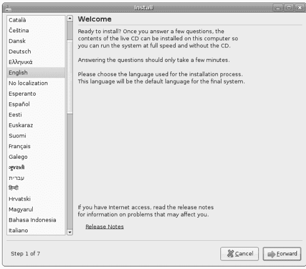
图2-2：安装向导的起始界面
- **3. 欢迎（选择语言）** 选择你在安装过程中和安装后想使用的语言，然后单击**前进**按钮。无论你选择什么语言，系统安装完成后，你始终可以选择用英语启动。你也可以在之后添加其他语言支持。
- **4. 你在哪里？（选择位置）** Ubuntu安装程序会为你选择的语言选择默认安装位置。如果你的位置不同，请直接在向导地图上单击选择合适的位置（图2-3）。选择完成后，单击**前进**。
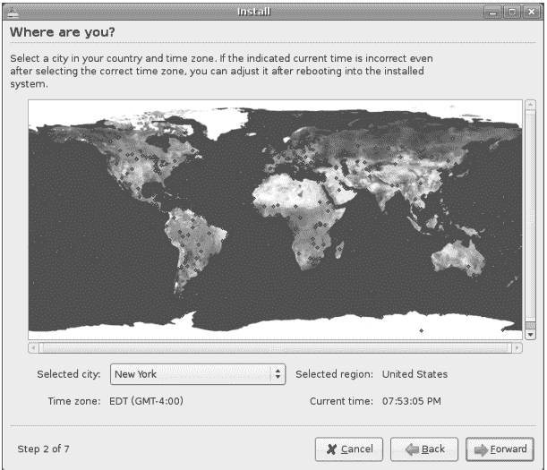
图2-3：在Ubuntu安装向导中选择你的地理位置
- **5. 键盘布局** 安装向导的下一个屏幕会显示为你选择的语言设置的默认键盘布局。如果你的键盘布局不同，请从列表中选择合适的选项。如果你不确定选择是否正确，可以通过在窗口底部的文本框中输入几个单词来再次检查。完成后，单击**前进**。如果需要，你可以在系统安装后添加其他键盘布局。
- **6. 准备磁盘空间** 这一步的操作取决于你机器上的现有内容。假设你的磁盘上已经有操作系统（比如Windows），请接受最上方的选项（默认选中）。这将把你的Windows（或其他操作系统）安装分区缩小到磁盘容量的一半左右，然后用产生的空闲空间安装Ubuntu。如果你愿意，可以使用窗口中间的滑块调整两个分区的大小（图2-4）。如果你的硬盘上没有操作系统，或者你打算删除当前系统并用Ubuntu替换，你应该选择第二个选项**引导式 – 使用整个磁盘**，然后如果出现选择提示，请选择你想要安装系统的主驱动器。选择完成后，单击**前进**。
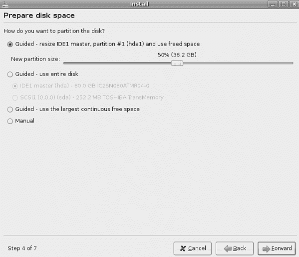
图2-4：分区你的硬盘（或不分区）
- **7. 迁移文档和设置** 如果你的机器上已经安装了其他操作系统，安装程序会扫描你的硬盘，尝试查找可以迁移到新Ubuntu系统的设置、文件夹和文档。只需勾选你想要迁移的项目旁边的复选框（假设迁移系统找到了内容——截至本文写作时它仍然存在一些错误），然后单击**前进**。
- **8. 你是谁？** 在安装向导的下一页，你需要提供你的真实姓名、登录名和密码。向导会根据你的用户名自动生成计算机名称（在我的例子中是rg-laptop），但你可以随意更改为其他名称（我将其更改为UbuntuAcer-RG）。填写完所有字段后（如图2-5所示），单击**前进**。
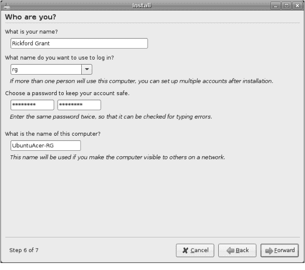
图2-5：在安装向导中提供你的用户名、密码和计算机名
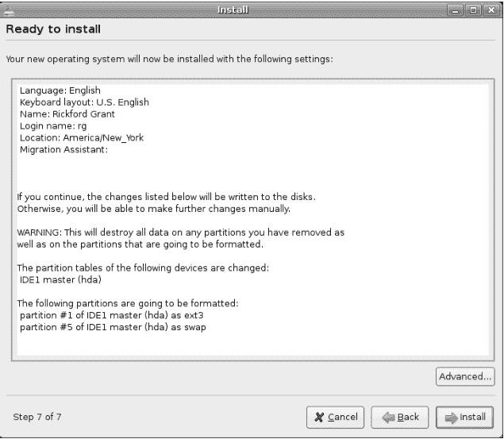
图2-6：准备安装——向导的最后一页
- **9. 准备安装** 向导的最后一页（图2-6）列出了即将安装的系统详情和硬盘分区设置，以及一个“不归点”警告。你已经走了这么远，所以不妨继续，尽管已经无法回头。单击**安装**。

分区程序会执行必要的磁盘写入操作以完成分区过程，之后安装将无缝开始，不需要你或任何其他人提供额外输入。安装进度会在一个窗口中显示（如图2-7所示），这样你就不用焦虑了（也能知道你还剩多少时间可以在电视前放松）。
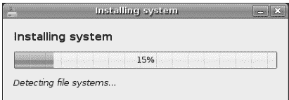
图2-7：跟踪安装进度

- **10. 安装完成** 如图2-8所示，你已经完成了安装的第一阶段。你可以选择继续使用实时光盘，或者重启机器直接从硬盘运行Ubuntu。你经历了这么多步骤，不是为了继续用实时光盘的，所以让我们选择第二个选项：单击**立即重启**按钮，在光盘自动弹出时将其从驱动器中取出，然后在屏幕提示时按ENTER键。你的机器将重新启动。
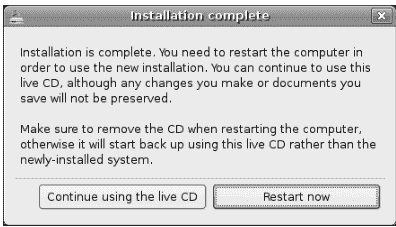
图2-8：跳入前的最终警告

之后……基本上就这些了。现在你的机器上已经安装了Ubuntu。恭喜。片刻之后，你会看到登录屏幕，所以要了解接下来该做什么，请继续阅读下一章。我们那里见。再会。


## 3 新的家园
### *认识桌面*

现在Ubuntu已经安装完成并正常运行，你已经迫不及待想要开始使用了。如果你是从硬盘启动Ubuntu，每次开机时首先会出现登录界面（图3-1）。没必要让登录界面等太久，输入你的用户名后按ENTER键。随后同一界面会提示你输入用户密码，输入后再次按ENTER键。短短几秒后，你就能看到Ubuntu的桌面了。
图3-1：Ubuntu登录界面
### 欢迎使用GNOME桌面
Ubuntu的GNOME桌面实现方式如图3-2所示，你会发现除了屏幕顶部和底部都有任务栏，也就是*面板*之外，它和你之前用过的Windows或Mac OS 9环境并没有太大区别。除非你是从桌面CD运行Live会话，否则桌面上不会有任何图标，这种情况下你会看到两个图标：一个是用于运行安装向导的启动器（标注为“安装”），一个是包含多个示例文件的文件夹（标注为“示例”）。这些示例文件中包含一段纳尔逊·曼德拉谈论“ubuntu”含义的视频片段，此处指的是这个概念，而非这个发行版。总的来说，这是一个非常整洁的界面，尽管它和其他操作系统的桌面环境表面上有相似之处，GNOME中的诸多设计还是别有新意。GNOME桌面的主要元素是屏幕顶部和底部的面板，以及显示在这些面板上的图标。桌面本身虽然在启动时是空的，但后续会展示很多内容，这部分我稍后再讲。现在我们先重点讲解这两个面板。
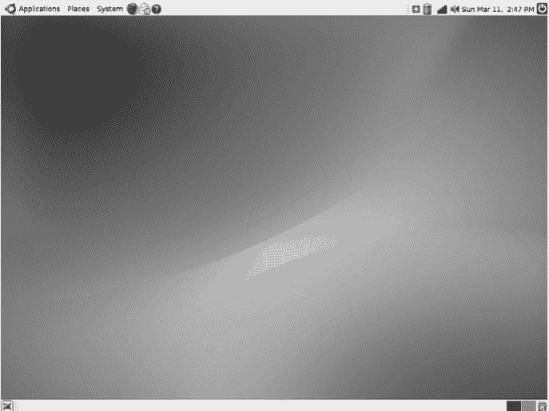
图3-2：Ubuntu中的GNOME桌面
### 顶部面板
桌面上的两个GNOME面板中，顶部面板是核心操作区域。如图3-3所示，面板左端有三个菜单和两个图标，右端则有一些图标以及一个时钟/日历组件。为了让你了解每个面板项的功能，现在我将按照当下的惯例，从左到右依次介绍它们。

图3-3：GNOME顶部面板的左右两侧
### 菜单
顶部面板最左侧是一组共三个菜单，你可以通过这些菜单访问系统中的绝大多数应用、位置和工具，具体如下：
- **应用程序菜单**
  这是绝大多数应用程序、软件管理器以及部分系统工具的入口。
- **位置菜单**
  这是系统导航器，你可以用它隐藏所有打开的窗口以显示桌面、访问个人文件夹、浏览电脑文件系统和已连接的网络，还可以搜索硬盘中的文件。
- **系统菜单**
  这是系统偏好设置、软件安装器和管理工具的入口，当你想要关机或注销系统时也需要进入这个菜单。
### 左侧图标
三个菜单右侧紧邻着一组两个启动器，点击这些图标可以启动以下应用：
- **Firefox**：你的网页浏览器
- **Evolution Mail**：非常受欢迎的Linux邮件程序，同时兼具日程安排和任务管理功能
- **帮助**：可以访问安装在硬盘上的Ubuntu帮助文档
### 右侧图标
顶部面板右侧有一系列功能各异的图标，其中一部分是指示器，另一部分是可以实现特定功能的小程序，具体如下：
- **更新通知工具**：当系统或应用程序有可用更新时会发出提示，你可以通过它下载并安装更新，仅在存在可用更新时显示。
- **网络管理器小程序**：可以查看网络状态并配置网络设备，使用无线网络连接时会显示无线信号强度，还支持轻松切换不同的无线网络。
- **电池**：在电池充电或放电时显示当前电量，仅在笔记本上显示。
- **音量控制**：音量调节器，顾名思义。
- **日历/时钟**：显示日期和时间，就是你预想的那样。
- **退出**：点击后会跳转到注销界面，你可以在此注销、关机、重启或切换用户。
### 底部面板
如图3-4所示，底部面板要简单得多，仅包含四个项目，我将简要介绍如下。
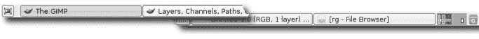
*图3-4：GNOME底部面板*
- **显示桌面**：点击该按钮会最小化所有打开的窗口，让你能看到被遮挡的桌面。
- **窗口列表**：显示你打开的所有窗口或应用程序，和Windows任务栏的功能非常相似。
- **工作区切换器**：可以在多个虚拟桌面之间切换，（关于虚拟桌面的更多内容将在第44页的“虚拟桌面”部分讲解）
- **回收站**：回收站并没有什么神秘功能……除了它被放在面板上的位置和Mac OS X非常相似。
## **项目3A：自定义GNOME面板**
GNOME面板不是静态的，你可以添加*启动器*（Windows和Mac用户称之为*程序快捷方式*或*别名*）、工具，甚至娱乐组件，让它实现你想要的几乎所有功能——当然，是在合理范围内的。在本项目的各个阶段，你将对面板进行自定义，从而获得实际操作经验，方便后续阅读本书时使用。当然，你可以随意更改我要求你做的自定义设置（不过如果你是从桌面CD运行的Live会话中操作，就无法保存设置了，所以这种情况下没有调整的余地）。以下每个子项目都非常简单，大多数都是仅需三步的点击操作，你完全可以轻松完成。
##### **3A-1：向面板添加工具按钮**
GNOME面板支持添加多种工具小程序，每个小程序都有特定功能，比如追踪股票行情、显示天气，或是执行某些特定的系统相关功能。我们先从顶部面板添加一个实用性很强的小工具开始：强制退出按钮。这个按钮可以让你快速轻松地处理无响应的窗口。没错，这种情况偶尔确实会发生：窗口突然卡住没有任何反应，不管你想让它做什么，或者它本该执行什么操作，它就那么一动不动地待着，像是在罢工（说不定它真的在罢工）。只需点击一次强制退出按钮，你的光标就会变成精准的“手术刀”，直接关闭你点击的那个无响应窗口。你肯定不想缺少这个按钮，下面就教你如何把它添加到面板上：
1. 在顶部面板的空白处点击鼠标右键。
2. 在弹出的菜单中选择**添加到面板**，随后会打开“添加到面板”窗口。
3. 在该窗口中单击一次**强制退出**选项将其选中（如图3-5所示），然后点击**添加**按钮，最后点击**关闭**按钮就完成了操作。
为了巩固你刚才学到的操作，我们再来给面板添加另一个工具：“运行应用程序”面板小程序。一旦你在Ubuntu上安装应用，就会发现部分应用不会自动在“应用程序”菜单中安装启动器，这就意味着每次要运行这类程序时，你都得打开终端窗口输入命令，非常麻烦。“运行应用程序”面板小程序就是解决这个问题的好方法。


 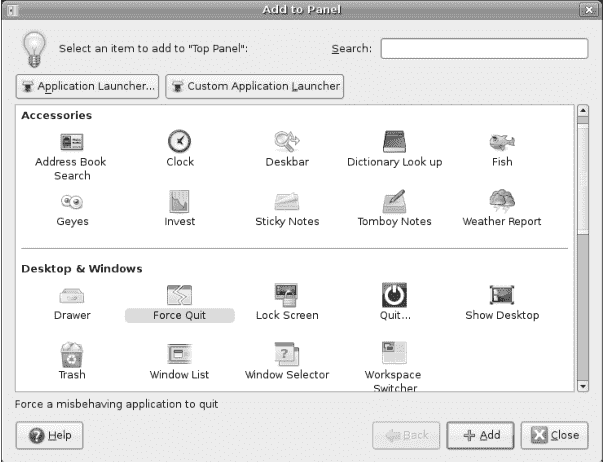
图3-5：向GNOME面板添加启动器和实用小程序
要添加「运行应用程序」小程序到面板，只需遵循添加「强制退出」按钮的相同步骤即可；不过这次在第三步，需要在「添加启动器」窗口中选中**运行应用程序**，而非「强制退出」。
> **注意** 如果你之后不想把「运行应用程序」面板小程序留在面板上，或者更习惯用键盘快捷键而非鼠标点选，那么你也可以通过按下ALT-F2来调出该小程序。

##### 3A-2：向面板添加趣味小程序
GNOME面板不仅允许你添加功能齐全的实用工具，也支持添加看似无用的趣味组件。在本项目这部分中，我们将添加两个这样的趣味组件：Geyes和一条名叫Wanda的小鱼。
乍一看，Wanda不过是甩甩尾巴、吐几个泡泡而已。但如果你点击它，会弹出一个窗口，Wanda会在里面输出名言和冷幽默单句。
想要一睹Wanda的「英姿」（虽然它也没太多动作），操作步骤和第35页的项目3A-1几乎一致，我再带大家过一遍：
- 1. 右键点击顶部面板的任意空白区域。
- 2. 在弹出的菜单中选中**添加到面板**，之后会弹出「添加到面板」窗口。
- 3. 在该窗口中，单击一次**鱼**以选中它，再单击**添加**按钮，最后单击**关闭**。

现在Wanda会出现在你的面板上，点击它看看它会说些什么吧。
现在你可以添加Geyes了，它是一对会在桌面移动时跟随鼠标指针游动的「眼睛」。操作步骤和之前一致，只需在第三步中点击**Geyes**，而非「鱼」即可。

##### 3A-3：向面板添加程序启动器
现在我们来点更实用的内容——向面板添加程序启动器。虽然通过应用程序菜单运行程序非常方便，但难免有一些你频繁使用的程序，你希望能快速访问它们，OpenOffice.org Writer大概就是其中之一。
###### 方法1
向面板添加启动器有很多种方式，我们先从最常规的讲起。要添加OpenOffice.org Writer的面板启动器，请按以下步骤操作：
- 1. 右键点击顶部面板的任意空白区域。
- 2. 在弹出菜单中选中**添加到面板**，调出「添加到面板」窗口。
- 3. 在该窗口中，单击**应用程序启动器**按钮。
- 4. 此时会跳转到新界面，显示应用程序菜单的内容（见图3-6）。单击**办公**旁边的小箭头展开该菜单，向下滚动找到**OpenOffice.org文字处理程序**并单击选中它。
- 5. 单击**添加**按钮，再单击**关闭**按钮完成操作。

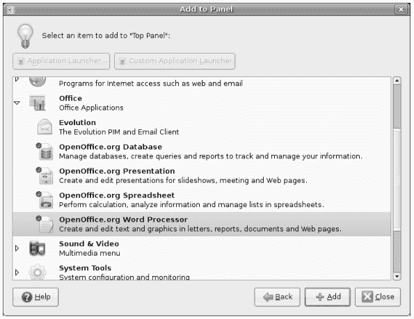
**图3-6：** 向GNOME面板添加应用程序启动器

###### 方法2
还有一种添加面板程序启动器的方法，实际上还要更快一些。我们以添加OpenOffice.org电子表格程序Calc的启动器为例，步骤如下：
- 1. 打开「应用程序」菜单，找到（但不单击）**办公 ▸ OpenOffice.org电子表格**。
- 2. 将指针移到**OpenOffice.org电子表格**上方，单击右键。
- 3. 在随后弹出的菜单中，选中（这次用常规的左键单击）**将此启动器添加到面板**（见图3-7）。此时Calc启动器就会出现在面板上。

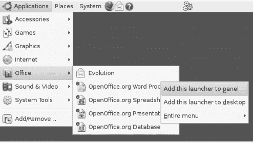
> 图3-7：添加应用程序启动器的另一种方法

###### 方法3
既然你已经学会了两种添加面板应用程序启动器的方法，我干脆再告诉你第三种更简便的方式：只需打开菜单，选中要添加到面板的项目，然后把它拖过去就行。这已经是最简单的方法了吧，嗯？

##### 3A-4：修改面板启动器图标
现在你已经把两个新的程序启动器添加到面板上了，可能会觉得很难区分它们。幸运的是，你可以非常轻松地修改任意启动器的图标。接下来我们就用这两个OpenOffice.org启动器举例，教你如何操作，步骤如下：
- 1. 右键点击你添加的第一个程序启动器（Writer），在弹出的菜单中选中**属性**。
- 2. 在「启动器属性」窗口中，单击**OpenOffice.org文字处理程序**图标，会弹出「浏览图标」窗口。
- 3. 在该窗口中，单击**浏览**按钮，调出浏览窗口。
- 4. 点击该窗口顶部的**图标**按钮。在右侧面板中，双击**hicolor**文件夹，再双击其中的**48x48**文件夹，最后双击48x48文件夹内的**apps**文件夹。
- 5. 完成上述所有文件夹点击操作后，单击**打开**按钮。
- 6. 此时你会回到「浏览图标」窗口，里面会显示另一组图标。在该窗口中向下滚动，找到**openofficeorg22-writer.png**并单击一次（见图3-8）。

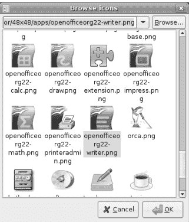
*图3-8：选择新的面板启动器图标*

- 7. 单击该窗口中的**确定**按钮，关闭该窗口。
- 8. 此时你会回到「启动器属性」窗口，窗口界面应该和图3-9一致，如果是的话，单击**关闭**。

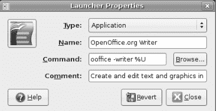
*图3-9：「启动器属性」窗口*

完成Writer启动器的图标修改后，Calc启动器的操作步骤基本一致，只是在第三步中要选择**openofficeorg22-calc.png**作为图标即可。

##### 3A-5：向面板添加抽屉
我非常喜欢GNOME面板的一个功能就是抽屉。*抽屉*是一个小型下拉面板，非常适合放置那些因空间限制不想放在GNOME面板上的启动器。这里也适合放置那些通常需要在终端窗口输入命令、或通过「运行应用程序」窗口启动的程序的启动器，比如你自己编译源码得到的程序、或是通过脚本运行的程序，相关内容你会在第9章学到。当然，你也可以把任何想要的东西放在这里，包括常用文件。
向面板添加抽屉非常简单，操作步骤和添加「强制退出」按钮基本一致，你只需按以下步骤操作即可：
- 1. 右键点击顶部面板的任意空白区域。
- 2. 在弹出菜单中选中**添加到面板**，之后会弹出「添加到面板」窗口。
- 3. 在该窗口中，单击一次**抽屉**以选中它，再单击**添加**按钮。最后字面意义上的单击**关闭**按钮，关闭窗口。

##### 3A-6：向抽屉添加程序启动器
你刚添加的抽屉目前自然是空的，我们来给它添加三个实用但不算酷炫的系统工具的启动器，物尽其用。这三个工具分别是：系统监视器，它可以查看电脑正在运行的应用和进程、内存与CPU占用率、存储设备使用情况；终端，你可以在里面输入和执行命令（我承认这有点极客范，但非常实用）；以及新立得软件包管理器，你可以用它下载和安装应用程序。
操作步骤如下：
- 1. 右键点击面板上的**抽屉**小程序，在弹出的菜单中选中**添加到抽屉**。
- 2. 在随后弹出的「添加到抽屉」窗口（其外观和操作逻辑和「添加到面板」窗口完全一致）中，单击**应用程序启动器**按钮。
- 3. 在下一界面中，单击「管理」旁边的小箭头，向下滚动找到**新立得软件包管理器**并单击选中，再单击**添加**。此时新立得软件包管理器的启动器就会加载到抽屉中。
- 4. 向下滚动一点，找到**系统监视器**并单击，再单击**添加**，添加系统监视器的启动器。
- 5. 向上滚动回到「附件」分类，单击其旁边的小箭头。
- 6. 向下滚动找到**终端**，单击它，再单击**添加**按钮。现在你可以关闭「添加到抽屉」窗口了。三个启动器现在已经加载到抽屉中，点击抽屉就能看到它们。你的界面应该和我的一样，如图3-10所示。


##### 3A-7：将整个菜单内容添加到面板
如果你经常使用应用程序菜单中某个特定子菜单里的应用，你可能希望将整个子菜单添加到面板。有两种方法可以实现：你可以将子菜单添加为普通菜单，也可以将它添加为抽屉。
1. 要添加游戏菜单到面板，请依次进入**应用程序 ▸ 游戏**，然后右键点击该子菜单中的任意启动器。
2. 在弹出的菜单中，选择**整个菜单 ▸ 将此添加为面板菜单**。
3. 要将音视频子菜单作为抽屉添加到面板，请依次进入**应用程序 ▸ 音视频**，然后右键点击其中的任意启动器。
4. 在弹出的菜单中，选择**整个菜单 ▸ 将此添加为面板抽屉**。

此时你的面板上应该会出现两个新的启动器，它们的图标与应用程序菜单中对应项目的图标一致。点击面板上的这两个新条目，查看它们的功能。

##### 3A-8：调整面板上的项目位置
现在我们已经把所有要添加到面板的项目都加好了。目前面板看起来可能有点杂乱，不如我们移动一下这些项目整理一下吧。我们会尽量按照功能主题对项目进行分组，让它们更容易管理。幸运的是，移动面板上的启动器非常简单：右键点击目标启动器，在弹出的菜单中选择“移动”，然后将启动器拖到你想要放置的位置即可。当启动器位于你想要的位置后，点击它一次，它就会留在那里。

为了熟悉移动操作，我们来调整你之前添加的启动器、菜单和抽屉的顺序，从左到右依次为：应用程序、位置、系统、Firefox、邮件、OpenOffice.org Writer、OpenOffice.org Calc、音视频、游戏、抽屉。将剩余的启动器放在面板最右侧，更新通知工具的左边，从左到右依次为：Geyes、Wanda、强制退出。最后，将运行应用程序面板小程序单独放在两组启动器的中间位置。

完成所有调整后，你的面板应该会和我图3-11中的面板非常相似。

##### 更多面板玩法
除了第35页项目3A中的基础自定义操作外，你还可以进行更多操作来更改面板的外观和交互体验。当然，你可以右键点击任意启动器、抽屉或菜单，在弹出的菜单中选择**从面板移除**来删除它们，但还有更多选项可供使用。大部分选项都可以通过右键点击面板的空白区域，然后选择**属性**调出，这会打开面板属性窗口。在这个窗口中，你可以更改面板的位置、调整大小、修改颜色或者将其设置为透明——非常酷炫。你还可以设置面板在闲置时自动隐藏，当你把鼠标光标移回面板所在的区域时，面板会自动重新显示。大胆尝试就好——这本身就是一半的乐趣！

#### 项目3B：操作菜单
现在你已经了解了针对面板可以进行的很多实用操作，接下来我们开始学习菜单相关的操作。GNOME有一个非常实用的功能，就是允许你编辑系统菜单。你可以添加启动器、删除项目、移动项目，甚至可以更改菜单中的图标。总的来说，你可以对菜单进行很多自定义操作，但在这个项目中，我们仅涉及其中两个方向：更改图标和移动菜单项。

##### 3B-1：更改菜单内的图标
想必你还记得，我们之前添加到面板的OpenOffice.org Writer和Calc启动器有一个问题：它们的图标非常相似。如果你进入**应用程序 ▸ 办公**，就会发现各个OpenOffice.org模块的图标虽然不同，但风格比较接近。也可以说这些图标有点过时，这可能会和你我的审美产生冲突。要解决这个问题，只需按照以下步骤操作即可：
1. 右键点击**应用程序**菜单，选择**编辑菜单**。
2. 在弹出的菜单编辑器窗口中，点击左侧面板的**办公**，该菜单的内容就会显示在右侧面板中。
3. 在窗口的右侧面板中，右键点击**OpenOffice.org 文字处理**，在弹出的菜单中选择**属性**，随后会弹出启动器属性窗口。
4. 在该窗口中点击**图标**按钮。按照第38页项目3A-4中介绍的方法，在随后弹出的“浏览图标”窗口中导航到/usr/share/icons/hicolor/48x48/apps目录。
5. 为了方便之后为其他OpenOffice.org模块添加图标，你可以将“浏览图标”窗口顶部的**应用**按钮拖到该窗口的左侧面板中（见图3-12）。之后你就可以通过双击左侧面板中的这个图标，直接导航到该文件夹。
> 图3-12：将文件夹添加到你的位置列表
6. 向下滚动找到openoffice.org22-writer.png文件并点击，然后点击**打开**。
7. 新图标现在应该会出现在启动器属性窗口中。如果确实显示正常，点击**关闭**，你就可以在菜单编辑器窗口中看到更改效果。
8. 对其他OpenOffice.org图标重复上述操作，确保为每个OpenOffice.org模块选择对应的图标（例如公式模块选择openoffice.org2-math）。完成后，保持菜单编辑器窗口打开，继续完成项目3B-2的操作。

> **注意** OpenOffice.org 从模板创建没有替代图标，*因此你可以跳过该项目。*

##### 3B-2：更改菜单内的图标顺序
现在我们还在办公菜单的编辑界面中，来处理另一个我认为存在的问题：菜单项目的顺序。虽然邮件客户端Evolution排在菜单顶部是合理的，但公认的最常用的OpenOffice.org模块Writer却排在菜单最底部，这显然不太合理。解决这个问题非常简单：只需点击菜单编辑器窗口右侧面板中的**OpenOffice.org 文字处理**图标，然后多次点击窗口右侧的上箭头，直到Writer图标移动到OpenOffice.org Base图标的正上方即可。完成后，你的菜单编辑器窗口应该会和我图3-13中的窗口非常相似。
> 图3-13：使用菜单编辑器管理菜单

### 虚拟桌面
现在我们来讨论Linux非常独特且实用的功能：*虚拟桌面*。与其听我一直唠叨虚拟桌面的相关概念，不如亲自尝试来得直观。在GNOME面板上，点击**Wanda、OpenOffice.org Writer**和**Firefox**的启动器，这样你当前的桌面（也就是工作区）上就会打开三个窗口。现在看底部面板右侧的工作区切换器，应该会有四个方框，最左边的棕色方框代表你当前使用的工作区。点击其他灰色方框中的任意一个，你所有打开的窗口就会突然消失。实际上这些窗口并没有真正消失，只是你已经切换到了新的桌面，之前的窗口仍然在原来的工作区中运行。在这个新桌面上，你可以打开其他程序：进入**应用程序**菜单，选择**游戏 ▸ AisleRiot Solitaire**，纸牌游戏AisleRiot Solitaire很快就会启动。这时你就已经在两个不同的桌面上打开了窗口，可以在两者之间自由切换。具体操作是：点击面板上的工作区切换器里的第一个灰色方框，就可以回到你最初的工作区。完成后，你之前所在工作区的方框会变成灰色，再次点击该方框就能回到游戏桌面。

你可以想象，除了避免桌面杂乱之外，这个功能还有很多潜在的好处。试想一下，你在办公室用OpenOffice.org Writer写一篇长文档，写着写着累了，就想玩会儿扫雷之类的游戏放松一下。这时你可以切换到另一个桌面，打开并玩游戏。过了一会儿，你发现老板在办公室里巡视，只要切回第一个桌面，就能在老板走过来问“没闲着吧，Boaz？”的时候，假装自己一直很忙。**呼！**

另外，你也可以通过同时按住CTRL-ALT键，然后按左右光标键来切换到目标虚拟桌面。

## 在虚拟桌面之间移动正在运行的应用
假设你在一个工作区运行着OpenOffice.org Writer，在另一个工作区运行着GIMP，突然想让这两个应用在同一个工作区里运行，该怎么办呢？你难道要关闭GIMP，然后到另一个桌面重新打开它吗？幸运的是，操作比这简单得多，其实有两种方法可以实现。

第一种方法是右键点击你想要移动的窗口的标题栏，然后选择“移到左侧工作区”或“移到右侧工作区”。我觉得选择“移到其他工作区”更直观，之后可以通过编号选择要移动到的目标工作区：工作区1、工作区2，以此类推。

另一种移动窗口的方法是使用底部面板上的工作区切换器。工作区切换器有四个方框，分别代表不同的工作区，每个工作区中打开的窗口都会以微小的图标形式显示在对应的方框里。如图3-14所示，这些图标甚至会和你实际窗口的形状一致。你可以用这些图标通过简单的拖放操作，将窗口从一个工作区移动到另一个工作区。


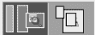
**图3-14：** 工作区切换器会显示每个工作区中已打开窗口的图标。例如，假设你想将Firefox从工作区2移动到工作区1，只需点击工作区切换器第二个方框中的小图标，将其拖到第一个方框即可，之后该图标就会出现在此处，因为Firefox窗口本身已经移动到了该位置。最后，如果你更习惯使用键盘而非鼠标操作，也可以通过快捷键在工作区间移动窗口：将你想要移动的窗口设置为活动状态（即放在最上层），按住SHIFT-CTRL-ALT，再使用左右方向键即可将窗口移动到目标桌面。
``` if (condVar > someVal) {console.log("xxx")} ```
### 再访旺达——GNOME彩蛋
好了，我们已经完成了本章的学习内容，现在可以放松一下， revisit 我们早熟的双鱼座伙伴旺达了。虽然你现在已经了解了旺达这条鱼的来龙去脉，可能会觉得我再次提起她有点奇怪，但旺达的鳍下还藏着几个小把戏。事实上，她是介绍GNOME两个最著名彩蛋的绝佳载体。顺便一提，如果你不知道彩蛋是什么，它们是程序员喜欢偷偷嵌在程序中的隐藏代码片段。通常都是没什么实际用处的玩意儿，但所有操作系统、大量应用程序甚至DVD里都能找到它们（想了解更多相关内容，可以访问www.dvdeastereggs.com）。我第一台Mac上的彩蛋体验就是个很好的例子：那是一台古老的Mac SE，仅配备2MB内存。在这台机器上，你可以通过按下机器侧面很少用到的调试键，再输入`6 41D89A`，调出Mac SE开发团队的图像（或者是幻灯片？）。我觉得挺酷的，但如果不是我在杂志上看到过相关内容，我永远不可能偶然发现它。正如这个例子所示，访问这些彩蛋通常需要一些非常规操作，你在日常正常使用中绝对不会进行这类操作。要看一个和旺达相关的彩蛋效果，点击你刚添加到面板的**运行应用程序**按钮，在命令框中输入`gegls from outer space`，然后点击**运行**。你会看到一款画风奇特的*太空侵略者*类小游戏，如*图3-15*所示，旺达会在游戏中保卫我们心爱的星球……对抗的也就是所谓的gegls吧。要试另一个和旺达相关的彩蛋，再次打开**运行应用程序**面板小程序，这次输入`free the fish`，然后点击**运行**。旺达就会出现在你的桌面上四处游动。如果你直接点击她，她会游走并离开画面……但她很快还会回来。
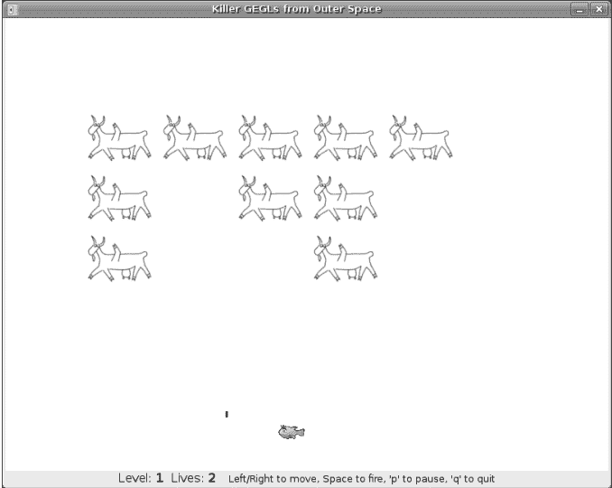
**图3-15：** GNOME的旺达相关彩蛋之一
要让旺达不再来回出现，你需要重启GNOME面板。有几种相当不优雅的方法可以实现这一操作，但目前我们采用最简单的方式：再次打开运行应用程序面板小程序，输入`killall gnome-panel`，然后点击**运行**。你的面板会消失一两秒，但很快会重新出现，而旺达就会消失了。
### 关机
现在你已经非常熟悉你的桌面环境了，可能想要结束今天的工作，关闭电脑。要做到这一点，只需打开**系统**菜单，选择**注销**。你的屏幕会变暗，随后会出现一个小窗口（图3-16），里面有七个选项供你选择：**注销、锁定屏幕、切换用户、挂起、休眠、重启、关机**（从桌面CD运行实时会话时，休眠选项不可用）。点击**关机**，关机流程就会启动。不过，如果你点击**确定**几秒后没有任何反应，就同时按下`CTRL-ALT-BACKSPACE`，这会带你回到本章开头看到的登录屏幕（图3-1）。进入该屏幕后，点击屏幕底部的**关机**选项。这会弹出一个小窗口，询问你是否确定要关机。只需点击**确定**，关机流程就会启动。
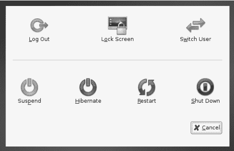
图3-16：GNOME的注销窗口
实际的关机过程会持续几秒，因为系统需要关闭各项服务。全部完成后，系统应该会自动关闭你的电脑，到这里整个操作就完成了。不过部分电脑上，系统无法自动关机。如果你的设备属于这种情况，你会看到所有屏幕活动都停止了。如果你到了这一步，等待15秒左右仍无其他反应，就可以手动按下电源按钮关闭电脑。此时这样做是完全安全的。

## 4 不止是网 *Linux风格的互联网*
如今，普通家庭电脑用户花在浏览网页和撰写电子邮件上的时间，比做其他任何事情都多。就算你不怎么上网，也有很多并非严格意义上的互联网应用，但依然会以某种方式用到互联网，比如你在将音频CD翻录成MP3文件时，用来获取歌曲和专辑信息的应用。一台没有接入互联网的电脑，就像买了一辆全新的玛莎拉蒂却拒绝把它开出车库一样。当然，你如何连接互联网取决于你的硬件和运营商。这方面的选择有很多，包括高速局域网（LAN）、有线电视调制解调器，以及电信公司提供的ADSL连接。大多数电脑还内置了56Kb/s调制解调器，或者可以连接外置拨号调制解调器，通过普通电话线实现速度更慢的连接。根据你现有的设备，设置系统时，局域网连接以及任何使用你以太网端口的连接（比如有线电视调制解调器）会非常简单，无线连接可能稍微麻烦一点，而老式拨号连接有时候会有点挑战性。在本章中，你将学习如何设置这些连接，还会了解Linux在常用互联网应用——网页浏览器和电子邮件客户端方面的能力。
### 设置高速连接
如果你从有线电视公司那里获得了高速互联网连接，或者你在办公室通过局域网接入互联网，那你真的很幸运，因为这些设置可能是最容易处理的。很可能你只需要将从墙内接口（如果你使用局域网）或有线电视调制解调器引出的以太网线，插到你电脑的网卡端口上即可。如果你使用无线路由器，那么以太网线需要插到无线路由器的广域网（WAN）端口。之后，只要启动你的电脑，就可以直接使用，不需要再做其他设置。如果你想确认是否连接成功，可以打开Firefox（点击顶部菜单中系统菜单旁边的Firefox启动器），等它启动后，尝试访问一个常用网站，比如www.yahoo.com。如果网站能正常打开，就说明一切就绪。如果你上网遇到问题，正在尝试通过局域网或有线电视调制解调器连接互联网，那很有可能是因为你的网卡不被Linux支持。这种情况相对罕见，但幸运的是很容易解决，只要更换一块网卡即可。问题也可能是你的网络或服务提供商没有通过动态主机配置协议（DHCP）自动分配地址。*DHCP*是一种让你的互联网提供商能够自动（动态）向你的系统提供连接互联网所需的配置信息的方式。如果你的提供商没有使用DHCP，你就需要向网络管理员或服务提供商获取必要的设置信息，然后手动输入这些设置。
## 为未使用DHCP的运营商设置有线或以太网连接
要手动输入有线或以太网设置，首先从网络管理员或互联网提供商处获取你需要的设置信息，然后按照以下步骤操作：
- 1. 打开**系统**菜单，选择**管理** ▸ **网络**。
- 2. 此时会提示你输入密码，输入你的用户密码，然后点击**继续**。
- 3. 网络设置窗口（如图4-1所示）很快会出现，出现后，单击一次选中**有线连接**（确保左侧的复选框已勾选）。完成后，点击**属性**按钮。
- 4. 在出现的设置窗口中，将配置选项从“自动配置（DHCP）”改为**静态IP地址**。


*图4-1：网络设置窗口*
5. *图4-2*中显示的三个文本框将变为可输入状态，你可以输入网络运营商或网络管理员提供给你的信息。输入设置完成后，点击**确定**按钮。
| | 静态IP地址 |
| --- | --- |
| **IP地址:** | |
| **子网掩码:** | |
| **网关地址:** | |
*图4-2：手动输入网络IP设置*
6. 系统随后会使用你输入的设置尝试连接互联网，连接进度会在网络管理器小程序中显示，看起来……嗯，是蓝色的，还有点太空感。连接建立后，小程序正下方会弹出提示信息告知你连接成功。之后你就可以关闭网络设置窗口，随心所欲上网了。
> **说明** 如果你不知道互联网协议（IP）和域名服务（DNS）是什么，可以这么简单理解：DNS会将你熟悉的好记的网址（比如www.yahoo.com）转换成互联网能识别的数字格式IP地址。如此一来，网址http://www.yahoo.com就会变成http://216.109.118.68，你也可以后续在浏览器中输入这个数字版地址自行验证。

### 设置无线连接
笔记本电脑让计算机变得更加实用。只要有合适的无线硬件，顾名思义，你几乎在任何能收到无线信号的地方都能上网。不管是在餐桌上、自家后院露台、大学图书馆，还是当地的星巴克、Port City Java或Dunkin' Donuts，你都可以无需用线缆连接计算机直接上网。幸运的是，在Ubuntu中设置无线网络的过程非常简单，和你在第50页读到的**《设置高速连接》**的流程几乎没有区别。事实上，正如我刚才提到的，所有设备很可能开箱即用。

### 硬件
如果你一直用的都是有线网络，或者对这个领域没什么经验，有些信息还是值得了解的。开始前你需要准备合适的硬件。如果只是想在户外用无线网络，那你只需要一张无线网卡（NIC）。这类网卡通常都内置在现代笔记本电脑中，其他设备一般则是以扩展卡的形式存在，插在电脑侧面的PCMCIA插槽里（如图4-3右侧所示）。
*图4-3：WiFi设置所需的所有设备——无线接入点和网卡*
不过也有一些网卡可以插在机器的USB接口上，台式机则可以使用PCI插槽的对应型号。尽管近几年这类网卡的支持度已经提升不少，但依然存在一些兼容缺口，部分设备处理起来会很麻烦。如果你追求稳妥，Centrino IPW-2100和IPW-2200网卡都可以在Ubuntu中正常使用。至于内置网卡或PC卡类型的网卡，支持度会好很多，但即便如此你还是要确认——或者至少希望——你用的网卡兼容Linux。不管你在考虑哪款网卡，最简便的验证方法就是直接试用。现在Linux内核已经内置了多款无线网卡驱动，Ubuntu的更新也会经常推送新的驱动，所以如果你用的网卡兼容这些驱动，整个过程就会非常顺利。如果还是无法使用，可以去Ubuntu论坛查找兼容的驱动，或者看看有没有人用过你这款网卡。如果你要在家里或办公室搭建无线网络，还需要一台无线接入点（WAP），如图4-3左侧所示。幸运的是，这类设备的Linux兼容性基本不是问题，因为接入点不需要和你的计算机进行物理连接。不过（对Linux用户来说）不幸的是，部分WAP要求你必须用Internet Explorer来完成设置。由于没有Linux版的Internet Explorer，除非你家里有其他Mac或Windows设备，否则你根本无法完成设置。更糟糕的是，部分设备根本不支持浏览器端设置，需要你安装专门的Windows软件才能完成配置。选择无线网络硬件时，显然最好避开这类WAP。

### 启用无线网卡
设置兼容Linux的无线PC卡其实相当简单。首先将WAP连接到你的互联网源，然后打开WAP电源。等WAP正常运行后，把无线网卡插入笔记本电脑的PCMCIA插槽——当然，如果你的网卡是内置的，可以跳过这一步。此时外置网卡上的指示灯基本都会亮起。如果你的电脑开机时WAP就已经打开，并且开机时无线网卡已经插好，那基本不需要额外操作就可以上网了。请按以下步骤操作：
- 点击网络管理器小程序，弹出下拉菜单，显示你周围存在的无线信号以及各信号的强度（见图4-4）。
- 在该菜单中，点击你的WAP对应的信号（或其他你有权限连接的其他无线信号）。
- 系统随后会尝试连接互联网，连接建立后，网络管理器小程序下方会弹出提示信息告知你连接成功。网络管理器小程序的图标会变成小的信号强度指示器，非常方便。

> **说明** 部分WAP会采用有线等效隐私（WEP）协议作为额外的安全层级，而更新的（也更安全的）是Wi-Fi保护访问（WPA）协议。如果你要连接的WAP要求输入这类密钥，会弹出窗口提示你输入。如果你不知道密钥，那你本来就不应该尝试连接这个网络哦，调皮~

**图4-4：** 网络管理器小程序会显示可用的无线网络及其信号强度

如果无线连接没有成功（系统会提示你连接失败），除了网卡不兼容这种恼人的情况外，还有几种可能。首先，检查你的网卡确实已经物理开启。我知道这听起来很傻，但我自己就多次犯过这种粗心的错误。另一种可能是你的网络没有启用DHCP，这种情况下你需要手动输入网络管理员或服务提供商提供给你的连接设置。准备好这些信息后，只需按照第50页《为未启用DHCP的服务商设置有线或以太网连接》中列出的步骤操作即可。注意在第3步要点击**无线连接**，而不是有线连接。

### 释放并更新无线连接
有些时候你会想要关闭无线网卡，比如在飞机上使用笔记本电脑的时候；或者只是想要清空网络设置中的IP地址（*释放*），并将其更新为新网络的IP地址（*更新*），比如你无需重启电脑，只是把笔记本电脑从一个无线热点移到另一个无线热点时就会需要这个操作。
最后一点对你来说可能有点难理解，我简单说明一下：开机时，你的无线网卡（NIC）会扫描周围的可用网络（WAP），找到可以连接的目标。连上网络后，它会通过DHCP从该网络获取IP地址，从而让你能够访问互联网。使用释放和更新功能，你可以在不重启电脑的情况下切换WAP，或者当你的设备因为某些原因无法自动完成切换时，可以用这个功能手动切换。
要执行快速简便的释放/更新操作，只需单击一次**网络管理器**小程序，即可显示可用无线网络（即信号）列表。在该列表中点击你当前连接的网络，一两秒后系统会提示你已断开连接。再过几秒，系统会提示你已重新连接到同一个网络。非常简单。


好的，如果你没有物理开关的话，该如何关闭无线网卡呢？只需右键点击**网络管理器**小程序，然后取消勾选**启用无线**即可，非常简单。哦对了，如果你想再次打开这张网卡，只需回到那个菜单，再次勾选**启用无线**就行。

### 设置拨号连接
尽管世界上大部分地区都在普及高速网络，但你们中的不少人可能仍在使用拨号上网，这意味着你需要配备一台传统的拨号调制解调器，才能让设备连接到外部网络。各位宽带冲浪大神想必已经忘了，调制解调器可是那种拨号接入互联网时会发出鸣响、叮当声、尖啸声，还会哔哔作响的神奇机器。我觉得你可以把它们想象成需要好好“打嗝”的吵杂电话机。
好消息是，设置拨号连接的过程很简单，和之前讲过的其他连接类型的设置流程差不多。现在说个坏消息——在Linux世界里，几乎所有内置调制解调器都不被支持。出现这个兼容性问题的核心原因是，大多数内置调制解调器都属于软调制解调器，依赖的软件是Windows系统自带或专门为Windows设计的，这类调制解调器也因此被称为*Winmodems*（Win调制解调器）。当然，Linux社区一直在想办法解决这些Winmodems“怪兽”，让它们能在Linux系统上正常工作。尽管目前市面上各类Winmodems的兼容性支持仍然比较参差不齐，但情况已经比之前好很多了，说不定你就能碰巧遇上能用的呢。我的建议是别瞎琢磨瞎担心，直接试试你的调制解调器能不能用就行。能用了那万事大吉，不能用的话你也有别的选择，至少不会对你的系统造成任何损害。
这些前言絮叨就先翻篇，咱们直接进入拨号连接的设置步骤。首先，从你的互联网服务提供商那里获取需要的设置信息。大部分服务商的服务都是针对Windows和Mac用户设计的，除了NeanderTech等少数厂商外，几乎没有提供Linux支持。但从技术层面来说，你的Linux系统用他们的设置完全没有问题，所以你就缠着他们、催他们，直到他们把你要的信息给你为止。之后，确保你的调制解调器连到了可用的电话线接口（比如墙上的电话插座），然后按以下步骤操作：
1. 点击**系统**菜单，选择**管理 ▸ 网络**。在弹出密码输入提示时输入你的密码，之后就会打开网络设置窗口。
2. 在该窗口中，选中**调制解调器连接**选项，然后点击**属性**按钮。
3. 当接口属性窗口弹出时，勾选*启用此连接*旁边的复选框。
4. 在该窗口的“互联网服务提供商数据”板块中，输入服务商提供的拨号连接电话号码，如果有需要的话，还要输入你当前电话系统的外拨前缀（比如有些办公室要求先拨9才能打外线）。
5. 在窗口的“账户数据”板块的输入框中，输入服务商给你的用户名和密码。
6. 点击窗口的**调制解调器**标签，然后在“拨号类型”板块中，根据你的电话服务对应的拨号方案选择**音频**或**脉冲**。现在大部分都是音频拨号，拿不准的话选这个就行。你可以通过拨号时的声音自己判断：如果你听到一系列不同的音调，像能听出来的旋律一样，那就是音频拨号。
7. 在该标签的“音量”板块中，根据你是否想听到调制解调器拨号的声音，选择**关闭**或**开启**。测试的时候建议选**开启**，这样你能知道拨号到底有没有正常进行。
8. 在同一标签页中，点击**自动检测**按钮。系统会自动扫描你的端口，查找可用的调制解调器。找到之后，就会在标注为*调制解调器端口*的输入框中指定正确的端口。如果没找到的话，对你这台调制解调器的可用性来说可不是个好兆头，但你还是可以自己选一个端口试试。先从`/dev/modem`开始试，如果走完步骤9和10之后还是不行，就一个接一个试其他端口，实在不行再考虑更极端的方案。
9. 找到调制解调器端口（或者你自己选了一个之后），点击**选项**标签，然后勾选*将调制解调器设置为默认互联网路由*旁边的复选框。设置完成后点击**确定**按钮。
10. 在网络设置窗口中，关闭窗口前记得勾选*调制解调器连接*旁边的复选框。完成所有步骤后，如果你的调制解调器和系统能完美兼容，你应该会听到调制解调器发出拨号、滋滋作响、转动的声响，和你的服务商建立连接。连接成功后，你就可以开始上网浏览、收发邮件，或者做任何你想在网上做的事。当你想要结束上网时，点击**停用**按钮就能断开连接了。

## 调制解调器不兼容时该怎么办
我刚才说的都是最理想的情况。但如果你的调制解调器和Ubuntu合不来怎么办？别担心，有几个办法可以解决。我最激进的首个建议是，把你有线电视套餐里那些多余的电影频道退掉（本来也没啥好看的不是吗），改成付费有线网络服务。如果这个方案行不通，那你还有两条路可以选。一个是你可以折腾一下你的调制解调器，看看能不能让它正常工作。这个过程稍微复杂一点，但教程在https://wiki.ubuntu.com/DialupModemHowto。如果你心理承受能力弱或者是新手，可能会觉得这个过程太麻烦，不想折腾。另一个更简单但成本更高的办法是换调制解调器，换成真正的硬件调制解调器。如果你不太熟悉*硬件调制解调器*这个说法的话，这类调制解调器不依赖软件，不管你用什么系统都能用。你可以把它们理解成没有听筒的电话机。这类调制解调器分为内置和外置两种。
内置款的话，USRobotics的56K V.92 Performance Pro Modem（内置插槽款）和56 PC Card Modem（PC卡插槽款，适合笔记本）都是容易买到的真·硬件调制解调器，据说都能用。你可以去USRobotics官网（www.usr.com）查看这些型号的更多信息，不过去Ubuntu论坛找找建议也是个不错的选择。

### 外置拨号调制解调器
所有方案里最稳妥的大概就是买一台外置串口调制解调器了。外置调制解调器放在电脑外部的盒子里，连接到电脑背面的串口，串口通常是唯一带小针脚的接口（见图4-5）。因为调制解调器不需要依赖你的操作系统来运行，工作时不会占用系统资源，说不定还能提升电脑的运行速度。
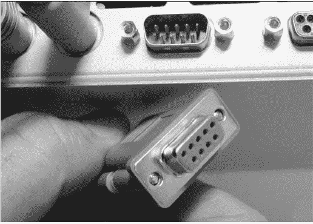
*图4-5：串口及连接器*
大部分外置串口调制解调器应该都能和你的系统兼容，至少大部分人是这么说的。如果你不放心，想要百分之百确定的话，Zoom Telephonics（www.zoom.com）生产的外置串口调制解调器兼容Linux，他们自己的官网上就明确写了这一点。USRobotics的56K V.92 External Faxmodem（外置传真调制解调器）据说也能用，不过我自己没试过这个型号。如果你找到其他你觉得能用的型号，在掏钱买之前，用这个调制解调器的品牌和型号加上“linux”这个词做一次雅虎或谷歌搜索，看看能搜出什么结果。当然，你也可以去Linux论坛问问这个品牌和型号的情况，有很多人和你有一样的困扰，你肯定能得到不少意见和建议。

### Firefox：你的网络浏览器
现在你已经连上网了，肯定想在网上冲浪、探索新内容，而最常用的工具就是网络浏览器。Ubuntu系统默认的浏览器是Firefox，它不仅在Linux领域越来越受欢迎，在Windows和Mac圈子的受众也在不断增加。你很可能已经是Firefox的用户了，如果不是也没关系——所有浏览器的操作逻辑都差不多，你不用担心。既然如此，你应该不用看教程就能用Firefox的基础功能。当然，Firefox也有一些和其他浏览器不一样的特色功能，我接下来会介绍。

### 用标签页整理杂乱的浏览器窗口
通常情况下，你在网页上点击链接时，新页面会在当前窗口打开。有些页面的链接被设置为在新窗口中打开，或者你也可以右键点击链接，选择“在新窗口中打开链接”选项来手动打开新窗口。这个功能本来很实用，但当你开了好几个浏览器窗口之后，要在所有打开的窗口里找你想看的内容就很麻烦了，还会拖慢系统速度。这时候Firefox的标签页功能就派上用场了。想知道它怎么用的话，现在就自己试试看吧。点击顶部GNOME面板上的启动器打开Firefox浏览器（或者进入**应用程序 ▸ 互联网 ▸ `Firefox` `Web` `Browser`**）；然后在浏览器窗口右上角“Go”按钮旁边的搜索框里搜索*nyckelharpa*这个词。默认情况下，Firefox会使用谷歌搜索你在搜索框里输入的关键词，你也可以点击搜索框里的G图标，选择其他搜索引擎，比如亚马逊、eBay、雅虎等等，甚至可以自行添加更多搜索引擎。不过现在我们还是用谷歌搜索，在搜索框里输入*nyckelharpa*，输入完成后按下**ENTER（回车）键**，谷歌搜索结果页就会出现在Firefox窗口的主区域里。

> **注意** 标签页浏览功能现在已经不像最初那样独树一帜了（Safari原生内置了该功能，不过需要手动开启；IE现在也能通过下载插件实现同样的功能），但Firefox默认就启用并内置了这一功能。


## 图4-6：从Firefox搜索框执行Google搜索
第一个搜索结果应该是美国尼克尔哈帕协会，现在你要在新标签页中打开该页面，而非在当前页或新窗口中打开。操作方法：右键点击链接，在弹出的菜单中选择**在新标签页中打开链接**。如果你愿意，还可以更省事：同时按下鼠标两个按键点击链接，或按住CTRL键的同时点击链接，就能跳过弹出菜单的选择步骤。无论用哪种方式，新页面都会在新标签页中打开，而你原来的搜索结果页面会保持在另一个标签页中，随时可以查看（见图4-7）。

## 图4-7：Firefox中新标签页打开的链接

Firefox还有很多其他实用功能，其中之一是弹出窗口管理器，它会拦截你访问新网页时经常弹出的恼人弹窗。你可以通过“偏好设置”窗口（**编辑** ▸ **偏好设置**）启用或禁用该功能：点击该窗口左侧面板中的**网页功能**图标，然后勾选或取消勾选*拦截弹出窗口*旁的选框。你还可以点击“拦截弹出窗口”条目旁的**允许的网站**按钮，在输入框中输入对应网站的URL，来允许特定网站弹出窗口（部分弹窗不仅有用，还是网站正常运行必需的）。

#### 项目4A：安装Firefox扩展
Firefox最酷的功能之一就是支持通过添加各类扩展进一步扩展其功能。这些扩展种类繁多，很多非常实用，也有些纯粹是有趣搞怪，从博客写作工具到图片查看器应有尽有。不过在本项目中，我们将安装一个名为Forecastfox的酷炫天气类插件，它不仅能查看你所在地区（或任意你选定的地区）的当前天气状况，还提供两天本地天气预报、多普勒雷达地图等更多信息——所有数据均来自AccuWeather.com。所有这些功能都可以通过状态栏、菜单栏、书签栏或导航工具栏一键唤起，位置由你选择（图4-8）。

## 图4-8：Firefox中安装的Forecastfox扩展

### 4A-1：下载并安装Forecastfox扩展
安装任意Firefox扩展的第一步逻辑上当然是找到并下载目标扩展。操作路径：打开Firefox的**工具**菜单，选择**附加组件**。随后会弹出附加组件窗口（图4-9），展示你已经安装的扩展、主题和语言包，目前这些内容应该都是空的。要向这个空白的列表添加内容，点击窗口右下角的**获取扩展**链接，浏览器就会跳转至Firefox附加组件官网。通常你可以浏览感兴趣的内容，确认扩展没有特殊要求（比如部分扩展仅支持Microsoft Windows），然后下载安装你喜欢的扩展。不过我们这次已经知道要安装什么，下面直接告诉你它的位置。

## 图4-9：查看Firefox已安装扩展并获取更多扩展

要找到Forecastfox扩展，在扩展页面的搜索框中输入**forecastfox**进行搜索。找到后，点击**Forecastfox**标题/链接进入该扩展的详情页，然后点击**立即安装**按钮。之后会弹出软件安装窗口，点击该窗口中的**立即安装**按钮，接下来只需要等待。下载有时会花点时间，有时则很快，不管怎样请耐心等待。即使看起来没有任何反应，扩展实际上已经在下载中，下载完成后附加组件窗口会给出提示（图4-10）。

## 图4-10：Firefox展示你已安装的扩展

要完成安装，需要重启Firefox，操作非常简单，只需要点击附加组件窗口右下角的**重启Firefox**按钮即可。

### 4A-2：设置Forecastfox扩展
安装完Forecastfox扩展后首次启动Firefox时，会弹出Forecastfox选项窗口（图4-11）。在该窗口中，在**代码**旁的输入框中输入你所在地区的邮政编码（或任意你想查询天气的其他地区的对应编码）。如果你不确定目标地区的邮政编码，可以点击**查找代码**按钮，通过名称选择对应地区。

## 图4-11：Forecastfox选项窗口

在Forecastfox选项窗口中，你还可以选择温度显示单位为华氏度还是摄氏度，以及信息在浏览器窗口中的显示位置。浏览器窗口底部的状态栏是最不突兀的位置，所以我选择了这里。当然，你也可以随意设置到你喜欢的位置。设置完成后，依次点击**应用**和**确定**按钮，就可以开始享受气象信息服务了。

#### 项目4B：安装Flash插件
虽然安装Firefox的各种扩展很有趣，但还有一些近乎必需的功能可以通过*插件*的形式添加，尽管两者之间的区别可能有点抠字眼。任何系统上最常用的浏览器插件都是Adobe的Flash Player。Flash为网站提供了各种炫酷的多媒体效果和功能，因此被越来越多的网站使用。事实上，你很可能已经在不知不觉中看过很多带Flash增强的页面。比如，如果你曾在YouTube上看过视频，就已经体验过Flash的妙用了。怎么获取Flash Player插件呢？最简单的方法是找到使用Flash的页面，从那里安装插件——网站会检测到你没有安装该插件，并引导你完成安装。如果你不知道具体怎么操作，只需要按照以下步骤进行：

- 1. 首先找到使用Flash的网站。如果你一时想不起来，可以试试密歇根州北部的芬兰迪亚大学官网（www.finlandia.edu/flashpage.html），本示例就会用这个网站。
  **注意** 虽然我之前提到YouTube是使用Flash的网站，但请不要在本示例中使用它。YouTube网站检测到你没有安装Flash时，会跳转到专门的Flash Player安装页面，对Linux用户来说，这种方式会更麻烦。
- 2. 进入芬兰迪亚大学官网后，你会注意到页面顶部附近有一个大块空白区域，旁边有绿色拼图图标和黄色提示条，告诉你缺少部分插件（图4-12）。要开始安装，点击**安装缺失的插件**按钮。
- 3. 随后会弹出插件查找服务窗口，显示你要安装的插件是Adobe Flash Player，点击**下一步**。
- 4. 接下来会显示Adobe软件许可协议，仔细阅读后选择**我同意**，然后点击**下一步**按钮。
- 5. 插件会开始下载并安装。当出现安装完成的提示时，点击**完成**按钮，Firefox会刷新你正在浏览的页面，之前空白的区域就会显示Flash内容了（图4-13）。

图 4-13：安装 Flash Player 插件后的 Flash 页面
### 使用 Evolution 收发邮件
Evolution 是 Ubuntu 的默认邮件程序，它大概可以被形容为更精致、更有活力的微软 Outlook 克隆版（见图 4-14）。它支持收发邮件、安排日程、管理待办事项列表，还能过滤垃圾邮件——这在如今是必备功能，甚至还支持与 PalmPilot 同步，如果你还有这种设备的话。另外，如果你在意视觉体验，它的外观比 Outlook 养眼得多。
图 4-14：Ubuntu 默认邮件客户端——Evolution
要使用 Evolution，只需点击顶部面板上的邮件启动器，或进入**应用程序**菜单，选择**互联网 ▸ Evolution 邮件**。首次运行 Evolution 时会出现设置向导，请准备好互联网服务提供商提供的账号信息，这些信息通常包括：接收邮件的 POP 主机地址、发送邮件的 SMTP 主机地址，以及你的邮箱密码——这个密码通常和你的互联网登录密码不同。在向导的各个步骤中其实不需要输入邮箱密码，因此在填写 POP 信息时，请勾选**记住此密码**复选框。首次连接邮件服务器时，系统会提示你输入邮箱密码，届时输入即可，之后无需再重复操作。
#### 邮件替代方案：Thunderbird
毫无疑问，Evolution 是 Linux 世界最受欢迎的邮件软件，但尽管它优势明显、受众广泛，我还是得说不太喜欢它，只是说不上具体原因。处理邮件工作时，我更偏爱更直截了当的 Thunderbird。和多功能集成的 Evolution 不同，Thunderbird（见图 4-15）是一款更聚焦邮件功能的程序，使用起来非常直观，同时包含了人们期待的大多数核心邮件功能，比如垃圾邮件过滤器。事实上，它的外观和操作逻辑和 Outlook Express 非常相似，也没有 Evolution 总是不知从哪冒出来的各种怪异问题。而且 Thunderbird 同时提供 Mac 和 Windows 版本，意味着你可能已经接触过它，或者在其它系统上遇到它时也能快速上手。
图 4-15：Thunderbird 邮件客户端
Thunderbird 并未预装在 Ubuntu 中，如果你想试用，需要自行下载安装。不过既然你已经配置好了机器的网络连接，读完第 5 章后就能轻松完成安装（好吧，我又有点剧透了）。只需在 Synaptic 中搜索 *雷鸟*，然后勾选 **Mozilla 雷鸟** 进行安装即可。安装完成后，你就可以通过**应用程序**菜单，选择**互联网 ▶ Thunderbird 邮件**来运行它。
正如我所说，Evolution 和 Thunderbird 在邮件处理能力上不相上下，核心功能也基本一致，差异主要体现在视觉和操作体验上。不妨同时试用 Evolution 和 Thunderbird，看看你更喜欢哪一个？另外，如果你最终觉得 Thunderbird 比 Evolution 更适合你，可以给它添加面板启动器，方便后续启动程序：进入**应用程序 ▶ 互联网 ▶ Thunderbird 邮件客户端**，右键点击该条目，在弹出的菜单中选择**将此启动器添加到面板**。如果你愿意，之后还可以移除 Evolution 的启动器。
### 其它互联网应用
目前介绍的互联网应用只是冰山一角（趁着还有冰山，赶紧用这句烂大街的比喻吧，哈哈）。Ubuntu 还预装了一些其它你可能感兴趣的互联网应用，其中包括名为 Gaim 的即时通讯客户端（**应用程序 ▶ 互联网 ▶ Gaim 即时通讯**），支持登录 MSN/Windows 即时通讯、Yahoo! Messenger、AOL 即时通讯（AIM）、ICQ、Gadu-Gadu、Napster、GroupWise、IRC 或 Jabber 账号……甚至支持同时登录所有账号。
如果你想尝试网络电话，发行版还预装了 **Ekiga 网络电话（应用程序 ▶ 互联网 ▶ Ekiga 网络电话）**，无需额外下载。
**注意**
*Gaim 即时通讯最近已更名。虽然 Ubuntu 7.04 搭载的版本仍叫 Gaim，但后续版本会更名为 Pidgin。你可以访问 Pidgin 项目官网（www.pidgin.im）了解更多信息。*
完成第 5 章的学习后，你还可以下载安装更多互联网应用，包括本章已经提到的 Thunderbird。如果你觉得这些内容很吸引人，那就赶紧动手试试吧，宝藏正在等着你！
## 5 补充常用软件
*轻松下载、安装和更新程序*
Ubuntu 的一大优势是配备了非常易用的应用安装机制，其背后的核心机制是高级包工具（Advanced Package Tool，APT），可以轻松下载、安装、更新或移除 DEB 归档格式打包的软件，也就是*软件包*。APT 是一种容错率很高的程序安装方式，不会出现文件缺失问题，因为它会自动下载并安装你安装的主应用程序运行所需的所有文件。这些被依赖的文件被称为*依赖项*，对于大多数 Linux 用户来说，查找并安装这些文件一直是个大麻烦。到处查找单个文件、处理这些文件自身的依赖项，这种痛苦的寻觅过程，让缺失依赖项的问题被称为*依赖地狱*。APT 基本解决了这个问题。
部分用户尤其是初学者可能觉得 APT 有个小问题：它是一款命令行驱动的应用，这意味着你需要通过命令终端中的指令来控制它。幸运的是，Ubuntu 为 APT 提供了两款不同的图形化前端，无需使用命令行，操作流程非常简单。
#### 项目 5A：通过 Synaptic 安装应用
正如我之前所说，Ubuntu 为 APT 提供了两款图形化前端：一款是更简洁（也有人说更美观）的 GNOME 软件中心；另一款是核心应用管理工具 Synaptic。由于 Synaptic 的功能更全面，且 GNOME 软件中心也借助它完成设置类操作，因此我们先从 Synaptic 开始介绍。
要打开 Synaptic，请进入**系统**菜单，选择**管理 ▸ Synaptic 包管理器**。由于 APT 会在系统的受保护区域安装文件（相关内容将在第 6 章介绍），因此 Synaptic 实际启动前，会弹出独立窗口提示你输入密码。密码就是你的常规用户密码（其他 Linux 发行版用户请注意这一点），应该很好记。在提示时输入密码，点击**继续**即可。
图 5-1：Synaptic 包管理器
虽然 Synaptic 的界面乍一看很简单，但它是一款功能非常强大的程序。它不仅支持搜索、下载、安装应用，还能查找并安装你可能需要的、没那么起眼但同等重要的库文件和支撑文件。

用于与Ubuntu捆绑发布的其他应用程序（例如MP3支持），或通过其他方式安装的应用程序一起使用。
你还可以使用新立得（Synaptic）来查找其他资源，例如字体、外语本地化文件和不常用的工具程序，并在有可用更新时更新系统中已安装的软件。
当然，如果你不确定自己要找什么，可以通过新立得浏览可用内容：点击窗口左下角的「分类」按钮，在其上方的面板中选择感兴趣的分类，然后点击右上方面板中具体软件包的名称，该软件包的描述就会出现在下方的面板中。

##### 5A-1：通过新立得添加APT软件源
需要知道的是，APT（以及基于APT的新立得和GNOME应用程序安装器）搜索、下载并安装的软件包都存放在一组特定的在线软件源中。这些软件源本质上是线上服务器，其中存储了大量应用程序、支持文件等资源，可供你的特定系统使用。系统最初捆绑发布的所有文件（包括系统内核本身）以及可用更新，都存储在这些服务器中。
Ubuntu默认仅启用主应用程序和更新软件源，但真正的应用宝库位于被称为「universe」和「multiverse」的软件源中。这两个软件源中的软件由Ubuntu社区准备和维护，但未获得Ubuntu的官方支持。因此，为了让新立得（以及GNOME应用程序安装器）的体验更有价值，同时能跟进本书后续的项目，你需要确保「universe」和「multiverse」软件源处于启用状态。
要完成该操作，请依次点击新立得的「**设置**」菜单，选择「**软件源**」。当「软件源」窗口出现后，你会看到所有当前已启用的软件源（图5-2）。请检查前四个复选框是否都已勾选，如果有未勾选的，就把它勾上。你可以忽略「源代码」旁边的最后一个复选框。完成以上操作后，点击「关闭」按钮。随后会弹出一个新窗口，提示你需要点击「重新加载」按钮才能使更改生效。先点击这个窗口里的「关闭」按钮，然后按照提示点击主新立得窗口中的「重新加载」按钮。之后新立得会开始从你刚刚添加的每个软件源下载软件包列表，下载进度会显示在类似图5-3的窗口中，下载完成后该窗口会自动关闭。之后主新立得窗口的所有面板会短暂变为灰色，无需担心，这只是暂时的现象。

### 图5-2：新立得的软件源列表
> **注意** 由于各个软件源的内容更新频繁，建议每次使用新立得时都点击「重新加载」按钮刷新软件源列表。

### 图5-3：新立得中的下载进度指示器

### 向新立得添加新软件源
你现在不需要做这个操作，未来也可能永远用不到，实际上我也不确定是否会建议你这么做——除非你真的清楚自己在做什么、以及这么做的原因。不过，了解如何向外部非官方软件源添加到新立得中还是很有用的。
要添加软件源，只需按照以下步骤操作：
1. 依次点击新立得的「**设置**」菜单，选择「**软件源**」。
2. 在弹出的「软件源」窗口中，点击「**第三方软件**」选项卡。
3. 进入新选项卡后，点击「**添加**」按钮。
4. 会弹出另一个窗口，在窗口的文本框中输入你要添加的软件源对应的APT行。所有软件源的格式基本与下方示例一致：
``` deb http://wine.budgetdedicated.com/apt feisty main ```
5. 输入完成后，点击该窗口中的「**添加软件源**」按钮。窗口会自动关闭，新添加的软件源会出现在「第三方软件」列表中，且处于勾选状态。与「universe」和「multiverse」软件源类似，你只需取消该软件源条目旁的复选框，即可将其禁用。

##### 5A-2：安装Monkey Bubble游戏
我们通过安装名为Monkey Bubble的游戏来学习新立得的用法，以此了解其工作流程。你要进行的操作实际上是通过新立得搜索并安装软件包的标准流程，非常值得掌握。
操作步骤如下：
1. 在主新立得窗口中，点击「**搜索**」按钮。
2. 会弹出「查找」窗口，确保「查找范围」菜单中已选中「**描述和名称**」（这样可以扩大搜索范围），在搜索框中输入「**monkey**」，然后点击「**搜索**」按钮。
3. 等待片刻后，右上方面板会出现搜索结果列表。找到「**monkey-bubble**」，单击选中它，该文件的描述就会出现在右下方面板中。
4. 右键点击该条目，在弹出的菜单中选择「**标记为待安装**」。
5. 现在可以开始安装了，点击主新立得窗口中的「**应用**」按钮，随后会弹出另一个「摘要」窗口，告知你哪些内容会被安装、哪些会被更改、哪些会保持原状（图5-4）。

### 图5-4：新立得会提示你将安装哪些额外软件包
6. 点击「摘要」窗口中的「**应用**」按钮，新立得便会开始安装流程，并在单独的窗口中显示安装进度（和你在图5-3中看到的进度窗口非常相似）。

### 图5-5：新立得会在操作完成后发出提示
现在你可以运行Monkey Bubble了（图5-6）：依次点击「**应用程序**」菜单，选择「**游戏**」▸「**Monkey Bubble**」。

### 图5-6：Monkey Bubble游戏界面

### 通过新立得卸载应用程序
要通过新立得卸载通过DEB软件包、GNOME应用程序安装器或其他方式安装的应用程序，你可以通过以下两种方式搜索要卸载的应用：一种是点击「**搜索**」按钮并输入要卸载的应用名称；另一种是点击新立得窗口左下角的「**状态**」按钮，在其上方的面板中点击「**已安装**」，然后在右上方面板中滚动查看已安装的软件包列表。在列表中找到目标应用后，右键点击其名称，在弹出的菜单中选择「**标记为彻底移除**」，即可卸载该应用及其所有设置或配置文件。
当弹出提示你将移除哪些内容的窗口时，请仔细核对，确保你不会误删不想卸载的内容——比如你的整个桌面环境。确认无误后，点击「**应用**」按钮，后续流程和安装应用的流程一致。

### 通过新立得升级应用程序
如前所述，你也可以使用新立得来升级系统中已安装的应用程序。要执行升级操作，请点击新立得窗口右下角的「**状态**」按钮，在其上方的面板中点击「**已安装（可升级）**」条目，随后右上方面板就会列出所有有可用升级的已安装应用程序。右键点击列表中你想升级的任意应用，在弹出的菜单中选择「**标记为升级**」。对你要升级的其他应用重复上述右键操作，然后点击「**应用**」按钮。后续流程和安装软件包的流程一致。

#### 项目5B：通过GNOME应用程序安装器安装软件
虽然新立得几乎可以应对所有软件管理需求，但如果你只是浏览查找有趣或实用的应用程序，Ubuntu的另一款APT前端工具——**GNOME应用程序安装器**，凭借其图形化界面，可能是更令人满意的选择。
为了熟悉这款工具，请先确保新立得已经关闭（新立得和GNOME应用程序安装器无法同时运行），然后依次点击「**应用程序**」菜单，选择「**添加/移除**」来打开GNOME应用程序安装器。此时会弹出「添加/移除应用程序」窗口（如图5-7所示）。你会发现，GNOME应用程序安装器中的条目分类方式和Ubuntu应用程序菜单的分类方式基本一致。如果点击窗口左面板中的任意分类图标，右上方面板就会显示该分类下所有可用的条目——已安装的条目会被勾选，未安装的则不会被勾选。毫不意外，你会发现每个分类下的已勾选条目和应用程序菜单中对应子菜单的条目是一致的。


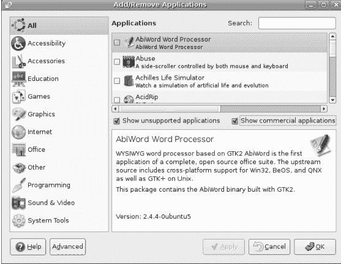
图5-7：GNOME应用安装程序
### 5B-1：选择要安装的应用程序
GNOME应用安装程序和Synaptic一样，可以同时安装多个应用程序，因此不妨试试，我们来安装几个你可能会感兴趣的应用程序。不过在开始选择应用程序之前，请务必点击“显示”旁边的菜单按钮，选择*所有可用应用程序*。这样你就能查看第68页项目5A中你勾选的所有存储库中的所有可用内容。
现在所有可查看的内容都能看到了，我们先来选择名为**Rubrica**的非常酷且实用的地址簿应用程序（如图5-8所示）。要选择Rubrica，只需点击添加/删除应用程序窗口左侧面板中的**办公**分类，在右上方面板中向下滚动可用应用程序列表，勾选**Rubrica Addressbook**旁的复选框即可。此时会弹出一个小窗口询问：*安装社区维护的软件？* 点击**安装**继续，然后关闭该窗口。
我们再来选择一款实用的音频工具**SoundConverter**（注意不要和soundKonverter混淆），它可以将音频文件在不同格式间转换，例如MP3转Ogg Vorbis（你将在第16章学到更多关于SoundConverter的内容）。要选择它进行安装，点击窗口左侧面板中的**声音和视频**分类，在右上方面板中向下滚动，勾选**SoundConverter**旁的复选框即可。
> **注意** 请勿取消勾选GNOME应用安装程序中已勾选应用程序旁的复选框，否则当你进行到第75页的项目5B-2时，这些应用程序会被自动卸载。

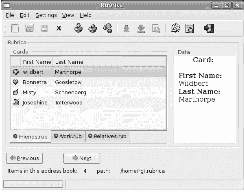
*图5-8：Rubrica——一个非常酷的地址簿*
### 5B-2：下载并安装选定的应用程序
完成选择后，点击添加/删除应用程序窗口底部的**确定**按钮。会弹出一个新窗口，如图5-9所示，显示你即将安装的内容。在该窗口中点击**应用**，之后会像使用Synaptic时一样（原因相同）提示你输入密码，输入你的用户密码后点击**确定**。GNOME应用安装程序（实际是APT）随后会开始下载和安装流程，通过和使用Synaptic安装应用程序时相同的进度窗口展示进度。

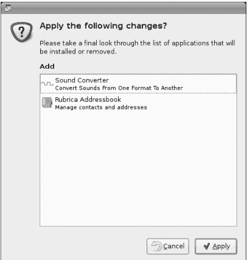
*图5-9：GNOME应用安装程序会告知你即将安装的内容*
安装完成后，会弹出和你之前使用Synaptic安装结束时的窗口类似的窗口（见图5-5），点击**关闭**，GNOME应用安装程序会自动退出，你就可以运行新安装的应用程序了。你可以通过点击**应用程序**菜单，找到对应应用程序在GNOME应用安装程序中所属分类的子菜单来运行它们：Rubrica对应**办公**分类，SoundConverter对应**声音和视频**分类（你将在第16章学到更多关于它的内容）。
你看，通过GNOME应用安装程序安装应用程序非常简单，如果你留意了我之前的警告，你也知道卸载应用程序同样简单：勾选后点击“应用”即可安装，取消勾选后点击“应用”即可卸载。这已经非常简单了，你不得不承认。

### 通过系统更新面板小程序执行系统升级
在本章开头我提到过APT有两个图形前端，但现在我必须承认我有点轻描淡写了——实际上还有更多，不过这些更加专业化。本部分要介绍的这个小工具专门用于系统更新。
因此，在通过Synaptic单独更新软件包之前，最好先用系统更新面板小程序检查可用更新，这样可以节省时间。要执行更新，请确保Synaptic和GNOME应用安装程序都已关闭（我之前说过，你无法同时运行两个APT前端），点击面板上的**系统更新**小程序，就会弹出更新管理器窗口（见图5-10）。

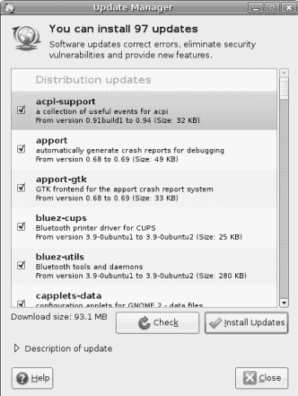
*图5-10：通过系统更新面板小程序批量升级软件包*
在该窗口中会列出所有可用更新，你可以滚动列表，取消勾选不想升级的应用程序旁的复选框，但如果你并不清楚自己在做什么，最好保持原样。无论如何，准备好之后，点击**安装更新**按钮，之后会提示你输入密码，输入密码后点击**确定**。随后更新会被下载并安装，进度会通过你使用Synaptic和GNOME应用安装程序时见过的同类型窗口显示。安装完成后，会有一个单独的窗口通知你，点击该窗口的**关闭**按钮，再对软件更新窗口做同样的操作。根据你安装的内容不同，可能会弹出另一个小窗口，提示你必须重启系统才能让更改生效，如果有，最好乖乖重启。

### **如果更新毁了你的日子……甚至系统**
现在我不想吓到你，但大规模系统更新有一点很恼人：更新后有时候会出现各种问题，让你追悔莫及，满嘴脏话就要脱口而出，最好还能咽回去。无论你使用什么操作系统，这都是生活的一部分，Windows会发生，Mac OS会发生，Linux也会发生。
因此，在安装看似重大的更新之前，最好等上一段时间，先去用户论坛看看有没有人遭遇过灾难性的问题。如果你一意孤行，最后发现系统再也启动不了了，别慌，还没全完，事实上大部分情况下数据都不会丢失，重启你的机器就行。如果你装的是双系统，会像往常一样进入GRUB引导菜单；如果不是双系统用户，你需要在开机几秒后收到提示时立刻按下**ESC**键进入该菜单。
在GRUB菜单中，你会发现硬盘上似乎安装了不止一个Ubuntu系统，某种程度上确实如此。你可以利用这个半真半假的情况，选择升级前使用的核心系统（即Linux内核），相当于穿越回过去。只需要用方向键选择一个版本号低于最高版本的内核（例如选2.6.20-11而非2.6.20-13），按下**回车**，*瞧*，你就回到了那个熟悉又喜欢的系统了。
希望我聊了这么多灾难和恢复的事，没有吓到你更新系统的念头。毕竟，这种事大概率不会发生在你身上。不过知道万一出了错也不用慌，还是好的——你有备份。

## 6 整洁的巢穴
### *Ubuntu中的文件和磁盘处理*

无论你使用什么操作系统，都要处理文件。有些人非常爱整洁，文件第一次保存时就把它放到命名合理的文件夹里。而像我这样的人，会把所有文件都存到桌面，直到桌面堆满垃圾看不清壁纸，才会开始认真整理（如果把所有文件丢进一个叫“3月17日清理”的文件夹能算整理的话）。
啊。当然，文件不仅会存储在硬盘上，还会在CD、DVD、外置硬盘、U盘和其他存储介质与设备之间互相拷贝。它们还经常被保存为压缩包，压缩后能减少占用空间，方便通过邮件发送，也能塞进空间不足的可移动存储设备里。
简单介绍完这些，你可能已经猜到了，本章我会讲解Ubuntu中的文件处理，尤其是和Nautilus文件管理器相关的内容，它是GNOME文件处理功能的核心。


## Nautilus：你的文件管理器
正如我之前提到的，系统中负责创建文件查看和整理界面的程序叫做Nautilus，它是GNOME桌面环境的一部分。你之前可能没把操作系统的文件管理器当成程序，但实际上它确实是程序。（Windows的文件管理器叫做Windows资源管理器。）

要打开Nautilus查看，只需进入「位置」菜单，选择「主文件夹」。当Nautilus打开并进入你的主文件夹时，第一次打开你会发现里面除了一个名为「桌面」的文件夹外什么都没有（如图6-1所示），双击这个文件夹就能看到你储存在里面的所有内容（我的里面有很多东西，你的很可能什么都没有）。

还有一个名为「示例」的文件夹，内容和从Live CD运行Ubuntu时出现的示例文件夹一致。里面包含了示例文件，能让你大致了解Ubuntu为你准备了哪些功能，还有我在第3章提到的纳尔逊·曼德拉的相关视频。

你可以随心所欲地创建额外的文件夹，当然还有文件，所以这种相当朴素的状态一旦你真的开始使用系统肯定会改变。实际上，你会在第7章创建不少文件夹，到时候整个主文件夹会看起来更有人使用过的痕迹。

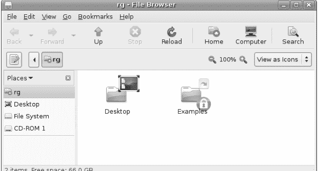
> *图6-1：Nautilus窗口中显示的主文件夹内容*

## 侧边栏
Nautilus有很多值得提及的有趣功能，其中最明显的就是侧边栏，它出现在窗口的左侧。侧边栏允许你通过可选的视图模式查看各类信息。你可以点击侧边栏顶部的下拉菜单来进行选择（如图6-2所示）。

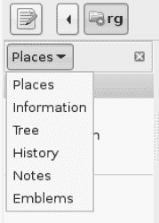
图6-2：选择Nautilus侧边栏的视图模式

Ubuntu中的默认视图是「位置」，这是一种快速导航工具。在「位置」视图中，你会看到代表系统中各类可用数据存储位置的图标，比如你的主文件夹、桌面、完整文件系统、你已连接的所有网络共享（稍后会详细介绍），以及插入或连接到系统的所有可移动存储介质或设备。双击其中任意一个图标，该位置的内容就会显示在Nautilus窗口的右侧面板中。

当然还有其他视图，比如「树状」视图，它可以为你提供可展开的文件系统层级视图；还有「历史记录」视图，会显示你最近访问过的文件系统位置，和网页浏览器的历史记录功能类似。还有其他可供选择的视图，其中部分视图你会在第7章中使用到。

## 想显就显，想藏就藏
侧边栏是个非常实用的功能，但有时你可能会希望腾出更多空间来查看窗口内容，想要暂时隐藏侧边栏。你完全可以轻松做到：打开Nautilus窗口的「**视图**」菜单，取消勾选「**侧边栏**」选项即可。该选项旁边的勾选标记会消失，侧边栏也会随之隐藏。

想要让侧边栏重新显示，只需再次回到「**视图**」菜单，选择「**侧边栏**」即可。勾选标记会重新出现，侧边栏也会随之显示。

还有一种隐藏侧边栏的方式，很多人会不小心误触到，通常还会引发一些不必要的慌乱。如果你看侧边栏右侧的灰色边框，会发现中间有一个带纹路的小区域（见图6-3）。点击这个带纹路的区域就可以切换侧边栏的显示/隐藏状态。大多数用户的慌乱来源于这个情况：当侧边栏通过这种方式隐藏时，视图菜单里的「侧边栏」选项仍然处于勾选状态，意味着侧边栏还处于显示状态，但你的眼睛看到的却不是这样。以上就是侧边栏的小秘密。它不算特别有意思，但不仅能给你带来更多便利，还能让你不再慌乱。

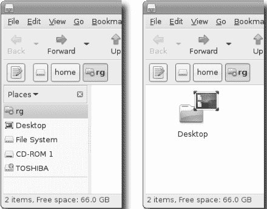
图6-3：显示和隐藏Nautilus侧边栏

## Nautilus中的文件操作
因为Nautilus本质上是一个文件管理器，所以从文件操作层面开始介绍它的使用方法再合适不过。当然，如今大多数使用电脑的人都已经熟悉了拖放的基础操作，以及创建文件夹、复制、剪切和移动文件的其他几种基本方式。但如果有人对这类基础操作还不熟悉，我觉得最好还是把步骤都讲清楚。如果你觉得这些内容有点多余，为了大多数用户着想，还请你看完。

### 创建、命名和重命名文件夹
创建文件夹是个非常简单的操作，有两种方法可以实现。在我看来最简单的是：在Nautilus窗口内的任意空白处右键单击，在弹出的菜单中选择「**创建文件夹**」。

如果你更喜欢用菜单而不是右键空白处，也可以打开Nautilus的「文件」菜单，选择「**创建文件夹**」来开始操作。

无论你通过哪种方式选择了创建文件夹，Nautilus窗口中都会出现一个名为*未命名文件夹*的新文件夹。文件夹的名称框会被高亮显示，周围带有黑色边框，这意味着你只需要直接输入名称就能立即给文件夹命名，不需要点击其他任何地方或做其他操作。

按下**回车键**或者点击Nautilus窗口内的任意空白处，就能完成创建。

如果你之后觉得给文件夹取的名字需要调整，甚至要完全重命名，可以右键单击该文件夹，在弹出的菜单中选择「**重命名**」。

你也可以单击文件夹将其选中，然后选择「**编辑 ▸ 重命名**」。之后输入文件夹的新名称，按下**回车键**或者点击Nautilus窗口内的任意空白处，就能完成重命名。

### 移动文件和文件夹
在Nautilus中能做的所有文件操作里，最轻松的恐怕就是用拖放的方式移动文件了。我敢肯定，只要用过鼠标的人都熟悉这个操作。

不过，移动文件和文件夹还有一种方法：剪切粘贴。最简单的方法是右键单击你想要移动的文件（或文件夹），在弹出的菜单中选择「剪切」（选择「**编辑 ▸ 剪切**」也能达到同样的效果）。

这时候看起来好像什么都没发生，文件还在原来的位置，不用担心。

之后，右键单击你想要移入的目标文件夹内的任意空白处，在弹出的菜单中选择「粘贴」。文件就会从原来的位置消失，出现在新的位置里。

你可能会问，能不能用快捷键组合来完成这个操作？当然可以。你只需要按照刚才的步骤操作，用**CTRL+X**来剪切，**CTRL+V**来粘贴就可以了。

### 复制文件和文件夹
根据我刚才讲的步骤，你大概也能想到复制文件和文件夹的方法了，本质上和移动的操作逻辑差不多。只需要右键单击你想要复制的文件，在弹出的菜单中选择「复制」，然后右键单击目标位置的任意空白处，再选择「粘贴」即可。用快捷键的话，就是用**CTRL+C**来复制，和之前一样用**CTRL+V**来粘贴。

当然也可以通过拖放来复制文件和文件夹，不过这比普通的拖放移动操作需要多按一个按键；好消息是，你的两只手足够完成这个操作。只需在拖动想要复制的文件或文件夹到目标位置时，按住CTRL键。注意要先松开鼠标按键，再松开CTRL键（反过来按顺序松开是无效的），你就会看到文件的副本出现在新的位置里。

## 在Nautilus中导航
在Nautilus中浏览各类文件夹和子文件夹非常简单，实际上操作逻辑和你习惯的Windows及Mac OS几乎完全一致。你只需要通过双击文件夹，再配合点击「后退」「前进」和「向上」按钮，就能自由进入和退出文件夹。

### Nautilus中的标签页浏览功能
除了侧边栏提供的层级视图选项外，Nautilus还有一个很方便的功能能让导航操作更轻松：标签页浏览功能。这些标签页（其实看起来像按钮）会出现在导航栏中，对应你从当前查看的文件夹往回追溯，每一步打开的文件夹。


比方说，你有一个名为NordicStuff的文件夹放在你的主文件夹中，而NordicStuff里有一个名为SwedeStuff的文件夹，SwedeStuff里有一个名为Dalarna的文件夹，Dalarna里又有一个名为gooseberries的文件夹。当你点击导航到这个gooseberries文件夹——从双击NordicStuff文件夹开始——Nautilus会为该文件夹显示一个标签页……以及之前打开过的所有文件夹。请看图6-4，你就能明白我的意思。
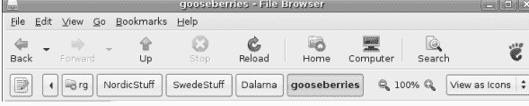
图6-4：Nautilus中的标签页导航
如图所示，从你的主文件夹（本例中即我的主文件夹）到目标文件夹gooseberries之间路径上的每个文件夹都有一个标签按钮。那又怎样呢？假设你想回到NordicStuff文件夹，打开一个含有你想要复制的文本的文件，然后将该文本粘贴到gooseberries文件夹中的某个文档里。听起来有点麻烦，对吧？与其费劲地使用"后退"按钮，你只需简单地点击NordicStuff标签按钮，该文件夹的内容就会呈现在你面前。需要回到gooseberries吗？只需点击gooseberries标签按钮。想回到SwedeStuff？只需点击SwedeStuff标签按钮。一切都非常方便！

### 拼写出来——在Nautilus中输入文件路径
如果你更喜欢输入而不是点击，那么很高兴地告诉你，你可以通过输入路径来导航到某个文件夹。只需进入**转到**菜单，然后选择**位置**，或者键盘快捷键爱好者可以直接按**CTRL-L**。随后在位置栏中会出现一个搜索框（图6-5），你可以在其中输入目标文件夹的路径，然后按**回车**键。以我的浆果示例为例，路径为：
```
/home/rg/NordicStuff/SwedeStuff/Dalarna/gooseberries.
```
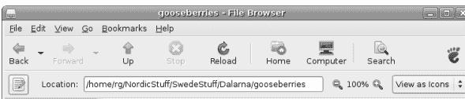
图6-5：输入目标文件夹的路径

### Nautilus中的书签
在你不断点击深入访问深层子文件夹的过程中，有必要提一下Nautilus另一个非常方便的功能：书签。是的，Nautilus允许你为已导航到的文件夹添加书签。你无疑已经熟悉为常访问的网页创建书签，但你可能会想，为什么要在文件系统中创建书签呢？假设你有一个需要经常使用的文件夹，但它比我上一节提到的gooseberries文件夹埋藏得更深。到达那里需要大量的鼠标点击，而如此多的点击最终肯定会让你患上严重的腕管综合症。虽然这对你的人身保险公司来说是好事，但对你自己来说绝对不好。与其伤害自己，你只需导航到该文件夹一次，然后在Nautilus窗口的**书签**菜单中选择**添加书签**。此后，每当你想回到那个深层文件夹时，只需点击**书签**菜单，该文件夹就会在下拉列表中等着你。Nautilus书签的另一个便利之处在于，它们也会出现在"另存为"对话框中，比如当你保存OpenOffice.org文档或通过Firefox下载文件时。在任何"另存为"对话框中，只需点击**保存在文件夹**按钮，就能找到你的书签。

## 了解Linux文件系统
在你刚刚学习的路径输入、导航和书签操作之后，你应该基本能够弄清楚如何在主文件夹中从这里到达那里了。不过，了解一下你的主文件夹在整个文件系统中的实际位置仍然是个好主意，以防有一天你真的迷路了。要理解这一点，你应该对Linux文件系统有一个基本的了解——你会发现它与你之前习惯的操作系统有些不同。与Windows不同，Linux文件系统全部源自一个称为*root*的单一点，用一个单独的正斜杠（/）表示。你自己的用户账户文件夹位于root的一个名为*home*的子文件夹中。它表示为/home，或者用文字来说，就是root中的home文件夹。如果你的用户账户名称与我的相同，即rg，那么该文件夹的路径就是/home/rg，也就是root中home中的rg文件夹。无论你的用户账户名称是什么，或者你机器上的其他账户名称是什么，只需记住，当你迷路时，你的文件夹以及你机器上其他所有用户账户的文件夹都位于home文件夹中。如果你更喜欢图形化的方式，图6-6中的地图应该能帮到你。
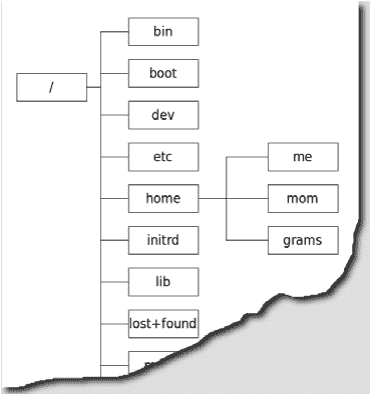
*图6-6：用户文件夹在Linux文件系统中的位置*

### 那些其他文件夹里有什么？
不用说，Linux文件系统不仅仅包含*root*、*home*和用户账户文件夹。与*home*同级的还有其他几个目录，不过在大多数情况下，除非你知道自己在做什么，否则真的不应该直接去操作它们。幸运的是，这些文件夹大多是写保护的，所以你应该能很好地防止自己的误操作。不过，你自然会好奇那些其他文件夹的用途，因为……好吧，它们就在那里。所以，为了满足一下你的好奇心，我来做一些简单的说明。
在Ubuntu中，有四个文件夹包含系统中的大部分应用程序。系统的核心元素位于/sbin中。其他需要存在于那里的元素——尽管可能不会被使用——例如命令等，位于/bin中。你实际认为是应用程序并以实际方式使用的大多数应用程序位于/usr中。最后，还有一些附加应用程序，例如RealPlayer，它们会安装到/opt中。另外三个可能引起你兴趣的顶级文件夹是/etc、/lib和/media。第一个，/etc，是你系统上所有配置文件的位置。第二个，/lib，是你系统或已安装应用程序所需的所有库文件的所在。这些库文件是Linux中等同于Windows的.dll文件的东西。最后，/media是当你插入各种外部介质（如USB驱动器和CD）时，其内容显示的地方。还有其他顶级文件夹，但对于一般的Linux新手来说，它们的用途不那么直观，而且说实话，在当前阶段你可能也不会对此有多大兴趣。不管怎样，正如我之前提到的，你目前没有理由去操作这些文件夹中的任何一个，因为位于其中的内容可以通过其他更安全的方式来访问。

## 将Nautilus用作网络浏览器
Nautilus的另一个便利功能是它可以充当网络浏览器。例如，你可以通过前往GNOME面板中的**位置**菜单并选择**网络服务器**来查看你的家庭或办公网络上有哪些网络和共享资源。你也可以在Nautilus窗口中通过进入**转到**菜单并选择**网络**来实现同样的操作。该网络上的任何网络或计算机的图标将显示在Nautilus窗口中，你可以从*图6-7*中我自己的家庭网络设置中看到这一点。从该窗口中，你可以双击导航到你有权访问的共享资源，例如Windows机器的"共享文档"文件夹或Mac的公共文件夹。
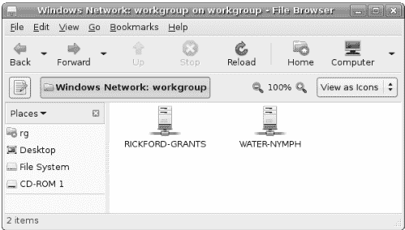
*图6-7：在Nautilus中浏览网络*
顺便说一下，如果你想知道什么是共享，我来为你解释一下。基本上，*网络共享*是计算机上的一个位置，例如一个文件夹，网络上的其他用户可以访问和保存文件。Windows系统上的"共享文档"文件夹就是一个很好的例子。网络上的其他用户可以从"共享文档"文件夹复制文件，并且（通常）可以向该文件夹写入文件，但他们无法访问该主机上文件系统的其他任何部分。如果你尝试打开的共享资源需要用户名和密码，系统会在一个新窗口中要求你输入这些信息（*图6-8*）。请注意，在这种情况下，你需要输入的用户名和密码是你尝试连接的机器上的用户名和密码——而不是你正在Ubuntu中使用的用户名和密码（当然，除非用户名和/或密码碰巧相同）。然后你就可以像操作自己硬盘上的文件夹一样，从该共享资源复制文件或将文件复制到其中。
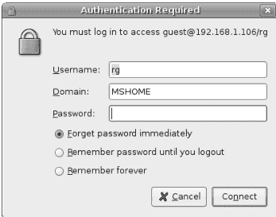
*图6-8：输入你尝试连接的机器的网络用户名和密码*

在某些情况下，尤其是尝试访问运行OS X的Mac上的共享资源时，双击方法将不起作用。你无法访问特定机器上的任何共享，即使该机器的图标已出现在Nautilus窗口中。这种情况下，双击你要访问的机器图标，待其打开（为空窗口）后，打开**前往**菜单，选择**位置**。位置栏会弹出一个文本框（如图6-5所示），其中已自动填入你要访问的机器位置。在该路径后添加一个正斜杠（/），再输入目标机器上对应的用户名即可。例如，若目标机器名为cowboycats，用户名为mewtoyou，则完整路径为`smb://cowboycats/mewtoyou`。如果你知道目标文件夹的路径，还可以进一步指定到机器上的特定文件夹，只需在已输入的路径后追加路径即可，例如`smb://cowboycats/mewtoyou/Documents`。**注意** 如果你好奇路径开头的`smb`代表什么，它是Server Message Block（服务器消息块）的缩写，但为了更易理解（也或许更便于记忆），你可以将其视为Samba的缩写——Samba是Unix系统（如Linux和Mac OS X）用于与Windows网络交互的软件。

当你连接到想要浏览的文件夹后，使用Nautilus的书签功能为该打开的共享窗口添加书签是个不错的选择。之后你就可以通过Nautilus书签菜单中的共享名称轻松访问该共享，要我说，这方法还挺酷的。

### 将Nautilus用作FTP客户端
Nautilus不仅支持浏览和挂载本地网络上的共享，还能作为FTP客户端使用，例如当你想要修改远程服务器上网站的文件时。要执行此操作，请打开“连接到服务器”窗口（**文件 ▸ 连接到服务器**），然后在服务类型中选择**FTP（需要登录）**。接着输入网站主机提供给你的信息，点击**连接**按钮。之后桌面上和侧边栏中都会出现一个FTP网络共享图标。双击该图标，在提示时输入你的密码（该账户的密码，而非Ubuntu系统的密码，除非两者恰好相同），之后你就可以查看和修改你存储在上面的文件了。

### Nautilus中的文件和文件夹权限
在使用Ubuntu的过程中，你会发现偶尔会遇到被锁定的文件或文件夹，可能是无法读取、无法修改，或是两者都无法操作。这些可读性和可变性的状态被称为*权限*。你现在可能会（合理地）好奇权限机制有什么用，为了帮你理解，我会举几个例子说明它的作用。

比如你有不想让配偶或孩子看到的文件——例如写得不好的诗歌或是圣诞购物清单。通过拒绝这些文件或包含这些文件的文件夹的读取权限，除了精通权限修改且拥有修改这些文件/文件夹权限的人之外，没人能偷看这些内容。

再举一个例子，假设你有一个花了很多小时才完成的文件。为了避免不小心误删该文件，你可以拒绝写入权限。这样，除非你修改权限，否则无法对该文件进行任何操作。实际上，如果你尝试将该文件移到回收站，甚至是桌面或其他文件夹，系统会弹出禁止操作的提示，如图6-9所示。
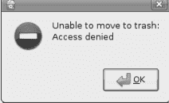
> **图6-9：** 当权限限制你的操作时，Nautilus会发出提示。

### 在Nautilus中更改文件和文件夹权限
要在Nautilus中更改文件或文件夹的权限，只需右键点击对应的文件或文件夹，然后在弹出菜单中选择**属性**。属性窗口打开后，点击**权限**选项卡，你就可以看到该文件或文件夹的所有者是谁，以及你被允许或不允许对它进行哪些操作。如图6-10所示，文件和文件夹的选项略有不同。你可能会觉得权限机制有点复杂，但其实非常简单。权限可以授予或拒绝给文件或文件夹的*所有者*（你）、指定的*组*，或是*其他人*（所有其他用户）。这些权限包括：
- **读取** — 查看文件或文件夹内容的权限
- **写入** — 修改文件或文件夹内容的权限
- **执行** — 运行程序或脚本的权限

通常你不需要太担心自己文件的权限设置，因为只有你自己能访问你的用户账户。主要的例外情况之一是你将文件从CD传输到硬盘时，这种情况下的文件会被写保护，意味着你无法修改这些文件，直到你更改它们的权限。你可以通过勾选所有者行中*写入*选项旁的复选框来更改这类文件的权限，以允许自己修改它们。完成后，点击**关闭**按钮即可。
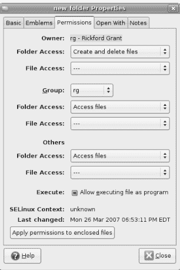
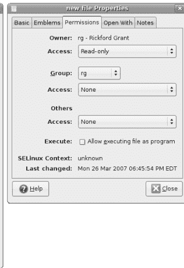
图6-10：在Nautilus属性窗口中更改权限

### 保护主文件夹的隐私
我之前说过你不需要太担心权限设置，还有一个可能很重要的例外，就是主文件夹的权限状态，尤其是当其他人在你的机器上有用户账户时。在Ubuntu中，当有人登录到你自己电脑上的账户时，他们可以一路点击进入你的用户文件夹并查看其内容。要解决这个问题——从而保护主文件夹的私密性、其内容的隐私以及所有者（你）的安心——你可以更改主文件夹的权限。操作步骤如下：
1. 打开Nautilus窗口，然后双击侧边栏中的**文件系统**。此时整个硬盘的内容会出现在Nautilus窗口的右面板中。
2. 查找并双击名为**home**的文件夹。当你刚点击的主文件夹内容出现在右面板时，那里应该只有一个文件夹——你自己的文件夹，名称和你的用户名相同。例如，我之前提到过我的用户名是**rg**，对应的文件夹名也是**rg**。
3. 右键点击你的文件夹，然后在弹出菜单中选择**属性**。
4. 在*用户名*属性窗口（我的是*rg 属性*）中，点击**权限**选项卡。
5. 在权限选项卡中，向下找到“组”和“其他人”部分，在**文件夹访问权限**旁边的下拉菜单中选择**无**。请确保在“组”和“其他人”两部分都进行此操作。完成后，你的窗口应该和我图6-11中的一样，如果是，点击**关闭**。
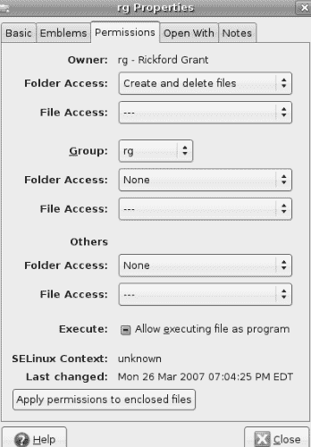
图6-11：更改主文件夹的权限以保护隐私

### 读取数据CD和DVD
在Ubuntu中处理数据CD和DVD非常简单，所有操作都是自动的。要读取存储了数据而非音乐或视频的CD或DVD，只需将光盘插入驱动器，桌面上会自动出现CD或DVD的图标（两者外观相同）。显示光盘内容的Nautilus窗口也会自动打开，之后你就可以通过标准的拖放操作将CD或DVD中的文件复制到硬盘上。当你想要取出CD或DVD时，只需关闭对应的Nautilus窗口，右键点击桌面对应的光盘图标，然后在弹出菜单中选择**弹出**，光盘就会自动弹出。

### 刻录数据CD和DVD
在GNOME中刻录数据CD和DVD非常容易。你只需要将空白CD-R（可记录CD）或DVD（Ubuntu支持DVD-RW、DVD-R和DVD+RW）插入驱动器，注意要选择你的驱动器支持的媒体格式，之后会出现一个窗口询问你要对光盘执行什么操作。点击**刻录数据CD**按钮，如果是空白DVD，则点击**制作DVD**按钮。随后会打开Nautilus的CD/DVD创建窗口，你会发现它和其他Nautilus窗口非常相似，仅在位置栏下方有一条棕色色带，以及“写入光盘”按钮（图6-12）。


# 图6-12：Nautilus CD/DVD 创建器窗口，窗口中已准备好要刻录到光盘的文件
CD/DVD 创建器窗口打开后，将你要刻录的文件复制到该窗口的操作非常简单，只需拖放即可。只要打开一个新的Nautilus窗口，把要刻录的文件从该窗口拖到CD/DVD 创建器窗口即可。
如果你更喜欢用类似Windows的操作方式，可以逐个单击要刻录的文件，按住**CTRL**键进行多选。
如果要选择多个连续文件，先单击组内第一个文件，按住**SHIFT**键，再单击组内最后一个文件，即可自动选中中间所有文件。
选好文件后，松开**CTRL**或**SHIFT**键，右键单击任意一个高亮文件，在弹出的菜单中选择**复制**。之后回到CD/DVD 创建器窗口，右键单击任意空白区域，在弹出的菜单中选择**粘贴**。
有一点需要说明：你复制到CD/DVD 创建器窗口的文件并非真正被复制了。相反，你在创建器窗口中看到的本质上是指向原始文件所在位置的别名。因此，如果你在把CD/DVD 创建器窗口中的内容刻录到光盘前，移动了其中某个文件的原始位置，该文件就会自动从窗口消失，到你最终进行刻录步骤时，也不会被刻录到光盘里。这不算什么问题，但值得留意。
所有要刻录的文件都复制完成后，单击**刻录到光盘**按钮，之后会弹出一个窗口（如图6-13所示），其中会显示你选中的文件占用的存储空间等信息。在这个窗口中，你可以给光盘命名，还可以调整刻录速度（速度越慢，出错概率越低），当然你也可以直接使用默认设置。
*图6-13：刻录CD或DVD前的参数设置*
准备好刻录光盘后，只需单击**写入**按钮，CD/DVD 创建器就会开始工作。部分情况下会弹出警告窗口，提示你部分文件的命名可能不兼容Windows。遇到这类窗口时，除非你确实需要将文件传输到Windows系统，否则直接单击**确定**即可；如果需要传输到Windows系统，那你最好在正式刻录前返回修改文件名，符合Windows命名规范。特别要避免使用特殊字符和变音符号（如分音符号和重音符号），也不能使用以下Windows系统保留字符：`/ : ? * " < > |.`
刻录开始后，新窗口会显示进度，任务完成后会询问你下一步操作。如果当天刻录任务已完成，单击**弹出**，再单击**关闭**即可。
顺便一提，在Linux下刻录的光盘**可以**在其他操作系统中正常读取。
### 处理CD-RW光盘
CD-RW光盘和CD-R光盘基本类似，只是可以反复擦写。它们的价格也比CD-R光盘贵不少，而且通常不支持高速刻录。
使用CD-RW光盘的操作和CD-R光盘差不多。如果是空白光盘，操作流程完全一致，非常简单。
如果CD-RW光盘里已有数据需要替换，操作流程只有细微差别。其中一个差别是，Nautilus会将CD-RW光盘识别为普通数据盘而非空白盘。这意味着你把光盘插入光驱后，会自动打开普通Nautilus窗口，而不是CD/DVD 创建器窗口。要向光盘写入数据，你需要手动从Nautilus窗口切换到CD创建器窗口，操作方法很简单：在打开该光盘的Nautilus窗口中，选择**转到**菜单里的**CD/DVD 创建器**即可，切换后窗口就会变成CD/DVD 创建器窗口。
现在把要刻录到CD的文件拖到该窗口，准备好刻录后，单击**刻录到光盘**按钮。和普通CD-R光盘或DVD一样，会弹出**刻录到光盘**窗口。但如果光驱里是使用过的CD-RW光盘，单击该窗口中的**写入**按钮时，会出现一点差异：此时会弹出如图6-14所示的新窗口，提示你光盘上已有写入的文件。单击该窗口中的**擦除光盘**按钮，CD/DVD 创建器就会清除CD-RW上已有的文件，替换为你拖到CD/DVD 创建器窗口里的新文件。整个操作很简单，不是吗？
*图6-14：用Nautilus擦除CD-RW光盘*
### 刻录ISO镜像到光盘
当你从互联网下载Fedora Core或其他Linux发行版时，通常会以下载一个或多个磁盘镜像的形式获取，这类文件因为以.iso为后缀，所以常被称为ISO。**ISO**是光盘文件内容的镜像，相当于去掉了光盘本身的光盘。换句话说，如果光盘有灵魂，那**ISO**就是光盘的灵魂；去掉光盘的金属和塑料外壳，剩下的数据就是ISO。因为无法通过互联网下载实体光盘，所以没有实体的ISO镜像就是最好的替代品。比如，要从网络获取可用的Ubuntu副本，你需要先下载ISO文件，之后再刻录到空白光盘上，相当于给镜像赋予了实体，最终就能得到安装Ubuntu所需的启动安装盘。
幸运的是，刻录ISO到光盘的操作非常简单。打开Nautilus窗口，找到要刻录的ISO文件图标，右键单击该ISO文件，在弹出的菜单中选择**刻录到光盘**，之后会弹出刻录窗口，只需单击**写入**按钮，就可以开始刻录了。
### 复制数据CD
在Ubuntu中复制CD和DVD也非常简单。右键单击要复制光盘的桌面图标，在弹出的菜单中选择**复制光盘**，之后会弹出刻录窗口，单击窗口中的**写入**按钮，Nautilus CD/DVD 创建器就会开始将光盘内容作为磁盘镜像复制到你的硬盘中，这个过程会花费一些时间，无需着急。完成后会提示你将空白光盘插入光驱，插入后，创建器就会开始将磁盘镜像刻录到空白光盘中。如果想了解如何复制音频CD，请等待第15章的介绍。
### 刻录多区段CD
如果你之前使用Windows系统，肯定对*多区段*CD不陌生。这类CD可以分多次会话写入数据，比如今天刻录几个文件到光盘，明天再追加几个，后天再追加更多。每次往同一张光盘追加刻录文件，就是增加一个会话，这也是*多区段*名称的由来。如果这个解释还是有点难懂，你可以把它大致理解为类似软盘的工作方式（当然存储容量大得多）。Nautilus目前可以读取和显示这类多区段光盘的内容，但还无法写入多区段光盘，要完成这个操作你需要用到其他刻录应用。我推荐**GnomeBaker**，你可以通过Synaptic搜索*gnomebaker*下载安装。安装完成后，在应用程序菜单选择「声音和视频 ▸ CD/DVD刻录工具 **GnomeBaker**」即可运行。
要刻录CD的第一区段，单击GnomeBaker窗口下半部分的**数据CD**按钮，之后把要刻录的文件拖到GnomeBaker窗口右下角的面板中，该面板在「数据CD」选项卡下（如图6-15所示）。你可以从GnomeBaker窗口上半部分的两个面板中的文件浏览器、Nautilus窗口或者桌面拖入文件。所有要刻录的文件都放好后，单击屏幕右下角的**刻录**按钮，会弹出「创建数据CD」新窗口，在该窗口中，*模式*旁的下拉菜单选择*tao*，完成后将空白光盘插入光驱，单击**开始**，刻录流程就会启动。刻录完成后GnomeBaker会自动弹出光盘。
### 刻录后续区段
要给多区段光盘添加新区段，先确保GnomeBaker窗口的右下角面板是空的（如果不是，单击**清除**按钮），然后将多区段光盘插入光驱。等光驱停转后，把该光盘的导航窗口移到一边，打开GnomeBaker的「项目」菜单，选择**导入区段**。会弹出小窗口要求你选择多区段光盘所在的光驱，你大概率只有一个光驱，所以正确的设备应该已经显示出来了，如果是，单击**确定**即可。之前区段刻录的文件现在会显示在底部面板中。要追加刻录新文件到光盘（即创建新区段），只需按照初始区段刻录的操作流程操作即可。


图 6-15：使用 GnomeBaker 创建多会话光盘
### **USB 存储设备**
任何涉及文件处理和存储的章节，若没有提及USB存储设备这个话题都会显得不完整，所以我现在就来讲这部分内容。除非你过去几年完全与数码世界隔绝，否则你肯定对USB设备非常熟悉。你的打印机很可能是USB设备，扫描仪也不例外。尽管你的数码相机从传统意义上来说不算USB设备，但每次你把它连到电脑传输照片时，大概率都是通过USB连接器连接的。
当下最受欢迎的USB设备之一，就是用于文件存储的设备。这类设备包括外置硬盘、闪存卡读卡器，还有那种手指大小的、被称为*闪存盘*的小设备（图 6-16）。闪存盘如今非常受欢迎，实至名归：它们价格不高；当你需要在电脑之间（比如从工作电脑传到家用电脑）传输容量较大但算不上特别大的数据时非常方便；而且在跨平台（包括Linux）兼容性方面表现也很可靠。
*图 6-16：USB 存储设备*
### **使用USB存储设备**
先给大家说个好消息：使用USB存储设备非常简单。只要把设备插入电脑的USB接口即可。系统读取设备内容时，设备上的LED指示灯会闪烁几下，之后桌面上就会出现该设备的磁盘图标。几分钟后，Nautilus 文件管理器窗口就会弹出，显示设备里的内容。之后你就可以用本章之前提到的拖放或复制粘贴操作，在设备和电脑之间传输文件。
当你使用完毕想要拔出设备时，右键点击桌面上的设备图标，在弹出的菜单中选择**卸载**。如果还有数据需要写入设备，系统会开始写入，并在屏幕右下角弹出提示告知你这一情况（如图 6-17 左图所示）。写入完成后，相同位置会弹出另一条提示，告诉你此时可以安全将设备从USB接口拔出了（图 6-17 右图）。
*图 6-17：Ubuntu 会告知你USB设备的当前状态*
#### **项目6：创建和提取压缩文件**
既然本章一直在讲文件存储，那么最后教大家如何创建和提取压缩文件再合适不过了。在Windows系统中，这类文件一般被称为Zip文件，而在Linux系统中，这类文件的常用名称是*tar压缩包*。如果你好奇Linux这边名称的由来，它来自用于创建这类文件归档的应用Tar。
接下来我们会实操创建一个Windows/Linux/Mac系统都能兼容的Zip文件，再将其提取出来。首先打开Nautilus窗口，创建两个练习用的示例文件，就可以开始操作了。你可以点击Nautilus窗口的**文件**菜单，选择**新建文档 ▸ 空文件**。此时Nautilus窗口里会出现一个新建文件，文件名处于选中状态。你可以直接输入文件名，比如我用的这个名称：*dogwood*。现在重复上述操作创建第二个文件，我给这个文件命名为*violet*，你也可以取一个同样有意境的名字。
- 1. 选中这两个文件：你可以先把鼠标移到文件旁边点击，然后按住鼠标左键拖动光标，让光标同时覆盖两个文件直到它们被高亮选中；也可以按住CTRL键，逐个点击两个文件来完成选中。
- 2. 两个文件都被高亮选中后，右键点击其中任意一个，在弹出的菜单中选择**创建归档**。
- 3. 在弹出的创建归档窗口中，在“归档”输入框中输入*blossoms*，然后点击输入框右侧的下拉菜单按钮，选择*.zip*格式。所有设置都和我图 6-18 中设置的一致后，点击**创建**按钮，之后你的两个文件的压缩归档（blossoms.zip）就会出现在你的主文件夹中。
*图 6-18：创建压缩归档文件*
现在你已经学会了如何打包文件，接下来我们来学习同样简单的解压操作——也就是把打包好的文件拆开。
- 1. 把原来的dogwood和violet文件拖到回收站，清出操作空间。
- 2. 双击你刚刚创建的**blossoms.zip**文件，之后会弹出显示该文件内容的窗口（图 6-19）。
*图 6-19：提取压缩归档文件*
- 3. 在该窗口中点击**提取**按钮，之后会弹出另一个名为“Extract”的窗口，在这个窗口中再点击一次**提取**按钮。最多两秒钟，你就会在主文件夹里看到新的dogwood和violet文件副本。
现在你已经完成了压缩文件的创建和提取，本次用的是Zip格式。以后你也可以用同样的流程创建压缩的tar包文件（当然希望到时候你用的是真实文件而不是示例文件），只是在选择归档格式时，选择**.tar.gz**格式而不是.zip格式即可。除这一步之外，创建和提取的流程完全一致。
## **7 装扮企鹅**
### *定制系统的外观与交互风格*
在接触Linux之前，我几乎用过市面上所有的桌面操作系统。尽管这些系统各有不同，但用久了我都会陷入一种视觉上的倦怠，我想你可以称之为“图形界面疲劳”。我不是厌烦使用图形界面，只是看久了千篇一律的图标、窗口边框和配色方案，难免会感到腻烦。当然，这些系统也支持一些个性化修改，但如果不安装附加组件，基本没法改变系统的整体外观和交互风格，而这些附加组件往往会牺牲性能。
Linux有一项让我至今都非常满意的特性，就是用户可以大幅修改系统的外观。我说的不止是图标和背景，而是所有元素，包括窗口边框和控件本身都可以更改。再加上Linux有各式各样的图形桌面环境和窗口管理器可供选择，整个系统完全可以按照你的喜好定制。难怪网上的Linux桌面截图数量比其他任何系统都多呢？
如果你不信，不妨去看看专门收录Linux截图的网站www.lynucs.org，点击上面的**截图**链接即可。也许你对系统外观的喜好没有我这么善变，但学完本章的内容，你就能掌握Linux提供的所有图形化定制功能，并享受定制系统的乐趣。
#### **项目7A：创建新用户账户**
如果你不想改动当前系统的设置，可以创建一个新的用户账户，在新账户登录的情况下尝试本章介绍的修改操作。如果你选择这种方案，你常用的主账户环境不会被改动，因为单个用户账户里的外观和交互风格修改不会影响到其他用户账户。完成相关操作后，你可以直接删除这个新创建的账户。两种方式都可以，你可以根据自己的喜好选择。
创建新用户账户请按以下步骤操作：
- 1. 点击左上角的**系统**菜单，选择**系统管理 ▸ 用户和群组**。
- 2. 弹出密码输入提示时，输入你的用户密码，然后点击**确定**，之后会打开用户设置窗口。
- 3. 在用户设置窗口中点击**添加用户**按钮，会弹出新建用户账户窗口。
- 4. 在新窗口中输入新的用户名：**graphika**。“真实姓名”栏可以随意填写，示例中我填的是*图形爱好者*。之后向下滚动到窗口的密码设置区域，跳过“联系信息”部分，在两个密码输入框中输入一个容易记住的用户密码，这里直接使用你当前账户的密码即可。完成所有设置后，窗口的样子会和图 7-1 大致相同。
- 5. 确认所有设置都正确无误后，点击**确定**关闭窗口，回到用户设置界面，此时你会看到新创建的用户账户显示在当前账户的正下方（见图 7-2）。在使用graphika账户之前，你需要给该账户授予安装软件的权限。默认情况下，新用户账户的这项权限是关闭的，毕竟你肯定不希望你的孩子、同事或者任何拥有独立账户的人在你的电脑上乱装奇奇怪怪的软件，搞乱你的系统设置。


*图7-1：创建新用户账户*

*图7-2：在用户设置窗口中显示的新用户账户*
要更改graphika账户的权限，请在用户设置列表中点击**graphika**条目以选中它。完成操作后，点击**属性**按钮。此时会打开一个新的名为“graphika账户属性”的窗口。在该窗口中，点击**用户权限**标签页，然后勾选*管理系统*旁边的未勾选方框（如图7-3所示）。完成操作后，点击**确定**，再点击**关闭**退出用户设置窗口。

*图7-3：更改用户账户权限*

## 登录你的新账户
要使用这个新账户，请前往**系统**菜单并选择**注销**（或者直接点击顶部面板最右侧的**注销**按钮）。当注销窗口弹出时，点击**注销**。几秒后你会回到登录界面，在该窗口中输入你的新用户名，然后按下**回车键**。之后输入该账户的新密码，再次按下**回车键**。很快你就会进入新用户账户的桌面。

## 切换用户
有必要了解，除了直接注销一个账户再登录另一个账户外，还有另一种切换用户的方式。这种替代方法在逻辑上被称为*切换用户*。切换用户与注销/登录的方式不同，你在登录其他账户（或电脑上其他有账户的人登录他们自己的账户）时，仍会保持原始账户的登录状态。选择这种方式不会关闭你当前打开的所有窗口或应用程序，这些窗口不会出现在你切换到的账户中，但当你切回原来的账户时，它们会依然在那里等你。如果你计划在两个账户之间来回切换，这是个很好的选择。比如你的孩子需要临时登录他的账户查收邮件、刻录一张去海滩路上听的CD，或者打印学校文件时，这种方式也非常适用。孩子操作完成后，你可以快速回到之前的工作，无需重新打开文件、网页或其他你当时正在处理的内容。

切换用户的操作方式和注销/登录的方式大致相同。点击顶部面板的**退出**按钮后，你可以点击**切换用户**而非**注销**。之后会进入登录界面，你只需输入另一账户的用户名和密码（每一步操作后都要按下**回车键**），就像正常登录一样即可。通过切换用户的方式回到原始账户时，只需点击顶部面板右侧的**退出**按钮，如果你打算很快返回新账户就点击**切换用户**，如果短时间内不会返回就点击**注销**；回到登录界面后，输入你的原始用户名，按下**回车键**，输入密码后再次按下**回车键**。随后弹出的小窗口中，点击**返回上一登录**按钮。接着会出现另一个窗口，你需要输入要返回的账户的用户密码，输入密码后点击**解锁**，就会回到你原来的桌面，所有内容（包括打开的窗口）都会和你离开时一模一样。非常方便。

## 在独立窗口中登录其他账户
如果你觉得在两个账户之间来回切换太麻烦，还有一种近乎神奇的替代方案——在保持普通用户账户登录的状态下，在独立窗口中登录其他账户。这种“同时身处两地”的方法前期需要做一些设置，但长期来看会带来很多便利，不仅在做第106页的7B项目时能用，平时遇到“爸妈，我可以查下邮件吗？”这类场景也特别实用。要完成相关设置以使用该功能，你需要安装、配置并使用一个名为Xnest的应用程序，步骤如下：
- 运行新立得软件包管理器（Synaptic），搜索*xnest*并安装它。
- Xnest安装完成后，关闭新立得，右键点击**应用程序**菜单，在弹出的菜单中选择**编辑菜单**。
- 菜单编辑器窗口打开后，点击左侧面板的**系统工具**，然后勾选右侧面板*新登录*旁边的复选框。
- 右键点击**新登录**，在弹出的启动器属性窗口中，将命令修改为`gdmflexiserver -n`（注意`-n`前要有一个空格）。
- 点击两个窗口中的**关闭**按钮完成设置。

完成上述步骤后，你可以通过进入**应用程序**菜单，选择**系统工具**‣**新登录**来登录你的新账户。此时会弹出一个Xnest窗口，几秒后该窗口内会显示Ubuntu登录界面。在该界面中，输入你的新用户名（graphika，或你选择的任意名称）和密码，就和普通登录一样操作即可。你的新桌面很快会出现在Xnest窗口中（图7-4）。当你用完Xnest会话后，点击Xnest窗口顶部面板最右侧的**注销**按钮，然后在弹出的选项列表中点击**注销**。注销该会话后，Xnest窗口会自动关闭。

#### 项目7B：自定义你的桌面环境
无论你选择使用哪个用户账户进行练习，现在都可以开始操作了。我们从最简单的创建文件夹开始，但等整个流程走完，你会得到一个比你以往见过的都更独特、甚至可以说更花哨的桌面环境。当然这一切都是为了好玩，完成之后你就能完全自信地按照自己的喜好自定义各项设置了。那我们开始吧。

### 7B-1：创建文件夹
首先打开你的主文件夹。如果你没有自己瞎折腾的话，现在里面应该除了第3章提到的Examples文件夹，还有一个名为Desktop的文件夹，基本上你放在桌面上的所有文件、文件夹和程序快捷方式都存在这里面。如果你和我差不多，肯定不想让文件夹一直这么空着，会想创建几个文件夹来以后整理文件。你创建的第一个文件夹用来放文档，可以命名为Documentia，当然之后如果你想改名字也完全可以。创建文件夹非常简单，和Windows里的操作差不多：你可以点击文件管理器（Nautilus）的**文件**菜单，然后选择**创建文件夹**；也可以在窗口的空白处右键点击，在弹出的菜单中选择**创建文件夹**。此时会出现一个未命名的文件夹，叫“未命名”当然有点傻，所以你需要修改它的名字。文件夹下方的文本框已经被选中了，直接输入**Documentia**，然后按下回车键即可。完成操作后，文件夹就会显示新名字。现在你可以重复这个步骤再创建四个文件夹：Photos（用来存放照片）、Downloads（用来存放你在学习这本书的过程中下载的各种文件）、PDFs（用来存放PDF文件）、Music（用来存放音乐文件，之后你会学习用Sound Juicer程序从音乐CD中提取音乐到这里）。完成所有这些操作后，你的主文件夹窗口应该和图7-5的样子一致。

*图7-5：向主文件夹中添加文件夹*

### 7B-2：为文件夹添加徽章
你得承认，现在的样子确实比之前好看多了，但这只是开始。为了直观地提醒自己每个文件夹的用途，你可以添加一种叫做*徽章*的小文件夹图标，这些徽章可以添加到任意文件夹或文件上。现在我们先给**Documentia**文件夹添加一个徽章：右键点击该文件夹，在弹出的菜单中选择**属性**。属性窗口打开后，点击**徽章**标签页，向下滚动直到看到名为Documents的徽章（图7-6）。点击**documents**旁边的复选框，然后点击**关闭**按钮，徽章就会出现在你的文件夹上了。现在为了多加练习，你可以尝试给Music文件夹添加**声音**徽章，只需要重复之前的步骤，替换对应的选项和条目即可。


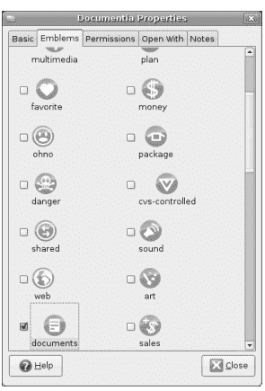
图7-6：为文件夹选择徽章

##### **7B-3：设置窗口背景（以及再次设置徽章）**
添加完这两枚徽章后，你的文件夹应该会看起来更有活力一些（我们还会在本章后续内容中让这些徽章更出彩）。不过，Nautilus 窗口的背景目前还是白色的。如果你不想忍受这样的背景，完全可以修改它。具体操作是：进入主窗口的菜单栏，点击*编辑*菜单，然后选择**背景和徽章**，之后就会弹出“背景和徽章”窗口（见图7-7）。

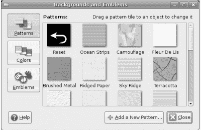
图7-7：为 Nautilus 窗口选择背景

在这个窗口中，你可以将任意图案拖拽到主窗口，或者其他任意 Nautilus 窗口中，该图案就会成为所有 Nautilus 窗口的背景。为了体验效果，你可以向下滚动找到名为**牛皮纸**的图案样本，然后将其拖拽到主窗口主面板的空白区域。完成操作后，原本白色的窗口区域就会看起来像律师事务所的壁纸一样。如果你喜欢这类风格，效果会非常不错。当然，你也可以用同样的方式更换为其他背景，或者将**重置**样本拖拽进窗口，就能恢复默认的白色背景。

> **注意** 如果你希望为 Nautilus 窗口使用自定义图片作为背景，操作起来也非常简单。只需打开一个新的 Nautilus 窗口找到目标图片，同时按下鼠标左右键点击它（如果是三键鼠标的话，直接按鼠标中键即可），然后将其拖拽到目标窗口的任意空白区域。松开鼠标按键后，在随后弹出的菜单中选择*设为背景*即可。

此外，在“背景和徽章”窗口中，除了图案和颜色样本按钮外，还有一个名为“徽章”的按钮。点击**徽章**按钮，就会显示出你在第107页项目7B-2中看到的所有徽章，这提供了另一种为文件夹添加徽章的方式。如果要一次性给多个文件夹或文件添加徽章，这种方式会方便很多。你可以点击**徽章**按钮来体验具体效果：然后将**相机**徽章拖拽到“图片”文件夹，**安装包**徽章拖拽到“下载”文件夹，因为没有更合适的选项，将**特殊**徽章拖拽到“PDF文档”文件夹，选中的徽章就会立刻显示在对应文件夹上。

##### **7B-4：装饰侧边栏（再次设置徽章）**
现在我们来修改 Nautilus 侧边栏的外观。保持“背景和徽章”窗口处于打开状态（如果你已经关闭了它，请重新打开），点击 Nautilus 侧边栏中的**位置**菜单按钮，选择**信息**。现在你也可以为侧边栏添加不同的背景图案，不过为了练习，我们这里选择添加颜色。具体操作是：点击“背景和徽章”窗口中的**颜色**按钮，此时窗口会充满各类颜色样本。将**西柚**样本拖拽到侧边栏，它就会从灰色变为西柚色（不过是非常深的、颜色奇特的西柚色）。你还可以通过添加另一种颜色制作双色渐变效果：将**芒果**样本拖拽到侧边栏的最底部（仍然在侧边栏范围内），这样侧边栏内就会呈现出从上到下的西柚到芒果渐变效果。当然，如果你不喜欢这套热带配色，可以将**重置**样本拖拽到该区域，就能恢复原本的默认灰色面板。完成操作后，你可以关闭“背景和徽章”窗口。

Nautilus 窗口的侧边栏提供了第三种操作徽章的方式。不过在你了解这第三种也是最后一种方式之前，你需要在主文件夹中再创建两个新文件夹：创建一个命名为**财务**的文件夹，可以用来存放和你在现代体系中的价值相关的文件，再创建另一个命名为**我的收藏**的文件夹，用来存放……嗯，你喜欢的文件就行。新建好文件夹后，前往侧边栏，点击**信息**下拉菜单，选择**徽章**，侧边栏中就会显示出徽章列表。选择**金钱**徽章，将其拖拽到“财务”文件夹上，然后选择**收藏**徽章，将其拖拽到“我的收藏”文件夹上。此时你的窗口应该会看起来和图7-8一致。完成操作后，回到下拉菜单选择**信息**，就能让所有内容恢复到相对正常的状态。

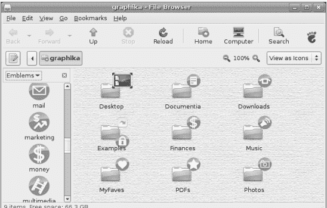
图7-8：从 Nautilus 侧边栏选择徽章

哪怕你觉得这些改动不符合你的审美，也不得不承认现在的 Nautilus 窗口确实更加多彩了。你当然可以随意修改它的外观，但我希望你先暂时不要动它，因为接下来我们很快还要继续调整它的设置。

##### **7B-5：修改桌面背景**
现在你的主文件夹窗口已经焕然一新了（或者俗艳得不行，取决于你的审美），对比之下你可能会觉得桌面看起来非常单调。修改桌面背景（通常也被称为**壁纸**）非常简单，只需在桌面的任意空白区域点击鼠标右键，在弹出的菜单中选择**更改桌面背景**即可，之后就会弹出“桌面背景首选项”窗口（见图7-9）。

### **安装额外壁纸**
正如你所见，Ubuntu 的默认壁纸叫做“简易 Ubuntu”，除此之外可供选择的壁纸非常少。要解决这个问题，你可以上传一些自己的图片，可以是数码相机拍摄的照片、你在电脑上创作的艺术作品，或者任何你希望设置为壁纸的内容。不过本次操作中，我们会从网络上获取并安装壁纸。有不少网站都提供免费桌面壁纸，比如汽车品牌官网、歌手官网、电视节目官网等。

**图7-9：** 修改你的桌面背景

有两个专门面向 Linux 用户的网站是 www.kde-look.org 和 http://art.gnome.org，当然你也可以从任意你喜欢的网站获取壁纸。如果你想使用和我这里一样的超大尺寸 Tux 壁纸，可以直接在浏览器中访问 www.taiabati.com/Linux/OLDindex.php，向下稍微滚动一点找到第二个 TUX 区域，然后点击与你屏幕分辨率匹配的图片尺寸旁边的下载按钮。当图片在浏览器窗口中显示后，右键点击它，选择**另存为**。在保存图片的窗口中，给它起一个容易记住的名字（`4wall_TUX-2_1024x768.jpg` 这个名称很准确但有点太长了），或者用我起的名字`mightyTux.jpg`，然后点击**保存**。当然，你也可以从任意你喜欢的网站下载任意你喜欢的壁纸，只要格式是支持的，比如 BMP、PNG 或 JPEG 格式就行，全凭你的喜好。下载好壁纸后，将其放入“下载”文件夹。之后你就可以进入“桌面背景首选项”窗口，点击**添加壁纸**按钮来安装它。在弹出的“添加壁纸”窗口中，找到你刚下载的壁纸，单击选中它，然后点击**打开**。该壁纸就会在“桌面背景首选项”窗口中被高亮显示，不久之后就会出现在桌面上（见图7-10）。出现后点击**完成**即可完成整个流程。

### **从网络到桌面——快速轻松设置壁纸**
你也可以通过极简便的自动方式将网页上的图片设为桌面壁纸：在浏览器中右键点击目标图片，选择**设为桌面背景**即可。随后会弹出一个小窗口，你可以在其中预览图片在屏幕上的显示效果，还可以在这个窗口中调整图片的位置（比如平铺或居中）以及桌面的背景颜色。完成调整后，点击**设置桌面背景**按钮，图片就会立刻显示在桌面上，而图片文件本身会被保存到你的下载位置（默认是你的主文件夹），文件名为`Firefox_wallpaper.png`。


##### **隐藏底部面板**
顺便一提，你可能已经注意到在图7-10中，屏幕底部的面板几乎看不见。这是因为面板挡住了新壁纸的底部，让我很不爽。我在底部面板的空白区域右键单击，在弹出的菜单中选择**“属性”**，打开了面板属性窗口。在面板属性窗口中，我勾选了**“自动隐藏”**旁边的复选框，然后点击了**“关闭”**。自动隐藏功能的运行逻辑和Windows或Mac OS X中的一样——面板会一直隐藏，直到你把鼠标移动到它原本应该在的区域附近。如果你愿意的话，也可以做同样的设置，不过这只是审美问题，我把它留给你决定。啊，这就是艺术自由的美妙滋味~
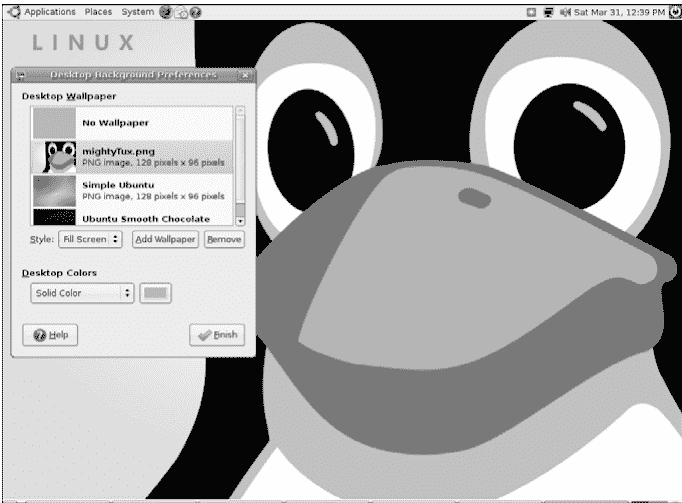
图7-10：换了新壁纸的桌面
##### **7B-6：下载并安装艺术管理器（GNOME Art）**
上网搜壁纸安装本身其实还挺有趣的，不过有时候也会让人觉得是个麻烦事儿。对咱们这些爱折腾壁纸的人来说，幸运的是还有个更简单的方法：艺术管理器。艺术管理器也叫GNOME Art，是个很方便的应用程序，它会搜索art.gnome.org网站，并下载上面所有可用壁纸的缩略图列表。它也能为你后续在本项目中会用到的各类窗口边框、控件和图标主题集生成同样的缩略图列表。借助这些缩略图列表，你可以轻松下载安装任何你想要的内容，根本不需要在浏览器里移动光标。不用说，艺术管理器实在是非常好用！
可惜的是，艺术管理器并没有默认安装；不过你已经学过第5章了，肯定知道下载安装这类应用程序有多简单。你只需要运行Synaptic，搜索**gnome-art**，然后安装就可以了。之后你就可以通过选择**系统 ▸ 首选项 ▸ 艺术管理器**来运行它了。这时候GNOME Art窗口就会打开，里面一开始是空白的。想要用它、摆脱这片空白的话，就去点击**艺术**菜单，选择**背景 ▸ GNOME**。（如果你愿意的话，也可以选择**全部**而非GNOME，只是下载可用壁纸列表的时间会更长一些。）选择完成后，艺术管理器就会开始从http://art.gnome.org下载所有可用内容的列表。可能有一分钟左右看起来什么反应都没有，这是正常的，稍等一会儿就好。下载完成后，你就会看到可供选择的缩略图列表（见图7-11）。
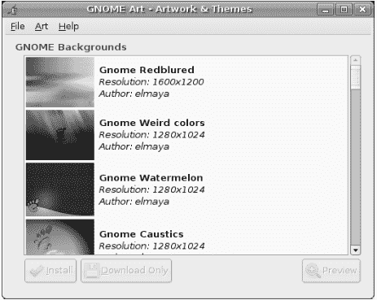
图7-11：使用艺术管理器安装桌面壁纸
现在你可以向下滚动列表，找到自己喜欢的壁纸，单击选中它，然后点击**“安装”**按钮来安装壁纸。之后艺术管理器会自动下载、安装该壁纸，还会自动打开“桌面和背景首选项”窗口，如果你想立即应用的话可以直接操作。就像我之前说过的，这是个非常方便的工具，尤其是在这个项目的后续内容里你会更频繁地用到它。
##### **7B-7：更改窗口边框、控件和图标集**
现在到了我这趟数字“整容”之旅里我最喜欢的部分了——更改GNOME中窗口边框和控件的外观。那我们就开始吧。操作过程其实非常简单。点击**系统**菜单，选择**首选项 ▸ 主题**。主题首选项窗口会打开，显示你系统中已安装的主题列表（见**图7-12**）。Ubuntu的默认主题叫做**Human**，不过如你所见，还有很多其他主题。想要熟悉操作的话，你可以逐个点击列表里的主题来预览效果，修改会立即生效。只要点击某个主题，就会更改你的窗口边框、控件，甚至如果你看一下主文件夹的话，会发现图标也变了。当你点击Crux或者Glider主题的时候，这个变化会特别明显。
每个主题都由窗口边框、一套控件和一组图标组成。正因如此，你可以自行混合搭配这些元素。举个例子，假设你喜欢Crux主题里准工业风控件的外观和颜色，但又更喜欢Mist主题的窗口图标和Human主题的边框。没关系，你用不着失望，因为你可以创建一个由这三类不同元素组合而成的自定义主题。
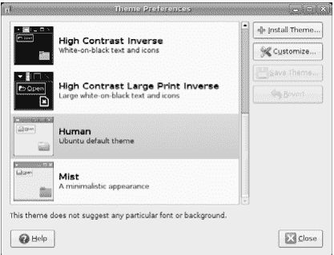
图7-12：在GNOME中选择主题
要创建你自己的混搭主题，只需要在主题首选项窗口中点击**“自定义”**按钮。会打开一个新窗口，里面有三个选项卡：控件、窗口边框和图标。在每个选项卡里你都可以选择自己喜欢的组件。首先点击“控件”选项卡，选择Crux；然后点击**“窗口边框”**选项卡，选择Human；最后点击“图标”选项卡，选择Mist。现在先别关主题详情窗口，打开你的主文件夹看看你刚才设置的效果。嗯……还不错。不过，也许你并不是特别喜欢Human窗口边框的外观。想要找更合心意的边框的话，再次点击**“窗口边框”**选项卡，向下滚动列表，逐个点击选项，直到看到喜欢的为止（Metabox就挺合我心意的），然后选中它。这次怎么样？好点了吗？
现在你对效果满意的话，就可以点击**“关闭”**按钮了。现在你会回到主题首选项窗口，你会发现列表最上方多了一个名为“自定义主题”的新条目。如果你想保存这个新组合以后用的话，就点击**“保存主题”**按钮。点击后会打开一个对话框，你可以在里面给主题命名，还可以写一段简短的说明。给你的主题起个名字，想写说明就写，然后点击**“保存”**。你新建的主题就会按照你取的名字，按字母顺序出现在主题列表里。全部弄完之后，你的主文件夹窗口应该会变成图7-13里的样子（顺便也可以看看你的面板和应用程序菜单的变化）。啊，太酷了！
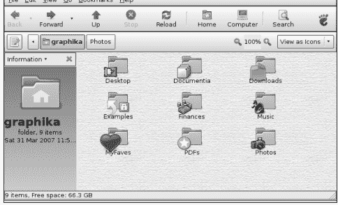
*图7-13：更改主文件夹窗口的外观*
##### **7B-8：安装额外的窗口边框、控件和图标**
如果你热衷于这类自定义操作，但又对系统自带的主题选项不满意，你可以下载安装更多其他的窗口边框、控件和图标。为了演示具体操作方法，我会带你制作一个仿Mac主题，它的外观会和Mac OS X的标准Aqua主题非常相似，效果如图7-14所示。
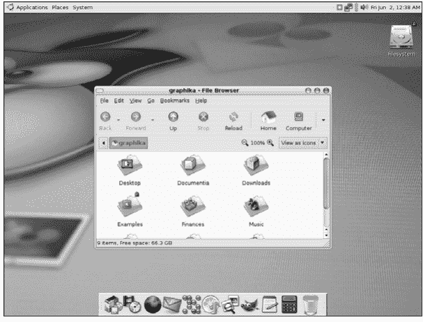
*图7-14：变身Aqua风格的Ubuntu桌面*
### **获取并安装所需文件**
要获取制作这个主题所需的文件，我们再用一次艺术管理器。启动之后，点击**艺术**菜单，选择**背景 ▸ 其他**。等可用壁纸列表出现在艺术管理器窗口中后，向下滚动找到名为**Real shoot**的壁纸，点击**“安装”**按钮安装它，之后在自动打开的“桌面背景首选项”窗口中选择该壁纸并应用。
> **注意** 如果你在艺术菜单中选择选项后，艺术管理器没有自动开始下载可用文件列表，只需要重启艺术管理器再试一次即可。
现在要为你的新主题选一个合适的窗口边框，回到**艺术**菜单，这次选择**桌面主题 ▸ 窗口边框**。找到名为**Hacked**的边框，点击**“安装”**按钮安装它。当时**“主题首选项”**窗口自动打开时，点击**“自定义”**按钮，再点击**“窗口边框”**选项卡。在该选项卡显示的列表里点击**Hacked**。关闭主题详情窗口和桌面背景首选项窗口，就完成了这一步。
接下来要获取一套匹配的应用程序控件小部件，回到艺术管理器的**艺术**菜单，选择**桌面主题 ▸ 应用程序**。列表下载完成后，找到名为**Yattacier 3**的文件并安装。之后弹出的桌面背景首选项窗口中，像之前一样点击**“自定义”**——但这次要点击**“控件”**选项卡，在该选项卡的列表里选择**Yattacier3**。
最后，我们再添加一些新图标，回到艺术管理器，进入**艺术**菜单，选择**桌面主题 ▸ 图标**。列表下载完成后，找到**Snow-Apple**并安装。之后的步骤和上一步基本一致，只不过这次要在主题详情窗口中点击**“图标”**选项卡，然后选择**Snow Apple**。
### **收尾完善**
现在整体的风格确实有点Mac那味儿了，但还有更多操作可以强化这个效果。首先，打开一个Nautilus窗口，点击**“计算机”**按钮，然后把**“文件系统”**图标拖到你的桌面上。这样就会在上面创建一个你硬盘的别名。接下来，到底部面板，把除了回收站之外的所有图标都删掉。之后，右键单击回收站最右侧的区域，在弹出的菜单中选择**“属性”**，打开底部面板的首选项窗口。在该窗口的**“常规”**选项卡中，取消勾选**“扩展”**，然后把面板大小调整到约54像素。设置完成后点击**“关闭”**，然后开始添加你最常用的应用程序的启动器。最后，到顶部菜单，删掉系统菜单旁边的那三个图标。之后添加一个窗口选择器小程序，这样你就有办法在已打开的窗口之间切换了。你可能还想改一下主文件夹的背景，因为现在那里的暖色调和你新的冷色系配置已经不搭了。
现在改造就全部完成了，如果你跟着操作正确的话，你的桌面应该会和我之前图7-14里的差不多。你可以继续用这个新的类OS X主题，也可以换成其他的。


 为保证表述一致，我现在将切换回*人类*视角。顺便一提，如果你确实打算保留仿Aqua主题，记得在主题偏好设置窗口中点击**保存主题**按钮，并为该主题命名。
#### 项目7C：在桌面上放置主文件夹和废纸篓图标
想必你已经知道，和Windows、Mac OS X或其他Linux发行版不同，Ubuntu安装完成后桌面是完全空白的。很多人推崇这种设计，因为它不鼓励用户长期将桌面作为存储文件和程序启动器的位置。毕竟按照这种说法的逻辑，你总不会把办公室的废纸篓或文件柜放在办公桌桌面吧？抛开这些逻辑不谈，还是有相当多的人——包括我——更希望桌面上显示废纸篓、硬盘和主文件夹图标。如果你也是这类用户，可以按照以下步骤操作：
- 1. 按下**ALT-F2**组合键打开“运行应用程序”窗口。这个快捷键等同于点击你在初始用户账户中添加到面板上的“运行应用程序”面板小程序。
- 2. 在上述窗口中输入`gconf-editor`，然后按下回车键，即可打开GNOME配置编辑器。
- 3. 当配置编辑器窗口出现后，点击apps旁边的小箭头，向下滚动找到nautilus，再点击它旁边的小箭头。
- 4. 在展开的nautilus分区中点击**desktop**，之后该项目的配置选项就会出现在窗口右侧面板中（图7-15）。
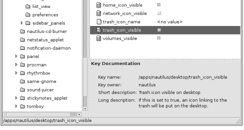
图7-15：配置编辑器
- 5. 勾选你希望在桌面上显示的选项旁边的复选框。目前有四个未勾选的选项可供选择：computer_icon_visible（对应Windows中的“我的电脑”）、documents_icon_visible
- 6. 操作完成后，关闭配置编辑器。
> **注意**：按照上述方法进行的更改会影响所有用户账户。例如，如果你为某一个用户账户设置了在桌面显示废纸篓，那么所有其他用户账户的桌面上也会出现废纸篓图标。
#### 项目7D：修改登录屏幕
你在使用艺术管理器时可能已经注意到，其中有一个名为**艺术 ▸ 其他主题**的菜单项，对应的是登录管理器。登录管理器就是你看到的登录屏幕，也被称为*greeter*——也就是你首次登录系统时输入用户名和密码的界面。登录管理器同样是可自定义的，但需要提前提醒你：你所做的任何更改都是全局生效的，而非仅对你个人生效；你安装并选定的任何登录管理器主题，都会成为这台机器上所有其他用户账户登录时看到的主题。当然，如果你是这台机器的唯一使用者，这一点就无关紧要了。
### 7D-1：下载登录管理器主题
要尝试自定义登录管理器，请打开艺术管理器，选择**艺术 ▸ 其他主题 ▸ 登录管理器**。完成操作后，浏览列表中的各种主题，选择1-2款你喜欢的；这一部分你可以自由选择，但我会选择名为GDM-ManzanaTux的主题来完成仿Mac主题的效果，如果你想要完全跟着操作的话可以选择这款。和你之前使用艺术管理器的体验不同，登录管理器主题只能下载，需要你手动完成安装。既然如此，选定主题后，点击**仅下载**按钮。下载完成后，你会在主文件夹或你指定的其他文件夹中找到后缀为tar.gz的压缩文件。你不需要解压，也不需要*untar*这个压缩文件。
> **注意**：如果你通过艺术管理器安装登录 greeted时遇到问题，可以访问http://art.gnome.org，点击页面上的登录管理器链接，直接下载 greeted。
### 7D-2：安装新的登录管理器主题
下载完1-2款你喜欢的主题后，你需要打开登录屏幕设置窗口。具体操作是：点击**系统**菜单，选择**管理 ▸ 登录窗口**。随后会弹出一个要求输入密码的对话框，输入你当前使用的账户密码，点击**确定**。不久后登录窗口偏好设置窗口就会打开（见图7-16），其中会列出所有可用的 greeted缩略图。你可以直接将下载好的 greeted文件拖拽到列表中，来添加这些 greeted。之后会出现一个小窗口，询问你是否确定要安装刚拖拽到列表中的文件，由于你确实想要安装该文件，因此点击**安装**。
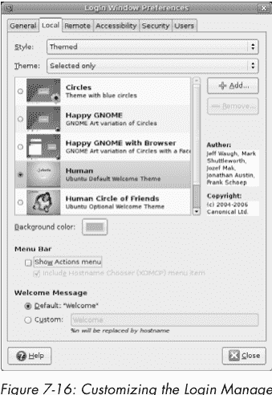
要选择你想要使用的 greeted，只需在登录窗口偏好设置窗口的列表中，点击对应名称旁的圆形按钮，再点击**关闭**按钮即可。当然，要看到你选定的 greeted的实际效果，你需要先注销再重新登录，不过无需重启或关机。当登录屏幕出现时，你就能看到新的 greeted了（图7-17），不过你的界面可能和示例不同。
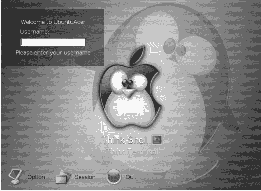
#### 项目7E：修改启动画面
好了，到现在为止，系统层面你能修改的内容基本都改完了，但其实还有一个可以折腾的选项——你的启动画面。如果你不太熟悉启动画面这个概念，它指的是你登录系统后、进入桌面之前，GNOME启动时显示的界面。图7-18展示的是默认的Ubuntu启动画面，观感还不错，如果你喜欢更有个性或者色彩更丰富的样式，也可以自行选择。
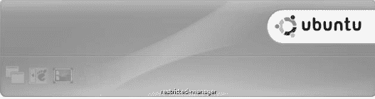
*图7-18：Ubuntu默认启动画面*
### 7E-1：启用自动登录
在登录窗口偏好设置窗口打开的时候，正好可以提一个你可能感兴趣的选项。如果你觉得每次开机都要输入用户名和密码很麻烦，那你应该会很高兴知道可以跳过整个登录流程。当然，如果你的电脑是和其他人共用的，就不建议你这么做——任何能接触到你的电脑的人都可以访问你的用户账户。我也不建议你在笔记本电脑上开启这个功能，因为笔记本电脑更容易丢失或被盗，这会导致你的数据被完全陌生的陌生人获取。要启用自动登录，请在登录窗口偏好设置窗口中点击**安全**选项卡，然后点击页面顶部“*启用自动登录*”文字旁的复选框。之后，点击“*用户*”文字旁的下拉菜单右侧的箭头，从列表中选择你的用户名。操作完成后，点击**关闭**按钮。下次开机时，你就会跳过登录屏幕，直接进入桌面。
### 7E-2：安装新的启动画面
Ubuntu默认没有提供其他可选的启动画面供你折腾，因此要进行修改，你需要先下载并安装一些启动画面备用。操作起来非常简单，只需打开艺术管理器（**系统** ▸ **偏好设置** ▸ **艺术管理器**），然后按照以下步骤操作即可：
- 1. 点击**艺术**菜单，选择**其他主题** ▸ **启动画面**。艺术管理器会自动下载所有可用的启动画面。
- 2. 下载完成后，浏览所有可用选项，单击选中一款你喜欢的启动画面。
- 3. 选定主题后，点击**安装**按钮，艺术管理器会自动下载并安装该文件。安装完成后，GNOME启动画面偏好设置窗口会打开，展示新安装的启动画面。
- 4. 返回艺术管理器，重复步骤2和3，添加更多启动画面选项到你的备选列表中。
- 5. 安装3-4款启动画面后，关闭艺术管理器。
### 7E-3：选择和启用启动画面
当你的系统中安装了多款启动画面后，你可以通过GNOME启动画面偏好设置窗口（图7-19）选择并启用它们，这个窗口此时应该已经处于打开状态。如果没打开，你可以通过点击**系统**菜单，选择**偏好设置 ❖ 启动画面**来打开它。
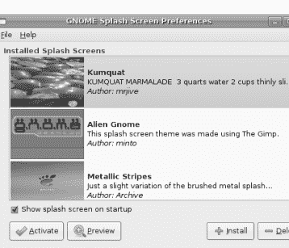
窗口首次打开时，所有已安装的启动画面都处于灰色不可选状态。要选择并启用某款特定的启动画面，首先需要勾选“*启动时显示启动画面*”文字旁的复选框。此时已安装启动画面的缩略图就可以被选中了，单击你想要的启动画面缩略图完成选择，再点击**启用**按钮即可。下次登录系统时，你就能看到新启动画面的实际效果了。
### 选择屏幕保护程序
过去，屏幕保护程序是计算机用户必备（且必用）的工具，用来防止显示器出现烧屏损伤。不过如今视频显示技术已经进步到完全不需要屏幕保护程序的程度。但话又说回来，屏幕保护程序看起来确实很酷，而Ubuntu的一大优点就是它预装了异常丰富的屏幕保护程序模块——将近200款！数量如此之多，你肯定能找到至少几款喜欢的。屏幕保护程序的设置默认会按顺序切换不同模块

以随机模式运行，每隔几分钟更换一次当前模块。你可以通过打开**系统**菜单，选择**偏好设置** ▸ **屏幕保护**来修改这些设置。如图7-20所示的屏保偏好设置窗口支持你进行多种操作，比如设置模块更换的间隔时长，以及屏保启动前的闲置时长。你也可以选择仅使用单个屏保模块，或者完全不使用屏保。在随机模式下，你还可以取消勾选不想要的模块名称旁的复选框，来排除你不想使用的模块。如果某些屏保会过度占用你机器的图形性能，这个功能会非常实用。
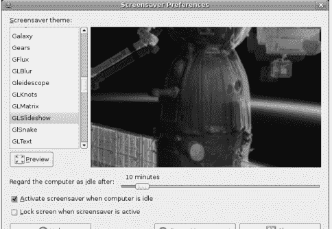
> *图7-20：设置屏保偏好*
#### **项目7F：收官——安装并应用火狐浏览器主题**
是时候结束这场相当漫长的个性化设置了。现在你已经掌握了这一领域大部分你可能想要进行的操作，你可以回到自己的用户账号，运用所学做出符合自己品味和喜好的调整。如果你真的对个性化设置上了瘾，你会很高兴知道还有更多内容可以让你随心定制。除了可以自定义系统提示音、登录后显示的启动画面，以及菜单和文件夹中展示的系统字体外，你还可以折腾许多支持通过专门为该应用设计的皮肤来进行定制的程序。其中最知名的可定制应用之一，就是你在第4章首次了解的火狐浏览器。火狐浏览器支持通过*主题*来更改其按钮、应用控件甚至背景颜色的外观，部分主题示例如图7-21所示。
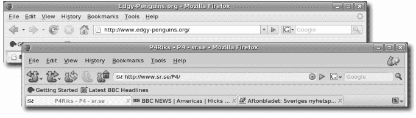
*图7-21：火狐浏览器主题*
你会很高兴了解到，下载并安装这些主题的过程相当简单直接，因此为了给本章收尾，我将为你提供需要遵循的操作步骤：
- 1. 在火狐浏览器中，打开**工具**菜单，选择**附加组件**。随后会弹出火狐附加组件窗口。
- 2. 在该窗口顶部，点击**主题**选项卡。
- 3. 点击该窗口右下角的**获取更多主题**链接。
- 4. 随后会弹出一个新的火狐窗口，列出所有可用的主题分类。点击任意分类链接即可预览对应主题。
- 5. 找到喜欢的主题后，点击该主题的链接，然后在弹出的窗口中点击**立即安装**。
- 6. 随后会弹出确认窗口，询问你是否确定要安装该主题。点击**立即安装**确认。
- 7. 主题下载并成功安装后，就会出现在附加组件窗口的“主题与安装”页面的可用主题列表中（见图7-22）。在主题页面，单击你想要使用的主题，然后点击出现的**使用主题**按钮。
- 8. 要查看新主题的实际效果，重启火狐浏览器即可。
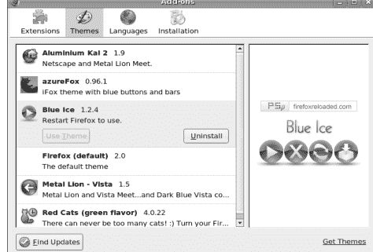
*图7-22：选择火狐浏览器主题*
## 8个简单猫咪妙招
### *了解Linux终端与命令行*

很多人对Linux系统望而却步，因为他们心目中的Linux是电脑极客专属的系统，是一个所有操作都得靠命令行硬核完成的环境。在这个图形界面普及的时代，靠输入命令来完成任务似乎是DOS时代的可怕倒退，这让不少人望而却步——尤其是那些还记得“老古董”时代是什么样的人。这种反应情有可原，但并不符合Linux世界的真实情况。毕竟，如今大多数Linux用户都在使用某种图形界面，他们完全可以，也经常仅通过下拉菜单和鼠标点击就达成所有目标，不少人甚至一辈子都不曾打开终端也能用得相当顺心。你也可能属于这种情况。尽管如此，命令行的强大与便捷仍然值得一提。而且现在命令行可以在图形化环境中使用，这一特性也让它不再那么令人生畏。终端就是图形化海洋中的一座小小纯文本孤岛（见图8-1）。使用命令行可以和你系统上的其他操作一样轻松无痛，如果你愿意尝试的话，它甚至能给你带来一点乐趣。

*图8-1：正确看待终端*
不幸的是，许多命令行使用指南都是由硬核命令行狂热者撰写的，他们对这种在其看来极佳工具的热情，无意中让他们写的内容对刚接触Linux的新手或者潜在用户来说更显劝退。为了你着想，我会尽量克制自己的热情，免得直接把你吓回第5章，回到更舒适的新立得（Synaptic）世界。我也会尽量帮你正确看待命令行：只要有可能，我会教你将命令行作为手头各种图形工具的补充来使用，而不是把它说成是唯一的操作方式。当然，我不会在这一部分涵盖所有可能的角度——只会提供足够的接触和实践内容，希望至少能让你对命令行感觉更自在一点。谁知道呢？你可能真的会觉得用命令行……挺有意思？好吧，我可不会太过异想天开。
### 认识终端
Ubuntu系统中的Linux命令行终端应用可以通过打开**应用程序**菜单，选择**附件 ▸ 终端**来启动。终端打开后，样式极其简约，看起来很像图8-2所示的样子。

> *图8-2：终端应用*
如你所见，终端里显示的内容是rg@UbuntuAcer:~$。其中rg是我的用户名，UbuntuAcer是我安装系统时为电脑起的名字，波浪号（~）表示我当前位于主文件夹。比如如果显示的是~/Music，就表示我当前在主文件夹内的Music文件夹中。当然，你的情况肯定会有所不同，因为你的用户名和电脑名都不同。比如如果你的用户名是frog，电脑名是wetrock，命令行就会显示为frog@wetrock:~$。如果这些都让你觉得难以理解，不妨这么想：终端中的username@computer_name:~$就相当于Nautilus文件管理器中的主文件夹。在终端中输入操作相当直白；你只要像平时一样打字即可。你也可以通过使用Delete键、Backspace键和光标键来删除或插入字母、短语。来试着练习一下吧：
- 1. 输入**我非常非常喜欢草莓。**
- 2. 把草莓改成樱桃（毕竟樱桃确实好太多了）。只要按左光标键，把光标移到草莓第一个*s*的前方。
- 3. 按Delete键，按够必要的次数删掉strawberries这个词（呃，我觉得得按12次吧）。
- 4. 输入**樱桃**，然后按右光标键把光标移回这句有意义的话的末尾。
做完这段有趣的打字练习后，按下Enter键。你几乎立刻就会看到，终端对你之前的操作给出的回应只有一条漫不经心的bash报错：`I: command not found`。尽管你输入的文本对你来说有意义，但对系统来说它毫无意义。事实上，系统短视到

它除了你在终端输入的第一个单词（也就是i）之外什么也识别不了；而且因为i不是有效的命令，系统不知道该怎么处理它。

## Shell（壳）
你可能正在纳闷这里的bash是什么意思，以及它为什么在跟你对话。是这样的，Bash（Bourne Again Shell）是Linux系统中使用的众多Shell（壳程序）之一，而且碰巧它就是你Ubuntu发行版（以及绝大多数其他Linux发行版）预装的Shell。Shell是一种程序，它会解释你在终端输入的命令，并将其传递给系统，让系统能够执行这些命令。我喜欢把它理解为一个命令处理子系统，而终端就是它的图形化前端。正如你将在第146页的8C项目中学到的那样，部分脚本语言也有专属的Shell；但除了这少数例外情况外，你通常不需要过度关注其他Shell，只要知道它们是什么，以及别人提到它们时在说什么就够了。

## 命令行终端的傻气又实用的趣味功能
在命令行终端输入指令有个很酷的特点：它有所谓的“短期记忆”。你可以试试输入单词cherry然后按回车键。忽略“命令未找到”的提示，继续输入vanilla再按回车。接着输入icecream再按回车。到目前为止，看起来都很傻气，对吧？不过其实并非如此。
我们来试试重新输入刚才输入过的所有内容，这次只需要按一个键就行。什么？没错，只要按一次向上光标键，你看到了什么？对了，你最后输入的命令就会显示出来，这个例子里就是icecream。再按一次向上光标键，你之前输入的那条命令就会显示出来——vanilla。再试一次？对，是cherry。最后一次按，来个压轴……我最喜欢樱桃了。
考虑到我们目前演示的内容，这些可能看起来有点傻，但想象一下你输入的不是这些傻气的小单词，而是长很多的字符串，比如本章后面会讲到的简单复制命令，示例如下：
```
cp Photos/mypics/stpierre/coastal/onthebeach1_27.jpg /home/frog/photos_for_mom/stpierre
```
输入这个字符串，你就是在把名为onthebeach1_27.jpg的图片从coastal文件夹复制到另一个叫stpierre的文件夹里。如果你想复制coastal文件夹里的另一张照片，比如onthebeach1_16.jpg，只需要按一次向上箭头键，然后用左光标键和删除键移动到27的位置把它删掉，替换成16，再用右箭头键回到命令末尾就好。整体来看，这种方式简单太多了，速度也快得多，还能避免输入错误。现在看起来没那么傻了吧？

## 无害命令
### $ whoami
没有比**whoami**更简单、安全甚至看起来没用的命令了。whoami命令不会帮多重人格障碍患者找出自己当下的身份，它只会告诉你当前登录的是哪个用户。你可以试试在**$**符号后面输入**whoami**然后按**回车键**来试试。注意命令是区分大小写的，所以要按照要求输入。终端接下来会显示当前登录用户的用户名。如果你是以frog身份登录的，命令返回的结果就会是frog。

### $ finger
如果你用whoami命令查自己的身份觉得有意思，那用finger命令了解自己的更多信息你会更感兴趣。finger命令有很多种用法，其中最简单的就是查询特定用户的信息。你可以输入**finger**再加上你的用户名来在自己身上试试，比如我的例子就是**finger rg**。输入完命令后按**回车键**看看你会得到什么结果。我的查询结果如图8-3所示。

图8-3：finger命令的输出结果
如你所见，我的登录名是rg，真实姓名是Rickford Grant，我的主目录是/home/rg，我使用bash Shell输入命令，我从美国东部时间4月1日周日18:44开始登录，目前没有邮件也没有plan。它不会告诉你我的社会安全号码或者我母亲的娘家姓，不过是不是很酷？我刚才提到返回结果里显示我没有plan，你可能纳闷这是什么意思，我来给你解释一下。
.plan文件是存放在你主目录下的小文件，其他用户对你使用finger命令时就能看到它。传统意义上，.plan文件会记录你接下来的去向或者正在做的工作。不过如今大多数人用它来留些奇怪的小消息、名言之类的，和邮件签名的作用差不多。
看看图8-4，这是我向主目录添加.plan文件后finger命令的输出结果。

图8-4：添加.plan文件后*finger*命令的输出结果
现在你可以看到我的plan内容了，是引自库尔特·冯内古特的*《泰坦的海妖》*（或者说是Al Stewart的同名歌曲，二者内容一致），当然你可以在自己的.plan文件里放任何你想放的内容。你将在第140页的8A项目中获得创建自己plan文件的机会，所以如果觉得这些很有趣，就敬请期待吧。
在继续之前我要说明，你还可以用finger命令做点小型的家庭侦察。比如假设你的孩子Chris在你的电脑上有用户账户，他想让你同意他去看电影，声称自己一整天都在电脑上赶学校的报告。如果你心存怀疑，可以输入`finger chris`看看实际情况到底是什么样的。这么做可能有点不光明也不怎么光彩，但确实有用。而且这种事是双向的，别人也能查你的信息。你现在就可以试试，看看你上次登录graphika账户是什么时候，只要输入`finger graphika`然后按回车就行。你甚至可以用finger命令查找其他系统上用户的信息，只要对方的网络开启了finger服务，而且你知道对方的邮箱地址。输入类似`finger username@hostname.com`这样的命令就可以实现。我觉得这个方法很酷，但也有点诡异，你说呢？

### $ pwd
如果你知道自己是谁，但不太确定自己在哪里，`pwd`（打印当前工作目录）命令就能派上用场。`pwd`命令会精确告诉你终端在目录树中的位置。举个例子，如果我的终端位于系统主目录（实际名为home，所有用户账户目录都存在这里）下的个人主目录（实际名为`rg`）中，我输入`pwd`命令后按回车，终端就会输出`/home/rg`。你自己试的话也会得到类似的结果。
> 注意：这里的*print*一词和打印机没有任何关系，它只是表示返回结果会被*输出到*或者说*显示在*终端中。

### $ df
另一个安全易用、实用性却高得多的命令是`df`（磁盘文件系统）。`df`命令会显示你各个已挂载磁盘的每个分区已用空间和剩余可用空间。你可以输入`df`然后按回车试试，输出结果会类似图8-5所示（当然具体内容取决于你已挂载磁盘的大小和配置）。

*图8-5：df命令的输出结果*
你会发现，这里显示的空间单位是千字节（KB），而不是你更常用的吉字节（GB）和兆字节（MB），不过有办法解决这个问题。很多命令都支持*标志*（也叫*选项*），可以进一步调整命令的执行方式。这些标志直接写在主命令后面，前面加一个空格和连字符。在这个场景下，你可以尝试使用`-h`（人类可读）标志，让输出结果以你更熟悉的格式呈现。在命令行输入`df -h`然后按回车就能试试，现在输出的格式会更熟悉（见图8-6）。

*图8-6：使用-h标志运行df命令的输出结果*

### $ ls
另一个无害但很实用的命令是`ls`（列出目录内容）。`ls`命令会显示你当前目录下的所有内容，相当于不用图形界面、直接在Nautilus文件管理器中双击文件夹查看内部内容的效果。你可以输入`ls`然后按回车键试试。


如果你到目前为止一直按照*我的*指令操作，那么你得到的结果应该会列出主目录下的所有文件夹。你还可以使用`-R`参数，不仅显示文件夹内的文件列表，还能展示子文件夹中的内容。当然，你在第6章创建的所有文件夹里应该都没有子文件夹，所以你可以暂时先不用试验这个参数。你可以先输入`ls -a`来查看那些不可见的、也就是*隐藏的*文件。
### $ sudo
回想你在第5章运行Synaptic（新立得软件包管理器）的时候，系统会首先要求你输入密码，之后才能运行该程序。我当时提到过，出现这种情况的原因是：Synaptic会将下载的文件安装到系统各处不同的文件夹中，而这些文件夹几乎都是写保护的。你输入密码，就是告诉系统：作为密码的持有者，你有权利允许Synaptic执行这些操作。这一密码授权流程的命令行版本就是`sudo`命令。要在写保护的文件夹中执行操作，你需要先输入`sudo`，再输入想要执行的命令。举个例子，如果你想将一个图标图片（我们就叫它`myicon.png`）复制到全局的、受写保护的pixmaps文件夹（`/usr/share/pixmaps`）中，就需要输入`sudo cp myicon.png /usr/share/pixmaps`。输入以`sudo`开头的命令并按下回车键后，系统会提示你输入密码。输入密码后再次按下回车键，命令就会执行。需要说明的是，你输入密码后，它会在内存中保留约15分钟。也就是说，在这15分钟内再次使用`sudo`命令时，系统不会再次要求你输入密码。
### $ locate
相比你之前学过的那些看似简单的命令，`locate`命令的实用性非常强。事实上，你可能会发现，用它查找文件比Places菜单里的图形化搜索工具更简单、更快速、也更高效。这个命令的使用方法非常简单：你只需要输入命令，再加一个空格，然后输入你要查找的文件名即可。不过，在使用这个命令之前，你需要先为`locate`创建一个文件名数据库。这一步操作非常简单：用你刚才学过的`sudo`命令，再加上`updatedb`（哇哦，又出现一个新命令！），最后按下`ENTER`键（也就是输入`sudo updatedb`）就可以完成。当系统提示你输入密码时，输入后可能会有一段时间看起来没有任何反应，不过不用担心，只要终端里的光标还在闪烁，就说明程序正在运行；当你的用户提示符重新出现时，就说明你已经成功创建了数据库文件了。之后你就可以正常使用`locate`命令了。哦对了，以后如果你觉得这个创建数据库的过程越来越久，也不用担心——这确实是正常现象。你系统里安装的文件和应用程序越多，系统为它们建立索引所需的时间就越长。现在我们来试验一下这个新命令，找一下我们在第3章用过的`openofficeorg22-writer.png`文件。只需输入以下内容，然后按下回车键：
``` locate openofficeorg22-writer.png ```
你会得到如图8-7所示的结果。
> **图8-7：** `locate`命令的搜索结果
### $ calendar
这个命令就留给你自己试验吧。你只需要输入`calendar`，然后按下回车键，就能看到还挺有意思的结果。
### $ exit
`exit`命令非常简单，作用是退出终端。你只需要输入`exit`，然后按下回车键，终端窗口就会关闭。
## 有点真本事的命令
你之前试过的那些简单命令都属于安全可靠、消防员都认可的类型——它们只会往终端里打印信息。现在你要试试用这些命令获得一些真正实际的成果。只要按照我的说明操作，这些命令本质上也是安全可靠的。
### $ mkdir
你已经学会了如何通过菜单和鼠标创建文件夹，不过你也可以用命令行来完成这个操作。对应的命令是`mkdir`（即make directory，意为创建目录），用起来小菜一碟（不过我始终没搞懂馅饼到底哪里容易了）。为了解这个命令的用法，也方便接下来练习其他命令，现在请你用`mkdir`命令创建一个名为`command_exp`（command experiments，即命令实验）的文件夹。你只需要在新建的终端窗口里输入`mkdir command_exp`，然后按下回车键即可。新建的文件夹应该会出现在你的主目录里，你可以点击桌面上的主目录图标，去确认一下它是否存在。好的，做得好！现在让我们在这个新文件夹里再创建另一个新文件夹——也就是子文件夹。我们给它起名叫`sub`。你只需要输入`mkdir command_exp/sub`，然后按下回车键即可。如果你想确认的话，现在可以去看看`command_exp`文件夹里是否已经出现了这个子文件夹。
### $ mv
下一个命令是`mv`（move，即移动）命令，但在试验它之前，我们需要先创建一个虚拟文件——毕竟总得有个东西来移动才行。我们可以用另一个命令`touch`来完成这个操作。我们来创建这个文件，就起名叫`expfile.txt`吧：打开终端，输入`touch expfile.txt`，然后按下回车键。这个新文件之后就会出现在你的主目录里。要移动你刚创建的这个文件，自然就要用到`mv`命令。你只需要输入`mv expfile.txt command_exp/sub`（这行命令会告诉系统要移动哪个文件、要移动到哪里），然后按下回车键即可。现在这个文件就已经在你的`sub`文件夹里了。
### $ cd
到目前为止，你一直是在主目录下使用命令行。通过`cd`命令，你可以把终端的定位切换到其他文件夹。这是一个非常实用的命令，在做本书的其他项目时你会经常用到它。现在我们来试用一下这个命令：输入`cd command_exp`然后按下回车键，就能进入`command_exp`文件夹。如果你的操作正确，现在终端的提示符应该会显示为`username@computer_name:~/command_exp$`。如果确实如此，你可以给自己鼓个掌。既然已经到了这个目录，你顺便可以试试带`-R`（递归）参数的`ls`命令，看看它有什么效果。你只需要输入`ls -R`，然后按下回车键。终端现在会显示，当前目录下有一个名为`sub`的子文件夹，这个子文件夹里还有一个名为`expfile.txt`的文件。现在你在这个目录里要做的就是这些，所以要回到主目录的话，你只需要输入`cd`，然后按下回车键，就可以“回家”了。为了方便以后使用，这里介绍几个其他的`cd`命令快捷操作。如果你处于子文件夹的子文件夹里，想要回退一级（比如从`/home/rg/peas/pudding`回到`/home/rg/peas`），你只需要输入`cd ..`（注意`cd`和`..`之间有一个空格），然后按下回车键就可以实现。你也可以输入`cd -`（注意`cd`和`-`之间有一个空格），就能回到你之前所在的目录（比如从`/home/rg`回到`/home/rg/peas/pudding`）。
### $ cp
人类善变是天性，你可能突然觉得，你不仅想要`expfile.txt`文件存在于`sub`文件夹里，还想要它在最初所在的主目录里也有一个副本。要复制`expfile.txt`，你可以使用`cp`（copy，即复制）命令。执行这个操作时，命令需要知道你要复制的文件在哪里、文件名是什么，以及你要把它复制到哪里，本次操作的目标位置是你的主目录。正常情况下，你需要输入`cp command_exp/sub/expfile.txt /home/username`来完成这个操作，不过如果你还记得本章开头我提到过的内容，你可以把命令里的`/home/username`部分缩写为`~/`，两者含义相同。这个技巧很重要，建议你记住，因为波浪号在网上的各类教程中经常出现。为了减少手指的磨损（毕竟这是个很值得追求的目标），请输入以下命令，然后按下回车键：
``` cp command_exp/sub/expfile.txt ~/ ```
注意，你要复制的文件和目标路径之间要留一个空格（本次操作中就是`expfile.txt`和`~/`之间要留空格）。完成这一步后，你应该会有两个`expfile.txt`文件副本，一个在主目录里，另一个在`sub`文件夹里。去看看吧，看看你努力的成果。
### $ rm
小时候，你可能体会过用乐高积木搭城堡的快乐，以及把搭好的城堡砸烂的更爽快的感觉（最好是用D型电池砸的那种）。现在我们要来做个类似的操作。这项充满怀旧感操作的第一个工具就是`rm`（remove，即删除）命令，用它可以删除文件。`rm`命令虽然非常实用、操作简单，但使用时一定要谨慎。用这个命令删除文件后，操作是不可逆的——文件不会被放进回收站，而是会被彻底删除。为了安全起见，我们先拿刚在主目录里创建的那个`expfile.txt`副本来试验`rm`命令，把它删掉。`rm`命令的基本结构是：先输入命令本身`rm`，再跟上你要删除的文件名。本次操作中，你要删除的是位于主目录里的名为`expfile.txt`的文件。如果你的终端当前定位在主目录，你只需要输入`rm expfile.txt`，然后按下回车键就可以删除这个文件。这个文件就会被彻底删除，再也找不回来了。现在我们来加大“乐趣”，把位于`sub`子文件夹里的那个`expfile.txt`也删掉。这次你需要指定文件的具体位置，因为它不在终端当前所在的目录里。你只需要输入`rm command_exp/sub/expfile.txt`，然后按下回车键即可。哇哦，太爽了。这种破坏的快感是不是又回来了？
### $ rmdir
现在我们要用`rmdir`（remove directory，即删除目录）命令继续“爽”下去，这个命令可以看作是`rm`命令的升级强化版。和`rm`命令一样，使用`rmdir`命令时也要非常谨慎。用`rmdir`删除的东西可是没有后悔药吃的。用这个命令删除目录或文件夹后，它会被彻底清除，无法恢复。现在来试验一下这个命令，我们可以把你之前创建的`sub`文件夹删掉。输入`rmdir command_exp/sub`，然后按下回车键即可。现在`sub`文件夹应该已经被删掉了。最后，为了让这次“破坏之旅”圆满结束，我们再用一次`rmdir`命令，把之前创建的`command_exp`文件夹也删掉。你应该已经熟练掌握操作了，万一还没有的话，就输入`rmdir command_exp`，然后按下回车键即可。


## $ chmod
在第6章中，你学习了如何通过Nautilus图形界面更改文件权限。这无疑是执行此类操作最简单的方法，但如果你有一个装满文件的文件夹——比如从CD复制到硬盘的文件，且这些文件受写保护——逐个修改它们的权限会相当费劲。这种情况下，命令行方式处理起来会更加方便。更改文件权限的命令是`chmod`（change mode，更改模式）。使用它时，只需输入命令，后面跟上你要授予文件的权限，再跟上文件本身的路径即可。例如，假设你从CD复制了一张JPEG图片`mybirthday.jpg`到硬盘上Photos文件夹内的个人子文件夹中，且该文件受写保护。要修改文件权限，让自己拥有写权限（即可以修改该文件），你需要输入以下内容然后按回车：
```chmod 744 ~/photos/personal/mybirthday.jpg```
想要一次性修改某个文件夹下所有文件、子文件夹（以及这些子文件夹内的所有文件）的权限，你可以在`chmod`命令后加上`-R`（递归）参数。此时命令如下：
```chmod -R 744 ~/photos/personal```
顺便说一下，数字744会给你（文件所有者）授予读、写、执行（运行）权限，但给其他所有人只授予只读权限——拿不准的时候这是一个相当安全的选择。如果你想自己计算权限对应的数字，其实很简单。你只需要处理三个数字位，每个位有8种数值可能（0-7）。最左边的位代表所有者的权限；中间的位代表所属组的权限；最右边的位代表其他所有人的权限。数字本身的含义如下：
- 7：读、写、执行权限
- 6：读、写权限
- 5：读、执行权限
- 4：只读权限
- 3：写、执行权限
- 2：只写权限
- 1：仅执行权限
- 0：无权限
图8-8标明了每个数字的含义以及每个数字位对应的权限类别。事实上，如果你不介意做点简单的加法，理解起来会更容易。首先记住：1=执行，2=写，4=读。把这些数字中的任意几个相加，就能得到其他权限组合。例如1（执行）+4（读）=5（读和执行）。你看，权限其实并不复杂。现在如果你比起数字更喜欢字母，你会很高兴知道还有另一种修改权限的方式，可能甚至更简单。这种方式你只需要处理两组字母以及`+`和`-`符号。第一组如下：
- **u** 用户（文件所有者）
- **g** 组（指定的用户组）
- **o** 其他用户（既不是所有者也不是组成员的任何人）
- **a** 所有用户（以上所有类别）
第二组如下：
- **r** 读
- **w** 写
- **x** 执行
你可能已经能想明白这个规则是怎么运作的了，但我还是详细说明一下，免得你今天直觉不在线。假设你要修改某个文件的权限（比如`butterhaters.txt`），让机器上的所有用户都可以读写它。打开终端窗口后，输入`chmod a+rw butterhaters.txt`然后按回车就能完成修改。哎呀！突然想起你不想让任何人修改这个文件的内容，对吧？没问题，要收回该文件的写权限，你只需要输入`chmod a-w butterhaters.txt`然后按回车即可。你看，`+`用来授予权限，`-`用来移除权限。不得不说这简单多了。

## $ apt-get
为了收尾这一部分，我们最后介绍一个你可能会觉得有点熟悉的命令：`apt-get`。没错，这个命令确实是控制强大的软件包下载安装工具APT（高级打包工具）的核心，我在第5章介绍过它。虽然通过命令行使用APT可能不如通过Synaptic（新立得）或“添加/删除程序”工具来得顺手，但在某些场景下它非常实用。下面我为你介绍它的基础用法。
使用`apt-get`命令前，请务必关闭你打开的所有APT前端工具，比如Synaptic。我之前提到过，同一时间只能运行一个APT工具。当你确认没有其他APT工具在运行后，任何涉及`apt-get`的操作都应该先从更新APT数据库开始，这样你就能下载到最新的软件包。要做到这一点，只需输入命令`sudo apt-get update`即可。
如果你想安装单个软件包，不用打开Synaptic，输入`sudo apt-get 软件包名称`就能完成。例如，如果你想下载安装Shufflepunk游戏的克隆版Tuxpuck，你需要输入`sudo apt-get tuxpuck`。
如果你输了太多次之后终于对Tuxpuck感到厌烦了，你可以输入`sudo apt-get remove tuxpuck`来卸载它。
最后，牢记第5章提到的所有注意事项，如果你想通过命令行升级整个系统，可以输入`sudo apt-get dist-upgrade`（但要先执行`sudo apt-get update`）。

## 你很快会用到的其他几个Bash命令
现在正好介绍另外两个你会在本章以及本书其他地方用到的命令：`ln`和`tar`。你现在还没必要练习使用它们，因为马上你就会用到，但你提前了解一下它们的功能也没什么坏处。

### $ ln
`ln`（link，链接）命令用于创建一个链接文件，该文件可以启动或激活位于另一个文件夹中的文件。当你需要启动硬盘上某个嵌套了多层子文件夹深处的文件时，这个命令非常实用。这个命令经常和`-s`（symbolic，符号链接）参数一起使用，它和你熟悉的Windows快捷方式、Mac别名功能基本一致。
使用`ln`命令最简单的方式是，先用`cd`命令把终端的路径切换到你要放置链接的文件夹，然后在命令行输入`ln`命令，后面跟上你要链接的文件的路径。例如，假设你要在家目录中为你的自传OpenOffice.org Writer文件`mylife.sxw`创建一个链接，这个文件被埋在家目录下很深的一层层子文件夹里：`/home/username/Documents/personal/self/autobiography/mylife.sxw`。要创建这个链接，你需要打开一个新的终端窗口，输入以下命令字符串然后按回车：
```ln -s Documents/personal/self/autobiography/mylife.sxw```
完成操作后，链接会以图标的形式出现在你的家目录中，外观和原文件一致，只是多了一个箭头标识，表示它是一个链接。

### $ tar
在第6章中，你学习了如何创建和提取归档文件（也叫tarball），但你知道吗？你也可以用命令行来创建和提取tarball。`tar`命令就是实现这一功能的核心。要创建归档文件，你只需要输入`tar -cvf`，后面跟上最终生成的tarball的文件名，再跟上你要归档的文件夹或文件的名称即可。例如，假设你要为你的照片文件夹创建一个归档文件，名字叫`pics4pals`，此时你需要输入以下命令然后按回车：
```tar -cvf pics4pals.tar photos```
你肯定注意到了，这条命令里有几个参数。`c`告诉tar程序创建一个新的归档文件；`v`告诉程序开启详细输出模式，换句话说，就是让程序在执行操作时在终端里输出它正在执行的操作内容；最后`f`告诉程序后续内容为文件信息。
如果创建完归档文件后，你突然想起还有一个文件要追加进去，你可以用`-r`参数来将文件添加到归档中。例如，要把一个叫`cranky.png`的文件添加进去，你需要输入以下内容然后按回车：
```tar -rvf pics4pals.tar cranky.png```
当然，你大概率会更多地提取tarball而不是创建它，所以你肯定也很想知道怎么提取。幸运的是，这个过程和创建tarball的步骤非常相似，主要区别在第一个参数。创建tarball时用的是`-c`参数，提取时你要换成`-x`参数，它告诉tar程序提取指定的归档文件。所以如果你想提取一个叫`spicyfood.tar`的tarball，输入以下命令然后按回车即可：
```tar -xvf spicyfood.tar```
截至目前你做的都是创建和提取归档文件，它们本质上就是文件的集合。但它们没有经过压缩。事实上，你遇到的大部分tarball都是经过压缩的，你可以通过`.tar.gz`的后缀识别。gz表示这个归档文件是用gzip程序压缩的。提取压缩后的tarball和提取普通tar归档一样简单，你只需要加上`-z`参数，它告诉你的系统使用gzip程序来解压归档文件。例如，如果你想提取一个叫`goosedown.tar.gz`的压缩tarball，输入以下命令然后按回车即可：
```tar -xzvf goosedown.tar.gz```


好了，现在你已经知道如何解压并提取gzip压缩的tar包，接下来你可能想了解如何创建这类压缩包。这个过程和创建普通tar归档文件差别不大，你只需要加上-z参数，告诉程序使用gzip来压缩文件夹即可。举个例子，如果你想对名为Documentia的文件夹创建压缩版本，我们将它命名为tightdocs.tar.gz，你只需要输入以下命令，然后按回车键：
```bash
tar -czvf tightdocs.tar.gz Documentia
```
这里值得一提的是，你可能会遇到一些用bzip程序压缩的文件，这类文件通常带有.bz类的后缀名。处理这些文件完全没有难度，因为相关命令和gzip的命令几乎完全一致，你只需要把命令里的-z参数替换成-j即可。

## 压缩和解压单个压缩文件
如果你想压缩或解压单个文件，其实根本不需要用到tar程序，因为tar的作用是创建包含多个文件的归档包。你可以直接使用gzip和gunzip命令来完成操作。举个例子，要压缩名为matilda.png的文件，你只需要输入`gzip matilda.png`，然后按回车键，此时matilda.png文件就会变成matilda.jpg.gz。要解压该文件，你只需要输入`gunzip matilda.jpg.gz`并按回车键，之后matilda.jpg文件就会恢复为正常状态。

那么，你能压缩已经用tar命令创建好的归档文件吗？当然可以。举个例子，要压缩我们之前提到的spicyfood.tar归档文件，你只需要输入`gzip spicyfood.tar`，瞧——你就得到了一个名为spicyfood.tar.gz的压缩归档包，是不是很方便？

## 项目8A：创建计划文件
好了，现在你已经积累了一些命令行使用经验，是时候多加练习、充分利用这些命令了。在这个项目中，我们首先从创建一个.plan文件开始，就像我在第129页“$ finger”章节提到的那样。真正的.plan文件是隐藏文件（从它名称前面的英文句点就能看出来），里面存放着你写入的计划或留言。当其他人使用finger命令查询你的相关信息时，这段内容就会出现在他们的终端输出中。你可能暂时用不到.plan文件，但它是练习使用命令行和终端的绝佳入门方式，所以不妨动手试试。

首先，我们要打开基于终端的Pico编辑器来创建.plan文件。操作方法是：打开终端窗口，输入`pico .plan`（注意pico和.plan之间要加一个空格），然后按回车键。此时你的终端界面会变得和之前不太一样，具体可见图8-9。

图8-9：Pico编辑器

现在你会看到Pico编辑器里已经打开了一个全新的、完全空白的.plan文件。你只需要在里面输入你的计划或留言即可。输入完成后，按下CTRL+X退出Pico编辑器，此时它会询问你是否要保存你编辑的内容。你需要保存，所以输入Y，之后就会出现一系列保存选项。你已经给文件命名为.plan了，可以在屏幕底部看到这个文件名，所以你只需要按下回车键即可。之后你就会回到熟悉的终端用户提示符界面。

最后，你需要在终端窗口中输入`chmod 644 .plan`并按回车键，修改这个新建.plan文件的权限。此时.plan文件就已经位于你的主文件夹中，并且对所有用户可见。你可以输入`finger username`并按回车键来测试效果，之前显示“无计划”的位置现在就会显示你写入.plan文件的内容。如果你之后想修改.plan文件的内容，只需要重复相同的步骤，当Pico编辑器打开.plan文件时修改其中的文本即可。

> **注意** .plan文件的名称前有一个英文句点，说明它是隐藏文件。因此，如果你查看主文件夹，将无法看到该文件，除非你在*Nautilus偏好设置窗口*中勾选了“显示隐藏和备份文件”旁的复选框。

## 项目8B：通过pyWings进行更多命令行练习
现在让我们通过安装一款名为pyWings的简易占卜程序来积累更多终端使用经验，这款程序诚然有点傻气（见图8-10）。无论你向它提出什么问题，pyWings都会给出晦涩的指引。

图8-10：向pyWings寻求智慧

要使用pyWings，你需要在输入框中输入你的困惑，然后点击左侧的一个关注类型图标（自我、他人、世界），再点击右侧的一个领域图标（爱情、工作、真理），最后点击那个看起来像半只眼睛的大按钮。之后占卜程序就会告诉你它的解答。

举个例子，我曾问这个占卜程序为什么我还没变有钱，我选择了“自我”作为关注类型，“真理”作为领域。

图8-11：pyWings传递它的智慧

如图所示，占卜程序告诉我“释放未必等于自由”，我会把这句话理解为“梦想成真并非免费”这类建议的一种。太棒了。

pyWings是用一种名为Python的编程语言编写的，Python实际生成的是脚本，而非真正的传统程序。你会在第9章学到更多关于这两者的区别，不过我可以提前告诉你其中一个差异：你不需要真正“安装”pyWings，你只需要把它放到硬盘的主文件夹中，然后直接在那里运行它就可以了，基本不需要做额外修改。

### 8B-1：获取pyWings
你马上就要开始“安装”pyWings了，但在开始之前，你需要先从项目的官网下载它，网址是http://pywings.sourceforge.net/download.html。你只需要向下滚动页面到“Unix/Linux/X11”文字下方的区域，点击HTTP链接，就能下载到pywings-1.0.1.tar.gz文件（.tar.gz后缀说明这是一个tar包——也就是Linux系统里对应Zip文件的压缩格式）。请务必把这个文件放到你的主文件夹中，方便你跟着教程操作。

### 8B-2：为pyWings创建LocalApps文件夹
如前所述，你将会把pyWings程序“安装”到主文件夹中，也就是本地安装。本地安装程序指的是将程序本身、所有支撑文件和数据文件都安装到你的主文件夹里。这样做会让操作更简单一些，但同时也意味着其他用户无法使用这个程序。而且如果你不小心的话，可能会误删这个程序。为了让你操作起来更简单、更安全，你需要在主文件夹里创建一个文件夹，用来存放pyWings以及未来你要在本机上本地安装的所有其他应用。很自然地，我们会把这个文件夹命名为LocalApps。为了多积累一些命令行操作经验，我们通过命令来创建这个文件夹。请打开终端，确认你当前处于主文件夹目录下，输入以下命令后按回车键：
```bash
mkdir LocalApps
```

### 8B-3：解压pyWings的tar包
现在到了解压tar包的时候了。你可以用第6章学到的双击方法来操作，但因为我们正在学习命令行操作，所以这次我们用命令行来完成。首先，我们会把tar包放到和要解压的文件相同的文件夹里。通常来说这一步不是必须的，因为大多数tar包的文件内容都已经单独打包在一个文件夹里了。你可以双击tar包，用File Roller压缩文件管理器打开它，查看里面的文件是打包在一个文件夹里，还是仅仅作为一组文件存放。对于pyWings来说，属于后者，所以请按照以下步骤操作：
- 输入`mkdir pywings`并按回车键，创建名为pywings的文件夹
- 输入`mv pywings*.gz pywings`并按回车键，把pyWings的tar包移动到该文件夹中


 你可以看到，这一步我们使用了星号（*）来减少手指的劳累。星号是通配符，在本例中它指示系统移动所有以*pywings*开头、以*.gz*结尾的文件。幸运的是，符合这些条件的文件只有一个。
- 3. 输入`cd pywings`并按**ENTER**键，切换到新的pywings文件夹。
- 4. 现在我们开始使用**tar**命令解压tar包本身。要执行该操作，输入`tar -xzvf pywings*.gz`并按**ENTER**键。再次提醒，注意我们使用星号是为了减少按键次数，当然也可以用`-1.0.1.tar`替代星号的位置。
- 5. 最后，输入`cd`并按**ENTER**键，将终端切换回你的主文件夹。

### **8B-4：将pyWings文件夹移动到LocalApps文件夹**
解压过程现已完成。不过，在开始运行pyWings之前，我们先把它的文件夹移到你在第143页项目8B-2中创建的LocalApps文件夹里。要执行该操作，输入以下命令后按ENTER：
``` mv pywings LocalApps ```

### **8B-5：运行pyWings**
现在pyWings已经就位、可以正常运行了，让我们立刻启动这个“大神谕”吧，这样你就能更清楚地看待生活中困扰你的各个方面了。在终端中，确保你当前处于主目录，输入`LocalApps/pywings/pywings.py`并按**ENTER**键。如果一切顺利，pyWings应该已经启动运行，很快就能让你变得更明智。

### **8B-6：为pyWings创建可启动的快捷方式**
你刚才使用的运行pyWings的方法虽然能用，但每次想知道命运给你安排了什么时都要打开终端输入那串略长的命令，还是太麻烦了。让我们找个办法让之后的操作更便捷。
要从终端运行应用程序，通常需要输入该应用的名称，更准确地说，是输入该程序可执行文件的名称；因此应用名称就相当于一种命令。但要让系统识别这个命令，该命令（即可执行文件，或指向它的链接）必须放在系统能找到的位置。
无论你运行何种命令，系统都会检查一系列位置（其中大部分是*bin文件夹*，即可执行文件的存放位置）来查找该命令。你可以很容易地找到这些位置：打开一个新的终端窗口，输入`echo $PATH`并按ENTER，就能看到你Ubuntu系统中的这些位置：
- `/usr/local/bin`
- `/usr/local/sbin`
- `/sbin`
- `/usr/sbin`
- `/bin`
- `/usr/bin`
- `/usr/bin/X11`
- `/usr/games`
如果你输入的命令在这些位置中的某一个里，对应的程序或脚本就会运行。不过如你所知，pyWings并不在这些位置中的任何一个里，它位于`/home/username/LocalApps/pyWings`，因此在某种程度上处于系统感知不到的位置。
要解决这个问题，你可以把pyWings脚本的路径添加到系统检查运行命令的路径列表中，让系统感知到这个新应用的存在。不过，我们试试另一个我觉得更简单的方法。
你要做的是在系统会检查命令的某一个位置，创建一个指向pyWings的链接，也就是一种可启动的别名。要创建这个链接，你需要用到三个命令：`cd`（切换目录）、`sudo`（授予你自己对目标文件夹的写入权限）和`ln -s`（创建链接）。
- 1. 在终端中输入`cd /usr/games`并按ENTER，这样你就进入了系统在查找命令时会搜索的其中一个文件夹。
- 2. 输入`sudo ln -s /home/username/LocalApps/pywings/pywings.py pywings`并按ENTER。（注意该命令字符串末尾的`pywings.py`和`pywings`之间有一个空格。）
> 该命令字符串末尾的`pywings`是你给这个链接起的名字；这个链接的名称就是你之后用来运行该应用的命令。如果你什么都不输入，链接就会被命名为pywings.py，这意味着每次你想启动程序时都要多按三次键。
- 3. 当系统提示你输入密码时输入你的密码，然后按ENTER。
- 4. 输入`cd`并按ENTER，将终端切换回你的主文件夹。

### **8B-7：再次运行pyWings**
现在你已经创建了链接，运行pyWings程序应该会简单很多。要测试一下，先关闭pyWings（如果它还在运行），在终端窗口中输入`pywings`并按ENTER，你的专属pyWings神谕就会再次出现。
你已经成功减少了从终端运行pyWings所需的按键次数。不过，如果你非常喜欢pyWings并且想经常使用它，把它添加到面板、抽屉或应用程序菜单里作为启动器会方便得多。
例如，要添加pyWings面板启动器，右键点击面板上的任意空白区域，选择**添加到面板**。当“添加到面板”窗口出现时，点击**自定义应用程序启动器**按钮。
在弹出的“创建启动器”窗口中，在“名称”栏输入`pywings`，“注释”栏可以输入任何你想要的内容（比如*你的迟钝导师*），假设你已经在第144页的项目8B-6中创建了可启动链接，那么在“命令”栏输入`pywings`。
要设置图标，点击**无图标**按钮，然后浏览直到找到你喜欢的图标。我自己偏好gnome-eog.png。选好之后，在“浏览图标”窗口中点击**确定**，然后在“创建启动器”窗口中再次点击**确定**。

### *8B-8：为LocalApps文件夹添加徽章*
现在pyWings已经成功安装并能正常运行，给你的新LocalApps文件夹添加一个徽章是个好主意，这样你某天就不会不小心把它拖到回收站里了。你在第7章已经学过怎么操作了，我就不一步步教你啦。

## **项目8C：用Briscola进行命令练习复习**
如果你想巩固上一个项目中学到的技能，不妨来点欧式风格，试试Briscola——一款简单却非常传统的意大利纸牌游戏（见图8-12）。和作为Python脚本的pywings不同，Briscola是另一种风格的脚本，用名为Tcl的脚本语言编写，借助Tk工具创建图形界面。

> *图8-12：Briscola*

### **8C-1：获取Briscola**
你马上就要开始“安装”Briscola了，不过在开始之前你得先获取它。你可以去该项目的官网www.rigacci.org/comp/software，用传统的方式下载Briscola，不过我们现在在练习命令，不如用新的命令wget来获取Briscola。要执行这个操作，只需打开终端窗口，输入以下命令字符串后按ENTER：
``` wget http://www.rigacci.org/comp/software/briscola/briscola-4.1.tar.gz ```
在你的终端窗口中，你会看到wget正在运行，它会连接到Briscola的存储站点并下载文件。完成后，你会在主文件夹里找到Briscola的tar包。

### **8C-2：解压Briscola的tar包并重命名Briscola文件夹**
解压Briscola的tar包和pyWings的流程基本一致；不过Briscola已经打包在自己的文件夹里了，所以你不需要专门为它创建文件夹。虽然我确信你已经知道流程了，但还是再跟你说一遍：打开终端窗口，输入以下命令并按ENTER：
``` tar -xzvf briscola*.gz ```
现在你的主文件夹里会出现一个名为Briscola-4.1的新文件夹，里面包含了所有Briscola的文件。为了以后操作更方便，我们把文件夹名称缩短为*briscola*。我们已经知道怎么用右键方法重命名了，这次我们用命令行来完成。
要执行这个操作，你可能有点意外，要用到mv命令，后面跟你要修改名称的文件名，再跟上新的文件名。输入以下命令并按ENTER试试吧：
``` mv briscola-4.1 briscola ```

### **8C-3：准备Briscola脚本**
大多数以tar包形式发布的应用都会包含一个README文件，里面会说明安装和使用该应用需要做的操作。如果你在Nautilus中双击briscola文件夹里的README文件，会看到“HOW TO START（如何启动）”部分告诉你：需要调整briscola.tk脚本的第一行，让它指向你的Tk shell，还要调整脚本的第二行，让它指向存放所有Briscola文件的目录。


要完成README文件中说明的调整操作，请按以下步骤执行：
1. 找到名为Wish的Tk shell，操作为在终端窗口中输入`locate wish`并按回车键，之后记下输出的位置，通常该位置为`/usr/bin/wish`。
2. 在终端中输入`cd briscola`并按回车键，将终端的当前目录切换到briscola文件夹。
3. 使用我们在第140页8A项目中使用过的Pico编辑器编辑briscola.tk文件，操作为在终端中输入`pico briscola.tk`并按回车键，briscola.tk文件将会在终端中的Pico编辑器里打开。
4. 将briscola.tk文件的第一行从`#!/usr/local/bin/wish`修改为`#!/usr/bin/wish`。
5. 将第二行中的`/usr/local/games/briscola`修改为`/usr/share/games/briscola`，稍后你就要把Briscola程序放到这个路径下。
6. 按下键盘上的CTRL-X组合键。
7. 输入Y，然后按回车键保存修改。
8. 输入`cd`并按回车键，将终端切换回你的主目录。

##### 8C-4：将Briscola文件夹移动到全局路径
我们可以像处理pyWings那样，把briscola文件夹移到LocalApps文件夹下并从那里运行，但这次我们换个方式，把它移到全局路径下。这样不仅能避免被我们这些有整理癖好的用户误删，还能让同一台电脑上的所有用户都能玩这个游戏。要完成这个操作我们需要使用sudo命令，这样才能获得这些受保护文件夹的写入权限。要执行该操作，请在终端窗口中输入以下命令并按回车键：
```sudo mv briscola /usr/share/games```
当系统提示你输入密码时，输入密码并按回车键即可。

##### 8C-5：为Briscola创建可启动快捷方式
虽然我们已经把Briscola移到了全局路径下，但还是没办法用单个单词的命令直接运行它，因为briscola.tk文件本身不在系统的命令搜索路径中。和之前处理pyWings时一样，我们现在要为Briscola创建一个可启动的快捷方式来解决问题，步骤如下：
1. 在终端中输入`cd /usr/games`并按回车键。
2. 现在输入`sudo ln -s /usr/share/games/briscola/briscola.tk briscola`并按回车键，创建快捷方式。
3. 输入`cd`并按回车键，将终端切换回你的主目录。
现在你只需要在终端中输入`briscola`并按回车键，就可以轻松运行Briscola了。

### 我能对pyWings做同样的操作吗？
当然可以。如果你想将pyWings也移到全局路径下，只需要按照之前移动Briscola文件夹、创建快捷方式的流程操作即可，当然需要做对应的替换。不过你需要先删除之前创建的pyWings快捷方式，操作为输入以下命令并按回车键：
```sudo rm /usr/games/pywings```
之后，输入`sudo mv ~/LocalApps/pywings /usr/share/games/pywings`并按回车键，将pywings文件夹移到全局路径下。当系统提示你输入密码时，输入密码并按回车键即可。之后你可以输入`cd /usr/games`并按回车键，再输入`sudo ln -s /usr/share/games/pywings/pywings.py pywings`并按一次回车键，创建可启动的快捷方式。

### Briscola玩法
我之前提到过，Briscola非常简单，是所有纸牌游戏里最容易上手的之一。这是一种赢墩类纸牌游戏，规则是双方各出一张牌，打出点数更高的牌的玩家赢得这一墩，即*墩*。每墩的得分由参与该墩的牌决定。赢得该墩的玩家接下来要*领出*下一墩，也就是说下次对局时由赢家先出牌。当所有牌都出完后，统计每位玩家的总得分，得分更高的玩家获胜。实际玩起来比描述简单多了。

## 卡牌与等级
和许多其他意大利、西班牙纸牌游戏一样，Briscola使用40张牌的牌堆进行游戏，包含以下牌面：K、Q、J、7、6、5、4、3、2以及A。传统上它使用法国花色牌（红心、方块、梅花、黑桃）或意大利花色牌（宝剑、金币、权杖、圣杯），具体使用哪种通常由游戏所在地区决定。在你刚安装的软件版本中，你将使用托斯卡纳地区样式的法国花色牌进行游戏。
和你可能熟悉的大部分纸牌游戏不同，Briscola的卡牌等级和点数有所不同，如下表所示：
| 卡牌等级 | 点数 |
|------------------|-------------|
| A | 11 |
| 3 | 10 |
| K | 4 |
| Q | 3 |
| J | 2 |
| 7、6、5、4、2 | 0 |
虽然这种等级设置看起来有些奇怪，但实际上它在中欧南部和天主教地区的纸牌游戏中相当常见。了解了这点信息后，从宗教角度来看就很容易理解：上帝（对应A）和圣三位一体（对应3）的等级高于半人半神的王室成员（K、Q、J），以及他们那些完全凡人的臣民（7、6、5、4、2）。因此这种等级设置其实相当合理，只不过有些讽刺——毕竟部分宗教反对玩纸牌，称其为“恶魔的工具”。

### **Briscola的游戏规则**
Briscola启动后，会先给每位玩家发3张牌。之后会取出第7张牌，正面朝下放在未发牌的牌堆下方，这堆牌被称为*牌库*或*底牌堆*。这张第7张牌被称为*主牌*（游戏也因此得名），它会确定当前对局的*将花色*。这意味着，任何和主牌同花色的牌都能击败其他花色的牌，哪怕是点数更高的牌。当然，如果你打出将牌对抗另一张将牌，卡牌的正常等级规则就会生效。
需要注意的是，和大部分赢墩类纸牌游戏不同，在Briscola中你不需要跟着出和领出的牌同花色的牌，也不需要必须出能压下它的牌。也就是说，如果你的对手打出了一张梅花牌，你可以出任意花色的牌，哪怕你有能压下它的牌，一切都看你最终获胜的策略。
开始对局前，建议你先打开**选项**菜单，选择**显示得分**，这样你就能在游戏过程中随时了解自己的得分情况。完成上述操作后就可以开始对局了，你的电脑对手很友好，会让你先领出，所以你只需要点击想要打出的牌即可。之后你的电脑对手会打出它的牌。你评估完局势后，点击你手牌区域的一个空白位置，该墩的得分就会显示在标有*你*的框中（如果你赢了该墩），或者标有*电脑*的框中（如果电脑赢了该墩）。当然，如果该墩只有7、6、5、4、2这些牌，不会显示得分，因为这些牌没有点数。

### **想要了解更多？**
如果你想了解更详细的Briscola（以及世界上几乎所有其他纸牌游戏）规则，可以访问www.pagat.com。

### **自定义终端**
你现在已经知道，终端的界面非常简洁。但其实不必如此，如果你想折腾一下，完全可以把它变得更有意思。你不仅可以更改终端的背景和文字颜色，还可以把喜欢的照片设为终端背景（如图8-13所示），或者把背景设为半透明——姑且算是半透明吧。

## 图8-13：自定义了背景和字体颜色的终端窗口


要更改终端背景，请打开终端的“编辑”菜单，选择“当前配置文件”。当“编辑配置文件”窗口出现后，点击“特效”选项卡，选择“背景图片”，再点击“浏览”按钮找到你要用的图片（如图8-14所示）。如果你选的背景图太花，终端里的文字可能会很难看清。这时你可以试着拖动“编辑配置文件”窗口中“调整透明度和图像背景”下方的滑块。如果还是没用，就点击“颜色”选项卡，取消勾选“使用系统主题的颜色”，然后尝试点击“内置方案”旁边的菜单按钮，选择不同的预设前景色和背景色组合（我在图8-13中用的是黑底白字）。

## 图8-14：自定义终端窗口


如果你只想把背景设为透明，就勾选“透明背景”，然后把“编辑配置文件”窗口底部的滑块拖到最左侧即可。如果你选择用背景图，也可以用这个滑块调整背景图的明暗度。


> **注意** 终端中使用的透明效果是伪透明效果，因为它实际上只是桌面图像的镜像。因此你会发现，如果你的桌面上有任何图标，当你将透明终端划过布满图标的区域时，这些图标不会出现在看似透明的终端窗口中——你只能看到桌面壁纸或背景色。根据背景图像或桌面壁纸的颜色（如果你选择了透明模式），你可能还想更改终端的字体颜色，以便更易于查看。要执行此操作，请点击**颜色**选项卡，取消勾选**使用系统主题颜色**，然后选择相应的字体颜色。
### 标签页式终端Shell会话
为总结本章内容，我想介绍GNOME终端的一个特别实用的功能：标签页。正如你可以通过标签页在单个火狐浏览器窗口中查看多个网页一样，终端应用程序中的标签页可以让你同时运行多个Shell会话，无需打开更多终端窗口（见图8-15）。这可以减少桌面的杂乱，通常也能让事务处理更轻松。你可以在终端中点击菜单栏的「文件」选项，选择**打开标签页 > 默认**来新建标签页。

**图8-15：** 在GNOME终端中通过标签页运行多个Shell会话
### Automatix：并非完全自动的安装工具
#### 更多程序安装方法

在前面的章节中，你学习了如何通过新立得（Synaptic）软件中心安装应用程序，以及如何从命令行运行脚本类应用程序，这已经让你有了相当丰富的应用程序可选范围。不过现在，是时候进一步拓展你获取应用程序的方法了。在本章中，你将学习更多向系统中添加应用程序的方式，其中一些会用到APT工具，另一些则不需要。事实上，你将接触到一种让Ubuntu系统功能完备的最新方式，同时你还会学习一种最手动、最传统的应用程序安装方式——从源码编译安装。此外，你还将学习如何将红帽包管理器（RPM）包转换为适用于基于Debian的系统环境、如何运行基于Java的应用程序，以及——说出来你可能不信——甚至如何运行部分Windows应用程序。学习完本章后，你手头可用的选项会多到让你不知如何选择……但这绝对不是什么坏事。
### 项目9A：安装Ubuntu软件源中未提供的DEB包：Automatix
你可能还记得，通过新立得或「添加/删除程序」从各个Ubuntu软件源安装的应用程序都是以DEB包的形式存在的，而这些软件源中也充满了这类软件包。不过遗憾的是，尽管这些软件源似乎包含了几乎所有市面上的软件，但由于种种原因，并非每个DEB包都能被收录到这些软件源中，Automatix就是其中之一。
有趣的是，Automatix是另一款面向强大APT包管理软件的图形前端，APT是所有基于Debian系统的核心结构组件。和新立得一样，Automatix也提供了图形化的界面供你选择、下载和安装软件包。不过不同之处在于，Automatix提供了一种高度自动化的方式，帮你补全因授权和版权问题导致你的发行版中缺失的所有功能。如果你没明白我在说什么，我指的是MP3播放与编码、未加密DVD的播放，以及允许你向硬盘中的NTFS分区写入数据。当然，没有Automatix你也能实现这些功能，但使用它会让整个过程变得非常简单，不用费太多脑子。
#### 9A-1：获取并安装Automatix
获取并安装Automatix的过程非常简单。首先，访问www.getautomatix.com，然后点击**安装**按钮。在下一个页面中，点击页面顶部的**2.1 Ubuntu 7.04 (Feisty 386)**链接，然后根据你机器的处理器类型，点击下方对应的*Ubuntu 7.04 (Feisty 386)*或*Ubuntu 7.04 (Feisty amd64)*的URL。此时火狐会弹出一个窗口，询问你要如何处理这个Automatix DEB包，两个选项都可以。不过为了积累经验，我们直接点击**确定**，采用默认选项*使用GDebi软件包安装器打开*。一两分钟后，另一款APT图形前端GDebi就会启动，显示你即将安装的软件包的相关信息（见图9-1）。在该窗口中点击**安装软件包**按钮，之后系统会提示你输入密码。完成密码验证后，后续流程会呈现明显的新立得风格，进度窗口中相同的橙色进度条来回跳动，直到安装完成。最后，只需点击进度窗口中的**关闭**按钮，再关闭GDebi窗口即可，大功告成。

*图9-1：通过GDebi安装单独的DEB包*
如你所见，Automatix的界面和「添加/删除程序」非常相似。主要区别在于它的软件包集合更聚焦，正如我之前提到的，它是专门用于补全你系统中缺失的功能。实际上，Automatix上提供的大部分软件包也能通过新立得和「添加/删除程序」获取；Automatix只是把最常用的那些打包到了一起，使用起来更方便一些。

*图9-2：使用Automatix补全系统缺失功能*
#### 9A-3：使用Automatix安装软件：Skype
现在你已经了解了Automatix的功能，我们就通过安装一个不在常规Ubuntu软件源、但在Automatix新增软件源中的软件包来试试它吧：Skype。如图9-3所示，Skype是一款网络电话（VoIP）软件，可以让你通过互联网和其他Skype用户通话，音质和普通电话线路一样清晰。而且它完全免费——就算你拨打海外用户的电话也无需付费。此外也有付费服务，比如SkypeOut，它可以让你用电脑拨打普通手机和固定电话号码，费用只有普通电话的几分之一。虽然Ubuntu确实自带了一款名为Ekiga Softphone的VoIP软件，但它和知名度更高、使用范围更广的Skype并不兼容。因为你认识的用VoIP软件的人大概率都在用Skype，所以选择Skype显然是更合理的，这样你就能轻松和他们联系。而且这款软件本身也很不错。

*图9-3：Skype让网络通话变得简单*
#### 安装并运行Skype
要通过Automatix安装Skype，请在Automatix窗口左侧面板中点击**聊天客户端**，勾选*Skype*旁边的复选框，然后点击**开始**按钮。Automatix窗口会突然变成半个终端窗口，窗口下半部分是黑底白字的滚动文本。这段文本滚动停止后会出现配置界面。进入该界面后，按下TAB键选中红色的“确定”按钮（如图9-4所示），然后按下ENTER键。在下一个界面中，按一次TAB键选中**是**，再按下ENTER键。再经过一两秒的白字滚动后，你就会回到常规的Automatix窗口，此时Skype已经安装完成。你现在就可以退出Automatix了。所有组件安装完成后，你可以通过点击**应用程序**菜单，选择**互联网 ▸ Skype**来运行Skype。完成Skype用户账号注册后，建议你重启电脑。初次重启后，Skype的音质会更好。另外，既然说到了音质，记得用耳机使用Skype效果最好。如果用普通麦克风通话可能会产生回授或回声，因为麦克风会拾取并传输扬声器发出的声音。


图9-4：通过Automatix安装Skype
#### 9A-4：使用Automatix安装其他软件包：NTFS分区写入支持
如果你的电脑上另一个分区安装了Windows系统，并且现在想多用用Automatix试试手，那我建议你安装名为Automatix NTFS/FAT32读写挂载器的软件包，你可以在Automatix窗口左侧面板中点击“其他”找到它。这个软件包能让你的系统在启动时自动挂载Windows分区，更重要的是，如果你恰好有NTFS分区的话，它支持向NTFS分区写入数据。如果你是双系统用户，这个功能非常实用（不是双系统的话基本用不上）。安装这个软件包的流程和你之前安装Skype的步骤几乎一样。只要勾选“Automatix NTFS/FAT32读写挂载器”旁边的复选框，同意安装过程中弹出的所有请求，安装完成后重启系统就可以了。非常方便。
## 项目9B：使用Alien将RPM包转换为DEB包
诚然，并非所有DEB包都会进入Ubuntu官方仓库，同样确实存在少量应用根本没有DEB格式的安装包。不过部分应用有RPM格式的安装包，这是Red Hat、Fedora、Mandriva以及其他几个Linux发行版使用的包格式。虽然对Ubuntu用户来说这听起来不太理想，但有一款叫Alien的实用工具带来了一丝希望。如果你还没猜到的话，Alien的作用就是把RPM包转换为DEB包，你可以在基于DEB的系统上安装并运行这些转换后的包。它并非100%都能成功转换，也不如从源码正确编译出的DEB包那么理想，但如果你真的需要某个应用，它说不定能帮你解决问题。为了试用Alien，我们将转换并安装一款名为TuxCards的应用（如图9-5所示），它自称是*分层笔记本*。

**图9-5：TuxCards——分层笔记本**
### 9B-1：安装Alien
在下载、转换并安装TuxCards的RPM包之前，你需要先安装Alien。幸运的是，Alien可以通过Synaptic获取，所以你只要搜索`alien`，然后按照标准安装流程操作即可。如果你更习惯用命令行，也可以用上一章学过的`apt-get`命令下载安装。如果走这条路，先输入`sudo apt-get update`，然后按**回车**。等仓库数据库更新完成后，再输入`sudo apt-get install alien`并按**回车**，就可以安装Alien了。
### 9B-2：获取TuxCards的RPM包
Alien安装完成后，你需要下载TuxCards的RPM包。你可以从www.tuxcards.de/requirements.html获取它。在该页面中，右键点击`tuxcards-1.2.1mdk.i586.rpm`，然后在弹出的菜单中选择**另存链接为**。页面上还有其他可能可用的版本，但为了本项目的需要，请使用我刚才提到的这个版本。下载完成后，如果RPM包不在你的主文件夹里，记得把它移过去。
### 9B-3：转换TuxCards的RPM包
现在TuxCards的RPM包已经在你的主文件夹里了，你可以输入以下命令并按回车，用Alien把它转换为适配Ubuntu的DEB包：
```sudo alien --scripts tuxcards*.rpm```
输入密码后不会有什么明显的反应。不过等Alien处理完成后，终端窗口会显示类似“tuxcards_1.2.2_i386.deb生成”的提示。如果你查看主文件夹，会看到新生成的DEB包和原来的RPM包都在里面。
### 9B-4：安装新生成的TuxCards DEB包
现在你可以用dpkg（Debian包管理）命令加-i（安装）参数来安装TuxCards的DEB包，输入命令后按回车即可，命令如下：
```sudo dpkg -i tuxcards*.deb```
如果你还没被命令行征服（我也不是故意要说服你用命令行），依然尽可能用图形界面操作的话，你可以像项目9A安装Skype那样安装TuxCards的DEB包——双击DEB包，然后使用软件安装窗口即可。两种方式最终效果完全一样，全凭你个人喜好。
### 9B-5：运行TuxCards
TuxCards安装完成后，你可以通过“运行应用程序”小程序启动它。只要在命令框中输入tuxcards，然后点击**运行**按钮即可。
### 从源码编译程序
对初学者来说，仅仅提到从源码编译程序就足以让人打退堂鼓了。“*编译*”和“源码”这两个词似乎总能让新用户心生畏惧。反正我当初就是这样。不过这种安装程序的方法远比听起来简单。事实上，现在你已经积累了一些使用终端和命令行的经验，整个过程就是小菜一碟——就像数“一、二、三，搞定”一样简单。当然，你不必费心在自己的系统上编译任何东西也能过得很好。你可以守着现有的系统开开心心地用，也可以用第5章学过的非常方便的Synaptic软件中心安装程序。那你为什么要费心从源码编译程序呢？一方面，虽然Synaptic能往系统里安装大量DEB包，但Linux世界里的软件并非都有这种格式的安装包。另一方面，你可能想要某款软件的最新版本，但Synaptic里提供的是稍旧的版本。当然，还有一个亘古不变的人性因素在起作用——说不定哪天你的好奇心占了上风，就想比平时习惯的操作多走一步，尝试点新东西。完成这个短小项目后，你就能做到这一点了，我敢保证你会发现你最初的担忧都是多余的。
### 什么是源码？
要理解什么是*源码*，你得先大概了解一个程序是如何从程序员电脑上的原始状态，变成你电脑上正常运行的应用的。首先，程序员会用编程语言编写程序。你肯定听说过BASIC、C这类编程语言，还有很多其他语言。程序员用这类语言实际写出来的是一组指令，被称为*源代码*，简称*源码*。但你的电脑本身无法直接理解这些源码。这就像电脑只会说古希腊语，而源码全是用法语写的一样。因此电脑需要某种解释器来帮忙。程序员用的各种语言被称为**高级语言**——对程序员来说相对容易读懂。而电脑只懂*低级语言*，这世上绝大多数普通程序员很难处理这类语言。要把高级语言的指令转换成低级语言，电脑需要另一个程序来翻译。如果这个翻译过程是在程序运行时完成的，那么这个翻译程序被称为*解释器*。用解释器运行的应用通常是脚本。第8章里的pyWings和Briscola就是这类脚本应用的例子。这类脚本的问题是，它们的运行速度通常比你熟悉的大多数应用慢，因为电脑必须同时运行解释器、翻译源代码、运行实际应用。这就像请一个现场翻译把法语书实时翻译成希腊语——速度当然非常慢。作为替代方案，大多数程序会选择用**编译器**而非解释器。*编译器*会在应用实际运行前，把高级的*源代码*转换成电脑能看懂的*机器码*，也叫*目标码*。一旦完成转换，电脑就再也不用处理高级指令了，每次运行程序时只要读取翻译好的版本就行。这就像你有一本外语书的译本，想什么时候看就什么时候看。因为电脑运行**编译好的**程序时不需要同时使用解释器，所以编译型程序的运行速度比脚本快。因此，几乎所有操作系统的绝大多数应用都是编译型的。


## 压缩包：源代码的载体
几乎所有源代码包都以压缩包（tarball，包括DEB包、甚至红帽系系统使用的RPM包，这些都被统称为*包*，这也是这类文件的图标看起来像个小邮包的原因）的形式发布。如你在第6章和第8章所学，压缩包由一组归档到单个文件中的文件组成，通常会经过压缩以节省磁盘空间，类似于Windows系统里的Zip文件或Mac上的SIT（StuffIt）文件。在Linux系统中，创建这类归档文件最常用的方法是通过*tar*程序，压缩包（tarball）的名字也由此而来，而这类归档文件的压缩通常由gzip程序完成。因此，经过压缩的tar文件，也就是*压缩包（tarball）*，可以通过其后缀识别：使用gzip压缩的后缀是*.tar.gz*，使用bzip程序压缩的后缀则是*tar.bz2*。如你在第8章所学，压缩包中的文件可以通过命令行提取，但为了让本章内容更简单，如果你愿意，也可以使用第6章中用过的简单双击方法来提取。

## 基础知识
如前所述，从源代码编译应用并安装的过程其实非常简单。基本上，解压源代码压缩包后，你只需要用以下命令就能完成任务：
- **`./configure`**：用于配置*makefile*（生成**make**命令的执行指令）
- **`make`**：将源代码翻译成计算机可识别的目标代码
- **`sudo make install`**：获取受保护文件夹的写入权限后安装应用
- **`make clean`**：流程结束后清理残留文件（收拾烂摊子）
我知道这听起来命令很多，但正如我常说的，实际操作比看起来简单得多，别担心。

## 安装所需工具
因为Ubuntu是为普通电脑用户设计的，所以默认没有自带从源代码编译应用所需的各类应用和库。不过幸运的是，完成这项工作所需的几乎所有工具都可以通过Synaptic获取。为了做好本章的工作准备（以及你未来可能要自行完成的许多其他工作），请搜索并安装以下包：
- build-essential
- checkinstall
- libgtk1.2-dev
需要说明的是，虽然你只需要勾选这三个包进行安装，但Synaptic会额外下载并安装许多其他必需的依赖包。不用担心，只是提前跟你说一声，免得你吓一跳。

## 项目9C：编译并安装Xmahjongg
为了获得从源代码编译程序的实践经验，你将操作一款名为Xmahjongg的游戏，该游戏见图9-6。如果你试过Ubuntu发行版自带的麻将版本，你会发现这个版本看起来更舒服，色彩也更丰富（你可以访问项目站点www.lcdf.org/xmahjongg，一睹它全彩的风采）。

图9-6：Xmahjongg游戏
我们要操作的这款Mahjongg版本Xmahjongg可以通过Synaptic获取，因此并非必须用这种方法安装，但Xmahjongg是学习从源代码编译程序的绝佳选择。它的源代码量不大，编译耗时很短，而且不需要额外调整。如果你还不熟悉这类麻将游戏，规则其实很简单：每张牌都有图案，牌堆中每种图案各有4张。你需要匹配至少有一侧未被遮挡的相同图案的牌组。点击两张符合条件的相同牌后，它们就会消失。游戏的目标就是把棋盘上所有的牌都消除，是非常简单的单人游戏。

### 9C-1：下载并解压Xmahjongg文件
首先，你需要下载Xmahjongg的源代码。你可以从Xmahjongg的项目站点www.lcdf.org/xmahjongg获取，下载xmahjongg-3.7.tar.gz压缩包，如果有更新的版本也可以下载更新的。不要下载该页面提供的其他类型文件。如果你愿意，也可以用第8章学过的wget命令下载Xmahjongg压缩包：只需打开终端窗口，输入以下命令后按回车即可。
``` wget http://www.lcdf.org/xmahjongg/xmahjongg-3.7.tar.gz ```
文件下载到硬盘后，你可以用第8章学过的命令行方法，也可以使用简单的双击方法来解压xmahjongg-3.7.tar.gz文件。为了方便你跟随后续的操作步骤，请确保将解压后的Xmahjongg文件夹放到你的主文件夹中，之后就可以开始操作了。

通常到这一步，你会浏览文件夹查找处理该包的说明，就像第8章处理Briscola包时一样。大多数源代码包中，这类信息都会包含在INSTALL文件中，xmahjongg-3.7文件夹里就有这样的文件（见图9-7）。要查看INSTALL文件，只需双击它，它就会用Gedit打开。

### 图9-7：识别包的INSTALL文件
在这个项目中，你可以直接关闭INSTALL文件，因为它列出的步骤和下面我提到的步骤是一致的。不过未来当你从源代码安装其他程序时，你需要遵循对应源代码包自带的INSTALL文件中的说明。大多数INSTALL文件的说明会和接下来提到的步骤一致，不过我建议你采用我即将介绍的方法替代`make install`步骤。

当然，你很可能会看了INSTALL文件的内容后，在想这写的到底是什么外星语言。如果遇到这种情况（偶尔也会发生），你不知道INSTALL文件在说什么，就去找config文件。如果找到了，就按本项目里教你的方法操作即可。

### 9C-2：为Xmahjongg运行configure和make命令
现在已经下载并解压完Xmahjongg压缩包，安装流程基本是标准操作，不过我们最后会采用稍有区别的完成方式。你需要按以下步骤操作：
1. 打开终端窗口，输入`cd xmahjongg*`后按回车，进入新解压的文件夹。下一步是配置阶段，会运行xmahjongg-3.7文件夹里的`configure`脚本。该脚本会检查需要的文件、编译器及其他依赖，随后在你电脑上搜索这些依赖是否存在、以及对应的位置。基于这些信息，它会生成一个名为*makefile*的文件，这是一组指令，会告诉下一步的**make**命令如何针对你的系统配置完成设置。
2. 输入`./configure`后按回车，配置该程序。运行configure的过程中，你会看到大量奇怪又陌生的内容在终端窗口里滚动，这其实是每一步操作的实时运行日志。根据你要处理的软件不同，这个过程可能会持续几秒到几分钟不等。无论如何都不需要担心，只要陌生的文字持续滚动、且整个过程结束时没有出现错误提示，就说明一切正常。configure运行完成后，你会重新看到命令提示符，此时就可以进入下一步，也就是翻译（编译）步骤。
3. **make**命令会读取configure生成的*makefile*，了解在你的机器上需要完成哪些配置，随后会调用编译器将高级源代码翻译成低级的、机器可读的文件，供后续步骤安装使用。
4. 要进行翻译（编译），输入**make**后按回车。同样，你会看到更多陌生文字在窗口里滚动，需要稍作等待，通常比configure过程耗时稍长。**make**完成工作、你重新看到命令提示符后，就可以安装程序了。

到目前为止，你还没有对系统做任何修改，此前所有的更改都只发生在xmahjongg-3.7文件夹中，你的系统和初始状态一样纯净。当然，当你执行最后一步安装操作时，这一切就要改变了。


### 9C-3：正常安装Xmahjongg
按正常流程，此时你应当输入`sudo make install`后按下ENTER键，make步骤中编译的文件会被安装到系统的各个位置。接着你可以执行`make clean`命令清理Xmahjongg文件夹，删除其中所有不必要的文件。这种传统方式基本够用，但如果你之后想要升级或卸载该应用，就会变得有些麻烦——你需要记清所有文件的位置，再通过一系列`sudo rm`命令逐一删除每个项目。部分应用包会提供`make uninstall`例程，但这种例程并不总是能完美运行，并非所有包都提供该功能，而且你需要将项目文件夹保留在硬盘中才能执行卸载流程。如果你信奉传统安装方式，也可以用这种方式安装Xmahjongg：在之前执行`./configure`和`make`步骤的同一终端窗口中，输入`sudo make install`后按下ENTER键，系统会提示你输入密码，输入密码后再次按下ENTER键即可。Xmahjongg随后就会完成安装，可供使用。

### 替代安装方法
传统安装步骤基本可用，但鉴于我之前提到的卸载方面的限制，我推荐你用稍微不同的方式完成后续操作。如果你愿意采用这种方式，你需要跳过`make install`步骤，将已经编译完成但未安装的应用转换为DEB包，再安装这个DEB包。这样做的好处是，之后你随时想卸载该应用时，可以通过Synaptic非常轻松地完成，而且不需要保留项目文件夹，还能节省硬盘空间。
要创建并安装DEB包，你需要按以下步骤操作：
- 1. 确保Synaptic、添加/删除程序或其他任意APT安装工具已经关闭。正如我之前提到的，你不能同时运行两个APT工具，而且checkinstall会安装DEB包，因此必须先关闭其他APT工具。
- 2. 假设你仍在使用之前输入`make`命令的那个未关闭的终端窗口，输入`sudo checkinstall`后按下ENTER键。
- 3. 很快终端会弹出提示，告知你`./doc-pak`目录不存在，询问你是否需要创建该目录。你需要创建该目录，因此输入Y后按下ENTER键。
- 4. checkinstall程序会先执行模拟安装，随后生成DEB包。在完成流程前，它会要求你填写包的描述信息。你可以输入类似“An easy-to-see Mahjongg game”的内容，按下ENTER键，之后再按下一次ENTER键确认。
- 5. 随后会出现一个界面，类似图9-8所示，允许你修改包信息。你不需要修改任何内容，直接按下ENTER键即可。
  
  图9-8：确认checkinstall的默认包信息
- 6. checkinstall程序会完成DEB包的打包与安装，完成后会向你告知操作完成。至此，Xmahjongg游戏就已经安装到你的系统中了，你可以在Xmahjongg文件夹中找到生成的Xmahjongg DEB包。建议你将这个DEB包移动到安全的位置，例如Tarballs（压缩包）文件夹或Software文件夹（你可以随意为其命名），这样未来重装系统时你可以再次使用它。移动完DEB包后，如果Xmahjongg文件夹位于你的主目录中，你可以输入`cd ; sudo rm -r xmahjongg*`后按下ENTER键，删除该文件夹。
> **注意** 分号两侧的空格用于分隔写在同一行的多个命令。按照上述指令操作时，你实际上是在一行中执行了两个操作：`cd`和`sudo rm -r xmahjongg*`。

### 9C-4：运行Xmahjongg
一般来说，从源码编译的程序不会自动在应用程序菜单中创建启动器，你必须通过命令运行它们。虽然你可以通过在“运行应用程序”面板小程序中输入命令来首次运行程序，但更推荐你在终端窗口中输入命令来首次运行程序。如果安装过程中出现任何问题，终端会告诉你问题所在，而“运行程序”方法只会让你摸不着头脑。要运行Xmahjongg，只需在终端窗口中输入`xmahjongg`后按下ENTER键即可。如果一切正常，你可以在应用程序菜单、GNOME面板或面板抽屉中为Xmahjongg创建程序启动器。

## 项目9D：运行Java应用：Risk
在第8章中，你学习过运行若干基于脚本的应用，比如基于Python的pyWings和基于Tcl/Tk的Briscola，但如果不提及 arguably 所有脚本语言中资格最老的Java，我们的应用讨论就不算完整。在本项目中，你将学习如何安装Java运行时环境，以及如何安装和运行经典棋盘游戏Risk的Java版本。

### 9D-1：安装Java运行时环境
要运行基于Java的应用或脚本，你首先需要安装Java运行时环境。这是再次使用Automatix的绝佳机会。只需点击Automatix窗口左侧面板中的“编解码器与插件”，在右侧面板中勾选“SUN JAVA 1.6 JRE”旁边的复选框，之后按照之前学过的通过Automatix安装包的流程操作即可。安装开始后，会出现一个类似终端的窗口显示当前进度，不要慌张，你不需要对这个窗口做任何操作。整个Java包的下载体积相当大，如果下载时间比你平时用的更长也不要惊讶。最终会出现一个图形配置窗口，类似图9-9所示，你需要阅读并同意许可条款（勾选对应复选框），然后点击“前进”按钮。另外两个窗口中会滚动显示白色文本，直到流程完成，之后Automatix窗口会恢复为普通的图形界面，此时你就可以退出Automatix了。

图9-9：为你的系统配置Java支持

### 9D-2：获取Risk文件
Risk以及许多其他Java应用都可以从www.sourceforge.net获取，但为了方便，你可以直接访问Risk项目主页http://jrisk.sourceforge.net（不要忘了该网址开头的j）。在主页面中，点击**下载**链接。接着在下载页面中，点击**Risk jar及源码包**链接。会弹出一个窗口询问你如何处理Risk的Zip文件，选项包括保存到磁盘或使用归档管理器打开。由于你下载后无论如何都要解压这个包，不如选择第一个选项*用归档管理器打开*，然后点击**确定**。随后会出现归档管理器窗口，现在你只需要点击**提取**，在弹出的提取窗口中选择你的主目录作为目标位置（双击主目录图标即可），再次点击**提取**。之后你的主目录中就会出现一个新的Risk文件夹，进入该文件夹你会发现Risk.jar文件，这就是你要通过命令行运行的游戏。未来如果你要下载其他Java应用，你会发现后缀为.jar的文件就是需要运行的目标文件。

### 9D-3：运行Risk
现在你已经安装好Java运行时环境，也下载并解压了Risk的Zip文件，无需额外操作即可运行Risk。要开始使用，请打开一个新的终端窗口，按以下步骤操作：
- 1. 输入`cd Risk`后按下ENTER键，进入Risk文件夹。
- 2. 输入`java -jar Risk.jar`（注意`java`和`-jar`之间要保留一个空格），按下ENTER键。Risk（如图9-10所示）很快就会出现，之后你就可以开始游戏了。如果你好奇上一行命令做了哪些操作：命令串的第一部分`java`会调用Java运行时；后面的`-jar`参数告诉Java你要运行的是一个JAR文件；最后一部分就是要执行的实际文件`Risk.jar`。未来如果要运行其他Java应用，只需遵循相同的格式即可：`java -jar 应用名.jar`。


图9-10：使用Wine运行Windows应用程序

现在你已经了解了几乎所有往系统里添加应用的方法，我不妨再补充一种——运行Windows应用程序。
尽管大多数人们常用或需要的Windows程序都有Linux替代品，但你可能还是会怀念一两个程序。对我来说，长期以来都是奥地利纸牌游戏Schnapsen的免费版。
幸运的是，借助名为Wine的程序，你可以在Linux系统内运行部分Windows应用。Wine的开发团队似乎很愿意强调一点：Wine不是Windows模拟器，他们更愿意称其为Windows兼容层。事实上，连这个名字本身都紧扣这一要点——Wine是递归缩写，全称为Wine Is Not an Emulator。
无论你怎么看待它，它的作用都是让你无需在设备上安装Windows，就能运行Windows应用。需要公平指出的是，Wine至今仍在持续开发中。它对部分程序运行效果良好，对另一些则完全无法运行。不过情况已经有所改善，现在Wine似乎能兼容更多应用了。
例如，在最新版本发布之前，我一直无法运行我喜爱的Schnapsen游戏。现在它可以运行了，而且运行效果相当不错（见图9-11）。

**图9-11：**在Linux系统下运行的Windows应用程序（Schnapsen）
如果你想知道哪些应用已知可以在Wine下运行，以及运行成功率如何，可以访问Wine官网www.winehq.org，点击**AppDB**链接。
如果你对Schnapsen感兴趣，也不怕浏览少量德语内容，可以从www.members.a1.net/zillinger获取该程序。你也可以在www.pagat.com学习Schnapsen（以及世界上任何其他纸牌游戏）的规则。
### 安装并试用Wine
你可以通过Automatix安装Wine：点击窗口左侧面板中的**虚拟化**，再勾选右侧面板中*Wine*选项旁的复选框。之后点击**开始**，就可以开始安装了。
安装完成后，退出Automatix。在安装完成前，Wine安装脚本会自动运行Wine配置工具，尝试在你的用户文件夹内创建一个伪装的Windows C盘。Automatix会对此发出提示，一旦Wine配置窗口弹出，你只需要点击**确定**，配置窗口就会关闭，Wine就可以投入使用了。
如果安装完成后Wine配置窗口一直没有弹出，你也可以手动完成这一操作：运行**Wine文件浏览器**（这是一个类似Windows资源管理器的文件浏览器，见图9-12）。你可以通过点击**应用程序 ▸ 附件 ▸ Wine文件浏览器**来运行它，也可以打开“运行应用程序”窗口，输入`winefile`来启动。
打开Wine文件浏览器后，你不需要再做任何操作，因为相关流程已经在后台自动完成了。你可以立刻关闭Wine文件浏览器。


## 在Wine中安装Windows应用程序
为了让你了解如何在Wine中安装Windows应用程序以供使用，我推荐一个肯定能正常运行的程序——一款非常酷的标签式文本编辑器，名叫NoteTab Light（见图9-13）。
要获取NoteTab Light，请访问www.notetab.com，在NoteTab Light 4.95版块中右键点击**EXE安装包**按钮，然后在弹出的菜单中选择**另存链接为**。下载完成后，确保NoteTab_Setup.exe文件位于你的主文件夹中。如果不在，请将其移动到该位置，方便你后续跟着操作。
现在，打开终端窗口，输入wine NoteTab_Setup.exe，然后按回车键。片刻之后，就会出现和你在Windows上安装NoteTab Light时一样的安装向导（见图9-14）。按照向导提示操作，接受许可协议，之后全程接受默认设置，直到安装完成。

*图9-14：在Wine下运行的Windows安装向导*
## 在Wine中运行Windows应用程序
运行NoteTab Light非常简单，因为它提供了桌面启动器。你只需要双击该启动器，NoteTab Light很快就会像普通Linux应用一样弹出。
你也可以通过点击应用程序菜单，选择Wine ▸ 程序，再选中你想运行的程序，以此来在Wine中运行NoteTab Light和其他Windows应用。
### 安装微软Internet Explorer
尽管越来越多的人试图放弃使用微软Internet Explorer，但有时你不得不使用它。毕竟有些网站不允许你使用其他浏览器。
对Linux用户来说，这曾经是个令人头疼的问题，因为通过Wine让IE正常运行需要不少技术操作。不过现在不是这样了，多亏了IEs 4 Linux，这是一款简单实用工具，可以帮助你轻松下载、安装并配置Internet Explorer，使其能在你的Linux系统上通过Wine运行。
使用IEs 4 Linux前，你需要先安装两个组件：Wine（你或许已经在上一节的步骤中安装过了），以及可以通过Synaptic轻松下载的cabextract。
这两个组件安装完成后，你就可以开始后续操作了，甚至不需要前往项目主页（如果你好奇的话，项目主页地址是www.tanaka.com.br/ies4linux）。
操作步骤如下：
- 1. 打开终端窗口，输入以下命令下载IEs 4 Linux安装包：
```bash
wget http://www.tatanka.com.br/ies4linux/downloads/ies4linux-latest.tar.gz
```
- 2. 下载完成后，在终端窗口中输入`tar zxvf ies4linux-latest.tar.gz`，然后按回车键解压压缩包。
- 3. 在终端中输入`cd ies4Linux-*`，然后按回车键进入ies4linux文件夹。
- 4. 输入`./ies4linux`，然后按回车键，运行该脚本即可自动下载并配置好Internet Explorer。
- 5. IEs 4 Linux会下载并安装Internet Explorer 6，但会先询问你是否需要同时下载Internet Explorer 5.5和5.01。如果你不想要这两个版本，每次询问时直接按回车键即可。（如果想要，输入**y**并按回车键。）
- 6. 当询问你想要什么语言版本的Internet Explorer时，按回车键选择英语，或者输入你想要的语言对应的两位代码，再按回车键。
- 7. 程序会询问你是否需要IEs 4 Linux安装Flash 9插件并为你创建桌面快捷方式。建议你选择这项，直接按回车键即可。（如果不需要，输入**n**并按回车键。）
完成以上操作后，IEs 4 Linux就会开始下载、安装并配置Internet Explorer。全部完成后，你的桌面上会出现一个类似Internet Explorer的启动器，双击它即可启动你自己通过Wine运行的Internet Explorer 6（如图9-15所示）。

**图9-15：**在Wine下运行的Internet Explorer 6
## 10 GUTENBIRD

### 设置并使用打印机和扫描仪
打印机和扫描仪是两种最常见的计算机外设。这完全合理，正是这两样工具把用来上网、打游戏、听音乐、算数据的芯片盒子，变成了有实际用途的生产工具——如果你愿意，可以称之为虚拟出版社。
这两种工具可以帮助你的计算机把数字信息转换成纸质文档（打印机），也可以把纸质文档转换成数字信息（扫描仪）。因此，如今这两类工具经常以多功能打印机的形式组合在一起，也就不足为奇了。
在本章中，你将了解如何将这些实用的外设连接到计算机，如何对它们进行设置，以及如何使用它们。
如果你比起扫描仪更常用数码相机，不妨先翻看一下第14章；否则，就穿上你的打印工作服，继续往下看吧……


## 打印机
除非你用电脑的唯一目的就是玩游戏、听MP3，或者在炎热有风的天气用来抵住门，否则你无疑会想把你的电脑连上一台打印机。尽管个人电脑本应带领我们进入无纸化办公时代，但电脑作为桌面排版和通用工作工具的强大功能，似乎让制作高质量印刷文档的吸引力变得比以往任何时候都更高。

## 确认你的打印机受支持
将打印机设置到可在新系统中运行是一项相当简单的任务，但你必须确保你的打印机受Linux支持。幸运的是，目前Linux世界的打印机支持比过去好太多了。总体而言，爱普生、兄弟、三星和惠普的打印机支持相当不错，而其他厂商及其他类型打印机的支持则稍逊一筹，不过也在不断改进。如果你真的想确认你的打印机受支持（你肯定会想确认的吧？），最好的方法是访问www.linuxprinting.org。在该网站上，你可以查询在线数据库，查看你的打印机目前是否受支持，如果受支持，支持程度如何。受支持打印机的列表还会包含哪些驱动程序最适合你的需求的相关信息。如果你打算购买打印机，网站还有一个推荐品牌和型号的页面，在做出购买决定前不妨先看看。你也可以查阅Ubuntu的对应列表：https://wiki.ubuntu.com/HardwareSupport-ComponentsPrinters。

## 设置你的打印机
如果你有USB打印机，首先将打印机连接到电脑，然后打开打印机电源。如果你的打印机连接的是电脑的并口，你需要先关闭电脑，将打印机连接到电脑，打开打印机电源，再启动电脑。当然，如果你的打印机在安装时已经连接并开机，可以跳过这一步。无论哪种情况，你的打印机都应该会被识别，只是你不会像在Windows里那样立刻收到发现新硬件的提示。
- 进入**系统**菜单，选择「管理」➤ **打印**。
- 此时会弹出“打印机”窗口，显示一个名为*新打印机*的打印机图标。双击该图标，就会打开设置向导（图10-1）。得益于即插即用的神奇特性（这意味着你的打印机、扫描仪及其他外设可以自行向电脑表明身份），你的打印机名称会显示在*使用已检测到的打印机*文字下方的区域。遗憾的是，系统只是硬件层面识别到了你连接的打印机，并不代表它真的可以和该打印机进行打印通信（Windows和Mac OS X也是如此）。这就是驱动程序的作用。

> *图10-1：打印机设置向导*
- 点击**前进**按钮继续操作，这会带你进入向导的第二个页面，如图10-2所示。

> *图10-2：在打印机设置向导中选择打印机的品牌和型号*
向导的这个页面会自动选中你的打印机品牌和型号，以及对应的推荐驱动程序。如果选中的型号不正确，向下滚动列表直到找到正确的型号即可。如果你的型号没有出现在列表中，可以尝试使用默认选中的那个。
- 选中打印机后，点击**前进**按钮，进入向导的最后一个页面。
- 在这个页面中，为你的打印机输入一个名称，如果需要的话，还可以添加描述和位置信息。完成输入后，你的窗口会看起来和我图10-3中的差不多，之后就可以点击**应用**。

> *图10-3：打印机设置向导的最后一个页面*
向导关闭后，你会回到一开始的“打印机”窗口。此时你的打印机图标会出现在窗口中，和之前那里的“新打印机”图标并列。如果你设置了多台打印机，可以通过右键点击对应打印机的图标，在弹出的菜单中选择**设为默认**，将其设置为默认打印机。该打印机的图标上会出现一个蓝色的勾选标记（图10-4），表示它是系统的默认打印机。

> *图10-4：完成打印机设置向导后，“打印机”窗口中的“新打印机”图标*
现在你的打印机已经设置完成，可以正常使用了。不过为了确保一切顺利，最好打印一张测试页。
- 右键点击“打印机”窗口中你的打印机图标，在弹出的菜单中选择**属性**。
- 在打开的“属性”窗口中，点击**打印测试页**按钮。系统会将一份测试文档发送到你的打印机，并通过一个小窗口提示你发送完成，你可以关闭该窗口。打印机很快便会打印出这份测试文档。
> **注意** 如果你的测试页打印结果不符合预期，或者系统没有自动/正确配置你的打印机，请访问www.linuxprinting.org，查看你的打印机型号是否有特殊要求或注意事项。

## 无驱动支持的打印机应对方案
正如我之前提到的，有些打印机目前还没有得到Linux的内置支持。如果你恰好使用的是这类打印机，可以通过以下几种方法让它正常工作。

### 检查连接
你可能会惊讶地发现，我很多时候只是轻轻晃了晃或者重新插拔了别人的USB或并口连接线，就成功解决了他们的打印机问题。如果打印机设置向导的第一页没有显示你的打印机型号，松动连接往往是罪魁祸首。如果这个方法无效，请访问www.linuxprinting.org，因为有时候Linux只有在打印机通过并口连接时才能支持某些型号，哪怕这些打印机在其他系统上通过USB就能正常工作。

### 第三方驱动程序
近年来，越来越多的Linux打印驱动开始可用。如果你在打印机设置向导的第二个页面没有找到你的打印机，可以尝试在谷歌搜索你的打印机品牌和型号加上*linux*关键词。
以我为例，我有一台三星SCX4100激光打印机，在www.linuxprinting.org上没有找到对应的支持，所以我搜索了*samsung+SCX4100+linux*，最终找到了www.driverstock.com，这个网站为包括Linux在内的绝大多数操作系统提供免费打印机驱动。在该网站上，我不仅找到了打印机驱动，还找到了它内置扫描仪对应的驱动。
你也可以查看打印机厂商的官方网站，很多厂商现在都为旗下的部分打印机提供Linux驱动，比如兄弟、利盟、惠普和三星。在主流厂商里，佳能似乎是唯一还没有提供相关支持的主要品牌。
还有一家德国公司（www.turboprint.info）提供Linux驱动，不过需要付费，主要面向难以兼容的机型以及高品质图形打印需求。
如果你找到并下载了打印机驱动，但该驱动没有自带安装程序（驱动程序文件的后缀应为*.ppd*），可以回到打印机设置向导，点击第二个页面的**安装驱动**按钮，然后选择你下载的驱动文件。也不要忘了访问Ubuntu论坛（www.ubuntuforums.org），看看有没有人有过让这款打印机在系统上正常使用的经验。

### 试错法
最后，你也可以试试传统的试错法，偶尔会奏效。通过向导窗口设置打印机时，可以尝试选择**通用** ▸ **PostScript打印机**，这个选项对部分机型有效。如果无效，可以尝试选择你的打印机厂商提供的其他型号和/或驱动程序。
完成向导设置后，打开你添加的打印机的“偏好设置”窗口，点击**打印测试页**按钮查看结果。如果没有反应，点击**驱动**选项卡，选择其他打印机型号，再次点击**打印测试页**按钮。重复这个过程，直到有正常反应为止。要是运气好的话，没准一次就成功了……好吧，实在没辙的话就试试吧。

## 打印详情
现在你的打印机已经设置完成，你无疑会想要开始打印了。这是项很简单的操作，和Windows、Mac系统中的打印流程差别不大，所以这里几乎不需要额外解释。不过还是有一些不同之处，我会简要说明。

### 打印为PDF
Linux的一大实用功能是，你可以将大多数文档保存为PDF文件。在某些应用（比如OpenOffice.org）中，你需要通过导出为PDF的方式实现；而在大多数其他应用中，你只需要通过**打印**对话框操作即可，这种情况被称为“打印为PDF”。
无论是*保存*为PDF、*导出*为PDF还是*打印*为PDF，本质上都是做同一件事：为你的文档生成PDF文件。这个功能非常实用，它允许你创建既不能被他人修改、又可以在任何文字处理程序或计算机平台上轻松阅读的文档。最棒的是，这个在Windows系统中需要花费不少钱才能获得的功能，在Linux里完全免费，因为它已经内置在你的系统里了。
在大多数GNOME应用中，你可以通过打开对应应用的**文件**菜单，选择**打印**来实现打印为PDF。当“打印”窗口（图10-5）出现时，在“打印机”区域选择**创建PDF文档**，然后点击**打印**按钮即可。


**图10-5：在大多数GNOME应用中打印文件为PDF**
## **将网页打印为PDF**
将网页打印为PDF也是一种非常便捷的方式，能完整保留网页的图形内容，方便日后随时查阅。目前Firefox浏览器不支持这一功能，但它允许你将页面打印为PostScript（简称PS）格式。只要你仅在自有系统上使用该文件，或将其发送给使用Linux系统的用户，那么PS文件和PDF文件几乎不会有区别，二者在外观和使用体验上几乎一致。
要将网页打印为PostScript文件，请打开Firefox的**文件**菜单，选择**打印**。当打印对话框弹出后，选择**打印到文件**，然后为文件命名，注意要保留*.ps*的文件后缀。点击**打印**，几秒后文件就会出现在你的硬盘中。
这个方法固然不错，但如果你想将文档分发给更广泛的受众，PostScript格式就不够用了，因为大多数Windows用户没有工具可以打开这种文件。那该怎么办呢？其实有一种方法：先生成PS文档，再使用`ps2pdf`命令将其转换为PDF格式。操作非常简单，但转换效果不一定总是理想。比如你可能会遇到PS文档中的文字在转换后的PDF里消失，或是文字正常显示但图形丢失的情况。不过可以尝试一下，操作步骤非常简单：只需在终端中输入`ps2pdf filename.ps filename.pdf`，然后按下回车键即可。没错，就这么简单。

## **项目10：创建虚拟PDF打印机**
如果你对`ps2pdf`的转换结果不满意，但又想把网页打印为PDF，其实有个相对简单的解决方案——创建虚拟PDF打印机。这样一来，任何支持打印功能的应用都可以输出为PDF（抱歉，游戏玩家用不上这个功能）。
### **10-1：获取并配置所需文件**
首先，打开Synaptic软件包管理器，搜索*cups-pdf*并安装。安装完成后，打开终端窗口，输入`sudo chmod +s /usr/lib/cups/backend/cups-pdf`后按下回车。当提示输入密码时，输入你的密码后再次按下回车。
### **10-2：配置虚拟PDF打印机**
完成cups-PDF的安装和准备工作后，就可以开始配置打印机了。具体操作如下：打开**系统**菜单，选择**管理 ▸ 打印**。当提示输入密码时输入密码，待打印窗口弹出后，双击**新建打印机**图标。在出现的添加打印机向导中，选择**本地打印机**和**使用已检测到的打印机**，然后点击**PDF打印机**选中它，完成后点击**前进**。
在向导的第二页，在厂商菜单中选择**通用**，然后在型号区域选择**postscript color printer rev3b**。此时你的窗口应该和图10-6一致，如果界面没错，就点击**前进**。
*图10-6：创建虚拟PDF打印机*
最后，在向导的最后一页，随意填写文本框内容，点击**应用**完成配置。你可以把打印机名称缩短为更易记的名称，比如*我的PDF打印机*。
### **10-3：使用虚拟PDF打印机**
配置好虚拟PDF打印机后，使用起来非常方便。实际上，由于系统会把它识别为真实打印机，你只需要按照正常打印文档的步骤操作即可，只需在弹出的打印对话框中选择这台虚拟PDF打印机作为输出设备即可。
使用虚拟PDF打印机打印文档后，你可以在主目录下的PDF文件夹中找到输出文件，这个文件夹会在你第一次使用虚拟PDF打印机时自动生成。

### **取消打印任务**
这种情况大家都可能遇到：本来只想打印57页文档中的1页，却不小心点成了打印全部内容。该怎么省墨水和56张纸呢？
幸运的是，解决方法非常简单。当你点击**打印**按钮、打印任务发送到打印机后，顶部GNOME面板的最右侧会出现一个小打印机图标（通常位于其他项目左侧），如图10-7所示。
*图10-7：打印时出现在GNOME面板中的打印机图标*
只需点击一次该图标，就会弹出显示当前和排队打印任务的窗口（如图10-8所示）。你误触发的打印任务会列在窗口中，点击任务名称选中它，然后在**编辑**菜单中选择**取消任务**。如果只是想暂时暂停打印，可以选择**暂停任务**。
*图10-8：通过打印队列窗口取消打印任务*
完成上述操作后，打印队列中的任务就会消失，打印机也会停止打印。之后你就可以关闭打印队列窗口了。这个操作非常简单，效果可能比你在其他操作系统上使用过的功能更高效。
在某些情况下操作会更简单，尤其是当你使用驱动自带的安装程序自行安装打印机驱动时。很多这类驱动会自带进度窗口，只要你打印文档，该窗口就会弹出。如果有这个窗口，你只需要点击其中的**取消**按钮（或同功能按钮）就能终止打印任务。
> **注意**
> *部分情况下，取消打印任务后你可能需要清空打印机。具体操作是：关闭打印机电源，等待几秒后再重新开机。*

## **扫描仪**
扫描仪是非常实用的外接设备，而且价格相当低廉。它可以把图像或文本页面数字化后输入到电脑中，和你用复印机复印文档的原理类似。然而，尽管数码相机正在快速取代传统胶片相机，成为大众首选的摄影设备，但使用扫描仪将非数字影像转换为数字格式的人数还是在缓慢减少。
尽管有这样的趋势，扫描仪并不会立刻消失在市场上——毕竟存在的影像可远不止你自己拍摄的那些照片。从某种角度来说，扫描仪甚至变得更普及了，因为它们现在通常都集成在越来越受欢迎的多功能打印机中。
虽然扫描仪问世已经很长时间了，但Linux系统对它的支持仍然 somewhat 不稳定，不过好在每个新版本的Linux发布后，支持情况都在改善。Linux系统中负责扫描仪识别和支持的*后端*隐藏组件被称为Sane，而Sane的图形界面则叫做XSane（如图10-9所示）。
**图10-9：使用XSane扫描**
在该网站上你可以查看自己的扫描仪是否受支持，也可以获取选购扫描仪的相关建议。如前所述，你也可以去Ubuntu官方论坛（www.ubuntuforums.org）咨询，获取针对Ubuntu系统的推荐。
### **使用XSane扫描**
要运行XSane，请打开**应用程序**菜单，选择**图形** ▸ **XSane图像扫描程序**。XSane会自动搜索已连接的扫描仪，如果找到设备就会启动；如果没找到，会弹出一个小窗口提示“无可用设备”。这种情况下你只能点击**关闭**按钮。
如果遇到这个问题，你可以尝试以root用户身份运行XSane：打开**应用程序**菜单，选择**系统工具** ▸ **以其他用户身份运行**。当运行程序窗口弹出后，在运行框中输入**xsane**，然后点击**确定**按钮。如果你运气好，XSane应该能识别到你的扫描仪，弹出“以root身份运行XSane存在安全风险”的提示，然后以完整多窗口模式启动。如果仍然识别不到扫描仪，你可以访问www.sane-project.org或www.ubuntuforums.org，查看针对你所用扫描仪型号的已知解决方法。
要正式扫描文件，请把照片、文档或其他需要扫描的物件放到扫描仪面板上，然后点击XSane预览窗口左下角的**获取预览**按钮（该窗口通常会在屏幕右侧弹出）。预览图生成后，用同一窗口中的选择工具框选你要扫描的精确区域，然后在主XSane窗口（通常会在屏幕左上角弹出）中设置扫描分辨率和色彩深度。所有设置完成后，点击**扫描**按钮，扫描后的图像就会出现在新的查看器窗口中（如图10-10所示）。在该窗口中，你可以用提供的按钮和菜单项对扫描图像做简单调整，然后点击**文件**菜单，选择**保存**来存储图像。如果你扫描的是需要转换为文字的文档，点击左侧第二个标有**ABCDEF**的按钮，就能将文件保存为文本文档。

**注意**
如果你从设备制造商官网（或其他渠道）下载并安装了扫描仪或多功能打印机的驱动，可能会发现驱动包中自带另一款扫描应用。如果你愿意，也可以用这款应用替代XSane来完成扫描工作。


**图10-10：** 扫描结果会在单独的查看器窗口中显示。
## 为什么我扫描的图片这么大？
为了结束本节（以及本章）关于扫描的内容，我来解答一个让很多人困惑的问题。首要的困惑点之一是*ppi*（每英寸像素数）和*dpi*（每英寸点数）这两个术语的使用一直比较模糊。大多数应用程序会互换使用这两个术语，但它们实际上并不相同。简单来说，谈论屏幕上的图像时，我们说的是每英寸*像素*（构成屏幕图像的微小方块）数；而谈论打印机分辨率时，我们说的是每英寸*点*（打印机墨点）数。
电脑屏幕的分辨率通常为76ppi，而大多数现代喷墨和激光打印机的分辨率范围为300到1200dpi，有时甚至更高。这就意味着，一张以76ppi扫描的照片在屏幕上看起来效果很好，但打印出来效果会很差。反过来，如果你以300ppi扫描图片，打印出来的效果会好很多，但在屏幕上会显得特别大。这很好理解，因为图片的分辨率是电脑屏幕分辨率的3倍多。结果是，电脑只能以图片原始尺寸的3倍来显示这张高分辨率图片，才能完整呈现其内容。举个例子，看一下图10-11，你可以看到同一张图片以三种不同分辨率扫描的效果：76ppi、150ppi和300ppi。
可以看到最左侧的76ppi图片（尺寸为5×6英寸，约和纸质原稿本身大小一致）是最小的，另外两张图片按比例更大（150ppi的图片约10×12英寸，300ppi的图片约22×25英寸）。

图10-11：同一张图片以三种不同分辨率扫描的效果
### 扫描时应该用什么分辨率？
扫描时使用的分辨率其实取决于多种因素，其中最重要的是你完成扫描后打算怎么使用这张图片。当我在电脑屏幕上查看图10-11时，最小的图片看起来效果最好，中间的图片效果尚可，最大的图片看起来有点奇怪，清晰度不如前两张。总的来说，如果扫描的图片是要在电脑上展示——比如放在网页上——最好使用和典型屏幕分辨率相近或略高的ppi值：76到150ppi。如果是用于打印，就要考虑另一套因素了。首先是你扫描仪的局限性，因为不同型号的扫描仪最大分辨率不同。打印机本身的分辨率上限自然也是需要考虑的重点。比如激光打印机和喷墨打印机的特性不同：激光打印机打印出来的图片质量比喷墨打印机更高，而喷墨打印机的输出效果受所用纸张类型的影响比激光打印机更大。当然，如果你扫描图片的分辨率高于你计划打印的分辨率，打印出来的效果不会受损，但最终会产生很多占用过多磁盘空间的大文件。
记住：扫描图片的分辨率越高，占用的磁盘空间就越大。如果你在意这个问题，打印完成后可以用GIMP这类应用重新调整图片大小（第14章会详细介绍），但如果你从一开始就不想这么随意地占用磁盘空间，可以参考以下通用指南：
- 如果使用激光打印机，请以计划打印的分辨率进行扫描。
- 如果使用喷墨打印机搭配照片纸，请以目标打印分辨率的80%左右进行扫描——比如要打印300dpi的图片，就扫描240ppi左右。
- 如果使用喷墨打印机搭配普通纸张，请以目标打印分辨率的65%左右进行扫描——比如要打印300dpi的图片，就扫描195ppi左右。
不用说，这些只是入门建议。对你和你的特定扫描仪/打印机组合来说，最合适的设置可能略有不同。没有什么比少量试验和试错更有效的了。在这种情况下，你不会犯大错。给自己一点时间，不要灰心，最重要的是，不要等到急需扫描东西的时候才尝试操作——提前占得先机。
### 字体风格盛宴
### 向系统添加新字体

字体基本分为两种：位图和轮廓字体。两者的区别和位图与矢量图形的区别基本一致，我将在第14章详细介绍。*位图*字符以点阵——也就是位图的形式存储。位图的主要局限性是，它们只有在设计时指定的尺寸和分辨率下才能正常显示。和位图图像一样，位图字符放得越大，显示效果越差。这一点在*O*、*P*这类圆形字符上尤为明显，会出现锯齿问题。*轮廓*字体则不同，其概念和设计与矢量图形相似。每个字符都以数学公式的形式存储，和矢量图形一样，不管放大多少倍，轮廓字符都能保持清晰的形状。主要的轮廓字体格式有Adobe开发的Type 1（即PostScript）和苹果开发的TrueType。由于互联网上免费TrueType字体资源非常丰富，且在Ubuntu系统中处理起来很方便，本章将重点介绍TrueType字体。
你的Ubuntu系统自带大量实用、在我看来也很美观的TrueType字体。不过这些字体在审美上偏向保守，很多用户想要给系统添加一些更具特色的字体。就拿我自己来说，我之前有个很酷的想法：用古斯堪的纳维亚符文给朋友写留言。（当然，我的朋友泼了我的冷水，这个想法最后也就不了了之了……）你可能不感兴趣用神秘的符文给朋友发消息，但你可能想用哥特式字体打印活动获奖证书，或者要给本地蜗牛养殖协会的通讯稿选一款圆润、饱满、软乎乎风格的字体。不管你有什么喜好、用途或需求，你迟早都会有在系统上安装其他TrueType字体的时候。当然，安装字体之前，你得先找到合适的字体。互联网一直是个不错的来源，有很多网站提供各类免费、共享和付费的TrueType字体供下载。选择和下载字体时，最好选为Windows设计的，而不是为Mac设计的。为Windows设计的字体大多会是Zip压缩包格式，这对你来说不成问题，因为你可以用File Roller解压它们。只要像之前解压其他压缩文件一样双击它们，在弹出的File Roller窗口中点击**提取**按钮即可。字体文件会出现在你的桌面（或者你存放Zip压缩包的位置），图标会显示该字体首字母的大小写样例（见图11-1）。

图11-1：字体图标会显示该字体的首字母。
除了通过图标大致了解字体外观外，你还可以双击字体图标查看该字体几乎全部的字形。会弹出如图11-2所示的窗口，先按A到Z的顺序展示大部分字符，再用你可能在初中或高中打字课上见过的经典句子「The quick brown fox jumps over the lazy dog」展示字符效果。


## 项目11A：本地安装TrueType字体
字体安装方式取决于使用人群。如果你的电脑只有单个用户账户，最简单的办法就是本地安装字体。本地安装的字体仅限你本人或登录到你用户账户的人使用。反之，如果你的电脑有多个用户账户，且希望所有用户都能使用这些字体，请采用第193页项目11B中介绍的方法。

### 11A-1：获取字体文件
网上有大量免费字体。本项目将为你推荐www.fontfreak.com网站，上面有非常丰富的字体资源。进入FontFreak的欢迎页面后，点击**点击此处进入网站**，即可跳转到主页面。接着点击左侧标有**字体**的按钮，就能进入字体列表的第一页。你可以浏览不同页面，直到找到心仪的字体。下载哪些字体完全由你决定，但请务必选择所需字体的PC版本，而非Mac版本。只需点击字体示例右侧的Windows图标即可。由于项目11B也需要用到字体，你顺便现在一并下载也可以。总的来说，完成两个项目至少需要4款字体。下载完成后，将字体文件拖拽到你的主文件夹，方便你后续按照我的指导操作。另外，在开始安装步骤前，请务必先解压字体文件。

### 11A-2：安装字体
本项目我们使用你下载的其中一款字体。选定要使用的字体后，请按以下步骤操作：
- 1. 点击GNOME面板中的**位置**菜单，选择**主文件夹**，打开一个新的Nautilus窗口。完成这一步后，用同样的方式再打开一个Nautilus窗口。
- 2. 在其中一个Nautilus窗口中，打开**转到**菜单，选择**位置**。此时该窗口的按钮栏下方会弹出位置输入框。你也可以按下`CTRL-L`快捷键实现同样效果。
- 3. 在位置输入框中输入`fonts:///`，按下回车键。操作完成后，该窗口会显示系统中已经本地安装的所有字体的图标。此时你可以将这个窗口添加为书签，方便后续使用。
- 4. 在另一个打开的Nautilus窗口（即你的主文件夹窗口）中，选中要安装的解压后的字体文件，将其拖拽到`fonts://`文件夹窗口中。你会发现，当你把新字体从主文件夹窗口拖到`fonts://`窗口时，新字体文件的图标没有立刻显示出来，看起来好像什么都没发生，安装似乎失败了。但尽管系统没有给出即时反馈，实际上后台已经在处理了。第一次用这种方式安装字体时，系统会在你的主文件夹下自动创建一个隐藏的`.fonts`文件夹，并将字体存放在其中。如果你不喜欢这种没有即时反馈的情况，可以在任意一个Nautilus窗口的位置输入框中输入`~/.fonts`来查看`.fonts`文件夹的内容，这里会显示你已经本地安装的字体——目前应该只有一款。字体安装完成后，你可以在任意应用（比如OpenOffice.org Writer）中试用它。（如果安装字体时应用正在运行，需要重启应用后新字体才会出现在应用的字体菜单中。）

### 11A-3：本地安装字体的替代方法
如果你希望安装过程中有真正的即时反馈，可以尝试以下安装流程变体，效果和第193页项目11A-2的步骤一致。不过由于这种方法会用到项目11A-2步骤4中创建的`.fonts`文件夹，因此你在尝试这种方法之前，要么先按照项目11A-2的流程安装至少一款字体，要么自行打开终端窗口（**应用程序** ▸ **附件** ▸ **终端**），在窗口中输入`mkdir .fonts`后按回车键，手动创建该文件夹。
现在你已经有了自己的`.fonts`文件夹，我们用你下载的另外两款字体来试用以下步骤：
- 1. 假设你已经关闭了项目11A-2中的两个窗口，现在打开两个新的Nautilus窗口。
- 2. 在其中一个打开的Nautilus窗口中，输入`~/.fonts`后按回车键。该Nautilus窗口的主区域应该只会显示一款字体；如果你跳过了项目11A-2、自行创建了`.fonts`文件夹，这里则会显示为空。此时将这个位置添加为书签会非常实用。
- 3. 在另一个打开的Nautilus窗口（即你的主文件夹窗口）中，按住CTRL键，依次点击要安装的两款字体的图标，即可同时选中它们。松开CTRL键后，右键点击任意一个已选中的字体，在弹出的菜单中选择**复制文件**。
- 4. 在`.fonts`窗口中，右键点击窗口的空白区域，在弹出的菜单中选择**粘贴文件**，字体就会出现在Nautilus窗口中。当然，你也可以直接将主文件夹中的字体拖拽到`.fonts`文件夹，跳过步骤3和4的操作。选择哪种方式完全由你决定。无论用哪种方法，项目11A-3描述的流程和项目11A-2的流程得到的最终结果完全一致，唯一的区别是你可以立刻看到字体已经被复制到`.fonts`文件夹中。因此未来选择哪种方法完全取决于个人偏好。

### 11A-4：卸载本地安装的字体
无论你用的是项目11A-2还是项目11A-3介绍的安装方法，都可以通过打开主文件夹下的`.fonts`文件夹，将需要卸载的字体拖拽到回收站的方式，卸载任意本地安装的字体。

## 项目11B：全局安装TrueType字体
如前所述，目前为止你安装的字体仅在你使用常用用户名登录时可用。如果你希望安装的字体能被你自己和电脑上所有其他账户的用户使用，安装流程会略有不同。本项目这部分我们将只使用你下载的其中一款字体。

### 11B-1：全局安装单个字体
全局安装字体的文件夹属于系统根目录权限范围，因此你需要使用sudo命令来完成这类安装。步骤如下：
- 1. 打开终端窗口，输入`sudo mkdir /usr/share/fonts/truetype/MyFonts`后按回车键，在全局目录下新建一个字体文件夹（我们将其命名为MyFonts）。
- 2. 当系统提示输入密码时，输入你的用户密码后按回车键。
- 3. 输入`sudo cp fontname.ttf /usr/share/fonts/truetype/MyFonts`后按回车键，将你要全局安装的字体复制到新建的全局字体文件夹中。注意`cp`命令两侧和`.ttf`后缀后都要保留空格，*fontname*.ttf的两侧也要保留空格。此外，请将命令中的*fontname*替换为你的字体实际名称。例如，如果你的字体名为arachnid，就需要输入`sudo cp arachnid.ttf /usr/share/fonts/truetype/MyFonts`。由于你已经在步骤2中输入过密码，步骤3之后无需再次输入密码，此时安装流程就完成了。你可以打开OpenOffice.org，在字体菜单中查找你安装的字体来测试效果。注意如果安装字体时OpenOffice.org已经处于打开状态，需要重启它后新字体才会出现在字体菜单中。

### 11B-2：全局安装多款字体
如果你想一次性全局安装多款字体，操作起来非常简单，流程和第193页项目11A-2基本一致，只有细微差别。具体步骤如下：
- 1. 在你的主文件夹窗口中新建一个子文件夹，名称可以随意设置，本项目中将使用*fonts2go*作为名称。
- 2. 解压字体文件，将想要通过这种方式安装的字体放到新建的fonts2go文件夹中。
- 3. 打开终端窗口，输入`sudo cp fonts2go/*.ttf /usr/share/fonts/truetype/MyFonts`后按回车键，将fonts2go文件夹中的所有字体复制到新建的全局字体文件夹中。注意`cp`命令两侧和`*.ttf`后缀后要保留空格。
- 4. 当系统提示输入密码时，输入密码后按回车键。
> **注意** *步骤3中无需输入字体名称，因为通配符（*）的作用是让系统复制fonts2go文件夹下所有以.ttf结尾的文件。*
操作完成后，你可以在OpenOffice.org中查看安装结果。建议你将fonts2go文件夹中的字体文件备份到光盘或软盘（以便在其他系统上安装时使用），之后将原文件删除即可。不过请保留这个文件夹，方便后续再次使用。

### 11B-3：卸载全局安装的字体
如果你想卸载本项目介绍的任意一种全局安装方法安装的字体，可以按以下方式操作：
- 1. 打开终端窗口，输入`sudo rm /usr/share/fonts/truetype/MyFonts/fontname.ttf`后按回车键。注意将*fontname*替换为你要卸载的字体实际名称。
- 2. 当系统提示输入密码时，输入密码后按回车键。


## 项目11C：通过Synaptic安装微软Windows核心字体
不管你喜不喜欢，如今的计算机领域基本上还是微软的天下，这意味着绝大多数用户，哪怕是Mac用户，都在使用微软核心字体。既然如此，你不可避免地会接触到使用Georgia、Verdana、Times New Roman、Courier等字体的文档。当然，你的系统可以用自身已有的字体替代文档中使用的字体，但为了让你看到文档原本的呈现效果，也让别人能看到你制作的文档的预期效果（网页就是很好的例子），建议你在系统上安装这些微软核心字体。所幸的是，获取这些字体有两种途径：一种是通过Synaptic下载安装，另一种则适合双系统用户：直接从你的Windows分区复制这些字体即可。

本项目将介绍第一种操作方式，如果你是没有安装Windows的Ubuntu用户（或是认为Synaptic方式更简便的双系统用户），可以按以下步骤操作：
- 1. 运行Synaptic软件包管理器（系统 ▸ 管理 ▸ Synaptic软件包管理器），按提示输入你的用户名。
- 2. 点击搜索按钮，在弹出的搜索窗口中输入msttcorefonts，再点击该窗口内的搜索按钮。
- 3. 此时msttcorefonts软件包会出现在Synaptic主窗口的列表区域，点击该软件包名称，在弹出的菜单中选择「标记为待安装」，之后按照第5章学过的通过Synaptic安装软件包的标准流程操作即可。

流程结束后，新安装的微软核心字体就会部署完成，你机器上的所有用户账户都可以直接使用。

## 项目11D：从Windows分区安装微软核心字体（适合双系统用户）
如果你的电脑是双系统，且Windows安装在硬盘的其他分区中，可以直接复用Windows分区里已有的字体。这个操作的难度和项目11A、11B中的操作差不多简单，也可能稍微复杂一些，具体取决于你是否在第9章安装过Automatix NTFS/FAT32读写挂载工具。如果已经安装过该工具，你的Windows分区应该已经完成挂载，直接跳到项目11D-3即可。如果还没安装Automatix挂载工具，你可以现在回去安装，也可以选择手动挂载Windows分区。如果选择更繁琐的手动挂载方式，请继续阅读11D-1部分。

### 11D-1：查找你的Windows分区
在挂载Windows分区之前，你需要先确定它的位置，以及它的文件系统格式是文件分配表（FAT）还是新技术文件系统（NTFS）。和Linux下的很多操作一样，实现方式不止一种。如果你习惯使用命令行，可以打开终端窗口，输入`sudo fdisk -l`（注意这里是小写字母*L*，不是数字*1*），然后按下**回车键**。系统会提示你输入密码，输入后按下回车键即可，此时会显示你硬盘的所有分区列表（见图11-3）。

*图11-3：在fdisk表中查找你的Windows分区*

仔细看这份看起来有些难懂的列表，扫描最右侧的列，找到第一个包含FAT32或NTFS字样的条目，就能确定你硬盘上Windows分区的位置和格式。大多数情况下，第一个分区/dev/hda1就是Windows分区，但在图11-3展示的我的硬盘分区列表中，第一个分区被厂商Windows安装盘自带的一些诊断工具占用了。如果你使用的是品牌机，也可能会遇到类似的情况。找到第一个FAT32或NTFS分区后，记下它的文件系统类型，再记下列表最左侧对应的分区位置。在我的例子中，这个位置是/dev/hda2，格式是FAT32。

### 11D-2：挂载你的Windows分区
拿到刚才记下的信息后，你就可以按以下步骤挂载Windows分区：
- 1. 打开终端窗口，输入`sudo mkdir /media/windows`后按下回车键，创建Windows分区的挂载点。这一步只需要在第一次挂载分区时执行，之后仅需执行步骤2和3即可。
- 2. 这一步的操作取决于你的Windows分区是FAT32还是NTFS格式。请选择对应的步骤，如果你的Windows分区是/dev/hda2，记得把命令里的/hda1替换成/hda2。
  如果你的Windows分区是FAT32格式，输入：
  ``` sudo mount /dev/hda1 /media/windows/ -t vfat -o iocharset=utf8,umask=000 ```
  如果是NTFS格式，输入：
  ``` sudo mount /dev/hda1 /media/windows/ -t ntfs -o nls=utf8,umask=0222 ```
- 3. 输入对应命令后按下回车键。如果系统提示输入密码，输入后再次按下回车键，Windows分区就会完成挂载。你可以打开Nautilus文件管理器窗口，点击**计算机**按钮验证，此时会看到一个硬盘图标，下方标有*windows*字样。你甚至可以双击该图标访问分区内的文件，但如果分区是NTFS格式，你无法向其中保存文件（安装Automatix挂载工具的好处之一就是支持NTFS分区的写入操作）。

### 11D-3：从Windows分区安装字体
现在你的Windows分区已经挂载完成，你可以复制其中的字体并安装到Linux系统中使用。开始操作前，回到终端窗口，输入`cd`，按下空格键，然后输入你的Windows字体文件夹的路径。通常情况下，字体文件夹的路径为`/mnt/windows/WINDOWS/Fonts`，但根据你使用的Windows版本不同，路径可能会有细微差异（例如`/mnt/windows/windows/Fonts`）。输入完成后按下回车键。根据你是想本地安装还是全局安装Windows字体，后续步骤会有所不同。

#### 本地安装Windows字体
要本地安装Windows字体，只需在仍处于打开状态的终端窗口中输入`cp fontname.ttf ~/.fonts/`后按下回车键，即可将你要安装的字体复制到`.fonts`文件夹中。记得将*fontname*替换为你要安装的字体的实际名称。如果你想一次性复制Windows字体目录下的所有字体（注意数量非常多！），可以用`*.ttf`替换*fontname.ttf*的位置。注意`cp`和*fontname.ttf*之间、*fontname.ttf*和`~/.fonts/`之间必须留有空格。完成以上操作后，本地安装就完成了。

#### 全局安装Windows字体
如果要全局安装Windows字体，让机器上的所有用户都能使用，回到仍处于打开状态的终端窗口即可。然后输入以下命令，将你要安装的字体复制到第193页项目11B-1步骤1中你创建的个人系统字体文件夹中（如果你之前没有执行过这一步，请先完成创建）：
``` sudo cp fontname.ttf /usr/share/fonts/truetype/MyFonts ```
如果你想一次性复制并安装Windows字体目录下的所有字体，可以输入`sudo cp *.ttf /usr/share/fonts/truetype/MyFonts`代替上述命令。输入上述任意一条命令后按下回车键，系统可能会提示你输入密码，输入后再次按下回车键，安装操作就完成了。

### **卸载你的Windows分区**
如果你手动挂载了Windows分区，可以在使用完成后立刻卸载，也可以等到关机时由系统自动卸载。如果要手动卸载，首先需要确保你当前没有通过终端窗口或Nautilus访问该分区目录。因此，在执行卸载命令前，请关闭所有打开该分区目录的Nautilus窗口；如果正在使用终端，请输入`cd`命令返回主目录。输入`sudo umount /media/windows`（注意是*u-mount*，不是*un-mount*），然后按下回车键。

### **自定义系统字体**
现在你已经掌握了字体的获取和安装方法，可能迫不及待想用这些字体进一步自定义你的系统了。要进行自定义，只需在**系统**菜单中选择**偏好设置 ▸ 字体**，就会弹出如图11-4所示的字体偏好设置窗口。

*图11-4：设置系统字体偏好*
如图所示，你可以设置5类字体的偏好：应用程序、文档、桌面、窗口标题，以及终端（等宽字体）。


 你做出的选择会立即生效，因此很快就能知道这些选择你是否能接受。与其他自定义选项不同，这些选项可能会让你抓狂。诚然，用上你能想象到的最花哨的桌面、全球最狂野最错配的配色方案，以及智人见过的最傻乎乎的图标的确轻松又有趣，但要是你的字体选择太过离谱，可要小心了！毕竟你总得能看清显示结果才行。
## 让界面更美观
屏幕上的字体通常看起来都很平滑清晰。但如果你用的是LCD显示器，你可能会发现，在字体偏好设置窗口中选择**次像素平滑（LCD）**，字体显示效果会更好。如果你不确定是否需要开启这个功能，不妨试试看，留意一下是否有区别。GNOME会在你做出选择后立即应用更改，因此如果你在偏好设置窗口后面保持一个带有文本的窗口打开，就能在每次调整时轻松看到各个选项的效果。
## 使用FontForge创建自定义字体
聊了这么久字体相关的内容，本章最后给你提供创建自定义字体（或者至少修改他人字体）的方法也算恰如其分。FontForge（旧称PfaEdit）支持创建或修改TrueType、PostScript和位图字体（见图11-5）。它的界面看起来有些过时，但别被外表骗了，FontForge功能相当强大，而且容易上手。

图11-5：使用FontForge创建和修改字体
### 下载、安装并运行FontForge
你可以通过Synaptic轻松下载并安装FontForge。只需搜索*fontforge*，当搜索结果列表中显示时，勾选**fontforge**和**fontforge-doc**两个包准备安装，之后按照Synaptic安装包的常规流程操作即可。你可以通过点击**应用程序**菜单，然后选择**图形 ‣ FontForge**来运行FontForge。此时会弹出“打开字体”窗口，你可以在其中选择要编辑的字体。注意不要选择已安装的字体，而要选择位于主文件夹或其他可见文件夹中的字体。接下来，我想最好还是让你自行（或借助其他资源）探索。毕竟字体创建与修改对本书来说太过复杂，不过已经接触过相关内容的读者，大概只需要知道这个工具的位置，并不需要我拙劣的操作指导。如果你确实需要更多指引，FontForge的帮助文档是个不错的起点，其项目页面地址为http://fontforge.sourceforge.net。
# 12 多语言企鹅
## Linux支持你的语言

如今几乎所有操作系统都支持多语言，至少都具备支持多语言的能力，Linux也不例外。只要打开浏览器，无需进行任何特殊安装，你就可以阅读任何欧洲语言的网页，包括使用西里尔字母书写的语言（比如俄语），除此之外你还能浏览中文、日文、泰文、阿拉伯语、希伯来语等语言的页面。但Linux的多语言能力远不止于此，Ubuntu等基于GNOME的发行版处理多语言的方式非常人性化，让你可以轻松利用这些能力。正如你稍后将看到的，你甚至可以将系统设置为完全的外语环境，让你能够完全使用你选择的语言来操作。再加上种类不断扩充的免费语言学习程序，它就成了一款非常有价值的语言学习工具。
## 只读语言支持
如果你只需要阅读外语编写的网页或文档，除极少数情况外，无需安装额外的语言支持。从系统启用开始，你就可以查看几乎任何语言的文档——不管是瑞典语、意大利语、中文、日语、阿拉伯语、希伯来语、俄语、越南语、亚美尼亚语还是泰语，都不在话下。只要你有足够的语言能力，就能阅读这些内容（见图12-1示例）。

图12-1：在Firefox中显示的日语网页
### 更改Firefox的字符编码
Firefox通常会自动识别网页的语言，从而正确显示页面内容。但有时网页作者可能忘记在HTML中标注该页面的字符编码，此时Firefox由于不知道该页面是用其他语言编写的，就会用系统的默认语言打开页面，最终显示的是一堆毫无意义的符号和字母乱码。遇到这种情况，可以尝试将Firefox的字符编码切换为你认为该页面使用的语言编码。部分语言有不止一种编码方案，如果你不确定，可以逐一尝试。你可以通过点击Firefox的**查看**菜单，选择**字符编码**来进行设置，在弹出的子菜单中就可以选择对应页面的语言编码。
## 输入非常规字符
在Linux中输入英语中不常用的字符（比如é、ç、ß、ø、æ、å）非常简单，无需任何额外修改。大多数情况下，你可以使用系统自带的字符映射表工具，路径为**应用程序** > **附件** > **字符映射表**。启动字符映射表后，会弹出如图12-2所示的窗口。

要输入你需要的字符，只需在窗口左侧选择对应的语言或字符集，然后在右侧窗格中点击你想要输入的字符，该字符就会出现在窗口底部“*要复制的文本*”字样旁边的小输入框中。接着点击**复制**按钮，之后就可以将字符粘贴到任何需要的地方。不过在某些应用程序（比如各类OpenOffice.org组件）中，这个方法并不适用，这类程序通常有自身的字符输入方式。比如在OpenOffice.org中，你可以点击菜单栏的**插入**，然后选择**特殊字符**，会弹出选择窗口，在其中选择你需要的字符即可。选择完成后点击**确定**按钮，字符就会插入到你的文档中，之后选择窗口会自动关闭。
### 使用组合键选项
如果你只是偶尔需要输入带重音或变音符号的字符，不想特意打开应用程序或跳转到特殊菜单操作，那么使用键盘的*组合键选项*是个不错的选择。它的基本原理是：你可以使用键盘上不常用的某个按键，搭配六个符号（^ ' , ~ " ^）来“合成”带重音的字符。默认情况下，组合键是右Alt键。举个例子，如果你要输入带分音符的u（ü），只需按住右Alt键的同时按下"键，然后松开右Alt键，再按下u键，voilà，你就能得到ü了。更多示例如下：
- á：right ALT + ' then a
- ç：right ALT + , then c
- è：right ALT + ` then e
- ñ：right ALT + ~ then n
- ô：right ALT + ^ then o
## 使用键盘指示器
如果你经常输入某种特定外语，使用GNOME面板的键盘指示器工具会更方便。该工具可以让你在不同键盘布局之间快速切换。举个例子，如果你经常输入瑞典语，需要频繁使用å、ä、ö这些字符，那么使用对应的瑞典语键盘布局会比反复打开字符映射表方便得多。当然，你需要熟悉你所选择的每种语言的键盘布局（也就是*键位映射*），但这并不是什么难事。键盘指示器已经预装在系统中，无需额外安装。要使用它，只需在GNOME面板上你希望放置其启动器的位置右键单击，然后在弹出的菜单中选择**添加到面板**。在“添加到面板”窗口出现后，向下滚动找到**键盘指示器**并点击，再点击**添加**按钮，面板上就会出现USA或GB的字样。不过默认情况下它只会显示你当前的键位映射，如果你想要使用其他键位映射，还需要对键盘指示器进行配置：右键单击该图标，在弹出的菜单中选择**打开键盘首选项**，就会弹出键盘首选项窗口。要添加新的键位映射，点击窗口中的**布局**选项卡，进入新选项卡后点击**添加**。此时会弹出“选择布局”窗口，列出所有可用的键位映射（见图12-3）。在该窗口的左侧窗格中，向下滚动到你想要添加的语言对应的国家/地区的键位映射，点击它即可选择该地区标准键盘布局（如果你需要可选布局，可以点击国家/地区旁边的箭头查看列表）。选择完成后点击**确定**按钮，就会返回键盘首选项窗口，你新添加的键位映射会和原有的一起显示在列表中。之后点击**关闭**按钮就完成了设置。

*图12-3：为键盘指示器添加键盘布局*
关闭键盘首选项窗口后，你就可以通过点击面板上的图标来切换键盘布局。你也可以进入键盘首选项窗口的**布局选项**选项卡，设置键盘快捷键来切换不同布局。如果你不确定在哪里
你要输入的按键都位于你新的键盘映射中，点击面板上的“键盘指示器”，直到它出现后右键单击它，即可切换到对应的键盘映射。在弹出的菜单中，选择**布局视图**，之后新布局的示意图就会出现在一个单独的窗口中。窗口的默认尺寸很小，但可以用普通的拖拽窗口角落的方式调整大小。如果你只想选一个键盘布局来替换当前的布局（比如把美式英语换成英式英语，或者把西班牙语换成德语），可以在“键盘偏好设置”窗口中操作：添加你想要使用的键盘布局，勾选**默认**旁边的复选框，然后单击一次选中原有布局，再点击**移除**按钮即可删除它。

## 以其他语言查看你的系统
当初吸引我进入 Linux 世界的诸多因素之一，就是可以安装非英语的语言支持。我的一台电脑上就安装了中文、日语、瑞典语以及我默认使用的英语的语言支持。只需简单登出并点击几次，我就能以完全不同的语言界面重新登录。我想用中文、日语还是瑞典语系统都可以。如果你要大量使用外语工作，或者你在学习外语、想尽可能多地接触这门语言，这个功能都很有用。当有母语不同的用户共用同一台电脑时，这个功能也非常方便。比如我之前所在的大学，我的日本和中国学生有时会用到我的电脑，额外的语言支持让他们可以用自己的语言登录。总的来说，这是个非常实用的功能。在 GNOME 环境中使用这个功能非常简单，根据你想使用的语言不同，几乎不需要什么特殊的安装操作。基本上你只需要为想要添加到系统中的每种语言安装一组支持文件即可。你可以通过点击**系统**菜单，选择**管理 ▸ 语言支持**轻松完成这一步。此时系统会提示你输入密码，按要求输入后，就会打开“语言支持”窗口（图 12-4）。在该窗口中，勾选你想要安装支持的语言旁的复选框。选好之后，点击**应用**按钮，语言选择器就会开始下载并安装你指定的支持包。

**图 12-4：安装额外的语言支持**

**注意**
*语言支持是 APT 的另一个图形前端，因此在使用它之前，请确保关闭所有其他与 APT 相关的工具。*

### 多语言登录
安装好所有你想要的其他语言支持后，你可以登出当前会话，以不同的语言环境登录新会话。实际的切换操作在登录界面完成。在通常输入用户名的文本框正下方，点击写着**语言**的链接，之后会出现一个列出你已安装语言的窗口。单击语言名称，再点击**确定**按钮，即可选择下一会话要使用的语言。语言列表窗口会自动关闭，之后你可以按往常的流程输入登录名和密码（当然每输入一次后按回车键）。之后会弹出一个提示窗口，询问你是否要将所选语言永久设为默认语言。你可以根据自己的偏好，点击**仅本次会话使用**或**设为默认**。无论你最终选择哪个，都不用担心；之后你只要登出系统，用之前的默认语言重新登录，再点击**设为默认**，就能轻松改回原来的设置。之后你的启动流程会继续，所有操作都会像往常一样进行。根据你选择的语言不同，桌面出现后你就会进入另一个语言世界。你的菜单、应用程序，甚至鼠标移到面板图标上弹出的小提示窗口，都会是刚选好的语言。（图 12-5 展示了多种语言下的系统菜单。）

**图 12-5：多种语言下的系统菜单**

不过，中文、日语和韩语需要一种特殊的转换流程，由名为输入法编辑器（IME）的专属应用程序（实际上是一组应用程序）处理。当然这是 Windows 领域的术语，但为方便起见，我在这里也会使用它。不管怎样，这三种语言都有自己的输入法，由于三种书写体系的根本差异，它们也各有不同。

#### 中文
尽管大多数人（至少是对语言有研究的人）会觉得中文应该是最复杂的系统，毕竟它的书写体系包含成千上万的字符，但实际上它是最简单的。中文输入法只需接受被称为*pinyin*的罗马化键盘输入，将其转换为中文字符，也就是*Hanzi（汉字）*。对输入法来说，这本质上就是简单的查字典任务——字典够大，输入法就够简单。如果某个拼音输入对应多个字符，就会弹出候选列表，用户直接从列表中选择对应的字符即可。

#### 日语
日语输入法要完成的任务复杂得多，因为它需要处理三种书写体系：*Kanji（汉字）*（很久以前从中国传入的表意文字）、*hiragana（平假名）*（主要用于表达时态和格末端的音素字母体系），以及*katakana（片假名）*（主要用于书写从其他语言借入的词汇）。不过日语的标准输入方式主要通过标准的罗马键盘布局，再加上几个特殊功能键完成。因此，日语输入是两步流程：输入时输入法首先将罗马化文本转换为平假名，按下空格键后，再将其转换为对应的汉字、片假名或平假名元素。你可以在图 12-6 中看到这个流程的示例。在第一行中，输入法已经实时将罗马化输入转换为了平假名，它把*rinakkusdenihongonyuuryokumodekimasu*（意思是「你也可以在 Linux 中输入日语」）转换为了平假名。这行有下划线说明它还未被进一步转换。而在第二行中，用户随后按下了空格键，输入法将平假名字符串转换为对应的汉字、平假名和片假名元素：第一个词*Linux*作为借词被转换为片假名文本，*Japanese input*被转换为汉字，其余部分保持平假名。


> 图 12-6：日语输入时的输入法转换过程

#### 韩语
韩语输入法的工作再次与中日输入法大不相同，因为韩语本身的书写方式有很大差异。韩语要么全部用被称为*Hangul（谚文）*的字母书写，要么用谚文和从中文传入的称为*Hanja（汉字）*的表意文字组合书写。尽管汉字和中文、日语的汉字（即 Hanzi 和 Kanji）基本相同，但韩语的音素字母谚文有自己独特的外形，你可以在图 12-7 的韩语单词「韩国」（*Hangug(k)*）中看到。

*图 12-7：用谚文横向书写的韩国（Hangug）*

这看起来很简单，但这种呈现方式并不完全准确，因为韩语的字母排版方式非常独特。与平假名、片假名以及大多数其他字母书写语言的字母左右排列不同，谚文字母会两两、三个甚至四个组成一组，通常按照顺时针方向书写。因此，输入法需要在输入过程中接收输入内容（通常基于韩语字母键盘布局），并将字母组合成合适的音节块时，调整每个字母的大小、间距和位置（见图 12-8）。

*图 12-8：韩语输入法组合流程示例*

### 项目 12：为 SCIM 安装亚洲语言输入支持
举个例子，如果你希望在常用的英语环境下输入中文、日语、韩语、印地语、泰语或尼泊尔语，该怎么办？如果你希望在同一份文档中输入所有这些语言，能做到吗？
> 当然可以。


实现这一点的方法实际上有好几种，但最直接的方法之一是使用智能通用输入法（SCIM），其核心组件已预装在Ubuntu中。SCIM支持大多数亚洲语言，包括中文、日文和韩文，并为其中许多语言提供了多种输入法。

## 12-1：下载并安装SCIM输入法模块
尽管SCIM已预装在Ubuntu上，但它开箱即用时并不能立即生效。为了启用SCIM以便输入中日韩（CJK）及其他类似字符，你需要安装一个名为`im-switch`的软件包。然后，你需要为你希望输入的语言安装相应的输入模块。获取这些软件包最简单、问题最少的方式是通过“语言支持”实用程序。只需前往**系统**菜单，选择**系统管理** ▸ **语言支持**，然后安装你所需语言的支持。语言支持模块安装完成后，还有一个简单的步骤。只需注销，然后当回到登录屏幕时重新登录。一个SCIM小程序将出现在顶部面板的右侧，表明SCIM已准备就绪。

## 12-2：使用SCIM输入亚洲语言
为了体验SCIM的工作方式，可以尝试在Gedit（**应用程序** ▸ **附件** ▸ **文本编辑器**）中使用它。Gedit出现后，点击SCIM面板小程序。然后，一个可通过SCIM处理的可用语言列表将出现在下拉菜单中（图12-9）。但请记住，该菜单中出现的语言数量将取决于你已安装的语言包数量。


图12-9：SCIM可处理的语言列表

从该列表中，选择你要使用的语言，然后，对于那些提供选择的语言，选择你偏好的输入法。SCIM面板小程序的图标将通过显示你所选语言的图标来反映这一变化。然后你就可以开始输入了。此时，一个类似图12-10的小输入面板将出现在屏幕的右下角。此面板除了显示当前使用的语言和输入法外，还允许你轻松地在英语和当前输入语言之间切换，或从当前输入的语言切换到另一种语言。通过点击面板最右端的红色按钮，你还可以了解当前使用的输入法的快捷键。


图12-10：SCIM输入面板

无论你使用哪种输入法，你可能想使用的最重要的快捷键组合是Shift+空格键，它可以在英语和你在SCIM中当前选定的语言之间来回切换。

> **注意** 你必须在一个接受文本输入的文档或应用程序中操作，否则点击SCIM小程序时不会出现菜单。

## 12-3：安装其他输入法
你可能会发现为所选语言提供的输入法中包括一些你不熟悉的。例如，默认的韩语组不是基于标准键盘的（我唯一熟悉的键盘），并且它不具备像日语模块中默认包含的平假名到汉字转换功能那样的韩文字到汉字转换能力。幸运的是，这很容易解决，可以使用Synaptic安装其他输入模块。当然，下载哪个软件包取决于具体的语言。要添加其他韩语模块，请安装`scim-tables-ko`。要添加其他日语输入法，请安装`scim-tables-ja`。最后，要添加其他中文模块，请安装`scim-tables-zh`。你还可以使用SCIM方便地输入其他不需要特殊转换程序的亚洲语言，例如泰语、印地语、泰卢固语、孟加拉语和旁遮普语。要获得这些语言的输入支持，请安装`scim-tables-additional`。

## 13 企鹅重返工作岗位
> *在Linux中投入工作*


我不得不承认：当想到计算的乐趣时，我倾向于想到更享乐主义、自我放纵的领域，比如游戏、音乐和图形。然而，与大多数计算机用户一样，我最终在电脑上做的事情通常是工作，而写这本书就属于这一类。幸运的是，Linux可以投入工作，并且做得和其他操作系统一样好。我认为可以安全地说，在家庭和办公生产力程序方面，在Linux的世界里你什么都没错过，而且可能还收获颇丰。在本章中，我将带你了解Linux在这个领域提供的产品。

### OpenOffice.org
无论人们是否应该如此，人们对办公套件相当着迷，尽管大多数人很少需要超出文字处理器的功能。办公套件的事实标准是Microsoft Office，它在Windows和Macintosh平台上都有提供。当然，由于它是微软的产品，你可以相当确定没有Linux版本可用。幸运的是，Linux确实有一个功能极其强大的办公套件，即OpenOffice.org，顺便提一下，它在Windows和Mac OS X上也有免费（自由）版本。OpenOffice.org不是Microsoft Office–更少Linux世界中某种轻量级的替代品；它是一个功能齐全的竞争者，在某些情况下，OpenOffice.org显然是赢家。

### OpenOffice.org应用程序
整个OpenOffice.org办公套件包含六个应用程序：一个文字处理器（Writer）、一个电子表格（Calc）、一个演示文稿创建和播放器（Impress）、一个矢量绘图程序（Draw）、一个数据库（Base）和一个数学公式编辑器（Math）。其中大部分可以通过应用程序 ▸ 办公 访问。由于对每个应用程序的使用给出完整详细的说明将占用整本书的篇幅（而且确实有专门讲这些的书），所以我将只向你介绍每个模块。不过，作为数学有点差的人，我不会深入探讨你能用Math做什么。话虽如此，我们开始吧。

### Writer
如我前面提到的，文字处理器是大多数用户最常用的应用程序。幸运的是，OpenOffice.org Writer是一个很好的应用程序（见图13-1）。它功能丰富，可以读取和保存Microsoft Word文件。就像Word一样，它甚至允许你将文档保存为HTML文件，这样你就可以轻松地将文档转换为网页。

正如我所说，Writer是一个非常直观的文字处理器，所以我不会多说，但如果你想了解如何使用Writer，请访问OpenOffice.org网站上的“第一步”教程（www.openoffice.org/writerfirststeps/writerfirststeps.html）。


> 图13-1：OpenOffice.org Writer

### Calc
Calc是OpenOffice.org的电子表格应用程序，其功能和总体布局类似于Excel（见图13-2）。同样重要的是，它还可以读取和保存Microsoft Excel文件。


**图13-2：** 在OpenOffice.org Calc中创建的图表

由于大多数使用电子表格的人通常都理解它们的用途，并且经过一番摸索就能弄清楚如何使用它们，我不会进行任何关于使用Calc的入门介绍。然而，由于还有许多人认为根本没有必要尝试使用电子表格，我将提到一些可以用Calc完成的较简单的任务，希望能吸引你们中的一些人尝试一下。大多数不使用电子表格的人认为它们是一种用于计算极其庞大的数据集（如工资单，这是此类应用程序最初的用途）的巨型计算器。当然，这是正确的，但电子表格也可用于日常任务，例如预测家庭预算、计算平均绩点（由教师或学生使用）、计算你需要多长时间才能存够去匈牙利旅行的费用，甚至用于比较你正在考虑的四五辆摩托车的座椅高度这样奇怪的事情。在做任何这些简单的数学任务时，你可以轻松地创建图表，以便让所有抽象的数字以视觉方式对你说话。


如果不太擅长处理数字，你仍然可以用 Calc 制作各类信息列表，比如生日清单、班级名册、购物清单、通讯录……任何你需要的列表都可以。你还可以用 Calc 给列表按字母顺序排序，或者按出生日期等条件排序。最终大家似乎都能找到 Calc 的用武之地，所以完全没必要忽视它。

## 演示文稿（Impress）
Impress 是 OpenOffice.org 对标微软 PowerPoint 的产品，两者兼容。你可以用它制作视觉效果出色的幻灯片用于演示，还能制作配套的讲稿或讲义。虽然这些功能让 Impress 在商务、教育场景下非常实用，但作为家庭用户你可能不会觉得它有太大用处。

## 绘图（Draw）
对家庭用户来说更实用的是 OpenOffice.org Draw。虽然 Draw 算不上是艺术意义上创作专业图形的优秀工具，但它非常适合制作流程图、组织结构图（比如婚宴或会议的座位安排图），或是任何你需要对文本和图形（尤其是图文混合内容）的排版有更多控制权的文档，比如传单、奖状、示意图和新闻简报。从这个角度看，Draw 可以作为简易的页面排版工具高效使用，如图 13-3 所示。

图 13-3：用 OpenOffice.org Draw 创建并展示的新闻简报
虽然 Draw 会预装在 Ubuntu 系统中，但现在已经不在应用程序菜单里显示了，大概是因为它的功能可以通过其他 OpenOffice.org 模块调用。不过它作为独立工具使用也很方便，如果你想单独使用它，既可以通过“运行应用程序”面板小程序，输入 `ooffice -draw` 来启动，也可以自行把启动器添加到**应用程序**菜单里。
要将**Draw**添加到**应用程序**菜单，右键点击**应用程序**，选择“编辑菜单”打开**菜单编辑器**。编辑器窗口打开后，根据你希望启动器出现的位置，点击左侧面板中的**图形**或**办公**（或两者都选）。在窗口右侧面板中，勾选 *OpenOffice.org 绘图* 旁边的复选框。完成后点击**关闭**按钮，Draw 的启动器就会出现在菜单中了。

## 数据库（Base）
**OpenOffice.org** 新推出的**Base**是一款图形化前端工具，可以对接你电脑上的任意数据库，包括 Base 自带的名为 HSQL 的数据库。遗憾的是，如果你没有任何数据库应用的使用经验，学习使用 Base 绝非易事；如果你之前接触这类应用的程度仅限于 AppleWorks 的数据库模块，你可以尝试参考一个相对易懂的教程（不过教程的网址不太好记）：http://searchopensource.techtarget.com/tip/ 1,289483,sid39_gci1148271,00.html。

## 公式编辑器（Math）
最后我们来说说**OpenOffice.org Math**。由于我对数学方面已经有些生疏了，关于它我能说的不多：它是一款数学公式编辑器，可以帮你制作复杂的数学公式，还能将公式作为嵌入式对象粘贴到其他**OpenOffice.org**程序中。它纯粹是编辑器，没有计算功能。我敢说普通人的日常生活中基本用不上它，除非你是以编写数学教材为生。
和**Draw**一样，*OpenOffice.org Math* 也没有被列入应用程序菜单，但你可以通过“运行应用程序”面板小程序，输入 `ooffice -math` 来打开它。哦对了，如果你真的以编写数学教材为生，你也可以像添加 Draw 启动器那样，通过菜单编辑器把**Math**的启动器添加到**应用程序**菜单里。在打开的编辑器窗口中，点击**办公**，再点击**新建项**按钮。在弹出的“创建启动器”窗口中，“名称”框输入 *OpenOffice.org Math*，“命令”框输入 `ooffice -math`。完成后点击**确定**，新项就会出现在菜单编辑器窗口中，处于选中状态，可以直接使用了。

## Microsoft Office 与 OpenOffice.org 文件兼容性
尽管我在本节中多次提到这一点，但仍值得再次强调：**OpenOffice.org** 可以读取和写入**Microsoft Office**文件，兼容性相当不错，不过表格有时会出些小问题。要读取**Microsoft Office**文件，你只需要双击目标文件，它就会在对应的**OpenOffice.org**模块中打开。不过，如果你要在**OpenOffice.org**中保存文件以便在**Microsoft Office**中使用，就必须选择合适的格式，否则 OpenOffice.org 会默认将其保存为原生格式（Writer 文档为 .odt，Calc 文档为 .ods，Impress 文档为 .odp）。保存文件时，点击保存窗口中 *文件类型* 旁边的小箭头，在弹出的面板中选择对应的 Microsoft Office 格式即可，比如 Writer 文档就选择**Microsoft Word 97/2000/XP**格式。

## OpenOffice.org 功能特点
OpenOffice.org 的三款核心应用（Writer、Calc 和 Impress）分别和 Microsoft Office 的对应组件（Word、Excel、PowerPoint）非常相似，因此切换到 OpenOffice.org 应用应该会相对容易。如果你没有使用过 Microsoft Office，也会觉得它很直观易上手，毕竟基本布局非常符合使用直觉。如果你对操作不太有把握，系统自带的帮助文件也很实用。为了进一步帮你上手，提示系统的作用和 Windows、Mac 系统中的工具提示是一样的。如果你不确定什么是工具提示，它就是那种当你把鼠标移到按钮或菜单项上时弹出的小黄框，会告诉你这个按钮或菜单项的具体功能。
尽管我说了这么多易用性的优点，但还是有几个界面元素你可能会觉得陌生。接下来我会简要介绍这些元素。我描述这些内容时会以文字处理软件 Writer 为例，所以如果你想边看边操作 OpenOffice.org，从 Writer 入手也是很方便的。

## 认识工具栏按钮
虽然你大概能弄明白 OpenOffice.org 工具栏上各个按钮的作用，但还是有几个所有 OpenOffice.org 模块通用的按钮，需要（至少值得）多做一点说明。

### 导出为PDF

第一个按钮位于两个打印按钮（打印、打印预览）的左侧。你可以用这个按钮把文档*导出*（也就是保存）为 PDF 文件，操作方式和第 10 章介绍的类似，但更简单。

### 超链接

点击位于表格按钮左侧的超链接按钮，会弹出超链接窗口，你可以在这里给指定文档添加链接——不仅可以链接到网页，还能链接到单台电脑上的文档，甚至文档内的特定锚点。虽然网页上的超链接我们已经习以为常，但文本文档之间互相加超链接的想法听起来很前卫，但实际上这个概念很古老，在你我听说互联网之前就已经存在了。

### 导航器
顶部工具栏一行的倒数第四个按钮（那个看起来像星爆的图标）是导航器按钮。点击它会弹出导航器窗口（见图 13-4），这是个非常实用的导航功能，在处理篇幅较长或结构复杂的文档时特别好用。

图 13-4：导航器窗口
导航器可以让你在文档的页面之间，甚至是文档内的元素（比如章节、链接等）之间轻松跳转。举个例子，如果你的文档里有很多插图（比如本章），你想直接从一张图跳到下一张图，就可以双击导航器主面板中的“图形”选项，然后点击页面编号选择器左侧的跳转按钮开始跳转。如果你在处理包含多级标题的文档（比如本书的所有章节），也可以用导航器在不同标题层级之间切换。比如你打算给正在写的文档临时加一个一级标题，那之前的所有标题都要降一级，原来的主标题变成子标题，以此类推。此时双击导航器中的“标题”选项，文档里的所有标题文本就会显示出来，你可以在列表中选择要调整的标题，然后点击降级按钮（第二行按钮最右侧的那个），就能把它降一级。

### 图库
导航器按钮右侧是图库按钮。点击该按钮，图库（一个用于文档或网页的图形元素库）就会在文档窗口顶部以独立面板的形式显示出来（见图 13-5）。图库内的元素涵盖各类线条、按钮、彩色三维环形图案等，你还可以自行添加素材。即使不使用图库，向文档插入图片也是十分简单的操作：只需点击顶部菜单的**插入**，选择**图片 ▸ 来自文件**，再找到你要插入的图片文件即可。不过如果你需要经常使用某些素材，用图库会更方便。

你经常需要用到某些图形。进入图库后，你的图形只需点击一两次就能找到，还可以在图库浏览器窗口中便捷查看。

# 图 13-5：图库

OpenOffice.org 自带的美术作品集大多面向网页制作场景，不过也有其他剪贴画可用，Automatix 提供了一种便捷的获取和安装方式。只需运行 Automatix，点击左侧面板中的 **Office**，勾选右侧面板中 *OpenOffice 剪贴画* 旁的复选框，再点击 **启动** 按钮即可。等漫长的下载安装过程完成后（这个集合包含的剪贴画数量非常多），你会发现所有内容都整齐地存放在图库中随时取用，其中还有我最喜欢的“火柴人”合集（图 13-6）。

# 图 13-6：向图库添加剪贴画（包括一些很酷的火柴人）

将自己创建的图形添加到图库也非常简单。首先你要为每一组想添加的图片创建一个新分类（称为 *主题*）。要创建属于自己的图库主题，只需在图库窗口中点击 **新建主题** 按钮，这会打开“新建主题属性”窗口，你首先需要点击“常规”选项卡，给主题起一个名称。完成这一步后，点击“文件”选项卡，再点击“查找文件”按钮，就会弹出“选择路径”窗口。你可以在其中导航到存放剪贴画、照片或其他图形的文件夹。找到目标文件夹后，点击“选择”按钮，该文件夹下的所有文件列表就会出现在“新建主题属性”窗口中。点击你想添加的每张图片的名称（建议勾选“预览”旁的复选框，操作会更方便），再点击“添加”按钮，就能轻松把图片加入新建的图库主题。完成操作后，图片的副本会立刻出现在图库浏览器中，之后可以随时调取使用。要使用图库中的图片，只需右键点击你想插入文档的图片，在弹出的菜单中选择“复制”或“链接”即可。

## 数据源


上一排倒数第二个按钮是数据源按钮。点击该按钮会在文档窗口上半部分的新面板中打开数据源浏览器，你可以通过这个面板访问并编辑已注册到 OpenOffice.org 中的任意数据库里的记录。举个例子，从存储个人联系信息的数据库（比如 Evolution 的地址簿）中，你只需搜索到对应的条目，就可以将该条目的姓名、地址、电话号码和/或电子邮箱地址直接拖入文档，无需在其他地方查找后再手动输入。

## 样式与格式


我们浏览 OpenOffice 陌生按钮的最后一站是样式与格式按钮，它位于第二排按钮的最左侧。这个按钮可以切换显示样式与格式窗口（图 13-7），你可以在这个窗口中选择样式并应用到文档的任意元素上。另外，如果你暂时不想碰鼠标，也可以按 F11 键打开这个窗口。

# **图 13-7：** 样式与格式窗口

举个例子，你可以感受下使用样式有多方便：假设你正在为做好的文档输入参考文献页，你像输入普通段落一样输入每一条参考文献，比如：
> 斯迈思，W.（2004）。重新考虑七岁以上非人类对话者之间是否需要言语交流。《精灵、仙子与花园地精协会期刊》，20(2)，125-147。

和你输入的大部分普通段落一样，这段参考文献被设为首行缩进格式，这本身没问题，但参考文献的标准格式是悬挂缩进。你不需要再费劲调整制表位或页边距来达到想要的效果，只需把鼠标点击到段落内任意位置，然后在样式与格式窗口中双击 **悬挂缩进** 选项即可。之后效果就会像变魔术一样（当然你知道背后的原理）自动实现：
> 斯迈思，W.（2004）。重新考虑七岁以上非人类对话者之间是否需要言语交流。《精灵、仙子与花园地精协会期刊》，20(2)，125-147。

你可以对其他每一条参考文献重复同样的操作；或者，选中 **悬挂缩进** 样式后，点击样式与格式窗口中的 **油漆桶** 按钮，之后把鼠标移到文档上方时，光标就会变成油漆桶样式。把油漆桶光标放在参考文献页的任意其他段落上，该条目也会应用新的样式。给文档的其他元素应用不同样式的流程也基本相同。

## 用 AbiWord 实现轻量文字处理
如果 OpenOffice.org 的 Writer 功能对你日常的文字处理需求来说过于冗余，你更想找一个一点击启动器就能弹出的轻量工具，那不妨试试另一款文字处理软件 AbiWord（图 13-8）。AbiWord 的界面非常简洁易用，几乎不需要帮助就能上手。它还有一些相当有意思的功能，比如自动调整大小功能——程序窗口变大时，屏幕上的文档（包括字体、图片等所有内容）会放大，窗口变小时则会缩小。另外如果你关心兼容性的话，AbiWord 可以保存和读取 Microsoft Word 的 DOC 文件，还能将文档导出为 PDF。你可以通过 Synaptic 软件包管理器搜索 *abiword* 来便捷安装 AbiWord，之后的步骤就不用我多说了吧？安装好 AbiWord 后，你可以在 **应用程序** 菜单中选择 **Office ▸ AbiWord 文字处理器** 来启动它。

# **图 13-8：** 另一款 Linux 文字处理器——AbiWord

## 其他实用的效率工具
除了传统的办公应用外，系统还自带或提供大量可以归为“效率工具”的应用，接下来我就给你介绍其中几款。

### 便笺
Mac 用户应该对数字版的便利贴很熟悉，就像现在随处可见的黄色 Post-It 便签，GNOME 桌面自带的 Sticky Notes 就是这类应用（图 13-9）。GNOME 的便笺是一个面板小程序，你可以右键点击面板的空白区域，在弹出的菜单中选择 **添加到面板** 把它添加到自己的面板上。当“添加到面板”窗口出现后，进入 **附件** 分类，点击 **便笺**，再点击 **添加** 按钮，就可以开始用便笺记录笔记了。

# **图 13-9：** GNOME 便笺

需要说明的是，便笺有一个有点烦人的“特性”，和你可能用过的便签不太一样：当你点击桌面时，所有便笺都会消失。这是预期内的正常行为，但我个人不太能理解这样设计的意义（就算能理解我也不喜欢）。不过好在你只要点击面板上的便笺小程序，就能重新显示所有便笺。而且如果你之后把小工具移除再重新添加回来，之前创建的所有便笺也都会恢复。

### Tomboy
如果你觉得便笺功能没法满足你更复杂的记笔记需求，那系统自带的另一款叫 Tomboy 的应用可能会更适合你（图 13-10）。和便笺一样，Tomboy 也是面板小程序，不过功能更全面，只是没有“粘性”属性。你创建的不同笔记可以通过点击 Tomboy 面板小程序弹出的菜单来查看，整体用起来非常方便。


不过 Tomboy 最出色的地方是它的搜索和超链接功能：你可以搜索整个 Tomboy 笔记库中的条目，还能创建超链接把一条笔记里的文本和另一条笔记关联起来。事实上，只要你输入的内容和已有笔记的标题匹配，Tomboy 会自动生成超链接。


为了让这件事更令人兴奋（或者至少更有用），Tomboy 凭借其插件功能，支持将笔记导出为 HTML 格式，也可以将其打印为纸质版或 PDF 文档。如果你想试用 Tomboy，可以依次点击 **应用程序 ▸ 附件 ▸ Tomboy 笔记** 启动它，之后 Tomboy 会显示在顶部 GNOME 面板中。

## GnuCash
如果你熟悉个人财务管理软件 Quicken，那你可能会对 GnuCash（如图 13-11 所示）感兴趣，它是 Linux 领域个人理财类最知名的软件。它支持读取 Quicken 和 Intuit QIF 文件，如果你正要从其他操作系统迁移过来，这一点会让你更加省心。遗憾的是，除非你住在德国，否则无法使用 GnuCash 进行网上银行操作：但正如 GnuCash 团队的人员所说，别怪他们，要怪就怪你的银行。要安装 GnuCash，只需在 Synaptic 中搜索 *gnucash*，然后勾选 **gnucash** 和 **gnucash-docs** 进行安装即可。安装完成后，你可以通过依次点击 **应用程序 ▸ 办公 ▸ GnuCash 财务管理** 来运行该应用。

> 图 13-11：GnuCash

## Scribus
最后要介绍的是开源桌面排版应用 Scribus（如图 13-12 所示），当你觉得 OpenOffice.org Writer 和 Draw 无法满足需求时，就可以使用它。Scribus 可输出商业级成品，支持 CMYK 色彩、PostScript 处理、分色制作等专业出版功能，仅列举几项而已。

> 图 13-12：Scribus
你可以在 Synaptic 中搜索 *scribus* 下载并安装它。安装完成后，你可以通过 应用程序 ▸ 办公 ▸ Scribus 运行该应用。

## **14**
## **焊笔企鹅**
### *Linux 玩艺术*

现在你已经知道如何在 Linux 上处理各项事务了，是时候戴上你的贝雷帽，聊聊艺术相关的内容了。没错，Linux 也可以用来进行艺术创作，而且你很快就会发现，系统里有不少程序可以让你创建和编辑图形文件。不过如今对大多数用户而言，图形类工具里最重要的恐怕就是数码相机了，所以我们就从这里开始讲起。

### **项目 14A：数码相机**
虽然 Linux 对扫描仪的支持还不太完善，但对数码相机的支持已经好很多了。Linux 通过系统自带的 gPhoto2 数码相机软件包，支持超过 800 款相机。gPhoto2 本质上是一组后台运行的驱动程序，负责告诉你的电脑如何与相机通信。如果你想查看自己的相机是否受支持，可以访问 gPhoto2 官网（www.gphoto.org），向下滚动页面，点击 **800 款相机**（你查询时这个数字可能更高）。在该页面你可以找到 gPhoto2 支持的所有相机的完整列表。如果你的相机不在列表中，很可能意味着（如页面说明所言）你的相机太老了，支持它的需求很少；或者太新了，还没来得及开发对应的支持。当然，gPhoto2 一直在持续更新，所以如果你的相机现在不在列表中，说不定不久之后就会被加入了。偶尔用 Synaptic 更新一下 gPhoto2，就能尽可能保持其为最新版本。如果你的相机不受 gPhoto2 支持，也并非毫无办法。首先，有些相机采用 USB 大容量存储协议，这类相机无需 gPhoto2 辅助，就会像 U 盘或 USB 外置硬盘一样作为 USB 存储设备运行。你可以像访问其他 USB 存储设备中的数据一样访问这类相机里的照片——只要把它连到电脑上，就会出现一个 Nautilus 窗口显示其内容，之后你就可以通过常规的拖放操作传输文件了。就算你的相机似乎无法通过这两种方式和电脑通信，你仍然可以把照片传到硬盘上：从相机里取出存储卡，插入 USB 读卡器，再把读卡器插到电脑的 USB 接口上。完成这些操作后，系统会将读卡器识别为外置驱动器（它本质上就是外置驱动器），这样你就可以通过简单的拖放操作把照片传到硬盘里了。当然，就算你的相机受 gPhoto2 支持，或者兼容 USB 大容量存储协议，也可以用这个方法——毕竟有时候这是最省事的处理方式。

### **14A-1：连接相机并开始导入流程**
如果你的相机受 gPhoto2 支持，且你更倾向于直接从相机访问照片而不是折腾存储卡（或者你只是不确定自己的相机是否受支持），可以把相机附带的 USB 线一端连到相机，另一端插到电脑的 USB 接口上。完成这一步后，打开相机，将其设置为与电脑通信模式。通常把相机切换到播放模式而非拍摄模式就能实现，不过你还是应该查阅说明书确认一下。如果你的相机受 gPhoto2 支持（概率相当高），就会弹出一个如图 14-1 所示的小窗口。要查看相机里的照片，点击 **导入照片** 按钮即可。

> 图 14-1：从数码相机导入照片前，系统会向你寻求许可。

### **14A-2：导入图片前的设置与整理**
点击第一个窗口里的 **导入照片** 按钮后，会弹出另一个窗口（图 14-2），显示相机当前存储的所有照片。在这个窗口里，你可以在真正把照片保存到硬盘之前，先做一些整理和设置。

> 图 14-2：从相机导入数码照片
如果你希望导入完成后删除相机里的所有照片，就勾选 *从相机中删除已导入的图片* 旁边的复选框。如果你只想在导入前删除部分照片，可以点击要删除的照片（按住 Ctrl 键可多选），然后点击删除图标。你还可以看到一个允许保留相机原始文件名的选项，这一点你肯定能理解，我就说说如果不选这个选项会怎么样吧：从数码相机导入图片时，它们会被保存在以日期时间命名的文件夹里，比如 2006-02-19-19.08.13，文件夹内的图片会以数字格式命名，比如 0001.jpg、0002.jpg，以此类推。如果你想保留相机分配的文件名（也就是导入照片窗口里显示的文件名），就勾选 *保留原始文件名* 旁边的复选框。最后还有一个问题：这些以日期时间命名的文件夹要保存在哪里？默认位置是你的主文件夹，已经足够方便；但如果你拍很多照片，久而久之主文件夹里会堆满导入图片的文件夹，想找东西会很麻烦。因此，你可能希望把照片下载到更具体的位置，比如照片文件夹。要设置的话，点击 *目标位置* 旁边的下拉菜单按钮，选择 **其他**，就会弹出选择目标文件夹窗口。在这个窗口里，找到你的照片文件夹（如果没有就点击窗口里的 **创建文件夹** 按钮新建一个），然后单击选中该文件夹。选择完成后，点击 **打开** 按钮，就会回到导入照片窗口，窗口顶部的目标位置框里已经显示了你新选择的目标文件夹。

### **14A-3：将图片保存到硬盘**
所有设置都完成后，你就可以点击 **导入** 按钮，把导入照片窗口里的所有照片都保存到硬盘里了。如果你只想选部分照片导入，可以按住 Ctrl 键，逐张点击选中你想要的图片，再点击 **导入** 按钮即可。选好照片（如果你需要选择的话）并点击导入按钮后，图片就会被保存到你的硬盘中，导入进度会显示在导入照片窗口的底部。导入完成后，你刚保存到硬盘里的图片会出现在一个新窗口里，如图 14-3 所示。

> 图 14-3

### 用 gThumb 查看图片
图 14-3 里显示的图片是由名为 gThumb 的应用呈现的。如你所见，gThumb 是一款图片查看器，但它的功能远不止于此。虽说外观上没有苹果的 iPhoto 那么精致，但 gThumb 可以实现很多和 iPhoto 相同的功能，甚至还有一些 iPhoto 做不到的功能。如果你

## 了解gThumb的部分功能
现在你了解了如何在*gThumb*中查看图片，但好像也没什么大不了的，对吧？不过正如我之前所说，*gThumb*能实现的功能多得多——事实上多到它本身就是一款对数码摄影师来说非常实用的工具。使用*gThumb*，你可以通过点击**幻灯片放映**按钮以幻灯片形式查看图片；点击（**视图** ▸ **全屏**，或直接点击**全屏**按钮）全屏查看图片；旋转和镜像翻转图片（**工具** ▸ **旋转图像**）；以及转换文件格式，例如从JPEG转为PNG（**工具** ▸ **转换格式**）。

如果你想调整画面的实际显示效果，你还有更多可选功能。要使用大部分编辑功能，首先选中你要处理的图片，然后进入**图像**菜单，选择**增强**。完成这一步后，*gThumb*就会尝试把你的图片优化到最佳状态（前提是它支持你的图片格式）。如果你的审美标准和*gThumb*不太一样，你可以走手动调整路线：单击一次要修改的图片，再点击**不保存**按钮，否决*gThumb*做出的修改。之后你就可以进入**图像**菜单，调整图片的亮度、对比度、色彩平衡和色相饱和度。你还可以在该菜单中对图片进行缩放和裁剪。如果你想打印某张图片，用*gThumb*操作非常简便：只需点击要打印的图片，然后在**文件**菜单中选择**打印**即可。

## 使用gThumb将照片保存到CD
*gThumb*有一个非常类似iPod的功能，就是可以将图片刻录到CD中。要使用这个功能，先选中你要保存到CD的图片（处于文件夹视图下，只需点击**文件夹**按钮即可进入该视图），然后在**文件**菜单中选择**写入CD**。之后会弹出一个独立窗口，询问你是把所有内容都保存到磁盘，还是仅保存你选中的项目。做出选择后，点击**确定**。随后会打开Nautilus CD/DVD创建器窗口，显示你选中的内容。之后的流程和第6章描述的一致，非常顺畅。

### 项目14B：使用gThumb创建网络相册
目前我提到的*gThumb*功能大部分都和苹果iPhoto中的功能重合。不过接下来要介绍的这款功能是iPhoto没有的：*gThumb*可以为你的照片集创建网络相册。这些相册可以直接在你的电脑上查看、制作成CD分发，或者上传到网站供所有人浏览……而且外观非常美观。

### 14B-1：选择图片
要创建你自己的网络相册，先按住CTRL键多选你要添加到相册的图片，然后进入**工具**菜单，选择**创建网络相册**。此时会弹出一个名为“网络相册”的新窗口（如图14-4所示）。

*图14-4：在gPhoto中创建网络相册*

### 14B-2：选择目标文件夹
在网络相册窗口中，选择一个非主文件夹的目录来存放你的网络相册（不然你的主文件夹会变得一团糟）。之后点击“目标”文字旁的下拉菜单按钮，选择**其他**，将你新建的文件夹指定为目标文件夹。在弹出的“选择目标文件夹”窗口中，导航到你新建的目标文件夹，单击其名称选中它，然后点击**打开**。

### 14B-3：复制图片与页面布局选项
设置好网络相册的目标文件夹后，你可以决定是否将相册内的图片复制到目标文件夹中。如果你打算把网页上传到网站、或作为压缩包/CD分发，就勾选窗口中的*复制原图到目标文件夹*复选框。如果你只打算在自己的电脑上查看相册，就保持该复选框未勾选即可。之后你可以通过调整窗口中“索引布局”部分的数值，决定每页显示多少张图片。对于大多数屏幕分辨率来说，2~3行、4列的布局效果非常合适。

### 14B-4：添加页眉和页脚
仍在同一个窗口中，在“页眉”文本框中输入标题，为你的相册命名。你也可以在“页脚”文本框中输入文本，设置显示在页面底部的文字内容。

### 14B-5：选择主题
最后，点击“主题”文本框右侧的……按钮，为你的相册选择主题。如图14-5所示，共有6种主题可选。逐个单击不同的主题，可以在窗口右侧预览该主题的效果。选择完成后，点击**选择**按钮。我自己会使用“经典剪辑”主题。

*图14-5：为你的网络相册选择主题*

### 14B-6：创建和查看网络相册
完成所有设置后，点击**保存**按钮即可创建网络相册。如果你选择了创建网络文件夹，会弹出一个提示窗口，告知该文件夹不存在并询问你是否要创建它。你当然需要创建，所以点击窗口中的**创建**按钮即可。几秒后，你的网络相册就创建完成可以查看了。要查看你的新作品，打开Nautilus窗口，导航到你为网络相册创建的目标文件夹，双击打开该文件夹，找到其中的index.html文件，双击它即可。Firefox会自动打开并显示你的新相册，效果可参考图14-6。

*图14-6：在网络相册中查看缩略图图片*
如图所示，网络相册会将你的照片以缩略图形式展示在照片或幻灯片样式中（取决于你选择的主题），界面上的按钮可以跳转到相册的其他页面。点击网络相册中的任意一张缩略图，该图片就会以放大形式在同一窗口中显示，效果如图14-7所示。

*图14-7：在网络相册中查看放大后的图片*

## 项目14C：再来聊聊徽章！（创建自定义徽章）
我妈妈刚把Linux系统配置到能正常使用的时候，问我的第一件事就是怎么创建自己的徽章。你之前已经在第7章学过怎么处理徽章了，不过现在我已经给你介绍了诸多可用的图形工具，这时候回答我妈妈的问题也正合适。

### 14C-1：使用现有图标作为徽章
你可以把任意图片作为徽章的基础，不过创建徽章最简单的方法是用系统里的图标当底图。这个方法唯一的缺点是，大部分系统图标都是48×48像素，而徽章的尺寸是36×36像素。如果你不希望新徽章看起来过大、格格不入，最好先调整它的大小。正如上一部分提到的，gThumb应用在调整图片大小方面非常便捷。本次项目我们会使用gnome-tigert图标，因此在gThumb窗口左侧面板上方的下拉菜单按钮中选择**文件系统**，然后导航到`/usr/share/pixmaps`目录。进入该目录后，选择**视图** ▸ **以列表方式查看**，然后找到`gnome-tigert.png`文件（它是一个橙色卡通角色形象），双击打开它，再进入**图像**菜单，选择**调整大小**。这会弹出“缩放图像”窗口（见图14-8），你可以在这里把图标的宽度调整为36像素（只要勾选*保持宽高比*选项，高度就会自动调整）。设置完成后，点击**缩放**。现在你需要把调整好尺寸的图标保存到主文件夹，同时保留原图。要完成这个操作，进入**文件**菜单，选择**另存为**，这会弹出“保存图像”窗口。把文件命名为`gnome-tigert_emblem.png`，保存到主文件夹即可。你可以点击*保存在文件夹*文字旁的下拉菜单按钮，导航到主文件夹。完成后点击**保存**。

### 14C-2：将调整好尺寸的图片添加到徽章收藏
现在你已经有了尺寸合适的图片，接下来可以把它添加到系统的徽章收藏中了。要完成这一步，打开Nautilus窗口，进入**编辑**菜单，选择**背景和徽章**。打开“背景和徽章”窗口后，点击窗口左侧的**徽章**按钮，再点击该窗口底部的**添加新徽章**按钮。这会弹出一个小型的“创建新徽章”窗口（见图14-9）。在这个窗口中，首先给你的徽章起个名字。因为这个图案是老虎，我把它命名为*小老虎专属*，不过你也可以根据自己的喜好取别的名字，只要在“关键字”框中输入对应名称即可。


**图 14-8：** 在 gThumb 中缩放图像
**图 14-9：** 将新徽章添加到你的收藏中
完成上述操作后，接下来就可以将新徽章添加到系统的徽章收藏中了。要执行此操作，只需点击*图像*字样旁边的大按钮即可。这会打开一个窗口，你可以从中选择所需的图像。在该窗口顶部的文本框中输入`~/gname-kitten_emblem.png`，然后点击**确定**。此时新的“Kitten Stuff”徽章应该会出现在“创建新徽章”窗口中。如果确实如此，点击**确定**即可。该窗口随即会消失，而你新创建的“Kitten Stuff”徽章（或你为其命名的任何名称）将出现在“徽章”窗口中（见图 14-10）。

*图 14-10：“徽章”窗口中的新徽章（Kitten Stuff）*
### 使用 GIMP 进行创意创作
Windows 和 Mac 生态有 Photoshop，而 Linux 生态则有 GIMP。尽管可以说 GIMP 不如 Photoshop 强大，但它是一款实力强劲的竞品，这或许就是它被移植到 Mac 和 Windows 平台的原因。GIMP 支持你创建位图图形，更重要的是，它还能对图像文件进行修图甚至深度修改。使用 GIMP，你可以：
- 去除数码照片中的红眼，
- 用喷枪消除多余的阴影（甚至面部瑕疵），
- 为图像添加画布纹理，
- 将照片转换为油画风格，
- 甚至可以在图像任意位置添加彩椒——而且还可以为其添加投影（见图 14-11）。
要启动 GIMP，请打开应用程序菜单，选择「图形」▸「GIMP 图像编辑器」。

> 图 14-11：在 GIMP 中处理数码图像
### 使用 GIMP 调整图像大小与转换文件格式
和 gThumb 一样，GIMP 也是一款非常实用的图像调整大小工具。你只需在 GIMP 中打开一张图像，右键单击它，然后在弹出的菜单中选择「图像」▸「缩放图像」即可完成操作。这会弹出「缩放图像」窗口，你可以在其中设置图像的新尺寸。GIMP 也是非常出色的文件格式转换工具，你可以用它把图像从一种格式转换为另一种格式。例如，你可以打开位图（.bmp）文件并将其保存为 PNG（.png）文件，也可以将 JPEG（.jpg）文件保存为 GIF（.gif）文件，以此类推。虽然 gThumb 也能完成这类操作，但 GIMP 支持的文件格式极为丰富，甚至支持将图像文件保存为压缩的 tar 包，堪称文件转换领域的王者。要执行文件转换操作，只需在 GIMP 中打开一张图像，右键单击它，然后在弹出的菜单中选择「文件」▸「另存为」即可。如果你更习惯使用菜单栏，也可以从「文件」菜单中进行相同的选择。无论用哪种方式，都会弹出「保存图像」窗口。在该窗口中，你可以将窗口顶部「名称」框内的原始文件扩展名替换为你想要转换的目标格式的扩展名，从而指定新的文件格式。如果你不确定有哪些可用格式，可以点击*按扩展名选择文件类型*文字左侧的小箭头，然后在下方出现的面板中选择对应选项。若需要保存未完成的作品，请使用 GIMP 专属的 XCF 格式，这样你后续可以继续编辑该图像。
### 对话框
你可能已经注意到，GIMP 的界面由一系列对话框构成，首次启动应用程序时会弹出其中两个。不过你也可以打开更多对话框，更重要的是，你可以将这些对话框停靠在一起，合并为更大的单个对话框。虽然这个操作本身很简单，但很多 GIMP 新手搞不懂该如何操作。你可以在 GIMP 主窗口的**文件**菜单中找到 GIMP 提供的各类对话框（该窗口通常出现在屏幕左侧，如图 14-11 所示），然后选择**对话框**。在弹出的子菜单中，你就可以从显示的对话框列表里选择需要的对话框。打开多个对话框后，你可以通过以下方式将它们停靠在一起：先将鼠标放在对话框标题栏下方的对话框名称上，单击并按住鼠标左键，然后将该名称拖动到你想要停靠的目标对话框的底部。拖动过程中，对话框的名称会以悬浮的图标/名称选项卡的形式显示（见图 14-12）。

*图 14-12：在 GIMP 中停靠对话框*
当目标对话框底部附近的细灰色条带变成棕色时（可以参考图 14-12 中两个对话框底部的差异来判断），松开鼠标左键，对话框就会合并为一个，如图 14-13 所示。

图 14-13：GIMP 中已停靠的对话框
### 进阶学习
花点时间随便摸索 GIMP，就能学会如何使用它，这个过程非常有趣。想要入门的话，大部分有趣的功能都在任意图像窗口的「滤镜」和「Script-Fu」菜单里。当然，你在修改任何打算用来实验的文件之前，都应该先备份一份。如果你更喜欢通过阅读手册和教程来学习，而不是瞎摸乱试，你可以通过 Synaptic 搜索 **gimp**，然后勾选 **gimp-help-en** 进行安装，从而下载并安装 GIMP 用户手册。安装完成后，你可以在 GIMP 内部的「帮助」菜单中访问该手册。如果你愿意，也可以直接访问 http://docs.gimp.org/en 在线查看手册。此外，你还可以在 www.gimp.org/tutorials 找到一系列按技能等级划分的教程。
### XPaint
如果你觉得 GIMP 一时有些难以上手，或者对付简单的任务时用 GIMP 有些大材小用，你可以试试名为 XPaint 的应用程序，你可以通过 Synaptic 搜索 xpaint 来下载安装它。XPaint 和 Windows 画图、MacPaint 类似。哪怕你是非常满意的 GIMP 用户，也有充足的理由下载安装 XPaint：除了简单的绘图工具外，它还支持截取指定区域的屏幕截图（见图 14-14），而不仅仅是截取特定窗口或全屏。如果你用过 Mac OS X 的 Grab 应用，你一定对这个功能很熟悉。另外需要注意的是，安装完成后，应用程序菜单中不会有 XPaint 的启动器，因此你需要通过「运行应用程序」面板小程序，或者在终端窗口中输入`xpaint`来启动它。

图 14-14：使用 XPaint 截取屏幕区域
### Sodipodi
GIMP 和其他所谓的*绘图程序*一样，生成的是各种文件格式的位图图像。这类图像会记录每一个像素的位置和颜色。本质上，图像就是由点，也就是*比特*组成的集合。你创建的文件就是这些比特的相当庞大的映射表（这也是其名字的由来），该映射表会告诉系统你的图像在显示或打印时，各个部分应该出现在什么位置。而另一方面，制图程序生成的是矢量图像，也就是矢量图。矢量图像文件是一系列代表图像中各种形状的数学公式的集合。这听起来可能对你来说无关紧要，但在某些场景下，这类矢量图有很大优势。其中一个优势是，矢量图像文件占用的硬盘空间比位图小。另一个或许是最重要的优势是，矢量图像中的形状在放大时仍能保持边缘平滑。例如，用位图制作的平滑圆形，只要放大到一定程度就会出现锯齿状边缘（也就是“锯齿效应”），而矢量图中的同一个圆形无论放大多少倍，都能保持平滑圆形。如果你想尝试使用制图程序，我推荐你用 Sodipodi 来制作真正的矢量图——这个名字在爱沙尼亚语中是*大杂烩*的意思（见图 14-15）。
要下载安装 Sodipodi，请在 Synaptic 中搜索 *sodipodi*，然后勾选对应文件进行安装。安装完成后，你可以通过**应用程序**菜单，选择**图形 ▸ Sodipodi**来启动它。如果你想学习如何使用 Sodipodi，可以访问它的官网 www.sodipodi.com。记得点击页面顶部的**作品展示**链接，查看你可以用这个程序完成的作品示例。


*图 14-15：Sodipodi*
#### **项目14D：通过Automatix安装Picasa**
如果不提Linux应用领域的最新成员之一Picasa，就把整整一章用来介绍Linux的图形能力，那实在说不过去。各位来自Windows系统的用户想必都对谷歌这款非常受欢迎的图片查看、整理和编辑应用不陌生，得知它现在已经支持Linux系统，你们肯定也很开心。
Picasa并非开源应用，这可能会让一些Linux死忠粉望而却步，但它是免费的，功能丰富，界面美观，而且非常酷炫（图14-16）。它还可以让你轻松访问各类在线摄影博客、照片冲印服务和产品提供商，比如PhotoStamps、Shutterfly、柯达，甚至Walgreens。
### 14D-1：下载并安装Picasa安装包
获取Picasa最简单的方式是通过你在第9章安装并学会使用的Automatix。打开Automatix（应用程序 ▸ 系统工具 ▸ Automatix），等它启动运行后，点击左侧面板中的「Office」选项。在Automatix窗口的右侧面板中，勾选*Google Picasa*旁边的复选框，然后点击窗口顶部的**开始**按钮。
随后下载和安装流程就会启动。会弹出一个提示窗口，告知你需要管理员权限才能继续操作。点击**授予**，系统会弹出密码输入框。输入密码后，点击**确定**即可开始安装。Automatix会显示下载和安装的进度，并在完成后发出提示。

图14-16：Picasa
### 14D-2：运行并配置Picasa
Picasa安装完成后，你可以通过**应用程序**菜单，选择**图形 ➤ Picasa**来运行它。第一次运行时，会弹出Picasa许可协议窗口，点击**我同意**即可接受协议内容。
随后另一个窗口会询问你（同样仅在首次运行时出现）：是否要让它扫描整个电脑的图片（默认选项），还是仅扫描你的桌面。我重申一遍，绝对不要勾选默认选项（**完全扫描我的电脑和所有网络目录中的图片**）。发出这个警告的原因是，哪怕你还没往电脑里存过任何图片，你的系统里早就已经塞满了各类图片。如果你选了默认选项，Picasa里就会被塞满各种你根本不想让它收录的内容，毕竟它的定位是*你的*照片整理工具。
基于以上原因，请选择**仅扫描桌面**，然后点击**继续**按钮。随后Picasa会扫描你的桌面图片，并把找到的所有图片添加到它的媒体库中。
Picasa的操作非常简单易上手，如果你想了解更多信息，可以访问http://picasa.google.com/linux。该页面提供了基础功能概述、更多Linux专属信息的链接（包括常见问题解答和论坛页面），以及Picasa的功能导览。
### 其他值得一试的图形应用
除了本章介绍的图形应用外，还有更多同类工具可供选择：其中一款会预装在你的系统中，其他的则可以通过Synaptic（或者更便捷的「添加应用」工具）获取。你可以自行尝试这些可用的工具，这里我想再介绍几款值得关注的。哪怕你什么都不做，这些应用也能让你直观感受到可供选择的工具范围有多广。
## F-Spot照片管理器
除了gThumb图片查看器外，你的系统还自带另一款满足图片查看、管理需求的应用——F-Spot照片管理器（图14-17）。

图14-17：F-Spot照片管理器
实际上，F-Spot的功能和gThumb非常相似，最终选择哪款完全看个人喜好。你可以都尝试一下（也可以试试Picasa），看看自己更喜欢哪款。你可以通过「应用程序 ▸ 图形 ▸ F-Spot照片管理器」来运行F-Spot。
## Blender
Blender或许是当今最令人印象深刻的开源应用之一。Blender（图14-18）是一款专业级3D建模、动画和渲染程序，它的操作比较复杂，但正是这一点成就了它的强大功能和超高人气（它几乎支持所有主流操作系统）。
如果你想在花费时间（和磁盘空间）安装Blender之前先了解它，可以访问www.blender3d.org。你也可以通过Synaptic搜索*blender*来找到它；安装完成后，可以通过**应用程序 ▸ 图形 ▸ Blender 3D建模器**来运行它。

图14-18：Blender
## QCad
QCad（图14-19）是另一款几乎适配所有操作系统的开源应用，它是2D计算机辅助设计（CAD）程序，可以用来绘制室内平面图、机械零件图，甚至是乐器图（我就见过有人用QCad画过瑞典键琴的设计图！）。
想要了解更多信息可以访问项目官网www.ribbonssoft.com/qcad.html。在Synaptic中搜索*qcad*即可找到并安装该应用，安装完成后可以通过**应用程序 ▸ 图形 ▸ QCad**来运行它。

图14-19：QCad
## Tux Paint
最后，我们来介绍一款专门为孩子（或者童心未泯的成年人）设计的应用——Tux Paint。Tux Paint有着大尺寸的彩色按钮和趣味十足的特色工具（如图14-20所示），操作简单，孩子们都能轻松上手并乐在其中。

图14-20：Tux Paint
# **第15章 TUX ROCKS** *Linux风格的音乐*

现在我们要转向音频相关的功能了。没错，Linux确实在音乐领域也非常出色，本章会介绍你的系统拥有的各类音乐相关功能。单从本章的篇幅就能看出，系统能提供的音频功能非常丰富。
你会学到如何抓取CD音轨、创建MP3和Ogg Vorbis格式的文件（可以通过文件名后缀.mp3和.ogg识别这类文件）、添加专辑封面、修改文件标签、播放音乐文件，以及将文件烧录成可在任意CD播放器中播放的音频CD。此外你还会学习如何播放各类音频流。
如果你想了解如何在Linux下使用iPod、如何管理播客，以及如何将音频文件从一种格式转换为另一种格式……那你得等到第16章才能学到这些内容啦。
## 音频文件格式
在继续介绍之前，我们最好先讨论一下电脑中存储音频数据的各种格式。
长期以来，WAV（由微软/IBM开发，使用.wav后缀）、AU（来自太阳/Unix系统，使用.au后缀）和AIFF（来自苹果，使用.aiff后缀）是事实上的标准音频格式，它们都是无损压缩格式。因此，用这些格式保存的文件体积非常大，一张CD音质的WAV文件平均每分钟大小约为10MB。
打个比方，1988年我的第一台Macintosh的硬盘只有40MB——这个容量当时我觉得永远不会不够用，但连存一首涅槃乐队的《Come as You Are》的WAV文件都不够。
随着计算机逐渐进化成如今的多媒体设备，人们显然需要解决这些吞噬硬盘空间的音频文件的问题。因此音频压缩格式应运而生。简单来说，这些压缩格式的原理是剔除人耳无法听到的声音信号部分，有点像狗哨的原理。
其中认知度最高、使用最广泛的是MP3格式。用MP3格式编码的音频文件体积可以小到原始WAV文件的十二分之一，且不会有明显的音质损失。
另一种开发的音频压缩格式是Ogg Vorbis。Ogg Vorbis是开源社区的产物，因此和一直处于未行使专利权阴影下的MP3不同，它从诞生起就完全没有专利和授权方面的顾虑。也因为如此，再加上Ogg Vorbis的音质和性能不输MP3（不少人甚至认为它更好），它成了Linux社区的最爱。
使用本章介绍的音频抓取工具时，你一定会注意到另一种编码选项——*FLAC*。FLAC的全称是Free Lossless Audio Codec（自由无损音频编解码器），和MP3、Ogg Vorbis格式不同，它在编码过程中不会移除音频文件的任何音频信息。
这种格式的缺点是体积只能缩减30%到50%，远低于MP3或Ogg Vorbis能达到的80%左右的压缩率。当然它的优点也很明显：FLAC文件的音质和CD相当。
基于音质保留这一优势，如果你对Ogg Vorbis或MP3文件的音质不满意，FLAC就是理想选择。如果你想同时生成Ogg Vorbis和MP3两种格式的文件，或者暂时还拿不准要使用哪种格式，FLAC也是不错的选择。
遇到这种情况，你可以先把文件抓取为FLAC格式，等之后确定了需求再转换成其他格式。在第16章中你会学到如何轻松实现音频文件在不同格式间的转换。
#### **项目15A：为音频应用安装MP3支持**
抛开Ogg Vorbis和FLAC的话题不谈，仍然有很多人喜欢或者需要处理MP3文件。举个例子，你可能已经从自己的音乐收藏中抓取了大量MP3文件，也可能喜欢收听很多通过

MP3 格式。遗憾的是，由于版权许可问题，Ubuntu 系统并未内置 MP3 播放和编码支持。即使你未来计划使用 Ogg Vorbis 格式进行抓轨和编码操作，安装 MP3 支持也是明智之举，可以兼顾所有音频格式需求。而且这一操作非常简单。安装几乎所有格式的播放和编码支持，以及本书本章和后续章节将介绍的大多数应用程序的最简便方式，是通过 Automatix（应用程序 ▸ 系统工具 ▸ Automatix）。打开 Automatix 后，点击窗口左栏的**编解码器和插件**，再勾选右栏中*AUD-DVD 编解码器*和*多媒体编解码器*旁边的复选框。完成上述操作后，点击窗口顶部的**开始**按钮，下载和安装流程就会启动。需要提前提醒的是，这是一次体积较大的下载，如果你的网络连接较慢，请耐心等待。
``` if (condVar > someVal) {console.log("xxx")} ```
### 音频抓轨与编码工具
用于从 CD 抓取音频文件、并将其编码为节省空间的 MP3 或 Ogg Vorbis 格式的应用程序，通常被称为*抓轨工具*。长期以来，最常用的非命令行抓轨工具是 Grip，目前依然有不少忠实用户。不过，近期也涌现出一批更易于使用的抓轨工具，比如 RipperX、Goobox，以及 Ubuntu 系统自带的那款：Sound Juicer。
### Sound Juicer
Sound Juicer（图 15-1）是一款相对较新的程序，操作非常直观，功能也足够完善。当然它并非十全十美，偶尔也会出现一些古怪的小问题。此外，和许多同类抓轨工具不同，Sound Juicer 不会自动为你抓取和编码的歌曲创建播放列表，也没有提供调整编码比特率的简单方法。

> 图15-1：Ubuntu 默认的抓轨和编码应用程序——Sound Juicer

尽管存在这些局限，仍有不少用户更青睐 Sound Juicer 而非其他同类工具，所以你也不妨试试看是否喜欢它。要开始使用的话，只需把要抓轨的 CD 放入光驱；Sound Juicer 会自动启动，在程序窗口中显示这张 CD 的标题、艺术家名称以及所有音轨的曲名。
**注意**
*需要特别说明的是，如果你没有连接互联网，这些专辑信息将不会显示，因为专辑和音轨数据并未内嵌在 CD 本身中。实际情况是，你设备上的音频抓轨工具或播放器会把你正在播放的 CD 的数字标识发送到在线数据库，比如 freeDB.org 或 CD 数据库（CDDB，现官方命名为 Gracenote），随后在线数据库会将该 CD 的专辑信息回传给播放器或抓轨工具。*

你也可以通过另一种方式操作：进入 应用程序 ‣ 声音与视频 ‣ Sound Juicer CD 提取器，然后把 CD 放入光驱。不过这种情况下，你可能需要打开 Sound Juicer 的**光盘**菜单，选择**重新读取光盘**，之后才能显示出专辑和音轨信息。
### 在 Sound Juicer 中设置抓轨文件的默认保存文件夹
默认情况下，Sound Juicer 会以 Ogg Vorbis 格式抓取 CD 并编码音轨，默认的存储位置是你的主文件夹。由于 Sound Juicer 和其他抓轨工具一样，会为每张你抓取的 CD 创建一个艺术家文件夹，如果你抓取的专辑来自大量不同的艺术家，主文件夹里最终会堆满大量文件夹。最佳做法是在主文件夹中创建一个*音乐*文件夹（和你为图形账户设置时做的一样），然后将该文件夹设为抓轨音乐的默认存储位置。要在 Sound Juicer 内部设置默认路径，请打开**编辑**菜单，选择**偏好设置**。这会打开偏好设置窗口，你可以点击*文件夹*（此时按钮上应显示*主文件夹*）旁边的菜单按钮，在弹出的菜单中选择**其他**，之后就可以修改输出路径。接下来，浏览到你的**音乐**文件夹，在列表中单击一次选中它，再点击**打开**按钮。
### 使用 Sound Juicer 抓轨和编码音频文件
要开始抓取光驱中 CD 的音轨，你首先需要选择要编码的音轨格式。具体操作是：打开**编辑 ▸ 偏好设置**，然后在**输出格式**菜单中选择你想要的编码格式。最常用的选项是**MP3（MP3 音频）**，或者在 Linux 圈子里常用的**CD 品质有损（Ogg 多媒体）**。选择完成后，点击**关闭**。之后，你只需要点击 Sound Juicer 窗口底部的**提取**按钮，就可以抓取并编码 CD 上的所有音轨了。如果有些音轨你不想抓取编码，只要在点击“提取”前，取消勾选这些歌曲名称旁边的复选框即可。如果你只想提取列表中的部分歌曲，更高效的做法是：先打开编辑菜单，选择“全部取消选中”，然后勾选你想要抓取的歌曲旁的复选框，再点击“提取”。抓轨和编码过程中，Sound Juicer 会在窗口左下角显示进度，全部完成后会弹出小窗口提示。看到提示后，点击**关闭**即可。你可以通过打开**文件**菜单，选择**弹出**来弹出光盘。如果你想抓取编码另一张 CD，把它放入光驱即可；和第一张 CD 一样，专辑、艺术家和歌曲标题都会显示在程序窗口中，你可以再次进行抓轨操作。完成抓轨任务后，你*可以*用后续章节介绍的任何播放器来播放这些成果。不过，播放新抓取的文件最快、也最有趣的方式是：打开 Nautilus 文件管理器窗口，导航到你音乐文件夹中的新音轨。到了之后，把光标移到任意一首歌曲上，对话气泡中就会出现一个八分音符图标（图15-2），无需点击鼠标，歌曲就会自动开始播放。是不是很酷？

### 音频播放器
现在你已经学会了如何抓取音频 CD、并将其编码为节省空间的 MP3 和 Ogg Vorbis 文件，接下来你需要用另一款应用程序来播放这些文件。好在 Linux 在这一领域表现十分出色，提供了非常丰富的音频播放器选择，接下来我将介绍其中的两款。
## Rhythmbox
Ubuntu 系统的默认音频播放器是 Rhythmbox（见图15-3）。Rhythmbox 以 Sound Juicer 作为抓轨/编码工具，功能上很像苹果 iTunes 应用的简化版，不过不管怎么说，它都不是 iTunes。不过它是一款相当易用的音频播放器，尽管早期版本存在一些古怪问题，如今在 Linux 领域已经积累了大量忠实用户。

> 图15-3：Rhythmbox 音频播放器
### 运行和配置 Rhythmbox
要运行 Rhythmbox，只需打开**应用程序**菜单，选择**声音与视频 ▸ Rhythmbox 音乐播放器**。首次运行 Rhythmbox 时，会弹出三步设置向导。进入第一个介绍页面后，点击**前进**。在第二个页面中，你需要告诉 Rhythmbox 你存放（或计划存放）音乐文件的位置。使用你在第248页“在 Sound Juicer 中设置抓轨文件的默认保存文件夹”部分创建的音乐文件夹即可。只需点击**浏览**按钮，通过图形界面定位到该文件夹，然后在向导窗口中点击**前进**。在第三个也是最后一个页面中，点击**应用**，Rhythmbox 就会扫描你的音乐文件夹，并将找到的所有歌曲添加到媒体库中。
### 向 Rhythmbox 媒体库添加歌曲和专辑
如果你熟悉苹果的 iTunes，那么你也一定能理解 Rhythmbox 的媒体库概念，两者的核心逻辑完全一致，只是 Rhythmbox 不会像 iTunes 那样物理移动你的文件。要向 Rhythmbox 媒体库添加新专辑，请打开**音乐**菜单，选择**导入文件夹**，然后导航到你想要添加的专辑对应的文件夹。如果你想添加某位艺术家的多张专辑，只需导航到并选中该艺术家的文件夹即可。如果你只想添加单个音频文件，也可以这么做：只需选择**音乐 ▸ 导入文件**，然后导航到对应的歌曲即可。如果你不喜欢手动导航，还有其他方式添加文件和文件夹。最简单的方法是把想要添加到媒体库的文件夹或歌曲拖拽到 Rhythmbox 窗口的右栏中。你也可以通过右键点击文件，在弹出的菜单中选择**打开方式 ▸ 用 Rhythmbox 音乐播放器打开**，直接将歌曲添加到媒体库。


Rhythmbox 搭配 Sound Juicer 使用时，也支持你直接从 CD 将歌曲添加到媒体库，只是操作方式相对稍微间接一些。要执行该操作，请选择**音乐 ▸ 导入音频 CD**，随后 Sound Juicer 会启动并显示你光驱中当前 CD 的内容。之后，你就可以像在 Sound Juicer 中常规操作那样，对歌曲进行抓取和编码。完成操作后，歌曲会自动出现在 Rhythmbox 的媒体库中。

## **浏览 Rhythmbox 媒体库**
Rhythmbox 媒体库是你添加的所有音乐的集合，随着你的音乐收藏逐渐增多，可能会显得有些臃肿难管。幸运的是，Rhythmbox 拥有类似 iTunes 的便捷浏览功能，你可以通过它查看媒体库中所有艺术家和专辑的列表。如果你在左侧的「艺术家」面板中点击某个特定艺术家，右侧面板就会显示该艺术家的所有专辑列表。之后你就可以双击右侧面板中的任意专辑来播放。如果你想播放该艺术家的所有专辑，只需双击左侧面板中的艺术家名称即可。总而言之，这是非常实用的功能。如果你希望为浏览器增加一层分类维度，可以添加「流派」面板来实现：只需打开「编辑」菜单，选择**偏好设置**，在弹出的窗口中选择**常规**选项卡，再勾选**流派、艺术家和专辑**选项即可。点击偏好设置窗口中的**关闭**按钮后，Rhythmbox 就会显示三栏式浏览器（图 15-4）。

**图 15-4：Rhythmbox 浏览器**

## **在 Rhythmbox 中创建播放列表**
当然，你还可以进一步自定义设置，适配不同场景和你的各种心情。毕竟总有那么些时候，你会觉得听凯莉·克莱森的歌曲都显得太飘渺（谢天谢地还有这种时候）。为应对这类时刻，你可以创建*播放列表*——即按预设顺序播放的歌曲列表。你可以把每个播放列表都理解成一个全由你点歌的电台……所有点播请求都来自你自己。要在 Rhythmbox 中创建播放列表，请打开**音乐**菜单，选择**播放列表 ▸ 新建播放列表**。当播放列表图标出现在 Rhythmbox 窗口左侧面板中时，为列表输入名称，之后只需将你想要添加的歌曲从媒体库面板拖拽到播放列表图标上即可。歌曲本身会保留在媒体库中，所以你并没有真正移动任何文件——只是创建了快捷方式。你也可以创建*自动播放列表*，这类列表会自动扫描媒体库中符合你设定规则的歌曲。你可以选择创建只包含媒体库中某位特定艺术家、或某特定流派的所有歌曲的列表。要创建自动播放列表，只需选择**音乐 ▸ 播放列表 ▸ 新建自动播放列表**。随后会弹出一个窗口，你可以在其中指定列表需要包含的内容，甚至可以设定列表中的歌曲数量。创建好列表后，你可以单击选中列表，再点击窗口顶部的播放按钮来播放，也可以直接双击列表来播放。

## **使用 Rhythmbox 播放流媒体**
除了可以播放硬盘中存储的音乐外，Rhythmbox 还支持播放 MP3 或 Ogg Vorbis 格式的网络电台流。要添加电台流，请点击 Rhythmbox 窗口左侧面板中的**电台**图标，首次打开时你会发现这里几乎没有任何内容，不过你可以先试试已有的选项。确保你的设备已联网，双击列表中的任意电台，你的电脑就会开始播放该网络电台下载的音乐流。体验过 Rhythmbox 的电台功能后，你肯定还会想要更多选择。如果想要扩充你的收听选项，可以点击**新建网络电台**按钮添加新的电台流。当「新建网络电台」窗口弹出时，输入电台流的URL，再点击**添加**即可。该电台流会以URL形式显示在 Rhythmbox 窗口的右侧面板中。如果你希望电台流以名称而非URL的形式显示在列表中，只需右键点击该电台流条目，在弹出的菜单中选择**属性**，然后在属性窗口中进行相应修改即可。你可能会问，我去哪里找这些电台流呢？要获取最全的 MP3 电台流资源，可以访问 www.shoutcast.com，找到你感兴趣的电台流，右键点击该电台的**调频！**按钮，在弹出的菜单中选择**复制链接地址**。之后，将复制的URL粘贴到 Rhythmbox「新建网络电台」窗口的URL输入框中，点击**添加**即可。之后你就可以双击 Rhythmbox 窗口右侧面板中的该电台流来播放。当然，很多广播机构还提供未收录在 SHOUTcast 列表中的实时网络流。比如法国广播电台就提供多个电台流，我推荐你试试 Fip，这是一个包含所有流派音乐的非常酷的电台，他们播放的内容总会给你带来惊喜。如果你担心听不懂语言，完全没必要：这里很少有讲话内容，播放的音乐中约 80% 都是英文。我除了会说一句*je suis fatigué*（我累了）之外不会说法语，但收听完全没有任何障碍。如果你想尝试流媒体音乐（尤其是法国广播电台的流），只需在 Rhythmbox「新建网络电台」窗口的URL输入框中输入`http://vipod.yacast.net/V4/radiofrance/fip_hd.m3u`，再点击**添加**即可。假设你已经连接到互联网，双击列表中新增的条目，Fip 就会在几秒预缓冲后开始播放。

## **Rhythmbox 的其他实用功能**
Rhythmbox 有一些值得关注的实用功能。其中一个在你播放抓取的音轨后就会非常明显：专辑封面。如你在图 15-3 和图 15-4 中看到的，每当你在 Rhythmbox 中播放音轨时，该音轨对应的专辑封面会自动下载并显示在窗口左下角（前提是 Rhythmbox 能在网上找到这张封面）。另一个同样很实用的功能与歌词相关。要使用该功能，首先需要启用它：打开**编辑**菜单，选择**插件**。在弹出的「配置插件」窗口（图 15-5）中，勾选*歌曲歌词*项旁边的复选框，再点击**关闭**按钮即可。之后，打开**视图**菜单，选择**歌曲歌词**，Rhythmbox 就会自动在网上搜索当前播放音轨的歌词，并将其显示在独立窗口中（图 15-6）。

**图 15-5：启用 Rhythmbox 的歌词功能**
最后，如果你是用 iTunes 的用户，喜欢在听歌时看点视觉刺激，Rhythmbox 现在也能满足你，它自带可视化效果功能。要启用该功能，请打开**控制**菜单，选择**可视化效果**（关闭的方式完全相同）。启用后，Rhythmbox 窗口的右半部分会被你熟悉和喜爱的迷幻风旋转图形与色彩填满。

**图 15-6：Rhythmbox 显示当前播放音轨的歌词**

## **Exaile——GNOME 平台下类似 amaroK 的音频播放器**
如今 Rhythmbox 已经基本发展成熟，成为一款功能丰富、好用的应用，你可能不再需要其他播放器了。不过市面上依然有许多其他有意思的播放器，其中较新的一款是 Exaile（图 15-7）。Exaile 本质上是 Linux 应用 amaroK 的克隆版本，我在本书上一版中曾介绍过 amaroK。尽管 amaroK 过去（以及现在）都是一款非常优秀的播放器，但它是 KDE 平台的应用，因此在 Ubuntu 的 GNOME 环境中运行时偶尔会有些古怪。作为 KDE 应用，它也无法适配你可能为 Ubuntu 环境所做的外观自定义设置。

**图 15-7：Exaile！**

另一方面，Exaile 彻彻底底是一款 GNOME 应用。它的外观与你系统的其余部分风格统一，会同步你为系统其他部分所做的任何自定义设置，运行起来也和任何原生 GNOME 应用一样流畅迅捷。

### 安装并运行 Exaile
安装 Exaile 稳定版本的最简便方式是通过 Automatix 来完成。只需打开**应用程序**菜单，选择**系统工具 ▸ Automatix**即可开始。当 Automatix 主窗口出现后，点击左侧面板里的**媒体播放器与编辑器**。接着在右侧面板勾选 *Exaile* 旁边的复选框，点击**开始**按钮，接下来就等自动安装完成即可。所有文件下载安装完成后，你就可以退出 Automatix，通过**应用程序**菜单里的**影音 ▸ Exaile**选项启动 Exaile 了！

*图 15-8：为添加到 Exaile 电台列表的流命名*


### 使用 Exaile 串流媒体
和 Rhythmbox 一样，Exaile 也可以充当网络电台调谐器。实际上，它在很多方面的表现都更出色，至少使用起来更便捷——因为它会自动整合 SHOUTcast 平台的所有可用播客源列表，使用体验更接近 iTunes。要访问这些电台列表，只需点击 Exaile 窗口左侧的**电台**选项卡，然后浏览你喜欢的流派和子流派即可。如果你想播放 SHOUTcast 列表之外的流，可以通过以下方式操作：打开**文件**菜单，选择**打开 URL**，在随后弹出的**输入地址**窗口中输入或粘贴流的网址，再点击该窗口中的**确定**按钮即可。Exaile 窗口右侧会出现一个新的流选项卡，展示你选中的流内容。若想保存该流供日后播放，右键点击**流**选项卡中的对应流，选择**添加到已存电台 ▸ 新建电台**即可。在随后弹出的**输入电台名称**小窗口中输入电台名，再点击**确定**（见图 15-8）。之后你就可以在左侧面板的**电台**选项卡的“已存电台”文件夹中找到你刚保存的电台了。

### Exaile 的其他实用功能
Exaile 还有很多其他值得关注的实用功能。其中最显眼的一个功能是，它会为正在播放的曲目或流提供屏幕显示，不仅展示曲目标题和艺术家，还会显示专辑封面（见图 15-9）。当你通过 Exaile 面板小程序切换至隐藏模式时，这个功能尤其实用。

*图 15-9：Exaile 的屏幕显示*


如果你不喜欢屏幕显示的默认位置（或外观），可以通过**工具**菜单进入**偏好设置**进行修改。当偏好设置窗口出现后，点击左侧面板中的**OSD**选项，窗口右侧就会显示所有可用的设置项。要修改显示位置，只需在偏好设置窗口打开的状态下，将显示图标拖拽到你喜欢的位置即可。修改完成后，点击**应用**让设置立即生效，再点击**确定**关闭偏好设置窗口即可保存修改。如前所述，Exaile 还会自动下载并展示正在播放曲目的专辑封面，逻辑和 Rhythmbox 一致。和 Rhythmbox 一样，它也可以下载并展示当前播放曲目的歌词。要查看歌词，只需打开**视图**菜单，选择**信息 ▸ 歌词**即可（你也可以右键点击正在播放的曲目，在弹出的菜单中选择**信息**）。此时会弹出一组信息选项卡，顾名思义，歌词会显示在歌词选项卡里。点击艺术家选项卡，还可以展示当前播放艺术家的维基百科搜索结果（**图 15-10**），包括当前展示的维基百科页面的网址。当然，这个功能并非万无一失。比如我当初用它查询英国乐队 Sing-Sing 时，跳出来的却是纽约 Sing Sing 监狱的维基百科页面。我觉得还挺有意思的……

图 15-10：Exaile 中展示的维基百科艺术家信息


### 创建音频 CD
前面讲了这么多在电脑上编码、播放 MP3 和 Ogg Vorbis 文件的内容都很实用，但难免会有这样的时刻：你希望能把歌曲刻录成普通的音频 CD，在开车走新泽西收费公路或是文图拉高速公路通勤的时候听。幸运的是，刻录音频 CD 的操作非常简单，而且有不少方法可以实现。

### 使用 Rhythmbox 刻录音频 CD
对于 Rhythmbox 用户来说，最简便的方法就是直接在 Rhythmbox 内完成全部操作。具体操作时，首先创建一个包含你想刻录到 CD 的歌曲的播放列表，然后点击**创建音频 CD**按钮。此时会弹出一个确认窗口，询问你是否要创建刚刚配置好的 CD。你肯定会点击确认，所以直接点击**创建**按钮即可，系统会将你的曲目复制为 WAV 格式。该过程完成后，系统会提示你插入空白 CD，只要把空白 CD 放入光驱，点击**确定**，刻录过程就会自动开始。刻录完成后，进度窗口会自动关闭，新刻好的音频 CD 也会从光驱中弹出，操作非常简单。

### 使用 Serpentine 刻录音频 CD
另一种将你提取的 MP3 和 Ogg Vorbis 文件刻录为通用音频 CD 的方法是使用系统自带的 *Serpentine Audio CD Creator* 应用。要使用该方法，打开**应用程序**菜单，选择**影音 ▸ Serpentine Audio CD Creator**即可。Serpentine 启动后，点击**添加**按钮，导航到你想要添加的歌曲位置，即可将歌曲加入主面板。你可以添加任意组合的歌曲，支持所有常见的音频格式。你也可以将已保存的播放列表中的歌曲添加到 Serpentine：打开**文件**菜单，根据播放列表类型选择**打开播放列表**或**打开 Rhythmbox 播放列表**即可。如果你习惯用拖拽操作，也可以直接从一个或多个 Nautilus 窗口中，或是 Rhythmbox 的播放列表中，将音频文件图标拖拽到 Serpentine 窗口的主面板中。当你向 Serpentine 窗口添加歌曲时，窗口底部的 CD 图标会显示磁盘剩余可用空间（见图 15-11）。默认磁盘容量为 74 分钟，这符合 650MB 空白 CD 的常规规格；如果你使用的是 700MB 的 CD，可以点击*光盘容量*旁的下拉菜单按钮，选择对应的 80 分钟选项来修改设置。添加完所有要刻录的歌曲后，点击**写入光盘**按钮。Serpentine 随后会开始准备要刻录到光盘的曲目。准备完成后，它会弹出新窗口提示你插入空白 CD，插入后等到光驱的指示灯停止闪烁，再点击**确定**按钮。Serpentine 随后会开始刻录光盘，完成后会自动弹出光盘，并通过另一个窗口提示你任务已完成。之后你就可以把这张光盘放进汽车音响或是其他你想播放的设备里，享受音乐了。

| 曲目号 | 标题 | 艺术家 | 时长 |
| --- | --- | --- | --- |
| 1 | Pobre changuita | Lila Downs | 02:12 |
| 2 | Alguien | Julieta Venegas | 03:44 |
| 3 | Commando | Vanessa Paradis | 03:41 |
| 4 | ピーターパビットとわたし | 大貫妙子 | 03:11 |
| 5 | リフレインが鳴んでる | 松任谷由実 | 04:23 |

> *图 15-11：使用 Serpentine 准备刻录音频 CD*

### 项目 15B：使用 RealPlayer 收听 RealMedia 流
现在你已经掌握了播放 Ogg Vorbis、MP3 文件以及网络广播流的方法，是时候安装 RealPlayer 10（见图 15-12），让你的系统支持更多主流媒体格式了。RealMedia 流在互联网上非常普遍，由众多本地和国际主流广播机构提供。有 RealVideo 流时，你也可以用 RealPlayer 进行播放。


> *图 15-12：RealPlayer 10*

熟悉 RealPlayer 早期版本的 Linux 用户会很高兴得知，RealPlayer 10 相比之前的 Linux 版本有了很大改进。其中最大的优势之一是，RealPlayer 10 现在有了可正常使用的 Firefox 兼容插件，这意味着此前只能通过浏览器内嵌播放器访问的 RealMedia 流，现在也可以直接收听了。如果你不太明白这是什么意思，可以查看图 15-13 中瑞典广播电台网站的例子。


## 安装RealPlayer
通过Automatix安装RealPlayer非常轻松。只需点击Automatix窗口左侧面板中的**媒体播放器和编辑器**，然后在右侧面板中勾选*RealPlayer*旁边的复选框。之后，点击**开始**按钮，就可以开始使用了。
### 设置RealPlayer并测试安装
现在RealPlayer 10已经安装到你的设备上，接下来需要完成最后的设置步骤并进行测试。你可以先点击**应用程序**菜单，选择**声音与视频 ▸ RealPlayer 10**。此时会出现一个简单的设置向导，你完全可以自行完成，只需要点击窗口右下角的按钮四次即可。完成向导设置后，RealPlayer窗口就会出现。要测试安装是否成功，先关闭RealPlayer窗口，再打开火狐。下一步需要检查RealPlayer插件是否正常工作。你可以访问www.npr.org，点击页面顶部的[**24小时节目流**](www.npr.org)链接来确认。由于你之前在本章通过Automatix安装了两个音频编解码器包，此时会出现一个内嵌的Windows Media Player窗口。要切换到RealPlayer，点击窗口底部的**设置播放器偏好**按钮，在随后出现的界面中点击RealPlayer图标，再点击窗口底部的**设置播放器偏好**按钮即可。页面顶部附近的内嵌播放器现在应该已经变为RealPlayer（通过播放器右侧的RealPlayer图标即可识别）。
### 使用RealPlayer播放MP3和Ogg Vorbis流
通过火狐插件安装RealPlayer有一个有趣且令人欣喜的结果：现在你只需单击鼠标，就能播放MP3和Ogg Vorbis格式的互联网广播流。你可以访问www.shoutcast.com，点击任意一个流旁边的**收听！**按钮，就能明白我的意思了。不得不说，这非常方便。
### 畅玩RealPlayer
现在你已经完成所有设置，可能想尝试更多流媒体资源。有很多网站都提供RealMedia流，不过我可以向你推荐一些我最喜欢的站点供你入门（你可能已经知道其中一些了）：
- 瑞典全球音乐（来自瑞典电台的世界音乐）www.sr.se/srvarlden
- 汽车闲聊（汽车主题谈话节目）www.cartalk.com/radio/show
- 迈克尔·费尔德曼的《你知道吗？》（喜剧/游戏类节目）www.notmuch.com
- 《草原之家伴侣》（加里森·凯勒等主演）www.prairiehome.org
- 荷兰电台（流行音乐）www.rnw.nl
- 多元之声（另类/世界音乐）www.soundseclectic.com
### 其他好用的音频应用
目前我介绍过的应用只是Ubuntu软件库中为你准备的音频应用的冰山一角。你可以先浏览「添加应用程序」工具或Automatix中列出的应用，也可以在Synaptic中搜索你在互联网上听说过的、或我在本节中提到的其他应用。你可以尝试这些应用，喜欢就保留，不喜欢就卸载。毕竟在Linux中，这些操作都不会产生任何费用。为了让入门变得更简单，我会介绍几款我认为值得尝试的应用。
## 其他音频播放器
如果你在本章中了解到的音乐播放器已经让你想要尝试更多，那你很幸运——可选的播放器非常多，接下来我会简要介绍其中几款。
### Listen
名称十分贴切的*Listen*是一款在Exaile基础上改良的播放器，不过很多人觉得它更易上手。Listen支持获取并显示专辑封面、歌词；在屏幕上显示当前播放曲目的信息；维基百科搜索；互联网电台流，包括Last.fm的相似艺术家评分（图15-14）等众多功能。你可以通过Automatix下载安装它来体验（点击左侧面板中的**媒体播放器和编辑器**，再点击右侧面板中的**Listen媒体管理器**）。安装完成后，可以从**应用程序** ▶ **声音与视频** ▶ **Listen音乐播放器**中启动它。

> 图15-14：Listen中的Last.fm相似艺术家推荐
### Songbird
在Linux音乐播放器阵营中，另一款较新的产品是Songbird（图15-15），它和市面上其他播放器既有相似之处，也有很大不同。用Songbird团队自己的话来说，它本质上是“桌面网页播放器、数字点唱机和网页浏览器的混合产物”。这种“混搭”产品很难让人不想尝试，不是吗？如果你也忍不住想试试，可以通过Automatix安装Songbird（**媒体播放器和编辑器 ➤ Songbird**），安装完成后通过**应用程序 ➤ 声音与视频 ➤ Songbird**启动它。

*图15-15：高度集成的浏览器、点唱机和播放器混搭产品——Songbird*
### Beep
如今市面上有太多功能丰富的大型音乐播放器，人们很容易忽略最初的那款，或者说这款是最初播放器的克隆版——Beep。Beep本质上是经典X多媒体系统（XMMS）播放器的更适配GNOME桌面的版本，而XMMS曾是Linux音频播放器的鼻祖。和XMMS一样，Beep的操作逻辑仿照了组合音响（可移动组件！）设计。它支持自定义皮肤，这意味着你也可以把它打造成真正的组合音响外观（图15-16）。你可以通过Automatix或Synaptic下载安装Beep。要试用它，可以前往**应用程序 ➤ 声音与视频 ➤ Beep媒体播放器**。

*图15-16：功能多样、支持自定义皮肤的音频播放器Beep的不同外观*
如果你是个网络电台爱好者，Streamtuner（图15-17）可能是对你最有用的应用了。顾名思义，Streamtuner是一款在线电台流调谐器。它的工作原理是从多种来源下载可用流列表，你可以轻松浏览这些列表。当你找到喜欢的节目时，只需选中该流，点击**播放**按钮，就会用你选择的播放器打开该流（不过它在RealPlayer或XMMS上运行效果最好）。如果你打算用其他播放器播放，可以打开Streamtuner的*编辑*菜单，选择*偏好设置*，然后在偏好设置窗口的右侧面板中修改默认播放应用（大部分默认设置为XMMS）。例如，如果你想用Beep播放，就点击*收听.m3u文件*，向右滚动，将`xmms %q`修改为`beep-media-player %q`即可。如果你要安装Streamtuner，不妨顺便安装Streamripper，这是一款网络音频流录制工具。它和Streamtuner配合使用，可以录制你正在收听（甚至没在收听）的流，并将其保存为MP3文件。要在Streamtuner中录制流，只需右键点击目标流，然后在弹出菜单中选择*录制*即可。

> 图15-17：用Streamtuner浏览网络电台流


## EasyTAG 与 Audio Tag Tool
对于真正的音频爱好者来说，这两款应用可以让你修改MP3和Ogg Vorbis音乐文件的标签。两款工具中EasyTAG功能更全面，但Audio Tag Tool（图15-18）的用户界面更友好。两款都可以试试，看看你更喜欢哪个。在Synaptic中搜索*easytag*或*tagtool*，安装其中一款或两款，之后可以在**应用程序 ▸ 影音**下找到它们。

图15-18：在Audio Tag Tool中编辑MP3和Ogg Vorbis文件的标签

## LMMS Linux 多媒体工作室（LMMS）
Linux 多媒体工作室（LMMS）是一款集音序器、合成器、采样器于一体的音乐制作工具，操作简单——至少LMMS官网上“人人都能轻松做音乐”的宣传语是这样说的。我对这点不敢打包票，因为我对这类应用了解不多，但它在Linux圈子里备受热议，看起来也非常酷，如图15-19所示。它的效果也很棒（安装后可以试试演示Demo）。在Synaptic中搜索*lmms*，安装该程序，然后运行`lmms`命令即可。

*图15-19：用LMMS创作音乐*

## Audacity
如果你对播客制作感兴趣，Audacity这款应用你肯定经常会听到。*Audacity*（图15-20）是一款跨平台音频录制与编辑应用，不仅在Linux生态中广泛使用，在Mac和Windows平台同样非常普及。它可以对音频片段进行剪切粘贴、调整音高、改变播放速度、添加回声等各类效果，还有很多其他实用的功能。要安装它的话，先运行Automatix，在左侧面板中点击**媒体播放器和编辑器**，然后在右侧面板勾选*Audacity*旁边的复选框，之后点击**开始**按钮即可。完成安装后，你就可以在**应用程序 ▸ 影音**下找到Audacity了。

*图15-20：用Audacity进行录音和编辑*

## 16 接入企鹅（Penguin）
### Ubuntu 与你的 iPod
上一章讲了那么多关于抓取、编码和播放音频文件的内容，你可能会好奇能不能用Linux把这些文件传输到iPod里。好消息是，Ubuntu完全支持iPod，甚至包括iPod Nano。还有一个好消息是，在Ubuntu系统上使用iPod非常简单。你只需要把iPod插入电脑的USB接口，Ubuntu就会自动挂载iPod，并在桌面上显示iPod的图标（图16-1）。

图16-1：已挂载iPod的桌面图标

## 了解使用限制
虽然你可以在Ubuntu上使用iPod，但要知道这类设备的支持还比较新。因此，使用iPod时偶尔会遇到一些奇怪的问题。我自己的iPod用着一直没问题，但我有个朋友在进行某些异常操作时导致系统卡死，丢失了所有数据。我在Mac上也遇到过同样的情况，所以说iPod出现这类问题也算正常吧。
万一你不小心弄丢了iPod里的所有数据，或者系统损坏了，也可以在Windows系统下使用苹果官方的iPod Updater工具修复设备，之后从硬盘重新导入歌曲库即可。如果你已经在第246页的项目15A中用Automatix下载并安装了两个编解码器包，那么只要iPod里的歌曲是你用iTunes抓取的MP3格式或iTunes默认的AAC格式，就一般不会遇到问题。至于你在iTunes商店购买受DRM保护的AAC文件嘛——除非你愿意折腾一番，否则就别想在Linux上播放它们（https://help.ubuntu.com/community/RestrictedFormats/iTunesMusicStore）。不过这些播放支持上的限制其实不算大问题——在Linux下你仍然可以把受保护的AAC文件添加到播放列表、复制到硬盘，或者从iPod中删除它们。
不过对于Linux死忠粉来说，编码音频格式方面有一个大问题（而且这不是Linux独有的限制）：iPod不支持Ogg Vorbis文件。有消息称苹果可能会在未来iPod中加入支持，但我对此不抱太大期望。眼下你可以直接把Ogg Vorbis文件转换成MP3格式用在iPod上，不过转换过程会损失一点音质。（这也可以理解，毕竟两种格式的压缩算法互不兼容，压缩过程中都会丢弃一部分实际的音乐数据。）当然，如果你最初用的是FLAC格式编码的音频文件，那就完全不存在音质损失的问题。关于这部分的内容，你可以在第279页的“转换音频文件格式”一节中了解更多。

## iPod的文件系统格式
所有iPod都像硬盘一样，自带格式化好的文件系统。事实上，除了iPod Shuffle和iPod Nano之外，其他iPod内部都装有硬盘。iPod的文件系统格式取决于你最初在哪款系统上使用过它。如果你最早是在Mac上使用的，那它的文件系统就是苹果的HFS+格式。如果你最早是在Windows电脑上使用的，那它就会是微软的FAT32格式。
其实短期内文件系统格式并不影响使用，Ubuntu通常可以挂载这两种格式，让你浏览这台白色小设备里的所有文件。不过如果你的iPod是HFS+格式的，那挂载成功后你基本只能可靠地做到浏览和导出音轨这两件事。如果你想真正像在Windows上那样使用iPod，或者说讽刺的是，在Mac OS上也能获得完整功能，那你的iPod就必须是FAT32格式的。

### 查看iPod的文件系统格式
怎么知道你的iPod是HFS+还是FAT32格式呢？正如我之前所说，这本质上取决于你此前一直用哪款系统使用你的iPod。当你第一次把全新的、刚拆封的iPod插入电脑时，它其实还无法直接使用。这时候你的Windows或Mac系统会弹出向导，提示你运行iPod Updater工具。这个工具的主要作用就是格式化设备。如果你之前一直同时使用Mac和Windows双系统，并且iPod在两台电脑上都能正常使用，那你的iPod肯定是FAT32格式的——因为Windows完全不兼容任何非微软自创的格式，根本没法读取。换句话说，Windows无法读取HFS+格式的驱动器，而Mac OS可以同时读取HFS+和FAT32格式的驱动器。如果你用的是iPod Shuffle，那它肯定是FAT32格式的，所有iPod Shuffle都是如此，没有例外。
当然，如果你是个眼见为实的人，可以把iPod连接到装了iTunes的Mac或Windows电脑上，看看iTunes窗口右侧面板中*格式*旁边的显示内容，用事实验证即可。如果显示的是*Windows*，那就说明没问题了。如果手边没有Mac或Windows电脑，也可以在Ubuntu里查看：打开**应用程序**菜单，选择**附件 ▶ 文本编辑器**。在左侧面板选择**打开**和**文件系统**，在右侧面板双击**etc**，选中**mtab**文件，然后点击**打开**按钮，就能看到iPod的文件系统格式了。只需要找类似`/dev/sda2 /media/ipod`或`/dev/sdb2 /media/ipod`这样的行，看看这行右侧显示的内容是什么。如果显示的是`vfat`，就说明你的设备是FAT32格式。如果显示的是`hfsplus`，那你就得把它改成FAT32格式了。

### 重新格式化iPod
怎么把iPod从HFS+格式改成FAT32格式呢？最简单的方法是找一台安装了Windows 2000或更高版本系统、并且有最新版iTunes的电脑。不过在操作之前，一定要先把iPod里的所有数据备份好，因为重新格式化会清空设备里的所有内容。准备好之后，确保Windows电脑已经连接了网络，启动iTunes，然后把iPod插入电脑的USB接口。此时会弹出一个窗口，提示你当前的iPod是Mac格式的，需要在Windows下使用前先进行恢复。点击**确定**。为了让iPod能在Linux下正常使用，点击iTunes窗口右侧面板中的**恢复**按钮。此时会弹出警告窗口，提示你iPod里的所有内容都将被删除（所以我之前才提醒你要先备份所有数据）。点击**恢复并更新**按钮，然后按照后续向导的提示操作即可。向导执行完成后，稍等片刻，等待iPod完成恢复（也就是被格式化为Windows兼容格式）。整个过程需要几分钟，趁这个机会休息一下吧。


当整个流程完成后，会弹出一个新窗口，要求你为iPod命名，并询问你是否希望iTunes自动将你的iPod与照片、音乐库同步（图16-2）。iPod的名称你可以自行设置（短名称在GNOME桌面上的显示效果更好），但我强烈建议取消勾选两个自动同步复选框；否则后续可能会出现不必要的麻烦。设置完成后，点击**确定**。 *图16-2：完成iPod的HFS+到FAT32格式转换流程*

等整个流程全部完成后，你就得到了一台配置正确、格式化为FAT32、几乎清空的iPod，可在Linux、Windows和Mac OS上使用。你甚至可以在三个系统之间互换使用这台iPod，不过我建议仅在关闭自动更新功能的情况下这样做。

## **（不）自动更新你的iPod**
如果你通过iTunes开启了iPod的自动更新功能，该设置会直接存储在你的iPod中。对于格式化为FAT32的iPod，你可以在Windows电脑、Mac或Linux电脑上使用它，也可以在三个系统之间互换使用。但如果你设置了iPod自动更新歌曲和播放列表，除非你的Linux、Mac和Windows电脑上的音乐库完全一致，否则你可能会招来麻烦。原因很简单：iTunes允许你向iPod中添加文件，却不允许你从iPod中复制文件。因此自动更新功能是完全的单向操作。这意味着，只要将开启了自动更新的iPod连接到安装了iTunes的电脑上，iTunes就会自动把其媒体库中的曲目添加到你的iPod中，更可怕的是，它还会删除iPod中所有不存在于该媒体库的曲目。我是吃过亏才明白这点的：有一次我把我妻子装满歌曲的iPod带到公司，插到了办公室的Windows电脑上，而那台电脑的iTunes媒体库完全是空的。当我把这个小iPod空着带回家交给她时，后果可想而知。

如果你的iPod已经是FAT32格式，最好在将其接入Windows电脑时，就关闭iPod上的自动更新功能，之后再把它带到Linux环境下使用。在Windows中操作的话，首先把iPod连接到你的电脑。在iTunes窗口的左侧面板中，点击「设备」分区下的你的iPod，再点击右侧面板中的**音乐**选项卡。在该选项卡中，取消勾选*同步音乐*选项旁边的复选框（图16-3）。接下来，如果你的iPod支持照片功能，可以用几乎相同的步骤关闭照片同步：点击右侧面板中的**照片**选项卡，再取消勾选*同步照片来源*选项旁边的复选框。 图16-3：在Windows中通过iTunes关闭iPod的自动更新功能

### 在Ubuntu中管理你的iPod
通常在Windows和Mac OS中，你需要通过iTunes向iPod传输文件，但显然苹果从未为这款热门应用推出过Linux版本（我也觉得它以后也不会推出），所以你得另寻其他操作方式。幸运的是，有多款Linux应用可以不同程度地兼容iPod，其中就包括你在第15章学过的Rhythmbox。

### 用Rhythmbox管理iPod的音频文件
在Ubuntu中，Rhythmbox被设置为iPod的默认管理应用，因此只要你的iPod连接到电脑并被系统成功挂载，Rhythmbox就会自动弹出。接下来你只需要点击Rhythmbox窗口左侧面板中的iPod图标，就能查看其内的内容。要将你资料库中的歌曲复制到iPod，只需点击左侧面板中的**资料库**，然后把右侧面板中你想要的歌手、专辑或单曲拖动到左侧面板的iPod图标上即可。复制进度会显示在Rhythmbox窗口右下角的橙色进度条中。

### 将文件从iPod复制到你的硬盘
iPod有一项功能是iTunes本身不支持的（至少不安装特殊免费插件的话无法实现），那就是把歌曲从iPod复制到硬盘（甚至是外接USB存储设备）中。幸运的是，Rhythmbox，以及几乎所有支持iPod的Linux音频播放器，都能轻松实现这个操作。要用Rhythmbox从iPod复制音乐，先选中你想要导出的曲目（按住CTRL键可多选，你也可以通过选项卡选择整个歌手或流派的曲目），然后把选中的内容拖动到桌面、音乐文件夹或任意你想存放的位置即可。

**注意** 这个方法基本可用，但对于AAC格式的文件（扩展名为.m4a）无法完美支持。虽然这些文件可以通过上述步骤复制，但复制后的文件不会保留原始文件名。比如我iPod上的*Over You AAC.m4a*文件，复制到桌面后变成了ZPAD.m4a。不过文件本身是没有问题的，事实上，如果你把它添加到Rhythmbox资料库中，它们还是会显示原始名称和歌手信息。但如果你希望在Nautilus窗口中看到的文件有可识别的文件名，只需要像重命名普通文件那样重命名它们即可（右键点击文件，选择「重命名」——如果你忘了怎么操作的话）。

### 弹出你的iPod
当你在Rhythmbox中完成对iPod的操作后，可以通过以下两种方式弹出iPod：一种是点击Rhythmbox窗口左侧面板中的iPod条目，再点击窗口顶部的**弹出**按钮；另一种是在左侧面板中右键点击iPod，在弹出的菜单中选择**弹出**。

### 用gtkpod管理iPod的音频文件
虽然最新版本的Rhythmbox已经可以满足大多数常规iPod使用需求，但还有其他应用也能实现相关功能。比如第15章简要提及的音频播放器Songbird和amaroK，都支持iPod操作。此外还有几款专门针对iPod设计的应用，其中一款就是gtkpod。如图16-4所示，gtkpod是一款操作非常直截了当的应用，拥有庞大的用户群体，这意味着如果你遇到问题，在Ubuntu和其他Linux在线论坛上大概率能找到答案。它还支持iPod操作中的大部分功能，包括专辑封面（但不支持照片）。不过gtkpod本身不是音频播放器，它默认使用XMMS作为播放程序，如果你有其他偏好的播放器，也可以更改设置。 图16-4：用gtkpod管理iPod

## 下载、安装和运行gtkpod
当然，要使用gtkpod，首先需要下载安装它。你可以通过Synaptic软件中心搜索*gtkpod*，然后按照第68页项目5A的安装步骤，安装gtkpod和gtkpod-aa两个软件包。如果你尚未安装第246页项目15A中提到的多媒体编解码器包，现在是个好时机。接着，如果你还没把iPod插到电脑的USB接口上，现在可以插上了。等iPod被系统挂载后（桌面出现iPod图标且Rhythmbox自动弹出），打开**应用程序**菜单，选择**影音 ▸ gtkpod**即可。如果你愿意，也可以关闭Rhythmbox。

#### 使用gtkpod
gtkpod窗口打开后，你会看到左侧面板有三个条目：本地、播客和iPod。要显示iPod内的内容，点击左侧面板中的iPod条目，再点击**加载iPod**按钮，iPod的内容就会显示在右侧面板中。如果你的iPod里有播放列表，点击窗口左侧面板中iPod名称左侧的小箭头，就能展开这些列表。要添加新歌曲或装满歌曲的文件夹，点击菜单栏下方的**文件**或**目录**按钮，然后导航到你想要添加的项目即可。你也可以创建播放列表：点击**播放列表**按钮可以基于特定文件夹的内容创建播放列表，或者点击**新建播放列表**按钮来手动创建自己的播放列表。点击「新建播放列表」后，窗口左侧的播放列表面板中会出现一个新的列表。把右侧面板中你想要的歌曲拖动到左侧的新列表中，就能完成播放列表的创建。（注意要直接把文件拖动到播放列表图标上，gtkpod在这方面有点挑剔。）你也可以用同样的方式把歌曲添加到已有的播放列表中。

> **注意** *顺便提一下拖放功能：你可以通过将音乐文件夹（或任意其他文件夹）中的歌曲直接拖拽到gtkpod窗口的右侧面板，来将其添加到iPod媒体库中。若要同时将歌曲添加到iPod媒体库和指定播放列表，只需将该音乐文件或目录从音乐文件夹拖拽到对应播放列表的图标上即可。这个功能非常实用。*
## 使用gtkpod设置专辑封面与编辑标签
标签编辑（包括专辑封面图）是gtkpod的另一大实用功能。要编辑标签，只需点击播放列表中的任意音轨，选择**编辑音轨详情**，该音轨的详情窗口就会弹出（图16-5）。在该窗口中你可以编辑所有标签项（艺人、专辑、音轨标题、流派等），还可以为该音轨设置专辑封面。完成修改后，点击**应用**按钮，再点击**确定**。
*图16-5：在gtkpod中编辑标签*
## 使用gtkpod将文件从iPod复制到硬盘
和Rhythmbox一样，gtkpod也可以将iPod中的音轨复制到你的硬盘。操作时，先选中需要导出的音轨或播放列表（按住CTRL键可进行多选，也可以通过标签页选中某位艺人的全部音轨或某个流派的全部音轨），然后点击**文件**菜单，选择**从数据库导出音轨**，再从子菜单中选择一个导出目标：*选中播放列表*、*选中标签页条目*或*选中音轨*。
和Rhythmbox的情况相同，从gtkpod导出的AAC文件不会保留原有的文件名，解决办法也和之前一样：只需手动修改文件名即可。无论你是否修改文件名，正确的音轨标题和艺人信息都会在所有播放器窗口中正常显示。
## 使用gtkpod播放iPod中的音轨
你可以使用gtkpod播放iPod中的音轨，不过gtkpod本身没有播放能力，需要借助辅助应用来实现。这类用途的默认辅助应用是XMMS，这是个不错的选择，尤其适合需要无兼容性问题的AAC文件播放支持的场景。当然，如果你尚未安装XMMS，你可以选择安装它，也可以选择其他辅助应用，比如Rhythmbox或amarok。
要安装XMMS，请运行Synaptic，搜索`xmms`（如果需要AAC播放支持，还需搜索`xmms-mp4`）。要更改gtkpod的音频辅助应用，请通过**编辑**菜单打开gtkpod的偏好设置窗口，选择**编辑偏好设置**。进入偏好设置窗口后，点击**工具**标签页，将最上方的输入框中的命令从`xmms`修改为`rhythmbox`、`exaile`或其他你偏好的应用。设置完成后，点击**应用**，再点击**确定**即可保存更改并关闭偏好设置窗口。
## 使用gtkpod完成后续操作
完成所有gtkpod操作后，点击**加载iPod**按钮，保存你对iPod文件所做的全部更改。然后在gtkpod窗口左侧面板中右键点击你的iPod图标，选择**弹出iPod**。如果此时桌面上的iPod图标没有消失，右键点击该图标，选择**弹出**即可。当桌面图标消失后，你就可以将iPod从电脑上拔下了。
## Floola与YamiPod
还有两款iPod管理应用可作为gtkpod的替代品供你选择：Floola和YamiPod。二者都是iPod文件管理领域的新兴工具，但界面美观、功能完善，拥有不少用户群体。除了简洁的界面外，这两款应用都支持直接音频播放、无需辅助应用（这是gtkpod不具备的功能），而且播放列表的创建和管理功能也更加精细。
### 下载、安装并运行Floola
截至本文撰写时，Floola和YamiPod都无法通过Automatix或Synaptic安装，因此你可能需要从各自的项目官网下载它们。要获取Floola，请访问www.floola.com，下载**Linux（GTK）**版本。当Firefox询问你如何处理该文件时，点击**确定**接受默认的*使用归档管理器打开*选项，接着将Floola-linux文件夹解压到你的主文件夹中。打开Floola-linux文件夹，双击Floola二进制文件即可运行该应用，随后Floola就会启动，如图16-6所示。
*图16-6：gtkpod的iPod管理替代品——Floola*
### 下载、安装并运行YamiPod
要获取YamiPod，请访问www.yamipod.com，下载其Linux版本。和Floola类似，当Firefox询问你如何处理该文件时，点击**确定**接受默认的*使用归档管理器打开*选项。归档管理器打开后，将YamiPod解压到你的主文件夹中。和Floola不同的是，此时你还无法直接使用YamiPod。运行YamiPod前，你需要将yam-linux文件夹中前缀为`libfmodex`的文件复制到`/usr/lib`文件夹中。由于`/usr/lib`属于系统保护目录，你需要使用sudo命令执行复制操作，步骤如下：
- 1. 打开终端窗口，输入`cd yam-linux`，然后按下ENTER键。
- 2. 在同一个终端窗口中输入以下命令并按下ENTER键，注意`cp`两侧、以及`so.*`和`/usr`之间要留有空格，命令如下：
```sudo cp libfmodex.so.* /usr/lib```
- 3. 当系统提示你输入密码时，输入密码后按下ENTER键。当用户提示符重新出现后，你就可以关闭终端窗口了。
由于YamiPod本身就是可执行的二进制文件，你无需安装即可使用，现在就可以开始操作了。首先将iPod插入你的USB端口，然后双击yam-linux文件夹中的YamiPod文件。YamiPod初始会显示为一个小窗口，直到它读取完iPod中的内容，之后窗口会扩展为类似图16-7所示的样式。
*图16-7：使用YamiPod管理你的iPod*
### 设置系统自动启动Floola、YamiPod或gtkpod
你可以对系统进行设置，使得当你将iPod插入USB端口时，YamiPod或gtkpod会自动启动。操作步骤如下：点击**系统**菜单，选择**偏好设置** ▸ **可移动驱动器与介质**。当偏好设置窗口弹出后，点击**多媒体**标签页，然后勾选该标签页iPod板块中*连接时播放音乐文件*选项前的复选框。在命令输入框中输入你偏好的应用名称（`gtkpod`、`Floola`或`YamiPod`），然后点击**浏览**按钮，导航到你主文件夹中的Floola或YamiPod二进制文件。完成设置后，偏好设置窗口应该会显示为图16-8所示的样式，如果一致，点击**关闭**即可。
*图16-8：设置系统在插入iPod时自动启动YamiPod*
### 使用GPixPod传输照片
自2004年iPod Photo发布以来，iPod就已支持照片显示。幸运的是，此前在Linux系统下一直没有什么简单的方法能将电脑中的照片传输到iPod中。不过随着一款名为GPixPod的便捷应用出现，这种情况终于得到了改善。需要说明的是，GPixPod目前仍处于开发阶段。你可以通过Synaptic搜索*gpixpod*来安装该应用，安装完成后，通过**应用程序** ▸ **图形** ▸ **GPixPod**即可启动它。
*图16-9：使用GPixPod向iPod添加照片*
> **注意** 未将iPod连接到电脑时，你无法在GPixPod界面中添加照片。同时需要注意，只有点击保存按钮保存更改后，你才能在应用窗口的右侧面板中查看添加到GPixPod数据库中的图片。
### 转换音频文件格式
SoundConverter（如图16-10所示）可以轻松实现MP3文件与Ogg Vorbis格式的互相转换。由于SoundConverter未预装在Ubuntu系统中，如果你尚未安装该应用，需要先进行安装。操作时，只需运行Synaptic，搜索*soundconverter*，然后安装该应用即可。使用时，选择**应用程序 ▸ 声音与视频 ▸ SoundConverter**启动程序。SoundConverter启动后，你可以点击**添加文件**或**添加文件夹**按钮，将需要转换的歌曲添加到主面板中，也可以直接从音乐文件夹（或其他你存储音频的文件夹）中拖拽音频文件到程序窗口。
*图16-10：使用SoundConverter转换音频文件格式*
选好需要转换的文件后，你需要选择目标转换格式。你可以通过选择**编辑 ▸ 偏好设置**，在偏好设置窗口中完成相关设置（如图16-11所示）。在设置时，建议你指定SoundConverter将转换后的文件存放到原始文件所在文件夹之外的位置，这样可以避免Rhythmbox这类会自动扫描音乐文件夹的Linux音频播放应用出现重复文件问题。（该问题在gtkpod和YamiPod中并不存在，因为这两款应用不允许将Ogg Vorbis文件添加到它们的媒体库列表中。）你还可以勾选*创建子文件夹*选项，让文件存储更规整。所有设置完成后，点击偏好设置窗口中的**关闭**按钮，再点击主窗口中的**转换**按钮，SoundConverter就会开始执行转换操作。


图 16-11：在 SoundConverter 中设置转换偏好

### 在 iPod 上运行 Linux？
如果你在 Google 上搜索关于在 Linux 下使用 iPod 的信息，你可能会发现一件事：实际上可以用一种 Linux 形式替换 iPod 原本由 Apple 设计的操作系统。我并不是在提倡你这样做（我自己也肯定没有这样做过），但有些人就是喜欢摆弄手边的各种小玩意儿。如果你是这样的人，或者只是好奇，可以访问 www.ipodlinux.org。

### 其他 MP3 播放器
虽然 Apple 的 iPod 大致上主导了便携式音频播放器市场，但它并不是唯一的玩家。市面上还有大量其他播放器，其中许多可以在 Linux 下使用，但简便程度各不相同；更多信息请访问 http://tuxmobil.org/portable_players.html。如果你有 Creative Lab 的 Zen 或 Nomad 播放器，Linux 应用程序 Gnomad 会让事情变得简单。Gnomad 可通过 Synaptic 获取，安装后可从"应用程序 ▸ 声音与视频 ▸ Gnomad 2"运行。


## 第 17 章 沙发企鹅
*在 Ubuntu 中播放视频和 DVD*

既然我们已经介绍了 Ubuntu 在音频方面能做的大部分事情，现在让我们把注意力转向在我们这个 CNN/MTV 时代中可以说是第二重要的能力：视频。Ubuntu 在视频播放方面相当出色，允许你观看从互联网下载的视频文件或来自数码摄像机的视频、视频光盘（VCD）、未加密的 DVD（如果你在第 15 章中通过 Automatix 安装了编解码器包，加密的也可以），以及一些互联网视频流。它甚至允许你从数码摄像机下载影片然后进行编辑。

### 使用 RealPlayer 播放视频流
在第 15 章中，我们介绍了 RealPlayer 作为音频应用程序的角色，它允许你播放互联网音频流。然而，音频流并不是 RealPlayer 能处理的唯一内容；你也可以用它来播放视频流。如果你想试试 RealPlayer 播放视频流的能力，或者你恰好是 Katie Holmes 的粉丝，请将你的网页浏览器指向 www.katieholmespictures.com/movies.shtml，向下滚动到 Videos 部分，然后尝试那里提供的众多片段之一。做出选择后，RealPlayer 会弹出并在一个稍微放大的窗口中开始播放视频流。如果你更喜欢披头士，可以试试 NPR 的 All Songs Considered 网站（www.npr.org/programs/asc/archives/beatles40）上的"The Birth of Beatlemania"。一定要点击该页面上的 **Real Video** 链接。然后 Firefox 会弹出一个"该用什么处理这个文件"的窗口，其中 Movie Player 被列为默认播放器。Movie Player 对 RealMedia 流的处理效果不太好，所以你肯定需要更改设置。在该窗口中，点击下拉菜单按钮（此时显示为 *Movie Player*），然后选择 **Other**。当"选择辅助应用程序"窗口出现时，在左侧窗格中双击 **File System**，在右侧窗格中导航到 /usr/bin，然后向下滚动直到找到 realplay 文件。找到后，单击它以选中，然后点击 **Open**。回到最初的"该用什么处理这个文件"窗口后，勾选 *Do this automatically for files like this from now on* 旁边的复选框。你的窗口应该如图 17-1 所示。如果是这样，点击 **OK** 按钮，之后 RealPlayer 将启动并播放该流。


图 17-1：告诉 Firefox 如何处理 RealAudio 文档

如果你想以更大的尺寸观看视频，有两种方法。第一种也是最简单的方法是双击 RealPlayer 窗口的标题栏，将其最大化。第二种同样简单的方法是进入 **View** 菜单并选择 **Fullscreen** 或 **Zoom ▸ Double Size**。

### DVD
你的系统还允许你播放 DVD；然而，由于授权限制，播放仅限于未加密的光盘。不幸的是，这排除了你在当地音像店购买或租借的绝大多数 DVD 影片，让你在电脑上能播放的影片选择相当有限。当然，在个人电脑上创建的 DVD（比如人们如今用 Mac 上的 iDVD 等应用创建的 DVD 幻灯片）不存在问题。鉴于未加密 DVD 的内容有限，你无疑会想要启用系统来播放加密版本，而假设你在第 15A 项目中已经通过 Automatix 安装了两个编解码器包，你现在就可以做到这一点。

#### 我能播放外国 DVD 吗？
你的电脑可以播放任何广播制式（NTSC、PAL 或 SECAM）和任何区域编码的 DVD。这比你连接在电视上的那台 DVD 播放器要好得多，因为美国绝大多数独立 DVD 播放器（我敢猜测这个比例高达 99.9%）只允许你播放区域 1 的 NTSC 光盘（NTSC 是美国的广播制式，也是其电视设计用于显示的制式，而 DVD 区域为 1）。这些信息通常印在 DVD 包装的背面（参见图 17-2 中的示例），不过为美国市场生产的大多数光盘的包装上并不包含此信息。


图 17-2：DVD 包装上区域编码标签的示例

尽管你的电脑在 DVD 播放方面有着万能的特性，但有一个严重的注意事项需要牢记。根据 DVD 驱动器制造商的不同，你只能在不同区域编码的 DVD 之间来回切换四到五次。之后，驱动器将锁定为你当时正在播放的光盘的区域编码……*永远*。这与你的操作系统无关——纯粹是硬件问题。这个区域锁定规则的唯一例外是那些标记为 *Region Free* 或 ALL（有时被不准确地标记为 *Region* 0）的 DVD，它们可以在任何区域的任何 DVD 播放器上播放，因此当你将它们放入电脑的 DVD 驱动器时，不会被计为一次区域编码切换。如果你的驱动器最终锁定到某个区域编码，特别是你拥有很少 DVD 的那种区域编码，还有一个好消息。这个好消息来自 Videolan 的 libdvdcss2，即你在第 15A 项目中安装的两个编解码器包所附带的库，它允许你播放加密的 DVD。除了这个主要功能外，libdvdcss2 在理论上还允许你播放来自多个区域的 DVD，即使你的 DVD 驱动器已经锁定到某个区域。它通过对你的驱动器执行*密码攻击*（这是 Videolan 对此的称呼）来实现这一点，直到它能找到该驱动器的密钥。当然，这种密码轰炸过程可能需要几分钟时间，所以这不是最佳方式。但总比被困住强。这种绕过区域编码的过程是否合法仍然是一个有争议的话题，所以如果你在意这些事情，应该做一些研究。

### Totem 影片播放器
Ubuntu 中的默认视频播放器是 Totem，如图 17-3 所示，它有一个非常简洁的界面，使用起来同样简单。你可以通过进入 **Applications** 菜单并选择 **Sound & Video ▸ Movie Player** 来运行 Totem。你也可以简单地将 DVD 放入驱动器来运行它，因为 Ubuntu 被设置为在你这样做时自动运行 Totem。如果你手边没有 DVD 但想看看 Totem 的实际效果，你也可以通过双击系统中 Examples 文件夹附带的那个 Ubuntu 视频（**Experience Ubuntu.ogg**）来启动它。

#### 切换 Totem 版本
在继续之前，我应该提一下，如果你在第 15A 项目中安装了两个编解码器包，那么你现在使用的 Totem 并不是你最初安装系统时的那个。你可能会问，怎么会这样？嗯，尽管我之前谈到了那些简洁性，但 Totem 有时确实可以让人恼火至极。你可能属于幸运的一类，但对我和许多其他人来说，Totem 可能像被拴住的猫一样不配合（当然，我的猫除外）。问题实际上不在于 Totem 本身，而在于执行视频处理的 gstreamer 后端。


*图 17-3：Totem 影片播放器*

你看，Totem 只是一个图形化*前端*，为你提供了一种简便的方式来使用在后台工作的软件——一个*后端*，这里就是 gstreamer。当你用 Automatix 安装多媒体和 DVD 编解码器包时，那个基于 gstreamer 的 Totem 版本被替换为

采用Xine视频处理后端的Totem版本。Automatix之所以会自动执行切换，是因为它的设计者知道，Xine在处理视频时是个配合度高得多的小家伙。如果你还没切换到该版本，且使用当前的Totem遇到了问题，可以尝试安装Xine版本，同时安装其他多媒体编解码器软件包。相关操作步骤在项目15A中有说明，但为了省得你手指折腾，我在这里把流程再重复一遍。只需运行Automatix（应用程序 ▸ 系统工具 ▸ Automatix），Automatix窗口打开后，点击窗口左侧面板的“编解码器与插件”，再点击右侧面板的“DVD音频编解码器”和“多媒体编解码器”，最后点击**开始**按钮即可。
操作完成后，你一开始不会注意到Totem有任何变化，界面和菜单位置都和之前完全一样，但由于Totem能正常运行了，你的使用体验会愉快不少。你将获得更出色的音质（至少音量更大）、更稳定的DVD播放效果，以及更少bug的Windows媒体视频（WMV）文件播放体验。如果后续还是遇到问题，可以试试本章末尾提到的其他播放应用。
### 使用Totem播放DVD、VCD及其他多媒体文件
如前所述，你只需把DVD插入光驱，就能用Totem播放DVD，插入后Totem会自动打开并开始播放影片。如果你有一张急不可耐想看的《红色娘子军》VCD，也可以用同样的方式播放，只需把VCD插入光驱，Totem就会自动启动并开始播放。
Totem不仅能播放DVD和VCD，还支持播放MPEG文件，加上我之前反复提到的那一大包组合软件，它同样可以播放WMV文件。你可以直接双击这类文件播放，也可以进入Totem的“影片”菜单，选择**打开**，然后导航到你想要查看的视频文件。
### 优化Totem的播放效果
使用Xine版本的Totem时，你可能会发现视频画面看起来有点发灰发白，这个问题很容易解决：打开Totem的**编辑**菜单，选择**偏好设置**。在Totem的偏好设置窗口中，点击**显示**选项卡，然后把**亮度**和**对比度**滑块调整到和图17-4所示位置相近的档位即可。你也可以根据个人喜好自行调整参数，设置完成后点击**关闭**即可。

图17-4：调整Totem的亮度与对比度设置
### **Totem还能当音频播放器？**
你可能在偏好设置的显示选项卡里注意到有个“视觉效果”板块，这些视觉效果并不是给播放的视频用的，而是用Totem播放音频文件时伴随音频呈现的视觉效果（见图17-5）。没错，Totem不仅能播视频，也支持音频播放。事实上，颇为奇特的是，它是Ubuntu系统中Ogg Vorbis和MP3文件的默认音频播放器：只要你双击这类文件，Totem就会自动弹出，用你爱听的旋律“轰炸”你的耳朵。当然，你也可以通过Totem的“影片”菜单播放这类文件，选择**打开**后导航到你想听的歌曲即可。如果你的光驱里放有光盘，还可以进入**影片**菜单，选择**播放光盘“音频光盘”**，把Totem当成CD播放器使用。

图17-5：作为音频播放器使用的Totem
286 第17章
### **其他几个很酷的Totem功能**
Totem还有其他几个你可能感兴趣的很酷功能。第一个是它可以截取当前正在观看的任意视频的屏幕截图，只需进入编辑菜单，选择**截取屏幕截图**，就能得到从视频文件中提取的静态截图。另一个值得一提的功能是Totem的侧边栏，你肯定已经注意到了Totem窗口的右下角有个侧边栏按钮，点击该按钮后，Totem窗口右侧会打开一个新的面板，你可以在该面板中加载、创建和保存播放列表。这类列表可以包含任意组合的受支持视频或音频文件，足以满足你所有的多媒体需求。任何时候你在Totem中播放文件，该文件都会自动出现在播放列表面板中，你也可以直接从桌面或任意Nautilus窗口把文件拖到这个面板里添加到列表中。
### **使用数码摄像机**
虽然数码摄像机还没达到数码静态相机那样的普及程度，但近年来已经越来越常见。同样，虽然Linux对数码静态相机的支持相当完善，但对DV（数码摄像机）的支持嘛……只能说还在“逐步完善中”。不过别被我上一句的语气吓到，你应该能轻松把摄像机里的视频下载到电脑、编辑视频文件，甚至添加特效和字幕。说实话，目前还有一些问题，尤其是在文件格式转换方面，但和所有Linux相关的事物一样，这些问题只是时间问题，很快就能得到解决。另外还有几款很酷的视频编辑应用，虽然还没到能正式大范围使用的程度，但前景不错，非常值得关注：PiTiVi和Diva。不过目前数码摄像机用户的首选应用还是Kino。
如图17-6所示，Kino是一款类似iMovie的应用，你可以用它采集摄像机中的视频，然后进行编辑。要安装Kino，只需运行Automatix，点击左侧面板的**媒体播放器与编辑器**，再点击右侧面板的**Kino**，最后点击**开始**按钮即可。安装完成后，你可以通过应用程序菜单选择**声音与视频 ▸ Kino**来启动Kino。

图17-6：使用Kino操作数码摄像机
### **用Kino采集和编辑数码视频**
完成我刚才提到的准备步骤后，你就可以开始从摄像机采集视频了。操作方法是：用火线（FireWire）电缆把摄像机连接到电脑（如果还没连接的话），将摄像机调到播放模式，然后启动Kino。Kino打开后，点击播放面板右侧的**采集**选项卡。要开始采集视频，你可以使用播放面板下方的播放控制按钮，这些按钮实际上直接控制摄像机本身的功能。首先点击快退按钮，直到快进到你想要采集的视频片段的开头，到达位置后点击播放按钮，此时摄像机中的视频会在Kino窗口中回放。当你到达想要开始采集的时间点时，点击Kino窗口中播放控制按钮上方的**采集**按钮，Kino就会开始把视频采集到磁盘中（默认保存在你的主文件夹内）。为了方便管理，采集到的视频流会被拆分成多个文件，具体数量取决于所播放视频的长度。你会发现点击**采集**按钮后，播放面板中的视频回放会停止移动，因此你需要通过摄像机的取景器查看画面，才能知道当前的采集进度。当你想要停止采集时，点击**停止**按钮即可。之后你可以点击**编辑**按钮，使用播放面板下方的播放控制按钮查看采集到的视频。你也可以切换到**时间线**视图（见图17-7）查看视频，在不同片段间导航：点击**时间线**选项卡，点击你想要查看的片段，再使用播放面板下方的播放控制按钮即可。


> **图 17-7：** Kino 的时间轴视图
如果你想玩点创意效果，也可以试试 Kino 里的各类特效（部分效果示例见图 17-8）：点击 **FX** 标签页，然后在 *视频滤镜* 下方的下拉菜单中调试各种特效。选好特效后，在 *覆盖* 下方的输入框中输入起始和结束帧号，指定你想转换（或至少试验）的片段，再点击 **预览** 按钮即可查看效果，无需将修改保存到磁盘。如果你想转换片段并保留特效，点击 **渲染** 按钮，Kino 就会生成仅包含该片段的新文件。

> **图 17-8：** Kino 视频效果示例（处理前后对比）

### 其他视频应用
前面已经介绍了 Ubuntu 中的主流视频应用，不过还有一些可供你选择的工具。比如非常受欢迎的视频/DVD 播放器替代品 MPlayer，你可以通过 Synaptic 搜索 *mplayer* 下载安装。注意除了 mplayer 本体，还要下载 mplayer-fonts，这样才能避免出现烦人的报错信息。MPlayer 也可以通过 Automatix 安装。
另一款拥有大量用户的跨平台播放器是 VLC 媒体播放器，它以出色的多视频格式支持、简洁易用的界面著称。你可以通过 Automatix 获取它：在左侧面板点击 **媒体播放器和编辑器**，在右侧面板点击 **VLC 媒体播放器**，最后点击 **开始** 即可。
另一款值得考虑的视频/DVD 播放器是 gxine，它在多个方面和 Totem 类似，但能给你更高的操作自由度。你也可以通过 Synaptic 搜索 *gxine* 下载安装 gxine。
如果你不仅是视频观众，还是初出茅庐的视频创作者，那么可以考虑以下几款实用的视频/DVD 制作和编辑工具：跨平台视频编辑器 Avidemux（见图 17-9）；类 iDVD 的 DVD 制作工具 QDVD-Author（虽然比不上苹果产品的精致外观）；还有 DVD::Rip，如你所料，它可以将 DVD 的内容抓取到你的硬盘中。
你可以通过 Synaptic 搜索 *avidemux*、*qdvdauthor* 和 *dvdrip* 来安装这些应用。Avidemux 和 DVD::Rip 也可以通过 Automatix 安装。

> **图 17-9：** 跨平台视频编辑器 Avidemux

# 18 保卫家园
## 安全
不少 Windows 用户在饱受 Windows 世界里的 *恶意软件* 之苦后，转投 Linux 阵营——病毒、间谍软件以及各种数不胜数的恶意代码，都让他们深受其扰。Windows 还存在看似无穷无尽的安全漏洞，很容易被动机不良的入侵者盯上。因此每次上网都像是在医院的传染病病房里穿行。对 Windows 用户来说，花在清除病毒、防御入侵上的时间，有时甚至比真正用电脑做事的时间还多。
幸运的是，Linux 几乎不会遇到这类问题，因此坊间一直流传着“Linux 几乎无病毒、安全性极高”的说法。人们提出了诸多理由来解释 Linux 为何能抵御恶意软件和漏洞攻击。首要原因就是流行度——或者说流行度不足。由于 Linux 的普及程度远不及 Windows，对数字犯罪者来说吸引力更低，这些人往往被制造全球性病毒、发现未知后门带来的挑战感和赚足头条的荣耀所驱动。
另一个原因是，Linux 用户通常都在非特权模式下使用电脑，这种模式下用户没有权限在未经输入密码的情况下安装软件。而 Windows 并非如此，至少默认情况下不是。因此，捆绑在邮件中、或附着在其他文件/应用上的病毒及其他恶意软件，没有密码就无法在你的 Linux 系统中自行安装……至少理论上如此。当然，现在 Windows 也使用了自身的权限体系，这一点的说服力就没那么高了。
此外还有系统架构层面的原因。任何系统都存在可被数字攻击者或真人入侵利用的安全漏洞，从这个角度来说，Windows 完全可以被称为操作系统里的“瑞士奶酪”（漏洞百出）。当然 Linux 也有漏洞，但数量远少于 Windows；而且一旦发现漏洞，Linux 会更快通过可下载的更新来修复。
最后，Ubuntu 预配置的安全策略也提供了额外防护：Ubuntu 桌面系统没有开放的入站端口，这意味着你的 Ubuntu Linux 系统更难遭受非法入侵。

### 我的系统需要防护吗？
既然 Linux 的安全性如此之高，你可能会疑惑自己到底有没有必要操心防护这件事。要是你去 Ubuntu 论坛看看，说不定会更困惑：当被问及 Linux 用户是否需要安装杀毒软件或防火墙时，大多数用户都会斩钉截铁地说不需要。但另一方面，你会发现已经有相当多的人安装了这类软件，或是正在尝试安装。嗯，那 Linux 用户到底该怎么做呢？
如果你所处的网络需要和大量 Windows 设备频繁传输文件，就算是为了保护涉及的 Windows 系统和那些用户（比如你那些不开化的、用 Windows 的邮件好友），你也最好考虑安装一些杀毒软件。如果你本身性格谨慎，也可以试试安装防护软件。简单来说，如果安装防护措施能让你觉得更安心，那就大胆去做；如果觉得把本章介绍的所有防御机制都装上才更放心，也完全可以。毕竟不管怎么选，都不会花你一分钱，更不会对你造成任何伤害。

### 第一道防线
不管你正在用的是什么系统（不过我现在假定你已经变成 Linux 爱好者了），任何永久接入互联网的电脑的第一道防线都是路由器——这是一种电子设备，能让局域网（比如你家或办公室的局域网）中的多台电脑接入并共享互联网服务提供商（ISP）提供的单一网络连接。
路由器和调制解调器之间通过有线连接，而路由器到局域网内电脑的连接可以是有线、无线，或两者兼具。
路由器和电脑防护有什么关系呢？大多数路由器都内置了 *防火墙*，其核心作用就是把互联网上的各类恶意内容挡在你的电脑之外，就像汽车里的防火墙能把发动机的热量、废气和噪音隔绝在乘员舱之外一样。
内置防火墙是很多人哪怕只有一台电脑、明明可以直接把电脑连到有线或 DSL 调制解调器上，也选择用路由器的原因之一。
当然，路由器内置防火墙能提供多少安全防护，取决于你在防火墙设置软件里选择了哪些过滤规则。比如一个非常常用且实用的过滤规则（尤其是对无线网络用户来说），是只允许防火墙访问列表中的设备接入互联网。这能防止你的邻居蹭你的无线网、用你的 ISP 连接上网，毕竟他们没交网费。
路由器的设置软件内置在路由器本身，你不需要操心软件安装和系统兼容性问题。在 Linux 下使用路由器和在 Windows 下没有区别。如图 18-1 所示，你可以通过普通网页浏览器访问设置软件、修改配置：只要在浏览器的地址栏输入路由器的 IP 地址（通常在说明书里能找到），按下回车键就可以开始设置了。

> **图 18-1：** 设置路由器

## 软件防火墙
如果你没有路由器，也不打算购买，或者哪怕你有路由器，但安全需求近乎偏执，可能需要考虑使用软件防火墙，尤其是Linux平台上最流行的软件防火墙之一Firestarter。你可以通过Automatix下载并安装Firestarter：点击左侧面板中的**实用工具**，在右侧面板中选择**GNOME安全套件**，然后点击**开始**按钮。
安装完成后，依次选择**系统管理**➤**Firestarter**即可运行Firestarter。随后会弹出密码输入提示，输入密码后点击**确定**按钮。
首次打开Firestarter时会弹出非常直观的设置向导。如果向导不够直观，你不知道该怎么做，只需在所有向导页面中点击**下一步**按钮，直到进入最后一个页面即可（如图18-2所示）。在该页面中，确保勾选*立即启动防火墙*旁边的复选框，然后点击**保存**按钮，再点击**退出**。

*图18-2：Firestarter设置向导的最后一个页面*
如果选错了网络设备，会弹出警告窗口提示你。这种情况下，你可以在Firestarter主窗口中点击**偏好设置**按钮，然后在弹出的偏好设置窗口中点击**网络设置**（如图18-3所示）进行多次尝试调整。

**图18-3：** 在Firestarter中选择网络设备
在该窗口中，从*已检测到的设备*旁的下拉菜单中选择其他列出的设备，然后点击**确定**按钮。返回Firestarter主窗口后，点击**启动防火墙**按钮，查看运行情况。如果仍然无法启动防火墙，就重复刚才的操作，这次选择其他网络设备。

**图18-4：** Firestarter运行界面
防火墙成功启动后，你基本上不需要再进行其他操作。只需查看Firestarter窗口（如图18-4所示），就能了解你电脑上的网络情况：有哪些活跃连接、数据传输的进出量，以及是否有防火墙拦截入侵者之类的事件。如果你点击**事件**选项卡，就能查看这些事件的详细信息，比如被拦截的连接请求来源、发生时间等。

## 掌控Firestarter
你可以通过创建自定义*策略*来控制Firestarter对各种网络事件的处理方式。Firestarter的默认策略允许你正常进行所有常规互联网操作，同时会拦截来自互联网或局域网内其他计算机对你电脑的新连接请求。
如果想要采取更严苛的管控策略，可以点击**策略**选项卡，在**编辑**旁的下拉菜单中选择**出站流量策略**，然后选择**默认限制，白名单放行**。
比如，如果你只想禁止你电脑上的用户访问特定网站，只需点击**拒绝连接到主机**选项框选中它，然后点击**添加规则**按钮。在弹出的新建出站规则窗口中，输入目标网站的网址，点击**添加**，再点击Firestarter主窗口中的**应用策略**按钮即可。

## 确认Firestarter开机自启
首次运行Firestarter后，它会设置为每次开机时自动启动。如果开机后没有看到首次启动时的图形界面也不用担心，Firestarter会在后台静默运行，默默保护你的电脑。如果你生性多疑，可以打开终端窗口，输入`sudo /etc/init.d/firestarter status`后按回车键，查看Firestarter是否真的在后台运行。
如果Firestarter正在运行，终端窗口会显示`* Firestarter is running. . .`的信息，你就可以放心了。如果Firestarter没有运行，终端会返回`* Firestarter is stopped`的提示。

## 了解更多
如果你对防火墙领域还不太了解，可以访问Firestarter官网了解更多。要查看在线手册，只需打开Firestarter的**帮助**菜单，选择**在线用户手册**，页面就会在你的浏览器中打开。
如果你想在安装Firestarter之前就先查看手册，可以在浏览器中输入网址www.fs-security.com/docs访问，那里还有一份非常不错的快速教程。

## ClamAV：Linux风格的杀毒软件
尽管目前几乎没有能对Linux系统造成破坏的病毒，但你的电脑仍可能成为Windows病毒的传播载体。因此，有不少免费的杀毒扫描工具可供Linux用户使用，帮助保护Windows用户免受病毒侵害。这类工具包括可通过Synaptic获取的Aegis、Panda Antivirus（www.pandasoftware.com/download/linux.htm）、f-Prot（www.f-prot.com）等众多选项。不过对于大多数Linux用户来说，首选杀毒工具是开源软件ClamAV。
虽然ClamAV可以在多种操作系统上使用，但它是公认的Linux平台杀毒软件包。它完全开源免费，不需要担心许可证问题，也不用费心续订。可惜的是，ClamAV本身是命令行应用程序，对用户不太友好。不过好在还有名为ClamTk的图形界面可用，尽管功能比较简单。ClamAV和ClamTk都可以通过Automatix获取，事实上它们和Firestarter一起被捆绑在GNOME安全套件中，如果你想试用它们，只需按照上一节中安装Firestarter的步骤操作即可。

## 使用ClamAV/ClamTk组合
安装完ClamAV后，你可以依次点击应用程序▸附件▸病毒扫描器来运行病毒扫描，随后会弹出ClamTk病毒扫描窗口（如图18-5所示）。窗口弹出后，你需要设置ClamAV，让它自动隔离发现的病毒。具体操作是：打开**操作**菜单，选择**隔离感染文件**；然后打开**文件**菜单，选择**扫描目录**，在该窗口的左侧面板中双击你想要扫描的文件夹或磁盘图标。完成以上操作后，点击**确定**按钮，ClamAV就会开始扫描你的系统了。
ClamTk会在按钮栏下方的空白区域实时显示当前正在扫描的内容。如果发现可疑项目，就会将其列在窗口的主面板中。

> 图18-5：ClamTk——ClamAV的图形用户界面
如前所述，病毒扫描时你大概率只会遇到针对Windows系统的病毒，由于这些病毒无法影响Linux系统，因此将扫描重点放在最可能发挥作用的地方是明智的选择。虽然扫描整个系统也不会有坏处，尤其是这样做能让你更安心，但更好的做法是将扫描重点放在你的Windows分区（如果有的话），以及你打算作为邮件附件发送的文件上，尤其是发送给Windows用户的文件。

### 项目18：使用avast!进行病毒扫描
虽然ClamAV是Linux领域的首选杀毒工具，但我个人最喜欢的还是**avast!**，它在我的Windows使用时代就一直保护着我的电脑。我觉得它更易用，而且界面也更美观。
美中不足的是，它需要你每年注册以获取许可证密钥，但这算不上什么难事，而且它仍然**免费**——至少供家庭和非商业用途使用，如果我之前对本书目标读者的预测没错的话，你应该属于这一范围。就算没有别的理由，它也值得一试，所以不妨尝试一下。

#### 18-1：下载avast! DEB安装包和许可证密钥
首先你需要获取**avast!**安装包和许可证密钥。你可以打开浏览器，访问www.avast.com/eng/download-avast-for-linux-edition.html，到达页面后，点击avast! Linux家庭版的DEB安装包对应的**下载**按钮。
当Firefox弹出“你要如何处理此文件”的窗口时，点击**确定**接受默认选项（gdebi-gtk）。下载完成后，你可以将安装包保存到硬盘，双击打开Debian软件包安装器。
当软件包安装器窗口弹出时，点击**安装软件包**按钮，在弹出的提示中输入你的密码，然后点击**确定**，就会开始下载和安装。这两个过程完成后，关闭通知窗口和软件包安装器即可。
下载安装完avast!后，你需要许可证密钥才能使用它。回到Firefox中的avast!下载页面，点击**注册表单**链接，填写并提交表单即可。即使页面提示可能需要最多24小时，你通常在几分钟后就能通过邮件收到许可证密钥。

#### 18-2：运行和使用avast!
安装完avast!后，你可以点击面板上的运行应用程序小程序（或按下**ALT-F2**）来运行它，在弹出的窗口中输入**avastgui**，然后点击**运行**按钮。首次运行avast!时，会弹出一个小窗口（如图18-6所示）要求你输入许可证代码。如果你按照之前的说明在项目开始时注册了免费版avast!，那么注册密钥应该已经在你的邮箱里了。打开邮箱查看，复制密钥，粘贴到注册窗口的文本框中（你需要使用**CTRL-V**组合键来完成粘贴）。输入许可证密钥后，点击**确定**按钮即可。


> **图18-6：输入avast!许可证密钥**
avast!主窗口（图18-7）现在会出现，但在开始扫描之前，建议先检查病毒数据库是否有更新。新的病毒不断在互联网中出现，因此您需要保持avast!的病毒数据库为最新，以确保它能识别所有新出现的病毒。要执行更新，只需点击**更新数据库**按钮，让avast!自动完成更新即可。

> **图18-7：avast!病毒扫描器**
当avast!完成病毒数据库更新后，您就可以开始病毒扫描了。首先需要决定扫描范围：是仅扫描Home目录、整个系统，还是选定文件夹。此外，您还可以通过窗口中间的三个选项选择扫描的敏感度模式：快速（Quick）、标准（Standard）或全面（Thorough）。您选择哪种模式取决于您对扫描彻底性的要求：
- 快速扫描仅扫描特定后缀的文件（.exe、.scr、.com、.doc等），因为这些是最常携带病毒的文件类型。
- 标准扫描会忽略文件后缀，目标覆盖更多文件，但仍限定于通常与病毒关联的文件类型。
- 全面扫描会扫描所有文件，查找所有类型的病毒。
完成选择后，点击**开始扫描**按钮，avast!就会开始执行扫描，并在同一窗口中显示进度。扫描完成后，会弹出一个小的窗口提示您 hopefully 未发现任何病毒。（您上次在Windows系统上收到这类提示是什么时候？）


## 附录A 面向AMD64用户的Ubuntu桌面CD
正如我在第1章提到的，本书附带的Ubuntu桌面CD版本适用于i386处理器，可用于PC或基于Intel的Mac。它也可以在AMD64处理器上运行，但无法启用64位模式。要在AMD64处理器上以64位模式使用Ubuntu，您必须自行获取其他光盘，可通过以下方式实现：
- 自行下载ISO（磁盘镜像）并刻录到CD
- 向Ubuntu官方订购CD（免费）
- 从在线Linux CD提供商订购CD（需支付少量费用）

### 下载并刻录Ubuntu桌面CD ISO至光盘
要下载Ubuntu桌面CD的ISO文件，请访问Ubuntu官网www.ubuntu.com，找到下载页面的链接，然后选择并下载适合您机器的对应版本。请注意，您要下载的ISO文件体积较大，大小超过700MB，因此下载需要一定时间。请不要指望能在晚饭前完成下载……如果您使用的是拨号网络，可能明天晚饭前都下不完。哎呀！

### 在Windows系统中刻录ISO到光盘
下载完成桌面CD的ISO文件后，您需要先将其刻录到CD才能使用。虽然Windows自带CD写入功能，但无法刻录ISO文件。因此，要在Windows中刻录ISO到CD，您必须使用第三方商业应用程序，例如Nero。如果您的系统中没有安装商业光盘刻录工具，可以试试免费实用的ISO Recorder。要获取ISO Recorder，请访问http://isorecorder.alexfeinman.com/v1.htm。下载完成后，双击硬盘上的**ISORecorderSetup.msi**文件进行安装。安装完成后，双击磁盘上的Ubuntu ISO文件，在弹出的菜单中选择**将镜像刻录至CD**，就会打开CD录制向导窗口，如图A-1所示。

> **图A-1：使用ISO Recorder在Windows系统中刻录ISO到CD**
通常建议以低于光驱最大支持速度的速率刻录安装或Live CD，以降低出错概率（2X到4X的速度最理想）。要设置低速刻录，请点击CD录制向导窗口中的**刻录机属性**按钮，然后在属性窗口中将滑块拖动到约4X的位置。接下来，将空白CD放入光驱，点击**下一步**按钮，刻录过程就会开始。完成后，光盘会自动弹出，如果一切顺利，您就获得了一张兼容AMD64的Live CD。您可以按照第2章开头介绍的附带本书的Live CD的使用方法来使用它。
> **注意** 如果您的CD无法正常使用，可能是您下载的ISO文件存在问题。您可以按照https://help.ubuntu.com/community/HowToMD5SUM 中的说明进行完整性校验来确认。

### 在OS X系统中刻录ISO到光盘
虽然Ubuntu已经不再提供PowerPC版本，但i386版本可以在基于Intel的Mac上安装和运行。当然，您也可以在Mac上下载其他架构的ISO，刻录后在其他机器上使用。要在OS X中刻录ISO文件到CD，首先请检查ISO镜像是否已挂载：打开Finder窗口，查看左侧栏顶部的磁盘区域，如果已挂载，该位置会出现一个白色的光驱图标。如果存在该图标，点击其旁边的箭头将其弹出（即卸载）。之后，在同一个Finder窗口中点击**应用程序**，然后找到并打开**实用工具**文件夹。在该文件夹中找到并双击**磁盘工具**。如果磁盘工具窗口打开时左侧栏没有列出该ISO，请回到Finder窗口，找到您刚刚下载的Ubuntu Live CD ISO，将其拖动到磁盘工具窗口的左侧栏，位于当前驱动列表的下方。当ISO文件出现在列表中后，单击一次将其选中。此时您的磁盘工具窗口应该如图A-2所示。

*图A-2：在Mac OS X系统中刻录Ubuntu桌面CD ISO至光盘*
要完成刻录，请点击磁盘工具窗口工具栏中的**刻录**图标，然后在提示时向光驱中插入空白CD。插入空白光盘并被识别后，您可以在*速度*旁边的下拉菜单中选择刻录速度，请选择硬件允许的最低速度，根据您的Mac的使用年限，通常为4X到8X。最后，点击同一窗口中的**刻录**按钮，刻录过程就会开始。

### 从Ubuntu官方订购安装光盘
获取Ubuntu桌面CD最简单且最可靠的方法是直接从Ubuntu订购（可订购多张），完全免费，甚至无需支付运费。Ubuntu不仅会寄给您一张适用于您所用机器架构的安装CD，实际上会寄给您所有支持架构的CD各一张：i386和AMD64各一张。事实上，您甚至无法选择要哪一张，这本质上是一站式的套餐，不过在这个情况下这并不是什么坏事。当然，这种方式的唯一缺点是等待时间。通过这种方式获取CD需要4到6周，如果您比较着急，可以考虑其他方法。要向Ubuntu订购安装CD，请访问https://shipit.ubuntu.com，按照页面提示操作即可，非常简单。

### 从其他在线渠道订购安装光盘
如果您急需拿到安装CD，也可以从众多专门低价销售各类Linux发行版安装CD的在线商家处订购。例如，您可以在LinuxCD（www.linuxcd.org）上用不到2美元的价格买到一张Ubuntu安装CD。CheapBytes（www.cheapbytes.com）和UseLinux（www.uselinux.net）是另外两个值得尝试的知名来源。


## 资源
### 论坛
当你需要寻求建议、尝试解决特定问题，或是只想找些通用技巧时，在线论坛是最佳选择。幸运的是，Ubuntu拥有专属论坛；由于Ubuntu主要是面向桌面的Linux发行版，你在那里很可能会遇到很多同类新手，以及对新用户友好的发帖者，不会有其他网站上常见的那种资深极客硬核氛围。
当然还有其他对新用户友好的论坛，虽然它们并非Ubuntu专属，但也能为你提供大量有用的信息。
无论你在哪个论坛发帖，一定要说明你正在使用Ubuntu、你用的是哪个版本（要是你忘了的话，就是Feisty Fawn），以及你是Linux新手。另外记住，当你拿到没看懂的答复时，一定要请对方进一步解释，通常发帖人会回来为你详细说明。
你在绝大多数这类网站上都会觉得很自在，不过很可能最后会更喜欢其中一两个。
- **http://www.ubuntuforums.org** 官方Ubuntu社区论坛。当你遇到难题、有疑问，或是想了解最新动态时，这都是绝佳的起步选择。
- **http://www.ubuntux.org/forum** 另一个规模稍小一些的Ubuntu专属论坛。如果你觉得UbuntuForums.org内容太多、翻找起来太费劲，这里是个不错的选择。
- **http://www.kubuntuforums.net** 专门服务于Kubuntu的论坛，Kubuntu是基于KDE桌面环境的官方Ubuntu衍生版。
- **http://www.justlinux.com** 如果你在前文提到的论坛里找不到想要的内容，可以试试这个或者下面两个处理通用Linux问题的论坛。你肯定能在其中任何一个论坛上找到很多Ubuntu用户。
- **http://www.linuxforum.com**
- **http://www.linuxquestions.org**
### Linux参考资源
以下网站很多都面向新手，你可以在这些网站上学习更多Ubuntu或Linux的通用使用知识。
- **http://ubuntuguide.org/wiki/ubuntu:feisty** 非官方Ubuntu入门指南。
- **https://help.ubuntu.com** Ubuntu当前正式版本的官方文档。
- **http://www.tuxfiles.org** 大量面向Linux新手的教程和资料。
- **http://www.linuxcommand.org** 学习使用Linux命令。
- **http://www.linux.org** 新闻、书评、下载以及其他各类内容，全是关于Linux的！
### 博客
很多优质信息也能在博客里找到。在这些博客上，你可以看到其他用户尝试新事物、分享技巧、提供问题解决方案时的发现。
- http://ubuntu.wordpress.com Ubuntu新闻，附带部分使用技巧。
- http://www.ubuntux.org/blog 基本都是面向Ubuntu的新闻博客。
- http://www.ubuntuugeek.com 尽管名字里有*geek*（极客）这个词，但这里的内容非常接地气，大多是实用的Ubuntu系统和软件优化技巧。
### 硬件兼容性问题
如果你想了解你的硬件是否兼容Linux，或是想查阅其他与硬件支持相关的内容，可以看看以下网站：
- **https://wiki.ubuntu.com/HardwareSupport** Ubuntu专属硬件兼容性信息。
- **http://www.linuxcompatible.org/compatibility.html** 大量按发行版分类的兼容性列表。
- **http://www.linuxprinting.org** 查阅打印机兼容性问题的绝佳站点。
- **http://www.linmodems.org** 查询你的调制解调器是否受支持。
- **http://www.sane-project.org** 检查你的扫描仪是否兼容Linux，如果兼容性有问题还能在这里找解决方案。
- **http://www.linux-laptop.net** 有笔记本，想装Linux？来这里看看。
- **http://www.tuxmobil.org** 关于如何将Linux用在非台式机设备（笔记本、PDA、手机等）上的信息。
### 无线连接
如果你用无线网卡上网，遇到网卡无法正常使用的问题，或是想知道哪里可以找到免费无线热点，以下网站应该能帮到你。
- http://www.hpl.hp.com/personal/Jean_Tourrilhes/Linux
- http://www.ezgoal.com/hotspots/wireless
### 免费下载
如果你想找更多好玩的好东西，这些网站里应该能下载到大量免费资源。
#### 应用程序及其他软件包
- http://sourceforge.net
- http://www.freshmeat.net
- http://www.gnomefiles.org
#### 免费字体
- http://www.fontfreek.com
- http://www.fontparadise.com
- http://fonts.tom7.com
#### 新闻与资讯
这些网站主要以提供资讯为主，能让你及时了解Linux领域的最新动态。DistroWatch主要关注市面上的各类Linux发行版，而Linux Today和LinuxPlanet则更偏向在线杂志/报纸的定位。
- http://www.distrowatch.com
- http://www.linuxtoday.com
- http://www.linuxplanet.com
#### 杂志
如果你更喜欢触感，喜欢指尖触摸纸张的感觉，那么可以看看各大报刊亭都能买到的一些Linux杂志。这些杂志都有大量线上内容，就算你对手捧纸质杂志的体验不感兴趣，它们的网站也值得一看。
- http://www.tuxmagazine.com
- http://www.linux-magazine.com（欧洲版）
- http://www.linuxmagazine.com（美国版）
- http://www.linuxjournal.com
有两个（并无关联的）杂志名字几乎一致：一个来自美国，一个来自欧洲。如果新手想要阅读体验更有趣，同时想获取实用技巧和可玩性高的内容，选欧洲版就好。美国版的目标受众是商业用户和资深极客，不适合新手。
#### 书籍
等你读完这本书，应该就能在Ubuntu里做几乎所有你想做的事了。不过说不定你的兴趣已经被勾起来了，想要再多了解一些Linux相关知识。下面这些书可能会对你有帮助。
- *《Linux工作原理》* 布莱恩·沃德 著。（No Starch Press，2004年）
- *《Debian系统》* 马丁·克拉夫特 著。（No Starch Press，2005年）
- *《Linux实战手册（第2版）》* 迈克尔·斯图茨 著。（No Starch Press，2004年）
- *《Linux实战指南》* 马蒂亚斯·戴尔海默、马特·威尔什 著。（O'Reilly Media，2005年）
- *《Linux多媒体技巧：驯服图像、音频和视频的窍门与工具》* 凯尔·兰金 著。（O'Reilly Media，2005年）
- *《Linux便携指南》* 丹尼尔·J·巴雷特 著。（O'Reilly Media，2004年）
#### Ubuntu光盘
如果你想订购Ubuntu桌面版的AMD64架构光盘、更换本书附带的i386版本光盘，或是想在新版Ubuntu发布时获取新版（如果你不想或不能下载的话），只需在以下任一网站下单即可。注意：Ubuntu官方提供的光盘是免费的，其他供应商的光盘会收少量费用（大概5到10美元），但配送速度会快很多。
- https://shipit.ubuntu.com
- http://www.cheapbytes.com
- http://www.linuxcd.org
## 索引
### 符号与数字
- *（星号），作为通配符使用，144
- ./configure命令，161
- /（根目录），85
- 3D建模，使用Blender制作，242, 242
### A
- AAC文件格式，268
- AbiWord，220–221，221
- 带重音符号的字符输入，202–205
- 添加打印机窗口，182，182
- 插件窗口，61
- 添加/删除应用程序窗口，73，74
- 添加到抽屉窗口，40
- 添加到面板窗口，35，36，37，37
- Adobe，189
- Adobe Flash Player，62
- 高级软件包工具（APT），67
- 添加软件源，69–71
- 对应的图形化前端，68
- 广告软件，12
- Aegis，296
- AIFF文件格式，246
- 专辑封面
  - 在Exaile中，256
  - 在gtkpod中，274
  - 在Rhythmbox中，253
- 别名。参见程序启动器
- Alien
  - 用于将RPM包转换为DEB包，157–159
  - 安装方法，158
- Alt键，作为组合键使用，203
- amaroK，254
- iPod支持，272
- AMD64处理器，18
- 对应的Ubuntu光盘，301–304
- 动画制作，使用Blender，242，242
- 杀毒软件，292
- avast!作为杀毒软件，298–300，299
- ClamAV作为杀毒软件，296–297
- AOL即时通讯，66
- 将文件追加到tar压缩包，139
- 小程序，添加到GNOME桌面面板，36–37
- 应用程序。另参见安装应用程序
  - 从源码编译，159–162
  - 使用成本，11
  - 防火墙，294–296
  - 在虚拟桌面间移动运行中的程序，45–46
  - 重启以显示新字体，192
  - 使用Wine运行Windows版本程序，169–173，170
#### 应用程序菜单
##### 附件
- 文本编辑器，209
- 病毒扫描程序，297
##### 图形
- GIMP图像编辑器，235
- GPixPod，278
- gThumb图像查看器，229
- Picasa，240
- Tux Paint，243
- XSane图像扫描程序，185
##### 互联网
- Evolution邮件客户端，65
- Firefox网页浏览器，58
- Gaim即时通讯工具，66
- Skype，156
- Thunderbird邮件客户端，66
##### 编程
- FontForge，200

## 应用程序菜单
### 声音与视频
- 蜂鸣媒体播放器，262
- GnomeBaker，95
- 电影播放器，284
- 节奏盒音乐播放器，250
- 蛇形音频CD创建工具，258
- 音频转换器，279
- Sound Juicer（声音榨汁机）CD提取工具，248
### 系统工具
- 新登录，105
- 向其中添加Draw组件，215
- 从中向面板添加启动器，38，38
- 日语版本，206
- APT。*参见* 高级打包工具（APT）
- apt-get命令，137–138，158
- 归档文件。*参见* 压缩文件
- 归档管理器，168
- 艺术管理器，116
- 下载与安装，112–113，113
- 用于安装启动画面，120–121
### 艺术菜单（艺术管理器）
#### 背景
- 其他，116
#### 桌面主题，116
#### 其他主题
- 登录管理器，118
- 启动画面，120
- 亚洲语言 - 安装SCIM输入法支持，209
- 使用SCIM输入，209–210
- 星号（*），作为通配符，144
- Audacity（音频编辑器），264–265，265
### 音频
- Audacity（音频编辑器），264–265，265
- 音频标签工具，264，264
- 转换文件格式，279，279
- 设置首选项，280
- EasyTAG（简易音频标签编辑器），264
- 文件格式，245–246
- Linux多媒体工作室（LMMS），264
#### 播放器
- 蜂鸣播放器，262，263
- 浏览器嵌入式，258
- Listen（音乐播放器），261，261
- 节奏盒，249–253，250
- Songbird（鸣鸟播放器），262，262
- Streamtuner（流媒体调谐器），263，263
- 抓轨与编码工具，Sound Juicer（声音榨汁机），247，247–249
- Totem（图腾播放器）播放工具，286
- 音频CD，创建，257–258，258
- 音频标签工具，264，264
- AU音频格式，246
- 自动隐藏，GNOME桌面顶部面板，112
- 自动登录，120
- 自动播放列表，252
### Automatix（自动化安装工具）
- 获取与安装，154
- 使用其安装音频播放与编码支持，247
- 使用其安装Java运行环境，167
- 使用其安装Picasa，239
- 使用其安装RealPlayer，259
- 使用其安装软件，156–157
- 使用其安装Wine，170
- 可读/写NTFS与FAT32的挂载包，157
- 运行，154–155
- 禁用iPod自动更新，270–271，271
- avast!杀毒软件，298–300，299
- 下载DEB安装包，298
- Avidemux（视频编辑工具），290
## B
- 后门，12
- 背景
  - 桌面背景，110–111，111，112
  - Nautilus侧边栏背景，109
  - 终端背景，151，151–152
  - GNOME桌面窗口背景，108，108–109
- 备份
  - 显示备份文件，141
  - Ubuntu安装前的备份，26
- Base（OpenOffice数据库组件），215
- Bash（Bourne Again Shell），128
- GNOME桌面面板上的电池图标，34
- 蜂鸣提示音，262，263
- 孟加拉语，210
- /bin文件夹，86，144
- BIOS，访问设置界面，22
- 位图字体，189
- 位图图形制作
  - 使用GIMP，234–237，235
  - 使用绘图程序，238
- 博客，网络资源，306–307
- 书签
  - 用于Nautilus中导航，84–85
  - 用于网络共享，88
- 从Live CD启动，22
- 窗口边框
  - 更改外观，113–114
  - 安装额外边框，115–116
- Bourne Again Shell（Bash），128
- Breezy Badger（Ubuntu 5.10版本代号），18
- Briscola（纸牌游戏），146，146–150
  - 下载与安装，147
  - 解压tar包并重命名文件夹，147
  - 可启动链接，148
  - 将文件夹移动到全局位置，148
  - 游玩，149–150
  - 脚本准备，147–148
- 浏览器嵌入式音频播放器，258
- 浏览窗口，43，43
- 刻录
  - 数据CD与DVD，92，92–94
  - ISO镜像到CD，94
  - 在Mac OS X中，303，303–304
  - 在Windows中，302–303
  - 多会话CD，95
- .bz文件扩展名，140
- bzip压缩程序，140
## C
- cabextract（cab压缩包解压工具），172
- 无DHCP服务商所用的网线，50–51
- CAD（计算机辅助设计），QCAD工具，242，243
- Calc（OpenOffice表格组件），213，213–214
- GNOME桌面面板上的日历/时钟，34
- calendar命令，133
- 相机。*参见* 数码相机
- 取消打印任务，183–184
- 采集与编辑数码视频
  - 使用Kino，287–289，288
- 纸牌游戏，Briscola，149–150
- Car Talk（车载音频节目），260
- 命令的大小写敏感性，129
- CD
  - 音频CD创建，257–258，258
  - 本书中的CD，10，301
  - 刻录ISO镜像，94
  - 刻录多会话CD，95
  - 音频CD容量，258
  - CD（续）
    - 数据CD
      - 刻录，92，92–94
      - 复制，94–95
      - 读取，91
      - 保存照片到CD，229
- cd（切换目录）命令，134
- 切换到CD创建窗口，93
- CDDB（CD数据库），248
- CD驱动器，更改启动顺序，22
- CD刻录向导窗口，302，302
- CD-RW光盘，93–94
- 英特尔迅驰IPW-2100与IPW-2200无线网卡，52
- 网页字符编码，202
- 字符映射表工具，202–205，203
- 非标准字符输入，202–205
- CheapBytes（廉价光盘销售商），304
- checkinstall程序，165–166
- 儿童，Tux Paint（儿童绘图软件），243，243
- 中文输入，207
  - 智能通用输入法（SCIM），209–210
- chmod（更改权限）命令，136–137
- 选择布局窗口，用于键位映射，204，204
- ClamAV（开源杀毒软件），296–297
- ClamTk（ClamAV图形前端），297
- 剪贴画，添加到OpenOffice图库，218，218
- 关闭终端，133
- 颜色
  - 终端字体颜色，152
  - Nautilus侧边栏颜色，109
- 命令行。*参见* 终端
  - 用户对命令行的接受度，125–126
- 命令行操作系统，10
- 命令的大小写敏感性，129
- 编译器，160
- 编译
  - 从源代码编译程序，159–162
  - Xmahjongg（麻将游戏），162–166
- 压缩文件
  - 音频压缩文件，246
  - 创建与解压，98–99
  - 使用tar命令创建，139–140
- 计算机辅助设计（CAD），QCAD工具，242，243
- ./configure命令，161
  - 用于Xmahjongg，164
- 配置插件窗口（Rhythmbox），253
## D
- Dapper Drake（Ubuntu 6.06版本代号），18
- 数据库应用，Base组件，215
- 数据CD与DVD
  - 刻录，91，92–94
  - 复制，94–95
  - 读取，91
- 数据源浏览器，219
- 停用软件源，71
- Debian发行版，14
- DEB安装包
  - 使用Alien将RPM包转换为DEB包，157–159
  - 将已编译应用转换为DEB包，165
  - 使用GDebi安装，155
  - 安装，154–157
- 默认打印机，178
- 在Windows中整理硬盘碎片，25
- 删除
  - 使用rm命令删除文件，135
  - 使用rmdir命令删除文件夹，135
  - 相机中的照片，227
- 依赖项，67
  - 程序安装依赖项，71
  - 依赖地狱，67
- 桌面环境，10。*参见* GNOME桌面环境
- Desktop文件夹，80
- 桌面排版，使用Scribus，223–224，224
- 设备管理器，16
- df（磁盘文件系统）命令，131，131
- DHCP。*参见* 动态主机配置协议（DHCP）
- 拨号互联网连接，55–58
  - 外置拨号调制解调器，57
  - 调制解调器兼容性问题，56–57
- 数码相机，225–229
  - 连接至电脑，226
  - 将照片保存到硬盘，228
  - 导入前的设置与清理，227，227–228
  - 摄像机，287–289
- 目录。*参见* 文件夹
- 目录树，使用pwd命令查看当前所在位置，130
- 磁盘镜像。*参见* ISO镜像
- 发行版，13
- 发行版别称，13
- Diva（视频工具），287
- DNS（域名服务），51
- GIMP中的停靠对话框，236，236，237
- 域名服务（DNS），51
- 下载
  - 艺术管理器，112–113，113
  - avast!杀毒软件，298
  - Briscola纸牌游戏，147
  - FontForge（字体编辑工具），200
  - 从免费站点下载，307–308
  - gtkpod（iPod管理工具），273
  - 登录管理器主题，118
  - Picasa安装包，239
  - pyWings（益智游戏），143
  - SCIM输入法模块，209
  - TrueType字体，190
  - Ubuntu桌面版CD ISO镜像，301–304
  - Xmahjongg游戏文件，163–164
- 拖放操作，用于移动文件，83
- Draw（OpenOffice绘图组件），214，214–215
- GNOME桌面面板上的抽屉
  - 添加，39–40
  - 向其中添加程序启动器，40，41
- 绘图程序，与画图程序的对比，238
- 双系统启动，2
  - 安装Windows核心字体，195–198
  - 设置，23–24


## E
- 复制数据CD和DVD，94–95
- DVD，282–283
- 带数据光盘
  - 刻录，92，92–94
  - 复制，94–95
  - 读取，91
- 驱动器，区域编码锁定，283
- 使用Totem播放，285
- DVD::Rip，290
- 动态主机配置协议（DHCP），50
- 无DHCP服务商使用的有线或以太网连接，50–51
- GNOME桌面环境彩蛋，46–47
- EasyTAG，264
- Edgy Eft，18
- 编辑
  - 音频编辑，使用Audacity，264–265，265
  - 数字视频编辑，使用Kino，287–289
- 编辑配置文件窗口，151，151
- Nautilus的“编辑”菜单 ▸ 背景与徽章，233
- Rhythmbox的“编辑”菜单 ▸ 插件，253
- 终端的“编辑”菜单 ▸ 当前配置文件，151
- Edubuntu，18
- 弹出CD/DVD，91
- Ekiga软电话，66，156
- 电子邮件
  - 使用Evolution处理，64，64–65
  - 使用Thunderbird处理，65，65–66
- 徽章
  - 添加到文件夹，107，108
  - 创建，233–234
  - 从Nautilus侧边栏选择，110
- 英语与亚洲语言切换，210
- /etc文件夹，86
- 无DHCP服务商用以太网连接，50–51
- 使用Evolution处理电子邮件，64，64–65
- 其启动器，34
- 拉里·尤因（Larry Ewing），11
- Exaile，254，254–256，255
- 示例文件夹，80
- 可执行文件路径，145
- 执行权限，89
- 使用chmod（更改模式）命令修改，136
- exit命令，133

## F
- FAT32文件系统，268
  - 在其中挂载Windows分区，197
  - 在fdisk表中查找Windows分区，196
- Feisty Fawn，3，18
- 文件格式
  - 音频格式，245–246
  - 使用gThumb转换照片格式，229
  - 使用GIMP转换格式，235–236
- 文件管理器（参见Nautilus（文件管理器））
- Nautilus的“文件”菜单
  - 创建空文档文件，98
  - 创建文件夹，82，106
- 终端的“文件”菜单 ▸ 打开标签页 ▸ 默认，152
- 导入照片的文件名，227
- Nautilus中的文件权限，88–90
  - 修改，89
- Nautilus的“文件属性”窗口，“权限”选项卡，90
- File Roller，190
- 文件
  - 使用chmod（更改模式）命令修改权限，136–137
  - OpenOffice与Microsoft Office的兼容性，215–216
  - 压缩文件
    - 创建与解压，98–99
    - 使用tar命令创建，139–140
  - 复制，134–135
  - 使用touch命令创建，134
  - 可执行文件路径，145
  - 显示隐藏文件，132，145
  - 使用locate命令查找，132–133，133
  - 在Nautilus中移动或复制，83
- 财务管理软件GnuCash，222，222
- 使用locate命令查找文件，132–133，133
- finger命令，129–130
- Firefox浏览器，58–60
  - 字符编码修改，202
  - 启用SCIM以适配，209
  - 安装扩展，60，60–61
  - 安装主题，122–124，123
  - 其启动器，34
  - 弹出窗口管理器，59–60
  - 将页面打印为PostScript格式，181
  - Firefox中的搜索，58，59
  - RealAudio设置，282
  - 标签页功能，58–59，59
- Firestarter，294，294
  - 确认自动运行，296
  - 控制，296
  - 选择网络设备，295
- 防火墙
  - 路由器中的防火墙，293
  - 防火墙软件，294–296
- FLAC（免费无损音频编解码器），246
- U盘，96
- Flash插件安装，62–63，64
- Floola，275
  - 设置系统自动启动，277
- Nautilus的“文件夹属性”窗口，“权限”选项卡，90
- 文件夹，85–86
  - 添加徽章，107，108
  - Briscola游戏相关文件夹
    - 移动到全局位置，148
    - 重命名，147
  - 使用cd命令更改终端位置，134
  - 使用chmod（更改模式）命令修改权限，136–137
  - 创建，106–107，133–134
  - 在Nautilus中创建、命名与重命名，82
  - Sound Juicer抓取文件的默认存储文件夹，248
  - 使用rmdir（删除目录）命令删除，135
  - 列出当前目录内容，131–132
  - 在Nautilus中移动或复制，83
  - 在Nautilus中导航，83–85
    - 书签，84–85
    - 使用标签页浏览，83–84，84
    - 输入路径，84
  - Nautilus中的文件夹权限，88–90
    - 修改，89
  - 保存照片的文件夹，227
- FontForge，199，199–200
- 字体偏好设置窗口，198–199，199
- 字体。另见TrueType字体
  - 终端字体颜色，152
  - 系统字体自定义，122
  - 显示已安装字体，192
  - 使用FontForge创建字体，199，199–200
  - 字体图标，190
  - 使用Synaptic安装Windows核心字体，195
  - 预览字体，190，191
  - 系统字体自定义，122，198–199
  - 字体类型，189
  - 卸载
    - 全局安装的字体，194
    - 本地安装的字体，193
    - 使用Synaptic查找，69
  - 网络资源，308
- .fonts文件夹，192
- 强制退出按钮，添加到GNOME桌面面板，35–36
- Forecastfox，60
  - 下载与安装，60–61
  - 设置，62，62
- 外区DVD，283
- 使用Synaptic查找外语本地化文件，69
- 公式编辑器，使用Math作为，215
- 论坛，网络资源，305–306
- f-Prot，296
- 免费无损音频编解码器（FLAC），246
- F-Spot照片管理器，241，241
- 将Nautilus作为FTP客户端，88

## G
- Gadu-Gadu，66
- Gaim（即时通讯工具），66
- Gallery（图库），217，218–219
- gconf-editor，117，117
- GDebi，154，155
- Gedit，209–210
- Geyes（桌面小程序），37
- GIMP，234–237，235
  - 对话框，236，237
  - 调整图像大小与转换格式，235–236
- 全局位置
  - TrueType字体全局位置，193–194
  - 卸载，194
  - Windows字体全局位置，197–198
- GNOME应用程序安装器，68
  - 使用其安装应用程序，73–76
  - 选择要安装的应用程序，74
- GNOME Art（艺术管理器），112–113，113，116
- GnomeBaker，95，96
- GNOME配置编辑器，117
- GNOME桌面环境，23，32
  - 底部面板，34，34–35，隐藏，112
  - 自定义，106–116
    - 背景，110–111，111，112
    - 创建文件夹，106–107，107
    - 图标集，113–114，115
    - 登录界面，118–119，119
    - 屏幕保护程序，121–122
    - 修改启动画面，120–122
    - 窗口背景，108，108–109
  - 复活节彩蛋，46–47
  - 添加硬盘与回收站图标到桌面，117–118
  - 注销界面，48
  - 菜单调整，42–44
    - 更改图标顺序，44，44
    - 更改图标，42–44
  - 面板自定义，35–42
    - 添加趣味小程序，36–37
    - 添加抽屉，39–40
    - 将菜单内容添加到面板，41
    - 添加程序启动器，37–38
    - 将程序启动器添加到抽屉，40，41
    - 添加实用按钮，35–36，36
    - 更改程序启动器图标，38–39，39
    - 移动项目位置，41–42
  - 将文件打印为PDF，180，181
  - 重启面板，47
  - 关机，47–48
  - 顶部面板，32–34
    - 图标，34
    - 菜单，33
    - 打印机图标，183，183
  - 虚拟桌面，44–46
    - 在虚拟桌面间移动运行中的应用程序，45–46
- GNOME安全套件，294
- GNOME启动画面偏好设置窗口，121，121
- GnuCash，222，222
- Nautilus的“转到”菜单
  - CD/DVD创建器，93
  - 位置，84
  - Google Picasa，239
- gPhoto2数码相机软件，225–226
- GPixPod，使用其传输照片，278，278–279
- Gracenote，248
- Grand Unified Bootloader（GRUB），24
- 图形用户界面（GUI），10
- 图形
  - 使用Blender处理，242，242
  - F-Spot照片管理器，241，241
  - 使用GIMP处理，234–237，235
  - 插入到OpenOffice文档，218
  - Picasa，239–240，240
  - 使用QCAD处理，242，243
  - 使用Sodipodi处理，238，239
  - 使用Tux Paint处理，243，243
  - 使用XPaint处理，237，238
- 登录 greeted 组件，118
- Grip，247
- GroupWise，66
- GRUB（Grand Unified Bootloader），24
- GRUB菜单，77
- GStreamer，作为Totem的后端，284
- gThumb图像查看器，228，228–229
  - 用于调整图像大小，233，234
  - 创建网络相册，229–232
- gtkpod，272–275，273
  - 专辑封面与标签处理，274，274
  - 下载与安装，273
  - 使用其在iPod上播放曲目，275
  - 设置系统自动启动，277
- GUI（图形用户界面），10
- gunzip命令，140
- gxine，290
- .gz文件扩展名，139
- gzip程序，139–141，161

## H
- 悬挂缩进，219–220
- 谚文（Hangul），208，208
- 韩文汉字（Hanja），208
- 汉字（Hanzi），207
- 硬盘驱动器
  - 添加图标到GNOME桌面，117–118
  - 从iPod复制文件到硬盘，272，274
  - 在Windows中磁盘碎片整理，25
  - 容量与可用空间信息，131，131
  - Linux最低配置要求，17

## H
- **硬件**
  - 兼容性问题，15–17
  - 网络资源，307
  - 最低要求，17–18
  - 无线网络连接相关，52、52–53
- **硬件调制解调器**，57
- **帮助**，对应图标，34
- **辅助应用程序窗口**，282
- **HFS+文件系统**，268
- **休眠**，47
- **隐藏文件**
  - 显示，132、141
  - 作为.plan文件，140
- **隐藏Nautilus侧边栏**，81、82
- **分层笔记本**，TuxCards作为分层笔记本，158、158
- **高级编程语言**，160
- **高速网络连接**，设置，50–51
- **印地语**，210
- **平假名**，207
- **文件系统历史视图**，81
- **Hoary Hedgehog**，18
- **主文件夹**，80、85
  - 向其中添加文件夹，107
  - 保持私有，90
  - 在Nautilus窗口中查看，80
- **快捷键**，参见键盘快捷键
- **HSQL**，215
- **HTML**，参见网页
- **HWiNFO**，16
- **超链接按钮**（OpenOffice工具栏），216
- **超链接窗口**，216

## I
- **ICQ**，66
- **IME（输入法编辑器）**，207
- **导入流程**，用于数字照片，226
- **Impress（OpenOffice）**，214
- **im-switch软件包**，209
- **喷墨打印机**，与扫描图像分辨率相关，188
- **输入法编辑器（IME）**，207
- **插入图形**，在OpenOffice文档中，218
- **INSTALL文件**，用于源代码文件，163
- **安装应用程序**
  - Alien，158
  - Art Manager，112–113、113
  - Automatix，154
  - 使用Automatix安装，156–157
  - Briscola，147
  - DEB软件包，154–157、159
  - Exaile，255
  - Firefox扩展，60、60–61
  - Flash插件，62–63、64
  - 使用GNOME应用安装程序，73–76
  - 选择要安装的应用程序，74
  - gtkpod，273
  - Internet Explorer，172–173、173
  - 登录管理器主题，118–119
  - MP3文件支持，246–247
  - pyWings，143
  - RealPlayer，259
  - 需要密码，292
  - SCIM输入法模块，209
  - SoundConverter，75
  - 启动画面，120–121
  - 使用Synaptic软件包管理器，68–77
    - 添加APT软件源，69–70
    - 添加新软件源，70–71
    - Monkey Bubble，71–72
    - 升级，73
- **即时通讯客户端**，66
- **界面属性窗口**，50、51
- **内置调制解调器**，55–57
- **网络连接**，49
  - 用于获取CD信息，248
  - 拨号连接，55–58
  - 外置拨号调制解调器，57
  - 调制解调器兼容性问题，56–57
- **Evolution（邮件客户端）**，64、64–65
- **Firefox浏览器**，58–60
  - 安装扩展，60、60–61
  - 弹窗管理器，59–60
  - 标签页功能，58–59、59
  - 高速连接设置，50–51
  - 其他应用程序，66
- **Thunderbird邮件客户端**，65、65–66
- **无线连接设置**，52–55
  - 激活无线网卡，53–54
  - 硬件，52、52–53
  - 释放并更新无线连接，54–55
- **Internet Explorer**，58
  - 安装，172–173、173
- **互联网协议（IP）**，51
- **网络电台**，使用Rhythmbox收听，252–253
- **网络电话**，66
- **解释器**，160
- **IP（互联网协议）**，51
- **IP地址**，刷新，54
- **iPod**，267
  - 复制文件到硬盘，272、274
  - 挂载后的桌面图标，267
  - 关闭自动更新，270–271、271
  - 在gtkpod中显示内容，273
  - 文件系统格式，268–271
    - 确定所用格式，269
    - 重新格式化，269–270
  - **Floola**，275
  - 限制，268
  - **在Ubuntu中管理**，271–277
    - 使用gtkpod，272–275、273
    - 使用Rhythmbox，271–272
  - 使用GPixPod传输照片，278–279
  - 使用gtkpod播放曲目，275
  - 数据丢失风险，268
  - **在iPod上运行Linux**，280
  - **随机播放（Shuffle）**，269
  - **系统设置自动启动**
    - Floola、YamiPod或gtkpod，277
  - **更新工具（Updater tool）**，269
  - **YamiPod**，275、276–277、277
- **IRC**，66
- **.iso文件扩展名**，94
- **ISO镜像**，刻录到CD，94
  - 在Mac OS X中，303、303–304
  - 在Windows中，302
- **ISO录制工具**，302
- **iTunes**，268
  - 复制限制，270

## J
- **Jabber**，66
- **“锯齿效应（jaggies）”**，189、238
- **日语输入**，207、207
  - 智能通用输入法（SCIM），209–210
- **.jar文件扩展名**，168
- **Java应用程序**，167–168
- **Java运行时环境**，安装，167、167

## K
- **汉字（Kanji）**，207、207
- **片假名**，207
- **内核**，10
- **GNOME面板键盘指示器工具**，204–205
- **键盘首选项窗口**，204
- **键盘快捷键**
  - 在工作区之间移动窗口，46
  - 运行应用程序面板小工具，36、117
  - 切换语言，210
- **键盘记录器**，12
- **键盘映射**，204
- **killall命令**，47
- **Kino**
  - 用于捕获和编辑数字视频，287–289、288
  - 特效，289、289
  - 时间线视图，288、289
- **Knoppix**，2
- **韩语输入**，208、208
  - 智能通用输入法（SCIM），209–210
- **Kubuntu**，18

## L
- **局域网（LAN）**，用于网络连接，50
- **语言**
  - 阅读外语文档或网页，202
  - 系统显示语言，22–23
  - 输入非标准字符，202–205
    - 使用组合键选项，203
    - GNOME面板键盘指示器工具，203
  - 以另一种语言查看系统，205–206
- **语言支持窗口**，205
- **激光打印机**，与扫描图像分辨率相关，188
- **启动器**，参见程序启动器
- **启动器属性窗口**，38、39、43
- **/lib文件夹**，86
- **许可证密钥**，用于avast!，298
- **链接文件**
  - 创建，138
  - 删除，149
- **Linspire**，13
- **Linux**
  - 定义，10–11
  - 用于桌面计算机，12–13
  - 使用优势，2
  - 在iPad上运行，280
  - 非特权模式，292
  - 使用理由，11–12
  - 参考站点，网络资源，306
  - 安全性——需要防护，292
  - 优势，291–292
- **LinuxCD**，304
- **Linux文件系统**，85
- **Linux多媒体工作室（LMMS）**，264、265
- **Listen**，261、261
- **Live CD**，3、15
  - 从中安装，21
  - 从Live CD运行Ubuntu，22–23
  - 启动屏幕，22
- **LMMS（Linux多媒体工作室）**，264、265
- **ln（链接）命令**，138、148
  - 用于程序链接，145
- **LocalApps文件夹**，将文件夹移动至其中，144
- **本地安装**
  - pyWings，143
  - TrueType字体，191–193
    - 卸载，193
  - Windows字体，197
- **外语本地化文件**，使用Synaptic查找，69
- **locate命令**，133、133
- **登录用户账户**，104–105
  - 在独立窗口中登录其他账户，105、106
- **登录**，自动登录，120
- **登录管理器**，118
  - 登录屏幕——绕过，120
  - 更改，118–119、119
  - 显示，47
  - 多语言，205–206
  - Ubuntu的登录管理器，31、32
- **登录屏幕设置窗口**，118
- **登录窗口首选项窗口**，118、119
  - 安全标签页，用于自动登录，120
- **低级编程语言**，160
- **ls（列出目录内容）命令**，131–132
- **歌词**
  - 在Exaile中，256
  - 在Rhythmbox中，253、254

## M
- **机器码**，160
- **麦金塔（Macintosh）**，18
- **Mac OS X**，将桌面CD ISO刻录到CD，303、303–304
- **麻将**，参见Xmahjongg
- **make clean命令**，161、165
- **make命令**，161
  - 用于Xmahjongg，164
- **makefile**，164
- **make uninstall命令**，165
- **恶意软件**，291
- **Mandrake**，2
- **Mandriva**，2
- **Math（OpenOffice）**，215
- **/media文件夹**，86
- **内存**，Linux最低要求，17
- **读卡器**，用于传输照片，226
- **菜单编辑器**，43、44、44、215
- **GNOME桌面菜单**
  - 向面板添加内容，41
  - 操作，42–44
  - 更改图标顺序，44、44
  - 更改图标，42–44
- **迈克尔·费尔德曼的《Whad'Ya Know?》**，260
- **从源代码编译的工具**，161–162
- **全局TrueType字体**，193–194
  - 卸载，194
- **本地TrueType字体**，191–193
  - 卸载，193
- **Ubuntu**，23–30
  - 键盘布局，27
  - 准备磁盘空间屏幕，27、28
  - 准备安装屏幕，28、29
  - 单系统或双系统启动设置，23–24
  - “你在哪？”屏幕，26、27
  - “你是谁？”屏幕，28、29
  - 向导欢迎屏幕，26
- **壁纸**，110–111
- **Wine中的Windows应用程序**，170–172
- **Windows核心字体**
  - 在双系统环境中，195–198
  - 使用Synaptic，195
- **Xmahjongg**，162–166、165–166


## M
- 麦克风，用于Skype，156
- Microsoft Office，212
- OpenOffice与Microsoft Office的文件兼容性，215–216
- 微软Windows操作系统。*参见* Windows（微软）
- 照片镜像，在gThumb中，229
- `mkdir`（创建目录）命令，133–134, 192
- 调制解调器，55–57
- 显示器，识别，16
- Monkey Bubble，71–72, 72
- 主板，识别，16
- 挂载Windows分区，196–197
- Movie Player（电影播放器），282
- 移动GNOME桌面面板的内容，41–42
- 在GNOME的虚拟桌面之间运行应用程序，45–46
- MP3文件格式，246
- 安装MP3支持，246–247
- 对应的抓轨工具，247
- 使用RealPlayer播放，260
- MPlayer，290
- MSN/Windows即时通讯工具，66
- msttcorefonts软件包，195
- 多语言环境，12。*另见*语言和登录屏幕，205–206
- 多区段CD，刻录，95
- multiverse软件源，69
- Rhythmbox的“音乐”菜单
  - 导入音频CD，251
  - 导入文件，250
  - 导入文件夹，250
  - 新建网络电台，252
  - 播放列表 ▸ 新建自动播放列表，252
  - 播放列表 ▸ 新建播放列表，252
- `mv`（移动）命令，134
- 用于更改文件名，147
- 名称
  - CD刻录时的文件名，Windows兼容性，93
  - Nautilus中的文件夹名称，82
- Napster，66
- Nautilus（文件管理器），80, 80–81
  - 复制文件和文件夹，83
  - 创建用于刻录CD的播放列表，258
  - 创建、命名和重命名文件夹，82
  - 其中的文件和文件夹权限，88–90
    - 更改权限，89
  - 作为FTP客户端，88
  - 移动文件和文件夹，83
  - 浏览文件夹，83–85
    - 文件夹书签，84–85
    - 带标签页的浏览，83–84, 84
    - 输入路径，84
  - 作为网络浏览器，85, 86–90
  - 打开窗口，191
  - 从Nautilus播放音频文件，249, 249
  - 侧边栏，80–81, 81
    - 自定义，109–110, 110
  - “导航”按钮（OpenOffice工具栏），217
  - “导航”窗口，217, 217
  - 作为网络浏览器的Nautilus，85, 86–90
  - 网络接口卡（NIC）
    - 笔记本电脑用，52, 52
    - 对应的支持，50
  - GNOME桌面面板上的网络管理器小程序图标，34
  - “网络设置”窗口
    - 以太网连接，50, 51
    - 调制解调器连接，55
  - 网络共享，85
  - 新闻与资讯，网络资源，308
  - “新建用户账户”窗口，102, 103
  - NIC。*参见* 网络接口卡（NIC）
  - 无响应窗口，“强制退出”按钮，35–36
  - NoteTab Light，171–172, 171
  - NTFS格式，在NTFS中挂载Windows分区，197
  - NTFS分区，写入支持，157
  - NTSC光盘，283
## N
- 名称
  - CD刻录时的文件名，Windows兼容性，93
  - Nautilus中的文件夹名称，82
- Napster，66
- Nautilus（文件管理器），80, 80–81
  - 复制文件和文件夹，83
  - 创建用于刻录CD的播放列表，258
  - 创建、命名和重命名文件夹，82
  - 其中的文件和文件夹权限，88–90
    - 更改权限，89
  - 作为FTP客户端，88
  - 移动文件和文件夹，83
  - 浏览文件夹，83–85
    - 文件夹书签，84–85
    - 带标签页的浏览，83–84, 84
    - 输入路径，84
  - 作为网络浏览器，85, 86–90
  - 打开窗口，191
  - 从Nautilus播放音频文件，249, 249
  - 侧边栏，80–81, 81
    - 自定义，109–110, 110
  - “导航”按钮（OpenOffice工具栏），217
  - “导航”窗口，217, 217
  - 作为网络浏览器的Nautilus，85, 86–90
  - 网络接口卡（NIC）
    - 笔记本电脑用，52, 52
    - 对应的支持，50
  - GNOME桌面面板上的网络管理器小程序图标，34
  - “网络设置”窗口
    - 以太网连接，50, 51
    - 调制解调器连接，55
  - 网络共享，85
  - 新闻与资讯，网络资源，308
  - “新建用户账户”窗口，102, 103
  - NIC。*参见* 网络接口卡（NIC）
  - 无响应窗口，“强制退出”按钮，35–36
  - NoteTab Light，171–172, 171
  - NTFS格式，在NTFS中挂载Windows分区，197
  - NTFS分区，写入支持，157
  - NTSC光盘，283
## O
- 目标代码，160
- .odp文件扩展名，216
- .ods文件扩展名，216
- .odt文件扩展名，216
- Ogg Vorbis文件格式，246
  - 与iPod的兼容性，268
  - 对应的抓轨工具，247
  - 使用RealPlayer播放，260
- OpenOffice办公套件，23, 212–220
  - Base（数据库组件），215
  - Calc（表格组件），213, 213–214
  - Draw（绘图组件），214, 214–215
  - 启用SCIM输入法框架的兼容性，209
  - 将文档导出为PDF，180
  - 功能，216
  - 与Microsoft Office的文件兼容性，215–216
  - Impress（演示文稿组件），214
  - Math（公式组件），215
  - 其中的特殊字符，203
  - 工具栏按钮，216–220
    - 数据源，219
    - 图库，217, 218–219
    - 超链接，216
    - 导航器，217
    - 样式与格式化，219–220
  - Writer（文字处理组件），212, 212–213
- 操作系统（OS），10。*另见* Windows（微软）
  - Mac OS X，303, 303–304
- /opt文件夹，86
- 轮廓字体，189
## P
- 软件包，67, 161。*另见* DEB软件包
  - 使用`apt-get`下载和安装，137–138
- Writer中的油漆桶按钮，220
- 熊猫杀毒软件，296
- GNOME桌面上的面板，33
  - 底部面板，34, 34–35
    - 自定义，35–42, 42
      - 添加有趣的小程序，36–37
      - 添加抽屉，39–40
      - 向面板添加菜单内容，41
      - 添加程序启动器，37, 37–38
      - 向抽屉添加程序启动器，40, 41
      - 添加实用工具按钮，35–36, 36
      - 更改程序启动器图标，38–39, 39
      - 在面板上移动项目，41–42
  - 顶部面板，32–34, 33
- 并行端口，用于打印机，176
- 密码，24
  - 用于访问网络共享，87, 87
  - 用于软件安装，292
  - 用于Synaptic软件包管理器，68
- 可执行文件的路径，145
- 笔记本电脑的PCMCIA插槽，52
- PDF
  - 从AbiWord生成，220
  - 创建虚拟打印机，181–183
  - 打印为PDF，180
  - 将网页打印为PDF，181
  - 将OpenOffice文档保存为PDF，216
- 企鹅（Linux标志），11
- 权限
  - 使用`chmod`（更改模式）修改，136–137
  - 主文件夹的权限，90, 91
  - Nautilus内的权限，88–90
    - 更改权限，89
  - .plan文件的权限，141
- PfaEdit，199
- 照片。*另见* 数码相机
  - 在gThumb中调整，229
  - 从相机删除，227
  - 导入照片的名称，227
  - 从相机保存到硬盘，228
  - 使用GPixPod传输，278, 278–279
  - 使用gThumb查看，228, 228–229
- Picasa，239–240, 240
  - 使用Automatix安装，239
- Pico编辑器，140–141, 141
- Pidgin（网络即时通讯工具），66
- 拼音，207
- PiTiVi，287
- “位置”菜单 ▸ “主文件夹”，80, 191
- 文件系统的“位置”视图，81
- .plan文件，130, 130
  - 创建，140–141
  - 文件权限，141
- 使用RealPlayer播放视频流，281–282
- 插件查找服务，63
- 插件，62
- 播客，264
- Firefox中的弹出窗口管理器，59–60
- PostScript
  - 字体，189
  - 从Firefox打印到PostScript，181
- 计算机的电源按钮，48
- PowerPC处理器，18
  - 对应的Ubuntu CD，303, 303
- PowerPoint，214
- 《牧场之家好伙伴》（Prairie Home Companion），260
- 打印机，176–181
  - 取消打印任务后清理打印队列，184
  - 创建虚拟PDF打印机，181–183
  - Linux对打印机的支持，176
  - 设置，176–179，*177*，*178*
  - 打印测试页，179
  - 无Linux驱动的情况，179–181
    - 连接检查，179
    - 第三方驱动，179–180
  - 打印任务，取消，183–184
  - “打印机”窗口，*178*
- 打印
  - 打印为PDF，180
  - 扫描图像分辨率与打印，187–188
- 用户账户权限，更改，103, 104
- 生产力应用程序
  - GnuCash（财务管理软件），222, 222
  - Scribus（排版软件），223–224, 224
  - 便签（Sticky Notes），221, 221–222
  - Tomboy（笔记软件），222, 222–223
- 程序启动器
  - 添加到抽屉，40, 41
  - 添加到GNOME桌面面板，37, 37–38, 146
  - 更改图标，38–39, 39
  - Briscola纸牌游戏的启动器，148
  - 键盘指示器的启动器，204
- 程序快捷方式。*参见* 程序启动器
- 编程语言，160
- 程序。*参见* 应用程序
- `ps2pdf`命令，181
- 脉冲拨号，56
- 旁遮普语，210
- `pwd`（打印当前工作目录）命令，130
- Python，142
- pyWings，141–146, 142
  - 下载与安装，143
  - 解压tar包，143–144
  - 可启动链接，144–145
  - 将文件夹移动到LocalApps文件夹，144
  - 移动到全局位置，149
  - 运行，144
## Q
- QCAD，242, 243
- QDVD-Author，290
- 排队打印任务，显示窗口，183, 183
- GNOME桌面面板上的“退出”图标，34
## R
- 荷兰国际广播电台，260
- 瑞典广播电台网站，259, 259
- 内存（RAM），Linux最低要求，17
- README文件，147
- 读权限，89
  - 使用`chmod`（更改模式）修改，136
- RealMedia流，258
- RealPlayer，258, 258–260
  - 安装，259
  - 流媒体选项，260
  - 使用RealPlayer播放视频流，281–282
  - 设置，260
- 音频录制，使用Audacity，264–265, 265
- 红帽Linux，2
- 1区NTSC光盘，283
- 使用Synaptic软件包管理器卸载应用程序，72–73
- 软件源，69
  - 添加到Synaptic，70–71
  - 停用，71
  - Synaptic软件源列表，70
- 网络搜索，用于故障排查，15–17
- 扫描仪分辨率，187, 187–188
- Rhythmbox（音乐播放器），249–253, 250
  - 添加歌曲到媒体库，254–255
  - 浏览媒体库，251, 251
  - 使用Rhythmbox刻录音频CD，257
  - 用于管理iPod音频文件，271–272
  - 播放列表，251–252
  - 运行与设置，250
  - 使用Rhythmbox流式播放媒体，252–253
- 抓轨工具，247
- Risk（风险游戏），167–168, 169
  - 获取游戏文件，168
  - 运行游戏，168
- `rm`（删除）命令，135
- `rmdir`（删除目录）命令，135
- root（根用户）/（根目录），85
- root账户，25
  - 以root身份运行XSane，185
- 在gThumb中旋转照片，229
- 路由器，292–293
  - 设置，293
- RPM软件包，使用Alien转换为DEB软件包，157–159
- Rubrica，74, 75
- “运行应用程序”面板小程序，35–36
  - 键盘快捷键，117
- 从Live CD运行Ubuntu，22–23
  - 启动屏幕，22


## S
- Safari，58
- Samba，88
- 桑德拉（硬件检测工具），16、16
- Sane（扫描仪通用接口），184
- “另存为”对话框，其中的书签，85
- 保存
  - 自定义主题，114
  - 将OpenOffice文档保存为PDF，216
  - 照片刻录到光盘，229
  - /sbin 文件夹，86
  - “缩放图像”窗口（gThumb），233、234
  - 扫描仪，184-188
    - 将文档转换为文本，185
    - 分辨率设置，187、187-188
  - 施纳普森（纸牌游戏），169、170
  - SCIM（智能通用输入法），209-210
    - 输入面板，210
    - 支持的语言，209
  - 使用Totem进行屏幕捕获，287
  - 屏幕保护程序，121-122
  - “屏幕保护程序首选项”窗口，122、122
  - 使用XPaint进行屏幕截图，237、238
  - Scribus（开源排版软件），223-224、224
  - 脚本，160
  - 安全，291-300
    - ClamAV（杀毒软件），296-297
    - 路由器配置，292-293
  - 串口及连接器，57
  - Serpentine音频CD创建工具，257-258、258
  - Synaptic的“设置”菜单 ▸ 软件源，69、70
  - 共享软件，12
  - 命令行Shell，128
  - GNOME桌面顶部面板的“显示桌面”图标，34
  - 关闭GNOME桌面环境，47-48
  - 马克·沙特尔沃思，14
  - Skype（即时通讯软件），156、156-157
  - 幻灯片放映
    - 使用Impress制作，214
    - 以幻灯片形式查看照片，229
  - 智能通用输入法（SCIM），209-210
    - 输入面板，210
    - 支持的语言，209
  - 软件，参见“应用程序”
  - “软件源”窗口，69、70
  - Songbird（音乐播放器），262、262
  - iPod支持，272
  - 声音，另见“音频”
    - 系统声音自定义，122
    - 调制解调器声音，56
  - Sound Juicer（CD抓轨工具），247、247-249
    - 抓取文件的默认文件夹设置，248
  - SoundConverter（音频转换工具），279、279
    - 首选项设置，280
  - Sounds Eclectic（音乐播放器），260
  - 源代码
    - 从源代码编译程序，149-162
    - 源代码压缩包（tarball），161
  - 启动画面
    - 更改启动画面，120-122
    - Ubuntu默认启动画面，120
    - 安装启动画面，120-121
    - 选择并启用启动画面，121、121
  - 电子表格，使用Calc，213、213-214
  - Linux的稳定性，12
  - Tux Paint中的印章，243、243
  - Sticky Notes（便签工具），221、221-222
  - 使用Rhythmbox播放流媒体，252-253
  - 使用Exaile播放流式视频，255
  - Streamtuner（网络电台工具），263、263
  - “样式与格式”窗口，219、219-220
  - sudo checkinstall 命令，165
  - sudo 命令，132、145、148、276
    - 用于全局安装字体，193
  - sudo fdisk 命令，196
  - sudo make install 命令，161、165
  - sudo mkdir 命令，196
  - sudo rm 命令，165
  - SuSE Linux 发行版，2
  - 切换用户账户，104-105
  - Synaptic 软件包管理器，40、68、154
    - 下载进度指示器，70
    - 与GNOME软件安装程序配合，73
    - 用于安装额外输入法，210
    - 使用它安装应用程序，68-77
      - 添加APT软件源，69-70
      - 添加新软件源，70-71
      - 安装Monkey Bubble游戏，71-72
      - 升级应用程序，73
    - 用于安装FontForge字体编辑器，200
    - 用于安装Windows核心字体，195
    - 使用它卸载应用程序，72-73
    - 系统字体
      - 系统字体自定义，122、198-199
    - 系统菜单 ▸ 管理 ▸ 语言支持，205、209
    - 登录窗口，118
    - 网络设置，50、53、55
    - 打印设置，176、182
    - Synaptic软件包管理器，68
    - 用户和组，102
    - 注销，47、104
    - 首选项 ▸ 艺术管理器，113
    - 字体设置，198
    - 屏幕保护程序，122
    - 主题设置，114
    - 系统监视器，40、41
  - 系统声音自定义，122
  - 系统更新面板小程序，76、76-77

## T
- 标签页功能
  - 在Firefox中，58-59、59
  - 在Nautilus（文件管理器）中，83-84、84
  - 用于终端会话，152、152
- 在gtkpod中编辑标签，274、274
- 压缩包（tarball），98、161
  - 解压缩Briscola游戏用的压缩包，147
- tar 命令，139-140、161
- .tar.gz 文件扩展名，161
- Tcl脚本语言，146
- 拨号连接的电话号码，56
- 泰卢固语，210
- 终端，40、126、127、127-128
  - 关闭终端，133
  - 命令
    - apt-get，137-138
    - calendar，133
    - cd（切换目录），134
    - chmod（更改权限），136-137
    - cp（复制），134-135
    - df（查看磁盘文件系统），131、131
    - exit，133
    - finger，129-130
    - ln（创建链接），138
    - locate，132-133、133
    - ls（列出目录内容），131-132
    - mkdir（创建目录），133-134
    - mv（移动），134
    - pwd（显示当前工作目录），130
    - rm（删除），135
    - rmdir（删除目录），135
    - sudo，132。另见sudo相关条目
    - tar，139-140
    - touch，134
    - whoami，129
  - 终端自定义，150-152、151
  - 终端字体颜色设置，152
  - 重复最近使用的命令，128
  - 从终端运行程序，144
  - 标签页式Shell会话，152、152
- 用于检查Firestarter防火墙状态的终端窗口，296
- 测试RealPlayer，260
- 扫描文档的文本转换，185
- 文本编辑器
  - AbiWord文字处理器，220-221、221
  - Gedit文本编辑器，209-210
  - Pico编辑器，140-141、141
- 泰语，210
- “主题首选项”窗口，113-114、114
- 主题
  - Firefox主题，123、123
  - Gallery中的主题，218
  - GNOME桌面主题，113-114、115
  - 登录管理器主题，118-119
  - gThumb网络相册主题，231
- 打印机第三方驱动程序，179-180
- 雷鸟邮件客户端，65、65-66
- OpenOffice中的提示系统，216
- Tk图形界面工具包，146
- Tomboy（笔记工具），222、222-223
- 音频拨号，56
- Firefox的“工具”菜单 ▸ 附加组件，60、123
- OpenOffice中的工具提示，216
- 林纳斯·托瓦兹，10
- Totem媒体播放器，284、284-287
  - 作为音频播放器，286
  - 用于播放DVD、VCD及多媒体文件，285
  - 使用它进行屏幕捕获，287
- touch 命令，134
- 终端透明背景设置，152
- GNOME桌面面板的回收站图标，添加方法，117-118
- 文件系统树形视图，81
- 故障排除
  - 系统升级后的故障排除，77
  - 调制解调器故障排除的网络资源，57
  - 无响应窗口的“强制退出”按钮，35-36
  - 打印机设置故障排除，179-180
  - 在网络搜索解决方案，15-17
  - 扫描仪故障排除，185
- TrueType字体，189
  - 全局安装，193-194
  - 卸载，194
  - 本地安装，191-193
  - 卸载，193
  - 选择并下载，190
- Tux（企鹅吉祥物），11
- TuxCards（系统工具），158、158
  - 转换RPM包，159
  - 安装DEB包，159
- Tux Paint（儿童绘图软件），243、243
- Type 1字体，189
- 输入非标准字符，202-205
  - 使用组合键选项，203
  - GNOME面板的键盘指示器工具，203

## U
- Ubuntu
  - 优势，14-15
  - 定义，13-15
  - 安装，23-30
  - 登录屏幕，31、32
  - 从Live CD直接运行，22-23
  - 启动屏幕，22
- Ubuntu 7.04 桌面版，3
- Ubuntu桌面版CD，301
  - 刻录ISO镜像到CD
    - 在Mac OS X中，303、303-304
    - 在Windows中，302-303
  - 下载ISO镜像，301-304
  - 订购，304、309
- 卸载
  - 全局安装的字体，194
  - 本地安装的字体，193
- universe软件源，69
- 卸载Windows分区，198
- updatedb 命令，132
- GNOME桌面面板的系统更新通知工具图标，34
- 升级
  - 使用Synaptic升级应用程序，73
  - 使用系统更新面板小程序升级系统，76、76-77
  - 升级后的故障排除，77
- USB大容量存储协议，226
- USB打印机，176
- USB存储设备，96-97、97
- UseLinux（订购服务），304
- 用户账户
  - 更改权限，103、104
  - 创建用户账户，102-105
  - 确定当前登录用户，129
  - 使用finger命令查看用户信息，129、129-130
  - 登录用户账户，104-105
  - 在新窗口中登录其他用户账户，105、106
  - 切换用户账户，104-105
- 用户名，24
- 访问网络共享，87、87
- 用户文件夹在Linux文件系统中的位置，86
- “用户设置”窗口，102、103
- /usr 文件夹，86
- USRobotics调制解调器，57
- 向GNOME桌面面板添加快捷按钮，35-36、36

## V
- Världen（网络电台软件），260
- 矢量图像，238
- 视频
  - 视频应用程序，290
  - 数码摄像机，287-289
  - DVD播放，282-283
  - 视频编辑器，290
  - 设置亮度和对比度首选项，285
  - Totem播放器，284、284-287
- 识别显卡，16
- Videolan的libdvdcss2解码库
- 使用RealPlayer播放视频流，281-282
- Nautilus的“视图”菜单 ▸ 侧边栏，81
- GNOME虚拟桌面，44-46
  - 在虚拟桌面间移动运行中的应用程序，45-46
- 虚拟PDF打印机，181-183
- 可视化效果
  - Rhythmbox中的可视化效果，253
  - Totem中的可视化效果，286、286
- VLC媒体播放器，290
- VoIP（网络电话）软件，以Skype为例，156-157
- GNOME桌面面板的音量控制图标，34

## W
- 安装壁纸，110-111
- Wanda（小程序），36-37
  - 复活节彩蛋，46-47、47


无线接入点（WAP），53
疣猪（Warty Warthog），18
WAV音频格式，245-246
gThumb中的网络相册功能，229-232 创建与查看，231-232、232 页眉与页脚，231 页面布局选项，230 选择目标文件夹，230 选择用于上传的图片，230 主题，231
网页浏览器，参见火狐浏览器
外语网页，202 导出为PDF，181 从Writer中导出，212
相关网络资源，3
- 博客，306-307
- 卡牌游戏相关内容，170
- 桌面壁纸相关，111
- 从免费网站下载，307-308
- DVD彩蛋相关内容，46
- 字体，308
- 论坛，305-306
- 免费字体，191
- 硬件兼容性问题，307
- ISO录制工具，302
- Linux打印机支持相关，176
- Linux参考资料站点，306
- 调制解调器故障排查相关，57
- MP3流媒体，252
- 新闻与资讯，308
- 打印机驱动程序相关，179
- 卡牌游戏规则，150
- 扫描仪支持，184
- Ubuntu桌面版CD相关，304
- 无线连接，307
- wget命令，147、163
- whoami命令，129
- 维基百科，14
从Exaile获取信息显示功能，256、256
GNOME桌面面板上的窗口列表图标，34
窗口管理器，10
Windows（微软）相关：
- 将桌面版CD的ISO镜像烧录至光盘，302-303
- 兼容层，169
- 文件名兼容性，93
- 使用Synaptic安装核心字体，195
- 在已安装Windows的系统中安装Ubuntu，23-24
- 为提升性能重装系统，24
- 安全漏洞，291
- 用于运行Windows应用的Wine，169-173、170
- GNOME桌面背景设置，108、108-109
- 更改外观，113-114
- 最小化所有打开的窗口，34
Windows分区相关：
- 从Windows分区复制字体，195
- 查找文件，196
- 挂载，196-197
- 卸载，198
Windows选择器小程序，116
用于运行Windows应用的Wine，169-173、170
- 安装，170
- 安装Internet Explorer，172-173、173
- 在Wine中运行应用程序，172
- 在Wine中运行Windows资源管理器，171
软猫（Winmodem），55
无线连接：检测可用性，54 设置，52-55 激活无线网卡，53-54 硬件相关，52、52-53 释放并续订无线连接，54-55 相关网络资源，307
WMV视频文件，使用Totem播放，285
文字处理软件，另见文本编辑器
Writer（OpenOffice），212、212-213
GNOME桌面面板上的工作区切换器，35、45、46
写入权限，89 使用chmod（更改权限模式）命令修改，136 受写保护的文件夹，在其中执行命令需使用sudo，132
### X -
- Xmahjongg，162
  - 编译与安装，162-166
  - configure与make步骤，164
  - 下载并解压文件，163-164
  - 安装，165-166
  - 运行，166
- X多媒体系统（XMMS），262
- Xnest，105、106
- XPaint，237、238
- XSane，184、184-185
- Xubuntu，18
- X窗口系统，11
### Y -
- 雅虎通（Yahoo! Messenger），66
- YamiPod，275、276-277、277
  - 设置系统自动启动，277、278
### Z -
- ZIP压缩文件，98
- Zoom Telephonics，57
## 出版说明
*Ubuntu入门指南（第2版）*的排版由Adobe FrameMaker完成。正文字体采用New Baskerville，标题与表格使用Futura，书名使用Dogma。本书由位于密歇根州安阿伯市的Malloy股份有限公司负责印刷与装订。所用纸张为Glatfelter Thor 60#光面纸，其中15%为消费后回收原料。本书采用RepKover装订工艺，打开时可完全平铺。
## 更新
请访问http://www.nostarch.com/ubuntu_2e.htm获取更新、勘误及其他相关信息。
## **关于光盘**
本软件基于多项开源许可发布，可免费供公众使用。其不附带任何担保，亦不包含对适销性或特定用途适用性的任何默示担保。具体条款请查看各程序附带的许可文本。
Ubuntu的源代码可从http://archive.ubuntu.com下载，也可向Canonical公司订购实体介质，仅需支付介质及运费。
Ubuntu与Canonical均为Canonical有限公司的商标。其他所有商标均归其各自所有者所有。
Ubuntu的官方文档发布在线上（https://help.ubuntu.com），你可通过网页论坛（www.ubuntufo....）、邮件列表（www.ubuntu.com/community/lists）及IRC频道（#ubuntu）获取免费技术支持。此外，Canonical也提供商业支持服务（www.ubuntu.com/support/paid）。
Ubuntu由Canonical有限公司赞助。更多信息请访问www.ubuntu.com与www.canonical.com。
如需申领免费的Ubuntu光盘，请访问https://shipit.ubuntu.com。
本书附带的Intel x86版Ubuntu可在基于Intel x86架构的系统（包括Intel Pentium与AMD Athlon处理器）上运行。更多信息请查阅第3页的“版本兼容性”章节。
本版本及所有其他版本的Ubuntu均可从www.ubuntu.com/download下载。No Starch Press出版社不提供Ubuntu相关支持。但若本书附带的Ubuntu光盘存在损坏、破损或缺失问题，你可发送邮件至info@nostarch....联系我们。
你拥有复制、分享与传播本光盘的合法权益，我们鼓励你这么做。共享Ubuntu精神！
这张配套光盘可让你在不改动计算机现有系统的情况下体验Ubuntu 7.04（Feisty Fawn，活泼幼鹿），在准备好之后即可进行安装。


## **学习Linux，爱上Linux！**
> 一次快速、清晰的主题漫游，带你领略Ubuntu所凝聚的惊人集体成就。——Cory Doctorow，Boing Boing
Ubuntu被誉为新手友好的Linux发行版，也确实适合我们这些非“极客”用户使用。甚至连它的名字都很亲民——这是一个南非词汇，大意是“仁爱待人”，也可以用来形容作者Rickford Grant教授Linux的方式。《*Ubuntu入门指南（第2版）*》内容充实，包含大量实用技巧与指引提示，是一本面向有意向切换至Linux操作系统但心怀忐忑的读者的手把手、基于项目、节奏平缓的指南。
本版已针对最新的Ubuntu 7.04（Feisty Fawn，活泼幼鹿）发行版更新，重点强化了多媒体支持与桌面特效功能。
循序渐进的项目实践基于先前的教程知识点，帮助你消化吸收并灵活运用所学内容。
*《Ubuntu入门指南》*涵盖了普通桌面用户可能感兴趣的所有主题。在本书中，你将学会：
- 配置硬件，包括打印机、扫描仪和可移动存储设备
- 观看DVD、收听音乐，甚至同步你的iPod设备
- 从数码相机下载照片与视频，进行编辑后分享
- 在准备好之后即可处理更高级的任务
无论你是电脑新手、想无痛切换至Linux，还是只想找一款Windows的低成本替代品，Ubuntu都适合你。
## **关于作者**
Rickford Grant是*《Linux入门指南》*与*《Linux轻松学》*（均由No Starch Press出版）的作者，痴迷电脑操作系统超过20年。从雅达利600XL到如今的Linux设备，他一直作为“幕后技术支持”为家人、朋友和同事排忧解难。Rickford现居住在北卡罗来纳州的格林斯伯勒市，工作时他是教师，空闲时间则喜欢骑行、写作，还用他的奈克尔哈帕（瑞典键提琴）“骚扰”邻居。
## **涵盖Ubuntu 7.04（活泼幼鹿）**

极客娱乐精品™ www.nostarch.com
“可完全平铺。”本书采用RepKover装订工艺，耐用不易自动合页。
🌱 采用再生纸印刷

