# Ubuntu 功夫：提示、技巧、诀窍与黑客技巧


## 关于作者

Keir Thomas 是世界上最 prolific 的撰写 Ubuntu Linux 的作者之一。

《Ubuntu Pocket Guide and Reference》是他的第三本 Ubuntu 书籍，他获奖的全面 Ubuntu 指南——《Beginning Ubuntu Linux》（ISBN 978-1590599914）——最近已出版至第三版。

Thomas 也是《Ubuntu Kung Fu》（ISBN 978-1934356227）的作者，这是一本独特的书籍，包含超过 300 条 Ubuntu 的技巧、窍门、提示和黑客。它在 Amazon.com Linux 类别中 regularly 占据畅销榜首。

他曾撰写关于 SUSE 和 Fedora Linux 主题的书籍，并编辑过从企业电子商务到 Ruby 编程等各种主题的书籍。在之前的职业生涯中，他编辑过几本畅销电脑杂志，包括 PC Utilities 和 Linux User & Developer，并为更多杂志撰稿。

他居住在英国，其业余爱好包括徒步、骑自行车和园艺。

他希望感谢本书的技术审阅者：John Southern、Matthew Helmke 和 Ryan Troy。

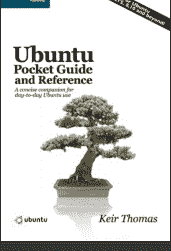

如果你喜欢 *Ubuntu Pocket Guide and Reference*，为何不购买 **PRINT EDITION**？

## 仅需 **$9.94** 来自 Amazon.com

***立即将其添加到你的 Amazon 订单中！***

*Other books by Keir Thomas...*

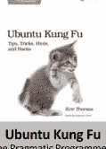

**Ubuntu Kung Fu**  
The Pragmatic Programmers  
ISBN 978-1934356227  
Over 300 tips, tricks, hints, and hacks for the world's favorite Linux.

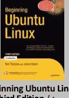

**Beginning Ubuntu Linux, Third Edition** / Apress  
ISBN 978-1590599914  
Comprehensive, award-winning guide. From zero to hero in over 700 pages!

## 简要介绍

本章的目的是向你介绍 Ubuntu 操作系统，以及支撑它的哲学。

你正在阅读这本书可能意味着你已经了解 Ubuntu，但一两个读者可能只是随兴购买了本书的印刷版（或下载了 PDF）来看看究竟是什么大 fuss。这些人可能缺乏具体信息，并且对 Ubuntu 的好处仍持怀疑态度。因此，我将消耗这本精简书籍中一些宝贵的页面来进行传教并做一点解释。

## 什么是 Ubuntu？

Ubuntu 是 Linux 操作系统的一个版本。操作系统是“运行你的电脑”的软件。Microsoft Windows 是世界上最流行的操作系统，至少对于台式电脑而言，但 Linux 是一个完全独立的项目。

## GNU

事情始于 1980 年代，当时一位才华横溢的计算机科学家 Richard Stallman 决定创建一个名为 Unix 的古老操作系统的克隆。当时，Unix 运行着世界上许多工业和学术计算机系统。

Stallman 这样做是因为 Unix 变得越来越专有——不再允许分享其源代码（程序员创建的列表），而自 1969 年 Unix 诞生以来一直可以这样做。

这对 Stallman 来说是不可容忍的，他认为分享软件是自然且健康的。他决定他的 Unix 版本将永远免费提供，并发明了自由软件的法律和伦理概念以确保这一点。简单来说，自由软件表示用户应始终拥有分享软件的自由，而不受限制。在技术层面，自由软件保证了查看源代码的权利，甚至可以将其作为制作新程序的基础进行修改。然而，任何增补或更改也必须作为自由软件发布，以便他人继续受益。

NOTE 自由软件的理想被铭刻在应用于所有自由软件项目的软件许可证中。它被称为 GNU 公共许可证，或 GPL。这就像随 Windows 附带的 Microsoft 最终用户许可协议（你在从头安装 Windows 时会看到），而微软的 EULA 在任何情况下都禁止分享 Windows，GPL 则恰恰相反——它说你可以随时分享软件！

Stallman 将他的 Unix 版本命名为“GNU”（发音为 G-noo）。这是一个递归缩写，代表 GNU's Not Unix。换句话说，该缩写指代自身——程序员喜欢的一种玩笑

## Linux 内核

GNU 发展成为一个拥有众多贡献者的主要项目。然而，尽管它很出色，但它缺少一个内核。内核是任何操作系统的核心程序，负责处理基本事务，例如让硬件与软件通信。

几乎是偶然的，一位名叫 Linus Torvalds 的人提供了解决方案。1991 年他开始了一个个人项目来创建内核。由于在将内核上传到互联网时出现命名错误，它以他的名字命名并被称为 Linux——“Linus”与“Unix”的混合。

至关重要的是，Torvalds 选择将他的内核作为自由软件发布，并邀请任何感兴趣的人帮忙。他们这样做了。世界各地成千上万的人参与其中。随着岁月的流逝，该项目变得越来越重要，其设计和视野也越来越宏大。今天，Linux 内核获得了包括 IBM 在内的许多大型公司的赞助。

NOTE Torvalds 至今仍在监督并为 Linux 内核项目做出贡献。他幽默地将自己的角色描述为“仁慈的独裁者”。

由于内核是操作系统如此重要的一个方面，人们开始把 GNU 和 Linux 的组合简称为 Linux。这令斯托曼感到不满，他要求改用 GNU/Linux 这个名字。但为时已晚，这个名字已经流传开来。

> 注意：究竟该把操作系统称为 GNU/Linux 还是简称为 Linux，是一场持续至今的争论。

来自其他来源的软件通常也会与 GNU 软件和 Linux 内核一起，被包含在 Linux 操作系统中。Linux 中的几乎所有软件都是自由软件，尽管其中大部分与 GNU 或理查德·斯托曼没有直接关系。可以说，斯托曼留给世界最伟大的礼物并非 GNU 软件，而是自由软件的理念。如今，斯托曼的许多活动都围绕着在世界各地传播自由软件理念展开。

> 注意：人们常常用“开源”一词来代替“自由软件”。两者含义相近——参见 `www.opensource.org`。

## Linux 发行版

Linux 并非只有一个版本。它有数百个版本。这些版本称为 Linux 发行版（distributions），或简称 distros。其他发行版的例子包括 Red Hat (`www.redhat.com`) 和 SUSE (`www.suse.com`)，但还有很多很多，而且新的发行版不断涌现。

这种多样性之所以可能，是因为自由软件所允许的自由——任何人都可以获取源代码并制作自己的版本。

有些发行版由商业机构赞助，另一些则源自世界各地庞大的 Linux 用户社区。Ubuntu 两者兼而有之：它由 Canonical 赞助，这家公司由企业家马克·沙特尔沃思于 2004 年创立，但它也从庞大的社区支持中受益，并且基于 Debian (`www.debian.org`)——一个由社区生成的发行版。

## 是什么让 Ubuntu 与众不同

有三件事让 Ubuntu 脱颖而出：

- 1. 专注于桌面用户；
- 2. Ubuntu 的哲学与社区；
- 3. 易用性。

下面我们逐一细看。

### 专注于桌面用户

尽管 Ubuntu 有针对各种计算机的版本，但其核心是一个主要面向桌面用户的 Linux 发行版。

大多数 Linux 发行版在桌面电脑或服务器电脑（运行互联网的强劲电脑）上同样适用，但在桌面体验方面却缺乏打磨。事实上，在很多情况下，桌面用户的需求有点像事后才想到的事。

相比之下，桌面体验是 Ubuntu 开发者非常重视的事情。

2004 年 Ubuntu 创建之初，马克·沙特尔沃思在在线数据库中记录了第一个 bug。然而，这个 bug 与软件无关。相反，它是一个革命性的战斗号令。内容如下：“微软在新的桌面 PC 市场上占据多数市场份额。这是一个 bug，而 Ubuntu 正是为了修复它而设计的。”

### 哲学与社区

你可能已经意识到，Linux 既是一个操作系统，也是一种哲学。Ubuntu 也不例外。

#### 非洲价值观

Ubuntu 的名字源于同名的非洲概念，大意是“善待他人”。这个词在种族隔离结束后的南非流行开来，它强调个人要认识到自己在社区中的角色，并因此抱有慷慨的精神。


当马克·沙特尔沃思在 2004 年创立 Ubuntu Linux 项目时，他基于这一概念以及自由软件的原则，拟定了一份哲学声明。

简而言之，Ubuntu 项目由这样一个理念驱动：软件应当具有包容性。任何人在任何地方都应该能够使用、分享或修改 Ubuntu。这也意味着软件应当以用户的语言提供。如果用户有残障，软件也应当对他们可用。

与几乎所有 Linux 版本一样，Ubuntu 是免费的。发布后的一段时间内，更新也免费（通常为 18 个月，更多详情请参见第 7 页的表格）。

**注意**：你可以访问 www.ubuntu.com/community/ubuntustory/philosophy 了解更多关于 Ubuntu 哲学的内容，并访问 www.gnu.org/philosophy/free-sw.html 了解更多关于自由软件基金会原则的内容。

Ubuntu 所代表的是*自由*——使用和分享软件的自由、随心所欲地使用它的自由，以及学习的自由。

## 社区

Ubuntu 社区直接源于 Ubuntu 哲学。简而言之，人们尊重 Ubuntu 所坚持的原则立场。他们也很喜欢 Ubuntu 专注于桌面体验这一事实。

曾经有过许多像 Ubuntu 一样专门面向桌面用户的 Linux 版本，但几乎全都失败了。这是因为它们在自由软件原则的某些方面打了折扣。也许它们的 Linux 版本包含了一个不能自由分享或修改的专有安装程序；有时它们试图限制其 Linux 版本的分发。

Ubuntu 没有做这些事。它得到的回报是遍布全球的真正庞大的用户社区——可以说是所有 Linux 版本中最大的用户群。它无疑是最友好的 Linux 社区之一。

沙特尔沃思退居幕后，社区则掌控大局，他偶尔会发布一些指令。关于新功能的决定是民主做出的，许多用户帮助开发 Ubuntu（当然，前提是他们具备相应技能）。

对于一位普通的 Ubuntu 最终用户而言，Ubuntu 社区的好处体现在 www.ubuntuforums.org 提供的出色技术支持上，那是 Ubuntu 用户聚集并互相帮助的社区论坛网站。

**注意**：说 Ubuntu 不包含专有软件并非 100% 准确。Ubuntu 提供少量专有硬件固件，以支持目前尚未被自由软件完全支持的无线和图形设备。不过，这被视为一种权宜之计，直到更可接受的替代方案出现。

## 易用性

除了坚定的原则和资金赞助之外，沙特尔沃思还为 Linux 带来了别的东西：他想打造一个“为人类而生的 Linux”。事实上，这正是 Ubuntu 的标语。

## 以前是怎样的

要理解为什么这很重要，让我回顾一下我在 2002 年与 Linux 的一次经历，那时 Ubuntu 还未出现。我希望笔记本中的无线网卡能够连接到我的网络，但在 Linux 下却无法使其工作。于是，我在某个热门论坛上求助。我收到的回复类似如下：

> “让网卡工作起来很简单！只要获取该模块的源代码并针对内核编译它。`insmod` 它，然后使用 `iwconfig` 配置一个 WEP 密码。”

你还在阅读吗？正如你所见，这是一个复杂的答案。它涉及在命令行下操作，并且需要对 Linux 在非常技术层面的工作原理有了解。我知道发帖人说的是什么，虽然内心对所需的工作量叹了口气。然而，对新手来说会感到困惑。

那时就是这样。Linux 是“仅限技术人员使用”的。它被视为工业级的操作系统，并带来了陡峭的学习曲线，让许多人望而却步。

## 现在是怎样的

Ubuntu 改变了一切。它专注于桌面用户体验，为此提供了图形化配置软件。它包含各种硬件驱动程序，因此几乎所有标准硬件都能“即插即用”。Ubuntu 附带一个安装程序，其中没有令人费解的术语，而更新系统只需几次鼠标点击即可。

**NOTE**：公平地说，可以认为 Ubuntu 是桌面 Linux 更广泛革命的一部分，还有其他几个 Linux 版本正朝同一方向发展。Ubuntu 是第一个到达那里的人，并且在每次新版本发布时继续引领潮流。

虽然命令行仍然存在，但不再有强制使用它的要求。使用它通常更快更高效，正如你稍后在本书中会发现的那样，但你不必使用它。Ubuntu 让 Linux 真正对所有人可访问。

不要认为 Ubuntu 以某种方式比其他版本“更少 Linux”。在表面下挖掘，你会发现 Ubuntu 基于 Debian，这是一个备受尊敬的社区生成的 Linux 版本，许多人认为它是权威版本。参见 www.debian.org。

## Ubuntu 提供什么

Ubuntu 是一个完全现代的操作系统，它提供你在 Windows 或 Macintosh OS X 中可能找到的一切，但没有那些缺点。它保持简单，同时提供复杂的功能。

想浏览网页？Firefox 就能完成任务。这就是你在 Windows 下可能使用过的同一个 Firefox，是的，相同的附加组件也能工作。想用 AIM、MSN 或 ICQ 与朋友即时消息？Pidgin 提供了解决方案。需要做一些文字处理、电子表格或演示？OpenOffice.org 就能搞定。GIMP 将处理图像编辑，而 RhythmBox 将负责音乐播放（独立视频播放由 Totem 处理）。

所有这些程序都是默认安装的。它们不是额外附加项，而且全部免费。

硬件支持非常出色，几乎所有日常硬件都得到支持，包括图形/声卡、打印机、无线、USB 记忆棒、相机、iPod 等等。无需为驱动光盘而费力——几乎所有东西在安装后立即就能运行，尽管与任何操作系统一样，你可能需要根据自己的喜好和需求配置系统。

**TIP**：Ubuntu 在旧硬件上运行良好。Ubuntu 8.04 的最低实际要求是 700MHz 处理器、384MB 内存和 8GB 磁盘空间。你可以考虑在旧电脑上安装 Ubuntu 来评估它，然后再在日常使用的电脑上安装。

## 如何阅读本书

Ubuntu Pocket Guide and Reference 很简洁。它的目标是以无忧的方式解释日常 Ubuntu 管理的要点。由于口袋书格式的尺寸限制，有时它可以是对 Ubuntu 功能的快速巡览。然而，主题总是得到充分解释，而且我经常在细节上停留以提供持久的参考。

当然还有更全面的 Ubuntu 书籍。我推荐由 Jaime Sicam 和我本人撰写的 Beginning Ubuntu Linux, Third Edition。它由 Apress 出版（2008 年 6 月；ISBN 978-1590599914）并提供了 Ubuntu 的完整指南。

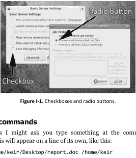

**图 1-1。复选框和单选按钮。**

### 输入命令

有时我可能会要求你在命令行输入某些内容。通常这会单独占一行，像这样：

```
mv /home/keir/Desktop/report.doc /home/keir
```

有些命令很长，无法在一页的单行中容纳。如果是这种情况，我会在行尾使用以下符号：↵

### 菜单选项

在某些章节中，我要求你选择某个菜单选项。你可能会看到类似以下的内容：click System ⇢ Preferences ⇢ Appearance。我指的是你应该点击屏幕顶部的 System 菜单，然后点击 Preferences 子菜单，并点击该菜单上标题为 Appearance 的条目。你会清楚需要做什么。

### 要点击的内容

简要说明一下*单选按钮*和*复选框*，我在全书中都会提到它们。两者都是对话框的元素，用于激活某些功能。单选按钮通常是圆形的，而复选框通常是方形的。有关带注释的示例，请参阅图 1-1。

### Ubuntu 版本

本书以 Ubuntu 8.10 为基础编写，并使用 8.04 长期支持版进一步测试。屏幕截图使用 Ubuntu 8.10 拍摄，因此如果你使用 8.04，可能会略有不同。

# 第一章 安装 Ubuntu

本章解释了在计算机上安装 Ubuntu 的方法。此外，你还将学习如何：

- 选择适合你的 Ubuntu 版本（和发行版）；
- 进行准备工作以确保安装顺利进行；
- 创建自己的 Ubuntu 安装 CD-ROM；
- 在有问题的计算机上安装 Ubuntu；
- 在基于 Intel 的 Apple Macintosh 计算机上安装 Ubuntu。

## 安装类型

安装 Ubuntu 比你想象的要容易得多，本质上共有三种方法，如下所示：

### #1：双启动

如果你打算全职切换到 Ubuntu，通过重新分区计算机硬盘来安装 Ubuntu 是最佳选择。这涉及缩小现有的 Windows 分区并在其旁边创建新的分区用于 Ubuntu。之后，安装 Ubuntu 并添加一个菜单，以便你在启动时在 Ubuntu 和 Windows 之间进行选择。在 PC 上同时拥有 Ubuntu 和 Windows 被称为*双启动*。

这听起来很复杂，但 Ubuntu 安装软件已将其自动化。然而，重新分区存在一定风险，因此在操作前备份重要数据是非常明智的。

> **注意**：有些用户选择不重新分区，而是将 Windows 从硬盘中完全擦除并安装 Ubuntu 取而代之。这也可以使用上述安装方法完成。

### #2：在 Windows 中安装


Wubi 是 Windows 软件，它在 Windows 文件系统中包含一系列虚拟硬盘文件内安装 Ubuntu。然后它配置一个启动菜单，以便你可以在启动 Ubuntu 或 Windows 之间进行选择。如果你选择启动 Ubuntu，一个巧妙的技巧会使虚拟硬盘文件看起来像真实磁盘。因此，用户完全不会意识到他们没有使用前面描述的传统基于分区的安装。

使用 Wubi 安装 Ubuntu 就像安装某些 Windows 软件一样，并且同样没有风险。甚至在添加/删除程序中还添加了卸载选项。唯一的缺点是与传统安装相比性能略有下降，而且你会发现 Ubuntu 的挂起到磁盘（休眠）节能模式不起作用。

> 提示 你仍然可以使用将计算机大多数组件的电源挂起但保留 RAM 的“睡眠”节能模式。

### #3：虚拟计算机

通过下载虚拟计算机应用程序，例如免费的 VMware Player（www.vmware.com/products/player），你可以安装 Ubuntu 使其在 Windows 桌面上的程序窗口内运行。

虚拟计算机本质上是在软件中重建的完整计算机。它提供了一种试用 Ubuntu 的绝佳方式，尽管虚拟计算机软件的限制意味着你无法充分体验 Ubuntu（例如桌面视觉效果将无法工作）。此外，为了获得最佳效果，你需要一台内存超过 1GB 的功能强大的 PC。

## 为 Ubuntu 准备你的 PC

在安装 Ubuntu 之前，建议在 Windows 中进行一些准备工作。

## 确保有足够的磁盘空间

无论你选择哪种安装方法，Ubuntu 至少需要 5GB 的可用磁盘空间。对于你打算全职使用的安装，你可能需要更多。

特权模式，并且系统会要求你进行身份验证。一旦 DOS 窗口出现，请按照与 Windows XP 相同的方式操作。

在安装 Ubuntu 之前，你应确保 Windows 已干净地关闭。如果 Windows 在关机过程中崩溃，或者你只是直接切断电源，那么 Ubuntu 将无法调整分区大小。

## 获取 Ubuntu

Ubuntu 以 ISO 映像文件的形式提供下载。这本质上就是一张 CD-ROM 的内容被打包成一个大文件。ISO 文件设计用于使用你的电脑刻录到空白的 CD-R 或 CD-RW 光盘上。然后可以使用该光盘安装 Ubuntu。

如果你打算使用 Wubi 在 Windows 文件系统中安装 Ubuntu，则下载 ISO 映像文件是可选的，因为 Wubi 可以为你完成此操作。稍后请参阅“在 Windows 中安装（Wubi）”部分。

> TIP Ubuntu 安装光盘还包含一个“live”模式，可直接从光盘运行 Ubuntu。这让你可以试用 Ubuntu，但速度太慢，无法永久使用。

然而，在下载 Ubuntu 之前，你需要决定使用哪个版本。

## 选择版本

Ubuntu 项目催生了许多衍生项目。每个项目都通过添加和/或移除软件来改编主要的 Ubuntu 版本，通常以不同的桌面环境的形式出现，尽管有些只是添加了专业软件。

> NOTE 安装后可以切换到不同版本的 Ubuntu，因此现在做出此选择并非关键。

以下是主要选项：

Ubuntu 主版本：这是 Ubuntu 的标准版本。它以用户友好的 Gnome 桌面环境（www.gnome.org）为基础，并包含大量高质量程序，包括 Firefox 网络浏览器。如果你不知道该选择哪个版本的 Ubuntu，这就是适合你的版本。

> NOTE 本书以 Ubuntu 主版本为基础进行所有解释，因此此时可能是最佳选择。

Kubuntu：这是一个使用 KDE 桌面环境（www.kde.org）而不是 Gnome 的 Ubuntu 版本。KDE 在很大程度上与 Gnome 相似，但往往提供更多配置选项。可以说 Kubuntu 在高级用户中很受欢迎。Kubuntu 与 Ubuntu 的不同之处在于它使用 Konqueror 进行网页浏览，使用 Kontact 进行邮件/PIM（尽管可以安装 Firefox 和其他 Ubuntu 标准程序）。在系统配置工具方面还有一些其他关键差异，但底层系统仍然是 100% 的 Ubuntu。

> NOTE. Kubuntu 在 8.04 之前的版本使用的是较旧的 KDE v2 系列。8.04 同时发布了 v3 和更新的实验性 v4 系列，但从 8.10 起，Kubuntu 已完全标准化为 v4 系列。

### 表 1-1. Ubuntu 衍生版。

| Ubuntu 版本 | 详情 |
|---|---|
| Edubuntu | 包含教育软件和儿童友好的用户界面。适用于教育环境。有关更多信息，请参阅 www.edubuntu.org。 |
| Gobuntu | 完全遵循自由软件基金会原则，因此不包含任何专有或限制性商标软件。有关更多信息，请参阅 www.ubuntu.com/products/whatisubuntu/gobuntu。截至撰写本文时，该项目处于停滞状态，可能将被合并到 gNewSense 项目（http://gnewsense.org）。 |
| JeOS | 用于服务器端虚拟设备的实验性版本——请参阅 www.ubuntu.com/products/whatisubuntu/serveredition/jeos |
| Ubuntu Server | 用于服务器硬件，例如 Web、邮件和/或文件服务器。有关更多信息，请参阅 www.ubuntu.com/products/whatisubuntu/serveredition |
| Mobile and Embedded | 专为手持设备和超便携设备设计——有关更多信息，请参阅 www.ubuntu.com/products/mobile。 |
| MythBuntu | 包含 MythTV 数字视频录制软件。有关 MythBuntu 的详细信息，请参阅 www.mythbuntu.org。有关 MythTV 的详细信息，请参阅 www.mythtv.org。 |
| Ubuntu Studio | 包含多媒体编辑和创作软件。另请参阅 http://ubuntustudio.org。 |

**Xubuntu：** 这个版本的 Ubuntu 基于 Xfce 桌面环境（www.xfce.org）。这是一个精简的桌面，旨在在各种硬件上最佳运行，尤其是在较旧、性能较低的计算机上。然而，它拥有与主 Ubuntu 版本相同的软件，并且功能同样丰富。与 Kubuntu 一样，其底层仍然是 Ubuntu。

**其他：** 其他项目制作了基于 Ubuntu 的发行版。表 1-1 列出了主要示例。更多详情请参阅 https://wiki.ubuntu.com/DerivativeTeam/Derivatives/。

> 注意 几个第三方使用 Ubuntu 作为其 Linux 版本的基础。示例包括 Linux Mint（www.linuxmint.com），专注于易用性，以及 gNewSense（http://gnowsense.org），它剔除了所有不是 100% 自由软件的软件（参见表 1-1 中的 Gobuntu 条目）。

## 选择发行版

主 Ubuntu 项目每六个月发布一次新版本。每两年会发布一个长期支持（LTS）版本。

## 支持

LTS 与普通版本的主要区别在于提供更新的时间长度。对于标准版 Ubuntu，发布后 18 个月提供软件更新；此期限到期后，用户预计会升级到更新的 Ubuntu 版本。对于 LTS 版本，在需要升级之前提供三年的更新。

> 注意 在使用专用 Ubuntu Server 版本的服务器硬件上，提供五年的更新。

## 命名

每个 Ubuntu 版本都有两种命名方式。官方名称是年份和月份的组合，以句点分隔。例如，2008 年 4 月发布的版本命名为 8.04。

版本还有昵称，由 Mark Shuttleworth 决定，并幽默地源自动物种类。8.04 的昵称是 Hardy Heron。8.10 称为 Intrepid Ibex。有时在正式对话中会省略动物部分——8.04 可能仅被称为“Ubuntu Hardy”，或简称为“Hardy”。

表 1-2 显示了 Ubuntu 版本号和昵称。

## 表 1-2. Ubuntu 版本和支持到期日期。

| 版本号 | 昵称 | 更新至 |
|---|---|---|
| 4.10 | Warty Warthog | 2006 年 4 月 |
| 5.04 | Hoary Hedgehog | 2006 年 10 月 |
| 5.10 | Breezy Badger | 2007 年 4 月 |
| 6.06 LTS¹ | Dapper Drake | 2009 年 6 月 |
| 6.10 | Edgy Eft | 2008 年 4 月 |
| 7.04 | Feisty Fawn | 2008 年 10 月 |
| 7.10 | Gutsy Gibbon | 2009 年 4 月 |
| 8.04 LTS | Hardy Heron | 2011 年 4 月 |
| 8.10 | Intrepid Ibex | 2010 年 4 月 |
| 9.04 | Jaunty Jackalope | 2010 年 10 月 |


¹ 6.06 LTS 是在上一个版本发布八个月后发布的，而不是六个月。

## 做出最佳选择

你应该使用什么？在撰写时，选择是 2008 年 4 月发布的 8.04 LTS 版本，或 2008 年 10 月发布的更新的 8.10 版本。没有必要使用更早的版本，因为其支持期即将到期，如果尚未到期的话。

> 注意 8.04 之前的版本不包含 Wubi 软件。

8.04 LTS 提供更长时间的支持，并旨在稳定可靠，因此是逻辑上的选择。非 LTS 版本用于尝试新功能和软件，因此可能不可预测甚至有错误。

如果你只是想无忧地切换到 Ubuntu，那么毫无疑问，8.04 LTS 最好。它也非常适合企业或家庭办公环境。它在 2011 年 4 月之前得到更新支持。

然而，如果你想使用前沿软件，并真正了解 Linux 现在能提供什么，你可能会选择 8.10 版本。它支持到 2010 年 4 月。

> 注意 8.10 版本的无线网络和蓝牙支持也比 8.04 好得多。

## 下载 Ubuntu

要下载 Ubuntu，只需前往 `www.ubuntu.com` 并点击相关链接下载 Ubuntu 的 ISO 映像。

为 32 位计算机选择桌面版。

> 注意 你可能会注意到也可以下载 64 位版本的 Ubuntu。在我看来，除非你的计算机有超过 4GB 的 RAM，否则即使你的计算机具有 64 位 CPU，也没有必要使用它。Ubuntu 的 64 位版本已知会出现一些烦人的兼容性问题，虽然不是致命问题，但会使生活比必要的更困难。

记住：如果打算使用 Wubi，就不需要这样做，因为 Wubi 可以为你获取 Ubuntu 安装文件——请参阅本章后面的 Within Windows（Wubi）部分。

或者，除了刻录 CD 外，你还可以通过 Ubuntu 的 Ship-It 服务免费索取 Ubuntu CD。只需访问 `https://shipit.ubuntu.com` 并输入你的邮寄地址。

> 提示 实际上，你可以通过 Ship-It 订购多张 CD。如果你想宣传 Ubuntu 并赠送给朋友，这很理想。专业制作的 CD 总是比你自己制作的光盘更有影响力！

Ship-It CD 可能需要长达 10 周才能到达你手中。然而，为了更快交付，你可能会选择从官方 Ubuntu 商店购买 CD：`https://shop.canonical.com`。Ubuntu CD 也由各种零售商销售，包括 Amazon.com。

> 注意 也提供 Ubuntu DVD-ROM。这包含 Ubuntu 的所有可用软件（数千个程序）；然而，在大多数情况下 DVD 并非必要，因为所有 Ubuntu 软件只需下载即可，而且大多数在发布后会迅速更新，使 DVD 很快过时。

## 创建安装 CD

假设 ISO 映像的下载已完成，下一步是将其刻录到光盘，方法如下：

> 注意 如果你打算使用“虚拟计算机”方法试用 Ubuntu，就无需刻录 CD。相反，请跳至第 15 页的 Virtual Computer 标题。

- 1. 你需要一台具有 CD-R/RW 或 DVD-R/RW 驱动器的计算机，一张空白 CD-R 或 CD-RW 光盘，并且你的 Windows 系统需要安装光盘刻录软件。像 Nero 这样的应用程序可以刻录 ISO 文件映像，但如果你没有它，请前往 `http://isorecorder.alexfeinman.com` 并下载 ISO Recorder。这个免费的 Windows 应用程序可以刻录 CD/DVD ISO 映像。你需要下载 V2 如果你使用的是 Windows XP，或 V3 如果你使用的是 Windows Vista。在每种情况下你都需要 32 位版本，除非你确定自己使用的是 Windows 的 64 位版本。
- 2. ISO Recorder 下载完成后，安装它并重启。
- 3. 当桌面重新出现时，插入空白的 CD-R 或 CD-RW 光盘。右键单击 Ubuntu ISO 映像文件并在出现的菜单中选择 Copy Image To CD（取消任何弹出询问你想对空白 CD-R/RW 执行什么操作的 Windows 对话框）。ISO Recorder 将启动。
- 4. 如果你使用的是 Windows Vista，在 ISO Recorder 界面中点击 Recording Speed 下拉列表并选择可能的最低速度。如果你运行的是 XP，在 ISO Recorder 界面中点击 PROPERTIES 按钮。然后点击并拖动 Recording Speed 滑块向左，使其处于可能的最低速度。选择慢速是必要的，因为如果使用高速写入，刻录 ISO 映像到 CD 将会失败。
- 5. 点击 OK 关闭对话框，并点击 NEXT 按钮实际刻录光盘。

光盘在刻录完成后会被弹出。再次插入光盘并跳到下面相关的小标题，该小标题描述了你希望使用的安装方法。

## Step-by-step: Installing Ubuntu

下面详细介绍了三种安装 Ubuntu 的方法。

### Standard (repartitioning)

这种安装 Ubuntu 的方法涉及使用 Ubuntu CD 启动计算机，并在安装过程中缩小 Windows 分区以腾出空间给 Ubuntu。

> **NOTE** 在技术层面，发生的情况是 Windows 分区被缩小，并为 Ubuntu 创建了一个扩展分区。随后在扩展分区内部创建了两个新分区：*root*，将包含 Ubuntu 安装，以及 *swap*。后者类似于 Windows 的分页文件，只是它位于自己的分区中。一些 Linux 发行版为操作系统文件和用户数据创建单独的分区，但 Ubuntu 对所有数据只使用一个分区。

步骤如下：

- 1. 插入 Ubuntu CD 并重启计算机。在 BIOS 启动屏幕上，查找调出启动设备菜单的按键选项。具体是什么因计算机而异。在许多计算机上你需要按 Esc 键或 F12。从出现的菜单中选择 CD/DVD-ROM 驱动器。如果没有调出启动设备菜单的选项，通过按相关键（通常是 Delete）进入 BIOS 设置。然后将 CD/DVD-ROM 驱动器配置为第一个启动设备。再次说明，具体操作因 PC 而异。
- 2. 当计算机从 CD 启动时，Ubuntu CD-ROM 启动菜单将会出现。使用上下光标键从列表中选择你偏好的语言并按 Enter。然后使用光标键在主菜单上高亮显示 Install Ubuntu 选项并按 Enter。
- 3. 最终 Ubuntu 安装程序窗口将会出现，如图 1-1 所示。逐步完成各项选择，例如输入你的位置和语言选择，每次点击 FORWARD 按钮继续。
- 4. 过一段时间后，磁盘重新分区选项将会出现。列出了三个选项：Guided—Resize SCSI (0,0,0) Partition；Guided—Use Entire Disk；和 Manual（你可能会看到 Guided—Resize IDE 而不是第一个选项，但它们是相同的）。Guided—Resize Partition 是默认选择，安装程序将尝试为 Windows 分区选择最佳的调整大小选项。更改的预览将以图形形式显示。通过点击并拖动预览显示中 New Partition Size 标题旁边的手柄，你可以更改所创建的可用空间大小（参见图 1-2，下一页，手柄通过注释标出；请注意图 1-2 显示的是 Ubuntu 8.10 安装程序）。

No changes are made until you click the FORWARD button. 通常安装程序的默认调整大小选择是可以的，但它在为 Ubuntu 占用空间方面可能有点激进，因此你可能选择拖动滑块以保留 Windows 分区中多一点的可用空间。如果在点击 FORWARD 按钮后你看到错误信息“Too small size”，你将需要将滑块向右拖动一点以给 Windows 提供更多可用空间。

如果想将计算机硬盘完全用于 Ubuntu 并删除 Windows，点击 Guided—Use

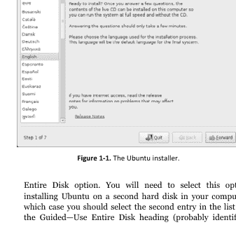

## Figure 1-1. The Ubuntu installer.

Entire Disk option. You will need to select this option if installing Ubuntu on a second hard disk in your computer, in which case you should select the second entry in the list under the Guided—Use Entire Disk heading (probably identified as SCSI (0,0,1) sdb, but you can also use the size of the hard disk as a means of identifying it).


> CAUTION If you opt to remove the Windows partition, be aware that there's no way of bringing it back. Be absolutely sure it's what you want to do.

The Manual option is for experts and lets you appropriate existing partitions (useful if you're upgrading from an older Ubuntu installation), or create new ones manually.

5. After making your partitioning choices, click FORWARD. You'll be asked to confirm your choices. Once repartitioning has finished, you'll be invited to create a user account. As directed, you'll need to type your chosen password twice to confirm correct typing.

> TIP The password can contain numbers, letters, symbols, and even spaces. The longer and more complex a password, the stronger it is.

You'll also be invited to type a name for the computer. This is how your Ubuntu computer will be identified on a network. It's also the name that you’ll see at the command prompt (as explained in Chapter 5). Ubuntu will make a suggestion based on your login name, but you can change it if you wish. Something like `desktop-pc` or `laptop` will be fine. Note that spaces and most symbols aren’t allowed in the computer name.

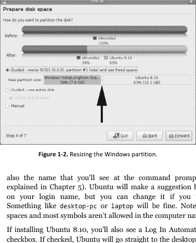

**Figure 1-2.** Resizing the Windows partition.

If installing Ubuntu 8.10, you’ll also see a Log In Automatically checkbox. If checked, Ubuntu will go straight to the desktop each time after booting, without prompting for a username/password.

**CAUTION** This option is considered highly insecure by some, but if you’re the only one will ever access your computer, you might opt to select it. Laptop owners should definitely think twice because it will mean any files are freely available to a thief should the computer get stolen.

6. Next, and assuming you haven’t opted to wipe Windows, you’re asked if you want to import Windows documents. All user accounts available under Windows will be shown, and you can put a check against any to automatically import into Ubuntu documents, wallpaper, and browser favorites.

7. Following this, you’re presented with a summary. Click the INSTALL button and installation will commence. At this point you can relax. Installation will take up to half an hour. Once it’s completed, you can progress to the next chapter.

## Within Windows (Wubi)

Wubi allows Ubuntu to be installed inside Windows as a series of virtual hard disk files. It is perhaps the simplest and most fuss-free method of installing Ubuntu.

There are two methods of using Wubi:

1. Downloading the Wubi standalone installer and letting it download the Ubuntu installation files as needed during installation;

2. Inserting the Ubuntu installation CD while Windows is running and running Wubi from the CD.

There's no real benefit of one method over the other and, when it comes to the installation process, each is practically identical.

Here are the steps required whatever you choose:

1. If you would like to download the Wubi standalone program, and didn't create a CD earlier, head off to http://wubi-installer.org and click the Download Now link. Run the program once it's downloaded and skip to Step 3 below.

2. If you created an Ubuntu CD from the downloaded ISO image file, insert the Ubuntu CD while Windows is up and running. Select the `Run Wubi.exe` option, if prompted, and, from the menu that appears, select the Install Inside Windows option.

3. The Wubi program window will appear, as shown in Figure 1-3. Under the Installation Drive heading, select the partition or hard disk on which you want to place the Ubuntu files. Usually the default choice of `C:` is fine.

4. Under the Installation Size heading, choose how much space you'd like the Ubuntu installation to take-up. The default setting will probably be fine, but you can reduce it if disk space is tight.


## 安装步骤

5. If you're installing using the Ubuntu CD, there will be only one choice under the `Desktop Environment` heading, so leave this as it is. If you're using the standalone installer, here you can choose whether to install `Ubuntu`, `Kubuntu`, `Xubuntu`, or `MythBuntu`.

6. Under the `Language` heading, select your preferred language.

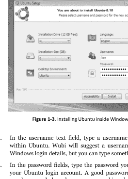

Figure 1-3. Installing Ubuntu inside Windows.

7. In the `username` text field, type a username you want to use within `Ubuntu`. `Wubi` will suggest a username based on your `Windows` login details, but you can type something different.

8. In the `password` fields, type the password you'd like to use for your `Ubuntu` login account. A good password involves letters, numbers, symbols and even spaces, and is as long as possible.

9. Once done, click the `INSTALL` button. There are two stages to the installation. First, the `container files` are created within the `Windows` filesystem (if you're using the standalone `Wubi` installer, the `Ubuntu` files are also downloaded; this may take some time). The computer then reboots for the full installation to take place. Upon rebooting, you should select `Ubuntu` from the boot menu—use the up/down cursor keys, and hit `Enter` when `Ubuntu` is highlighted.

Once installation has completed, you can boot into `Ubuntu` by selecting it each time at the boot menu.

Now skip to the next chapter to learn how to configure `Ubuntu`.

> TIP It's possible to convert a `Wubi` installation into a full hard disk installation. It's a little complicated, however, so you might like to try it when your skills improve. Instructions can be found at `http://wubi.sourceforge.net/lvm.html`.

## Virtual computer

A virtual computer is effectively an entire PC recreated in software. The virtual computer boots, just like a normal computer, and an operating system can be installed within it. The virtual computer's hard disk is contained within a file in the "host" filesystem. Once up and running, the "guest" operating system's desktop appears within a program window.

The free-of-charge `VMware Player` application allows easy virtual computing, and is ideal for trialing `Ubuntu`. Here are the steps required:

1. Head over to `www.vmware.com/products/player` and download `VMware Player`. Install it once downloaded. Then head over to `www.ubuntupocketguide.com/vmware.html` and download an empty virtual computer container zip file.

2. Extract the contents of the virtual computer zip into a new folder and copy the `Ubuntu` ISO image file you downloaded earlier into the same folder. Rename the ISO image as `ubuntu.iso`.

3. Start the virtual computer by double-clicking the `startubuntu` file in the new folder (you may see `startubuntu.vmx`, but it is the same file).

4. From this point onward, follow the instructions under the Standard (Repartitioning) heading above. When you come to the partitioning stage, you'll only see one option: `Guided—Use Entire Disk`. This is fine.

> NOTE Remember that you're installing `Ubuntu` onto a virtual hard disk, that is actually a file within your `Windows` filesystem. You aren't about to wipe the computer's real hard disk!

Once installation has finished, `Ubuntu` will "reboot" within the virtual computer—you don't have to reboot the real computer! When you've finished using `Ubuntu`, just quit `VMware` like you would any other program—the virtual `Ubuntu` installation will be suspended until you next start `VMware` by double-clicking the `startubuntu` file again.

Note that you'll need to click the mouse in the `VMware` window to switch keyboard and mouse input into the virtual operating system. Once this happens, the mouse cursor will be "locked" within the window. To free it, hit the `Ctrl+Alt` keys together.

## Problematic installations (alternate install)

Sometimes `Ubuntu`'s installation program goes wrong. Most commonly, this results in graphical problems that mean the installer program doesn't work correctly.


In situations such as this, you can use the alternate install CD. This can be downloaded from `www.ubuntu.com` as an ISO image, just like the main install CD (click the link marked "Text-based alternate installer installation disk", and, after selecting a download location near you, choose the file whose name ends with `-alternate-i386.iso`).

The alternate CD provides the same version of Ubuntu as the main install disc, but uses a "text mode" installer that doesn't have a graphical interface. As such the installer is compatible with virtually all computers, but this comes at a price because it isn't as user-friendly as the main Ubuntu installer. The terminology can be obtuse for beginners, and the lack of a graphical interface means no mouse—you must navigate around the interface using the keyboard.

Here are the steps needed to use the alternate install CD:

- 1. Assuming that you've downloaded the CD and burned it to a blank CD-R/RW disc, as described earlier, boot your computer using the disc. Follow Step 1 under the Standard (Repartitioning) heading to ensure your computer boots from the CD-R/RW disc.
- 2. At the boot menu, choose your language and select the Install Ubuntu menu option.
- 3. When the installer starts, follow the initial installation steps by highlighting a choice on-screen using the cursor keys, and hitting `Enter`. In most cases, the default choices are fine. At one stage the installer will attempt to go online, and might report an error. Don't worry about this. If you're prompted for wireless network details, just select not to go online (select "Do not configure the network at this time").
- 4. Eventually you'll be prompted for a hostname. This is how the computer is referred to on the network. The default is fine.
- 5. As with the main installer, the alternate installer will attempt to resize the Windows partition. Hit `Enter` when offered the `Guided—Resize SCSI1` option (or `Guided—Resize IDE1`).

> 注意 在此阶段我看到一个警告，提示“之前的更改必须写入磁盘”，尽管我并未进行任何更改。突出显示 `YES` 并按 `Enter` 键即可继续安装。

- 6. 接下来，你将被邀请输入 Windows 分区的新的大小。你会被告知最大和最小可能的大小。默认情况下，替代安装程序建议取 Windows 分区中的可用空闲空间并平均分成两份，相应地调整 Windows 分区的大小（换句话说，Windows 保留 50% 的空闲空间，50% 用于 Ubuntu）。这通常是最好的选择，在大多数情况下你只需按 `Enter` 继续即可。重新分区会立即进行，因此在继续之前请确保你的选择。一旦调整大小完成，你将被邀请创建新的分区。只需突出显示 `YES` 并按 `Enter`。
- 7. Ubuntu 安装程序现在将正式开始。安装会在提示你创建新的登录账户时暂停。只需在提示时回答问题即可。
- 8. 如果你安装的是 Ubuntu 8.10，你将被问是否要创建一个加密的 `/private` 文件夹。这在第 7 章中有更详细的解释。这是一个好主意，所以突出显示 `YES` 并按 `Enter`。之后你将被提示创建密码短语，因此请进行设置（或者，只需按 `Enter` 自动创建随机密码短语）。确保你写下密码短语。
- 9. 安装完成后，你将被提示安装 `GRUB` 启动加载器。选择 `YES` 并按 `Enter`。一旦完成，按提示重新启动计算机。

进行到下一章以了解如何配置你的系统。

## 将 Ubuntu 安装到 Apple Mac 上

你可以使用 Ubuntu 的安装光盘在采用 Intel CPU 的 Mac 上安装 Ubuntu。这将让你双启动 Mac OS X 和 Ubuntu。但是，你首先需要使用 OS X 的 Boot Camp 功能来创建空间。

以下为说明。这些步骤假设 Mac 上未与 OS X 一同安装 Windows——如果存在这种情况会引入复杂性；请参阅 `https://help.ubuntu.com/community/MacBook`。

- 1. 启动 `Boot Camp Assistant` 并按照向导操作，就像要创建 Windows 安装一样。`Boot Camp Assistant` 可以通过打开 Finder 并点击 Applications，然后选择 Utilities 文件夹来找到。你选择的 Windows 分区大小将等同于 Ubuntu 分区大小，因此请确保释放超过 5GB 的空间。当 `Boot Camp Assistant` 完成缩小 OS X 分区后，点击 `QUIT & INSTALL LATER` 按钮。
- 2. 你现在必须删除 `Boot Camp Assistant` 创建的 NTFS（Windows）分区。为此，打开磁盘工具（同样，它位于 Utilities 文件夹中）。在出现的程序窗口中，选择左侧磁盘列表中代表你的硬盘的最顶层条目，然后点击右侧的 `PARTITION` 按钮。在分区图形预览中选择 `BOOTCAMP` 条目，然后点击下方的减号按钮。然后点击 `REMOVE`。完成后关闭磁盘工具。
- 3. 下载并安装 `rEFIt` 软件。它提供了一个启动菜单，让你可以在 Mac OS X 和 Ubuntu 之间进行选择。`rEFIt` 可以从 `http://refit.sourceforge.net` 下载——选择 Mac 磁盘映像下载。请注意，`rEFIt` 是否已安装没有明显迹象；例如，它在 Applications 中没有配置程序。
- 4. 插入 Ubuntu 安装光盘并重新启动计算机。在听到启动提示音时，按住 `C` 键。最终，你会看到 Ubuntu 安装光盘启动菜单。按照第 9 页的说明安装 Ubuntu。但是，当分区阶段开始时，不要调整大小。相反，选择 `Guided-Use the Largest Continuous Free Space`。

> 注意 Ubuntu 8.10 存在一个错误，即选择 `Guided-Use the Largest Continuous Free Space` 选项时，“之后”图形预览中显示 Ubuntu 占据整个磁盘。这是错误的，可以忽略。

- 5. 按照安装阶段继续，就像在标准 PC 上安装一样。重新启动时，在 `rEFIt` 启动菜单中选择 Linux 企鹅以启动 Ubuntu，或选择 Apple 图标以启动 OS X（使用光标键突出显示其中一个，然后按 `Enter` 选择）。

> 注意 在我安装后第一次启动时，我发现 `rEFIt` 菜单不可见。再次重新启动后，它出现了。

旧款 PowerPC Mac 计算机的用户可以下载并安装社区支持的 Ubuntu PowerPC 版本，尽管安装更复杂，因为你必须手动重新分区。请参阅 `https://wiki.ubuntu.com/PowerPC`。

## 第二章


## 配置 Ubuntu

在本章中，你将学习如何配置新的 Ubuntu 系统。我们将涉及每一个主要的硬件领域，包括：
- 键盘和鼠标；
- 图形和显示器；
- 声音；
- 网络（包括无线）；
- 打印；
- 数码相机/MP3 播放器/U 盘；
- 平板扫描仪；
- 蓝牙设备。

### 入门

简单来说，Ubuntu 开箱即用。与 Windows 不同，安装后你无需费心摆弄驱动程序光盘——对各类硬件的支持都已内置在核心内核程序中。

> 注意：内核会频繁更新，每次更新都会带来越来越好的硬件支持。这就是你应该保持系统更新的原因之一。具体方法我会在第 7 章中说明。

不过，你仍需根据自己的需求对系统进行配置——例如，配置 Ubuntu 以访问你的无线网络，或设置打印机以获得最佳输出效果。

### 键盘与鼠标/触摸板

用于配置键盘和鼠标（或笔记本电脑触摸板）的选项可以在`系统 → 首选项`菜单中找到——点击“键盘”条目，而不是“键盘快捷键”条目，来配置键盘。

对于任何在 Windows 下配置过鼠标或键盘的人来说，这里提供的选项都不会构成任何挑战。

### 切换键盘语言

你可以随时在两个或多个键盘布局之间切换。如果你经常需要用不同语言输入，这会非常有用。要配置此功能，请按照以下步骤操作：
- 1. 打开“键盘首选项”对话框（`系统 → 首选项 → 键盘`），确保选中“布局”选项卡，然后点击大的加号按钮（如果使用 Ubuntu 8.04，请点击 `+ADD` 按钮）。
- 2. 从“国家/变体”下拉列表中选择键盘布局。做出选择后，点击 `+ADD` 按钮。
- 3. 在父对话框的“已选布局”标题下的列表中，点击你希望设为默认的条目旁边的单选按钮。这将是 Ubuntu 启动时激活的布局。完成后，点击“关闭”按钮。
- 4. 右键单击屏幕顶部的栏，在出现的菜单中选择“添加到面板”。在出现的对话框中，点击并将“键盘指示器”条目拖到面板上。然后点击“关闭”。

从此以后，你只需点击这个小程序即可在布局之间切换——点击会依次循环显示你在“键盘首选项”对话框中选择的键盘布局选项。

### 鼠标

如果你觉得指针移动太快，请打开“鼠标首选项”对话框（`系统 → 首选项 → 鼠标`），点击并将“加速度”滑块向左拖动一点。更改会立即生效，因此请测试鼠标移动情况，如有必要再次调整，直到你对设置完全满意。

若要停用触摸板的点按点击功能，以便只有按下触摸板上的鼠标按钮才执行左键单击，请选择“触摸板”选项卡，并取消选中相应复选框。

### 图形

在几乎所有情况下，Ubuntu 的图形子系统都能立即正常工作。不过，也有一些常见但容易修复的问题。

### 更改屏幕分辨率

Ubuntu 在安装后可能会猜错屏幕分辨率。如果出现这种情况，你会看到所有内容看起来块状和/或模糊。要调整分辨率，请点击屏幕顶部的“系统”菜单，然后选择`首选项 → 屏幕分辨率`。

> **注意**：如果你使用的是 CRT 显示器（即玻璃管显示器，而非 TFT 液晶面板），你可能需要调整“刷新率”下拉列表。大多数人觉得舒适的刷新率是 75Hz。平板显示器应设置为 60Hz。

如果你想要的分辨率不在“分辨率”下拉列表中，或者无法按预期工作，你可能需要激活专有显卡驱动程序，如下所述。

### 安装专有驱动程序

安装专有显卡驱动程序意味着 Ubuntu 将不再使用自由软件版本。只有在绝对必要时才应进行此操作（例如，内置驱动程序无法产生最佳效果时），因为专有驱动程序的更新频率不如自由软件版本，而且有人认为它们可能充满错误。

要安装专有驱动程序，首先要确保你已联网——请参见后面的*联机*部分。这是必要的，因为新驱动程序将被下载。然后点击`系统 → 管理 → 硬件驱动程序`。

如果你使用的是 Ubuntu 8.10，请在列表中选择你的显卡驱动程序的条目，然后点击“激活”按钮（示例见图 2-1）。

> **提示**：如果提供了多个驱动程序，请选择标记为“推荐”的那个。如果该驱动程序效果不理想，请重复此步骤并选择不同的版本。

如果你使用的是 Ubuntu 8.04，只需在显卡条目旁的“已启用”列中勾选即可。

对于以上任一 Ubuntu 版本，一旦你做出选择，系统就会下载新的显卡驱动程序。安装完成后，你可能需要重启计算机——只需按照屏幕上的提示操作即可。

## 图 2-1. 使用专有显卡驱动。

## 激活桌面视觉效果

与所有现代操作系统一样，Ubuntu 包含许多桌面视觉效果，这意味着程序窗口在首次激活时淡入显示，或在最小化时视觉上缩小。这可以让使用 Ubuntu 变得更加愉快。

视觉效果是通过使用高级显卡驱动程序实现的。在使用某些 Intel 或 AMD/ATI 显卡芯片的系统上，开源版本的此类驱动程序可用并且默认安装，但对于使用某些显卡芯片组的计算机，必须安装专有驱动程序才能使桌面效果正常工作。

你可以通过按住 `Ctrl+Alt` 并按下左右箭头键来判断你的计算机是否已激活桌面效果。这将激活虚拟桌面切换（我在第 3 章中对此进行了更详细的解释）。如果桌面“滑动”出视野，则视觉效果已激活，无需进一步操作。如果你在

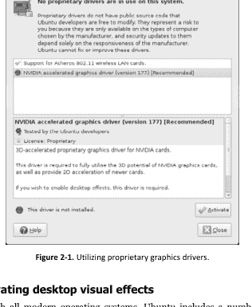

如果提示，请同意保存你的更改。你将需要注销并重新登录（在 Ubuntu 8.10 中为 `System ⇨ Log Out`；在 Ubuntu 8.04 中为 `System ⇨ Quit`）才能使更改生效。

> TIP 如果你在配置多个显示器时发现图形设置混乱，请重新启动计算机，并在启动菜单中选择 Ubuntu “恢复模式”选项（通常是列表中的第二个选项）。当第二个菜单出现时，选择 `xfix` 选项。然后选择 `resume` 选项以正常启动。

## 更改屏幕背光

如果你在笔记本电脑上使用 Ubuntu，应该能够使用笔记本的标准键盘组合来更改屏幕背光亮度，就像在 Windows 中一样。如果这不起作用，请右键单击屏幕顶部栏上的空白位置并从出现的菜单中选择 `Add to Panel`。在出现的列表中，选择 `Brightness Applet` 并单击 `ADD` 按钮。这将添加一个新图标，单击后会显示一个滑块，让你调整背光程度。

## 屏幕保护程序

你可以通过单击 `System ⇨ Preferences ⇨ Screensaver` 来选择屏幕保护程序并调整其激活的时间。

## 声音

你可以通过单击桌面右上角的扬声器图标来更改音频音量。双击此图标将打开主混音器窗口，你可以在其中控制声音系统各个组件的音量，例如 CD 播放器，或 PCM（PCM 是来自应用程序的音频输出，包括媒体播放器和网页浏览器）。

> NOTE PCM 在 Windows 下有时被称为“wave”或“wav”。

要充分利用声卡的功能集，请单击主混音器窗口中的 `PREFERENCES` 按钮，并在列表中为你希望添加到主混音器窗口的任何控件旁边打勾（在 Ubuntu 8.04 中，单击 `Edit ⇨ Preferences`）。新的滑块或控件将立即添加。

提供的精确功能将取决于计算机声音硬件的功能。例如，要添加环绕声的滑块控件，请在列表中与相关复选框旁边打勾。

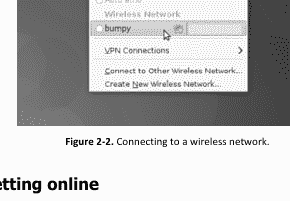

## 上网

根据所使用的硬件，有多种方式可以上网和/或连接到网络。我将在下面分别处理每种方式。

## 无线

网络连接由 Ubuntu 的 `NetworkManager` 小程序处理，该小程序位于桌面右上角。其图标是两个相互嵌套的显示器。单击它将显示附近的无线网络列表，如图 2-2 所示。连接到网络只需选择它并在提示时输入无线密码。完成后，单击 `CONNECT`。

> TIP 确保 Ubuntu 检测到正确的无线保护类型（即 `WEP/WPA`）。在我的其中一次测试中，Ubuntu 检测错误。你可以通过单击 `Wireless Security` 下拉菜单来选择。

要连接到不广播其名称（ESSID）的无线网络，请单击 `NetworkManager` 图标并从菜单中选择 `Connect to Hidden Wireless Network`（或在 Ubuntu 8.04 下选择 `Connect to Other Wireless Network`）。在 `Network Name` 文本字段中输入 ESSID，并从 `Wireless Security` 下拉列表中选择正确的无线保护类型，在其下方填写适当的密钥/密码短语详细信息。完成后单击 `CONNECT` 按钮。

Ubuntu 8.10 版本比早期版本提供了更好的无线硬件支持。如果你发现你的无线硬件不受 Ubuntu 支持，并且你使用的是 Ubuntu 8.04 或更早版本，请考虑升级。你可以通过以下方式判断无线网卡是否不受支持，因为没有

无线网络将被检测到，不过你也应确保计算机的无线功能已激活——对于某些笔记本电脑，需要按下特定的组合键，或在计算机的 BIOS 设置中专门启用无线网络。


> TIP 如果你遇到无线网络无法工作的情况，可以尝试安装 `linux-backports-modules-intrepid` 软件包，如果使用的是 Ubuntu 8.10；或安装 `linux-backports-modules-hardy`，如果使用的是 Ubuntu 8.04（安装后重启）。如果这样仍无法修复，你可以考虑使用 `Ndiswrapper`。这是一个硬件驱动程序，可让你在 Linux 下使用 Windows 无线驱动程序。我在我的书《Ubuntu Kung Fu》中写过关于 `Ndiswrapper` 的内容。你可以通过访问 Ubuntu Kung Fu 网站阅读相关摘录：`www.ubuntukungfu.org/ndiswrapper.html`。

## 有线网络（以太网）

只要将以太网电缆连接到计算机，计算机就会立即在线。无需配置。

例外情况是如果你的网络不自动分配 IP 地址（即缺乏 DHCP 服务器）。这种情况很少见，但在某些工作场所可能会出现。在这种情况下，你需要手动输入 IP 地址、子网掩码、网关和 DNS 地址，具体如下。

## 配置静态 IP 地址（Ubuntu 8.10 及以上）

要在 Ubuntu 8.10 下配置静态 IP 地址（非 DHCP），右键单击屏幕右上角的 NetworkManager 图标并选择编辑连接。在出现的窗口中，确保已选择有线标签，然后单击 `Auto eth0` 条目。单击编辑按钮。在出现的新窗口中，单击 IPv4 设置标签，并从方法下拉列表中选择手动。单击添加按钮，然后通过单击相关标题下的条目输入你的 IP 地址、子网掩码和网关（路由器）详细信息。在 DNS 服务器文本字段中添加 DNS 地址（用逗号分隔每个地址）。你可以将搜索域字段留空。完成后单击确定并重新启动计算机。

## 配置静态 IP 地址（Ubuntu 8.04）

要在 Ubuntu 8.04 下配置静态 IP 地址，单击系统 → 管理 → 网络。在出现的程序窗口中，单击解锁按钮并在提示时输入你的密码。选择有线连接条目并单击属性按钮。在出现的对话框中，取消选中启用漫游模式，并在配置下拉列表中选择静态 IP 地址。将 IP 地址、子网掩码和网关（路由器）详细信息输入到相应的文本字段中。单击确定，然后在父对话框中单击 DNS 选项卡并单击添加按钮。输入第一个 DNS 地址并按回车。再次单击添加并输入第二个 DNS 地址。完成后，单击关闭按钮。你可能需要在新配置生效前重新启动计算机。

## 打印机

你的打印机将被 Ubuntu 自动检测并配置。你可以通过单击系统 ⇨ 管理 ⇨ 打印来检查打印机是否已被检测到。如果你使用的是 Ubuntu 8.10，打印机将以图标形式显示在出现的窗口中。在 Ubuntu 8.04 中，打印机将列在出现的对话框左侧的本地打印机标题下方。

> TIP 确保你的打印机已打开——否则 Ubuntu 无法检测到它！在打印机刚连接或首次打开后，Ubuntu 需要几秒钟来安装和配置打印机。配置完成后，你会在屏幕右上角通过一个弹出气泡得到通知。

## 打印测试页

要在 Ubuntu 8.10 中打印测试页，打开打印机配置窗口（系统 ⇨ 管理 ⇨ 打印），然后双击打印机的图标并单击打印测试页按钮。在 Ubuntu 8.04 中，按上述描述打开打印机配置对话框，单击左侧列表中的打印机条目，然后单击打印测试页按钮（首先确保程序窗口中已选择设置选项卡）。

## 设置默认打印选项

要设置默认打印选项，例如纸张类型或打印质量，打开打印机配置窗口（系统 ⇨ 管理 ⇨ 打印），如果你使用的是 Ubuntu 8.10，请在出现的窗口中双击打印机的图标。随后，单击程序窗口左侧列表中的打印机选项条目。在 Ubuntu 8.04 中，按上述描述打开打印机配置对话框并确保打印机在程序窗口左侧被选中。然后单击打印机选项选项卡。

无论哪个版本，你都可以从列表中每个标题旁边的下拉列表中进行选择。完成后，点击“应用”（APPLY）按钮，如果使用 Ubuntu 8.10，则随后点击“确定”（OK）关闭窗口。

## 管理打印任务

要查看或取消打印任务，请点击“应用程序”⇨“附件”⇨“管理打印任务”。这将显示当前的打印队列。要删除某个任务，请右键点击列表中的对应条目并选择“取消”。

如果打印任务因任何原因停滞，屏幕右上角会出现一个图标。双击该图标会自动弹出打印机队列窗口。

## 安装网络打印机

要在 Ubuntu 8.10 中安装共享网络打印机（例如连接到家中或办公室另一台计算机上的打印机），请点击“系统”⇨“管理”⇨“打印”，然后点击工具栏中的“新建”按钮（如果使用 Ubuntu 8.04，则点击“新建打印机”）。然后选择你希望通过网络连接的网络打印机类型。

对于使用网络服务器设备（通常仅在企业环境中出现）的打印机，请选择“AppSocket/HP JetDirect”。在程序窗口右侧输入地址信息。这通常采用 IP 地址和队列名称的形式——请向管理员或查阅打印服务器文档获取这些信息。

如果要连接到 Windows 电脑上的共享打印机，请选择“通过 SAMBA 连接 Windows 打印机”，然后点击“浏览”按钮，让 Ubuntu 自动检测本地网络上的共享打印机，如图 2-3 所示。点击每个标题旁边的箭头以“展开”它们，找到你要找的打印机后，选中它并点击“确定”按钮。

返回父窗口后，点击“立即设置身份验证详细信息”旁边的单选按钮（在 Ubuntu 8.04 下点击“需要身份验证”复选框），然后输入访问共享打印机的 Windows 账户所需的 Windows（而非 Ubuntu！）登录用户名/密码。点击“验证”以检查这些信息是否有效。

完成后点击“前进”以安装打印机驱动程序。系统不太可能自动检测到它，你需要通过浏览打印机厂商和型号列表来手动选择。

> 提示：你可能需要调整 Windows 电脑上的防火墙和/或共享设置，才能访问该打印机。

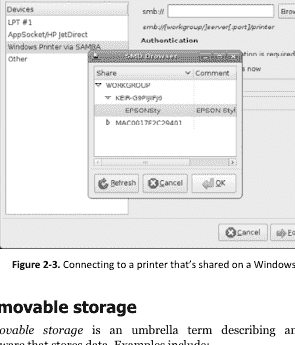

## 可移动存储

可移动存储是一个统称，指任何用于存储数据的即插即用硬件。例如：

- USB 闪存盘；
- 外置硬盘或 CD/DVD-ROM 光驱；
- 数码相机；
- 存储卡读卡器（包括内置在计算机中的以及通过 USB 连接的）；
- 媒体播放器，如 iPod 和其他 MP3 播放器。

在 Ubuntu 下，所有此类设备都以类似的方式访问。每当你连接它们时，会自动出现一个文件浏览窗口，显示设备的内容，并且桌面会出现一个图标；如果你关闭了该窗口，可以双击图标重新打开。此外，“位置”菜单（屏幕顶部）中会添加一个条目，选择它也可以浏览该设备。

> 注意：如果你连接的是存储卡读卡器，在真正插入存储卡之前，它不会显示为已连接状态。

对于某些具有特定用途的可移动存储设备（如数码相机或 MP3 播放器），相关的 Ubuntu 应用程序可能也会启动；例如，插入数码相机后，F-Spot 照片管理器会启动。如果你当时不想使用该应用程序，只需点击其关闭按钮即可。

> 提示：要更改在连接某些类型的可移动存储设备时启动的应用程序，或阻止它们启动，请打开文件浏览窗口（点击“位置”⇨“主文件夹”），然后在文件浏览器菜单中点击“编辑”⇨“首选项”。在出现的窗口中选择“媒体”选项卡，然后从出现的下拉列表中进行选择。

在 Ubuntu 中使用可移动存储设备时，与 Windows 相比有一个重要区别。在从 USB 插座中物理移除设备之前，你必须先卸载它。这可以通过右键点击桌面图标并选择“弹出”、“卸载”或“卸载卷”选项来完成（术语根据上下文而异）。或者，在 Ubuntu 8.10 中，你可以点击文件浏览窗口左侧可移动存储设备图标旁边的弹出图标。

设备被卸载后，其 LED 指示灯停止闪烁后，即可将其从计算机上物理移除。

> 注意：其他 USB 设备（如打印机或蓝牙适配器）可以随意直接拔出——无需卸载——但要注意带有内置读卡器的打印机。如果插入了任何存储卡，必须先卸载它们。

## 扫描仪

扫描仪的安装和配置会自动完成。Ubuntu 提供了一些优秀的扫描软件，即“XSane 图像扫描仪”，可在“应用程序”⇨“图形”菜单中找到。其操作方式与 Windows 扫描仪驱动程序非常相似。


> 提示：如果你想使用光学字符识别（OCR），请安装 `gocr` 软件包。软件安装将在第 6 章中说明。`gocr` 安装后，你可以在扫描后点击 `Xsane` 查看器窗口中的“`File`”⇨“`OCR-Save as Text`”来启动它。

## 蓝牙

如果你的计算机具有蓝牙功能，屏幕右上角会出现一个蓝牙图标。此图标可用于配置蓝牙连接的所有方面。

## 配对（Ubuntu 8.10）

如果你使用的是 `Ubuntu 8.10`，并且希望将 Ubuntu PC 与某设备配对，请确保你想要连接的设备已设置为“可被发现”，然后点击 Ubuntu 桌面上的蓝牙图标。从出现的菜单中选择“设置新设备”，并在对话框中点击“下一步”按钮。你想要配对的设备会立即出现在已检测到设备的列表中，尽管它可能不会立即被识别出其品牌/型号信息。只需等待一两秒钟，完整信息就会显示出来。在列表中选择该设备并点击“下一步”按钮。你会得到一个需要在设备上输入的 PIN 码，请进行输入。完成此操作后，设备将被配对。

> 注意 在某些蓝牙设备上，你可能需要进一步授权配对。具体操作因设备而异。

## 配对（Ubuntu 8.04）

`Ubuntu 8.04` 下的蓝牙功能并不完美。如果你打算经常使用蓝牙设备与 Ubuntu，我建议你升级到 `Ubuntu 8.10`。然而，如果你别无选择，以下说明应该足够。

首先，右键点击蓝牙图标并从出现的菜单中选择“首选项”。在出现的对话框中，确保已选择第一个标签页（该标签页的标题与你的 Ubuntu 系统名称相关），并点击“对其他设备可见且可连接”。

在蓝牙设备上启动配对。操作方法因设备而异，但一旦完成，Ubuntu 桌面的右上角会出现一个提示，要求你输入在设备上输入的 PIN 码。完成此操作后，设备将被配对。

> 提示 配对设备时要迅速——在另一设备上输入 PIN 码的时间窗口只有几秒钟，超时后配对将被自动取消。

## 传输文件

一旦设备已与 Ubuntu 配对，你就可以在两者之间发送文件（前提是该文件支持文件传输；例如手机甚至其他计算机）。

## 从 Ubuntu 发送文件

要从 Ubuntu 计算机发送文件，右键点击该文件并在出现的菜单中选择“发送到”。确保在“发送方式”下拉列表中选择了“蓝牙（OBEX Push）”，并在“发送到”下拉列表中选择已配对的设备。最后，点击“发送”按钮。

## 向 Ubuntu 发送文件

右键点击蓝牙图标并在出现的菜单中选择“首选项”。在对话框中，确保已选择第一个标签页并点击“临时可见”条目（在 `Ubuntu 8.04` 中称为“有限可发现和可连接”）。在蓝牙设备上启动文件传输，并响应 Ubuntu 桌面上出现的提示。

## 第三章

## 熟悉桌面

本章描述了 Ubuntu 桌面的主干与支路——你将花费大部分时间使用的 Ubuntu 组件。它还描述了一些你可能想要执行的常见管理任务。涵盖的主题包括：

- 第一次登录系统；
- 了解桌面上的各项内容；
- 使用虚拟桌面；
- 自定义 Ubuntu 的外观和感觉；
- 最有用的日常应用程序；
- 使用剪贴板（剪切、复制和粘贴）；
- 搜索文件（包括桌面搜索功能）；
- 向系统添加新用户；
- 重启、挂起和关闭计算机。

## 登录

让我们从最开始说起——安装后第一次打开计算机（或重新启动）。

计算机完成自检后，你会看到的第一件事是启动菜单。这让你可以在 Ubuntu 和 Windows 之间进行选择。

## Wubi（Windows 安装）

如果你使用 `Wubi` 安装了 Ubuntu，你将只看到两个选项——Windows 和 Ubuntu。使用上下光标键进行选择，选择后按 Enter。

这个启动菜单实际上是由 Windows 提供的。如果你选择 Ubuntu 选项，将开始 Ubuntu 启动过程，如果在屏幕倒计时期间按下一个键，你可以访问 Ubuntu 自带的启动菜单。日常使用中没有必要这样做，但它为修复问题提供了一个有用的恢复选项。

## 双启动

如果你以传统的重新分区方式安装了 Ubuntu，在 PC 的开机自检后，你将直接进入 Ubuntu 启动菜单。该菜单的选项列表更为复杂。

菜单顶部始终有两个与 Ubuntu 相关的选项。第一个以正常模式启动 Ubuntu，而第二个启动恢复模式——Ubuntu 的“安全模式”之类，可以进行系统修复。

第三个菜单选项启动一个与 Ubuntu 分开的内存测试程序，可用于诊断硬件故障。

提示 有关此程序的更多信息，请参阅 `www.memtest.org`。

Windows 占据列表的底部位置，你可以使用上下光标键在选项之间移动选择高亮。按 Enter 确认你的选择并开始启动过程。

> 注意 如果你在安装期间删除了 Windows，除非在屏幕倒计时期间按下一个键，否则启动菜单不会出现。

如果你在安装期间未选择自动登录选项，Ubuntu 完成启动第一阶段后你将看到的是登录屏幕。参见图 3-1 的示例。

只需输入你的用户名，按 Enter，然后输入你的密码。假设两个信息都正确，启动将完成，桌面将出现。

提示 如果你希望 Ubuntu 在今后启动时自动登录，如某些版本的 Windows 一样，点击“系统 → 管理 → 登录窗口”。在提示时输入你的登录密码。在出现的对话框中，点击“安全”标签。在“启用自动登录”框中打勾，并从“用户”下拉列表中选择你的用户名。完成后点击“关闭”按钮。

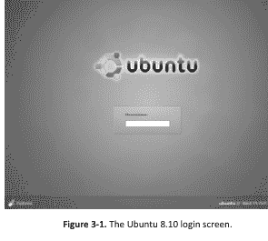

## 桌面布局

Ubuntu 桌面起初看起来可能有点奇怪，但不用担心。你很快就会习惯它。

## 面板

Ubuntu 桌面与 Windows 不同之处在于它有两个任务栏（在 Ubuntu 中称为面板）——一个位于屏幕顶部，一个位于屏幕底部。

顶部的一个负责呈现信息、启动程序和配置系统。底部的面板是程序最小化到的位置，该面板还包括一个显示桌面按钮（左）、一个垃圾桶图标（右）以及一个虚拟桌面选择器（右；稍后会详细介绍）。文件可以拖放到垃圾桶图标上，点击它可以查看和清空垃圾内容。

## 主菜单

屏幕顶部的三个菜单（应用程序、位置、系统）被称为主菜单。它们始终显示在屏幕上。当应用程序启动时，其自己的菜单会出现在其程序窗口下方。

左上角的应用程序菜单提供了访问系统上安装的 GUI 软件的功能。

旁边的“位置”菜单提供了快速访问文件系统中的位置或附加存储设备（如 USB 记忆棒）的功能。数码相机和 MP3 播放器在插入时也会在此列出。

> 注意 我将在第 4 章中更详细地介绍 Ubuntu 文件系统，并详细解释文件管理器。

“系统”菜单位于“位置”菜单旁边，提供对计算机设置的控制。它有两个子菜单，如下所示：

**首选项：** 此菜单主要让你调整与特定用户账户和桌面操作相关的设置。你还可以更改一些硬件设置，例如屏幕分辨率，但仅限于与个人桌面配置相关的设置。

**管理：** 此菜单提供系统范围的硬件配置选项，例如更改时间/日期，以及配置底层 Ubuntu 系统的选项，例如添加/删除软件。

## 图标和小程序

菜单旁边是网络浏览器、电子邮件客户端和帮助系统的快速启动图标。

> 提示 你可以通过从菜单或甚至桌面上点击并拖动图标来在此处添加自己的图标。

顶部面板右侧是时间/日期显示，以及一个系统托盘区域（在 Ubuntu 中称为通知区域）。与 Windows 一样，这里会出现各种图标，告知你系统状态（例如，如果你使用笔记本电脑，则为电池电量），或在需要某些管理操作时发出通知。例如，一旦你上网，就会注意到更新管理器图标出现，告知你有软件更新可用。点击该图标将启动更新管理器程序。

每个面板都可以容纳任意数量的小程序——具有特定功能的小程序。有多个小程序可用。要添加小程序，只需在任一面板上的空白处右键单击，从列表中选择“添加到面板”，然后从出现的列表中进行选择。随后要删除小程序（或面板上的任何现有项目），只需右键单击它并选择“从面板中移除”。

> 警告 几乎面板上的所有内容都可以通过这种方式删除，包括主菜单！事实上，从技术上讲，你在面板上看到的一切——包括主菜单——实际上都是小程序，因此也会出现在小程序列表中。

## 虚拟桌面

与所有 Linux 发行版一样，Ubuntu 使用虚拟桌面。这一方便的功能在 Windows 中缺失，但在 Macintosh OS X 10.5 中以 Spaces 的名称存在。

使用虚拟桌面就像拥有第二个（或第三个、第四个等）显示器一样。程序窗口可以放置在“显示器”中的任何一个桌面上，你可以使用屏幕底部的虚拟桌面小程序在桌面之间切换。

> 提示 你可以通过按住 `Ctrl+Alt` 并按下左右光标键快速在桌面之间切换。你也可以通过将鼠标光标悬停在虚拟桌面小程序上时转动鼠标滚轮来切换。

虚拟桌面最好通过示例来解释，因此启动你选择的程序（也许是 `Firefox` 网络浏览器）并通过点击屏幕右下角虚拟桌面小程序中的第二个屏幕图标切换到第二个桌面。程序窗口似乎会消失。现在打开一个文件浏览窗口（点击 `位置 → 主文件夹`），然后通过点击屏幕图标中的第一个图标返回到第一个桌面。第一个桌面的内容现在会重新出现。

明白它是如何工作的吗？你可以专门为电子邮件设置一个虚拟桌面，另一个用于日常任务，如网页浏览，并在必要时在桌面之间切换。


你可以拥有多达 36 个虚拟桌面——只需右键单击该图标，选择首选项，然后在工作区数量计数器中增加数字。你还可以在工作区名称部分为每个桌面指定描述性名称——只需双击列表中的条目并覆盖输入即可。

> 提示 你可以通过右键单击窗口标题栏并从出现的菜单中选择“移动到工作区 右（或左）”将程序窗口从一个桌面移动到另一个桌面。如果你有超过两个虚拟桌面，可以从子菜单中的列表中进行选择。

## 个性化

几乎 Ubuntu 用户界面的任何元素都可以自定义，从桌面壁纸到程序标题栏和按钮。

要查看个性化选项，请点击 系统 ⇨ 首选项 ⇨ 外观。这将打开 外观首选项 对话框，你可以在程序窗口中选择标签页来做出你的选择。

## 主题

程序窗口和对话框的外观和感觉被称为主题，Ubuntu 中提供了多个主题，超出了橙色的默认外观。你可以通过在 外观首选项 对话框中选择 主题 标签在它们之间切换。更改会立即生效。

通过点击 自定义 按钮，你可以微调程序窗口和对话框的个性化设置，包括更改所使用的颜色。

请参阅 图 3-2 作为示例。如上所述，更改会在你做出更改的瞬间应用。

> TIP 新主题和壁纸可以从 http://gnome-look.org 等网站下载。一旦新主题下载完成，只需将归档文件拖放到 外观首选项 对话框的任何位置即可安装它。无需先解压归档文件。此外，通过安装 community-themes 软件包，可以将多个社区生成的主题添加到 Ubuntu 8.10，并通过安装 gnome-backgrounds 软件包（在 8.10 和 8.04 上均可）添加一些优秀的壁纸。软件安装在第 6 章中有描述。

## 字体

在 Ubuntu 下，不仅可以自定义桌面显示的各个元素所使用的字体，还可以微调它们在屏幕上的显示效果（称为字体渲染）。要调整字体设置，请点击 系统 ⇨ 首选项 ⇨ 外观 并选择 字体 标签。

要更改应用程序、桌面等使用的字体，请点击每个标题旁边的下拉列表。

要更改字体的显示方式，请在 渲染 下选择一个条目，或点击 详细信息 按钮以获得更大的控制程度。如果你使用的是 LCD 面板或笔记本电脑，你几乎肯定会想要选择 Subpixel (LCD) 选项，尽管这取决于个人喜好。随意尝试，直到你对结果满意为止。

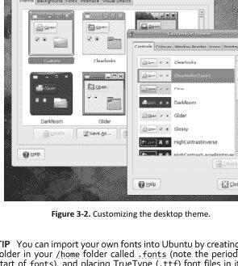

## 图 3-2. 自定义桌面主题。

> TIP 你可以通过在你的 `/home` 文件夹中创建一个名为 `.fonts` 的新文件夹（注意 fonts 开头的句点），并将 TrueType (`.ttf`) 字体文件放入其中，来将自己的字体导入 Ubuntu。请注意这是一个隐藏文件夹，在正常文件列表中不会显示；要查看它，请在文件浏览窗口中点击 查看 ⇨ 显示隐藏文件。一旦添加，新字体将立即在应用程序中可用。一个常见的技巧是从 Windows 复制字体。

## 登录屏幕

要个性化启动 Ubuntu 时出现的登录屏幕，请点击 系统 ⇨ 管理 ⇨ 登录窗口，并在出现的对话框中点击 本地 标签。然后从主题列表中选择。

> TIP 与桌面主题一样，新的登录屏幕主题可以从像 http://gnome-look.org 这样的网站下载。新的主题也可以在 Ubuntu 的软件仓库中找到；它们通常在软件包名称中包含 gdm-theme 这个词。软件安装在第 6 章中有描述。

## 配置菜单

应用程序和系统主菜单的内容可以通过选择 系统 ⇨ 首选项 ⇨ 主菜单 来自定义。点击并拖动以重新排列菜单项的顺序，或取消选中某项以将其从菜单中移除。

## 自定义桌面图标

图标通常作为更广泛的桌面主题的一部分进行自定义，但你可以通过右键单击它，选择 属性，然后点击出现的对话框中的左上角图标预览，为桌面图标使用自己的图片。之后，导航到图片文件。

桌面上的任何图标都可以通过右键单击它并选择 拉伸图标 来调整大小。拖动图标角落的句柄以调整大小。

## 有用的应用程序

在这样一本口袋指南中没有空间详细讲解常用的应用程序。也没有必要，因为这些应用程序极其直观，对于任何使用过 Windows 下类似程序的人来说都不会有任何问题。

表 3-1 在此页之后列出了大多数 Ubuntu 用户日常使用的应用程序，并提供了它们功能概述，以及如果必要，如何对其进行初始配置的提示。

## 剪切、复制和粘贴

Ubuntu 提供了两种独立的复制和粘贴文本方法。

第一种是你可能已经知道的标准方法，其中文本首先被高亮显示，然后通过选择程序的 编辑 菜单上的相关条目（或按 `Ctrl+C` 或 `Ctrl+X`）进行复制或剪切。然后通过点击 编辑 ⇨ 粘贴（或按 `Ctrl+V`）将文本粘贴到新位置。

第二种方法与此无关，并且是 Linux/Unix 独有的。它使用选择缓冲区。其工作原理如下：一旦任何文本被高亮显示，它就会自动复制到选择缓冲区。然后可以通过点击鼠标中键将其粘贴到文本光标的位置。你可能不认为你的鼠标有这个按钮，但它确实有——在大多数鼠标上，滚轮充当鼠标中键。

> TIP 在没有滚轮的鼠标上，你可以同时点击左右鼠标按钮，这将模拟点击鼠标中键。

要试试这个，打开文本编辑器（应用程序 ⇨ 附件 ⇨ 文本编辑器）。输入一些内容，使用鼠标高亮显示（或通过

按住 `Shift` 并使用光标键），然后单击鼠标中键。被高亮的任何内容都会出现在文本光标的位置，就好像你刚刚输入它一样。请注意，这仅在选择保持高亮的情况下才有效。

## 桌面搜索

Ubuntu 提供了一个强大的桌面搜索工具 Tracker。与标准的文件搜索工具不同，Tracker 能够编目 PDF 或办公文档等文件的内容，以及它们的文件名。这意味着你不仅可以按文件名搜索，还可以按文档可能包含的关键短语进行搜索。

要激活 Tracker，请单击 系统 ⇨ 首选项 ⇨ 搜索和索引。在“启用索引”和“启用监视”框中打勾。如果你使用的是笔记本电脑，还可以选择“在电池供电时禁用所有索引”。完成后单击确定，并在提示时单击重新启动按钮。

> 注意 Tracker 默认未激活，因为担心笔记本电脑的电池寿命问题——Tracker 需要频繁访问磁盘来构建其索引，这会消耗电量。一些人也担心 Tracker 对整体计算机性能的影响。最好的办法是试用一下。如果你不喜欢它，始终可以关闭它。

一旦 Tracker 被激活，一个新图标将被添加到屏幕右上角的通知区域。通过单击它，你将能够输入搜索词或单词。请注意，Tracker 激活后，初始搜索索引的构建需要几分钟时间。

> 提示 要让 Tracker 索引 Microsoft Word 文档的内容，请安装 `wv` 包。软件安装在第 6 章中有说明。安装 `wv` 后，通过右键单击搜索图标并从出现的菜单中选择该选项，强制 Tracker 重新索引。

## Deskbar

虽然它可能被视为 Tracker 的附属工具，但 Ubuntu 的 Deskbar 搜索小程序是一个具有自己功能集的独立工具。它可以通过在面板上右键单击空白处，从出现的菜单中选择“添加到面板”，在小程序列表中选择 Deskbar，然后单击“添加到面板”按钮来添加到面板。

### 表 3-1. 有用的日常 Ubuntu 应用程序。

| 类型 | 应用程序 | 详情 |
|---|---|---|
| Web 浏览器 | Firefox 应用程序 ⇨ Internet ⇨ Firefox Web 浏览器 | 完全能够替代 Internet Explorer 用于一般浏览和访问交互式“Web 2.0”应用程序，例如 Google Docs (http://docs.google.com)。可以安装多个附加组件以提供额外功能，并且界面可以个性化——单击 工具 ⇨ 附加组件 即可。 |
| 即时消息 | Pidgin 应用程序 ⇨ Internet ⇨ Pidgin Internet Messenger | 功能强大的聊天程序，可“使用”AIM、Yahoo!、MSN、IRC、ICQ 和许多其他协议。首次启动时你会被提示添加初始账户。随后可以添加更多账户（单击 账户 ⇨ 管理账户），这样你就可以通过同一程序与所有联系人聊天。 |
| 邮件/PIM | Evolution 应用程序 ⇨ Internet ⇨ Evolution Mail | 一体化邮件客户端、日历应用程序、通讯录和组织器。它毫不掩饰地借鉴了 Microsoft Outlook，也许是 Ubuntu 武器库中最强大、最专业的工具之一。启动时你会逐步完成初始邮件账户的配置。 |
| 图像编辑与编目 | GIMP 应用程序 ⇨ Graphics ⇨ GIMP Image Editor F-Spot 应用程序 ⇨ Graphics ⇨ F-Spot Photo Manager | GIMP 是一款专业级图像编辑器，提供与 Adobe Photoshop 等商业应用程序中发现的大部分功能。GIMP 不应与 F-Spot Photo Manager 混淆。后者编目照片并允许简单图像调整。F-Spot 将在你连接数码相机时自动启动，并将照片存储在你的 `/home` 文件夹内的 Pictures 文件夹中。 |


Deskbar 的目标只是提供另一种访问计算机的方式。想要打开你的文档文件夹？只需单击 Deskbar 图标并在出现的 Deskbar 文本字段中输入 documents。然后从出现的菜单中选择“打开位置”选项（你可以使用光标键来执行此操作，而不是单击鼠标；请注意，最常访问的条目始终位于列表顶部）。

想要访问网站？在其中输入 URL 并从 Deskbar 菜单中选择打开。当然，如果你想搜索文件——或文件中的某些文本——只需将其输入 Deskbar 搜索字段即可。文件将列在结果中，你可以选择它来打开它。

> 注意 要能够搜索文件或文件内容，必须启用 Tracker，如前所述。

事实上，Deskbar 可以搜索和/或允许访问的内容几乎没有限制。它依赖于插件结构，这意味着可以轻松添加新功能。要查看已安装哪些插件并激活/停用它们，请右键单击 Deskbar 图标并从出现的菜单中选择首选项。然后，确保已选择“搜索”选项卡，在你感兴趣的项目旁边打勾。

> 提示 新的小程序以及安装说明可以在 http://live.gnome.org/DeskbarApplet/Extending 上找到。

## 键盘快捷键

Ubuntu 使用各种键盘快捷键快速访问内置功能。其中一些快捷键与 Windows 下的相似，而一些是独特的。有关更多信息，请参阅表 3-2。其中一些快捷键仅在启用桌面特效时才有效——请参阅第 2 章中的图形部分。

## 添加新用户

向你的 Ubuntu 系统添加新用户非常容易。你可能想这样做，以便为你的孩子或配偶提供自己的账户。

与 Windows 一样，你可以创建有限用户账户，阻止个人管理系统。系统 ⇨ 管理 菜单中的多个条目将被删除，如果用户以某种方式绕过此限制并运行某些配置软件，他们的密码 simply 不会被接受为授权。

## 表 3-2. 有用的键盘快捷键。

| 键组合 | 详细信息 |
|---|---|
| Alt+F4 | 退出应用程序 |
| F1 | 上下文相关帮助 |
| F10 | 打开程序的 文件 菜单；使用左右光标键在其他菜单之间移动 |
| Alt+F1 | 打开主菜单；使用左右光标键在菜单之间移动 |
| Alt+F2 | 打开“运行应用程序”对话框，通过输入文件名即可启动应用程序 |
| Alt+Tab | 在应用程序之间切换 |
| Shift+Alt+上光标 | 在应用程序之间切换，使用每个窗口的实时预览（类似于 Mac OS 的 Exposé 功能） |
| Ctrl+Alt+ 左右光标 | 在虚拟桌面之间切换 |
| Windows+E | 通过查看每个桌面的实时预览在虚拟桌面之间切换（双击以选择） |
| Windows+M | 反转桌面颜色（对视力不佳的人或夜间使用电脑时很有用） |
| Windows+N | 反转最上层程序窗口的颜色 |
| Ctrl+Alt+ Backspace | 重新启动图形子系统（X）；仅应在紧急情况下使用，因为重新启动是即时的且无确认——所有数据都将丢失！ |
| Alt+F9 | 最小化窗口 |
| Alt+F10 | 最大化窗口 |
| Alt+F5 | 最大化后恢复窗口 |
| Alt+F7 | 允许您使用光标键移动窗口；完成后按 Enter |
| Alt+F8 | 允许您使用光标键调整窗口大小；完成后按 Enter |
| PrintScreen | 截取整个桌面的屏幕截图 |
| Alt+PrintScreen | 截取当前活动程序窗口的屏幕截图 |

CAUTION 系统上的所有用户都可以以只读方式访问彼此在 `/home` 文件夹中的文件。第 7 章介绍了设置加密以保护敏感数据的方法，使只有您才能访问它。

要添加新用户，请单击 系统 → 管理 → 用户和组。当对话框出现时，单击 UNLOCK 并在提示时输入您的密码。然后单击 ADD USER 按钮。

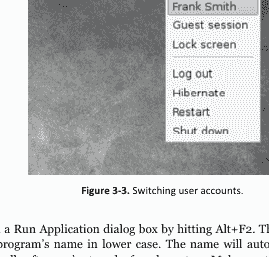

图 3-3. 切换用户账户。

通过按 Alt+F2 打开“运行应用程序”对话框。然后以小写输入程序的名称。输入几个字符后，名称会自动补全。请记下，然后按 Enter 运行程序以确保其正确。

您可以通过取消其旁边的复选标记来停用启动程序列表中的现有条目，但请注意，大多数条目都出于充分的理由存在，其中一些控制着关键后台服务如何运行。只有在您完全确定可以不需要它时才停用某个条目。

## 处理崩溃的程序

如果您启动的程序崩溃且无法退出，您可以使用系统监视器来终止它。该程序位于 系统 → 管理 菜单上。确保已选择 进程 选项卡，然后在列表中定位崩溃的程序。右键单击它并选择 Kill Process。请注意，您将无法终止某些程序，因为它们由“root”用户“拥有”。这将在第 5 章中更详细地讨论，当我们查看在命令行上管理进程时。

## 更改时间与日期

要更改时间或日期，请右键单击屏幕右上角的时间显示并单击 调整日期和时间。

如果使用 Ubuntu 8.10，请在出现的对话框中进行更改，然后单击 SET SYSTEM TIME 按钮。提示时输入您的密码。

在 Ubuntu 8.04 中，请在出现的对话框中单击 UNLOCK 按钮，提示时输入您的密码，然后进行更改。

> TIP 您可以让 Ubuntu 自动与 Internet 时间服务器同步，从而始终保持正确的时间，通过安装 `ntp` 包。软件安装在第 6 章中进行说明。安装 `ntp` 后，重新启动计算机。

## 重启和关机

要关机或重启计算机，请单击 系统 菜单上的 Shut Down 条目（在 Ubuntu 8.04 下，选择 Quit 条目）。然后从出现的对话框中选择相关选项。

> TIP 您也可以通过选择 快速用户切换 插件中的相关条目来结束您的 Ubuntu 会话；请参阅上文图 3-3。

根据您 PC 的硬件功能，您可能还会看到挂起和休眠的选项。这些是省电模式，其区别如下：

Suspend：这会将所有硬件设备的电源降低，但 RAM 除外。要“唤醒”计算机，您必须按下一个键，或按计算机的电源按钮。计算机将在一两秒内恢复活力，您可以在挂起前打开的应用程序中继续工作。

Hibernate：这会将 RAM 的内容保存到硬盘并完全关闭计算机，就像它已被关闭一样。当计算机下次开机时，RAM 的内容将从磁盘加载，您应该会发现自己回到您选择休眠的确切瞬间。

您应在依赖它们之前测试任一模式。特别是休眠模式可能无法正常工作，具体取决于您的硬件配置。在使计算机休眠或挂起之前，请务必保存所有打开应用程序中的数据。

> TIP 要配置笔记本电脑在合上盖子时自动进入休眠/挂起模式，请单击 系统 ▸ 首选项 ▸ 电源管理，单击 On AC Power/On Battery Power 选项卡，并从 When Laptop Lid is Closed 下拉列表中选择相关选项。

# 第四章

## 用户和文件系统

本章的目的是让你快速掌握 Ubuntu 文件系统。你将学习到：

- Ubuntu 在文件方面与 Windows 有何不同；
- Ubuntu 文件系统中事物所在的位置；
- Ubuntu 核心的用户和权限系统的基础；
- Nautilus 文件管理器；
- 有用的文件系统技巧和提示；
- 文件压缩。

### Ubuntu 如何处理文件

在讨论文件系统时，难免会将 Windows 与 Ubuntu 进行比较。虽然从根本上来说两者相似，但作为 Linux 的一种变体，Ubuntu 在以下方面与 Windows 不同。

### 路径

Ubuntu 下没有盘符。相反，文件系统的根目录，在 Windows 下称为 C:\，在 Ubuntu 中仅用正斜杠（`/`）标识。

此外，Windows 使用反斜杠（\ ）来表示文件系统的根目录，并在路径列表中分隔文件夹，而 Ubuntu 使用正斜杠。

因此，在 Windows 下常见的路径如 `C:\Documents ... and Settings\Owner\My Documents`，在 Ubuntu 中你会看到类似 `/home/frank/Documents` 的路径。这种差异起初可能令人不适，但你会惊讶于自己适应得有多快。

### 挂载

如果没有盘符，那么像 CD/DVD 驱动器或 USB 记忆棒等其他存储设备是如何访问的呢？

答案是它们被 *挂载* 了——有效地，存储设备的文件系统被神奇地连接到 Ubuntu 文件系统中的某个特定文件夹。例如，插入 CD/DVD 后，其内容在浏览到 `/media/cdrom` 文件夹时就会可见。

需要注意的是，文件并非真正复制到该文件夹中。它们是以虚拟的方式提供的。你可以像操作其他任何文件和文件夹一样操作它们，尽管看起来它们包含在那个特定文件夹中，但实际上并非如此。

任何可能已经存在于用作 *挂载点* 的文件夹中的内容都会暂时消失。但是，内容仍然在那里，如果存储设备被 *卸载*，内容就会重新出现。


挂载听起来可能很复杂，但不用担心——它几乎总是自动完成的，要么在启动时对永久连接到电脑的设备进行，要么在将可移动存储设备连接到电脑时进行，例如 USB 棒。事实上，你可能根本不会注意到它的发生；用户在插入 USB 记忆棒后看到的只是桌面上出现一个新图标，双击后即可浏览 USB 棒上的文件。当然，如果用户仔细观察，她会看到自己实际上是在浏览 USB 记忆棒被挂载到的文件夹。

### 文件和文件夹名称

文件和文件夹名称可以包含空格，就像 Windows 一样，但在 Linux 中大小写字母很重要。一个文件夹完全可以包含名为 `Report.doc`、`REPORT.doc`、`report.doc`、`REPORT.doc` 等等的文件。

请参阅图 4-1，了解其实际操作的示例。屏幕截图的上半部分显示了在 Windows 中尝试将文件重命名为 `REPORT.doc` 的尝试，而该文件夹中已存在名为 `report.doc` 的文件。这是不允许的，因为 Windows 无法区分大小写字母——就它而言，`report.doc` 与 `REPORT.doc` 是同一个文件。屏幕截图的下半部分显示了 Ubuntu 系统上的一个文件夹，其中包含多个具有 `report.doc` 大小写变体的文件。

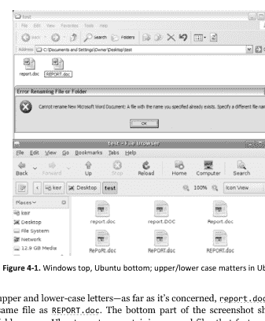

> 注意 操作系统区分大小写字母的能力称为大小写敏感。

此外，Ubuntu 下的文件和文件夹名称可以包含几乎任何字母、数字或符号，除了正斜杠（`/`）。

> 注意 虽然 Windows 称之为文件夹，许多 Linux 用户称之为目录。讨论的是完全相同的东西。目录一词几乎总是在命令行中使用，而在 Ubuntu 桌面上使用时则更喜欢文件夹一词。

### 重要文件系统位置

系统上的每个用户都会在 `/home` 文件夹内获得自己的文件夹来保存个人数据。例如，用户 Jane 是 given the folder `/home/jane`. The `/home` folder is akin to `C:\Documents and Settings` under Windows.

TIP Linux users often refer to their folder within `/home` as their "home folder", saying things like, "I couldn't find the file but I remembered I'd saved it in my home folder."

Users aren't permitted to save their personal files outside of their `/home` folder. This is rigidly enforced using ownerships and file permissions, as I explain in the Understanding Users section below.

Outside of the `/home` folder, the Ubuntu filesystem is a little more complicated than Windows, and it isn't quite a case of program files being in one location, and system files in another.

A cursory rundown of the Ubuntu filesystem can be found in Table 4-1, although this is not essential knowledge and is provided largely for reference purposes.

Perhaps the most important locations for the majority of users are `/home`, as described above; `/usr/bin`, where practically all software is located; and `/etc`, where system configuration files are found.

NOTE Like many versions of Linux, Ubuntu broadly follows the Filesystem Hierarchy Standard (FHS) to decide where things should go in the filesystem. For more details, including in-depth descriptions of each location, see www.pathname.com/fhs/.

## Hidden files and folders

Windows lets users hide files and folders by setting a file attribute.

Linux takes a simpler approach. Any file or folder that has a period (`.`) at the beginning doesn't appear in file listings, unless the user specifically requests all files/folders be listed.

In other words, if you rename `report.doc` to `.report.doc`, it will instantly become invisible and will seem to disappear from the file browsing window (you might have to hit the Refresh button in the file browser window to update the listing before the file actually vanishes).

A user's personal configuration files are stored in his or her `/home` folder and are hidden in this way. To view them, and other hidden files, click View ⇨ Show Hidden Files in a file browsing window.

NOTE Any file or folder that has a tilde (`~`) at the end of its filename (i.e. `report.doc~`) will be hidden in file listings provided by the Nautilus file manager, and on the desktop. They will be visible everywhere else, including at the command-line.

## Table 4-1. Key locations in the Ubuntu filesystem.

| Location | Details |
|---|---|
| `/bin` | Essential software, typically needed to get the system running |
| `/boot` | Files related to the boot menu/loader |
| `/dev` | Virtual files representing hardware devices |
| `/etc` | System (global) configuration files |
| `/home` | Users' personal folders |
| `/lib` | Support (library) files required by software |
| `/media` | Contains subfolders where storage devices can be mounted |
| `/proc` | Virtual folder containing files representing stats and settings |
| `/root` | Personal folder of the root user |
| `/sbin` | Essential software for system maintenance, usually used only by the root user |
| `/tmp` | Temporary files/folders |


| `/usr` | Essentially, subdirectories containing most software used on the system, including system libraries and documentation |
| `/var` | Data that is vital to the running of the system and that is constantly being updated |

## File extensions

Generally speaking, the trend with Linux is not to use file extensions for system files. Executable programs under Ubuntu don't have a file extension, such as `.exe`, as with Windows. Instead, the fact they are programs and not ordinary data files is indicated by the use of the executable file attribute. This is discussed in more depth in Chapter 5.

Configuration files sometimes have a `.conf` file extension, but often have no file extension at all. Many files that are plain text have no file extension, in fact; the use of the `.txt` file extension is rare in the world of Linux. Program documentation files in the `/usr/share/doc` folder, for example, are plain text and have no file extensions.

> NOTE It isn't quite true that files in the `/usr/share/doc` folder have no file extensions because some program documentation files are compressed, so have a `.gz` file extension, but this is a minor point.

However, when it comes to the personal files of users, such as documents or images, file extensions are as important as they are under Windows. Files with a `.doc` extension are recognized as Microsoft Word files, for example, and `.jpg` files are recognized as images.

## 理解用户

当你安装 Ubuntu 时，会为你创建一个个人用户账户。作为此过程的一部分，如前所述，在 `/home` 中创建了一个以你的用户名命名的文件夹。

## root 用户

事实上，在大多数 Linux 系统的安装过程中会创建两个登录账户——一个标准用户和 root 用户。`root` 用户是一个特殊的用户账户，拥有做任何事情的能力，例如删除系统文件或安装软件。它的用户名始终是 `root`。

通常当 Linux 在 PC 上使用时，标准用户在需要管理系统时会登录到 `root` 账户，然后在完成后注销。但是，她大部分时间都会登录到自己的普通用户账户，进行日常操作，如浏览网页。

Ubuntu 与大多数 Linux 略有不同。虽然 `root` 账户在后台存在，但用户被劝阻直接以 `root` 身份登录。相反，用户在必要时“借用” `root` 权限来管理系统。通常，这只需在提示时输入你的登录密码即可。尝试运行 Synaptic 时会出现 Figure 4-2 所示的示例，Synaptic 是一个管理软件的程序。Synaptic 位于 System ➞ Administration 菜单上，事实上，如果你运行此菜单上的任何程序，都会弹出密码提示对话框。在输入密码之前你无法继续，但之后应用程序将以 `root` 权限运行。

另外，一些应用程序会启动，但功能受限，直到点击 UNLOCK 按钮，此时会出现相同的密码请求。对于这些应用程序，输入密码不会赋予整个应用程序 `root` 权限，而是其一个组件。这更安全，并且最终 Ubuntu 的所有管理应用程序都将以这种方式工作。

> **NOTE**
>
> 在命令行工作时，任何需要管理权限的命令都必须以 `sudo` 为前缀（例如，对于 GUI 应用应使用 `sudo sh`）。我在第 5 章中对此进行了更详细的解释。

## 文件权限

尽管 `root` 用户账户在 Ubuntu 中处于次要位置，但其影响无处不在。大多数操作系统文件由 `root` 用户“拥有”，并且权限设置只有 `root` 才能编辑它们。换句话说，只有 `root` 用户——或借用 `root` 权限的用户——才能

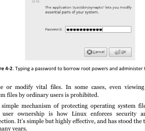

Figure 4-2. Typing a password to borrow root powers and administer the system.

删除或修改重要文件。在某些情况下，即使是普通用户查看操作系统文件也被禁止。

通过 `root` 用户所有权来保护操作系统文件这一简单机制，就是 Linux 强制执行安全性和系统保护的方式。它简单但非常有效，并且多年来经受住了时间的考验。

> NOTE Windows 失败于做出这种区分，并有效地合并了标准用户和管理员类型的用户账户，这就是它如此不安全的原因之一。如果病毒感染了系统，它将以管理员权限运行，因此会造成真正的麻烦。Vista 通过在用户对系统做任何稍微危险的事情时不断烦扰用户，在某种程度上修复了这种情况。

文件权限是理解和操作 Linux 文件系统的核心，因此让我们更深入地了解一下它们。

如前所述，每个文件都由特定用户拥有——即使是系统文件，也由 `root` 用户拥有。

文件的所有者可以设置三组不同的权限：首先为自己，其次为组，最后为其他所有人。

在为自己设置文件权限时，文件的所有者可以例如将文件标记为只读，以避免意外更改它。

所有用户都是某个组的成员，每个文件除了由用户拥有外，还分配给一个特定组。因此，可以为该组的成员授予单独的文件权限集。

第三组也是最后一组权限可以为其他人配置，也就是说，为计算机上的不是文件所有者且不在该组中的用户。

**小贴士**：在尝试理解 Linux 如何处理文件时，请记住它是 Unix 的一个克隆，而 Unix 是一款为成百上千甚至成千上万不同用户设计的操作系统，这会很有帮助。关于 Linux 的一个有趣事实是，尽管你可能在自己的普通台式电脑上使用它，但它确实能够不经任何修改就直接运行在大型计算机上。

你可以通过右键单击任意文件或文件夹，然后从菜单中选择“属性”来查看和编辑其文件权限。在弹出的对话框中，单击“权限”选项卡。然后，你就可以更改自己所拥有的文件或文件夹的权限。

让我们看看实际的权限案例。名为 `frank` 的用户创建了一个电子表格。他和名为 `jane` 的用户（会计部门的同事）都是 `accounts` 组的成员。`frank` 希望 `jane` 能够编辑该电子表格，因此他设置了文件的组权限，让 `accounts` 组中的任何人都能读取和写入该电子表格。`frank` 还希望公司里的其他人能够查看该电子表格，包括不在 `accounts` 组的其他部门用户。但他不想让他们编辑它。因此，他为“其他用户”设置了只读权限。

对于由 `root` 用户拥有的操作系统文件，权限通常设置为：系统上的其他用户可以查看（读取）文件，但不能修改（写入）它们。重要的系统文件夹也以这种方式受到保护，因此无法在其中创建新文件。`root` 用户还拥有文件系统的根目录（在 Windows 中称为 `C:\`）。这种特殊权限是“固定不变”的，因此只有 `root` 用户才能在其中创建新的文件或文件夹。同样，这是出于安全原因。

**注意**：在 Ubuntu 下，对于 `root` 用户拥有的文件，组文件权限并不重要，因为 `root` 用户属于一个专有的组，该组也叫 `root`。

我们将在第 5 章中重新讨论文件权限，该章将介绍 Linux 命令行。正是在命令行中，文件权限才变得更加重要，尤其是在管理系统时。

## Nautilus：概述

随 Ubuntu 提供的文件浏览程序称为 Nautilus。它是 Gnome 桌面环境的重要组成部分，功能极其强大，同时又对用户友好。

你可以通过单击“位置 ➔ 主文件夹”来启动 Nautilus。这将让你查看 `/home` 文件夹中个人文件夹的内容。

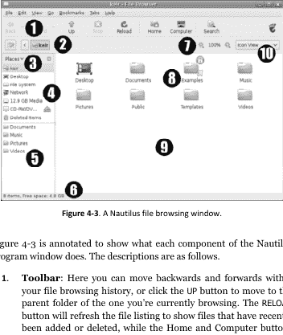


图 4-3 中标注了 Nautilus 程序窗口的各个组件的作用。说明如下。

## 1. 工具栏：

在这里，你可以在文件浏览历史中后退或前进，或单击“向上”按钮转到当前浏览文件夹的父文件夹。“重新加载”按钮将刷新文件列表，显示最近添加或删除的文件，而“主文件夹”和“计算机”按钮则提供到这些浏览位置的快捷方式。

> **注意**：“计算机”位置相当于 Windows 的“我的电脑”（Vista 下的“计算机”），其中列出了连接到计算机的存储设备。

“搜索”按钮启动 Nautilus 的文件搜索功能，本章稍后将介绍。

## 2. 地址栏：

地址栏显示当前浏览的文件夹，并支持两种模式：按钮模式和文本模式。

按钮模式（默认启用）会为你浏览到的每个文件夹显示一个按钮。例如，如果浏览到 `/home/keir/Pictures/Disneyland`，则会有一个 `Disneyland` 按钮、一个 `Pictures` 按钮和一个 `keir` 按钮（为节省空间，主文件夹不会获得按钮）。单击每个按钮将直接带你进入该特定文件夹。

文本模式通过单击地址栏最左侧的按钮激活，相当于大多数文件浏览器中的标准地址栏：路径以文本形式显示以供参考，但也可以编辑以切换到新位置。图 4-4 显示了两种模式并列对比。

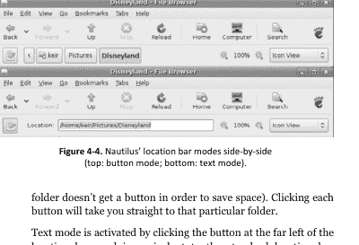

## 3. 侧边栏：

侧边栏显示与所浏览文件或文件夹相关的信息。可以通过单击窗格右上角的 X 按钮将其关闭，或者通过单击下拉列表标题，将其切换为以下六种模式之一：

- **地点（Places）：** 这是默认模式，显示重要文件系统位置的快捷方式，并提供一键访问连接到计算机的任何存储设备的功能。如果存储设备可以弹出或在移除前需要卸载（如 DVD-ROM 驱动器或 USB 记忆棒），旁边会出现一个弹出图标（仅限 Ubuntu 8.10 及以上版本）。

- **信息（Information）：** 此模式类似于某些 Windows 版本中的模式，显示当前浏览的文件夹名称以及其中包含的项目数。

- **树形（Tree）：** 这是文件浏览窗口左侧窗格中出现的“传统”视图。它显示完整的文件系统。通过单击列表中每个条目旁边的 V 形符号，你可以“展开”该特定文件夹以查看其内容。选择文件夹将使其内容显示在主浏览区域中。

- **历史记录：** 此模式按顺序列出在当前文件浏览会话中访问过的位置。点击任意条目即可跳转到该位置。

- **备注：** 文件夹可以附带不可见的文字备注，备注模式允许你添加、编辑或查看这些文字。在包含大量文件夹的复杂文件系统中，这一功能非常有用。

> **注意** 文件和文件夹都可以附加备注，不过侧边栏没有提供为文件添加备注的功能。若要手动为文件或文件夹添加备注，请右键点击它，在菜单中选择“属性”，然后在对话框中选择“备注”标签页。

- **图标标记：** 文件和文件夹可以附加小图标，用于提供信息。其中一些图标具有特定的文件系统含义，如下方“图标标记”部分所讨论的，但其他图标仅供用户*备忘*。选择此侧边栏模式后，会显示图标标记列表，你可以将这些图标拖放到浏览窗口中的任意文件或文件夹上。要移除图标标记，只需对文件/文件夹重新应用相同的图标标记即可。

## 4. 文件系统位置：

如果选择了侧边栏的“位置”模式（默认即为此模式），你会看到文件系统位置或已连接存储设备的快捷方式列表。此列表与“位置”主菜单中的条目相同。在所示示例中，列表内容如下：

- **keir：** 这是用户 `~/home` 文件夹的快捷方式——在用于创建截图的测试电脑上，用户名为 keir。

- **桌面：** 与 Windows 相同，桌面上的文件包含在你的个人 `/home` 文件夹中一个名为“桌面”的特殊文件夹中。在这里你可以立即切换到该文件夹。

- **文件系统：** 这里提供直接链接到主文件系统的根目录（`/`；相当于 Windows 下的 `C:\`）。

- **网络：** 在这里你可以浏览网络上其他计算机上的资源，例如 Microsoft Windows 计算机上的共享文件夹。相当于“网络邻居”。

- **13.8GB 媒体：** 这是 Windows 文件系统的快捷方式。此图标的名称基于 Windows 分区的大小；例如，如果 Windows 分区大小为 500GB，则标签会显示为“500GB 媒体”。在用于截图的电脑上，Windows 分区大小为 13.8GB。

> **注意** 如果你安装了不止两个操作系统，所有操作系统的文件系统都会列在这里以供访问。此外，或者另一种情况，如果你有一个仅用于存储文件的硬盘分区，该分区也会列在这里。

- **CD-RW/DVD-ROM：** 此图标允许快速访问 CD/DVD-ROM。该图标通常以 CD/DVD-ROM 光盘的标签命名，尽管在此示例中驱动器是空的。由于 CD/DVD-ROM 驱动器可以弹出，因此旁边会出现一个弹出图标。需要先卸载才能移除的存储设备（如 USB 闪存盘）旁边也会出现相同的图标。

- **已删除项目：** 在这里你可以快速查看回收站（也称为垃圾箱，或已删除项目文件夹）中的内容。

## 5. 书签：

如果在侧边栏中选择了“位置”模式，你会在这里找到已添加书签的文件系统位置的快捷方式。此列表实际上是“书签”菜单的镜像。

> **提示** 可以通过将相关文件夹拖到此区域来快速创建新书签。

## 6. 状态栏：

如果未选择任何文件，状态栏会显示当前文件夹中的文件数量以及磁盘可用空间。如果选择了文件，你会看到所选文件的数量及其总大小。

> **提示** 要查看文件夹中所有文件的总大小，只需按 `Ctrl+A` 选择所有文件，然后查看状态栏。

## 7. 缩放控制：

在这里你可以设置当前视图的缩放级别，有效地使图标变大或变小，但在图标视图（请参阅下方的图标/列表视图切换器）中，也会显示更少或更多的详细信息——放大将显示文件大小和创建日期等详细信息。

## 8. 图标标记：

如前所述，所有文件和文件夹都可以附加小图标。这些被称为图标标记，需要注意的是，它们是 Nautilus 特有的。如果你使用其他文件管理器或在命令行中浏览，它们很可能不会显示。

用户可以添加自己的图标标记，但系统也保留了一些图标用于提供信息。这两种图标标记

attached to this icon were added by the system and show that the owner of the folder has set it as read-only for the current user (the padlock icon top right). Additionally, the arrow icon at the bottom right shows this folder is a *shortcut*—the Examples folder actually exists at the `/usr/share/example-content` location and not in this user's `/home` folder.

## 9. File area:

Here is where the files/folders in the currently browsed folder are listed. Right-clicking in a blank space will bring-up a menu whereby new files and folders can be created.

## 10. Icon/list view selector:

Here you can switch between three separate file listing view modes: *icon*, *list*, and *compact*.

They are as follows:

- *Icon:* In this mode, files and folders are displayed as large icons.

- *List:* Files and folders are displayed in a list, alongside pertinent details, such as file size, and the date the file/folder was last modified. Folders have a chevron alongside them—clicking this “unfolds” a listing, showing the contents of the folder.

- *Compact:* This displays the files and folders in list format, but without any details and in several columns dependent on the width of the window (compact mode is only available in Ubuntu 8.10 and above).

## Day-to-day file management


It should be obvious how to perform most everyday file management tasks because Nautilus is very similar to every other file manager you might have used. However, Nautilus offers a handful of unique features, and some tasks are a little more complicated than others. These are explained in this section. Additionally, see Table 4-2, which shows some useful keyboard shortcuts for use with Nautilus.

> **TIP** The Ubuntu desktop is “managed” by Nautilus, so the same techniques and keyboard shortcuts work there too, even if no Nautilus window is open.

## Links and launchers

most mice this is the scroll wheel) to click and drag the file to the location where you’d like to create the link. Then let go of the button and select Link Here from the menu that appears.

> TIP To create a link for an application or filesystem location that’s on one of the main menus, just click and drag it from the menu using the left mouse button.

Alternatively, you can manually create a link by right-clicking a file or folder and selecting Make Link. This will create a link alongside the original file, which you can copy to a new location. However, this will only work if you have permissions to create a link in the location of the original file.

You can also create launchers.

A launcher is effectively a small file that, when double-clicked, starts a program. Launchers usually sit on the desktop or the panels. To create a launcher, right-click the desktop and select the relevant option from the menu. Fill in the Name and Command fields (Comment can be left blank). In the Command field, you’ll need to type the program’s command name as it’s known to the system—see the Making Programs Start Automatically at Boot heading on page 46 to learn how to find this out.

Click the icon preview at the top left of the Create Launcher dialog box to choose an icon for the launcher. When done, click OK.

## Bookmarks

It’s possible to add Nautilus bookmarks for various locations in the filesystem. These are just like bookmarks you might use in your web browser—shortcuts that take you straight to where you want to be.

Bookmarks are viewable by clicking the Bookmarks menu and also in the lower half of the side pane if the Places sidebar is selected. To create a new bookmark of the current folder, either click Bookmarks ⇨ Add Bookmark, or hit `Ctrl+D`. You can instantly create a new bookmark by dragging the relevant folder onto the bookmarks preview in the side pane. This will be listed on the Bookmarks menu too.

## Tabbed browsing

New to Ubuntu 8.10 and later releases of Ubuntu is tabbed browsing in Nautilus. You may know of this feature from your web browser where it allows the simultaneous browsing of more than one location. To open a new tab, hit `Ctrl+T`.

## 表 4-2. Nautilus 键盘快捷键。

| 键盘组合 | 操作 |
|---|---|
| Alt+左光标 | 在文件浏览历史中后退 |
| Alt+右光标 | 在文件浏览历史中前进 |
| Alt+上光标 | 切换到当前所在文件夹的父文件夹 |
| Alt+Home | 切换到用户的 `/home` 文件夹 |
| F5/Ctrl+R | 刷新文件列表，显示自列表出现以来所做的任何更改 |
| Ctrl+=/Ctrl++ | 放大（显示更多细节） |
| Ctrl+- | 缩小（显示更少细节） |
| Ctrl+0 (零) | 缩放到默认级别 |
| Ctrl+W | 关闭文件浏览窗口 |
| Shift+Ctrl+W | 关闭所有文件浏览窗口 |
| Ctrl+N | 新建浏览窗口 |
| Ctrl+D | 将当前位置添加为书签 |
| Ctrl+B | 编辑书签 |
| Ctrl+T | 新建标签页（Ubuntu 8.10 及以上） |
| Ctrl+A | 选择所有文件 |
| F2 | 重命名所选文件/文件夹 |
| Ctrl+O | 打开所选文件/文件夹 |
| Ctrl+I/Alt+Enter | 显示所选文件/文件夹的属性 |
| Ctrl+Shift+N | 创建新文件夹 |
| Delete | 将所选项目移至废纸篓（回收站） |
| Shift+Delete | 永久删除所选项目（绕过废纸篓） |
| F9 | 显示/隐藏侧边栏 |
| Ctrl+1 | 切换到图标视图 |
| Ctrl+2 | 切换到列表视图 |
| Ctrl+3 | 切换到紧凑视图（Ubuntu 8.10 及以上） |
| Ctrl+H | 显示/隐藏隐藏文件 |
| Ctrl+L（或按正斜杠） | 转到位置（ effectively，切换到基于文本的位置栏而不是按钮模式；按 Esc 切换回） |

文件可以在标签页之间拖放。要这样做，请将文件或文件夹拖到另一个标签页，Nautilus 会自动切换到该标签页。然后释放鼠标按钮。或者，你也可以使用 Edit 菜单以通常的方式复制、剪切和粘贴文件。

## 搜索文件

Ubuntu 提供两种搜索文件的方法：使用系统范围的 Tracker 工具，如第 3 章 *桌面搜索* 部分所述的详细说明，或使用 Nautilus 自身更谦逊的文件搜索功能。这两种方法相互独立，你无需启用 Tracker 即可使用 Nautilus 的搜索功能。

要使用 Nautilus 的搜索功能，请单击工具栏上的 SEARCH 按钮，或按 `Ctrl+F`。输入你要查找的文件名的部分并按 Enter。通过单击结果列表中的加号图标，你可以通过按文件类型过滤来进一步细化搜索结果。


> **提示** Nautilus 还为当前文件夹提供了一种快速而粗略的搜索文件功能——只需确保 Nautilus 窗口是活动窗口，然后直接开始输入。窗口右下角会出现一个小的搜索文本字段，并且在你输入时文件/文件夹会自动匹配并被选中。

## 特殊浏览位置

Nautilus 不仅限于你计算机的文件系统。它还可以浏览 FTP 站点，以及 Windows 共享（称为 *SMB/Samba 共享*）。单击 Go ➔ Location，并输入你希望连接的计算机的地址，以 `smb://` 开头用于 Windows 共享，或以 `ftp://` 开头用于 FTP 站点。

例如，要连接到网络上名为 `office_pc` 的共享文件的计算机，我输入 `smb://office_pc`。要连接到地址为 `ftp.example.com` 的 FTP 站点，我输入 `ftp://ftp.example.com`。连接建立后，你将被提示输入任何用户名和/或密码信息。

或者，对于网络共享，你可以单击 Go ➔ Network，Nautilus 将尝试检测附近的任何共享资源。

> **注意** Nautilus 也可连接到 SFTP 站点。只需将 `ftp://` 替换为 `sftp://`，后跟地址。

## 文件关联

双击某些文件会使其在适当的应用程序中打开。例如，双击电影文件会将其在 Totem Movie Player 中打开。要在你选择的替代应用程序中打开文件，请右键单击它并从菜单中选择 Open with Other Application。从列表中选择应用程序并单击 OPEN。

要永久更改某类文件的默认应用程序，请右键单击该类型的文件并从菜单中选择 Properties。然后，在出现的对话框中，单击 Open With 选项卡，并选择列表中正确条目旁边的单选按钮。如果未显示，请单击 ADD 按钮将应用程序添加到列表中。完成后单击 CLOSE 按钮。

## 文件压缩

对于大多数日常用户来说，文件压缩是将许多文件组合成单个存档文件并使其缩小以占用更少的磁盘空间的过程。这使得文件在计算机之间传输变得更容易。

大多数 Windows 用户大量使用 Zip 文件格式，Ubuntu 也完全支持它。

双击几乎任何格式的压缩文件都会在 FileRoller 程序中打开它，该程序有点像 Windows 下的 WinZip。要提取存档中的任何文件或文件夹，只需单击并将其拖到新位置即可。

要从文件或文件夹创建压缩文件，只需右键单击它并选择 Create Archive 选项。从文件名旁边的下拉列表中选择你想要使用的压缩类型。

> 提示 Ubuntu 缺少一种流行的压缩格式：rar。要为 Ubuntu 添加 rar 压缩文件支持，请安装 `rar` 和 `unrar` 软件包。软件安装在第 6 章中讨论。请注意，这两个软件包都不是自由软件，并且 rar 软件是一个 40 天的共享软件演示——安装时请参阅软件包说明以了解如何注册。

虽然 Zip 在 Windows 上很流行，并且在 Ubuntu 下使用它也没有问题，但大多数 Ubuntu 和 Linux 用户更喜欢另一种类型的压缩：压缩的 tar 文件。

Tar 源自磁带备份，因此得名：Tape ARchive。

tar 文件只是将大量文件组合成单个大文件。tar 文件默认不压缩，也就是说，tar 不是压缩技术。然而，tar 文件几乎总是使用附加程序压缩，最受欢迎的是 bzip2 和 gzip。使用压缩的 Tar 文件通常具有双重文件扩展名，表示使用的压缩类型：`.tar.bz2` 或 `.tar.gz`。

在 Ubuntu 下使用的最流行压缩文件格式类型的详情列在表 4-3 中。

## 表 4-3. 流行的文件归档类型。

| 归档文件扩展名 | 详情 |
|---|---|
| `.tar` | 磁带归档；一种简单格式，将文件合并成一个更大的文件。通过命令行中的`tar`命令处理。Tar 文件不会自动压缩。Tar 文件的主要好处是它们记录了权限和所有权详情，使其非常适合备份。 |
| `.tar.gz` | 使用 gzip 软件额外压缩的 Tar 归档，通常在创建时进行压缩。有时使用 `.tgz` 文件扩展名代替 `.tar.gz`。 |
| `.tar.bz2` | 使用 bzip2 软件额外压缩的 Tar 归档，通常在创建时进行压缩。Bzip2 压缩会导致所有文件中最小的文件，因此更可取。有时使用 `.tbz` 文件扩展名代替 `.tar.bz2`。 |
| `.zip` | 与 Windows 类似，zip 文件是压缩归档。由于多年前法律上的顾虑，zip 文件在 Linux/Unix 世界中并未获得太多关注。这已不再是问题，但 gzip 和 bzip2 等其他归档格式更为成熟。 |

> **注意** 有时单个文件使用 bzip2 或 gzip 压缩，而无需先创建 tar 文件。如果是这种情况，它们只需具有 `.gz` 或 `.bz2` 扩展名。例如，Ubuntu 文档中 `/usr/share/doc` 目录下的文件就是这种情况。

# 第五章

## 在命令行上手操作

本章探讨了有些人认为 Linux 最迷人且最有用的方面：命令行。本章解释了：

- 如何理解命令行提示符告诉你的内容；
- 命令的工作原理（即参数和选项）；
- 有用的日常命令概述；
- 让你高效工作的技巧；
- 在命令行中使用 root 权限；
- 处理崩溃或停滞的程序；
- 理解和操作文件权限；
- 高级技巧（重定向、管道和大括号展开）。

## 关于 shell 的一切

当我们谈论“命令行”时，我们指的是直接向 Linux 发出键入命令。大部分命令与操作文件有关，而一些则管理系统。命令行提供了强大的功能和灵活性，但代价是学习曲线稍陡——而且可以说缺乏直观性。

## bash 概览

Ubuntu 中使用的命令行被称为 `bash`——Bourne Again SHell。这是 Bourne `sh` 程序的进化版本，Bourne `sh` 是 Unix 最古老的命令行程序之一。大多数人认为 `bash` 提供了功能性和易用性的最佳综合。

命令行程序有时被称为 shell，这个术语来源于——就像软体动物和甲壳类动物一样——shell “包裹”在操作系统的精密内部，保护它免受意外损坏！

> **注意** 图形用户界面有时也被称为 shell，因为根据上述定义，它与命令行提示符具有相同的功能。

在 Linux 下，有时也会使用 `bash` 以外的 shell 程序。也许最流行的是 Korn Shell（`ksh`）和 C Shell（`csh`）。两者都面向编程，你不太可能与它们接触。`bash` 是大多数流行 Linux 发行版的默认设置。

## 要 DOS 还是不要 DOS

你可能会想知道 Linux 命令行是否与 Microsoft DOS 相似。它们是远房表亲，而不是兄弟姐妹。DOS 是 CP/M 的克隆，而 CP/M 本身借鉴了大量 Unix 命令行。一些 DOS 知识会让你起步更快，但你必须在学习的同时忘掉同样多的东西！

## 理解提示符

让我们马上开始。

## 启动命令行会话

启动命令行会话有两种方法：运行桌面终端程序（有时称为终端模拟器），或切换到虚拟控制台（也称为虚拟终端）。在这两种情况下，你访问的是完全相同的命令行。

要切换到虚拟控制台，按 Ctrl+Alt+F2。GUI 将消失并被登录提示符取代。别担心——你的桌面仍然在那里，你可以通过按 Ctrl+Alt+F7 切换回来。只是虚拟控制台需要接管屏幕。

> **注意** 有六个虚拟控制台，可通过按 Ctrl+Alt 和 F2、F3、F4、F5、F6 访问。F1 上的控制台用于调试和日志输出，最好避免使用。

通过输入你的用户名，然后输入密码登录。你不会因为已经在桌面登录而被阻止登录——在 Linux 下，用户可以登录任意多次。

正如你可能已经意识到的那样，虚拟控制台会话有点笨拙。访问命令行更方便的方式是使用终端程序。这会在桌面上直接提供命令行。

通过输入 `exit` 注销虚拟控制台，然后切回桌面（按 Ctrl+Alt+F7）。然后通过点击 Applications ⇨ Accessories ⇨ Terminal 打开一个终端窗口。

这次无需登录，因为终端窗口作为你的桌面环境的一部分运行，而桌面环境已经登录了。

> NOTE 那么为什么还要使用虚拟控制台呢？嗯，在出现问题时它们非常有用。如果 GUI 崩溃，你可以切换到虚拟控制台来尝试修复问题。即使没有 GUI 子系统，虚拟控制台仍然会存在。它是 Linux 的永久组成部分。

## Knowing who you are

当终端程序出现时，你会看到类似这样的内容：

- `keir@keir-desktop:~$`

这是实际的命令行提示符，通常简称为 "prompt"。

提示符的第一部分显示你的用户名。在此示例中，取自我的测试 PC，用户是 keir。@ 符号之后是计算机的名称，通常称为主机名。这是在安装 Ubuntu 时设置的，与你选择用户名时相同的配置屏幕。

主机名是计算机在网络上被识别的方式。如果你的计算机仅通过路由器或调制解调器连接到互联网，这不是很重要，但在 Ubuntu 用于服务器环境中，或如果你打算通过互联网远程访问它时，这就至关重要了。


正如你所见，我的测试 PC 设置中的计算机名为 `keir-desktop`，因此，阅读完整的提示符，我们可以看到用户 `keir` 已登录于（`@`）名为 `keir-desktop` 的计算机。换句话说，提示符的第一部分全部关乎你是谁以及你登录在何处。

## Knowing where you’re browsing

之后是一个冒号。它将提示符的物理位置部分与剩余部分分隔开，后者告诉我们文件系统中的位置——我们当前正在浏览哪个文件夹。我们看到一个 `~` 符号（称为波浪号）。这是简写，始终表示用户的 `/home` 文件夹。当你看到波浪号时，请想象你的主文件夹的路径。

> TIP 你也可以在输入命令时自己使用波浪号，以节省输入完整的 `/home` 文件夹路径。

因此，从左到右阅读，提示符告诉我们用户 `keir`，登录在名为 `keir-desktop` 的计算机上，目前正在浏览他的 `/home` 文件夹——在这种情况下，即 `/home/keir`。

该行中的最后一个组件是美元符号 `$`。这表示你以普通用户身份登录。如果你曾经直接以 `root` 登录（将在本章后面的 Working with Root Powers 部分讨论），提示符会变为井号（`#`；也称为哈希号）。

尝试通过输入以下内容切换到你的 `Documents` 文件夹（输入完该行后按 Enter 键）：

- `cd Documents`

> NOTE 记住：在 Ubuntu 中，大小写字母很重要！你必须输入 `Documents` 而不是 `documents` 或 `DOCUMENTS`！

提示符将更改为类似以下内容：

- `keir@keir-desktop:~/Documents$`

再次从左到右，提示符表示用户 `keir` 在名为 `keir-desktop` 的计算机上正在浏览他 `/home` 文件夹中的 `Documents` 文件夹（即 `/home/keir/Documents`）。

## How commands work

`bash` 美妙之处之一在于它完全合乎逻辑。命令的工作方式最能体现这一点。一旦你弄清楚一个命令的工作原理，学习其余命令就很容易了。

### Arguments

一些命令可以单独发出。一个例子是 `ls`，它会列出文件（相当于你在 DOS/Windows 下可能使用过的 `dir`）。现在试试；如果还没有打开，请打开一个终端窗口，并输入 `ls`。这是我在测试 PC 上看到的内容：

- `ls`

```
Desktop  Documents  Examples  Music  Pictures  Public
Templates  Videos
```

这是我 `/home` 文件夹中文件和文件夹的列表。

虽然有些命令单独使用就很好，但大多数命令需要参数。换句话说，它们需要被告知要处理哪些文件或文件夹。

正如前面提到的，`cd`（change directory）命令用于切换到另一个文件夹。它需要被告知要切换到哪个文件夹，因此我们将其作为参数提供。以下命令将切换到 `Documents` 文件夹：

- `cd Documents`

某些命令需要不止一个参数。假设我们想将 `Documents` 文件夹中的文件 `report.doc` 复制到 `Desktop` 文件夹。`cp` 命令用于复制文件和文件夹。我们将要复制的文件的位置和名称作为第一个参数提供，并将目标指定为第二个参数：

- `cp ~/Documents/report.doc ~/Desktop/`

在这个例子中，我们再次使用了波浪号符号作为 `/home` 文件夹的快捷方式。从左到右，在我的测试系统上，该命令的含义为复制（`cp`）位于 `/home/keir/Documents/` 的文件 `report.doc` 到目标文件夹 `/home/keir/Desktop/`。

一旦输入命令，通常只会看到提示符再次出现。没有确认信息。`bash` 不会说“OK”或“命令已完成！”。`bash` 是沉默的类型。它只有在必要时才会说话，通常是为了告诉你发生了错误。

## 命令选项

大多数命令也都有命令选项。这些选项会改变命令的工作方式。回到文件列表命令（`ls`），一个问题是它列出文件时没有任何额外信息。如果我们想知道文件的所有者是谁，或者设置了什么权限呢？为此我们使用 `-l` 命令选项。大多数命令选项前面都有一个或两个连字符，这样 `bash` 就知道它们不是参数。

以下是单独使用 `ls` 命令，以及使用 `-l` 命令选项时的情况：

- `ls`

```
Desktop  Documents  Examples  Music  Pictures  Public
Templates  Videos
```

- `ls -l`

```
total 28
drwxr-xr-x 2 keir keir 4096 2008-10-24 10:07 Desktop
drwxr-xr-x 2 keir keir 4096 2008-10-24 10:07 Documents
lrwxrwxrwx 1 keir keir   26 2008-10-24 09:51 Examples -> /usr/share/example-content
etc.
```

另一个对 `ls` 有用的命令选项是 `-a`，它会导致列出所有文件——甚至是隐藏文件。

命令选项可以组合使用。要这样做，只需将它们一个接一个地列出。要查看文件的全部详细信息，并且同时查看任何隐藏文件，我们将输入 `ls -la`。

`ls -la` 是许多 Linux 用户每天常用的命令。

命令选项通常是字母，但有时也会使用单词。事实上，要查看选项的快速列表，可以使用 `--help` 命令选项（那是两个连字符，而不是一个）。例如，`ls --help`，或 `cp --help`。此选项适用于几乎所有命令。

## 复杂的文件名

文件名中包含空格会带来问题，因为命令行中项目之间的空格被视为命令参数或选项的指示。

例如，`rm` 命令用于删除文件。如果我们想删除一个名为 `third_quarter_report.doc` 的文件，并输入 `rm third quarter_report.doc`，我们会看到以下一系列错误信息：

```
rm: cannot remove 'third': No such file or directory
rm: cannot remove 'quarter': No such file or directory
rm: cannot remove 'report.doc': No such file or directory
```

换句话说，`rm` 命令将文件名中的每个单词都解释为单独的参数——它认为你想删除一个名为 `third` 的文件、一个名为 `quarter` 的文件，以及一个名为 `report.doc` 的文件。

解决方案很简单——只需将包含空格的任何文件或文件夹名称用引号括起来即可：

```
rm "third quarter report.doc"
```

对于包含符号的文件/文件夹名称也应这样做。

> TIP 处理空格或符号的另一种方法是转义它们。这涉及在每个空格或符号前输入反斜杠（`\`）。要删除上述文件，你可以输入 `rm third\ quarter\ report.doc`。大多数情况下引号工作得很好。

## 相对路径和绝对路径

路径只是文件或文件夹列表中描述其在文件系统中的位置的部分——例如 `/home/keir/Documents/report.doc`。路径可以用两种方式表示：相对和绝对。

假设一个名为 `Frank` 的用户正在使用命令行并正在浏览他的 `Pictures` 文件夹，其位置为 `/home/frank/Pictures`。

> NOTE 请记住，文件系统的根目录，在 Windows 下用 `C:\` 表示，在 Linux 中用单个正斜杠（`/`）表示。

如果 `Frank` 想查看他度假的照片，因此想切换到位于 `Pictures` 文件夹中的 `Disneyland` 文件夹怎么办？

`Frank` 一直在密切关注这本书，因为他知道他可以输入上面提到的 `cd` 命令。但接下来他应该输入什么？

他可以输入文件夹的完整路径，如下所示：

- `cd /home/frank/Pictures/Disneyland`

这可以正常工作，但输入量很大。

在上述命令中，`Frank` 指定了文件的绝对路径——从文件系统的根目录开始的完整位置。当然，如果 `Frank` 只需输入：

- `cd Disneyland`

会更有意义。

毕竟，他已经在浏览 `Pictures` 文件夹。

`Frank` 并没有意识到，但在这里他指定了一个相对路径。不是从根目录开始提供路径，而是指定相对于他当前浏览位置的文件系统位置。

> NOTE 用户当前正在浏览的文件夹有时被称为工作目录。

一旦 `Frank` 切换到 `Disneyland` 文件夹，他可以通过输入以下命令切换回 `Pictures` 文件夹：

- `cd ..`

`..` 是更多命令行简写，这次表示正在浏览的文件夹的父文件夹。

考虑到这一点，如果 `Frank` 正在浏览 `/home/frank/Pictures/Disneyland`，并且想切换到 `/home/frank/Music` 怎么办？

`Frank` 可以指定绝对路径（即 `cd /home/frank/Music`），但他也可以使用相对路径，如下所示：

- `cd ../../Music`


在这种情况下，Frank 指定了他正在浏览的文件夹的父文件夹，然后是该文件夹的父文件夹（即父文件夹的父文件夹）。在那之后

运行程序的另一种方法是输入其绝对路径。例如，如果浏览器位于`/home/keir`，则可以输入`/home/keir/browser`来运行它。

## 有用的日常命令

表5-1列出了Ubuntu中日常常用的典型命令及常用命令选项。这只是一个简短的列表，重点放在文件操作命令上。

软件管理命令未包含在内——这些命令在第6章中单独列出。

表5-1. 有用的日常命令。

| 命令 | 说明 |
|---|---|
| `ls` | 列出文件和文件夹。<br>典型示例：`ls -l`<br>- `l`：长列表（显示权限、所有者等）<br>- `a`：显示所有文件，包括隐藏文件<br>- `h`：显示KB、MB等，而不是字节 |
| `cd` | 更改文件夹。输入`cd ..`切换到父文件夹。<br>典型示例：`cd Documents` |
| `cp` | 复制文件或文件夹；先指定文件（如有必要，指定路径），然后指定目标位置。<br>典型示例：`cp myfile.doc Desktop/`<br>- `r`：同时复制文件夹及其内容（否则文件夹将被忽略） |
| `mv` | 移动文件或文件夹；如果没有指定新目标，也可用于重命名文件/文件夹。注意，与`cp`不同，移动文件夹时不需要指定`-r`选项。<br>典型示例：（移动）`mv myfile.doc Desktop/`<br>典型示例：（重命名）`mv old.doc new.doc` |
| `rm` | 删除文件或文件夹；可以指定多个文件/文件夹。<br>典型示例：`rm -rf myfolder`<br>- `r`：删除文件夹；如果要删除文件夹，必须使用此选项<br>- `f`：强制删除；删除时不提示用户确认（在删除大量文件夹时很有用，但必须小心使用） |
| `ln` | 创建指向文件的链接（类似于Windows下的快捷方式）；先指定文件（如有必要，包括路径），然后指定应创建链接的位置。可以为新链接指定不同的文件名。<br>典型示例：`ln -s myfile.doc ~/Desktop/`<br>`-s`：创建符号链接，而非硬链接。在几乎所有情况下，符号链接更优，因此这实际上是一个必需的命令选项 |
| `less` | 在查看器中打开指定的纯文本文件（使用光标键滚动；按Q退出）。可用于查看配置文件。<br>典型示例：`less myfile.txt` |
| `df` | 显示所有已挂载文件系统上的可用磁盘空间量。<br>典型示例：`df -h`<br>`-h`：显示KB、MB、GB等，而不是字节 |
| `free` | 显示可用内存量。<br>典型示例：`free -mt`<br>`-m`：以兆字节而不是千字节显示输出<br>`-g`：以吉字节显示输出<br>`-t`：显示总计列 |
| `grep` | 在指定文件中搜索单词或短语。首先指定短语，然后指定要搜索的文件。<br>典型示例：`grep -i wireless myfile.txt`<br>`-i`：搜索时忽略大小写 |
| `man` | 查看指定命令的手册（man）页。man页是内置的技术文档——参见附录B。<br>典型示例：`man ls` |
| `nano` | 简单的文本编辑器，非常适合创建、编辑或查看文件（尤其是配置文件）；如果在编辑过程中产生了换行，可按Ctrl+J重新对齐当前行。<br>典型示例：`sudo nano /etc/fstab` |
| `umount` | 卸载已连接的存储设备。不是笔误！命令是`umount`而不是`unmount`。需要root权限。指定挂载点。<br>典型示例：`sudo umount /media/cdrom` |
| `locate` | 查找指定文件；依赖于定期自动更新的后台数据库。可以通过输入`sudo updatedb`命令手动更新数据库。<br>典型示例：`locate filename.doc`<br>`-i`：搜索时忽略大小写 |

## 使用root权限

在Ubuntu中，通常不鼓励以root用户身份登录。因此，管理任务由“借用”root用户权限的普通用户来执行。

### 使用sudo

在命令行中，你可以通过在命令前加上`sudo`（super-user do的缩写）来强制命令以root权限运行。例如，要使用`dpkg`命令安装软件（在第6章中讨论），需要root权限，因此使用`dpkg`时需要输入类似以下内容：

```
sudo dpkg -i package.deb
```

系统会提示你输入密码。输入密码后，命令将执行完成。

如果你从命令行运行图形应用程序，则需要在其前面加上`gksu`而不是`sudo`。在大多数情况下，`gksu`与`sudo`相同。例如，要启动Synaptic软件安装应用程序，可以输入`gksu synaptic`。

> 注意：如果你使用的是Kubuntu，则使用`kdesu`命令代替`gksu`。它在功能上与`gksu`相同。在Xubuntu下，使用`gksu`命令，与主Ubuntu版本一样。

### 临时切换到root

尽管Ubuntu的开发人员希望你避免以root身份登录，但你可以临时切换到root用户账户。如果你有大量管理工作要做，并且每条命令前输入`sudo`会变得很烦人，那么这很有用。

要临时切换到root用户，请输入以下内容：

```
sudo su
```

输入密码后，你会看到命令提示符变为井号（`#`），表示你已获得root权限。

完成工作后，若要返回普通用户账户，只需输入`exit`或按Ctrl+D。

### 启用root登录

此外，还可以启用root登录账户。这将使Ubuntu与大多数其他Linux和Unix版本一样。主要好处是它会让你可以直接在虚拟控制台以 root 身份登录——只需输入 root 作为用户名即可。

要启用 root 登录，输入以下命令；这将为 root 用户分配密码，从而允许登录：

```
sudo passwd root
```

在输入自己的密码进行授权后，你将被提示为 root 创建一个新密码，请设置。

在此之后，除了在虚拟控制台以 root 身份登录外，你还可以在终端窗口中通过输入`su -`切换到 root 用户，并在提示时输入新的 root 密码。完成管理员工作后，输入`exit`注销（或按 Ctrl+D）。

> 注意 启用 root 账户登录与使用`sudo`或`gksu`借用 root 权限没有任何区别——你仍然需要输入登录密码。只有在以 root 用户身份登录时才需要输入 root 密码。

甚至可以登录到 GNOME 桌面会话作为 root。由于存在真正的误操作灾难的潜在风险，这被认为是非常鲁莽的行为，默认情况下不允许。然而，对于某些主要的管理员操作，访问 root 启用的 GUI 可能会很有用。

要允许以 root 身份进行 GUI 登录，请点击 System ⇨ Administration ⇨ Login Window。选择 Security 选项卡，并在标记为 Allow Local System Administrator Login 的框中打勾。然后注销并重新登录。

试试看——在登录屏幕上输入 root 作为用户名。

> 提示 当以普通用户身份登录时，你可以通过打开终端窗口并输入`gksu nautilus`来启动一个具有 root 权限的 Nautilus 文件浏览窗口。但是，完成操作后请立即关闭该窗口，因为该 Nautilus 窗口将能够删除系统上的任何文件！

## 深入了解文件权限

在命令行中，权限变得很重要。

### 基础知识

在第 4 章中，我提到过系统中每个文件都归特定用户所有，并且所有者可以设置谁可以读取该文件以及谁可以写入该文件（即修改文件）的权限。

首先，他可以为自己设置权限。如果他愿意，他可以拒绝自己完全访问，但更常见的是他可能会选择拒绝自己写入文件的能力，以免意外损坏它——有效地使其变为只读。

此外，每个用户都属于一个组，每个文件都被分配到一个组。可以进一步设置读写权限，以允许或拒绝文件所属组成员的读取或写入访问。

可以为系统上的所有其他用户设置第三组读写权限，而不论他们属于哪个组。

### 执行权限

除了读取和写入之外，还可以为文件设置另一个权限：执行。这就是将文件标记为程序而不是普通数据文件的原因。

执行权限的概念对 Windows 用户来说可能令人困惑。在 Windows 下，通常使用 `.exe` 文件扩展名来标识程序文件。然而，如果 Linux 文件未设置执行权限，该程序实际上就只是另一个数据文件，而不管其文件扩展名如何。

所有这一切意味着，如果 Frank 手动下载了一些软件，他可以设置谁可以运行该程序的权限。同样，提供三组权限——为他自己、文件所属的组以及其他人。他可以使其只有他自己可以运行该程序。

### 文件夹权限

文件夹在权限方面与文件略有不同。

要理解权限如何应用于文件夹，有助于认识到在技术层面上，它们只是包含文件夹包含的文件或子文件夹列表以及一些技术信息的小文件。列出或修改文件夹内容的命令实际上访问或修改这个小文件。

### 执行权限

当应用于文件夹时，执行权限与运行程序无关。相反，执行权限控制谁可以访问或修改这个小文件夹文件。

从实际角度来看，这意味着如果未为文件夹设置执行权限，则文件夹的内容将无法访问。


除非为文件夹设置了执行权限，否则用户将无法执行以下任何操作：

- 查看文件夹中的文件列表（有注意事项——见后文）；
- 在文件夹中创建、修改或删除文件；
- 通过 `Nautilus` 双击其图标进入文件夹，或使用 `cd` 命令。

如果用户尝试执行上述任何操作，而未设置执行权限，她将看到“Permission Denied”错误消息。

与文件一样，执行权限可以为文件夹所有者、分配给它的组以及其他用户设置。

## 读/写权限

尽管执行权限控制对文件夹的访问，但读取和写入权限可以单独设置。然而，如果未同时设置执行权限，两者均无任何意义。

**读权限：** 通过设置文件夹的读权限，可以控制谁可以查看其中的文件/文件夹列表。如果用户尝试查看文件列表，而读权限未设置，他将看到“Permission denied”错误。

**写权限：** 通过设置写权限，可以控制谁可以在文件夹内创建、删除或重命名文件/文件夹。如果文件夹的写权限未设置，且用户尝试创建、删除或重命名文件/文件夹，他将看到一个错误。

与文件一样，可以为文件夹所有者、分配给它的组以及其他用户分别设置读和写权限。

## 更深入的说明

- 查看文件夹中的文件列表（有注意事项——见后文）；
- 在文件夹中创建、修改或删除文件；
- 通过 `Nautilus` 双击其图标进入文件夹，或使用 `cd` 命令。

如果用户尝试执行上述任何操作，而未设置执行权限，她将看到“Permission Denied”错误消息。

与文件一样，执行权限可以为文件夹所有者、分配给它的组以及其他用户设置。

## 读/写权限

尽管执行权限控制对文件夹的访问，但读取和写入权限可以单独设置。然而，如果未同时设置执行权限，两者均无任何意义。

**读权限：** 通过设置文件夹的读权限，可以控制谁可以查看其中的文件/文件夹列表。如果用户尝试查看文件列表，而读权限未设置，他将看到“Permission denied”错误。

**写权限：** 通过设置写权限，可以控制谁可以在文件夹内创建、删除或重命名文件/文件夹。如果文件夹的写权限未设置，且用户尝试创建、删除或重命名文件/文件夹，他将看到一个错误。

与文件一样，可以为文件夹所有者、分配给它的组以及其他用户分别设置读和写权限。

## 文件夹权限的更深入说明

说用户在未设置执行权限的情况下无法查看文件夹的列表并不完全正确。如果文件夹的读权限已设置，但执行权限未设置，用户仍可使用 `ls` 命令查看简短的文件列表，但长列表命令选项（即 `ls -l myfolder`）将无法工作。其原因与 Linux 在技术层面的工作方式有关。

> 注意 在 `Nautilus` 文件浏览窗口中，如果读权限已设置，但执行权限未设置，用户将能够访问该文件夹，但它看起来会是空的。

如果以上内容让你头疼，不用担心。对于大多数用户而言，文件夹权限可归结为以下日常规则：

只读：要将用户限制为仅查看文件夹中的文件列表，请确保已设置读和执行权限，但未设置写权限；

写权限：要允许用户在文件夹中创建或删除文件，请确保已设置读、写和执行权限（注意：文件夹可以设置为“仅写”，如果读权限未同时设置——用户可以在其中保存文件，但无法查看文件列表）；

拒绝访问：要完全拒绝用户访问文件夹，请取消所有权限——读、写和执行。

任何其他文件夹权限组合都可能导致混淆。

## 权限的显示方式

在命令行文件列表中，权限由 `r` 表示读，`w` 表示写，`x` 表示执行。对于所有文件和文件夹，权限都按一行列出：首先是所有者，然后是组，最后是其他用户。参见图 5-1 的注释示例。

权限、所有权和组分配可以通过使用 `ls` 命令的 `-l` 命令选项来查看。尝试列出你 `/home` 文件夹中文件和文件夹的权限：

- `ls -l ~`

这是我在测试系统上看到的内容：

```
total 28
drwxr-xr-x 2 keir keir 4096 2008-10-24 10:07 Desktop
drwxr-xr-x 2 keir keir 4096 2008-10-24 10:07 Documents
drwxrwxrwx 1 keir keir 26 2008-10-24 09:51 Examples -> /usr/share/example-content
drwxr-xr-x 2 keir keir 4096 2008-10-24 10:07 Music
drwxr-xr-x 2 keir keir 4096 2008-10-24 10:07 Pictures
drwxr-xr-x 2 keir keir 4096 2008-10-24 10:07 Public
drwxr-xr-x 2 keir keir 4096 2008-10-24 10:07 Templates
drwxr-xr-x 2 keir keir 4096 2008-10-24 10:07 Videos
```

让我们更仔细地看看列表中的第一个——Desktop 文件夹。权限、所有权和组分配列在行的开头，读法如下：

```
drwxr-xr-x 2 keir keir
```

开头的 `d` 仅表示这是一个目录——文件夹的另一个名称。如果那里出现连字符，则我们处理的是

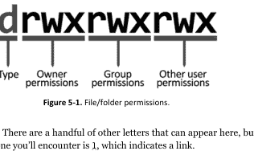

Figure 5-1. File/folder permissions.

with a file. There are a handful of other letters that can appear here, but the main one you’ll encounter is `l`, which indicates a link.

Following this are the three sets of permissions, listed one after the other: `rwxr-xr-x`. After that is a link number, which isn’t relevant to this discussion and can be ignored. Then the owner’s username is listed (in this case, `keir`), and then the group the file is assigned to (the group is also called `keir`).

> NOTE Under Ubuntu each user is assigned to their own personal group, that is named after their username. This policy effectively means that group permissions are irrelevant for personal files unless you were specifically to add another user to your personal group. However, it’s still important you understand the concept of groups and how it applies to file/folder permissions.

Here are the permissions separated out into sets of three relating to owner, group and others:

- Owner: `rwx`
- Group: `r-x`
- Others: `r-x`

The owner has read (`r`), write (`w`), and execute (`x`) permissions. In other words, he can do anything—he has full permissions. He can view a file listing of the Desktop folder, and write new files there. He can switch to the folder by typing `cd Desktop`, or by browsing to it with `Nautilus`.

Members of the group `keir` have read and execute permissions, so they can view a file listing of the folder, and also switch into it. However, they can’t write any files there, or delete them, because there’s a hyphen where the `w` would normally appear. Quite simply, a hyphen in place of a permission means “no permission”.


Finally, other users on the system also have read and execute permissions, but not write permissions—just like with the group permissions.

Let’s take a look at another example of permissions, this time from a word processing document called `report.doc`:

```
-rw-r--r-- 1 keir keir 3024 2008-10-28 18:21 report.doc
```

Once again, we see that the file belongs to the user named `keir`, and is assigned to the group named `keir`.

This time the permission component of the listing starts with a hyphen, because this is a file and not a folder or link. Following this are the three groups of permissions that again can be split-out as follows:

```
Owner: rw-
Group: r--
Others: r--
```

The first permission grouping refers to the owner, and he can read and write to the file, but not execute it. That makes sense because this is a document file and not a program; nobody would want to execute it.

Next, the group permissions say that any member of the group called `keir` can read the file, but not write changes to it (there’s a hyphen where the `w` would be), or execute it.

Finally, others on the system can also read the file, but not write changes to it or execute it.

In other words, for everybody but the user named `keir`, the file is read-only.

## Changing ownerships and permissions

Files or folders can have their ownership and group reassigned, but root powers are usually needed to do so.

> **NOTE** A user can reassign the file’s group without root powers, but only if they’re a member of that group.

The owner of a file or folder can change its permissions so that read, write and execute permissions are either added or removed. Root powers aren’t needed for this.

### Changing file ownership and group assignment

The `chown` (change owner) command is used to change a file or folder’s ownership. It must be preceded by `sudo`, because changing a file or folder’s ownership requires root powers.

The following will switch ownership of the file `report.doc` to the user `frank`:

- `sudo chown frank report.doc`

The `chgrp` (change group) command is used to reassign a file or folder’s group. The following assigns the file `report.doc` to the `accounts` group:

- `sudo chgrp accounts report.doc`

However, you can reassign the owner and group in one fell swoop by using `chown` and separating the new owner and group assignment with a colon. The following will change the ownership of `report.doc` to `frank`, and change the group assignment to `accounts`:

- `sudo chown frank:accounts report.doc`

### Changing file permissions

The `chmod` (change mode) command is used to alter permissions.

There are various ways of using the `chmod` command, but the easiest is to first specify who you want to alter the permission for (owner, group, or others) and then specify the permission changes (i.e. whether to add/remove read, write or execute permissions). Following this, the file or folder name should be specified.

Whom permissions should be changed for is indicated by `u`, `g` or `o`, standing for user (i.e. owner), group or others. The letter `a` can be used to indicate all three.

The permissions are indicated by `r`, `w` or `x` for read, write or execute, and whether the permission should be added or removed is indicated by the use of a plus or minus symbol (`+/-`).

Let’s go back to the file `report.doc` that, you may recall, had the following permissions and user/group ownerships:

```
rw-r--r-- keir keir
```

The owner can read/write to the file, but everybody else (group and others) can only read the file.

If we wanted to allow members of the group to be able to write to the file, we could type the following:

- `chmod g+w report.doc`

In other words, this adds (+) write permissions (`w`) for `report.doc`’s group (`g`).

If we were feeling generous and wanted to let other users to write to it too, we could type the following:

- `chmod o+w report.doc`

这会为其他人（`o`）添加（+）写（`w`）权限。

另一方面，如果我们想要严格的保密，使得只有文件的所有者可以读取或写入文件，而其他人都不可以，我们可以输入以下命令：


- `chmod go-rw report.doc`

这会从 `report.doc` 中移除组和其他人（go）的读和写权限（`rw`）。如果除了所有者之外的人随后尝试查看或修改 `report.doc`，他们会收到“Permission denied”错误。

> **TIP**：快速移除某类用户的全部权限的方法是使用等号（=）。例如，要移除组的全部权限，你需要输入 `chmod g= report.doc`。这相当于输入 `chmod g-rwx report.doc`。

## Changing folder permissions

文件夹的处理方式与文件相同，只是允许/拒绝访问文件夹时，执行（`x`）权限会被设置/取消。

以下命令会阻止除文件夹所有者之外的人读取 `Documents` 文件夹的文件列表、读取/写入文件以及进入该文件夹：

- `chmod go-rwx Documents`

换句话说，这会使文件夹完全私有。

> **NOTE**：不要忘记 root 用户可以访问所有文件和文件夹，无论其所有权或权限如何。值得一提的是，关于隐私，Ubuntu 启动菜单的 Recovery 选项允许任何使用该电脑的人以 root 身份登录，且无需密码。因此，文件的真正隐私只能通过加密来保证，如第 7 章所述。

文件夹内的子文件夹会继承父文件夹的执行权限。换句话说，如果由于未设置执行权限而无法访问 `Music` 文件夹，即使该子文件夹的权限设置正确，你也无法访问其中的文件夹。

## Special permissions

除了读、写和执行权限之外，你可能会遇到另外三种类型的权限：Set user ID（SUID，或 SETUID）；Set Group ID（SETGID）；以及“sticky bit”。

这些可以被描述为具有特定系统管理用途的专业权限，你日常使用中不太可能需要用到它们。它们的工作方式如下：

### Set User ID:

在其最典型的用途中，SUID 权限允许程序像程序的所有者运行它一样运行（换句话说，它以文件所有者的权限运行，而不是运行它的用户）。它最常用于允许普通用户在无需先使用 `sudo` 或切换到 root 用户的情况下运行具有 root 权限的程序。这样的程序由 root 所有，会被设置为可执行，并设置了 SUID 权限。`s` 权限必须与 `chmod` 一起指定以设置 SUID（即 `sudo chmod u+s programname`）。SUID 权限在长文件列表中显示为 `s`，取代了通常标记可执行文件的 `x`（即 `-rwsr-xr-x`）。

> **NOTE**：在 Ubuntu 下，SUID 权限对文件夹没有意义，如果设置了会被忽略。

### Set Group ID:

与 SUID 类似，Set Group ID 权限会使程序以其组的权限运行。然而，SETGID 主要与文件夹一起使用，在这种情况下，它会强制在该文件夹内创建的所有文件或子文件夹继承该文件夹的组权限，而不是创建它的用户。如上所述，`s` 权限是指定的（即 `chmod g+s myfolder`），并且权限在文件列表中显示为 `s`。

### Sticky bit:

当设置在文件夹上时，sticky bit 意味着只有该文件夹内文件或子文件夹的所有者才能删除它（尽管文件夹本身的所有者可以删除该文件，root 也可以）。sticky bit 对于文件共享的文件夹很有用，但管理员不希望用户能够删除其他用户的文件。sticky bit 在文件列表中以权限列表末尾的 `t` 表示（即 `drwxrwxrwt`），并通过输入 `chmod +t foldername` 来设置。当在 Ubuntu 中应用于文件时，sticky bit 没有意义且会被忽略。

> **NOTE**：如果你在文件列表中看到大写的 `S` 或大写的 `T`，而不是小写字母，则表示相关文件或文件夹未设置执行权限。虽然 SUID 和 sticky bits 通常依赖于文件/文件夹可执行，但它们不会自动设置它。

**表 5-2.** `bash` 键盘快捷键。

| 键组合 | 详情 |
| --- | --- |
| `上/下光标键` | 滚动浏览命令历史 |
| `Ctrl+左/右光标键` | 按词移动光标 |
| `Tab` | 自动补全命令或文件名/路径 |
| `Ctrl+A` | 移动到行首 |
| `Ctrl+E` | 移动到行尾 |
| `Ctrl+W/Alt+Backspace` | 删除光标后方的词 |
| `Alt+D` | 删除光标前方的词 |
| `Ctrl+U` | 删除到行首 |
| `Ctrl+K` | 删除到行尾 |
| `Ctrl+Y` | 恢复已删除的文本 |
| `Ctrl+L` | 清屏（实际上，这只是将提示符移至屏幕顶部；如果终端窗口被滚动，已有命令仍可见） |
| `Ctrl+C` | 退出当前程序 |
| `Ctrl+Z` | 将当前程序切换至后台（参见 *Job Management* 部分） |
| `Ctrl+R` | 搜索命令历史 |
| `Ctrl+D` | 注销（技术上，终止输入） |
| `Ctrl+T` | 交换光标后方的两个字符 |

## `bash` 生产力技巧

`bash` 是多年计算研究的成果，已演进为极高效的软件。

成为 `bash` 大师的关键在于善用键盘快捷键，以及命令历史——本质上是你已发出命令的列表。此外，`bash` 内置了作业管理。这意味着你可以启动一个程序，将其切换到后台，然后在它完成时继续做其他事情。

### 键盘快捷键

表 5-2 列出了 `bash` 键盘快捷键，参考的是现代 PC 键盘。其中一些快捷键涉及命令历史，如下一节所述。

也许最有用的键盘快捷键就是按 `Tab` 键。它会自动补全命令和/或文件名。大多数命令足够短，可以手动输入，但某些文件名和路径可能很长，因此输入起来很烦人。

假设你想删除（`rm`）文件 `verylongfilename.doc`。你可以输入 `rm very` 然后按 `Tab` 来自动补全文件名。

试试 `Tab` 自动补全。它比听起来更直观。

> **TIP**：`Tab` 自动补全在使用 `apt-get` 或 `dpkg` 命令安装程序时也有效，如第 7 章所述。它会根据仓库中的内容自动补全包名。

#### 命令历史

每次你在提示符下输入命令时，它都会被记住。实际上，会记录 500 条命令的滚动列表，你可以通过在命令提示符下输入 `history` 来查看它们。

> **TIP**：如果你只想查看最后 10 条命令，可以输入 `history 10`。对于最后 20 条，输入 `history 20`，以此类推。

命令会被记住以便重复使用。你可以使用`上/下光标键`（`Ctrl+P` 和 `Ctrl+N` 作用相同）从最近输入的命令向上循环浏览历史列表。

或者，你可以通过输入其编号（由 `history` 命令显示），前面加上感叹号，来重用历史列表中的任何命令。如果你想查看 `Documents` 文件夹的文件列表，而 `ls Documents` 是列表中的第 #480 条命令，你可以输入 `!480`。

这里还有一个很棒的技巧：假设你刚刚输入了一个很长的复制文件（`cp`）命令，并想再次使用它。输入 `!cp` 将在你的历史列表中找到以 `cp` 开头的最后一行并重用它。

还有其他不错的历史快捷方式。输入两个感叹号（`!!`）会使你上一个输入的命令被重用。输入 `!?` 然后输入最近输入命令的一部分，`bash` 会使用它在历史记录中找到的最接近的匹配进行自动补全。例如，在我的系统上输入 `!?upd` 导致 `bash` 重用了 `sudo updatedb` 命令，它是我的计算机历史列表中的第 #471 条。

按 `Ctrl+R` 可让你交互式搜索历史记录——只需开始输入命令的第一部分，`bash` 就会根据你的历史记录猜测并填补其余部分。如果 `bash` 自动补全的历史记录条目不正确，再次按 `Ctrl+R` 即可进一步回溯历史记录查看另一个匹配，直到找到你要找的那个。

`bash` 提供的命令历史功能远不止这些。建议你输入 `man history` 阅读 `history` 的手册页。

#### 提示

如果你想清除历史记录，只需输入 `history -c`。顺便说一下，历史数据保存在你 `/home` 文件夹中一个名为 `.bash_history` 的纯文本文件里。

### 作业管理

得益于现代计算机惊人的性能，很少有命令需要很长时间才能完成。

#### 注意

请记住，与 20 世纪 70 年代和 80 年代 Unix 最初开发时那些房间大小的计算机相比，现代计算机简直就像神灵一般。正因如此，`bash` 的某些功能在我们当今时代似乎显得有些多余，但令人惊讶的是，它们常常会派上用场。

然而，即使大多数命令眨眼间就能完成，能够将某个特定命令在后台运行，以便继续做其他事情，也常常非常有用。

例如，`updatedb` 命令用于更新 `locate` 文件搜索命令所使用的文件数据库。你可以在命令行中输入 `sudo updatedb` 来运行它。如果这样做，提示符将被占用长达几分钟，在此期间你将无法工作，除非打开一个新的终端窗口。

为了避免这种情况，你可以在启动命令后，在末尾添加一个 `&`（与号）字符，让命令在后台运行：

- `sudo updatedb &`

系统会告诉你作业编号（放在方括号中），你可以输入 `fg` 切换到该作业。

或者，你可以照常启动命令，然后按 `Ctrl+Z`。这会将命令置于后台，并将提示符的控制权返还给你。同样，你可以输入 `fg` 切换回来。

## 管理进程


最常见的命令行任务之一是清理已崩溃的程序，这被称为进程管理。

在技术层面，Linux 将当前运行的程序称为进程。

> 注意 有些程序会启动多个进程，因此对进程更好的定义或许是：进程是一个程序的全部或一部分，而不一定是整个程序。

在终端窗口中输入`top`命令，你可以看到不断更新的进程列表（完成后按 Q 即可退出）。

与文件和文件夹一样，所有进程都归某个用户“拥有”。只有拥有某个进程的用户才能终止它，尽管 root 用户有权终止任何进程。

`top`中列出的大多数进程都是在系统启动时启动的。它们提供基本的后台服务，例如 GUI。这些进程通常归 root 用户所有。这样可以保护它们免受普通用户的干扰。

所有进程都有编号。该编号称为进程 ID，即 PID，显示在`top`程序列表中每个条目的左侧。

要强制进程退出（即终止进程），请按 K 并输入 PID。系统会询问你想发送哪个信号。按 Enter 选择默认值（15）。在大多数情况下这没问题。

你也可以在命令行使用`ps`命令列出进程并查找进程 ID。通常与`ps`一起使用`a`、`u`和`x`命令选项，这会使命令返回包含所有进程及其名称的完整列表。

此外，输出通常会被“管道”传递给`grep`命令，以搜索你感兴趣的程序。我将在后面的“高级 Bash 技巧”一节中讨论管道，但就目前而言，你只需知道管道可以将一个命令的输出“发送”到另一个命令即可。

让我们来看一个例子。尽管 Firefox 很少崩溃，但假设你访问了一个导致它锁死的网站。所有以常规方式退出程序的尝试都不再奏效。

下面的命令将搜索运行中的进程列表，并返回 Firefox 的 PID：

- `ps aux|grep firefox`

PID 是结果中每行列出的第一个数字，在我的测试 PC 上，Firefox 的 PID 是 15994。知道这一点后，我就可以使用`kill`命令，如下所示：

- `kill 15994`

这使 Firefox 立即退出。请记住，如果你终止一个正在编辑数据的程序，系统不会提示你先保存。`kill`命令毫不留情！

另一种终止程序的方法是使用`killall`命令。这个命令允许你指定命令名，而不是 PID。因此，要终止 Firefox，你可以输入以下命令：

- `killall firefox`

`killall`的缺点是你需要知道程序的命令名。可以使用`ps aux`来查明这一点。`killall`也正如其名称所示，会杀死所有具有指定名称的进程实例。

如果你需要终止 root 拥有的进程，只需在`kill`或`killall`前加上`sudo`。但是，终止 root 拥有的进程时务必非常小心，因为它们往往与后台服务的运行有关。此外，后台服务进程经常会派生出自己的子进程，而终止父进程在大多数情况下也会终止其子进程——往往带来灾难性的后果。

## 处理压缩文件

如第 65 页所述，典型的 Ubuntu 用户可能会遇到各种文件压缩和归档类型。然而，两种主要的类型是 Windows 世界使用的 zip 文件，以及压缩的 tar 归档文件。

### Zip 文件

以下命令将创建一个名为`report.zip`的新 zip 文件，并将`report.doc`添加到其中：

- `zip report.zip report.doc`

要压缩一个装满文件的文件夹，请添加`-r`命令选项。以下命令将创建`reports.zip`，其中包含`reports`文件夹的内容：

- `zip -r reports.zip reports`

> 注意 如果任何文件或文件夹名称中包含空格或特殊字符，请用引号将它们括起来。

解压文件时，使用`unzip`命令。以下命令将从`archive.zip`中提取文件：

- `unzip archive.zip`

在解压前列出压缩包中的文件，请使用`-l`命令选项：

- `unzip -l archive.zip`

随后，你可以通过在指定压缩包名称后指定文件名（如果文件位于 zip 中的子文件夹内，则需包含路径！）来仅解压压缩包中的单个文件。以下命令将仅从`archive.zip`中提取`report.doc`：

- `unzip archive.zip report.doc`

### tar 归档

`tar`命令功能强大且多面。它最初是为备份目的而设计的，但同样适用于单个文件/文件夹归档。

本节描述了 tar 归档的基本创建和提取。好奇的读者建议在线搜索更完整的指南，其中有很多。

#### 创建 tar 归档

以下命令将创建一个名为`archive.tar`的简单 tar 归档，其中包含`reports`文件夹的内容：

> **NOTE** 请记住，tar 归档不会自动压缩。它们只是容器文件。tar 文件的大小几乎完全反映了其包含的文件的总大小：

- `tar cf archive.tar reports`

`-c`选项告诉`tar`创建一个归档，而`-f`命令选项告诉`tar`命令其后紧跟文件名。`-f`选项应始终添加到命令选项范围的末尾，紧挨着归档文件名之前。

> **NOTE** 你可能会想知道为什么在`tar`命令中使用命令选项时不使用连字符。答案是它可选，因此大多数人省略了它。只有少数命令使连字符可选，但大多数命令需要它。

要额外压缩归档，可以分别添加`-j`或`-z`选项以进行 bzip2 或 gzip 压缩。bzip2 压缩被认为效率最高，也是最常见的。注意用户应手动为归档名称添加 bzip2 文件扩展名。它不会自动添加。压缩 tar 文件的标准协议是添加两个文件扩展名——一个表示该文件是 tar 文件，另一个表示压缩类型。

以下命令将创建`reports`文件夹的 bzip2 tar 归档：

- `tar cjf archive.tar.bz2 reports`

上面添加了`-v`命令选项。这提供了详细反馈，解释`tar`正在做什么。如果没有它，除非出现错误，否则`tar`完全不会提供反馈。

#### 从 tar 归档中提取

从归档中提取文件的过程在很大程度上与创建归档相同。取而代之的是使用`-x`（提取）命令选项，而不是`-c`（创建）命令选项。在 gzip 或 bzip2 压缩的情况下，应同样添加`-j`或`-z`选项，并且`-f`命令选项应添加到命令选项范围的末尾，以指定其后跟文件名。

以下命令将提取`archive.tar.bz2`的内容：

- `tar xjvf archive.tar.bz2`

再次，添加了`-v`选项，以便用户获得详细反馈。

以下命令将提取`archive.tar.gz`的内容：

- `tar xzvf archive.tar.gz`

> NOTE 如果你担心这些命令选项链难以学习，不用担心。几次使用后，它们会出乎意料地容易记住。

要列出归档中的文件，请使用`-t`选项：

- `tar tjf archive.tar.bz2`

要提取单个文件，请在归档名称后指定它。以下命令将从`archive.tar.bz2`归档中提取`report.doc`：

- `tar xjvf archive.tar.bz2 report.doc`

如果要提取的文件位于 tar 文件内的子文件夹中，你需要在文件名部分中指定该路径。

如果文件名/路径中包含空格或特殊字符，请用引号将其括起来。

## 高级 bash 技术

虽然它们可能被归类为高级命令行技能，但重定向、管道和大括号展开并不难理解。然而，鉴于它们只会被更高级的用户使用，它们超出了本书的范围，这里以简洁的方式进行说明。

### 重定向

有时将命令的输出发送到文件而不是显示在屏幕上会很有用。这就是输出重定向的原理。

假设你想永久记录一个文件列表。要使用重定向实现这一点，输入以下内容：

- `ls > listing.txt`

右尖括号（`>`）告诉`bash`将`ls`命令的输出重定向到文件`listing.txt`，而不是发送到屏幕。把尖括号想象成一个漏斗——`ls`命令的输出被“倒入”`listing.txt`文件中。

如果`listing.txt`不存在，它将被创建。如果已存在同名文件，其内容将被覆盖。使用两个尖括号（`>>`）而不是一个，将导致输出追加到现有文件的底部。

你可以在文本编辑器中查看新文件，或使用`less`文本查看器：

- `less listing.txt`

要将文件内容重定向到特定命令，请使用反向尖括号（`<`）。当然，并非所有命令都设计为接受重定向输入，但`sort`命令就是其中之一。它可用于按字母顺序排序列表。如果我们有一个名为`shoppinglist.txt`的文件，其中包含我们想从商店购买的产品列表，并且我们想按字母顺序排序列表，我们可以将文件内容重定向到命令，如下所示：

- `sort < shoppinglist.txt`


is packed with features. For example, rather than specifying individual expansions separated by commas, a range of letters or numbers can be specified. If you wanted to create 10 folders named photos (i.e. photos1, photos2, etc.), the following will do the trick:

```
mkdir photos{1..10}
```

Letters can be specified instead of letters. The following will create photosA, photosB etc., all the way to Z:

```
mkdir photos{A..Z}
```

## Wildcards

Worth mentioning alongside brace expansion is the concept of wildcards. The term is taken from Poker, where a card that's "wild" can represent any card. This might help you understand wildcards at the command-line: they're symbols that specify any character(s).

The most commonly-used wildcard is the asterisk (`*`), used to indicate any combination (or number) of characters.

If you wanted to delete all files in a folder, you could type the following:

```
rm *
```

In this example, the asterisk wildcard represents any filename that contains any number of characters. That's all of them!

To return to the vacation folder example used above, the photos_spain, photos_germany etc. folders could be deleted like this:

```
rm -r photos_*
```

This will delete any file whose name begins with photos_, but has any number of characters following (should there be a folder called photos_ with nothing after it, that too will be deleted).

A question mark (`?`) can be used to indicate any single character. The following will delete photos1, photosA, photos1, and so on:

```
rm -r photos?
```

The following will delete photos1, photos3 and photos4, but leave in place any other folder named photos and followed by any character:

```
rm -r photos[134]
```

In other words, each character within the square brackets is individually substituted within the filename, in a similar way to brace expansion. However, wildcards are designed to match patterns of characters in existing files (or data), so won't work when creating files.

## Software management

This chapter looks at how to install and remove software, and manage the software subsystem. You will explore the package management system that lies at the heart of Ubuntu. Topics covered include:

- An explanation of the package management subsystems;

- Installing and removing software using Synaptic;

- Manually installing a software package;

- Installing and removing software at the command-line;

- Adding new software repositories;

- Compiling a program from source code.

### All about package management

Like many versions of Linux, Ubuntu relies on a system called *package management* for all its software installation and removal needs.

### What's in a package?

Nearly all Ubuntu programs are distributed as *software package* files.

Package files are similar to installation `setup.exe` files under Windows, in that they're single archives containing a program's components. When the program is installed, the components are unpacked onto the hard disk, and the system configured so the software will work.

However, a key difference with Ubuntu is that packages only contain the program itself. Typical `setup.exe` files for Windows include the program and also various system files that allow the program to run

repositories. Therefore, installing new software is simply a matter of downloading and installing from the repositories.

`APT` handles both of these tasks automatically. As a user, you will not have to handle any package files directly.

The creation of such huge repositories of software is possible because practically all the software used under Ubuntu is open source. The source code—the original listing created by programmers—is available for everybody to use and appropriate however they wish. The Ubuntu developers take the source code for 1,000s of applications and create their own versions, tweaking the software if necessary so it works well under Ubuntu. Then they file it away in the repositories, ready for download and installation by end users.


> NOTE Because Linux software uses an open source approach, there often isn’t an "official version" of some programs. For example, if you visit the Gnome website (`www.gnome.org`) and try to download binaries of the desktop software, you’ll be told that you should search the repositories of your Linux distribution instead.

With Ubuntu it’s unusual that a user will visit a website and manually download new software, although there is a notable exception: software that’s so new it’s not yet included in the official repositories. Many Ubuntu power-users often download such software.

> NOTE In many cases, to install cutting-edge software it’s better to sign up to the software developer’s own personal repository. This is sometimes known as a Personal Package Archive, or PPA.

Out of the box, Ubuntu is signed up to several official repositories. These are listed in Table 6-1. You can add-in more repositories if you wish. This is useful when adding-in software that isn’t officially supported. How to add repositories is explained in the Working with Repositories section later in this chapter.

### Dependency management

Aside from the convenience (and luxury!) of having nearly all the world’s Linux software just a download away, the use of repositories has another benefit: dependency management.

As mentioned earlier, a software package only contains the program itself. It doesn’t contain any support software that might be needed, such as system libraries, or vital helper applications. They must be downloaded and installed separately, and are nearly always available in a package of their own.

#### 表 6-1. Ubuntu 默认软件仓库。

| 仓库 | 详情 |
|---|---|
| Main | Main 仓库包含核心软件包。本质上，这是全新安装 Ubuntu 所需的最低限度仓库，尽管 Main 中也有一些并非基础环境所必需的额外软件包。Main 中的软件由 Ubuntu 的赞助商 Canonical 正式支持，因此保证在该特定 Ubuntu 版本的生命周期内持续更新。 |
| Universe | 被称为“社区维护”仓库，也可以称为“其余部分”，因为它包含 Linux 社区生成的大多数自由软件，而这些软件未包含在 Main 中。每个软件包都由 Ubuntu 或 Debian 社区的成员维护。Universe 中的软件不受官方支持，因此不保证更新。 |
| Restricted | 又称“专有驱动程序”，该仓库包含少量非开源软件，用于使某些 PC 硬件（主要是无线和图形设备）正常工作。该仓库中的软件会定期更新。 |
| Multiverse | 被称为“受版权或法律问题限制的软件”，该仓库实际上是“其余部分的其余部分”。Multiverse 中的软件与 Ubuntu 所使用的自由软件许可协议的字面意义或精神都不兼容。不过，这并不一定意味着 Multiverse 中的软件是专有的。Multiverse 软件不受官方支持，可能不会更新。 |
| Updates | 提供了两个更新仓库，用于发布软件修复程序；“security”仓库提供必要的安全更新，而“updates”仓库提供推荐的更新。 |

如果软件需要安装其他软件包，则称它依赖于其他软件包。如果依赖软件包未安装，软件将无法工作。事实上，你甚至无法安装该软件。

`APT` 的工作就是处理依赖关系，并且它会自动、几乎无感地完成这一工作。它知道某个特定软件包需要什么，并会自动将所需的软件包加入从仓库下载和安装的清单中。

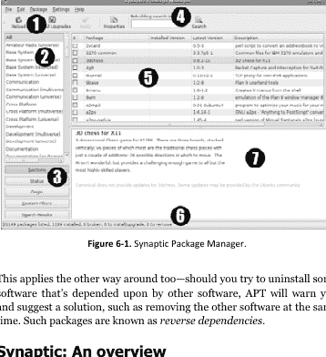

图 6-1 Synaptic 软件包管理器。

反过来也是如此——如果你尝试卸载某个被其他软件依赖的软件，`APT` 会警告你并建议解决方案，例如同时删除其他软件。这类软件包称为反向依赖。

## Synaptic：概述

你可以通过两种方式添加和删除软件：使用图形界面工具 Synaptic 软件包管理器，或在命令行中操作。本节将介绍这两种方式，先从 Synaptic 开始。

Synaptic 可以在“系统 → 管理”菜单中找到。它的界面易于理解，图 6-1 显示了一张带有标注的截图。各标注的描述如下所列。（请注意，该截图来自 Ubuntu 8.10；Ubuntu 8.04 中的 Synaptic 版本略有不同，但大体相同。）

+ 1. 工具栏：在这里可以快速访问 Synaptic 的关键功能。也许最有用的按钮是 `RELOAD`（强制计算机获取仓库中最新的软件包列表）和 `APPLY`（在主软件包列表中做出选择后，必须单击该按钮才能开始安装/删除软件）。
提示：部分仓库会频繁更新，因此在安装新软件之前，应始终从仓库获取最新列表。为此，每次启动 Synaptic 时，点击 `RELOAD` 按钮应当是你要做的第一件事。
+ 2. 筛选器列表：筛选器选择就显示在此处（参见紧下方“筛选器”标题）。单击此列表中的每个条目，可以细化主软件包列表。
+ 3. 筛选器：筛选器选择区域中的按钮允许你在上方筛选器列表区域显示的筛选器集合之间进行选择。每个按钮上都标注了每个筛选器选择的性质，具体描述如下：
`SECTIONS`：这是默认视图。仓库通常按部分（sections）划分，便于浏览；选择 Sections 筛选器列表，可以让你根据这些部分细化主软件包列表。有关这些部分的说明可在 `http://packages.ubuntu.com/intrepid/` 找到。
`STATUS`：在这里，你可以按已安装的软件包来筛选软件包列表。此外，“未安装（残留配置）”选项允许你筛选已被卸载但配置文件仍保留在系统中的软件。
`ORIGIN`：此选项允许你按单个仓库筛选软件包列表。默认仓库列表请参见表 6-1。
`CUSTOM FILTERS`：通过单击“设置 ⇨ 筛选器”，你可以创建自己的筛选器，通常用于帮助修复软件管理子系统中的问题。单击 `CUSTOM FILTERS` 按钮即可显示这些筛选器，其中包含一系列现成的问题解决筛选器。
`SEARCH RESULTS`：每当你搜索软件包时，此选项会自动被选中。
+ 4. 搜索：Ubuntu 8.10 提供了多种搜索软件包的方法，其中两种位于此处工具栏上（Ubuntu 8.04 附带的 Synaptic 只显示一个 `SEARCH` 按钮）。在“快速搜索”（`Quick Search`）字段中输入内容，可以快速搜索软件包名称和描述。或者，你可以单击 `SEARCH` 按钮进行更彻底的搜索。
+ 5. **主软件包列表：** 这里显示可用软件包的列表。如果未应用任何过滤器，则会列出所有存储库中的所有软件包（在 Ubuntu 8.10 中约有 26,135 个软件包！）。软件包旁边带有 Ubuntu 图标的是官方支持的软件包，也就是说，它们将在您使用的特定 Ubuntu 版本的生命周期内得到更新。要安装软件包，请单击其旁边的复选框。已安装的软件包的复选框为绿色，单击复选框即可将软件包标记为移除。要查看所有可能的复选框状态，请单击 `Help ⇨ Icon Legend`。


## 状态栏
在这里您可以查看主软件包列表中显示的软件包数量的摘要，以及其中有多少已安装、损坏（即缺少依赖项——见后文），以及有多少被标记为安装、移除或升级。

## 软件包描述
当前选定软件包的完整描述将显示在此处。每个描述下方都有关于更新性质的说明（仅限 Ubuntu 8.10 及以上版本）。

# 典型任务

让我们逐步了解一些典型的软件管理任务。

## 安装软件

`Frozen-Bubble` (`www.frozen-bubble.org`) 是经典 Bust-a-Move 电子游戏的优秀克隆版。它不仅有趣好玩，而且也是 Linux 可用游戏质量的良好示例。

安装它的步骤如下所述。相同的步骤也适用于在存储库中查找和安装任何软件包：

- 1. 启动 Synaptic（`System ⇨ Administration ⇨ Synaptic Package Manager`）。在安装任何软件之前，您应始终从存储库获取最新的软件包列表。这意味着要在主工具栏上点击 `RELOAD` 按钮。
- 2. 点击工具栏上的 `SEARCH` 按钮。在搜索字段中输入 `frozen bubble` 并点击对话框的 `SEARCH` 按钮。
- 3. 经过几秒钟后，软件包列表将会出现。其中一些软件包将是 `Frozen-Bubble` 的支持软件包，而一些可能完全无关，因此需要常识来确保您选择的是实际程序的软件包。选择每个软件包并阅读其描述应该就足够了，很快就会变得明显，安装程序所需的软件包名为 `frozen-bubble`。

**TIP** 如果您已经知道特定的软件包名称（也许您在网页上读到它，例如），更快捷的搜索方法是确保主列表中已选择一个软件包，然后直接开始输入软件包名称。这将根据您输入的内容自动过滤软件包列表。

- 4. 点击列表中 `frozen-bubble` 条目旁边的复选框。立即会出现一个弹出菜单，提供多种选项。安装所需的是 `Mark for Installation`。
- 5. 一旦您做出选择，可能会出现一个对话框，说明需要安装额外的软件包。这些是程序正常工作所需的依赖项。您应点击 `MARK` 按钮将其添加到要安装的软件包列表中。如果您改为点击 `CANCEL`，则原始软件包将被取消选择。

**NOTE** 虽然几乎所有程序都有依赖项，但并非总是会提示安装它们，因为它们可能已经安装在系统上。如果您没有看到安装依赖项的提示，请不要担心——不太可能出现任何问题。

- 6. 现在点击工具栏上的 `APPLY` 按钮。将会出现一个摘要对话框，显示将要安装的软件包（点击 `SHOW DETAILS` 按钮可查看完整列表）。此外，您还会被告知新应用程序将占用多少磁盘空间。假设您对所有这些都满意，请点击对话框中的 `APPLY` 按钮以安装软件。

下载和安装会自动进行，通常只需几分钟。最后会出现一个确认对话框，之后您将在相关的 `Applications` 或 `System` 子菜单上找到新软件的图标——对于 `Frozen-Bubble` 而言，图标出现在 `Applications → Games` 菜单上。

**TIP** 除了依赖项之外，一些软件包还有推荐软件包列表，有时还有建议软件包列表。这些是非必要的附加组件，可增强程序的功能。例如，如果您安装文字处理器，词典应用程序可能就是一个建议的软件包。您可以通过右键单击该软件包并从“标记为推荐”和/或“标记为建议”子菜单中进行选择。

## 卸载软件

删除软件包与安装它一样简单。使用 Synaptic 的搜索功能找到相关软件包（与安装软件时一样，按程序名称搜索），然后在列表中单击该程序软件包旁边的复选框。

将弹出一个菜单，提供各种选项，如下所示：

- **标记为重新安装：** 这将刷新软件，如下文所述。
- **标记为移除：** 这将移除软件，但会保留其配置文件，以便在将来决定重新安装时软件仍能以相同的方式运行。这是最佳选择。
- **标记为完全移除：** 这将移除软件并同时删除其配置文件。

假设您选择移除软件，复选框中会出现一个叉号。当您单击主工具栏上的应用按钮时，您将再次看到将要执行的操作的摘要。单击对话框中的应用以继续。

删除软件包不会删除随其一起安装的任何依赖项。使用 Synaptic 目前无法做到这一点，尽管可以在命令行中实现，如下文“命令行软件管理”部分所述。

> 注意 有时您可能会在摘要对话框中看到一个标题，内容为“未更改”。这表示有可用更新的软件包。我将在第 7 章中详细介绍更新，但如果您希望使用 Synaptic 安装更新，可以单击工具栏上的标记所有升级按钮。

## 重新安装软件

有时系统上安装的软件可能会损坏，在这种情况下它可能无法运行，或功能不正确。在这种情况下，重新安装软件会很有用，而 Synaptic 提供了这样做的方法。搜索该程序的软件包并单击其旁边的复选框。在出现的菜单中，单击标记为重新安装选项，然后单击主工具栏上的应用按钮。

在通过摘要对话框确认即将执行的操作后（与安装/移除软件时一样），Synaptic 将运行安装软件的流程，例如解包软件包和配置软件，但除非软件包文件未存储在软件包缓存中，否则不会真正重新下载，在这种情况下，它将不得不从存储库下载。

## 手动安装软件包

不建议您尝试手动下载软件包并安装它。该过程问题重重，最重要的问题是手动获取依赖项的潜在困难。

> 注意 由于依赖问题，如果您打算安装在开发者网站上找到的软件，您可能会发现开发者拥有自己的软件包存储库，您可以订阅该存储库。这将让您使用 Synaptic 安装程序，从而自动处理依赖项。添加新存储库在下文“使用存储库”部分中有描述。

然而，有少数情况需要“手动”安装软件包。

`GDebi` 软件包安装程序会自动关联软件包文件（它们具有 `.deb` 扩展名），就像 `OpenOffice.org` 的 `Writer` 关联 Microsoft Word `.doc` 文件一样。因此，手动安装软件包只需下载软件包文件并双击它，或者更简单地，在 Web 浏览器的下载对话框中选择使用 `GDebi` 软件包安装程序打开选项。

`GDebi` 会尝试通过从主存储库下载必要的依赖包来缓解任何依赖问题。然而，您不应假设依赖包始终可用，特别是如果您安装的软件包不是专门为您使用的 Ubuntu 版本构建的。

一旦 `GDebi` 程序窗口出现，单击安装软件包按钮。之后，任何依赖项将被下载（如果可能），并安装软件。

如果在存储库中找不到任何必需的依赖项，安装软件包按钮将被禁用，并会出现警告，告知您缺失依赖项的名称。您必须在继续之前手动获取并安装依赖包。

# 表 6-2. 典型软件管理命令（apt 在上，dpkg 在下）。

| 命令 | 详情 |
|---|---|
| `apt-get update` | 从仓库更新可用软件的列表（相当于 Synaptic 的 `RELOAD` 按钮，因此在进行任何软件安装之前都应使用）。 |
| `apt-cache search searchterm` | 在仓库中搜索 `searchterm`。将返回匹配软件包的具体名称以及摘要描述。 |
| `apt-cache show packagename` | 显示 `packagename` 的详细信息，包括其依赖项和完整描述。 |
| `apt-get install packagename` | 安装 `packagename`。任何依赖项都会自动添加到列表中，并且会要求你确认总安装数量。可以指定多个软件包。 |
| `apt-get autoremove packagename` | 卸载 `packagename`，以及任何 *未使用* 的依赖项。若只想卸载指定的软件包并保留依赖项，请使用 `apt-get remove packagename`。如果不指定软件包发出，`apt-get autoremove` 将尝试删除系统上所有冗余的依赖软件包。 |
| `apt-get upgrade` | 更新已安装软件到最新版本。 |
| `apt-get dist-upgrade` | 从本质上讲，此命令将整个系统升级到 Ubuntu 的最新版本。 |
| `apt-get clean` | 清除软件包缓存；如果磁盘空间紧张则有用，否则并非必要。 |
| `dpkg -i packagename.deb` | 手动安装文件 `packagename.deb`，前提是你已手动下载它。 |
| `dpkg -r packagename` | 卸载 `packagename`；需要指定系统上已知的软件包名称（即 Synaptic 中的名称），而不是安装时所需的软件包文件名。 |
| `dpkg -P packagename` | 卸载 `packagename`，同时删除其配置文件。 |
| `dpkg -I packagename.deb` | 显示 `packagename.deb` 的信息，包括完整描述和依赖项。 |
| `dpkg -l packagename` | 列出已安装的名为 `packagename` 的软件包的详细信息，包括版本号。 |

> 注意 请记住，依赖项通常也有自己的依赖项！换句话说，你很可能会找到程序所需的全部依赖项，然后又被呈现出一个全新的列表！这种情况被称为“依赖地狱”，也是 `APT` 被发明的主要原因。


手动安装的软件包可以使用 Synaptic 删除，就像其他任何软件一样。

## 命令行软件管理

Synaptic 很有用，但它不过是管理 APT 软件子系统的系列命令的图形前端。

两个最有用的命令是 `apt-get` 和 `apt-cache`。除此之外，还可以使用 `dpkg` 命令安装你手动下载的软件包。

在命令行安装软件可能比使用 Synaptic 更快、更高效，因此是一项值得学习的技能。

> 注意 当然，如果 GUI 不能工作，命令行软件安装也是可能的。因此在尝试修复损坏的系统时它会非常有用。

在下面的各节中，我将查看之前提到的相同常见软件安装任务，但这次是在命令行中进行。

对于想要快速入门的人来说，表 6-2 中概述了最有用的软件管理命令子集。请记住，软件安装需要 root 权限，因此每个软件安装或删除命令都应以 `sudo` 开头（搜索或显示信息的命令通常不需要 root 权限）。

> 提示 有些人更喜欢使用 `aptitude` 命令而不是 APT 命令。`aptitude` 在处理依赖项方面稍好，并且具有半图形界面，使用起来很容易。更多详情请参阅 http://algebraicthunk.net/~dbrowne/projects/aptitude/doc/en/。

## 安装软件

下面是安装 Frozen-Bubble 游戏所需的步骤，如前所述。

1. 在安装任何软件之前要输入的第一个命令是 `sudo apt-get update`。这将从仓库获取最新的软件列表。

2. `apt-cache search` 命令可用于搜索可用软件列表。要搜索 Frozen-Bubble，可以输入类似以下内容：

    - `apt-cache search frozen bubble`

    在我的测试系统上看到的内容如下：

    ```text
    fb-music-high - High quality, large music files for Frozen-Bubble
    fb-music-low - Lower quality, small music files for Frozen-Bubble
    frozen-bubble - Pop out the bubbles!
    frozen-bubble-data - Data files for Frozen-Bubble
    pengupop - Online multiplayer clone of Bust a Move
    ```

3. 要查看任何软件包的完整详细信息，请使用 `apt-cache show` 命令；例如：

    - `apt-cache show frozen-bubble`

    提供的信息可能会超出屏幕滚动，因此通常将其通过管道传输到 `less` 文本查看器中以便阅读会很有用（即 `apt-cache show frozen-bubble | less`）。

4. 找到正确的软件包名称后，可使用 `apt-get install` 命令安装它；安装软件需要 root 权限，因此命令必须以 `sudo` 为前缀：

    - `sudo apt-get install frozen-bubble`

如果不需要依赖项，软件包将被立即下载并安装。如果需要依赖项，这很可能发生，它们将自动添加到要下载和安装的文件列表中。会显示摘要，您可以输入 Y 表示同意，或输入 N 取消软件安装。

假设您同意，软件将被下载并安装。进度会实时显示。

有时在安装软件包期间可能会执行某些系统配置任务。例如，如果您选择安装包含字体的新软件包，系统字体缓存很可能会被刷新。此类任务会自动执行，如果使用 Synaptic，通常会隐藏在视图之外。但是，在命令行安装时，您会看到每个任务完成。通常不必担心任何问题。如果任何管理任务有可能损坏系统或更改重要设置，您将被提示确认是否希望其运行。

## 卸载软件

卸载软件与安装软件一样简单，您只需要软件包的名称即可。如果您忘记了，可以再次使用 `apt-cache search` 来查找。

在此之后，使用 `apt-get autoremove` 命令——以下将卸载 Frozen-Bubble：

- `sudo apt-get autoremove frozen-bubble`

您将看到要删除的软件包列表（其中包括任何冗余依赖项），并被要求通过按 Y 或 N 来确认您的决定。

> 注意 只有未使用的依赖项才会被标记为删除。这可能与最初安装的依赖项列表不同。这种差异出现的原因是您此后安装的其他软件也需要这些依赖项。

## 重新安装软件

要刷新已安装的软件包，请输入以下内容，将 `packagename` 替换为 Synaptic 中列出或通过 `apt-cache search` 的程序名称：

- `sudo apt-get --reinstall install packagename`

如果软件包不在系统的软件包缓存中（位于 `/var/cache/apt/archives`），它将被重新下载。

## 手动安装/卸载软件包

如果您发现自己必须手动安装软件包，可以使用 `dpkg` 命令。`-i` 命令选项用于安装，`-r` 选项可用于删除软件包，如下所示：

- `sudo dpkg -i packagename.deb`
- `sudo dpkg -r packagename`

> 注意 一旦使用 `dpkg` 安装了软件包，也可以使用 `apt-get autoremove` 命令将其删除。

安装时必须指定软件包文件的完整文件名。

卸载软件则不需要。相反，您只需通过其“短名称”引用软件包——它在 Synaptic 或 `apt-cache search` 提供的软件包列表中显示的名称。

> 提示 短名称通常是软件包文件名的第一部分。

要查看下载的软件包文件中包含的完整说明，其中包括其所需的依赖项列表，请使用 `-I` 命令选项（将输出通过管道传输到 `less`，因为否则它会滚动出屏幕）：

- `dpkg -I packagename.deb | less`

要查看是否已安装软件包——用于检查软件包所需的依赖项是否满足——请使用 `dpkg` 的 `-l` 命令选项（小写 L），并指定软件包的短名称。如果软件包未安装，您将看到“未找到软件包”。如果已安装，您将看到显示软件包版本号和各种详细信息的表格。

## 安装限制

由于依赖问题，对 `dpkg` 在安装/删除软件时的工作方式施加了限制。这可以保护系统免受损坏。

如果您尝试安装需要尚未安装的依赖项的软件包，您将被告知它们是什么。然后软件将被安装但不会配置为使用。这意味着，本质上，程序文件已就位，但使程序正常工作所需的任何重要系统调整尚未进行。

未满足依赖项而安装的软件包称为损坏的软件包。安装损坏的软件包会使软件包管理系统处于损坏状态；`apt-get` 将拒绝工作，直到满足依赖项或删除有问题的软件包，而 Synaptic 将自动坚持在允许任何进一步的软件包安装之前删除该软件包。

> 提示 如果依赖软件包在存储库中可用，可以通过在命令行键入 `sudo apt-get -f install` 来修复这种情况。这将下载依赖项，安装它们，并为使用配置损坏的软件包。

## 卸载限制

如果您尝试使用 `dpkg` 卸载是其他软件包依赖项的软件包，您将不被允许。相反，您将被告知哪些其他程序依赖于该软件包，并且您必须手动 remove them first (of course, it's likely they will have their own dependencies, giving rise to another “dependency hell” situation).

## Working with repositories

作为 Ubuntu 用户，你并不局限于官方仓库。许多第三方提供了自己的仓库，你可以按需订阅任意多个。

订阅第三方仓库的好处是，你可以通过 Synaptic 或 `apt-get` 安装仓库中包含的任何软件。此外，如果软件有新版本可用，你会通过 Ubuntu 的更新管理器自动收到通知，并能够在系统更新时一并安装新版本。

## Adding a repository

要添加新仓库，你只需要地址。地址看起来像一个扩展的网址。例如，这里是 Skype 提供的仓库地址，Skype 是 VoIP 电话通信软件的提供者：

```
deb http://download.skype.com/linux/repos/debian/ stable non-free
```

要将新仓库地址添加到系统中，请按以下步骤操作：

1. 启动软件来源程序（可在 系统 → 管理 菜单中找到），并在出现的窗口中点击 第三方软件 选项卡。

2. 点击 ADD 按钮，并在 APT 行 字段中输入整行地址，包括行首的 `deb` 组件以及行尾的任何单词（如果地址在网页上，复制粘贴会更合理）。

3. 完成后，点击 ADD SOURCE 按钮，然后点击父窗口中的 CLOSE 按钮。你会被提示更新仓库中软件的列表，请执行更新。

需要注意的是，软件来源程序只是将你输入的地址添加到 `/etc/apt/sources.list` 文件中。因此，要在命令行添加仓库，只需编辑此文件并在末尾添加新的仓库行。然后刷新仓库列表（`sudo apt-get update`）。

## Adding a new repository key


有时仓库包含 *数字签名* 的软件包。签名是一种确保软件包未被篡改或伪造的方法。程序员用只有她才能创建的 ID 对每个软件包进行盖章。这是通过加密密钥完成的，其公钥部分可供下载，必须由终端用户安装。

你可以按以下方式将公钥添加到系统中：

- 1. 密钥通常在你找到软件包的同一位置提供下载——文件扩展名为 `.asc` 或 `.gpg`。右键点击它并选择另存为，然后保存到磁盘。务必仅从软件包创建者的网站下载密钥，而不是镜像站点。毕竟，密钥也可能被篡改。
- 2. 在软件来源程序中，点击 `Authentication` 选项卡并点击 `IMPORT KEY FILE` 按钮。然后导航到你保存的文件。完成后点击 `OK`。

要在命令行导入密钥，输入以下命令，将 `keyfile.gpg` 替换为下载文件的名称：

```
sudo apt-key add keyfile.gpg
```

> **NOTE**  如果你尝试安装的软件包来自第三方仓库且 *未* 经过数字签名，安装过程中可能会出现警告，提示软件包无法通过身份验证。这是为了提醒你正在安装非官方软件包，但通常不必担心。

## Compiling from source code

Linux 的特性意味着几乎所有可用软件都是 *开源* 的——源代码可供人们查看、使用，甚至改编成新软件。

在 1970/80 年代 Unix 的鼎盛时期，安装新软件的 *唯一* 方法是获取源代码并 **编译** 它——手动将其转换为可日常运行的 *二进制* 文件。

尽管即用型预编译软件包在 Ubuntu 软件安装中占据主导地位，你可能会发现某些 Linux 软件仅以源代码形式提供。这在需要手动编译才能与内核程序正确配合的新硬件驱动程序中经常出现。

在尝试自行编译软件之前，请使用 Synaptic 安装 `build-essential` 包。这会安装必要的程序编译软件。

在解压源代码并切换到包含源代码的文件夹后，编译软件通常会依次使用三个命令：

- `./configure`
- `make`
- `sudo make install`

第一个命令运行一个脚本，检查系统是否具有编译软件所需的软件，以及程序最终运行所需的任何依赖软件。

第二个命令实际编译软件，因此完成可能需要相当长的时间。在此阶段，屏幕可能会被垃圾信息填满。这就是 *调试输出*，不必担心，不过如果你在编译软件时遇到问题并在网上寻求帮助，其他人可能会要求查看它。

第三个命令将新生成的程序文件复制到文件系统的相关位置，以便日常使用。

超出本口袋指南的范围来更深入地解释软件编译，但考虑到这是最基本（也是最古老）的 Unix 任务之一，你可以在网上找到优秀的说明——只需打开你喜欢的搜索引擎即可。

## 第七章

## 保护系统

本章介绍五个有助于提高 Ubuntu 安全性的系统配置方面。它们是：

- 更新系统；
- 配置防火墙以保护计算机免受网络/互联网威胁；
- 安装防病毒程序；
- 加密数据，以便即使数据被盗或遗失也无法访问；
- 增强网络浏览器内的安全性。

### 系统更新

与任何操作系统一样，你应定期更新 Ubuntu。这将确保你拥有最新的软件，该软件没有漏洞和安全漏洞，从而使系统不安全，为黑客或病毒提供后门。

#### 更新管理器

Ubuntu 使用名为 Update Manager 的程序自动更新系统。该程序定期在后台自动运行，以检查存储库中已提供的已安装软件的更新版本。

你可能已经注意到该程序的图标出现在通知区域——根据使用的 GUI 主题，它看起来像一颗星，或红色向下指向的箭头，第一次出现时会出现一个提示，告知你有更新可用。

点击图标将显示可以更新的软件包列表。

> TIP 首先确保关闭任何其他软件安装应用程序，例如 Synaptic。一次只能运行一个软件管理工具。这包括命令行工具。

并非绝对有必要阅读更新列表，但这样做只需一两分钟，并且跟踪正在更新的内容是个好主意。假设你对更新列表满意，点击 `INSTALL UPDATES` 按钮即可自动下载并安装软件。

如果需要，你可以通过点击 `System ▸ Administration` 菜单上的条目强制运行 Update Manager，并在程序窗口出现时点击 `CHECK` 按钮。

根据更新的系统组件，你可能需要重新启动计算机以完成安装。你可以通过更新管理器图标判断是否需要——它会变为两个圆形箭头，点击后会提示你重新启动计算机。

当新的 Ubuntu 版本可用时，Update Manager 会通过弹出窗口通知你。然后你可以选择升级（或不升级，如果你不希望升级）。

#### 命令行更新

要在命令行更新，可以发出两组命令：

- `sudo apt-get update`
- `sudo apt-get upgrade`

或

- `sudo apt-get update`
- `sudo apt-get dist-upgrade`

`sudo apt-get update` 获取最新的软件包列表，因此在更新前应始终使用。

`sudo apt-get upgrade` 将所有软件包更新到最新可用版本。如果你希望在命令行手动更新系统，应每周发出此命令。相比之下，`sudo apt-get dist-upgrade` 会更新整个系统，包括多个关键系统文件，从而将 Ubuntu 更新到最新版本。例如，在 8.04 系统上运行它会将 Ubuntu 更新到 8.10。只有在你知道有新版本可用时才应运行它。

### 配置防火墙

Ubuntu 包含一个非常强大的防火墙 `netfilter`，它是内核核心程序的一部分。然而，它默认处于非激活状态，必须手动配置。其原因在于 Ubuntu 没有面向外部的服务。如果你把 Ubuntu 想象成一栋房子，可以说它没有窗户或门供入侵者进入。所有传入的连接都会撞上一堵砖墙。

然而，尽管有这种基本保护，黑客们也很狡猾，不能有丝毫懈怠。使用 Firestarter 等 GUI 应用程序配置防火墙，如下所述，操作非常简单，几乎没有不这样做的理由。

> TIP 可以使用 `ufw` 命令在命令行配置防火墙。这相对简单易用，但仍然不如 Firestarter 等 GUI 应用程序直观。更多详情请参阅 http://ubuntuforums.org/showthread.php?t=823741。

#### 安装和配置 Firestarter

Firestarter 是一个简单但功能非常强大的防火墙配置工具。要安装它，请启动 Synaptic 并搜索 `firestarter`。在结果列表中 `firestarter` 条目旁边的框中打勾，然后从出现的菜单中选择 Mark for Installation。点击工具栏上的 `APPLY` 按钮，并在出现的对话框中点击 `APPLY` 按钮。

无需重启，因为 Ubuntu 的防火墙组件可以在系统运行时启动、停止和重新配置。然而，有必要完成一个初始向导来配置 Firestarter 本身，因此通过点击 `System ⇨ Administration ⇨ Firestarter` 启动程序以完成此操作。

> NOTE 请记住，没有必要让 Firestarter 配置程序一直运行才能享受 Ubuntu 防火墙的保护。Firestarter 所做的只是配置 Ubuntu 内置的防火墙。它本身并不是一个防火墙应用程序。

点击 `FORWARD` 按钮以逐步完成向导。当被要求选择要保护的网络设备时，从 `Detected Device(s)` 下拉列表中选择连接类型。如果您使用的是无线连接，请确保列表显示为 `Wireless Device`，或类似名称（见图 7-1）。请记住，“Ethernet”指的是有线连接，即计算机通过电缆连接到路由器、交换机或集线器。

保持其他选项不变并点击 `FORWARD` 以完成向导。最后，点击 `SAVE` 按钮。

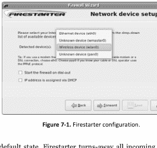

图 7-1. Firestarter 配置。

在默认状态下，Firestarter 会拒绝所有传入数据，而所有传出数据则被允许通过防火墙。因此，它与默认的 Ubuntu 状态几乎没有区别。

> NOTE 在技术层面，Firestarter 通过让你允许和拒绝单个 `TCP/UDP` 端口来工作。配置 Firestarter 其实没有必要理解这一点，但如果你想创建更复杂的设置，这肯定会有所帮助。许多网站都提供关于 TCP 和端口如何工作的解释——只需搜索 Google 即可。

可以创建两种类型的规则：入站规则，允许来自网络或互联网的连接通过；出站规则，可以阻止来自计算机的未经授权的数据发送，例如来自潜在病毒感染或间谍软件的数据。

> NOTE 几乎没有病毒或间谍软件感染影响 Linux。然而，随着像 Ubuntu 这样的 Linux 版本变得越来越流行，这几乎肯定会发生变化。

#### 创建入站规则

入站规则允许您过滤所有传入连接。默认情况下，所有不受欢迎的传入连接都会被拒绝。创建入站规则有效地允许您为某些类型的连接在防火墙上创建一个“孔”，以满足特定程序的需求。如果您在计算机上运行文件共享软件，例如 Transmission（Applications → Internet），它使用 BitTorrent 来共享文件，这可能很有用。


此外，您可以选择允许某些入站连接通过，但前提是它们源自本地网络（即在特定 IP address range）。例如在共享文件夹的情况下，这很有用，因为你工作场所或家中的其他计算机可能希望访问你计算机上的文件。

以下是创建入站规则所需的步骤：

1. 如果 Firestarter 配置程序尚未运行，请通过点击系统 → 管理 → Firestarter 来启动它。系统提示时你需要输入密码。
2. 在程序窗口中点击 Policy 选项卡，并在 Editing 下拉列表中确保选择了 Inbound Traffic Policy。
3. 在程序窗口下半部分的 Allow Service 标题下，右键单击并从出现的菜单中选择 Add Rule。
4. 在出现的对话框中，从 Name 下拉列表中选择你希望允许通过防火墙的类型或程序。例如，要允许 BitTorrent 连接，请在列表中选择它。要让其他人访问你计算机上的共享文件夹，请选择 Samba (SMB)。请注意，选择后 Port 字段会自动填入。你可以编辑它，但通常没有必要。
5. 如果规则涉及来自互联网的入站连接，请确保在 When The Source Is 标题下选择了 Anyone 单选按钮。
6. 要将传入连接的类型限制为本地网络，而不是整个互联网，请点击 IP、Host 或 Network 单选按钮。然后你需要查明你的计算机所属的网络范围。为此，右键单击屏幕右上角的 NetworkManager 图标，并选择 Connection Information。在出现的对话框中查看 IP Address 行，并记下前三个数字。在我的测试 PC 上，该行显示为 `192.168.1.5`，因此我记下了 `192.168.1`。
7. 返回 Firestarter 的规则创建对话框，输入这些数字，后跟一个句点，再跟一个零。例如，我输入了 `192.168.1.0`。然后添加一个正斜杠，并输入 `24`。在我的测试 PC 上，整行显示为 `192.168.1.0/24`。
8. 完成后，点击 ADD 按钮，然后在工具栏上点击 APPLY POLICY 按钮。然后关闭 Firestarter。

目前 Linux 的恶意软件很少。关于未来是否会改变存在一些争论，但现在 Ubuntu 用户完全免受病毒侵害。无需进一步操作。

然而，除了防范未来威胁之外，安装防病毒程序还能让你注意发送给你的文件中是否存在 Windows 甚至 Mac 病毒。因此，你可以避免传递可能影响运行非 Linux 操作系统的用户的感染病毒文件。

> **提示** 为什么不把你的朋友或同事转换为使用 Ubuntu 呢？Ubuntu 免疫病毒这一事实是其非常有说服力的论点。如果你确实让他们转换，请务必建议他们购买一本 *Ubuntu Pocket Guide and Reference* 以帮助他们入门！

市面上有多种商业销售的 Linux 防病毒程序，但从开源角度来看，也许最好的选择是 ClamAV。这是一款为服务器计算机设计的工业级防病毒软件，但你也可以安装 ClamTK，这是一个小型程序，提供图形前端，从而使 ClamAV 适合更普通的用户。

## 安装 ClamTK

启动 Synaptic 并搜索 `clamtk`。在结果中的 `clamtk` 条目旁打勾，并在出现的菜单中点击 Mark for Installation。同意安装包含 ClamAV 本身在内的依赖项列表，然后点击工具栏上的 APPLY 按钮。

首次运行 ClamTK 时需要更新病毒数据库。以后这将自动定期在后台完成，无需用户干预。

要手动更新数据库，ClamTK 需要以 root 用户身份运行，因此打开一个终端窗口（应用程序 → 附件 → 终端），并输入以下内容：

```
gksu clamtk
```

点击 Help → Update Signatures。ClamTK 报告签名已更新后，关闭程序窗口。

> **提示** 你可以通过在命令行中输入 `sudo freshclam` 来更新病毒数据库。如果在此过程中你看到 ClamAV 已过期的警告，请不要担心——这只是意味着 Ubuntu 仓库中提供的版本略落后于主要发行版。这不是问题。

## 扫描病毒

要启动 ClamTK，请点击应用程序 → 系统工具 → 病毒扫描器。

使用 ClamTK 扫描整个文件系统并不是一个好主意，因为 ClamAV 本身并不是为此任务而设计的。事实上，在我的测试中，任何尝试进行完整文件系统扫描的操作都会导致 ClamAV/TK 崩溃。

因此，你应该将扫描范围限制在你的 `/home` 文件夹。病毒感染的文件最有可能出现在那里，因为你下载的大多数文件都会最终存放在那里。

> **注意** 如果你担心在安装软件时感染病毒，不必担心。Ubuntu 仓库中的所有软件都是经过数字签名的。这是一种确保文件不会被篡改的方法。确实，你手动下载并安装的任何软件包可能包含病毒，但这种情况非常不可能。

在开始扫描之前，请确保 ClamAV 会扫描隐藏文件，点击 Options → Scan Hidden Files (*)。

要开始扫描你的 `/home` 文件夹，点击 File → Home (Thorough)。如果使用的是 Ubuntu 8.04，请点击 File → Full Home Scan。

找到的任何病毒感染文件都将列在 ClamTK 程序窗口的 File 标题下，并附带其位置（路径）。病毒感染的类型将列在 Status 标题下。

扫描后，结果区域可能会显示其他文件。如果文件太大而无法扫描，它将被列出。如果你希望 ClamAV 无论文件大小如何都进行扫描，请点击 Options → No Maximum Size。请注意，这可能会大幅增加扫描所需的时间。

ClamAV 无法清除文件中发现的任何病毒感染。相反，用户必须自行决定采取什么措施。通常，删除该文件是最好的选择。

所有防病毒程序都容易出现误报——将不含病毒的文件识别为包含病毒。为了防范这种情况，如果 ClamAV 报告它认为是一个感染文件，请在 Google 上搜索，指定文件名和病毒名称。如果一个或多个人遇到过类似结果，这可以帮助识别误报。

## 加密文件和文件夹

加密是一种对文件进行编码的方法，使其在未先解码之前无法访问。这通常需要一个密码短语。

加密的目标通常是阻止未经授权的个人访问私人数据。例如，你可能会选择加密个人文件，如银行对账单。或者你可能在通过互联网传输文件时对其进行加密，这样任何在传输过程中拦截它的人都无法读取它。

Ubuntu 允许加密和解密文件和文件夹，但使用 Ubuntu 8.10 或更高版本的用户还可以创建一个加密文件存储，其中文件会自动且隐形地进行加密。

## 创建加密的 `/private` 文件夹

Ubuntu 8.10 Intrepid Ibex 引入了允许即时加密文件的技术。

其工作原理是创建一个加密文件系统。这本质上是一个大型归档文件，类似于 `tar` 文件。

当用户登录时，文件系统会被“解锁”并挂载到用户 `/home` 文件夹内的 `/private` 文件夹中。

保存到 `/private` 的任何文件都会自动加密，尽管用户完全意识不到这一点。他们可以像浏览其他文件夹一样浏览该文件夹，并在其中读写文件而无需额外操作。如果文件从文件夹中删除，它会自动解密，但同样对用户来说是不可见的。

除了所有者之外，没有人能够访问 `/private` 文件夹中的文件——其他用户被锁定在外面，尽管 root 用户在用户登录期间可以访问这些文件。

当用户注销或关闭计算机时，文件存储会被“锁定”——文件存储被卸载，使其内容在下次登录之前无法访问。这可以防止任何人通过将计算机启动到救援模式来访问文件——这是一种常见的绕过安全措施的方法，在这种模式下，用户无需输入密码即可获得 root 权限。

设置加密文件夹很简单。首先，如果你尚未进行，请按照本章开头所述更新你的系统软件。然后打开一个终端窗口（Applications → Accessories → Terminal）并输入以下命令：

```
sudo apt-get install ecryptfs-utils
ecryptfs-setup-private
```

在输入第二个命令后提示时，你需要输入你的登录密码。你还将被邀请创建挂载密码短语。这可以是几个词到一句话，并且可以包含数字和符号，如标点符号。确保你记住输入的内容，因为你将来可能需要它。

要手动解锁文件存储，或者，你可以直接按回车，系统将自动生成一个密码短语，但你应该将密码短语打印出来并保存在安全位置。

命令执行完毕后，注销并重新登录。

当桌面出现时，你会发现在你的 `/home` 文件夹中多了一个新的 `/private` 文件夹。如前所述，它可以像普通文件夹一样使用——文件和文件夹都可以存放在里面，而且你完全看不出其中的内容实际上是加密的。

> **注意** 第三方 TrueCrypt 软件（www.truecrypt.org）允许你在任何 Ubuntu 版本上创建加密文件，不仅仅是 8.10。我的书 *Ubuntu Kung Fu* 介绍了如何使用 TrueCrypt，我也在本书网站上转载了 TrueCrypt 相关章节：www.ubuntukungfu.org/truecrypt.html。


## 加密单个文件和文件夹

Ubuntu 8.04 和 8.10 的用户都可以加密单个文件和文件夹。这与 `/private` 文件夹的加密无关。

以下是该功能的典型用法。通常，用户加密一个文件，生成一个加密副本，然后永久删除原始文件。如果用户希望再次访问该文件，她必须解密该文件。如果文件随后被编辑修改，则需要重新进行加密。

你可能会猜到，这种加密方式最适合你不常访问的文件，比如你想要存档的旧文件。

它使用公钥/私钥加密技术。这主要用于加密电子邮件，但也可用于加密文件。

> **注意** 密钥对加密的工作方式意味着加密/解密仅限于安装了该密钥对的计算机。因此，如果你想创建与他人共享的加密文件，这并不是一种理想的方式。

## 创建密钥对

要加密和解密文件，首先你需要创建一个密钥对，操作如下（此任务只需执行一次）：

1. 点击“密码和加密密钥”程序。它位于“应用程序 ⇨ 附件”菜单中。

2. 点击程序窗口底部的“新建”按钮。在出现的对话框中，选择“PGP 密钥”，然后点击“继续”。

3. 按提示输入个人详细信息。这些详细信息仅在你打算使用该密钥对加密电子邮件时才相关。如果仅仅是为了个人加密而创建密钥，可以填写任何信息，但请注意你需要在“全名”字段中输入名字和姓氏。完成后，点击“创建”按钮。

4. 输入密码短语。这是你解密所加密的任何文件时需要输入的短语，因此选择一个容易记住的内容很重要。它还应尽可能长，并且难以猜测。可以使用空格和符号。输入两次密码短语以确认输入无误——一次在“密码”文本字段中，一次在“确认”字段中。完成后点击“确定”。

> 注意 切勿忘记密码短语！如果丢失，你加密的任何数据也将丢失。数据无法恢复，加密也无法破解。Ubuntu 使用 2048 位加密密钥。理论上，破解这样的密钥所需的时间比宇宙存在的时间还要长！

5. 之后，密钥就创建完成了。根据你电脑的速度，这可能需要一些时间。完成后，点击关闭“密码和加密密钥”程序窗口。

## 加密文件或文件夹

要加密文件或文件夹，只需右键单击它，然后在出现的菜单中选择“加密”。在对话框中，勾选你创建的密钥（可能只有一个选项），然后点击“确定”。

如果加密的是文件夹，系统会询问你是想分别加密文件夹中的每个文件，还是将它们全部打包到一个归档文件中。后者是最佳选择，然后系统会要求你选择要使用的归档类型（即 `.zip`、`.tar.gz` 等）。压缩格式的选择对加密没有影响。

完成后，你会在原始文件或文件夹旁边找到一个新文件，文件名相同，但多了一个 `.pgp` 文件扩展名。这就是文件或文件夹的加密版本。如果你选择加密文件夹并创建归档文件，归档文件也会存在。

原始文件（以及适用的归档文件）应被删除。

> 提示 要永久删除文件或文件夹，而不是将其发送到可能被恢复的回收站，请单击它一次并按 `Shift+Delete`。或者，在命令行中删除它。为了额外安全，请使用 `shred` 命令。这不仅会删除文件，还会通过覆盖来销毁磁盘上留下的任何“残留物”。

`data.` 要使用它，只需输入 `shred -u filename`，将 `filename` 替换为文件的名称。

## 解密文件或文件夹

要解密 `.pgp` 文件，只需双击它。你将被提示输入在密钥生成期间创建的密码短语，请输入。你现在应该会发现原始文件（或归档文件）与 `.pgp` 文件一起可见。

请记住，只能在安装了相关加密密钥的计算机上解密文件。通常这是密钥生成的计算机，除非密钥已被导出，如下一节所述。

## 导出密钥对以在另一台 PC 上使用

备份你的加密密钥是一个明智的做法，因为如果没有它们，根本没有办法解密你加密过的文件。

或者，你也可以选择将相同的密钥安装在两台或多台计算机上，以便每台计算机都能共享加密文件。

要做到这一点，你需要将密钥对导出为文件。

如果你选择这样做，请确保密钥对文件安全，因为——或许显而易见——任何拥有密钥文件和你的加密文件的人都可能解锁它们。

要导出密钥，首先确保计算机的日期和时间正确（要了解如何操作，请参阅第 47 页）。然后启动密码和加密密钥程序。它可以在“应用程序 ▸ 附件”菜单中找到。确保已选择“我的个人密钥”选项卡，并在列表中右键单击你的密钥。在出现的菜单中单击“属性”，并在对话框中单击“详细信息”选项卡。最后，单击右下角的“导出”按钮，并选择保存密钥文件的位置。

要在不同的 Ubuntu 安装中导入密钥，首先确保计算机的日期和时间正确。然后按上述说明启动密码和加密密钥程序，并在菜单中单击“密钥 ▸ 导入”。最后，导航到你保存的密钥。

## 增强 Web 浏览器安全性

Ubuntu 8.04 和 8.10 使用 Firefox 浏览器 3 版。此版本具有重要的安全功能，例如防止网络钓鱼的保护，即用户被重定向到假网站以窃取登录

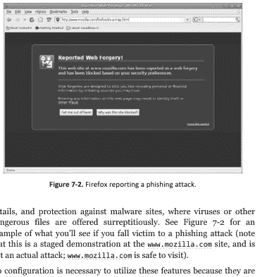

图 7-2. Firefox 报告网络钓鱼攻击。

详细信息，以及防止恶意软件网站的保护，在这些网站上病毒或其他危险文件会被秘密提供。请参阅图 7-2，了解如果你成为网络钓鱼攻击的受害者会看到什么示例（请注意，这是在 www.mozilla.com 网站上的 staged 演示，并非实际攻击；www.mozilla.com 是安全的，可以访问）。

无需配置即可使用这些功能，因为它们默认已启用。但是，除此之外，你可能还选择激活主密码功能，并安装附加软件以阻止基于脚本的攻击，如下一节所述。

> TIP 以下讨论的任何功能都不是 Ubuntu 独有的。提供的说明同样适用于 Windows 或 Mac OS X 上的 Firefox 安装。

## 启用主密码

与许多浏览器一样，Firefox 3 可以记住各种网站的登录用户名和密码，因此你不必每次访问时都输入它们。然而，任何有权访问你计算机的人因此都能够使用你的详细信息访问这些网站，如果你将计算机无人看管。

设置主密码允许你锁定和解锁存储用户名和密码的密码文件。每当你启动 Firefox 并访问需要密码的网站时，你将被邀请输入

主密码。只有在完成此操作后，网站的用户名/密码字段才会被填入。当退出 Firefox 时，密码存储将被锁定。每次使用 Firefox 时只需解锁密码文件一次即可。

TIP 因为你每次使用 Firefox 时只需解锁密码文件一次一次，因此养成在完成使用后退出 Firefox 的习惯，而不是让它在后台保持打开状态是有意义的。

要启用主密码，在 Firefox 程序窗口中单击“编辑 ⇔ 首选项”，单击出现的对话框顶部的安全标题，并在“使用主密码”旁放置复选标记。然后按提示输入新密码。完成后，退出并重新启动 Firefox。更改会立即生效——当你访问 Firefox 已知的需要用户名/密码的网站时，你将被提示输入主密码。

## 避免“可执行内容”攻击

许多网站使用 JavaScript、Java 和/或 Flash 来提供有用的功能。此类网站功能被称为可执行内容。

不幸的是，在少数情况下，可执行内容可用于攻击你的计算机并窃取数据。正因如此，许多注重安全的 Ubuntu 用户选择安装 NoScript，这是一个 Firefox 附加程序，让你能够按站点授权或限制 JavaScript、Java、Flash 和其他技术。

## 安装 NoScript

要安装 NoScript，启动 Firefox 并单击“工具 ⇔ 附加组件”。确保在出现的对话框中选择了“获取附加组件”图标，并在“搜索所有附加组件”文本字段中输入 `noscript`。在结果列表中，单击 NoScript 条目旁边的“添加到 Firefox”按钮。在出现的对话框中，单击“立即安装”按钮，并在安装完成后单击“重新启动 Firefox”。

## 阻止/允许可执行内容

当 Firefox 重新启动时，你会注意到程序窗口右下角出现了一个新的“S”图标。单击它可以让你为正在浏览的站点启用或拒绝可执行内容。默认策略是 NoScript 将停用所有内容，包括 Java、JavaScript、Adobe Flash 和 Microsoft SilverLight 组件。然而，一些站点在中心

whitelist 中的站点已完全或部分排除在该保护之外。这些站点被视为值得信赖且声誉良好，并使用可执行内容来实现关键的站点功能。您可以通过点击 Tools ⇨ Add-ons，单击列表中 NoScript 条目旁边的 PREFERENCES，然后在 NoScript 对话框出现时选择 Whitelist 选项卡来查看和编辑白名单。

每当您访问一个不在白名单中且包含可执行内容的新站点时，浏览器窗口底部会出现一条黄色条，解释可疑内容是什么。通过点击 OPTIONS 按钮，您可以选择允许各种元素。只要您信任该网站（即它声誉良好且您经常访问），通常可以从菜单中选择 Allow All This Page [sic]。例如，我选择允许 www.bbc.co.uk 站点上的所有内容，包括 BBC News (`http://news.bbc.co.uk`)。

或者，如果您认为该站点可能有可疑甚至恶意的意图，您可以点击 Untrusted ⇨ Mark as Untrusted。这样，如果您今后再次访问该站点，就不会出现是否允许该站点内容的提示。


请记住，一些站点在没有 JavaScript 或 Flash 的情况下看起来会大不相同。特别是，您可能会发现某些菜单导航系统无法正常工作。

## APPENDIX A

### Glossary of terms

以下是对您在本书中或在 Ubuntu 社区中可能遇到的术语的部分词汇表。描述是针对 Ubuntu 的上下文进行的，并且没有尝试提供完整的定义。

### A

- **absolute path**：文件或文件夹位置的完整描述，从文件系统的根目录开始向上。另见 *relative path*。
- `applet`：在 Ubuntu 桌面的上下文中，小程序具有狭窄定义的函数（例如，显示时间）。
- `Apache`：Web `server` 软件。见 `LAMP`。
- `APT`：Advanced Packaging Tool；Ubuntu 中更高级别的软件管理子系统。另见 `dpkg`。

### B

- `bash`：Bourne-Again SHell；Ubuntu 和大多数 `Linux` 版本中默认使用的 `command-line` `shell`。基于较旧的 `sh`。
- `binary`：`Source code` 经过 `compilation` 后变成可在计算机上原生运行的程序。一种 `executable`。
- `BSD`：Berkeley Software Distribution；1970 年代起源于加州大学伯克利分校的 `Unix` 版本。如今，它有多种变体，包括 NetBSD、OpenBSD 和 FreeBSD。

### C

- `C / C++`：用于创建大部分 `Linux` 操作系统 `source code` 的编程语言。
- `client`：连接到 `server` 的计算机（或程序）。
- `command-line`：在终端窗口或 `virtual console` 中输入命令的行。更常见的是，该术语指的是输入命令的整体界面和实践，与使用 GUI 相反。
- `compilation`：将 `source code` 转换为 `binary` 文件的过程，通常使用 GNU Compiler Collection (`gcc`) 软件。
- `config file`：配置文件的简称；包含软件设置的。
- `cron`：`Service`，允许任务在预定时间发生，通常在后台。
- `CUPS`：Common Unix Printing System；提供 Ubuntu 打印功能（包括打印机驱动程序）的软件。见 www.cups.org。

### D

- `Debian`：久负盛名的社区生成的 `distribution` 的 `Linux`，Ubuntu 以及其他几个 `Linux` 发行版都基于它。更多信息请见 www.debian.org。
- `dependency`：程序运行所需的额外软件。
- `dependency hell`：用户在手动尝试安装或删除软件时解决 `dependency` 问题，却被提出更多依赖要求的情况。
- `desktop environment`：提供图形用户界面的软件，例如桌面、回收站、文件管理器等。`Linux` 可用的示例包括 `Gnome`、`KDE` 和 `Xfce`，但还有很多其他。
- `device file`：特殊文件，通常包含在 `/dev` 文件夹中，提供对硬件或内核提供的特定功能的访问。
- `directory`：文件系统文件夹的另一个词。
- `distribution`：`Linux` 操作系统的版本。简称为 "distro"。
- `dpkg`：Debian Packaging system；将软件安装到系统或从系统移除的基本软件子系统。另见 `APT`。
- `dual-boot`：如果 Windows 和 Ubuntu 安装在同一台计算机上，则称为双启动。如果安装了三个操作系统，计算机也可能 `triple-boot`。

### E

- `ext3`：提供 Ubuntu 和许多其他 `distributions` 的 `Linux` 中使用的文件系统的底层技术。

### F

- `Free Software`：由 `GNU Project` 的 `Richard Stallman` 提出的术语，用于标识其 `source code` 可供所有人自由使用、检查、修改和重新分发的软件。另见 `GPL`。

### fork

软件项目分裂成两个或多个独立（通常是独立的）项目的现象。这之所以可能，是因为 `open source` 软件的特性，源代码可以自由获取。

### Gnome

`Desktop environment`，注重用户友好性和非技术用户。参见 www.gnome.org。该术语曾是 GNU Network Object Model Environment 的缩写，但现已弃用。另见 `KDE` 和 `Xfce`。

### GNU

GNU's Not Unix；一个所谓的递归缩写，指代 GNU 操作系统，该系统试图重现 `Unix`。参见 `GNU Project`。

### GNU/Linux

指使用 `GNU` 软件并以 `Linux` 内核为核心的任何操作系统的另一称呼。该术语为 `Richard Stallman` 所偏好，因为它承认了 `GNU Project` 的贡献。

### GNU Project

开创性的操作系统项目，使用完全的 `Free Software` 重现久负盛名的 `Unix` 操作系统。参见 www.gnu.org。

### GPL

GNU Public License；大多数 `Free Software` 项目使用的软件许可证，它在法律合同中确立了用户查看、研究、修改和重新分发软件 `source code` 及其后续版本的权利。`Lesser GPL (LGPL)` 放宽了 GPL 的部分要求，通常用于允许库文件的重新分发。

### grep

Global Regular Expression Print；提供强大搜索功能的 `shell` 命令。在 `Linux/Unix` 圈子里，“grep”一词与搜索同义；“grep a file”即搜索该文件。

### hack

解决问题的方法，通常以巧妙或临时的方式实现。参见 `hacker`。

### hacker

`programmer or user of Unix (and by extension Linux). 该术语在 1980 年代被媒体劫持，特指计算机罪犯。许多真正的黑客反对这种重新分类，并使用 cracker 一词来描述这类人。

### K

### KDE

K Desktop Environment；由 `Kubuntu` 使用的 `desktop environment`，优先于 `Gnome`。另见 `Gnome` 和 `Xfce`。

### kernel panic

涉及 `Linux kernel` 的崩溃。通常发生时屏幕上会出现“kernel panic”字样。

### Kubuntu

使用 `KDE` 而非 `Gnome` 作为其 `desktop environment` 的 Ubuntu 版本。与主 Ubuntu 版本相比，只有少数图形工具有所不同，但项目在技术上 otherwise 完全相同，并且按相同的日程发布。

### L

### LAMP

`Linux`、`Apache`、MySQL 和 PHP；用于网络 `server` 计算机的软件组合。

### link

为文件提供文件系统快捷方式的方法。链接分为符号链接或硬链接。区别在于技术层面，但符号链接使用最广泛。

### Linux

严格来说，Linux 是内核程序的名称。当用于描述操作系统时，“Linux”描述的是 `Unix` 操作系统的重现，通常使用 `Free Software`。

### log

包含各种事件的详细信息以及发生的时间/日期的文件。用于诊断目的。

### M

### md5sum

创建文件的唯一校验和数字的软件，可据此判断文件是否完整且未被损坏或篡改。

### module

可插入或从 `Linux` 内核中移除以提供某些功能的软件，通常虽然不总是与硬件相关。类似于 Windows 下的驱动程序。

### mounting

使存储设备


指使用 `GNU` 软件并以 `Linux` 内核为核心的任何操作系统的另一称呼。该术语为 `Richard Stallman` 所偏好，因为它承认了 `GNU Project` 的贡献。

## GNU Project

开创性的操作系统项目，使用完全的 `Free Software` 重现久负盛名的 `Unix` 操作系统。参见 www.gnu.org。

## GPL

GNU Public License；大多数 `Free Software` 项目使用的软件许可证，它在法律合同中确立了用户查看、研究、修改和重新分发软件 `source code` 及其后续版本的权利。`Lesser GPL (LGPL)` 放宽了 GPL 的部分要求，通常用于允许库文件的重新分发。

## grep

Global Regular Expression Print；提供强大搜索功能的 `shell` 命令。在 `Linux/Unix` 圈子里，“grep”一词与搜索同义；“grep a file”即搜索该文件。

## hack

解决问题的方法，通常以巧妙或临时的方式实现。参见 `hacker`。

## hacker

`programmer or user of Unix (and by extension Linux). 该术语在 1980 年代被媒体劫持，特指计算机罪犯。许多真正的黑客反对这种重新分类，并使用 cracker 一词来描述这类人。

## K

## KDE

K Desktop Environment；由 `Kubuntu` 使用的 `desktop environment`，优先于 `Gnome`。另见 `Gnome` 和 `Xfce`。

## kernel panic

涉及 `Linux kernel` 的崩溃。通常发生时屏幕上会出现“kernel panic”字样。

## Kubuntu

使用 `KDE` 而非 `Gnome` 作为其 `desktop environment` 的 Ubuntu 版本。与主 Ubuntu 版本相比，只有少数图形工具有所不同，但项目在技术上 otherwise 完全相同，并且按相同的日程发布。

## L

## LAMP

`Linux`、`Apache`、MySQL 和 PHP；用于网络 `server` 计算机的软件组合。

## link

为文件提供文件系统快捷方式的方法。链接分为符号链接或硬链接。区别在于技术层面，但符号链接使用最广泛。

## Linux

严格来说，Linux 是内核程序的名称。当用于描述操作系统时，“Linux”描述的是 `Unix` 操作系统的重现，通常使用 `Free Software`。

## log

包含各种事件的详细信息以及发生的时间/日期的文件。用于诊断目的。

## M

## md5sum

创建文件的唯一校验和数字的软件，可据此判断文件是否完整且未被损坏或篡改。

## module

可插入或从 `Linux` 内核中移除以提供某些功能的软件，通常虽然不总是与硬件相关。类似于 Windows 下的驱动程序。

## mounting

使存储设备的文件系统可访问的过程。例如，插入 USB 闪存盘后，它将被挂载以便用户访问其上的文件。所有文件系统都必须被挂载，包括包含 `Linux` 操作系统的根文件系统。这在计算机启动过程的早期完成。

## N

## NFS

Network File System；允许跨网络共享文件的软件。虽然在大型机构中仍在使用，但 `Samba` 文件共享方法在小型设置中更受欢迎。

## O

## open source

在计算机软件的上下文中，open source 与 `Free Software` 相似，但重点通常在于允许他人查看和共享 `source code`；至关重要的是，一些开源许可证并不要求共享对代码所做的修改。

## P

## package

包含可安装软件以及软件配置信息的归档文件。

## partition

磁盘的一部分，通常专用于特定文件系统。通常，所有操作系统都存在于各自的分区中。

## process

系统如何引用当前正在运行的程序，或程序的组件。

## programmer

创建软件的个人（或组织）。也称为开发者。

## proprietary

在 `Free Software` 的语境中，指其 `source code` 违反了 `Free Software` 定义中一个或多个要求的软件。

## PPA

Personal Package Archive；某些人用来指代包含特定开发者作品的小型软件 `repository` 的方式。

## R

## regular expression

使用各种符号和/或协议精确描述搜索字符串的一种方式。也称为 regex。理解正则表达式是一项有用的 Linux 技能。

## relative path

以相对于当前浏览的文件夹的相对术语描述文件或文件夹位置的方式。另见 `absolute path`。

## repository

通常在线的大型软件 `packages` 集合。见 `APT`。

## root

在文件系统的语境中，root 是文件系统的底部，用正斜杠（`/`）表示。与 Windows 下的 C:\ 相同。root 分区是包含启动 Linux 操作系统所需文件 的硬盘 `partition`。

## root user

管理员用户账户。

## run level

`Linux` 的运行模式——哪些 `services` 正在运行，因此用户可用的功能是什么。

通常这等同于显示。标准错误类似于标准输出，只是它只包含错误消息或警告。

## swap

也称为虚拟内存（在 Windows 下称为分页文件）；硬盘上用于临时缓存内存内容以释放物理内存供其他软件使用的文件。与 Windows 不同，Ubuntu 安装程序会创建一个用于 swap 的整个 `partition`。

## tar

深受 `Linux/Unix` 用户喜爱的归档软件。tar 文件默认不压缩，尽管通常使用 bzip 或 gzip 软件进行压缩。

## tarball

tar 文件（非正式）。

## TCP/IP

传输控制协议/互联网协议；`Linux` 和互联网核心使用的网络技术。

## terminal program

通常在 `desktop environment` 中运行的程序，允许访问 `command-line`。终端模拟器。

## Torvalds, Linus

芬兰籍 `programmer`（现居美国），于 1991 年启动了 `Linux kernel` 项目，并继续管理和为其贡献代码。

## tty

电传打字机；`Linux`（和 `Unix`）在技术层面指 `command-line` 提示符的方式。

## Ubuntu

非洲个人哲学，强调社区和个人责任，由纳尔逊·曼德拉在后种族隔离的南非推广。Ubuntu Linux 正是从这一哲学中获得灵感并取其名称。

## Unix

由 AT&T 于 1969 年创建的开创性操作系统项目，最初作为研究项目，随后作为商业产品发布。Unix 的后续迭代为至今的操作系统奠定了基本规则，并启发了 `Linux` 和 `GNU` 等克隆系统。

## V

## vi

在 `command-line` 运行的文本编辑器。如今常用名为 vim 的 vi 克隆，但仍被称为 vi。

## virtual console

非 GUI 方法访问 Ubuntu `command-line`，通过按 Ctrl+Alt 和 F1-F6 访问。一种 `virtual terminal`。

## W

## Wine

Wine Is Not an Emulator；创建大部分 Windows 基础设施的软件，使某些 Windows 程序能够在 Linux 上运行。

## X

## X

见 `X.Org`。

## X.org

提供 Ubuntu 图形子系统使用的 X11 软件的组织。通常，X11 被简单地称为 X，或称为 X 服务器。这指的是 X 所使用的客户端-服务器模型。

## Xfce

Ubuntu 的 Xubuntu 版本使用的 `Desktop environment`。Xfce 项目的目标是生产使用最少计算机资源但仍提供现代用户期望的功能的软件。Xfce 曾经是 XForms Common Environment 的缩写，但已不再使用。另见 `Gnome` 和 `KDE`。

## 附录 B

## 深入学习

以及获取帮助

高效使用 Ubuntu 的一个重要方面是知道在哪里以及如何获取帮助，一般来说，帮助可以从三个地方找到：在印刷品中、在线以及 Ubuntu 本身中。

## 书籍和杂志


Linux 受到了杂志出版物的良好服务。其中被认为具有权威性的包括 `Linux Journal`（www.linuxjournal.com）和 `Linux Magazine`（www.linux-mag.com）。在美国以外，值得注意的英文刊物有 `Linux Format`（www.linuxformat.co.uk）、`Linux User & Developer`（www.linuxuser.co.uk）以及 `Linux Pro Magazine`（www.linux-magazine.com；在美国以外仅称为 `Linux Magazine`）。

也有几本基于 PDF 的杂志可供使用。`Full Circle Magazine` 专门报道 `Ubuntu` 以及影响 `Ubuntu` 社区的问题。它由社区生成，可免费获取。如需了解更多信息，请访问 http://fullcirclemagazine.org。

同样值得阅读的是 `Free Software Magazine`，大约每两个月出版一次免费的 PDF 版，涵盖与自由软件世界相关的问题，包括但不限于 `Linux`。如需了解更多信息，请访问 www.freesoftwaremagazine.com。

就书籍而言，作为 `Ubuntu` 的完整指南，我推荐我自己的书，`Beginning Ubuntu Linux`（www.apress.com/book/view/）。1598599918）。现在已是第三版，`Beginning Ubuntu Linux` 是第一本涵盖 `Ubuntu` 的英文书籍。它后来获得了 `Linux Journal` 年度终端用户/非技术图书奖，并经常位居其出版商畅销书榜首。

也可能感兴趣的是我的另一本书，`Ubuntu Kung Fu`（www.pragprog.com/titles/ktuk/ubuntu-kung-fu）。它经常位居 `Amazon.com` `Linux` 畅销书榜首，`Ubuntu Kung Fu` 包含超过 300 条适用于各级别 `Ubuntu` 用户的技巧、窍门、提示和黑客。它是 `Ubuntu Pocket Guide and Reference` 的绝佳搭档，将帮助你进一步提升 `Ubuntu` 技能，同时有效改善你的 `Ubuntu` 使用体验。

## 在线帮助

`Linux` 与互联网一起成长，因此不足为奇的是，`Linux` 新手最好的帮助来源是在线找到的。

### 论坛

`Ubuntu` 社区聚集的核心无疑是 http://ubuntuforums.org，一个致力于 `Ubuntu` 使用各个方面的留言板论坛系列。

除了众多专家版主外，许多 `Ubuntu` 老手也经常光顾这些板块，并渴望与遇到问题的人分享他们的智慧和经验。此外，许多人创建了 `How To` 指南，尤其涉及前沿软件的使用，这些构成了 `Ubuntu` 社区文档的重要组成部分。

从 `Ubuntuforums.org` 获得最大收益的关键是“先做研究”。`Ubuntuforums.org` 的管理员之一 `Matthew Helmke` 这样说。“搜索 `Google` 等，”他继续说道，“提及你找到的内容，以及你为解决问题已尝试的任何方法的成果。”

`Matthew` 还建议在发帖时表述清晰，并完整描述问题——包括你在选择的主题行中。主题标题如“配置 `wifi`：`WEP` 不工作”更有可能获得更高质量的回复，而不是“帮助！它不工作！”。保持礼貌，即使有人不愉快地回应。

“一次只问一个问题，”`Matthew` 继续说。如果你有多个问题，请创建多个帖子，但不要一次发太多内容。没有人喜欢看到同一人连续五条消息。

最重要的是，当问题解决时，添加一条消息说明这一点。“如果解决方案是由帖子中的某人发布的，”`Matthew` 说，“请感谢他们。”你可以通过发帖表示感谢来感谢用户，但也可以点击有帮助帖子右下角的 `Thanks!` 图标。这会增加用户的“感谢”计数，并有助于表明值得信赖和受重视的社区成员。

如果你在其他地方找到了答案，请发布链接，并解释你找到的信息如何帮助了你。如有必要，请提供上下文。

最重要的是，请记住 `Ubuntuforums.org` 充当着与 `Ubuntu` 相关的庞大智慧库。你的帖子提升了这一努力。

`Ubuntuforums.org` 当然不是唯一的实用论坛网站。我还推荐 www.linuxquestions.org，这是一个通用的 `Linux` 论坛网站，拥有强大的 `Ubuntu` 板块，但还有许多其他网站。

### 邮件列表

除了网站之外，你还可以考虑加入众多 `Ubuntu` 电子邮件列表之一。一旦你订阅，发送到列表的任何消息都会发送给所有成员，人数可能达到数百或数千人。邮件列表的其他成员可以回答你的问题，要么直接通过电子邮件，要么通过创建另一条邮件列表帖子。

有关 `Ubuntu` 所有官方支持的邮件列表的列表，请参阅 https://lists.ubuntu.com。

### 内置文档

如第 5 章所述，所有版本的 `Linux` 都包含手册页。这些本质上是关于相关软件如何工作的技术文档。

此外，许多程序的创建者有时会创建单独的文档，通常更非正式，这些文档可以在 `/usr/share/doc` 文件夹中找到。

最后，许多 `GUI` 程序都有自己的帮助文件，就像 `Windows` 一样。可以通过点击帮助菜单访问这些文件。

## 理解手册页

大多数手册页描述的是命令行工具，但某些 `GUI` 应用的作者也会创建它们。

TIP 许多基本命令，例如 `cd` 的手册页，可以通过输入 `man builtins` 来查看。

对于新手来说，手册页毫不留情。它们不仅使用技术性强且详尽的语言编写，而且还假设读者对 `Linux` 的工作原理有深入的预先知识。

如第 5 章所述，`grep` 命令会在文件中搜索文本。然而，一个新手很难从 `grep` 手册页中的描述中辨认出这一点：

```
grep [OPTIONS] PATTERN [FILE...]
```

`grep` 会在指定的输入文件 `FILES` 中搜索包含与给定 `PATTERN` 匹配的行（如果未指定文件，则搜索标准输入；或如果文件名给出为单个连字符减号 `-`）。默认情况下，`grep` 会打印匹配的行。

然而，只要理解几条简单的规则，即使手册页乍看之下很复杂，也很容易导航。

## Terminology

你已经知道在手册页中经常出现的两个术语——`argument` 和 `option`——因为它们在第 5 章中已经介绍过。回顾一下，`argument`（在手册页中有时称为 `arg`）是你告诉命令去操作（或使用）的对象。这通常是一个文件或文件夹。命令 `option` 会改变命令的工作方式，通常是一个单词或（更常见的是）一个字母，以连字符（或两个）为前缀。

NOTE 根据命令 `option` 的作用及其复杂程度，你可能会发现一个 `option` 拥有自己的参数集，这些参数会改变该特定 `option` 的工作方式！

手册页中经常出现的三个短语是：`standard input`、`standard output` 和 `standard error`。技术上称为 `standard streams`，它们对于 `Linux` 的运行方式具有特定且重要的含义。

`Standard input` 是程序从中获取输入的地方，如果未指定文件。`Standard output` 是程序输出被发送到的地方。`Standard error` 与 `standard output` 类似，但如你可能猜到的，它只包含错误输出。

> NOTE `Standard input`、`output` 和 `error` 有时被称为 `stdin`、`stdout` 和 `stderr`。

你需要知道的就是：简单来说，`standard input` 通常等同于键盘，而 `standard output` 等同于显示器。

有了这个认识，让我们重新审视 `grep` 手册页中的摘录。它说如果没有提供文件名，`grep` 将搜索 `standard input`。换句话说，如果未指定文件名，`grep` 将搜索你输入的内容。

这种能够搜索你输入内容的能力似乎用途存疑。然而，如第 5 章所述，可以将输入重定向或通过管道输入到命令中。实际上，重定向和管道会替换 `standard input`（因此得名 `redirect` 或 `pipe`——输入被重定向到命令，或通过管道传入）。

有了这个认识，很明显我们可以将输入重定向或通过管道输入到 `grep`，或任何可以接受 `standard input` 的类似命令中。

> NOTE 此外，只要命令使用 `standard output`，我们就可以重定向或管道其输出，也就是说，它通常会在屏幕上显示其结果。

`grep` 命令手册页的作者当然知道所有关于 `standard streams` 的知识，他之所以这样写描述，是因为他期望你也知道。如果他必须从头解释，描述 `grep` 的功能不会用四行就能完成——而需要四页。

## Structure

手册页分为标题，每个标题都缩进并加粗。常见标题如下，尽管典型的手册页可能包含更多或更少的条目：

- `Name:` 命令的名称及其功能的简要总结。

- `Synopsis:` 命令的假设示例。参数和选项以下划线标出，并在应出现的位置列出。方括号中的任何内容（`[ ]`）都是可选的。管道符（`|`）分隔在可以指定多种选项时的选择。省略号表示可以提供多个参数或选项。

- `Description:` 命令的简洁且技术性的描述。


- **Options:** 可能的命令选项，以及它们的作用。

文件：命令使用或需要的附加文件列表（通常是配置文件）。

备注：可选章节，尝试进一步阐明所讨论的软件或技术。

缺陷：用户应注意的任何限制或缺陷；通常与在极不典型情况下的使用相关。

示例：命令在真实场景中的使用示例。

另见：你可能希望了解的其他与所讨论软件相关的程序（和/或手册页）。

# README 及其他文档

在 `/usr/share/doc` 文件夹中，几乎可以找到系统上安装的每个软件的子文件夹。每个文件夹内都有由软件背后的个人（或团队）编写的文档。

这些文件通常是纯文本，但有时会用 `gzip` 压缩，这种情况下它们会带有 `.gz` 扩展名。`less` 命令可用于查看压缩和普通文本文件。

通常，文件列表包含以下任意或全部文件，有时还会包含其他文件：

`README`：这些文件提供关于软件及其功能的非正式说明。遗憾的是，它们并不总是在场。请记住，`README` 文件并非专门为 Ubuntu 编写，而是为软件的任何潜在用户编写的，无论他们使用什么操作系统，甚至可能不是 Linux。

`changelog`：软件相继版本中功能新增或其他变更的列表。

`TODO`：软件中尚未完成的工作。

`AUTHORS`：软件的作者以及联系方式。

`copyright`：软件版权协议的详情。

`NEWS`：类似于 `changelog`，但包含软件或整个项目的一般进展。

通常还有带有 `.debian` 扩展名的这些文件的独立版本。它们由软件包维护者（即编译该软件以纳入 Debian/Ubuntu 的人）编写。`README.debian` 文件指出在 Debian/Ubuntu 上使用该软件时需要注意的事项，或者有时为非官方 `README` 文件提供简洁的替代品。

# 索引

`$PATH` variable, 74

`/etc`, 52

`/home` 文件夹, 51

`/private`, 124

`/usr/bin`, 52

`/usr/share/doc`, 53, 143

64 位, 8

绝对路径, 72

添加新用户, 44

管理权限, 46

高级打包工具, 98

AIM, 42

备用安装 CD, 16

杀毒软件, 121

AppSocket, 28

APT, 98

音频播放器, 43

音频音量, 24

备份, 1, 94

`bash`, 67

BIOS, 10, 26

蓝牙, 7, 30

加密狗, 30

配对, 31

传输文件, 31

Boot Camp, 17

启动菜单, 2, 14, 33, 34

Bourne sh, 68

花括号展开, 95

Brasero, 43

Breezy Badger, 7

内建命令, 74

`bzip2`, 66

C Shell, 68

c:\, 49

OpenOffice.org Calc, 43

Canonical, xiii

大小写敏感性, 51

CD/DVD 刻录, 8, 43

CD/DVD 驱动器, 50

CD-R/RW, 4, 8, 16

聊天, 42

ClamAV, 122

ClamTK, 122

命令行, xvi, xviii, 67

参数, 70

花括号展开, 95

命令历史, 88

复杂文件名, 72

压缩文件, 91

启用 root 登录, 77

日常命令, 75

深入了解文件权限, 78

命令如何工作, 70

作业管理, 89

管理进程, 90

选项, 71

所有权与权限, 83

管道, 95

重定向, 94

相对与绝对路径, 72

root 权限, 77

运行程序, 74

与 DOS 的相似性, 68

软件管理, 108

理解提示符, 68

通配符, 96

复制（文本）, 40

处理崩溃的程序, 47, 90

CRT 显示器, 21

密码学, 125

`csh`, 68

剪切（文本）, 40

Dapper Drake, 7

Debian, xiii, xvi

Debian 软件包系统, 98

Deskbar, 41

桌面

小程序, 36

应用程序菜单, 36

自定义图标, 40

Deskbar, 41

图标, 36

布局, 35

主菜单, 35

面板, 35

个性化, 38

位置菜单, 36

搜索, 41

系统菜单, 36

主题, 38

虚拟桌面, 37

桌面视觉效果, 22

DHCP, 26

数码相机, 29

数字版权管理, 43

目录, 51

磁盘空间, 2

磁盘工具, 18

发行版, xiii

DNS, 26

DOS 窗口, 3

`dpkg`, 98

OpenOffice.org Draw, 43

驱动器盘符, 49

驱动程序 CD, 19

DRM, 43

双引导, 1

DVD 电影, 43

Edgy Eft, 7

Edubuntu, 5

加密的 `/private` 文件夹, 17, 124

加密, 123

转义文件名, 72

ESSID, 25

以太网, 26

Evolution, 42

扩展桌面, 23

扩展分区, 9

外置硬盘, 29

快速用户切换器, 46

Fedora Linux, ix

Fesity Fawn, 7

FHS, 52

文件压缩, 65

文件权限, 78

查看文件权限, 56

文件系统

书签, 62

执行权限, 79

文件和文件夹名称, 50

文件压缩, 65

文件扩展名, 53

文件权限, 54, 78

文件夹权限, 79

隐藏文件和文件夹, 52

重要位置, 51

关键位置（表）, 53

启动器, 61

链接, 61

挂载, 50

所有权, 54

路径, 49

根目录, 49

搜索, 64

特殊文件权限, 85

与用户相关, 54

文件系统层级标准, 52

Firefox, xii, 4, 5, 42, 127

FireStarter, 117

防火墙, 28, 117

固件, xv

文件夹权限, 79

字体渲染, 38

字体, 38

论坛, 142

自由软件, xii, xiii, xv, 5

Frozen-Bubble, 103

F-Spot Photo Manager, 30, 42

FTP, 64

网关, 26

GIMP, xvi, 42

`gksudo`, 54, 78

gNewSense, 6

Gnome, 4, 5, 56, 99

GNU, xii

GNU 通用公共许可证, xii

GNU/Linux, xiii

Gobuntu, 5

Google Docs, 42

GPL, xii

图形问题, 16

图形配置, 21

图形驱动程序, 22

专有图形驱动程序, 21

组所有权, 55

GRUB, 17

来宾账户, 46

Gutsy Gibbon, 7

`gzip`, 66

附加硬盘, 3

硬件支持, xvii

Hardy Heron, 6, 7

休眠, 2, 48

Hoary Hedgehog, 7

主机名, 11, 16

HP JetDirect, 28

IBM, xii

ICO, 42

图像编辑, 42

OpenOffice.org Impress, 43

安装 CD, 8

安装

双启动，1

释放磁盘空间，2

在 Apple Mac 上，17

有问题的，16

重新分区，9

文本模式，16

wine，1

在虚拟计算机内，15

在 Windows 内（Wubi），2

即时通讯，42

Internet Explorer，42

Internet 时间服务器, 48

Intrepid Ibex, 6, 7

iPod, xvii, 29

IRC, 42

ISO 映像文件, 4, 7, 8, 13, 15

ISO Recorder, 8

iTunes, 43

Jaunty Jackalope, 7

JOSÉ, 5

KDE, 4

内核, xii, 19

键盘, 20

键盘布局, 20

键盘快捷键

命令行, 87

桌面, 44

Nautilus, 63

杀死进程, 90

Konqueror, 5

Kontakt, 5

Korn Shell, 68

`ksh`, 59

Kubuntu, 4, 5, 13

笔记本电脑, 12, 41, 48

笔记本触控板, 20

LCD 面板, 38

受限用户账户, 44

Linux, xi, xii

发行版, xiii

哲学, xiv

Linux Mint, 6

实时模式, 4

登录, 33

登录屏幕, 34, 39

LTS, 3

密封列表, 143

主菜单, 35

使程序自动启动, 46

man 手册页, 143

媒体播放器, 29

存储卡读卡器, 29

内存测试, 34

memtest, 34

Microsoft DOS, 68

Microsoft Office, 43

Microsoft Outlook, 42

Microsoft Word, 53

Microsoft Word 文档, 41

混音器（音频）, 24


- 挂载点，50
- 挂载，50
- 鼠标，20
- MP3 播放器，29
- MSN，42
- Multiverse，100
- MythBuntu，5，13
- MythTV，5
- Nautilus，56
  - 书签，60
  - 连接到 FTP 站点，64
  - 连接到共享文件夹，64
  - 徽章，60
  - 文件关联，64
  - 位置栏，57
  - 搜索，64
  - 侧边栏，58
  - 特殊浏览位置，64
  - 状态栏，60
  - 标签式浏览，62
  - 工具栏，57
  - 缩放控件，60
- Ndiswrapper，26
- Nero，8，43
- netfilter，117
- NetworkManager，25
- NoScript，129
- 通知区域，36
- NTFS，18
- OBEX，31
- OCR，30
- 办公套件，43
- 在线帮助，142
- 开源，xiii
- OpenOffice.org，xvii，43
- 组织者，42
- OS X，17，34，37
- 其他所有权，55
- 软件包，97
- 分页文件，9
- 面板，35
- 密码和加密密钥，125
- 粘贴（文本），40
- 路径，72
- PCM，24
- 个人软件包档案，99
- PID，90
- Pidgin，xvii，42
- PIM，42
- 管道，95
- PowerPC，18
- 省电，2，48
- PPA，99
- 演示文稿，xvii，43
- 打印服务器，28
- 打印机
  - 配置，27
  - 默认选项，27
  - 管理作业，28
  - 共享/网络，28
  - 打印测试页，27
- 进程 ID，90
- 专有，xi
- 专有软件，xv
- `rar`，65
- 恢复模式，34
- Red Hat，xiii
- 重定向，94
- rEFIt，18
- 刷新率，21
- 相对路径，72
- 可移动存储，29
- 重新分区，1
- 反向依赖，101
- Rhythmbox，xvii，45
- `root`（文件系统），49
- `root` 分区，9
- 运行应用程序对话框，47
- 安全模式，34
- Samba，28，64
- 扫描仪，30
- 屏幕背光，24
- 屏幕分辨率，21
- 屏幕保护程序，24
- 第二块硬盘，11
- 第二显示器，23
- 安全
  - 防病毒，121
  - 创建密钥对，125
  - 创建入站防火墙规则，118
  - 创建出站防火墙规则，120
  - 解密文件或文件夹，127
  - 诊断工具响应，121
  - 加密 `/private` 文件夹，124
  - 加密文件和文件夹，123，125
  - 导出密钥对，127
  - 防火墙配置，117
  - 扫描病毒，122
  - 更新系统，115
  - 网页浏览器安全，127
- 选择缓冲区，40
- 服务器，5
- 会话，46
- 设置组 ID，86
- 设置用户 ID，86
- 共享打印机，28
- Ship-It，8
- 显示桌面按钮，35
- 关机，48
- Shuttleworth，Mark，xiii，xiv，6
- 软件管理
  - APT，98
  - 命令行，108
  - 从源代码编译，113
  - 依赖管理，99
  - 描述，97
  - `dpkg`，98
  - 过滤，102
  - 安装（命令行），108
  - 安装（Synaptic），103
  - 手动安装和删除（命令行），110
  - 手动安装（GUI），106
  - 重新安装软件（命令行），110
  - 重新安装软件（Synaptic），105
  - 软件源，98，112
  - 软件源（表），100
  - 反向依赖，101
  - Synaptic，101
  - 典型命令（表），107
  - 卸载软件（命令行），110
  - 卸载软件（Synaptic），105
- 声音，24
- 源代码，xi
- 源代码编译，113
- 电子表格，xvi，43
- Stallman，Richard，xvi
- 启动程序列表，47
- 静态 IP 地址，26
- 粘滞位，86
- 子网掩码，26
- SUID，86
- 环绕声，24
- SUSE，ix，xiii
- 挂起，2，48
- 交换分区，9
- Synaptic，101
- 系统配置工具，5
- 系统监视器，47
- 系统托盘，36
- Tab 自动补全，88
- `tar`，65，92
- 终端模拟器，68
- 终端程序，68
- TFT LCD 面板，21
- 主题，38
- 时间与日期，47
- Tornvalds，Linus，xii
- Totem，xvii，43，65
- 触控板轻触点击，20
- Tracker，41
- 回收站，35
- TrueCrypt，125
- TrueType 字体，39
- Ubuntu
  - 关于，8
  - 选择发行版，6
  - 选择版本，4
  - 命令行，67
  - 社区，xv
  - 配置，19
  - 企业或家庭办公室，7
  - 定义，xi
  - 衍生版，5
  - 桌面，33
  - 下载，7
  - DVD-ROM，8
  - 文件系统，49
  - 安装，1
  - 安装光盘，13
  - 使用 Wubi 安装，13
  - 安装，分步，9
  - 主要发行版，4
  - 命名约定，6
  - 官方商店，8
  - 在旧硬件上，xvii
  - 哲学，xiv
  - 安全，115
  - 软件管理，97
  - 分支项目，4
  - 卸载，2
  - 本书涵盖的版本，xviii
- Ubuntu Mobile and Embedded，5
- Ubuntu Server，5，6
- Ubuntu Studio，5
- Universe，100
- Unix，定义，xi
- 卸载，30
- 更新管理器，36，115
- USB 记忆棒，3，29，50
- VCD，43
- 矢量图形，43
- 视频播放器，43
- 虚拟设备，5
- 虚拟控制台，68
- 虚拟桌面，37
- 虚拟硬盘，2，13
- 虚拟分辨率，23
- 虚拟终端，68
- 视觉效果，2，22
- VLC 媒体播放器，2，15
- Warty Warthog，7
- `wav`，24
- 网页浏览器，42
- WEP，25
- 通配符，96
- Windows 共享，64
- 无线网卡支持，25
- 无线驱动，26
- 无线网络，7，25
- 文字处理，xvii，43
- WPA，25
- Writer，OpenOffice.org 43
- Wubi，2，3，4，7，8，13，34
- Xfce，6
- `xfig`，24
- XSane Image Scanner，30
- Xubuntu，6，13
- Yahoo!，42
- `zip` 文件，65

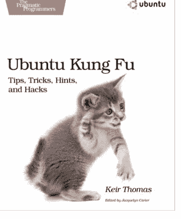

## 通过学习 Ubuntu Kung Fu 继续你的 Linux 之旅！

... 收录了 300 多条技巧、窍门、提示和黑客技术以提高生产力的畅销书。在实践中学习这些技巧，成为专家用户，同时大幅提升你的 Ubuntu 体验。它是《Ubuntu Pocket Guide and Reference》之后的理想进阶读物，而且更易读、更有趣！

可在 Amazon.com 及其他优质书店购买！

www.pragprog.com/titles/ktuk/ubuntu-kung-fu

由 The Pragmatic Programmers 出版，2008 年 9 月

400 页，ISBN：978-1934356227
