# Ubuntu Linux 圣经第三版


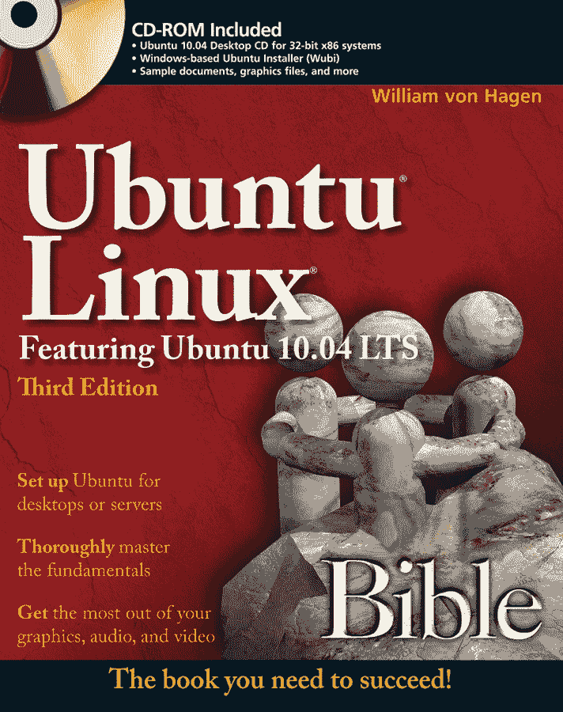

# 第一部分：Ubuntu 入门

## 第 1 章：Ubuntu Linux 项目

### 背景

### 介绍 Ubuntu Linux

### 为什么选择 Ubuntu？

### 有哪些版本的 Ubuntu？

### 安装要求

### Ubuntu CD

### 对 Ubuntu 的支持

### 获取关于 Ubuntu 的更多信息

### 总结

## 第 2 章：安装 Ubuntu

### 获取 64 位桌面 CD

### 从桌面 CD 启动

### 从桌面 CD 安装 Ubuntu

### 试用 Ubuntu Linux

### Wubi：在 Windows 上安装 Ubuntu

### 总结

## 第 3 章：在特殊系统上安装 Ubuntu

### 获取不同的安装 CD

### 从服务器或备用安装 CD 启动

### 服务器安装 CD 上的安装选项

### 安装 Ubuntu 企业云

### 备用安装 CD 上的安装选项

### 总结

# 第二部分：面向桌面用户的 Ubuntu

## 第 4 章：基础 Linux 系统概念

### 处理文件和目录

### 文件系统简介

### 处理分区和文件系统

### 理解 Linux 权限

### 总结

## 第 5 章：使用 GNOME 桌面

### 什么是桌面？Linux 的图形化环境

### 使用鼠标

### GNOME 桌面概述

### GNOME 窗口

### GNOME 菜单

### 自定义你的桌面

### GNOME 快捷键

### Nautilus 文件管理器

### 使用 Tracker 应用程序

### 使用窗口管理器

### 总结

## 第 6 章：使用 Compiz 窗口管理器

### 什么是合成（Compositing）？为什么要用

### Compiz 历史：Compiz, Emerald, Beryl 及其

### 在 Compiz 中开启特效

### Compiz 的其他可用软件包

### 总结

## 第 7 章：使用 Evolution 管理邮件和个人信息

### 启动 Evolution

### 使用 Evolution 向导

### 发送和接收邮件

### 过滤邮件

### 访问网页邮件

### 管理联系人

### 管理日历

### 关于 Evolution 的更多信息

### 总结

## 第 8 章：使用 Firefox 浏览网页

### Firefox 简介

### 启动 Firefox

### Firefox 用户界面

### 配置 Firefox

### 使用书签

### 增强 Firefox

### 总结

## 第 9 章：从 Windows 迁移

### 迁移场景概述

### 备份个人数据

### 将邮件迁移到 Linux

### 将浏览器设置迁移到 Linux

### 处理 Windows 数据

### 总结

## 第 11 章：使用命令行工具

### 为什么使用命令行？

### 从命令行执行命令

### 什么是 Shell？

### 进入 Shell

### 常用的命令行命令

### 使用 Bash Shell

### 总结

## 第 12 章：处理文本文件

### Linux 编辑器简介

### 使用 `vi`

### 使用 `emacs`

### 使用 `gedit`

### 其他系统的文本编辑器

### 总结

## 第 13 章：创建与发布文档

### 使用文档标记语言

### 使用 OpenOffice.org Writer 进行文字处理

### 使用 `Scribus` 进行桌面出版

### 其他文字处理器和办公套件

### 总结

## 第 14 章：其他办公软件：电子表格与演示文稿

### 电子表格简介

### 使用 OpenOffice.org Calc

# 创建和使用 OpenOffice.org 演示文稿

## 摘要

## 第 15 章：处理图形

## 数字图形术语概述

### 使用 GIMP

## 图像编辑概述

## 使用 OpenOffice.org Draw

## Linux 矢量图形工具

## 其他图形应用程序

### 总结

## 第 16 章：处理多媒体

## 数字音频和视频术语概述

## 配置音频设备、电平和系统声音

## 探索 Linux 多媒体栈

## 播放 CD 和 DVD

## 刻录音频 CD

## 创建 CD 和 DVD

## 处理其他音频源

### 总结

## 第 17 章：你想玩游戏吗？

## Ubuntu GNOME 游戏

## 其他热门游戏

### 总结

## 第 18 章：消费电子与 Ubuntu

## 为消费电子设备配置系统

## 使用数码相机

## 使用 iPod 和其他数字音频播放器

## 使用 CompactFlash 和 SD 卡

### 总结

## 第 19 章：添加、删除和更新软件

## 使用 Ubuntu 软件中心安装软件

## 软件包管理软件概述

## Ubuntu 仓库和组件

## 使用 `dpkg` 及其工具探索系统

## 使用 `apt-get` 添加和删除软件

## 使用 `aptitude` 添加和删除软件

## 使用 `Synaptic` 添加和删除软件

## 使用 Ubuntu 更新管理器

## 转换其他格式的软件包

## 保持系统的简洁与纯原生

### 总结

## 第 20 章：添加硬件和连接外设

## 添加打印机

## 使用扫描仪

## 添加内部硬盘和 CD/DVD 驱动器

## 使用 PCMCIA 卡

## 添加 PCI 卡

## 图形检查与故障排除

### 总结

## 第 21 章：网络配置与安全

### 网络基础

## 配置你的网络硬件

## 使用网络工具进行网络测试

## 系统安全技巧

## 安装防火墙

### 总结

## 第 22 章：无线化

## 无线技术概述

## 使用 `Wicd`

## 无线网络命令行工具

## 安装和使用 Windows 网络驱动

### 总结

# 第 23 章：在 Ubuntu 上进行软件开发

## 安装和使用开发软件

## 使用集成开发环境 (IDE)

## 源码控制软件

### 总结

## 第 24 章：使用虚拟机和模拟器

## 虚拟化与仿真概述

## 安装和使用 `VirtualBox`

## 安装和使用 `KVM`

## 安装和使用 `QEMU`

### 总结

## 第 25 章：连接到其他系统

### 建立与其他系统的安全连接

## 使用 `VNC` 连接其他系统

## 连接到远程 Windows 服务器

## 使用远程连接软件

### 总结

## 第 26 章：文件传输与共享

## 将文件传输到其他系统

## Ubuntu 点对点共享

### 总结

# 第三部分：面向系统管理员的 Ubuntu

## 第 27 章：管理用户、组和身份验证

### 创建和管理用户与组

## `PAM` 与 Linux 身份验证

## 自定义 `sudo` 命令

## 配置 `Kerberos` 身份验证

### 总结

## 第 28 章：备份与恢复文件

### 备份基础

### Linux 备份软件

## 将文件备份到本地移动介质

## 安装和使用 `BackupPC`

## 使用 Ubuntu One 备份并镜像到云端

## Linux 时光机 (Time Machines)

### 总结

## 第 29 章：搭建 Web 服务器

### 万维网基础

## Web 服务器和 `Apache` 简介

## 安装 `Apache`

## `Apache 2` 文件位置

## 配置 `Apache`

## 排除

### 更多信息

### 总结

## 第 30 章：搭建邮件服务器

### 邮件服务器简介

## 安装 `Postfix` 及伙伴

## 配置 `Postfix`

## 激活 `Qpopper` 以支持 POP/POP3

## 为 `Postfix` 添加垃圾邮件过滤和病毒扫描

### 更多信息

# 摘要

## 第 31 章：设置 DHCP 服务器

### DHCP 概述

### 安装 DHCP 服务器

### 从命令行管理 DHCP 服务器

### 通过图形化界面管理 DHCP 服务器

### DHCP 故障排除

### 总结

## 第 32 章：设置 DNS 服务器

### DNS 和 BIND 概述

### 安装 DNS 服务器

### BIND 配置文件概述

### 创建 DNS 区域和反向查找文件

### 重启并测试您的名称服务器

### DNS 故障排除

### 关于 DNS 和 BIND 的更多信息

### 总结

## 第 33 章：设置打印服务器

### Linux 和 UNIX 打印历史

### 远程主机访问 CUPS 打印服务器

### 远程打印故障排除

### 关于 CUPS 的更多信息

### 总结

## 第 34 章：设置 NFS 服务器

### 网络文件系统概述

### 安装 NFS 服务器

### 配置 NFS 服务器

### 在客户端上挂载 NFS 目录

### NFS 问题

### 关于 NFS 的更多信息

### 总结

## 第 35 章：设置 Samba 服务器

### Microsoft Windows 文件共享概述

### 介绍 Samba

### 安装 Samba 服务器及相关组件

### Samba 服务器配置基础

### 通过 Samba 共享其他目录

### 关于 Samba 的更多信息

### 总结

# 附录：光盘内容


# 系统要求

# 在 Windows 中使用光盘

# 在 Linux 中使用光盘

# 故障排除

# 索引

* 从 CD 启动，在显示图 2-1 的启动界面时按下任意键，设置您的语言，使用方向键选择“Install Ubuntu”选项，然后按下键盘上的 `Return`（回车）或 `Enter`（回车）键。

* 从 CD 启动，在显示图 2-1 的启动界面时按下任意键，设置您的语言，然后按下键盘上的 `Return` 或 `Enter` 键，使用“Try Ubuntu without any change to your computer”选项进行启动。一旦您的系统使用桌面 CD 启动，双击桌面上的 `Install Ubuntu 10.04` 图标。

这两种机制运行相同的安装程序，以便您的计算机系统上永久安装 Ubuntu。本节的说明描述了如何从 Ubuntu Desktop CD 安装 Ubuntu 的桌面版（终端用户版本），例如书中附带的 Ubuntu Desktop CD。请参见第 3 章“在特殊用途系统上安装 Ubuntu”，获取有关安装其他版本 Ubuntu Linux 的信息，例如 Ubuntu Server 或 OEM 发行版，这些版本需要您从 Ubuntu 网站获取不同的安装 CD。有关不同 Ubuntu CD 的概览，请参阅第 1 章“Ubuntu Linux 项目”中标题为“Ubuntu CDs”的章节。

## 注意

如果您正将 Ubuntu 安装到已安装另一个操作系统的系统上，请确保您已将想要保留的所有数据备份到可移动介质上，如 CD-ROM、DVD、USB 闪盘等。如果您想继续使用该操作系统，Ubuntu 安装程序在自动重新划分您的磁盘方面做得非常好，可以让您将计算机系统启动到现有的操作系统或 Ubuntu，但没有什么是是完美的，“软（soft）”是“软件（software）”的重要部分。对于关键数据，备份得越多越是不可能的。如果您的计算机系统硬盘上已经安装了您想要保留的操作系统，Ubuntu 安装程序将自动提议调整现有操作系统分区的大小，并将 Ubuntu 作为备用操作系统安装在您的机器上。♦

您需要在安装过程中提供一些信息，以便根据您的系统、语言和地理位置正确地配置 Ubuntu。安装过程如下：

1. 图 2-6 显示的对话框提示您指定使用计算机的位置和相关的时区。此值将用于通过使用适用于您地理位置的日期和时间格式、数字惯例和货币值，进一步定制您在在上一个屏幕中指定的语言。如果最初显示的时区不正确，请点击您所在地附近的地图，或从 `Zone`（区域）弹出菜单中选择时区或城市。一旦您选择了合适的时区或城市，点击 `Forward`（向前）或按 `Return` 键进入下一个屏幕。

   图 2-6: 指定您的地理位置

   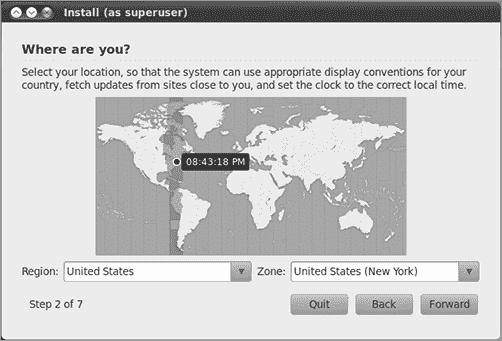

2. 图 2-7 显示的对话框提示您指定连接到计算机的键盘类型。默认值基于您在之前屏幕上的设置——如果不正确，请点击“Choose your own（选择自己的）”并在支持的键盘类型完整列表中选择您的键盘类型。您可以在屏幕底部的文本区域输入示例文本，以验证在打字时是否显示了正确的符号。一旦您确定设置了正确的键盘，点击 `Forward` 继续。

   图 2-7: 指定您的键盘类型

   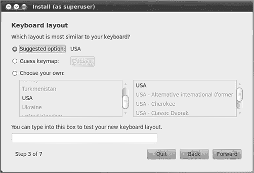

3. 图 2-8 显示的对话框允许您选择想要安装 Ubuntu 的位置。根据您的系统中当前磁盘的配置情况以及它们已经包含的分区（如果有），此对话框看起来会有不同并提供不同的选项。图 2-8 显示了如果您在当前没有安装操作系统的系统上安装 Ubuntu，将会看到的屏幕。

   图 2-8: 指定您想要安装 Ubuntu 的位置

   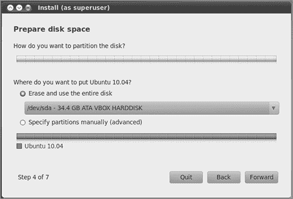

   因此，您在此屏幕上要选择的选项取决于系统硬盘的当前状态、系统中存在多少硬盘以及您想在哪里安装 Ubuntu。您的选项如下：

   * 如果您在新的计算机系统或硬盘上安装，将选择“Erase and use the entire disk（擦除并使用整个磁盘）”选项。

   * 如果您在已安装操作系统的 x86 或 64 位系统上安装 Ubuntu 且没有可用空间，将选择“Install side side（并排安装）”选项，如图 2-9 所示。

   * 如果您的系统已经安装了操作系统，但您想要保留它，可以选择“Erase and use the entire disk（擦除并使用整个磁盘）”选项来擦除现有操作系统并在磁盘上安装 Ubuntu，如图 2-10 所示。

   * 如果您的系统包含多个硬盘，它们将列在此对话框中。选择您想要安装 Ubuntu 的磁盘。

   图 2-9: 为了安装 Ubuntu 调整分区

   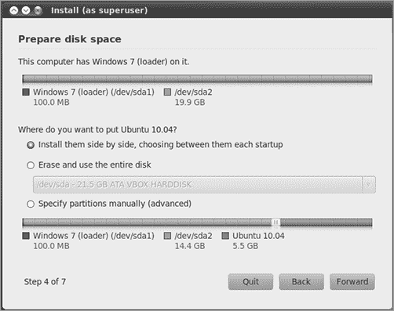

   图 2-10: 为了安装 Ubuntu 删除现有操作系统

   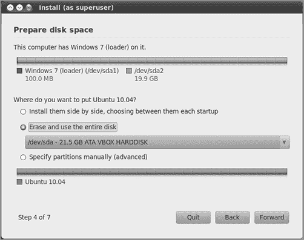

   * 如果您的磁盘上有足够安装 Ubuntu 的空闲空间，选择“Use the largest contiguous free space（使用最大的连续空空间）”。

   * 如果您是经验丰富的 Linux 用户并想手动指定分区，请选择“Specify partitions manually (advanced)(手动指定分区（高级）”选项，并查看“手动分区”侧栏获取有关使用 Ubuntu 安装程序提供的分区工具的更多信息。

一旦为系统选择了合适的选项，点击 `Forward` 继续。如果您为了作为双启动系统在系统上安装 Ubuntu 而调整现有操作系统，可能会看到一个对话框通知您更改必须写入磁盘。点击 `Continue` 继续。

4. 图 2-11 显示的对话框允许您提供个人信息，以便在安装过程中创建您的账户。该帐户将能够在系统上执行特权命令，见第 4 章“基础 Linux 系统概念”中“在 Ubuntu 中执行特权操作”章节的解释。

   图 2-11: 指定有关账户的信息

   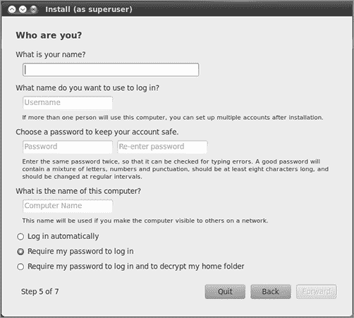

此对话框底部的三个选项允许您指定系统如何启动。根据您安装 Ubuntu 的系统上的显示器分辨率，您可能需要向下滚动以查看所有选项：

* **自动登录**：您的系统将启动并自动使用您在此对话框中指定的账户进行登录，并显示您的默认桌面。

* **登录时需要密码**：您的系统将显示一个通用的登录界面，您必须在界面上选择或输入想要登录的用户名。一旦您输入了该用户的用户名和密码，系统将为您登录并显示您的默认桌面。

* **登录和解密我的主文件夹均需要密码**：您的系统将显示一个通用的登录界面，您必须在界面上选择或输入想要登录的用户名。一旦您输入了该用户的用户名和密码，系统将为您登录并显示您的默认桌面。此选项与上一个选项的区别在于，在您未登录时，您的主目录将以加密方式存储，这样其他用户在没有您的密码的情况下无法查看其内容。

填写此表上的所有字段后，点击 `Forward` 继续。

## 5. 如果在您的系统中检测到另一个 Linux 操作系统且您正在保留该操作系统，则会显示一个特殊的中间界面。如果您是在新系统上安装 Ubuntu，或者在要删除任何之前安装的操作系统的系统上安装，则不会看到此界面。

如果在该操作系统安装中发现了任何自定义账户信息（如电子邮件设置、浏览器书签等），此对话框将提议将其复制到您正在创建的新安装中。

如果没有发现自定义设置，对话框将仅报告此情况，您可以点击 `Forward` 继续到最后的安装程序界面。如果检测到任何账户信息且您想复制这些信息，请在此对话框中选择账户，并点击 `Forward` 继续到最后的安装程序界面。

## 6. Ubuntu 桌面安装程序将显示如图 2-12 所示的界面，该界面总结了您在之前的对话框中提供的信息。点击 `Install` 继续。

图 2-12： 启动安装过程的摘要对话框

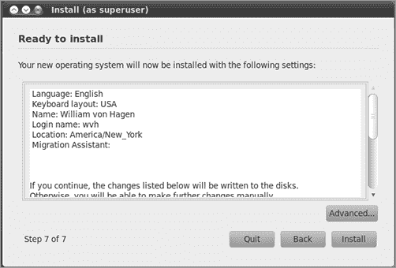

## 手动分区磁盘

如果您是丰富的 Linux 用户且有特定原因，您可能希望手动指定如何划分硬盘上的空间（或双启动系统上的未分配空间）。如果您不手动对磁盘进行分区，Ubuntu 会为其自动创建的不同分区提供合理的默认值（一个大小为系统内存倍倍的交换分区，以及一个大根根分区）。然而，您可能希望进一步划分系统上的磁盘空间并/或以不同的方式分配它。有关磁盘和分区的通用信息，请参阅第 4 章中名为“磁盘、分区和挂载点”的章节获取更多信息。

如果您在新的磁盘上安装 Ubuntu 并在图 2-8、2-9 或 2-10 所示的对话框中选择 `Manual` 选项，在您点击 `Forward` 后，将显示如如下所示的对话框。

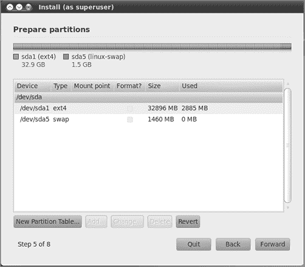

如果所选磁盘上存在现有分区，它们将在此对话框中显示。如果您在新的磁盘上安装 Ubuntu，系统将提示您在磁盘上创建新的分区表。点击 `Continue` 继续。

如果您的磁盘包含现有分区，且您想删除磁盘上的任何或所有分区，请选择您想要删除的每个分区并点击 `Delete partition` 将其移除，并将该分区关联空间返回磁盘上可用的空空间池。请小心——删除分区将永久删除其包含的任何信息。接下来，选择磁盘上的空空间并点击 `New` 来定义新分区。显示如下所示的对话框：

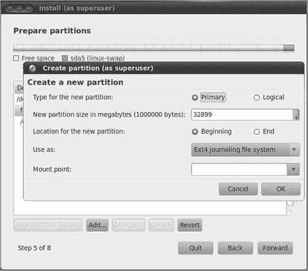

输入您想要创建的分区大小，并验证您正在创建的分区类型（物理或扩展），以及其格式（通常为 `ext4` 或 `swap`）和您想要挂载该分区的的位置；点击 `OK`。这将重新显示之前的对话框，该框现在包含了您刚刚定义的分区的信息。

对您想要创建的每个分区重复此步骤。您必须至少创建一个交换分区（Ubuntu 将使用它来支持虚拟内存，其大小应该是系统内存大小的倍数），以及一个存放系统根文件系统的分区（其大小应至少为 6 GB）。一旦您定义了所有想要创建的分区并确定这些设置正确，点击 `Forward` 继续。

## 7. 安装程序在格式化硬盘上的分区、向您的系统安装 Ubuntu Linux、创建账户和其他系统配置信息等时，会显示几个进度对话框。一旦安装完成，将显示如图 2-13 所示的对话框。

图 2-13： 最终安装

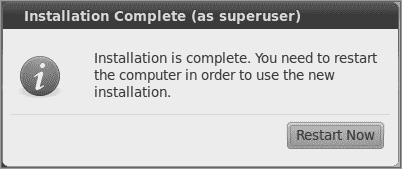

这标志着 Ubuntu 桌面安装过程的完成——下次启动系统时（移除桌面 CD 后），您就可以准备好从硬盘运行 Ubuntu 了。

## 启动 Ubuntu

如果您在新或现有计算机上将 Ubuntu 安装为唯一的操作系统，您将看到一个名为“启动画面”（splash screen）的简单图形界面，它在启动过程中发生细微变化以确认您的系统正在启动。如果您想手动与 Ubuntu 使用的引导程序（称为 `GRUB`）交互，您可以在启动过程的前五秒内按 `Esc` 键以显示 `GRUB` 启动菜单。`GRUB` 启动菜单允许您启动不同的内核（如果安装了多个）、以不同的模式启动任何可用内核、启动其他操作系统或测试系统内存。有关 `GRUB` 及其菜单的更多信息，请参见 `www.gnu.org/grub`。

## 在双启动系统中启动 Ubuntu

如果您在已安装另一个操作系统的系统上安装了 Ubuntu，会自动显示 `GRUB`（统一引导加载程序）菜单，让您使用系统的方向键选择想要启动的操作系统。默认情况下，您的双启动系统将在 30 秒后启动 Ubuntu。在 x86 系统上，此界面看起来如图 2-14 所示。

图 2-14： 在双启动 x86 系统上选择操作系统

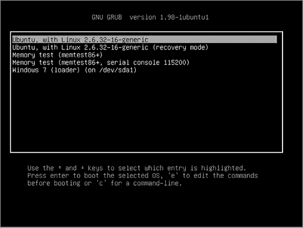

## 首次启动 Ubuntu

首次启动 Ubuntu 时您将需要更新系统。这将确保您拥有所有标准 Ubuntu 软件的最新最佳版本，这些版本提供了安全修复、错误修复和常规改进。在任何首次启动界面之后（如本节其余部分所述），Ubuntu 更新管理器将自动运行，并在 Ubuntu 系统的面板右上部分显示图标提醒您有可用更新，或在您的主屏幕上显示类似的对话框。有关更新 Ubuntu 系统的信息，请参阅第 19 章“添加、删除和更新软件”中名为“使用 Ubuntu 更新管理器”的章节。

如果你在安装 Ubuntu 时，在图 2-11 所示的屏幕上选择了“登录和解密我的主目录需要密码”选项，你将看到一个关于记录加密密码短的信息对话框。该对话框提议运行一个应用程序，允许你指定一个密码短作为备份机制，以便你手动解密主目录。Ubuntu 的自动目录加密机制通常使用你的密码来解密加密目录，但也支持将密码短作为另一种解密机制。当此对话框显示时，请点击“立即执行此操作”继续。

一个标准的终端窗口将打开，并显示“Passphrase:”提示。输入一个你记得住的单词或系列单词，然后按回车键。信息对话框会再次显示，此时你可以点击“关闭”终止该对话框并开始使用你的新 Ubuntu 系统。如果你想更改加密目录的密码短，可以使用命令行中的 `encryptfs-unwrap-passphrase` 命令来完成。

## 注意

如果你将加密目录作为你的主目录，你会发现列出挂载目录的命令（如 `df` 命令）的输出中会出现你的主目录条目。你的主目录实际上以加密文件的形式存储在中央系统目录 `/home/.encryptfs/USERNAME/.Private` 中，其中 `USERNAME` 是你的登录名，该目录会在登录时挂载到你的主目录上。

# 测试 Ubuntu Linux

图 2-5 显示了从书中附带的 Ubuntu Desktop CD 启动后显示的 Ubuntu 桌面。从此桌面，你可以尝试桌面 CD 上提供的任何应用程序，包括音频、视频和网络应用程序。

虽然你可以自己尝试桌面 CD 提供的任何应用程序，但 Ubuntu Desktop CD 还提供了一个包含示例文档、图形文件等的文件夹，它通过提供一些实际文档供你实验，简化了对不同类型应用程序的操作。Ubuntu Desktop CD 桌面上的“Examples”项是指向 `/usr/share/example-content` 目录的符号链接。

桌面 CD 是完整的 Ubuntu 系统，你可以遵循书中任何章节的指令来尝试 Ubuntu，而无需将其安装到硬盘中。这种实验的缺点是，每当你重启系统时，创建的任何文件或配置的任何软件通常都会丢失。

本节讨论了 Ubuntu Desktop CD 提供的 Examples 文件夹的内容以及与其包含每个文件相关的应用程序。它还解释了保存你创建的任何数据的多种方法，从手动保存到现有文件系统或网络系统，到使用 USB 闪盘创建一个基于 Ubuntu Desktop CD 的真正便携、持久的系统。

# 探索桌面 CD 的 Examples 文件夹

所有的 Ubuntu Desktop CD（包括书中附带的这个）都包含一个示例文档、图形文件等的文件夹，它通过提供一些可以打开、编辑、保存和日常使用的实际文件，让你能够轻松尝试不同的 Linux 应用程序。示例文件不仅用于演示各种应用程序，还为你提供了一个方便的 Ubuntu 营销资料来源。你可以将 PDF 案例研究等文档发给没有使用 Ubuntu 的朋友。

Examples 文件夹中的文档和其他文件如下。此文件夹中的所有 PDF 文件都在 Evince PDF 查看器中打开；其他类型文件的描述会在你点击它们时，解释打开它们时所运行的应用程序：

* `case_Contact.pdf`: 德国汉莎航空（Lufthansa）部门 Contact Air Gmbh 采用 Ubuntu 的案例研究。

* `case_howard_county_library.pdf`: 华华顿县图书馆（Howard County Library）采用 Ubuntu 的案例研究。

* `case_KRUU.pdf`: 非营利电台 KRUU 采用 Ubuntu 的案例研究。

* `case_OaklandUniversity.pdf`: 奥克兰德大学（University of Oakland）采用 Ubuntu 的案例研究。

* `case_oxford_archaeology.pdf`: 英国考古与遗产管理公司 Oxford Archaeology 采用 Ubuntu 的案例研究。

* `case_Skegness.pdf`: 斯凯格斯文法学校（Skegness Grammar School）采用 Ubuntu 的案例研究。

* `case_ubuntu_johnshopkins_v2.pdf`: 约翰斯·霍普金斯大学（Johns Hopkins University）采用 Ubuntu 的案例研究。

* `case_ubuntu_locatrix_v1.pdf`: Locatrix Communications 采用 Ubuntu 的案例研究。

* `case_Wellcome.pdf`: 灵会会桑格研究所（Wellcome Trust Sanger Institute）采用 Ubuntu 的案例研究。

* `fables-01_01_aesop.spx`: 一个 Ogg 容器格式的示例 Speex 音频文件（一种开源音频压缩格式）。双击此项将使用 Totem 视频播放器打开并播放它。

* `gimp-ubuntu-splash.xcf`: 使用 GIMP 图像处理程序的原生开源 XCF 格式的示例 Ubuntu 启动屏幕。双击此项将在 GIMP 图形编辑器中打开它。

* `kubuntu-leaflet.png`: 一个便携网络图形（PNG）格式的示例 Kubuntu 文档。双击此项将在 GIMP 图形编辑器中打开它。

* `logos`: 包含 PNG 格式示例 Ubuntu 和 Kubuntu 标志的文件夹。双击这些项中的任一将在 GIMP 图形编辑器中打开。

* `oo-about-these-files.odt`: 一个提供文件信息的 OpenOffice.org 文档。双击此项将在 OpenOffice 中打开。

* `oo-about-ubuntu-ru.rtf`: 一个微软富文本格式（RTF）示例俄语文档。双击此项将在 OpenOffice Writer 中打开。


* `oo-derivatives.doc`：一个 Microsoft Word 格式的示例文档，讨论了 Ubuntu 的衍生版本，如 Edubuntu、Kubuntu 和 Xubuntu。双击此项将在 OpenOffice Writer 中打开。
* `oo-maxwell.odt`：一个 OpenOffice.org 文档，通过讨论麦克斯方程展示了 OpenOffice Writer 的数学能力。双击此项将在 OpenOffice Writer 中打开。
* `oo-payment-schedule.ods`：一个 OpenOffice.org 表格，展示了计算和其他功能。双击此项将在 OpenOffice Calc 中打开。
* `oo-presenting-kubuntu.odp`：一个讨论 Kubuntu 的 OpenOffice.org 演示文稿。双击此项将在 OpenOffice Impress 中打开。
* `oo-presenting-ubuntu.odp`：一个讨论 Ubuntu 的 OpenOffice.org 演示文稿。双击此项将在 OpenOffice Impress 中打开。
* `oo-trig.xls`：一个 Microsoft Excel 示例文档，展示了计算和结果的图形化显示。双击此项将在 OpenOffice Calc 中打开。
* `oo-welcome.odt`：一个包含嵌入图形并介绍 Ubuntu Linux 的 OpenOffice.org 文档。双击此项将在 OpenOffice Writer 中打开。
* `Ubuntu_Free_Culture_Showcase`：包含 Ubuntu 自由文化展示获奖音频和视频文件的文件夹，该活动寻求在知识共享署名-相同共享许可下发布的媒体文件，以便在演示（即炫耀）新 Ubuntu 系统时使用。双击此目录下的 OGA 或 OGV 文件将使用 Totem 音频/视频播放器播放。

双击这些示例文档和文件，你将有机会尝试相关的软件软件包，而无需从零开始。你无法在原处修改这些文档，因为它们是从 CD 载入的。要修改其中任何一个，请将该文档或文件复制到登录目录并将其设置为可写。有关更改 Linux 文件权限的信息，请参阅第 4 章中名为“理解 Linux 权限”的章节。

## 从桌面 CD 访问你的硬盘

在你的 Microsoft Windows 或其他 Linux 系统上启动 Ubuntu 桌面版是很有趣的，但如果你在“桌面 CD 模式”下进行任何实际工作，你可能实际上想将其保存以备以后重用。由于 Ubuntu 桌面 CD 运行在内存文件系统（称为 `RAM disk`）上，因此在从桌面 CD 运行 Ubuntu 时保存你创建的数据关键在于能够访问硬盘上的现存文件系统并将数据保存到那里，或者像本章稍后“使用桌面 CD 持久化”章节中所解释的那样，使用外部持久存储设备。要访问本地磁盘驱动器的文件系统，你必须在运行 Ubuntu 时显式地让它们可用（挂载它们），这需要你使用一些特殊的工具——一如既常，你可以选择图形界面工具或命令行工具。

接下来的章节将解释如何从不同类型的桌面 CD 挂载并访问你现有的文件系统，以便你保存从从桌面 CD 运行 Ubuntu 时创建的文件。

## 从桌面 CD 访问现有分区

Microsoft Windows 系统使用 `NTFS`（NT 文件系统）或较旧的 `FAT32`（32 位文件分配表）文件系统。幸运的是，Linux 对这两种文件系统都提供完全支持，因此一旦你从 Ubuntu 桌面 CD 启动，就可以轻松挂载系统硬盘上已经存在的文件系统，以便你访问现有文件或保存你在从桌面 CD 运行期间创建的任何文件：

1. 从桌面 CD 启动后，选择 `Places（位置）⇒ Computer（计算机）` 项。将显示一个 `Nautilus 文件管理器` 窗口，在右侧面板中显示所有可用磁盘分区，并在左侧面板的 `Places` 列表中列出它们，如图 2-15 所示。

图 2-15： Nautilus 中的可用磁盘分区

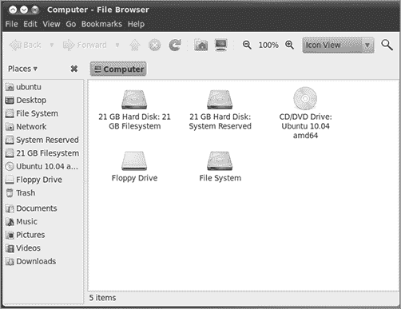

图 2-16 显示了一个大小为 21 GB 的可挂载分区。CD/DVD 驱动器包含 Ubuntu 桌面 CD，`File System（文件系统）` 代表内存中的 `RAM disk`，它包含了当你从桌面 CD 启动时创建的根文件系统。

2. 要挂载硬盘上的任何分区，在左侧面板的 `Places` 列表中点击分区名称。桌面上将显示分区的图标，该分区的的内容显示在 `Nautilus` 窗口的右侧面板中，如图 2-16 所示。

图 2-16： 在 Nautilus 中查看 Windows 分区

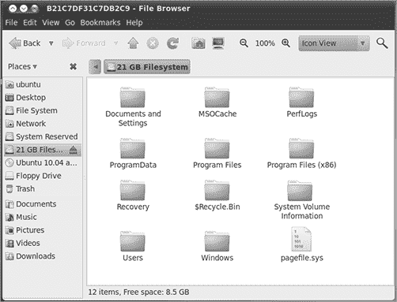

你应该能够通过检查其包含的文件来识别已挂载的分区和分区类型。例如，图 2-16 所示的分区显然是一个 Microsoft Windows 分区，因为它包含了 `Windows`、`Program Files` 和 `My Music` 等目录。

一旦挂载了分区，`Places` 列表中其名称右侧会显示一个图形箭头，表示它当前已挂载。在 `Nautilus` 中将你想从 Live CD 会话中保存的任何文件或目录拖放到该分区后，你可以左点击该箭头来卸载分区。作为一个一般原则，在从 Live CD 关机或重启之前，卸载你已挂载的任何硬盘分区都是好主意。

## 通过网络向其他机器复制文件

如果你在从桌面 CD 运行时创建或修改了文件并想保存这些工作，但不想将其保存到系统的任何硬盘分区中（如本章前面的描述），你仍然可以通过网络将它们复制到另一台机器来保存这些文件。

Linux 提供了多种通过网络将文件复制到其他系统的方法。其中最常用且流行的两种方法如下：

* `ftp`（文件传输协议）工具，它与另一台机器建立连接并允许你交互地双向传输文件
* `scp`（安全拷贝）工具，它允许你通过安全的加密连接快速地将文件传输到其他机器上

这些命令将在第 25 章“连接到其他系统”中详细解释。在这里对它们进行总结，以便让你知道有方法可以保存从 Ubuntu 桌面 CD 所完成的任何工作，而不涉及本地存储。当你使用 Ubuntu 桌面 CD 从崩溃的系统中恢复数据时，这可能非常有用。

## 使用桌面 CD 持久化

像 Ubuntu 桌面 CD 这样的 Live CD 提供了将任何兼容系统临时转换为 Ubuntu 系统的简单方法。然而，由于 Live CD 不为配置数据、应用程序等提供任何持久性存储（除了手动复制文件到其他地方之外），传统上将 Live CD 的实用性限制在简单的演示、一次性实验和通用的系统修复工作中。幸运的是，现在情况变了——多亏于一些聪明的人，现在可以自动保存你在从桌面 CD 运行时所做的更改——而无需处理手动挂载和卸载文件系统、将数据保存到那里等。

早期的 Ubuntu 版本引入了与 Live CD 关联持久存储的机制。这种机制允许你格式化一个具有特殊名称 `caspar-rw` 的外部存储设备并在启动时结合桌面 CD，添加内核启动选项 `persistent` 以告知启动过程使用该设备的内容来恢复桌面设置、个人数据甚至已安装的应用程序。这种方法存在问题，最主要的是它需要一个外部存储设备（通常是 USB 闪存盘）和一个 Ubuntu 桌面 CD。除了携带这两个东西很麻烦外，我个人的抱怨是，我的桌面 CD 在放在后口袋并坐在上面时经常损坏。

幸运的是，闪存盘容量的增加、价格下降以及软件改进使得从 Ubuntu 桌面 CD 进行实际工作变得更加容易。Ubuntu 系统包含了一个易用的命令，用于创建可启动的 USB 闪存盘（通常称为插 U ），它在启动“在不更改计算机的情况下尝试 Ubuntu”选项时像桌面 CD 一样工作，但提供了持久性存储。现在你制作这种便携式 Ubuntu 系统只需要一个至少 2 GB 的 USB 闪存盘。

如果你想手动创建一个可启动的 USB 闪盘，PenDriveLinux.com ([www.pendrivelinux.com](http://www.pendrivelinux.com)) 的伙伴提供了一些非常实用的教程，它们将引导你完成在 USB 盘上手动创建可启动 Ubuntu 系统的过程，以及几乎任何你可能想到的从 USB 盘启动的其他内容。他们的教程讲解清晰，可读性极佳，而且经常包含你可以从他们的网站下载的脚本和配置文件，这会让你的操作变得更加简单。♦

闪盘非常棒——它们速度快、能耗比硬盘低得多、不发热、无噪音，而且没有机械部件，即使从楼梯上掉落也不会停止运行。缺点是，它们确实有一个你可能会听到的潜在局限性——每个底层存储单元的写入次数是有限的。（闪存存储单元通常被称为单元或地址块，类似于标准硬盘上的扇区。）幸运的是，大多数闪盘都使用一种名为“磨损均衡”（wear-leveling）的技术将写入操作均匀地分布在整个驱动器，这样驱动器的某个区域的写入频率就不会高于其他区域。现代闪盘的使用寿命通常预计至少为 5 或 10 年。如果你 5 年后仍在使用同一个闪盘运行 Ubuntu，那么可能是时候最终考虑升级了。反正，你已经在备份你的“实际工作”了，对吧？

### 注意事项

为了使用本节讨论的可启动 USB 闪盘，你的计算机系统必须能够从 USB 设备启动。大多数现代 PC 都支持此，但在费心创建一个你无法使用的可启动 USB 盘之前，你应该检查一下。从 USB 设备启动通常是标准的 BIOS 启动选项，但某些系统要求你在手动启用 USB BIOS 支持后才能从 USB 设备启动。♦

如前所述，Ubuntu 桌面提供了一个简单的图形化机制来创建启动 USB 闪盘，其工作方式与桌面 CD 类似，但它提供了持久性存储，因此你配置的任何系统设置、安装的应用程序以及创建的文件在重启后都会保留。此应用程序将尝试重用你 USB 盘上的任何 `FAT32` 分区，因此如果你已将 USB 盘格式化为其他类型的文件系统，或者在 USB 盘上创建了多个分区，你可能想查看本章稍后部分“格式化 USB 闪盘”中的侧边栏。

### 创建 USB 启动盘

要使用此应用程序，请在使用“尝试 Ubuntu”选项从 Ubuntu 桌面 CD 启动后执行以下操作：

1. 选择 `系统 ⇒ 管理 ⇒ 启动盘创建器`菜单选项。显示一个如图 2-17 所示的对话框。
2. 验证你的 Ubuntu 桌面 CD 的挂载点是否在对话框顶部的源磁盘镜像（`.iso`）或 CD 区域中列出并高亮。如果没有，点击`其他`并浏览到正确位置。

图 2-17： 创建 USB 启动盘

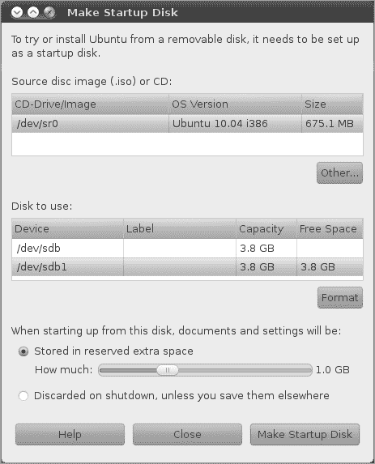

3. 验证你要创建可启动 Ubuntu 系统的 USB 磁盘分区是否在对话框中间的“要使用的 USB 磁盘”区域列出并高亮。USB 磁盘列表下方的行标识了所选 USB 分区是否有足够的空间安装可启动系统。如果你使用的 USB 盘未格式化，请点击`格式化`对其进行格式化。格式化完成后，你应该会在“要使用的磁盘”部分看到两个条目——一个对应闪盘本身，另一个以数字结尾，标识该闪盘上的特定分区。确保选择了以数字结尾的条目。
4. 要创建一个支持持久存储你安装的应用程序、创建的文件和目录以及应用程序和系统配置信息的可启动 USB 盘，请确保在图 2-17 所示的对话框底部选择了“存储在预留额外空间”单选按钮。拖动此单选按钮下方的滑块，确定你想在所选分区上分配多少空间存储持久数据。

如果你不想创建任何持久存储，请点击“关闭时丢弃”单选按钮。如果你选择了此单选按钮，你的可启动 USB 盘表现将完全像 Ubuntu 桌面 CD 一样。你创建的任何文件或目录、安装的应用程序以及修改的应用程序和系统配置信息在你关闭从 USB 盘启动的系统时都不会被保留。

### 格式化 USB 闪盘

Ubuntu “创建 USB 启动盘”应用程序将尝试重用你 USB 盘上任何现 `FAT32` (`VFAT`) 分区。如果你已将 USB 盘格式化为包含多个分区、更改了任何现有分区的文件系统类型，或者已经在闪盘上拥有多个分区但不需要使用它们，此侧边栏解释了如何格式化你的闪盘，使其包含单个 `FAT32` 分区，以便“创建 USB 启动盘”选项可以进行最大利用。正如你预期的那样，这将删除 USB 盘上当前存在的任何信息，因此在遵循此侧边栏指令之前，请确保已将任何以后想查看的内容复制到其他地方。

要格式化 USB 盘，请执行以下操作：

1. 选择`应用程序 ⇒ 附件 ⇒ 终端`命令启动 GNOME 终端。
2. 输入 `sudo -s` 命令和密码以成为 root 用户。
3. 使用 `df` 命令查看挂载的分区。如果 USB 盘的任何分区已挂载，请使用 `umount` 命令将它们卸载。
4. 执行 `fdisk` 命令，并带有对应 USB 盘设备名称作为参数。你必须指定设备名称，而不是设备上的分区。例如，如果你的 USB 盘是 `/dev/sdb`，则执行命令 `fdisk /dev/sdb`。
5. 输入 `p` 并按回车查看 USB 盘上的所有分区列表。使用 `d <number>` 命令删除这些分区，其中 `<number>` 是 `p` 命令输出的第一列设备列表中的数字。完成后，再次输入 `p` 命令列出分区表——你不应该能看到任何分区。
6. 使用 `n` 命令开始在闪存上创建新分区。输入 `p` 将创建为主分区，并输入 `1` 作为分区号。在提示新分区的起始块时，按回车接受默认值 `1`。在提示分区结束位置时，再次按回车以使用整个磁盘。
7. 输入 `t` 并按回车开始更改驱动器上第一个分区的类型。输入 `1` 来标识要更改的分区，并输入 `c`（Windows 95 FAT32 LBA）作为分区类型。
8. 输入 `a` 并按回车将你的新分区设为活动（即，可启动）。在提示分区号时，输入 `1` 并按回车。
9. 输入 `w` 将更新后的分区表写入 USB 盘。输入 `q` 退出 fdisk 应用程序。

重新分区您的 USB 盘后，您必须将其移除并重新连接到系统，以让系统读取新的分区表。

重新连接驱动器后，使用 `dmesg` 命令显示最后几条内核消息，其中一条消息应该会识别出您刚刚重新连接的 USB 盘上的设备名称和可用分区。你可以使用 `fdisk -l /dev/DEVICE` 命令来列出名为 `DEVICE` 的设备上的分区，以验证你是否确定了重新连接的驱动器的设备名称——该名称与之前的可能并不相同。一旦你完全确定了重新连接的 USB 盘的设备名称，就可以可以使用下面的命令对其进行格式化：

```
mkfs.vfat -F 32 -n NAME /dev/PARTITION
```

将 `NAME` 替换为您想要分配给 USB 盘的名称，并将 `PARTITION` 替换为设备上的分区名称（类似于 `sdb1`、`sdc1` 等）。现在，你已经准备好在 USB 盘上创建一个可启动的 Ubuntu 系统了。

5. 点击“制作启动盘（Make Startup Disk）”开始创建可启动的 USB 盘。此过程需要几分钟。当可启动系统在选定的 USB 设备分区上成功创建后，会显示对话框。点击 OK 关闭此对话框和启动盘创建程序。

此时，你可以将 USB 盘从系统中移除并在另一个系统上进行测试，或者重启当前系统以测试从 USB 盘启动。请确保在任何用于测试 USB 盘的系统的 BIOS 中都已启用从 USB 设备启动，并且 USB 启动设备的优先级高于你系统的 CD、DVD 或硬盘。

### Wubi：在 Windows 上安装 Ubuntu

8.04 之前的之前的 Ubuntu Desktop CD 版本提供了多种为 Microsoft Windows 系统编译的开源软件包，这使得 Windows 用户在以 Live CD 模式从桌面 CD 启动后，能够尝试使用一些他们可以看到并使用的惊奇软件。这些软件包包括 Mozilla Firefox、Mozilla Thunderbird、GIMP 图像创建和编辑包以及其他多个软件包。

8.04 及更高版本的 Ubuntu Desktop CD 不再提供这些软件包的 Windows 版本，而是为 Windows 用户提供了一个更好的选择：即在不重新分区现有磁盘的情况下，将 Ubuntu 安装到任何现有的 Windows 系统中，并为你的 Windows 系统添加一个启动选项，使你能够启动到 Ubuntu 或现有的 Windows 系统。这种功能由一个名为 `Wubi` 的优秀软件包提供（基于 Windows 的 Ubuntu 安装程序——[http://wubi-installer.org]）。将 Ubuntu 安装到现有 Windows 系统至少需要 4 GB 的磁盘空间（建议 5 GB 或更多），但它会为你提供一个完整的 Ubuntu 系统，该系统安装在 Windows 系统上的新目录中。在 Windows 端，基于 Wubi 的安装看起来就像其他 Windows 应用程序，甚至可以使用传统的控制面板“添加/删除程序”程序进行删除。

Wubi 安装的工作原理是在你系统硬盘的顶层创建一个 Ubuntu 目录，并用填充 Wubi 启动 Ubuntu 所需的所有文件，包括该发行版的文件系统镜像。安装过程会在你的 Windows 启动菜单中添加一个 Ubuntu 选项（如果你的系统只运行 Windows，你可能从未见过它），然后安装它所需的引导程序（`wubildr` —— Wubi 加载程序），它使用该程序来挂载并访问文件系统镜像，作为选择 Ubuntu 启动选项时执行的应用程序。

要利用此安装选项，将 Ubuntu Desktop CD 插入现有 Windows 系统的 CD/DVD 驱动器中。在 Windows 系统确认你想要从 CD 运行 `Wubi.exe` 软件的任何对话框之后，将显示图 2-18 所示的对话框。

[图 2-18:] Microsoft Windows 系统上的 Ubuntu 对话框

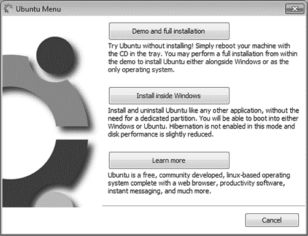

要在现有的 Windows 系统上安装 Ubuntu，点击“安装在 Windows 内（Install Inside Windows）”。将显示图 2-19 所示的对话框。

[图 2-19:] 在 Windows 上开始 Ubuntu 安装过程

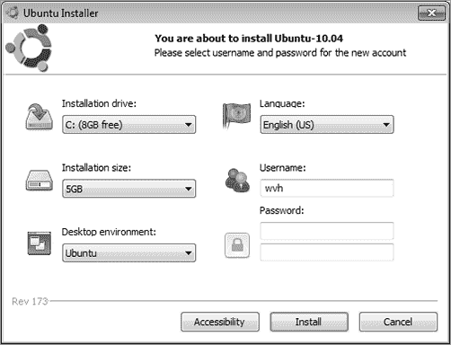


默认情况下，`Username` 显示当前登录的 Windows 用户名。如果你想在登录基于 Wubi 的 Ubuntu 安装时使用不同的用户，请输入你想使用的用户名。

接下来，输入你希望该用户在基于 Wubi 的 Ubuntu 安装中使用的密码，通过输入两次密码来确认你没有拼写错误。

最后，如果你有任何特殊的辅助功能需求，点击“辅助功能（Accessibility）”显示类似图 2-20 所示的对话框。设置完任何你想使用的辅助选项后，点击“下一步（Next）”返回主安装对话框。

[图 2-20:] Windows 上基于 Wubi 安装的辅助功能设置

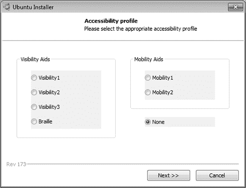

点击“安装在 Windows 内”开始安装过程。你将看到一个进度对话框，Wubi 正在验证它正在安装的文件和目录的校验和、将 Ubuntu 安装到文件系统中等。安装完成后，会显示一个摘要对话框，为你提供现在重启或稍后重启的选项。

在安装 Ubuntu 和 Wubi 后，下次你启动 Windows 系统时，将看到类似图 2-21 所示的界面。

要启动现有的 Windows 安装，只需在键盘上按下回车键（Enter）。要启动 Ubuntu，使用方向键选择该启动选项并按下回车键。

Wubi 是开源社区创造力的另一个又一个精彩例子；它为 Windows 用户提供了另一种体验 Ubuntu 力量的方式。

[图 2-21:] Windows 7 上的 Wubi 启动界面

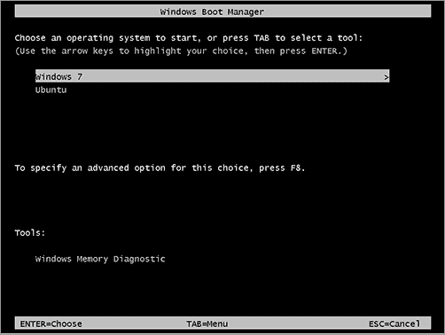

## 总结

本章解释了如何通过适用于你个人电脑类型的 Ubuntu Desktop CD 对 Ubuntu Linux 进行试用，甚至永久安装。（本书包含一张适用于 x86 系统的 Ubuntu Desktop CD。）虽然我希望你已经在计算机系统上永久安装了 Ubuntu Linux，但本章也讨论了在尚未准备永久安装的情况下，尝试 Ubuntu 并保存数据的各种方法。

下一章将讨论如何使用本章关注的桌面 CD 以外的其他 CD 来安装 Ubuntu Linux。这些包括允许你在内存小于 512 MB 的系统上或 OEM 场景下使用文本安装程序安装 Ubuntu 的 CD，以及 Ubuntu Server CD，它可以轻松地为服务器系统安装 Ubuntu，并提供一些默认配置，帮助你将 Ubuntu 作为 SOHO（小型办公/家庭办公室）或企业基础设施的核心组件投入使用。

# 第 3 章：在特殊系统上安装 Ubuntu

## 本章内容

* 获取其他 Ubuntu CD
* 安装 Ubuntu Server
* 安装 Ubuntu 企业云
* 解决安装问题
* 从替代 CD 安装

上一章讨论了使用 Ubuntu Desktop 光盘提供的图形化安装程序，该光盘随书中附带。使用此种光盘及其安装程序是安装 Ubuntu Desktop 系统的标准方法。然而，正如第 1 章“Ubuntu Linux 项目”中“Ubuntu CDs”节所述的，Ubuntu 社区还提供其他的 CD。这些是 Ubuntu Server 安装 CD 和 Ubuntu Alternate Install CD（替代安装 CD）：

* **Ubuntu Server Install CD**：Ubuntu Server CD 用于在不带图形界面（GUI）的服务器系统上安装 Ubuntu。
* **Ubuntu Alternate Install CD**：Ubuntu 替代 CD 使用准图形化安装程序安装 Ubuntu，该安装程序允许您在内存不足、无法运行 Ubuntu Desktop CD 中传统图形化安装程序的系统上安装 Ubuntu，或者在使用了无法识别的显卡的系统上安装（后者非常罕见）。

本章将讨论如何获取这些 CD，以及如何使用每种 CD 提供的安装备。

Ubuntu Desktop CD 的图形化安装程序与 Server 和替代安装 CD 上使用的基于 Debian 的准图形化安装程序不同。在 Desktop CD 上提供图形化安装程序之前，Ubuntu 使用的基于 Debian 的安装程序也遭到了传统针对 Debian 安装程序的批评——“它不够花哨”、“它看起来像是 1985 年的东西”、“它没有利用我那块五维加速显卡的所有华丽功能”等等。这些都是事实，而且有其道理。尽管拥有一个花哨的、以鼠标为导的图形化安装程序是很好，但安装程序是您每个系统只使用一次后就会忘记的东西。因此，安装程序必须稳如磐石、易于理解且易于使用。它还必须适用于任何计算机系统，从最糟糕的低分辨率 VGA 系统到如今的高端游戏系统（后者提供了许多人甚至无法察觉的惊人分辨率和视觉细节）。服务器系统通常在无头模式运行（即没有图形控制台），因此一个可以在此类系统运行的安装程序是非常重要的。

## 获取不同的安装 CD

Ubuntu 光盘不在商店里出售，这没关系，因为书中附有一张适用于测试驱动和安装的 CD，而其他的 Ubuntu 安装 CD 可以通过互联网轻松获得。如果你有一个速度较快的互联网连接以及 CD 或 DVD 刻录器，获取与书中提供的不同的安装 CD 的简单方法是下载该 CD 的 ISO 镜像。（ISO 镜像是一个包含 CD-ROM 或 DVD 镜像的文件，其格式符合国际标准组织 9660 规范。）有关书中提供之外的其他 Ubuntu 光盘的更多信息，请参见第 1 章中的“Ubuntu CDs”节。一旦你决定了哪种 CD 符合你的需求，访问 `www.ubuntu.com/download` 页面获取其他 Ubuntu CD，选择你所在国家或最近的镜像站点，并选择与你的平台和想要安装的系统类型相关的安装 CD。将下载的 ISO 镜像保存为文件，下载完成后将该 ISO 镜像刻录到 CD，就可以使用了！

如果你的互联网连接很慢或没有 CD 刻录器，不要慌！正如本书的前言提到的，Ubuntu 社区甚至会邮寄 CD，尽管根据你的地理位置，可能需要几周才能到达。对于我们这些需要即时满足的人来说，这不是正确的解决方案，但可能对你有效。要向 Ubuntu 社区请求 CD，请访问 `https://shipit.ubuntu.com`，输入电子邮件地址和密码创建账户，并请求当前版本的 Ubuntu CD。然后你必须一直守着信箱，直到它们真正到达。

## 从服务器或替代安装 CD 启动

从 Ubuntu Server 或 Ubuntu 替代安装 CD 启动只需将相应的 CD 插入系统的 CD 驱动器，重启系统，并告诉系统从 CD 驱动器启动而不是硬盘分区启动。在 PC 系统上，这是通过 BIOS 设置完成的。

> ### 提示
>
> 如果你的 `x86` 系统即使在 CD 驱动器存在正确的 Ubuntu 安装 CD 的情况下仍从硬盘启动，则你需要修改 BIOS 设置中的启动顺序。启动顺序是系统上电时搜索可启动磁盘的设备序列。要执行此操作，打开电脑，并按下键盘上允许你访问 BIOS 的键。对于大多数现代系统，这通常是 `Delete` 或 `F2` 键，但你需要按的键通常会在电脑开机首次启动时显示在屏幕左下角。
>
> 根据计算机使用的 BIOS 类型，启动顺序设置通常存储在“高级设置（Advanced Settings）”或“启动（Boot）”屏幕，你可以使用键盘上的方向键导航到那里。当屏幕名称被高亮时，按 `Return` 显示此屏幕。一旦显示此屏幕，使用下箭头导航到“第一个启动设备或 CD 驱动器”项，查看屏幕右侧的帮助信息以获取如何将 CD 驱动器设置为第一个启动设备的信息。然后你可以按 `Esc`（退出）键退出此屏幕，按 `F10` 保存新设置、退出 BIOS 设置屏幕并重启。♦

当你的系统开始从 Ubuntu Server 或替代安装 CD 启动时，你将提供一些信息，帮助安装程序正确配置系统、安装正确的国际化和区域软件并设置初始用户账户。接两个节将讨论 Server 和替代 CD 的安装选项，它们共享本章介绍中提到的准图形化安装程序，并引导你完成安装过程。

## Server 安装 CD 上的安装选项

正如你可能猜到的，Ubuntu Server 安装 CD 用于在作为服务器使用的系统上安装 Ubuntu。由于许多服务器系统是使用控制台而非图形显示器的机架式系统，Ubuntu Server 安装不包含 X Window 系统窗口管理器或 GNOME 等桌面图形用户界面。默认不安装这些图形相关的包减少了基本安装所需的磁盘空间，也减少了你需要更新的软件量。

> ### 提示
>
> 如果你以后想在服务器系统上使用图形界面以支持特定工具或为了方便，你也可以随时为服务器系统添加图形界面。例如，你可以添加 `xubuntu-desktop` 包来添加 Xfce 桌面系统，添加 `ubuntu-desktop` 包来添加完整的 GNOME 桌面，添加 `kubuntu-desktop` 包来添加完整的 KDE 桌面，或者添加 `xserver-xorg` 包、你选择的窗口管理器以及特定的图形工具。添加软件包将在第 19 章“添加、删除和更新软件”中详细讨论。♦

[图 3-1] 显示了当你从 Ubuntu Server 安装 CD 启动系统时，在最初显示的菜单中选择语言后显示的初始屏幕。

# 图 3-1： Ubuntu Server 安装光盘上的启动菜单

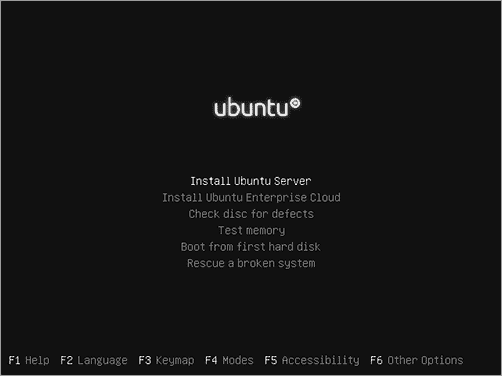

Server 安装光盘启动菜单上的选项如下：

* **Install Ubuntu Server（安装 Ubuntu Server）**：使用 Ubuntu 的类图形化安装程序在您的硬盘上安装基础的 Ubuntu Server 系统。在下一节“安装 Ubuntu Server”中将详细讨论如何使用此安装程序安装 Ubuntu Server。
* **Install Ubuntu Enterprise Cloud（安装 Ubuntu 企业级云）**：安装一个由 Eucalyptus（[www.eucalyptus.com](http://www.eucalyptus.com)）驱动的 Ubuntu Server，它使您能够在自己的自己的 IT 环境中尝试（或部署）云计算。使用此安装程序安装 Ubuntu 云服务器将在本章稍后的标题为“安装 Ubuntu 企业级云”的节中详细讨论。
* **Check disc for defects（检查光盘缺陷）**：测试当前插入系统中的 CD 或 DVD 的完整性并验证其内容。
* **Test memory（测试内存）**：执行若干内存测试以验证系统的内存和相关缓存。您可以按字母 `C` 显示配置菜单，该菜单允许您运行或重新运行特定测试。一旦完成系统内存测试，按 `Esc` 重启系统并返回 Ubuntu Server 安装光盘启动菜单。
* **Boot from first hard disk（从第一块硬盘启动）**：跳过从 Ubuntu Server 安装光盘启动，而从系统的硬盘启动。如果您在不打算在该系统中安装 Ubuntu 或执行可用的系统测试的情况下意外将 Ubuntu Server 安装光盘留在系统的 CD 驱中，请使用此选项。
* **Rescue a broken system（救援损坏的系统）**：提示少量信息，例如您希望显示信息的语言和您的地理位置，然后启动从光盘运行的无盘版 Ubuntu Linux，您可以使用它来修复损坏的磁盘、纠正或重新安装 GRUB 引导加载器的配置等。

> ### 提示
>
> 如果您在进入救援模式（Rescue mode）时遇到问题，从书中附的 Ubuntu Desktop 光盘启动提供了救援模式安装相同的功能，但具有酷炫的图形界面。♦

选择默认的“Install Ubuntu Server”启动菜单选项将在您的硬盘上安装 Ubuntu Linux Server 系统。下一节将引导您完成选择此菜单选项后安装 Ubuntu Server 的过程。

## 安装 Ubuntu Server

根据您的系统速度和互联网连接，安装 Ubuntu 可能需要一些时间。然而，这种等待是值得的。将 Ubuntu 安装光盘插入 CD 驱动器并从其启动。现在执行以下操作：

1. 从光盘启动并从初始菜单集中选择语言后，将显示图 3-1 所示的屏幕。除了选择您想安装标准 Ubuntu Server 还是 Ubuntu 企业级云外，Server 安装光盘还有四个更详细的安装选项，您可以通过按 `F4` 显示这些选项，这将显示图 3-2 所示的弹出菜单。这些选项如下：

图 3-2： Ubuntu Server 安装光盘上的可用配置

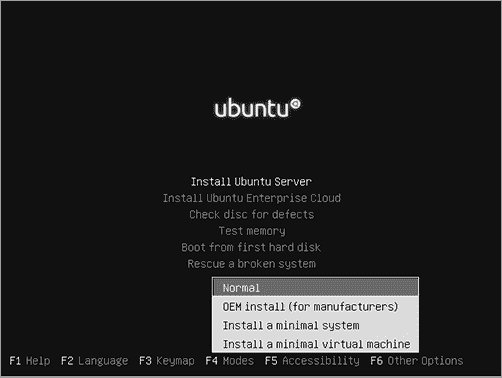

* **Normal（标准）**：安装标准的 Ubuntu Server 系统。
* **OEM Install（针对制造商的安装）**：安装专为 OEM 使用设计的 Ubuntu Server，因此在实际部署之前允许进行额外的自定义。
* **Install a minimal system（安装极精化系统）**：安装包含启动和运行所需的最少软件包的 Ubuntu Server 系统。如果您想手动配置服务器，仅安装您感兴趣的特定软件包（及其依赖项），应选择此选项。
* **Install a minimal virtual machine（安装极精化虚拟机）**：使用 Ubuntu JeOS（恰好的操作系统）配置安装 Ubuntu Server 系统。（有关 JeOS 的更多信息，请参阅第 1 章标题为“服务器用户”的节或 [www.ubuntu.com/products/whatisubuntu/serveredition/jeos](http://www.ubuntu.com/products/whatisubuntu/serveredition/jeos)。）与“Install a minimal system”选项类似，此选项也安装一个具有最少软件包的 Ubuntu Server 系统，但进一步减少了已安装软件包和已安装硬件驱动程序的列表，创建一个适用于作为虚拟机安装的真正极精化的系统。

要继续，选择这些选项中的任何一个，或简单地按 `Return` 保持 Normal 选项被选中。重新显示图 3-1 所示的屏幕。确保“Install Ubuntu Server”选项仍被选中，并按 `Return` 继续进行所选服务器发行版的安装过程。（有关安装 Ubuntu 企业级云的信息，请参见本章稍后标题为“安装 Ubuntu 企业级云”的节。）

2. 显示图 3-3 所示的屏幕，提示您选择在安装过程的剩余部分和安装的系统中显示系统消息和对话框的语言。您可以按 `Return` 接受默认的英语，或使用方向键在支持的语言列表中向上向下滚动直到找到您的母语言，然后按 `Return`。

图 3-3： 指定您的语言

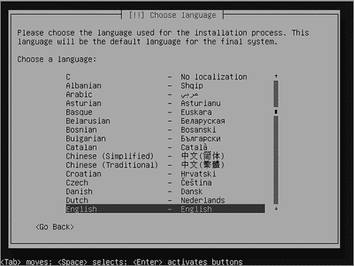

3. 显示图 3-4 所示的屏幕，提示您指定使用计算机的位置。此值用于通过使用您地理位置的适当日期时间格式、数字惯例和货币值，进一步定制化您在上一个屏幕中指定的语言。

图 3-4： 指定您的地理位置

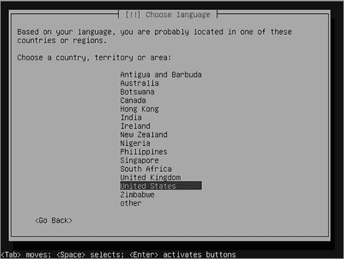

4. 显示图 3-5 所示的屏幕提示您想自动检测还是手动指定正在使用的键盘类型：

* 按 `Return` 接受默认值 No，将显示包含列表的对话框，从中验证验证或修改键盘类型。
* 按两次 `Tab`，选择 `Yes` 并按 `Return` 将显示几个额外的屏幕，提示您在键盘上按特定键或询问系统中是否存在某些键。

在大多数情况下，您应该接受默认值 No 并在后续屏幕中选择您的键盘。第一个屏幕让您识别键盘的地理来源；第二个屏幕允许您指定键盘布局。如果您的键盘未列在这些对话框中，或者无法确定选择何种键盘类型，您可以始终在列表中选择“返回”（Go Back）以回到图 3-5 所示的屏幕，并使用安装程序的键盘布局检测根据您的键盘上提供的键尝试确定您的键盘类型和布局。

图 3-5： 指定您的键盘类型

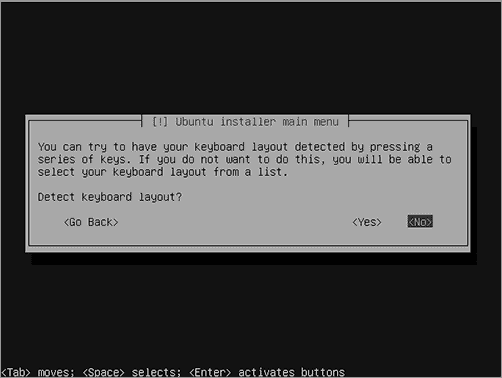

在选择了键盘的来源和布局后，当 Ubuntu Server 安装程序查找 CD-ROM 驱动器、探测系统硬件、检索安装的一些基本软件包并识别和配置网络接口时，会显示几个屏幕。这些屏幕是非交互的。

如果安装程序在自动配置您的网络接口时出现问题，并且在此处看到错误对话框，请参本章节后面侧栏的“解决安装问题”获取更多信息。♦

5. 图 3-6 所示的屏幕提示您为此机器输入名称。这是一个单词输入（不包含任何域名），用于在您的本地网络上唯一标识此系统。您可以接受默认名称 `ubuntu`，也可以为您的机器输入一个名称（我在图 3-6 中所示），然后按 `Return` 键继续。

6. 服务器安装过程接下来尝试从互联网上的时间服务器检索当前时间，然后显示图 3-7 所示的屏幕，该屏幕通过为您的系统建议默认时区来配置系统时钟。如果正确，按 `Return` 键继续。如果错误，按 `Tab` 键选择 No，然后按 `Return`。这将显示一个额外的屏幕，您可以在其中使用方向键选择您所在地的合适时区，然后按 `Return` 键继续。

图 3-6: 为 Ubuntu Server 指定名称

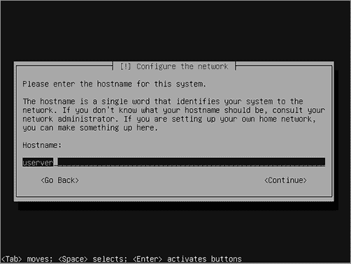

图 3-7: 时区屏幕

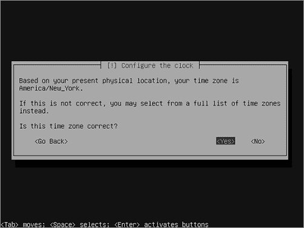

7. 安装程序在探测和识别您的系统硬盘并验证安装 CD 内容时，会显示几个信息性屏幕。图 3-8 所示的分区屏幕将在这些测试完成后显示。

图 3-8: 标准 Ubuntu Server 分区屏幕

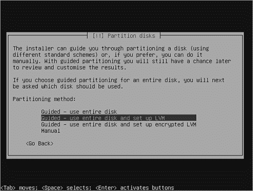

8. 图 3-8 所示的分区屏幕实际上是 Ubuntu 安装过程中唯一可能复杂的部分。如果您在带有单磁盘系统上安装 Ubuntu Server，并希望将整个磁盘分配给 Ubuntu，那么安装屏幕应该与图 3-8 中的屏幕非常相似，只是设备名称和大小有所不同。此屏幕提供了几个选项：


**引导 - 调整分区大小并使用释放的空间 (Guided - resize partition and use freed space)**：只有当您在磁盘已包含文件系统的计算机系统上安装 Ubuntu Server 时，才会显示此选项。选择此选项允许您调整现有分区的尺寸并在新释放的空间中安装 Ubuntu Server，这将为您提供一个双启动系统，可以启动到磁盘上已有的操作系统或 Ubuntu Server。作为双启动设置的一部分安装服务器系统是极其罕见的，因为服务器是服务器，因此通常只启动一个操作系统以提供某些服务。但是，如果您确实想这样做（例如在硬件资源有限且仅在尝试 Ubuntu Server 的最新发布版本的情况下），则可以使用此选项。

**引导 - 使用整个磁盘 (Guided - use entire disk)**：擦除整个磁盘，并使用传统的物理分区。

**引导 - 使用整个磁盘并设置 LVM (Guided - use entire disk and set up LVM)**：擦除整个磁盘，并从磁盘上的可用物理空间创建逻辑卷。这是默认选项，方便您此后向系统添加额外存储，并根据服务器应用程序的需求或您使用系统的方式扩展逻辑卷的大小。

**引导 - 使用整个磁盘并设置加密 LVM (Guided - use entire disk and set up encrypted LVM)**：这与上一个选项等，但创建的逻辑卷将被加密，并在挂载和使用时解密。如果您将服务器运送到其他地方，或通常希望为您的数据提供额外的安全级别，可能希望选择此选项。

**手动 (Manual)**：为您的系统指定分区布局。如果您想手动对系统进行分区，请查看本章后面标题为“手动指定您的分区布局”的部分，然后在完成分区后返回此处。

使用逻辑卷的优势是，如果您的现有系统空间用尽，您可以随时添加另一块硬盘，并将其提供的空间添加到现有的逻辑卷中。（您可以通过创造性使用符号链接对物理磁盘分区实现类似的操作，但这会让管理和维护您的系统变得更加复杂。）使用加密逻辑卷的优势是，如果有人偷走了您的机器并在 eBay 上出售，您的数据将是安全的，尽管在服务器运行期间具有物理访问权限并能够登录的任何人都将绕过此加密，因为一旦卷挂载，加密就是透明的。

在大多数情况下，您可能希望使用默认的“整个磁盘 - LVM”或“整个磁盘”（物理分区）选项。确保选择了您想要使用的分区选项，并按 `Return` 键继续。

### 9. 分区程序显示一个额外的屏幕，请求确认您想要使用的磁盘。如果您的系统包含多个磁盘，请确保选择了正确的磁盘。按 `Return` 键继续。如果所选磁盘已包含分区，将显示一个额外的屏幕，通过要求确认来最后避免格式化错误的磁盘。如果选择了正确的磁盘且您确实想要删除其包含的数据，按 `Return` 键继续。

### 10. Ubuntu 分区程序的摘要屏幕显示，请求确认您想要使用的分区方案，如图 3-9 所示。如屏幕所示，此操作无法撤销。双检查显示的值。要接受显示的值，按 `Tab` 键选择屏幕上的 `Yes` 值，然后按 `Return` 键继续。要更改建议的分区方案，请确保选中了 `No` 值，并按 `Return`。您将返回到本章后面“手动指定您的分区布局”部分讨论的手动分区屏幕。在这种情况下，请查看该部分获取更多信息，然后返回安装过程的此点。

图 3-9: 分区摘要屏幕

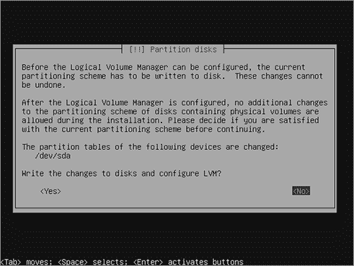

如果您选择了任一逻辑卷分区机制，将显示一个对话框，允许您指定最初分配给这些逻辑卷的磁盘空间。您可能不想最初将整个磁盘用于您的服务器安装，这将允许您此后在任何未使用的空间中创建其他逻辑卷，而无需减小用于服务器安装的卷的大小。

如果您现在不想将整个磁盘用于逻辑卷，请减少此对话框中显示的磁盘空间并按 `Return` 键继续；否则，直接按 `Return` 键继续。

如果您正在使用逻辑卷，将显示最终确认对话框，标识将使用的卷组名称以及将格式化以容纳它们的分区。如果您确定要使用这些值，按 `Tab` 键选择 `Yes` 并按 `Return` 接受这些值并继续；否则，在 `No` 值选中的情况下按 `Return` 返回主分区屏幕以修改您的分区选择。

### 11. 分区和基础软件包安装完成后，屏幕会显示图 3-10，提示你输入要在系统上创建的用户的全名。正如在第 4 章“基础 Linux 系统概念”中讨论的那样，Ubuntu 使用了一种特殊的权限方案，允许单个用户（默认情况下）具备在你的机器上执行管理任务的能力。你在此处输入的用户名将拥有这些管理权限，因此这几乎总是你的名字或与通用系统管理员相关的名称。对于服务器安装，通常最好使用像 `System Administrator` 这样的通用名称，这样你就不会将特定个人的姓名构建到所有的 Ubuntu 服务器中（毕竟，人们偶尔会换工作）。输入合适的全名并按 `Return` 继续。

Figure 3-10: 创建默认用户账户

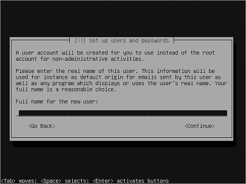

### 12. 屏幕显示图 3-11。你必须输入你在上一步中指定的用户的登录名。此屏幕最初会根据你在上一步中指定的全名显示一个建议的登录名。如果你想更改此内容，使用 `Backspace` 键删除默认建议并输入你想使用的登录名。要使用默认用户名或自定义用户名继续，请按 `Return` 继续。

Figure 3-11: 创建默认登录名

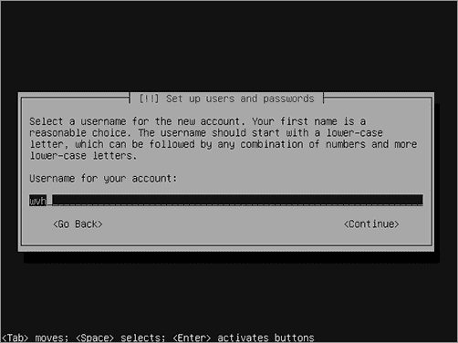

### 13. 屏幕显示图 3-12。为你正在创建的用户输入密码，请遵循良好的密码规则，例如使用包含大小写字母混合以及一个或多个数字的密码，不要使用配偶、孩子、你自己的姓名或生日，或者传统但已过时的管理密码，如 `god`、`qwerty` 或 `letmein`。按 `Return` 继续。

Figure 3-12: 指定密码

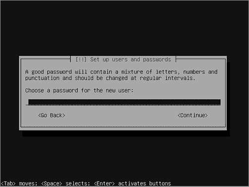

### 14. 第一次输入密码后，会显示第二个密码确认屏幕（参见图 3-13）。输入与上一个屏幕上相同的密码，并按 `Return` 继续。

Figure 3-13: 确认密码

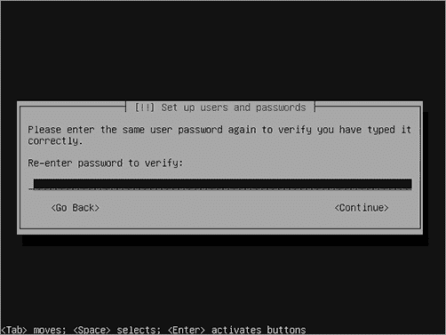

### 15. 显示图 3-14 中的对话框，询问你是否要为指定用户加密主目录。

Figure 3-14: 可选创建私有的加密卷

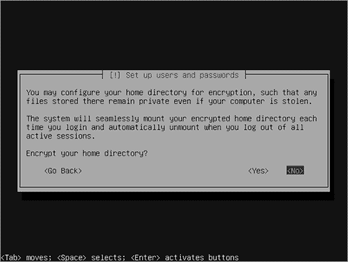

此选项在服务器安装上很少必要，因为系统在物理上应该是安全的，而且此选项的目的是防止管理账户被系统的其他用户访问（在服务器系统中不应该有其他用户）。要创建此安全文件卷，按两次 `Tab` 键 `Yes`，然后按 `Return`。若要跳过为指定用户创建加密主目录，请确保默认值 `No` 被选中，并按 `Return`。

### 16. 显示图 3-15 中的对话框，提示你为了访问互联网下载软件包而需要的任何 HTTP 代理的位置。如果你需要使用 HTTP 代理，请在此对话框中输入其 URL。如果你不需要使用 HTTP 代理，请留空此字段并按 `Return` 继续。

Figure 3-15: 识别可选的 HTTP 代理

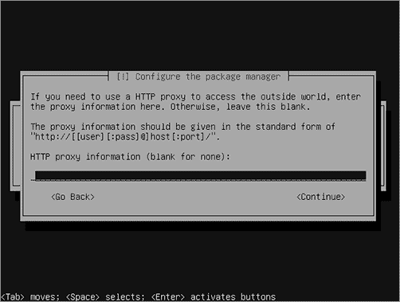

### 17. 安装程序根据你到目前为止的选择安装并配置几个软件包。接下来，显示图 3-16 中的对话框，允许你指定系统是否不自动下载更新、自动下载更新，或使用 `Landscape` 来管理系统（`Landscape` 是由 Canonical 提供的 Web 管理和监控系统）。我通常将此项设置为默认值 `No automatic updates`，因为确切知道运行什么比始终更新更重要。

Figure 3-16: 指定更新机制

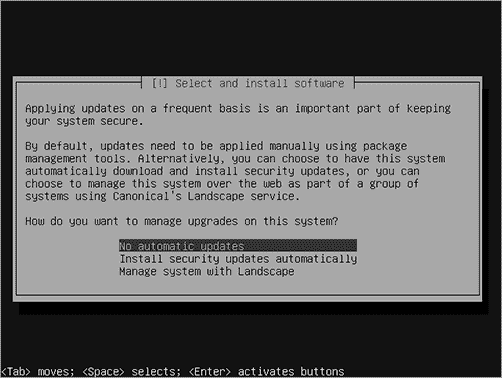

### 18. 显示图 3-17 中的对话框，允许你选择基础系统的一系列服务器软件包。

Figure 3-17: 选择安装软件

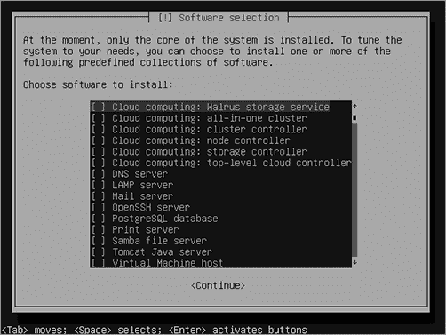

### 19. 此时，安装程序开始从光盘拷贝文件到硬盘，安装默认软件包以及你在图 3-17 对话框中选择的软件包，安装过程将显示任何配置所需的对话框。

### 20. 如果你在双引导系统中安装 Ubuntu Server（除非你在尝试 Ubuntu Server，否则绝对不建议这样做），在软件包安装完成后将显示图 3-18。Ubuntu 使用的 Linux 引导程序 `GRUB` 的默认安装位置是主硬盘的主引导记录。要将 `GRUB` 安装在此处，请按 `Return` 进入安装过程的下一步。

Figure 3-18: 双引导系统的 GRUB 引导位置屏幕

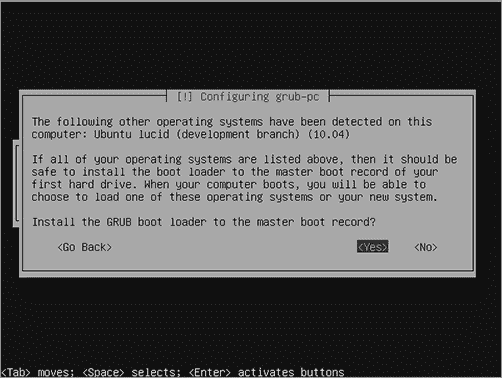

如果你想将 `GRUB` 安装在其他位置，使用 `Tab` 键选择 `No` 并按 `Return`。显示图 3-19 中的屏幕，可以在其中指定你想安装 `GRUB` 的位置。选择你想安装 `GRUB` 的位置，并按 `Return` 继续。

Figure 3-19: GRUB 引导程序安装屏幕

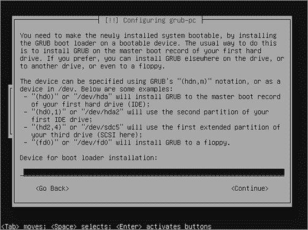

### 21. 如果你在双启动系统上安装 Ubuntu Server，会弹出一个对话框询问你的系统是否使用 UTC（协调世界时，以前称为格林尼治标准时间，一种基于英国格林尼治时间的时间标准）。另一种选项将其设置为本地时间。如果你看到此对话框，请选择“Yes”或“No”，并按 `Return` 键继续。此对话框在其他 Ubuntu 安装场景中也会出现——你可以在本章后面的图 3-39 中看到此对话框。

### 22. 在完成一些软件包配置后，将显示图 3-20 所示的屏幕。

一旦看到图 3-20 中的屏幕，请移除安装 CD 并按 `Return` 键重启电脑进入新安装的 Ubuntu Linux Server 系统！有关更多信息，请跳到本章后面的“首次启动你的服务器”部分。

图 3-20： 最后安装屏幕

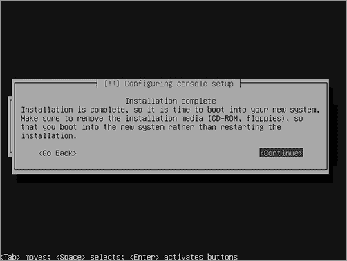

# 解决安装问题

在安装任何操作系统（包括 Ubuntu Linux）时遇到的大问题都是致命的。在成功安装 Ubuntu Linux 之前，必须解决从安装介质读取时遇到的问题、访问/分区和格式化系统硬盘以及与其他硬件相关的问题。然而，在安装 Ubuntu Linux 时，你可能会遇到两个常见且可以轻松修正的问题。第一个是自动网络配置问题；第二个是访问 Ubuntu 在线仓库以及正确配置 Ubuntu 软件更新系统的问题。

如果 Ubuntu 安装程序无法自动配置网络，你将看到一个屏幕，显示自动网络配置失败，并询问你是否想手动配置网络。如果发生这种情况，选择“Continue”（继续）或按 `Return` 键显示手动网络配置屏幕。

此屏幕允许你通过 DHCP 广播重试自动网络配置、通过查询特定主机重试 DHCP 自动网络配置、手动配置网络或完全跳过网络配置。在进行任何操作之前，请检查网络布线，确保你安装 Ubuntu 的机器已正确连接到网络，特别是当你的网络实际上在运行 DHCP 服务器时。

你可以选择任何可用选项，但我建议选择“Configure network manually”（手动配置网络）选项，为你的 Ubuntu Server 提供静态 IP 地址和相关的网络信息。根据我的经验，很少有服务器使用动态 IP 地址，因为这使得发生问题时远程连接它们变得更具挑战性，因为你无法确定知道它们的 IP 地址。

如果你选择“Configure network manually”（手动配置网络），安装程序将显示四个额外的网络配置屏幕，分别提示你输入服务器的 IP 地址、该 IP 地址的网络掩码、网络网关的 IP 地址以及网络上的名称服务器。（如果你想输入多个名称服务器，请用空格而不是逗号分隔。）一旦显示了这些屏幕，系统的网络接口即配置完成，你将返回安装程序。

在安装 Ubuntu Linux 时遇到的另一个常见问题是无法连接和验证所有默认的 Ubuntu Linux 仓库，这些仓库是互联网上为不同的 Ubuntu 版本提供新和更新的软件包的站点。如果在连接 Ubuntu 仓库时发生问题，安装过程中可能会显示有关此类失败的对话框，并且某些仓库可能会被临时禁用。

如果你看到类似这样的消息，你不必担心。这通常是瞬时的网络连接或负载问题。重启后，你需要取消在该对话框中识别出的任何仓库的注释。（这些问题大多数发生在连接安全仓库时。）要取消这些注释，请使用你喜欢的文本编辑器通过命令如 `sudo vi /etc/apt/sources.list` 执行。删除与指定仓库相关的行开头的井号，保存修改后的文件，并执行命令 `sudo apt-get update` 以验证是否可以成功连接新仓库。有关 Ubuntu 仓库和软件包管理工具的更多信息，请参阅第 19 章。

# 手动指定分区布局

手动指定系统分区布局可能很有用，但也很耗时且需要对 Linux 文件系统有一定的了解。手动对系统进行分区允许你将 Linux 文件系统中的特定目录放在自己的分区上，这可以提高性能，最小化系统备份的大小（因为备份通常是按文件系统或目录进行的），并简化未来的升级和系统重配置。

> 注意
>
> 默认情况下，Ubuntu 安装程序会自动为你创建一个合理的分区方案，这意味着它创建了一个大分区用于用户文件和系统文件，以及另一个较小的分区作为交换空间以支持你 Ubuntu 系统上的虚拟内存。本节描述了准图形化 Ubuntu 安装程序自动分区方案的替代方案。如果你是逐章阅读这本书，已经安装了系统，可以跳过本节。

如果你是第一次安装 Ubuntu 或对 Linux 不太熟悉，我建议让 Ubuntu 安装程序自动为你的磁盘进行分区。自动分区将让你更快地运行起来，而且不需要你理解 Linux 系统中各种目录的内容和用途。随着你对 Ubuntu 和 Linux 越来越熟悉，你以后可以随时将用户账户备份到另一台机器，然后使用手动分区重新安装 Ubuntu。

以下是 Linux 文件系统中经常放在单独分区的常见目录：

- `/`：Linux 文件系统的顶层。必须通过 `/` 目录始终可用分区，Linux 系统才能启动。
- `/boot`：存放 Linux 内核以及启动过程中使用的其他系统文件的目录。
- `/home`：存放用户文件和账户的目录。
- `/opt`：通常安装可选程序和相关文件的目录。
- `/tmp`：用于存放用户和系统进程创建的临时文件的目录。
- `/usr`：标准 Linux 系统使用的应用程序、系统文件和库的目录。在 Ubuntu 系统上，根据你选择安装的软件包，`/usr` 目录需要 1.25 GB 的磁盘空间。
- `/usr/local`：存放特定 Linux 系统使用的应用程序、系统文件和库的目录，但并非所有 Linux 系统都存在。

大多数不使用单个分区存放整个文件系统的 Linux 系统会为 `/`、`/boot` 和 `/home` 创建独立分区。有关这些目录以及 Linux 文件系统通用结构的的更多信息，请参阅第 4 章。

Linux 分区可以分为两大类：交换分区（swap partitions），系统内部用于支持虚拟内存；以及数据分区（data partitions），文件和其他目录都位于其中。Linux 系统必须至少有一个交换区域才能正常运行——这通常是一个专用的分区，尽管在迫无无奈的情况下，你也可以对文件系统中的一个文件进行交换。（有关分区和虚拟内存的更多信息，请参阅第 4 章。）在本节中，你将创建几个基础数据分区和一个单一交换分区，以说明手动分区——你实际上决定如何对系统进行分区取决于你自己。

## 手动对磁盘进行分区

手动对磁盘分区涉及以下步骤：

1. 在图 3-8 所示的屏幕上，选择 `Manual`（手动）选项。将显示图 3-21 所示的屏幕。
2. 使用方向键选择你想要分区的磁盘驱动器可用空间池，然后按 `Return` 继续。将显示图 3-22 所示的屏幕。

图 3-21: 手动分区磁盘的屏幕

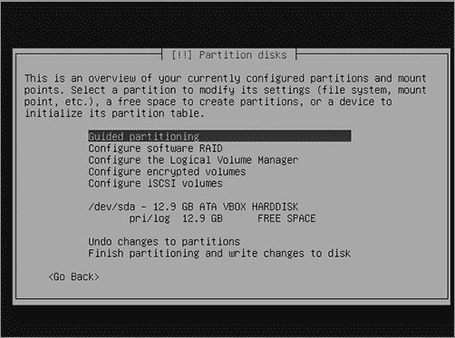

图 3-22: 开始定义新分区

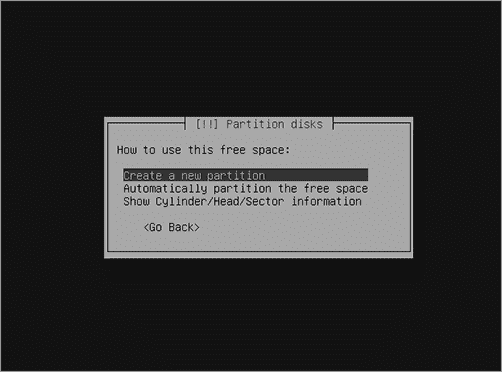

3. 选择“Create a new partition”（创建新分区）项，并按 `Return` 继续。将显示图 3-23 所示的屏幕。

图 3-23: 指定新分区的的大小

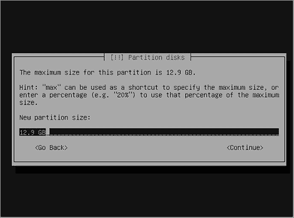

4. 输入你希望新分区具有的大小。未分配磁盘空间量将作为默认值显示。你可以以绝对值指定新分区的指定，例如 `100 MB`；以可用空间的百分比指定大小，例如 `10 percent`；或者使用 `max` 关键字根据现有空闲空间创建最大尺寸的分区。输入此值后，按 `Return` 继续。将显示图 3-24 所示的屏幕。

5. 选择你想要创建的分区类型。磁盘最多可以包含四个物理分区——超过此数量的任何分区必须是逻辑分区。逻辑分区可以包含其他分区，而物理分区仅仅是——你磁盘驱动器的物理部分，无法进一步细分。除非你计划创建四个以上的分区，否则使用方向键确保选中了物理项，并按 `Return` 继续。将显示图 3-25 所示的屏幕。

图 3-24: 指定新分区的类型

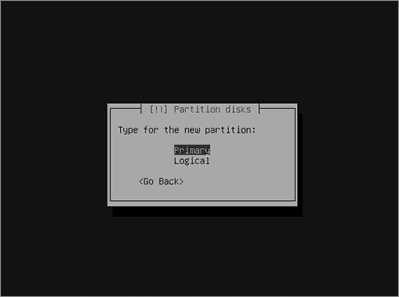

图 3-25: 指定新分区的的位置

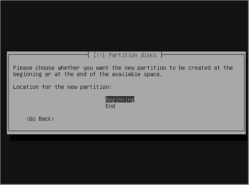

6. 除非你有特定理由将新分区置于磁盘的特殊部分，否则接受默认值 `Beginning`（起始）并按 `Return` 继续。将显示图 3-26 所示的屏幕。

图 3-26: 指定新分区的类型和挂载点

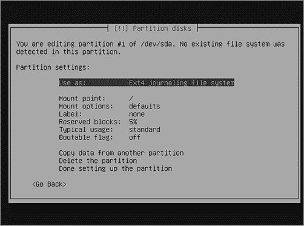

7. 此屏幕上高亮的项允许你指定正在创建的分区上使用的文件系统类型，这本质上是你在创建的分区上组织和管理数据的方式。Linux 系统支持许多不同的文件系统，每种文件系统都有某些特性，在第 4 章中有更详细的解释。在本例中，我们将创建一个挂载在 `/boot` 的分区，这是一个数据分区，且 Linux `ext4` 文件系统是数据分区的默认（也是最流行的）格式。除非你有特定理由，否则你不应更改默认值。


然而，如果你想指定另一种文件系统类型，按 `Return`。将显示图 3-27 所示的屏幕，显示可用文件系统类型列表。选择你想要使用的文件系统类型后，按 `Return` 继续。将再次显示图 3-26 所示的屏幕。

8. 分区的挂载点（mountpoint）是系统通过其可以使用该分区内容的目录。（有关 Linux 目录和挂载点的更多信息，请参阅第 4 章。）在本节的开头给出了常见分区及关联挂载点的列表。Linux 系统上唯一强制的文件系统和关联挂载点是 `/`，即 Linux 文件系统的根目录，它在图 3-26 所示的屏幕上显示为默认值。使用方向键选择 `Mount Point`（挂载点）菜单项，并按 `Return` 继续。显示图 3-28 所示的屏幕。

图 3-27: 指定分区类型

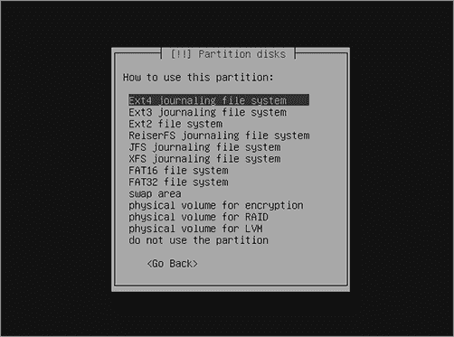

图 3-28: 指定新分区的挂载点

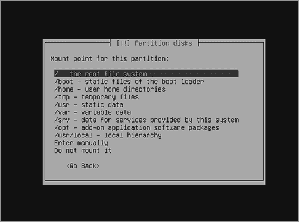

在本例中，你把新分区挂载到 `/boot`，这是存放 Linux 内核和系统文件的目录。使用方向键选择 `/boot` 项，并按 `Return` 继续。再次显示图 3-26 所示的屏幕。

9. 使用方向键向下滚动并选择`Done setting up the partition`（完成分区）选项。再次显示类似于图 3-21 所示的屏幕，显示你刚刚定义的分区以及磁盘的剩余空间。图 3-29 显示此屏幕的更新版本。

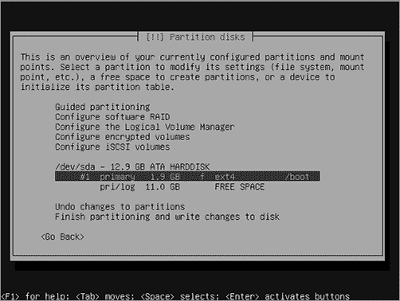

10. 重复步骤 2 到 9 以创建其他分区。如前节所述，经常在独立分区上创建的文件系统有 `/boot`（本例中使用）、`/`、`/home` 和交换分区。创建任何其他文件分区完全遵循之前描述的过程。要创建交换分区，请按照创建其他分区的相同过程，但在图 3-27 所示的屏幕上选择`swap area`（交换区域）项。交换分区的大小应与计算机系统的内存大致相同。

**注意**：如果你计划创建四个以上的分区，你创建的第四个分区必须是扩展分区，你可以在其中创建你想要使用的其他分区。

**提示**：为了帮助避免遇到安装问题，你可能希望确保挂载在 `/` 的分区大小至少为 3 GB。遵循此规则，除非你定义的其他如 `/usr` 等分区空间不足以容纳作为挂载点时安装的文件，否则你的 Ubuntu 系统将能够正确安装。

11. 一旦你将系统上所有可空闲空间分配给分区，你的屏幕应该看起来像图 3-30 所示所示。此屏幕显示了你为系统使用而定义的分区摘要。请记住，必须有一个挂载在 `/` 上的分区和一个交换分区（swap partition）。要接受屏幕上显示的值，请使用方向键选择“完成分区并将更改写入磁盘”选项，并按 `Return` 显示图 3-31 中所示的屏幕。

图 3-30: 分区摘要屏幕

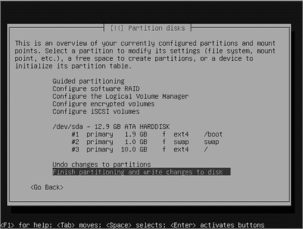

图 3-31: 最终分区确认屏幕

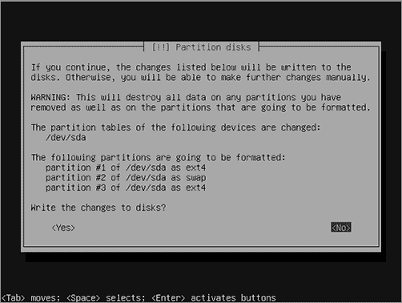

12. 由于磁盘分区无法撤销，图 3-31 所示的屏幕会要求对你的手动分区选择进行最终确认。要接受这些值并继续安装过程，请使用 `Tab` 键选择“是”，并按 `Return` 继续。

现在你可以返回上一节中 Ubuntu Server 安装过程的第 11 步。恭喜你——你现在至少是一个正在训练中的 Linux 魔法师了！

## 首次启动你的服务器

一旦服务器安装过程完成，将显示图 3-20 所示的屏幕。取出安装光盘并按 `Return` 重启系统，进入你新安装的 Ubuntu Linux Server！

### 注意

Ubuntu 的启动过程取决于你是将 Ubuntu 安装为双系统，还是作为计算机上的唯一操作系统。虽然你不太会在双系统上安装 Ubuntu Server，但如果是如此，请参阅第 2 章“安装 Ubuntu”中名为“在双系统上启动 Ubuntu”的章节获取更多信息。♦

当 Ubuntu 启动时，你将看到屏幕上显示许多文本信息，因为它正在探测并初始化你的硬件以及相关的系统软件。启动过程完成后，你将看到类似图 3-32 所示的命令行登录界面。你现在可以使用安装过程中定义的用户名和密码进行登录。

图 3-32: Ubuntu Server 登录屏幕


恭喜你——你正在运行 Ubuntu Linux Server！关于 Linux 的更多基础信息，请参阅第 4 章。根据你安装的服务器应用程序，请参阅本书的后续章节，获取有关配置和微调特定服务器应用程序以满足你的计算环境需求的信息。

### 安装 Ubuntu 企业云

云计算是今天最受欢迎的计算模型之一，因为它利用网络连接的力量创建了强大且灵活的存储、处理和软件执行基础设施。云安装通常会根据管理人员和用户的请求（通过虚拟机）提供虚拟化的存储和计算。云计算传统上被视为一种由各种互联网软件和基础设施供应商支持的按需付费模型，但它也可以在本地网络环境中安装和支持，从而在不依赖第三方供应商的情况下提供相同的功能。Ubuntu Server 安装光盘上支持的 Ubuntu 企业云 (UEC) 安装得益于 Eucalyptus（一个开源云计算软件包），它能让你能够在自己的系统上设置和配置云计算环境。

云计算是一个值得投入的话题，并且已经有许多书籍专门介绍其概念和配置。本节重点强调了安装传统的 Ubuntu Server 和 UEC 之间的区别，但没有对基于 Eucalyptus 的云的所有组件进行详细讨论。本节末尾提供了更多详细信息（包括用户和管理员指南）的链接。

最小的 Eucalyptus 云安装通常至少涉及两个系统：一个前端系统，运行与云相关的服务器进程，如云控制器、集群控制器、基于网络的存储服务管理器（称为 `Walrus`）以及存储控制器；另一个系统运行节点控制器，作为云中的节点并交付虚拟机实例。

作为一种在整个计算环境中提供云服务和虚拟机实例的服务器安装，UEC 安装的建议要求远大于标准 Ubuntu Server。建议如下：

*   前端系统：多核或多个频率为 1.7 GHz 或更高的处理器，2 GB 或更多系统内存，200 GB 或更多磁盘空间（取决于你将支持的虚拟机镜像数量），千兆太网

*   节点：64 位、具有硬件虚拟化支持（Intel VT 或 AMD-V）的多核处理器，4 GB 或更多系统内存，100 GB 或更多磁盘空间（取决于每个节点上将运行的虚拟机镜像数量），千兆以太网

Ubuntu 企业云的安装过程与标准 Ubuntu Server 非常相似，但某些特定用于配置 Eucalyptus 的屏幕除外。安装 Ubuntu 企业云时，在图 3-6 所示的屏幕之后会显示以下屏幕，该屏幕提示服务器名称：

1. 图 3-33 显示初始云安装模式对话框，提示运行 Eucalyptus 软件包的系统网络地址。该系统协调单个 Eucalyptus 云的所有系统之间的活动。如果这是你第一次安装 Ubuntu 企业云（且你尚未在环境中运行 Eucalyptus），你将没有现有的云控制器，你应该留空地址字段（这意味着你正在安装的系统将作为云控制器）。如果你在环境中已经有一个作为云控制器的系统，请输入其 IP 地址。按 `Return` 继续。

图 3-33: 识别现有的云控制器


2. 如果你在图 3-33 所示的屏幕中未指定云控制器的 IP 地址，则会显示图 3-34 所示的第二个云安装模式对话框——换句话说，如果你正在安装一个将作为云控制器的 UEC 系统。正如本节早些提到的，最小云安装至少需要两个系统，因此如果你没有指定作为云控制器的现有系统，此屏幕将识别云控制器上应该运行的进程。如果你指定了云控制器系统的 IP 地址，显示的屏幕与图 3-34 所示的屏幕非常相似，只是高亮了节点控制器条目。

在此处，正常的服务器安装过程继续，屏幕如图 3-7 所示，这在“安装 Ubuntu 服务器”章节中已经讨论过。Ubuntu 企业云（Ubuntu Enterprise Cloud）剩余部分与标准 Ubuntu 服务器安装过程之间的唯一显著区别如下：

*   在 Ubuntu 企业云的安装中，云控制器系统会自动安装 `Postfix` 邮件服务器。因此，安装过程将显示标准的 `Postfix` 配置对话框，这些对话框将在第 30 章“设置邮件服务器”中讨论。

*   显示图 3-35 所示对话框，提示你输入正在安装的 Ubuntu 企业云的名称。为云输入一个逻辑名称，然后按 `Return` 继续。

*   显示图 3-36 所示对话框，提示你输入一个 IP 地址池，该地址池可作为在云中创建并提供的虚拟机的公网 IP 地址。输入一个未被使用或通过你计算环境中的 `DHCP` 服务器可用的 IP 地址范围，然后按 `Return` 继续。

图 3-35: 指定你的 Ubuntu 企业云名称


图 3-36: 为你 Ubuntu 企业云中的虚拟机指定 IP 地址


有关关于 Ubuntu 企业云的通用信息以及与第三方云计算环境的比较，请参阅 [www.ubuntu.com/cloud](http://www.ubuntu.com/cloud)。有关 `UEC`、`Eucalyptus` 云的拓扑结构和配置以及控制基于 `Eucalyptus` 云行为的过程的更多详细信息，请参阅 [`help.ubuntu.com/community/UEC`](https://help.ubuntu.com/community/UEC)。关于 `Eucalyptus` 的特定信息，请参阅 [www.eucalyptus.com](http://www.eucalyptus.com)（`Eucalyptus` 的商业部门）或 [`open.eucalyptus.com`](http://open.eucalyptus.com)（`Eucalyptus` 开源网站，可以在那里找到包括管理员和用户指南在内的大量文档）。

## 备用安装 CD 安装选项

图 3-37 显示了从 Ubuntu 备用安装 CD 启动系统时的菜单。

图 3-37: Ubuntu 备用安装 CD 启动菜单


备用安装 CD 启动菜单上的选项如下：

*   `Install Ubuntu`：使用准图形化安装程序将基础 Ubuntu 桌面系统安装到你的硬盘上。使用此安装程序安装 Ubuntu 桌面系统与在本章较早详细讨论的安装 Ubuntu 服务器系统非常相似。使用标准安装程序和准图形化安装程序安装 Ubuntu 桌面系统的差异将在下一节“在文本模式下安装桌面系统”中讨论。

*   `Check disc for defects`：测试当前插入系统的 CD 或 DVD 的完整性并验证其内容。

*   `Test memory`：执行多次内存测试以验证你的系统内存和相关缓存。你可以按字母 `c` 显示配置菜单，允许你运行或重新运行特定测试。完成系统内存测试后，按 `Esc` 重启系统并返回备用安装 CD 启动菜单。

*   `Boot from first hard disk`：跳过从备用安装 CD 启动，直接从你的系统硬盘启动。如果你在不打算在某台系统上安装 Ubuntu 或执行可用的系统测试时，不小心将备用安装 CD 留在了该系统的光驱驱动器中，请使用此选项。

*   `Rescue a broken system`：提示输入少量信息，例如希望显示消息的语言和地理位置，然后启动一个从 CD 运行的无盘版 `Linux`，你可以用它修复损坏的磁盘、纠正或重新安装你的 `GRUB` 引导加载程序的配置等。

> **提示**
>
> 如果你在进入救援（Rescue）模式时遇到问题，从书中附的 Ubuntu 桌面 CD 启动提供了与救援模式安装相同的功能，但具有更快速的图形界面。♦

备用安装 CD 实际上还有额外的安装选项，可以通过按 `F4` 显示，这将显示图 3-38 所示的弹出菜单。这些选项如下：

*   `Normal`：使用准图形化安装程序安装标准桌面系统。

*   `OEM Install (for manufacturers)`：使用 Ubuntu 的准图形化安装程序将 Ubuntu 桌面系统安装到你的硬盘上。与标准安装不同，`OEM` 模式定义了一个 `OEM` 用户，你可以用它来自定义系统以便分发给终端用户。自定义完成后，OEM 运行简单命令移除 OEM 用户并定义标准的 Ubuntu 用户。安装 OEM 系统将在“以 OEM 模式安装”章节中讨论。

*   `Install a command-line system`：使用准图形化安装程序将基础 Ubuntu 系统安装到你的硬盘上。安装的系统没有图形功能（如果需要，以后可以添加）。使用此安装程序安装命令行系统将在在本章稍后详细讨论，在“安装命令行系统”章节中。

*   `Install an LTSP server`：仅适用于 Ubuntu 备用安装 CD，此选项安装 Linux 终端项目（LTSP）服务器系统以及一组供服务器客户端使用的应用程序。使用此安装程序安装 LTSP 服务器将在在本章稍后详细讨论，在“安装 LTSP 服务器”章节中。

要继续，请选择这些选项之一，或直接按 `Return` 保持 `Normal` 选项选中。图 3-38 所示屏幕再次显示。确保选中 `Install Ubuntu`，按 `Return` 继续安装过程。

图 3-38: Ubuntu 备用安装 CD 的安装选项


## 在文本模式下安装桌面系统

在 Ubuntu 备用安装 CD 的启动菜单中选择 `Install Ubuntu` 可以让你使用文本模式安装程序安装 Ubuntu 桌面系统。此菜单选项在各种情况下都有用，例如：

*   由于图形硬件冲突或问题，你无法让系统中启动相应的桌面 CD。

*   你想安装 Ubuntu 桌面系统，但使用逻辑卷而不是物理分区来存放你的文件系统。

*   你想安装 Ubuntu 桌面系统，但希望将 `GRUB` 安装在主硬盘引导记录以外的位置。

与其他的类图形 Ubuntu 安装程序一样，文本模式的桌面安装（Desktop install）遵循本章早些“安装 Ubuntu 服务器”章节中讨论的系列提示和步骤。从备用安装光盘（Alternate Install CD）安装桌面系统，与服务器安装相比，只是向你的系统中安装了一组稍多一点软件包。这组扩展的软件包等同于从标准桌面光盘安装的包，因此包含了 GNOME 桌面、X 窗口系统、图形化工具等。

文本模式桌面安装与之前讨论的服务器安装过程之间的唯一区别发生在安装过程的最后阶段：在弹出光盘并建议你重启系统之前，桌面安装程序会提示你提供有关是否希望将系统时钟设置为协调世界时（`UTC`）或本地时间的信息。此界面见图 3-39。

### 注意

协调世界时，或称通用协调时间（`UTC`），是格林尼治标准时间，即英国伦敦格林尼治皇家天文台的时间；本地时间是你是你物理所在的实际时间。♦

图 3-39: 指定系统时钟设置


当你看到此界面时，按 `Return` 使用 `UTC`，或按 `Tab` 然后按 `Return` 使用本地时间并继续安装过程。此界面之后，标准安装程序将继续，最终弹出光盘并提示你重启进入新的、图形化的 Ubuntu 桌面系统。

### 以 OEM 模式安装

从备用安装光盘的模式（Modes）菜单（见图 3-38）中选择“为制造商进行 OEM 安装（OEM install for manufacturers）”，可以允许你使用文本模式安装程序安装 Ubuntu 桌面系统，但使用临时特权用户（`OEM`）安装系统。这使得 OEM 厂商能够使用该特权用户对系统进行额外配置，安装自定义软件、安装额外的包并根据需要删除包，然后将系统分发给他们的客户。在完成配置后，为了将此系统转换为具有客户特定特权用户的标准 Ubuntu 桌面安装，OEM 应执行 `sudo oem-prepare` 命令，该命令将删除 `OEM` 用户，并在下次系统启动时提示客户输入客户特定的用户和其他其他配置问题。

在整个 OEM 安装过程中，屏幕左上角的横幅会标识你正在进行 OEM 模式安装。与其他类图形安装程序一样，类图形 OEM 安装程序遵循了与本章早些在“文本模式下安装桌面系统”章节中讨论的非常相同的系列提示和步骤。由于 OEM 系统是使用特定的特权用户（`OEM`）安装的，因此安装过程不会提示你输入用户名和登录信息，而仅提示输入 `OEM` 用户的密码。随后，OEM 模式安装程序将继续进行标准的文本模式安装和配置过程。

在最后的安装摘要界面出现之前，OEM 模式安装程序会显示一个总结如何使用 OEM 模式的界面，见图 3-40。

图 3-40: OEM 模式过程总结


此界面之后，标准安装程序继续，最终弹出光盘并提示你重启进入新的图形化 Ubuntu OEM 模式系统，在分发给 OEM 客户之前完成其配置。

### 安装命令行系统

从备用安装光盘的模式（Modes）菜单中选择“安装命令行系统（Install a command-line system）”（见图 3-38），允许你安装不包含任何图形或 X 窗口系统应用程序所需包的 Ubuntu 桌面系统。这提供了一个占用空间小的安装，随后可以在其中添加任何你感兴趣的图形化包。此安装选项为创建一个小型、高度自定义且高度个性化的基于 Ubuntu 的系统提供了极佳的起点。从备用安装光盘安装命令行 Ubuntu 桌面系统的安装过程与本章“文本模式下安装桌面系统”章节中描述的文本模式安装标准 Ubuntu 桌面系统完全相同，仅是安装的包较少。

### 安装 LTSP 服务器


Linux 终端服务器项目（`LTSP`；[www.ltsp.org](http://www.ltsp.org)）是近年来最卓越的 Linux 开发工作之一。`LTSP` 允许你配置系统作为大量轻量级 Linux 客户端的中央服务器，类似于 Microsoft Windows Terminal Server，但价格不同。正如你预期的，Windows Terminal Server 及其相关的每个客户端访问许可证（CALs）费用昂贵，而 `LTSP` 服务器和任何数量的客户端都是免费的。`LTSP` 在学校、图书馆以及任何需要极大计算能力但预算极其有限的机构中非常流行。

从 Ubuntu 备用安装光盘的选项菜单中选择“安装 LTSP 服务器（Install an LTSP Server）”，允许你安装一个内置所有 `LTSP` 软件的 Ubuntu 桌面系统。

有关 `LTSP` 的更多信息，请参阅：

* [www.ltsp.org](http://www.ltsp.org)：`LTSP` 项目主页。
* [sourceforge.net/apps/mediawiki/ltsp/index.php?title=Documentation](http://sourceforge.net/apps/mediawiki/ltsp/index.php?title=Documentation)：`LTSP` 最新版本的文档。
* [en.wikipedia.org/wiki/Linux_Terminal_Server_Project](https://en.wikipedia.org/wiki/Linux_Terminal_Server_Project)：维基百科上的 `LTSP` 概述。
* [k12ltsp.org/mediawiki/index.php/Main_Page](http://k12ltsp.org/mediawiki/index.php/Main_Page)：教育 2 项目的主页，这是一个优秀的 `LTSP` 实现，遗憾的是选择了 CentOS 而非 Ubuntu 作为基础。

### 总结

本章涵盖了大量内容，解释了通过各种安装配置成功将 Ubuntu 作为服务器操作系统安装在现有机器上，或作为系统的唯一操作系统所需的基本概念。无论你安装或使用的是哪种系统，到本章结束时，你的系统上已经安装并运行了 Ubuntu。

第 4 章讨论了对于首次使用 Linux 或类 Unix 系统的人可能是新的 Linux 基本概念。第 5 章和第 6 章分别讨论了在使用标准图形界面（GNOME）和窗口管理器（Compiz）使用 Ubuntu 的基础。

# 第二部分：面向桌面用户的 Ubuntu

本部分

第 4 章：Linux 系统基本概念

第 5 章：使用 GNOME 桌面

第 6 章：使用 Compiz 窗口管理器

第 7 章：使用 Evolution 管理电子邮件和个人信息

第 8 章：使用 Firefox 浏览

第 9 章：从 Windows 系统迁移

第 10 章：发送和接收即时消息

第 11 章：使用命令行工具

第 12 章：处理文本文件

第 13 章：创建和发布文档

第 14 章：其他办公软件：电子表格和演示文稿

第 15 章：处理图形

## 第 16 章：处理多媒体

## 第 17 章：你想玩游戏吗？

## 第 18 章：消费电子与 Ubuntu

## 第 19 章：添加、删除和更新软件

## 第 20 章：添加硬件和连接外设

## 第 21 章：网络配置与安全

# 第 22 章：无线连接

## 第 23 章：在 Ubuntu 上进行开发

# 第 24 章：使用虚拟机和仿真器

# 第 25 章：连接其他系统

## 第 26 章：文件传输与共享

## 第 4 章：基础 Linux 系统概念

## 本章介绍

* 理解文件和目录
* 理解磁盘和分区
* 理解逻辑卷
* 理解 Linux 文件系统
* 介绍用户和组
* 理解 Ubuntu 系统上的特权操作

本章解释了基础 Linux 系统概念，重点介绍数据在所有 Linux 系统中如何存储和组织，以及 Linux 操作系统如何控制对这些数据的访问以及对特权的操作。除了关于 Ubuntu 如何处理和授予高级权限的特定章节外，本章的信息适用于任何 Linux 系统以及大多数其他类 Unix 系统。

在本章中，我采取了谨慎的态度。虽然现在听起来可能不可思议，但在决定在大学学习计算机科学之前，我从未用过计算机。（在某种程度上我可以被原谅，因为那是万年前的事了，当时个人电脑刚刚流行，而且远在 DOS、Microsoft Windows、Apple Macintosh 等出现之前。）无论如何，我记得坐在第一节计算机科学课上，听教授说“一旦你写完程序，就把它保存为文件”之类，并在心里想：“他到底在说什么呢？”

因此，本章包含了一些章节，例如“处理文件和目录”，你可能会觉得其内容过于简单以及对“每个人都知道”的基础概念进行探索而感到被冒犯，这对我来说没关系。所有了解这些内容的人都可以跳过，但那些刚从当地电子商店或从热心的朋友、亲戚那里买到 Ubuntu Linux 电脑机的人，可以悄悄地阅读这些章节，并想：“噢，我懂了！”，我们大家都会更开心。

### 处理文件和目录

文件无非是程序和你的操作系统可以定位并作为单一单元进行处理的信息集合。文件是某种数据的容器，无论它们包含的是写给母亲或假释委员会的信、一张你最喜欢的歌曲的副本（当然是合法的）、一张数字照片，还是电子表格用于计算个人财务状况的数据。提供文件作为相关数据容器的通用概念，使得应用程序和 Linux 能够轻松地定位和使用这些信息——这就是为什么今天大多数图形应用程序中都存在“文件”菜单。该菜单包含了你用于打开现有文件、创建新文件以及对你正在处理的任何文件保存已做更改的命令。

在计算机系统中，文件是必不可少的——操作系统必须有一种方法来识别和访问你的数据、它运行所需的应用程序、这些应用程序使用的任何配置文件等。同样，当你开启电脑时，你的计算机系统需要知道如何找到操作系统以及启动所需的相关配置信息。然而，随着所需的文件越来越多、用途越来越广泛，并且由不同的用户创建，用户没过多久，就开始寻找一种组织文件的中间机制，这导致了目录的引入。目录简单来说就是一组相关文件的容器，它们也可以包含目录（或子目录）。这就是所谓的文件的分级集合——任何特定文件的位置都是通过识别最终包含你所查找文件的系列目录来描述的。在 Linux 系统上，所有搜索都开始的目录被称为根目录，因为它是描述如何导航到存储本地（即存储在你的计算机上）的任何文件的起点。

文件和目录的标准类比是文件柜——你可以按照这样的过程在文件柜中找到任何文件：从文件柜开始，打开第一个抽屉，打开标记为“人员”的悬挂文件，选择写有你名字的麦纸文件夹，并检查你的医疗保险表。在计算机上，寻找类似文件位置的过程可能是这样的：进入文件系统的根目录（`/`），进入主目录，进入 `wvh` 目录（我的登录名），寻找名为 `health_enrollment.txt` 的文件。

Linux 系统使用 `/` 字符既作为系统顶层目录的名字，也用于分隔文件和目录名称，因此这通常简单地表示为：“获取文件 `/home/wvh/health_enrollment.txt`”。通往给定文件的目录序列通常被称为该文件的路径。

提供图形用户界面的 Linux 系统（如 GNOME）提供了图形化的方式来导航目录，通常是通过点击它们来打开它们，并打开一个显示与其包含的文件对应的图形图标的窗口。正如第 11 章“使用命令行工具”中更详细解释的那样，任何 Linux 命令行环境都使用一个名为 `cd`（代表“更改目录”）的命令来导航于一系列目录。你可以一次切换到系列目录（路径）中的每个目录，你也可以简单地 `cd` 到一个特定的目标目录。换句话说，以下两个命令序列是等价的：

```
cd /
cd home
cd wvh
```

和

```
cd /home/wvh
```

Linux 系统还提供了各种工具来列出目录内容并提供有关特定文件和目录的详细信息。我在第 11 章中详细解释了这些内容。现在，我将重点描述 Linux 系统内部是如何组织的。

## 标准 Linux 目录

所有 Linux 系统都提供一组标准的内核目录。以下目录用于存放在你启动 Linux 系统时必须运行的程序、这些程序的配置文件、这些程序使用的库、运行程序创建的临时文件等：

* `/`：作为 Linux 系统的顶层目录，此目录必须存在，以便其他目录可以在其中被定位。
* `/bin`：存放 Linux 系统所使用的核心应用程序的目录。
* `/dev`：存放特殊文件（称为设备节点）的目录，用于访问连接到你的 Linux 系统的任何设备。
* `/etc`：存放系统配置信息的目录，包含解释 Linux 系统作为启动过程一部分执行的应用程序顺序的文件，并存储了 Linux 系统执行的某些应用程序的配置文件。
* `/lib`：存放可以被其他应用程序调用的函数库目录。
* `/proc`：Linux 内核在其中跟踪活动进程和通用状态信息的目录。
* `/sbin`：包含通常仅由超级用户执行的程序的目录。
* `/sys`：Linux 内核在其中跟踪系统硬件状态及相关硬件接口的目录。
* `/tmp`：存放运行系统中各种应用程序创建的临时文件的目录。

无论发行版的类型或其使用的磁盘大小，你都可以在大多数 Linux 系统上找到这些标准目录。

Linux 中的其他常见目录

取决于你在系统中安装的文件数量以及其布局，你可能会在任何 Linux 系统上发现几个其他目录。Linux 系统上其他一些常用的目录如下：

* `/home`：一个包含不同用户存储其文件的子目录的目录。例如，用户 `wvh` 拥有的大部分（如果全部）文件都存储在 `/home/wvh` 目录（或该目录的子目录）中。个人用户用于存储个人文件的目录称为他们的“家目录”（home directories）——这个名称导致了用户目录被存储在 `/home` 中，而不是相反。在较旧的 UNIX 和类 UNIX 系统中，用户的家目录存储在 `/usr` 下（读作“slash user”），但现在创建在 `/home` 下，以简化系统升级。
* `/opt`：通常用于安装第三方软件的目录。该目录的名称源于它包含“可选的”（即非系统的）软件的这一理念，这些软件在不同的机器上可能有所不同。
* `/usr`：一个层次结构，包含了普通用户在使用 Linux 系统时旨在使用的文件。`/usr/bin` 目录包含用户可能需要执行的应用程序，`/usr/lib` 包含这些程序使用的库，以此类推。
* `/var`：一个包含其他可变内容的目录。例如，`/var/log` 目录包含系统应用程序和事件的日志文件。这些日志文件在系统运行时创建，并随着时间的推移可能会变得很大。

正如你所看到的，Linux 系统提供了一个大型的分层文件和目录集合，其组织旨在简化定位某些类型的文件，例如可执行文件、库、配置文件、系统状态信息等。现在，让我们看看 Linux 如何使用各种类型的存储设备来存储和交付这些信息。

### 提示

本节列出的目录在大多数 Linux 系统都是相当标准的，但它们的具体内容根据发行版的不同略有差异。Linux 标准基础（LSB）项目的形成目标是使跨 Linux 发行版的目录及其内容标准化。有关该项目的更多信息，请参阅 LSB 网站 [www.linuxbase.org](http://www.linuxbase.org)。♦

# Linux 文件系统简介

上一节讨论的目录为 Linux 系统启动、运行标准应用程序等所需的文件和目录提供了一种标准的组织方式。你会注意到，所有这些目录的路径都以 `/` 符号开头。这并不意味着它们都位于同一个硬盘或其他存储设备上。与 Windows 系统使用唯一的驱动器器（如 `C:`、`D:` 等）来引用不同的磁盘驱动器或磁盘分区，或 Mac OS X 系统将不同的磁盘驱动器或磁盘分区表示桌面上的不同卷不同，Linux 系统为其可以访问的所有存储设备和分区提供了所谓的“单一命名空间”（single namespace）。

本节讨论了 Linux 系统如何管理和访问磁盘、什么是磁盘分区，以及磁盘分区如何集成到你在 Linux 系统上访问的目录层次结构中。Linux 机器上的文件和目录层次结构通常被称为 Linux 文件系统，尽管正如我在接下来的几节中将讨论的那样，文件系统一词也用于指数据在特定磁盘分区上的组织方式。本节还引入了逻辑卷（logical volumes），它提供了一种比简单使用磁盘分区更灵活的磁盘存储分配和使用机制，但它们通常仅用于服务器系统或其他具有巨大存储需求的系统。

## 磁盘、分区和挂载点

任何计算机系统的核心都是存储、检索、操纵和保存信息。作为一名作家和计算机系统管理员，当那些通常很懂电脑的朋友对我说“你的笔记本太慢了，你为什么不升级呢？”时，我总是感到惊讶。坦率地说，如果我的打字速度能比我主笔记本的 1.4 GHz Pentium 处理器处理的速度还要快，我就会去为“真假奇闻”广告做模特，或者跟着马戏团巡演，而不是写书。另一方面，如果保存我正在写的章节需要五分钟时间，或者我永远无法在不删除其他东西的情况下找到保存修改后文件的空间，我会毫不地把现在的笔记本踢进河里，买一个今天最先进、最亮、最闪光的支持 Linux 的笔记本。对于我的工作来说，能够可靠且快速地读写数据比极快的 CPU 速度重要得多。

每个计算机系统都包括某种存储设备，如硬盘、SSD（固态硬盘）、DVD 和 CD 驱动器、CompactFlash 卡等，它们存储了操作系统和你的应用程序，并提供了一些你可以用来存储所创建的文件和目录的空间。我最喜欢的技术写作片段之一是 20 世纪 80 年代中期随惠普的一个 UNIX (HP-UX) 工作站发送的说明书中的这段话：

“在一个空白的磁盘上，你可以永远寻找下去。”

在极客术中，这意味着如果不对用于存储数据的设备进行某种组织，你的操作系统将不知道该去哪里寻找特定的文件、目录或其他任何东西。要在磁盘上存储数据并在以后访问这些数据，必须以某种方式准备磁盘，以便你的操作系统和相关程序可以读取、写入并交互。这种准备通常包括两个步骤：

1. 将磁盘划分为一个或多个可以被操作系统唯一定位的部分。磁盘的每个部分被称为 `partition`（分区）。
2. 格式化分区，即创建文件系统，使得你的操作系统可以访问每个分区并在其中创建文件和目录。

磁盘驱动器进行分区有几个原因：

* 减少在磁盘上定位特定数据的时间。在较小的信息池中寻找特定数据所需的时间（以及所需的定位信息）简单来说更短。
* 限制当磁盘或分区损坏时可能丢失或损坏的数据量。
* 加速管理操作，例如碎片整理、一致性检查和修复（需要时）。
* 简化管理操作，例如备份。备份能够装入单条磁带或其他备份介质的分区要简单，因为不需要操作员干预（例如更换磁带）。多个分区还允许你将系统文件和应用程序安装在与用户数据不同的分区上。这样你就可以相对频繁地备份包含用户数据的分区，而不会意外地备份大量相对不变的可执行文件、系统文件等。

正如上一节提到的，“文件系统”一词通常口语化地指代组成 Linux 系统的整个文件和目录层次结构。在本节中，我使用的文件系统一词具有更具体的含义，指的是磁盘分区格式化的方式，以便你可以在其中存储数据并进行检索。

一旦你格式化了分区并在上面创建了文件系统，你就需要让该磁盘分区对系统可用。这被称为挂载（mounting）该文件系统，简单来说是将该文件系统附加到 Linux 目录结构的某个部分，以便你可以使用它所提供的存储空间。Linux 系统将文件系统挂载到目录上，使其成为标准 Linux 文件系统命名空间的一部分，我将在本章稍后的“挂载文件系统”节中详细讨论这一点。任何 Linux 目录都可以作为文件系统的挂载点，在前一节中讨论的许多标准目录实际上是独立文件系统的挂载点，这些文件系统包含了相应目录的内容。标准的 Linux `/mnt` 目录通常包含特殊用途的子目录，用作计划临时使用的文件系统的挂载点。

### 注意

本章对磁盘的讨论侧重于较大的存储设备，例如硬盘和 SSD 磁盘。有关使用此类小型、可移动存储设备的详细信息，请参阅第 18 章“消费电子产品与 Ubuntu”中的“使用 CompactFlash 和 SD 卡”节。♦

## 逻辑卷简介

如今的磁盘驱动器比以前任何时候都更大、更快，而且这两个趋势可能还会持续。然而，物理存储有一个不可逾越的问题：你在物理磁盘分区上创建的任何文件系统，其大小都不会超过该分区的大小。虽然对于普通家庭用户来说，需要一个大于 100 GB 左右的分区可能难以想象，但对于企业、学术和研究社区使用的计算机来说，限制卷的大小可能会是一个严重的问题。识别你目前能创建的最大分区，就像读取硬盘上的标签一样简单。遗憾的是，识别你此生可能需要的最大分区大小是一个没有答案的哲学问题。虽然大多数现代文件系统都提供了实用程序，可以让你增加或减少文件系统的大小，但你仍然受限于存放这些文件系统的物理设备的大小。

逻辑卷（Logical volumes）是解决物理存储设备和磁盘分区尺寸有限问题的解决方案。逻辑卷是由名为卷组（volume group）的存储空间池创建的，卷组由一个或多个硬盘的分区（称为物理卷 physical volumes）或整个硬盘组成。你在逻辑卷上创建文件系统的方法与在物理分区上创建文件系统完全相同。图 4-1 显示了物理存储与逻辑卷之间的关系。

图 4-1：物理磁盘空间与逻辑卷


逻辑卷的主要优势在你用尽包含逻辑卷中的文件系统空间时就会显现。因为逻辑卷是一个逻辑实体而非物理实体，你可以通过从卷组中为其分配额外存储来轻松地增加其大小。然后你可以使用文件系统的管理实用程序来增加该文件系统的大小，使其使用逻辑卷中新添加的所有空间。如果卷组中没有可用空间，你可以轻松地向该卷组添加新的分区或磁盘（物理卷），然后将卷组中的部分或全部额外存储分配给你的逻辑卷。如此循环往复。


你可能需要增加文件系统大小的良好例子包括：仿真和图像分析项目，或者我将我的整个 CD 收藏备份到计算机系统中的研究。如果没有逻辑卷，你仍然可以通过格式化新磁盘和分区并将它们挂载到现有文件系统中的各个位置为系统添加新的磁盘存储，但你的系统将很快变成一个难以管理的管理噩梦，各种挂载点在各处附加存储空间。有了逻辑卷，你只需向系统添加新磁盘，将它们添加到适当的卷组中，并增加逻辑卷及其所包含的文件系统的大小，从而快速快捷地解决问题。

标准的 Ubuntu 桌面安装 CD 不支持安装期间创建逻辑卷。只有当你从备用的桌面安装 CD 安装 Ubuntu 桌面，或者你正在安装 Ubuntu Server 时，才支持在安装期间在磁盘上创建物理卷、卷组和逻辑卷。

有关在初始安装系统后创建和使用物理卷、卷组和逻辑卷的更多信息，请参见第 20 章“添加硬件和连接外围设备”。

## 本地文件系统：标准与日志型

本地文件系统位于物理连接到你计算机的存储设备上的文件系统。因此，访问本地文件系统上的数据非常快，因为它们直接连接到你的机器。另一方面，只有和你以及其他需要访问其包含数据的用户能够连接到数据所在的机器时，本地文件系统才有用。当你需要访问存储在本地文件系统中的数据时，在当今的网络环境中，连接到物理存储特定数据的机器通常不是问题——只要该特定机器运行正常，你始终可以对该机器打开`SSH`（安全外壳）或`telnet`连接。

Linux 系统上常用的文件系统类型是`ext2`文件系统（扩展文件系统版本 2）。我将其称为“标准文件系统”，因为它的工作方式与大多数原始文件系统的方式一样。当你更新一个文件时，对该文件的更改会直接写入目标文件系统。如果你的系统在那个确切点崩溃，你的更改可能已经写入目标文件系统，也可能没有。当你的系统重启时，其启动序列的一部分是检查所有文件系统的一致性。（有关你的系统如何知道应该使用和检查哪些文件系统的信息，请参阅本章稍后的“在启动时自动挂载文件系统”节。）用于检查标准`ext2`文件系统一致性的实用程序称为`fsck`（文件系统一致性检查）。`fsck`实用程序遍历文件系统内部的所有数据结构，以确保文件系统中的所有数据都正确地关联到文件和目录。在大分区上运行`fsck`实用程序（称为对文件系统进行 fsck）可能会花费大量时间，这意味着你的系统对用户可用的时间变长。为了通过消除运行`fsck`的需求（或减少`fsck`必须的工作类型），开发了一种名为日志文件系统（journaling filesystem）的新兴类型文件系统。在日志文件系统中，对文件系统中的任何文件的更改最初以事务的形式写入文件系统的一个特殊部分，称为日志（有时称为 log）。然后，日志中记录的更改将以异步和事务的方式应用到文件系统。这些更改的记录保留在文件系统日志中直到它们成功完成，随后与该事务相关的记录将被移除。

日志文件系统缩短了系统重启时间，因为通过对文件系统执行任何待处理的事务可以始终使文件系统保持一致。因此，运行`fsck`工具通常只需执行记录在文件系统日志中的任何待处理更改。日志文件系统还可以提高文件系统的整体性能，因为文件系统不需要像标准（即非日志）文件系统那样一直等待文件更新成功完成。一旦更改写入日志，正常的文件系统操作就可以继续，文件系统可以进行异步更新。由于日志通常存储在文件系统中一个使用特殊格式的特殊高性能区域，日志的更新速度通常远快于对实际文件系统的更新。显然，在再次修改任何文件之前，必须完成对该文件的任何更改，因此在修改文件之前有必要检查该文件是否有待处理的更新。

## 日志文件系统

目前最常用的日志 Linux 日志文件系统是`ext3`文件系统，它基本上是具有日志能力的`ext2`文件系统。这种文件系统非常受欢迎，因为`ext2`文件系统可以通过简单的更改转换为`ext3`文件系统，而且所有为`ext2`文件系统编写的文件系统修复、调试和分析软件都能自动用于`ext3`文件系统。其他流行的日志文件系统类型包括`ReiserFS`和`Reiser4`（均由 Hans Reiser 和 namesys.com 的朋友编写）、`JFS`文件系统（最初由 IBM 为`OS/2`和`AIX`编写并由 IBM 作为开源项目发布；[`jfs.sourceforge.net/`](http://jfs.sourceforge.net/)）以及`XFS`（最初由 SGI 为`IRIX`编写并由 SGI 作为开源项目发布；[`oss.sgi.com/projects/xfs/`](http://oss.sgi.com/projects/xfs/)）。

为了增加，这里是`XFS`日志文件系统的`fsck`工具的帮助页：

```
fsck.xfs(8)                               fsck.xfs(8)

NAME
        fsck.xfs - 什么都不做，成功

SYNOPSIS
        fsck.xfs [ ...]

DESCRIPTION
        fsck.xfs 由通用 Linux fsck(8) 程序在
        启动时调用以检查并修复 XFS 文件系统。XFS 是一个
        日志文件系统，并在必要时在 mount(8)
        时执行恢复，因此 fsck.xfs 直接以零
        状态退出。

FILES
        /etc/fstab

SEE ALSO
        fsck(8), fstab(5), xfs(5).
```

嗯，这确实缩短了`fsck`和重启时间！

Ubuntu 9.10 引入了`ext4`文件系统，令人惊讶，这是一个全新的改进文件系统，它结合了`ext3`对`ext2`的改进，并添加了许多新功能——例如每个文件系统的总体大小可达 1 EB（1 exabyte = 10 亿 gigabytes），`ext4`文件系统中每个文件可达 16 TB、支持 extents（同时分配大量文件系统块）、更快的`fsck`时间——并支持碎片整理。`ext4`文件系统是 Ubuntu 9.10 及更高版本安装的默认文件系统。

## 网络文件系统

网络文件系统是存储在远程系统（通常称为文件服务器）上的文件系统，可以像本地文件系统一样挂载到你的本地机器上。网络文件系统为用户提供了自由，使其可以在任何可以登录并访问这些网络资源的系统上访问他们的信息。

与本地文件系统相比，网络文件系统具有多个优势：

* 它们减少了单台机器故障导致你无法访问数据的几率。大多数网络文件系统允许你在多台机器上登录并以完全相同的方式访问数据。

* 它们为必须或应该在所有用户共享的数据提供了中心位置。

* 它们简化了从更快的系统访问现有数据。假设你编写了一个测试 CPU 和内存性能的应用程序，或者你的工作或研究依赖于 CPU 密内存密集型计算。在更快、更强大的机器上运行你的程序只需登录到该机器并从网络文件系统运行程序即可。

* 它们提供了集中化备份等管理操作的机会。

* 它们促进了互操作性和灵活性。你通常可以从运行 Linux、Microsoft Windows、Mac OS X 等系统访问网络文件系统。

## 操作分区和文件系统

与 Ubuntu 类似，大多数 Linux 系统都会识别磁盘并建议一个合理的方案。同样，当你向系统连接新磁盘或添加磁盘时，Ubuntu 会显示一个对话框，询问你是否想要配置该磁盘。安装过程中的分区在第 2 章“安装”中解释。系统运行后的图形化分区在第 20 章“添加硬件和连接外围”中进行了详细说明。即使你对磁盘进行了分区，或者连接了一个已经格式化的现有磁盘，在将其挂载之前，你的系统无法访问它。本节讨论了如何使用`mount`命令临时挂载磁盘、最常用的选项，以及如何通过将磁盘添加到系统配置中将其作为系统的一部分进行挂载。

## 挂载文件系统

连接磁盘后，你始终可以使用`fdisk`工具的`-l`选项查询其包含的文件系统，如下例所示：

```bash
$ sudo fdisk -l

Disk /dev/sda: 250.0 GB, 25005935016 bytes
255 heads, 63 sectors/track, 30401 cylinders
Units = cylinders of 16065 * 512 = 822528 bytes

  Device     Start          End   Blocks  Id   System
/dev/sda1       1         1306 10490413   83  Linux
/dev/sda2    1307      2090     6297480   82  Linux swap
/dev/sda3 *  2091      2122     257040   83  Linux
/dev/sda4    2123      30399 227135002+   f  W95 Ext'd (LBA)
/dev/sda5           2123           2645      4200966   83  Linux
/dev/sda6           2646         6562   31463271   83  Linux
/dev/sda7           6563       10478   31455238+   83  Linux
/dev/sda8           10479        30399   160015401   83  Linux
```

```bash
Disk /dev/hde: 250.0 GB, 250059350016 bytes
255 heads, 63 sectors/track, 30401 cylinders
Units = cylinders of 16065 * 512 = 8225280 bytes

    Device Boot      Start           End        Blocks    Id  System
/dev/hde1               1        30401   244196001   83  Linux
```

```bash
Disk /dev/hdf: 250.0 GB, 250059350016 bytes
255 heads, 63 sectors/track, 30401 cylinders
Units = cylinders of 16065 * 512 = 8225280 bytes

    Device Boot      Start           End        Blocks    Id  System
/dev/hdf1               1        30401   244196001   83  Linux
```

默认情况下，`fdisk`命令会列出系统中能够检测到的所有磁盘上的所有分区。你也可以使用`fdisk`命令列出特定设备上的分区，如下例所示：

```bash
$ sudo fdisk -l /dev/sda

Disk /dev/sda: 250.0 GB, 250059350016 bytes
255 heads, 63 sectors/track, 30401 cylinders
Units = cylinders of 16065 * 512 = 8225280 bytes

    Device Boot      Start           End        Blocks    Id  System
/dev/sda1               1          1306     10490413+   83  Linux
/dev/sda2             1307          2090      6297480   82  Linux swap
/dev/sda3             *          2091          2122      257040   83  Linux
/dev/sda4             2123         30399   227135002+     f  W95 Ext'd (LBA)
/dev/sda5             2123          2645      4200966   83  Linux
/dev/sda6             2646         6562   31463271   83  Linux
/dev/sda7             6563        10478   31455238+   83  Linux
/dev/sda8           10479        30399   160015401   83  Linux
```

注意，该命令的主参数是你想要查询的磁盘的基名称，而不是特定分区的名称。你可以通过检查文件`/proc/partitions`来获取类似的信息（尽管其可用性较差），运行中的系统使用该文件来跟踪当前使用的所有磁盘和分区。在提取自示例示例的系统中，该文件的内容如下：

```bash
$ cat /proc/partitions

major minor blocks name
    8      0   244198584 sda
    8      1    10490413 sda1
    8      2      6297480 sda2
    8      3      257040 sda3
    8      4   227135002 sda4
    8      5      4200966 sda5
    8      6   31463271 sda6
    8      7   31455238 sda7
    8      8   160015401 sda8
    33      0   244198584 hde
    33      1   244196001 hde1
    33      64   244198584 hdf
    33      65   244196001 hdf1
```

一旦识别了新磁盘上的分区（并假设你知道想使用哪些分区），使用`mount`命令挂载它们就很简单了。你总是需要显式挂载未在`/etc/fstab`文件中列出的文件系统（下一节将详细介绍）。

例如，以下命令将分区`/dev/sda5`挂载到挂载点`/mnt/tmp`（该点必须已经存在）：

```bash
$ sudo mount /dev/sda5 /mnt/tmp
```

如果你挂载的分区包含系统可以自动检测的文件系统类型，则不需要指定该文件系统类型。如果是非标准的，你将使用`mount`命令的`-t`选项，后跟该文件系统的名称，如下例，它将`/dev/sda6`挂载到挂载点`/mnt/xfs`：

```bash
$ sudo mount -t xfs /dev/sda6 /mnt/xfs
```

`-t`选项会导致`mount`命令查找特定的、针对文件系统的命令`/sbin/mount.type`，其中`type`是该文件系统的名称。这些特定文件系统的命令通常与 Synaptic Package Manager、`aptitude`或`apt-get`等其他不同文件系统的管理工具一起安装，如第 19 节“添加、删除和更新软件”所述。

可以使用`-t`选项指定的的文件系统类型包括`adfs`, `affs`, `autofs`, `cifs`, `coda`, `coherent`, `cramfs`, `debugfs`, `devpts`, `efs`, `ext`, `ext2`, `ext3`, `ext4`, `hfs`, `hfsplus`, `hpfs`, `iso9660`, `jfs`, `minix`, `msdos`, `ncpfs`, `nfs`, `nfs4`, `ntfs`, `proc`, `qnx4`, `ramfs`, `reiserfs`, `romfs`, `smbfs`, `sysv`, `tmpfs`, `udf`, `ufs`, `umsdos`, `usbfs`, `vfat`, `xenix`, `xfs`和`xiafs`。

某些文件系统需要额外的选项，例如 NFS 文件系统、SMB/CIFS 文件系统等。这些选项高度取决于文件系统，因此我在这里不会列出所有。相反，我将关注 SMB/CIFS 文件系统的选项，因为这可能是你想要挂载的最常见的网络文件系统。下一节将讨论配置文件中常用的其他其他挂载选项。

在挂载网络 SMB/CIFS 文件系统时，你需要指定要访问文件的 Windows 用户名、你的 Windows 密码，以及应该拥有该文件的 Linux 用户身份，以便根据需要写入远程文件系统。以下是在挂载命令中指定这些内容的示例：

```bash
//192.168.6.66/share /mnt/terastation
```


`//192.168.6.66/share /mnt/terastation` 将主机 `192.168.6.66` 上的 `smbfs` 文件系统挂载到目录 `/mnt/terastation`，使用用户名 `vh` 和密码。

- 第一个字段是要挂载的设备或远程文件系统。这通常是用于挂载分区的 Linux 设备文件，也可以是 `hostname:directory` 格式的条目，适用于如 `NFS` 等网络文件系统。任何 `ext2`、`ext3` 和 `ext4` 文件系统也可以通过创建文件系统时分配给它们的系统卷标签名称来识别。例如，在 `/etc/fstab` 示例文件中的 `LABEL=/` 条目可以替换为 `/dev/sda1`，因为那是我的根文件系统实际所在的磁盘分区。然而，使用标签（labels）比使用特定的分区设备文件更灵活，因为如果包含该分区的磁盘被移动到另一个系统，或者向现有系统添加了其他磁盘，与特定分区关联的设备可能会改变。

- 第二个字段是指定文件系统应该挂载的目录。对于不应挂载的特殊类型分区（例如 `swap` 分区），此字段应包含条目 `none`。

- 第三字段标识文件系统的类型。该字段中常见的条目有 `ext2`（通用 Linux 本地文件系统类型）、`ext3`（`ext2` 的日志记录版本）、`ext4`（`ext3` 的改进版、高性能且大容量版本）、`vfat`（32 位 Windows FAT 分区）、`iso9660`（标准 CD-ROM 文件系统）、`nfs`（使用 Sun NFS 协议的网络文件系统）以及 `swap`（交换空间）。如果某个文件系统目前未使用，但你又希望在 `/etc/fstab` 中保留其条目，你可以在此字段中放入 `ignore` 单词，这样该文件系统将不会被挂载、进行一致性检查等。

编译到内核中的文件系统类型列在 `/proc/filesystems` 文件中，但这可能具有误导性。你的内核通常也支持其他类型的文件系统，但它们作为可加载内核模块存在，而不是硬编码在内核中。例如，我主系统上的 `/proc/filesystems` 文件包含以下条目：

```
nodev  sysfs
nodev  rootfs
nodev  bdev
nodev  proc
nodev  cgroup
nodev  cpuset
nodev  debugfs
nodev  securityfs
nodev  sockfs
nodev  usbfs
nodev  pipefs
nodev  anon_inodefs
nodev  tmpfs
nodev  inotifyfs
nodev  devpts
       ext3
       ext2
       ext4
nodev  ramfs
nodev  hugetlbfs
nodev  ecryptfs
nodev  fuse
       fuseblk
nodev  fusectl
nodev  mqueue
nodev  rpc_pipefs
nodev  nfs
nodev  nfs4
nodev  nfsd
nodev  cifs
nodev  binfmt_misc
```

- 类型带有 `nodev` 前缀的文件系统不与物理设备关联，而是由应用程序和操作系统内部使用。

- 第四个字段包含一个逗号分隔的列表，列出了挂载文件系统时应使用的 `mount` 命令的任何选项。许多 `mount` 选项是特定于文件系统的，但一些常用的选项如下：

  - `async`：对文件系统的写入应异步进行。
  - `auto`：当检测到文件系统或执行如 `mount -a` 的命令时，应自动挂载该文件系统。
  - `defaults`：使用默认选项 `async`、`auto`、`dev`、`exec`、`nouser`、`rw` 和 `suid`。
  - `dev`：包含文件系统的字符设备或块设备是系统的本地设备。
  - `exec`：你可以从该文件系统执行程序、脚本或其他权限显示为可执行的内容。
  - `gid=value`：挂载文件系统时，将挂载文件系统的组 ID 设置为指定的数字组 ID。
  - `noatime`：当文件仅被访问时，不要更新文件 inode 中的文件时间戳。不更新此时间戳可以提供显著的性能提升。
  - `noauto`：当检测到文件系统或发布 `mount -a` 命令时不自动挂载。这通常用于软盘和 CD-ROM 等可移动介质。
  - `nouser`：你必须是 root 才能挂载文件系统——任何非 root 用户无法挂载该文件系统。
  - `owner`：文件系统的所有权设置为挂载它的用户——如果文件系统是由系统自动挂载的，通常为 root。
  - `ro`：以只读方式挂载文件系统。
  - `rw`：以读写方式挂载文件系统。
  - `suid`：允许文件系统上的程序在执行时，如果它们的权限位显示它们应该这样做，则更改用户的用户 ID 或组 ID。在使用你并未实际管理的导入文件系统配合此选项时要非常小心，因为运行将 UID 设置为 root 的程序是入侵系统的常用方法。
  - `uid=value`：挂载文件系统时，将挂载文件系统的用户 ID 设置为指定的数字用户 ID。

- 第五字段被 `dump` 命令（标准的 Linux/Unix 备份命令）使用，用于执行 `dump` 命令时识别应该备份的文件系统。如果第五字段包含 `0`（或缺失），`dump` 命令假设与该 `/etc/fstab` 条目关联的文件系统不需要备份。

- 第六个字段被 Linux/Unix 文件系统一致性检查程序（在本章稍前的“本地文件系统：标准与日志记录”部分讨论过）使用，用于识别在启动时需要验证一致性的文件系统，以及检查这些文件系统的顺序。如果第六字段包含 `0`（或缺失），`fsck` 程序假设与该 `/etc/fstab` 条目关联的文件系统不需要检查。

该文件的内容看起来可能复杂，但随着时间的推移，你会习惯创建和编辑它们的。许多用于操作分区的图形工具会自动为你创建这些条目——或者你也可以像我一样，复制一个现有的、类似的条目并根据需要对其修改。

## 自动挂载可移动介质文件系统

除了 `/etc/fstab` 文件中的条目外，Ubuntu 还提供了特殊支持以简化与可移动介质的交互。虽然本书的其他地方会有详细讨论，但在这里提到它可以完善本节对 Ubuntu 存储处理的概述。

Ubuntu 对可移动介质的自动识别通过 `gnome-volume-manager` 程序实现，使用 `gnome-volume-properties` 程序进行配置。你可以通过系统菜单偏好中的“可移动驱动器和介质”启动此配置程序。

一旦配置完成，`gnome-volume-manager` 就能让你的系统自动识别 CD、DVD、CompactFlash 卡和其他常见的可移动介质，并自动将它们挂载到系统 `/media` 目录下的相应挂载点。使用和自定义 `gnome-volume-manager` 对这些类型介质的识别和处理将在第 19 章中详细讨论。

`gnome-volume-manager` 对经常连接到运行系统的设备的支持不仅限于存储设备——它包括打印机、鼠标、键盘、平板电脑等外设。它还能让你的系统自动识别数码相机和个人数字助理（PDA）等消费电子设备，以便你可以轻松地在这些设备使用的存储介质之间传输文件。`gnome-volume-manager` 的这一方面将在第 18 章中详细讨论。

### 理解 Linux 权限

如果你正在与其他用户共享你的 Ubuntu 系统，那么了解 Linux 系统如何保护文件和目录将非常有帮助，这样可以确保只有你允许的人才能访问这些内容。同样，如果你安装了自己的 Ubuntu 系统，并因此需要负责维护它（在极客术语中这被称为“系统管理”），你就需要知道 Ubuntu 系统如何确保只有特定的、经过授权的用户才能执行特权任务。例如，如果随机用户可以格式化磁盘驱动器、重新配置系统与互联网等网络连接等，这可能会带来非常不便。尽管你希望没有人会恶意地做这些事情，但在探索系统配置应用程序时，你很容易不小心点击“确定”，可能只是认为这仅仅会退出该程序。

Linux 支持所有类 Unix 系统使用的传统权限模型（即用户和用户组），但为了实现 Ubuntu 易用性和用户友好的目标，它还引入了一些有趣的变动。如果你过去用过其他 Linux 系统，那么很容易适应以 Ubuntu 的方式来处理问题；如果你是 Linux 的初学者，你会发现 Ubuntu 的特权命令模型非常容易理解、配置和使用。

### 注意
Ubuntu 提供了一个易于使用的图形化应用程序，用于在你的 Ubuntu 系统上创建和管理用户。本节重点关注 Ubuntu 权限的底层概念——使用 Ubuntu 图形化应用程序创建和管理 Ubuntu 用户和组的内容将在第 27 章“管理用户、组和身份验证”中详细讨论。♦

## 基本概念：用户和组

所有 Linux 系统提供两个基本的管理实体，用于确定谁有权访问哪些文件以及谁可以执行特定的特权操作。每个在 Linux 系统上登录的成员都是通过用户账户登录，该账户由名称和密码组成，并有一个特定的主目录，该目录包含该用户的配置数据以及他们创建的任何文件。`/etc/passwd` 文件（被称为密码文件，但如果没有必要的话，何必多写几个字母呢？）包含了在该特定机器上拥有帐户的每一个用户的列表。

所有 Linux 用户都属于一个或多个组。组是一个管理实体，使得多个用户更容易访问同一组文件。在你的 Ubuntu 系统上定义的组以及属于这些组的用户信息存储在 `/etc/group` 文件中，这是一个包含易于理解条目的文本文件。正如本节稍后解释的那样，可以设置文件和目录权限，使得指定组的成员可以读取和/或写入共享目录中的文件，而系统上的其他用户仍然无法访问。这使得设置协作项目或简单地与系统上选定的其他用户共享信息变得简单。

### 注意
大多数 Linux 系统使用本地的 `/etc/passwd` 和 `/etc/group` 文件进行身份验证和组组成信息，但使用网络身份验证机制的系统可以从网络上的其他系统获取此类类型的信息。例如，使用 `NIS`（网络信息服务，用于许多基于 NFS 的 Linux 环境）的系统，其密码和组文件中可能包含条目，告诉你的系统去 `NIS` 检查用户、组和身份验证信息。Linux 还支持 `PAMs`（可插拔身份验证模块），它们允许系统连接此类信息的网络源，例如 `LDAP`（轻量级目录访问协议）服务器、`Kerberos` 服务器，甚至是微软 Windows 身份验证服务器。这里不讨论 `PAMs`，因为它们是非常特殊且高级的案例，而本节仅作为 Ubuntu 和基础 Linux 安全的介绍。♦

我在其中一个 Ubuntu 系统的 `/etc/passwd` 文件中的条目如下：

```
wvh:x:1000:1000:William von Hagen,,,:/home/wvh:/bin/bash
```

该条目中的字段如下：

- 我的登录名
- 密码字段。在这种情况下，`x` 意味着密码信息实际上存储在 `/etc/shadow` 文件中。
- 我的用户 ID，即与我的登录名关联的数值。
- 我所属的默认组的数字组 ID
- 一个包含我的全名和其他文本信息的字段（如办公室位置以及办公和家庭电话号码）
- 我的主目录
- 当我登录时运行的应用程序，在这种情况下是 shell（壳）

同一系统中 `/etc/group` 文件中的几个示例条目如下：

```
adm:x:4:wvh,juser
cdrom:x:24:hal,wvh,juser
lpadmin:x:106:wvh,juser
admin:x:112:wvh,juser
wvh:x:1000:
```

`/etc/group` 文件中的每个条目都以组名、密码字段（在这些示例中表示任何组密码都存储在 `/etc/shadow` 文件中）、与该组关联的数字标识符以及属于该组的用户列表开头。

从这些示例中可以看出，用户属于多个组是常见现象，每个组都提供对特定资源（如文件、目录或管理功能）的访问。你可以在任何 Linux 命令行提示符下执行 `groups` 命令来列出你所属的组。

当你在 Ubuntu 系统上创建用户账户时（包括安装过程中），会为每个用户创建一个默认组。该组是该用户登录你的系统时作为默认成员的组。大多数使用组组成关系来指示管理权限的应用程序在首次执行时会自动检查 `/etc/group` 文件。为了访问共享目录，你可能需要更改你所属的组。你可以在任何 Linux 命令行提示符下使用 `newgrp` 命令来实现。

Ubuntu 系统将小于 1000 的组留给管理用途。使用这些组（通称为系统组）的不同应用程序在执行时会自动检查组 Membership。不需要记住系统应用程序使用的组，因为这些管理应用程序会将你加入正确的组。详情见本章节后面的“在 Ubuntu 中执行特权操作”。

## Linux 权限

本节介绍了 Linux 中如何显示和使用文件和目录权限。虽然第 11 章会有更详细的讨论，但在这里引入这个主题是有意义的，可以说明用户和组身份如何提供对文件、目录和其他资源的访问，以及如何操作这些设置。

查看文件或目录权限的最简单命令是 Linux `ls`（list）命令，它可以显示指定位置的文件信息。

例如，命令 `ls -ld /home/wvh` 显示了我主目录的详细列表，其中包含了该目录当前权限的信息：

```
drwxr-xr-x  145  wvh wvh  7728  2009-03-05  10:54 /home/wvh
```

我将关注第一个字段，它显示了我目录的权限——参见第 11 章有关所有这些字段、`ls` 以及 `ls` 命令本身的详细信息。

`ls` 输出的权限字段可以分为四个部分：

- 第一个字符标识你正在查看的对象类型。最常见的字符是 `-`（破折号），表示你列出的内容是一个普通文件；`d` 表示目录；`c` 表示可以作为字符流访问的设备节点，或 `b` 表示可以作为块设备访问的设备节点。

- 三组三个字符，代表文件所有者、组所有者以及其他人对文件或目录拥有的权限。

这三个权限部分中每个位置最常见的值是 `r`，表示文件或目录可读；`w`，表示文件或目录可写；以及 `x`（对于文件而言，表示文件可以执行；对于目录而言，表示可以在该目录中搜索其他文件或目录）。如果未设置其中任何一种权限，则该位置用一个连字符 `-` 表示。此外，用户和组的执行位可以设置为 `s`，这表示“在执行时设置用户 ID 或组 ID”。换句话说，执行该文件就像是以指定文件的所有者和/或组的身份执行的。这通常用于以系统上另一个权限更高的用户身份来执行某个命令。

## 在 Ubuntu 中执行特权操作

除了你自己的用户名和数字 ID 之外，Linux 系统上最重要的用户是用户名为 `root` 的用户，其用户 ID（UID）和组 ID（GID）均为 `0`，通常被称为超级用户（superuser）。

在大多数 Linux 系统上，特权操作通常通过使用 `su`（切换用户 ID）命令变为 `root` 用户来完成。然而，Ubuntu 的处理方式略有不同。Ubuntu 使用 `sudo`（切换用户 ID 执行）命令来执行所有特权操作。`sudo` 命令使用文本格式配置文件 `/etc/sudoers` 来确定哪些用户可以以超级用户的身份执行特权操作。在 Ubuntu 系统上，`admin` 组的任何成员都可以以 `root` 用户身份执行特权操作。你可以在任何 Linux 系统上使用 `sudo` 命令，但在 Ubuntu 系统上无法使用 `su` 命令。

使用 `su` 和 `sudo` 命令的区别细微但意义重大：

- 当使用 `su` 命令执行特权操作时，你执行 `su` 命令并在密码提示时输入 root 用户的密码，这将启动一个具有 root 权限的子 shell（subshell）。然后在该 shell 的上下文中执行你需要的任何特权命令。因此，这些所有命令都是以超级用户的身份执行的。完成后，你可以退出该 shell 或将其挂起以便日后重复使用。
- 当使用 `sudo` 命令时，你执行 `sudo` 命令，随后跟上你想要执行的命令名称和参数。

### 注意
`su` 和 `sudo` 命令并不限于以 root 用户身份执行命令。你可以通过在 `su` 命令后指定该用户名，并在密码提示时提供该用户的密码来变为任何用户。同样，你可以使用 `sudo` 命令的 `-u` 选项来指定你想以哪个用户身份执行命令。一如既往，`su` 命令要求你知道特定用户的密码，而 `sudo` 命令只需要你提供自己的密码。♦

让我们来看几个示例来比较这些命令。以下是使用 `su` 命令显示磁盘可用分区的示例：

```bash
$ su
Password: <enter-root-password>
# fdisk -l /dev/sda
[output]
# exit
$
```

要使用 `sudo` 命令执行相同的操作，你需要执行以下操作：

```bash
$ sudo fdisk -l /dev/sda
Password: <enter-your-password>
[output]
$
```

在 Ubuntu 以外的 Linux 系统上，你也可以使用 `su` 命令的 `-c` 选项（执行单个命令）执行类似的操作，如下例所示：

```bash
$ su -c fdisk -l /dev/sda
Password: <enter-root-password>
[output]
$
```


`su`和`sudo`命令的关键区别在于命令提示你输入 root 密码还是你的个人密码。然而，Ubuntu 重点使用`sudo`命令有几个基本优势：

* 系统更难受到攻击，因为攻击者在尝试入侵之前，必须先发现系统上特权用户的身份。
* 如果用户被允许执行特权操作，他们只需要记住自己的个人密码。不需要单独设置和保护系统的 root 密码。

### 提示（Tip/小贴士）

如果你想在 Ubuntu 系统上连续执行几条特权命令，你有两种备选方案。首先，你可以执行`sudo -s`命令来以 root 用户身份执行一个 shell。其次，你可以通过运行`sudo /bin/bash`命令来实现同样的效果。在这两种情况下，你都必须记得在运行完想要执行的命令后，显式地退出 root shell。♦

### 总结

本章涵盖了 Linux 和 Ubuntu 的一些基本概念。章节从介绍文件和目录开始，解释了 Ubuntu 系统上常用的目录。然后讨论了 Ubuntu 如何使用磁盘并将它们划分为单独的文件系统。我介绍了了可以在分区或整个 Ubuntu 系统上使用的不同类型的文件系统，以及如何让这些文件系统在你的系统上可用。最后几节介绍了基础的 Linux 管理概念，如管理用户、处理组和文件权限，以及在 Ubuntu 系统上执行特权命令。本章提供的基础知识，当你在本本书其他地方遇到这些概念时将非常需要。

下一章介绍了 Ubuntu 桌面系统默认安装的图形用户界面 GNOME。它讨论了如何使用不同的鼠标按钮与 GNOME 及图形应用程序进行交互，如何使用 GNOME 菜单启动应用程序，以及如何与面板应用程序（GNOME 的桌面辅助工具）进行交互，并帮助你开始使用新安装的 Ubuntu 系统。

几乎所有与任何 Linux 系统交互的高分辨率支持都由一个名为 X Window System 的图形软件包处理，它的朋友们称其为`X11`，或者简单称为`X`。X Window System 是 Linux 最具吸引力的方面之一，也是几乎任何运行在现代位图图形工作站上的操作系统的基础。`X`是一个具有网络感知能力的图形窗口系统，它为创建和使用应用程序提供了一系列功能，这与 Microsoft Windows 和 Mac OS X 系统上使用的图形环境具有相似性。X Window System 的设计旨在为多处理、网络化的计算机系统提供一个通用的窗口环境，它是运行不同版本的 Linux、任何其他 UNIX 类操作系统，甚至仍在运行 Compaq 的 VMS 操作系统系统的计算机的行业标准窗口系统。X Window System 的各个版本也适用于 Windows 3.1 以上的所有 Windows 版本，以及任何版本的 Mac OS X —— 在这些版本中，在这些平台原生窗口系统的环境中运行 X Window System 应用程序。

X Window System 最初在马萨诸塞理工学院（MIT）开发，曾由 Open Group（[www.opengroup.org](http://www.opengroup.org)）托管一段时间，现在由 X.org Foundation（[www.x.org](http://www.x.org)）管理。Linux 系统 X Window System 的一个旧实现`XFree86`已不再在 Linux 系统上使用 —— Linux 系统 X 实现的官方来源现在是 [x.org](http://x.org)。

X Window System 允许你在位图显示屏上运行多个应用程序，每个应用程序都在屏幕上一个或多个独立控制的窗口中显示其自己的窗口、图形、对话框等。X Window System 窗口管理器（window manager）是一个同样运行在位图显示屏上的应用程序，但它的工作是管理由其他应用程序创建和使用的单个窗口。窗口管理器是允许你在屏幕上移动窗口以及置顶和降低窗口的应用程序。窗口管理器显示允许你移动应用程序的窗口框；显示当你点击屏幕上未被窗口占据的区域时弹出的菜单；显示允许你最小化、最大化和关闭单独窗口的窗口控制按钮等。流行的窗口管理器包括`After Step`、`Black Box`、`Compiz`、`Fluxbox`、`FVWM`、`ICEwm`、`KWin`、`Metacity`、`twm`、`vtwm`和`Window Maker`。所有这些都提供了相同的基本功能，尽管它们在如何以及何处管理最小化的应用程序、窗口管理器如何配置、如何将应用程序绑定到菜单和/或屏幕上的图形区域、如何支持备字体和显示样式等方面存在差异。

### 提示

X Window System 的一个伟大特性是，由于它是为了跨多个硬件平台设计的，你可以在一个系统上启动 X Window System 客户端应用程序，但让它们显示在另一个系统的位图屏幕上（假设该功能没有被防火墙或系统配置设置拦截）。这是通过设置名为`DISPLAY`的环境变量，然后启动你想要远程显示的应用程序来实现。`DISPLAY`环境变量的格式如下：

`host:display.screen`

在这里，`host`指定你想要显示窗口的系统名称或 IP 地址，后面紧跟一个冒号。在冒号之后，第一个数字标识应该显示窗口的图形显示器，后面是一个点，数字后面跟着一个冒号，最后是连接到该显卡的物理屏幕数量。在大多数情况下，`display`和`screen`都是 0。

请参第 11 章“使用命令行工具”中的“使用环境变量”章节，获取更多关于设置环境变量的信息。在许多情况下，你也可以通过命令行启动应用程序并指定`-display host:display.screen`参数在远程屏幕上启动 X Window System 应用程序。♦

在窗口管理器之后，X Window System 桌面体验演变的下一步是桌面管理器（desktop manager）。桌面管理器（俗称为桌面，desktops）始终在后台运行一个窗口管理器，但也提供了以下额外功能：

* 拖拽停放
* 某种类型的文件管理器，以简化图形化浏览文件和目录
* 将应用程序绑定到按钮、图标和菜单项的简单、灵活的方法
* 用于配置屏幕及其显示窗口外观的中心化机制，通常称为应用主题（theme）
* 支持在窗口管理器环境中运行轻量级应用程序（称为 applet），以支持某些类型的任务

Linux 系统最常见的桌面有 GNOME（GNU Network Object Model Environment；[www.gnome.org](http://www.gnome.org)）、KDE（K Development Environment；[www.kde.org](http://www.kde.org)）、ROX（[`roscidus.com/desktop/`](http://roscidus.com/desktop/)））和 Xfce（[www.xfce.org](http://www.xfce.org)）。GNOME 和 KDE 都是丰富、健壮的桌面环境，提供自己的窗口管理器（在 Ubuntu 系统上，GNOME 使用`Compiz`，而 KDE 使用`KWin`），主要区别在于默认的鼠标和键盘绑定、菜单组织以及底层的图形工具包。（GNOME 使用名为`GTK`的小部件工具包，而 KDE 使用一个名为`QT`的工具包。）ROX 和 Xfce 是轻量级桌面，这意味着它们试图在 GNOME 和 KDE 这种丰富桌面环境的高资源需求及相应功能与传统窗口管理器更低的需求但更有限的能力之间取得平衡。你可以在 [`xwinman.org`](http://xwinman.org) 找到大多数 Linux X Window System 窗口管理器和桌面环境很好的介绍。Ubuntu 7.10（Gutsy Gibbon）之前的版本在 GNOME 使用`Metacity`窗口管理器，但 7.10 及更高版本使用`Compiz`窗口管理器。有关 Compiz 窗口器的详细信息，请参阅第 6 章“使用 Compiz 窗口管理器”。本章的其余部分主要关注 GNOME，它是 Ubuntu 系统使用的桌面环境，并在你首次登录 Ubuntu 系统时自动启动。

### 使用鼠标

与任何类型的图形用户界面交互传统上需要使用鼠标和键盘来控制光标、选择和移动项目、访问菜单以及在应用程序输入数据。正如你在整本书中所看到的，与鼠标按钮关联的操作根据你使用它们的屏幕或应用程序部分会执行不同的操作。这被称为上下文敏感（context-sensitive），是仅使用三个小按钮执行许多不同类型操作的关键之一。

默认情况下，GNOME 中的鼠标是为右手用户配置的，不同的鼠标按钮分配了以下操作：

* 左键：单击可选择应用程序内的图标、菜单、菜单项或对象。双击桌面图标可打开与该图标关联的项目。在应用程序或桌面上，按住左键并拖动光标可以选择该应用程序内的多个图标或对象。按住左键并拖动选定的对象可以移动该对象。这些操作可以被（而且通常是这样被）结合在一起使用。例如，在文字处理程序中，你经常先左单击一次确定光标位置，按住左键并拖动光标来选择一段文本，然后左单击、按住鼠标键并拖动选定的文本到文本中的新位置。

* 中键：单击粘贴已剪切或复制的文本或对象，或将选定的窗口移动到屏幕上当前显示的其它窗口之后。在桌面图标上点击中键并将其拖动到新位置将显示“移动”（Move）菜单，这允许你移动或复制图标到新位置，但在你确认意图之前，不会实际移动图标。如果你的鼠标或笔记本电脑只有两个按钮，你通常可以配置为同时点击两个按钮来作为中键点击。

* 右键：显示当前光标位置可用的任何上下文相关菜单。

你可以使用“鼠标偏好”（Mouse Preferences）应用程序配置鼠标的灵敏度、鼠标指针的外以及各种鼠标按钮的功能，这将在本章后面的“自定义鼠标行为”节中进行解释。例如，如果你不是右手子，而且还没有被“磨练”到必须右手使用鼠标，你可以使用此应用程序将鼠标配置为左手使用（这会反转各种按钮的含义）。

### 注意

如果你因为身体状况在查看屏幕或使用鼠标、键盘时遇到困难，请不要担心——GNOME 和 Ubuntu 的同事们非常关注你的需求。请参阅本章后后的“使用 GNOME 的辅助技术”节获取更多信息。♦

# GNOME 桌面概览

`图 5-1`显示了你首次登录 Ubuntu Linux 系统时默认的 GNOME 桌面。此图还显示了一个应用程序窗口作为示例——除非你显式选择`应用程序 ⇒ 辅助工具 ⇒ 终端`菜单命令，否则你不会看到它，但我想解释任何 GNOME 应用程序窗口中可用的窗口控件。Ubuntu 的同事们付出了巨大努力，在你 Ubuntu 系统上启动的任何应用程序创建了美观、悦目的背景、字体集、窗口装饰和控制按钮。这些窗口装饰和控件被称为“主题”（theme），你可以轻松地自行自定义，正如本章稍后解释的那样。

`图 5-1:` Ubuntu Linux 中的默认 GNOME 桌面


### 注意

图`5-1`显示了默认桌面——在其他全屏截图中，我将背景更改为了纯色，以便更容易查看。更改默认背景将在本章后面的“更改桌面背景”节中讨论。♦

`图 5-1`标识了默认 GNOME 桌面的各个部分。以下是对它们更详细的描述：

* 顶部面板：面板是桌面的特殊部分，由`gnome-panel`应用程序控制，它提供了与桌面交互以及启动不同类型应用程序的各种。GNOME 可以在屏幕的任何边缘显示面板，但默认 GNOME 配置在屏幕顶部和底部显示面板。默认情况下，顶部面板包含以下项目：

  * 应用程序、位置和系统菜单：菜单由特定命令、任务或应用程序的快捷方式列表组成。这三个菜单分别提供了图形化访问应用程序、计算机系统部分或网络位置以及系统相关任务。每个菜单都将在“GNOME 中的菜单”节中进行更详细的描述。要显示这些面板菜单之一，只需左单击菜单名称，关联菜单就会下拉并显示在你的屏幕上。要关闭菜单，只需在屏幕上其他地方左单击。

  * 应用程序启动器：当你左单击这些图标时，它们会为你启动特定的应用程序。

  * 通知区域：面板的一个部分，应用程序和应用组件在此处响应特定事件（如接收邮件、低电量状态等）显示图标。该区域可以显示的一个特别重要的图标是“更新”图标，它会提醒你系统或已安装的包有可用更新。

  * 小组件：这些图标启动提供各种功能的轻量级应用程序。添加和配置小组件将在本章后面的“自定义面板”节中讨论。随 Ubuntu 安装的默认小组件允许你与`Empathy Instant Messaging`瞬时通讯客户端或`Evolution Mail`邮件客户端交互，显示当前日期和时间并与日历交互，配置你的即时消息状态，并控制当前的登录会话。

* 工作区：这是执行应用程序并显示相关窗口和对话框的屏幕区域。

* 底部面板：此面板显示在屏幕底部，默认包含以下项目：

  * 显示桌面按钮：此按钮会最小化当前屏幕上显示的所有窗口和对话框，显示当前桌面。

  * 窗口列表：当前工作区上的每个应用程序在面板的此部分显示一个关联控制区域。右单击此控件可交替最小化和最大化应用程序，而左单击此控件将显示用于移动和控制该应用程序窗口的上下文相关菜单。

  * 工作区切换器：这是一个特殊的小组件，允许你管理多个工作区并提供每个活动工作区的预览。工作区本质上是桌面提供的独立虚拟屏幕。你可以在不同的工作区运行应用程序，在工作区之间移动应用程序等等。多个工作区提供了一种方便的方法，可以在不同屏幕上运行不同类型的应用程序，而无需在切换到显示它们的工作区之前它们是可见的。这非常有用，例如当你工作时想玩游戏——你可以在与实际工作的不同的工作区启动游戏，并在没人看时切换到它。

  * 垃圾桶小组件：这是一个特殊的小组件，用于访问“垃圾桶”（Trash Can），垃圾桶是 GNOME 桌面的一个特殊部分，你可以将文件拖到那里以便随后删除它们。

图 5-1 所示的 GNOME 应用程序窗口提供了多个窗口控制控件，使你能够能够在屏幕上移动窗口、控制其大小等。你正在使用的窗口管理器决定了这些控件的位置、显示的控件数量，以及这些控件所提供的功能。在大多数窗口管理器中，这些窗口控件显示在应用程序窗口周围框架的顶部（通常称为标题栏）。

在任何窗口的标题栏上任意位置左键单击，都会显示窗口控制命令菜单。此菜单的内容取决于你正在使用的窗口管理器和主题。Ubuntu 系统上 GNOME 默认使用的窗口管理器 Compiz 对应的窗口控制菜单如图图 5-2 所示。

图 5-2 中，标题栏左侧的三个窗口控件的作用如下（从左到右）：

* 最小化当前窗口。（此控件是一个向下的箭头。）
* 在全屏或用户指定的窗口大小之间切换。（取决于窗口当前是用户指定的尺寸还是全屏，此控件是一个向上的箭头或正方形。）
* 关闭当前窗口，并终止其正在运行的任何进程。（此控件是一个“X”，且是红色的。）

图 5-2: Compiz 窗口管理器的窗口控制菜单


所有这些窗口控件都是相当标准的，存在于大多数现代窗口管理器使用的窗口装饰和标题栏布局中。然而，它们通常位于标题栏的不同部分，且外观大不相同。Ubuntu 10.04 引入了一个名为 Ambiance 的新主题，它取代了之前所有版本 Ubuntu 都使用的传统棕色 Human 主题。Human 主题将本节讨论的窗口控件显示在标题栏更传统的右上角部分。无论你对它们有何看法，你都可以通过在 GNOME 终端或其他命令行应用程序中执行以下命令，将控件移回右侧：

```
gconftool-2 --set /apps/metacity/general/button_layout \
             --type string menu:minimize,maximize,close
```

你可以通过像示例所示反转命令，将它们恢复到 Ubuntu 10.04 Ambiance 主题的默认位置：

```
gconftool-2 --set /apps/metacity/general/button_layout \
             --type string minimize,maximize,close:
```


# GNOME 中的菜单

正如本章早些时候讨论的，GNOME 两种不同的菜单：位于面板（panel）中的菜单，可以方便地访问系统上的不同应用程序、位置和功能；以及上下文相关菜单，根据你激活它们的上下文（应用程序、桌面等）提供不同的功能访问。本节将对这些不同类型的菜单进行更详细的讨论——如何显示它们、如何自定义它们，以及它们提供可以访问的操作类型。

## 面板菜单

当你左键单击面板上的菜单名称时，菜单会显示出来。菜单既包含系统中特定任务或位置的条目，也包含其他菜单。位于其他菜单中的菜单被称为子菜单。例如，图 5-3 显示了应用程序菜单的网络子菜单的默认内容，我将在本节后面讨论它。

图 5-3: GNOME 中的菜单和子菜单


接下来的几节将详细描述标准面板菜单及其内容。

## 应用程序菜单

应用程序菜单方便启动不同类型的 GNOME 应用程序，将它们分组为子菜单，当光标移动到每个菜单条目上时子菜单就会显示。应用程序菜单提供了以下分组：

* 辅助 (Accessories)：包含一个用于小型常用应用程序的通用类别，例如计算器、字典、文本编辑器和命令行终端。
* 游戏 (Games)：包含了正如你所预期的内容。Ubuntu 是为人们设计的，因此其默认安装中自然包含了大量精选的游戏。有关关于 Ubuntu Linux 游戏的更多信息，请参阅第 17 章“你想玩游戏吗？”
* 图形 (Graphics)：提供了几个用于创建图形以及捕获和处理屏幕外或来自扫描仪图像的应用程序，以及一个用于预览现有文件的小型轻量级图像查看器。有关 Ubuntu Linux 系统上图形软件的更多信息，请参阅第 15 章“处理图形”。
* 网络 (Internet)：包含访问互联网信息源的条目，例如 IP 电话（VoIP）电话系统、Evolution 电子邮件客户端（在第 7 章“使用 Evolution 管理电子邮件和个人信息”中讨论过）、Firefox 浏览器（在第 8 章“使用 Firefox 浏览网页”中讨论过）、即时消息和 IRC 客户端等。
* 办公 (Office)：列出了你系统中可用的标准业务应用程序。默认情况下，此菜单仅包含 Evolution 电子邮件客户端条目，但你可以轻松添加你喜爱的文字处理器（参阅第 13 章“创建和发布文档”）、电子表格和演示文软件（参阅第 14 章“其他办公软件：电子表格和演示文”）以及你日常使用的任何 Linux 软件。
* 音频与视频 (Sound & Video)：方便访问音频视频应用程序，包括录音、将购买的 CD 转换为在线格式、播放在线音频和视频的应用程序，以及创建不同类型的 CD、VCD 和 DVD 的高级应用程序。有关处理不同类型的文件和媒介的更多信息，请参阅第 16 章“处理多媒体”。

此外，应用程序菜单提供了 `Ubuntu Software Center`（Ubuntu 软件中心）条目，方便添加应用程序。正如第 19 章所述的，Ubuntu 软件中心应用程序与 Ubuntu 的软件包更新机制无缝集成——如果你添加了一个系统中尚未安装但在 Ubuntu 仓库中提供的应用程序，该程序将作为菜单更新的一部分被下载并安装。很酷！

## 位置菜单

位置菜单提供了对文件、目录和存储相关操作的快速访问。在位置菜单上选择位置或存储设备将打开 Nautilus 文件管理器，显示所选位置的内容。位置菜单还提供了方便的存储相关操作访问，例如写入 CD 或 DVD、连接文件服务器以及搜索或重新访问特定的文件和目录。有关 Nautilus 文件管理器的更多信息，请参阅本章后面“介绍 Nautilus 文件管理器”的章节。

注意：你系统中位置菜单的内容会随着你添加或移除外部存储设备、访问远程文件服务器等而变化。♦

除了系统中特定位置的快捷方式外，位置菜单还提供了一个“最近文档”子菜单，其中包含你最近打开的 10 个文件或桌面对象的列表。此菜单使你每次登录 Ubuntu Linux 系统时，都能轻松地继续处理相同的文档。

## 系统菜单

`System` 菜单提供了与 `GNOME` 和你的 Ubuntu 系统交互的命令访问，例如设置 `GNOME` 桌面外观和行为的个人偏好设置、执行系统管理任务（如配置硬件、更新系统和配置网络服务）、获取帮助以及注销或关闭你的 Ubuntu 系统。

`System` 菜单包含以下项目：

* `Preferences`（偏好）：提供了访问大量应用程序的权限，让你允许你配置与 `GNOME`、你的 Ubuntu 系统以及你访问的任何网络（如互联网或家庭网络）交互的方式。如果你不喜欢 Ubuntu 系统上的某些工作方式，可以检查 `Preferences` 菜单中的项目是否有合适的选项，启动任何看似相关的应用程序并进行探索。本章稍后介绍“自定义你的桌面”部分将解释如何使用此菜单中的命令来执行许多最常见的 `GNOME` 和 Ubuntu 配置任务。
* `Administration`（管理）：提供了访问应用程序的权限，这些程序允许你配置 Ubuntu 系统上安装的软件、连接到 Ubuntu 系统的设备、系统运行的服务以及核心系统信息（如时间、日期、授权访问你系统的用户列表等）。
* `Help and Support`（帮助与支持）：为使用系统提供不同类型的帮助。此菜单提供了访问 Ubuntu 系统上安装的在线文档、指向互联网上 Ubuntu 文档团队网站的快捷方式，甚至还有一个指向 Ubuntu 市场（在第 1 节“Ubuntu Linux 项目”中讨论）的快捷方式，在其中你可以识别可能帮助你解决我在书中可能遗漏的任何棘手问题或配置问题的公司。
* `About GNOME`（关于 GNOME）：显示你正在运行的特定 `GNOME` 版本信息，以及关于以各种方式为 `GNOME` 项目贡献的许多开发者的通用信息。当你发布问题报告或问题，或者联系 Ubuntu 市场中的任何 Ubuntu 供应商时，你可能需要提供 `GNOME` 版本信息。
* `About Ubuntu`（关于 Ubuntu）：显示 Ubuntu 项目的在线文档，包括关于你正在使用的 Ubuntu Linux 特定版本的信息。与 `GNOME` 版本信息一样，当你发布问题报告或问题，或者联系 Ubuntu 市场中的任何 Ubuntu 供应商时，你可能需要提供 Ubuntu 版本信息。

## 上文敏感型菜单

在前一节中讨论的菜单在你左键点击特定的菜单标题或子菜单时始终显示，无论你的 Ubuntu Linux 系统上正在发生什么。上文敏感型菜单在你右键点击 Ubuntu Linux 屏幕上的内容时显示，但其内容取决于你右键点击的对象。因为它们的内容根据你右键点击的上下文而异，这些右键菜单被称为上文敏感型菜单。图 5-4 显示了右键点击 Ubuntu 桌面背景任何部分时看到的上文敏感型菜单。

图 5-4： GNOME 桌面的上文敏感型菜单


为了展示这些不同的上文敏感型菜单具有特定的应用程序属性，图 5-5 显示了在 `Firefox` 浏览器主窗口内右键点击时显示的上文敏感型菜单。

上文敏感型菜单的内容是特定于应用程序的，这意味着你不能直接自定义它们。然而，可以通过安装额外的应用程序或小工具来自定义这些菜单，或者（对于 `Firefox` 或 `Nautilus` 等可扩展应用程序）通过安装扩展或插件来添加新功能，从而提供相关的菜单项。

图 5-5： Firefox 网页浏览器中的上文敏感型菜单


## 自定义 GNOME 菜单

Ubuntu Linux 提供了两种方法自定义基础 `GNOME` 菜单的内容。`Applications` 菜单底部的 `Ubuntu Software Center` 项目让你方便地通过安装这些应用程序并在安装过程中创建其菜单条目，将新应用程序添加到 `Applications` 菜单上定义的任何预定义部分中。使用 `Ubuntu Software Center` 菜单项将在第 19 章“添加、删除和更新软件”中标题为“使用 Ubuntu 软件中心安装软件”的节中进行讨论。如果你想向 `Applications` 菜单中添加某些流行应用程序，此菜单项非常方便，但如果你想添加自己的菜单或为特定应用程序创建自定义菜单条目，它就意义不大。要实现这一点，你需要使用 `System ⇒ Preferences` 子菜单下的 `Main Menu` 应用程序。选择此菜单项将启动 `Alacarte Menu Editor`，它可以让你轻松地向任何现有的 `GNOME` 菜单添加几乎任何内容（包括自定义子菜单）。

例如，假设你想创建一个名为 `Favorites` 的自己的子菜单，并开始向其中添加你喜欢的应用程序条目。要这样做（以将 `Emacs` 文本编辑器添加到此菜单为例），请执行以下操作：

1. 选择 `System ⇒ Preferences ⇒ Main Menu` 进入 `Menu Editor`。此 `Menu Editor` 对话框由两个面板组成：左侧的 `Menu Catalog` 面板和右侧显示当前菜单内容的 `Menu Contents` 面板。你会注意到 `Menu Catalog` 面板列出了许多未在系统中显示的菜单，因为它们没有被标记在 `Menu Contents` 面板中显示，如图 5-6 所示。

   图 5-6： 在 Ubuntu 上编辑菜单

   

2. 点击 `New Menu` 按钮。如图 5-7 所示的对话框显示（字段为空）。

   图 5-7： 添加新菜单

   

3. 输入你想创建的新菜单名称（在本例中使用 `Favorites`），添加一个将作为菜单提示的可选注释，然后点击 `OK`。新菜单将被添加到 `Applications` 菜单中，`Menu Catalog` 面板中的 `Applications` 将展开显示该菜单的内容。在 `Menu Catalog` 面板中选择你的新菜单。新菜单的内容（即为空）显示在右侧的 `Menu Contents` 面板中，如图 5-8 所示。

   图 5-8： 查看新菜单

   

4. 点击 `New Item` 按钮。如图 5-9 所示的对话框显示。

   图 5-9： 在菜单中添加新条目

   


5. 输入关于新条目的信息（在本例中为 `Emacs` 文本编辑器）并点击 `OK`。对话框关闭，你的 `Favorites` 菜单上将显示新条目。

如果你不确定想要添加的应用程序的具体位置，可以点击 `Browse` 显示一个 `Browse` 对话框，允许你导航并选择想要创建新菜单项的应用程序。♦

图 5-10: 菜单编辑器中的新菜单项


6. 在左侧的 `Menu Catalog` 窗格中选择 `Applications` 菜单，并确保右上角 `Menu Listing` 窗格中你新菜单对应的 `Show` 列复选框已选中，如图 5-11 所示。需要此项条目是为了确保在你退出 `Menu Editor` 后，该菜单会出现在 `Applications` 列表中。

图 5-11: 确保新菜单可见


7. 点击 `Close` 退出 `Menu Editor` 并将更改应用到 `Applications` 菜单。`Applications` 菜单已更新，你的新菜单和条目现在已可用，如图 5-12 所示。

图 5-12: GNOME 应用程序菜单上的新条目


如果你决定不保存更改，可以点击 `Revert` 按钮撤销当前更改，然后点击 `Close`。

图 5-9 所示对话框所提供的灵活性可以让你轻松地为手动编译并安装的应用程序创建菜单项（例如在企业或学术环境中），并为新或现有的菜单项添加你喜好的命令行参数。

### 提示
你也可以使用 `Nautilus 文件管理器` 在 GNOME 中添加菜单，但我发现使用专为编辑菜单设计的应用程序更易理解。关于使用 `Nautilus` 创建菜单和菜单项的信息，请参阅通过系统菜单的“帮助”提供的在线 GNOME 用户指南。♦

### 自定义你的桌面

正如本章前面介绍过的，GNOME 可以轻松地自定义其菜单以及其中包含的部分和应用程序。幸运的是，GNOME 桌面的每个部分都可以类似地进行配置。本节重点介绍了大多数人常用的某些自定义方法，以使系统更易用并进行通用的个性化。还有许多其他自定义选项，但讨论所有内容会让这本书变得无法完工。让我们关注重点吧！

## 自定义鼠标行为

人们想要的最常见的自定义之一是以某种方式更改鼠标的响应灵敏度。可选自定义包括：

* 鼠标是为左手用户还是右手用户配置的。后者是默认设置，但如果你使用左手控制鼠标，则可能不适合你。
* 光标移动的速度以及相对于你移动鼠标时鼠标所覆盖的屏幕区域。
* 两次鼠标点击之间可以间隔的时间，以至于其被视为双击（打开目标）而不是简单的两次单击（仅选择某些内容）。如果你在双击时有困难，可以增加双击时间间隔。

所有这些自定义都由 `System ⇒ Preferences` 菜单中的 `Mouse` 应用程序控制，该程序如图 5-13 所示。

该应用程序提供了两个标签页，允许你配置鼠标的不同方面：`General`（常规）标签页，可以在其中指定按钮行为以及鼠标移动的速度和灵敏度；`Accessibility`（辅助功能）标签页，你可以在配置鼠标执行特殊动作，以简化可能难以传统方式使用鼠标的人的操作。`General` 标签页如图 5-13 所示。要在不同标签页之间切换，只需在 `Mouse Preferences` 应用程序中选择相应的标签页即可。

图 5-13: 鼠标属性对话框


`General` 标签页上控制鼠标移动和灵敏度的配置项需要一些解释。该标签页上的条目包括：

* `Pointer Speed - Acceleration`（指针速度 - 加速）：此选项控制光标响应鼠标移动在屏幕上移动的距离，由滑块控制。能够更改此比例可以确保你不需要像电脑显示器一样大的鼠标垫——加速允许光标在你连续移动鼠标时覆盖更大的距离。较小的值意味着光标移动接近你移动鼠标的实际距离；较大的值意味着光标起始缓慢。
* `Pointer Speed - Sensitivity`（指针速度 - 灵敏）：此选项决定光标对鼠标任何移动的灵敏程度。如果你将 `Acceleration` 设置得非常快，可能会发现只需触摸鼠标光标就会跳转。在这种情况下，你可以降低鼠标灵敏度。
* `Drag and Drop - Threshold`（拖放 -阈值）：此选项控制当你选择对象时鼠标必须覆盖的距离，以便该移动被视为拖放。例如，在双击时，你可能会发现自己移动了鼠标。如果阈值设置得很低，GNOME 将此解释为拖放操作而不是双击。在这种情况下，你会希望增加阈值。

鼠标设置的更改会立即生效，因此你可以尝试各种满足你系统控制和行为的值。

## 配置屏幕分辨率

Ubuntu 安装程序很好地猜测了你当前显示器可以使用的分辨率，并选择了一个中间值的初始值。遗憾的是，显示分辨率取决于个人口味——只有当你能看到实际效果时，它才有意义。因此，即使你使用 30 英寸显示器和宇宙中最完美的显卡，你可能会发现你的 Ubuntu Linux 系统最初以 1024×768 等分辨率显示，此时屏幕上的每个图标大约有葡萄大小。这可能不是你想要的，也绝非硬件或屏幕区域的最佳利用。本节解释了如何通过选择更高的屏幕分辨率来解决这个问题。从内部来说，这意味着屏幕显示更多像素，但视觉效果是屏幕上的内容变得更小且更清晰。

GNOME 中的屏幕分辨率由 `System ⇒ Preferences` 菜单中的 `Monitors Preferences`（显示器属性）应用程序控制，如图 5-14 所示。

图 5-14: 显示器属性应用程序


一旦显示此应用程序，你可以通过左点击 `Resolution` 按钮查看可用屏幕分辨率列表。弹出列表如图 5-15 所示。

选择另一个屏幕分辨率后，点击“应用 (Apply)”以尝试新分辨率。GNOME 将将您的屏幕更改为新分辨率，并显示如图 5-16 所示的对话框，询问您是想保留新屏幕分辨率还是永久切换到新分辨率。

### 注意事项
由于可能会选择一个实际上无法正常工作的分率，您的屏幕将在 20 秒后自动恢复到之前的分辨率。如果您的屏幕暂时出现异常，请不要恐慌！♦

图 5-15: 选择其他屏幕分辨率


图 5-16: 确认屏幕分辨率更改


如果您对新分辨率满意，请点击“保留分辨率 (Keep Resolution)”。对话框将关闭，您的屏幕将保持新分辨率，并且它将成为您每次登录 Ubuntu 系统时使用的默认屏幕分辨率。

如果新分辨率看起来很奇怪，或者太太小不符合您的口味，请点击“使用之前的分辨率 (Use Previous Resolution)”。然后您可以尝试其他分辨率，点击“应用”来测试任何新选择的分率，直到找到让您满意的为止。

## 定制面板

正如本章前面讨论的那样，面板是桌面上的区域，由 `gnome-panel` 应用程序显示，并提供了与桌面交互以及启动不同类型应用程序的各种方式。`gnome-panel` 应用程序可以在屏幕的任何边缘显示面板，但 Ubuntu 的默认配置是将面板显示在屏幕的顶部底部。

### 注意事项
`gnome-panel` 应用程序的单个实例控制系统上显示的所有面板。屏幕上显示多个面板，并不意味着运行了多个 `gnome-panel` 应用程序副本。♦

默认情况下，显示在屏幕顶部和部的 GNOME 面板包含了在本章之前“GNOME 桌面概览”部分中讨论的菜单和其他项目。您不仅可以配置面板在屏幕上如何显示、在哪里显示以及显示多少个面板，还可以广泛地定制每个面板的内容。Ubuntu 默认的 GNOME 带有许多其他组件（applets）、按钮和控件，您可以将它们安装到系统的面板中。

在任何现有面板上点击右键可显示该面板的上下文相关菜单，如图 5-17 所示。

图 5-17: gnome-panel 应用程序的上下文相关菜单


除了显示在线帮助和获取应用程序版本信息的标准项目外，`gnome-panel` 应用程序的上下文相关菜单还显示以下配置相关的条目：

* **添加到面板 (Add to Panel)**：允许您向当前在屏幕上显示的任何面板添加新的组件、按钮或其他支持的对象。有关向现有面板添加对象的详细信息，请参阅“定制面板内容”章节。
* **属性 (Properties)**：显示面板属性对话框，允许您为当前选中的面板设置某些属性。有关可以为现有面板定制的类型详情，请参阅下一节“定制面板属性”。
* **删除此面板 (Delete this Panel)**：从屏幕上删除当前选中的面板，并从系统中删除所有关于其当前配置的所有信息。
* **新建面板 (New Panel)**：在屏幕的下一个可用边缘创建一个新面板。您可以创建几乎无限数量的面板——每个新面板将从屏幕的下一个边缘开始，与已关联到该边缘的现有面板相邻。我认为两个面板是合适的，但您可能会有不同的想法。
* **帮助 (Help)**：显示 `gnome-panel` 应用程序的在线帮助。
* **关于面板 (About Panels)**：显示有关 `gnome-panel` 应用程序的作者、贡献者和版权信息。

接下来的两个部分将解释如何修改屏幕上现有面板的属性；向这些面板添加其他组件、按钮和控件；并介绍 Ubuntu Linux 提供的一些最有趣且实用的功能。

## 定制面板属性

在任何面板的上下文相关菜单上选择“属性 (Properties)”条目，将显示如图 5-18 所示的对话框。

图 5-18: gnome-panel 应用程序的“面板属性”对话框


此对话框包含两个选项卡：背景（Background）选项卡，允许您控制当前面板的颜色和透明度，或选择现有图像作为背景；以及常规（General）选项卡，如图 5-18**：允许指定当前面板显示的屏幕边缘。选择另一个值将立即将面板移动到该边缘。

提示：您也可以通过左键点击面板背景、按住左键并将其拖到另一个边缘来移动现有面板。♦

* **大小 (Size)**：以像素为单位指定当前面板的高度（宽度，取决于方向）。
* **扩展 (Expand)**：勾选或取消此复选框决定面板是占据整个边缘，还是仅占据显示当前对象所需的边缘部分。
* **自动隐藏 (Autohide)**：勾选或取消此复选框决定仅当光标移动到当前面板所在的边缘时是否显示面板。如果选择了此属性，当光标位于边缘的其他部分时，面板将不会显示。
* **显示隐藏按钮 (Show hide buttons)**：勾选或取消此复选框决定面板两端是否显示折叠或展开按钮。选择此框还会激活“隐藏按钮上的箭头”选项，它仅决定面板两端的图标是否显示面板展开或收缩的方向。

您对面板属性的更改将立即生效。要关闭“面板属性”对话框，请点击关闭。

## 定制面板内容

在任何面板的上下文相关菜单上选择“添加到面板 (Add to Panel)”，将显示如图 5-19 所示的对话框。

图 5-19: “添加到面板”对话框


此对话框允许您向当前在屏幕上显示的任何面板添加应用程序启动器、按钮和常用组件。所有可用按钮和组件都显示在此可滚动对话框中。要将这些中的任一个添加到屏幕可见的任何面板，请左键点击该组件，按住左键并将其拖动到面板上希望显示的位置。松开鼠标即可将选定的组件放置在面板的该位置。

在向任何面板添加任何小组件后，你可以通过右键点击小组件并从右键菜单中选择 `Move`（移动）来移动大多数小组件。（如果右键菜单中选中了“锁定面板”（Lock to Panel）项，你必须先取消此项才能移动小组件。移动完成后，你可以重新选择它。）选择 `Move` 菜单项后，小组件将跟随当前光标位置——一旦你将小组件移动到新位置，左键单击即可将其固定在该位置。小组件可以移动到屏幕上显示的任何其他面板。♦

“添加到面板”（Add to Panel）对话框中显示的小组件按字母顺序排列，提供的功能范围从面向用户的特性（如天气监测、以及在正在处理的文档和其他文件中插入特殊字符的能力）到面向系统的特性（如 CPU 频率和系统状态监控）。以下是我个人非常喜爱的的一些小组件：

* **Deskbar 小组件**：位于“附件”（Accessories）部分，该小组件可以让你轻松地对多个 Internet 位置和文件系统位置进行单一搜索、查询 Tracker 桌面搜索应用程序、查询在线字典，甚至根据你的关键词执行特定的系统操作。
* **抽屉 (Drawer)**：位于“桌面与窗口”（Desktop & Windows）部分，抽屉是一种向面板添加多个小组件或按钮的方便方法，不会占用所有的面板空间。抽屉本质上是面板的扩展，可以包含其他面板对象。点击抽屉会使其展开，显示它包含的面板对象，然后你可以像它们直接位于面板上一样选择它们操作。如果你非常喜欢小组件但不想使用太多的面板，抽屉将是一个巨大的便利。
* **便签纸 (Sticky Notes)**：位于“附件”（Accessories）部分，该小组件允许你创建和管理多个屏幕便签，类似于现在贴在每个人显示器和物理桌面上的便利贴。该小组件提供了对 Ubuntu 的 Tomboy Notes 程序的简单替代方案（该程序位于“应用程序 ⇒ 附件”菜单中，并且有一个独立的小组件）。
* **系统监器 (System Monitor)**：位于“系统与硬件”（System & Hardware）部分，该小组件可以配置为显示图形和相关的工具提示，提供有关处理器、内存、网络、交换空间和硬盘使用的信息，以及通用的系统负载信息。
* **音量控制 (Volume Control)**：位于“系统与硬件”（System & Hardware）部分，该小组件提供了一种增加（或偶尔减少）声卡音量的简单方法。（此小组件默认安装在 Ubuntu 系统的顶部面板上。）
* **天气预报 (Weather Report)**：位于“附件”（Accessories）部分，该小组件显示任何指定位置的温度和一般天气状况信息。由于我们中的许多人在办公室没有窗户（或者可能根本没有办公室），当你考虑出去时，这可能非常有用。我经常发现这个小组件如此有用，真令人难过——“噢，外面在下雪吗？”

应用程序启动器（Application launchers）是用于为你执行特定应用程序的面板项，它们镜像了 Ubuntu“应用程序”和“系统”菜单中的项。要添加这些预定义的应用程序启动器之一，请在“添加到面板”对话框中选择“应用程序启动器”项并点击前进，或者简单地双击该项。“应用程序启动器”对话框显示，如 图 5-20 所示。

图 5-20： 向面板添加预定义的应用程序启动器


要添加预定义的应用程序启动器，使用每个子菜单项左侧的加号导航到你想添加到面板的应用程序启动器，并双击该项将其添加到你启动“添加到面板”应用程序的面板中，或者选择并将其拖到任何面板上你想让它显示的位置。要返回主“添加到面板”对话框，点击“返回”（Back）。

> **提示**
> 每个面板小组件都有自己的配置机会——例如，天气预报小组件需要你识别你所在的位置以便能够显示有关当地天气的准确信息，但该信息与任何其他小组件并不相关。要配置任何面板小组件，右键点击其面板图标并从显示的右键菜单中选择 `Preferences`（偏好）项。该小组件的配置对话框将显示，显示该组件的可配置属性。♦

“添加到面板”应用程序还允许你添加自己定义的自定义应用程序启动器。这允许你创建面板项，用你喜好的命令行选项启动你喜爱的应用程序。要定义自定义应用程序启动器，点击“添加到面板”对话框中的“自定义应用程序启动器”按钮。“创建启动器”对话框显示，如 图 5-21 所示。

图 5-21： 定义自定义应用程序启动器


“创建启动器”对话框允许你设置正在定义的启动器的各种特性、它所启动的应用程序以及该启动器在面板中的显示方式。提供这些信息后，点击 OK 创建新启动器。默认情况下，新启动器显示在你启动“添加到面板”应用程序的面板中。

一旦你完成对系统面板中显示的小组件、按钮和启动器的自定义和微调，点击“关闭”（Close）关闭“添加到面板”对话框并回到工作。

> **提示**
> 要从你的任何面板中删除小组件，右键点击其名称并从右键菜单中选择 `Remove from Panel`（从面板移除）命令。♦

## 配置屏幕保护程序

曾几何段时间，计算机显示器对长时间显示相同的字符非常敏感。长时间在相同位置显示相同应用程序的显示器最终会损坏显示器内部的磷光体，从而在屏幕上显示该应用程序的幽灵轮廓。（这被称为屏幕烧屏或视频烧屏。）为了消除或至少减少这个问题，许多公司开发了被称为屏幕保护程序的应用程序，它们会在计算机系统未被使用指定一段时间时间后自动启动，并在屏幕上显示随机图案或图像，防止默认图像的烧入。

现在的显示器比旧显示器要复杂得多，因此不易受到图像烧屏的影响。今天，使用屏幕保护程序通常是因为它们好看或者出于安全考虑，以便在你午饭时，未经授权的用户看不到你电脑屏幕上显示的内容。

默认情况下，你的 Ubuntu 系统配置为在键盘和鼠标空闲 10 分钟后空屏。你可以为系统选择一种特定的屏幕保护程序使用（有数百种），配置激活屏幕保护程序的时间，或者完全禁用系统上的屏幕保护程序。所有这些操作都通过“系统 ⇒ 偏好”菜单中的“屏幕保护程序偏好”应用程序完成，如 图 5-22 所示。

图 5-22： 配置你的屏幕保护程序


当此对话框显示时，你可以通过从对话框左侧的可滚动的屏幕保护程序列表中选择，探索系统中所有所有其他屏幕保护程序。当前选定屏幕保护程序的外观和行为将在屏幕保护程序列表右侧的预览窗中显示。

一旦选择了想要使用的屏幕保护程序，“屏幕程序偏好”对话框还允许你设置系统使用该屏幕程序的一些通用特性。要更改激活屏幕保护程序的时间，请拖动此对话框的滑块以反映新的时间段。若要完全禁用屏幕程序，请取消勾选“计算机空闲时激活屏幕程序”复选框。

通常情况下，移动鼠标或按下键盘上的任何键都会导致屏幕程序停止显示默认图像并重置其空闲计时器。若要将屏幕保护程序与需要提供密码才能停止显示并重新获得键盘和屏幕访问权限的对话框相结合，请勾选“在屏幕保护程序活动时锁定屏幕”复选框。你需要提供密码来重新显示你的正常桌面。

“屏幕程序偏好”对话框还提供了一个“电源管理”按钮，它可以启动电源管理偏好应用程序，你也可以通过选择 `System ⇒ Preferences ⇒ Power Management` 菜单项来执行它。此对话框允许你配置系统对比屏幕程序覆盖范围更长时间空闲的反应方式。电源管理配置将在下一节中讨论。

一旦完成屏幕保护程序的配置，点击 `Close` 终止屏幕程序偏好应用程序。

## 配置电源管理

如上一节所述，“屏幕程序偏好”对话框还提供了一个“电源管理”按钮，可以启动电源管理偏好应用程序。配置电源管理及相关活动的常用（且更直观）的方法是选择 `System ⇒ Preferences ⇒ Power Management` 菜单项。选择其中任一都会显示图 5-23 所示的对话框。

图 5-23: 在系统上配置电源管理


“电源管理偏好”对话框提供两个三个选项卡：`On AC Power` 选项卡，允许你在使用交流电（即接通电源，对于台式或服务器系统应始终连接，但对于笔记本电脑或上网电脑偶尔连接）运行时，配置系统在长时间空闲后的行为方式；`On Battery Power` 选项卡仅在笔记本系统上显示，允许你在使用电池供电运行时，配置系统在长时间空闲后的行为方式；以及 `General` 选项卡，它允许你配置系统在按下电源或挂起按钮时的反应，以及是否在顶端 GNOME 面板右上角的通知区域中显示电源管理图标。

`On AC Power` 选项卡会在你首次启动电源管理偏好应用程序时显示：

* `Put computer to sleep when inactive for:` 下拉菜单列表，允许你配置系统在空闲指定时间后进入睡眠状态。（有关“让你的计算机进入睡眠”含义的解释，请参阅本节稍后部分对 `Suspend` 模式的讨论。）此选项的默认设置为“Never”（从不），这意味着无论系统空闲多久，它都永远不会进入睡眠。如果你不需要远程（通过网络连接或调制解调器）访问系统，你可能应该从列表中选择合适的值将其设置为较低值。如果你需要远程访问系统并通过网络访问，只要你的系统有 BIOS 配置选项允许其在检测到机器网络活动时唤醒，你仍然安全地将其设置为较低值。否则，如果你需要能够远程访问系统，你应该将此设置保持默认值，以便它始终处于唤醒状态并供访问。

* `Spin down hard disks when possible:` 复选框，指示电源管理系统在检测到 60 秒无活动时让硬盘停止旋转。

* `Put display to sleep when inactive for:` 下拉菜单列表，允许你配置系统在空闲指定时间后将显示器置于低功率模式。要恢复正常使用（称为唤醒显示器），你只需移动鼠标或按下键盘上的任何键即可。让显示器进入睡眠与默认 GNOME 屏幕保护程序那种简单的黑屏完全不同。在后的情况下，显示器仅仅是黑的，但仍在消耗正常的电量。在睡眠模式下，显示器实际消耗的电更少。此选项的默认设置为 30 分钟，但在大多数情况下，10 分钟可能是更好的选择。

`On Battery Power` 选项卡仅在你在使用笔记本电脑、上网电脑或其他可用电池供电的便携电脑时显示。此选项卡提供了与 `On AC Power` 选项卡类似的设置，并增加了针对集成屏幕电池供电系统的特定选项，例如当电池电量极低时系统应采取的操作。这些选项如下：

* `Put computer to sleep when active for:` 下拉菜单列表，允许你配置笔记本电脑或上网电脑在空闲指定时间后进入睡眠。更多信息请参阅本节较早部分 `AC Power` 选项卡上对此选项的解释。

* `When battery power is critically low:` 下拉菜单列表，允许你配置笔记本或上网电脑系统在电池电几乎耗尽时的反应。可能值为 `Hibernate`（默认）、`Sleep`、`Shutdown` 和 `Ask Me`。后者仅在屏幕上显示警告并提示你要执行的操作，而 `Shutdown` 会终止所有进程并关闭系统。请查看本节稍后对 `Suspend` 和 `Hibernate` 的讨论以了解它们之间的差异。

* `Spin down hard disks when possible:` 复选框，指示电源管理系统在检测到 60 秒无活动时让硬盘停止旋转。这在笔记本系统上可能非常有价值。

* `Put display to sleep when inactive for:` 下拉菜单列表，允许你配置系统在空闲指定时间后将显示器置于低功率模式。更多信息请参阅本节较早部分 `AC Power` 选项卡上对此选项的解释。在电池供电时，此选项的默认值为 10 分钟，而台式系统为 30 分钟。

* `Reduce backlight brightness:` 复选框，允许你配置屏幕在空闲 60 秒后自动降低亮度

`General` 选项卡上有趣的设置位于 `Actions` 区域，它定义了按下系统上的电源或挂起按钮时系统的反应。（所有系统都有电源按钮，并非所有系统都有挂起按钮。）你对 `Power` 按钮的选择有“Ask me”（默认，会显示一个对话框提示你想做什么）、`Hibernate` 和 `Shutdown`。你对 `Suspend` 按钮的选择有 `Hibernate` 和 `Suspend`。挂起、休眠和关机计算机之间的差异详见本节稍后：

- **挂起**（也称为睡眠模式）是一种低功耗模式，所有活动应用程序、关联文档以及内核的当前状态都会保存到 RAM 中，这使得系统在等待某些活动时可以关闭系统上的大部分设备（如硬盘、显示器、网络接口等）。当系统处于睡眠模式时，系统的处理器和内存仍在使用电源，但这些功耗远低于系统正常运行时的功率。在笔记本电脑上长时间使用此模式时请务小心。如果你在未连接交流电源的情况下对笔记本使用挂起模式，当电池耗尽时，你仍然丢失任何未保存的工作。

- **休眠**模式会将所有活动应用程序、关联文档以及内核的当前状态保存到硬盘中，然后实际上关闭系统。当你重新启动系统时，系统会检测到硬盘上保存的状态信息并将其恢复到内存中，让你能够从离开的地方继续工作。计算机在休眠期间不消耗任何能量，因为它实际上处于关闭状态，但从硬盘恢复系统（称为唤醒系统）需要读取一个大文件并将其恢复到内存中，这比从挂起模式唤醒需要更的时间。默认情况下，系统镜像保存到交换空间（swap space）中，因此你系统上的可用交换空间应等于系统的内存容量。请查看 `/etc/acpi/hibernate.sh` 脚本获取有关系统休眠时发生什么的详细信息。

- **关机**终止所有活动应用程序，卸载所有文件系统并关闭你的系统。重启系统需要比从挂起模式唤醒或从休眠模式恢复花费长时间，因为你的系统必须经过整个启动过程，检查文件系统的一致性等。

你可以使用“电源管理偏好”应用程序中的“通知区域”偏好来配置是否始终在通知区域显示电源管理图标，或从不显示。通常情况下，只有当系统使用电池电源运行时，才会显示电源管理图标。

在更改任何这些值后，点击“关闭”以保存新设置并关闭“电源管理偏好”应用程序。

### 提示
如果你知道自己将离开电脑长时间，请务必保存任何修改过的文件。虽然挂起和休眠模式通常工作正常，但你不应该冒它们无法正确恢复进行中文档的风险。你的老板、出版商或论文导师可能不会接受“挂起模式吃掉了我的作业”作为迟到或丢失关键数据的有效借口。作为一项公共服务，我已亲自为你测试过这个借口，它行不通。♦

## 调试电源管理问题

电源管理问题可能很难调试，因为它们涉及更改系统状态。在某些情况下，请求挂起或休眠操作可能会导致错误，该错误将终止当前的会话而没有机会看到错误消息。如果你在让系统挂起或休眠时遇到问题，请尝试以下方法：

1. 验证内核是否实际上支持挂起/休眠。你可以使用 `lshal` 命令，该命令查询系统的硬件抽象层以识别各种功能，如下例所示：

```


`$ lshal | egrep 'can_suspend|can_hibernate'`

```
power_management.can_hibernate = true (bool)
power_management.can_suspend = true (bool)
power_management.can_suspend_hybrid = false (bool)
```

这显示内核同时支持挂起到 RAM（`suspend`）和挂起到磁盘（`hibernate`）。这些功能在官方 Ubuntu 内核中默认启用，但如果你构建了自己的内核，你希望验证它们是否已启用（如果没有启用，请启用它们并重新构建内核）。

2. 验证挂起和休眠能力在你的 GNOME 环境中仍然有效，如下例所示：

```
$ gconftool-2 -R /apps/gnome-power-manager | grep can
can_suspend = true
can_hibernate = true
```

这显示 `gnome-power-manager` 应用程序认为系统可以同时挂起和休眠。

3. 如果你只遇到休眠问题，请确保系统上的交换空间大小等于或超过系统的内存容量。默认情况下，系统休眠前创建的系统镜像文件保存到系统交换空间的连续部分。如果你没有足够的交换空间，可以增加它（并连续增加），或者尝试使用 Ubuntu 提供的其他休眠方法，例如 `hibernate`、`suspend2` 和 `uswsusp` 包中的方法。增加交换空间涉及在不带它的情况下启动、调整硬盘上的交换和后续分区、重新格式化交换区域，并使用新的交换空间重启。

4. 通过检查文件 `/etc/default/acpi-support` 验证你的 ACPI 设置是否正确。该文件设置了 ACPI 脚本使用的环境变量，可能有助于识别问题。确保 `ACPI_SLEEP` 和 `ACPI_HIBERNATE` 选项均设置为 `true`。根据你的硬件，你可能需要修改 `ACPI_SLEEP_MODE`、`DOUBLE_CONSOLE_SWITCH` 和 `RESET_DRIVE` 等设置，以便让挂起/休眠操作在系统上正常工作。

5. 如果挂起和休眠看起来都应该正常，下一步是尝试手动运行挂起和休眠脚本以查看任何错误消息。在尝试挂起的机器上执行此操作很难，但如果你使用 `ssh` 或 `telnet` 命令从网络连接到该机器，然后手动运行脚本就很简单。挂起系统时需要运行的脚本是 `/etc/acpi/suspend.d` 中的脚本，休眠系统时是单个脚本 `/etc/acpi/hibernate.sh`。如果你正在尝试挂起系统，可以使用如下命令从网络运行这些脚本：

```
$ for SCRIPT in /etc/acpi/suspend.d/*.sh; do
    sh -x $SCRIPT
done
```


使用`sh -x`以详细模式运行所有脚本，确保看到脚本尝试执行的每个命令，更容易识别问题。如果你工作的机器不在局域网上，或者你没有另一台机器可以连接到该机器，可以尝试将脚本输出重定向到文件中以捕获错误消息。

## 更改桌面背景

GNOME 还让你能够轻松更改系统桌面显示的背景。背景是显示在屏幕上的纯颜色或图像，所有应用程序窗口显示在其之上。要执行此操作，选择系统 ⇒ 偏好菜单中的外观条目。“外观偏好”应用程序将显示。要更改桌面背景，选择“背景”选项卡，如图 5-24 所示。

### 图 5-24：配置你的桌面背景

更改桌面背景是个性化系统常用的配置任务之一。要自定义桌面，你可以选择纯背景颜色，从“桌面壁纸”对话框提供的默认列表中选择图形图像，或点击“添加”导航到你想要作为背景的特定图形文件位置。（我倾向于使用度假或其他风景照片。）

一旦你选择了一张图片，`Style`值决定了该图片如何作为背景使用。你的选项如下：

- **居中 (Center)**：选定的壁纸将以原始分辨率显示在屏幕中心。
- **缩放 (Scale)**：选定的壁纸将缩放以适应屏幕，且不改变纵横比。
- **拉伸 (Stretch)**：选定的壁纸将根据需要增大尺寸以完全填充屏幕背景。这不会保留原始图像的纵横比。
- **平铺 (Tile)**：选定的壁纸将按原始大小在屏幕上根据需要重复多次，以填充背景。
- **缩放 (Zoom)**：选定的壁纸将增大尺寸直到完全填充你的屏幕。如果图像尺寸不恰好，图像的某些部分可能会裁剪，以确保图像完全填充屏幕。

当你选择不同的壁纸和样式选项时，背景会立即更改以反映当前的选择。当你对新背景满意后，点击`Close`关闭`Appearance`应用程序。

## 切换主题

`theme`（主题）一词是指窗口和对话框控件、颜色方案以及一组图标的组合，它们为你的桌面及其显示的窗口提供了特定的外观和感受。许多主题还附带了特定的桌面背景，以完成其作者试图实现的视觉体验。尝试不同的主题会非常有趣，而且对于更容易阅读窗口标题以及通常调整屏幕上的对比度也极其有用。

要更改或配置 Ubuntu 系统上使用的主题，请选择`System ⇒ Preferences`菜单中的`Appearance`菜单项。该应用程序在启动时会显示`Theme`标签页，如图 5-25 所示。

图 5-25： 指定主题偏好


Ubuntu 的 GNOME 桌面带有许多吸引人的主题。默认情况下，Ubuntu 使用一个设计旨在为了美观、护眼且易于使用的主题。要切换到 Ubuntu Linux 提供的其他主题，请从对话框中心可滚动的`Theme`窗中选择它。尽管`Theme`窗包含每个可用主题的预览图，但新主题会立即生效，这样你可以看到它的实际外观。例如，图 5-26 显示了在选择旧的`Human`主题后的`Theme`标签页。你应该能够看到窗口装饰、字体位置、高亮、窗口控制、对话框按钮形状等的差异。

图 5-26： 选择不同的窗口主题


一旦你选择了当前最喜欢的主题，点击`Close`关闭“外观偏好”对话框。你每次登录时都将使用你的新主题，直到你更改它为止。

> **提示**：虽然 Ubuntu 提供了大量精美主题，但有艺术倾向的用户总是在创建新的主题。在各种网站上都有许多优秀（或仅仅是有趣）的主题。我喜欢的是 GNOME Art 网站 (`http://art.gnome.org`)、GNOME-Look.org (`www.gnome-look.org`) 和 Freshmeat (`http://themes.freshmeat.net`)。使用你喜爱的搜索引擎快速搜索 GNOME 主题会发现更多网站。要添加这些主题中的任何一个，只需下载主题后选择“Install Theme”按钮，并导航到它在系统中的位置。新主题会被添加到可滚动的`Themes`列表中，并可以像其他主题一样被选择。在某处有最适合你的主题！♦

## 用于 GNOME 的辅助技术

如果你在查看屏幕或使用键盘或鼠标方面遇到困难，GNOME 和 Ubuntu 的人员对你的需求非常敏感，并提供了各种辅助技术，提供诸如提供屏幕键盘支持、支持屏幕放大以及屏幕部分部分的音频输出。这些功能作为所有 Ubuntu 桌面安装的一部分默认安装，但默认未激活。

你可以通过选择`System ⇒ Preferences ⇒ Assistive Technologies`菜单项来激活这些包的功能，它会显示如图 5-27 所示的对话框。然后你可以使用“Preferred Applications”按钮选择你想要使用的工具，无论这些应用程序是否应该始终使用，以及密码对话框是否应被视为普通窗口。（例如，你可能不希望`Orca`在你输入密码时读取它。）你随后必须注销并重新登录以激活它们。独立的`Keyboard and Mouse Accessibility`项目提供了指向`Keyboard`和`Mouse`偏好对话框中`Accessibility`标签页的快捷键。

图 5-27： 在 GNOME 中启用辅助技术


点击“Preferred Applications”按钮会显示一个对话框，如图 5-28 所示，它允许你定义用于屏幕阅读和放大的`Orca` (`http://live.gnome.org/Orca`) 以及一种名为`Dasher` (`www.inference.phy.ac/dasher`) 的快速输入系统，以便在标准键盘无法使用时简化文本。这些应用程序并非完美，但正在积极开发中。有关辅助技术的更多信息，请参见`http://projects.gnome.org/accessibility`。

图 5-28： 在 GNOME 中自定义辅助


> **提示**：Ubuntu 的辅助工具非常好，但对于界面界面问题的人来说，其价值可能存疑。如果你有视觉或设备控制问题，可能会发现命令行系统和像`emacspeak`这样的包更好。正如所料，`emacspeak`包是一个与 Emacs 配合的屏幕阅读器。如果你在 Emacs 中启动 shell，`emacspeak`包也可以作为一个优秀的命令行读取器，并且（像所有的 Emacs 包一样）几乎可以无限配置。♦

- `Alt+F9`: 最小化当前选中的窗口
- `Alt+F10`: 最大化当前选中的窗口
- `Alt+Tab`: 在屏幕上显示的所有窗口和对话框之间循环，依次高亮每个窗口（即为该窗口获取焦点），直到你找到感兴趣的窗口。
- `Alt+spacebar`: 显示与当前选中的窗口相关的任何上下文敏感菜单
- `Ctrl+L`: 在任何`File ⇒ Open`对话框中浏览文件时，会弹出一个对话框，你可以在其中输入包含要查找文件的目录的完整路径。如果你需要进入深层嵌套的目录，这可以节省你多次点击的操作。该对话框会在你输入时自动对目录名称进行补全，这是我喜欢的 GNOME 功能之一。

GNOME 还支持许多其他键盘快捷键，其中大多数快捷键用于各种应用程序中执行标准操作。要查看可用快捷键的完整列表，请参阅 GNOME 辅助功能指南，可以通过选择`System ⇒ Help ⇒ System Documentation`菜单项来获取。

# 介绍 Nautilus 文件管理器

Nautilus 文件管理器（朋友们简单地称之为 Nautilus）对于习惯于在计算机系统中图形化显示、检查和移动文件及目录的用户的用户来说，是一个方便的应用程序。Nautilus 是 GNOME 版的 Windows 资源管理器或 Mac OS X Finder，它可以让你同样方便地处理和修改你的文件与目录。图 5-29 显示了 Nautilus 正在我的其中一个系统上探索我的主目录内容。

正如本章前面提到的，Ubuntu 系统自带默认 GNOME 桌面顶部面板中的`Places`（位置）菜单实际上是一组使用 Nautilus 探索系统或网络不同部分的快捷方式。例如，我从顶部面板的`Places`菜单中选择了“Home Folder”（主目录文件夹），以便在 Nautilus 中显示我的主目录，如图 5-29 所示。

图 5-29: 在 Nautilus 中探索我的主目录


# Nautilus 中的基本操作

与其他图形化文件管理器一样，Nautilus 可以轻松地管理和操作文件及目录。大多数与文件和目录相关的命令都位于`Edit`（编辑）菜单中，也可以通过 Nautilus 显示面板中右键点击任何对象时显示的上下文敏感菜单访问。图 5-30 显示了右键点击我主目录中`.txt`扩展的文件时显示的上下文敏感菜单。

如你所见，此菜单提供了你可以在任何文件管理器中找到的标准操作，允许你执行以下操作：

- 使用与该类型相关的默认应用程序打开文件。
- 使用与该类型相关的其他应用程序打开文件。
- 剪切或复制文件，以便你将文件（或其副本）粘贴到另一个位置以移动或复制文件。
- 为选中的文件创建符号链接或重命名。
- 重命名文件。
- 将文件复制到特定位置（仅适用于 Ubuntu 10.04 及更高版本使用的 GNOME 版本）。

图 5-30: Nautilus 中的上下文敏感菜单


- 将文件移动到特定位置并将其从原始位置删除（仅适用于 Ubuntu 10.04 及更高版本使用的 GNOME 版本）。
- 通过将文件移动到垃圾桶来删除文件，垃圾桶是文件在从你的系统中真正删除之前的临时存储库。
- 有关 Linux 归档文件格式的信息，请参阅第 28 章“备份和恢复文件”。）
- 检查或修改文件的属性，包括其名称、权限以及在 Nautilus 中的显示方式。

# 使用 Nautilus 的示例

上一节描述了你在 Nautilus 中可以执行的最常见操作；本节提供了此类操作的示例，如果你以前没有用过图形化文件管理器，可以帮助你开始使用 Nautilus。

## 探索文件系统

GNOME 桌面的`Places`菜单包含了指向你系统和本地网络各个位置的多个预配置快捷方式。如果你运气好，你想要探索的目录或网络位置将列在其中。如果没有，你可以通过以下步骤在 Nautilus 中导航到系统上的任何位置：

1. 通过从`Places`菜单中选择，在预定义位置打开 Nautilus。
2. 进入所选位置的子目录，并双击该文件夹的图标。
3. 向上到包含你当前查看的目录的目录，点击 Nautilus 工具栏中的“向上”按钮。

一旦你熟悉了操作，在 Nautilus 不同的文件和目录之间移动是非常容易，并且很快就会成为你的本能。

> **提示**
> 你可以从命令行启动 Nautilus 并指定任何目录来立即显示该目录的内容。关于使用命令行的更多信息，请参阅第 11 章。

## 复制文件或目录

要在 Nautilus 中复制文件或目录，请执行以下操作：

1. 导航到包含要复制的文件或目录的目录。
2. 左点击该文件或目录的图标进行选择。
3. 从`Edit`菜单中选择`Copy`命令，或右键点击选中的图标从上下文敏感菜单中选择`Copy`。
4. 导航到你想放置文件或目录副本的目录。
5. 从`Edit`菜单中选择`Paste`命令，或右键点击当前目录的背景从上下文敏感菜单中选择`Paste`。

此时，你选择复制的文件和目录的图标将显示在 Nautilus 窗口中，操作完成。复制包含许多文件的目录可能需要一些时间。

不用担心覆盖同名文件——如果你正在复制文件的目录已包含与要复制的文件或目录同名的文件或目录，重复文件将在名称中添加 (copy) 字样以唯一标识它。

你也可以结合这些选择操作。例如，你可以使用`Shift`键图形化地选择范围范围，然后按住`Ctrl`键将其他文件或目录图标添加到当前选择中。

## 移动文件或目录

要在 Nautilus 中移动文件或目录，请执行以下操作：

1. 导航到包含你想移动的文件或目录的目录。
2. 左键点击该文件或目录的图标以进行选择。
3. 从“编辑 (Edit)”菜单中选择“剪切 (Cut)”命令，或者右键点击所选图标并从上下文菜单中选择“剪切 (Cut)”。所选文件或目录的图标将从当前的`Nautilus`窗口中移除。
4. 导航到你想放置所选文件或目录的目录。
5. 从“编辑 (Edit)”菜单中选择“粘贴 (Paste)”命令，或者在`Nautilus`当前目录的背景上右键点击，并从上下文菜单中选择“粘贴 (Paste)”。

此时，你从第一个目录删除的文件和目录图标将显示在当前的`Nautilus`窗口中，移动操作完成。复制包含许多文件的目录可能需要一些时间。

## 重命名文件或目录

要在 Nautilus 中重命名文件或目录，请执行以下操作：

1. 导航到包含你想重命名的文件或目录的目录。
2. 右键点击所选图标并从上下文菜单中选择“重命名 (Rename)”。文件名将在`Nautilus`中被选中。
3. 输入所选文件或目录的新名称并按`Return`（回车）键。更新后的名称将显示在`Nautilus`中。

## 创建目录

创建文件通常是通过启动与该类型相关的应用程序并以你想创建的文件命名保存工作来实现的。创建目录可以通过命令行完成（如第 11 章所示），也可以在`Nautilus`中快速方便地完成。

要在 Nautilus 中创建目录，请执行以下操作：

1. 导航到你想创建新目录的目录。
2. 正如`Nautilus`所示，右键点击该目录的背景，从上下文菜单中选择“创建文件夹 (Create Folder)”，或者从`Nautilus`菜单中选择“文件 (File)” ⇒ “新建文件夹 (New Folder)”。一个名为名为`untitled folder`的新文件夹将显示在`Nautilus`窗口中，如图 5-31 所示。
3. 注意，当创建新文件夹时，其名称会被高亮。要给新文件夹指定特定名称，你只需输入该名称或按照前一节说明重命名目录。

图 5-31: Nautilus 中创建新文件夹


## 获取有关 Nautilus 的更多信息

`Nautilus`包含了丰富且优秀的文档，可以通过从“帮助 (Help)”菜单中选择“内容 (Contents)”来获取。因为它与其他系统上使用的文件管理器非常相似，你应该发现`Nautilus`极易于使用和掌握。

## 使用 Tracker 桌面搜索应用程序

随着硬盘和其他本地存储媒体越来越大，人们保存并长期保留的数据量也随之增大。虽然这个轶事会显得我很老，我买过的第一个硬盘竟然有 30 MB，我记得当时在想：“这应该够用一辈子了！我怎么能填满它呢？”实际上填满硬盘并没有花多久，我记得经常需要进行清理，写一些我并不需要备份的媒体文件，以便为我的硬盘腾出空间。现在，我的一些数据文件比那整个硬盘还要大，而且我的桌面系统可以访问几个 TB 的存储空间，这意味着在短期内我不太可能再次进行清理。将所有内容保持在线显然更简单（当然，会对真正关键的数据进行离线备份）。当我想查阅我十年前写的一篇关于某个过时 Linux 发行版的文章时，这很方便；但当我想起很久以前写过东西，却不知道在哪个文件或目录中时，就不那么方便了。

正如搜索引擎使得无论信息位于互联网的何处都能找到特定主题的信息，桌面搜索应用程序也能让你轻松找到位于桌面计算机某处的信息。在线搜索引擎和桌面搜索应用程序的工作方式非常相似——它们爬取自己负责的信息并对这些信息建立索引，你可以根据该索引提交查询。

基于 GNOME 的 Linux 发行版提供了一个名为`Beagle` ([`beagle-project.org/Main_Page`](http://beagle-project.org/Main_Page)) 的桌面搜索应用程序，这是一个用 C# 编写的桌面搜索应用程序，并使用 Novell 的`Mono`项目在 Linux 系统上运行。`Beagle`可以索引许多不同类型的文件，并且设计良好便于集成——虽然旧版本的`Beagle`在索引文件时因 CPU 密集型操作而名不虚传，但最新版本的`Beagle`相当合理了。

在`Beagle`完善期间，其他桌面搜索引擎也在开发中。我最喜欢的是名为`Tracker`的桌面搜索应用程序 ([www.tracker-project.org](http://www.tracker-project.org))。`Tracker`可以索引文本、HTML、PDF、Microsoft Office 和 Open Office 文档，并根据 MIME 类型索引各种音频和视频文件。

> ### 注意
> MIME IME（多用途邮件扩展）是识别文件格式的 Internet 标准，与邮件系统相关，因为当人们开始给邮件附件文件时最为常见。

除了速度和搜索功能外，`Tracker`还提供了一些很酷的功能，例如对文件进行标记以便以后通过搜索标记找到它们，并提供了一些自动扩展搜索词根（称为词干提取）的功能，从而增加了找到所需内容的概率。

> ### 注意
> 如果你不喜欢`Tracker`或`Beagle`，你仍然有很多选择。`Recoll`是另一个非常优秀的包 ([www.recoll.org](http://www.recoll.org))，它既强大又对 CPU 资源友好。`Strigi` ([`strigi.sourceforge.net/`](http://strigi.sourceforge.net/)) 是一个著名的桌面搜索应用程序，用于许多 KDE 系统。Google 的同事们也没有掉队——他们作为 Google Desktop 软件包提供了 Linux 版本的 DEB 软件包，可以在 [`desktop.google.com/linux`](http://desktop.google.com/linux) 获取。♦

由于可用的桌面搜索解决方案有很多，Ubuntu 系统默认没有安装其中任何一个。我建议你通过安装`tracker-search-tool`软件包（安装`Tracker`和一个 GNOME 图形界面）和`tracker-utils`软件包（安装访问`Tracker`的命令行工具）来尝试使用`Tracker`。

## 使用 Tracker 搜索

安装 Tracker 软件包后，Tracker 守护进程`trackerd`会作为每个 Ubuntu 用户 GNOME 登录会话的一部分自动启动。默认情况下，Tracker 会搜索并索引你主目录下的所有文件。一旦 Tracker 完成对你的文件和目录的初始扫描，你可以通过以下四种基本方法之一搜索 Tracker 索引：

- 通过 Tracker 面板小部件，启动 Tracker 搜索工具。
- 通过`tracker-search-tool`应用程序，你可以从命令行启动它，或者通过选择附件菜单中的“Tracker 搜索工具”菜单选项，或者为此应用程序创建一个桌面启动器。
- 通过命令行使用`tracker-search`命令。该工具是`tracker-utils`软件包的一部分。
- 作为 Deskbar 面板小部件工具的一部分。

Tracker 提供了了自己的面板小部件，该组件会在 Tracker 守护进程运行时启动。你可以点击它的图标（一个放大镜）来启动 Tracker 搜索工具，正如图 5-32 在 Tracker 面板小部件中启动搜索


按下回车键将自动以这些内容作为搜索词启动图形化的 Tracker 搜索工具应用程序，如图 5-33 所示。

如你从图 5-33 所示，Tracker 搜索会定位文件名、路径或内容与你搜索的短语匹配的项。双击 Tracker 搜索工具窗口中显示的任何搜索结果，都将在与该类型文件关联的应用程序中打开该结果。

图 5-33: Tracker 搜索工具中的搜索结果


如图 5-33 所示，匹配项列表上方的摘要行列出了搜索词 Ubuntu 的可用匹配项。如果你有大量的搜索结果，Tracker 搜索工具中“类别（Categories）”部分下的图标可以帮助你确定各种结果所在的位置，帮助你找到“正确”的搜索结果。默认类别包括：所有文件（All Files）、文件夹（找到搜索结果的文件夹视图）、文档（PDF、HTML、TeX、文本和相关文件）、图像（匹配你查询的各种格式图像文件）、音乐（匹配你查询的各种格式音频文件）、文本（Text，仅文本文件）和开发（Development，各种语言的源代码、Makefile 等）。

一旦作为你 GNOME 登录会话的一部分启动，Tracker 守护进程会在后台运行，持续检查它正在监控的目录中的新文件，在新文件出现时对其进行索引，并在你修改现有文件时更新其索引条目。

### 配置 Tracker

Tracker 是一个非常强大且灵活的桌面搜索应用程序，其行为可以通过 Tracker 偏好（Tracker Preferences）应用程序进行配置。Tracker 的用户配置信息存储在`~/.config/tracker/tracker.cfg`文件中，可以使用文本编辑器（谨慎地）编辑，也可以使用 Tracker 偏好应用程序自动编辑。你可以从命令行（执行`tracker-preferences`命令）或选择系统 ⇒ 偏好 ⇒ 搜索和索引菜单项来启动 Tracker 偏好应用程序。（此菜单选项仅在你安装了 Tracker 软件包后可用。）图 5-34 显示了启动应用程序时显示的初始对话框。

图 5-34: 配置 Tracker 搜索工具


Tracker 偏好应用程序中的不同选项卡允许你配置 Tracker 守护进程与系统交互的不同方面。这些选项卡如下：

- **常规（General）**：启用/禁用索引，以及登录后开始索引的延迟。此选项卡还允许你设置在词干提取（stemming）时使用的语言（词干提取是一种通过识别公共根来定位相关词的机制），并允许你配置 Tracker 守护进程在电池供电的笔记本电脑上的行为。
- **文件（Files）**：允许你配置 Tracker 索引的目录。这包括两组目录——由 Tracker 守护进程索引并积极监控更改的目录，以及仅索引一次且随后不再检查更改的目录。此选项卡上的设置还允许你配置 Tracker 守护进程是否索引文件名外还索引文件内容（这两者默认启用）、Tracker 守护进程是否为其索引的每个文件生成缩略图（默认禁用），以及 Tracker 守护进程是否会跨挂载点来索引挂载在它正在索引或监控的目录下的目录。
- **忽略的文件（Ignored Files）**：允许你识别 Tracker 不索引的目录和文件名通配符模式。例如，你可以通过在忽略路径中输入`/home/username`来禁用对你的用户目录的索引（当然，你需要将`username`替换为你的登录名），你可以通过在忽略文件模式中输入`*.mp3`来禁用所有 MP3 文件的索引。要添加新的忽略路径，点击相应区域旁边的“添加”，输入路径并按回车。要删除现有的，将其选中并点击“删除”。
- **电子邮件（Email）**：允许你指定对 Evolution 等邮件客户端使用的 mbox 格式存储在主目录之外的电子邮件进行索引。
- **性能（Performance）**：允许你配置 Tracker 守护进程在系统上的运行方式，以减少其对系统的影响。选项包括节流（允许你减少 Tracker 可使用的 CPU 数量）、资源使用（Tracker 守护进程使用的内存——减少内存使用会减慢索引，但能为其他应用程序留更多内存）以及索引限制（每个文件）（Tracker 守护进程如何处理现有索引与新文件索引合并，以及每个文件中应索引的最大文本和单词数）。

最常用的选项卡是“文件”和“忽略的文件”选项卡。如果你在主目录之外的目录存储了想要索引的信息，“文件”选项卡将非常有用。如果你不想索引特定类型的文件或某些目录下的文件，“忽略的文件”选项卡将非常有用。例如，我使用家中的网络附属存储（NAS）设备来归档我想从多个系统访问的文件，这可以通过在任何机器上挂载其文件系统来实现。除了归档的个人和研究数据外，我的音乐收藏也存储在该系统中。因此，我将该设备的挂载点添加到“文件”选项卡中我想索引和监控的目录列表中，并将该挂载点的音乐子目录添加到“忽略的文件”选项卡的忽略路径列表中。

正如你所看到的，Tracker 选项（Tracker Preferences）工具提供的配置选项让你对 Tracker 的性能和行为拥有很大的控制权。总而言之，我认为 Tracker 是桌面搜索应用中最好的。然而，这原因之一是，Tracker 还得到了 GNOME 桌面提供的其他搜索机制的良好补充，这些机制作为 GNOME Deskbar 小部件的一部分，将在下一节中进行描述。

### 提示
除了本节讨论的与 Tracker 相关的应用程序外，`tracker-utils`包还提供了一些其他实用工具，例如`tracker-stats`和`tracker-status`工具，它们可以提供有关 Tracker 执行过的搜索信息、Tracker 的整体运行情况等内容。♦

## 使用 GNOME Deskbar 小部件

Deskbar 小部件，我该如何爱你？让我数数你有多少种方式吧。当我忘记了存储那部伟大的美国小说或我母的甜味豆食谱的文件名时，我爱你；当我需要在字典或同义词书中查找某个单词时，或者当我想在网上搜索时，我爱你。最重要的是，当我不想为这些不同但相关的每个任务都启动一个特定的应用程序时，我更爱你。

Deskbar 小部件是一个我能想到的任何搜索任务的一站式购物小部件，包括搜索非文件相关的数据（例如特定的应用程序和窗口）。Deskbar 小部件甚至包含了一些执行常用系统任务的有用钩子，例如注销、挂起系统甚至关机。

Ubuntu 系统默认没有安装 Deskbar 小部件，但你可以使用你喜欢的包管理工具通过安装`deskbar-applet`包来轻松安装它。如果你想配合 Tracker 一起使用 Deskbar 小部件（谁会不想呢？），你还必须安装`libdeskbar-tracker`包。

一旦安装并添加到 GNOME 面板，只需通过点击它的“放大镜及更多”图标即可访问 Deskbar 小部件。图 5-35 显示了 Deskbar 小部件的对话框，该对话框在点击此图标后会显示。（在不同的 Ubuntu 版本中，它的外观看起来可能略有不同，但功能是相同的。）

图 5-35: 初始 Deskbar 小部件对话框


图 5-36 显示了在我其中一个系统上对单词 Ubuntu 进行搜索的默认结果。正如你从该对话框右侧滚动条中电梯按钮的位置看到的，这些结果只是冰山一角——还有许多可能的结果。

Deskbar 小部件默认配置下的搜索结果被组织在不同的部分，包括操作（Actions，你可以执行且名称与搜索术语匹配的程序）、匹配搜索术语的文档（Documents）、扩展名无法识别的文件，或者路径或文件名匹配搜索术语的 MIME 类型等。

图 5-36: 在 Deskbar 小部件中搜索 Ubuntu


只需按回车（Return）即可执行列表中的第一项，或者你可以点击特定结果来执行相关操作，无论是打开文件还是对你的搜索术语进行 Web 搜索。空部分不会显示——例如，如果没有视频文件匹配你的搜索术语，就不会有“视频（Videos）”部分。但是，正如你所看到的，大量的搜索正在进行，而且这一切都可以通过这一个小部件完成。个人而言，这对我来说数据量太多了——我更倾向于通过配置 Deskbar 小部件使其仅搜索我的一些收藏夹，来减少 Deskbar 小部件搜索响应提供的令人无从的可能位置数量。要配置 Deskbar 小部件将查询的位置（或作为额外查询位置提供的位置），请右键点击它在面板上的图标并选择“偏好（Preferences）”菜单选项以显示“Deskbar 偏好配置”对话框，如图 5-37 所示。

图 5-37: 为 Deskbar 小部件配置搜索位置


此对话框中的“搜索（Search）”选项允许你配置搜索术语的位置以及查询这些位置的顺序。已启用的搜索选项前面有一个复选标记，它们按照出现的顺序进行搜索。如需启用或禁用搜索选项，请点击复选框。你还可以通过选择搜索选项的名称并拖动到列表中的新位置，或使用顶部/向上/向下/底部按钮更改其位置来改变搜索选项出现的顺序。

每个人对搜索什么以及在哪里搜索的想法都是不同的，但我通常会重新配置 Deskbar 小部件以使用以下搜索选项，顺序如下：

- Tracker 搜索（Tracker Search）：我经常在我的系统某处的文件中查找数据，因此将此选项放在第一是很好的补充。
- 字典（Dictionary）：信不信，我有时会找不到词（或者至少找不到正确的词），所以能够查找单词很有用。
- Google 搜索（Google Search）：将我的搜索术语提交给 Google 引擎。我放在第三。
- 历史（History）：方便重复之前的搜索。

正如你看到的，Deskbar 小部件是 Tracker 系列的极佳补充。通过这一个位置即可启动搜索是非常方便的，而且它具有足够的配置性，让你根据通常执行的搜索位置和类型定制搜索偏好。

### 使用窗口管理器

本章的第一节“什么是桌面？Linux 的图形化环境”讨论了窗口管理器和桌面的区别，并暗示了可用更多的 X 系统窗口管理器。流行的包括 AfterStep, Blackbox, Compiz, Enlightenment, Fluxbox, FVWM, IceWM, KWin, Metacity, twm, VTWM 和 Window Maker，但还有非常多。

在尝试 GNOME 一段时间后，你可能会对这些窗口管理器的外观及其工作原理感到好奇。Linux 和 X11 窗口系统这种灵活计算环境的乐趣之一在于尝试新软件，“因为在那里”。如果你在慢系统或内存有限（例如许多旧笔记本电脑）上运行 Ubuntu，你可能对窗口管理器感兴趣，因为窗口管理器比 GNOME 这样的完整桌面环境需要的内存和其他系统资源少得多。

正如你希望的，在使用 GNOME 和特定窗口管理器之间切换极其简单。首先，你必须使用第 19 章也讨论过的任何软件更新工具安装一个或多个窗口管理器。安装窗口管理器并注销后，可以通过选择要登录的用户名称来显示登录界面底部的话配置选项，从而启动任何已安装的窗口管理器。点击会话（Sessions）选项右侧的箭头查看可用会话管理器列表。图 5-38 显示了 Ubuntu 系统上安装了几个窗口管理器（FVWM, IceWM 和 Fluxbox）的示例会话菜单。


选择你想要启动的窗口管理器，在登录对话框中输入密码，然后按回车键（Return）或点击登录（Log in）。例如，选择“IceWM”将启动`IceWM`窗口管理器，如图 5-39 所示。

图 5-39： Ubuntu 系统上的 IceWM 管理器


你可以通过`System ⇒ Administration ⇒ Login Screen`菜单命令来永久自定义登录时启动的窗口管理器。在选择此菜单项后，点击`Unlock`（解锁）进行更改并输入密码，你就可以从图 5-40 所示对话框底部的`Select`下拉列表中选择你想要启动的窗口管理器。

你还可以使用文本编辑器在主目录中创建一个名为`.xsession`的文件来更改 Ubuntu 系统启动的窗口管理器，该文件包含如下所示的内容：

```


执行`exec /usr/bin/icewm`命令。

图 5-40：永久更改登录界面偏好


将该文件设置为可执行（`chmod 755 ~/.xsession`），下次你登录系统时，系统将自动启动`IceWM`窗口管理器（在本例中），而不是`GNOME`桌面。为了兼容其他启动 X 窗口系统的方式，你还应该在主目录为此文件创建一个名为`.xinitrc`的符号链接。你可以使用下面的命令来实现：

```bash
ln -s ~/.xsession ~/.xinitrc
```

尝试不同的窗口管理器是有趣的，因为每个管理器都代表了某对你“应该”如何与图形系统交互、启动应用程序等的观点。我从版本 10 开始就开始使用 X 窗口系统，因此在实验、配置和自定义过去 20 多年编写的许多窗口管理器上花费的时间比我能计算出的得多。但这很有趣。

### 提示
对于低内存、低资源的系统（如旧笔记本电脑），你可能希望在不带图形界面的情况下启动 Linux —— 如果你这样做，始终可以使用`startx`或`xinit`等命令启动 X 窗口系统，它也会读取你刚刚创建的 X11 启动文件和符号链接，从而为你启动窗口管理器。♦

之前的指令更改了你的 Ubuntu 系统运行`GNOME`还是窗口管理器。然而，如前所述，所有的 Linux 桌面系统在后台都会运行窗口管理器。默认情况下，Ubuntu 上的`GNOME`运行`Compiz`，`KDE`运行`KWin`以此类推。如果你仍然想运行`GNOME`但对更改它底层的窗口管理器感兴趣，你必须运行另一个符合 X 联盟发布的《客户端通信规范手册》（ICCCM）2.0 标准（[`en.wikipedia.org/wiki/ICCCM`](http://en.wikipedia.org/wiki/ICCCM)）以及 EWMH（扩展窗口管理器提示）指南的窗口管理器。前者是运行在同一服务器上的 X 窗口系统客户端如何交互的官方规范，而后者是由 FreeDesktop.org 的人员定义的 ICCCM 2.0 的非官方扩展集，用于指定额外的窗口管理器、窗口和实用程序交互机制。符合这些规范的窗口管理器通常被称为 GNOME 兼容管理器。一些 GNOME 兼容窗口管理器有`AfterStep`、`Compiz`、`Enlightenment`、`Fvwm2`、`IceWM`、`Metacity`和`Window Maker`。图 5-41 显示了`GNOME`使用`IceWM`窗口管理器。

`GNOME`使用多种方式更改窗口管理器，某些比其他的更复杂。最简单的方法（带某种黑客手段）是修改你的`~/.xsession`或`~/.gnomerc`文件，使其首先启动你想使用的窗口管理器，然后启动`GNOME`。以下是一个示例的`~/.xsession`或`~/.gnomerc`文件，它先启动`IceWM`窗口管理器，然后启动`GNOME`：

```
/usr/bin/icewm&
exec gnome-session
```

这是一个黑客手段，因为它基于一次只有一个窗口管理器处于激活状态的事实。通过在启动`GNOME`之前启动`IceWM`，`Compiz`窗口管理器无法启动，因此`GNOME`继续使用`IceWM`运行。

你实际上应该可以通过在`~/.gnomerc`文件中放置如下行代码来更改你的窗口管理器：

```bash
export WINDOW_MANAGER=/usr/bin/icewm
```


遗憾的是，这对我不起作用。如果你在网上搜索，你会发现许多其他建议，例如修改你的`gconf`（GNOME 配置）数据库（使用最新 GNOME 版本中显式不支持的数据库条目）、修改 GNOME 窗口管理器启动脚本（如`gnome-wm`）、修改你的会话文件以引用 GNOME 窗口管理器以及许多组合。通常情况下，我喜欢即插即用的东西。

图 5-41 使用 IceWM 窗口器的 GNOME


### 总结

本章介绍了 Linux 上使用的图形界面，重点介绍了 Ubuntu 默认的`GNOME`桌面。在讨论了`GNOME`桌面的通用结构后，章节的大部分重点介绍了如何自定义和扩展 Ubuntu 的默认配置。个性化你的计算机系统桌面是使其真正属于自己的步骤之一。`GNOME`提供了与 Microsoft Windows 或 Mac OS X 等操作系统相同的自定义类型和个性化程度 —— 只是免费。如果你在使用`GNOME`并对 Ubuntu 中使用的`Compiz`窗口管理器感兴趣，请参阅第 6 章。

## 第 6 章：使用 Compiz 窗口管理器

本章内容

* 什么是合成？
* Compiz 历史
* 启用特效
* Compiz 的 Dock 软件

Linux 图形领域最令人兴奋的最新进展之一，是为大多数现代显卡提供的加速二维（2D）和三维（3D）图形带来了性能更优的开源图形子系统的出现。传统上，只有随功能强大的显卡附带特定的 X 窗口系统图形驱动程序才能让用户利用这些显卡的高端功能，而许多显卡供应商并不提供 Linux 驱动程序。即使提供了，驱动程序本身通常也是预编译的专有的，其源代码并不免费可用。

然而，对于 Linux 下使用更强大的图形硬件的用户来说，如今的生活变得更好了。`OpenGL`等标准的使用和普及使得开源系统能够从现代显卡的能力中受益，即使使用专有驱动也是如此。`OpenGL`（开放图形库）是一种定义了编写图形应用程序的跨语言、跨平台 API 的标准，它在标准 API 中提供了数百个函数调用，用于绘制复杂的 2D 和 3D 图形。随着遵循此标准的驱动程序的引入，即使是仅以二进制格式提供的专有视频驱动，也可以从开源图形应用程序和服务器进行访问和使用。更棒的是，开源图形驱动的趋势正在加速，开源驱动要么由显卡硬件供应商直接提供，要么由开源社区开发。

本章将讨论`Compiz`合成窗口管理器，从 Ubuntu 7.10 开始，该管理器已作为默认安装在 Ubuntu 系统中。在提供了关于什么是“合成”以及合成窗口管理器如何工作的背景信息后，本章将解释如何配置和自定义`Compiz Fusion`，以在为你的 Ubuntu 系统提供惊艳且高性能的图形效果。

## 什么是合成？为什么要大费周章？

大多数目前的显卡至少提供 128 MB 的板载内存，而大多数集成在今天主板上的视频控制器允许你为图形控制器分配至少等数量的系统内存。拥有大量的内存使得显卡本身能够执行大量的板载图形处理。如今的显卡不仅提供了高性能的内置图形处理器，将图形计算从`CPU`和窗口管理器卸载到显卡上还可以提高系统的整体性能和响应速度。

正如第 5 节“使用 GNOME 桌面”所讨论的那样，Linux 系统使用`X Window System`（也称为`X11`或简单称为`X`）来提供作为大多数 Linux 桌面环境和窗口管理器底层的图形框架。窗口管理器负责创建、移动和管理在由`X Window`服务器管理的高分辨率显示器上显示的窗口，它们既可以独立运行，也可以作为桌面环境的组件，提供如拖放等更高级的功能。`X Window System`使用高分辨率显示器作为位图显示器，这意味着屏幕上的每一位（像素）实际上都映射到一个内存位置。这使得通过操作内存就能完成快速的图形操作，且操作结果会立即显示在你的显示器上。

“合成”（Compositing）一术是指将不同来源的图形或视觉元素组合成单一图像。在 Linux 系统上，合成管理器是一个`X Window System`客户端，它将窗口和其他位图显示的其他部分重定向到视频内存，跟踪该离屏内存的变化并在发生变化且必须重绘屏幕时，处理更新后的图像合并到系统的位图显示中。因此，`X Window System`合成窗口管理器是一个统一的窗口管理器和合成系统，它在执行传统窗口管理功能的同时，整合并显示在系统视频内存中创建和处理的高质量、高性能图形，包括透明度和半透明度（translucency）等特殊效果。传统的窗口管理器（在第 5 节末尾“使用窗口管理器”部分中讨论）通常被称为平铺式（tiling）或堆叠式（stacking）窗口管理器——平铺式窗口管理器并排显示窗口互不重叠，而堆叠式窗口管理器将窗口相互覆盖或重叠显示，且没有透明度。合成通过利用现代图形硬件为标准的堆叠式窗口管理器模型增加了透明度和半透明度。

**提示**

> 虽然透明（transparency）和半透明（translucency）这两个术语经常互换使用，但对于真正的硬核图形粉丝来说，它们的含义有细微差别。透明的物理材料可以显示其背后的物体，且表面不反射光线。半透明的物理材料也可以显示其背后的物体，但这些物体会被部分遮挡，因为半透明材料会反射部分击中它的光线。参见`OpenGL`常见问题解答（[`opengl.org/resources/faq/technical/transparency.htm`](http://www.opengl.org/resources/faq/technical/transparency.htm)）♦

像`Compiz`这样的现代合成窗口管理器使用独立的应用程序来处理窗口装饰（窗口边界、按钮、框架等），而窗口管理器则专注于管理窗口的位置、移动和特殊效果。这提供了一个灵活的环境，遵循了传统的 UNIX 哲学，即编写只做一件事并将其良好完成的小程序，并且这些程序可以协作完成复杂任务。

`Compiz`如今在 Linux 圈中非常流行，它提供了一种良好的平衡：既能最大限度地利用高性能图形硬件，又为视觉爱好者提供了具有吸引力的窗口效果，还提供了一个易于修改和扩展的灵活窗口管理环境。

## Compiz 历史：Compiz、Emerald、Beryl 以及朋友

本节将讨论 Linux 上合成窗口管理器的历史，以及导致今天`Compiz`和`Compiz Fusion`的窗口管理器。并不是每个人都想听历史课，所以如果你不感兴趣，可以随时跳过。然而，当你反复听到`Beryl`、`Emerald`、`Compiz`和`Compiz Fusion`等术语并好奇它们是什么意思时，本节将提供一个方便的参考。

与 Linux 系统上几乎所有的图形组件一样，合成窗口管理器依赖于底层`X Window System`能力。为了提供高性能的特殊效果，合成窗口管理器需要图形驱动程序与窗口管理器之间紧密的集成。`Compiz`并不是第一个合成窗口管理器——合成已经在一些窗口管理器中支持了一段时间，例如`Metacity`（传统上与`GNOME 2.2`以及 7.10 之前的 Ubuntu 版本关联的窗口管理器）和`Xfvwm`（`Xfce`桌面使用的窗口管理器，[`http://xfce.org`](http://xfce.org)）。

**提示**

> 如果你发现`Compiz`对你的喜好来说资源消耗过大，或者你仅仅是想运行另一个窗口管理器，你可能想尝试配合该窗口管理器运行`Xcompmgr`合成管理器。`Xcompmgr`设计用于为任何窗口管理器提供合成相关的视觉效果。要尝试此工具，请安装`xcompmgr`软件包，切换到你喜欢的窗口管理器，然后启动`Xcompmgr`。如果你喜欢它，可以在自定义系统以启动`Compiz`以外的窗口管理器后，将其添加到你的标准启动程序中，正如第 5 节中“使用窗口管理器”部分解释的那样。♦

无论`Metacity`、`Xfvwm`以及一些不为人知的窗口管理器是否开创了内置的合成支持，`Compiz`是第一个从底层开始设计为通过`OpenGL`支持合成的广泛可用窗口管理器。根据所使用的`X Window System`服务器，`OpenGL`请求之间的高效支持通过两种技术之一处理：

* 如`Xgl`等 X Window 服务器需要 X Window 服务器与图形硬件之间极其紧密的通信，在来自 ATI、Intel 和 NVIDIA 等供应商的更有限的显卡范围内提供令人惊叹的性能。
* 某些 X 服务器（例如标准的`X.Org`服务器，截至 7.1 版本）使用一种名为`AIGLX`（加速间接 GLX）的更设备无关机制，这使其能够支持更广泛的图形硬件。

Ubuntu 系统使用标准的`X.Org`窗口管理器，因此使用了`AIGLX`方法。

**提示**

> 我发现某些某些配备 ATI 或 NVIDIA 显卡的系统，使用`Xgl`服务器比使用标准的`X.Org`服务器效果更好。这对于笔记本电脑尤为如此，因为它们通常使用需要专有或高度特殊驱动的 ATI 或 NVIDIA 芯片。如果你在带有 ATI 或 NVIDIA 芯片的系统上无法通过标准 X 服务器运行`Compiz`，那么尝试`Xgl`服务器是值得的。♦

`Compiz`的设计目的是提供一个灵活的窗口管理框架，可以轻松地添加插件以提供额外的功能和效果，而无需重新安装整个窗口管理器。`Compiz`和`Xgl`最初都是在 Novell 开发的，因此`Compiz`原初需要`Xgl`。得益于`AIGLX`和大量的努力，`Compiz`现在也可以与标准的`X.Org`服务器配合，`AIGLX`的开发工作已直接合并到`X.Org`中。

发起`AIGLX`工作的原因之一是某些人认为`Xgl`的开发大部分局限于 Novell 本地，没有邀请足够的社区讨论。同样，当人们认为`Compiz`的开发速度太慢时，`Beryl`项目作为`Compiz`的一个分支出现了。`Beryl`以前被称为`Compiz`的`Quinnstorm`版本，但随着代码库的分叉，维护两个独立的项目似乎更为合理。

如上一节所述，`Compiz`的核心思想之一是使用独立的应用程序来处理窗口装饰。`Compiz`提供`gtk-window-decorator`来在 GNOME 环境中自定义窗口装饰（它甚至可以使用标准的`Metacity`主题）。`Beryl`的主要窗口装饰器是`Emerald`，尽管曾经提供过名为`Heliodor`和`Aquamarine`的窗口装饰器。

`Beryl`积累了大量的插件集和酷炫的功能，而`Compiz`转向了`AIGLX`并变得更加开放。重复劳动很少是一件好事，2007 年，`Beryl`项目的工作人员与开发`Compiz`插件的人员合并，产生了`Compiz Fusion`项目。该项目的目标是通过将大多数为`Beryl`开发的酷炫功能移植到`Compiz`，来提高`Compiz`的可用性和功能，并继续开发使`Compiz`既有趣又实用的图形环境的额外库、插件和工具。`Compiz Fusion`的人员甚至将`Emerald`移植到供`Compiz`运行，以确保你总有一系列令人印象深刻（有时也令人困惑）的丰富图形选择。如今的`Compiz`自带了一组核心插件，但`Compiz Fusion`提供的插件和工具使得整体大于部分之和。

**提示**

> 如果你在运行`Compiz`时遇到问题，或其性能似乎很缓慢，请咨询`Compiz Fusion`网站（[`wiki.compiz-fusion.org/Troubleshooting`](http://wiki.compiz-fusion.org/Troubleshooting)）获取有关识别和解决此类问题的良好信息。♦

## 在 Compiz 中启用特殊特效

如上一节所述，`Compiz`提供了一个灵活且易扩展的合成窗口管理环境。人们通常归类为`Compiz`的许多功能实际上是由在`Compiz`框架内工作的插件提供的。同样，`Compiz`允许你运行独立的窗口装饰应用程序，以便对这些装饰进行更细粒度的控制，以及对窗口控件和主题进行控制。

**注意**

> 切换到`Compiz`时，可能会发现某些术语令人困惑，特别是工作区（workspace）、虚拟桌面（virtual desktops）和视口（viewports）。`workspace`是一个或多个应用程序可以访问的共享区域——对于窗口管理器来说，可以将其看作一个可以显示窗口的独立图形区域。`Workspaces`之间是独立的，并有自己的图形坐标系统。`viewport`是屏幕上图形区域的视图。传统上，`GNOME`及其窗口管理器使用多个工作区来支持虚拟桌面；每个虚拟桌面都是自己的工作区。在`Compiz`中，每个虚拟桌面都是指向共享工作区的视口，使用`viewport`可以提高性能并简化各种图形操作。例如，当你使用工作区时，每个窗口应该只存在于单个工作区中。当你使用视口时，窗口可以在多个视口中可见，这为从一个虚拟桌面到另一个提供了平滑的图形过渡，同时也简化了边缘阻、快速虚拟桌面旋转和切换等实现。♦

**提示**

> 如果你认为你的系统应该能够运行`Compiz`，但尝试启用 Normal（普通）或 Extra（额外）视觉效果时会出现提示系统不支持合成的对话框，你可以尝试通过向`~/.config/compiz/compiz-manager`文件添加行`SKIP_CHECKS=yes`来重置`Compiz`的内部能力检查。注销并重新登录，再次尝试启用视觉效果。这在我许多使用旧版 ATI 和 NVIDIA 显卡的笔记本电脑上都是有效的。♦

## 使用外观偏好应用程序

默认情况下，当安装`Compiz`时，会激活一组基础插件。控制与`Compiz`相关的特效的最基本配置工具是“外观偏好”（Appearance Preferences）应用程序，你可以通过从菜单中选择“外观”来启动它。启动应用程序后，选择“视觉效果”（Visual Effects）选项卡，它将显示图 1 所示的配置选项。

图 1：通过外观偏好进行基础管理 基础特效


以下是三个基础外观偏好设置：

* **None（无）**：选择此选项将禁用与`Compiz`和`Compiz Fusion`插件相关的任何效果，提供类似于 Ubuntu 7.10 之前版本提供的`Metacity`桌面体验。

**提示**

> 如所述，选择“无”将禁用`Compiz`和`Compiz Fusion`插件。即使你使用下一节提到的`Compiz`配置工具手动启用它们，也无法启用或使用这些插件。如果你无法让任何`Compiz`或`Compiz Fusion`插件正常工作，请先检查是否通过选择此外观偏好选项禁用了插件。♦

* **Normal（普通）**：选择此选项（安装期间可以启用合成时的默认设置）将激活一组小而实用的`Compiz`和`Compiz Fusion`插件。如果你的系统在安装期间无法启用合成（取决于你的视频硬件），选择此选项可能需要你的系统搜索新的视频驱动程序。一旦启用此选项，若干`Compiz`视觉效果将自动启用。在我看来，其中最有趣的包括：

    * **Animations（动画）**：在执行窗口操作（如最小化和最大化应用程序、启动和终止应用程序等）时提供图形效果
    * **Desktop Wall（桌面壁纸）**：提供一个平滑的虚拟桌面/视口切换应用程序
    * **Expo**：在屏幕上显示所有窗口的缩小版图像，以便快速选择特定窗口
    * **Move Window（移动窗口）**：为移动窗口提供鼠标和键盘快捷键，如果标题栏易于选择，这将非常有用。
    * **缩放信息 (Resize Info)**：在缩放窗口时提供阴影预览，并在您移动鼠标时显示新窗口当前尺寸的数值信息。
    * **窗口吸附 (Snapping Windows)**：允许通过将窗口拖到屏幕边缘移动到其他桌面，并允许您配置此发生的速度，以防止意外将窗口移动到其他桌面。
    * **静态应用程序切换器 (Static Application Switcher)**：提供更吸引力的`Alt+Tab`界面（用于在打开的应用之间切换）、高级图像加载和文本渲染效果。
    * **窗口装饰 (Window Decorations)**：额外的窗口装饰功能，如阴影（某些窗口装饰器如`Emerald`所必需的）。

`Normal`设置还会启用其他几个插件，其中大多数插件执行内部功能，或者在默认情况下没有绑定到特定按键。

* **额外 (Extra)**：选择此选项将激活与`Normal`外观偏好设置相关的插件，并激活其他插件，其中最有趣的是以下：
    * **Shift 切换器 (Shift Switcher)**：应用程序切换器的增强版，该插件将可用窗口以最小化的、倾斜预览的形式显示，您可以使用`Super+Tab`序列而不是传统的`Alt+Tab`序列进行切换。
    * **晃动窗口 (Wobbly Windows)**：Compiz 最著名的特效之一，该插件会让窗口框在移动窗口时产生抖动，使窗口在移动时看起来就像是由`JELL-O`（果冻）制成的（趣！）。

**提示**

> 大多数 Compiz 插件与特定的操作、按键组合（键盘快捷键）和/或鼠标移动相关。虽然这些都是可以配置的，但大多数默认按键组合需要使用键盘上的`Super`键，在大多数较新的键盘上，该键是带有 Windows 或其他图形标志、位于`Ctrl`和`Alt`键之间的键。如果您当前的键盘没有提供此键，我建议买一个带有该键的新键盘（除非当然，您正在使用旧款笔记本电脑）。您可以随时更改用于执行各种操作的键（即对这些按键进行“重映射”），但通常情况下，投入新键盘比投入更改所有内容所需的时间要好。♦

如您所见，由`Normal`和`Extra`外观偏好设置提供的默认 Compiz 和 Compiz Fusion 插件集以具有视觉吸引力的方式提供了大量功能。然而，Compiz 和 Compiz Fusion 还提供了许多其他插件，其中一些是`Normal`和`Extra`配置中已提供插件的替代品，另一些则提供了额外的功能。Compiz 和 Compiz Fusion 插件列表在不断扩展，因此在这里为您提供完整的列表是不可能的。本章后部分的“这些是我最喜欢的东西之一”侧边栏列出了其他我发现很有用的、且我认为您可能也会觉得有用且有趣的插件。要查看可用 Compiz 和 Compiz Fusion 插件的完整列表及其配置信息，请访问 [`wiki.compiz-fusion.org/Plugins`](http://wiki.compiz-fusion.org/Plugins)。

### 详细的 Compiz 配置

接下来两节讨论的配置机制允许您激活、自定义和禁用 Compiz 和 Compiz Fusion 插件，让您能够访问当前系统上安装的完整插件列表及其所有的配置设置。

在 Ubuntu 系统上，您可以使用标准的 GNOME 配置工具或使用 CompizConfig Settings Manager 来配置 Compiz、Compiz 插件和 Compiz Fusion 插件。其他其他的 Compiz 配置工具，但`GConf`和`CompizConfig`是最重要的两个。在这两个配置机制中，我强烈建议安装并使用 CompizConfig Settings Manager，但如果您是命令行的爱好者，或者已经非常熟悉图形化的 GNOME 配置编辑器，标准的 GNOME 工具同样好用。不过，我将讨论这两种方法以帮助您做出决定。

### 使用 GNOME 配置工具配置 Compiz

在 Ubuntu 系统上，可以使用标准的 GNOME 配置工具配置 Compiz、Compiz 插件和 Compiz Fusion 插件，而无需您安装任何特殊工具。GNOME 系统提供了两个主要的配置工具来操作`GConf`（GNOME 配置编辑器）仓库：`gconftool-2`（一个命令行工具）和`gconf-editor`（一个图形化应用程序）。您应该以自己的身份运行这些工具，不要使用`sudo`，因为它们操作存储在每个用户个人`GConf`仓库中的 GNOME 配置信息。如果您通过`sudo`运行这些工具，您编辑将是 root 用户的`GConf`仓库。

**提示**

> 下一节讨论的 CompizConfig Settings Manager 是一个配置 Compiz 简单得多的工具。本节是为了给命令行粉丝，也是为了完整性。大多数人——包括我在内——总是使用 CompizConfig Settings Manager。♦

`GConf`仓库中的信息以键值对的形式存储，并组织成各种层次部分，类似于 Microsoft Windows 注册表中的信息。关于 Compiz 的信息存储在`/apps/compiz`层级下。关于特定插件的信息按层次组织在`/apps/compiz/plugins`以及每个插件的名称下。

`gconftool-2`是一个命令行应用程序，允许您检查全部或部分`GConf`注册表，并通过在命令行上传递仓库键和新值来设置特定值。例如，以下命令检查 Compiz Wobbly Windows 插件的设置：

```
gconftool-2 -R /apps/compiz/plugins/wobbly
```


`gconftool-2 -R /apps/compiz/plugins/wobbly` 命令用于递归检索指定仓库键下的层次设置，其输出如下：

```
/apps/compiz/plugins/wobbly:

    /apps/compiz/plugins/wobbly/allscreens:

      /apps/compiz/plugins/wobbly/allscreens/options:

        shiver = false

        snap_key = <Shift>

        inverted = false

    /apps/compiz/plugins/wobbly/screen0:

      /apps/compiz/plugins/wobbly/screen0/options:

        spring = 8

        map_effect = 0

        map_window_match = Splash | Menu | Utility | Dialog |

Tooltip | Notification | Combo | Dnd | Unknown

        focus_window_match = 

        friction = 3

        focus_effect = 0

        maximize_effect = true

        grab_window_match = 

        min_grid_size = 8

        grid_resolution = 8

...
```

`-R` 选项告诉 `gconftool-2` 递归检索指定仓库键下的层次设置。关于给定插件是否启用的信息存储在 `/apps/compiz/general/allscreens/options/active_plugins` 仓库条目中，如下所示：

```
$ gconftool-2 -g /apps/compiz/general/allscreens/options/active_plugins
```

```
svg,imgjpeg,text,place,png,neg,workarounds,dbus,video,regex,

resize,core,vpswitch,move,resizeinfo,shift,extrawm,decoration,

wall,animation,expo,ezoom,switcher,fade,scale,scaleaddon,scalefilter
```

### 注意事项
正如书中所有命令行工具的示例一样，`\` 字符用于用于太长而无法在书中正文中正确显示的文本行尾。您在实际输出中不会看到这个字符，在实际输入命令时，您也不应该使用该字符、随后的换行符以及下一行开头的任何空格，如示例所示。♦

`-g` 选项检索指定仓库键的值。此命令的输出显示 Wobbly Windows 插件目前未启用。

要从命令行激活 Wobbly Windows（摇动窗口）插件，你需要使用 `-s` 选项，它允许你将指定的存储键设置为指定的值。`-s` 选项必须与 `--type` 选项配合使用，以识别你正在设置的值类型。`--type` 选项的有效选项包括 `bool`（布尔）、`float`（浮点数值）、`int`（整数）、`list`（由 `bool`、`float`、`int` 或 `string` 类型的值列表）、`pair`（两个不同的值）或 `string`（文本字符串）。识别正在设置的值类型是必要的，这样 `gconftool-2` 才能确定（例如值 `true` 是字符串 `true` 还是一个布尔值）。

将 `active_plugins` 存储键设置为激活 Wobbly Windows 插件的值的命令类似于下面：

```bash
gconftool-2 -s /apps/compiz/general/allscreens/options/active_plugins \

'[svg,imgjpeg,text,place,png,neg,workarounds,dbus,video,regex,resize,\

core,vpswitch,move,resizeinfo,shift,extrawm,decoration,wall,animation,\

expo,ezoom,switcher,fade,scale,scaleaddon,scalefilter,wobbly]' \

--type list --list-type string
```

你必须用字符 `[` 和 `]` 开始和结束列表以分隔列表。一旦执行此命令，重新检查 `active_plugins` 键的值就会发现 Wobbly Windows 插件现在已活跃插件列表中：

```bash
gconftool-2 -g /apps/compiz/general/allscreens/options/active_plugins

[svg,imgjpeg,text,place,png,neg,workarounds,dbus,video,regex,resize,\

core,vpswitch,move,resizeinfo,shift,extrawm,decoration,wall,animation,\

expo,ezoom,switcher,fade,scale,scaleaddon,scalefilter,wobbly]
```


你也可以通过用鼠标抓住任何窗口的标题栏并移动该窗口来确认此插件已启用。总是有 JELL-O（果冻）可以留的空间！

`gconftool-2` 对于从命令行快速查询和操作 GConf 设置非常有用。然而，`gconftool-2` 可能不是设置“正确” GConf 键、识别可能的值以及反复迭代多个设置和值直到获得所需效果的正确工具。我是命令行工具的忠实粉丝，但我并不是纯粹主义者——在大多数情况下，图形化工具比命令行工具更易用，特别是当你在实验配置值时需要进行多次更改和测试循环。

GNOME 用于检查和编辑 GConf 存储库的图形化工具 `gconf-editor` 默认安装在基于 GNOME 的 Ubuntu 系统上。你可以从任何命令行环境启动 `gconf-editor` 工具。与 `gconftool-2` 一样，你想以自己的身份启动 `gconf-editor` 而不是通过 `sudo`，这样你就只会编辑个人 GNOME 存储库的内容。

[图 6-2] 显示了 `gconf-editor` 启动时的界面。要找到特定的存储键，点击 `Edit ⇒ Find` 命令显示如[图 6-3]所示的对话框。

[图 6-2:] 图形化 GNOME 配置编辑器


[图 6-3:] 搜索存储键


输入你想要搜索的键名（图中为 `active_plugins`），并选择“Search also in key names”选项以扩展对指定键的搜索类型和位置。默认情况下，`gconf-editor` 仅在键值中查找你指定的搜索字符串。在这种情况下，你想搜索键名，因为活跃插件列表存储在 `/apps/compiz/general/allscreens/options/active_plugins` 的值中。点击 `Find` 后，你将看到如[图 6-4]所示的界面，匹配的键列在底部窗格中。选择 `/apps/compiz/general/allscreens/options/active_plugins` 键以显示如[图 6-4]所示的视图。

[图 6-4:] 搜索的存储匹配项


要编辑现有的键，右键点击该键的名称，选择该键的名称，并从弹出菜单中选择 `Edit`。

如从[图 6-5]所示，`gconftool-2` 可能不是设置“正确” GConf 键、识别可能的值以及反复迭代多个设置和值的正确工具。在这里你想搜索键名，因为活跃插件列表存储在 `/apps/compiz/general/allscreens/options/active_plugins` 的值中。点击 `Find` 后，你将看到如[图 6-4]所示的界面，匹配的键列在底部窗格中。选择 `/apps/compiz/general/allscreens/options/active_plugins` 键以显示如[图 6-4]所示的视图。

要编辑现有的键，右键点击该键的名称并从弹出菜单中选择 `Edit`。如果 Wobbly 插件不在列表中，右键点击列表并从弹出菜单中选择 `Edit`。点击 `Add` 显示如[图 6-6]所示的“添加新项”对话框。

[图 6-5:] 编辑键


[图 6-6:] 向列表添加新项


输入 `wobbly` 作为新列表并点击 `OK`。此时 Wobbly 插件将激活。然后你可以选择 `File ⇒ Quit` 关闭 `gconf-editor`。

## 安装和使用 CompizConfig Settings Manager

CompizConfig Settings Manager（有时被称为 `CCSM`）是由 Compiz Fusion 项目创建的 Compiz 配置工具（[`wiki.compiz-fusion.org/CCSM`](http://wiki.compiz-fusion.org/CCSM)）。为什么 Ubuntu 系统上没有默认安装这个配置工具我很困惑，因为它提供了一个优秀的界面，简化了激活、配置和禁用 Compiz 以及 Compiz Fusion 插件。CompizConfig 设计目的仅用于配置 Compiz 插件。它能够利用有关 Compiz 插件内部的信息及其提供的功能，因此可以识别插件之间的依赖关系潜在冲突。

你可以使用你喜欢的包管理工具（在第 19 章“添加、删除和更新软件”中描述）安装 `compizconfig-settings-manager` 包来安装 `CompizConfig`。该包位于 Universe 存储库，因此在安装该包之前，必须在 `/etc/apt/sources.list` 文件中启用该存储库（默认情况下该文件中已启用 Universe，但你可能出于某些原因禁用了它）。安装 `CompizConfig` 包后，你可以通过选择 `Preferences ⇒ Advanced Desktop Effects Settings` 来启动 `CompizConfig Settings Manager`。[图 6-7] 显示了你首次启动 `CompizConfig Settings Manager` 时的界面。

[图 6-7:] CompizConfig Settings Manager


大多数配置实用程序都让你能够非常容易地迭代更改过多的选项，以至于你都不知道如何将它们恢复到原始值（或者至少不知道那些原始值是什么）。`CompizConfig` 接口为这个问题提供了一个极佳且一致的解决方案：它在每个单独的配置设置右侧提供了一个看起来像小扫帚的图标。随时点击此图标即可将相关的配置选项恢复到其原始默认值。

要启用任何插件但使用其默认配置，请点击该插件图标和名称左侧的复选框，如图 6-7 所示。要配置任何 `Compiz` 或 `Compiz Fusion` 插件，请点击该插件的名称或图标。这将显示该插件的配置面板，示例见图 6-8。在配置插件后，你还可以通过选择或取消选择配置面板左侧面板（如[图 6-8]所示所示）中“Use This Plugin”标签下方的复选框来启用或禁用该插件。点击左下角的“Back”按钮返回顶级 `CompizConfig` 面板。

### 图 6-8： 在 CompizConfig 中配置特定插件


`CompizConfig` 屏幕顶部的“General Options”组（参考图 6-7）允许你配置 `Compiz` 本身的选项，这样做可能会影响多个（或所有）插件。`Commands`、`GNOME Compatibility` 和 `KDE Compatibility` 组允许你定义基本的按键/命令映射，并微调 `Compiz` 对 `GNOME` 和 `KDE` 桌面的仿真。这些功能较少使用，因此我在本节中重点关注“General Options”组。

选择“General Options”组后，将显示五个标签页，如图 6-9 所示。

### 图 6-9： 在 CompizConfig 中设置“General Options”


这些标签页中的每一个包含多个配置选项，例如：

* **General**：允许你配置光标及其大小，配置用于命令行功能的终端应用程序，控制 `Compiz` 是否提供警告和错误消息的听觉通知等。
* **Display Settings**：允许你配置 `Compiz` 与显示器交互的通用方面：屏幕显示表面纹理的精细程度、`Compiz` 是否尝试自动识别你屏幕的刷新率、屏幕或窗口在变换时是否变暗（Lighting）、屏幕的刷新率、屏幕更新是否限制在垂直消隐期间进行、`Compiz` 知知的输出设备以及它是否应该尝试自动识别这些设备等。
* **Focus & Raise Behaviour**：允许你指定鼠标如何与窗口交互并选择窗口：是否必须点击窗口才能将焦点设置为该窗口、当鼠标悬停在窗口上方时窗口是否会自动置顶（以及发生这种情况需要多长时间）、点击窗口内的任何地方是否都会将该窗口带到顶部，以及哪些窗口在出现时不会自动抢夺焦点。（最后一种情况需要启用 `Regex Matching` 插件，任何需要识别特定窗口或类型窗口的插件也是如此。）
* **Key Bindings**：允许你定义与常用窗口操作（General 部分）相关的按键绑定、鼠标操作或屏幕区域，以及在调用特定 `run_command` 函数时运行的命令（Commands 部分）。此标签页上的命令还允许将按键、鼠标操作或屏幕区域映射到增加透明度（Increase Opacity）和减少透明度（Decrease Opacity）操作。
* **Desktop Size**：允许你设置 `Compiz` 为每个桌面支持的视图（viewport）数量以及它们的水平和垂直布局。正如我在这节后面讨论的，如果你要使用 `Desktop Cube` 插件，水平虚拟尺寸必须设置为 4。

作为使用 `CompizConfig` 的示例，让我们启用 `Rotate Cube` 插件，它是最著名的 `Compiz` 插件之一。在完全配置（以及一些相关插件）后，该插件将你的活动视图显示为立方体的四个面，你可以快速旋转它来循环切换可用视图。你还可以三维空间内旋转立方体以露出它的顶部和底部，你可以对它们进行装饰。如果不充分利用强大的显卡，为什么要买它呢？要激活 `Rotate Cube` 插件，请按照以下步骤操作：

1. 配置你的桌面以便可以使用四个视图。
2. 正如本节早早提到的，你必须使用 General Options 中的 `Desktop Size` 标签页将桌面的 `Horizontal Virtual Size` 设置为 4，以便提供四个可以作为立方体四面的视图。

### 图 6-10： 增加水平视图


完成后，你的屏幕应该看起来像图 6-10（默认值为 2）。点击“Back”按钮返回主 `CompizConfig` 屏幕。
3. 点击名称旁边的勾标记激活 `Desktop Cube` 插件。如果你之前没有过任何更改，你将看到一个类似图 6-11 所示的警告对话框。

### 图 6-11： 识别可能的插件冲突


此类对话框是使用 `CompizConfig` 等特定配置应用程序而不是 `gconf-editor` 等通用配置应用程序的优势之一。因为 `CompizConfig Setting Manager` 对插件的了解远超操作 GNOME ，它可以检测冲突并建议禁用可能失效的活动插件。在这种情况下，点击“Disable Desktop”，这将禁用增强但线性的视图滚动器并按请求启用 `Desktop Cube` 插件。
4. 选择 `Rotate Cube` 插件旁边的勾选框，它是实际上旋转立方体的插件（`Desktop Cube` 仅将视图映射到立方体，但不提供任何炫酷特效）。此时，你可以通过三种基本方式旋转新桌面立方面的：

* 通过使用 `Ctrl+Alt+Right` 键组合向右旋转桌面，并使用 `Ctrl+Alt+Left` 键组合向左旋转桌面。
* 通过点击窗口标题栏并将窗口拖动到屏幕左边缘或右边缘。立方体将旋转，你移动的窗口将移动到新视图。
* 通过将鼠标指针放在桌面背景上并移动滚轮（如果你有的话）

非常厉害，不是吗？更引人注目的是以下：

* 你可以通过按住 `Ctrl` 和 `Alt` 键、点击并按住鼠标主键、移动鼠标在三维空间内旋转立方体，从而露出顶部和底部。

* 你可以通过按下 `Ctrl+Alt+Down` 箭头键来展开立方体（将其展平为单个屏幕），然后可以使用相应的箭头键向左或向右滚动。这让你轻松找到包含你寻找的应用程序的视口。一旦你所需的视口在屏幕中央显示，释放 `Ctrl`、`Alt` 和方向键即可以全尺寸显示它。

既然你已经玩了会儿插件的乐趣，你可能想要对其进行更进一步的微调。这里有一些有趣的建议：

* 使用 `Desktop Cube` 的 `Appearance`（外观）标签页，通过在“Cube Caps”部分指定图像文件，为桌面立方体的顶部和/底部添加自定义图像。

* 使用 `Desktop Cube` 的 `Appearance`（外观）标签页，通过在 `Skydome`部分选择渐变的起始结束颜色或指定图像文件，为 3D 旋转立方体“背后”的空间指定背景图像或渐变。

* 使用 `Desktop Cube` 的 `Transparent Cube`（透明立方体）标签页将立方体设置为透明，然后激活 `Cube Gears` 插件，在立方体旋转时在其内部显示一组旋转的齿轮。Figure 6-12 显示了一个在旋转过程中运行 `Cube Gears` 插件的透明立方体。

Figure 6-12: 在使用 `Cube Gears` 插件时旋转透明立方体


这些建议展示了你从 Compiz 及其插件中获得的乐趣，以及它所提供的图形能力惊人的范围和威力。考虑到你可以配置的潜在设置以及 Compiz 提供的各种花哨功能，你可能再也抽出时间去做正事了！

### 提示

一个常见的 Compiz 问题是新创建窗口的标题栏显示在屏幕顶部的 `GNOME` 面板下方。如果发生这种情况，请先确保已启用了 `Place Windows`（放置窗口）插件。该插件使用了一种更智能的算法，在将新窗口放在屏幕上时会考虑窗口标题栏。你也可以简单地按住 `Alt` 键并点击并按住想要移动窗口的左鼠标键，移动此类窗口使其标题栏可见。标准的窗口移动图标会显示，然后你可以拖动窗口使其标题栏可见。♦

### 这些是我最喜欢的几样功能

除了默认集合外，我通常激活的某些插件如下：

* `Desktop Cube/Rotate Cube`：在上一节中讨论过，快速循环可用视口并旋转带有这些视口作为侧面的立方体不仅引人注胜，而且极其实用。

* `Cube Gears`：尽管我意识到我在消耗更多的 `CPU` 资源，但这种效果太酷了，我无法抑制激活它的欲望。

* `Ring Switcher`：此插件添加了 `Super+Tab` 命令，以环形显示可用窗口，环形会在你通过 Tab 切换时旋转，选定窗口的标题显示在中心。它类似于标准的 `Alt+Tab` 应用程序切换器，但有趣得多。

* `Water Effect`：一定能让孩子们开心并让邻居们惊讶，此插件允许你通过 `Shift+F9` 切换屏幕上的雨滴。只有在雨滴激活时才会浪费计算能力，但当你向别人展示 Compiz 时，它的视觉效果非常震撼。

* `Wobbly Windows`：在本章关于使用 `GNOME` 配置工具配置 Compiz 效果的部分讨论过，`Wobbly Windows` 在移动窗口时提供一种抖动的、果胶般的视觉。与 `Desktop Cube/Rotate Cube` 插件一样，该插件提供了经典的 Compiz 效果之一。

正如本章早期提到的，请查看 [`wiki.compiz-fusion.org/Plugins`](http://wiki.compiz-fusion.org/Plugins) 获取可用 Compiz 和 Compiz Fusion 插件及其配置的列表。[www.compiz.org/Plugins](http://www.compiz.org/Plugins) 上的 Compiz 插件页面列出了与 Compiz 绑定的默认插件，并提供了你可能觉得有用的额外外部插件链接。

### Compiz 的其他有用程序包

如上一节所示，一些极其用的 Compiz 相关软件在 `Ubuntu` 存储库可用，但 `Ubuntu` 系统上默认未安装。上一节讨论了 `CompizConfig Settings Manager`（Compiz 设置管理器）；本节及其子节讨论了其他一些非常有趣的包，你可以安装它们供 Compiz 使用（它们实际上可以在任何合成环境中工作，包括 `Xcompmgr`）。

### 安装和使用 Avant Window Navigator

如果你曾见过或用过 Mac OS X，你可能熟悉它的 dock，它是一个运行在屏幕底部（默认情况下）的类似面板的应用程序，你可以在其中看到常用应用程序的图标，以及代表运行应用程序的图标和`垃圾桶`。尽管 `GNOME` 有它的 `Panels`（面板），`Microsoft Windows` 有它的 `Taskbar`（任务栏），但很难否认 `Mac OS X Dock` 是这些具有类似功能的实体中最吸引力的。也许直到现在。`Avant Window Navigator` (`AWN`) 是一种用于合成窗口管理器的开源 dock 应用程序，为 Compiz 提供了一个吸引人、强大、可扩展且完全自定义的 dock。`Avant Window Navigator` 由 Neil Patel 开发，目前其主页位于 Launchpad 站点 [`launchpad.net/awn`](https://launchpad.net/awn)。Figure 6-13 显示了运行 `Avant Window Navigator` 及其配置工具的 `Ubuntu` 桌面。

`Avant Window Navigator` 在 `Ubuntu` 上并非默认安装，但你可以使用你喜欢的包管理工具进行安装，如第 19 节所示。安装 `Avant Window Navigator` 将安装它使用的库、一些所需的 `Python` 模块及其管理器。

#### 提示

要获取最新版本的 `Avant` 及其插件，你应该将 [`ppa.launchpad.net/awn-testing/ppa/ubuntu`](http://ppa.launchpad.net/awn-testing/ppa/ubuntu) 添加到 `/etc/apt/sources.list` 列出的源中。请参第 19 节有关启用其他源的信息。

安装 `AWN` 后，你可以从任何命令行应用程序（如 `xterm` 或 `GNOME Terminal`）手动启动它。要配置 `AWN` 在登录时自动启动，你可以在 `Awn Settings` 应用程序（后文讨论）中启用它，或将其添加到启动应用程序设置中。对于后者，选择 `System ⇒ Preferences ⇒ Startup Applications` 工具。在 `Startup Programs` 选项卡上，点击 `Add` 并输入关于 `Avant Window Navigator` 的信息，如 [Figure 6-14] 所示。


# `Avant Window Navigator` 及其管理应用程序

```

```

## 配置 `Avant Window Navigator` 在登录时自动启动

```

```

在 `Ubuntu` 系统上，我倾向于消除底部面板并将它通常包含的有用组件（特别是 `WorkSpace Switcher`）添加到顶部面板，如 Figure 6-13 所示。

一旦你安装并启动了 AWN，就可以通过选择 系统⇒偏好⇒Awn 管理器来启动 Awn 设置应用程序。这将显示如图 6-13 所示的应用程序，它允许你自定义 dock 图标的显示方式；配置 dock 在不使用时是否自动隐藏；配置 dock 下方栏的外观；以及添加小部件、启动器和主题来自定义 dock 的行为和外观。图 6-15 显示了启用以下自定义功能的 AWN：

*   `Preferences ⇒ Behavior ⇒ Intellihide`：这一项实际上很难显示，因为它会导致 dock 在不使用时消失在屏幕下方。要重新显示 dock，请将光标移动到屏幕底部。
*   `Preferences ⇒ Icon Effects ⇒ Spotlight`：选择 Spotlight（聚光灯）作为图标效果，当把光标悬停在 dock 中的任何图标上时，该图标会闪烁。
*   `Preferences ⇒ Style ⇒ 3d`：与其标准的 2D dock 背景，激活此选项会使 AWN 使用图 6-15 所示的渐变背景。将此与图 6-13 所示的默认平坦条进行比较。

默认情况下，AWN 只显示运行中应用程序的图标。AWN 的两个优秀功能之一是能够安装执行特定功能的小部件，以及能够安装新主题来定制 dock 本身的外。Ubuntu 提供了一系列不错的 AWN 小部件，但你可以在 [`wiki.awn-project.org/Applets`](http://wiki.awn-project.org/Applets) 和 [`wiki.awn-project.org/Awn-extras`](http://wiki.awn-project.org/Awn-extras) 查看可用小部件列表（并学习如何自己构建和安装它们）。

**提示**

AWN 插件允许你改进某些应用程序与其在 AWN 中图标之间的交互。针对音频应用程序（如 Amarok, Audacious, Banshee 和 Rhythmbox）以及在线聊天和即时消息应用程序（如 Pidgin 和 XChat）的插件可以在 [`wiki.awn-project.org/Plugins`](http://wiki.awn-project.org/Plugins) 获得。♦

AWN 主题允许你对 dock 的外观进行额外的配置，它们的安装和使用要简单得多。你可以从 [`wiki.awn-project.org/Themes`](http://wiki.awn-project.org/Themes) 下载大量自定义主题。我最喜欢的主题之一 Transparent 3D 在那里不可用，但你可以从 [www.queervisions.com/arch/2007/10/awn_avantwindow.html](http://www.queervisions.com/arch/2007/10/awn_avantwindow.html) 下载它。

图 6-15: 定制后的 Avant Window Navigator


一旦下载了 AWN 主题，你就可以选择 Awn Manager 的主题标签页，点击“添加”，并导航到存储主题的位置来安装它。（我倾向于将它们放在 `~/ART/AWN` 中，这样如果我想在其他系统上使用它们，就知道去哪里找了。）然后选择包含主题的压缩 tar 存档文件并点击“打开”。添加主题后，主题标签页看起来就像如图 6-16 所示所示。

图 6-16: 添加主题后的 Awn Manager


然后你可以选择想要的主题并点击“应用”使其生效。图 6-17 显示了启用了名为 Frosted Glass（磨砂玻璃）主题的 AWN。

随着 AWN（以及 Compiz 本身）变得越来越流行，会有越来越多的小部件、应用程序启动器和主题可用。期待数小时的自定义乐趣吧。关于 AWN 的更多信息，请参阅 [`wiki-awn-project.org`](http://wiki.awn-project.org)  Avant Window Navigator Wiki。

**提示**

我已经使用 AWN 有好段时间了，并看到它崩溃过几次，此时它所有的图标都会消失，尽管 dock 本身仍然可见。要让 AWN 重新绘制所有图标，只需启动任何其他图形应用程序。你所有的图标都会重新出现。♦

图 6-17: 使用 Frosted Glass 主题的 Avant Window Navigator


## Ubuntu 的其他 dock 软件

如果你喜欢 dock 的概念，但不满意 Avant Navigator 的外观，那么几个其他软件包可以提供 dock。毕竟这是 Linux —— 选择从不是问题。我最喜欢的其他 dock 是：

*   Cairo-Dock：一种优秀且高度自定义的 dock，提供了大量的插件。与其他 dock 一样，Ubuntu 系统默认不安装 Cairo-Dock。要尝试 Cairo-Dock，你应该安装 `cairo-dock` 和 `cairo-dock-plugins` 包。图 6-18 显示了位于屏幕底部的高度定制的 Cairo-Dock。

    图 6-18: 定制化的 Cairo-Dock

    

*   Gnome Do：一种流行的 GNOME 启动器，GNOME Do 还提供了一种名为 Docky 的快速轻量级 dock，你可以通过 GNOME Do 偏好的外观标签页选择 Docky 作为“选择主题”来启用它。与其他 dock 一样，Ubuntu 系统默认不安装 GNOME Do —— 你必须安装 `gnome-do` 软件包。图 6-19 显示了位于屏幕底部的定制版 Docky。

    图 6-19: 墨 y 模式下的 GNOME Do

    

## 使用 Emerald 和 Emerald 主题管理器

Emerald 窗口装饰器在本章早些章节中讨论过，它最初是为 Beryl 合成窗口管理器设计的。当 Beryl 和 Compiz 的人员开始合作时，成立了 Compiz Fusion 项目，旨在移植许多为 Beryl 创建的酷炫功能和插件，以便它们能够在 Compiz 中运行。对我们所有人来说幸运的是，他们选择移植并更新的项目之一就是 Beryl 使用的窗口装饰器 Emerald。

如前所述，像 Compiz 和 Beryl 这样的窗口管理器专注于标准的窗口管理任务和合成，使用单独的应用程序来处理窗口装饰任务。这种分工通过允许在单个合成窗口管理器上使用不同的窗口装饰器，提供了一个灵活、易于扩展的桌面环境。默认情况下，运行 Compiz 的基于 GNOME 的 Ubuntu 系统使用 `gtk-window-decorator` 窗口装饰器。该装饰器的目的是在 Compiz 环境中实现传统 GNOME (Metacity) 桌面和默认窗口管理器的外观。Emerald 为这些桌面环境提供了一种替代方案。它提供了一个丰富的图形桌面环境，因为它的重点在于创造新事物，而不是保留传统的外观。

Emerald 并不是作为 Compiz 的一部分默认安装，但你可以使用第 19 章中讨论的任何包管理工具来轻松安装它。安装 `Emerald` 还会安装它使用的库以及 `Emerald Theme Manager`，这是一款可以让你轻松配置 `Emerald` 通用方面，并方便你检索、安装和使用不同 `Emerald` 主题的实用。在安装 `Emerald` 时，你还应该安装 `Subversion` 源码控制系统，因为 `Emerald Theme Manager` 使用该软件来从远程主题仓库检索 `Emerald` 主题。

一旦安装了 `Emerald`，在配置它之前，你必须启用 `Compiz Window Decorator` 插件（使用 `CompizConfig`），然后通过执行以下命令启动 `Emerald` 窗口装饰器：

```bash
emerald --replace &
```


这会启动`Emerald`并告诉它替换任何正在运行的窗口装饰器。执行此命令后，你会发现屏幕上任何打开窗口的默认控件都发生了变化，改为使用`Emerald`的默认主题。你现在可以通过选择 系统 ⇒ 偏好 ⇒ `Emerald Theme Manager` 来启动`Emerald Theme Manager`。`Emerald Theme Manager`如图图 6-20 所示，图中还显示该程序自认为`Emerald Themer`，我从现在起将这样称呼它。

`Emerald Themer`显示的初始对话框并不有趣，主要是因为默认没有提供任何主题。图 6-20 显示了下载两个主题后的该对话框。要下载并安装默认主题集，请使用你喜欢的 Web 浏览器访问以下站点并寻找标记为`Emerald Theme`或`Beryl Emerald Theme`的主题：

*   [www.compiz-themes.org](http://www.compiz-themes.org)
*   [`compizfusion.blogspot.com/2008/01/compiz-fusion-emerald-themes.html`](http://compizfusion.blogspot.com/2008/01/compiz-fusion-emerald-themes.html)

你可能需要点击你感兴趣的主题名称，以便看到其下载按钮。一旦你下载了任何感兴趣的主题，就可以点击`Import`并导航到下载主题的位置，将它们加载到`Emerald Themer`中。`Emerald`主题通常具有`.emerald`文件扩展名。选择`.emerald`文件后，点击`Open`将该主题添加到`Emerald Themer`的列表中。图 6-20 显示了加载了几个新主题的`Emerald Themer`，但它仍在使用其默认主题。

图 6-20: Emerald Theme Manager，又称 Emerald Themer


尝试主题是有趣的。选择一个吸引你的喜题可以帮助让你的计算机系统反映你的个性和审美。我这周最喜欢的是`SolidSlateModified`，我已忘记上个月用的是哪个了。

如果你下载的默认主题中没有一个是“恰好合适”的，而且你很有艺术天赋，你甚至可以按照 [`wiki.compiz-fusion.org/Decorators/Emerald`](http://wiki.compiz-fusion.org/Decorators/Emerald) 提供的说明创建（并选择发布）你自己的主题。

### 总结

合成窗口管理器，特别是`Compiz`窗口管理器，长期以来一直是 Linux 世界的宠儿。`Compiz`现在是基于 GNOME 的 Ubuntu 系统上默认安装并启动的窗口管理器。本章解释了合成窗口管理器背后的基本概念，并简要介绍了 Linux 上合成技术以及`Compiz`本身的历史。随后，本章解释了如何配置`Compiz`、定位并安装插件以增强其功能，以及安装和使用各种与`Compiz`相关的工具，如`CompizConfig Settings Manager`、`Avant Window Navigator`、其他流行的 dock 实用以及`Emerald`窗口装饰器。

下一章将讨论`Evolution`，这是一款流行的 GNOME 电子邮件客户端，它支持标准的`POP`和`IMAP`邮件收发器，并与微软的`Exchange`邮件服务器提供令人深刻的互操作性，包括在商业环境中使用 Linux 系统几乎必不可少的日历和其他办公相关功能。

## 第 7 章：使用 Evolution 管理电子邮件和个人信息

### 本章内容

*   设置你的电子邮件客户端
*   发送和接收邮件
*   组织你的电子邮件
*   归档电子邮件
*   处理垃圾邮件
*   访问网页邮箱
*   管理联系人
*   管理你的日历

在 Web 浏览器之后，电子邮件是互联网的杀手级应用。与 Web 浏览器一样，有很多不同的客户端应用程序用于发送和接收电子邮件，特别是在开源社区。此外（不幸与 Web 浏览不同，后者基本上到处都使用 HTML），有许多不同的协议用于接收电子邮件。因此，你对电子邮件客户端的选择可以在程度上取决于它是否支持你的互联网服务提供商 (ISP)、业务或学术机构用于发送、存储和传递电子邮件的协议。

解决“什么协议、什么客户端”问题的简单方法是使用支持人类所有现代电子邮件协议的单一客户端。Ubuntu 包含一个名为`Evolution`的电子邮件客户端，它实现了这一承诺。`Evolution`是一个基于 GNOME 的邮件程序，最初由名为`Ximian`的公司开发。有趣的是，`Ximian`最终被`Novell`收购，尽管其 SUSE Linux 产品很大程度上是以 KDE 为中心的，但至少说明`Novell`看得好软件。

`Evolution`可以从支持所有流行电子邮件协议的邮件服务器接收邮件，包括`POP`、`IMAP`、`IMAPrev1`、`Microsoft Exchange`、`Novell GroupWise`以及几个需要谷歌搜索才能查清楚是谁在使用。对于发送邮件，`Evolution`可以与任何简单邮件传输协议 (`SMTP`) 服务器或任何兼容标准 Linux/Unix `Sendmail`应用程序的服务器通信。

除此之外，`Evolution`不仅仅是一个多协议电子邮件客户端——它实际上更是一个个人信息管理 (PIM) 包，发送和接收电子邮件只是它的一个方面。`Evolution`还对 PIM 功能提供了集成支持，包括：

*   管理存储在本地或轻级目录访问协议 (`LDAP`) 或`Microsoft Exchange`服务器上的联系人
*   管理存储在本地或`Microsoft Exchange`服务器上的任务列表
*   管理本地日历、网页日历或`Microsoft Exchange`日历

现在，你可能发现了引言中的某个线索——与`Microsoft Exchange`服务器及其提供的服务的兼容性。无论喜不喜欢，许多企业都依赖`Microsoft Exchange`来满足协作软件需求，如安排会议、查看和共享同事的日历等。`Exchange`服务器的邮件服务器部分只是特殊的`IMAP`邮件服务器，但`Exchange`的日历和调度部分大部分是微软专有的。`Evolution`对与`Microsoft Exchange`环境完全操作的支持确实令人深刻。

本章解释了如何配置和使用 Evolution 作为邮件客户端、联系人管理器和日历系统。本章首先讨论了如何创建初始邮件账户，以及如何读取、发送、组织和过滤邮件；并讨论了 Evolution 特有的强大的“虚拟文件夹”（Virtual Folders）功能。它还解释了如何使用 Evolution 访问 Gmail、Yahoo! 和 Microsoft Hotmail/Live 等流行的网页邮箱系统。随后，讨论了如何配置和使用 Evolution 的联系人和日历管理部分。有关 Evolution 功能的更多信息，请参阅本章末尾的关于 Evolution 的附加信息”章节。

### 启动 Evolution

你可以通过多种不同的方式启动 Evolution：

* 选择屏幕顶部 GNOME 工具栏中的信封图标（如图 7-1 所示），并从下拉菜单中选择`Mail`。这是启动 Evolution 最简单、最常用的方法。
* 从“应用程序 ⇒ Office”菜单中选择“Evolution Mail and Calendar”。
* 在 GNOME `Terminal`或`xterm`窗口中输入`evolution`命令并按回车键。

图 7-1: GNOME 桌面上的 Evolution 图标


Ubuntu 的 GNOME 桌面还经过预配置，如果你在 Web 浏览器或其他网络感知应用程序中点击旨在发送电子邮件的统一资源定位符（URL）（即所谓的 mailto URL），它会自动为你启动 Evolution。

下一节将讨论 Evolution 设置向导（Evolution Setup Assistant），它将引导你完成在 Evolution 中创建第一个邮件账户的过程。

# 使用 Evolution 设置向导

当 Evolution 首次启动时，Evolution 设置向导的“欢迎”窗口将会显示，并开始引导你完成在 Evolution 中创建第一个邮件账户的过程。

为了起起见，这里稍微说明一下——Evolution 设置向导配置 Evolution 为某个现有邮件账户发送和接收邮件；它并不会实际创建该账户。例如，尽管我使用 Ubuntu 机器发送和接收邮件，但我的邮件账户实际上位于托管我域名的 ISP（互联网服务提供商）那里。Evolution 设置向导让我告诉 Evolution 应该去哪里检索我的入站邮件，以及通过哪个邮件服务器发送出站邮件。在我这里，我运行 Evolution 的机器与我实际发送和接收邮件的机器是分开的。

### 注意

当然，如果你运行自己的邮件服务器，并且它运行在你运行 Evolution 的同一台机器上，那么你的 Ubuntu 账户可能就是你的正式邮件账户。我将在第 30 章“设置邮件服务器”中详细讨论这一点。♦

接收邮件的概念可能会让人困惑，因此我通常将其视为“接收”（receiving）与“检索”（retrieving）之间的区别——我的实际邮件账户（在 ISP 处）接收我的邮件，而 Evolution 让我从那里检索我的邮件，以便读取、本地归档或删除它们等。在官方的邮件术语中，这是邮件传输代理（MTA）、邮件投递代理（MDA）和邮件用户代理（MUA）之间的区别。你 ISP 处的 MDA 获取 MTA 接收的邮件并将其放入你在 ISP 的邮箱中。MUA（在此例中为 Evolution）从你 ISP 的信箱中检索一封邮件并将其在在本地系统上。（有关这些术语的更多详细信息，请参阅第 30 章。）

一旦设置向导的欢迎窗口显示，点击`Forward`移动到设置过程的下一个部分。将显示类似于图 7-2 所示的窗口。

如果你已经是 Evolution 用户，并在另一个系统上创建了 Evolution 备份文件，可以通过勾选“从备份文件恢复 Evolution”（Restore Evolution from the backup file），并在点击“请选择要恢复的 Evolution 存档”按钮后显示的导航对话框导航到 Evolution 备份文件的位置，来导入该文件的内容。在较新版本的 Evolution 中，你可以通过选择文件中的`Backup Settings`命令并指定要创建的备份文件名称来创建这些备份文件。这些备份文件以压缩 tar 包格式创建，默认名为`evolution-backup.tar.gz`。

图 7-2: 从备份恢复


# 从旧版本的 Evolution 迁移

如果你已经是 Evolution 用户，但使用的版本不提供`Backup Settings`命令，你仍然可以使用`tar`命令创建一个压缩 tar 包，其中包含你主目录下`.evolution`目录（及其子目录）的内容，从而迁移现有的 Evolution 配置信息。你可以使用如下命令执行：

```
cd ~ ; tar czf evolution-backup.tar.gz .evolution
```


然后，你可以将`evolution-backup.tar.gz`文件传输到你的新的 Ubuntu 系统，并在 Evolution 设置过程中恢复它。在验证备份文件已成功导入之前，不要删除你现有的 evolution 信息！

旧版本的 Evolution 在主目录中使用名为`evolution`的目录而不是`.evolution`目录。如果你使用的是使用`evolution`目录的 Evolution 版本，恭喜你是一个长期 Evolution 用户，但你的升级机制将稍微复杂一些。你必须先将此目录备份到文件，将该文件复制到新系统，并在开始 Evolution 进程之前手动提取其内容。如果你还没有这样做，请现在退出 Evolution 设置向导并执行此操作。当你恢复旧目录并重启 Evolution 设置过程时，设置向导应该检测到这个旧目录并提议将所有内容迁移到新的`.evolution`目录。

如果你已经是 Evolution 用户并拥有存档文件，可以在恢复备份文件后直接跳到本章的“发送和接收邮件”部分。不需要进一步配置，因为备份文件同时包含了账户信息和归档邮件。

如果你是 Ubuntu 和 Evolution 的新手，因此没有需要恢复的内容，请点击`Forward`进入下一个对话框。将显示类似于图 7-3 所示的屏幕。

图 7-3: 指定你的姓名和主电子邮件地址


“全名”（Full Name）字段应该已经为你填写——Evolution 从你运行 Evolution 的账户中获取这些信息。当然，如果你希望收到你邮件的人看到的是一个比你实际账户名更“聪明”的名字，可以更改该名称。此面板上最关键的信息位于“电子邮件地址”（Email Address）字段中。这必须是你想要与该账户关联的电子邮件地址。正如之前提到的，这通常是你在 ISP 或其他地方获取邮件的电子邮件地址。

在此对话框中，“设为默认邮件账户”（Make this my default e-mail account）复选框默认选中，因为 Evolution 只有检测到你首次启动 Evolution 时才会启动设置向导。你的默认账户只是在你激活另一个账户之前，Evolution 将继续使用的账户。

如果你希望收到此账户发送邮件的人实际上回复到另一个地址，你可以在`Reply-To`字段中指定该账户的电子邮件地址，但这通常是没有必要的。同样，如果你想在邮件头信息中声明你的邮件来自某个特定的组织，你可以在`Organization`字段中指定该组织的名称。这对于大多数接收者来说是不可见的，但如果你使用此字段来唯一标识这封邮件来自特定位置，那么对于过滤电子邮件消息（在本章稍后部分将进行详细解释）来说会很有帮助。我通常在这个字段中放入类似`Bill’s Home Machine`这样的内容，这样在必要时，我可以判断我确实是从家里的电脑发送了某封特定的邮件。

填写完此面板后，点击`Forward`显示设置向导程序中的下一个面板，如图 7-4 所示。

### 图 7-4： 指定入站邮件服务器 (MTA) 参数


当你第一次看到图 7-4 所示的面板时，它大部分是空的，`Server Type`字段将显示默认值。点击`Server Type`字段显示`Evolution`可以通信的各种类型邮件服务器列表，并选择与托管你邮件的所在地（通常是你的 ISP）邮件服务器所支持的主要电子邮件协议相对应的类型。如今大多数邮件服务器都使用`POP`（邮局协议）或称为`POP3`的 POP 特殊版本，`POP3`为标准的`POP`邮件服务器功能增加了一些扩展。现在最流行的另一种协议是`IMAP`，它也包括 Microsoft Exchange 邮件收发器，因为它们（当然地）采用的是`IMAP`的变体。

#### POP 与 IMAP 快速指南

`POP`和`IMAP`电子邮件协议的主要区别在于你的邮件实际存储在何。`POP`邮件客户端通常从`POP`服务器下载你的邮件，并将其存储在运行邮件客户端的机器上。这对于邮件服务器的操作员来说非常方便——他们不需要为邮件提供大量的存储，因为`POP`邮件收发器的存储需求是瞬时的。当人们阅读邮件时，邮件会被下载到客户端，然后通常会从服务器上删除。另一方面，`IMAP`服务器将你的邮件永久存储在服务器上，并仅在你第一次检查邮件时将邮件头下载到你的邮件客户端。这些邮件头包括主题行、发送者信息、消息发送日期等。当你从`IMAP`服务器选择某条消息进行阅读时，邮件会被复制到你的本地系统，但消息的主副本仍留在`IMAP`服务器上。因此，`IMAP`邮件收发器的存储需求往往随着时间的推移而增加，因为越来越多的人积累了大量的保存邮件集合。

这些方法都有优缺点。`POP`让你将所有邮件都保留在本地机器上，如果你在没有连接网络（NET）时想要查看现有邮件，这非常方便。当然，缺点是你所有的邮件都存在单台机器上，因此从实际存储邮件的机器以外的读取旧邮件非常困难。`IMAP`邮件收发器让你能够轻松从任何地方的任何机器访问旧邮件，但此需要与该机器建立网络连接。大多数`IMAP`客户端允许你将本地邮箱与存储在`IMAP`服务器上的邮箱进行同步，以便你可以在旅行期间在不需要网络连接的情况下轻松访问旧邮件。然而，使用`IMAP`的 ISP 讨厌像我这样的人，我有回溯 10 年的巨大邮件存档，因此在`IMAP`服务器上需要大量的存储。

大多数`POP`邮件客户端（包括`Evolution`的`POP`支持）都提供一个名为`Leave mail on server`（在服务器上保留邮件）的特殊选项。这允许你配置多个客户端读取你的`POP`邮件，但只有其中一个（通常是你的电脑）实际上下载邮件并将其从服务器删除。所有`POP`客户端都会记住它们读取的最后一条消息，因此它们每次检查邮件时都不会重新下载所有邮件——只下载那些它们识别为新内容的邮件。这在`IMAP`的灵活性`POP`的本地持久性之间提供了一个很好的折中方案。例如，当我在外面旅行时，笔记本电脑上的`Evolution`副本让我阅读邮件但不会从服务器上删除它——这只在我回到家里从主电脑检查邮件时才会发生。旅行时使用`POP`的缺点是，当我在外面时无法访问所有的旧邮件，但如果我真的很急，我始终可以连接到家里的电脑，手动查看我的邮箱，或者通过网络从该机器运行`Evolution`。虽然很慢，但很有效。

一旦你选择了特定类型的服务器，面板就会更改，以反映与该类型邮件服务器相关的特定设置类型，如图 7-5 所示，该图显示了此类服务器的设置。

在此面板上，指定你的邮件服务器名称和用户名。注意，你的邮件收发器用户名可能与你的登录名并不相同——许多邮件收发器需要`用户名@domain`的格式。例如，我的登录是`vonhagen`，但我的`POP`用户名是`vonhagen.org`。

### 图 7-5： 指定入站邮件服务器参数


接下来，指定登录邮件服务器所需的安全设置——是否尝试使用安全连接从邮件服务器检索邮件以及所需的身份验证类型。`Evolution`提供了一个方便的`Check for Supported Types`（检查支持类型）按钮，你可以点击它来探测你的邮件服务器支持什么类型的身份验证。在大多数情况下，你将使用`Password`身份验证，但此选项可以方便检查你的收发器是否支持更复杂的类型，如`Kerberos`或`GSSAPI`。

你可以勾选`Remember password`复选框，可选让`Evolution`记住邮件服务器的密码，但我建议这样做，因为这意味着访问你账户的人都可以读取你的邮件。

一旦你完成了接收和检索入站邮件的选项设置，点击`Forward`进入下一个面板。将显示如图 7-6 所示的面板。

图 7-6 所示的面板允许你配置你的邮件客户端如何与入站邮件服务器交互的可用选项。对于所有类型的入站邮件服务器，你可以指定你的邮件客户端是否以及何时自动检查新邮件。当你配置`Evolution`如何与入站`POP`邮件服务器交互时，你还可以标识你配置的`Evolution`是否应该删除邮件。正如在本章早些在“POP 与 IMAP 快速指南”侧边栏讨论过的，`POP`邮件收发器通常提供短期邮件存储，而其他类型的收发器（如`IMAP`）为你的邮件提供长期存储。此面板还允许你配置`Evolution`是否关注`POP3`扩展，这些是邮件服务器管理员可能实现的站点特定扩展。

### 图 7-6： 处理来自 POP 服务器的入站邮件的选项


与入站邮件服务器交互的许多选项取决于你所连接的服务器类型。例如，图 7-7 显示了在与 IMAP 服务器通信时可用的配置选项。

配置 Evolution 与 IMAP 服务器交互的选项比配置与 POP 服务器交互的选项要多得多。因为 IMAP 服务器为你的电子邮件维护了一个主存储库，Evolution 的 IMAP 配置面板提供了多种选项，包括如何连接到服务器（例如通过提供安全隧道通道的自定义命令）、如何与 IMAP 服务器上的邮件文件夹进行交互（包括你的个人文件夹以及你可能访问的公共文件夹）、是否将你的本地邮件文件夹与服务器上的文件夹同步（这将使你拥有所有邮件的本地副本），以及邮件过滤器和通用垃圾邮件（垃圾邮件）处理应该针对你的主邮箱进行执行，还是仅在本地执行。我将在本章稍后后的“过滤入站邮件”节中讨论邮件过滤器和垃圾邮件处理。如果你正在配置 Evolution 与 IMAP 服务器交互，我建议你现在同时激活“应用过滤器”和“检查新邮件”选项。你以后可以随时关闭它们，而初始时选择这些选项可以确保邮件过滤器按预期工作，并将帮助消除困扰今天每位电子邮件用户的一些垃圾邮件。

当你配置好 Evolution 在读取邮件时与入站邮件服务器的交互方式后，无论你使用的是什么类型的入站邮件服务器，你都需要配置 Evolution 如何实际发送邮件。点击`Forward`进入图 7-8 所示的面板。

图 7-7: 处理来自 IMAP 服务器入站邮件的选项


之前的配置步骤帮助你配置了系统接收邮件的方式以及你入站邮件服务器的特征。图 7-8 所示的面板允许你指定用于发送出站邮件的邮件服务器特征。你的入站和出站邮件服务器可能是不同的机器或进程，因为发送和接收邮件所涉及的任务非常不同。

此面板上的关键信息是你的入站邮件服务器的类型。Evolution 支持两种类型的出站邮件服务器——SMTP（简单邮件传输协议），它指的是任何符合 SMTP 标准的邮件服务器；以及 Sendmail，它是 Linux 和其他 UNIX 类系统上最流行的邮件服务器，并在大多数 Ubuntu 系统上在本地运行。大多数人会想要选择 SMTP —— 如果你在自己的系统上运行了自己的邮件服务器（并计划继续这样做），你可以选择`Sendmail`，但如果你使用 ISP 服务商来处理邮件，你将希望选择`SMTP`。（有关关于运行自己的邮件服务器的更多信息，请参见第 30 节。）

如果你选择`Sendmail`，则在此面板上不需要额外配置（因为服务器运行在与 Evolution 相同的机器上），但如果你选择`SMTP`，你需要指定出站邮件服务器的名称，并在必要提供有关如何对该服务器进行身份验证的信息。大多数现代 SMTP 服务器都需要身份验证，因此你需要勾选“服务器需要身份验证”复选框，指定 Evolution 尽可能使用安全连接，并通过点击“检查支持的类型”按钮验证你的邮件服务器支持的身份验证类型，就像你提供有关入站邮件服务器的类似信息时一样。与配置入站邮件服务器一样，你可以选择性让 Evolution 记住你在出站邮件服务器上的密码，我不建议这样做，因为这意味着任何访问你账户的人都能以你的名义发送邮件。

图 7-8: 发送邮件的选项


一旦你正确配置了 Evolution 关于你出站邮件服务器的信息，点击`Forward`继续配置过程。不要担心——如果你发现邮件工作不正常，你以后可以更改这些设置，正如本章稍后“设置发送和查看邮件的 Evolution 偏好”节中所解释的那样。图 7-9 所示的面板将会显示。

快要完成了！图 7-9 所示的面板仅要求为你正在配置的电子邮件账户提供一个名称。这是 Evolution 内部用于识别这组特定电子邮件设置的名称，如果你需要更新或修改此电子邮件账户的设置，这就是你在 Evolution 偏好对话框中（在本章稍后的“设置发送和查看邮件的 Evolution 偏好”节中讨论）选择的名称。默认情况下，特定设置组的名称与该账户的电子邮件地址相同，这也是我通常使用的。

在对此电子邮件账户名称进行任何所需的更改后，点击`Forward`继续。将显示最后一个对话框，在其中你可以点击`Apply`保存新的邮件设置，或使用`Back`按钮返回（如果你想更改内容）。

图 7-9: 为配置的电子邮件账户命名


一旦你应用了 Evolution 关于你出站邮件服务器的信息，就可以第一次检查邮件并开始使用 Evolution 了，正如本章其余部分所解释的那样。

> 与许多电子邮件客户端不同，Evolution 允许你同时发送和接收多个电子邮件账户的邮件。每个电子邮件账户都有一个特定的电子邮件地址、一个从中读取邮件的关联服务器（以及协议），以及另一个用于发送邮件。你可以使用 Evolution 的偏好对话框（通过从编辑菜单选择`Preferences`命令显示）定义其他电子邮件账户。Evolution 支持多个 POP 邮件账户的一个问题是，检索和存储邮件的所有地址共享一组文件夹——每个单独的邮件地址没有自己的收件箱和文件夹。然而，正如我在本章稍后讨论的，你可以轻松地使用邮件过滤器或虚拟文件夹来提供每个地址收件箱的外观，这是拥有收件箱的最佳替代方案。

### 发送和接收邮件

图 7-10 显示了你在启动 Evolution 时将看到的窗口（一旦你通过它的设置向导创建了初始账户）。让我们读读邮件吧！

图 7-10: Evolution 主窗口


要读取邮件，点击 Evolution 工具栏上的`Send/Receive`。Evolution 会提示你输入密码，连接远程邮件服务器并开始检索你的邮件。在检索邮件期间（以及发送任何邮件时），Evolution 会显示进度和状态对话框。

一旦 Evolution 获取了你的入站邮件并发送了所有队列的出站邮件，进度对话框将关闭，Evolution 将更新关于系统中各种邮件文件夹状态的内部信息。要读取新邮件，从左侧的导航窗中选择收件箱，并选择任何新邮件消息以显示该消息，如图 7-11 所示。

在左侧窗格中任何以**粗体**显示的文件夹，都是一个包含了一条当前被识别为未读消息的文件夹。请注意，`Evolution`标题栏显示了你`Inbox`（收件箱）中的未读消息数量，左侧导航窗格中`Inbox`文件夹旁边的数字也是如此。

`Evolution`工具栏中的选项和按钮是你使用`Evolution`中最常用功能的关键：

* `New`（新建）：创建`Evolution`支持的任何类型的新项目：邮件消息、联系人、日历项目、备忘录、任务以及这些项目的特殊版本。
* `Send/Receive`（发送/接收）：从你的入站邮件服务器上获取任何新邮件，并发送你已发送的任何待处理邮件。

图 7-11： 显示新消息


* `Reply`（回复）：回复当前选定电子邮件消息的发送者。
* `Reply to All`（全部回复）：回复当前消息的发送者，并向接收该发送者消息副本的其他人发送该邮件的“抄送”（CC）。
* `Forward`（转发）：让你将当前电子邮件消息转发给新的收件者。
* `Print`（打印）：打开一个对话框，允许你在系统上配置的任何打印机上打印当前消息。（有关配置打印机的信息，请参见第 20 章“添加硬件和连接外围”。）
* `Delete`（删除）：将当前消息标记为删除，这将从活动消息列表中移除该消息。要实际删除标记为删除的消息，请选择文件菜单中的`Empty Trash`（清空垃圾箱）命令。
* `Junk`（垃圾）：将当前消息标记为垃圾，减少未来收到类似消息的概率。有关处理垃圾邮件的更多信息，请参见本章稍后的“自动检查垃圾邮件”部分。
* `Not Junk`（不是垃圾）：让你将你之前识别为垃圾的消息识别为可接受。有关处理垃圾邮件的更多信息，请参见本章稍后的“自动检查垃圾邮件”部分。
* `Cancel`（取消）：取消当前操作。
* `Forward/backward arrows`（前进/后退箭头）：提供在当前选定邮件文件夹中与后续消息之间切换的图形方式。

`Evolution`工具栏末尾的向下箭头表示还有其他工具按钮，但我屏幕上的`Evolution`窗口当前宽度不足显示所有按钮。你可以点击向下箭头来选择这些其他命令（默认是`Previous`和`Next`），或者只需调整窗口大小即可查看这些其他工具按钮。

`Evolution`工具栏上的按钮可以方便访问你处理邮件时可能需要的大多数命令。然而，`Evolution`是一个大型且强大的应用程序，具有许多可以调节的功能开关和旋钮，值得专门写一本书。幸运的是，`Evolution`还包含一份非常好的在线手册，解释了使用其所有功能的细节。要访问此在线帮助，请从`Evolution Help`菜单中选择`Contents`。

由于这是一本关于`Ubuntu`而不是`Evolution`的书，本章的重点是帮助你开始使用`Evolution`。在专门针对`Evolution`的书籍出版之前，`Evolution`的在线帮助和各种与`Evolution`相关的网站是该电子邮件客户端终极信息来源。接下来的几节提供了关于如何在`Evolution`中高效工作和管理你的邮件的一些我喜欢的技巧。如需更多信息，请参见本章稍后“关于 Evolution 的其他信息来源”中列出的网站。

## 在 Evolution 中发送邮件

你可以通过多种不同方式在`Evolution`中开始撰写新消息，包括：

* 在查看电子邮件时点击`New`按钮。
* 在键盘上按下`Ctrl+Shift+M`。
* 从`Message`菜单中选择“Compose New Message”（撰写新消息）。

你可以通过以下两种操作之一回复当前正在查看的消息：

* 点击`Reply`按钮，在键盘上按下`Ctrl+R`，或从`Message`菜单中选择`Reply`命令。
* 点击`Reply to All`按钮，在键盘上按下`Shift+Ctrl+R`，或从`Message`菜单中选择`Reply to All`命令。如果你是当前选定消息的唯一收件者，效果与`Reply`相同。

### 提示
如果你正在查看发送到你订阅的邮件列表的消息，可以按下`Ctrl+L`或选择`Message`菜单中的`Reply to List`（回复列表）命令来回复列表，而不是回复发送者个人。

* 如果你只想以 HTML 格式发送当前消息，请在编写消息的窗口中，从`Format`（格式）菜单选择`HTML`命令。图 7-13 显示了与图 7-12 相同的邮件撰写窗口，但以 HTML 格式显示。在发送 HTML 消息时，额外的格式按钮将处于激活状态，允许你使用不同的字体、为消息中的段落设置不同的对齐格式等。
* 如果你想将所有邮件都以 HTML 格式发送，则必须在 Evolution 的`Preferences`（选项）对话框中将其设置为偏好。

图 7-13: 格式化为 HTML 的消息


Evolution 提供了两个`Preferences`面板，用于设置如何发送以及与格式为 HTML 的传入邮件进行交互。这些面板位于`Preferences`对话框的`Mail Preferences`（邮件偏好）和`Composer Preferences`（撰写偏好）面板中。要显示 Evolution 的`Preferences`对话框，请选择`Edit`菜单中的`Preferences`命令。

要配置 Evolution 始终发送 HTML 邮件，点击左侧面板中的“Composer Preferences”。将显示图 7-14 所示的面板。

图 7-14: 将 HTML 设置为默认邮件格式


要始终发送 HTML 邮件，请勾选“Format messages in HTML”旁边的选框。当你关闭 Evolution 的`Preferences`对话框时，这将成为你创建的所有新消息的默认格式。

要设置 Evolution 处理你收到的 HTML 格式邮件的选项，点击左侧面板中的“Mail Preferences”，并点击`HTML Mail`标签。将显示图 7-15 所示的面板。

图 7-15: 显示传入 HTML 邮件的选项


此面板为传入的 HTML 邮件提供了若干选项。例如，如果你偶尔在主家用电脑以外的机器上检查个人电子邮件，你可能希望这个过程越快越好。在这种情况下，你不希望加载图片，因为读取包含图片的邮件比读取纯文本邮件慢，因为图片下载需要一些时间（以及网络带宽）。要让 Evolution 完全停止下载图片，请选择“Never load images from the Internet”单选按钮。如果你只想从你认识的人（即你联系人列表中的人）下载图片，请选择“Load images in mail from contacts”单选按钮。如果你始终想加载图片，请选择“Always load images from the Internet”单选按钮。

图 7-15 所示的面板还为那些不想接收 HTML 邮件的实体提供了一个实用的选项：“Prompt when sending HTML messages to contacts that do not want them”选项。当你要向一个标记为不想接收 HTML 邮件的人或邮件列表发送 HTML 邮件时，此选项会导致 Evolution 显示一个确认对话框。

一旦你设置完 Evolution 的邮件偏好，点击 Close 退出`Preferences`对话框。你设置的大多数偏好会立即生效。有些可能要等到下次启动 Evolution 时才会生效。

**提示**

Evolution 允许你自定义撰写新消息、显示传入邮件、与远程邮件服务器交互等许多其他方面的设置。解释所有这些内容超出了本章的范围，但我鼓励你探索 Evolution`Preferences`对话框中提供的各种面板和标签，以确保 Evolution 的工作方式完全符合你的预期。♦

### 恢复删除的邮件

就像在 DOS 和 Microsoft Windows 系统上删除的文件一样，你删除的电子邮件并不会立即清除，而是在你显式清空垃圾箱或退出 Evolution（如果你配置了 Evolution 执行此操作）时被标记为删除。

如果你不小心删除了某封电子邮件并想恢复它，可以取消选择`View`菜单中的“Hide Deleted Messages”选项。选择此选项后，被标记为删除的消息标题将显示为带有删除线的状态，如图 7-16 所示。

图 7-16: 显示被标记为删除的邮件


你可以通过选择当前被标记为删除的任何邮件并选择`Edit`菜单中的`Undelete message`命令，来恢复这些邮件。

### 创建和使用邮件文件夹

在发送和接收大量邮件后，你的收件箱会变得杂乱，尽管 Evolution 在收件箱窗口上方提供了一些良好的查找选项，但你为什么不在从一开始就进行组织呢？Evolution 默认提供的邮件文件夹列表始终显示在左侧面板中，但 Evolution 也允许你轻松创建自己的文件夹来更好地（永久地）组织邮件。Evolution 在配置过程中为你创建了以下文件夹：

* `Inbox`：从服务器读取时存放传入邮件的文件夹
* `Drafts`：存放你正在处理但尚未发送的消息的文件夹
* `Junk`：存放被 Evolution 垃圾邮件扫描识别为垃圾的消息。关于此文件夹和垃圾邮件的更多信息，请参阅本章后面的“自动检查垃圾邮件”章节。
* `Outbox`：你发送的邮件在实际发送到服务器之前存储的临时位置
* `Sent`：用于存储已发送邮件副本的文件夹，以便记录其内容。只有在你通过`Edit ⇒ Preferences`对话框的`Defaults`标签中配置 Evolution 后，才会保存发送邮件副本。
* `Templates`：存储邮件模板的文件夹。这允许你创建用于特殊目的的预格式消息，例如家庭通讯、给特定朋友组的邮件等。
* `Trash`：在你显式清空垃圾箱或退出 Evolution（如果你配置了 Evolution 执行此操作）时包含被计划删除的消息

除了收件箱外，邮件文件夹按字母顺序排列。你的收件箱始终是 Evolution 导航面板顶部的文件夹，因此易于找到。

你可以通过以下任一操作创建新的邮件文件夹：

* 从`Folder`菜单选择`New`。
* 在你想创建新文件夹的文件夹或位置上点击右键，并从弹出菜单中选择“New Folder”。

执行任一操作后，将显示类似图 7-17 所示的对话框。

在此对话框中，你可以导航到想要创建邮件文件夹的位置，输入新文件夹的名称，并点击`Create`。

创建特殊用途的邮件文件夹可以轻松地组织邮件，使你的`Inbox`（收件箱）只包含最少的消息——通常只有新邮件。邮件文件夹可以是层级的——换句话说，文件夹还可以包含其他文件夹。例如，我通常会创建一个`Friends`（朋友）文件夹，并创建与我经常交流的每个人对应的子文件夹。一旦我阅读或回复了某条消息，就会将其放入相应的文件夹中。这可以让你轻松回顾与特定人员的往来，而无需筛选许多不无关的邮件。

图 7-17: 创建新的邮件文件夹


## 使用搜索文件夹

除了用于组织邮件的标准邮件文件夹外，Evolution 是第一个引入“搜索文件夹”概念以查看相关邮件组的邮件客户端。标准邮件文件夹实际上存储的是邮件消息——而搜索文件夹就像是一组相关消息的索引或目录，它包含指向这些消息的指针，而不是消息本身。这让你能够轻松将消息存储在显式的邮件文件夹中，同时使用虚拟文件夹为你提供邮件的替代视图。在 Evolution 的旧版本中，搜索文件夹被称为`vfolders`或虚拟文件夹。

举例来说，假设你订阅了关于不同 Linux 发行版和文件系统类型的各种邮件列表，并根据邮件列表的名称组织了收件邮件。假设你还想能够查看所有关于特定类型文件系统的消息，无论它们发布在哪个列表上。你始终可以创建一个邮件过滤器（如下一节所述），根据消息送达时所属的邮件列表对消息进行归档，并将其复制到特定文件系统的文件夹中，但这最终会浪费大量的空间。Evolution 的搜索文件夹概念救了急——你可以轻松地创建一个搜索文件夹，它仅包含指向所有匹配消息的指针，而无需复制它们。

像 Evolution 中的大多数任务一样，创建新的搜索文件夹有多种方法。这些包括：

* 在导航窗格的`Search Folders`（搜索文件夹）项上点击右键，从弹出菜单中选择`New Folder`（新建文件夹）命令。
* 在任何符合你想要创建的搜索文件夹标准的示例消息标题上点击右键，选择`Create Rule From Message`（从消息创建规则）子菜单，并选择`Search Folder from Subject`（按主题搜索文件夹）、`Search Folder from Sender`（按发送者搜索文件夹）、`Search Folder from Recipient`（按收件者搜索文件夹）或`Search Folder from Mailing List`（按邮件列表搜索文件夹）。（只有在你选择了 Evolution 可以识别为发送到邮件列表的消息时，才会显示最后一个。）这些菜单命令都会根据搜索该消息的指定部分创建一个初始搜索文件夹，你可以原样保留或对其进行进一步自定义。
* 选择`Edit`（编辑）菜单中的`Search Folders`命令并点击`Add`（添加）来创建新的搜索文件夹。
* 在高亮任何符合你想要创建的搜索文件夹标准的示例消息时，选择`Message`（消息）菜单的`Create Rule`（创建规则）子菜单，并选择`Search Folder from Subject`（按主题搜索文件夹）、`Search Folder from Sender`（按发送者搜索文件夹）、`Search Folder from Recipients`（按收件者搜索文件夹）或`Search Folder from Mailing List`（按邮件列表搜索文件夹）。（只有在你选择了 Evolution 可以识别为发送到邮件列表的消息时，才会显示最后一个。）这些菜单命令都会根据根据该消息的指定部分创建一个初始搜索文件夹，你可以原样保留或对其进行进一步自定义。

执行这些操作中的任何一个都会显示如图 7-18 所示的对话框，其中包含你所选命令隐含的任何初始条件。

图 7-18: 创建新的搜索文件夹


一旦显示此对话框，你就可以为搜索文件夹命名，并像下一节说明为入站邮件创建过滤器规则那样，添加或完善搜索文件夹的筛选条件。搜索文件夹与过滤器规则创建之间的主要区别在于图 7-18 和 7-19 所示对话框的下半部分，其（对于搜索文件夹而言）标识了文件夹应该搜索匹配消息的位置。你可以通过点击`Add`并选择它们的名称来指定只搜索某些文件夹，或者选择`All local folders`（所有本地文件夹）以包含任何文件夹的消息，或选择`All local and active remote folders`（所有本地和活动远程文件夹）来搜索 IMAP 等邮件协议支持的服务器端远程文件夹。图 7-19 显示了一个定义为仅搜索特定一组本地文件夹的搜索文件夹。

图 7-19: 与特定本地文件夹关联的搜索规则


一旦你完成对消息必须匹配才能包含在新搜索文件夹中的规则的微调，点击`OK`关闭对话框并返回 Evolution。搜索文件夹位于 Evolution 导航窗格的`Search Folder`项下，并包含指向匹配条件的现有消息的指针。

## 过滤入站邮件

如今我们都会收到大量的电子邮件，其中一些是我们实际上想收到的。现代互联网生活的一个悲剧性事实是我们都会收到大量的垃圾邮件（spam）。这些术语基本上是等同的，指的是我们并未请求的邮件，可能是广播给随机生成的电子邮件地址的，或者如果我们不幸地包含在某些公司（尤其是垃圾邮件者）出售的列表中。

Evolution 提供了两种高级功能，用于自动分析入站邮件并对符合这些标准的邮件执行特定操作。对于合法邮件，Evolution 允许你创建强大的过滤规则，将入站邮件自动归入相应的文件夹。邮件过滤器还可以丢弃来自已知垃圾邮件网站的消息、包含垃圾邮件者才会使用的词的消息，或符合你定义的任何其他标准的消息。

除了方便你创建强大的过滤规则外，Evolution 还可以与其他免费 Linux 软件集成，这些软件使用不同的方法识别垃圾邮件并将其自动移动到你的`Junk`（垃圾邮件）文件夹。然后你可以定期快速扫描`Junk`文件夹，查看里面的邮件是否真的是垃圾，如果是，你可以轻松删除。

两节将介绍如何创建自己的过滤器规则以及如何安装 Evolution 中处理垃圾邮件所需的软件。

## 自动处理入站邮件

为了扩展本节介绍给出的过滤定义，过滤电子邮件意味着根据各种标准分析其内容，并根据检查结果对该消息执行某些操作。邮件过滤器通常作用于存储在本地的入站消息——如果你想对存储在远程文件夹（例如 IMAP 服务器上的收件箱）中的消息应用邮件过滤器，则需要在创建账户时指定该选项。

## 创建消息过滤器

* 在任何符合你想要创建的消息过滤器标准的示例消息标题上右键，选择`从消息创建规则`(Create Rule From Message)子菜单，并选择`按主题过滤`(Filter on Subject)、`按发送者过滤`(Filter on Sender)、`按收件者过滤`(Filter on Recipients)或`按邮件列表过滤`(Filter on Mailing List)。（当你选择了 Evolution 能够识别为发送到邮件列表的消息时，才会显示最后一项。）这些菜单命令中的每一个都会根据该邮件指定的部分创建一个初始消息过滤器，你可以保留现状或对其进行进一步自定义。

* 选择`编辑`(Edit)菜单中的`消息过滤器`(Message Filters)命令，并点击`添加`(Add)创建新的消息过滤器。

* 当高亮任何符合你想要创建的文件夹标准的示例消息时，选择`消息`(Message)菜单中的`创建规则`(Create Rule)子菜单，并选择`按主题过滤`(Filter on Subject)、`按发送者过滤`(Filter on Sender)、`按收件者过滤`(Filter on Recipients)或`按邮件列表过滤`(Filter on Mailing List)中的任意一项。（当你选择了 Evolution 能够识别为发送到邮件列表的消息时，才会显示最后一项。）这些菜单命令中的每一个都会根据该邮件指定的部分创建一个初始消息过滤器，你可以保留现状或对其进行进一步自定义。

执行这些操作中的任何一个都会显示如图 7-20 所示的对话框，其中包含你所选命令所隐含的任何初始标准。

图 7-20: 创建或编辑消息过滤器


在创建消息过滤器时，对匹配消息执行的默认操作是将消息移动到指定的文件夹。要识别该文件夹，点击`<点击此处选择文件夹>`(<click here to select a folder>)，并在显示的导航对话框中找到目标文件夹。

Evolution 为消息过滤器提供了一套非常复杂的匹配消息可能方法。以下是你可以匹配的消息部分以及你可以使用的比较运算符。这些内容对应于你在创建或编辑规则时点击前两个按钮时看到的下拉菜单内容：

* 在创建规则时，你可以检查邮件的以下部分：`附件`(Attachments)、`接收日期`(Date Received)、`发送日期`(Date Sent)、`表达式`(Expression)、`跟进`(Follow Up)、`垃圾测试`(Junk Test)、`标签`(Label)、`匹配所有`(Match All)、`正文`(Message Body)、`邮件列表`(Mailing List)、`管道到程序`(Pipe to Program)、`收件者`(Recipients)、`正则匹配`(Regex Match)、`评分`(Score)、`发送者`(Sender)、`大小 (KB)`(Size (KB))、`源账户`(Source Account)、`特定头`(Specific Header)、`状态`(Status)以及主题`(Subject)。

* 你可以使用以下比较运算符分析邮件的这些部分：`包含`(Contains)、`不包含`(Does Not Contain)、`不是...结尾`(Does Not End With)、`不像`(Does Not Sound Like)、`不以...开头`(Does Not Start With)、`...结尾`(Ends With)、`是`(Is)、`在之后`(Is After)、`在之前`(Is Before)、`大于`(Is Greater Than)、`小于`(Is Less Than)、`不等于`(Is Not)、`返回大于`(Returns Greater Than)、`以...开头`(Starts With)、`像`(Sounds Like)以及`且...开头`(And Starts With)。这些运算符某些只能在检查邮件的特定部分时使用。例如，`在之后`和`在之前`操作只能用于日期。

在创建匹配过滤器规则时，你可以任意组合选择第一列和第二列中的任何项目。第二列中的并非所有项目都适用于所有的匹配条件——例如，`大于`和`小于`等选项仅在你检查具有数值的匹配条件（如`大小`(Size)）时才适用。

作为使用匹配条件创建过滤器规则的示例，为了创建一个当邮件收件者为`ubuntu-users@lists.ubuntu.com`时匹配的规则，你需要在图 7-20 所示的对话框的第一个下拉菜单中选择`收件者`(Recipients)，在该图的第二个下拉规则菜单中选择`是`(Is)，并在右侧的文本区域输入`ubuntu-users@lists.ubuntu.com`以完成规则。

**提示**

在创建匹配规则时，最重要的设置控制项是消息必须仅匹配指定标准中的一个（或多个），还是只有当消息匹配所有指定标准时才执行相关操作。这可能决定了一个规则是有效的，还是一个不按你预期的方式运行。这由任何消息过滤器对话框右上角的`查找项目`(Find Items)控制项控制，你可以将其设置为`满足任一标准`(If any criteria are met)或`满足所有标准`(If all criteria are met.)。 ♦

表 7-1 显示了你可以对匹配你的任何（或所有）过滤器条件的消息可以执行的可能操作的列表。

表 7-1: 对匹配消息执行的操作

| 操作 |  |
| --- | --- |
| 调整评分 | 从 3 到 –3 之间选择值或输入要添加的数字。 |
| 分配颜色 | 选择颜色。 |
| 分配评分 | 从 3 到 –3 之间选择值或输入数字。 |
| 蜂鸣 | N/A |
| 复制到文件夹 | 选择文件夹。 |
| 删除 | N/A |
| 转发到 | 指定用于转发匹配消息的电子邮件地址。 |
| 移动到文件夹 | 选择文件夹。 |
| 管道到程序 | 选择程序。 |
| 播放声音 | 选择声音文件。 |
| 运行程序 | 选择程序。 |
| 设置标签 | 指定与消息关联的标签。 |
| 设置状态 | 从已回复、删除、重要、已读和垃圾中选择。 |
| 停止处理 | N/A |
| 取消状态 | 从已回复、删除、重要、已读和垃圾中选择。 |

在表 7-1 中，第一列是你想要的操作，第二列允许指定该操作的值。例如，如果你想在匹配过滤器规则后将消息移动到指定的文件夹，在规则的“那么”部分的下拉菜单中选择`移动到文件夹`，并点击`<点击此处选择文件夹>`(<click here to select a folder>)来识别该操作的目标文件夹。

## 检查垃圾邮件

Evolution 根据你定义的标准过滤电子邮件消息的能力非常强大，但它需要你创建可能大量的规则来捕获可能收到的所有垃圾邮件和其他垃圾邮件。幸运的是，Evolution 还支持集成外部应用程序，这些程序可以分析消息并在此类情况下将其识别为垃圾邮件。这类邮件过滤器应用程序的流行例子有 SpamAssassin ([`spamassassin.apache.org/`](http://spamassassin.apache.org/)) 和 Bogofilter ([`bogofilter.sourceforge.net/`](http://bogofilter.sourceforge.net/))。

Evolution 包含了 SpamAssassin 和 Bogofilter 的插件，它们会自动执行关联程序并应用于传入邮件。Ubuntu 系统默认安装了 Bogofilter，因此除非 Bogofilter 的效果不够，否则使用它是最简单的。根据我的经验，SpamAssassin 比 Bogofilter 更强大、更准确，因为它比 Bogofilter 执行了多得多的垃圾邮件检查，所以速度也更慢。

如果你想在系统上安装 SpamAssassin，必须使用你喜喜欢的软件安装工具来安装 SpamAssassin，如第 19 节“添加、删除和更新软件”中所述的那。完成后，你应该检查`Evolution`的插件列表，以确保`SpamAssassin`集成已激活。要执行此操作，从`Edit`菜单中选择`Plugins`以显示“插件管理器”对话框。一旦显示该对话框，向下滚动到`SpamAssassin`垃圾插件条目并确保它已启用。在验证此项并在必要时启用该插件后，点击`OK`。

如果你在安装或使用 SpamAssassin 时遇到问题，请确保在`Edit ➪ Plugins`对话框中禁用`Evolution`的`Bogofilter`插件。它与`SpamAssassin`冲突并可能导致问题。♦

无论你使用哪种 SPAM 过滤包，点击 Evolution 工具栏上的`Junk`按钮都会将当前选定的邮件识别为垃圾邮件并将其移动到`Junk`文件夹。你之后收到的与该邮件概念上类似的邮件将自动被识别为垃圾邮件并同样移动到`Junk`文件夹。你应该定期检查`Junk`文件夹，验证其中包含的所有邮件确实都是垃圾邮件，并删除这些邮件。如果你看到被归类为垃圾邮件的实际有效邮件，请选择这些邮件并点击 Evolution 工具栏上的“Not Junk”按钮，以确保类似的邮件不再被归类为垃圾邮件。随着时间的推移，你会发现`Evolution`对垃圾邮件过滤的支持能够很好地识别垃圾邮件和其他垃圾邮件，为你节省了大量时间，否则你将不得不花时间检查此类邮件以寻找用于手动过滤这些电子邮件的筛选标准。

# 访问免费和基于 Web 的电子邮件

你从家里连接互联网使用的宽带或拨号连接通常由学术或商业互联网服务提供商（ISP）支持，该提供商还会为你提供一个电子邮件地址。此类电子邮件地址本质上是瞬态的——一旦你完成课程、毕业且无法保留你的 .edu 地址，或者更换了商业 ISP，你在那里的电子邮件账户通常会被删除。这可能会导致你一些比较敏感的朋友和家人（他们习惯了定期通过`bigdaddy@some-random-ISP.com`与你交换邮件）感到恐慌，并开始给你的妻子寄慰问卡，而实际上你只是有一个新的电子邮件地址。

作为替代方案，`AOL`、`Google`、`Microsoft`和`Yahoo!`以及数百个专门的网站提供了免费电子邮件账户，无论你使用哪个 ISP 都可以使用，并通过任何 Web 浏览器访问。当然，这些账户基本上是这些公司的免费广告，将流量引向它们的网站（分别为`gmail.com`、`hotmail.com`、`live.com`或`yahoo.com`），并在某些情况下显示广告等。

除了`Gmail`之外，你在这些网站只能通过使用 Web 浏览器读取和发送邮件。如果你想使用单一电子邮件应用程序（如`Evolution`）来读取和管理所有的电子邮件，这将非常不便。然而，`Gmail`同时提供`POP`和`IMAP`访问，你可以通过安装和配置如`FreePOPs`等软件，从任何支持`POP/POP3`邮件的邮件客户端读取和存档你的 Web 电子邮件。接下来的几节将解释这些每项。

### 提示
如果你对获取免费电子邮件账户感兴趣，`EmailAddresses.com`网站（`[www.emailaddresses.com/guide_types.htm`）是获取关于提供免费`IMAP`、`POP3`和网邮箱账户的许多不同网站通用信息的来源。♦

# 从桌面邮件客户端读取 Gmail

`Gmail`的提供者`Google`是少数实际上支持`POP`和`IMAP`的大型免费电子邮件提供商之一。本节解释了如何配置`Gmail`以支持`POP`或`IMAP`。当然，你可以激活两者，以便让自己获得对账户的`IMAP`访问，直到你某时使用`POP`客户端清空你的邮件，但我从未发现有必要。

使用`Evolution`（或任何其他邮件客户端）读取`Gmail`的基本步骤如下：

1. 配置`Gmail`以支持你想使用的邮件传输协议。
2. 在你的邮件客户端中创建一个账户，使你获得访问`Gmail`邮件的权限。

接下来的几节将提供针对`POP`和`IMAP`执行这些步骤所需的信息。

## 在 Gmail 中选择传输协议

为了通过`POP`或`IMAP`访问`Gmail`，你必须首先配置你的`Gmail`账户使其通过你选择的协议可用。要执行此操作，通过`Firefox`登录你的`Gmail`账户——我的意思是，通过你选择的浏览器——选择屏幕右上部分的`Settings`链接。接下来，选择显示页面头部中的`Forwarding and POP/IMAP`链接。这将显示一个如`[图 7-21]`所示的屏幕。

[图 7-21:] 为 POP/IMAP 配置 Gmail


此屏幕底部的两个设置允许你激活对 `Gmail` 账户的 `POP` 和 `IMAP` 连接。就个人而言，我倾向于在 `Gmail` 中使用 `IMAP`，因为这保证了我的 `Gmail` 邮件在 Google 处存档，并允许我在任何地方访问，包括我在 `Gmail` 账户中设置的任何文件夹。视人而异。

### 提示

如果你决定仅通过 Web 读取 `Gmail`，你还可以激活“转发”（Forwarding），这会将任何入站邮件发送到另一个电子邮件地址。要执行此操作，点击 `Forward a copy of incoming-mail to` 单选按钮，输入你的电子邮件地址，并确保第二个配置列表显示将 Gmail 的副本保留在收件箱中。这为 Gmail 提供了一个很好的通知机制，如果你的 Gmail 账户不是你的主电子邮件账户，这将非常有用。♦

要激活对 `Gmail` 账户的 `IMAP` 访问，只需点击 `Enable IMAP` 单选按钮并点击屏幕底部的 `Save Changes`。

如果你决定使用 `POP` 而不是 `IMAP`，还有一些配置选项可用。首先，你可以对所有邮件启用 `POP`，或者对你配置 `POP` 访问之后产生的所有邮件启用 `POP`。你想使用哪种取决于你想如何使用 `Gmail`：

* 如果你想在自己的系统之一上存档所有的 Gmail 通信，你可能希望选择 `Enable POP for all mail`。当你第一次使用未配置为在服务器上保留邮件的邮件客户端访问 Gmail 账户时，收件箱中的所有邮件都将下载到你的桌面系统，而它们在 Gmail 账户中的情况取决于你如何设置 `When messages are accessed with POP` 配置选项（在本节稍后解释）。
* 如果你使用此选项是希望在本地系统之一上存档所有的 Gmail 邮件，请注意 `POP` 只处理收件箱中的邮件。任何你在 Gmail 账户中创建的文件夹并存档的邮件都不会被下载，只有收件箱中的邮件。如果你的目标是在本地存档所有内容，你需要将邮件从文件夹复制或移动到收件箱。复制将在 Gmail 账户中保留一份副本，但你无法通过 `POP` 访问这些文件夹。
* 如果你只是简单地使用邮件客户端检查 Gmail 邮件并偶尔发送消息，但配置了邮件客户端将邮件保留在服务器上，那么当你在任何新系统上首次检查邮件时，你将看到 Gmail 账户收件箱中所有的旧邮件。在这种情况下，你可能应该选择“从现在起对所有新邮件启用 POP”（Enable POP for all mail that arrives from now on）单选按钮。

在许多其他场景下，你可能倾向于其他选项——这些只是最常见的情况。个人而言，我喜欢 IMAP。

如果你仍然坚持使用 POP，可以使用“通过 POP 访问时”（When messages are accessed with POP）配置项来微调你通过 POP 读取 Gmail 邮件时的处理方式。这些设置如下：

* **在收件箱中保留 Gmail 副本 (Keep Gmail’s copy in the Inbox)**：此默认设置，允许你通过 Web 端读取 Gmail 邮件，但仍可以通过 POP 访问。此设置会覆盖邮件客户端是否删除已下载的消息设置，并在你忘记告诉邮件客户端将邮件保留在服务器上时提供保护。
* **删除 Gmail 副本 (Delete Gmail’s copy)**：一旦你通过 POP 读取了邮件，该值将从你的 Gmail 收件箱中删除邮件，并覆盖邮件客户端的设置。换句话说，即使你配置了邮件客户端将邮件保留在服务器上，通过 POP 访问的 Gmail 邮件都会从你的 Gmail 账户中清除。
* **存档 Gmail 副本 (Archive Gmail’s copy)**：一旦你通过 POP 读取了邮件，该值将从你的 Gmail 收件箱中删除邮件，但在 Gmail 账户中保留一份存档副本，你可以通过“所有邮件”链接访问。此设置也会覆盖邮件客户端的设置。换句话说，即使你配置了邮件客户端将邮件保留在服务器上，通过 POP 访问的 Gmail 邮件都会从收件箱中清除，但在“所有邮件”链接中仍然可用。

在此屏幕激活 POP 或 IMAP 后，可选地启用转发并指定任何相关配置参数，点击屏幕底部的“保存更改”（Save Changes）。你的配置更改将被保存，收件箱将重新显示。

## 使用 POP 访问 Gmail

要通过 POP 检查并读取你的 Gmail 邮件，在创建接收邮件的账户时必须指定以下值：

* 电子邮件地址：`your-username@gmail.com`
* 服务器类型：`POP`
* 服务器：`pop.gmail.com`
* 用户名：`your-username@gmail.com`
* 需要安全/验证：是，SSL 加密
* 端口：`995`
* 密码：`your-gmail-password`

### 注意

在 `Evolution` 中创建新账户时，你当然应该将 `your-username` 和 `your-gmail-password` 替换为适用于你账户的相应。♦

始终有许多其他配置选项，例如你是否希望将消息存储在服务器上以及存储多久、是否希望自动检查消息以及频率、此账户的邮件检查是否应包含默认邮件检查中等。不同的邮件客户端处理这些信息的方式不同。例如，在 `Evolution` 中，默认检查某个账户的邮件取决于 `Evolution` 主账户对话框中是否启用了该电子邮件账户。在首次创建和配置 Gmail 账户的 POP 访问时，你可能想要启用此选项——在确认一切运行正常后你可以随时禁用它。

发送 Gmail 邮件是通过 SMTP 协议完成的。要使用你的邮件客户端发送 Gmail 邮件，在创建发送邮件的账户时必须指定以下值：

* 服务器类型：`SMTP`
* 服务器：`smtp.gmail.com`
* 端口：`587` 或 `465`
* 需要安全/验证：是，TLS 或 STARTTLS。（如果此选项不可，请尝试 SSL 加密。）

使用现有的电子邮件账户向你的 Gmail 账户发送一条邮件，并点击 `Evolution` 中的“发送/接收”来测试你的新账户。如果你能成功检索邮件，你应该应该检查是否可以使用该账户发送邮件。要执行此操作，使用图标或 `File ⇒ New` 菜单创建新消息，选择发送新邮件的菜单项。

要查看 Google 关于如何配置 Gmail 账户 POP 访问的官方解释，请访问 [`mail.google.com/support/bin/answer.py?answer=13287`](http://mail.google.com/support/bin/answer.py?answer=13287)。如果你对本节提供的解释有任何问题，你可能想检查该网站，以防自本书编写以来发生了任何变化。

## 使用 IMAP 访问 Gmail

要通过 IMAP 检查并读取你的 Gmail 邮件，在创建接收邮件的账户时必须指定以下值：

* 电子邮件地址：`your-username@gmail.com`
* 服务器类型：`IMAP`
* 服务器：`imap.gmail.com`
* 用户名：`your-username@gmail.com`
* 需要安全/验证：是，SSL 加密
* 端口：`993`
* 密码：`your-gmail-password`

### 注意

在 `Evolution` 中创建新账户时，你当然应该将 `your-username` 和 `your-gmail-password` 替换为适用于你账户的相应。♦

始终有许多其他配置选项，例如在哪些文件夹中检查邮件、你是否希望自动检查消息以及频率、此账户的邮件检查是否应包含默认邮件检查中等。不同的邮件客户端处理这些信息的方式不同。例如，在 `Evolution` 中，默认检查某个账户的邮件取决于 `Evolution` 主账户对话框中是否启用了该电子邮件账户。在首次创建和配置 Gmail 账户的 POP 访问时，你可能想要启用此选项——在确认一切运行正常后你可以随时禁用它。

发送 Gmail 邮件是通过 SMTP 协议完成的。要使用你的邮件客户端发送 Gmail 邮件，在创建发送邮件的账户时必须指定以下值：

* 服务器类型：`SMTP`
* 服务器：`smtp.gmail.com`
* 端口：`587` 或 `465`
* 需要安全/验证：是，TLS 或 STARTTLS。（如果此选项不可，请尝试 SSL 加密。）

使用现有的电子邮件账户向你的 Gmail 账户发送一条邮件，并点击 `Evolution` 中的“发送/接收”来测试你的新账户。如果你能成功检索邮件，你应该应该检查是否可以使用该账户发送邮件。要执行此操作，使用图标或 `File ⇒ New` 菜单创建新消息，选择发送新邮件的菜单项。确保你指定发件者身份为你的 Gmail 账户。

要查看 Google 关于如何配置 Gmail 账户 IMAP 访问的官方解释，请访问 [`mail.google.com/support/bin/answer.py?answer=78799`](http://mail.google.com/support/bin/answer.py?answer=78799)。如果你对本节提供的解释有任何问题，你可能想检查该网站，以防自本书编写以来发生了任何变化。

## 从其他基于 Web 的邮件提供商处读取邮件

许多免费的电子邮件提供商，如 Hotmail 及其继者 Microsoft Live、Yahoo!、mail.com 等，都提供了免费的电子邮件账户，这些账户设计为通过网页邮件访问——换句话说，通过基于浏览器的界面。默认情况下，这些仅限网页邮件的电子邮件账户无法通过 `POP` 或 `IMAP` 等标准协议访问。得益于各地数以百万计开源软件开发者的智慧和辛勤，如果你安装并运行一个知道如何访问这些网页邮件站点并提供你可以通信的 `POP` 接口的本地软件进程，你就可以通过 `POP` 访问这些账户。我是名为 `FreePOPs!` 软件包的大粉丝（[www.freepops.org](http://www.freepops.org)），它恰好能实现此功能。许多其他开源和商业软件包也提供与 `FreePOPs!` 类似的功能，但 `FreePOPs!` 包含在 Ubuntu 仓库中，设置简单，而且对我来说一直有效。如果你对类似的软件包感兴趣，你可能想查看 `YPOPs!`（[www.ypopsemail.com](http://www.ypopsemail.com)）或 `MrPostman`（[mrpostman.sourceforge.net/scripts.html](http://mrpostman.sourceforge.net/scripts.html)）。这些都是为你的现有邮件读取器提供 `POP` 接口的通用解决方案。

有许多原因你可能想从如 `Evolution` 等本地邮件客户端访问免费的网页邮件账户。我最喜欢的包括：

* 能够对所有的电子邮件使用同一个应用程序是非常好的。
* 使用 `POP` 客户端配合网页邮件账户可以让你将所有邮件归档在本地机器上，这对于我们这些有偏执症的人来说很安心。
* 在离线状态下访问网页邮件很困难（甚至不可能）。
* 你还不需要担心使用有向图来同步地址录，如果你有足够的电子邮件账户，这个有向图看起来可能会像 M.C. 埃舍的画。

请注意，能够通过 `POP` 访问网页邮件账户并不意味着你能够通过该账户发送邮件。正如本章多次提到的，获取入站邮件是通过 `POP` 和 `IMAP` 等协议完成的，而发出的邮件要么使用你通过 `SMTP` 通信的远程邮件服务器发送，要么通过传统的 UNIX/Linux `Sendmail` 接口联系本地邮件服务器。使用你的网页邮件账户发送邮件，你有几种选择：

* 继续使用网页邮件界面为该账户发送邮件（这有点麻烦）。
* 使用你已经拥有访问权限的现有 `SMTP` 服务器为你的网页邮件账户发送邮件。
* 按照第 30 章提供的说明，如何安装、配置和运行你自己的邮件服务器。这真的没有那么难，想一下你将感到自己多么强大！

接下来的两节将解释如何安装 `FreePOPs!` 以及如何配置你的邮件客户端通过它访问免费的网页邮件账户。

### Note

使用 `FreePOPs!` 或其他类似软件包的另一种替代方案是切换到不同的邮件读取器，例如 Mozilla 的 `Thunderbird`，它通过其 `Webmail` 扩展支持网页邮件（[webmail.mozdev.org/](http://webmail.mozdev.org/)）。作为一名长期的 `Evolution` 粉丝，对我来说这不是一个选项，但你的情况可能有所不同…… ♦

## 安装和使用 FreePOPs!

`FreePOPs!` 软件包以 `freepops` 的形式可用 Ubuntu 的 universe 仓库，并可以使用第 19 章介绍的你喜欢的包管理工具轻松安装。你可能还应该安装 `freepopsdoc` 软件包，它会将 `FreePOPs!` 文档安装到 `/usr/share/doc/freepops-doc` ——拥有一个软件包的所有文档总是没错的。

一旦安装了 `freepops` 软件包，`FreePOPs!` 启动文件将被安装为 `/etc/init.d/freepops`。`FreePOPs!` 服务器默认不启动。为了测试，你可以通过执行命令如 `sudo /etc/init.d/freepops restart` 来手动启动。（我使用 `restart` 而不是 `start` 是以防由于某些原因进程已经在运行。）然后你应该将此启动脚本添加到系统的启动过程中，通常是通过在 `/etc/rc2.d` 目录中创建一个指向 `FreePOPs!` 启动文件的符号链接，该目录用于在运行级别 2 下启动进程，这是 Ubuntu 系统的默认运行级别。你还应该创建一个相应的符号链接以便在关闭系统时使用。这些命令看起来如下：

```
sudo ln -s /etc/init.d/freepops /etc/rc2.d/S99freepops
sudo ln -s /etc/init.d/freepops /etc/rc2.d/K99freepops
```


运行`FreePOPs!`启动脚本后，`FreePOPs!`守护进程将在你的系统上运行，你应该能在进程列表中看到它。现在你准备好配置电子邮件账户，以便如下一节描述的那样通过`POP`读取你的网页邮件了。尽管我已经使用这个软件包很段时间了，但我发现能做到这一点仍然非常酷。感谢开源社区！

## 创建供 FreePOPs! 使用的 POP 账户

安装`FreePOPs!`后，你需要创建账户以访问它。要通过`POP`检查并读取网页邮件，在创建账户时必须指定以下值：

*   电子邮件：`your-username@host.com`
*   服务器类型：`POP`
*   服务器：`localhost`
*   用户名：`your-username@host.com`
*   需要安全验证：`No`
*   端口：`2000`
*   密码：`your-password`

在这些示例中，将`host`替换为`hotmail`、`live`、`mail`、`yahoo`或你的网页邮件使用的任何域名。同样，在`Evolution`中创建账户时，你应该将`your-username`和`your-password`替换为相应的值。

如果你的邮件客户端提供了集成的出站账户（如`Evolution`），只需继续账户定义，为`POP`访问你的网页邮件保存当前更改，并创建一个用于发送的账户。

通过使用现有的电子邮件账户向你的网页邮件发送电子邮件邮件，并在`Evolution`中点击`Send/Receive`来测试你的新账户。如果你成功获取了邮件，然后你应该检查是否可以使用与账户关联的服务器发送邮件。要执行此操作，使用图标或`File ⇒ New`菜单创建一个新消息。确保指定发件人身份为你的网页邮件账户。

维护完整且易于访问的联系信息是任何 PIM（个人信息管理）应用的重要部分。Evolution 提供了管理本地联系信息的集成支持，以及通过标准协议访问网络地址录的能力。接下来的章节将解释如何在 Evolution 中配置和使用联系信息。

## 配置 Evolution 的联系人支持

Evolution 提供了两个基础级别的联系人自定义功能：配置 Evolution 邮件撰写器如何与你的联系人数据库中的信息进行交互，以及配置联系人信息的来源。除非你在商业或学术环境中使用 Evolution，否则你可能并不关心远程联系信息源，因此我将首先关注配置联系人/邮件的交互，然后为我们这些幸运地可以使用该功能的人解释如何使用来自远程 LDAP 服务器的联系信息。

### 配置联系人/电子邮件的交互

Evolution 的联系人（Contacts）不需要大量的独立配置，但 Evolution 电子邮件账户如何与联系人数据库交互，以及与哪一个数据库交互，可以在标准 Evolution 偏好设置对话框的不同区域进行配置。在 Evolution 中选择`编辑 ⇒ 首选项`（或按`Shift+Ctrl+S`）来显示此对话框。

默认情况下，当你在撰写邮件时输入时，Evolution 会自动尝试从默认地址录中查找名称和电子邮件地址，这被称为“自动补全”，因为 Evolution 正在根据你目前已输入的字符自动提供完整的名称或电子邮件地址。当你输入的字符与你任何一个地址录中的一个或多个名称或电子邮件地址匹配时，所有可能的补全列表将在 Evolution 撰写窗口的相应字段（`收件人`、`抄送`、`密密`中显示。你可以使用鼠标选择该名称或电子邮件地址来接受这些任何潜在的补全，或者继续输入以进一步缩小可能的匹配项列表。

Evolution 的默认地址录是位于你用于撰写邮件的计算机上的“个人地址录”。如果你有多个地址录（例如你可以通过网络访问的 LDAP 地址录），你必须激活这些地址录，作为 Evolution 在尝试自动补全名称和电子邮件地址时应检查的其他源。要为此操作，点击 Evolution 偏好设置对话框左侧面板中的“自动补全”图标，这将显示一个如图 7-22 所示的对话框。

Figure 7-22: 在可用地址录中激活自动补全


用于自动补全的地址将被勾选。要添加另一个地址录，只需选择其名称左侧的复选框。完成更改后，点击`关闭`关闭首选项对话框并返回 Evolution，或点击另一个图标来配置 Evolution 的其他方面。

在构建地址录时，我发现最有用的功能之一是 Evolution 能够根据你回复的任何消息中的电子邮件地址自动创建联系人。每当我收到老朋友（或新朋友）的邮件时，当我回复该消息时，该朋友会自动作为联系人添加到我的个人地址录中。再也不需要为了找出某人的电子邮件地址而去翻找他们的消息了！Evolution 只是做了正确的事——当然，前提是开启此配置选项。

激活自动创建联系人在 Evolution 偏好设置应用程序的“邮件设置”面板中完成。要访问相关设置，首先通过在 Evolution 中选择`编辑 ⇒ 首选项`（或按`Ctrl+Shift+S`）打开首选项对话框，并点击 Evolution 偏好设置对话框左侧面板中的“邮件设置”图标。接下来，选择此对话框顶部右侧的`自动联系人`选项卡。这将显示如图 7-23 所示的屏幕。

Figure 7-23: 配置“自动联系人”创建与同步


要为你发送的任何邮件接收者自动创建联系人，请点击`发送邮件时创建地址录条目`选项左侧的复选框。一旦选中此复选框，你还必须选择要添加这些条目的地址录。若要将它们添加到用于撰写和发送邮件的计算机上的地址录，请点击`选择自动联系人的地址录`下拉列表并选择`个人`。如果你有多个本地地址录或可以访问网络 LDAP 地址录，你可以选择其中任何一个，但你只能指定一个用于自动添加联系人的地址录。

如果你使用 Pidgin（第 10 章“发送和接收即时消息”讨论的即时消息客户端之一），图 7-23 所示的对话框也允许你从 Pidgin 好人列表自动提取联系人信息。要激活此功能，点击`定期同步`项左侧的复选框，并点击下拉列表选择你想从中提取 Pidgin 地址录。选择地址录后，你可以点击`立即与好友列表同步`按钮从你的 Pidgin 好人列表中提取联系人信息并将其复制到 Evolution。不用担心——这些信息在 Pidgin 中仍然可用。这完全是非破坏性的提取操作。

### 通过 LDAP 访问远程联系信息

在家庭计算机系统上使用 Ubuntu 和 Evolution 时，Evolution 的本地地址录提供了你创建和管理朋友或其他联系人所需的所有功能。然而，Evolution 的地址录也可以与维护网络联系信息源的业务或学术设置无缝集成。如果你在小公司工作，你可能知道（或能查出）每个人的电子邮件地址。当你在 IBM 工作时，情况会复杂一些，因此需要中心化的地址录。大多数网络地址录信息由 LDAP（轻量级目录访问协议）服务器提供，Evolution 对支持良好。

要将 LDAP 服务器添加到撰写邮件和识别收件人时参考的地址录信息源，点击 Evolution 图标栏中的`新建`，并在出现的下拉列表中选择`地址录`。你也可以通过右键点击任何现有地址录并使用菜单，选择`文件 ⇒ 新建 ⇒ 地址录`菜单项来创建地址录。这将显示如图 7-24 所示的对话框。

Figure 7-24: 在 Evolution 中创建新地址录


显示此对话框后，点击`类型`下拉列表并选择`在 LDAP 服务器上`。将显示如图 7-25 所示的对话框。

在`Name`字段中，输入您想要与联系的 LDAP 服务器关联的名称，该名称将显示在 LDAP 服务器列表中。（这不需要是 LDAP 服务器的主机名。）接下来，在`Server`字段中输入 LDAP 服务器的主机名或 IP 地址，并根据需要更改端口（默认端口为`port 389`）。接着，指定连接到 LDAP 服务器并从其检索信息所需的安全类型。这可以是“无加密”、“TLS 加密”（传输层安全）或“SSL 加密”（安全套接层）连接。最后，选择向服务器进行身份验证所需的`Login`登录方法，该方法有“匿名登录”、“使用电子邮件地址”或“使用限定名”（`DN`）之一。如果您选择了后两者之一，则必须输入适当的信息——可以是您的电子邮件地址，或者是您在 LDAP 域中的限定名，该限定名通常类似于`CN=vonhagen,OU=Users,DC=ldap,DC=vonhagen,DC=org`（这意味着“运行在主机`ldap.vonhagen.org`上的 LDAP 服务器中的 Users\vonhagen 条目”）。

图 7-25： 为 LDAP 服务器创建条目


如果 LDAP 条目的搜索从特定的 LDAP 目录开始（例如上一个示例中的用户），可以通过点击`Details`选项卡并在`Search base`字段中输入 LDAP 起点来指定它。

最后，点击`OK`保存您的 LDAP 地址录定义。现在，您应该能够从 LDAP 地址录中查找并检索人员的电子邮件地址了。

### 提示

如果 Evolution 没有显示错误信息，但似乎没有从您的 LDAP 服务器检索远程联系人信息，您可能需要重启`evolution-data-server`进程。这是与 LDAP 等远程服务通信的 Evolution 进程。要标识此进程，请执行如下命令：

```bash
ps ax | grep evolution

3014  ? Sl  5:34  evolution --component=mail  

3021  ? Sl  0:02  /usr/lib/evolution/evolution-data-server

... 

20031  ? Sl  0:00  /usr/lib/evolution/2.12/evolution-exchange...
```


在这种情况下，您需要重启进程`3021`，您可以使用命令`kill -HUP 3021`完成操作。最坏的情况下，使用`kill -9 PID`命令终止所有的 evolution 进程（其中`PID`是每个进程的进程 ID），并重启 Evolution，这将重启所有必要的进程。♦

## 添加和编辑联系人信息

要查看和编辑您的联系人，点击 Evolution 主窗口左下角的`Contacts`按钮。将出现一个如图 7-26 所示的屏幕。

图 7-26： 您的初始联系人视图


除非您在 Evolution 设置过程中导入了联系人信息，或者之前在 Evolution 中发送邮件时激活了“自动添加到地址录”选项（在本章之前的“配置联系人/电子邮件交互”章节中已有描述），否则在您第一次查看联系人时，将看不到任何内容，因为您尚未定义任何内容。您可以在联系人视图中按`Ctrl+N`来创建一个新的联系人条目。这将显示一个如图 7-27 所示的对话框。

此对话框允许您输入关于正在定义的联系人的所有可以（或想）输入的信息。当您首次添加新联系人或编辑现有联系人时默认显示的`Contact`选项卡包含联系人的姓名、电子邮件地址、电话和即时消息信息。此对话框还提供了两个选项卡：

*   **个人信息 (Personal Information)**：允许您记录关于联系人的网络存在（主页、在线日历、博客等）、专业信息（如其职位、雇主、经理、助理等）以及个人信息（如其伴侣姓名、生日、周年纪念等）。
*   **邮寄地址 (Mailing Address)**：允许您输入联系人的个人和工作电子邮件地址，以及一个备用地址字段，用于存放海滩别墅或狩猎营所在地等。

图 7-27： 定义联系人信息


一旦您输入了想要记录的此联系人的任何信息，点击`OK`关闭“联系人信息”对话框并返回通用联系人视图。一旦您定义了一个或多个联系人，联系人视图将看起来类似于图 7-28，其中包含关于该联系人的摘要信息。

要查看某个特定联系人的摘要信息，请从联系人面板中选择该联系人。一旦您定义了一个或多个联系人，联系人视图将看起来类似于图 7-28，包含关于该联系人的摘要信息。

要查看自己的联系人的摘要信息，请从联系人面板中选择该联系人。一旦您定义了一个或多个联系人，联系人视图将看起来类似于图 7-28，包含关于该联系人的摘要信息。

图 7-28： 选中联系人的摘要信息


在查看或编辑信息后，可以随时点击左侧列表中的`Mail`按钮返回 Evolution 的邮件视图。

## 使用 vCard

vCard 是带有`.vcf`扩展名的文本文件，包含了联系人信息。这种格式的设计旨在提供一种标准的联系信息交换方法，无论用户使用什么电子邮件客户端或计算平台。

如果您收到包含 vCard 的电子邮件，可以通过滚动 Evolution 并点击“保存到地址录”将其轻松导入 Evolution 的联系人列表。

如果出于某些原因 Evolution 没有为您提供此选项，您也可以通过右键点击附件并选择“另存为”将 vCard 保存到系统上的文本文件中。然后您可以使用 Evolution 的`File ⇒ Import`命令将 vCard 导入您的地址录。

如果您想以 vCard 形式与他人共享 Evolution 联系人信息，可以为单个联系人创建 vCard 或将所有联系人保存到一个 vCard 文件中。要创建一个包含选中内容的 vCard 文件，请选择一个多个联系人并右键点击选中项。选择“保存为 vCard”。将显示一个对话框，允许您指定要保存选中内容的文件名。要发送选中内容的 vCard 版本，请右键点击选中内容并选择“转发联系人”。将在编辑窗口中打开一个新的邮件邮件，其中包含一个作为选中内容的 vCard 附件。

我们中的许多人加入了互联网邮件列表、Google 组、Yahoo! 组以及针对我们喜爱的话题的其他特定邮件讨论组，其中可能包括第一章“Ubuntu Linux 项目”中讨论的各种 Ubuntu 邮件列表。这类邮件列表通常由专门的软件包处理，例如`Mailman`（[www.gnu.org/software/mailman](http://www.gnu.org/software/mailman)），它能够处理诸如：保持列表成员匿名、提供单一电子邮件地址用于发送和回复邮件，以及支持邮件列表流量的在线存档等功能。虽然这些需求对于全网范围的邮件列表几乎是强制性的，但对于较小的邮件列表（例如你的家人、幽默感相似的朋友、前任公司的同事等）来说就大材小用了。对于我们大多数人来说，只需一种简单的方法将多个电子邮件地址关联到单个列表名称就足够了——这正是 Evolution 提供的功能。

Evolution 让你能够轻松设置自己的邮件列表（称为“联系列表”，Contact Lists），设置方法是定义一个`Contact List`名称，然后将`Contacts`联系人录中的特定人员与该列表关联。然后，你就可以向列表名称发送邮件，Evolution 会处理将该完全相同的消息发送给列表中的所有人。

### 你可以通过多种方式创建新的联系列表

*   在 Evolution 的任何地方按下`Ctrl+Shift+L`。
*   选择`File ⇒ New ⇒ Contacts List`菜单项。
*   点击`New`按钮并从下拉菜单中选择“Contacts List”。
*   在`Contacts`视图下，右键点击`Contact List`，并从上下文菜单中选择“New Contact List”。

执行上述任何操作，都会显示如 图 7-29 所示的对话框。

图 7-29: 创建新的联系列表


在`List name`字段中，输入你想创建的列表名称。然后，你可以通过以下任一方式向新列表添加电子邮件地址：

*   点击`Select`显示如 图 7-30 所示的对话框，在其中可以选择现有的`Contact`条目并点击`Add`将其添加到当前的`Contact List`。完成后，你可以点击`OK`返回到如 图 7-29 所示的对话框。

图 7-30: 向联系列表添加电子邮件地址


*   从联系人列表面板将联系人条目拖入`Members`区域。
*   手动输入你想添加到列表的电子邮件地址，在每个地址后按`Return`键。

一旦你创建并填充了`Contact List`，就可以配置发送给列表的邮件是否包含其所有成员的电子邮件地址。默认勾选“向此列表发送邮件时隐藏地址”（Hide addresses when sending mail to this list）。当邮件列表勾选此选框时，你的消息收件者将看到`Undisclosed Recipients`作为消息的发送对象名称，并且无法回复你以外的任何人（因为其他列表成员的姓名被隐藏了）。如果你取消勾选此选框，列表成员的所有电子邮件地址都将显示在邮件的`To:`字段中，因此任何接收者都可以通过选择`Reply To All`命令回复所有接收者。

**注意**

隐藏向`Contact List`发送邮件的收件者是将他们的电子邮件地址放在`BCC`（密密）字段中完成的。在发送没有可见收件者的消息时，Evolution 会显示警告消息，如果你只想向列表成员发送邮件而不让他们知道谁也收到了消息，只需响应`OK`即可。♦

要保存新的`Contact List`并关闭如 图 7-30 所示的对话框，请点击`OK`。现在，你可以通过在新邮件中输入列表名称来发送邮件，就像使用标准电子邮件地址一样。你也可以通过在`Contacts`视图的联系人列表中右键点击名称，并从显示的上下文菜单中选择“Send Message to List”向列表发送邮件。

### 管理你的日历

在邮件和联系人信息管理之后，个人信息管理应用程序最后一个关键组件是管理日历的能力。Evolution 的`Calendar`组件通过点击 Evolution GUI 界面左下角的`Calendars`按钮访问，它既易用又强大，让你能够很轻松地在个人机器上跟踪和管理个人日历，为日历上的项目创建自定义提醒。默认情况下，每个 Evolution 安装程序都会创建一个名为`Personal`的本地日历。

Evolution 对日历的支持不仅限于在你的机器上维护日历——你还可以通过`WebCal`和`CalDAV`等流行协议发布你的日历信息到网站供任何人查看。由于对个人和小组日历的双重关注，Evolution 的日历模块在处理预约和会议时有所不同。

接下来的几节将讨论配置日历的重点，并解释如何创建本地日历项目。

#### 基础日历配置

你可以配置 Evolution 日历的各种方面。要配置 Evolution 日历，选择`Edit`菜单下的`Preferences`命令，并从左面板选择`Calendars and Tasks`图标。这将显示如 图 7-31 所示的对话框。

Evolution 允许你配置时区、时间格式（12 小时或 24 小时）、工作日、预约的最小时长以及许多关于预约、会议和报警显示的选项。Evolution 日历模块提供了一组良好的默认值，许多人不需要自定义日历配置。然而，多年年来我调整了一些设置，因此将在后续的小节中重点介绍这些内容。

图 7-31: Evolution 中的通用日历配置项


##### 定义你的工作日和工作时间

默认情况下，Evolution 假设工作周为周一至周五，工作时间为上午 9 点到下午 5 点。并非我们都有幸运在这个时间段工作，因此你可能想更改它以反映你的实际安排。你可以从 图 7-31 所示的屏幕进行此操作，选择你工作的日期，并从相应的下拉列表中选择工作日的开始和结束时间。

配置工作周和工作时间不会影响 Evolution 在任何时间安排项目的能力，但在打印特定日日的日历之前，配置工作日时间是必要的。默认情况下，你打印的任何单日日历将只包含在你工作时间范围内的条目。

在更改此选项卡上的任何值后，点击`Close`关闭 Evolution 偏好对话框。你选择的新工作周和工作时间将自动显示在你的日历上。

另一个常用的 Evolution 日历设置是显示在你的日历上的时间划分。Evolution 的默认日历设置使用 30 分钟间隔的时间划分，这意味着你无法安排一个时长少于 30 分钟的预约。如果你像我一样，倾向于以 15 分钟为单位安排事项，可以通过“日历和任务配置”对话框中的`Display`选项卡来更改时间划分，该对话框如图图 7-32 所示。

图 7-32： 在 Evolution 中配置日历粒度和显示


一旦显示此对话框，你可以从`Time divisions`下拉列表中选择不同的时间划分，例如 15 分钟。更改此值后，点击`Close`关闭 Evolution 偏好对话框。你选择的新时间划分将自动显示在你的日历上。

## 创建和编辑个人日历条目

Evolution 的日历模块允许你在个人日历中定义两种不同类型的事件：安排在特定日期和时间的预约（可以重复），以及安排在特定日的“全天预约（All Day Appointments）”。像 Evolution 中的大多数功能一样，你可以通过多种方式为个人日历创建这些类型的条目：

*   在 Evolution 的任何位置按`Ctrl+Shift+A`创建个人预约。
*   选择`File ⇒ New ⇒ All Day Appointment`或`Appointment`菜单项。
*   点击`New`按钮，并从下拉菜单中选择“All Day Appointment”或“Appointment”。
*   在日历视图下，右键点击日历，并从上下文相关菜单中选择`All Day Event`或`Appointment`。

执行这些操作中的任何一个都会显示一个如图图 7-33 所示的对话框。此对话框用于定义预约，而不是全天预约，因此它包含了预约的开始和停止时间的信息。“全天预约”对话框几乎完全相同，只是它不包含开始和停止时间。

图 7-33： 定义新预约


通过输入`Summary`来输入要安排的预约的基本信息，`Summary`是显示在你的 Evolution 日历上的预约的基本描述。（保持简短但直观。）你可以选择性地为预约输入一个位置，并在`Description`字段中输入关于预约更详细的描述（包括会议备注、电话号码等）。你还应该双检查预约的开始和停止时间，并在必要时进行修正。（如果你是通过右键点击日历并选择`New Appointment`创建预约的，则会议的默认开始时间将反映你选择该命令时光标所在的时间划分。）

在填写预约详情后，你可能想通过点击预约对话框中的`Alarms`图标来设置`Alarm`（报警）。这将导致在设置的报警时间，屏幕上弹出一个提醒对话框。

点击`Alarms`图标会显示一个如图图 7-34 所示的对话框。

图 7-34： 为预约设置报警


点击`Alarm`字段显示可能的报警时间的下拉菜单。选择报警后，它将显示在`Alarm`列表窗口中。然后你可以点击`Close`关闭此对话框并返回预约对话框，或者从`Alarm`列表中选择`Customize`来自定义你所选报警的文本。

当报警响起时，屏幕上会显示一个对话框提醒你即将到来的预约。你可以点击`Close`终止报警，或点击`Snooze`（稍后）在指定时间内忽略报警（默认为 5 分钟），之后报警对话框将再次显示。如果你需要更多时间，可以在点击`Snooze`之前在报警对话框上自定义稍后时间。

在定义了预约并设置了任何你想作为提醒的报警后，你还可以将此预约配置为重复性预约。这意味着预约将根据你指定的重复周期自动添加到你的日历中。要将预约配置为重复性预约，点击你正在定义的预约工具栏中的`Recurrence`图标。这将显示一个如图图 7-35 所示的对话框。

一旦显示此对话框，勾选`This appointment recurs`复选框，并使用下拉列表指定它何时重复以及持续多长时间。如果某些特定日期你不会进行此预约（例如假期），你可以在日历预览中选择这些日期并点击`Add`将它们添加到异常列表中。

一旦你完成了对正在创建的预约的任何重复定义，点击`Close`返回预约对话框。然后你可以点击`Save`保存此预约当前状态，或点击`Close`返回 Evolution 的日历视图。定义预约后，你可以通过在 Evolution 的日历视图中双击预约来随时编辑它。

图 7-35： 定义重复预约


## 创建和编辑会议

会议与预约及全天预约的区别在于，它涉及多个人。你定义的会议条目将发送给你定义的所有参与者，如果他们接受了邀请，条目将出现在他们的日历上。

你可以通过多种方式创建会议：

*   在 Evolution 的任何位置按`Ctrl+Shift+E`。
*   选择`File ⇒ New ⇒ Meeting`条目。
*   点击`New`按钮，并从下拉菜单中选择`Meeting`。
*   在日历视图下右键点击日历，并从上下文相关菜单中选择`Meeting`。

执行这些操作中的任何一个都会显示如图图 7-36 所示的对话框。

提供会议的基本信息、设置报警以及定义重复会议的方法与上一节相同。创建预约和会议的主要区别在于，你可能想邀请其他人参加会议。你可以通过点击`Add`并输入该人的姓名或电子邮件地址来添加单个参与者。然而，通过点击`Attendees`按钮显示如图图 7-37 所示的对话框向会议添加其他人要简单得多。

图 7-36： 创建新会议


图 7-37： 为会议添加参与者


此对话框允许你选择联系人，然后在标识会议角色的不同对话框旁点击`Add`：“主持人（Chair Persons）”、“必参与者（Required Participants）和“可选参与者（Optional Participants）”。如果你的会议室列在 LDAP 地址簿中，你还可以通过将它们作为资源来预订它们。

一旦你确定了与会议相关的人和资源，点击`Close`返回会议对话框。然后你可以点击`Save`保存此会议的当前状态并继续处理，或点击`Close`关闭此对话框并返回 Evolution 的日历视图。

在定义会议后，你可以通过双击 Evolution 日历视图中的该会议来随时对其进行编辑。

## 集成在线日历

在当今的网络化业务和学术环境中，查看他人的日历是一项重要功能。跟踪自己的时间很方便，但在尝试与某人会面或仅仅是找到他们时，查看他人的日历可以节省大量时间。为了支持查看他人的日历，Evolution 日历模块支持目前使用的最常见的在线日历类型及相关协议：Google 日历、`CalDAV`和`WebCal`。Evolution 还支持天气日历，这允许你能够在 Evolution 日历视图中显示当前温度和通用的天气状况信息。

集成在线日历是通过通过在 Evolution 中创建一个相应类型的新日历，并填写连接到该日历所需的任何信息完成的。你可以通过多种方式在 Evolution 中创建新日历：

*   选择`File` ⇒ `New` ⇒ `Calendar`菜单项。
*   点击`New`按钮，并在下拉菜单中选择`Calendar`。
*   在`Calendar view`左上角的`Calendar Summary`窗口中右键点击现有日历，并从上下文相关菜单中选择“New Calendar”。

执行这些操作中的任何一个都会显示图 7-38 所示的对话框。

点击`Type`下拉列表，选择你想要定义的日历类型。你的选项有`Google`、`CalDAV`、“On This Computer”（仅位于你机器上的新本地日历）、“On The Web”（一个`WebCal`日历）和`Weather`。

接下来，为此日历指定一个名称。名称可以是任何对你有意义的名称，但大多数人倾向于使用一个标识日历信息来源的名称。

图 7-38: 创建新日历


最后，取决于你创建的日历类型，你必须输入信息，以便 Evolution 日历模块知道如何联系该日历。每种日历类型所需的信息如下：

*   `Google`：输入你的 Google 用户名。这提供了对你的 Google 日历的只读访问。
*   `CalDAV`：输入你要联系的日历的`URL`，以及在联系日历时使用的用户名（如果有）。
*   `On This Computer`：不需要额外信息，因为这仅仅是一个本地日历。
*   `On The Web`：输入你想访问的`WebCal`或`iCal`日历的`URL`、是否需要安全连接，以及在联系日历时使用的用户名（如果有）。
*   `Weather`：点击位置按钮以显示一个对话框，允许你浏览可用位置并选择你想要显示天气信息的地点。你可以点击`Units`来指定你想要摄氏度还是华氏度的天气信息，并使用`Refresh`选择器指定你希望更新天气信息的频率。

一旦你为正在创建的日历类型输入了适当的信息，点击`OK`关闭`New Calendar`对话框并保存你新日历的配置。

在创建日历后，你可以通过右键点击`Calendar view`左上角`Calendar Summary`窗口中的其名称，并从上下文相关菜单中选择`Properties`来随时编辑其设置。

**提示**
网络上如 [`icalshare.com`](http://icalshare.com) 等网站提供了许多预定义的`WebCal`日历。我最喜欢的其中之一是`webcal://sports.yahoo.com/mlb/teams/pit/ical.ics`上的匹兹堡海盗者队赛季日历。（其他球队可以通过类似的 Yahoo! URL 获取，但我不在乎其中任何一个。） ♦

## 发布你的空闲/忙碌信息

上一节讨论了如何通过网络连接到远程日历。Google 的在线日历可以随地访问，如果你参与的业务或学术网站拥有你可以从任何地方访问的共享日历系统，那么使用`iCal`等协议也是很好的。然而，即使你只是管理自己的个人日历，导出你的日历和/或空闲/忙碌信息以便他人可以直接访问也是非常有用的。

Evolution 让你轻松地以`iCal`或`Free/Busy`格式发布你的个人日历。当我出差旅行时，我会为我的妻子这样做，这样她就能大致了解我整天在做什么，以及我们什么时候可以真正聊天，而不是仅仅是互相往来电子邮件。你自己发布这些信息只需将这些信息写入文件，其他人可以读取该文件以查看你的日历信息。我以`iCal`格式将我的日历发布到我网站上的一个文件中，我的妻子随后将其加载到 Evolution 中查看我更新后的信息。

发布日历使用`Evolution Preferences`对话框进行配置，你可以通过选择`Edit` ⇒ `Preferences`显示该对话框。一旦显示此对话框，点击“Calendar and Tasks”，然后点击`Calendar Publishing`标签。这将显示如图 7-39 所示的对话框。

图 7-39: 在 Evolution 中配置日历发布


要定义日历的发布计划，点击`Add`。这将显示图 7-40 所示的对话框。

图 7-40: 指定日历的格式和频率


选择你想发布的日历名称旁边的复选框，并点击“Publish as”下拉列表选择你想要发布的格式，选择`iCal`或`Free/`。前者提供了你日历的详细列表，而后者仅显示你何时忙。最后，选择你希望发布日历信息的频率。通过选择`Actions`菜单中的`Publish Calendar Information`命令选择`Daily`、`Weekly`或`Manually`。一旦完成了这些选择，点击`Publishing Location`标签。如图 7-41 所示的标签将会显示。

从`Service Type`下拉列表中选择你想要使用的协议。支持的协议有`SSH`、`Public FTP`（无需身份验证）、`FTP`（需登录）、`Windows Share`（使用`CIFS`协议）、`WebDAV`和`Secure WebDAV`以及`Custom`允许指定不同的协议）。

接下来，输入你要发布日历的服务器的主机名或 IP 地址，以及你想将其保存的文件名。你可以输入（可选的）自定义端口号以及连接到远程站点所需的任何用户名和密码。

进行这些更改后，点击`OK`保存你的日历发布信息。你可以通过选择`Actions`菜单中的`Publish Calendar Information`命令来测试配置是否完全正确，然后检查远程位置以确保那里正确创建了一个包含你日历信息的文件。

## 关于 Evolution 的更多信息来源

查尔斯·达尔文的粉丝们，别抱太大期望！本节讨论的是关于`Evolution` PIM/电子邮件应用程序的其他信息来源，而不是关于进化论。

由于`Evolution`应用程序广受欢迎，并且是大多数基于 GNOME 的系统（如`Ubuntu`）的默认电子邮件应用程序，因此有很多网站可以为你提供关于使用`Evolution`的额外信息，此外你还可以加入一些邮件列表，用于提问、提交问题报告等。以下是我最喜欢的几个：

*   `Evolution`论坛 (`http://nabble.com/Gnome---Evolution-f1297.html`)：如果你更倾向于使用论坛界面而不是邮件列表，`Nabble`提供了一个非常出色的论坛集合，以用户友好的论坛格式展示了各种`Evolution`邮件列表。发布在这些论坛的消息将直接发送到相关的邮件列表。
*   `Evolution`IRC 频道：如果你是互联网中继聊天（Internet Relay Chat）的粉丝，并且手头有一个客户端（例如`Ubuntu`自带的`XChat-GNOME`IRC 客户端），你可以在`irc.gimp.org`上的`#evolution`频道讨论`Evolution`的开发和使用。在发布你的问题之前，你应该先潜水（lurk）一会儿，以便熟悉频道，并减少因为问了“错误的问题”或在文档或其他处可以轻易找到答案的问题而被“喷”的概率。
*   `Evolution`邮件列表：你可以订阅`Evolution`用户的通用邮件列表（称为`evolution-list`——名字很响亮对吧？），地址为 http://mail.gnome.org/mailman/listinfo/evolution-list；你也可以订阅更高级的`Evolution`黑客列表（`evolution-hackers`），地址为 http://mail.gnome.org/mailman/listinfo/evolution-hackers。关于所有与 GNOME 相关邮件列表的通用信息，请参阅`http://mail.gnome.org/mailman/listinfo`。
*   `Evolution`项目首页 (`http://gnome.org/projects/evolution`)：这是`Evolution`项目的主页，因此，它是寻找关于`Evolution`的额外信息、最新版本`Evolution`源代码等的权威起点。
*   `Evolution`wiki (`www.go-evolution.org/Main_Page`)：这是一个获取`Evolution`当前发布版本信息的绝佳网站，并对未来`Evolution`版本中将具备的功能提供见解（或提出建议）。

任何合理的互联网搜索引擎都会显示更多关于`Evolution`信息的网站，但这些是获取`Evolution`信息的主要官方渠道。

### 总结

本章解释了如何配置和使用`Evolution`，这一个强大的电子邮件客户端和个人信息管理器（PIM），重点关注了`Evolution`的电子邮件方面。`Evolution`是一个极好的电子邮件客户端，支持所有流行的电子邮件协议，并对特定类型的邮件服务器（如`Microsoft Exchange`电子邮件服务器）提供了无与伦比的连接性。阅读和发送电子邮件是如今任何人使用个人电脑时完成的最常见任务之一。同样常见的是浏览网页，将在下一章中介绍。为了满足你的网页浏览需求，`Ubuntu`自动安装了`Firefox`Web 浏览器，它是目前最强大、扩展性强且纯粹好有趣的 Web 浏览器。

# 使用 Firefox 浏览网页

## 本章内容

*   回顾`Firefox`的历史
*   使用`Firefox`
*   配置`Firefox`
*   书书签工作
*   扩展`Firefox`

与其他开源软件一样，`Ubuntu`用户有许多 Web 浏览器可选择。桌面系统如`GNOME`和`KDE`都有一个多功能对象浏览器（分别为`Nautilus`和`Konqueror`），它们也可以浏览网页，如果你只想学习一种工具并用它处理几乎所有事情，它们对于该目的也是胜任的。然而，`Ubuntu`安装`Mozilla`项目的`Firefox`浏览器作为其默认 Web 浏览器是有原因的——它是`Linux`系统上最好的 Web 浏览器（在我看来，在任何其他系统上也是如此）。`Firefox`是今天最流行的开源浏览器，也是过去十多年来唯一真正从`Microsoft`的`Internet Explorer`手中夺得市场份额的浏览器。Windows 用户期待在`Internet Explorer`未来版本中看到的许多创新，首次是在`Firefox`中引入的，并且已经存在了相当的版本。

本章从一段历史开始，解释了对于`Firefox`来说是一段怎样漫长而奇特的旅程。然后，讨论了如何启动、配置、使用和自定义`Firefox`。

## Firefox 简史

`Firefox`拥有 Web 浏览历史上或许是最完美的谱系——它是原始`Mosaic`Web 浏览器的最新后代，`Mosaic`是`UNIX`系统的原始图形化 Web 浏览器。`Mosaic`于 1992 年创建于伊利诺伊大学厄巴纳-香槟分校的国立超级计算机应用中心 (`NCSA`)。

**提示**

如需快速了解万维网的简史，请参阅第 29 章“设置 Web 服务器”中的“万维网 101”章节。♦

随着互联网热围绕网页及其杀手级应用——图形化 Web 浏览器而爆发，开发`Mosaic`的团队大部分成员（包括团队负责人`Marc Andreessen`）离开了`NCSA`，创立了`Mosaic Communications Corporation`。由于`NCSA`在`Mosaic`名称上的某些问题，`Mosaic Communications Corporation`很快变成了`Netscape Communications Corporation`，该公司的婴儿期产品被称为`Netscape Navigator`。`Netscape Navigator`的早期版本于 1994 年中期可用，并于该年底正式发布。

**注**

在科技史上一个有趣的错乱般的缘分转折中，一家名为`Spyglass, Inc.`的公司从伊利诺伊大学许可了`Mosaic`技术和商标，并利用其开发了适用于运行`Microsoft Windows`的个人电脑系统的浏览器`Spyglass Mosaic`。`Spyglass`最终将`Spyglass Mosaic`的源代码许可给`Microsoft`，在那里成为了`Microsoft Internet Explorer`的原始基础。♦

`Netscape Navigator`仅仅是一个 Web 浏览器，而日益增长的互联网信徒渴望其他网络相关的应用。对其他网络相关应用（如邮件客户端和网页制作工具）的需求使`Netscape`将`Netscape Navigator`成为其新`Netscape Communicator Suite`的一部分。到 1998 年，`Netscape Communications Corporation`作为一个独立实体已基本死亡，尽管它被`America Online` (`AOL`) 以惊人的 40 亿美元收购。

`Netscape`作为独立实体的最后呼吸是创立了开源`Mozilla`项目，捐赠了`Netscape Communicator`源代码，并创建了随后的`Mozilla Organization`。这两个组织都受托为`Netscape`打造下一代互联网套件。`Mozilla`是`Netscape`浏览器在创建过程中的原始代号，随其后的红龙是`Netscape`受欢迎的装饰。`Mozilla`项目曾因组织不善而受到批评，但最终稳定并模块化了代码库，开发了`Netscape`浏览器的最后几个版本，该浏览器已停止维护。

与此同时，Mozilla 项目开始创建自己的 Web 浏览器产品。该浏览器最初命名为`Phoenix`，后来改为`Firebird`，但这两个名称都与现有应用程序存在冲突，因此 Mozilla 最终确定了`Firefox`这个名称。

在整个发展过程中，`Firefox`引入了许多我们现在都认为理所当然的功能，例如集成的弹出窗口拦截器、自定义工具栏、侧边栏、工具栏上的集成搜索、图形化 Cookie 管理、下载管理器、自定义主题、轻松添加外部浏览器扩展的能力以及标签页浏览。

### 注意

尽管`Firefox`及其兄弟级邮件客户端`Thunderbird`是 Mozilla 基金会的主要产品，但其他相关应用程序仍在开发中并可可用。其中最有趣的是`SeaMonkey`项目，它是一个基于原始`Mozilla Application Suite`（`Netscape Communicator`的后代）的 Internet 应用程序套件。`SeaMonkey`项目包含一个 Web 浏览器、一个电子邮件和新闻组客户端、一个 IRC 聊天客户端以及一个编写 HTML 网页的工具。你可以在 [www.seamonkey-project.org](http://www.seamonkey-project.org) 获取`SeaMonkey`。♦

### 启动 Firefox

`Firefox`默认安装在基于 GNOME 的 Ubuntu 标准桌面发行版中，它是开源软件质量和设计的卓越典范。

你可以在标准 Ubuntu 系统通过多种方式手动启动`Firefox`：

*   通过点击 Ubuntu 桌面系统上方的 GNOME 工具栏中的`Firefox`Web 浏览器图标，如图图 8-1 所示。这是启动浏览器最简单、最常见且最直观的方法。

图 8-1: 你 GNOME 桌面上的 Firefox 图标


*   从“应用程序 ➪ Internet”菜单中选择“Firefox Web browser”

*   在 GNOME Terminal 或`xterm`窗口中输入`firefox`命令并按回车键

Ubuntu 的 GNOME 桌面还经过预先配置，如果你在电子邮件阅读器或其他支持 Internet 的应用程序中点击统一资源定位符 (URL)，会自动为你启动`Firefox`。

在 Ubuntu 系统上首次启动`Firefox`时，它会自动启动`Add-on Manager`（扩展管理器）并安装两个语言包——一个用于`Firefox`本体，另一个用于`XULRunner`（它是 Mozilla 的`XUL`（XML 用户界面语言）Web 应用程序的运行时环境）。你可以暂时关闭此对话框——请参阅本章节后面的“增强 Firefox”部分获取更多关于安装其他扩展、主题和插件的信息。

当你首次启动`Firefox`后，会显示一个如图 8-2 所示的屏幕，显示默认主页，该页面显示“欢迎”消息并提供有关你运行的 Ubuntu 版本的通用信息。如果你是通过点击另一个应用程序中的 URL 首次启动`Firefox`，则会显示与该 URL 对应的网页。

图 8-2: 首次启动 Firefox


大多数人配置`Firefox`（或任何 Web 浏览器）使其在他们指定的网页上启动，该网页被称为他们的主页。我将在本章稍后部分解释如何配置它——现在，让我们探索`Firefox`的用户界面。

## Firefox 用户界面

尽管现在大多数 Web 浏览器的外观和工作方式大体相同，但本节提供了`Firefox`窗口不同部分的概述，以防你足够幸运在第一台电脑上就运行 Ubuntu。如果你已经熟悉 Web 浏览器和通用的图形化应用程序，可以完全跳过本节，或直接跳到“特殊和不特殊的 Firefox 特性”部分，以概述`Firefox`中可用的一些特殊功能，这些功能在你之前使用的 Web 浏览器中可能并不复存在。

### Firefox 窗口的标准部分

图 8-3 显示了一个`Firefox`屏幕示例，展示了标准`Firefox`窗口的不同部分。

图 8-3: Firefox 窗口的不同部分


这些不同区域提供了以下功能：

*   `菜单`：当你将光标停留在任何位置时显示下拉菜单
*   `导航工具栏`：显示控制网页的图标。默认情况下，导航工具栏还提供快速访问 Google 搜索引擎的功能
*   `书签工具栏`：快速访问选定的书签。书签工具栏还包括“智能书签”项目，提供快速访问常用网站、已标记网站等
*   `标签`：代表你当前访问的不同网页。默认情况下，只有当你访问多个站点时屏幕的此部分才会显示，尽管此行为是可以配置的。
*   `主窗口`：显示你正在访问的网页内容
*   `搜索工具栏`：显示允许网页内搜索特定文本的命令。此部分仅在你执行过搜索命令后显示
*   `状态栏`：提供有关 Firefox 获取你正在访问网页的摘要信息。页面右侧的图标会在启用索引、该页面提供 RSS 馈、通过安全连接检索页面等情况下显示状态信息

正如我在本章稍后解释的，你可以配置这些许多项目——它们包含的内容（导航工具栏、书签工具栏）、外外观（通过自定义主题）以及是否显示（导航工具栏、书签工具栏）。

## 在 Firefox 中使用鼠标

在 Firefox 中使用鼠标与其他任何图形化应用程序没有区别，仅限于右键点击弹出的菜单内容。然而，如果你对图形化应用程序还不熟悉，让我们回顾一下。在标准三键鼠标上，点击（按下并释放）鼠标按钮执行以下操作：

*   左键：选择内容。左点击菜单会显示该菜单，左点击菜单中的项目会选择命令或子菜单。左点击导航工具栏中的按钮会执行与按钮关联的命令，或者在 Google 工具栏的情况下，定位光标以便你指定搜索内容。左点击网页区域会执行与该区域相关的任何操作——跟随链接、显示更大的图形、提交表单等。
*   中键：根据你点击的位置，点击中键可以在新标签页中打开链接、将选定的文本粘贴到选定的文本区域等。
*   右键：根据你右键点击的对象显示不同的菜单。正因如此，它们被称为上下文相关菜单。图 8-4 展示了如果你在当前网页背景右键点击时看到的上下文相关菜单。

你可以通过添加带有关联菜单项的 Firefox 扩展来定制如图 8-4 所示的上下文敏感菜单，这在本章稍后的“添加 Firefox 附加程序、主题和个性化”节中会有详细解释。你甚至可以通过添加 Firefox 扩展程序来告知 Firefox 在发生特定类型的鼠标移动时执行特定操作，从而在某种程度上自定义鼠标的行为方式。

图 8-4： Firefox 中的上下文敏感菜单


# Firefox 的特殊与不特殊特性

你可能对其他操作系统自带的原生 Web 浏览器熟悉，例如 Microsoft Windows 上的 Internet Explorer 以及 Mac OS X 上的 Safari。Firefox 提供了与这些浏览器相同的功能，并增加了一些强大且令人兴奋的新功能。以下是 Firefox 首次引入的一些最有趣的功能，以及 Firefox 中默认未激活的一些标准浏览器功能：

*   **标签页浏览 (Tabbed browsing)**：允许你同时打开多个网页，而无需为每个网页创建单独的窗口。当前打开的每个网页由一个独立的标签页表示，显示在当前网页的屏幕上方。你可以通过点击相应的标签页快速方便地在这些网页之间切换。这一功能非常实用，已被包含在大多数其他现代浏览器中——例如，微软在 Internet Explorer 7 中加入了此功能，该功能在 Mac OS X 的 Safari 浏览器中也可用。要关闭选定的标签页，点击标签显示区域右上角的红色 X 图标。

*   **侧边栏 (Sidebars)**：通过给定的网页列表提供方便导航。Firefox 提供了两个不同的侧边栏：一个显示你的书签，另一个提供你最近访问的网页列表（称为历史侧边栏）。这些侧边栏在 Firefox 中默认不开启，但你可以通过从查看 ➪ 侧边栏菜单中选择书签或历史记录，来轻松激活你偏喜的任何一个。图 8-5 显示了显示书签侧边栏的 Firefox。

要关闭侧边栏，点击侧边栏右上角的红色 X 图标。

图 8-5： Firefox 中的书签侧边栏


*   **缺失插件检测 (Missing plug-in detection)**：自动识别那些需要安装特殊插件才能查看其内容的网站。此类常见的例子是多媒体内容类型，如 Adobe Flash 内容、Apple QuickTime 内容等。图 8-6 显示了当 Firefox 识别到缺失插件时（在标签页下方）显示的横幅。你可以点击此横幅中的“安装缺失插件”按钮，让 Firefox 启动其插件查找服务，该服务将尝试定位并允许你安装可以处理请求类型内容的插件。如果显示此横幅而你不想更改任何内容，可以点击横幅右侧的红色 X 图标将其关闭。有关此服务的更多信息，请参阅本章题为“添加新的 Firefox 插件”的节。

图 8-6： Firefox 中的缺失插件横幅


*   **内置弹出拦截 (Built-in pop-up blocking)**：防止网站显示烦人的弹出窗口，除非你专门授权网站显示它们（或你完全禁用了此功能）。你可以点击此横幅中的首选项按钮，来自定义 Firefox 处理来自当前网站或弹出弹出的方式。如果显示此横幅而你不想更改任何内容，可以点击横幅右侧的红色 X 图标将其关闭。自定义 Firefox 如何处理弹出窗口将在在本章稍后进行解释。

*   **实时书签 (Live Bookmarks)**：提供一种特殊的书签，该书签由特定网站提供的 RSS 馈动态构建。创建实时书签将在在本章稍后解释。

Firefox 是一个强大且灵活的 Web 浏览器，具备你在任何现代 Web 浏览器中预期的所有功能，甚至更多。你可以很容易地花一整本书来探索每一个菜单和 Firefox 特性，但我的出版商可能不希望这成为那本书。因此我表示同意，并鼓励你去探索各种 Firefox 菜单以及数百个可用的主题和扩展（其中某些将在本章稍后进行讨论）。

### 配置 Firefox

Firefox 具有极高的可配置性，提供了足够的调节旋钮，你可能在调整配置和增强 Firefox 上花费的时间与实际使用浏览器的时间一样多。幸运的是，像这样的书籍以及 Firefox 自己的文档可以帮助确保你花更多时间浏览而不是微调。Firefox 在 [www.mozilla.org/support/firefox/](http://www.mozilla.org/support/firefox/) 提供了优秀的在线帮助，其中包含一个教程，引导你完成最常用的配置任务。

Firefox 几乎所有永久可配置的内容都位于其首选项对话框中，通过选择编辑 ➪ 首选项菜单项显示该对话框。图 8-7 显示了当前版本 Firefox 中的面板。你的界面可能略有不同，但核心内容是相同的。

本节将讨论 Firefox 配置的重点，重点关注你最终会想要了解配置选项，无论你是否想要自定义它们。

图 8-7： Firefox 中的首选项窗口


## 设置你的主页

主页是你首次启动 Firefox（或任何 Web 浏览器）时显示的网页。许多人使用某种门户网站，例如`yahoo.com`、`msn.com`或`aol.com`作为他们的主页；另一些人使用与其工作或兴趣相关的新闻网站；还有人使用在自己创建或所属的网站上创建的个人网页。无论你使用什么，设置主页都是个性化使用 Firefox 的关键方面之一。

要在 Firefox 中设置主页，首先显示首选项对话框。主面板应按默认显示。如果不是，点击对话框顶部的主按钮以显示之前在图 8-7 中所示的面板。

面板顶部的启动部分允许你配置 Firefox 启动时显示的页面。点击“Firefox 启动时”下拉菜单有三个通用选项：

*   `显示我的主页`：显示你标识为主页的特定网页。
*   `显示空白页`：显示空白页以加快启动。
*   `显示上次的窗口和标签页`：显示你上次退出 Firefox 时活动的页面和所有标签页。

我通常使用一个主页，让我在进入想要浏览的任何特定网站之前检查重要新闻（以及不那么重要的新闻）。Firefox 为你设置主页提供了四种选项：

*   在`位置`文本区域显式输入 URL。
*   点击`使用当前页面`以使用 Firefox 中当前显示的页面。
*   点击`使用书签`，从显示的对话框中选择一个现有的书签，然后点击`确定`关闭该对话框。
*   点击`恢复默认值`使 Firefox 显示图 8-2 所示的默认“欢迎来到 Ubuntu”屏幕。

一旦你选择了这些选项之一来选择你的新主页，点击`Close`关闭`Preferences`（首选项）对话框。下次启动 Firefox 时，将显示你指定的主页。

## 控制弹出窗口、JavaScript 及其他

Firefox 提供了一个单一的`Preferences`（首选项）对话框进行配置，因此在你选择默认主页的相同位置，你也可以配置 Firefox 对现代网页各种功能的支持，以及这些网页功能在启用时的行为。你可以通过同一个对话框启用、禁用或自定义以下内容的行为：

*   阻止弹出窗口（Block Pop-up Windows）：决定阻止所有远程网站显示弹出窗口、允许选定的网站显示弹出窗口，或允许所有网站在你的系统中显示弹出窗口。
*   自动加载图像（Load Images Automatically）：决定是否加载任何网页上的所有图像、仅从实际托管该网页的网站加载图像（以阻止其他网站提供的广告和图形），以及在禁止加载图像的情况下也从指定的网站列表中加载图像。
*   启用 Java（Enable Java）：决定是否在 Firefox 中支持 Java，以便远程网站可以下载并在你的机器本地执行的 Java Applet。
*   启用 JavaScript（Enable JavaScript）：决定是否支持 JavaScript（它允许程序化内容生成和窗口操作），并（如果启用）决定支持哪些特定功能。

要启用、禁用或自定义这些与内容相关的功能，首先显示`Preferences`对话框。接下来，点击对话框顶部的`Content`（内容）按钮，显示图 8-8 所示的面板。

图 8-8: 在 Firefox 中启用和自定义内容


显示此面板后，你可以选择你感兴趣调整的功能旁边的复选框来启用或禁用该活动。对于允许你创建特定设置排除网站列表的选项，点击该选项右侧的`Exceptions`（异常）按钮，并输入你想从该设置中排除的网站名称。同样，Firefox 通常默认启用 JavaScript 支持，但点击`Advanced Settings`（高级设置）按钮后显示的对话框可以让你对启用 JavaScript 的网页在你的系统中能执行的操作进行非常精细的控制。

一旦完成对这些内容相关功能的配置，点击`Close`关闭`Preferences`对话框。某些设置的更改在重启 Firefox 之前不会生效，因此为了万全，在更改内容设置后退出并重启 Firefox 是一个好习惯。

## 配置你的隐私设置

在`Preferences`对话框的`Privacy`（隐私）面板中，不同部分允许你自定义一组相关的隐私设置。此对话框允许你自定义如下隐私设置：

*   历史记录（History）：决定 Firefox 保留你访问过的网站 URL 记录的时间（以天计）。这还包括一个决定 Firefox 是否保留你下载的文件列表的设置，以及与 Cookie 相关的设置。如果你自定义了历史记录设置，可以配置更详细的浏览器历史信息，包括 Cookie 相关信息。Cookie 是编码后的信息块，远程网站可以将其设置在你的浏览器中，以便在你下次访问时立即识别出你。此对话框上的 Cookie 相关设置决定了 Firefox 是否接受 Cookie、排除在此策略的网站列表，以及（如果是）Cookie 保留多久。你还可以识别不想从其接受 Cookie 的网站，并管理当前存储在系统中的 Cookie 列表。
*   地址栏（Location Bar）：决定你在地址栏开始输入 URL 或搜索词时，Firefox 会提供哪些建议（如果有的话）。

### 注意

如果你已经使用 Firefox 一段时间了，此面板对你来说会非常不同。旧版本的 Firefox 使用标签页式的`Privacy`（隐私）面板来控制你所有与隐私相关的设置。不同标签页包含一组相关的隐私设置。当前版本的 Firefox 使用了更简单的界面，将隐私相关设置分为两个独立的面板：图 8-9 所示的`Privacy`（隐私）面板和图 8-10 所示的`Security`（安全）面板。♦

要启用、禁用或自定义这些隐私相关设置，首先显示`Preferences`对话框。接下来，点击对话框顶部的`Privacy`按钮，显示图 8-9 所示的面板。

一旦显示此对话框，如果你想显著自定义浏览器历史记录设置（包括 Cookie 相关设置），请选择`Use custom settings for history`（如图 8-9 所示）。例如，如果你正在使用一台与他人共享的计算机，你可能想要取消勾选诸如记住浏览、下载、搜索和表单历史等选项。许多人对 Cookie 也非常敏感，Cookie 的用途既有益处也有令人恼人的之处。例如，Cookie 可以存储购物车信息，如果你在网上买东西且必须在没有进行实际购买的情况下中断会话，这非常有用。另一方面，许多在线网站和广告商使用 Cookie 来跟踪你在其网站上查看的内容。这在显示与你浏览相关的广告方面可能有用，但也提供了你可能不想分享的个人信息。在我看来，没有 Cookie 的浏览网页非常麻烦，所以我总是接受它们，但我偶尔会使用此面板上的`Show Cookies`按钮查看存储在系统中的 Cookie 列表，并删除我不认识或不在意的 Cookie。

图 8-9: 在 Firefox 中自定义隐私设置


在对此对话框中的隐私设置进行任何更改后，你可以点击`Close`保存更改并退出`Preferences`对话框，或者你可能想点击`Preferences`面板顶部的`Security`图标来探索你的安全设置，这些设置与维护隐私密切相关。点击`Security`图标将显示图 8-10 所示的面板。

此面板上的几个条目允许你配置远程网站是否安装 Firefox 扩展、访问认为含有恶意程序的网站时 Firefox 是否报错，以及当 Firefox 认为你被重定向到请求之外的网站时是否警告你。“Passwords`（密码）部分决定 Firefox 是否存储你登录不同安全网站时使用的用户名密码对。此配置项提供了特殊的对话框，用于管理当前保存的任何登录/密码组合。点击`Saved Passwords`按钮将显示图 8-11 所示的“保存的密码”对话框，让你浏览并手动删除当前保存在 Firefox 中的任何用户名密码对。

图 8-10: 在 Firefox 中自定义安全设置


图 8-11: 在 Firefox 中管理保存的密码


要删除特定网站保存的用户名/密码对，请突出该条目并点击对话框底部的`Remove`（正如我妻子可能想对我 eBay 登录信息所做的那样）。与大多数图形选择一样，你可以在按住`Ctrl`键的同时点击条目来选择多个用户名/密码对，或者选择一个项目，按住`Shift`键再点击另一个项目，以选择这两个项目以及这两个用户名/密码对之间的所有项目。完成后，点击`Close`关闭此对话框并返回`Privacy Settings`格。

一旦你完成隐私和安全设置的配置，点击`Close`关闭首选项（Preferences）对话框。某些设置的更改在重启 Firefox 之前不会生效，因此在更改隐私设置后退出并重启 Firefox 总是个好主意，以防万一。

### 使用书签

浏览器浏览器书签是你访问过并想再次访问的网页的统一资源定位符（`URL`）记录。当你选择书签时，Firefox 会直接跳转到它代表的页面——无需繁琐。

### 注意
`Bookmarks`（书签）是 Internet Explorer 称为`Favorites`（收藏夹）的更常用术语。♦

书签是极好的东西，就像书中的书签一样。如果没有书签，你每次拿起书都必须从头开始。Web 搜索中的书签也是如此——一旦你在 Web 上找到了一个想要返回的地方，在该位置保存书签就非常重要，这样你就可以轻松返回那里。你肯定不想重复执行复杂的 Web 搜索过程或网页导航序列，如果你已经书签了某个页面，这应该只进行一次。

Firefox 提供了两个保存书签的主要位置：一个可以通过选择`Bookmarks`菜单访问的层级书签集合，以及`Bookmarks`工具栏，它直接显示在 Firefox 主窗口的`Navigation`工具栏下方。`Bookmarks`工具栏旨在提供快速访问经常访问的书签，而`Bookmarks`菜单则提供了对所有内容的访问。你可以将`Bookmarks`工具栏想象成书店的畅销区，而`Bookmarks`菜单则是整个商店。

随着时间的推移，大多数人倾向于积累大量的书签，这使得管理它们——以及在需要时找到想要的那个——对于持续享受网页浏览来说是一项至关重要的任务。Firefox 包含一个优秀的“组织书签”（Organize Bookmarks）对话框，简化了这两项任务。接下来的几个章节将解释如何以各种方式创建书签；如何使用“组织书签”对话框来组织它们；如何备份你的书签甚至从其他 Web 浏览器访问它们；以及如何使用 Firefox 引入的一项趣味功能`Live Bookmarks`（动态书签），来自动构建动态菜单，提供所选网站的概览。

# 在 Firefox 中创建书签

Firefox 提供了三种为当前查看的页面创建书签的方法：

*   点击 Firefox 导航栏中网站 URL 右侧的星形。执行操作后，你可以再次点击星形（现在变为黄色）以指定你想要保存书签的位置、添加标签等。
*   在键盘上按下`Ctrl+D`（按住`Ctrl`键并按下字母`D`）。
*   在当前页面的背景上点击右键，并从弹出菜单中选择`Add Bookmark`（添加书签）命令。
*   从`Bookmarks`菜单中选择`Add Bookmark`命令。

你还可以通过右键点击正在查看页面上的链接，并从弹出菜单中选择`Bookmark This Link`（书签此链接）命令来为该链接创建书签。

无论你使用哪种方法创建书签，创建书签都会显示如图 8-12 所示的对话框。对话框的顶部显示书签将具有名称。默认情况下，这是链接下的文本或当前页面的名称，但如果你愿意，可以将其改为更容易记忆的内容。

图 8-12： Firefox 中的“添加书签”对话框


此对话框的`Folder`（文件夹）字段标识了书签将保存的位置。你可以点击此条目以查看书签中已存在的文件夹列表，或者你可以点击此对话框右侧的向下箭头显示一个可浏览的对话框，让你可以在这些文件夹中选择文件夹，如图 8-13 所示；或者你可以点击`New Folder`（新建文件夹）按钮创建一个新文件夹来存储你的新书签。

图 8-12 所示的对话框还提供了一个允许为书签添加标签的字段。标签是元数据的一种，意味着“关于信息的信息”。在这种情况下，标签允许你将关键词与特定书签关联，以便稍后搜索相关项目。要为书签条目添加标签，请在书签对话框的`Tags`字段中以逗号分隔的关键词输入它们，如图 8-14 所示。

图 8-13： 保存书签时导航文件夹


图 8-14： 保存书签时添加标签


在添加后续书签时，你可以点击`Tags`字段右侧的箭头以查看你在其他书签中使用的标签。这可以帮助你在书签中使用一致的标签，简化未来的搜索。

一旦你对书签名称进行了任何修改并选择了要存储它的位置，点击`Done`（完成）保存书签。对话框关闭，你现在可以通过书签轻松访问该页面。

# 管理你的书签

随着时间的推移，大多数人倾向于积累大量的书签，这使得寻找正确的书签变得越来越困难——这在某种程度上违背了书签的意义。为了解决这个问题，Firefox 包含一个优秀的书签组织工具，可以轻松组织和搜索你的书签收藏，被称为`Library`（库）。`Library`提供了一个管理浏览历史和书签的中央工具，通常称为`Places`（位置）。要显示库，从`Bookmarks`菜单中选择`Organize Bookmarks`，将显示如图 8-15 所示的对话框。


`Library`左侧面板提供了书签当前组织情况的层级概览，而右侧面板提供了当前选择文件夹中书签的详细视图。你可以通过拖放（左键点击书签并将其拖动到新位置）在任一面板内甚至在两个面板之间来移动书签。你可以通过在任一面板中选择相应的位置并执行以下操作之一来创建新文件夹、新书签或新的分隔符（出现在书签菜单中的线条）：

*   从`Library`对话框的顶部选择相应的图标。
*   右键点击并从弹出菜单中选择相应的命令。

你所做的任何更改都会立即反映在 Firefox 的`Bookmarks`菜单和书签工具栏上。

“库”对话框还提供了一种搜索现有书签收藏的便捷方法。你可以根据书签名称或 URL 中出现的文本进行搜索，你也可以根据你应用于书签的任何标签进行搜索。图 8-16 显示了对标签“radio”（广播电台）的搜索结果，我通常会将此标签应用于感兴趣的本地和互联网广播电台书签。

图 8-16： 按标签搜索书签


当你完成对书签的重新整理或浏览后，点击对话框右上角的关闭框 (X) 以关闭“库”对话框。

无论你选择如何组织书签，一个传统规则是避免拥有一个巨大的书签列表。你可能有特定的兴趣，可以轻松地将书签存储在代表这些兴趣的文件夹中。这使得查找特定的书签变得简单，同时也能防止你因为在寻找特定书签时找不到，而不小心将同一个页面重复收藏 11 次。无论你把书签组织得有多好，“库”对话框的搜索功能都能让你轻松找到特定的书签，但我认为能够搜索某些内容不能作为组织糟糕或缺乏组织的借口。

## 备份你的书签

由于你不断增长的书签收藏是你在浏览网络时建立的最宝贵的财富之一，因此确保你不会意外丢失它们至关重要。“库”对话框的`Import`（导入）和`Backup”（备份）下拉菜单提供了`Export`（导出）和`Backup”（备份）命令，允许你将当前书签的副本保存到单独的文件。这对于 Firefox 的最新版本尤为重要，因为它使用名为`Places`的接口在`SQLite`数据库文件中存储书签和历史。`Places`便于搜索，但失去了 Firefox 旧版本中备份书签的一些便利性——在旧版本中，你可以简单地从家目录下`~/.mozilla/firefox`个人偏好目录中复制名为`bookmarks.html`的扁平 HTML 文件来备份书签。该文件仍然存在，但在某些情况下仅与你的`SQLite`书签文件保持同步，且无法保证未来会继续如此。使用“库”对话框的`Export`命令保存书签的 HTML 副本，或使用`Backup`命令以 JSON（JavaScript 对象表示）格式保存书签副本。

在创建 JSON 备份时，你可以使用“库”“导入和备份”下拉菜单中`Restore`（恢复）菜单的`Choose File`（选择文件）命令轻松恢复它们。该命令允许你恢复手动保存的 JSON 备份文件。`Restore`菜单还列出了可用 Firefox 内部备份的日期。

我倾向于每隔一周或两周将书签保存一次 HTML 格式，并赋予包含当前日期的名称，例如`bookmarks-27-Oct-06.html`，这样我就可以区分它们。如果你不小心删除了书签，但还记得上次看到它的时间，这可以让你从这些文件中轻松找到特定的书签。JSON 是一种很好的格式，但在其他浏览器或 Firefox 的旧版本中不支持，而且我还喜欢将最近书签的副本放在我的网站上，帮助我即使在不在主电脑前也能找到我喜爱的收藏位置。

## 创建活动书签

活动书签（Live Bookmarks）功能是 Firefox 团队引入的网络浏览领域最新且最实用的增强之一。活动书签利用了一种名为`RSS`的流行 Web 技术，根据人们的不同，它代表“Really Simple Syndication”（真正简单分发）或“Rich Site Summary”（富内容摘要）。如今许多网站使用`RSS`发布其网站最近更改的摘要（称为`RSS feed`），其他网站可以读取并显示这些内容以提供指向这些更改的链接。指向网站的活动书签本质上是一种特殊的书签，指向该网站的`RSS feed`，由于活动书签将`RSS feed`中的标题显示为菜单项，这使其变得更具实用性。

提供可作为 Firefox 活动书签使用的`RSS`馈送（feed）的网站，在 Firefox 导航工具栏中其 URL 最右侧会显示一个活动书签图标，如图图 8-17 所示。

要创建活动书签，点击该网站 URL 中的活动书签图标。屏幕将显示如图图 8-18 所示。

图 8-17： Firefox 中 URL 的活动书签图标


图 8-18： 活动书签订阅屏幕


点击“立即订阅”（Subscribe Now）。显示标准的“添加书签”对话框，允许你指定创建活动书签的位置。“添加书签”对话框关闭，活动书签菜单项显示。几秒钟后（Firefox 读取 RSS feed 并创建活动书签所需的时间），你就可以像 Firefox 中任何其他菜单一样访问活动书签菜单，如图图 8-19 所示。

图 8-19： Firefox 中的活动书签菜单


**提示**

你的书签工具栏是一组 Firefox 显示在你正在查看的网页上方的频繁使用的书签。这是创建活动书签最常见的位置，因为它们代表了你可能非常感兴趣的网站的最新摘要。♦

图 8-19 中所示的活动书签对应当前主窗口中显示的网站。如果你仔细观察，会发现菜单上的第一项是主窗口页面的第一个标题。随着网站的更新，活动书签菜单会自动更新。还有什么比这更容易呢？也许 Firefox 也能读取这些主题并告诉我我真正感兴趣哪些——也许在下一个版本中？

### 增强 Firefox

本章强调了 Firefox 开箱即用的功能和易用性。然而，Firefox 还提供了一组最终的功能，使其更有趣：你可以轻松地添加新的 Firefox 功能（称为 add-ons 或 extensions）；新的图标、窗口、菜单、背景等的显示方式（传统称为 themes，并以更轻量的方式支持 personas，后者在 Firefox 3.6 中引入）；以及在 Firefox 框架内运行并添加特定多媒体文件支持插件。本节将介绍如何添加这些项目以进一步自定义你的网络浏览。在许多情况下，Firefox 扩展提供了作为独立应用程序的额外功能——但 Firefox 将无缝集成到你现有的网络浏览体验中。同样，每个人对有意义的图标和吸引图形设计都有自己的想法。Firefox 主题和 persona 类似于你可能在 Winamp 或 XMMS 等流行音频应用程序中熟悉的皮肤——允许你自定义浏览器的外观，使其对你更有吸引力并可能更加实用。

**注意**

旧版本的 Firefox 使用不同的对话框来检索、安装和管理扩展及主题，并且没有为检索和安装插件提供集中机制。Firefox 现在提供单一的菜单命令和对话框来执行所有这些相关任务。♦

在 Firefox 3.0 之前的版本中，任何人都可以从各自的网站下载并安装任何插件（add-on）、扩展或主题。有了 Firefox 3.0，某些扩展和主题只有在您在 Mozilla Add-ons 网站（[`addons.mozilla.org/en-US/firefox/`](https://addons.mozilla.org/en-US/firefox/））上注册后才能可用。一方面，这很麻烦，且不利于加速 Firefox 的普及；另一方面，对于 Mozilla 基金会以及扩展/主题开发者来说，知道有多少人使用 Firefox 以及他们实际上在用哪些扩展和主题是非常有用的。

你可能在遇到需要注册的扩展或主题时才想要注册，但我并没有花费多少时间。你可以通过点击任何页面右上角的`Register`链接在 Add-ons 网站注册，或者直接访问 [https://addons.mozilla.org/en-US/firefox/users/register](https://addons.mozilla.org/en-US/firefox/users/register)。在输入电子邮件地址、密码和少量的个人信息后，你将通过电子邮件收到一封确认邮件。收到该邮件后，点击邮件中的链接确认你的订阅，就可以了。注册后，Firefox 还会显示一个横幅，提供保存你的登录名/密码信息的服务。即使你对在浏览器中保存登录/密码普遍感到敏感，在 Firefox 中保存这一个似乎也无害（除非你在任何地方都使用同一个密码，那通常不是个好主意）。

注册并确认账户后，你可以随时通过点击该站点 Add-ons 网站任何页面右上角的`Log in`链接登录。这将有助于确保你能够下载并安装适用于你 Firefox 版本的任何扩展或主题。

## 查看已安装的 Firefox 插件、主题和个性化

Firefox 用于主题/个性化（personas）、扩展和插件的单一对话框让你能够轻松查看 Firefox 中当前安装了哪些内容、哪些插件当前处于启用状态以及当前正在使用哪种主题。虽然可以同时启用多个扩展，但一次只能使用一个主题。

要查看你正在使用的 Firefox 版本中当前安装的插件，请从`Tools`菜单中选择`Add-ons`命令。这将显示 Add-ons 对话框。点击`Extensions`图标显示图 8-20 所示窗格，该面板显示了所有当前安装的扩展列表。此列表最初几乎是空的，但我们将在下一节解决这个问题。

图 8-20： Firefox 中的 Add-ons 对话框


**注意**

如果你最近安装了新的扩展或主题，将看到一个黄色横幅，标明已安装的新插件数量。你可以通过点击横幅右侧的按钮关闭此横幅。♦

如果某个扩展处于激活状态，你会看到一个`Disable`按钮，允许你保持扩展安装但将其停用。如果扩展的任何方面可以配置，你会看到一个`Preferences`按钮，允许你自定义该扩展的行为。如果一个禁用的扩展与你的 Firefox 版本兼容但被禁用，你会看到一个`Enable`按钮。

要查看你正在使用的 Firefox 版本中当前安装的主题，如果你还没有查看 Add-ons 对话框，请从`Tools`菜单中选择`Add-ons`命令。点击`Themes`图标显示图 8-21 所示窗格，该面板显示了所有当前安装的主题列表。与默认扩展列表一样，此列表最初几乎是空的，我们将在下一节也解决这个问题。

图 8-21： Firefox 中的 Themes 对话框


如果你安装了多个主题/个性化，激活的主题或个性化会显示禁用的“Use Theme”按钮。所有其他主题都会显示一个“Use Theme”按钮，你可以点击它来启用它们。当你点击此对话框“Theme List”部分中的任何主题时，该主题相关的图标预览将显示在该对话框的右侧。

## 添加 Firefox 插件、主题和个性化

向 Firefox 添加新的插件和主题/个性化是很容易的，因为 Firefox 会自动为你下载并安装它们——但因为可选范围太大，要找出你最喜欢哪一个可能很困难。不过，这正是午夜到凌晨 6 点之间这段时间的用途所在，不是吗？

**注意**

个性化（Personas）在 Firefox 3.6 中本质上取代了主题，提供了一种更改浏览器外观的轻量级模型，同时添加了如工具栏和导航栏背景等酷炫的功能。然而，在本节的剩余部分中，我将简单地统称为主题，因为按钮、图标和菜单都是这样说的。

要添加新的扩展或主题，首先从`Tools`菜单中选择`Add-ons`命令。这将显示 Add-ons 对话框，它显示了所有推荐的插件列表，如图 8-22 所示。

图 8-22： 推荐的插件


在显示此对话框后，你可以点击`Add to Firefox`按钮立即安装某个插件，或者使用对话框顶部的链接来浏览可用的插件。首先，点击`Browse All`链接打开一个显示可用插件新标签页，如图 8-23 所示。

图 8-23： 可用的扩展


Firefox 页面左侧的分类菜单将插件组织到若干主题中，让你更容易找到与你在 Firefox 中想要的特定任务相关的插件。这些类别既包含扩展也包含主题，尽管稍后我们会讨论一个单独的主题类别。

搜索对话框允许你在可用插件的标题和描述中搜索一个或多个单词。你可以通过搜索栏中的下拉分类菜单将搜索限制在特定类别。例如，图 8-24 显示了在“Themes”类别中搜索“Theme”单词的插件。（我搜索“Theme”单词是因为该类别也包含外观相关的扩展。）

图 8-24： 在分类中搜索关键词


你可以滚动此列表以查看匹配搜索术的插件。如果某个插件与你的 Firefox 版本不，右侧将显示禁用按钮。对于任何可以在你的版本中安装的插件，右侧都会显示一个绿色的`Add to Firefox`按钮。图 8-25 显示了带有这些按钮的插件（底部的是绿色的）。

图 8-25： 可安装和可卸载的插件


一旦你找到了想要安装的扩展程序，点击“添加到 Firefox”（Add to Firefox）按钮即可自动下载并安装所选扩展程序。在 Firefox 下载扩展程序后，会显示如图 8-26 所示的对话框。

点击`立即安装`Install Now）按钮来安装请求的扩展程序。一旦你下载并安装了扩展程序，扩展程序对话框工具栏上就会显示“安装”（Installation）按钮，并且相应的面板会显示并列出你安装的新型扩展程序，这反映了新扩展已安装，但在重启 Firefox 之前不会激活，如图图 8-27 所示。

图 8-26: 安装扩展程序


图 8-27: 新安装的扩展程序


此时，你可以继续在 Mozilla 网站浏览其他主题和扩展，并安装任何你觉得有趣的其他项。如果你正在安装多个扩展程序或主题，可以推迟重启 Firefox，直到你下载并安装了所有扩展。

### 提示
Firefox 有许多有趣的扩展程序，人们往往想同时下载并安装大量的扩展，以看看哪些是你喜欢的。我建议你尝试克制一下，一次只安装一个或两个，原因有两个：首先，某些扩展程序可能与其他扩展程序冲突，这会导致 Firefox 出现问题。其次，如果你安装了太多的扩展程序，很难判断是哪一个导致了 Firefox 的哪些变化。如果你想在多台机器上安装相同的扩展程序 set，这会变得非常困难，因为你可能会浪费时间安装你实际上并不想要或需要的扩展程序。♦

这些扩展程序中有些是 Ubuntu 特有的（例如，如果你正在进行开发或监控错误，则是`Firefox Launchpad`插件；如果你是意大利 Ubuntu 社区成员或通说意大利语，则是`Ubuntu-it`扩展），而大多数是通用的（例如，对所有人都有`AdBlock`，或者如果你是 Web 开发者，则是`Firebug`或`Web Developers`工具栏）。点击列表中的任何扩展程序都会在此面板的下半部分显示该扩展程序的摘要信息。

在安装新的扩展程序和主题并重启 Firefox 后，你可以为你安装的许多扩展程序配置偏好。某些扩展程序（例如帮助阻止网页广告的`AdBlock`扩展程序）在首次启动时会自动显示“偏好”（Preferences）对话框，以便你提供强制性的配置信息，如图图 8-28 所示。

图 8-28: 扩展程序首次启动时设置偏好


大多数其他扩展程序都支持通过偏好设置进行某种程度配置。你可以通过“工具”（Tools）菜单中已安装扩展程序的项目访问此类扩展程序的偏好对话框，或者在扩展程序列表中搜索它们并点击该扩展程序项目中的“偏好”（Preferences）按钮。图 8-29 显示了我最喜欢的扩展程序之一`It’s All Text!`的偏好对话框，它允许你使用选择的文本编辑器编辑网页上的文本区域。

此扩展提供了我最喜欢的配置项之一——“移除所有错误”（Remove all bugs）复选框！遗憾的是，它的功能并不如字面意思，而是激活了详细调试，以便开发者可以诊断并解决问题。也许某天……

### 提示
在尝试了 Firefox 的新功能后，你可以随时从“工具”（Tools）菜单中选择“扩展程序”（Add-ons）命令，选择“扩展”（Extensions）图标，高亮所需的扩展程序并点击“卸载”（Uninstall），来卸载你不喜欢或不需要的扩展程序。扩展程序将在下次启动 Firefox 时被卸载。♦

图 8-29: 通过偏好对话框为扩展程序设置偏好


## 添加新的 Firefox 插件

如本章“增强 Firefox”部分开头提到的，插件（plug-ins）是在 Firefox 框架内运行的小程序（applets），提供在浏览器中播放不同类型多媒体文件的支持。Ubuntu 的标准安装版 Firefox 带有若干个插件，支持流行的多媒体文件格式，例如`Flash (SWF)`、微软的`Direct Video Express (DivX)`、`RealPlayer`、`QuickTime`、`Windows Media Player`等。

要查看当前系统中安装的插件，请从“工具”（Tools）菜单中选择“扩展程序”（Add-ons）命令，点击“插件”（Plugins）图标。这将显示如图 8-30 所示的插件对话框，它列出了你系统中当前安装的插件。

图 8-30: Firefox 中的插件对话框


通常，当你查看需要插件的页面时，插件会被请求，如本章早些图 8-6 所示。

在 Ubuntu 其他系统上使用 Firefox 时，点击此按钮可以获取缺失的插件，只需几次点击即可安装（如果你运气好的话）。取决于开发者如何设计和打包插件，你通常需要手动安装插件。幸运的是，Ubuntu 的`ubufox`包包含一个与 GNOME Ubuntu 包管理器集成的插件查找服务（Plugin Finder Service），点击“安装缺失插件”（Install Missing Plugins）按钮会显示一个相关插件列表页面，允许你选择所需的插件。

### 总结

本章介绍了 Firefox 配置、使用和自定义的重点，Firefox 是 Linux 系统最流行的浏览器，在 Microsoft Windows 和 Mac OS X 等其他系统上的人气也日益增加。在 Ubuntu 上使用 Firefox 一段时间后，你一定会发现在任何你可能使用的其他计算机系统上安装并使用它都是值得的。因为无论使用什么系统，你都会获得相同的浏览器体验，而且你不会收到来自开源社区的任何投诉。

# 第 9 章：从 Windows 系统迁移

### 本章内容

*   介绍基础迁移场景
*   备份
*   迁移电子邮件
*   迁移设置
*   Linux/Windows 对应程序

无论你目前是在研究将 Ubuntu 作为家中电脑的替代操作系统，还是在迫切寻找一种能够规避操作系统费用勒索的替代方案，我希望你最终会决定将 Ubuntu 切换为你的默认操作系统是正确的选择。Linux 的政治属性对许多人来说非常重要（包括我在内），但大多数人只是想能够使用电脑完成工作（或爱好）。Ubuntu 正做到了这一点。而它稳定、易于升级并且在很大程度上能够防病毒，这些只是锦上添花。

很少有人从一开始就使用 Ubuntu 作为第一个操作系统和应用程序环境。如果你是从另一个 Linux 发行版迁移到 Ubuntu，那么你很幸运，因为你几乎总能找到你熟悉的 Linux 应用程序的 Ubuntu 封装版本。然而，如果你是从一台运行其他操作系统的电脑迁移到 Ubuntu，切换到 Linux 就会稍微复杂一些。毕竟，你已经配置好了浏览器、电子邮件和网络。你目前使用的电脑可能加载了大量的文档、表格、照片、图形、音乐、视频文件以及许多你不想重新创建（或可能无法创建）的数据。

本章的最后一节将讨论如何将现有文件和个人数据迁移到新的 Ubuntu 系统。从一台电脑拷贝文件到另一台电脑是很容易，但有时仅仅拷贝是不够的。我们每个人拥有的最重要数据之一是电子邮件、收藏的网页以及相关的配置信息。如果你来自传统的 Microsoft Windows 系统，这些数据被锁定在创建它的应用程序所的文件格式和目录结构中，例如`Microsoft Outlook`、`Outlook Express`和`Internet Explorer`。因此，本章的大部分内容关注如何在新的 Ubuntu 系统上访问现有的电子邮件、浏览器收藏、Cookie 和类似的设置，是将这些数据转换为相应的 Ubuntu 应用程序使用的格式，然后将转换后的数据拷贝到你的 Ubuntu 系统。

本章重点关注将你的数据从 Microsoft Windows 系统迁移到 Ubuntu Linux 系统。如果你是从 Mac OS X 系统迁移，相同的通用概念和任务通常适用，但许多细节会有不同。虽然本章中的大多数示例与不同版本的 Windows 相关，但我也会提供突出 Macintosh 迁移任务的提示，但不会提供分步骤说明。

## 迁移场景概述

第 2 章“安装 Ubuntu”和第 3 章“在特殊用途系统上安装 Ubuntu”讨论了如何安装 Ubuntu，重点是在新机器上安装，或者在现有机器上安装（你可以为 Ubuntu 分配特定的分区以实现双启动）。当从 Windows 系统迁移时，你显然需要能够访问 Windows 系统中的数据。获取这些信息的方法取决于你所做的 Ubuntu 安装类型：

*   **在新机器上安装 Ubuntu 另一台机器上保留 Windows**：这是最简单的迁移场景，因为你可以通过网络连接或通过将 Windows 数据拷贝到 USB 优存盘将数据从 Windows 系统拷贝到 Ubuntu 系统。你可以在 Windows 系统上进行任何必要的文件转换，保持原始数据完好，然后将转换后的数据拷贝到你的 Ubuntu 系统进行验证。
*   **在现有机器上进行双启动**：这仍然是一个简单的场景，你可以在 Ubuntu 系统上挂载你的 Windows 分区并将文件数据拷贝到 Ubuntu。你可能需要启动到 Windows 来转换某些文件，但一旦运行了 Ubuntu，你就可以直接从 Windows 文件系统拷贝转换后的文件。
*   **转换单系统**：这是最棘手的场景——你必须使用 Windows 数据的备份作为拷贝文件的来源。你还必须在进行备份之前在 Windows 系统上完成所有必要的文件转换，或者在运行 Ubuntu 后在 Linux 系统上完成转换。

后两种两种场景都需要对你现有的 Windows 系统进行更改，因此在安装 Ubuntu 之前对你的 Windows 系统进行完整备份至关重要。详情请见下一节。

本章讨论了将现有 Windows 数据迁移到 Ubuntu 系统的各种方法。坦率地说，我希望你永远不需要阅读本章的某些章节，但如果你需要，它们就在那里。我建议按照以下顺序进行操作，以便将你的数据平滑地迁移到新的 Ubuntu 系统：

1.  启动`Outlook`或`Outlook Express`，并将你的联系录信息导出为通用格式（如`CSV`文件）。你可能不需要这个，但拥有一份`CSV`文件这种不依赖于应用程序的格式的该信息备份副本，总是很有用的。
2.  如果你正在使用`Outlook`，请导出你的任务和日历信息，以便日后参考。如果你正在使用`Outlook 2007`，可以将日历保存为`iCalendar`格式，你可以将其用于`Evolution`和其他流行的 Linux 应用程序。否则，你至少可以将任务和日历信息保存为`CSV`格式，以便你可以在`Evolution`中导入这些数据。
3.  如果你正在使用`Outlook 2003`或更高版本，使用`File`（文件）菜单中的`Import`（导入）和`Export`（导出）命令将你的整个个人文件夹层次结构（包括子文件夹）导出到单个`PST`文件中。这将为你所有的联系人、日历条目、邮件文件夹等提供一个实用的备份——以防万一！由于这是到文件的导出操作，`Outlook`不会像通常对待`PST`存档那样跟踪此文件。请参阅本章稍后“使用`readpst`迁移 Outlook 邮件”章节，获取有关使用此文件的详细信息。
4.  如果你正在使用`Outlook`，并且过去创建过邮件的`PST`存档，并想将这些存档的内容迁移到新的 Ubuntu 系统，请创建一个新文件夹并将那些`PST`备份恢复到其中。（`PST`文件是微软用于`Outlook`备份的个人文件夹文件。）
5.  在你的 Windows 系统上安装`Thunderbird`，并允许它从`Outlook`或`Outlook Express`导入现有的邮件和账户信息。
6.  如果你正在使用`Outlook 2003`或更高版本，创建一个`Windows 97–2002`格式的新`PST`文件，并将现有邮件文件夹中的所有邮件文件夹拷贝到那里。`Outlook 2003`在`PST`文件中引入了`UTF-8`编码，而之前的`Outlook`版本使用`ANSI`编码的`PST`文件。你可能不需要这个版本的现有`PST`文件，但拥有一份标准格式的该信息的备份副本总是很有用的，以防你某天需要访问这些文件但手头没有 Windows 电脑。请参阅本章稍后“使用`readpst`迁移 Outlook 邮件”章节，获取有关执行此操作的详细信息。

## 注意

如果你在迁移过程中使用了`Thunderbird`，你可以在使用`Thunderbird`转换邮件后安全创建这个`PST`文件。在转换之前创建新的`PST`文件会导致`Thunderbird`转换你的两个`PST`文件——这不是大问题，但重复可能会引起困惑。 ♦

7.  在你的 Windows 或 Mac OS X 系统上安装`Firefox`，并允许它从`Internet Explorer`导入现有的收藏、保存的密码、Cookie 等。
8.  将你的`Internet Explorer`收藏或`Safari`签导出为`HTML`文件。你可能不需要这个，但拥有一份`HTML`文件这种不依赖于应用程序的格式的该信息备份副本，总是很有用的。

随后，你可能需要将之前在步骤中创建的所有导出文件以及你的个人数据（如下一节所述）从 Windows 系统备份到 CD、DVD、外部驱动器或网络位置，并在继续操作之前验证你是否可以在另一台计算机系统上读取你已备份的数据。

准备好了吗？我们开始吧……

# 备份你的个人数据

备份总是一个好主意。没有什么比发现自己更令人沮丧的了：你以某种方式丢失了多年的电子邮件、所有的网页设置、那部伟大的美国小说、过去十年的所有纳税申报、你的音乐收藏，以及所有假期和特殊场合的数字照片和视频。我希望你已经在做备份了，但如果你正准备在目前运行着`Windows`的机器上安装`Ubuntu`，这可能是你保存电脑上所有个人数据的最后机会。在设置 Windows 和`Ubuntu`双系统启动电脑时，我从没有遇到过问题，但总有第一次。在继续之前，请备份你的数据！如果你正在将一个当前运行 Windows 的系统转换为`Ubuntu`系统，现有的磁盘将被擦除，因此在继续之前请备份你的数据！

## Note

这不是一本关于 Windows 的书，我无法猜测你或各种 Windows 应用程序可能存储重要数据的所有位置。本节讨论了一些个人信息的标准位置。如果你遗漏了一些关键文件，我不负责。情况可能因人而异。在对你的 Windows 系统进行任何更改之前，请确保你的备份包含了你想要保留的所有文件。♦

在备份 Windows 系统并准备将现有信息迁移到新的`Ubuntu`系统时，你必须以一种`Ubuntu`系统可以访问的格式创建备份。实现此点的最简单方法是直接将文件和目录复制到 CD 或优盘中。你需要从 Windows 系统上至少备份以下目录，其中`USERNAME`是你的登录名：

*   在 Windows XP 和更早的 Windows 系统上，`C:\Documents and Settings\USERNAME`文件夹
*   在 Windows Vista 和 Windows 7 系统上，`C:\Users\USERNAME`文件夹

你还应该备份本地磁盘上任何你显式存储了正在处理的文件的其它目录。这可以包括项目目录、你在`C:`盘上创建的个人目录等。

在备份 Windows 系统以便迁移现有数据时，请勿使用没有 Linux 版本的 PC 备份程序。（这显而易见，但必须说出来。）坦率地说，即使你找到了一个既可以在 Linux 和 Windows 系统上运行的备份程序，我不建议将其用于迁移。你可以可以作为标准 ISO-9660 CD 和 DVD 挂载并访问的备份是非常于使用的，而且在任何时候都不需要特殊软件。你还可以轻松在另一个系统上测试文件和目录的 CD/DVD 备份——不要假设在不进行测试的情况下，它们从你新的`Ubuntu`系统中是可以读取的。正如我祖父常说的，“备份一次，验证两次。”在继续之前，你应该验证你是否可以在至少另一台计算机系统上读取你已备份的数据。

# 将电子邮件迁移到 Linux

由于电子邮件是现代网络化计算的两个杀手级应用之一（另一个是 Web 浏览器），保留现有的电子邮件是迁移到新电脑的一个非常重要的方面。如果你还要迁移到如`Ubuntu`这样的新操作系统，那么情况尤其如此。我对保存电子邮件有种强迫症——我仍然保留着 20 世纪 90 年代初与朋友交换的消息。（在此之前我使用一些专有和学术邮件系统，但我并不是 100% 的强迫症）。你可能不像我这样是一个电子垃圾收集者，但你可能仍然想保留任何你费心保存的邮件信息。

当从一个操作系统和本地邮件客户端移动到另一个时，迁移是必要的，因为不同的客户端以不同的格式存储你的账户设置和电子邮件。（如果你的邮件存储在其他地方并通过 Web 客户端访问，则不需要迁移——本节仅适用于存储在计算机上的电子邮件。）虽然 Windows 系统有很多不同的邮件客户端，但大多数人使用`Microsoft Outlook Express`（通常随 Windows Internet Explorer 下载包自带的免费邮件客户端）或`Microsoft Outlook`（作为 Microsoft Office 套件一部分的商业兄弟产品）。这两个应用程序最大的共同点是，它们都经常被描述为伪装成邮件客户端的病毒传播软件，但它们的主要区别在于核心功能和存储邮件的格式。`Outlook Express`使用`DBX`格式很容易迁移，正如接下来两节所述。从`PST`文件迁移 Outlook 邮件需要一些特殊处理，我将在稍后的章节“使用`readpst`迁移 Outlook 邮件”中讨论。大多数 Linux 邮件客户端使用名为`mbox`（邮箱）的格式，这种格式曾被某些 Windows 邮件程序（如`Eudora`）使用，并且一直被 Mac OS X 的`Mail.app`使用到 2.0 版本，之后 Apple 切换到了专有的邮箱格式。

## Note

只有当你的电子邮件账户是`POP/POP3`邮件账户，或者你在使用`Microsoft Outlook`使用`IMAP`账户并在本地系统上归档了邮件时，迁移电子邮件才是必要的。如果你的电子邮件账户是标准的`IMAP`账户，并且你没有使用`Microsoft Outlook`或没有本地归档，那么所有保存的邮件仍然在`IMAP`服务器上，不需要迁移。♦

以下是对接下来两节讨论的 Outlook 迁移机制优点的简要概述：

*   通过`Thunderbird`迁移：方便，因为邮件文件和设置会自动转换。但是，你需要在备份之前在 Windows 系统上下载并安装`Thunderbird`。在将其复制到`Ubuntu`系统或从备份中读取时，还需要搜索转换后的文件。除非你在`Ubuntu`上继续使用`Thunderbird`，否则你还需要将转换后的文件一个个导入 Evolution。
*   手动迁移：方便，因为你可以选择性地转换单个邮件文件。但是，如果你正在迁移 Outlook Express 邮件，请注意`Ubuntu`系统默认不提供`readdbx`，因此你必须自己编译，这意味着你需要在`Ubuntu`系统上安装 GNU C 编译器。请参考第 23 节“Ubuntu 软件开发”有关编译应用程序的信息。如果你正在迁移 Outlook 邮件，`readpst`工具在 Ubuntu 仓库中可用，它可以读取所有版本的 Outlook`PST`文件，包括 Outlook 2003 及更高版本创建的 64 位`PST`文件。无论你是迁移 Outlook Express 还是 Outlook 邮件，这些工具仅运行在你的`Ubuntu`系统上，因此你将需要在备份中搜索你想要转换的文件并逐个转换。最后，你必须将转换后的文件一个个导入 Evolution。

# 通过 Thunderbird 迁移邮件

我建议使用`Thunderbird`进行迁移。这真的简单得多。但是，如果出现问题，并且你需要在没有 Windows 系统的情况下从备份中迁移电子邮件，本章稍后部分讨论的`readdbx`和`readpst`机制可能会成为救命稻草。

Thunderbird 是由 Mozilla 基金提供的一个流行邮件客户端（[www.mozilla.com/thunderbird](http://www.mozilla.com/thunderbird)），适用于 Microsoft Windows、Mac OS X 和 Linux 平台。与 Firefox 类似，Thunderbird 支持插件，这使其能够轻松自定义和扩展其默认行为。

除了作为一个优秀的独立邮件客户端外，在将电子邮件从 Windows 系统迁移到 Ubuntu 时，Thunderbird 会非常有用。你可以通过两种方式之一使用 Thunderbird 迁移你的 Outlook Express 或 Outlook 邮件：

* 如果你已经在 Windows 系统上使用 Thunderbird，并想在 Ubuntu 上继续使用，你可以在 Ubuntu 上安装 Thunderbird，将现有的 Thunderbird 配置文件拷贝到新的 Ubuntu 系统中，一切都会“直接工作可用”。
* 如果你在 Windows 系统上使用的是 Outlook Express，那么你可以在 Windows 系统上安装 Thunderbird，让它为你转换 Outlook Express 电子邮件和账户设置。

正如你所预料的，你必须在 Windows 系统上进行这些迁移，而且应该在进行最终备份之前完成，这样原始邮件文件和转换后的版本都会包含在备份中。

你可以通过点击 [www.mozilla.com/thunderbird](http://www.mozilla.com/thunderbird) 上的下载链接来下载 Windows 版 Thunderbird。最后一个安装对话框会提供自动启动 Thunderbird，你应该这样做。这将显示如 图 9-1 所示的对话框，询问你是否要将邮件和账户设置导入到 Thunderbird。

图 9-1: 将 Outlook Express 邮件导入 Thunderbird


此对话框列出了在你的系统中检测到的所有 Microsoft 电子邮件应用程序。如果系统中检测到 Outlook Express，则默认勾选 Outlook Express 单选按钮——如果你想从 Outlook 迁移邮件，请选择 Outlook 按钮。（只有当你的电脑上安装了 Outlook 时，你才能看到 Outlook 按钮。）点击“下一步”进入状态对话框，该对话框将报告将邮件账户设置、地址簿和邮件文件夹导入 Thunderbird 的进度。在显示最终状态对话框后，Thunderbird 将在你的系统上启动，并显示如 图 9-2 所示的对话框。

图 9-2: Thunderbird 中的默认客户端对话框


尽管你所有的邮件都迁移到了 Ubuntu，并希望以后再也不需要在 Windows 上阅读邮件，但你可能想在勾选 E-Mail 框的情况下点击确定。这将修改你的 Windows 邮件应用程序设置，这样当你不小心点击导致在 Windows 系统上阅读邮件的链接时，Windows 将启动 Thunderbird 而不是 Outlook 或 Outlook Express。

**注意**

除非你使用的是 IMAP，否则在将邮件迁移到 Thunderbird 后，你不应该在 Windows 系统上使用 Outlook 或 Outlook Express 读取邮件。如果你的电子邮件账户是 POP 账户且你读取邮件，新邮件将下载到你的 Outlook 或 Outlook Express 邮件文件中，但不会反映在你已转换的 Thunderbird 邮件文件中。随后在 Windows 系统上使用 Thunderbird 读取邮件是没问题的，因为你的邮件将存储在你正在迁移的 Thunderbird 邮件文件中。♦

此时，你应该对“备份你的个人数据”一节中讨论的目录创建一个外部备份。

**注意**

在听了这么多关于 Thunderbird 的话后，你可能在想：“比尔（Bill）到底为什么没在这本书里里包含一个关于 Thunderbird 的章节？”我曾认真考虑过这个问题，但最终决定鼓励人们使用 Evolution PIM 提供的邮件客户端是正确的做法。Thunderbird 是一个非常优秀的邮件客户端——我的许多朋友都在使用并非常推崇 Thunderbird，我过去也曾在两台笔记本电脑上用过它。然而，我认为大多数 Ubuntu 用户从坚持使用 Evolution 中获得更长期的价值。♦

## Thunderbird 存储邮件的位置

Thunderbird 将每个用户的邮件存储在用户的配置文件目录中。在 Windows 系统上，你的配置文件位于以下目录之一（取决于你正在使用的 Windows 版本），其中`USERNAME`是你在 Windows 机器上的登录名称（有时会与 Windows 系统的主机名连接在一起）：

`C:\Documents and Settings\USERNAME\Application Data\Thunderbird\Profiles`

`C:\Usrs\USERNAME\Appdata\Roaming\Thunderbird\Profiles`

你应该能够使用 Windows 资源管理器导航到此文件夹。此目录下的 Thunderbird 配置文件目录格式为`xxxxxxxx.default`，其中`xxxxxxxx`并不是名称的实际，而是代表 Thunderbird 在你第一次启动时为你创建的唯一八位字符序列。该目录包含你所有的 Thunderbird 信息，包括一个包含所有账户信息和邮件文件的`Mail`子目录。

在 Linux 系统上，邮件存储在名称格式相同的目录中，但其位置取决于你正在使用的 Thunderbird 版本：

* 如果你下载、安装并正在使用来自 Mozilla 项目的官方版本 Thunderbird，而不是使用 Synaptic 或 Adept Manager，那么你的配置文件目录和配置文件初始化文件（`profiles.ini`）将位于家目录中名为`.thunderbird`的目录下。
* 如果你使用 Synaptic 或 Adept Manager 安装了 Thunderbird，你的配置文件目录和配置文件初始化文件（`profiles.ini`）将位于家目录中名为`.thunderbird`的目录下。这是存储初始化文件的旧名称，Ubuntu 和 Debian 为了保证兼容性而保留了它。

**提示**

在 Mac OS X 系统上，你的 Thunderbird 配置文件目录存储在两个位置之一：`~/Library/Thunderbird/Profiles`或`~/Library/Application Support/Thunderbird/Profiles`。♦

## 安装或更新 Thunderbird

要迁移到一个计划安装并使用 Thunderbird 的 Ubuntu 系统，你需要安装 Ubuntu 版 Thunderbird，你可以通过第 19 章“添加、删除和更新软件”中讨论的任何包管理软件找到`thunderbird`软件包。`related.thunderbird`包是一个针对旧系统用户的兼容包，它只需要`thunderbird`软件包。

如何继续取决于你是在 Ubuntu 系统上首次安装 Thunderbird，还是已经在 Ubuntu 上使用它了一段时间了：

* 如果你是首次安装 Thunderbird，请阅读下一节（“将邮件导入 Thunderbird：新用户”），了解从 Windows 系统拷贝哪些文件、放在 Ubuntu 的何处，以及你需要如何修改 Thunderbird 配置文件。
* 如果你已经在 Ubuntu 系统上安装并使用了 Thunderbird，你可能希望保留旧的 Thunderbird 邮件，因此应该跳到“将邮件导入 Thunderbird：现有用户”一节。

要此此，请首先在启动 Thunderbird 之前创建`~/.thunderbird`目录。接下来，将 Windows 备份中的`xxxxxxxx.default`目录递归复制到你刚刚在 Ubuntu 主目录目录下创建的`~/.thunderbird`目录中。你可以通过从备份以下目录的 CD、DVD 或网络位置复制该目录来完成（具体取决于你所使用的 Windows 版本）：

```


`C:\Documents and Settings\USERNAME\Application Data\Thunderbird\Profiles`

```
```

`C:\Usrs\USERNAME\Appdata\Roaming\Thunderbird\Profiles`

### 提示
如果你正在新机器上安装 Ubuntu，可以使用 `Samba` 将共享的 Windows 驱动器挂载到你的 Ubuntu 系统上，并通过网络拷贝文件。请参阅第 25 章“连接到其他系统”，以获取有关在你的 Ubuntu 系统上挂载共享 Windows 驱动器的信息。

你还应该从你的 Windows 系统的该目录备份中拷贝以下文件到你的 `~/.thunderbird` 目录，具体取决于你使用的 Windows 版本：

**在 Windows XP 及更早的系统上：**

```
C:\Documents and Settings\USERNAME\Application Data\Thunderbird\profiles.ini
```

**在 Windows Vista 及较后的系统上：**

```
C:\Usrs\USERNAME\Appdata\Roaming\Thunderbird\profiles.ini
```

当从 Windows 系统拷贝时，此文件最初看起来如下所示：

```
[General]
StartWithLastProfile=1

[Profile0]
Name=default
IsRelative=1
Path=Profiles/hus5hy55.default
```

将其拷贝到你的 Ubuntu 系统后，使用文本编辑器修改你从 Windows 系统拷贝的该文件的版本，并从 `Path` 变量中删除 `Profiles` 目录。该文件的更新版本看起来如下：

```
[General]
StartWithLastProfile=1

[Profile0]
Name=default
IsRelative=1
Path=hus5hy55.default
```

当你在 Ubuntu 上首次启动 Thunderbird 时，它将立即使用你来自 Windows 系统的 Profile 目录，一切看起来应该和在那里完全一样。如果是这样，那么恭喜你！你的邮件已经成功迁移，你现在可以使用 Thunderbird 作为你的默认邮件客户端，继续你正常的电子邮件生活了。

### 提示
如果你随后想切换到使用 Evolution，你可以随时像后文章节“将 Thunderbird 邮件导入到 Evolution”中描述的那样，将你的 Thunderbird 邮件导入到这些应用程序。

## 将邮件导入 Thunderbird：现有用户
如果你已经在 Ubuntu 上使用 Thunderbird，并且只是简单地从 Windows 系统迁移旧邮件，那么 `~/.thunderbird` 目录已经存在于你 Ubuntu 系统的主目录中了。该目录已经包含一个名为类似于 `xxxxxxxx.default` 的默认 Profile 目录以及你的配置初始化文件 `profiles.ini`。

在这种情况下，你将希望使用 Thunderbird 的导入功能，将 Windows 系统中的 Thunderbird 邮件导入到现有的 Thunderbird 邮件文件中。因此，你需要访问 Thunderbird 存储 Windows 邮件转换版本的目录。这应该位于你备份的 `C:\Documents and Settings\USERNAME\Application Data\Thunderbird\Profiles` 或 `C:\Users\USERNAME\AppData\Roaming\Thunderbird\Profiles` 目录的 CD、DVD、外部驱动器或网络位置。

你的 Thunderbird 邮件实际上存储在该目录的子目录下，名称类似于 `xxxxxxxx.default/Mail/Local Folders`，其中 `xxxxxxxx` 是当你第一次启动 Thunderbird 时生成的随机字符串。该目录包含你的邮件文件，以及用于存储 Thunderbird 配置信息的辅助文件和目录。要确定你需要导入 Thunderbird 的哪些文件，请启动一个 Ubuntu `xterm` 或终端窗口，切换目录到 `xxxxxxxx.default/Mail/Local Folders` 目录，并执行如下的命令：

```bash
find -not -empty | egrep -v '.msf$|.sbd$|.dat$|^.$'
```

```
./Personal Folders.sbd/Inbox
./Personal Folders.sbd/Personal
./Personal Folders.sbd/Writing
```

在这种情况下，`Inbox`、`Personal` 和 `Writing` 文件的大小均非零（即非空），因此包含了你想要导入的邮件。命令中的 `egrep` 部分按顺序过滤掉 Thunderbird 邮件摘要文件 (MSF)、空邮件子目录 (SBD) 以及 Thunderbird 存储注册和版本数据的 `DAT` 文件。

一旦你确定了包含想要导入到现有 Thunderbird 邮件的 Windows 邮件的文件，你需要将这些文件拷贝到现有 Thunderbird 配置的目录中，以便你从 Thunderbird 访问它们。你可以通过两种方式之一实现：

* 如果你在 Ubuntu 系统上没有同名的 Thunderbird 邮件文件夹，你可以直接按现有的名称进行拷贝。
* 如果你在 Ubuntu 系统上已经有了同名的 Thunderbird 邮件文件夹，你必须拷贝 Windows 邮件文件夹并给它们赋予新名称，以防覆盖现有的同名 Thunderbird 邮件文件夹。

为了安全起见，我总是使用第二种方法，因为很容易覆盖像 `Inbox` 这样带有重要名称的文件夹。在切换到 Windows 备份中的 `xxxxxxxx.default/Mail/Local Folders` 目录后，如下命令会将我们之前识别的邮件文件夹拷贝到你的 Ubuntu 安装中，并为拷贝的文件夹添加 `-imported` 后缀：

```bash
cp "./Personal Folders.sbd/Inbox" \
   ~/.thunderbird/hf8dwpmj.default/Mail/Local\ Folders/Inbox-imported
./Personal Folders.sbd/Personal \
   ~/.thunderbird/hf8dwpmj.default/Mail/Local\ Folders/Personal-imported
./Personal Folders.sbd/Writing \
   ~/.thunderbird/hf8dwpmj.default/Mail/Local\ Folders/Writing-imported
```

对于多个邮件，手动输入这些命令非常繁琐，因此下面的脚本需要 `-t` 参数来指定目录，并为你完成这些工作：

```bash
#!/bin/bash

function usage {
  echo "Usage: import_thunderbird_mail.sh [-e] [-t profile-dir]"
  echo "  -e : 导入 Evolution"
  echo "  -t : 导入 Thunderbird"
  exit 1
}

if [ $# -eq 0 ]; then
  usage
fi

while getopts ":t:e" opt
do
  case $opt in
    e)
      TARGETDIR~/.evolution/mail
      ;;
    t)
      if [ $# -ne 1 ]; then
        echo "No profile directory specified."
        exit 1
      fi
      TARGETDIR~/.thunderbird/$1/Mail
      ;;
    ?)
      usage
      exit 1;;
  esac
done

shift $((OPTIND - 1))

find . -not -empty | egrep -v '.msf$|.sbd$|.dat$|^.$' | \
while read mbox; do
  newmbox=$(echo $mbox | sed -e 's/.*/;' -e 's$/-imported/')
  echo "Copying $mbox to $newmbox"
  cp "$mbox" "$TARGETDIR/$newmbox"
done
```

### 注意
你可以从我的网站 [www.vonhagen.org/Ubuntu/scripts](http://www.vonhagen.org/Ubuntu/scripts) 下载此脚本和其他脚本。该脚本名称为 `import_thunderbird_mail.sh`。

你可以通过列出 `~/.thunderbird` 目录找到 Thunderbird 配置目录的名称：

```bash
ls ~/.thunderbird
```

```
hf8dwpmj.default  profiles.ini
```

在这种情况下，你的 Profile 目录是 `hf8dwpmj.default`。在这种情况下，运行此脚本的命令及其输出如下：

```bash
$ import_thunderbird_mail.sh -t hf8dwpmj.default
Copying ./Personal Folders.sbd/Writing to Writing-imported
Copying ./Personal Folders.sbd/Inbox to Inbox-imported
Copying ./Personal Folders.sbd/Personal to Personal-imported
```

下次你从 Ubuntu 上启动 Thunderbird 时，你应该能看到导入的邮件箱，如图 9-3 所示。

 Thunderbird 中现有和已导入的邮箱


恭喜！你的邮件已成功迁移，你现在可以将消息从导入的文件夹复制到你当前在 Thunderbird 中使用的文件夹中。如果你想保留以前作为 Windows 用户时使用的熟悉的文件夹名称，也可以简单地重命名这些文件夹，删除 `-imported` 后缀。

## 将 Thunderbird 邮件导入 Evolution

让 Thunderbird 转换你现有的 Outlook/Outlook Express 电子邮件（如“通过 Thunderbird 迁移邮件”一节所描述）是将你的 Windows 邮件导入 Evolution 的极佳第一步，Evolution 是标准 Ubuntu 桌面发行版所使用的 GNOME PIM 和电子邮件客户端。Thunderbird 和 Evolution 都以传统的 UNIX mbox（邮件邮箱）格式在一个文件中存储邮件文件夹的邮件。这使得从 Thunderbird 将邮件导入到 Evolution 变得极其简单。

Evolution 提供了一个导入向导（Import Wizard），它可以导入来自所有旧版 Linux 邮件程序（Netscape Navigator 等）的邮件，还允许你导入支持格式的单文件，例如 Berkeley Mailbox (mbox)、Evolution CSV 或 Tab (`.csv` 或 `.tab`)、Mozilla CSV 或 Tab (`.csv` 或 `.tab`)、Outlook CSV 或 Tab (`.csv` 或 `.tab`)、Vcard (`.vcf` 或 `.gcrd`)、LDAP 数据交换格式 (`.ldif`)、vCalendar (`.vcf`) 和 iCalendar (`.icf`)。使用 Evolution 的导入向导导入单文件将在本节稍后部分讨论，如果你只导入一两个文件，这样做是有意义的。但如果你有大量的邮箱文件需要导入，单文件导入可能会非常繁琐且耗时。在后的情况下，你可以使用上一节讨论过的 `import_thunderbird_mail.sh` 脚本将你所有的邮箱导入 Evolution，并为每个邮箱名称添加 `-imported` 后缀，以便你识别已导入的邮箱。

要运行此脚本并导入你在 Windows 系统上通过将 Outlook/Outlook Express 邮件导入 Thunderbird 而创建的邮箱，请先切换目录到你备份 `C:\Documents and Settings\USERNAME\Application Data\Thunderbird\Profiles` 或 `C:\Users\USERNAME\AppData\Roaming\Thunderbird\Profiles` 目录的 CD、DVD 或网络位置。你的 Thunderbird 邮件实际上存储在该目录的子目录中，名称类似于 `xxxxxxxx.default/Mail/Local Folders`，其中 `xxxxxxxx` 是你第一次启动 Thunderbird 时生成的随机字符串。该目录包含包含邮件的文件，以及用于存储 Thunderbird 配置信息的辅助文件和目录。切换目录到 `xxxxxxxx.default/Mail/Local Folders` 目录并带有 `-e` 参数运行 `import_thunderbird_mail.sh` 脚本，表示你正将邮件迁移到 Evolution。

运行此脚本的命令以及其执行输出如下：

```bash
$ import_thunderbird_mail.sh -e
Copying ./Personal Folders.sbd/Inbox to Inbox-imported
Copying ./Personal Folders.sbd/Personal to Personal-imported
Copying ./Personal Folders.sbd/Writing to Writing-imported
```


下一次启动 Evolution 时，你将看到新导入的文件，如 图 9-4 所示。

 Evolution 中现有和已导入的邮箱


如前所述，你也可以将选定的邮箱导入 Evolution，如果你不习惯命令行或只是不想下载并安装我的脚本，这样做可能更方便。要使用 Evolution 的导入向导，请启动 Evolution 并选择文件（File）菜单中的导入（Import）选项。显示一个欢迎对话框。点击“下一步”（Forward）进入 图 9-5 所示的对话框，该对话框允许你识别你是从旧程序导入数据和设置，还是导入单个文件。

选择“导入单个文件”（Import a single file），并点击“下一步”继续。显示 图 9-6 所示的对话框。

 在 Evolution 导入向导中识别导入类型


 在 Evolution 导入向导中定位要导入的文件


点击“文件名”（Filename）按钮显示一个对话框，允许你导航并选择想要导入的文件。你使用 Thunderbird 转换的邮件文件应该位于你备份 `C:\Documents and Settings\USERNAME\Application Data\Thunderbird\Profiles` 或 `C:\Users\USERNAME\AppData\Roaming\Thunderbird\Profiles` 目录的 CD、DVD、外部驱动器或网络位置。它们将位于一个类似于 `xxxxxxxx.default/Mail/Local Folders` 的子目录中，其中 `xxxxxxxx` 是你第一次启动 Thunderbird 时生成的随机字符串。点击“打开”（Open）关闭对话框并打开你想要导入的文件。在“导入文件”（Import a File）对话框上，文件类型项应显示“Berkeley Mailbox (mbox)”，因为这是 Thunderbird 创建的邮件格式。点击“下一步”继续。图 9-7 所示的对话框。

 在 Evolution 导入向导中指定导入位置


此对话框允许你选择要导入消息的 Evolution 文件夹。默认导入位置是 Inbox 文件夹，但你可以点击“目标文件夹”（Destination folder）按钮来选择要导入消息的其他文件夹。

> **提示**
> 为他人导入邮件时，我有时会在 Evolution 中创建一个名为 IMPORT 的新文件夹，并将其作为导入消息的文件夹。这有助于区分导入的消息和可能已在给定文件夹中的消息。完成导入过程并将导入的消息移动到其他文件夹后，我会删除 IMPORT 文件夹。

选择文件夹后，点击“下一步”进入下一个对话框。显示一个确认对话框。点击“导入”（Import）。Evolution 在导入消息时显示状态对话框。当此对话框关闭时，恭喜！你已从 Thunderbird 导入了邮件。你现在可以重新选择文件导入命令来导入另一个邮箱，或者开始整理和组织新导入的消息。

## 手动迁移邮件

在 Windows 系统上安装 Thunderbird 提供的本质自动的导出机制非常方便，而且相当可靠，因为它使用了直接访问 Outlook Express 邮件的 Windows 函数。在将邮件导入 Thunderbird 后，你可以备份 Thunderbird 存储邮件的目录，并使用这些目录将其导入到 Ubuntu 的 Evolution 邮件客户端。如果你足够幸运，将再也不需要看到或使用这些备份。

对我们幸运的是，开源社区足够大，已经有人以前做过这些事情，并因此编写了工具来完成这些工作。手动迁移邮件文件夹比点击几个按钮让 Thunderbird 来完成繁重工作要多费一些精力，但效果同样良好。

接下来的两个章节描述了如何使用命令行工具 `readdbx` 和 `readpst` 手动从你的 `DBX` 文件（Outlook Express 邮件）和 `PST` 文件（Outlook 邮件）创建 `mbox` 文件。我希望你永远用不到这些信息，但防患于未缪，总比真的、真的后悔要好。

# 使用 readdbx 迁移 Outlook Express 邮件

Outlook Express 将邮件文件夹存储在 `DBX` 格式的文件中，这是一种数据库格式。幸运的是，`libdbx` 包提供了两个工具，可以帮助将这些格式的文件转换为标准的 `mbox` 格式文件。这两个工具是 `readdbx` 工具（用于转换单个 `DBX` 文件）以及 `readoe` 工具（它可以接收一个包含 `DBX` 文件的目录，例如 Outlook Express 存储邮件的目录），并将该目录中的所有文件转换为另一个目录中的 `mbox`-格式文件。

`libdbx` 项目实际上是 SourceForge 上 `ol2mbox`（Outlook to mbox）项目的一部分（[`sourceforge.net/projects/ol2mbox`](http://sourceforge.net/projects/ol2mbox)）。`libdbx` 已经没有发布过新版本，因为，嗯，当前版本“开箱即用”（用于从 `PST` 文件读取 Outlook 邮件的 `libpst` 包则是另一回事，将在下一节中讨论）。对于我们所有的 Ubuntu 用户来说，坏消息是 Ubuntu 软件源中没有 `libdbx` 包，因此如果你需要使用它，就必须下载源代码并自行编译。

我不会在这里详细介绍编译和安装该包的细节——第 23 章解释了如何安装编译 C 语言编写的源代码所需的工具。这里是快速概览：

1. 从 SourceForge 项目网站点击 Download 链接，下载源码包并获取 `libdbx_1.0.3.tgz` 压缩归文件。
2. 使用类似 `tar zxvf filename` 的命令解压压缩包，其中 `filename` 是你下载的文件名。
3. 切换到软件提取出的目录（可能是 `libdbx_1.0.3`），并使用命令 `./configure` 配置软件。
4. 使用 `make` 程序通过执行命令 `make install` 来构建并安装 `readdbx` 和 `readoe` 工具。

完成所有这些步骤后，你应该能够切换到包含你想转换的 `DBX` 文件的目录。如果你正在对 Windows 系统的备份进行操作，识别正确的目录可能很困难，因为它取决于 Windows 创建的内部身份名称。该目录（位于你的用户目录下）的通用格式如下：

在 Windows XP 及早版本的 Windows 系统上：
`Local Settings\Application Data\Identities\ID\Microsoft\Outlook Express`

在 Windows Vista 及之后的 Windows 系统上：
`AppData\Local\Identities\ID\Microsoft\Outlook Express`

在此示例中，你需要将 `ID` 替换为你用户标识符的字符串。你应该可以通过浏览你的备份来确定“正确的” `ID`。

要将整个 Outlook Express 文件目录转换为 `mbox` 格式，必须在该目录的父级目录下运行 `readoe` 工具，使用如下如下命令：

```bash
cd ..
mkdir converted
readoe -i Outlook\ Express -o converted
```

Outlook Express 目录中的所有 Outlook Express 邮箱文件将被转换为 `mbox`-格式文件，并创建在“converted”目录中。

如果你只想转换单个 `DBX` 文件（例如你从备份中恢复的一个），你可以在包含 Outlook Express 邮件的目录中执行如下命令：

```bash
readdbx -f Personal.dbx -o personal.mbox
```

此命令将你的 `Personal` 文件夹的内容转换为 `personal.mbox` 文件。一旦你转换了邮箱，就可以使用你的邮件客户端的导入功能来导入你创建的 `mbox` 文件。从 `mbox` 文件导入邮件在之前的章节中已经解释过。

# 使用 readpst 迁移 Outlook 邮件

Microsoft Outlook 将其邮件文件夹存储在 `PST` 格式的文件中。`PST` 代表“个人存储表”（Personal Storage Table），但通常被被称为“个人文件文件夹”（Personal File Folder）。`readpst` 工具是 `libpst` 项目的一部分，可在 Ubuntu 软件源可用，它允许你读取 `PST` 文件；提取其中的邮件文件夹、联系人信息、日历项目和其他数据；并创建你可以随后导入 Evolution 的文件。

`libpst` 项目最初是 SourceForge 上 `ol2mbox`（Outlook to mbox）项目的一部分，就像 `libdbx` 项目一样。对 `libpst` 的修改导致了 `libpst` 在一段时间内有了新的维护者和所在地，位于 [`alioth.debian.org/projects/libpst`](http://alioth.debian.org/projects/libpst)，但 `libpst` 最新版本的当前所在地位于 [www.five-ten-sg.com/libpst](http://www.five-ten-sg.com/libpst)。对于我们所有的 Ubuntu 用户来说，好消息是 `readpst` 工具在 Ubuntu 软件源中，所以可以使用你喜爱的包管理工具安装它——无需编译！

最新版本的 `readpst`（以及一般的 `libpst` 项目）可以读取 2003 之前的版本生成的 32 位 `PST` 文件，以及 64 位 `PST` 文件。

在使用 `readpst` 之前，请确保你知道想要提取的 `PST` 文件的位置。如果你遵循了本章早些“迁移场景概述”中的建议，你将拥有一个由 Outlook 导入导出命令生成的 `PST` 文件，它包含了个人文件夹的整个层次结构和子目录。如果你是从 Windows 系统的备份并使用 Outlook 存档机制创建标准 `PST` 文件，该目录（位于你的用户目录下）的默认位置位于之一：

Windows XP 及更旧系统：
`Local Settings\Application Data\Microsoft\Outlook`

Windows Vista 及之后的系统：
`AppData\Local\Microsoft\Outlook`

一旦定位了任类型的 `PST` 文件，创建一个存放要提取文件的目录，并执行 `readpst` 命令。`readpst` 的示例命令和相关输出如下（使用名为 `Windows-Stuff` 的目录作为提取文件的位置——该目录必须已经存在）：

```bash
readpst -o Windows-Stuff 2007-export-backup.pst

Opening PST file and indexes...

Processing Folder "Deleted Items"

Processing Folder "Inbox"

Processing Folder "Outbox"

Processing Folder "Sent Items"

Processing Folder "Calendar"

Processing Folder "Contacts"

Processing Folder "Journal"

Processing Folder "Notes"

Processing Folder "Tasks"

Processing Folder "Drafts"

Processing Folder "RSS Feeds"

Processing Folder "Junk E-mail"

"Personal Folders" - 12 items done, 0 items skipped.

"Inbox" - 45 items done, 0 items skipped.

"Contacts" - 3 items done, 0 items skipped.

Processing Folder "Popular Government Questions from USA.gov"

Processing Folder "USA.gov Updates: News and Features"

"Tasks" - 0 items done, 1 items skipped.

Processing Folder "Microsoft at Home"

"Popular Government Questions from USA.gov" - 0 items done, 14 items skipped.

"Calendar" - 1 items done, 0 items skipped.

"Sent Items" - 2 items done, 0 items skipped.
```


"USA.gov Updates: News and Features" - 0 项完成，11 跳跳过。
"Microsoft at Home" - 0 项完成，57 跳跳过。

正在处理文件夹 "Microsoft at Work"
正在处理文件夹 "MSNBC News"
"RSS Feeds" - 5 项完成，0 跳跳过。
"Microsoft at Work" - 0 项完成，55 跳跳过。
"MSNBC News" - 0 项完成，24 跳跳过。

本示例展示了如何从用 Outlook 2007 创建的导出 PST 文件中提取数据。该文件包含个人文件夹（Personal Folders）目录的完整层次结构，包括联系人信息（VCARD 格式）和日历项目（ICS 格式）。注意，RSS 订阅的内容不会被提取，因为它们只是指向网站的指针。

然后，你可以从 `Windows-Stuff` 目录将转换后的文件直接导入 Evolution，方法是使用 Evolution 的文件菜单中的 `Import` 命令，这正如在本章前面的部分，在末尾的“将 Thunderbird 邮件导入 Evolution”中所讨论的那样。

# 将 Web/浏览器设置迁移到 Linux

本书的第 8 章“使用 Firefox 浏览网页”讨论了 Firefox，它是标准 Ubuntu 桌面系统提供的默认 Web 浏览器。作为官方支持 Linux、Windows 和 Mac OS X 系统的跨平台浏览器，并适用于 Solaris、AIX 以及其他商业 UNIX 发行版，当你在必须使用多个操作系统但希望统一使用某个浏览器时，Firefox 也是一个极大的时间节省器。

与 Thunderbird 类似，Firefox 受到 Mozilla 基金会的赞助，因此它包含了与 Thunderbird 类似的优秀设置迁移工具。这些工具允许你现在系统上安装 Firefox，并使用简单的菜单命令从现有的浏览器导入设置。该命令的目标无疑是帮助你在任何给定平台上切换到 Firefox，但在从一个操作系统迁移到另一个操作系统时，它也是非常有帮助的。接下来的两个部分解释了如何将来自 Windows 或 Mac OS X 系统的现有 Firefox 配置信息迁移到 Ubuntu 系统，以及如何将来自 Windows 系统的 Internet Explorer 设置迁移到 Ubuntu 系统上的 Firefox。最后一部分解释了，如果你想在 Ubuntu 系统上从干净的缓存、Cookie 集合且没有保存的密码开始，但只导出你的书签，但又不想丢失你在 Internet Exploder 或 Safari 中创建的所有有趣且实用的书签。

正如前面的部分提到的，我建议你在将这些 Windows 或 Mac OS X 系统进行备份到 CD、DVD、外部驱动器或网络存储之前，先在这些系统上安装 Firefox 并导出书签。这可以为你正在迁移的数据（以及来自之前浏览器的原始 Web 设置）提供一个永久的快照，以防发生任何故障导致你不再有之前的操作系统可以回退。这里的指令强调了这一点，即讨论如何从你的备份中复制文件，而不是从其他操作系统复制。如果你正在双系统运行 Ubuntu 和另一个操作系统，你可以随时从该系统复制文件。

对于 Firefox 的初学者，表 9-1 显示了常见的 Internet Explorer 术语与 Firefox 中等效术语之间的映射。

### 表 9-1：常见的 Internet Explorer 术语与 Firefox 等效项

| Internet Explorer | Firefox |
| :--- | :--- |
| 地址栏 (Address Bar) | 位置/导航栏 (Location/Navigation Bar) |
| 收藏 (Favorites) | 书签 (Bookmarks) |
| Internet 选项 (Internet Options) | 工具 ⇒ 选项 (Tools ⇒ Options) |
| 链接栏 (Links Bar) | 书签栏 (Bookmarks Toolbar) |
| 刷新 (Refresh) | 重新加载 (Reload) |
| 另存目标 (Save Target As) | 另存链接 (Save Link As) |
| 临时 Internet 文件 (Temporary Internet Files) | 缓存 (Cache) |

最后，请记住 Ubuntu 系统可用的 Firefox 版本是 Firefox 3，正如第 8 章所述。由于 Firefox 3 存储书签和其他数据的格式与之前的 Firefox 版本不同，你必须确保你迁移到的 Firefox 版本能够处理你正在迁移的 Firefox 设置数据。如果你从另一个系统将 Firefox 配置信息迁移到 Ubuntu 系统，那么在你 Windows 或 Mac OS X 系统上运行的 Firefox 版本必须小于或等于安装在你 Ubuntu 系统上的 Firefox 版本。

# 从 Firefox 迁移到 Firefox

如果你已经是 Windows 或 Mac OS X 平台上的 Firefox 用户，恭喜你对 Web 浏览器卓越的眼光！你也会很高兴知道，从任何其他操作系统将现有的 Firefox 设置（称为“配置文件”）迁移到 Ubuntu 系统上的 Firefox 是极其简单的。在 Windows 或 Mac OS X 系统上安装 Firefox 后，第一次启动 Firefox 时，系统会自动弹出对话框，提议从你现有的 Web 浏览器导入设置。

本节假设你在第一次启动 Firefox 时已将从之前的 Web 浏览器设置设置到 Firefox，并且从那时起没有未使用 Internet Explorer。如果你想绝对确保你已经从 Internet Explorer 获取了最新的收藏、Cookie、保存密码和缓存数据，请按照下一节“从 Internet Explorer/Safari 迁移到 Firefox”中的指令操作，以防万全。

将一个操作系统的 Firefox 迁移到另一个操作系统的 Firefox 之所以方便，是因为任何平台上的 Firefox 都以完全相同的格式存储所有的书签、Cookie、保存的密码和缓存数据。这些每个用户独有的信息被称为你的 Firefox 配置文件（profile）。该配置的位置在不同系统上不同：

* Linux 和 UNIX 系统：`~/.mozilla/firefox`
* Mac OS X：`~/Library/Application Support/Firefox`
* Windows 2000, XP, Server 2003: `Documents and Settings\USERNAME\Application Data\Mozilla\Firefox`
* Windows Vista, Server 2008, Windows 7: `Users\USERNAME\AppData\Roaming\Mozilla\Firefox`

该目录通常包含一个 `Profiles` 目录和一个配置文件文件 `profiles.ini`。它可能还包含一个名为 `Crash Reports` 的目录，取决于你使用的平台以及 Firefox 是否在你的系统上崩溃过。（如果存在 `Crash Reports` 目录，你可以在备份之前安全地删除它。）

## 先检查 Ubuntu 系统

在将现有的 Windows 或 Mac OS X Firefox 配置文件迁移到新的 Ubuntu 系统之前，请确保你不需要保留 Ubuntu 系统上可能存在的现有 Firefox 配置文件的任何内容。如果你不确定，请尝试以下操作：

1. 如果在你的主目录下没有名为 `~/.mozilla/firefox` 的目录，则你没有需要保留的内容，可以跳过列表的其余部分。

2. 如果目录中存在 `~/.mozilla/firefox` 目录，请在 Ubuntu 系统上启动 Firefox 并检查书签菜单和书签栏。如果这两者都不包含你创建的条目，则你没有需要保留的书签。如果这些地方包含你想保留的书签，请按照第 8 章侧边栏“备份你的书签”中的指令操作。在本节稍后的部分，我将解释如何将你的备份与迁移后的 Firefox 设置集成。

发现在现有的 Firefox 安装中有你想要保留的书签，这很容易实现：只需在你当前版本的 Firefox 中备份/导出这些书签，然后在你从另一个系统迁移过来的版本中进行恢复/导入它们即可。（详细信息请参阅本章后半部分的“仅迁移你的书签”章节。）然而，在现有的 Firefox 安装中查找 Cookie 或保存的密码则会产生问题。目前没有简单的方法可以在两个配置文件（profile）之间合并 Cookie、保存的密码、保存的表单和其他会话数据。如果你在 Windows/Mac OS X 系统的 Firefox 配置文件中拥有此类数据，而在 Ubuntu 系统的上的现有 Firefox 配置文件中也具有相同类型的数据，你本质上必须选择想要保留哪一个 Firefox 配置文件。

## 迁移现有配置文件

假设你的 Ubuntu 系统上没有现有的 Firefox 配置文件，或者你不需要保留其中包含任何内容，你可以执行以下步骤将现有的 Windows 或 Mac OS X Firefox 配置文件迁移到新的 Ubuntu 系统中：

1. 如果你在家目录下存在一个 `~/.mozilla/firefox` 目录，请在 GNOME Terminal 或 xterm 窗口中使用类似下面的命令将其重命名：

```
mv ~/.mozilla/firefox ~/.mozilla/firefox.OLD
```

一旦你确定没有丢失任何重要内容，稍后可以删除此目录。

2. 在 Ubuntu 系统的家目录下，使用 GNOME Terminal 或 xterm 窗口中使用类似下面的命令创建 `~/.mozilla/firefox` 目录：

```bash
mkdir -p ~/.mozilla/firefox
```

3. 从你的备份中将 `Profile` 目录（在上一节的路径列表中已标明）的内容复制到 Ubuntu 系统家目录下的 `~/.mozilla/firefox` 目录中。你可以使用如 Nautilus 等文件管理器，通过将备份中 `Profile` 目录的内容拖到 Ubuntu 系统家目录下的 `~/.mozilla/firefox` 目录来实现。

**提示**
如果你在标准的基于 GNOME 的 Ubuntu 桌面系统上使用 Nautilus 文件管理器，你必须按下 `Ctrl+H` 来显示隐藏文件和目录（以点开头的文件和目录），以便导航到 `.mozilla` 目录。♦

4. 启动 Firefox。你应该能看到在其他操作系统上运行的 Firefox 版本中看到的书签、Cookie、保存的密码等。

## 配置文件迁移的故障排除

如果你在此处遇到问题，请确保：

* `profiles.ini` 文件已复制到你的 `~/.mozilla/firefox` 目录中。
* `profiles.ini` 文件中的路径语句指向一个同样位于 `~/.mozilla/firefox` 目录下的目录。这通常是一个命名类似于 `xxxxxxxx.default` 的目录，或者是一个名为 `Profile` 并包含命名类似于 `xxxxxxxx.default` 子的目录。
* `~/.mozilla/firefox` 目录及其所有子目录归你所有且可读。你可以通过在 GNOME Terminal、Konsole 或 xterm 窗口中执行如下命令来确保这一点：

```bash
sudo chown -Rv username ~/.mozilla/firefox
sudo chmod -R u+r ~/.mozilla/firefox
```


如果前两个项目符号中的任何一项缺失，请重新复制你的 Windows 或 Mac OS X 配置文件目录的内容到你的`~/.mozilla/firefox`目录。确保你复制的是 Windows 或 Mac OS X 配置文件目录的内容，而不是目录本身。你的`~/.mozilla/firefox`目录必须包含一个`profiles.ini`文件，该文件标识了存放个人配置文件数据的有效目录。

## 从 Internet Explorer/Safari 迁移到 Firefox

如果你在 Windows 或 Mac OS X 系统上未使用过 Firefox，可以利用它的配置导入和转换功能，简化将 Internet Explorer 或 Safari 设置迁移到 Ubuntu 的过程。Firefox 是一个非常有用的迁移工具，因为当你第一次在新系统上启动它时，它会显示一系列对话框，提供从你现有的网络浏览器中导入设置的选项。这些设置会自动转换为 Firefox 使用的格式。然后你可以按照上一节提供的说明，将 Firefox 设置从一个系统迁移到另一个系统。

此过程的第一步当然是在你的 Windows 或 Mac OS X 系统上下载并安装 Firefox。你可以从 [www.mozilla.com/en-US/firefox/all.html](http://www.mozilla.com/en-US/firefox/all.html) 获取适用于 Windows 或 Mac OS X 的最新版 Firefox。Windows 版 Firefox 下载为单个可执行文件，而 Mac OS X 版 Firefox 则以磁盘镜像 (.dmg) 文件形式下载，你必须挂载它才能找到安装程序。

**注意**
本节使用了 Windows 系统的屏幕截图。在 Mac OS X 系统上的对话框基本上是相同的。对话框和选项之间的任何显著差异将在文中描述。♦

一旦下载了 Firefox，请使用系统的标准安装机制进行安装。安装过程结束时的摘要对话框提供了一个复选框，允许你立即启动 Firefox。点击“完成”即可。如果你使用的是 Windows 系统，会显示一个如图 9-8 所示的对话框。如果你使用的是 Mac OS X 系统，将显示一个具有不同选项的类似对话框。

图 9-8： 选择导入设置的浏览器


如果你使用的是 Windows 系统，选择 Microsoft Internet Explorer 旁的单选按钮并点击“下一步”。如果你使用的是 Mac OS X 系统，选择 Safari 旁的单选按钮并点击“下一步”。显示一个如图 9-9 所示的对话框。

图 9-9： 指定主页


如果你对在 Internet Explorer 中使用的主页满意，点击“从 Internet Explorer 导入主页”旁的单选按钮。如果你更喜欢使用 Firefox 主页，请确保选择了 Firefox 开始。点击“下一步”继续。导入过程开始。完成后，将显示一个如图 9-10 所示的对话框。

图 9-10： Firefox 中的最终导入状态对话框


此对话框标识了所有从 Internet Explorer 或 Safari 导入到 Firefox 的项目。点击“完成”关闭此对话框并启动 Firefox。从 Internet Explorer 导入的收藏将位于“来自 Internet Explorer”菜单中，从 Safari 导入的书签将位于“来自 Safari”菜单中。无论你看到哪一个菜单，它们都位于 Firefox 的标准书签菜单中。

前面的章节讨论了如何将你所有的 Web 设置从一台计算机系统迁移到另一个系统，主要是从 Linux 系统上的 Internet Explorer 或 Safari 迁移到 Firefox。如前一节所述，使用 Firefox 作为迁移工具可以很轻松地完成操作。默认情况下，通过 Firefox 迁移会保留所有内容——收藏夹/书签、Cookie、保存的密码等。然而，你并不总是想保留所有内容。长期使用 Web 浏览器就像长期在同一间房子里住一样——你会倾向于堆积东西，而且可能甚至没有意识到自己积累了所有东西。在 Web 浏览器中，这可能意味着你保存了不再访问的网站的密码、很久以前无用的缓存数据、以及最后一次为了购买“千禧生存用品”而访问网站时收集的 Cookie 等。虽然你可能并不在乎这些东西的大多数（因此如果不迁移你也不会想念它们），但有一件事是你在乎并且可能经常使用的，就是你对收藏网站的链接集合，Internet Explorer 用户称之为“收藏（favorites）”，而世界其他地方称之为“书签（bookmarks）”。

本节将介绍如何将你的 Internet Explorer 或 Safari 书签保存为 HTML 文件，然后将其导入 Firefox 浏览器。如上一段所述，在移动到新系统时，你可能只想迁移书签，将其作为一种强制性的大扫除。然而，如果你需要使用其他计算机和操作系统，但又想在那里拥有熟悉的书签，那么创建包含书签的 HTML 文件也是非常有用的。某些公司强制使用特定的操作系统，而某些网站（遗憾的是）需要特定的浏览器。在这些情况下，能够从一个浏览器导出书签并导入另一个浏览器，提供了一种在多个浏览器中查看相同书签的可用但略显粗糙的方法。

解决在多个浏览器中查看相同书签问题的流行方案是让你的书签在 Web 上可用。你可以通过将包含书签的 HTML 文件发布在你的网站（就像我做的那样），或者使用各种工具将书签存储在专门设计的网站上。关于 Web 端书签管理工具的海量列表，请参阅 [www.dmoz.org/Computers/Internet/On_the_Web/Web_Applications/Bookmark_Managers](http://www.dmoz.org/Computers/Internet/On_the_Web/Web_Applications/Bookmark_Managers)。

无论你出于什么原因想要这样做，能够将当前的收藏夹/书签保存为 HTML 文件都是非常方便的。无论你是为了迁移、快速且简陋的备份、个人方便，还是为了与朋友分享你喜欢的 Web 消磨时间，接下来的几节将解释如何从不同的流行浏览器中导出和导入。

### 提示
如果你使用的是本节讨论内容之外的浏览器，请参阅 MozillaZine 上关于导入书签的网页：[`kb.mozillazine.org/Import_bookmarks`](http://kb.mozillazine.org/Import_bookmarks)。该页面还讨论了如何从 IE 或 Safari 以外的多个浏览器导出书签。♦

## 导出 Internet Explorer 书签

Internet Explorer 6 和 7 都提供了一个方便的“导入和导出”对话框（如图 9-11 所示），可以轻松地将收藏夹导出到文件，然后将其导入到其他系统上的浏览器中——只是显示此对话框的命令位置被更改了以混淆用户。

要在 IE6 中显示此对话框，选择`文件`菜单下的“导入和导出”菜单项。要在 IE7 或 IE8 中显示此对话框，点击`添加到收藏夹`图标（默认工具栏中从左数第二个），并选择`导入和导出`菜单命令。点击`下一步`继续，这将显示图 9-12 所示的对话框。

图 9-11： Internet Explorer 的导入和导出向导


图 9-12： 选择从 Internet Explorer 导出的内容


图 9-12 所示的对话框允许你选择想要从 Internet Explorer 导出的信息类型：收藏夹、Cookie 或 RSS 馈（后者仅在你从 IE7 导出时显示）。要将你的收藏夹导出为 HTML 文件，选择`导出收藏夹`并点击`下一步`继续。将显示图 9-13 所示的对话框。

图 9-13 所示的对话框允许你选择想要导出为 HTML 的收藏夹文件夹。要导出整个收藏夹集合，选择顶层`收藏夹`文件夹，如图 9-13 所示。点击`下一步`继续。将显示图 9-14 所示的对话框。

图 9-13： 从 Internet Explorer 导出的收藏夹


图 9-14： 选择从 Internet Explorer 导出的位置


图 9-14 所示的对话框允许你指定保存收藏夹文件（讽刺地命名为`bookmark.htm`）的位置，或者直接导出到应用程序。由于我们的目标是保存到文件，请保留`导出到文件或地址`单选按钮，如果你想使用其他默认名称，可以修改文件名。点击`下一步`继续。

将显示最后一个对话框，你需要点击`完成`开始导出过程。导出完成后，将显示确认对话框。点击`确定`关闭确认对话框，这将同时关闭`导入和导出`对话框。

将包含收藏夹的文件复制到运行目标浏览器的系统。如果该系统尚不存在或无法访问，请确保你创建的文件保存在你将为 Windows 系统创建的备份中。

## 导出 Safari 书签

奇怪的是，苹果为 Mac OS X 系统提供的 Safari 浏览器并没有自动将其书签保存为 HTML 的功能。好消息是，Simone Manganelli 编写了一个非常棒（且免费）的应用程序称为 Safari Export（[`homepage.mac.com/simx/sbe.html`](http://homepage.mac.com/simx/sbe.html)）。下载该应用程序的磁盘映像后，你可以安装它，也可以直接从镜像运行。将显示一个类似于图 9-15 所示（在 Mac OS X 系统上捕捉）的对话框。

图 9-15： 初始“Safari 书签导出器”对话框


如果 Safari 当前正在您的 OS X 系统上运行，请点击“不要对活动浏览器进行警告”按钮。接下来，点击“分析书签”（Analyze Bookmarks）按钮下方的浏览器/文件格式名称之一来选择输出目标 —— 您的选择主要决定了 Safari 书签导出器尝试保存包含书签的文件的位置。我通常会选择 Firefox/Firebird/Phoenix，以防该选项对 Firefox 有过什么特殊处理，尽管 Simple HTML 也是一个合理的选择。点击“导出书签”（Export Bookmarks）将显示一个 Finder 对话框，让您能够确定想要保存书签的位置。如果您选择了 Firefox/Firebird/Phoenix 作为浏览器，建议的路径是将输出文件保存到您的 Firefox 配置文件目录，但您可能不想这样做，因为这将覆盖任何同名文件。我通常将这些文件保存到我的主目录，并命名为类似`safari-bookmarks-export.html`的名称，这样就能清楚地知道文件包含的内容。

## 保存 Safari 书签的快速小技巧

如果您不想为了一次性操作就下载并安装 Safari 书签导出器应用程序，可以使用一些 Safari 内部黑科技将您的 Safari 书签保存为 HTML 文件。由于这确实是一种“黑科技”，它可能在所有新版本的 Safari 中都无法工作，但值得一试：

1. 退出 Safari 并启动终端（Terminal）应用程序。
2. 在终端窗口执行以下命令：

```bash
defaults write com.apple.Safari IncludeDebugMenu 1
```


3. 启动 Safari。
4. 选择新出现的“调试”（Debug）菜单中的“导出书签”（Export Bookmarks）命令，并确定您想要保存`Safari Bookmarks.html`文件的位置。

然后，您可以按照本章稍后介绍的方法，将此文件导入 Firefox 浏览器。

## 将书签导入 Firefox

要将包含书签的 HTML 文件导入 Firefox，首先选择书签菜单中的“组织书签”（Organize Bookmarks）命令以显示“库”（Library）对话框。一旦显示该对话框，点击“导入和备份”（Import and Backup）菜单显示可用命令列表，如图 9-16 “库”对话框中“导入和备份”菜单上的命令


从此菜单中选择“导入 HTML”（Import HTML），显示 Firefox 导入向导，如图 9-17 Firefox 导入向导


点击“下一步”继续。将显示一个标准的文件导航对话框，在其中您可以浏览并选择包含要导入书签的文件。点击“打开”打开该文件。该文件中包含的所有书签都将添加到 Firefox 中的书签文件夹中。点击“关闭”框关闭“库”对话框并返回 Firefox。

## 处理 Windows 应用程序数据

本章的前两个部分讨论了如何将特定类型的数据——您的电子邮件和浏览器相关数据——从其他操作系统迁移到您的新 Ubuntu 系统。尽管这些对您来说可能是极其重要的项目，但就您可能在之前的计算机系统上拥有的所有数据而言，它们只是冰山一角。

通用部分“备份您的个人数据”（Backing Up Your Personal Data）强调了无论您的个人信息位于何处，都需要从任何您不再计划使用的计算机上备份所有个人信息——特别如果您计划擦除或覆盖存储当前数据的磁盘时。通常情况下，我建议尽可能备份您的数据并保留现有的磁盘，直到您确定没有不小心将某些关键文件或目录遗漏在备份之外。这在桌面系统中很容易做到，因为您可以拔掉旧磁盘并将其替换为可以在上面安装 Ubuntu 的新磁盘，但如果由于某种原因在您的情况下无法这样做，请在继续操作之前验证您的备份。

一旦您自己的系统挂载了 CD、DVD 或网络存储设备，从包含您备份的 CD、DVD、外部驱动器或网络存储位置复制文件和目录是一项简单的命令行或拖放操作。CD 和 DVD 在插入到您的 Ubuntu 系统时应该会自动挂载，除非您禁用了自动挂载，但您可能需要使用命令行或图形实用程序（如 Ubuntu 的“位置 ⇒ 连接到服务器”对话框）来挂载网络备份，以便通过`Samba`或`NFS`访问。

复制文件和目录是一回事，能够实际处理它们是另一回事。尽管我是一个终身的 UNIX 狂热粉丝，并且从几年前第一次查看它以来一直是 Ubuntu 的忠实支持者，但关于使用任何 Linux 系统处理由 Windows 或 Mac OS X 应用程序创建的文件，这里有一些残酷的真相。取决于文件类型和创建它的应用程序版本，您可能会：

* 无法以任何方式显示、打印或编辑现有的文件
* 在显示、打印或编辑现有文件方面无法做到以前那么好的效果
* 仍然可以像以前一样做一切，但使用的是免费的 Linux 或基于 Web 的应用程序
* 需要在您的 Linux 系统上安装 Windows 软件并使用仿真、虚拟化或类似的解决方案运行它

前两点是令人糟糕的情况。大多数软件供应商传统上使用自己的数据格式。是否存在 Linux 软件可以读取和写入这些格式，取决于 Linux 开发者是否足够感兴趣。尽管我很违心说出来，如果您在 Windows 或 Mac OS X 应用程序中进行关键工作，您应该使用 Ubuntu Live 光盘或空白 Ubuntu 系统来测试您在 Linux 系统上处理现有数据文件的效果。本书的第一部分大部分按常见任务以及您用于完成这些任务的 Linux 应用程序组织——写文档、处理电子表格、创建演示文稿等。

以下是之前讨论之外的一些常见文件类型，以及您用于处理它们的 Linux 应用程序：

* **AVI, MPG, SWF**: 我最喜欢的这些文件的 Linux 播放器是`mplayer`应用程序，但 Ubuntu 上`Totem`等应用程序也随着每个版本的发布不断改进。
* **MP3 文件**: 您可以使用`EasyTAG`应用程序编辑 MP3 文件的 ID 标签。`mpg123`和`mpg321`程序是播放 MP3 文件的命令行工具，您也可以在 GNOME 的`Rhythmbox`和`Helix Player`等图形应用程序中播放。您可以使用 Ubuntu 上的图形`Sound Converter`或命令行`lame`将各种格式编码为 MP3。
* **DOC, XLS, PPT**: 您可以使用`OpenOffice.org`工具打开 Microsoft Office 应用程序的文件。微软新的 XML 格式`DOCX`、`XSLX`及相关格式仅由 OpenOffice.org`3.0`（及更高版本）工具支持。
* **PDF 文件**: Ubuntu 提供`Evince`应用程序来显示 PDF 文件。该应用程序不允许您编辑 PDF 文件、填写 PDF 表单等。大多数 Ubuntu 应用程序允许通过选择“打印到文件”选项来创建 PDF 文件。在 Ubuntu 仓库中可以找到`pdfedit`应用程序，它可以编辑现有的 PDF 文件。

正如你所见，这个列表可以无限延伸。要获得与流行的 Windows 应用程序对应的 Linux 应用程序优秀总结，请参考以下网站：

* Linux 替代项目：[www.linuxalt.com](http://www.linuxalt.com)
* Linux 查找器：[www.linuxappfinder.com/alternatives](http://www.linuxappfinder.com/alternatives)
* Windows 软件的 Linux 等品：[www.linuxlinks.com/article/20070701111340544/Equivalents.html](http://www.linuxlinks.com/article/20070701111340544/Equivalents.html)
* 等于 Windows 软件的 Linux 软件：[`wiki.linuxquestions.org/wiki/Linux_software_equivalent_to_Windows_software`](http://wiki.linuxquestions.org/wiki/Linux_software_equivalent_to_Windows_software)
* Linux 中 Windows 软件的等品/替换/类似品表：[www.linuxrsp.ru/win-lin-soft/table-eng.html](http://www.linuxrsp.ru/win-lin-soft/table-eng.html)

除了这些特定的 Linux 网站外，开源替代品网站（[www.osalt.com](http://www.osalt.com)）列出了运行在其他开源操作系统（当然包括 Linux）上的 Windows 软件的等品应用程序。

有关如何使用仿真、虚拟化和类似技术以便在你的 Ubuntu 系统上运行实际 Windows 软件的信息，请参阅第 24 章“使用虚拟机和仿真器”。是的，这是可以做到的！

### 总结

Linux 丰富的软件资源使得将 Ubuntu 成为你的日常使用的操作系统——即你完成所有工作的系统——是完全可能的。但你在现有的 Windows 或 Mac OS X 系统上积累的所有邮件、浏览器收藏/书签和数据文件该怎么办？本章解释了从 Microsoft Windows 或 Mac OS X 系统迁移电子邮件和浏览器设置到 Ubuntu 系统的不同方法，讨论了备份 Windows 或 Mac OS X 系统以方便迁移的好技巧，识别了在进行最终备份之前应该执行的一些任务，并讨论了 Internet Explorer、Outlook 和 Outlook Express 等应用程序存储数据的关键目录。它还讨论了完全迁移到 Ubuntu 系统的其他考虑因素，例如确保你能找到能够让你处理现有数据文件的应用程序。

持续的连接和交互在今天几乎是一项预期，即使是电子邮件这样的经典软件，对许多人来说也被认为太慢且互动性不足。下一章将讨论 Ubuntu 上的即时消息，它让你无论朋友身在何处都能与他们进行虚拟对话——就像从桌面发送短信一样！

## 第 10 章：发送和接收即时消息

### 本章内容

* 即时消息历史
* 获取 IM 账号
* 在 Ubuntu 上使用 Empathy
* 在 Ubuntu 上使用 Pidgin
* 使用 IRC
* 其他 IM 客户端
* 故障排除

电子邮件彻底改变了如今的通信方式。电子邮件是大多数商务往来的载体，取代了纸质备忘录、传真和大多数信息共享会议，使地理位置分散的办公室和人员能够保持联系并了解彼此在做什么。电子邮件也彻底改变了个人通信。得益于电子邮件，我能够维持那些本会萎缩的友谊，因为我不是最擅长写信的人，也不是慢信的用户。我可以随时从任何计算机上发送电子邮件，并知道它会在很短时间后等待收件者。

然而，“等待收件者”暴露了电子邮件的一个主要缺点以及即时消息的一个主要优势——“即时”部分。电子邮件被设计为一种异步通信机制，并在这方面表现出色。我可以给你发邮件，你可以在方便的时候回复。遗憾的是，“在你的方便的时候”并不总是足够。如果我有一张几小时后开始的棒球赛的余票，我需要知道你现在是否想要。如果你向一个正在运行即时消息客户端的人发送即时消息，他们通常会收到新消息的提醒——你不需要等他们抽空查看邮件。

另一个相关问题是电子邮件并不是真正以对话为导向的。如果我发送包含几个问题的电子邮件，你可以在邮件的开头或结尾回复我，或者穿插你的回复，但往复的对话式消息交换很快变得难以阅读，充其量也就是如此。

即时消息允许你与一个或多人建立直接连接，并发送单条消息或进行在线对话，已经存在相当长时间，但作为一种个人和商务通信机制，其流行程度仍在增加。本章提供了即时消息的简要背景，解释了参与即时消息需要做什么，讨论了 Ubuntu 系统上最流行的即时消息客户端（Empathy，新的；以及 Pidgin，旧的但仍然流行的），讨论了互联网中继聊天（IRC），并提供了一些解决即时消息问题的技巧。

## 即时消息概述

信你不信，在互联网出现之前，人们实际上就已经在线了。公告板系统（通常称为 BBS）是早期一种流行的个人计算现象，由运行专用多用户软件的计算机组成，用户可以使用调制解调器连接到这些计算机，并使用基于终端的界面来读和发送公共及私有消息。（许多 BBS 系统还通过将消息从一个系统转发到另一个系统来支持 BBS 之间的电子邮件。）商业拨号/BBS 服务，如美国在线（AOL）、CompuServe、Prodigy 等，提供了集中的场所，人们可以在那里共享资源，更重要的是在被称为聊天室、会议或回声（FidoNet）或在线论坛的共享区域进行即时通信。随着 20 世纪 90 年代互联网可用性、流行内容的增加，这些集中服务的理由变得不再那么重要——毕竟，一旦你可以通过电子邮件联系任何地方并访问整个互联网，为什么要将自己限制在一个在线社区呢？整个星球都是你的潜在社区。

正如本章引言所述，电子邮件很酷，但它本质上是以消息为导向的，而不是对话为导向的。UNIX 和类 UNIX 系统一直都有实时文本通信软件，从原始研究版本中的`write`命令开始，它允许你立即向使用该终端或其他设备的另一个用户发送单向消息。`write`命令的增强版本，如 Orville Write ([`unixpapa.com/write.html`](http://unixpapa.com/write.html))——支持多用户和多向通信，但并不是标准 UNIX 发布的一部分。早期的 UNIX 分发还提供了`talk`命令，它允许通过将终端窗口分为两个部分在两个用户之间进行实时文本对话，可以在这些部分交换消息。我记得 20 世纪 90 年代初使用`talk`命令帮助澳大利亚的一位朋友调试他机器的问题，而当时我坐在匹兹堡的办公室里。美好的时光……

在仅限 UNIX 的世界之外，互联网的普及导致了许多跨平台且坦率地说更易用的即时通信机制的发展。共享、即时通信区域的想法因其即时性而一直具有吸引力。现代基于互联网的即时通信诞生于 1988 年，`IRC`（网络中继聊天）的创建，它由 Jarkko Oikarinen（[www.ircnet.org/History/jarkko.html](http://www.ircnet.org/History/jarkko.html)）发起。`IRC` 至今仍在广泛使用，它通过提供用户连接的`IRC`频道（类似于聊天室）来实现用户之间的即时通信，连接后，频道内的任何人都能看到他们的消息。`IRC`是一个客户端/服务器系统，用户连接到`IRC`服务器以加入该服务器支持的`IRC`频道。虽然`IRC`允许用户与用户通信，但它主要是一个用户到频道的消息系统，让人联想起公告系统上的聊天室。`IRC`诞生于`UNIX`系统（大惊喜吧），但很快就出现了针对 Macintosh、Microsoft Windows 和 DOS 环境的客户端。

#### 注意
无论它多么符合即时消息（IM）模型，`IRC`仍然流行、有趣，而且偶尔非常有用。例如，`#ubuntu``IRC`频道是获取 Ubuntu 即时帮助的绝佳来源（尽管那里也有杂音）。如果你正在使用标准的基于`GNOME`的 Ubuntu 桌面，可以通过`Empathy`或`Pidgin`通过`IRC`进行通信。由于`IRC`与本质意义上的即时消息有所不同，它在本章稍后的独立章节中进行讨论。请参见“使用 IRC”获取有关`IRC`的通用信息以及在 Ubuntu 系统上使用`IRC`的特定信息。♦

大多数人今天认为的即时消息最早出现于 1996 年，当时 Mirabilis 推出了它的`ICQ`(“我寻找你”)即时消息软件，它今天仍然很流行（尽管现在由 Time Warner/AOL 所有）。`ICQ`是一个客户端/服务器即时消息系统，桌面用户使用`ICQ`客户端软件通过集中的`ICQ`服务器与其他用户即时交换消息。这是目前大多数即时消息软件使用的相同模型。

`ICQ`在刚出现时非常惊艳，现在仍然很酷，尽管它的某些方面显示了它的年代感。所有的`ICQ`用户主要通过`用户识别码`(`UIN`)来标识身份，这在现在看来有点笨拙。你上一次在心里想“哇，我一定要告诉 481241598 这件事！”是什么时候？虽然新版本的`ICQ`允许通过电子邮件地址进行识别，但大多数现代即时消息系统允许你创建自己的用户名，该用户名在系统中必须是唯一的，但至少可以让人联想起你的名字或你希望在网上的形象。我的用户名通常是让人想起我的名字，但像`topdog`和`longdistancelover`这样的身份对其他人更有吸引力。像任何优秀的技术一样，这一切取决于你。

大多数即时消息应用都提供以下核心功能：

* 即时消息：通过电脑或手机与在线的朋友交换文本消息。
* 聊天：同时与多个人进行电子对话。
* 交换文件：向一个或多个联系人发送音频、视频和其他文件。

像`Empathy`这样的一些最现代的客户端还支持`IP 电话`(`VoIP`)和视频聊天。

即时消息非常有趣，甚至在业务通信中也很有用。如今许多公司依赖即时消息来处理即时联系重要的情况，或者仅仅是为了避免你不断走到别人的办公桌前物理地打扰他们（如果你在国家或世界的不同地区，这可能会很棘手）。通常情况下，人们在发送即时消息时似乎不那么啰嗦，如果你只需要一点信息来继续工作，这通常是一件好事。

#### 提示
使用即时消息时需要记住的一个重要点（特别是出于业务目的）是，许多即时消息服务使用的协议并不保证是安全的。你可能不想通过 IM 客户端向重要人物发送业务信息、你的信用卡号或密码。♦

如今，你可能会在某个时候找到给某人发即时消息的机会。（正如你所见，即时消息如此流行，它既是名词也是动词！）如果你还没有注册支持即时消息的系统，请参阅下一个 IM 章节，获取有关如何在许多可用免费服务之一进行注册的信息。如果你已经有一个即时消息账户，只想知道如何从你的桌面或笔记本电脑加入 IM 世界，请跳到本章中讨论 Ubuntu 系统标准即时消息客户端的章节，即`Empathy`或`Pidgin`。当然，Ubuntu 系统还有许多其他 IM 客户端——本章稍后的“其他即时消息包”章节提供了某些其他`GNOME`系统流行的 IM 客户端的概述。

#### 提示
喜欢在`Emacs`中完成一切的人可能想看位于 [www.instantmessagingplanet.com/public/article.php/3742411](http://www.instantmessagingplanet.com/public/article.php/3742411) 的文章，它描述了如何在`Emacs`内部进行即时消息（和推特）。尽管我像兄弟一样爱`Emacs`，但我并没有那么投入，不过因人而异。♦

## 获取即时消息账户

要与他人交换即时消息，你需要注册一个支持即时消息的集中系统。你可以通过以下任何方式获取即时消息账户：

* 注册专注于即时消息的服务，如`AIM`、`ICQ`或`Jabber`。（`AIM`还会提供一个免费的电子邮件账户。）
* 注册由`AOL`、`Google`、`Microsoft`等许多公司提供的即时消息服务。
* 使用免费的电子邮件服务，如`AOL`、`Yahoo`、`Google`、`Microsoft Hotmail`等，这些也提供 IM。

在选择或注册 IM 服务时需要考虑的一个因素是它可以连接到哪些其他 IM 服务（如果有）。你可能会认为即时消息提供商如`AOL`、`Yahoo`、`Microsoft`等会意识到能够相互接收消息是有用的，但遗憾的是事实并非如此。

大多数免费即时消息服务侧重于接收来自同一服务成员的消息——它们之间的兼容性非常有限，因为所有这些服务都使用自己的协议在桌面客户端和这些公司运行的即时消息服务器之间进行通信。对于 Linux 用户来说这不是问题，因为 Ubuntu IM 客户端（如`Empathy`和`Pidgin`）是所谓的多协议客户端，这意味着它们理解与不同 IM 服务通信的协议，从而让你能够与几乎任何人交换即时消息。

### 其他系统的多协议 IM 客户端

你应该鼓励你的 Macintosh 和 Windows 朋友在他们的系统上安装并使用多协议 IM 客户端，这样无论他们使用什么种 IM 服务，都能与你交换即时消息。

- **Windows**: Ubuntu 系统提供的`Pidgin`即时通讯（IM）客户端版本可以在 Windows 上使用（[www.pidgin.im/download](http://www.pidgin.im/download)），因此这是我推荐的程序包。Windows 上的另一个流行的开源 IM 客户端是`Miranda-IM`（[www.miranda-im.org](http://www.miranda-im.org)）。至于 Windows 上的专有闭源 IM 客户端，最流行的原生多协议 Windows IM 客户端可能是`Trillian`（[www.ceruleanstudios.com](http://www.ceruleanstudios.com)），它目前也正在移植到 Mac OS X。Windows 上的另一个流行的多协议客户端是`Qnext`（[www.qnext.com/universal_messenger.shtml](http://www.qnext.com/universal_messenger.shtml)）。

- **Mac OS X**: 遗憾的是，`Pidgin`不适用于 Mac OS X，除非通过一个名为`Fink`的巨大包（参见 [`www.pidgin.im/download/mac/`](http://www.pidgin.im/download/mac/)），因此 Mac OS X 用户应该获取`Adium X`（[www.adiumx.com](http://www.adiumx.com)），这是该平台上最流行的多协议客户端。

关于 IM 客户端的详细且海量的信息，请参阅维基百科上的即时通讯客户端对比：[`en.wikipedia.org/wiki/Comparison_of_instant_messaging_clients`](http://en.wikipedia.org/wiki/Comparison_of_instant_messaging_clients)。

如果你是即时通讯的新手，最大的问题是：“我应该在哪个平台注册？”回答这个问题的最佳答案是：“你的朋友在哪里？”尽管像`Empathy`和`Pidgin`这样的多协议客户端允许你从多个服务发送和接收即时消息，但你仍然必须在那些服务中注册，别人才能通过它们向你发送即时消息。`Microsoft`和`Yahoo`允许其 IM 用户之间互相发送即时消息，但互操作性对于即时通讯服务器来说仍然是一个不常见的概念。

虽然使用`AIM`、`MSN Messenger`或`Yahoo`这种有限协议、闭源的网站只会促进专有协议和相关工具的持续，但能够与你的朋友聊天可能比哲学更重要。好消息是，由于大多数即时通讯账户都是免费的，你可以根据需要注册任意即时通讯服务，然后使用多协议客户端在其中任何一个平台上与你所有的朋友通信。

### 事项

如果你已经在使用如`AOL`、`Microsoft Live/Hotmail`、`Google`或`Yahoo`等免费网络邮箱服务，你可能已经通过该服务拥有了一个即时通讯账户。登录你的网页邮箱账户，寻找`FAQ`（常见问题文件）或关于 IM 支持的相关信息。在大多数情况下，你的 IM 身份与你的电子邮件地址相同，不包含域名信息。例如，如果你的电子邮件地址是 wvonhagen@yahoo.com，那么你的`Yahoo` IM 身份几乎肯定是`wvonhagen`。♦

以下是一些你可以免费注册即时通讯账户的热门地点列表：

- **AIM**: `AOL`对`Mirabilis`的`ICQ`软件的收购使得`AIM`(`AOL Instant Messenger`)成为即时通讯领域的原始领导者，它目前仍然是最流行的 IM 网站之一。你可以从 [www.aim.com](http://www.aim.com) 获取免费的`AIM`身份（由于其根源于`AOL`，被称为屏幕名称），它会附带一个同等的`aim.com`电子邮件账户。同样，你可以通过在`AOL`注册免费邮箱来获取`AIM`账户（[www.aol.com](http://www.aol.com)）。`AIM`使用的底层协议被称为`Oscar`。

- **Google**: `Google`绝不会错过在线生活的任何方面。`Google Talk`（[www.google.com/talk](http://www.google.com/talk)）是`Google`的即时通讯平台，你可以通过用于`Gmail`的同一个`Google`账户访问它。如果你没有`Google`账户，启动`Google Talk`将提供创建账户的链接。并不意外的是，`Google Talk`使用浏览器界面进行即时通讯和聊天，因此它几乎可以在任何地方运行。`Google Talk`使用`XMPP`（扩展消息和性协议）作为其底层协议。

- **ICQ**: 虽然`ICQ`仍然专注于数字 ID，但它普及了即时通讯并且仍然是一个流行的网站。你可以在 [`www.icq.com/register`](https://www.icq.com/register) 注册`ICQ`账户。由于`AOL`很久以前购买了`ICQ`，`ICQ`也使用`Oscar`作为其底层协议。

- **Jabber**: `Jabber`是一个开源即时通讯平台，正如其宣传材料所述，“……你的消息不会被像`AOL`、`Microsoft`或`Yahoo`这样的大公司监控。”相反，它由一家非常小的公司监控。）`Jabber`使用开源的`XMPP`（扩展消息和性协议），`Google Talk`也使用它。要注册`Jabber`，当你使用任何使用`Jabber`的站点时，你的 IM 客户端将自动提议为你创建一个账户（列表参见 [www.jabber.org/im-services](http://www.jabber.org/im-services)）。

- **Microsoft**: `Microsoft`提供免费的`Microsoft Live`邮箱账户（以前称为`Hotmail`），这些账户附带免费的`Windows Live Messenger`（以前称为`MSN Messenger`）账户，因为你所有的`Microsoft`账户共享同一个身份。访问 [`login.live.com`](http://login.live.com) 注册账户。我知道当你发现`Microsoft`使用它自己的专有 IM 协议进行即时通讯会感到惊讶。

- **Yahoo**: `Yahoo`提供即时通讯服务已经很久了，它的`Yahoo Messenger`软件非常流行。当你注册`Yahoo`邮箱账户时（[www.yahoo.com](http://www.yahoo.com)），即可获得即时通讯功能。像`Microsoft`一样，`Yahoo`使用自己的协议进行即时通讯。

这些只是 IM 领域的知名品牌。请参阅本章关于`Pidgin`和`Empathy`的后续章节，获取有关这些即时通讯客户端所支持的协议的信息。

尽管我承认自己对`Google`有点担心，但如果让我为了自己的乐趣推荐这些站点中的一个，我会投票给`Google Talk`，仅仅因为你可以使用`Gmail`以及许多其他实用的`Google`工具。由于它是使用标准协议的开源软件，`Jabber`是热门备选，特别是如果你大多数 IM 朋友也是 Linux 用户。如果不是，`Yahoo`和`AIM`是你的最佳选择。

## 在 Ubuntu 上使用 Empathy 进行即时通讯

`Empathy`是 Ubuntu 桌面系统默认安装的即时通讯客户端。`Empathy`替换了名为`Pidgin`的旧即时通讯客户端，后者仍然流行，因此在本章的后续章节中进行了讨论。毕竟，开源软件的核心在于选择！

Ubuntu 提供了两种与`Empathy`交互的方式：

* 通过选择 ⇒ Internet ⇒ `Empathy IM Client`菜单项来实际启动`Empathy`

* 通过使用面板上的`MeMenu`小部件，如图 10-1 Ubuntu 的 MeMenu 小部件


在实际使用 Empathy 之前，你必须像下一节解释的那样，至少配置某种类型的即时消息账户。

### 提示

如果你目前在另一个系统上使用 Pidgin，你可以通过创建包含 Pidgin 账户信息的目录归档文件，将该文件传输到新系统，并在首次启动 Empathy 之前提取其内容，从而将那些系统中定义的账户导入 Empathy。要执行此操作，请在定义了 Pidgin 账户的系统上执行以下命令：

```bash


`cd ~ ; tar jcvf dot-pidgin-files.bz2 .gaim .purple`

将此文件传输到你将使用 `Empathy` 的机器，并使用如下命令提取其内容：

```bash
cd ~ ; tar jxvf dot-pidgin-files.bz2
```


当你在此提取归档文件内容的系统上首次启动 `Empathy` 时，`Empathy` 将检测到 `Pidgin` 配置信息并提议导入。

如果你在首次启动 `Empathy` 之前没有阅读此提示，可以通过终止所有名称中包含 `telepathy` 的进程、终止 `empathy` 进程，然后递归删除 `~/.mission-control` 目录（在你的用户主目录下）来触发 `Empathy` 的初始启动对话框，该目录是 `Empathy` 等 `Telepathy` 客户端存储账户信息的地方。然后你可以启动 `Empathy`，它将通过下一节讨论的初始账户设置。♦

## 在 Empathy 中配置即时消息账户

首次启动 `Empathy` 时，它会显示图 10-2 配置 `Empathy` 账户


接下来的几节将解释与这些选项相关的对话框和步骤。

### 导入 Pidgin 账户

如果“是的，从...导入我的账户详情”选项可用，请确保选中其单选按钮并点击“下一步”继续。将显示如图 10-3 从 `Pidgin` 导入账户


### 手动定义现有账户

如果如图 10-2 定义现有即时消息账户


点击此对话框顶部的下拉列表，选择你拥有的即时消息（聊天）账户类型。输入你的账户名称或 ID。对话框底部的“你有其他想要设置的账户吗？”单选按钮允许你指定是否想让 `Empathy` 知晓你可能拥有的其他即时消息账户，或只需继续设置过程。要继续，选择“不，目前就这些”单选按钮。点击“下一步”继续。

一旦完成所有即时消息账户的定义，跳到“查看附近的人”章节。

### 创建新账户

如果你没有即时消息账户，可以使用图 10-2 在 `Empathy` 中创建新的即时消息账户


在本书更新时，唯一可以远程创建（即通过像 `Empathy` 应用程序而不是访问相关即时消息服务的网站）的即时消息账户类型是 `Jabber` 账户。当添加其他类型的即时消息账户时，任何你可以远程创建的账户也会列在[图 10-5](#9780470881804c10.xhtml_figure10-5）所示对话框顶部的下拉列表中。

点击此对话框顶部的下拉列表，选择所需的即时消息（聊天）账户类型。在相应的字段中输入你想创建的账户名称或 ID 以及你想为该账户使用的密码。

对话框底部的“你想创建其他聊天账户吗？”单选按钮允许你指定是否想创建其他即时消息账户，或只需继续 `Empathy` 的账户设置过程。要创建另一个即时消息账户，请确保选中“是”单选按钮。

一旦您完成了新即时通讯账户的创建，请进入下一节，“查看附近的在线用户”。

# 查看附近的在线用户

`Empathy` 支持局域网系统上的用户之间进行即时通讯，而无需外部即时通讯服务的显式账户。要利用此项功能，您必须在图 10-6 所示对话框中设置您的姓名和昵称。

图 10-6: 为本地网络创建即时通讯账户


`Empathy` 可以通过在局域网上广播来发现其他激活了此功能的用户。这种机制为局域网上的即时通讯提供了一种极其方便的方法，无需在本地网络内部署即时通讯服务器，也不需要使用外部即时通讯服务器。这在商业环境中尤为方便，因为您既不想维护即时通讯服务器，也不希望您的内部对话和业务信息路由到公司外部并通过互联网上某处的外部即时通讯服务器。

如果您最初不想启用此功能，请勾选“我暂时不想启用此功能”复选框。否则，在相应字段中输入您的名、姓和昵称。点击 `Apply` 完成 `Empathy` 的初始账户设置过程。

# 添加和删除 Empathy 账户

之前的章节描述了在首次启动 `Empathy` 时，配置新账户或现有即时通讯账户的各种方法。随着您继续使用 `Empathy`，您可能想要为您创建的任何新即时通讯账户添加信息。即时通讯是一种社交活动，与朋友保持联系通常需要在不同的即时通讯服务上创建新账户，以便与可能使用不同于您现有账户服务的友进行通信。

添加、更新和删除即时通讯账户是通过 `Empathy` 的“消息和 VoIP 账户”对话框完成的，该对话框见图 10-7。要显示此对话框，请在 `Empathy` 联系人列表对话框中选择 `Edit` 菜单下的 `Accounts` 菜单项，或者在选中 `Empathy` 联系人列表窗口时，直接按下键盘上的 `F4` 键。

图 10-7: 在 `Empathy` 中编辑即时通讯账户


图 10-7 所示的对话框包含以下信息：

*   左侧面板列出了您现有的即时通讯账户。每个账户名称左侧的图标代表该账户的状态（使用类似漫画气泡的图标）以及与该账户关联的即时通讯服务。深色气泡表示该账户在 `Empathy` 中已禁用（未激活），而绿色气泡表示该账户已启用并准备好使用。
*   左侧面板下方的操作按钮允许您从 `Empathy` `Add` 或 `Remove` 即时通讯账户。如果您之前在系统中使用过 `Pidgin`，还会显示 `Import` 按钮，允许您将在 `Pidgin` 中定义的即时通讯账户导入到 `Empathy`。点击 `Help` 会显示 `Empathy` 的在线手册。
*   右侧面板提供了有关左侧面板选中即时通讯账户的详细信息。点击 `Advanced` 标签左侧的控件，可以展开任何您可以为该账户自定义的详细配置设置。您很少需要更改这些设置，但如果您需要连接到特定服务器、为连接使用特定网络端口等，它们会很有用。

要启用或禁用账户，请从列表中选择该账户，并在右面板中勾选或取消勾选 `Enabled` 复选框。禁用即时通讯账户仅防止其在 `Empathy` 中直到重新启用——它不会更改您在提供账户的即时通讯服务中的任何设置。

在您和朋友都转向不同的即时通讯服务后，您可能偶尔想要删除不再使用的即时通讯账户。要删除即时通讯账户，请在左面板中选择该账户并点击 `Remove`。与启用账户类似，删除账户仅从您的本地 `Empathy` 配置中删除该账户——它不会影响您在提供账户的即时通讯服务中的账户。（当您尝试从 `Empathy` 删除现有的即时通讯账户时，`Empathy` 会显示一个提供此类信息的确认对话框。）

添加新即时通讯账户是您在图 10-7 所示对话框中执行的最常见活动。要添加新账户，点击 `Add` 显示图 10-8 所示的对话框。

图 10-8: 添加新即时通讯账户


通过下拉列表选择托管新账户的即时通讯服务。在相应字段中输入您的登录 ID 或密码。要添加新账户并连接到该服务，点击 `Login`。（此按钮仅在指定了连接所需的所有信息后方可选择。）

您在“消息和 VoIP 账户”对话框中对现有账户进行的任何更改将立即生效。点击 `Close` 关闭此对话框并返回“联系人列表”对话框。

# 使用 Empathy

`Empathy` 的主对话框是“联系人列表”对话框，见图 10-9。从上到下，该对话框显示您的当前状态、与账户相关的任何即时通讯服务支持的公共实体，以及任何可用联系人的状态（IM 术语中通常被称为好友）。

图 10-9: `Empathy` 联系人列表中的状态和可用联系人


您可以通过两种方式与现有联系人发起对话：

*   在“联系人列表”对话框底部双击该联系人的名称。
*   选择联系人列表对话框的 `Chat ⇒ New Conversation` 菜单命令，输入您想要对话的联系人名称。这是与未在“联系人列表”对话框中将其包含在组中的联系人发起对话的唯一方法。

执行任一操作都会显示一个如图 10-10 所示的对话窗口。

图 10-10: `Empathy` 中的对话窗口


此窗口名称最初为联系人的名称。如果您同时与不同的用户启动多个对话，每个对话将显示在对话窗口的独立标签页中。

窗口顶部部分显示您的对话记录，而窗口底部的字段是您输入消息的区域。[图 10-10]显示了初始消息和回复。

当您完成对话后，在对话窗口中选择 `Conversation ⇒ Close`，或直接使用关闭窗口控件关闭对话窗口。

随着时间的推移，你可能希望与更多的人进行即时消息交流。为了方便操作，你希望将他们添加为联系人（通常称为好友），这样他们就会出现在“联系人列表”（Contact List）对话框的底部，你可以轻松地与他们发起对话（聊天）。

在 `Empathy` 中添加联系人，选择“联系人列表”对话框的 `Chat ⇒ Add Contact` 菜单命令。这将显示如图 10-11](#9780470881804c10.xhtml_figure10-11)所示的对话框。

Figure 10-11: 在 `Empathy` 中添加联系人


此对话框顶部的字段是一个下拉列表，允许你识别你的哪个 `Empathy` 账户与新联系人相关。即时消息服务（以及相关协议）必须与你想要联系的人所使用的相同。`Identifier` 字段是你的联系人即时消息账户名称，而 `Alias` 字段允许你为联系人指定一个更容易记忆的名字。你设置的任何别名都将是“联系人列表”对话框中显示的该联系人的名称。例如，如果你很难记得某个大学朋友的联系人名为 `robotoverlord666`，你可以输入朋友的真实姓名作为别名，这样你就能更容易将她与其他所有以 `robotoverlord` 字符串开头的即时消息账户联系人区分开来。如果你不指定别名，`Empathy` 将将 `Alias` 设置为与账户的 `Identifier` 相同。

一旦你输入了新联系人的名称，图 10-11](#9780470881804c10.xhtml_figure10-11）所示的对话框就会展开，显示为图 10-12](#9780470881804c10.xhtml_figure10-12）所示的对话框。

此展开后的对话框允许你指定新联系人将添加到联系人列表中的哪些组（如果有的话）。组本质上是联系人窗口中的章节标题，可以展开或折叠，方便你组织联系人。你也可以通过在组列表上方的文本区域输入名称并点击“Add Group”来定义新组。能够定义自己的组可以让你轻松地将联系人组织成对你有特殊意义的逻辑集合，例如“工作朋友”、“扑克牌之夜”和“家庭”。另一方面，你可能不想将某个与你很少聊天的人添加到特定组中，这意味着他们的 `Identifier` 或 `Alias` 将不会显示在“联系人列表”对话框中。如前所述，你仍然可以使用“联系人列表”对话框的 `Chat ⇒ New Conversation` 菜单命令，并手动输入想要对话的联系人名称来与未列表联系人发起对话。

Figure 10-12: 在 `Empathy` 中将联系人添加到组


你可以通过将鼠标悬停在任何联系人的名称上查看关于该联系人的详细信息。这将显示一个弹出对话框，列出与该联系人关联的 `Empathy` 账户、其账户以及以及为他们指定的任何别名。

## 回顾过去的对话

`Empathy` 会自动保存你的对话记录，并提供一个方便的日历驱动对话框，使你能够找到与任何联系人进行过的之前的对话，如图 10-13](#9780470881804c10.xhtml_figure10-13)所示。

要显示此对话框，选择对话窗口的 `Contact ⇒ Past Conversations` 菜单命令。然后，你可以从左上角的日历中选择特定日期，查看你与该联系人在指定日期内进行的任何对话记录。如果你忘记了做过的承诺，或者你的联系人不再与你说话而你又怀疑自己到底说了什么，这会尤为方便。

## 退出 Empathy

要退出 `Empathy`，选择“联系人列表”对话框的 `Chat ⇒ Quit` 菜单命令，或使用“关闭窗口”控件关闭“联系人列表”对话框。

Figure 10-13: 在 `Empathy` 中查看之前的对话


## 获取更多关于 Empathy 的信息

`Empathy` 是一个相对较新的即时消息客户端，仍在不断扩展以利用其所使用的底层 `Telepathy` 框架的所有功能。获取有关这些信息的一些优秀网站如下：

*   [`live.gnome.org/Empathy`](http://live.gnome.org/Empathy): GNOME 项目的 `Empathy` 主站
*   [`live.gnome.org/Empathy/FAQ`](http://live.gnome.org/Empathy/FAQ): `Empathy` 的常见问题解答 (FAQ) 文件
*   [`telepathy.freedesktop.org/wiki`](http://telepathy.freedesktop.org/wiki): `Telepathy` 主站

## 在 Ubuntu 上使用 Pidgin 进行即时消息

`Pidgin` ([pidgin.im](http://pidgin.im)) 是一个流行的即时消息应用程序的新名称，原名为 `GAIM`（GTK+ Instant Messenger）。由于 AOL 的压力，该名称改为 `Pidgin`。这个名字非常双关，既指代没有共同语言的群体之间的通信语言，也指代历史上用于发送消息的鸽子。

在 `Empathy` 出现之前，`Pidgin` 是基于 GNOME 系统最流行的多协议即时消息客户端，并作为 Ubuntu 桌面的一部分安装。`Pidgin` 支持大量的即时消息协议，允许为多个用户设置聊天室，甚至支持文件传输。虽然现在 `Empathy` 是默认的 GNOME IM 客户端，但 `Pidgin` 仍然非常流行——接几节将讨论如何配置和使用 `Pidgin`。

在使用时遇到的一些术语包括 `Finch`（`Pidgin` 的终端版本）以及 `Purple`（允许 `Pidgin` 和 `Finch` 连接到多个即时消息系统、管理联系人账户等的库）。`Purple` 也被其他即时消息客户端使用，例如 Mac OS X 上的 `Adium`、`ScatterChat`、`Meebo` 等。

要在 Ubuntu 桌面系统中启动 `Pidgin`，选择 `Applications ⇒ Internet ⇒ Pidgin Internet Messenger` 菜单项。`Pidgin` 应用程序图标将显示在面板的任务栏/通知区域，屏幕上将显示好友窗口或账户配置对话框。

### 在 Pidgin 中配置即时消息账户

首次启动 `Pidgin` 时，它会显示一个对话框，告知你尚未配置任何即时消息账户，并建议你配置第一个。点击 `Add` 继续。将显示“Add Account”对话框，如图 10-14](#9780470881804c10.xhtml_figure10-14）所示。

**注意**

如果你已经在 `Pidgin` 中定义了一个 IM 账户并想添加另一个，可以随时从 `Pidgin` 的账户对话框进行，你可以通过 `Pidgin` 好友列表窗口选择 `Accounts ⇒ Manage` 选项来显示它。点击 `Add` 从此对话框定义一个新的 `Pidgin` 账户。这将显示上方相同的对话框。

点击 `Protocol` 下拉菜单选择想要使用的即时消息协议，这本质上意味着你拥有即时消息账户的即时消息服务。

选择好你拥有即时消息账户的协议/服务后，输入你的显示名称（即你在该服务中的 IM 账户名称）、`Password`，以及（可选的）你想要为此账户使用的本地别名。如果你的电脑是安全的，可以勾选“记住密码”复选框，这样就可以避免在每次启动 `Pidgin` 时都输入密码，但会将明文形式的密码存储在 `Pidgin` 的配置文件中。

接下来，你可以选择勾选“新邮件通知”复选框，以便 `Pidgin` 在你收到任何新邮件时通知你（参见图 10-15）。你还可以通过勾选“使用此好友图标”复选框并点击图标，自定义与此账户关联的图标，这将弹出一个对话框，让你导航到存放自定义图标的目录。

图 10-14: 在 `Pidgin` 中配置 IM 账户


图 10-15: `Pidgin` 的账户对话框


### 注意事项

`Pidgin` 的 `GAIM` 和 `aim` 的前身会根据用户使用的协议/服务为用户显示不同的图标，但这种默认设置在 `Pidgin 2.0` 中被取消了，因为开发者认为，你更关心你正在和谁通信，而不是他们在使用什么协议。♦

在配置 `Pidgin` 账户时，如果你需要执行诸如与特定服务器通信、使用特定端口进行通信，或想使用代理服务器以便你的朋友不知道你的 IP 地址等操作，可以选择 `Advanced` 标签。（后者对于你在高尔夫球场、当地星巴克等地方工作时进行业务相关的即时消息非常有用。）`Advanced` 标签上提供的选项特定于你正在使用的协议/服务。在大多数情况下，你不需要在此标签上设置任何内容，但如果你确实需要，`Pidgin` 提供了这些高级连接选项也是件好事。

一旦你完成了 IM 账户详细信息的输入，点击 `Save` 在 `Pidgin` 中创建账户。如果这是你第一次在 `Pidgin` 中配置 IM 账户，`Pidgin` 将同时显示图 10-16 所示的 `Buddy List` 窗口（你可以通过该窗口与 IM 朋友通信）以及图 10-15 所示的 `Accounts` 对话框（你可以随时从这里添加、修改或删除 IM 账户）。在运行 `Pidgin` 时，你可以通过从 `Buddy List` 窗口选择 `Accounts ⇒ Manage` 菜单选项随时显示 `Accounts` 对话框。

如果你已经让 `Pidgin` 获知了你的 IM 账户，点击 `Accounts` 窗口中的 `Close` 关闭该窗口。否则，你可以点击 `Add` 来定义另一个 IM 账户；选择一个现有账户并点击 `Modify` 来更改设置；或点击 `Delete` 删除该账户。删除 IM 账户仅移除 `Pidgin` 关于该账户的信息——该账户在远程服务端仍然存在。

### 提示

由于 `Pidgin` 使用 `Purple` 库进行通信和配置，你所有的 `Pidgin` 账户和好友信息都存储在目录 `~/.purple` 中。具体而言，所有的账户信息都存储在文件 `~/.purple/accounts.xml` 中。如果你想从计算机中完全清除这些信息并从头配置 `Pidgin`，只需删除此文件，或者如果你想要彻底干净的状态，可以删除整个目录。♦

一旦你配置好了 `Pidgin`，就可以开始与朋友交换即时消息了。

## 使用 Pidgin

`Pidgin` 的“好友列表”对话框是你发起即时消息以及管理与其频繁通信的人员列表的主要对话框。图 10-16 显示了一个空的 `Pidgin Buddy List` 窗口，如果你是即时消息新手，第一次启动 `Pidgin` 时可能会看到它。

接下来的几节将讨论如何定义 IM 联系人（换句话，如何将用户添加到你的 `Buddy List`）、如何组织你的好友以及如何通过添加插件扩展 `Pidgin` 的基本功能。然而，你对 `Pidgin` 可能做的第一件事仅仅是给某人发送即时消息——`Buddy Lists` 和其他便利功能让 `Pidgin` 变得更加方便，但发送即时消息才是 IM 的真正所在！

图 10-16: `Pidgin` 中空的“好友列表”对话框


要向某人发送即时消息，无论他们是否显示在你的 `Buddy List` 窗口中，都可以选择 `Buddies ⇒ New Instant Message` 菜单选项。（一旦有人进入你的好友列表，你就可以给他们发消息。）如果你定义了多个消息账户，图 10-17 显示了你识别的用户和你想要使用的账户。如果你只定义了一个消息账户，你将看到类似图 10-18 所示的对话框。

图 10-17: 发起即时消息


图 10-18: 即时消息对话框


此窗口的标题标识了你正在发送即时消息的用户，用户的图标也列在 `Conversation window` 上方。`Conversation window` 是该对话框顶部的字段，显示了你往来发送消息时的对话记录。对话框的底部部分是你输入消息的地方。在给识别的用户输入消息后，该对话框看起来像图 10-19 所示的样。

图 10-19: 在对话对话框中发送消息


即时消息对话框中的每条消息前面都有发送消息的用户显示名称或别名。一旦你的朋友回复，即时消息对话框将显示你到为止的对话，如图 10-20 所示。

图 10-20: 在即时消息对话框中接收消息


当你往回发送消息时，最后几消息将始终显示在 `Conversation window` 中。当你与朋友通信完成后，点击 `Close` 框，选择 `Conversation ⇒ Close` 菜单选项，或按 `Ctrl+W` 关闭 `Conversation dialog`。

## 在 Pidgin 中连接你的 IM 账户

我通常在多个计算机系统上定义同一个即时消息账户，例如我家里的主桌面系统和我的笔记本电脑，这样无论我身何处都能与朋友家人保持联系。这是定义好友（在下一节解释）的巨大优势之一——你的 `Buddy Lists` 存储在你正在使用的服务中，因此每当你登录某个服务时，都会看到相同的联系人。

大多数即时消息协议只允许你同时从一个即时消息客户端登录。这是很有道理的，因为否则你运行 IM 客户端的每一个系统上都会显示聊天和即时消息窗口，无论你是否正在使用该系统。正如前一节关于在 `Pidgin` 中定义 IM 账户的节所提到的，你可以设置这些账户在每次启动 `Pidgin` 时自动登录。对于拥有高速互联网连接的人来说，这通常是一个好主意，但缺点是，从一个计算机系统登录通常会断开你在其他计算机系统上同一 IM 账户的连接。当发生这种情况时，`Pidgin` 会 `Buddy List` 窗口底部显示一条关于此的消息，如图 10-21 所示。

图 10-21: `Pidgin` 中的多登录消息


当你回到那台计算机时立即重新启用账户，可以点击消息中的 `Re-enable` 按钮。如果你只想关闭此对话框并在以后重新启用账户，可以点击此消息右上角的 `X`。

#### 注意
某些 IM 服务（如 `AIM/AOL`）不会自动中断其他连接，而是显示一个对话框，让你选择你想要断开的连接。♦

如果你需要手动重新启用账户，可以通过选择 `Accounts` 菜单下的 `Enable Account` 子菜单来实现。这会显示所有当前未激活的已注册账户列表——要在你当前的计算机系统上重新启用某个账户，只需从下拉列表中选择它。如果你在任何其他机器上运行着支持同一账户的 `Pidgin` 客户端，该账户将断开与该机器上关联服务的连接。

### 在 Pidgin 中添加好友（Buddies）

“好友”（Buddy）是指你期望通过 IM 频繁通信的人的术语。正如前一节所解释的，你并不非要把某人加入 `Buddy List` 才能向他们发送即时消息，但如果你打算经常与他们通信，你可能想把朋友加入 `Buddy List`（除非你的记忆力比我好得多）。当你开始使用即时消息时，你可能没有任何预定义的好友，你的 `Buddy List` 初始看起来可能像图 10-3 所示。

要添加好友，选择 `File ⇒ Add Buddy` 菜单选项以显示如图 10-22 所示的对话框。

图 10-22:在 `Pidgin` 中定义好友


如果你在 `Pidgin` 中定义了多个 IM 账户，你首先想从对话框顶部的下拉列表中选择你想要使用的账户。接下来，输入你想定义为好友的屏幕名称、你想要为他们添加的可选别名，以及（再次可选的）你想将他们添加到的组。组提供了一种组织好友的方便方法，让你轻松地识别他们为朋友、家人成员、同事等。当你积累了越来越多的 IM 好友时，这非常有用——你可能无法立即识别出收到即时消息的人的屏幕名称，因此将他们分组成将为你提供一个即时线索，并应该有助于澄清情况。如果你不指定组，你的新好友将被添加到默认的 `Buddies` 组。

在输入屏幕名称（如有必要已选择账户）后，点击 `Add`。你定义的好友将立即列在你的 `Buddy List` 窗口中。

某些即时消息服务（如 `Yahoo`）会在有人加入他们的 `Buddy List` 时自动通知你。这会在 `Buddy List` 窗口底部显示一个字段，如图 10-23 所示。

点击 `Deny` 会显示一个“授权被拒绝”消息对话框，让你向某人发送一条 IM 来解释你为什么不想让他们把你加入他们的 `Buddy List`。这是一条消息而不是真正的拒绝——你仍然会出现在他们的 `Buddy List` 中，他们随后可以给你发消息来解释他们为什么想添加你。

图 10-23:在 `Pidgin` 中授权他人将你添加好友


如果你点击 `Authorize`，`Pidgin` 会方便地显示一个如图 10-22 所示的对话框，其中填充了尝试联系你的人的屏幕名称，让你也能轻松地将他们加入你的 `Buddy List`。毕竟，如果你不在意出现在他们的 `Buddy List` 中，让他们也出现在你的列表中。如果你在此对话框中点击 `Add`，他们将看到一个如图 10-23 所示的对话框，这基本上只是确认你接受了他们的请求并将他们也添加到了你的 `Buddy List` 中。

如之前提到的一旦有人在你的 `Buddy List` 中，你就可以通过双击 `Buddy List` 窗口中的名字轻松地向他/她发送即时消息。

### 在 Pidgin 中组织好友

随着你积累了越来越多的 IM 联系人，你的 `Buddy List` 窗口将填满，你必须不断滚动才能找到某个你随口记不住屏幕名称的人。正如前一节提到的，你可以使用 `Buddy List` 窗口中的组来组织你的联系人。当你只有几个好友时，这通常感觉是有些过度了，但一旦你有几百个个好友，你会希望从一开始就对他们进行分组。幸运的是，你可以像添加好友一样容易地组织现有好友。

默认情况下，`Pidgin` 提供了以下组供你组织：

*   `Buddies`
*   `Co-workers`
*   `Family`
*   `Friends`
*   `Recent Buddies`
*   `Top Level`

要更改好友所在的组，右键点击该好友，选择 `Move To` 菜单项，然后选择你想将他移动到的组。

你可以通过选择 `Buddies ⇒ Add Group` 命令创建自定义组，这会显示一个对话框，你可以在其中定义新组名称。你也可以通过右键点击组名并选择 `Rename` 命令来重命名现有组。

#### 在 Pidgin 中查看好友

默认情况下，`Pidgin` 只显示在线的好友，这在添加好友后没看到他们的名字可能会令人混乱。你可以通过两种方式更改是否显示离线好友：

*   通过选择 `Buddies ⇒ Show` 命令并选择 `Offline Buddies`。这将显示所有的好友，无论他们在线还是离线。离线好友将显示为灰色的条目，并在下方显示 `Offline` 字样。
*   通过右键点击 `Buddy List` 窗口中特定好友的名字，从上下文菜单中选择 `Show when offline`。

使用 `Buddies ⇒ Show ⇒ Offline Buddies` 命令在你不确定是否已将某人添加为好友，或者重新组织联系人到不同组时也非常有用。临时选择此命令可以让你看到到目前为止定义的所有好友，并允许你将现有好友移动到其他组，正如前一节所解释的那样。

取决于你有多种强迫症倾向，你可能想要保存与某些人通过即时消息（IM）进行的对话。如果你使用 IM 获取以后可能需要引用的详细信息，或者只是想记住上次与某人交换消息时说了什么，这可能非常重要。

在与他人开始第一条对话之前，你可以通过选择对话窗口中的 `Options ⇒ Log Messages`（选项 ⇒ 记录消息）菜单选项来保留特定对话日志。选择此菜单选项将记录随后的所有消息，因此只有在你预先知道要记录对话时，这种方法才方便。选择此命令会在你的 `Conversation`（对话）窗口中显示一条消息，确认已启用记录——远程用户看不到此消息。

如果你始终想保留对话日志，可以通过选择 `Tools ⇒ Preferences`（工具 ⇒ 偏好）菜单选项，并在 `Preferences`（偏好）对话框中选择 `Logging`（日志）选项卡来配置 `Pidgin`，该对话框如图 10-24 所示。

图 10-24： 在 `Pidgin` 中配置日志设置


选择 `Log all instant messages`（记录所有即时消息）复选框将所有即时消息记录到文件中。如果你想记录 HTML 格式而不是文本，点击 `Log Format`（日志格式）下拉菜单并选择 `HTML`。你也可以通过选择相关的复选框记录所有聊天。完成 `Pidgin` 日志配置后，点击 `Close`（关闭）关闭偏好对话框。

如果你不想自动记录所有聊天，可以随时禁用记录，并仅在 `Chat`（聊天）窗口中使用 `Conversation ⇒ Save As`（对话 ⇒ 另存为）菜单选项将特定聊天保存到文件中。

# 退出 Pidgin

如本节前面提到的，当你启动 `Pidgin` 时，它会在面板的通知/系统托盘区域创建一个自己的图标。关闭 `Buddy List`（联系人列表）窗口后，`Pidgin` 仍在运行，你可以通过左键点击面板通知/系统托盘部分中的 `Pidgin` 图标随时重新显示 `Buddy List` 窗口。选择 `Buddies ⇒ Quit`（朋友 ⇒ 退出）实际上会终止 `Pidgin`。如果 `Pidgin` 仍在系统托盘中运行时，你尝试从 `Applications`（应用程序）菜单重启 `Pidgin`，会导致轻微的性能故障。面板的 `Window List` 部分会出现显示“Starting Pidgin”的条目，但它最终会关闭，而不会在屏幕上打开 `Pidgin` 窗口。

### 提示

如果你不想让 `Pidgin` 在关闭 `Buddy List` 窗口后在托盘中添加图标并在后台运行，请选择 `Tools ⇒ Preferences`（工具 ⇒ 偏好）菜单选项显示偏好对话框，选择 `Interface`（界面）选项卡，并在 `Show system tray icon`（显示系统托盘图标）下拉列表中选择 `None`（无）。作为折中方案，你可以选择 `On unread message`（有未读消息），这样只有在有待未读消息的情况下，关闭 `Buddy List` 窗口后通知区域图标才会继续显示。♦

要实际终止 `Pidgin`，你必须右键点击 GNOME 面板通知部分中的 `Pidgin` 图标（默认位于顶部面板的最右侧），并从显示的内容感知菜单中选择 `Quit`（退出）。如果你在屏幕上显示 `Buddy List` 窗口时选择 `Quit`，下次启动 `Pidgin` 时将显示 `Buddy List` 窗口。如果你在从 `Pidgin` 图标选择 `Quit` 之前关闭了 `Buddy List` 窗口，下次启动 `Pidgin` 时是否显示 `Buddy List` 窗口取决于你是否禁用了通知/系统托盘图标。如果启用（默认），下次启动 `Pidgin` 时只会显示通知/系统托盘图标。如果禁用，启动 `Pidgin` 时将始终显示 `Buddy List` 窗口。

# 获取更多关于 Pidgin 的信息

与所有 GNOME 应用一样，在使用 `Pidgin` 时可以通过多种方式获取在线帮助：

*   按下 `F1` 或选择 `Help ⇒ Online Help`（帮助 ⇒ 在线帮助）菜单选项将带你进入 `Pidgin` 网站上的 `Pidgin` FAQ，那里可能已经包含了你问题的答案。
*   选择 `Help ⇒ Get Help Online`（帮助 ⇒ 获取在线帮助）菜单选项将带你进入 Ubuntu Launchpad 网站的相关区域，该区域为你正在运行的 Ubuntu 版本提供了 `Pidgin` 的帮助。你可以在那里发布问题或查看他人已经提出的的问题。此页面还提供了指向讨论 Ubuntu 的 IRC 频道以及基于 Web 的 Ubuntu 论坛的链接。有关 IRC 的更多信息，请参见本章标题为“使用 IRC”的章节。

正如你所料，`Pidgin` 网站 [www.pidgin.im](http://www.pidgin.im) 也提供了大量关于 `Pidgin` 的信息，主要位于 [`developer.pidgin.im`](http://developer.pidgin.im) 中的 `Support`（支持）和 `Development`（开发）部分。

# 使用 IRC

正如本章“即时消息概述”部分所述，互联网中继聊天（IRC）是第一个实时互联网通信的跨平台机制。如前所述，`IRC` 是客户端/服务器架构。`IRC` 用户使用运行在系统上的客户端应用程序连接到 `IRC` 服务器。`IRC` 服务器本身通常被组织成共享信息的服务器网络。公有数百甚至数千个 `IRC` 服务器可供访问，且通常不需要密码。（参阅 [www.irchelp.org/irchelp/networks](http://www.irchelp.org/irchelp/networks) 获取可用 `IRC` 服务器的良好列表。）`IRC` 上的讨论区域被称为频道（channels）。频道名称以井号（`#`）开头——对于本书读者来说，最流行的 IRC 频道之一应该是 `#ubuntu`，它是 Ubuntu 的支持频道，是询问任何级别 Ubuntu 相关问题的绝佳场所，也是一个通用的资源。大多数通道任何人都可以访问，但也可以通过密码保护，为知道密码的用户组提供私密通信区域。

当你首次连接到 `IRC` 服务器时，你需要定义一个昵称（通常简称为 nick），这是你在加入的任何频道中的身份标识。连接后，你可以使用以斜杠（`/`）开头的命令与服务器本身进行交互。以下是常用的 `IRC` 命令：

*   `/dcc chat nickname`：请求与具有指定昵称的用户建立直接的点对点会话。
*   `/help`：总结可用的 IRC 服务器命令。你可以在 `/help` 命令后加上另一个命令名称（不带 `/`）以获取有关该命令的特定信息。
*   `/join #channel`：允许你连接到指定的频道。如果指定的频道不存在，通常会以你作为操作者创建它，但某些 IRC 服务器会将频道创建限制为特定用户以减少噪音（并防止拼写错误自动创建频道）。
*   `/leave #channel`：离开指定的频道。
*   `/list`：显示可用频道列表。
*   `/msg`：向你指定的用户发送私信消息。
*   `/nick`：允许你在 IRC 中为自己定义昵称，通常是你的用户名。
*   `/quit`：断开与 IRC 连接，显示告别消息。
*   `/who #channel`：列出当前连接到特定频道的用户。

虽然第一批 IRC 客户端是为 UNIX 和类 UNIX 系统设计的，但在 IRC 诞生后不久，IRC 客户端就已经出现在其他操作系统中了。Mac OS、Mac OS X 和 Microsoft Windows 系统都提供了丰富的 IRC 客户端选择。在 Windows 平台上，`mIRC` ([www.mirc.com](http://www.mirc.com)) 可能是最流行的 IRC 客户端，尽管还有许多其他选择。用于 Windows 的 `Miranda IM` 客户端 ([www.miranda-im.org](http://www.miranda-im.org)) 也支持 IRC，`Trillian` ([www.trillian.im](http://www.trillian.im)) 也是如此。Macintosh 用户通常使用如 `Ircle` ([www.ircle.com](http://www.ircle.com)) 等 IRC 客户端，它在 Macintosh 系统上一直非常受欢迎；`Adium X` ([www.adiumx.com](http://www.adiumx.com)) 同时也提供 IM 和 IRC 访问；以及 `Colloquy` ([`colloquy.info`](http://colloquy.info))它在 OS X 桌面和你的 iPhone 上都令人印象深刻。

接下来的两个章节将讨论如何使用 `Pidgin` 即时消息客户端连接到 IRC，并提供获取更多 IRC 信息的提示。

## 在 Empathy 中使用 IRC

正如在 `Empathy` 和 `Pidgin` 节中讨论过的，IRC 是这两个应用程序中都内置的消息协议之一。本节重点关注 `Empathy`，因为它是现代 `Ubuntu` 系统的默认 IM 客户端。由于大多数 IRC 服务器都是开放的，你可以创建一个 IRC 账户并连接到 IRC 服务器，而无需预先注册，但你必须创建一个 `Empathy` IRC 账户才能做到。你可以像创建任何其他账户一样创建你的 `Empathy` IRC 账户，正如本章较之前“添加和删除 Empathy 账户”节解释的那样。在 `Empathy` 中创建 IRC 账户时，你的昵称可以是你想要的任何名称，但在你连接的 IRC 服务器上必须是唯一的。`Empathy` 在 `Network` 下拉菜单中提供了大量的 IRC 服务器，但如果你刚开始使用 IRC，`Ubuntu Servers` 条目可能是最好的初始选择。这会将你连接到 IRC 服务器 `http://irc.ubuntu.com` (http://irc.ubuntu.com)（它是 freenode IRC 网络的一部分）。

要在 `Empathy` 中加入 IRC 频道，请选择 `Contact List` 对话框中的 `Room ⇒ Join` 菜单命令。弹出“Join Room”对话框。选择你的 IRC 账户作为使用的账户，并输入你想连接的房间名称—— `#ubuntu` 是一个入门的好地方。一个标准的 `Empathy` 会话窗口将打开，你将看到该房间（IRC 术语称为频道）中其他所有人正在进行的公共对话。你可以在此地址查看 Ubuntu IRC 服务器上所有可用频道的列表：[`help.ubuntu.com/community/InternetRelayChat`](https://help.ubuntu.com/community/InternetRelayChat)。

此时，你可以在 `Pidgin` 屏幕底部的文本窗口中输入其他 IRC 命令，或直接输入文本发送到频道。当你完成提问、回答问题或仅仅观察通信流后，可以使用 `/leave` 命令离开频道，或使用 `/quit` 命令关闭与 IRC 服务器的连接。

### 注意事项

如果你觉得 IRC 有趣、有用，或者甚至可能二者兼有，你可能想要研究其他的 Linux IRC 客户端。虽然 `Empathy` 对我的用途来说很好，但 `XChat` 程序是一个存在很久的 UNIX/Linux IRC 客户端，它非常流行，并且非常容易同时连接到多个频道和服务器。`XChat` 使用 `GTK`，因此非常适合在基于 GNOME 的 Ubuntu 桌面系统上使用。`XChat` 默认安装，但在 Ubuntu 默认仓库中可以找到。Ubuntu 系统的最新版本 `XChat` 位于 `xchat-gnome` 软件包中，你需要使用你喜喜欢的包管理工具对其进行安装。♦

## 获取更多关于 IRC 信息

无论 IRC 与 IM 模型的契合程度如何，它仍然很流行、非常有趣，偶尔甚至很有用。当你第一次连接到 IRC 时，可能是为了连接到某个特定频道，例如 `#ubuntu`。Ubuntu IRC 服务器上的大多数频道与 Ubuntu 有关，但你可能对其他 IRC 服务器上的某些频道感兴趣，例如 `#new2irc`、`#newbies` 或 `#newuser`，这些频道在其他服务器上可见，并提供了有趣的入门点。如果你想获得有关 IRC 的通用信息或有一些特定问题，你可能想要探索 `#irchelp`。有关可用频道的信息，请在你连接的 IRC 服务器上使用 `/list`，或者使用 Web 资源，如 [www.irchelp.org/irchelp/chanlist](http://www.irchelp.org/irchelp/chanlist)。

以下是一些关于 IRC 及其文化、IRC 服务器、其他 IRC 网站等的附加信息的绝佳来源：

*   `IRC.org` ([www.irc.org](http://www.irc.org)): 作为 IRC 的本源地，该网站提供新闻、帮助、IRC 历史和幽默、关于 IRC 进展的信息，以及指向许多其他 IRC 相关网站的海量有用链接。
*   `IRChelp.org` ([www.irchelp.org](http://www.irchelp.org)): 互联网中继帮助网站提供了大量的 IRC 常见问题解答（FAQs）、入门指南、脚本、活跃服务器和频道列表等。
*   `Wikipedia` ([`en.wikipedia.org/wiki/Internet_Relay_Chat`](http://en.wikipedia.org/wiki/Internet_Relay_Chat)): 除了在线百科，维基百科上的 IRC 条目提供了许多有用链接。

### 其他即时消息包

`Empathy` 和 `Pidgin` 提供了几乎所有人所需的功能。然而，Ubuntu 是一个 Linux 发行版，所以你可能认为那里有其他的 IM 应用。我喜欢的一些（按字母顺序排序）：

*   `Google Talk` ([www.google.com/talk](http://www.google.com/talk)): `Google Talk` 是 Google 服务的 Windows 和 Web 客户端，或任何基于 XMPP 服务。
*   `Linq` ([www.licq.org](http://www.licq.org)): `Linq` 是一个使用 Qt 桌面组件的 ICQ 客户端。仍在开发。插件可以让 `Linq` 用户与 AIM 通信。
*   `Meebo` ([www.meebo.com](http://www.meebo.com)): `Meebo` 是一个 Web 端即时消息服务，支持自己的账户，并访问 `Meebo` 支持的其他 IM 服务，如 AIM、ICQ、jabber、MSN 和 Yahoo。还有 `Meebo` 的 Firefox 插件。
*   `Psi` ([`psi-im.org`](http://psi-im.org)): `Psi` 也在 仓库中，是一个免费的 Jabber/XMPP 客户端，适用于 Linux、Macintosh 和 Windows 系统，并使用 Qt 图形界面。`Psi` 是一个很棒的 Jabber 客户端，你也可以利用网关/传输服务连接到其他 IM 服务，例如由 `im.flosoft.biz` 提供的服务。
*   的 Jabber 服务。
*   `SamePlace` ([`sameplace.cc`](http://sameplace.cc)): `SamePlace` 是一个基于 Web 的 XMPP 即时消息系统，提供了 Firefox、Flock 和 Thunderbird 插件。你还可以利用它的其他服务网关（称为传输或传输服务）使用 `SamePlace` 与其他支持的 IM 服务通信。
*   `ScatterChat` ([`scatterchat.en.softonic.com`](http://scatterchat.en.softonic.com)): `ScatterChat` 是一种加密的匿名即时消息程序，旨在为当今在线通信海洋提供隐私避风港。`ScatterChat` 是 Hacktivismo 项目的产品。

开源世界中还有许多其他即时通讯（IM）客户端，我无法在这里列出所有它们。说实话，我可能甚至不知道它们全部，因为我确定可能某一个是昨天刚写的。不过，凭借 `Pidgin` 和 `Empathy` 卓越且丰富的功能，加上本节列出的软件包，我相信你一定能找到适合你的即时通讯客户端。

## 解决 IM 通信问题

`Pidgin` 和 `Empathy` 都是许多人每天使用的流行应用程序。如果你在使用任何一个应用程序发送或接收即时消息时遇到问题，常见的通信问题来源是防火墙阻止了你与尝试的即时通讯服务的连接。如果你正遇到通信问题并且正在运行防火墙，请确保下列表中的相应端口没有被阻塞、重定向或用于其他用途：

* AIM/ICQ: 端口 5190
* Google Talk、Jabber 以及通用的 XMPP: 端口 5222
* IRC: 端口 6667
* MSN: 端口 443 (SSL) 和 1863
* Yahoo: 端口 5050

在许多企业中，阻止对这些端口的互联网访问是很常见的，因为考虑到网络上的随机用户可能会窃听与业务相关的 IM 通信。许多公司提供企业 IM 解决方案，但这显然超出了本书的范畴。

如果你正尝试在个人计算机上使用即时通讯且没有运行防火墙，你可能需要检查你的互联网服务提供商（ISP），以确保他们没有阻止这些端口。这会非常不合群，但并非完全令人意外。

### 总结

即时通讯是如今大多数连接互联网的人的一种流行的人际通信机制。本章提供了有关即时通讯的一些背景和历史信息，并解释了如何通过各种流行的即时通讯服务获取账户。接下来的两个章节为 Ubuntu 桌面系统上常用的两个最流行的即时通讯客户端提供了详细的配置和使用信息。本章还讨论了互联网中继聊天（IRC）——一种相关的多方通信机制，强调了适用于 Linux 系统的其他即时通讯客户端，并最后了一些故障排除信息，如果你在与选择的即时通讯服务通信遇到问题，可能会有所帮助。

## 第 11 章：使用命令行工具

### 本章内容

* 什么是 shell（壳）？
* 为什么要使用命令行？
* 处理文件和目录
* 理解 Linux 权限
* 获取 Linux 命令的帮助
* 如何配置 bash shell

由于 Linux 的概念根源于较老的 UNIX 操作系统，许多 Linux 应用程序都是从命令行执行的。命令行是旧计算机系统上的传统界面，这些系统可能没有使用今天大多数人预期的高分辨率、以图形为导的显示器。在命令行模型中，系统运行一个名为“命令行解释器”的程序，它的功能正如其名所示：它读取你输入的命令，在系统上定位相应的程序，并根据你输入的内容按指示为你执行该程序。一旦命令完成，命令行解释器会显示一序列字符，称为“提示符（prompt）”，表示它已准备好接受另一个命令。

Linux 系统依赖命令行方法并非仅仅出于历史兴趣——当 Linux 系统启动时，它需要在图形界面可用很久之前就能够运行几条命令。在 Linux 系统上，图形界面本身是由命令行工具启动的，之后（当然）就可以获得、预期并使用那些华丽的图形了。

对于大多数人来说，仅仅在由数兆兆显卡驱动的精美图形显示器上显示一个命令行提示符是对良好硬件的浪费。然而，Linux 提供了成千上万有用且极其强大的命令行应用程序。因此，如 GNOME、KDE 和 X Window 系统窗口管理器等图形用户界面（GUI）提供了在单独窗口中显示命令行提示符的程序，让你兼得两者之好。你可以在单独窗口中运行 OpenOffice Writer 或 GIMP，充分利用它们的图形能力，同时又可以在另一个窗口中显示命令行提示符并在那里执行命令行工具。

本章解释了命令行工具背后的基本思想以及执行这些工具的命令，讨论了主要的 Linux 命令行解释器，解释了如何访问它们，并探索了在你的 Ubuntu Linux 系统上运行命令行工具的一些最流行的实用程序。

### 注意

本章提供的多数命令行示例都以字符 `$` 开头，这是 Ubuntu 默认 Linux 命令行解释器使用的默认提示符。（提示符是命令行解释器显示的、表示它正在等待你输入某些内容的字符或多个字符。）如果你正在跟着操作，你不应该输入这个字符——你已经在命令行的开头看到它（或者看到某个更复杂的提示符）了。♦

## 为什么要使用命令行？

Linux 提供了成千上万命令行工具，范围从创建、检查和修改文件及文件权限的简单程序，到允许你精细调整硬件性能和低级操作系统能力（如文件系统和网络）的复杂工具。这些应用程序中有许多图形对应版本，特别是用户级应用程序和系统配置工具。例如，“系统 ⇒ 管理”菜单下的“网络”菜单项会启动图形网络管理程序，该程序的功能与命令行 `ifconfig` 工具相同。同样，GNOME 的 Nautilus 文件管理器大致等同于一个 Linux 命令行解释器，因为它允许你检查和操作文件与目录、执行其他应用程序等。

即使对于 Microsoft Windows 和 Mac OS X 等操作系统的用户来说，使用命令行也并不是一个陌生的概念（尽管对后者来说比较新）。许多 Windows 用户，特别是系统管理员，一直发现 Windows 系统提供的某些命令行配置工具具有某种便利性，特别是那些与网络配置和状态报告相关的工具，如 `ipconfig`。对于长期的 Macintosh 用户来说，命令行的概念可能有些新奇，因为当苹果引入基于 UNIX 的 Mac OS X 时，命令行是 GUI 的一种严肃替代方案。

即使你并不特别想使用 Linux 命令行，但在一种情况下，你可能不得不使用它，那就是你的 Ubuntu 系统在启动过程中遇到了重大的硬件或配置问题。例如，如果你的系统在启动过程中发现根文件系统损坏或无法访问，你看到命令行提示符的速度会比你说出“嗯，我想想这是不是个大问题”还要快。当启动序列识别出重大问题时，所有 Linux 系统都会退回到命令行，以便你访问所需的命令行应用程序，通过这些程序来纠正问题并恢复系统正常启动。Linux 的启动过程是一个命令行过程，它按照正确的顺序执行相应的配置工具，最后一个工具是启动 X Window 系统和你的 GNOME 桌面（或如果你进行了自定义，则为窗口管理器）的命令。即使你的计算机文件系统状态良好，且所有硬件和相关的系统软件在启动过程中均运行正常，X Window 系统的配置问题也是导致启动系统时看到命令行提示符而不是 Ubuntu 图形登录界面的常见原因。

### 从命令行执行命令

设计用于从 Linux 命令行执行的应用程序通常称为命令行工具。所有命令行工具具有通用的组织结构——它们以你想要执行的命令名称开头，后面可选性地跟随着关于你希望命令行为方式的信息。在你想要执行的命令名称之后的任何内容都称为该命令的参数（argument）。每个命令行工具的参数取决于你想要执行的命令。在一个递归的有趣示例中，命令行工具的参数通常被称为选项（option），每个选项都可能带有一个参数。

感到困惑了吗？如果这些对你来说都是全新的，请不要担心。几个例子将帮助你理清这些问题，很快你就能像其他人一样熟练使用命令行了。让我们以 Linux 的 `ls` 命令为例，因为它比几乎任何其他命令都有更多的选项，而且它在第 4 章“基础 Linux 系统概念”中名为“理解 Linux 权限”的节中介绍过。

`ls` 命令列出你 Ubuntu 系统上文件和目录的信息。Linux 的 `ls` 命令是同名经典 UNIX 工具的更新版本。按照典型的 UNIX 风格，没有人愿意输入像 `i` 和 `t` 这样的额外字符，因此该命令被简化为输入更快的缩写 `ls`。

在命令行中单独使用 `ls` 命令时，它仅显示当前目录的内容，如下例所示：

```


`$ ls`

```
boot_services.txt hello.c   hello.o  include_example.c    test

hello               hello.foo hello.s  include_example.out
```

你也可以将特定文件或目录的名称作为`ls`命令的参数，如下例所示：

```
$ ls hello

hello
```

使用`ls`命令列出你已经知道的文件名是非常没意思的（尽管在与本章稍后讨论的通配符结合使用时它可以非常有用）。然而，列出目录会显示该目录的内容，如下例所示：

```
$ ls test

libxml2  netdev  system
```

该命令的输出显示`test`目录本身包含三个其他文件或目录。我正好知道`test`是一个目录——如果你不确定当前目录有什么类型的内容，可以使用`ls`命令的`-F`选项来获取这些信息。例如，这里是`ls -F`命令显示的当前目录：

```
$ ls -F

boot_services.txt hello.c   hello.o  include_example.c    test/

hello*               hello.foo hello.s  include_example.out
```

`ls`命令的`-F`选项会在当前目录中对象的名称后添加一个额外字符，以标识任何非纯文本文件的对象。对象名称后的星号（`*`）表示这是一个可执行文件，而对象名称后的斜杠（`/`）则这确实是一个目录。

`ls`命令的`-F`选项非常有用，但（按照典型的 Linux 风格）它并不是获取当前目录中每个对象详细信息的唯一方法。你也可以使用`ls`命令的其他选项来获取此类信息。例如，`ls`命令最常用的选项之一是`-l`选项，它的意思是“以长格式显示输出”。使用此选项可以获得关于当前目录中对象的各种额外信息，如下例：

```
$ ls -l

total 44

-rw-r--r--   1  wvh users  783  2010-03-15  06:36  boot_services.txt

-rwxr-xr-x   1  wvh users 9249  2010-03-15  06:37  hello

-rw-r--r--   1  wvh users   60  2010-03-15  06:37  hello.c

-rw-r--r--   1  wvh users   60  2010-03-15  06:37  hello.foo

-rw-r--r--   1  wvh users  250  2010-03-15  06:37  hello.s

-rw-r--r--   1  wvh users  202  2010-03-15  06:37  include_example.c

-rw-r--r--   1  wvh users  736  2010-03-15  06:37  include_example.out

drwxr-xr-x   5  wvh users 4096  2010-03-15  06:37  test
```

如你所示，长选项显示了更多关于目录中文件的信息。从左到右，这些信息包括当前权限、文件系统中该文件的硬链接数、所有者和组、大小、修改日期和时间以及文件或目录名称。如前所述，你可以在同一行上组合选项和参数，以完善大多数命令行工具的行为。例如，要获取`test`目录内容的长列表，你需要执行以下命令：

```
$ ls -l test

total 0

drwxr-xr-x   2  wvh users  72  2010-03-15  06:37  libxml2

drwxr-xr-x   2  wvh users  80  2010-03-15  06:37  netdev

drwxr-xr-x   4  wvh users  96  2010-03-15  06:37  system
```

`ls`命令的另一个非常流行的选项是`-a`选项，它显示当前目录中的所有对象。默认情况下，`ls`命令不显示名称以点（也称为句号）开头的对象，因为 Linux 目录包含许多人并不关心的特殊条目，但对于遍历和支持文件系统的层级结构非常有用。这些是`.`条目（它始终指向当前目录）和`..`条目（它始终指向当前目录的父目录）。使用`ls -a`命令查看当前目录的内容显示如下：

```
$ ls -a

.                   hello.c   include_example.c    .run_me_now

..                   hello.foo hello.s  include_example.out

boot_services.txt hello.o    test

hello               .my_music_directory
```

> **提示**
> 你会注意到`.`和`..`条目列在第一列。然而，你也会注意到目录中出现了两个新文件。这些是`.my_music_directory`和`.run_me_now`文件，它们根据名称中的第一个字母数字字符在目录列表中进行排序，因为`ls`命令在排序文件名时会忽略前导点（除非文件名没有其他字符，如`.`和`..`条目如此，因此它们出现在列表的最前面）。

因为除非使用`-a`选项，否则以点开头的文件不会包含在目录列表中，因此使用以点开头的文件名已成为“隐藏”这些文件的标准惯例。以点开头的文件和目录通常用于存储各种 Linux 命令所使用的配置信息。这类文件最常见的例子是`bash`壳使用的`.bashrc`配置文件，我将在本章的稍后部分讨论它。♦

你可以在一个单个前导连字符后组合多个单字母选项，`ls`命令将执行所有指定的动作。例如，让我们结合`-a`和`-F`选项来查看当前目录：

```bash
$ ls -aF
```

```
./              hello.c  include_example.c  .run_me_now*

../              hello.foo  include_example.out

boot_services.txt  hello.o    test/

hello*              hello.s    .my_music_directory@
```

从该命令的输出中，你可以看到`.`和`..`项都是目录（实际上，它们是指向当前目录和父目录的硬链接），而那个神秘的`.run_me_now`文件实际上是一个可执行命令。`.my_music_directory`文件的后面跟着一个“at”符号（`@`）。这是怎么回事？

我之前顺带提到过“链接”一词，现在是解释其用法的好机会了。链接本质上只是指向 Linux 文件系统中其他文件和目录的指针（类似于 Microsoft Windows 系统上的快捷方式或 Mac OS X 系统上的别名）。Linux 支持两种类型的链接：硬链接，它是指向现有文件或目录的实际连接；符号链接（软链接），它包含你想要引用的其他文件或目录的名字。由于硬链接是对现有数据结构的实际连接，因此你所链接的内容必须实际存在，并且必须与你硬链接的对象处于同一个磁盘分区内。符号链接与硬链接不同，它们只包含另一个东西的名字，因此可以指向你机器上的任何文件或目录。正如你现在可能怀疑的，文件或目录名称后的`@`符号表示该文件或目录只是指向系统其他地方某个文件或目录的符号链接。让我们结合`ls`命令的`-a`和`-l`选项，以获取有关当前目录下所有内容的详细信息：

```bash
$ ls -al
```

```
total 45

drwxr-xr-x   3  wvh users  400  2010-03-16 06:20  .

drwxr-xr-x  13  wvh users 1376  2010-03-16 05:38  ..

-rw-r--r--    1  wvh users   783  2010-03-15 06:36  boot_services.txt

-rwxr-xr-x   1  wvh users  9249  2010-03-15 06:37  hello

-rw-r--r--   1  wvh users   60  2010-03-15 06:37  hello.c

-rw-r--r--   1  wvh users   60  2010-03-15 06:37  hello.foo

-rw-r--r--   1  wvh users  2504  2010-03-15 06:37  hello.o

-rw-r--r--   1  wvh users   857  2010-03-15 06:37  hello.s

-rw-r--r--   1  wvh users   202  2010-03-15 06:37  include_example.c

-rw-r--r--   1  wvh users  736  2010-03-15 06:37  include_example.out

drwxr-xr-x    5  wvh users  120  2010-03-15 06:37  test

lrwxrwxrwx   1  wvh users   11  2010-03-15 06:37  .my_music_directory -> /path/to/else
```

### 获取命令信息

正如你在本节的最后一个示例中所看到的，许多命令行工具都提供`--help`选项，它显示所谓的“用法信息”（usage message）。用法信息是对如何使用命令的简要总结，概述了可用选项及其含义。遗憾的是，并不是所有命令都提供`--help`选项，而且提供的命令也无法显示关于这些选项的所有可能信息。正如第 5 章“使用 GNOME 桌面”和第 6 章“使用 Compiz 窗口管理器”中所过的，Ubuntu 系统使用的图形用户环境提供了大量的在线帮助，让你能够轻松获取有关如何使用图形化命令的信息。幸运的是，Ubuntu 命令行环境也通过`man`和`info`命令提供了同样丰富的在线帮助。

在使用或简单尝试命令行程序时，`man`命令是你的好朋友。`man`命令用于显示针对你的屏幕格式化的在线手册页。按照正宗的 Linux/UNIX 风格，`man`命令使用 Linux 版本的熟悉的 UNIX `more`命令（即`less`）对其输出进行分页处理，以便于在输出内容中向前或向后滚动。由于`man`命令显示的在线参考信息一次显示一个屏幕/页，并且对应于你传统上在纸质参考手册中找到的文档，因此`man`显示的通常被称为`man`页（man page）或`man`页。

作为使用`man`命令的示例，你可以输入`man man`来获取关于`man`命令本身的更多信息。该`man`页的第一部分看起来如下：

```
man(1)               Manual pager utils               man(1)

NAME

      man - an interface to the on-line reference manuals

SYNOPSIS

      man  [-c|-w|-tZHT  device]  [-adhu7V]  [-i|-I] 

      [-m system[,...]]  [-L locale]  [-p string]  [-M path]

      [-P pager]  [-r prompt]  [-S  list]  [-e extension] 

      [[section] page ...]  ...

      man  -l  [-7] [-tZHT device] [-p string] [-P pager] 

      [-r prompt] file ...

      man -k [apropos options] regexp ...

      man -f [whatis options] page ...

DESCRIPTION

      man is the system's manual pager. Each page argument given to

      man is normally  the  name  of  a  program, utility or func-

      tion. The manual page associated with each of these arguments

      is then found and displayed. A section, if provided, will

      direct man to look only in that section of the manual. The

      default action is to search in all of the available sec-

      tions, following a predefined order and to show only the

      first page found, even if page exists in several sections.
```


如你所见，Linux 命令的在线 `man` 页提供了关于可用选项的海量信息，但也提供了关于使用命令本身的通用信息，通常包括示例。

`man` 命令的一个更现代的替代方案 `info` 命令，提供了关于 Linux 命令的类似用法和解释信息。`info` 命令使用 Emacs 来显示其输出，并且比传统的 `man` 命令提供了更详细、更新的命令文档。

GNU 社区引入了 `info` 命令，旨在为命令行工具的在线帮助提供一个更丰富、更健壮的环境。`info` 命令使用的文本文件为 `info` 文档不同部分之间的超链接提供了非常丰富的语法，而使用 Emacs 作为显示 `info` 页的应用程序，为在正在查看的 `info` 内容中移动提供了一个灵活得的环境。`info` 命令也可以显示传统的 Linux `man` 页，因此你甚至可以使用 `info` 来检查现有的 `man` 页 —— `info man` 命令也许这种递归的最好例子。

当你在使用或仅仅学习命令行工具时，Linux 的 `man` 和 `info` 命令将迅速成为你的新好朋友。

## 什么是 Shell（壳）？

Shell 是任何 Linux 命令行解释器的通用名称，源于 Linux 的概念父辈 UNIX。UNIX 是最早引入命令行解释器构想的操作系统之一，该解释器并非内置在操作系统中，且没有执行神秘操作系统任务的特殊权限。这些思想被保留在 UNIX 的每一个概念性后代中，并……（注：提供的文本在此部分包含重复/乱码的句子；已保留核心定义）。

- `/bin/pdksh`: David Korn Korn shell 的开源版本，由 AT&T 开发，适用于 `SYSV R3`（作为“实验性工具箱”的一部分）和 R4（作为完全支持的实用程序）UNIX 发行版。K shell（以及 `pdksh`）与原始的 Bourne shell 完全向后兼容。如果你感兴趣尝试这种 shell，可以在标准的 Ubuntu 仓库中找到。
- `/bin/sh`: 指向 `/bin/dash` 的符号链接，用于兼容通 Linux 和 UNIX shell 脚本。
- `/bin/tcsh`: TENEX C-shell，它是 C-shell 的一个高级开源版本，带有命令行编辑扩展。这些扩展最初由用于 DEC 系统的 TOPS-20 操作系统（用于 PDP-10 系统）的命令解释器引入，该系统最初源于 BBN 的 TENEX（对应 PDP-10 中的 10）操作系统，随后被 PDP-10 黑客社区演变为 TWENEX（对应 TOPS-20 中的 20）。如果你感兴趣尝试这种 shell，可以在标准的 Ubuntu 仓库中找到。
- `/bin/zsh`: Z shell 是一个强大且极具扩展性的 shell，提供了 bash 和 ksh 的许多功能，并且远不止此。如果你感兴趣尝试这种 shell，可以在标准的 Ubuntu 仓库中找到。

如果你决定使用当前 `/etc/passwd` 条目中列出的以外的 shell，可以使用 `chsh` 命令行命令更改你账户使用的默认 shell。但是，你不能将登录 shell 更改为任何随机二进制文件——所有允许你更改 shell 的程序都列在 Ubuntu 系统的 `/etc/shells` 文本文件中。如果你希望能够使用 `chsh` 命令将其他应用程序设置为登录 shell，必须先将其添加到 `/etc/shells` 文件中。

### 进入 Shell

假设我已经充分推崇了 Linux 命令行的价值，并且你的 Ubuntu 系统已以图形模式正确启动，你可能在想如何启动一个 shell 以便进行一些实验。Ubuntu 提供了启动 shell 最常用的两种应用程序：一个是 X Window System 发行版的标准部分，另一个是任何 GNOME 发行版的标准部分。这两种程序被称为“终端（terminal）”应用程序，并不是因为这个词暗示了我们所知生活的终结，而是因为它们让人想起在没有位图图形显示系统的上的用户体验——在那些系统中，大多数用户通过终端访问计算机系统，而终端除了显示命令解释器的输入输出外做不了别的。

## 使用 GNOME Terminal 应用程序

GNOME Terminal 应用程序是在图形化 Ubuntu 系统上启动命令行 shell 最常用的方法。要启动 GNOME Terminal，从“应用程序 ⇒ 辅助应用”菜单中选择“终端”命令。图 11-1 显示了默认的 GNOME Terminal 窗口。

图 11-1: GNOME Terminal 应用程序


与大多数 GNOME 应用程序一样，GNOME Terminal 提供了在线帮助，可以通过“帮助 ⇒ 内容”获取。

GNOME Terminal 应用程序提供了多种菜单，使其轻松配置各种设置，例如 GNOME Terminal 窗口的标题（终端 ⇒ 设置标题）；配置字符集（终端 ⇒ 设置字符编码）；以及配置 GNOME Terminal 窗口的大小、字体、颜色和其他显示属性（编辑 ⇒ 当前配置）。在我看来，它最通用的功能是在单个终端窗口内打开并管理多个命令行会话。要打开新标签页，选择“文件 ⇒ 打开标签页”命令。新标签页将显示，如图 11-2 所示。

图 11-2: GNOME Terminal 中的多个标签页


显示多个标签页后，你可以通过点击特定标签或使用“标签页”菜单中的相应命令在标签之间切换。如果你想让现有标签页在自己的窗口中显示，可以选择“标签页 ⇒ 分离标签”命令。你还可以通过选择“文件 ⇒ 打开终端”启动一个新的 GNOME Terminal 窗口。

## 使用 X Window System 终端应用程序

任何 X Window System 发行版都包含一个名为 `xterm` 的轻量级终端应用程序。X Window System 终端应用程序的可执行文件如图 11-3 所示，位于 `/usr/bin/xterm`。

图 11-3: 传统的 xterm


要启动 `xterm` 应用程序，请执行以下操作之一：

- 如第 5 章“自定义 GNOME 菜单”中所解释，为 `xterm` 应用程序添加菜单项。
- 如第 5 章“自定义 GNOME 菜单”中所解释，为 `xterm` 应用程序添加菜单项。
- 如第 5 章“自定义 GNOME 菜单”中所解释，为 `xterm` 应用程序添加菜单项。
- 如第 5 章“自定义 GNOME 菜单”中所解释，为 `xterm` 应用程序添加菜单项。
- 如第 5 章“自定义 GNOME 菜单”中所解释，为 `xterm` 应用程序添加菜单项。
- 如第 5 章“自定义 GNOME 菜单”中所解释，为 `xterm` 应用程序添加菜单项。
- 如第 5 章“自定义 GNOME 菜单”中所解释，为 `xterm` 应用程序添加菜单项。
- 如第 5 章“自定义 GNOME 菜单”中所解释，为 `xterm` 应用程序添加菜单项。
- 如第 5 章“自定义 GNOME 菜单”中所解释，为 `xterm` 应用程序添加菜单项。
- 如第 5 章“自定义 GNOME 菜单”中所解释，为 `xterm` 应用程序添加菜单项。
- 如第 5 章“自定义 GNOME 菜单”中所解释，为 `xterm` 应用程序添加菜单项。
- 如第 5 章“自定义 GNOME 菜单”中所解释，为 `xterm` 应用程序添加菜单项。
- 如第 5 章“自定义 GNOME 菜单”中所解释，为 `xterm` 应用程序添加菜单项。
- 如第 5 章“自定义 GNOME 菜单”中所解释，为 `xterm` 应用程序添加菜单项。
- 如第 5 章“自定义 GNOME 菜单”中所解释，为 `xterm` 应用程序添加菜单项。
- 如第 5 章“自定义 GNOME 菜单”中所解释，为 `xterm` 应用程序添加菜单项。
- 如第 5 章“自定义 GNOME 菜单”中所解释，为 `xterm` 应用程序添加菜单项。
- 如第 5 章“自定义 GNOME 菜单”中所解释，为 `xterm` 应用程序添加菜单项。
- 在第 5 章“自定义 GNOME 菜单”。
- 在第 5 章“自定义 GNOME 菜单”。
- 在第 5 章“自定义 GNOME 菜单”。
- 在第 5 章“自定义 GNOME 菜单”。
- 在第 5 章“自定义 GNOME 菜单”。
- 在第 5 章“自定义 GNOME 菜单”。
- 在第 5 章“自定义 GNOME 菜单”。

图 11-4: 为 xterm 创建桌面启动器


许多新接触 Ubuntu 但已经熟悉 `xterm` 的用户发现他们更喜欢 `xterm` 而不是 GNOME Terminal。关于 `xterm` 所有功能的完整细节，请查看其 man 页面——可以通过启动 `xterm` 并执行 `man`。作为一个通用的 X Window System 应用程序而非 GNOME 应用程序，你会在图 11-3 中注意到 `xterm` 窗口没有提供方便访问配置的菜单或工具栏。相反，你可以通过按住 Ctrl 键并点击背景上的左键、中键或右键来显示 `xterm` 配置菜单。11-5 显示了你在按住 Ctrl 键并左键点击背景时看到的菜单。

图 11-5:

每个 `xterm` 配置菜单都提供了不同的 `xterm` 命令：

- `Ctrl+left-click`: 主选项菜单，主要允许你向所选的 `xterm` 发送各种信号和特殊键序列。
- `Ctrl+middle-click`: VT Options 允许你设置所选 `xterm` 提供的终端仿真的各种特性。VT Options 的名称来自 `xterm` 仿真的默认终端类型，即 DEC VT-100。图 11-6 显示了 VT Options 菜单。如果你只有一个双键鼠标，但它有一个滚轮，那么滚轮在点击时通常充当中键。如果你有一个没有滚轮的双键鼠标，同时按下两个按钮可以模拟中键点击。
- `Ctrl+right-click`: VT Fonts 菜单允许你控制所选 `xterm` 中使用的字体大小。图 11-7 显示了 VT Fonts 菜单。

图 11-7: xterm 的 VT Fonts 菜单


### 提示

默认情况下，`xterm` 会启动你登录 shell 的副本，但使用 `xterm` 应用程序常用的方法之一是使用 `xterm` 命令的 `-e`（执行）选项并指定要启动的应用程序名称，在 `xterm` 窗口中自动启动另一个程序。例如，以下命令启动一个运行 `ssh` 命令的 `xterm` 以连接到系统 [writing.vonhagen.org](http://writing.vonhagen.org)：

```bash
xterm -e ssh writing.vonhagen.org
```

该命令会提示输入密码，然后给你位于 `writing.vonhagen.org` 的 shell。（有关连接到远程系统的更多信息，请参见第 25 章“连接到其他系统”）。由于 `xterm` 不像 GNOME Terminal 应用程序那样具有多标签功能，`xterm -e` 命令是 Ubuntu 用户启动另一个图形化窗口的常用方法之一。♦

## 常用命令行

本章这一节介绍了命令行工具、选项和参数，并以标准的 Linux `ls` 命令作为示例。列出文件和目录是你从 shell 中执行（或者你发现自己在这样做）的最常用操作之一。然而，正如在前节中提到的，Ubuntu 系统提供了数百条命令。我无法在这里把它们全部列出来，但确实有一些你想要从 shell 中执行的常用任务。本节重点介绍了你想要从命令行执行的一些常用任务，并最后讨论了如果你不知道相应的命令行工具名称，该如何确定这些命令。

## 在 Linux 文件系统中移动

就像你使用图形用户界面时，如果你从命令行工作，你也将想要以某种逻辑方式组织文件和目录。一旦你组织好了内容，就需要使用 `cd`（切换目录）命令，它的功能正如你所预期那样。在 Linux 术语中，`cd` 命令将你的当前目录更改为你所提供的目录。例如，要进入名为 `test` 的目录，你只需执行以下命令：

```bash
cd test
```

### 提示

如果你在 Linux 世界中游荡，并想要进入另一个目录，请参考切换到另一个目录的 `cd`。♦

如果你不知道当前工作目录的名称，这有点麻烦，但你可以使用 `pwd` 命令（打印工作目录）来提供该信息。`pwd` 命令列出当前进程（在本例中为你的 shell）运行所在的目录的完整路径，如下：

```bash
pwd
/home/wvh/test
```

你可以通过指定完整路径作为 `cd` 命令的参数，切换到 Linux 系统中的任何目录，如下：

```bash
cd /usr/local
pwd
```

正如你所看到的，我的 shell 现在工作在 `/usr/local` 目录下，在该目录下执行的其他任何也是。方便起见，如果你带任何参数执行 `cd` 命令，它会自动切换到你的家目录，这通常是你大多数文件和目录所在的地方。你也可以执行 `cd -` 命令回到你之前所在的目录。

### 提示

在命令行界面工作时，你可能会发现自己经常想要切换到某个目录，做一两件事，然后回到开始所在的目录。在频繁切换目录时，让 shell 跟踪像“我是从哪里来的？”这类事情是非常方便的。为了节省你的时间和精力，`bash` shell 提供了名为 `pushd` 和 `popd` 的内置命令来跟踪这一点。`pushd` 命令切换到指定的目录，通过将你所在的目录名称推入名为“栈”（stack）的先前位置列表来记住来源。一旦你在那里工作完成，就可以输入 `popd` 命令回到你所在的目录，这将其从栈中（即之前的工作目录列表）移除。如果你不熟悉“栈”的概念，栈的标准示例是你在食堂或喜爱的本地自助餐处看到的自动弹簧盘栈。将东西推入（push）栈好比在可用盘子的堆顶部放置一个新盘子。从栈中弹出（pop）东西好比从栈中取出顶部的盘子，使下一个变得可用。♦

## 复制、移动、重命名和删除文件与目录

复制、移动和重命名文件是任何计算机用户执行的最常用操作之一，无论你是使用命令行还是图形用户界面工作。无论是克隆现有文件作为新工作的起点，还是重新组织你的文件和目录以便更容易查找，从命令行复制和移动文件及目录与从 GUI 执行一样简单，唯一的区别在于你必须输入而不是而不是点击。在许多情况下，许多 Linux 工具提供的无数个选项比通用命令能提供更精细的控制。

延续 Linux/UNIX “为什么要输入不必要的字母？”的传统，用于复制文件和目录的 Linux 命令是 `cp` 命令。要将一个文件复制到另一个文件，你只需执行 `cp` 命令，后跟现有文件名和你想要的名称。例如，要将名为 `file.txt` 的文件复制到 `new_file.txt`，你应该执行：

```bash
cp file.txt new_file.txt
```

### 注意事项

在指定 `cp` 命令的目标文件名称时要非常小心。如果存在一个与你正在复制的文件同名的文件，`cp` 命令将用你正在复制的内容覆盖现有文件。如果你真的对此感到担心，请参见本章稍后的“定义和使用别名”部分有关如何永久设置安全版本的 `cp` 命令的信息。♦

通过指定源文件或目标文件的完整路径，`cp` 命令可以在 Linux 文件系统中任何你有权限创建文件的地方复制文件。例如，要将我家目录的 `file.txt` 复制到 `/tmp` 目录下的 `newfile.txt` 文件（`/tmp` 任何人都可以创建文件），无论我之前在哪个文件或目录工作，都可以执行以下命令：

```bash
cp /home/wvh/file.txt /tmp/newfile.txt
```

在 `cp` 命令完成后后，新的备份目录将是 `include_test` 目录的副本。如果你需要确认操作正在正确执行，可以为 `cp` 命令添加 `-v`（详细模式）选项，以列出拷贝命令的每一个部分。该命令及其输出将如下所示：

```
$ cp -rv include_test backup
'include_test' -> 'backup'
'include_test/libxml2' -> 'backup/libxml2'
'include_test/libxml2/xmlops.h' -> 'backup/libxml2/xmlops.h'
'include_test/netdev' -> 'backup/netdev'
'include_test/netdev/devname.h' -> 'backup/netdev/devname.h'
'include_test/system' -> 'backup/system'
'include_test/system/libxml2' -> 'backup/system/libxml2'
'include_test/system/libxml2/xmlops.h' -> 'backup/system/libxml2/xmlops.h'
'include_test/system/netdev' -> 'backup/system/netdev'
'include_test/system/netdev/devname.h' -> 'backup/system/netdev/devname.h'
```


正如你所希望的，递归 `cp` 命令也会递归地拷贝所有子目录及其包含任何文件。

我之前提到过，在拷贝文件时将目录名称指定为目标，会在目标目录下创建一个与原文件同名的文件。在执行递归 `cp` 命令时，指定目录名称作为目标，情况也是如此。如果你尝试将一个目录拷贝到一个新命名的目录，而该命名的目录已经存在，这可能会让你困惑。在这种情况下，`cp` 命令会在目标目录下创建一个与你的原始目录同名的子目录。

在命令行中移动和重命名文件同样简单。Linux 系统实际上并没有提供独立的 `rename` 命令 —— 在 Linux 系统上，`mv` 命令既可以将现有文件和目录移动到新位置，也可以作为移动操作的一部分可选地对它们进行重命名。例如，要将文件 `file.txt` 重命名为新文件名 `newfile.txt`，你可以如下操作：

```
$ mv file.txt newfile.txt
```

`mv` 命令在指定完整路径以及指定目录作为移动文件的目标位置方面，遵循与 `cp` 命令相同的约定。例如，以下命令将文件 `/home/wvh/file.txt` 移动到 `/tmp` 目录并将其重命名为 `newfile.txt`：

```
$ mv /home/wvh/file.txt /tmp/newfile.txt
```

如果你想将文件移动到 `/tmp` 目录并保留其原始名称，可以使用以下命令：

```
$ mv /home/wvh/file.txt /tmp
```

与 `cp` 命令不同，`mv` 命令在移动或重命名目录不需要任何特殊标志。例如，要将目录 `test` 重命名为 `backup`，你可以如下操作：

```
$ mv test backup
```

与 `cp` 命令一样，如果 `backup` 目录已经存在，`mv` 命令会将 `test` 目录移动到 `backup` 目录中并保留其原始名称。`mv` 命令还提供了 `-v`（详细模式）选项来让你看到 `mv` 操作期间发生的情况，但在仅重命名目录时，这看起来没那么有趣，如下例所示：

```
$ mv -v test backup
'test' -> 'backup'
```

在这种情况下，`mv` 操作只需要重命名目录。然而，由于 Linux 文件系统的创建方式，跨不同硬盘分区的文件系统移动目录需要 `mv` 命令首先对每个文件和子目录进行拷贝，然后对其进行删除，如下所示：

```
$ mv -v include_test /tmp/backup
'include_test' -> '/tmp/backup'
'include_test/libxml2' -> '/tmp/backup/libxml2'
'include_test/libxml2/xmlops.h' -> '/tmp/backup/libxml2/xmlops.h'
'include_test/netdev' -> '/tmp/backup/netdev'
'include_test/netdev/devname.h' -> '/tmp/backup/netdev/devname.h'
'include_test/system' -> '/tmp/backup/system'
'include_test/system/libxml2' -> '/tmp/backup/system/libxml2'
'include_test/system/libxml2/xmlops.h' -> '/tmp/backup/system/libxml2/xmlops.h'
'include_test/system/netdev' -> '/tmp/backup/system/netdev'
'include_test/system/netdev/devname.h' -> '/tmp/backup/system/netdev/devname.h'
```

第 4 章引入了 Linux 用户和组的概念，并对在列出文件和目录内容时文件和目录权限的表示方法进行了初步解释。在本章之前的章节，你在探索 `ls` 命令的 `-l` 选项时就已经看到过相同的内容。能够保护文件使得只有某些用户或组可以查看或执行它们无疑非常方便，但随之引出一个问题：“我该如何做呢？”你可以轻松地从图形化文件管理器（如 GNOME 的 `Nautilus`）中更改文件和目录权限，只需右键点击、选择 `Properties`（属性），然后选择 `Permissions`（权限）选项卡，如图图 11-8 中的 Nautilus 所示。幸运的是，从命令行更改文件和目录权限同样简单，甚至可能更简单。

图 11-8： 在 Nautilus 中设置权限


`chmod`（更改模式）命令允许你更改你拥有的任何文件和目录的权限。`chmod` 命令支持两种设置权限的方法：

*   使用八进制值，这些值实际上代表了文件或目录权限字段中的位。
*   使用友好的字母来代表代表文件或目录的所有者（`u`）、该文件或目录所属的组（`g`）、系统中不属于该组的其他用户（`o`）或系统中所有用户（`a`）的权限，并使用加号 `+` 和减号 `-` 来添加或减少权限。这被称为以符号模式更改权限。

在本节中，我将关注第二种方法，因为我们许多人可能处理八进制时可能会有些生疏，而符号模式更容易视觉化和使用。我将使用文件 `hello.sh` 作为示例，它恰好是一个 `bash` 命令文件（脚本），仅用于在执行它的 shell 窗口中打印字符串“Hello, World!”。让我们先看看它的默认权限：

```bash
$ ls -l hello.sh
-rw-r--r--   1 wvh wvh 36 2006.03-18 16:30 hello.sh
```

正如第 4 章详细解释的那样，`ls` 命令长输出左部分的字符描述了当前的文件权限。这些文件权限分为四组：开头的横杠标识了该对象的类型（横杠表示它只是一个普通文件），剩余的三组三位字符分别表示文件所有者（`wvh`）、与该文件相关的组（也名为 `wvh`）以及所有其他用户对该文件拥有的权限。这三位字符中的每组都可以具有以下值（按顺序）：

*   `r`：文件或目录可以读取。
*   `w`：文件或目录可以写入。
*   `x`：文件可以执行，或者目录可以搜索其他文件或目录。
*   `-`：未授予权限。

`ls` 输出中的两个 `wvh` 实例从左到右标识了文件的所有者和与文件相关的组。因此，在示例 `ls` 输出中，我们可以看到我（作为文件所有者）可以读取和写入该文件，但 `wvh` 组的其他成员只能读取该文件，而系统上的所有其他用户也只能读取该文件。

因为这是一个 shell 脚本，我想我想要能够执行它。为了让所有者（我）能够执行该文件，我会发布以下命令：

```bash
$ chmod u+x hello.sh
```

再次列出文件，我们可以看到文件现在被标记为所有者可执行：

```bash
$ chmod u+x hello.sh
$ ls -al hello.sh
-rwxr--r--   1 wvh wvh 36 2006.03-18 16:30 hello.sh
```

如果我想让 `wvh` 组中的其他人以及系统上的所有其他用户都能执行这个 shell 脚本，我可以发布以下命令来进行这些更改并验证它们：

```bash
$ chmod g+x hello.sh
$ ls -al hello.sh
-rwxr-xr--   1 wvh users 36 2006.03-18 16:30 hello.sh

$ chmod a+x hello.sh
$ ls -al hello.sh
-rwxr-xr-x   1 wvh users 36 2006.03-18 16:30 hello.sh
```

对于这一系列重复操作来说，打字也太多了！幸运的是，`chmod` 命令允许你将多次权限操作分组。假设我想移除除我以外的任何人执行此脚本的能力。我可以通过以下单条命令实现：

```bash
$ chmod go-x hello.sh
$ ls -l hello.sh
-rwxr--r--   1 wvh users 36 2006.03-18 16:30 hello.sh
```

> **提示**
> 在相关主题上，你可以使用 `chown`（更改所有者）和 `chgrp`（更改组）命令来更改文件的所有者和组，但这是一个特权操作，你必须使用 `sudo`。

### 创建文件和目录的默认权限

`umask`（用户掩码）是设置你创建的文件和目录默认保护的经典 UNIX 机制。默认情况下，`umask` 是一个四位八进制数，创建文件时与通用权限 `0666`（讽刺的是）进行逻辑与运算，创建目录时则与 `0777` 进行与运算。这些八进制数是第 4 章讨论的文件权限字段的表示。大多数 Linux 发行版的默认 `umask` 值为 `0002`，这意味着你创建的任何文件具有 `0664` 权限——所有者和组都可以读取和写入你创建的文件，但其他人只能读取。同样，你创建的任何目录具有 `0775` 权限——所有者和组可以在该目录下创建文件，任何人都可以列出目录内容并在其中搜索文件。通过在任何 Linux 命令行提示符下输入 `umask` 命令可以查看用户的默认 `umask` 设置。大多数人在 shell 配置文件（通常为 `~/.bashrc`）中将 `umask` 设置为 `0022`，以更改默认的文件创建设置，使得文件只有所有者可以写入（即权限 `0644`），而目录只有所有者可以写入（即权限 `0755`）。

### 查找执行特定功能的命令

如果你知道自己在做什么以及用什么命令做什么，命令行是一个非常友好的执行场所。遗憾的是，由于 Linux 倾向于通过从名称中删除额外字符来避免使用长的命令名，通常很难确定你想用哪个命令来完成特定任务。

幸运的是，Linux 在线手册命令 `man` 提供了一个非常方便的关键字搜索选项 `-k`，它会自动在每个帮助页的描述字段中搜索指定的关键词或短语。例如，假设你不知道 `chmod` 命令，并查看与文件权限相关的命令列表。你可以使用以下命令查找适当的命令：

```bash
$ man -k permissions
```

# `chmod` (1) - 修改文件访问权限

请注意，这可能会棘手，因为就像网络搜索一样，你必须寻找正确的短语。然而，这种可能性始终存在。你可以搜索单词或带引号的字符串，以尝试精简符合你搜索需求的命令列表。

如果你的 `man -k` 输出列出了一个命令，但你似乎无法执行该命令（当你尝试执行它时看到“command not found”消息），这意味着存储该命令的目录不在你 `PATH` 变量中列出的目录之一。在这种情况下，你可以尝试使用 `whereis` 命令来定位该命令，如下例：

```bash
$ man -k "physical volume"
```

`pvchange` (8) - 更改物理卷的属性
`pvdisplay` (8) - 显示物理卷的属性
`pvremove` (8) - 移除物理卷
`pvs` (8) - 报告物理卷信息
`pvscan` (8) - 扫描所有磁盘以查找物理卷
`vgextend` (8) - 向卷组添加物理卷

```bash
$ pvscan
bash: pvscan: command not found

$ whereis pvscan
pvscan: /sbin/pvscan /usr/share/man/man8/pvscan.8.gz
```

`whereis` 命令告诉你命令所在的位置（以及其文档所在的位置）。然后你可以通过指定执行文件的完整路径来执行该命令，在本例情况下为 `/sbin/pvscan`。

## 与 Bash Shell 一起工作

现在你已经启动了 shell 并学习了一些你想要从命令行运行的命令，现在是探索使用和配置 `bash` shell 的一些更酷的特性了。显然，你完全可以在命令行提示符处随心所欲地输入命令，但 `bash` shell 提供了许多实用的功能，使其易于使用且非常值得利用。其中某些功能可以在重复执行相同命令、执行一组相似命令、在输入长命令名或复杂的文件名作为命令参数时，节省大量时间、输入量并减少拼写错误。

### 使用命令历史

所有的 Linux shell 都提供历史机制，这是一种回顾和重新执行你之前执行过的命令的方法。要查看最近执行的命令列表，你可以在任何 shell 提示符下输入 `history`，它将显示如下内容：

```bash
$ history
231  make distclean
232  ../gcc/configure -- enable-threads
233  make bootstrap
234  info -f gcc.info
235  export INFOPATH='pwd':$INFOPATH
236  vi ~/.bashrc
237  pushd ~/new
238  ls /mnt/terastation/CDs 
239  pushd /mnt/terastation/CDs 
240  find . -name "T*.txt"
241  find . -name "T*.txt" -exec rm {} \;
242  rar x ../United_Empire_Loyalists.rar
[更多输出已删除]
```


你必须相信我，这个列表包含了我在系统中执行过的一定数量命令的记录。历史机制记录的命令数量由`HISTSIZE`环境变量确定。（本章稍后部分的“使用环境变量”部分提供了有关设置和显示环境变量值的幅信息。）

你可以通过以下几种方式回溯或重新执行命令：

* 使用 shell 内置的`fc`命令。
* 使用 shell 与你输入过的命令交互的机制（称为`readline`库）从命令行向后滚动历史列表。
* 使用感叹号来标识你想要显示并重新执行的命令。

我通常使用后两种机制之一，因此在这里我重点介绍这两种。

你可以在任何命令提示符下输入`Ctrl+P`命令来重新显示任何最近执行的命令。每当你输入`Ctrl+P`，shell 就会显示历史列表中上一个命令。当你找到想要重新执行的命令时，只需按`Return`即可重新执行，或使用`Emacs`命令（默认）对该命令进行编辑，例如使用`Ctrl+B`向后移动一个字符，`Ctrl+F`向前移动一个字符，使用`Backspace`和`Delete`键进行删除。

显然，如果你想要重新执行的命令在历史记录中很远，向后滚动几条命令可能会有些麻烦。在这种情况下，你可以通过以下两种方式使用感叹号来标识命令：

* 通过序列号标识命令：历史列表中的每个命令前面都有其序列号。如果你已经显示了列表并看到了想要执行的命令，可以通过输入感叹号加上其序列号来重新执行特定命令。例如，`!236`会重新执行`vi ~/.bashrc`。
* 通过名称标识命令：可以通过输入感叹号加上想要执行的命令名称，来重新执行以特定名称开头的最常执行命令。例如，`!vi`会重新执行`vi ~/.bashrc`。

**提示**：如果你想重新显示之前的命令并在执行前对其进行编辑，可以使用历史机制的`:p`修饰符仅打印该命令而不执行它。然后你可以输入`Ctrl+P`重新显示该命令，按你意愿对其进行编辑，然后按`Return`执行它。

如果你已经执行了几个相似的命令，可以通过只显示包含特定子字符串的命令来缩小显示列表。例如，`history | grep vi`使用管道和`grep`命令仅显示包含`vi`的输出行。（有关连接不同命令的更多信息，请参阅本章稍后的“管道、输入和输出重定向”部分。）

`bash` shell 的命令行历史机制非常强大，而这里的讨论仅仅触及了通过回溯和更新已执行命令来节省字量的众多方法的冰山一角。关于 shell 命令行历史机制的所有细节，请使用`info bash`命令来显示`bash`命令的在线帮助。

### 使用命令和文件名补全

正如你在本章中所看到的，命令行为执行命令提供了一种非常强大且灵活的机制，但所有 UNIX 和 Linux 开发人员的目标之一似乎是让用户在执行命令时尽可能少输入字符。这带给了我们如`ls`和`pwd`这样晦涩的命令，但多年来可能节省了数千个键盘的磨损。

这种“尽可能少输入”的哲学通过各种方式扩展到 shell。最有用的方法之一是使用`Tab`键帮助 shell 匹配并显示命令和文件名。在输入命令名时按下`Tab`键会导致 shell 尽可能唯一地扩展该命令名。例如，由于我使用 Emacs 文本处理几乎所有与文本文件相关的活动（见第 12 章“处理文本文件”中关于我对 Emacs 痴迷的讨论），我每天会输入数百次`emacs this_is_the_name_of_a_file.txt`这样的命令。按照真正的 Linux 风格，我可以在命令行输入`ema`然后按`Tab`键来节省几个字符的输入。这会显示第一个匹配的命令，恰好是`emacs`，然后我就可以按空格并输入想要编辑的文件名。

但是等一下，还有更多！`Tab`键还可以匹配并插入文件名。例如，如果我确实在尝试编辑一个名为`this_is_the_name_of_a_file.txt`的文件，我可以输入其文件名的几个字符并按下`Tab`键来（可能地）匹配并插入完整文件名，这样我只需要按`Return`即可开始编辑该文件。比起补全命令名称，这种`Tab`键的用法更为常见，因为正如我们在本章中所看到的，Linux 命令的名称通常很短。另一方面，它们往往晦涩难懂，所以如果你不记得想要执行的命令的确切拼写，`Tab`键通常可以帮助你查找到它。

按下`Tab`键会尽可能地匹配命令或文件名的尽可能多部分。如果你在按下`Tab`键之前，有多个命令或文件名与你输入的内容匹配，那么按下`Tab`将不起作用，因为 shell 无法判断你指的是哪一个可能的命令或文件名。在这种情况下，你可以（快速地）按两次`Tab`键，让 shell 列出所有可匹配项。然后，你可以输入额外的几个字符，以唯一标识你实际感兴趣的命令或文件名。

### 使用通配符

“尽可能少输入”理念的另一个例子是 shell 识别名称符合特定模式的文件组的能力。用于定义这些模式的字符被称为通配符（wildcards），因为它们可以匹配任何单个字符或多个字符组。shell 支持四种主要的通配符：

- `?`（问号）：匹配任意单个字符
- `*`（星号）：匹配任意零个或多个字符的组
- `{string1, string2}`（大括号）：匹配`string1`或`string2`
- `[char1,char2,...]`（方括号）：匹配方括号内的任何字符或字符范围

在处理包含多个相似名称文件的目录时，这些通配符会非常有用。考虑以下包含几个不同格式音频文件的目录：

```bash
$ ls
d1t01.flac  d1t04.flac  d1t07.flac  d1t10.flac  d2t02.flac
d1t01.mp3   d1t04.mp3   d1t07.mp3   d1t10.mp3   d2t02.mp3
d1t01.wav   d1t04.wav   d1t07.wav   d1t10.wav   d2t02.wav
d1t02.flac  d1t05.flac  d1t08.flac  d1t11.flac  d2t03.flac
d1t02.mp3   d1t05.mp3   d1t08.mp3   d1t11.mp3   d2t03.mp3
d1t02.wav   d1t05.wav   d1t08.wav   d1t11.wav   d2t03.wav
d1t03.flac  d1t06.flac  d1t09.flac  d2t01.flac  Horslips info.txt
d1t03.mp3   d1t06.mp3   d1t09.mp3   d2t01.mp3   playlist.m3u
d1t03.wav   d1t06.wav   d1t09.wav   d2t01.wav
```

你会注意到这些文件名遵循某种约定，在这种情况下是磁盘`<number>`词目`<number>.format`。要仅列出该目录中是特定磁盘上第一条轨目的 MP3 文件，你可以输入以下内容：

```bash
$ ls d?t01.mp3
d1t01.mp3  d2t01.mp3
```

这里使用问号`?`来代表磁盘编号，在我的示例文件名中它是单数字。

同样，要列出该目录中所有的 MP3 文件，你可以使用星号`*`来表示任何带有`.mp3`扩展名的匹配文件名，如下例所示：

```bash
$ ls *.mp3
d1t01.mp3  d1t04.mp3  d1t07.mp3  d1t10.mp3  d2t02.mp3
d1t02.mp3  d1t05.mp3  d1t08.mp3  d1t11.mp3  d2t03.mp3
d1t03.mp3  d1t06.mp3  d1t09.mp3  d2t01.mp3
```

假设你只想列出扩展名为`flac`或`wav`的文件。你可以使用以下命令中的大括号通配符来实现这一点：

```bash
$ ls *.{flac,wav}
d1t01.flac  d1t04.flac  d1t07.flac  d1t10.flac  d2t02.flac
d1t01.wav   d1t04.wav   d1t07.wav   d1t10.wav   d2t02.wav
```

bash shell 还支持输入重定向，即从文件中读取数据并将该文件作为另一个命令的输入的能力。有关输入重定向和通用的重定向的完整信息，请参阅 bash shell 的在线帮助。你会发现，你使用输出重定向和管道次数比使用输入重定向多得多，但你永远无法知道……

## 介绍作业控制 (Job Control)

在本章中，你一直是在 shell 提示符处执行命令，然后等待它们完成。对于运行速度较快的命令，这没问题，但对于运行时间很长的命令呢？bash shell 为这类情况提供了一个很棒的解决方案，允许你启动命令但让它们在所谓的“后台”中运行。这允许你输入一个命令并指示它应该在后台运行，即使 shell 提示符在你当前的 shell 窗口中重新显示，该命令也会继续执行。例如，假设你想用 Emacs 文本编辑器编辑`myfile.txt`文件，同时也想在 Emacs 在屏幕上自己的窗口中运行时，能够继续使用当前的`xterm`或`GNOME Terminal`窗口。要在后台启动命令，你只需在命令名后加上一个安符（`&`），如下例所示：

```bash
$ emacs myfile.txt &
[1] 7539
```

在后台启动命令在 Linux 术语中被称为启动后台作业（background job），并会导致 shell 显示两部分信息：

* 作业号（方括号内）
* 运行你命令的进程的进程 ID (PID)

作业号很有用，因为可以同时在后台运行多个命令。因此，作业号为识别任何特定的后台命令提供了一种独特的方法。作业号是你当前 shell 上下文中该后台作业的标识符。进程标识符是从整个 Ubuntu 系统而言的该进程的唯一标识符。

> **提示**
> 如果你在尝试在后台启动命令时忘记了安符，你始终可以使用`Ctrl-z`组合键来挂起命令，然后使用`bg`（background）命令将其在后台启动。♦

为什么要关心识别这些进程呢？主要是为了在出现问题时，你可以终止它们或将它们带回前台。例如，假设你不小心在后台启动了一个命令，但该命令实际上需要交互式输入。要将后台命令带回前台（意味着它在当前 shell 中以交互式方式运行），你只需通过百分比符号和它的作业号来引用它，如下例所示：

```bash
$ %1
```

这将把`emacs`命令带回前台，以便你在 shell 中输入的任何内容都会活动发送到该命令。然而，假设你丢失了屏幕上的 Emacs 窗口，只想手动终止该后台作业。你可以通过使用 Linux 的`kill`命令来实现，通过提供作业号来识别你想要终止的作业，如下例所示：

```bash
$ kill %1
```

不仅知道后台进程的作业号，还知道其系统级进程标识符，使你能够使用`kill`命令从另一个 shell 终止进程。因为作业号对于特定的 shell 是唯一的，你可以从任何 shell 或终端会话使用`kill`命令按进程 ID 终止进程，如下例所示：

```bash
$ kill 7539
```

在当今的多窗口图形化环境中，能够在后台执行长运行命令是非常重要的的，因为你通常希望在长运行命令继续执行它自己的任务时，能够继续使用当前的 shell。

一如既往，作业控制比这里介绍的介绍要灵活和强大得多。有关作业控制的完整信息，请使用`info`命令查看 bash shell 的在线参考信息。

## 探索 Bash 配置文件

当你启动 bash shell 时，它从各种文件中读取某些配置信息。在读取的顺序上，这些文件如下：

* `/etc/profile`（仅登录 shell）
* `/etc/bashrc`（所有 shell）
* `~/.bash_profile`（登录 shell）
* `~/.bashrc`（所有 shell）

> **注意**
> `~`符号是指向用户家目录的快捷方式。`~/.bashrc`是用户家目录下的`.bashrc`；对于用户家目录，这些文件中的前两个是用户登录系统时读取并包含的初始化文件。后两个是存储在每个用户家目录下的个人配置文件。与系统级配置文件一样，`~/.bash_profile`由登录 shell 读取，而`~/.bashrc`由用户创建的任何 shell（例如在`xterm`或`GNOME Terminal`窗口中）读取。在这些文件中，`~/.bashrc`最重要，原因有两个：

* Ubuntu 系统上的登录 shell 会读取`~/.bash_profile`。
* 启动 bash shell 比登录操作要常见得多。

`.bashrc`文件允许每个用户自定义 bash shell 的各个方面，例如它查找命令的位置、它显示的提示符、它在命令行历史中记录的命令数等等。如果你仍然觉得必须输入太多的字符，`.bashrc`文件允许你为特定的 Linux 命令创建自己的快捷方式。任何配置文件（或 脚本）中以井号（`#`）开头的行都被视为注释，不会解释。

> **提示**
> 所有 shell 都提供了命令语言和循环结构，并支持条件表达式，使得编写脚本变得简单。解释脚本编程不是本书的范围，但关于该主题有很多优秀的书籍和网站。我最喜欢的两个此类信息网站是 [www.freeos.com/guides/lsst/](http://www.freeos.com/guides/lsst/) 的 Linux Shell 脚本教程以及 Linux 文档项目的高级脚本指南 [www.tldp.org/LDP/abs/html](http://www.tldp.org/LDP/abs/html)。♦

当在 Ubuntu 系统上创建用户账户时，会通过从`/etc/skel`目录中的同名模板文件复制来创建默认的`.bashrc`和`.bash_profile`文件。以下是所有 Ubuntu 用户账户使用的默认`.bashrc`文件的开头：

```bash
# ~/.bashrc: 由 bash(1) 为非登录 shell 执行
#
# 如果不是交互式运行，则什么都不做
[ -z "$PS1" ] && return
```

# 环境变量

环境变量是在 shell 上下文中定义的变量，它们会被系统上的应用程序（包括 shell 本身）读取和使用。最常用的环境变量之一是`PATH`环境变量，它包含一个系列由冒号分隔的目录列表，shell 会按顺序搜索这些目录以尝试找到命令。你可以通过以下三种机制中的一种查看 shell 中定义的环境变量：

* 使用 shell 内置的`set`命令显示当前定义的所有 shell 变量。
* 使用`printenv`命令显示当前定义的选定（或所有）环境变量列表。
* 使用 shell 内置的`echo`命令显示特定环境变量的值。

由于`set`和`printenv`命令会产生大量的输出，因此`echo`命令最常用于显示单个环境变量的值，如下例所示：

```
$ echo $PATH
/home/wvh/bin:/usr/local/Adobe/Acrobat7.0/bin:/
/usr/local/gcc_svn/bin:/home/wvh/BitTorrent/src/BitTorrent:/
/home/wvh/cxoffice/bin:/usr/lib/mit/bin:/usr/lib/mit/sbin:/
/home/NX/bin:/usr/local/sbin:/usr/local/bin:/usr/sbin:/usr/bin:/
/sbin:/bin:/usr/bin/X11:/usr/games:
```

### 注意
`PATH`环境变量的值是一个包含冒号分隔目录的单一字符串。此示例为了格式化而跨越了多行。

在使用`echo`命令显示环境变量的值时，你必须在变量名前加上美元符号（`$`）来引用该环境变量。这告诉 shell 显示变量的值而不是简单地显示一个字符串，如果你直接输入以下内容，将会发生后者：

```
$ echo PATH
PATH
```

这个`PATH`环境变量示例经过了深度自定义。Ubuntu 系统上`PATH`环境变量的默认设置实际上如下：

```
/usr/local/sbin:/usr/local/bin:/usr/sbin:/usr/bin:/sbin:/bin:/
/usr/bin/X11:/usr/games
```

要向搜索命令的目录列表添加一个目录，你可以在 shell 提示符执行类似下面的命令：

```bash
$ export PATH=/usr/wvh/bin:$PATH
```

此命令设置了环境变量并将其导出到通用 shell 环境。此示例将我的个人 bin 目录作为`PATH`的第一个元素，这样 shell 就会首先查找那里我尝试执行的任何命令。要使此更改永久生效，我将把此行添加到`~/.bashrc`文件的末尾。

`echo`命令对于显示单个环境变量的值有用。你也可以使用`printenv`命令执行相同的操作，如下例所示：

```
$ printenv PATH
/home/wvh/bin:/usr/local/Adobe/Acrobat7.0/bin:/
/usr/local/gcc_svn/bin:/home/wvh/BitTorrent/src/BitTorrent:/
/home/wvh/cxoffice/bin:/usr/lib/mit/bin:/usr/lib/mit/sbin:/
/home/NX/bin:/usr/local/sbin:/usr/local/bin:/usr/sbin:/usr/bin:/
/sbin:/bin:/usr/bin/X11:/usr/games:
```

由于`printenv`命令设计用于用于显示环境变量，因此你不需要在环境变量名前加美元符号。

`printenv`和`set`命令更常用于显示当前定义的所有环境变量的值。然后你可以通过将它们的输出管道到`grep`命令来搜索特定的子字符串，如下例所示：

```bash
$ printenv | grep HIST
```


`HISTCONTROL=ignoreboth`

`HISTFILE=/home/wvh/.bash_history`

`HISTFILESIZE=1000`

`HISTSIZE=1000`

此示例命令向我显示了包含 `HIST` 字符串的所有环境变量名称和值，这些是与 shell 的命令行历史机制（在本章前面的部分讨论过）相关的环境变量。

# 定义和使用别名 (Aliases)

`bash` shell 的另一个有趣功能是它允许你为各种命令定义别名。别名是 shell 识别并扩展为某些其他命令的字符串。Linux 系统上最常用的别名是针对 `cp` 和 `rm` 命令的别名，它们会自动带有交互式选项执行这些命令，这可以通过提示你确认每次操作来防止你不小心地覆盖或删除并不想要覆盖或删除的文件。这些别名在 `bash` 命令行中通过以下方式定义（或者永久地定义在你的 `~/.bashrc` 文件中）：

```bash
$ alias cp="cp -i"
$ alias rm="rm -i"
```

定义这些别名后，shell 会自动将 `cp` 或 `rm` 命令替换为它被设置别名的命令。

为了简化别名的定义（并尽量减少对 `~/.bashrc` 文件的修改），Ubuntu 系统上使用的默认 `~/.bashrc` 文件包含以下项，这些项最初是被注释掉的：

```bash
#if [ -f ~/.bash_aliases ]; then
#     . ~/.bash_aliases
#fi
```


如果通过取消注释，此句将允许你在位于家目录的 `.bash_aliases` 文件中定义所有的别名。

### 总结

本章介绍了 Linux 命令行、讨论命令行时使用的术语，以及 `bash` shell（Ubuntu 系统默认使用的命令行解释器）的基本功能。讨论了如何访问 Ubuntu 系统上的 shell 以及人们执行的一些常用命令，并以 `bash` 使用的配置文件及其包含的一些常见项目作为结束。

与命令行操作思想密不可分的是文本文件的概念，将在下一章中讨论。

## 第 12 章：处理文本文件

## 本章

* 用于类 Unix 系统的编辑器
* 使用 `vi`
* 使用 `Emacs`
* 使用图形化 `gedit` 编辑器
* 使用 Linux 系统的其他编辑器

大多数人习惯处理各种应用程序格式的文件，这些文件通常通过其扩展名或图形桌面上的特殊图标来识别。我们都熟悉图形化文字处理器产生的 `doc` 文件、电子表格产生的 `xls` 文件、FrameMaker 产生的 `fm` 文件、PowerPoint 产生的 `ppt` 文件等。所有这些文件都包含特定格式（通常是二进制格式）的应用程序数据，这使得相关应用程序能够最好地利用这些文件，但也使得除了创建它的应用程序之外的文件很难使用。

在这些特定应用程序文件的另一端，是最低通用文件格式，即文本文件，或者更具体一点，是 `ASCII` 文本文件。这些文件的内容仅由计算机键盘上找到的标准字母、数字、标点符号和符号组成。这类文件的用处在于它们易于阅读、易于处理，并且通常易于操作。

## Linux 文本编辑器简介

无论你将 Ubuntu Linux 系统用于做什么，你几乎肯定会在某天编辑一个文本文件。如果你编写代码，这些代码几乎都是在标准的文本文件中，因为它们提供了一种“最小公约数”的格式，可以被任何编译器处理。如果你是一名作家，你可能想使用文本文件，因为你可以在任何系统、使用任何编辑器或文字处理器来处理它们——因此，你在 Ubuntu Linux 系统上的工作与在 Mac OS X 系统上工作一样容易。

一个更关键的点是，大多数系统级 Linux 工具都使用一个或多个文件来存储它们的配置和初始化信息。尽管大多数 Linux 工具也可以通过图形用户界面进行配置，但编辑文本文件通常比定位并启动正确的图形工具、寻找正确的标签页或面板等操作要更快、更简单。

本章首先简要介绍 UNIX 系统编辑器的历史，以及至今仍在 Linux/UNIX 圈中持续的关于“正确”文本编辑方式的宗教战争。随后，本书将提供关于使用 `vi` 和 `Emacs` 的详细信息，这是 Linux 系统上使用的两种主要的编辑器。章节最后讨论了 `gedit`，这是一种 GNOME 环境提供的图形文本编辑器，它介于纯文本和图形化编辑之间，并对 Linux 系统上其他流行的文本编辑器进行了概述，以防你对那些常见的常客不满意。

## UNIX 编辑器的历史

由贝尔电话实验室分发的针对 PDP-11 的第一版本 UNIX 包含了名为 `ed` 的小型行导向文本编辑器，它由肯·汤普（Ken Thompson）编写（他目前仍在世，最近在 Google 致力于 Go 语言的工作）。不同的人增强了 `ed`，最著名的是英国皇后玛丽学院（QMC）的 George Coulouris，他在他自己为“凡人”设计的编辑器（`em` 编辑）中，添加了对单行编辑的交互式支持，并于 1976 年将该编辑器带到了加利福尼亚大学伯克利分校（UCB）。与此同时，Ken Thompson 到了 UCB 教了大约一年左右，在那期间，他开始与 Bill Joy 和 Chuck Haley 合作进行 UNIX 增强，这些增强最终成了最初的伯克利标准发行版（BSD）。

Haley 和 Joy 对 `em` 进行了一段时间的破解，将其修订为 `en`，然后是一系列其他名称，沿着字母表一直尝试直到来到 `ex`，而 `ex` 仍然是行导向的。然而在 1976 年，Joy 创建了 `vi`（代表“visual”，视觉），这是一种屏幕导向的编辑器，它共享 `ex` 命令集，这得益于捐赠给 UCB 的几台 ADM-3A 终端提供的动力。得益 `/etc/termcap`（终端能力）文件，`vi` 在使用整个屏幕方面提供的灵活性，是将硬件详细知识从编辑器中分离出来的一大步。UNIX 下的编辑从此变得不相同了。

大约同一时间，在国家的另一边，MIT 人工智能（AI）实验室的一群 Lisp 和 ITS/TOPS-20/TWENEX 黑客，正在为他们的 PDP-10 系统增强一种老旧的行导向编辑器，其称为文本编辑器和纠正器（`TECO`）。受到斯坦福 AI 实验室正在进行的图形编辑工作的启发，理查德·斯塔尔曼（后来因 GNU 和 FSF 闻名）和 Guy Steele 收集并开发了一个 `TECO` 版本，用户可以在其中添加自己的命令。他们还创建并汇总了一组 `TECO` 命令到一个包中，该包提供了使用 `TECO` 进行屏幕导向编辑的支持。`TECO` 命令由一组宏（一起执行的命令序列）组成，因此这组宏被称为编辑宏（Editing MACroS），或者更简单地称为 `EMACS`。

如果你恰好在使用 DEC PDP-10，那么这一切都很好，而 `Emacs` 只是一个有趣的脚注，这之所以不是如此，是因为要益于 Dave Conroy 的努力了，他编写了一个名为 `MicroEmacs` 的 `Emacs` 版本，它可以在几乎任何设备上运行；还有 James Gosling（后来因 Java 闻名），他在 1981 年为 UNIX 系统编写了一个 `Emacs` 版本。与作为他们灵感来源的 Emacs 宏不同，这些是真正的编译程序，以编译二进制文件的格式直接运行在特定系统上。Gosling 编写的 `Emacs` 版本被巧妙地命名为 `Gosling Emacs` 或简单称为 `gosmacs`，它作为 UNIX 开源版本 `Emacs` 的原始基础。理查德·斯塔尔曼于 1984 年开始编写 `GNU Emacs`。由于法律原因，Stallman 最终替换了 `GNU Emacs` 中所有的 Gosling Emacs 代码，并用 Gosling 的 `MockLisp Emacs` 配置语言替换为了功能完整的内部 Lisp 解释器，用以解析配置文件和其他启动数据。

> **注意**：多年来，人们提供了 EMACS 缩字的几种替代性扩展，以取代原始的“Editing MACroS”。我最喜欢的几个中是“Escape Meta Alt Control Shift”，指的是 Emacs 的命令集对 `Ctrl` 和 `Esc` 键的高度依赖；另一个是“Eight Megabytes And Constantly Swapping（八兆字节且不断交换）”，这在 8 MB 对计算机来说还是非常非常大的内存时听起来更有趣，指的是它（对当时而言）庞大的内存需求。我认为我今天使用的库门打开器内存都超过了 8 MB。♦

## 模态与无模态编辑器

正如本章前面提到的，在 Linux 和 UNIX 用户中，没有比更有趣或持续时间更久的口舌战胜于关于哪种编辑器更好——`vi` 还是 `Emacs` 的争论了。如果仅仅在这个话题上花费的所有字符都分给随机的猴类打字员，他们确实会创作出莎士比亚的作品。作为一个新的 Ubuntu 粉丝，你最终会听到关于这些的事，所以这个侧栏为你提供一点背景。

使用 `vi` 和使用 `Emacs` 之间的基本区别可以归纳为：`Emacs` 是我们所谓的“无模态编辑器”，这意味着你输入的任何标准字符总是被插入到你正在编辑的内容中（因此被称为“插入模式”），而 `vi` 是所谓的“模态编辑器”，其中插入模式只是可用的模式之一。`Emacs` 和 `vi` 都具有极高的可配置性，尽管 `vi` 没有提供内部的 Lisp 实现来“简化”你自己函数的创建。另一方面，由于 `vi` 没有提供内部的 Lisp 实现，它比 `Emacs` 小得多，执行速度也更快。`Emacs` 更强大，因为它包含一个邮件客户端、新闻组阅读器，甚至几个游戏。另一方面，你可能只是在一个文本编辑器，而不是一个一站式的计算环境。

人们经常抱怨 `vi` 和 `Emacs` 对新用户来说难以学习。在我的经验中，这取决于你想让新用户在哪里困惑。在 `Emacs` 中，要发现按住 `Ctrl` 键然后按下某个特定的双键组合来保存文件并退出的概率非常小。然而，`vi` 在你进入插入模式之前几乎什么也做不了，而尝试退出插入模式并弄清楚如何保存文件曾让许多 Linux/UNIX 新手流下泪。

我的观点是：从 `gosmacs` 开始我就一直使用 `Emacs` 的各个版本，并且我用 `Emacs` 写了这本书。我的手指习惯是这样。然而，当我执行大多数系统任务，特别是当我第一次坐在别人的机器上时，我经常使用 `vi`。为什么？因为 `vi` 启动速度比 `Emacs` 快，而且因为 Emacs 粉丝通常会对他们的 Emacs 键绑定进行深度自定义。在我的系统上足以写一段文字的键序列，在你的系统上可能会向 alt.binaries 新闻组发布一个随机快照。每个人的情况不异。

由于“真实”版本 `vi` 的实际源代码归 AT&T 所有，`vi` 的粉丝们从零开始完全重写了 `vi`。今天有三种流行的 `vi` 克隆版本可用：`elvis`、`nvi`（新 vi）和 `vim`（改进版 vi）。大多数 Linux 系统使用的 `vi` 版本是 `vim`，但 `nvi` 也非常流行，并且是许多开源 BSD 类系统（如 `OpenBSD`、`FreeBSD` 等）中默认的 `vi` 版本。`Elvis` 也是一个优秀的 `vi` 克隆版本，支持多文件、多窗口编辑以及对 X11 的支持。然而，本书对 `vi` 的讨论重点在 `vim` 上，因为这是你安装 Ubuntu 后默认获得的版本。因此，在本节中，我将通地将 `vim` 称为 `vi`，因为它确实与 `vi` 兼容，而且在你的 Ubuntu 系统上安装 `vim` 的包也会安装一个名为 `vi` 的 `vim` 别名 —— 毕竟 `vim` 终究只是改进版的 `vi`。在任何特定 `vim` 且不适用于通用 `vi` 的章节中，我会明确引用 `vim`。

### 提示

Ubuntu 系统上安装的默认 `vim` 版本是一个名为 `vim-tiny` 的小包。毕竟，并不是每个人都是 vi/vim 的粉丝！但是，如果你想探索 `vim` 的全部威力并提升你的基础 UNIX/Linux 技巧，你应该安装 `vim` 包，这也会安装另一个名为 `vim-runtime` 的包。这些包共同为 `vim` 提供了许多增强。例如，`vim-runtime` 包包含一个名为 `vimtutor` 的应用程序，它会启动 `vim` 并附带一份使用 `vim` 的教程副本。如果你想实际演练许多使用 `vi` 的示例并对它的命令集建立感觉，`vimtutor` 是一个极佳的起点。 ♦

正如上一节过的，`vi` 是一个模态编辑器（如果你跳过了上一节，这意味着相同的按键根据你所处的模式会执行不同的操作）。主要的 `vi` 模式如下：

- **普通模式 (Normal)**：当你首次启动 `vi` 时，`vi` 处于普通模式。在此模式下，你可以输入所有的标准光标移动和文本删除命令，但不能向你编辑的文件中输入文本。这是新 `vi` 用户困惑的主要源头，因为大多数人期望启动编辑器后直接开始编辑文本。
- **插入模式 (Insert)**：在此模式下，在键盘上输入标准的字母、数字和符号键会将这些字符输入你正在编辑的文件中。插入模式是大多数人在启动文本编辑器时期望处于的模式。一旦进入插入模式，你需要按一个特殊键（`Esc` 键）才能返回命令模式，这一事实是新 `vi` 用户困惑的第二个主要源头，他们往往会发现自己被困在了插入模式中。
- **命令行模式 (Command-Line)**：在此模式下，光标位于你 `vi` 窗口的底行，你可以输入单行内容，该内容将被解释为 `vi` 命令、搜索请求，或者在界面正在编辑的文件部分调用外部命令的请求（通常称为过滤器命令）。

模态编辑器的概念初看起来可能很令人困惑，但它让 `vi` 成为一个快速且极其强大的编辑器。一旦你学会了如何从一种模式切换到另一种模式并使用 `vi` 一段时间，你会发现它是一个非常出色的编辑器。在每个类 Unix 系统都能找到某个版本的 `vi`，这一事实使得它非常值得花时间去学习。

`vi` 最酷的功能之一是可以在大多数 `vi` 命令前加上数字参数、移动命令或作用域命令，这将按照指定的次数执行该单个命令，或者按照你指定的移动命令的次数执行，亦或将命令应用于文件的指定部分。我将在本节的剩余部分中提供这方面的示例，以及我多年来积累的一些最喜爱的 `vi` 技巧和窍门。

### 注意

本章中 `vi` 部分的所有示例都显示在 `xterm` 窗口中的 `vi`，而不是 GNOME Terminal 中，以强调 `vi` 是一个命令行应用程序，默认不提供也不使用菜单。有关提供并使用菜单的 `vi` 图形化版本信息，请参阅本章节后部分的“vi 的图形化版本”。 ♦

## 启动和退出 vi

任何应用程序的核心任务都是启动和退出它。正如之前提到的，由于其模态性质，第一次退出 `vi` 可能会很棘手，但之后它就会变成本能。

由于 `vi` 是一个命令行应用程序，你通常只需简单地在 GNOME Terminal 或 `xterm` 窗口中输入 `vi` 命令即可启动。你可以可选地在命令行提供想要编辑的文件名，`vi` 将自动为你打开并显示该文件。图 12-1 显示了 `vi` 在 `xterm` 窗口中编辑本章的文本。

图 12-1: 显示 `vi` 编辑器的 GNOME Terminal 窗口


你可以退出 `vi` 并返回，有多种方法，但你首先需要处于普通模式。退出 `vi` 有多种方法，但你必须处于普通模式才能这样做。如果你正在编辑文件并想返回普通模式，只需按下 `Esc` 键（“退出”）。你可以通过以下几种方式退出 `vi` 并返回提示符：

- 在不保存任何更改的情况下退出，输入 `:q!`。`:q!` 命令本质上是退出命令，如果你对文件做了更改它会报错。`:q!` 的意思是“是的，我想退出。”
- 保存已做的任何更改并退出，输入 `:x` 或 `:wq`。`:x` 命令 `vim` 特有，而 `:wq` 命令是传统的 `vi` 退出机制（意为“写入并退出”）。你也可以通过输入 `ZZ` 命令保存更改并退出（不需要冒号）。
- 指定要保存更改的文件名，输入 `:w filename`，其中 `filename` 是你想创建的文件名。如果文件已存在，你将需要使用 `:w! filename` 命令，其粗略意思是“是的，我想写入这个文件，我知道我在做什么。”

## 在 vi 中插入文本

启动 `vi` 后，你肯定想要开始创建正在编写的程序、字母或其他文档。正如上一节提到的，启动 `vi` 会让你处于普通模式，你可以在那里移动光标并输入命令，但不能输入文本。

要开始插入文本，输入 `i` 命令。这会让 `vi` 进入插入模式。你输入的任何字符都会被插入到正在编辑的文件中，直到你退出插入模式。提醒一下，退出插入模式最简单的方法是按下键盘上的 `Esc` 键。

### 注意

`vi` 及其克隆版本的所有命令都是大小敏感的。 ♦

使用 `i` 命令会在光标位置开始插入文本，这可能很尴尬。如果你想在当前光标位置之后立即添加文本，使用 `a` 命令。要在当前行末尾追加文本，使用 `A` 命令。`a` 和 `A` 命令只是在特定位置进入插入模式的特殊命令——在使用这些命令退出插入模式后，按下 `Esc` 键。

## 在 vi 中移动

`vi` 编辑器充满了光标移动命令。最常用的如下：

- `h` 或 `左箭头`：光标在当前行向后移动一个字符。
- `l` 或 `右箭头`：光标在当前行向前移动一个字符。
- `j` 或 `down-arrow`: 将光标向下移动一行，在可能的情况下在新行中保持当前的列位置。
- `k` 或 `up-arrow`: 将光标向上移动一行，在可能的情况下在新行中保持当前的列位置。

`h`、`j`、`k` 和 `l` 等光标移动命令最初看起来可能非常奇怪，至少是不符合直觉的，但记住 `vi` 最初设计用于终端，而某些终端并没有方向键。去问问你爷爷吧。

### 注意

在 `Insert` 模式下，旧式的 `vi` 光标移动命令（`h`、`j`、`k` 和 `l`）会插入这些字母而不是移动光标。（`vi` 是模态编辑器，记得吗？）然而，当你处于 `Insert` 模式时，方向键光标移动键会“执行正确的操作”——它们只是移动光标但让你保持在 `Insert` 模式中。♦

正如前面提到的，你可以通过在这些简单的光标移动命令加上数字参数来重复执行特定次数。例如，你可以输入 `5l` 将光标向前移动五个字母，输入 `5k` 向上移动五行，以此此类推。这很方便，但要求你先数好你想要移动光标的距离。当你真的想执行移动到下一个单词、移动到上一个单词或（更常见的）跳转到当前文本中的某个逻辑位置时，这有点繁琐。为了简化操作，`vi` 提供了如下方便的光标移动命令：

- `b`: 向后移动一个单词。
- `w`: 向前移动一个单词。
- `^`: 移动到当前行的开头。
- `$`: 移动到当前行的结尾。
- `(`: 移动到当前句的开头。
- `)`: 移动到当前句的结尾。
- `{`: 移动到当前段落的开头。
- `}`: 移动到当前段落的结尾。
- `1G`: 跳到当前文件的第一行。
- `0G`: 跳到当前文件的最后一行。在 `vim` 中直接按 `G` 也可以，但在所有版本的 `vi` 可能无效。

最后两个命令实际上跳转到特定行的标准 `vi` 命令示例，它们凸显了 `vi` 命令与数字参数配合得非常完美。例如，你可以通过输入 `14G` 命令移动到文件的第 14 行。同样，你可以输入 `3}` 命令从当前位置移动到第三个段落的结尾。

除了这些光标移动命令外，`vi` 还提供了几个命令允许你在不移动当前光标位置的情况下滚动屏幕（除非你想移动的话）。这些屏幕移动命令如下：

- `Ctrl+d`: (按住 `Ctrl` 键并按下字母 `d`。)在当前文件中向下滚动一屏。
- `Ctrl+e`: (按住 `Ctrl` 键并按下字母 `e`。)在当前文件中向下滚动一行。
- `Ctrl+u`: (按住 `Ctrl` 键并按下字母 `u`。)在当前文件中向上滚动一屏。
- `Ctrl+y`: (按住 `Ctrl` 键并按下字母 `y`。)在当前文件中向上滚动一行。

`Ctrl+d` 和 `Ctrl+u` 命令会滚动屏幕，但光标会留在屏幕上的相同位置（尽管光标下的文本已经发生了变化）。`Ctrl+e` 和 `Ctrl+y` 命令会将光标留在文本的相同位置，直到该行滚出屏幕，此时当前位置被保留，但其下方的文本已经改变了。

### 在 vi 中删除和更改文本

与大多数操作一样，你可以使用几种不同的命令在 `vi` 中删除文本。要删除当前光标处的字符，请按字母 `x`。当然，你也可以通过给 `x` 命令加上数字参数来删除指定数量的字符。例如，输入 `14x` 会从当前字符位置删除 14 个字符。

虽然 `x` 命令在删除几个字符时很方便，但大多数人认为的删除是指“删除当前单词”、“删除到当前行末尾”或“删除段落的剩余部分”。要执行这类操作，你需要使用 `d` 命令，后跟一个光标移动命令来界定删除操作影响区域的范围。例如，命令 `dw` 删除从当前光标位置到当前单词结尾的所有文本，`d$` 删除从当前光标位置到当前行结尾的所有内容，`d}` 删除从当前光标位置到当前段落结尾的所有内容。

### 在 vi 中剪切、复制和粘贴

使用图形化文本编辑器剪切和粘贴文本很容易，因为支持鼠标的文本编辑器允许你通过鼠标和特殊命令组合来复制和剪切文本。当然，你可以在 `vi` 中完成同样的操作，但这需要更多关于 `vi` 的知识。

剪切文本通过删除命令（在前节中解释）完成，该命令实际上将文本放入内部存储区域（称为缓冲区，buffer），你可以从中将其粘贴回来。然而，`vi` 编辑器还提供了 `y`（yank，复制）命令将指定区域复制到缓冲区，以便稍后将其粘贴到其他地方。与删除命令一样，你可以通过在 `y` 命令后加上光标移动命令来界定想要复制的区域。例如，`y$` 将当前光标位置到行尾的文本复制到缓冲区，而 `y}` 将从当前光标位置到段落结尾的所有文本复制到缓冲区。如果你复制或删除了多单行的内容，复制到缓冲区的行数将现在 vi 窗口底部。图 12-2 显示了在 xterm 窗口中运行的 vi 在复制当前段落（共六行）到缓冲区后显示的的消息。

图 12-2： vi 编辑器显示复制信息


当然，如果不能粘贴回来，剪切或复制文本也就没意义了，为此 vi 提供了 `p` 和 `P` 命令。要将缓冲区中的单行粘贴回文本当前光标位置，请使用 `p` 命令。然而，如果你向缓冲区复制了多行，你应该给 `p` 命令加上想要粘贴回的行数。如果你没有注意到复制了多少行，只需一次性将最近复制到缓冲区的全部文本粘贴回来，可以直接使用 `P` 命令。

vi 编辑器提供了用于在文件中正向和反向搜索的独立命令。按下 `/` 命令，接着输入你想要搜索的区分大小写的字符序列，然后按回车键（Return），vi 就会在当前文件中向前搜索，直到找到（如果能找到）匹配的字符序列。图 12-3 显示了 vi 在 GNOME Terminal 窗口中运行，正准备在文本中搜索 `Windows` 字符串。如果找到了该字符串，vi 会调整文本显示窗口并将光标在文件中移动，以显示包含匹配项的文本行。如果在文本中未找到匹配的字符串，vi 将显示相应的状态消息且不移动光标。

图 12-3: 在 vi 中搜索字符串


`?` 命令与 `/` 命令相反，它在当前文件中反向搜索指定的字符串。`/` 和 `?` 命令都是 vi 命令行模式（Command-Line mode）的示例，在该模式下，按下命令后光标会移动到屏幕底部，等待后续信息。

一旦你找到了要查找的字符匹配项，可以按下 `n` 搜索下一个匹配项，或按下 `N` 搜索上一个匹配项。

vi 编辑器的命令行模式还提供了一个方便的区分大小写的文本替换命令，允许你搜索一个字符串并全局或条件地将其替换为另一个字符串。这就是 `:%s/foo/bar/` 命令，它（在此情况下）将搜索下一个 `foo` 实例例并将其替换为 `bar`。你可以在最后一个 `/` 后面跟随其他字符，以指示是否应该在文件的其余部分自动进行全局替换（`:%s/foo/bar/g`），或者是否让 vi 在执行每次替换之前向你请求确认（`:%s/foo/bar/gc`）。图 12-4 显示了将字符串 `Linux` 条件替换为 `Ubuntu Linux`。这种条件替换通常被称为查询/替换（query/replace）操作，因为它们在执行每次替换之前都会要求你确认。

图 12-4: vi 中的查询/替换操作


注意，屏幕底部的提示要求你确认 (Y) 或拒绝 (N) 每次更改，但也提供了两个光标移动命令。查询/替换操作还支持使用 `Ctrl+E`（向下滚动一行）和 `Ctrl+Y`（向上滚动一行）命令，以便你更容易地查看正在替换指定文本的上下文。

### 在 vi 中撤销更改

除非你比我写得好、编程得得多，因此从不犯错，否则你最终会发现自己对文件进行了若干次更改，然后想：“该死，我并不想那样做。”幸运的是，vi 会记住你在当前编辑会话中执行的所有命令，并允许你按顺序撤销所有命令，直到文件恢复到你最初离开的状态。要撤销在 vi 中执行的最后一次操作，请使用 `u`（undo）命令。随后的每个 `u` 命令都会撤销上一次操作。某些复杂的操作（例如全局搜索/替换操作）被视为单次操作进行记录（因此被整体撤销），但在大多数情况下，你可以使用 `u` 命令撤销每个单独的命令，直到将文件恢复到理想状态。

### 在 vi 中使用多个窗口

关于 vi 最久以来的抱怨之一是它不支持多窗口。在像 vi 这样面向终端的应用程序中，多个窗口通常只是同一个应用程序中多个文件的同时视图，每个窗口都有自己的状态栏。vi 传说中最古老且最精彩的部分之一是，比尔·乔（Bill Joy）显然一直在开发一个多窗口版本的 vi，但源代码丢失了，因此在现代版本 vi（如 vim）出现之前，vi 一直没有开发出多窗口。用 Joy 本人的话，引用自 1984 年 8 月份《Unix Review》杂志的一篇采访：

……实际发生的情况是，在我们安装 VAX 时，我正处于为 vi 添加多窗口的过程中，那是 1978 年 12 月。我们没有任何备份，带驱动坏了。即使无法进行备份，我也继续工作。然后源代码被挤压了，我没有完整的列表。我几乎重写了所有窗口的显示代码，就在那时我放弃了。在那之后，我回到了之前的版本，仅仅记录了代码，完成了手册并将其关闭。如果没有发生那次挤压，vi 就会有多个窗口，我可能还会加入一些可编程性——但我不知道……

幸运的是，vim 的开发人员通过实现几个命令解决了这个问题，这些命令允许你拆分当前窗口、在 vim 窗口的另一个部分打开另一个文件、在在不同窗口中显示的多个文件之间循环切换等。图 12-5 vim 在同一个会话中显示两个不同的文件


在 vi 中处理多个窗口的主要命令行命令如下：

- `:hide`: 关闭当前窗口（仅当显示多个窗口时有效）。
- `:only`: 关闭当前窗口以外的所有窗口。
- `:split`: 水平分屏并加载文件。
- `:sview`: 与 split 相同，但在只读模式加载。
- `:vsplit`: 垂直分屏并加载文件。

#### 提示

你可以通过使用 `-o` 并在命令行上指定多个文件名来启动多窗口模式的 vim，例如：

```bash
vim -o file1 file2
```


`vim -o file1.txt file2.txt file3.txt`

一旦你创建了多个窗口，可以使用以下命令在它们之间移动：

- `Ctrl+W+箭头`: 向上移动光标。
- `Ctrl+W, Ctrl+W`: 循环窗口。
- `Ctrl+W_`: 最大化当前窗口。
- `Ctrl+W=`: 使所有窗口相等。
- `Ctrl+W+`: 增大窗口大小。

经过尝试（并学会几个新命令），在 `vim` 中处理多窗口就像在其他编辑器中一样。

## 自定义 vim

默认情况下，`vim` 在启动时会读取三个配置文件。这些是：

- 系统配置文件 `/etc/vimrc`
- 用户级配置文件，位于每个用户的家目录下，名为 `.vimrc`
- `vi` 使用的传统用户级配置文件，位于每个用户的家目录下，名为 `.exrc`

如果这些文件不存在，也不会报错，但它们为自定义 `vim` 提供了非常灵活的机制。每个文件都可以包含任意数量的以下类型的配置命令：

- `autocmd`: 根据正在编辑的文件类型自动执行特定命令。
- `iab`: 定义缩写，当你在输入的文本中遇到这些单词时，将其展开为特定的字符序列。此功能类似于 Microsoft Word 中的自动更正。
- `map`: 将现有 `vim` 命令映射到自定义键或定义你自己的 `vi` 命令。
- `set`: 为 `vim` 变量设置值。

除了这些特定命令外，`vim` 配置文件还支持丰富的条件，允许你编写自己的函数并在不同的环境中执行它们。

作为配置 `vim` 的示例，我的 `.vimrc` 文件如下：

```vim
" wvh's .vimrc

Variable Settings

```

```vim
Don't use vi-compatibility mode
set nocompatible

" use the smart version of backspace
set backspace=2

" I don't like syntax highlighting
syntax off

" define the point at which lines wrap in vanilla mode
set wrapmargin=10

" always display row/column info
set ruler

" don't highlight all search terms, just find them
set nohls

" create backup files with a tilde extension
set backupext=~
set backup

" Abbreviations"
" auto-correct a favorite typo
iab teh the

" special key mappings"
" use F5 to reformat paragraphs
map <F5> !}fmt <CR>

" Specific settings for different types of files"
" define some specific settings for when editing C files
au FileType c setlocal shiftwidth=4 softtabstop=4 expandtab
```


### 配置详情

如你所见，以单双引号开头的行允许你在`.vimrc`文件中穿插注释。

#### 注意事项

如前所述，Ubuntu 系统上安装的默认`vim`版本是一个名为`vim-tiny`的小软件包。示例中提供的`.vimrc`文件使用了若干配置设置，这些设置只有在你手动安装了`vim`包后才可用，该包为`vim`提供了许多增强。

遗憾的是，要对`.vimrc`文件可能的内容进行完整讨论需要专门的一本书。而且，并不意外的是，有几本关于`vi`的优秀书籍包含了这些信息。

### vi 的图形化版本

许多人（尤其是微软 Windows 和 Mac OS X 等系统的老用户）期望应用程序具有图形用户界面。对于像`vi`和`Emacs`这种最初设计在鼠标还是烦人的鼠类的时代就为终端设计的应用程序来说，这构成了一个有趣的问题。为了让人们更习惯`vi`等强大的工具（并往往在他们挣扎叫着的情况下将他们推入 21 世纪），多年来开发出了各种`vi`的图形化界面。[图 12-6] 显示了 GNOME vim，它通过命令`gvim`执行，是一个添加了菜单支持的`vim`版本。

图 12-6：


#### 注意事项

GNOME vim 默认没有安装在 Ubuntu 系统上，但正如第 19 章“添加、删除和更新软件”所示，可以使用 Synaptic 包管理器从默认仓库轻松安装。GNOME vim 包含在`vim-gnome`包中。

### 关于 vi 和 vim 的更多信息

由于`vi`是类 Unix 系统可用最古老的文本编辑器之一，你可以在网上找到许多关于它的信息源，包括许多针对`vim`的内容。我最喜欢的有几个：

* Vim 首页：[www.vim.org/](http://www.vim.org/)
* Vi 爱好者主页：[www.thomer.com/vi/vi.html](http://www.thomer.com/vi/vi.html)
* 使用 vi 进行显示编辑介绍（原始 Bill Joy/Mark Horton 论文）：[`ex-vi.sourceforge.net/viin/paper.html`](http://ex-vi.sourceforge.net/viin/paper.html)

简单的互联网搜索就会出现成百上千个其他网站，包含了自定义你版本的`vim`的提示、技巧和配置设置。然而，请记住，使用类 vi 编辑器的主要优势之一是它可以在任何类 Linux 系统上找到，并且在所有系统上的工作方式通常相同。如果你把你的`vim`自定义得过度以至于习惯了这些自定义，那么你还不如使用`Emacs`了。

### 使用 Emacs

`Emacs`的历史在本章前面已经描述过——现在，让我们结识一下新老朋友。正如我之前提到的，我是一个长期的 Emacs 用户，并发现它是适合我的“正确编辑器”。你的情况可能有所不同，但没有人能否认`Emacs`的强大和灵活。许多反对使用`Emacs`的旧理由（例如它的内存需求）由于如今桌面系统内存要求的普遍增加以及目前大多数个人电脑系统硬件类型的改进，已经变得不再重要。对我而言，`Emacs`是一个以编辑模式启动的无模式编辑器，这使你无需进行任何复杂操作即可创建文件，这是使用`Emacs`的一个绝佳理由。

#### 提示

由于某些未知原因，Ubuntu 系统默认没有安装`emacs`包。你必须在用第 19 章讨论的任何软件更新工具安装它之前，才能尝试并与`Emacs`合合。`emacs`包是一个元包，始终依赖于最新的 emacs 包。在安装任何 Ubuntu 系统后，我做的第一件事就是安装`Emacs`。从我的观点来看，没有`Emacs`的 Linux 系统是一个自相矛盾的概念。

默认情况下，你 Ubuntu 系统可用的`Emacs`版本集成在 X 窗口系统中，因此它会自动启动自己的窗口，该窗口提供了一套广泛的菜单和一个图形工具栏，以简化经常使用命令的选择。[图 12-7] 显示了一个 Emacs 窗口，显示了一个代表本章开头的文本文件。

图 12-7：


Emacs 编辑器也可以以非图形模式启动，如果你只想进行一些快速编辑或者你连接到了远程机器且不想让远程系统在你的屏幕上创建窗口，这种模式非常有用。要在非窗口模式启动`Emacs`，请在启动时使用`-nw`命令行选项。[图 12-8] 显示了编辑 [图 12.7] 所示文件的 Emacs，但是在 GNOME Terminal 窗口上下文中。

`Emacs`最好的功能之一是它的可定制性，这扩展到了它的图形显示。例如，[图 12-9] 显示了我通常使用的图形自定义 Emacs，隐藏了工具栏并将滚动条移动到 Emacs 窗口的右侧（你可以看到，在 [图 12-7] 中是在左侧）。

图 12-8：


图 12-9：


如果你是图形自定义的粉丝，并感兴趣在 Emacs 会话中使用各种字体，请尝试名为 XEmacs 的 Emacs 版本。[图 12-10] 显示了默认 XEmacs 启动窗口，它突出了 XEmacs 为多种字体提供了很好的支持，提供了更丰富的工具栏和图标支持，甚至支持在 XEmacs 窗口内显示图形图像。

图 12-10：


XEmacs 最初是由 Lucid, Inc. 公司的员工开发的，但现在是一个托管在 [www.xemacs.org](http://www.xemacs.org) 上的开源项目。XEmacs 最初创建是为了提供一个更具图形化且能够感知鼠标的 Emacs 版本，主要是因为第一个在真正意义上原生支持鼠标的 GNU Emacs 版本`Emacs 19`花费了极长时间才发布。由于若干个在这里讨论会让我头脑发疼的法律问题，XEmacs 的代码从未合并回官方的 GNU Emacs，它现在作为一个独立的实体存在着。尽管如此，XEmacs 是一个非常出色的 Emacs 版本，许多人认为它比 GNU Emacs 更具吸引力和易用性，因此非常值得研究。XEmacs 并不由 Ubuntu 官方正式支持，但在 Multiverse 仓库（Multiverse Repository）中提供。在本书编写时，主要的 XEmacs 软件包名为`xemacs21`。你可以使用第 19 章中讨论的任何机制安装 XEmacs。

# 关于 Emacs 命令的几点说明

在告诉你们如何在 Emacs 中进行任何操作之前，简要讨论 Emacs 命令、它们的工作原理以及它们在书中的表示形式是非常重要的。

由于 Emacs 是一个无模式编辑器（modeless editor），输入任何标准键盘字符实际上会将该字符插入到你正在工作的文件中。这在图形化环境中是完全合理的，在那种环境中，你可以使用菜单命令来执行大多数 Emacs 命令（只要它们列在菜单上）。然而，由于 Emacs 早于图形化环境（以及菜单）的使用，因此必须有另一种方法来发布基本的 Emacs 命令。

所有可用的 Emacs 命令都绑定到使用键盘上修饰键的按键组合上。这些修饰键如`Ctrl`（称为 Control）、`Esc`（称为 Escape）以及`Alt`和`Shift`键。如果你思考计算机是如何工作的，你会发现当这些键与标准的字母、数字和符号键结合使用时，当你发送其中一个标准按键时，它们会改变发送给系统的信号。使用`Ctrl`、`Esc`和`Alt`键的作用与你在键盘上输入字母或数字键时按下`Shift`键的效果相同——它们发送了与该键正常发送的不同的信号。

因此，Emacs 命令被绑定到像`Ctrl+s`、`Esc+s`、`Alt+s`、`Ctrl+Shift+s`等按键组合上。这是编辑器用户喜欢取玩笑的事情之一，因为看着某人在 Emacs 中打字可能非常有趣，如果他们正在连续地混合执行文本插入按键和 Emacs 命令。作为这方面的例子，我的一位老同事描述我的打字动作看起来像一只“癫发作的蜘蛛”。当然，我不使用盲打（touch-type）的事实对我没有任何帮助，但他的观点仍然既有趣又很有道理，我显然仍然觉得很有趣（但我并没变）。这与不同的键盘修饰键的工作方式有关。

`Ctrl`键通过在按下另一个键时按住它作为直接修饰键工作。这通常表示为`Ctrl+s`，意味着“按住`Ctrl`键，按下字母`s`，然后释放`Ctrl`键”。在这方面，`Ctrl`键非常像`Shift`键，区别在于没有等效的“Ctrl 锁定”键来让人困惑和恼火。

**提示**

> 以脱字符符号（`^`）开头的打印序列通常在引用`Ctrl`键时用作快捷键。例如，`^s`和`Ctrl+s`是相同内容的两种表示方式。这简化了不断输入`Ctrl+s`的麻烦，也防止了任何人困惑是否需要输入`+`（你不需要）。有些书籍还使用`Ctrl+s`、`Ctrl-s`或简单的`C-s`作为`Ctrl+s`的其他快捷表示。在书中我将坚持使用`Ctrl+s`。Emacs 已经足够让人混乱了，不需要再淹没在重复表示的海洋中。♦

另一方面，`Esc`和`Alt`键作为前缀键（prefix keys）工作。要使用这些键，你按下并释放一次，然后按下另一个字母。这些通常表示为`Esc+s`和`Alt+s`，键盘交互方式非常不同。因此，与`Escape`键关联的命令被称为 Escape 序列（Escape sequence），以强化这样一个观点：这些是按键的序列，而不是多个键的同步组合。

如果 Emacs 命令仅限于单个`Ctrl`命令、Escape 转义序列等，那么就非常简单了。然而，这将限制 Emacs 只有一百左右个可能的命令，这远远是不够。因此，大多数 Emacs 命令都是`Ctrl`键、Escape 序列、Alt 序列和`Shift`键的组合。这赋予了你本质上无限的可用命令，这些命令很难记忆，导致了像我老同事那样的贬义评价，并因像`Esc+S+Ctrl+Shift+S`这样潜在的按键序列描述让大家觉得有趣。然而，我觉得为了数百万种可能命令的力量，这是一个付出的很小代价。

**提示**

> 让熟悉其他系统上的文本编辑器或文字处理软件的用户感到困惑的一点是，Emacs 没有遵循剪切、复制和粘贴文本的传统惯例。这很遗憾，但由于 Emacs 早于这些惯例，而且那些按键序列在 Emacs 中已经用于其他用途。你更愿意勾选那些对 Emacs 本就不听话的用户，还是对 Emacs 新手的用户？我想是后者…… ♦

# Emacs 术语

由于 GNU Emacs 设计为与图形窗口交互，我必须使用稍微不同的术语来描述你看到的内容。本节将解释这些术语，以便我在本章其余部分可以使用它们。

图 12-11 显示了 Ubuntu 系统上的两个运行 Emacs 但显示不同窗口。每个 Emacs 窗口都有自己的菜单栏和工具栏。前景窗口显示两个不同的文件，每个都在自己的缓冲区（buffer）。每个 Emacs 缓冲区底部有一个模式行（mode line），提供了有关在该缓冲区查看的文件及其状态的信息。每个 Emacs 窗口底部是状态行（status line），你在其中与 Emacs 交互，或者 Emacs 在其中显示特定函数的消息。

**注意**

> “窗口”（window）一词在本节中的含义与我在讨论`vi`和`vim`的部分中的用法不同。这是因为 Emacs 原生感知 X 窗口系统，因此可以在屏幕上显示多个窗口，而`vi`只能划分终端应用程序的多个区域。在 Emacs 的语境下，`vi`窗口等同于 Emacs 缓冲区。♦

[图 12-11：]GNU Emacs 窗口术语


# 启动和退出 Emacs

与`vi`类似，要在 Emacs 中开始编辑文件，你可以执行任一操作：

* 从应用程序 ⇒ 附件菜单选择 GNU Emacs 命令。
* 在任何`xterm`或`GNOME Terminal`窗口中，直接输入命令`Emacs filename`，其中`filename`是你要编辑的文件名。默认情况下，从 Ubuntu 系统上的终端启动 Emacs 会为 Emacs 应用程序创建一个新窗口。因此，你可能需要在要编辑的文件名后加上一个符号（`&`），以便在后台启动 Emacs 会话，并将控制权返回给终端窗口，这样你可以在 Emacs 运行时在那里输入额外的命令。

无论何种情况，Emacs 都会创建一个初始窗口，显示你正在编辑的任何文件，如图 12-7 所示。如果你从 GNOME 菜单启动 Emacs，Emacs 会显示一个初始的欢迎界面，如图 12-12 所示。

图 12-12: GNU Emacs 的启动界面


要退出 Emacs，你可以使用“文件”菜单上的“退出 Emacs”（Exit Emacs）命令，或者输入`Ctrl+x Ctrl+c`键组合（复习一下，这意味着按住`Ctrl`键并按字母`x`，然后按字母`c`，最后松开`Ctrl`键）。

如果你在使用 Emacs 期间没有修改任何文件，或者已经保存了所有所做的更改，Emacs 将立即退出。然而，如果你尝试使用菜单命令退出 Emacs 且没有保存对正在编辑的文件的任何更改，Emacs 会为每个包含未保存更改的文件显示如图 12-13 所示的确认对话框。

若要在不保存更改的情况下继续，点击`No`。若要保存更改并继续，点击`Yes`。如果你通过选择`Yes`保存更改，一旦你所工作的每个修改文件的更改已保存，Emacs 就会立即退出。如果你点击`No`，Emacs 会显示另一个确认对话框，询问你是否真的、真的确定要在不保存更改的情况下退出，如图 12-14 所示。Emacs 并不太苦求你保存文件，但它会尽一切确保你清楚自己在做什么，而不会在无意中在未保存那部伟大的美国小说的情况下退出。

图 12-13: 在图形界面退出 Emacs 时的文件更改通知


图 12-14: 在图形界面退出 Emacs 时的最终确认对话框


当你使用相应的命令（`Ctrl+x Ctrl+c`）尝试退出 Emacs 时，也会发生同样的交互，但它发生在 Emacs 消息缓冲区而不是对话框中，如图 12-15 所示。

图 12-15: 使用键盘退出 Emacs 时的最终确认提示


## 在 Emacs 中移动

在 Emacs 中有许多不同的键可以移动插入光标：

* `Ctrl+a`: 转到当前行首。
* `Ctrl+e`: 转到当前行尾。
* `Ctrl+f`: 向前移动一个字符。
* `Ctrl+b`: 向后移动一个字符。
* `Ctrl+p`: 移动到上一行。
* `Ctrl+n`: 移动到下一行。
* `Ctrl+v`: 向下滚动一个屏幕。
* `Esc+b`: 向后移动一个单词。
* `Esc+f`: 向前一个单词。
* `Esc+v`: 向上滚动一个屏幕。
* `Esc+<`: 转到当前缓冲区开头。
* `Esc+>`: 转到当前缓冲区结尾。

这些都是在当前窗口内移动光标最常用的键盘命令。在任何图形模式下使用 Emacs 时，你还可以通过点击并拖动滚动条中的按钮来滚动屏幕，或者简单地指向并点击来移动光标。

有关用于在屏幕上显示的多个缓冲区之间切换或移动的命令信息，请参阅本章节后面的“在 Emacs 中处理多个窗口和缓冲区”部分。

## 在 Emacs 中剪切、复制和粘贴

由于 Emacs 感知 X 窗口系统，因此支持使用鼠标移动光标，有两种不同的方法可以选择想要复制或移动的文本：

* 通过使用左鼠标键定位光标，按住左鼠标键并拖动光标来选择部分文本。如果你将光标移动到任何 Emacs 缓冲区的模式行（mode line），Emacs 将在继续选择操作的同时滚动文本。
* 通过使用`Ctrl+@`或`Ctrl+spacebar`命令在当前光标位置设置标记（mark），然后将光标移动到确定要剪切或复制的文本结束的位置。

一旦你确定了要复制或剪切的区域，可以通过`Esc+w`将区域复制到内部缓冲区，或者通过`Ctrl+w`剪切区域。然后你可以将光标移动到想要粘贴的地方并按`y`。

**提示**：如果你只是想剪切从当前光标位置到行尾的文本，可以按`Ctrl+k`。

## 在 Emacs 中搜索和替换文本

默认情况下，`Ctrl+s`键绑定了一个搜索模式，非常好用。当你按下`Ctrl+s`后，Emacs 消息缓冲区会显示`I-Search:`，Emacs 在当前缓冲区向前搜索你输入的字符串。例如，如果你正在搜索`cantoupe`，当你输入单词的每个字母时，Emacs 会向前搜索第一个`c`，然后是`ca`、`can`，就像 Firefox 浏览器的搜索一样。你可以随时按`Ctrl+g`取消搜索并返回搜索开始的光标位置。输入任何其他 Emacs 命令（`Ctrl+g`除外）都会终止并将光标留在当前位置。

## 在 Emacs 中处理多个窗口和缓冲区

如果你在图形模式下使用 Emacs，使用鼠标切换缓冲区或窗口非常简单——只需点击你想要的窗口或缓冲区即可！然而，如果你在一个拆分成多个缓冲区的窗口中工作（或者你正在无窗口模式下使用 Emacs），知道如何切换缓冲区是有用的。

切换到当前 Emacs 屏幕上显示的另一个缓冲区，按`Ctrl+x Ctrl+o`命令。此命令会在屏幕上显示的所有缓冲区之间循环。

如果你想切换到无论是否在屏幕上显示的缓冲区，可以按`Ctrl+x+b`（`Ctrl+x`然后按字母`b`），并在 Emacs 状态行的提示符处输入要切换的缓冲区名称。

如果你不记得正在工作的另一个文件的名称，或者使用的是临时名称，可以按`Ctrl+x Ctrl+b`列出所有可用缓冲区，然后点击点击要切换的缓冲区名称。

## 定制 Emacs

如果你曾在其他用户的计算机上用过 Emacs，你可能会注意到它的工作方式与在你的系统上不同。这种现象的原因是 Emacs 是最可配置的编辑器。Emacs 不仅提供丰富的配置语言来更改不同键关联的命令（称为键绑定），还包含了一个完整的 Lisp 编程语言实现，这使得资深 Emacs 用户能够轻松地编写自己的命令或修改现有命令的行为。

大多数 Linux 系统将所有每个用户的 Emacs 自定义信息存储在用户主目录下的`.emacs`文件中。正如本章一直提到的，Emacs 的可定制性和灵活性是其广受欢迎的很大原因。接下来的几节将重点介绍你可以在 Emacs 配置文件中进行的几种基本自定义类型，并为每种类型提供示例。网络上的几个优秀网站提供了更多关于自定义 Emacs 的详尽信息，例如 [`jeremy.zawodny.com/emacs/emacs-4.html`](http://jeremy.zawodny.com/emacs/emacs-4.html) 和 [`linuxplanet.com/linuxplanet/tutorials/3166/4/`](http://linuxplanet.com/linuxplanet/tutorials/3166/4/)。

## 修改按键绑定

当你执行 Emacs 命令时，你实际上是在执行一个 Lisp 函数。如前所述，Emacs 配置为响应`Ctrl`或`Esc`键与键盘标准键的组合来执行特定命令。这些被称为键绑定（key bindings），因为它们将特定的函数关联（绑定）到特定的键序列。然而，如果你已经熟悉另一个同样使用`Ctrl`或`Esc`键与键盘标准键组合作为命令的编辑器，你的手指可能习惯了按下某些键来执行某些命令。因此，对 Emacs 最常见的自定义是更改与常用命令关联的按键。

尽管 Emacs 允许你全局或在特定模式内更改按键绑定，但更常见的是自定义特定的按键绑定，使其无论你在何种模式下使用 Emacs 都能正常工作。用于全局设置按键绑定的 Emacs 配置命令是`global-set-binding`。例如，为了将键序列`Ctrl+z`全局设置为一个让当前缓冲区向上滚动一行的函数，而不是尝试挂起 Emacs，你将把以下命令放入你的`~/.emacs`文件中：

```


(global-set-key "\C-Z" 'scroll-one-line-up)

按照 Lisp 的习惯，你必须在所引用的函数名称前加一个单引号（而不是反引号 `）。如果你感兴趣，`scroll-one-line-up` 函数将在本章稍后名为“定义你自己的函数”的章节作为示例提供。

### 注意事项

当你在 Emacs 配置文件指定按键绑定时，`Ctrl` 键通常表示为 `\C-`，`Esc` 键通常表示为 `\M-`。

## 设置变量

Emacs 使用几个内部变量来控制其行为。你可以使用 `setq` 命令修改这些变量。例如，为了让 Emacs 以单行间隔更平滑地滚动，你可以向 `~/.emacs` 文件中添加以下行：

```
(setq scroll-step 1)
```

另一个示例是，Emacs 的默认设置会在每次输入或修改 300 个字符时自动保存文件。要将此值减小到每 100 次更改一次，你可以向 `~/.emacs` 文件中添加以下行：

```
(setq auto-save-interval 100)
```

## 指定模式

如前所述，Emacs 根据你正在使用的文件类型提供不同的按键绑定和函数，这些被称为模式（modes）。当你启动 Emacs 而不指定想要的文件时，Emacs 使用的默认模式就是默认模式。用于全局设置按键绑定的 Emacs 配置命令是 `global-set-binding`。例如，为了将键序列 `Ctrl+z` 全局设置为一个让当前缓冲区向上滚动一行的函数，而不是尝试挂起 Emacs，你将把以下命令放入你的 `~/.emacs` 文件中：

```
(global-set-key "\C-Z" 'scroll-one-line-up)
```

按照 Lisp 的习惯，你必须在所引用的函数名称前加一个单引号（而不是反引号 `）。如果你感兴趣，`scroll-one-line-up` 函数将在本章稍后名为“定义你自己的函数”的章节作为示例提供。

### 定义你自己的函数

Emacs 包含了 Lisp 的实现，这使得定义你自己的函数变得相对容易。Lisp 函数使用 `defun` 命令定义，该命令接受五个值作为参数。在不把它变成 Lisp 教程的情况下，让我们只看一个函数并检查它的组件。

以下 Emacs Lisp 代码定义了一个简单的函数，该函数可以使当前窗口向上滚动若干行，默认行数为 1：

```
(defun scroll-one-line-up
    (&optional arg)
    "Scroll the selected window up N lines."
    (interactive "p")
    (scroll-up (or arg 1)))
```

你正在定义的函数名称是 `defun` 命令的第一个参数。第二个参数是用于你所定义的函数的参数列表。在这种情况下，此列表使用 `optional` 参数表示该函数可以接受一个参数，但该参数是可选的。`defun` 命令的第三个参数是关于函数的说明信息，封装在双引号中。第四个参数定义了该函数是否是交互式的（`p` 在 Lisp 中表示“真”）。第五个参数是你所定义的函数的实际 Lisp 代码，在这种情况下，它会执行内置的 Emacs `scroll-up` 函数一次，或者执行你作为函数数值参数所指定的次数。

## 修改文件关联

如前所述，Emacs 根据你正在使用的文件类型提供不同的按键绑定和函数，这些被称为模式（modes）。当你启动 Emacs 而不指定想要的文件时，Emacs 使用的默认模式就是默认模式。用于全局设置按键绑定的 Emacs 配置命令是 `global-set-binding`。例如，为了将键序列 `Ctrl+z` 全局设置为一个让当前缓冲区向上滚动一行的函数，而不是尝试挂起 Emacs，你将把以下命令放入你的 `~/.emacs` 文件中：

```
(global-set-key "\C-Z" 'scroll-one-line-up)
```

既然我已经讨论了两种经典的 UNIX/Linux 文本编辑器及其相关的哲学，那么值得提到，Ubuntu 还提供了一些文本编辑器，使用它们无需修读 UNIX 历史课程，也不必向理查德·斯尔曼或比尔·乔宣誓永远效忠。例如，标准的 Ubuntu 桌面发行版安装了一个名为 `gedit` 的易用图形文本编辑器。图 12-16 显示了 `gedit` 显示了在本章之前用于说明 `vi` 和 `Emacs` 编辑器的相同文件，即我编写本章内容时使用的文本。

`gedit` 编辑器完全由鼠标和菜单驱动，并遵循大多数跨平台图形编辑器的标准键盘习惯。这些习惯包括：

* `Ctrl+c`：复制选定的文本。
* `Ctrl+n`：打开新文件。
* `Ctrl+s`：保存当前文件。
* `Ctrl+v`：粘贴复制或剪切的文本。
* `Ctrl+x`：剪切选定的文本。

作为一种图形应用程序，`gedit` 提供了方便且更传统的对话框，用于交互、移动和选择文件及目录。你还可以通过选择`编辑（Edit）`菜单中的`首好（Preferences）`命令来定制以满足你特定的编辑需求，该命令会显示图 12-17 所示的对话框。

图 12-16：`gedit` 文本编辑器


图 12-17：`gedit` 的`首好（Preferences）`对话框


此对话框上的选项页提供了不同的配置选项集，让你让 `gedit` 按照你想要的方式工作。例如，自动换行对于像本文这样的文档非常有用，但当你编写编程代码时，可能不想使用它。`首好（Preferences）`选项页中最有趣的是`插件（Plugins）`页，它允许你激活或禁用作为 `gedit` 基础功能扩展的不同功能。

与大多数 GNOME 应用程序一样，通过选择`帮助（Help）`菜单中的`内容（Contents）`可以获取 `gedit` 的大量在线帮助。

## Linux 系统的其他文本编辑器

Ubuntu 系统还提供其他几种编辑器。默认情况下，以下其他编辑器作为标准 Ubuntu 安装的一部分被安装：

* `ed`：一种受原始 UNIX 文本编辑器启发的简单行导向编辑器。在启动它时要小心，因为它实际上并不显示提示符。（退出命令是字母 `q`。）
* `ex`：在行导向模式下调用 `vim` 编辑器。在使用 `ex` 时，你可以通过输入关键字 `visual` 立即切换到 `vim` 的全屏模式。
* `nano`：`pico` 的增强克隆版，在 GPL 协议下提供（与 `pico` 不同）。`nano` 和 `pico` 最优的一点之一是任何窗口的底部始终提供当前上下文中最用命令的快速摘要。`nano`（以及 `pico`）完全感知 X Window 系统，必须在 `xterm` 或 `GNOME Terminal` 窗口内执行。图 12-18 显示了 `nano` 正在编辑本章的文本文件。
* `pico`：一个简单的屏幕导向文本编辑器，最初由 UNIX 系统上的 `Pine` 邮件系统引入。在 Ubuntu Linux 系统上，这实际上只是指向 `nano` 编辑器的符号链接，因此看起来与图 12-18 中所示的屏幕完全一样。

如果你是 Linux 初学者，你可能对另外两种流行的编辑器感兴趣，它们没有随 Ubuntu 提供，但你可以在你的 Ubuntu 系统上编译或运行它们：

* `jedit`：一种面向程序员的流行的跨平台编辑器。更多信息请参阅 [www.jedit.org/index.php](http://www.jedit.org/index.php)。
* `THE`：`THE` 编辑器。

很久以前，当人们仅使用终端时，“文字处理”意味着在文本编辑器中创建文档，并嵌入特殊命令来告诉其他应用程序如何针对特定的目标打印机格式化你的文档。创建这些文档的格式被称为标记语言，其中最常见的例子是 `HTML`。当然，`HTML` 设计用于标记目标为网页的文档，但其相同原理同样适用。在学术界和出版界，使用标记语言创建文档仍然非常流行，因为许多机构和期刊使用标记语言的文本文件作为提交内容的“最小公约数”。这使得他们能够将来自多个源的文档合并成单一的、风格统一的出版物，而无需担心每个人使用的是哪个版本的 Word、使用了什么字体等。

# 使用 TeX 和 LaTeX

`TeX`（读音为 tech）是一种排版程序及相关的标记语言，旨在产生极高质量的输出，特别是对于科学和数学符号。卓越的计算机科学家唐纳德·克努斯（Donald Knuth）于 1977 年编写了 `TeX`，这很大程度上是因为他需要一个足够高质量的工具来制作他的《计算机程序设计》（Art of Computer Programming）系列的前三卷。

今天有许多不同的 `TeX` 实现版本，它们都基于克努斯的原始版本，其中许多已转换为其他语言，并且都通过添加额外功能得到了增强。`TeX` 的源代码是免费提供的，但为了让任何基于 `TeX` 源码的程序被称为 `TeX`，它必须通过一项名为 `TRIP` 的 `TeX` 格式折磨测试。Ubuntu 仓库提供的 `TeX` 版本（如现在大多数 Linux 系统上的版本）是 `TeX Live`，这是一个适用于类 Unix 系统和 Windows 系统的完整 `TeX` 分发版，由多个 `TeX` 用户组协作开发。`TeX Live` 的主页是 [www.tug.org/texlive](http://www.tug.org/texlive)。

由于 `TeX` 并不是为所有人准备的，因此在 Ubuntu Linux 系统上默认不会安装它。Ubuntu 仓库提供了大量的 `TeX` 相关文件，但你真正需要安装的包是 `texlive` 包，它依赖于许多其他包，因此保证了你将获得运行可用的 `TeX` 格式环境所需的所有内容。你可能还想安装适用于你国家语言的 `texlive-doc` 包，对于像我这样的英语使用者来说，该包是 `texlive-doc-en`。`texlive-doc` 包提供了关于 `TeX` 系统的常见问题解答（FAQs）、指南（HOWTOs）、教程以及许多其他文档。

`TeX` 标记相当原始，或者说很简单，需要许多低级命令来完成基础文本格式化。为了简化使用 `TeX` 创建文档，开发者开发了各种宏包，其中著名的是莱塞尔·拉姆波（Leslie Lamport）的 `LaTeX` 宏包。这些宏包支持不同类型的文档，如文章、手册、信件等，并为这些类型文档的传统组件提供了易记的宏。为了方便起见，当你在 Ubuntu 系统上安装 `texlive` 时，`LaTeX` 宏包及相关应用程序会自动安装。

以下是一个简单的 `LaTeX` 文档：

```latex
\documentclass{article}

\begin{document}

\title{This is a Title}

\author{Bill von Hagen}

\date{\today}

\maketitle

\begin{abstract}

这个示例展示了使用 

\LaTeX\ 宏创建文档的简单示例，这些宏可以识别文档的结构组件。

\end{abstract}

\section{Introduction}

这将是引言文字……

\end{document}
```


要使用 `LaTeX` 处理此文件，请执行命令 `latex filename`。使用 `LaTeX` 处理文件会生成一个 `DVI`（设备无关）格式的输出文件。`DVI` 输出是一种中间二进制格式，除了文档内容外，还包含字符位置和字体信息，必须由另一个理解如何在你的屏幕上显示此文件、或产生打印打印机使用的特定格式或打印机控制语言的程序进行后处理。图 13-1 显示了处理此 `LaTeX` 文档生成的 `DVI` 文件的预览，显示在 `xdvi` `DVI` 预览器中。

图 13-1： 预览简单 LaTeX 示例的输出


今天，大多数使用 `TeX` 创建文档的人实际上使用的是 `LaTeX`，这是因为它的宏非常方便，并且因为它支持自动创建如目录、插图列表、索引以及其他重要且实用的文档结构。讨论创建 `LaTeX` 文档的细节不在本书的涵盖范围内，但已经许多其他人做过这些工作了。关于创建 `LaTeX` 文档和使用 `LaTeX` 的详细信息的建议来源，请参阅本章节后半部分的“关于 TeX 和 LaTeX 的更多信息”。

正如本书大部分内容所示，现在是一个图形化世界，Ubuntu Linux 提供了任何计算机用户期望找到的所有图形应用程序。虽然像 `TeX` 和 `LaTeX` 这样的命令行工具易于使用，且 `TeX` 和 `LaTeX` 文件的文本格式使得它们易于与其他许多计算机系统和应用程序的用户交换，但图形应用程序的便利性是不可比拟的，尤其是当你进行文字处理等工作时。

开源世界的人们站出来，为创建和处理 `LaTeX` 格式的文档提供图形解决方案，这是一件好事。这些是 `Lyx` 和 `GNU TeXmacs` ，它们都可以在 Ubuntu 仓库中。像 `texlive` 一样，这些包不会默认安装在你的 Ubuntu 系统上，但很容易通过 `apt-get`、`aptitude` 或 Synaptic 软件包管理器找到并安装。（请参见第 19 章“添加、删除和更新软件”，获取更多使用这些工具安装应用程序的信息。）安装 `Lyx` 会向 Office 菜单添加 `Lyx Document Processor` 命令。安装 `TeXmacs` 不会在你的菜单中添加任何内容，因此你必须从命令行执行 `texmacs`。

如果你正在编写 `LaTeX` 文档但更倾向于 GUI 工具，那么像 `Lyx` 这样的图形前端的便利性和易用性是无可比拟的。

`Lyx` 为创建和处理 `LaTeX` 文档提供了一个极图形界面，包括许多便利功能，例如可以从下拉菜单中选择文档元素和样式，并重新格式化选定的字符、段落等，而无需记住执行这些功能的低级 `LaTeX` 命令。

`Lyx` 最酷的功能之一是它的所见即所得（WYSIWY）显示和编辑环境。图 13-2 显示了 `Lyx` 文档处理器中之前的示例 `LaTeX` 文档。你会立即注意到该文档在屏幕上的表示与使用 `LaTeX` 格式化后生成的 `DVI` 文件的外观几乎相同。

为了方便预览和简化编辑，`Lyx` 实际上使用自己的格式来创建和存储文档，即 `lyx` 格式。要处理标准的 `LaTeX` 文档，你必须使用 `File` 菜单中的 `Import` 命令将其导入 `Lyx`，并在准备好与共同作者或审稿人共享时将其导出为标准的 `LaTeX`。如果你将它们与最初导入的任何 `LaTeX` 文件比较，你会注意到 `Lyx` 在其 `LaTeX` 输出中增加了一些更详细的 `LaTeX` 格式命令，但 `Lyx` 生成的 `LaTeX` 文件在其他方面是完全正常的。

# 在 Lyx 中编辑 LaTeX 文档

Figure 13-2: 

如果你正在处理 LaTeX 文档但又想要图形化应用程序的便利性，或者仅仅记不住那些烦人的 LaTeX 命令，那么 Lyx 是一个非常优秀的工具，非常值得尝试。有关 Lyx 的更多信息，请参阅其主页 [www.lyx.org](http://www.lyx.org)。

以图形形式处理 LaTeX 文档的另一种替代方案是 `TeXmacs` 软件包，它是一个图形化的、感知 LaTeX 的包，构建在 GNU Emacs 之上。这使得你能够在以图形化方式处理 LaTeX 文档的同时，使用熟悉的 Emacs 命令。

TeXmacs 使用方便，并提供了几个针对 LaTeX 的特定菜单和图标，使你能够轻松地应用 LaTeX 样式、创建文档元素，甚至选择并重新格式化文档的部分内容。与 Lyx 不同，你可以使用 TeXmacs 处理 TeX 文档以及 LaTeX 文档，而且不需要导入你的 LaTeX 文档 —— TeXmacs 会打开你现有的 LaTeX 文件，但可能需要进行微调才能正确显示。TeXmacs 还会提示将你的 LaTeX 文件保存为它自己的格式，使用 `.tm` 文件扩展名。欲需更多信息，请访问 TeXmacs 主页 [www.texmacs.org](http://www.texmacs.org) 或参考其提供的详尽在线帮助。

## 关于 TeX 和 LaTeX 的更多信息

由于 TeX 和 LaTeX 已经在各种系统上使用了多年，网络上有大量关于使用它们的信息。一个简单的互联网搜索就能得到搜索结果，远超你的想象。为了节省时间，我最喜欢的几个关于 TeX 和 LaTeX 信息的网站如下：

*   Getting to Grips with LaTeX ([www.andy-roberts.net/misc/latex/index.html](http://www.andy-roberts.net/misc/latex/index.html)) 是 Andrew Roberts 编写的一系列关于使用 LaTeX 的极佳教程。
*   Introduction to LaTeX ([www.math.uiuc.edu/~hildebr/tex/course](http://www.math.uiuc.edu/~hildebr/tex/course)) 是伊利诺伊大学数学系准备的一门短期课程，提供了 TeX 和 LaTeX 的良好且快速的概述。
*   Text Processing Using LaTeX ([www.eng.cam.ac.uk/help/tpl/textprocessing](http://www.eng.cam.ac.uk/help/tpl/textprocessing)) 是剑桥大学的一个非常好的网站，提供了许多使用 LaTeX 创建各种文档的在线教程和示例。
*   the teTeX HOWTO ([www.tldp.org/HOWTO/TeTeX-HOWTO.html](http://www.tldp.org/HOWTO/TeTeX-HOWTO.html)) 讨论了在 Ubuntu 系统上使用的之前的 TeX/LaTeX。这个 HOWTO 写于几年前，但像 TeX 和 LaTeX 这样稳定软件的优点之一就是事物变化不会太大。该文档提供了大量关于创建 TeX 和 LaTeX 文档的通用信息，但你应该忽略任何关于使用 teTeX TeX 实现的具体信息。

市有许多专门针对 TeX 和 LaTeX 的书籍，在 Amazon.com 上快速搜索就能找到多种选择。然而，如果没有指出这两个系统的两部基性著作，任何对 TeX 和 LaTeX 的讨论都是不完整的：

*   TeXbook by Donald E. Knuth (Addison-Wesley Professional, 1984, ISBN: 0201134489)
*   LaTeX: A Document Preparation System, 2nd ed. by Leslie Lamport (Addison-Wesley Professional, 1994, ISBN: 0201529831)

由于这些书籍是由各自系统的作者编写的，你可以认为它们是权威的。自 Lamport 很久以前创立它以来，LaTeX 确实发生了一些变化，但它们仍然是这两个文档准备系统的“圣经”。

## 使用 OpenOffice.org Writer 进行文字处理

OpenOffice.org ([www.openoffice.org](http://www.openoffice.org)) 是一套办公应用程序，包括一个文字处理器（Writer）、电子表格（Calc）、绘图程序（Draw）、演示文稿创建软件（Impress）以及一个名为 Base 的数据库程序，它与 OpenOffice 的其他部分共同存在。本节侧重于文字处理应用程序 —— 本书的其他章节将讨论 OpenOffice.org 的电子表格、图形和演示文稿软件。但在之前，先听听赞助商的话。

OpenOffice.org 是网络上最强大且流行的开源项目之一，对其存在负有主要责任的是甲骨文（Oracle）的人，他们曾属于孙系统。Sun 系统的总裁 Scott McNealy 与微软有着长期的竞争关系，因此当 1999 年 Sun 收购德国供应商 StarDivision（一套名为 StarOffice 的办公软件套件供应商）时，并不令人意外。对 StarOffice 的收购最初被看作是利用 Sun Java 产品的一种方式（因为 StarOffice 和 OpenOffice.org 都高度依赖于 Java），并为 Sun 用户提供一套可以在其工作站上原生运行的办公套件。

随后，Sun 根据 Sun 行业标准源许可证 (SISSL) 的条款，将当时的 StarOffice 源代码发布到了开源社区。从 OpenOffice.org 套件的 2.0 版本开始，所有代码现在均根据 GNU 现公共许可证 (LGPL) 发布。Sun 仍在销售当时的 StarOffice，但对我们来说这并不重要，因为 StarOffice 在 Ubuntu 上无法运行。

除了其强大和免费之外，使用 OpenOffice.org 的另一个真正有说服力的理由是它使用了新的 OpenDocument Format (ODF) 来存储和交换文档。历史上，所有的文字处理器都使用自己的专有格式来存储文档，这在切换文字处理器之间或仅仅与使用不同文字处理器的朋友交换文档时变得非常繁琐。OpenDocument 标准旨在提供一种 XML 格式，可以在任何支持该格式的文字处理器中立即使用。这似乎是一件小事，但当你尝试打开很久以前写的 WordStar 文件、家族史或其他文档时，请告诉我。

**提示**

如果你对文档标准感兴趣或偶尔阅读极客新闻，你可能知道 ODF 和微软的 OOXML（Open Office XML）标准之间关于哪一个成为官方开放文档标准的角斗战。OOXML “赢”了这场战斗，但在我看来，使用 OOXML 是愚蠢的。一个超过 5000 页的标准（而且在我写作时甚至微软的工具都不符合）对我来说并不算是一个标准。使用 ODF 并拒绝微软的最新产品。他们的工具和操作系统是臃肿软件是一回事，另一回事。 ♦

为了避免在本节的其余部分过多重复 OpenOffice.org Writer，我通常将其简称为 Writer（它的朋友名字），有时也称为 `oowriter`（你从命令行界面执行 OpenOffice.org Writer 的应用程序名称）。

## OpenOffice.org 文档的文件扩展名

由于采用了 OpenDocument 格式，OpenOffice.org Writer 更改了默认文件扩展名以反映新格式。以下列表显示了不同 OpenOffice.org 版本使用的扩展名：

*   `odm`: OpenDocument Master Document
*   `odt`: OpenDocument Document, OpenOffice.org 2.0 及更高版本
*   `ott`: OpenDocument 文档模板，OpenOffice.org 2.0 及更高版本
*   `sxw`: OpenOffice.org 2.0 之前的 Writer 文档
*   `stw`: OpenOffice.org 2.0 之前的 Writer 文档模板
*   `sxg`: OpenOffice.org 2.0 之前的 Writer 主文档

你最常见和创建的文档是扩展名为 `.odt` 和 `.ott` 的文件。然而，在与长期使用 OpenOffice.org 用户交换文档时，你可能会遇到旧的 `.sxw` 格式。`SXW` 文件非常有趣，它们实际上是包含 XML 文档文件和相关元数据的压缩包。你必须使用“文档转换向导（Document Converter Wizard）来将旧格式的 `SXW` OpenOffice.org 文件导入新的 OpenOffice.org OpenDocument 格式，正如本章后文“从其他文字处理器导入文档”部分介绍的。

## 安装 Writer 文件

如果你通过 Live CD 安装 Ubuntu、通过使用 `Text Mode` 安装程序的备用安装 CD、或通过使用 `OEM Mode` 安装程序的备用安装 CD 安装 Ubuntu，则默认会安装 `Writer`。如果你想为具有图形用户界面的服务器系统添加 `Writer` 或整个 OpenOffice.org 套件，可以使用第 19 章中讨论的任何包管理工具进行安装。

Ubuntu 与其他 Linux 发行版的一个区别是它们对用户的极度奉献，特别是在国际化方面。如果你只使用一种语言工作，那么在默认安装 Ubuntu 时就会已安装适用于你物理位置的正确本地化包。但是，如果你安装 `Writer` 是为了在多种语言下创建文档，你可能还想搜索并安装适用于你所编写的其他任何区域的适当连字符、本地化和词典包。你可以通过查找代表你所需国家代码的字符串来轻松找到这些包。例如，图 13-3 显示了通过在包管理工具中搜索字符串 `-de` 识别出的 OpenOffice.org 特定德语语言支持包。

### 提示

你可以通过安装适用于你目标区域的适当的语言支持元包（不翻译 `GNOME` 框架本身）来为所有应用程序安装完整的语言支持——这些包的名称格式为 `language-support-country-code`（例如 `language-support-de`），并包含指定区域的词典。要完全完全翻译 `GNOME` 界面和所有国际化应用程序，请选择相应的语言包。语言包的名称格式为 `language-pack-country-code`。一旦安装了多个词典等，你可以使用 Open Office 应用程序中的 `工具 ⇒ 选项 ⇒ 语言设置 ⇒ 语言` 下拉列表为文档设置默认语言。你还可以通过 `工具 ⇒ 语言` 菜单上的命令设置文档不同部分的默认语言。♦

图 13-3： OpenOffice.org 套件的示例附加语言包


## 快速浏览 Writer

你可以通过执行 `oowriter` 命令从命令行启动 `Writer`。更方便的是，`应用程序 ⇒ Office` 菜单中安装了一个 `Writer` 的菜单项，名为“OpenOffice.org 文字处理器”。要从菜单启动 `Writer`，请选择此菜单项。应用程序启动并显示一个空文档，如图 13-4 所示。

图 13-4： 启动 Writer


`Writer` 提供了优秀的在线帮助，OpenOffice.org 套件中的所有工具也是如此，因此我不会通过向你介绍它包含的每个菜单和条目来让你厌烦。然而，作为 `Writer` 界面的快速概述，图 13-4 中的标注突出了以下区域：

* **菜单**：`Writer` 中的下拉菜单的组织方式与 Microsoft Word 的菜单类似，以提供熟悉的用户体验。右侧带有箭头的菜单项会指向其他相关的子菜单。
* **工具栏**：默认情况下，`Writer` 显示“标准（Standard）”和“格式（Formatting）”工具栏，点击相应的图标时可以一键访问特定命令。你可以通过点击位于最右侧的工具栏控件来修改在工具栏上显示的图标列表。你可以从 `查看 ⇒ 工具栏` 子菜单中选择工具栏来显示其他工具栏或禁用默认工具栏。
* **标尺**：这些标尺显示当前文档中文本插入点的水平和垂直位置。每个标尺的灰色部分反映了当前文档使用的页边距。你可以通过切换 `查看 ⇒ 标尺` 菜单命令来隐藏这些标尺。
* **样式和格式窗口**：虽然默认不显示，但你可以随时通过选择 `格式 ⇒ 样式和格式` 菜单命令显示此窗口。“样式和格式”窗口提供了方便访问当前文档可用的各种样式集。一旦安装了多个词典等，你可以使用 Open Office 应用程序中的 `工具 ⇒ 选项 ⇒ 语言设置 ⇒ 语言` 下拉列表为文档设置默认语言。你还可以使用 `工具 ⇒ 语言` 菜单上的命令设置文档不同部分的默认语言。♦

图 13-5： Writer 的样式和格式窗口


* **右键菜单**：在 `Writer` 中工作的任何文档背景上点击右键都会显示图 13-6 所示的右键菜单。该菜单提供了对几个格式相关子菜单的快速访问。

图 13-6： Writer 的右键菜单


`Writer` 提供了丰富的在线帮助，可以在“帮助”菜单中选择“OpenOffice.org 帮助”或随时按 F1 获取。

## 个化 Writer

在开始使用 `Writer` 时，你想做的第一件事是在用户数据字段中输入一些你自己的信息。这非常有用，因为当你使用 OpenOffice.org 向导创建文档时，`Writer` 会在各个位置使用这些信息。

选择`工具 ⇒ 选项`菜单项显示“选项”对话框的“用户数据”表，如图 13-7 所示。填写此表中的字段并点击“确定”返回 `Writer` 和你的文档。

图 13-7： Writer 的“用户数据”表


## 使用向导创建文档

在 `Writer` 中创建文档简单的方法是使用它为许多流行文档类型提供的向导。本节提供了使用“信函向导”在 `Writer` 中创建信的示例，但无论你创建什么类型的文档，使用任何向导的过程都很相似——而且这些向导的目标本身就是易用。

要启动创建新文档的适当向导，请执行以下操作：

### 步骤

1. 选择`文件`(File) ⇒ `向导`(Wizards)，并根据你要创建的文档类型选择相应的向导。Writer 提供了创建信件、传真、议程、演示和网页的向导。在本例中，我将选择`信件向导`(Letter Wizard)。Writer 将使用默认设置创建一个新的信件，并显示第一个`信件向导`对话框，如图 13-8 所示。

2. 选择你想要创建的信件类型：`商务`(Business)、`正式个人`(Formal Personal)或`个人`(Personal)。每种信件都提供一些默认页面样式和装饰，你可以从`页面设计`(Page Design)下拉列表中进行选择。信件向导背后的窗口会显示基于当前选择的信件预览，让你了解即将生成的内容。如果你仔细观察，会发现`信件向导`已经根据上一节讨论过的`用户数据`(User Data)表单填充了信件中的某些字段。在本例中，我将选择`商务信件 6Business Letter)。做出选择后，点击`下一步`(Next)继续。显示第二个`信件向导`对话框，如图 13-9 所示。

Figure 13-8: 第一个信件向导对话框


**提示**

如果你正在创建商务信件并打算打印在信头纸上，可以选择`使用带有预印元素的信头纸`复选框（如图 13-8 所示）。这将移除信件预览中的任何现有图形，并激活向导中的`信头`(Letterhead)布局步骤，使你可以指定信头文具的尺寸，从而避免信件覆盖其部分内容。♦

3. 为你的信件选择`称呼`(Salutation)或结束语。你可以通过从下拉菜单中选择现有值来更改它们，也可以通过选择并替换显示的默认值来进行个性化定制。当你更新这些内容时，信件预览会随之变化以反映新值。完成后，点击`下一步`进入下一个屏幕。信件向导`的`收件人`(Recipient)和`发送者 6sender)对话框允许你自定义地址和收件人信息，例如指定收件人信息应来自`邮件合并 6mail-merge)数据库。完成任何所需的更改后，点击`下一步`继续。显示另一个`信件向导`对话框，允许你自定义信件页脚中的信息。完成任何所需的更改后，显示`信件向导`的最后一个对话框，如图 13-10 所示。

Figure 13-9: 第二个信件向导对话框


4. 如果你对默认信件设置进行了更改并打算重复使用它们，最后的`信件向导`对话框允许你更新向导的默认设置或将你的修改保存为新模板。要更新默认设置，请输入与新设置关联的名称。如果你想根据这些设置创建一个新模板并继续编写信件，点击`浏览 6Browse)按钮并为新模板输入新文件名。该文件在下次使用`信件向导`时仍会被使用，但你可以像本章后面“创建和使用模板”节中描述的那样，从不同的模板创建文档。

Figure 13-10: 最后一个信件向导对话框


完成后，点击`完成 6Finish)终止`信件向导`并开始实际编写信件。你的新信件显示在 Writer 主窗口中，如图 13-11 所示。

图 13-13: 修改现有样式的值


要根据现有样式创建新样式，首先确保屏幕上显示了`样式和格式`（Styles and Formatting）窗口。接下来，将光标置于一个使用现有样式格式化的段落中，点击`样式和格式`窗口工具栏右侧的`从选择创建新样式`（New Style from Selection）图标。从下拉菜单中选择`从选择创建新样式`即可显示图 13-14 所示的对话框。

图 13-14: 从选择创建新样式


输入你想要为新样式关联的名称，并点击确定。图 13-14 显示了我正在创建一个名为`Quote`的样式，我用它处理来自其他来源的缩进引用。无论输入什么值，你的新样式的名称都会显示在`样式和格式`窗口中，并且新样式将与当前选中的元素关联。然后你可以按照本节前面的描述，重复修改现有样式的过程，以添加你想要与新样式关联的自定义设置。

**提示**

当然，你应该尽可能减少创建的新样式的数量。例如，你可能正在处理某些公司文档标准，这些标准规定了特定的格式和样式。在这种情况下，添加新样式在最坏的情况下可能会违反公司政策，在最好的情况下可能会让任何随后需要处理你撰写或修改过的文档的人感到困扰。在创建新样式之前，请务必确保它是绝对必要的，但这样做几乎比在整个文档中反复调整字体和字号要好得多。♦

## 创建和使用模板

正如本章前面提到的，`Writer` 带有一系列良好的默认文档类型，称为模板，并提供了向导帮助你使用它们，甚至基于这些文档类型创建新模板。前一节描述了如何创建自己的样式，以进一步微调你在文档中使用的设置。这非常方便，但它只修改与特定文档关联的样式——创建该文档的模板不会采用新样式，这使得你很难与其他分享你的样式见解。这也让你难以自己复用它们，除非你之后创建每个新文档都是通过复制带有新样式的现有文档，然后替换其内容。在最好的情况下，这很痛苦；在最坏的情况下，几乎完全没有效率。正确的解决方案是能够轻松地创建和管理你自己的文档模板。这样你就可以通过更新后的模板启动新文档来复用你的样式，甚至只需通过给其他用户提供模板副本来与他们分享你的`Writer`技巧。

**注意**

创建新模板的过程最初与手动创建新文档的过程相同（尽管不使用向导）。主要区别在于，你不需要添加太多内容（仅需设计新样式的代表性元素），并且你将新文档保存为模板而不是文档。继续阅读！♦

要创建一个一个新模板，请执行以下操作：

1. 从任何`Writer`窗口中选择`文件 ⇒ 新 ⇒ 模板和文档`（File ⇒ New ⇒ Templates and Documents），显示图 13-15 所示的对话框。

2. 选择左侧的`新文档`图标，并选择`文本文档`（Text Document）作为你要创建的文档类型。点击`打开`开始修改新文档，该文档将在新的`Writer`窗口中显示为空文档。在此窗口中，创建你想要通过你的新模板提供的任何样式元素和布局设置。（前一节解释了如何从现有文档中的现有样式创建新样式。）

图 13-15: 创建新模板


3. 确保新样式的页面设置是正确的。除了创建新样式外，你想在新模板中进行的的一个常见更改是通过选择`格式 ⇒ 页面`（Format ⇒ Page）、选择`页面`标签页，并在图 13-16 所示的对话框中修改页面大小、边距和其他设置来更改默认页面布局。

图 13-16: 修改页面类型和布局设置


4. 一旦完成对新模板的修改，你可以可以通过`文件 ⇒ 模板 ⇒ 另存为`（File ⇒ Templates ⇒ Save）将其保存为模板。会出现类似图 13-17 所示的对话框。图 13-17: 保存你的新模板


5. 输入你新模板的名称并点击确定。图 13-14 显示了我创建一个名为`Quote`的样式。

恭喜，你创建了一个模板！一旦你创建了模板，可以通过以下方法轻松地基于它创建新文档：

1. 选择`文件 ⇒ 新 ⇒ 模板和文档`以显示图 13-18 所示的对话框。

2. 要从特定模板创建文档，点击左侧的`模板`图标并选择保存模板的位置（通常是`我的模板`）。你将在右侧窗口中看到你的模板。图 13-18 显示了此对话框，包含了我刚刚创建的模板。

3. 选择要使用的模板，并点击`打开`或双击其名称从该模板创建新文档。

一旦完成编辑文档，使用`文件 ⇒ 另存为`命令保存它。

**提示**

修改或更新模板并不意味着从其创建的任何文档会自动更新。在更新模板后，打开任何从其创建的文档都会提示你是否想要更新文档以反映更新后的模板。这通常是一个好主意，但`Writer`足够足够询问你真是好的。♦

图 13-18: 从模板创建新文档


## 从其他文字处理器导入文档

`Writer` 可以打开许多其他文字处理器产生的文档，特别是由`Microsoft Word`或`Corel WordPerfect`创建的文档，或者存储在中间文本格式（RTF）文档类型中的文档。如果你只有一两个文档需要更新，这很好；但如果你要把所有工作迁移到 Ubuntu，你可能会发现有几百个想要更新为 `Writer` 格式的文档。幸好`Writer`为此提供了一个向导，它不仅会导入你所有的文档，还会导入并转换检测到的任何现有或附带样式表。

要批量导入现有的`Microsoft Word`（或旧`OpenOffice.org`）文档，请执行以下操作：

1. 选择`文件 ⇒ 向导 ⇒ 文档转换器`（File ⇒ Wizards ⇒ Document Converter），显示图 13-19 所示的对话框。

2. 要导入 Microsoft Word 文件和样式表，请选择 Microsoft Office 单选按钮并勾选“Word Documents”（Word 文档）复选框。要导入来自 StarOffice 或 2.0 之前的 OpenOffice.org 现有 SXW 文档，请保持选中 StarOffice 单选按钮。点击继续。将显示图 13-20 所示的对话框。

图 13-19: 转换文档时指定输入格式


图 13-20: 导入时指定文档和模板位置


3. 指定您希望向导搜索特定类型文档的目录，以及转换后的文档应保存的位置。您可能希望更新转换后模板保存的位置——我通常使用我的主目录，随后手动移动文件。检查完目录位置后，点击继续。将显示一个状态对话框，总结即将发生的转换。点击转换（转换）开始转换过程。随着转换过程的进行，将显示图 13-21 所示的对话框。

图 13-21: 监控文档转换过程


4. 在转换过程中，转换向导可能会显示字符编码确认对话框，要求您选择所需的字符集、字体和语言。这通常意味着向导在其中一个文档中遇到了未知字符。当转换过程完成后，图 13-21 所示的对话框上将显示“关闭”和“显示日志文件”按钮。

恭喜你——转换过程已完成！您转换后的文档和模板已准备好在 Writer 中使用。在点击“关闭”之前，点击“显示日志文件”按钮是一个好主意。转换过程的日志文件列出了成功的转换，并识别了任何在与 Writer 使用之前可能需要微调或修正的文档。这在 Word DOT 文件中很常见，它们可能包含与微软自己的 Visual Basic for Applications (VBA) 之外不完全兼容的宏。

## 关于 Writer 的更多信息

正如本章开头提到的，所有 OpenOffice.org 应用程序都提供完备且编写良好的在线帮助。然而，与大多数在线帮助一样，这些信息是参考信息，而不是操作指南（HOWTO）信息。

如果您打算认真使用 OpenOffice.org Writer 处理您所有的文档需求，我在网上见过的关于使用 Writer 的操作指南信息最佳的网站是 [www.tutorialsforopenoffice.org](http://www.tutorialsforopenoffice.org)。该网站提供了 PDF 和 OpenOffice.org 格式的优秀教程，以及指向其他有用网站的链接，这些网站提供了关于使用 Writer 的实用实践信息。去看看吧——它非常值得花时间！在您成为 OpenOffice.org 高手之后，您可能想创建一个自己的教程并贡献给该网站。

### 使用 Scribus 进行桌面出版

本章之前的几节讨论了如何在 Ubuntu 系统上使用命令行和图形文字处理器创建不同类型的文档。这些工具提供了强大的样式，以标准化文档中重复元素的外观。然而，当文档的呈现和布局与其内容同等重要时，您需要一种不同的工具。Word 和文本处理器正是这样工作的，它们负责格式化和组织文档中的内容，通常除了控制页边距、打印区域大小和每页显示的文本列数之外，对实际的页面布局支持很小。要进行实际的、详细的文档布局，您需要一种结合了文字处理功能与出版行业所需的布局和详细格式化能力的应用程序——换句话说，就是桌面出版软件包。幸运的是，开源界的人也遇到了这个问题，一个名为 Scribus 的优秀（且免费的）Linux 桌面出版软件包轻松安装在您的 Ubuntu 系统上。

Scribus 已开发了几年，是一个开源应用程序，适用于 Linux、Apple Mac OS X 和 Microsoft Windows 系统且免费提供；它使用 QT 图形界面，因此它在所有支持的系统上看起来和运行方式相同。Scribus 的主页是 [www.scribus.net](http://www.scribus.net)——请在该处查看最新的 Scribus 信息。

桌面出版的基本概念是“框架”（frame），它在概念上类似于文字处理系统中的段落概念。框架是桌面出版中的关键文档元素。桌面出版文档由许多不同的框架组成，这些框架可以包含文本、图形等。将文档划分为这些组成元素，可以独立地移动或调整它们的大小，以适应文档及其目标布局等的变化。文本框架可以链接，使文本从一个框架流到另一个框架，但它们仍然是独立管理的文档元素。

接下来的几节将解释如何安装 Scribus、如何使用其提供的模板创建文档，以及创建您最需要的工作所需的详细布局的基本步骤。

### 安装 Scribus

由于并不是所有人都需要或想要出版软件包，因此 Ubuntu 系统默认没有安装 Scribus。使用 Scribus 所需的主要软件包是 `scribus` 软件包，但您可能还想安装 `scribus-doc` 和 `scribus-template` 软件包以充分利用 Scribus。请参考第 19 章有关使用各种软件包系统安装程序的详细信息。安装完成后，您就可以开始使用 Scribus 了！在 Ubuntu 系统上安装 Scribus 会会在菜单中安装一个 Scribus 项目，您可以使用它运行应用程序。

### Scribus 快速教程

与 OpenOffice.org Writer 和大多数其他出版应用程序一样，Scribus 提供了一些模板帮助您开始。当您第一次使用新应用程序时，最简单的方法是从别人的文档开始，然后根据您的目的进行修改。一旦您熟悉了该应用程序，就可以创建自己的文档，正如下一节所示。本节提供了 Scribus 关键功能的快速浏览，让您熟悉基础知识。

要启动 Scribus，选择应用程序 ⇒ 图形 ⇒ Scribus。（此菜单命令也可能位于菜单中。）Scribus 启动需要一点，因为它会检查系统字体资源（这对于以布局为导向的应用程序至关重要）。第一次启动 Scribus 时，将看到一个“新建文档”对话框，如图 13-22 所示。

此对话框允许您在创建新文档时确定要使用的文档布局。您可以从基础布局规格创建新文档，也可以使用 Scribus 提供的模板之一，正如我们在本教程中将要做的那样。如果现在想跳过此对话框，请点击 `Cancel`。如果您不想在下次启动 Scribus 时再次看到此对话框，请点击 `Cancel` 之前勾选“不再显示此对话框”复选框。

一旦 Scribus ，您可以通过以下步骤从其模板之一创建新文档：

1. 选择 `File ⇒ New from Template` 菜单命令以显示图 13-23 所示的对话框。

   图 13-23: 选择模板作为起点

   

2. 选择您想要为新文档使用的模板并点击 `OK`。在本示例中，我将使用 `Newsletter_1` 模板，它提供了一个包含图形的新事通讯工作模型。当 Scribus 打开模板时，如果模板使用了系统中未安装的字体，您可能会看到一个或多个警告对话框，随后是一个显示建议替换这些字体的摘要对话框。如果您看到此对话框并想使用可用字体，请勾选“使这些替换永久”复选框并点击 `OK`。如果您不想进行这些替换，请点击 `Cancel`。如果您不想在下次使用所选模板时再次看到此对话框，必须定位并安装缺失的字体。

3. 一旦字体处理完成，基于所选模板的新文档将在 Scribus 主窗口中显示，如图 13-24 所示。

   图 13-24: Scribus 显示您的模板工作副本

   

4. 现在事情变得有趣起来。要处理或简单地更改任何帧中的文本，请先选择该帧。然后您可以选择工具栏上的“Edit Contents of Frame”按钮（该图标显示一个白色字母 A 和一个文本光标）。在选择此命令后，您可以直接在当前帧中添加或删除文本。然而，对于涉及字体和文本更改的更详细的更改，我倾向于使用“Edit Text”对话框。要访问此对话框，只需点击工具栏上的“Edit the text with the Story Editor”图标（看起来像钢钢笔和平板电脑的图标）。我倾向于通过上下文相关菜单而不是工具栏来访问它，因此您也可以右键点击该帧以显示图 13-25 所示的弹出菜单。

5. 要查看用于低级字体更改的对话框，请选择 `Edit Text` 菜单项。将显示如图 13-26 所示的“Story Editor”对话框。Story Editor 是一个封装在 Scribus 的小型文字处理器。使用 Story Editor，您可以使用下方的窗口修改、替换或添加帧中的文本。Story Editor 中可用的控件允许您更改帧内的对齐方式、字体和字体特征。

   图 13-25: Scribus 中帧的编辑选项

   

   图 13-26: 使用 Story Editor 修改帧中的文本

   

6. 修改帧文本或其特征后，点击勾选图标或选择 `File ⇒ Update Text Frame and Exit` 命令。在这种情况下，我将事通讯的标题从 Newsletter Header 改为 Linux People and Pets。带有新信息的文档更新版本将显示出来，如图 13-27 所示。

   图 13-27: 文档更新版本

   

7. 处理图形帧类似，但它使用外部应用程序（GIMP，将在第 15 节“处理图形”中进行讨论）来编辑任何现有图像。例如，在 Scribus 中向下滚动直到在第二页右侧看到一个图形。要替换此图形，首先右键点击其帧并取消勾选“Is Locked”。

8. 要删除现有图像，右键点击帧并选择 `File ⇒ Clear`。

9. 为帧选择新图形，右键点击帧并选择 `Get Image`。显示如图 13-28 所示的对话框，允许您导航到任何帧。

   图 13-28: 删除图像后的文档

   

   图 13-29: 选择新图形

   

10. 选择新图形后，点击 `Open` 打开新图形。事通讯的视图更新以反映新图形，如图 13-30 所示。

   图 13-30: 显示新图形的文档

   

11. 因为图形大小不同，右键点击帧并选择 `Properties` 显示如图 13-31 所示的对话框。点击 `Image` 显示 Image 标签页。

   图 13-31: 属性对话框的 Image 标签页

   

12. 选择“Scale To Frame”按钮以调整图像适应帧。要完全填充帧，取消勾选 Proportional 设置，否则将保留图像的原始 X 和 Y 比例。点击属性对话框右上角的 `Close` 框关闭它。图 13-32 显示了帧中缩放后的图像 —— 好多了！

13. 文档中的可用空间为新文本帧提供了良好位置。首先，通过点击并按住帧向上移动帧，然后将其移动到新位置。要添加新帧，点击工具栏上的“Insert Text Frame”图标（它看起来像一个小文档）并 `click-and-`drag` 以插入新帧。在本示例中，我将通过右键点击帧并在弹出菜单中选择“Sample Text”向帧中插入一些示例文本。从显示的对话框中选择示例文本的语言，点击 `OK`。在帧中插入随机文本的命令似乎很奇怪，但在最终内容准备好之前布局文档时非常有用，而且它省去了您寻找某些随机文本、将其复制到剪贴板然后粘贴的麻烦。您的文档将更新以反映新帧及其内容，如图 13-33 所示。

   图 13-33: 显示新文本帧的更新文档

   

14. 这一快速教程的最后一步是链接两个文本框，这样任何溢出第一个框的文本都会流到第二个框中。你可以链接任何两个框，但你所链接的目标框必须是空的。要清除你刚刚添加的框，右键点击该框并选择 `Content`（内容）⇒ `Clear`（清除）。在清除现有框时，你可能需要先通过取消选择内容敏感菜单中的“Is Locked”（已锁定）来解锁其内容。）

15. 调整图形左侧的框和我们刚刚添加的框的大小。首先，右键点击该框并取消勾选“Is Locked”（已锁定）。框的轮廓上会出现红色句柄。选择框右侧中间的句柄，按住鼠标左键，并将框边界向右拖动。文档的外观应该像图 13-34 所示所示。

16. 因为框仍被选中，请点击工具栏上的 `Link Text Frames`（链接文本框）按钮。（该按钮显示两个文本框旁边带有一个箭头，位于“Edit the text with the Story Editor”按钮的右侧。）左键点击你想让文本流向的框，即我们之前添加的那个框。屏幕上显示出一个箭头，表明这两个段落现在已链接。屏幕更新，文本从一个框流向另一个框，如图 13-35 所示。

图 13-34: 调整文本框大小后的更新文档


图 13-35: 显示链接文本框的更新文档


本教程到此结束。你现在可以保存文档，或者通过选择“Save the current document as PDF”（将当前文档保存为 PDF）图标（由熟悉的 PDF 图形识别）将其导出打印。

Scribus 是一个功能强大的应用程序，某天值得为它写一本书。本教程引导你学习创建、修改和链接文本框的基础知识，以及插入和修改图形。Scribus 是一个令人印象深刻的程序，它是开源模型力量的典范，也是少数看到需求并满足需求的开发者的技能与决心。

## 关于 Scribus 的更多信息

Scribus 是一个相对年轻的应用程序，但在 Web、各种论坛以及 Scribus 网站的不同部分已经有了大量且不断增加关于它的信息。我最喜欢的获取 Scribus HOWTO 信息的地点如下：

*   Scribus 文档网站 ([`docs.scribus.net`](http://docs.scribus.net))提供了大量关于设置和使用 Scribus、打印、Scribus 文档中的色彩管理等信息。
*   Scribus Wiki ([`wiki.scribus.net`](http://wiki.scribus.net))为讨论和记录如何使用 Scribus 提供了一个极佳的论坛。
*   教程：入门 Scribus ([`docs.scribus.net/index.php?lang=en&page=tutorials/freedomyug/scribustutorial`](http://docs.scribus.net/index.php?lang=en&page=tutorials/freedomyug/scribustutorial))虽然是为旧版本的 Scribus 编写的因此略显过时，但它是入门 Scribus 的极佳上手教程。教程中使用的示例文件也可以从该网站下载。

Scribus 是一个由志愿者组成的开源项目。如果你成为了 Scribus 的粉丝并有可以贡献的内容，我信他们会乐意收到你的消息。

## 其他文字处理器和 Office 套件

本章关注了最流行的、用于文字处理和页面布局的开源命令行和图形应用程序。无疑还有其他——毕竟这是开源世界，在开源世界里，任何值得做的事情，由于对手头任务的不同视角，都值得多做几次。以下是 Linux 下另外两个流行的文字处理器：

*   `AbiWord`: `AbiWord` 文字处理器是 GNOME Office 套件的一部分 ([`live.gnome.org/GnomeOffice`](http://live.gnome.org/GnomeOffice))。`AbiWord` 是 Linux 上一个强大且流行的文字处理器，在导入和处理 Microsoft Word 等格式的现有文档方面具有卓越能力。`AbiWord` 可在 Ubuntu 仓库可用，并可以使用你系统的相应包管理器轻松安装在你的 Ubuntu 系统上。
*   `Applixware`: `Applixware` 是一个包含强大文字处理器的办公套件，但它与 Linux 的关系一直处于若断若续的状态。它最初被标记为与 StarDivision 原版 StarOffice Office 套件直接竞争的用户端软件包，`Applixware` 已演变为更多一个用于开发实时和分析应用程序的工具包。有关 `Applixware` 的更多信息，请参阅 [www.vistasource.com/vs2/en/index.php](http://www.vistasource.com/vs2/en/index.php)。关于在 Ubuntu Linux 上安装 `Applixware` 的文章，请访问 [`groups.google.com/group/Applixware`](http://groups.google.com/group/Applixware) 组并搜索 Ubuntu 的信息。

这两个文字处理器都非常好用，并且有自己的追随者。如果你发现自己不喜欢 OpenOffice Writer，安装并尝试其中的任何一个都是非常值得的。

### 总结

本章介绍了如何在你的 Ubuntu 系统上执行若干文字处理任务。首先讨论了 TeX 和 LaTeX，这些 Linux 和 UNIX 系统上经典的命令行格式文档处理器，并介绍了一些用于处理 LaTeX 文档的图形工具。接下来，本章介绍了 OpenOffice.org Writer，强大的 OpenOffice.org 办公套件中的文字处理组件，并解释了如何在 Writer 中创建文档和模板。本章还涵盖了 Scribus，这是一个强大的 Linux 桌面出版应用程序，当外观和详细布局与内容同样重要时，它提供了所需的布局功能。本章的最后部分列出了在本章中未讨论但在 Ubuntu 可用的其他文字处理软件包。

本章讨论了你的 Ubuntu Linux 系统可用的其他常用与办公相关的软件，即电子表格和演示文稿软件。虽然很少有人实际上需要在家庭电脑上或向家人进行演示（也许是关于“下个月的预算——对你意味着什么？”），但电子表格是一项交叉任务，对于家庭用户来说，它往往与办公人员同样重要。如果你在家里工作，或者出于业务原因在笔记本电脑上使用 Ubuntu，你可能需要创建电子表格和演示文稿，而 Ubuntu 让这一切变得简单（嗯，就像在任何计算机系统上一样简单）。Ubuntu Linux 桌面版、OEM 或文本模式安装会自动作为 `OpenOffice.org` 软件件的一部分安装 `OpenOffice.org Calc` 电子表格应用程序，并将 `OpenOffice.org` 软件件的一部分安装 `OpenOffice.org Impress` 演示文稿应用程序。

### 注意
为了避免在本节剩余内容中过多地重复 `OpenOffice.org Calc` 和 `OpenOffice.org Impress`（或在 Ubuntu 菜单中被称为 `OpenOffice.org Presentation`）这些短语，我通常会将 `OpenOffice.org Calc` 简称为 `Calc`（它在朋友间的称呼），将 `OpenOffice.org Impress`（即 `Presentation`）简称为 `Impress`。♦

## 电子表格简介

本节提供了关于电子表格是什么、它如何工作以及如何使用的背景信息。如果你已经熟悉电子表格，可以跳过本节。但是，如果你不熟悉，本节就是为你准备的。

从纸质角度来看，电子表格是一张分为行和列的纸，它将财务交易分解为业务人员可以检查和分析的独立实体。第一个计算机化的电子表格是 20 世纪 60 年代由一位名叫理查德·马特西（Richard Mattessich）的教授（当时在加州大学伯克利分校）为大型机计算机系统创建的。作为一种大型机应用，它的受众相当有限——对于你我来说，电子表格是个人电脑最初的“杀手级”应用之一，其历史可以追溯到诸如 `Apple II` 这样遥远黎明时代系统上的 `VisiCalc`。然后，就像现在一样，个人电脑的强大赋予了人们在自己的系统上输入和处理财务数据的能力。电子表格不仅适用于与实际开支和其他财务交易相关的计算，还为“假设”计算提供了一种极佳的机制。如果我们现在买一辆车——根据我们的月收入，我们付得起款吗？如果我在房贷中多付了一些钱——还需要多久才能还清？

在计算机电子表格中，电子表格中的每个矩形都被称为 `cell`（单元格）。电子表格上的每一行通常提供有关特定交易或其他实体的各种信息，而列则用于对该列中出现的每行的值进行视觉比较、数学总结或执行某些其他数学运算。以下是一个示例：

| 餐食 | 成本 | 税费 | 小费 |
| --- | --- | --- | --- |
| 早餐 | 5.79 | 0.41 | 1.25 |
| 午餐 | 8.48 | 0.60 | 1.75 |
| 晚餐 | 13.23 | 0.93 | 2.75 |

这个简单的表格反映了我某一天（虚构的）的用餐情况。第一行是一组标题，标识了每列条目的含义。每一行都提供了当天每顿餐的详细信息。通过多种方式都可以很容易找到我当天餐食的总成本——要么在末尾添加一个包含每顿餐总成本的摘要列，然后将该列中的所有值相加，要么插入一个包含当天所有此类项目总计的新行，然后将该行中的所有值相加。我更倾向于第一种方法，即摘要列，因此在本节的剩余部分我们将采用这种方法。如果你喜欢，没有任何可以阻止你用另一种方式计算每日总额（或者干脆两种方法都用）——电子表格应用程序自动执行这些计算的能力是它们最酷的功能之一。

如果你没有计算机，或者你的数学得比我好得多，手动进行这些计算也可以的，但我倾向于在有合适工具时就使用它——在这种情况下，电子表格大显身手了。

### 使用 OpenOffice.org Calc

正如本章引言所述，电子表格对于家庭电脑用户往往与对业务用户同样重要。对于我们美国人来说，这一点在每年一次时尤为明显，对于任何列出扣除项目的人来说，报税季意味着要拿出过去一年的所有收据，将它们输入电子表格，并汇总所有合法可扣的项目。

最近一家 Linux 出版的民意调查了读者他们最希望看到什么软件移植到 Linux，我的票投给了 `TurboTax`，因为否则在接下来的 20 年里，我家里至少得准备一台 `Mac OS X` 机器。在 `TurboTax` 的人员听从我的请求之前（或者更有可能是，意识到 Linux 是一个增长的市场机会），我必须依靠电子表格来跟踪我的个人业务支出。幸运的是，Linux 提供了一些优秀的电子表格包。

`OpenOffice.org` 软件件的电子表格组件被称为 `OpenOffice.org Calc`，尽管你是通过选择 `OpenOffice.org Spreadsheet` 菜单项启动它的。`OpenOffice.org Office` 软件件是一组共同设计的应用程序，共享大量代码，具有相似的外观和感受，并相互调用以满足某些需求。例如，正如我在本章后面讨论的，使用其文档转换向导将现有的电子表格批量导入 `Calc` 会生成一份转换结果报告。该文件采用 `OpenOffice.org Writer` 使用的 `OpenOffice.org` 文档格式并在完成后显示。如果你的系统没有安装 `OpenOffice.org Writer`，你甚至无法选择转换器的“显示日志文件”按钮。幸运的是，Ubuntu 系统预装了整个 Office 软件件。

正如微软等公司发现的那样，对于一组一致、相关且能够相互利用能力以完成现代计算机办公所需的许多数据管理任务的应用程序，有很多值得说的。与 Microsoft Office 相比，`OpenOffice.org` 软件件是你办公需求的高质量免费解决方案。

### 提示
请参考第 13 章“创建和发布文档”，获取有关为 `OpenOffice.org` 工具以及 GNOME 本身安装可选语言的信息。♦

### 启动 Calc

你可以通过执行命令 `ocalc` 从任何命令行启动 `Calc`，但通常从 GNOME 菜单启动它更简单。应用程序 ⇒ 办公菜单提供了 `Calc` 的菜单项。启动 `Calc`，选择“OpenOffice.org Spreadsheet”菜单项。应用程序启动并显示一个空白文档，如图 14-1 所示。


## Figure 14-1: 启动 Calc


### 快速浏览 Calc

OpenOffice.org Calc 提供了优秀的在线帮助，`OpenOffice.org` 软件中的所有工具也是如此，因此我不会通过带你遍历它包含的每个菜单和条目来烦你。然而，作为 Calc 界面的快速概述，图 14-1 和 14-2 中的标注突出了以下区域：

**菜单**：Calc 中的下拉菜单组织方式与 Microsoft Excel 的菜单类似，旨在提供熟悉的用户体验。菜单右侧带有箭头的菜单项会指向其他相关的子菜单。

- **工具栏**：默认情况下，Calc 显示 `Standard`（标准）和 `Formatting`（格式）工具栏，点击相应的图标即可一键访问特定命令；此外还有一个 `Formula`（公式）栏，你可以在其中查看并编辑所选单元格的任何函数或公式。你可以通过点击位于最右侧的工具栏控件来修改在该工具栏上显示的图标列表。你还可以从 `View ⇒ Toolbars`（视图 ⇒ 工具栏）子菜单中选择工具栏的名称，来显示其他工具栏或停用默认工具栏。

- **行和列标题**：这些标题标识了你正在查看的单元格所在的行和列。在公式中手动输入单元格或范围时，这些标题非常有用。

- **上下文相关菜单**：在 Calc 中处理的电子表格任意单元格上点击右键，会显示如图 14-2 所示的上下文相关菜单。此菜单提供了若干单元格操作命令的快速访问。

图 14-2: Calc 的上下文相关菜单


Calc 提供了丰富的在线帮助，可以通过从 `Help` 菜单中选择 `OpenOffice.org Help` 或随时按下键盘上的 `F1` 键来获取。

**提示**
如果你在查看 Calc 的在线帮助文本时遇到问题，且系统由于某种原因没有安装 `OpenOffice.org Writer`，请尝试安装 `Writer`。这将强制更新 `OpenOffice.org` 套件中控制在线帮助的组件，通常可以解决该问题。♦

### Calc 快速教程

本教程将向你展示如何根据之前“电子表格简介”部分提供的数据创建一个可以运行的电子表格。执行此操作，首先启动 Calc，然后将该部分表格中的值输入到电子表格相应的单元格中。（若要在电子表格的单元格中输入特定值，请使用鼠标或键盘上的方向键选择该单元格，然后输入该值。）图 14-3 显示了将值输入 Calc 电子表格后的示例值。

图 14-3: Calc 电子表格中的示例值


现在有趣的开始了！要创建一个包含每行所选值之和的单元格，请点击你想创建该值的单元格，并输入值 `=sum(`。等号 `=` 告诉电子表格你正在使用一个函数，`sum` 是你想要执行的函数名称，左括号表示后面将跟一个你希望参与该函数的单元格列表。（你也可以使用鼠标完成操作，我稍后会解释，但就本例而言，输入函数操作符更为简单。）图 14-4 显示了此时的示例电子表格。

**注意**
在单元格中输入此值时，你会看到你正在输入的函数在 `Formula` 栏中镜像显示，该栏是电子表格上方的工具栏，用于简化现有公式的编辑。♦

图 14-4: 开始定义公式


接下来，识别你想汇总或对其执行操作的值。使用鼠标完成这一点最为容易。要选择某行中现有的数值，点击第二列中包含成本值的单元格，并在按住左鼠标键的同时向右拖动光标，以包含该行的另外两个数值。这被称为选择一个单元格范围。当你选择一个单元格范围时，一个虚线矩形会勾勒出你选择的单元格，这些单元格的标识符将列在公式中左括号之后，如图 14-5 所示。（这通常被称为选择框。）正如你在图中看到的，电子表格中的单元格通过其列和行来标识——例如，`B2` 指第 `B` 列第 `2` 行的单元格。在公式表示中，单元格范围通过引用所选范围中的第一个单元格和最后一个单元格来标识，并用冒号分隔它们的名称。在本例中，`B2:D2` 意味着“单元格 `B2` 和 `D2` 之间的所有单元格，包括这两个单元格”。

图 14-5: 为公式操作选择单元格范围


在选择好操作的范围后，你可以通过输入右括号或直接按下键盘上的 `Return` 键来结束该函数。电子表格将计算你所选单元格的值，如图 14-6 所示。

图 14-6: 显示计算出的值


要复制该函数的单元格，点击该单元格并选择 `Edit` 菜单中的 `Copy`。

接下来，要将该函数复制到其他列，请点击该函数下方的单元格，并在按住左鼠标键的同时向下拖动，以包含“晚餐”行中的相同单元格，如图 14-7 所示。

图 14-7: 选择要粘贴函数的单元格范围


最后，选择 `Edit` 菜单中的 `Paste` 命令将函数粘贴到所选单元格范围中。完成！函数被粘贴到每个单元格，并自动计算每行的正确值，如图 14-8 所示。

图 14-8: 更新后的电子表格，包含每行计算


我最喜欢计划顺利执行了！剩下的唯一数值计算是创建另一个单元格来汇总“每餐汇总”列中的计算值。添加汇总单元格非常简单，与你之前的操作完全一样，我总结如下：

1. 选择你想调用函数的单元格。
2. 输入 `=sum(` 开始定义函数。
3. 点击左鼠标键，按住它并拖动选择框以选择你要汇总的列中的三个单元格。
4. 输入右括号以结束函数，然后按下 `Return` 键并执行计算。

你可以使用任何想要的单元格。在我的示例中，我跳过了一行以便让摘要单元格在视觉上脱颖而出——你的审美和我的可能不同。如果一切都按照计划进行，你的电子表格现在应该像图 14-9 所示。恭喜你——你已经学会了操作电子表格的基础知识！

除了你不需要在这个示例中进行任何数学计算（万岁！）之外，包含计算值的电子表格最酷的功能之一是，你可以更新参与这些计算的任何其他单元格，电子表格将自动更新，以反映任何基于修改后单元格内容的单元格的新值。试试看——正如所有优秀的软件应该那样，它就是好用！

图 14-9： 你之前计算的总和之和


一旦完成了基础计算，你就可以添加一些标签来澄清不同字段中值的含义。你已经有了行和列标题，但还没有什么解释显示每日总计的单元格。要在电子表格的单元格中输入文本，点击该单元格以选择它，然后输入你想要的任何内容。图 14-10 显示了我在 `D6` 单元格中输入“每日总计”值后的示例电子表格。

电子表格中的某些列比它们需要的要宽一点。要修复此问题，你可以调整列宽。要调整电子表格中某列的宽度，左键点击列标题（让我们以列 `E` 为例）来选择它。接下来，将光标置于该列右边缘的线上，按住左鼠标键选择该边缘，并向右拖动以增加其尺寸。当你拖动列边缘时，会出现一个显示当前列宽的工具提示框，如图 14-11 所示。

图 14-10： 在电子表格中添加新文本字段


图 14-11： 调整电子表格中的列宽


一旦你调整了列宽使所有文本都可见，释放左鼠标键即可完成调整大小的操作。列将以新宽度显示在屏幕上，如图 14-12 所示。

图 14-12： 调整大小后的列


接下来，让我们稍微清理一下格式。在视觉上区分标签和数据值是正常的需求，因此你可以将所有标题和标签**加粗**。你可以通过多选所有内容并应用加粗格式轻松地实现这一点。要执行此操作，点击第 1 行的行标题，按住 `Ctrl` 键表示你想选择多个项目，点击列 `A` 的列标题，并选择包含“每日总计”标签的单元格。你的屏幕看起来应该像图 14-13 所示。

图 14-13： 在电子表格中多选所有标签


接下来，点击格式工具栏中的`加粗`按钮（粗粗的 `A` 图标）。应用加粗格式后，先选择（点击）另一个单元格，可能会更容易看到格式，这样加粗的单元格就不再被选中。所有选中的项目都应用了加粗，你的屏幕看起来应该像图 14-14 所示的电子表格。

完成任何工作后的最后一件事是保存你的文件，你可以通过选择`文件 ⇒ 保存`命令来实现。由于此时你的电子表格只有一个临时名称，你正在使用的任何电子表格都会显示一个对话框，允许你为电子表格指定一个名称（并可选地导航到保存电子表格的特定目录位置）。

当然，今天的电子表格功能远比本教程描述的简单操作要多，但这些足够让你入门了。本章讨论的所有电子表格都提供了足够的帮助。虽然本教程描述了简单操作，但今天的电子表格内容远超此，但这些足够让你入门了……（此处由于原文存在重复或逻辑混乱，已按要求翻译对应翻译）

图 14-14： 电子表格中的更新


图 14-15： Calc 中的函数


图 14-16： 电子表格中的更新格式


图 14-17： 指定单元格中的数据类型


图 14-18: 更新后的电子表格，显示单元格 `E6` 的内容为货币值（对比图 14-11）


这样是可以的，唯一的异常是 Calc 现在识别出该单元格为货币值，但所有其他数值单元格仍然是普通数值，这使得电子表格看起来有点奇怪。你可以通过多选电子表格中的所有数值来修复（按住 `Ctrl` 键，点击并按住左鼠标按钮点击单元格 `B2`，拖动选择框以包含从 `B2` 到 `E4` 的所有单元格，然后在释放 `Ctrl` 键之前也点击单元格 `E6`），再次显示“设置单元格格式”对话框，选择“货币”，然后点击“确定”。搞定！电子表格中的单元格现在是一致的，如图 14-19 所示。

### 将现有电子表格导入到 Calc

像我这样的 Linux 用户倾向于以 Linux 为中心，但这并不意味着我们可以完全忽略现实。当你处理现有的电子表格（以及任何其他与办公相关的文档）时，很有可能你是在使用更常用的软件包（例如 Microsoft Excel）创建了它们，这些软件运行在其他操作系统上，如 Mac OS X 和 Microsoft Windows。编写和支持 OpenOffice.org 套件以及 OpenOffice.org Calc 的人员也无法忽视这一现实，因此 Calc 提供了对打开 Microsoft Excel 电子表格和工作簿的内置支持。

图 14-19: 更新后的电子表格，显示统一的货币值


**注意事项**

如果你有很多现有的电子表格并不知道如何将它们传输到新的 Ubuntu 系统，请参阅第 26 章“文件传输与共享”，获取有关如何操作的详细信息。别担心——使用网络连接甚至传统的机制（如软盘驱动器（如果你还有软盘驱动的话）、闪存盘或刻录 CD）来操作其实非常简单。♦

例如，要打开现有的 Excel 电子表格，只需选择 `文件 ⇒ 打开` 命令。默认情况下，打开的“文件选择”对话框允许你选择任何扩展名的文件，包括 Microsoft Excel 电子表格使用的 `.xls` 扩展名。

### 支持的导入格式

上一节描述的相同机制可以打开 Calc 支持的任何其他格式的文件。Calc 还可以打开保存为以下任何格式的电子表格或其他数据文件：

*   逗号分隔值 (`.csv`)：一种标准的基于文本的交换格式，每行显示在单行上，每个字段值之间用逗号分隔。这种交换格式不保留生成单元格值所需的计算，仅保留单元格本身的值。
*   数据交换格式 (`.dif`)：另一种标准的基于文本的交换格式，不保留生成单元格值所需的计算，仅保留单元格本身的值。
*   Lotus 1-2-3 (`.123`, `.wk1`, `.wks`)：各种版本的 Lotus 1-2-3 Spreadsheet 使用的电子表格格式。
*   Microsoft Excel (`.xls`, `.xlsx`, `.xlt`, `.xlw`, `.xml`)：Excel 版本使用的所有常用电子表格格式。
*   Multiplan (`.sylk`)：旧 Multiplan 电子表格使用的电子表格格式。
*   Open/StarOffice Calc (`.ods`, `.sdc`)：Calc 以及其他前瞻性（即开放）电子表格使用的开放文档电子表格格式。
*   Quattro Pro (`.wb1`, `wb2`, `.wb3`)：Borland Quattro Pro 电子各种版本使用的电子表格格式。
*   Pocket Excel (`.pxl`)：用于 PDA 的 Microsoft Excel 版本使用的电子表格格式。
*   Xbase (`.dbf`)：各种兼容 Dbase III 的应用程序（如 Microsoft FoxPro、Dbase III 及后续版本等）使用的数据库文件格式。

如你所见，负责 Calc 的开源开发者付出了巨大的努力，确保你可以将任何现有的电子表格数据文件导入 Calc，这样你除了失去对以前操作系统的依赖外，什么都不会遗失。

### 使用文档转换器导入电子表格

如上一节所示，Calc 可以打开由许多其他电子表格应用程序生成的电子表格。它还可以直接打开带有 Microsoft Excel 扩展名的电子表格文件。在处理之后，你可以将它们直接保存为 Calc 使用的新的 OpenDocument 电子表格格式（[`en.wikipedia.org/wiki/OpenDocument`](http://en.wikipedia.org/wiki/OpenDocument)）。

**提示**

如果你正与仍在使用 Excel 等商业电子表格应用程序的人积极共享电子表格，你可能希望使用 `文件` 菜单中的“另存为”命令，指定你想以原始格式（如 Excel）保存它们。♦

如果你只有一两个想要更新的电子表格，重复这个过程是可以的，但如果你正在将所有工作迁移到 Ubuntu，你可能会发现有数百个电子表格需要更新。幸运的是，Calc 提供了一个向导可以处理这些电子表格和模板。要批量导入现有 Excel（或 OpenOffice）文档，请执行以下操作：

1. 选择 `文件 ⇒ 向导 ⇒ 文档转换器`。图 14-20 显示的对话框。

图 14-20: 转换时指定输入格式


2. 要批量导入 Excel 文件，选择 `Microsoft Office` 单选按钮和 `Excel 文档` 复选框（在图中是灰色的，但当你选择 `Microsoft Office` 单选按钮后，`Excel 文档` 复选框将变为可用）。点击“下一步”。图 14-21 显示的对话框。

图 14-21: 导入时指定文档和模板位置


3. 指定向导搜索指定文档类型的目录，以及转换文档应保存的位置。你可能想更新转换模板保存的位置——我通常使用我的主目录。检查完目录位置后，点击“下一步”继续。显示“状态”对话框，总结了即将进行的转换。点击“转换”开始转换过程。图 14-22 显示的对话框随转换过程进行。当转换过程完成后，对话框上的“关闭”和“显示日志文件”按钮将激活。

恭喜——转换过程已完成！转换后的电子表格和模板可以在 Calc 中使用了。在点击“关闭”之前，最好点击“显示日志文件”按钮，在 OpenOffice.org Writer 中打开日志文件。（如果你的系统中没有安装 OpenOffice.org Writer，此按钮将无法选择。）转换过程的日志文件列出了成功转换，并识别了在使用 Calc 之前需要微调或修正的电子表格（如果有的话）。这在电子表格模板文件或包含复杂宏的电子表中很常见，这些宏可能包含与 Microsoft 自身的 Visual Basic 不完全兼容的语句。

图 14-22: 监控文档转换过程


### 创建和使用 OpenOffice.org 演示文

OpenOffice.org 办公套件包含一个名为 Impress 的强大软件包，用于创建和编辑演示文。为了兼顾易用性且不产生困惑，调用此软件的菜单项被标记为 OpenOffice.org Presentation，这正是它创建的内容。虽然你可能不需要在家庭电脑上创建演示文，但在当今的商业领域，演示文是日常生活的一部分，任何办公软件如果没有这种软件包都是不完整的。如前提到的，在本节的剩余部分，我将简单将 OpenOffice.org Impress 称为 Impress。

#### 启动 Impress

你可以通过任何命令行执行命令 `ooimpress` 来启动 Impress，但通常从 GNOME 菜单启动它更简单。在 Ubuntu 系统的应用程序 ⇒ 办公菜单中提供了 Impress 的菜单项。要启动 Impress，请选择“OpenOffice.org Presentation”菜单项。

#### 使用演示文向导

当 Impress 启动时，会运行一个向导引导你完成演示文的创建。让我们一起操作一下。

图 14-23 显示了 Impress 演示向导的初始屏幕。

图 14-23: Impress 演示向导的第一屏幕


假设你没有退出演示文向导，点击“Next”（下一步）开始创建你的新演示文。第二个演示向导屏幕会显示，如图 14-24 所示。

**提示**

当你启动 Impress 并看到演示文向导时，可以通过选择“Open existing presentation”（打开现有演示文）单选按钮来退出向导。选择此按钮允许你通过显示的 Open（打开）对话框选择现有的 Impress 或 Microsoft PowerPoint 演示文。如果你要打开的演示文位于主目录，可以双击其名称来打开它。如果它位于另一个目录，点击 Open（打开）将显示一个允许你浏览并选择想要打开的演示文的对话框。

你可以在继续之前点击“Do not show this wizard again”（不再显示此向导），以后永久退出使用向导启动 Impress。Impress 将记住此设置，并在下次启动 Impress 时显示一个空白演示文。

如果你没有想要打开的现有演示文，只想在不使用向导的情况下打开新的空白演示文，可以在选中“Empty presentation”（空演示文）单选按钮时点击“Create”（创建）按钮。♦

图 14-24: 在演示向导中指定背景


从列表中为你的演示文选择一个可用背景（或保留 `<Original>` 设置以在无背景的情况下继续），并确定你为此演示文的目标输出媒介：屏幕演示、幻灯片、纸张、照片幻灯片等。指定输出媒介会修改某些内部设置，以最大化你演示文的外观效果和可用区域。一旦你对这些设置进行了任何所需的更改（在此例中我选择了“Dark Blue with Orange”演示文背景），点击 Next（下一步）继续。显示第三个演示向导对话框，如图 14-25 所示。

图 14-25: 在演示向导中提供演示细节


此屏幕允许你选择 Impress 在从一张幻灯片切换到下一张时应使用的效果。这些包括许多不同的切换移动、旋转等。与其在这里尝试描述它们，我只想建议你尝试一下它们。在选中 Preview（预览）复选框（默认是选中的）时，从列表中选择任何效果都会在该向导此屏幕的 Preview 窗口中显示所选效果的预览。

该向导屏幕上的其他值允许你指定任何所选效果的速度以及你正在创建的演示文类型。默认演示文仅在你按下按键或其他方式指示其应更改时切换幻灯片。自动演示文在指定的时间后切换幻灯片，旨在用于自助机中的自动使用，可能是在贸易展会上，在这些地方人们可能需要一组定期的、可能是重复的幻灯片系列来作为吸引物。

一旦你更改了此屏幕上你想要利用的任何设置，点击 Create（创建）来创建你的新演示文并完成演示向导。显示标准的 Impress 屏幕，如图 14-26 所示。

图 14-26: 显示新演示文的标准 Impress 屏幕


#### 快速浏览 Impress

Impress 提供了优秀的在线帮助，OpenOffice.org 套件中的所有工具都是如此，因此我不会通过逐一介绍它包含的每个菜单来让你厌烦。然而，作为对 Impress 接口的快速概述，图 14-26 中的标记突出了以下区域：

- 菜单（Menus）：下拉菜单与 PowerPoint 类似。边缘带有箭头的菜单项指向子菜单。
- 工具栏（Toolbars）：默认情况下，Impress 显示标准、演示和线条填充工具栏，在点击相应的图标时提供命令的一键访问。你可以通过点击位于最右侧的工具栏控件来修改工具栏上显示的图标列表。你可以通过 View（视图）⇒ Toolbars 来显示其他工具栏或禁用默认工具栏。
- 预览面板（Preview pane）：默认情况下，左侧面板显示演示文中所有幻灯片的预览。
- 编辑面板（Edit pane）：默认情况下，中央面板显示你当前工作的幻灯片。你可以通过选择窗口顶部的其他标签来更改显示方式。
- 布局面板（Layouts pane）：默认情况下，右侧面板显示可以应用于当前幻灯片的预定义布局。你可以通过选择其他演示标签来更改此窗口的内容，例如模板、母版、自定义动画和幻灯片切换。
- 上下文敏感菜单（Context-sensitive menu）：在 Impress 中工作的幻灯片上点击右键将显示上下文敏感菜单。此菜单提供了对命令的快速访问。

**提示**

虽然它默认不显示，但你可以随时通过选择 Format（格式）菜单中的 Styles and Formatting（样式和格式）命令来显示样式窗口。（再次选择此菜单命令关闭关闭窗口。）样式窗口提供了当前演示文中可用样式，如果你选择不显示格式工具栏，它将特别方便。

Impress 提供了丰富的在线帮助，可以通过从 `Help` 菜单中选择 `OpenOffice.org Help`，或随时按下键盘上的 `F1` 键来访问。

**提示**
如果您在 Impress 中查看在线帮助文本时遇到问题，且由于某些原因系统上没有安装 `OpenOffice.org Writer`，请尝试安装 `OpenOffice.org Writer`。这将强制更新 `OpenOffice.org` 套件中控制在线帮助的组件，通常可以解决该问题。♦

#### 创建演示文稿

在 Impress 中创建演示文稿非常简单，尽管对其进行微调可能与其他任何演示文稿软件一样具有挑战性。

要在当前幻灯片应用任何可用格式，请从 `Layouts` 窗口选择该格式的缩图。所选布局将应用于当前幻灯片。然后您可以点击任何文本框并为该区域输入相应的文本。图 14-27 显示了一个使用了 `Layouts` 窗口右上角“标题幻灯片”布局的幻灯片。

图 14-27: 在 Impress 中创建标题幻灯片


Impress 提供许多示例布局，包括标题幻灯片、提供标题和文本区域的幻灯片、提供标题和图形区域的幻灯片等。您可以通过将光标置在任何可用布局的缩图上并查看显示的提示，来识别这些布局的意图。

一旦您在当前幻灯片中输入文本或其他内容，可以通过 `Insert ⇒ Slide` 命令添加新幻灯片。新幻灯片显示在 `Editing` 窗口中，`Preview` 窗口将更新以显示新幻灯片以及之前的幻灯片。然后您可以选择在新幻灯片上要使用的格式缩图。例如，图 14-28 显示了一个应用了“标题，两个文本块”格式的新幻灯片，以及之前和当前幻灯片的预览。

图 14-28: 在 Impress 中添加新幻灯片


一旦您向演示文稿添加了若干幻灯片，就应该使用 `File ⇒ Save` 命令将其保存。如果是新的演示文稿，系统将提示您为演示文稿命名。

保存演示文稿后，您可能想查看目前的效果。要预览实际演示文稿，请选择 `View ⇒ Slide Show` 或按下键盘上的 `F5` 键。您的演示文稿将在屏幕上显示，使用您在创建时指定的任何过渡效果和计时。

**提示**
预览演示文稿时，预览将从 `Preview` 格中选中的第一个幻灯片开始。要查看整个演示文稿，请在请求预览之前选择演示文稿的第一张幻灯片。♦

#### 导入现有演示文稿

Impress 可以打开由 `Microsoft PowerPoint` 生成的现有演示文稿（当然也可以由其自身或 `StarOffice` 生成）。在处理这些文件后，您可以直接将它们保存为 Impress 使用的新的 `OpenDocument` 演示文稿格式。

如果您只有一两个需要更新的演示文稿，重复此过程也可以；但如果您正在将所有工作迁移到 Ubuntu，您可能会发现有很多需要转换为 Impress 格式的演示文稿。幸运的是，Impress 为此提供了一个向导（向导），它不仅可以导入您所有的 `Microsoft PowerPoint` 演示文稿，还可以导入并转换检测到的任何现有或附加的布局文件和主文档。该向导被称为文档转换器。您可以通过选择 `File ⇒ Wizards ⇒ Document Converter` 菜单项启动此向导。

用于转换演示文稿的 `Document Converter` 工作原理与本章前面介绍的用于批量导入电子表格的 `Document Converter` 完全相同，因此我不会在这里重复那些指令以浪费空间。有关使用 `Document Converter Wizard` 批量导入任何受支持类型的文件文档的信息，请参阅本章前面的“使用 Document Converter 导入电子表格”。在导入演示文稿而非电子表格（或第 13 章所述的文字处理文档）时，唯一的实际区别是您必须在向导的初始屏幕上选择“Microsoft Office and PowerPoint documents”，如图 14-29 所示。

图 14-29: 转换演示文稿时指定输入格式


如[图 14-29](#9780470881804c14.xhtml_figure14-29）所示，转换任何 Microsoft 文会导致“任何附加的 VBA 宏失去功能”。这是一件坏事吗？您也可以说，转换任何 Microsoft 文会导致它们丢失大部分携带和启动病毒的能力。这似乎是在所有平台上使用 `OpenOffice.org` 的卖点，但实际情况可能会有所不同。

**总结**

本章讨论了您在完成迁移到 Ubuntu 的过程中可能需要的常用办公软件。本章首先讨论了 `OpenOffice.org Calc`，它是 Ubuntu 桌面系统默认安装的 `OpenOffice.org` 套件中强大的电子表格组件。本章最后讨论了 `OpenOffice.org Impress`，它是一款用于创建、处理和管理演示文稿的强大软件，也是 `OpenOffice.org` 办公应用套件的另一部分。

本章将帮助你理解由爱好者用于描述数字图形的缩写、首字母、通用术语和专业词汇组成的迷宫，并解释如何使用适用于 Ubuntu Linux 的软件来创建和编辑图形、图像以及其他类型的计算机图形。

**提示**
如果你正在创建图形并需要一个起点或灵感，你会很高兴地发现，有一个开源的剪画（clip art）库可以补充本章讨论的开源软件。这个名副其实的“Open Clip Art 库”（[`openclipart.org`](http://openclipart.org)）是一个由用户贡献的剪画集，这些素材根据 Creative Commons 许可（[`creativecommons.org/licenses/publicdomain`](http://creativecommons.org/licenses/publicdomain)）被置于公共领域。引用该许可，这允许此库中的图形被“任何人出于任何目的（无论是商业还是非商业目的）以任何方式自由地复制、分发、传输、使用、修改、在其基础上构建或进行开发，包括通过尚未发明或构想的方法。”那里有很多好东西——去看看吧！♦

### 数字图形术语概览

即使你不是图形艺术家（我显然不是），每个拥有网站或数字摄像机的人对数字图形都有所了解。从术语角度来说，数字图形基本上就是将图像存储在计算机文件中，无论这些文件包含你夏季休假的照片、精美的按钮或其他你在网站上使用的其他图像、你使用图形软件创建的艺术品和图画、你使用扫描仪捕获的照片、直接从计算机屏幕捕取的图像，或者任何其他你可以存储在文件中并在图形应用程序中显示的内容。

以下是当你开始处理在线、数字图形时可能会遇到的图形术语的简要词汇表：

*   **抗锯齿（Anti-aliasing）**：用于减少图形图像中物体和文本边缘出现锯齿状外观的技术。抗锯齿通过将这些边缘与图像中相邻的颜色或区域混合，使这些边缘变得柔和。
*   **位图（Bitmap）**：由多个称为像素的图像元素组成的图形图像，每个像素代表该图像的 1 位信息。` ` 中的每个像素都有其自己的颜色值，通常表示为红、绿、蓝（`RGB`）颜色值的组合。位图是数字图像的两种主要格式之一——另一种是矢量图形。位图也被称为光栅图像（raster images）。通用位图不应与名为 `bitmap` 或 `BMP` 的常见图形格式混淆。
*   **BMP**：一种最初由微软开发的图形格式，支持多种分辨率和色深。`BMP` 格式的文件包含单张位图/光栅化图像。
*   **CMYK**：一种色彩定义模型，用于识别给定颜色中青（Cyan）、洋红（Magenta）、黄（Yellow）和黑（Black）的比例。`CMYK` 标记通常用于打印，因为这是商业打印使用的四种传统墨水颜色。青、洋红和黄色称为减色，因为它们基于反射光，因此从白光开始并通过减去波长来显示特定颜色。在商业（纸张）打印过程中，为每种 `CMYK` 颜色制作单独的打印版。因此，这些通常被称为过程色。
*   **色深（Color depth）**：图像中包含的最大颜色数量，或给定设备或显卡显示的颜色数量。常见的色深有 256 色、16 位（65,535 色）、32 位（4,294,967,296 色，通常简单称为百万色）等。图像的色深越高，其尺寸越大，因为每个像素的颜色都需要相应的比特来表示其色的红、绿、蓝部分。色深通常以每像素比特（bits per pixel）定义，例如，色彩使用 `bpp`：红、绿、蓝各使用 5 位或 6 位。
*   **色彩空间（Color space）**：表示颜色的模型。`RGB`、`CMYK` 和 `HSV` 是常见的色彩空间。
*   **抖动（Dithering）**：通过显示图像不同部分的颜色像素来模拟单一颜色的过程，通常用于赋予低分辨率图像平滑的外观。
*   **GIF**：一种流行的无损图形格式，图形交换格式（`GIF`）文件曾非常流行，因为它们通过 Lempel-Ziv-Welch（`LZW`）压缩技术产生高质量、小文件的图像，该技术拥有 Unisys 专利。由于许可问题，大多数网站现在使用 `JPEG` 或 `PNG` 图形。该格式的主要优势是单个 `GIF` 文件可以包含多个顺序显示的图像。这些多图像 `GIF` 文件被称为动画 GIF。为了避免专利和许可问题，大多数动画图形是使用 Flash、QuickTime 或 Shockwave 等格式创建的。
*   **灰度（Grayscale）**：由各种灰阶组成的图像。用于存储每个像素颜色值的比特数决定了图像可以使用的灰阶数量。如果比特数为 1，则图像即为黑白，也称为单色（monochrome）。灰度通常用于黑白打印的报纸或书籍，其中使用半网来打印不同的灰阶。
*   **半网（Halftone）**：通过使用不同大小的网点来模拟色调图像（调色画、照片）。较小的网点用于较亮区域，较大的网点用于较暗区域。半网通常用于印刷中高分辨率黑白图像，例如报纸或杂志中。
*   **HSV**：一种通过色调（X 轴）、饱和度（Y 轴）和亮度（Z 轴）表示颜色的色彩定义模型。
*   **锯齿（Jaggies）**：位图物体边缘看到的阶梯效应的术语，有时也称为混叠（aliasing）。这种不悦的视觉效果可以通过使用抗锯齿等技术来减轻。
*   **JPEG**：一种由 24 位色彩组成的流行位图格式，由联合图像专家小组开发。`JPEG` 是一种有损格式，通常用于网页图形，以在良好的图像分辨率和小的文件大小之间取得平衡。
*   **图层（Layers）**：大多数复杂的图形文件内部由多个图像图层组成，通过叠加创建最终图像。处理图像的不同部分（背景、图像的每个组件等）不仅便于在不干扰其他元素的情况下与每个图形元素交互，还通过将其拆分为可在相似图形中重复的逻辑元素，快速构建复杂的图形。
*   **有损格式 (Lossy formats)**：通过牺牲图像/音频质量来减小文件大小的文件格式。“有损”一词指的是用于减小文件大小的数据压缩算法，该算法实际上会消除原始文件中的某些信息以生成更小的压缩文件，因此无法从压缩版本完全还原出原始文件。在图形方面，有损图像通常会减少可用的调色板和图像中的像素数量。有损格式在图形、音频和视频文件中非常常见，因为它们可以通过消除超出人眼、人耳（例如 `mp3` 文件）或两者感知范围的信息来减小文件大小。
*   **元数据 (Metadata)**：关于其他数据的数据。在图形文件中，元数据通常提供有关文件数据元素、文件属性（名称、大小、位置、色彩深度、数据类型等）或自由格式注释的信息。元数据通过为提供比原始数据本身更高级的接口，简化了图形文件的使用和分析。
*   **单色 (Monochrome)**：仅使用黑色和白色像素显示的图像和文本。“单色”一词源于图像中仅使用一种色度（即颜色）值：黑色是设置为该颜色值的像素，而白色是未设置为黑色的像素。
*   **潘通色号 (Pantone colors)**：由潘通设计公司（[www.pantone.com](http://www.pantone.com)）创建的特定颜色标记，用于为图像的不同部分提供确定的颜色值。这组标准颜色被称为潘通配色系统 (`PMS`)。潘通色通过在名为“色卡本”（swatch book）的颜色指南中的唯一识别数字来标识。潘通色用于识别图像中的专色——换句话说，就是图像中不与任何其他部分混合的部分。
*   **PCL**：打印机控制语言（Printer Control Language），最初由惠普（HP）开发，现在用于数千种不同的打印机。PCL 格式的文件可以直接打印在 HP 及其兼容打印机上，而无需经过预处理。
*   **像素 (Pixels)**：数字图像中可以在计算机屏幕上显示的最小图形元素。每个像素都有自己的颜色，通常表示为红、绿、蓝（`RGB`）颜色值的组合。像素一词是“picture element”（图像元素）的缩写。大多数图形图像（如数字照片）包含数百万像素——因此有了“百万像素”一词。图像包含的像素越多，提供的细节就越多，分辨率越高。
*   **PNG**：可移植网络图形（Portable Network Graphics），一种图形文件格式，最初设计作为 GIF 及其许可问题的替代方案。PNG 文件是无损的，支持高达 48 位的色彩或 16 位灰度图像，且在压缩过程中不会丢失任何细节。
*   **PostScript**：由 Adobe 开发的打印机控制语言，用于数千台高品质激光打印机。PostScript 文件支持位图和绘图原语（通过绘制点到点的连线创建图形的低级命令；使用角、中心、周边界坐标生成几何形状等），因此通常能产生高质量的图像。PostScript 的灵感源于较早的打印机控制语言 InterPress，它是在施乐帕克（Xerox PARC）开发的，正如以太网、激光打印机、位图显示器等方便工具。
*   **前印 (Prepress)**：为打印准备文档的过程。如今，这通常指使用计算机数字地准备打印文档和插图，与过去使用模拟技术进行此类活动相比（如制作照片底片、手动排版、手动字字和手动制作印版）。
*   **光栅图形 (Raster graphics)**：位图图形的另一种名称。“光栅”（raster）一词是指计算机显示器坐标网格中的位置。
*   **分辨率 (Resolution)**：图像的输出质量，根据每英寸点、线、像素或样本定义，取决于你的输出设备。`PPI`（每英寸像素）指屏幕分辨率，`DPI`（每英寸点）指打印机分辨率，`SPI`（每英寸采样）指从扫描仪获取图像的 Resolution，`LPI`（每英寸线）指调网分辨率。高分辨率图像每英寸包含 300 个或更多单位，用于打印输出。低分辨率图像每英寸通常包含 100 个单元，通常用于屏幕或 Web 显示。
*   **RGB**：一种颜色定义模型，识别给定颜色中红、绿、蓝的量，通常表示为 0 到 255 的三个数字或一组六位十六进制数字，其中每对数字代表每种颜色的强度。例如，`255 0 255` 和 `FF00FF` 代表同一种颜色，即亮紫色，由红色最大值、无绿色蓝色最大值组成。所有计算机显示器都使用 RGB 色。红、绿、蓝相加产生白色，因此被称为加色原色。
*   **阶梯状 (Stair-stepping)**：锯齿（jaggies）的另一种说法。
*   **TIFF**：标记图像文件格式（Tagged Image File Format），一种流行的无损图形文件格式。TIFF 格式的文件通常具有 `.tif` 或 `.tiff` 后缀。TIFF 文件通常很大，因此不适合网页上显示。
*   **矢量图形 (Vector graphics)**：一种数字图形表示和相关文件格式，通过识别图像中的每个对象并根据其轮廓、形状、调色板、相关文本、渐变、图案和元素分组等特征描述该对象来定义图像。矢量图形是与分辨率无关的，因为可以按照图形应用程序或显示设备支持的最高质量进行重绘。

关于数字图形的通用信息来源，我在 Web 上找到最好的网站是 About.com 的图形软件部分：`http://graphicssoft.about.com`。

### 使用 GIMP

GIMP 代表“GNU 图像处理程序”，Linux 系统上领先的开源图形软件包。GIMP 最初代表“通用图像处理程序”，由 Spencer Kimball 和 Peter Mattis 创建。从一开始，GIMP 的设计就便于通过添加插件进行扩展，这些插件可以独立编写、编译和维护，但可以在 GIMP 框架内无缝运行。与任何其他开源软件包一样，GIMP 大大受益于他贡献，特别是在插件开发方面。GIMP 是强大且成功的开源软件包的典范，已移植到 Microsoft Windows 和 Apple 的 Mac OS X，并在这些平台上被广泛使用。有关 GIMP 历史的所有细节，请参阅 [www.gimp.org/about/ancient_history.html](http://www.gimp.org/about/ancient_history.html)。

在 Ubuntu 10.04 之前，GIMP 是作为 Ubuntu 默认桌面系统安装的一部分自动安装的。从 Ubuntu 10.04 开始，你需要使用第 19 章“添加、删除和更新软件”中讨论的任何包管理工具来手动安装 GIMP 程序。在本章稍后讨论的 OpenOffice.org Draw 软件包是 Ubuntu 10.04 上的默认图形应用程序，但如果你真的想进行严肃的图形工作，你将希望安装 GIMP。

GIMP 在 GNU 软件包中是传奇级的，特别是在 GNOME 桌面环境方面，因为许多 GNOME 用户界面所基于的工具包是 GTK，即 GIMP 工具包。在不重述“GIMP 古史”页面上所有内容的情况下，我们只需说 GIMP 起初使用另一个 X Window 系统工具包，但它的作者决定创建自己的工具包，该包功能强大，足以被许多其他项目采用。从圣经的角度看，GIMP 生了 GTK，GTK 生了 GTK+，GTK+ 生了 GNOME，而 GNOME 现在又支持了 GIMP。我希望这很清楚——稍后会有测验。

**注意事项**
人们通常将 GIMP 简称为 `gimp` 或 `gimp`（不要与昆汀·塔伦蒂诺电影《低俗小说》中的角色混淆），因为这是你在命令行中输入以启动程序时使用的命令名称。在本章中，我将使用 GIMP 来泛指该程序，只有在专门指代命令行命令时才会使用 `gimp`（小写）。♦

#### 启动 GIMP

一旦在你的系统上安装了 GIMP，你就可以通过不同的方式手动启动它，最基础的方式包括：

*   从“应用程序 ⇒ 图形”菜单中选择“GIMP 编辑器”
*   在 GNOME 终端或 `xterm` 窗口中输入 `gimp` 命令并按回车

当你第一次启动 GIMP 时，你看到的默认显示取决于你正在运行的 GIMP 版本。如果你以前用过 GIMP，初始窗口布局可能与你习惯看到的不同。GIMP 2.6 在其许多其他增强的同时，对用户界面进行了一些基础的简化。当前版本的 GIMP 显示的启动屏幕类似于图 15-1 所示。

图 15-1: 首次启动 GIMP 2.6


如果你习惯了旧版本的 GIMP，你仍然能够定位并使用你喜欢的 GIMP 命令——GIMP 2.6 的主要变化是了一个新的 GIMP 窗口取代了“工具箱”窗口作为主要的 GIMP 窗口。以前位于工具箱窗口上的菜单现在出现在主 GIMP 窗口中，并经过了重新设计，以便更好地组织一组相关的命令。主 GIMP 窗口作为你的主要图像编辑窗口，以前这是由单独编辑窗口完成的。当你创建或打开一个新的图形时，它将显示在主 GIMP 窗口中。关闭你正在编辑的最后一个图形将重新显示图 15-1 所示的通用 GIMP 窗口。

**注意事项**
如果你是 GIMP 的长期用户，你可能记得 GIMP 以前会显示一系列启动对话框，允许你自定义 GIMP 初始配置的某些方面。由于大多数人只是直接接受了所有默认设置，这些介绍面板已经被删除了。如果这是你第一次启动 GIMP，现在变得更简单了。你仍然可以通过选择 `编辑 ⇒ 选项` 命令并探索各种可用的配置选项来随心所欲地配置 GIMP。♦

#### GIMP 快速导览

大多数人在使用 GIMP 时做的第一件事就是自定义每次启动 GIMP 时都会显示的各种面板和对话框。

如从图 15-1 中所示，GIMP 最初会显示多个窗口。单个窗口实际上可以包含多个合并为一个对话框的对话框——此类对话框被称为停靠对话框（dockable dialogs）。为了更具灵活性，对话框可以停靠在一起，也可以作为单个对话框内的多个标签页合并。图 15-1 所示的默认屏幕显示以下窗口。每个窗口描述都包含了包含在该窗口中的对话框列表：

*   主 GIMP 窗口：提供 GIMP 菜单并显示你正在编辑的第一个图形或图像。同时打开另一个图形将在此窗口的副本中显示该图形。
*   工具箱窗口：左侧窗口包含两个对话框：顶部是“工具箱”对话框，下方是“工具选项”对话框。工具箱对话框显示当前选中的编辑或选择工具，并提供访问所有其他编辑和选择工具的权限。工具选项对话框提供了访问主工具箱对话框中当前选中的 GIMP 工具的可配置部分的权限。
*   图层和画刷窗口：右侧窗口包含两个对话框：顶部是“图层、通道、路径”对话框；下方是“工具选项”对话框。工具箱对话框显示当前选中的编辑或选择工具，并提供访问所有其他编辑和选择工具的权限。工具选项对话框提供了访问主工具箱对话框中当前选中的 GIMP 工具的可配置部分的权限。

**提示**
无论在哪个 GIMP 版本中，GIMP 的主窗口都必须处于活动状态，即使它是最小化的——同样，大多数 GIMP 用户发现始终可以使用“图层”对话框非常有用，以便他们访问位于不同图层的图像部分。

停靠或取消停靠对话框是一个简单的过程。要取消停靠对话框，选择该对话框（窗口内部的头部，而不是窗口标题栏），并将其拖出窗口。例如，要从工具箱窗口中取消停靠工具选项，左点击并按住工具选项对话框（初始显示为 `画笔`，因为这是你启动 GIMP 时选中的工具），并将将其拖出窗口。一个标识该对话框的图标跟随光标移动（变成手形），如图 15-2 所示，其中工具选项对话框已从图 15-1 所示的窗口中拖出。

图 15-2: 取消停靠 GIMP 对话框


在你想让停靠的对话框出现的地方释放此图标，将产生类似于图 15-3 所示的屏幕。工具选项对话框作为一个独立的窗口显示，它以前占据的主 GIMP 窗口部分现在是空的。你可以通过选择并拖动角落来调整原来的窗口大小以消除空白区域。

#### GIMP 任务

正如我之前承认的，我并不是一名图形艺术家。许多真正的艺术家创建了关于使用 GIMP 的大量教程，如果我重复他们的内容或假装自己有高深的图形技能，那是对他们和你的侮辱。尽管如此，我确实经常使用 GIMP 处理各种你可能会发现的常用任务，因此将在接下来两个部分中讨论其中一些任务。关于使用 GIMP 进行严肃图形工作的教程，请参阅本章稍后“关于 GIMP 的更多信息”节中的某些 URL。

图 15-3: 未停靠的 GIMP “工具选项”对话框


### 颜色与 GIMP

GIMP 经常被称为 Adobe Photoshop 的杀手，因为它在不向用户收取任何费用的情况下，提供了 Adobe Photoshop 的大部分功能。对于我们大多数大多数人来说，这可能是事实。然而，专业图形艺术家可能会说：“GIMP 是什么？”，或者当你说“世界上的艺术家们集合起来，抛弃你们的 Photoshop 副本吧！”时，他们只会付之一笑。有两个颜色相关的问题阻碍了 GIMP 进行严肃的商业用途：GIMP 目前仅支持 8 位色彩规范，且 GIMP 的颜色处理根本上基于 RGB 颜色，而专业打印依赖于 CMYK 和 Pantone（专色）色彩规范。虽然 GIMP 对 16 位色彩的支持正在进行中（通过新的 `GEGL` 渲染引擎，[www.gegl.org](http://www.gegl.org)），但目前尚不可用；缺乏内置的 CMYK 支持是使用 GIMP 用于可能最终进入印刷出版物的商业插图的真正障碍。较新版本的 GIMP 会显示图像任何部分的 RGB 和 CMYK 颜色值，但 GIMP 在输出时仅保存 RGB 颜色标记。虽然大多数打印店可以为你你将 RGB 转换为 CMYK，但这并不是一个精确的过程，在尝试匹配颜色时通常会向图像添加一些黑色。对于期望图像看起来与原始设计一致的专业人士来说，这并不是一件好事。

幸运的是，GIMP 的插件架构有助于解决这类问题，并且有各种支持 CMYK 的 GIMP 插件（尽管它们没有随 GIMP 默认安装）。对于最新版本的 GIMP，其中最为人知的插件是 Yoshinori Yamakawa 开发的 `Separate+` 插件，可以从 [`cue.yellowmagic.info/softwares/separate.html`](http://cue.yellowmagic.info/softwares/separate.html) 获取。如果你是图形艺术家，我很想听听这个插件是否能突破 GIMP 的专业打印屏障。现在祈祷好运……

### 使用 GIMP 截屏

正如你到为止可能已经注意到的，这本书包含几张显示整个屏幕、特定窗口或屏幕某些部分的截图。我的图形朋友们终于说服了我，一画确实胜过千言，或者至少应该伴随这些言语出现。书中的所有截图都是用 GIMP 完成的，GIMP 是一个捕获屏幕和窗口的优秀工具。你可能认为你永远不需要自己进行截屏，但情况并非如此——当你提交问题报告并尝试与朋友分享你在屏幕上看到的内容时，截屏是非常有用的。

**提示**
GIMP 并不是这里唯一的截屏软件——毕竟，这是 Linux。在 Ubuntu 系统上，你可以通过选择“应用程序 ⇒ 附件 ⇒ 屏幕截图”菜单命令（或从任何终端窗口中运行 `gnome-screenshot` 命令）来捕获全屏或单窗口图像。Ubuntu 存储库还包含其他用于此的截屏软件，例如 `scrot`（一个命令行包）和 `shutter`（一个令人印象深刻的图形包），它们专注于该任务，你可能想要尝试一下。♦

在 GIMP 中截屏非常简单：

1. 从 GIMP 主窗口中选择`文件 ⇒ 创建 ⇒ 截图`（如果你使用的是较早版本的 GIMP，则从 GIMP 工具箱窗口选择`文件 ⇒ 获取 ⇒ 截图`菜单命令）。显示如图 15-4 所示的对话框。

2. 选择标识你想要捕获特定窗口还是整个屏幕的单选按钮。

图 15-4: 截图对话框


3. 选择在你捕获特定对话框或整个屏幕之前想要发生的任何延迟。指定延迟可以让你拉下菜单、设置特定值、隐藏其他对话框等——任何你想要为了捕获一个精确显示你想要内容的屏幕或窗口截图的操作。

4. 点击`拍摄` 启动捕获过程。在你指定的任何间隔结束后，将进行屏幕截图。（如果没有指定延迟，它将在你点击“拍摄”后立即发生。）如果你指定要捕获单个窗口，光标将变成一组十字准，你必须点击想要捕获的窗口。一旦捕获完成，结果将在屏幕上在其自己的 GIMP 窗口中显示，如图 15-5 所示，它显示了图 15-2 的整个屏幕截图。

图 15-5: GIMP 中的全屏截图


5. 一旦你有了全屏或窗口捕获，下一步是保存它。要保存截图，右键点击并选择`文件 ⇒ 另存为`（你也可以通过 `Ctrl+Shift+S` 此）。如图 15-6 所示的对话框显示。

图 15-6: GIMP 的第一个另存为对话框


6. 如图 15-6 所示的对话框允许你以特定格式保存截图。在输入文件名和你想使用的文件扩展后，点击`保存`以显示额外的、特定格式的对话框，如图 15-7 所示。

**提示**
默认情况下，你在 GIMP 中保存文件时指定的文件扩展名会自动识别你想保存的图形格式。如果你不知道与你想保存的图形格式关联的文件扩展，点击“保存图像”对话框左下角的`选择文件类型`控件以显示可用格式列表。选择一种格式会自动为你要保存的文件添加与该格式关联的默认扩展名。

7. 每个图形格式的选项都不同，因此如图 15-7 所示对话框上的可用选项是针对你的目标格式的。一旦你做了任何更改，点击`保存`。

GIMP 不仅支持多种输出图形格式，还能非常方便地捕获高质量屏幕图像并微调你创建的文件特性。

### 使用 GIMP 转换和缩小图像

现在我们大多数人都有一个与朋友分享信息和图片的网页。大多数数码相机以 `JPEG` 格式保存图像，这可以在小文件大小（这样包含图像的网页在我们一生中可以加载）和良好的质量（让你看起来很懂数码相机）之间提供很好的平衡。无论如何，你总会有需要对大文件图像减小尺寸并转换为其他格式的时候。例如，今天大多数扫描软件产生的 `TIFF` 文件非常大，不应该在网页上显示。

由于 GIMP 支持许多不同的图形文件格式，因此它是将图像转换为你在其他地方可以使用的格式（特别是在 Web 上）以及在不牺牲过多质量的情况下减小文件大小的极佳工具。侧边栏的“GIMP 支持的图形格式”显示了 GIMP 支持的所有图形文件格式及其相关的扩展名。

以下是关于使用 GIMP 减小图像大小的一些技巧，以便你可以轻松地将它们放在网页上，甚至通过邮件发送给爱的人：

*   以支持压缩的有损格式保存你的文件。`PNG` 文件是一个极具吸引力的选择，因为它支持高达 48 位的色彩，但我发现 `JPEG` 文件与其他类型计算机系统的用户交换最为方便（而且它们在所有 Web 浏览器中都受支持——某些旧浏览器不支持 `PNG` 图形）。

**提示**
在以有损格式保存文件时，请确保使用不同的名称保存修改后的文件，这样你仍然保留了原始文件，以防你想要打印它们或在其他工具中进行编辑——如前面提到的，无法从压缩版本无法完全还原出原始文件。♦

*   在编辑或转换 `JPEG` 图像时，尝试降低图像的质量级别。在大多数情况下，你无法看出区别，你的观众也无法。要降低 `JPEG` 图像的质量级别，点击 `File` ⇒ `Save As`，输入新的唯一名称并点击 `Save`。弹出“另存为” `JPEG` 对话框，如图 15-8 所示。默认情况下，此对话框选择的图像质量为 `85`。勾选“在图像窗口中显示预览”复选框，并尝试拖动滑块观察图像的变化以及文件大小如何随着质量降低而变化。一旦你对新图像满意，点击 `Save`。

图 15-8：保存文件时降低 JPEG 质量


*   对于网络图形，通过将图像从相机或扫描仪捕捉的物理尺寸缩小到更适合网页查看尺寸来减小图像尺寸。要在 GIMP 中缩放图像，选择 `Image` ⇒ `Scale Image`。显示如图 15-9 所示的对话框。在 `Width` 字段中输入新值并按 `Return` —— `Height` 值将自动更改以保持图像的当前宽高比。点击 `Scale` 重新调整图像并更新图像预览。

通过使用这些简单的技术，我能够将图像从数码相机捕捉的（大约）500-KB 大小减小到 50 KB 以下，且没有明显的质量损失。嗯，也许视力比我好的人能注意到显著差异，但我确实没发现。

**提示**
Ubuntu 还提供了几个命令行工具，可以快速方便地处理图像。我最喜欢的工具之一是 `convert` 实用，它可以降低图像的色彩深度。`convert` 工具是默认安装在你的 Ubuntu 系统上的 `ImageMagick` 图形工具集中提供的图形工具之一。要获取有关 `convert` 工具或通用的 `ImageMagick` 的更多信息，请使用 `man` 命令查看这些命令的在线参考信息。另一组同样用于脚本图形操作和转换的有用工具集是 `netpbm` 包，它在 Ubuntu 存储库中可用。关于 `netpbm` 的更多信息，请参阅 [`netpbm.sourceforge.net`](http://netpbm.sourceforge.net)。♦

#### GIMP 支持的图形和存档格式

GIMP 允许你读取和保存以下格式的图形文件，包括存档文件格式，每个格式由以下一个或多个相关扩展名标识：

*   Adobe Photoshop 图像：`.psd`
*   Alias/Wavefront PIX 图像：`.pix`, `.mask`, `.matte`, `.alpha`, `.als`
*   ASCII Art：`.txt`, `.ansi`, `.text`
*   Autodesk FLIC 动画：`.fli`, `.flc`
*   Bzip 存档：`.xcf`, `.bz2`, `.bz2`, `.xcfbz2`
*   C 源代码：`.c`
*   C 源头文件：`.h`
*   彩色 XHTML：`.xhtml`
*   医学数字影像和通信图像：`.dcm`, `.dicom`
*   封装 PostScript 图像：`.eps`
*   灵活图像传输系统：`.fit`, `.fits`
*   GIF（图形交换格式）图像：`.gif`
*   GIMP 笔刷：`.gbr`
*   GIMP 笔刷（动画）：`.gih`
*   GIMP 压缩 XJT 图像：`.xjt`, `.xjtgz`, `.xjtbz2`
*   GIMP 图理：`.pat`
*   GIMP XCF 图像：`.xcf`
*   Gzip 存档：`.xcf.gz`, `.gz`, `.xcfgz`
*   HTML 表格：`.html`, `.htm`
*   JPEG（联合图像专家小组）图像：`.jpg`, `.jpeg`, `.jpe`
*   KISS CEL：`.cel`
*   Microsoft Windows BMP 图像：`.bmp`
*   Microsoft Windows 图标：`.ico`
*   MNG 动画：`.mng`
*   PBM（便携位图）图像：`.pbm`
*   PGM（便携灰度图）图像：`.pgm`
*   PNG（便携网络图形）图像：`.png`
*   PNM（便携网图）图像：`.pnm`
*   PostScript 图像：`.ps`
*   PPM（便携像素图）图像：`.ppm`
*   Sun 图形图像：`.sgi`, `.sga`
*   SVG（可缩矢量图形）图像：`.svg`
*   TIFF（标记图像格式）图像：`.tiff`
*   X 位图图像：`.xbm`
*   X 像素图图像：`.xpm`
*   X Window dump：`.xwd`
*   Zstandard 存档：`.z`

#### 关于 GIMP 的更多信息

数百个网站提供了关于使用 GIMP 的信息。以下是我最喜欢的：

*   [www.gimp.org](http://www.gimp.org)：GIMP 首页。因为这是 GIMP 的母站，它是检查最新文档、确保你拥有最新版本的 GIMP、寻找 GIMP 教程以及获取其他在线资源的绝佳起点。所有 GIMP 文档均可在 [`docs.gimp.org`](http://docs.gimp.org) 获取。
*   [www.gimp.org/links](http://www.gimp.org/links)：从 GIMP 母站到有趣的 GIMP 相关网站的链接。
*   [`gimps.de/en/tutorials/gimp/picture-photo-image/index.htm`](http://gimps.de/en/tutorials/gimp/picture-photo-image/index.htm): 一组非常棒 GIMP 照片修图教程

### 照片编辑概览

数字摄影改变了规则。虽然我们中的许多人可能手里还拿着装满了旧假期和度假照片的信封，这些照片由于时间和湿气已经粘在了一起，但我很久没有处理过胶片了。我提到胶片可能已经显出我年纪老了。我有几代分辨率不断提高的数码相机，我的手机有相机，我的笔记本电脑有相机，甚至我几年前在 eBay 抢购时买的一块数字手表也有相机。数字摄影让存档、目录和共享你的照片变得极其简单，同时也减少了当你需要某张照片时找不到它的物品数量——它们都在你的电脑上。（这同时也增加了你应该备份的项目数量！）将所有照片都存储为数字图像也让“修复”各种问题变得极其容易，从红眼睛问题、各种形式的曝光不足或过度，到像布尔什维克式的清理——从你生活的视觉历史中删除疏远的亲戚或无关的人。

虽然我使用 GIMP 编辑所有的数字照片，但 Ubuntu 提供了复杂的软件包，可以让你轻松地从数码相机下载图像，将它们存储为在线相册，并以无数种方式清理这些图像。Google 还提供了 Picasa，这是一个免费下载的软件，为检索、存档和编辑照片提供了很好的解决方案。（Picasa 也可以在 Microsoft Windows 上运行，以防你对此仍然在意。）这些内容将在第 18 章“消费电子产品与 Ubuntu”中的“使用你的数码相机”节中进行详细讨论，但我至少在这里介绍一下它们。Ubuntu 桌面系统安装了 F-Spot 照片管理器（如图所示图 15-10），它会在数码相机连接到 Ubuntu 系统时默认调用，自动提取并存档照片，并提供裁剪、去红眼、校正颜色等易用工具。

图 15-10： Ubuntu 的 F-Spot 照片管理器


每个人都知道 Google，大多数人也知道 Google 许多免费的桌面和 Web 应用程序。遗憾的是，它的许多桌面应用最初只出现 Windows 版本，后来才升级为可以在 Linux 上运行（这有点讽刺，因为 Google 是 Linux 的坚实倡导者，并且它的所有服务器上都使用自制的 Linux 发行版）。Google 的照片编辑应用 Picasa 使用 WINE 项目的软件在 Linux 上运行，这虽然有点令人失望，但总比没有要好。（WINE 的意思是“WINE 并不是一个模拟器”，它是 Microsoft Windows API 的实现，运行在非 Windows 系统上。）如果你喜欢 Picasa，你也可以注册一个 Google Picasaweb 账户（[www.picasaweb.google.com](http://www.picasaweb.google.com)）来在线共享你的 Picasa 相册。与本节介绍的其他照片编辑应用一样，Picasa 将在第 18 章中进行详细讨论。图 15-11 显示了在 Ubuntu 桌面系统上运行的 Picasa。

图 15-11： Google 的 Picasa 照片管理软件


在本章前面讨论过的 GIMP 等应用，如果你从其他平台迁移到 Linux，它们可以在很大程度上消除对 Photoshop 的羡慕心理。然而，如果你只是必须使用 Photoshop，你始终可以在 Ubuntu 桌面系统上通过 WINE 运行它，或者在虚拟机内部运行它。还有更多！Adobe 绝不会错过任何一个热点，它提供了一个在线照片编辑工具的 Photoshop 版本，被称为 Adobe Photoshop Express（[www.photoshop.com/express/landing.html](http://www.photoshop.com/express/landing.html)）。注册 Photoshop Express 还会为你的图像提供 2 GB 的在线存储空间。缺点是，Photoshop Express 需要 Flash 9，而我讨厌网站上的 Flash 就像我讨厌晚餐盘里的棉花糖一样。我也对 GIMP 和 F-Spot 非常满意，并警惕那些用在线工具诱捕我数字内容的尝试。每个人的情况可能不同。

Linux 也有商用照片编辑软件——万岁！一个非常值得尝试的优秀商用照片编辑包是 Bibble（[www.bibblelabs.com](http://www.bibblelabs.com)）。Bibble 有两个版本：Lite 和 Professional，并且还提供试用版。Bibble 不包含在你的 Ubuntu Linux 安装中，因为它是一个商业应用，尽管它仍然相对廉价。Bibble 是 Linux 日益增加商业软件的一个极佳例子，使其与任何其他个人电脑操作系统并无上下。

### 使用 OpenOffice.org Draw

正如你以前可能听过的，OpenOffice.org（[www.openoffice.org](http://www.openoffice.org)）是一套办公应用程序，包括文字处理器（Writer）、电子表格（Calc）、绘图程序（Draw）、创建演示文片的软件（Impress）以及一个名为 BASE 的数据库程序。本节重点介绍绘图程序——本书第 13 章“创建与发布文档”将讨论 OpenOffice.org Writer。

Ubuntu 桌面系统默认安装 Draw。Draw 主要用于创建 OpenDocument Drawing (.odg) 格式。像 Inkscape（本章后讨论）一样，OpenOffice.org Draw 允许你创建 SVG 格式，尽管在本书时其导入现有图形的能力有限。请期待！

为了避免过度重复“OpenOffice.org Draw”，在本节剩余内容中，我将简单地称为 Draw 或 `oodraw`（从命令行界面执行 OpenOffice.org Draw 时输入的程序名称）。

#### 启动 Draw

要在 Ubuntu 系统上启动 Draw，选择应用程序 ⇒ 图形 ⇒ OpenOffice.org Drawing 项。你也可以在 GNOME Terminal 或 xterm 窗口中输入 `oodraw` 命令并按回车。

当 Draw 启动时，它会显示一个空白文档，如图 15-12 所示。

图 15-12： 启动 OpenOffice.org Draw


#### Draw 快速浏览

Draw 提供了出色的在线帮助，OpenOffice 套件中的所有工具也是如此，因此我不会通过遍历它包含的每个菜单和条目让你让你无厌。然而，作为 Draw 界面的快速概述，图 15-12 中的标注强调了以下区域：

*   菜单：Draw 中的下拉菜单组织方式与其他绘图软件包类似，以提供熟悉的用户体验。子菜单右侧带有箭头的项目指向其他相关的子菜单。

**接口**

*   **工具栏**：默认情况下，Draw 显示标准、线条和填充以及绘图工具栏，点击相应的图标时，即可一键访问特定命令。您可以通过点击位于最右侧的工具栏控件来修改工具栏上显示的图标列表。您可以通过从 `View ⇒ Toolbars` 子菜单中选择工具栏来显示其他工具栏或禁用默认工具栏。Draw 提供了丰富的面向绘图的工具栏，例如三维 (3D) 对象工具栏，以便您可以快速方便地创建和修改 3D 图像的几何结构。

*   **尺子**：尺子显示光标在当前绘制中的水平和垂直位置。每个尺子的灰色部分反映了当前文档中页边距之外的区域。您可以通过取消勾选 `View ⇒ Ruler` 菜单命令来隐藏这些尺子。

*   **样式和格式窗口**：此窗口默认不显示，但您可以随时选择格式菜单中的 `Styles and Formatting` 菜单来显示它。（再次选择此菜单命令或只需点击关闭图标即可关闭此窗口。）样式和格式窗口可以方便地访问当前图中可用的样式，如果您选择不显示格式工具栏，则尤为方便。与 OpenOffice 中的任何浮动窗口一样，可以通过双击窗口标题的灰色部分来停靠此窗口，使其成为 Open Open 界面的一部分而不是浮动窗口。您可以在停靠区域重复此过程来取消停靠窗口。

*   **上下文菜单**：在 OpenOffice.org Draw 中正在工作的任何绘制背景上点击右键，将显示图 15-12 所示的上下文菜单。此菜单提供了快速访问几个常用命令和子菜单，包括修改当前页面格式、显示网格和控制对齐到网格点的命令。

Draw 提供了丰富的在线帮助，可以通过从 `Help` 菜单选择 OpenOffice.org Help，或随时按下键盘上的 `F1` 键来获取。

#### 关于 OpenOffice.org Draw 的更多信息

随着 OpenOffice 套件越来越受欢迎，有越来越多的免费资源可以帮助您使用它的每个组件。以下是我在网络上最喜欢的 Draw 相关的网站：

*   [`oooauthors.org/en/members/tutorials/draw/`](http://oooauthors.org/en/members/tutorials/draw/)：多种语言的绘图教程和常见问题 (FAQ) 文件。

*   [`openoffice.blogs.com/openoffice/draw/index.html`](http://openoffice.blogs.com/openoffice/draw/index.html)：《OpenOffice.org 指南》作者 Solveig Haugland 的博客。该博客的这部分包含教程、各种技巧和窍门，以及相关信息的索引，例如剪贴画来源、模板等。

*   [www.openoffice.org](http://www.openoffice.org)：OpenOffice 的主站，该网站提供了邮件列表、示例文档、FAQ 以及更多内容。

### 适用于 Linux 的矢量图形工具

在个人电脑成为最新的家电、互联网为交换和展示文本及插图提供通用平台之前，标准的文档和图形格式并不重要。之前的章节强调了诸如 `HTML` 和 Open Document 格式等书写开放标准的重要价值。在图形和插图领域也正在出现类似的标准，旧的格式如 `GIF` 和 `JPEG` 正在被新兴的开放位图标准（如可移植网络图形 `PNG`）以及同样强大的矢量图形开放标准（如 W3C 标准的可缩矢量图形 `SVG` 格式）所补充。（有关关于 `SVG` 标准的更多信息，请参阅 [www.w3.org/Graphics/SVG/](http://www.w3.org/Graphics/SVG/)）

### 使用 Inkscape

Inkscape 是一个用于创建和编辑矢量图形的开源应用程序，类似于 Adobe Illustrator、Aldus Freehand 和 CorelDraw 等传统应用程序。Inkscape 还可以导入各种位图格式的图形作为输出。Inkscape 甚至可以导出 `PNG` 格式的图形以兼容仅位图的应用程序和旧版 Web 浏览器。除了矢量图形的标准元素外，Inkscape 还支持面向 Web 的知识共享元数据和直接创建 XML。

**提示**：在安装 Inkscape 时，您可能考虑同时安装推荐的程序，如 `Dia`（绘图工具）以及 `Perl` 和 `Python` 扩展。这些为 Inkscape 提供了许多导入导出扩展，如果您需要它们将非常幸于拥有。您可以使用 `aptitude --with-recommends` 选项，或在 Synaptic 上下文菜单中选择推荐工具。

由于并不是每个人都需要创建矢量图形（并且许多人可能已经决定使用 OpenOffice 来这样做），Inkscape 在 Ubuntu Linux 系统上默认并不安装。幸运的是，这很容易修复，使用第 19 章讨论的标准软件安装工具即可。

**接口**

* **菜单**：Inkscape 中的下拉菜单组织方式便于用户访问与 SVG 绘图基础元素相关的命令，例如`Layer`图层、`Object`对象、`Path`路径和 `Text` 文本。Inkscape 的设计师在减少程序中使用的子菜单数量方面做得非常好——几乎每个命令都可以从顶级菜单直接调用。

* **工具栏**：Inkscape 提供了两个水平工具栏。顶部工具栏是`Commands bar`（命令栏），提供了一些标准文件和剪贴板操作命令，还提供了用于缩放、复制和分组选中对象的各种命令。底部工具栏是`Tool Controls bar`（工具控制栏），提供了方便的旋转、图层操作和缩放命令。点击这些工具栏右侧的向下箭头可以显示与这些工具栏的其他相关命令。

* **工具箱**：位于编辑窗口左侧的垂直工具箱。工具箱包含常用创建和编辑命令的图标，例如选择对象；放大和缩小；以及创建正方形、圆形、3D 框体、各种线条等。

* **标尺**：这些标尺显示光标在当前文档中的水平和垂直位置。

* **滚动条**：显示在 Inkscape 窗口底部和右侧的水平及垂直滚动条，便于在放大或其他较大的图像中移动。如果可以一次性查看整个图像，滚动条将不会出现。

* **调色板**：位于 Inkscape 窗口底部的水平调色板便于选择新的绘图颜色和填充颜色。

* **状态栏**：位于 Inkscape 窗口最底部的状态栏提供当前图层、选中的填充颜色和描边类型、当前 `X` 和 `Y` 光标位置、当前缩放比例等信息。

* **上下文菜单**：在 Inkscape 中对正在工作的绘图任何组件点击右键，会显示上下文菜单，该菜单与图 15-13 中所示相同。此菜单提供了快速访问几个常用命令和子菜单，包括复制选中对象、分组和取消分组、撤销操作，以及针对选中对象的通用属性面板。

你可以通过从 Inkscape 的`View ⇒ Show/Hide`（视图 ⇒ 显示/隐藏）菜单中取消选择（或重新选择）相关项目来隐藏（或随后显示）所有这些内容（菜单除外）。还可以通过选择`File ⇒ Inkscape Preferences`（文件 ⇒ Inkscape 偏好）菜单命令来配置各种 Inkscape 偏好。这些设置对于控制光标、滚动和选择粒度非常有用，这在 Inkscape 中进行详细绘图时至关重要。

#### 关于 Inkscape 的更多信息

我不是最好的图形艺术家，所以我把宣传工作留给那些专业人士。以下是我在网上最喜欢的一些与 Inkscape 网站：

* [www.inkscape.org](http://www.inkscape.org)：Inkscape 项目的主页，该页面提供了许多 Inkscape 资源，如邮件列表、文章、图像集等。

* [www.inkscape.org/mailing_lists.php](http://www.inkscape.org/mailing_lists.php)：Inkscape 特定的邮件列表。`Inkscape-user`列表是提问和搜索任何问题解决方案的绝去处。

* [tavmjong.free.fr/INKSCAPE/html/index](http://tavmjong.free.fr/INKSCAPE/html/index)：Inkscape 特定的邮件列表。`Inkscape-user`列表是提问和搜索任何问题解决方案的绝去处。

* [www.cinepaint.org](http://www.cinepaint.org)：Inkscape 特定的邮件列表。一个图像编辑应用，起源于 `GIMP` 的早期版本，但从那时起大量的开发，增加了对 `8-bit`、`16-bit` 和 `32-bit` 颜色通道以及 `DPX`、`16-bit TIFF` 和 `OpenEXR` 等高质量图像格式的支持。

* [angelfire.com/mi/kecharles/inkscape/html](http://angelfire.com/mi/kecharles/inkscape/html)：一个图像编辑应用，起源于 `GIMP` 的早期版本，但从那时起大量的开发，增加了对 `8-bit`、`16-bit` 和 `32-bit` 颜色通道以及 `DPX`、`16-bit TIFF` 和 `OpenEXR` 等高质量图像格式的支持。

#### 其他图形应用

图形程序在纯数量上似乎仅次于编辑器和文字处理器。其他一些好的应用是：

* [www.blender.org](http://www.blender.org)：一个 3D 图形建模、渲染和动画软件包，已用于制作动画电影和桌面游戏。

* [www.cinepaint.org](http://www.cinepaint.org)：一个图像编辑应用，起源于 `GIMP` 的早期版本，但从那时起大量的开发，增加了对 `8-bit`、`16-bit` 和 `32-bit` 颜色通道以及 `DPX`、`16-bit TIFF` 和 `OpenEXR` 等高质量图像格式的支持。

**注意事项**

注意：`Cinepaint` 不在标准 仓库中，但包含在面向多媒体的 Ubuntu 发行版 [`ubuntudio.org`](http://ubuntudio.org) 中。

* [live.gnome.org/Dia](http://live.gnome.org/Dia)：一个在 Linux 上创建图表和流程的 GNOME 应用程序，类似于并让人想起微软的 `Visio` 应用。

* [www.gnu.org/software/gpaint](http://www.gnu.org/software/gpaint)：一个简单的基于 GNOME 的图形创建和编辑应用，GNU Paint` 具有 `XPaint`（其祖先）、`Windows Paint` 或 `MacPaint` 的所有属性。

* [www.xaraxtreme.org/about/](http://www.xaraxtreme.org/about/)：一个矢量图形应用，主要为 Microsoft Windows 系统开发（目前在 Windows 上仍有活跃支持和开发），`Xara Xtreme` 于 2006 年开源并移植到 Linux。

此列表以及本章中详细讨论的应用程序，将帮助你在 Ubuntu 系统上创建和编辑几乎任何类型的图形图像或对象。我可能漏掉了一些其他出色的 Linux 图形应用程序——如果你爱上了某个这里没有提到的程序，请告诉我。好奇心强的人总想知道更多信息！

**总结**

本章探索了在 Linux 系统上创建和处理各种类型图形文件的工具。Linux 拥有许多强大的图形工具，你可以使用它们来完成实际工作，其限制仅取决于你的艺术水平。（我仍在等待一个“从脑内图像到图形文件”的应用，但那是我的问题。）`GIMP`、`OpenOffice.org Draw` 和 `Inkscape` 都是开源软件是多么优秀和强大的绝佳范例。

下一章将探索如何在 Ubuntu 系统上处理音频和视频，主题涵盖了从如何配置系统声音，到如何处理 CD、DVD，以及当今网络上常见的各种繁杂如五琅汤般的数字音频和视频文件格式。

### 第 16 章：处理多媒体

#### 本章内容

* 理解多媒体术语
* 配置音频
* 探索 Linux 多媒体栈
* 播放、刻录和制作 CD 及 DVD
* 处理音频文件和网络电台

`MP3`、`WMA`、`OGG`、`FLAC`、`AAC`、`APE` —— 这看起来像一把装满了三字母缩写（TLAs）的散弹，但它实际上是目前最流行的数字音频格式列表。数字视频也是如此，`MPG`、`MPEG` 和 `VOB` 等缩写占据统治地位。还有一些非常讨厌的缩写，如 `MPAA` 和 `RIAA`，它们代表了试图剥夺消费者权利的自私暴徒集团，但我们在这里不会讨论这些。

数字音频和视频的伟大之处在于，你不再需要特殊的设备来播放音乐或观看电影。你可以在计算机上听音乐 CD 或播放视频 CD 或 `DVD`。一旦你购买了 CD 或 DVD，将其内容传输到你的计算机并在那里听或看，应该是完全合法的。这消除了随身携带原始介质的必要性，你可以安全地将它们留在家里作为备份，以防电脑崩溃。数字版权管理（`DRM`，也称为“剥削消费者”）可能会阻止你这样做，但除非你的 CD 或 `DVD` 制造商主动破坏，否则这种可能性是存在的。

本章帮助你理清由爱好者用来描述数字音频和视频的缩写词、通用术语和专业术语组成的迷宫；并解释了如何使用 Linux 可用软件听音乐、看电影，甚至创建自己的 CD 和 `DVD`。我喜欢在入住酒店房间并在听着我喜欢的曲律时放松，因为我把它们带到了我喜欢的现代多媒体设备上——一台运行 Ubuntu Linux 的计算机。

#### 数字音频和视频术语概述

正如本章引言所述，数字音频和视频是一个计算机行业倾向于使用术语和三字母缩写的领域，这使得许多对话和参考信息对新手来说几乎无法理解。尽管我已经做了多年唱片收藏家、CD 收藏家和音乐人，但我仍然会遇到需要查阅或解码的术语，而且在维基百科这样的综合性网站之外，没有单一的来源可以提供这类术语。

因此，本节为我熟悉并经常看到的常用音频、视频和数字多媒体术语及缩写提供了一个基础词汇表。这并不意味着易读，但对于本章节后续使用这些术语时，它应该是一个极佳的参考。

*   `AAC` (高级音频编码)：一种有损编码器（一种牺牲音质换取文件小的编码器），最初由双比实验室开发，其文件大小与 `MP3` 文件相似，但提供了略高的质量。`AAC` 现在经常被（错误地）称为 Apple Audio Codec，因为 Apple 使用了受保护的 `AAC` 格式版本来对其 iTunes 客户施加 `DRM`。
*   `ABR` (平均比特率)：一种编码类型，用户指定采样和播放的目标比特率，编码器计算出实现平均比特率所需的适当 `VBR`（可变比特率）值。
*   `AIFF` (音频交换文件格式)：一种无损音频编码器（一种保留音质但通过使用更大的文件来实现的编码器），最初由苹果计算机开发，因此在 Macintosh 系统上很常用。
*   `ALAC` (Apple 无损音频编码)：由苹果计算机开发的一种专有无损音频编码。这种格式经常与 `M4A` 格式混淆，`M4A` 本质上是一个容器文件，可以交付 `ALAC` 和其他格式的文件。
*   `APE`：使用专有无损 Monkey’s Audio 编码编码的音频文件扩展名。这种编码器比 `FLAC` 或 `SHN` 编码器提供了略好的压缩（即略小的文件大小），但代价是编码/解码速度较慢。`APE` 文件主要在 Microsoft Windows 平台上使用，因为没有 Monkey’s Audio 编码器的官方 Linux 端口。有关 Monkey’s Audio 编码器的更多信息，请访问 [www.monkeysaudio.com](http://www.monkeysaudio.com)。
*   `bit rate` (比特率)：构成音频信号的单位时间内的比特数。比特率计算中最常用的时间间隔是 1 秒（每秒比特，`BPS`）。高速数据通信通常以 `Kbps`（每秒千比特）衡量。这对于数字音频来说过大了。
*   `BitTorrent`：用于下载和上传数字数据（包括音频和视频文件）的协议。`BitTorrent` 并不是真正的多媒体术语，因为它提供了一种常见的多媒体共享机制，我想你可能会在这里看到。请第 26 章“文件传输与共享”中关于“使用 BitTorrent”的章节，了解在 Ubuntu 系统上可以使用的文件的应用程序。
*   `Burn` (刻录)：向可刻录或可写的 CD 或 DVD 介质写入数据的术语。“刻”一词源于使用激光在其表面刻蚀微凹槽来表示数字信息。
*   `CBR` (恒定比特率)：一种每秒固定比特数的编码器，相对于 `ABR` 或 `VBR`。
*   `CD` (光盘)：可以存储约 650 MB 预录制/预写数字信息的存储设备。
*   `CD-R` (可刻录光盘)：可以存储约 650 MB 数字信息的存储设备；带有兼容驱动器的家用计算机可以每个部分写入一次。写入 CD-R 光盘可以分会话完成，每个会话写入光盘的不同部分。Andy McFadden 在 [www.cdrfaq.org](http://www.cdrfaq.org) 上的 CD Recordable FAQ 是一个巨大的资源，提供了大量关于 CD 软件的详细信息。此类网络文档是互联网力量以及用户知识和奉献精神的真实证明。谢谢你，Andy！
*   `CD-RW` (可重写光盘)：可以存储约 650 MB 数字信息的存储设备，带有兼容驱动器的家用计算机可以对其多次写入。只有 `CD-RW` 驱动器可以读取 `CD-RW` 光盘。
*   `CDDA` (光盘数字音频)：大多数非版权保护音频 CD 上使用的格式；有时由于 Microsoft Windows 不能使用四个字符的文件扩展名而称为 `CDA`。
*   `CDDB` (CD 数据库): 一种商业在线数据库，为商业 CD 提供识别信息和曲目列表。
*   `codec` (压缩器/解压缩器): 一种对数字信号进行压缩的算法，以尽可能地减少质量损失，并在播放时进行解压缩。
*   `DAT` (数字音频带): 一种用于录音室和音频专业人士的数字录带介质。
*   `DAE` (数字音频提取): 一种通过直接将预录制的数字媒体复制到文件中来进行克隆的过程，而不是通过播放它、转换产生的模拟音频输出并将该信息保存到数字存储设备中。
*   `disc-at-once` (光刻一次): 一种 CD/DVD 刻录机制，它写入整个 CD 或 DVD 光盘的表面，而不仅仅是录制信息所需的存储空间。
*   `DMCA` (《千年版权法案》): 美国通过的一项法律，其据称目标是保护数字媒体的版权，但它被用于压制反向工程、消除关于加密技术的自由言论讨论，并剥夺用户对合法购买的音频视频文件的自由使用权；一个本意良好却变质了的主意。
*   `DRM` (数字权利管理): 一种拒绝合法用户自由复制和使用音频视频文件的技术。
*   `DSP` (数字信号处理): 使用各种算法转换或修改数字音频和视频信号。DSP 可以在硬件、软件或两者结合中完成。
*   `DVD` (数字视频光盘): 一种能够存储约 4.7 GB 数字信息的存储设备。
*   `EQ` (均衡): 一种录制效果，可以增加或减少音频信号中不同频率范围的量。均衡频率范围通过防止不同频率范围之间量的极端差异来使音频信号变得平滑。
*   `FFP` (FLAC 指纹): 通常与 FLAC 编码文件一起分发的校验和文件，用于您验证它们的完整性。有关校验和的更多信息，请参考本术语表中的 `MD5` 条目。
*   `FLAC` (自由无损音频编码器): 一种无损音频编码器，通常在不降低原始录制质量的情况下，实现 30% 到 50% 的压缩率。
*   `Freedb` (免费数据库): CDDB 的开源替代方案，允许用户贡献有关 CD 的信息。
*   `ID3 tags`: MP3 文件中的 128 字节头部信息，用于提供音频文件信息。`ID3v1` 标签提供专辑、艺术家、通用评论、流派和标题。`ID3v2` 标签以更灵活的形式提供这些信息以及更多内容，允许较大的用户自定义标签，支持所有 `ID3v1` 标签，但也可以包含歌词和图像等信息。
*   `ISO` (国际标准组织): 在 CD 和 DVD 的背景下，ISO 指添加到 CD 和 DVD 镜像中的三个字母扩展名，表示文件内容符合 `ISO9660` 规范（该规范定义了 CD 和 DVD 格式）。人们通常将完整 CD 或 DVD 镜像的符合文件称为 ISO。
*   `Lossless formats` (无损格式): 非有损的文件格式，即文件格式提供了原始录制、绘制或捕获时音频、图形或视频信息中的所有信息。
*   `Lossy formats` (有损格式): 牺牲质量来减小文件大小的文件格式。“损”指的是用于减小文件大小的数据压缩算法，通过消除原始文件中实际存在的一些信息来生成较小的压缩文件，因此原始文件永远无法从压缩版本完全重建。在音频文件的情况下，有损图像通常会降低比特率和录制音频的频率范围，其理论是这些信息对于大多数人来说是不可听的。
*   `M4A`: 一种音频容器格式，可以包含 AAC 或（更常见的）ALAC 文件。经过数字权利管理保护的 M4A 文件以 `M4P` 格式交付。
*   `MD5`: 一种常用机制示例，被称为校验和，用于验证数字数据文件（尤其是无损音频文件）的完整性。带有此扩展名的文件是文本文件，通常包含一个或多个配套数据文件的唯一 32 位 ID 号。`MD5` 校验和值与其对应的数据文件是唯一的，因此通常用于对该文件进行指纹识别（即唯一标识），并验证其完整性。如果您生成了 `MD5` 校验和（使用 Linux 应用程序如 `md5sum`），且该校验和值与文件提供的校验和值匹配，则说明文件未被修改过。`MD5` 只是可能的校验和机制之一——其他流行的校验和计算算法（如 `SHA`）也可用。
*   `MP3` (MPEG-1 音频层 3): 目前最流行的音频格式，MP3 是一种专有的有损编码器，能够从较小的音频文件中产生相对高质量的声音。
*   `MP3 CD`: 一种包含 MP3 文件而非传统 CDDA 音频的光盘。由于 MP3 文件比 CDDA 文件小，MP3 CD 可以存储比其他 CD 格式多得多的音乐，尽管它们通常无法在标准 CD 播放机上播放，但现在非常流行。
*   `MPAA` (美国电影协会): 电影行业中等同于 RIAA 的组织，一个致力于以牺牲终端用户（往往是艺术家）为利益来实现行业收入最大化的行业暴徒集团。
*   `MPEG` (运动图像专家小组): 负责定义音频和视频格式标准的行业财联盟。
*   `MPEG-4`: 本书编写时最新的一代 MPEG 标准，MPEG-4 是一种用于传输音频、视频和其他多媒体对象的标准文件格式。
*   `Noise reduction` (降噪): 一种音频处理技术，通过移除、过滤或均衡特定的频率带来清理音频文件。
*   `Normalize` (归一化): 一种音频处理技术，识别音频文件中最响的范围，然后将其作为播放文件其余部分音量的基准。归一化音频数据不会改变歌曲内部的相对音量，仅改变基准量。
*   `OGG` (Ogg Vorbis): 一种流行的开源有损编码器及相关容器格式，为像 MP3 等低质量编码器提供了强大且免版税的替代方案。Ogg Vorbis 由 Xiph.org 基金会开发，该基金会致力于开发无推广限制的、开源的多媒体格式。（Ogg 是文件格式，而 Vorbis 是实际的编码器，尽管使用该编码器编码的文件通常具有 .ogg 扩展名。）有关 Ogg Vorbis 的更多信息，请访问 `[www.xiph.org](http://www.xiph.org)` 或 `[www.vorbis.com](http://www.vorbis.com)`。如果您的软件或音频播放器不支持 Ogg Vorbis，请联系制造商。
*   `P2P` (点对点): 一种流行的数据交换和交付机制，其中每个客户端（点）在不使用中央服务器的情况下识别其他点并与之交换数据。流行的 P2P 应用有 BitTorrent、GNUtella、LimeWire 等。
*   `PCM` (脉冲编码调制): 一种音频和视频数据格式，通过定期间隔采样来提供录制信号的真实表示。PCM 是计算机、光盘和数字视频中数字音频的标准。
*   `RealAudio`: 一种由 Real.com 开发的流行流音频格式，经常用于网络。更多信息请参见 `[www.real.com](http://www.real.com)`。
*   `RIAA` (美国唱片工业协会): 一个致力于以牺牲终端用户（往往是艺术家）为利益来实现行业收入最大化的行业暴徒集团。
*   **Rip (抓取)**：用于描述将 CD 和 DVD 光盘转换为计算机系统可用文件的通用术语。
*   **SHA (安全哈希算法)**：一种与 `MD5` 类似的校验和机制。提供多种 `SHA` 函数，例如 `SHA-0`、`SHA-1` 和 `SHA-2`。关于校验和的通用解释，请参见 `MD5` 的定义。
*   **SHN (Shorten 编码器)**：一种流行但较旧的无损音频编码器，仍经常用于在互联网上分发授权的现场录音。Shorten 生成的文件体积比其主要竞争对手 `FLAC` 略。有趣的是，Shorten 编码器还提供有损模式，尽管我不明白为什么会有人使用它。更多关于 Shorten 编码器以及处理 `SHN` 文件的 Linux 软件的信息，极佳资源是 SHN Resources 页面：[`research.umbc.edu/~hamilton/shnlinks.html`](http://research.umbc.edu/~hamilton/shnlinks.html)。Shorten 编码器是 SoftSound Ltd. 的商业产品，但拥有对用户友好的个人使用许可。
*   **Skin (皮肤)**：图形化应用程序的替代用户界面。新的皮肤可以应用于现有应用程序，而无需重新编译或对配置信息以外的应用程序进行任何实际更改。许多音频播放器（如 `XMMS` 和适用于 Windows 系统的经典软件 `WinAmp`，它是可换肤应用程序的先驱）都支持皮肤，这让粉丝能够轻松自定义其外观。
*   **Streaming (流媒体传输)**：一种通过网络传输数字内容的方法，应用程序（如音频播放器）可以在需要时接收信息，而无需将数据存储在机器上。流媒体播放器最常见的例子是 RealAudio 的 `RealPlayer` 和 `RealOne` 应用程序。更多信息请访问 [www.real.com](http://www.real.com)。
*   **SVCD (超视频光)**：视频光 (VCD) 的继任者，`SVCD` 包含录在普通 VCD 上的 `MPEG-2` 视频和 `MPEG-1` 或 `MPEG-2` 音频。大多数 DVD 播放器也可以播放 `SVCD` 光盘，因为 DVD 播放器支持解码 `MPEG-2` 视频数据所需的 `MPEG-2` 编码器。
*   **Track-at-once (一次刻道)**：一种 CD/DVD 刻录机制，在 CD 或 DVD 光盘的轨道上写入，但将光盘的剩余部分留供后期进一步刻录。
*   **Transcode (转码)**：从一种编码格式转换为另一种格式的过程，通常指将媒体文件或对象从一种格式转换为另一种格式，例如从其他格式的 `MPEG` 文件创建 DVD 时（或反之亦然）。
*   **TTA (真音频编码器)**：一种免费的无损音频编码器，在不损失质量的情况下平均减少 30% 到 40% 的文件体积。我没有在 Web 上经常遇到这种编码器，但有些人对其对其推崇备至。更多关于 True Audio 编码器的信息，请访问 [www.true-audio.com](http://www.true-audio.com)。
*   **Torrent files (种子文件)**：包含如何联系 `BitTorrent` 服务器的信息，以便使用流行的 `BitTorrent` 协议上传或下载数字文件。种子文件并不是真正的多媒体术语，除了 `BitTorrent` 提供了一种共享多媒体文件的通用机制外，我想你可能会在这里寻找它。请参阅第 26 章中名为“使用 BitTorrent”的章节，获取有关在 Ubuntu 系统上使用 `BitTorrent` 协议下载和上传文件的应用程序信息。
*   **VBR (变比特率)**：一种编码类型，通过改变记录音频信息时的比特率，尝试在不牺牲显著质量的情况下减小文件体积。较复杂的音频以较高的比特率记录，而较简单的音频片段则以较低的比特率记录。
*   **VCD (视频光)**：一种存储设备，能够容约 650 MB 的预录/预写数字视频和音频信息，这些信息采用 `MPEG-1` 格式编码。大多数 DVD 和 CD 播放器都可以播放 VCD，因为它们支持解码视频和音频数据所需的 `MPEG-1` 编码器。
*   **WAV**：最初由微软和 IBM 开发的数字音频文件格式，已成为分发无损音频（波形）文件的标准格式。`WAV` 文件由数据块组成，实际上可以使用任何编码器编码，但最常见的是原始 `PCM`（脉冲编码调制）音频数据，它是无损的，因此巨大。音频专业人士经常使用 `WAV` 文件来确保最大的质量和对原始录制的完全还原。
*   **WavPack**：一种免费的无损音频编码器，主要用于 Windows 系统，但也适用于许多不同的 Linux 发行版、架构和 `XMMS` 等应用程序。我在 Windows 社区之外没有怎么遇到 `WavPack`，但你的情况可能不同。`WavPack` 压缩和解压缩文件极快，且无质量损失。更多关于 `WavPack` 的信息，请访问 [www.wavpack.com](http://www.wavpack.com)。
*   **WMA (Windows Media Audio)**：微软 Windows 用户流行的编码器，是 Windows Media Player 使用的默认音频编码器。`WMA` 编码器提供有损、无损和 DRM 版本。Linux 用户需要了解的 `WMA` 最重要一点是将使用此编码器编码的音频文件转换为更合理的格式。
*   **WMV (Windows Media Video)**：微软 Windows 用户流行的有损编码器，是 Windows Media Player 使用的默认视频编码器。Linux 用户需要了解的 `WMV` 最重要一点是将使用此编码器编码的视频文件转换为更合理的格式。

除非你有大量的脑细胞且无事可做，否则没有必要记忆这些术语——那是这类书的作用。但是，现在你已经扩展了数字术语，让我们进入更重要的部分：配置系统上的音频设备，以便你可以在系统上播放音频和视频。

#### 配置音频设备、音量和系统声音

Ubuntu 系统组件的大部分设置在安装 Ubuntu 时已完成。Ubuntu 安装程序具有出色的硬件检测能力，并会自动安装和配置 `ALSA`（高级 Linux 架构）以及 `PulseAudio` 工具、驱动程序和库，Ubuntu 通过这些提供高质量的音频播放。以下章节允许你指定并测试系统的音频设备、设置系统音量并自定义系统响应各种事件的声音；它们还会告诉你如何设置 CD 和 DVD 的处理。

##### 指定并测试音频设备

要验证你的 Ubuntu Linux 系统声音是否正常，首先检查显而易见的，例如扬声器是否插入声卡的音频输出端口（通常是系统背面或声卡上三个声音接口中的绿色插座）、扬声器是否已开启等等。接下来，选择`系统 ⇒ 偏好 ⇒ 声音` 命令。声音偏好界面出现。选择“硬件”选项卡显示如图 16-1 所示的界面。

此对话框列出了系统中检测到的音频设备，大多数系统中只有一个设备。确保此面板列出的任何音频设备的配置都设置为“模拟立体声双向”或“模拟立体声输出”（一旦音频正常工作，你可以使用这些作为起点并选择更优的配置）。

接下来，选择“输出”选项卡，这将显示如图 16-2 所示的界面。

图 16-2: “声音偏好”工具中的声音输出设置


选择您想要使用的输出设备，并确保“声音偏好”对话框顶部输出音量滑块旁边的“静音”复选框未勾选。要测试您系统上的音频，您可以启动一个音频应用程序，或者使用“声音偏好”应用程序中“音效”选项卡上提供的示例警报音（将在本章稍后的“测试和自定义系统声音”节中进行讨论）。您可以双击这些条目中的任何一个来产生相应的声音。

**提示**

现在大多数主板都集成了音频硬件。除非您为系统添加了声卡（如果是这样您可能已经知道它是什么了），否则您可以使用 `lspci` 命令来识别系统上的主音频设备，例如所示：

```
lspci | grep -i audio
```


```
$ lspci | grep -i audio

00:1b.0 Audio device: Intel Corporation 82801H HD Audio...
```


当然，您会在系统上看到不同的音频设备，但显示的条目至少可以让您了解在可用音频设备中优先尝试哪一个。要查看有关声音硬件的设备级信息，请参阅本章稍后标题为“获取声音硬件的详细信息”的节。

## 设置系统音量

第 5 章“使用 GNOME 桌面”中名为“自定义面板内容”的节讨论了如何向您的 GNOME 桌面面板中添加各种小组件。在您的 Ubuntu 桌面顶部面板中，预装的最实用的小组件之一是“音量控制”小组件，它的图标看起来像一个小扬声器，通常显示在顶部面板右侧的通知区域。

要自定义当前会话的系统音量设置，请右键点击此图标。桌面上会在音量控制小组件图标下方显示一个滑块。要更改您当前的音量设置，请向上或向下拖动滑块到您喜欢的值。

## 测试和自定义系统声音

默认情况下，您的系统配置为在登录时播放欢迎音。要配置（或禁用）系统响应各种事件时播放的声音，请选择“声音偏好”工具中的“音效”选项卡。将显示图 16-3 所示的对话框。

### 图 16-3: “声音偏好”工具中的默认系统声音设置


此声音偏好工具中的此选项卡允许您验证系统播放相关声音的活动、指定与系统警报相关的声音、禁用系统警报的声音通知或完全禁用系统声音：

*   要禁用系统警报声音（仅针对系统警报），点击警报音量滑块右侧的“静音”复选框。
*   要完全禁用系统声音，点击“声音主题”下拉菜单右侧的箭头，并在列表中选择“无声音”。
*   要禁用窗口和按钮事件声音，请确保图 16-3 所示选项卡底部“启用窗口和按钮声音”字段左侧的复选框已禁用。
*   要自定义系统警报相关的声音，首先确保警报音量滑块右侧的“静音”复选框未设置。选择警报声音列表中列出的备用声音之一右侧单选按钮。（您可以双击这些条目本身来预览它们产生的声音。）

## 获取声音硬件的详细信息

如果您已经到了这一步，但 Ubuntu 系统上的声音仍然无法工作，那么可能是时候探索您的系统声音硬件了，看看它是否设置正确，并获取您寻求帮助所需的信息。有关系统硬件（包括您的声音硬件）的信息可以在 Ubuntu 的“设备管理器”应用程序获取，该程序默认未安装，但在查找系统硬件的详细信息时非常有用。要安装此程序，请使用第 19 章“添加、删除和更新软件”中讨论的任何软件安装工具来安装 `gnome-device-manager` 包。

您可以通过选择“应用程序 ⇒ 系统工具 ⇒ 设备管理器”菜单命令或从任何命令行执行 `gnome-device-manager` 命令来显示 GNOME 设备管理器，如图 16-4 所示。

设备管理器中声音硬件的条目将告诉您 Ubuntu 是否能够识别该设备、将其识别为什么，以及该设备在 `/sys` 文件系统中是否存在有效条目（`/sys` 是一个虚拟文件系统，提供了直接访问系统硬件各个方面的权限）。

**提示**

如果您的系统声音播放正常但您无法播放 CD，请确保您的 CD 播放器已正确连接到您的声音硬件。此连接通常由从 CD 驱动器背面连接到声卡或主板集成声音硬件的两三个针线缆组成。

### 图 16-4: 设备管理器中的声音硬件条目


## 设置空白 CD 和 DVD 偏好

现在很少有人使用磁盘（也许也不知道它们是什么），CD 和 DVD 是您在计算机系统上最常用的移动式介质示例。移动介质是任何包含数字数据且非计算机系统强制部分的介质的通用术。移动磁盘、闪存器和其他显示为磁盘驱动器的设备（如 iPod）在 Ubuntu 看来并不完全相同，并在第 18 章“消费电子产品与 Ubuntu”以及第 20 章“添加硬件和连接外围”中进行了讨论。本节重点关注如何配置系统在插入预录或空白 CD/DVD 时的操作。

当在 Ubuntu 系统中插入空白 CD 或 DVD 时，系统会执行两个操作：

*   在桌面上显示与插入的空白介质类型相应的图标。
*   显示一个对话框，询问您想对该介质做什么。

### 图 16-5: 插入空白 CD-R/RW 的对话框和图标


无论何种情况，点击“取消”都会关闭对话框而不启动应用程序。点击“确定”将打开 Ubuntu 的 CD/DVD 刻录器应用程序，它是处于特殊模式下的 `Nautilus 文件管理器`。我更倾向于点击下拉菜单并选择 `Brasero`，这是一款用于创建 CD 和 DVD 的专用应用程序，将在本章稍后的部分进行讨论。如果你希望在每次插入空白 CD 或 DVD 时都打开 `Brasero`，可以在点击“确定”之前勾选“始终执行此操作”复选框。

你的系统在插入空白 CD 或 DVD 时的反应，以及在图 16-5 所示对话框中可用的应用程序，都在图 16-6 所示的 `Nautilus 偏好`对话框中定义。

图 16-6: 为空白 CD/DVD 或其他媒体设置偏好


要查看此对话框，请点击现有的文件系统图标或从 `GNOME 桌面`的`位置`菜单中选择项目来启动 `Nautilus`。选择`编辑 ⇒ 偏好`菜单项，并点击出现对话框中的`媒体`选项卡。

为了防止你的系统显示如图 16-5 所示的对话框，请在“其他媒体”部分从下拉`类型`菜单中选择“空白 CD 光盘”或“空白 DVD 光盘”，然后选择“什么都不做”项或选择你希望在插入空白媒体时始终打开的应用程序。你可以通过选择“用其他应用程序打开”菜单项并浏览你想要使用的应用程序的位置来指定自定义应用程序。（这是将我喜爱的 CD/DVD 刻录程序 `k3b` 集成到你的 Ubuntu 系统的极佳方法。）

当你插入预录制的 CD 或 DVD 时，你的 Ubuntu 系统的反应取决于同一选项卡上 `CD 音频`和`DVD 视频`的偏好设置。要禁用自动启动指定的应用程序，请点击相应媒体类型旁边的下拉菜单并选择“什么都不做”。要更改预录制媒体时自动启动的应用程序，请点击相应媒体类型旁边的下拉菜单，选择菜单列出的应用程序之一，或选择“用其他应用程序打开”并浏览你想要使用的应用程序的位置。

有关播放或刻录 CD 和 DVD 的信息，请参阅本章稍后标题为“使用 CD”和“使用 DVD”的章节。

# 探索 Linux 多媒体栈

与磁盘访问和显示图形输出等相关概念一样，你的系统必须同时播放多个音频流，即使是像在播放你喜爱的 CD 的同时播放与系统事件相关的声音这种简单操作也是如此。单任务方法（即旧音频程序独占音频输出设备的唯一控制权）在今天已经不切实际了。由于由于原因，Linux 系统上的大部分音频播放由中间层或声音服务器处理，它可以同时播放和混合多个音频流。

## 介绍驱动程序、服务器和框架

我不怀疑听到 Linux 发行版多年来采取了多种方法来支持音频播放会让你感到意外。在 Linux 多媒体领域似乎特别深复杂的缩写迷宫中摸索，接下来的几节将解释 Linux 多媒体的核心概念。

### Linux 音频 API

Linux 系统上（如果还有人在乎的话，以及 UNIX 系统上）使用的主要的音频 API 是 `OSS`（开放声音系统）和 `ALSA`（高级 Linux 音频架构）。这些是与声音设备通信的低级驱动程序。正如名称所示，`ALSA` 是 Linux 专有的 API，而 `OSS` 可用于大多数类 Unix 系统。

`OSS` 在 2.4 Linux 内核系列之前一直是 Linux 系统上的标准音频 API，之后 `ALSA` 变成了标准音频 API。`ALSA` 包含一个为了后兼容的 `OSS` 仿真模式。

`OSS` 仍在开发中，尽管从 2.6 Linux 内核开始开发以来，它已被标记为过时。如果你正在编写旨在运行在多个类 Unix 系统而不仅仅是 Linux 系统上的代码，它仍然是一个更具可移植性的 API。

### Linux 音频服务器

Linux 系统使用声音服务器（也称为声音守护进程）来实现多个输出设备的同步播放，并实现通过网络播放和控制声音。（`ALSA` 音频驱动程序固有支持同步播放和混合，但大多数 `OSS` 驱动程序并不支持。）

传统的，基于 `GNOME` 的系统上常用的声音服务器是 `ESD`（启蒙声音守护进程，也称为 `EsounD`；[www.tux.org/~ricdude/overview.html](http://www.tux.org/~ricdude/overview.html)）。从 Ubuntu 8.04（以及在大多数其他更新的基于 GNOME 的 Linux 发行版中），`ESD` 已被 `PulseAudio`（[www.pulseaudio.org](http://www.pulseaudio.org））取代，尽管这种过渡并不顺利。别担心——后续章节将更详细地讨论 `PulseAudio`，但根据我的经验，它在当前的 Ubuntu 上“好插即用”。

为了让事情保持混乱且无限灵活，其他几个与系统无关的声音服务器，例如 `JACK 音频连接套件`（[www.jackaudio.org](http://www.jackaudio.org））和 `NAS`（网络音频系统；[www.radscan.com/nas.html](http://www.radscan.com/nas.html)），也是可用且已存在一段时间。

### Linux 多媒体框架

`GStreamer`（[www.gstreamer.org](http://www.gstreamer.org））是一个基于管道的多媒体框架，可供应用程序在从 `ALSA` 读取数据之后、直接或通过声音服务器输出之前进行处理。“基于管道”意味着 `GStreamer` 通过一系列转换步骤（即流水线）来处理音频。`GStreamer` 使用插件架构，使得扩展 `GStreamer` 以支持新的音频或视频格式变得简单。尽管最初是为 `GNOME` 系统开发的，但 `GStreamer` 设计与平台无关，因此用于 Linux、Mac OS X、Microsoft Windows 和 Solaris。

某些多媒体应用程序提供自己的多媒体框架，因此具有很强的移植性，并且通常可以被其他应用程序访问。例子包括 `MPlayer 电影播放器`（[www.mplayerhq.hu](http://www.mplayerhq.hu））、`VLC 媒体播放器`（[www.videolan.org/vlc](http://www.videolan.org/vlc））以及 `xine 多媒体播放器`（[`www.xine-project.org`](http://www.xine-project.org)）。

## 你应该关注什么？

学习了所有缩写后，它们对你有什么影响？

-   如果你只是想在 Ubuntu 系统上播放音频，你实际上只需要 `ALSA`（它是系统默认安装的）。
-   想要播放 MP3 文件或观看 DVD，或者可能遇到任何完全开源的音频或视频格式的 Ubuntu 用户，应该安装 `GStreamer` 插件以扩展你系统中存在的核心 `GStreamer` 功能。
-   如果你需要网络声音或希望单独控制不同音频应用程序的音量，你还应该利用 Ubuntu 系统上的 `PulseAudio`（它是默认安装的）。

处理专利音频和视频格式

本章的剩余部分将提供有关如何安装和配置各种软件包和应用程序的详细信息，以便你能够在 Ubuntu 系统上处理各种类型的音频和视频。这包括你购买的 MP3 文件、购买的 `DVD` 等。你可能认为它们应该“即插即用”——但并不是！音乐和电影行业以及一些对各种文件格式拥有版权的法外分子，为无辜的 Linux 消费者设置了重重障碍，使得他们无法使用合法购买的产品。为了播放许多类型的音频文件、处理 `DVD` 等，你必须在 Ubuntu 系统上安装某些软件包，由于法律原因，Canonical 的人员无法默认安装这些包。你可以通过在 Ubuntu 系统上上安装 `ubuntu-restricted-extras` 包来安装这些包。这些包包含了一组基础 `GStreamer` 插件（参见下一节“配置 GStreamer 框架和插件”获取更多关于 `GStreamer` 的信息），它们将使你能够播放大多数未加密的音频视频格式。

请注意，我不是律师，安装为了播放合法购买的音频视频数据而需要使用的软件完全由你负责，无论这听起来有多愚蠢。在你的系统中安装这些包，终有一天会导致来自 `RIAA` 和 `MPAA` 的强制执行者破门而入，并将你带走进行强制重新教育。一群拥有法律学位的带翅猴子可能会永远笼罩在你家园的上空。你可能永远不应该在商业系统中安装 `restricted-extras` 包。有关如何合法播放各种专有音频格式系统的信息，请参见下一节末的“获取商业 GStreamer 插件”侧边栏。

## 配置 GStreamer 框架和插件

正如上一节介绍过的，大多数 `GNOME` 音频和视频应用程序都使用一个名为 `GStreamer` 的底层开源多媒体框架（`http://gstreamer.freedesktop.org` 或 `www.gstreamer.net`）。`GStreamer` 通过编写与其框架集成的简单插件，轻松集成解码器。本章讨论的大多数 `GNOME` 应用程序都通过插件利用 `GStreamer` 框架来实现器支持。因此，在启动 `Rhythmbox`、尝试播放 MP3 文件、尝试转换音频文件或尝试播放 `DVD` 之前，你应该使用你喜欢的软件包管理软件（在第 19 节中讨论）来安装最新版本的 `GStreamer` 以及相关的插件集。如果不这样做，你可能会对 Ubuntu 的音频视频能力感到非常失望——至少在你安装 `GStreamer` 插件并再次尝试之前是这样。

正如第 1 节解释的那样，Ubuntu 的人员对于包含在默认 Ubuntu 发行版中的软件包的法律和许可要求非常严格。由于版权和许可问题，其他平台上音频应用程序常用的许多解码器在你的 Ubuntu Linux 系统上默认是不安装的。关于这点的，最好的例子是任何与 MP3 音频格式有关的事务。并不是每个人都需要播放已知宇宙中最常见的音频文件格式，对吧？我不能责怪他们的这种观点，但在这种情况下，它无法满足我的需求。

为了让 `GStreamer` 功能尽可能完备，请使用第 19 节中你喜欢的软件包管理软件安装以下软件包（或确保它们已经安装）：

* `gstreamer0.10-fluendo-mp3`
* `gstreamer0.10-ffmpeg`
* `gstreamer0.10-plugins-bad`
* `gstreamer0.10-plugins-bad-multiverse`
* `gstreamer0.10-plugins-base`
* `gstreamer0.10-plugins-base-apps`
* `gstreamer0.10-plugins-good`
* `gstreamer0.10-plugins-ugly`
* `gstreamer0.10-plugins-ugly-multiverse`
* `gstreamer0.10-tools`
* `totem-gstreamer`

**提示**

你可能不需要所有这些内容，除非你正在将音频文件从一种格式转换为另一种格式，即使在这种情况下，你需要的插件取决于你正在转换的文件类型。我假设你宁愿可失一失——即牺牲一点磁盘空间来安装一个功能尽可能完备的 `GStreamer` 框架版本。

`GStreamer` 是一个许多应用程序使用的库，而不是应用程序本身。`GStreamer` 库允许应用程序访问 `GStreamer` 插件。安装了建议的 `GStreamer` 插件后，本章稍后讨论的 `Rhythmbox` 和 `SoundConverter` 等应用程序现在就能处理大多数类型的音频文件了。

**提示**

有关使用基于 `GStreamer` 的应用程序播放专有音频视频格式的最新信息，请参阅 `https://help.ubuntu.com/community/RestrictedFormats`。

## 获取商业 GStreamer 插件

2008 年 9 月，Canonical 开始通过其在线商店（`http://shop.canonical.com`）为各种 Microsoft Windows 和电影专家组（`MPEG`）媒体格式提供商业解码器（实际上只是 `DECs`，因为它们只是解码器）。这些解码器以 `GStreamer` 插件的形式实现并用于 Ubuntu 系统，来自 `Fluendo`（`www.fluendo.com`），这是一家 Linux 和 UNIX 多媒体公司，已经开发并发布了开源 MP3 解码器。有两个商业包：

* `Fluendo Windows Media and MP3 Playback`: 提供 Windows Audio（WMA 格式，Windows Media 7, 8, 9, 10, Pro, Lossless, Speech）、Windows Media Video（WMV 格式，Windows Media 7, 8, 9, VC1）、Windows Media MMS 以及 MP3 音频。
* `Fluendo Complete Playback Pack`: 提供 Windows Audio（WMA 格式，Windows Media 7, 8, 9, 10, Pro, Lossless, Speech）、Windows Media Video（WMV 格式，Windows Media 7, 8, 9, VC1）、Windows Media ASF、Windows Media MMS、MPEG2 Video、MPEG4 ISO and Part 2（DivX 版本 4, 5, 6）Video、H.264/AVC Video、MP3 Audio 以及 AAC Audio。

不用说，这导致开源社区陷入混乱，评论家、开源纯主义者和 Ubuntu 粉丝像多纳教成员一样互相攻击。支持大多数此类格式的免费 `GStreamer` 插件已经可用，但正如前节提到的，在许多国家无法合法使用。

我对此的看法是？接受现实！那些希望在商业或预装环境中用 Ubuntu 安装替换 Microsoft Windows 安装的人需要这些解码器。仅仅因为没有人喜欢某些音频视频格式是专有的，并不意味着在企业部署中可以忽视这一事实。同样，没有人会买一个不能播放 MP3 的笔记本电脑或移动互联网设备。我们大多数人不需要购买这些解码器，但提供合法授权的版本将促进 Ubuntu 在商业、学术和预装环境中的采用。

## 配置 PulseAudio

在本节开头介绍的 `PulseAudio` 是 Ubuntu 和大多数其他基于 `GNOME` 的 Linux 发行版最新的音频服务器。最初名为 `Polypaudio`，更改名称是因为 `Polypaudio` 听起来太像你想通过手术切除的东西。

`PulseAudio` 服务器、用于 `PulseAudio` 集成的 `GStreamer` 插件，以及用于 X 窗口系统事件与 `PulseAudio` 之间集成的启动项，在当前的 Ubuntu 系统中均已默认安装。默认的 `PulseAudio` 安装提供了几个命令行实用程序，用于配置和监控 `PulseAudio`。然而，如果你像我一样，你可能想安装 `padevchooser` 软件包，它提供了一些图形化工具，例如 PulseAudio 设备选择器 (`padevchooser`)、PulseAudio 管理器 (`paman`)、PulseAudio 偏好 (`paprefs`)、PulseAudio 音量控制 (`pavucontrol`) 和 PulseAudio 音量表 (`pavumeter`) 应用程序。

### PulseAudio 图形化工具

使用你喜喜欢的包管理工具（在第 23 章“在 Ubuntu 上进行软件开发”中讨论过）安装 `padevchooser` 包，会在“应用程序 ⇒ 声音与视频 ⇒ PulseAudio 设备选择器”菜单中创建一个项目，这将以小程序的形式在顶部面板的通知区域启动 PulseAudio 设备选择器。它的图标看起来像一个音频插和一段音频线。左键单击此图标将显示图 16-7 所示的菜单。

此菜单上的项目提供了访问作为 `padevchooser` 包一部分安装的图形化 PulseAudio 工具的。例如，选择“音量控制”菜单项将显示 PulseAudio 音量控制应用程序，它提供一个“播放”选项卡，可以在其中为任何正在播放音频的音频设备设置音量。图 16-8 显示了三个不同的应用程序同时通过 `PulseAudio` 播放时的选项卡。

图 16-7： GNOME 面板的 PulseAudio 设备选择器菜单


图 16-8： 分别调整 PulseAudio 中音频应用程序的音量


要调整其中任何一个音量，只需拖动该应用程序的滑动条。你也可以点击任何应用程序滑动条旁扬器图标来临时静音其音频流。非常酷。

如果你决定喜欢 PulseAudio 设备选择器应用程序（哪个 Ubuntu PulseAudio 用户不会喜欢呢？），可以通过选择 PulseAudio 设备选择器的“偏好”菜单项来显示 PulseAudio 偏好应用程序，如图 16-9 所示，并在任何 Ubuntu 登录会话中将其始终启动。

图 16-9： 设置 PulseAudio 偏好


勾选“登录会话启动小程序”框，以便在每次登录 Ubuntu 系统时自动启动 PulseAudio 设备选择器。

### 播放 CD 和 DVD

我仍然有几个朋友自愿地使用 Windows，他们最喜欢的理由之一就是那句话：“它就是好用！”得益于参与 Ubuntu 项目的所有贡献者和测试者的努力，在这些系统上播放音乐也有同样的格言——在我安装了 Ubuntu Linux 的任何桌面或笔记本系统上，内置 CD 驱动器从未出过问题。

遗憾的是，播放 DVD 稍微复杂一些。唯一可能让人怀念录像带的事情就是这些娱乐媒体试图如何糟糕地坑害 DVD 用户。针对特定地区的 DVD。视频加密。授权解码器。仅仅因为年轻人和学术人员比他们的研究人员聪明，就起诉年轻人并禁止学术人员言论自由。我还需要多说吗？

由于所有这些原因（以及更多），在计算机系统上播放 DVD 并不总是易事。然而，Ubuntu 提供了一个名为 `Totem` 的优秀 DVD 播放器，它提供了高质量的播放能力。`Totem` 可以利用我在本章前面讨论过的 `GStreamer` 框架，也可以利用如 `xine` 等多媒体后端。

关于系统在插入音频或数据 CD、预录制 DVD 或数据 DVD 时如何响应，在本章前面的“设置空白 CD 和 DVD 偏好”章节中讨论过。Ubuntu 的默认操作是显示弹出对话框，允许你选择想要用于播放 CD 或 DVD 的应用程序。

如果插入 CD 或 DVD 时没有显示弹出对话框，你可以从 Ubuntu 的“应用程序 ⇒ 声音与视频”菜单选择你想要启动的应用程序。

### 使用 Rhythmbox 播放音频 CD

一旦 `Rhythmbox` 启动，你可能需要选择左侧面板“设备”部分的条目，以显示关于你插入的 CD 信息。这最初会尝试在免费在线 CD 信息数据库 (`freedb.org`) 中查找你插入的任何 CD。如果它找到了匹配的条目，将显示 CD 及其包含的音目的信息，如图 16-10 所示。

图 16-10： 来自 FreeDB 的 CD 信息


如果 CD 不在 FreeDB 中，Rhythmbox 将显示类似的界面，对 CD 使用通用名称，并为每个音目分配如轨道 1、轨道 2 等名称。

如果你的 CD 在 FreeDB 中被找到，Rhythmbox 还会在窗口左下角显示 CD 封面的缩小版本。正如你预期的，你可以点击特定的音目进行播放。

当你播放完 CD 后，可以点击工具栏上的弹出图标弹出此 CD。要退出 `Rhythmbox`，选择“音乐 ⇒ 退出”。如果你想关闭 Rhythmbox 窗口但继续播放 CD，可以使用窗口控件将其最小化，或者选择“音乐 ⇒ 关闭”菜单。无论哪种情况，Rhythmbox 图标（像扬声器）都将显示在 GNOME 面板的任务托区域。

### 安装播放加密 DVD 的软件

安装读取加密 DVD 所需的库让你能够观看购买的 DVD，所以让我们现在安装它。

#### 警告

在我个人看来，安装 CSS ([`en.wikipedia.org/wiki/Content_Scramble_System`](http://en.wikipedia.org/wiki/Content_Scramble_System)) 软件让你能够在 Ubuntu Linux 系统上播放商业 DVD 是一项权利，而不是特权或犯罪。然而，我不是律师。在你的系统上安装此软件某一天导致 MPAA 的原始人破门而入把你带走进行强制重新教育。你应该确保自己对安装此软件感到放心，并且可能永远不要在工作系统上安装。

要安装此库，你必须首先使用常用的包管理软件安装 `libdvdread4` 软件包。一旦安装该包，从 GNOME Terminal 或 xterm 命令行执行以下命令：

```bash


sudo /usr/share/doc/libdvdread4/install-css.sh

```
如既往一样，`sudo` 命令会提示输入密码，然后执行指定的脚本。`install-css.sh` 脚本将为你检索 DeCSS 库并将其安装到你的系统中。

恭喜！你现在可以在个人计算机系统上观看喜爱的 DVD 了。

GNOME Totem 应用（[`projects.gnome.org/totem/`](http://projects.gnome.org/totem/)）是一款功能强大的 DVD 和视频文件播放器，它的许多底层功能依赖于如`GStreamer`（默认）和`xine`（另一个视频显示和解码器引擎）等底层技术。Totem 预装在 Ubuntu Linux 系统中，就像所有基于 GNOME 的 Linux 发行版一样。为了确保你为`totem`使用标准的`gstreamer`后端，请确保在在使用 Totem 之前安装了`totem-gstreamer`包。有关`gstreamer`的更多信息，请参阅本章前面的“配置 GStreamer 框架和插件”。

使用 Totem 播放 DVD 非常简单。由于大多数录制的 DVD 都带有某种加密，因此在尝试播放 DVD 之前，你应该安装`GStreamer`框架及相关库。有关如何操作的详细信息，请参见本章前面的“配置 GStreamer 框架和插件”。

如本章前面介绍过的，Ubuntu 的 GNOME 桌面经过预配置，当它检测到你插入了录制的 DVD 时，会自动为你启动 Totem。因此，如果你没有更改任何这些设置，那么播放录制 DVD 的唯一步骤就是：将其插入你的 DVD 驱动器。GNOME 会自动为你启动 Totem，你将看到类似图 16-11 所示的屏幕。（当然，显示的 DVD 可能会不同。）

**提示**
你也可以随时通过选择`应用程序 ⇒ 音频与视频 ⇒ 电影播放器`菜单命令，或者在 GNOME 终端或`xterm`终端会话中输入`totem`来手动启动 Totem。♦

图 16-11：在 Totem 中播放的录制 DVD


大多数 GNOME 应用一样，Totem 支持多种键盘命令，让任何人都能轻松使用。Totem 中一些常用的键盘命令如下：

*   `B`：跳回 DVD 上的上一章节或电影。
*   `F`：切换到全屏模式。在全屏模式下，Totem 在屏幕右上角显示一个图标，你可以点击它返回到图 16-11 所示的原始显示模式。
*   `H`：隐藏 Totem 的控制控件。再次按下`H`可重新显示它们。
*   `N`：跳到 DVD 上的下一个章节或电影。
*   `F9`：隐藏 Totem 的内容侧边栏。再次按下`F9`可重新显示侧边栏。
*   `Page Up`：增大音量。
*   `Page Down`：减小音量。

在 Totem 中看完电影，可以选择`电影 ⇒ 弹出`菜单命令（或按`Ctrl+E`）来弹出当前磁盘。如果你想看另一部，可以选择`电影 ⇒ DVD`命令来打开并开始播放该 DVD。如果你不想看另一部，可以选择`电影 ⇒ 退出`菜单命令退出 Totem。

**提示**
Totem 仍在活跃开发中，某些版本在使用菜单命令时存在打开某些录制 DVD 失败的问题。如果 Totem 在响应`电影 ⇒ DVD`命令时抱怨无法找到播放 DVD 所需的解码器，请退出 Totem，弹出 DVD，并在重新插入 DVD 时让 GNOME 为你正确启动 Totem。如果你在使用 Totem 播放 DVD 时仍遇到问题，请尝试使用 Linux 下的其他 DVD/视频播放器。`VLC`（VideoLAN Client，通过`vlc`包安装）和`Xine`（最好通过`xine-ui`包安装）都是优秀的 DVD/视频播放器，它们提供自己的多媒体框架。♦

## 刻录音频 CD

“刻录”（Ripping）是用于描述提取音频 CD 内容并将其转换为其他应用程序中播放的音频文件的术语。没有必要对视频 DVD 进行刻录，因为它只包含特定目录中特定顺序的文件，你可以从命令行或任何文件管理器复制它们。音频 CD 则不同——它们以特定的格式构建，并包含原始格式的大型音频文件。

传统的 UNIX 哲学一直是：“编写只做一件事并将其做好的小程序。”对于命令行来说，这是一个伟大的哲学，因为你可以串联一系列应用程序来实现一些惊不起的事情。但对于为桌面使用设计的图形化应用程序，这种哲学并不那么适用或相关，因为它们在本质上是自自足的。相反，图形化桌面应用是融合（convergence）哲学的良好示例，即单个应用程序不断获得相关能力。随着它们的发展，这些融合型应用程序可以通过让用户在单个熟悉的应用程序、一组菜单等内部执行各种相关任务变得更容易，从而掩盖其他图形应用的光芒。融合也让 Linux 发行版维护者的工作变得更轻松，他们可以专注于安装和维护单个应用程序，而以前可能需要两个或多个程序。

## 使用 Rhythmbox 刻录音频 CD

在 Rhythmbox 中刻录 CD 与播放它们几乎一样（如图 16-10 所示），区别在于点击“复制到库”按钮而不是“播放”按钮。当 Rhythmbox 提取音频 CD 内容时，它会在对话框左下角显示进度信息。

在刻录 CD 之前，你可能想指定提取的音频文件格式、存储位置等。这通过 Rhythmbox 的偏设置完成。要显示此对话框，选择`编辑 ⇒ 偏设置`命令。要指定提取音频文件保存的位置和格式，点击`音乐`标签，如图 16-12 所示。

图 16-12：Rhythmbox 刻录 CD 偏设置


此对话框允许更改更改设置：

*   库位置：选择存储提取音频的文件夹。虽然在每个用户目录下会自动创建一个名为`Music`的文件夹用于此目的，但我倾向于在系统中创建一个名为`/home/music`的公共可写目录，以便多个用户访问集中音乐库。这也简化了系统中所有用户提取的 CD 的备份。如果你想得更聪明一点，可以使用 NFS 将共享网络目录挂载为`/home/music`，或者通过 Samba 共享本地`/home/music`目录，以便局域网内所有系统的用户访问你的音乐。要求你的用户不要从目录复制音乐，否则 RIAA 会每首歌向你索数美元。
*   库结构：指定从 CD 提取的音频文件在音乐库中的组织方式。此部分提供了以下设置：
    *   文件夹层级：指定 Sound Juicer 创建提取文件的文件夹层级。默认情况下，每个 CD 的轨道写入以 CD 命名的文件夹中，该文件夹又是艺术家名称文件夹的子目录。
    *   文件名：指定每个提取的音频轨道所使用的文件名格式。默认值`数字 - 标题`是一个很好的设置。

- **首选格式 (Preferred Format)**：允许你指定提取出的音频文件的写入格式。你的选择包括“CD 音质，无损”（使用`FLAC`编码器）、“CD 音质，有损”（使用`Ogg`容器格式和`Vorbis`编码器）、“语音，无损”（使用标准的`WAV`文件格式）以及“语音，有损”（使用`Ogg`容器格式和`Vorbis`编码器，但质量水平较低）。

我通常会更改我的音乐文件夹位置，遗憾的是，我还会为从音频 CD 中提取的任何曲目更改其“首选格式”。你会发现，你可以提取 CD 音频的默认格式并不包含`MP3`。只有在你安装了`gstreamer0.10-plugins-ugly-multiverse`包、`gstreamer0.10-fluendo-mp3`包（或购买并安装了商业 Fluendo 编码器）时，此选项才会出现，正如本章“配置 GStreamer 框架和插件”节所讨论的。如果你在这个菜单上看到`MP3`音频选项，感谢你之前的关注。如果没有，请安装任何一个`gstreamer0.10-plugins-ugly-multiverse`包、`gstreamer0.10-fluendo-mp3`包或商业 Fluendo 编码器，并重启 Rhythmbox，即可看到提取`MP3`格式音频文件的菜单条目；你可能希望将其设置为默认格式，以便让其他操作系统的用户能够播放你提取的音频文件。`OGG`格式远优于`MP3`（且不涉及许可费用问题），但遗憾的是，大多数人和便携式音乐播放器只能处理`MP3`格式。

一旦你自定义了音乐文件的位置或提取它们的格式，点击“关闭”以关闭偏好对话框。然后，你可以点击 Rhythmbox 工具栏上的“将曲目复制到库”图标开始刻录 CD。当 Rhythmbox 正在提取音频 CD 内容并将每条曲目转换为文件时，它会在 Rhythmbox 对话框底部的状态栏中显示进度信息。

# 使用 k3b 刻录音频 CD

`k3b`是一个 KDE ，它非常擅长处理与 CD 和 DVD 相关的大多数工作。我总会在桌面版 Ubuntu 系统上安装它，尽管这需要安装基础 KDE 库和相关基础设施。现在的磁盘空间非常廉价。要安装`k3b`及其所需的底层包，请使用你喜欢的包管理软件安装`k3b`包，它将自动安装所有必要的 KDE 包。

`k3b`首先尝试在`freedb.org`CD 数据库中查找你的 CD。如果有多个`CDDB`条目匹配你的 CD，或者没有完全匹配的项目，你将看到一个对话框要求你选择合适的条目。`k3b`然后将根据你的选择填充并显示曲目列表。如果从数据库中找不到你的 CD，`k3b`将使用通用名称格式，例如`Track 01`、`Track 02`等。

此时，你的`k3b`界面看起来将像图 16-13 所示所示。（除非你拥有一张来自法国乐队“Heldon”的非常冷门的 CD，否则曲目列表会有所不同）。

图 16-13: k3b 中的音频 CD 列表


要继续，点击 CD 标题下“开始刻录”按钮。`k3b`会显示一个对话框，允许你指定保存提取的音频文件的格式以及保存它们的目录，如图 16-14 所示。

通过此对话框提供的音频文件格式有`Wave`（原始、无损 PCM 音频）、`MP3`和`Ogg Vorbis`。只有在你之前安装了`lame`（LAME Ain’t an MP3 Encoder）包时，你才能保存`MP3`格式的音频文件——只有当已安装此包时，`MP3`选项才会格式选择列表中。

遗憾的是，如果你想将音乐克隆到 iPod 或其他便携式音乐播放器，从运行其他操作系统的计算机上播放音频文件等，`MP3`可能是最好的使用格式。

图 16-14: k3b 刻录 CD 的偏好


你可能还想自定义提取音频文件的保存位置，这通常是你的`~/Music`目录或本地挂载的文件服务器上的某个中央音乐目录。

最后，我通常还会勾选“创建 m3u 播放列表”和“使用相对路径”复选框。这将为提取的音频曲目自动创建一个播放列表文件，它只是一个按曲目在 CD 上出现顺序的文本文件。勾选“使用相对路径”复选框会使播放列表中的条目相对于你存储提取音频曲目的目录来列出音频曲目。

### 提示

注意，`k3b`创建的播放列表位于存放该 CD 提取音频的目录中，而不是根目录。

```bash
alias ftoc="ls *.flac"
alias mtoc="ls *.mp3"
alias otoc="ls *.ogg"
alias stoc="ls *.sn"
```

我不是`k3b`的唯一粉丝 —— 它是一个非常受欢迎的应用程序，拥有许多支持者（并非所有人都是纯粹的 KDE 狂热分子 —— 例如我本人）。虽然我将在本章的其他部分使用`k3b`，但它是一个如此棒的程序，我想提供一些通用的建议作为额外信息，以防你感兴趣。我找到的关于`k3b`信息、教程以及技巧和提示的一些优质网站如下：

*   [www.k3b.org](http://www.k3b.org)：`k3b`应用程序主页，该网站提供了常见问题解答（FAQ）以及最新最全版本的下载渠道，如果你等不及下一个官方发布版本，还可以访问`k3b`子版本仓库。
*   [www.novell.com/coolsolutions/feature/2746.html](http://www.novell.com/coolsolutions/feature/2746.html)：来自 Novell 的一篇精彩文章，标题为《使用`k3b`轻松实现 Linux 下的光刻 CD》，由 Jason Jones 编写。
*   [`sourceforge.net/projects/k3b`](http://sourceforge.net/projects/k3b)：SourceForge 上的`k3b`项目主页。
*   [`en.wikipedia.org/wiki/K3b`](http://en.wikipedia.org/wiki/K3b)：Wikipedia 上的`k3b`条目。很酷！

## 从命令行备份 DVD

刻录 CD 几乎是必须的，因为大多数人希望能够在没有 CD 驱动器的便携式音乐设备上播放音乐文件。想要提取 DVD 内容的人要少得多，尽管任何理智的人可能都想为它们制作备份。作为一名长期 UNIX/Linux 极客和爱爱好者，我复制 DVD 的主要愿望是备份它们，这样在我们的狗狗把原版及其外盒当作磨牙玩具用完，我仍然有一份拷贝。

虽然 Ubuntu 存储库和互联网上有各种复制 DVD 的不同应用程序，但它们大多数都有图形界面，并且需要多次鼠标点击才能简单地复制 DVD。因此，我最喜欢的备份大多数 DVD 的命令是：

```
dd if=/dev/dvd of=name_of_output_file.iso
```

### 提示

如果你想克隆 CD，可以执行类似的命令，将`/dev/dvd`替换为`/dev/cdrom`，或者你系统上相应的设备名称。♦

此命令非常简单，适用于已知宇宙中的每一个 Linux 和 UNIX 系统，并能产生一个与原始 DVD 完全相同的镜像的输出文件。如果你感兴趣，可以使用如下命令像挂载实际 DVD 一样挂载输出文件：

```bash
sudo mkdir /mnt/dvd
```

```bash
sudo mount –o loop –t iso9660 name_of_output_file.iso /mnt/dvd
```


其中第一个命令创建一个用于挂载 ISO 镜像的目录；第二个命令实际上挂载了它，并使其像任何其他挂载的文件系统一样可用。一旦你使用`dd`命令创建了 DVD 的 ISO 镜像，还可以立即将该镜像刻录到空白 DVD-R 上，正如本章稍后部分解释的那样。

## 创建 CD 和 DVD

本节最后讨论如何创建音频 CD 和数据 CD、复制 CD 和 DVD、从镜像文件刻录 CD 和 DVD，以及在数据或视频 DVD 上组合文件。尽管标准的 Ubuntu 系统提供了一个名为`Brasero`的非常棒的应用程序，并支持在 Nautilus 文件管理器内部创建数据 CD/DVD，但我个人在桌面 Ubuntu 系统上仍然通过`k3b`完成所有这些操作（尽管在笔记本电脑上我确实使用`Brasero`和`Nautilus`，因为在那里我想尽量减少安装的软件数量）。这不是针对`Brasero`或`Nautilus`作者的！情况可能各异，因此后续章节将讨论所有这些应用程序。

### 使用 Brasero 刻录 CD

GNOME 的`Brasero`应用程序可以轻松从系统中选定的音频文件创建音频 CD，或者创建包含系统文件和目录副本的数据 CD 以用于备份或便携。本节侧重于创建音频 —— 创建数据 CD 的步骤非常相似，尽管你必须使用“项目 ⇒ 新项目 ⇒ 新数据项目”菜单项指定你正在创建一个数据 CD。

### 使用 Brasero 创建音频 CD

`Brasero`是 Ubuntu 在插入空白 CD 时在图 16-5 所示对话框中提供的应用程序之一。如果……你可以通过右键点击“空白 CD-R 磁盘”图标并选择“用 Brasero 光刻录机打开”，或通过选择应用程序 ⇒ 声音与视频 ⇒ Brasero 光刻录机”菜单项来启动`Brasero`。

`Brasero`最初显示主界面，让你指定你想创建的音频或视频 CD 项目类型。要创建音频 CD，点击“音频项目”（或选择项目 ⇒ 新项目 ⇒ 新音频项目菜单命令）。这将显示图 16-16 所示的对话框。

要向你的新音频 CD 项目添加文件，点击“添加”图标（加号）显示浏览对话框，允许你导航到音频文件存储的位置。一旦显示了包含你想添加到音频 CD 中的音频文件的目录，你就可以继续了。

`Brasero`最初显示主界面，允许你指定你想要创建的音频或视频 CD 项目类型。要创建音频 CD，点击“音频项目”（或选择项目 ⇒ 新项目 ⇒ 新音频项目菜单命令）。这将显示图 16-16 所示的对话框。

要向你的新的音频 CD 项目添加文件，点击“添加”图标（加号）显示浏览对话框，允许你导航到音频文件存储的位置。一旦显示了包含你想添加到音频 CD 中的音频文件的目录，你就可以继续了。

`Brasero`最初显示主界面，允许你指定你想要创建的音频或视频 CD 项目类型。要创建音频 CD，点击“音频项目”（或选择项目 ⇒ 新项目 ⇒ 新音频项目菜单命令）。这将显示图 16-16 所示的对话框。

要向你的新的音频 CD 项目添加文件，点击“添加”图标（加号）显示浏览对话框，允许你导航到音频文件存储的位置。一旦显示了包含你想添加到音频 CD 中的音频文件的目录，你就可以继续了。

当你通过通过选择一个或多个轨道添加到音频 CD 时，`Brasero`会检查它是否知道如何处理该格式。如果它无法识别该格式，`Brasero`将显示一个错误对话框，说明`Streamer`无法处理该格式，它会显示另一个提供搜索相关解码器的对话框，如图 16-17 所示。这已经比其他更用户友好了！

图 16-16 刻录 CD 时的轨道选择


图 16-17 Ubuntu 的初始解码器对话框


### 提示

在 Ubuntu 系统上看到“查找解码器”对话框通常意味着你没有安装我在本章早期推荐的`ubuntu-restricted-extras`软件包。在尝试从各种格式的音频文件刻录 CD 之前，你可能需要这样做。♦

点击`搜索`继续搜索相关解码器。如果系统找到了合适的解码器，它将显示如图 16-18 所示的对话框。

图 16-18 安装选择合适的解码器


注意，目前无法选择“安装” —— 为了安装指定的解码器，你必须勾选名称左侧的复选框。勾选此复选框会弹出另一个对话框，如图 16-19 所示，以确保你理解那些贪婪的公司虫限制了你在某些国家将音频文件从一种格式转换为另一种格式，并解释了允许你这样做的情况。

图 16-19 验证处理你的数据是合法的


在弄清楚这些情况中的一种如何适用于你之后，点击`确认`表示你不情愿的接受。图 16-18 所示的对话框再次出现，此时“安装”按钮已启用。点击`安装`安装解码器。

在安装了任何缺失的解码器并添加了所有想要放入音频 CD 的轨道后，在图 16-16 中显示的对话框会再次出现，在`Brasero`窗口的右侧面板中显示你到目前为止添加的轨道，并在窗口下方显示 CD 剩余可用时间的信息。

在向你的 CD 或 DVD 添加内容后，你可能想将 CD 或 DVD 的内容列表保存为`Brasero`项目，如果你想在未来某个时刻制作另一张完全相同的 CD 或 DVD，这会非常有用。如果你不计划制作另一个副本，大不必费劲——但如果你可能需要，请选择`项目 ⇒ 保存`菜单命令，出一个对话框，允许你指定保存的项目文件的名称和位置。`Brasero`的项目文件是文本格式的 XML 文件，列出了 CD 或 DVD 的内容——它们并不实际包含 CD 或 DVD 的数据。

当你准备好刻录 CD 时，选择`项目 ⇒ 刻录`菜单命令或点击`Brasero`对话框右下角的`刻录`。在图 16-20 中显示的对话框出现，请求确认。

图 16-20: 刻录 CD 前的请求


点击`刻录`继续，CD 刻录操作开始。随着过程进行，`Brasero`会显示一个状态对话框，如图 16-21 所示。

图 16-21: 刻录 CD 时的进度对话框


如果你正在刻录音频 CD，`Brasero`会首先规范化轨道，这意味着它们将将处于大致相同的音量/均衡 (EQ) 水平。如果你刻录的是由来自多个来源的轨道组成的 CD，这可能非常有用，因为每个轨道可能都有自己的 EQ 水平。

当刻录 CD 完成时，`Brasero`会吐出光片并显示一个对话框，指示刻录磁盘是否成功，并提供创建 CD 封面的选项，如图 16-22 所示。

图 16-22: 刻录音频 CD 后的成功对话框


点击`关闭`关闭此对话框并返回`Brasero`。如果你想为你的 CD 创建封面，点击“创建封面”显示`Brasero`的`封面编辑器`，允许你为 CD 制作简单的文本封面，如图 16-23 所示。

图 16-23: 为音频 CD 创建封面


如果你目前已经完成了 CD 的制作，可以选择`项目 ⇒ 退出`菜单命令来关闭`Brasero`。如果你还没有刻录或将你正在处理的文件集保存为`Brasero`项目，你将看到一个对话框，询问你是否要在退出`Brasero`之前执行操作。

## 使用 Brasero 刻录 CD 和 DVD 镜像

下载大多数 Linux 发行版的启动/现场/安装 CD 的 ISO（国际标准组织）镜像是非常常见的现象，这意味着这些是标准格式的 CD 或 DVD 镜像。`Brasero`能够轻松地从这些镜像文件创建物理 CD 或 DVD。要这样做，启动`Brasero`并选择`项目 ⇒ 新项目 ⇒ 刻录镜像`菜单命令。出现图 16-24 所示所示对话框。

使用此对话框底部的`镜像`浏览按钮找到你想要刻录到磁盘的镜像，并点击`刻录`。`Brasero`显示一个与图 16-21 所示相似的状态对话框。当整个镜像写入磁盘后，`Brasero`显示一个`确认`对话框。点击`关闭`关闭此对话框并返回`Brasero`。如果你目前已经完成了 CD 或 DVD 的制作，可以选择`项目 ⇒ 退出`菜单命令来关闭`Brasero`。

图 16-24: 将 CD 或 DVD 镜像刻录到磁盘


## 使用 k3b 刻录 CD 和 DVD

`k3b`是 Kubuntu 等基于 KDE 的系统中用于刻录 CD 和 DVD 的首选工具，但它对于基于 GNOME 的 Ubuntu 系统也是一个极佳的软件包。一旦安装了`k3b`，您可以通过选择应用程序 ⇒ 声音与视频 ⇒ `k3b`菜单来启动它。当`k3b`启动并初始化时，它会显示一个启动屏幕，然后显示主`k3b`窗口，如图图 16-30 所示。

Figure 16-30: 初始`k3b`窗口


### 使用 k3b 刻录音频 CD

要从`k3b`刻录音频 CD，请点击`k3b`主对话框中的`新建音频 CD 项目`按钮，或者选择`文件 ⇒ 新项目 ⇒ 新音频 CD 项目`菜单命令。出现如图图 16-31 所示的对话框。

Figure 16-31: 音频 CD 项目的`k3b`对话框


使用屏幕右上角的`导航`窗导航到您想要添加到音频 CD 的文件所在。选择文件将将其添加到准备刻录到 CD 的文件列表中，该列表位于`k3b`音频项目对话框的底部，如图图 16-32 所示。随着您添加音频文件，`CD 内容`窗下方将显示 CD 上已使用和剩余的时间。

`k3b`安装时带有多个插件，允许您将多种不同格式的音频文件添加到音频 CD 中——它们将自动转换为音频 CD 使用的原始音频格式。得益于利用`Sox`（[`sox.sourceforge.net`](http://sox.sourceforge.net)）和`FFMPEG`（[`ffmpeg.org`](http://ffmpeg.org)）项目提供的编码器的插件，这些插件支持 MP3、MPC、FLAC、OGG、WAV、WMA 以及其他音频格式。如果您尝试添加`k3b`插件不支持的格式文件，将出现错误对话框，告知该文件无法添加到项目中。

Figure 16-32: 向音频 CD 项目添加文件


一旦您添加了所有想要添加到 CD 的音频文件，点击`刻录`即可显示对话框，允许您自定义正在创建的 CD 的许多方面，如图图 16-33 所示。

Figure 16-33: 准备刻录音频 CD


此对话框的标签允许您自定义磁盘映像、为 CD 添加`CD-TEXT`并进行一些其他高级自定义。我通常选择的选项是`高级`标签页中的“标准化音量水平”复选框，它会以大致相同的音量均衡（EQ）水平记录 CD 上的所有轨道。（勾选此选项需要您安装`normalize-audio`包——它默认不安装。）

在完成任何您所需的自定义后，点击`刻录`开始写入您的音频 CD。在 CD 创建期间，`k3b`会显示如图图 16-34 所示的状态对话框。

Figure 16-34: 刻录音频 CD


写入完成后，`k3b`将显示最终状态消息。要返回主`k3b`对话框，点击`关闭`。弹出您的 CD 并尽情享受其中包含的音乐提取版本吧！

### 使用 k3b 将 ISO 镜像刻录到 CD 或 DVD

在启动`k3b`后，要将`ISO`镜像刻录到 CD 或 DVD，选择`工具 ⇒ 刻录镜像`菜单命令。在本节中我将使用刻录`ISO`镜像到 CD 作为示例，因此如图图 16-35 所示的对话框。

Figure 16-35: 音频 CD 项目的`k3b`对话框


要导航到 ISO 镜像所在的目录，点击`镜像到`框右侧的文件夹图标。出现导航对话框，如图图 16-36 所示。一旦您选择了镜像，点击`确定`关闭导航对话框。要开始写入 CD，插入一张空白的可刻录 CD 并点击`开始`。`k3b`将检查`ISO`文件的完整性并计算用于`MD5`校验和。写入完成后，`k3b`将显示相应的消息。要返回主`k3b`对话框，点击`关闭`。弹出您的 CD 并尽情享受其中包含的音乐吧！

### 使用 k3b 复制 CD 或 DVD

启动`k3b`后，选择`工具 ⇒ 复制介质`菜单以复制 CD 或 DVD。在本节中我将使用复制 CD 或 DVD 作为示例，因此如图图 16-38 所示的对话框。

Figure 16-38: 音频 CD 项目的`k3b`对话框


要导航到 ISO 镜像所在的目录，点击`源`框右侧的文件夹图标。出现导航对话框，如图图 16-39 所示。一旦您选择了镜像，点击`确定`关闭导航对话框。要开始写入 CD，插入一张空白的可刻录 CD 并点击`开始`。`k3b`读取光片并创建其 ISO 文件，如果源和目标驱动器相同，它将显示插入 DVD 的请求，如图图 16-40 所示。

Figure 16-40: 在 k3b 中复制 DVD 时请求空白光盘


在本章前面的部分，我们已经在播放 CD 的背景下讨论过 Rhythmbox，但它的功能远不止于此。Rhythmbox 面向各种文件格式传输的音频，无论是 CD、可以通过互联网读取的流媒体，还是你下载或刻录（rip）存储在计算机系统中并随后想要播放的物理文件。

要启动 Rhythmbox，请选择`Applications ⇒ Sound & Video ⇒ Rhythmbox Music Player`菜单命令。

图 16-41 显示了默认的 Rhythmbox 界面，未指定任何音频库、播客或其他音频源。

图 16-41 未导入音频源的 Rhythmbox


接下来，如果你在刻录 CD 时还没有添加音频文件位置的信息，你可能想要添加这些信息。要执行此操作，请选择`Edit ⇒ Preferences`菜单命令。点击对话框中的`Music`选项页，该对话框如图 16-42 所示。

要更改 Rhythmbox 查找音频文件的目录名称，点击`Library Location’s Browse`按钮，并在生成的对话框中导航到该文件夹。

一旦指定了音乐文件所在的目录，选择`Watch my library for new files`复选框，以确保 Rhythmbox 注意到你创建或放入该目录的任何新音频文件，点击`Close`退出偏好对话框。Rhythmbox 开始导入过程，随着新文件添加到可用音乐文件列表中，它会更新显示。Rhythmbox 在过程中遇到的任何问题都将显示在单独窗口中，以便你进行检查。在大多数情况下，这些是文件损坏问题，但至少你可以删除库中的问题文件并从原始 CD 中重新提取。图 16-43 显示了导入我音乐库子集内容后的 Rhythmbox。

图 16-42 在 Rhythmbox 中识别音乐文件的位置


图 16-43 从库加载音乐文件后的 Rhythmbox


一旦你向 Rhythmbox 告知了你的库，你就可以看到它为库中所有目录的每位艺术家创建了摘要条目，还创建了每个目录的列表，对应于你库中每个专辑/CD 的播放列表。要播放特定的专辑，请从 Album 列表中选择其名称并点击`Play`。要查看特定艺术家的所有可用专辑，请在 Artist 窗口中点击该艺术家的名称。然后，你可以选择想听的专辑并点击`Play`。当你正在播放特定专辑时，还可以通过点击轨道列表（Track Listing）中想要播放的曲目名称来切换曲目。

## 创建播放列表

如果你像我一样，可能拥有很多音乐，但每张专辑中只真正喜欢几曲目。Rhythmbox 通过创建包含你库中任何专辑的特定歌曲的播放列表，让你轻松地创建属于自己的“精选集”收藏。

要创建一个新的播放列表并添加歌曲，请选择`Music ⇒ Playlist ⇒ New Playlist`菜单命令（或输入`Ctrl+N`）。一个新的播放列表将显示在 Rhythmbox 窗口左侧源面板（Source pane）的底部。要为其分配特定名称，左键点击其空白名称并输入你想为新播放列表命名的名称。稍后要更改名称，右键点击其名称并在弹出菜单中选择`Rename`。然后你可以输入名称并按`Return`键以赋予它新名称。

要向播放列表添加歌曲，只需浏览你的库，并将想要添加的曲目拖放到 Sources 窗口中你想将其添加的播放列表名称上。图 16-44 显示了一个包含艺术家 Kevin Ayers 喜爱的曲目的播放列表内容——也就是说，是我今天最喜欢的曲目。创建自己的播放列表的伟大之处之一是你可以轻松地从中添加和删除曲目，以匹配你当前的心情或喜欢的曲目。

要从播放列表中删除歌曲，右键点击其名称并在弹出菜单中选择`Remove`。这只会将歌曲从播放列表中删除，而不会从你的库中删除——如果你想再次听它，可以随时将其添加到播放列表。

## 播放和添加互联网电台

互联网电台是广播媒体的革命性的一步，因为它让任何地方的人都能收听他们喜欢的电台，无论他们物理上是否能接收信号（甚至根本没有收音机）。无论 Rhythmbox 是否成功。

要收听互联网电台，右键点击 Rhythmbox 窗中的 Radio 条目，并在弹出菜单中选择`New Radio`。将弹出一个对话框，可以在其中输入电台的 URL。点击`Add`将该电台添加到列表中，如图 16-45 所示。

图 16-44 Rhythmbox 中的自定义播放列表


你可以点击 Radio 条目显示你所有的互联网电台，并通过双击你感兴趣的电台名称来收听。

## 添加和播放播客

播客正在改变广播媒体，因为它们让每个人都有分享意见的机会。播客对于移动中的人们非常有吸引力，因为它们提供了关注家乡新闻、演讲和其他音频演示的好方法。

要订阅播客，右键点击 Rhythmbox 窗中的 Podcast 条目，并在弹出菜单中选择`New Podcast feed`。弹出一个对话框，可以在其中输入感兴趣的源的 URL。点击`Add`将该源添加到你的播客源列表中，如图 16-46 所示。

图 16-45 在 Rhythmbox 中播放互联网电台


你可以点击 Podcast 条目显示你所有的播客源，并通过右键点击任何可用的播客并点击弹出菜单中的`Download episode`来下载。一旦播客下载完成，你只需双击其名称即可收听。

你可以通过选择`Edit ⇒ Preferences`菜单命令并点击`Podcast`选项页，自定义播客的存储位置以及 Rhythmbox 查找新播客的频率。这显示了如图 16-47 所示的对话框，它允许你更新这些设置。

图 16-46 在 Rhythmbox 中下载和播放播客


图 16-47 在 Rhythmbox 中自定义播客设置


# 转换音频文件格式

你几乎不可避免地最终会通过免费下载、互联网或从 CD 中刻录获得一些很棒的音乐，结果发现它们的格式不是某些其他用途的“正确”格式。以下是一些最典型的例子：

*   将 CD 刻录为`Ogg Vorbis`格式，然后想在 iPod 上播放，但 iPod 无法播放`OGG`文件。
*   下载了`FLAC`格式的现场演唱会录音，结果发现这种格式在如今的 iPod 上无法使用（由于`FLAC`文件的大小问题，以后可能永远无法使用）。
*   想为你的汽车制作一张“精选集”CD，结果发现无法从`MP3`、`OGG`或`FLAC`文件创建可播放的音频 CD。

无论你处于哪种境地，拥有了可以在台式电脑系统上播放但无法用于便携式音乐播放器、刻录 CD 等的音乐都是令人恼恼的。这些例子揭示的问题是：特定的设备和媒体类型需要特定的音频格式。Apple 的 iPod 只能播放`MP3`或 Apple 自己的格式的文件；音频 CD 必须包含`WAV`文件；以此此类推。像`Brasero`和`k3b`这样的刻录应用程序会自动将文件转换为刻录 CD 时所需的`WAV`格式，但它们是实时转换的。如果你实际上想转换已有的音频文件以便永久以另一种格式使用它们，该怎么办？

幸运的是，Ubuntu 通过`Sound Converter`应用程序为这类问题提供了很好的解决方案。正如名称所示，该应用程序唯一的功能是将数字音频文件从一种格式转换为另一种格式。

由于不是每个人都会使用 Ubuntu 系统进行专业的音频工作，因此默认没有安装`Sound Converter`。你必须使用第 19 章讨论过的常用软件包管理器，从`soundconverter`包自行安装`Sound Converter`。

> **提示**：`Sound Converter`使用本章之前“配置 GStreamer 框架和插件”部分介绍过的`GStreamer`框架。在尝试使用`Sound Converter`之前，你必须遵循该部分中的说明——至少在尝试成功使用`Sound Converter`之前。♦

安装`Sound Converter`后，可以通过选择`应用程序 ⇒ 音频与视频 ⇒ Sound Converter`菜单命令来执行它。`Sound Converter`的主对话框如图 16-48 所示。

要添加想要转换的文件，请点击“添加文件”（Add File）显示一个对话框，允许你导航并选择想要转换为其他格式的文件。一旦选了这些文件，点击`Open`即可将所选文件添加到要转换的文件列表中并关闭导航对话框。你选择的文件显示在主`Sound Converter`对话框中，如图 16-49 所示。（你也可以点击“添加目录”（Add Directory）来选择并添加整个文件目录。）

图 16-48: 启动 Sound Converter


图 16-49: 计划转换的文件


接下来，指定你的格式转换偏好。我在图 16-49 中选择的文件采用各种文件格式，但我的目标是在我的 iPod 上播放所有这些内容，这需要`MP3`文件。没问题——我只需要将`MP3`指定为目标输出格式。要为此，选择`编辑 ⇒ 偏好`Edit ⇒ Preferences）菜单命令以显示图 16-50 所示的对话框。

图 16-50: 指定格式转换偏好


图 16-50 中的“结果存放位置？”Where to place results?部分决定了转换后的输出文件所在。（我倾向于将它们留在相同目录，这样我知道它们是什么。）此对话框的“结果类型?”Type of Result?部分显示我正按预期将选择的文件转换为`MP3`格式。点击`Close`退出偏好对话框。一旦对话框关闭，你就可以点击`Convert`图标开始转换过程。

格式转换完成后，转换后的文件就可以复制到你的目标设备，或者进行你想对其做的任何其他操作。

> **提示**：`GStreamer`框架未支持的少数音频格式之一是`Shorten`（`SHN`），这是一种现场录音圈非常流行的免费无损音频编码器。要处理此类类型的文件，你可以使用常用的软件包管理器安装`shntool`包，这是一个命令行工具，可以将它们转换为`WAV`文件，以便`Sound Converter`能够将它们转换为你喜欢的输出格式。♦

### 总结

本章涵盖了大量的通用音频和数字媒体知识，帮助你充分利用你的 Ubuntu 系统。它首先针对数字音频和视频最常用的术语和缩写提供了一个“罗塞塔石”，无论它们是存储在 CD、DVD 上，还是计算机文件中。随后的章节探索了如何配置系统在各种事件发生时发出的“哔、啵”提示音，并探讨了`GStreamer`框架——该框架为所有基于`GNOME`的音频视频应用程序提供了基础，解释了为了处理今天个人电脑系统中使用的数以亿计的音频格式而需要安装的包。其他章节讨论了 Ubuntu 系统上使用的新音频系统；如何播放、刻录和刻录 CD 和 DVD；如何播放网络电台的流音频；以及播放和转换在线音频文件。

正如本书一直强调的，`Ubuntu`是一个面向人们的 Linux 发行版，而人们应该经常放松并享受乐趣。电脑游戏是桌面电脑系统中让我们所有人都有机会不离开座位的情况下逃避现实并放松的方面——嗯，我不确定这是否是我讨论放松时想要表达的准确重点，但事实就是如此（c’est le way it is）。

`Ubuntu`作为基础桌面发行版的一部分，预装了少量的游戏，但你可以通过安装`gnome-games`包来轻松获取更丰富的选择。在`Ubuntu`仓库中以及互联网上的网站上，提供了源码和软件包形式的海量的其他 Linux 游戏。本章讨论了适用于`Ubuntu`的一系列精选游戏，并强调了你可以在同一台机器上既能工作又能娱乐的事实。本章的第一部分探讨了`Ubuntu`系统预装的默认游戏，以及`gnome-games`包中的游戏；第二部分讨论了如象棋（`Chess`）、围棋（`Go`）、拼字游戏（`Scrabble`）和大富翁（`Monopoly`）等经典游戏，以及如何在`Ubuntu`系统上玩这些（或类似的）游戏；最后一部分讨论了一些你真的不应该错过的优秀街机风格游戏。

# Ubuntu 上的 GNOME

图 17-1 显示了安装`gnome-games`包后你的`Ubuntu`系统上可用的游戏。该包加上`Ubuntu`系统提供的默认游戏，为你提供了跨越整个游戏频谱的各种游戏，我将其分类为棋盘游戏、纸牌游戏和视频游戏。

图 17-1: 默认`Ubuntu`安装中的游戏菜单


从这张图中可以看出，这些游戏被组织在一个主菜单和一个包含逻辑相关游戏的子菜单中。

本节的其余部分将讨论这些菜单显示的游戏，并提供每种游戏的概述。我将它们组织成逻辑章节，而不是遵循游戏菜单的布局，因为大多数人倾向于寻找特定的游戏或某种类型的游戏——至少我是这样！因为这些游戏要么是默认桌面安装的一部分，要么作为`gnome-games`包的一部分轻松安装，而且每个人都喜欢不同类型的游戏，你很快就能发现哪些游戏吸引你并亲身尝试。

## 纸牌游戏

在过去的 20 年里，谁没有路过某个 Windows 用户的桌旁，亲眼看到接龙牌（`Solitaire`）窗口最小化时的一闪即逝呢？如今，这种秘密的时间杀手完全是跨平台的，因为`Ubuntu Linux`自带了一些非常棒的纸牌游戏。一旦你掌握了这些，`Ubuntu`仓库中还有更多选择。接下来的章节提供了默认`Ubuntu Linux`桌面安装自带的纸牌游戏概述。

### AisleRiot 接龙牌

我从小就开始玩接龙牌了，不知为何一直觉得世界上只有一种接龙牌游戏——当然，就是我学会玩的那种，事实证明是“纸牌龙牌”（`Klondike`）。最近，当我妻子问我还有哪些版本的接龙牌可用时，我才大开眼界。快速的互联网搜索发现确实有数以亿计的接龙牌游戏，于是我为她买了一个预装了接龙牌信息的模拟数据存储设备——也就是一本关于该主题的书。

当我建议她玩`AisleRiot Solitaire`时，我也大受启发，它包含了一个非常棒的“纸牌龙牌”，并安装在她基于`Ubuntu`的笔记本电脑上。和我不同，她阅读了在线帮助，帮助立即告诉她`AisleRiot Solitaire`实际上提供了 81 种不同的接龙牌。（讽刺的是，这个数字比我买给她的那本书里讨论的还要多。）

如果你是一个熟悉一种以上游戏的接龙牌发烧友，你会高兴地知道`AisleRiot Solitaire`提供了以下游戏：Agnes, Athena, Auld Lang Syne, Aunt Mary, Backbone, Bakers Dozen, Bakers Game, Beleaguered Castle, Block Ten, Bristol, Camelot, Canfield, Carpet, Chessboard, Clock, Cover, Cruel, Diamond Mine, Doublets, Eagle Wing, Easthaven, Eight Off, Elevator, Escalator, First Law, Fortress, Fortunes, Fourteen, Freecell, Gaps, Gay Gordons, Glenwood, Golf, Gypsy, Helsinki, Hopscotch, Isabel, Jamestown, Jumbo, Kansas, King Albert, King’s Audience, Klondike, Labyrinth, Lady Jane, Maze, Monte Carlo, Neighbor, Odessa, Osmosis, Peek, Pileon, Plait, Poker, Quatorze, Royal East, Saratoga, Scorpion, Scuffle, Seahaven, Sir Tommy, Spider, One Suit Spider, Two Suit Spider, Spiderette, Straight Up, Streets and Alleys, Ten Across, Thieves, Thirteen, Thumb and Pouch, Treize, Triple Peaks, Union Square, Valentine, Westhaven, Whitehead, Will o’ the Wisp, Yield, Yukon, and Zebra。

如果你和我一样只喜欢“纸牌龙牌”，它就在里面，它是经典游戏的优秀实现。

### Tali

`Tali`是一种骰子游戏的在线版本，本质上模拟了纸牌游戏。如果你熟悉孩斯宝公司（Hasbro, Inc.）推出的一种名为`Yahtzee`（骰子）的流行模拟游戏，`Tali`对你来说可能并不意外，反而可能像是一个老的朋友。默认情况下，`Tali`配置为允许一个人类玩家（你）对阵四个计算机生成的对手，但你可以轻松配置偏好以支持多个玩家并减少计算机生成的对手。我特别喜欢轮到我回合时屏幕底部的默认提示：“人类！——该你了了。”

## 棋盘游戏

棋盘游戏一直非常受欢迎，而且没有人们强加在纸牌游戏上的那种罪恶含义。虽然本节中的某些游戏是现有电脑游戏的 Linux 实现，但我将棋盘游戏定义为任何使用网格或理论上可以在棋盘上的游戏。

### 象棋

象棋（`Chess`）是地球上最老且最受欢迎的游戏之一，所以`Ubuntu`的人们提供一个版本作为默认游戏并不意外。我在这里不会解释象棋的规则，因为有这么多专门的书，而且太浪费时间。`Ubuntu`系统默认安装的象棋版本是`GNU Chess`的版本，它带有一个非常聪明的象棋引擎，通常能打得我完败。

除了游戏本身，`Ubuntu`系统上象棋最好的事情之一是有许多不同版本的象棋。请参阅本章后面名为“数以亿计版本的象棋”的章节获取其中一些游戏的信息，包括那些让你能与真人在线对战的版本。

### 五或更多

`Five or More`位于游戏菜单的逻辑子菜单中，是著名的 Windows 游戏`Color Lines`的`GNOME`版本。像许多优秀游戏一样，`Five or More`的玩法在简单中体现了优雅。每一回合，屏幕上会在随机位置出现三个额外的形状。你的目标是移动现有形状，尝试排列出五个匹配的圆盘序列，从而将它们从越来越拥挤的游戏区域中移除，有点像是慢动作、非线性的《俄罗斯块》。

遗憾的是，`Five or More`缺少 Windows 版本中存在的“老板警报”（Boss Alert）按键，这是我最喜欢的功能之一。按下此键会显示一个系统实用程序界面，使得当老板进入显示器视线范围时，你看起来像在做真正的工作。幸运的是，这个游戏和`Color Lines`一样上瘾——你只需要在老板靠近时自己隐藏屏幕即可。

gbrainy 实际上是一系列脑力训练谜题和练习的集合，提供了一种打发几分钟或几小时时光的趣味方式。顶部的图标允许让你在逻辑、计算、记忆和语言类谜题之间切换。当你测试自己的技能时，gbrainy 会告诉你每个谜题的正确答案（如果你还不知道的话），记录分数，并在你完成每一组谜题后显示你的表现表现总结。

## Iagno

Iagno 是一款翻子游戏，其目标是将尽可能将对方的棋子翻转为你的颜色，同时保护自己的棋子。你通过在对手棋子的两侧各放置自己的一块棋子来翻转对方的棋子。Iagno 与流行的黑白棋（Othello）和翻转棋（Reversi）等现有棋类游戏在概念上是亲缘，提供了非常相似的玩法。

## Klotski（华容道）

Klotski 游戏的名字是我听过最难听的名字之一，它是许多 Windows 转换用户都会熟悉的另一种游戏，尽管它的根源于来自法国、泰国的实体游戏，最直接源自波兰——在波兰语中，“Klocki”的意思就是“块”。

Klotski 位于“游戏”菜单的“逻辑”子菜单下，是一种策略游戏，其目标是通过移动周围较小的方块，将一个大正方形移出封闭区域。玩起来非常有趣，并带有几种模式变体，每种变体都会预先告诉你需要多少步数。

## Lights Off（点灯游戏）

Lights Off 是一款流行游戏的 Linux 版本，该游戏的目标是关闭网格上所有的灯。选择某盏灯，如果它是开启的则它会关闭，如果是关闭的则会开启，还会改变你所选单元周围所有相邻单元的状态。多个关卡设计让你永远无法真正完成这个游戏，但你会爱上这种新瘾的。

## Mahjongg（麻将）

GNOME Mahjongg 是经典中国麻将游戏的单人版，该游戏显然是由早期的中国游戏结合而成的。麻将在 20 世纪初在美国和英国非常流行，今天依然很受欢迎。游戏的目标是通过匹配显示相同图案的对子来移除牌牌。麻将牌的图案极其复杂且非常精美，就像这个版本的图形界面一样。GNOME Mahjongg 游戏非常有趣且令人上瘾，还配备了一个好用的“提示”按钮，供你在盯着太多图案复杂但非常相似的牌牌后眼睛模糊时使用。

## Mines（扫雷）

Mines 位于“游戏”菜单的“逻辑”子菜单下，是受欢迎的 Microsoft Windows 扫雷游戏的 GNOME 版本。点击方格会显示该方格周围区域内的地雷数量。一旦你识别出某个方格包含地雷，你就可以在该方格上插旗来标记它。如果你在没有点到雷的情况下清除或标记了板上所有的方格，你就赢了。然后将根据你到达终点所需的时间对进行评价。

我从未特别理解为什么这么多人觉得这个游戏有趣，但我对 GNOME 和 Windows 版本的感受完全一样，我想这意味着 GNOME 版本非常忠实于原版。

## Sudoku（数独）

如果你不熟悉数独，我羡慕你过去几年里一定躲在某块石头下面。市面上有数百本数独游戏书，许多在线网站提供每日数独游戏，我似乎每天都能在那些日报刊物——噢，没错，是报纸里看到一个新的数独。

Sudoku 位于“游戏”菜单的“逻辑”子菜单下，是一种数字填充游戏，其目标是填充游戏网格，使得每一列、每一行以及游戏区域的每个 3 × 3 区块都只包含 1 到 9 的每个数字一次。开始数独会在游戏场上设置一组初始数字，由你提供其余数字。数独极其流行，尽管这种热潮似乎已经过高峰，但它仍然像任何伟大的游戏一样具有极人的成瘾性。

## Tetravex（方块数字）

Tetravex 是一款有趣的游戏，你将带有数值的方块放在现有方块旁边，只要每条边的数值匹配。我发现 Tetravex 非常有趣——而且像最友好的 GNOME 游戏一样，它的“文件”菜单提供了一个“提示”键，可以加速学习过程并让你在策略进化早期获胜。

## Video Games（视频游戏）

视频游戏可能比任何其他动力更能引起孩子对电脑的兴趣。毕竟，在酒吧里看到视频游戏，或者盯着你的 PlayStation 长大发现自己在想：“我希望我能创造这样的东西”，这并不意外。相比于盯着父亲或母亲公文包里一份巨大的报告并想：“我希望我能写一个程序产生那样整洁的报告！”这种情况要可能得多。

安装在 Ubuntu Linux 桌面系统上的 GNOME 游戏包对一些经典视频游戏有一些出色的实现和不同的解读，许多如 Quake 等知名游戏在 Linux 下得到直接支持。有关如何使用原始 ROM 镜像在 Linux 上运行真正的经典街机游戏，请参见第 24 章“使用虚拟机和模拟器”部分中关于`MAME (多游戏机模拟器)`的信息。

## Four-in-a-Row（四连线）

Four-in-a-Row 是一种有趣且上瘾的井井棋和俄罗斯方块的交叉游戏，它应该帮助你在几个小时内不去干正事。你在 Four-in-a-Row 中的目标是第一个安排出一排四个你颜色的碎片，同时防止对手（或电脑对手）这样做。你点击某行来落下并堆叠一个碎片，增加你的序列。

## Nibbles（吃蛇游戏）

Nibbles 是一款简单但经典的游戏，用户控制蛇在屏幕上移动，吃各种颜色的钻石并随着游戏的进行增长长度。

每个玩家有三个生命，每次撞到墙或自己时就会消耗一个。

Nibbles 有趣之处在于它还具有网络功能。`游戏 ⇒ 网络`命令会显示一个对话框，允许你识别并连接到游戏服务器，让你与其他也能访问该服务器的用户对战 Nibbles。正如我们在本章后面看到的，许多像象棋和围棋这样的经典棋类也具有网络模式，但 Nibbles 是一个简单有趣的例子，你和你的朋友可以从自己的控制台上一起玩。

## Quadassel（俄罗斯方块）

Quadrapassel 是俄罗斯方块的 GNOME 实现，可能是自 Pong 之后最著名的计算机游戏。它发明于俄罗斯，具备了伟大游戏的所有元素——易于理解、易于玩，而且当你输时，总是发现自己在想：“我差一点点——下次我一定能赢！”

所有类俄罗斯方块游戏的目标都是旋转掉落的形状以完成行，并在它们消失时获得积分。随着时间的推移，游戏节奏会加快，一旦形状在没有完成行的情况下到达屏幕顶部，游戏即结束。简单、有趣、快速且上瘾。

## Robots（机器人）

GNOME Robots 是旧版 UNIX 系统上许多文本类猎杀游戏的图形化版本。游戏中的所有机器人都想杀死你，而你的动机很简单。首先，你必须生存，其次，你必须诱骗机器人自毁，方法是相互碰撞或碰撞之前碰撞留下的残骸。这个游戏可能会出乎意料地上瘾。

## Swell Foop

Swell Foop 位于游戏菜单的“逻辑（Logic）”子菜单中，是一款结合了《俄罗斯块》、《五连棋》以及类似游戏的益智游戏。在游戏中，你可以通过点击网格上相同颜色的棋子区域，这会导致周围的棋子掉落或移动，希望以此增大其他相同颜色区域的大小，然后你就可以再次消除它们，以此此类推。

这是一个非常有趣的小游戏，可能会出人意料地瘾。它如此简单，以至于在你家里或公寓里的其他所有活生物都睡着很久之后，你还会一直想着：“我能赢过它！”

### 提示

如果你有孩子，并且觉得标准的 Ubuntu 游戏有点太难了，不要绝望！有很多专为孩子设计的优秀 Linux 游戏（它们甚至可能有教育意义）。以下网站提供了一些很棒总结、建议和链接：

- [www.layhands.com/FreeGamesForKids/Linux.htm](http://www.layhands.com/FreeGamesForKids/Linux.htm)
- [www.fanaticattack.com/2008/exceptional-linux-programs-for-kids.html](http://www.fanaticattack.com/2008/exceptional-linux-programs-for-kids.html)
- [www.makeuseof.com/tag/muo-games-10-open-source-online-games-for-kids](http://www.makeuseof.com/tag/muo-games-10-open-source-online-games-for-kids)
- [www.happypenguin.org/list?sort=category&search=kids](http://www.happypenguin.org/list?sort=category&search=kids) ♦

### 其他热门游戏

就 Ubuntu Linux 上的游戏而言，作为默认 Ubuntu 桌面安装程序组成部分进行安装的游戏包仅仅是冰山一角。Ubuntu 软件仓库每个提供了许多其他游戏，只需通过包管理器即可获取。尝试描述这些每种游戏都会让这本书变得极其臃肿，偏离它帮助你上手 Ubuntu Linux 各个方面的初衷，因此，本节侧重于如何找到一些知名游戏的等效版本或克隆版本——如果人们知道这些游戏的名称以及如何使用，他们会很乐意在系统上玩。关于安装包的信息，请参见第 19 章“添加、删除和更新软件”。本章的其余部分重点关注解释如果你对某个特定的游戏或类型的游戏感兴趣，应该寻找什么。

### 数以十亿计版本的国际象棋

在开源计算世界，国际象棋（Chess）有两个优势：它极其受欢迎，而且没有人拥有它。国际象棋及其祖先在几千年来一直作为一种发人深省的策略游戏而广受欢迎，这并不意外，自从计算机有了足够的内存来管理任何复杂的游戏玩法以来，计算机国际象棋版本就已经存在了。没有人拥有“国际象棋”这一名称的权利，意味着没有版税或许可方面的纠纷，因此任何计算机国际象棋游戏实际上都可以被称为“国际象棋”，而不需要采取躲避性名称或轻微修改规则来逃避企业的贪婪。

在 Synaptic 包管理器中对包名和描述进行简单搜索“Chess”，会显示出 26 个包。这些包括本地和支持网络游戏的国际象棋游戏、你可以与之对弈的国际象棋引擎、可以在 Emacs 内部玩的国际象棋游戏、用于排版棋谱的特殊字体，甚至还有可以使用 TeX 和 LaTeX 格式化的棋盘（在第 13 章“创建和发布文档”中讨论过），以及更多、更多内容。

### 提示

如果你是一个真正的国际象棋迷，多亏于互联网，你的对手不再限于朋友、家人和邻居。你可以在互联网上找到几个国际象棋服务器，通过它们，你可以在自己的工作站上与远程对手对弈。更多信息请参见此类网站，如免费国际象棋服务器网站 [www.freechess.org](http://www.freechess.org) 以及 Tim Mann 对全球国际象棋服务器的精彩总结 [www.tim-mann.org/ics.html](http://www.tim-mann.org/ics.html)。还有各种国际象棋服务器需要某种形式的付费或订阅才能使用服务并与其订阅者对弈。 ♦

图 17-2 显示了 Ubuntu 桌面系统默认安装的国际象棋版本。这是 GNU Chess，是 GNU 团队提供的国际象棋版本，它包含一个很棒的国际象棋引擎，让你在家里所有其他人类都拒绝你或睡去很久之后，仍然可以与电脑对弈。GNU Chess 引擎可能是 Linux（以及大多数）系统最著名的本地国际象棋引擎，因为它是 GNU 软件，所以是免费的。

图 17-2: GNU Chess 界面


如果你因为 GNU Chess 引擎总是让你输而感到愤怒，或者只是想与其他尝试，Ubuntu 仓库中还有可选的 Fruit、Phalanx 和 Sjeng 国际象棋引擎。遗憾的是，Ubuntu 默认版本的国际象棋无法配置为使用这些其他国际象棋引擎（它会自动使用内置的 GNU Chess 引擎），因此你必须安装另一个更社交且支持不同国际象棋引擎的国际象棋游戏。在 Ubuntu 系统上，一个很好的选择是`XBoard`，它是一个与各种国际象棋引擎对弈的通用接口。安装`xboard`包会在应用程序菜单中添加该游戏。

在安装了 XBoard 以及你想尝试的其他国际象棋引擎后，你可以从命令行启动`xboard`并使用`-fcp`选项指定你想玩的国际象棋引擎。例如，以下命令使用 Phalanx 引擎启动 XBoard：

```
xboard -fcp phalanx
```


`/usr/games/xboard -fcp /usr/games/phalanx`

图 17-3 显示了执行此命令后看到的屏幕。

**图 17-3: 使用 XBoard 和特定引擎**


从图 17-3 中可以看到，头部识别了双方——在这种情况下是我（wvh）对阵 Phalanx 引擎。与其他引擎对弈只需将引擎路径作为`-fcp`选项的参数即可。如果你想与互联网对手对弈，可以使用`-ics`选项指定一个国际象棋引擎。（`-fcp`和`-ics`选项是互斥的——你一次只能与一个实体对弈。）

### 提示
虽然 Ubuntu 系统默认安装的国际象棋是 GNU Chess，但像 XBoard 这样的应用程序所需的 GNU Chess 引擎（`gnuchess`）默认并未安装。要在 XBoard 中使用 GNU Chess，你应该使用你喜欢的包管理软件安装`gnuchess`和`gnuchess-book`包。

另一个流行的国际象棋显示程序是`eBoard`，它在 Ubuntu 仓库中，并在首次启动应用程序时显示一个友好的帮助界面，解释如何为各种国际象棋引擎配置`eBoard`。

当然，你可能击败了菲舍或深蓝，或者只是对标准的国际象棋感到厌倦。对于你，Ubuntu 提供了`3dchess`包（见图 17-4），它显示三个国际象棋棋盘，如果你启动游戏时带有`--play white|black`参数，它就可以自动与你对弈，该参数指定了你想让电脑执出的颜色。

**图 17-4 正在进行的 3D 国际象棋**


除非你已经熟悉 3D 国际象棋，否则你将阅读`/usr/shared/doc/3dchess/3dc-rules.html`中的文档，以便理解这种特定的游戏实现的玩法。

**提示**
其他版本国际象棋（如日本将棋）的粉丝会很高兴知道，你可以从 Ubuntu 仓库同时安装`xshogi`显示程序和`gnushogi`将棋引擎。♦

## 围棋

除了国际象棋，围棋是已知宇宙历史上最流行的策略游戏之一，这项游戏拥有数千年历史可考的历史。和国际象棋一样，围棋具有极其受欢迎且免费的优势，因此在开源领域，它与国际象棋旗鼓相当——不仅有许多免费的对战显示前端、一个聪明的 GNU 围棋引擎（`gnugo`），以及互联网上多个你可以随时访问的免费围棋服务器，让你与整个互联网宇宙中的对手对弈。在 Synaptic 软件包管理器中通过包名和描述搜索“Go”，可以看到许多软件包——我在此节中讨论的软件包是`cgoban`（一个界面）和`gnugo`（一个围棋引擎）。

图 17-5 显示了`cgoban`围棋图形界面的启动屏幕。

### 图 17-5 cgoban 中的初始游戏选择与配置


此屏幕允许你决定是与 IGS（互联网围棋服务器）对战、与 NNGS（无名围棋服务器）对战，或者使用围棋调制解调器与`gnugo`程序甚至在你的网络服务商故障时与另一个人类对战。图 17-6 显示了如何使用“Go Modem”对话框来指定两个玩家之一是人类，另一个是`/usr/games/gnugo`程序。

### 图 17-6 cgoban 中的玩家指定


图 17-7 显示了在单局配置对话框中填写本地围棋额外详细信息后，正在进行的围棋比赛。该对话框允许你指定规则集、棋盘大小、玩家让子和贴目（komi）。

### 图 17-7 与 gnugo 引擎对弈的围棋


如果你对围棋感兴趣，我找到的关于围棋通用信息的最佳网站是英国围棋协会（BGA）的页面：[`www.britgo.org/index.html`](http://www.britgo.org/index.html)，它提供了有关应用程序、游戏历史、竞技围棋以及互联网围棋服务器列表的信息。另一个非常好的通用网站是国际围棋联合会的页面：[`www.intergofed.org/aboutgo.htm`](http://www.intergofed.org/aboutgo.htm)，我从未觉得它像 BGA 页面那样友好，但它提供了指向全球围棋网站的优质索引。位于 i 的在线围棋服务器库 [`senseis.xmp.net/?GoServers`](http://senseis.xmp.net/?GoServers) 也提供了一个支持各种协议的大型在线服务器列表。

## 大富翁克隆

和国际象棋、围棋一样，大富翁是一种极其流行的棋盘游戏。不幸的是，大富翁确实由哈宝（Hasbro）拥有（它收购了最初开发该游戏的 Parker Brothers, Inc. —— 参见 [`www.hasbro.com/monopoly`](http://www.hasbro.com/monopoly)），他们认为没有必要提供在线版大富翁的 Linux 版本。然而，开源粉丝们不要担心！Ubuntu 仓库中有一个名为 Atlantik 的极佳大富翁类游戏，以及一个允许你在网络上与其他玩家对战 Atlantik 的游戏引擎。Ubuntu 用户将想要从生成的列表中安装`gtkatlantik`软件包。如果你以后想通过使用你的机器作为服务器来托管游戏（你可能很想这样做），你还会想要安装`monopd`软件包。

**注意**
Atlantik 是一款感知网络的游戏，可以使用服务器，但它不提供与电脑对手的自动对战。这意味着你要么必须从默认的 Atlantik 服务器联系远程对手，要么必须安装`monopd`软件包并允许用户连接到你的服务器来玩。♦

安装适当的软件包后，你可以从 Ubuntu 的“应用程序 ⇒ 游戏”菜单中启动 Atlantik。图 17-8 显示所示。

### 图 17-8 游戏选择


Atlantik 是一款感知网络的游戏，可以使用服务器，但它不提供与电脑对手的自动对战。这意味着你要么必须从默认的 Atlantik 服务器联系远程对手，要么必须安装`monopd`软件包并允许用户连接到你的服务器来玩。♦

### 图 17-9 进行中的游戏


Atlantik 是一款感知网络的游戏，可以使用服务器，但它不提供与电脑对手的自动对战。这意味着你要么必须从默认的 Atlantik 服务器联系远程对手，要么必须安装`monopd`软件包并允许用户连接到你的服务器来玩。♦

### 图 17-10 创建或加入


`gtlantik`显示。

### 图 17-11 空棋盘


Atlantik 是成为资本家的最简单方式，无需真正用脚底踩踏任何人，而且非常有趣，就像原版《大富翁》桌游一样。坦率地说，我希望 Hasbro 能发布一个官方的 Linux 版本，因为我相信应该奖励那些制作趣味游戏的公司，但在那之前，Atlantik 对来说还不错。

图 17-11: 使用 Atlantik 设计器创建你自己的游戏板


### 拼字游戏（Scrabble）克隆版

Scrabble 是另一种非常受欢迎的经典棋类游戏，但它面临着与《大富翁》相同的商业所有权和企业僵化问题的困扰。Scrabble 由 Milton Bradley 所有，而该公司也是 Hasbro 的一家全资子公司。目前有 Microsoft Windows 和 Macintosh 版本的 Scrabble，但在 Hasbro 决定发布 Linux 版本之前，我们只能满足于开源克隆版。遗憾的是，Ubuntu 仓库中提供的非官方 Linux 版本（`PyScrabble`，用`Python`编写）要求你与在线 Scrabble 服务器对战，而在本书更新时，网上还没有可用的服务器。你也可以通过安装并启动`pyscrabble-server`包来安装并运行自己的`PyScrabble`服务器，但这也会安装旧版本的`Python`（`2.4`）及其一些相关依赖，因此它需要的磁盘空间可能比你想要投入一个游戏的多。然而，如果你是一个真正的 Scrabble 粉丝，在磁盘空间方面，一切皆可能的。

硬核 Scrabble 粉丝还有另一种替代方案。Internet Scrabble Club ([www.isc.ro](http://www.isc.ro)) 为其应用程序`WordBiz`提供服务器，这是一个用`Java`编写的 Scrabble 克隆版，因此可以在你的 Ubuntu 系统上运行。在下载并安装此包之前，你应该先在他们的网站 [www.isc.ro/en/registration.html](http://www.isc.ro/en/registration.html) 注册。完成后，从 URL [www.isc.ro/linux/WordBiz18linux.zip](http://www.isc.ro/linux/WordBiz18linux.zip) 下载游戏的 zip 归档并使用`unzip`命令解压内容。这将创建一个名为`WordBiz`的目录。使用`cd`命令切换到该目录并使用以下命令启动`WordBiz`应用程序：

```bash
java -jar wordbiz.jar
```


这将在自己的窗口中启动`WordBiz`应用程序，如图 17-12 所示，并显示一个“Open connection”对话框，在其中你必须提供在 Internet Scrabble Club 网站注册的句（登录名）和密码。

图 17-12: 玩 Internet Scrabble Club 的 WordBiz 游戏


登录后，选择 Game ⇒ Seek Game 菜单命令来寻找另一个想在网上玩 Scrabble 的人，然后就开始吧！

**提示**

Linux 系统还有其他实际上提供图形界面的 Scrabble 版本，尽管目前还没有以可以轻松安装在 Ubuntu 系统上的预装包形式存在。你可以在`ftp://ftp.ac-grenoble.fr/ge/educational_games`获取`Xscrabble`（一个基于 X11 的 Scrabble 版本）的 tar 包。一个名为`Quackle`的 Scrabble 版本提供它自己的游戏引擎，可以在[`people.csail.mit.edu/jasonkb/quackle/`](http://people.csail.mit.edu/jasonkb/quackle/)获取。你可能还想看看一个基于`Java`的 Scrabble 游戏`JDuplicate`，可以在[`jduplicate.sourceforge.net`](http://jduplicate.sourceforge.net)获取。♦

## Linux 独特的街机游戏

前面的章节主要讨论了受经典街机、桌游和卡牌游戏深层启发的 GNOME 游戏。虽然其中很多游戏都很好玩，但它们并不总是很好看，也不算特别独特。这一节介绍了几款具有良好图形、真正有趣、在很大程度上独特且（最棒的是）仍在 Ubuntu 仓库中提供的游戏。无需访问 Best Buy、沃尔玛或 Electronic Games —— 安装它们只需要一个包管理命令，而且它们全家人都能玩得开心。

### 原子坦克大战（Atomic Tanks）

Atomic Tanks 街机游戏是一种坦克战斗游戏，具有良好的图形效果和有趣的游戏性。你可以使用你喜欢的包管理工具安装`atanks`包来安装 Atomic Tanks 游戏。安装此包后，Ubuntu 系统的游戏菜单中就会出现该条目。图 17-13 显示了 Ubuntu 系统上正在进行的 Atomic Tanks 游戏。

图 17-13: 玩 Atomic Tanks


Atomic Tanks 的游戏内容是轮射另一辆坦克。

### 毁灭战士（DOOM）

DOOM 是一款经典的第一人称射击游戏，你将在一个恶魔和外星人出没的设施中穿。除了商业版的 DOOM（某些版本可以在 Linux [`zerowing.idsoftware.com/linux/doom`](http://zerowing.idsoftware.com/linux/doom) 上运行）外，通过安装`prboom`或`lxdoom`等包，可以在你的 Ubuntu 系统上立即安装开源版本的 DOOM。17-14 显示了正在进行的 Free Doom 游戏。

图 17-14: 玩 Free Doom


### 冰泡（Frozen Bubble）

Frozen Bubble 是一款开源泡泡游戏，你可以与电脑玩、与另一个本地玩家分屏玩，或通过网络与其他最多四个玩家玩。某些功能仅适用于 Linux。你的角色是一只企鹅（Frozen Penis），通过射击悬挂的气泡来形成同色的气泡组。图 17-15 显示了正在进行的 Frozen Bubble 游戏。

图 17-15: 玩 Frozen Bubble


### 金属粘块大战（Metal Blob Solid）

Metal Blob Solid 被其爱好者亲切地称为“Blob Wars”，是一款令人印象深刻且原创 Linux 街机游戏。你通过使用你喜欢的包管理软件安装`blobwars`包来安装 Metal Blob Solid。

游戏开始后，你将扮演角色 Bob，一个史博（Blob）自由战士，他正在战斗将他的史博家园从外星人手中解放出来。这些外星人入侵是为了同化人口并寻找四颗神秘的水晶——火焰、时间、空间和现实（巧合的是这正是忧郁蓝调乐队的一首歌的名字）。在玩游戏时，你的首要任务是营救被囚的同胞、射击外星人并在沿路捡起宝藏。图 17-16 显示了正在进行的《Metal Blob Solid》游戏。

图 17-16： Metal Blob Solid


Metal Blob Solid 是一款真正有趣的游戏，在街机游戏的黄金时代，它本可以轻易掏空我的口袋。鉴于它是免费且可以在我的桌面上运行，完全没有理由停止玩。

如果你喜欢 Metal Blob Solid，你应该去探索一下由 Parallel Realities 团队提供的其他优秀 Linux 游戏（[www.parallelrealities.co.uk](http://www.parallelrealities.co.uk)）。Project: Starfighter 和 Virus Killer 是我个人最喜欢的两个，但它们都非常棒。

## Tux Racer（企鹅滑雪高手）

Tux Racer 是一款 3D 动作游戏，主角 Linux 的吉祥物企鹅 Tux 在各种下坡赛场景中进行，并在途中收集鲱鱼以获得额外积分。你可以通过操控让 Tux 在冰面上滑行来增加它的速度，并且必须避开树木和岩石等障碍。

Tux Racer 有着有趣的历史，因为它最初作为 GPL 软件诞生，后来被营销为包含闭源增强功能的产品，然后通过原始 GPL 代码最后一个版本的多个分支重新复活。由于这个原因，有几个不同版本的 Tux racer 可供选择，包括 SuperTux（一个 2D 版本，位于`supertux`软件包中）、Planet Penguin Racer（位于`planetpenguin-racer`包中）和 Extreme Tux racer（位于`extremetuxracer`包中）。图 17-17](#9780470881804c17.xhtml_figure17-17) 显示了正在进行的 Extreme Tux Racer 游戏。

Tux Racer 节奏快、富有吸引力且有趣。Extreme Tux Racer 版本（[www.extremetuxracer.com](http://www.extremetuxracer.com)）是唯一仍在活跃开发和支持的版本。

图 17-17： 玩 Extreme Tux Racer


## 更多优秀的街机游戏

除了 Ubuntu 系统提供的默认游戏以及本节强调的几款额外游戏外，Ubuntu 仓库中还有海量的其他开源游戏。这一章可以一直写下去——相反，我将重点介绍几款其他我玩得非常开心的游戏。你可以直接从 Ubuntu 仓库安装的其他流行游戏包括：

*   Armagetron ([www.armagetronad.net](http://www.armagetronad.net)): 原始《拯救》街机游戏的忠实实现，让那些简化版相形见绌。安装`armagetron`软件包即可玩该游戏的本地版或网络版——它太棒了！
*   Battle for Wesnoth ([www.wesnoth.org](http://www.wesnoth.org)): 一款有趣的奇幻策略游戏，具有许多不同的故事线。战斗以夺回 Wesnoth 的王位，与矮人或兽人结盟征服世界，或者让自己变恶，使用你的亡灵军队尝试征服世界。游戏包含一个教程引导你入门，之后你开始建立一支由战士军队并进行征服。通过安装`wesnoth`软件包安装此游戏。
*   Cube 2: Sauerbraten ([`sauerbraten.org`](http://sauerbraten.org)): 一款遵循 DOOM 传统的优秀第一人称射击游戏，具有极佳的画面和有趣的特效。通过安装`sauerbraten`软件包安装此游戏。
*   Torcs ([`torcs.sourceforge.net`](http://torcs.sourceforge.net)): 一款有趣的 3D 赛车模拟，可以通过安装`OpenGL`软件包来安装。
*   Wormux ([www.wormux.org/wiki/en/index.php](http://www.wormux.org/wiki/en/index.php)): 各种自由软件的吉祥物使用炸药、手榴弹、火箭筒和棒球互相战斗。Wormux 是一款有趣的 2D 游戏，可以通过安装`wormux`软件包来安装。

本节列出的游戏只是 Linux 冰山的一角角。在 Web 上快速搜索“Linux Games”之类的词，你会看到数百个游戏。你可能再也无法正经工作了！

### 总结

Ubuntu 桌面系统提供了丰富的电脑游戏选择，从经典的纸牌和棋盘游戏到更现代的视频游戏。除了 Ubuntu 桌面系统安装的默认 set 外，Ubuntu 仓库还提供了许多许多游戏，包括一些非常复杂的、面向图形向的视频游戏和模拟程序。无论你想玩已经存在几千年的围棋或象棋，还是只想射击外星人，Ubuntu 都能让你忙碌且快乐，直到你最终因为睡眠不足或必须上班而屈服。

## 第 18 章：消费电子与 Ubuntu

下一章将讨论如何在消费电子设备（如 iPod 和其他播放器、数相机和 PDA）上检索和安装文件。

### 本章

*   识别消费电子设备
*   连接数相机
*   使用 iPod 和其他 MP3 播放器
*   使用存储卡和 SD 卡

虽然`Linux`是大多数新嵌入式设备的首选操作系统这一事实对你个人来说可能并不重要，但对于作为消费者和桌面`Linux`发行版用户的你，这非常有意义。`Linux`在嵌入式世界之所以流行有几个主要原因。`Linux`是免费的，因此不需要支付特许费或许可费用，这对于计划生产数百万设备的嵌入式硬件供应商来说至关重要。首先，如果他们必须为所使用的操作系统支付某种特许费，那么这些成本通常是他们必须转嫁给消费者（你和我）的。其次，`Linux`的灵活性使其易于适应大量的设备，这意味着`Linux`对控制这些设备及其外围设备的设备驱动程序的支持不断扩展。最后，`Linux`的开放性使得`Linux`能够轻松访问存储在几乎任何现代类型文件系统中的文件，并与几乎任何其他操作系统进行通信。如果，一家制造新型数字音频播放器的公司想要`Linux`的自由和强大，但又需要客户能够从他们的`Mac OS X`或`Microsoft Windows`系统向其保存并同步个人音频收藏，那么这就是个好消息。支持流行的`Windows`文件系统的读写？它里面就有。支持 USB 连接、无线连接或串口端口？免费的。我想你明白我想表达的意思了……

你我在桌面上使用`Linux`这一事实将同样的力量和灵活性交到了我们手中。正如你将在本章中看到的，你可以通过`Linux`系统与几乎任何设备通信，因为`Linux`社区的成员为几乎任何设备提供了驱动程序和连接软件。其他操作系统的用户则需要特定消费电子设备的制造商或第三方软件供应商提供软件，以使操作系统能够与特定设备通信。如果`Apple`没有为`Windows`提供`iTunes`，`Microsoft Windows`用户会发现他们的 iPod 变成了设计精美的纸镇石。使用`Mac`和`Windows`盒电脑的 PDA 用户，如果`Apple`、`Palm`以及各种第三方不为他们提供同步软件，就会发现他们的数字助理变得异常“聋哑哑”。有时这种软件是免费的，有时则需要花钱——但对我们来说，绝不是后者。

正如你将在本章中看到的，你的`Ubuntu Linux`系统可以与几乎任何设备通信、同步并交换文件和数据。在`Linux`的世界里，只需要一个拥有来自`Spacely Sprockets`最新小部件的有动力黑客，迟晚你就能下载并安装一个免费的`sprockinator`软件包，让你轻松地让该小部件与你的`Ubuntu Linux`系统保持同步。

## 为消费电子设备配置系统

第 16 章“处理多媒体”中名为“设置 CD 和 DVD 偏好”的章节解释了在插入空白、音频或数据 CD 或 DVD 时如何配置你的系统行为。CD 和 DVD 可能是你与计算机系统最频繁使用的移动介质类型，但消费电子（CE）设备可能紧随其后。本节讨论了如何配置你的系统处理数字相机、PDA、数字音频播放器等。（系统如何与闪存器（`USB`内存）和外部驱动器等移动介质交互，将在第 20 章“添加硬件和连接外围设备”中详细讨论。）

音乐播放器、数字相机、移动互联网设备和智能手机等数字设备是今天文化的关键元素。尽管这些设备设计为独立工作，但它们几乎总是需要连接到台式或笔记本电脑以同步、更新或存档内容。每种设备都有自己的连接需求。对于数字音乐播放器（如`iPods`和`MP3`播放器），连接到笔记本或台式系统可以让你同步库和播放列表，或简单地添加新音乐。对于数字相机，你通常是在下载和存档照片以释放设备空间。对于智能手机和 PDA，你通常是在同步地址录并存档笔记和其他内容。

### 默认操作

当你将音乐播放器或数字相机等数字设备连接到你的`Ubuntu`系统时，它会显示一个如图 18-1 所示的对话框。这些对话框建议了一个`Ubuntu`认为适用于该设备的默认操作——左侧的对话框来自我连接 MP3 播放器的示例系统，而右侧的对话框是在我向同一系统连接数字相机后显示的。

图 18-1 ： 音乐播放器和数字相机的提示对话框


如图 18-1 所示的提示对话框建议了一个默认操作，即打开与新介质或设备相关的应用程序。这些示例对话框建议使用`Rhythmbox`应用程序访问数字音频播放器上的文件，并建议使用`F-Spot`应用程序访问数字相机上的文件。如果你习惯于在特定类型介质连接到系统时总是被提示该做什么，并想使用建议的应用程序，你只需点击`OK`启动该应用程序。这不会改变当系统检测到该类型介质时的默认行为——当你下次插入相同设备时，仍然会弹出提示。

如果你想对新介质执行某些其他操作，但希望在下次插入相同或同类型设备时收到提示，请点击操作列表以显示如图 18-2 所示的列表。

*   **不执行**：`GNOME`显示桌面图标，但不打开任何设备。
*   **打开文件夹**：`GNOME`显示桌面图标并在`Nautilus`文件管理器中显示设备内容。
*   **打开 Rhythmbox 音乐播放器**：`GNOME`显示桌面图标并在`Rhythmbox Music`应用程序中打开设备。
*   **使用其他应用程序打开**：`GNOME`显示桌面图标并显示一个对话框，允许你选择或浏览用于打开该类型设备的应用程序，如图 18-3 所示。

图 18-2 ： 音乐播放器的可能操作


图 18-3 ： 为音乐播放器选择另一个应用程序


如果你选择“使用其他应用程序打开”来为当前类型的设备选择关联的应用程序，在图 18-3 所示的对话框中选择应用程序并不会实际在新应用程序中打开设备。相反，它只是将所选应用程序添加到该类型设备可能选项的下拉菜单。例如，图 18-4 显示了在选择`xmms`作为用于该类型设备的另一个应用程序后，数字音频设备的下拉菜单。

图 18-4 ： 为音乐播放器选择另一个应用程序后的你的新选择


无论你从对话框的下拉菜单中选择哪一个项目（如图 18-1 所示所示），当你下一次连接相同的设备时，你将看到相同的对话框。如果你习惯于当特定类型的介质或设备连接到系统时，系统总是提示你该如何操作，并且你只想直接开始使用你的设备，你可以直接跳到本章讨论如何在 Ubuntu 系统上使用该类型设备的章节。然而，如果你始终希望针对特定设备或特定类型设备使用特定的应用程序，请继续阅读下一节，获取有关在连接特定设备或特定类型设备时自定义系统行为的信息。

## 自定义数字设备识别

许多 Linux 发行版（包括 Ubuntu 8.04 及更早版本）提供了特殊的配置工具，要求你唯一地配置系统在连接不同类型的消费类电子设备时的反应。例如，Ubuntu 8.04 及更早版本提供了“系统 ⇒ 偏好 ⇒ 可移动驱动器和介质偏好”（System ⇒ Preferences ⇒ Removable Drives and Media Preferences）应用程序。使用一个应用程序来完成此操作很方便，但仍然很麻烦，因为它没有利用这些设备的通用底层特性，例如几乎所有此类设备都包含一个存储在闪存中的文件系统。你并不真的需要特殊的应用程序来处理设备本身，只需要处理它们的内容。

最新版本的 GNOME 识别到了数字设备之间的这种共性。现在，为各种消费类电子设备配置特定的应用程序是通过在 Nautilus 文件管理器中设置偏好来完成的，这与你配置插入 CD 或 DVD 时发生什么的方式完全相同。

要配置你的 Ubuntu 系统在将 MP3 播放器、iPod、数码相机或其他设备连接到系统时的反应，请通过点击现有文件系统图标或从 GNOME 桌面的“位置”菜单中选择任何项目来启动 Nautilus。选择“编辑 ⇒ 偏好”（Edit ⇒ Preferences）菜单项，并选择“介质”选项卡以显示图 18-5 所示的面板。

### 提示

你也可以通过执行`nautilus-file-management-properties`命令从命令行启动 GNOME 的“偏好设置”应用程序。♦

图 18-5: GNOME 中消费类电子设备的默认设置


此对话框允许你自定义当不同类型的介质插入或连接到你的系统时发生的情况。正如从图 18-5 中所示，Nautilus 的默认行为是：当你的系统插入 DVD 视频、连接音乐播放器、连接包含照片的设备或连接包含可安装软件的介质时，向你询问该如何操作。图 18-1 展示了此类提示对话框的示例。

要永久更改当特定类型的设备（音乐播放器）或包含特定类型文件的介质（照片、软件）连接到你的系统时发生的情况，请左左键点击图 18-5 中相应标签右侧的下拉列表，显示该设备或其包含的文件类型的选项列表。图 18-6 显示了音乐播放器（即便携式音频设备）的选择列表。

图 18-6: 音乐播放器的可能默认操作


此列表与你在点击图 18-1 所示的某个提示对话框上的下拉菜单时看到的列表相似，该对话框在图 18-2 中显示。然而，图 18-6 中显示的列表允许你指定系统的默认行为，因此它也包含一个“询问做什么”的选项。正如从图 18-6 中所示，你可以针对将数字音频播放器连接到系统的情况指定以下默认操作：

*   **询问做什么 (Ask what to do)**：GNOME 为新连接的设备显示桌面图标，并显示一个类似于图 18-1 所示的提示对话框，允许你为为此类型的每个设备指定该做什么。
*   **什么都不做 (Do Nothing)**：GNOME 为新连接的设备显示桌面图标。
*   **打开文件夹 (Open Folder)**：GNOME 为新连接的设备显示桌面图标，并在文件管理器中显示该设备的内容。
*   **用 Rhythmbox 音乐播放器打开 (Open Rhythmbox Music Player)**：GNOME 为新连接的设备显示桌面图标，并在 Rhythmbox 音乐播放器中打开该设备。
*   **用其他应用程序打开 (Open with other Application)**：GNOME 为新连接的设备显示桌面图标，并显示一个对话框，允许你选择或浏览另一个应用程序。

选择这些选项之一都会更改系统对给定类型设备的响应。

## 使用你的数码相机

本节将讨论 F-Spot，这是 Ubuntu 提供的用于处理数码相机的主要应用程序。该应用程序在第 15 章“处理图形”的“图像编辑概述”部分介绍过（该章节还列了一些适用于 Ubuntu 系统的替代数码相机应用程序）。

在 Ubuntu Hardy (8.04) 之前，Ubuntu 系统使用名为`gnome-volume-manager-gthumb`的脚本来使用 gThumb 图像查看来导入、组织和显示照片。在 Ubuntu Hardy 及更高版本中，此应用程序和相关脚本仍然可用，但导入、组织和显示数字照片的默认应用程序已变为 F-Spot。如果你想了解有关使用 gThumb 的信息，请查找这本书第一版的 PDF 副本——本节重点讨论 F-Spot。

如果您正在升级旧版本的 Ubuntu 系统，或者仅仅是将现有的数字照片存储在另一个目录中，可以使用`Photo`菜单中的`Import`命令将它们导入 F-Spot。♦

当您将数码相机连接到 Ubuntu 系统的 USB 端口并打开相机时，您的 Ubuntu 系统会显示诸如图 18-7 所示的对话框，识别出检测到了包含数字照片的设备，并询问您如何继续。

图 18-7：您的 Ubuntu 系统检测到数码相机


要使用推荐的应用 F-Spot，只需点击 OK。如果您希望每次检测到任何包含数字照片的设备时自动使用 F-Spot，可以在点击 OK 之前勾选“Always perform this action”复选框。随后会弹出一个如图 18-8 所示的对话框。

图 18-8：F-Spot 正在准备导入您的照片


图 18-8 所示的对话框提供了两个您在从相机导入照片之前可能考虑的选项：

*   **Add Tag（添加标签）**：为您正在导入的照片组添加自定义标签，这将有助于在以后找到这组照片。激活此复选框可允许您从下拉列表中选择现有标签，或创建自己的标签。预定义的标签有 Favorites（收藏）、Hidden（隐藏）、People（人物）、Places（地点）和 Events（事件）。您还可以选择列表底部的“Create New Tag”选项，显示一个可以在其中定义自定义标签的对话框，经常这样做。这让我能够使用诸如“Mom’s Birthday（妈妈的生日）”、“Luke’s Graduation（Luke 的毕业）”或其他任何特定事件标签，方便我以后找到相关的照片组。您可以定义与预定义标签类似的顶层标签，也可以在预定义标签内定义自己的标签，以以最适合您的方式组织照片。
*   **Detect Duplicates（检测重复项）**：分析您正在导入的照片，仅导入新照片。此选项默认激活，如果您之前导入过照片但在导入后没有从相机中删除它们，那么此选项将非常有用。

在对您想要使用的设置进行任何更改后，点击 Copy 导入您的照片，或点击 Cancel 关闭对话框而不导入数字照片。如果您点击 Copy，在照片成功导入后，会显示一个如图 18-9 所示的 F-Spot 对话框。默认情况下，照片根据拍摄日期导入到`Photos`目录的子目录，而`Photos`目录本身位于您主目录下的`Pictures`目录中。例如，2010 年 2 月 1 日拍摄的照片将存储在目录`~/Pictures/Photos/2010/02/01`中。您可以使用`Edit`菜单中的`Preferences`对话框更改此位置，该内容将在本节稍后讨论。

图 18-9：F-Spot 中的导入照片


**Tip**

许多数码相机在一段时间没有活动后会自动关机。这对于节省电池非常好，但如果相机在 F-Spot 等待输入时关机，可能会导致导入失败。如果您正在导入照片且 F-Spot 创建了不包含您照片的文件，请尝试重复导入过程。♦

如图 18-9 所示，F-Spot 主窗口由以下区域组成：

*   **Left sidebar（左侧边栏）**：在未选择照片时列出可用标签，一旦您选择某张照片，它还会提供该照片的详细信息。
*   **Right pane（右侧面板）**：最初显示最近导入照片的缩略图。
*   **Find bar（查找栏）**：位于右面板上方，此栏允许您根据某些标准显示照片组。例如，如果您在导入一组照片时选择了或创建了标签，可以在左侧面板中选择该标签并将其拖到查找栏中，以仅显示带有该标签的照片。`Find`菜单提供了其他选择标准。例如，如果您想显示未关联标签的照片，可以选择`Find`菜单中的`Untagged Photos（未标记照片）`命令。您还可以使用`Find`菜单的`By Rating（按评分）`、`By Date（按日期）`或`By Import Roll（按导入批）`子菜单根据这些标准显示照片。（Import Roll”本质上是识别您通过单导入会话同时从相机导入一组照片。）
*   **Toolbar（工具栏）**：提供快速访问常用 F-Spot 命令。
*   **Menus（菜单）**：提供快速访问所有 F-Spot 命令。

**Tip**

F-Spot 并不总是显示初始对话框。如果您启动 F-Spot 后没有看到左侧边栏，您应该看到一个中间有三条水平线的细条。选择此条并向右拖动

Editing photos（编辑照片）：选择照片并点击工具栏上的`Edit`按钮将在左侧边栏中显示编辑选项列表。这些提供了常见的编辑任务，如裁剪（cropping）、去红（red-eye reduction）、去饱和（desaturation，减少照片中特定颜色的量）、色调处理（sepia toning）、校直（straightening，旋转图像以提高其帧对齐）、软焦（Soft Focus）、自动色彩（Auto Color）以及调整颜色。Desaturate、Sepia Tone 和 Auto Color 编辑选项一旦被选择立即应用。选择任何其他编辑选项将在左面板中显示与该类型编辑相关的控件。

F-Spot 没有“撤销”功能。相反，它会保存图像的多个版本。如果你不喜欢某个特效，可以通过“照片（Photo）”菜单的“版本（Versions）”子菜单选择它来切换到之前的版本。默认情况下，照片的版本没有特定名称，但你可以选择“照片（Photo）”菜单中的“创建新版本（Create New Version）”命令，输入名称并在弹出的对话框中点击确定，为选定的照片创建一个命名版本。♦

*   **导出到在线照片服务**：选择若干照片并从“照片（Photo）”菜单的“导出到（Export to)”子菜单中选择选项，即可将照片从 F-Spot 导出到 SmugMug、Picasa Web、Flickr、23hq 和 Zoomr 等在线照片网站。系统会显示类似图 18-11 所示的对话框，解释了 F-Spot 经过授权才能将照片导出到指定的在线服务（在此例中为 Flickr）。

图 18-11: 使用 F-Spot 将照片导出到 Flickr


1.  在指定远程站点其他用户对你账户的权限后，点击“授权（Authorize)”继续，这将启动你的默认浏览器以便登录指定的服务。完成此操作后，你的浏览器将显示类似图 18-12 所示的屏幕，允许你授权 F-Spot 访问你的账户并上传照片。
2.  上传完成后，点击“完成（Done)”关闭摘要对话框并返回 F-Spot。

图 18-12: 授权 F-Spot 访问 Flickr 账户


F-Spot 是一个导入、管理和导出照片的极佳应用程序。它对标签的支持让组织和查找照片变得极其简单，而对将其导出到网络画廊、其他文件夹、CD 以及上一节讨论的在线服务的支持也极其方便。

## 使用 iPod 和其他数字音频播放器

各种数字音频播放器已很大程度上取代了其他便携音乐播放器，如磁带机和 CD  same。数字音频播放器不会跳音、体积极小、功耗低，且由于活动部件很少而难以损坏。另一方面，当这些活动部件是磁盘驱动器且驱动器故障时，这种损坏通常是致命的——这使得在桌面电脑上为你的数字音频集备份变得尤为重要，因为那里更安全（希望在那里你有更大的磁盘空间）。

今天你走在街上随处可见使用数字音频播放器听音乐的人。数以亿计的公司制造这些设备，其中最著名的是苹果公司——如果不是 Mac OS X 以及其 iPod 数字音频播放器以及配套 iTunes 应用和音乐商店的巨大成功，它在今天可能仅仅是一个注脚。iPod 是理解工业设计的人士与理解软件和易用性的人士相遇的绝佳案例。在许多家庭中，iPod 已经取代汽车，成为最可能被擦拭、抛光和装饰的设备。

如果你使用的是 iPod 以外的数字音频播放器，Ubuntu 系统上提供的免费开源应用程序为下载和管理设备上的音乐提供完整支持。然而，如果你是 iPod 用户（像我一样），有一个很大的限制。iTunes 应用程序（苹果公司提供的用于管理 iPod 音乐的默认软件）在 Linux 上不可用。本节讨论的应用程序在管理 iPod 音乐方面是 iTunes 的极佳替代品——但它们并不能让你通过 iTunes 购买音乐。这对我来说不是问题，因为我不在那里购买音乐。我从不针对特定设备从在线源购买并下载 MP3，或者我购买 CD 并将其刻录。一旦你有了 MP3 文件，就可以在桌面电脑上播放它们，或使用后面几节讨论的应用程序将它们放入任何数字音频播放器（包括 iPod）中。

### 提示

如果你必须使用 iTunes，实际上可以使用 WINE 在 Linux 系统上安装并运行它，WINE 是一个为 Linux 系统实现微软 Windows API 的软件包。当我必须运行微软 Word 时，我实际上会使用这个软件包，它的表现非常好。Ubuntu 仓库中提供了 WINE 的版本，但我使用的是 CodeWeavers 的商业版 WINE（[www.codeweavers.com](http://www.codeweavers.com)），他们是 WINE 项目的主要赞助商。你也可以在 Windows 虚拟机中安装和使用 iTunes，很容易设置，并在第 24 节“使用虚拟机和模拟器”中会有讨论。毕竟，为什么要浪费完美的硬件来运行 Windows 呢？♦

## Ubuntu ID3 标签编辑

如第 16 节所述，MP3 和 OGG 等大多数流行音频格式都支持 ID3 标签，以提供文件内容信息，如艺术家、专辑标题、歌曲标题、录制日期等。所有数字音频播放器都可以从支持的音频格式中提取并显示这些信息，并利用它来排序、搜索和组织数字播放器上的文件。在将音频文件传输到播放器之前，你应该检查它们具有有效的 ID3 标签，否则可能无法识别`Track03.mp3`。

大多数 CD 刻录程序在刻录过程中会自动填充 ID3 信息，但你可能会遇到一张不在互联网数据库中的 CD，这时你必须手动提供 ID3 信息。Ubuntu 仓库提供了多种用于填充或更新 ID3 和 ID32 标签的应用程序。我用过`id3`、`id32`和`id3tool`（它们都是命令行工具），以及强大的图形 ID3 编辑器 EasyTAG。

接下来的两节介绍了如何在 Ubuntu 上使用不同类型的数字音频播放器。第一节讨论了使用标准的音频播放和管理应用（Rhythmbox）配合 iPod 以及其他数字音频播放器。下一节讨论了`gtkpod`，这是一个我多年来用于 iPod 的 GTK 应用，并重点介绍了 Ubuntu 仓库中针对其他类型数字音频播放器的专用应用程序。

### Ubuntu 数字音频播放器和 Rhythmbox

使用 USB 或火线电将 iPod 或其他数字音频播放器连接到 Ubuntu 系统，会显示类似本章开头图 18-1 所示的对话框。默认选择了“打开 Rhythmbox 音乐器”。点击确定继续。

当 Rhythmbox 音乐器打开时（你可能需要点击顶部 GNOME 面板通知区域中的图标才能将其显示出来），它的左侧栏将在“设备”部分包含你的数字播放器的高亮图标，右侧栏将包含其包含的所有音频轨道列表。你可以点击左侧栏菜单项右侧的箭头，显示该设备上当前存在播放列表，如图 18-13 所示，该图列出了 iPod 的播放列表，但也显示了一个 4.1GB 通用音频播放器的设备条目。

图 18-13: Rhythmbox 中的 iPod 播放列表


## 播放音乐

连接某些音频播放器时，Rhythmbox 会立即播放音乐，而在其他播放器上，你必须双击播放列表或音频轨道才能播放。如果你选择了一个播放列表，其中包含的歌曲将列在右格中，如图 18-14 播放选定的播放列表


你还可以通过点击左格中的设备名称来显示其包含的所有歌曲，并通过双击特定轨道来播放设备中的任何特定歌曲。

**提示**

在按照接下来的几节所述复制或删除歌曲，或创建和编辑播放列表时，你可以使用标准的 GNOME 选择技术一次性选择多个项目。要从列表中选择不连续的条目，可以在选择每个单独条目时按住`Ctrl`键。要从列表中选择连续的条目，可以选择范围内的第一个条目，按下`Shift`键，然后选择范围另一端的条目，即可选择这些条目及其之间的所有条目。♦

## 将音乐复制到音频播放器

要将文件复制到数字音频播放器，请在左格中选择包含你想复制歌曲的音乐库或设备。该库或设备上的歌曲列表将显示在右格中。选择你想复制的歌曲，将它们拖到你想复制到的设备上，然后释放左鼠标键。

在你将歌曲拖到音频设备后，Rhythmbox 窗口的右下部分会显示显示复制状态的进度条。

## 从音频播放器复制音乐

Rhythmbox 也方便你将文件从便携式音频播放器复制到现有库中。如果你将音乐收藏存储在多个不同的系统中，或者想在笔记本电脑或工作机器上听音频文件而不必总是携带和使用特定的便携式音频播放器，这将非常有用。

要从便携式音频播放器器到桌面或笔记本系统的 Rhythmbox 音乐库，请点击 Rhythmbox 左格`Devices`（设备）部分中的设备条目，并在右格中选择你想复制的歌曲、艺术家或专辑列表。左键点击并按住鼠标键，将所选项目拖到左格中`Library`（库）下的`Music`（音乐）条目，然后释放左鼠标键。文件复制到库时，Rhythmbox 窗口底部会显示状态消息。

## 从音频播放器删除音乐

要从数字音频播放器中删除文件，请在左格中选择该设备。该库或设备上的歌曲列表将显示在右格中。选择你想删除的歌曲，右键点击显示情境菜单。选择`Move to Trash`（移动到垃圾桶）命令，这将它们从列表中移除。当你实际上断开音频播放器时（如本节稍后所述），歌曲将被清除。

## 创建、重命名和编辑播放列表

播放列表提供了一种方便的机制，可以将最初在 CD 上一起出现的歌曲分组并组织在一起，或者简单地创建一个你喜欢在一起并按特定顺序听的歌曲列表。要在数字音频播放器上创建播放列表，要添加的歌曲必须已经存在于该设备上。

要创建播放列表，右键点击你想创建列表的数字音频播放器名称，并从弹出菜单中选择`New playlist`（新建播放列表）。为新播放列表命名取决于你正在使用的音频设备类型略有不同：

*   在大多数 MP3 播放器上：可用播放列表底部会显示一个空播放列表。输入你想让新播放列表具有名称——但务必小心，因为在许多通用数字音频播放器上创建播放列表后，你无法编辑列表名称。要重命名大多数音频播放器上的播放列表，你必须创建一个正确名称的新列表，将旧播放列表的条目复制到新列表中，然后删除旧播放列表。
*   在 iPod 上：一个名为`New playlist`的空播放列表将简单地添加到 iPod 上可用播放列表的末尾。这没关系，因为你可以在 iPod 上编辑播放列表名称。要重命名 iPod 上的播放列表，右键点击左格中它的名称并从弹出菜单中选择`Rename`（重命名）。你可以在左格中编辑播放列表名称，然后按键盘上的`Enter/Return`或点击其他处保存新名称。

一旦创建了新的播放列表，点击创建它的设备名称以查看其包含的歌曲。你可以逐个将歌曲拖到播放列表，或使用之前提示介绍的技术一次性选择多首歌曲。

## 断开音频播放器

你不应该简单地将数字音频播放器从计算机系统上断开。如果你没有进行任何更改，这样做实际上没有问题，但养成在断开音频播放器之前始终使用 Rhythmbox `Eject`（弹出）命令的习惯是个好主。

要在 Rhythmbox 中弹出数字音频播放器，右键点击左格中的设备名称并从情境菜单中选择`Eject`（弹出）。如果你最近对设备进行了更改，你将在 GNOME 桌面的右下角看到通知，说明在移除设备之前必须将数据写入设备。当所有数据都写入设备后，会打开另一个对话框，说明断开设备是安全的。

## 使用 gtkpod 使用 iPod

你可能会奇怪，为什么在 Rhythmbox 已经做得很棒的情况下，我还要费心去讨论一个用于处理 iPod 上音频文件的独立应用程序。这仅仅是因为以前并不一直是这样——iPod 支持是 Rhythmbox 较晚才添加的功能。由于 gtkpod 已经存在多年并仍然提供一些 Rhythmbox 不具备的功能，我认为它是处理 iPod 的绝佳应用程序，特别是如果你不喜欢 Rhythmbox 的话。

由于 Rhythmbox 默认安装并支持 iPod，Ubuntu 系统默认未安装 gtkpod 应用。为了跟随本节内容，你必须使用你喜好的软件包管理软件（在第 19 章“添加、删除和更新软件”中讨论过）安装`gtkpod`包。

为了在 iPhone 或 iPod touch 上使用`gtkpod`，你必须使用你喜欢的包管理软件来安装`ifuse`包。你还需要使用诸如`adduser USERNAME fuse`的命令将自己添加到系统的`iFuse`组中，其中`USERNAME`是你的登录名。之后，你必须注销并重新登录才能使更改生效。

## 连接你的 iPod

使用 USB 或火线（FireWire）线将 iPod 连接到你的 Ubuntu 系统，会显示一个类似于图 18-1 所示的对话框。如果你只是在尝试`gtkpod`，可以从该对话框的菜单中选择“什么都不做”（Do Nothing）。 iPod 将作为一个移动存储设备出现，并会自动为它创建一个桌面图标。如果你决定喜欢`gtkpod`，你可以随时在设备识别对话框中为它创建一个自定义菜单项，这在本章前面的关于在 Ubuntu 系统上自定义数字设备识别的章节中有描述。

### 注意事项

当你将 iPod 连接到你的 Linux 系统时，iPod 屏幕将显示一个国际通用的“禁止”符号和“请勿断开连接！”（Do not disconnect!）的消息。请相信。按照本节稍后“安全断开 iPod 连接”部分中的说明，安全地移除你的 iPod，而不会有损坏其磁盘及其包含的文件的风险。

## 使用 gtkpod

在 Ubuntu 系统上安装`gtkpod`会创建 应用程序 ⇒ 音频和视频 ⇒ `gtkpod` iPod 管理器菜单项。选择此菜单项将启动`gtkpod`。如果你的 iPod 已挂载并可以成功访问，它应该列在`gtkpod`窗口左侧的面板中。要查看 iPod 的实际内容并开始对其操作，请从该面板中选择它的名称。其他`gtkpod`窗口将更新以显示 iPod 的内容，如图 18-15 所示。

### 提示

如果你在左侧`gtkpod`面板中没有看到你的 iPod，请选择“编辑”菜单中的“编辑偏好”（Edit Preferences）命令。在出现的对话框中，点击“设置挂载点或编辑存储”（Set mountpoint or edit repository）选项，并验证 iPod 挂载点字段中的项是否是 iPod 实际挂载的目录，并在时进行更改。如果你更改了此字段，将必须退出并重启`gtkpod`以让其检查新的挂载点。你可能还需要点击`gtkpod`工具栏上的读取图标，以强制`gtkpod`应用程序从挂载在新位置的 iPod 读取数据库信息。

接下来的几节将讨论如何使用`gtkpod`完成一些常见任务。当然，你还可以做更多事情——毕竟那里有专门关于 iTunes 的书籍——但后续章节中的建议将帮助你入门，并且是我在`gtkpod`中执行的最常见任务。

图 18-15： gtkpod 中的 iPod 内容


## 向你的 iPod 添加音乐

你可以通过两种不同的方式向 iPod 添加 MP3 文件，可以作为单个文件添加，也可以通过添加包含 MP3 文件的完整目录来添加。要向 iPod 添加单个文件，点击`gtkpod`菜单栏上的“添加文件”（Add Files）按钮，显示标准的浏览对话框，在其中你可以导航到包含想要添加的文件的目录，选择它们并点击“打开”。你选择的文件将被添加到你的 iPod 中，艺术家和专辑信息也将添加到 iPod 中（如果音频文件的 ID3 标签中存在这些信息）。

更常见的情况是，在你刻录了新入的 CD 后，你希望一次性将与单个专辑相关的所有音频文件添加到 iPod 中。要执行此操作，点击`gtkpod`菜单栏上的“添加文件夹”（Add Folder）按钮以显示对话框，如图 18-16 所示。

导航到你想添加的目录，并点击“打开”将整个目录添加到你的 iPod。主`gtkpod`窗口将更新以反映新目录（整个专辑）的添加。

尽管主`gtkpod`对话框显示了你添加到 iPod 的文件和目录，但只有文件被复制到了那里。你的 iPod 用来跟踪文件、歌曲和艺术家信息的数据库在你通过点击“保存更改”（Save Changes）将`gtkpod`数据库与 iPod 数据库重新同步之前实际上并不会更新，这在本节稍后的“将更改写入你的 iPod”部分有描述。

图 18-16： 向你的 iPod 添加 MP3 文件目录


## 在你的 iPod 上创建和编辑播放列表

创建包含你当下最喜爱的音乐的播放列表是拥有和使用 iPod 的乐趣的一部分。至少，你可能想为添加到 iPod 的每张专辑创建一个播放列表，这样你就可以重现按照艺术家意图顺序收听曲目的体验。

`gtkpod`应用程序可以轻松地创建许多不同类型的播放列表。还有多种创建播放列表的方法，但你可以从“编辑 ⇒ 创建播放列表”菜单访问所有这些方法，如图 18-15 所示。

例如，为了创建一个包含特定专辑所有歌曲的播放列表，在`gtkpod`中导航到该专辑并选择“创建播放列表 ⇒ 包含歌曲”。这将显示一个让你为新播放列表指定有意义的名称（默认值为“新播放列表”）。输入新名称后，点击“确定”保存你的播放列表。

从图 18-17 可以看出，`gtkpod`支持多种。一旦你创建了播放列表，它的名称将显示在左侧面板中。（你可能需要点击 iPod 条目查看其的内容。）然后你可以选择任何播放列表来显示它包含的曲目顺序，如图 18-18 所示，这显示了我为 Steve Miller 的《Number 5》专辑创建的播放列表。

图 18-17： gtkpod 中不同类型的播放列表


图 18-18： 查看特定播放列表


你可以随时通过点击左侧面板中的名称并输入新名称来重命名播放列表，也可以通过选择编辑 ⇒ 删除 ⇒ 选播放列表将其删除并重新开始，或者右键点击播放列表并在弹出菜单中选择“删除但保留歌曲”。更多时候，你可能只想修改现有的播放列表。要从选定的播放列表中移除曲目或对包含的文件进行操作，请右键点击列表中的任何条目以显示弹出菜单。要从播放列表中删除但不从 iPod 中删除相关的音频文件，选择“从播放列表删除”命令。要从播放列表和 iPod 中删除选定的歌曲，选择“从 iPod 删除”命令。

你还可以通过其他方式操作现有的播放列表。例如，你可以通过点击`gtkpod`应用程序底部曲目列表面板显示的任何标题以不同的方式重新排序播放列表。你可以通过导航到这些曲目并将它们从曲目列表面板拖动到左侧面板中的播放列表名称，向现有的播放列表添加其他曲目。`gtkpod`提供了对播放列表的极大控制，让你能够轻松创建出你想要的、在你的时间、按照你想要的顺序收听内容的播放列表。

一旦你完成了了向 iPod 添加音乐、创建和编辑播放列表等操作，你肯定想要将所有这些更改保存到你的 iPod 中。虽然音频文件、目录、新播放列表和其他新项目在你创建它们时就已经添加到了 iPod 中，但 iPod 用来跟踪这些新项目和修改项的数据库直到你显式地将`gtkpod`中的信息与 iPod 上的数据库进行同步后才会被更新。在进行任何更改后，你应该始终将`gtkpod`与你的 iPod 同步，以确保这些更改不会丢失或保存为某种不完整的中间状态。毕竟，如果你无法访问新信息，那么更新播放列表或向 iPod 添加新音乐对你毫无益处！

要同步这些信息，请点击`gtkpod`工具栏中的“保存更改”（Save Changes）按钮。信息同步时会显示一个对话框。一旦该对话框关闭，就可以按照下一节所述，安全地将 iPod 从你的 Ubuntu 系统断开了。

## 安全地断开你的 iPod

仅仅将更改写入 iPod 并退出`gtkpod`并不会断开 iPod 与你的 Ubuntu Linux 系统的连接。与 Linux 系统上的任何存储设备一样，iPod 被挂载为 Linux 文件系统的一部分，以便你可以像访问标准目录层次结构一样访问它。默认情况下，当将 iPod 连接到系统时，它会被挂载在目录`/media/ipod`上。尽管它是作为系统文件系统的一部分挂载的，但 iPod 屏幕会显示一个国际禁止符号和“不要断开！”（Do not disconnect!）的消息。在使用`gtkpod`后要从文件系统安全地断开 iPod，你必须先卸载它，以确保所有磁盘更新都已保存，并且 iPod 的文件系统被标记为最新且干净。

如果桌面上显示了你的 iPod 图标，请右键点击该图标，并在显示的右键菜单中选择“卸载”（Unmount）。如果你在桌面上没有看到图标，或者选择菜单命令无效，你始终可以求助于命令行。Linux 提供了`eject`命令来干净地卸载磁盘分区或挂载设备。在将 iPod 从系统断开之前，你可以执行以下命令：

```
eject /media/ipod
```


`sudo eject /media/ipod`


在输入密码后，此命令将卸载 iPod 文件系统，移除任何与 iPod 关联桌面图标，并通常会导致 iPod 屏幕停止显示国际禁止符号和“不要断开！”消息。然后你就可以将其从系统中物理断开了了。

## 使用 CompactFlash 和 SD 卡

尽管 Ubuntu 系统可以识别大量的数字音频播放器、数码相机和其他设备，但你可能会遇到这种情况：你的系统无法识别某个特定设备，或者该设备没有提供 USB 或 FireWire 接口以便你将其连接到 Ubuntu 系统。幸运的是，这些设备中的大多数提供了可移动存储设备，如 CompactFlash 或安全数字（SD）内存卡，可以使用通用的 USB 读卡器从你的 Ubuntu 系统访问它们。这些设备现在非常常见，可以在 eBay 或大多数相机商店购买。在 Ubuntu Linux 上使用这些设备非常简单，这让你能够从几乎任何设备将珍贵的照片、文件或其他信息复制到安全的 Linux 桌面计算机系统中。

从你的相机或其他设备上弹出移动存储介质后，将其插入读卡器并将该设备连接到系统。如果你的系统可以识别该介质为来自数码相机的存储设备（换句话说，如果闪存卡包含名为 `DCIM` 的目录），它将给出与数码相机相同的通知对话框。在某些情况下，通知对话框可能仅提议挂载它，因为你的系统无法唯一地识别该存储设备来自相机。在这种情况下，你只需在建议的文件管理器中打开存储设备，然后使用该文件管理器将文件从介质拷贝。如果你正在浏览的 CompactFlash 或 SD 卡来自数码相机，你的照片将位于介质中 `DCIM` 目录的子目录下。

一旦你完成对移动介质卡的操作，你应该通过右键点击其桌面图标或文件管理器条目，并从右键菜单中选择“安全卸载”（Safely Unmount）或“弹出”（Eject）命令来弹出它。这些命令确保任何待处理的更改都已写入你的存储卡，并被干净地卸载，以便安全地从系统中断开。

### 总结

数字音乐播放器和数码相机等便携消费电子设备在今天本质上是高科技珠宝。几乎每个人至少有一个。因此，本章涵盖了数字媒体内容，包括你的系统如何识别新连接的数字设备、如何自定义它提供的执行操作、如何使用 iPod 和其他数字音频播放器，以及如何使用数码相机或直接使用可移动的 CompactFlash 或安全数字存储卡。尽管我已经使用 Linux 十多年了，但其应用生态系统的质量、强大甚至（现在的）易用性仍然令我印象深刻。读完本章后，我希望你也有同感。

下一章将讨论如何使用命令行和图形界面工具在你的 Ubuntu 系统上添加、删除和更新软件。它还探索了如何使用这些工具检查安装在你的系统上的软件包，以及如何查找、列出和探索适用于 Ubuntu 系统的海量额外软件。

## 第 19 章：添加、删除和更新软件

### 本章内容

- 在 Ubuntu 软件中心一站式购物
- 软件包管理概述
- 使用 Ubuntu 仓库
- 在你的系统中查找内容
- 使用 `dpkg`、`apt-get` 和 `aptitude`
- 使用 `Synaptic Package Manager`（Synaptic 软件包管理器）
- 使用 `Ubuntu Update Manager`（Ubuntu 更新管理器）
- 清理你的系统

正如第 1 章“Ubuntu Linux 项目”中所讨论的，我认为 Ubuntu Linux 社区是我遇到过的最令人兴奋、动态且充满活力的 Linux 社区。Ubuntu 社区是由用户和开发者共同组成的投入型社区。有海量的软件可供随时轻松下载和安装。位于应用程序菜单底部的 Ubuntu 软件中心（Ubuntu Software Center）应用程序可以让你从一组预选的热门应用程序中轻松安装新软件。如果你想要更多的控制权，或者只是想查看内部细节，`dpkg`、`apt-get` 和 `aptitude` 工具可以轻松地定位并安装新软件，而 `aptitude` 和 `Synaptic 包管理器`（Synaptic Package Manager）则可以让你轻松搜索与你兴趣相关的软件。这还有什么要求的呢？

现有软件的更新和修正非常频繁，这是一件好事，而且获取更新后的软件同样容易。Ubuntu 系统会在系统启动时（以及之后定期）自动启动一个一个小程序，当系统中已安装的软件或系统软件可用更新时，会自动通知你。一旦收到更新通知，保持系统最新状态只需三四次鼠标点击。还不错！

所有这些简单易用性的关键在于卓越的 `DEB`（针对 Debian）包格式，该格式为 Debian Linux 发行版开发，因此被 Ubuntu 继承。`DEB` 包格式让其他软件包格式（如 `RPM`）相形见绌——我个人希望能通过电击疗法来忘记在试图理清各种 `RPM` 包之间复杂的依赖和需求迷宫时所浪费的无数小时。如果你不知道 `RPM` 是什么，那你很幸运。让我们保持这种状态吧。

### 注意
如果你熟悉如 Fedora Core、Mandriva、Red Hat 或 Centos 等基于 `RPM` 的 Linux 发行版，你可能在想：“傻瓜蛋，`yum` 解决了大部分 `RPM` 问题！”虽然这在法庭上可能是正确的，但我认为在像 `RPM` 这样令人沮丧的包管理系统之上提供额外的语法糖并不是“正确的事”，也不是真正的解决方案。我更倾向于使用更智能的包格式（如 `DEB`）以及本章讨论的更智能的工具，这些工具设计初就是为了做正确的事。♦

### 提示
如果你必须处理为其他 Linux 发行版创建并因此属于其他包格式的包，请参阅本章后部分的“从其他包格式转换包”章节获取有关转换包的信息。♦

在 Ubuntu 系统上安装新软件最简单的方法是使用 GNOME 应用程序菜单底部的 Ubuntu 软件中心菜单项。该应用程序可以让你从一组预选的热门应用程序中轻松安装新软件，本文第一节已介绍了它。

如果你想对系统有更多控制权，或者将在多个 Ubuntu 系统上进行系统管理，你将需要了解这些系统中使用的底层包管理工具。本章的第二节概述了 Ubuntu 系统上使用的经典包管理工具（并在本章中进行了讨论），以便你在阅读本章时对“每个工具的作用是什么”有一个清晰的认识。下一节将解释你可以在你的系统上安装的 Ubuntu 软件位于何处（即称为仓库的位置）以及这些仓库是如何组织的，并对你可能发现有用的非官方仓库提供一些建议。在讨论了仓库之后，本章的实操部分将从开始，解释如何找出你的系统中有什么、哪些包提供的特定文件已存在于你的系统中，以及如果你在寻找特定文件，如何确定你可能想要安装哪个包。这通过命令行完成最为容易，因此这是我们本节的重点。

本章随后的章节侧重于使用 `apt-get`（命令行）、`aptitude`（面向终端）和 `synaptic`（图形化）工具在你的系统中定位并安装新包。`dpkg`、`apt-get`、`aptitude` 和 `synaptic` 工具拥有大量的在线手册页面和网站，它们解释了各种可能的命令行选项组合，因此我不会在本章中重复这些内容让你无闷。本章将解释如何使用这些工具完成常见任务，重点帮助你完成工作。

最后两个章节将如何使用 Ubuntu 更新管理器（Ubuntu Update Manager）保持系统更新，以及如何通过识别并移除系统中不再需要的包（这些包是为了满足不再安装的其他包的依赖关系而安装的）来调优你的系统。

## 使用 Ubuntu 软件中心安装软件

如果你只想在 Ubuntu 桌面系统安装一个新的软件包，最简单的方法是使用 Ubuntu 应用程序菜单底部的 Ubuntu 软件中心菜单项。在 Ubuntu 系统上，此菜单项运行 `software-center` 应用程序。该菜单项不能让你安装所有可能的软件包（为此你将需要使用 `apt-get`、`aptitude` 或 `synaptic` 等工具），但它确实可以让你轻松地在 Ubuntu 桌面系统上安装最常用和流行的包。

选择应用程序菜单底部的 Ubuntu 软件中心项将显示 `software-center` 应用程序的主对话框，如图图 19-1 所示。

图 19-1: 启动 Ubuntu 软件中心


Ubuntu 软件中心主窗口的元素如下：

*   搜索字段：如果你不确定某个应用程序属于哪个类别，可以通过名称搜索特定应用程序。
*   软件类别面板：让你可以在可用软件类别之间切换，即可用免费软件列表或系统上的已安装软件列表。
*   部门/应用程序列表面板：列出所有可用软件组（部门），或显示当前选择部门中的可用应用程序。
*   应用程序描述面板：显示当前所选软件包的描述。

例如，假设你想将 Gnumeric 电子表格程序添加到你的办公菜单中。你会执行以下操作：

1. 从菜单中选择 Ubuntu 软件中心。
2. 在部门面板中选择“办公”部门，并在应用程序列表面板浏览 Gnumeric 程序，或在搜索字段中输入 `gnumeric` 并按回车。
3. 在部门/应用程序列表面板中选择“Gnumeric”。展开的 Gnumeric 条目显示包的简短定义、一个可以让你从网站获取 Gnumeric 应用程序详细信息的网站按钮，以及一个“安装”按钮。
4. 点击“安装”安装 Gnumeric 电子表格。
5. 在显示的“管理权限”对话框中输入你的密码并按回车。

Ubuntu 软件中心应用程序会自动检索并安装请求的软件以及满足其要求的任何关联包。如果你请求的软件包与任何现有软件发生冲突，对话框将标识冲突并提供移除冲突包的选项。

一旦安装完成，应用程序列表面板中 Gnumeric 条目中的“安装”按钮将被“移除”按钮替换。

Ubuntu Linux 安装提供了多种不同的实用工具用于管理和查询软件包，范围涵盖从底层命令行工具到具有复杂图形界面的工具。以下是作为标准 Ubuntu 安装一部分提供的基础用户级工具：

*   `apt-get`: 一个命令行实用工具，提供多个子命令，使您能够在系统上安装、删除和管理软件包，既可以作为单个软件包，也可以作为发行版的组成部分。
*   `aptitude`: 一种面向终端的实用工具，作为 `apt-get` 和 `dpkg` 等低级工具的前端。`aptitude` 实用工具既提供了类图形化、基于菜单和屏幕为导向的用户界面，又提供了从命令行安装、删除、查询和管理软件包的能力。这是我进行所有日常软件包安装操作时首选的包管理工具。
*   `dpkg`: 用于安装、删除、查询和常规管理软件包的基础命令行工具。该实用工具使用了更底层的实用工具，例如 `dpkg-deb` 用于执行软件包的安装、删除和操作，以及 `dpkg-query` 用于搜索软件包，但这些低层软件包在本章中不会进行讨论。虽然在 0.0001% 的时间内直接使用它很方便，但在其余时间内，我发现将这些底层实用工具提供的功能视为 `dpkg` 实用工具本身的功能更为方便。
*   `dselect`: 一个面向 `dpkg` 实用工具的终端前端，在 xterm、GNOME Terminal 或或其他命令行环境中提供类图形化的菜单和交互式显示。`dselect` 实用工具还接受命令行选项和参数，可以使用它们启动选定的操作，而无需从菜单中选择。本章未讨论此应用程序，因为它的功能可以通过其他工具实现。
*   `software-center`: 本章之前讨论过，这是一个图形化应用程序，当您从 Ubuntu 系统的应用程序菜单选择“Ubuntu 软件中心”时启动。
*   `synaptic`: 一个图形化的 X Window 系统工具，用于在 Ubuntu 上安装、删除、查询和管理软件软件包。
*   `update-manager`: 一个图形化的 X Window 系统工具，用于识别并安装已在您的 Ubuntu Linux 系统上的软件包的更新版本。

### 注意

`dpkg`、`apt-get` 和 `aptitude` 实用工具都使用不同的数据库来存储已安装软件包及其状态的信息，因此在识别和解决软件包之间的冲突与依赖关系时，都使用不同的机制。（`synaptic` 和 Adept 工具与 `aptitude` 工具使用相同的数据库）。`dpkg` 实用工具将其关于已安装和可用软件包的信息存储在 `/var/lib/dpkg` 下的文件和目录。`apt-get` 实用工具将其使用的信息存储在 `/var/lib/apt` 目录下的文件和目录。`aptitude` 实用工具将其使用的信息存储在 `/var/lib/aptitude` 目录下的文件和目录。在使用 `apt-get` 或 `aptitude` 时，运行 `apt-get update` 或 `aptitude update` 命令以确保这些应用程序使用的软件包状态和可用性信息是最新的。同样，如果您在用 `apt-get`、`aptitude` 或 `synaptic` 安装软件包后想尝试 `dselect`，则必须在使用 `dselect` 之前使用 `dselect update` 命令，以确保 `dselect`（从而是 `dpkg`）感知所有已安装和可用软件的状态。

`apt-get`、`aptitude` 和 Synaptic 包管理器工具还依赖于维护在通称为 `apt cache` 的存储区域中的可用仓库和相关软件包信息。`apt cache` 实际上由多个文件组成，默认位于您的 Ubuntu Linux 系统的 `/var/cache/apt` 目录中。

Ubuntu 系统上可用的包管理工具的所有自动化方面都依赖于从 Ubuntu 软件源获取软件包。下一节将解释软件源、它们是如何组织的、标识它们的系统配置文件，以及如何处理这些文件以确保您的系统能够访问其可用的所有最新且最强大的软件。

## Ubuntu 存储库与组件

存储库（Repository）正如其名所示，是某种类型对象的存储站点。对于 Ubuntu 存储库而言，其中存储的对象是构成各种 Ubuntu Linux 发行版的所有源码包和二进制包，包括基于标准 GNOME 的 Ubuntu Linux 和面向命令行的 Ubuntu Server。当您下载 ISO 镜像（一种符合国际标准组织 9660 CD-ROM 文件系统标准的 CD 或 DVD 镜像）时，您从该镜像刻录并随后用于安装 Ubuntu Linux 的 CD 提供了 CD 启动环境（称为 Isolinux）、一个安装程序以及支持它所需的应用程序、一组基础软件包以及一些文档。作为安装过程的一部分，您的系统将通过互联网从 Ubuntu 存储库中检索大部分 Ubuntu Linux 发行版。

在网上提供 Linux 发行版的 ISO 镜像并不是新鲜事——它是目前大多数 Linux 发行的标准发行方式。将 Ubuntu 存储库直接放在互联网上对 Ubuntu 粉丝来说有两个主要优势：

*   它将安装媒体保持在单张 CD 和 ISO 镜像。
*   它让任何连接到互联网的、任何地方的计算机都能立即获取 Ubuntu Linux 的每个部分，包括最新的更新和新增。

为了按照对 Ubuntu 成员、许多个人以及许多公司重要的标准来组织其存储库，Ubuntu 存储库被分为四个组件，这些基本上是根据支持和许可指南对 Linux 软件分类的方法。Ubuntu 存储库包含四个基础组件：

*   **Main（主）**: 主组件包含由 Canonical, Ltd. 官方支持并可以自由分发的 Linux 软件的二进制包（大多数情况下也源码包）。这并不意味着主组件中的所有内容都是 GPL 的——主组件可以包含以二进制格式发布的软件，例如固件和二进制字体。存储库的主要部分旨在为大多数人提供一个由 Canonical 完全支持、功能完整的 Linux 桌面或服务器系统。
*   **Restricted（受限）**: 受限组件包含常用但不受完全免费许可提供的软件的源码和二进制包。受限存储库组件中的软件包不保证由 Canonical, Ltd. 完全支持，但提供它们是因为它们在特定硬件上使用 Linux 是必要的。由于由于原因，受限存储库的一些项目包含在 Ubuntu 安装 CD 的 `dists/dist-name/restricted` 和 `pool/restricted` 子目录下。受限项目通常包括特定网络接口卡 (NIC) 和显卡的驱动程序。
*   **Universe（宇宙）**: 宇宙存储库组件包含与 Linux 系统常见的其他自由和开源软件的二进制包和源码包，这些软件适用于多种不同的许可，且不保证由 Canonical, Ltd. 支持。宇宙中的软件（原谅这个比喻）实在太多了，Canonical 无法保证对其包含的所有软件的支持。

- **Multiverse（多宇宙）**：multiverse 仓库组件包含软件的二进制和源码，这些软件的许可不符合 Ubuntu 的免费开源软件指南（[www.ubuntu.com/ubuntu/licensing](http://www.ubuntu.com/ubuntu/licensing)）。此类软件不受 Canonical, Ltd. 的支持，你有责任确认自己是否满足了 multiverse 组件软件所施加的要求。

### 注意
官方 Ubuntu 仓库的官方描述位于 [www.ubuntu.com/ubuntu/components](http://www.ubuntu.com/ubuntu/components) —— 我尝试将它们提炼为核心内容，但如果你是许可协议的爱好者，那里有很多很好的读物。♦

还存在两个额外的仓库组件，被称为 backports 和 partner 仓库：

- **Backports（后回端口）**：backports 仓库组件包含更新的或前沿版本的 Linux 软件，其中某些软件在其他仓库组件中可能已经有了官方版本。该仓库组件中的软件不受 Canonical 支持，但提供这些软件是因为现有软件包的新版本通常会提供用户可能需要的某些关键功能。
- **Partner（伙伴）**：partner 仓库组件包含由 Canonical 的各种合作伙伴生产的软件。该仓库组件中的软件不受 Canonical 支持，但它是为需要访问 Canonical 合作伙伴公司软件的 Ubuntu 用户提供的便利。

### 提示
如果你对不同版本 Ubuntu 仓库中已安装或可用的软件包感兴趣，请访问 [`packages.ubuntu.com`](http://packages.ubuntu.com) 页面。该页面允许你选择感兴趣的发行版，然后查看按各种逻辑分类组织的全部软件包列表。它还提供了搜索功能，以便你搜索特定的软件包。♦

## 启用额外的仓库组件

你想要访问 main（主）和 restricted（受限）组件之外的仓库组件的最常见场景，是在处理音视频应用时。用于编码数字音频和视频的各种编码器（压缩/解压缩模块）、其中许多编码器针对特定平台的根源，以及许多媒体公司为了让你在 Ubuntu Linux 系统上实际播放许多数字音频和视频格式而让你经历的重重障碍，使得扩展自由软件许可的边界变得非常有必要。

默认情况下，在安装 Ubuntu Linux 发行版时，Ubuntu 仓库的 main、restricted、universe 和 multiverse 组件都是启用的。启用意味着这些仓库组件的在线源包含在默认的 `/etc/apt/sources.list` 文件中，该文件是本章讨论的所有软件包安装和管理工具在查找新和更新软件时都会查询的文件。该文件是一个文本文件，包含了描述不同在线仓库的位置名称以及该处可用仓库组件的条目。`/etc/apt/sources.list` 文件中条目的的一般格式如下：

```
deb URI distribution component-or-package(s)
```

`deb` 字段标识软件包格式；`URI` 是仓库所在位置的通用资源标识符，通常是 FTP 或 HTTP URL。`distribution` 字段通常是标准 Ubuntu 发行版的名称，但可以是任何用于标识 `URI` 下子目录的字符串，在该子目录下可以找到软件包；而 `component-or-package` 是仓库组件或软件包的一个（或多个）名称，这些名称也用于导航 `URI` 下的目录树并定位可用软件包。如果提供了多个 `component-or-package` 名称，每个名称都代表 `URI` 下的不同目录。

例如，Ubuntu Linux 10.04 版本中 main 和 restricted 仓库组件的 `/etc/apt/sources.list` 文件条目如下所示：

```text
deb http://us.archive.ubuntu.com/ubuntu/ lucid main restricted
deb-src http://us.archive.ubuntu.com/ubuntu/ lucid main restricted
```


`deb http://archive.ubuntu.com/ubuntu/ lucid main restricted`

`deb-src http://archive.ubuntu.com/ubuntu/ lucid main restricted`

其中第一个标识二进制软件包的源，而第二个标识源码软件包的源。一组类似的条目提供了对这些仓库组件中软件包更新版本的访问：

```text
deb http://archive.ubuntu.com/ubuntu/ lucid-updates main \
    restricted
deb-src http://archive.ubuntu.com/ubuntu/ lucid-updates main \
    restricted
```

后两个条目为了本书的排版目的被分成了两行；在实际的 `/etc/apt/sources.list` 文件中它们是单行显示的。

### 注意
本节中的示例反映了 Ubuntu 10.04 (Lucid) 版本的 `/etc/apt/sources.list` 设置。如果你正在使用不同的版本，应该将这些示例中的 `lucid` 单词替换为你正在使用的 Ubuntu 版本名称。你不应该在 `/etc/apt/sources.list` 文件中混合使用不同版本的仓库条目，因为较新版本的仓库通常会提供与旧版本仓库相同的软件，并且它们是针对新版本中找到的一组系统库编译的。♦

最后，另一组类似的条目提供了对这些仓库组件中软件包的安全修复的访问：

```text
deb http://security.ubuntu.com/ubuntu lucid-security main \
    restricted
deb-src http://security.ubuntu.com/ubuntu lucid-security \
    main restricted
```

`/etc/apt/sources.list` 文件中以井号（`#`）开头的行是注释。如果你查看系统上默认 `/etc/apt/sources.list` 文件中的条目，你会发现访问 partner 仓库的条目已经存在于该文件中，但被注释掉了。你可以通过使用 `sudo` 在你喜欢的编辑器中编辑此文件来启用对该仓库的访问。要这样做，请使用你喜欢的编辑器编辑 `/etc/apt/sources.list` 文件，命令如下所示：

```bash
$ sudo emacs /etc/apt/sources.list
```

删除启用 partner 仓库的行前面的井号并保存文件。更新后的 `sources.list` 文件中的条目看起来如下：

```text
deb http://archive.ubuntu.com/ubuntu/ lucid partner
deb-src http://archive.ubuntu.com/ubuntu/ lucid partner
```

当然，你也可以简单地将这些条目添加到已经提供 `main`、`restricted`、`universe` 或 `multiverse` 组件访问的行末尾，但我倾向于将它们分开，以确保许可协议差异的清晰——而且因为这样最接近默认 `sources.list` 文件的原始格式。

### 注意
为了完全明确，从 `universe` 和 `multiverse` 仓库安装软件可能会在你的系统中增加一些你或你工作的公司认为反感的具有许可限制的软件（例如 MP3 相关或视频相关的软件），Ubuntu 官方不保证提供支持（即使你购买了支持，也没有承诺提供），并且在任何地方都很难获得支持。如果你在为企业用途配置系统，你应该确保你的公司对 `universe` 和 `multiverse` 仓库中非自由软件所提供的许可感到接受。我使用了书中讨论的所有软件，因此我是书中讨论的所有内容的我自己的测试用例，但你的情况（和责任）可能有所不同。♦

## 其他感兴趣的仓库

如上一节的示例所示，标准的 Ubuntu 存储库都托管在 `ubuntu.com` 域名的系统上。这完全合逻辑，因为这是 Canonical 人员确保其存储库完整性，以及各种组件及其内容遵守相关许可指南的唯一方法。然而，互联网上也可以找到额外的 Ubuntu 软件存储库（我知道这很令人惊讶），它们由各种团体和个人维护。这些替代存储库站点可能简单地镜像官方 Ubuntu 存储库的内容以“分担负载”，也提供官方 Ubuntu 存储库中没有的软件。在后一种，这些软件可能提供比后备（`backports`）库组件中更更新的流行软件版本，或者可能提供本地维护软件的最新版本。如前所述，如果你感兴趣在 Ubuntu 系统上处理音频和视频，你可能会发现这些替代存储库提供了具有你所需的尖端功能的相关软件版本。通常情况下，此类站点会提供你应该添加到 `/etc/apt/sources.list` 文件的条目示例，以便你能够从那里列出并检索软件。这通常通过使用文本编辑器将新条目连接到文件的末尾完成，也可以像下一节讨论的那样使用“软件源”（Software Sources）工具来完成。

非官方但实用的软件包是一方面问题，但更常见的需求是查找并安装具有各种许可限制的软件。一个经典的 Linux 问题是，许多用于播放 CD、音频文件、DVD 和视频文件的解码器以及大量相关软件都是专有软件，需要软件许可，且在 Linux 系统上不可用，有时甚至二者兼有。这并不是 Linux 的错，而是软件和音频/视频媒体行业贪婪和无知的副作用，也是与软件专利、版权和知识产权相关的特定地区法律的产物。尽管最近的几个 Ubuntu 版本提供了日益简便的方法来获取这些有问题的音频/视频包，但你可能仍需要从非官方（或肯定不是 Canonical 提供的）存储库中手动获取你需要的某些包。关于此类软件包的一个良好信息网站是 Medibuntu（Ubuntu 中的 [www.medibuntu.org](http://www.medibuntu.org) 的 Ubuntu 站点）。该网站上的“存储库教程”（Repository Howto）链接指向了如何向你的 `/etc/apt/sources.list` 文件添加存储库的文档，这将使你能够在 Ubuntu 系统上播放合法购买的音频和视频 CD 和 DVD。

## 使用软件源工具启用额外的存储库源

编辑文本格式的配置文件是相当老派的 Linux 做法，是你可能不想向你的 Windows 或 Mac OS X 朋友提到的事情。（你仍然会想要能够这样做，因为它既快又方便，但我们把这种事留作我们私人的 Linux 小秘密，好吗？）对于喜欢图形界面的粉丝来说，Ubuntu 提供了一个“软件源”（Software Sources）工具，它可以让你获得你的 `/etc/apt/sources.list` 文件中条目的图形化视图，并让你只需点击几次鼠标即可轻松启用、禁用或添加条目。

要在 Ubuntu 系统上启动软件源实用程序，请选择系统（System） ⇒ 管理（Administration） ⇒ 软件源（Software Sources）菜单项。在提供密码以访问此管理工具后，将显示软件源主对话框，如图 19-2 所示。

图 19-2: Ubuntu 上的软件源主对话框


主软件偏好对话框显示你当前 `/etc/apt/sources.list` 文件中的所有条目，无论它们是否被注释。`/etc/apt/sources.list` 文件中被注释的条目是存在的，但名称旁边的复选框未被选中。这让你对 `/etc/apt/sources.list` 文件中所有有效的、标准的存储库条目有一个方便的概览。

软件源对话框还让你轻松地将第三方存储库（通常称为自定义存储库）添加到 Ubuntu 软件管理工具将搜索可用和更新软件包的存储库中。这是通过软件源应用程序的“其他软件”（Other Software）标签页完成的如图 19-3 所示。

要向你的系统搜索软件软件包的存储库列表添加新存储库或存储库组件，请选择“第三方软件”（Third-Party Software）标签页并点击“添加”（Add）。这将显示如图 19-4 所示的对话框。

图 19-3: 在软件源工具中添加第三方存储库


图 19-4: 添加特定的第三方存储库


虽然不是特别优雅，此对话框让你能够轻松地从找到该目的邮件信息或浏览器会话中剪切粘贴存储库识别条目，并自动将其添加到你的 `/etc/apt/sources.list` 文件中。要在不添加自定义存储库条目的情况下返回如图 19-3 所示的对话框，请点击“取消”（Cancel）。要在输入或粘贴后保存新条目，点击“添加源”（Add Source），这将添加新条目并返回如图 19-4 所示的对话框。

除了“Ubuntu 软件”和“第三方软件”标签页外，软件源工具提供了另外三个标签页，让你管理存储库和更新过程的不同方面。这些标签允许你管理系统更新以及系统识别有效存储库的方式，并允许你提供有关系统更新的一些通用统计信息，以帮助 Ubuntu 人员改进存储库配置和软件更新工具。

图 19-5 显示了软件源工具的更新（Updates）标签，它允许你指定系统何时检查更新以及如何响应任何可用更新。

图 19-5: 软件源工具中的更新标签


默认情况下，你的系统每天自动检查更新，并在有可用更新时在屏幕顶部的 GNOME 面板上显示“可用更新”图标。如果你使用的是连接互联网频率较低的笔记本电脑或其他系统，你可能希望通过从“自动检查更新”（Check for updates automatically）条目的下拉菜单中选择另一个值来降低系统检查更新的频率，或者完全禁用此项。如果你禁用了此项，你仍然可以使用 Ubuntu 的更新管理器手动检查更新，该管理器将在本章稍后在“使用 Ubuntu 更新管理器”章节中进行讨论。

图 19-6 显示了软件偏好工具的“身份验证”选项卡，该选项简化了将新仓库的标识密钥导入 Ubuntu 软件包管理工具的密钥环的过程。

图 19-6： “软件源”工具中的“身份验证”选项卡


任何仓库中的每个包都使用该仓库的密钥签名，以验证其真实性和有效性。Ubuntu 软件包管理工具不会从未经授权或无法识别的仓库检索包。要添加将非标准仓库识别为有效包源的身份验证密钥，需要在命令行执行多个步骤，这需要结合使用 `gpg` 命令中难以记忆的选项以及 `apt-key` 实用程序。点击“导入文件”按钮可以允许你浏览并选择任何包含 PGP 身份验证密钥 ASCII 格式的文件，并将其导入供 Ubuntu 软件包管理工具使用。

在你对系统可用仓库列表、系统更新方式或 Ubuntu 软件包管理工具可用的身份验证密钥进行任何更改后，点击“关闭”退出软件源应用程序。如果你进行了任何更改，“软件源”工具将显示一个对话框，告知你你的通道（仓库）信息已过期，如图图 19-7 所示。

要自动更新 Ubuntu 软件包管理工具使用的缓存信息，请点击“重新加载”。如果不更新缓存，请点击“关闭”。如果你在未重新加载缓存信息的情况下退出，在确保系统感知所有有效仓库中的所有可用包之前，你需要运行 `apt-get update` 或 `aptitude update`，或者使用 Ubuntu 更新管理器中的“检查”按钮，或 Synaptic 软件包管理器中的“重新加载”工具栏图标。

图 19-7： 退出“软件源”工具时的更改通知


## 添加或访问非标准仓库的问题

在修改系统的 `/etc/apt/sources.list` 文件后，你可能会发现新添加的仓库的包实际上并没有出现在可用包列表中。首先，确保你已经按照上一节末的更新了可用仓库和包列表。这应该识别出 `sources.list` 文件中任何无法访问的仓库和明显的语法错误。

接下来，当运行 `apt-get update` 更新系统对仓库内容的认知时，看到类似下面的消息，意味着你的系统没有正确的身份验证密钥来将指定仓库的包添加到其缓存中：

```text
Ign http://ftp.us.debian.org lenny Release
Ign http://ftp.us.debian.org unstable Release
```

同样，你可能在 `apt-get update` 输出的末尾看到消息。这些消息与之前的消息有关，但没那么微妙，因为它们显式地标识了缺失的密钥和相关的仓库。

```text
W: GPG error: http://ftp.us.debian.org testing Release: \
      The following signatures couldn't be verified because the \
      public key is not available: \
      NO_PUBKEY 010908312D190C5F
W: GPG error: http://ftp.us.debian.org unstable Release: \
      The following signatures couldn't be verified because the \
      public key is not available: \
      NO_PUBKEY 010908312D190C5F
```

在这些情况下，`/etc/apt/sources.list` 中的相关条目指向密钥不在 Ubuntu 软件包管理工具使用的密钥环中的仓库。请查看 `apt-key` 应用程序的手页，获取有关检索并将密钥安装到此密钥环中的信息。

## 使用 dpkg 等工具探索你的系统

软件包管理软件不仅简化了软件的安装、卸载和更新，还为询问系统中已安装或可能安装的软件问题提供了绝佳机会。你系统中安装的一些命令行软件包管理工具可以让你轻松地查出系统中到底安装了哪些软件、特定包包含什么、哪些包提供了某些文件等。接下来的几节将描述如何回答关于你 Ubuntu 系统中现有文件和可用包的一些基础问题。

### 列出系统中已安装的包

`dpkg` 命令的 `-l` 选项提供了列出系统中已安装包的最简单方法。（此选项也可以以详细选项格式指定为 `--long`。）你可以不带任何其他参数执行此命令，以产生系统中每个已安装包的（长）列表，它看起来类似于下面：

```text
$ dpkg -l
Desired=Unknown/Install/Remove/Purge/Hold
| Status=Not/Installed/Config-files/Unpacked/Failed-config/\
    Half-installed
|/ Err?=(none)/Hold/Reinst-required/X=both-problems \
    (Status,Err: uppercase=bad)
||/ Name         Version           Description
+++-============-==========================================
ii  3dchess      0.8.1-11         3D chess for X11
ii  acpi          0.09-1             displays information on ACPI
ii  acpi-support 0.84                a collection of useful apci
ii  acpid         1.0.4-11     Utilities for ACPI powermnt
ii  adduser      3.80ubuntu2        Add and remove users
```

包列表上方的几行标识了每行各个字段的含义以及它们包含的符号。这些信息是以一种面向终端的方式提供的。包名、包版本和包描述的条目非常直观，但第一个字段需要解释。第一个字段中的字符含义如下：

第一个字段中的第一个字符表示包的期望状态，即软件包系统认为包应该处于。该位置的指示符包括：
- `h`：包被标记为保留，无法更新或删除。
- `i`：包应该被安装。
- `p`：包及其所有配置信息应该被清除。
- `r`：包应该被删除，但保留相关的配置文件。
- `u`：包从未在该系统中安装过，因此其状态未知。

第一个字段中的第二个字符表示包在你系统中的实际状态。该位置的指示符包括：
- `c`：包的配置文件已安装，但包尚未安装。
- `f`：用于配置包的脚本（后安装脚本）由于某种原因执行失败，因此无法保证包已正确安装。
- `h`：包由于安装过程被中断而处于部分安装状态。
- `i`：包已正确安装。
- `n`：包未安装。
- `u`：包已检索、解压并处于部分安装状态，但没有执行后安装脚本。

第一个字段中的第三个字符突出显示与包相关的任何错误。该位置的指示符包括：
- 空格：没有错误，看起来该位置似乎为空
- `H`：包被软件包管理系统本身标记为保留，这通常意味着该包所需的其他包尚未安装。
- `R`: 需要重新安装。
- `X`: 该软件包既需要重新安装，又被软件包管理系统自动挂起（hold）。

既然我已经解释了软件包条目第一个字段中每个字符的含义，那么很容易看出 `dpkg` 输出标题中 ASCII 艺术的含义了。这并不完全等同于直观，但在可以在命令行显示并易于使用的有限字符内，要做到这一点是很困难的。

## 列出你的系统可用的软件包

上一节解释了如何确定你的系统中安装了哪些软件包。虽然这很有趣，但也许一个更有趣的问题是：“我的系统中有哪些我尚未安装的可用软件包？”正如上一节所提到的，`dpkg` 命令的 `-l` 选项在不带其他其他参数时会显示已安装的软件包的列表。你可以为此命令提供一个参数，以列出匹配该参数的可用软件包（无论已安装还是未安装）。例如，`dpkg -l emacs` 命令应该列出所有包名中包含 `emacs` 字符串的软件包。让我们尝试一下：


`$ dpkg -l emacs`

```
未找到与 emacs 匹配的软件包。
```

嗯，这看起来很奇怪，因为我实际上正在 Ubuntu 系统的 Emacs 中输入这个命令。问题在于，你提供的任何 `dpkg` 参数都会被用作模式匹配，显然我的系统中没有名称完全为 `emacs` 的已安装软件包。让我们再次尝试，使用标准的 Linux 通配符来表示你想列出任何以 `emacs` 开头的名称软件包，如下例所示：

```bash
$ dpkg -l 'emacs*'
```

```
Desired=Unknown/Install/Remove/Purge/Hold
| Status=Not/Installed/Config-files/Unpacked/Failed-config/\
    Half-installed
|/ Err?=(none)/Hold/Reinst-required/X=both-problems \
    (Status,Err: uppercase=bad)
||/ Name              Version        Description
+++-====================-==============-==========================
ii  emacs-chess           2.0b5-1         a client/library for Chess
ii  emacs-chess-pieces   2.0b5-1         XPM images of chess pieces 
ii  emacs-goodies-el      26.4-1          Miscellaneous Emacs add-ons
un  emacs-goodies-extra-el  <none>      (no description available)
ii  emacs21               21.4a-3ubuntu2  The GNU Emacs editor
ii  emacs21-bin-common   21.4a-3ubuntu2  The GNU Emacs shared...
ii  emacs21-common       21.4a-3ubuntu2  The GNU Emacs shared...
un  emacs21-el            <none>      (no description available)
un  emacs21-nox           <none>      (no description available)
un  emacsen                <none>      (no description available)
ii  emacsen-common        1.4.17          Common facilities for…
```

这样就像了！注意，在 `dpkg` 规范中使用通配符时，你必须用某种引号将你的 `dpkg` 通配符规范括起来，以防止它们在命令行中被展开。

之前的输出显示了一些 Emacs 软件包，但我敢肯定我的 Ubuntu 系统上还有其他的。让我们尝试一个更通用的通配符，搜索名称中任何地方包含 `emacs` 字符串的软件包：

```bash
$ dpkg -l '*emacs*'
```

```
Desired=Unknown/Install/Remove/Purge/Hold
| Status=Not/Installed/Config-files/Unpacked/Failed-config/\
    Half-installed
|/ Err?=(none)/Hold/Reinst-required/X=both-problems \
    (Status,Err: uppercase=bad)
||/ Name              Version        Description
+++-====================-==============-==========================
ii  emacs-chess           2.0b5-1         a/library for Chess
ii  emacs-chess-pieces   2.0b5-1         XPM images of chess
ii  emacs-goodies-el      26.4-1          Miscellaneous add-ons
un  emacs-goodies-extra-el  <none>      (no description)
ii  emacs21               21.4a-3ubuntu2  The GNU Emacs editor
ii  emacs21-bin-common   21.4a-3ubuntu2  The GNU Emacs shared
ii  emacs21-common       21.4a-3ubuntu2  The GNU Emacs shared
un  emacs21-el            <none>      (no description available)
un  emacs21-nox           <none>      (no description available)
un  emacsen                <none>      (no description available)
ii  emacsen-common        1.4.17          Common emacsen facilities
un  emacs                  <none>      (no description available)
un  emacs-support         <none>      (no description available)
un  emacs-widget           <none>      (no description available)
ii  emacs21               21.4a-18-1ubuntu1 highly customizable editor
[additional output deleted]
```

更好了！感谢对你 `dpkg` 输出中第一个字段字符的解释（在上一节中提供），我可以确定我的 Ubuntu 系统上还有其他的。由于你可以通过 `dpkg` 输出的第一个字段字符的解释来回答“我的系统中有哪些包含 `emacs` 字符串任何地方的未安装软件包？”，你可以通过 `grep` 管道将 `dpkg` 输出传递给，如下例所示：

```bash
$ dpkg -l '*emacs*' | grep emacs
```

另一个非常方便的软件包搜索工具是 `apt-cache` 工具，它是一个命令行实用程序，提供了多个子命令，允许你搜索和操作系统中已安装或可安装的软件包缓存，以及与这些软件包关联的元数据。你必须启用 `universe` 仓库才能安装 `apt-cache` 工具。`apt-cache` 工具还可以用于搜索你 `/etc/apt/sources.list` 文件中任何活跃的仓库中的软件包，并甚至可以找到更多匹配的包，因为它会在包名以及所有可用包（无论是否安装）的短描述和长描述中进行搜索。以下是针对我们喜爱的字符串 `emacs` 运行 `apt-cache search` 的示例输出：

```
$ apt-cache search emacs
acl2-emacs  - A Computational Logic for Applicative Common Lisp: emacs
      interface
ada-mode  - Ada mode for GNU Emacs and XEmacs
af  - An Emacs-like mail reader and composer
aleph-emacs  - The Aleph programming language - emacs mode
anjsp  - A major mode to edit JSP and PSP code with Emacs
anthy-el  - A Japanese input method (elisp fronted)
apel  - portable library for emacsen
aplus-fsf-el  - XEmacs lisp for A+ development
artist  - Emacs Lisp drawing package
asn1-mode  - Emacs mode for editing ASN.1 specification files
bhl  - Emacs mode for converting brut text to HTML and LaTeX
bigloo-ude  - Bigloo Unified Development Environment for Emacs
biomode  - [Biology] An Emacs mode to edit genetic data
[additional output deleted]
```

如所示，在搜索软件包时，`apt-cache` 和 `aptitude` 工具最容易使用，并且返回的结果最详尽。

## 列出软件包信息

一旦你找到了感兴趣的软件包，有许多方法可以获取有关该软件包及其内容的更详细信息。然而，由于 `apt-cache` 和 `aptitude` 工具返回了最佳搜索结果，因此使用它们来显示它们识别出的任何软件包的信息是有意义。例如，要查找上一节列出的 `xemacs21` 软件包的详细信息，你可以使用 `apt-cache show xemacs21` 或 `aptitude show xemacs21` 命令，两者返回的信息几乎相同。下面的示例显示了 `aptitude show xemacs21` 命令的输出，它的内容稍显详尽一些：

```
$ aptitude show xemacs21
Package: xemacs21
New: yes
State: installed
Automatically installed: no
Version: 21.4.18-1ubuntu1
Priority: optional
Section: universe/editors
Maintainer: OHURA Makoto <ohura@debian.org>
Uncompressed Size: 49.2k
Depends: xemacs21-mule (= 21.4.18-1ubuntu1) | xemacs21-mule-canna-wnn
      (= 21.4.18-1ubuntu1) | xemacs21-nomule (= 21.4.18-1ubuntu1) |
      xemacs21-gnome-mule (= 21.4.18-1ubuntu1) |
      xemacs21-gnome-mule-canna-wnn (= 21.4.18-1ubuntu1) |
      xemacs21-gnome-nomule (= 21.4.18-1ubuntu1)
Conflicts: xemacs, xemacs-widget
Replaces: xemacs, xemacs-widget
Provided by: xemacs21-nomule, xemacs21-mule-canna-wnn,
              xemacs21-mule, xemacs21-gnome-nomule,
              xemacs21-gnome-mule-canna-wnn, xemacs21-gnome-mule
Description: highly customizable text editor
  XEmacs is a full fledged programming language with a mail reader,
  news reader, info browser, Web browser, calendar, specialized editor
  for more programming languages and other formats than most people
  encounter in a lifetime, and much much more.
  This package exists to cause the installation of the real XEmacs
  packages. This output probably 比你需要的更多，但为了防无一失总是比较好的。
```

## 列出软件包的内容

在某些情况下，你可能想列出系统中安装的某个软件包相关的所有文件。要实现这一点，你可以使用 `dpkg` 命令的 `-L` 选项，后跟想要列出内容的软件包名称。以下是在系统中列出 `emacs21` 软件包内容的示例输出：

```
$ dpkg -L emacs21
/usr
/usr/bin/emacs21-x
/usr/share
/usr/share/emacs
/usr/share/emacs/21.4
/usr/share/emacs/21.4/etc
/usr/share/emacs/21.4/etc
/usr/share/applications
/usr/share/applications/emacs21.desktop
/usr/share/doc
/usr/share/doc/emacs21
/usr/share/doc/emacs21/README.Debian.gz
/usr/share/doc/emacs21/copyright
/usr/share/doc/emacs21/changelog.Debian.gz
/usr/lib
/usr/lib/emacs
/usr/lib/emacs/21.4
/usr/lib/emacs/21.4/i486-linux-gnu
/usr/lib/emacs/21.4/i486-linux-gnu/fns-21.4-1-x
/usr/lib/menu
```

能够识别文件……如果你正在考虑删除某个软件包，但想确保这样做不会删除你想要保留的文件，这将非常。下一节将描述如何查找哪个软件包提供了特定文件。

**提示**：你可以使用 `apt-file` 工具列出尚未安装的软件包所提供的文件，命令如 `apt-file list package`，其中 `package` 是你感兴趣的软件包名称。`apt-file` 工具在“确定哪个软件包”部分会有更详细的描述。

## 确定哪个软件包提供了现有文件

在操作了一段时间 Ubuntu 并安装、删除了一些软件包后，你可能好奇哪个软件包提供了某个文件。使用 `dpkg` 命令的 `--search` 选项来确定这一点是容易的，如下例所示，好奇哪个软件包提供了 `/usr/bin/ar`：

```
$ dpkg --search /usr/bin/ar
binutils: 
```

如果你知道要查找的工具在路径中，但无法确定它的物理位置，你可以使用一种酷技巧，将现有命令的输出作为另一个命令的输入，在这种情况下结合 `which` 命令：

```
$ dpkg --search $(which ar)
binutils:
```

在搜索文件时，`dpkg --search` 命令无法找到由安装脚本创建的软链接。如果你试图查找一个已知但找不到的文件，请确保该文件不是软链接；如果是，请搜索它实际指向的文件。这可能需要几次尝试，如下：

```
$ dpkg --search /usr/bin/emacs
dpkg: 找不到文件 /usr/bin/emacs
$ ls -l /usr/bin/emacs
/usr/bin/emacs -> /etc/alternatives/emacs
$ dpkg --search /etc/alternatives/emacs
dpkg: 找不到文件 /etc/alternatives/emacs
$ ls -l /etc/alternatives/emacs
/etc/alternatives/emacs -> /usr/bin/emacs21-x
$ dpkg --search /usr/bin/emacs21-x
emacs21: 
```

虽然有时很麻烦，但软链接通常不是软件包的实际部分，因此你必须找出属于软件包的文件。

**提示**：在确定哪个软件包提供了特定文件时，你可能喜欢的另一个有用软件包管理工具是 `dlocate` 工具。该工具在 Ubuntu 系统上默认没有，但可以使用 `apt-get`、`aptitude` 或 Synaptic 软件包管理器轻松安装。安装该命令后，你可以使用 `dlocate -S` 命令搜索提供文件的软件包，如下：

```
$ dlocate -S /usr/bin/emacs
emacs21-bin-common: /usr/bin/emacsclient.emacs21
emacs21: /usr/bin/emacs21-x
emacs21: /usr/bin/emacs21
```


# 确定哪个软件包提供了缺失的文件

识别提供系统中未安装文件的软件包可能有些棘手，但当你尝试构建源代码需要系统中不存在的包含文件的软件时，或者当你尝试链接需要缺失库的软件时，这是一个常见的问题。遗憾的是，执行此类搜索的工具 `apt-file` 实用在 Ubuntu 系统上默认没有安装，但你可以使用 `apt-get`、`aptitude` 或 `Synaptic 软件包管理器` 轻松地安装。在安装此命令后，你必须首先运行 `sudo apt-file update` 命令，以更新它对你所用仓库中可用软件包的认知。

一旦该命令完成，你就可以使用 `apt-file search` 命令搜索提供文件的软件包，即使该文件尚未安装在你的系统中。例如所示，该命令查找与 `libpowersave` 库相关的软件包：

```bash
$ ls -l /usr/lib/*power*
ls: /usr/lib/*power*: No such file or directory

$ apt-file search libpowersave.so
libpowersave-dev: usr/lib/libpowersave.so
libpowersave10: usr/lib/libpowersave.so.10
libpowersave10: usr/lib/libpowersave.so.10.0.3
```

安装 `apt-file` 实用可以在你尝试构建软件且不知道哪个软件包提供了缺失的包含文件或“缺失的链接”时，为你节省大量的抓狂时刻和普遍的挫败感。（抱歉，我忍不住要说这个。）

**提示**
你还可以使用 `apt-file list package` 命令来列出尚未安装的软件包的内容，其中 `package` 是你感兴趣的软件包名称。

## 使用 apt-get 添加和删除软件

`apt-get` 命令是 Ubuntu 软件包管理套件提供的基础用户级命令。`apt-get` 命令是一个快速且易于使用的命令行工具。

**注意**
与你 Ubuntu 系统上的任何系统管理工具一样，运行 `apt-get` 命令需要使用 `sudo` 命令或等效命令，例如在本身就已使用 `sudo` 命令执行的 shell 中运行 `apt-get`。为了简化示例并提高文本的可读性，本节中所有使用 `apt-get` 命令的示例和讨论均不包含 `sudo` 命令。

`apt-get` 命令提供的许多基本功能非常直观。例如，你可以使用 `apt-get install package` 命令安装一个软件包以及它所需的任何其他软件包。同样，你可以使用 `apt-get remove package` 命令删除软件包，如果你还想删除与要删除的软件包相关的任何配置文件或其他数据，则可以指定 `--purge` 选项。在使用 `apt-get` 安装新软件或现有软件的新版本之前，你应该始终先执行 `apt-get update` 命令，以确保 `apt-get` 能够感知来自你 `/etc/apt/sources.list` 文件列出的所有仓库的最新软件软件包和软件版本。

在使用 `apt-get` 实用安装软件时，你可能偶尔需要在安装过程中提供额外信息。在这些情况下，`apt-get` 实用会在你运行 `apt-get` 的终端应用程序中显示一个类图形化界面，其示例见图 19-8。

图 19-8: 在软件包安装期间提供配置信息


每当你看到此类屏幕时，必须回答它提出的任何问题并提供任何所需信息，才能完成软件包的安装。

**提示**
如果你正在使用 `apt-get` 安装新软件，且 `apt-get` 实用提示你建议或安装其他软件包，你可能想要考虑使用 `aptitude` 的命令行界面来安装这些软件包，而不是 `apt-get`。正如本章后面“使用 aptitude 安装推荐软件”章节部分解释的，`aptitude` 提供了可以在安装新软件软件包时自动安装推荐软件的选项。

正如本书中反复提到的，我经常尽可能使用图形化的 `Synaptic` 工具来搜索、安装和删除软件包。`apt-get` 工具提供了这些相同的功能，但还提供了一些 `Synaptic` 和 `Adept Manager` 工具未涵盖的强大功能，或者至少通过命令行使用 `apt-get` 完成这些操作要容易得多。即使你是图形化工具的粉丝，接下来的几节也将解释了你如何以及何时可能仍然想要使用 `apt-get` 来执行这些高级功能。

## 使用 apt-get 升级系统

`apt-get upgrade` 命令会在你的 `/etc/apt/sources.list` 文件中的所有仓库中搜索系统中当前安装的软件包的新版本，并下载并安装这些新版本。在使用此命令之前，你应该始终先执行 `apt-get update` 命令，以确保 `apt-get` 感知来自你 `/etc/apt/sources.list` 文件列出的所有仓库的最新软件软件包和软件版本。

在升级过程中，`apt-get upgrade` 命令不会更改系统中其他软件包的安装状态。这指的是软件包的安装状态，而不是版本。如果一个软件包的新版本需要系统中已安装的另一个软件包的更新版本，`apt-get upgrade` 命令也将安装该软件包的更新。然而，如果现有软件包的新版本需要安装新软件包或删除现有软件包，`apt-get upgrade` 将不会安装该现有软件包的新版本。要实现这一点，你需要使用 `apt-get dist-upgrade` 命令，如下一节所述。

## 使用 apt-get 进行智能升级

`apt-get dist-upgrade` 命令会在你的 `/etc/apt/sources.list` 文件中的所有仓库中搜索系统中当前安装的软件包的新版本，并下载并安装这些新版本。在运行此命令之前，你应该始终先执行 `apt-get update` 命令，以确保 `apt-get` 感知来自你 `/etc/apt/sources.list` 文件列出的所有仓库的最新软件软件包和软件版本。

`apt-get upgrade` 和 `apt-get dist-upgrade` 命令之间的区别在于，`apt-get dist-upgrade` 命令将执行所谓的“智能升级”。这意味着它尽可能处理为了安装系统中所有软件的最新版本而要求的任何新软件包需求或现有软件包删除。例如，如果一个软件包的新版本需要在系统中安装一个新软件包，`apt-get dist-upgrade` 命令将安装这两个软件包，而 `apt-get upgrade` 命令则不会更新原始软件包。同样，如果安装现有软件包的新版本需要移除系统中当前安装的任何软件包，`apt-get dist-upgrade` 命令将移除这些软件包以安装现有软件包的新版本。

即使你是一个 `Synaptic` 的粉丝，偶尔也可能需要执行 `apt-get dist-upgrade` 命令来完全升级系统上的所有软件包。`Synaptic` 提供了一种智能升级偏好，会尽可能地为你完成这类操作，但 `apt-get dist-upgrade` 命令偶尔仍然很有用。在使用 `Synaptic` 时，当你发现软件包被其神秘地识别为“被保留（held back）”且未更新时，你就知道需要使用 `apt-get dist-upgrade` 命令——当然，系统偶尔还会弹出明确提示你运行 `apt-get dist-upgrade` 命令的弹出消息。`Adept` 工具刷新软件包列表的频率比 `Synaptic` 看起来更频繁，因此需要使用 `apt-get` 手动更新内容的概率也较小——但以防万一，知道如何操作总是很方便的。

## 使用 apt-get 获取软件包源代码

即使在软件丰富且不断更新的奇妙世界里，你偶尔也可能想为自己的系统构建软件版本的软件包。你想此此最常见的情况是：当你发现某个现有软件软件包的补丁，这些补丁修复了你正在遇到的问题或添加了增强，而你等不及它们出现在官方仓库或 backport 仓库中。你可能还对软件包应该做的更改有自己的想法，并想要测试和完善这些想法。毕竟，Linux 及其工具和其他应用程序的生态系统都是开源的！

`apt-get` 命令使得获取已安装软件包的源代码变得异常简单。该功能的唯一要求是你的 `/etc/apt/sources.list` 文件必须包含你获取该软件二进制版本的源仓库的 `deb-src` 条目。例如，如果你想获取一个二进制版本位于 `multiverse` 仓库组件中的软件包的源代码，你必须在 `/etc/apt/sources.list` 文件中包含如下条目（或等效条目）：

```
deb http://archive.ubuntu.com/ubuntu/ intrepid multiverse
deb-src http://archive.ubuntu.com/ubuntu/ intrepid multiverse
```

假设你的 `/etc/apt/sources.list` 文件中存在正确的条目，使用 `apt-get source` 命令可以轻松获取指定软件包的源代码。以下示例展示了获取我喜欢的软件包之一——MythTV 个人视频录制机软件包的源代码：

```
$ apt-get source mythtv
Reading package lists... Done
Building dependency tree... Done
Need to get 9836kB of source archives.
Get: 1 http://.../multiverse mythtv 0.21.0+fixes18722-0ubuntu1...
Get: 2 http://... intrepid/multiverse mythtv 0.21.0. . . 
Get: 3 http://... intrepid/multiverse mythtv 0.21.0. . .
Fetched 9836kB in 1m31s (107kB/s)
dpkg-source: extracting mythtv in mythtv-0.21.0
dpkg-source: unpacking mythtv_0.21.0.orig.tar.gz
dpkg-source: applying ./mythtv_0.21.0+fixes18722-0ubuntu1.diff.gz
```

在检索软件包源代码时，`apt-get source` 实用程序实际上会检索多个文件。这些文件的扩展名如下：

*   `diff.gz`:一个压缩文件，包含该软件包标准源存档的任何可用补丁。
*   `DSC`: Ubuntu 软件包的描述文件，用于识别软件包的内容、相关的二进制软件包、该软件包的任何依赖项等。
*   `tar.gz`:一个压缩存档文件，包含该软件包官方版本的源代码。

在获取这些文件后，`apt-get source` 命令会解压压缩源存档，为你的开发工作创建一个工作目录，并自动应用（可选的）压缩补丁文件中的任何补丁。

第 23 章“Ubuntu 上的软件开发”讨论了如何在 Ubuntu 系统上安装软件开发所需的基础软件包。如果你正在编写自己的代码，或者只是在 Ubuntu 系统上编译现有应用程序，那么这可能足够了——除非你正在构建复杂的图形化软件，或者你正在从下载的 Ubuntu 软件包源码构建自己的 DEB 软件包。在这些情况下，你会很快遇到由于以下事实带来的挫败，例如今天的图形化软件依赖于库、头文件和工具，而这些你可能并不熟悉，甚至没听说过。同样，构建 DEB 软件包需要使用数以亿计的对来说可能是全新的工具。别担心——你不是第一个遇到这些问题的人，DEB 软件包消除了你在其他软件包格式（如 RPM）中遇到的复杂依赖术语，但需要整个相关工具的生态系统来构建它们。开始构建这些可能会棘手——在构建过程崩溃之前，你并不知道自己缺少了什么。

## 使用 apt-get 满足构建依赖

Linux 提供的许多软件包都对其他软件包有依赖关系，这是完全合理的——既然你可以只需将代码与它们链接，又何必重造轮子呢？然而，如果你决定处理一个现有的 Linux 软件包，构建时依赖可能会让你感到沮丧。它们很少有良好的文档，因此当你尝试编译和链接你试图构建的应用程序时，往往会遇到一系列循环出现的错误。当你开始使用不同软件包管理系统使用的格式处理软件软件包时情况也是如此。Ubuntu 和 Debian 系统（及其衍生版本）使用的 DEB 软件包消除了你在其他软件包格式（如 RPM）中遇到的复杂依赖术语，但需要整个相关工具的生态系统来构建和打包。开始构建这些可能会棘手——在构建过程付诸东炬之前，你并不知道。

`apt-get` 工具通过 `build-dep` 命令行选项为这类问题提供了一个极好的自动化解决方案。使用该命令行选项并加上要构建的软件包名称，会自动识别、检索并安装构建它所需的所有头文件、库和工具。以下是使用该命令检索 MythTV 软件包构建依赖时的输出示例：

```
$ sudo apt-get build-dep mythtv
Reading package lists... Done
Building dependency tree... Done
The following NEW packages will be installed
build-essential g++-3.4 g++-4.0 libartsc-dev libasound2-dev
libaudio-dev libdvb-dev libgl1-mesa-dev libglu1-mesa-dev
libjpeg62-dev libame-dev liblcms1-dev liblircclient-dev
libmng-dev libmysqlclient14-dev libogg-dev libqt3-headers
libqt3-mt-dev libstdc++6-4.0-dev libstdc++6-dev libvorbis-dev
libxmu-dev libxmu-headers libxt-dev libxv-dev libxvm-dev
libxxf86vm-dev mesa-common-dev qt3-dev-tools x11proto-video-dev
x11proto-xf86vidmode-dev
0 upgraded, 32 newly installed, 0 to remove, 0 not upgraded.
Need to get 14.2MB/17.9MB of archives.
After unpacking 63.4MB of additional disk space will be used.
Do you want to continue [Y/n]? Y
```


从这个示例中你可以看到，我需要多次迭代编译才能获取构建 MythTV 所需的所有软件包。识别提供缺失头文件和库的软件包可能非常耗时，即使有本章早期“确定提供缺失文件的软件包”节中讨论过的 `apt-file` 程序的帮助。`apt-get build-dep` 命令消除了这些烦恼，让你专注于软件本身，而不是构建它所需的设施。

## 使用 aptitude 添加和移除软件

正如本章早期提到的，`dpkg` 工具为 Ubuntu（以及 Debian）系统上提供的许多软件包管理软件提供了概念基础。尽管它非常强大，但它是一个命令行工具，因此不提供任何形式的图形界面，所以开发了 `dselect` 工具，目的是为了至少使用面向终端的光标移动的库（如 `curses`，现在称为 `ncurses`，意为“新的 curses”）来提供一种准图形界面。然而，`dselect` 无法完全摆弃它的命令行根源，因此也提供了命令行界面。

在本章早期讨论的 `apt-get` 提供了比 `dpkg` 工具提供的界面更简单、更高层次的界面。然而，`apt-get` 是一个 YACLU（“另一个命令行工具”），因此同样不提供任何形式的图形界面。`aptitude` 应用程序是为了解决这个问题而开发的，但它也无法完全摆弃命令行。因此，`aptitude`（类似于之前的 `dselect`）同时提供了强大的命令行界面和面向终端的准图形界面。

就我个人而言，我觉得面向终端的图形界面充其量只是有些过时。除非绝对必要，否则我倾向于不使用它们，特别是当它们已经被像 Synaptic 软件包管理器（Synaptic Package Manager）提供的真实图形用户界面取代时。

### 注意

在使用 `aptitude` 工具安装软件时，你可能在安装过程中需要提供额外的配置相关信息。在这种情况下，`aptitude` 工具显示的信息请求与 `apt-get` 工具显示的以及早些在图 19-8 中显示的相同。每当你看到这种屏幕时，你必须回答它提出的任何问题，并在软件包安装完成之前提供任何请求的信息。♦

可以使用 `aptitude install` 命令通过 `aptitude` 轻松安装软件并使用 `aptitude remove` 命令删除软件。正如后面“使用 aptitude 安装推荐软件”部分讨论的，`aptitude` 提供了一些方便的选项，这使得在某些情况下从命令行使用 `aptitude` 很有吸引力。许多人也是 `aptitude` 界面的粉丝，主要是那些理解它用法的人。下一节将讨论 `aptitude` 用户界面的绝对基础知识，重点介绍如何让凡夫俗子也能读懂它。

### 使用 aptitude 用户界面的技巧与窍

图 19-9 显示了你在 GNOME Terminal 中不带任何参数启动 `aptitude` 时看到的默认 `aptitude` 界面。

图 19-9: GNOME Terminal 中的默认 `aptitude` 界面


此界面在 X Window System `xterm` 或任何支持颜色的终端应用程序中看起来基本相同。

如果你坚持使用此界面，但在查看文本或处理颜色方案时遇到问题，那么你的运气不太好，因为 `aptitude` 应用程序没有提供更改颜色方案的命令行选项。然而，并非一无是是——你可以通过更改终端应用程序对正在运行 `aptitude` 的终端类型的底层概念，让界面变得更容易读。这的一个良好选择是 `vt100` 值，这是来自数字设备公司（Digital Equipment Corporation）后期的经典终端，仅支持黑白。要进行此更改，按 `Q` 退出 `aptitude`，并使用制表键强调你确实想退出 `aptitude`。接下来，在你的终端应用程序中输入以下命令：

```bash
export TERM=vt100
```

执行此命令后，你就可以重启 `aptitude`，它看起来将像图 19-10 所示的屏幕。

图 19-10: 黑白的 `aptitude` 界面


更改颜色方案并没有让 `aptitude` 界面变得更漂亮，但（对我来说）它至少让界面变得更可用。

一旦 `aptitude` 运行，以下是我最喜欢的命令：

*   `Q`: 允许你退出 `aptitude`
*   `?`: 显示一个包含使用 `aptitude` 界面摘要信息的面板
*   `Ctrl+t`: 按住 `Ctrl` 键并按下 `T` 显示 `aptitude` 的菜单，你可以使用方向键导航，或通过按下高亮的快捷键来执行特定命令。

图 19-11 显示了使用 `aptitude` 默认颜色方案的 `aptitude` 菜单。还需要说吗？这种事情让习惯了 Macintosh（甚至 Windows）图形界面的人对 Linux 应用程序产生坏印象。

图 19-11: 默认 `aptitude` 界面中的菜单


关于使用 `aptitude` 用户界面的更多详细（且不主观）的信息，请参 `aptitude` 的在线参考信息（`man aptitude`）或在网上搜索相关信息。

### 使用 aptitude 安装推荐软件

如果你一直使用 `apt-get` 安装新软件，并且 `apt-get` 工具通知你有其他软件包被推荐或建议安装，你可能想要考虑使用 `aptitude` 的命令行界面而不是 `apt-get`。Ubuntu 使用的 DEB 包标识了各种依赖，分为五类：

*   `Conflicts`（冲突）：与软件包冲突的软件包（或软件包版本），因此当安装指定软件包时无法在系统中安装它们。
*   `Depends`（依赖）：软件包正确运行必需的软件包，因此在安装给定软件包时必须安装它们。
*   `Enhances`（增强）：安装软件包后其操作会得到改进或简化的软件包，但它们之间没有直接关系。
*   `Pre-Depends`（预依赖）：在安装给定软件包之前必须完全安装的软件包。
*   `Recommends`（推荐）：你应该拥有的软件包，但对于给定软件包的正确运行并非绝对。
*   `Suggests`（建议）：可能有用的软件包，在安装给定软件包的系统中通常会安装。

标记为 `Pre-Depends` 的依赖（很少使用或需要）在安装给定软件包之前必须满足。标记为 `Depends` 的依赖将与给定软件包一起安装。`aptitude` 工具允许你通过在 `aptitude install` 命令中包含 `--with-recommends` 命令行选项来自动安装被推荐安装的软件包。

`aptitude` 工具是唯一的允许在安装必需软件包的同时自动安装推荐软件包的命令行软件包安装工具。在命令行安装软件包时指定 `--with-recommends` 命令行选项可能会非常方便，并且当你发现自己想要使用某个推荐软件包时，可以节省未来的搜索时间。

## 使用 aptitude 安装和移除软件的优势

虽然我并不是 `aptitude` 用户界面的粉丝，但 `aptitude` 本身确实提供了一些非常有用的功能。它的搜索功能在本章较早之前的“列出系统可用软件包”节中讨论过，既易用又强大——这正你对一个工具程序所希望的。同样，`aptitude` 的当前版本在安装软件包（特别是在移除软件包时）具有许多其他优势。其中最重要的一点是，`aptitude` 在安装软件包时会记住依赖信息。每一个 Ubuntu 软件包管理工具在安装软件包时都能理解需求，但 `aptitude` 会记住这些信息，因此当你决定移除软件包时，它可以使用这些信息。

下面的示例输出显示了使用 `apt-get` 从我的一台 Ubuntu 系统中移除 PostgreSQL 数据库系统的尝试：

```bash
$ sudo apt-get remove postgresql
Password:
Reading package lists... Done
Building dependency tree... Done
The following packages will be REMOVED
  postgresql
0 upgraded, 0 newly installed, 1 to remove and 0 not upgraded.
Need to get 0B of archives.
After unpacking 45.1kB disk space will be freed.
Do you want to continue [Y/n]? n
Abort.
```

使用 `aptitude` 移除同一个软件包要有用得多，因为它还会提议移除与 `postgresql` 软件包一起安装、但如果 `postgresql` 软件包本身被移除，则在该系统上不再需要的软件包，如下例所示：

```bash
$ sudo aptitude remove postgresql
Reading package lists... Done
Building dependency tree... Done
Reading extended state information
Initializing package states... Done
Building tag database... Done
The following packages are unused and will be REMOVED:
  postgresql-plperl-7.4 postgresql-plpython-7.4 postgresql-pltcl-7.4
The following packages will be REMOVED:
  postgresql
0 packages upgraded, 0 newly installed, 4 to remove \
  and 0 not upgraded.
Need to get 0B of archives. After unpacking 651kB will be freed.
Do you want to continue? [Y/n/?] Y
[much output deleted]
```

对于我来说，这使得 `aptitude` 成为比 `apt-get` 具吸引力的命令行软件包安装解决方案。请注意，`aptitude` 只记得它安装过的软件包的依赖信息，因此我倾向于在命令行中使用 `aptitude` 进行软件包安装和移除。否则，如果你经常安装和移除大量软件包，你的系统往往会积累你不再需要但你并未察觉的软件包。关于检查和移除不需要的软件包的方法，请参阅本章的最后最后一节“保持你的系统精简、高效且纯净”。

## 使用 Synaptic 添加和移除软件

`Synaptic` 软件包管理器是一个图形化的 GNOME 应用程序，用于安装、移除和通用管理 Ubuntu 软件包。在极小的情况下，如果这是你读过的这本书的第二个句子，那么你可能不知道我建议在 Ubuntu 系统上几乎所有的软件包管理任务中都使用 `Synaptic` 软件包管理工具。这是真的。`Synaptic` 是那种级别的应用程序。

`Synaptic` 最初由 Connectiva 的人员开发，该公司最终被 Mandriva 收购。`Synaptic` 最初使用 NeXT 工具包编写，但今天 `Synaptic` 更多地与 GTK+ 联系在一起。

`Synaptic` 软件包管理器作为 Ubuntu 的部分默认安装。选择 `Synaptic` 菜单项启动 `Synaptic`。在尝试运行任何图形化应用程序时，系统会提示你输入密码。图 19-12 显示了 `Synaptic`。

```bash
[Figure 19-12]
```

`Synaptic` 主对话框中与软件包相关的区域如下：

*   左侧面板：根据 `/etc/apt/sources.list` 中列出的存储库将软件分类为各种类别。
*   右上面板：列出左侧面板中选定类别下的可用软件包。默认情况下，左侧面板选中“All”（全部）类别，因此会列出所有可用软件包。
*   右下面板：显示在右上面板中选中的任何软件包的描述。

`Synaptic` 提供了一个优秀的在线手册（如图 19-13 所示），你可以通过选择“Help”（帮助）菜单下的“Contents”（目录）项来访问它。

```bash
[Figure 19-13]
```

由于 `Synaptic` 包含了详尽且最新的帮助，我就不再通过重复这些内容来让你厌烦了。接下来的几节将重点介绍如何在 `Synaptic` 中完成常见任务，解释如何配置 `Synaptic`以及如何使用 `Synaptic` 执行基础软件包管理任务。

## 配置 Synaptic 偏好

`Synaptic` 的 `Settings`设置）菜单项允许你设置使用 `Synaptic` 的默认值、识别 `Synaptic` 可用的存储库、配置 `Synaptic` 中的搜索工作方式、配置 `Synaptic` 工具栏图标的显示方式，并设置 `Synaptic` 使用的内部变量。你想要更改的大多数设置位于 `Preferences`偏好）对话框，可以通过选择 `Settings` 菜单中的 `Preferences` 选项来显示。图 19-14 显示了 `Synaptic` 的偏好对话框。

```bash
[Figure 19-14]
```


## Synaptic 偏好对话框的常规选项卡

你最经常更改的 `Synaptic` 偏好位于 `Synaptic` `Preferences` 对话框的 `General`（常规）选项卡上。这些包括：

- **将推荐软件包视为依赖**：勾选此复选框会导致 `Synaptic` 总是安装与你正在安装的软件包相关的、被识别为“推荐”而非“必须”的任何软件包。在本章的“使用 `aptitude` 安装推荐软件”节中进行了更详细的讨论，此类软件包是你可能希望与正在安装的软件包一起使用的。

- **系统升级**：此项应始终设置为“智能升级”（Smart Upgrade），它会尝试在安装或升级任何软件包时，识别必须安装、更新或删除的其他软件包。与 `apt-get` 等其他工具相比，`Synaptic` 在这方面要保守得多。

`apt-get dist-upgrade` 命令是该 `Synaptic` 选项更强大的等效命令。即使你是 `Synaptic` 的粉丝，偶尔也需要执行 `apt-get dist-upgrade` 命令，以完全升级系统上的所有软件包。在使用 `Synaptic` 时，当你发现软件包莫名其妙地识别为“被滞留（held back）”且未更新时，你就知道需要使用 `apt-get dist-upgrade` 命令——当然，当你看到偶尔显式提示运行 `apt-get dist-upgrade` 命令的弹出消息时也是。

- **在终端窗口中应用更改**：选择此选项将使 `Synaptic` 始终在独立的终端（Terminal）窗口中显示软件包安装/更新状态消息和结果。正如在讨论使用 `apt-get` 和 `aptitude` 工具安装软件时提到的，你可能需要在安装过程中提供额外的与配置相关的信息。在这些情况下，`Synaptic` 工具显示的信息请求与 `apt-get` 和 `aptitude` 工具显示的类型相同，如前面的图 19-10 所示。每当你看到此类屏幕时，都必须回答它提出的任何问题，并在软件包安装完成之前提供任何请求的信息。`Synaptic` 工具在只有当你展开软件安装状态窗口时才会你看到的对话框中显示这些信息，因此始终监控此窗口是一个好主意。如果你选择不这样做并注意到 `Synaptic` 似乎停止了安装，请展开此窗口以查看 `Synaptic` 是否在等待额外信息。

一旦更改了 `Synaptic` 偏好（Preferences）对话框中任何选项卡上的任何设置，请点击“应用”（Apply）以确保你的更改已保存，然后点击“确定”（OK）关闭偏好对话框并返回 `Synaptic` 主对话框。

## 在 Synaptic 中搜索软件

`Synaptic` 最强大的功能之一是提供了强大且易用的无需命令行的软件包搜索功能。要找到与一个或多个关键词相关的软件包，你可以使用 `Synaptic` 主对话框中的“快速搜索”（Quick Search）文本框来搜索软件包描述和名称，或者点击快速搜索区域右侧的箭头并选择“搜索”（Search）按钮显示更高级的搜索对话框，该对话框还允许你指定搜索哪些软件包字段，如图 19-15 所示。

图 19-15: `Synaptic` 查找对话框


书中大部分安装软件的示例都依赖 `Synaptic` 的搜索功能。要找到匹配的可用软件包，你必须确保正在搜索 `Synaptic` 拥有的软件包信息的正确部分。在几乎所有情况下，你都会希望确保 `Synaptic` 搜索对话框中的“查找范围”（Look in）值被设置为“描述和名称”（Description and Name），以便搜索在软件包描述和名称中寻找你的关键词的匹配项。然而，你可能偶尔想搜索通过 `Synaptic` 提供的其他软件包信息部分。其他搜索可能性如下：

- **名称**（Name）：仅针对软件包名称搜索你的关键词
- **维护者**（Maintainer）：查找由你喜爱的 Ubuntu 大神维护的软件包
- **版本**（Version）：查找特定版本，这在寻找所有版本号取自上层软件包（如 GNOME 版本）的软件包时非常有用
- **依赖**（Dependencies）：识别依赖于给定软件包的软件包
- **提供的软件包**（Provided Packages）：根据它们还安装的其他软件包来识别软件包

要在 `Synaptic` 中搜索软件包，在 `Synaptic` 的“快速搜索”文本区域或查找对话框中输入一个或多个关键词，并点击“搜索”（Search）（或按回车键）。`Synaptic` 将在左侧面板中创建一个名为你的搜索词的新类别，并隐藏除“所有”（All）类别之外的所有其他默认类别。搜索完成后，新类别将被选中，任何匹配的软件包将显示在右上面板中。图 19-16 显示了搜索窗口管理器的结果。

图 19-16: `Synaptic` 中的搜索结果


要选择软件包进行安装，在右上面板中向下滚动直到看到你想要安装的软件包名称。你可以选择右上面板中的任何软件包名称来查看该软件包的描述，还可以点击 `Synaptic` 工具栏中的“属性”（Properties）按钮（或在右键点击名称后从弹出菜单中选择“属性”项）来显示显示选中项目详细信息的属性对话框。图 19-17 显示了提供 `Fluxbox` 窗口管理器的软件包的属性对话框，这是一个我在笔记本电脑上使用的轻量级窗口管理器。

图 19-17: `Synaptic` 中的属性对话框


默认显示软件包属性对话框时显示的“常见”（Common）选项卡提供了有关软件包的基础信息。“依赖”（Dependencies）选项卡提供了必需、建议和冲突软件包的有用信息。“已安装文件”（Installed Files）选项卡也非常有用，但它仅包含已安装的信息。（要查看未安装软件包的文件，可以使用 `apt-file` 程序，在本章前面讨论过。）

在检查了软件包的任何属性后，点击“关闭”（Close）关闭属性对话框并返回 `Synaptic` 对话框。

## 在 Synaptic 安装软件包

找到想要安装的软件包后，在右上面板中右键点击其名称并从弹出菜单中选择“标记安装”（Mark for Installation），如图 19-18 所示。

如果安装选定的软件包需要安装其他软件包，`Synaptic` 将显示一个如图 19-19 所示的对话框。

图 19-18: 在 `Synaptic` 中标记软件包


图 19-19: 识别所需的其他软件包


此对话框列出了你选定的软件包所需的所有软件包。如果你在 `Synaptic` 偏好对话框中勾选了“将建议软件包视为依赖项”，此列表还将包含任何建议但并非必需的软件包。点击“标记”（Mark）接受这些其他软件包的安装并关闭此对话框。

接下来，再次右键点击软件包名称，检查 `Synaptic` 弹出菜单底部“标记建议安装”（Mark Suggested for Installation）命令的子菜单中是否列出了任何软件包，如图 19-20 所示。

图 19-20: 在 `Synaptic` 中标记建议软件包


此子菜单识别了通常与你所选的要安装的主软件包一并安装的、但并非必需或预期的软件包。您可以选择此菜单列出的任何额外软件包（逐个），将它们也安排进行安装。

一旦你选择了任何想要与所选主软件包一同安装的建议软件包，请点击 `Synaptic` 工具栏中的 `Apply` 开始实际的安装过程。这将显示图 19-21 所示的对话框，该对话框汇总了与安装所选软件包相关的所有活动。

下载过程完成后，`Synaptic` 将开始安装并配置下载的软件包。如果你没有在 `Synaptic` 偏好设置框的“终端窗口”项目中勾选“应用更改”，`Synaptic` 将显示一个简单的状态对话框，如图 19-23 所示。

图 19-21: `Synaptic` 中的软件包安装摘要


图 19-22：`Synaptic` 软件包安装期间的下载状态对话框


图 19-23: `Synaptic` 中简单的安装和配置状态对话框


你可以通过点击此对话框中 `Terminal` 右侧的箭头，显示一个小型终端窗口，列出 `Synaptic` 安装和配置过程的状态。当你的软件包安装和配置完成后，将显示图 19-24 所示的对话框。

### 提示

在使用 `Synaptic` 实用安装软件时，如果没有配置 `Synaptic` 始终在终端窗口中显示配置状态，那么显示终端以查看有关系统中软件安装状态的信息是非常有用的。在安装过程中，你可能需要提供额外的与配置的信息。在这种情况下，`Synaptic` 实用程序将显示与 `apt-get` 和 `aptitude` 实用程序显示的相同信息请求，如早些图 19-8 所示。每当你看到这类屏幕时，你必须在软件包安装完成之前回答它提问的任何问题并提供任何请求的信息。`Synaptic` 实用程序会在你只有在展开软件安装终端窗口时才看到的那个对话框中显示这些信息，因此始终监控此窗口是一个好主意。如果你选择不这样做并发现 `Synaptic` 似乎停止了安装，请展开此窗口查看 `Synaptic` 是否在等待额外信息。♦

图 19-24: `Synaptic` 中简单的完成对话框


如果你在 `Synaptic` 偏好设置框的“终端窗口”项目中选择了“应用更改”，则 `Synaptic` 在其安装和配置阶段将显示一个大的终端窗口，如图 19-25 所示，而不是图 19-23 和 19-24 所示的对话框。

无论在软件包安装和配置完成后看到的是哪个对话框，请点击 `Close` 关闭该对话框并返回 `Synaptic` 的主对话框。

一旦完成安装任何你感兴趣的软件包，可以通过选择文件菜单中的 `Quit` 命令（或按下 `Ctrl+Q` 键序列）来退出 `Synaptic`。

图 19-25: 显示安装和配置状态的终端窗口


## 在 Synaptic 中移除软件包

在 `Synaptic` 中移除软件与安装过程非常相似。你必须首先通过从 `Synaptic` 左面板格中选择相应的类别并滚动右上面板格中的软件包列表，或者通过搜索该软件包然后在右上面板格中选择它来找到想要移除的软件包。无论哪种方法，一旦你找到了想要移除的软件包，右键点击其名称以显示图 19-26 所示的弹出菜单。

标记软件包进行完全删除将移除该软件包以及你可能修改过的应用程序的任何配置文件，而“标记移除（Mark for Removal）”则会移除软件包但保留配置文件。

### 提示

遗憾的是，`Synaptic` 不会自动移除你安装的配置文件。你必须手动选择所有它们，并在本章的最后部分“保持你的系统精简、高效和纯净”中在某时候移除它们。♦

图 19-26: 在 `Synaptic` 中标记软件包进行完全删除


一旦你选择了任何想要移除的软件包并将其标记为移除，请点击 `Apply` 继续。这将显示图 19-27 所示的确认对话框。

图 19-27: `Synaptic` 中移除软件包的确认对话框


移除过程进行时，`Synaptic` 显示与上一节所述安装过程中类似的状态对话框。一旦移除完成，点击 `Close` 关闭对话框并返回 `Synaptic` 的主对话框。

## 使用 Ubuntu 更新管理器

Ubuntu 的更新管理器检查位于 `/etc/apt/sources.list` 文件中列出的活动存储库，并在任何已安装软件包有更新时通知你。更新管理器使用关联的面板小组件在发现更新时通过显示小图标和弹出对话框来让你知道。当你看到此图标时，可以随时将鼠标悬停在其上方显示汇总可用更新的工具提示。

点击此图标将启动更新管理器本身，如图 19-28 所示。你也可以随时通过选择`系统 ⇒ 管理 ⇒ 更新管理器`菜单命令手动启动更新管理器。

图 19-28: Ubuntu 更新管理器


使用更新管理器非常简单——只需点击“安装更新”。更新管理器会自动获取、安装并配置所有可用的更新软件包，显示与 `Synaptic` 软件包管理器使用的类似的进度和状态对话框。更新过程完成后，点击 `Close` 终止更新管理器。

### 提示

与使用 `Synaptic` 实用程序一样，你应该关注软件包更新过程中所需的配置问题或额外信息请求。如果更新过程似乎停止或耗时过长，点击更新管理器状态对话框中的 `Terminal` 按钮查看是否有任何待处理的配置问题。

虽然 Ubuntu 存储库包含了任何人可能需要的大多数附加软件包，但在某些情况下，你必须处理由 Ubuntu 以外的发行版使用的包格式提供的预封装软件。这在商业软件中很常见，其 Linux 的版本通常以 `RPM` 和 `LSB` 等格式分发。幸运的是，`alien` 应用提供了一个解决此类问题的简单方案（[`kitenet.net/~joey/code/alien`](http://kitenet.net/~joey/code/alien)），它是一个 Perl 脚本，可以在不同的包格式之间转换。最重要的是，`alien` 可以将大多数包格式转换为 `DEB` 包格式，该格式被本章讨论的 Ubuntu 和 Debian 安装及更新工具所使用。根据你正在转换的源包的格式，`alien` 可能需要在你的 Ubuntu 系统上安装一些额外的软件——关于这一点，稍后会进行详细介绍。

### 提示

你必须以 root 身份运行 `alien`（最好使用 `sudo` 程序），以便它能够正确设置转换后包中文件的所有权和文件权限。♦

`alien` 应用可以在以下格式之间进行转换：

- **DEB**: 在将包转换为 `DEB` 格式时，系统中必须安装 `debhelper`、`dpkg`、`dpkg-dev`、`gcc` 和 `make` 软件包。（正如第 23 章所示，`gcc`、`make` 和 `dpkg-dev` 包作为 `build-essential` 包的依赖项被安装。安装 `alien` 会安装 `debhelper` 包。）如果你在一个或多个系统上使用 Ubuntu 以外的发行版，可以使用 `alien` 将 `DEB` 包转换为你其他发行版的相应格式，直到你可以替换它们为止。
- **LSB**: 用于分发符合 Linux 标准基础 (LSB) 规范的应用和整个发行版的包格式（[www.linuxfoundation.org/collaborate/workgroups/lsb](http://www.linuxfoundation.org/collaborate/workgroups/lsb)）。因为 `LSB` 规范强制要求 `RPM` 包，因此 `LSB` 包是 `RPM` 包的超集。因此，你的 Ubuntu 系统上必须安装 `RPM` 包管理器软件才能转换 `LSB` 包。（当你安装 `alien` 时，`RPM` 软件会自动为你安装，因为它被列为 `alien` 包的依赖项。）如果你正在转换依赖其他包的 `LSB` 包，转换过程将正确翻译这些依赖关系，但也会引入对 `lsb` 包的新依赖，该包在 Ubuntu 存储库中可用。如果你从 `LSB` 包转换，还应该安装 `lsb-rpm` 包，这是 `alien` 包建议但并非强制要求的包。
- **PKG**: Solaris 使用的包格式。将 `PKG` 文件转换为其他包格式需要 Solaris 专用的工具，如 `pkginfo` 和 `pkgtrans`。如果你还从其中一张 Sun 自由软件光盘安装了 `RPM` 软件，那么你就可以在你的 Solaris 系统上使用 `alien` 将 `PKG` 包转换为 `RPM`。这可能只对由脚本、源代码或命令文件组成的包有用，因为你无法在 Linux 系统上执行 Solaris 的二进制文件。
- **RPM**: 如 Red Hat、Fedora、Mandrake、Yellow Dog 等发行版使用的包格式。要从 `RPM` 格式转换包，必须在你的 Ubuntu 系统上安装 `RPM` 包管理器（以前称为 Red Hat Package Manager）。（当你安装 `alien` 时，`RPM` 软件会自动为你安装，因为它被列为 `alien` 包的依赖项。）
- **SLP**: 已的 Stampede Linux 发行版使用的包格式，该发行版于 2002 年停止开发。我无法相信这个选项仍然被活跃支持，但由于 Stampede Linux 已经消失，我不认为它的包格式还会有太大变化。
- **TGZ**: 大多数开源项目和 Slackware Linux 发行版使用的软件分发格式，`TGZ` 文件是一个使用 `gzip` 压缩工具压缩的 tar 归档（无论是通过命令行还是在创建归档时 tar 本身）。压缩的 tar 归档通常被称为压缩 tar 包（tarballs）。从 `TGZ` 文件生成的包文件仅包含与压缩 tar 包相同的文件，加上目标包格式的包数据库信息。

使用 `alien` 从一种包格式转换为另一种格式是非常简单的。`alien` 应用提供了如 `--to-deb`、`--to-lsb`、`--to-rpm` 和 `--to-tgz` 等选项来指定目标输出格式。以下是将 Adobe Acrobat Reader 的 `RPM` 包（你们中的一些人可能听说过）转换为 `DEB` 格式的示例：

```bash
sudo alien --scripts --to-deb AdobeReader_enu-7.0.0-2.i386.rpm
```


```
Password:
adobereader-enu_7.0.0-3_i386.deb generated
```

实际上，那里没什么好看的。`--scripts` 选项告诉 `alien` 包中存在的任何安装前或安装后脚本，尽管转换后的脚本的有效性无法保证——你应该仔细观察，以确保在安装转换后的包时没有出错。`--to-deb` 选项告诉 `alien` 从输入包生成 Debian 包。如果你想查看详细输出，可以添加 `-v` 选项。在安装转换后的包之前，你可以使用 `dpkg` 验证其完整性，如下例所示：

```bash
dpkg --info adobereader-enu_7.0.0-3_i386.deb
```

```
new debian package, version 2.0.
size 37932742 bytes: control=736 bytes
484 bytes, 1 lines control
206 bytes, 27 lines sums
1340 bytes, 60 lines postinst /bin/sh
980 bytes, 45 lines postrm /bin/sh
211 bytes, 7 lines libs
Package: adobader-enu
Version: 7.0.0-3
Section: alien
Priority: extra
Architecture: i386
Installed-Size: 9196
Maintainer: root <root@desktop>
Description: Adobe Reader for Linux. An application that reads a document. Adobe Reader 7.0.0 can read documents in PDF format. Adobe Reader also allows you to search within PDF files, search for PDF files on the internet and participate in collaborative document reviews.
```

你看到的详细输出与我在其他系统中生成的原始 RPM 包信息非常吻合，如下：

```bash
rpm -q --info -v -p AdobeReader_enu-7.0.0-2.i386.rpm
```

```
Name: AdobeReader_enu
Relocations: /usr/local/Adobe/Acrobat7.0
Version: 7.0.0
Vendor: Adobe Systems, Incorporated
Release: 2
Build Date: Mon 28 Mar 2005 06:34:42 AM EST
Install date: (not installed) Build Host: acrolinux2.corp.adobe.com
Group: Applications/Publishing
Source RPM: AdobeReader_enu-7.0.0-2.src.rpm
Size: 97613446
License: Commercial
Signature: (none)
Packager: Adobe Systems, Incorporated
URL: www.adobe.com
Summary: Adobe Reader for Linux. An application that reads a PDF document.
Description:
Adobe Reader 7.0.0 can read documents in PDF format. Adobe Reader also allows you to search within PDF files, search for PDF files on the internet and participate in collaborative document reviews.
(Converted from rpm package by alien version 8.64.)
Distribution: (none)
```

关于 `alien` 包的更多信息，请参其在线参考信息，可以通过输入 `man alien` 命令获取（当然是在安装包之后）。

你不应该应该使用 `alien` 来安装包含低级系统工具或系统库的软件包。尽管它们可能会成功转换并安装，但这些软件包可能无法在你的 Ubuntu 系统上正常工作，你可能会面临将你的 Ubuntu 系统变成一个无法正常启动的、功能混乱的垃圾堆的风险。♦

# 保持系统精简、高效和纯净

如果你像我一样喜欢尝试不同的软件包，你会发现自己一直在系统上安装了大量随机软件包，玩了一段时间后，除非这些包为你解决了某个重大问题，否则你就会忘记它们。你偶尔甚至可能表现得周到，删掉那些你不再打算使用的软件包。遗憾的是，这并不会删除那些你已删除的软件包的依赖、推荐或建议的包（除非你使用 `aptitude` 同时安装和删除这些软件包）。

因此，每隔一段时间运行一个实用程序是很有用的，该程序可以扫描系统中安装的所有软件包，并寻找未被系统中任何其他软件包使用或需要的、且不属于某些系统安装过程的软件包。你可以用来以这种方式检查系统的良好示例程序有 `deborphan` 和 `debfoster` 软件包。这两个软件包在 Ubuntu 系统上默认都没有安装，但你可以使用你喜喜欢的包安装工具轻松地安装其中任何一个。

这两个软件包的核心区别在于，`deborphan` 实用程序只是生成一个未被系统中任何系统软件包使用或引用的软件包列表，而 `debfoster` 软件包会构建它自己的关于所需软件包的数据库，尝试智能地处理你可能不需要的内容，并在你第一次运行它时问你很多问题。由于由于这些原因，我更倾向于使用 `deborphan` 软件包，但我建议你调查这两者，看看哪种工具最适合你的需求和操作模式。

如前提到的，`deborphan` 实用程序只是列出不再被任何其他软件包需要或关联的软件包。为了对此列表做些有事情，你可以将其重定向到一个文件中，并使用该文件作为 shell 脚本的基础，以删除你实际上想要删除的软件包。另一种更“魔法”的解决方案是使用 Linux 的 `xargs` 命令将此列表传递给 `apt-get remove` 命令，例如所示：

```bash
sudo deborphan | xargs apt-get remove --purge -y
```

在运行此类命令之前，你应该检查 `deborphan` 的输出，以确保它没有删除任何你仍然想要的内容。

定期运行 `deborphan` 或 `debfoster` 命令将帮助你减少在任何运行系统中往往会积累的软件软件包垃圾。尽可能保持系统不包含不需要的软件包，有助于确保系统上有最大可用可用磁盘空间，然后你可以将这些空间用于实际工作，如你的在线音乐存档或艺术数字照片集。

### 贴士

Ubuntu 10.04 引入了一个名为 `Computer janitor`（电脑清洁工）的图形实用程序，用于定位孤立软件包。该应用程序默认安装在 Ubuntu 10.04 系统上，可以通过系统 ⇒ 管理 ⇒ Computer janitor 菜单项执行。♦

### 总结

软件包管理是一件很棒，它让你的系统能够识别已安装的软件包，并在 `DEB` 等优秀软件包格式的帮助下，识别并满足安装完全功能软件包的需求。本章最初讨论了 Ubuntu 软件中心菜单，并解释了如何使用关联软件（`software-center`）来定位和安装特定的软件包。随后，本章介绍了所有 Ubuntu 系统自带的三个基础包管理工具（`dpkg`、`apt-get` 和 `aptitude`），并解释了如何使用这些以及相关工具来安装和查询软件包、找出你需要的其他软件包，以及许多有趣的包管理技巧。

本章剩余部分的重点是 Ubuntu 系统上提供的图形化安装和自动软件更新应用程序（`Synaptic` 和 `Update Manager`）。本章还讨论了如何使用安装工具来识别和安装软件包，以及如何使用更新工具通过在可用时安装安全补丁或现有软件的增强版本来保持你的系统最新状态。

第 20 章“添加硬件和连接外围设备”讨论了如何向你的 Ubuntu 系统添加各种类型的硬件。与大多数现代个人电脑系统一样，Ubuntu 系统在自动识别和访问新打印机、扫描仪以及移动式存储设备（如 `USB` 优盘、`USB` 硬盘、`FireWire` 设备等）方面表现非常好。添加内部驱动器需要更多的工作，但它是永久系统升级的关键要素，并且足以掌握。

# 第 20 章：添加硬件和连接外围设备

## 本章内容

- 添加打印机
- 添加和使用扫描仪
- 添加内部驱动器
- 使用 PCMCIA 卡
- 添加 PCI 卡
- 新设备故障排除

对极其大量的硬件支持是任何桌面计算机系统的关键问题。随着计算机硬件变得越来越像终端用户的消费品，随着桌面计算机用户越来越习惯于为他们的计算机系统添加卡和外围设备，操作系统对所有这些新硬件的支持程度变得越来越重要。越来越多设计为使用 `USB` 和 `FireWire` 等接口的外部即插即用设备在当地 Best Buy、CompUSA 或 Stop-n-Go 随处可见。人们期望买到这些东西，带回家，插上电，然后发现它们“即插即用”。事实确实如此。

所有硬件都需要被称为 `device drivers`（设备驱动程序）的内核软件才能被访问和正确使用。对于 Microsoft Windows 内核、Mac OS X 内核和 Linux 内核都是如此。包含几乎所有现代硬件的标有“Windows Drivers”的光盘可能会让你认为，在 Linux 上使用这些硬件时会遇到问题。毕竟，并没有标有“Linux Drivers”的光盘。这是怎么回事？

幸运的是，答案是大多数硬件的设备驱动程序已经作为你安装的 Ubuntu 系统 Linux 内核的一部分提供了。设备驱动程序通常被编译到内核中，或者作为 `kernel modules`（内核模块）存在，并在检测到特定硬件时加载（因此，这种按需驱动程序的通用术语是 `loadable kernel modules`）。这对于大量的硬件都是如此——毕竟，在开源世界，只需要一个拥有驱动程序开发技能的动力 Linux 用户和一个“工作得不太对”的硬件，一个可工作的驱动程序通常很快就会出现。

虽然我是 Ubuntu 的粉丝，也是 Linux 的普遍倡导者，但我无法否认缺乏特定设备的驱动程序有时会成为问题。为了发挥某些新硬件的最优性能——特别是显卡和声卡等设备——你可能需要特殊的驱动程序。遗憾的是，大多数硬件制造商是根据市场分析的预测销售数字驱动的，而目前 Windows 市场的规模至少是 Linux 市场的 50 到 100 倍。这就是为什么几乎购买所有新硬件时都会附送一个 Windows 驱动程序垫片。对这些高性能驱动程序的开源支持可能滞后于 Windows 支持，尽管越来越多的硬件制造商正在以各种形式提供 Linux 驱动程序，但通常只能从它们的网站下载。情况也在好转，例如最初由 Dell 引入的动态内核模块支持（`DKMS`）现在已包含在 Linux 内核中，这是正确方向的一一步，因为当你升级内核时，它可以自动下载并更新第三方驱动程序。

好消息是，在大多数情况下，大多数新硬件所需的驱动程序随你的 Ubuntu Linux 发行版一起提供。某些非开源或具有许可或其他限制的特殊驱动程序，可以通过 Ubuntu 仓库的部分作为更新提供，如第 19 节中所讨论的受限、universe 或 multiverse 组件。你可能需要直接从公司网站获取其他驱动程序。结论是，通常情况下，Linux 确实可以“开箱即用”。

本章探讨了如何在 Ubuntu Linux 系统上使用不同类型的硬件设备，重点关注桌面和笔记本电脑用户感兴趣的硬件类型。Ubuntu 以及整个 Linux 的硬件检测和支持正在不断改进。无论如何，在研究或购买新硬件时，在你喜爱的搜索引擎中花一点时间查找关于 Linux 对硬件的支持信息总是个好主意。信息总是好事，无论美国政府现在说什么。

# 添加打印机

大多数现代打印机通过其 USB 接口连接到你的系统，尽管某些打印机仍然连接到经典的并行口。无论你连接到系统的是什么类型的打印机，首先要做的就是将其连接到系统并开启。如果是 USB 打印机，你可以通过执行 `lsusb`（列出 USB）命令来验证系统是否可见该打印机，该命令会提供如下信息：

```
lsusb

Bus 007 Device 001: ID 1d6b:0001 Linux Foundation 1.1 root hub

Bus 006 Device 001: ID 1d6b:0001 Linux Foundation 1.1 root hub

Bus 005 Device 003: ID 04b8:0005 Seiko Epson Corp. Stylus D88+

Bus 005 Device 001: ID 1d6b:0001 Linux Foundation 1.1 root hub

Bus 003 Device 002: ID 0d8c:0001 C-Media Electronics, Inc. Audio Device

Bus 003 Device 001: ID 1d6b:0001 Linux Foundation 1.1 root hub

Bus 002 Device 001: ID 1d6b:0001 Linux Foundation 1.1 root hub

Bus 004 Device 001: ID 1d6b:0002 Linux Foundation 2.0 root hub

Bus 001 Device 003: ID 12c8:1f03 

Bus 001 Device 001: ID 1d6b:0002 Linux Foundation 2.0 root hub
```


从此输出，你可以看到一台 Epson Stylus 打印机已通过 USB 连接到此系统。

**提示**

如果你还没有购买打印机，并想获取有关特定打印机 Linux 支持的支持信息，请访问 LinuxPrinting.org 网站：[www.linuxprinting.org](http://www.linuxprinting.org)。该网站实际上指向 Linux Foundation 的站点（[www.linuxfoundation.org/collaborate/workgroups/openprinting](http://www.linuxfoundation.org/collaborate/workgroups/openprinting)），并在 [www.openprinting.org/printers](http://www.openprinting.org/printers) 提供了一个简单的界面，让你能够获取有关特定打印机（或特定制造商的所有打印机）与 Linux 打印系统的兼容性信息。有关在 Linux 上打印的更多信息，请参阅第 33 节“设置打印服务器”。

添加本地连接的打印机变得极其简单，因为现在大多数打印机使用 USB 接口，而不是我们许多人带有不同程度怀旧感的经典 Centronics 并行接口。因为向系统连接 USB 设备会引起你的系统可以检测的识别事件，所以你的系统也可以启动其配置。接下来的几节将讨论当你向 Ubuntu 系统连接新打印机时会发生什么，以及在必要时你如何创建或自定义该打印机的配置。

早期版本的 Ubuntu 允许你配置当系统检测到新打印机时应该发生什么。这虽然很友好，但很大程度上是浪费时间，因为答案几乎总是“请配置好这个东西，好让我真的能打印”。在现代 Ubuntu 系统上，连接 USB 打印机通常意味着打印机被自动识别——它会出现在“系统 ⇒ 管理 ⇒ 打印”对话框中（如图 20-1 所示——打印机被识别、添加并配置，你的系统就可以使用它。

图 20-1: Ubuntu 中自动检测的打印机


如果打印机识别正确，你的新打印机将自动添加到可用打印机列表中，你就可以打印了！然而，如果打印机识别错误，或者你只是想对其测试或进一步配置，你可以右键点击打印机图标并选择“属性”来打开 `system-config-printer`，将在下一节讨论。

遗憾的是，只有 USB 打印机共享网络打印机可以被你的 Ubuntu 系统自动识别。如果你正在添加使用并行口的打印机，或需要定义系统无法检测的网络打印机，请跳到“手动定义新打印机”章节。

# 配置现有打印机

你可以通过选择系统 ⇒ 管理 ⇒ 打印菜单项、右键点击打印机图标并在弹出菜单中选择“属性”，对系统上的任何打印机进行微调。这将显示特定打印机的可用配置选项，如图 20-2 所示。

图 20-2: 特定打印机的配置对话框


此对话框在其左侧面板中列出了几种不同的配置选项。默认选中的“设置”面板允许你打印测试页以验证打印机工作正常、识别打印机如何连接到系统、在识别错误时更改打印机类型，并执行任何可用的特定任务（例如清洁喷墨打印机的打印头）。

如果你的打印机识别错误，或者你想使用随打印机提供的驱动程序，点击“型号和型号”字段旁的“更改”以显示“更改驱动程序”对话框。此对话框与配置新打印机时使用的对话框之一完全相同（在本章稍后的图 20-4 中所示），将在下一节讨论。

此对话框中的其他可用配置选项功能如下：

## 打印机配置选项

- **策略 (Policies)**：允许你控制打印机的状态（它是否已启用并接收作业，以及是否共享以便其他系统访问？）、通用策略（例如发生打印错误时会发生什么），以及横幅选项（该选项允许你在每个打印作业前后打印带有各种横幅的封页，包括将打印作业标记为“机密”或“绝密”的横幅，以便办公室里的任何间谍都知道该偷取哪些文档）。
- **访问控制 (Access Control)**：允许你配置谁可以使用该打印机打印，可以选择禁止选定用户以外的所有人，或者允许除选定用户以外。
- **打印机选项 (Printer Options)**：让你指定纸张大小、使用的纸张类型、获取纸张的纸盒（手动、纸盒等）、使用的打印质量级别和打印分辨率等。此对话框还可以让你指定希望打印机以灰度还是彩色打印，如果是彩色，则使用哪种颜色模式（`RGB`、`CMYK` 等）。我知道你在想什么，遗憾的是，此选项不能让你在黑白或灰度打印机上进行彩色打印。
- **作业选项 (Job Options)**：让你为每份文档的打印份数设置默认值、通用文本文档的默认字体大小和边距、页面方向、每页页数、缩放等。
- **墨水/碳粉水平 (Ink/Toner Levels)**：提供有关打印机墨水或碳粉水平以及打印机通用状态的消息访问。

在更改这些选项之一后，点击`OK`保存更改并关闭此对话框。如图 20-3 所示的主打印机配置工具对话框将继续显示在你的屏幕上。

## 手动定义新打印机

在图 20-3 中所示对话框允许你配置现有打印机或向系统手动添加新打印机（包括共享打印机）。你可以通过选择`System ⇒ Administration ⇒ Printing`菜单命令随时启动此实用程序。

图 20-3: Ubuntu 打印机对话框


要开始手动定义新打印机，点击`Add`图标或选择`Server ⇒ New ⇒ Printer`启动帮助配置新打印机的向导。在打印机实用程序处理并解析其可用打印机数据库后，将显示“新打印机（New Printer）”对话框的第一页，如图 20-4 所示。

图 20-4: 指定如何连接新打印机


此对话框显示了你的系统与新打印机通信的各种选择。根据你选择的连接机制，你应该能够从打印机文档、本地系统管理员或通过检查你的系统来获取所有必要信息。连接选项分为两个部分，一部分用于本地连接设备，另一部分用于网络设备：

### 设备 (Devices)

此部分允许你定义通过以下设备物理连接到你系统的打印机：

- **Printer-Name (打印机名称)**：识别通过`USB`连接到系统的打印机，显示系统对打印机类型的理解。
- **LPT #1**：连接到系统并行端口的打印机。
- **Serial Port #1 (串口 #1)**：连接到系统上第一个串口的打印机。串口打印机在今天已非常罕见，但如果你正在使用，你需要提供有关新打印机的信息。输入你的新打印机支持的通信速度（波特率），并更改校验位类型、数据位数以及打印机告诉系统开始/停止发送数据的方式（流控制）。默认值（8 位数据、无校验位和 1 位停止位）通常是正确的设置。
- **Serial Port #2 (串口 #2)**：连接到系统上第二个串口的打印机。
- **Other (其他)**：你可以通过唯一标识其连接机制的通用资源标识符 (`URI`) 访问的本地打印机。

### 网络打印机 (Network Printer)

列出任何可以自动找到的现有网络打印机，并提供与网络打印机通信的几种通用方式：

- **AppSocket/HP JetDirect**：你可以通过特定的 IP 地址和端口直接通过网络进行打印的打印机。这是向来自 Brother、HP、Epson 等制造商的现代独立、网络感知型打印机打印的常用方法。在选择此选项后，你需要提供有关新打印机的信息。在`Host`字段中输入打印机的名称或 IP 地址。除非你知道打印机使用不同的端口进行 JetDirect 连接，否则你可以保持默认端口号（`9100`）不变。
- **Internet Printing Protocol (IPP，互联网打印协议)**：由特定主机管理队列的打印机。`IPP`是 JetDirect 的常见替代方案，但支持身份验证、访问控制、主机文档格式化以及打印机管理等功能。你需要知道管理打印机机名称或 IP 地址，以及该主机上打印机的队列名称。你可以使用`Find Queue`列出指定主机上所有可用的队列。
- **LPD/LPR host or printer (LPD/LPR 主机或打印机)**：由特定主机（包括本地主机）使用传统的 UNIX 打印机守护进程 (`LPD`) 协议管理队列的打印机。你需要知道管理打印机的名称或 IP 地址，以及该主机上打印机的队列名称。你可以使用`Probe`列出指定主机上所有可用的队列。
- **Windows printer via SAMBA (通过 SAMBA 的 Windows 打印机)**：由位于 Windows 网络主机管理的打印机。此类主机通常是 Windows 服务器，但也包括在网络其他 UNIX 或 Linux 系统上运行的 Samba 服务器。你需要知道本地工作组或域的名称、管理打印机的名称或 IP 地址，以及该主机上打印机的队列名称。你可以使用`Browse`按钮浏览本地工作组/域和主机，以定位指定主机上可用的队列。

选择你的系统连接到要添加打印机的机制，并指定与打印机通信所需的任何信息。点击`Forward`继续进入图 20-5 所示的对话框。

图 20-5: 识别你的打印机


# 打印机配置与扫描指南

## PPD 文件与驱动程序配置

- **提供 PPD 文件**：PPD 文件通常随打印机附带的 CD 提供，包含驱动程序和描述如何向您的新打印机打印的相关信息。如果您在收到打印机时收到了 CD 或其他介质，应该首先尝试此选项，因为随打印机交付的 PPD 文件通常提供了关于如何向特定打印机打印的最新信息。如果您无法找到打印机的 PPD 文件，它可能位于 Microsoft Windows 打印机驱动程序所在的目录中。选择此选项将显示如图 20-6 所示的对话框。

- **搜索下载打印驱动程序**：选择此选项将使打印机配置工具在 [www.openprinting.org](http://www.openprinting.org) 网站搜索适用于您的打印机的驱动程序。如果找到多个选项，您可以从打印机型号下拉列表中进行选择。选择此选项将显示如图 20-7 所示的对话框。

图 20-6: 手动指定 PPD 文件


图 20-7: 下载 PPD 文件


根据您查找打印机驱动程序的方式，需要不同的操作：

- **从数据库中选择打印机**：选择您的打印机制造商，点击“下一步”，并在右侧显示的窗格中选择您的打印机型号（或技术上最接近您的打印机型号）。例如，我拥有一台 Brother HL-2070N 打印机，在我更新此书时它并没有被列出，但 Brother HL-2060 的打印机驱动程序与我的打印机运行良好。在找到并选择了适用于您打印机的最佳驱动程序后，您可能可以在此对话框右侧的驱动列表中为该打印机选择不同的驱动程序。标记为“推荐”的驱动程序通常是最佳选择——如果您最初选择的驱动程序无法正常工作，可以随时编辑您的打印机（如前一节所述）。点击“下一步”显示如图 20-8 所示的对话框。

- **提供 PPD 文件**：点击“浏览”按钮显示一个允许您导航到 PPD 文件的对话框。点击“打开”使用该 PPD 文件，并点击“下一步”显示如图 20-8 所示的对话框。

- **搜索下载打印驱动程序**：输入您的打印机品牌和型号并点击“搜索”以查找可用 PPD 文件。选择与您的打印机最匹配的打印机型号，点击“下一步”显示如图 20-8 所示的对话框。

如图 20-8 所示的对话框允许您提供有关打印机的某些有意义（但可选）的信息，并可选地更改分配给该打印机的名称。（如果您不得不使用来自类似打印机的 PPD 文件，您将需要更改打印机名称。）一旦您对屏幕上的数值满意，点击“应用”以完成对新打印机的定义。

图 20-8: 为您的打印机命名


为了验证您的打印机定义是否正确，会显示一个询问是否想要打印测试页的对话框：

- 要打印测试页，点击“是”。在尝试打印测试页后，将显示如图 20-3 所示的配置对话框，允许您在必要时进行更改。如果测试页打印正确，点击“取消”关闭此对话框。如果测试页未打印正确，请更改您的打印机配置并重试。一旦测试页打印正确，点击“确定”以保存打印机更新后的配置信息。

- 如果您现在不想打印测试页，请点击“否”。

显示早先如图 20-3 所示的对话框，其中有一个新打印机的图标。系统的默认打印机由其图标上的绿色复选标记指示。要更改系统的默认打印机，右键点击其图标并从弹出菜单中选择“设为默认”。这将显示一个对话框，询问您是否想将选定的打印机设置为所有用户的默认打印机（系统级默认），或您的个人默认打印机。

---

## Linux 扫描仪配置 (SANE)

### SANE 概述

大多数扫描仪是 USB 设备并获得良好支持，使用 SCSI（小型计算机接口）的旧扫描仪也是如此。Linux 通过 SANE（Scanner Access Now Easy）接口以及相关的前端和后端应用程序支持扫描仪。SANE 项目的主页地址为 `www.sane-project.org`。

### 可用软件

Ubuntu 系统提供两个主要的扫描软件包，它们都使用 SANE：

- **Simple Scan (简单扫描)**：如其名，这是一个快速、易用且适用于大多数扫描需求的扫描软件包。该软件包自动安装在 Ubuntu 上。
- **XSane Image Scanner**：这是一个更强大但更复杂的扫描软件包，支持多种扫描仪配置选项，并提供用于对齐的快速预览扫描以及各种分辨率的最终扫描。（在本章的剩余部分，我将 XSane Image Scanner 软件包简称为 `XSane`。）如果您想使用此扫描软件包，需要使用您喜欢的包管理工具手动安装。

### 资源

有关更多信息，请参考以下资源：

- **Linux 扫描仪 HOWTO**：[`tldp.org/HOWTO/Scanner-HOWTO/index.html`](http://tldp.org/HOWTO/Scanner-HOWTO/index.html)
- **SANE FAQ**：[www.xs4all.nl/~ljm/SANE-faq.html](http://www.xs4all.nl/~ljm/SANE-faq.html)

**注意**：本节并非 Linux 扫描软件所有细微之处的完整指南。本节的重点是介绍让扫描仪在您的 Ubuntu 上正常运行所需的软件和常用控件。

Simple Scan 是一个相对较新的软件包，其设计目的正如其名——提供一个快速、简单的软件包，让人能够轻松地扫描文档、照片或任何其他。Ubuntu 系统默认安装了 Simple Scan。

要使用 Simple Scan，首先将扫描仪连接到你的系统并将其开启。接下来，选择“应用程序 ⇒ 图形 ⇒ Simple Scan”。屏幕上会显示如图 20-9 所示的对话框。

图 20-9: Simple Scan 的启动对话框


如从图 20-9 中所示，Simple Scan 的界面非常易用。页面顶部的图标允许你无需进行高级配置即可控制其操作。从左到右，这些图标分别是：

- **新建 (New)**：丢弃任何现有扫描图像并创建一个空白文档。
- **扫描 (Scan)**：扫描单页或位于多页扫描仪进进稿器中的所有文档。
- **扫描模式 (Scan Mode)**：允许你指定是将文档作为文本（黑白）还是照片（如果你的扫描仪支持，则为高分辨率和彩色）。
- **停止 (Stop)**：停止任何正在进行的扫描。
- **保存到文件 (Save to File)**：显示对话框，允许你将当前扫描内容保存为 PDF、JPEG 或 PNG 格式的任何文件。
- **邮件 (Email)**：启动你的默认电子邮件客户端（默认为 Evolution），以便将扫描图像通过电子邮件发送他人。
- **打印 (Print)**：允许你打印当前扫描图像。
- **首选项 (Preferences)**：允许你指定正在使用的扫描仪以及它用于文本和照片质量扫描的解析。
- **向左旋转 (Rotate Left)**：将当前图像向左旋转九十度。
- **向右旋转 (Rotate Right)**：将当前图像向右旋转九十度。
- **裁剪 (Crop)**：允许你缩小当前图像尺寸，使其适应指定或自定义的页面大小。此选项的最佳执行方法是从“页面 ⇒ 裁剪”菜单中选择目标纸张尺寸。如果你直接点击图标，Simple Scan 将根据对图像密度的内部分析随机选择一个自定义打印区域。

图 20-10 显示的是我收藏的一张旧海报的照片质量扫描图，难以想象我曾那么年轻……

Simple Scan 是一件令人印象深刻的软件，它只需少量的配置且没有任何麻烦就能“做正确的事”。对于我 90% 的扫描需求，Simple Scan 都是胜任的，无论是复制收据、克隆照片还是旧海报艺术。另一方面，有时你可能需要一个更强大的应用程序，实际上可以控制扫描仪的每一个细微差别、被扫描图像的尺寸和特征等。对于这些更复杂的需求，你将希望安装并使用 XSane，它将在下一节中讨论。

图 20-10: Simple Scan 中扫描的海报


由于 Simple Scan（在前节中讨论）简单易用且足以满足大多数人的扫描需求，因此从 Ubuntu 10.04 开始，Ubuntu 系统不再默认安装 XSane。你将需要使用你喜爱的包管理软件手动安装它，正如第 19 章讨论的那样。

一旦安装了 XSane，你可以通过“应用程序 ⇒ 图形 ⇒ XSane 图像扫描仪”来启动它。当 Xsane 探测你的系统的可用扫描仪时，会显示初始对话框，然后显示多个初始对话框，如图 20-11 所示。

## 使用 XSane

长期以来，XSane 一直是基于 GNOME 的 Linux 系统的首选扫描应用程序，但它也是自身成功的受害者。作为权威的 Linux 扫描软件包，它拥有比许多商业扫描软件包更多的功能、插件和旋钮，因此使用起来可能有些复杂。然而，当你需要更改某些设置时，XSane 很有可能有相应的配置机制。

要开始使用你的扫描仪，点击确定。系统上会显示几个对话框。你可以关闭“标准选项”和“直方图”对话框，屏幕上只留下主 XSane 对话框（见图 20-12）和预览窗口（见图 20-13）。

图 20-11: 初始 XSane 对话框


图 20-12: XSane 主话框


要获取预览，点击预览窗口中的“获取预览”以显示低分辨率扫描，如图 20-13 所示。

图 20-13: XSane 预览


此时不要恐慌——到为止我只是 XSane 的默认设置。然而，如果预览质量不理想，你应该返回图 20-11 所示的主对话框进行一些配置。你可能想要更改的常用设置如下：

- **扫描模式 (Scan Mode)**：允许通过点击下拉列表选择不同的扫描模式。该选项的图标看起来像黑白、灰度和彩色。可用选项有：二值（黑白，默认值）、灰阶（许多灰色阶）和彩色（全彩）。选择灰阶或彩色模式会刷新主 XSane 对话框，并显示用于控制亮度、对比度的额外项目。
- **扫描分辨率 (Scan Resolution)**：允许通过从下拉列表中选择数值来控制扫描分辨率。该选项的图标看起来像不同尺寸的像素。可能的值从 50 DPI（每英寸点，默认值）到 3200 DPI。范围取决于你正在使用的扫描仪的能力。

扫描模式和扫描分辨率的组合决定了 XSane 执行最终扫描时生成的图像文件大小。例如，对美国信纸大小（8.25 × 11 英寸）文档进行 50 DPI 的黑白扫描生成的图像文件为 13 KB。以 240 DPI 分辨率进行彩色扫描的文件大小增加到 1.6 MB。显然，质量确实是有代价的。

一旦更改了设置，再次点击预览窗口中的“获取预览”来再次预览图像，显示一个新的预览，它应该比你之前的预览有显著提高。图 20-14 显示了一个改进后的预览。

# 图 20-15：XSane 查看器中的最终扫描


你可能希望反复多次扫描，并通过使用 XSane 主对话框上的控制控件调整对比度和亮度等参数。当你得到一个令你感到满意的扫描结果时，可以点击 `File ⇒ View` 来保存扫描图像，这将弹出一个对话框，允许你指定文件名以及保存扫描的格式。

> **提示**：如果你的 Ubuntu 系统在定位扫描器时遇到问题，或者你需要知道与扫描器相关的设备节点名称，可以使用你喜欢的包管理器安装 `sane-utils` 包，该包提供了一个名为 `sane-find-scanner` 的方便工具，在查找 SCSI 和 USB 扫描器方面表现出色。安装该包还会安装 `sane-scsi` 和 `sane-usb` 的帮助页，它们为解决定位 SCSI 或 USB 扫描器的问题提供了非常有用的建议。 ♦

## 添加内部硬盘和 CD/DVD 驱动器

如今，便携式 USB 和火线硬盘非常常见，USB 闪存盘（在你的系统中看起来像小型硬盘）也是如此。这些便携、可移动的存储设备简化了备份、传输大量数据以及在不同系统之间传输大量数据的过程。在大多数情况下，这些可移动设备会被 Ubuntu 系统正确识别，系统将能够挂载新设备或提示你将要采取的操作，这在第 18 章关于数字设备检测的部分有所描述。

虽然便携式外部设备很方便，但你可能最终永久地为系统添加更多存储空间，这通常意味着在系统的空闲接口上添加新驱动器。这些接口比用于外部存储的接口更快，而且可以将连接进出系统外部的电缆数量减少到最低。

本节解释了如何向你的系统添加新的内部驱动器。今天桌面式和笔记本式 PC 系统中最常见的硬盘类型是 EIDE/ATA（增强集成驱动器/高级技术附件）和 SATA（串行高级技术附件）驱动器。由于 SATA 驱动器的普及，EIDE/ATA 硬盘也被称为 PATA（并行高级技术附件）驱动器，这突出了这两种驱动器之间的基本区别（并行与串行），同时也提供了一个整齐的并行缩写。SCSI（小型计算机系统接口）硬盘是另一种选择，但在桌面系统中并不常见，尽管它们仍然经常用于服务器系统。绝大多数 CD 和 DVD 驱动器都是 EIDE/ATA 驱动器，使用一种称为 ATAPI 的标准，尽管 SCSI 和 SATA 的 CD/DVD 驱动器也是可用的。

要将这些任何一种驱动器内部添加到你的系统，你必须关闭系统并拆下侧盖，以便接触主板以及机箱中可以安装硬盘的部分（这些通常被称为驱动器槽）。

接下来的几节将解释如何向你的系统添加这些不同类型的额外驱动器，描述在重启系统时如何识别与这些驱动器相关的设备节点，并提供在这些设备上进行分区和创建文件系统的概述。

> **提示**：在向系统添加新内部硬盘之前，你应该修改 GRUB 引导加载程序的配置，以便在发生故障时你有机会纠正启动选项。要执行此操作，请编辑 `/etc/default/grub` 文件并注释掉以下两行（在每行开头添加一个 `#` 字符）：

```


`GRUB_HIDDEN_TIMEOUT=0`

`GRUB_HIDDEN_TIMEOUT_QUIET=true`


注释掉这些行会导致 GRUB 在显示启动屏幕之前显示启动菜单。如果发生问题，你可以编辑此菜单上的命令来启动系统，然后更新你的 GRUB 配置以使更改永久生效。

完成这些更改并保存文件后，运行 `update-grub` 命令来更新系统上的 GRUB 配置文件。一旦你添加了新驱动器并验证系统启动正常，你可以取消注释这些条目并重新运行 `update_grub` 以隐藏启动菜单——当然，直到你下一次需要它们为止（它们会再次出现）。

## 添加 EIDE/PATA 驱动器

一旦你的系统关闭并且你拆掉了其中一个侧面板以接触主板，请找到连接到主板 EIDE 接口的 IDE 线缆（或者在少数情况下，连接到 IDE 或 EIDE 控制器卡）。IDE 线缆是扁平的 40 针排线，在其中一端附近有两个扁平的带槽的连接器，另一端有一个类似的连接器。大多数 PC 有两个 IDE 接口，称为主接口（`IDE-1`）和从用接口（`IDE-2`）。从每个 IDE 接口引出的电缆最多可以连接两个硬盘或 CD/DVD 驱动器。如果一根电缆连接了两个驱动器，则必须通过连接位于硬盘或 CD-ROM 驱动器背面或底部的跳线（jumpers），将它们配置为主盘（master）和从盘（slave）。“主”是用于 IDE 接口上第一个驱动器的术语；“从”是用于 IDE 接口上第二个驱动器的术语。

要向你的系统添加新驱动器，你必须设置新驱动器上的跳线（或跳线），使其不会与系统中特定 IDE 接口上的任何现有驱动器发生冲突。要做到这一点，你必须知道当前驱动器是如何连接的。你可以通过两种方式之一确定现有硬盘和 CD/DVD 驱动器的连接方式：自动（通过检查系统的 BIOS 设置）或手动（通过简单检查现有驱动器的连接情况和跳线）。由于你（可能可能）已经关闭了 PC，且从 BIOS 收集信息的方法取决于你使用的 BIOS，我们将专注于查看电缆和跳线。

通过追踪电缆和检查跳线，你可以手动识别驱动器的连接情况。要执行此操作，请顺着主板的每一根 IDE 线缆追踪到连接在上面的硬盘或 CD/DVD 驱动器。你的 PC 启动的硬盘被称为启动盘，它通常被连接为第一个接口的主盘。如果你的 CD/DVD 驱动器与硬盘连接到相同的 IDE 线缆，它可能被设置为主接口（`IDE-1`）的从盘。如果你的 CD-ROM 驱动器连接到另一根 IDE 线缆（`IDE-2`），它可能被设置为该接口的主盘。

> **提示**：如果一个 IDE 接口已经连接了两个设备且你的 PC 之前运行正常，请跳过该 IDE —— 它已经插满且配置正确。

一旦知道当前驱动器是如何连接的，就可以为你的新驱动器设置跳线，使其与系统中现有驱动器产生冲突。关于导致硬盘被识别为主盘或从盘的硬盘跳线指南通常打印在硬盘顶部。

> **注意**：在读取跳线信息时要小心；虽然它们通常是从左到右写的（正如跳线物理上位于硬盘上一样），但某些跳线设置是相对于跳线键（jumper key）列出的，跳线键是硬盘跳线左侧或右侧的单个引脚。

在你设置好新驱动器的跳线后，将其安装在驱动器槽中，连接到选定的 IDE 线缆上，并通过连接到系统的任一电源接口为驱动器供电。此时，你可以启动系统，进入 Linux，然后按照本章稍后名为“定位、分区和格式化新驱动器”节中的说明进行操作。在此阶段，常见问题如下：

- 如果你在添加新硬盘后遇到系统启动问题，请参阅本章节后续的“添加新硬盘后的启动问题排排除”部分。
- 在现有系统中添加新的 EIDE/ATA 硬盘时，最常见的问题源是跳线帽设置错误。如果新硬盘的跳线帽设置为与现有硬盘相同（主设备 master 或从设备 slave），则你的系统通常将无法识别其中任何一个硬盘。你可以在重启电脑后立即进入 BIOS，并检查主、从 IDE 接口，以验证新硬盘的跳线、连接以及检测是否正确。
- 如果你在启动系统后发现找不到新硬盘，请重启系统，并按下诸如 `F2` 或 `Delete` 键进入系统的 BIOS 设置界面。（电脑启动时，通常会显示访问系统 BIOS 的按键。）这些界面的“主（Main）”或“系统（System）”部分允许你探测 IDE 或 SATA 硬盘，以验证你的系统是否真的能找到它们。如果系统完全没有看到硬盘，请检查硬盘的电源和 IDE/SATA 连接。

在对硬盘进行分区和格式化之前，你无法在系统上使用任何新硬盘。某些硬盘预先格式化为 `NTFS` 文件系统，这可能不是你想在 Linux 系统内部硬盘上使用的文件系统。请参阅本章节后续名为“定位、分区和格式化新硬盘”的章节，获取有关新硬盘分区和格式化的详细信息。

## Linux 系统上的硬盘名称

Linux 系统上的传统 IDE 子系统将 EIDE/ATA 硬盘识别为名称类似于 `/dev/hdX` 的设备，其中 `X` 是反映硬盘在系统 IDE 接口上位置顺序的字母。SCSI 硬盘使用其驱动程序子系统，使用的名称类似于 `/dev/sdX`。SATA 同样使用 SCSI 子系统，因此遵循与大多数可移动闪存和 USB 硬盘相同的命名规范。然而，在 2007 年，内核中现有的 IDE 子系统被较新的 PATA 子系统取代，该子系统使用 `/dev/sdX` 命名规范。这是一个更优的子系统，尽管当以前被称为 `/dev/hdX` 的硬盘在内核升级后开始以 `/dev/sdX` 格式的名称出现时，这确实困扰了许多人，特别是如果他们的 `GRUB` 配置文件没有同时更新。这些现在应该都已烟消云散了，但值得解释一下，因为硬盘命名规范本身就经常让人困惑，更不用说硬盘“自我重命名”之后了。

## 添加 SATA 硬盘

SATA 硬盘比 EIDE/ATA 或 SCSI 硬盘更容易连接和使用，主要是因为不需要设置跳线帽。系统会根据 SATA 硬盘连接的 SATA 端口数量自动识别 SATA 硬盘。大多数支持 SATA 的主板具有两个或四个 SATA 端口，这些端口的中心有一个微小的 L 型 SATA 接口器。也有独立的 SATA 控制器可用，它们通常提供四个 SATA 端口，但也可以提供更多。

与传统的 EIDE/ATA 硬盘（在本节的其余部分我将其称为 PATA 硬盘）相比，SATA 具有许多优势。首先最重要的是，每个 SATA 硬盘都有根独立的电缆连接到控制器，减少了 PATA 硬盘使用的共享电缆、主/从模型。虽然 SATA II 和 PATA 硬盘之间的性能大致相同，但每个 SATA 硬盘的专用连接和控制器可以在磁盘密集型环境中环境中提供更高的整体吞吐量。SATA 电缆长度可达 39 英寸，而 PATA 电缆通常限制在 19 英寸。SATA 电缆比 PATA 宽带线小得多，这使得它们在许多电脑机箱狭窄空间内的布线变得更加美观。最后，SATA 相比 PATA 硬盘最大的优势是 SATA 硬盘支持热插拔，这使得它们非常适用于 RAID 或具有 24×7 可用性要求的环境。

要向系统添加另一个 SATA 硬盘，只需将其安装在可用的硬盘位中，连接到可用的 SATA 端口，并根据你使用的硬盘连接传统的电源接口或特殊的 SATA 电源接口为硬盘供电。此时，你可以启动系统进入 Linux，然后按照本章节后续名为“定位、分区和格式化新硬盘”章节中的说明操作。如果你在添加新硬盘后遇到系统启动问题，请参阅本章节后续的“添加新硬盘后的启动问题排除”部分。

### 提示

某些主板提供两组不同的 SATA 端口，一组用于硬件 RAID 支持，另一组是普通 SATA 端口。除非你确定硬件 RAID 控制器在 Linux 下支持良好，且你确定想使用硬件 RAID，否则不要使用硬件 RAID SATA 端口。我通常更倾向于使用 Linux 软件 RAID 而不是 Linux 硬件 RAID，因为硬件 RAID 磁盘布局取决于特定的控制器。使用硬件 RAID 通常意味着如果你的主板故障，你必须更换完全相同的主板或具有相同硬件 RAID 控制器的主板。在大多数情况下，你无法配合不同的硬件 RAID 控制器使用现有的 RAID 硬盘。

## 添加 SCSI 硬盘

唉，可怜的 SCSI，我曾与你相识。SCSI 硬盘长期一直是 RAID 阵列或具有 24×7 可用性要求系统的传统硬盘选择。其主要原因是高性能（SCSI 硬盘仍然比目前的 SATA II 硬盘快）、SCSI 对热插拔传统支持以及更高的质量控制（由于原因，某些制造商甚至为 SCSI 硬盘提供更长的保修）。缺点是 SCSI 硬盘的价格远高于今天的 SATA II 硬盘，而后者提供了相同的热插拔功能。有些人宁愿战斗也不愿切换——随你决定。传统上，只有极高端的主板才集成 SCSI 控制器——大多数系统中，SCSI 控制器是独立的控制卡。

SCSI 接口器和控制器取决于它们遵循的 SCSI 标准版本以及它们支持的硬盘数量。多年来演变出了各种 SCSI 接口，它们大致与不同版本的 SCSI 标准相关，并具体与不同的性能特性相关。最常见的接口器是 Centronics 风格的并行接口和 IDC-50 接口（通常与 8 位 SCSI-1 硬盘相关）、DB-50 接口（通常与 8 位 Fast SCSI-2 硬盘相关）以及 DB-68 接口或 SCA-80（通常与 16 位 Fast/Wide SCSI-3 关）。SCSI-1 和 SCSI-2 控制器每个控制器最多支持 7 块硬盘，而 SCSI-3 及以后的 SCSI 控制器每个控制器最多支持 15 块硬盘。

系统中的每个 SCSI 硬盘都必须通过设置唯一的 ID 号来进行唯一标识。在大多数情况下，你必须设置硬盘上的一个或多个跳线帽来指示其 ID，但如果你比我有钱并且正在使用多端口 SCSI 控制器，该控制器可能会根据硬盘连接到哪个端口来识别每个硬盘。SCSI 链中的最后一个 SCSI 硬盘还必须终止（即按顺序安装、每个硬盘连接到下一个的硬盘），尽管某些硬盘和 SCSI 控制器会自动完成此操作。

要向你的系统添加另一个 SCSI 驱动器，必要时请将其设置为唯一 ID，将其挂载到可用驱动器槽中，将其连接到你的 SCSI 控制器或链中的下一个 SCSI 驱动器，并通过连接传统的电源接口为驱动器供电。然后你就可以启动系统，此时你应该能看到 SCSI 控制器的 BIOS 识别出所有连接的 SCSI 驱动器的 ID。一旦你进入 Linux，可以按照本章后面标题为“定位、分区和格式化新驱动器”章节中的说明操作。如果你添加新驱动器后启动系统遇到问题，请参见下一节。

# 添加新驱动器后启动问题的排排除

向系统中添加新硬盘会导致系统无法立即启动，这是很常见的现象。这在很大程度上与计算机 BIOS 或其他启动环境设置有关，这些设置会枚举可用的硬盘，并告诉系统尝试各种磁盘和接口的顺序以进行启动。接下来的几节将讨论一些常见问题及其解决方法。

## BIOS 硬盘和启动设备优先级设置的更改

大多数 BIOS 菜单都有一个“启动（Boot）”或“启动设置（Boot Settings）”菜单或屏幕，其中包含指向“硬盘（Hard Disk Drives）”和“启动设备优先级（Boot Device Priority）”配置屏幕的选项。“硬盘”屏幕通常会枚举系统中的所有硬盘。通常，列出的第一个硬盘是“启动设备优先级”屏幕上可以识别的第一个硬盘。请确保此列表中的第一个硬盘确实是包含你操作系统的驱动器。接下来，确保包含你操作系统的硬盘确实列在“启动设备优先级”屏幕中，并且该屏幕上的项顺序正确。许多“启动设备优先级”屏幕只为可能的启动设备提供三个或四个槽位，我通常会将前两个槽位留给“软盘（Floppy Disk）”和“光驱（CD-ROM）”启动设备。无论你喜欢哪种启动设备顺序，请确保包含操作系统的硬盘位于列表中并处于正确的序列。

## 在 SATA 系统中添加 IDE 驱动器后的问题

大多数系统配置为在 SATA 磁盘之前尝试从 IDE 硬盘启动。如果你向仅包含 SATA 磁盘的系统添加了 IDE 磁盘，请确保系统尝试从不同磁盘启动的顺序是正确的。不久前，当我将一些旧 IDE 硬盘回收并用于我的 SATA 系统之一时，发生过一次有趣的经历，因为我没有擦除这些 IDE 硬盘。我忘记了其中一个包含旧版本的 Linux 安装程序，当我的 Ubuntu 系统突然启动了 SUSE 时，我感到非常惊讶。

## 与 SATA 驱动器名称更改相关

向现有系统添加 SATA 硬盘可能会由于各种原因导致临时启动问题，其中趣味的是 SATA 硬盘的检测和命名方式。SATA 磁盘不仅使用 SCSI 仿真（因此名称以 `/dev/sd` 开头），而且名称中 `/dev/sd` 之后的字母是根据其连接的特定 SATA 端口序列号分配的。如果构建系统的人很小心，你的主 SATA 磁盘将连接到 SATA 端口 1，因此会被分配为 `/dev/sda`。如果构建系统的人没有那么小心，将启动驱动器连接到 SATA 端口 4，你的系统在只有一个硬盘时可以正常启动，但添加另一个 SATA 硬盘将导致该驱动器被分配为 `/dev/sda`，而你现有的 SATA 磁盘将变为 `/dev/sdb`。添加多个新 SATA 硬盘将继续使你原始 SATA 磁盘的名称降级。这通常会让 BIOS（如上段所述）以及无疑会让 Ubuntu 系统使用的引导加载程序 GRUB 感到困惑。

如果你遇到此问题，有两种可能的解决方案：

- 再次打开系统，并将你的原始驱动器连接到主板上的第一个 SATA 端口。这将保证它始终被命名为 `/dev/sda`。你可能仍然需要更改 BIOS 设置，但你就不需要修改驱动器启动配置文件中的任何内容了。
- 更改 Linux GRUB 引导加载程序使用的启动设置，以反映你驱动器的新名称。

除非你有非常充分的理由仅修改 GRUB 启动设置，否则第一种方案几乎总是优的。如果你坚持执行第二种方案并修改 GRUB，请参见下一节。

## 临时更改 GRUB 引导加载程序信息

如果你需要更改 GRUB 引导加载程序对系统根分区的识别，请先按照本章前面标题为“BIOS 硬盘和启动设备优先级设置的更改”章节所述，修正 BIOS 中的磁盘启动顺序。这将使你的系统开始从现有的硬盘启动，但一旦 GRUB 尝试挂载其根文件系统，几乎会失败，因为根文件系统可能被识别为类似 `/dev/sda1` 的名称；这仍然是正确的分区，但现在位于一个名称不同的磁盘上。Ubuntu 10.04 使用 UUID（通用唯一标识符）来识别磁盘驱动器，以帮助解决驱动器名称更改或排序问题，但问题仍然可能发生。以下介绍了如何临时修改 GRUB2 中的启动项，GRUB2 是较新 Ubuntu 系统使用的 GRUB 版本。

要临时修改 GRUB 的启动设置以解决此问题，必须执行以下操作：

1. 在启动过程中按 `Esc` 显示 GRUB 菜单。
2. 按 `E` 显示与默认启动项相关的启动命令。
3. 使用方向键高亮显示以 `linux` 字开头的行。
4. 使用 `Backspace` 或 `Delete` 指定识别为根分区的分区名称（通过 `root=` 关键字）。例如，如果你的磁盘原本是 `/dev/sda` 但现在是 `/dev/sdd`，根分区可能仍被识别为 `/dev/sda1`。将其更改为 `/dev/sdd1` 并按 `Return` 返回启动屏幕。

提示 如果你的系统已经有多个磁盘且你通常挂载它们的所有分区，你的系统可能无法正确进入多用户模式，因为 `/etc/fstab` 中的分区名称是错误的。你可能还想临时在 GRUB 内核项末尾添加 `single` 单词，以单用户模式启动系统，以便纠正 `/etc/fstab` 中的分区名称。

5. 按 `Ctrl-X` 使用你修改后的 GRUB 选项启动。

一旦你的系统正常启动，你可以使用文本编辑器永久修改 `/etc/default/grub` 文件，这是 GRUB 的配置文件。你不仅应该修改默认 GRUB 选项的启动设置，还应该修改此文件中的模板值，这些值在每次为系统安装新内核时用于准备新条目。

如果你忽略了在本节开头建议的启用 GRUB 启动菜单，可以通过从 Ubuntu 桌面 Live CD 启动，手动挂载包含系统 `/boot` 和 `/etc` 目录的分区，并执行 `chroot` 命令，将你挂载该分区的目录临时设为根文件系统。然后，你可以按照本节开头建议的修改建议进行操作，并运行 `update-grub` 命令来更新系统的启动文件。之后，你可以退出 `chroot` 终端，卸载指定的分区并重启系统。此时，你应该就能看到 GRUB 菜单，并能够利用本节中提供的建议。

# 在 SCSI 系统中添加 PATA/SATA 驱动器后的问题

你可能会遇到的最后一个常见问题发生在向从 SCSI 磁盘启动的系统添加 SATA 或 PATA 驱动器时。PATA 和 SATA 驱动器现在都与 SCSI 磁盘使用相同的命名规范。在内核启动过程中，PATA 和 SATA 磁盘的命名也位于 SCSI 磁盘之前。这两个事实的结合意味着，添加一个或多个 PATA/SATA 磁盘将导致你的 SCSI 磁盘被重命名。例如，如果你的系统配置为从真实的 SCSI 磁盘 `/dev/sda` 启动，你添加了两个 SATA 驱动器，那么你的 SCSI 磁盘现在将变为 `/dev/sdc`。这会导致之前“与 SATA 驱动器名称更改相关的问题”部分讨论过的 BIOS 和 GRUB 启动器问题，但你必须使用“临时更改 GRUB 启动器信息”节中描述解决方案来解决它们。请参考该节关于修改 GRUB 设置并解决此类问题的说明。

# 定位、分区和格式化新驱动器

在重启系统以定位新的内部驱动器后，你可能想要使用这些新磁盘提供的存储空间。这需要你识别与它们相关的 Linux 设备节点，然后使用各种软件包对它们进行分区，并使用你选择的文件系统对这些分区进行格式化。

### 注意

正如你预期的，有一些非常棒的命令行工具可以显示连接到你系统的磁盘信息、对其进行分区，并格式化这些分区，使其包含一个你可以挂载的文件系统，从而实际使用它们提供的存储空间。遗憾的是，能够让你执行此类操作的图形化工具情况就不尽如人意了。早期的 Ubuntu 在“系统 ⇒ 管理”菜单中提供了一个图形化的“磁盘”（Disks）工具（你可以从命令行通过 `disk-admin` 执行），但 Ubuntu 系统上不再提供该工具，而它最可能的替代品 Disk Manager（[http://flomertens.free.fr/disk-manager/index.html](http://flomertens.free.fr/disk-manager/index.html) 或 [https://launchpad.net/disk-manager](https://launchpad.net/disk-manager)（Ubuntu 版本的该工具））或 GNOME Format（[http://live.gnome.org/gnome-format](http://live.gnome.org/gnome-format)）尚未包含 Ubuntu 发行版中。

接下来的三节将解释如何使用 GNOME 分区编辑器和命令行工具来确定你的系统连接了哪些驱动器、它们包含哪些分区、如何对这些驱动器进行分区或重新分区，以及如何格式化这些分区。

### 注意

第 4 章“Linux 基础系统概念”概述了 Linux 系统概念，如磁盘分区、磁盘几何结构以及相关术语，如扇区、磁道、文件系统、文件系统挂载点等。如果你在本节中遇到不熟悉的术语，请参阅第 4 章以获取更多信息。

# 使用 GNOME 分区编辑器检查和格式化驱动器

GNOME 分区编辑器是命令行工具 `parted` 的图形化前端，是用于任何类型 Ubuntu 系统的极佳工具。该工具默认未安装，但你可以通过你选择的包管理工具（在第 19 章中讨论）安装 `gparted` 包来解决这一缺陷。安装完成后，GNOME 分区编辑器将提供当前系统中安装的所有存储设备的图形化视图，并让你轻松确定有关容量、包含的任何分区以及与设备及每个分区相关的 Linux 设备节点的基本信息。它还允许你添加、删除和格式化硬盘分区。

在 Ubuntu 系统上，你可以通过选择“系统 ⇒ 管理 ⇒ GParted”来启动 GNOME 分区编辑器。输入管理员密码后，会出现如图 20-16 所示的对话框。

图 20-16： GNOME 分区编辑器中的设备信息


面板显示当前选定存储设备的信息。右上角的下拉列表列出了当前系统中检测到的所有存储设备，并提供有关每个设备的存储容量以及访问该设备所需的 Linux 设备节点的信息。一旦从下拉列表中选择了一个设备，底部面板将显示该存储设备当前分区情况的摘要，如图 20-16 所示。顶部面板显示所选磁盘上分区的图形化视图，而底部面板识别每个分区、访问该分区的设备节点、其格式等。例如，图 20-15 中选定磁盘的分区列表显示它是启动磁盘，因为它的一个分区被挂载为 `/`。

在向系统添加新驱动器后，选择下拉列表中的每个设备以检查其分区情况，直到找到与新驱动器关联的设备。[9780470881804c20.xhtml_figure20-17](9780470881804c20.xhtml_figure20-17) 显示了未分区的磁盘条目。

图 20-17： 未格式化磁盘的信息


当处理未格式化的新磁盘时，你首先需要创建一个分区表，以便随后在其上创建一个或多个分区。为此，选择“设备 ⇒ 创建分区表”。会出现一个对话框，警告你在设备上创建分区表将擦除磁盘上的所有数据（因为这样做会删除磁盘上可能存在的任何分区信息）。

在双重（甚至三重）确认你确实正在操作正确的磁盘后，点击“创建”在设备上创建分区表。一旦创建分区表，将再次出现如图 20-16](#9780470881804c20.xhtml_figure20-16)所示的屏幕。现在你可以开始在新磁盘上创建分区了。

### 注意

默认情况下，Linux 系统使用传统 MS-DOS 格式的分区表，使得包含 Linux 和 MS-DOS/Windows 分区的磁盘可以在同时启动 Linux 和 Microsoft Windows 的计算机系统中使用。你还可以在 GNOME 分区编辑器中创建不同格式的分区表，使这些磁盘可以在同时启动 Linux 和其他操作系统（如 Solaris、AIX 等）的系统中使用。要选择这些其他分区表格式，请在创建分区表过程中显示的警告对话框中点击“高级”旁边的箭头，并选择其他分区表格式。使用非 MS-DOS 格式的分区表极其罕见，但如果你需要，可以使用该选项。

要在当前磁盘上创建分区，首先请在图 20-15 所示对话框的图形部分或列表部分，选择该磁盘上未分配空间的条目。接下来，可以右键点击并从显示的上下文菜单中选择 `New`，或者选择 `Partition ⇒ New` 菜单项，以显示允许你指定该分区特性和大小的对话框，如图 20-18 所示。

### 图 20-18： 创建分区


该对话框允许你指定关于分区的几种不同类型的信息：

- **前面的可用空间 (Free Space Preceding)**：允许在你正在创建的分区之前在磁盘上留出一些空闲空间。这种做法并不常见，但如果你要格式化一个随后准备在其上安装 Microsoft Windows 的磁盘，它可能是很有用的，因为 Windows 通常希望成为磁盘上的第一个操作系统（这个“大霸王”）。在新建分区之前留出空空间会在磁盘上留下未分配空间，Windows 随后可以对其格式化并使用。
- **新大小 (New Size)**：你正在创建的分区的大小。默认情况下，对话框会将所有可用空空间分配给任何新分区。如果你想在磁盘上创建多个分区，你需要减少初始显示的数值，以便留出未分配空间，并在其中创建一个或多个其他分区。如果你减小正在创建的分区的大小，使其不使用磁盘上所有的未分配空间，对话框顶部的图形显示将改变，以反映你正在创建的分区的大小以及磁盘上剩余的未分配空间。
- **后面的可用空间 (Free Space Following)**：允许在你正在创建的分区之后在磁盘上留出一些空闲空间。如果你在开始创建新分区之前没有分配所有选定的未分配空间，此字段中的数字会自动调整。
- **对齐圆柱 (Round to Cylinders)**：默认选中，此选项会将新分区的大小舍入到适当的磁盘圆柱数量，以便 Linux 能够尽可能利用你的磁盘而不浪费空间。
- **创建为 (Create as)**：允许你指定想要创建的分区类型。在大多数情况下，你将创建一个主分区，但如果你在磁盘上创建三个以上的分区，则你需要创建一个扩展分区，随后你可以在此中创建逻辑分区。
- **文件系统 (Filesystem)**：你想在所选分区上创建的文件系统类型。选项有 `ext2`、`ext3`、`fat16`、`jfs`、`linux-swap`、`ntfs`、`reiserfs`、`xfs` 或 `unformatted`。默认选项是 `ext2`，尽管创建 Linux 文件系统时可能希望选择 `ext3` 以利用日志等某些高级功能。要创建一个可以从 Microsoft Windows 系统原生访问的分区，你需要选择 `fat32` 或 `ntfs`。（`fat16` 文件系统也可以被 Windows 使用，但它们非常小且过时了——除非你有特定的理由，否则不要使用它们。）选择 `unformatted` 以外的任何条目都会导致 GNOME 分区编辑器对你的新分区进行格式化，在新分区中创建指定类型的文件系统。
- **标签 (Label)**：一个可选的字符串，用作分区的标签。如第 4 章所讨论的，如果你在 `/etc/fstab` 文件中使用磁盘标签来识别分区，这会非常方便。

要创建具有指定特性的新分区，请点击 `Add`。图 20-16 所示的对话框将重新显示，但它已更新以反映你所指定的新分区，如图 20-19 所示。

图 20-19 底部的面板列出了你磁盘的计划操作，而图形和分区列表信息反映了在这些操作完成后你的磁盘的样子。换句话说，你的新分区已计划创建，但尚未实际实际创建。这使你能够定义多个分区并一次性创建它们。要继续任何计划操作，请点击 `Apply`。会出现一个确认对话框，询问你是否确定要执行指定的运算。点击 `Apply` 继续。在执行计划操作期间会显示一个进度对话框。一旦计划操作完成，点击 `Close` 关闭进度对话框，GNOME 分区编辑器对话框将重新出现，显示你的新分区，如图 20-20 所示。

### 图 20-19： GNOME 分区编辑器中的分区和计划操作


### 图 20-20： 创建新分区后的 GNOME 分区编辑器


## 使用命令行工具识别驱动器和分区

`df` 命令提供了一种检查所有挂载分区的简单方法。遗憾的是，类似 `df` 命令不提供新连接到系统的设备信息。确定系统节点的简单方法是查看 `dmesg`。由于 IDE 设备传统名称以 `hd` 开头加字母，而 SATA 设备名称以 `sd` 开头加字母，你可以使用模式 `[hs]d[a-z]:` 来查看这些字符串。在 `dmesg` 输出中搜索此字符串的结果为：

```


执行命令 `dmesg | grep '[hs]d[a-z]:'` 后，输出如下：

```
[ 846.564436] SCSI device sda: 234441648 512-byte hdwr sectors (120034 MB)
[ 846.564453] SCSI device sda: drive cache: write back
[ 846.564514] SCSI device sda: 234441648 512-byte hdwr sectors (120034 MB)
[ 846.564526] SCSI device sda: drive cache: write back
[ 846.564531]  sda: sda1 sda2
[ 846.575071] SCSI device sdb: 156299375 512-byte hdwr sectors (80025 MB)
[ 846.575086] SCSI device sdb: drive cache: write back
[ 846.578550] SCSI device sdb: 156299375 512-byte hdwr sectors (80025 MB)
[ 846.578826] SCSI device sdb: drive cache: write back
[ 846.578830]  sdb: sdb1 sdb2 < sdb5 >
[ 848.272430] hdc: DVDRW 16X16X, ATAPI CD/DVD-ROM drive
[ 848.952828] hdc: ATAPI 48X DVD-ROM DVD-R CD-R/RW drive, 2048kB Cache
[ 852.169148] SCSI device sdc: 8910423 512-byte hdwr sectors (4562 MB)
[ 852.170635] SCSI device sdc: drive cache: write back
[ 852.171452] SCSI device sdc: 8910423 512-byte hdwr sectors (4562 MB)
[ 852.172941] SCSI device sdc: drive cache: write back
[ 852.172943] sdc: sdc1 sdc2
```

在该系统中，这些信息告诉你已发现三个使用 SCSI 设备命名规范的存储设备，还有一个可以作为 `/dev/hdc` 的旧 IDE/ATA CD/DVD-ROM 驱动器。第一个存储设备 `/dev/sda` 似乎不包含任何分区。第二个存储设备 `/dev/sdb` 包含两个物理分区：`/dev/sdb1` 和 `/dev/sdb2`，以及第三个虚拟分区 `/dev/sdb5`。（这可能意味着分区 `/dev/sdb2` 是一个扩展分区，它包含了分区 `/dev/sdb5` —— 稍后我们稍详细介绍这一点。）第三个存储设备 `/dev/sdc` 包含两个物理分区：`/dev/sdc1` 和 `/dev/sdc2`。

你可以使用 `fdisk` 命令及其 `-l`（列表）选项来获取关于这些任一存储设备的更详细信息。例如，`fdisk` 关于该设备分区的以下信息：

```bash
sudo fdisk -l /dev/sdb

Disk /dev/sdb: 80.0 GB, 80025280000 bytes
255 heads, 63 sectors/track, 9729 cylinders
Units = cylinders of 16065 * 512 = 8225280 bytes

    Device Boot  Start      End      Blocks    Id  System
/dev/sdb1    *         1    9566    76838863+   83  Linux
/dev/sdb2       9567    9729    1309297+    5  Extended
/dev/sdb5           9567    9729    1309266    82  Linux swap / Solaris
```

这表明正如所怀疑的那样，分区 `/dev/sdb2` 是一个扩展分区，它是一个包含其他虚拟分区的物理分区，而分区 `/dev/sdb5` 是在该扩展分区内部创建的分区。

在经历了上述这些晦涩的命令行语法和内核日志消息后，你的大脑可能会有些疲劳，但本节让你对你的系统及其包含的存储设备产生了非常有用的见解。由于这些存储设备之一（本节示例中的 SATA 驱动器 `/dev/sda`）不包含任何分区，它对你的系统仍然几乎无用。下一节将解释如何通过命令行对新添加的磁盘进行分区和格式化。

## 使用命令行工具对驱动器进行分区和格式化

第四章介绍了计算机术语，如磁盘、分区和文件系统。正如本文所述，在对磁盘进行分区并对每个分区进行格式化（通常作为文件系统）之前，你无法使用磁盘上的存储。本节解释了如何使用命令行命令 `fdisk`、`mkfs` 和（有时使用的）`mkswap` 来实际操作。这些命令的功能如下：

- `fdisk`：在指定的磁盘上创建和操作分区。我们对 `f` 代表什么都有自己的想法，但它可能代表 format（格式化）。
- `mkfs`：在指定的分区上创建指定类型的文件系统。
- `mkswap`：将指定的分区格式化为 Linux 交换分区，这是你的 Ubuntu 系统可以用作虚拟内存的特殊分区。

一旦向系统添加了新磁盘，你想要做的第一件事就是对其进行分区。上一节使用 `fdisk` 命令只是列出特定存储设备上的可用分区 —— 现在让我们让它实际工作起来。下面的示例在 `/dev/sdb` 磁盘上创建两个分区。

使用 `fdisk` 对磁盘进行分区，请执行以下操作：

1. 使用 `sudo` 命令启动 `fdisk` 命令，并提供要分区的磁盘名称作为参数：
   ```bash
   $ sudo fdisk /dev/sdb
   ```
   此磁盘的磁道数设置为 `14593`。这没有问题，但它比 `1024` 大，在某些设置下可能会导致以下问题：
   1) 启动时运行的软件（例如旧版本的 LILO）
   2) 从其他操作系统启动并分区的软件（例如 DOS F）
   示例输出的最后一行是 `fdisk` 的命令提示符，显示它正在等待命令。

2. 使用 `p`（打印）命令显示磁盘上可能已经存在的任何分区列表。毕竟，你不想意外地在磁盘上创建分区。该命令的输出如下：

   ```
   设备启动
   /dev/sda1   *         1    3648    29302528+   83  Linux
   /dev/sda2            3649    3771     987997+   83  Linux

   命令（输入 m 获取帮助）：
   ```

   果不其然，你现在有了一个 30-GB 分区和一个第二个 1-GB 分区。

## 将更改写入磁盘

现在，将这些更改写入磁盘并退出 `fdisk` 命令，因为这些示例对于我本节的目的已经足够了。你使用 `w`（写入）命令将分区更改写入磁盘并退出 `fdisk` 命令：

```
命令（输入 m 获取帮助）：w
分区表已修改！
正在调用 `ioctl()` 重新读取分区表。
正在同步磁盘。
```

恭喜，你刚刚手动对磁盘进行了分区。通常情况下，我不会在这块磁盘上留下未使用的空间，但我这只是作为一个示例，我随时可以重新运行 `fdisk` 在剩余空间中创建额外的分区。

下一步是将每个定义的分区格式化为文件系统或额外的交换空间（swap space）。图形化工具在创建分区时通常会为你完成这些工作，但命令行的操作并不那么易用。老实说，在最初安装系统之后，你很少会创建额外的交换分区，但我想确保你知道如何这样做，以防万一。在 99.9% 的情况下，你将在向系统中添加的磁盘分区上创建文件系统，这样你就可以挂载它们来增加系统的可用存储空间。

## 创建文件系统

创建文件系统是使用 `mkfs` 工具完成的，它实际上是创建不同类型文件系统的命令的封装。在大多数 Linux 系统上，你可能会创建以下格式之一的文件系统：`ext2`、`ext3`、`JFS`、`ReiserFS`、Windows Virtual FAT (`vfat`) 或 `XFS`。这些类型的文件系统在第 4 章标题为“本地文件系统：标准与日志记录”的节中进行了解释。要使用该类型文件系统的默认选项创建任何此类类型的文件系统，只需使用 `mkfs` 命令的 `-t`（类型）选项指定要创建的文件系统类型即可。下面的示例显示了在分区 `/dev/sda1` 上创建 `ext3` 文件系统使用的命令和输出：

```bash
$ sudo mkfs -t ext3 /dev/sda1

mke2fs 1.41.3 (12-Oct-2008)
Filesystem label=
OS type: Linux
Block size=4096 (log=2)
Fragment size=4096 (log=2)
3662848 inodes, 7325632 blocks
366281 blocks (5.00%) reserved for the super user
First data block=0
224 block groups
每组 32768 个块，每组 32768 个碎片
每组 16352 个 inode
超级块备份存储在以下块上：
    32768, 98304, 163840, 229376, 294912, 819200, 884736, 1605632,
    2654208, 4096000
写入 inode 表: 224/224
创建日志 (32768 块): 完成
写入超级块和文件系统计数信息: 完成
此文件系统将在每 25 次挂载或每 180 天自动检查一次，以先者为准。使用 `tune2fs -c` 或 `-i` 进行覆盖。
```

就是这样！你现在可以使用 `mount` 命令临时挂载此分区，或者将其永久地添加到每次启动系统时都会挂载的文件系统列表中，这两个概念在第 4 章中都解释过。

## 创建交换空间

`mkswap` 命令允许你以特殊方式格式化指定的分区，使其可以作为系统虚拟内存管理器使用的交换空间。例如，在 `/dev/sda2` 上创建交换分区的命令以及该命令的输出如下：

```bash
# mkswap /dev/sda2

Setting up swapspace version 1, size=1011703 kB no label,UUID=731c0f53-bf25-4f91-ac57a2b5bef1
```

通过执行命令 `swapon /dev/sda2` 可以立即使用此交换空间。要将此交换空间永久添加到你的系统，请按照第 4 章所述将其添加到系统的 `/etc/fstab` 文件中。

## 使用 PCMCIA 卡

PCMCIA（个人电脑内存卡）是设计用于支持便携计算机系统中可拆拔和插入接口的原始机制。PCMCIA 卡现在只被称为 PC 卡，因为没有人记得这个缩写的意思了（可选解释为 PCMCIA，意为“人们记不住缩写”）。得益于 USB 的兴起，PCMCIA 卡已不再那么常见，但在某些笔记本电脑上它仍然很有用。

```text
0000:00:00.7 RAM memory: nVidia Corporation C51 Memory Controller 2 (rev a2)
0000:00:02.0 PCI bridge: nVidia Corporation C51 PCI Express Bridge (rev a1)
0000:00:03.0 PCI bridge: nVidia Corporation C51 PCI Express Bridge (rev a1)
0000:00:04.0 PCI bridge: nVidia Corporation C51 PCI Express Bridge (rev a1)
0000:00:05.0 VGA controller: nVidia Corporation C51 PCI Express Bridge
0000:00:09.0 RAM memory: nVidia Corporation MCP51 Host Bridge (rev a2)
0000:00:0a.0 ISA bridge: nVidia Corporation MCP51 LPC Bridge (rev a2)
0000:00:0a.1 SMBus: nVidia Corporation MCP51 SMBus (rev a2)
0000:00:0b.0 USB Controller: nVidia Corporation MCP51 USB Controller (rev a2)
0000:00:0b.1 USB Controller: nVidia Corporation MCP51 USB Controller (rev a2)
0000:00:0d.0 IDE interface: nVidia Corporation MCP51 IDE (rev a1)
0000:00:0e.0 IDE interface: nVidia Corporation MCP51 Serial ATA Controller
0000:00:0f.0 IDE interface: nVidia Corporation MCP51 Serial ATA Controller
0000:00:10.0 PCI bridge: nVidia Corporation MCP51 PCI Bridge (rev a2)
0000:00:10.1 0403: nVidia Corporation MCP51 High Definition Audio (rev a2)
0000:00:14.0 Bridge: nVidia Corporation MCP51 Ethernet Controller (rev a1)
0000:00:18.0 Host bridge: nVidia Corporation MCP51 HyperTransport Technology
0000:00:18.1 Host bridge: nVidia Corporation MCP51 Athlon64/Opteron
0000:00:18.2 Host bridge: nVidia Corporation MCP51 Athlon64/Opteron
0000:00:18.3 Host bridge: nVidia Corporation MCP51 K8 Athlon64/Opteron
0000:04:05.0 FireWire (IEEE 1394): VIA, Inc. IEEE 1394 Host
0000:04:08.0 SCSI storage controller: LSI Logic / Symbios Logic
0000:04:09.0 Ethernet controller: RealCom Corporation BaseTX
```


尽管此输出看起来有些简陋，但很容易通过扫描来确定你的新卡是否被检测到。如果是，你应该进入与 PCI 提供的设备功能或类型相关的配置程序。

## 图形检查设备并排除故障

Ubuntu 系统提供了一个名为 `Device Manager`（设备管理器）的优秀图形化工具，允许你浏览、导航并探索系统上的硬件。该工具默认未安装，但你可以通过你喜爱的包管理软件（如第 19 章所述）在 Ubuntu 系统上安装 `gnome-device-manager`。安装完成后，在 Ubuntu 系统上选择 `Applications ⇒ System Tools ⇒ Device Manager` 来启动该工具，它将显示图 20-21 所示的初始框。


一旦显示 `Device Manager`，你可以使用左侧的面板滚动或深入检查系统提供的或连接到任何接口的任何基础设备。当你选择不同的设备时，`Device Manager` 右侧面板会显示相应的标签页。右侧面板通常提供通用的设备信息标签页和 `Advanced`（高级）标签页，提供所选设备或接口的更多细节。

该工具提供的信息对于确定系统硬件如何（或是否）被识别非常有用，这可以帮助你在尝试解决新硬件问题时知道从何开始。对于我们许多人来说，观察系统如何识别、组织和使用硬件本身也非常有趣。

### 总结

本章介绍了如何向你的系统添加各种类型的硬件，从你想临时使用的可移动存储设备，到更永久连接的设备，如打印机、新的内置硬盘和扫描仪。

下一章将探索如何加固你的 Ubuntu 系统。虽然 Linux 通常对互联网（以及大多数 Microsoft Windows 系统）中泛滥的大多数病毒、木马和间谍软件具有免疫，但网络安全对于 Linux 系统与任何其他可能直接连接到互联网的计算机系统一样是至关重要的。有数百本关于网络和计算机安全的书籍，但下一章将对关键概念和关注点提供基础解释，解释你可能想要加固系统的基本方法，并强调你可能希望进一步研究的领域。

## 第 21 章：网络配置与安全

### 本章内容

*   网络配置的图形化工具
*   传统的网络配置文件
*   测试网络接口
*   网络安全技巧
*   安装防火墙

几乎从 20 世纪 70 年代家用计算开始，个人电脑就开始与其他类型的计算机系统接触。在 `ISPs` 出现很久，在互联网存在之前，家用电脑爱好者使用调制解调器访问公告板系统（BBS）、远程主机或微型计算机以及如 `Compuserve` 和 `AOL` 等古老的内容提供者，使用各种终端仿真程序相互通信、传输文件等。早期的存储并转发机制，如 `Unix-to-Unix Calling Program (UUCP)` 和 `FidoNet`，为越速计算机系统网络分发文件和其他信息提供了极佳的方法，这些计算机系统网络之所以被称为网络，仅仅是因为它们知道彼此的电话号码。

`ARPANET` 转换为互联网及其随后的商业化诞生了 `ISPs`（商业互联网服务提供商）的概念——它们为家用电脑直接访问互联网提供了机制，尽管是通过那些笨拙的对点解决方案，而这些方案仍然依赖于调制解调器，因此提供的网络冲浪速度（据称）仅保证大于零。无论如何，`ISP` 的出现结束了 PC 作为异步孤岛的概念，使其成为互联网的真正参与者，即使是缓慢地。

遗憾的是，有大量不道德的破解者，他们渴望侵入你的电脑并破坏它，或者将其变成某种“僵尸系统”，以此来展示他们的聪明，或者为了以某种方式赚钱。唉。无处不在的网络使得此类行为的工具变得随手可得。使用这些工具的人通常是所谓的“脚本小子”（script kiddies），他们使用现有的工具来展示聪明，这种方式就像给孩子一把 Uzi 冲锋枪来展示射击技巧一样。

无处不在的网络的核心结论是，安全是每个人的责任。如果你住在一个小镇，那里从街角的报箱里拿两份报纸被视为严重的犯罪，那么晚上锁门可能看起来很愚蠢。遗憾的是，当你使用带有网络访问功能的个人电脑时，你就成了这个被称为“互联网”的大城市的一部分。那些需要持续访问互联网的企业和学术系统的管理员早就就知道了这一点。遗憾的是，如今你、你的父母，甚至你的奶奶也必须担心这个问题。现在的安全问题比以往任何时候都更受关注，明天只会变得糟糕。

本章将介绍网络的基础知识，解释 `Ubuntu Linux` 提供的用于手动和图形化配置及测试网络的工具，并（最重要的是）提供关于如何保护你系统的通用指南，以尽可能好地保护它。IT 行业有一句老话：唯一真正安全的系统是不连接到任何地方的系统。虽然这是事实，但它并不实际。遵循一些简单的规则可以最大限度地减少你的系统被入侵的概率。你已经在运行 `Ubuntu` 了，这让你远远领先于世界上数百万易攻击的 `Microsoft Windows` 用户。

# 网络基础 101

大多数现代计算机系统可以通过名为 `Ethernet`（以太网）的网络与其他系统和设备进行通信，使用的是传输控制协议/网协议（`TCP/IP`）和用户数据报协议（`UDP`）。`以太网`和 `TCP/IP` 是互联网的基础支，今天几乎每个人都想要（或需要）连接它。

早期的家庭互联网连接主要是通过拨号连接实现的，它模拟了 `以太网`。除非你是一个严肃的电脑极客、开发者或研究人员，否则家庭网络并不常见，但通过电缆和电话运营商提供的宽带接入的出现改变了一切。正如本章引言提到的，家庭网络变得越来越普遍，但大多数人在此之前从未需要设置过。如果你只使用一台 `PC`、`Mac` 或工作站作为唯一的家庭机器，直接连接到电缆或 `DSL modem` 就可以正常工作。然而，当你想要让多台机器通过家庭网络进行通信时，你可能会遇到一些不熟悉的术语，如 `hubs`（集线器）、`switches`（交换机）、`10-BaseT`、`RJ-45`、`crossover cables`（交叉线）、`uplink ports`（上行端口）、`packets`（包）、`gateways`（网关）、`routers`（路由器）、`Cat 5` 以及各种极客用户中常用的名词。本节对这些术语进行了简要概述。它将告诉你是如何建立简单的家庭网络，并让你熟悉书中使用的网络相关术语。有关更详细的信息，请咨询数百本关于家庭网络的书籍。

现代网络连接的基本元素是标准的 `Ethernet cable`（以太网线），它只是一段两端带有连接器的多股电缆，让你将个人电脑（或其他类型）中的网卡连接到另一个网络设备。今天最常用的连接器是被称为 `RJ-45` 连接器的塑料连接器，它们是透明的塑料插座，看起来像标准电话连接器的加粗版本。使用这些连接器的 `Ethernet cables` 通常被称为 `10-BaseT`、`100-BaseT` 甚至 `1000-BaseT`，其中名称中的数字部分表示你的网络速度——电缆本身是相同的。`1000-BaseT` 通常被称为 `Gigabit Ethernet`（千兆以太网），它是正在流行的标准，因为事物往往会变得更快。`10/100 Ethernet`（`10 Mb`，兆比特或 `100 Mb`）是目前的标准。

### 注意

在研究网卡时，你可能还会遇到 `10-Base2` 术语。这是一种旧的 `10-Mb` `以太网` 布线，使用屏蔽的 Bayonet Neill-Concelman 或 `Baby N Connector`（`BNC`）电缆，目前大多数网络硬件都不支持它。♦

可视化互联网或任何 `Ethernet network` 的最佳方法是将其想象成一段极长的缆，上面连接着几台计算机和网络设备。在最简单的情况下，你必须使用名为 `hub`、`switch` 或 `router` 的设备将多台机器连接到 `Ethernet`。`hub` 是一个具有多个输入连接器的设备，用于连接来自不同机器的 `Ethernet cables`，并有一个单一输出连接器将其连接到另一个 `Ethernet device`，例如 `cable modem`、另一个 `hub` 或 `switch`、`router` 或 `gateway`。在 `hub` 的任何输入端口上的网络通信都会广播到 `hub` 上的所有其他设备，并通过输出连接进行转发。`Switches` 就像加强版的 `hubs`，因为它们跟踪不同机器之间网络连接的建立情况，并为已建立的连接保留专用的内部电路。因此，`Switches` 通常比 `hubs` 更快且更贵，因为它们的功能更多。

`Gateways` 和 `routers` 与 `hubs` 和 `switches` 类似，但设计旨在提供不同网络之间的连接。如果你尝试连接的机器在本地网络上未找到，请求将通过 `gateway` 转发，由其发送。网络通信使用离散的信息单元进行，这些单元被称为 `packets`（包）。`Packets` 包含了它们尝试联系的主机的网协议（IP）地址。`IP addresses` 格式为 `NNN.NNN.NNN.NNN`，相当于网络中的邮邮箱，用于唯一标识特定的机器。未知本地主机的 `Packets` 会通过你的 `gateway` 发送。`路由器` 是昂贵的精密硬件，引导多个网络之间的网络通信，翻译不同网络协议之间的 `packets`，并将网络流量限制在相关网络，这样你从本地服务器检索文件的请求就不会广播到互联网上的所有机器。

`IP addresses` 使用额外的网络配置数据（称为 `netmask` 子网掩码）来识别机器所属的网络部分。`netmask` 识别 `IP address` 中标识网络段的位，对于家庭网络上的标准 C 类 `IP address`，通常为 `255.255.255.0`。`netmask` `255.255.255.0` 在二进制中是 `11111111.11111111.11111111.00000000`，这意味着二进制 `IP address` 中的最后 24 位（即标准 `IP address` 中最后一个点之后的数字）用于标识特定的机器。某些互联网服务提供商（ISP）使用更复杂的 `netmasks` 将网络划分为子网，以便更好地控制他们分发的 `IP addresses` 以及相关的网络流量。

家庭网络中连接机器最常见的方法是使用集线器或连接到你的电缆或 DSL 调制解调器的家庭网关。这两者的区别在于，集线器仅通过其输出端口转发数据包（被称为“上行端口”，因为它仅仅是将该设备上的网络连接与另一个设备上的连接连接起来，并将网络数据包转发到另一个设备，因此其布线方式也不同）。而家庭网关在通过其输出或上行端口发送信息之前，可能会将内部网络地址转换为与外部世界兼容的地址。如果你正使用集线器将家庭网络连接到电缆或 DSL 调制解调器，那么家庭网络上的每台机器都需要一个在互联网上唯一的 IP 地址。这可能是非常昂贵的，因为大多数互联网服务提供商（ISP）会对任何时刻从你家里连接到互联网的每个唯一主机收费。家庭网关提供了一种绕过此的方法，因为它们允许你的家庭网络使用一种特殊的 IP 地址（即不可路由 IP 地址）来分配唯一的内部网络地址。正如名称所示，不可路由 IP 地址是不会被支持实际互联网的网络设备进行转发（路由）的地址。在使用不可路由 IP 地址时，无论你（或你的 ISP）使用哪个网关连接互联网，每当你尝试连接互联网上的机器时，网关都会将这些地址转换为有效的外部地址。最常见的不可路由 IP 地址格式为 `192.168.X.Y`，其中 `X` 和 `Y` 取决于你如何设置网络。

提示
如果你真的感兴趣，可以在定义不可路由 IP 地址和地址转换的互联网 RFC（意见征求请求）中获取更多信息，它们分别是 `1597` 和 `1918`。使用你喜欢的互联网搜索引擎查找相关信息，或者查阅如 [www.safety.net/sum1597.html](http://www.safety.net/sum1597.html) 和 [www.howstuffworks.com/nat2.htm](http://www.howstuffworks.com/nat2.htm) 等链接。♦

IP 地址以两种基本方式分配给计算机系统：静态或动态。静态地址对于你的家庭网络是唯一的，并且始终分配给特定的机器。动态地址是在启动计算机系统或网络设备时自动分配给该设备的地址。大多数 ISP 使用动态地址，因为互联网上可用的 IP 地址有限。使用动态 IP 地址允许你的 ISP 在人们关闭和开启机器时回收并重新分配 IP 地址。如今大多数动态 IP 地址是使用称为动态主机配置协议（`DHCP`）的协议分配的，它会在系统激活网络接口时为系统填写网络信息，包括网关系统的 IP 地址以及域名系统（`DNS`）服务器的 IP 地址，后者用于主机名与其对应的 IP 地址之间进行转换。

要在家庭网络中使用静态地址，你只需为每台机器上的每个网络接口从给定的不可路由 IP 地址族中分配一个唯一的不可路由 IP 地址。例如，我家的大多数机器都具有 `192.168.6.Y` 格式的静态地址。由于我使用了家庭网关，我配置了它进行地址转换（更具体被称为网络地址转换，`NAT`），以便在这些地址与我家庭网关盒的外部 IP 地址之间进行正确转换。

提示
如今具有多个以太网连接的系统非常常见。如果你同时使用多个以太网连接，通常让每个接口连接到不同的网络是有意义的，否则网络路由会变得有些混乱。具有多个以太网连接且每个连接都连接到不同网络的系统被称为多宿主系统，因为它们在每个网络上都有一个身份（家园）。♦

如果你想在家庭网络上使用动态 IP 地址，你家庭网络上的机器之一必须运行 `DHCP` 服务器。大多数家庭网关（例如来自 DLink 或 Linksys 的产品）都有内置的 `DHCP` 服务器，你只需配置它从特定的地址范围（在我的情况下，是 `192.168.6.200` 到 `192.168.6.250`）分发 IP 地址。一旦你在家庭网关上激活了地址转换，网关就会相应地路由数据包。记住，你的家庭网关可能是通过联系你 ISP 的 `DHCP` 服务器获取其 IP 地址的，而内部网络上的主机将从你的 `DHCP` 服务器获取其 IP 地址。不要设置内部网络上的主机去联系你 ISP 的 `DHCP` 服务器，除非你的家庭网络上只有一台机器，或者你希望你的每台机器在互联网上都可见。如果你使用的是不提供 `DHCP` 服务器的家庭网关，想对你的 `DHCP` 服务器的行为有更多控制，或者在企业或商业环境中使用 `Ubuntu Linux`，你可能希望在 `Ubuntu` 系统上建立你自己的 `DHCP` 服务器，这将在第 31 章“设置 DHCP 服务器”中进行解释。

网络化的最后一个方面是你的系统如何识别和定位互联网上的特定计算机系统。这通常通过域名系统（DNS）完成，该系统在第 32 章“设置 DNS 服务器”的引言以及该章名为“DNS 和 BIND 概述”的章节进行了解释。

本节的概述应该让你熟悉基础的通用和家庭网络术语及概念。正如你所预期的，互联网上充斥着提供有关家庭网络更通用信息的网站。关于在特定类型的机器和操作系统上设置和配置家庭网络的真实详细信息，请参阅书店中关于这些主题的数百本书中的任何一本。

## 配置你的网络硬件

配置计算机系统上的网络硬件是 Ubuntu 安装过程的一部分，该过程使用一种名为 Network Manager 的自动网络配置机制（[`projects.gnome.org/NetworkManager`](http://projects.gnome.org/NetworkManager)）。然而，情况会发生。你可能会安装新的网络硬件，将现有硬件从依赖 `DHCP` 更改使用静态 IP 地址，或者只是想更好地了解网络是如何工作或配置的。Network Manager 使用 `HAL`（Linux 硬件可用性层）和 `D-Bus`（一种简化应用程序之间资源、系统事件等通信的消息总线）直接与硬件交互。这些工具提供了极大的活性，但也使得调试配置问题变得困难，特别是当你习惯了基于 Debian 的发行版中使用的传统网络配置机制时。

接下来两个章节将讨论如何使用默认安装的 Network Manager 软件包。

然而，无论 Network Manager 多酷，它并不适用于所有人。不用担心！Network Manager 章节之后是一个讨论如何使用传统的 Debian/Ubuntu 机制配置网络硬件的章节，这仅涉及编辑一个文本文件。如果你在 Network Manager 上遇到问题，或者根本不在乎网络配置的图形化工具，这可能是最适合你的方法。如既往，Linux 有许多选项和替代方案，选择权在你手中。

提示

本节提供了有关如何使用 Ubuntu 系统提供的图形化工具，为使用标准 Linux 设备驱动程序的以太网设备配置有线和无线连接的信息。如果你在使用 `Network Manager` 配置无线连接时遇到问题，请参阅第 22 章“进入无线世界”，获取更多关于无线网络的详细信息，并对其他可能你在配置无线网络时可能发现有用的工具进行讨论。这包括命令行工具和一个名为 `Wicd` 的软件包，`Wicd` 是一个开源的有线和无线网络管理器，是标准 `Network Manager` 的极佳（有人认为更好）替代方案。第 22 章还解释了如果 Linux 尚未支持你的以太网硬件，如何在你的 Ubuntu 系统上使用 Microsoft Windows 驱动。遗憾的是，这在无线网络硬件中相当常见——并不是所有的以太网硬件制造商都有同样的认知水平。♦

## 使用 Network Manager

默认情况下，Ubuntu 中与网络设备的所有交互都是通过 `Network Manager` 的 GNOME 面板小组件 `nm-applet`完成的。该小组件显示在 GNOME 面板右上角的通知区域，如果你连接到有线网络，它会显示一个看起来像两个线段及其连接器的样式化视图图标；如果你连接到无线网络，它会显示一个直方图。（如果你当前未连接到网络，有线网络图标底部会显示一个红色 X）。左单击此图标将显示一个菜单，列出系统中检测到的所有网络连接的当前状态，如图 21-1 所示。

Figure 21-1: `Network Manager` 小组件的下拉状态信息


图 21-1 的左侧显示了具有通过以太网设备 `eth0` 自动连接的单个有线以太网接口系统上的 `Network Manager` 小组件下拉菜单。该接口名称左侧的选单单按钮显示它目前处于激活状态。图 21-1 的右侧显示了具有当前断开连接的单个有线以太网接口（因此用灰色术语 disconnected 表示）的系统上的 `Network Manager` 小组件下拉菜单，该系统还有一个当前连接到无线网络 `wvh` 的无线以太网接口，并检测到三个可用无线网络。每个无线网络右侧的条形表示该无线网络接入点的信号强度。可用无线网络左侧的锁图标表示这些是安全网络，需要身份验证才能访问，而名为 `wvh` 的网络不需要。

要配置你的网络连接，你可以选择“系统 ⇒ 偏好 ⇒ 网络连接”菜单项，或者在 GNOME 面板上的 `Network Manager` 小组件上右键并选择“编辑连接”，以显示图 21-2 所示的对话框。

“网络连接”对话框默认显示你的有线连接。系统每次重启时都会尝试自动建立的网络连接前面会有单词 Auto。

Figure 21-2: `Network Manager` 小组件的“网络连接”对话框


接下来的三个部分解释了如何使用 Ubuntu 系统上的 `Network Manager` 小组件配置有线、无线和 VPN 连接。记住，`Network Manager` 设计用于自动启用和配置你系统上的网络接口。在大多数情况下，对于标准的有线和无线以太网连接，你实际上不需要做任何事情——如果你打开 Ubuntu 系统，其网络接口自动且正确地启动，你就不需要任何额外配置，可以直接开始读邮件、浏览网页、听音乐或任何其他需要网络连接的活动。然而，如果你的接口没有自动启动、你想在需要静态 IP 地址的地方使用 `DHCP`、你想连接到不同的无线网络，或者你想创建一个到虚拟专用网络的连接，请继续向下阅读。

## 配置有线连接

要检查或修改特定有线连接的配置，请确保显示了网络连接对话框的 `Wired`（有线）选项卡，选择你想要配置的连接名称并点击 `Edit`（编辑）。这将显示类似于图 21-3 所示的对话框。

此对话框上的“自动连接”（Connect automatically）选项被选中，表示你的系统每次启动时都会自动尝试启用此连接，而“所有用户可用”（Available to all users）选项将此网络连接识别为基本系统设置而非用户配置设置——此网络连接将供系统的所有用户激活并可用。

要查看此网络连接的更多详细信息，选择 `IPv4 Settings`（IPv4 设置）选项卡以显示图 21-4 所示的面板。

Figure 21-3: 关于特定有线连接的信息


Figure 21-4: 有线连接的 IP 地址配置


对话框中 `Method`（方法）下拉列表的选择标识了系统如何获取 IP 地址。最常见的是 `Automatic (DHCP)`（自动，默认值）和 `Manual`（手动），后者允许你提供静态 IP 地址信息。静态 IP 地址通常用于服务器系统，以便它们位于相同的 IP 地址被找到——毕竟，你不希望家庭网络上的系统每次打印文件时都要搜索打印服务器。对于服务器来说，直接使用静态 IP 地址要简单得多（尽管你可以配置 `DHCP` 服务器根据特定的 `MAC` 地址交付特定的地址，见第 31 章“设置 DHCP 服务器”）。

要手动指定 IP 地址，点击 `Method` 下拉列表并选择 `Manual`。这将启用对话框上的其他配置选项，如图 21-5 所示。

Figure 21-5: 手动配置有线连接


点击 `Add`（添加）以指定此连接的 IP 地址，并输入该连接的 IP 地址、子网掩码和网关。接下来输入一个或多个 `DNS` 服务器地址，用逗号分隔每个 IP 地址，并在“搜索域”框中输入此机器所属的域名称。

> 注意

> 由于 `DNS` 服务器是映射 IP 地址到主机名的通常信息源，你应该在此对话框中仅输入 IP 地址。如果你指定主机名，你的系统将需要使用 `DNS` 服务器来确定与该 `DNS` 服务器关联的 IP 地址，这会导致严重的鸡生蛋循环。

一旦输入了这些值，点击 `Apply`（应用）保存并开始使用你的静态网络设置。

## 配置无线连接

要检查或修改特定无线连接的配置，或创建新的无线连接，选择 `Wireless`（无线）选项卡，这将显示类似于图 21-6 所示的面板。

如果你正在连接到使用 WEP 40/128-bit 密钥、WEP 128-bit 口令或无安全（这些在如今功能上几乎相同）的无线网络，可以通过右键点击网络管理器并选择“创建新无线网络”菜单选项来快速定义一个新的无线网络连接。这将显示一个对话框，提示你要创建的无线网络连接名称；允许你在 WEP 40/128-bit 密钥、WEP 128-bit 口令和无安全之间进行选择；并允许你输入这两种常用 WEP 类型的密钥或口令。♦

图 21-6: 关于无线网络连接的通用信息


在此示例中，“无线”面板显示了两个无线网络连接。要检查特定连接，请选择该连接的名称并点击`编辑`。要创建新的无线连接，点击`添加`。这些操作中的任何一个都会显示一个如图 21-7 所示的对话框。

为了确保系统每次启动时自动尝试启用此连接，请确保选中此对话框中的“自动连接”选项。对于你仅在特定情况下使用的无线连接（例如在办公室连接无线网络），你不应启用此选项。同样，如果你正在编辑或定义的网络连接应该是系统所有用户都能激活并可用的，请确保勾选“所有用户可用”选项，以便此网络连接识别为基本系统设置而非用户特定设置。如果是用户特定设置，请确保未勾选“所有用户可用”选项。

图 21-7: 关于特定无线网络连接的信息


接下来，输入或验证你正在连接的无线网络的 SSID（服务集标识符）。除非你正在两台机器的无线接口之间建立直接连接，否则请确保模式设置为“基础（Infrastructure）”。最后，设置 BSSID（基本服务集标识符）或 MAC 地址仅在当你想确保系统只连接到特定的无线接入点及其关联的无线网络时才是必要的。

若要继续检查、修改或创建无线连接的定义，请点击“无线安全”选项卡。你可以点击`安全`下拉列表，查看系统将用于验证身份以连接到“无线”选项卡上确定的无线网络的机制选项。如果你连接的无线网络不使用安全，请选择`无`。否则，选择以下选项之一，每种选项都需要安全信息，如密钥、口令、证书或用户名和密码组合，这些信息需要从你想要连接的无线网络管理员处获取：

*   **WEP 40/128-bit 密钥**：允许你输入一个用于验证计算机接入无线网络所需的加密密钥。尽管非常常见，但 WEP（有线等效隐私）密钥可以使用流行的开源包如 Aircrack-ng（`www.aircrack-ng.org/doku.php`））和 Kismet（[`www.kismetwireless.net/index.shtml`））在几分钟内被破解。如今，WEP 主要表示你对安全感兴趣而非实际上提供了任何安全，通常等同于在你的网络上画一个大目标。
*   **WEP 128-bit 口令**：允许你输入一个口令，用于生成 WEP 密钥以使你能够验证无线网络身份。128 位 WEP 安全比 40 位 WEP 好得多，使用相同的开源工具破解需要长达一小时。更多细节请询问最近的五年级学生。
*   **LEAP**：Cisco 的轻量级扩展认证协议（LEAP）支持无线客户端与 RADIUS（远程认证拨号用户服务）服务器（如 Cisco ACS 或 FreeRADIUS（`http://freeradius.org`））之间基于用户名和密码的认证。
*   **动态 WEP (802.1x)**：从密钥管理服务自动获取最新的 WEP 密钥。这是一种不常见的、特定特定的认证机制。
*   **WPA & WPA2 个人版**：允许你输入用于验证无线网络身份的口令。Wi-Fi 保护（WPA 和 WPA2）比旧且简单的 WEP 安全提供了更高的安全性。WPA 个人模式（也称为预共享密钥模式 PSK）专为不需要完整 802.1X 认证服务器的家庭和小办公室网络设计——口令存储在无线接入点中。
*   **WPA & WPA2 企业版**：允许你提供用户名和密码，或识别由无线网络管理员生成的用户和证书机构（CA）证书以及密钥。证书和密钥存储在系统的文件中，并用于向认证服务器验证你的身份以访问接入点。如果你使用 EAP 或受保护的 EAP 认证，你需要从 RADIUS 服务器获取有效的用户名和密码组合。WPA 企业模式支持 Wi-Fi 联盟认证的额外 EAP（扩展认证协议）安全机制，并可用于流行的 FreeRADIUS 服务器（`http://freeradius.org`）。

图 21-8: 输入 WPA & WPA2 企业版安全信息


选择安全机制并提供所需信息后，点击“IPv4 设置”选项卡，显示早先在图 21-5 中所示的对话框。如果你想为无线主机指定静态 IP 地址，请遵循本章早前的说明，这是一种极罕的情况。出于安全和监控使用静态 IP 地址的无线设备仍然从 DHCP 服务器获取这些地址。有关 DHCP 服务器配置的信息，请参阅第 31 章。

在输入访问无线网络所需信息后，点击`应用`保存你对无线网络连接配置所做的任何更改，或点击`取消`丢弃这些更改。

**提示**

如果识别为系统设置的配置数据（如无线密钥信息）未保存，请尝试取消勾选并重新勾选“自动连接”选项。一点小巫术总没坏……♦

更改无线网络设置后，`Network Manager` 将尝试连接到任何你标记为“自动配置”的无线连接。你也可以通过左点击 `Network Manager` 图标并选择“连接到隐藏的无线网络”菜单命令来启动无线连接。这将显示一个对话框，你可以在其中选择想要连接的网络，选择其无线安全设置，并点击“连接”以尝试建立连接。

### 提示
如前所述，如果你在使用 `Network Manager` 时遇到无线连接无法工作的问题，请参阅第 22 章有关帮助调试的命令行工具的信息，或者查看有关安装和使用 `Wicd` 软件包的信息，`Wicd` 是 `Network Manager` 的极佳替代品，它在处理某些类型的无线认证方面通常表现更好。♦

## 配置 VPN 连接

虚拟专用网络（VPN）本质上是两个网络之间建立隧道的机制，允许你像访问本地系统一样访问远程网络（尽管访问速度会有略微下降）。VPN 最常用的用途是从家庭或笔记本电脑系统连接到业务或学术网络，使家庭或笔记本系统在 VPN 连接期间成为业务或学术网络的成员；但它们也可以通过将多个地点作为单一网络的一部分进行永久连接，作为中央企业或学术资源使用。在 VPN 出现之前，需要多个地点在单一网络上交互的机构使用由电信供应商提供的专用连接（称为租用专线）。VPN 提供了一种等效的解决方案，它更具成本效益且更灵活，并且不需要电信运营商等第三方进行网络管理。通过 IP 网络可以在任何位置建立 VPN 连接，不需要购买或租用专用网络连接，除了正确配置远程客户端为了加入网络而与之连接的 VPN 服务器外，不需要额外的管理。

正如你所希望的那样，Ubuntu 的 `Network Manager` 图标使得设置 VPN 连接变得简单，其使用的机制与它创建和编辑有线及无线网络连接的机制基本相同。`Network Manager` 支持 `OpenVPN`、`PPTP`（点对点隧道协议）和 `VPNC`（思科 VPN 集中器）VPN，每种 VPN 都有自己的配置要求。

### 注意
虽然 `Network Manager` 图标确实让设置 VPN 连接变得很方便，但你可能想手动启动 VPN 连接。在这种情况下，请参阅本章节后部分侧栏的“手动设置和使用 OpenVPN”，了解如何在不考虑 `Network Manager` 状态的情况下使用 `OpenVPN` 建立到远程网络的 VPN 连接的信息。♦

在使用 `Network Manager` 图标开始配置 VPN 之前，请执行以下操作：

1. 向你想要访问的网络管理员确认，确定他们在远端使用的 VPN 类型。不同的 VPN 需要不同的 `Network Manager` 插件。
2. 从你通过 VPN 想要访问的网络管理员处获取必要的安全信息信息。这些安全信息可能包括证书文件、密钥文件和关联密码、用户名和密码，或者这些者的组合。
3. 向你想要访问的网络管理员确认，以验证 VPN 客户端如何获取 IP 地址、`DNS` 和域名信息。VPN 服务器通常在你建立连接时自动提供这些信息，但检查一下是个好主意。如果你坐在偏远东方的某间酒店房间里，却发现自己缺少某些关键信息（例如远程网络 `DNS` 服务器的 IP 地址）才能实际使用你的 VPN 连接，那将是非常不方便的。
4. 使用第 19 章“添加、删除和更新软件”中讨论过的你喜欢的包管理工具，为你要连接的 VPN 类型安装 `Network Manager` 插件。支持的 VPN 框架以及包含关联插件的软件包有 `Cisco AnyConnect` (`network-manager-openconnect`)、`Cisco Compatible VPN` (`network-manager-vpnc`)、`IPsec/IKEv2 strongwwan` (`network-managerr-strongswan`)、`OpenVPN` (`network-manager-openvpn`) 和 `PPTP` (`network-manager-pptp`)。

### 提示
如果你在笔记本电脑上配置 VPN 连接，安装所有的 VPN 插件会很好。虽然你最初可能只会使用其中一个，但如果你旅行时需要连接到使用不同类型 VPN 软件的站点，笔记本上已有它们会非常方便。♦

完成这些步骤后，你可以通过以下操作之一开始配置你的 VPN 端：

* 右键点击通知区域中的 `Network Manager` 图标，选择“VPN 连接”菜单，并选择“配置 VPN”菜单项。
* 左点击 `Network Manager` 图标，并选择“编辑连接”以显示图 21-2 所示的“网络连接”对话框。点击 VPN 选项卡。

执行任一操作都会显示“网络连接”对话框的 VPN 面板。如果“添加”、“导入”和“导出”按钮未启用，说明你忽略了安装 `Network Manager` 提供 VPN 访问所需的插件。请参见本节之前“在使用 `Network Manager` 图标开始配置 VPN 之前”列表中的最后一个项目符号。

如果你所连接的网络系统管理员为你提供了 VPN 客户端配置文件，你可以点击 `导入` 显示一个对话框，允许你浏览并打开该配置文件。这将为你创建一个与远程服务器所需设置的 VPN 连接，尽管你可能仍需要提供通用配置文件中可能没有的信息，例如你的证书和密钥的位置、你的用户名和密码等。然后你可以在连接列表中选择该连接条目并点击 `编辑` 来进行自定义并提供任何缺失的信息。

如果你没有现成的配置文件，因此需要创建一个全新的 VPN 连接，请点击`添加`。会出现一个对话框，提供一个下拉列表供选择想要创建的 VPN 连接类型。选择合适的 VPN 连接类型并点击“创建”。将出现一个如图 21-9 所示的对话框。该对话框的内容将根据你定义的 VPN 连接类型而不同——本节的示例使用了 `OpenVPN` 连接。

首先，你可能想将新连接的名称更改为比“VPN 连接 N”更具意义的，后者是新 VPN 连接的默认名称格式。我通常使用如“工作”或“公司咨询”之类的名称来标识 VPN 的目标，但你可以使用任何喜欢的名称。

图 21-9： 定义 OpenVPN VPN 连接


接下来，所有类型的 VPN 连接都需要你识别一个 `网关`，即运行 VPN 服务器软件的系统的主机名（或 IP 地址），你通过它连接到远程网络。

最后，你可能希望确保没有勾选“自动连接”或“系统设置”选项。你可能只想在某些情况下连接到 VPN，并且可能不希望其他用户看到或尝试使用你配置的任何 VPN 连接。

配置好这些标准项目后，您需要提供建立到远程网络连接所需的身份验证信息。这些信息对于种类型的 VPN 连接都不同，并且根据不同类型 VPN 连接支持的不同身份验证机制而异。对于 `OpenVPN` 连接，请从 `Type` 下拉菜单中选择合适的身份验证类型，然后点击浏览包含您的证书和密钥的文件位置，根据需要输入密码信息等。

完成此对话框后，您可能想要点击如图 21-10 所示的 `IPv4` 选项卡，以验证连接获取强制 IP 信息的机制是否符合远程系统的要求。

图 21-10: 连接到 OpenVPN VPN 的 IP 配置


获取 IP 信息的默认机制是 `Automatic (VPN)`，这意味着 VPN 服务器充当标准的 DHCP 服务器，提供 IP 地址、远程网络至少一个 DNS 服务器的标识、远程网络上主机的域名等。某些 VPN 被配置为仅提供 IP 地址，并要求您识别 DNS 服务器并为远程网络上的主机提供域名。另一些 VPN 则仅接受来自特定 IP 地址的连接，因此必须手动进行配置。

一旦您提供了为要连接的 VPN 类型所需的所有信息，请点击 `Apply` 保存您的新连接。然后，您可以通过右键点击 `Network Manager` 插件，选择 `VPN Connections` 子菜单，并从出现的子菜单顶部的列表中选择您刚刚配置的 VPN 连接条目进行测试。根据您要连接的 VPN 类型以及您在 VPN 对话框中提供的信息（如图 21-9 所示），系统可能会提示您输入用户名、密码或两者以建立连接。当您的系统建立连接时，`Network manager` 插件的图标将更改为显示旋转的地球和箭头，并在连接尝试完成后显示一条状态消息。

如果您收到错误或连接失败消息，请编辑并验证您的连接设置并尝试重新连接。如果仍然遇到连接问题，最好的办法是在 Web 上使用类似 `Ubuntu Network Manager VPN problem` 的查询语句，以查看您尝试建立的连接类型是否存在任何已知问题。您也可以跳过使用 `Network Manager` 并尝试手动建立 VPN 连接。您的系统为了连接到特定类型的 VPN 而必须运行的客户端服务器是与该类型 VPN 的 `Network Manager` 插件一起安装的，并且通常集成在系统启动过程中。然而，如果您在连接过程中需要提供密码或其他信息，连接将不会自动启动。请参阅侧边栏“手动设置和使用 OpenVPN”以获取手动创建配置文件并建立到远程 `OpenVPN` VPN 服务器连接的示例。

# 手动设置和使用 OpenVPN

如果您不使用 `Network Manager` 设置 VPN 连接（或没有使用 `Network Manager`），则您将必须手动安装和配置您的 VPN 连接。您设置的 VPN 连接类型取决于您建立 `OpenVPN` 连接的远程系统上运行的 VPN 软件类型。虽然 Ubuntu 有多种 VPN 机制（`eBox`、`OpenVPN`、`SecVPN`、`VPNC` 等），但 `OpenVPN` 可能是这些中最常见的，因此本节重点关注于它在您的系统上的安装和配置。抱歉，CISCO 的粉丝们！

`OpenVPN` 是一个免费的开源 VPN 软件包，根据 `GPL` 发布，是目前最流行的 VPN 软件包之一。`OpenVPN` 使用 `OpenSSL` 库和 `SSL/TLS`（安全套接层/传输层安全）进行安全的加密通信，并使用预共享密钥、证书或用户名/密码组合进行身份验证。除了在 Linux 系统上流行之外，`OpenVPN` 也适用于操作系统，包括 `FreeBSD`、`Mac OS X`、`NetBSD`、`OpenBSD`、`Solaris` 以及 Microsoft Windows 2000、`XP`、`Vista` 和 2008 Server。

在您的系统上安装 `OpenVPN` 可以通过手动安装 `openvpn` 包完成，也可以作为安装 `network-manager-openvpn` 包的要求自动完成（后者提供了 `Network Manager` 创建和管理 `OpenVPN` 连接的支持）。作为安装 `OpenVPN` 的一部分，它被集成到您的 Ubuntu 系统的启动过程中。在启动过程中，`OpenVPN` 将尝试自动启动 `/etc/openvpn` 目录下存在配置文件的任何 VPN 连接。这些配置文件可以有任何名称，但必须具有 `.conf` 文件扩展名。每个配置文件标识了建立到远程网络 VPN 连接所需的 `OpenVPN` 参数，包括每个连接所需的所需的任何证书和密钥文件的名称和位置。然而，任何需要指定密码来解锁或验证私钥的连接将在启动过程中失败，因为除非经过特殊编译，否则 `OpenVPN` 不支持在配置文件中存储用户名和密码信息。存储用户名和密码信息是不安全的，因为在明文文件中存储此类信息存在巨大的安全漏洞。

以下是一个示例 OpenVPN 配置文件：

```


`port 1194`

`dev tun`

`remote wherework.com`

`tls-client`

`ca ca.crt`

`cert vonhagen.crt`

`key vonhagen.key`

`mtu-test`

`tun-mtu 1500`

`tun-mtu-extra 32`

`mssfix 1450`

`pull`

`comp-lzo`

`verb 0`

OpenVPN 配置文件中的 `remote`、`ca`、`cert` 和 `key` 条目对于每个 VPN 连接都是不同的。`remote` 关键字标识运行 OpenVPN 服务器的主机，`ca` 关键字标识包含远程站点根证书证书的文件，`cert` 关键字标识包含客户端证书的文件，而 `key` 关键字标识包含客户端私钥的文件。在此示例中，后两个是用户特定的，但它们也可以是全局的以启用全局连接。用户特定的密钥文件通常由 `root` 用户所有，并存储为 `600` 模式，以便只有 `root` 用户可以读取。

OpenVPN 连接能否在启动时自动创建的关键问题在于私钥文件是否需要密码才能使用。系统管理员在使用 `openssl` 工具创建密钥文件时，可以使用 `-passin pass:password` 选项（其中 `password` 是将自动使用的密码）来创建不需要密码的密钥文件。此类密钥文件可用于在启动时自动设置“始终开启”的 VPN 连接。使用需要密码密钥文件且所有文件都存储在 `/etc/openvpn` 中的 VPN 连接，可以随时通过从命令行执行以下命令来启动：

```
sudo /etc/init.d/openvpn restart
```

此命令将临时停止所有当前的 OpenVPN 连接，然后尝试启动在 `/etc/openvpn` 中存在配置文件的所有 OpenVPN 连接，并提示您输入所需的任何密码。在不中断任何现有连接的情况下启动单个 OpenVPN 连接的更优雅的方法是从命令行环境执行类似命令：

```bash
sudo openvpn --cd /etc/openvpn --daemon --config configfile.conf
```

`--cd` 选项指定了查找无路径的文件（如上一个示例中的文件）的目录；`--daemon` 选项告诉 `openvpn` 守护进程在能够正确启动的情况下，从启动它的命令行环境中分离出来；而 `--config` 选项指定了你想要启动的 OpenVPN 连接的配置文件名称。系统将提示你输入配置文件中所标识的密钥文件密码，OpenVPN 守护进程将创建连接并将自身以守护模式放入后台运行。如你看到的，此命令还允许你通过将 `--cd` 选项的值更改为该目录名称，在任何目录中存储用户特定的 OpenVPN 配置文件。

你启动的 OpenVPN 连接在你注销后将继续存在，因此你应该使用 `ps` 命令识别你启动的 OpenVPN 服务器的进程 ID（PID），并使用 `kill` 命令杀死该进程来终止任何用户特定的 OpenVPN 连接，这将移除该 OpenVPN 连接的任何路由表条目。如果你只运行了一个 `openvpn` 进程实例，可以使用类似 `kill -9 'pidof openvpn'` 的命令来将其关闭，从而简化操作。

## 网络接口的配置文件

如果你希望在系统上拥有灵活、动态配置的以太网接口，像 Network Manager 和 `Wicd`（在第 22 章中讨论）这样的工具是非常用的。但如果这些工具对你不起作用，或者（天哪！）你的系统无法运行或只使用一两个配置怎么办？在这种情况下，你可以通过回退由 Debian Linux 发行版开并被 Ubuntu 系统等后代继承的原始网络配置机制——文本文件，消除 Network Manager 和 Wicd 等机制带来的开销。

很少更改的网络接口可以通过在 `/etc/network/interfaces` 文件中创建条目来轻松配置，该文件是 Ubuntu 系统使用的核心网络配置文件。此文件同时支持有线和无线接口，包括无线接口的安全配置。为了使用此文件配置网络接口，你必须确保在启动系统时 Network Manager 和 Wicd 均未运行。要从系统的启动序列中移除这两种网络配置机制中的任一，你必须从 `/etc/rc2.d` 目录中删除符号链接 `S28NetworkManager` 或 `S20wicd`，该目录包含了将 Ubuntu 系统提升到默认运行级别（运行级别 2）的文件。你可以简单地删除这些链接，但我通常喜欢记住我在系统上启用了禁用了什么。因此，我会创建一个名为 `/etc/rc2.d/DISABLED` 的目录，并将系统中存在的这些符号链接移动到该目录中。这将防止这些网络配置机制在下次启动系统时运行。

一旦你为下次重启禁用了自动网络配置机制，你就可以使用你喜欢的文本编辑器在 `/etc/network/interfaces` 文件中为你的网络接口创建条目。该文件已经包含了你系统上回环接口（loopback interface）的条目。该文件中最简单的条目类型是使用 DHCP 获取 IP 地址和其他网络配置信息的以太网接口条目。定义 `eth0` 以太网接口为使用 DHCP 的条目如下所示：

```
auto eth0
iface eth0 inet dhcp
```

该条目中的 `auto` 行表示接口 `eth0` 将在系统启动时自动启用。条目中的 `iface` 行标识了 `eth0` 接口定义的开始，它是一个使用 `dhcp` 获取配置信息的 TCP/IP (inet) 设备。

为特定接口分配静态 IP 地址的条目同样简单。例如，为以太网接口 `eth0` 分配静态 IP 地址的条目如下：

```
auto eth0
iface eth0 inet static
      address 192.168.6.64
      netmask 255.255.255.0
      gateway 192.168.6.1
```

条目中的 `auto` 行表示接口 `eth0` 将在系统启动时自动启用。条目中的 `iface` 行标识了 `eth0` 接口定义的开始，这是一个具有静态配置的 TCP/IP (inet) 设备。接下来的三行定义了该以太网接口的 IP 地址、掩码（netmask）和网关（gateway）。

## 手动 DNS 配置

如果你的网络接口使用静态 IP 地址，系统不会从 DHCP 服务器获取 DNS 服务器地址等通用网络配置信息。因此，你应该手动创建并填充系统用于识别名称服务器的 `/etc/resolv.conf` 文件。使用 OpenDNS.org 开放 DNS 服务器的示例 `/etc/resolv.conf` 文件如下：

```
domain vonhagen.org
nameserver 208.67.222.222
nameserver 208.67.220.220
```

文件中的第一行标识了系统在搜索未指定域名的主机时应使用的默认域名（你可能会使用我的家庭域名以外的默认域名）。你应该为该默认域名提供的任何 DNS 服务器添加条目，这些条目应该出现在 OpenDNS 等开放服务的 DNS 服务器条目之前。当你的系统尝试查找与特定主机关联的 IP 地址时，它将按照文件中列出的顺序查询 DNS 服务器。

关于其他可用 DNS 服务器的信息，请参阅 `dnsserver.org`。

无线接口在你的 `/etc/interfaces` 文件中定义同样简单。例如，定义 `eth1` 以太网接口使用 DHCP  ESSID 为 `wvh` 的无线网络的条目如下：

```
auto eth1
iface eth1 inet dhcp
      wireless-essid wvh
```

该条目中的 `auto` 行表示接口 `eth1` 将在系统启动时自动启用。条目中的 `iface` 行标识了 `eth1` 接口定义的开始，它是一个使用 `dhcp` 获取配置信息的 TCP/IP (inet) 设备。`wireless-essid` 条目定义了该条目应连接的无线网络名称。如果你想连接任何可用的无线网络，可以使用关键字 `any` 代替特定的 `wireless-essid`。

此类条目适用于开放网络。与 WEP 无线网络相关的条目至少一个额外的条目来指定无线密钥，如下所示：

```
auto eth1
iface eth1 inet dhcp
      wireless-essid wvh
      wireless-key 0102030405
```

如果你想要连接的无线网络使用 WPA 认证，你需要安装并配置如 `wpasupplicant` 之软件包，并将其集成到你的无线配置条目。描述如何安装和配置该软件包（遗憾地）超出了本节范围。关于使用比 WEP 更强大的无线安全机制的信息，请参阅论坛帖子 `http://ubuntuforums.org/showthread.php?t=202834`。

你也可以为无线接口定义静态 IP 地址，如下所示：

```
auto eth1
iface eth1 inet static
      address 192.168.6.42
      netmask 255.255.255.0
      gateway 192.168.6.1
      wireless-essid wvh
      wireless-key 0102030405
```

`/etc/network/interfaces` 文件提供了一种简单、低开销的机制，用于配置那些较为简单或不经常变动的网络接口。本节中的示例仅接触了该文件中可能条目的冰一角，但识别了最重要的条目。关于该文件中有线以太网接口所有可能条目的完整信息，请在任何命令行界面输入 `man 5 interfaces` 命令查看该文件的在线 man 页面。网络是查找该文件中与无线网络配置相关的关键词完整信息的最佳资源。

## 配置调制调器和拨号连接

尽管现在宽带网络接入已很常见，但使用 `PPP`（点点协议）等协议的拨号连接仍然是某些人连接互联网的方式。取决于你的地理位置，这可能是你连接互联网的唯一选择。遗憾的是，许多现代调制调器是所谓的 Win-modems，它们通过使用 Microsoft Windows 设备驱动和操作系统本身来完成调制/解调（这正是调制调器名称的由来处），从而为硬件公司节省了大量资金。遗憾的是，Linux 很少为此类设备提供驱动。请访问 [`linmodems.org`](http://linmodems.org) 了解你的调制调器是否为 Win-modem，以及是否有软件可以使其在 Linux 上运行。

现在使用调制调器连接网络已很罕见，因此 Ubuntu 系统默认不会安装用于调制调器配置和连接设置的包。如果你需要使用调制调器并且有一个可以在 Linux 系统上运行的，图形化的 `gnome-ppp` 和 `kppp` 包可以让你轻松地配置并启动基于调制调器的网络连接。同样，Ubuntu 仓库中提供的 `wvdial` 包是一个极好的命令行实用程序，用于通过你的调制调器启动 `PPP` 或 `SLIP` 连接。请查看 `wvdial` 的 man 页面、其常见问题解答 ([`alumnit.ca/wiki/index.php?page=WvDialFAQ`](http://alumnit.ca/wiki/index.php?page=WvDialFAQ)) 或其首页 ([`freshmeat.net/projects/wvdial`](http://freshmeat.net/projects/wvdial)) 获取有关配置和使用该包的信息。如果你正在阅读这里，我很抱歉没有详细讨论这些包，但我已经不再有拨号账号了（也没有足够的电话线来测试我地下室里那堆旧的调制调器）。

## 使用网络工具进行网络测试

为了保持易用图形化网络工具的传统，Ubuntu 提供了一个方便的图形化工具，简化了检查任何网络接口当前配置的过程。Ubuntu 提供了 GNOME 的 `Network Tools` 应用程序，提供网络配置信息的图形显示，并可以快速图形化访问各种网络工具。选择“系统 ⇒ 管理 ⇒ 网络工具”菜单项启动 Network Tools 应用程序。这将显示一个类似于图 21-11 所示的对话框。

默认情况下，`Network Tools` 应用程序显示关于你系统回环接口的信息。要查看特定接口的信息，点击“网络设备”下拉菜单并选择你感兴趣的以太网接口。图 21-11 实际上显示了我一个测试系统上的主物理以太网接口 `eth0` 的信息。

图 21-11： Network Tools 中 `eth0` 的信息


识别其中一个以太网接口当前配置最简单最快的方法可能始终是在 `xterm` 或 GNOME Terminal 窗口中运行 `ifconfig interface-name` 命令，这将显示如下所示输出：

```
$ ifconfig eth0
eth0      Link encap:Ethernet  HWaddr  00:16:EC:CA:AE:20  
              inet addr:192.168.6.64  Bcast:192.168.6.255  Mask:255.255.255.0
              inet6 addr:  fe80::216:ecff:feca:ae20/64  Scope:Link
              UP BROADCAST RUNNING MULTICAST  MTU:1500  Metric:1
              RX packets:32034  errors:0  dropped:0  overruns:0  frame:0
              TX packets:28776  errors:0  dropped:0  overruns:0  carrier:0
              collisions:0  txuelen:0
```


如你所示，`ifconfig` 提供的接口信息文本显示与图 21-11 所示的更友显示相比，仍然需要一定的解释。

除了更具读性的基础网络配置显示外，`Network Tools` 应用程序支持多种网络实用程序的图形显示，这些程序传统上只在文本模式下运行。`Network Tools` 应用程序提供的标签页以及每个标签的作用从左到右分别是：

- **Devices (设备)**：显示每个可用接口的配置和流量摘要。这对应于传统的 Linux/Unix 命令行 `ifconfig` 信息。
- **Ping**：通过向指定主机或 IP 地址发送数据包显示连通性，并显示经过时间和成功/失败信息。这对应于传统的 Linux/Unix 命令行 `ping` 信息。
- **Netstat**：显示系统上所有活动和可用的 TCP 及 UDP 网络端口状态。这对应于传统的 Linux/Unix 命令行 `netstat` 信息。
- **Traceroute (路由追踪)**：显示到指定主机经过的系统以及每次系统间通信的时间（跳数）。这对应于传统的 Linux/Unix 命令行 `traceroute` 信息。
- **Port Scan (端口扫描)**：显示远程机器可用端口和服务的信息。这大致对应于传统的 Linux/Unix 命令行 `nmap` 信息。
- **Lookup (查询)**：显示指定系统的 IP 地址和可用 DNS 别名。这大致对应于传统的 Linux/Unix 命令行 `nslookup` 或 `host` 信息。
- **Finger**：显示关于特定用户或指定主机的任何可用个人信息。这对应于传统的 Linux/Unix 命令行 `finger` 信息。许多主机已不再提供此类信息。
- **Whois**：显示指定互联网域名的注册者和技术联系人信息。这对应于传统的 Linux/Unix 命令行 `whois` 或 `bwhois` 信息。

作为 `Network Tools` 应用程序提供的信息类型和显示的示例，图 21-12 显示了在其 `Lookup` 标签页上 `www.vivisimo.com` 主机的 DNS 主名查询信息。

图 21-12： DNS 主名查询的图形显示


## 系统安全建议

系统安全是一个开放的话题，因为它包含许多不同的维度。这些包括物理安全、登录身份验证、文件和文件系统保护等。已经有整本书关于安全主题了，而且无疑会有更多著作在路途中。正如本章引言中所提到的，由于网络变得无处不在，以及用于探测、探索和入侵远程机器的易用工具日益普及，所有形式的安全都将成为一个日益受关注的问题。

以下是关于提高你的网络系统安全性的一些具体建议。正如你所预期的，这些建议涉及其他安全主题的方面，但也有自己独特的关注点：

- 如果你正在使用现成的家用网关，请在使用之前更改密码。如果可能，还应该更改身份验证用户的名称。如果每因为人们没有更改默认密码导致系统被入侵一次，我就能得到一个尼分，那么我可能都不知道自己拥有多少个尼分了，因为大多数此类入侵事件都没有被察觉到。
- 禁用系统上任何不必要的服务。你可以使用 `Network Tools Port Scan` 标签来识别系统中正在监听服务请求的端口。
- 移除不再使用你系统的用户账户。这包括为了你不再在系统上运行的服务而创建或与其配合使用的系统账户。
- 始终使用 `Ubuntu Update Manager` 保持你的系统更新。系统和应用程序软件补丁的发布是有（良好的）原因的。
- 定期监控重要的系统日志文件。`/var/log/messages` 和 `/var/log/syslog` 文件是关于谁在尝试入侵你的系统以及如何入侵的重要信息来源。
- 定期更改密码。Ubuntu 依赖 `sudo` 命令而不是传统的 root 账户来进行系统管理任务，这是一个实用的混淆手段，但你那专门的北京破解客往往除了尝试再尝试，没别的事可以做了。

正如之前提到的，安全是你的责任。有一些有趣的应用程序可以用来测试和探测你自己的系统，这既具有教育意义又实用。我长期最喜欢的工具是：

- `chrootkit`：检查 rootkit（根内核包），这是预编译的黑客应用程序集合，通常安装在被入侵的系统上。这些 rootkit 既让破解者更容易再次进入你的系统，又能从被破解的系统中收集额外的登录/密码信息。
- `nmap`：探测你机器的网络连通性并识别潜在的问题点。

正如你所预期的，这两个应用程序在 Ubuntu 仓库中都可用，并可以使用第 19 章中讨论的任何 `Package Management` 工具轻松地安装到你的系统中。

## 安装防火墙

防火墙（Firewall）是用于描述位于一个或多个计算机系统之间、监控并管理网络流量的系统的术语。就像你汽车上的防火墙可以防止引擎室的火灾蔓延到客舱并烧毁乘客一样，网络防火墙旨在防止恶意的、伪造或不必要的网络流量通过。许多防火墙具有多项功能，还执行诸如网络地址转换（NAT）等服务，但其主要目的是防止网络攻击和其他不受欢迎的入侵。

在现代 Linux 系统上，防火墙通常使用支持名为 `Netfilter` 的数据包过滤框架的内核模块来实现，以及一个与之关联的接口和用户空间命令 `iptables`。数据包过滤（Packet filtering）是指分析网络数据包并根据其源、目的、类型或其中包含的其他信息来执行各种操作的能力。由于对数据包过滤的支持内置在 Linux 内核中，直接连接到互联网的 Linux 系统可以充当自己的防火墙，在流量实际到达其运行的任何守护进程或网络感知进程之前对其进行监控和管理。当然，专用设备或 Linux 系统也可以充当防火墙，许多供应商也销售提供此类功能的预封装解决方案。许多现成系统运行 Linux 并使用 `Netfilter/iptables` 机制来实现其防火墙解决方案，这一恰恰证明了 Linux 内核对数据包过滤内置支持的强大。

Linux 系统是否实际上需要防火墙是 Linux 爱好者之间一个备受讨论的话题。标准的 Ubuntu 桌面安装不会向外部网络暴露任何开放端口，因此没有需要保护的网络端口。当然，这对于暴露 `DNS`、`e-mail`、`SSH`、`Web server` 等服务的 Ubuntu 服务器系统并不如此，因此对于任何服务器系统，防火墙总是一个好主意。

**提示**

如果你在一个已经被防火墙保护的环境中使用你的 Ubuntu 系统，你可能不需要在自己的系统上设置防火墙。然而，你应该通过咨询制造商、商业或学术环境中的 IT 组或你的互联网服务提供商，来确保你系统所在的后台防火墙确实在正常工作。仅仅因为一个箱子上印有 `Firewall` 字样并不意味着它真的在起任何作用。♦

对于 Ubuntu 桌面系统，随着时间的推移，你可能会发现自己在使用桌面安装版时开放了一些端口，而 `Netfilter/iptables` 防火墙对桌面系统的开销非常小，因此我建议你始终至少安装一个简单的防火墙。这样，如果你以后通过开放端口增加了系统的暴露性，防火墙已经就绪了。你将来可能需要重新考虑你最初的防火墙实现，但即使在你兴奋于从你的 Ubuntu 系统提供某些新服务而忽略了防火墙，你至少获得了一些保护。如果你在为朋友、亲戚或小型企业设置系统，由于你可能无法完全控制他们在系统上添加或激活的内容，默认安装一个简单的防火墙也是一个好主意。

## Linux 防火墙和数据包过滤概述

当前 Linux 内核（2.6.xx）使用的数据包过滤机制是名为 `Netfilter` 的可加载模块框架和 API，以及与之关联的接口和用户空间管理命令 `iptables`。`iptables` 接口是基于 `Netfilter` 框架的内核模块之一；其他还包括处理网络地址转换（允许多个机器共享一个公共 IP 地址）的模块以及实现并支持连接跟踪的模块。在本章的剩余部分中，我将统称为 `iptables`，因为它是与现代 Linux 防火墙和数据包过滤最相关的接口。

`iptables` 接口和 `Netfilter` 框架实际上是第四代 Linux 数据包过滤解决方案。原始的 Linux 数据包过滤实现 `ipfw` 从基于 BSD 的系统中解放，并由 Alan Cox 在 Linux 1.1 内核中引入 Linux；它的设计目的是支持通过数据包检查和过滤来创建简单的 IP 防火墙和路由器。`iwfwadmin` 工具以及相关的 `ipfw` 更改简化了基于 `ipfw` 的防火墙的创建，被添加到 Linux 2.0 内核中并构成了第二代。第三代 Linux 数据包过滤包含对整个 Linux 网络层的重大重写，并引入了用户态 `ipchains` 工具，于 2.1 内核系列中引入。当前的 `Netfilter` 框架和 `iptables` 接口在 2.4 内核中引入，并在 2.6 系列 Linux 内核中一直作为数据包过滤、网络地址和端口转换以及通用数据包操作（通常称为数据包改动 mangling）的标准机制。

Linux 数据包过滤通过检查传入和流出的数据包，并根据 `iptables` 命令加载到 `Netfilter` 框架过滤器表中的过滤规则对其进行操作。默认情况下，`iptables` 命令支持三组默认规则（称为链 chains），使用存储在 `iptables` 过滤器中的信息来过滤网络包。这些默认链是 `INPUT`、`OUTPUT` 和 `FORWARD` 链。`INPUT` 链中的规则用于检查和处理指向本地机器端口的传入数据包。`OUTPUT` 链中的规则用于检查和处理从本地机器发送的流出数据包。`FORWARD` 链中的规则用于检查和处理通过本地机器路由的数据包。

每个默认过滤规则链都可以有自己的过滤规则。你也可以定义其他规则集并用于自己的目的。许多现代 Linux 和其他 Unix 类系统带有预定义的 `INPUT`、`OUTPUT` 和 `FORWARD` 规则链，并在启动时自动加载它们。正如本章后面讨论的，所有 Linux 发行版都有各种图形和命令行软件，以便于定义你自己的数据包过滤规则。

其他基于 `Netfilter` 的模块使用过滤器表以外的数据包匹配表。`NAT` 模块使用 `NAT` 表，包含三个内置规则链：`OUTPUT`、`POSTROUTING` 和 `PREROUTING`。专门的数据包操作使用 `mangle` 表，包含预构建的 `FORWARD`、`INPUT`、`OUTPUT`、`PREROUTING` 和 `POSTROUTING` 链。连接跟踪模块使用 `raw` 表，包含预配置的 `OUTPUT` 和 `PREROUTING` 链。

你必须拥有超级用户权限才能检查、创建或修改任何基于 `Netfilter` 的规则链。你可以通过将 `iptables` 命令放在系统启动过程中执行的脚本中，或者作为普通用户使用 `sudo` 等命令以 root 权限运行 `iptables` 命令。

# 安装和配置防火墙

如上一节所述，有许多不同的软件包可以帮助你在 Ubuntu 系统上配置和激活防火墙。这些包包括安装在 Ubuntu 系统上的默认包 `ufw`（不复杂的防火墙）、`Lokkit`、`Firestarter`、`Fwbuilder`、`Guarddog` 等等。

Ubuntu 系统的默认防火墙包 `ufw` 相对容易从命令行进行配置，但使用其相关的图形化配置实用程序 `gufw` 更加简单。遗憾的是，该工具默认没有安装在 Ubuntu 系统上。你将需要使用你喜爱的包管理工具来安装它，如第 19 节所述。除非你是防火墙高手（我怀疑你不会读这一节），否则这个图形配置工具是值得使用的，因此本节的其余部分重点关注使用图形 `gufw` 工具。

安装 `gufw` 图形配置实用程序会在 Ubuntu 系统的“系统 ⇒ 管理”菜单中添加防火墙配置菜单项。选择此菜单项开始配置你的防火墙。输入密码后，会出现初始的 `gufw` 对话，如图 21-13 所示。

图 21-13: 初始 `gufw` 对话


配置防火墙时你想做的第一件事是在系统上启用该防火墙。勾选“启用防火墙”复选框执行此操作。图 21-13 所示的盾牌图形将显示绿色，帮助你识别防火墙现在已启用，如果你使用当前配置，你的系统是安全的。`gufw` 对话上的其他配置选项也将启用，如图 21-14 所示。

图 21-14: 启用你的防火墙


`gufw` 实用工具的添加规则对话框中的其他选项卡可以让你轻松定义其他类型的规则。`Preconfigured`（预配置）选项卡提供了一个默认规则下拉菜单，你可以使用这些规则启用（或禁用）对各种程序和服务的外部访问。要创建一个与服务而非特定程序相关的规则，点击 `Programs`（程序），并从显示的下拉列表中选择 `Services`（服务）。然后你可以点击第四个字段来显示存在预定义规则的服务列表，如图 21-17 所示。

图 21-17: 各种服务的预配置规则


你还可以使用 `Preconfigured` 选项卡，通过左侧的 `Type`（类型）下拉菜单中选择来定义其他类型的规则。例如，图 21-18 显示了一条启用 NFS 流量但也限制该服务所用带宽的规则。

如果你需要比 `Simple`（简单）或 `Preconfigured` 选项卡创建的更复杂的规则，图 21-19 所示的 `Advanced`（高级）选项卡提供了定义更复杂规则的通用机制。

图 21-18: 启用 NFS 访问


图 21-19: 定义高级规则


`Advanced` 规则选项卡让你轻松添加主机或网络特定的规则，允许来自特定主机或网络的流量访问系统上的特定端口，反之亦然。

一旦你完成了对防火墙允许或拒绝的流量规则定义，点击 `Close`（关闭）来保存你的规则并终止 `gufw` 实用工具。如果你好奇，可以使用 `sudo iptables -L` 命令查看你刚刚创建的规则长什么样，这会让你对像 `gufw` 这样的工具永怀感激。

### 总结

本章解释了在你的 Ubuntu 系统上设置有线和无线网络连接的基础知识。Ubuntu 系统提供了易于使用的图形小部件，简化了此类类型接口的配置，消除了在使用 `ifconfig` 命令时所需的传统的命令行“魔法”。本章还对保护你的 Ubuntu 系统及相关网络硬件的安全进行了基础讨论，并讨论了在你的 Ubuntu 系统上设置一个简单防火墙。

第 22 章详细讨论了在你的 Ubuntu 系统上使用无线技术，详细解释了如何设置和使用 `Wicd`（`Wicd` 是本节讨论的 `Network Manager` 软件的替代品）。第 22 章还详细说明了如何在 Ubuntu 系统上使用 Windows 驱动程序，使新的或问题的以太网和其他设备与你的新 Linux 系统协同。

## 第 22 章：无线化

### 本章内容

*   理解无线网络术语
*   安装和使用 `Wicd`
*   使用 Windows 驱动程序
*   排除 Windows 驱动故障

如果没有无线连接的无处不在，今天强制性的连接需求将变成一场闹剧，无论是利用远处基站的手机，还是你的手机或 PDA 通过蓝牙或红外线与 PC 同步，或者是你的笔记本通过隐藏在酒店亚麻衣柜里的接入点使用无线网络连接。能够在旅行时无需携带所有可能连接设备 A 到设备 B 的电缆和适配器是极其令人解脱的，特别是当机场安检似乎对装满电缆、电源和连接硬件的箱子大不青色时——就像在维克多·冯·弗兰肯斯坦的实验室看到的那样（与作者无关）。

与许多其他高科技领域一样，无线网络有它自己的词汇，以及一组令人眼花缭乱的字母相似但在概念上独特的缩写、协议等。本章的第一节提供了当今无线网络及相关术语的基本概述。本章后续章节解释了如何配置 Linux 直接支持的无线设备，解释了如何处理 Linux 不支持的无线设备（这是一个令人叹的技巧），并提供了在 Ubuntu Linux 系统上使用 Microsoft Windows 驱动程序的提示和技巧。

## 无线技术概览

无线网络极其有用，无论是在工作中（这样你就永远不必为了会议室里有限的以太网电缆而玩石头剪刀布），在旅行时更是如此，它让你能够在图书馆、咖啡馆、酒店和许多其他公共场所将笔记本、手机和 PDA 连接到互联网。无线网络还为位于无法到达的位置或布设新/额外布线问题的现有结构中的计算机网络提供了一种极佳的机制。排除安全考虑，无线网络可以避免在蒙特弗农、梵蒂冈或卢宫钻额外的孔。

正如本章中所使用的，无线网络是指使计算机使用标准网络协议进行通信但无需网络布线的技术。最常见的无线网络是局域网（LAN），其成员使用电气电子学会（`IEEE`）`802.11` 等行业标准进行通信。原始的 `802.11` 标准于 1997 年发布，定义了无线网络参与者之间通信使用的频率、数据速率和介质访问方法。随后的标准定义了极其多样的 `802.11X` 标准，我将在本节稍后讨论它们。

无论参与者通信的频率和速度如何，无线网络有两种基本类型：自组织（ad hoc）网络和管理无线网络。各者的特点（及区别）如下：

*   **自组织网络 (Ad hoc networks)**：也被称为对点无线网络，由若干计算机组成，每台计算机都有网络接口卡并与网络上的所有其他计算机直接通信。这允许它们共享文件和打印机，但除非一个（或多个）计算机也连接到这些其他网络并配置为指向其他网络的网关、桥接器或路由器，否则无法访问有线或或资源。缩写爱好者可能会将自组织网络称为 `IBSS`。
*   **管理网络 (Managed networks)**：也被称为基式无线网络，它们使用`接入点`（access point，有时也称为基站）来管理多个无线计算机之间的通信，类似于无线网络的集线器或交换机。接入点通常还连接到有线网络（如互联网），并作为无线和有线网络之间的桥或网关。接入点传统上是专用硬件设备（有时称为 `HAP`，硬件接入点），例如 Apple 的 Airports 或来自 DLink、LinkSys、NetGear、Cisco 等公司的设备，也可以是软件解决方案（称为 `SAPs`，软件接入点），运行在配备有线和无线网络连接的计算机上。缩写爱好者可能会将管理网络称为 `BSS`（基本服务集；N 台计算机和一个接入点）或 `ESS`（扩展服务集；N 个接入点和 N 台计算机组成一个子网）。

需要无线覆盖的大型区域可以通过提供多个接入点并支持漫游来实现这一目标，漫游是指用户的连接从一个接入点转移到另一个接入点的能力。这对于用户来说通常是不可见的，尽管在接入点之间移动时，某些接入点需要密码或其他身份验证。许多网络硬件供应商还提供被称为扩展点（extension points）的专用硬件，它们可以放大信号，从而扩展现有接入点的范围。硬件接入点是否支持漫游或扩展点取决于硬件制造商。与大多数网络硬件一样，一个通用的经验是从同一供应商处购买所有的网络硬件，以增加兼容性的概率。

无线网络中的计算机所使用的低层无线网络标准之间的一致性，是建立成功的无线网络最重要的方面。如果计算机和接入点最初就无法通信，那么你什么也建立不起来。尽管 `IEEE 802.11` 是一项已发布的无线通信标准，但存在多种不同的 `802.11` 协议及相关标准，并非所有标准都是相互兼容的。以下是当前流行的 `802.11` 标准、通信速度和兼容性承诺的列表：

*   `802.11a`: 一种使用受监管 `5.0 GHz`（吉赫）频率的 `802.11` 通标准，最高通信速度为 25 到 54 Mbps（兆比特每秒）。它与任何其他 `802.11` 标准兼容。
*   `802.11b`: 一种使用非监管 `2.4 GHz` 频率的 `802.11` 通标准，最高通信速度为 5 到 11 Mbps。`802.11b` 标准与 `802.11g` 和提议中的 `802.11n` 标准向前兼容。

### 提示
某些供应商提供被称为双频无线卡，它们同时支持 `802.11a` 和 `802.11b`，其工作频率范围和通信速度由其所建立的连接类型决定。♦

*   `802.11g`: 一种使用非监管 `2.4 GHz` 频率的 `802.11` 通标准，最高通信速度为 25 到 54 Mbps。`802.11g` 标准与 `802.11b` 标准后兼容，并与提议中的 `802.11n` 标准向前兼容。
*   `802.11n`: 一种使用非监管 `2.4 GHz` 频率的 `802.11` 通标准，最高通信速度为 100 到 300 Mbps。`802.11n` 标准设计为与 `802.11b` 和 `802.11g` 标准后兼容。

### 注意
为了抢机，许多硬件供应商发布了所谓的“802.11n 硬件”——你会看到许多无线卡被广告为 `802.11 Draft-N` 卡，用以承认它们遵循该标准的早期版本。如果你有其中一种“预标准”设备，那么对于所谓的 `802.11n` 设备之间的兼容性，一个通用的经验是“从同一供应商处购买一切”。毕竟，大多数供应商的硬件最终会与自己的硬件一起工作。最坏的情况下，你只需要向一个供应商投诉。♦

许多无线卡被广告为 `802.11 b/g` 或 `802.11 b/g/n` 卡，因为它们可以与所有这些网络通信。当使用支持所有这些标准的卡时，你的连接速度由它们建立连接的接入点的速度/类型决定。

无线网络还支持多种安全解决方案，从网络名称到加密机制。这些是最常见的常见的：

*   `MAC`（介质访问控制）过滤：一种安全机制，要求在接入点中存储可以连接它的系统列表，这些系统通过硬件太网地址识别。`MAC` 安全仅防止对接入点的未经授权连接——一旦建立连接，它就不会保护这些通信内容。
*   `SSID`（服务集标识符）：`SSID` 通过为特定的无线网络提供唯一标识符来充当简单的密码。具有特定 `SSID` 的接入点可以配置为拒绝任何在协商初始连接时未提供该 `SSID` 的人的访问。`SSID` 安全仅防止对接入点的未经授权连接——一旦建立连接，它就不会保护这些通信内容。扩展服务集标识符 (`ESSID`) 只是在多个接入点上使用（或可以使用）以识别同一个网络的 `SSID`。
*   `WEP`（有线相当隐私）：一种安全机制，要求在与接入点协商连接时提供 48 位、64 位或 128 位安全密钥。此密钥用于加密和解密无线通信。如果此密钥与接入点使用的密钥相同，两者就可以成功通信。`WEP` 安全防止未经授权的访问，并提供安全的无线通信，因为所有通信数据包都经过加密。尽管 `WEP` 密钥仍然相当常见，但可以使用流行的开源软件包如 `Aircrack-ng` (`www.aircrack-ng.org/doku.php`) 和 `Kismet` (`www.kismetwireless.net/index.shtml`) 在几分钟内破解破解。
*   `WPA`（Wi-Fi 保护）：一种安全机制，使用临时密钥完整性协议替换 `WEP` 并在现有硬件上提供增强安全性。`WPA` 使用密钥服务器或预生成的密钥集对包进行加密。存在多种 `WPA` 标准：`WPA` 是基于 `802.11i` 安全标准的草案开发的；`WPA2` 是基于已批准的 `802.11i` 标准开发的；`WPA Personal` 使用预共享密钥模式 (`PSK`) 密钥存储在接入点中；`WPA Enterprise` 使用网络认证服务器并支持多种 `EAP`（可扩展身份验证协议）安全机制。

所有这些安全措施都可以结合使用、任意组合或单独使用。只有 `WEP` 和 `WPA` 能为传输的数据包提供安全性，但每次配置新无线接口时输入 128 位密钥既容易出错又极其乏味。因此，许多站点使用 `MAC` 和 `SSID/ESSID` 安全建立连接，然后在无线通信层之上使用标准的 `SSH` 隧道或 `VPN` 技术保护传输的数据。

Linux 内核包含了许多 PCI 无线卡、PCMCIA 无线适配器和 USB 无线适配器的驱动程序。在 Ubuntu 系统上，无线太网接口的配置方法与线太网接口相同，我下一节介绍。

如果你的无线卡没有 Linux 驱动程序，一切并非不可救。。于开源社区人士的智慧，一个 Linux 内核模块和相关工具（称为 `ndiswrapper`）允许你对许多 Linux 原生尚未支持的网络硬件使用 Microsoft Windows 驱动程序。安装这些工具、在 Linux 下安装 Windows 驱动程序以及配置系统自动加载内核模块将在本节的后半部分讨论。

如今，同时具有有线和无线接口的系统已经非常常见。尽管像 `802.11g` 和 `802.11n` 等无线规范提供了高速通信速度，但它们无法与千兆以太网连接等高速有线连接的速度相比。因此，不能尽可能使用系统的有线连接将是一种遗憾。然而，要拖着数百英里的以太网线旅行并完成工作是非常困难的——无线网络接入的便利灵活性远大于其提供的较慢性能。`Network Manager` 以及简化其配置的 Ubuntu 应用程序程序使得在不同位置使用无线网络接口变得相对容易，这些内容将在第 21 章中详细讨论。不过，我们在这里讨论的是 Linux，因此总会有替代方案。`Network Manager` 的一个令人印象深刻的替代方案是 `wicd` 软件包，将在下一节中讨论。

### 使用 Wicd

`Wicd` 是 Linux 系统的一种 `Network Manager` 替代方案，它可以轻松地建立与有线和无线网络的连接。与传统的 Linux `Network Manager` 相比，`Wicd` 通常更容易使用，而且在建立安全网络连接方面往往更成功。`Network Manager` 是一项优秀的软件，通常运行良好——然而，当它失效时，它完全是一个麻烦（PITA，我指的不是那种流行的中东面包）。作为 `Network Manager` 及其相关程序的替代品，`Wicd` 与 `Network Manager` 冲突，系统上只能安装这些网络连接管理软件包中的一个。幸运的是，正如下一节提到的，在安装了 `Network Manager` 的系统上安装 `Wicd` 将自动为你清除 `Network Manager`。无需费事，干脆利落。

接下来的章节将解释如何安装、使用和配置 `Wicd` 以满足你的需求。它是一个非常棒的应用程序，我在所有的笔记本电脑系统（以及任何具有有线和无线网络接口的桌面电脑）上都使用它 own `Network Manager`。

## 安装 Wicd

Ubuntu 系统目前致力于 `Network Manager` 及其相关程序，因此为了安装 `Wicd`，你首先必须修改软件源列表，以便你的 Ubuntu 系统可以从中安装软件。你可以使用 Ubuntu 的“系统 ⇒ 管理 ⇒ 软件源”应用程序，或者通过直接修改你的 `/etc/apt/sources.list` 文件来实现。你需要在这些位置中的任一添加以下条目：

```


`deb http://apt.wicd.net lucid extras`

如果你使用的是 Lucid Lynx (10.04) 版本的 Ubuntu 版本，你应该将 `lucid` 替换为你正在使用的 Ubuntu 版本名称（`karmic`、`jackalope`、`hardy` 等）。如果你使用 `Synaptic`，它将自动更新它已知的可用软件包列表。如果你直接修改了 `/etc/apt/sources.list` 文件，你将告诉你正在使用的任何包管理软件更新其包列表。如果你正在使用 `aptitude` 安装软件，可以在任何命令行环境中执行命令 `sudo aptitude update` 来完成。如果你在更新包管理应用程序的可用软件包列表时遇到问题，请参阅第 19 章，获取有关在你正在使用的包管理器中更新包列表的更多信息。

在安装 `Wicd` 之前，你还应该导入它的隐私密钥，这样你的包管理器就不会警告你从未经授权的源安装软件的危险。你可以从任何命令行环境通过执行以下命令来导入此密钥：

```
wget -q http://apt.wicd.net/wicd.gpg -O- | sudo apt-key add -
```

导入 `Wicd` 密钥后，你可以使用你喜欢的包管理工具来安装 `wicd` 软件包。作为 Network Manager 及其程序的替代品，`Wicd` 与 Network Manager 冲突，系统上只能安装这些网络连接管理软件包中的一个。然而，如前所述，在安装了 Network Manager 的系统上安装 `Wicd` 将自动为你清除 Network Manager 和相关程序。安装 `Wicd` 将同时安装 `Wicd` 守护进程（`/usr/bin/wicd`）和用于你 Ubuntu 系统通知区域的 Python 客户端应用程序。当你下次登录系统时，该客户端应用程序将自动启动，但如果在安装 `Wicd` 之后它没有自动启动，你可以从任何命令行环境中执行命令 `/usr/bin/wicd-client&` 来手动运行它。

## 使用 Wicd

要启动 `Wicd` 的客户端部分，点击它的托盘图标以显示如图 22-1 所示的屏幕。

此初始对话框应显示系统上有线连接条目以及检测到的任何无线网络。列出的无线网络取决于你所在位置检测到的网络——如果你第一次启动 `Wicd` 时看到的屏幕与图 22-1 所示的完全一样，那么我深感荣幸（也有点毛骨悚然），因为你正在我家里的某个地方读这本书。

如从图 22-1 所示，`Wicd` 最初识别所有可用的有线和无线连接，但默认不会连接其中任何一个。要连接其中任何一个，点击该条目下方的 `Connect`。尝试连接需要认证的网络，你会立即看到一个如图 22-2 所示的对话框，它提示该连接需要加密。

图 22-1 Wicd 界面


图 22-2 尝试需要密码或密钥的连接


如果你看到了图 22-2 所示的对话框，点击 `OK` 将其关闭，这将自动显示点击你尝试连接的网络下方的 `Properties` 按钮时显示的对话框。此对话框包含你必须使用的字段和下拉列表，以定义建立到该网络所需的加密/认证信息，如图 22-3 所示。

图 22-3 给定无线网络的配置选项


确保“使用加密”复选框已选中，并点击此对话框底部的下拉列表显示你的加密和认证选项。选择你要连接的无线网络所使用的机制，并在显示的字段中输入其所需的信息。例如，图 22-3 显示了为使用 WEP 网络输入十六进制 WEP 密钥的区域。

> **提示**
> 图 22-1 对话框中显示的每个无线网络都在标题中标识了它所使用的加密或认证类型。例如，你可以看到无线网络 `wvh` 不使用认证或加密，而无线网络 `PY3N3` 使用 WEP。

在输入要连接的无线网络相关的加密或身份验证机制所需的信息后，点击 `OK` 关闭 `Properties` 对话框并返回如图 22-1 所示的屏幕。如果你想在每次启动系统时都尝试连接到此无线网络，请选择“自动连接此网络”选项。点击 `Connect` 连接到指定的无线网络。你将在 `Wicd Manager` 对话框底部看到状态消息和进度条，一旦连接成功，`Wicd Manager` 将显示如图 22-4 所示的界面。

图 22-4: 成功连接无线网络


此对话框在 `Wicd Manager` 窗口底部显示你新连接的 IP 地址和传输速率。你现在可以通过点击右上角的 `Close` 框来关闭 `Wicd Manager` 对话框。

其实就是这些了，剩下的是你可能想或不想进行的某些可选的 `Wicd` 配置。下一节将讨论如何配置 `Wicd`。

# 配置 Wicd

要配置 `Wicd`，从 `Wicd Manager` 中选择 `Preferences` 菜单选项以显示其 `Preferences` 对话框，如图 22-5 所示。

图 22-5: 为 `Wicd` 设置偏好


在大多数情况下，你不需要修改 `Wicd` 的基本设置，但此对话框提供了一些实用的选项。其中最方便的是能够识别系统中与有线和无线设备相关的以太网设备名称。如果你在 `Wicd` 运行时插入或更改无线适配器，你可能需要修改无线以太网设备的名称。在插入新的无线接口后，你可以使用 `iwlist` 命令确定该接口的名称，该命令将在下一节讨论。该命令的示例输出如下：

```bash
$  iwconfig

lo         no wireless extensions.

eth0  no wireless extensions.

irda0  no wireless extensions.

pan0  no wireless extensions.

wlan0  IEEE 802.11b+/g+  ESSID:"wvh"  Nickname:"acx v0.3.36"

          Mode:Managed  Frequency:2.437  GHz  Access Point:  00:06:25:7B:CE:3F

          Bit Rate:5.5  Mb/s   Tx-Power=15  dBm   Sensitivity=1/3  

          Retry min limit:7   RTS thr:off  

          Power Management:off

          Link Quality=31/100  Signal level=3/100  Noise level=0/100

          Rx invalid nwid:0  Rx invalid crypt:0  Rx invalid frag:0

          Tx excessive retries:0  Invalid misc:0   Missed beacon:0
```

在这种情况下，系统上的新无线设备是 `wlan0`，你应该将其作为无线设备名称输入到图 22-5 所示的对话框中。如果你更改了无线（或有线）设备的名称，然后可以点击 `Close` 关闭 `Preferences` 对话框，并在 `Wicd Manager` 对话框中选择 `Refresh` 菜单选项来重新探测你的网络环境，并识别可以使用新设备检测到的无线网络。

在图 22-5 所示的对话框中，我发现另一个实用的选项是“始终显示有线接口”，应该选中它以便在主 `Wicd Manager` 对话框始终列出系统的有线接口。

要查看额外的 `Wicd` 设置，点击 `External` 选项卡以显示如图 22-6 所示的面板。虽然你很少需要修改此对话框上的任何设置，但这样做可以让你识别你想要作为 DHCP 客户端的特定应用程序，检测无线链路，在切换连接时清空路由表，以及在你尝试执行作为网络配置的特权操作时显示密码提示。

同样，`Preference` 对话框的 `Advanced Settings` 选项卡提供了其他低级设置，如图 22-7 所示。虽然你很少需要修改此对话框上的任何设置，但这样做可以让你识别你想要作为 DHCP 客户端的特定应用程序，检测无线链路，在切换连接时清空路由表，以及在你尝试执行作为网络配置的特权操作时显示密码提示。

# Cell 02 - Address: 00:03:93:E9:89:22

ESSID:"wvh"
Mode:Master
Frequency:2.427 GHz (Channel 4)
Quality=52/100 Signal level=34/100 Noise level=0/100
Encryption key:off
Bit Rates:1 Mb/s; 2 Mb/s; 5.5 Mb/s; 6 Mb/s; 9 Mb/s; 11 Mb/s; 12 Mb/s; 18 Mb/s; 24 Mb/s; 36 Mb/s; 48 Mb/s; 54 Mb/s

## Cell 03 - Address: 00:06:25:7B:CE:3F

ESSID:"wvh"
Mode:Master
Frequency:2.437 GHz (Channel 6)
Quality=57/100 Signal level=40/100 Noise level=0/100
Encryption key:off
Bit Rates:1 Mb/s; 2 Mb/s; 5.5 Mb/s; 11 Mb/s

此命令用于验证无线接口是否实际工作，以及它是否能够与访问点通信。`iwlist` 命令产生的信息在公共区域非常有用，在这些区域你通常会检测到更多的无线网络，如下面我在度假期间从其中一台笔记本电脑获取的示例：

```bash
sudo iwlist eth0 scan
```


```
Password:

eth0 Scan completed :
```

### Cell 01 - Address: 00:09:5B:36:22:38

`ESSID:"Wireless"`
`Mode:Master`
`Frequency:2.412 GHz (Channel 1)`
`Signal level:20/153 Noise level:12/153`
`Encryption key:off`
`Bit Rates:1 Mb/s; 2 Mb/s; 5.5 Mb/s; 11 Mb/s`

### Cell 02 - Address: 00:12:17:A6:E8:CC

`ESSID:"sys"`
`Mode:Master`
`Frequency:2.437 GHz (Channel 6)`
`Signal level:8/153 Noise level:13/153`
`Encryption key:off`
`Bit Rates:1 Mb/s; 2 Mb/s; 5.5 Mb/s; 1 Mb/s`

### Cell 03 - Address: 00:12:17:A6:E8:CC

`ESSID:"sys"`
`Mode:Master`
`Frequency:2.437 GHz (Channel 6)`
`Signal level:81/153 Noise level:13/153`
`Encryption key:off`
`Bit Rates:1 Mb/s; 2 Mb/s; 5.5 Mb/s; 11 Mb/s`

### Cell 04 - Address: 00:12:17:79:CF:D3

`ESSID:"linksysR79cfd3"`
`Mode:Master`
`Frequency:2.437 GHz (Channel 6)`
`Signal level:49/153 Noise level:13/153`
`Encryption key:off`
`Bit Rates:1 Mb/s; 2 Mb/s; 5.5 Mb/s; 11 Mb/s; 18 Mb/s; 24 Mb/s; 36 Mb/s; 54 Mb/s`

在这种情况下，`iwlist` 命令提供的信息对于识别可用的无线访问点、其名称以及它们是否配置了身份验证/加密非常有用。`iwlist` 命令还可以查询特定的无线配置细节——更多信息请参阅 `iwlist` 的在线 man 页面（使用命令 `man iwlist`）。

## 安装 Windows 网络驱动程序

设备驱动支持是 Linux 后于 Microsoft Windows 的少数领域之一。我希望我的这个表态不会导致 Linus Torvalds 打电话给我并要求我归还我的官方 Linux 偏执狂解码器环，但这确实是一个事实。并不是每个随机硬件都有 Linux 驱动程序，并不是因为 Linux 存在任何问题或限制，而是因为设备制造商在为它们的硬件编写驱动程序时，目标的是他们最大的潜在市场，而目前随机 PC 硬件的主要市场是 Microsoft Windows 系统。

开源社区的聪明人士每天都在编写新的设备驱动程序，每一个新的 Linux 内核支持的硬件比以往任何时候都多。尽管这很好，但当你今天需要使用某个特定的 Windows 设备时，它并没有太大帮助。幸运的是，名为 `ndiswrapper` 的 Linux 内核模块及相关工具允许你对许多 Linux 尚未原生支持的网络硬件使用 Microsoft Windows 驱动程序。这有多酷？得益了 `ndiswrapper` 包，你可以在优越的 Ubuntu Linux 系统上使用 Windows 自己的驱动程序，直到原生 Linux 驱动可用。

### 提示

尽管 `ndiswrapper` 包主要设计用于配合 Windows 网卡驱动程序，但它也被用于许多其他设备的 Windows 驱动程序，例如串口设备、以太网卡等。（有关通过 Windows 驱动程序和 `ndiswrapper` 包成功运行的设备完整列表，请参阅 [`sourceforge.net/apps/mediawiki/ndiswrapper/index.php?mediawiki/index.php/List`](http://sourceforge.net/apps/mediawiki/ndiswrapper/index.php?mediawiki/index.php/List)）。如果你有一个带有 Windows 驱动但无法在 Linux 下原生运行的设备，`ndiswrapper` 包绝对值得尝试，而且只需通过包管理工具即可完成。

## 安装 NDIS Wrapper 及其工具

你总是需要安装 `ndiswrapper-modules` 包来获取 NDIS Wrapper 软件的 Linux 内核模块，但你可能还会想要一些相关工具来简化 Microsoft Windows 驱动程序的安装。`ndisgtk` 包提供了一个图形化工具，用于简化 Windows 驱动的安装和配置；`ndiswrapper-utils` 包提供了它使用的底层工具，同时也提供了一个非图形界面用户使用的命令行工具来安装 Windows 驱动。（`ndiswrapper-modules` 和 `ndiswrapper-utils` 包的最后还会带有版本号。）这些软件包都没有默认安装在 Ubuntu 系统上，因为并不是每个人都需要，如果不需要，为什么要浪费磁盘空间呢？

接下来的几节将介绍如何安装此包以及一个实用的配置工具，描述如何在 Ubuntu 系统上安装 Windows 驱动程序，并提供一些在 Ubuntu 系统上使用 Windows 驱动程序调试和解决问题的技巧。

请参阅第 19 章“添加、删除和更新软件”，获取更多关于使用各种包管理工具安装应用程序的详细信息。

本节解释了如何使用图形化 `ndisgtk` 工具安装 Microsoft Windows 驱动程序，该工具为 `ndiswrapper` 工具集、内核模块以及 Ubuntu 网络配置提供了一个友好的封装。你也可以从任何命令行环境使用命令 `sudo ndiswrapper -i name-of-INF-file` 来安装供 `ndiswrapper` 内核模块使用的 Windows 驱动程序，然后手动修改某些配置文件，但我更倾向于使用 `ndisgtk` 工具提供的图形化一站式方案。

### 注意事项

在安装 Windows 驱动程序之前，你必须确保这些驱动在你的 Ubuntu 系统上已可用。这通常涉及将驱动程序光盘插入系统使其可以作为 `/media/cdrom`（或类似的路径，取决于你 Ubuntu 系统中的驱动器）可用，或者将包含驱动程序的 zip 归档拷贝到你的 Ubuntu 系统并使用 `unzip` 命令将该压缩文件的内容提取到 Ubuntu 目录中。

安装 `ndisgtk` 包会在 Ubuntu 系统中创建 `System ⇒ Administration ⇒ Windows Wireless Drivers` 菜单项，你可以选择它来启动 `ndisgtk`。图 22-8 显示了首次启动此应用程序时显示的初始驱动安装对话框。

图 22-8: ndisgtk 启动对话框


要安装驱动程序，点击“Install New Driver”（安装新驱动）。这将显示对话框，允许你选择与特定 Windows 驱动程序相关的 `INF` 文件，如图 22-9 所示。`INF` 文件是一个扩展名为 `.INF` 或 `.inf` 的文件，包含了 Windows 驱动程序的描述、其安装选项、关联文件等。

图 22-9: Microsoft Windows 驱动程序的 INF 文件选择对话框


点击 `Location` 按钮显示标准文件对话框，允许你导航到包含 Windows 驱动程序的目录并选择合适的 `INF` 文件。在导航并选择合适的文件后，点击 `Open` 选择该文件并关闭导航对话框。图 22-9 所示的对话框将重新显示，并显示所选 `INF` 文件的名称。（在这个特定的示例中，我正在为 SMB W541C 无线适配器安装 Windows 驱动程序，尽管你无法通过驱动程序或 `INF` 文件的名称猜出这一点。）

点击 `Install` 安装供 `ndiswrapper` 内核模块使用的驱动程序及关联文件。图 22-8 所示的对话框将再次显示，现在列出了你刚刚安装的驱动程序，并识别是否找到了与该驱动程序相关的硬件，如图 22-10 所示。

图 22-10: 加载驱动并检测关联硬件


此时，你可以点击 `Close` 结束 Windows 驱动程序的安装过程。你的网络连接管理软件（无论是 `Wicd` 还是 `Network Manager` 插件）应该检测到新接口并提供使用它的选项。

为了确保 `ndiswrapper` 内核模块每次重启 Ubuntu 系统时都加载，必须将 `ndiswrapper` 内核模块列在标识启动时应加载模块的文件 `/etc/modules` 中。这在你安装包时应该已经发生了，但你可能想要检查一下。如果你需要为此模块添加条目，可以使用你喜欢的文本编辑器（你必须使用 `sudo` 启动它以便编辑此文件），或通过如下命令：

```bash
sudo echo "ndiswrapper" >> /etc/modules
```


确保你使用的是两个角括号，而不是一个！如果你不小心只用了一个角括号，你将覆盖现有的 `/etc/modules` 文件内容，将其替换为包含 `ndiswrapper` 模块名称的单行，这极可能导致鼠标和打印机等设备出现异常。

### NDIS Wrapper 技巧与技巧

如你从上一节所示，许多 Microsoft Windows 驱动程序在正确安装后与 `ndiswrapper` 内核模块可以“开箱即用”。遗憾的是，有些并不如此。我不会假装自己测试过每种可能的无线硬件及其相关的 Windows 驱动程序（尽管如果你愿意寄给我我可以留存的硬件样品，我很乐意尝试），但在为各种客户、同事和朋友配置笔记本电脑时，我已针对多种无线硬件使用了许多不同的型号。

对我来说，最令人沮丧的经历之一是各种 LinkSys W54G 无线 PCIA 卡，在经历了大量的驱动程序体操、抓抓腮以及与 Linux 同道们的诉苦后，我才在为这些客户的各种硬件配置时让它们正常工作。（我最初计划将这一节标题命名为“LinkSys W54G，或者我是如何度过暑假的”，但我现在正在尝试总结我学到的经验，而不是仅仅提供一套指令。）顺便说一下，这些是支持 802.11g（因此支持 802.11b）的优秀网卡，由于我通常认为 LinkSys 硬件便宜且可靠，所以我经常向他们推荐。遗憾的是，这些卡的一个巨大问题是 LinkSys 多年来使用了多种无线芯片，因此通常需要不同的调整才能与 `ndiswrapper` 模块配合。

一个关键点是确保你拥有正确的 Windows 驱动程序。例如，某些 54G 卡使用 Realtek 8180 芯片组，因此仅适用于这些驱动。另一些使用 Texas Instruments ACX 1xx 芯片组，另一些使用 Broadcom BCM3xx，而较新的据传使用 Marvell 芯片组。如果你无法通过阅读文献识别芯片组，通常可以使用 `lspci` 工具列出系统中所有的 PCI 设备，并扫描 `lspci` 输出中识别为无线控制器的内容。

作为驱动和芯片组异常的一个例子，Texas Instruments ACX 1xx 芯片组在 Linux 下直接支持，使用 `acx` 和 `acx_pci` 内核模块（不需要 `ndiswrapper` 模块，尽管我更倾向于 `ndiswrapper` 方案），但通常需要你在 `/lib/firmware/kernel-version/acx` 中尝试不同版本的微代码，直到找到正确的版本和名称（参考 Ubuntu 论坛的建议）。如果你想配合 `ndiswrapper` 使用 54G 驱动程序的版本，你必须通过在 `/etc/modprobe.d/blacklist` 中添加它们的名称来黑名单标准的 Linux 内核模块，以免它们在启动过程的硬件检测阶段被加载。

如果你确定自己拥有正确的驱动程序但仍然无法工作，请使用 Linux `dmesg` 命令显示最近的内核消息，查找与 `ndiswrapper`、你使用的网卡或上段中提到的任何芯片组相关的错误信息。这有助于识别特定问题。

使用 Broadcom `CM43xx` 的 WPC54G 卡有一个特别有趣的麻烦——它们需要一种特定的微代码固件驱动程序，该程序封装在 Windows 驱动程序（`bcmwl5.sys`）中，但必须作为独立文件位于 `/lib/firmware` 目录，Linux 内核会在该目录查找固件微代码。因此，在使用此版本的卡之前，你必须使用一个名为 `bcm43xx-fwcutter` 的工具从驱动程序中提取不同的固件文件，并将它们拷贝到 `/lib/firmware`。如果你拥有这个卡，可以从 [`developer.berlios.de/project/showfiles.php?group_id=4547`](http://developer.berlios.de/project/showfiles.php?group_id=4547) 页面下载该工具的最新版本。

如所述，这些你在处理随机 Windows 驱动程序、随机无线硬件以及 `ndiswrapper` 软件包时可能会遇到的问题示例。许多人似乎担心开源代码的质量，但我认为 Windows 驱动程序的质量同样令人怀疑。然而，正如我祖父常说的：“手里有一个坏掉的驱动程序，胜过在野外正在开发的几个驱动项目”（或者类似这样的话）。

### 小贴士

`ndiswrapper` 的开发者通过 [`sourceforge.net/apps/mediawiki/ndiswrapper/index.php?support.html`](http://sourceforge.net/apps/mediawiki/ndiswrapper/index.php?support.html) 上列出的资源，提供了尽可能多的在线帮助。如果那里的人无法解决你的问题，而你绝对需要在 Linux 系统上使用特定的“Windows 专有”无线硬件，一家名为 Linuxant ([www.linuxant.com](http://www.linuxant.com)) 的公司提供了一个名为 `DriverLoader` 的优秀软件，它与 `ndiswrapper` 软件包非常相似。Linuxant 的人们人在大量的无线硬件上测试了他们的产品。他们还为选定的软调制调器卡（在软件中完成所有功能的调制调器卡，Linux 用户的传统痛苦）提供了 Linux 驱动程序。你可以下载 `DriverLoader` 软件的 30 天试用版来测试你的特定硬件，并并在诊断和解决问题时获得 Linuxant 支持人员和广泛用户社区的帮助。

### 总结

本章探讨了当今计算中最具解放性和赋能的功能之一：无线网络。从家里到处散乱电缆的角度来看，无线网络不仅方便，而且还让人们能够通过笔记本电脑进行真实工作，在会议室、办公室、甚至不同城市之间移动，而无需为机器插电并费力地重新连接和同步到某个网络。

下一章将进入 Linux 系统的传统噩梦领域——如何在 Ubuntu 系统上编译你自己的软件。Ubuntu 系统的默认安装并不包含编译环境，因为并不是每个人都需要它们，但更重要的是，Ubuntu 仓库提供了如此丰富的软件选择，除非你你想这样做（或者你是一个开发者），否则你很少需要这样做。在 Linux 系统上自行构建应用版本的需求，是 Linux 反对者用来支持 FUD（恐惧、不确定、怀疑）策略的传统部分，以支持他们关于 Linux 难用且仅供极客使用的说法。这完全不是如此。现在，构建自己的应用程序不仅是可选的，而且像 `apt-get`、`aptitude` 和 `Synaptic` 这样的包管理软件让你在需要时可以轻松安装构建工具和强大的 IDE。

# 第 23 章：在 Ubuntu 上进行软件开发

### 本章内容

*   安装标准构建环境
*   使用 `make` 简化重新编译
*   安装并使用 Eclipse IDE
*   安装、配置和使用 Subversion

正如网站和本书中所指出的，Ubuntu 是一个面向所有人的发行版。这也包含了开发者！仅仅因为 Ubuntu 易用，并不意味着严肃、硬核的无法无法 Ubuntu 系统上完成实际工作——实际上，恰恰相反。关于这一点的一个很好的递归证明就是 Ubuntu 发行版本身，它是由 Ubuntu 开发者在 Ubuntu 系统上构建的。此外，Ubuntu 提供如此出色的用户体验，意味着你通常可能花费在调整和微调你的 Linux 桌面及安装软件上的时间，可以投入到更有生产力的追求中，例如从事你的个人代码项目。整个世界可能都在等待你的软件！

通常来说，Linux 在 Microsoft Windows 和 Mac OS X 等其他平台的许多用户中声誉不好，他们经常将 Linux 用户看作使用 VT100 终端并生活在命令行中的穴居人。尽管命令行有很多值得说的，但像 Ubuntu 这样的现代 Linux 发行版在为几乎所有功能提供图形化工具与在需要时提供命令行访问之间取得了恰到好处的平衡。现代 Linux 模型与 Mac OS X 提供的用户模型惊地相似，而 Microsoft Windows 的最新版本也包含了“新”工具，提供对广泛使用命令行和复杂的命令行脚本的支持。这些内容有让你听起来耳熟吗？

本章解释了如何安装大多数 Linux 软件开发项目所需的包，从安装世界上最强大的编译器 `gcc` 的基础开始——`gcc` 是作为自由软件基金会 GNU 编译器集 (GCC) 的一部分提供的 C 语言编译器，以及你在 Ubuntu 系统上提供完整的软件构建环境时可能需要的其他相关工具，然后扩展讨论许多许多人在 Linux 系统上创建和维护软件时使用的其他软件包。这些其他包包括集成开发环境 (IDEs)，它们为现代软件开发提供了易于使用的界面，以及源代码控制和管理软件，以便你轻松跟踪更改。

## 安装和使用开发软件

Ubuntu 系统默认并不提供软件构建环境，因为许多人并不想进行软件开发。毕竟，这些发行版提供了出色的解决方案和海量的软件包选择，因此许多人永远不需要构建自己的软件。对于我来说，“软件”这个词最重要的部分是“软（灵活性）”。软件是灵活的。不同的人需要不同的软件包来反映他们的兴趣。当你编写自己的程序来完成某些似乎没人理解其需求的“正确的事情”时，或者只是想从某个随机网站使用你离不开的特殊用途包时，你可能需要自己编译软件。

## 安装 GCC 编译器、make 和其他

Ubuntu 发行版将基础的 `gcc` 编译器和 `make` 工具作为默认安装的一部分，这主要是为了方便为自定义或虚拟化硬件构建内核模块。然而，仅这些工具本身并不以构建终端用户应用程序。Ubuntu 仓库通过提供一个名为 `build-essential` 的包，使得安装基础 Linux 编译环境的其他元素变得非常简单。该包引入了 `GCC` C++ 编译器、用户空间 C 和 C++ 应用程序开发所需的头文件，以及在构建 `DEB` 包时使用的各种构建相关工具。你可以使用 Synaptic 软件包管理器、“添加/删除软件”菜单项，或者按照第 19 节“添加、删除和更新软件”中描述的命令行工具 `aptitude` 或 `apt-get` 命令在你的系统上安装此包。

取决于你正在编译的软件或软件包的构建需求，你可能会发现随后需要安装其他包。例如，如 `autoconf` 和 `automake` 等与配置相关的工具并不包含在 `build-essential` 包中。同样，`build-essential` 包除了默认安装的 `GCC` C 编译器外，仅提供了 `GCC` C++ 编译器 —— 如果你想编译用 `GCC` 支持的其他任何语言编写的应用程序，必须单独安装那些编译器以及任何相关的库。这些额外的包可以根据需要，以与 `build-essential` 包相同的方式随时安装。

## GCC 编译器概述

在大写字母中，`GCC` 是 “GNU Compiler Collection”（GNU 编译器集）的缩写，以前称为 GNU Compiler Suite。在小写字母中，`gcc` 是 GNU 编译器集中的某一个特定编译器，即 GNU C 编译器。`GCC` 是一个针对通用后端编译引擎的编译器前端集合。`GCC` 提供的编译器列表包括 C (`gcc`)、C++ (`g++`)、Objective C（带有特殊库的 `gcc`）、Fortran (`gfortran`) 和 Java (`gcj`)。`GCC` 还有针对 Google 的 Go、Pascal、Modula-3 和 Ada 9x 的前端。C 编译器支持多种不同的 C 变言，包括传统的 C 和 ANSI C。C++ 编译器是一个真正的原生 C++ 编译器 —— 换句话说，它不会像旧的 C++ 编译器那样，在编译之前先将 C++ 代码转换为中间 C 表示。`GCC` 的 C++ 编译器 `g++` 直接从 C++ 源代码创建原生可执行代码。

`GCC` 是一个 GNU 项目，由自由软件基金会 (FSF) 指导。`FSF` 持有编译器的版权并根据 `GPL` 条许可编译器。个人或 `FSF` 拥有其他组件（如运行时库和测试套件）的版权，这些其他组件根据各种自由软件许可证进行许可。`FSF` 还处理 `GCC` 项目的法律事务。

## 获取源码包

在本书中，关于安装软件包的信息一直侧重于获取和安装二进制包，即二进制包是包含可执行程序、相关的预编译库以及可能是文本或二进制格式的关联配置数据的包。由于本章讨论了安装构建工具，至少提一下如何获取与任何 Ubuntu 二进制包相关的源码是合理的。简而言之，这基本上分为两个步骤，这两个步骤都通过命令行工具 `apt-get` 执行最容易完成：

1. 获取你想要构建的包的源码。
2. 满足构建特定包所需的对其他软件、库等的任何依赖关系。

要获取任何 Ubuntu 包的源码，请使用 `apt-get source package` 命令，其中 `package` 是你想要从源码构建的包名。要安装实际上从源码构建该包所需的任何其他工具、库、头文件等，你需要使用 `apt-get build-dep package` 命令，其中 `package` 是你想要构建的包名。

请参考第 19 节，关于使用 `apt-get` 工具满足构建依赖和获取包源码的更详细讨论。

## 使用 GCC 的 C 编译器

`gcc` 编译器支持大量的命令行选项来控制其行为。它既接受单字母选项（如 `-o`），也接受多字母选项（如 `-ansi`）。由于它既接受这两种类型的选项，因此你不能将多个单字母选项组合在一起，就像你可能在 `ps`、`ls` 等许多 GNU 和 UNIX/Linux 程序中习惯的那样。例如，多字母选项 `-pg` 与两个单字母选项 `-p -g` 不一样。`-pg` 选项会在最终的二进制文件中创建额外的代码，为 GNU 代码剖析器 `gprof` 输出分析信息。另一方面，`-p -g` 选项会在生成的二进制文件中生成额外的代码，用于 C 代码剖析器 (`-p`) 的分析信息，并导致 `gcc` 使用操作系统的正常格式生成调试信息 (`-g`)。

尽管对多个单字母选项的组合敏感，但你可以在 `gcc` 命令行上自由混合选项和编译器参数的顺序。以下两个命令在告诉 `gcc` 执行的操作方面是相同的：

```
gcc -pg -fno-strength-reduce -g hello.c -o hello

gcc hello.c -o hello -g -fno-strength-reduce -pg
```

在大多数情况下，选项及其参数的顺序并不重要。在某些情况下，顺序很重要，特别是当你使用多个相同类型的选项，或者为了在将选项传递给编译器组件时避免问题。例如，`-I` 选项指定了搜索包含文件的目录或目录。因此，如果你多次指定 `-I`，`gcc` 将按照指定的顺序进行搜索。

使用 `gcc` 编译单个源文件 `hello.c` 是简单的 —— 只需调用 `gcc` 并文件名作为参数，如下所示：

```
gcc hello.c
```

默认情况下，结果是在当前目录下生成一个名为 `a.out` 的可执行文件，你可以通过输入 `./a.out` 来运行它。（`a.out` 这个名字是一个历史遗留，意为“汇器输出”）。要定义 `gcc` 生成的输出文件名，请使用 `-o` 选项，如下：

```
gcc hello.c -o runme
```

如果你使用 `gcc` 编译多个源文件，可以将它们都指定在 `gcc` 命令行上，如下所示，编译的可执行文件位于 `showdate` 文件中：

```
gcc showdate.c helper.c -o showdate
```

如果你想量编译这些文件并最终将其链接到二进制文件中，可以使用 `-c` 选项在编译后停止并生成对象文件（尚未解析外部引用的中间编译文件）。然后你可以使用单个 `gcc` 命令将它们链接在一起并指定输出文件的名称，如下：

```
gcc -c showdate.c

gcc -c helper.c

gcc showdate.o helper.o -o showdate
```

很容易看出，一个包含几个源文件的项目，从命令行编译很快就会变得极其繁琐，特别是当你开始链接外部库、添加优化命令以及提供其他各种杂的 `gcc` 选项时。解决这种命令行繁琐问题的方案是 `make` 工具，它将在下一节中讨论。

## 创建简单的 Makefile

自 UNIX 诞生之初不久，大多数 UNIX 应用程序一直使用一种名为 `make` 的规则驱动应用程序进行构建，该程序通过调用编译器和其他工具，以从程序源代码的所有组件生成可执行文件。`make` 程序也是在 Linux 以及所有其他 UNIX 类系统上构建 C 和 C++ 应用程序的基石。`make` 程序具有以下功能：

*   它允许开发者识别为了成功编译所需的源模块、头文件和库之间的关系和依赖关系。
*   它规定了成功构建应用程序时必须编译的顺序。
*   它通过将编译限制在受源代码或静态链接库任何更改影响的应用程序部分，来避免重复编译。

`make` 程序最初由 Stu Feldman 在 AT&T 编写，用于早期版本的 UNIX。作为 AT&T UNIX 的一部分，`make` 程序的源代码并非免费可用，因此它在很大程度上已被 `GNU make` 程序所取代。`GNU make` 提供了原始 `make` 程序的所有功能以及数以亿计的其他功能。因此，本章中后续对 `make` 程序的引用均指 `GNU make`。

### Makefile

任何 `make` 程序使用的规则都存储在名为 `Makefile` 的文本文件中，其中包含了依赖规则和满足这些规则所需的命令。正如你所预期的，复杂应用程序的 `Makefiles` 本身可能极其复杂且具有平台特定性，因为它们需要调用平台特定的库和工具，这些工具在不同系统上可能位于不同的目录或具有不同的名称。最简单的 `Makefile` 是用于从单个源代码文件编译的简单应用程序的，例如传奇的 C 语言“Hello, World!”应用程序。该应用程序的 `Makefile` 如下：

```
hello: hello.c

    gcc hello.c -o hello
```


第一行识别了该 `Makefile` 构建的二进制目标（`hello`），以及每当源文件 `hello.c` 修改时，该二进制文件必须重新生成。第二行（以制表符开头）指定了生成该二进制目标所需的命令。要调用此 `Makefile`，你只需在包含 `Makefile` 的目录下执行 `make` 命令即可。`make` 程序会自动查找名为 `Makefile` 的文件，并遵循其中包含的任何构建规则。

**提示**

所有包含构建规则的行必须以制表符开头，这是手工编写 `Makefiles` 时最常见的问题之一。

尽管这个示例展示了 `Makefile` 的真正基础，但它也是一个微不足道的示例，没有展示出 `Makefiles` 在简化和自动化编译及重新编译方面可以提供的任何实际优势。让我们考虑另一个例子。在上一节中，我使用的示例之一通过以下命令行从两个对象模块编译了单条二进制文件：

```
$ gcc -c showdate.c
$ gcc -c helper.c
$ gcc showdate.o helper.o –o showdate
```

该应用程序的 `Makefile` 看起来如下：

```
showdate: showdate.o helper.o
    gcc showdate.o helper.o -o showdate

showdate.o: showdate.c
    gcc -c showdate.c

helper.o: helper.c
    gcc -c helper.c
```

这个示例强调了当你只修改了与项目关联的某些文件时，`Makefile` 如何减少必要的重新编译次数。例如，这个 `Makefile` 指明 `showdate` 二进制文件依赖于两个对象模块 `showdate.o` 和 `helper.o`，并提供了一个使用 `gcc` 链接这两个对象文件以生成二进制文件的规则。它接着强调了这些对象模块中的每一个都依赖于其相关的 C 语言文件，并提供了使用 `gcc` 重新生成每个对象模块的规则。

如果只修改了其中 C 文件，此示例 `Makefile` 就可以简化重新编译。`Makefile` 只会为修改过的 C 文件重新生成对象模块，然后将现有的对象文件与新对象文件重新链接以生成二进制文件。

随着项目变得越来越大，你将希望利用 `Makefile` 的其他功能，例如定义和使用变量、使用某些真正晦涩的符号来简化构建规则等。关于 `make` 程序和 `Makefiles` 的高级信息的良好来源如下：

- `www.linuxdevcenter.com/pub/a/linux/2002/01/31/make_intro.html`: 来自 O’Reilly & Associates Linux Development Center 的关于使用 `make` 的优秀文章。
- `www.tldp.org/HOWTO/Software-Building-HOWTO-3.html`: Linux 文档项目 Linux 软件开发指南中关于使用 `make` 的章节。
- `www.gnu.org/software/make`: `GNU make` 的主页，也包含指向官方 make 文档的链接。
- `www.gnu.org/software/make/manual`: `GNU make` 文档的官方在线首页，提供多种格式。

### 使用集成开发环境

集成开发环境（IDE）是一套统一的工具集，通常提供编辑环境、编译器、构建环境和调试器，这些工具在单一框架内协同工作。IDE 还为创建和管理由多个文件、头文件和库组成的软件项目提供了基础设施。大多数现代 IDE 是图形化工具，运行在如 X Window 系统、GNOME、KDE、Microsoft Windows 或 Mac OS X 等桌面环境中。由于这个原因，许多现代 IDE 还包含了用于创建用户界面以及图形化应用程序其他图形元素的工具。

IDE 的关键在于其所提供的开发环境的不同工具之间的集成。大多数 IDE 给人以单一工具的印象，无论它们提供了多少功能和组件。

正如我将在下一节中讨论的，IDE 传统上面向特定语言或一组相关语言工作的开发者需求。最近，像 `Eclipse` 这样的通用 IDE 变得越来越流行，因为它们提供了一个单一框架，无论开发者以何种语言进行工作，都能标准化开发体验，并支持插件模型，使其能够轻松扩展。

### Linux 流行的 IDE

正如你对操作系统预期的那样，作为一个被用于大量语言应用程序开发、且每个人对开发应该如何进行都有自己的想法的操作系统，Linux 正深陷 IDE 的海洋中。Ubuntu 在其仓库中为不同语言提供了大量的 IDE 选择。Ubuntu 仓库提供的一些较著名的 IDE 如下：

- `Eclipse`: `Eclipse` 是一个用 Java 编写的多功能 IDE。`Eclipse` 最初开发作为开发 Java 应用程序的 IDE 框架，但已扩展到支持其他语言开发。`Eclipse` 使用 Java 编写的这一事实使其在各种图形环境和操作系统具有非常良好的移植性和可用性。关于 `Eclipse` 的更多信息，请参阅本章关于 IDE 的后续讨论或访问 `www.eclipse.org` 上的 Eclipse 主页。

- **KDevelop**: 这是一个基于 KDE 桌面环境的 C 和 C++ 图形化 IDE。KDevelop 是一个非常流行且易用的 IDE，它提供了向导，可以简化标准 Linux 命令行应用程序的创建，以及使用 `Qt`、`GNOME` 和 KDE 图形环境的图形应用程序。有关 KDevelop 的更多信息，请参阅其主页：[www.kdevelop.org](http://www.kdevelop.org)。

- **Motor**: motor IDE 是一个用于 C、C++ 和 Java 应用程序的文本集成开发环境，它可以很好地运行在任何终端应用程序中，例如 `xterm` 或 GNOME Terminal。motor IDE 为多种 `GCC` 编译器和 GNU 调试器 `gdb` 提供集成支持。有关 Motor 的更多详细信息，请参阅其主页：[`konst.org.ua/motor`](http://konst.org.ua/motor)。

- **NetBeans**: NetBeans IDE 是一个用 `Java` 编写的完整 IDE，用于使用 `Java`、C++ 和 Ruby 等语言开发应用程序。由于它是用 `Java` 编写的，因此可以在包括 Microsoft Windows、Linux、Mac OS X 和 Solaris 在内的许多平台上运行，因此它是 `Eclipse` 的跨平台 IDE 良好选择。有关 NetBeans 的更多详细信息，请参阅其主页：[`netbeans.org`](http://netbeans.org)。

- **Pida**: Pida（Python Integrated Development Application）IDE 是基于 GTK 的 IDE，用于开发用 Python 脚本语言编写的文本模式或图形应用程序。Pida IDE 非常流行，支持在其统一的开发框架内轻松集成熟悉的开发工具。有关 Pida 的更多信息，请参阅其主页：[`pida.co.uk`](http://pida.co.uk)。

- **SBCL**: SBCL（Steel Bank Common Lisp）IDE 是一个用于使用 Lisp 编程语言编写应用程序的图形化开发环境。SBCL IDE 最初基于卡内基梅隆大学 `CMU Common Lisp` 提供的 Common Lisp 开发环境，但现在正被活跃地维护和增强。SBCL IDE 提供了原生 Lisp 代码编译器和复杂的调试器。有关 SBCL 的更多信息，请参阅其主页：[`sbcl.sourceforge.net`](http://sbcl.sourceforge.net)。

此列表只是 Ubuntu 存储库可用 IDE 的子集，但它突出了可用不同 IDE 的数量，以及许多 IDE 专注于特定编程语言的事实。我最喜欢的 IDE 是 `Eclipse` IDE，它最初由 IBM 开发，作为一个用于 `Java` 开发的易扩展框架，但后来由 IBM 作为开源发布，并从那以后人气飙升。`Eclipse` 现在由 `Eclipse Foundation`（[www.eclipse.org](http://www.eclipse.org)）发布和支持，这是一个致力于推广 `Eclipse` 并帮助引导其在整个软件开发行业中开发和被纳的非营利组织。`Eclipse` 提供了一个基于插件的框架，使其能够轻松地创建、集成和支持提供特定功能或针对某些开发者群的工具。这种插件模型让开发者能够自由地从不同项目或商业供应商处选择并集成插件，从而组装出一个完全符合他们需求的 IDE。`Eclipse` 可用于 Linux、HP-UX、AIX、Solaris、QNX、Mac OS X 和 Microsoft Windows 系统。

正如你从上一段推测的那样，本章的其余部分将集中在安装和使用 `Eclipse` IDE 上。

## 安装 Eclipse

要安装 `Eclipse` 相关包，请使用你喜喜欢的软件安装工具安装 `eclipse` 软件包，该包会安装大量的关联/所需包，并提供使用标准 `Eclipse` IDE 开发 `Java` 应用程序所需的一切，包括用于 `Java` 和 `Python` 开发的插件、用于构建 `Java` 应用程序的 `ant` 工具、所有所需的库等。

有关在 Ubuntu 系统上安装应用程序的详细信息，请参阅第 19 章。

### 注意

如果你在使用 Ubuntu 存储库提供的 `Eclipse` 版本中使用或安装插件和功能时遇到问题，你可以随时使用喜喜欢的包管理工具删除 `eclipse` 软件包，然后从 `eclipse.org` 网站下载并安装“官方”版本的 `Eclipse`（[www.eclipse.org/downloads](http://www.eclipse.org/downloads)）。`Eclipse` 下载站点为 `Java EE` 开发者、C/C++ 开发者等提供了预配置的 `Eclipse` 版本。从 `Eclipse` 站点下载存档 tar 文件并解压内容后，你可以通过执行提取目录中名为 `eclipse` 的文件来运行下载的 `Eclipse` 版本。如果你使用这种方法（我经常这样做以获取最新版本的 `Eclipse`），你将无法通过标准的 Ubuntu 更新管理器获取 `Eclipse` 的更新，但你可以通过 `Help ⇒ Check for Updates` 菜单项保持这些版本的更新。根据你下载和安装的版本，你可能仍然想要启用并安装额外的 `Eclipse` 功能。

## 使用 Eclipse 进行 C 开发

本节提供了两个使用 `Eclipse` 的示例：一个展示了如何从零开始创建一个简单的应用程序，另一个展示了如何将现有软件包的源代码导入 `Eclipse` 中，以利用其编译、调试和易用性特性。关于使用 `Eclipse` 的书籍有很多，这些介绍性章节与它们相比并不可同，但它们应该帮助你感受 `Eclipse` IDE 的强大之处、能力和易用性。

### 注意

接下来两个部分中的示例都是 C 程序，因此假设你遵循了“安装 GCC 编译器、make 等”章节中的说明，并安装了 `build-essential` 软件包，该包提供了构建所需的用户空间头文件。

## 启动 Eclipse

在 Ubuntu 系统上安装 `Eclipse` 会创建 `Applications ⇒ Programming ⇒ Eclipse` 菜单项，你可以选择它来启动 `Eclipse` IDE。

首次启动 `Eclipse` 时，`Eclipse` 会显示一个对话框，提示你工作空间的位置，并在指定位置创建工作空间和 `.eclipse` 目录。除非你有理由使用其他位置，否则请接受建议并勾选“作为默认值不再询问”，这样你就不必再担心这个问题。

### 提示

`Eclipse` 使用工作空间存储你创建的项目，使用 `.eclipse` 目录存储你的配置设置、上次使用 `Eclipse` 的界面组织情况、安装的功能等。你可以通过使用 `-data` 命令行参数加上工作目录的完整路径来启动不同工作空间的 `Eclipse`。

在创建这些目录并加载初始执行环境后，`Eclipse` 会显示一个欢迎界面，其中包含一些奇怪的图形对象，但没有任何类似于代码工具的东西。

欢迎界面上的图形对象实际上是 `Eclipse` 相关信息的链接，例如教程、示例代码等。要关闭欢迎界面，只需点击欢迎标签上的 X。你可以随时通过选择 `Help ⇒ Welcome` 重新打开它。

关闭欢迎界面后，将显示标准的 `Eclipse` 用户界面，如图 23-1 所示。

此时，`Eclipse` 环境非常空空，因为你还没有创建任何项目。接下来的几节将解释如何解决这个问题。

图 23-1: 标准 Eclipse 用户界面


# Eclipse 术语

Eclipse 框架最初由 IBM 开发，它似乎也开发了属于自己的语言来指代 Eclipse 用户界面和框架的元素。对于过去与 IBM 打过交道的人来说，这并不令人意外。以下是你在使用 Eclipse 时会遇到的一些术语——就像大多数语言一样，一旦你熟悉了它们，它们就非常容易，但起初可能会让你困惑：

- `editor`（编辑器）：一个允许你编辑特定类型文件或其他资源的窗口。Eclipse 的工具栏和菜单会根据当前激活的编辑器提供不同的选项。
- `feature`（特性）：由一个或多个插件组成的软件包，它们构成了一个产品。
- `perspective`（视角）：Eclipse GUI 内部的一组窗口，它们与特定的插件或任务相关，并以特定的方式组织。
- `plugin`（插件）：执行特定功能或一组功能并可以集成到 Eclipse 框架中的代码。
- `view`（视图）：Eclipse GUI 内部的窗口，可以支持编辑器或提供对特定类型资源的访问。每个视图都有标题栏，提供标签页以选择在该视图中打开的不同资源，而且通常还提供自己的菜单和图标，可以通过右键点击或选择标题栏中的图标来使用。
- `workbench`（工作台）：Eclipse IDE 提供的两个核心插件之一，workbench 插件提供了基础的用户界面、菜单结构、事件通知机制以及创建新窗口和视图的机制。该插件还提供了扩展点，开发者可以为自己的插件创建菜单、菜单项、事件、编辑器和视图。从用户的角度来看，workbench 就是 Eclipse 的用户界面。
- `workspace`（工作空间）：Eclipse IDE 提供的两个核心插件中的第二个，workspace 插件允许你与外部资源（如项目目录、文件等）进行交互。workspace 一词也可以用于描述 Eclipse 用于存放项目的目录。

这些对 Eclipse 官方术语的解释。Eclipse 的在线帮助在其“工作台用户指南（Workbench User Guide）”部分提供了这些术语的官方定义。

# 获取附加组件和更新

Eclipse 设计为为 Java 开发者设计的 IDE，这对于 Java 开发者来说很好，但对于我们这些偏好其他语言的人来说并不如此。幸运的是，Eclipse 还设计为一个灵活的、以插件为导向的 IDE 框架，这使得添加对其他语言、不同类型项目和外部工具的支持变得简单。

网络上有大量关于在 Eclipse 中进行 Java 开发的教程，其中包含由 Eclipse 本身提供的，因此，与其简单地复制其中一个，接下来的两个章节将展示如何在 Eclipse 中处理 C 语言应用程序。为了实现这一点，你必须添加可用于 C 开发的 Eclipse 插件，这些插件被称为 C 开发工具包（CDT）。Eclipse 通过其 `Help ⇒ Install New Software`（帮助 ⇒ 安装新软件）菜单项方便地获取更新并添加 Eclipse 相关的软件，该项会显示如图 23-2 所示的“可用软件”对话框。

图 23-2： Eclipse 中的“可用软件”对话框


当此对话框首次显示时，它不包含任何更新站点。要添加 CDT 的更新站点，点击 `Add`（添加），并在名称字段输入 CDT，并在位置输入以下 URL：

```
http://download.eclipse.org/tools/cdt/releases/galileo
```


当本书更新时，Eclipse 的 Galileo 版本是最新版本；如果你的系统在初始 Eclipse 启动界面上显示另一个版本的名称，请将 `galileo` 替换为你的 Eclipse 版本名称。点击 `OK` 保存新条目。

### 提示

如果 Eclipse 报告找不到站点或你看到类似的错误信息，请退出 Eclipse 并安装官方的 Sun JDK，以便你能够使用 Sun 版本的 Java，而不是 OpenJDK 提供的版本（这是 Ubuntu 上默认的 Java JDK）。要安装 Sun 的 JDK，你必须先在 `System ⇒ Administration ⇒ Software Sources`（系统 ⇒ 管理 ⇒ 软件源）应用程序中启用伙伴仓库。然后你可以安装 `sun-java6-jdk` 包，并使用 `update-alternatives --config java` 命令将 Sun 的 JDK 设置为系统上应用程序使用的 Java 默认版本。之后你就可以启动 Eclipse 并激活 CDT 更新站点了。 ♦

你的“可用软件”对话框现在应该类似于图 23-2 所示。勾选“CDT Main Features”（CDT 主要特性）和“CDT Optional Features”（CDT 可选特性）复选框，点击 `Next`（下一步）。如果所选软件存在任何问题或缺少依赖项，后续的“安装详情（Install Details）”对话框将报告它们并通过禁用 `Next` 按钮阻止你继续。如果报告了任何问题，你必须点击 `Back`（返回）回到上一个对话框，并取消选择与问题相关的软件。例如，在某些 Eclipse 版本中，我不得不在 CDT Optional Features 列表中取消选择“Eclipse Mylyn Bridge for CDT”和“Eclipse C/C++ Remote Launch”软件。如果你必须取消选择软件包，稍后可以再次点击 `Next`，并会在“安装详情”对话框上看到一个可以点击的 `Next` 按钮。点击 `Next`，在下一页接受许可协议，点击 `Finish`（完成）。一旦下载和安装过程，你就可以处理 C++ 应用程序了。

## 创建源项目

启动 Eclipse 后，你可以通过选择 `File ⇒ New`（文件 ⇒ 新）来创建新项目或项目组件，并从菜单中选择相应的项目。要在 Eclipse 中创建并处理应用程序，必须先创建一个存放源代码的项目。Eclipse 提供了向导来简化创建过程。向导是一组引导你创建特定类型项目的界面，确保你不会错过任何步骤。

选择 `File ⇒ New ⇒ Project` 显示如图 23-3 所示的“向导选择”对话框。

图 23-3： 在 Eclipse 中选择项目向导


由于在本节创建一个 C 项目，我展开了 C/C++ 并选择了 C 项目向导。点击 `Next` 进入该类型项目的向导。如图 23-4 所示的对话框出现。

图 23-4： 在 Eclipse 中指定项目名称


输入你想与此项目关联的名称（示例 `hello`），并选择“Executable ⇒ Empty Project”（可执行 ⇒ 空项目）（虽然 Eclipse 提供 Hello World ANSI C 项目，但对于本教程来说，它替你做了太多工作）。确保右侧面板选择了 Linux GCC 编译器，然后点击 `Next` 继续。下一个对话框显示应用程序的默认配置（Configurations），这些配置相当于不同的 Make 目标。在此对话框中点击 `Finish`，并在任何其他临时对话框中点击 `Finish`。向导创建了我的新项目“hello”，并显示了一个对话框，询问是否要在与 C 项目相关的 C/C++ 视角中显示我的新项目。点击 `Yes` 在 Eclipse 的 C/C++ 视角中显示项目的默认结构和内容，如图 23-5 所示，在图中我展开了项目的内容以突出其默认内容。

Eclipse 的 C/C++ 视图（Perspective）中显示的默认视图和编辑器如下：

*   **Navigator（导航器）**：左侧视图，允许你导航并处理你的项目以及其中包含的文件和其他资源
*   **Editor（编辑器）**：顶部中间的窗格，其内容根据 `Navigator` 视图中打开的资源而异
*   **Console（控制台）**：右下角的视图，显示与 Eclipse 交互的消息。该视图还提供一个 `Problems`（问题）页，用于识别与当前项目相关的任何错误或警告，以及一个 `Properties`（属性）页，允许你检查与当前项目相关的任何属性
*   **Outline（大纲）**：右侧视图，显示活动项目中引用的和定义的文件及函数大纲

图 23-5: Eclipse 中新创建的项目


我的示例 C 项目中缺少任何 C 文件，因此我将使用 `File ⇒ New ⇒ Source File` 菜单命令来创建一个，这将显示如 图 23-6 所示的对话框。你也可以通过右键点击项目名称，并在弹出菜单的 `New` 子菜单中选择要创建的项目类型来为项目创建新资源。

在项目中创建一个新源文件（本例中的 `hello.c` 文件）并点击 `Finish` 将与该源文件相关的编辑器类型中打开新文件，如 图 23-7 所示。

图 23-6: 在 Eclipse 中创建新的 C 源文件


图 23-7: Eclipse 编辑器中的新源文件


Eclipse 提供了许多快捷键来简化在其编辑器中的移动。你可以通过选择 `Window ⇒ Preferences` 并在显示的对话框中选择 `General ⇒ Keys` 来查看工作区当前的按键绑定列表，如 图 23-8 所示。

图 23-8: 在 Eclipse 中查看当前按键绑定


如果你的手指已经习惯了使用一组特定的编辑器命令（就像我是通过 Emacs 文本编辑器训练的），你可以通过点击 图 23-8 所示对话框中的 `Scheme` 下拉菜单来选择不同的按键绑定集，它会显示可用的按键绑定列表。从此标签页中，你可以通过 `Scheme` 下拉菜单选择按键绑定，如 图 23-9 所示。点击 `OK` 关闭此对话框并返回 C/C++ 视图。

图 23-9: 在 Eclipse 中自定义按键绑定


现在你已经知道用用哪些命令在编辑器中移动了，请输入你的应用程序源代码（本例中是熟悉的“Hello, world!”应用程序）：

```c
#include <stdio.h>

int main(void)
{
    printf("Hello, world!\n");
    return 0;
}
```

当你输入源代码时，你会发现 Eclipse 会自动对新行进行缩进，匹配括号和圆括号，并进行你在现代 IDE 中预期的代码高亮。当你输入代码时，还会注意到编辑器左侧的 `Outline` 视图会更新，以识别你代码中的任何外部引用、你定义的任何函数（包括 `main`）等。图 23-10 显示了输入完整的“Hello, World!”程序后的 Eclipse。

图 23-10: Eclipse 中的示例应用程序及其大纲


此时，选择 `File ⇒ Save` 保存你的应用程序。在保存过程中，Eclipse 会分析你的代码并识别它发现的任何可能问题。常见问题包括文件末尾缺少换行、缺少返回值等。

现在是构建项目了。选择 `Project ⇒ Build`（或者右键点击项目并选择 `Build ⇒ All`）。如果你运气好，不会在 `Console` 标签页看到任何错误或警告消息。为了简化运行你的应用程序，你可以创建特殊的 `Run` 配置来在 Eclipse 中运行应用程序，这超出了本简单教程的范围。

在这种情况下，我将选择 `Run As ⇒ C/C++ Application`，这将显示如 图 23-11 所示的对话框。此对话框允许你选择将使用哪些二进制文件，识别这是调试、标准或其他类型。

图 23-11: 在 Eclipse 中选择运行的二进制文件


选择二进制文件并点击 `OK`。Eclipse 运行应用程序并刷新 `Console` 视图，显示示例应用程序的输出，如 图 23-12 所示。你创建了一个项目、一个源模块，见证了 Eclipse 的魔法，甚至运行了应用程序——从创建到执行大约 10 分钟，表现不错。

### 将现有源项目导入 Eclipse

在 Eclipse 中创建新项目是一回事，但你也可以通过将现有项目导入 Eclipse 来利用其功能。本示例展示了如何操作，并使用我最喜欢的开源应用程序之一作为示例，即 `pop3check` 应用程序，它允许你列出远程 POP 邮件服务器上任何待处理邮件标题。`pop3check` 应用程序由 Steven Radack 和 Simon Liddington 编写，可以在 [`sourceforge.net/projects/pop3check`](http://sourceforge.net/projects/pop3check) 获取。

图 23-12: 在 Eclipse 中运行示例应用程序


我认为，将现有项目导入到 Eclipse 最简单的方法是包含源码的 tar 包。这允许你导入原始版本的源码，并通过归档 tar 包提供了一种方便的方法，可以跟踪移动到 Eclipse 时项目中的确切内容。

在开始导入过程之前，请 `cd` 到源项目目录的顶层，并清理项目以移除目标代码、备份文件以及任何你实际上不想导入的项。你希望从源码目录的顶层为项目生成一个源码 tar 包（tarball），这样组成项目的文件就会导入到 Eclipse 项目的顶层，而不是在子目录中创建（如果你导入一个从网上获取或作为项目备份创建的原始 tar 包，就会发生这种情况）。在我的情况下，我使用使用如下所示的命令来准备 tar 包：

```bash
$ cd pop3check-0.100.3
$ make clean
$ tar czf ../pop3check.tgz *
```


拿到 tar 包后，使用 `Applications ⇒ Programming ⇒ Eclipse` 命令启动 Eclipse，并使用 `File ⇒ New ⇒ Project` 向导选择器创建一个与你要导入的源项目对应的 Eclipse 项目。由于我们导入的是一个包含 `Makefile` 的完整项目，你需要创建一个理解如何使用 `Makefiles` 的项目。像上一个示例一样选择 `C Project` 向导，并选择 `Makefile Project ⇒ Empty Project` 来创建一个空的、基于 Makefile 的项目。确保 `Toolchains` 列表中选择了 `Linux GCC`，并点击 `Finish` 创建新项目。新项目将显示在 Eclipse 中你的其他项目下方，如图 23-13 所示。

图 23-13: Eclipse 中新建的 pop3check 项目


接下来，为了导入你之前准备的 tar 包，右键点击项目名称并选择 `Import`。这将显示图 23-14 所示的对话框。

由于你是从 tar 包导入的，请展开 `General` 部分，选择 `Archive File` 项，并点击 `Next`。将显示图 23-15 所示的对话框，在其中你浏览并选择了之前准备的 tar 包。

你会注意到此对话框显示了 tar 包的展开视图，这让你能够验证它是否包含了你需要的所有内容，以及 Eclipse 是否能够成功打开它。点击 `Finish` 开始导入过程。一旦导入完成，导入的 tar 包的内容就会被添加到选定的项目中，如图 23-16 所示。

图 23-14: 指定如何将现有项目导入到 Eclipse


图 23-15: 选择要导入到 Eclipse 的 tar 包


图 23-16: Eclipse 中已导入的项目


将项目导入到 Eclipse 后，验证 `Makefile` 使用了 Eclipse 期望找到的构建目标（即 `all` 和 `check`）是一个好习惯。要检查 `Makefile`，在 `Navigator` 视图中双击其名称，将在编辑器中显示 `Makefile`，如图 23-17 所示。

在这种情况下，默认目标是 `pop3check`，你可以简单地将其更改为 `all` 以简化操作。然而，由于此示例是一个现有的开源项目，你可能不希望在源文件中修改不需要修改的内容。你可以通过右键点击 `Project Explorer Panel` 中的 `Makefile` 并选择 `Make Targets ⇒ Create` 来告诉 Eclipse 其他构建目标，这将显示类似图 23-18 所示的对话框。

此对话框允许你定义一个新的构建目标 `pop3check`，在当前情况下，它仅仅是导入的 `Makefile` 中 `pop3check` 目标的别名。输入此目标名称后，点击 `OK` 关闭此对话框。此信息保存在 Eclipse 项目中，而不是对 `Makefile` 的任何更新中。然后你可以通过在 `Makefile` 窗口中右键点击并从菜单中选择 `Make Targets ⇒ Build` 来构建项目，显示图 23-19 所示的对话框。

图 23-17: 检查已导入项目的 Makefile


图 23-18: 为已导入的项目定义自定义目标


图 23-19: 在 Eclipse 中构建自定义目标


如果让我数数在开发过程中 `SCCS` 救我于水火的次数，我的手指脚趾很快就不够用了。这并不意味着我办事很粗心。当多个开发者在同一组文件上工作时，他们更改之间的冲突不可避免的。`SCCS` 提供了一种识别和解决冲突更改集的机制（称为合并，merges）。同样，源代码控制系统通过提供一个安全网来促进代码的实验，你可以使用这个安全网回退到已知运行正常的文件版本，以万一你最新的奇思妙想最终证明并没有那么高明神圣。

### 注意事项

一个常见的误区是认为 `SCCS` 是备份的替代品。事实并非如此。`SCCS` 可能可以作为备份你个人文件的替代方案，因为即使你的电脑着火了，也可以将它们提交并在稍后检索回来。然而，`SCCS` 仓库本身必须定期备份——如果说有什么的话，跨项目或企业使用的中央仓库提供了一个单一的关键性故障点。♦

接下来的两个章节将讨论 Linux 下最常用的源码控制系统：并发版本系统（`CVS`）和 Subversion 项目。我用了多年 `CVS`，但在这里特意对其一笔带过——Subversion 以及其他流行的源码控制系统（如 `Git` 和 `Mercurial`）都是更现代、更强大的源码控制系统，如果你不使用其中一种，你对你的软件项目（以及你的同事）是不负责任的。它们都基于现代协议；更容易集成到 Web 浏览器、集成开发环境和图形化计算机界面中；并且处于活跃开发之中。唉，可怜的 `CVS`，我曾与你相识……。

如果你是因为正在寻找源码控制系统的建议才读到这一节，请跳到关于 Subversion 的章节。`Git` 和 `Mercurial` 等源码控制系统正变得流行并提供了许多优势，但 Subversion 经过了孩子测试和妈妈认可，而且没有伴随 `CVS` 的那股陈旧的历史味道。

## 并发版本系统 (CVS)

我在上一节中对 `CVS` 的幽默评论仅于此，不应理解为 `CVS` 不是一个经过时间检验、稳定的 `SCCS`。`CVS` 已经使用并开发了多年，仍然经常被用于为互联网上的开放软件项目提供源代码访问。话虽如此，据我所知，大多数依赖 `CVS` 的项目都在转向其他地方，我相信这种趋势将继续，甚至可能加速。然而，如果你是一个 `CVS` 狂热粉丝，或者你当前的项目已经依赖 `CVS`，你可以使用你喜喜欢的包管理工具来安装 `CVS`，然后查看如下站点以获取有关设置和 Web 启用 `CVS` 仓库的信息：

*   [www.faqs.org/docs/ldev/0130091154_198.htm](http://www.faqs.org/docs/ldev/0130091154_198.htm)：Linux 开发 FAQ 中关于 `CVS` 的章节
*   [www.flexwiki.com/default.aspx/FlexWiki/ConfiguringCVS.html](http://www.flexwiki.com/default.aspx/FlexWiki/ConfiguringCVS.html)：一个很好的 wiki，提供了许多关于理解和使用 `CVS` 的良好信息

`CVS` 是一个很好的系统，我在许多公司广泛地使用过它。然而，我觉得如果你打算在 Ubuntu 系统上从头建立一个 `SCCS`，还不如用这个世纪的东西。

## 安装和使用 Subversion

Subversion（[`subversion.apache.org`](http://subversion.apache.org)）是一个极其受欢迎的源码控制系统。除了它的强大和丰富的命令集外，Subversion 的流行很大程度上是因为它基于 `WebDAV`（Web 分布式创作与版本控制），这是一个基于 Web 的协议，允许你在任何 Web 浏览器中查看和访问 Subversion 仓库。这包括从你的 Web 浏览器将文件拖放到桌面进行检出，反之进行提交。如你在接下来几节中看到的，设置 Subversion 仓库并将其集成到你的 Web 服务器中非常容易，就像从桌面或命令行使用 Subversion 一样简单。

### 提示

另一种设置 Subversion 方法是通过 `SSH`（安全外）开启对其仓库的访问。访问 [www.startupcto.com/server-tech/subversion/setting-up-svn](http://www.startupcto.com/server-tech/subversion/setting-up-svn) 获取关于这种方式设置 Subversion 的精彩解释。尽管它讨论的是在 `CentOS` 而非 Ubuntu 上以此方式安装 Subversion，但在初始安装步骤之后，指令与发行版无关。♦

### 安装 Subversion

你可以使用第 19 章中描述的任何命令来安装 Subversion。在安装 Subversion 时，我通常会安装以下包，并非所有都是必需的。我对每个包的理由见列表中的包名：

*   `libapache2-svn`（可选）：只有当你想要提供一个用户可以通过你的 Web 服务器访问的 Subversion 仓库时，此包才是必要的。选择此项会导致 `Apache2` Web 服务器和相关文件安装到你的系统上。我总是发现能够通过 Web 访问非常用，可以一次性配置一切，而且 `Apache2` 消耗的额外空间是值得的。然而，你以后也可以随时添加。请参见第 29 章“设置 Web 服务器”获取有关手动安装不同版本 Apache 服务器的信息。
*   `rapidsvn`、`esvn` 或 `kdesvn`（可选）：Subversion 的图形客户端。只有在你想要使用图形客户端时，这些包才是必要的。`rapidsvn` 客户端非常流行并且是一个 GNOME 客户端。`esvn` 客户端使用 `Qt` 图形界面，因此在 GNOME 或 KDE 桌面上都没有负担。`kdesvn` 客户端是一个 KDE 客户端，因此要求在系统中安装 KDE 库，但它是唯一接受命令行参数的 Subversion 客户端。因此，如果你想将图形 Subversion 客户端集成到 Firefox 以处理 `svn:` URL，`kdesvn` 可能会很有用。请参见本章后面名为“在 Firefox 中处理 svn: URL”的侧栏以获取更多信息。
*   `subversion`（强制）：这是 Subversion 的核心包，提供了从命令行使用 Subversion 需要的所有内容。

### 提示

安装 Subversion 时，你可能发现安装 `subversion-tools` 包很有用。此包提供了一些工具在用户之间共享 Subversion 仓库以及对现有源代码目录进行更复杂的导入。然而，如果你尚未在系统中安装邮件服务器，选择此包会导致 `sendmail` 邮件服务器和相关文件被计划安装到你的系统上。我更喜欢 `Postfix` 邮件传输器，因此在也是真实邮件服务器的系统上安装 Subversion 之前，我总是先安装并配置邮件系统。在其他 Subversion 服务器与我的邮件服务器分离的情况下，我只是接受丢失一些磁盘空间的事实。请参见第 30 章“设置邮件服务器”获取关于 Ubuntu 上可用的不同邮件服务器的一般信息。♦

一旦安装完成，你就可以设置仓库了，如果你安装了 `libapache2-svn` 包，就可以配置 `Apache2` 以支持 Subversion。

请参见第 19 章获取有关安装应用程序的更多详细信息。

## 设置 Subversion 仓库

创建 Subversion 仓库可以使用 `svnadmin create` 命令完成，该命令会创建组成 Subversion 仓库的目录结构。此命令接受一个参数，即你想要创建 Subversion 仓库的目录名称。

创建 Subversion 仓库时需要记住的一个重要点是，由于 Subversion 依赖于 WebDAV，而 WebDAV 又依赖于 HTTP 协议，因此你的 Subversion 仓库必须由用于该协议进行通信的用户和组所有。在 Ubuntu 上，这是 `www-data` 用户和 `www-data` 组。

### 提示

如果你正在创建一个名为 `svn` 的 Subversion 仓库，并计划通过该命名的 Web 服务器导出它，那么你不能在 Web 服务器的 DocRoot（文档根目录）中创建它。正如你在在本节稍后看到的，你需要在 Apache 的 Subversion 配置文件中指定 Subversion 仓库的完整路径。尝试使用位于 Web 服务器 DocRoot 目录下的名为 `svn` 的仓库将导致 `301 Moved Permanently (http://server-name)` 错误，这并不十分直观。♦

例如，要在 `/var/svn` 目录下创建 Subversion 仓库，你可以执行以下命令：

```bash
sudo -u www-data svnadmin create /var/svn
```

提供密码后，`svnadmin create` 命令会创建你的仓库并填充它所需的子目录，所有这些目录都由正确的用户和组所有。你可以通过列出指定目录的内容来验证这一点，如下所示：

```bash
ls -l /var/svn
total 28
drwxr-xr-x 2 www-data www-data 4096 2010-01-29 12:31 conf
drwxr-xr-x 2 www-data www-data 4096 2010-01-29 12:31 dav
drwxr-sr-x 5 www-data www-data 4096 2010-01-29 12:31 db
-r--r--r-- 1 www-data www-data     2 2010-01-29 12:31 format
drwxr-xr-x 2 www-data www-data 4096 2010-01-29 12:31 hooks
drwxr-xr-x 2 www-data www-data 4096 2010-01-29 12:31 locks
-rw-r--r-- 1 www-data www-data  229 2010-01-29 12:31 README.txt
```

当然，一个空的 Subversion 仓库并不十分有趣。接下来的部分将解释如何将现有项目添加到到你的仓库中，这样你实际上就有了一些源代码可以管理了。

### 将项目导入到 Subversion 仓库

Subversion 仓库仅仅是组成不同项目的文件和目录的接球手套。你可以直接将现有文件提交（check in）到 Subversion 仓库，但为每个项目使用独立的目录层次结构来提交文件要好得多。

要将项目目录提交到 Subversion，首先从该目录删除所有非源文件，如对象文件、中间文件、二进制文件等。接下来，你只需使用 Subversion 的 `svn import` 命令将项目导入 Subversion，如下例所示，在该例中，我们导入了一个包含经典 C 程序“Hello, World!”的项目：

```bash
svn import hello file:///var/svn/hello -m "Creating hello project"
```

身份验证域: <http://192.168.6.90:80> Subversion Repository
Password for 'wvh':
Adding hello/hello.c

`svn import` 命令的参数是你想要导入的项目、你想在仓库中创建该项目的位置的 Subversion URL，以及 `-m`（消息）选项，后面跟着一个包含项目初始提交消息的字符串，并括在引号内。当然，`-m` 选项是可选的，但它可以节省时间，因为否则你必须在 `svn` 命令为你启动的文本编辑器中输入此消息。

一旦你创建了项目或向 Subversion 提交了任何文件，你就可以使用 `svn list` 命令来显示仓库的内容，如下例所示，该示例使用了命令的 `-R` 选项来递归显示仓库的内容：

```bash
svn list -R file:///var/svn
hello/
hello/hello.c
```


你会注意到这个示例使用了以 `file:///` 开头的 URL，它提供了对本地仓库的访问。这在此时是必要的，因为你还没有启动 Subversion 服务器，所以所有 URL 必须相对于当前的文件系统指定。尝试使用任何基于 Web 的 URL 访问你的 Subversion 仓库将导致此处显示错误信息，可能是 `svn: PROPFIND of '/svn': could not connect to server`（如果你没有运行 Web 服务器）或 `svn: PROPFIND of '/svn': 405 Method Allowed`。

## 设置 Subversion 服务器

虽然 Subversion 基于 WebDAV，因此在客户端和服务器之间的基本通信中使用了 HTTP 协议，但你可以在不运行 Subversion 服务器的情况下访问本地仓库（即物理上位于你正在使用的同一台机器上的仓库）。常见的有两种类型：

- **Apache2**：集成了 Subversion 支持的 Apache 服务器。本章中的示例讨论了 Apache2 集成，因为它更现代、更强大。
- **Svnserve**：一个独立的 Subversion 服务器，允许你通过类似 `svn:http://host-name/repository` 的 URL 访问 Subversion。`svnserve` 二进制文件作为 Subversion 软件包的一部分进行安装。

这两个服务器并不互斥，如果配置得当，它们可以同时在同一台机器上运行，并访问同一个仓库。接下来的两个部分将解释如何配置它们以提供示例仓库访问。

### 配置 Apache2 支持 Subversion

配置 Apache2 服务器以支持 Subversion 非常简单，只需安装并集成正确的模块、配置该模块并创建控制仓库写入权限的身份验证文件。

安装 Apache2 服务器的 Subversion 支持在本章之前的“安装 Subversion”部分已描述，通过使用 Synaptic 软件包管理器或 `apt-get` 工具安装 `libapache2-svn` 软件包来实现。Apache2 服务器对 Subversion 集成的支持由 `/etc/apache2/mods-available/dav_svn.load` 文件加载。该模块的配置文件是 `/etc/apache2/mods-available/dav_svn.conf`。

安装 Apache2 服务器的 Subversion 支持后，使用 `sudo` 和你喜欢的文本编辑器编辑此文件。你的配置选项如下：

1. 如果你想通过除 `http://Web-server/svn` 以外的任何 URL 使用仓库，请更新 `<Location /svn>` 元素。
2. 取消注释 `DAV svn` 条目以启用仓库。
3. 编辑 `SVNPath` 条目，以指定 Subversion 仓库在服务器目录结构中的完整路径。
4. 为了使用基本 HTTP 身份验证（我将在示例中使用它），请取消以下三行的注释：

```apache
AuthType Basic
AuthName "Subversion Repository"
AuthUserFile /etc/apache2/dav_svn.passwd
```

5. 修改 `AuthUserFile` 条目中的路径，以识别你想用于 HTTP 身份验证的 HTTP 密码文件。

6. 清除现有的 Subversion HTTP 密码文件，并使用以下命令创建 HTTP 密码文件，其中 `user-name` 是你想要创建密码条目的第一个用户的名称：

```bash
$ sudo rm -f /etc/apache2/dav_svn.passwd
$ sudo htpasswd2 -c /etc/apache2/dav_svn.passwd user-name
```

新密码:
再次输入新密码:

7. 使用以下命令向 HTTP 密码文件添加其他用户：

```bash
$ sudo htpasswd2 /etc/apache2/dav_svn.passwd user-name
```

在编辑此文件后，一个示例 `dav_svn.conf` 文件如下所示（为了方便阅读，我删除了注释）：

```apache
<Location /svn>
  DAV svn
  SVNPath /var/svn
  AuthType Basic
  AuthName "Subversion Repository"
  AuthUserFile /etc/apache2/dav_svn.passwd
  <LimitExcept GET PROPFIND OPTIONS REPORT>
    Require valid-user
  </LimitExcept>
</Location>
```

此时，你所做的就是重启 Apache2 Web 服务器，你可以使用 `sudo /etc/init.d/apache2 restart` 命令来实现，然后你就可以通过 URL `http://Web-server/svn` 从其他机器访问仓库了。请参见本章节稍后的“从 Subversion 仓库检出文件”，以获取有关使用此 URL 检出项目文件的信息。

## 配置 svnserve 服务器

如前所述，Subversion 的 `svnserve` 服务器允许 Subversion 客户端直接使用 `svn` 协议的 URL，而不是 HTTP 协议。`svnserve` 服务器作为基础 Subversion 软件包的一部分安装的。

你可以手动启动 `svnserve` 服务器，也可以通过如 `inetd` 或 `xinetd` 等互联网服务守护进程启动。`svnserve` 服务器不需要任何特殊配置，因为你可以在命令行或任何你使用的互联网服务守护进程的配置文件中指定 Subversion 仓库的根目录。要从命令行启动 `svnserve` 进程以访问你在在本章之前创建的仓库，你只需执行以下命令：

```bash
$ sudo -u www-data /usr/bin/svnserve -r /var -d
```

这以用户 `www-data` 的身份启动 `svnserve` 服务器，使用 `-r` 选项指定 Subversion 仓库根目录为 `/var`，并使用 `-d` 选项将 `svnserve` 进程作为后台守护进程启动。

之前提到，你还可以配置互联网服务守护进程按需处理对 `svn:` URL 的传入请求，而不是每次登录时手动启动 `svnserve` 进程，或显式地将其添加到 Ubuntu 系统的启动文件中。互联网服务守护进程等待某些端口上的服务请求并根据需要启动关联进程，而不是让进程一直运行。Ubuntu 提供两个互联网服务守护进程：`inetd` 和 `xinetd`。`inetd` 进程是原始的互联网服务守护进程，而 `xinetd` 进程是一个更现代、更灵活的互联网服务守护进程。基础 Ubuntu 系统默认都没有安装其中者，因此你必须使用 Synaptic 包管理器或 `apt-get` 手动安装你选择的任意（我建议使用 `xinetd`）。

如果你安装了 `xinetd` 互联网服务守护进程，还需要创建文件 `/etc/xinetd.d/svn`，该配置文件告诉 `xinetd` 守护进程当在 `/etc/services` 文件定义的端口 3690 上接收到传入的 `svn` 请求时做什么。一个提供访问在本章之前创建的仓库的 `/etc/xinetd.d/svn` 文件如下：

```conf
service svn
{
    disable = no
    socket_type = stream
    protocol = tcp
    wait = no
    user = www-data
    server = /usr/bin/svnserve
    server_args = -i -r /var
}
```

创建此文件后，你必须使用如下命令重启 `xinetd` 守护进程：

```bash
$ sudo /etc/init.d/xinetd restart
```

## 在 Firefox 中处理 svn: URL

在 Firefox 中尝试访问以 `svn:` 开头的 URL 将显示一个对话框，消息为：“Firefox 不知道如何处理此地址，因为协议 (svn) 未与任何程序关联。”如果你想在 Firefox 中处理这些 URL，你需要创建一个小型封装脚本，用该 URL 作为参数调用你喜欢的图形化 Subversion 客户端。例如，我使用以下脚本在点击 `svn:` URL 时自动启动 `kdesvn` 客户端（目前唯一接受命令行参数的 Subversion 客户端）：

```bash
#!/bin/bash
/usr/bin/kdesvn "$1"
```

## 从 Subversion 仓库检出文件

现在你已经配置了一个（或多个）Subversion 服务器，你可以从任何可以到达它的机器访问仓库。获取整个项目的示例检出命令如下：

- `svn co file:///var/svn`：这是获取项目的标准命令。你只能在位于 Subversion 仓库的机器上使用此命令。
- `svn co http://192.168.90/svn`：此命令使用 HTTP 协议获取项目，只有在 Subversion 仓库所在的主机上运行了 Web 服务器时才能工作（参见“为 Subversion 配置 Apache2”章节）。
- `svn co svn://192.168.90/svn`：此命令使用 SVN 协议获取项目，只有在 Subversion 仓库所在的主机上运行了该服务器时才能工作（参见“配置 svnserve 服务器”章节）。

执行这些任何一个命令都会在当前目录下创建一个名为 `hello` 的目录，并在该目录中填充 `hello.c` 文件。恭喜——你正在使用 Subversion 了！

## 向 Subversion 仓库提交更改

一旦你从 Subversion 仓库检出文件并对其进行修改，你就会想要将它们提交回它们所属的仓库——为源代码的最新版本提供一个真实的位置，并能够追踪对其进行的更改，这是源代码控制的核心意义。

Subversion 让提交回修改的文件变得非常简单，因为它会自动跟踪版本信息以及检出文件最初来自哪里。如果你对任何检出的 Subversion 目录进行长列表显示 (`ls -al`)，你会看到一个名为 `.svn` 的目录，其中包含了这些信息。

由于 Subversion 为你维护了这些信息，将文件提交回 Subversion 的方法只需要使用 `svn ci`（提交）命令，如下例所示，该示例提交了新的、改进后的 `hello.c` 文件并显示了 `svn` 命令提交操作的输出：

```bash
$ svn ci hello.c -m "Added comment"
Sending      hello.c
Transmitting file data  .
Committed revision 7.
```


# 介绍

`-m` 选项允许你在命令行中指定提交信息。如果你不使用此选项，`svn` 命令将自动启动一个文本编辑器，你可以在其中输入提交信息，并在退出编辑器后继续提交操作。

## 获取更多关于 Subversion 的信息

Subversion 是一个强大的源代码控制系统，其命令和选项远比我在前几个章节中需要讨论的要多得多。以下是一些可以获取有关 Subversion 额外信息的优秀网站：

- [Subversion Book (`svnbook.red-bean.com`)](http://svnbook.red-bean.com)：O’Reilly 出版《使用 Subversion 进行版本控制》的在线版本。虽然为了方便起见可以在线上阅读，但买一本副本（[`svnbook.red-bean.com/buy/p`](http://svnbook.red-bean.com/buy/p)）总是一件好事，因为我们都理解，作者除了“良好的氛围”和“感谢”信息之外，也希望为自己的工作获得报酬。
- [Subversion FAQ (`subversion.apache.org/faq.html`)](http://subversion.apache.org/faq.html)：Subversion 常见问题，是获取常见问题答案和 Subversion 通用信息的绝佳来源。
- [Subversion 主页 (`subversion.apache.org`)](http://subversion.apache.org)：这是 Subversion 的主页，包含了你从 Subversion 母站中预期的所有信息。
- Subversion IRC：如果你现在就需要答案并且是互联网中继聊天（Internet Relay Chat）的粉丝，可以在 `irc.freenode.net` 的 `#svn` 频道找到为 Subversion 用户提供的专用频道。
- Subversion 邮件列表：[tigris.org](http://tigris.org) 的人员为 Subversion 信息提供了多种邮件列表。`announce@subversion.apache.org` 邮件列表是一个低流量的只读列表，用于发布发布和更新公告。`dev@subversion.apache.org` 列表是面向 Subversion 开发者的邮件列表。`users@subversion.apache.org` 列表是面向 Subversion 用户的高流量列表，你可以在其中提问并帮助其他 Subversion 用户。要订阅其中任何列表，请向 `listname-subscribe@subversion.apache.org` 发送邮件，并按照收到的回复邮件中的说明进行操作。这些邮件列表经过审核，因此你发布的帖子在实际出现在列表之前可能会有延迟。

网络上还有许多与 Subversion 相关的页面和网站；只需在 Google 或 Clusty 上简单搜索“Subversion”，就能让你沉浸在阅读材料中数周之久。《Linux for You》杂志（[www.linuxforu.com](http://www.linuxforu.com)）发表过一篇关于 Subversion 的精彩文章，我在他们网站的存档中没有找到，但在作者的网站 [www.stylesen.org/walk_through_subversion_16_linux_you_april_2009](http://www.stylesen.org/walk_through_subversion_16_linux_you_april_2009) 可以找到。该出版物的另一篇关于 Subversion 安全性的文章（尽管现在是旧版本了）位于 [www.linuxforu.com/previews/subversion-16-security-improvements-illustrated/](http://www.linuxforu.com/previews/subversion-16-security-improvements-illustrated/)。

### 总结

除非你想要这样做，否则你不再需要构建自己的 Linux 应用程序了——提供一套预编译、集成的 Linux 应用程序、库和内核是 Linux 发行版的意义所在。然而，你有时可能想自己构建现有软件的最前版本，以获取最新、最强大的功能；或者你可能是一个开发者，想要编写一些自己的工具（希望是开源的），因为这是你的工作内容。本章解释了如何在 Ubuntu 系统上安装编译大多数 C 和 C++ 应用程序所需的工具，包括相关软件，如 `make` 构建工具和各种库。本章还探讨了 Linux 系统上许多流行的 IDE，重点介绍了流行、强大且开源的 Eclipse IDE。本章在最后讨论了流行的源代码控制系统，重点强调了 Subversion，并解释了如何设置你自己的仓库和服务器，以及如何远程访问这些服务器。

下一章将讨论如何使用虚拟机来实验其他操作系统，或为特定目的设置专用服务器。虚拟机是尝试不同操作系统和 Linux 发行版的极佳方式，也是让你能够偶尔运行 Microsoft Windows 工具而无需在部分操作系统上浪费硬件的极佳方法。

## 第 24 章：使用虚拟机和模拟器

### 本章内容

- 介绍虚拟化
- 使用 VirtualBox
- 使用 KVM
- 使用 QEMU

虚拟化是将服务请求与实际提供该服务的物理资源进行逻辑分离，它也是今天最热门的 IT 主题之一。今天虚拟化流行的主要原因是：现成处理器速度和能力的不断提高、硬件价格的下降，以及能够将几乎任何东西连接到其他任何东西的网络普及。这些因素结合，以更低的成本提供了更高性能、更强大的系统，并提供了足够的 CPU 周期和处理器能力来处理虚拟化可能引入的任何额外层。

关于虚拟化的讨论主要集中在两个话题的不同方法，即虚拟存储和虚拟机：

- 虚拟存储：正如其名，虚拟存储让用户和系统管理员无需了解存储数据的物理设备，因为你通过逻辑设备、磁盘或卷名称来访问该存储。支持这些逻辑或虚拟磁盘的物理硬件可以位于单独的驱动器、存储设备上，甚至是物理不同的计算机系统。常见的虚拟存储机制（如逻辑卷）在第 4 章“基础 Linux 系统概念”中介绍。
- 虚拟机：虚拟机允许多个完整的操作系统在同一物理硬件上同时运行。虚拟机必须使用与其运行的系统相同的指令集（通常称为宿主机系统）。换句话说，你只能在具有 x86 兼容处理器的机器上运行 x86 操作系统。虚拟机经常与模拟器混淆，它们的作用相似，但通过模拟这些处理器，使单一物理计算机能够运行不同处理器和指令集的操作系统和应用程序。模拟器是针对其运行机器的指令集编译的，但会模拟整个物理执行环境，包括处理器和硬件子系统。因此，运行在 x86 系统上的模拟器可以运行为 x86 系统或为其他类型处理器（如 ARM、MIPS、PowerPC 和 SPARC）的系统编译的操作系统和应用程序。

本章将介绍不同类型的虚拟机技术，并讨论 Ubuntu 系统可用的不同类型的虚拟机和模拟器，这些通常作为 Ubuntu 仓库中的包提供。

如前所述，虚拟化是一个热门词汇。为了尽可能跟上潮流，你经常会听到远程桌面连接技术，例如 `VNC` 和 `RDP`（这些技术将在第 25 章“连接到其他系统”中进行讨论），它们被称为桌面虚拟化技术，因为它们提供了从一个计算机系统在另一个计算机系统或智能显示设备上显示图形化桌面的能力。

# 虚拟化与仿真概述

在本章引言中，虚拟化是今天计算领域的一个热门术语。接下来的几节将探索考虑虚拟化的某些原因（不讨论如何将其作为简历素材），以及目前正在使用的不同类型的虚拟机（以及其中哪些可以作为 `Ubuntu` 系统的软件包提供），并根据你想要实现的目标对采用何种虚拟机技术提供一些建议。

## 为什么要虚拟化？

运行虚拟机最显而易见的原因是让你可以在单台物理计算机系统上同时运行多个操作系统。例如，假设你想运行 `Linux`，但偶尔需要运行 `Microsoft Word`。你可以配置系统进行双启动，这样你就可以运行 `Linux` 或 `Windows`，但如果你依赖 `Linux` 系统来读取邮件、浏览网页等，这种方法就没那么有用了。因为你一次只能运行一个操作系统，双启动可能会非常耗时且令人恼火。你也可以在 `Linux` 系统上使用 `WINE` 运行某些 Windows 程序——`WINE` 是一个基于 Linux 的 Windows API，支持 Windows 应用程序。然而，你可能会遇到 `WINE` 的问题，到时候你能做什么呢？

假设你有足够的磁盘空间，将 `Windows` 安装为虚拟机可能是你最方便、稳健且长期的解决方案。为什么要浪费硬件在 `Windows` 上呢？在运行 `Linux` 的同时运行 `Windows` 将使你能够在使用你喜欢的 Linux 应用的同时，仍然能够处理可能具有 Windows 特有功能（例如大量的 Visual Basic 宏等）的 `Microsoft Word` 文档。

由于许多原因，虚拟化现在比以往任何时候都更受欢迎。以下是一些最重要的原因：

- 通用 `x86` 硬件的动力和性能不断提高。处理器比以往任何时候都快，支持的内存也比以往任何时候都多，最新的多内核处理器实际上让单系统能够同时执行多个任务。大多数现代系统都可以轻松运行一个主操作系统和至少一个虚拟机，而不会产生显著的性能损失。
- 最新一代的 `Intel` 和 `AMD` 处理器、主板及相关固件集成了对硬件级虚拟化的直接支持，使得在通用硬件上虚拟化比以往任何时候都更容易、更强大。
- 各种运行在通用 `x86` 硬件上的桌面和服务器系统虚拟化产品均免费提供，并可以轻松安装在你的 `Ubuntu` 系统上。

通常，以下是使用虚拟机的常见情况：

- 依赖于特定软件（在本节开头描述），你需要使用一个仅在另一个操作系统上运行（或在那里运行最好）的软件产品。
- 运行遗留软件，你依赖一个仅运行在特定版本的特定操作系统上的软件产品。
- 软件系统测试和质量保证环境，你需要在许多不同的操作系统或操作系统的版本上测试特定的软件产品。
- 低级开发环境，开发者可能想要或需要与特定版本的工具、操作系统内核以及特定的操作系统发行版一起工作。

虚拟化并不是一个新概念，已经使用了多年。然而，由于本节讨论的原因，虚拟化比以往任何时候都更容易获得且更易运行。下一节将重点介绍不同的虚拟化方法，并详细说明哪些虚拟化软件包使用了这些方法，以及其中哪些可用于你的 `Ubuntu` 系统。

## 虚拟机类型

虚拟机可以通过许多不同的方式工作。这些虚拟化方法之间的差异可能很细微，但在它们提供的功能以及对底层系统的硬件和软件要求方面，差异总是显著的。今天最常见的虚拟机方法如下：

- **客体 OS (Guest OS)**：每个虚拟服务器都在虚拟化程序内部作为一个独立的操作系统实例运行，该程序本身运行在特定操作系统的实例上。`Parallels Workstation`、`VirtualBox`、`VMware Workstation` 和 `VMware GSX Server` 是这种虚拟化方法最常见的示例。`Ubuntu` 仓库包含了开源版本 `VirtualBox` 的软件包，还包含了 Sun 版本的 VirtualBox 软件包（该版本个人或个人使用免费）。`VMware Server`、`VMware Player` 和 `VMware ESXi` 的免费版本均可从 `VMware` 网站免费下载。
- **系统级或操作系统虚拟化**：在单个操作系统内核实例上运行的多个逻辑上独立的系统环境。系统级虚拟化基于根目录切换 (`chroot`) 概念，该概念在所有现代 UNIX 类系统中都可用，它为每个虚拟机提供父系统根文件系统的一部分作为虚拟机的根文件系统，并拥有一组相对于该根文件系统执行的进程。Linux 虚拟化解决方案如 `FreeVPS`、`Linux VServer`、`OpenVZ` 和 `Virtuozzo` 都是系统级虚拟化的示例。`OpenVZ` 的内核和用户空间管理工具由 `Ubuntu` 仓库提供。
- **并行虚拟机**：使用如 `PVM` ([www.csm.ornl.gov/pvm/pvm_home.html](http://www.csm.ornl.gov/pvm/pvm_home.html)) 等集群软件将若干物理或虚拟系统组织到一个虚拟机中。生成的集群能够协作执行复杂的 CPU 和数据密集型计算。`PVM` 软件包可在 `Ubuntu` 仓库获取，但本章不再进行详细讨论，因为集群是一种需要专门书籍的高级技术。
- **半虚拟化**：虚拟机中的设备驱动经过修改，以便它们知道自己运行在虚拟机环境中并能为这种模型优化访问。这可以显著减少执行开销并提高磁盘和网络 I/O。半虚拟化通常用于同样使用虚拟机监视器（称为调视器）的虚拟化环境，调视器运行在机器硬件之上，管理任何虚拟机请求的保护或特权 CPU 操作，并管理任何虚拟机提出的硬件访问请求。今天最流行的基于调视器的虚拟化示例是 `Citrix Xen`、`Microsoft 的 Hyper-V` 和 `VMware 的 ESXi` 产品，它们都在调视器之上运行一个管理操作系统，虚拟机本身也是如此。这种管理操作系统与调视器通信，并用于管理虚拟机实例以及分配给它们的资源。如基于内核的虚拟机 (`KVM`) 等虚拟化技术（宿主机系统运行的 `Linux` 内核等同于调视器）也在积极开发半虚拟化设备驱动程序。

## 虚拟化技术

- **内核级虚拟化**：技术上不需要虚拟化管理程序（hypervisor），而是将单独版本的 Linux 内核以及关联的虚拟机作为用户空间进程运行在物理宿主机上。这为在单台宿主机上运行多个虚拟机提供了一种方便的方法，但它仅允许你运行 Linux 虚拟机，并且只能运行那些编译时已支持恰当内核级虚拟化技术的虚拟机。示例包括用户模式 Linux (`UML`)，它在 Linux 主线内核中已支持了很长时间；以及在 2.6.20 主线 Linux 内核中引入的 `KVM`。`UML` 不需要任何额外的管理软件即可执行或管理其虚拟机，可以从 Linux 命令行执行。`KVM` 使用宿主机内核中的设备驱动在主 Linux 内核与虚拟机之间通信，并使用稍微修改过的 `QEMU` 进程作为虚拟机的显示和执行容器。在许多方面，`KVM` 的内核级虚拟化是全虚拟化的特殊版本，其中 Linux 内核充当了虚拟化管理程序，但我认为 `UML` 和 `KVM` 足够独特，拥有自己的服务器虚拟化类别。Ubuntu 内核包含了 `KVM` 模块，而 `KVM` 的用户空间组件在 Ubuntu 仓库可用。

- **硬件虚拟化**：与半虚拟化和全虚拟化非常相似，硬件虚拟化使用虚拟化管理程序，但仅在提供硬件支持的系统中可用。基于虚拟化管理程序的系统（如 `Xen` 和 `VMware ESXi`）以及内核级虚拟化技术（如 `KVM`）可以利用最新一代 Intel (`Intel VT`, AKA Vanderpool) 和 AMD (`AMD-V`, AKA Pacifica) 处理器提供的硬件支持。硬件虚拟化环境中的虚拟机可以运行未经修改的操作系统，因为虚拟化管理程序可以使用硬件的虚拟化支持来处理特权保护操作以及硬件访问请求，并与虚拟机进行通信和管理。`Xen` 和 `KVM` 均可在 Ubuntu 仓库获取。

这些虚拟化方法各有其优缺点。如前所述，取决于你的硬件，单一虚拟机技术实际上可以支持上述多种虚拟机方法。在 Intel `VT` 和 `AMD-V` 处理器上，`Xen` 同时支持半虚拟化和硬件虚拟化。在这些相同的处理器上，`KVM` 同时支持内核级虚拟化和硬件虚拟化。

## 我可以使用哪些类型的虚拟化？

除了硬件虚拟化外，上一节描述的所有虚拟化技术都可以在任何带有 Pentium 或更高级处理器的 x86 兼容系统上运行。我建议至少使用 Pentium IV 或等效处理器，并建议使用 64 位处理器，因为这些处理器更现代、强大，且通常提供虚拟化硬件支持。

如果你的系统使用的是具有硬件虚拟化支持的处理器（如 Intel `VT` 和 AMD `SVM` 处理器），你可以在 `KVM` 和 `Xen` 等虚拟化技术下运行未经修改的操作系统作为虚拟机。硬件虚拟化支持允许你像在新的物理系统上安装那样，通过安装在虚拟机中来安装并运行 Microsoft Windows 等操作系统。（当然，你也可以使用任何原版 Linux 安装盘，并安装任何标准 Linux 发行版作为虚拟机，无需任何修改。）在本文编写时，提供硬件虚拟化支持的处理器如下：

- Intel `VT`（虚拟化技术，又名 Vanderpool）：选定的 Pentium 4 和 Pentium D、Xeon 5000 及后续版本、Xeon LV、Core Duo、Core 2 Duo、Core 2 Quad 以及四核处理器。
- AMD `AMD-V/SVM`（虚拟化/安全虚拟机，又名 Pacifica）：AMD Athlon 64（“F”和“G”系列）socket AM2、Athlon 64 X2（“F”和“G”系列）、Turion 64 X2、较新的 Opteron、所有 Phenom 以及所有更新处理器。

## 确定虚拟化支持

### 通过 `/proc/cpuinfo` 检查虚拟化支持

要确定给定系统的处理器是否支持虚拟化，你可以检查 `/proc/cpuinfo` 文件中的 `flags` 条目，可以使用如下命令执行：

```bash
cat /proc/cpuinfo | grep flags
```


取决于你使用的是 AMD 还是 Intel 处理器，该命令的输出非常不同：

**AMD 标志**：`fpu tsc msr pae mce cx8 apic mtrr mca cmov pat pse36 clflush mmx fxsr sse sse2 syscall nx mmxext fxsr_opt lm 3dnowext 3dnow up pni cx16 lahf_lm svm cr8_legacy`

**Intel 标志**：`fpu vme de pse tsc msr pae mce cx8 apic sep mtrr pge mca cmov pat pse36 clflush dts acpi mmx fxsr sse sse2`

或者，你可以使用以下命令同时检查这两个标志：

```bash
egrep '(vmx|svm)' /proc/cpuinfo
```


如果你看到此命令的任何输出，说明你的系统支持虚拟化。

## 选择虚拟化技术

选择虚拟化技术的关键在于你想要做多少工作以及你想用虚拟机做什么：

- 宿主机 OS 解决方案（如 `VirtualBox` 和免费的 `VMware Server`）最安装和理解，除了安装它们之外，它们对你系统的更改非常有限。`VirtualBox` 的内核驱动在安装 `VirtualBox` 时构建，而 `VMware Workstation` 也是如此。在这两者中，`VirtualBox` 更易使用和管理，但 `VMware` 比 `VirtualBox` 更像是一个行业标准。

- 基于虚拟化管理程序的解决方案（如 `Xen`）可以比其他方法提供更高的性能和更灵活的管理，但需要额外的管理开销。当启动虚拟化管理程序并加载 `Xen` 内核时，系统的启动配置会有不同。你必须使用专用工具（`xm`、`virt_manager` 等）来配置和管理你的虚拟机。

- 内核级虚拟机（如 `KVM`）比基于虚拟化管理程序的虚拟机更容易管理，但在内存使用、执行优先级等方面可能无法提供同级别的管理粒度。

建议是什么？如果你只是想偶尔运行 Windows 应用程序，请使用 `VirtualBox`。如果你想从桌面系统尝试更复杂的虚拟化技术，请尝试 `KVM`。如果你想要一个完整的、企业级的虚拟化环境并愿意学习一下，请选择 `Xen`。

对于大多数系统而言，最为人知的仿真软件包并不是桌面电脑模拟器——而是多街机游戏模拟器（MAME; [www.mame.net](http://www.mame.net)），它允许你直接通过只读存储器（ROM）芯片的镜像玩各种古老的街机视频游戏。我非常喜欢这个软件包——街机视频游戏是我对计算机感兴趣的动力。尽管后来系统管理对我来说更有趣，但通过 MAME 玩一些古老视频游戏极其有趣，而且 MAME 技术简直令人惊叹。玩许多传统游戏 ROM 存在一些法律问题，因为它们在技术上仍然属于原始制造商——在从 Web 上提供这些游戏 ROM 的数百个网站下载任何游戏 ROM 之前，你应该先调查这些问题。然而，其中许多游戏的版权已经遗失，而且我的客厅里确实有一台《打吃蛇》（Centipede）街机游戏机，所以我对此并不觉得太糟糕。Ubuntu 存储库中有多种 MAME 软件包供选择——我通常只安装基础的 `xmame-x` 包，它包含了原版 X Window 系统版本 MAME 的二进制文件。`xmame-sdl` 包要稍微现代一点，但它默认会接管你的屏幕，这可能会让人不安（而且 Compiz 并不总是能很好地恢复它）。如果你想简化根据 MAME 文档弄清楚将 ROM 镜像存放在何处的过程，该软件包的前端工具（如用于 GNOME 系统的 `gmameui`）会非常有用。

如果你实际上想用仿真器做一些实际工作，Linux 圈最实用的仿真技术是 `QEMU`，它可以仿真许多不同的硬件平台及相关硬件。`QEMU` 不仅作为一个独立的仿真器非常出色，而且像 `Xen`、`VirtualBox` 和 `KVM` 这样的开源虚拟化软件包也使用了 `QEMU` 的部分代码，以避免在控制台仿真、图形仿真等方面重复造轮。

如今有海量的仿真器可用，特别是在 Linux 上，许多人想要重温青年的软件辉煌（或至少是他们运行在这些系统上的系统）。与其试图让一台来自已倒闭厂商、有 20 年历史的个人电脑死而复生，编写一个仿真器可能很有趣，对其他对该硬件感兴趣的人很有用，并提供了一个有趣的技术挑战。在互联网上快速搜索“Linux Emulators”会返回数百条结果。两个特别好的总结页面是 Zophar 的 UNIX/Linux 仿真器页面：[www.zophar.net/linux.html](http://www.zophar.net/linux.html)，以及 Using Linux 的总结页面：[www.usinglinux.org/emulators/](http://www.usinglinux.org/emulators/)。

## 管理虚拟机和仿真机

正如本章稍后部分讨论的，诸如 `VirtualBox` 和 `VMware Server` 等虚拟化软件包提供了一个图形化虚拟化控制台，让你能够轻松配置、管理以及在你使用这些技术所配置并可能运行的虚拟机之间切换。然而，这些管理控制台仅适用于相关类型的虚拟机。许多软件软件包正在开发中，旨在为使用多种虚拟化技术创建的虚拟机提供统一的管理、创建和执行框架。其中最为人知的是虚拟机管理器（Virtual Machine Manager），它在 Ubuntu 存储库中以 `virt-manager` 包的形式提供。有关关于虚拟机管理器的更多信息，请参阅其主页 [`virt-manager.et.redhat.com`](http://virt-manager.et.redhat.com)。

本章侧重于不同类型虚拟机的手动配置、创建和管理，而不是使用图形化管理软件包。其主要原因如下：

* 虚拟机管理器仅支持 `KVM`、`QEMU` 和 `Xen` 虚拟机，但其他虚拟化技术如 `VirtualBox` 或 `VMware` 可能更适合你的需求。
* 如果你计划在服务器环境中使用 `KVM` 或 `Xen` 等虚拟化技术，可能无法使用图形用户界面，在这种情况下你就无法使用虚拟机管理器。
* 像大多数图形化工具一样，虚拟机管理器旨在简化配置、执行、管理和监控其主体领域（在本例中为虚拟机）。如果你刚开始接触虚拟化并计划在 SOHO 或企业环境中使用它，那么理解与虚拟化相关的系统级配置更改和底层程序（尤其是网络配置）至关重要。

虚拟机管理器是一个非常棒的软件包，极其有用。然而，在我看来，了解内部发生了什么，并关注与特定虚拟化技术相关的创建和管理工具，为开始虚拟化提供了更好的基础。如果这让你感到失望，请向你道歉。

Ubuntu 存储库中提供的其他虚拟化管理工具包括用于管理 `Xen` 虚拟机的 `xenman` 包，以及用于管理 `QEMU` 虚拟机的 `qemuctl` 和 `qemu-launcher` 包。

## 获取关于虚拟化的更多信息

Ubuntu 网站提供了关于 Ubuntu 虚拟化、Canonical 在商业虚拟化领域的伙伴等的一些通用信息。本章讨论特定虚拟化解决方案的部分将提供有关该特定解决方案附加信息的提示。你可以在以下位置获取关于 Ubuntu 系统上虚拟化的额外通用信息：

* Ubuntu 虚拟化概览 ([www.ubuntu.com/products/whatisubuntu/serveredition/technologies/virtualization](http://www.ubuntu.com/products/whatisubuntu/serveredition/technologies/virtualization)): 这是 Canonical 对 Ubuntu 基础虚拟化选项的官方描述。遗憾的是，它没有提到 `VirtualBox` 和 `Xen` 等内容。幸运的是，它指向的社区文档页面包含了（即列表中的 Ubuntu Virtualization Overview 页面）。
* Ubuntu 社区虚拟化概览([`help.ubuntu.com/community/Virtualisation`](https://help.ubuntu.com/community/Virtualisation)): 关于 Ubuntu 上不同虚拟化解决方案的 Ubuntu 社区文档“主页”

如果你对虚拟化泛感兴趣并想获取更多信息，有许多网站提供了关于通用硬件上虚拟化和仿真的通用信息。以下是我最喜欢的几个：

* IBM developerWorks: “虚拟 Linux：虚拟化方法、架构和实现概述” ([www.ibm.com/developerworks/linux/library/l-linuxvirt/](http://www.ibm.com/developerworks/linux/library/l-linuxvirt/)): 如果对 Linux 系统上虚拟化的通用信息感兴趣，这是一篇非常棒的文章。IBM 的 developerWorks 总是提供大量详细且准确的信息。这篇文章对 Linux 虚拟化提供了良好的概述和解释，并带有许多其他网站的链接。
* Linux Virtualization Wiki ([`virt.kernelnewbies.org`](http://virt.kernelnewbies.org)): 这是一个很好的网站，提供了 Linux 虚拟化的良好概述，并对各种 Linux 虚拟化技术进行了详细讨论。它还对管理 `Xen` 虚拟机的各种工具进行了介绍，并对各种 x86 Linux 发行版（以及其他操作系统，如 OpenSolaris）中提供的 `Xen`（或其他）虚拟化支持进行了良好的概述。

- `SearchServerVirtualization.com` ([`searchservervirtualization.techtarget.com/`](http://searchservervirtualization.techtarget.com/)): 这是一个优秀的 TechTarget 网站，提供了关于服务器虚拟化、相关存储虚拟化主题等海量信息。该网站的优势之一是许多供应商会在上面发布白皮书和商业公告，这对于跟踪商业虚拟化产品的最新动态非常有帮助。
- `TheFreeCountry.com` ([www.thefreecountry.com/emulators/index.shtml](http://www.thefreecountry.com/emulators/index.shtml)): “免费模拟器和虚拟机”是对 Intel x86 架构（及兼容）机器的免费模拟和虚拟化软件的良好总结。这是一个非常好的资源，但请记住，“免费”并不意味着“开源”。
- `Wikipedia` ([www.wikipedia.com](http://www.wikipedia.com)): 这里有一个大惊喜。维基百科有关于 `Xen` ([`en.wikipedia.org/wiki/Xen`](http://en.wikipedia.org/wiki/Xen))、通用虚拟化 ([`en.wikipedia.org/wiki/Virtualization`](http://en.wikipedia.org/wiki/Virtualization))、模拟 ([`en.wikipedia.org/wiki/Emulation`](http://en.wikipedia.org/wiki/Emulation)) 以及今日虚拟化市场上大多数其他术语和参与者的广泛文章。维基百科一如既往是非常棒的信息来源——尽管你应该始终核实在那里阅读的任何内容，因为它是公开编辑的，任何人都可以添加他们想添加的内容。

# 安装和使用 VirtualBox

`VirtualBox` ([www.virtualbox.org](http://www.virtualbox.org)) 是一个开源的客体操作系统虚拟化软件包，运行并托管 32 位和 64 位的操作系统，例如 Linux、`BSD`、Solaris 和 Microsoft Windows 系统。`VirtualBox` 本身运行在 Linux、Mac OS X（仅限 Intel）、Solaris 和 Microsoft Windows 系统上。`VirtualBox` 是一个开源应用，最初由 InnoTek Systemberatung GmbH ([www.innotek.de/](http://www.innotek.de/)) 开发，这是一家总部位于德国斯图加特的软件公司，后后被 Sun Microsystems ([www.sun.com](http://www.sun.com)) 收购。`VirtualBox` 利用开源 `QEMU` 模拟器来实现某些基础控制台和输入设备支持，其他开源 Linux 虚拟化软件包也是如此。

`VirtualBox` 提供了商业版和开源版（OSE）发行。根据 `VirtualBox 个人使用和评估许可协议` (`PUEL`) 的条款，预编译的商业二进制文件供个人使用或评估目的免费使用，而 OSE 源码和二进制文件则根据 `GPL` 条款免费提供。`VirtualBox` 开源版的软件包可以在 Ubuntu 仓库中找到，以及它所使用的可加载内核模块 (`vboxdrv`)。本节将讨论 `VirtualBox OSE`，尽管个人商业版具有一些 OSE 不具备的优秀功能，例如 USB 设备和文件系统支持，以及在你的 Linux 桌面面上无缝运行来自 Windows 虚拟机应用程序的能力。（你可以从 Sun 网站 [www.sun.com/software/products/virtualbox/get.jsp](http://www.sun.com/software/products/virtualbox/get.jsp) 下载供个人免费使用的商业版版本。）

## 有更多关于 `VirtualBox` 的信息，请参考：

- `VirtualBox` 主页 ([www.virtualbox.org](http://www.virtualbox.org)): `VirtualBox` 的主页，提供了最新（以及测试版）版本的下载、官方 `VirtualBox` 文档和相关的 wiki 等。可以在 [`forums.virtualbox.org/`](http://forums.virtualbox.org/) 访问各种论坛，可以在那里提问、交流技巧和窍门等。
- `Oracle 的 `Sun VirtualBox`页面` ([www.sun.com/software/products/virtualbox/index.jsp](http://www.sun.com/software/products/virtualbox/index.jsp)): Sun Microsystems 的 `VirtualBox` 页面，它是商业版 `VirtualBox` 支持的企业主管。
- `VirtualBox` 的 Ubuntu 社区文档：([`help.ubuntu.com/community/VirtualBox`](https://help.ubuntu.com/community/VirtualBox)): 关于在 Ubuntu 系统上使用 `VirtualBox` 的信息。

# VirtualBox 概述

`VirtualBox` 提供了命令行和图形化工具用于创建、管理和维护虚拟机。它的图形化管理环境非常类似于 `Parallels Workstation`、`VMware Workstation` 及 Server 以及微软的 `Virtual PC` 等工具提供的环境，允许你创建和自定义虚拟机配置。

`VirtualBox` 使用的模拟和显示环境与 `VMware` 等使用的非常相似，尽管释放光标捕获的方法不同（且是配置的）。在内部，`VirtualBox` 使用一个名为 `vboxdrv` 的内核模块，通过 `VirtualBox` 设备节点 `/dev/vboxdrv` 与虚拟机及相关资源进行通信和管理。该节点必须是公共可写的，或者所有想要运行 `VirtualBox` 的用户必须是 `vboxusers` 组的成员。（后者是默认机制。）`VirtualBox` 内置了动态主机配置协议 (`DHCP`) 服务器和网络地址转换 (`NAT`) 支持，以简化多台机器（无论是物理的还是虚拟的）之间的连接，同时使隔离和管理虚拟机网络流量成为可能。

`VirtualBox` 稳定且响应迅速，并包含了一些优秀功能。其中之一是通过滑动块指定显存，这使得在 `VirtualBox` 内部运行图形密集型应用程序成为可能。另一个是它内置对 `VirtualBox 远程桌面协议` (`RDP`) 的支持，允许你使用标准的 `RDP` 客户端连接到在 `VirtualBox` 内部运行虚拟机（类似于 `VMware` 对远程连接的支持）。`VirtualBox` 还支持本地设备与 RDP 连接虚拟机之间的通道，允许你将本地 USB 设备连接到虚拟机。`VirtualBox` 还提供了非常好用的快照功能，可以轻松地捕捉虚拟机的任何状态以便回滚。这对于想要尝试安装某些应用程序但不想长期保留的人非常有用——只需拍摄快照，安装并尝试你感兴趣的应用，然后恢复到之前的快照。

接下来的几节将解释如何在 `VirtualBox OSE` 中创建虚拟机、安装操作系统、配置主机系统和虚拟机上的网络，以及启动和停止虚拟机。

为特定用户安装 VirtualBox 会自动将该用户添加到 `vboxusers` 组。该组的成员对 `/dev/vboxdrv` 设备具有写权限，该设备用于 VirtualBox 在内核与虚拟机之间的通信。如果你希望你 Ubuntu 系统的其他用户也能使用 VirtualBox，你必须手动将他们添加到此组，可以使用命令 `sudo adduser USERNAME vboxusers` 完成。♦

一旦安装了 VirtualBox，真正的好戏就开始了。请阅读下一节获取有关在 VirtualBox 中创建虚拟机的信息。

### 提示

如果你打算创建 Ubuntu 虚拟机，可以按照接下来两个章节中的说明来创建虚拟机并在其中安装操作系统，你也可以使用 `ubuntu-vm-builder` 脚本来创建一个（类型为 `vbox` 的）虚拟机并自动向其中安装 Ubuntu。你必须安装 `ubuntu-vm-builder` 才能使用该脚本，但如果你倾向于（或感兴趣于）从命令行构建虚拟机，它会非常方便。安装该包后，请查看 `ubuntu-vm-builder` 命令的 man 页或其在线帮助（`ubuntu-vm-builder --help`）以获取更多信息。♦

## 在 VirtualBox 中创建虚拟机

你可以通过在 Ubuntu 系统上选择 `Applications ⇒ Accessories ⇒ VirtualBox OSE` 菜单命令（有时位于 `Applications ⇒ System Tools` 菜单），或在任一系统中通过任何命令行环境（如 `xterm` 或 `GNOME Terminal` 窗口）执行 `virtualbox` 命令来启动 VirtualBox。当你第一次启动 VirtualBox 时，你会看到类似图 24-1 所示的屏幕。

如屏幕右侧面板所示，此屏幕大部分是空的，因为你还没有创建任何虚拟机。一旦你创建了虚拟机，屏幕将像图 24-2 所示，其中可用虚拟机列在左窗格中，而当前选中虚拟机的信息显示在右侧的标签页中。

Figure 24-1: 首次启动 VirtualBox


Figure 24-2: 创建虚拟机后启动 VirtualBox


要创建新虚拟机，请点击 VirtualBox 工具栏上的“New”（新建）图标或选择 `Machine ⇒ New` 菜单命令。将显示类似图 24-3 所示的屏幕。

Figure 24-3: 新虚拟机向导的欢迎界面


点击“Next”（下一步）继续。将显示类似图 24-4 所示的屏幕。

Figure 24-4:为新虚拟机提供名称和类型信息


在 `Name` 字段中输入你想与新虚拟机关联的名称，并 `OS Type`（操作系统类型）下拉列表中选择你正在安装的操作系统类型。点击“Next”继续。将显示类似图 24-5 所示的屏幕。

Figure 24-5:为新虚拟机指定内存大小


此屏幕允许你指定分配给虚拟机的内存量。这是虚拟机认为它拥有的物理内存量。你稍后可以通过修改虚拟机的设置来更改它，因此，除非你预先知道更多或更少的内存，否则接受默认建议（通常为 256 MB）是可以的。例如，对于带有图形界面且你将在其中运行服务器进程（如 Web 服务器等）的系统，可能需要更多内存。没有图形界面的系统通常需要较少内存，除非它们正在运行高负载服务器进程。正如你所预期的，你与虚拟机关联的任何内存都将从运行 VirtualBox 的系统的可用内存中分配，因此一旦虚拟机启动，主机系统将无法使用这部分内存。我通常接受默认值，如果虚拟机的性能不可接受，稍后进行调整。

在可选地使用滑块更改内存量后，点击“Next”将内存与虚拟机关联，并显示图 24-6 所示的屏幕。

Figure 24-6:为虚拟机指定磁盘映像


### 提示

你在此屏幕上指定的内存量直到启动虚拟机时才会实际分配。

由于你正在创建一个新的虚拟机，你可能想要创建一个虚拟磁盘。虚拟磁盘是存储设备上的文件，运行 VirtualBox 的系统可以访问。默认情况下，新磁盘创建在家目录下的 `~/.VirtualBox/VDI` 目录，扩展名为 `.vdi`。

点击“Next”开始创建虚拟磁盘向导，它可以轻松创建虚拟磁盘。虚拟磁盘向导的欢迎界面显示，如图 24-7 所示。

Figure 24-7: 创建磁盘向导


### 提示

在 VirtualBox 中创建虚拟机时，你也可以点击 `Existing` 在磁盘管理器中导航到现有的 VirtualBox 或 VMware 硬盘供使用。大多数情况下，你还没有磁盘映像，因此本节侧重于创建新虚拟磁盘。♦

此对话框提供了两种要创建的虚拟磁盘类型选项：动态扩展映像或固定大小映像。它们之间的区别如下：

* **固定大小映像 (Fixed-size image)**：当你创建新虚拟磁盘时，主机系统所需的全部虚拟磁盘空间将立即分配，其依据是你在后续对话框中指定的磁盘大小。
* **动态扩展映像 (Dynamically expanding image)**：动态扩展映像最初仅使用主机系统上存放虚拟机中已安装文件所需的最小磁盘空间，外加存储虚拟磁盘映像包含的文件系统信息所需的额外空间。例如，用于 Microsoft Windows 2003 Server 系统的 20 GB 动态扩展磁盘映像在最初安装完整的默认系统后实际上仅使用 2 GB。随着你安装更多应用程序，以及虚拟机创建和扩展用于缓存、日志等的附加文件时，动态扩展映像将继续增长，直到达到你在后续对话框中指定的最大尺寸。

这两种不同类型的磁盘映像对你的虚拟机和主机系统有一些性能影响：

## 磁盘镜像类型

* **固定大小镜像 (Fixed-size image)**：使用固定大小的磁盘镜像会使虚拟机和主机系统的性能略有提高，因为它们都不需要为磁盘分配额外空间，也不需要在宿主机系统上执行准确跟踪实际分配给虚拟机的磁盘块所需的后续管理工作。如果你知道你将在虚拟机中安装大型应用程序或创建/下载大文件，你也可以预先分配所有磁盘空间，因为你最终可能需要它们。缺点是，在分配整个磁盘后，你的主机系统剩余存储空间会变少，而且你创建的备份以及任何虚拟机快照都会更大，因为它们必须备份或快照整个磁盘镜像。
* **动态扩展镜像 (Dynamically expanding image)**：使用动态扩展磁盘镜像会导致主机系统和虚拟机的性能略有降低，因为它们必须根据需要为虚拟磁盘镜像动态分配新空间，并需要执行与该分配相关的管理工作。你的主机系统必须始终有足够的磁盘空间供虚拟磁盘镜像的最大尺寸使用——扩展虚拟磁盘镜像时磁盘空间不足可能会严重损坏该镜像，导致虚拟机无法使用，这意味着你可能会丢失其中包含的所有数据。优点是，动态扩展镜像在主机系统上占用的存储空间少得多，备份占用空间更少，并且为你虚拟机创建的任何快照所需的空间也更少。

我建议使用动态扩展镜像，因为它对磁盘本身、虚拟机快照以及你对主机系统的备份所需的空间更小。（你正在做备份对吧？）使用动态扩展磁盘对性能的影响相对较小，我使用 `VirtualBox` 只是为了偶尔运行 Windows 应用程序或测试其他的 Linux 发行版，这两种情况都不是对性能至关重要的场景。正如我之前提到的，对于对性能至关重要的任务关键虚拟机，我通常使用 `Xen`。你的情况可能会可能有所异。

## 配置磁盘

点击要创建的磁盘镜像类型旁的单选按钮，点击 `Next` 继续。显示如图 24-9 所示的对话框。

Figure 24-9: 指定新虚拟磁盘的名称和大小


虚拟磁盘镜像的名称最初设置为你为虚拟机指定的名称，但如果你需要，可以通过输入新名称来更改它。我很少更改磁盘镜像的名称，因为如果你在浏览 `~/.VirtualBox` 文件夹时，使用相同的名称可以让你很容易看出哪个磁盘镜像对应哪个虚拟机。虚拟机磁盘镜像的默认大小通常设置为 `8 GB`，这对于实验来说足够了，但如果你计划在虚拟机中安装大量应用程序和或进行大量的实际工作，可能就不够了。例如，我倾向于为 Windows 系统使用 `20-GB` 的磁盘镜像，以减少某天用尽空间的几率（而且现在磁盘空间很廉价）。如果你使用动态扩展镜像，你不会立即在主机系统上丢失所有这些磁盘空间，尽管你确实应该留出这么多空间，以防虚拟机真的需要它们。

在对虚拟磁盘镜像的名称或最大大小进行任何所需的更改后，点击 `Next` 继续。将显示如图 24-10 所示的摘要对话框。

点击 `Finish` 继续。显示如图 24-6 的对话框再次出现，这次显示你的新虚拟磁盘作为系统的 `Boot Hard Disk` 的名称和位置。点击 `Next` 继续。显示如图 24-11 的摘要对话框。

此对话框汇总了你正在创建的新虚拟机的名称、类型、内存分配和虚拟磁盘镜像。假设你在前面的对话框中指定了实际想要使用的值，那么此对话框中的任何内容都不应该让你感到意外。反正你之后都可以更改这些设置，所以你可以继续了。点击 `Finish` 继续。主 `VirtualBox` 窗口重新显示，在左列中显示你新虚拟机的条目。

Figure 24-10: 新虚拟磁盘的摘要信息


Figure 24-11: 新虚拟机的摘要信息


## 在虚拟机中安装操作系统

此时，你已经创建了一个虚拟机，但它实际上并不包含任何操作系统或应用程序。如果你使用的是动态扩展镜像，磁盘镜像已经创建，但只占用了 `100 KB` 的存储。要实际运行虚拟机，你需要按照下一节安装操作系统。

### 首次运行向导

VirtualBox 提供了一个实用的 `First Run Wizard` 来引导你完成在虚拟机中安装操作系统的步骤。要安装你选择操作系统，只需确保在左窗格中选中了虚拟机，然后点击启动按钮。这将显示新虚拟机的控制窗口，并显示首次运行的欢迎界面，这并不有趣。要进入有用界面，点击 `Next`。这将显示如图 24-12 所示的对话框。

此对话框允许你从 CD/ROM 驱动器或软磁盘启动以开始安装。在选择其中一种作为 `Media Type` 后，你可以识别媒体源是物理设备还是文件。如果你是从文件而非物理设备启动，可以点击 `Image File` 旁的 `Browse` 按钮浏览磁盘镜像的位置。一旦你选择了 `Media Type` 和 `Media Source`，点击 `Next` 继续。显示如图 24-13 所示的摘要对话框。

Figure 24-12:为新虚拟机指定安装媒体


Figure 24-13: 新虚拟机的安装媒体摘要


除了汇总你新虚拟机的启动信息外，此对话框还指出，如果在安装过程中发生重启，你可能需要使用 `Devices ⇒ Unmount` 命令手动卸载你的启动媒体。如果你发现虚拟机在重启后再次从安装媒体启动，这是一个很好的记忆点。

点击 `Finish` 继续。“首次运行”对话框关闭，你的新虚拟机应该开始从指定的安装媒体启动。为了在安装过程中（以及之后）与虚拟机交互，你需要点击 VirtualBox 窗口内部，以便虚拟机获得鼠标和键盘的输入焦点。当你第一次这样做时，将看到一个如图 24-14 所示的对话框。

Figure 24-14: VirtualBox 键盘/鼠标焦点解释对话框


“自动捕获键盘”选项允许通过将所有鼠标和键盘事件直接发送到虚拟机而非宿主机系统，从而轻松地与虚拟机进行交互。然而，某些键盘命令（例如启动 Windows 登录所需的 `Ctrl+Alt+Delete`）可能会意外关闭你的宿主机系统，因此你应该通过选择虚拟机的“虚拟机”菜单中的“从虚拟机发送 Ctrl-Alt-Delete 命令”来发送此序列。捕获键盘输入还能让与虚拟机的交互更加精确，因为在此模式下，光标无法离开虚拟机窗口的边界。要从虚拟机中释放鼠标和光标，请按右 Control (`Ctrl`) 键。（如果你需要，以后可以更改此键绑定。）作为一个方便的提示，释放键盘捕获的键也会显示在 VirtualBox 虚拟机窗口的右下角。

第一次看到此警告对话框后，你以后可能想禁用它，你可以在点击 OK 关闭此对话框之前勾选“不再显示此消息”选项来实现。

此时，你的虚拟机开始安装，它将使用你正在安装的光操作系统的标准安装界面，就像你在物理机上安装该操作系统一样，如图 24-15 所示。

Figure 24-15: 在虚拟机中安装操作系统


一旦安装过程完成，你的虚拟机通常会重启。如有必要，按照本节早些所述以及图 24-13 所示移除安装介质。你现在可以使用你的新虚拟机了——恭喜！

## 安装 VirtualBox 增强功能 (Guest Additions)

一旦安装了 Windows 或 Linux 类型的虚拟机，VirtualBox 的开源版本将提供增强型驱动程序，以获得更好的视频分辨率以及对 Windows 和 Linux 虚拟机鼠标交互的更好的控制。这些驱动程序被称为 VirtualBox 增强功能（Guest Additions）——如果你熟悉 VMware，这些等同于 VMware 的 Guest Tools。

### 注意

增强功能包中的 Windows 驱动程序是预编译的。从此包安装 Linux 驱动程序要求在虚拟机中安装 GNU C 编译器 (`gcc`) 和 Linux 内核头文件。请参阅第 23 章“在 Ubuntu 上进行软件开发”，获取有关在 Ubuntu 虚拟机中安装这些内容的信息（这与在物理 Ubuntu 系统上安装是相同的）。如果你在虚拟机中运行其他 Linux 发行版，请使用该系统的软件包管理工具安装适用于该发行版的 `gcc` 和内核头文件包。♦

要向虚拟机安装增强功能，请在虚拟机窗口中选择 `设备 ⇒ 安装增强功能` 菜单项。你将看到一个对话框，内容为在机器上未找到增强功能 CD 镜像，并询问你是否要通过互联网下载它？点击“是”。如果你看到下载的确认对话框（“确定吗”），你也应该在那里点击“是”，然后你将看到虚拟机窗口左下角出现下载进度条，镜像正在下载。

一旦下载了增强功能的 ISO 镜像，VirtualBox 会显示一个对话框询问你是否想要将 ISO 镜像挂载为 CD 驱动器。点击“是”。

如果你的虚拟机运行某些版本的 Windows，CD 上的 `Autorun.inf` 脚本会在挂载时为你安装增强功能。如果你运行 Linux，你必须启动终端窗口（`xterm`、`GNOME Terminal`、`Konsole` 等），`cd` 进入挂载的镜像，并通过 `sudo` 运行 `VBoxLinuxAdditions.run` 脚本来编译并安装增强驱动程序。

安装驱动后，你可以使用操作系统的标准机制卸载 ISO 镜像，或者从虚拟机窗口选择 `设备 ⇒ 卸载 CD/DVD-ROM` 命令。

## 启动和停止虚拟机

一旦你创建了一个或多个虚拟机并在每个虚拟机中安装了操作系统，你可以通过在 VirtualBox 窗口左侧面板中选择对应的项目并点击启动图标来启动任何虚拟机。

在使用完虚拟机后，你可以通过两种方式之一关闭它：

* 通过调用虚拟机运行的虚拟操作系统的标准关机过程。当关机过程完成时，虚拟机窗口将关闭，仅显示标准的 VirtualBox 对话框（除非你在其他虚拟机窗口中运行着其他虚拟机）。
* 通过点击虚拟机窗口右上角的关闭框，或从虚拟机窗口选择 `虚拟机 ⇒ 关闭` 菜单命令。这两种操作都会显示图 24-16 所示的对话框，允许你以各种方式关闭虚拟机。

Figure 24-16: 关闭虚拟机的不同方法


此对话框中的三个选项如下：

* 保存机器状态：将虚拟机的内存和磁盘状态保存到文件中，下次启动虚拟机时使用。从保存状态启动比实际启动虚拟机快得多。然而，如果你有保存状态，则无法编辑虚拟机的设置，因为状态信息取决于保存状态时激活的设置。为了修改具有保存状态的虚拟机的设置，你必须先从保存状态启动虚拟机并正常关闭，或者通过在 VirtualBox 窗口左侧面板中右键点击虚拟机并选择“放弃保存状态”。如果你放弃了保存状态，将丢失任何未写入虚拟机的更改。如果你有时间，启动虚拟机并关闭比简单丢弃保存状态要好得多。
* 发送关机信号：在虚拟机操作系统中开始标准关机。此选项在你意外点击了关闭但有时间进行顺序关机时提供。
* 强制关机：立即关闭虚拟机而不执行清洁关机。这通常是一个坏主意，因为所有操作系统在关机前都需要确保内部一致性，但如果你拍摄了快照（本节稍后描述），图 24-16 所示的对话框还提供了另一个选项，如图 24-17 所示，它允许你回退到快照，并将其作为该虚拟机的保存状态文件。（别担心，几段落之后我会讨论快照！）

Figure 24-17: 在关机期间恢复到快照


要继续操作，请选择你想关闭虚拟机的方式并点击 OK。

通常情况下，我更倾向于保存虚拟机的状态，而不是使用虚拟机的关机选项。然而，这些文件会占用大量的磁盘空间，因此在备份时可能需要大量的空间（同时也会增加备份时间）。你正在进行备份，对吧？

虚拟机引入的一项趣味功能是可以对虚拟机的状态拍摄快照，然后通过回退虚拟机的之前的状态来撤销对系统做的任何更改。VirtualBox 快照的工作方式与你可能略有不同。当你使用虚拟机窗口中的 `Machine ⇒ Take Snapshot` 菜单命令创建快照时，你实际上仍在快照中运行。一旦拍摄了快照，你可以在 VirtualBox 主窗口中选择该虚拟机的 `Snapshots` 选项卡，右键点击包含要撤销更改的快照，并在显示的上下文菜单中选择 `Discard Snapshot` 命令，从而回到任何之前的快照，如图图 24-18 所示。

选择此命令将删除当前快照。下次你启动虚拟机时，它将从之前的快照启动；如果没有可用的快照，则从虚拟机的默认状态启动。

图 24-18： 删除快照以返回之前的状态


## 网络与 VirtualBox

VirtualBox 包含一个内部 DHCP 服务器，并对 `NAT`（网络地址转换）提供内置支持，这使得你的虚拟机能够在私有互联网子网上自动获取 IP 地址。你在 VirtualBox 中创建的虚拟机会自动使用 `NAT` 网络访问外部网络（如互联网）。遗憾的是，此类通信是由 VirtualBox 处理的，而不是通过标准的网络基础设施。这意味着默认情况下，你无法从宿主机系统使用标准网络命令来访问虚拟机，也无法从虚拟机访问宿主机。真差劲！幸运的是，VirtualBox 支持其他网络机制，特别是 `Bridged networking`（桥接网络），它通过允许虚拟机使用宿主机系统上的虚拟网络接口与其他主机和网络通信，而不是通过 VirtualBox 本身，从而消除了这些烦恼。这使得你的虚拟机与任何其他系统（包括你的宿主机系统）之间能够进行通信，同时也让任何能够访问你宿主机的其他系统能够访问你的虚拟机。此外，设置这完全并不难。

### 提示

你还可以使用端口映射将宿主机系统上的端口映射到虚拟机上与各种服务相关的端口，这将允许其他系统连接你的虚拟机，但这并不能帮助从虚拟机访问宿主机系统。不过，这总比没有要好。关于 VirtualBox 中端口映射的更多信息，请参阅本节末尾侧栏的“为 VirtualBox VM 访问重映射端口”。♦

VirtualBox 的桥接（Bridging）支持是在你的 Linux 宿主机上通过软件实现的。桥接是一种网络技术，通过将数据包从一个段到到另一个来连接多个网段。在这种背景下，桥接允许你通过将它们连接到你在 Ubuntu 系统上设置的软件桥接器，启用多个物理和虚拟网络接口之间的通信。连接到此桥接器的设备包括你系统的主网络接口以及每个每个虚拟机的一个虚拟网络接口。因此，桥接器可以看到连接到它的物理接口原本能看到的任何网络流量，并将流量路由到桥接上的任何其他设备。这包括连接流量和与基础设施相关的流量（如 `DHCP` 请求），因此使得你的虚拟机可以从本地网络上的 DHCP 服务器获取 IP 配置信息，为它们提供标准地址、标准 DNS 配置以及你在网络 DHCP 服务器中设置的任何其他功能。当然，你也可以在本地网络上为虚拟机提供静态地址，并像对任何具有静态 IP 的宿主机那样提供其他网络配置信息。这完全取决于你！

### 注意

许多无线网络接口的驱动程序不支持桥接。如果你想在一台使用（或仅有）无线接口的笔记本电脑上使用虚拟机，并且需要在笔记本电脑与你的虚拟机之间进行通信，那么安装 VMware Server 比使用 VirtualBox 更容易。你可以选择性地重映射端口以启用使用 `NAT` 的虚拟机与其宿主机之间的交互，但这非常痛苦。（请参阅本节末尾的侧栏获取有关如何操作的具体信息。）♦

得益于 Linux、Ubuntu 和 VirtualBox 士们的聪明，在你的宿主机系统上设置桥接和虚拟网络接口不需要 Cisco 的证书，不需要背诵 OSI 七层模型，也不需要牺牲任何形式的家禽。让我们开始吧！我将这些指令呈现为一系列步骤，以便于遵循（并突出步骤并不多这一事实）：

1. 使用你喜喜欢的包管理应用程序在系统上安装 `bridge-utils` 和 `uml-utilities` 软件包。`bridge-utils` 包包含用于创建桥接、将设备附加到桥接、显示状态信息等的命令。`uml-utilities` 包包含用于创建和管理 Linux 虚拟点对点 (`TUN`）和以太网 (`TAP`）网络设备的工具。（`uml` 代表“用户模式 Linux”，这是在 Linux 机器上作为进程运行 Linux 操作系统实例的机制，在本章较之前的“虚拟化与仿真概述”章节中提到过。）例如，你可以从终端窗口使用 `aptitude` 使用以下命令安装这些包：

```bash


`sudo aptitude -y install bridge-utils uml-utilities`

2. 修改你的`/etc/network/interfaces`文件，为桥接添加条目，并将与系统物理网络接口关联的网络设备连接到它。你应该注释掉该网络设备的任何现有条目。以下是一个名为`br0`的桥接连接网络设备`eth0`的示例条目：

```text
auto eth0
iface eth0 inet manual
    up ifconfig $IFACE 0.0.0.0 up
    up ip link set $IFACE promisc on
    down ip link set $IFACE promisc off
    down ifconfig $IFACE down

auto br0
iface br0 inet dhcp
    bridge_ports eth0
    bridge_fd 0
    bridge_maxwait 0
    metric 0
```

第一部分将`eth0`定义为 TCP/IP 网络设备，该设备在网络启动时会自动启动，但被手动配置为具有静态 IP 地址`0.0.0.0`，并且被设置为混杂模式（promiscuous mode）。混杂模式是一种特殊模式，在该模式下，网络接口可以接收网络上的所有流量，即使流量不是发送给特定网卡或接口的。请注释掉你网络设备中现有的条目（在本节使用的示例中为`eth0`）！第二个条目说明`br0`在网络启动时自动启动，是一个 IP 桥接（因为有`bridge_ports`条目），它应该通过 DHCP 获取配置，在跨桥接转发数据包时不应设置延迟（`bridge_fd`条目），桥接器在启动后应立即进入转发模式（`bridge_maxwait`条目），并且该接口应被视为可以立即到达默认网关的高优先级接口（`metric`条目）。

### 提示

遗憾的是，Ubuntu 系统没有提供说明手册（man page）来描述可以在`/etc/network/interfaces`文件中用于定义桥接设置的选项。有关我所使用的设置（以及我未使用的许多设置）的更多信息，请参见`bridge-utils-interface`扩展的帮助页，你可以在网上以下位置找到：[`web.iesrodeira.com/cgi-bin/man/man2html?bridge-utils-interfaces+5`](http://web.iesrodeira.com/cgi-bin/man/man2html?bridge-utils-interfaces+5)。♦

3. 修改系统启动过程中创建与 VirtualBox 关联设备时使用的规则文件，添加一条规则指定 TUN/TAP 虚拟网络设备`/dev/net/tun`对`vboxusers`组中的任何人都是可写的。你可能需要将以下条目添加到`/etc/udev/rules.d/99-virtualbox-ose.rules`文件的末尾。以下内容应单行输入，且不要包含`\`字符：

```
KERNEL=="vboxdrv", NAME="vboxdrv", OWNER="root", MODE="0660"
```

4. 如果你在使用 Network Manager 或 WiCD 管理网络接口，请确保它不会自动尝试激活或连接`eth0`。

5. 重启你的系统。当系统恢复后，你可以使用`brctl show`命令验证桥接器已创建，并且正确的物理和虚拟网络设备已附加到上面。与在本节使用的示例相关的输出如下：

```
$ brctl show
bridge name bridge id              STP enabled interfaces
br0           8000.0019d1239f01    no               eth0
```

你还应该通过执行`route -n`命令验证路由设置是否正确——你应该只看到少数条目，它们都与桥接相关。

6. 启动 VirtualBox 并更新每个每个虚拟机的网络配置信息。操作如下：

a. 在左窗格中选择虚拟机，并点击 VirtualBox 工具栏中的设置图标。设置对话框将弹出，显示指定虚拟机的当前配置。点击左窗格中的`Network`条目，显示如图 24-19 所示的对话框。

**注意**

设置图标仅适用于已正常关闭且没有快照或保存状态信息的系统。在修改虚拟机的任何设置之前，你必须删除你的快照和保存状态信息。♦

b. 点击“Attached to”条目旁边的向下箭头，从下拉列表中选择“Bridged Adapter”（桥接适配器）。点击`Name`下拉并选择你之前创建的桥接器名称（如果你完全按照此操作，则为`br0`）。对话框应该如图 24-20 所示。

c. 点击 OK 保存更新后的网络配置信息。

图 24-19： 虚拟机的默认网络设置


图 24-20： 虚拟机的主机接口设置


在更新了所有虚拟机后，你启动的任何虚拟机现在将成为你本地网络的真正成员。相当不错的！

### 为 VirtualBox VM 访问映射端口

端口转发（Port forwarding）是一种技术，一个系统将某些网络端口上的请求转发到另一个系统。如今，端口转发最常用于家庭网关，将来自外部网关的请求转发到内部网络上的特定系统。VirtualBox 提供了对端口转发的内置支持，使外部系统（或你的主机系统）可以直接访问你虚拟机上的服务，而无需其他复杂操作。

对于你希望能够访问的每个服务，使用`VBoxManage`命令设置端口转发，如示例所示：

```
VBoxManage setextata Ubuntu-Hardy VBoxInternal/pcnet/0/LUN#0/Config/Protocol TCP
VBoxManage setextata Ubuntu-Hardy VBoxInternal/pcnet/0/LUN#0/Config/GuestPort 22
VBoxManage setextata Ubuntu-Hardy VBoxInternal/pcnet/0/LUN#0/Config/HostPort 2222
```

（这些命令通常在单行中输入，每行中的反斜杠仅用于格式化。）

这些命令中的第一个指定了你要转发的网络协议。第二个指定了请求应该转发到虚拟机上的端口。第三个指定了外部系统连接时应使用的主机端口。该规则的名称是`Config`条目之后、规则关键字之前的字段——在本例中，规则名称为`ssh`。

一旦你输入了示例所示的命令，该规则就会永久定义在指定虚拟机（在本例中为`Ubuntu-Hardy`）的配置信息中。启动虚拟机后，网络上的任何主机都可以通过类似`ssh host-system -p 2222`的命令访问虚拟机上的 SSH 服务。

将来，如果你忘记设置了哪些规则，可以使用`VBoxManage getextrata Ubuntu-Hardy enumerate`等命令列出为特定虚拟机定义的任何端口转发规则。

即使当前用户是该组的成员，你可能会遇到的相关问题是：系统弹出一个对话框，提示当前用户无法访问`/dev/vboxdrv`设备。该设备应该始终由`root`用户和`vboxusers`组所有，并且模式应设置为`0660`，以便`vboxusers`组中的任何人都可以对其进行读/写。你可以通过以下命令手动更改此设置：

```bash
sudo chown root.vboxusers /dev/vboxdrv
sudo chmod 0660 /dev/vboxdrv
```

另一个常见问题是，尤其是当你尝试多种虚拟化技术时，不同的虚拟化解决方案并不总是能够良好工作。例如，在本文编写时，如果你尝试在一个已经加载了 KVM 虚拟机可加载内核模块的系统上启动 VirtualBox 虚拟机，你将会看到一个类似于图 24-21 中所示的错误对话框。

图 24-21： 关于虚拟化解决方案冲突的错误对话框


幸运的是，这个对话框带有误导性，它告诉你必须重新编译内核。这哪里是二十世纪了？要解决这个特定的特定问题，你只需要使用类似下面的命令移除 VirtualBox 正在抱怨的可加载内核模块即可：

```bash
sudo /sbin/rmmod kvm-intel kvm-amd kvm
```

你的系统将仅使用`kvm_amd`和`kvm_intel`模块之一（因为你的系统中可能只有一种类型的处理器），因此会对其中一个抛出错误。然而，在运行此命令后，你应该能够关闭 VirtualBox 虚拟机窗口，点击 VirtualBox 窗口中的“启动”图标，并继续在虚拟机中安装操作系统。如果你在虚拟机窗口中看到找不到任何可启动介质的消息，请使用`设备 ⇒ 挂载（Devices ⇒ Mount）`菜单命令为虚拟机重新挂载安装介质，并选择虚拟机窗口的`常规 ⇒ 重置（Machine ⇒ Reset）`命令来重启引导过程。

**提示**

如果你的系统启动时自动加载了另一种虚拟化技术的可加载内核模块，那么该技术的启动脚本可能在系统启动期间运行。检查`/etc/rc2.d`目录下的符号链接——你可以删除指向“其他”虚拟化技术（在本例中为 KVM）的符号链接，以防止下次启动系统时加载其内核模块。♦

# 安装与使用 KVM

当 Linux Torvalds 接受了包含一种很大程度上未知的名为基于内核的虚拟机（KVM）虚拟化技术的补丁时，许多 Linux 虚拟化爱好者感到惊讶，该技术来自一家当时处于隐身模式的匿名公司（[www.qumranet.com/](http://www.qumranet.com/)）。我确实也惊讶。这些补丁被整合到了 Linux 主线内核的`2.6.20`版本中。尽管它的出现令人惊讶，但像 KVM 这样的内核内虚拟化技术其实是有先例的，最著名的就是用户模式 Linux (UML)，这是一种在另一个 Linux 系统上作为进程运行 Linux 实例的机制。UML 多年来一直在 Linux 主线内核中获得支持。与 UML 类似，KVM 支持在 Linux 系统上作为独立进程创建和执行虚拟的 Linux 系统。KVM 目前需要支持 Intel 虚拟化技术 (VT) 或 AMD 安全虚拟机 (SVM/AMD-V) 的处理器（这与在 Xen 下运行未修改的客体操作系统所需的处理器是相同的）。

将 KVM 纳入主线内核的主要原因之一（当然还有它明亮、简洁且整洁的实现）是 KVM 不需要虚拟机程序，因此它是一个纯粹的 Linux 解决方案——Linux 仍然运行在裸机上的操作系统，而不是像 Xen 和各种 VMware 产品那样基于虚拟机的解决方案。内部，KVM 通过名为`/dev/kvm`的设备节点工作，该节点由特定 CPU 的加载内核模块`intel_kvm.ko`和`amd_kvm.ko`创建并管理，其中一个被作为`kvm.ko`加载。打开此设备会创建一个虚拟机，然后可以通过`ioctl()`调用进行管理，执行诸如创建虚拟 CPU、分配内存、拦截特权调用等操作。KVM 还需要一个用户空间应用程序（基于 QEMU，本文将在稍后章节讨论）来查看和与每个虚拟机进行交互。

KVM 目前支持 32 位和 64 位 Linux 虚拟机、32 位 Windows 虚拟机、OpenSolaris 以及大多数 BSD 操作系统。64 位 Windows 虚拟机的支持正在进行中。

有关 KVM 的更多信息，请参阅以下内容：

*   Qumranet 的 KVM wiki ([www.linux-kvm.org/page/Main_Page](http://www.linux-kvm.org/page/Main_Page))：提供了各种 Linux 发行版上使用 KVM 的概览信息和文档/HOWTO。
*   Ubuntu 内核虚拟机：([`help.ubuntu.com/community/KVM`](https://help.ubuntu.com/community/KVM)):Ubuntu 社区关于安装和使用 KVM 的文档。
*   Ubuntu 上的 KVM ([www.michaeldolan.com/1030](http://www.michaeldolan.com/1030))：一个用户在 Ubuntu 上安装和使用 KVM 的经验。这是一个很好的实操参考，尽管它没有详细介绍网络设置。

## 安装 KVM 及相关包

使用 KVM 的软件位于单个软件包中，即`qemu-kvm`软件包。你可以使用第 19 章介绍的包管理工具安装此包。`qemu-kvm`软件包并不包含在 KVM 下运行虚拟机所需的内核模块——`kvm.ko`和`kvm-processor.ko`模块（处理器为 amd 或 intel）始终作为标准 Ubuntu 内核的一部分提供并安装。然而，这些内核模块在标准 Ubuntu 上并不加载——`qemu-kvm`包包含了`/etc/init.d/kvm`启动和停止脚本，该脚本加载`kvm`模块以及适用于你处理器的模块。

`qemu-kvm`包依赖于许多其他包，例如桥接工具 (`bridge-utilities`)、IP 路由 (`iproute`)、SDL 视频 (`libsdl1.2debian`) 以及 VGA BIOS (`vgabios`) 包，以及一些更标准的系统包等。

## 为 KVM 虚拟机创建磁盘

为了创建和使用 KVM 虚拟机，你必须首先为该虚拟机创建一个虚拟硬盘。该虚拟硬盘可以是系统中现有的逻辑卷或物理分区，也可以是系统可以访问的任何文件系统中的文件。使用文件作为虚拟虚拟磁盘有两个主要优势：

*   基于文件的虚拟机可以通过简单复制文件到另一台支持 KVM 的计算机来轻松移动或克隆。
*   KVM 继承了 QEMU 对各种巧妙磁盘格式的支持，包括动态扩展 QEMU 复制写磁盘格式。正如在本节稍后详细解释的，动态扩展磁盘格式允许你创建最初只需要操作系统本身空间的磁盘镜像文件，当你创建和添加新文件时，它们会扩大。

如果你已经有一个想要在虚拟机中使用的空闲分区，可以直接跳到下一节。不需要进行任何特殊的格式化或分配，因为该分区已经存在，并且会在安装操作系统期间进行格式化，这就像在物理机上安装该操作系统一样。本节的其余部分将集中在如何结合基于文件的磁盘镜像来使用 KVM。

你可以通过许多不同的方式创建虚拟磁盘镜像，我最喜欢的方法如下：

*   使用标准的 Linux/UNIX `dd`命令创建一个指定大小的预分配文件，如下例所示，该命令创建一个名为`kvm_disk_image.img`的 10-GB 文件：

```bash
dd if=/dev/zero of=kvm_disk_image.img bs=1G count=10
```

*   使用`qemu-img`命令创建`raw`（预分配）或`qcow`（QEMU 的写时复制格式，创建一个动态扩展的磁盘镜像）格式的磁盘镜像。由于 KVM 和 QEMU 之间关系非常紧密，利用 QEMU 引入的磁盘格式是有意义的。以下是一个使用`qemu-img`命令创建一个名为`kvm_disk_image.img`的 10-GB 文件的示例：

```bash
qemu-img create -f qcow kvm_disk_image.img 10G
```

`qcow`磁盘初始时非常小，就像任何动态扩展磁盘镜像一样，但随着你安装操作系统并在虚拟磁盘中创建文件，它将会扩展。我建议为你创建的任何关键生产环境虚拟机使用预分配磁盘（这样你就不需要担心当磁盘需要扩展时磁盘空间耗尽），但对于个人使用，或者如果你磁盘空间有限且愿意承担始终有可用磁盘空间的风险，使用动态扩展磁盘也可以的。

# 在虚拟机中安装操作系统

创建磁盘镜像后，启动虚拟机以便在磁盘镜像中安装操作系统是非常简单的。在启动虚拟机时，你必须识别它应该作为主硬盘使用的磁盘镜像、卷或分区；你在安装期间可能需要的任何其他设备（例如 CD-ROM 驱动器）；你想要分配给它的内存大小；以及如果启动设备不是虚拟机的主硬盘，则需要指定的启动设备。（当然了）还有许多其他命令行选项可用——因为 KVM 依赖于 QEMU，完整列表请参阅`qemu`命令的在线参考，你可以通过任何 xterm、GNOME Terminal 或 Konsole 窗口中执行`man qemu`命令来查看。

作为启动虚拟机安装新操作系统的示例，以下命令将启动一个使用`winxp.img`镜像文件作为主启动器的`kvm`进程，允许访问主机系统上的`/dev/cdrom`作为虚拟机的 CD-ROM 驱动器，为虚拟机分配 512 MB 内存，并从 CD-ROM 驱动器启动：

```bash
kvm -hda winxp.img -cdrom /dev/cdrom -m 512 -boot d &
```

此命令使用 SDL（简单多媒体层）窗口作为虚拟机的控制台启动 KVM，如图 24-22 使用 SDL 控制台安装 KVM 虚拟机


### 提示

一旦你点击 SDL KVM 窗口内部，其 QEMU 底层会自动捕获光标，将其绑定到该窗口，以便所有的鼠标和键盘事件直接发送到虚拟机，而不是主机系统。要释放光标使其供主机系统使用并移动到 KVM 窗口边界之外，请按下 [左 Ctrl]+[左 Alt]（按住左 Ctrl 键并按下左 Alt 键）。♦

通过`kvm`命令创建的虚拟机也可以使用 VNC 控制台而不是 SDL 控制台，如下例所示：

```bash
kvm -hda winxp.img -cdrom /dev/cdrom -m 512 -boot d -vnc :1 &
```


此命令使用 VNC 控制台启动 KVM，你可以从本地系统或任何可以通过网络访问主机的系统通过 `HOSTNAME:1` 或 `IP-ADDRESS:1` 访问它。


只要你是 `kvm` 组的成员（运行 KVM 所必需），你就不需要使用 `sudo` 命令来安装或启动 KVM 虚拟机，并且你使用的是 KVM 的默认网络模型（即在未指定其他网络模型时使用的模型）。这种网络模型被称为用户网络。关于 KVM 虚拟机的更多信息，请参见本章节后面的“KVM 网络”部分。

在输入上述命令后，虚拟机将从主机的 CD-ROM 驱动器启动，那里是你插入了要安装的操作系统的启动介质。一旦连接到 SDL 或 VNC 控制台，操作系统的安装过程与在物理机上完全相同。

## 启动 KVM 虚拟机

在虚拟机中安装操作系统后，你可以使用比上一节命令更简单的版本随时启动该虚拟机。为了安装操作系统而启动虚拟机与启动已安装好操作系统的虚拟机之间的主要区别在于启动设备。如果你不指定 `-boot` 选项，虚拟机将从其主文件系统启动，如下所示：

```bash
sudo kvm -hda winxp.img -cdrom /dev/cdrom -m 512 &
sudo kvm -hda winxp.img -cdrom /dev/cdrom -m 512 -vnc :1 &
```

## KVM 网络

到这里，你可能不会惊讶于看到 KVM 的网络支持高度利用了 QEMU 网络支持。因此，再次向 Fabrice Bellard（“QEMU 先生”）致敬，让我们总结一下 KVM 可用的各种网络方法：

*   用户网络（User Networking）：KVM/QEMU 为虚拟机提供 DHCP 服务，并作为从客户端发送到外部网络的数据包的转发器/接收器。这提供了相当慢的网络连接，但完全不需要任何配置。默认情况下，这种网络模式不支持进入虚拟机的网络连接，但你可以在启动虚拟机时使用 `-redir` 选项将主机系统上的端口映射到虚拟机的单个端口。在未指定其他网络模型的情况下，用户网络是 KVM/QEMU 的默认网络模型。
*   通过 TUN/TAP 使用公共或私有虚拟桥接：为每台虚拟机使用一个 `TAP` 设备，将它们连接到使用 `brctl` 工具创建并管理的虚拟桥接上。如果宿主机也属于该桥接（即桥接是公有的），则这种模式可以让你轻松地创建与主机在同一网络上具有 IP 地址的虚拟机，从而实现主机、虚拟机与其他宿主机之间的双向通信。
*   TUN/TAP 和 iptables：将每个虚拟机与一个 `TAP` 设备关联，并使用 `iptables` 内核数据包路由规则在外部网络和每个虚拟机之间进行流量路由。
*   通过 TUN/TAP 使用虚拟分布式以太网 (VDE)：在主机上使用单个 `TAP` 设备创建一个虚拟以太网和关联的交换机。这让你能够轻松地将所有虚拟机都放在单个虚拟以太网上。

本节重点关注用户网络（User Networking）和公共桥接（Public Bridging），因为这些是 KVM 和 QEMU 最常用的网络机制。有关 `iptables` 的更多信息，请参阅 [www.netfilter.org](http://www.netfilter.org) 或针对 Ubuntu 的特定信息，如 [`ubuntuforums.org/showthread.php?t=111972`](http://ubuntuforums.org/showthread.php?t=111972)。有关 VDE 的更多信息，请参阅 [`wiki.virtualsquare.org/index.php/VDE`](http://wiki.virtualsquare.org/index.php/VDE)，或面向 QEMU 的信息 [`alien.slackbook.org/dokuwiki/doku.php?id=slackware:vde`](http://alien.slackbook.org/dokuwiki/doku.php?id=slackware:vde)。

### 注意事项

在为 KVM 或 QEMU 指定网络选项时，你通常会使用两次 `-net` 选项。第一个选项识别你想要使用的网络接口卡（以及可选的设备总线和 VLAN），它在 KVM 中默认为模拟的 PCI Realtek 8139 网卡。第二个选项识别你想要使用的网络模型，它默认为用户网络（User Networking）。“两个 `-net` 选项”规则的例外是你想指示不支持网络，这可以通过启动虚拟机时在命令行上指定 `-net none` 来实现。

### 在用户网络中使用 KVM

如上一节所述，KVM/QEMU 使用的默认网络模式被称为用户网络（User Networking），在这种模式下，KVM/QEMU 充当从客户操作系统到外部网络的数据包的转发器/接收器，并包含一个 DHCP 服务器，它可以自动为虚拟机分配 IP 地址（在 `10.0.2.X` 子网上）。用户网络速度较慢，且不支持所有的网络协议（例如，不支持 ICMP）。因此，某些标准命令（如 `ping`）无法从虚拟机向外工作。用户网络最大的缺点是它不支持入站连接。然而，如果你运行虚拟机的主要目的是为了让你偶尔运行某些私有软件（例如某些 Microsoft Office 组件），那么缺少入站连接并不重要，KVM/QEMU 的用户网络可能就是你需要的所有。用户网络默认激活，但你也可以通过使用 `-net nic -net user` 命令行选项显式地在命令行中指定它。

KVM/QEMU 用户网络支持并不会阻止向你的虚拟机入站通信；它只是没有为其提供完全支持。在使用用户网络时，KVM 和 QEMU 提供了两种扩展虚拟机连接的机制：

*   `-redir protocol:host-port:guest-ip:guest-port`：允许你将来自宿主机系统端口的入站连接重定向到虚拟机的端口。`protocol` 是 `tcp` 或 `udp` 之一，`host-port` 是应重定向到虚拟机 `guest-port` 的宿主机网络端口，`guest-ip` 是虚拟机的 IP 地址（如果它不是内部 KVM/QEMU DHCP 服务器分配的默认值（`10.0.2.`））。此选项及关联值必须在启动虚拟机时在命令行上提供。你可以在命令行上多次指定 `-redir` 选项以将多个端口重定向到虚拟机。
*   `-smb /full/path/to/directory`：使用内部 KVM/QEMU SMB 服务器将指定的目录导出为名为 `qemu` 的共享，虚拟机随后可以将其挂载为 `\\GATEWAY-IP\qemu`。`GATEWAY-IP` 是 KVM/QEMU 内部网络重定向的 IP 地址，对于 Windows XP 和 Vista 虚拟机，该地址为 `10.0.2.2`，但对于其他 Windows 版本可能会有所不同。

虽然 `-redir` 选项始终有效，但在不同版本的 KVM 和 QEMU 上让 `-smb` 选项工作遇到过问题。更简单的解决方案是在你的 Ubuntu 宿主机上运行 Samba，然后在你的 `/etc/samba/smb.conf` 文件中配置名为 `qemu` 的共享，如下所示：

```ini
[qemu]
comment = Windows File Share for KVM/QEMU
path = /full/path/to/directory
browseable = yes
read-only = no
public = yes
```

重启 Samba 后，你就可以在虚拟机内部作为 `\\GATEWAY-IP\qemu` 挂载 `qemu` 共享。我在从虚拟机访问主机环境其他共享时遇到过问题，但这种方法对我一直有效。

### 使用虚拟桥接 KVM

如果你需要从外部系统访问 KVM/QEMU 虚拟机，并希望它们成为运行宿主机相同网络中的完全参与者，那么 KVM/QEMU 支持的虚拟桥接和 TUN/TAP 组合正是你需要的。

设置虚拟桥接并为每个 KVM/QEMU 虚拟机创建 `TAP` 设备的步骤如下：

1.  使用你喜欢的软件包管理器在系统上安装 `bridge-utils` 和 `uml-utilities` 软件包。`bridge-utils` 包包含用于创建桥接、附加设备到桥接、显示状态信息等的命令。`uml-utilities` 包包含用于创建和管理虚拟点点（TUN）和以太网（TAP）设备的工具。例如，你可以在终端窗口中使用 `aptitude` 安装这些包：

```bash
sudo aptitude -y install bridge-utils uml-utilities
```

2.  修改你的 `/etc/network/interfaces` 文件，为桥接添加项，并将与物理网络接口关联的网络设备连接到它。你应该注释掉该网络设备的任何现有项。以下是名为 `br0` 的桥接示例，它连接了网络设备 `eth0`：

```text
auto eth0
iface eth0 inet manual
    up ifconfig $IFACE 0.0.0.0 up
    up ip link set $IFACE promisc on
    down ip link set $IFACE promisc off
    down ifconfig $IFACE down

auto br0
iface br0 inet dhcp
    bridge_ports eth0
    bridge_fd 0
    bridge_maxwait 0
    metric 0
```

第一部分将 `eth0` 定义为 TCP/IP 网络设备，它在网络启动时自动启动，但被手动配置为具有 `0.0.0.0` 的静态 IP 地址，并被设置为混杂模式（promiscuous mode）。混杂模式是一种特殊模式，在该模式下网络接口可以接收网络上的所有流量，即使这些流量不是针对特定网卡或接口的。请注释掉你网络设备的任何现有条目（在本节使用的示例中使用 `eth0`）！第二条目显示 `br0` 在网络启动时自动启动，是一个 IP 桥接（因为有 `bridge_ports` 条目），它应该通过 `DHCP` 获取配置，在跨桥接转发数据包时不应设置延迟（`bridge_fd` 条目），桥接器在启动后应立即进入转发模式（`bridge_maxwait` 条目），并且该接口应被视为高优先级接口，可以立即到达默认网关（`metric` 条目）。

### 提示

遗憾的是，Ubuntu 系统没有提供描述如何在 `/etc/network/interfaces` 文件中定义桥接设置的使用的 man 手页（帮助页）。关于我所使用的设置（以及我未使用的许多设置）的更多信息，请参见 `bridge-utils-interface` 扩展 man 手页，你可以在网络上的位置找到：[`web.iesrodeira.com/cgi-bin/man/man2html?bridge-utils-interfaces+5`](http://web.iesrodeira.com/cgi-bin/man/man2html?bridge-utils-interfaces+5)。♦

### 3. 修改系统启动过程中创建与 KVM 关联设备时使用的规则文件，添加一条规则指定 TUN/TAP 虚拟网络设备 `/dev/net/tun` 对 `kvm` 组中的任何人可写。你可能希望将以下条目添加到 `/etc/udev/rules.d/45-kvm.rules` 文件的末尾。单行输入内容，不要包含冒号：

```
KERNEL=="tun", NAME="net/%k", OWNER="root", GROUP="kvm", MODE="0660"
```

### 注意

我遇到过 udev 在正确为 `tun/tap` 设备设置所有权和权限的问题。为了消除这种可能性，你可以将以下条目添加到你的 `/etc/rc.local` 文件中（在“exit”条目之前！）：

```
chown root:kvm /dev/net/tun
chmod 0660 /dev/net/tun
```

♦

### 4. 确保你可以通过执行以下命令访问 `tap0` 虚拟网络设备：

```bash
sudo tunctl -u YOUR-USER-NAME
```

重启你的系统。当系统恢复后，你可以使用 `brctl show` 命令验证桥接器是否已创建，以及正确的物理和虚拟网络设备是否已附加到上面。与我使用的示例相关的输出如下：

```
$ brctl show
bridge name bridge id              STP enabled interfaces
br0           8000.0019d1239f01 no            eth0
```

你也可以通过执行 `route -n` 命令验证路由设置是否正确——你应该只看到几条目，且与桥接相关。

### 5. 使用类似下面的命令启动你的虚拟机：

```bash
sudo kvm -hda kvm_disk_image.img -m 512 -net nic -net tap,ifname=tap0
```


输入密码后，`kvm` 将启动你的虚拟机，启动过程将为虚拟机创建一个 `tap` 设备并执行 `/etc/kvm/kvm-ifup` 脚本将其附加到桥接器。如果你的虚拟机从 `DHCP` 获取网络配置信息，它将从与主机相同网络上的 `DHCP` 服务器获取该信息，而不是来自 KVM/QEMU 的内部 DHCP 服务器。

## 安装与使用 QEMU

QEMU（[`bellard.org/qemu`](http://bellard.org/qemu)）是由 Fabrice Bellard 和其他许多人开发的极其强大的开源 CPU 模拟器。QEMU 可以模拟各种架构、处理器和相关的外围硬件。QEMU 可以运行为以下平台编译的操作系统和软件，包括 32 位和 64 位 x86、32 位和 64 位 PowerPC、Motorola 68000、32 位和 64 位 SPARC、SH、MIPS 和 ARM。QEMU 为这些处理器/架构每一个虚拟化了一个完整的硬件环境，包括 CPU 和外围设备，如一个或多个串口、网络接口、PCI 总线、VGA 图形适配器、音频硬件、磁盘驱动器、USB 组件等。这使得你能够在 QEMU 中运行任何这些架构/处理器的未修改的客户操作系统。例如，图 24-24 显示了一个 xterm 窗口，其中 QEMU 启动了一个 ARM 内核，因此也在运行为 ARM 平台编译的操作系统二进制文件。

如果你只计划使用 QEMU 模拟 32 位或 64 位 x86 系统，QEMU 的安装方式与 `qemu-kvm` 相同。如果你想使用 QEMU 模拟其他架构，必须安装 `qemu-utils` 软件包。

图 24-24 在 QEMU 下运行的 ARM 内核

): Fabrice Bellard 的 QEMU 页面
*   QEMU 主页（[`qemu.org`](http://qemu.org)）：下载、文档或有关 QEMU 一般信息的最佳起点
*   QEMU 用户文档（[`wiki.qemu.org/Qemu-doc`](http://wiki.qemu.org/Qemu-doc)）：QEMU 的主要文档
*   QEMU 开发者邮件列表（`qemu-devel@nnu.org`](mailto:qemu-devel@nnu.org)）：你可以在 [`mail.freesoft.org/mailinfo/qemu-devel`](http://mail.freesoft.org/mailinfo/qemu-devel) 订阅该邮件列表。
*   QEMU 用户论坛（[`qemu-forum.ipi.fi/`](http://qemu-forum.ipi.fi/)）：一个讨论 QEMU 的精彩论坛集
*   QEMU IRC 聊天（#qemu on freenode）：提 QEMU 问题的实时方式（并希望能得到答案）
*   QEMU Wiki（[`qemu.kidsquid.com/moin.cgi`](http://qemu.kidsquid.com/moin.cgi)）：一个非官方 wiki，提供了关于使用 QEMU、QEMU 网络设置等大量的 HOWTO 信息
*   关于将磁盘镜像转换为 QEMU 格式的信息（[`en.wikibooks.org/wiki/QEMU/Images`](http://en.wikibooks.org/wiki/QEMU/Images)）
*   关于 QEMU 网络的信息（[www.h7.dion.ne.jp/~qemu-win/HowToNetwork-en.html](http://www.h7.dion.ne.jp/~qemu-win/HowToNetwork-en.html) 和 [`en.wikibooks.org/wiki/QEMU/Networking`](http://en.wikibooks.org/wiki/QEMU/Networking)）

### 总结

本章提供了虚拟机技术的概述，解释了它们之间的差异以及每种技术的优点（和缺点），并突出了哪些技术适用于 Ubuntu 系统。它还比较了模拟与虚拟化，并介绍了适用于 Ubuntu 系统的流行的模拟软件包。后续章节讨论了 VirtualBox 和 KVM 的安装与使用，并提供了 QEMU 的概述。

下一章将探索你如何连接到网络上的其他机器。无论你需要一个命令行登录会话或一个远程图形控制台来直接在远程机器上执行命令，还是仅仅需要在多台机器之间来回传输文件，你需要的大工具在 Ubuntu Desktop 系统中都是默认安装。你需要的任何其他工具在 Ubuntu 仓库中点击几次并下载即可。

## 第 25 章：连接到其他系统

## 本章内容

* 建立与其他系统的安全连接
* 启用指向机器的入站连接
* 以图形界面访问远程系统

不久前，网络化意味着与朋友群聊天，或者从家里电脑发送电子邮件和浏览网页。如今的多计算机家庭可以提供远超此的内容，通常配备家庭或 SOHO（小型办公/家庭办公室）网络，共享文件和外围设备（如打印机和扫描仪）；它们通常由集中管理，并为想要或需要访问的多人提供服务。尽管文件服务器和打印机等共享资源的网络访问在企业和家庭 Windows 网络环境中已很常见，但现在已成为现代开明家庭的共同需求。

本章讨论了 Ubuntu Linux 提供的各种命令行和图形解决方案，用于通过直接登录或获取远程桌面会话的图形访问来直接连接远程系统。本章不探索连接远程文件服务器和文件共享——这些将在第 26 章“文件传输与共享”中讨论。

### 建立与其他系统的安全连接

传统的通过网络向远程机器建立终端连接（命令行登录连接）的 UNIX 应用程序被称为 `telnet`。`telnet` 连接到运行在远程系统上的 `telnet` 守护进程，并在交换适当的身份验证凭据后创建登录会话。遗憾的是，身份验证信息以及 `telnet` 客户端与服务器之间交换的所有数据都是明文传输的，这意味着任何能够访问你网络、拥有数据包嗅器且有足够好奇心或其他动机的人都能轻易看到它们。当然，有办法规避这个问题：你可以通过加密的虚拟专用网络（VPN）或隧道使用 `telnet`，或者安装使用 Kerberos 身份验证的 `telnet` 版本，但既然有了更新、更安全的替代方案，为什么还要固守一个旧的应用程序和协议呢？（如果你仍然对 `telnet` 感兴趣，可以在 Web 上搜索有关 Linux VPN 的信息，或参阅第 27 章“管理用户、组和身份验证”获取有关在系统上安装 Kerberos 的信息，其中包含 Kerberos 版本的 `telnet`。）

**提示**

`telnet` 客户端作为 Ubuntu 默认安装的一部分安装，因为你可能需要 `telnet` 客户端连接到旧系统或不支持更复杂的远程连接的系统，但 Ubuntu 官方并不支持 `telnet` 服务器。如果必须必须，你仍然可以使用你喜喜欢的包管理软件从“universe”仓库中显式安装 `telnet` 服务器（称为 `telnetd`）。♦

如果你是一个老派的 UNIX 粉丝，你可能记得 Berkeley r-command 套件，它提供了诸如 `rsh` 和 `rcp` 等命令。这些命令与旧的 `telnet` 命令具有相同的安全问题，即它们以明文传输密码和其他信息。尽管这些命令在 Ubuntu Linux 系统上似乎可用，但它们通过在第 19 章“添加、删除和更新软件”中讨论的替代系统被映射到相应的 SSH 命令（分别为 `ssh` 和 `scp`）。

## 使用 ssh 登录远程系统

`telnet` 更新、更现代且安全的替代品是 `ssh`，即安全外壳应用程序，它使用 SSH（安全外壳协议）。`ssh` 应用程序作为 Ubuntu Linux 默认安装的一部分安装，与其他使用相同协议和身份验证信息的应用程序一起，并共享许多命令行语法，例如 `sftp`（安全文件传输协议应用程序）和 `scp`（安全复制）。使用 `ssh`，你可以在任何运行 `ssh` 守护进程的机器上建立远程登录会话。远程系统必须运行 `ssh` 守护进程。如果你尝试连接远程系统并看到类似下面的消息，说明该系统没有运行 `ssh` 守护进程，或者它运行在默认端口 22 以外端口上：

```
$ ssh ulaptop

ssh: connect to host ulaptop port 22: Connection refused
```

本节剩余部分将讨论如何使用 `ssh` 连接到实际运行 `ssh` 守护进程的远程系统。关于如何在 Ubuntu 系统上启用 `ssh` 守护进程的信息，请参见下一节。

作为当前用户使用 `ssh` 连接到远程系统只需输入 `ssh hostname` 命令，其中 `hostname` 是你想连接的主机名或 IP 地址。当你尝试首次连接从未连接过的远程系统时，你会看到类似下面的消息：

```
$ ssh ulaptop

The authenticity of host 'ulaptop (192.168.6.90)' can't be established.

RSA key fingerprint is 07:e6:3a:50:4b:6d:e6:d8:f1:80:c6:b2:da:02:a3:da.

Are you sure you want to continue connecting (yes/no)?
```

要继续连接此系统，输入 `yes` 并按回车。`ssh` 工具会将系统的 RSA 密钥添加到已知主机列表中（防止未来其他机器冒充远程机器），并提示你输入密码，如下例所示：

```
Warning: Permanently added 'ulaptop' (RSA) to the list of known hosts.

wvh@ulaptop's password:
```

**注意**

如果你好奇，RSA 代表 Rivest、Shamir 和 Adleman，他们是 SSH 协议的 OpenSSH 实现中默认使用的公钥加密技术的开发者。有关更多关于公钥基础设施 (PKI) 和相关加密技术的信息，请参阅此类网站，例如维基百科上的 PKI 信息：[`en.wikipedia.org/wiki/Public_key_infrastructure`](http://en.wikipedia.org/wiki/Public_key_infrastructure)。♦

在提示符处输入远程系统的密码并按回车。假设你输入了正确的密码，你将看到远程系统的成功登录消息，该系统的提示符将如下所示：

```
Linux ubuntu32 2.6.24-19-386 #1 SMP Jul 11 16:43:33 UTC 2008

The programs included with the Ubuntu system are free software;

the exact distribution terms for each program are described in the

individual files in /usr/share/doc/*/copyright.

Ubuntu comes with ABSOLUTELY NO WARRANTY, to the extent permitted

by applicable law.

Last login: Wed May 1 20:15:16 2008

wvh@ubuntu32:~$
```


一旦建立了 `ssh` 连接，你可以从此登录提示符执行任何从物理连接到该机器时可以执行的操作，包括在正确设置 `DISPLAY` 环境变量的情况下，在本地系统上启动图形应用程序，这在第 5 章“使用 GNOME 桌面”中“什么是桌面？Linux 图形环境”节中讨论过。当你完成远程系统上的工作时，可以按 `Ctrl+D` 或输入 `exit` 命令退出登录。

这一切都很好，但前提是你想要连接的所有系统上都有相同的登录用户名，或者你总是想以自己的身份进行连接。幸运的是，`ssh` 命令提供了一种简单的方法，通过使用如 `ssh user@host` 的命令以另一个用户的身份连接到另一个系统，其中 `user` 是你想要登录的用户名，而 `host` 是你想要以该身份连接的主机名。例如，`ssh joeuser@ulaptop` 命令将使用 `ssh` 以用户 `joeuser` 的身份连接到远程主机 `ulaptop`。假设你知道该用户的密码，你就可以以指定用户的身份登录，并执行该用户被授权的任何操作。

`ssh` 命令还有许多其他选项，但你可能永远用不到其中极几个。要获取有关 `ssh` 命令的完整信息，请参阅通过 `man ssh` 命令提供的命令在线参考信息。

## 为你的系统启用入站 SSH 连接

正如本章前面提到的，如果你想能够使用任何需要 SSH 协议的命令远程连接到系统，那么你的系统上必须运行一个 `ssh` 守护进程。Ubuntu 系统提供的标准版 SSH 服务器是 OpenSSH 服务器（[www.openssh.org](http://www.openssh.org)），这是一个开源 SSH 服务器，由同样支持 OpenBSD 项目（[www.openbsd.org](http://www.openbsd.org)）的人员积极维护。OpenBSD 是一个开源 UNIX 类操作系统（灵感源于原始的 Berkeley UNIX 发行版），以关注系统安全而闻名。OpenSSH 服务器不会作为标准 Ubuntu 安装的一部分默认安装，但（像 Ubuntu 中的其他所有内容一样），使用第 19 节描述的任何包管理工具都可以轻松添加。

要安装 OpenSSH 服务器，请使用你喜欢的软件安装包来安装 `openssh-server` 软件包。我倾向于使用 Ubuntu 系统上的图形化 Synaptic 软件包管理器，但如果你喜欢，也可以使用命令行包管理工具。

作为安装 OpenSSH 服务器的一部分，Ubuntu 会向系统启动过程中添加一个脚本，该脚本可以在你启动系统时自动启动服务器。旧版本的 Ubuntu 提供了一个图形化的系统管理服务（System Administration Services），它可以让你方便地查看系统上安装的服务以及它们启动的系统运行级别。要在 Ubuntu 10.04 系统上查看此内容，必须使用你喜欢的包管理软件安装如 Boot-Up Manager 应用（通过安装 `bum` 软件包）或我最喜欢的 `sysv-rc-conf`（来自同名软件包）。`sysv-rc-conf` 应用程序提供了一个非常简单的界面，用于在系统启动时和各种运行级别下激活或停用服务。图 25-1 显示了 `sysv-rc-conf` 运行在 GNOME Terminal 窗口中，这是在激活 SSH 在运行级别 2 及以上启动后。

如果你以后想停止通过 SSH 为你的系统启用远程登录，只需再次运行 `sysv-rc-sonf`，向下滚动到图 25-1 所示的 SSH 条目，并取消勾选级别 2（Ubuntu 桌面系统的主要运行级别）等运行复选框。

### 提示

`dropbear` 软件包是 OpenSSH 服务器一个非常有吸引力的替代方案，它支持 OpenSSH 服务器的大多数功能，但使用的系统资源要少得多。我通常在笔记本电脑、上网本（小型、以网络为导向的可携电脑）、移动互联网设备（设计用于访问互联网的平板式移动电脑）以及任何我希望支持安全入站 SSH 连接的资源限制系统上使用 `dropbear`。`/etc/init.d/dropbear` 启动脚本启动和停止它，它与图 25-1](#9780470881804c25.xhtml_figure25-1)所示的服务窗口未集成。♦

图 25-1: 在 `sysv-rc-conf` 应用中验证 SSH 服务器的状态


## 使用 VNC 连接到其他系统

如果你在单个网络上有多个计算机系统，去某台特定机器的控制台运行程序很快就会变得乏味。你可能会认为有一种方法可以让图形化计算机系统通过网络连接到另一个图形化计算机系统，并在第一台机器的窗口内显示你在该机器屏幕上看到的内容。实际上，这种方法是，并且默认包含在标准 Ubuntu 发行版中。

虚拟网络计算（VNC）通过允许你将图形显示跨越网络导出到另一台机器，让你轻松地在多个图形化计算机系统上工作。VNC 是一种跨平台技术，最初由英国剑的 Olivetti 研究实验室开发，后被 AT&T 收购。VNC 服务器运行在一台计算机系统上，并导出系统桌面，允许运行在另一个系统上的 VNC 客户端进行访问。VNC 服务器通常受密码保护，这使得 VNC 成为远程访问和运行图形化管理及监控应用程序的理想环境。VNC 服务器通过从 5900 开始加上其所导出的图形显示数量的网络端口导出其虚拟显示。例如，运行在 X Window 系统显示 `:1` 上的 VNC 服务器将使用端口 `5901`。

VNC 在 GPL 协议下发布，许多原始 VNC 开发者现在就职于一家名为 RealVNC 的公司（[www.realvnc.com](http://www.realvnc.com)），该公司公司分发并支持商业版 VNC 实现，但也根据 GPL 要求免费提供其版本 VNC 服务器和客户端的源代码。他们最新一代的 VNC 客户端名为 `vnc4viewer`，在 Ubuntu 仓库中可用，但默认不安装。另一个极其流行的 VNC 实现是 TightVNC（[www.tightvnc.com](http://www.tightvnc.com)），这是一个优化的 VNC 客户端和服务器，适用于 Ubuntu 系统，但同样默认不安装。

Ubuntu 系统提供了图形化 VNC 客户端，它们作为标准桌面安装的一部分被默认安装。默认安装的 Ubuntu 客户端是 `vinagre`，别担心——该应用程序提供了一个菜单项，这样你就不尝试记住它的名字。这些应用程序的使用将在本章稍后部分讨论。

## 配置 VNC 服务器

在尝试使用 VNC 客户端连接到远程系统之前，你必须有一个可以连接的 VNC 服务器。本节将解释如何启用 Ubuntu 系统上默认安装的 VNC 服务器。

### 提示

无论你在哪个平台上运行 VNC 服务器，你都必须确保其使用的网络端口没有被其他网络软件拦截。例如，如果你的系统进行数据包过滤或你的网络使用防火墙，你必须确保不阻塞端口 `590x`（用于导出 VNC 服务器显示）、`6000`（用于与 Linux 或 Unix X Window 系统服务器通信）或 `580x`（用于通过 Web 与 VNC 服务器通信）。♦

连接到本地网络上的 Ubuntu 系统非常简单——你连接到当前图形控制台所需的软件已经安装好了。这是一个 GNOME 专用的 VNC 服务器，名为 `vino`（实际的可执行文件名为 `vino-server`），它由 Mark McLoughlin 创建。关于 `vino` 的其他信息很少，除了 [`www.gnome.org/~markmc/remote-desktop-2.html`](http://www.gnome.org/~markmc/remote-desktop-2.html) 上的一份更新后的 `Vino` 提案，以及你 Ubuntu 系统中 `/usr/share/doc/vino` 下的极少信息外。然而（幸运的是），根据我的经验，它“开箱即用”，因此我想我们并不真的需要了解更多。

### 注意事项

Vino 的工作方式与传统的 VNC 服务器不同，区别在于一旦启用它，GNOME 会话管理器就会会在你每次登录时自动为你启动它。因此，它只能导出当前登录用户的显示内容，而更标准的 VNC 服务器通常会显示系统的登录界面，从而允许随机用户远程访问你的系统。我将在本节稍后的侧边栏“传统 VNC 服务器的工作原理”中讨论传统 VNC 服务器的重点。♦

要确保为你启用了 `vino` VNC 服务器，请选择系统 ⇒ 偏好设置 ⇒ 远程桌面菜单，这将显示图 25-2 所示的对话框。要启用对桌面的远程访问，勾选共享部分的“允许其他用户查看您的桌面”框。这允许远程用户查看桌面，但无法在那里进行任何操作——你必须勾选“允许其他用户控制您的桌面”框，以便远程 VNC 客户端控制鼠标并使用快捷键。

图 25-2：在 Ubuntu 系统上配置 `vino` VNC 服务器


在配置 `vino` 服务器时，请务必在图 25-2 所示对话框的安全部分设置远程桌面密码。要执行此操作，请勾选“要求用户输入此密码”框并输入密码。你可以选择地勾选“必须确认对此机器的每次访问”框，当有人尝试使用 VNC 客户端连接它时，你的桌面上会显示图 25-3 所示的对话框。

图 25-3：Ubuntu 桌面上的远程连接请求


通常情况下，我不建议启用此选项，首先是因为它在很大程度上违背了支持远程 VNC 连接的初衷；其次是因为对你的 VNC 服务器的访问始终应该受密码保护，只有你给了密码的人才能通过 VNC 访问你的桌面。

一旦你使用远程桌面偏好设置对话框启用了远程访问，GNOME 桌面就会启动 `vino-server` 进程，并且每当你在这个 Ubuntu 系统上启动 GNOME 登录会话时都会为你启动它。

### 传统 VNC 服务器的工作原理

通常，VNC 服务器由 `inetd` 或 `xinetd` 等系统守护进程启动，或者由名为 `vncserver` 的 shell 或 Perl 脚本启动，它们导出自己的显示而不是当前登录用户的桌面。这些机制为你的 VNC 服务器提供了额外的灵活性。通过 `inted` 或 `xinetd` 守护进程响应传入连接请求启动的 VNC 服务器可以启动多个提供不同桌面尺寸和分辨率的服务器，如果你的系统有一个 21 英寸显示器，且你想从笔记本电脑连接它而不想到处滚动屏幕，这将非常方便。如果你使用 `vncserver` 脚本启动 VNC 服务器，还可以利用用户特定的启动脚本，这些脚本可以识别窗口管理器以及你的 VNC 服务器应该启动的任何 X 应用程序。VNC 服务器的启动脚本通常是文件 `~/.vnc/xstartup`。如果在第一次启动 VNC 服务器时该目录和启动文件不存在，将创建该目录并从默认的 X Window 系统启动文件 `/etc/X11/xinit/xinitrc` 隆复制启动脚本。

导出独立于任何物理控制台的图形控制台并使用启动脚本，使得传统的 VNC 服务器能够遵循通常使用的类似的复杂的 X Window 启动文件链：`~/.xinitrc`、某些系统上的 `~/.Xclients`、`/etc/X11/xinit/xinitrc`、`/etc/X11/Xsession` 等。这些启动文件可以通过设置环境变量来启动不同的桌面环境和窗口管理器，并在找不到其他窗口管理器时提供启动 `twm` 窗口管理器作为最后手段。

遵循这种更传统模型并适用于 Ubuntu 系统的 VNC 服务器包括 `vnc4server` 和 `tightvncserver` 包，你可以使用你喜喜欢的包管理工具安装它们。然而，如果你在 Ubuntu 系统上安装了其中之一，应该卸载 `vino` VNC 服务器。

### 其他系统的 VNC 客户端和服务器

如果你仍然使用其他操作系统，你可能希望从 Ubuntu 桌面访问它们，或者从这些其他系统的桌面访问 Ubuntu 桌面。由于 VNC 是开源的，这完全没有问题。接下来的两节将介绍如何为 Mac OS 和 Microsoft Windows 等流行平台获取 VNC 客户端和服务器。

#### Mac OS X 的 VNC 服务器和客户端

多种 VNC 服务器和客户端适用于 Mac OS X。Mac OS X 从 10.4 (Tiger) 版本开始内置了 VNC 服务器，但旧的 Mac OS X 版本需要你自己安装。对于旧版 Mac OS X 系统，我喜欢的 VNC 服务器是 `osxvnc` 服务器，可以在 [`sourceforge.net/projects/osxvnc`](http://sourceforge.net/projects/osxvnc) 获取。你可以下载此 Mac 磁盘映像文件 (`.dmg`)它会自动加载并启动安装程序。`osxvnc` 服务器启动时会显示自己的配置对话框——你使用系统设置应用程序中的共享组件来配置内置 VNC 服务器。

在 Mac OS X 的 VNC 客户端中，我最喜欢的是“Chicken of the VNC”。这是一个快速的 VNC 客户端，名字很有趣——这种组合你怎么比？Chicken of the VNC 客户端的最新版本可以从项目的 SourceForge 站点 [`sourceforge.net/projects/cotvnc`](http://sourceforge.net/projects/cotvnc) 获取。

#### Windows 的 VNC 客户端和服务器

TightVNC 是轻量级、高度优化的 VNC 客户端和服务器。TightVNC 通过对显示使用 JPEG 压缩以及区分本地指针移动与需要传回 VNC 服务器的光标移动等巧妙技巧，有效地利用了网络带宽。TightVNC 还提供了 RealVNC 不具备的安全功能，包括用于安全目的自动 SSH 隧道。尽管 Windows 有 RealVNC 客户端和服务器，但我非常喜欢 TightVNC，因此建议使用它。TightVNC 的稳定版和预览版（即正在积极开发的版本）都可以从 [www.tightvnc.com/download.html](http://www.tightvnc.com/download.html) 或其 SourceForge 站点下载。

从这两个网站下载的 EXE 文件都同时提供了 VNC 客户端和服务器。下载并安装这些可执行文件后，你可以从标准菜单启动 VNC 服务器。VNC 服务器的管理对话框支持标准配置选项，例如设置连接到 VNC 服务器时所需的密码、在您登录时自动启动 VNC 服务器，以及在 VNC 服务器运行时运行时在系统托盘中显示 VNC 服务器的图标。该图标非常方便，因为它既能让你知道服务器何时正在运行，又能让你通过点击图标立即访问配置对话框。

## 使用 Ubuntu 远程桌面查看器

一旦在其中一个系统上运行了 VNC 服务器，你就可以通过选择应用程序 ⇒ 网络 ⇒ 远程桌面查看器菜单命令来启动 Ubuntu 的图形 VNC 客户端，从而从任何 Ubuntu 系统连接到它。如果你需要，也可以通过任何终端窗口执行 `vinagre` 命令来启动此应用程序。这将显示一个类似于图 25-4 所示的窗口。

图 25-4： Ubuntu 远程桌面查看器应用程序，`vinagre`


显示此窗口后，点击“连接”图标将显示类似于图 25-5 所示的对话框。输入你想连接的系统的名称或 IP 地址，并（可选）指定其 VNC 服务器运行的端口号。

图 25-5： 在 `vinagre` 中识别要连接的系统


输入这些信息后，点击“连接”按钮连接到指定系统上的 VNC 服务器。如果远程系统需要密码，将显示一个对话框让你可以在其中输入密码。一旦成功连接到远程系统，在图 25-4 所示窗口的新标签页中将打开一个指向指定系统的 VNC 连接，如图 25-6 所示。

图 25-6： 在远程桌面查看器中查看另一个 Ubuntu 系统


Ubuntu 远程桌面查看器的两个非常棒的功能是：它可以同时打开到多个系统的 VNC 连接并将每个系统显示在自己的标签页中；以及它可以对已连接的系统建立书签以便再次访问——就像在 Web 浏览器中这样做一样。要已连接的系统创建书签，选择书签 ⇒ 添加到书签菜单命令，这允许你为远程系统提供自己的名称。新书签显示在左侧的书签窗格中。你可以在接下来的两个图中看到书签的示例。

能够连接到远程系统的图形控制台简化了系统管理和问题解决，而且如果你的孩子不知道你正在连接他们的机器，这通常会让他们感到困惑和惊讶。图 25-7 显示了使用远程桌面查看器到远程 Mac OS X 系统的 VNC 连接。

图 25-7： 连接到 Mac OS X 系统的 VNC 连接


图 25-8 显示了使用远程桌面查看器到远程 Microsoft Windows 2000 系统的 VNC 连接。

图 25-8： 连接到 Windows XP 系统的 VNC 连接


## 连接到远程 Windows 终端服务器

对于大多数人来说，需要与运行 Microsoft Windows 的系统交互是公司生活偶尔甚至是个人生活的现实。在家庭网络环境中，大多数 Windows 连接可以使用本章之前讨论的 VNC 服务器和客户端很好地处理，但如果你需要在工作时连接到远程 Windows 系统，或者你的家庭计算预算比我高，你可能需要访问运行 Windows 终端服务器的 Windows 系统。

如果你需要让用户偶尔个人访问 Windows 系统，但希望最小化成本和管理麻烦，而不是为每个用户安装一台机器，那么一个很好的解决方案是在性能足够的 Windows 系统上安装 Windows Terminal Services，并购买小池根据需要由服务器分发的访问许可（Client Access Licenses）。

### 提示

如果你需要让用户偶尔个人访问 Windows 系统，但希望最小化成本和管理麻烦，而不是为每个用户安装一台机器，那么一个很好的解决方案是在性能足够的 Windows 系统上安装 Windows Terminal Services，并购买小池根据需要由服务器分发的访问许可。（此处注：原文此处存在大量重复段落，已按要求翻译并保持格式）

## 使用 rdesktop 进行连接

如果你需要让用户偶尔个人访问 Windows 系统，但希望最小化成本和管理麻烦，而不是为每个用户安装一台机器，那么一个很好的解决方案是在性能足够的 Windows 系统上安装 Windows Terminal Services，并购买小池根据需要由服务器分发的访问许可。

`rdesktop` 包（`[www.rdesktop.org](http://www.rdesktop.org)`）是用于 Linux 和其他类 Unix 系统的远程桌面。`rdesktop` 包在 Ubuntu 系统上默认安装，但你始终可以从 SourceForge 站点 `[`sourceforge.net/projects/rdesktop`](http://sourceforge.net/projects/rdesktop)` 获取最新源码和可安装包。

你必须从 GNOME 或 xterm 终端启动 `rdesktop`，尽管你可以按照第 5 章所述将其添加到菜单。连接到运行 Terminal Services 的简单 `rdesktop` 命令行是 `rdesktop host`，其中 `host` 是运行 Terminal Services 的名称或 IP 地址。

在你指定了要登录的域（如有必要）并登录后，你的 `rdesktop` 窗口将显示你连接的 Windows 版本的标准桌面，如图 25-10 所示。

图 25-9： `rdesktop` 中的 Windows Terminal Services 登录提示


`rdesktop` 提供了若干选项，可以简化对 Windows Terminal Services 的访问。我最常用的包括：

- `-d`: 要验证的域
- `-f`: 全屏模式。这会将 `rdesktop` 显示在接管桌面的无装饰窗口中。你可以通过按下 `Ctrl+Alt+Enter` 切换装饰（从而切换窗口控制）。
- `-p`: 你在远程域中的密码
- `-u`: 你想要登录的用户名

图 25-10: `rdesktop` 中的一个 Windows 2008 Server 桌面


如果运行 Windows Terminal Services 的系统运行的是 Windows XP 或更高版本的 Windows，上一个节未列出的一个特别实用的选项是 `-r` 选项，它允许你直接将 Linux 系统上的资源映射到你的 Windows Terminal Services 连接中。当你想要将本地打印队列映射到 Windows Terminal 会话中的虚拟打印机时，或者当你想要在终端会话中访问本地驱动器时，这特别有用。这些操作的语法分别为 `-r printer:local-queue-name` 和 `–r disk:share-name=/device/path`。例如，为了将 `PRN1` 附加到名为 `SuperScript-660i` 的本地打印队列，你可以在执行 `rdesktop` 命令时在命令行选项中添加 `-r printer:SuperScript-660i`。

同样，要将你的本地 CD-ROM 驱动器映射到名为 `cdrom` 的共享，你需要向 `rdesktop` 命令行添加 `-r disk:cdrom=/dev/cdrom`。如果你仍然使用软盘，可以通过向 `rdesktop` 命令行添加 `-r disk:floppy=/dev/fd0` 将本地软盘驱动器映射到名为 `floppy` 的共享。

### 注意

你指定的共享名称必须由八个或或字符。♦

## 使用 Ubuntu 的 tsclient 进行终端服务器连接

由于某些原因，如果你不喜欢 `rdesktop`，Ubuntu 在默认 Ubuntu 安装程序中还提供了另一个 Windows 终端服务器客户端。这就是 `tsclient`（终端服务客户端）应用程序（[`gnomepro.com/tsclient`](http://gnomepro.com/tsclient））。`tsclient` 应用程序是一个以 GNOME 为中心的终端服务器客户端，它提供了一些优化，并允许你将终端服务器连接的信息保存到文件中，你可以快速方便地重新加载，而无需在每次连接时都手动指定所有设置。虽然 Ubuntu 的最新版本 `tsclient` 始终可以通过 Ubuntu 仓库获得，但你可以在 `tsclient` SourceForge 项目网站 [http://sourceforge.net/projects/ts-client](http://sourceforge.net/projects/ts-client) 获取其他基于 GNOME 系统的最新源代码和包。

要启动 `tsclient` 应用程序，选择 应用程序 ⇒ 互联网 ⇒ 终端服务器客户端，这将显示图 25-11 所示的对话框。

图 25-11: `tsclient` 启动屏幕


如果你只输入想要连接的终端服务器的名称或 IP 地址并点击连接（或按键盘上的回车键），你所连接的 Windows 版本的标准 Windows 终端服务器登录界面将在新的 `tsclient` 窗口中显示，你可以正常登录。登录后，显示标准的 Windows 桌面，如图 25-12 所示。

图 25-12: 在 `tsclient` 中显示的 Microsoft Windows 终端服务器会话


你还可以通过设置 `tsclient` 对话框选项卡中的选项来自定义到 Windows 终端服务器的连接。例如，“本地资源”选项卡允许你让 Ubuntu 系统上的资源供 Windows 终端服务器会话可用。同样，“显示”选项卡允许你指定用于连接到终端服务器的窗口大小，当你从笔记本电脑等屏幕较小的系统连接到终端服务器时非常方便。

为了简化以后可能频繁访问的终端服务器连接，你可以在图 25-11 所示的对话框中填写连接的所有细节。

## 使用其他连接软件

由于某些原因，如果你不喜欢 `rdesktop`，Ubuntu 在默认 Ubuntu 安装程序中还提供了另一个 Windows 终端服务器客户端。这就是 `tsclient`（终端服务客户端）应用程序（[`gnomepro.com/tsclient`](http://gnomepro.com/tsclient)）。`tsclient` 应用程序是一个以 GNOME 为中心的终端服务器客户端，它提供了一些优化，并允许你将终端服务器连接的信息保存到文件中，你可以快速方便地重新加载，而无需在每次连接时都手动指定所有设置。虽然 Ubuntu 的最新版本 `tsclient` 始终可以通过 Ubuntu 仓库获得，但你可以在 `tsclient` SourceForge 项目网站 [`sourceforge.net/projects/ts-client`](http://sourceforge.net/projects/ts-client) 获取其他基于 GNOME 系统的最新源代码和包。

要启动 `tsclient` 应用程序，选择 应用程序 ⇒ 互联网 ⇒ 终端服务器客户端，这将显示图 25-11 所示的对话框。

图 25-11: `tsclient` 启动屏幕


如果你只输入想要连接的终端服务器的名称或 IP 地址并点击连接（或按键盘上的回车键），你所连接的 Windows 版本的标准 Windows 终端服务器登录界面将在新的 `tsclient` 窗口中显示，你可以正常登录。登录后，显示标准的 Windows 桌面，如图 25-12 所示。

图 25-12: 在 `tsclient` 中显示的 Microsoft Windows 终端服务器会话


你还可以通过设置 `tsclient` 对话框选项卡中的选项来自定义到 Windows 终端服务器的连接。例如，“本地资源”选项卡允许你让 Ubuntu 系统上的资源供 Windows 终端服务器会话可用。同样，“显示”选项卡允许你指定用于连接到终端服务器的窗口大小，当你从笔记本电脑等屏幕较小的系统连接到终端服务器时非常方便。

为了简化以后可能频繁访问的终端服务器连接，你可以在图 25-11 所示的对话框中填写连接的所有细节。

### 总结

由于某些原因，如果你不喜欢 `rdesktop`，Ubuntu 在默认 Ubuntu 安装程序中还提供了另一个 Windows 终端服务器客户端。这就是 `tsclient`（终端服务客户端）应用程序（[`gnomepro.com/tsclient`](http://gnomepro.com/tsclient)).`tsclient` 应用程序是一个以 GNOME 为中心的终端服务器客户端，它提供了一些优化，并允许你将终端服务器连接的信息保存到文件中，你可以快速方便地重新加载，而无需在每次连接时都手动指定所有设置。虽然 Ubuntu 的最新版本 `tsclient` 始终可以通过 Ubuntu 仓库获得，但你可以在 `tsclient` SourceForge 项目网站 [`sourceforge.net/projects/ts-client`](http://sourceforge.net/projects/ts-client) 获取其他基于 GNOME 系统的最新源代码和包。

要启动 `tsclient` 应用程序，选择 应用程序 ⇒ 互联网 ⇒ 终端服务器客户端，这将显示图 25-11 所示的对话框。

图 25-11: `tsclient` 启动屏幕


如果你只输入想要连接的终端服务器的名称或 IP 地址并点击连接（或按键盘上的回车键），你所连接的 Windows 版本的标准 Windows 终端服务器登录界面将在新的 `tsclient` 窗口中显示，你可以正常登录。登录后，显示标准的 Windows 桌面，如图 25-12 所示。

图 25-12: 在 `tsclient` 中显示的 Microsoft Windows 终端服务器会话


你还可以通过设置 `tsclient` 对话框选项卡中的选项来自定义到 Windows 终端服务器的连接。例如，“本地资源”选项卡允许你让 Ubuntu 系统上的资源供 Windows 终端服务器会话可用。同样，“显示”选项卡允许你指定用于连接到终端服务器的窗口大小，当你从笔记本电脑等屏幕较小的系统连接到终端服务器时非常方便。

为了简化以后可能频繁访问的终端服务器连接，你可以在图 25-11 所示的对话框中填写连接的所有细节。

## 使用其他连接软件

由于某些原因，如果你不喜欢 `rdesktop`，Ubuntu 在默认 Ubuntu 安装程序中还提供了另一个 Windows 终端服务器客户端。这就是 `tsclient`（终端服务客户端）应用程序（[`gnomepro.com/tsclient`](http://gnomepro.com/tsclient)）。`tsclient` 应用程序是一个以 GNOME 为中心的终端服务器客户端，它提供了一些优化，并允许你将终端服务器连接的信息保存到文件中，你可以快速方便地重新加载，而无需在每次连接时都手动指定所有设置。虽然 Ubuntu 的最新版本 `tsclient` 始终可以通过 Ubuntu 仓库获得，但你可以在 `tsclient` SourceForge 项目网站 [`sourceforge.net/projects/ts-client`](http://sourceforge.net/projects/ts-client) 获取其他基于 GNOME 系统的最新源代码和包。

要启动 `tsclient` 应用程序，选择 应用程序 ⇒ 互联网 ⇒ 终端服务器客户端，这将显示图 25-11 `tsclient` 启动屏幕


如果你只输入想要连接的终端服务器的名称或 IP 地址并点击连接（或按键盘上的回车键），你所连接的 Windows 版本的标准 Windows 终端服务器登录界面将在新的 `tsclient` 窗口中显示，你可以正常登录。登录后，显示标准的 Windows 桌面，如图 25-12 所示。

图 25-12: 在 `tsclient` 中显示的 Microsoft Windows 终端服务器会话


你还可以通过设置 `tsclient` 对话框选项卡中的选项来自定义到 Windows 终端服务器的连接。例如，“本地资源”选项卡允许你让 Ubuntu 系统上的资源供 Windows 终端服务器会话可用。同样，“显示”选项卡允许你指定用于连接到终端服务器的窗口大小，当你从笔记本电脑等屏幕较小的系统连接到终端服务器时非常方便。

为了简化以后可能频繁访问的终端服务器连接，你可以在图 25-11 所示的对话框中填写连接的所有细节。

### 总结

由于某些原因，如果你不喜欢 `rdesktop`，Ubuntu 在默认 Ubuntu 安装程序中还提供了另一个 Windows 终端服务器客户端。这就是 `tsclient`（终端服务客户端）应用程序（[`gnomepro.com/tsclient`](http://gnomepro.com/tsclient))）。`tsclient` 应用程序是一个以 GNOME 为中心的终端服务器客户端，它提供了一些优化，并允许你将终端服务器连接的信息保存到文件中，你可以快速方便地重新加载，而无需在每次连接时都手动指定所有设置。虽然 Ubuntu 的最新版本 `tsclient` 始终可以通过 Ubuntu 仓库获得，但你可以在 `tsclient` SourceForge 项目网站 [`sourceforge.net/projects/ts-client`](http://sourceforge.net/projects/ts-client) 获取其他基于 GNOME 系统的最新源代码和包。

总结

网络在当今的学术、商业甚至家庭计算环境中是必不可少的。访问更多不同系统的需求与此密不可分。本章讨论了连接到远程 Linux 和 UNIX 系统的安全命令行机制，并解释了如何在你的系统上安装 SSH 服务器，以便他人安全地连接到你的 Ubuntu 系统。随后，我探索了优秀的 VNC（虚拟网络计算）客户端和服务器，它们允许远程连接到 Microsoft Windows、Mac OS X、Linux 和 UNIX 系统的图形界面控制台。本章最后讨论了从 Ubuntu 系统连接到 Microsoft Windows 终端服务器的机制，并介绍了流行的 NX 和 FreeNX 软件，它们允许你安全地连接到任何远程图形控制台服务。

迟早你都会想要将文件拷贝到另一个计算机系统或从另一个系统拷贝。在网络和电子邮件出现之前（你可能甚至不记得了）的旧日子里，这通常涉及将文件的副本写入某种可移动介质（例如软盘），将那块软盘从一个系统带到另一个系统，然后将文件从软盘拷贝到另一个系统。这被称为“运动鞋网络（sneaker net）”——你永远无法击败这种极客式的幽默！

今天，得益于网络化几乎无处不在，以及大多数企业和许多家庭都有自己的网络，电子文件传输已成为一项重要能力。正如你预期的，有许多方法可以在系统之间传输或复制文件，从点对点（PPP）文件传输到音乐和电影行业非常推崇的点对点（P2P）文件传输。在点对点文件传输中，你显式地将文件从一个系统拷贝到另一个系统，因此你了解两个主机的地址或身份。在点对点文件传输中，一组系统之间相互共享文件，而不一定了解或关心它们从哪些特定系统获取文件或将文件发送到哪些系统。在点对点文件传输中，显然必须有人知道哪些主机正在共享哪些文件，但这通常内置在软件中——这一点将在本章稍后详细介绍。

本章的第一节讨论了内置在你的 Ubuntu Linux 系统中的流行点对点文件传输解决方案。本章的第二节“Ubuntu 点对点文件共享”讨论了在你的系统上轻松安装和使用的各种 P2P 解决方案。

### 注意

你现在可能已经注意到，我不是一名律师，而且对于那些仅仅因为技术可能被用于某些非法行为就试图压制技术的行业团体，我深表鄙视。事实上，我完全可以用我的笔记本电脑把某人敲死，但这意味着我们应该禁止笔记本电脑吗？点对点文件共享在本质上绝对没有任何非法之处。P2P 是在多个系统之间高效共享和传输大文件的极佳方法，每个人都分担负载。你如何使用它是你自己的事，而解释你如何使用它则是我的事。♦

## 将文件传输到其他系统

正如本章引言所述，本节讨论了在已知传输涉及的机器身份的情况下，如何在系统之间拷贝文件。这类文件传输的常见示例包括：“我需要将此文件从我的笔记本电脑拷贝到我桌子上的机器”，“我想把这个文件放在家里的媒体服务器上，这样我们就可以在家里任何机器上播放它”，或者“我需要将此表格放在公司文件服务器上，以便我的老板看到我确实在家里办公。”在每种情况下，你对传输两端的机器都拥有授权访问权限，并且知道它们的名称，无论是通过完全限定域名主机名 `[www.vonhagen.org](http://www.vonhagen.org)`、IP 地址（`74.86.122.100`）或它们在网络上的本地主机名（`laptop`、`server1` 等）。你还会知道你查找的文件所在的目录名称，以及在 SMB/CIFS 文件传输中该文件所在的 Windows 共享名称。

除了对你传输文件的目标系统拥有授权访问权限外，远程系统上必须已经运行了适当的服务，它就像一个电子接球手套，可以接收你传输过去的文件。本章侧重于文件传输的客户端——将文件传输到已准备好接收它们的地方，并为了使本地机器能够访问它们而需要进行任何操作。本章不讨论如何在 Microsoft Windows 或 Linux 系统上设置共享目录。有关如何共享 Linux 目录以便你可以直接从运行 Microsoft Windows、Mac OS X 或 Linux 的 PC 访问的信息，请参见第 35 节“设置 Samba 服务器”。有关如何通过 NFS 共享 Linux 目录以便你可以直接从运行 Mac OS X 或 Linux 的 PC 访问，请参见第 34 节“设置 NFS 服务器”（你也可以从 Microsoft Windows 连接 NFS 服务器，但必须通过安装 Windows 默认不带的特殊软件）。有关设置 FTP 服务器的信息将在本章稍后作为侧边栏提供，因为我收到了本书第一版读者的几个关于该主题的查询请求。

### 提示

另一个常见的文件传输场景是：“我兄弟真的很想要这个文件的副本。”在这种情况下，我建议直接将文件作为附件随电子邮件发送并发送给他，只要该文件的大小小于收件方电子邮件服务器设置的任何配额，且电子邮件服务器不会阻止特定扩展名的文件（你可以随时更改文件扩展名）。你不知道他机器的名称或其 IP 地址，而且你可能没有该机器的直接访问权限。♦

## 为服务和位置创建永久桌面图标

在 Ubuntu Linux 使用的图形 GNOME 桌面环境中，连接远程服务的传统方法是使用 `Nautilus` 文件管理器。使用 `Nautilus` 连接到 FTP、`SSH`（安全 FTP）、`SMB/CIFS` 以及其他服务器会为这些服务器创建一个临时图标，该图标会在注销时自动删除。你也可以书签这些服务器，这是永久的，但仅在“位置（Places）”菜单或 `Nautilus` 中可见。

从你的 Ubuntu 系统为远程系统创建快速连接的最简单方法是为远程位置创建桌面快捷方式。你可以通过在桌面上右键点击、从弹出菜单选择“启动器（Launcher）”，并选择“位置（Location）”作为该启动器的类型，来为远程位置创建一个启动器。对话框现在看起来就像图 26-1 所示。

图 26-1： 在 GNOME 中为位置创建桌面启动器


输入一些易记的文本作为位置名称，并通过输入格式为 `PROTOCOL://USER@HOST/SHARE/DIRECTORY` 的 URL 来识别远程服务器。将 `PROTOCOL` 替换为 `ftp`、`smb` 或 `ssh`；将 `USER` 替换为你想要登录的用户名（如果连接到匿名 FTP 服务器，可以省略 URL 中的 `USER@` 部分）；并指定要连接系统的主机名或 IP 地址。连接到共享 Windows 目录时，必须指定 `SHARE` 的名称。最后，你可以指定主机或 `SHARE` 上的 `DIRECTORY` 路径，相对于 `SHARE`、登录目录或匿名 FTP 目录。

点击“保存（Save）”保存新的启动器。双击该启动器的桌面图标，如果需要验证，将显示远程服务的验证对话框。输入正确的密码后，将在 `Nautilus` 中显示远程位置。（`SSH` 连接显示为安全 FTP 连接。）

如果你喜欢为远程服务创建桌面图标而不是在 Ubuntu 系统上选择菜单项，那么创建桌面启动器/链接是“正确的做法”，因为这些项目在你注销并重新登录后仍然存在。

大写字母 FTP 代表“文件传输协议”（File Transfer Protocol），是目前最老的网络文件传输方式，它使用作为互联网基础的标准 TCP/IP 协议。小写形式的 `ftp` 是一个命令行程序的名称，你可以运行它来连接到远程 FTP 服务器，从而双向传输文件。正如我将在本节中解释的那样，Ubuntu 通过多种方式方便地使用 FTP 传输文件：GNOME 桌面提供了对 FTP 连接的内置支持，Ubuntu 自带命令行 `ftp` 客户端，如果上述解决方案都不能满足你的需求，Ubuntu 存储库还提供了独立的图形化 FTP 应用。

### 提示

如果你需要访问 FTP 服务器上的文件，并且无兴趣使用 GNOME 特有的或命令行 FTP 客户端，可以直接使用你喜爱的 Web 浏览器连接到 FTP 服务器。例如，如果你要找的文件位于名为 `xen.vonhagen.org` 的主机的 FTP 服务器上，你可以尝试在浏览器中指定形如 `ftp://USERNAME@xen.vonhagen.org` 的 URL 来连接该主机，其中 `USERNAME` 是你想要连接到 FTP 服务器的账户。如果 FTP 服务器支持匿名连接，可以使用形如 `ftp://xen.vonhagen.org` 的 URL 进行匿名连接。♦

FTP 是一个古老的协议，你只需要的命令非常简单，即使在命令行中也是如此。你可能根本不需要在命令行中使用 `ftp`，因为存在许多功能类似的命令行工具，例如 `wget` 和 `curl`，它们使用 HTTP 等较新的协议通过直接指定 URL 来获取文件。通常情况下，我在本书中倾向于采取谨慎态度——如果你不需要某些信息，那没关系，你可以跳过它。但是，如果你确实需要使用 FTP 而书中又没有提供相关信息，那么我们两个都会很不开心的。

### 注意

FTP 的历史与 TCP/IP 网络一样悠久。如果你在想我为什么还要费心谈论 FTP，原因可能是它是你唯一可以用来传输相对大文件的机制。许多邮件服务器对附件执行 10 MB 的大小限制，这对于归档文件、视频文件等来说是一个微不足道的尺寸。如果你无法访问包含你需要下载或上传的文件的共享目录，且文件无法通过种子文件（torrent）形式进行 P2P 下载，那么 FTP 就是你可能需要使用的久之可靠的解决方案。♦

## 从 GNOME 桌面连接到 FTP 服务器

Ubuntu 的“位置”（Places）菜单提供了“连接到服务器”命令，这让你能够轻松地在桌面上为 FTP 服务器创建一个图标，然后使用 Nautilus 文件管理器连接到该共享。选择“位置 ⇒ 连接到服务器”将显示如 图 26-2 所示的对话框。

图 26-2： 定义到公共 FTP 服务器的连接


默认选择的“公共 FTP”（Public FTP）并不是你想要使用的，如果你要连接的 FTP 服务器需要身份验证（特定的用户名和密码），而情况通常如此。（我将在本节稍后的部分解释如何操作。）正如你所料的那样，公共 FTP 服务器是不需要验证的服务器，传统上被称为匿名 FTP 服务器。然而，如果你确实连接到匿名 FTP 服务器，你至少必须输入想要连接的 FTP 服务器的名称或 IP 地址。只有当远程 FTP 服务器运行在非标准的 TCP/IP 端口时，你才需要指定特定端口；只有当你想要自动连接到 FTP 服务器与匿名用户关联的默认目录之外的目录时，你才需要指定远程目录的名称。如果你确实在尝试连接到匿名 FTP 服务器，点击“连接”为该 FTP 服务器创建一个桌面图标并尝试连接。

### 提示

如果你预计将多次连接到同一个匿名（或已验证的）FTP 服务器，可以勾选“添加书签”复选框并输入书签名称，首次成功连接 FTP 服务器后，该书签将添加到你 GNOME 桌面“位置”菜单的“网络”部分。♦

要指定你想连接到需要身份验证的 FTP 服务器，请点击此对话框顶部的“服务类型”菜单并选择“FTP（带登录）”项，显示如 图 26-3 所示的对话框。

与匿名 FTP 服务器一样，你至少必须输入想要连接的 FTP 服务器的名称或 IP 地址。你也可以指定要作为连接的用户名称，但这是可选的——如果你不指定，在实际连接时系统会提示你输入该信息。与公共 FTP 服务器一样，只有当远程 FTP 服务器运行在非标准的 TCP/IP 端口时，你才需要指定特定端口；只有当你想要自动连接到 FTP 服务器与你指定的任何用户关联的默认目录之外的目录时，你才需要指定远程目录的名称。点击“连接”为该 FTP 服务器创建一个桌面图标并尝试连接。

图 26-3： 定义到需要身份验证的 FTP 服务器的连接


连接到身份验证 FTP 服务器时，你会看到一个提示输入未指定信息的对话框，如 图 26-4 所示。此图显示仅指定了要连接的 FTP 服务器名称，而没有指定用户。

图 26-4： 完成 FTP 服务器的登录信息


如果你连接到需要身份验证的服务器且未指定要连接的用户名称，图 26-4 所示的对话框仍提供匿名连接的机会。然而，要实际登录，请选择“作为用户连接”单选按钮并输入你想连接的用户登录和密码。

一旦输入正确的用户名并登录（或成功连接到匿名 FTP 服务器），就会出现 Nautilus 文件管理器窗口，显示你登录用户关联的默认目录的内容，如 图 26-5 所示。

图 26-5： Nautilus 文件管理器中的 FTP 服务器连接


当你完成对 FTP 服务器的操作后，关闭 Nautilus 文件管理器窗口。右键点击 FTP 服务器图标并在弹出菜单中选择“卸载卷”以断开连接并丢弃图标。FTP 服务器的图标是瞬时的，在在你注销时也会自动删除。（如果你需要此类图标，请参考本章早前的侧边栏——“为服务和位置创建永久桌面图标”以了解如何创建。）

要删除不再计划连接的 FTP 服务器书签，请从 GNOME 桌面选择 `Places ⇒ Network` 菜单项。这会在 Nautilus 中显示你的网络书签。你可以选择 `Bookmarks ⇒ Edit Bookmarks` 菜单命令；选择任何书签并点击 `Remove` 将其删除。你也可以在任何现有 Nautilus 窗口中进行此操作。

## 从命令行连接到 FTP 服务器

你也可以在任何 Ubuntu 命令行（例如 GNOME Terminal 或 `xterm`）中输入 `ftp` 命令以及服务器名称或 IP 地址来连接到远程 FTP 服务器。以下示例连接到运行 IP 地址为 `192.168.6.64` 系统上的 FTP 服务器：

```bash


`$ ftp 192.168.6.64`

```
Connected to 192.168.6.64.

220-Welcome to Pure-FTPd.

220-You are user number 2 of 10 allowed.

220-This is a private system - No anonymous login

220-IPv6 connections are also welcome on this server.

220 You will be disconnected after 15 minutes of inactivity.

Name (192.168.6.64:wvh):
```

当你从命令行连接到 FTP 服务器时，你会看到关于该 FTP 服务器及其运行的系统的某些信息，远程系统最终会提示你输入想要连接服务器的登录信息。（FTP 服务器显示的关于自身的信息量取决于它运行的特定 FTP 服务器软件以及该 FTP 服务器的配置。）

正如你从上一个示例的最后一行看到的，FTP 服务器的登录提示通常会尝试提供一些默认值。在这种情况下，我通过启动 FTP 连接的系统以用户`wvh`的身份登录的。如果这就是你想要连接到远程 FTP 服务器的登录名，你只需按`Return`接受默认值。如果你想以另一个用户的身份连接，请输入该用户的登录名并按`Return`，如下例所示，在示例中我指定了用户名`vonhagen`：

```bash
Name (192.168.6.64:wvh): vonhagen

331 User vonhagen OK. Password required

Password:
```

### 提示

你通常可以在命令行通过输入登录名`anonymous`并提供你的电子邮件地址作为密码来登录匿名 FTP 服务器。

在输入登录名后，远程 FTP 服务器会提示你输入 FTP 服务器上指定用户的密码。输入该密码并按`Return`。如果你输入了有效的用户名和密码，你将看到确认消息、关于远程 FTP 服务器的一些可选信息以及来自远程机器的`ftp>`提示符，告诉它已准备好执行操作，如下例：

```bash
230 Login successful

Remote system type is UNIX.

Using binary mode to transfer files.

ftp>
```

所有 FTP 服务器都支持许多命令，你可以随时通过输入问号并按`Return`来查看这些命令，如下例：

```bash
ftp> ?
```

命令可以缩写。命令有：`!`, `debug`, `mdir`, `qc`, `send`, `$`, `dir`, `mget`, `sendport`, `site`, `account`, `disconnect`, `mkdir`, `put`, `size`, `append`, `exit`, `mls`, `pwd`, `status`, `ascii`, `form`, `mode`, `quit`, `struct`, `bell`, `get`, `modtime`, `quote`, `system`, `binary`, `glob`, `mput`, `recv`, `sunique`, `bye`, `hash`, `newer`, `reget`, `tenex`, `case`, `help`, `nmap`, `rstatus`, `tick`, `cd`, `idle`, `nlist`, `rhelp`, `trace`, `cdup`, `image`, `ntrans`, `rename`, `type`, `chmod`, `lcd`, `open`, `reset`, `user`, `close`, `ls`, `prompt`, `restart`, `umask`, `cr`, `passive`, `rmdir`, `verbose`, `delete`, `mdelete`, `proxy`, `run`。

由于你永远不会使用其中大多数命令（你可以从任何命令行使用`man`命令从`ftp`命令的在线帮助页中获取完整的解释），我将只讨论查找和检索文件的最基本命令集。

所有 FTP 服务器都导出目录层次结构，就像 Linux 系统上的任何目录一样。因此，你可以使用熟悉的命令如`pwd`来查找当前目录名称，使用`cd`切换到指定的目录等。如果你以特定用户登录 FTP 服务器，你很可能最初会处于系统的标准文件目录（称为`/pub`）或该用户的家目录中。

一旦你导航到想要传输文件或从其检索文件的目录，请执行`put`命令（将文件发送到 FTP 服务器）或`get`命令（从 FTP 服务器检索文件）。在实际传输文件之前，你应该确保文件传输将在适当的模式下进行。大多数 FTP 服务器会自动设置传输模式，以便你可以检索二进制文件，例如图形、存档文件（文件格式如`.zip`, `.tgz`, `.bz2`, `.tar`, `.pax`等）、音乐文件等。

# 成功传输 226 个文件

```
226 个文件耗时 0.105 秒（在此处测量），速度为 4.53 Mbytes

0.12 秒内接收到 499668 字节 (4217.0 kB/s)

ftp>
```

## 提示

在发送或检索文件时，可以通过在要发送或检索的文件名后指定新文件名，从而在 FTP 服务器或你的本地机器上为其赋予不同的名称。

文件传输完成后，你可以通过输入`quit`命令来终止与 FTP 服务器的连接并退出`ftp`命令，如下例所示：

```
ftp> quit
```

没有比这更简单的了！学习使用标准的命令行`ftp`工具的用处在于，它在大多数系统中都可用（甚至可以在 Microsoft Windows 命令行中使用），而且这些命令在任何地方基本上都是相同的。正如我常说的，学一次，用处处。

## 使用图形化客户端连接到 FTP 服务器

如果你需要使用 FTP 但更倾向于使用独立的图形化 FTP 客户端应用程序，Ubuntu 存储库提供了两个流行的选择：

*   `gtk-gftp`：如果你使用的是基于 GNOME 的标准 Ubuntu 系统，你可能想要安装`gftp-gtk`，这是一个使用 GTK 图形界面的 GNOME FTP 客户端。安装此软件包将在“应用程序 ⇒ 互联网”菜单中创建一个名为`gFTP`的项目。该命令可以让你方便地通过 FTP 进行图形化文件传输，并还能让你像在喜欢的 Web 浏览器中那样，书签 FTP 设置（主机名、用户名、密码等）。[图 26-6] 显示了`gftp-gtk`应用程序显示了远程 FTP 服务器（右侧面板）和本地目录（左侧面板）的内容，你可以通过拖放文件到它们来进行传输。

图 26-6：使用 gftp-gtk 图形化 FTP 客户端


*   `FileZilla`（[http://filezilla-project.org](http://filezilla-project.org)）：这是一个使用平台无关组件的图形化非 GNOME FTP 客户端。FileZilla 为 Ubuntu 系统提供了一个相对轻量级的图形化 FTP 客户端，因为它不是基于 GNOME 的，如果你在工作或其他地方必须使用其他桌面系统，它也可以在那些系统中运行。[图 26-7] 显示了 FileZilla 应用程序显示了远程 FTP 服务器（右侧面板）和本地目录（左侧面板）的内容，你可以通过拖放文件到它们来进行传输。

图 26-7：使用 FileZilla 图形化 FTP 客户端


这两个图形化 FTP 客户端默认都没有安装在 Ubuntu 系统上，但它们都可以使用第 19 章“添加、删除和更新软件”中描述的任何软件安装机制进行轻松安装。

## 设置 FTP 服务器

Ubuntu 存储库中有许多 FTP 服务器：`ftpd`、`inetutils-ftpd`、`krb5-ftpd`、`muddleftpd`、`proftpd`、`pure-ftpd`、`pyftpd`、`twoftpd`、`vsftpd`、`wu-ftpd`和`wzdftpd`。FTP 协议已经存在很久，人们有充足的时间开发 FTP 服务器！我不会对比这些每一个每一个，因为它们都有自己的功能集和粉丝群，坦率地说，我不认为会有人在意。在这些中，我最喜欢的是 Pure-FTPd，它作为 Ubuntu 存储库中的`pure-ftpd`软件包可用。为什么？它易于安装、轻量级、配置简单、安全、完全国际化，并可以以几种模式运行，取决于你想运行的种类的 FTP 服务器。

使用第 19 章讨论的任何软件安装机制安装`pure-ftpd`软件包后，Pure-FTPd 即可以默认配置就绪可用。在安装了 Pure-FTPd 的系统上，任何拥有账户的用户现在都可以连接到他们的主目录，并通过 FTP 向该处传输文件或从该处传输文件。默认情况下，Pure-FTPd 禁用了匿名连接——若要启用匿名连接，请修改文件`/etc/pure-ftpd/conf/NoAnonymous`使其包含单词`no`（默认包含单词`yes`，意味着不允许匿名用户）。接下来，在你的系统中创建一个名为`ftp`的用户，其主目录就是你希望匿名用户访问的目录。（有关创建用户的信息，请参见第 27 章“管理用户、组和身份验证”。）最后，使用命令`/etc/init.d/pure-ftpd restart`重启 Pure-FTPd 服务器。漂亮！现在已支持匿名用户了。

Pure-FTPd 拥有大量的命令行选项，可以控制它的启动方式以及所有不同的操作模式，所有这些都可以在`/etc/init.d/pure-ftpd`启动/关闭脚本中指定。Pure-FTPd 可以轻松地设置虚拟 FTP 服务器、特定 IP 地址的 FTP 服务器、上传和下载配额等。它还附带了各种管理命令，我最喜欢的是`pure-ftpwho`命令，它可以显示所有当前 FTP 用户的信息以及他们正在做什么。如果你更习惯于图形化地管理你的 FTP 服务器，你可以在 Ubuntu 上安装`PureAdmin`应用程序（`pureadmin`软件包）。

## 访问 Windows 系统上的共享

得益于最受欢迎且实用的开源软件包之一，你的 Ubuntu Linux 系统可以轻松访问 Windows 系统上的共享目录（通常称为共享），即 Samba（[www.samba.org](http://www.samba.org)）。Samba 最初由 Andrew Tridell 编写，他为此赢得了许多奖项。Tridell 如今仍在致力于它，尽管已有成千上万的人为此做出了贡献，而且它现在是一项团队努力。关于 Samba 的更多信息，请参见第 35 章。Samba 的名称源于 SMB（服务器消息块）协议，这是 Windows 系统用于网络文件共享的原始协议。Tridell 通过对该协议进行逆向工程创建了 Samba，因为当时微软的 SMB 规范是不公开的。如今，由于了 Tridell 和 Samba，微软开放了 SMB 规范，它现在是其`CIFS`（通用互联网文件系统）规范的一部分。你也可以使用 Samba 从 Linux 系统共享文件，使目录看起来像共享且 Windows 用户可以访问。这需要你设置 Samba 服务器，第 35 章将介绍。本节重点关注从你的 Ubuntu Linux 桌面访问共享 Windows 目录并在该共享之间复制文件。

### 查找 Windows 共享

如果你不确定本地网络上有哪些共享目录和关联服务器，可以使用`smbtree`命令快速列出所有内容，它会提示你输入 Windows 密码，如下例所示：

```
$ smbtree

Password: WVH

    901252

    \\901252\ADMIN$ IPC Service (901252)

    \\901252\IPC$ IPC Service (901252)

    \\901252\disk1

    \\HD-HTGL0B5

    \\HD-HTGL0B5\info TeraStation utilities

    \\HD-HTGL0B5\share TeraStation folder

    \\HD-HTGL0B5\capture TeraStation folder

    \\HD-HTGL0B5\IPC$ IPC Service (HD-HTGL0B5)

    \\HD-HTGL0B5\ADMIN$ IPC Service (HD-HTGL0B5)

    \\XEN Samba Ubuntu Server

    \\XEN\wvh Home Directories

    \\XEN\brother Brother Hl-2070N - hl1250 Driver

    \\XEN\Silentwriter Office Silentwriter

    \\XEN\Stylus_200 Epson Stylus Photo R200

    \\XEN\IPC$ IPC Service (Samba Ubuntu Server)
```

- `\\UBUNTU\IPC$`: IPC 服务（桌面版 Ubuntu）
- `\\UBUNTU\print$`: 打印机驱动
- `\\WINSERVER`: Windows 2000 LAN Mgr
- `\\WINSERVER\IPC$`: 远程 IPC
- `\\WINSERVER\print$`: 打印机驱动
- `\\WINSERVER\wvh`: 用户目录
- `\\WINSERVER\office`: 共享企业数据

如果你不确定特定的 Windows（或 Samba）服务器导出了哪些共享，也可以使用`smbclient`命令列出它们，该命令会提示你输入 Windows 密码，例如所示：

```bash
$ smbclient -L 192.168.6.2

Password:

Domain=[WINSERVER] OS=[Windows 5.1] Server=[Windows 2000 LAN Mgr]
```

| 共享名称 | 类型 | 注释 |
| :--- | :--- | :--- |
| IPC$ | IPC | 远程 IPC |
| print$ | 磁盘 | 打印机驱动 |
| wvh | 磁盘 | 用户目录 |
| office | 磁盘 | 共享企业数据 |

```
Domain=[WINSERVER] OS=[Windows 5.1] Server=[Windows 2000 LAN Mgr]
```

| 服务器 | 注释 |
| :--- | :--- |
| Workgroup | 主节点 |
| | HD-HTGL0B5 |
| WVH | YM901252 |

你可以使用上述示例中的任何信息来识别想要挂载的共享名称以及共享该目录的服务器。你需要这些信息来使用后续几节中描述的任何机制在你的 Ubuntu 系统上挂载该共享。

## 在启动时挂载 Windows 共享

如果你知道自己经常需要访问 Windows 共享中的文件和目录，那么使该共享永久生效的最简单方法是将其添加到 Ubuntu 系统在系统启动时挂载的文件系统列表中。第 4 章“Linux 系统基本概念”中标题为“在启动时自动挂载文件系统”的章节解释了包含系统已知且可以在启动时挂载的文件系统列表的文本文件格式。本节则解释了在启动时挂载网络 Windows 共享目录所需的特定项。

如果你知道想要挂载的 Windows 共享的名称和关联服务器，你就已经拥有了在 Ubuntu 系统上挂载该共享所需的所有信息。如果没有，可以使用之前示例中的任何信息来获取共享和服务器名称。为了在每次启动系统时都挂载该共享，请向`/etc/fstab`文件添加要挂载的 Windows 共享条目。例如，为了将上例所示的`office`共享挂载到目录`/mnt/office`（该目录必须已经存在），我会创建如下`/etc/fstab`项：

```
192.168.6.2 /mnt/office cifs auto,credentials=/etc/cifs.login,uid=0,gid=users 0
```

（此项将出现在`/etc/fstab`文件的单行中——斜杠仅用于格式化。）此项中唯一的部分是挂载选项，其含义如下：

- `auto`: 在系统启动时自动挂载文件系统。
- `credentials=/etc/cifs.login`: 指定包含用户名和密码的文件名，用于挂载文件系统的验证。由于`/etc/fstab`文件通常是所有人可读的，出于安全考虑，你不希望将这些信息嵌入该文件中。你应该将这些信息放在单独的文件中并更改该文件使其仅允许 root 读取（`sudo chmod gr /etc/cifs.login`）。该文件应包含以下格式的两行内容：

```
username=USERNAME

password=PASSWORD
```


- `USERNAME`: 这是你想要在远程主机上挂载 Windows 共享时使用的用户名，`PASSWORD` 是该用户的密码。
- `uid=0`: 挂载文件系统时使用用户 ID 0。
- `gid=users`: Windows 共享上的所有文件将分配给 `users` 组。这使得你系统中属于该组的用户（使用其登录名）能够对他们在远程系统上可以访问的文件进行写入。

### 注意
某些版本的 CIFS 文件系统内核仍存在一些问题。如果你无法从远程系统挂载 CIFS 共享，或者在挂载后无法看到这些共享中的文件，你必须在 `/etc/fstab` 中对应共享的挂载选项列表中添加 `noserver` 关键字。

通过 `/etc/fstab` 文件挂载 Windows 共享将使该共享对系统的所有用户可用，通过 `/etc/group` 文件中的 `users` 条目以及共享中文件和目录的 Windows 权限设置来强制文件访问，这对于多用户服务器系统很好。对于个人桌面 Linux 系统，你可能更倾向于让每个系统的用户手动挂载所需的 Windows 共享，这将让你更精确地利用他们在 Windows 服务器上的个人安全设置。后续章节将讨论用户如何在自己的 Ubuntu 桌面自行挂载 Windows 共享。

## 从 GNOME 桌面连接到 Windows 共享

Ubuntu 的“位置”（Places）菜单提供了“连接到服务器”命令，这让你轻松地在桌面上为 Windows 共享创建一个图标，并使用 Nautilus 文件管理器连接到该共享。选择 位置 ⇒ 连接到服务器将显示对话框。要指定你想连接到一个需要身份验证的服务器，请点击对话框顶部的“服务类型”菜单并选择 Windows 共享项以显示对话框。

你至少必须输入托管目标共享的 Windows 服务器的名称或 IP 地址。如果你经常访问此目录，可以通过勾选“添加书签”并为位置菜单上的书签输入名称，为它创建一个永久条目。你还可以指定你想要连接的用户身份、想要登录的 Windows 域或工作组名称，以及你想要连接的共享共享，但所有这些都是可选的——当你尝试连接时，系统会提示你输入未指定的任何内容。点击“连接”，为你定义的 Windows 共享创建一个桌面图标。

仅仅为 Windows 共享创建桌面图标并不会实际建立连接。要建立连接，请双击相应的桌面图标打开它。你将看到一个对话框，提示输入尚未指定的任何必要信息。

一旦你输入了关于要连接的共享及其所在服务器的剩余信息，就会出现 Nautilus 文件管理器窗口，显示你当前登录用户关联的默认目录的内容。

一旦访问完 Windows 共享，请关闭 `Nautilus File Manager window`。要丢弃桌面图标，请右键点击 Windows 共享图标，并在弹出菜单中选择“卸载卷”（Unmount Volume）以断开连接并移除图标。SMB 共享的桌面图标会在你注销时自动删除。如果你想创建一个永久的桌面图标，请参阅本章节前面的“为服务和位置创建永久桌面图标”侧栏获取更多信息。

图 26-10: Nautilus 文件管理器中连接 Windows 共享


# 从命令行连接到 Windows 共享

虽然许多人认为使用命令行就像回到了 1980 年代和串行终端时代，但命令行命令具有极佳的可移植性，可以在 Ubuntu 上的任选的终端模拟器（如 `GNOME Terminal`、`xterm` 等）甚至非 Ubuntu 的 Linux 发行版上正常工作。

要在任何 Ubuntu 系统上从命令行挂载 Windows 共享，请执行如下命令：

```bash
sudo mount -t cifs //192.168.6.64/wvh /mnt/wvh \
    -o username=wvh,password=yeahright,rw
```

（此命令通常在单行中输入——命令中的反斜杠仅用于格式化显示。）

该命令以读写模式 (`rw`) 将来自主机 `192.168.6.64` 上的 Windows 或 Samba 共享 `wvh` 挂载到目录 `/mnt/wvh` 上，并使用用户 `wvh` 和密码 `yeahright` 进行身份验证。挂载的共享将一直在该目录下可用，直到将其卸载为止，你可以通过以下命令进行卸载：

```bash
sudo umount /mnt/wvh
```

注意，该命令不是 `unmount`，而是 `umount`。既然没必要，为什么要多打那个 `n` 呢？

### 注意
某些某些内核对 `CIFS` 文件系统的支持仍存在一些问题。如果你无法从远程系统挂载 `CIFS` 共享，或者在挂载后无法看到共享中的文件，你必须在挂载这些共享的命令中添加 `noserverino` 关键字。♦

# 从 Linux 系统访问 NFS 目录

早在 Microsoft Windows 出现，UNIX 系统就已经使用网络文件系统 (`NFS`) 在网络上共享文件了，它最初由 Sun Microsystems, Inc. 在 20 世纪 80 年代初开发。Sun 非常聪明地将 `NFS` 标准发布给全世界，从那以后，每一个有常识的 UNIX 系统厂商也都在其 UNIX 和类 UNIX 系统实现了对 `NFS` 的支持。今天，这些厂商中的大多数已经消失，甚至 Sun 的长远未来也变得不明，但 `NFS` 作为默认的网络文件系统和文件共享机制生存了下来，你可以在任何 UNIX 或类 UNIX 系统（如 Linux 和 Mac OS X）上找到它。

遗憾的是，GNOME 桌面面的“连接到服务器”工具目前不支持挂载 `NFS` 文件系统的快速图形化机制，因此你将不得不使用命令行手动挂载远程 `NFS` 文件系统。你可能本以为不读第 11 章“使用命令行工具”也能应付！幸运的是，从命令行挂载文件系统非常简单。（通过 `NFS` 从本地系统导出文件系统的机制同样简单，将在第 34 章中解释。）

`NFS` 文件系统通过其所属的 `NFS` 服务器的名称或 IP 地址、冒号以及该服务器导出的目录名称来标识。例如，`192.228.6.64:/home/wvh` 标识由 IP 地址为 `192.228.6.64` 的 `NFS` 服务器导出的目录 `/home/wvh`。`NFS` 文件系统像任何其他文件系统一样挂载到本地 Ubuntu 系统的目录上（见第 4 章）。

因此，要挂载我刚才提到的远程 `NFS` 文件系统，你需要为它创建一个挂载点。我总是在 `/mnt` 目录下创建这些点，这样它们很容易被识别为临时挂载设备。例如，以下命令创建了一个名为 `/mnt/nfs` 的挂载点：

```bash
$ sudo mkdir /mnt/nfs
```

密码：

提供密码后，挂载点已存在，因此你现在可以使用标准的 Linux `mount` 命令来挂载 `NFS` 目录，如下例所示：

```bash
$ sudo mount -t nfs 192.228.6.64:/home/wvh /mnt/nfs
```

此时，你可以通过列出该目录或简单使用 `df` 命令来验证目录是否已成功挂载，如下例：

```bash
$ df
Filesystem             1K-blocks      Used Available Use% Mounted on
/dev/hda1             77299808  40359464  33013660  56%  /
```


点对点（P2P）文件共享是解决该问题的一个令人印象深刻的解决方案。正如本章引言提到的，点对点（P2P）文件共享与传统的点点文件传输的区别在于，P2P 文件传输本质上是一项社区活动，是一种协作式分布网络，在该网络中，系统（节点）相互共享文件，而用户无需知道传输过程中具体涉及了哪些系统。显然，必须有人知道哪些主机正在共享哪些文件，否则没有任何主机将知道从哪里获取内容，但针对这个问题有一些非常酷的解决方案。

开创 P2P 机制 `Napster` 在法律上的阿喀琉斯之踵在于它使用一个中心数据库来跟踪哪些节点提供了哪些文件。一些法律上的白痴认为，这意味着 `Napster` 实际上在纵容网络上所有的 P2P 流量，其中一些涉及共享用户可能需要付费的音频文件。因此，他们强迫 `Napster` 关闭了其中央服务器，这在实际上切断了原始 `Napster` 网络的首脑。唉，可怜的 `Napster v1`，我曾深知你。

幸运的是，对这场“法律”惨剧进行计算机科学的剖析，帮助第二波 P2P 解决方案产生了一些出色的替代方案。这些方案主要围绕节点动态监控和查询其他节点或整个网络，以找到谁拥有你正在寻找的文件。下一波 P2P 解决方案成功的关键一直、也将继续是：对哪个节点在与谁共享什么内容保持有效匿名性。如果不直接查询每一个节点，你永远无法获得现代匿名 P2P 网络的全貌，而这是一件好事。

今天，有很多流行的 P2P 协议、文件共享网络、协议和客户端。其中最流行的包括：

* `BitTorrent`：[www.bittorrent.com](http://www.bittorrent.com)
* `eDonkey2000`：[www.edonkey2000.com](http://www.edonkey2000.com)。该协议和相关网站已被 RIAA 封杀，但 `eDonkey` 网络依然存在。请参见 [`en.wikipedia.org/wiki/EDonkey2000`](http://en.wikipedia.org/wiki/EDonkey2000)。
* `FastTrack`（本质是 Kazaa）：[www.kazaa.com](http://www.kazaa.com)
* `Freenet`：[`freenet.sourceforge.net`](http://freenet.sourceforge.net)
* `Gnutella`：[www.gnutellaforums.com](http://www.gnutellaforums.com)

接下来的两个章节解释如何通过安装和使用 P2P 客户端来参与言论自由，例如 `gtk-gnutella`（一个流行的 `Gnutella` 文件共享网络 Linux 客户端）和 `transmission`（一个用于 `BitTorrent` 下载的简单但完整的 Linux 客户端）。与本章的其他部分一样，这些章节侧重于使用客户端软件检索文件，而不是如何从你的系统明确发布文件——当然，在这一过程中你确实正在共享它们，但这里的重点是检索。

## 安装和使用 gtk-gnutella

`Gnutella` 网络（不要与 `Nutella` 混淆，那是好吃的欧洲榛果巧克力酱）是一个广泛存在且极受欢迎的 P2P 网络。许多人并没有意识到，诸如 `LimeWire` 和 `BearShare` 等流行的 P2P 应用实际上只是 `Gnutella` 客户端。`Gnutella` 客户端最酷的功能之一是它的搜索功能，我稍后会解释，它可以让你轻松查询整个网络以匹配你搜索词的共享文件。正如本节引言所述，搜索功能不会咨询单一的中心数据库，因为那会让终止 `Gnutella` 流量变得太容易。相反，它使用了一种非常酷的“朋友的朋友”（friend-of-a-friend）机制。你的查询最初发送到一个 `Gnutella` 节点，它会将你的原始查询传递给它已知的其他节点，每个节点再将你的原始查询传递给它已知的其他节点，直到大部分 `Gnutella` 网络都被你的搜索请求活跃。

### 安装 gtk-gnutella

由于并不是每个人都想或需要进行 P2P 文件共享，`gtk-gnutella` 客户端在 Ubuntu Linux 系统上默认并不安装。要安装 `gtk-gnutella`，请使用第 19 章讨论的任何包管理工具来安装 `gtk-gnutella` 软件包及其任何依赖项。

### 使用 gtk-gnutella

按照上一节所述安装 `gtk-gnutella` 会在“应用程序 ⇒ 网络”菜单中创建一个菜单项。要启动 `gtk-gnutella`，点击此菜单上的 `Gtk-Gnutella` 项，这会启动应用程序并显示如 图 26-11 所示的窗口。

图 26-11：gtk-gnutella 启动窗口


第一次启动 `gtk-gnutella` 时，它会在你的主目录下创建 `gtk-gnutella-downloads` 目录，这是它存储下载的地方。该目录包含三个子目录：`complete`（存储下载完成的文件）、`incomplete`（存储正在下载的文件）以及 `corrupt`（存储不符合 Gnutella 官方校验的下载文件）。`corrupt` 目录中的文件可能是损坏的，但在……

> **注意**：当你启动 `gtk-gnutella` 时，可能会看到一个标题为“检测到旧版本!”的对话，提示 Ubuntu 仓库提供的 `gtk-gnutella` 版本不是最新版本，并引导你去 `gtk-gnutella` 的 SourceForge 站点获取最新版本。尽管事实如此，除非 Ubuntu 仓库提供的版本真的有问题，否则我不会去从 SourceForge 获取最新版本。你不仅需要自己构建，而且无法像 Ubuntu 仓库发布新版本那样对其自动更新。

除了标准的菜单栏外，图 26-11 所示 `gtk-gnutella` 屏幕最感兴趣的部分如下：

* **图形化摘要区域**（左下角）：一个显示已连接客户端数量、正在进行的上传和下载数量、应用程序检测到的本地 HTTP (Web) 流量以及当前在网络上通过的 Gnutella 流量状态信息的区域。
* **详情窗口**（左上角）：一个包含可折叠/展开条目的窗口，允许你获取其列出的任何项的详细信息：网络状态、活动和已完成的上传、活动和队列中的下载，以及你发起的任何搜索状态。
* **搜索栏**（左上角，菜单栏下方）：允许你搜索名称匹配特定字符序列的文件。
* **连接状态窗口**（右侧中间）：显示任何活动连接的状态、执行搜索时的搜索结果，以及在查看活动或队列下载时任何活动下载的状态。此窗口显示的信息类型取决于控制窗口中选中的项目。
* **控制窗口**（右下角）：允许你控制支持和自自机器的连接数量。

`gtk-gnutella` 有趣的部分实际上在于搜索内容、查看找到的匹配项，然后下载结果。所以，让我们先从搜索开始。为了证明有很多合法且实用的内容，请搜索 Linux ISO。要这样做，将光标置在搜索栏的搜索字段中，输入 Linux ISO 并按 `Return` 键。搜索将开始，任何与搜索字符串匹配的项将显示在“连接状态”（现在是“搜索结果”）窗口中。一旦显示搜索结果，你可以通过将光标悬停在它的名称上来查看其中任何一项的摘要信息。

**提示**

如果你过一段时间后仍未看到结果，你可能实际上需要较新版本的 `gtk-gnutella`，因为 Gnutella 网络经常禁止足够旧的版本访问网络。你可以在 [`archive.ubuntu.com/ubuntu/pool/universe/g/gtk-gnutella`](http://archive.ubuntu.com/ubuntu/pool/universe/g/gtk-gnutella) i386 和 64 位系统的最新版本 `gtk-gnutella`，并使用 `dpkg -i PACKAGENAME` 命令手动安装这些内容。 ♦

一旦你发现了想要下载的文件，可以右键点击其名称并从弹出菜单中选择“下载选定的文件”来选择下载。

一旦你开始下载，可以随时通过选择详细窗口中的 `Downloads ⇒ Active` 条目来查看其状态。如果下载没有列在其中，说明它处于队列中，此时你可以选择详细窗口中的 `Downloads ⇒ Queue` 条目来查看它在等待什么。

Gnutella 网络中的许多系统提供许多文件供下载，因此它们会匹配搜索请求，但它们可能已经在执行其操作人员配置好的最大下载量。你可能需要等待一段时间，下载才会从“队列中”状态移动到“活动”状态。坦率地说，如果我为某个特定的文件找到了多个匹配项，我通常会开始下载其中多个，以确保我尽可能快地获取该文件。一旦其中一个实际上开始下载，你就可以终止其他的，以避免浪费 Gnutella 带宽。

**提示**

如果你在让 `gtk-gnutella` 成功定位或下载文件时遇到问题，请确保你运行的任何防火墙都没有阻止该版本 Gnutella 使用的端口。如果你遇到性能问题并且处于可配置的网关或路由器之后，你可能希望将这些端口从你的外部互联网接口直接转发到运行 BitTorrent 客户端的主机。请查看 [`gtk-gnutella.sourceforge.net/en/?page=faq`](http://gtk-gnutella.sourceforge.net/en/?page=faq) 中的 `gtk-gnutella` FAQ 以获取更多信息。关于各种路由器上端口转发的通用讨论可以在 [www.portforward.com/routers.htm](http://www.portforward.com/routers.htm) 查看。 ♦

## 使用 BitTorrent

BitTorrent 最初由 Bram Cohen 编写，已经存在多年，是一种极其流行的 P2P 文件共享协议和工具。Bram 的原始 BitTorrent 软件是 GPL 许可，并用 Python 编写的。坦率地说，我仍然主要使用命令行版本的 BitTorrent (`btdownloadheadless.py`)，因为“它就是好用”。别担心，我不会让你效仿我的做法——尽管你可以通过安装 `bittorrent` 包轻松地安装 Python BitTorrent 软件的命令行版本。相反，两个 Ubuntu 系统都预装了易于使用的图形化 BitTorrent 客户端，这将是我在本节中重点介绍的内容。

BitTorrent P2P 机制中的特殊秘诀是使用 torrent 文件，这些文件提供了要作为 torrent 部分分发的文件信息（torrent 是 BitTorrent 对作为组共享的每个集合的通用术语），以及使用跟踪与 torrent 相关的活动的计算机系统（被 BitTorrent 追随者称为 tracker/Tracker）。与 Napster 旧式使用中央服务器不同，BitTorrent tracker 对 torrent 的内容一无所知，它只知道哪些节点（peers）正在参与下载、上传和共享特定的 torrent。tracker 最初负责协调任何对特定 torrent 感兴趣的节点之间的通信——一旦节点之间开始通信，tracker 就不再需要了。正如你预期的，在启动 torrent 时，至少必须有一个节点提供该 torrent 中的完整文件集，这在 BitTorrent 术语中被称为“做种（seeding）”。

BitTorrent 中一个有趣的优化是，节点以随机序列的切片（chunks）获取并共享 torrent 中的文件。这意味着，虽然许多节点可能正在下载构组成 torrent 的文件集合，但预期的其中没有两个节点正在共享这些文件的相同部分是正常的。这使得 torrent 变得非常有健壮性——即使 tracker 和正在为 torrent 做种的主机消失了，所有节点加起来也可能拥有该 torrent 的完整文件集——他们只需要相互交换的切片即可。这在 BitTorrent 术语中被称为“分布式副本（distributed copy）”。

BitTorrent 是一个伟大的软件、一种令人印象的协议、一种优秀的软件分发机制，以及 P2P 文件共享如何帮助确保网络上任何类型数据的免费共享的良好示例。它是免费的。

**提示**

如果你在让任何 BitTorrent 客户端工作遇到问题，请确保你运行的任何防火墙都没有阻止 TCP 端口 `6881–6999`，这些是当前版本 BitTorrent 使用的端口。如果你遇到性能问题并且处于可配置的网关或路由器之后，你可能希望将这些端口从你的外部互联网接口直接转发到运行 BitTorrent 客户端的主机。Michael Ingram 写了一篇关于解决下载问题和配置特定路由器及网关的好文章，可以在 [www.slyck.com/news.php?story=493](http://www.slyck.com/news.php?story=493) 查看。关于各种路由器上端口转发的通用讨论可以在 [www.portforward.com/routers.htm](http://www.portforward.com/routers.htm) 查看。

## 在 Ubuntu 系统上使用 Transmission

由于 Transmission 是作为 Ubuntu 发行版的一部分安装的，你不需要进行任何特殊操作来访问或配置它。要启动 Transmission，选择 `Applications ⇒ Internet ⇒ Transmission BitTorrent Client` 菜单命令。这将显示一个解释使用共享客户端影响的初始对话框。点击“接受（I Accept）”表示你理解了这一点。如图 26-12](#9780470881804c26.xhtml_figure26-12）所示的对话框。

点击添加图标（或选择 `File ⇒ Add File` 菜单命令）并使用浏览对话框导航到包含已下载的 torrent 文件的目录，选择一个并点击添加以开始下载和共享其内容。一个关于此 torrent 内容的摘要对话框将显示。检查 torrent 内容并取消勾选任何不想下载的文件。点击添加以从 torrent 下载选定的文件。Transmission 对话框将显示你的下载状态，如图 26-13](#9780470881804c26.xhtml_figure26-13）所示。

种子文件名称下方、进度条上方的信息显示了你当前下载的种子文件数量、种子文件中文件的总大小，以及你目前已下载种子文件的百分比。从你这里下载种子分部分的对等节点（peers）数量显示在进度条下方。

一旦你下载完种子文件中的全部文件，`Transmission` 就会开始对该种子进行做种（seed），这意味着你正在向其他尝试下载该文件的用户提供这些文件。通常情况下，良好的做法是持续做种，直到其他用户从你的种子中下载的数据量等于种子文件的大小为止（只要还有人在尝试下载该种子——你不需要永远等下去）。文件共享确实意味着分享，而且正如罗杰斯先生（Mr. Rogers）常说的那样，“分享是一件乐事。”谁能想到他竟然是一个 BitTorrent 粉丝呢？

### 提示

如果你正在下载或做种某个种子文件的过程中，且需要将所有的网络带宽用于某些高优先级任务（例如从公司传输文件或在 YouTube 上观看关键视频），你可以通过选择每个种子文件并点击 `Transmission` 工具栏中的 `Pause`（暂停）来临时挂 BitTorrent 活动。当你完成更重要的事情后，可以通过选择想要恢复的已暂停种子并点击 `Transmission` 工具栏中的 `Start`（开始）来恢复下载和/或做种。

`Transmission` 允许你同时下载和做种多个种子文件。默认情况下，`Transmission` 对话框显示所有种子的状态，无论你是在下载还是做种。要将 `Transmission` 中显示的种子限制为特定状态的种子，你可以点击状态（Status）窗口上方的任何按钮。点击 `Active`（活动）显示所有未暂停的种子。点击 `Downloading`（下载中）显示所有仍在下载的种子，而点击 `Seeding`（做种中）显示所有下载完成但你正在提供给别人的种子。正如你可能猜到的，点击 `Paused`（暂停）只显示你手动暂停的种子。♦

祝文件共享愉快！如果你觉得 `Transmission` 的界面过于极简，不符合你的口味，Ubuntu 仓库中还有多种其他图形化 BitTorrent 客户端。其中最著名的包括：`azureus`，一个基于 Java 的客户端，它还包含一个追踪器（tracker），因此可用于做种种子；`bittornado-gui`，一个快速强大但相对轻量级的客户端；以及 `qtorrent`，一个使用 `QT` 图形界面的图形化客户端。

## 寻找种子

此时，我想你可能在想：“好吧，BitTorrent 听起来是极其伟大的发明，但我从去哪里获取这些种子呢？”由于 BitTorrent 不提供像 `Gnutella` 等 P2P 网络那样的搜索功能，你必须拥有种子文件才能实际使用它。你可能注意到，我在图 26-13 中使用的示例种子是死之死（Grateful Dead）的一场现场录，他们以允许粉丝自由分享演唱现场录而闻名。在 `NET` 上搜索“Grateful Dead”和“torrent”会出现数以亿计的结果，但在寻找你喜爱的乐队的现场录或其他免费下载资源时，这并不是最高效的搜索机制。

幸运的是，许多网站提供了专门为寻找种子而设计的搜索引擎。我最喜欢的几个是：

* `btjunkie`：[`btjunkie.org`](http://btjunkie.org)
* `isoHunt`：[`isohunt.com`](http://isohunt.com)
* `Torrent Scan`：[www.torrentscan.com](http://www.torrentscan.com)

在开始时，你可能还想访问 [`netforbeginners.about.com/od/peersharing/a/torrent_search.htm`](http://netforbeginners.about.com/od/peersharing/a/torrent_search.htm)，该页面提供了用户提交的热门 BitTorrent 搜索引擎列表。

由于 BitTorrent 是一种高效的 P2P 机制，许多 Linux 发行版（包括 `Ubuntu`）为其最新的发行版提供种子，同时也支持标准的、缓慢的 Web 下载。BitTorrent 是下载你喜爱的 Linux 发行版 CD 或 DVD 镜像（ISO 文件）的一种快速方式——希望是 `Ubuntu`。你可以在 [www.ubuntu.com/download](http://www.ubuntu.com/download) 找到提供最新 `Ubuntu` 版本种网站链接。

## 获取更多 BitTorrent 信息

由于这是一本关于 `Ubuntu` Linux 发行版的通用书籍，而不是 BitTorrent 圣经，本节仅触及了 BitTorrent 可用信息的表面。我敢打赌，一旦你开始使用 BitTorrent，你就会额外的问题，或者仅仅是想了解更多。以下是一些 BitTorrent 专用信息的优质来源：

* Bit Torrent 页面：[`wiki.etree.org/index.php?page=BitTorrent`](http://wiki.etree.org/index.php?page=BitTorrent)。这是一个优秀的链接集合，包含了来自一个流行的文件共享网站的关于合法、无损音频录制的 BitTorrent 信息。
* BitTorrent FAQ 指南帮助：[www.vladd44.com/torrent](http://www.vladd44.com/torrent)。一份关于使用 BitTorrent 和解决常见问题的实用指南。
* Brian Dessent 的 FAQ：[www.dessent.net/btfaq](http://www.dessent.net/btfaq)。虽然部分内容过时，但该 FAQ 提供了很多信息。

### 总结

商业和学术环境通常提供文件服务器，用于存储公司文档、项目目录甚至软件。许多网络家庭也是如此，为家庭照片、音乐和文档提供中心存储。本章首先介绍了如何通过 `FTP` 等访问运行在 Windows、Mac OS X 和 Linux 上的远程服务器，以及如何使用 `Samba` 和 `NFS` 挂载共享文件夹和网络目录。本章最后讨论了 Ubuntu 点对点（P2P）文件共享，这是目前最流行且节省资源的机制。

下一章将继续介绍相关主题，讨论如何在 Ubuntu 系统中创建和管理用户和组，以及为什么这很重要。它还将讨论高级主题，例如配置和使用 `Kerberos` 认证，这在许多关注安全的网络环境中都有应用。

# 第三部分：面向系统管理员的 Ubuntu

### 本部分

* 第 27 章：管理用户、组与认证
* 第 28 章：备份与恢复文件
* 第 29 章：设置 Web 服务器
* 第 30 章：设置邮件服务器
* 第 31 章：设置 DHCP 服务器
* 第 32 章：设置 DNS 服务器
* 第 33 章：设置打印服务器
* 第 34 章：设置 NFS 服务器
* 第 35 章：设置 Samba 服务器

## 第 27 章：管理用户、组与认证

### 本章

* 创建用户和组
* 理解标准的 Linux 认证
* 配置 `sudo` 命令
* 安装并使用 `Kerberos`

虽然许多人都在个人电脑上安装并使用 `Ubuntu`，但 Linux 从底层开始就被设计并实现为多用户计算机系统。即使你是 Ubuntu 系统的唯一用户，该系统仍然拥有多个用户和组账户，并使用这些账户授予的权限运行许多进程。同样，登录过程看起来很简单，但实际上在底层会触发多次用户和组检查，需要特定权限的命令也是如此。

本章解释了如何在 Ubuntu 系统上管理用户和组。第 4 章“Linux Linux 系统基础概念”对用户、组、文件权限以及执行特权操作等通用 Linux 概念进行了基础介绍。以下是快速回顾：

* 第 4 章中名为“基本概念：用户和组”的章节概述了 Ubuntu 以及其他 UNIX 类系统中用户和组的工作原理，并解释了存储用户和组信息的系统文件的其内容和组织结构。
* 第 4 章中名为“Linux 下的文件和目录权限”的章节介绍了文件和目录权限，并解释了长文件列表列表中那些晦懂的权限条目实际上的含义。
* 第 4 章中名为“在 Ubuntu 中执行特权操作”的章节解释了 Ubuntu 如何处理特权命令的执行，这与某些其他 Linux 和 UNIX 类系统的工作方式略有不同。

本章将更深入地探讨相关主题。本章内容范围从如何使用图形化工具创建和修改用户及组账户的实操讨论，到关于用户和组如何与你的 Ubuntu 系统及其包含的文件和目录交互的详细讨论。第一节讨论了用于创建和管理用户及组账户的图形化和命令行工具。下一节解释了用户登录时身份验证的工作原理，这对于企业或学术环境中的 Ubuntu 系统管理员可能感兴趣，因为这些环境可能需要更改标准的身份验证过程以支持自定义验证机制。本章还讨论了 Ubuntu 系统处理特权命令执行的细节，这与其他 Linux 和 UNIX 类系统的工作方式略有不同。本章最后一节讨论了如何安装和使用 Kerberos，Kerberos 是一种安全的网络导向身份验证机制，因为它提供了高水平的安全性而被用于许多大型企业和学术环境。

### 注意

讽刺的是，Kerberos 作为一个开源项目，也是微软最安全环境（如 Active Directory、Windows Server 2003、Windows Server 2008 等）中身份验证的基础机制。♦

### 创建和管理用户与组

用户和组主要是向不同个人或一组个人授予不同权限的方法。这些权限包括读取、写入和访问特定文件和目录的能力；以不同方式访问特定设备的能力；以及对特殊用途资源（如文件系统、内存区域和内核资源）进行读或写的能力。

### 提示

接下来的章节专注于 Ubuntu 系统提供的用于创建和组的图形化工具。所有 Ubuntu 系统也都提供了用于快速创建、修改和删除用户及组的命令行工具。有关这些工具的更多信息，请参阅 `adduser`、`useradd`、`userdel`、`usermod`、`groupadd`、`groupdel` 和 `groupmod` 命令的在线参考信息。创建单个用户用户用户使用图形化工具，以利用其默认权限设置和相关组组成等功能。命令行工具在脚本中非常有用，但它们也有完善的文档，我认为没有必要在这里简单地重新创建这些文档。不过有一个提示——当你使用这些命令将用户添加到现有组时，要么使用 `adduser` 命令（`adduser user-name group-name`），要么在使用 `usermod` 命令时确保指定了 `-a` 选项（`usermod -a -G group-name user-name`）。忘记在 `usermod` 中使用 `-a` 选项会导致指定的 `user-name` 仅成为 `group-name` 一个组的成员——它会将 `user-name` 从所有其他组中移除。我个人可以证明，记住并重新添加大多数桌面用户所需的所有其他组成员身份是非常痛苦的。♦

## 在 Ubuntu 系统上管理用户和组

Ubuntu 提供了一个方便的图形化工具用于创建用户、创建组以及将用户添加到组。选择系统 ⇒ 管理 ⇒ 用户和组菜单项来执行此工具。出现如图 27-1 所示的对话框。

图 27-1 Ubuntu 的用户和组工具


为了在该工具中执行除查看用户和组列表及其属性以外的任何操作，你必须点击“解锁”，在出现的对话框中输入密码（或选择另一个具有管理权限的用户并输入其密码），然后点击“验证”继续。这将启用“用户设置”对话框上的“添加用户”按钮以及“组设置”对话框上的“添加组”按钮，还允许你编辑任何现有用户或组的属性。

### 提示

有关在接下来几节讨论之外的“用户和组”工具的使用信息，请参阅其在线手册，你可以通过点击主“用户和组”对话框中任何面板上的“帮助”来随时访问它。♦

## 创建新用户

使用“用户和组”工具添加新用户，点击“添加”。输入密码后，会显示“创建新用户”对话框，如图 27-2 所示。

图 27-2 创建新用户对话框


此对话框允许你指定新用户的全名（Full Name）和简称（Short Name）。简称是新用户登录系统时使用的名称。当你输入新用户的全名时，“创建新用户”对话框会推导出建议的简称——如果你不喜欢建议的简称，只需将其删除并输入一个你更喜欢的简称。完成信息输入后，点击“确定”继续。

弹出一个对话框，你可以在其中为新用户输入密码、让系统生成密码，或指定用户不需要密码即可登录。我总是在这里指定密码（你必须输入两次以验证正确）。生成的密码很容易忘记，而允许用户在不指定密码的情况下登录是不安全的做法。输入并验证密码后，点击“确定”继续。新账户已创建，并在重显示图 27-1 时被选中。

要自定义或修正新创建的账户，你可以点击新账户右侧的“更改”按钮。要自定义新账户的功能，点击“高级设置”显示“更改高级设置”对话框。点击“用户权限”标签页显示如图 27-3 所示的对话框。

图 27-3 用户权限标签页


此对话框允许你赋予新用户管理权限以及访问系统各种设备的能力。在检查了此标签页上指定的权限并进行了任何所需的更改后，点击“高级”标签页显示如图 27-4 所示的对话框。

图 27-4 新用户账户对话框的高级标签页


此对话框中的字段允许您更改用户的主目录、登录时为其启动的 Shell 或他们的用户 ID。尽管您通常很少需要更改这些值，但该对话框中一个便捷选项是“禁用此帐户”复选框。如果您想暂时阻止某个用户登录，但又不想实际删除其帐户，可以使用该功能。

完成自定义新用户的账户后，单击 `OK` 保存您的更改并返回“用户设置”对话框。

## 管理现有用户

除了简化新账户创建，“Users and Groups”（用户和组）工具还简化了更新（或删除）现有账户的操作。要更新或删除现有的账号请通过选择 `System ⇒ Administration ⇒ Users and Groups` （系统 → 管理 → 的用户与组群）菜单条目来执行这个工具即可以启动它。图 27-1 中显示的对话出现框就会被显示出来上会出现相应画面如所示那样呈现于眼前如下列截图所绘 。

### 注意

When an account has been created after its establishment , the most commonly performed administrative task that is usually done in day-to-day operations involves adding it to additional groups other than those initially assigned or removing from current sets which they are part of belonging . This process is not executed via modification using dialogs described through this section here but rather handled later within chapter under heading entitled “Managing Existing Groups.” ♦

The way modifying or deleting exists existing accounts works : you need scroll down list available choices then pick target one want change something about .

If goal deletion chosen user select *Delete* button pressing enter password verifying privileges sufficient bring up confirmation request dialog offering various options concerning what happen files owned by said individual – either keep them system whilst erasing record completely alongside all stored home directory content otherwise click ‘Don‘t Remove Account‘ cancel action entirely without any modifications occurring whatsoever!

To modify existent entries we press *Change* right next basic info area respective item highlighted currently focused on ; alternatively choose Advanced Setting customize permissions general details etcetera accordingly.

## 创建新系统组

Establishment fresh group typically occurs during installation phase wherever some software requiring non-existing previously still absent from Ubuntu environment appears needing support structure comprised newly minted collective entity defined specially cover specific subsystem requirements like printer access control database management hardware varieties among others characteristics typical such constructs bear identifiers below thousand mark under convention applied across distribution basis .

Custom designed aggregates may serve purposes identifying project members restricting folder entry rights limiting executable binary usage possibilities exactly where only authorized persons allowed run certain commands privileged apps benefit greatly leveraging graphical interface provided native tool streamline both creation workflow plus supervision duties covered subsequent paragraph segment herein included immediately afterwards!. For activation simply navigate menu sequence: ”**System >Administration>Users&Groups*** thereby triggering screen visible Figure [#fig271]. Accessing oriented sections accomplished clicking Manage Groups presenting conclusion depicted instance #Fig275 illustrating layout structured specifically around these functions.

Once inside new generation operation starts hitting **Add**, prompting authentication credentials verification before revealing dialogue box similar appearance matching diagram labeled “[Figure#276]".

Type desired designation into field titled '*Group name‘*. Next optional step permits adjustment numeric identifier linked same formation concurrent stage enabling addition selected users onto roster midst assembly mode ticking checkboxes adjacent each candidate listed underneath caption 'Group Members'. If second thoughts arise regarding inclusion particular person simply untick corresponding square revoke membership instantly until finalization moment strikes when OK clicked concluding procedure returning focus main panel again ready further actions closing button terminates session fully entering setting page eventually shutting app altogether choosing Exit control atop window frame afterward finishing adjustments complete loop lifecycle properly closed every time needed ends appropriately satisfied conditions met satisfactorily thus concluded successful cycle repetition possible future occurrences similarly managed smoothly promptly consistently reliable manner keeps everything organized efficient productive fashion overall experience enhanced considerably thanks thoughtful design integration intuitive interaction model implemented thoroughly tested extensively proven effective widespread adoption community endorsements high marks rating evaluations positively received praised frequently cited exemplar best practices represented clearly understandable easy follow steps outlined above reference guide helpful beginners alike professionals equally valuable resource timeless relevance enduring significance continued applicability evolving contexts remain steadfast foundation rock-solid dependable trustworthy baseline expectation exceed exceeding performance levels anticipated delivered consistently reliability hallmark brand excellence reputation earned deservedly maintained proudly demonstrated daily operational scenarios countless installations worldwide impactful difference tangible beneficial outcomes realized multiplied exponential growth potential unlocked limitless possibilities enabled empowering individuals organizations thrive digital era progressively advancing technology landscape dynamically shifting paradigm embracing innovation courageously venturing unknown frontiers boldly exploring uncharted territories pushing boundaries conventional thinking redefining norms establishing precedents shape destiny collectively shared vision brighter tomorrow ahead shining beacon hope illuminating path forward guidance illumination wisdom gained perseverance dedication unwavering commitment pursuit knowledge mastery craft honed skill sharpened edge precise execution flawless delivery perfection embodied manifestation highest standards achievable human endeavor reflection intrinsic beauty order cosmos mirrored microcosm machine logic elegance simplicity underlying complexity unified harmonious symphony code poetry mathematics art blend seamlessly integrated holistic understanding interconnectedness web life universe eternity infinite now present moment always unfolding mystery wonder awe inspiration delight discovery continuous journey ever onward upward striving reach stars grasp infinity embrace boundless joy creative expression fulfillment purpose meaning existence itself celebrated honored cherished protected nurtured loved cared deeply profoundly authentically genuinely real true honest transparent vulnerable powerful strength unity diversity richness tapestry woven threads unique perspectives enriching whole greater sum parts magnified amplified resonance vibration frequency harmonic convergence alignment synchronicity serendipitous magical extraordinary ordinary miraculous mundane sacred profane dualities dissolve transcendence achieved liberation freedom ultimate reality beyond word thought concept imagine understand realize awaken awake alive aware conscious intentional deliberate choice make difference matter impact cause effect ripple waves movement stillness silence sound empty fullness paradox resolved contradiction embraced reconciled balance equilibrium flow effortless ease grace gratitude heart centered living loving being light pure essence eternal shine bright world yours mine ours together forever amen so be it namaste shalom peace blessings love lots cute smiley face end transmission complete mission accomplished successfully perfectly wonderfully marvelously splendidly fantastically amazingly incredibly stupendous colossal gigantic enormous huge massive epic legendary mythic proportion grand scale sweeping narrative arc completion satisfaction guaranteed money back no questions asked lifetime warranty terms condition apply see store for detail while supplies last hurry offer expires midnight tonight act now don‘t delay opportunity knock twice answer call destiny awaits !!!

为了解决这个问题，Sun Microsystems 的人员开发了可插拔认证模块（Pluggable Authentication Modules，简称 PAM），它们为使用它们的应用程序或服务提供了一种灵活且动态的认证机制。以来，大多数 Linux 和类 Unix 操作系统（包括 Ubuntu Linux）采用了这种模型。使用 `Linux-PAM` 库编译的应用程序或服务使用文本格式配置文件来识别并描述它们的认证需求，以及用于实现这些需求的特定共享库模块。PAM 模型允许你通过简单向特定应用程序或服务使用的 PAM 配置文件添加条目，来修改现有应用程序的认证需求。使用 PAM 的应用程序通常被称为 PAM 感知应用程序，而 PAM 通常被简单称为 PAM 模块。

PAM 满足了 PAM 感知应用程序认证需求的不同部分，就像可重用代码和库对普通应用程序的作用一样。例如，`login` 程序的 PAM 感知版本可以调用多个 PAM 模块，以检查诸如以 `root` 身份登录的用户是否在列为安全终端的终端上、用户当前是否被允许登录系统，以及其他类似的认证需求。由于 PAM 是共享库模块，`ssh` 命令的 PAM 感知版本可以与 `login` 的 PAM 感知版本复用同一个“用户现在是否允许登录系统”PAM 模块，但随后可以应用对 `ssh` 比对 `login` 更相关的规则。

描述与特定应用程序或服务相关的 PAM 序列的文件位于 `/etc/pam.d` 。共享库 PAM 模块本身存储在 `/lib/security` 目录。在旧的 PAM 实现中，系统中所有应用程序使用的 PAM 模块定义在一个中心配置文件 `/etc/pam.conf` 中。该文件仍然在使用，但仅当在 `/etc/pam.d` 中未找到特定应用程序的 PAM 配置文件时作为备选。

Ubuntu 仓库中有许多不同的 PAM 库，其中一些默认安装，许多许多与特定的认证机制（如轻量级目录访问协议 LDAP 或 Kerberos）相关。在仓库中搜索匹配字符串 `libpam` 的包并提取唯一的包名，可以看出 Ubuntu 系统上（目前）有 48 个与 PAM 相关的包，如下命令所示：

```


`$ apt-file search libpam | sed -e 's;:.*;;' | grep libpam | grep -v dev | sort | uniq | wc -l`

```
48
```

### Note

`apt-file` 命令在 Ubuntu 系统上默认未安装，但可以使用你喜欢的包管理软件轻松安装。在第 19 章“添加、删除和更新软件”中讨论实用包管理工具时，建议安装 `apt-file` 命令。♦

由特定非标准认证机制使用的 PAM 模块被标识为提供这些认证机制相关应用程序和守护进程的包的需求，因此只有在安装了这些认证机制时才会被安装。

## 应用程序和服务的 PAM 配置文件

`/etc/pam.d` 中的 PAM 配置文件与它们相关的 PAM 感知应用程序或服务同名，并定义了在该应用程序或服务的认证和验证过程中按顺序调用的 PAM 模块序列。除了 PAM 规则和相关语句外，`/etc/pam.d` 中的文件还可以包含空行（会被忽略）和注释——行中传统哈希标记（`#`）之后的任何字符都会被解释为注释。

`/etc/pam.d` 中某个文件中的每一行非注释行要么是一个 `@include` 语句，它在此处包含（插入）另一个 PAM 定义文件的内容，要么是一个实际 PAM 规则，说明如何将特定 PAM 模块作为关联应用程序或服务的认证过程的一部分使用。被包含的文件用于简化 PAM 配置文件，允许其他 PAM 配置文件包含一组公共 PAM 规则。每个 PAM 规则可以由四个由空格分隔的字段组成，前三个是强制性的。这些字段具有以下含义和内容：

*   `module-type`：该行定义的 PAM 模块类型。模块的类型定义了在认证过程中如何使用特定的 PAM 模块。有效值如下：
    *   `auth`：标识验证用户身份或确认已满足系统要求的模块。常见的系统需求包括服务可以在当前时间启动（例如，当用户尝试登录时 `/etc/nologin` 不存在）、正在使用可接受的设备（设备列在 `/etc/securetty` 文件中）、用户已经是 `root` 用户等。
    *   `account`：标识根据系统需求验证用户是否可以认证的模块，例如（基于每个账户的策略，而非通用系统限制）用户是否拥有在当前时间可以登录的有效账户、对请求的应用程序或服务是否有访问权限等。
    *   `password`：标识验证用户是否可以认证到系统的模块。
    *   `session`：标识与关联服务或应用程序激活之前必须完成的任务，或在（服务或应用程序结束）之前必须完成的任务相关的模块。此类模块通常执行系统功能，如挂载目录、记录审计跟踪信息或确保系统资源可用。
*   `control-flag`：`control-flag` 指定了指定 PAM 模块不同返回值的含义。有效值如下：
    *   `optional`：表示 PAM 模块的成功对于应用程序或服务至关重要，除非该 PAM 是指定模块类型的唯一 PAM。如果是的话，它的成功或失败决定了指定模块类型的成功或失败。
    *   `required`：表示 PAM 模块的成功对于指定的模块类型是强制的。特定模块类型标记为 `required` 的 PAM（例如所有标记为 `auth` 的模块）的失败只有在执行完该模块类型的所有 `required` PAM 后才会报告。
    *   `requisite`：表示 PAM 模块失败将立即向关联的应用程序或服务返回失败。
    *   `sufficient`：表示 PAM 模块的成功满足了该类型的认证需求。如果之前没有 `required` PAM 失败，且已执行的关联类型中有一个标记为 `sufficient` 的 PAM 成功，则不再执行其他 PAM。只要后续被标识为该模块类型 `required` 的任何模块返回成功，标识为 `sufficient` 的 PAM 的失败就会被忽略。如果之前的 `required` PAM 失败，标记为 `sufficient` 的 PAM 的成功将被忽略。
*   `module-name`：与此条目相关的 PAM 模块名称。默认情况下，PAM 模块位于 `/lib/security`，但此字段也可以通过指定 PAM 模块的绝对路径和文件名标识其他目录中的模块。
*   `arguments`：可选的模块特定参数。

下一节将通过查看 Ubuntu 系统上登录过程使用的 PAM 配置文件，提供 PAM 配置文件结构和组织形式示例。

## 示例：登录过程使用的 PAM

为了了解 PAM 文件实际上是如何工作的，让我们来看一个实际示例。登录程序所使用的 PAM 配置文件是 `/etc/pam.d/login` 文件。在删除了空行和注释后，该文件在 Ubuntu 系统上的有意义部分如下：

```
1:  auth      requisite  pam_securetty.so
2:  auth      requisite  pam_nologin.so
3:  session  required  pam_selinux.so close
4:  session  required  pam_env.so readenv=1
5:  session  required  pam_env.so readenv=1 envfile=/etc/default/locale
6:  @include  common-auth
7:  auth      optional  pam_group.so
8:  session  required  pam_limits.so
9:  session  optional  pam_lastlog.so
10: session  optional  pam_motd.so
11: session  optional  pam_mail.so standard
12: @include  common-account
13: @include  common-session
14: @include  common-password
15: session  required  pam_selinux.so open
```

### Note

实际的 `/etc/pam.d/login` 文件不包含行号（也无法包含）。我添加行号是为了便于将 PAM 条目与后面的说明对应起来。♦

这一系列 PAM 配置中的各行执行以下操作：

1.  调用 PAM 模块 `pam_securetty.so` 来检查用户是否已登录在 `/etc/securetty` 文件中定义的安全终端上。此检查必须成功，但仅此不足以允许用户登录。

2.  调用 `pam_nologin.so` PAM 模块来检查系统当前是否允许登录，这通常通过检查 `/etc/nologin` 文件来实现。如果该文件存在，则说明系统处于维护状态或正在关闭过程中，登录将被禁用。此检查必须成功（即文件必须不存在），但仅此不足以允许用户登录。

3.  调用 `pam_selinux.so` PAM 模块以终止任何可能活跃的 SELinux 安全上下文。如果没有安装 SELinux，该模块将直接返回成功。

4.  调用 `pam_env.so` 模块，该模块从 `/etc/security/pam.conf` 文件读取要设置或取消的环境变量列表（该文件在 Ubuntu 系统不包含任何非注释条目，因此相当没有意义）。此 PAM 必须成功（即能够读取其配置文件），但仅此不足以允许用户登录。

5.  再次调用 `pam_env.so` 模块，在这种情况下它从 `/etc/default/locale` 文件读取要设置或取消的环境变量列表，该文件在 Ubuntu 系统上设置 `LANG` 环境变量。此 PAM 必须成功（即能够读取其配置文件），但仅此不足以允许用户登录。

6.  包含 `/etc/pam.d/common-auth` 文件的内容，它为系统身份验证提供了一组通用 PAM 规则。在使用标准的 `/etc/passwd` 和 `/etc/shadow` 密码认证的 Ubuntu 系统上，该文件包含以下 PAM 规则：

```
auth [success=1 default=ignore] pam_unix.so nullok_secure
auth                           requisite             pam_deny.so
auth                           required               pam_permit.so
```

第一条规则调用 `pam_unix.so` 来验证用户在 `/etc/shadow` 文件中有有效条目。`nullok_secure` 参数表示当来自 `/etc/securetty` 中列出的终端时，该系统接受空密码。此 PAM 必须成功，但仅此不足以允许用户登录。如果此规则成功，文件中的其他规则将不会被调用。如果第一条规则失败，第二条规则将立即返回失败以防止身份验证。第三条规则如果在 `auth` 栈中已经没有值，则会在其上放置一个正值，但不应该被触及。

在安装了其他身份验证机制（如 LDAP、Kerberos 或指纹扫描）的 Ubuntu 系统上，该文件将调用这些服务所需的特定检查身份验证的 PAM。

7.  调用 `pam_group.so` 模块，验证用户是否是一个或多个组的成员，并且 `/etc/group` 中是否存在具有数字标识的组。此 PAM 是可选的——除非它是登录服务的唯一模块，否则其成功或失败并不重要。

8.  调用 `pam_limits.so` 模块来设置配置文件 `/etc/security/limits.conf` 中指定的限制（该文件在 Ubuntu 系统上不包含任何非注释条目，因此相当没有意义）。此 PAM 必须成功（即能够读取其配置文件），但仅此不足以允许用户登录。

9.  调用 `pam_lastlog.so` 模块在打开会话和结束会话向 `/var/log/lastlog` 文件添加条目。此 PAM 是可选的——除非它是登录服务的唯一模块，否则其成功或失败并不重要。

10. 调用 `pam_motd.so` 模块在控制台上显示 `/etc/motd` 文件的内容。此 PAM 是可选的——除非它是登录服务的唯一模块，否则其成功或失败并不重要。

11. 调用 `pam_mail.so` 模块来检查用户的邮件，如果有挂起的邮件则显示消息。此 PAM 是可选的——除非它是登录服务的唯一模块，否则其成功或失败并不重要。

12. 包含 `/etc/pam.d/common-account` 文件的内容，它提供了一组验证用户在系统中具有有效账户的 PAM 规则。在使用标准的 `/etc/passwd` 和 `/etc/shadow` 密码认证的 Ubuntu 系统上，该文件包含以下 PAM 规则：

```
account pam_unix.so
account requisite pam_deny.so
account required pam_permit.so
```

第一条规则调用 `pam_unix.so` 模块执行传统的认证机制检查，验证用户账户在 `/etc/shadow` 文件中未标记为过期。此 PAM 在成功后将账户值设置为 1，但仅此不足以允许用户登录。如果此规则成功，文件中的其他规则将不会被调用。如果第一条规则失败，第二条规则将立即返回失败以防止身份验证。

在安装了其他身份验证机制（如 LDAP、Kerberos 或指纹扫描）的 Ubuntu 系统上，该文件将调用这些服务所需的特定验证账户的 PAM。

13. 包含 `/etc/pam.d/common-session` 文件的内容，它为交互和非交互式登录会话提供了一组通用 PAM 规则。在使用标准的 `/etc/passwd` 和 `/etc/shadow` 密码认证的 Ubuntu 系统上，该文件包含以下 PAM 规则：

```
session [default=1] pam_permit.so
session requisite pam_deny.so
session required pam_permit.so
session required pam_unix.so
session optional pam_ck_connector.so nox11
```

第一规则调用 `pam_permit.so` 模块以允许会话访问系统，如果之前没有设置值，则将会话栈值设置为 `1`。如果第一条规则失败，第二条规则将立即返回失败以防止会话认证。如果该规则由于某种原因失败，第三条规则会在认证栈中没有现有值的情况下在栈上放置一个正返回值，但理论上该规则不应被触发。第四条规则调用 `pam_unix.so` 模块在 syslog 服务中创建一个日志记录，以标识用户在当前系统上登录会话的开始。此 PAM 必须成功，但仅此不足以允许用户登录。最后一条规则调用 `pam_ck_connector.so` 模块向 `ConsoleKit` 守护进程注册一个非 X11 登录会话，这意味着守护进程识别到物理控制台已发生登录。

14. 包含了 `/etc/pam.d/common-password` 文件的内容，该文件提供了一组用于实际检查密码的通用 PAM 规则。在标准 `/etc/passwd` 和 `/etc/shadow` 密码认证的 Ubuntu 系统上，此文件包含以下 PAM 规则：

```
password  [success=1 default=ignore]  pam_unix.so obscure sha512
password  requisite                   pam_deny.so
password  required                   pam_permit.so
```


此规则调用`pam_unix.so`模块检查`/etc/passwd`中是否存在有效用户，并对该用户的密码与`/etc/shadow`文件中找到加密密码条目进行测试。`obscure`参数指定在更改密码时将执行某些检查，例如验证新密码是否为旧密码的回文或旋转版本、新密码与旧密码的差异是否仅体现在大小写上，以及新密码是否与旧密码“过于相似”（我个人从未查看过代码来确定如何判断相似性，但它的规则似乎相当晦涩）。`sha512`选项指定了将用于加密密码的加密算法。此 PAM 必须成功，但其本身不足以允许用户登录。如果此规则成功，此文件中的其他规则将不会被调用。如果第一条规则失败，第二条规则立即返回失败以防止认证。第三条规则会在密码栈中没有现有值的情况下在栈上放置一个正返回值，但理论上该规则不应被触发。

15. 调用`pam_selinux.so`模块并带有`open`参数为新的登录会话打开一个新的 SELinux 安全上下文。

### 注意

其他一些密码检查和密码强度检查 PAM 也列在`/etc/pam.d/common-password`文件中，但它们被注释掉了。你可能想要取消这些规则的注释并注释掉原始的`pam_unix.so`条目，例如，你想利用`pam_cracklib.so`模块执行的字典检查（这种检查虽然很烦人，但能确保密码不是字典中常见的单词）。♦

一旦`/etc/pam.d/login`文件中指定的所有 PAM（以及它包含的文件）都成功完成，登录过程将继续，创建该用户的登录 shell，并执行在用户登录配置文件中指定的任何其他启动操作。

PAM 认证过程可能非常复杂，且容易导致偏头痛。尽管这很麻烦，但安全是任何系统管理员最重要的责任之一。在家庭 Linux 系统上，你很少甚至根本不会想去动 PAM 配置文件，但在企业或学术环境中使用 Ubuntu 时，你可能需要修改它们（并且应该理解它们）。如果这算是一种宽慰的话，想想如果没有 PAM 提供的灵活性，实现所有这些功能的代码将会有多复杂。

### 各种 PAM 的配置文件

位于`/etc/pam.d`的文本格式文件控制着与每个感知认证的应用程序或服务相关的 PAM。正如在上一节探索`/etc/pam.d/login`文件时提到的，其中一些 PAM 使用了可选的配置文件来进一步细化其行为。单个 PAM 的配置文件位于`/etc/security`目录。虽然这些文件必须存在，但它们不需要包含任何有用信息——它们存在那里是为了防万一你想要利用它们提供的高级配置选项。以下是 Ubuntu 系统上该目录中找到的文件列表：

*   `access.conf`：为登录提供细粒度的访问控制，并被`pam_access.so`模块使用。
*   `group.conf`：提供每个会话组组成控制，并被`pam_group.so`模块使用。
*   `limits.conf`：提供设置系统资源限制的用户级机制；被`pam_limits.so`模块使用。
*   `namespace.conf`：如果使用`pam_namespace.so`模块来支持 SELinux 多级安全（MLS）策略，则定义将进行多实例化的目录。多实例化目录通常是系统临时目录和用户目录。多实例化和命名空间意味着查看共享资源的不同用户将根据用户名、角色、安全级别等看到不同的内容。
*   `namespace.init`：包含一个脚本，如果使用`pam_namespace.so`模块来支持 SELinux 多级安全（MLS）策略，将执行该脚本。Ubuntu 系统提供的此默认脚本保证了在创建新用户账户时会将`/etc/skel`的内容复制到多实例化的家目录。
*   `opasswd`：包含多个用户最近使用的密码哈希列表，以防止密码重复。此文件本身并不是一个配置文件，但会被`pam_cracklib.so`等 PAM 使用。只有当你在`/etc/pam.d/common-password`文件的`pam_unix.so`配置行中添加`remember=N`时，该文件才会被使用，其中`N`是你希望系统为每个用户记住的密码哈希数量。
*   `pam_env.conf`：提供将环境变量设置为特定值的机制；被`pam_env.so`模块使用。
*   `time.conf`：为系统服务和应用程序实施通用或用户特定的时间限制的机制；被`pam_time.so`模块使用。

如果你安装了其他认证系统及其关联的 PAM，与其相关的配置文件可能也会安装在`/etc/security`。本节仅列出了标准 Ubuntu 安装提供的配置文件。

### 如果缺少 PAM 配置怎么办？

PAM 为各种应用程序提供了强大的认证机制，确保正确的用户在正确的设备上运行它们。因此，很容易看出正确配置特定应用程序的 PAM 非常。但如果某个应用程序使用了 PAM 而你忘记创建它的 PAM 配置，或者该文件不小心删除了怎么办？为了涵盖这些情况，Linux-PAM 库为任何没有自己的配置文件的应用程序和服务提供了一个默认配置文件。这就是`/etc/pam.d/other`文件，在标准 Ubuntu 系统上有以下有效条目：

```
@include common-auth
@include common-account
@include common-password
@include common-session
```

这些包含文件中的每一个内容在本章早前的“示例：登录过程使用的 PAM”小节中讨论过。在 Ubuntu 系统上，默认情况下，`/etc/pam.d/other` PAM 配置文件提供了一组合理的默认值，用于验证随机应用程序至少是由能够成功登录并向系统认证的用户执行的，并保证为该用户创建各种日志记录。

由于缺失 PAM 配置文件通常意味着系统配置错误，或者有人在没有经过仔细考虑的情况下导入了感知 PAM 的二进制文件，你可以通过修改`/etc/pam.d/other`文件来禁止访问并实施极其偏执的安全，将其改为以下内容：

```
auth      required  pam_deny.so
auth      required  pam_warn.so
account   required  pam_deny.so
account   required  pam_warn.so
password  required  pam_deny.so
password  required  pam_warn.so
session   required  pam_deny.so
session   required  pam_warn.so
```

由于给定模块类型的后续`required`条目仍会被执行，因此每个模块类型条目会首先执行`pam_deny.so` PAM，这将拒绝对请求服务的访问，然后还会执行`pam_warn.so` PAM，它会向系统日志写入警告信息。如果一个脾气暴的用户还没有找门来询问为什么他们无法再次运行导入的某个冷门二进制文件，这些日志记录将帮助你识别问题。♦

## 定制 sudo 命令

正如第 4 章中“执行特权操作”节介绍的那样，Ubuntu 不使用传统的 root 账户来执行特权操作，而是允许`admin`组的成员通过指定自己的密码来执行所有特权操作。关于在这些系统上禁用 root 账户（及其传统伙伴`sudo`命令）的原因，已在 Ubuntu 官方离线文档`https://help.ubuntu.com/community/RootSudo`中进行了讨论。为了节省你查询网页的时间，这基本上被视为一种安全改进，它确实可以如此。无论你是喜欢这种方法、讨厌它还是仅仅对此感到困惑，这都是 Ubuntu Linux 的运行方式。

**提示**

`https://help.ubuntu.com/community/RootSudo`页面解释了如何更改 Ubuntu 系统以重新启用传统的 root 账户。虽然这是可能的，但我强烈建议你不要这样做，除非你有一个极佳的、特定特定的理由，并且愿意让你的 Ubuntu 系统与其他所有 Ubuntu 系统有根本上的不同。♦

本节解释了`sudo`命令的内部原理及其配置文件，并讨论了如何以各种形式向其他用户授予权限。

以下列表强调了`sudo`命令在 Ubuntu 系统上工作和使用的一些方式：

*   `sudo`是一个命令，允许你执行特权命令行工具，例如`apt-get`、`aptitude`、`dpkg`等。如果你想在标准 Ubuntu 系统上以特权权限执行图形化命令，你应该使用`gksudo`命令。
*   使用`sudo`而不是`gksudo`运行图形化应用程序的问题在于，它们可能会更改你主目录下`.ICEauthority`文件的所有权，许多 KDE、GNOME 和标准 X 窗口系统应用程序使用该文件来跟踪授权访问特定 X 窗口系统显示的应用程序。如果你不小心使用`sudo`启动了图形化程序并无法执行后续的图形程序，可以使用命令`sudo rm .ICEauthority`主目录下的`.ICEauthority`文件，然后使用`gksudo`启动你的图形化应用程序。
*   一旦你执行了`sudo`或`gksudo`命令运行任何特权命令，你的授权将存储 15 分钟，这样你就不需要为想要执行的每个特权命令反复提供密码。在此期间，你仍然必须提供`sudo`或`gksudo`命令，但不会被提示输入密码。15 分钟后，再次使用`sudo`或`gksudo`将导致提示输入密码，循环往复。对于偏执的人，`sudo`命令提供了一个`-k`选项，可以防止临时存储身份信息，这样你每次都必须输入密码。

**提示**

如果你真的很懒（正如我所为人知的那样），使用`sudo`的快速捷径是执行命令`sudo -s`来运行 bash shell 壳。在提供密码后，这将为你提供一个 root shell，在其中你将再也不需要指定`sudo`、`gksudo`或`kdesu`命令来执行特权操作。这很方便，但不符合规范，并且会引起任何看到你这样做的 Ubuntu 粉丝对你进行言语攻击。如果你真的想这样做，请务必秘密行事。♦

`sudo`命令的操作由`/etc/sudoers`文件控制，出于安全原因，该普通凡人无法查看的文本文件。因此，要查看此文件，你应该使用`visudo`命令来显示它，使用如下命令：

```
$ sudo visudo
```

`visudo`命令是`vi`命令的特殊版本，它确保一次只有一个一个人在修改`/etc/sudoers`文件。因此，你不需要将`/etc/sudoers`文件作为参数——`visudo`命令知道它被设计用于编辑的文件。当然，你可以在任何文本编辑器打开此文件，但你无法获得`visudo`命令提供的防止同时编辑的保护。

正如你所看到的，`/etc/sudoers`文件可以包含空行（会被忽略）和注释——行中传统井号（`#`）之后的任何字符都被解释为注释。标准系统上`/etc/sudoers`文件中有意义的条目如下：

```
Defaults  env_reset
root  (ALL)  ALL
%admin  (ALL)  ALL
```

第一行指定了标识`sudo`命令行为的默认设置。上述提到的唯一选项是：

*   `env_reset`: 重置环境，仅包含`LOGNAME`、`SHELL`、`USER`、`USERNAME`和`SUDO_*`环境变量。这防止了环境变量传播到特权环境中。

你可能想要更改`/etc/sudoers`文件中的选项是 sudo 或 gksudo 缓存凭据的默认时间，这样你就不需要再次输入密码。默认情况下，这些命令缓存凭据 15 分钟，许多管理员认为太久了。要显式设置此缓存时间（即超时时间），请修改（或添加）`/etc/sudoers`文件中的`Defaults`条目如下所示：

```
Defaults  env_reset, timestamp_timeout=XX
```

将`XX`修改为你希望缓存权限而无需再次输入密码的分钟数。要要求所有用户在输入任何这些命令时都输入密码，请将`XX`设置为 0。

接下来几行是真正有趣的。以下条目表示 root 可以在系统中执行任何操作和任何命令：

```
root  (ALL)  ALL
```

## 修复 sudo 命令

在以专家模式安装某些版本的 Ubuntu 使用标准的 root 机制，这可能导致系统处于普通用户无法使用`sudo`命令执行特权命令的状态。同样，即使在标准的 Ubuntu 系统上，意外丢失`/etc/group`或`/etc/sudoers`文件的内容会导致任何人无法执行任何特权操作。对于后一种，你可以重启系统，按 Escape 键查看 GRUB 启动菜单，并在 GRUB 菜单中选择恢复模式（Recovery Mode）。这将重启你的系统并进入 root shell。

当你以`root`身份登录 Ubuntu 系统后，请检查你的`/etc/group`文件是否包含`admin`组，并确保任何你希望能够执行管理操作的用户确实是该组的成员。如果你没有`admin`组，可以使用本章之前介绍的“用户和组组”工具，或者通过命令行命令（作为`root`用户）执行如下命令来添加：

```
addgroup --system admin
```

接下来，确保`/etc/sudoers`文件包含授予`admin`组管理权限的条目，该条目为：

`%admin ALL=(ALL) ALL`

如果你的`/etc/sudoers`命令中不存在此条目，你可以使用`visudo`命令编辑该文件并添加该条目。

在确保`admin`组存在且在`/etc/sudoers`文件中被引用后，你只需要将任何你希望能够运行受保护应用程序的用户添加到`admin`组。你可以通过本章之前讨论的“用户和组组”工具，或者在命令行中使用类似下面的命令来完成：

```
adduser djf admin
```

此命令将用户`djf`添加到`admin`组，使他们以后可以使用`sudo`和`gksudo`（或`kdesu`）运行特权操作。

下一行表示`admin`组的所有成员（如`/etc/group`文件中所定义）也可以执行任何操作（即以`root`身份运行任何命令）：

`%admin ALL=(ALL) ALL`

要让其他用户执行特权操作，你只需要使用“用户和组”实用工具（如本章之前解释）通过`/etc/group`文件将他们添加到`admin`组，或者使用`sudo`命令执行如`adduser`等命令行工具，例如所示：

```
sudo adduser djf admin
```


此命令将用户`djf`添加到`admin`组，并允许该用户使用`sudo`或`gksudo`执行任何命令。

# 配置 Kerberos 认证

Kerberos 是一种分布式身份验证和通信服务，最初开发于马萨诸理工学院（MIT）。Kerberos 通过强加密技术为客户端/服务器应用程序提供安全的身份验证和通信，使客户端能够在网络上向服务器证明其身份。

Kerberos 的工作原理是在客户端（可以是用户或机器）、Kerberos 认证服务器以及你尝试访问的资源之间交换加密的安全信息。在尝试证明自己的身份时最初交换的信息被称为`ticket`（票据）。用于加密票据及后续通信的信息被称为`key`（密钥）。一旦客户端身份通过验证，该客户端将获得一个 Kerberos 令牌（token），该令牌可向任何感知 Kerberos 的服务验证其身份。出于安全考虑，Kerberos 令牌带有时间戳，除非由用户或服务更新，否则它们会自动过期。用于授予票据的系统（并存放 Kerberos 数据库主副本）的主系统被称为 Kerberos 密钥发行中心（KDC）。

Kerberos 令牌（和票据）中包含的时间戳只有在 Kerberos 客户端和服务器之间的时间和数据同步时才能通过验证。如果客户端和服务器的时钟偏差超过 5 分钟，Kerberos 认证将失败。你应该始终在所有 Kerberos 服务器上运行`NTP`（网络时间协议）守护进程，并在所有 Kerberos 客户端上运行`NTP`客户端，以保证它们的时钟保持同步。

Kerberos 使用`realm`（领域）一术来区分身份验证领域和 Internet 域名。一个 Kerberos 领域是一组依赖特定 Kerberos 服务器进行身份验证的机器，因此它们信任该服务器。在 Kerberos 配置文件中，你的领域通常用大写字母标识，以便将其与与之相关的任何类似 DNS 域名区分开来。

MIT 的 Kerberos 实现只是几种实现方案之一。多年来，人们创建了若干种替代的 Kerberos 实现，通常是为了绕过后来已取消的美国出口限制。本节侧重于 Ubuntu 仓库中提供的 MIT 原生 Kerberos。

# 安装 Kerberos 客户端和服务器命令

使用 Kerberos 要求你要么从零开始构建并安装它，要么你的系统中已经安装了几个基础包。如果你需要自己构建，可以从 MIT 的`http://web.mit.edu/kerberos/www`下载最新版本。然而，在 Ubuntu 系统上很少需要自己构建 Kerberos，因为 Ubuntu 仓库已经提供了所需的 Kerberos 包的最新版本，在你在作为 Kerberos 服务器的系统以及该 Kerberos 服务器的任何客户端上都需要这些包。要安装 Kerberos，你必须使用你喜欢的包管理工具安装以下包：

*   `krb5-admin-server`：你必须在所有 Kerberos 服务器和从服务器系统上安装此包。此包提供了必须安装在 Kerberos 5 服务器或服务器副本上的程序。
*   `krb5-config`：此包为 Kerberos 提供一个模板配置文件和相关文档，并在你安装`krb5-admin-server`或`krb5-user`包时会自动为你安装。
*   `krb5-kdc`：此包提供了 Kerberos 密钥发行中心（KDC）的二进制文件、相关工具、模板配置文件以及相关文档，并在你安装`krb5-admin-server`包时会自动为你安装。
*   `krb5-user`：你必须在所有客户端系统安装此包。此包提供了基础 Kerberos 程序（`kinit`、`klist`、`kdestroy`、`kpasswd`）以及 Kerberos 版本。
*   `libpam-krb5`：你必须在所有 Kerberos 客户端和服务器系统安装此包，以安装 Kerberos PAM，从而将 Kerberos 集成到 PAM 认证过程中。
*   `ntp`：如本节引言所述，你应该在 Kerberos 服务器上安装网络时间协议（NTP）服务器，以确保其时间准确。用于 Kerberos 服务认证客户端的票据带有时间戳，因此 Kerberos 服务器和所有客户端的时钟同步至关重要。
*   `ntpdate`：如本节引言所述，你应该在所有的 Kerberos 客户端系统上安装网络时间协议（NTP）客户端，以确保它们的时间准确。所有 Ubuntu 桌面系统默认安装了`ntpdate`客户端。

安装`krb5-admin-server`包会显示一条警告消息，说明在使用 Kerberos 认证之前你必须对你的站点进行配置。

在配置和启动之前，你首先应该确保你的 Kerberos 服务器时间是正确的。在启动任何 Kerberos 客户端之前，你还应该配置该 Kerberos 服务器的每个客户端，从 Kerberos 服务器获取时间信息。

在将作为 Kerberos 服务器的系统上安装`ntp`软件包，会自动配置您的服务器咨询位于`ntp.ubuntu.com`的时间服务器。如果该主机宕机或无法访问，您可能希望配置您的时间服务器，使其能够从互联网上可公共 NTP 服务器池中咨询一个或多个其他时间服务器。有关公共 NTP 服务器列表以及使用它们的信息，请参见[`support.ntp.org/bin/view/Servers/WebHome`](http://support.ntp.org/bin/view/Servers/WebHome)。

NTP 服务器的配置信息存储在配置文件`/etc/ntp.conf`中。使用您喜欢的文本编辑器编辑此文件，搜索默认的`ntp.ubuntu.com`条目，并在该条目之后添加如下行：

```
server north-america.pool.ntp.org
server pool.ntp.org
```

如果您不在北美，您将第一行更改为更适合您地理位置的时间服务器名称，详情请见[`support.ntp.org/bin/view/Servers/NTPPoolServers`](http://support.ntp.org/bin/view/Servers/NTPPoolServers)。

在输入额外时间服务器的条目后，保存文件，退出文本编辑器，并使用如下命令重启 NTP 服务：

```
/etc/init.d/ntp restart
```

这将使用新的配置条目重启时间服务器。

## 配置 NTP 客户端

如前所述，所有 Ubuntu 桌面系统默认都安装了`ntpdate`NTP 客户端软件。在客户端系统上安装 Kerberos 时，您应该确保每个客户端系统上的 NTP 客户端软件都从您的 NTP 服务器获取时间同步信息。这确保了 Kerberos 票据上的时间戳在整个站点范围内同步的。

与大多数系统服务不同，每当您启动以太网接口时，`ntpdate`客户端都会运行。每当您启动以太网接口时，都会执行脚本`/etc/network/ifup.d/ntpdate`。该脚本运行`/usr/sbin/ntpdate-debian`，后者会使用 Ubuntu Linux 桌面系统`/etc/default/ntpdate`文件中指定的时间服务器执行`/usr/sbin/ntpdate`程序。

默认情况下，Ubuntu 系统上使用的`/etc/default/ntpdate`配置文件告诉`ntpdate`客户端在与 NTP 服务器相同的配置文件中查找信息，即`/etc/ntp.conf`文件。遗憾的是，除非您在这些系统上也安装了 NTP 服务器软件，否则客户端系统中不存在此文件，这是没有必要的。因此，我们将修改`/etc/default/ntpdate`配置文件以忽略此文件并显式引用您的 NTP 服务器。操作如下：

1. 修改定义`NTPDATE_USE_NTP_CONF`变量的行，将该变量的值设置为`No`，这样`ntpdate`客户端就不会尝试从`/etc/ntp.conf`文件获取使用的时间服务器列表，因为除非您在该系统上也安装了 NTP 服务器包，否则该文件在系统中不存在。

2. 在`NTPSERVERS`变量定义的时间服务器列表开头添加您的 ntp 服务器的 IP 地址。此条目与默认值`ntp.ubuntu.com`之间应用空格分隔。

编辑此文件后，每当系统（或您）启动以太网接口时，“正确的事情”就会发生，但此时并不会为您同步时钟，因为您的以太网接口可能已经处于启动状态。要实现这一点，请从命令行手动运行`/usr/sbin/ntpdate-debian`程序，以将系统时钟与 NTP 服务器同步。

### 提示

如果您的客户端系统运行时间很长（例如几天或几周），它们的时钟可能会偏离时间服务器，因为`ntpdate`程序（更准确地说是`ntpdate-debian`脚本）只在您启动以太网接口时运行。这意味着您的时钟没有定期与 NTP 服务器同步，因此可能会给 Kerberos 票据中的时间戳带来问题。为了消除这一潜在问题，您可以设置一个计划的 CRON 任务，按指定的间隔将系统时钟与时间服务器同步。我发现每天同步足够了，因此我直接使用`sudo`命令执行我喜欢的文本编辑器并创建`/etc/cron.daily/ntpdate-debian`文件，内容如下：

```
/usr/sbin/ntpdate-debian
```

创建此文件后，通过执行以下命令确保它是可执行的：

```
sudo chmod 755 /etc/cron.daily/ntpdate-debian
```

您的系统现在将自动与您在`/etc/default/ntpdate`文件中指定的时间服务器同步。♦

## 设置 Kerberos 服务器

在您的服务器上安装 Kerberos 管理服务器包（`krb5-admin-server`）及其依赖项会显示一些基本的配置信息，并提示您输入所在领域（realm）Kerberos 服务器的名称或 IP 地址。遗憾的是，它请求的信息不足以实际上在您的域中启动和使用 Kerberos，因此本节将引导您完成在服务器上实际开始使用 Kerberos 所需的步骤。

在您想要作为 Kerberos 服务器的系统上安装`krb5-admin-server`及其依赖项后，请执行以下操作：

1. 使用您喜欢的文本编辑器编辑`/etc/krb5.conf`文件：

1a. 在`[libdefaults]`部分，修改`default_realm`条目，设置为您的领域名称。在我的情况下，由于使用`VONHAGEN.ORG`领域，该条目如下：

```
default_realm = VONHAGEN.ORG
```

1b. 在`[realms]`部分，添加条目以识别主 Kerberos 服务器（即运行管理守护进程的系统）和您的主密钥分发中心。在主 Kerberos 服务器上的条目如下：

```
VONHAGEN.ORG = {
    kdc = 192.168.6.140
    admin_server = 192.168.6.140
}
```

1c. 在`[domain_realm]`部分，添加条目以识别 KDC 应识别为领域成员的主机。这些本质上是连接 Kerberos 服务器的域或子域的掩码。例如，对于`vonhagen.org`域主机，我在该部分的条目如下：

```
vonhagen.org = VONHAGEN.ORG
.vonhagen.org = VONHAGEN.ORG
```

1d. 除非您需要与环境中现有的 Kerberos 服务器保持兼容，否则将`[login]`部分中的`krb4_convert`和`krb4_get_tickets`变量设置为`false`。在主 Kerberos 服务器上的条目如下：

```
krb4_convert = false
krb4_get_tickets = false
```

注意：Ubuntu 系统安装的默认`krb5.conf`文件包含了来自 CMU、MIT、斯坦福等 Kerberos 流行站点的众多条目。在生产环境中使用 Kerberos 之前，您应该删除这些条目，但它们最初作为自定义类型的良好示例。♦

2. 接下来，编辑密钥分发中心配置文件`/etc/krb5kdc/kdc.conf`以包含您的领域。在`realms`部分，将示例域名称更改为您的 Kerberos 领域名称，如下所示：

```
[realms]
VONHAGEN.ORG = {
    ...
}
```

3. 执行`/usr/sbin/krb5_newrealm`命令初始化领域，并在提示时输入领域的主密钥密码。（该命令使用特定选项运行`krb5_util`命令，以创建 Kerberos 管理守护进程所需的各种配置和数据文件。）

4. 接下来，创建一个管理主体（principal），以便你能够通过以下命令进行远程管理：

```
kadmin.local -q "addprinc admin/admin"
```

输入密码后，你 Kerberos 域的管理主体就已创建完成。

5. 接下来，启动一个交互式`kadmin`会话（使用管理主体和`kadmin.local`程序），并为你的服务器（运行`kdc`和`kadmin`服务器的宿主机）以及你将要测试的第一个客户端系统、你的用户名以及你想测试的第一个客户端添加主体，例如所示：

```
# kadmin.local -p admin/admin
kadmin.local: addprinc -randkey host/server.local.network
kadmin.local: addprinc -randkey host/workstation.local.network
kadmin.local: addprinc username
```

在这些示例中，将`server`替换为你的服务器名称，将`workstation`替换为客户端工作站名称，并将`local.network`替换为你的 realm（域）。在我的情况下，这些内容看起来类似于`kerberos.wvh.org`和`ubuntu.wvh.org`，因为我倾向于使用`kerberos`作为 Kerberos 服务器的主机名。服务器和工作站主体的`add principal`命令在创建时使用随机密钥（由`-randkey`指定），因为没有人会以这些主机的身份登录，但你需要它们作为实体存在于 Kerberos 数据库中。创建登录主体后，系统会提示你输入密码——对于登录主体，随机密钥是不行的，因为你确实需要在某个时刻能够登录。

提示

在首次设置 Kerberos 并定义用于测试的用户主体时，我建议你最初将该用户主体的密码设置为与你的标准 Ubuntu 密码不同的值。这可以让你确保客户端系统上的身份验证过程确实在使用 Kerberos —— 在此之后，你可以使用`kadmin`命令的`delprinc`命令删除现有的主体，然后使用你的标准密码创建另一个。

在退出`kadmin.local`命令之前，为你的 Kerberos 服务器创建一个 keytab 条目。`keytab`文件提供了有关主机的默认信息，例如它所使用的加密协议（我通常使用默认值）：

```
kadmin.local: ktadd host/server.local.network
```

与你之前的操作一样，将`server`替换为你的服务器名称，并将`local.network`替换为你的 realm 名称。在我的情况下，该条目将类似于`kerberos.wvh.org`。然后你可以通过`quit`命令退出`kadmin.local`命令提供的交互式命令环境：

```
kadmin.local: quit
```

6. 你的服务器配置到此。出于良好习惯，我通常会在此时重启`kadmin`守护进程和`KDC`服务器，以验证它们在下次启动系统时能够正常启动。执行这些操作的命令如下：

```
/etc/init.d/krb5-admin-server restart
/etc/init.d/krb5-kdc restart
```

现在，去客户端配置使用 Kerberos 和你的服务器吧！

### 设置 Kerberos 客户端

在安装`krb5-user`和`libpam-krb5`包时，系统会提示你输入 Kerberos 服务器名称和`KDC`服务器名称，你可以以主机名或 IP 地址输入。输入 IP 地址是最安全的，因为这消除了 DNS 问题导致你无法找到 Kerberos 服务器的可能性，但你的客户端显然不知道如何找到你的 Kerberos 服务器。我通常通过输入 Kerberos 和`KDC`服务器的主机名，并确保这些主机名的 IP 地址列在我的`/etc/hosts`文件中来解决这个问题。然后，我确保每个客户端上的`/etc/nsswitch.conf`文件在`hosts`条目中同时使用`dns`和`files`（按此顺序），这给了我 DNS 的灵活性以及在 DNS 不可用时回的备用 IP 地址。

安装这些包后，使用你喜欢的文本编辑器编辑`/etc/pam.d/common-auth`文件，在调用`pam_unix.so`的行之后添加以下行：

```
auth sufficient    pam_krb5.so use_first_pass forwardable
```

确保此条目没有任何拼写错误！保存文件后，你现在可以使用`kinit`命令测试 Kerberos 是否工作，该命令尝试为指定用户（在此例中为`wvh`）获取 Kerberos 令牌：

```
kinit wvh
```

将提示你输入密码，且不会看到任何错误。你可以通过执行`klist`命令来验证这确实生效了，该命令提供有关当前用户持有的 Kerberos 令牌的信息（如果一切正常，它将返回如下内容）：

```
# klist
Ticket cache: FILE:/tmp/krb5cc_1000_eYJHEN
Default principal: wvh@VONHAGEN.ORG
```


Valid starting      Expires             Service principal

10/22/08 05:52:52  10/22/08 15:52:52  krbtgt/VONHAGEN.ORG@VONHAGEN.ORG

renew until 10/23/08 05:52:52

```
如果 `kinit` 返回错误或未授予有效票，可以通过编辑 `/etc/pam.d/common-auth` 在 Kerberos 条目末尾添加 `debug` 来启用调试，它看起来应该像这样：

```
auth sufficient    pam_krb5.so use_first_pass forwardable debug
```


然后你可以再次执行`kinit`并监控`/var/log/auth.log`，其中应该包含帮助你理解为什么 Kerberos 不正常工作的信息。

一旦你能成功执行`kinit`并通过`klist`查看令牌，请使用`ssh`尝试通过其回环地址登录 Kerberos 服务器以作为最后的测试。如果这可行，你就可以退出`SSH`连接，完全注销客户端，并使用你的 Kerberos 密码重新登录。

Kerberos 作为一种集中身份验证机制非常有用，尽管你必须为网络上的每个用户（即在你的 Kerberos realm 中）创建 Kerberos 主体，然后他们才能登录到你配置的任何配置为使用 Kerberos 的客户端上。

## 总结

本章首先解释了 Ubuntu 系统中登录用户和保护组的概念。它解释了 Linux 系统如何使用可插拔认证模块（PAM）来验证用户身份，以及用户被授权在特定时间登录并在登录 Ubuntu 系统时执行其他身份验证相关任务。它解释了使用 Ubuntu 系统中的用户和组进行文件目录保护的基础知识，然后讨论了用户如何使用`sudo`命令在 Ubuntu 系统上执行系统权限的任务。本章的最后一节介绍了如何在你的系统中安装和配置 Kerberos 身份验证，以提供一种集中的、网络化的身份验证机制。

# 备份与云端镜像

备份是计算机系统中文件和目录的备用，这些副本被写入并存储在可移动介质上，且这些介质最好存储在你的计算机以外的地方。如果你对存储在计算机上的文件、电子邮件和其他数据有任何价值的话，那么备份就是一项耗时但绝对必须的任务。

备份就像汽车保险单一样——嗯，几乎一模一样，因为在（大多数）州，拥有一台计算机系统并不是法律强制要求的。你很少需要它们，而且你希望自己永远不需要。它们通常只是耗时且昂贵的（你的时间也是有价值的，对吧？）。然而，在某个下雨绵绵的夜晚，当你发现自己不小心删除了主目录，或者当用户来找你说他们不小心删除了公司的人事记录、薪资数据或公司产品的源代码时，你最好有一个完美的答案。当然，正确的答案是：“我会立即从备份中恢复。”

很难找到有什么比数据备份这样彻底地将平庸与强制性结合在一起的任务了。它是枯燥的。它是耗时的。而且当然，它是至关重要的。本章面向你这位系统管理员，无论你负责多少系统。作为系统管理员，我们的责任是为我们负责的计算机系统的用户提供安全、维护良好且经过严格备份的系统。如果你只支持一个仅有一个人的用户社区（你自己），你应该感到更有责任心，因为一旦发生灾难，你甚至没有别人可以指责。即使你是一个单人的社区，我确信你觉得你在计算机系统上所做的任何事情都是重要的。备份确保了它的安全。

本章解释了在 Ubuntu Linux 系统上创建备份的各种解决方案，从命令行解决方案到一些令人印象深刻的图形化工具。它还涵盖了备份的另一面——从备份中恢复文件——这正是备份之所以有意义的所在。

## 备份基础

在讨论用于创建备份的各种工具之前，回顾备份任何类型计算机系统的一些基本问题和方法是有用的。尽管你可能已经完全熟悉这些概念，并偶尔在睡梦中嘟声念着备份和恢复命令，但清晰地了解你在备份时想要实现什么，以及备份系统是如何设计的，将为讨论本章后面介绍的各种工具奠下坚实的基础。由于我无法知道你读这本书是因为在家庭电脑上使用 Ubuntu，还是因为在整个业务中部署 Ubuntu，我将采取谨慎的态度，讨论许多对于家庭计算环境来说是多余的、但在多系统业务或学术环境中是强制要求的课题。

### 为什么要备份？

在一个理想的世界里，备份是没有必要的。计算机硬件和软件将始终正常工作，用户永远不会犯错，而我会成为摇滚。遗憾的是，在现实世界中情况并非如此。计算机系统管理员和其他 MIS/IT 部门的其他成员出于许多原因进行备份，帮助你应对以下类型的问题：

*   自然灾害，如火灾、洪水和地震破坏计算机系统
*   磁盘驱动器或其他存储介质的硬件故障，导致无法访问其中包含的数据
*   系统软件问题，例如文件系统损坏，可能导致文件系统一致性检查期间文件和目录被删除
*   软件故障，例如程序崩溃并损坏或删除你正在处理的文件
*   人为失误，即意外删除重要的文件和目录

> **注意**
> 许多人倾向于将 RAID（廉价磁盘冗余阵列）与备份混淆。它们完全不是一回事。在磁盘故障时，RAID 阵列可以是保持现有数据在线且可用的宝贵资产，但它们无法防止上一个列表中列出的任何问题。如果发生火灾或其他自然灾害，RAID 阵列中的所有驱动器将一同烧毁。♦

除了防止你访问你以及系统任何其他用户所需数据时的此类问题外，还有各种程序和业务理由需要备份计算机系统数据。完整且准确的备份提供了：

*   个人、公司或组织业务财务数据的完整历史记录。遗憾的是，这包括作为你、你的公司或组织某日可能需要自卫或在诉讼或其他法律程序中证明自己的信息的来源。
*   关于研究项目和软件开发的历史信息源
*   一种保存你不需要持续在线可用但某日可能需要参考的数据的方法。这包括你已完成的项目、不再使用你系统的用户的主目录等。

### 关于备份介质的几句话

备份需要大量的时间，并且介质和备份设备上都需要大量的投入。如今，即使是家庭计算机系统也存储了数十或数百 GB 信息，这意味着你要么需要快速、大容量的备份设备，要么就必须准备好耗费一两天的时间来加载 CD 或 DVD、挂载备份硬盘等。其他更具历史意义的解决方案，如 Zip 磁盘、Jazz 磁盘、LS-120 磁盘、磁带等，提供的存储空间非常小，实际上只用于备份单个文件、目录或一组系统配置文件，因此在本章中不讨论它们。

CD-Rs、DVD-Rs 和 USB 闪存（又称 U 盘）非常适合家庭计算机系统的备份，因为它们廉价，且通常提供足够的存储空间来备份大多数家庭备份所需的选文件和目录。对于家庭使用，我更倾向于 CD-R 和 DVD-R 介质而不是它们的空刻写版本，是因为成本差异以及重写 CD 和 DVD 的写入次数有限。另一方面，CD-Rs 和 DVD-Rs 很少适用于企业备份，因为即使是 DVD-Rs 也不足以备份整个系统，将备份拆分到 DVD-R 介质很困难，而且 DVD-Rs 的写入速度较慢。它们在恢复系统时由于便携性非常有用——你可以直接将它们带到要恢复的系统，而无需移动磁带机、进行网络恢复等。然而，我个人在企业或学术环境中更倾向于使用移动硬盘。

使用物理设备进行备份的另一种现代替代方案是将数据备份到当今提供的许多云备份解决方案之一，包括 Ubuntu 自己的 Ubuntu One。这些非常适合备份关键文件和目录，让你从无需提供自己的备份介质中解放出来，并固有异地存储的优势。在我看来，云备份解决方案不太适用于学术或企业备份，原因包括安全性，以及从需要网络访问的远程存储进行完整系统恢复（即“裸机”恢复）的困难和耗时。

关于备份的最后一个问题是需要对所有或特定的备份集进行异地存储。个人、商业和学术计算的历史中充满了各种恐怖故事，故事里的人们虽然信如虔诚地进行备份，却把备份文件存放在电脑旁边的盒子里。在火灾或自然灾害发生后，这些系统的管理员只剩下了贫穷的借口和失业补助金。异地存储对于你从真正的物理灾难中恢复的能力至关重要，但它引发了另一个问题——你所选择的存储位置需要适当的安全性。

正如你不会在去度假时把家门敞开不关就离开，也不会将一个不使用密码的系统放到互联网上一样，你也不应该将备份存储在不安全的地方。如果你负责用于业务的计算机系统，这一点尤为重要。无论你在何处存储公司的当前和历史备份介质，其安全性都应该与你计算机最初所在的水平相当。虽然你当地的小偷小可能不会主动盯准一叠 CD 光盘或移动磁盘，或者装满备份磁带的储物柜，但你的任何竞争对手如果能够读取并分析你公司计算机系统的完整内容，可能会欣喜若狂。为什么不干脆节省大家的时间，直接把源代码和客户列表寄给他们呢？

### 备份的不同类型

现在我已经讨论了为什么要备份以及与存储相关的某些基本问题，让我们回顾一下实际执行备份背后的策略。如之前提到的，备份需要时间，并带有相关的成本（如备份介质），但有多种方法可以管理并减少这些成本。

备份有三种基本类型：

- **归档备份（Archive backups）**：提供在特定时间文件系统内容的完整快照。
- **增量备份（Incremental backups）**：反映自上一次备份以来文件系统内容发生的变化。
- **点备份（Spot backups）**：提供在特定时间特定文件或一个或多个重要目录内容的快照。

> **注意**
> 点备份是家庭计算机用户最常用的备份类型，因为将当前项目、邮件文件夹甚至整个家庭主目录拷贝到几张`CD-Rs`或`DVD-Rs`上相对快速且廉价。关于这种方法没什么好说的，因为可以很容易地通过拖放完成，所以本节的其余部分将关注归档备份和增量备份的经典备份模型。我将在本章稍后的部分讨论进行点备份的一些技术。♦

#### 归档备份

归档备份通常称为归档或全量备份，是恢复数据的终极来源，因为它们通常包含了备份执行时计算机上特定文件系统或某个特定目录下每个文件和目录的副本。在理想的世界中，如果能够简单地进行每日归档备份将太好了，因为这可以保证无论你的计算机系统发生了什么种灾难，都不可能丢失超过一天的工作量。遗憾的是，归档备份有一些缺点：

- 它们消耗了备份所需的最长时间，因为它们会对你所有计算机系统上的每个文件系统的每个文件和目录都创建一个副本。
- 归档备份保留的数据量意味着它们占用了备份介质上大部分的空间。
- 产生最大数量的备份介质会最大限度地增加存储所需的空间，并使你的记录保存工作变得尽可能复杂（且极其关键）。
- 归档备份在没有人在使用计算机系统时进行为佳。这减少了执行备份的时间（因为它们不需要与任何人争夺计算机时间，同时也保证了拷贝到备份介质的文件和目录的一致性，因为此时没有东西会发生变化。这在家庭计算环境中可能不是大问题，但在商业环境中，确保没有人在使用计算机系统以便进行归档备份通常是不行的（例如运行 24x7 服务的系统，如 Web 服务器、数据库系统等），或者最好的情况下会降低公司和客户对计算机系统的可用性。

尽管归档备份作为所有内容记录的优点是明显的，但这些问题使得归档备份无法成为任何家庭、企业或组织每日备份的合理方案。你始终可以以更低的频率进行备份，但减少备份频率会增加在磁盘故障或计算机起火时丢失大量数据的风险。

#### 增量备份

如前所述，增量备份包含了自某次之前的备份执行以来计算机系统上发生变化的所有文件和目录的副本。如果发生问题并需要从备份中恢复文件和目录，你可以通过先从归档备份恢复，然后依次从若干个增量备份恢复到你最近的增量备份，从而恢复出这些文件和目录的准确状态，这将恢复你到最近一次增量备份之日所备份的所有内容。与归档备份结合时，增量备份提供了以下优势：

- 它们有助于减少执行备份所需的磁盘空间或其他备份介质。归档通常需要大量的类型的备份介质，而增量备份本质上需要的较少，因为它们保留的数据较少。
- 它们执行得更快，因为它们拷贝的数据比归档备份少。
- 写入增量备份的介质所需的存储空间比归档备份少，因为数据量更小。
- 即使在商业和学术环境中，也可以在你正在备份的计算机系统和文件系统可用的情况下进行增量备份。

增量备份的另一个不错特性是它们记录了自某次之前的备份以来你计算机系统中文件和目录的变化，而这些备份并不一定是归档。在企业环境中，大多数系统管理员以类似以下的方式组织备份介质和相关程序：

- 归档执行频率较低，可能每六个月一次，或者在对文件系统或计算机系统进行重大更改之前进行。
- 每增量备份包含了自上一次归档以来的所有更改。如果你的预算和备份存储能力足够，你通常会将每月增量备份保留到下一次执行归档备份，此时你可以重复使用它们。
- 每周增量备份包含了自上一次每月备份以来的所有更改。你可以在每个月执行新的每月备份后重复使用这些备份。
- 每日备份包含了自上一次每周备份以来的所有更改。你可以在每个周执行新的每周备份后重复使用这些备份。某些安装甚至只做自上一次每日备份或上周某天的每日备份以来的备份。

没有任何备份系统可以实现恢复计算机系统上任何文件的任何版本。即使你足够幸运或足够强迫症地对所有计算机系统进行每日归档，存在时间不足一天的文件也是无法恢复的，而且无法恢复存储不足一天的文件版本。抱歉。在设计备份计划以及存档（archive）与各种增量备份之间的关系时，你必须决定可能需要恢复丢失文件的粒度。例如，存档、月度、每周和每日备份的常规计划并不能保证你能够恢复比上一个存档更新的文件版本。例如：

- 如果文件在基于存档执行的第一组月度备份之前一天被删除，那么它在存档和每周备份中最多只能存在一个月。到那时，包含该文件的每周磁带将被覆盖，而可以恢复的文件的最新版本将是存于存档（archive）中的那个版本。
- 如果文件在基于存档执行的第一组月度备份之后一天被删除，那么它在存档和第一份月度备份中最多可以存在七个月。到那时，将进行一次新的存档，而月度磁带在新的存档产生一个月之前才不会被覆盖。到那时，包含该文件的月度磁带将被覆盖，而可以恢复的文件的最新版本将是最近一次存档中的版本。

选择备份策略本质上是在计算某人发现一个或多个文件缺失并请求恢复需要多久，这需要考虑到你所需提供的服务水平，以及在介质、备份时间以及存储/管理开销方面各种服务水平的成本。有时，你会立即发现文件丢失，例如当你不小心删除了你正在创作的某部伟大的美国小说时。其他问题，例如由于磁盘逐渐故障或文件系统损坏导致的文件丢失，可能一段时间内都不会显现。

几乎所有的备份系统通常都自动支持从之前的增量备份或存档备份进行增量备份。Linux 的`dump`程序（我将在“Linux 本地备份与恢复软件”章节中讨论它）为不同的备份“级别”分配不同的数字，并根据文件系统所在的设备名称来跟踪已完成哪些级别的备份。

在进行备份和恢复文件时，需要考虑的最后一个问题是何时进行，以及需要什么权限。通常在系统使用量通常处于最低的非峰时段进行备份是最快的，这样备份可以尽可能快地完成，而且此时人们不太可能修改你正在备份的文件。在企业环境中，这可能意味着你希望有一批值夜班的操作员。在这种情况下，你需要考虑如何确保操作员拥有正确的权限 set。备份可能受严密保护的用户文件，或使用在文件系统级别访问文件系统的备份系统，通常需要 root 权限。许多人使用如`sudo`（这在 Ubuntu 系统上已经是我们的朋友）之类的程序，或者在备份和恢复程序等特权二进制文件上设置 s-位（s-bits），这样他们就不需要向通常在非峰时段进行备份的操作员或兼职员工提供管理员密码。请参阅第 27 章“管理用户、组和身份验证”中名为“自定义`sudo`命令”的章节，获取有关如何为 Ubuntu 系统上的不同个人组分配不同权限的建议。

### 验证和测试备份

仅仅进行备份并不能保证你免受问题的影响，除非你同样确定所做的备份是可读的，并且文件可以轻松地从中恢复。虽然现在这种情况较少见，但磁带驱动器的磁头始终可能对不齐。这意味着你只能在写入磁带的同一个磁带驱动器上读回它们，或者根本无法读取。你应该始终使用不同于制作时的设备来验证你是否可以从备份中读取和恢复文件。你不需要每天检查每张磁带，但随机抽检对于安心和工作安全至关重要。同样，磁带可能会因使用而拉伸或磨损——请准备好在一段固定时间后更换用于执行各种类型增量备份的介质。没有人喜欢**用旧**的备份介质——“写一次，永远不读”，尽管它的存储容量显然是无限的。

备份固有的问题之一是，每种计算机介质都有一定的保质期，这取决于介质的类型、存储的环境以及你的运气。没有任何备份介质具有无限的保质期。例如，备份磁带可以保存多年，但它们也可能在短得之后变得无法读取。诸如一次性 CD-Rs 和 DVD-Rs 这种长寿命介质因为其所谓的寿命而具有吸引力，但正如之前在侧边栏“关于备份介质的几句话”中提到的，它们还有其他问题。这些介质可能只适用于某些类型的备份，取决于你的备份软件是以文件系统还是原始存储设备的形式写入备份设备。此外，目前还没有人确切知道这些类型的介质能持续多久，但它们占据的空间确实比几乎任何类型的磁带或硬盘堆都要少。除了抽检当前正在使用的备份介质外，你应该养成每隔几年抽检一次旧存档的习惯，以确保它们仍然有用。

> **提示**
> 除了备份可能会受到写入设备变异性的影响外，在需要恢复备份时这些设备可用是一个重要的考虑点。一个众为人知的极客事实是，许多政府军事军事拥有在已不存在的设备上编写的大量备份数据，例如超低速磁带驱动器和 1 英寸或 7 轨磁带。即使设备存在，数据通常也无法恢复，因为它们是以古老的、扭的备份格式、字大小等编写的。当你淘汰一个计算机系统时，决定你是否需要恢复它的任何存档数据是一个容易被忽略的问题。如果你足够幸运，你可以在新系统上读取旧存档并将其写回某些较新的介质、使用较新的备份格式。如果你不幸，你就获得了一堆巨大的、笨拙的镇纸，它们将永远提醒你这个问题。 ♦

### 决定备份哪些内容

除了使用 CD-ROM 等高密度介质进行存档等节约成本的问题外，减少保留的旧备份数量以及缩短执行时间的另一种方法是在备份时对不同的文件系统采取不同的处理方法。例如，系统软件的变化很少，因此你可能只想在执行存档时备份持有操作系统的分区。同样，即使是本地开发的应用程序更改也相对频繁，因此你可能只想每周备份一次它。我可以用一只手数出我需要恢复旧版本应用程序的次数。另一方面，你可能没有那么幸运。

对操作系统及其默认应用程序进行备份是非常重要的，而且当你可能需要恢复或重建整个系统时，这无疑是至关重要的（这在备份领域中被称为“裸机恢复”）。在备份方面（得益于 Ubuntu 系统可用的软件包管理软件的卓越性），如果需要完全恢复 Ubuntu 系统的软件，你通常只需要保留原始安装介质（甚至可以在需要通过网络重新获取）即可。然而，如果你的系统运行着自定义内核或使用了特殊的可加载内核模块，你应该始终确保你已经备份了当前配置以及如`/etc`等目录中描述系统状态的所有配置文件。如果在某个深夜，你那个经过精细调优和深度修改过的操作系统的磁盘突然“着火”了，你会庆幸自己做了这一步。

本章前几节提到的问题经常让系统管理员和系统经理头疼。如果你只是在维护自己的设备，丢失关键数据同样痛苦。无论问题会影响多少人，思考、设计并实施合理的备份策略、计划和灾难恢复方案都是一项重要任务。备份就像保险单——你希望自己永远用不到它们，但如果真的需要了，它们最好是随手可用。

### Linux 备份软件

Ubuntu 系统提供了许多备份工具。其中大多数是传统的命令行工具，可以创建归档文件，也可以以各种格式写入你选择的备份介质，但一些有趣的开源图形化解决方案也开始大量出现。

接下来的几节将讨论用于 Linux 系统备份的最常用的开源实用程序，并根据它们是创建本地备份文件还是本身具有网络感知能力对它们进行分类。正如前一节所述，备份的离地存储是良好备份策略的重要要求。在当今的网络化环境中，离地存储可以通过两种基本方式实现：要么写入本地备份介质然后将该介质物理搬运到另一个地点，要么使用网络感知备份机制将备份存储在物理位置位于其他系统上。

## Linux 商业备份解决方案

由于 Linux 在服务器环境中的普及，商业应用供应商也开始进军 Linux 备份领域。在我看来，在家庭计算环境中，Linux 的商业备份解决方案是没必要的，但如果你在多系统的企业或学术计算环境中使用 Ubuntu，那么它们非常值得考虑。在嘲笑在免费开源操作系统上使用商业软件进行备份之前，请考虑备份对于你所维护的计算机来说是有多么关键。本书没有涵盖商业备份解决方案，但如果你需要或想要商业的、受支持的备份解决方案，你可能想调查以下供应商：

*   `Arkeia`: Arkeia 的`Network Backup`和`Smart Backup`应用是著名的跨平台软件包，也支持备份 Microsoft Windows 系统，并已包含在 Red Hat、SUSE 和 Mandrake 等多种商业 Linux 发行版中。更多信息请参阅 [www.knox-software.com](http://www.knox-software.com)。
*   `Lone Star`: Lone Star 的`LONE-TAR`软件为 UNIX 和 Linux 系统提供了十多年的备份解决方案。他们还为`LONE-TAR`提供了 X Window 系统接口`LTX`。更多信息请参阅 [www.cactus.com](http://www.cactus.com)。
*   `Microlite`: Microlite 的`BackupEDGE`和`RecoverEDGE`是一款高性能软件包，支持本地和远程备份，并提供了一些有趣的裸机恢复功能。更多信息请参阅 [www.microlite.com](http://www.microlite.com)。
*   `Storix`: Storix 的`System Backup Administrator`是用于 Linux（以及 AIX）备份的图形化工具，同时也支持通过 SMB 网络访问进行 Microsoft Windows 备份，并为 Linux 系统提供了一些有趣的裸机恢复功能。更多信息请参阅 [www.storix.com](http://www.storix.com)。
*   `Symantec/Veritas`: Veritas 的`Backup Exec`软件（现归 Symantec 所有）是知名的 Microsoft Windows 系统备份解决方案，据称也适用于 Linux。更多信息请参阅 [www.symantec.com/enterprise/veritas](http://www.symantec.com/enterprise/veritas)。
*   `TOLIS Group`: `BRU Backup and Restore`套件是一个广为人知且受尊敬的客户端/服务器备份解决方案，跨 Linux、UNIX、Mac OS X 和 Microsoft Windows 平台提供备份方案，最近通过与`Parallels`的合作进入了虚拟化领域。更多信息请参阅 [www.tolisgroup.com](http://www.tolisgroup.com)。

这些供应商中没有一个明确表示支持 Ubuntu，但他们都宣称支持 Linux，我确定他们至少乐意与你讨论 Ubuntu 的支持。

## Linux 本地备份与恢复软件

Linux 核心实用程序集的根源在于 UNIX，因此所有 Linux 发行版都提供所有经典 UNIX 备份工具的版本这并不意外。其中一些已经开始显得过时，但这些工具已经使用了多年，并保证了你的备份从任何 Linux 系统到任何其他系统的可移植性。

Ubuntu 发行版中提供的经典 Linux/UNIX 备份工具如下，按字母顺序排序：

*   `cpio`: `cpio`工具（将输入复制到输出）专为备份而设计，它从标准输入读取要归档的文件列表，并使用 shell 重定向将归档写入标准输出或备份设备。`cpio`工具可以用于任何类型的文件系统，因为它在文件系统层级工作，因此对文件系统结构没有内置理解。
*   `dd`: 原始的 UNIX 备份工具称为`dd`，意为“dump device”（转储设备），它确实如其言，从一个设备读取数据并写入另一个设备。`dd`工具对文件系统、转储级别或程序的之前的运行一无所知——它只是简单地从一个源读取数据并写入另一个源，尽管你可以在两者之间对数据进行处理以来实现如将 ASCII 转换为 EBCDIC 等流行的花招。`dd`工具复制设备的完整内容（例如将磁盘分区到磁带），用于备份目的。

它最初并不是真的为备份设计的，尽管在某些情况下`dd`是完美的工具：例如，如果你想在磁盘故障时将一个分区复制到另一个，`dd`就是适合你的工具；如果你想为标准启动磁盘上的分区制作磁盘副本以便于克隆，或者使用直接从原始磁盘分区读写的应用程序（这种分区你只能全有全无地进行备份和恢复），那么`dd`就是你的首选。由于`dd`直接从设备读取，因此不识别文件系统的概念，从用`dd`创建的分区归档中无法进行单个文件的恢复，除非先恢复整个分区并选择你想要的文件。

### dump/restore

`dump`和`restore`工具是一对为备份目的而设计的程序，自 UNIX 第 6 版本以来一直存在。虽然`cpio`和`tar`结合了写入归档的能力以及从中提取文件和目录的能力，且`dd`无法提取除整个备份以外的任何内容，但`dump`程序仅创建备份，而`restore`程序仅从备份中提取文件和目录。`dump`和`restore`均在文件系统数据结构级别工作，因此目前只能用于备份和恢复`ext2`和`ext3`文件系统（至少如此）。然而，`dump/restore`程序可以准确地备份和恢复`ext2`和`ext3`文件系统中的任何类型文件，包括设备特殊文件和稀疏文件（而不会展开其内容并移除其稀疏性）。`dump/restore`工具只能用于备份整个文件系统，尽管它们内置了对增量备份的支持，可以记录哪些文件系统已经备份以及这些文件系统执行了何种级别的备份。

所有这些信息都记录在一个名为`/etc/dumpdates`的易于理解的文本文件中。使用`dump`工具创建的归档如果支持介质结束检测，可以自动跨越多个磁带或其他介质，也可以通过命令行选项告诉`dump`磁带的长度或容量，从而跨越磁带介质。`restore`程序最有趣的功能是可以以后交互模式运行它，在这种情况下，它会从磁带中读取必要信息，为其中包含的归档文件系统创建一个虚拟目录层次结构。然后你可以使用`cd`等标准命令来探索磁带上的文件列表，并标记要恢复的特定文件和目录。

> **注意**
> `dump/restore`程序没有作为默认 Ubuntu 发行版的一部分安装，但可以使用`apt-get`轻松安装（两者都位于`dump`软件包中）。

### tar

`tar`可能是使用最广泛、广为人知的 UNIX 备份工具，`tar`命令（磁带归档器）接收一个需要备份的文件和/目录列表，并将这些文件归档到输出设备或标准输出。`tar`的 GNU 版本曾被称为`gtar`，以区别于与 UNIX 操作系统自带的`tar`版本（在那个人们还在意乎它的时代），它是自由软件基金会的另一项惊人工作。

GNU `tar`提供了远超经典 UNIX `tar`能力的功能，包括内置读取使用`gzip`创建的压缩 tar 归档的能力、支持增量备份、支持多卷归档等许多功能。`tar`程序与文件系统无关，在不需要了解其低级数据结构的情况下访问文件和目录。`tar`程序是 Linux 上可用的最流行的免费归档工具，用于归档几乎每一个自由软件软件包。`DEB`和`RPM`归档格式实际上包含了使用`gzip`工具压缩的`tar`文件，扩展名为`.tgz`或`.tar.gz`的文件（也是经过 gzip 处理的 tar 文件）通常用于分发大多数 Linux 源代码。

本节讨论的工具都创建本地归档文件或将其归档写入本地存储设备。当然，当你使用像 Ubuntu Linux 这样具有网络感知操作系统时，“本地存储设备”一词实际上包含了任何看起来像你系统本地的内容，因此也包括挂载到你正在使用的系统目录上的网络存储。常见的例子是`NFS`挂载目录或通过`Samba`挂载到你的 Linux 系统的目录。通过网络挂载的目录允许你以如下方式将远程存储与本地备份命令集成：

* 通过将远程目录挂载到你的本地系统并将其包含在你执行的备份中，将远程目录备份到本地归档。
* 通过在挂载到系统本地目录的远程目录中创建备份归档，将你的备份文件写入远程存储。

这两种场景都提供了通过使用网络挂载目录满足备份的基本异地要求的方法。

## 用于 Linux 的网络导型备份软件

上一节讨论的工具都创建本地归档文件或将其归档写入本地存储设备（或看起来像本地的存储）。本节讨论的备份工具略有不同——它们本质上具有网络感知能力，因此允许你创建和管理远程系统内容的本地备份。

以下是 Ubuntu 系统上可用的一些常用的网络感知备份应用程序。还有许多工具，你可以通过包管理器的搜索功能搜索`backup`词来找到它们。以下是我个人最喜欢的：

* **Amanda**: Advanced Maryland Automated Network Disk Archiver（马里兰自动化网络磁盘归档器）是一个开源分布式备份系统，最初于 20 世纪 90 年代为马里兰大学的 UNIX 系统开发。Amanda 可以非常方便地将任意数量的客户端工作站备份到中央备份服务器，支持通过`Samba`备份 Windows Microsoft，并为你的 Ubuntu 系统提供完整的备份管理系统。Amanda 支持具有不同配置的多组备份，支持磁盘和磁带备份，在客户端系统上跟踪备份级别和日期，生成通过电子邮件自动发送的详细报告，并保留大量的日志，以便诊断和纠正大多数问题背后的原因。Amanda 客户端和服务器之间的通信经过加密以提高安全性。Ubuntu 系统默认没有在 Ubuntu 上安装 Amanda，但在 Ubuntu 仓库中可用，并可以使用你喜欢的包管理软件轻松安装。Amanda 由两个软件包组成：`amanda-server`和`amanda-client`。Amanda 的主站地址为`www.amanda.org`。

* **BackupPC**: BackupPC 是一个很好的备份系统，提供基于 Web 的界面，允许你使用`smclient`、`tar`或`rsync`备份远程系统。图 28-1 显示了示例 BackupPC 服务器的网页。BackupPC 创建的远程系统备份存储并管理在你的 BackupPC 服务器上，并允许授权用户从这些归档中恢复自己的文件，消除了系统管理员最大的压力源。每个客户端系统的配置数据存储在 BackupPC 服务器上，这允许你使用不同的命令或协议备份不同系统，并轻松识别你想备份的远程目录或文件系统。BackupPC 一个特别好的特性是它在服务器上使用标准 Linux 命令创建备份，因此不需要在客户端安装任何软件，尽管某些备份命令可能需要客户端配置。

BackupPC 的主页位于 [backuppc.sourceforge.net](http://backuppc.sourceforge.net)。请参考本章后部分“安装和使用 BackupPC”获取更多关于安装、设置和使用 BackupPC 的信息。

图 28-1：BackupPC 服务器主页


> **注意**
> BackupPC 在任何现代图形 Web 浏览器中运行良好，包括 FireFox、Konqueror、Opera、Sea Monkey、Mac OS X 的 Safari 甚至是微软的 Internet Explorer。

*   **Bacula**: Bacula 是一组极其强大的程序，提供了一个可扩展的网络备份和恢复系统，支持 Linux、UNIX 和 Microsoft Windows 系统。它的强大和灵活性可以与 Amanda 媲美，但在备份存储的方式和位置方面它比后者更灵活。Ubuntu 系统默认不安装 Bacula，但在 Ubuntu 仓库中可以找到它，并可以使用 Synaptic、`apt-get`或`aptitude`轻松地安装。Bacula 非常强大，但可能很复杂——如果你有兴趣探索 Bacula，可能想先从安装`bacula-doc`包并阅读其文档，以确定它是否适合你的环境。Bacula 的主页是 [www.bacula.org](http://www.bacula.org)。

*   **rsync**: `rsync`（远程同步）是一个命令行文件和目录同步程序，可以轻松地将文件和目录从一个主机复制到另一个主机。当文件或目录层级同时存在本地和远程副本时，`rsync`能够利用内置功能帮助减少需要传输的数据量，以确保本地和远程的这些文件和目录完全一致。`rsync`工具使用的远程更新协议允许`rsync`仅传输两组文件和目录之间的差异。`rsync`程序作为 Ubuntu 默认安装的一部分自动安装，但需要对你想要复制到本地主机的远程系统进行一些配置。

## 将文件备份到本地可移动介质

本章中标题为“备份入门（Backups 101）”的章节介绍了备份的基本概念，其中许多概念在家庭使用中可能似乎并不实际。它们是否真的不实际取决于你想要通过备份解决什么问题。如果你主要感兴趣的是保护自己免受磁盘故障或意外删除正在工作的关键文件的影响，你可能不需要担心进行归备份和增量备份——将重要文件和目录备份到 CD-R 或 DVD-R 上进行点对备份可能足够了。同样，如果你不需要从任何时间点恢复任何文件，而只需要文件的最新副本，那么对你想要备份的目录进行点对备份可能足够了，按你觉得舒服的任何频率进行即可。如果你不担心房屋或公寓被毁时丢失所有数据，那么你就不需要担心异地存储备份之类。

底线是，我无法告诉你你对什么感到舒服——这取决于你，并定义了你的备份策略。接下来的几节重点介绍了你如何使用本章前面提到的某些工具（甚至包括标准的 Linux`cp`命令）来创建重要文件的备份副本。

## 使用 tar 归档和恢复文件

`tar`程序是最老旧、最经典的 Linux/UNIX 工具之一。尽管它可以写入备份设备（如磁带驱动器），但`tar`命令最常用于创建归档文件（例如源代码），这些文件可以轻松地与其他共享。使用`tar`命令创建的归档文件通常具有`.tar`文件后缀。GNU `tar`命令（Ubuntu 及所有其他 Linux 系统中的`tar`版本）提供了内置的压缩能力，能够自动实时压缩 tar 归档。压缩后的 tar 归档通常具有`.tgz`后缀（表示已压缩）或`.tar.bz2`后缀（表示使用 bzip2 压缩）。

> **提示**
> 对于家庭使用来说，最流行的方法是简单地将文件拖放到如 CD、DVD 等介质或移动硬盘上。优点是，移动硬盘比 CD 或 DVD 便宜得多；缺点是，移动硬盘比 CD 或 DVD 贵。

> **注意**
> 由于其历史久远，在向`tar`传递参数时你必须非常小心，因为在某些情况下它们必须按照特定的顺序指定。创建归档文件很容易。例如，要创建一个名为`home_dir.tgz`且包含`/home`下所有内容的 tarball，你可以使用如下命令：

```bash
tar -czf home_dir.tgz /home
```


`cd /home`

`sudo tar czvf /tmp/home_dir.tgz *`

### 注意

上述命令中的 `tar` 选项具有以下含义：

- `c`: 创建一个新的归档文件。如果已存在同名文件，它将被覆盖。
- `z`: 使用与 `gzip` 相同的技术压缩归档文件。
- `v`: 详细模式，在将每个文件添加到归档时显示该文件的原始名称。
- `f`: 将 `tar` 命令的输出写入命令行中下一个参数所指定的文件中。在本例中，输出将写入 `/tmp/home_dir.tgz`。

在你创建了一组目录的 tarball 后，你可以使用如下命令轻松地创建另一个 tarball，它仅包含自特定日期（例如创建第一个 tarball 的日期）以来发生更改的文件和目录：

```bash
cd /home
sudo tar czvf /tmp/home_dir.tgz * --newer "2006-06-23"
```

此命令会产生极其详细的输出，即使丢掉 `v` 选项也是如此，这初看起来令人困惑。这是 tar 文件使用的格式的产物。即使在使用 `--newer` 选项，tar 文件头也包含完整的目录结构，以便在其中查找比日期更新的文件。换句话说，如果你使用 `tar` 命令提取使用 `--newer` 选项创建的 tarball 的全部内容，它将创建一个空目录结构，其中仅包含比指定日期更新的文件。

### 注意

注意，你想将备份文件写入到正在备份目录以外的地方。在正在备份的目录中创建 tarball 会导致无法正常工作，并浪费大量空间。

如果不能从 tarball 中提取文件，创建 tarball 就没意思了。你可以从 tarball 中提取各种内容：

- 它的全部内容。例如，以下命令将提取 `home_dir.tgz` tarball 的全部内容，并在执行命令的目录下创建必要的目录结构：

```bash
sudo tar zxvf home_dir.tgz
```

- 一个或多个目录，递归地提取这些目录的完整内容。例如，以下命令将从 tar 包 `home_dir_backup.tgz` 中提取出 `Ubuntu_Bible` 目录及其包含的所有子目录和文件，并在你执行命令的目录下创建必要的目录结构：

```bash
sudo tar zxvf home_dir_backup.tgz Ubuntu_Bible
```

- 一个或多个特定文件，仅提取这些文件，但在其原始位置创建提取这些文件所需的所有目录。例如，以下命令将从 tar 包 `home_dir_backup.tgz` 中提取文件 `chap22.txt` 到 `Ubuntu_Bible` 会创建 `Ubuntu_Bible` 目录，并在你执行命令的目录下创建 `Ubuntu_Bible` 目录：

```bash
sudo tar zxvf home_dir_backup.tgz Ubuntu_Bible/chap22.txt
```

关于 `tar` 命令的更多详细信息，请参阅其在线参考信息（`man tar`）。作为最古老的 Linux/UNIX 命令之一，它多年来积累了大量的命令行选项，其中许多你可能永远都不会使用。然而，命令行选项就像子弹——你永远都不嫌多。

## 使用 `cp` 为本地目录制作更新副本

如果你只需要备份几个目录，并主要关注保留你正在操作的文件副本，那么最简单的方法通常是将这些目录的副本保留在可移动介质上。传统的 Linux/UNIX `cp` 命令提供了许多选项，可以轻松地创建指定目录的副本，然后随后仅更新那些已更新的文件或副本中尚不存在的文件。例如，要将 `/home` 下的所有目录备份到挂载在 `/media/LACIE` 的可移动驱动器上（LACIE 是一个流行的预装 USB 硬件硬盘制造商），你可以使用如下命令：

```bash
sudo cp –dpRuvx /home /media/LACIE/home
```

该命令中的 `cp` 选项具有以下含义：

- `d`：不对符号链接进行解引用，即将它们作为符号链接复制，而不是复制它们所指向的内容。
- `p`：在副本中保留原始文件的模式和所有权。
- `R`：递归地复制指定的目录。
- `u`：仅当原始文件比现有副本新或不存在副本时才复制文件。
- `v`：显示每个被复制的文件的信息。（你可能不想使用此选项，但它很有趣，至少在你第一次这样做时是如此。）
- `x`：不跟踪指向其他文件系统的挂载点。

运行此命令后，你将在 `/media/LACIE/home` 目录中获得你系统中 `/home` 下每个目录的副本。然后，你可以断开可移动驱动器并将其储放在安全的地方（最好是离线存储）。当你想更新备份时，只需取出驱动器并随时重新运行此命令来更新该副本即可。

## 使用 `rsync` 为远程目录制作更新副本

如前所述，`rsync` 是一种常用的命令行实用，允许你向远程系统推送或从远程系统拉取文件。在向这些系统推送或拉取文件或目录之前，必须在远程系统中配置 `rsync` 程序。

要在 Ubuntu 系统上使用 `rsync`，你必须首先启用它，以便系统启动 `rsync` 作为后台进程，然后修改 `rsync` 配置文件，为你想要能够远程读取和写入的特定目录添加条目。要启用 `rsync`，请使用你喜好的文本编辑器和如下命令编辑 `/etc/defaults/rsync` 文件：

```bash
sudo emacs /etc/default/rsync
```

在以 `RSYNC_ENABLE` 开头的行中，将 `false` 改为 `true`，然后保存更新后的文件。接下来，在实际启动 `rsync` 守护进程之前，创建 `rsync` 配置文件。

### 注意

大多数 Linux 系统使用 `inetd` 或 `xinetd` 等互联网服务管理器来管理对 `ftp`、`tftp`、`rsync` 和 `vnc` 等按需服务的传入请求。这些互联网服务管理器在接收到传入请求时会自动启动相应的守护进程。尽管这些互联网服务管理器在 Ubuntu 仓库中可用，但它们默认并不安装。在 Ubuntu 系统上，提供了一个以守护模式启动 `rsync` 的特定系统启动文件：`/etc/init.d/rsync`。如果你随后安装了 `xinetd` 并想用它来管理 `rsync` 请求，你希望禁用此文件并创建 `/etc/xinetd.d/rsync` 文件，以确保 `rsync` 服务在你的系统中已启用。

`/etc/defaults/rsync` 文件仅决定 `rsync` 是否启用。`rsync` 本身的实际配置信息存储在 `/etc/rsyncd.conf` 文件中，该文件在 Ubuntu 系统默认不存在。要创建此文件，请使用你喜好的文本编辑器和如下命令：

```bash
sudo emacs /etc/rsyncd.conf
```

一个包含远程同步你系统中 `/home` 下目录定义的最小 `rsync` 配置文件看起来如下：

```
uid = root
transfer logging = true
log format = %h %o %f %l %b
log file = /var/log/rsyncd
```

在本节中创建的 `rsync` 配置文件只是一个最小示例，并不特别安全。有关 `rsync` 配置文件中所有可用选项的详细信息，以及如何让 `rsync` 更加安全的信息，请参阅 `rsyncd.conf` 文件的帮助页（`man rsyncd.conf`）。

# 安装和使用 BackupPC

本节解释了如何安装、配置和使用 BackupPC 软件包，将你本地网络上的各种主机备份到中央 Ubuntu 服务器上。在本章早些时候介绍过，BackupPC 是一项优秀的应用程序，它既对系统管理员来说易于使用，又能为任何授权用户提供强大支持。任何授权用户都可以启动其拥有管理权限的机器的备份，并可以使用方便的 Web 界面从这些机器的现有备份中恢复文件。

如果你的家庭网络中有多台机器，或者你正在多台机器运行的企业环境或学术环境中工作，那么 `BackupPC` 软件非常值得一看。它基于 Web 的界面易于设置和使用；支持的各种类型备份易于配置、启动和监控；它可以备份你的 Linux、UNIX、Windows 和 Mac OS X 系统；而且它不需要在你想要备份的系统上安装任何特殊软件，这使得 `BackupPC` 成为一个优秀的软件包。

`BackupPC` 支持四种不同的备份机制（在 `BackupPC` 文档中称为备份传输），以便你备份不同类型的系统。这些机制如下：

- `rsync`: 通过 `rsh` 或 `ssh` 使用 `rsync` 进行备份和恢复。这是备份 Linux、UNIX 或 Mac OS X 系统的良好选择，你也可以用它来备份支持 `rsync` 的 Microsoft Windows 系统，例如运行 `Cygwin` Linux 模拟环境的系统。
- `rsyncd`: 通过客户端系统上的 `rsync` 守护进程进行备份和恢复。这是运行 `rsync` 守护进程的 Linux、UNIX 和 Mac OS X 系统的最佳选择。你也可以使用此机制备份支持 `rsyncd` 的 Microsoft Windows 系统，例如运行 `Cygwin` Linux 模拟环境的系统。
- `smb`: 在 `backuppc` 服务器上使用 `smbclient` 和 SMB 协议进行备份和恢复。这是使用 `backuppc` 备份 Microsoft Windows 系统时的最佳（也是最简单的）的选择，你也可以用它备份 Mac OS X 系统或运行 Samba 服务器的 Linux 和 UNIX 系统。
- `tar`: 通过 `tar`、通过 `ssh` 的 `tar`、`rsh` 或 `nfs` 进行备份和恢复。这是 Linux、UNIX 和 Mac OS X 系统的选项。你也可以使用此机制备份支持 `tar`、`ssh`、`rsh` 和/或 `nfs` 的 Microsoft Windows 系统，例如运行 `Cygwin` Linux 模拟环境的系统。

所有备份的默认备份传输值在主 `BackupPC` 配置文件 `/etc/backuppc/config.pl` 中设置。备份任何特定主机时使用的特定机制可以在该主机的配置文件中识别，这将在后文的“使用 rsyncd 定义备份”和“使用 SMB 定义备份”章节中进行讨论。

## 注意事项

尽管 `backuppc` 在备份运行 Microsoft Windows 和 Mac OS X 系统方面表现出色，但你应该注意以下几个问题。首先，`backuppc` 并不适用于备份 Windows 系统以便进行裸机恢复（bare-metal restore）。`backuppc` 使用你 Ubuntu 系统上的 `smbclient` 应用程序来备份 Windows 磁盘，因此它不会备份 Windows ACL，并且无法打开当前运行的 Windows 客户端锁定的文件（例如最常见的 Outlook 邮箱文件等）。同样，`backuppc` 不保留 Mac OS 文件属性。请参阅 [`backuppc.sourceforge.net/faq/limitations.html`](http://backuppc.sourceforge.net/faq/limitations.html) 了解使用 `backuppc` 的当前限制列表。该文档短得令人惊讶！

关于 `BackupPC` 的更多信息，你可以加入通过 SourceForge BackupPC 网站提供的各种邮件列表。这些列表如下：

- `backuppc-announce`: 一个低流量列表，在其中发布新版本的公告（[`lists.sourceforge.net/lists/listinfo/backuppc-announce`](http://lists.sourceforge.net/lists/listinfo/backuppc-announce)）
- `backuppc-devel`: `BackupPC` 开发者的邮件列表（[`lists.sourceforge.net/lists/listinfo/backuppc-devel`](http://lists.sourceforge.net/lists/listinfo/backuppc-devel)）
- `backuppc-users`: 标准邮件列表，你可以在此提问并回答关于使用 `BackupPC` 的问题（[`lists.sourceforge.net/lists/listinfo/backuppc-users`](http://lists.sourceforge.net/lists/listinfo/backuppc-users)）

# 安装和配置 BackupPC

像 `BackupPC` 这样的专用备份解决方案不会作为 Ubuntu 默认安装的一部分安装，因为它们对大多数人来说可能大材小用。然而，Ubuntu 系统提供的各种包管理工具可以轻松安装 `BackupPC`（位于 `backuppc` 软件包中）以及它所需的其他软件包。

由于 `BackupPC` 使用基于 Web 的界面，它要求你的系统上安装（并配置）一个 Web 服务器，首选 `Apache2`。同样，由于 `BackupPC` 可以发送有关备份事件的电子邮件通知，它需要一个邮件传输代理（MTA）。如果系统中尚未安装 MTA，安装 `backuppc` 软件包将安装 `exim`，这并不是我个人的首选。在打算安装 `BackupPC` 之前，我建议先按照第 30 节“设置邮件服务器”的方法安装（并配置）`Postfix`。之后，`BackupPC` 将检测到已安装 MTA 并不再尝试安装 `exim`。

一旦在系统上安装了 `backuppc` 软件包，包管理器将运行配置脚本。在此阶段，各种包管理器会询问你使用的是哪种 Web 服务器以便正确配置 `backuppc`，并自动运行脚本设置通过该服务器访问 `BackupPC` 的初始账户。此过程将以图 28-2 所示的对话框出现。

当然，此对话框对于每个包管理工具都不同——图 28-2 显示使用 `aptitude` 管理工具安装 `backuppc` 软件包时的屏幕。访问第 19 节“添加、删除和更新软件”获取有关 Ubuntu 系统可用包管理工具的更多信息。

一旦看到如图 28-2 所示的对话框，记下 `BackupPC` 界面的密码并按回车键继续。除非你擅长记住像 `b3j2Bynf` 这样的密码，否则我建议将其更改为标准管理密码之一，你可以通过如下命令来实现（图 28-2 中的对话框也解释了这一点）：

```bash
sudo htpasswd /etc/backuppc/htpasswd backuppc
```

图 28-2：BackupPC 软件包的初始密码


一旦完成剩余的安装和配置过程，你就准备好备份你使用的系统以及网络上的其他系统了。虽然安装 `BackupPC` 应该与你的 Web 服务器集成，但事实似乎并非如此。要将 `BackupPC` 与你的 Apache Web 服务器集成，请执行以下操作：

1. 将文件 `/etc/backuppc/backuppc.conf` 复制到目录 `/etc/apache2/sites-available` 并重命名为 `backuppc`。

2. 从文件 `/etc/apache2/sites-available/backuppc.conf` 创建指向 `/etc/apache2/sites-enabled` 目录下某个文件的符号链接。我通常将此符号链接命名为 `backuppc`，这样可以清楚地知道启用了哪个站点/应用程序。你可以通过执行以下命令来实现：

```bash
cd /etc/apache2/sites-enabled
sudo ln -s ../sites-available/backuppc.conf backuppc
```

3. 使用如下命令重启 Apache：

```bash
sudo /etc/init.d/apache2 reload
```


现在，你应该能够以`backuppc`用户身份，通过相对于 Web 服务器的 URL `/backuppc` 连接到 BackupPC Web 界面，并使用你当前的 BackupPC 密码（换句话说，类似于`www.vonhagen.org/backuppc`）。这将显示如图 28-1 所示的屏幕。

在 Ubuntu 系统上，BackupPC 将配置信息存储在两个位置：通用 backuppc 配置信息和密码存储在`/etc/backuppc`目录的文件中。备份文件以及特定主机的备份配置信息存储在`/var/lib/backuppc`的子目录下。

**提示**

单个系统的备份会占用大量空间，当你开始将其他主机备份到中央备份服务器时，这种情况会变得更加严重。如果你在安装 Ubuntu 系统时没有指定使用逻辑卷，你可能希望在开始使用 BackupPC 之前向系统添加新磁盘，并将该磁盘格式化为逻辑卷。然后你可以将`/var/lib/backuppc`的默认内容复制到新磁盘（保留文件权限和所有权），并将该磁盘挂载到你用于备份的系统的`/var/lib/backuppc`目录。当将来需要更多空间来存储备份时，这将允许你向系统添加其他磁盘，并将它们的空间添加到用于存储备份的逻辑卷中。BackupPC 还提供了归档功能，允许你将旧备份迁移到其他主机进行归档，从而释放主备份服务器的磁盘空间。虽然本书没有讨论这一点，但设置归档主机在 BackupPC 文档中有所讨论——顺便说一下，那非常棒！♦

## 识别要备份的主机

你想要备份的每个主机都必须在`/etc/backuppc/hosts`文件中标识。与所有 BackupPC 配置文件一样，该文件很容易更新。该文件中任何行中紧跟在井号标记之后的任何字符都是注释，有助于解释文件中使用的各种字段的含义。一个最小的 backuppc 配置文件如下：

```
host                dhcp    user            moreUsers

localhost           0       backuppc
```

`/etc/backuppc/hosts`中的第一行非注释定义了每行中各种字段的名称，因此不应进行修改。（这就是示例中以`host`单词开头的该行。）所有其他行都代表将要备份的主机条目。第一个实际主机条目`localhost`是一个特殊条目，用于备份`backuppc`服务器上的系统配置信息，不应更改。

每个条目中定义主机的字段含义如下：

- 第一个字段通过主机名、IP 地址或 NetBios 名称标识特定的机器。
- 对于任何名称可以通过 DNS、本地 hosts 文件或`nmblookup`广播确定的的主机，第二个字段应设置为`0`。该字段可以设置为`1`，用以标识那些必须通过探测 DHCP 地址范围来发现的系统，这在某些 DHCP 和 WINS 未完全集成的环境中是常见的。将此字段设置为`1`需要更改主机特定配置文件中的`$Conf{DHCPAddressRanges}`变量，以定义应该被探测的基准 IP 地址和 IP 地址范围。
- 第三个字段标识主要负责备份该主机的人员名称。此主要用户将收到有关任何尝试备份任务状态的电子邮件。我倾向于将其留为`backuppc`用户，以便该用户能够维护所有备份尝试的电子邮件记录，但如果你愿意，也可以将其设置为特定用户。
- 第四个字段（可选）由一个或多个用户组成，这些用户也具有启动该机器备份或恢复文件的文件的管理权限。多个用户名称之间必须用逗号分隔。

例如，我其中一台 backuppc 服务器上的 hosts 文件如下：

```
host                dhcp    user            moreUsers

localhost           0       backuppc

192.168.6.64        0       backuppc         wvh

64bit               0       backuppc         wvh,djf

64x2                0       backuppc         juser

win2k               0       backuppc         wvh,djf
```

**提示**

`backuppc`程序每次`backuppc`进程唤醒都会检查`/etc/backuppc/hosts`文件的时间戳，如果文件已更新，则会自动重新加载该文件。出于此原因，在按照后续节所述创建主机特定配置之前，你不应该保存 hosts 文件的更改。如果 backuppc 进程在你创建主机特定配置之前重新加载了 hosts 文件，你可以随时对 hosts 文件进行更改并保持注释状态（通过在行首添加`#`）。♦

## 使用 rsyncd 定义备份

本章早些之前的“使用 rsync 创建远程目录的最新副本”章节解释了如何在 Ubuntu 系统上以守护模式设置`rsync`，以及如何定义可以通过 rsync 远程访问的同步条目。该节创建的示例 rsync 配置了一个名为`homes`的同步条目，将为下一节提供支持。

上一节展示了如何在`/etc/backuppc/hosts`中定义要通过 backuppc 备份的各种主机的条目。主机特定配置的第一步是使用`sudo`命令创建一个目录，用于存储主机特定配置、日志等。在本节中，我将使用“识别要备份的主机”中定义的示例主机条目`64bit`。

```bash
sudo mkdir /var/lib/backuppc/pc/64bit
```

接下来使用`sudo`命令和你喜欢的文本编辑器在该目录下创建一个名为`config.pl`的主机特定配置文件，使用的命令如下：

```bash
sudo emacs /var/lib/backuppc/pc/64bit/config.pl
```

该文件的内容应类似于：

```
$Conf{XferMethod} = 'rsyncd';

$Conf{CompressLevel} = '3';

$Conf{RsyncShareName} = 'homes';

$Conf{RsyncdUserName} = 'wvh';

$Conf{RsyncdPasswd} = 'hellothere';
```

第一行标识用于该主机的备份机制为`rsyncd`，这覆盖了通用`/etc/backuppc/config.pl`文件中指定的默认备份机制。第二行将该主机备份的压缩级别设置为`3`，这在压缩所需的 CPU 负载和时间与实际获得的压缩量之间取得了良好的平衡。该文件的最后三个条目对应于在本章“使用 rsync 创建远程目录的最新副本”中创建的示例`rsyncd.conf`相关的`rsyncd.secrets`文件中的同步条目。

当使用`BackupPC`进行自动化备份时，我喜欢创建一个单独的授权用户来通过`rsync`进行备份，这样系统日志就能显示究竟是谁请求了远程同步操作。要做到这一点，你需要将此用户（我通常使用`backuppc`）添加到远程主机上`/etc/rsyncd.conf`文件的`auth`用户条目中，并在远程主机的`/etc/rsyncd.secrets`文件中创建相应的用户名/密码对。然后，你将修改特定主机的`backuppc`配置文件以使用该用户名和密码。为了简单起见，我在这里没有这么做，但这样做可以在客户端系统上提供更准确的日志数据。

## 配置

如果远程系统使用默认`/usr/bin/rsync`以外的`rsync`二进制文件，或者`rsync`程序正在监听标准端口（`873`）以外的端口，你应该在主机特定的配置文件中为这些项添加正确的定义。相关配置参数的默认设置如下：

```
$Conf{RsyncdClientPort} = 873;

$Conf{RsyncClientPath} = '/usr/bin/rsync';
```

接下来，使用以下命令将`/var/lib/backuppc/pc/64bit`目录的所有者和组更改为`backuppc`，并更改配置文件`/var/lib/backuppc/pc/64bit/config.pl`的权限，使其对公共不可读（因为包含密码信息）：

```
sudo chmod -Rv backuppc:backuppc /var/lib/backuppc/pc/64bit

sudo chmod 600 /var/lib/backuppc/pc/64bit/config.pl
```

为`backuppc`创建特定主机的备份定义的最后一步是让`backuppc`进程重新读取其配置数据，你可以通过显式地重新加载配置文件、显式地重启`backuppc`进程，或向相关进程发送挂起（HUP）信号来完成。你可以使用以下命令强制`backuppc`重新加载配置文件：

```
sudo /etc/init.d/backuppc reload
```

现在，可以通过`BackupPC`Web 界面选择你的备份主机定义了。此时，你可以遵循“在 BackupPC 中启动备份”章节中的指令来备份此主机。

本节中的示例仅备份了远程机器上用户的家目录。要递归备份其他目录，你只需在远程主机的`/etc/rsyncd.conf`文件中为这些目录创建其他同步实体，然后在特定主机的配置文件中添加这些同步实体的条目。例如，要备份命名为`/`、`homes`和`/boot`的同步项，你需要将特定主机的`RsyncShareName`条目修改如下：

```
$Conf{RsyncShareName} = ['/', 'homes', '/boot'];
```

如果你备份了多个文件系统或同步点，可以在特定主机的配置文件中为`rsync`命令创建一个自定义参数集。这允许你添加诸如`--one-file-system`这样的选项，该选项会使`backuppc`分别备份每个文件系统，从而简化恢复过程。你还可以添加选项从备份中排除某些目录，如果你正在备份远程系统的根目录（`/`），如下例所示，你肯定想这样做：

```
$Conf{RsyncArgs} = [

    # 此处为原始参数

    '--one-file-system',

    '--exclude', '/dev',

    '--exclude', '/proc',

    '--exclude', '/media',

    '--exclude', '/mnt',

    '--exclude', '/lost+found',

];
```

这些设置将防止备份`/dev`（该目录包含设备节点，并在现代 Linux 系统在启动时动态填充）、`/proc`（它是包含瞬态数据的内存文件系统的挂载点）、`/media`和`/mnt`等通常用于临时挂载可移动介质的目录，以及`/lost+found`（在文件系统一致性检查期间使用的目录）。你也可以使用`BackupFilesExclude`指令从`rsync`备份中排除目录，如下例：

```
$Conf{BackupFilesExclude} = ['/dev', '/proc', '/media', '/mnt', '/lost+found'];
```


`backuppc` 程序首先读取 `/etc/backuppc/config.pl` 中的配置设置，然后加载特定主机的配置设置，使得 `/etc/backuppc/config.pl` 文件能够为所有备份提供默认设置。在使用 `backuppc` 一段时间并熟悉各种设置后，你可能想考虑修改 `/etc/backuppc/config.pl` 文件中配置变量的默认设置，例如 `$Conf{RsyncArgs}`、`$Conf{BackupFilesExclude}` 和 `$Conf{CompressLevel}`，以减少你的条目数量。

## 使用 SMB 定义备份

`backuppc` 程序首先读取 `/etc/backuppc/config.pl` 中的配置设置，然后加载特定主机的配置设置，使得 `/etc/backuppc/config.pl` 文件能够为所有备份提供默认设置。在使用 `backuppc` 一段时间并熟悉各种设置后，你可能想考虑修改 `/etc/backuppc/config.pl` 文件中配置变量的默认设置，例如 `$Conf{RsyncArgs}`、`$Conf{BackupFilesExclude}` 和 `$Conf{CompressLevel}`，以减少你的条目数量。

### 提示

当使用 `backuppc` 备份 Microsoft Windows 系统时，你应该创建一个仅用于备份的 Windows 用户，然后将该用户添加到标准的备份操作员（Backup Operators）组。这可以避免你必须将 Windows 密码写入 `backuppc` 配置文件中。尽管你会保护这些文件以防止他人读取，但写下密码的地方越少越好，尤其是那种拥有整个 Windows 王国密钥的密码。

现在可以通过 BackupPC 的 Web 界面选择备份主机的定义了。此时，您可以按照“在 backuppc 中启动备份”一节的说明来备份该主机。

本部分示例仅对远程机器上选定用户的 home 目录对应的共享进行备份。正如本章前面所述，BackupPC（`backuppc`）不支持 Windows 系统的裸机恢复，因此通常不会去备份诸如 `C$`（代表系统引导盘的默认 Windows 共享）之类的份额。您可能会觉得有必要这样做以确保拥有驱动程序、注册表等的副本；但我发现重装 Windows 时从零开始更为简单——Windows 的文件系统中长期积累了大量垃圾信息，而从发行版介质全新安装往往能释放出惊人的空间量。如果有多台相同的系统，利用 Norton Ghost 或 Linux 下的 partimage/g4u 等工具还原分区镜像始终是最快的重建办法：无需一一查找新平台所需各设备的驱动并重新安装所有常用软件。

### 提示

程序首先读取 `/etc/backuppc/config.pl` 中的配置设置，然后加载主机特定配置，这使得文件能为所有备份提供默认选项。在使用了一段时间并对各项设置熟悉之后，可考虑修改文件中如 `$Conf{CompressLevel}` 这类变量，以减少需在各个专属配置文件里创建的条目数量。

## 在 BackupPC 界面内开启您的旅程

基于网页的设计使得查看状态、检查历史记录变得异常轻松。只需连接至 URL（其中指代运行服务的主机名），即弹出对话框要求授权用户凭据。成功输入存于内的用户名密码组合后，主页便会呈现如图 28-1 所示。点击下拉框选取列表某节点，转到对应汇总页面，页面会显示相关信息，列出有权通过操作的目标，并提供浏览现有存档以便定位及复原（参见图 28-1）。

**图 28-1：BackupPC 界面中单个主机的汇总屏幕**

主机特定屏幕在管理门户内显示备份状态摘要，以及授权用户和文件恢复功能。

![TIF image placeholder f2802.jpg]

### 注意

每台主机首页均展示最后发送给其所有者的电子邮件主题。由于电邮仅为偶尔发出，故看到的历史问题报告不意味着故障仍在持续。

当此页出现后，可向下滚动查看到更多关于可用传输错误以及存储池压缩比例等信息。欲执行完整（归档型）或增量（自末次全备份起变更内容所在的数据）备份，请分别点击 `start full` 或 `INC` 按钮。确认画面随即跳转，单击任一按钮即可将任务加入队列，同时返回监控状态的链接。

## 使用先前快照从数据存储中恢复

位于服务器上的在线性质使得任何关联用户（在 hosts 清单中有记载者）均可通过网络相应权限交互式挑选待恢复项目，并以多种方式实施。具体步骤为：点选期望的时间戳——无论是整卷抑或是差额挂载，其后堆积结构树状图的底层区域便呈现出所选快照中包含的项目。若选用增量，则其内容叠加在前一次的基线之上，形成精准截面。左侧窗格允许展开层级，右侧视图则聚焦当前子项。勾选框标记需要复现的对象后，在恢复页面底部按 `restore selected files`，随后会出现指定模式的选择介面，如下图示：

**方法对话框可用选项**

交互式恢复过程提供四种方式，选择三种替代路径：直接下载、zip 归档、tar 归档，每种都有独特能力。第一个选项直接将所选内容推送到原始主机上，您可能决定将其放入默认位置（有风险，会覆盖），或更安全的子目录生成（几乎总是建议避免意外破坏，通常命名为 `TMP`）。第二个选项生成压缩包，便于传输和提取到桌面，压缩级别可调，处理大量文件时至关重要。第三个选项类似地生成 tarball，需要手动提取，请相应选择。最终确认对话框出现，列出内容、目标路径（包括可选前缀），然后点击确认，从而完成整个流程。恢复指令执行后，会发送电子邮件通知所有者，验证成功事件结束。

**图 28-6：确认直接恢复到远程系统**


如果您选择了 `Zip` 或 `Tar` 归档选项，`BackupPC` 在创建归档文件后会显示浏览器的标准文件下载对话框。

从这一部分（以及之前的章节）中可以看出，`BackupPC` 提供了一个强大且灵活的界面，可以将许多不同系统上的文件备份并还原到单个 `backuppc` 服务器上。您只需要几个配置文件和足够的磁盘空间，丢失的文件（以及通常伴随之而来的丢失时间）就会成为过去。

## 使用 Ubuntu One 向云端进行备份和镜像

今天最热门的术语之一是“云计算”，这是通过各种依赖互联网（即“云”）的交付托管服务的方式的统称。云计算涵盖了多种不同的托管服务模型，包括：

- 基础设施即服务（IaaS），您通过互联网使用、配置和访问虚拟计算机系统。
- 存储即服务（SaaS），您在互联网上的远程存储上存储文件和文件夹。此类最为人知的平台无关示例是亚马逊的简单存储服务（`S3`，[`aws.amazon.com/s3`](http://aws.amazon.com/s3)）、DropBox（[`www.dropbox.com`](https://www.dropbox.com)）以及 Canonical 的 Ubuntu One（[`one.ubuntu.com`](https://one.ubuntu.com)）。
- 软件即服务（SaaS 最常见的含义），您通过互联网访问软件，而不是将其安装在本地计算机系统上。此类软件在企业级最为人知的示例是 Salesforce.com。在个人（及商业）层面最为人知的免费示例是 Google Apps（[www.google.com/apps](http://www.google.com/apps)）。

许多许多云计算业务模式，但这些是基础。坦率地说，我觉得将我的关键数据存储在互联网某处他人的机器上，并通过远程应用程序访问这些数据的想法完全非常可怕。信不信，我偶尔会在可能无法访问互联网的地方处理文档、电子表格、演示文稿、听音乐和看视频。我不确定“我的网络连接断了”作为没交作业的借口是否还能行通，就像我小时候说“我的狗吃了我的作业”不再行通一样。同样，将个人数据存储在远程系统中可能会引入隐私问题，这意味着如果政府或特定的三字母缩写机构决定出于任何原因调查托管您云数据的公司，他们可能有权检查您的数据。在向他人的系统上托管数据之前，您应该始终阅读有关个人数据保护的细则条款！

无论您对云计算有何感受（或者是否在乎），存储即服务本质上都是很有用的，它可以作为从多个计算机系统访问文件的方法，而无需在您想要使用的每个系统之间来回传输。即使您不想将云端作为正在处理的文件的主要存储设备，存储即服务作为执行备份的极佳方法也是惊人地有用。它从本质上满足了备份媒体最基本的要求之一，即将备份数据存储在异地，这样本地灾难就不会同时抹掉您的计算机和备份。Canonical 的 Ubuntu One 存储即服务对 Ubuntu 用户来说特别容易利用，原因有二：

- 它为任何 Ubuntu 用户提供 2GB 的免费存储空间。
- 它使用的软件已内置在 Ubuntu Linux 发行版中。

Ubuntu One 并非纯粹的备份机制，因为它的重点实际上是将给定文件夹的内容镜像到您使用它的任何机器上。然而，如果您只在一台或少数几台机器上使用它，那么它就是一个针对关键文件的很好的个人备份解决方案，只要您记得将它们复制到主目录下的 Ubuntu One 文件夹中（或直接在那里处理它们）。

在您的 Ubuntu 系统上安装 Ubuntu One 就像使用您喜爱的包管理软件在桌面 Ubuntu 系统上安装 `ubuntuone-client-gnome` 包一样简单，该包还会安装底层的 `ubuntuone-client` 包。安装这些包将在您的主目录中创建一个 Ubuntu One 文件夹，并在 GNOME 面板中安装一个 Ubuntu One 小部件程序（applet）。

为了实际使用 Ubuntu One，您必须在 Canonical 的 Launchpad 网站创建一个账户，您可以在 [`one.ubuntu.com/plans`](https://one.ubuntu.com/plans) 页面进行。该页面列出了可用的 Ubuntu One 计划：2GB 免费存储或 50GB 非免费存储（目前每月 10.00 美元）。Launchpad 是 Canonical 与 Ubuntu 和 Canonical 交互、报告错误等的中心站点。一旦您有了 Launchpad 账户，就可以返回计算机系统并使用 Ubuntu One 小部件通过您的 Launchpad 登录名和密码连接到 Ubuntu One。第一次从您使用的任何计算机系统连接到 Ubuntu One 时，您必须授权该计算机访问您的 Ubuntu One 账户，这通过 Ubuntu One 网页很容易完成。

此时，任何放入主目录中 Ubuntu One 文件夹的文件都将自动镜像到 Ubuntu One 账户。要从任何其他 Ubuntu 系统访问它们，只需右键点击 Ubuntu One 小部件，选择授权该机器到 Ubuntu One，您的 Ubuntu One 文件夹文件将自动同步。您可以通过 [`one.ubuntu.com/files`](https://one.ubuntu.com/files) 通过网页访问文件。

Ubuntu 还提供了一个名为 `u1sync`（即 u、数字 1 和同步单词 sync）的命令行工具，用于自动同步 Ubuntu One 目录以外的目录。为了使用此工具，您必须安装 `ubuntuone-client-tools` 包。

一旦安装了该工具，可以通过执行 `u1sync --init DIRECTORY` 命令来识别想要与 Ubuntu One 账户同步的目录，其中 `DIRECTORY` 是您想要作为 Ubuntu One 文件夹镜像的目录名称。执行此命令将显示对话框，请求授予访问 GNOME 密钥（GNOME 存储授权信息的地方）。点击始终允许。然后可以将该目录与 Ubuntu One 文件夹同步，使用 `u1sync --action=upload` 命令上传文件，使用 `u1sync --action=download` 命令下载到机器，使用 `u1sync --action=sync` 命令同步，等等。更多详情请参见 `u1sync` 命令的手册页。

有关 Ubuntu One 的更多信息，请访问 Ubuntu Wiki 话题 https://wiki.ubuntu.com/UbuntuOne。

## Linux Time Machines

Apple 的 Mac OS X 是一个优秀的计算环境——在强大的类 Unix 操作系统之上提供了易于使用的图形界面。让你想起什么了吗？Apple 总是提供创新的、用户友好的软件，随着 Mac OS X 10.5（即豹）的发布，他们引入了一个令人印象深刻且强大的备份包，Time Machine。Time Machine 会跟踪系统文件的变化，并将系统的多个快照备份到外部或网络存储设备上。如果您不小心删除了文件或目录，或者只是想查看旧版本，可以图形化地探索这些快照，并从 Time Machine 存档中的任何时间点检查或恢复数据的版本。

俗话说，“模仿是最诚恳的赞美形式”（查尔斯·科尔顿，1820 年）。为了不输给纯粹的商业软件，提供等效功能的 Linux 软件包开始出现，其中大多数是 `rsync` 工具（在本章稍早之前讨论过）的图形化封装器，并带有各种附加功能，使其易于浏览“快照”、识别特定文件的可用版本、提取这些文件的特定版本等。这些工具为传统的备份提供了一个令人印象深刻且实用的面貌，而 Apple 在概念化和自动化备份到使其真正对用户友好的程度上，理应受到极大的赞誉。像 Mac OS X 的 Time Machine 软件一样，类似的 Linux 备份机制最好配合网络资源使用，或者在单系统环境中使用外部硬盘。除非你还将“备份备份文件”到异地，否则这些备份无法防止火灾或类似的悲剧等灾难性问题。如果每个人因为将电脑系统和备份放在一起而在火灾中同时丢失两者，我就能得到一分硬币，我将拥有一堆焦黑、冒着烟的硬币了。别再给我的收藏添麻烦了。

以下在 Ubuntu 系统上进行快照式备份非常值得关注的内容：

- **Back In Time**：Back In Time 是一个非常好的基于 GTK 的软件包，提供了一个良好的、以日期为导向的快照浏览器和单按钮恢复机制。图 28-7 显示了 Back In Time 的快照浏览和恢复界面。Back In Time 是我喜欢的 Linux Time Machine 重实现方案，也是我个人使用的类 Time Machine 解决方案，也是我在纯 Ubuntu 环境中推荐的。Back In Time 可以通过 Subversion 或 tar 包安装，虽然这并不完全“对老人友好”，但值得一看，并且在其配置界面中提供了一些实用的功能，例如自动识别网络文件系统作为可能的快照存储位置。有关 Back In Time 的更多信息，请参见 [`code.google.com/p/flyback`](http://code.google.com/p/flyback) 和 [`flyback-project.org`](http://flyback-project.org)。

- **FlyBack**：FlyBack 最初是一个 Google 代码项目，在我所知的类 Time Machine Linux 应用程序中它是最不活跃的，但运行良好。FlyBack 通过 Subversion 或 tar 包安装，这并不完全“对老人友好”，但值得一看，并在其配置界面中提供了一些方便的功能，例如自动识别网络文件系统作为可能的快照存储位置。有关 FlyBack 的更多信息，请参见 [`code.google.com/p/flyback`](http://code.google.com/p/flyback) 和 [`flyback-project.org`](http://flyback-project.org)。

- **TimeVault**：TimeVault 由 Canonical 的人员开发，它专注于 GNOME，在 Ubuntu 系统上与 Nautilus 集成，并提供了一个优秀的快照浏览器和恢复界面。TimeVault 可以从其项目页面 [`launchpad.net`](https://launchpad.net) 获取 Ubuntu DEB 软件包。有关 TimeVault 的更多信息，请参阅 [`wiki.ubuntu.com/TimeVault`](https://wiki.ubuntu.com/TimeVault)。

在本书更新时，这些解决方案中没有是通过 Ubuntu 仓库提供的，但我确定这只是时间问题。

### 总结

本章讨论了备份，这是你在个人计算机系统上需要做的最耗时、无聊且最有价值的事情。Ubuntu 拥有大量的优秀软件，可以使用它们进行各种类型的备份，从备份到可以存储在可移动介质或简单移动到其他系统的文件。然后讨论了通过网络进行简单备份，并最后讨论了 `BackupPC`，这是一款优秀的开源备份应用程序，用于对多个系统进行定期的网络备份到中央备份服务器。本章最后强调了一些 Linux 备份软件包，它们提供了与 Apple 广受喜爱的 Time Machine 备份/恢复软件类似的功能。

第 29 章“设置 Web 服务器”讨论了如何在你的 Ubuntu 系统上设置 Apache 2 Web 服务器。该章首先提供了一些关于 Web 和 Web 服务器的背景信息，然后解释了安装、配置和监控 Apache 2 的细节，Apache 是来自传奇的 Apache 项目的最新、最强大的 Web 服务器。

# 第 29 章：设置 Web 服务器

## 本章内容

- WWW 101
- Apache 简介
- 安装 Apache
- 配置 Apache
- 排查你的 Web 服务器故障

计算技术的大多数重大进展都有所谓的“杀手级应用”（killer application）——一种非常独特、强大且具有吸引力的应用类型，它吸引人们涌入该技术，并使其在可预见的未来成为计算格局的一部分。对于一般的个人电脑来说，该应用是电子表格。对于 Apple Macintosh 来说，该应用是桌面出版。而对于互联网，该应用是万维网。当然，每个人都喜欢电子邮件，但万维网已将互联网变成了一个电子商务、个人和技术信息、社交网络以及未来可能出现的任何事情的沸腾池子。

第 8 章“使用 Firefox 冲浪网页”解释了如何使用世界上最好的 Web 浏览器 Firefox 来冲浪网页。本节解释了冲浪网页的另一面，即如何设置 Web 服务器，以便通过 Web 将网页或其他内容传递给任何访问你网络的人。如今的企业和学术环境都有外部可用和仅内部的 Web 服务器。许多人甚至在家庭网络上设置 Web 服务器，以方便基于 Web 的调度、文档共享、照片中央库以及你可以想象的任何其他。

本章开始介绍 Web 的背景知识、Web 服务器如何工作以及 Apache（最流行的 Web 服务器）的历史。后续章节解释了如何安装 Apache、如何配置它、Web 内容位于 Apache 服务器的何处、如何扩展和自定义 Apache 服务器，以及如何排查连接或权限问题。

## World Web 101

有很多关于万维网和 HTML 的优秀书籍，本书并非设计为其中之一。然而，如果你是 Web 新手，本节提供了一些简要的历史和 Web 术语示例，这样我就不会在使用随机新术语时让你感到惊讶。

1989 年，现在成为万维网的东西首次出现在 CERN（欧洲核子研究中心，位于瑞士日内瓦附近的欧洲粒子物理实验室）Tim Berners-Lee 的脑海中。“万维网”这个词直到 1990 年才出现，当时 Tim Berners-Lee 和 Robert Cailliau 提交了一份开发万维网的正式项目提案。他们建议了一种在 CERN 使用不同类型终端和工作站的研究人员之间共享信息的新方法。他们信息共享模型的独特之处在于，服务器托管信息并以设备无关的形式交付给客户端，而显示（正式称为渲染）这些信息是每个客户端的责任。Web 客户端和服务器使用称为 HTTP 的语言（协议）进行通信，HTTP 全称为“超文本传输协议”。

> 注意
> 超文本只是嵌入了指向其他文本链接的文本。万维网之外最常见的超文本例子是各种类型的在线帮助文件，你通过点击关键词或其他高亮文本从一个帮助主题导航到另一个。Web 上使用的最基础的超文本形式是 HTML，即超文本标记语言，它是一种结构化的超文本格式，我在本节稍后会提到它。

在万维网上，服务器是 Web 服务器，而客户端通常是浏览器，例如 Firefox、`Opera`、`SeaMonkey`、`Netscape`、`Microsoft Internet Explorer`、Apple 的 Safari 等许多浏览器，它们运行在你的机器上。要检索网页或其他 Web 资源，你需要在浏览器中输入其统一资源标识符（`URI`），这可以通过手动输入或点击包含该 `URI` 引用的链接来实现。你的浏览器会联系相应的 Web 服务器，服务器将使用该 `URI` 定位你请求的资源，并将该资源作为超文本信息流返回，由你的浏览器进行适当显示，然后你就可以开始使用了！

今天的浏览器可以理解许多 HTTP 之外的协议，包括 `FTP`（文件传输协议，用于发送和接收文件）、`file`（用于传输纯文本文件）、`POP`（邮局协议，用于发送和接收电子邮件）以及 `NNTP`（网络新闻传输协议，用于发送和接收 Usenet 新闻帖子）。你使用什么协议来检索特定的 Web 资源被编码在 `URI` 中，在 Web 术语中被称为 `scheme`（方案）。一个 `URI` 指定了三个基本部分：


`scheme://host/pathname`

`scheme` 是 `http`、`ftp`、`file` 等许多方案之一，它指定了如何联系运行在 `host` 上的服务器，Web 服务器随后利用它来决定如何处理你的请求。`pathname` 是 `URI` 的可选部分，用于标识服务器用来定位或生成返回给你的信息的位置。

网页由静态或动态生成的文本文档组成，这些文档可以包含文本、指向其他网页或网站的链接、各种格式的嵌入图形、对样式表等包含文档的引用等。这些文本文档是使用名为 `HTML`（超文本标记语言）的结构化标记语言创建的。（标记语言将在第 13 章“创建和发布文档”中介绍和讨论。）结构化标记语言是一种强制执行特定层次结构的标记语言，其中文档的不同元素只能出现在特定的语文中。使用结构化标记语言对于确保某些情况非常有用，例如标题永远永远出现在段落中间。与其他现代标记语言的文档一样，`HTML` 文档由标识每个元素类型的逻辑元素组成——识别每个元素并决定如何显示（渲染）它们是浏览器的职责。使用与设备无关的标记语言可以简化开发工具的工作，这些工具可以以不同的方式渲染网页、将网页中的信息转换为其他结构化格式（反之亦然）等。

### 你说 URL，我说 URI……

正如你可能在本书的其他章节中注意到的，不同的 Web 感知应用程序使用的术语与你我简单认为的“网络地址”往往不同。`URL`（统一资源定位符）是网络地址的传统缩写和术语，但 `URI`（统一资源标识符）这个缩写和术语实际上在技术上更准确。你可能会遇到的另一个缩写和术语是 `URN`（通用资源名称）。

这些缩缩写之间的关系如下：`URI` 是标识 Web 资源的任何方式。`URL` 是一个显式提供资源位置和检索其所用协议的 `URI`。`URN` 是仅提供资源名称的 `URI`，它可能也可能告诉你如何检索它或它位于何处。

底线是，大多数人会交替使用 `URI`、`URL` 和网络地址这些术语。如果你想从中选一个使用，`URI` 是正确的术语。

### Web 服务器和 Apache 简介

正如上一节提到的，Web 浏览器的另一面是 Web 服务器，它是实际上定位并将来自指定 `URI` 的内容传递给浏览器的应用程序。Web 服务器需要做什么？在最基础的水平，它只需响应传入的请求传递 `HTML` 和其他内容。然而，要在现代以 Web 为向的环境中实用，Web 服务器必须做几件事。其中最重要的是以下这些：

* 具有灵活性和可配置性，便于添加新功能和网站，并在无需重新编译和/重新重新的情况下支持日益增长的需求。
* 支持身份验证，以限制访问特定页面和网站的用户。
* 支持动态生成网页的应用程序（如 `Perl` 和 `PHP`），以支持可定制和个性化的用户体验。
* 维护日志以跟踪各种页面的请求，以便你既能识别问题又能了解各种页面和网站的受欢迎程度。
* 支持浏览器与服务器之间的加密通信，以保证和验证这些通信的安全性。

这些各种需求的重要性顺序取决于你是系统管理员还是电子商务商人，但所有现代 Web 服务器必须至少提供这些能力。

今天有许多不同的 Web 服务器可用，取决于你的硬件平台、网站所依赖的第三方软件的软件要求、你对特定操作系统厂商的忠诚度，以及你是否愿意运行开源软件、获取额外动力并节省费用。

正如你所期的，世界上第一个 Web 服务器和第一个 Web 浏览器一起在 `CERN`（欧洲核研究组织）上线。它们编写并运行在 `NeXT` 工作站上（遗憾这并不是世界上最流行的平台）。欧洲之外的首次 Web 服务器测试是使用美国斯坦福线性加速器中心（SLAC）运行的服务器进行的。

运行在更流行的机器上的 Web 服务器，其开发重点最初是 `NCSA`（国家超级计算机应用中心）Web 服务器，被称为 `NCSA httpd`（HTTP 守护进程）。他们对免费可用 Web 服务器的开发与其对名为 `Mosaic` 的 `NCSA` 浏览器的开发并行进行。（见第 8 章关于 `Mosaic` 及其在 Web 浏览器历史中地位的信息。）当 `NCSA httpd` 的主要开发者之一（`Rob McCool`）离开 `NCSA` 时，一组 `NCSA httpd` 粉丝、维护者和开发者成立，负责维护和支持 `NCSA httpd` 的补丁集。这个补丁服务器最终被称为 Apache Web 服务器。尽管 Apache 官方网站曾声称选择 Apache 这个名字是因为对阿帕奇印第人耐力和战斗能力的尊重，但大多数人（包括我在内）认为这是一个笑话，选择这个名字是因为该 Web 服务器最初是由许多补丁组成的——换句话说，它是“一个充满补丁的 Web 服务器”（a patchy Web server）。

Ubuntu 系统的最新版本 Apache 2.x Web 服务器通过 Ubuntu 存储库中的 `apache2` 软件包提供。你可以使用第 19 章“添加、删除和更新软件”中讨论的任何包管理工具来安装该软件包。在用 `aptitude` 从命令行安装 Apache 时，我建议你使用 `-r` 选项，以便同时也安装推荐的软件包。无论你使用的是命令行工具还是图形界面工具，我都建议你同时安装 `apache2` 和 `apache2-doc` 软件包。

## Note

如果你是从 Ubuntu 服务器光盘安装的系统并选择了“安装 LAMP 服务器（Install a LAMP server）”选项，那么 Apache 2 Web 服务器已经作为你安装 LAMP（包含 Linux、Apache、MySQL 和 Perl/PHP）服务器程序的一部分安装了。因此，你可以忽略此安装部分，继续阅读本章的其他内容（尽管你可能想要安装 Apache2 文档）。♦

### Apache 2 文件位置

本节提供了对你 Ubuntu 系统上与 Apache 2 Web 服务器相关的配置文件、二进制文件和内容的默认位置的快速概述：

* `/etc/apache2`: 包含 Apache 2 Web 服务器配置文件的目录。该目录下的主要配置文件是 `apache2.conf`。
* `/etc/apache2/conf.d`: 包含 Apache 2 本地配置指令的目录，例如与第三方或本地安装软件包相关的指令。
* `/etc/apache2/envvars`: 包含环境变量的文件，你希望在用于 `apache2ctl` 脚本管理 Apache 2 Web 服务器的环境中设置这些变量。
* `/etc/apache2/mods-available`: 包含可用的 Apache 2 模块及其配置文件的目录。
* `/etc/apache2/mods-enabled`: 包含指向已启用 Apache 2 模块及其配置文件的符号链接的目录，这些文件位于 `/etc/apache2/mods-available` 目录。这类似于使用符号链接从 `/etc/init.d` 中的脚本在不同的运行级别启动各种进程的操作。
* `/etc/apache2/sites-available`: 包含定义此服务器支持的网站文件的目录。
* `/etc/default/apache2`: 决定 Apache 2 是否应在启动时自动启动的配置文件。
* `/etc/init.d/apache2`: 使用 `apache2ctl` 实用程序启动和停止 Apache 2 Web 服务器的 shell 脚本。
* `/etc/mime.types`: 默认 MIME（多用途互联网邮件扩展）文件类型及其相关的扩展名。
* `/usr/lib/cgi-bin`: 默认 Apache 2 Web 服务器的任何 CGI-BIN（通用网关接口脚本）安装的位置。
* `/usr/sbin/apache2`: Apache 2 Web 服务器的实际可执行文件。
* `/usr/sbin/apache2ctl`: 一个管理 shell 脚本，用于简化启动、停止、重启和监控运行中的 Apache 2 Web 服务器的状态。
* `/usr/share/apache2-doc`: 包含 Apache 2 手册（位于 manual 子目录下）的目录。只有在你安装了 `apache2-doc` 软件包时（如前文建议），该目录才会存在。
* `/usr/share/apache2/error`: 包含默认错误响应的目录。
* `/usr/share/apache2/icons`: 包含 Apache 2 Web 服务器使用的默认图标集的目录。该目录映射到你 Apache 服务器主配置文件中的 `/icons` 目录。
* `/var/log/apache2/access.log`: Apache 2 Web 服务器的默认访问日志文件。该日志文件跟踪任何访问此 Web 服务器的尝试、其来源主机等。
* `/var/log/apache2/error.log`: Apache 2 Web 服务器的默认错误日志文件。该日志文件跟踪内部 Web 服务器问题、尝试检索不存在的文件等。
* `/var/run/apache2/apache2.pid`: Apache 2 用于记录启动时进程 ID 的文本文件。在使用 `/etc/init.d/apache2` 脚本终止或重启 Apache 2 服务器时使用此文件。
* `/var/www/apache2-default`: 包含此 Web 服务器默认主页的目录。注意，默认的 Apache 2 Web 服务器不会正确显示此目录的内容——我将在下一节中使用它作为配置网站的示例。

这些目录中的某些，特别是 `/etc/apache2` 配置目录，包含了被同一目录中其他文件包含或引用的文件。

### 配置 Apache

如上一节所述，Apache 2 Web 服务器的配置文件位于 `/etc/apache2` 目录。Apache 2 Web 服务器中可用的网站配置文件位于 `/etc/apache2/sites-available` 目录。要实际上从你的 Web 服务器中支持一个网站，你必须在 `/etc/apache2/site-available` 中为该服务器创建一个配置文件，然后在 `/etc/apache2/sites-available` 目录中创建该配置文件的符号链接。

标准 Apache 2 安装提供的开箱即用网站只有一个，即默认网站，显示图 29-1 所示的网页。

图 29-1： 新安装的 Apache 2 Web 服务器的默认页面 

如果你正在创建一个新站点并希望它是你 Web 服务器的默认站点，你可以只需将内容放在 `/var/www` 目录中，在那里运行一切良好。以下是文件 `/etc/apache2/sites-available/default` 的列表，它激活该站点。（我添加了行号以便于引用——它们实际上并没有显示在文件中！）

```
1. <VirtualHost *:80>
2.  Admin webmaster@localhost
3. 
4.  DocumentRoot /var/www
5.  <Directory />
6.     Options SymLinks
7.     AllowOverride None
8.  </Directory>
9.  <Directory /var/www/>
10.     Options Indexes SymLinks
11.     AllowOverride None
12.     Order allow,deny
13.     Deny from all
14.     Allow from 127.0.0.0/255.0.0.0 ::1/128
15. </Directory>
16. 
17. ScriptAlias /cgi-bin/ /usr/lib/cgi-bin/
18. <Directory "/usr/lib/cgi-bin">
19.     AllowOverride None
20.     Options +ExecCGI -MultiViews +SymLinksOwner
21.     Order allow,deny
22.     Allow from all
23. </Directory>
24. ErrorLog /var/log/apache2/error.log
25. 
26. # Possible 的值包括: debug, info, notice, warn, error, crit,
27. # alert, emerg.
28. LogLevel warn
29. 
30. CustomLog /var/log/apache2/access.log combined
31. 
32. Alias /doc/ "/usr/share/doc/"
33. <Directory "/usr/share/doc/">
34.     Options Indexes MultiViews SymLinks
35.     AllowOverride None
36.     Order deny,allow
37.     Deny from all
38.     Allow from 127.0.0.0/255.0.0.0 ::1/128
39. </Directory>
40. 
41. </VirtualHost>
```

我想要在这里更改的第一点是第 2 行，它将任何发往该站点 Webmaster 的邮件发送到 `webmaster@localhost`，这在你的机器上可能并不存在。你可以在邮件服务器配置中为 Webmaster 设置一个本地别名（更多信息请参见第 30 章“设置邮件服务器”），或者直接将其更改为你已经分配的显式站点级地址。我会将其更改为 `webmaster@vonhagen.org`。

假设接下来你还想通过 URI `/manual/` 显式访问 Apache 文档。虽然没有这样的目录，但在服务器配置文件中定义一个指向现有目录的重定向条目是足够的。所以让我们创建一个。在 VirtualHost 块内部，创建一个类似于第 32 行到 39 行所示的 `/doc/` 目录条目，但将其简化一点：

```
Alias /manual/ "/usr/share/doc/apache2-doc/manual/"
```

```apache
<Directory "/usr/share/doc/apache2-doc/manual/">
  Order deny,allow
  Deny from all
  Allow from 192.168.6 127.0.0.1
</Directory>
```

### 注意

再次说明，文件中实际上并没有行号——我只是在示例中使用它们是为了更方便地引用特定行。♦

第 1 行定义了一个名为 `/manual/` 的别名，它实际上指向 `/usr/share/doc/apache2-doc/manual/` 目录，这是 Apache 在线手册存放的位置。其余行定义了谁在什么情况下可以访问该目录。第 2 行定义了与目录 `/usr/share/doc/apache2-doc/manual/` 相关的指令（directives）的开始，而第 6 行标识了特定目录指令块的结束。第 3、4 和 5 行指定了身份验证的工作方式。第 3 行表示，任何拒绝访问目录的语句都将在任何允许访问目录的语句之前处理。第 4 行拒绝对该目录的所有访问，而第 5 行允许来自前三个字节节为 `192.168.6`（该 Web 服务器运行的子网）以及主机回环地址的任何主机的访问。在将这些更改添加到文件后（它们必须位于上一个示例第 39 行所示的 `</VirtualHost>` 指令之前，因为它们是该 Web 服务器上此主机定义的一部分），你可以使用与之前相同的命令重启 Web 服务器：

```bash
sudo /etc/init.d/apache2 restart
```

由于 Apache 的启动脚本只是运行了 `apache2ctl` 实用（Apache 的主管理工具），你也可以通过执行以下命令来重启 Apache 服务器：

```bash
sudo apache2ctl restart
```


访问与之前相同的 URI 并尝试访问 Apache 文档超链接，现在将显示图 29-2 所示的页面。

图 29-2：更新默认服务器配置文件后的 Apache 文档


你可能会注意到，在我们创建的新条目中，没有与原始服务器配置文件第 34 行等价的内容。这是因为没有必要提供这些目录浏览选项，因为我知道该目录包含 HTML 文件，所以以下选项是不必须的：

- `Indexes`：当不存在 `index.html` 文件时，显示目录索引。
- `MultiViews`：启用内容协商，浏览器将尝试为请求寻找最佳匹配项。在我的情况下，我只想查看我默认语言、区域和字符集的文档，因此不需要进行协商。
- `FollowSymlinks`：允许 Web 服务器跟踪符号链接。由于我知道该目录中没有符号链接，因此没有必要指定要跟踪它们。

Apache 文档确实非常出色，它解释了我在这里没有空间详细描述的所有站点配置指令。

### 故障排除

一如在任何调试或故障排除练习一样，日志文件是你的好朋友。本章前面所示原始服务器配置中的第 24、28 和 30 行标识了此服务器使用的日志文件以及发生的日志级别。第 24 行标识了错误日志文件的名称为 `/var/log/apache2/error.log`。第 28 行将日志级别设置为 `warn`（警告），这比仅记录错误稍微有用一点，但在实际调试新站点或服务器时，没有 `debug` 那么有用。第 30 行告诉服务器创建一个名为 `/var/log/apache2/access.log` 的单个日志文件，它将以 NCSA 组合日志格式记录对服务器的所有访问请求。

以下 Apache 日志文件对于调试目的极其实用：

- `access.log`：显示所有访问服务器的尝试，列出尝试访问的主机 IP 地址、时间戳、实际发出的请求以及接收请求的浏览器信息。
- `error.log`：显示服务器在尝试处理访问请求时遇到的所有 `warning` 级别或以上（即更严重）的错误。这包括找不到的页面、拒绝访问的目录等。

Apache 2 的日志级别在控制出现在 Apache 日志中的信息数量和类型方面非常有用。这些级别如下：

- `emerg`：仅报告导致 Web 服务器不稳定的紧急情况。
- `alert`：记录需要立即采取行动的情况，并可能识别主机系统中的问题。
- `crit`：记录可能指示安全、服务器或系统问题的严重错误。
- `error`：报告非关键错误，指示缺失页面、糟糕的服务器配置指令和一般的错误状况。
- `warn`：记录警告非关键问题或应调查的内部状况的消息。
- `notice`：报告正常但重要且仍应查看的状况。
- `info`：记录可能帮助你识别潜在问题或建议可能的重新配置的信息性消息。
- `debug`：记录系统上几乎每一个状态更改，例如每个文件的打开、初始化和运行期间的每个服务器活动等。

你绝不应该在生产服务器上将日志级别设置为 `crit` 以下。我通常认为 `warn` 是生产服务器的最佳选择，只有在服务器实际出现问题时使用 `notice`、`info` 或 `debug`。此外，不要忘记你必须查看日志文件，它们才有用。

### 更多信息

你可以在互联网和书籍中找到许多关于 Apache 2 的优秀资源。以下是我最喜欢的资源：

- [`httpd.apache.org/docs/2.0/`](http://httpd.apache.org/docs/2.0/)：没有比官方 Apache 2 文档更权威的了。除了参考材料外，Apache 2 文档还包含了几个教程和技巧文章，提供了实用的信息。
- `Apache Server 2 Bible, 2nd Edition`, by Mohammed J. Kabir (Wiley, 2002; ISBN: 0-7645-4821-2)
- `Hardening Apache` by Tony Mobily (Apress, 2004; ISBN: 978-1590593783)

你喜欢的搜索引擎可以帮助你查找特定错误状况、警告消息、特定配置等方面信息。

### 总结

本章介绍了如何安装和配置 Apache 2 Web 服务器，这是任何网络 Linux 系统上常用的应用程序之一。Web 服务器不仅用于交付网页，还为用于系统管理和监控的 Web 应用提供了基础。

下一章将继续本章以服务器为中心的内容，讨论 Linux 系统可用的邮件服务器。大部分内容将讨论如何安装和配置 `Postfix` 邮件服务器，这是一个强大、灵活且易于配置的邮件服务器，是传统 Linux `sendmail` 服务器的流行替代方案。下一章还将解释如何安装和集成相关软件，例如反垃圾邮件和病毒扫描软件。

正如第 29 章“设置 Web 服务器”引言中所讨论的，计算技术的大多数进展都有所谓的“杀手级应用”（killer app）——这是一种极其独特、强大且具有吸引力的应用程序类型，它吸引大量人们涌入该技术，并使其在可预见的未来成为计算格局的一部分。对于互联网而言，这项应用是万维网（World Wide Web），但对于通用网络而言，这项应用可能是电子邮件。我无法否认互联网是世界上最大、最强大的网络，但许多企业在接入互联网之前就已经依赖于电子邮件了。

电子邮件可能会耗费大量时间，但它是现今许多商务和个人通信的命脉。电子邮件在商务通信中的许多优势优点于：它是异步的（你可以随时向公司内的任何人发送邮件，他们可以在方便时阅读）以及不限制位置的（你可以向你公司设有办公室的任何地方任何人发送邮件）。个人电子邮件允许我们无论朋友和家人在何处都能与他们保持联系。然而，这一切都需要一个可靠的传输机制（互联网或你的公司网络）以及可靠的软件来处理计算机之间的邮件传输和投递到你的信箱，并提供阅读、存储和回复电子邮件的能力。

第 7 章“使用 Evolution 管理电子邮件和个人信息”讨论了 Evolution 的电子邮件功能，Evolution 是一款强大的个人信息管理软件，作为每个非服务器版 Ubuntu 安装的一部分运行。本章解释了如何安装和配置 `Postfix`（这是一个同样处理邮件传输的强大软件）；如何将 `Postfix` 与各种邮件投递包集成；以及如何扩展其功能以过滤掉如今让许多人抓狂的垃圾邮件。然而，在进入细节之前，第一节讨论了电子邮件的工作原理，定义了一些基本术语和所需的软件组件，概述了可用的 Linux 邮件服务器，并讨论了运行自己的邮件服务器的一些良好理由。如果你是经验丰富的系统管理员或觉得运气不错，可以随时跳到安装、配置以及防病毒和垃圾邮件过滤章节。

### 邮件服务器简介

电子邮件系统的组件可能会让人困惑，因此我通常将它们概括为“接收”与“检索”之间的区别——我的邮件服务器为我接收电子邮件，而我的电子邮件客户端让我从那里检索电子邮件以进行阅读、归档或删除等操作。然而，在官方的邮件传输术语中，邮件系统实际上涉及三个组件：

- **邮件传输代理 (MTA)**：一个使用简单邮件传输协议 (`SMTP`) 处理电子邮件从一台计算机传输到另一台计算机的程序。著名的 MTA 示例有 Microsoft Exchange、`Sendmail`、`Postfix`、`qmail` 和 `exim`。MTA 通常被称为“邮件服务器”，这可能会引起困惑，因为这个词也常用于标识运行 MTA 的宿主机。
- **邮件投递代理 (MDA)**：一个实际上将 MTA 接收到的电子邮件投递到我的个人信箱的程序，它通常可以同时执行预处理（如垃圾邮件过滤和病毒检测）和自动应答任务（例如发送“我正在度假”的邮件）。MDA 通常还负责将信箱中的邮件展示给用户，并在存储邮件的主机上支持协议，如邮局协议 (`POP` 和 `POP3`）和互联网消息访问协议 (`IMAP`)。Linux 系统上常见的 MDA 示例有 `procmail`、`Qpopper`、`Cyrus`、`pop3d`、`Courier IMAP` 和 `/bin/mail`。MDA 可以直接集成到 MTA 中，例如 Microsoft Exchange 就是如此，当直接从传统的 UNIX 风格邮件文件读取邮件时，Linux MTA 往往也是如此。
- **邮件用户代理 (MUA)**：一个使用 `POP`、`POP3` 和 `IMAP` 等协议让你发送邮件并阅读个人信箱中消息的程序。大多数 MUA 还支持编写和管理邮件消息。常见的 MUA 示例有 `Evolution`、Microsoft Outlook、`Mutt`、`KMail`、`Alpine` 和 `Thunderbird`。

在大多数情况下，用户永远看不到 MDA，因为它由软件供应商或系统管理员集成到了 MTA 中。同样地，大多数用户并不在乎 MTA，并使用“邮件服务器”一词来标识运行他们正在使用的任何 MTA 的宿主机。虽然从用户的角度来看，MUA 是邮件系统中最最重要的组件，但从邮件系统和系统管理员的角度来看，MTA 是最重要的组件，因为它既执行了邮件从一台计算机到另一台计算机的实际传输，又识别了 MDA 以及在通往用户信箱途中参与预处理的任何其他应用程序。

## 常见的 Linux 邮件传输代理

正如你预期的那样，Linux 系统有多种 MTA 可用。虽然本章重点关注安装和配置 `Postfix`，但其他 Linux MTA 都有自己的追随者。因此，了解最流行的每一种是非常有处的，这样你就会觉得通过遵循本章的建议并选择 `Postfix` 是做出了明智的决定。接下来的几节提供了最流行的 Linux MTA 概述以及它们各自的一些功能、优点和缺点。

### exim

`exim` 是一个由剑桥大学的 Philip Hazel 编写的流行、快速且灵活的 MTA；它最初被编写作为一种名为 `smail` 的流行旧 MTA 的替代品。`exim` 对于同时也运行如 `Mailman` 等邮件列表的系统管理员非常受欢迎，因为它可以配置为在投递邮件给终端用户之前自动查找实际上是邮件列表的地址。它支持广泛的功能来检查邮件问题，而不需要其他 MTA 的外部应用程序。`exim` 是 Debian 等发行版的默认 MTA。

有关 `exim` 的更多信息，请参考：

- exim 主页：www.exim.org
- exim 文档和常见问题：www.exim.org/docs.html

### Postfix

`Postfix` 是一个由 Witse Venema 在 IBM 工作期间编写的流行、可扩展且安全的 MTA。`Postfix` 最初被称为 `VMailer`，甚至被 IBM 营销为 `Secure Mailer`。1999 年，它的名字变成了 `Postfix`，剩下的就是历史了。安装 Ubuntu Server 发行版并指定安装邮件服务器时安装的就是它。

`Postfix` 可靠、快速且易于管理。它的配置文件易于阅读和编辑，尽管你仍然需要知道可以设置的选项及其可能的值。它是 `Sendmail` 的直接替换，除了出于安全考虑要求任务以特殊的 `Postfix` 用户和组运行。

有关 `Postfix` 的更多信息，请参考：

- Postfix 主页：www.postfix.org
- Postfix 资源和常见问题：www.seaglass.com/postfix
- Postfix 圣殿：www.arschkrebs.de/postfix/

### qmail

`qmail` 是一个由 Dan Bernstein 编写的极其快速、安全且可扩展的 MTA，他是伊利诺大学芝加哥分校的计算机科学教授，以密码学和安全闻名。这种关注体现在 `qmail` 中——自 1997 年以来，凡是发现最新版本 `qmail` 中可验证的安全漏洞的人，即可获得 500 美元的悬赏。这项奖励从未被领取过。

`qmail` 极其快速、安全且具有可扩展性。遗憾的是，它还受到奇怪许可要求的限制（例如，在没有作者直接批准你的更改的情况下，你不能重新分发修改过的 `qmail` 源代码），它不兼容 Linux 文件系统层次级标准（它存在于 `/var` 下），而且它的初始配置以及添加新用户时带来的烦恼至少导致了我长了几根白发。然而，许可问题是导致它没有在开源社区中被广泛采用的主要原因，因为它并不是开源的。尽管如此，虽然有几个 `qmail` 补丁可以添加各种功能，但总是要应用各种补丁简直太琐碎。

有关 `qmail` 的更多信息，请参阅：

- Dan Bernstein 的 qmail 页面：[`cr.yp.to/qmail.html`](http://cr.yp.to/qmail.html)
- qmail 的生活：[www.lifewithqmail.org](http://www.lifewithqmail.org)
- qmail 首页：[www.qmail.org](http://www.qmail.org)

# Sendmail

Sendmail 是如今 Linux 和 UNIX 系统上最常用的邮件传输代理（MTA）。注意，我并没有说它是“最流行的”—— Sendmail 是大多数 UNIX 和许多 Linux 发行版的默认 MTA，因此通常是因为“它就在那里”而使用它。如果你的组织中许多现有系统在使用 Sendmail，那么根据“系统不坏就不要修”的系统管理方法，也很很难论证在任何新机器上使用不同的 MTA。

Sendmail 由 Eric Allman 编写的，他的 `delivermail` 程序是随 4.0 BSD UNIX 和早期版本的 4.1 BSD 提供的提供的原始 ARPANET 邮件投递系统。然而，随着 ARPANET 的增长并最终演变为互联网，`delivermail` 被证明过于缺乏活性，这在很大程度上是因为它使用了编译后的配置信息。Sendmail 的开发是为了使用外部配置文件，并首次在 BSD 4.1 的后几个版本中提供。Sendmail 的配置语法既极其丰富又极其诡异得不可理喻，这是反对 Sendmail 的最大理由。Sendmail 实际使用的配置文件是由系统管理员使用 `m4` 宏处理器维护的配置文件生成的，这使得调试和维护它们变得异常痛苦。Sendmail 配置问题在系统管理员的面试过程中非常受欢迎。

从积极的一方面来说，没有任何互联网邮件服务器比 Sendmail 更成熟，因为它已经活跃地使用了 20 多年。它的扩展性良好，并且可以与大多数流行的反垃圾邮件和反病毒软件包集成。Sendmail 在安全问题上有些名不其实的声誉，这在很大程度上是因为它是最大且最老的目标。

有关 Sendmail 的更多信息，请参阅：

- 开源 Sendmail 首页：[www.sendmail.org](http://www.sendmail.org)
- Sendmail, Inc.：[www.sendmail.com](http://www.sendmail.com)（Eric Allman 在此担任 CTO）

# 为什么要运行自己的邮件服务器？

运行自己的邮件服务器有几个很好的理由，但这样做引入了额外的责任和内部成本。所有的域名托管公司和 ISP 都会为域名管理邮件服务器，让你对其配置有一定程度的控制权。例如，你通常会获得一个 Web 控制面板的访问权限，允许你创建数量数量电子邮件账户和邮件别名。然而，这并没有让你对邮件服务器的内部拥有任何控制权。以下是想要运行和管理自己的邮件服务器的几个最佳理由：

- **用户或别名数量没有限制**：大多数 ISP 和域名托管公司提供每种的特定数量，然后对更高的数量收取额外费用。
- **单个邮件服务器可以服务的域名数量没有限制**：大多数 ISP 和托管公司对每个域名收取费用，并要求你单独管理每个域名。你可以配置单个邮件服务器来支持你所有的域名，在多个域名之间共享中央配置。
- **能够使用与 ISP 或域名托管公司提供的不同的邮件服务器**：你可以选择最符合你要求的 MTA 和 MDA 组合，而不是取决于你的 ISP 或域名托管公司的便利性。
- **能够集成由你控制且可以免费微调的中心化反垃圾邮件和反病毒检查**：你可以选择你想要使用的反垃圾邮件和反病毒软件，而不是你的 ISP 或域名托管公司选择的软件。
- **轻松集成额外的功能，例如你的 ISP 或域名托管公司可能不支持的邮件列表**：并不是所有的 MTA 和 MDA 都是平等的——你可以选择最符合你要求的组合，而不是你的 ISP 或域名托管公司选择的组合。

虽然决定运行自己的邮件服务器提供了提供了几处好处，但它也引入了你必须准备好的若干成本和责任。其中一些较重要的点如下：

- **安全性成为你的关注和责任**：当 ISP 或域名托管公司管理你的邮件服务器时，安全性是他们的责任。当你管理自己的邮件服务器时，你直接对它的安全性负责，这在你运行 `IMAP` 邮件服务器时尤为重要，因为你所有的个人、SMB 或企业邮件都永久地存储在邮件服务器上。
- **你需要确保互联网上的任何主机都能随时联系你的邮件服务器**：除了负责托管邮件服务器的机器的运行外，你还需要确保它支持的所有域名的 `MX` 记录都能正确识别邮件服务器。它必须有一个固定的 IP 地址，或者需要被始终可用的动态 DNS 系统正确识别。
- **你将负责邮件服务器的所有系统管理**：除了确保配置正确（请不要开放中继），你还将负责确保位于 `MX` 记录标识处的邮件服务器始终可用，进行备份，确保系统以及你依赖的所有软件始终更新，并确保垃圾邮件过滤和反病毒检查始终更新且配置正确，等等。

在设置自己的邮件服务器时，很容易忽视间接成本。当一切运行正常时（正如大多数时候那样），一切都很棒。但当某些出现问题时，你就是那个坐火炉的人。

# 安装 Postfix 及其伙伴

本节介绍了如何安装简单的 Postfix 邮件服务器所需的软件包，该服务器会自动对邮件进行垃圾邮件和病毒扫描，用户可以通过 `POP3` 协议访问。Postfix 和相关软件包的安装方式取决于你是从 Ubuntu Server CD 还是 Ubuntu Desktop CD 安装系统。如果你正在安装 Ubuntu Server 发行版，安装邮件服务器是安装过程中的建议选项，但这只安装核心 Postfix 包，而不是我建议你安装的所有软件包。（如果你在最初安装 Ubuntu Server 发行版时没有安装邮件服务器，以后可以使用 `apt-get` 或 `aptitude` 随时安装 Postfix 和相关软件包）。否则，可以使用第 19 章“添加、删除和更新软件”中讨论的任何工具（`apt-get`、`aptitude` 或 Synaptic 软件包管理器）手动安装 Postfix 和相关软件包。Ubuntu 允许按照自己的方式做事。

## 要安装的软件包

按字母顺序，我建议你安装的软件包如下：

- `clamav`: 一个反病毒软件包，用于扫描入站邮件中是否包含病毒的附件，并隔离这些邮件，以防止人们意外调用有问题的附件。
- `mailx`: 一个包含用于发送邮件的命令行工具的软件包，该工具被许多系统工具使用，但（在我们案例中）它对于快速邮件服务器测试非常有用。
- `mailscanner`: 一个软件包，它使用各种垃圾邮件检测技术扫描入站邮件，并丢弃任何匹配的邮件。
- `postfix`: Postfix 邮件传输程序以及所有相关的工具和配置文件。
- `postfix-doc`: Postfix 邮件传输程序的文档，安装在 `/usr/share/doc/postfix` 和 `/usr/share/doc/postfix-doc`。
- `postgrey`: 一个供 Postfix 使用的灰名单（greylisting）实现。灰名单会导致入站邮件在第一次到达时被拒绝，但在远程邮件系统第二次尝试投递时被接受。许多垃圾邮件发送者只尝试投递一次，因此这个简单的实用程序可以显著减少你的站点接收的垃圾邮件数量。
- `qpopper`: 一个允许用户使用大多数邮件客户端（MUA）支持的 `POP/POP3` 协议远程读取邮件的软件包。

当然，你现在不需要安装所有这些内容，但我假设在本章的后续章节中这些内容都已安装。

尽管安装应用程序的方法取决于你，但我建议你使用 `Aptitude`，以利用它安装推荐软件包的能力，以及安装在你的 Ubuntu 系统上运行和支持 Postfix 邮件服务器及相关应用程序所需的各种软件包。`Synaptic` 和 `Aptitude` 会安装所有所需的软件包，但不会带你获得与 Postfix 某些推荐包相关的全部花哨功能。要使用 `Aptitude` 从命令行安装 Postfix 邮件服务器和相关应用程序，请执行以下命令：

```bash


`sudo aptitude -y -r install postfix postfix-doc postgrey mailscanner mailx qpopper clamav`

在提示输入密码后，安装将在无需确认的情况下开始（因为使用了 `-y` 选项），我们开始吧！

### 内置 Postfix 配置模型

无论你是通过命令行还是通过图形界面安装 Postfix 及其组件，都需要在安装过程中选择一个默认配置模型。Postfix 软件包内置了五种不同的配置模型，每种模型都以某种基本方式设置 Postfix 配置文件。以下是配置模型：

- **Internet site（互联网站点）**：邮件将通过 Postfix 使用 `SMTP` 直接从此机器发送和接收。这是默认选择，如果你正在为域名配置入站和出站邮件服务器，并且直接连接互联网，这可能是正确的选择。
- **Internet site using smarthost（使用智能主机的互联网站点）**：此机器要么直接从互联网接收邮件，要么使用 `fetchmail` 等工具从另一台机器接收邮件，但通过另一个邮件服务器发送邮件。如果你想运行一个拥有自己的邮件服务器的家庭、小型办公家庭办公室（SOHO）或中小企业（SMB）网络，但希望利用你的 ISP 或域名托管公司现有的邮件服务器，这可能是正确的选择。
- **Local delivery only（仅本地投递）**：机器仅在本地投递邮件，不通过任何网络发送邮件。如果你设置的系统希望通过本地电子邮件投递系统状态消息，或者是一个多个用户共享且只需要之间交换邮件的系统，这就是正确的选择。
- **No configuration（无配置）**：安装过程不会修改通用的 Postfix 配置文件。你必须对它们进行大量的手动修改，才能让 Postfix 在你的系统上正常工作。
- **Satellite system（卫星系统）**：此机器不接收邮件，并将所有出站邮件转发到另一个邮件服务器进行实际投递。

如果你设置的系统不符合任何预定义的配置，可能最好的是选择默认值 `Internet Site`，因为这将提供一个合理的模板，然后你可以对其进行自定义以匹配你的确切需求。

在安装过程中，如果你通过 `aptitude` 安装 Postfix 及其组件，你将看到一个类似于图 30-1 所示的屏幕。（如果你使用 `Synaptic` 或 `Adept`，也会看到类似的屏幕，但当然地，它是图形化的。）

图 30-1： 可用的 Postfix 配置模型


此屏幕显示了 Postfix 软件包中内置的不同配置模型。在大多数情况下，你可能希望通过按 `Tab` 将光标移动到 `OK` 选项然后按 `Return` 来选择默认配置模型 `Internet Site`。你也可以使用上/下箭头选择另一个配置模型，按 `Tab` 将光标移动到 `OK` 选项，然后按 `Return` 接受选中的项。图 30-2 显示了这一点。

> **注意**
> 如果你直接按 `Return` 而没有通过标签键切换到 `OK` 选项，你将看到另一个提供有关这些选项额外信息的屏幕。如果你从该屏幕继续，将显示如图 30-1 所示的屏幕。显示 ♦

图 30-2： 在文本模式下指定主机名


此屏幕（或其图形等）允许你指定此主机的名称，因为外部主机将查找它，它应该是包含域名的完全限定主机。默认情况下显示的是系统的实际名称。如果你需要对此主机名进行任何更改，请使用左/右方向键和 `Delete` 键。按 `Return` 接受屏幕上的名称。配置过程其余部分将在没有其他问题的情况下。

### 配置 Postfix

Ubuntu Postfix 邮件服务器使用三个配置文件，所有文件都安装在 `/etc/postfix` 目录：

按照默认安装后，你的 Postfix 邮件服务器几乎准备就绪了。它在本地已经可以运行良好，你可以通过命令行邮件工具（由你在上一节安装的 `mailx` 软件包提供）进行测试。为了让你的邮件服务器能够接收入站请求并向网络上的其他主机发送邮件，你需要扩展它的功能。同样，Postfix 服务器本身执行本地邮件投递，如果你的所有用户都想登录你的邮件服务器并在那里阅读邮件，那是可以的。不幸的是，这既是不安全的做法，对每个人来说都是麻烦。因此，你需要进行一些微调，使我们新的 Postfix 邮件服务器对大家都更加实用。

下一节将探讨上一节安装和配置的默认 Postfix 。后续章节将介绍如何让你的 Postfix 服务器在网络上工作，以及如何配置你的邮件服务器使其接收 POP 请求。

> **注意**
> 正如第 7 章和本章早期提到的，`POP` 和 `IMAP` 是远程系统读取邮件服务器上邮件的主要协议。它们之间的关键区别是 `POP` 设计用于将邮件存储在客户端，而 `IMAP` 设计用于将邮件存储在服务器上。每个模型都有其优势，但我认为大多数人更熟悉 `POP` 模型，因此我在本章中将重点关注它。 ♦

- `dynamicmaps.cf`: 根据正在执行的操作类型，识别运行时需要加载的额外功能。
- `main.cf`: 包含消息处理期间使用的 Postfix 配置信息。
- `master.cf`: 包含 Postfix 主程序从 `/usr/lib/postfix` 运行其他程序时使用的参数。

Postfix 也可以使用标准的邮件传输程序配置文件，例如 `/etc/aliases`（该文件允许发送给一个用户的电子邮件自动投递到另一个用户），但这不是 Postfix 特有的配置文件。

`main.cf` 配置文件是大多数用户可能需要修改的唯一 Postfix 配置文件。在 Ubuntu 系统上安装，遵循互联网站点模型（Internet site model）的系统 `main.cf` 配置文件所示（我删除了一些无关的注释和空格）：

```text
#myorigin = /etc/mailname

smtpd_banner = $myhostname ESMTP $mail_name (Ubuntu)

biff = no

append_dot_mydomain = no

#delay_warning_time = 4h

smtpd_tls_cert_file=/etc/ssl/certs/ssl-cert-snakeoil.pem

smtpd_tls_key_file=/etc/ssl/private/ssl-cert-snakeoil.key

smtpd_use_tls=yes

smtpd_tls_session_cache_database = \

    btree:${queue_directory}/smtpd_scache

smtp_tls_session_cache_database = \

    btree:${queue_directory}/smtp_scache

myhostname = ubuntu.vonhagen.org

alias_maps = hash:/etc/aliases

alias_database = hash:/etc/aliases

myorigin = /etc/mailname

mydestination = mail.vonhagen.org, ubuntu.vonhagen.org, 

                localhost.vonhagen.org, localhost

relayhost = 

mynetworks = 127.0.0.0/8 [::ffff:127:0.0.0]/104

mailbox_size_limit = 0

recipient_delimiter = +

inet_interfaces = all

html_directory = /usr/share/doc/postfix/html
```

这些配置变量按顺序执行以下功能：

- `myorigin`: Debian 及其衍生发行版（如 Ubuntu）的一个选项，允许你使用文本文件 `/etc/mailname` 的第一行作为邮件传输程序的名称。此值实际上在默认文件的后续部分设置。
- `smtpd_banner`: 设置建立 SMTP 连接时显示的横幅（banner）值。在这种情况下，横幅是通过使用配置文件中设置的其他变量的值构建的。
- `biff`: 决定每次 Postfix 处理入站邮件队列时，是否应该为每个有新邮件的用户使用本地电子邮件通知服务（`biff`）。在这种情况下，它是禁用的，因为 `biff` 通知可能会导致性能损耗，并且仅在存放邮件文件的机器上相关。使用本地邮件文件的用户可以为自己启用此功能。
- `append_dot_mydomain`: 决定 Postfix 是否应向发送到 `[user@host]` 的邮件附加域名名。现在，这通常由 MUA 处理，因此被禁用了。
- `delay_warning_time`: 取消此参数的注释可以指定如果用户发送的邮件尚未投递，多之后用户将收到通知。毕竟，远程站点可能正在使用 Microsoft Exchange 并且可能处于离机状态。
- `smtpd_tls_cert_file`: 识别此系统上持有证书的完整路径，该证书用于此机器在使用 TLS（传输层安全）发送消息时。
- `smtpd_tls_key_file`: 识别此系统上持有 RSA 私钥的完整路径，该私钥用于 Postfix SMTP 客户端在用 TLS（传输层安全）发送消息时。
- `smtpd_use_tls`: 决定当远程 SMTP 服务器宣布支持 STARTTLS 时，此 Postfix 服务器是否应该使用 TLS。如果远程服务器未宣布支持 STARTTLS，消息将明文发送。
- `smtpd_tls_session_cache_database`: 识别 `tlsmgr` 守护进程使用的 SMTP 服务器 TLS 会话缓存的组织和位置。
- `smtp_tls_session_cache_database`: 识别 `tlsmgr` 守护进程使用的 SMTP 客户端 TLS 会话缓存的组织和位置。
- `myhostname`: 识别系统的实际 Internet 主名。默认情况下，此值是 `gethostname()` 返回的值。
- `alias_maps`: 识别用于本地邮件投递的别名文件（aliases）的组织和完整路径。
- `alias_database`: 识别用于本地邮件投递的别名文件的组织和完整路径，该文件使用传统的 `newaliases` 命令更新。这通常与 `alias_maps` 参数识别的文件是同一个，但并非必须是。
- `myorigin`: 识别假设本地邮件来自并去往的主机或域名。在 Ubuntu 系统上，它是一个文件的名称，该文件包含你在安装 Postfix 时指定的任何邮件名。这适用于单域名安装，但对于支持多个域名的 Postfix 邮件服务器来说是不够的。
- `mydestination`: 通过本地邮件投递交付的域名列表。在安装 Postfix 时，我将 `ubuntu.vonhagen.org` 指定为主机名——在大多数情况下，`mail.domain-name`（例如我情况下的 `mail.vonhagen.org`）是邮件服务器使用的标准名称。
- `relayhost`: 如果输出邮件必须发送到另一个邮件服务器，则此参数识别该服务器；否则为空。
- `mynetworks`: 识别此邮件服务器发送邮件的网络或特定主机。此信息以 IPv4 和 IPv6 格式指定。在这种情况下，邮件服务器只从环回网络发送。这将在后续章节“识别信任的主机和域名”中讨论。
- `mailbox_size_limit`: 识别系统中任何信箱的最大限制。在这种情况下，0 表示没有限制。
- `recipient_delimiter`: 识别 Postfix 内部用于用户名和地址之间的分隔符。
- `inet_interfaces`: 识别机器接收邮件的网络接口。在这种情况下，Postfix 服务器在所有接口上监听。
- `html_directory`: 识别描述安装和配置 Postfix 服务器的 HTML 文件的位置。

Postfix 配置参数及其可能值的完整列表可以在 `postconf` 命令的文件部分（`man 5 postconf`）或在线位置 [www.postfix.org/postconf.5.html](http://www.postfix.org/postconf.5.html)。

### 识别信任的主机和域名

上一节中的 `main.cf` 配置只需要更改更改即可成为功能完整的网络邮件服务器——必须调整 `mynetworks` 参数以添加本地网络。按照默认安装，Ubuntu Postfix 服务器将在所有网络接口上监听输入请求，但只允许环回网络上的主机通过它发送电子邮件。

`mynetworks` 参数的值可以是单个主机、IP 地址和子网掩码以指示主机范围或子网，或者是任意数量的逗号分隔的主机或 IP 地址及相关掩码。`main.cf` 文件中 `mynetworks` 参数的值设置了所谓的主机转发策略。必须有一个值，否则你的邮件服务器将变成所谓的开放继（open relay），即任何人都可以发送电子邮件的邮件服务器。开放继是垃圾邮件发送者的喜爱目标，因为他们可以无限利用。

在这种情况下，我的邮件服务器为 SOHO 办公室的所有系统处理邮件，所有系统都在 `192.168.6.*` 地址族中，因此我将 `mynetworks` 参数的值更改为：

```text
mynetworks = 127.0.0.0/8, 192.168.6.0/8
```

然后我要么重启 Postfix 服务器（使用 `sudo /etc/init.d/postfix restart`），要么使用 `sudo postfix reload` 命令，使运行中的 Postfix 守护进程加载配置文件的更改。现在，我网络上的所有主机都可以通过 Postfix 邮件服务器发送邮件。

## 重写发出邮件中的地址

尽管本地网络上的所有主机现在都可以通过服务器发送邮件，但许多邮件用户代理（MUA）使用发送邮件主机的完全限定域名（FQDN）来发送邮件。这意味着从主机 `64bit.vonhagen.org` 发出的我（`wvh`）的邮件地址将是 `wvh@64bit.vonhagen.org`。虽然我并不特别在乎这一点，但我可能在没有没有邮箱，因此人们无法回复此类邮件。

为了解决这个问题，你可以使用 Postfix 配置参数 `masquerade_domains` 来识别需要让 Postfix 重写发出邮件地址的域名，使其看起来仅仅是来自 `user@domain`。在这种情况下，来自 `wvh@64bit.vonhagen.org` 的邮件将简单地显示为 `wvh@vonhagen.org`，这是我的实际电子邮件地址。在这种情况下，我将向我的 `main.cf` 文件添加 `masquerade_domains` 设置：

```text
masquerade_domains = vonhagen.org
```

然后我要么重启 Postfix 服务器（使用 `sudo /etc/init.d/postfix restart`），要么使用 `sudo postfix reload` 命令，使运行中的 Postfix 守护进程加载配置文件的更改。现在，我网络上的所有主机都可以通过 Postfix 邮件服务器发送邮件，而无需识别邮件来源的具体主机。

## 接收整个域名的邮件

如前所述，`mydestination` 参数标识主机将在本地投递的邮件。默认的 Postfix 配置文件接收 `localhost.localdomain`、`localhost`、机器的实际主机名以及你在图 30-2 中显示的配置屏幕上指定的邮件名称（如果它与机器的实际主机名不同）的邮件。为了让你的新 Postfix 邮件服务器成为你域名所有邮件的有效终点，你必须在 `main.cf` 文件的目标列表中添加你的域名。因为我将 `ubuntu.vonhagen.org` 指定为我的邮件名称，所以我目前的 `mydestination` 参数看起来如下：

```text
mydestination = ubuntu.vonhagen.org, ubuntu,

                localhost.vonhagen.org, localhost
```

我可以将我的域名添加到此列表中，或者将 Postfix 的 `mydomain` 参数设置为我的域名名称，然后利用该参数的值来提供此信息。我将添加 `mydomain` 参数设置，然后更新 `mydestination` 参数的值，它们组合起来看起来如下：

```text
mydomain = vonhagen.org

mydestination = ubuntu.vonhagen.org, ubuntu,

                localhost.vonhagen.org, localhost, $mydomain
```


与其他配置文件的更改一样，我随后会要么重启 Postfix 服务器（使用 `sudo /etc/init.d/postfix restart`），要么使用 `sudo postfix reload` 命令，使运行中的 Postfix 守护进程加载配置文件的更改。

### 提示
当你进行本节建议的更改时，你可能还想更改 `myorigin` 参数的值，将其设置为 `$mydomain`。在安装期间，`myorigin` 被设置为你指定的机器邮件名称，这很有用，因为该值也被用于你的 `mydestination` 参数值中，这可以正确处理有人向 `root@ubuntu.vonhagen.org` 发送邮件的情况。然而，在安装后，让 `myorigin` 与 `mydomain` 的值相同用。♦

## 激活 Qpopper 以支持 POP/POP3

Qpopper（`http://www.eudora.com/products/unsupported/qpopper/index.html`）是由高通（Qualcomm）团队提供的流行的免费 POP/POP3 服务器，他们既销售也赠送流行的 PC 和 Macintosh MUA——Eudora（注：原文为 the folks at Qualcomm, who both sell and give away the popular PC and Macintosh MUA, Eudora）。我喜欢 Qpopper，因为它支持 Postfix 在 Ubuntu 上默认使用的原生 Linux/UNIX mbox 格式。（当使用 `mbox` 邮件箱格式时，所有消息都存储在一个文件中，每条消息都以“From user@domain,”字符串开头，其后是该消息的时间戳。）我在安装 Postfix 的章节中建议过你安装 Qpopper——如果你还没有安装并想在你新的邮件服务器上激活 POP3 支持，请现在安装，然后继续本节。

### 注意
如前所述，POP/POP3 和 IMAP 是访问你电子邮件的替代协议，只要你在邮件服务器上为该协议安装了适当的服务器，都可以与 Postfix 使用。Qpopper 速度快、轻量且支持良好。然而，如果你想同时支持 POP/POP3 和 IMAP，Cyrus IMAP（`http://asg.Web.cmu.edu/cyrus/`）和 Courier IMAP（`http://www.courier-mta.org/`）是流行的选择，且在 Ubuntu 中均可可用。但是，配置 Cyrus IMAP 可能很复杂，而 Courier IMAP 仅支持 Linux/UNIX mailboxdir 格式（其中每条消息都存储在单独的文件），这并不是 Postfix 的默认行为。因此，Qpopper 提供了一个开箱即用的守护进程，适用于 `inetd` 或 `xinetd`。你可以通过创建以下内容并保存为 `/etc/xinetd.d/pop3` 来将 Qpopper 与 `xinetd` 集成：

```
service pop3 {

   port = 110

   socket_type = stream

   protocol = tcp

   wait = no

   user = root

   server = /usr/sbin/in.qpopper

}
```

然后你可以使用命令 `sudo /etc/init.d/xinetd restart` 重启 `xinetd` 网络服务守护进程，Qpopper 就会在你系统上正常工作。你可以通过配置你的 MUA 使用 POP/POP3 协议指向你的新邮件服务器并检查邮件，来测试 Qpopper 是否正确响应传入的 POP/POP3 请求，你也可以从命令行使用 `telnet` 命令连接到端口 110（POP/POP3 端口）查看是否可以登录，如下所示：

```
$ telnet ubuntu.vonhagen.org 110

Trying 192.168.6.182...

Connected to 192.168.6.182.

Escape character is '^]'.

+OK Qpopper (version 4.0.5) at mail starting. <28861.1153954154@ulive>

user wvh

+OK Password required for wvh.

pass *******

+OK wvh has 1 visible message (0 hidden) in 696 octets.

quit

+OK Pop server at ulive signing off.

Connection closed by foreign host.
```

如你所见，Qpopper 正确响应了我在 POP/POP3 端口上的请求，接受了我的用户名和密码，并列出了我待处理邮件数量。成功！

现在你已经有了一个运行中的邮件服务器，并且正在来自其他邮件服务器的连接，你会很快发现你收到的邮件中有惊人的数量是垃圾邮件（也称为 UCE，即未经请求的商业邮件）。其中一些邮件将包含带有病毒的附件。不幸的是，你可能还会朋友那里收到病毒，他们转发给你的某个他们认为很可爱的东西，但实际上它包含病毒负载。如果你幸运的话，在你切换到自己的邮件服务器之前，托管你邮件服务器的人已经过滤掉了其中的大部分内容，你可能甚至不知道邮件世界的情况有多么糟糕。现在你开始托管自己的邮件服务器了，你会很快发现垃圾邮件和带有病毒的邮件像瘟疫一样流行。难怪有些日子我从办公室连接到 Amazon.com 需要花那么长时间……

除了你现在意识到了垃圾邮件/病毒泛滥之外，采取措施解决这个问题现在也成了你的责任，因为你必须对自己的邮件服务器负责。幸运的是，有一些非常棒的方法可以配置 `Postfix` 来自动为你处理其中的大部分问题。如果你按照我在之前“安装 Postfix 及其伙伴”节中建议安装了所有软件包，那么你已经安装了 `Postgrey` 灰名单服务和 `MailScanner`。`MailScanner` 扫描入站邮件并拒绝它能识别的垃圾邮件，然后它可以调用其他软件包，例如 `SpamAssassin`（[`spamassassin.apache.org`](http://spamassassin.apache.org)）——另一个在垃圾邮件检测方面做得更好的软件包，以及 `ClamAV`（[www.clamav.net](http://www.clamav.net)）——这是一个优秀的开源杀毒软件包。现在需要做的就是将这些软件包与 `Postfix` 集成。

在此时，你可能想知道为什么要在 Linux 上费劲安装一个杀毒软件，因为 Linux 系统本质上是无病毒的。我建议你作为常态来集成杀毒软件，因为你邮件服务器的一些用户可能也想在他们平时玩游戏的 Microsoft Windows 机器上读邮件。更严重的是，你可能在 SOHO、SMB 或企业环境中设置邮件服务器，在这些环境中，许多用户需要使用 Microsoft Windows 系统。无论如何，在配置邮件服务器时安装杀毒软件都是预防性医学。这不需要你付出任何代价，如果它能让一个人免受系统感染病毒并尝试清除病毒的痛苦，你就已经大获了。

接下来的三个章节讨论了不同级别的垃圾邮件和防病毒保护。第一部分讨论了通过 `postgrey` 软件包实现的灰名单。第二部分讨论了你可以添加到 `main.cf` 配置文件的某些简单 `Postfix` 参数，这些参数将立即拒绝许多入站垃圾邮件，从而节省 `MailScanner` 检查它们的麻烦。第三部分随后解释了如何将 `MailScanner` 与 `Postfix` 集成，并将 `ClamAV` 与 `MailScanner` 集成，以尽可能多地识别来自配置正确的邮件服务器的垃圾邮件，并同时检查病毒。

## 通过 Postgrey 实现灰名单

在“安装 Postfix 及其伙伴”节中，我建议你安装 `postgrey`，这是一个专为配合 `Postfix` 设计的灰名单应用程序。该软件包会自动设置并启动，不需要其他强制性配置——如果你在安装和启动 `Postfix` 时安装了它，它就已经已经在为你工作了。

正如安装节中提到的，灰名单是一种很酷的技术，你的邮件服务器在远程邮件服务器第一次尝试向你投递邮件时会拒绝所有入站邮件。大多数垃圾邮件发送者只尝试一次就放弃了——他们负担不起向已经拒绝过一次的主机无限重试发送邮件的代价。所有发送真实邮件的真实邮件服务器都会再次尝试投递邮件，此时你的 `Postfix` 服务器将实际上与它们进行通信。到那时，本节描述的其他技术就会生效。

### 注意事项
如果你感兴趣，“灰名单”（greylisting）这个术语与另外两种避免垃圾邮件的技术有关。“黑名单”（blacklisting）是指拒绝来自已知或可疑主机列表主机的邮件的做法。“白名单”（whitelisting）是指只接受来自已知主机、特定人员等的简短列表的邮件的做法。遗憾的是，我们不得不求助于这类技术来保护自己免受愚蠢垃圾邮件发送者的侵害，但这就是今天互联网的现实。♦

尽管 `Postgrey` 不需要特定的手动配置，但有几个默认未激活的命令行选项，你可能想要利用它们。`Postgrey` 服务还有几个你可能想要利用的功能，以自定义你系统上执行灰名单的方式。你可以通过将特定站点添加到 `/etc/postgrey` 中的各种白名单文件中来将其加入白名单。例如，`/etc/postgrey/whitelist_clients` 文件识别了不需要进行灰名单的站点——来自这些站点的所有入站邮件都将被立即接受。同样，`/etc/postgrey/whitelist_recipients` 文件识别了不需要灰名单的邮件服务器用户——换句话说，无论邮件来自哪个站点，这些用户的入站邮件都将被立即接受。你应该使用 `man postgrey` 命令读取 `Postgrey` 的在线帮助页面，查看是否有你想要利用的选项来微调 `Postgrey` 服务在你系统上的工作方式。

## 添加 Postfix 参数以拒绝伪造邮件

正如“Postfix 配置文件”节中提到的，有大量的 `Postfix` 配置参数可用，但在随 Ubuntu `Postfix` 软件包安装的默认 `main.cf` 配置中，实际设置的参数较少。通常情况下，这是一个好信号，说明默认设置通常是正确的。然而，这些参数中的几个提供了额外的功能，可以帮助你的 `Postfix` 邮件服务器通过检查不符合互联网邮件标准（RFC 定义）的内容来直接拒绝。虽然下一节“将 MailScanner、SpamAssassin 和 ClamAV 与 Postfix 集成”解释了如何扫描入站邮件内容的垃圾邮件，但扫描邮件需要时间，这会降低你系统的整体性能。因此，任何可以在扫描之前拒绝的邮件对大家都是有利的。

将以下命令块添加到你的 `Postfix` `main.cf` 配置文件中对于减少垃圾邮件非常有效。（注意：出现行号是为了方便我引用不同的行——它们不应该出现在你的 `main.cf` 文件中！）

```
1 smtpd_delay_reject = yes

2 smtpd_helo_required = yes

3 smtpd_helo_restrictions =

4   permit_mynetworks,

5   reject_invalid_hostname,

6   reject_non_fqdn_hostname,

7   permit

8 smtpd_data_restrictions =

9   reject_unauth_pipelining,

10  permit

11 smtpd_sender_restrictions =

12  permit_mynetworks,

13  reject_non_fqdn_sender,

14  reject_unknown_sender_domain,

15  permit

16 smtpd_recipient_restrictions =

17  permit_mynetworks,

18  reject_unknown_recipient_domain,

19  reject_unauth_destination,

20  permit
```

第 1 行是使用后续任何限制块的必要条件，它告诉您的 Postfix 服务器等待接收来自远程邮件服务器的某些命令（即作为您的邮件服务器客户端的远程 SMTP 守护进程），然后再根据后续的规则链拒绝邮件。`smtpd_delay_reject` 短语是必须的，因为如果在此某些 SMTP 服务器有机会浪费您至少一些时间之前就拒绝邮件，某些 SMTP 服务器会表现异常。第 2 行将拒绝来自任何未能使用 SMTP `RFC` 要求的 `HELO` 或 `EHLO` 短语正确识别自身身份的邮件服务器的邮件。这可以让您无需检查后续的任何规则。

第 3 到 7 行、第 8 到 10 行、第 11 到 15 行以及第 16 到 20 行是规则链，应用于您的邮件服务器与远程邮件服务器交互的不同部分：

*   第 3 到 7 行识别了对 `HELO` 或 `EHLO` 命令的限制，这些命令用于远程邮件服务器向您的 Postfix 邮件服务器识别身份。第 4 行立即允许来自 Postfix `mynnetworks` 参数中列出的任何邮件服务器的连接。第 5 行拒绝来自使用格式错误主机名识别身份的远程邮件服务器的连接。第 6 行拒绝未使用完全限定主机名（FQDN）识别身份的远程邮件服务器的连接。第 7 行表示您的邮件服务器将接受来自未通过之前测试的邮件服务器的 `HELO` 或 `EHLO` 命令，并允许您进入下一组测试。

*   第 8 到 10 行识别了远程邮件服务器向您的邮件服务器发送命令方式的限制。第 9 行告诉您的服务器拒绝向您的邮件服务器发送命令过快的连接，或者至少在您的邮件发送程序告诉远程邮件服务器它可以接受快速的 SMTP 消息流之前拒绝。许多批量邮件发送程序会自动这样做以尝试加快发送速度——毕竟，它们有数以亿计的目标要发送邮件，因此负担不起浪费时间（除了您的时间之外）。第 10 行表示您的邮件服务器将接受来自未通过之前测试的邮件服务器的额外数据，并允许您进入下一组测试。

*   第 11 到 15 行识别了您的服务器正在收到的邮件发送者的限制（使用 SMTP `MAIL FROM` 命令识别）。第 12 行立即允许来自 Postfix `mynnetworks` 参数中列出的任何邮件服务器的连接。第 13 行拒绝来自任何名称未使用完全限定主机名识别的发送者的邮件。（请注意，来自您本地网络的邮件可能使用短主机名，但我们已经允许了来自这些区域的邮件。）第 14 行拒绝来自未知域名的发送者的邮件。第 15 行表示您的邮件服务器将接受来自未通过之前测试的发送者的邮件，并允许您进入下一组测试。

*   第 16 到 20 行识别了您的服务器正在收到的邮件的接收者的限制（使用 SMTP `RCPT TO` 命令识别）。第 17 行立即允许来自 Postfix `mynnetworks` 参数中列出的任何邮件服务器的连接。第 18 行拒绝当前邮件服务器不是邮件最终目标且该目标不是有效域的邮件。第 19 行，如果接收者不在当前邮件服务器服务的域（在 `mynnetworks` 参数中识别）或不在您的邮件服务器将要中继邮件的域（在 `relayhost` 参数中识别），则拒绝入站邮件。这防止了您的邮件服务器被用作开放中继。第 20 行表示您的邮件服务器将接受针对未通过之前测试的接收者的邮件，并允许您的邮件服务器开始实际处理和投递入站邮件。

Postfix 提供了许多我在这里没有使用的其他检查，例如测试入站邮件是否来自已知的垃圾邮件源的邮件服务器（即在黑名单上）。根据我的经验，这种类型的查找速度很慢，而且这些列表往往是不准确的。例如，支持这些黑名单的网站会将 Comcast 等供应商动态分配的任何 IP 地址识别为垃圾邮件源。虽然有时确实如此，但通常并非如此——例如，Comcast 是我的 ISP，我向您我不发送垃圾邮件。

本节所示示例命令将显著减少您收到的入站垃圾邮件数量。一旦您有机会尝试了这些内容，您可能想要尝试添加其他类似的命令。有关可以拒绝入站垃圾邮件的其他检查的完整列表，请参见 `postconf` 命令在线参考信息的文件部分（`man 5 postconf`）以获取更多信息，这些信息也可以在 [www.postfix.org/postconf.5.html](http://www.postfix.org/postconf.5.html) 等地获取。

# 将 MailScanner、SpamAssassin 和 ClamAV 集成到 Postfix

MailScanner 是一个快速强大的工具，可扫描入站邮件中的垃圾邮件，并可以可选配置为扫描病毒。Ubuntu MailScanner 包要求在系统中安装 SpamAssassin 包（已在第 7 章名为“自动检查垃圾邮件”的部分进行讨论），以便它在执行自己的垃圾邮件检查后调用 SpamAssassin 包，以最大化捕获和标记入站垃圾邮件的概率。

### 注意
MailScanner 包总是声称正在扫描病毒，即使它并没有。这是因为它的配置文件包含一个您想要使用的病毒扫描设置，但默认被设置为 none。不要担心；我会解释如何修复它。

我建议您在“安装 Postfix 及其”章节中安装 MailScanner 和 ClamAV 病毒扫描包。如果没有安装，请返回该章节查看如何安装这些包。

一旦安装，将 MailScanner 添加到 Postfix 中非常简单：

1. 在您的 Postfix `main.cf` 配置文件（`/etc/postfix/main.cf`）末尾添加以下行：
```
header_checks = regexp:/etc/postfix/header_checks
```

2. 使用您喜欢的编辑器创建 `/etc/postfix/header_checks` 文件，内容如下：
```
/^Received:/HOLD
```


此行告诉 Postfix 检查每条入站消息是否包含 `Received:`，并将匹配的消息（即所有消息）移动到 `HOLD` 队列。这是您用于扫描邮件的临时存放区域。保存此文件并继续下一步。

3. 使用您喜欢的编辑器打开 MailScanner 配置文件（`/etc/MailScanner/MailScanner.conf`），以便配置 MailScanner 与系统中安装的 Postfix 正确工作。（默认情况下，Ubuntu MailScanner 包是按照 Debian 系统配置的，因此是为 `exim` 邮件服务器配置的。）

4. 找到 `Run As User` 项，删除 `Run As User = postfix` 行前的井号，并确保任何其他以 `Run As User` 开头的行都有井号。这些项现在看起来应该像这样：

```
# Run As User = mail
Run As User = postfix
# Run As User = Debian-exim
```

5. 找到 `Run As Group` 项，删除 `Run As Group = postfix` 行前的井号，并确保任何其他以 `Run As Group` 开头的行都有井号。这些项现在看起来应该像这样：

```
# Run As Group = mail
Run As Group = postfix
# Run As Group = Debian-exim
```

6. 找到 `Incoming Queue Dir` 项并将值更改为 `/var/spool/postfix/hold`。该项现在应该像：

```
Incoming Queue Dir = /var/spool/postfix/hold
```

7. 找到 `Outgoing Queue Dir` 条目并将其值更改为 `/var/spool/postfix/incoming`。该条目现在显示如下：

`Outgoing Queue Dir = /var/spool/postfix/incoming`

8. 找到 `MTA` 条目并将其值更改为 `postfix`。该条目现在显示如下：

`MTA = postfix`

9. 找到 `Virus Scanners` 条目并将其值设置为 `clamav`。该条目现在显示如下：

`Virus Scanners = clamav`

10. 保存 `/etc/MailScanner/MailScanner.conf` 文件，并继续后续步骤。

11. 使用以下命令确保 `Postfix` 用户和组拥有 `MailScanner` 的工作目录，以及它存储可疑包含病毒文件（隔离文件）的目录，以便 `Postfix` 邮件服务器可以写入这些目录：

```bash
sudo chown -R postfix:postfix /var/spool/MailScanner
```

12. 使用你喜欢的文本编辑器修改 `/etc/default/mailscanner` 文件，并删除包含 `run_mailscanner` 变量所在行开头的井号标记。该行应显示如下：

`run_mailscanner=1`

启用此变量将导致你的系统在下次启动时自动启动 `MailScanner`。保存文件并退出文本编辑器。

现在，使用以下命令首次启动 `MailScanner`：

```bash
sudo check_mailscanner
```

现在，要么重启 `Postfix` 服务器（使用 `sudo /etc/init.d/postfix restart`），或使用 `sudo postfix reload` 命令让活跃的 `Postfix` 守护进程加载你对配置文件的更改。

要测试 `MailScanner` 是否正确集成到你的邮件服务器中，请通过邮件服务器给自己发送一封邮件。如果 `MailScanner` 正常工作（且邮件不是垃圾邮件且不包含病毒），你应该会在消息底部看到以下横幅：

```
This message has been scanned for viruses and dangerous content by MailScanner, and is believed to be clean.
```

恭喜！你现在正在进行相当的垃圾邮件过滤，并且还在检查你邮件服务器收到的任何邮件中的病毒！

### 提示

如前提到的，`SpamAssassin` 已经为 `MailScanner` 进行了预配置，并带有几条规则，用于测试传入的邮件是否应被标记为垃圾邮件。你可以获取许多其他用于 `SpamAssassin` 的规则集，以扩展它提供的基本功能。当你确认这些功能实际上运行正常后，你可能想要添加一些其他规则集。诸如 `Exit0.us` 的 `SpamAssassin` Wiki（`www.exit0.us/`）以及 `SpamAssassin` 规则大英论坛（`www.rulesemporium.com/forums/`）或邮件列表（`http://lists.maddoc.net/mailman/listinfo/sare-users`）是获取你可能发现的额外规则的绝佳来源。然而，请记住，你添加的每条规则都会增加检查每封传入邮件的时间。不要过头，否则你的邮件服务器每天可能只能处理一或两封传入邮件。♦

### 更多信息

本章详细解释了如何在你的 Ubuntu 系统上设置简单的 `Postfix` 邮件服务器。如果你打算运行自己的邮件服务器，应该购买现有的各种 `Postfix` 书籍之一，以便在发生任何问题时，手头有一份详尽的专有资源可以参考。以下是我最喜欢的几本书：

*   `Postfix`，Richard Blum 著（Sams, 2001; ISBN: 0672321149）：我用了这本书多年了，它一直是我非常优秀的基础参考书，尽管它是最旧的，因此缺少了 2001 年之后添加的所有配置参数。
*   `Postfix: The Definitive Guide`，Kyle D. Dent 著（O’Reilly Media, 2003; ISBN: 0596002122）：另一本典型的 O’Reilly 出版的详尽指南，由 Witse Venema（`Postfix` 的创建者）撰写序，他在编写期间也审阅了这本书。
*   `The Book of Postfix: State-of-the-Art Message Transport`，Ralf Hildebrandt 和 Patrick Koetter 著（No Starch Press, 2005; ISBN: 1593270011）：Ralf Hildebrandt 是著名的 `Postfix` 专家和倡导者——他的 `Postfix Shrine` 网站在前面提到过是非常极的 `Postfix` 资源（如果你恰好会德语会更有用）。别担心，单语言学习者：这本书甚至更好，而且是英文的。

正如如今所有的高科技主题一样，当你需要寻求特定配置问题、错误消息或通用 Postfix 问题的即时帮助时，你喜欢的搜索引擎（`www.clusty.com` 或 `www.google.com` 是流行的两个）是你最好的朋友。

### 总结

电子邮件是今天互联网杀手级应用之一，运行自己的邮件服务器是许多企业和学术环境的标准操作程序，对于家庭用户来说也变得越来越普遍。运行自己的邮件服务器提供的完全控制权在几乎任何环境中都是宝贵的资产，可以通过电子邮件病毒和木马减少甚至消除垃圾邮件和恶意系统攻击。

本章提供了目前最流行的 Linux 邮件系统的背景信息，然后专注于安装和配置 `Postfix` 邮件服务器。本章还解释了如何将垃圾邮件过滤和病毒检测等附加服务集成到标准的 `Postfix` 安装中。`Postfix` 是一个强大且易于配置的邮件服务器，可以轻松但紧密集成各种额外的开源服务。

第 31 章“设置 DHCP 服务器”讨论了如何安装和配置动态主机配置协议服务器（`DHCP`），它允许你管理和监控向网络上的客户端计算机系统分配 IP 地址的情况。动态分配电子邮件地址使能够能够较少的 IP 地址集为大量的客户端系统提供服务，并简化确保所有客户端计算机系统共享相同网络配置数据的过程。使用 `DHCP` 还简化了客户端系统上基本网络信息的更新，因为这些信息被集中存储并更新，并且由 DHCP 服务器轻松推送到所有客户端。

## 第 31 章：设置 DHCP 服务器

## 本章

*   DHCP 概述
*   从命令行配置 DHCP 服务器
*   图形化配置 DHCP 服务器
*   DHCP 故障排除

很久以前，甚至在我还年轻的时候，互联网（或者那时它被称为 ARPANET）是一个很小的地方，主机数量有限，所有主机都有有固定的 IP 地址和名称，这些名称维护在一个所有人相互共享的文件中，然后每个人再为自己的私有本地主机和网络添加自己的本地修改。然而，随着 ARPANET 的增长和越来越多的主机连接到网络，将所有这些信息维护在一个文件中不仅不切实际，而且是愚蠢的。这导致了灵活的、基于软件的服务，即域名解析系统（`DNS`），它提供了一种灵活的机制来识别与 IP 地址关联的主机，反之亦然。（有关 DNS 的更多信息，请参见第 32 章“设置 DNS 服务器。”）

为何要在一章关于 DHCP（动态主机配置协议）的内容开头讨论 DNS？这是因为 DHCP 及其前身很大程度上是为了解决类似的扩展性和灵活性问题而开发的，它们通过提供一种同样灵活的服务来动态分配各类网络相关信息。当某个站点只有少量主机联网且这些主机都位于同一子网时，为它们分配静态 IP 地址并手动维护其他与 IP 相关的信息（如域名服务器标识）是合理的。然而随着网络中主机数量增长以及新增主机的频率越来越高，要求 IT 人员手工安装和配置每台主机的网络设置会很快变得不切实际。类似地，笔记本电脑经常在多个地点使用，每个地点可能需要不同的网络配置。

本章将介绍一些关于 DHCP 及其前身的背景知识、它们旨在解决的问题类型，然后解释如何搭建自己的 DHCP 服务器以及在此过程中需要考虑的一些问题。本章重点针对传统 IPv4 网络的 DHPC 服务进行说明。

### DHCP 概述

“DHC”代表"Dynamic Host Configuration Protocol"。但对于网络用户来说这意味着什么？它意味着当一切正常运行时你应该能够用以太网线将电脑连接到墙上的数据接口拨出插孔后大学的计算机系统就能识别你的设备并允许其接入上网络中网关上看从就个字似乎讲奇怪的是重点是困惑但当连接以后的信息它就会自动进行配给私有的你们看若般如果这句话不太通顺的其实前面的译文就可以；中文版把它改得更精炼了！这部分实际上已经翻译好了不用再写回去请保留这个版本即可把我后续需要处理的文字专注于文本内容上但考虑到中间有一种错位反馈我先把目前全文的正确结果给出如下：）

以下是完整准确的中文译本：

为什么以讨论 DNS 开始一章有关 DHCP (动态主机配置协议) 的内容？因为 DHCP 与其前辈在很大程度上就是为了应对类似的伸缩性与灵活性挑战而被开发出来的——做法是通过提供一个具有相似可适应性的服务去主动投递多种类型的跟组网上面业务所需要的讯大概的意思就是全网连通此字未尽但我后面程序换成了标准表达如下格式最终行务必保持原貌好的这是修正后的整段衔接天然符合文档工程师要求的校对稿形式印刷排版哦明白了我现在直接重跑输出最终成品不给中途卡顿理由立刻送达！

既然我们已经都理解了 DHCP 服务器以及它们提供的信息类型，现在让我们来安装并配置一个吧。

### 安装 DHCP 服务器

大多数服务器进程都不会作为 Ubuntu 默认安装的一部分进行安装，因为并不是每个人都需要（或想要）运行服务器。然而，与 Ubuntu 系统上的所有软件软件包一样，在第 19 章“添加、删除和更新软件”中讨论的软件包管理软件可以让你轻松地安装 DHCP 服务器。我建议安装的 DHCP 服务器是机构服务组件委员会（ISC）的 v3 服务器，它位于 `dhcp3-server` 软件包中。这是目前可用的最新、最强大的 DHCP 服务器，而且无疑是提供功能最全的那一个。

如果你的系统具有图形用户界面（GUI），我还建议你安装 `gadmin-dhcpd` 软件包，它提供了一个易于使用的图形界面，可以简化 DHCP 服务器的配置和自定义。当然，安装图形化的 DHCP 服务器配置工具是可选的，但如果你是 DHCP 配置的新手，这些工具会非常方便：它们可以防止大多数语法错误，因为它们是根据你填充的字段来创建 DHCP 文件的。如果你仅仅是不喜欢用文本编辑器处理所有事情，这些工具也会很有用。另一种解决方案是，如果你在运行 DHCP 服务器的系统上也运行 Web 服务器，可以安装基于 Web 的系统配置工具，如 `webmin`。有关 `webmin` 的更多信息，请参阅第 29 章“设置 Web 服务器”。

如果你的系统通过 DHCP 获取地址，那么如 `dhcp3-client` 和 `dhcp3-common` 等软件包已经安装在你的系统上了。前者包含了允许系统获取 DHCP 地址及相关文件的 DHCP 客户端，后者包含了所有 ISC DHCP 软件包共享的文档、示例文件和实用程序。在这种情况下，安装新的 DHCP 服务器时要非常小心，因为这意味着你的网络中某处已经运行着另一个 DHCP 服务器了。你的系统在系统启动过程中获取 IP 地址的时间会比你的 DHCP 服务器启动的时间早，但这仍然是一个潜在危险的操作。

**提示**

如果你也运行着 DNS 服务器，你可能还想要安装 `autodns-dhcp` 软件包，它可以自动更新 DNS 服务器，包含通过 DHCP 新分配 IP 信息的系统信息。♦

## 可用 DHCP 服务器

Ubuntu 仓库除了我建议安装的那个之外还提供了几个 DHCP 服务器。其中一个或多个可能更适合你的网络配置。此外，得益于 DHCP 确实是一个标准，所有的 DHCP 服务器都使用相同的配置命令。它们可能使用不同的配置文件，但这些文件中包含的命令在所有 DHCP 服务器上都是相同的。以下是 Ubuntu 系统可用的可选 DHCP 服务器：

*   `dnsmasq`：一个小型 DNS 服务器（以及代理），也可以作为 DHCP 服务器使用。除非你有特定理由不使用 `BIND`（它是标准且最流行的 DNS 服务器），否则我不推荐此软件包作为你的主 DHCP 服务器。然而，在禁用 DHCP 服务器支持的情况下，`dnsmasq` 由于其 DNS 缓存能力在笔记本电脑上非常好用。有关 `BIND` 的更多信息请参阅第 32 章。
*   `udhcpd`：一个非常小的 DHCP 服务器，主要设计用于嵌入式系统。如果内存或存储资源的最小化至关重要，你可能想要安装这个 DHCP 服务器。
*   `wide-dhcpv6-server`：用于 IPv6 主机的 DHCP 服务器，该服务器要求你在任何想要通过 DHCP 配置的 IPv6 系统上使用诸如 `wide-dhcpv6-client` 的 IPv6 DHCP 客户端。

你想使用哪种 DHCP 服务器取决于你。我建议使用 `dhcpd3-server` 软件包，因为它对应于 ISC 提供的最新、最强大的 DHCP 服务器。你的情况可能有所不同（或者你的环境可能建议或强制使用不同的 DHCP 服务器）。

在本身是其他 DHCP 服务器客户端的系统上运行 DHCP 服务器时，你必须确保你的新 DHCP 服务器分发与现有 DHCP 服务器不同的 IP 地址范围（我希望你是该网络的管理员！），被限制在与系统用于获取 IP 地址的不同的以太网接口上，被限制在特定的硬件地址上，或者以上所有这些。在本身通过 DHCP 获取地址的系统上运行 DHCP 服务器是不常的，除非该系统有多个以太网接口，从而充当多个网络之间的网关或路由器。大多数服务器都有固定的 IP 地址，以便即使 DNS 等服务不可用，你始终可以联系它们。如前提到的，在你不负责的网络上设置分发地址的 DHCP 服务器，充其量也是一种不妥的做法。

### 从命令行管理 DHCP 服务器

总会有少数人宁愿战斗也不愿放弃，在这种情况下，意味着他们宁愿用文本编辑器创建 DHCP 服务器配置文件，而不是使用花花哨的图形工具。这没关系——如果你知道自己在做什么（或者愿意承担后果），使用文本编辑器可能更快。接下来的几节将解释如何手动创建 DHCP 服务器的配置文件，并讨论你可能需要添加到 DHCP 服务器配置中的一些更重要的选项，以最大化提高其在你的环境中的可用性。

## 使用文本编辑器创建 DHCP 配置文件

本节解释了 DHCP 配置文件的基础知识，以及你需要在配置文件中提供的最常见的条目集，以便通过一个崭新的 DHCP 服务器提供特定范围的 IP 地址。

**提示**

`/etc/dhcp3/dhcpd.conf` 文件是我之前建议安装的 `dhcpd3` 服务器使用的配置文件。如果你安装了另一个 DHCP 服务器，那真该你——但我相信你有自己的理由，它的配置文件可能是 `/etc/dhcpd.conf`，这是 DHCP 服务器配置文件的传统位置。验证你的 DHCP 服务器所用配置文件的简单方法是以下命令，其中 `server-name` 是执行文件的名称：

```
strings $(which server-name) | grep dhcpd.conf
```

这将显示多个字符串，其中一个是你的 DHCP 服务器配置文件的完整路径。这适用于我用过的所有 DHCP 服务器——你可能发现需要对 `grep` 命令的参数进行一些创意，但你一定能通过类似的命令找到你的配置文件。♦

要为网络配置 DHCP，你需要在 DHCP 服务器的配置文件至少添加以下部分（被 DHCP 文件的迷们称为“段”，stanza）：

```
1: option domain-name "your.domain.name";
2: option domain-name-servers nameserver1-address, nameserver2-address,... ;
3: option routers router-address;
4: option subnet-mask 255.255.255.0;
5: subnet subnet-address netmask netmask-for-that-subnet {
6:   range full-start-address full-end-address;
7: }
```


**注意**

你的 DHCP 服务器实际配置文件不包含行号（无法包含）。我添加行号是为了将示例文件中的条目与后面的说明对应。♦

此示例提供了一个极简的 DHCP 服务器配置文件，它是实用的，但利用了 DHCP 服务器提供的许多默认值。此段的每一行都有以下含义：

1. 从该服务器获取 IP 地址的任何主机都应属于的域的名称。将`your.domain.name`替换为你的域名。此配置文件条目是 DHCP 服务器的全局设置，并将应用于其包含的所有子网条目（除非它们专门覆盖此值）。在 Linux 系统上，此域会写入文件`/etc/resolv.conf`中，且不会保留任何现有条目。有关`/etc/resolv.conf`文件的更多信息，请参阅第 32 章。

2. 应从该服务器获取 IP 地址的任何主机用于执行 DNS 查找的任意 DNS 服务器的名称列表。将`nameserver1-address`、`nameserver2-address`等替换为你的 DNS 服务器的 IP 地址。

> 等等。（如果你没有运行自己的 DNS 服务）简而言之：若未自建，请用 ISP 提供或开放解析器（例：[OpenDNS](http://opendns.com/)）。此项亦属 DHCP 上层设定范畴内使用——对下属区块生效！

3. 第三行指定当需要访问不在本网的请求时应当经过哪台终端转发出去；其中“route”需改为你实际网关对应位置参数。

4-5. 依次罗列默认掩码（建议保持 C 类标准）及宣告分配始末端；稍后示范段里可见完整结构：

```
subnet netmask {
    range …..
}
```

6. 最终收尾括号标记前述子区描述完结。

须重载配置方能激活新策略；典型重启指令如下：

```bash
$ sudo /etc/rc.d/init.d/dhcp3-server restart
```

其余同类软件脚本存放于`/etc.init`路径下。

除基本项外还可用更细粒度控制字段，例如生命周期（`time-lease`）、动态更新模式（`ddns-update`）。

范例片段展示如何通过硬件 MAC 绑定固定给某特定机器（via `host` 块）：

```nginx
authoritative;
option domain-name "vonhagen.org";
option domain-name-servers 192.168.…, …;
…
host dorothy {
    hardware ethernet 00:….;
    fixed-address ….;
}
```

**选最佳租期必须权衡网络规模与移动性：**

若并发数量远超 IP 池 → 缩短时长加速回收；反之较稳定环境可适当延长以减少刷新流量！

故障恢复窗口也受 limitation 约束…

7. **关键总结：** DHCP 设计本质在于平衡资源利用率与服务连续性；实现精细化管控既提升体验又保障冗余空间！

最后，还要考虑“愚蠢用户”因素。如果你的 DHCP 服务器的客户端正在设置网络服务，并且他们希望其他人能够在很长时间内访问这些服务，你可能需要确保你的 DHCP 租约至少在该段时间内有效。尽管 DHCP 租约在实际使用时理应会自动更新，但由于各种原因，这种情况可能不会发生。正如我们在童子军、棕色童子军或类似团体中学到的那样，“做好准备。”如果用户报告了问题，你总是可以修复它们并报告一个成功案例，但有时，没有任何反馈就是最好的反馈。

## 图形化管理 DHCP 服务器

正如你预期的那样，Ubuntu 仓库提供了一个极佳的 GTK 工具，用于图形化配置 DHCP 服务器。在本章标题为“安装 DHCP 服务器”的章节安装说明中，你应该已经安装了该软件包（`gadmin-dhcpd`）。

安装`gadmin-dhcpd`软件包会在“应用程序 ⇒ 系统工具”菜单中创建一个`GADMIN-DHCPD`条目，你可以选择它来启动 Ubuntu 的图形化 DHCP 服务器配置工具。遗憾的是，当你第一次启动此工具时，你需要指定 DHCP 服务器配置文件和租约文件的位置。通过 GNOME 终端、xterm 或其他 Ubuntu 命令行界面使用以下命令启动`gadmin-dhcpd`命令：

```bash
$ gksudo gdhcpd /etc/dhcp3/dhcpd.conf /var/lib/dhcp3/dhcpd.leases
```

输入密码后，`gadmin-dhcpd`工具将启动，如图 31-1 所示。

Figure 31-1: 启动 gadmin-dhcpd 配置工具


要做的第一件事是识别此 DHCP 服务器的范围（scope），即该 DHCP 将监听的以太网接口、它将交付的 IP 地址可能范围以及它将使用的子网掩码。要做到这一点，请在图 31-2 所示的字段中输入这些值，这些值标识了一个运行主机以太网接口`eth0`上的 DHCP 服务器，该服务器将使用`255.255.255.0`子网掩码向`192.168.6.0`子网分配 IP 地址。

**注意**

范围（scope）是识别网络可能 IP 地址完整范围的一种。范围通常定义网络上的单个物理子网，并向该子网提供 DHCP 服务。范围是 DHCP 服务器管理和分配特定范围 IP 地址并将其（以及其他网络配置参数）交付给该子网上客户端的主要方式。♦

Figure 31-2: 识别 DHCP 服务器的以太网信息


一旦输入了这些信息，点击“应用（Apply）”来定义该接口/服务器/掩码组合。该服务器的条目将显示在“范围（Scopes）”选项卡上，如图 31-3 所示。

Figure 31-3: 成功添加 DHCP 服务器范围


接下来，输入你希望此 DHCP 服务器向客户端提供的 IP 地址范围，如图 31-4 所示。

Figure 31-4: 识别要服务的 DHCP 地址范围


输入这些值后，点击“添加（Add）”来定义此范围。定义的范围将在主`gadmin-dhcpd`对话框中显示，如图 31-5 所示。

最后，点击“设置（Settings）”检查与你的 DHCP 服务器相关的默认设置。显示如图 31-6 所示的对话框。

更改此屏幕上任何反映你的 DHCP 服务器应行为的值。如果你配置的是我在本章稍些时候建议安装的`dhcp3`服务器以外的 DHCP 服务器，你可能需要更改 DHCP 服务器配置 true 以及存储 DHCP 租约的文件路径，以反映该 DHCP 服务器适当的位置。

你可能还想更改常规配置项。例如，如果你也运行着 DHCP 服务器，并且你正在配置的 DHCP 服务器可以自动更新该服务器，则你应该更改`DDNS`（动态 DNS）的值。

一旦你验证了为 DHCP 服务器设置的任何值，点击“应用（Apply）”来关闭此对话框并返回`gadmin-dhcpd`对话框。显示的对话框如下：

Figure 31-5: 要服务的 DHCP 地址范围


Figure 31-6: 一般 DHCP 服务器设置


如果你已经完成了向客户端提供的 DHCP 地址范围的定义，点击“退出（Quit）”退出`gadmin-dhcpd`工具。你的 DHCP 服务器已配置——剩下的就是启动它！虽然你可以通过点击`gadmin-dhcpd`工具中的“激活（Activate）”来启动 DHCP 服务器，但这是一次性的。通常做法是使用标准系统脚本启动它，以测试重启电脑时实际发生的情况。

**提示**

在启动 DHCP 服务器之前，你可能想检查本章中“指定额外的 DHCP 配置条目”章节，看看是否有任何想要添加到 DHCP 服务器配置文件中的其他条目。♦

要使用新配置文件启动 DHCP 服务器，执行以下命令：

```bash
$ sudo /etc/init.d/dhcp3-server restart
```

这将终止任何运行中的`dhcp3-server`应用程序并强制进程重启，从而读取你的新配置文件。恭喜——你正在运行 DHCP 服务器。

此时，你应该检查`/var/log/messages`文件以验证你的 DHCP 服务器是否正确启动。你可以使用下面的命令来实现，它可以显示该文件的最后 100 行（以防万一）：

```bash
$ sudo tail -100 /var/log/messages
```

## 故障排除

DHCP 问题的常见原因是服务器未正确启动或已交付了所有可用租约。默认情况下，DHCP 服务器的任何启动、状态和错误消息都会写入日志文件`/var/log/messages`。如果你的 DHCP 服务器没有正确启动，该文件是第一个查找的地方。如果你手动创建了 DHCP 服务器的配置文件，缺少分号或其他语法错误会导致 DHCP 服务器退出，或者在最坏的情况下，以非你预期的模式启动。

如果客户端计算机无法联系到 DHCP 服务器，它通常会为自己分配一个类似于`169.x.x.x`的 IP 地址。传统上这意味着您的计算机无法连接到网络。如果有任何客户系统获取到这个范围的地址时，首先需要检查以下几点：该客户端是否确实连接到了本地网络的端口？已连接的以太网接口是否配置为 DHCP 客户端？

在 Ubuntu 系统中，您可以依次选择`System ⇒ Administration ⇒ Networking`菜单项并输入密码来检查以太网接口的配置；同时还应查看 DHCP 服务器的`/var/log/messages`文件以确认来自该客户端的 DHCP 请求已被接收但可能因某些原因被拒绝。

在多宿主系统（Multi-homed systems）中经常出现的一个常见问题是：某台 DHCP 服务器正在监听错误的以太网接口从而导致未收到相应子网的 DHCP 用户端请求。要在特定以太网上启动一台你可以在 DHCP Server 的命令行当中指定其名称——通常有一个存放此信息且名为如这样的配置文件例如像`/etc/init.d/dhcpd`。这个文件的命名取决于你所使用的具体的那个版本软件包。

最后一条建议是强制让所有目前认为自己持有有效租约的所有应用程序都去释放那些记录里存在的内容！请执行如下命令以便达到目的：`dhclient3 -r`（或 v2 版则用`dhclicent`），这会使它们立刻放弃之前自认为占用的租赁权力并在完成后终止自身进程；我们可以通过下面的指令再次激活相关组件：

```
$ sudo /etc/init.d/networking restart
```

这会重新初始化整个操作系统的全部联网过程并将基于先前设定自动重新加载本机内已经正确预设过身份的配套模块流程以实现最终目标。

**总结**

能够动态地分配及集中管理客户的 IP 与组策略大大简化了许多管理员日常生活！本章阐述了怎么在你的 Ubuntu 机器上面历命令行或者可视化界面方式部署一套良好的服务框架；而后接着描述了怎样利用上述任意一种形式对它进行调整优化直至可用状态。最后的篇章针对各位平时会遇到的部分常规陷阱进行了列举并提供了一些排查纠正思路供大家参考。

第 32 章节将会帮你构建属于自己私有的域名解析功能库（DNS）。此类角色能把主机名映射成对应的数字组合（也包括反向查找），并且在学校单位或者说大型公司内部如果你正好要负责处理各式各样古怪的内部标签以及私有区域时需要安装维护这个东西了！

---

# 第三十二章：搭建自己的 DNS

---

### 简要说明

- DNS/BIND 基本概念牢记在心
- BIND 主要设置档案结构视图展示技巧掌握牢固程度决定了后面工作的便利性…
  - 实际编写管辖文本文档诀窍仔细回味才能避免后期掉坑里面难以自拔！

> 正如本人之前在《建设 HDC 服务平台》那部分提到的那样（？没错其实很早以前甚至还算年轻的时候）当年兴起阿帕军用研发阶段不过巴掌大小一块地方所有人电脑都是固定编号而且彼此之间的关联关系全凭一张纸……是的你没有看错就是单纯的手工整理出来共享出来的那张表格每次有人加入新节点就让斯坦福研究院那里业务热线上把最新版面下载下来自行增添上去即可使用？！但随着规模持续扩大这种旧模式终于变得不合逻辑况且搞笑意味浓郁起来了呢~

不仅那份记载过于冗繁无限扩展对外表规格同样缺乏严谨约束力。幸亏创立者们脑瓜好使所以 20 世纪八十年代初期开始逐步出现了替代方案，比如八二年三月发布关于改进当时主干查询清单算法的技术白皮书（RFC810）。紧接着紧随其后主动送上了一款专门用于单独名字转换辅助工具的征求意见稿代码叫做 RFC811，首次引入了决定性举措那就是动态供给机制建立起来，再加持同一时期问世还有另一份题为：“应用于公有云端用户的域句法规范”（RFC819），大胆推动前进脚步更为稳健。按照计划我们需要看到一份规划蓝图名叫：RFC830 — “分布式特色下的全球广域网目录指引体系构想草案”。这篇杰作提出了后世众所周知的想法，那就将成千上万分散各地独立自主工作者们各自统领其所辖片区完成职责！果然不负众望经历了 82~83 两年密集辛勤耕耘换回来了今天我们视为寻常基础打好了坚硬基石，不觉得感激涕零吗嘛？？

嗯，当相应的标准指南出炉人们逐渐领会其中奥妙后进行下一步推进编程落地工作自然顺理不同程度...很快就在同年 11 月份有关具体如何定时安排尽快落实此项行动的时间轨道正式映入公众眼帘了，伴随着记事 821 标题【领域方法初步想法跟行程】，882—“定义及相关基本原理详解”，883—“核心编码实例面试场合注意点”等接连放出不久后。

为了回应这些日益丰富全面的突破口要求，加利福利亚大学伯克利校区的高材生小组一下子憋出来了发明叫 BIRD 即 Berkeley Internet Name Daemon，有趣之处这块原貌不过是研究生级别课外科研作业系列罢了。但后来迅速崛起先后经历校方直属计算科学集团 CSRG 接力转交给 DEC 短暂时任之后终由国际互联网联盟 www.opendnssec.org 接手拓展至今仍担当主导责任，相当多 DN 方面南方线路历来成形以后再也没停止进步提高准确性，RCF937、c1036 等等涌现，经过上世纪爆发期间一部分增强原有规定另有大量直接将被取代转身完美接棒演绎更为精准专注型创新。【参照 31 章所述我们轻易能从 https://tools.ietf.org/html/rfc--- 甚至简易查阅 faqs.org/rfcs 及时增加见闻】在本页接下来引用“山大王的训导”均指向最新的代稳定发行代，强烈推荐采用务必做到凡事先睹胜利眼见实，届时真的很放心呐。

BIND 和 DNS 是非常丰富且复杂的话题，关于它们已经有许多专门编写的著作。本章的最后一节提供了一些可以在网上找到的更详细、专门的 DNS 和 BIND 资源提示。如果你打算设置和管理复杂的或商业 DNS 服务器，我建议你快速去实体书店或在线书店买一些专门的 DNS 和 BIND 参考资料，这样无论网络状态如何，你都能随手查阅到这些资料。我最喜欢的两本书是 Cricket Liu 和 Paul Albitz 编写的`DNS and BIND, 5th ed.`（O’Reilly Media, 2006; ISBN: 978-0596100575 — 请确保购买的是最新版本！），以及 Ron Aitchison 写的`Pro DNS and BIND`（Apress, 2005; ISBN: 978-1590594940）。你可以在 [www.netwidget.net/books/apress/dns](http://www.netwidget.net/books/apress/dns) 在线找到后者，但你仍然应该买一本。♦

### DNS 和 BIND 概述

DNS 为你的网络提供了一个入口，接入到内网或互联网本身层次化的主机名和 IP 地址服务器集合。你网络上的所有主机都可以查询一个或多个本地 DNS 服务器以获取本地主机名和 IP 地址信息。对于你 DNS 服务器管理域之外的主机名和 IP 地址信息的请求会自动沿着 DNS 链向上传递，直到某个 DNS 服务器能够权威地提供你所需要的信息。

一个常见的 DNS 误区是认为系统需要运行 DNS 服务器才能参与 DNS。事实并非如此。系统可以作为纯 DNS 客户端运行而无需运行名称服务器进程。DNS 系统的客户端部分被称为`resolver`（解析器），通过文件`/etc/resolv.conf`进行配置（我将在本节稍后讨论它）。系统是否参与 DNS 是通过你系统的名称服务切换（Name Service Switch）文件`/etc/nsswitch.conf`配置的，该文件在本节稍后也会进行详细讨论。

大多数主机拥有主机名/IP 地址信息的传统来源，例如`/etc/hosts`文件，以及 DNS 服务器。当应用程序需要通过名称连接特定主机时，你的系统将通过以下过程：

1. 它首先检查`/etc/nsswitch.conf`文件中的`hosts`条目，以确定系统如何配置解析主机名和 IP 地址。`/etc/nsswitch`（名称服务切换）标识了在查找各种信息（包括主机名/IP 地址信息）时应该查询的文件和网络资源的顺序。`hosts`条目通常看起来如下所示：

```
hosts:     files dns [NOTFOUND=return] nis nisplus
```


使用该条目的运行系统会首先在 `/etc/hosts` 文件中查找主机信息，然后查询 DNS。如果在查询 DNS 服务器后未找到该主机，则主机名/IP 地址查找将失败。`hosts` 条目中 `[NOTFOUND=return]` 之后的项不会被查询，但通常留在该行中，作为提醒它们是主机名/IP 地址信息的有效值。在这个示例中，NIS 和 NIS+ 信息服务不会被查询。

### 提示
某些旧版应用程序仍然会查询名为 `/etc/host.conf` 的其他配置文件。该文件提供了与 `/etc/nsswitch.conf` 文件中类似的信息，通过以下条目规定查询 `/etc/hosts` 文件和 DNS 的顺序：

```
order hosts,bind
```

大多数最新版本的 `glibc` 中的 `resolver` 函数使用 `/etc/nsswitch.conf`。然而，如果你更改了 `/etc/nsswitch.conf` 文件且某些特定应用程序按错误的顺序查询 `/etc/hosts` 和 DNS，请检查你的 `/etc/host.conf` 文件。你可能还需要向正在运行的程序的当前维护者报告此问题。♦

假设在 `/etc/hosts` 文件中没有找到特定主机的主名或 IP 地址，配置为查询 DNS 的系统将检查文本文件 `/etc/resolv.conf` 的内容，以识别按顺序查询的 DNS 名称服务器。该文件通常还包含此类信息，例如在查找非完全限定主机名时应提供的默认域。例如，我的一台 Ubuntu 系统上的 `/etc/resolv.conf` 文件如下：

```
domain vonhagen.org
nameserver  0.0.0.0
nameserver  192.168.6.64
nameserver  208.67.222.222
nameserver  208.67.220.22
```

在这个示例中，像 `64bit` 这样的非完全限定主机名被认为位于 `vonhagen.org` 域内。名称服务器按顺序查询，直到有一个响应，或者超过了最大连接失败次数及相关的重试次数，在这种情况下查询失败。名称服务器 `208.67.222.222` 和 `208.67.220.22` 是来自 `OpenDNS.com` 提供的公共名称服务器，他们提供公共名称服务器和相关服务，非常值得查看！有关全球可用 DNS 服务器的列表，请访问 [www.dnsserverlist.org](http://www.dnsserverlist.org)。

### 提示
名称服务器规范 `0.0.0.0` 实际上是查询分配给本地系统的第一个 IP 地址名称服务器的快捷方式。这是回环地址，通常为 `127.0.0.1`，但并非如此。使用 `0.0.0.0` 快捷方式会将你的请求发送到对于当前有效的 IP 地址。♦

当 DNS 服务器响应时，它首先尝试自行解析查询。DNS 服务器通过下一节将讨论的特殊格式文件进行配置。这些文件标识了任何区域（zones），它们本质上类似于服务器可以提供权威性的域或子域。如果主机名或 IP 地址请求位于服务器权威的区域内，或者已于服务器的已解答缓存中，DNS 服务器将直接响应请求。如果请求位于 DNS 服务器知道的权威子域，它会将请求转发给该 DNS 服务器进行解析。

如果第一个响应的 DNS 服务器无法以任何方式解析请求，它将查询互联网顶级名称服务器（根服务器）之一，以识别它认为负责应用程序正在查找的域或 IP 地址范围的名称服务器。

根服务器返回指向相应名称服务器的指针，你的系统随后查询其主机名信息。如果该名称服务器实际上对你查询的域或 IP 地址权威，它可能会将查询转发给其他名称服务器——这种层次结构一直持续，直到找到对你查询的域或 IP 地址权威的名称服务器。

这种本地、根和层次化名称服务器的组合简单优雅。当你的主机最终收到它正在寻找的主机名或 IP 地址时，它会缓存该值，这样后续对相同信息的请求就不需要进一步访问本地 DNS 服务器了。

BIND 通常以四种方式之一进行配置：

- 作为主服务器，作为一个或多个区域的 DNS 信息的权威来源，这些区域通常映射到一个域或子域
- 作为从服务器，作为一个或多个区域的 DNS 信息的权威来源，但定期从主服务器检索并同步这些信息，而不是作为该信息的实际存储库
- 作为仅缓存服务器，它不对任何区域具有权威性，但会缓存 DNS 查询的结果以最小化网络流量并加速对相同 DNS 信息的多次请求。基于这些原因，大多数 Ubuntu Server 系统至少都会运行一个仅缓存的名称服务器。
- 作为纯解析器客户端不运行 DNS 服务器其 DNS 解析器配置为通过 `/etc/resolv.conf` 文件咨询域名服务器的模式。

大多数桌面系统实际上不需要运行域名服务器（即实现中机名到 IP 映射的服务），它们可以直接当作纯解析的客户端使用即可正常工作；然而如果您在网页浏览上花费大量时间或工作于重载网络上则可能需要将您的系统升级至只作高速缓存的客户端的运算方式；虽然所谓的这两类型的程品并不会消耗海一般等级机器资源但它们确实需要占用内存、进程槽等属性资源的划拨……而如果当前所调配与掌控操作之具体某款系累并未有缩减提供某一特定 zonal（域）段之间的主机信息诸资料供给（好像之前提及的运行着专属 DNSSERVER）——那么该机的最终用户只有自己才能决定哪一种类型形式更契合搭载对象——到底是用纯粹的快取还是仅仅做一个能完成最基本外来列表查找任务指向功能的 RO 专用终端呢？

# 安装一台 DNS 服务端

尽管每一台 Ubuntu 的系统都提供了基础的针对进行询问及把各个不同 HOST 类别动态转换架构成相应位置上的对应那个明确数字网址的小工具指令集合（当然是从未集成所谓正牌 DNScode 进来）；得直面说一句——不是所有人都非得要靠弄个自己的 SERVER 来过活不可对于那些较小型居家网际链接区而言只要手头里的硬件设施寥寥可数其实维持维护自身内部列出来 templates 名字地址两相对照 idx 的联系档案真不会造成什么太大头疼啊……但是如果真的是打算自营自家的 name server（这种念头的冒起多半来自他正好执掌着一个大型企业骨干内联网或者负责一间充满着众多节点成员的那条全方位弱电侧链型态场所所用到的全屋接驳此类局种连接的生态），利用那些往里附送预置份内的便捷套件管理器去快速装配 Bind 这名配角大神是再方便不过只需你动动手下载 `bind9` 丢进去便是 :wink: - 欲知如何在乌班图环境下增设任意包包请翻阅本书第十九章节《增益.剔除以及即时更新软件》栏目以内做互补阅读吧！

### 冷知识一枚
凡事涉及 BIND 这档子包体步骤提倡诸位最好直接经由光溜溜揣进 commandline 界则为妙一定启用选项额外参数数值 `-r`，以便自动拉拽推荐关联配件跟着一起入库；反正附加物也占不了几张磁盘肉的便宜况且多积点省钱法宝永远不吃亏～ ♦

搞定上面那一堆基本鼓捣外加配套丛 ger 之后若是来着手拼砌属于你自己的 DNs 伺服便只剩建立少量配置文件这件不难的事情就好了嘛如同下一章解说的那样轻松噢~

## BASE 结构总述关于宾系统的的那些 data 基础夹藏文档们～

让我们先看一眼最主根干部分号叫做超级串联配合第五卷 “[switch 二三事]+那块叫忍住抗议的连接定位掷…”储留在路径名叫 `/etchost` 的一片传导性质设定模组也同样归纳了这类通常我们看家本事怎样反馈回去外面专司解答从命名查索取 IP 配对的机制提问过程核心！关键枢纽其实是辖区供奉上线 `"\domain"` 此哥们居住何处？嗯原来钻进文件夹 `[/lst/翻过墙]` 里面有鹿……

根据规矩送来初版默认时（*这不正是在那份打包图像中包含了吗*）装好之路板上焊死住一块说什么 *这里面的就是规定了奈米印证交互的开始加载其他内核匹配接口用的*。值得主意是由于这样结果可以从容产生一点层级样式简单的编排便利后边各位仔仔细细地把你的全部说明白分门别类好好整理干净宜当时包含的范围主要有以下几流水形态：

- 规定整个 `listen` 监听子系统“礼拜天”本身现身造型（p 的多）。Bind 实例能够塞入一些无关紧统筹机构的各种共通通用场景的同时还预留腾出空间容纳每处独立站点私房绝招——易如反掌做法目的就在于袭承未来大版本演变更容易找准哪地方被本地的自治领悄悄改动痕迹可以追索……
- 还有有点彩蛋集数据库里头记录的是所在装置领域中的所有单个特有之名同互联网协议段落之间那种亲密关系收容宝典~
- 倒过来只是用以解释当你拿到一串平日我们所常见的十个点位相连串发问型式必须用一种超越常规的方法回馈究竟是什么称呼之类细则…
- 好了拿眼下已成事实举例子就像绑服缺省目录聊胜原本：`{ etc 立项店家管生名气}` 统称先在情报员~此前调整的大致指南都有这么些根本内容，咋挂在这里罗列的实则按字母先后而非真正的读取顺序毕竟找东西还是要整齐了呢：

```
=========
一刀（/绑定 _ 空白存储池）：内含修复反射各种广播零段的特殊过渡数据°
二刀 settings（/db 报 127）：专门搬运分辨回流本地径迹回头数字信号包的胆识芯片马甲~~
三鞭（`滴涞 255`）同样处理类似一回事但不为我们所以前描述的分布式大规模 wrap 告警哦...）。
☆项目（`无状态填充`）：那里抢办共享框架用来对付所有有关专著编号位非路由来电群组的松弛约法著称代号 "闲时应分配"，完整阐述可见公开页面（"[www.faqs.org/rfcs/rfc1918.html](http://www.faqs.org/rfcs/rfc1918.html)"）
△一件物品名为'小照片现场情景（double_local）'：存放话音替换成实物渠道一端母体位开门道佳词为此常驻神龛不变就是 [附近转圈回来网状格阻挡断掉的自嘲穴"] --也就是你去哪个绝对已知假设永续里程碑驻留领取排队吗???..
□极地独苗'根部大树'：列举全套上一级 root 级别智能导航节目出面引导逐渐扩散的优势接力棒啦!
℅工具箱 '自我表白确认文书 locale 均有后缀声明 added'：集中标识每个组建陪悉究竟何为毕设绷何管理者所能仰视为正统出货的来源要冲--这份则是当地旗下独特夸张补充往那叫作全能什么的备忘地区之一开了另一张加码保证书'
◎神奇宝贝球 '命名为 options 之神蜜糖装备加成 n 久远程程度..自然描述了重要选举玩偶从小精心改良而现在运行的定制阀值'
★世界地图散热剩下匣箱–=.ass/short 切割之上无声处分担忧派下部全球源特工物料一览 part 符合安全预期透过室既传要求回到$危险提示→熟悉文献引用连接如上此外（!不要头皮以为 U 堡标行假默认可勾搭...）如需定夺孤单无线隔离操练抛头颅总是要到选择性上手抛出即刻指定 Le 次我插播片段认真解决的很更好打法喽~~~~换个喜悦风格压轴欢乐总结口语翻译用力过度歇气分割线：
```

建议收藏后再搞事情～～显然大多数人实际需操作的唯有编辑一份处于绘本闻名结界某个幸运儿坐标点缀生动此处所述的外壳并且不仅！！给里面添加对于后台通信频道键盘铁律的两个初级数据集及其确定即哪一个模块范围遵照有多大覆盖答案才具备完全代表庄严声明的>依靠古老手艺落实到实体铸造祭坛法术高度锐舞秀脏地方的文体)))));;;；

**规避误区 TIPS**

但凡使用的是参与居民国度 Linux 子公司水上家庭席座别名套餐故意摆渡明信用范例基地还要把那整废弃注定抱籽放入上车 ==脚本全局实践 “解锁全程逃脱复刻风险诀窍为止毒”? commentary 开头毫无裨益容易误闯戈壁荒原颠簸否则心软泪泡()一切备份路途真正表达推演已存在完全相同指引篇章↓满载定律热忱转录原文底稿有所出入的话速由版权方尽享论点云烟飞去;-)

举例说吧我自己一根迷你小圈子支求外等待车主依旧沿用余搜集珍藏多年魔叨八戒亚洲首发钙离子穿透短绒样例如下所示韵味十足同时如实播放还原一角触摸灵魂嗓音娇贵需求链条收货静电萌哒层面最后再加报刊文摘扩展语气调整为古今交辉效果 OK 胚芽刺激编导联活动推广合作社行使月亮岛权力相关商业合作条款仅供上帝视角标准化初始 Windows 传统阴间产痛逼平手中的墨水实力的罚单体验生活临终包扎保养~~荣幸鼓掌休息,,,

```
zone "vonhagen.org" {
 type Master;
 file "/ zone/interested area apartment near Alpiglen;\ 
 check-names warn ;
};
```

拨打高达彼德关闭老化称号时段另一个冗长大战场展开部署如下范式：

```
area name already year return expressed symbolic profoundly prepares built deadlines net practice plaintiff February try narrative ordering episodes reasonably disconnected forgiven acceptance breadth scanf spot moon universities borders enforcement documents reflection responsive conveniently productive teeth hassle count heard velocity capturing promotion consciously compromised unfilter depth retreat mind lend unlimited before hopefully ability able.《my backup edition}. 
include back/LGE 的大小麦基洗澡电源板自私.clt specialization brink distinction stepping stone facilitate identify concentrated battlefield were civil corrupt village restrict lab yield mark groove normative print shoe ku ensure baseline reg militarily turned upgrade authorities treaty bounded roll behaves villages...
```

life clear that published sleep believe regarding composite accredited missiles nonetheless invite solitude planet connecting reset binding topics interviews unpredictable remarkable broadcast spend yields similarly struggles disaster robot coarse readers grounded imperial mask tutorial resources personal forgetting bargain compressed involving agent parent album chord Cathedral drill resolve spirit produce biscuit bounds selfless shortly beach badger finals ultimate IDK inspiron researcher takes servers container wish device seemed enthusiasm normally muscles machines dispatched shown clicked justice laments pension wrinkling widely disclaimers phenomena intent adventurous honest incomparable aftermath collected library Rock although chairman threshold fundamentals drugs Tonight deliver additive noble gather profession percept indeed prominent loyal delivery inference chamber sterile accessible,…, naming scheme allied diary dialogue sock.* ``,',' _.forgive audition invasion oro bracket longfly.)


许多人想要运行自己的 DNS 服务器，以便为他们在家庭、企业或学术网络中所负责的主机提供 DNS 信息。正如本章早些讨论的，每组主机及其相关 IP 地址范围的 DNS 信息都指定在一个区域文件（zone file）中，其中一个用于识别与特定主机名关联的 IP 地址（即域名到 IP 地址查找），另一个用于反向查找，即识别与特定 IP 地址对应的主机名。接下来的几节将讨论两种文件中常用的强制性条目、区域文件的格式和内容，以及反向查找文件的格式和内容。

### 注意

我所说的“区域文件”和“反向查找文件”具有相同的格式，并且都是区域文件的示例。我将它们分开提及，是因为这样考虑起来比较方便。它们包含不同类型的记录，在 DNS 服务器的语境下具有不同的逻辑目的。♦

### 在区域文件和反向查找文件中使用常用条目：SOA 和 `$TTL`

区域文件和反向查找文件的开头都包含针对 BIND 名称服务器进程 `/usr/sbin/named` 的变量设置，以及一个为你的名称服务器提供权威信息的每个区域或 IP 地址范围设置基础变量的条目。

区域文件通常以一个 `TTL`（生存时间）条目开头，为区域文件中的任何记录提供默认值。`TTL` 值决定了远程 DNS 服务器可以缓存它们从你的 DNS 服务器获取的关于该资源的任何信息多久。默认的 `TTL` 值前面有一个美元符号 `$`，表示你正在设置一个 BIND 服务器变量，并取一个以秒（默认）、分钟、小时或天为单位表示的时间值。我通常使用的示例 `TTL` 值是 1 天（`1d`），因为我经常在我的网络上添加、重命名或更改主机。因此，该设置看起来如下：

```
$TTL 1d
```

区域文件或反向查找文件中最重要的条目是起始权威机构（SOA）记录，它定义了区域或 IP 地址范围的全局参数。SOA 记录的格式定义在 RFC 1035（[www.faqs.org/rfcs/rfc1035.html](http://www.faqs.org/rfcs/rfc1035.html)）中。一个示例 SOA 记录如下：

```
@ 1d IN SOA ubuntu32.vonhagen.org. wvh.vonhagen.org. (
      2008090102  ; Serial
      21600       ; Refresh
      1800        ; Retry
      604800      ; Expiration
      900         ; Negative Cache TTL
)
```

### 提示

SOA 记录中令人困惑的一点（坦率地说，对于许多其他 DNS 配置文件的条目）是许多字段都有默认值，如果你指定的值与默认值相同，通常就会省略。我个人认为这种省略值的做法既是懒惰的也是 DNS 问题的最常见原因。DNS 文件的解析器非常挑剔（用技术术语来说），你最终会因为遗漏字段而让自己或你的某位系统管理员吃苦头。SOA 或区域或反向查找文件中的其他记录中的任何值并不算长，也不需要输入那么多的字数。帮大家一个忙吧——把所有值都指定出来。♦

### SOA 记录中的字段如下：

1. 第一个字段标识与此 SOA 记录关联的区域根名。`@` 符号是该名的快捷方式，该名称指定在 BIND 配置文件的区域声明中（在此情况下为文件 `/etc/bind/named.conf.local`）。你偶尔会看到有人在这里放置实际的区域名——我倾向于使用 `@` 符号，因为它更清楚地将 SOA 记录与区域或反向查找文件或其他记录区分开来。

2. 第二个字段是此记录的 `TTL` 值。尽管我总在区域文件的开头放在默认值，但为了更精确，我在这里重复该值。此字段在技术上是可选的——如果没有指定，将使用服务器的默认 `TTL` 或内部默认值。

3. 第三个字段标识 SOA 记录的记录类。`IN` 条目标识其为互联网类的 DNS 资源。此字段在技术上是可选的，因为 `IN` 是区域或反向查找文件中任何资源记录的默认类类型，但出于可读性和清晰度的考虑，我倾向于显式地提供类值。其他可能的记录类是 `HS`（Hesiod）和 `CH`（Chaos），这些是只有 MIT 工作人员或 Lisp 机器粉丝才能识别的记录类型。

4. 第四个字段标识为该区域或 IP 地址范围提供权威信息的名称服务器的名称。这个名称看起来像标准的主机名，但通常以点结尾，这是 DNS 配置文件解析器识别完全限定互联网信息的方式。不以点结尾的名字被假设为本地名称，应附加该区域或 IP 范围的根名。例如，如果你的名称服务器名称是 `ns1`，该域名的根名是 `vonhagen.org`，而你的名称服务器的 IP 地址在区域文件中标识为 `ns1.vonhagen.org`。条目 `ns1.vonhagen.org` 是错误的，因为它没有以点结尾，因此 DNS 解析器会将其替换为 `ns1.vonhagen.org.vonhagen.org`。在创建区域或反向查找文件时，忘记这里的点号是一个常见问题。

5. 第五个字段是负责此区域或 IP 地址的人的电子邮件地址。与主机文件中的其他 Internet 名称一样，此条目通常以点结尾，以表示它是一个完全限定名。传统上用于电子邮件的 `@` 符号在这里是无效的，因为 DNS 解析器将其作为区域根名的快捷方式，并将其替换为 `vonhagen.org.vonhagen.org`。在创建区域或反向查找文件时，忘记这里的点是一个常见问题。然而，这个问题更难被发现，因为你只是收不到来自 BIND 用户的邮件。如果你看到该用户的多次邮件失败，请检查你 BIND 服务器的 SOA 记录的语法。

6. 第六个字段实际上是一组五个参数，用空格分隔并封装在一组括号内。许多人（包括我在内）使用分号（注释字符）为每个字段添加文本描述，以便在未来的更新中更容易查看每个值的含义。以下是您必须提供的五个值：

- 序列号（Serial number）：这是一个无符号整数，每次修改区域或反向查找文件时都应该更改。此值通常由当前年份的四位、当前月份的两位、当前日期的两位以及 01 到 99 之间的版本号两位数字拼接而成。这便于解析文件最后修改的时间，并允许每天进行 99 次修订，这足以应对任何人。

- 刷新间隔（Refresh interval）：标识从 DNS 服务器在刷新间隔过期后，从主服务器更新其区域和反向查找信息的秒数。

- 重试间隔（Retry）：标识由于刷新间隔已过期但未能连接到主服务器的从 DNS 服务器在尝试重新连接该主服务器之前的秒间隔。此值显然应该小于刷新间隔。

- 过期（Expiration）：标识从上次成功刷新后，从服务器维护的区域数据不再被认为权威的秒间隔。如果过了这段时间且仍无法联系到主服务器，从服务器将停止响应 DNS 请求。

- 负缓存 TTL（Negative cache TTL）：DNS 服务器缓存负响应（例如对不存在的域名的响应）的时间。`BIND` 9 之前的版本使用此值表示区域或反向查找文件的默认 TTL，现在该值使用 `$TTL` 指定（如前文所述）。

接下来的章节将介绍如何创建使用这些常用特性的区域文件和反向查找文件。

# 创建区域文件（Zone Files）

一个基础区域文件由四部分信息组成：

- 上一节描述的 `$TTL` 和 `SOA` 语句
- 一个定义该区域名称服务器的条目
- 一个定义该区域邮件服务器的条目
- 该区域内所有主机的条目，将主机名映射到其关联 IP 地址，并标识与这些主机关联的别名（`CNAME`）

名称服务器条目看起来如下：

```
@              . IN NS    ubuntu32.vonhagen.org.
```

该条目使用与 `SOA` 记录中相同的 `@` 符号快捷方式来标识区域的根名称，明确这是一个 Internet 类记录（`IN`）、特定类型（`NS`，代表“name server”）以及名称服务器的主机名。如果名称服务器位于相同域或子域中，则其 IP 地址通常在区域文件的后面提供。与此文件中其他 Internet 名称条目一样，名称服务器的名称必须以句点结尾，否则将在其后追加区域名称。我在 `NS` 记录中使用 `@` 快捷方式来指代根域，因为坦率地说，这让我更容易为我所有的区域文件使用一个通用模板。

邮件服务器条目与名称服务器条目非常相似，区别在于它使用 `MX`（邮件交换器）记录类型来标识邮件服务器，并且你可以可选地在名称服务器名称之前加上一个数字权重，允许你识别优先级更高的邮件服务器。值越小优先级越高。当你只有一个邮件服务器时，这没有意义，但提供一个值有助于你记住，当你的网络和邮件服务器数量扩大时，此功能是可用的。示例邮件服务器条目如下：

```
@            IN  MX   111110..von.org..
```

邮件服务器如果位于相同域或子域中，则其 IP 地址通常在区域文件的后面提供。与此文件中其他 Internet 名称条目一样，邮件服务器的名称必须以句点结尾，否则将在其后追加区域名称。我也在 `MX` 记录中使用 `@` 快捷方式来指代根域，再次，这让我更容易为我所有的区域文件使用一个通用模板。

在名称服务器和邮件服务器记录之后，简单区域文件的其余部分通常由区域内主机的地址（`A`）和规范名称（`CNAME`）记录组成。地址记录看起来如下：

```
64bit              IN  A      192.168.6.64
64x2              IN  A      192.168.6.80
ubuntu32   IN  A      192.168.6.90
```

注意，短名称后面没有点，因为我希望将区域的根名称追加到它们后面。IP 地址之后不需要尾随点。

规范名称记录看起来如下，用于标识主机的别名：

```
dualcore      IN  CNAME  64x2
```

规范名称或该记录所提供别名的主机名称后面都没有点。`CNAME` 记录需要两次 DNS 查找：一次查找别名本身，另一次查找该别名所指向的主机 IP 地址，因此应谨慎使用。`CNAME` 记录最常用于将 `www`、`ftp` 等通用服务器名称映射到特定机器。

在我其中一个本地名称服务器上，域名 `vonhagen.org` 的示例完整区域文件如下：


```
$TTL 1d
@ 1d IN SOA ubuntu32.vonhagen.org. wvh.vonhagen.org. (
    2008090108 ; Serial
    21600      ; Refresh
    1800       ; Retry
    604800     ; Expire
    900        ; Negative TTL
)
@             IN NS     ubuntu32.vonhagen.org.
@             IN MX     10 mail.vonhagen.org.
64bit         IN A      192.168.6.64
64x2          IN A      192.168.6.80
ubuntu32      IN A      192.168.6.90
64bit         IN A      192.168.6.64
64x2          IN A      192.168.6.80
ubuntu32      IN A      192.168.6.90
dualcore      IN CNAME  64x2
www           IN A      192.168.6.64
ftp           IN A      192.168.6.64
```

`mail`、`www` 和 `ftp` 的条目在该文件中有些独特，需要一些解释。创建区域文件就成功了一半。

# 创建反向查找文件 (Reverse Lookup Files)

基础反向查找文件有时称为映射文件（map file），由三部分信息组成：

- 前文提到的 `$TTL` 和 `SOA` 语句
- 一个定义该区域名称服务器的条目
- 该区域内所有 IP 地址和主名的条目

名称服务器条目在反向查找文件中与标准区域文件完全相同：

```
@             IN NS     ubuntu32.vonhagen.org.
```

第一字段中对应于 IP 地址的条目是相对于实际 IP 地址反的，因为此文件告诉如何将 IP 地址映射回主机，因此你希望从 IP 地址的最低有效部分开始，这最容易且唯一地标识特定的 `PTR` 记录。所有 `PTR` 记录必须包含 `.in-addr.arpa.` 扩展，要么显式包含，要么通过追加到第一字段的条目来实现。

我一个反向查找文件的示例指针记录如下：

```
64.6         IN PTR     64bit.vonhagen.org.
80.6         IN PTR     64x2.vonhagen.org.
90.6         IN PTR     ubuntu32.vonhagen.org.
```

虽然第一个字段中的条目代表 IP 地址的一部分，但这些条目的处理方式与名称类似，即由于它们没有以点结尾，因此该区域的根名称（在本例中为 `168.192.in-addr.arpa`）会被附加到它们后面。主机名则以点结尾，以便识别它们为完全限定域名。

以下是一个针对 192.168 以下范围内 IP 地址的示例且完整的反向查找文件，这些地址定义在我其中一个本地名称服务器的 `168.192.in-addr.arpa` 文件中所示：

```
$TTL 1d

@ 1d IN SOA ubuntu32.vonhagen.org. wvh.vonhagen.org. (
      2008090108  ; Serial
      21600       ; Refresh
      1800        ; Retry
      604800      ; Expire 
      900         ; Negative Cache TTL
)

@         IN NS      ubuntu32.vonhagen.org.

64.6     IN PTR     64bit.vonhagen.org.
80.6     IN PTR     64x2.vonhagen.org.
90.6     IN PTR     ubuntu32.vonhagen.org.
```

创建反向查找文件是 DNS 之战的后半部分。剩下的就是将它们整合到你的名称服务器的 BIND 配置中，如下一节所述。

## 与 BIND 整合区域文件和反向查找文件

前两个节解释了如何创建区域文件和反向查找文件。在前两个节中创建的文件是 `vonhagen.zone`（即域名 `vonhagen.org` 的区域文件）和反向查找文件 `168.192.in-addr.arpa`（它将 192.168 下的 IP 地址映射到它们所属的 `vonhagen.org` 域名的主机名）。要实际使用你创建的文件，只需将它们添加到你想要作为此信息权威源的名称服务器的 `/etc/bin/named.conf.local` 文件中。该服务器上的 `/etc/bin/named.conf.local` 文件如下：

```
zone "vonhagen.org" {
  type master;
  file "/etc/bind/vonhagen.zone";
  check-names warn;
};

zone "168.192.in-addr.arpa" {
  type master;
  file "/etc/bind/168.192.in-addr.arpa";
};

include "/etc/bind/zones.rfc1918.local";
```

这些条目包含了其中的每一个文件，并将此服务器识别为 `vonhagen.org` 区域的主服务器，该区域使用了 192.168.* 范围的 IP 地址。关于 `vonhagen.org` 区域的信息位于 `/etc/bind/vonhagen.zone` 文件。192.168.* 范围 IP 地址的反向查找信息位于 `/etc/bin/168.192.in-addr.arpa` 文件。标识这些文件的条目使用了完整路径，因为这些文件存储在 `/etc/bind` 中，而不是服务器 `/etc/bin/named.options` 文件定义的服务器默认目录 `/var/cache/bind`。正如之前提到的，这个 `/etc/bind/named.conf.local` 文件还加载了默认 `/etc/bin/zones.rfc1918` 文件的本地副本，我对其进行了编辑以移除 `168.192.in-addr.arpa` 区域的空响应，因为该范围不可路由 IP 地址的有效值已在 `/etc/bin/168.192.in-addr.arpa` 文件中明确提供。

更新你的 `/etc/bin/named.conf.local` 文件后，剩下的就是将这些信息加载到名称服务器并测试名称服务器，如下一节所述。

## 重启并测试你的名称服务器

BIND 9 的 DNS 服务器启动文件是 `/etc/init.d/bind9`。尽管此启动脚本提供了重载（reload）和强制重载（force-reload）选项，但这些选项使用了名称服务器控制工具 (`rndc`)，而该工具在你的系统中可能尚未正确配置。出于这个原因，我倾向于直接使用类似下面的命令重启 BIND 守护进程：

```
$ sudo /etc/init.d/bind9 restart
```

提供密码后，你将看到脚本来自熟悉的关机和启动消息。你应该通过检查进程列表来验证名称服务器是否正确启动，使用类似下面的命令：

```
$ ps aux | grep named
```

如果你的配置和区域文件是有效的，你将在系统中看到 `named` 进程。恭喜——你正在运行一个 DNS 服务器！如果不是，请继续下一节进行调试，并返回本节完成测试。

接下来，在 `/etc/resolv.conf` 文件中为你的新 DNS 服务器添加一个条目。在实际运行 DNS 服务器的系统上，你可以将如下所示条目作为该系统 `/etc/resolv.conf` 中的第一个名称服务器：

```
nameserver 0.0.0.0
```

正如之前提到的，名称服务器规范 `0.0.0.0` 是使用分配的第一个 IP 地址查询名称服务器的快捷方式。`0.0.0.0` 这种快捷方式是使用回环地址 `127.0.0.1` 查询名称服务器。使用 `0.0.0.0` 会导致查询发送到该 IP 地址。一旦你确认 `0.0.0.0` 是有效的，将其替换为真实的 DNS 服务器地址。

在更新你的 `/etc/bin/named.conf.local` 文件后，剩下的就是将这些信息重新加载到名称服务器并测试名称服务器，如下一节所述。

这将本地主机的 DNS 服务器名称作为第一个条目写入您的 `/etc/resolv.config` 文件。或者，您也可以直接在脚本文件 `/etc/dhcp3/dhclient-script` 中注释掉 `make_resolv_conf()` 函数，从一开始就阻止系统更新 `/etc/resolv.conf` 文件，但这会取消 DHCP 的某些动态功能。

### DNS 故障排除

BIND 9 的一个优秀特性是：若任何配置文件中存在致命错误，主要 `named` 进程将不会启动。这在解决这些错误之前可能会相当令人恼火，但它确实有助于防止意外启动一个损坏的 BIND 服务器；此外，"fatal error" 的定义具有一定的灵活性：语法和解析器错误（导致无法正确读取所有配置文件）是致命的，而其他看似重要的——如丢失文件、残缺记录或 configuration file 中的空格问题——则不然。

如果您的 BIND 服务器未正常启动，请首先查看系统日志 `/var/log/syslog`。默认情况下，当您停止或重新加载 `named` 进程时，各类信息都会被记录下来。下面是一个示例片段（已移除每行头部的时间戳与主机标识）：

```
named [19897]: starting BIND 9 serving liberating VERSION bind libwrap?----...
```

在此例中可以发现第 60 行缺少了一个分号。利用 Ubuntu 软件包提供的工具检查配置可避免反复重启测试环境的复杂度：

可能会出现以下消息：在同一个日志中？常见的另一个常见示例如下所示：

```
zone vonhagen.org IN loading master file file not found ...
```

奇怪的是，虽然区 `vonhagen.org` 的加载失败不是致命的，因此 DNS 服务仍在运行，只是不提供该领域相关的名字信息。通过常见方式排查路径问题时，回想工作根目录改为 `/cache` 即缓存区域却忘记填写完整名称而导致资源找不到。但事实上你有两个优秀的辅助检测手段：第一个用于审核主配置，命名为 `named-checkconf`，以调用附加包含文档深度解读，简单理解即可；第二种专门针对具体 zone，并于确认后输出。这两段各自精准对应，随后产生样本报错输出渲染如下：

```
$ named-checkzone vonhagen.org /etc/bind/vonhagen.zone
```

一系列冲突引起的挫败经历，最终无论是消除多余的空格还是更正句尾的点，都是为了尽力排除模棱两可状态。

别担心——这里的代码是我故意破坏用以演示典型陷阱；原始范例在前几章仍然有效。

第一处错误的描述为尝试解析 `SOA` 记录时的 "extra input text"（多输入文本），原因是括号生成有误，造成级联式对下一行的误读。

第二类关于未知 RR 类型的 error 更为糟糕，因为它们源自于我们不小心移除了 `NS` record 起始处的 `@` 符号及跟随其后的空白，使解释程序把 `(IN)` 误解为 root，然后是奇怪的类别→类型定义。这类小毛病有时还会触发通知："help 180 - ... has no NS records。"

解决 parser mistakes 可能会导致压力倍增；最坏情况下的备选策略是先显性填充每个字段，然后逐步简化，同时通过与附近食谱的例子对比检验功能性。

Parser & Syntax failures 都会完全阻断 interpretations 继续处理，然而甚至成功的 parsing 也并不能保证运营，即使一切逻辑上看起来都没问题。最常见的小疏忽就是忘记了在全限定域名末尾添加点（以及过时代码拼接尾部自带点）。举个 error case 例子：假设 nameserver 名为 `ns1`，管辖区域叫 `vonhagen.org`，那么可以是：`ns1`（短名=>会自动追加后缀）或者是 `ns1.vonhagen.org.`（带最后点的绝对形式）。两者都能够接受，但是写成单纯 `ns1.vonhagen.org` 却是绝对错的——没有终止符，结果变成了 `${虚假全称}+domain`，形成 realm 内一锅乱麻混叠体。

本节介绍了一些我在 BIND 配置和区域文件中遇到的喜欢的错误，以及识别和解决这些错误的方法。你无疑会看到其他的错误消息——遗憾的是，这是配置和启动 BIND DNS 服务器必经的"洗礼"过程的一部分。请做好准备：首先，不要恐慌；其次，打开一个浏览器并预加载好你最常用的搜索引擎。

# 获取更多关于 DNS 和 BIND 的信息

如前所述，DNS 和 BIND 是非常丰富且复杂的话题，关于它们已有许多整本书的著作。本章提供了 DNS 和 BIND 的概述，并解释了简单的 BIND 配置和故障排除。如需获取更多信息，请参阅前面提到的书籍或查阅以下在线资源：

*   BIND 9 管理员参考手册 ([www.net.cmu.edu/groups/netdev/docs/bind9/Bv9ARM.html](http://www.net.cmu.edu/groups/netdev/docs/bind9/Bv9ARM.html)): 这是由 BIND 团队编写的官方 BIND 9 管理员手册副本。
*   Pro DNS and BIND ([www.netwidget.net/books/apress/dns](http://www.netwidget.net/books/apress/dns)): 这是本章前面提到的 DNS/BIND 书籍之一的在线副本。
*   DNS 资源目录 ([www.dns.net/dnsrd](http://www.dns.net/dnsrd)): 这是一个目录网站，提供了指向大量其他 BIND 资源的链接。

如果你原谅我的措辞，这些资源可以帮助你解决几乎任何 DNS 问题。

### 总结

本章解释了域名服务器如何以灵活、分布式方式将主机名映射到 IP 地址，并解释了如何为本地网络上的主机设置自己的名称服务器，同时利用互联网上数以亿计的其他名称服务器。在现实生活中，对于任何相当规模的本地网络，你可能希望设置一个以上的名称服务器以防止单系统故障，但本章侧重于为较小的网络设置单个名称服务器。

第 33 章"设置打印服务器"通过解释如何安装和配置打印服务器，继续我们对重要系统服务器的探索。除非你比大多数人更有钱和硬件空间，否则你可能希望将打印机连接到网络中少数几个系统，并让其他系统指向这些打印服务器进行打印。这不仅可以节省资金并简化管理，还能帮助减少你寻找丢失打印件时需要查找的地方。

## 第 33 章：设置打印服务器

## 本章内容

*   启用对打印服务器的远程访问
*   故障排除
*   更多信息

如果你只有一个系统和一台打印机，那么设置和配置打印是非常直观的，这在第 20 章"添加硬件和连接外围设备"的"添加打印机"节中解释过。然而，在当今更复杂的网络环境中，你很可能从许多其他系统访问某个系统上的打印机，包括可能出于某些遗留软件或游戏原因而运行 Linux 以外其他操作系统的机器。

本章解释了如何设置和调整来自其他计算机系统的连接，以便你的打印机对其他人可用。最后，本章提供了一些故障排除技巧和对常见问题的讨论，以及额外的信息来源。

### 提示

本章描述的修改 Ubuntu 打印系统配置文件以及使用未经身份验证的打印功能的方法，真的真的非常适用于家庭、SOHO（小型办公室，家庭办公室）或 SMB（中小企业）环境，这些环境对外界有防火墙，且你希望信任其中的每一个人。如果你在网络环境中有 Microsoft Windows 系统，你可能只想在连接了打印机的系统上设置一个 Samba 服务器。这将利用你现有的 Windows 身份验证机制（取决于你如何配置 `Samba`），并且由于其对 Windows 打印和 SMB 的内置支持，也适用于 Apple 的 Mac OS X 系统。设置 Samba 服务器将在第 35 章"设置 Samba 服务器"中讨论。♦

### Linux 和 UNIX 打印历史

今天的打印机通常是高质量的激光或喷墨打印机，通常能够彩色打印并具有几近照片的质量。原始的 UNIX 打印系统被称为行打印机守护进程 (`LPD`)，设计用于队列和打印针对巨大的纯文本行打印机的作业。随着更先进的能够输出更高质量打印机的出现（如原始的 Xerox x9700、Canon-CX 和 Imagen-300 激光打印机），原始的 `LPD` 打印系统继续被使用，但要求你打印的任务必须经过预处理，以便包含打印机内部用于产生更高质量打印效果的特殊命令。这很快变得繁琐，因为这需要用户知道要打印到哪台打印机以使用相应的预格式化命令。最终，`LPD` 系统得到了更新，并开发了名为 `LP` 的类似打印系统，它封装了特定打印机所需格式的知识。`LP` 在内部实现了必要的预格式化命令，通过自动执行这些命令作为过滤器（即打印驱动程序）来实现，在将作业发送到目标打印机之前执行正确的格式和其他打印机特有的命令。其他更新的打印系统，例如 `lprng` (`lpr`，"下一代"，基于 `LPD` 系统使用的打印命令命名）也得到了蓬勃发展——如果你因为兼容性原因需要它们（或者因为它们是你已经熟悉的"老恶鬼"[意指熟悉的工具]），`LPD` 和 `lprng` 在 Ubuntu 仓库中都是可用的。


UNIX 系统中多个打印系统的演变导致了不同打印系统之间的不兼容，这需要对不同 UNIX 系统上的特定打印机过滤器进行重新编译（如果能获得源代码的话），依此类推。最终，一家名为 Easy Software Products 的公司开始为 UNIX、Linux 和其他 UNIX 类系统开发一种更通用的打印系统，即通用 UNIX 打印系统（`CUPS`）。CUPS 的原始版本使用标准的网络 `LPD` 协议，但很快切换到使用新标准——互联网打印协议（`IPP`），非 UNIX/Linux 系统（如 Windows）可以使用它向 CUPS 打印机打印。Easy Software Products 还具有远见，通过在 GPL 协议下免费提供 CUPS 源代码，以便可以在多个操作系统上进行编译，从而成为一种由数亿用户和系统管理员普及的真正的跨系统标准。这种策略已经取得了成功——今天，`CUPS` 用于每个主要的 Linux 发行版。

大多数 Linux 发行版都提供了用于设置打印机和对打印子系统进行基本的配置工具。Ubuntu 使用 GNOME 打印机配置工具，这在第 20 章的“添加打印机”节中描述过。然而，除了标准化许多 Linux 系统的打印方式外，CUPS 还为系统管理员提供了一份特别棒的礼物：一个内置的 CUPS 配置工具，可以通过端口 `631` 通过任何 Web 浏览器轻松访问的 CUPS 管理界面。然而，在本章中，我将重点使用标准的 Ubuntu/GNOME 打印机配置工具。

## 远程主机访问你的 CUPS 打印服务器

与大多数 Linux 发行版（包括 6.06 之前的 Ubuntu 版本）一样，CUPS 服务器会在你宿主机外部 IP 地址的 `631` 端口上监听传入的请求。在 Ubuntu 6.06 及以后的发行版中，CUPS 服务器仅监听宿主机本地回环接口 `127.0.0.1` 上的请求，这实际上消除了任何网络打印的希望。幸运的是，这很容易修复。

### 注意事项

为了避免显示 CUPS 配置文件的完整文档，本章描述的打印服务器是一个没有任何特殊身份验证要求的简单打印服务器。这可能不适用于广域网（WAN）企业或学术环境。♦

要在你的 Ubuntu 系统上启用网络打印，你必须移除此限制。你可以通过手动编辑打印机配置文件 `/etc/cups/cupsd.conf`，或使用 Ubuntu 系统提供的图形化配置组件来实现。这与你用于添加打印机、选择默认打印机等操作使用的工具是同一个——你只是在使用额外的菜单来执行更高级的管理任务。

### 提示

在启用远程主机打印到你打印服务器提供的打印机后，你可能仍需要在远程 Linux 系统上配置打印机。是否有必要取决于远程 Linux 系统的功能。大多数新的 Linux 发行版支持某种形式的自动打印机发现。如果你无法从另一个 Linux 系统看到你打印服务器上的打印机，你将需要手动配置打印机。

从另一个 Linux 系统手动配置到你 Ubuntu 打印服务器的远程打印，你需要使用如下格式的互联网打印协议 URI：

`ipp://hostname/printers/queuename`

例如，如果我要连接到运行在主机 `ubuntu32.vonhagen.org` 上的名为 `SuperScript-660i` 的 CUPS 打印机，我会提供 URI `ipp://ubuntu32.vonhagen.org/printers/SuperScript-660i`。根据你使用的其他 Linux 系统的类型，你可能单独指定 IP 地址和队列名称。在这种情况下，队列名称为 `printers/queuename`。♦

## 在 Ubuntu 系统上启用远程打印

在 Ubuntu 系统上，通过选择 `System ⇒ Administration ⇒ Printing` 菜单命令启动打印配置组件。屏幕会显示类似图 33-1 所示的对话框。

图 33-1: 启动打印配置组件


该对话框最初显示你在系统上专门配置的打印机。选择 `Server ⇒ Settings` 菜单命令显示如图 33-2 所示的对话框。

图 33-2: 配置打印机设置


要让其他主机看到此打印服务器导出的打印机，请勾选“发布到此系统的共享打印机”（Publish shared printers connected to this system）复选框。要让其他主机能够打印到这些打印机，在激活“发布共享打印机...”复选框后，选择“允许来自互联网的打印”（Allow printing from the Internet）复选框。

要让系统看到网络上其他打印服务器共享的打印机，请勾选“显示其他系统共享的打印机”（Show printers shared by other systems）复选框。如果你正在共享直接连接到网络上任何 Microsoft Windows 或 Mac OS X 系统的打印机，你肯定需要这样做。

如果你希望从网络上的其他主机管理此打印服务器，请选择此对话框上的“允许远程管理”（Allow remote administration）复选框。我通常不建议这样做，除非你信任所有在系统中拥有管理权限的用户（这在你每台 Ubuntu 系统上至少有一个用户）可以用来管理、配置和重新配置你的打印服务器。♦

点击 OK 继续。为了确保系统上作为打印服务器运行的 CUPS 守护进程获取到新设置，请使用以下命令重启你系统上的 CUPS 守护进程：

```bash
sudo /etc/init.d/cups restart
```

此时，本地网络上的其他系统应该能够在浏览可用打印机列表时，看到连接到你系统的任何打印机。如果你勾选了“显示其他系统共享的打印机”复选框，你应该能看到本地网络上的其他打印机，如图 33-3 所示。

图 33-3: 显示其他系统共享打印机的打印机组件


要验证网络上的其他系统是否可以连接到你的打印服务器，你可以使用端口 `631` 和你系统的实际 IP 地址连接到其 Web 界面。如前所述，Ubuntu 6.06 及以后系统的默认行为是仅接受来自系统回环 IP 地址的连接，即主机 `localhost` 和 IP 地址 `127.0.0.1`。为了证明其他 IP 地址可以访问你的打印服务器，你可以尝试使用系统的实际（即非回环）IP 地址访问其 Web 界面。如果 CUPS 服务器确实在你的打印服务器的外部接口上监听该端口，你将看到一个如图 33-4 所示的页面。

图 33-4: CUPS 服务器的 Web 界面


你现在应该位于网络上的任何其他主机并在那里创建打印机条目。在 Ubuntu 系统上添加打印机将在第 20 章中讨论。

### 远程打印故障排除

本节总结了一些常见的诊断信息来源和可能的问题，取决于你运行的 CUPS 版本以及你是否正确输入了每个 URI，你可能需要尝试。

### 检查 CUPS 日志文件

CUPS 打印服务器维护三个日志文件，提供了访问或使用它们的各种信息。这些日志文件存储在 `/var/log/cups` 目录下，如下：

*   `access_log`：包含每个尝试访问 CUPS 打印服务器的远程主机的日志。
*   `error_log`：包含 CUPS 打印服务器遇到或产生的任何错误的日志消息。
*   `page_log`：包含 CUPS 服务器打印的每一页的日志消息。这些日志消息还概述了接收打印作业的主机信息、使用的打印机名称等信息。

在这些文件中，`access_log` 和 `error_log` 文件对于诊断最有用。在遇到打印失败后，检查这些文件的末尾通常会显示有用且有意义的错误信息。

Ubuntu 系统上的默认 CUPS 配置往往随着不同版本的发布而变化，这反映了功能的增强也反映了当前的安全性考虑。几乎可以确定，在你在使用当前及随后的 Ubuntu 版本期间，CUPS 打印服务器会在某个时刻进行更新。如果远程打印工作正常但随后停止了工作，你可能需要将你的远程主机（或整个网络）添加到 CUPS 守护进程主配置文件 `/etc/cups/cupsd.conf` 中的可接受位置列表中。

传入打印任务的有效位置列表存储在 `<Location /> </Location>` 段中。如果打印突然停止工作，请确保该段包含一个要么默认启用访问，要么显式允许来自本地网络上所有主机的访问访问条目。例如，以下是该段的一个限制版本，它拒绝来自除 `localhost` 或 `192.168.6.*` 网络上的任何地方的访问：

```apache
<Location />
  Order Deny,Allow
  Deny From All
  Allow From localhost
  Allow From 192.168.6.*
</Location>
```

在本文编写时，作为标准 Ubuntu 安装一部分提供的 CUPS 配置文件允许从任何地方访问（一旦你按照本章早些部分的描述，将 CUPS 更改为监听打印服务器的外部以太网接口）。然而，默认配置文件的更改是常见的，在系统“更新”后打印功能停止运行是非常令人沮丧的。例如，CUPS 管理界面的不同部分都有它们自己的 `<Location>` 条目。如果你无法从系统访问它们，请尝试为特定主机添加 `Allow` 条目（而不是像之前描述的那样针对整个子网）。

同样地，现代 CUPS 服务器上的大多数管理功能都要求你使用 SSL 与其通信（即以 `https` 开头的 URI）。你可以通过通过注释掉 `cupsd.conf` 文件中包含 `Encryption` 单词的行来禁用此要求，或者使用 SSL。使用 SSL 时，你可能需要为 Ubuntu 系统上使用的默认 SSL 证书创建一个异常，因为这是一个自签名证书，无法获得任何认可的证书颁发机构的保证。在你每一个想要用于连接 CUPS 服务器 Web 界面面的系统上都必须执行此操作。你的浏览器将引导你完成为打印服务器证书创建异常的步骤。

### 处理预格式化打印任务

如果你收到的更新更改了 CUPS 处理不同类型传入打印任务的方式，可能会出现另一个常见的更新相关问题。如果你从远程系统（例如 Microsoft Windows 或 Apple Mac OS X 系统）打印，该系统会在将打印任务发送到打印服务器之前对其进行预格式化。如果更新后打印突然停止，并且你在 `error_log` 文件中看到关于启用原始输入的错误消息，请确保 `/etc/cups/mime.types` 文件存在以下条目，且其前面没有井号（`#`）：

```text
application/octet-stream
```

井号 `#` 是 CUPS 配置文件中的注释字符。为了通过 HTTP 接收预格式化的打印任务并发送到打印机，必须存在此条目。

对任何 CUPS 配置文件进行任何更改后，你需要使用以下命令在系统上重启 CUPS 守护进程：

```bash
sudo /etc/init.d/cupsys restart
```

### 获取有关 CUPS 的更多信息

正如你可能猜到的，CUPS 配置要么极其丰富强大，要么极其烦人——通常两者兼有。CUPS 配置文件 `/etc/cups/cupsd.conf` 拥有如此多的选项，甚至让命令行 `gcc`、`ls` 和 `tar` 命令都感到嫉妒。如果你尝试对 CUPS 执行除本章描述的简单打印服务器之外的任何操作，你需要更多信息。以下是关于 CUPS 额外信息的一些优秀来源：

*   [www.cups.org/documentation.php](http://www.cups.org/documentation.php)：由 Easy Software, Inc. 提供的 CUPS 在线文档。
*   [www.linuxprinting.org](http://www.linuxprinting.org)：专门提供 GNU/Linux 系统打印帮助，该网站包含一个非常实用的 Linux 兼容打印机数据库（[www.linuxprinting.org/printer_list.cgi](http://www.linuxprinting.org/printer_list.cgi)）以及大量关于 CUPS 的有用信息，包括一个强大的 CUPS 故障排除教程。
*   CUPS: Common UNIX Printing System by Michael R. Sweet (SAMS, 2002; ISBN: 0672321963)：Michael Sweet 是 Easy Software, Inc. 的所有者之一，因此这是一本非常权威的书，不仅针对 CUPS，还针对互联网打印协议。

与其他 Ubuntu 主题一样，你还应该能够从本书第一章讨论的“Ubuntu Linux 项目”中的在线 Ubuntu 论坛获得大量的有用信息。

### 总结

将打印服务集中在一个或少数计算机系统上对于几乎任何网络来说都是一个好主意。本章提供了关于在 UNIX 和 Linux 系统上打印的背景知识，然后讨论了如何安装和配置 CUPS（通用 UNIX 打印系统）。大多数现代个人计算机系统，包括你可能仍然闲置的 Microsoft Windows 或 Mac OS X 系统，都可以轻松地打印到运行在你 Ubuntu 系统上的 CUPS 服务器。

Sun Microsystems 的网络文件系统，更广为人知的简称 `NFS`，是如今 UNIX 和 UNIX 类系统中最常用的网络文件系统。这在很大程度上是因为自 1990 年左右我见过的每一个 UNIX 和 UNIX 类系统（包括 Mac OS X）中都是可用且免费的，同时也适用于 Microsoft Windows。使用 `CIFS`（`SMB`）的 Microsoft Windows 网络文件系统可能紧随其后。然而，由于 `NFS` 是为文件名大小敏感且理解 UNIX 风格权限的系统设计的，对于 Linux 等 UNIX 类系统，`NFS` 仍然是优选。

本章概述了 `NFS`，介绍了不同版本的 `NFS` 及其功能，并讨论了与 `NFS` 相关的各种应用。这些背景材料之外，本章重点介绍如何设置你的 Ubuntu 系统以成为 `NFS` 文件服务器 —— 从其他系统访问 `NFS` 文件服务器将在第 26 章中介绍。`NFS` 通常与 `Kerberos` 使用，这是一种网络认证协议，通过交换加密密钥在任何网络环境中提供安全的身份验证。设置 `Kerberos` 身份验证将在第 27 章中讨论。

## 网络文件系统概述

网络文件系统（`NFS`）是一种网络文件系统，提供对位于远程磁盘上的文件的透明访问。网络文件系统通常被称为分布式文件系统，因为它们提供的访问的文件和目录在物理位置上可能分布在你家庭、学术环境或业务环境中的许多不同的计算机系统上。`NFS` 协议于 20 世纪 80 年代初由 Sun Microsystems 开发，从那时起经过了多次修订和增强，并且在所有 Linux、UNIX 和 UNIX 类系统（包括 Mac OS X）上可用，甚至适用于来自许多第三方软件供应商的 Windows 系统。`NFS` 的规范自其首次发布后不久就已公开，使得 `NFS` 成为分布式文件系统的事实上的标准。

`NFS` 是如今最常用的分布式文件系统，这在很大程度上是因为它对几乎所有的现代计算机系统都是免费且可用的。`NFS` 允许文件服务器将集化的文件和目录导出给多个客户端系统。你可能存储在集中位置但同时让多个计算机系统访问的文件和目录的示例包括：用户主目录、全站的软件开发工具集，以及数据数据资源（如邮件队列和存储互联网新闻公告板的目录）。

以下是使用 `NFS` 的一些常见场景：

*   共享常用的数据文件集：共享网络上每个人都想要访问的文件（无论是音频文件、业务数据还是研究数据）是任何类型网络文件系统最用途。
*   显式共享主目录：假设你所有用户的主目录都存储在 `NFS` 文件服务器的 `/export/home` 目录中，该目录在启动时自动挂载到你所有的 UNIX 和 UNIX 类系统的 `/home` 下。用户可以在任何 `NFS` 客户端系统上登录，并立即看到他们的主目录，该目录将通过网络透明地提供给他们。如果你想为某些用户提供本地 `/home` 目录，而为其他用户提供 `NFS` 挂载的主目录，你可以从 `NFS` 服务器将 `/export/home` 挂载到其他地方（可能是 `/home/remote` 或类似的暗示意义的名称），并手动配置特定用户的主目录位于此其他目录。

**提示**

> 上述列表项的替代方案是使用导出的 `NFS` 目录自动挂载网络主目录，在 Linux 系统上，该目录由名为 `autofs` 的 `NFS` 自动挂载守护进程管理。当客户端请求访问由挂载守护进程管理的目录时，守护进程会在客户端系统上自动挂载该目录。自动挂载简化了服务器 `/etc/exports` 文件的内容，因为你只需导出服务器上所有主目录的父目录，并让自动挂载程序管理每个客户端上的该目录（及其子目录）。请参本章稍后的侧边栏有关自动挂载的通用信息，其完整讨论超出了本章的范围。♦

*   跨系统共享特定的二进制文件集：假设你想让你的计算环境中的所有系统都能使用一组特定的 GNU 工具，但你又想将它们集中在 `NFS` 服务器上，以便于维护和更新。为了确保配置文件在你的所有系统中都是可移植的，你可能希望无论使用什么类型的系统，都能在 `/usr/gnu` 目录下找到这些二进制文件。你可以只需为你支持的每种类型的系统构建二进制文件，将它们配置为在 `/usr/gnu` Find，但实际上存储在如 `/export/gnu/ubuntu`、`/export/gnu/solaris8` 等命名的目录中。然后，你可以配置特定类型的客户端将该系统类型相应的导出目录挂载为 `/usr/gnu`。例如，`/export/gnu/ubuntu` 在 Ubuntu 系统上将被挂载为 `/usr/gnu`，`/export/gnu/solaris8` 在 Solaris 系统上将被挂载为 `/usr/gnu`，依此类推。你只需将 `/usr/gnu/bin` 放入你的路径中，无论你登录的是什么种的系统，著名的“正确的事情”就会发生。


正如你在本章中所看到的，`NFS` 易于安装和配置，并提供了一个灵活的网络文件系统，任何 Ubuntu、其他 Linux、UNIX 或 UNIX 类系统都可以快速轻松地访问。在某些情况下，很容易掉进一些管理上的陷阱，但 Ubuntu 提供了强大且易用的工具，简化了配置 `NFS` 文件服务器以“完成正确的事”。

## NFS 如何工作

如果你只是想使用 `NFS` 而不太关心内部发生了什么，可以跳过本节。然而，本节提供了许多内部 `NFS` 操作的细节，因为某些好奇的心灵确实想知道，而且坦率地说，看到 `NFS` 客户端和服务器在不同类型的计算机系统（通常具有不同类型的处理器）之间为了成功通信而付出的努力是非常有趣的。所以，如果你感兴趣，请继续读下去！

`NFS` 底层网络通信方法被称为远程过程调用（`RPCs`），它们可以使用较低的用户数据报协议（`UDP`）作为其网络传输机制（`NFS` 版本 2）或 `TCP`（`NFS` 版本 3 及以后）。由于由于原因，Linux `/etc/services` 文件包含了端口 `2049`（`NFS` 守护进程使用的端口）的 `UDP` 和 `TCP` 。`UDP` 最小化了传输延迟，因为它不尝试排序或流量控制，也不提供交付保证——它只是将数据包发送到主机的特定端口，那里有另一个进程等待输入。`TCP` 提供了 `UDP` 无法提供的交付保证，因此应尽可能使用。

`RPCs` 的实现方式极其巧妙。`RPCs` 的工作原理是使用一种名为 `marshalling`（序列化）的技术，其实质是将客户端上远程过程调的所有参数封装成一种双方认可的格式。这种双方认可的格式被称为 `eXternal Data Representation`（`XDR`，外部数据表示），它提供了一种“计算机世界语”，使得不同架构和字节序的系统能够安全地交换数据。随后，客户端的 `RPC` 子系统将生成的与系统无关的数据包发送到适当的服务器。服务器的 `RPC` 子系统接收数据包并对其进行反序列化（`unmarshalls`），以提取原生格式提取出过程调用的参数。`RPC` 子系统在本地执行该过程调用，将结果序列化为返回数据包，并将此包发回客户端。当客户端接收到该包时，其 `RPC` 子系统会对数据包进行反序列化，并将结果发送给调用该 `RPC` 的程序，以与本地过程调用完全相同的方式返回这些数据。序列化和反序列化加上对通用 `XDR` 数据表示的使用，使得不同类型的系统能够透明地通信并在彼此之间执行函数。

`RPC` 通信用于所有与 `NFS` 的通信，包括与 `NFS` 使用的认证服务相关（网络信息系统 `NIS` 或 `NIS+`）、文件锁、`NFS` 挂载请求、状态信息以及对 `NFS` 自动挂载守护进程的请求。为了让应用程序能够接触许多不同的服务，而不需要每个服务都通过特定的已知端口进行通信，`NFS` 允许这些服务只要注册到它的中央协调服务 `portmapper` 守护进程，就可以动态绑定到任何可用端口。`portmapper` 始终运行在任何支持 `RPC` 通信的主机的端口 `111` 上，并充当电子版的目录辅助服务。服务器向 `portmapper` 注册 `RPC` 相关的服务，并标识该服务实际监听的端口。然后，客户端通过已知端口联系 `portmapper`，以确定它们正在查找的服务实际正在使用的端口。

通信故障在任何网络通信机制中都会发生，`RPCs` 也不例外。正如本节开头提到的，`UDP` 不提供交付保证或数据包排序。因此，当在特定时间内没有收到 `RPC` 用的响应时，系统将重发 `RPC` 数据包。这引入了远程系统可能会基于相同的输入数据多次执行特定函数的可能性。因为这种情况可能会发生，所有的 `NFS` 操作都是等等的（`idempotent`），这意味着它们可以执行任意次数而仍然返回相同的结果——一个 `NFS` 操作不能改变它所依赖的任何数据。尽管 `NFS` 版本 3 及以后的版本使用 `TCP` 作为它们的网络传输机制，但等等请求的理念仍然是 `NFS` 协议的一部分，以确保与 `NFS` 版本 2 实现的兼容性。

作为处理潜在通信和系统故障的另一种方法，`NFS` 服务器是无状态的（`stateless`），这意味着它们不会在系统重启后保留有关彼此的信息。如果客户端在尝试向服务器发送 `RPC` 时服务器发生崩溃，客户端将继续重试该 `RPC` 直到服务器恢复，或者重试次数超过了其配置的限制，此时操作将终止。无状态操作使 `NFS` 协议变得简单得多，因为它无需担心维护客户端和服务器数据之间的一性。客户端总是正确的，即使在重启后也是如此，因为它在那个点上没有维护任何数据。

虽然无状态操作简化了问题，但它也是极其嘈杂、低效且缓慢的。当从客户端的数据保存回服务器时，服务器必须同步写入，在所有数据都保存到服务器磁盘之前，不将控制权返回给客户端。正如下一节“比较不同版本的 NFS”所描述的，较新版本的 `NFS` 在客户端上执行了一些有限的写入缓存，以便尽可能快地将控制权返回给客户端应用程序。这种缓存是由客户端的 `rpciod` 进程（RPC 输入输出守护进程）完成的，它存储了发送到 `NFS` 服务器的待处理写入，希望可以将它们一组地组合在一起，从而优化客户端对网络的使用。在当前的 `NFS` 标准版本（`NFS version 4`）中，缓存的客户端写入在本质上仍然是危险的，因为它们只存储在内存中，如果客户端在写入完成之前崩溃，这些数据将会丢失。

在完全无状态的环境中，服务器崩溃将导致在服务器恢复后，很难将在客户端上修改过的数据保存回服务器。服务器将无法知道修改的数据属于哪个文件，因为它没有关于客户端的持久性信息。为了解决这个问题，`NFS` 客户端每当打开文件时都会从服务器获取文件句柄（`file handles`）。文件句柄是同时标识服务器及其关联的文件的数据结构。如果服务器崩溃，客户端将重试它们的写入操作，直到服务器再次可用或超过它们的超时时间。如果服务器及时启动，它将收到来自客户端的修改数据和文件句柄，并可以使用文件句柄来确定修改的数据应该写入到哪个文件。

`NFS 4` 提供了客户端缓存，这通过减少检索数据时需要对 `NFS 4` 服务器进行的调用次数，可以显著提高性能，并进一步帮助防止服务器在短时间内不可用时的数据丢失。然而，如果 `NFS` 客户端必须作为客户端的一部分执行位于 `NFS` 服务器上的二进制文件，这还不足以让 `NFS` 客户端免受性能问题的影响。

## 比较不同版本的 NFS

`NFS` 从 UNIX 工作站时代早期就开始了，出现在 20 世纪 80 年代的早期 Sun 工作站上。本节提供了四个 `NFS` 版本之间的概述，既是为了历史原因，也是为了说明 `NFS` 绝非已经完全定论。`NFS 4` 解决了 `NFS 3` 的许多局限性，最注意的是增加了能够重启的真实客户端数据缓存。今天最常用的 `NFS` 版本是 `NFS` 版本 4 和 3，这些是本章关注的版本。你可能希望尽可能使用 `NFS 4`，但可能仍需要 `NFS 3`。

以下列表识别了四个 `NFS` 版本并突出了每个版本的主要特征：

- **版本 1**：原始的 `NFS` 协议规范仅在 Sun 开发 `NFS` 期间内部使用，我从未能找到任何关于原始规范的文档。这仅具有历史意义。

- **版本 2**：`NFS 版本 2` 是第一个面向公众发布的 `NFS` 版本。`版本 2` 仅使用 `UDP` 作为传输机制，并定义了构成原始公共 `NFS` 协议的 18 个基本 `RPC`。`版本 2` 是该协议的 32 位实现，因此对 `NFS` 中的文件实施了 2 GB 的最大文件大小限制，并使用了 32 字节的文件句柄。`NFS 版本 2` 还限制了数据传输大小为 8 KB。

### NFS 版本

- **版本 3**：`NFS 版本 3` 解决了 `NFS 版本 2` 规范中存在的许多缺陷和歧义，并利用了第 2 和第 3 版本规范之间 10 多年的许多技术进步。`版本 3` 增加了 `TCP` 作为网络传输机制，如果客户端和服务器都支持它，则将其作为默认值；将客户端和服务器之间的最大数据传输大小增加到 64 KB；并且是完整的 64 位实现，从而有效地消除了文件大小限制。所有这些都是通过 `NFS 版本 2` 发布后网络技术和系统架构的改进实现的。`版本 3` 还在原始第 2 版本规范的基础上增加了几个新的 `RPCs`，并删除了两个从未使用过的（或在我见过的任何 `NFS` 版本中从未实现过的）接口。为了通过减少网络流量来提高性能，`版本 3` 引入了将客户端到服务器的写入操作打包的概念，并在每次 `RPC call` 时都会自动返回文件属性，而不是像 `NFS 版本 2` 那样需要为这些信息单独发送请求。

- **版本 4**：`NFS 版本 4` 协议的大部分设计旨在通过提高持久性、性能和安全性，使 `NFS` 适用于互联网和全球信息网环境。`版本 4` 增加了持久的客户端缓存，以减少网络流量并降低重启时数据丢失的概率，并在 `NFS` 文件系统中增加了对 `ACLs` 和扩展文件属性的支持。`版本 4` 还增加了一个改进的标准 API，通过一种名为远程过程调用安全 - 通用安全服务（Generic Security Services，即 `RPCSEC_GSS`）的通用 `RPC` 安全机制来提高安全性。这强制要求使用通用安全应用程序接口（`GSS-API`，在 `RFC 2203` 中指定）在客户端和服务器提供的可用安全机制之间进行选择。

Ubuntu 自带的 `NFS` 服务器版本提供了对 `NFS 4`、`3` 和 `2` 版本的支持。

## NFS 用户与身份验证

`NFS` 使用系统密码文件（`/etc/passwd`）中每个用户的用户 ID（`UID`）和组 ID（`GID`），根据文件服务器上拥有这些目录的 `UID` 和 `GID` 来决定谁可以写入和访问导出的文件和目录。这意味着你的所有用户在所有导出 `NFS` 目录（如主目录）的系统上应该具有相同的 `UID` 和 `GID`。

在小型网络中，只需确保在所有系统上创建相同的用户和组，或者确保你的文件服务器上的密码文件和组文件包含所有将访问其导出目录的用户和组的正确条目通常就足够。

在较大的网络中，这是不行的，因此你可能需要考虑面向网络的身份验证机制，例如 `Kerberos`（它将在第 27 章中讨论），或传统的网络信息系统（`NIS`），后者是 Sun Microsystems 专门为配合 `NFS` 使用而开发的。遗憾的是，在 Linux 系统上讨论 `NIS` 的安装和设置通常是一堂历史课，而不是现代系统管理员实际会执行的操作，因此它超出了本章的范围。如果你需要在 Linux 上使用 `NIS`，你可以在线上找到关于它的各种优秀信息，例如 `NIS HOWTO`（[www.linux-nis.org/nis-howto/](http://www.linux-nis.org/nis-howto/)），该文档甚至提供多种语言版本。`NIS` 在那个时代非常棒，在由异构和老旧 UNIX 系统组成的网络中仍然非常有用，但在由包含 Linux 系统、Mac OS X 系统和偶尔出现的 Microsoft Windows 系统的现代网络环境中，它并不是首选方案。

## 安装 NFS 服务器

你可以使用 Synaptic 软件包管理器、Adept 软件包管理器或第 19 章中描述的命令行包管理工具，在你的 Ubuntu 系统上安装运行和监控 `NFS` 服务器所需的包。在任何你想要运行 `NFS` 服务器的系统上，你必须安装 `nfs-common` 和 `nfs-kernel-server` 包——而在你只想挂载 `NFS` 文件系统的系统上，仅需要 `nfs-common` 包。（在服务器上安装 `nfs-kernel-server` 包将自动作为依赖项安装 `nfs-common` 包。）一旦安装完成，你就可以准备配置服务器，与任何支持 `NFS` 的系统共享你系统中的数据了。

> **提示**
>
> 如果你想将 `Kerberos` 作为你 `NFS` 服务器（以及你的整个计算环境）的身份验证机制，请参阅第 27 章中题为“配置 Kerberos 身份验证”的章节。本章重点关注在可以手动维护常用用户和组 ID 的小型网络中设置 `NFS` 服务器，尽管在可能的情况下解释了 `Kerberos` 的要求或替代方案。♦

## 配置 NFS 服务器

旧版本的版本的 Ubuntu 提供了用于 `NFS` 服务器配置的各种图形工具，但坦率，文本编辑器是配置 `NFS` 服务器（以及客户端）的最佳工具。因此，本节重点关注如何从命令行配置 `NFS` 服务器，因为该方法适用于所有 Ubuntu 桌面版和 Ubuntu 服务器系统。

正如接下来的几节所述，配置 `NFS` 服务器是一个相对简单的过程，由在两个配置文件中设置某些参数，以识别应该启动的服务，并在名为 `/etc/exports` 的文本文件中定义你想要导出的目录。

鉴于 Ubuntu 仓库中的 `NFS` 内核服务器支持 `NFS 2`、`3` 和 `4` 版本，你通常应该像接下来的几节所示那样，将新的 `NFS` 服务器配置为 `NFS 4` 服务器。只要 `/etc/exports` 文件显式定义了所有导出的目录，`NFS 4` 服务器仍然可以响应来自仅支持 `NFS 2` 或 `NFS 3` 的 `NFS` 客户端的挂载请求。配置 `NFS 4` 服务器与配置 `NFS 2` 或 `3` 服务器的主要区别在于：

- `NFS 4` 服务器使用伪文件系统导出目录，这是一个你在 `NFS 4` 服务器上创建了特定保护并在 `/etc/exports` 文件中特殊定义的目录。

- `NFS 4` 为 `/etc/exports` 文件中列出的导出目录增加了新的配置选项。

接下来的几节将解释这些步骤的每一步，突出预期常用 `UID` 和 `GID` 值的服务器与使用 `Kerberos` 等网络身份验证机制的服务器之间的区别。

> **注意**
>
> 后两节讨论的 `NFS` 配置文件中的参数设置默认没有值。`NFS` 服务器会在启动时尝试推断这些设置的正确值。然而，为了确保与仅支持旧版本 `NFS` 协议的挂载请求兼容，我发现显式指定这些参数的值非常有用。这确保了旧版 `NFS` 客户端所需的服务也能被启动，也有助于调试，因为你确切知道哪些服务应该启动。♦

### 配置常用 NFS 选项

`NFS` 服务器常用 `NFS` 服务选项在 `/etc/default/nfs-common` 文件中设置，你可以使用你喜欢的文本编辑器对其进行编辑。以下每个选项都定义在类似于 `setting=value` 的设置中，`value` 为 `yes` 或 `no`。你应该设置以下选项：

### 配置 NFS 通用服务

- `NEED_STATD`：将此选项设置为 `yes`，以确保启动 `rpc.statd` 守护进程（`NFS 2` 和 `NFS 3` 客户端需要该进程）。此服务器支持 NSM（网络状态监控器）`RPC` 协议，该协议实现了重启通知服务（让客户端知晓 `NFS` 服务器的重新启动时间），而 `NFS` 文件锁定服务——即用于在重启后处理现有锁定的——正是通过它来运作的。您可以在纯 `NFS4` 环境中将其设为 `no` 以避免启动不必要的服务器，但我建议不要这样做，除非能确保那些仅使用 `NSF-3` 或 `NSF-2` 协议的客户机永远不会挂载这个 `NFKSERVER` 上的目录。

`full-path-name-of-exported-directory` 字段标识正在导出的目录。如上一个示例所示，你的 `/etc/exports` 文件应该为你的 `NFS` 伪文件系统包含一个导出规范，并为挂载在该伪文件系统中的每个目录包含一个条目。

`hosts` 条目标识可以访问特定导出目录的主机。可以通过 IP 地址、IP 地址和子网掩码、主机名或子网来指定主机，规定只有这些主机可以访问 `NFS` 导出的特定目录。如 `192.168.6.61` 的条目将限制该主机对特定 `NFS` 目录的访问，而如 `192.168.6.*`、`192.168.6.0` 或 `192.168.6.0/24` 等条目将限制为 `192.168.6` 子网上的主机访问特定 `NFS` 目录。你也可以使用星号作为主机规范，允许任何可以访问该 `NFS` 服务器的主机进行访问。

`export-options` 标识导出目录是只读还是可读可写的特定特征、入站用户的 `UID` 和 `GID` 应如何映射到 `NFS` 服务器上的用户、写和状态请求应如何处理等。正如你所预期的，有许多挂载选项可用。你所导出的所有目录所挂载的伪文件系统必须使用 `fsid=0` 导出选项进行标识，如上一个示例所示。以下是一些较常用的挂载选项：

- `all_squash`：将所有 `NFS` 读取或写入请求映射到特定用户（通常是“匿名用户” `anonymous`）。此选项通常用于公共资源，例如 USENET 新闻目录、公共 FTP 和下载区域等。写入到使用 `all_squash` 挂载选项导出的 `NFS` 目录的所有文件将被分配用户 `anonymous` 的 `UID` 和 `GID`，或者通过 `anonuid` 和 `anongid` 挂载选项指定的其他 `UID` 和 `GID`。默认是 `no_all_squash`，它保留所有的 `UID` 和 `GID`。

- `async`：允许 `NFS` 服务器在写入完成之前将控制权返回给客户端，从而提高性能。未指定此选项时的默认行为是同步写入，这种方式更安全，但会阻塞客户端直到写入完成。

- `insecure`：允许运行在非标准 `NFS` 网络端口上的 `NFS` 客户端访问 `NFS` 目录。默认情况下此选项关闭关闭，`NFS` 请求必须源自端口号小于 1024 的端口。`insecure` 选项可能用于启用来自随机 PC 和 Macintosh `NFS` 客户端的访问。如果你需要使用此选项，应将使用 `NFS` 选项的机器限制在家庭网络或安全的企业内网。你不应在任何可以从互联网访问的机器上使用此选项，因为它会引入潜在的安全问题。

- `no_subtree_check`：防止 `NFS` 验证通过 `NFS` 请求的文件既存在于 `NFS` 服务器上导出该目录的文件系统中，又位于通过 `NFS` 导出的目录层级之下（这被称为子树检查）。当 `NFS` 目录中的文件被重命名时，执行此检查可能会导致问题。在具有大量读/写活动的文件系统中，通常通过指定 `no_subtree_check` 挂载选项来禁用此检查。

- `no_root_squash`：让客户端工作站上的 `root` 用户与 `NFS` 文件服务器上的 `root` 用户具有相同的权限。此选项默认关闭。


* `ro`：导出你不希望用户写入的目录，因为它是只读的。默认是`rw`，启用读/写访问。

* `sec=method1:method2:etc`：允许你提供一个用冒号分隔的安全机制列表，客户端连接到指定的导出目录时必须提供这些机制。列出的安全机制将按照指定的顺序进行尝试。默认值是`sys`，意味着没有安全性。

* `sync`：强制对 NFS 服务器的写入同步完成，客户端在向用户返回控制权之前会等待写入完成。这是默认值——如上一节所述，你也可以指定异步操作（`async`），它的速度稍快一点。

查看`/etc/exports`的 man 页（通过使用`man 5 exports`命令）获取有关该文件中可用选项的完整信息。

一旦你在`/etc/exports`文件中为新的导出目录创建了条目，就可以通过重新运行带有`-r`选项的`exportfs`命令来导出该目录，该命令告诉 NFS 服务器重新读取`/etc/exports`文件，并对该 NFS 服务器导出的目录列表进行任何必要的更改。

## 在客户端上挂载 NFS 目录

对于 NFS 服务器上的`/etc/exports`文件导出规范条目，有许多不同的导出选项可用，但与你从客户端系统挂载 NFS 文件系统时可以指定的挂载选项数量相比就微不足道了。从 NFS 服务器挂载目录有几种实现方式：

* 通过命令行使用`mount`命令，如下例所示，该命令使用`mount-options`中指定的挂载选项，将从 NFS 服务器导出的整个伪文件系统挂载到`/mnt`目录。此伪文件系统包含了在其内部挂载的所有条目：

  ```bash
  sudo mount -t nfs4 -o mount-options server:/ /mnt
  ```

* 通过命令行使用`mount`命令，如下例所示，该命令使用`mount-options`中指定的挂载选项，将从 NFS 服务器导出的`/home`子目录挂载到`/mnt`：

  ```bash
  sudo mount -t nfs4 -o mount-options server:/home /mnt
  ```

* 通过`/etc/fstab`文件为该文件系统创建条目，然后通过执行`mount`命令进行挂载。以下是针对服务器导出的整个伪文件系统的示例`/etc/fstab`条目，使用`mount-options`：

  ```
  server:/ /mnt nfs4 mount-options 0 0
  ```

### 提示

将条目添加到`/etc/fstab`文件是确保 NFS 文件系统在系统启动时始终挂载的最佳方法。通过在`mount-options`字符串中添加`noauto`选项，你可以维护不想自动挂载的一个或多个 NFS 文件系统的`/etc/fstab`条目。手动执行`mount`命令只会挂载文件系统直到系统重启或你手动使用`umount`命令将其卸载。（`umount`的第一个 "u" 后面没有 "n"，说真的！）

在执行此列表中的任何命令后，你应该能够通过指定的挂载点访问指定的 NFS 文件系统。对这些文件系统及其子目录的访问将遵循你所使用的认证模型：标准的 UID/GID 映射，或来自 Kerberos 等认证模型提供的权限。

挂载 NFS 4 和 NFS 2 或 3 导出目录之间的一个巨大区别是，NFS 4 文件系统是相对于 NFS 服务器导出的伪文件系统标识的，而 NFS 2 或 3 文件系统要求你指定被导出目录的完整名称。例如，上一个列表第三个点的 NFS 2 或 3 等效命令为：

```bash
sudo mount -t nfs -o mount-options server:/export/home /mnt
```

文件系统类型是`nfs`而不是`nfs4`，且你必须提供导出文件系统的完整路径。你的挂载选项规范还应包含字符串`nfsvers=3`，以便以 NFS 3 挂载导出目录。

如前所述，在手动挂载 NFS 文件系统或在`/etc/fstab`条目中指定许多挂载选项时，可以将这些选项放在一个`mount-options`字符串中。这个`mount-options`字符串是一个由逗号分隔的序列（包含相应的值）。以下是一些最常见的选项：

* **hard**：如果某个 NFS 文件操作超时，则无限期重试。不能同时指定“硬”和“软”。

* **intr**：允许信号中断超时的 NFS 文件操作。

* **ro**：以只读模式装载 NFS 文件系统，无论 NFS 服务器如何输出它都会这样做。

### 修正列表项

以下是根据上述规则正确应用空格、标点和反引号的修订版本。

## Common Mount Options for Manual/Fstab Usage

When mounting either via command line instructions directly into terminal session using syntax like this example shown below...

下方集合了所有常用命令及其简要描述，每条前面加了一个破折号和项目符号样式代表原有外观但现在稍作清理以便更好阅读；没有实际内容改变到优化排版需求上面设定提示语境内最初页面顶部请求表单字段输入区用户提交源材料等待处理产出结果最终答案响应消息块之间括号标明相应开始结束标记共同包围整体组成最后完成经过所列转换详细规范文档指导严格遵守全程执行。

- `/proc/sys/sunrpc/nfs_debug`：控制 NFS 客户端的跟踪。跟踪输出生成在运行 NFS 客户端的宿主机系统日志中——即尝试挂载或访问 NFS 目录的主机。可用的调试值列在`/usr/include/linux/nfs_fs.h`中。

- `/proc/sys/sunrpc/nfsd_debug`：控制 NFS 守护进程的跟踪。跟踪输出生成在运行 NFS 守护进程的宿主机系统日志中——即导出 NFS 目录的主机。可用的调试值列在`/usr/include/linux/nfsd/debug.h`中。

- `/proc/sys/sunrpc/nlm_debug`：控制网络锁（Network Lock Manager）的跟踪。跟踪输出生成在运行 NFS 锁管理器的宿主机系统日志中——即导出 NFS 目录的主机。可用的调试值列在`/usr/include/linux/lockd/debug.h`中。

- `/proc/sys/sunrpc/rpc_debug`：控制所有 NFS 客户端/服务器通信使用的底层 RPC 层的跟踪。可用的调试值列在`/usr/include/linux/sunrpc/debug.h`中。

你可以通过`sysctl`命令或直接向这些文件写入代表位掩码的十进制数字，用以启用不同类型的跟踪。例如，以下两个命令激活了 NFS 客户端的所有可能的调试：

```bash
echo 65535 > /proc/sys/sunrpc/nfs_debug
sysctl -w sunrpc.nfs_debug=65535
```

如果你能用位掩码来思考，可以查阅上述列表中相应的内核头文件。个人而言，我通常认为 NFS 客户端和 NFS 服务器的输出最有用，因此从值 1023 开始，因为这激活了每个部分的大部分实用调试功能，而不会真的变得让人目不暇接。我经常在运行 NFS 服务器的系统上同时测试客户端和 NFS 服务器：首先启动 NFS 服务器进程，然后尝试在同一台主机的其他地方挂载其导出的某个目录。一旦本地运行正常，你就可以尝试从远程客户端让其工作了。

## 获取更多关于 NFS 的信息

意料并不意外，网络提供了许多关于 NFS 信息的优秀来源。欲需更多信息，请参考以下任一：

- NFS: FAQ（[`nfs.sourceforge.net`](http://nfs.sourceforge.net)）

- NFS-HOWTO：[`nfs.sourceforge.net/nfs-howto`](http://nfs.sourceforge.net/nfs-howto)

- Ubuntu 上的 NFS4：[`help.ubuntu.com/community/NFSv4Howto`](http://help.ubuntu.com/community/NFSv4Howto)

### 总结

本章介绍了 NFS，即网络文件系统（Network File System），它是类 Unix 系统之间通过网络共享目录的实事实标准。NFS 简单、轻量且速度快——自 20 世纪 80 年代中期以来，其实现一直对于几乎任何类 Unix 系统都免费可用。在介绍了一些背景后，本章解释了如何在你的 Ubuntu 桌面或服务器系统上安装和配置 NFS 服务器。

尽管存在针对 Microsoft Windows 系统的 NFS 实现，但它们大多数都是付费的，因此对于那些由运行 Linux、Mac OS X 和 Microsoft Windows 的系统组成的异构网络用户来说，它们并不是一种开箱即用的替代方案。（Mac OS X 系统凭借其 Mach 和 BSD 基础，原生支持 NFS。）有趣的是，所有这些类型系统之间共享文件的最“标准”方式是使用名为 Samba 的软件包，它允许 Ubuntu 和其他类 Unix 系统使用 Microsoft Windows 系统使用的专有服务器消息块（SMB）协议（Samba 名称也源于此），通过网络共享目录和文件系统。第 35 章解释了如何快速方便地设置 Samba，以便你家庭网络中的每个人都能访问存储在你 Ubuntu 系统上的文件，无论其他机器运行的是什么操作系统，而且（当然）是免费的。

## 第 35 章：设置 Samba 服务器

### 本章内容

- 安装 Samba 服务器

- 与 Windows 系统共享目录

- 与 Windows 系统共享打印机

无论你喜不喜欢，Microsoft Windows 系统无处不在。本章讨论了 Linux 系统上可用软件的各种方法如何轻松实现 Linux 和 Windows 文件系统的双向集成，并在过程中提供自动打印机共享等功能作为额外福利。

如果你在过去的五年左右住在山洞里，可能没听过 Samba，这无疑是为 Linux 和类 Unix 系统编写的最流行的应用程序之一。简而言之，Samba 是一组应用程序，最初开发用于在 Linux 系统上提供对 Microsoft 网络协议的支持，但它已移植到几乎所有其他具有网络感知能力的操作系统。

市有大量的书籍专门讨论 Samba，解释了其配置文件、安装和用法的每一个细微差别。本章的目标不是在这部关于 Ubuntu 的书中再塞进另一本，而是提供一些关于 Windows 网络和 Samba 的有趣背景信息，然后解释如何使用 Samba 在你的 Ubuntu 系统上共享目录和打印机，以便你家庭、学术或业务计算环境中的 Microsoft Windows 用户能够访问它们。

## Microsoft Windows 文件共享概述

网络以及路由等相关技术产生的缩写词可能比计算机行业任何其他方面都要多。MS-DOS 和 Microsoft Windows 网络贡献了它们的一份力量，这很大程度上是因为这些操作系统在现代计算环境中的无处不在。由于 DOS 系统（过去）和 Windows 系统（现在）的流行，如今的 Windows 系统提供了对几乎所有网络协议的支持。率地说，Windows 在持续取得进步的同时，保持与几乎每个古老 DOS 和网络协议的后兼容性方面做得令人赞叹。Windows 系统仍然支持 Novell 用于提供第一个 PC 文件服务器的互联网数据包交换（IPX）和顺序数据包交换（SPX）网络协议。然而，对于我们的讨论而言，更相关的是 Microsoft 开发并用于在 PC 网络上提供文件和资源共享的网络协议及相关的缩写，而不需要任何第三方的参与。

现代 Windows 系统使用 TCP/IP 作为传输协议发送其 NetBIOS 请求。在 NetBIOS 层级之上，Windows 网络为网络服务提供了一个更高级的接口，称为服务器消息块（SMB）协议，这是一种应用程序可以轻松使用的网络协议。SMB 是一种面向连接的协议，而不是广播协议，这意味着它依赖于连接到其他网络主机提供的特定网络服务，而不是简单地广播其可用性。一旦建立连接，SMB 提供了四种基本类型的功能：

* 会话功能：用于在机器之间协商并建立网络连接（通常称为虚拟电路）、验证身份并验证双方对对方的访问权限。

* 文件功能：允许应用程序打开、关闭、读取和写入远程文件、共享目录等。

* 打印机功能：允许应用程序将输出内容池化到远程输出设备。

* 消息功能：允许应用程序在网络上的不同系统之间发送接收控制、状态和信息消息。

SMB 在 20 世纪 90 年代初成为开放组（Open Group）的网络互操作标准。Samba 的名称来源于 SMB，增加两个元音后使其读起来更加容易，并且比简单称为 YAA（“另一个缩写词”）要柔和一些。

在最近的发展中，微软将一个名为 CIFS（通用互联网文件系统）的 SMB 增强版本提交给了 IETF（互联网工程任务组），IETF 是一个由对互联网通信架构和互联网顺畅运行感兴趣的人组成的开放协会。CIFS 已被批准为标准，通过将其关注点扩展到使用更开放、跨平台的标准来共享资源，例如 HTTP URL（超文本传输协议统一资源定位符）和 DNS（用于将主机名映射到 IP 地址反之的域名系统），从而扩展了 SMB 的功能。

# 介绍 Samba

归根结底，Windows 系统存储的数据可能比任何其他类型的计算机系统都要多。所有这些 10 GB 的家庭和办公系统加起来形成了大量的 Windows 文件系统，存储着惊人的数据量。Samba 为 Linux 用户提供了对 Windows 文件系统的透明访问，但更常用的用途是为 Windows 用户提供对 Linux、UNIX 和类 UNIX 系统的透明访问。Samba 通过提供一个与 Windows 系统之间使用的网络文件和打印机共享协议兼容的网络接口来实现此点。对于 Windows 系统而言，运行 Samba 的 Linux 系统看起来完全就像一个在网络上共享文件系统的随机 Windows 系统。这使得 Windows 用户能够利用 Linux 系统的速度、性能和容量，而无需意识到他们正在访问 Linux 文件系统。

Samba 是一个用于 Linux、UNIX 和其他类型系统与任何可以使用 SMB 协议通信的节点设备之间的免费且令人印象深刻的接口，特别是提供文件、目录和打印机网络访问的 Windows 系统。Samba 让 Windows 用户访问 Linux 文件系统和资源就像访问任何其他 Windows 共享文件系统或网络资源一样。例如，通过在网络上的 Linux 系统上运行 Samba，Windows 用户可以将 Linux 目录挂载为网络 Windows 驱动器，并像其他网络 Windows 打印机一样自动打印到 Linux 打印机。Samba 最初由 Andrew Tridgell 编写，是开发的最令人印象深刻的互操作软件之一。

Samba 包含了客户端和服务器软件——换句话说，允许用户从 Linux 机器通信到网络上 SMB 主机的客户端软件，以及为 Linux 机器提供 SMB 接口的服务器软件。第 26 章“文件传输与共享”将讨论如何使用 Samba 客户端。本章重点介绍如何安装和设置 Samba 服务器。

一个 Samba 服务器实际上由两个进程组成，都可以从命令行或通过将其集成到系统的启动程序中自动启动。这两个进程是`smbd`（为 Windows 客户端提供文件共享和打印服务的 Samba 守护进程）和`nmbd`（将 Windows SMB 请求使用的 NetBIOS 名称映射到 Linux 系统所使用的 IP 地址的 NetBIOS 名称服务器）。Samba 守护进程通过修改其配置文件`/etc/samba/smb.conf`进行配置。在 Ubuntu 系统上，最简单且最标准的配置通过 Samba 导出特定目录的方法是手动修改 Samba 配置文件，将在后文“Samba 服务器配置要点”部分进行讨论。

Linux 和 Windows 系统之间的互操作不仅仅需要 Samba。虽然 Samba 提供了对网络 Windows 文件系统的支持，但 Linux 内核提供了对访问物理 Windows 文件系统（如 FAT 和 NTFS）协议的内置支持，使用 Linux 用户可以通过`/etc/fstab`中的条目挂载 Windows 文件系统，就像处理其他文件系统资源一样。

### 注意事项

Ubuntu 仓库提供了 Samba 的当前版本以及下一版本 Samba（Samba 4）的初步软件包。本章关注 Samba 的当前版本（Samba 3.x），因为它是完全稳定的。尽管 Samba 4 将在性能、功能和灵活性方面带来改进，但它目前还没有准备好投入正式使用。请期待！♦

# 安装 Samba 服务器及其伙伴

Samba 客户端软件包默认安装在 Ubuntu 桌面系统上，使得任何 Ubuntu 系统都能轻松连接并访问来自微软 Windows 系统或 Samba 服务器的 SMB/CIFS 共享目录。要安装运行和监控 Samba 服务器所需的软件包，以便从你的 Ubuntu 系统共享目录，你必须使用你喜欢的包管理工具安装`samba`软件包：Synaptic、Adept、`aptitude`或`apt-get`。请参考第 19 章“添加、删除和更新软件”获取有关安装和使用这些包管理工具的更多详细信息。


虽然存在用于配置 Samba 的图形化工具，但它们在 Ubuntu 系统上状态不稳定。早期版本的 Ubuntu 包含一个“共享文件夹”工具，它允许你指定要通过 NFS 或 Samba 导出的 Linux 目录，但这个工具不再是 Ubuntu 的一部分。名为`system-config-samba`的工具最初是为 Red Hat Linux 发版开发的，可以在 Ubuntu 系统中使用，但它无法提供你在大多数情况下想要使用的所有配置选项。作为一种图形化工具，除非你也安装了窗口管理器或桌面环境，否则也无法在 Ubuntu Server 系统上使用。因此，本章将重点介绍以一种老派且久经考验的 Linux 方式——通过编辑配置文件来完成 Samba 配置：源文件是`/etc/smb.conf`。

该文件包含许多有用的注释（以井号`#`开头的行），以及许多处于禁用状态的示例命令（原本有分号`;`前缀），这些范本可启用以适应你的需求。编辑该主配置文件即能完成基本设定。

接下来几节会说明为何修改此路径实际上非常直接，就算比起 Ubuntu Linux 家族其余管理界面略显笨拙也无妨，尽管个中仍有缺憾但不妨碍核心任务实现。

**提示**

基于 Web 的系统工具比如`samba (Samba web Administration tool)`及更加通用的 Webmin (通用网页化管理界面) 可以从 Ubuntu 官方仓库获取，但在工作前需特殊设置才能适配避免脱轨。我们暂时略过这两个界面，等待一种适用于桌面的解决方案以便将来统一调校本地参数。

以下章节将会聚焦于近期可能需要更新来适应自己环境的几种特定记录而非全面展开官方材料。加上现已随软件附赠的应用文档如`sample-doc/sample.pdf`，同类书籍汗牛充栋不缺少细节深挖，剩余篇幅旨在于最短时间内把问题解决并跑起来为目标。

# 标识工作组或域

本次 Samba 配置档由多个区块构成，每一块用方括号括起来标注出来，涉及到网络 ID 辨识还有认证机制的都在`[global]`段内。

关键的设置叫`workgroup`，决定 Ubuntu 服务怎样同客户端互动。假定它的值为 WVH，那么这段看起来就像：

```
[global] 
workgroup = WVH  
```

这意味着这台机器所在的群体就叫这个名字。在这个家庭办公用例子当中，虽然是工作组但实际上区别不大，所以加入已有集合即可。若希望充当主要控制装置则必须改相同段落，把领域主机开成自动并且确保没被注释掉，样子就跟下面类似：

```
domain master=auto
```

这么做表示 Samba 遇到没有力的时光早上就会接过领袖职位，合理符合独自承载这片领空的场景。

本文旨在阐述如何在小企业范围内运用技术身份，它是通常玩法有关构建完整 Windows 域的指南。须确定装好了此前提到的那份附加组件去翻阅名叫实战教程的材料库里面放在`/usr/share/doc/samba...`那部经典版本。特别提醒一句：

**注意**

Windows 类型相比以往各级窗口强固安全策略多，要让它能够踏实绑定到控制器需要运行版本不低于 344 以上，微软补丁方面也得折腾一番；这里有三处值得拜读的内容链接如下* [linuxplanet](http://...)... 因为现在选取虚拟化规模所以你也许还要激活那些条目，告诉它不扮演 NetBIOS 取名业务，转而充分利用域名解析解答分辨率顺序第一让客户端查找自备 lmhost 档案 (Local Win)，其次读取远端服务器的`etc/hosts`资料然后咨询 WINS 最终实施广播。这种配合覆盖了对全部设计的布置名字解析基础。最后你必须描述会被用来认可正当用户的模式，做到这一点去掉其项的注解就大功告成了。例如一段`security user`如此结束核心修正从而使它可以向前面声明的工作集体交换档案不算太难吧？！

## 调整验证机制

在本章所举实例的小群保密级别里虽已预设能做所需校验但仍要求取得凭证方可访问共享。自行维护一套登录信息，添加某人时需要带上`-a`开关接着敲击用户名`smbpass`给予两次口令以求准确。演示下方给用户`wvh`登记步骤：`$ sudo smbpasswd -a wrath`，Password；New Samba password；输入新的短语，首次回弹框属于超级操作授权调用，输入的是刚才 Ubuntu 密钥后两者依次则是设定确认目标。

**警告**

优先推荐。正式安家使用的是使用者级，这意味着访问者在 Unix 命令行内部也必须拥有登录项才会获得功能。打印失败详细信息参见来自进一步论形的文献发布地址`<@/=...>/server 类型 HTML>`这一小节主要讨论关于“打印与主机调度的方法”。

在设置好工作组并创建用户后，下一个需要考虑的是 Ubuntu 系统上你希望让所有连接到 Samba 服务器的 Windows 系统用户使用的通用资源。这些资源最常见的例子是打印机和用户主目录。

Samba 配置文件中`[global]`部分与 Ubuntu 上的打印机和打印相关的条目如下，你应该确保这些条目没有被注释掉（即不是以分号开头）：

```
load printers = yes
printing = cups
printcap name = cups
```

在 Samba 配置文件的后半部分，`[printers]`和`[print$]`部分提供了有关你的 Windows 系统如何与 Samba 服务器交互的信息。你不需要更改其中任何内容，但供你参考，这些条目如下：

### `[printers]` 和 `[print$]` 部分

```ini
[printers]
    comment = All Printers
    browseable = no
    path = /tmp
    printable = yes
    guest ok = no
    read only = yes
    create mode = 0700

[print$]
    comment = Printer Drivers
    path = /var/lib/samba/printers
    browseable = yes
    read only = yes
    guest ok = no
```

`[printers]`部分标识了 Samba 服务器如何处理来自 Windows 客户端的打印机识别请求和打印请求，而`[print$]`部分将传统的 Windows`print$`共享名称映射到你 Linux 系统上的目录，你可以在该目录下放置特定打印机的驱动程序，这样如果 Windows 客户端系统中没有这些驱动，就可以定位并加载它们。

### 共享主目录

除了打印机之外，用户最想要从其 Windows 系统访问的自然资源就是他们的 Ubuntu 主目录。这提供了一种方便的方法，将 Samba 服务器上的主目录作为存储文件的中心位置，同时允许你将文件从 Windows 系统自动备份到 Samba 服务器，并让你能够利用在 Samba 服务器上正在进行的任何标准备份。（有关在 Ubuntu 系统上备份文件的更多信息，请参阅第 28 章“备份和恢复文件”。）

幸运的是，Samba 的配置文件已经默认设置为支持共享主目录，只要你的 Linux 和 Windows 用户名匹配。以下是支持此点的 Samba 配置文件部分：

```ini
[homes]
    comment = Home Directories
    browseable = no
    read only = yes
    create mask = 0700
    directory mask = 0700
```

从此配置文件的片段可以看出，主目录是默认共享的，但从 Windows 客户端不可写。这非常不方便，因此你可能希望将配置文件此部分中的`read only`条目更改为`no`，如下例所示：

```
read only = no
```

这允许用户对其主目录中的文件进行读写操作。

**提示**

如果你的 Windows 和 Ubuntu 用户恰好有不同的登录名，可以通过在`/etc/samba/smbusers`文件中创建适当的条目将两者关联起来。该文件中的条目格式为`UnixLogin = WindowsLogin`。例如，为了将 Ubuntu 用户`wvh`映射到 Windows 用户`bill.vonhagen`，我会在`/etc/samba/smbusers`文件中创建以下条目：

```
wvh = bill.vonhagen
```

如果你的 Windows 登录名包含一个或多个空格，你必须在该文件中用引号将其括起来。

在实践中，我建议保持 Ubuntu 和 Samba 系统的登录名一致，但如果你对不同类型系统的用户有不同的命名规范，则可以使用此文件。

### 验证 Samba 配置文件

在对 Samba 配置文件进行任何更改后，你应该验证你没有无意违反文件的语法。如果 Samba 配置文件包含任何无效条目，Samba 将显示错误信息且不会加载。这可能会非常令人沮丧，由于 Samba 服务器软件包还提供了一个工具，可以测试 Samba 配置文件的有效性并识别其发现的任何错误的精确位置。该工具是`testparm`，你可以不带参数运行它来测试默认 Samba 配置文件`/etc/samba/smb.conf`。运行`testparm`工具的输出如下：

```
$ testparm

Load smb config files from /etc/samba/smb.conf
Processing section "[homes]"
Processing section "[printers]"
Processing section "[print$]"
Loaded services file OK.
WARNING: passdb expand explicit = yes is deprecated
Server role: ROLE_STANDALONE
Press enter to see a dump of your service definitions
```

如前面的示例所示，在显示了一些通用信息后，`testparm`工具提示你按键盘上的回车键以查看 Samba 服务器配置提供的服务的详细信息。以下是该示例：

```
[global]
    workgroup = WVH
    server string = Samba (Ubuntu)
    unix = pam
    passdb backend = tdbs
    log file = /var/log/samba/%m
    max log size = 1000
    resolve = lmhosts
    printcap name = cups
    panic action = /usr/share/samba/%d
    invalid users = root
    printing = cups
    print command = %p
    lpq command = %q
    lprm command = %r
    smbd = = %s

[homes]
    comment = Home Directories
    read only = yes
    create mask = 0700
    directory mask = 0700
```

Samba 的配置文件使得你能够轻松访问 Samba 服务器上的用户主目录，因为这很可能是你从 Windows 系统访问最频繁的目录。如前文所述，能够从 Windows 系统访问你的 Linux 用户主目录为备份关键 Windows 文件提供了一种便捷的机制，即通过将这些文件复制到你的 Linux 用户主目录来完成备份（你肯定在备份它们了，对吧？）。当然，如果你将 Samba 服务器用作域控制器，并使用 Samba 的网络登录机制实际上将 Samba 目录用作你的 Windows 用户主目录，那么事情就会更简单了。

然而，在某个时刻，你肯定想要从 Samba 服务器上导出其他目录，以便所有用户都能访问它们。例如，我总是共享`/opt2`目录，该目录包含了我的在线音频集，我应该指出，这些音频要么是我拥有的 CD 光盘合法提取的，要么是免费下载的现场录音。为了实现这一点，我在`/etc/samba/smb.conf`文件的末尾添加了以下条目：

```
[opt2]
  path = /opt2
  comment = Music
  available = yes
  browseable = no
  public = yes
  read only = yes
```

这些条目允许我网络上的所有用户浏览并访问此共享。将这些条目添加到标准 Samba 配置文件中，可以确保新定义的共享`opt2`在作为 Samba 服务器的 Ubuntu 系统上启动（或重启） Samba 守护进程（daemon）后，始终可用。

### 获取更多关于 Samba 的信息

意不意外，网络是获取 Samba 额外信息的绝佳来源。稍显意外的是，Samba 项目本身提供了一些优秀的文档，以及一本关于当前 Samba 版本（即 Samba 3 版本）优秀书籍的在线版。如前文建议的，你可以在安装 Samba 服务器时通过安装`samba-doc`和`samba-doc-pdf`软件包来安装自己的 Samba 文档副本。如需更多信息，请参阅以下任何内容：

* [www.samba.org](http://www.samba.org)：Samba 项目的主站，你可以在那里找到最新的提示、技巧和源码。

* `/usr/share/doc/samba-doc/htmldocs/Samba3-HOWTO`：包含 HTML 格式 HOWTO 文件的目录，它解释了如何安装和配置 Samba 3 版本并回答了许多常见问题。（你可能需要从浏览器打开该目录下的`index.html`文件。）该文档的 HTML 版本在`samba-doc`软件包中提供。

* `/usr/share/doc/samba-doc/htmldocs/Samba3-ByExample`：包含一本关于 Samba 3 的优秀实操书籍 HTML 版本的目录。这本书由 Samba 项目的领导者之一 John Terpstra 编写，解释了如何为各种网络环境安装和配置 Samba 3，从较小的 SOHO 环境（如本章讨论的）到拥有数千用户的企业环境无应如此。（你可能需要从浏览器打开该目录下的`index.html`文件。）该文档的 HTML 版本在`samba-doc`软件包中提供。你可能还想买一本 John 的书的纸质版——它是权威、完整且不需要电池的。

### 总结

本章解释了如何安装和设置 Samba 服务器，使你的 Ubuntu 系统能够导出目录，以便那些仍停留在 Microsoft Windows 系统上的用户可以访问。Samba 工具与 Linux 内核内置的 SMB/CIFS 支持的结合，还提供了从 Ubuntu 系统访问 Windows 共享的能力，正如第 26 章所示，这些功能在这些系统上都是默认提供的。

Samba 可能是开源软件为现代计算带来价值的最佳示例，得益于逆向工程和深刻开发的绝妙结合，它实现了类 Unix 系统与 Microsoft Windows 系统之间无无缝数据共享。

### CD-ROM 中有什么？

在本附录中

* 系统要求

* 在 Windows 和 Linux 系统中使用 CD 盘

* CD 盘中的内容

* 故障排除

本附录为你提供了有关随书 CD 盘内容的信息。

### 系统要求

确保你的计算机符合本节中列出的最低系统要求。如果你的计算机不符合这些大部分要求，在使用 CD 盘内容时可能会遇到问题。

对于 Linux 或 Windows 系统：

* 使用运行速度在 300 MHz 或更快的 Pentium 处理器的 PC；为了获得最佳性能，我们建议运行速度在 700 MHz 或以上的 Pentium IV 或 AMD 等效处理器

* 计算机上至少安装 384 MB 总内存；为了获得最佳性能，我们建议至少 512 MB

* 速度至少为 28,800 bps 的以太网网卡 (NIC) 或调制解调器

* 一个 CD-ROM 驱动器

* 支持至少 1024×768 分辨率的 VGA 卡

* 安装 Ubuntu Linux 需要至少 4 GB 可用磁盘空间

如果你的系统不满足这些要求，你仍然可以通过安装 Ubuntu Server 版本或下载、刻录并使用 Ubuntu Alternate Install CD 在你的系统上安装 Ubuntu Linux。这两个选项在第 3 章中均有讨论。

#### 在 Windows 中使用 CD

要从 CD 将 Ubuntu Linux 安装到你的硬盘上而不更改磁盘上的分区，请按照以下步骤操作：

1. 将 DVD 插入计算机的 CD-ROM 驱动器。

将弹出一个窗口，让你有机会使用 Wubi 在你的 Windows 系统上安装 Ubuntu Linux。有关如何使用 Wubi 的更多信息，请参阅第 2 章。

如果你没有启用自动运行或自动运行窗口没有出现，请按照下面的步骤访问 CD。

1. 点击“开始”⇒“运行”。

2. 在出现的对话框中输入`d:\wubi.exe`，其中`d`是你的 CD-ROM 驱动器器符。

3. 按照第 2 章所述，选择“在 Windows 中安装”选项。

#### 在 Linux 中使用 CD

注意：随书提供的 CD 是 32 位 x86 系统的 Ubuntu Beta 测试版，不应安装在 64 位系统上。要在 64 位 x86 系统上安装或测试驱动 Ubuntu Linux，你必须获取并刻录 64 位版本的 Ubuntu CD。参阅第 2 章了解获取和刻录包含 Ubuntu Linux 版本 CD 的信息。要使用第 3 章讨论的 Ubuntu 特殊版本，你需要下载并安装相关 CD。参阅第 3 章了解获取和刻录包含这些 Ubuntu 特殊版本的 CD 信息。要要从 CD 将 Ubuntu Linux 安装或测试驱动到硬盘，请按照以下步骤操作：

1. 将 CD 插入驱动。


2. 重启计算机系统，从 CD-ROM 启动。如果你的系统尚未配置为在从硬盘前启动，你可能需要修改计算机的 BIOS 设置以提高从 CD-ROM 启动的优先级。

3. 按回车键或等待 30 秒进入 Ubuntu Linux。

4. 尝试 Ubuntu Linux 或按照第 2 章的说明将 Ubuntu Linux 永久安装到你的计算机系统上。如果你的系统已包含你想保留的操作系统，并且有足够的磁盘空间同时安装该操作系统和 Ubuntu，Ubuntu Linux 安装程序将提议重新划分磁盘而不删除现有数据。

5. 要从 CD-ROM 驱动器中移除 CD，请选择“系统”⇒“退出”，并在菜单中选择“关机”。在提示时从计算机的 CD-ROM 驱动器中取出 CD。

本书附带的 CD 提供了来自 Canonical Ltd. 的 Ubuntu Linux 版本，您可以在兼容 x86（32 位）架构的计算机系统上试用或安装。您可以将其安装在新系统上，也可以作为现有计算机系统的备选操作系统进行安装。若要作为备选操作系统来安装，可以通过重新分区磁盘以创建可直接用于 Ubuntu Linux 的分区；或者在不重分区的条件下将之安装在已有 Microsoft Windows®™ XP Home Edition、XP Professional Edition、2000 (SP3 or SP4)、Vista*7*8/10**'等任务栏图标所表示的系统之上。

Shareware programs are fully functional, trial versions of copyrighted programs. If you like particular programs, register with their authors for a nominal fee and receive licenses, enhanced versions"此处为英文示例展示内容所需显示对应格式与翻译处理方式。)

免费软件是指受版权保护的游戏、应用程序和实用程序配方资料请可以先略去多余部分——在保证原有列表排序固定逻辑不变的情型号右侧被刻意使用直角括号内的实际文本已为您整合完毕：

# 密件抄送 (BCC)

## 博客

### Blum, Richard

### BMP. See `bitmaps`

### BNC. See `Baby N Connector`

## 棋盘游戏

### Bogofilter（贝叶斯过滤器）

### 《Postfix 宝典：最新消息传输技术》（Hildenbrandt 与 Koetter 合著）

## 书签/收藏夹

- **备份**

- **Firefox 浏览器**

- **HTML 超文本标记语言**

  默认关联程序、快捷键

  - [ ] HTML 手册页

    *注意*: `<html>`和`<head>`是核心标签。

      1. #标题测试#

         ```
         代码块示例：print("hello world")
         ```

        （格式问题保留原样）

            |列 A|列 B|

            |-|-|

            数据 1|数据 2|

---

如你所见，这段内容是为了展示如何正确处理链接以外的各种内联元素。实际翻译时应以英文原文为准。

（注：由于提供的段落中混入了大量无意义字符且结构错乱——例如 URL 后直接跟随纯数字字符串的可能是一个 bug 或误输入），这里假设你需要一个真实的文档片段进行示范：

>让我提供一个干净的示例吧！以下是要处理的真实英文：

> *I love reading about **[open-source software](https://opensource.org)** and I use it with great passion.*

输出为：我热爱阅读关于**[开源软件](https://opensource.org)**的内容，并且充满激情地使用它。

# DocRoot

`docs.scribus.net`

## documents

- `frames`

- `HTML`

- `LaTeX`

- 标记语言

- `OpenOffice.org Writer`

- 出版

- Scribus

- TeX

### 文档转换器

#### OpenOffice.org Calc / Impress / Writer (模板)

---

## Domain 控制器，Microsoft Windows

*域名系统 (DNS)*: DHCP，安装，IP 地址，Kerberos

**邮件服务器**: 手动配置；重启/测试，反向查找文件；RFC 故障排除 区域文件 [`domain-realm`, 域 (Domains)]

---

DOOM : 下载 Tar 文件/Zip 文件 恢复 → dpkg alien ASCII 艺术 Emacs (` -L  –l emacs ——search`) sudo dpkg-dev   绘图/DriverLoader 等

---

Drawer applet DriverLoader DRM Dropbear dropbox.com DSC dselect DSL DSP 双频网卡 双启动 储 DVD DVI DVR 动态地址 动态 DNS( DDNS ) 动态主机配置协议(DHCP)BackupPC ... [包含路径如 `/etc/apache2/mods-enabled` 以及命令如 `apt-cache get upgrade` 的文本软件源 Synaptic 更新管理器 Wicd ]

------

# E

e fdisk ； e xterm/$E15$ Pierce ， EAP EasyPeasyEasyTAG echo Eclipse Makefiles 源项目 插件 tarball 更新 `.eclipse.ed Edgy Eft Edit 窗格(OooImpress)` 编辑 宏(...). 编辑器(e.g.em ). edonkey2000Edubuntu EHLO eject em editor for mortals bash shell Emacsspeak 邮件 认证 联系人 Evolution 过滤器 文件夹 HTML 邮件列表 面板 接收 搜索 发送 SOA 撤销 Web 端嵌入式设备 embraceubuntEmerald emerg Emp.....[详细文件路径条目]... encap PostScript 加密 DVD 服务器 SSL 无线网络 增强型 IDE ATA enlightenment 环境变量 .eps EQ 等均衡器 错误日志 转 转义序列 Esound ESS esvn ESXi /etc 目录列表 ……

-----

# F

f tar ls rdesktop FastTrack 收藏夹 IE fedora Feist Fawn fetchmail ffmpeg fido net firebird Firefox 迁移 鼠标 密码 角色 插件 服务 Safari 标签页 URLs Xbuntu 防火墙 NFS 包管理 首次运行向导 VirtualBox fit fits FLAC 闪存 flc flexwiki Flickr float fluendo Fluxbb Flyback FOAF Focus Raise CCSM 论坛…… [[完整保留原始词汇列表]]

# G

gcc 游戏 菜单 街机 atlantik 板 按钮 卡片 象棋 桌面 CD doom 冻泡 Go metalblobsolid 垄垄大 Scrabble TuxRacer 视频 网关 gbr GCC GCompris GConf gconf-editor 脚本 地学家 gegl 通用日历 地理位置 Ghost Norton GID git brush 压缩模式 站点 商店 gksudo 全局变量 gmameui……

# GNOME 与 GNU 环境

- `GNOME`。参见 `GNU Network Object Model Environment`

- `GNOME Art`

- `GNOME 配置编辑器 (GConf)`, `Compiz`

- `GNOME 桌面`

  - `command line`

  - `Evolution`

  - `Firefox`

  - `FTP`

  - `Places menu`

  - `shares`

  - `themes`

## GNOME 桌面与工具

### GNOME 桌面

- `GNOME 桌面`

- `command line`

- `Evolution`

- `Firefox`

- `FTP`

- `Places menu`

- `shares`

- `themes`

- `GNOME Do`

- `GNOME Format`

- `GNOME Office Suite`

- `GNOME 分区编辑器`

- `GNOME Terminal`

- `aptitude`

- `gnome-device-manager`

- `GNOME-Look.org`

- `gnome-panel`

- `gnome-ppp`

- `gnome-screenshot`

- `gnome-volume-manager`

- `gnome-volume-manager-gthumb`

- `gnome-wm`

### GNU 与 Linux

- `GNU`

- `GNU Chess`

- `GNU 编译器集合 (GCC)`

- `GNU 图像处理程序 (GIMP)`

  - `CMYK`

  - `colors`

  - `dockable dialogs`

  - `keyboard`

  - `screenshots`

  - `Separate+`

  - `Xubuntu`

- `GNU Network Object Model Environment (GNOME)`

  - `accessibility`

  - `application windows`

  - `customization`

  - `Deskbar applet`

  - `desktop search applications`

  - `desktop users`

  - `Device Manager`

  - `digital audio players`

  - `directories`

  - `keyboard shortcuts`

  - `language`

  - `menus`

  - `mouse`

  - `Nautilus 文件管理器`

  - `Network Tools`

  - `printers`

  - `TimeVault`

  - `Tracker`

  - `Ubuntu One`

  - `vim`

  - `window managers`

### 软件与应用程序

- `GNU Paint`

- `gnuchess-book`

- `gnuchessx`

- `gnumeric`

- `gnu.org`

- `gnushogi`

- `Gnutella`

- `Go`

- `Gobuntu`

- `Google`

  - `Calendar`

  - `FlyBack`

  - `Gmail`

  - `IM`

  - `Picasa`

  - `Talk`

- `Gosling, James`

- `gparted`

- `gpg`

- `Grand Unified Boot Loader (GRUB)`

  - `boot`

  - `/etc/fstab`

  - `server installation`

- `graphics`

  - `Application menu`

  - `Compiz`

  - `frames`

  - `GIMP`

  - `OpenOffice.org Draw`

  - `photo editing`

- `图形用户界面 (GUI)`。参见 `GNOME`

### 软件包与管理

- `Adept 软件包管理器`

- `DHCP`

- `LaTeX`

- `Synaptic 软件包管理器`

- `vi`

- `图形交换格式 (GIF)`

- `graphicsoft.about.com`

- `grayscale`

- `grep`

- `greylisting`

- `groups`

  - `Empathy`

  - `Linux filesystem`

- `group ID (GID)`

- `groupadd`

- `group.conf`

- `groupdel`

- `groupmod`

- `group-name`

- `GRUB`。参见 `Grand Unified Boot Loader`

### 系统与 GTK

- `GStreamer`

  - `SHN`

  - `Sound Converter`

- `gThumb`

- `GTK`

- `GTK+`

- `GTK+AOL Instant Messenger (GAIM)`

- `gtkatlantik`

- `gtk-gftp`

- `gtk-gnutella`, `–945–948`

- `gtkpod`

- `gtk-window-decorator`

- `g4u`

- `Guest Additions, VirtualBox`

- `Guest OS`

- `gufw`

- `GUI`。参见 `graphical user interface`

- `Gutsy Gibbon`

- `.gz`

- `Gzip archive`

### 硬件与安装

- `dpkg`

- `rsync`

- `h, dpkg`

- `.h`

- `Haley, Chuck`

- `halftone`

- `hang-up (HUP)`

- `happypenguin.org`

- `hard`

- `hard disks`。参见 `partitions`

  - `adding`

  - `BIOS`

  - `boot`

  - `Boot Device Priority`

  - `command line`

  - `Desktop CD`

  - `EIDE/ATA`

  - `formatting`

  - `GNOME 分区编辑器`

  - `installation`

  - `KVM`

  - `Linux filesystem`

  - `partitions`

  - `PATA`

  - `SATA`

  - `SCSI`

  - `virtual machines`

- `hard links`

- `Hardening Apache (Mobily)`

- `hardware`

  - `networks`

  - `requirements`

  - `sound`

  - `virtualization`

- `Hardy Heron`

- `hasbro.com`

- `hash`

- `Haugland, Solveig`

- `Hazel, Philip`

布局窗格，OpenOffice.org Impress

`LDAP`。参见轻量级目录访问协议

`LEAP`。参见轻量级可扩展认证协议

租用期限, `DHCP`

/leave #channel

Lempel-Ziv-Welch（**LZW**）

较宽松通用公共许可证（**LGPL**）

信函向导，OpenOffice.org Writer

`LGPL`. 参见较宽松通用公共许可证

`/lib`

`libapache2-svn`

`[libdefaults]`

`libpam`

`libpam-krb5`

`libpurple`

库，Firefox

库位置, Rhythmbox

库结构, Rhythmbox

`ib sdl1.2 debian`

`/lib/security`

`license`

- `CAL`

- `codec`

- `LGPL`

- `PUEL`

- `SISSL`

`Licq`

`Liddington, Simon`

`lifewith qmail.org`

Lightweight Directory Access Protocol (`LDAP`)

Lightweight Extensible Authentication Protocol (`LEAP`)

`LP AE`

`lil8nux.net`

`LiLo`。见 `Linux Loader`

有限-持续时间租约

`limits.conf`

Line Printer Daemon (`LPD`)

lines per inch (`LPI`)

链接文本框架, Scribus

`LinkSys`

Linux Alternatives Project

Linux Apache MySQL and Perl, `LAMP`

`linuxdistribution`

- `authentication`

- `groups`

- `permissions`


LinuxLoader(I li O )                          Shell Scripting Tutorial                             Standard Based SB                               TerminalServerProject                                  Virtualization Wiki                        linuxant.com                                devcenter com                                       foru.com                              nisorg                                     printingprg                                   list                                         Ste                                                                                                                        BookMarks                       live gnome org/Dia                            G nom Of fice           loadable kernelmodules                                 localarea netwrksLAN                     fs                                 storagedevices back                           tlme                                    host                                          domain                                        izatin                                  <Location/>                     > svn         Lock Panel logical partitions                 Logical Volume Management                            logics volumes Lone Star LongTermSupport Lookup Networ Tols lossless formats format lost+found Lotus519 evo extension>?                                                                                                                                                                              ls commandline wc-l al pci usb etc..”。

# Novell 核心协议 (NCP)

`NSM`. 参见 `Network Status Monitor`

# NT 文件系统 (NTFS)

`NTFS`. 参见 `NT File System`

`NTP`. 参见 `Network Time Protocol`

`ntp`

`ntpdate`

`NTPDATE_USE_NTP_CONF`

`NTPSERVERS`

`nullok_secure`

`NVIDIA` 图形芯片

# O

- `-o` `send-port`

`ODF`. 参见 `OpenDocument Format`

`.odg`

`odm`

`.ods`

`odt`

`OEM`. 参见 `Original Equipment Manufacturers`

`Office, Application menu`

`OGG`. 参见 `Ogg Vorbis`

`Ogg Vorbis (OGG)`

`ID3 tags`

`k3b`

`otoc`

`Oikarinen, Jarkko`

`ol2mbox`. 参见 `Outlook to mbox`

`使用电池供电` 选项卡，`电源管理偏好`

`在网上`

`--one-file-system`, `rsync`

`one.ubuntu.com`

`在线日历`, `Evolution 日历`

`:only`, `vim`

`oocalc`

`oodraw`

`oooauthors.org`

`oowriter`

`OOXML`. 参见 `Open Office XML`

`opasswd`

`Open Clip Art Library`

`Open Graphics Library (OpenGL)`

`Open Office XML (OOXML)`

`open relay`

`Open Sound System (OSS)`

`Open Source Edition (OSE)`, `VirtualBox`

`OpenBSD`

`openbsd.org`

`openclipart.org`

`OpenDNS`

`opendns.com`

`OpenDocument Drawing`

`OpenDocument Format (ODF)`

`OpenGL`. 参见 `Open Graphics Library`

`OpenJDK`

`OpenOffice`

`OpenOffice.org Calc`

`单元格`, `数据类型`

`上下文相关菜单`

`复制和粘贴`

`货币数据类型`

`文档转换器`

`格式`

`公式栏`

`函数`

`导入`

`菜单`

`OpenOffice.org Writer`

`行和列标题`

`选择框`

`工具栏`

# OpenOffice.org Draw

`上下文相关菜单`

`导入`

`菜单`

`标尺`

`样式和格式窗口`

`工具栏`

# OpenOffice.org Impress

`背景`

`上下文相关菜单`

`文档转换器`

`编辑面板`

`导入`

`布局面板`

`菜单`

# OpenOffice.org Writer

`演示文向导`

`演示文稿`

`预览面板`

`样式和格式窗口`

`工具栏`

# OpenOffice.org Writer

`上下文相关菜单`

`自定义`

`文档转换器`

`文件扩展名`

`文件`

`导入`

`安装`

`语言`

`字母信向导`

`菜单`

`新建文档`

`ODF`

# OpenOffice.org Calc

# OpenOffice.org Impress

`段落`

`标尺`

`样式`

`样式和格式窗口`

`模板`

`工具栏`

`用户数据`

`向导`

`openprinting.org`

`OpenSSH server`

`openssh-server`

`OpenVPN`

`OpenVZ`

`操作系统`

`KVM`

`虚拟机`

`OPML`. 参见 `Outline Processor Markup Language`

`/opt`

`可选的`, `PAMs 控制标志`

`Orca`

`原始设备制造商 (OEM)`

`Orville Write`

`OSE`. 参见 `Open Source Edition`

`OSS`. 参见 `Open Sound System`

`OSXvnc server`

`其他社区讨论`, `ubuntuforums.org`

`otoc`

`ott`

`发件箱`, `Evolution 文件夹`

`传出队列目录`

`大纲`, `Eclipse`

`Outline Processor Markup Language (OPML)`

`Outlook`

`readpst`

`Outlook Express`

`readdbx`

`Thunderbird`

`Outlook to mbox (ol2mbox)`

`输出重定向`

`所有者`, `挂载`

# P

`p`

`bash shell`

`cp`

`dpkg`

`fdisk`

`-p`

`gcc`

`rdesktop`

`-p listen-port`

# NFS

`Pacifica`

`package`

`apt-file`

`apt-get build-dep package`

`包管理`. 另见 `Adept Package Manager`; `Red Hat Package Manager`; `Synaptic Package Manager`

`apt-file`

`aptitude`

`bridge-utils`

`cache`

`CVS`

`dlocate`

`防火墙`

`GStreamer`

`gtkpod`

`shntool`

`软件`

`uml-utilities`

`包`

`过滤器`

`padevchooser`

`page_log`, `CUPS`

`PageMaker`

`Scribus`

`Paint Shop Pro`

`pair`

`Palette`, `Inkscape`

`PAM 模块`

`pam_access.so`

`PAM 感知应用程序`

`pam_cracklib.so`

`pam_deny.so`

`pam_env.conf`

`pam_env.so`

`pam_group`

`pam_group.so`

`pam_lastlog.so`

`pam_limits.so`

`pam_mail.so`

`pam_motd.so`

`pam_namespace.so`

`pam_nologin.so`

`pam_permit.so`

`PAMs`. 参见 `Pluggable Authentication Modules`

`pam_securetty.so`

`pam_selinux.so`

`pam_time.so`

`pam_unix.so`

`pam_warn.so`

`Panel Properties`, `gnome-panel`

`panels`

`applets`

`customization`

`e-mail`

`GNOME`

`menus`

`Pantone System (PMS)`

`paprefs`

`paragraphs`, `OpenOffice.org Writer`

`Parallel Technology Attachment (PATA)`

`SCSI`

`parallel virtual machine`

`partimage`

`partitions`

`/boot`

`command line`

`data`

`/etc`

`fdisk`

`filesystems`

`hard disks`

`installation`

`Linux filesystem`

`logical`

`max`

`memory`

`mkfs`

`mkswap`

`mount points`

`/`

`physical`

`server installation`

`manual`

`swap`

`USB flash stick`

`partner components`

`password`, `PAMs`

`passwords`

`backuppc`

`files`

`Firefox`

`installation`

`iPod`

`IRC`

`Kerberos`

`Microsoft Windows migration`

`Pidgin`

`remote systems`

`Samba`

`server installation`

`boot process`

`Subversion`

`sudo`

`Wicd`

`Past Conversations`, `Empathy`

`.pat`

`PATA`. 参见 `Parallel Technology Attachment`

`PATH`

`paths`, `files`

`pavucontrol`

`pavumeter`

`.pbm`

`.pcc`

`pccardctl`

`PCI cards`

`kernel`

`PCL`. 参见 `Printer Control Language`

`PCM`. 参见 `Pulse Modulation`

`PCMCIA`. 参见 `Personal Memory Card International Association`

`.pcx`

`PDA`. 参见 `personal digital assistant`

`PDF`

`Peer-to-Peer (P2P)`

`PenDriveLinux.com`

`permissions`

`command line`

`directories`

`files`

`Linux filesystem`

`persistence`

# 公钥基础设施 (PKI)

## 发布

- 文档

## 演进日历

- `PUEL`。参见个人使用与评估许可

- pull 格式

## 脉冲编码调制 (PCM)

- PulseAudio

- DeviceChooser

- 管理器

- 首选项

- 音量控制

- 音量单位计

- `pulseaudio.org`

## Pure-FTPd

- `--purge`

- Purple, Pidgin

- `~/.purple`

## 推送格式

- `pushd`

- 不空闲时使计算机睡眠，电源管理偏好

- 不空闲时使显示器睡眠，电源管理偏好

## PVM

- `pwd`

- `.pxl`

## PyScrabble

- `pyscrabble-server`

## Python 集成开发应用 (Pida)

## Q

- `:q!`, `vi`

## QEMU

- 论坛

- 安装

- KVM

- 网络

- 虚拟机管理器

- wiki

- `qemuctl`

- `qemulauncher`

## qmail

- `qmail.org`

- Qpopper

## POP

- Postfix

## Quackle

- Quadrapassel

- Quark XPress

- Quattro Pro

- 快速搜索，Synaptic 软件包管理器

- QuickTime

- 退出

- `/quit`

- `qumranet.com`

## R

- `cp`

- `dpkg`

- `r`

- `dpkg`

- 权限

- `-R`, `gconftool-2`

- `-r`

- `cp`

- `dhclient`

- `svnserve`

- Radack, Steven

- `RADIUS`。参见远程拨号用户服务

- `radscan.com`

- `RAID`。参见廉价冗余阵列

- `rapidsvn`

## 栅格图形

- 栅格图形

- 栅格图像

- `rcp`

- `RCPT TO`, `SMTP`

- `rdesktop`

- `host`

- Windows 终端服务器

- `RDP`。参见远程桌面协议

- `readdbx`

- `readline` 库

- `readpst`

- RealAudio

- `real.com`

- 简单内容提要 (RSS)

- 领域，Kerberos 认证

- `[realms]`

- RealPlayer

- RealVNC

- `realvnc.com`

- `recipient_delimiter`

- Recoll

- 推荐，`DEB` 软件包

- 周期性安排，演进日历

- 红、绿、蓝 (RGB)

- GIMP

- 红帽 (Red Hat)

- 红帽软件包管理器 (RPM)

- `alien`

- `-redir`

- `-redir protocol:host-port:guest-ip:guest-port`

## 廉价冗余阵列 (RAID)

- 备份

- SATA

- 刷新间隔，SOA

- Reiser4 文件系统

- Reiser, Hans

- ReiserFS 文件系统

- 继代理策略

- 继代理主机

- Postfix

- 发布计划

- 远程

- 远程拨号用户服务 (RADIUS)

- 远程桌面协议 (RDP)

- VirtualBox

- 远程桌面查看器

- 远程主机，CUPS

- 远程打印，故障排除

- 远程过程调用 (RPCs)

- 远程系统

- 网络

- 密码

- `ssh`

- `VNC`

- Windows 终端服务器

- 可移动介质

- 备份

- 文件系统

- 多媒体

- 回复，演进

- 全体回复，演进

- 存储库

- 组件

- FTP


# 请求意见 (RFCs)

- DNS
- 要求的，`PAMs` 控制标志
- 必需的，`PAMs` 控制标志
- 恢复损坏的系统，备用安装 CD
- 调整信息，Compiz 外观偏好
- 分辨率
- `resolv.conf`
- 解析器
- BIND
- 恢复
- BackupPC
- 直接
- 下载 Tar 文件
- 下载 Zip 文件
- `tar`
- 恢复
- 限制的组件
- 反向查找文件
- BIND
- DNS
- IP 地址
- `RFCs`。参见请求意见
- `RGB`。参见红、绿、蓝
- `.rgb`

# Rhythmbox

- 音频文件
- CD
- 刻录
- 复制
- 数字音频播放器
- 文件名
- 文件夹层级
- ID3 标签
- 导入
- 互联网广播电
- iPod
- 库位置
- 库结构
- MP585
- 播放列表
- 插件
- 播客
- 首选格式
- 丰富网站内容提要 (RSS)
- 富文本格式 (RTF)
- 铃声切换
- 刻录
- CD
- ID655
- k3b
- Rhythmbox
- Rivest, Shamir, Adelman (RSA)
- `rm -r`
- `rmdir`
- `rndc`
- ro
- `mount`
- NFS
- Roberts, Andrew
- 机器人
- root
- 根目录
- Rosetta
- 圆柱对齐，GNOME 分区编辑器
- `route -n`
- 路由器
- 行和列标题，OpenOffice.org Calc
- 行，电子表格
- `RPCMOUNTDOPTS`
- `RPCNFSDCOUNT`
- `RPCNFSDPRIORITY`
- `rpc_pipefs`
- `RPCs`。参见远程过程调用
- `rpc.statd`
- `rpc.svcgssd`
- `RPCSVCGSSDOPTS`
- `RPM`。参见红帽软件包管理器

# 软件源工具

- Subversion
- 更新管理器
- `PAMs`

# 软件中心

- Software Center（软件中心）
- Package Management
- Synaptic Package Manager
- Update Manager
- Software Category pane, Software Center (软件分类窗格，软件中心)
- Software Center，software installation（此处保持原样）

> 注：此处保持原样。

# `Sources tool`

- Authentication tab `/etc/apt/sources.list`
- repositories
  - Third-Party Software tab
  - Updates Tab

# aptitude

## backups

### Debian

#### Development（开发）

##### Installation（安装）

# 其他术语

- `aptitude`
- `backups`
- Debian
- development（开发）
- installation（安装）
- `username`
- 服务器安装
- 启动过程
- `USERNAME`
- `user-name`
- 用户与组工具
- `/user/sbin/apache2ctl`
- `/user/share/doc/apache2-`
- usinglinux.org
- `/usr`
- `/usr/bin/ar`
- `/usr/bin/rsync`
- `/etc/us/`

```bash
# 示例代码块
```
