# Ubuntu Linux 秘籍

> 献给我的家人。“房屋因智慧而建造，因理解而稳固；因知识而满屋充满珍贵美好的财富。”

> 

> —*《箴言》24:3–4（NIV）*

## 关于作者

**理查德·布鲁姆**在IT行业拥有超过20年的系统和网络管理员工作经验。在此期间，他管理过UNIX、Linux、Novell和Microsoft服务器，并协助管理一个拥有3500名用户的网络上的桌面工作站。他从使用软盘加载系统的时代就开始使用Linux，并在其环境中使用了Ubuntu工作站和服务器。

Rich拥有普渡大学电气工程学士学位和管理学硕士学位，主修管理信息系统。他撰写过多本Linux书籍，包括*《Linux命令行与Shell脚本圣经》*、*《专业汇编语言编程》*、*《网络性能开源工具包》*、*《Linux下的sendmail》*、*《运行qmail》*、*《Postfix》*和*《开源电子邮件安全》*。他还是*《专业Linux编程》*和*《Linux傻瓜书（第8版）》*的合著者。当他不沉迷于电脑时，Rich会在教堂敬拜乐队中弹奏贝斯吉他，并喜欢与妻子Barbara以及两个女儿Katie Jane和Jessica共度时光。

## 制作人员

**策划编辑**

Jenny Watson

**高级开发编辑**

Tom Dinse

**技术编辑**

Warren Wyrostek

**制作编辑**

Rebecca Coleman

**文字编辑**

Publication Services, Inc.

**编辑经理**

Mary Beth Wakefield

**生产经理**

Tim Tate

**副总裁兼执行集团出版人**

Richard Swadley

**副总裁兼执行出版人**

Barry Puett

**副出版人**

Jim Minatel

**封面项目协调员**

Lynsey Stanford

**排版人员**

Maureen Forys, Happenstance Type-O-Rama

**校对人员**

Word One

**索引编制人员**

Robert Swanson

**封面设计师**

Ryan Sneed

## 致谢

首先，所有的荣耀和赞美都归于上帝，通过祂的圣子，万物皆有可能，并赐予我们永生的礼物。

非常感谢Wiley Publishing的出色团队在这个项目上的杰出工作。感谢策划编辑Jenny Watson给我参与本书工作的机会。同时，感谢开发编辑Tom Dinse，让一切有条不紊，并使本书更具可读性。技术编辑Warren Wyrostek非常出色地复核了本书的所有内容，并提出了改进内容的建议。Warren，感谢你的辛勤工作和严谨。我还要感谢Waterside Productions, Inc.的Carole McClendon为我安排了这次机会，并在我写作生涯中给予帮助。

最后，我要感谢我的父母Mike和Joyce Blum，在我成长过程中给予的奉献和支持；感谢我的妻子Barbara和女儿们Katie Jane与Jessica，感谢她们的爱、耐心和理解，尤其是在我写这本书期间。

### 第3章：安装 Ubuntu

- 准备你的电脑 48
- 系统要求 48
- 为 Ubuntu 创建空间 51
- 从 LiveCD 安装 57
- 选择语言 58
- 选择时区 58
- 选择键盘 58
- 准备磁盘空间 60
- 创建登录 ID 63
- 迁移文档和设置 64
- 查看选项 66
- 从 Alternate Install CD 安装 67
- 引导分区 68
- 手动分区 69
- 服务器安装 70
- 主安装 70
- 服务器程序 71
- 升级 Ubuntu 75
- 总结 77

### 第4章：探索桌面

- 桌面功能 80
- 顶部面板 81
- 桌面工作区 86
- 底部面板 87
- 修改桌面 89

## 第2部分：开始使用 Ubuntu

### 第5章：文件管理

- Nautilus 113
- Nautilus 窗口组件 113
- 浏览器模式与空间模式 119
- 修改 Nautilus 窗口 120
- 处理文件 125
- 创建新文件和文件夹 125
- 复制和移动文件 126
- 运行程序 126
- 删除文件 128
- 文件属性 128
- 基本属性 128
- 徽章 129
- 权限 130
- 用以下方式打开 132
- 注释 133
- 总结 133

### 第6章：文本处理 135

- `gedit` 编辑器 136
- 启动 `gedit` 136
- `gedit` 基本功能 137
- 设置首选项 138
- 字符映射表 141
- `vim` 编辑器 143
- `vim` 基础 143
- 编辑数据 145
- 复制和粘贴 146
- 搜索和替换 146
- `emacs` 编辑器 147
- 在控制台使用 `emacs` 148
- 在 GNOME 中使用 `emacs` 152
- Tomboy 记事应用 154
- 启动 Tomboy 记事 154
- 创建笔记 155
- 编辑笔记 156
- 组织笔记 157
- 更改首选项 157
- Tomboy 插件 159
- 总结 159

### 第7章：OpenOffice 套件 161

- OpenOffice.org 套件 162
- 文字处理 163
- Writer 功能 163
- 使用 Writer 文件 167
- 电子表格 168
- OpenOffice.org Calc 布局 168
- 使用 Calc 文件 173

### 第8章：网络应用

- Ubuntu 互联网软件套件............................................... 198
- Ekiga............................................................................... 198
- Firefox............................................................................... 200
- 逐步浏览 Firefox....................................................... 201
- 配置 Firefox............................................................ 203
- 使用附加组件........................................................... 210
- Pidgin............................................................................... 212
- 使用 Pidgin 即时通讯..................................................... 213
- Pidgin 首选项............................................................. 215
- 远程桌面查看器............................................................ 216
- 终端服务器客户端............................................................ 218
- Transmission....................................................................... 220
- gFTP............................................................................... 222
- 摘要............................................................................. 224

### 第9章：Evolution

- Evolution 套件.............................................................. 228
- 启动 Evolution............................................................... 228
- 获取电子邮件客户端信息........................................................ 229
- 运行向导.................................................................... 229


- Evolution 窗口.............................................................. 238

- 菜单栏...................................................................... 238

- 工具栏....................................................................... 239

- 搜索工具.................................................................. 240

- 消息列表................................................................. 240

- 侧边栏....................................................................... 242

- 切换器...................................................................... 242

- 预览窗格................................................................. 242

- 演示文稿..................................................................... 174

- 使用演示文稿向导.................................................. 174

- 浏览 OpenOffice.org Impress........................................ 176

- 处理 Impress 文件..................................................... 179

- 数据库........................................................................... 180

- 从向导获取帮助................................................... 180

- 浏览 Base........................................................... 183

- 处理表格............................................................. 184

- 绘图............................................................................ 186

- 浏览 OpenOffice.org Draw........................................... 186

- 处理 Draw 文件........................................................ 189

- 数学.............................................................................. 190

- 启动 Math................................................................... 190

- Math 布局................................................................. 191

- 使用 Math............................................................... 193

- 摘要........................................................................... 195

# 第10章：图像处理 .................................... 255

- Eye of GNOME 图像查看器 ................................................... 256

- 使用图像查看器 ....................................................... 256

- 支持的文件类型 .......................................................... 260

- GIMP 图像编辑器 ......................................................... 261

- 启动 GIMP ............................................................... 261

- GIMP 基础工具 ............................................................. 261

- 使用 GIMP ................................................................... 263

- F-Spot 照片管理器 .......................................................... 268

- F-Spot 布局 ............................................................. 268

- 使用 F-Spot 编辑器 ....................................................... 273

- 摘要 ...................................................................... 276

# 第11章：使用音频 ....................................................... 277

- 音频文件基础 ............................................................ 278

- 在 Ubuntu 中控制声音 ................................................... 279

- 声音首选项 ............................................................. 280

- 声音小程序 .............................................................. 282

- Rhythmbox .................................................................... 284

- 播放音频 CD ............................................................. 284

- 播放音频文件 ........................................................... 286

- 收听互联网音频 .................................................... 288

- 抓取音频 CD ............................................................. 289

- Brasero ...................................................................... 290

- 声音记录器 ............................................................... 291

- 从 Nautilus 播放音频文件 ............................................... 292

- 摘要 ...................................................................... 294

# 第12章：使用视频 ....................................................... 295


# PART 3: 管理你的工作站 313

### Chapter 13: 软件安装与更新 315
- Ubuntu 中的软件管理 316
- 软件包 316
- 软件仓库 316
- 配置软件仓库 317
- 安装更新 319
- 更新管理器 319
- 使用更新管理器小程序 321
- 安装新应用程序 322
- 添加/删除应用程序窗口 322
- 添加新应用程序 324
- 删除应用程序 326
- 安装新软件包 327
- Synaptic 布局 328
- 安装软件包 331
- 删除软件包 333
- 命令行软件包管理 333
- 设置仓库 333
- apt-get 命令 334
- 摘要 336

### Chapter 14: 网络 337
- Lookup 355
- Finger 357
- Whois 357
- 防火墙 358
- 安装 Firestarter 359
- 启动 Firestarter 360
- 使用 Firestarter 360
- 摘要 364

### Chapter 15: 外部设备 367
- 打印机 368
- 打印机配置工具 368
- 打印机服务器设置 369
- 添加新打印机 370
- 修改打印机属性 372
- 扫描仪 376
- 检测扫描仪 376
- 扫描文档 379
- 工作区域 380
- 数码相机 383
- 便携式音乐播放器 385
- 摘要 386

### Chapter 16: 显示 387
- X Window 系统 388
- 什么是 X Window？ 388
- Linux X Window 软件 389
- X.Org 配置 390
- Ubuntu 视频配置 394
- 屏幕分辨率实用工具 394
- 设置 Compiz Fusion 功能 396
- 监视器和显卡 401
- 使用 3-D 显卡 403
- Ubuntu 3-D 支持 403
- 查看受限硬件驱动程序 404
- 摘要 404

### Chapter 17: 用户和组 407
- 用户管理工具 408
- 添加用户 408
- 修改用户 412
- 删除用户 413
- Ubuntu 组 414
- 添加组 416
- 修改组 417
- 删除组 418
- 用户和组文件 418
- 用户文件 418

## 目录
组文件 ......................................................... 419
使用命令行 ................................................... 420
理解文件权限 ............................................ 421
文件属性 ........................................................... 421
更改文件权限 ................................................. 422
小结 ................................................................... 423

# 第18章：基本管理 ................................................... 425
监控系统 ....................................................... 426
系统 .................................................................... 426
进程 ................................................................. 427
资源 ................................................................. 429
文件系统 ............................................................... 430
日志文件 ................................................................. 431
Ubuntu 日志文件 ........................................................... 431
系统日志查看器 ...................................................... 432
启动服务 .......................................................... 433
启动和停止服务 ............................................. 433
服务属性 ....................................................... 435
会话 .................................................................. 436
启动程序 ........................................................... 437
选项 ................................................................... 437
磁盘使用分析器 ....................................................... 438
小结 ................................................................... 440

# 第19章：Ubuntu命令行 .................................................. 441

- 视频格式 ............................................................... 296
- Totem 电影播放器 ....................................................... 297
- Totem 界面 .......................................................... 298
- Totem 首选项设置 ................................................ 301
- 使用 Evolution .............................................................. 242
- 发送消息 ............................................................. 242
- 更改配置 .................................................... 244
- 邮件过滤 ............................................................... 247
- 过滤消息 ........................................................... 247
- 过滤垃圾邮件 ............................................................... 249
- 备份 Evolution .......................................................... 250
- 使用地址簿 ....................................................... 250
- 访问日历和任务 .............................................. 252
- 日历 .................................................................... 252
- 任务 ...................................................................... 253
- 摘要 .................................................................... 254


# GNOME 终端程序 .................................................. 442

会话标签页 ............................................................... 442

菜单栏 .............................................................. 443

命令行参数 ............................................... 446

命令行基础 ...................................................... 447

设置命令提示符 ................................................ 447

bash 手册 ........................................................... 449

遍历目录 ................................................... 451

文件和目录列表 ................................................ 452

# 第4部分：使用Ubuntu服务器 ...................................................... 467

# 第20章：DNS服务器 ............................................................... 469

计算机名称的历史 .................................................. 470

DNS数据库记录 ......................................................... 473

DNS协议 ............................................................... 478

作为DNS客户端的Ubuntu ...................................................... 478

配置DNS客户端文件 ................................................. 479

Ubuntu客户端DNS程序 ................................................... 480

作为DNS服务器的Ubuntu ....................................................... 486

named文件 .............................................................. 486

将named用作本地缓存服务器 ........................................... 488

将named用作主DNS服务器 ............................................ 489

小结 ....................................................................... 492

# 第21章：Web服务器 ........................................................... 493

Ubuntu Web服务器 ............................................................. 494

Web脚本语言 ....................................................... 494

LAMP平台 .............................................................. 498

Tomcat平台 ............................................................ 498

Apache Web服务器 .......................................................... 499

Apache配置文件 .................................................... 500

Apache模块 ............................................................... 500

创建虚拟主机 ........................................................ 502

测试Apache服务器 ..................................................... 503

MySQL软件 ............................................................ 506

访问服务器 ........................................................... 506

更改root密码 .................................................... 507

phpMyAdmin工具 ........................................................... 508

PHP软件 .............................................................. 510

PHP配置文件 .................................................... 510

PHP扩展 ............................................................... 511

使用PHP ................................................................... 513

Tomcat ...................................................................... 514

Tomcat配置 .......................................................... 515

测试Tomcat ............................................................... 515

管理Tomcat .............................................................. 518

小结 ...................................................................... 520

# 第22章：Samba和打印服务器 ................................................... 521

什么是Samba？ ............................................................... 522

Ubuntu Samba环境 .................................................. 523

Samba程序 .............................................................. 523

Samba配置文件 .................................................... 524

创建Samba服务器 ...................................................... 531

编辑smb.conf文件 .................................................... 531

定义Samba密码 ..................................................... 532

管理Samba .............................................................. 533

Samba客户端 ............................................................. 533


## 目录

### smbclient程序
### 与Windows共享交互
### 从Windows连接

### CUPS 打印服务器
#### 在 Linux 中打印
#### CUPS 软件
#### CUPS 配置
#### 管理 CUPS 打印机
#### 小结

# 第23章：电子邮件服务器

## 电子邮件的工作原理
### 邮件传输代理
### 邮件投递代理
### 邮件用户代理

## Postfix 设置
### Postfix 核心程序
### Postfix 消息队列
### Postfix 工具程序
### Postfix 配置文件
### Postfix 查找表

## 安装 Postfix
### 互联网站点
### 带智能主机的互联网
### 卫星系统
### 仅本地

## 配置 Postfix
### 向导窗口
### 修改配置设置

## procmail
### .procmailrc 文件
### 使用 procmail

## 小结

# 第24章：数据库服务器

## MySQL 服务器
### MySQL 服务器文件
### mysql 命令
### 使用 mysql

## PostgreSQL 服务器
### PostgreSQL 文件
### psql 命令
### 使用 psql

## 使用数据库


# 目录

- 创建数据库 599
- 管理用户 600
- 构建表 602
- 添加和查看数据 603
- 小结 604

## 第5部分：Ubuntu中的编程 605

### 第25章：Shell脚本 607

- 使用多个命令 608
- 创建脚本文件 608
- 显示输出 610
- 使用变量 612
  - 环境变量 612
  - 用户变量 613
- 反引号 615
- 重定向输入和输出 616
  - 输出重定向 616
  - 输入重定向 617
- 管道 618
- 执行数学运算 620
  - `expr` 命令 620
  - 使用方括号 622
  - 浮点数解决方案 623
- 退出脚本 626
  - 检查退出状态 627
  - `exit` 命令 628
- 结构化命令 629
  - `if-then-else` 语句 629
  - `test` 命令 631
- 小结 636

### 第26章：Perl 和 Python 637

- 什么是 Perl？ 638
- 使用 Perl 638
  - 命令行解释器 639
  - 创建 Perl 程序 640
- Perl 编程 640
  - 在 Perl 中使用变量 641
  - 结构化命令 644
  - Perl 运算符 646
  - 正则表达式 648
  - Perl 命令行参数 650
- Perl 模块和 CPAN 651
- 什么是 Python？ 652
- 使用 Python 653
- Python 编程 654
  - Python 变量和数据结构 654
  - 元组变量 655
  - 结构化命令中的缩进 656
  - 面向对象编程 657
  - Python 命令行参数 657
- Python 模块 658
- 小结 659

### 第27章：C 编程 661

- Ubuntu 中的 C 编程 662
- GNU 编译器 662
- GNU 汇编器 665
- GNU 链接器 668
- GNU 调试程序 671
- GNU `objdump` 程序 674
- GNU 分析器程序 676
- 编写 C 程序 681
- C 程序格式 681
- 示例程序 684
- 摘要 685

### 第28章：Java 687

- Java 开发环境 688
- Java 程序 688
- 平台 689
- Ubuntu Java 环境 690
- 使用 OpenJDK 691
- 安装 OpenJDK 692
- OpenJDK 组件 692
- Java 开发环境 693
- 命令行工具 694
- NetBeans 703
- Eclipse 707
- 摘要 711

### 第29章：Ruby 713

- 什么是 Ruby？ 714
- Web 上的 Ruby 714
- Ruby on Rails 715
- 安装 Ruby 715
- Ruby 组件 715
- 在 Ubuntu 中安装 Ruby 716
- 使用 Ruby 代码 719
- 交互式 Ruby 719
- 使用 Ruby 脚本编写 720
- 嵌入式 Ruby 721
- Ruby 语言 722
- 变量 722
- 结构化命令 725
- 面向对象编程 730
- 创建类 730
- 使用对象 731
- 添加方法 732
- Ruby on Rails 732
- 创建项目 733
- 测试项目 736
- 小结 739

### 第30章：PHP 741

- 什么是PHP？ 742
- Ubuntu中的PHP 743
- 核心安装 743
- PHP扩展 745
- 使用PHP 747
- 定义PHP代码 747
- PHP输出 749
- PHP语言 751
- PHP变量 751
- 遍历数组 754
- 结构化命令 754


包含外部文件................................................................................................................756

使用MySQL................................................................................................................759

面向对象的PHP................................................................................................................760

在PHP中创建类................................................................................................................761

创建对象................................................................................................................761

用PHP编写面向对象代码................................................................................................................762

深入OOP................................................................................................................763

类构造函数................................................................................................................765

PECL和PEAR................................................................................................................768

小结................................................................................................................768

索引................................................................................................................771

## 引言

欢迎阅读《Ubuntu Linux Secrets》。与《Secrets》系列的所有书籍一样，你会发现既有手把手教程，也有现实世界的实际应用信息，以及为你的学习提供背景的参考和基础知识。本书是关于Ubuntu Linux发行版的综合性资源。读完《Ubuntu Linux Secrets》后，你将能够充分运用你的Ubuntu工作站或服务器。

## 谁应该阅读本书

如果你是Linux世界的新手，本书的实践方法将让你受益匪浅。书中将带你完成设置Ubuntu Linux系统所需的全部步骤，帮你避开各种陷阱，并提供让你的Ubuntu工作站顺利运行的实用建议。随后，它会带你了解新系统上能找到的所有应用程序，教你如何使用办公生产力软件；在桌面上处理图像、音频和视频片段；运行CD和DVD；以及访问互联网。

如果你是高级Linux爱好者，同样也会从《Ubuntu Linux Secrets》中获益。如今，人们很容易迷失在预装桌面软件包的图形世界中。大多数桌面Linux发行版都尽力向普通用户隐藏Linux系统。然而，有些时候你必须了解表面之下发生了什么。本书向你展示如何使用Ubuntu的管理功能来管理系统，包括监控程序、用户和磁盘空间。它展示了如何进入Linux命令行提示符，以及进入之后该做什么。它还解释了如何将Ubuntu系统用作完整的程序开发平台，讨论了如何使用shell、Perl和Python脚本编程；使用C、Java和Ruby编程语言；以及使用PHP Web脚本语言。

《Ubuntu Linux Secrets》还带领经验丰富的系统管理员了解如何使用Ubuntu服务器发行版中包含的各种服务器软件包。它讨论了如何使用LAMP和Tomcat Web服务器建立一个完整的Web服务器，以及如何利用广受欢迎的MySQL或功能丰富的PostgreSQL数据库包搭建数据库服务器；如何使用Samba软件与Microsoft Windows网络交互；以及如何为家庭或组织创建电子邮件服务器。

## 本书的内容组织

本书旨在引导你了解Ubuntu Linux发行版功能的基础知识，从安装系统到使用已安装的应用程序。全书分为五个部分，每个部分都建立在前一个部分的基础上。第1部分从帮助你运行Ubuntu系统开始，开启你的Ubuntu Linux之旅。第1章“什么是Ubuntu？”将带你了解Linux发行版的复杂世界，描述为什么有这么多发行版，以及Ubuntu Linux发行版所能提供的功能。

在解释了Ubuntu系统的基础知识之后，第1部分继续介绍：

- 下载和使用Ubuntu LiveCD（第2章）
- 在你的PC上安装Ubuntu（第3章）
- 探索GNOME桌面的功能（第4章）

在第2部分，书中带你了解Ubuntu工作站中的功能：

- 在Ubuntu中处理文件和文件夹（第5章）
- 使用Ubuntu文本编辑器处理文本文件（第6章）
- 使用OpenOffice.org办公生产力套件（第7章）
- 熟悉Ubuntu网络应用程序（第8章）
- 使用Evolution邮件软件访问你的邮件（第9章）
- 处理图像文件（第10章）
- 播放和抓取CD（第11章）
- 播放DVD和观看来自互联网的视频剪辑（第12章）

第3部分展示了如何管理你的Ubuntu系统：

- 安装和更新软件包（第13章）
- 配置网络访问（第14章）
- 安装和使用外部设备，如打印机和扫描仪（第15章）
- 配置显示并设置多显示器（第16章）
- 添加新用户（第17章）
- 控制正在运行的程序并监控系统（第18章）
- 使用Ubuntu命令行（第19章）

在第4部分，你将看到如何安装和配置Ubuntu服务器软件包：

- 创建域名服务器（DNS）（第20章）
- 维护用于动态Web应用程序的Web服务器（第21章）
- 使用Samba与Microsoft Windows网络上的其他设备交互（第22章）
- 管理完整的邮件服务器（第23章）
- 使用MySQL或PostgreSQL运行功能齐全的数据库服务器（第24章）

本书的最后一部分，第5部分，演示了如何将你的Ubuntu工作站用作完整的编程开发环境：

- 从Ubuntu命令行编写和运行shell脚本（第25章）
- 使用Perl和Python脚本来操作数据（第26章）
- 使用C编程语言创建专业应用程序（第27章）
- 安装Java编程环境以编写应用程序（第28章）
- 安装Ruby以编写本地和Web应用程序（第29章）
- 在Ubuntu LAMP服务器上使用PHP编写动态Web应用程序（第30章）

## 惯例和功能

本书中存在许多不同的组织和排版功能，旨在帮助你充分利用信息。

### 秘诀

当作者想要提供额外信息来帮助你充分利用Ubuntu系统时，这些信息将以Secrets侧边栏的形式出现，与主要章节内容分开。


Secrets侧边栏中的信息很重要，并以特殊图标单独段落的形式突出显示。Secrets提供了有关需要注意事项的额外信息、如何更好地使用功能的提示，或有助于理解主题的背景信息。

### 最低要求

要充分利用Ubuntu工作站软件，你必须拥有一台至少配备700-MHz处理器、384 MB系统内存（RAM）、8 GB磁盘空间以及能够支持至少1024 × 768分辨率的显卡的PC。如果计划处理音频和视频，配备声卡会有所帮助；如果计划与本地网络或互联网交互，则配备网卡会有所帮助。

### 从这里开始


一旦你完成了《Ubuntu Linux Secrets》，你将顺利成为 Ubuntu Linux 大师。 在不断变化的 Linux 世界中，保持与新发展的联系始终是一个好主意。 Ubuntu Linux 发行版每 6 个月发布一个新版本，增加新功能并移除一些旧功能。 为了保持你对 Ubuntu 的知识更新，保持充分了解非常重要。 在网上找一个好的 Linux 论坛并关注 Linux 世界的动态。 有许多热门网站，如 Slashdot 和 Distrowatch，提供有关 Linux 进展的最新信息。 关注 Ubuntu 发行版网站本身也是一个好主意。 每个新版本都会经历一系列 beta 版本，这是在下一个版本发布前了解新功能的好方法。

# 第 1 部分：从 Ubuntu 开始

## 目录

- 第 1 章：什么是 Ubuntu？
- 第 2 章：使用 LiveCD 试用
- 第 3 章：安装 Ubuntu
- 第 4 章：探索桌面

# 什么是 Ubuntu？


## 本章要点

- Linux 内核
- GNU 实用工具
- Linux 桌面环境
- Linux 发行版
- Ubuntu Linux

Linux 最令人困惑的特性之一就是“发行版”这个概念。许多 Linux 新手用户会对发行版是什么、为什么会有这么多发行版感到困惑。

在深入了解 Ubuntu 的世界之前，先理解 Linux 是什么以及它与 Ubuntu 的关系通常会很有帮助。这将帮助你理解 Ubuntu 的起源，并让你更清楚地知道哪种 Ubuntu 版本适合你。基于这一点，本章首先解释 Linux 和 Linux 发行版是什么，然后解释具体构成 Ubuntu Linux 发行版的各个部分。最后，本章会介绍不同的 Ubuntu 发行版，并讨论每个发行版各自提供了什么。

# 什么是 Linux？

如果 Ubuntu 是你在 Linux 上的第一次体验，你可能会对为什么有这么多不同版本感到困惑。我相信你在查看 Linux 软件包时一定听过诸如“发行版”、“LiveCD”和“GNU”等各种术语，并且感到困惑。

初次尝试涉足 Linux 世界可能是一次棘手的经历。即使对于有经验的 Linux 用户来说，弄清楚区分不同发行版的功能也可能很棘手。本节将详细介绍 Linux 到底是什么，并描述其各个组成部分。

首先，一个 Linux 系统包含四个主要部分：

- Linux 内核
- GNU 实用工具
- 窗口管理软件
- 应用软件

这四个部分中的每一个在 Linux 系统中都有特定的职责。然而，单独每一个部分本身并不是很有用。你需要将它们全部整合在一个软件包中，才能构成一个 Linux 系统。图 1-1 展示了一个基本示意图，说明了这些部分如何组合在一起，构成完整的 Linux 系统。

本节将详细描述这四个主要部分，并概述它们如何协同工作以创建一个完整的 Linux 系统。

## Linux 内核

Linux 系统的核心是内核。内核控制着计算机系统上的所有硬件和软件，在必要时分配硬件，并在需要时执行软件。

如果你一直关注 Linux 世界，毫无疑问你听说过 Linus Torvalds 这个名字。Linus 是创造了第一个 Linux 内核软件的人，当时他是赫尔辛基大学的一名学生。他原本打算将它做成 UNIX 系统的一个副本，而 UNIX 在当时是许多大学使用的流行操作系统。

在开发出 Linux 内核后，Linus 将其发布到互联网社区，并征求改进建议。这个简单的过程引发了一场计算机操作系统世界的革命。很快，Linus 就收到了来自世界各地的学生和专业程序员的建议。

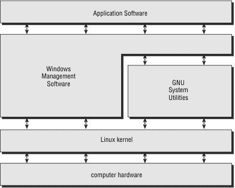

**图 1-1：** Linux 系统。

允许任何人修改内核中的编程代码会导致完全混乱。因此，为了简化事情，Linus 充当了所有改进建议的中心节点。最终是否将建议的代码纳入内核，取决于 Linus 的决定。同样的概念至今仍适用于 Linux 内核代码，只不过不再是 Linus 独自控制内核代码，而是由一个开发者团队承担了这个任务。

内核主要负责四项主要功能：

- 系统内存管理
- 软件程序管理
- 硬件管理
- 文件系统管理

以下各节将更详细地探讨这些功能中的每一项。

### 系统内存管理

操作系统内核的主要功能之一是*内存管理*。内核不仅管理服务器上可用的物理内存，还可以创建和管理*虚拟内存*，即实际上并不存在的内存。

它通过使用硬盘上的空间（称为*交换空间*）来实现这一点。内核在交换空间和实际物理内存之间来回交换虚拟内存位置的内容。这个过程让系统认为它拥有的内存比实际物理存在的更多（如图 1-2 所示）。

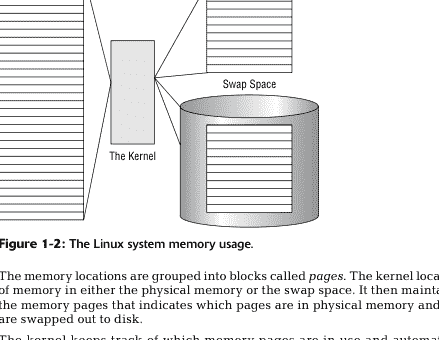

## 图 1-2：Linux 系统内存使用情况。

内存位置被分组为称为页的块。内核将每一页内存定位在物理内存或交换空间中。然后它维护一个内存页表，指示哪些页在物理内存中，哪些页已交换到磁盘。

内核跟踪哪些内存页正在使用，并自动将一段时间内未被访问的内存页复制到交换空间区域（称为换出）。当程序想要访问已被换出的内存页时，内核必须在物理内存中腾出空间，通过换出另一页内存并从交换空间换入所需的页。显然，这个过程需要时间，并且会减慢正在运行的进程。只要 Linux 系统在运行，正在运行的应用程序的内存页换出过程就会持续进行。

你可以使用系统监视器实用程序查看 Ubuntu 系统上内存的当前状态，如图 1-3 所示。

内存图显示此 Linux 系统具有 380.5 MB 的物理内存。它还显示其中约 148.3 MB 目前正在使用中。下一行显示该系统上有约 235.3 MB 的交换空间内存可用，且此时未使用。

默认情况下，在 Linux 系统上运行的每个进程都有自己的私有内存页。一个进程无法访问另一个进程正在使用的内存页。

内核维护自己的内存区域。出于安全目的，没有进程可以访问内核进程使用的内存。系统上的每个单独用户也都有一个私有内存区域，用于处理用户启动的任何应用程序。

然而，通常会运行必须相互通信的相关应用程序。这样做的一种方法是数据共享。为了促进数据共享，你可以创建共享内存页。

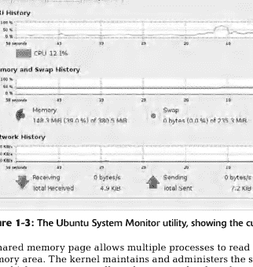

## 图 1-3：显示当前内存使用情况的 Ubuntu 系统监视器实用程序。

共享内存页允许多个进程读取和写入同一个共享内存区域。内核维护和管理共享内存区域，控制哪些进程被允许访问共享区域。

特殊的 `ipcs` 命令允许我们查看系统上当前的共享内存页。以下是 `ipcs -m` 命令示例输出：

```
test@testbox:~$ ipcs -m

------ Shared Memory Segments ------
key       shmid      owner   perms   bytes   nattch   status
0x00000000 557056     test    600     393216  2        dest
0x00000000 589825     test    600     393216  2        dest
0x00000000 622594     test    600     393216  2        dest
0x00000000 655363     test    600     393216  2        dest
0x00000000 688132     test    600     393216  2        dest
0x00000000 720901     test    600     196608  2        dest
0x00000000 753670     test    600     393216  2        dest
0x00000000 1212423    test    600     393216  2        dest
0x00000000 819208     test    600     196608  2        dest
0x00000000 851977     test    600     393216  2        dest
0x00000000 1179658    test    600     393216  2        dest
0x00000000 1245195    test    600     196608  2        dest
0x00000000 1277964    test    600     16384   2        dest
0x00000000 1441805    test    600     393216  2        dest

test@testbox:~$
```


每个共享内存段都有一个创建该段的所有者。每个段还具有标准的 Linux 权限设置，用于设置段对其他用户的可用性。`key`值用于允许其他用户访问共享内存段。

# 软件程序管理

Linux 操作系统将正在运行的程序称为进程。进程可以在前台运行，在显示器上显示输出，也可以在后台运行，在幕后进行。内核控制 Linux 系统如何管理系统上运行的所有进程。

内核创建第一个进程，称为`init`进程，以启动系统上的所有其他进程。当内核启动时，它将`init`进程加载到虚拟内存中。随着内核启动每个附加进程，它为其分配虚拟内存中的一个唯一区域来存储进程使用的数据和代码。

大多数 Linux 实现包含一个（或多个）进程表，这些进程在启动时自动启动。该表通常位于特殊文件`/etc/inittab`中。然而，Ubuntu Linux 系统使用略有不同的格式，默认情况下在`/etc/event.d`文件夹中存储多个表文件。

Linux 操作系统使用利用运行级别的`init`系统。运行级别可用于指示`init`进程仅运行`/etc/inittab`文件或`/etc/event.d`文件夹中的文件所定义的一定类型的进程。Linux 操作系统中七个`init`运行级别。级别 0 用于系统停止时，级别 6 用于系统重启时。级别 1 到 5 在系统运行时管理 Linux 系统。

在运行级别 1 中，仅启动基本系统进程以及一个控制台终端进程。这称为单用户模式。单用户模式最常用于紧急文件系统维护，当出现故障时。显然，在此模式下只有一个人（通常是管理员）可以登录系统以操作数据。

标准的`init`运行级别是 3。在此运行级别下，大多数应用程序软件，例如网络支持软件，会启动。Linux 中另一个流行的运行级别是 5。这是系统启动图形 X Window 软件并允许你使用图形桌面窗口登录的运行级别。

Linux 系统可以通过控制`init`运行级别来控制整体系统功能。通过将运行级别从 3 更改为 5，系统可以从基于控制台的系统更改为高级图形 X Window 系统。

稍后，在第 19 章“命令行”中，你将看到如何使用`ps`命令查看 Ubuntu 系统上当前正在运行的进程。以下是`ps`命令输出中提取的几行：

```
test@testbox$ ps ax
PID TTY STAT TIME COMMAND
1 ? Ss 0:01 /sbin/init
2 ? S< 0:00 [kthreadd]
3 ? S< 0:00 [migration/0]
4 ? S< 0:00 [ksoftirqd/0]
5 ? S< 0:00 [watchdog/0]
4708 ? S< 0:00 [krfcommd]
```

```
4759 ? Ss 0:00 /usr/sbin/gdm
4761 ? S 0:00 /usr/sbin/gdm
4814 ? Ss 0:00 /usr/sbin/atd
4832 ? Ss 0:00 /usr/sbin/cron
4920 tty1 Ss+ 0:00 /sbin/getty 38400 tty1
5417 ? Sl 0:01 gnome-settings-daemon
5425 ? S 0:00 /usr/bin/pulseaudio --log-target=syslog
5426 ? S 0:00 /usr/lib/pulseaudio/pulse/gconf-helper
5437 ? S 0:00 /usr/lib/gvfs/gvfsd
5451 ? S 0:05 gnome-panel --sm-client-id default1
5632 ? Sl 0:34 gnome-system-monitor
5638 ? S 0:00 /usr/lib/gnome-vfs-2.0/gnome-vfs-daemon
5642 ? S 0:09 gimp-2.4
6319 ? Sl 0:01 gnome-terminal
6321 ? S 0:00 gnome-pty-helper
6322 pts/0 Rs 0:00 bash
6343 ? S 0:01 gedit
6385 pts/0 R+ 0:00 ps ax
$
```

输出中的第一列显示了进程的进程 ID（或 PID）。请注意，第一个进程是我们熟悉的`init`进程，Ubuntu 系统为其分配了 PID 1。`init`进程之后启动的所有其他进程都按数字顺序分配 PID。没有两个进程可以拥有相同的 PID。

第三列显示了进程的当前状态。第一个字母代表进程所处的状态（S 表示睡眠，R 表示运行）。进程名称显示在最后一列。方括号中的进程由于不活跃已被换出到磁盘交换空间。你可以看到其中一些进程已被换出，但正在运行的进程没有。

# 硬件管理

内核的另一个职责是硬件管理。Linux 系统必须与其通信的任何设备都需要内核代码中包含驱动程序代码。驱动程序代码允许内核在设备与应用程序之间传递数据，充当中介。有两种方法可用于在 Linux 内核中插入设备驱动程序代码：

- 编译进内核的驱动程序
- 添加到内核的驱动模块

以前，插入设备驱动程序代码的唯一方法就是重新编译内核。每次向系统添加新设备时，都必须重新编译内核代码。随着 Linux 内核支持的硬件越来越多，这一过程变得更加低效。幸运的是，Linux 开发者设计了一种更好的方法来将驱动程序代码插入到正在运行的内核中。

程序员开发了内核模块的概念，允许你在无需重新编译内核的情况下将驱动程序代码插入到正在运行的内核中。此外，当设备使用完毕后，内核模块也可以从内核中移除。这一改进极大地简化并扩展了 Linux 对硬件的使用。

Linux 系统将硬件设备识别为特殊文件，称为设备文件。设备文件有三种分类：

- 字符设备
- 块设备
- 网络设备

字符设备文件用于只能一次处理一个字符的设备。大多数类型的调制解调器和终端都是作为字符文件创建的。块文件用于可以一次处理大量数据的设备，例如磁盘驱动器。

网络文件类型用于使用数据包发送和接收数据的设备。这些设备包括网络卡和一种特殊的回环机制，允许 Linux 系统使用通用网络编程协议与自身通信。

Linux 为系统上的每个设备创建特殊文件，称为节点。所有与设备的通信都是通过设备节点进行的。每个节点都有一个唯一的数字对，用于 Linux 内核识别它。数字对包括主设备号和次设备号。相似的设备被归入相同的主设备号。次设备号用于在主设备组内识别特定的设备。这是在 Linux 服务器上设备文件的示例：

```
test@testbox$ ls -al sda*
brw-rw---- 1 root disk 8, 0 2008-05-07 11:42 /dev/sda
brw-rw---- 1 root disk 8, 1 2008-05-07 11:42 /dev/sda1
brw-rw---- 1 root disk 8, 2 2008-05-07 11:42 /dev/sda2
brw-rw---- 1 root disk 8, 5 2008-05-07 11:42 /dev/sda5
test@testbox$ ls -al ttyS*
crw-rw---- 1 root dialout 4, 64 2008-05-07 11:42 /dev/ttyS0
crw-rw---- 1 root dialout 4, 65 2008-05-07 11:42 /dev/ttyS1
crw-rw---- 1 root dialout 4, 66 2008-05-07 11:42 /dev/ttyS2
crw-rw---- 1 root dialout 4, 67 2008-05-07 11:42 /dev/ttyS3
test@testbox$
```

`sda`设备是第一块 SCSI 硬盘，`ttyS`设备是标准的 IBM-PC COM 端口。列表显示了在示例 Ubuntu 系统上创建的所有`sda`设备。同样，列表显示了创建的所有`ttyS`设备。

第五列是主设备节点号。请注意，所有`sda`设备的主设备节点都相同，为 8，而所有`ttyS`设备都使用 4。第六列是次设备节点号。主编号内的每个设备都有唯一的次设备节点号。

第一列表示设备文件的权限。权限的第一个字符表示文件的类型。请注意，SCSI 硬盘文件都标记为块（b）设备，而 COM 端口设备文件标记为字符（c）设备。

# 文件系统管理

与某些其他操作系统不同，Linux 内核可以支持不同类型的文件系统来读取和写入硬盘数据。除了拥有十多种自己的文件系统外，Linux 还可以读取和写入其他操作系统（如 Microsoft Windows）使用的文件系统。内核必须编译时支持系统将使用的所有类型的文件系统。表 1-1 列出了 Linux 系统可用于读取和写入数据的标准文件系统。

## 表 1-1：Linux 文件系统

| 文件系统 | 描述 |
|---|---|
| ext | Linux 扩展文件系统——最初的 Linux 文件系统 |
| ext2 | 第二代扩展文件系统；提供了超越 ext 的高级特性 |
| ext3 | 第三代扩展文件系统；支持日志记录 |
| hpfs | OS/2 高性能文件系统 |
| jfs | IBM 的日志文件系统 |


| iso9660 | ISO 9660 文件系统（光盘） |
| minix | MINIX 文件系统 |
| msdos | 微软 FAT16 |
| ncp | Netware 文件系统 |
| nfs | 网络文件系统 |
| ntfs | 支持微软 NT 文件系统 |
| proc | 访问系统信息 |
| reiserFS | 高级 Linux 文件系统，提供更好的性能和磁盘恢复 |
| smb | 用于网络访问的 Samba SMB 文件系统 |
| sysv | 较旧的 UNIX 文件系统 |
| ufs | BSD 文件系统 |
| umsdos | 基于 MS-DOS 之上的类 UNIX 文件系统 |
| vfat | Windows 95 文件系统（FAT32） |
| xfs | 高性能 64 位日志文件系统 |

UNIX 服务器访问的任何硬盘都必须使用表 1-1 中列出的文件系统类型之一进行格式化。

Linux 内核通过虚拟文件系统（VFS）与每个文件系统交互，VFS 为内核与任何类型的文件系统通信提供了标准接口。当每个文件系统被挂载和使用时，VFS 会在内存中缓存信息。

# GNU 实用工具

除了拥有控制硬件设备的内核外，计算机操作系统还需要实用工具来执行标准功能，例如控制文件和程序。尽管林纳斯·托瓦兹创建了 Linux 系统内核，但他没有可在其上运行的系统实用工具。幸运的是，在他工作的同时，一群人正在互联网上共同努力，试图开发一套模仿流行的 UNIX 操作系统的标准计算机系统实用工具。

GNU 组织（GNU 代表 GNUs Not UNIX）开发了一套完整的 UNIX 实用工具，但没有内核系统来运行它们。这些实用工具是在一种称为开源软件（OSS）的软件理念下开发的。

开源软件的理念允许程序员开发软件，并将其发布给全世界，不附加任何许可费。任何人都可以使用、修改或将其整合到自己的系统中，而无需支付许可费。将林纳斯的 Linux 内核与 GNU 操作系统实用工具结合起来，创造了一个完整、实用、免费的操作系统。

> 尽管 Linux 内核和 GNU 实用工具的捆绑通常仅被称为 Linux，但你在互联网上会看到一些 Linux 纯粹主义者将其称为 GNU/Linux 系统，以表彰 GNU 组织对此事业的贡献。

# GNU 核心实用工具

GNU 项目主要旨在为 UNIX 系统管理员提供一个可用的类 UNIX 环境。这一重点导致该项目移植了许多常见的 UNIX 系统命令行实用工具。为 Linux 系统提供的实用工具核心集称为 `coreutils` 包。

GNU `coreutils` 包由三部分组成：

- 用于处理文件的实用工具
- 用于操作文本的实用工具
- 用于管理进程的实用工具

这三组实用工具各自包含几个对 Linux 系统管理员和程序员极有价值的实用程序。

# Shell

GNU/Linux `shell` 是一种特殊的交互式实用工具。它为用户提供了一种启动程序、管理文件系统中的文件以及管理 Linux 系统上运行的进程的方法。`shell` 的核心是命令提示符。命令提示符是 `shell` 的活动部分。它允许你输入文本命令，然后解释这些命令并在内核中执行它们。

`shell` 包含一组内部命令，用于控制诸如复制文件、移动文件、重命名文件、显示系统上当前运行的程序以及停止系统上运行的程序等操作。除了内部命令，`shell` 还允许你在命令提示符下输入程序名称。`shell` 将该程序名称传递给内核以启动它。

Linux 系统上有相当多的 Linux `shell` 可供使用。不同的 `shell` 具有不同的特性；有些更适合创建脚本，有些更适合管理进程。所有 Linux 发行版中使用的默认 `shell` 是 `bash` `shell`。

`bash` `shell` 由 GNU 项目开发，作为标准 UNIX `shell` 的替代品，即 Bourne `shell`（以其创造者 Stephen Bourne 命名）。`bash` `shell` 的名称是对这一表述的戏称，被称为 Bourne-again `shell`。

除了 `bash` `shell` 之外，还有几种其他流行的 `shell` 可供 Ubuntu 支持。表 1-2 列出了 Ubuntu 中较为流行的 `shell`。

| Table 1-2: Linux Shells |
|---|---|
| Shell | Description |
| ash | 一个简单、轻量级的 `shell`，可在低内存环境中运行，但与 `bash` `shell` 完全兼容 |
| korn | 一个与 Bourne `shell` 兼容的编程 `shell`，但支持高级编程功能，如关联数组和浮点运算 |
| tcsh | 一个将 C 编程语言元素融入 `shell` 脚本的 `shell` |
| zsh | 一个高级 `shell`，融合了 `bash`、`tcsh` 和 `korn` 的功能，提供高级编程功能、共享历史文件和主题提示 |

大多数 Linux 发行版包含不止一个 `shell`，尽管通常会选择其中一个作为默认。Ubuntu 默认仅安装 `bash` `shell`，但其他 `shell` 可供下载和安装（参见第 13 章，“软件安装和更新”）。

# The Linux Desktop Environment

在 Linux 的早期（20 世纪 90 年代初），可用的只是 Linux 操作系统的简单文本界面。此文本界面允许管理员启动程序、控制程序操作并在系统上移动文件。

随着 Microsoft Windows 的流行，计算机用户期望获得的不仅仅是旧的文本界面。这推动了 OSS 社区的发展，并催生了 Linux 图形桌面的出现。

Linux 以能够以多种方式完成事情而闻名，而在图形桌面方面，这一特性尤为相关。你可以在 Linux 中从众多图形桌面中进行选择。以下各节描述了其中一些较为流行的桌面。

# The X Windows System

控制视频环境的两个基本元素是 PC 中的显卡和显示器。要在计算机上显示精美的图形，Linux 软件需要知道如何与两者通信。X Windows 软件是呈现图形的核心元素。

X Windows 软件是一个低级程序，直接与 PC 中的显卡和显示器协同工作。它控制 Linux 应用程序如何在计算机上呈现精美的窗口和图形。

Linux 并不是唯一使用 X Windows 的操作系统；为许多不同的操作系统编写了版本。在 Linux 世界中，只有两个软件包可以实现 X Windows。

XFree86 软件包是两者中较老的，长期以来它是 Linux 可用的唯一 X Windows 包。顾名思义，它是 X Windows 软件的免费、开源版本。

最近，一个名为 X.org 的新包进入了 Linux 领域。它也提供了 X Windows 系统的开源软件实现。它日益流行，许多 Linux 发行版开始改用它而不是旧的 XFree86 系统。Ubuntu 使用 X.org 包来实现 X Windows 系统。

这两个包在控制 Linux 如何使用显卡在显示器上显示内容的方式上工作相同。为此，它们必须为你的特定系统进行配置。安装 Linux 时本应自动完成。

当你首次安装 Ubuntu 时，它会尝试检测你的显卡和显示器，然后创建包含所需信息的 X Windows 配置文件。在安装过程中，你可能会注意到安装程序扫描显示器以获取支持的视频模式的时间。有时这会导致显示器在几秒钟内变黑。由于存在许多不同类型的显卡和显示器，此过程可能需要一些时间才能完成。

> 不幸的是，有时安装无法自动检测要使用的视频设置，尤其是在一些更新、更复杂的显卡上，一些 Linux 发行版如果找不到你的特定显卡设置就会安装失败。其他发行版会在安装期间询问几个问题以帮助手动收集必要的信息。还有一些则默认为最低公分母，产生未针对你的视频环境定制的屏幕图像。
>
> 情况更复杂的是，许多 PC 用户拥有精美的显卡，例如 3D 加速卡，以便他们可以玩高分辨率游戏。过去，如果你尝试安装 Linux，这些显卡会引起很多问题。但最近，显卡公司正在帮助解决这个问题，提供 Linux 驱动程序，许多定制的 Linux 发行版现在包含专用显卡的驱动程序。
>
> 核心 X Windows 软件仅产生图形显示环境，而没有其他功能。虽然这对于运行单个应用程序来说是可以的，但对于日常计算机使用来说并不太有用。没有桌面环境允许用户操作文件或启动程序。为此，你需要在 X Windows 系统软件之上使用桌面环境。

# The GNOME Desktop

GNU Network Object Model Environment（GNOME）是 Ubuntu 中使用的默认桌面环境。GNOME 于 1999 年首次发布，已成为许多其他 Linux 发行版（包括流行的 Red Hat 商用 Linux 发行版）的默认桌面环境。

尽管 GNOME 选择脱离标准的 Microsoft Windows 外观和感觉，但它融合了大多数 Windows 用户感到舒适的许多功能：

- 一个用于图标的桌面区域
- 两个面板区域
- 拖放功能

图 1-4 显示了 Ubuntu 中使用的标准 GNOME 桌面。

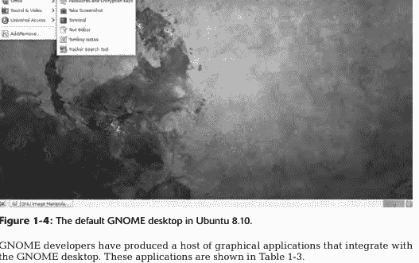


图 1-4：Ubuntu 8.10 中的默认 GNOME 桌面。

GNOME 开发者制作了大量与 GNOME 桌面集成的图形应用程序。这些应用程序显示在表 1-3 中。

### 表 1-3：GNOME 应用程序

| Application | Description |
|---|---|
| epiphany | Web browser |
| evince | Document viewer |
| gcalc-tool | Calculator |
| gedit | GNOME text editor |
| gnome-panel | Desktop panel for launching applications |
| gnome-nettool | Network diagnostics tool |
| gnome-terminal | Terminal emulator |
| nautilus | Graphical file manager |
| nautilus-cd-burner | CD-burning tool |
| sound juicer | Audio CD-ripping tool |
| tomboy | Note-taking software |
| totem | Multimedia player |

正如你所见，GNOME 桌面可用的应用程序相当多。其中一些应用程序默认包含在 Ubuntu 中，而其他则需要从 Ubuntu 仓库安装。除了所有这些应用程序之外，其他 Linux 应用程序还使用 GNOME 库来创建在 GNOME 桌面上运行的基于 Windows 的应用程序。

# KDE 桌面

K 桌面环境（KDE）于 1996 年首次发布，作为一个开源项目，旨在制作一个类似于 Microsoft Windows 环境的图形桌面。KDE 桌面包含了如果你是 Microsoft Windows 用户所熟悉的全部功能。图 1-5 显示了在 Kubuntu Linux 上运行的示例 KDE 桌面。

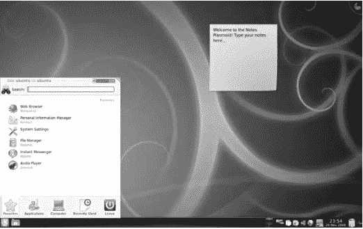

**图 1-5：** Kubuntu 8.10 中的默认 KDE 桌面。

就像在 Microsoft Windows 中一样，KDE 桌面允许你将应用程序和文件图标放置在桌面区域。与 Windows 不同的是，如果你单击一个应用程序图标，KDE 系统就会启动该应用程序。如果你单击一个文件图标，KDE 桌面会尝试确定要启动什么应用程序来处理该文件。

桌面底部的栏称为面板。面板由四个部分组成：

- **K 菜单：** 类似于 Windows 开始菜单；包含启动已安装应用程序的链接
- **程序快捷方式：** 从面板直接启动应用程序的快速链接
- **任务栏：** 显示桌面上当前正在运行的应用程序的图标
- **小程序：** 在面板中具有图标的小型应用程序，通常可以根据来自应用程序的信息而更改

所有面板功能都与你在 Microsoft Windows 中找到的功能相似。除了桌面功能之外，KDE 项目还制作了大量在 KDE 环境中运行的应用程序。这些应用程序显示在表 1-4 中。

### 表 1-4：KDE 应用程序

| Application | Description |
|---|---|
| amaroK | Audio file player |
| digiKam | Digital camera software |
| K3b | CD-burning software |
| Kaffeine | Video player |
| Kmail | Email client |
| Koffice | Office applications suite |
| Konqueror | File and web browser |
| Kontakt | Personal information manager |
| Kopete | Instant messaging client |

你可能会注意到 KDE 应用程序名称中使用大写 K 的趋势。这只是 KDE 项目生产的应用程序的部分列表。KDE 项目中还有许多其他应用程序。与 GNOME 环境类似，Kubuntu 默认不包含所有 KDE 项目软件，但你可以使用软件仓库轻松安装任何内容。

# 其他桌面

华丽的图形桌面环境的缺点是它需要相当多的系统资源才能正常运行。在 Linux 的早期，Linux 的标志和卖点之一是它能够在较旧、性能较低的 PC 上运行，而较新的 Microsoft 桌面产品无法在这些 PC 上运行。然而，随着 KDE 和 GNOME 桌面的流行，这一标志已经改变，运行 KDE 或 GNOME 桌面所需的内存几乎与最新的 Microsoft 桌面环境一样多（Ubuntu 的最低要求为 384 MB 内存）。

如果你有一台较旧的 PC，不要气馁。Linux 开发者们团结起来，将 Linux 带回其根源。他们创建了几个面向低内存的图形桌面应用程序，提供基本功能，可以在较旧的 PC 上完美运行。

尽管这些图形桌面没有大量围绕它们设计的应用程序，但它们仍然运行许多支持诸如文字处理、电子表格、数据库、绘图，当然还有多媒体应用程序等功能的基本图形应用程序。表 1-5 显示了一些可用于低功率 PC 和笔记本电脑的较小的 Linux 图形桌面环境。

### 表 1-5：其他 Linux 图形桌面

| Desktop | Description |
|---|---|
| xfce | 一个轻量级桌面，将组件单独打包，以便您可以挑选和选择想要实现的功能 |
| fluxbox | 一个精简的桌面，不包含面板——只有用于启动应用程序的弹出菜单 |
| fvwm | 支持一些高级桌面功能，例如虚拟桌面和面板，但在低内存环境中运行 |
| fvwm95 | 源自 fvwm，但设计成看起来像 Windows 95 桌面 |

这些图形桌面环境不如 KDE 和 GNOME 桌面那么花哨，但它们提供了基本图形功能。图 1-6 显示了在 Xubuntu 发行版中使用的 xfce 桌面是什么样子的。

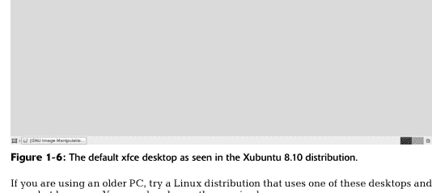

**图 1-6：** 在 Xubuntu 8.10 发行版中看到的默认 xfce 桌面。

如果您使用的是较旧的 PC，请尝试使用其中一个桌面环境的 Linux 发行版，看看会发生什么。您可能会感到愉快的惊讶。

# Linux 发行版

现在您已经看到了构成完整 Linux 系统所需的四个主要组件，您可能会想知道如何将它们全部组合起来制作一个 Linux 系统。幸运的是，已经有人为我们完成了这项工作。

完整的 Linux 系统包称为发行版。有许多不同的 Linux 发行版可供选择，以满足几乎任何计算需求。大多数发行版都是为特定用户群体定制的，例如企业用户、多媒体爱好者、软件开发人员或普通家庭用户。每个定制发行版都包含支持专业功能的软件包，例如为多媒体爱好者提供的音频和视频编辑软件，或为软件开发人员提供的编译器和集成开发环境（IDEs）。

Linux 发行版通常分为三个类别：

- ♦ 全核心 Linux 发行版
- ♦ 专用发行版
- ♦ LiveCD 测试发行版

以下各节描述了这些不同的 Linux 发行版，并在每个类别中展示了一些 Linux 发行版的示例。

## 核心 Linux 发行版

核心 Linux 发行版包含一个内核、一个或多个图形桌面环境，以及几乎所有可用的 Linux 应用程序，均预编译用于该内核。它为完整的 Linux 安装提供一站式服务。表 1-6 显示了一些更受欢迎的核心 Linux 发行版。

### 表 1-6：核心 Linux 发行版

| Distribution | Description |
|---|---|
| Slackware | 最早的 Linux 发行版之一，深受 Linux 发烧友欢迎 |
| Red Hat | 一种商业业务发行版，主要用于 Internet 服务器 |
| Fedora | Red Hat 的分支，但设计用于家庭使用 |
| Gentoo | 专为高级 Linux 用户设计的发行版，仅包含 Linux 源代码 |
| Mandriva | 主要设计用于家庭使用（以前称为 Mandrake） |
| openSUSE | 针对企业和家庭使用的不同发行版（现由 Novell 所有） |
| Debian | 深受 Linux 专家和商业 Linux 产品欢迎 |

在 Linux 的早期，发行版以软盘集的形式发布。您必须下载一组文件，然后将它们复制到磁盘上。通常需要 20 多张磁盘才能制作完整的发行版！不用说，这是一次痛苦的经历。

如今，随着家用电脑普遍内置 CD 和 DVD 播放器，Linux 发行版以 CD 套装或单张 DVD 的形式发布。这使得安装 Linux 变得更加容易。


然而，初学者在安装核心 Linux 发行版时仍然经常遇到问题。为了涵盖任何可能需要使用 Linux 的情况，单个发行版必须包含大量应用程序软件。发行版包含从高端 Internet 数据库服务器到常见游戏的一切内容。由于 Linux 可用的应用程序数量众多，完整的发行版通常需要四张或更多的 CD。

虽然在一个发行版中拥有许多选项对 Linux 发烧友来说很棒，但对初学 Linux 用户来说可能成为噩梦。大多数发行版在安装过程中会提出一系列问题，以确定默认加载哪些应用程序、PC 连接了哪些硬件以及如何配置硬件。初学者通常会发现这些问题令人困惑。因此，他们通常要么在计算机上加载太多程序，要么加载不足，后来才发现他们的计算机无法按他们想要的方式运行。

幸运的是，对于初学者来说，有一种更简单的安装 Linux 的方法。

# 专用 Linux 发行版

在过去几年中，一种新的 Linux 发行版子组开始出现。这些发行版通常基于其中一个主要发行版，但仅包含对特定用途有意义的应用程序子集。

除了提供专用软件（例如仅为企业用户提供办公产品）外，定制的 Linux 发行版还试图通过自动检测和自动配置常见硬件设备来帮助初学 Linux 用户，这使得安装 Linux 成为一个更加愉快的过程。

**表 1-7：专用 Linux 发行版**

| Distribution | Description |
| --- | --- |
| Linspire | 一种商业 Linux 包，配置为看起来像 Windows |
| Xandros | 一种面向初学者的商业 Linux 包 |
| SimplyMEPIS | 一种免费的家庭桌面发行版 |
| Ubuntu | 一种免费的桌面和服务器发行版，用于学校和家庭使用 |
| PCLinuxOS | 一种免费的家庭和办公发行版 |
| dyne:bolic | 一种免费的发行版，专为音频和 MIDI 应用程序设计 |
| Puppy Linux | 一种免费的小型发行版，在较旧的 PC 上运行良好 |

表 1-7 仅包含专用 Linux 发行版的一小部分采样。有数百个专用 Linux 发行版，并且不断在互联网上出现。无论您的专业领域是什么，您很可能会找到一个为您定制的 Linux 发行版。

许多专门的 Linux 发行版（包括 Ubuntu）都是基于 Debian Linux 发行版。它们使用与 Debian 相同的安装文件，但只打包了完整 Debian 系统的一小部分。

# Linux LiveCD

Linux 世界中相对较新的现象是可启动的 Linux CD 发行版，它让你在不实际安装的情况下就能看到 Linux 系统是什么样的。大多数现代 PC 都可以从 CD 而不是标准硬盘启动。为了利用这一功能，一些 Linux 发行版会制作一个可启动的 CD，其中包含一个示例 Linux 系统（称为 Linux LiveCD）。由于单张 CD 的容量限制，示例中无法包含完整的 Linux 系统，但你会惊讶于它们能塞进多少软件。结果是，你可以从 CD 启动 PC 并运行 Linux 发行版，而无需在硬盘上安装任何东西。

这是在不改变 PC 的情况下测试各种 Linux 发行版的绝佳方式。只需放入一张 CD 并启动即可！所有 Linux 软件都将直接从 CD 运行。你可以从互联网下载许多 Linux LiveCD 并刻录到 CD 上进行试用。

表 1-8 显示了一些流行的 Linux LiveCD。

**表 1-8：Linux LiveCD 发行版**

| Distribution | Description |
| --- | --- |
| Knoppix | 一个德国 Linux，是第一个开发的 Linux LiveCD |
| SimplyMEPIS | 专为初学家庭 Linux 用户设计 |
| PCLinuxOS | 完整的 Linux 发行版在 LiveCD 上 |
| Ubuntu | 一个全球性的 Linux 项目，设计用于多种语言 |
| Slax | 基于 Slackware Linux 的实时 Linux CD |
| Puppy Linux | 专为老旧 PC 设计的全功能 Linux |

你可能会在表 1-8 中注意到一些熟悉的东西。许多专门的 Linux 发行版也都有 Linux LiveCD 版本。一些 Linux LiveCD 发行版，例如 Ubuntu，允许你直接从 LiveCD 安装 Linux 发行版。你可以用 CD 启动，试用 Linux 发行版，如果喜欢，就将其安装到硬盘上。此功能非常方便且用户友好。

与所有好东西一样，Linux LiveCD 也有一些缺点。因为你从 CD 访问所有内容，所以应用程序运行得更慢，尤其是在使用较旧、较慢的计算机和 CD 驱动器时。此外，因为你无法写入 CD，你对 Linux 系统所做的任何更改在下次重新启动时都会消失。

但 Linux LiveCD 世界正在取得进展，以帮助解决其中一些问题。这些进展包括能够

- 将 Linux 系统文件从 CD 复制到内存
- 将系统文件复制到硬盘上的一个文件
- 将系统设置存储在 USB 记忆棒上
- 将用户设置存储在 USB 记忆棒上

一些 Linux LiveCD，例如 Puppy Linux，是以最少的 Linux 系统文件设计的，并在 CD 启动时直接将它们复制到内存中，这使你可以在 Linux 启动后立即将 CD 从计算机中取出。不仅如此，它还能使你的应用程序运行得更快得多（因为应用程序从内存中运行更快），而且还能腾出你的 CD 托盘用于刻录音频 CD 或从 Puppy Linux 包含的软件中播放视频 DVD。

其他 Linux LiveCD 使用一种替代方法，允许你在启动后将 CD 从托盘中取出。它涉及将核心 Linux 文件作为单个文件复制到 Windows 硬盘上。CD 启动后，它会查找该文件并从中读取系统文件。Ubuntu Wubi 项目使用这种技术将 LiveCD 内容移动到存储在 PC Windows 驱动器上的单个文件中。从那里你可以直接启动到 Ubuntu（有关更多信息，请参阅第 2 章“玩转 LiveCD”）。

> 从实时 Linux CD 会话中存储数据的流行技术是使用 USB 记忆棒（也称为闪存驱动器和拇指驱动器）。几乎所有 Linux LiveCD 都可以识别插入的 USB 记忆棒（即使该记忆棒是为 Windows 格式化的）并从中读写文件。此功能允许你启动 Linux LiveCD，使用 Linux 应用程序创建文件，将它们存储在你的记忆棒上，然后稍后从你的 Windows 应用程序（或从另一台计算机）访问它们。

# 什么是 Ubuntu？

现在你已经了解了 Linux 发行版背后的内容，是时候将注意力转向 Ubuntu Linux 发行版了。即使在 Ubuntu 内部，在运行系统之前也有几个功能需要你选择。本节介绍可用的不同版本和选择。

## Ubuntu 版本

Ubuntu Linux 发行版基于 Debian Linux。正如在核心 Linux 发行版部分所讨论的，Debian 发行版包含各种软件和功能。Ubuntu 开发人员为专门用途创建了主 Debian Linux 系统的两个子集：

- Ubuntu workstation
- Ubuntu server

Ubuntu workstation 发行版仅包含桌面环境中最常用的软件：

- OpenOffice.org 办公生产力套件
- Firefox 网络浏览器软件
- Evolution 电子邮件和日历软件
- Tomboy 记笔记软件
- F-spot 数字图像编辑
- Totem 视频播放器
- Rhythmbox 音乐播放器

Ubuntu 工作站发行版提供了一个完整的家庭、学校甚至办公室桌面环境，所有内容都在一个包中，并且全部免费。

Ubuntu 服务器发行版仅包含在计算机数据中心环境中最常用的软件：

- Postfix 邮件服务器
- Samba 用于 Windows 的文件和打印共享服务器
- Apache 网页服务器
- MySQL 数据库服务器

Ubuntu 服务器发行版可以支持任何规模的服务器环境，从小型家庭网络到大型企业数据中心。

## Ubuntu 发布计划

Linux 世界不断发展，对于任何 Linux 发行版要跟上新进展，必须定期发布新版本的软件。Ubuntu 发行版在安排发布并坚持计划方面做得非常出色。

Ubuntu 每六个月发布新版本。其中一些版本被标记为长期支持（LTS）。对于这些版本，Ubuntu 提供长达 3 年的安全和补丁更新。

当前 Ubuntu 版本列表如表 1-9 所示。

**表 1-9：Ubuntu 版本**

| 版本 | 日期 | 名称 |
| --- | --- | --- |
| 4.10 | 10/20/2004 | Warty Warthog |
| 5.04 | 04/08/2005 | Hoary Hedgehog |
| 5.10 | 10/13/2005 | Breezy Badger |
| 6.06 | 06/01/2006 | Dapper Drake (LTS) |


| 6.10 | 10/26/2006 | Edgy Eft |
| 7.04 | 04/19/2007 | Feisty Fawn |
| 7.10 | 10/18/2007 | Gutsy Gibbon |
| 8.04 | 04/24/2008 | Hardy Heron (LTS) |
| 8.10 | 10/30/2008 | Intrepid Ibex |

每个 Ubuntu 版本都被分配了一个代号。你经常会看到 Ubuntu 版本用其代号而不是版本号来引用。

6.06 和 8.04 版本是 LTS 版本，与其他版本略有不同。LTS 支持发行版旨在为那些不想不断升级到新软件版本但希望在发布新的错误和安全补丁时维护现有软件包的用户提供服务。LTS 发行版在学校或办公室等地方通常很有用，这些地方不想不断升级工作站操作系统，但希望保持安全和错误补丁的最新状态。

# Ubuntu 亲属

Ubuntu 工作站发行版仅使用 GNOME 桌面环境。因此，开发了其他 Ubuntu 发行版以供客户选择（因为这就是 Linux 的全部意义所在）。

除了主要的 Ubuntu 发行版外，Ubuntu 还支持基于 Ubuntu 代码库但使用替代桌面的专用发行版：

- Kubuntu：使用 KDE 桌面环境
- Xubuntu：使用 xfce 桌面环境
- Edubuntu：使用 GNOME 桌面提供专用教育软件

所有 Ubuntu 发行版和功能都基于相同的开源软件基本思想和原则。Kubuntu 发行版包含与 Ubuntu 相同的核心工作站软件包组，例如 OpenOffice.org 和 Firefox，但它还提供常见的 KDE 桌面实用程序，包括用于文件系统浏览的 Dolphin、作为邮件客户端的 KMail 以及用于管理图形环境的 KDE 桌面实用程序。

Xubuntu 发行版专为性能较低的工作站设计。除了使用 xfce 桌面外，它还使用 AbiWord 文字处理器，以及 Firefox 网页浏览器。它可以在内存低至 128 MB 的系统上运行。

Edubuntu 发行版有点像混搭发行版。它使用 GNOME 桌面但包含 KDE 教育软件套件。该套件包括面向学龄儿童的教育游戏以及面向学龄前儿童的活动，让他们熟悉 Linux 环境。

# 总结

本章讨论了 Linux 系统的起源以及其工作原理。Linux 内核是系统的核心，控制内存、程序和硬件如何交互。GNU 实用程序也是 Linux 系统中的重要组成部分。Linux shell 是 GNU 核心实用程序的一部分。

本章还讨论了 Linux 系统的最后一部分，即 Linux 桌面环境。多年以来情况发生了变化，Linux 现在支持多个图形桌面环境。

接下来，本章谈到了各种 Linux 发行版。Linux 发行版将 Linux 系统的各个部分捆绑成一个简单的包，您可以轻松地将其安装在您的 PC 上。Linux 发行版世界包括包含几乎所有可想象应用程序的完整 Linux 发行版，以及包含专注于特殊功能的应用程序的专用 Linux 发行版。Linux LiveCD 热潮创造了另一组 Linux 发行版，让您可以轻松试用 Linux 而无需将其安装在硬盘上。

最后，本章讨论了 Ubuntu Linux 发行版，并展示了 Ubuntu 的不同版本和发行版如何组合在一起。

在下一章中，我们将研究 Ubuntu LiveCD。我们将逐步了解如何在不加载任何内容的情况下在您的 PC 上试用 Ubuntu，并了解如何在不更改硬盘的情况下直接将其安装在您当前的 Windows PC 上。

Linux 世界中最酷的功能之一就是 LiveCD 的发明。Ubuntu 利用这一功能让你可以在不安装的情况下在 PC 上试用 Ubuntu。本章将指导你需要做哪些事情才能在系统上运行 LiveCD，并带你了解 LiveCD 的一些功能，以便你能充分利用 LiveCD 体验。它还讨论了 LiveCD 的一个新功能 Wubi，该功能让你可以在现有的 Windows 系统中直接创建可启动的 Ubuntu 分区。

# Ubuntu LiveCD

如第 1 章“什么是 Ubuntu？”中所讨论的，Ubuntu 发行版提供了一个 LiveCD，你可以从 PC 启动它来运行 Ubuntu，而无需安装它。Ubuntu 操作系统直接从 LiveCD 和内存运行，不会影响硬盘设置。这是一种快速确定 Ubuntu 是否能在特定台式机或笔记本电脑上运行的绝佳方式。

在你能够运行 Ubuntu LiveCD 之前，你需要拥有一份拷贝。Ubuntu 项目为你提供了三种获取 Ubuntu 发行版 LiveCD 的方式：

- 从 Canonical Ltd. 购买。
- 请求免费拷贝通过邮件寄送。
- 通过互联网下载。

Canonical Ltd. 是一家致力于为 Ubuntu 提供软件和硬件支持的欧洲公司。你可以通过 Ubuntu 网站（www.ubuntu.com）从 Canonical 购买 Ubuntu LiveCD 拷贝。

Canonical 还提供可免费下载的 Ubuntu 单份拷贝。如果你没有高速互联网连接，你可以购买或请求免费拷贝 LiveCD。如果你选择免费 CD 途径，请做好等待的准备。LiveCD 的免费拷贝交付可能需要长达 10 周。

在三种选项中，通过互联网下载 LiveCD 是让 Ubuntu 在你的 PC 上快速运行的最快方式。如果你有高速互联网连接，下载 CD 只需一个小时左右，具体取决于你的连接带宽。

> note
> 由于 Ubuntu 如此受欢迎，你经常会在线上和实体电脑书店看到出售的 Ubuntu LiveCD。如果你常去某家电脑书店，请查看 Linux 区域，看看是否有售。然而，在新版本发布后一个月左右才在书店上架出售的情况并不少见。

如果你决定下载 LiveCD 文件，下一个部分将指导你完成下载过程。

# 下载 Ubuntu

LiveCD Linux 发行版的流行引发了人们对创建和使用 CD 映像文件的新兴趣。CD 映像文件将整个数据 CD 的内容放在一个单一的归档文件中。该文件称为 ISO 映像文件，通常以 `.iso` 文件扩展名结尾。ISO 映像文件包含 LiveCD 上所有数据的逐字节拷贝。下载 ISO 映像文件后，你所需要做的就是使用 CD 刻录软件包将 ISO 映像文件转换为 CD。

Ubuntu 让下载和创建 LiveCD 的过程相当容易，但仍有一些需要注意的地方，尤其是如果你以前从未做过的话。

一旦你决定下载 LiveCD 映像文件，你必须决定通过互联网下载文件使用哪种方法。以下各节将介绍下载 LiveCD 文件的不同方法。

## 从网页下载

如今，你在互联网上几乎能做的所有事情都可以通过你信赖的网页浏览器完成。这包括下载大型 ISO 映像文件。从 Ubuntu 网站点击几个链接即可轻松下载 Ubuntu LiveCD 映像文件。不幸的是，这里有几个选择需要你做出。这部分讨论了你需要了解的内容以确定哪个 LiveCD 版本适合你。

### 找到合适的版本

如果你访问 Ubuntu 网站（www.ubuntu.com），你会看到几个链接和按钮可带你到下载页面。点击其中任何一个都会带你到快速下载页面，其中包含一个你必须填写的表单以确定要下载的正确文件。

下载 LiveCD 的第一步是弄清楚你需要哪个 LiveCD。Ubuntu 下载页面有一个三步流程供你遵循：

- 1. 选择工作站或服务器 LiveCD。
- 2. 选择你的硬件平台（32 或 64 位）。
- 3. 选择下载位置。

如第 1 章所述，Ubuntu 有两个版本——工作站版本和服务器版本。每个版本都分发在单独的 LiveCD 上。第一步是选择你想要下载的版本。

> note
> 尽管 Ubuntu 服务器软件附带在 LiveCD 上，但这种描述有些误导。你不能直接从 LiveCD 启动 Ubuntu 服务器软件并运行它。Ubuntu 服务器 LiveCD 仅允许你将服务器软件安装到系统上。

下载选择中的第二个决定是你打算运行 LiveCD 的硬件平台。有两个选项：

- ♦ 32 位 Intel 和 AMD 处理器
- ♦ 64 位 Intel 和 AMD 处理器

如果你使用的是较旧的 PC，你可能不知道你拥有什么处理器。有几种方法可以查明。如果你系统当前运行的是 Microsoft Windows 版本，你可以使用系统属性对话框显示系统中的处理器。以下是 Windows XP 或 Vista 工作站上执行此操作的步骤：

- 1. 右键单击“我的电脑”桌面图标或“开始”菜单中的“我的电脑”条目。
- 2. 从菜单列表中选择 `Properties`。
- 3. 在系统属性对话框中找到 CPU 信息。

CPU 信息会告诉你 PC 中使用的是什么类型的处理器。图 2-1 显示了来自 Windows Vista 工作站的示例属性对话框。

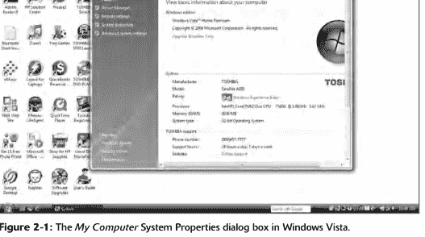

图 2-1：Windows Vista 中 `My Computer` 的系统属性对话框。

如果你的 PC 中有 64 位处理器，CPU 信息部分会说明这一点。


在下载开始之前，你需要做出的最后决定是使用哪个服务器来下载 LiveCD 映像文件。Ubuntu LiveCD 映像在世界各地的许多不同服务器（称为 `mirrors`）上都有提供。其目的是防止单个服务器因下载请求而过载，同时也有助于分发网络流量。如果你能找到离你较近的位置，将会加快下载过程。

一旦你做出选择，点击 `Start Download` 按钮开始下载。

> caution 作为安全功能，部分网页浏览器（如 Internet Explorer 7.0 版）会阻止自动文件下载。出现这种情况时，网页查看窗格顶部会出现警告横幅。只需点击该横幅即可继续下载。

开始下载通常不是问题。经常出现的问题是保持下载运行。LiveCD ISO 映像文件（通常为 700 MB 或更大）即使在高速互联网连接上也需要一段时间才能下载完成。在此期间可能会发生很多事情。如果有一个允许你中断并重新启动下载过程的下载管理器会有所帮助。

# Interrupting and Restarting the Download

当你下载大型 ISO 映像文件时，你的互联网连接在整个文件传输到你的 PC 之前出现问题的情况时有发生。某些浏览器允许你从中断的下载中恢复，而其他浏览器则要求你重新开始。

Firefox 浏览器使用了一个下载管理器，它是下载大文件的绝佳工具。Firefox 下载管理器会跟踪文件下载情况，允许你随时停止和重新启动下载（只要你保持同一个浏览器窗口打开）。它还允许你恢复之前失败的下载，从失败点开始继续。这对于互联网连接容易中断的用户来说是一个很棒的功能。图 2-2 显示了 Firefox 下载管理器窗口的运行情况。

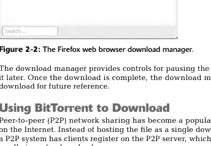

图 2-2：Firefox 网页浏览器下载管理器。

下载管理器提供了暂停下载的控件，以便稍后恢复。一旦下载完成，下载管理器会保留下载记录以供将来参考。

# Using BitTorrent to Download

点对点（P2P）网络共享已成为在互联网上分发大文件的流行方式。与将文件作为单个下载托管在单个 FTP 服务器上不同，P2P 系统让客户端在 P2P 服务器上注册，然后将文件拆分为许多小块进行下载。

随着不同客户端检索文件的不同部分，它们会宣传自己拥有的部分并将其提供给其他客户端下载。不久之后，单个客户端可以直接从多个客户端检索下载的片段，而无需去主服务器。随着客户端程序检索各个片段，它会重建原始文件。当它检索到所有片段时，你就拥有了原始文件的副本。

尽管 P2P 最近因一些用户发布违反版权法的材料而声名狼藉，但只要内容合法，它仍然是一种分发大文件的有效方式。Ubuntu 项目完全支持使用 P2P 分发各种 Ubuntu LiveCD 版本。使用 P2P 下载 Ubuntu ISO 映像文件是完全合法的。

# Installing P2P Software

P2P 网络背后的协议称为 BitTorrent。BitTorrent 协议使用一个中央服务器来宣传哪些已连接客户端拥有由服务器控制的可用下载文件的一部分。

在你加入 P2P 行列之前，你需要在你的 PC 上安装一个 BitTorrent 客户端包。有多个商业和免费版本可供不同操作系统使用。

对于 Mac OS X 和 Linux 系统，Transmission 开源软件包，如图 2-3 所示，是一个流行的免费 BitTorrent 客户端。

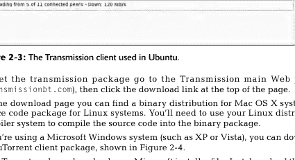

图 2-3：Ubuntu 中使用的 Transmission 客户端。

要获取 transmission 包，请前往 transmission 主网页（`www.transmissionbt.com`），然后点击页面顶部的下载链接。

在下载页面上，你可以找到适用于 Mac OS X 系统的二进制分发版或适用于 Linux 系统的源代码包。你需要使用 Linux 发行版的 C 编译器系统将源代码编译成二进制包。

如果你使用的是 Microsoft Windows 系统（如 XP 或 Vista），你可以下载免费的 µTorrent 客户端包，如图 2-4 所示。

µTorrent 包作为 Microsoft 安装程序文件下载。只需下载该文件，然后双击它即可启动安装程序。µTorrent 程序安装后，你可以从开始菜单运行它。

# Start the Download Process

通过 BitTorrent 过程下载文件与网页下载方法略有不同。与直接找到要下载的 ISO 映像文件不同，你必须首先获取一个特殊文件（称为 torrent 文件），该文件提供有关托管下载的 BitTorrent 服务器的信息以及要下载的特定 ISO 映像文件。每个映像文件使用单独的 torrent 文件。

Ubuntu 在其网站主下载区域之外提供 torrent 文件。与其前往 Ubuntu 网站的下载页面，不如前往 `http://releases.ubuntu.com`。

在此页面上列出了所有可供下载的受支持 Ubuntu 版本。当你选择想要的版本时，它会带你进入一个下载页面，其中包含各种 LiveCD 文件的链接，以及其他类型文件的链接。

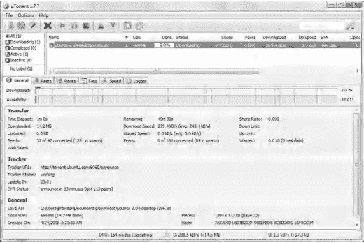

**图 2-4：Microsoft Windows 中使用的 µTorrent 客户端。**

如果你滚动到页面底部，你会看到 BitTorrent 文件与其他文件混合在一起。所有 BitTorrent 文件都以 `.torrent` 结尾。你会看到各种可用的 Ubuntu LiveCD 类型对应的种子文件：

- `ubuntu-8.04-server-i386.iso.torrent`

- `ubuntu-8.04-server-amd64.iso.torrent`

- `ubuntu-8.04-desktop-i386.iso.torrent`

- `ubuntu-8.04-desktop-amd64.iso.torrent`

文件名会告诉你每个文件对应的版本。例如，32 位桌面版对应的文件是 `ubuntu-8.04-desktop-i386.iso.torrent`。

根据你使用的网络浏览器，你可能只需选择相应的 `.torrent` 文件就能自动启动 BitTorrent 应用程序。Microsoft Internet Explorer 则需要你首先将 `.torrent` 文件下载到 PC，然后在 Windows 资源管理器中双击该文件来启动 µTorrent 程序。

一旦你在 BitTorrent 客户端套件中启动 `.torrent` 文件，它就会自动联系 BitTorrent 服务器开始下载。BitTorrent 服务器可能需要几分钟时间才能将你的客户端与共享相应 ISO 镜像文件的其他客户端连接起来，所以请耐心等待。一旦你的客户端找到其他客户端，它们就会开始相互通信，以确定哪个客户端拥有整个文件的哪些部分，然后下载就开始了。

BitTorrent 客户端软件可以同时从多个客户端下载多个文件部分。这通常比传统的 FTP 方式下载文件更快。

当你的 BitTorrent 客户端正在下载文件的部分时，其他 BitTorrent 客户端会连接到你的 PC，下载你已经获取的部分。不过，这无需担心，因为所有交互都发生在 BitTorrent 客户端软件内部。你的 PC 不会受到这些远程连接的侵害。

一旦 BitTorrent 软件完整下载了 ISO 镜像文件，它还会继续将该文件提供给其他客户端下载。正确的 BitTorrent 礼节要求你让 BitTorrent 客户端再运行一段时间，以便你分享的文件部分至少能供与你下载时所用客户端数量相当的客户端使用（这称为 `分享率`）。

# 验证文件

在获取完整的 LiveCD ISO 镜像文件后，先别急着庆祝——在刻录 CD 之前还有一步要做。对于大型文件下载，很可能会在下载过程中的某个环节出现损坏。最好确保你即将用来安装操作系统的文件是有效的。

除了文件损坏，还有另一件事需要担心。当你从服务器（尤其是镜像服务器）下载 ISO 镜像文件时，你是在信任创建该文件的人是可靠的。不幸的是，情况并非总是如此。有很多关于攻击者用恶意代码修改 ISO 镜像文件并将其发布到下载服务器上的传闻。

归根结底，最好验证你下载的 ISO 镜像文件与 Ubuntu 发布的原始文件一致。幸运的是，有一种简单的方法可以做到这一点。

# 使用 MD5 校验和

验证大型文件真实性的方法之一是使用数学计算。你可以用一种数学公式在下载前评估文件内容，并将结果与下载后同一公式计算出的结果进行比较。如果结果匹配，那么文件很有可能被正确下载且未被修改。

用于此目的最常见的数学公式是 `MD5` 和 `SHA1` 哈希算法。哈希算法会从任意大小的数据中计算出一个唯一的、固定长度的结果。如果数据中有任何变化，哈希算法的结果也会不同。

MD5 算法生成一个 128 位的值，通常表示为 32 字符的十六进制值，常被称为 `MD5 校验和`。SHA1 算法更复杂，生成一个 160 位的值，表示为 40 字符的十六进制值。


Ubuntu 在通用发布页面 (`http://releases.ubuntu.com/8.04`) 上以 MD5SUMS 文件的形式发布其每个下载文件的 MD5 校验和。这些值也保存在网页 `https://help.ubuntu.com/community/UbuntuHashes` 上。（请注意，这是一个安全的 https 网站，而不是标准的 http 网站。）

Ubuntu 的 BitTorrent 文件各自包含自己的带签名 SHA1 校验和。该文件会随 ISO 镜像文件一起从 BitTorrent 站点自动下载。

下载哈希文件后，你需要对你下载的 ISO 镜像文件执行哈希算法并比较这些值。下一节将讨论具体操作方法。

# 计算 MD5 校验和

下载完大型 ISO 镜像文件后，你需要对其执行 MD5 或 SHA1 哈希算法。大多数 BitTorrent 客户端软件包会自动将 SHA1 校验和与下载的文件进行比较。但是，如果你使用 MD5 校验和，则必须自行计算。具体如何操作主要取决于你使用的操作系统。

# Mac OS X 和 Linux

Mac OS X 操作系统和大多数 Linux 发行版默认都包含 MD5 哈希算法程序。你可以轻松使用它来计算所下载 ISO 镜像文件的 MD5 校验和。在 Mac OS X 系统上，你可以使用 `md5` 命令来完成：

```
$ md5 ubuntu-desktop-8.04-i386.iso
MD5 (ubuntu-desktop-8.04-i386.iso) = 8895167a794c5d8ddeedc312fc62f1f1f
$
```

MD5 程序会计算文件的 MD5 哈希值，然后显示出来。然后你可以将该值与 Ubuntu 发布的正确值进行比较。如果它们匹配，那么你得到的就是有效的 ISO 镜像文件。

> 在 Linux 系统上，MD5 程序被称为 `md5sum`。如果你从现有的 Ubuntu 安装升级，Ubuntu 默认不会安装 MD5 程序，也不会将其包含在要安装的标准软件包列表中。要安装 MD5 程序，你需要安装 `sleuthkit` 软件包，该软件包未列在“添加/删除程序”组中。要安装它，请启动命令提示符并使用以下命令：
>
> `sudo apt-get install sleuthkit`
>
> 此命令会将 MD5 应用程序（以及其他一些加密应用程序）安装到你的系统上。

# Windows

如果你使用的是 Microsoft Windows，则必须下载单独的 MD5 程序来计算 ISO 镜像文件的 MD5 校验和。一个常见的开源 MD5 程序是 `winmd5sum` 应用程序，可从 `www.nullriver.com/products/winmd5sum` 免费下载。

只需从链接下载安装文件并将其安装到 Windows 系统上即可。图 2-5 展示了 `winmd5sum` 程序的运行情况。

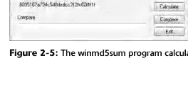

图 2-5：正在计算 MD5 校验和的 `winmd5sum` 程序。

`winmd5sum` 程序不仅可以计算 ISO 镜像文件的 MD5 校验和，你还可以直接将来自 Ubuntu 网站的真实 MD5 校验和值剪切并粘贴到 `winmd5sum` 窗口中，它会为你比较这两个值。

# 创建 LiveCD

现在你已经在 PC 上拥有了 Ubuntu LiveCD 的 ISO 镜像文件，是时候将它制作成 CD 了。有许多不同的 CD 刻录软件包可用，既有商业软件，也有免费软件。问题是，PC 供应商提供的许多免费 CD 刻录软件包不包含刻录 CD 镜像文件的选项。

刻录 CD 镜像文件与将常规文件从硬盘刻录到 CD 略有不同。ISO 镜像文件代表整张 CD，而不仅仅是其中的单个文件。它需要特殊的 CD 刻录功能来提取 ISO 镜像文件中包含的所有文件和文件夹。

根据你使用的操作系统，刻录新 CD 可能是一个简单或复杂的过程。本节说明如何在不同操作系统上刻录 CD。

# 在 Linux 中刻录 CD

Linux 环境包含两个功能强大的 CD 刻录工具，它们都完全支持刻录 ISO 镜像文件：

- ♦ 适用于 KDE 桌面环境的 `K3b`
- ♦ 适用于 GNOME 桌面环境的 `Brasero`

使用这两个工具，刻录 ISO 镜像文件就像选择“将镜像刻录到 CD”选项，然后选择要刻录的 ISO 镜像文件一样简单。

你可以在 Kubuntu 中通过 K 菜单访问 `K3b`。只需选择“多媒体”，然后选择“`K3b CD 与 DVD 刻录`”。`K3b` 主窗口如图 2-6 所示。

选择主窗口中的“刻录 CD 镜像”按钮，选择 ISO 镜像文件，插入空白 CD，然后点击“开始”按钮。

基于 GNOME 的桌面（如 Ubuntu）使用 `Brasero` CD 刻录工具。图 2-7 演示了在 Ubuntu 中使用 `Brasero` 实用程序。

要在 Ubuntu 中启动 `Brasero`，请选择“应用程序” ▸ “声音与视频” ▸ “`Brasero 光盘刻录`”。当 `Brasero` 主窗口出现时，选择“刻录镜像”选项。

# 在 Mac OS X 中刻录 CD

Mac OS X 操作系统内置了 CD 刻录软件，因此你无需下载其他任何东西。你可以使用“磁盘工具”刻录 CD，该工具位于“应用程序”文件夹中的“实用工具”文件夹内。

启动“磁盘工具”后，从左侧查找器区域选择要刻录的 ISO 镜像文件，然后点击顶部工具栏中的“刻录”图标。

“磁盘工具”会将 ISO 镜像文件刻录到 CD，然后将 CD 与 ISO 镜像文件进行比较，以验证刻录是否成功。

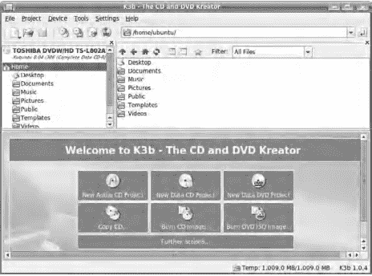

图 2-6：`K3b` CD 刻录主窗口。

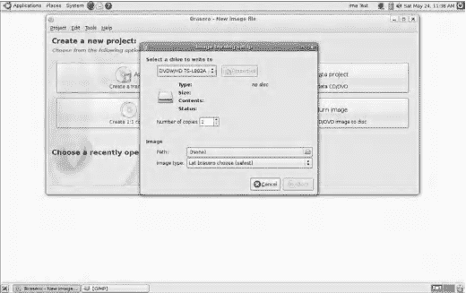

图 2-7：使用 `Brasero` 工具刻录 ISO 镜像文件。

# 在 Windows 中刻录 CD

Windows 环境默认不包含 CD 刻录软件。市面上有许多免费和商业软件包，但并非所有软件都提供刻录 ISO 镜像文件的选项。

如果你的特定 CD 刻录软件包无法刻录 CD 镜像，Ubuntu 推荐一款名为 `InfraRecorder` 的免费 CD 镜像刻录软件。`InfraRecorder` 软件包可以在流行的 SourceForge 网站上找到（`infrarecorder.sourceforge.net`）。

只需下载 `InfraRecorder` 软件包并安装到你的 PC 上。启动 `InfraRecorder` 后，点击 `Actions` 菜单栏项目，然后选择 `Burn Image`。你会看到一个选择要刻录镜像的对话框，然后会出现另一个对话框（如图 2-8 所示），等待你插入空白 CD 开始刻录。

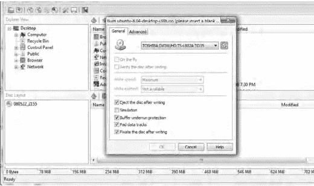

**图 2-8：** 用于 Microsoft Windows 的 `InfraRecorder` CD 刻录工具。

一旦插入空白 CD，`InfraRecorder` 就会将 ISO 镜像文件刻录到 CD 上。获得 LiveCD ISO 镜像的 CD 后，就该开始尝试使用 Ubuntu 了！

# 启动 LiveCD

Ubuntu LiveCD 的美妙之处在于，它让你在无需经历安装过程的情况下，真正体验在 PC 上运行 Ubuntu 的感觉。当你从 PC 启动 LiveCD 时，Ubuntu 会像实际安装在 PC 硬盘上一样经历所有正常的启动过程。这包括检测 PC 硬件并尝试加载适当的驱动程序（在 Linux 中称为模块）以与检测到的硬件交互。

以下各节将介绍 Ubuntu LiveCD 启动过程以及从 LiveCD 启动 Ubuntu 后如何使用 Ubuntu。

# 启动过程

启动 LiveCD 的第一步是确定你的 PC 是否能够从其 CD 驱动器启动以及如何启动。许多 PC 默认即可实现。只需将 Ubuntu LiveCD 放入 CD 托盘并重新启动 PC 即可。如果你的特定 PC 无法从 CD 启动，在放弃之前可以尝试以下几种方法。

首先，进入 PC BIOS，查看是否已设置为允许从 CD 驱动器启动。不同的 PC 主板制造商使用不同的 BIOS 软件，配置此设置的方式多种多样。图 2-9 显示了示例 BIOS 设置中的启动顺序部分。

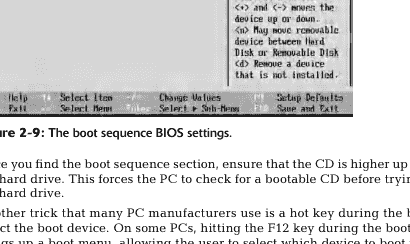

图 2-9：启动顺序 BIOS 设置。

找到启动顺序部分后，确保 CD 在列表中位于硬盘之上。这会强制 PC 在尝试从硬盘启动之前先检查是否有可启动的 CD。

许多 PC 制造商在启动过程中使用热键来选择启动设备。在某些 PC 上，在启动画面期间按下 `F12` 键会弹出启动菜单，允许用户选择要从哪个设备启动。用户选择 CD/DVD 设备，系统就会从 CD 启动。

# 使用 Ubuntu

启动 Ubuntu 启动过程后，你应该会看到如图 2-10 所示的主 Ubuntu 启动屏幕。


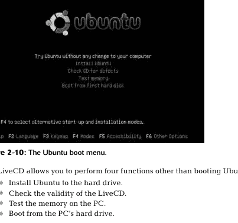

图 2-10：Ubuntu 启动菜单。

除了启动 Ubuntu 外，LiveCD 还允许你执行以下四项功能：

- 将 Ubuntu 安装到硬盘。
- 检查 LiveCD 的有效性。
- 测试 PC 的内存。
- 从 PC 的硬盘启动。

最后这个选项在紧急情况下可能成为救命稻草。硬盘上的引导扇区可能会损坏，导致 Linux 操作系统无法启动。只需插入可靠的 Ubuntu LiveCD，选择从硬盘启动选项，你可能就能拯救你的数据！

如果你选择从 CD 镜像启动，Ubuntu 会像从已安装的镜像启动一样进行所有硬件检测过程。

你会注意到，可以使用键盘上的 F 键从启动菜单访问多个选项。表 2-1 显示了这些键各自的功能。

### 表 2-1：Ubuntu LiveCD 启动菜单键

| Key | Description |
|-----|-------------|
| F1 | 显示一个帮助屏幕，列出 F 键选项。 |
| F2 | 选择 Ubuntu 菜单使用的默认语言。 |
| F3 | 选择 Ubuntu 使用的键盘映射。 |
| F4 | 选择视频设备的启动模式。 |
| F5 | 启用特殊辅助功能，例如屏幕放大镜或屏幕键盘。 |
| F6 | 向 GRUB（引导加载程序）提供额外的启动参数 |

F6 键允许你为 PC 上的特殊硬件添加任何特定的启动选项。当尝试从笔记本电脑运行 LiveCD 时，此功能非常方便，因为笔记本电脑通常会出现特殊硬件设备的问题。

# LiveCD 桌面

启动过程完成后，你的 PC 上将运行一个完整的 Ubuntu 系统，如图 2-11 所示。

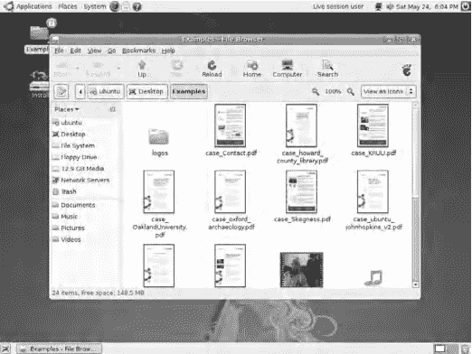

**图 2-11：** Ubuntu LiveCD 桌面。

LiveCD 桌面包含普通 Ubuntu 工作站桌面的所有功能，包括所有已安装的软件。你可以试用任何应用程序——就像你已经在 PC 上安装了 Ubuntu 一样。

> **注意：** 根据 PC 的速度，从 LiveCD 运行某些应用程序可能会很慢。

LiveCD 桌面包含两个在普通 Ubuntu 桌面上不可用的桌面图标。其中一个是包含各种文档和多媒体文件的示例文件的文件夹，Ubuntu 默认支持这些文件。只需单击一个文件即可启动 Ubuntu 用于处理该类型文件的应用程序。示例包括文字处理文档、电子表格、音频文件和视频剪辑。这些文件将很好地表明在真正的 Ubuntu 安装中事物将如何运行。

另一个桌面图标标记为 `Install`。正如你可能猜到的那样，单击该图标将启动 Ubuntu 安装程序。我们将在第 3 章“安装 Ubuntu”中详细介绍。

尽管你可以从 LiveCD 运行所有应用程序，但在浏览各种应用程序时，你可能会注意到一个问题：当你从 LiveCD 运行 Ubuntu 时，没有地方可以存储供将来使用的文件。

当 Ubuntu 从 LiveCD 运行 时，操作系统在内存中运行。默认用户（称为 `ubuntu`）的主文件夹仅存在于内存中。你保存的任何文件在重新启动 PC 时都会丢失。下一节将展示如何更改这种情况。

# 存储文件

即使你无法直接从 LiveCD 访问硬盘，你仍然有大量可用的选项来保存文件。本节讨论了一些在从 LiveCD 工作时存储文件的方法。

## 使用 Windows 分区

Ubuntu 的一大优点是它支持所有 Microsoft 文件系统。此功能允许你直接从 Ubuntu 系统读取和写入文件到任何为 DOS 或 Windows 格式化的驱动器（包括 Windows XP 和 Vista 使用的新 NTFS 格式）。

你可以直接从 LiveCD 桌面查看 PC 上的硬盘。单击 Places 菜单项。你会注意到可以查看的不同位置的列表，如图 2-12 所示。

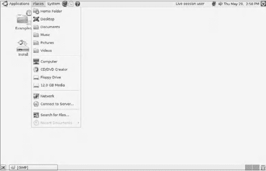

**图 2-12：** 从 LiveCD 访问 Microsoft Windows 分区。

你的 PC 硬盘要么通过其卷名标识，要么如果未分配卷名则通过磁盘的通用大小标识。选择硬盘卷，Ubuntu 将在 `Nautilus` 磁盘管理实用程序中打开你的硬盘目录结构（在第 5 章“文件管理”中讨论）。你可以像在 Windows 本身中一样浏览 Windows 硬盘文件夹。不仅可以访问所有文件，还可以在文件夹中写入新文件。

## 使用 USB 设备

廉价的 USB 记忆棒如今是一种流行的存储形式。这些设备就像迷你硬盘。你存储在记忆棒上的任何数据在拔下记忆棒后仍会保留，直到你删除数据为止。

如果在运行时将 USB 记忆棒插入 PC，Ubuntu LiveCD 将自动检测到它。它会为该设备创建一个桌面图标并使用 `Nautilus` 磁盘管理器打开它，如图 2-13 所示。

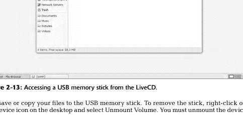

图 2-13：从 LiveCD 访问 USB 记忆棒。

只需将文件保存或复制到 USB 记忆棒即可。要移除记忆棒，请右键单击桌面上的设备图标并选择 `Unmount Volume`。在移除设备之前必须卸载它，否则你的文件可能会损坏。

> note
>
> 一些 USB 记忆棒设备使用灯来指示设备是否正在使用。Ubuntu 可能无法使用此灯。在某些情况下，灯在卸载卷之前工作正常，但保持点亮状态。

## 使用网络共享

如果你有一台 Windows 网络，你可以连接到网络上任何可用的共享文件夹。如果 Ubuntu 正确检测到你的网卡，它会自动尝试连接到你的网络。它会检测到网络上出现的任何 Windows 网络。

你可以通过选择“位置”菜单项，然后选择“网络”（以浏览你的 Windows 网络）或“连接到服务器”（以直接连接到特定服务器共享）来从 LiveCD 访问网络共享文件夹。在任何一种情况下，你都会看到服务器和共享，如图 2-14 所示。

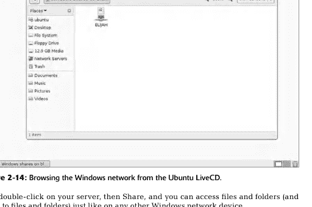

只需双击你的服务器，然后双击“共享”，你就可以像在任何其他 Windows 网络设备上一样访问文件和文件夹（并写入文件和文件夹）。

# 在 Windows 中运行 Ubuntu

直接从 LiveCD 运行 Ubuntu 的主要缺点是速度慢。有时很难准确感受到软件在特定系统上的运行情况，因为 LiveCD 会扭曲 Ubuntu 从硬盘运行时的表现。Ubuntu 对此有一个解决方案。

## Wubi 项目

Windows Ubuntu 安装程序（Wubi）项目是作为运行 Ubuntu LiveCD 的替代方案而创建的。Wubi 在 Windows 操作系统上创建一个完整的 Ubuntu 磁盘分区作为单个文件，然后在标准 Windows 启动程序中创建一个条目，使你的 PC 能够直接从 Ubuntu 文件启动。

这意味着你只需在 Windows PC 上安装一个程序，就能拥有一个完整的、可启动的 Ubuntu 系统。目前，Wubi 支持 Windows 95、98、2000、XP 和 Vista。

## 在 Windows 中安装

Wubi 的主要目标是让在现有 Windows PC 上安装 Ubuntu 变得简单，并且他们已经完成了任务。有两种方法可以获取 Wubi：

- 直接从 Ubuntu 工作站 LiveCD 安装。
- 从 Wubi 网站下载。

如果你有 Ubuntu 工作站 LiveCD，你已经拥有了 Wubi 软件。在 Windows 中，将 LiveCD 插入光盘托盘，然后让光盘自动运行或点击 Autorun 文件。Ubuntu LiveCD 菜单会出现，允许你重新启动 PC 以从 LiveCD 启动或运行 Wubi 程序。运行 Wubi 程序会弹出 Wubi 设置窗口，如图 2-15 所示。

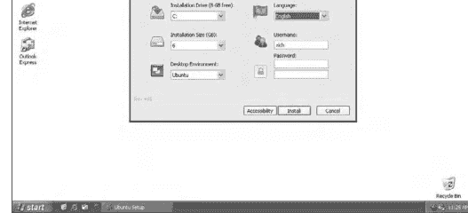

图 2-15：Wubi 设置窗口。

### 第 1 部分：开始使用 Ubuntu

Ubuntu 设置窗口允许你选择要将 Ubuntu 文件安装到的硬盘以及为 Ubuntu 系统使用多少磁盘空间。你至少应为 Ubuntu 发行版文件分配 4 GB 的空间。

如果你尚未下载 Ubuntu LiveCD，Wubi 中有一个很棒的功能你可以利用。你可以从 Wubi 网站下载 Wubi 安装文件，并在 Windows 中安装 Ubuntu，而无需刻录 LiveCD。

Wubi 网站（`http://wubi-installer.org`）提供了一个链接来下载仅 Wubi 设置程序。一旦你下载 Wubi 设置程序并启动它，它会自动联系 Ubuntu 网站并下载适合你 PC 的桌面版 LiveCD ISO 映像文件。下载完成后，Wubi 将挂载 ISO 映像文件——就像它在光盘上一样——并开始 Ubuntu 安装。

# 在 Windows 中运行 Ubuntu


Ubuntu 安装为 Windows 应用程序后，你在启动 Windows PC 时会看到一个新菜单，如图 2-16 所示。

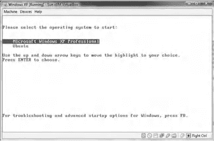

**图 2-16：** 安装 Ubuntu 后的 Windows 启动菜单。

默认菜单项是你的原始 Windows 操作系统。选择此选项（或什么都不做，让倒计时结束）将启动你的 Windows 系统，就像你在安装 Ubuntu 之前一样。如果你选择 Ubuntu 菜单选项，Ubuntu 将从安装在你的 Windows 系统上的 Ubuntu 映像文件启动。

启动后你会看到 Ubuntu 登录窗口，就像 Ubuntu 安装在硬盘分区上一样。当你使用在 Wubi 设置程序中指定的账户登录时，你将进入 Ubuntu 桌面，可以使用全部应用程序。如果你 PC 上安装了网络接口卡（并且 Ubuntu 检测到它），Ubuntu 软件更新程序（在第 13 章“软件安装和更新”中讨论）将自动连接到 Ubuntu 软件仓库并为你提供软件更新。

所有运行 Ubuntu 所需的 Ubuntu 文件都位于你的 Windows 硬盘的 Ubuntu 文件夹中。如果你想从 Windows 驱动器中移除 Ubuntu，不要直接删除该文件夹。转到 Windows 控制面板中的添加/删除软件工具，并选择 Ubuntu 软件进行卸载。Ubuntu 将删除所有文件，包括 Windows 启动菜单中的 Ubuntu 选项，将你的 PC 恢复到安装 Ubuntu 之前的样子。

尽管从 Windows 分区运行 Ubuntu 比使用 LiveCD 快，但仍然存在性能损失。要充分利用 Ubuntu 的优势，你应该将其安装为硬盘上的单独分区。我们将在下一章中完成此操作。

# Summary

Ubuntu `LiveCD` 发行版允许你在无需进行完整安装的情况下感受 Ubuntu 在你的 PC 上的运行方式。本章介绍了下载和创建 `LiveCD`，然后启动和使用 `LiveCD` 的步骤。

有多个版本的 `LiveCD` 可用。标准的 Ubuntu 工作站安装可在 `desktop-i386` `LiveCD` 映像上获得。下载映像后，你需要验证映像是否未损坏或未被篡改。Ubuntu 使用 `MD5` 和 `SHA1` 哈希来验证下载文件的真实性和准确性。Mac OS X 和 Linux 系统包含 `MD5` 哈希程序来计算下载映像的哈希值。`winmd5sum` 程序是 Windows 上可免费下载的实用程序，用于计算 `MD5` 哈希。

在解释如何下载和验证 `LiveCD` ISO 映像文件后，本章讨论了如何将映像刻录到 CD 上。Mac OS X 在磁盘实用程序包中包含 CD 刻录实用程序。大多数 Linux 发行版包含 `K3b` 或 `Brasero` CD 刻录包。对于 Windows PC，一些免费的 CD 刻录工具不提供将 ISO 映像文件刻录到 CD 的选项。你可以免费下载 `InfraRecorder` 包。该包可从 Windows 将 ISO 映像文件刻录到 CD。

创建 `LiveCD` 后，本章介绍了如何在你的 PC 上从中启动。一些 PC 配置为自动检测光盘托盘中的 CD 并启动，而另一些则需要更改系统 BIOS 设置或在启动时按特殊键。

一旦启动到 Ubuntu `LiveCD`，你将能够直接从 CD 运行 Ubuntu 桌面。这是在尝试安装 Ubuntu 之前检查硬件兼容性的绝佳方法。

最后，本章讨论了 `Wubi` 项目。`Wubi` 项目在 Windows 内提供了一个接口，用于将 Ubuntu 作为 Windows 硬盘分区上的文件加载并从 Windows 启动加载程序启动该文件。这使你能够直接在现有的 Windows PC 上安装 Ubuntu，而无需重新分区硬盘。

下一章将介绍官方的 Ubuntu 安装过程。这包括将 Ubuntu 安装为现有 Windows PC 上的第二个分区，以及将整个 PC 转换为 Ubuntu 工作站。

# Installing Ubuntu

## Chapter 3

### Secrets in This Chapter

- Preparing Your PC
- Installing from LiveCD
- Installing from Alternate CD
- Server Installation

服务器上没有图形要求)，但对于高流量的 Web、数据库或邮件服务器，你至少需要 2 GB 的可用内存。Ubuntu 操作系统还使用交换空间，即硬盘上为虚拟内存保留的特殊区域（参见第 1 章）。交换空间有助于增加系统可用内存量，尽管会带来性能损失。当 Ubuntu 用完物理内存时，它会将内存块交换到交换区。当需要内存块时，Ubuntu 必须将其交换回物理内存。此过程显然比直接从物理内存访问数据花费更多时间。

**Hard drive:** 典型的 Ubuntu 安装建议的最小硬盘空间为 1.8 GB，然而，如果你想在安装 Ubuntu 后对系统做任何事情，你可能需要更多的磁盘空间。确定总硬盘大小需求时，还请记住将交换空间区域计入其中。Ubuntu 建议的最小值为 4 GB，尽管你可能可以用更少的空间生存。Ubuntu 识别大多数类型的硬盘安装，例如次要磁盘和 USB 磁盘。你获得更多磁盘空间的方式取决于你的系统和预算。

**CD/DVD drive:** 如今几乎每台 PC 都配备某种类型的 CD 和/或 DVD 驱动器。然而，许多较旧的系统没有。如果计划使用 `LiveCD`，你的 PC 中需要某种类型的 CD/DVD 驱动器。购买新的 CD/DVD 驱动器时要小心，因为通常有两种类型可用。你需要的类型取决于系统使用的磁盘控制器。大多数面向工作站的系统使用集成设备电子（`IDE`）控制器，而许多面向服务器的系统使用小型计算机系统接口（`SCSI`）控制器（参见本章“安装硬盘”部分）。你必须购买适合你的磁盘控制器的 CD/DVD 驱动器。如果你决定使用 `Wubi` 安装程序安装 Ubuntu，你可以使用网卡下载 ISO 映像文件并直接从中安装，而无需使用 CD 或 DVD。通过这种方法，你应该能够避免购买 CD/DVD 驱动器（除非，当然，你想使用 CD/DVD 来播放音频 CD 或视频 DVD）。

**Keyboard:** 键盘是大多数工作站的基本要求。即使你运行的是免维护服务器，一些系统也需要连接键盘才能启动。Ubuntu 支持不同类型的键盘，以及不同语言的键盘。当你运行 `LiveCD` 安装时，Ubuntu 会提示你输入正在使用的键盘类型。如果使用特殊键盘，请注意，以便在安装过程中选择正确的键盘。

**Mouse:** 在图形桌面环境中，鼠标几乎是必需的（尽管 Ubuntu 也包含非鼠标导航支持）。鼠标技术自 PC 早期的日子以来已经取得了长足的进步。你可以购买各种鼠标设备，从标准的滚球鼠标到光学鼠标再到无线鼠标。鼠标的连接位置也有不同，例如串口、PS/2 端口和 USB 端口。Ubuntu 能够自动检测大多数鼠标设备。如果你的鼠标需要特殊驱动程序来支持特殊按钮或功能，例如滚轮，它可能在 Ubuntu 中工作也可能不工作。许多较新的笔记本电脑使用触摸板来提供鼠标指针控制以及滚动和点击功能。Ubuntu 可以处理这些功能。

**Sound card:** 如果你打算使用 Ubuntu 中提供的任何多媒体功能，例如播放音乐 CD、观看 DVD 或收听下载音频文件，您的工作站需要安装声卡。Ubuntu 可以自动检测大多数声卡，而无需任何额外的驱动程序。Ubuntu 还可以检测并为某些专有声卡安装驱动程序。然而，这些驱动程序被视为不受支持，如果您遇到任何问题，只能自行解决。

- **视频卡：** 视频卡可以决定工作站系统的成败。Ubuntu 可以自动检测并使用大多数标准视频卡。由于 Ubuntu 桌面使用的图形化环境，您希望使用能够达到至少 1024 × 768 分辨率的 `VGA` 显卡。随着 PC 游戏的普及，许多工作站使用先进的 3-D 加速视频卡。Ubuntu 为许多标准 3-D 视频卡提供支持，例如 `ATI`、`Intel` 和 `NVIDIA`，并且可以为提供自定义驱动程序的卡使用自定义驱动程序。一些更奇特的视频卡可能会出现问题，特别是如果它们不包含 Linux 驱动程序。与声卡类似，Ubuntu 可以为视频卡使用不受支持的驱动程序，但请注意使用这些驱动程序，因为安装时可能会破坏其他东西。

- **打印机：** Ubuntu 能够自动检测和配置大多数常见的桌面和网络打印机。此功能也适用于许多可以扫描文档的新型一体机打印机。然而，您可能需要为您的特定品牌和型号选择正确的驱动程序。记下您使用的打印机品牌和型号，以及您将如何连接到它（并行打印机电缆、USB 电缆或网络地址）。


- **调制解调器：** Ubuntu 支持使用调制解调器拨号远程计算机系统以及作为访问互联网的方式。Ubuntu 可以自动检测并使用大多数标准调制解调器，包括外部和内部调制解调器。需要小心的一种调制解调器类型是 Winmodems。Winmodems 在笔记本电脑中很常见，需要特殊软件（通常在 Microsoft Windows 中找到）才能运行。许多 Winmodems 现在在 Linux 世界中得到支持。然而，如果您可以避免使用 Winmodem，就这样做。
- **网卡：** 随着家庭网络的普及，许多工作站都带有内置于主板中的某种类型的网络连接接口。Ubuntu 在检测大多数有线甚至无线网络接口方面做得非常出色。如果您的网络已连接到互联网，Ubuntu 将自动配置自身以从网络上的 Ubuntu 服务器检索软件和安全补丁。根据您的网络环境，您可能需要为网络设备自定义网络配置设置。

如果您不确定系统中的硬件，以下网站可以提供有关与 Ubuntu（或 Linux 总体）兼容的硬件配置的信息：

```
https://wiki.ubuntu.com/HardwareSupport
https://help.ubuntu.com/community/Hardware
http://www.tldp.org/HOWTO/Hardware-HOWTO
```

这些网站提供有关哪些设备可用的最新信息，并且通常解释如何在 Ubuntu 环境中使其工作。

# 第 3 章：安装 Ubuntu


笔记本电脑通常对 Linux 发行版构成问题。许多较旧的笔记本电脑使用 Linux 不支持的专有硬件设备。在这些笔记本电脑上，Ubuntu 可能甚至无法运行 LiveCD。具有专有视频系统的较旧笔记本电脑在 Linux 环境中尤其容易失败。

然而，大多数较新的笔记本电脑使用 Ubuntu 可以检测并无问题使用的更标准硬件。请特别注意笔记本电脑中使用的视频、调制解调器和无线网卡，因为这些设备最容易出现问题。处理 Linux 和笔记本电脑的一个很好的资源是 www.linux-laptop.net。它提供了成功在特定笔记本电脑上加载特定 Linux 发行版的用户提供的宝贵指导。

如果您正在购买新笔记本电脑，您应该检查其是否与 Ubuntu 兼容，要么通过使用 Ubuntu LiveCD 获取它，要么通过在各种 Ubuntu 和 Linux 硬件网站上验证其硬件。

通常，Ubuntu 安装最困难的部分是在系统上找到足够的磁盘空间来安装它。如果您将工作站转换为仅 Ubuntu 工作站，那应该不是问题。然而，如果您想保留现有的 Windows 工作站设置并添加 Ubuntu，则可能需要一些工作。

由于这是一个常见的设置，下一个部分讨论如何为在双启动环境中安装 Ubuntu 准备您的 Windows PC。

# 为 Ubuntu 创建位置

要在您的 PC 上永久安装 Ubuntu，您需要为其设置硬盘区域。此设置的三种常见选项为：

- 用 Ubuntu 替换硬盘上现有的操作系统。
- 在第二块硬盘上安装 Ubuntu。
- 分区现有硬盘以包含 Ubuntu。

显然，在 PC 上安装 Ubuntu 的最简单解决方案是替换硬盘上安装的现有操作系统。Ubuntu 安装可以轻松指导您完成此过程。只需记住，完成时您将不再拥有来自先前操作系统的原始文件。如果您想保留任何文件，您需要自己将其备份到您可以从 Ubuntu 读取的介质上。


随着 VMWare 和 Sun VirtualBox 等虚拟服务器程序的普及，许多 Linux 爱好者在 Windows 操作系统内部运行的虚拟环境中加载 Ubuntu。如果您正在尝试这样做，只需按照 Ubuntu 安装方法替换硬盘上的现有操作系统即可。只需确保在执行此操作之前您已进入虚拟服务器环境中！

另外两种方法需要 *双启动* 场景。在双启动场景中，Ubuntu 和另一个操作系统（通常是 Windows）都驻留在计算机的硬盘上。当你启动计算机时，会出现一个菜单，询问你想要启动哪个操作系统，如图 3-1 所示。

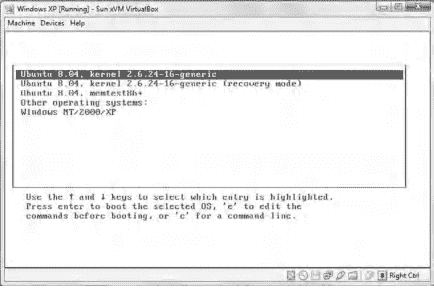

在双启动环境中设置工作站时，你需要采取一些特殊预防措施。本节将介绍在这两种情况下需要注意的一些事项。

## 安装第二块硬盘

除了替换现有操作系统之外，将 Ubuntu 安装到工作站上的第二种最简单的方法是安装第二块硬盘。许多工作站通过将两块硬盘串联在同一个磁盘控制器上或提供多个磁盘控制器来处理硬盘，从而支持多块硬盘。

工作站 PC 中最常用的磁盘控制器是集成设备电子（IDE）控制器。IDE 控制器允许每个通道最多连接两个设备。工作站通常会在主板上安装多个 IDE 通道。

> **秘密**
>
> 串行高级技术附件（SATA）控制器是一种在较新 PC 中变得越来越流行的技术。这种技术模拟 IDE 控制器，但响应速度快得多。Ubuntu 对 SATA 设备有完全支持，因此你可以轻松地将它们用于 Ubuntu 安装。

通常，你可以通过查看 PC 的 BIOS 设置屏幕来确定你的磁盘控制器配置。图 3-2 显示了 BIOS 屏幕上磁盘控制器区域的示例。

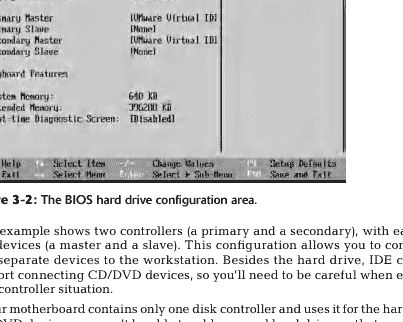

图 3-2：BIOS 硬盘配置区域。

此示例显示了两个控制器（主控制器和从控制器），每个控制器支持两个设备（主设备和从设备）。此配置允许你将总共四个独立设备连接到工作站。除了硬盘之外，IDE 控制器还支持连接 CD/DVD 设备，因此在评估你的磁盘控制器情况时需要小心。

如果你的主板只包含一个磁盘控制器，并且将其用于硬盘和 CD/DVD 设备，你将无法在该控制器上添加第二块硬盘。通常你可以找到即插式磁盘控制器卡来为工作站添加第二个控制器。如果你想添加另一块硬盘，就需要这样做。

如果你的主板包含两个磁盘控制器，你可以购买第二块硬盘并轻松将其连接到其中一个控制器以供 Ubuntu 使用。Ubuntu 安装过程会检测到空闲硬盘并将其格式化为 Ubuntu。

如果两个磁盘控制器都已包含一个设备，你需要使用主/从配置来添加第二块硬盘。此过程需要一个具有三个插头的控制器电缆——一个用于连接到主板，两个连接器用于插入设备。

设备本身也必须为此设置进行特殊配置。每个设备都使用跳线设置来确定其在链中的位置。其中一块硬盘必须设置为主硬盘，另一块必须设置为从盘。

许多高级服务器系统使用小型计算机系统接口（SCSI）硬盘控制器而不是 IDE 控制器。SCSI 控制器通常允许每个控制器通道最多连接七个设备（尽管一些更新的控制器允许 16 个设备）。这些控制器在支持多个硬盘的冗余廉价磁盘阵列（RAID）配置的服务器中很受欢迎。RAID 系统使用多个硬盘来模拟单个硬盘以实现容错目的。有几种 RAID 支持格式：

- RAID0：将在多个硬盘之间划分数据，但没有冗余。
- RAID1：将所有数据写入两个或多个驱动器（称为镜像）。
- RAID2：在存储数据中加入错误检测码。
- RAID3：在字节级别将数据存储在多个驱动器上，保留一个驱动器存储奇偶校验位。奇偶校验位用于在驱动器故障时重建单个驱动器。
- RAID4：在块级别将数据存储在多个驱动器上，保留一个驱动器存储奇偶校验位。
- RAID5：在块级别将数据存储在多个驱动器上；还会在驱动器上为每个块写入奇偶校验位。

当只有两块硬盘时，RAID1 很常见。其中一块硬盘是主硬盘，另一块是热备份。磁盘控制器对来自操作系统的所有磁盘写入请求在两块硬盘上执行。RAID3 和 RAID5 是最流行的 RAID 磁盘支持方法，通常需要三个或更多硬盘。这两种方法都可以从系统中任何一块磁盘的完全故障中恢复数据。

尽管其名称中包含“廉价”部分，RAID 技术可能很昂贵，并且主要用于高可用性服务器环境。Ubuntu 服务器安装可以检测并使用大多数 SCSI 控制器和 RAID 配置。

但是，不要将硬件 RAID 环境与软件 RAID 混淆。许多 Windows 服务器允许你使用标准磁盘硬件模拟 RAID 环境。这称为软件 RAID，因为没有多个磁盘，但操作系统表现得好像有。Ubuntu 可以与标准磁盘驱动器一起使用，但它不会使用它们模拟 RAID 环境。

## 分区现有硬盘

分区现有硬盘是在现有工作站上安装 Ubuntu 的最复杂的方法。通常，如果你的工作站上已有操作系统（如 Windows XP 或 Vista），它会使用 PC 上安装的整个硬盘。在安装过程中，Ubuntu 允许你将硬盘分割成多个部分，称为分区。然后它将操作系统安装在新分区上。原始操作系统仍然驻留在第一个分区，允许你像以前一样在双启动配置中运行它。

在运行 Ubuntu 安装之前，你需要知道你的特定硬盘设置是什么，以便知道可以为 Ubuntu 分配多少空间。以下是为 Ubuntu 安装准备现有硬盘的步骤。

## 检查当前的硬盘设置


在深入对现有硬盘进行分区之前，了解你拥有的资源是个好主意。如果你已经在现有硬盘上运行了 Microsoft Windows，你可以使用 Windows 自带的实用工具来检查你的系统。

Windows 计算机管理控制台提供了一个图形化工具，用于查看工作站上安装的硬盘。该工具在 Windows 2000 Workstation、XP 和 Vista 中可用。你可以通过以下步骤访问它：

1. 右键单击桌面上的我的电脑图标或开始菜单中的我的电脑条目。
2. 从 resulting 菜单中选择管理。这将启动计算机管理工具窗口。
3. 从计算机管理工具窗口中，选择磁盘管理条目。

磁盘管理工具，如图 3-3 所示，出现，显示当前安装在 PC 上的硬盘。

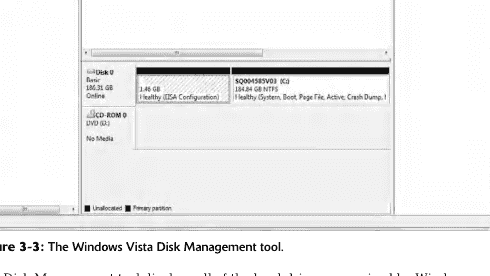

磁盘管理工具显示 Windows 识别的所有硬盘，并显示它们是否已格式化并使用。每个硬盘在列表中作为单独一行出现，并显示已识别的分区和格式类型。

许多较新的工作站利用隐藏分区来存储重要的恢复信息。隐藏分区是硬盘上被操作系统分区但未分配驱动器号的部分。即使你在 Windows 设置中只看到 C: 驱动器，你的硬盘仍可能包含两个分区，如图 3-3 中的示例所示。隐藏分区不能用于 Ubuntu，否则你将失去在 Windows 系统崩溃时恢复系统的能力。

如果你在硬盘上看到标记为未分配的区域，这意味着硬盘上有未属于 Windows 分区的空闲空间。你可以将此空间用作 Ubuntu 分区的一部分。如果它大于或等于 4 GB，那么你无需对现有的 Windows 分区做任何操作。你可以直接将 Ubuntu 安装到未分配的硬盘区域，而无需更改现有的 Windows 分区。

如果你的硬盘上只有一个分配给 Windows 的分区，你将需要继续分区过程以释放 Ubuntu 的空间。

### 确定可用空间

分区过程中的下一步是确定现有硬盘上有多少可用空间。请记住，你至少需要 4 GB 的可用空间用于 Ubuntu，而且你可能还想为原始操作系统保留一些额外的可用空间。

要了解 Windows 分区上可用多少可用空间，你可以再次使用 Windows 计算机管理工具。磁盘管理窗口的上部显示每个硬盘分区的详细统计信息。

显示的统计信息包括分区的总大小和可用空间量。请记下分区上可用的可用空间。这就是你将在现有 Windows 分区和新的 Ubuntu 分区之间分配的空间量。

> 一个常见的错误是将硬盘上的所有可用空间分配给新的 Ubuntu 分区。你需要为 Windows 分区保留一些可用空间；否则，已安装的 Windows 操作系统可能无法正常启动。即使你不打算添加任何新软件或数据，也最好在 Windows 分区上至少保留 1 GB 的可用空间。

一旦你确定了可用于 Ubuntu 的空间量，下一步就是确保磁盘上的空间确实是空的。

### 文件碎片整理

在正常使用工作站的过程中，Windows 倾向于将文件写入硬盘上的随机位置。这可能会使数据分散在整个磁盘空间区域。当你将硬盘分割成分区时，你需要确保不会丢失 Windows 系统中使用的数据，包括系统文件和数据文件。

为了对硬盘进行干净的分区，你需要确保所有 Windows 数据都移向硬盘的一端。此过程通常使用碎片整理工具完成。

# Part 1: Starting Out with Ubuntu

## Select a Language

When you start the Ubuntu installation, the first window you get is the Language window, shown in Figure 3-5.

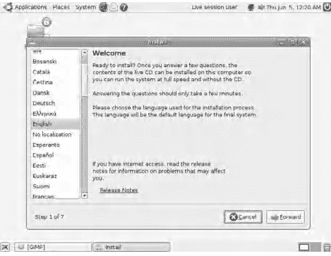

**Figure 3-5:** The Ubuntu language selection window.

This window asks you to select the language Ubuntu uses to display text messages during the installation process, and it sets the default language used when the operating system runs. However, this doesn't necessarily mean that all of the applications running on the system will use that language. Individual applications may or may not detect the default language configured in Ubuntu.

## Select a Time Zone

The second window in the installation process, shown in Figure 3-6, allows you to select the time zone for your area.

This window allows you to select your location via map or a drop-down list. Although selecting the time zone from the map sounds like a good idea, it can often be a challenge, depending on how many cities Ubuntu recognizes near your particular city.

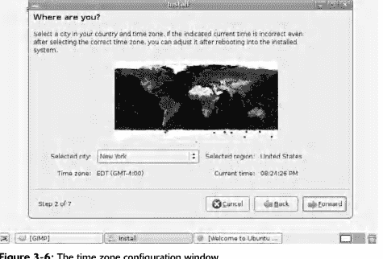

### Figure 3-6: The time zone configuration window

Where are you?

Select a city in your country and time zone. If the indicated current time is incorrect even after selecting the correct time zone, you can adjust it after rebooting into the installed system.

Selected city: New York

Selected region: United States

Time zone: EDT (GMT-4:00)

Current time: 08:24:26 PM

Step 2 of 7

## Select a Keyboard

Next in the installation process is identifying the keyboard you'll use with the Ubuntu system. Although this may sound like a simple option, it can get complicated if you have a keyboard that includes special keys. Ubuntu recognizes hundreds of keyboard types and lists them all in the Keyboard Configuration window, shown in Figure 3-7.

### Figure 3-7: The Keyboard Configuration window.

Keyboard layout

Which layout is most similar to your keyboard?

- Syria
- Tajikistan
- Thailand
- Turkey
- USA
- Ukraine
- United Kingdom
- Uzbekistan
- Vietnam
- USA
- USA - Alternative international (former us_intl)
- USA - Classic Dvorak
- USA - Lolemak
- USA - Dvorak
- USA - Dvorak international
- USA - Group toggle on multiply/divide key
- USA - International (AltGr dead keys)
- USA - International (with dead keys)

You can type into this box to test your new keyboard layout.

Step 3 of 7

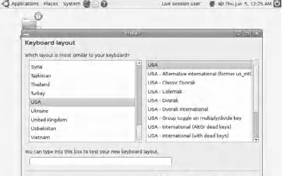


进入`/path/to/xxx`目录，找到`xxx.json`。

在表达式`cvar = avar + bvar`中，加法运算符（`+`）将`avar`与`bvar`相加，得到它们的和`cvar`

在`List.of(arg0, arg1, arg2)`中，`List`接口的工厂方法`of()`接受一系列的元素，返回包含它们的只读列表。

之后我们这样调用`cmd`命令：`cmd arg0 arg1 arg2`。

```
if (condVar > someVal) {console.log("xxx")}
```


在此过程中创建的用户 ID 很重要。与其他一些 Linux 发行版不同，Ubuntu 发行版不使用管理员登录帐户（在 UNIX/Linux 世界中通常称为 `root`）。相反，Ubuntu 允许普通用户帐户属于管理员组。管理员组的成员可以在系统上成为临时管理员（参见第 17 章“用户和组”）。

拥有具有管理权限的帐户非常重要，因为管理员是唯一允许执行大多数系统功能的帐户，例如更改系统特性、添加新设备和安装新软件。如果没有管理帐户，你将无法在系统上进行任何新的操作。

此窗口的最后一步是指定计算机名称。Ubuntu 在网络上广播其存在时以及引用日志文件中的系统时，都会使用此名称。你应该选择一个在网络中唯一的计算机名称。

# 迁移文档和设置

Ubuntu 安装程序中一个相对较新的功能是“迁移文档和设置”窗口，在安装过程中接下来可能会或可能不会出现，具体取决于你安装 Ubuntu 之前的原始系统。主要的“迁移文档和设置”窗口如图 3-11 所示。

如果你正在将 Windows 分区转换为 Ubuntu 分区，则会显示“迁移文档和设置”窗口。Ubuntu 的“迁移文档和设置”功能旨在实现从 Microsoft Windows 工作站到 Ubuntu 工作站的无缝过渡。

### 图 3-11：Ubuntu 安装程序的“迁移文档和设置”窗口。

在此步骤中，安装程序会在你将要替换的硬盘驱动器分区中查找任何现有的 Windows 分区。如果找到它们，它会主动帮助将任何 Windows 用户帐户迁移到 Ubuntu 环境。

该工具会在现有的 Microsoft Windows 安装中查找 `Documents and Settings` 文件夹，然后尝试在 Ubuntu 中复制该环境。如果配置了任何 Windows 用户，“迁移文档和设置”会显示各个用户名以及包含该用户数据的文件夹。该工具允许你选择要迁移的用户以及要迁移的文件夹。目前，Ubuntu 将尝试迁移的 Windows 用户功能包括

- Internet Explorer 书签
- “我的文档”文件夹中的文件
- “我的图片”文件夹中的文件
- “我的音乐”文件夹中的文件
- 用户保存的壁纸

“迁移文档和设置”功能是 Ubuntu 中一项强大的功能，让现有 Windows 用户可以轻松迁移到 Ubuntu。

> 注意

> 虽然“迁移文档和设置”功能很有用，但不要指望它一定能正常工作。如果你正在将 Windows 工作站迁移到 Ubuntu 工作站，最好在开始迁移过程之前复制重要数据。

# Review Options

安装过程中的最后一步要求你回顾并确认在之前的安装步骤中选择的所有功能。你可以返回到之前的安装选项窗口并修改你的选择。请特别注意磁盘分区设置，因为一旦你点击 Install 按钮，这些设置就会永久生效。

在此窗口中还有一个可以调整的额外元素。点击 Advanced 按钮会弹出 Advanced Options 窗口，如图 3-12 所示。

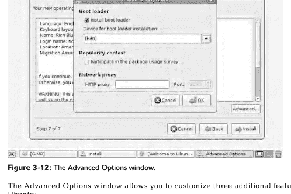

### Figure 3-12: The Advanced Options window.

Advanced Options 窗口允许你自定义 Ubuntu 中的另外三个功能：

- The boot loader
- The package survey
- The network proxy

当 Ubuntu 安装在工作站上时，它有能力提供自己的启动加载器。启动加载器负责启动操作系统。当你安装了 Windows 操作系统时，Windows 会提供自己的启动加载器。

Ubuntu 可以用 grand unified boot loader（GRUB）程序替换 Windows 启动加载器。GRUB 是 Linux 系统中使用的标准启动加载器；它可以启动 Linux 系统，以及许多其他操作系统，包括 Windows。

GRUB 可以加载到第一块硬盘的主引导记录（MBR）中（在 Ubuntu 中称为 `hdo`），或者在多硬盘系统中，它可以驻留在包含 Linux 分区的硬盘上。

Advanced Options 窗口允许你配置此功能。默认情况下，Ubuntu 启用 GRUB 并将其安装在第一块硬盘的 MBR 中。

> 你可能还会注意到可以取消选中安装启动加载器的复选框。此选项不会安装任何启动加载器，只会创建分区并安装 Ubuntu。如果你在另一个分区中已安装了 Linux 并想添加一个 Ubuntu 分区，请使用此功能。然后你可以手动配置现有的 GRUB 启动菜单以包含新的 Ubuntu 分区。

> 

> GRUB 启动菜单存储在 `/boot/grub/menu.lst` 文件中。

Advanced Options 窗口中的第二步是软件包使用调查。软件包使用调查会检索一些关于你设置的不含个人信息的资料（例如 CPU 类型、内存量、硬盘空间量以及你使用的安装方法）并将其发送到中央存储库用于统计目的。你可以通过访问网站 `http://popcon.ubuntu.com` 查看当前的软件包使用调查结果，在该网站上可以看到多个不同的表格和图表显示当前的调查总数。

Advanced Options 窗口中的最后一步是设置网络代理服务器。某些本地网络（尤其是在企业中）必须过滤任何传出的网络流量以限制员工可以访问的网站。这是通过网络代理完成的。

防火墙会阻止网络上的所有正常 HTTP 访问，但网络代理可以接收 HTTP 请求，然后阻止不可接受的请求并转发允许的请求。这种功能使公司能够完全控制其员工可以从企业网络访问互联网上的内容。

如果你的 Ubuntu 工作站位于使用网络代理的网络上，你必须为其配置该功能，才能使你的 Internet 访问正常工作。

当你完成设置任何高级选项后，你就可以开始安装了。开始安装后，你无需再做其他事情，只需坐下来观看过程进行即可。Ubuntu 安装程序接管一切，创建你指定的磁盘分区并安装整个 Ubuntu 操作系统。

# Installing from the Alternate Install CD

如果你的工作站无法运行 LiveCD，你可以使用 alternate install CD 来安装 Ubuntu。Alternate install CD 以文本方式安装 Ubuntu 系统，而不是 GUI 导向的 LiveCD 安装。此安装需要更少的内存和更低配置的显卡。

在大多数情况下，替代安装光盘请求的安装信息与 LiveCD 相同，但它使用基于文本的菜单而不是图形 GUI 菜单。你将被提示选择安装语言、时区、键盘类型（替代安装光盘甚至可以自动检测大多数标准键盘类型），以及默认 userID 和主机名信息。

替代安装光盘提供了一个 LiveCD 中没有的功能，该功能出现在磁盘分区部分。Linux 系统可以使用一种称为逻辑卷管理（LVM）的功能，它允许你在系统上创建动态分区。你可以随时向 LVM 分区添加和删除磁盘空间，提供了一种灵活的方式来分配系统上的磁盘空间。

以下各节描述了在使用替代安装光盘时，如何在引导式和手动分区方法中使用 LVM。

## 引导式分区

当你进入替代安装光盘流程的分区磁盘部分时，你会看到与 LiveCD 呈现的略有不同的配置。图 3-13 显示了从替代安装光盘进行安装时出现的分区磁盘主窗口。

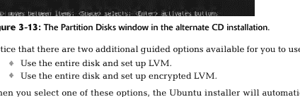

### 图 3-13：替代 CD 安装中的分区磁盘窗口。

请注意，有两个额外的引导选项可供你使用：

- 使用整个磁盘并设置 LVM。
- 使用整个磁盘并设置加密 LVM。

当你选择其中一个选项时，Ubuntu 安装程序将自动在你的硬盘上为 Ubuntu 创建一个逻辑卷。一旦逻辑卷创建完成，你就可以使用 Linux 工具随时修改它（参见第 18 章，“基本管理”）。

磁盘空间管理是一项棘手的工作，而 Linux 逻辑卷管理（LVM）功能是一个旨在帮助解决磁盘管理一些基本问题的优秀工具，但它也曾被证明会引发其他问题。

在设计系统布局时，通常很难准确预测应用程序和用户数据所需的磁盘空间。对于 ext3 等标准文件系统，如果需要添加空间，你必须备份数据，创建一个全新的分区，然后将数据恢复到新分区。

使用 LVM，你不是将虚拟文件系统中的位置与分区关联，而是将其分配给逻辑卷组。你可以将任何物理磁盘分区添加到逻辑卷组。如果逻辑卷组用完空间，你可以添加新的硬盘，然后动态地向现有逻辑卷组添加空间。

LVM 维护自己的表，以便知道哪些分区属于哪个逻辑卷组。即使硬盘分区上的数据完全正常，逻辑卷组也经常会损坏。数据损坏可能会对 Linux 系统造成灾难性问题，特别是如果它发生在根分区上。

因此，大型 Linux 系统的管理员通常会使用专用分区和 LVM 分区的组合。他们会为根分区使用专用分区，然后为虚拟文件系统的 `/opt` 和 `/home` 部分创建 LVM 分区。此配置允许你在安装新应用程序或用户开始用完空间时添加磁盘空间，同时保持根文件系统的完整性。

## 手动分区

除了引导式 LVM 分区之外，你还可以从替代安装光盘手动在 Ubuntu 安装上创建 LVM 分区。如果你在分区磁盘窗口中选择手动分区选项，你将获得第二级分区磁盘窗口，如图 3-14 所示。


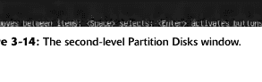

图 3-14：第二级分区磁盘窗口。

在此窗口中，你可以手动选择要修改或删除的分区，也可以添加新分区。第一个条目显示检测到的实际硬盘设备。其下缩进的条目显示该硬盘上的可用空间，以及该硬盘上任何现有分区及其信息。

选择你想要操作的可用空间区域，然后按 Enter 键。下一级的分区磁盘窗口会出现，如图 3-15 所示。

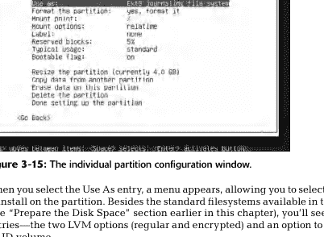

图 3-15：单个分区配置窗口。

当你选择“用作”条目时，会出现一个菜单，允许你选择要在分区上安装的文件系统。除了 LiveCD 安装中可用的标准文件系统（参见本章前文的“准备磁盘空间”部分）之外，你还会看到三个额外的条目——两个 LVM 选项（常规和加密）以及创建软件 RAID 卷的选项。

创建好你选择的分区文件系统后，你可以保存设置并继续安装。

# 服务器安装

如果你有兴趣安装 Linux 服务器，Ubuntu 服务器 LiveCD 可能是最简单的方法。Ubuntu 服务器会自动为你安装许多流行的服务器软件包，而无需任何配置。

本节介绍 Ubuntu 服务器安装过程，展示如何配置你的服务器。

## 主安装

Ubuntu 服务器 LiveCD 安装与工作站替代 CD 安装过程非常相似。服务器安装使用基于文本的方法，因为服务器通常没有（或不需要）花哨的显卡。

Ubuntu 服务器安装的前几个步骤与备用 CD 安装相同。系统会要求你选择一种语言，然后 Ubuntu 安装程序会询问你是否希望它检测键盘。选择“是”选项会启动一系列关于键盘上特殊按键的问题。等一切尘埃落定后，Ubuntu 会显示推荐的键盘设置。如果你认为键盘选择不正确，可以重新开始。

安装过程中的下一步是网络配置。由于你安装的是服务器，Ubuntu 假定服务器需要连接到网络。Ubuntu 首先尝试使用动态主机配置协议（DHCP）为你的网络获取 IP 地址。

这种方法需要网络上有一台服务器负责为网络分配和维护 IP 地址。许多路由器都提供此功能。

使用 DHCP 获取 IP 地址的问题在于，无法保证你能保持相同的 IP 地址。对于工作站来说，这没什么大不了的；但对于服务器来说，这可能是一个大问题，因为客户端需要一种一致、可靠的方式来访问服务器。

有两种方法可以解决这个问题。大多数 DHCP 服务器（即使是执行 DHCP 服务器功能的路由器）都允许你将一个 IP 地址专用于特定主机。如果你的 DHCP 服务器提供此功能，请找到 Ubuntu 服务器系统的 MAC 地址，并将其添加到 DHCP 服务器中，以进行静态 IP 地址分配。

另一种方法是在安装过程的这一部分将 Ubuntu 服务器与网络断开。如果 DHCP 查询失败，Ubuntu 安装程序将向你询问具体的 IP 地址信息。

Ubuntu 服务器安装还允许你为服务器对硬盘进行分区。安装程序提供了四种引导式分区方法：

- 使用现有的硬盘分区
- 使用整个硬盘
- 使用逻辑卷管理器（LVM），以便日后轻松地向同一逻辑卷添加更多磁盘
- 使用加密的 LVM 系统来保护你的服务器数据

除了这四种引导方法之外，你还可以手动创建硬盘分区。完成硬盘环境设置后，就可以选择安装程序应为你安装哪些服务器程序。

## 服务器程序

Ubuntu 服务器安装过程中最重要的部分，是确定你需要在服务器上运行哪些服务器程序。表 3-3 显示了在服务器安装过程中可以自动安装的服务器软件包。

**表 3-3：Ubuntu 服务器软件包**

| 软件包 | 描述 |
|---|---|
| DNS 服务器 | BIND 域名服务器软件包 |
| LAMP 服务器 | 支持 PHP 编程语言的 Linux Apache Web 服务器，以及 MySQL 数据库服务器 |
| Tomcat | Apache Java Servlet 应用程序 Web 服务器 |
| 邮件服务器 | Postfix 电子邮件服务器 |
| OpenSSH 服务器 | 提供到服务器的安全 Shell（SSH）访问 |
| PostgreSQL 服务器 | PostgreSQL 开源数据库服务器 |
| 打印服务器 | 通用 UNIX 打印服务器（CUPS） |
| Samba 文件服务器 | 为 Windows 网络提供文件共享服务 |

这些服务器软件包将在本书后面更详细地逐一讨论。以下各节对每个服务器进行简要概述，让你了解它们的用途。

### DNS 服务器

伯克利互联网名称域（BIND）软件包是一种流行的服务器，为网络提供域名服务（DNS）。互联网上的每个网络都必须有一个域名服务器。许多网络利用互联网服务提供商（ISP）的服务来为其网络处理 DNS 服务器。但是，你可以使用 Ubuntu 服务器软件运行自己的 DNS 服务器。有关如何在网络上设置和安装 DNS 服务器的详细信息，请参阅第 20 章“DNS 服务器”。

### LAMP 服务器

Linux-Apache-MySQL-PHP（LAMP）服务器是一种流行的 Web 编程环境。许多网站使用 LAMP 技术来支持在线商店、博客和内容管理系统（CMS）。LAMP 服务器环境通常难以配置，因为需要同步大量软件包。Ubuntu 服务器通过预先配置所有单独组件以使其正常运行，免去了安装 LAMP 服务器时的一切麻烦。

如果你安装 LAMP 服务器，安装过程会显示一个额外的查询窗口，如图 3-16 所示。

MySQL 服务器使用用户帐户来访问服务器中的数据库。主要的管理用户帐户是 root 用户。默认情况下，此用户帐户没有密码，这可能是危险的，尤其是当你的 Ubuntu 服务器位于开放网络上时。

你可以在此窗口中为 MySQL 的 root 用户帐户设置密码。

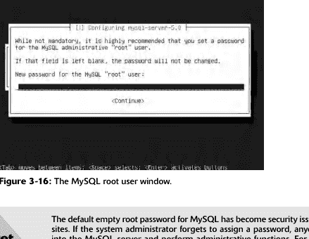

## Figure 3-16: The MySQL root user window.

> MySQL 默认的空 root 密码已成为许多网站的安全问题。如果系统管理员忘记为其分配密码，任何人都可以进入 MySQL 服务器并执行管理功能。正因如此，Ubuntu 不遗余力地确保你为 MySQL root 账户分配一个密码。
>
> 当然，这个问题的另一面是设置了 root 密码后却忘记了。第 21 章“Web Server”解释了如何摆脱这种困境。

### The Tomcat Server

如果你在 Java 环境中做过任何工作，你一定听说过 Java 服务器页面 JSP 和 Java servlet。这些编程语言允许你使用 Java 和 HTML 代码制作动态 Web 应用程序。Apache 项目衍生出了一个姊妹项目 Tomcat，它提供了一个 Web 服务器以及 JSP 和 Java servlet 处理器，全部集成在一个应用程序中。

Ubuntu 服务器安装允许你通过从安装菜单中选择它来安装完整的 Tomcat 服务器。无需配置——只需加载软件包，你就可以开始从 Ubuntu 服务器托管 JSP 或 Java servlet 应用程序。

### The Mail Server

Linux 环境中有多个流行的邮件服务器软件包可用。Ubuntu 服务器安装包安装了 Postfix 邮件服务器。如果你选择安装邮件服务器，还会弹出另一个配置窗口，如图 3-17 所示。

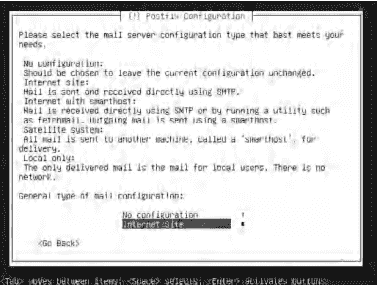

Postfix 服务器有很多不同的配置问题（参见第 23 章“Email Server”）。Ubuntu 服务器对所有配置选项都使用默认值，但在你的网络上正常运行邮件服务器时必须提供一个信息。

设置邮件服务器有几种方法，因此你需要告诉 Ubuntu 安装脚本你的邮件服务器环境：

- **No Configuration:** 使用默认的 Postfix 配置。
- **Internet Site:** 配置 Postfix 直接与远程邮件服务器接收和投递邮件。
- **Internet with SmartHost:** 配置 Postfix 直接从远程邮件服务器接收邮件，但将所有外发邮件投递到单个远程服务器以转发投递。
- **Satellite System:** 配置 Postfix 通过单个远程服务器接收和投递邮件。
- **Local Only:** 配置 Postfix 仅接收和投递系统本地用户的邮件。

选择与你的网络环境相匹配的选项。安装程序会根据你选择的选项提示你输入其他信息。

### The OpenSSH Server

OpenSSH 服务器使用安全外壳 SSH 协议通过加密通信与网络上的远程客户端和其他服务器通信。OpenSSH 软件包包含两个程序：

- **sshd:** 一个安全外壳服务器程序，用于监听传入连接
- **ssh:** 一个安全外壳客户端程序，允许你连接到远程 sshd 服务器

OpenSSH 环境使用命令行界面（参见第 19 章“The Ubuntu Command Line”），你可以在其中向远程服务器提交 Linux 命令并查看响应。


# The PostgreSQL Server

尽管 LAMP 服务器使用流行的 MySQL 开源数据库，Ubuntu 服务器还支持另一种流行的开源数据库 PostgreSQL。PostgreSQL 服务器在高负载环境中通常被认为比 MySQL 更强大，并且包含了一些昂贵商业数据库中才有的功能。你可以安装 LAMP 服务器和 PostgreSQL 服务器，以便在你的服务器上提供两种数据库服务器环境。

PostgreSQL 服务器在第 24 章“Database Server”中有更详细的讨论。

# The Print Server

Ubuntu 打印服务器软件包使用通用 UNIX 打印服务器 CUPS 在网络上


## Figure 3-16: The MySQL root user window.

> MySQL 默认的空 root 密码已成为许多网站的安全问题。如果系统管理员忘记为其分配密码，任何人都可以进入 MySQL 服务器并执行管理功能。正因如此，Ubuntu 不遗余力地确保你为 MySQL root 账户分配一个密码。
>
> 当然，这个问题的另一面是设置了 root 密码后却忘记了。第 21 章，“Web Server，”解释了如何摆脱这种困境。

# The Tomcat Server

如果你在 Java 环境中做过任何工作，你一定听说过 Java 服务器页面 JSP 和 Java servlet。这些编程语言允许你使用 Java 和 HTML 代码制作动态 Web 应用程序。Apache 项目衍生出了一个姊妹项目 Tomcat，它提供了一个 Web 服务器以及 JSP 和 Java servlet 处理器，全部集成在一个应用程序中。

Ubuntu 服务器安装允许你通过从安装菜单中选择它来安装完整的 Tomcat 服务器。无需配置——只需加载软件包，你就可以开始从 Ubuntu 服务器托管 JSP 或 Java servlet 应用程序。

# The Mail Server

Linux 环境中有多个流行的邮件服务器软件包可用。Ubuntu 服务器安装包安装了 Postfix 邮件服务器。如果你选择安装邮件服务器，还会弹出另一个配置窗口，如图 3-17 所示。


Postfix 服务器有很多不同的配置问题（参见第 23 章，“Email Server”）。Ubuntu 服务器对所有配置选项都使用默认值，但在你的网络上正常运行邮件服务器时必须提供一个信息。

设置邮件服务器有几种方法，因此你需要告诉 Ubuntu 安装脚本你的邮件服务器环境：

- **No Configuration:** 使用默认的 Postfix 配置。
- **Internet Site:** 配置 Postfix 直接与远程邮件服务器接收和投递邮件。
- **Internet with SmartHost:** 配置 Postfix 直接从远程邮件服务器接收邮件，但将所有外发邮件投递到单个远程服务器以转发投递。
- **Satellite System:** 配置 Postfix 通过单个远程服务器接收和投递邮件。
- **Local Only:** 配置 Postfix 仅接收和投递系统本地用户的邮件。

选择与你的网络环境相匹配的选项。安装程序会根据你选择的选项提示你输入其他信息。

# The OpenSSH Server

OpenSSH 服务器使用安全外壳 SSH 协议通过加密通信与网络上的远程客户端和其他服务器通信。OpenSSH 软件包包含两个程序：

- **sshd:** 一个安全外壳服务器程序，用于监听传入连接
- **ssh:** 一个安全外壳客户端程序，允许你连接到远程 sshd 服务器

OpenSSH 环境使用命令行界面（参见第 19 章，“The Ubuntu Command Line”），你可以在其中向远程服务器提交 Linux 命令并查看响应。

# The PostgreSQL Server

尽管 LAMP 服务器使用流行的 MySQL 开源数据库，Ubuntu 服务器还支持另一种流行的开源数据库 PostgreSQL。PostgreSQL 服务器在高负载环境中通常被认为比 MySQL 更强大，并且包含了一些昂贵商业数据库中才有的功能。你可以安装 LAMP 服务器和 PostgreSQL 服务器，以便在你的服务器上提供两种数据库服务器环境。

PostgreSQL 服务器在第 24 章，“Database Server，”中有更详细的讨论。

# The Print Server

Ubuntu 打印服务器软件包使用通用 UNIX 打印服务器 CUPS 在网络上宣传任何已连接的打印机。此功能为网络上其他 UNIX 系统之间共享打印机提供了一种很好的方式。有关如何使用 Ubuntu 服务器设置 CUPS 服务器的详细信息，请参阅第 22 章，“Samba and Print Servers，”。

# The Samba File Server

Samba 文件服务器是一个功能强大的软件包，允许 Ubuntu 服务器在 Microsoft Windows 网络上交互。它为 Windows 工作站和其他 Windows 服务器提供共享文件夹和共享打印机。Samba 软件将你的 Ubuntu 服务器转变为功能齐全的 Windows 服务器，甚至允许它加入 Windows 域。

Samba 软件不仅提供 Windows 服务器功能，还提供客户端模式。在 Samba 客户端模式下，你可以连接到远程 Windows 服务器共享并检索文件，或打印到远程 Windows 网络打印机。第 22 章提供了有关如何配置和使用 Samba 软件的详细信息。

# Upgrading Ubuntu

如果你系统上已经运行了 Ubuntu 版本，Ubuntu 允许你相对轻松地升级到新版本。升级 Ubuntu 系统有三种方法：

- 顺序升级，从一个版本升级到下一个版本
- 长期支持 LTS 升级，从一个 LTS 版本升级到下一个 LTS 版本
- 干净升级，将任何版本升级到新版本

顺序升级允许你升级到下一个可用的 Ubuntu 版本。例如，你可以直接将版本 7.10 升级到 8.04，8.04 升级到 8.10，8.10 升级到 9.04。

Ubuntu 还提供特殊版本，称为长期支持 LTS。Ubuntu 对这些版本提供安全补丁和软件更新长达 3 年。LTS 版本在常规 Ubuntu 版本发布之间以不规则间隔发布，因此它们与最新可用版本没有直接关联。然而，你可以直接将一个 LTS 版本升级到下一个 LTS 版本。因此，你可以直接将 6.06 LTS 升级到 8.04 LTS。

在升级之前，您应该下载并安装现有 Ubuntu 版本的所有可用补丁和更新。如果您的 Ubuntu 工作站已连接到 Internet，更新管理器会在有新版本的 Ubuntu 可用时自动通知您，如图 3-18 所示。

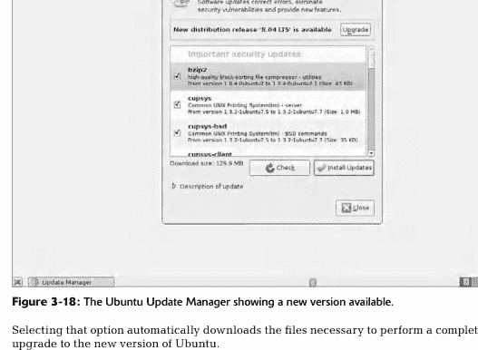

图 3-18：Ubuntu 更新管理器显示有新版本可用。

选择该选项会自动下载执行完整升级到新版本 Ubuntu 所需的文件。

对于 Ubuntu 服务器版本，您必须使用命令行软件包更新程序 `apt-get`（请参阅第 13 章“软件安装和更新”中标题为“命令行软件包管理”的部分）来获取新的 Ubuntu 安装。与 Ubuntu 工作站发行版一样，您可以使用下一个直接版本或下一个 LTS 版本升级 Ubuntu 服务器版本。

> Secret
>
> 如果您无法从 Ubuntu 工作站或服务器访问 Internet，您可以使用 alternate install CD 进行升级，但不能使用 LiveCD。当您从 alternate install CD 启动时，它会提示您安装是否是现有系统的升级，并且它会尝试保留位于 `/home` 目录结构中的现有文档和设置。

# Summary

本章介绍了在工作站或服务器系统上安装 Ubuntu 所需的流程。安装 Ubuntu 工作站或服务器的主要方式是通过 LiveCD。

在尝试安装 Ubuntu 之前，您应该对 PC 上安装的硬件设备进行盘点，以便为任何安装问题做好准备。如果您打算在 PC 上保留现有操作系统，您需要确定如何安装 Ubuntu。如果您计划对单个硬盘进行分区，您需要在运行 Ubuntu 安装程序之前对 Windows 分区进行碎片整理。您还需要确定可以为 Ubuntu 安装分配多少磁盘空间。

LiveCD 会引导您完成设置 Ubuntu 软件所需的所有要求。作为安装过程的一部分，它会检查已安装的硬盘并提供自动引导您完成必要设置的选项。您可以选择允许 Ubuntu 使用整个硬盘、为新的 Ubuntu 分区划分现有硬盘，或使用第二个硬盘用于 Ubuntu。

除了引导分区之外，您还可以在安装过程中手动更改 PC 上的分区。如果您决定手动创建和编辑分区，请不要忘记创建一个至少与 PC 中物理内存大小相同的交换区。


Ubuntu 工作站发行版还提供了一个 alternate install CD，它在文本环境中执行与 LiveCD 安装相同的安装过程（外加一些额外功能）。您可以使用 alternate install CD 设置逻辑卷管理（LVM）分区，这使您可以自由地向分区添加和删除磁盘空间。

Ubuntu 服务器安装是一个文本导向的安装，提供安装选项以安装多个预配置的软件包，包括 DNS 服务器、电子邮件服务器、LAMP 服务器、打印服务器和 Samba 服务器。

下一章将介绍 Ubuntu 桌面。它描述了桌面的各个功能，并提供了有关如何按您想要的方式配置桌面的深入信息。

现在您已在工作站上安装了 Ubuntu，是时候去探索了。Ubuntu 中使用的默认桌面是 GNOME。如果您以前从未使用过 GNOME 桌面，事情可能会显得有点不同。尽管 GNOME 借用了微软 Windows 和苹果 Macintosh 的许多相同的窗口理念，但它也有一些独特的特性。本章将介绍 GNOME 桌面的基础知识，为您提供如何充分利用桌面的详细导览。

# Desktop Features

当您首次登录 Ubuntu 工作站系统时，您会看到默认的 GNOME 桌面，如图 4-1 所示。


图 4-1：默认的 Ubuntu GNOME 桌面。

Ubuntu 中使用的 GNOME 桌面布局由三个部分组成：

- 屏幕顶部的一条包含菜单和图标的栏
- 屏幕中间的空白桌面区域
- 屏幕底部的一条包含回收站和几个桌面图标的栏

屏幕顶部和底部的栏称为面板。每个面板在桌面上具有不同的功能。面板可以包含用于选择应用程序和实用程序的菜单、用于启动应用程序的图标，以及称为面板小程序的特殊程序。

以下各节描述了 Ubuntu 工作站桌面上的三个区域。

## 顶部面板

Ubuntu 将桌面顶部的面板划分为三个区域：

- ♦ 一个菜单区域
- ♦ 一个快速启动图标区域
- ♦ 一个小程序区域

这些区域各自在桌面上承担不同的功能。以下各节将描述这三个区域及其包含的内容。

### 菜单区域

顶部面板的最左侧包含菜单区域。菜单区域包含链接，可让您轻松访问安装在 Ubuntu 系统上的所有应用程序和实用程序。有三个顶级菜单链接直接显示在顶部面板上：

- ♦ **应用程序菜单**：包含启动 Ubuntu 系统上可用应用程序程序的链接。
- ♦ **位置菜单**：包含指向 Ubuntu 虚拟文件系统中位置的链接，以及指向额外硬盘、软盘、CD/DVD 驱动器和 USB 驱动器的链接，并用于连接远程文件系统。
- ♦ **系统菜单**：包含用于更改用户和系统设置的实用程序的链接。

每个顶级菜单链接都提供额外的链接，这些链接是菜单（旁边带有箭头的条目）或直接启动应用程序或实用程序的单个链接。当您将鼠标指针悬停在子菜单链接上时，子菜单会自动出现在主菜单旁边，显示其包含的链接，如图 4-2 所示。

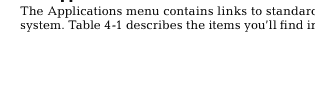

图 4-2：应用程序 → 附件 子菜单。

每个顶级菜单的目的在以下各节中进行了解释。

#### 应用程序菜单

应用程序菜单包含指向安装在 Ubuntu 系统上的标准应用程序的链接。表 4-1 描述了您将在应用程序菜单中找到的项目。

| **表 4-1：应用程序菜单** |  |

|---|---|

| **菜单项** | **描述** |

| Accessories | 一个包含日常功能小型实用程序的子菜单。包含计算器和词典等项目 |

| Games | 一个充满有趣图形游戏的子菜单，您可以用它代替做真正的工作 |

| Graphics | 一个包含用于创建和操作不同类型图形图像的应用程序的子菜单，包括从扫描仪和数码相机导入图像 |

| Internet | 一个支持用于互联网的应用程序的子菜单，包括网页浏览、电子邮件和即时消息 |

| Office | 一个包含文字处理、电子表格和演示图形应用程序的子菜单 |

| Sound and Video | 一个包含用于播放音频文件、音频 CD、视频 DVD 以及刻录自己的音频 CD 和视频 DVD 的应用程序的子菜单 |

| Add/Remove | 启动 Ubuntu 更新管理器 |

应用程序菜单是启动您在 Ubuntu 工作站中使用的大多数应用程序的首选位置。如果您使用软件安装程序添加其他应用程序（请参阅第 13 章“软件安装和更新”），这些应用程序也会出现在应用程序菜单中。

#### 位置菜单

下一个顶级菜单选择是位置菜单，如图 4-3 所示。

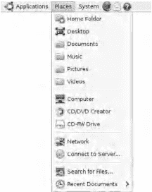

**图 4-3：** 位置菜单。

位置菜单提供指向虚拟文件系统中常见位置的链接，以及指向可移动驱动器和外部网络系统的快速链接。这些项目列在表 4-2 中。

### 表 4-2：位置菜单

| 菜单项 | 描述 |

|---|---|

| Home Folder | 用户的主文件夹 |

| Desktop | 访问桌面上显示的文件 |

| Documents | 直接访问用户主文件夹中包含的文档文件夹 |

| Music | 直接访问用户主文件夹中包含的音乐文件夹 |

| Pictures | 直接访问用户主文件夹中包含的图片文件夹 |

| Videos | 直接访问用户主文件夹中包含的视频文件夹 |

| Computer | 链接到 Nautilus 文件管理器软件包 |

| CD/DVD Creator | 启动 Brasero CD 刻录软件 |

| Floppy Drive | 直接访问软盘驱动器 |

| Network | 启动网络浏览器应用程序，该应用程序扫描网络中可用的 Windows 服务器 |

| Connect to Server... | 提供对各种类型网络服务器的直接访问 |

| Search for Files... | 提供对 Nautilus 文件管理器搜索功能的访问 |

| Recent Documents... | 提供您最近使用 OpenOffice.org 软件包打开的文档列表 |

请注意，位置菜单中的一个位置是您的桌面。GNOME 将您的桌面视为系统中的任何文件夹一样（事实上，它是您主目录中的一个文件夹）。您可以访问存储在桌面上的文件，以及您创建的任何桌面快捷方式（在“添加桌面图标”部分中讨论）。

“连接到服务器”菜单选项允许您指定 Ubuntu 连接到的远程服务器并从中检索文件。Ubuntu 可以连接到几种类型的服务器以访问文件和文件夹：

- SSH：使用安全外壳协议通过加密网络连接连接到远程服务器。
- FTP（带登录）：使用特定登录帐户连接到远程文件传输协议（FTP）服务器。
- 公共 FTP：使用匿名帐户连接到 FTP 服务器以访问公开发布的文件。
- Windows share：连接到广告共享的 Windows 服务器或工作站。
- WebDAV (HTTP)：连接到基于 Web 的分布式创作和版本控制站点，以便与他人协作编辑文件。
- 自定义位置：使用统一资源标识符（URI）来定义服务器以及要访问的文件或文件夹的位置。

当您选择服务器类型时，连接到服务器窗口会提供文本框供您指定连接到服务器所需的任何信息，例如服务器主机名、端口和登录信息。

#### 系统菜单

最后一个顶级菜单是系统菜单，如图 4-4 所示。

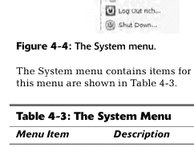

图 4-4：系统菜单。

系统菜单包含用于管理您的 Ubuntu 工作站的项目。此菜单中的项目显示在表 4-3 中。

### 表 4-3：系统菜单

| 菜单项 | 描述 |

|---|---|

| Preferences | 用于设置工作站功能的子菜单 |

| Administration | 用于更改工作站设置和管理工作站的子菜单 |

| Help and Support | 已安装的 Ubuntu 帮助菜单，以及指向 Ubuntu 网站各个部分的链接 |

| About GNOME | 关于 GNOME 版本的简要信息以及指向 GNOME 网站的链接 |

| About Ubuntu | 关于 Ubuntu 版本的信息以及指向 Ubuntu 网站的链接 |

| Shut Down... | 指向 Ubuntu 关机菜单的链接，提供结束工作站会话的选项 |

退出菜单提供多种退出系统的选项。有两种选项可用于结束当前 GNOME 桌面会话：

- 在系统保持运行的情况下离开当前桌面会话。
- 关闭 Ubuntu 工作站。

第一个选项允许您关闭当前用户会话但保持 Ubuntu 系统运行。有三种方法可以做到这一点：

- **Log Out：** 终止当前登录用户账户的会话，并返回登录屏幕。
- **Lock Screen：** 保持当前用户登录状态，但锁定屏幕，以便只有该用户才能输入密码进入桌面。
- **Switch User：** 返回登录屏幕以允许另一用户登录，但保持当前用户会话处于活动状态。

关闭 Ubuntu 工作站还有三个选项：


- **Hibernate：** 将当前会话状态存储在临时文件中并清空屏幕。
- **Restart：** 重启 Ubuntu 系统并重新开始。
- **Shut Down：** 停止所有正在运行的进程并在可能的情况下关闭计算机。

休眠功能尤其有趣。在休眠模式下，Ubuntu 会将有关系统状态的任何信息，例如您打开的窗口和正在运行的应用程序，写入硬盘上的临时文件。然后它关闭桌面但保持计算机通电。计算机（和 Ubuntu）仍在运行但未处理任何内容。当您按下某个键时，Ubuntu 会唤醒，读取其创建的系统状态文件，并快速将会话恢复到之前的状态。

> **Secret**
> 
> 如果您在笔记本电脑上使用 Ubuntu 工作站，休眠模式可能会迅速耗尽电池电量。取而代之的是，Ubuntu 为笔记本电脑提供了挂起模式。在挂起模式下，系统状态存储在内存中，系统进入低功耗模式。此状态允许笔记本电脑在电池供电时更长时间保持挂起模式。
> 
> 对于大多数笔记本电脑，Ubuntu 还具有检测您关闭笔记本电脑盖并自动进入挂起模式的能力。然而，如果您的笔记本电脑未插入电源，这并不是结束 Ubuntu 会话的推荐方式，因为您的笔记本电脑最终会耗尽电池电量并丢失已保存的会话。

# 快速启动区域

菜单区域旁边是快速启动图标区域。面板的这一部分包含 Ubuntu 默认提供的三个快速启动图标。单击图标一次即可启动特定应用程序。Ubuntu 快速启动图标区域中默认安装的应用程序是

- **Firefox：** Ubuntu 中安装的默认网页浏览器软件
- **Evolution：** Ubuntu 中安装的默认电子邮件客户端软件包
- **Help Center：** 指向 Ubuntu 帮助中心的链接，提供在系统上执行基本任务的说明

快速启动区域的想法是提供一种快速启动常用应用程序的方法，这样您就不必在应用程序菜单中到处寻找它们。稍后，在“添加面板小程序”部分，您将看到如何为自己喜欢的应用程序添加快速启动图标。

# Applet 区域

在顶部面板的最右侧，您会找到几个图标和信息。这些是面板小程序。面板小程序是小型实用程序，在后台运行，并在面板上以图标形式显示实时信息。根据您用来运行 Ubuntu 的系统类型（笔记本电脑或台式机）以及已安装的功能（例如网卡、调制解调器和专有显卡），您会在面板上看到不同的小程序。您可能会运行的最常见的小程序有

- 更新管理器：监控系统上已安装软件包的状态，并在 Ubuntu 仓库中有更新可用时发出通知
- 专有设备管理器：让您知道是否安装了需要 Ubuntu 安装专有设备驱动程序（非开源）的硬件
- 网络管理器：监控网络连接，以及无线网卡可用的资源
- 电源管理器：如果您在笔记本电脑上运行 Ubuntu，此小程序会显示笔记本电脑是否使用电池供电，如果是，则估算电池剩余电量还能使用的时间
- 日期/时间日历：显示日期和时间，并提供快速访问 Evolution 日历功能
- 用户切换器：显示当前用户，如果系统中有多个用户登录，则允许您在用户之间切换
- 注销：提供快速访问注销/关机菜单

更新管理器小程序显示在系统后台运行的更新管理器软件的状态（参见第 12 章）。它会自动通知您何时有更新可供 Ubuntu 系统安装。它还会根据可用的更新类型显示不同的图标。

另一个重要图标是网络管理器。如果您有无线网卡，此小程序对于设置网络至关重要。单击该小程序会显示 Ubuntu 检测到的无线接入点。单击单个接入点会弹出无线网络配置窗口，让您可以设置配置设置（参见第 13 章“联网”）。

> 您可以使用会话首选项工具控制哪些小程序自动启动，该工具可在菜单中通过选择系统 → 首选项 → 会话获得。启动程序选项卡显示所有配置为自动启动的小程序。您可以取消选中任何不想启动的小程序的复选框，并添加您希望在登录时自动启动的任何自己的程序。

# 桌面工作区

如本章“位置菜单”部分所述，GNOME 桌面工作区是每个用户主文件夹中的一个普通文件夹。桌面上可以有三种基本类型的对象：

- 启动应用程序的快捷方式
- 用于文档的文件
- 文件夹

Ubuntu 开发者对桌面工作区区域的思路发生了变化。过去，Ubuntu 为每个用户提供了几个默认桌面图标，例如一个链接到用户主文件夹的图标（称为“主目录”）和一个（称为“计算机”）链接到虚拟文件系统目录根的图标。

这些图标仍在 LiveCD Ubuntu 桌面中，但一旦您安装 Ubuntu，桌面工作区就会发生变化。在最近几个版本的 Ubuntu 中，Ubuntu 开发者采用了不同的方法。现在工作区区域中什么都没有！默认的 Ubuntu 桌面从一张空白画布开始。

您可以自由添加自己的桌面图标，如“添加桌面图标”部分所述。

# 底部面板

底部面板的配置与顶部面板略有不同。它包含四个元素：

- 桌面查看器图标
- 任务栏区域
- 工作区切换器图标
- 废纸篓图标

以下各节将更详细地解释这些项目。

## 桌面查看器

桌面查看器是位于底部面板最左侧的图标。单击此图标会将所有打开的活动窗口最小化以显示桌面工作区。如果您打开了大量窗口，这是一种返回桌面工作区的绝佳方式。

将所有窗口最小化后，再次单击该图标会最大化所有当前活动窗口，将它们恢复到最小化之前的状态。

## 任务栏区域

任务栏区域为系统上运行的应用程序提供图标。您可以使用任务栏中的图标更改应用程序窗口的状态。您可以对应用程序执行三个操作：

## 工作区切换器

工作区切换器会更改活动的工作区。工作区是你的 Ubuntu 桌面的一个实例。你可以同时激活多个工作区，并使用工作区切换器在它们之间切换。每个工作区共享相同的顶部和底部面板以及桌面，但允许你在不同的工作区中打开单独的应用程序窗口。

借助此功能，你可以在一个工作区中运行应用程序，然后切换到另一个工作区以启动其他应用程序。当你需要返回第一个应用程序时，不必在任务栏中寻找它，只需切换到第一个工作区即可。

默认情况下，Ubuntu 创建两个工作区。每个工作区在底部面板的右下角显示为一个方形图标。点击工作区图标即可切换到相应的工作区。

> Secret
> 
> 如果你使用的是支持水平滚动的鼠标设备，可以在桌面上通过水平滚动来在工作区之间切换。许多笔记本电脑触控板通过在触控板顶部或底部附近水平移动手指来支持水平滚动。

## 废纸篓图标

废纸篓图标的工作方式与 Windows 中的回收站或 Macintosh 上的废纸篓完全相同。要删除文件，请将文件、文件夹和快捷方式链接从桌面或 Nautilus 窗口直接拖放到面板上的废纸篓小程序中。

当你将文件或文件夹拖到废纸篓图标时，Ubuntu 并不会删除它；而是将其放入文件系统中的一个特殊位置。不要期望在将文件或文件夹放入废纸篓后磁盘空间就会被释放。

点击面板上的废纸篓图标即可使用 Nautilus 文件管理器打开废纸篓，如图 4-5 所示。

在 Nautilus 窗口中，你可以通过拖放将项目移出废纸篓到系统上的另一个文件夹，可以通过右键单击文件并选择“从废纸篓中删除”来永久删除文件，或可以点击“清空废纸篓”按钮永久删除系统上废纸篓中的所有内容。

> Secret
> 
> 如果你想知道将文件和文件夹放入废纸篓后它们会去哪里，Ubuntu 会在你的主文件夹区域创建一个名为 `.local/share/Trash` 的文件夹。任何放入废纸篓的项目都会被放在那里。`.local` 文件夹是主文件夹中的一个隐藏文件夹，因此你需要在 Nautilus 中启用“显示隐藏文件”功能才能看到它。

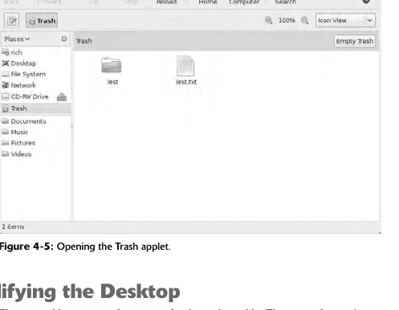

# 修改桌面

顶部和底部面板完全可配置。有很多方法可以自定义桌面面板。本节介绍你可以对桌面面板进行的操作。

# 向面板菜单添加内容

你可以自定义 Ubuntu 在顶部面板提供的默认菜单，添加指向你自己的应用程序或网站的链接。如果你的 Ubuntu 工作站由多个用户使用，每个用户都可以拥有自己的唯一菜单配置，而不会影响其他用户的配置。

在顶部面板的三个现有菜单之一上右键单击会弹出一个包含五个选项的菜单：

- Help: 显示有关如何使用 GNOME 菜单的快速教程
- Edit Menus: 允许你选择默认菜单中出现哪些项目
- Remove from Panel: 允许你完全从面板中移除该菜单
- Move: 如果面板未锁定，允许你将菜单移动到同一面板上的不同位置
- Lock to Panel: 防止对面板布局进行更改

Edit Menus 选项提供了一个图形编辑器，允许你向系统上的三个独立菜单添加和删除单个项目：

- The Applications menu
- The System Preferences submenu
- The System Administration submenu

菜单编辑器在窗口左侧列出三个菜单，如图 4-6 所示。

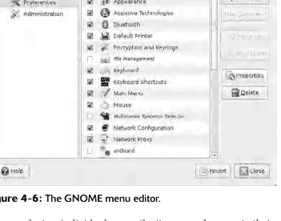

图 4-6：GNOME 菜单编辑器。

当你选择一个单独的菜单时，该菜单中的项目或子菜单会出现在窗口右侧。活动项目和子菜单在其旁边的复选框中包含一个勾号。如果复选框为空，则该项目或子菜单不会出现在菜单上。


你也可以向菜单添加新的子菜单以及新的项目链接。要添加新的子菜单，请从窗口左侧选择父菜单位置，然后点击 New Menu 按钮。命名新菜单后，它会出现在右侧的窗口中。确保选中新子菜单旁边的复选框，否则它不会出现在你的最终菜单中。

新子菜单一旦出现在右侧的列表中，你就可以使用 Move Up 和 Move Down 按钮在菜单列表中移动它。你也可以使用 New Separator 按钮在菜单列表中添加一条水平线，以帮助分隔项目组。

要在菜单或子菜单中添加新的项目链接，请在左侧窗口中选择菜单或子菜单，然后点击 New Item 按钮。Create Launcher 对话框会出现，如图 4-7 所示。

你可以在 Create Launcher 对话框中创建三种不同类型的链接：

- A link to launch an application
- A link to launch an application that runs in the Terminal session
- A link to a specific location on the local filesystem or on a remote system

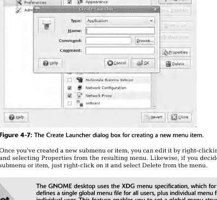

图 4-7：用于创建新菜单项的“创建启动器”对话框。

创建新的子菜单或项目后，你可以通过右键单击该项目并从弹出的菜单中选择“属性”来编辑它。同样，如果你决定删除某个子菜单或项目，只需右键单击它并从菜单中选择“删除”即可。

GNOME 桌面使用 XDG 菜单规范，该规范为每个菜单定义了适用于所有用户的单个全局菜单文件，以及为每个单独用户定义的单独菜单文件。此功能允许你设置全局菜单结构，并允许各个用户自定义自己的菜单设置，而不会影响其他用户的菜单。菜单文件使用文本 HTML 标签来定义菜单、子菜单和项目。

三个顶层菜单的全局菜单文件位于 `/etc/xdg/menus` 文件夹中。这三个菜单文件为：

- `applications.menu`
- `preferences.menu`
- `settings.menu`

每个菜单文件都是一个文本文件，包含菜单和项目的格式化定义。这些菜单项对所有用户可见（尽管用户仍然可以选择禁用某个特定项）。

每个用户都有一个独立的菜单文件夹，位于其主目录中的 `.config/menus` 文件夹中。用户对菜单所做的任何添加都会放置在该文件夹中，使用与全局菜单文件相同的菜单文件名。这些更改仅适用于该用户，其他用户不会看到。

如果你完全搞乱了菜单系统，只需单击“还原”按钮（如图 4-6 所示）即可恢复到默认设置。但是，如果你已经进行了许多更改，你可能不想这样做，因为你会丢失所做的所有自定义设置。

# 添加面板小程序

除了默认显示在顶部面板中的小程序之外，你还可以将应用程序添加到顶部和底部面板。此功能可让你方便地访问快捷实用程序和常用应用程序。

要添加新的小程序，请右键单击任一面板上的空白区域，然后在出现的菜单中选择“添加到面板”选项。表 4-4 显示了可用的不同小程序选项。

| **表 4-4：“添加到面板”菜单选项** | |
| --- | --- |
| **小程序** | **描述** |
| 自定义应用程序启动器 | 为新应用程序创建启动器图标 |
| 应用程序启动器 | 复制现有的应用程序启动器 |
| 地址簿搜索 | 搜索 Evolution 地址簿 |
| 电池充电监视器 | 显示笔记本电池放电前的预计时间 |
| 亮度小程序 | 调整笔记本显示屏的亮度 |
| 字符调色板 | 在文档中插入特殊字符 |
| 剪贴板文本加密 | 对剪贴板中的文本进行加密、解密或签名 |
| 时钟 | 显示当前时间和日期 |
| 连接到服务器 | 连接到远程服务器以访问文件 |
| CPU 频率缩放监视器 | 显示 CPU 运行频率。频率缩放用于笔记本电脑以节省电量 |
| 桌面搜索栏 | 提供统一的搜索界面，用于在多个文件和应用程序中搜索数据 |
| 字典查找 | 返回单词的字典定义 |
| 磁盘挂载器 | 以图形方式访问本地硬盘和 USB 设备 |
| 抽屉 | 用于存放文档和其他文件的便捷位置 |
| 悬停点击 | 为辅助技术设置鼠标默认点击类型 |
| 眼睛 | 它们会跟随你的鼠标！ |
| 鱼 | 一个供你娱乐的鱼缸 |
| 强制退出 | 终止卡住的应用程序 |

| **表 4-5：（续）** | |
| --- | --- |
| **小程序** | **描述** |
| 抑制小程序 | 阻止启用自动省电功能 |
| 投资追踪 | 跟踪你的投资 |
| 键盘辅助功能状态 | 显示键盘辅助功能的状态 |
| 键盘指示器 | 显示检测到的键盘类型，并提供菜单以便轻松设置键盘功能 |
| 锁定屏幕 | 运行受密码保护的屏幕保护程序 |
| 主菜单 | 添加合并的菜单图标 |
| 菜单栏 | 添加完整的 Ubuntu 面板菜单 |
| 调制解调器监视器 | 激活并显示拨号调制解调器网络连接的状态 |
| 通知区域 | 创建用于显示通知图标的区域 |
| Pilot 小程序 | 与连接的 Palm Pilot 设备交互 |
| 指针捕获 | 提供一个区域，点击后可将鼠标指针设备锁定，以防止意外鼠标点击 |
| 退出 | 提供“注销/关机”菜单 |
| 运行应用程序 | 允许你通过输入或从已知应用程序列表中选择来快速启动应用程序 |
| 搜索文件 | 搜索文件名和文件内容中的单词 |
| 分隔符 | 在面板上放置垂直条以分隔图标 |
| 显示桌面 | 最小化所有最大化的应用程序，或点击时最大化所有最小化的应用程序 |
| 便签 | 在桌面上放置电子便签 |
| 系统监视器 | 以方便的图形提供基本的系统负载信息 |
| 终端服务器客户端小程序 | 使用终端服务器软件连接到远程服务器会话 |
| Tomboy Notes | 组织笔记记录 |
| 回收站 | 将不需要的文件和文件夹放入回收站区域。必须手动清空才能删除文件 |
| 用户切换器 | 挂起当前登录用户并允许登录另一个用户账户 |
| 音量控制 | 更改 PC 扬声器的音量 |
| 天气预报 | 连接到互联网天气站点并显示当前天气状况 |
| 窗口列表 | 提供一组按钮，方便在桌面上的打开窗口之间切换 |
| 窗口选择器 | 提供简单菜单，方便在桌面上的打开窗口之间切换 |
| 工作区切换器 | 在桌面工作区之间切换 |

# Part 1: 开始使用 Ubuntu

选择的小程序还真不少！下面的章节简要概述了一些更常见的小程序。

## 应用程序启动器

你可以在面板上放置两种类型的应用程序启动器。通用的应用程序启动器允许你从三个主要菜单区域复制现有的应用程序启动器（参见本章前面“添加到面板菜单”部分），在面板上创建一个图标。

这是一种将常用应用程序轻松放置在面板上以便快速访问的好方法。当你选择此选项时，会出现一个下拉菜单，允许你浏览菜单以选择要放置在面板上的应用程序或实用程序。

自定义应用程序启动器选项允许你为菜单中未出现的应用程序创建自己的应用程序启动器。它使用与在菜单中添加新启动器时相同的对话框（参见图 4-7），并允许你选择一个应用程序、一个终端会话或一个特定位置。

> 一旦你在面板中放置了应用程序启动器图标，你就可以右键单击该图标来访问处理应用程序和应用程序启动器图标本身的一系列选项。属性菜单项允许你更改用于启动应用程序的命令，例如添加命令行选项。移动菜单项允许你将图标移动到同一面板上的另一个位置（如果你想将其移动到另一个面板，则需要删除它并在另一个面板上重新创建）。你还可以通过选择锁定到面板菜单项将图标锁定在其在面板上的当前位置。最后，你可以通过选择从面板中移除菜单项将应用程序启动器图标从面板中移除。

应用程序启动器图标数量的唯一限制是面板上的空间。有些人喜欢用应用程序填满顶部面板，而另一些人则更喜欢简洁的外观。

## 桌面栏

桌面栏小程序可能是 GNOME 桌面上最有用的工具（事实上，许多其他 Linux 发行版默认将其放置在面板中）。通过此界面，你可以搜索大量位置。仅举几例，你可以搜索的文件名、文件夹名称、文件内容、应用程序名称、网站名称和词典。桌面栏小程序甚至允许你链接到 Yahoo! 搜索引擎以提供搜索结果。

桌面栏是一个相对全面的搜索工具。如果你要在系统上查找某物，桌面栏小程序搜索工具就是找到它的方法。桌面栏通过插件扩展实现了所有这些功能。每个扩展都为桌面栏添加了一个新的搜索位置。

在将桌面栏小程序添加到面板后，只需单击它即可调出搜索界面，如图 4-8 所示。

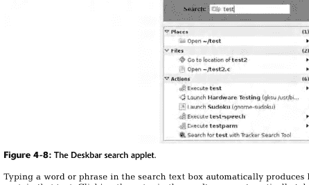

### Figure 4-8: The Deskbar search applet.

在搜索文本框中输入一个单词或短语会自动产生包含该文本的位置。单击结果区域中的条目会自动带你到该位置，要么通过启动应用程序，要么在 Firefox 中显示网站，要么打开 Nautilus 以显示文件或文件夹。


> 你可以更改桌面栏搜索扩展的顺序。右键单击桌面栏图标并选择首选项菜单项。桌面栏首选项对话框会出现，允许你禁用你不想搜索的位置的扩展并更改桌面栏在搜索中使用扩展的顺序。此功能允许你根据你最常搜索的内容来自定义搜索。如果你主要搜索文件，那么等待网络搜索完成就是浪费时间。

# 创建新菜单

除了使用 GNOME 菜单编辑器修改现有面板菜单外，你还可以为面板创建自己的新菜单。两个小程序提供此功能：

- 主菜单
- 菜单栏

主菜单小程序在面板上创建一个单一图标。此单一图标包含整个 GNOME 菜单系统（参见本章前面“菜单区域”部分）。应用程序顶级菜单中的子菜单列出，以及位置和系统菜单。

创建主菜单后，你可以使用 GNOME 菜单编辑器对其进行自定义。使用“菜单区域”部分前面解释的技术，你可以从此面板菜单中添加和删除单个菜单项。

Menu Bar 小程序创建了默认 GNOME 顶层菜单（Applications、Places 和 System）的副本。当 Menu Bar 小程序出现在面板上时，你可以使用菜单编辑器来自定义菜单项。

# 添加桌面图标

默认的 Ubuntu 桌面工作区是空的，没有图标。有些人喜欢干净的桌面，而另一些人则喜欢快速访问文件和启动应用程序的便利。

你可以轻松地为桌面工作区添加文件、文件夹和应用程序启动器（快捷方式）的图标。在工作区空白处右键单击会弹出一个菜单，提供几种不同的桌面选项，如表 4-5 所示。

表 4-5：桌面选项

| Option | Description |
|---|---|
| Create Folder | 创建一个用于存放额外项目的新文件夹 |
| Create Launcher | 为应用程序或终端会话创建应用程序启动器（快捷方式） |
| Create Document | 创建一个文档并将其放置在桌面工作区中 |
| Clean Up by Name | 重新排列桌面图标 |
| Keep Aligned | 自动按行和列对齐桌面图标 |
| Paste | 将从 Nautilus 剪切的文件或文件夹粘贴到桌面工作区 |
| Change Desktop Background | 更改桌面图像或颜色 |

你可以在桌面上任意位置放置新图标。Clean Up by Name 功能会重新组织桌面，将文件夹图标放在前面，然后按名称字母顺序排列应用程序启动器和文档图标。如果选择了 Keep Aligned 选项，Ubuntu 会使用与清理桌面时相同的间距，自动对齐放置在其他图标附近的任何图标。

> Ubuntu 默认的 Create a Document 功能仅允许你创建要放置在桌面工作区中的文本文档。你可以通过创建模板并将其放置在主文件夹中的 `Template` 文件夹中来添加其他文档类型。
>
> 最简单的方法是使用 OpenOffice.org 应用程序。在 OpenOffice.org 中，你可以打开一个空白的 Writer 文档，然后将其保存为 ODF 文本文档模板文件（扩展名为 `.ott`）到 `Templates` 文件夹中。确保使用描述性名称命名文件，因为该名称会出现在 Create a Document 菜单中。当你从 Create a Document 菜单中选择模板时，Ubuntu 会使用模板文件创建一个新文件。

在桌面工作区创建文件、文件夹或应用程序启动器图标后，你可以通过双击打开该对象。对于文档，Ubuntu 会自动打开该文档类型的相应编辑器。Ubuntu 使用 Nautilus 文件管理器打开文件夹（参见第 5 章），对于应用程序启动器，Ubuntu 会启动该应用程序。

右键单击桌面图标会弹出一个菜单，提供多个选项：

- Open: 使用默认应用程序打开项目。
- Open with Other Application: 选择除默认应用程序之外的应用程序来打开文件或文件夹。
- Cut: 从桌面移除项目以放置到其他位置。
- Copy: 复制项目以放置到其他位置。
- Make Link: 创建指向该项目的应用程序启动器图标。
- Rename: 为项目分配新名称。
- Move to Trash: 将项目移至回收站以便删除。
- Stretch Icon: 调整图标大小使其变大。
- Restore Icon's Original Size: 将图标恢复到正常大小。
- Send to: 使用 Evolution 邮件客户端通过电子邮件发送项目。
- Encrypt: 使用其他用户的公钥加密文档或文件夹。
- Sign: 使用你的私钥对文档或文件夹进行签名。
- Create Archive: 构建包含文件或文件夹的归档文件。
- Sharing Options: 为文件夹创建 Windows 共享（如果已安装 Windows 网络共享）。
- Properties: 显示文件或文件夹的功能或应用程序启动器图标的设置。

这些选项将在第 5 章中更详细地介绍。

# 桌面外观

除了为桌面选择对象外，你还可以配置桌面的外观。Ubuntu 允许你更改多个桌面功能。

控制桌面外观和感觉的主要工具是 Appearance Preferences。选择 System Preferences Appearance 启动 Appearance Preferences 工具。Appearance Preferences 工具如图 4-9 所示。

Appearance Preferences 工具提供五个选项卡来控制桌面外观和感觉：

- Desktop Theme
- Background
- Fonts
- Interface
- Visual Effects

本节将介绍如何使用此工具按你的喜好自定义桌面。

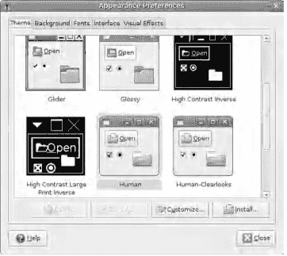

**图 4-9：** 外观首选项工具。

## 桌面主题

桌面主题控制桌面上对象的外观，例如复选框、单选按钮、文件夹图标和窗口配色方案。Ubuntu 提供了十种主题，包括为视障人士提供的高对比度主题。

Ubuntu 设置的默认主题名为 *human*。这会在桌面上营造出令人放松的橙色窗口主题。你可以选择任意主题进行测试，如果觉得不喜欢，也很容易切换回来。

选择主题后，你还可以对其外观和感觉进行额外调整。单击“自定义”按钮会打开“自定义主题”对话框，如图 4-10 所示。

“自定义主题”对话框允许你更改各个项目的外观，例如复选框和单选按钮、窗口、窗口边框、用于文件夹和文档的图标以及鼠标指针。

> **提示**
>
> 你不必局限于 Ubuntu 提供的主题。互联网上有几个 GNOME 主题的资源中心。其中一个站点是 `http://themes.freshmeat.net`。进入该站点后，选择 GTK 链接即可查看适用于 GNOME 桌面的主题。你会看到大量可用于 GNOME 桌面的创意主题。只需将归档的主题文件下载到你的主文件夹，然后在“主题”选项卡上单击“安装”按钮即可。

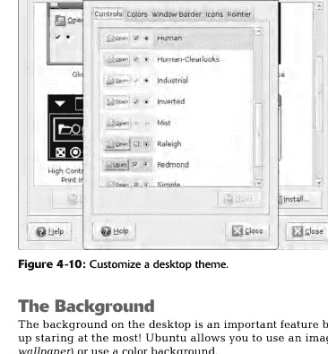

图 4-10：自定义桌面主题。

## 背景

桌面背景是一项重要功能，因为它是你最终注视最多的东西！Ubuntu 允许你使用图像作为背景（称为壁纸）或使用颜色背景。

“背景”选项卡控制桌面背景上的内容。你会看到默认加载的一些可供使用的图像，以及为背景选择颜色的选项。

你可以按照以下步骤加载自己的壁纸图像：

1. 单击“添加”按钮。
2. 使用文件浏览器找到你的图像文件。
3. 单击“打开”按钮。

图像会导入到背景列表中，并自动被选为背景壁纸。

“无壁纸”选项允许你为背景选择单一颜色，或从一个选定颜色到另一个颜色逐渐渐变（水平或垂直）。GNOME 有一个很酷的颜色轮盘，你可以用来选择颜色，如图 4-11 所示。

只需从外侧轮盘上选择基础颜色，然后从内侧三角形中选择渐变效果。

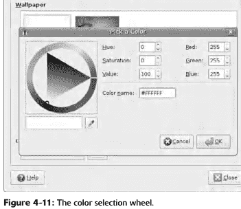

图 4-11：颜色选择轮盘。

## 字体

“字体”选项卡允许你自定义 Ubuntu 在桌面中用于各种功能的字体。正如预期的那样，Ubuntu 提供了多种字体可供选择。不过，一个好的功能是能够自定义字体在屏幕上的渲染方式。

单击“字体”选项卡底部的“详细信息”按钮，会打开“字体渲染详细信息”对话框，如图 4-12 所示。

在这里，你可以真正深入了解屏幕上字体渲染的基本原理。但请记住：字体设置得越精细，它们看起来就越漂亮，但显示文本所需的处理时间和处理能力也就越多。

## 界面

“界面”选项卡提供了一些设置，用于自定义菜单和工具栏在窗口中的显示方式：

- 在菜单中显示图标：在文本菜单项旁边显示图标。
- 可编辑的菜单快捷键：启用使用快捷键组合来选择菜单选项。
- 工具栏按钮标签：设置工具栏项的显示方式，可以是仅文本、仅图标、图标下方带文本，或图标旁边带文本。

这些窗口设置适用于任何使用 GNOME 界面的窗口。它们不适用于不使用 GNOME 库的应用程序，例如基于 KDE 桌面库构建的应用程序。


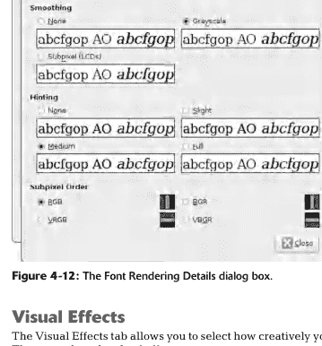

# 视觉效果

“视觉效果”选项卡允许你选择桌面处理窗口的创意方式。效果有三个级别：

- 无
- 正常
- 额外

在“无”级别，窗口出现和消失时没有任何特殊效果。在“正常”级别，窗口打开时淡入，关闭或最小化时淡出。

如果你的 PC 配有高级显卡，则可以选择“额外”级别的效果。此设置提供更花哨的效果，例如窗口在最小化时融化。

# 辅助功能

美国康复法案第 508 条规定，所有计算设备都必须可供残障人士操作。Ubuntu 包含多项功能，使残障人士能够操作工作站上的桌面和应用程序。

这些功能包括屏幕放大镜（放大屏幕区域）、屏幕阅读器（朗读屏幕上的文本）以及键盘和鼠标辅助功能（例如粘滞键和慢速鼠标单击）。你可以根据需要启用各个功能。

在使用 Ubuntu 中的各项无障碍功能之前，你需要先在 Ubuntu 中启用无障碍功能。这是通过“辅助技术”对话框完成的，如图 4-13 所示。

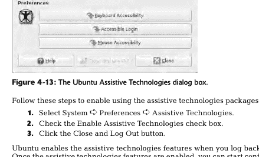

图 4-13：Ubuntu 辅助技术对话框。

按照以下步骤启用辅助技术包的使用：

- 1. 选择 System ▸ Preferences ▸ Assistive Technologies。
- 2. 勾选 Enable Assistive Technologies 复选框。
- 3. 点击 Close and Log Out 按钮。

Ubuntu 在你重新登录系统时启用辅助技术功能。一旦辅助技术功能启用，你就可以开始配置所需的各项功能。以下各节描述了你可以配置的不同辅助技术功能。

# 首选应用程序

点击 Preferred Applications 按钮会弹出首选应用程序对话框。点击 Accessibility 选项卡会产生两个功能的设置：

- Visual: 用于阅读和/或放大屏幕的工具
- Mobility: 用于辅助输入的工具

每个功能都有多个选择，你可以设置功能在用户登录桌面时自动启动。

# 视觉工具

Ubuntu 中用于视力障碍人士的两个主要软件包是 Orca 和 GNOME 放大镜。

Orca 项目（http://live.gnome.org/Orca）提供了几种访问屏幕数据的选项：

- 一个音频屏幕阅读器
- 一个盲文接口
- 一个屏幕放大器

启动 Orca 时，屏幕放大器会启动并显示桌面的增强版本，如图 4-14 所示。

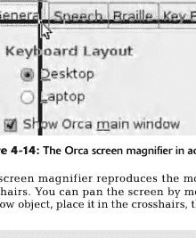

图 4-14：Orca 屏幕放大器运行中。

屏幕放大器将鼠标重现为十字准线中央的一个大指针。你可以通过移动鼠标来平移屏幕。要选择按钮或其他窗口对象，将其置于十字准线中，然后点击鼠标按钮。

Secret

Orca 完全可配置。默认情况下它使用键盘按键序列来启用和禁用功能。按下 Insert-spacebar 键组合会弹出 Orca 配置窗口，在那里你可以自定义所有 Orca 设置和功能。要试用 Orca，按下 Insert-h 键组合。此操作启动学习模式功能。在学习模式下，Orca 不执行功能，而是显示如果激活 Orca 时特定输入事件会做什么的信息。要退出学习模式，只需按 Esc 键即可。

# 输入工具

Ubuntu 辅助技术功能包含两种类型的输入助手：

- Onboard
- Dasher

Onboard 包在桌面上提供一个图形键盘，允许你使用鼠标或其他指向设备选择键来输入。

Dasher 包是一种先进的工具，看起来几乎像太空时代的产物。一个窗口出现，字母不断流过。其思想是点击字母来选择它。随着你点击字母，Dasher 使用预测技术以及内置词典来流式传输最有可能出现在你已选择的字母之后的字母。Dasher 的创建者声称，有经验的用户可以用指向设备“输入”的速度与有经验的打字员一样快。

# 键盘功能

GNOME 桌面中的无障碍功能还包括特殊的键盘处理功能：

- **Accessible Feature Keys:** 通过键盘启用和禁用无障碍功能。
- **Sticky Keys:** 通过一次输入一个键来模拟多键按下。
- **Slow Keys:** 仅接受长按的按键以防止误触按键。
- **Bounce Keys:** 忽略重复的按键。

你可以通过两种方式访问键盘无障碍功能。第一种方法使用辅助技术窗口。只需点击 Keyboard Accessibility 按钮即可。

第二种方法是使用键盘配置工具，从面板菜单中点击 System Preferences Keyboard。无论哪种方式，你都会得到如图 4-15 所示的键盘首选项对话框。

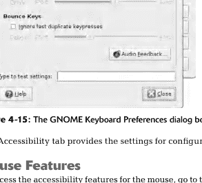

Accessibility 选项卡提供了配置键盘的设置。

# 鼠标功能

要访问鼠标的无障碍功能，请转到鼠标首选项对话框。选择 System Preferences Mouse 以生成如图 4-16 所示的对话框。

在鼠标首选项对话框中，你可以实现两个方便的功能：

- **Simulated Secondary Click:** 通过单击并按住鼠标按钮来模拟双击。
- **Dwell Click:** 通过将鼠标指针停留在某位置来模拟鼠标点击。

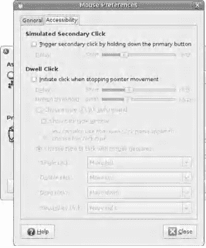

**图 4-16：**鼠标首选项对话框。

Dwell Click 功能非常巧妙。当你停下鼠标指针时，指针会变成十字准线。GNOME 发送给桌面（或应用程序）的点击事件取决于你如何移动鼠标。可能的移动方式如表 4-6 所示。

**表 4-6：Dwell Click 移动操作**

| 操作 | 结果 |
|---|---|
| 向左移动 | 单击主按钮（右手鼠标的左键） |
| 向右移动 | 单击辅助按钮（右手鼠标的右键） |
| 向上移动 | 双击主按钮 |
| 向下移动 | 单击并拖动项目 |

此功能让你无需按下任何按钮即可控制鼠标点击。

# 秘诀

> 你可能还记得，“添加面板小程序”一节中提到过一个名为 Dwell Click 的面板小程序。该面板小程序允许你通过鼠标首选项对话框面板上的按钮来设置 Dwell Click 功能。

# 小结

本章讨论了 Ubuntu 使用的 GNOME 桌面。它逐一介绍了桌面的三个不同部分。顶部面板包含 GNOME 主菜单，方便你访问 Ubuntu 工作站上安装的所有应用程序和工具。桌面工作区为你提供了一个放置图标的位置，以便快速访问文件、文件夹和启动应用程序的快捷方式。

底部面板提供了桌面查看器，可以快速最小化和最大化正在运行的应用程序窗口；还有任务栏区域，显示桌面上每个正在运行的应用程序窗口的图标。你可以通过任务栏图标控制应用程序。最后，工作区切换器提供了一种在 Ubuntu 提供的两个工作区之间切换的便捷方式。

你可以更改 Ubuntu 中的所有默认桌面设置。本章展示了如何向菜单添加菜单项，以及如何添加面板项（如面板小程序）。有多种面板小程序工具可用，几乎可以直接在面板上提供你可能需要的任何类型的信息。

本章的下一部分讨论了桌面外观，并展示了如何修改桌面的基本外观。它展示了如何将背景更改为你喜欢的图像，以及如何更改桌面上使用的窗口和窗口对象的外观和感觉。

最后，本章讨论了 GNOME 桌面中的辅助功能。你可以使用相当多的高级功能，例如 Orca 屏幕阅读器和放大功能，以及 Dasher 可视化键盘。本章最后演示了如何设置鼠标的辅助功能，以实现无需按钮的点击，从而模拟应用程序窗口中所需的任何类型的鼠标点击。

下一部分将介绍 Ubuntu 工作站上安装的实际应用程序。在下一章中，你将看到如何使用默认文件管理软件包 Nautilus 在 Ubuntu 系统中导航，并管理你的文件和文件夹。

# 第 2 部分

# Ubuntu 入门

- 第 5 章：文件管理
- 第 6 章：处理文本
- 第 7 章：OpenOffice 套件
- 第 8 章：网络应用
- 第 9 章：Evolution
- 第 10 章：图像处理
- 第 11 章：使用音频
- 第 12 章：使用视频

如果你从未使用过 Linux，那么理解和管理文件结构可能会有点挑战性。Ubuntu 工作站包含一些帮助处理文件的工具，这些工具让新手和高级用户的生活都更加轻松。本章第一部分讨论 Ubuntu 如何处理硬盘和文件，以便你能够弄清楚文件和文件夹的位置。本章第二部分将介绍 Nautilus，即 Ubuntu 提供的图形化文件管理工具。Nautilus 应用程序帮助你浏览复杂的 Ubuntu 文件系统，并使处理文件和文件夹变得更加容易。

# Linux 文件系统

如果你是 Linux 系统的新手，你可能会对它引用文件和目录的方式感到困惑，尤其是如果你习惯了微软 Windows 操作系统的做法。在探索 Linux 系统之前，先了解一下它的布局会很有帮助。

# 文件路径


你注意到的第一个区别是 Linux 在路径名中不使用盘符。在 Windows 世界中，PC 上安装的物理驱动器决定了文件的路径名。Windows 为每个物理磁盘驱动器分配一个字母，每个驱动器都包含自己的目录结构，用于访问存储在其中的文件。

例如，在 Windows 中，你可能习惯于看到 `C:\Documents and Settings\Rich\My Documents\test.doc` 这样的文件路径。

这表示文件 `test.doc` 位于 `My Documents` 目录中，该目录位于 `Rich` 目录下，而 `Rich` 目录又包含在 `Documents and Settings` 目录下，该目录位于分配了字母 C 的硬盘分区上（通常是 PC 上的第一个硬盘驱动器）。

Windows 文件路径会准确告诉你哪个物理磁盘分区包含名为 `test.doc` 的文件。如果要将文件保存到软盘上，你可以单击 A 驱动器的图标，它会自动使用文件路径 `A:\test.doc`。此路径表示该文件位于分配了字母 A 的驱动器的根目录下，该驱动器通常是 PC 的软盘驱动器。

这不是 Linux 使用的方法。Linux 将文件存储在一个称为虚拟目录的单一目录结构中。虚拟目录包含 PC 上安装的所有存储设备的文件路径，并合并到一个单一的目录结构中。

Linux 虚拟目录结构包含一个称为根目录的单一基础目录。根目录下的目录和文件根据用于访问它们的目录路径列出，类似于 Windows 的做法。

> 你会注意到，Linux 使用正斜杠（`/`）而不是反斜杠（`\`）来表示文件路径中的目录。在 Linux 中，反斜杠字符表示转义字符，在文件路径中使用它会导致各种问题。如果你来自 Windows 环境，可能需要一段时间才能适应。

例如，Linux 文件路径 `/home/rich/Documents/test.doc` 表示文件 `test.doc` 位于 `Documents` 目录中，该目录在 `rich` 目录之下，而 `rich` 目录包含在 `home` 目录中。它没有提供有关文件存储在 PC 上的哪个物理磁盘上的任何信息。

Linux 虚拟目录的棘手之处在于它如何整合每个存储设备。安装在 Linux PC 上的第一个硬盘称为根驱动器。根驱动器包含虚拟目录的核心，或根目录。其他所有内容都由此构建。

在根驱动器上，Linux 创建了称为挂载点的特殊目录。挂载点是虚拟目录结构中的目录，您可以在其中分配额外的存储设备。

虚拟目录会导致文件和目录出现在这些挂载点目录中，即使它们物理上存储在不同的驱动器上。

通常系统文件物理上存储在根驱动器上，而用户文件存储在另一个驱动器上，如图 5-1 所示。


**图 5-1：Linux 文件结构。**

如图 5-1 所示，PC 上有两个硬盘。一个硬盘与虚拟目录的根目录相关联（用单个正斜杠表示）。其他硬盘可以挂载在虚拟目录结构的任何位置。在此示例中，第二个硬盘挂载在 `/home` 位置，即用户目录所在的位置。

Linux 文件系统结构源自 UNIX 文件结构。不幸的是，多年来 UNIX 文件结构因不同版本的 UNIX 而变得复杂。如今似乎没有两个 UNIX 或 Linux 系统遵循相同的文件系统结构。然而，一些常见的目录名称用于相同的功能。Ubuntu 使用了许多常见的 UNIX 目录名称。表 5-1 列出了您在 Ubuntu 虚拟文件系统中默认会看到的目录。

# 文件名

在 Windows 的旧时代（例如流行的 3.0 和 3.1 版本），对文件命名有严格的限制。Windows 的标准称为 8.3 格式。该格式规定

- 一个八个字符的名称，不能使用空格或许多特殊字符
- 一个句点
- 一个通常由字母组成的三个字符的文件扩展名

在 Windows 中，文件扩展名决定了文件名所指的文件类型。可以在系统上运行的应用程序文件必须具有 `.exe` 或 `.com` 的文件扩展名。文本脚本文件使用 `.bat` 文件扩展名。单个应用程序的数据文件也有自己的文件扩展名。如果你使用 Microsoft Office 办公软件套件，Word 文档以 `.doc` 结尾，Excel 文档以 `.xls` 结尾，PowerPoint 文档以 `.ppt` 结尾。

Windows 的更新版本取消了 8.3 文件命名格式。你现在可以使用任何长度的文件名和几乎任何你想要的字符。然而，Windows 保留了文件名中的三字符文件扩展名。扩展名仍然表示文件类型，以便 Windows 知道如何处理它。

Ubuntu（以及 Linux 总体上）本身并不要求文件具有文件扩展名，但确实会利用它们。Ubuntu 中的可执行文件由文件上的权限设置标记（参见第 17 章，“用户和组”）。它们不需要文件名上的任何特殊文件扩展名。

Ubuntu 中有一个特殊类别的文件很重要。开头带有点的文件称为隐藏文件。隐藏文件是用于各种应用程序以及 Linux 操作系统本身的配置文件。它们被称为隐藏文件，因为使用图形或命令行工具处理文件时，默认方式是忽略以句点开头的文件。要查看隐藏文件，您需要将文件管理程序设置为显示它们（参见第 19 章，“Ubuntu 命令行”）。

在 Windows 世界中，您习惯于使用图形工具来管理文件和文件夹。Ubuntu 也包含一个名为 Nautilus 的图形工具，您可以用它来管理文件和文件夹。下一节描述 Nautilus 工具及其使用方法。

# Nautilus

Nautilus 应用程序是一个 GNOME 实用程序，提供使用图形界面的文件和文件夹访问。Ubuntu 使用 Nautilus 进行所有桌面文件管理功能。为了充分利用您的 Ubuntu 桌面，您需要知道如何使用 Nautilus。以下各节描述了 Nautilus 以及如何使用它执行大多数常见的文件管理功能。

## Nautilus 窗口组件

Ubuntu 使用的默认 Nautilus 模式是浏览器模式。在浏览器模式下，Nautilus 的操作方式与网络浏览器非常相似。图 5-2 显示了在浏览器模式下查看文件夹。


**图 5-2：** 在 Nautilus 浏览器模式下查看文件夹。

浏览器模式中的主窗口包含六个独立的部分：

- 顶部的菜单栏
- 工具栏
- 位置栏
- 左侧窗格
- 查看窗格
- 底部的状态栏

让我们快速回顾一下这些区域，以便熟悉 Nautilus。

### 顶部菜单栏

顶部菜单栏包含指向 Nautilus 中各种功能的菜单链接。它由以下项目组成：

- **文件：** 包含与在文件夹窗口中处理文件和文件夹相关的功能链接。这些链接分为五个部分：
  - 创建新文件和文件夹的功能
  - 使用空间模式或浏览器模式打开文件夹，或使用应用程序打开文件的功能
  - 打开父文件夹或新位置的功能
  - 显示文件或文件夹属性的功能
  - 关闭父文件夹、所有文件夹或整个空间模式窗口的功能
- **编辑：** 包含修改文件夹窗口中现有文件和文件夹的功能链接。这些链接分为七个类别，允许你
  - 实现剪切/复制/粘贴功能来管理文件和文件夹
  - 选择文件夹中全部或部分文件和文件夹
  - 创建文件或文件夹的新链接或重命名现有文件或文件夹
  - 通过将其移至回收站删除所选文件或文件夹
  - 管理图标大小
  - 对文件和文件夹执行其他功能
  - 配置 Nautilus 空间模式窗口环境
- **查看：** 设置空间模式窗口中的查看功能。这些链接让你可以
  - 刷新（重新加载）窗口中的项目
  - 重置空间模式窗口设置或查看隐藏文件
  - 修改 Nautilus 在窗口中显示文件的方式
  - 修改窗口中项目的大小
  - 通过单选按钮选择图标视图或列表视图模式
- **转到：** 提供跳转到虚拟文件系统中特定位置以及远程位置的链接，就像面板上的位置菜单项一样（参见第 4 章“探索桌面”）。它还包含你过去访问过的文件夹位置的历史列表，以便你可以快速在文件夹之间移动。
- **书签：** 与网络浏览器一样，Nautilus 允许你为虚拟文件系统中的位置添加书签。返回特定位置就像选择书签一样简单。
- **帮助：** 提供指向 Nautilus 帮助窗口的链接。

在顶部菜单区域下方，有一个工具栏区域，可快速访问多个功能。

### 工具栏

Nautilus 浏览器模式中使用的工具栏允许你通过选择单个工具按钮快速在虚拟文件系统中导航。工具栏上使用了三个标准导航按钮：

- **后退：** 导航到你之前访问过的文件夹。
- **前进：** 导航到你已访问但随后返回的文件夹。
- **向上：** 导航到当前文件夹的父文件夹。

除了这些可相对于当前位置移动的快速导航按钮外，工具栏还包括两个位置特定导航按钮：

- **主页：** 跳转到你的主文件夹。
- **计算机：** 查看计算机上的各个文件系统，例如硬盘、USB 记忆棒、软盘和 CD/DVD 驱动器。


重新加载按钮用于刷新窗口区域，如果你刚刚复制了新文件或文件夹到该区域而它尚未显示出来。停止按钮允许你停止 Nautilus 对文件夹中文件和文件夹的盘点。如果不小心导航到包含许多文件和文件夹的文件夹，此按钮非常方便。

位置栏最左侧的切换按钮允许你在按钮栏和文本位置栏之间切换路径显示。文本位置栏使用文本显示路径，例如 `/home/rich/Desktop`。

在文本位置栏中，你可以输入虚拟文件系统中的特定路径以直接跳转到该位置。此功能允许你输入要查看的位置，而无需浏览到那里。

正如你在“工具栏”部分学到的那样，如果你单击工具栏中的搜索按钮，位置栏将变成搜索栏。

在位置栏右侧有两个项目、缩放按钮和“查看方式”下拉列表。

“查看方式”下拉列表允许你选择 Nautilus 在浏览器查看窗格中用于显示文件和文件夹的查看模式。有两种查看模式：

- **图标视图：** 以图标形式显示文件和文件夹
- **列表视图：** 以文本列表形式显示文件和文件夹

在图标视图中，对象以大图标显示，其文件名在其下方。文件夹有一个图标，文件有另一个图标。文件夹图标对所有文件夹的设计相同，但文件图标可能不同。

Nautilus 尝试检测用于打开文件的应用程序并相应地显示图标。对于文本文档，Nautilus 实际上直接在图标上显示文件的一部分文本内容。对于图像文件，Nautilus 显示图像的缩略图。此功能允许你在不打开文件查看内容的情况下轻松浏览 Nautilus 中的文档和图像。

在列表视图中，Nautilus 以列表形式显示文件和文件夹，与你使用 Windows 资源管理器时所熟悉的类似。图 5-4 演示了在列表视图中查看文件夹。


**图 5-4：** 在列表视图中查看文件夹。

List 视图中有一个 Windows 资源管理器中看不到的很棒的功能，即能够展开每个文件夹以查看其内容。内容会显示在父文件夹下方的列表中，相比其他文件和文件夹略微缩进。你可以以同样的方式继续展开子文件夹。

在 List 视图中，Nautilus 会显示在 Icon 视图中不出现的文件附加信息。默认情况下，列表中会显示大小、文件类型和修改日期。你可以轻松更改 List 视图中显示的信息（将在本章后面的“修改 Nautilus 窗口”部分讨论）。

> Secret

> 使用 Zoom 按钮增大文件图标的大小，以便更好地窥视文件内部的内容。Zoom 按钮在 List 视图中也有效，会使文件和文件夹名称的字体变大。

## The Left Pane

浏览器模式下的左侧窗格为处理文件和文件夹提供了几种不同的功能。左侧窗格顶部的下拉栏允许你选择要使用的特定功能。左侧窗格中可用的功能如表 5-2 所示。

Table 5-2: Nautilus Left Pane Features

| Feature | Description |
|---|---|
| Places | Provides links to specific places in the virtual filesystem |
| Information | Provides information about the current folder level displayed in Nautilus |
| Tree | Displays a drop-down tree of folders in the path |
| History | Displays a list of past folders you’ve viewed |
| Notes | Allows you to set notes for a particular folder level |
| Emblems | Allows you to select emblems that tag folders for easy identification |

默认功能是 Places 功能。它提供对虚拟文件系统中特定位置的快速链接，很像顶部面板中的 Places 菜单（参见第 4 章）。

Tree 功能使 Nautilus 看起来与 Windows 资源管理器相似。你可以从 Tree 视图中选择文件夹，它们会展开以显示其中包含的任何子文件夹。单击文件夹会将文件夹内容带到窗口区域。

Emblems 功能允许你从超过 40 个图标的列表中为文件夹分配特殊图标。Emblem 图标可以帮助你轻松识别特殊文件夹，以及标记具有特殊功能的文件夹，例如共享文件夹。

## The Status Bar

Nautilus 浏览器模式中的状态栏位于窗口底部，提供有关正在查看的文件夹中文件的相关信息。状态栏显示当前文件夹中的文件和文件夹数量，以及系统上剩余的磁盘空间量。

> Secret

> 你可以隐藏 Nautilus 浏览器模式中的任何组件（主 View 窗格除外）以扩展查看区域。只需单击 View 菜单栏项，然后单击要隐藏的组件。活动的组件在其旁边有一个复选标记。要显示组件，只需从菜单中选择它即可。

## Browser Versus Spatial Mode

在 Ubuntu 中使用的默认 Browser 模式下，Nautilus 将所有文件和文件夹信息显示在同一个窗口中，很像一个网络浏览器。在 Spatial 模式下，Nautilus 为每个文件夹使用一个单独的窗口，每次打开新文件夹时都会创建一个新窗口。

> tip

> 要在 Spatial 模式下使用 Nautilus，你需要更改行为设置。从菜单栏中选择 Edit，然后从 Edit 菜单中选择 Preferences。在 Preferences 对话框中，选择顶部的 Behavior 选项卡，然后取消选中标记为 Always Open in Browser Window 的框。

在 Spatial 模式下，Nautilus 几乎没有提供帮助或导航功能。如果你单击一个文件夹，会打开一个单独的 Nautilus Spatial Mode 窗口，其中包含文件夹的内容。由于父窗口保持打开状态，在 Spatial 模式下浏览一系列文件夹和子文件夹会迅速填满你的桌面。

> Secret

> 它被称为 Spatial 模式，因为 Ubuntu 将每个新窗口放置在桌面上的特定位置（空间）。如果你将 Spatial 模式窗口移动到桌面上的新位置（空间），下次打开同一文件夹层级时，Spatial 模式窗口将在该相同空间中打开。此功能允许你按自己喜好排列桌面上的窗口，并且每次打开文件夹时它们始终返回到相同的位置。

Spatial 模式窗口仅包含菜单栏、View 窗格和状态栏，如图 5-5 所示。

## 图 5-5：鹦鹉螺空间模式。

空间模式中的菜单栏包含与浏览器模式中大部分相同的条目。然而，与浏览器模式中使用的 Go 和 Bookmark 条目不同，空间模式菜单栏使用的是 Places 菜单条目。Places 菜单条目与面板菜单中的 Places 菜单项的工作方式完全相同。

你会注意到空间模式窗口底部的状态栏包含两项：

- 父文件夹的下拉列表。你可以从列表中选择任意父文件夹并跳转到该位置。
- 有关文件夹中项目数量以及可用空闲空间量的状态信息。

下拉列表类似于浏览器模式中的位置栏。点击下拉列表会生成当前文件夹路径中的文件夹列表，从根文件夹开始。你可以从中选择任意文件夹以在该位置打开一个新的空间模式窗口。

尽管空间模式不包含 View-as 选项，但你仍然可以使用 View 菜单栏项在图标视图和列表视图之间切换。只需从菜单中选择图标视图或列表视图项即可。还有更改图标或字体大小的选项，就像浏览器模式窗口中的缩放按钮一样。

# 修改鹦鹉螺窗口

你可以轻松自定义鹦鹉螺的外观以满足你的需求。只需从顶部菜单中选择 编辑 → 首选项。主首选项对话框出现，如图 5-6 所示。

## 图 5-6：鹦鹉螺首选项对话框。

首选项对话框中有六个选项卡用于更改鹦鹉螺显示文件和文件夹信息的方式。以下各节描述了这些选项卡及其上的设置。

### 视图选项卡

视图选项卡包含视图窗格中项目显示方式的设置。它包括图标视图和列表视图的设置：

- 新建文件夹的视图：设置默认视图为图标视图或列表视图。
- 安排项目：设置鹦鹉螺在视图窗格中如何显示图标，按名称、大小、类型、修改日期或添加到图标的徽章排列。
- 文件夹优先于文件排序：选中时，文件夹会首先在视图窗格中按安排项目设置排序，然后再对文件排序。未选中时，所有项目均按安排项目设置排序。
- 显示隐藏文件和备份文件：显示以句点开头或带有 `.tarfile` 扩展名的文件。
- 图标默认缩放级别：设置图标视图中的默认图标大小。默认设置为 100%。
- 使用紧凑布局：选中时，减少图标视图模式下图标之间的空间。
- **文本置于图标旁：** 将文件名和其他信息放在文件或文件夹图标旁边而不是下方。
- **列表默认缩放级别：** 设置列表视图中的默认字体大小。默认设置为 50%。
- **仅显示文件夹：** 在树模式的左侧窗格中，仅在树中显示文件夹，不显示文件。

这些设置会影响鹦鹉螺窗口，以及桌面上的文件和文件夹图标。更改这些设置会立即影响现有图标。

### 行为选项卡


## 行为选项卡

行为选项卡控制鹦鹉螺在点击视图窗格或桌面上的文件图标或文本时如何响应操作。此选项卡中可用的设置选项为

- **单击打开项目和双击打开项目：** 单选按钮指示文件是使用单击还是双击打开。

- **始终在浏览器窗口中打开：** 选中时，鹦鹉螺窗口以浏览器模式打开。未选中时，鹦鹉螺窗口以空间模式打开。

- **打开时运行可执行文本文件：** 点击文本文件时，使用终端将其作为 shell 脚本运行。

- **打开时查看可执行文本文件：** 点击 shell 脚本文本文件时，在文本编辑器中打开该文件。

- **每次询问：** 点击 shell 脚本文本文件时，询问是否要运行该文件或在文本编辑器中打开它。

- **清空回收站或删除文件前询问：** 点击清空回收站按钮时，在删除回收站文件夹中的文件前询问。

- **包含绕过回收站的删除命令：** 在右键菜单中添加一个项目以删除文件而不是发送到回收站。

> 单击选项允许你通过单击而不是双击来启动应用程序和打开文件。此模式可能很危险，在选择文件进行复制或删除时必须小心。要在不打开文件的情况下选择文件，请在点击文件前按住 Ctrl 键。

## 显示选项卡

显示选项卡控制鹦鹉螺在图标视图模式下如何显示文件和文件夹信息。当图标视图处于 100% 缩放级别时，默认情况下你只能看到文件或文件夹的名称。如果你使用缩放按钮（或从菜单栏选择 视图 → 缩放）放大，你会在不同的缩放值下看到有关文件的额外信息。鹦鹉螺在以下三个缩放级别提供有关图标项目的的信息：

- 50% 缩放级别

- 150% 缩放级别

- 400% 缩放级别

您可以通过在此选项卡中选择合适的值，创建任意组合的信息设置，以在列表视图模式下显示。

## 预览选项卡

预览选项卡控制文件在图标视图模式下如何预览。在图标视图模式下，Nautilus 可以在图标内显示文件的内容。此功能很有用（除非 Nautilus 显示内容需要过长时间，如下面的预览设置选项列表所述）。预览设置允许您更改 Nautilus 在图标视图模式下如何处理不同类型的文件。每种文件类型都有三个预览选项：

- **始终：** 始终在图标中显示内容，即使是在远程网络服务器等慢速介质上也是如此。

- **仅本地文件：** 仅当文件或文件夹位于本地系统时，才在图标中显示内容。

- **从不：** 从不在图标中显示内容。

您可以为其配置预览设置的文件类型有：

- **文本文件：** Nautilus 识别为仅包含文本的文件

- **其他可预览文件：** 主要用于 OpenOffice.org 文件和图像文件。您还可以设置大小限制，因为您可能不想显示可能需要很长时间才能加载的图像文件的缩略图。

- **声音文件：** 任何类型的音频文件，例如 `.ogg`。

- **文件夹：** 计算文件夹中的文件数量。

> 如果您在远程网络服务器上有大量文件和文件夹，通常不建议让 Nautilus 在图标视图中预览它们。这样做会不必要地占用网络带宽，并且可能需要很长时间。

## 媒体选项卡

媒体选项卡控制 Nautilus 如何为放入 CD/DVD 驱动器中的各种类型的媒体光盘启动应用程序。Nautilus 可以自动检测媒体类型，并根据插入的媒体类型启动应用程序。

您可以指定在将特定类型的 CD 或 DVD 插入 CD/DVD 驱动器时要运行哪些应用程序，从而省去自己查找应用程序的麻烦。

对于每个媒体类别，您可以选择以下四种操作之一：

- **询问如何操作：** 始终显示一个对话框，提示您执行操作。

- **不执行任何操作：** 当您将媒体插入 CD/DVD 驱动器时，Ubuntu 不做任何事。

- **打开文件夹：** 在新 Nautilus 窗口中打开媒体内容。

- **使用特定应用程序打开：** 指定一个应用程序来打开插入的媒体。

对于每种媒体类型，Nautilus 都会为您提供可以用来打开它的应用程序。您可以为各种 CD 和 DVD 媒体类型选择要使用的应用程序。表 5-4 列出了不同的媒体类型及其默认应用程序。

表 5-4：打开媒体类型的默认应用程序

| 媒体类型 | 应用程序 |

|---|---|

| 音频 CD | 打开 Rhythmbox 音乐播放器 |

| 视频 DVD | 打开电影播放器 |

| 音乐 CD 或 DVD | 打开 Rhythmbox 音乐播放器 |

| 照片 CD 或 DVD | 打开 F-Spot 照片管理器 |

| 软件 CD 或 DVD | 打开自动运行提示 |

| 空白蓝光光盘 | 打开 CD/DVD 刻录工具 |

| 空白 CD 光盘 | 打开 CD/DVD 刻录工具 |

| 空白 DVD 光盘 | 打开 CD/DVD 刻录工具 |

| 空白 HD-DVD 光盘 | 打开 CD/DVD 刻录工具 |

| 蓝光视频 | 未安装应用程序 |

| DVD 音频 | 打开 Rhythmbox 音乐播放器 |

| HD DVD 视频 | 打开电影播放器 |

| 图片 CD | 打开 F-Spot 照片管理器 |

| 超级视频 CD | 打开电影播放器 |

| 视频 CD | 打开电影播放器 |

表 5-4 显示，例如，如果您将任何类型的空白 CD 或 DVD 媒体放入驱动器，Ubuntu 将启动 CD/DVD 刻录工具应用程序（请参阅本章后面的“将文件刻录到 CD”）。

# 处理文件

除了用于查看和访问文件之外，Nautilus 还为您的几乎所有文件管理需求提供了图形界面。以下各节将引导您了解如何使用 Nautilus 图形界面处理文件和文件夹。

## 创建新文件和文件夹

在某个时刻，您会想要在 Ubuntu 系统上快速创建新的文本文件或新文件夹。要在 Nautilus 中创建文件：

1. 导航到您要创建文件或文件夹的目录。

   您必须在视图窗格中打开该文件夹，然后才能在其中创建文件或新文件夹。

2. 在查看窗格的空白处右键单击。

   请注意不要单击查看窗格中现有的对象。如果单击了，弹出的将是“对象”菜单，而不是用于创建新对象的菜单。

3. 选择“创建文件夹”或“创建文档”。

4. 输入要创建项目的名称。

选择“创建文档”选项会打开一个子菜单，列出你可以创建的文件类型。该列表包括“模板”文件夹中用于创建特定类型文件的任何模板文件（参见第4章），以及创建一个空文本文件的选项。

## 复制和移动文件

在 Nautilus 中，有三种复制或移动文件的方法。如果你熟悉 Microsoft Windows 或 Apple Macintosh，你肯定了解拖放操作。Nautilus 支持以下复制和移动文件的方法：

- 拖放以将文件或文件夹从一个位置移动到另一个位置。将主鼠标按钮按住并停留在项目的图标（图标视图）或名称（列表视图）上，然后继续按住鼠标按钮移动鼠标指针。当文件或文件夹到达新位置时松开鼠标按钮。你可以在同一个 Nautilus 窗口内或在不同窗口之间执行此操作。你也可以将文件或文件夹从 Nautilus 窗口移动到桌面区域。

- 如果你在浏览器模式下使用 Nautilus，可以在左侧窗格中打开树视图，将文件和文件夹拖放到树中列出的任何文件夹中。

- 按住 Ctrl 键并拖放文件图标或名称，可以在新位置创建文件或文件夹的副本，同时保留原件。与移动文件或文件夹一样，你可以将文件复制到同一 Nautilus 窗口或 Nautilus 窗口之间（包括桌面）的任何文件夹中。

Nautilus 还支持通过“文件”菜单进行剪切和粘贴或复制和粘贴来处理文件。以下是执行剪切或复制所需的步骤：

1. 右键单击文件或文件夹。

2. 选择“剪切”以移动文件，或选择“复制”以复制文件。

   如果选择“剪切”，文件不会立即从查看窗格中消失，直到你将其放置到新位置。不要期望文件立即从原始位置消失。

3. 导航到你想放置文件的文件夹。

   与拖放方法一样，你可以右键单击 Nautilus 窗口中的文件夹、树视图左侧窗格中的文件夹，或桌面上的文件夹。

4. 在空白区域右键单击并选择“粘贴”。

Nautilus 提供了一种快速简便的方法来执行所有文件管理功能。

## 运行程序

Nautilus 使你能够直接从文件夹中的文件启动应用程序。Ubuntu 配置了 Nautilus 自动检测最常用的文件类型并启动相应的应用程序。

要为已知文件类型启动应用程序，只需单击或双击文件（取决于 Nautilus 的设置）。你也可以右键单击文件打开“操作”菜单，并选择以下选项之一：

- **使用默认程序打开：** 启动与该文件类型关联的应用程序，就像你单击了文件一样。

- **使用其他应用程序打开：** 允许你选择另一个应用程序来打开该文件。

如果你选择使用其他应用程序打开文件，会出现一个对话框，列出 Ubuntu 已知的已安装应用程序，如图 5-7 所示。


**图 5-7：** Nautilus 的“打开方式”对话框。

如果在列表中找不到你想使用的应用程序，请单击“使用自定义命令”箭头，会出现一个文本框和按钮。你有两个选择应用程序的选项：

- 在文本框中键入应用程序的完整路径名。

- 单击“浏览”按钮浏览文件系统以查找应用程序文件。


选择应用程序后，单击“打开”按钮即可在该应用程序中启动所选文件。

# 删除文件

最终你会想要从系统中移除文件。以下是通过 Nautilus 删除文件和文件夹的方法：

1. 导航到要删除的文件或目录位于查看窗格中。
2. 选择项目：
   - 要删除单个文件或文件夹，请单击该项目以将其选中。
   - 要删除连续的一组文件或文件夹，请按住 Shift 键并选择第一个文件，然后继续按住 Shift 键选择最后一个文件。
   - 要删除不连续的一组文件或文件夹，请按住 Ctrl 键并选择要删除的各个文件或文件夹。
3. 按 Delete 键，或右键单击并选择“移动到回收站”。

如果你发现自己经常将项目移到回收站后，又立刻清空回收站，可以在 Nautilus 的“首选项”对话框中设置该功能，将“删除”项添加到操作列表中。有关说明，请参阅本章中的“行为选项卡”一节。

# 文件属性

Ubuntu 会跟踪系统中每个文件和文件夹的特定属性。Nautilus 提供了简单的界面来查看和修改这些属性。在 Nautilus 中右键单击文件或文件夹时，选择“属性”菜单即可访问“属性”对话框，如图 5-8 所示。

你可以直接在此对话框中查看和设置大多数属性。五个独立的选项卡提供了对各种属性的访问：

- 基本
- 徽章
- 权限
- 打开方式
- 备注

以下各节将讨论每个选项卡区域。

## 基本属性

“基本属性”选项卡显示与文件或文件夹关联的核心属性。所有与文件相关的标准信息都显示在此页面上：

- 文件名
- Nautilus 检测到的文件类型


Figure 5-8: The Properties dialog box from Nautilus.

- The size of the file
- The full path of the file
- The disk volume that contains the file
- The MIME type of the file
- The date and time the file was last modified
- The date and time the file was last accessed

Of these elements, the filename is the only thing you can change. The rest of the properties are detected by Nautilus and displayed on the page.

## Emblems

The Emblems tab produces a list of various icons you can associate with the file, as shown in Figure 5-9.

As you select an emblem, it appears on top of the icon in Nautilus or on the desktop if the file or folder icon is on the desktop. Emblems help you tag special files and folders so you can easily recognize them as you browse through your virtual filesystem.


Figure 5-9: The Emblems tab in the Properties dialog box.

## Permissions

No discussion of file management in Linux is complete without talking about file permissions. The Ubuntu system uses file permissions to restrict access to files and folders. This feature allows you to keep others from viewing or deleting your files and folders, and it also provides a way for you to share files and folders with others.

Chapter 17, "Users and Groups," goes into great detail about how to create the permissions to control and share files or folders. However, in our discussion of Nautilus we should take a quick peek at how Nautilus displays file and folder permissions.

The Permissions tab, shown in Figure 5-10, shows the current settings for the file or folder.

As discussed in Chapter 17, Ubuntu uses three permissions groups for controlling access to files and folders:

- The owner of the file or folder
- A group assigned to the file or folder
- Anyone else on the system (others)

Figure 5-10: The Permissions tab in the Properties dialog box.

For each of these three permission groups there are three settings for control:

- None (not allowed for the file owner)
- Read-only
- Read and write

By default, the owner of the file has read and write permissions, and the group and others are set to read-only. You can easily change the default group for the file or folder, as well as the permission settings, in the Permissions tab.

The Permissions tab also contains a check box to indicate when the file is an executable script program file. By checking this box you can run the script file by simply double-clicking it in Nautilus. However, even when the executable program check box is checked, Nautilus asks you whether you want to view the file or run it, as shown in Figure 5-11.


Figure 5-11: The View or Run dialog box.

The dialog box also gives you the option of running the script file inside a Terminal session or directly from the desktop.

## Open With

Nautilus uses file extensions to identify some types of files, and the application it uses to open them. However, this doesn't always work. Nautilus also attempts to detect the file type by reading the first few bytes contained in the file.


Ubuntu uses file extensions to identify some types of files, but Nautilus attempts to detect the file type by reading the first few bytes contained in the file.

The Open With tab allows you to change the default application Nautilus uses or to add other options for opening the file. Just click the Add button, then either scroll through the list of installed applications or select the command textbox drop-down arrow and enter your own program.

## Notes

The Notes section is a convenient place for you to add notes about a file or folder. Ubuntu keeps the notes with the file or folder properties; you can display them by going to

mode, which is a more bare-bones operation. In Spatial mode you view the files and folders in a single window without many bells and whistles. Double-clicking a folder in Spatial mode opens a new Nautilus window that contains the contents of the folder.

The next chapter deals with the topic of text files. Text files are a crucial part of any operating system, whether they are configuration files, log files, program script files, or just data files. It's important to know how to handle text files to get the most out of your Ubuntu experience. In the next chapter you'll see the various ways Ubuntu allows you to work with text files.

# 使用文本

# 第 6 章

## 本章要点

- `gedit` 编辑器
- 添加特殊字符
- 使用 `vim`
- 使用 `emacs`
- Tomboy Notes

在几乎所有计算机环境中，使用文本文件都是必不可少的。查看系统日志、修改配置文件以及编写程序等任务都需要能够处理文本文件的能力。Ubuntu 提供了几种处理文本文件的方式。本章将介绍两个图形化文本编辑器 `gedit` 编辑器和 `emacs` 编辑器，以及 `vim`，一种在命令行会话中使用时可用的老式基于文本的编辑器。本章最后讨论了 Tomboy Notes 应用程序，虽然它并不是专门的文本编辑器，但它允许你通过创建文本笔记来组织你的世界，这些笔记的功能远不止放在文件夹里那么简单。

# gedit 编辑器

如果你在 Ubuntu GNOME 桌面环境中工作，那么已经安装了一个图形化文本编辑器，可以满足你大部分的文本编辑需求。`gedit` 程序是一个基础的文本编辑器，附带了一些有趣的高级图形功能。本节将介绍 `gedit` 的功能，并演示如何充分利用它来满足所有文本处理需求。

## 启动 gedit

你可以通过三种不同的方法在 Ubuntu 桌面环境中访问 `gedit` 文本编辑器：

- 在 Applications 面板菜单项下，选择 Accessories 菜单中的 Text Editor 条目。
- 在桌面或 Nautilus 中双击一个文本文件（参见第 5 章，“文件管理”）。
- 在 Terminal 会话中的命令行提示符下（参见第 19 章，“Ubuntu 命令行”），运行 `gedit` 命令：

```
$ gedit mytest.txt
```

无论你是启动一个新文件还是用特定文件启动 `gedit`（例如在 Nautilus 中双击文件时），`gedit` 都会创建一个编辑器缓冲区空间并准备好让你开始编辑文本，如图 6-1 所示。


图 6-1：`gedit` 主编辑器窗口。

如果你正在编辑现有文件，你正在编辑的文件名会出现在 Edit 面板的标签上。如果你将鼠标指针悬停在标签上，会出现一个对话框，显示文件的完整路径名、文件的 MIME 类型以及它使用的字符集编码。你可以在 Edit 面板中执行大多数常见的文本编辑功能，例如剪切、复制和粘贴文本，以及通过用鼠标突出显示文本并按 Delete 键来删除文本块。

> 你可以使用 `gedit` 同时编辑多个文件。从 `gedit` 命令行提示符输入，每个文件在命令行中单独输入：
>
> ```
> $ gedit mytest.txt mytest2.txt
> ```
>
> 如果你已经打开了一个 `gedit` 会话，只需选择 File 然后选择 New 或 Open 即可在同一个 `gedit` 窗口会话中打开另一个文件。
>
> 每个文件都在单独的窗口窗格和单独的编辑器缓冲区中打开。你可以通过单击要编辑的文件的窗格标签轻松在文件之间切换。

Edit 面板上的标签还提供了对常用编辑功能的快速访问。右键单击标签页窗格可以

- 使用该文件启动一个 `gedit` 窗口会话
- 使用当前文件名保存文件
- 使用新文件名保存文件
- 打印文件
- 关闭窗口窗格

标签迷你菜单提供了对使用文本文件时所需的大多数常用功能的便捷访问，而无需在菜单栏菜单中查找。

## gedit 基本功能

除了标签式编辑器窗口窗格外，`gedit` 还使用菜单栏和工具栏来设置功能和配置设置。工具栏提供了对菜单栏中包含的最常见功能的快速访问。可用菜单栏项为

- **File：** 用于创建新文件、打开现有文件、保存现有文件和打印文件
- **Edit：** 用于操作活动缓冲区区域中的文本并设置编辑器首选项
- **View：** 用于设置在窗口中显示的编辑器功能并设置文本高亮模式
- **Search：** 用于在活动编辑器缓冲区区域中查找和替换文本
- **Tools：** 提供对安装在 `gedit` 中的插件工具功能的访问
- **Documents：** 用于管理在缓冲区区域中打开的文件
- **Help：** 提供对完整 `gedit` 用户手册的访问

File 菜单中的一个有趣功能是 Open Location，它允许你使用流行的标准统一资源标识符（URI）格式从网络打开文件

贯穿整个万维网。这种格式标识了用于访问文件的协议（如 HTTP 或 FTP）、文件所在的服务器，以及访问该文件的服务器的完整路径。

编辑菜单包含标准的剪切、复制和粘贴功能，以及一个巧妙的功能，允许您以多种不同的格式轻松地在文本中输入日期和时间。

视图菜单允许您自定义在 `gedit` 窗口中显示哪些元素，以及定义 `gedit` 如何格式化编辑窗格中的文本。您可以使用视图菜单禁用工具栏、状态栏或窗口的侧边窗格。状态栏出现在窗口底部，显示光标所在当前行和列、当前编辑模式（插入或覆盖），以及打开或保存文件时的状态。侧边窗格列出了在 `gedit` 会话中打开的所有文件。

视图菜单中的高亮模式允许您指定编辑器缓冲区中是什么类型的文本文件。`Gedit` 能够使用不同的配色方案来识别文本文件中的不同元素。例如，在编程文件中，`gedit` 可以为关键字、函数名和常量使用不同的颜色。

`Gedit` 通过检查文件名扩展名来确定文本文件中包含的内容类型。许多编程语言使用特定的文件名扩展名来标识文件，例如 C 语言程序使用 `.c`，shell 脚本程序使用 `.sh`，PHP 程序使用 `.php`。当 `gedit` 在文件名中检测到这些时，它会自动设置适当的文件类型。

搜索菜单提供标准的查找功能，会弹出一个对话框，您可以在其中输入要查找的文本并选择查找方式（匹配大小写、匹配整个单词以及搜索方向）。它还提供增量搜索功能，该功能以实时模式工作，在您输入单词字符时即找到文本。

## 设置首选项

编辑菜单包含一个首选项项，会弹出 `gedit` 首选项对话框，如图 6-2 所示。

在这里您可以自定义 `gedit` 编辑器的操作。首选项对话框包含五个标签页区域，用于设置编辑器的功能和行为。

### 视图

视图标签提供了 `gedit` 如何在编辑器窗口中显示文本的选项：

- **文本换行：** 此选项决定如何处理编辑器中过长的文本行。启用文本换行选项会将长行换到编辑器的下一行。不要将单词拆分到两行的选项可防止在可拆分到两行的长单词中自动插入连字符。


- **行号：** 此选项可在编辑器窗口的左侧边距中启用行号显示。
- **当前行：** 此选项可启用当前光标位置所在行的高亮显示，有助于您轻松找到光标位置。
- **右边界：** 此选项可启用右侧边距，并允许您设置编辑器窗口中应有多少列。默认值是 80 列。
- **括号匹配：** 当启用此选项时，编程代码中的括号对会被高亮显示，让您能够轻松匹配 `if-then` 语句、`for` 和 `while` 循环以及其他使用括号的编码元素中的括号。


行号和括号匹配功能为程序员提供了排查代码的环境——这是一些文本编辑器中不常见的功能。

# 编辑器

编辑器标签提供了 `gedit` 如何处理制表符和缩进的选项，以及文件如何保存：

- **制表符停止：** 此选项设置按下 `Tab` 键时跳过的空格数。默认值是八个。此功能还包括一个复选框，选中后会在制表符跳过处插入空格而不是制表符。
- **自动缩进：** 当启用此选项时，`gedit` 会自动为文本中的段落和代码元素（如 `if-then` 语句和循环）缩进行。
- **文件保存：** 此选项为保存文件提供两个功能：在编辑器窗口中打开文件时是否创建文件的备份副本，以及是否以预选的间隔自动保存文件。

自动保存功能是确保您的更改定期保存以防止因崩溃或断电而造成灾难的绝佳方式。

# 字体和颜色

字体和颜色标签允许您配置（不出所料）两项内容：

- **字体：** 此选项允许您从对话框中选择默认字体（`Monospace 10`）或自定义字体和字体大小。
- **配色方案：** 此选项允许您选择用于文本、背景、所选文本和选择颜色的默认配色方案，或为每个类别选择自定义颜色。

`gedit` 的默认颜色与为桌面选择的标准 Ubuntu 桌面主题相匹配。这些颜色会随着你为桌面选择的配色方案而变化。

# 插件

插件选项卡用于控制 `gedit` 中使用的插件。插件是独立的程序，可以与 `gedit` 交互以提供额外的功能。插件选项卡如图 6-3 所示。


图 6-3：`gedit` 插件偏好设置选项卡。

`gedit` 有多个插件可用，但并非所有插件都默认安装。表 6-1 描述了 `gedit` 中当前可用的插件。

### 表 6-1：Gedit 插件

| 插件 | 描述 |
|---|---|
| 更改大小写 | 更改选中文本的大小写 |
| 文档统计 | 报告单词、行、字符和非空格字符的数量 |
| 外部工具 | 在编辑器中提供 shell 环境以执行命令和脚本 |
| 文件浏览器窗格 | 提供简单的文件浏览器，使选择要编辑的文件更容易 |
| 缩进行 | 提供高级的行缩进和取消缩进 |
| 插入日期/时间 | 在当前光标位置以多种格式插入当前日期和时间 |
| 模型行 | 在编辑器窗口底部提供 emacs 风格的消息行 |
| Python 控制台 | 在编辑器窗口底部提供交互式控制台，用于使用 Python 编程语言输入命令 |
| 代码片段 | 允许你存储常用文本片段，以便在文本中任何位置轻松检索 |
| 排序 | 快速对整个文件或选中文本进行排序 |
| 拼写检查器 | 为文本文件提供字典拼写检查 |
| 标签列表 | 提供常用字符串列表，你可以轻松将其输入到文本中 |
| 文本加密 | 提供加密服务，例如对文件签名、加密文本和解密加密文本 |
| 用户名 | 在当前光标位置插入当前用户的登录名 |

启用的插件会在其名称旁边的复选框中显示勾选标记。有些插件在选中后还提供额外的配置功能，例如外部工具插件。它允许你选择启动终端的快捷键、`gedit` 显示终端输出的位置，以及启动 shell 会话的命令。


> 除了 Ubuntu 默认安装的插件外，`gedit` 还有许多额外的插件。`gedit` 插件的交换中心位于
> 
> http://live.gnome.org/Gedit/Plugins
> 
> 该站点包含 `gedit` 官方插件，以及大量由其他人开发的插件。你可以从那里下载额外的插件并安装到你的 `gedit` 环境中。

遗憾的是，并非所有插件都安装在 `gedit` 菜单栏的同一位置。有些插件出现在“工具”菜单栏中（例如“拼写检查器”和“外部工具”插件），而另一些则出现在“编辑”菜单栏中（例如“更改大小写”和“插入日期/时间”插件）。

# 字符映射表

如果你使用 `gedit` 编辑器编写文本，可能需要在文档中输入特殊字符，例如数学符号或非英文字符。`gedit` 不直接提供插入特殊字符的方法，但 Ubuntu 提供了另一个程序来帮助你。

字符映射表应用程序提供了大量特殊字符，从各种非英文字符到科学、数学和工程中使用的许多特殊符号。

通过依次单击“应用程序”面板菜单、“附件”、“字符映射表”来启动字符映射表应用程序。字符映射表主窗口出现，如图 6-4 所示。


**图 6-4：** 字符映射表应用程序窗口。

字符映射表窗口由四个区域组成：

- 顶部的字体和格式选择区域
- 左侧的字符集列表
- 右侧的网格块，按字符代码值顺序包含字符
- 字符集列表下方的文本框，用于从网格块复制和粘贴字符
- 状态栏，显示在网格块中选定的字符名称

字符集列表可以根据字符的 Unicode 位置（相似字符集按顺序出现在 Unicode 中）或按语言（称为*文字*）显示字符集。当你从左侧窗格中选择 Unicode 块或文字时，该字符集中包含的字符将出现在右侧窗格的网格块中。

你可以通过在网格块中选中某个字符，然后点击网格块窗格顶部的“字符详情”选项卡来查看该字符的信息。当找到要使用的字符时，将其拖放到“要复制的文本”框中。你可以根据需要向文本框添加任意数量的字符。

当文本框中有了所需字符后，点击“复制”按钮将它们复制到剪贴板区域。从那里，你可以将字符粘贴到 `gedit` 会话的编辑窗格中。在 `gedit` 编辑窗格中工作时，你可以将字符放置在文本文档中任何需要的位置。

# The vim Editor

如果你在命令行模式下工作，你可能希望熟悉至少一个直接在命令行环境中运行的文本编辑器。`vi` 编辑器是 UNIX 系统上使用的原始文本编辑器。它使用控制台图形模式来模拟一个文本编辑器窗口，让你可以看到文本文件的内容行，在文件中移动，以及插入、编辑和替换文本。

尽管 `vim` 可能是世界上最复杂的编辑器（至少在那些讨厌它的人看来如此），它提供的许多功能使其成为 UNIX 管理员数十年来不可或缺的工具。

当 GNU 项目将 `vi` 编辑器移植到开源世界时，他们选择对其进行一些改进。由于它不再像原始的 `vi` 编辑器，他们将其重命名为 `vim`（代表 `vi` improved，`vi` 改进版）。

Ubuntu 默认安装了 `vim`。它还创建了一个名为 `vi` 的别名程序，指向 `vim`，这样你就可以使用 `vi` 或 `vim` 命令从命令行提示符启动 `vim` 编辑器。

本节将引导你了解在无需离开命令行环境的情况下使用 `vim` 编辑器编辑文本文件的基础知识。

# The Basics of vim

`vim` 编辑器使用内存缓冲区处理数据。要启动 `vim` 编辑器，只需输入 `vim` 命令（或 `vi` 别名）以及要编辑的文件名：

```
$ vim mytext.txt
```

如果你在没有文件名或文件不存在的情况下启动 `vim`，`vim` 会打开一个新的缓冲区区域进行编辑。如果你指定了命令行上的现有文件，`vim` 会将文件的全部内容读入缓冲区区域，并使其准备好编辑，如图 6-5 所示。


Figure 6-5: The vim main window.

## Part 2: Starting Out with Ubuntu

`vim` 编辑器以全屏模式运行，使用整个控制台窗口作为编辑区域。

初始的 `vim` 编辑器窗口显示文件的内容（如果有），以及窗口底部的一条消息行。如果文件内容没有占满整个屏幕，`vim` 会在不属于文件的那几行上放置波浪号（见图 6-5）。

底部的消息行提供有关编辑文件的的信息，取决于文件的状态以及 `vim` 安装中的默认设置。如果文件是新的，则会显示 `[New File]` 消息。

`vim` 编辑器有两种操作模式：

- Normal mode
- Insert mode

当你首次打开文件（或开始新文件）进行编辑时，`vim` 编辑器进入 Normal mode。在 Normal mode 中，`vim` 编辑器将按键解释为命令（稍后会详细介绍）。

在 Insert mode 中，`vim` 会在缓冲区中当前光标位置插入你输入的每个字符。要进入 Insert mode，按 `i` 键。要退出 Insert mode 并返回 Normal mode，按键盘上的 `Esc` 键。

> **Secret**
>


在 `Normal mode` 中，你可以使用箭头键在文本区域移动光标（只要你的终端类型被 vim 正确检测到）。如果你恰好处于一个箭头键未定义的不可靠终端连接上，希望并未破灭。vim 命令包括用于移动光标的键盘命令：

- `h` to move left one character
- `j` to move down one line (the next line in the text)
- `k` to move up one line (the previous line in the text)
- `l` to move right one character

在大型文本文件中逐行移动可能会很乏味。幸运的是，vim 提供了一些命令来加快操作：

- `Page Down` (or `Ctrl-f`) to move forward one screen of data
- `Page Up` (or `Ctrl-b`) to move backward one screen of data
- `G` to move to the last line in the buffer
- `num G` to move to line number `num` in the buffer
- `gg` to move to the first line in the buffer

`vim` 编辑器在 `Normal mode` 内有一个特殊功能，称为 `Command Line mode`。`Command Line mode` 提供了一个交互式命令行，你可以在其中输入额外的命令来控制 vim 中的操作。要进入 `Command Line mode`，从 `Normal mode` 按下冒号字符 `:`。光标移动到消息行并出现一个冒号，等待你输入命令。

在命令行模式中有几个命令用于将缓冲区保存到文件以及退出 vim：

- `q` 如果缓冲区数据没有更改，则退出
- `q!` 退出并丢弃对缓冲区数据所做的任何更改
- `w filename` 以不同的文件名保存文件
- `wq` 将缓冲区数据保存到文件并退出

仅仅看了几个基本的 vim 命令，你可能就会明白为什么有些人非常讨厌 vim 编辑器。要充分发挥 vim 的作用，你必须了解大量晦涩的命令。然而，一旦你掌握了一些基本的 vim 命令，就可以直接在命令行中快速编辑文件，无论你处于什么类型的环境中。

# 编辑数据

在插入模式下，你可以将数据插入缓冲区；然而，有时你在已经将数据输入缓冲区后，还需要添加或删除数据。在普通模式下，vim 编辑器提供了几个用于编辑缓冲区数据的命令。表 6-2 列出了一些常见的 vim 编辑命令。

**表 6-2：vim 编辑命令**

| 命令 | 描述 |
|---------|-------------|
| `x` | 删除当前光标位置的字符 |
| `dd` | 删除当前光标位置所在的行 |
| `dw` | 删除当前光标位置所在的单词 |
| `d$` | 从当前光标位置删除到行尾 |
| `J` | 删除当前光标位置所在行末尾的换行符 |
| `a` | 在当前光标位置之后追加数据 |
| `A` | 在当前光标位置所在行的末尾追加数据 |
| `r char` | 用 `char` 替换当前光标位置的单个字符 |
| `R text` | 用 `text` 覆盖当前光标位置的数据，直到按下 `Esc` |

某些编辑命令还允许你使用数字修饰符来指定命令执行次数。例如，命令 `2x` 从当前光标位置开始删除两个字符，命令 `5dd` 从当前光标位置所在行开始删除五行。

在 vim 编辑器中尝试使用 PC 键盘的 `Backspace` 或 `Delete` 键时要小心。vim 编辑器通常能识别 `Delete` 键，因为 `x` 命令的功能是删除当前光标位置的字符。通常，vim 编辑器不识别用于删除的 `Backspace` 键，而是将其用作后退箭头键。

# 复制和粘贴

现代编辑器的标准功能是能够剪切或复制数据，然后将其粘贴到文档中的其他位置。vim 编辑器提供了实现这一功能的方法。

剪切和粘贴相对容易。你已经看到了表 6-2 中可以从缓冲区删除数据的命令。然而，当 vim 删除数据时，它实际上会将其存储在一个单独的寄存器中。你可以使用 `p` 命令来检索该数据。

例如，你可以使用 `dd` 命令删除一行文本，然后将光标移动到缓冲区中想要放置该文本的位置，再使用 `p` 命令。`p` 命令会在当前光标位置所在行之后插入文本。你可以对任何删除文本的命令执行此操作。

复制文本则稍微复杂一些。vim 中的复制命令是 `y`（用于 yank）。你可以像 `d` 命令一样，在 `y` 后面使用相同的第二个字符（`yw` 复制一个单词，`y$` 复制到行尾）。复制文本后，将光标移动到想要放置文本的位置，然后使用 `p` 命令。复制的文本就会出现在该位置。

复制（yank）操作很棘手。你看不到发生了什么，因为你没有影响你复制的文本。在将复制的文本粘贴到某处之前，你永远无法确定自己复制了什么。

vim 中还有另一个功能可以帮助我们进行复制操作。

可视化模式会在你移动光标时高亮显示文本。你可以使用可视化模式选择要复制以便粘贴的文本。要进入可视化模式，请将光标移动到要开始复制的位置，然后按 `v` 键。你会注意到光标位置的文本现在已高亮显示。接下来，移动光标以覆盖你想要复制的文本（你甚至可以向下移动多行来复制多行文本）。当移动光标时，vim 会高亮显示复制区域中的文本。覆盖了要复制的文本后，按 `y` 键激活复制命令。现在文本已经存入寄存器，只需将光标移动到要粘贴的位置，然后使用 `p` 命令将其插入即可。

# 搜索和替换

你可以使用 vim 搜索命令轻松搜索缓冲区中的数据。要输入搜索字符串，请按正斜杠（`/`）字符。光标会移动到消息行，vim 会显示一个正斜杠。输入要查找的文本，然后按 `Enter` 键。vim 编辑器会做出以下三种响应之一：

- 如果该单词出现在当前光标位置之后，它会跳转到文本首次出现的位置。
- 如果该单词没有出现在当前光标位置之后，它会绕到文件末尾，跳到文件中文本首次出现的位置（并附上消息提示）。
- 它会生成一条错误消息，提示在文件中未找到该文本。

要继续搜索同一个单词，请按正斜杠字符，然后按 `Enter` 键。

替换命令允许你快速将文本中的一个词替换（substitute）为另一个词。要使用替换命令，你必须处于命令行模式。替换命令的格式为

```
:s/old/new/
```

vim 编辑器会跳转到文本 `old` 第一次出现的位置，并将其替换为文本 `new`。你可以对替换命令做一些修改，以替换文本的多次出现：

- `:s/old/new/g` 替换一行中所有出现的 `old`。
- `:.,$s/old/new/g` 替换两个行号之间所有出现的 `old`。
- `:%s/old/new/g` 替换整个文件中所有出现的 `old`。
- `:%s/old/new/gc` 替换整个文件中所有出现的 `old`，但每次出现都会提示。

正如你所看到的，作为一个命令行文本编辑器，vim 包含了不少高级功能。由于每个 UNIX 和 Linux 发行版都包含它，所以了解 vim 编辑器的基本知识是个好主意，这样无论你身处何地或手头有什么工具，你都能编辑文件。

# emacs 编辑器

`emacs` 编辑器是一个极其流行的编辑器，在 UNIX 出现之前就已存在。开发者们非常喜欢它，因此将其移植到 UNIX 环境中，现在又移植到了 Linux 环境。`emacs` 编辑器最初是一个类似 vi 的控制台编辑器，但后来进入了图形世界。

`emacs` 编辑器仍然提供原始的 Console 模式编辑器，但现在它也能够使用图形化的 X Windows，从而在图形环境中编辑文本。通常，当你从命令行启动 `emacs` 编辑器时，它会判断你是否拥有可用的 X Window 会话。如果有，它将启动为图形模式；如果没有，它将启动为控制台模式。

虽然 `emacs` 编辑器默认未安装在 Ubuntu 中，但你可以通过 Ubuntu 的添加/删除功能（参见第 13 章“软件安装与更新”）搜索 `emacs22`，轻松将其添加到你的文本编辑工具箱中。你也可以在全部和附件类别中找到它。

在安装 Ubuntu 的 `emacs22` 软件包并重启系统后，你会在应用程序菜单的附件部分看到两个新条目：

- `emacs22 (client)`
- `emacs22 (X11)`

`emacs22 client` 条目会在系统上运行 `emacs` 服务器时启动一个 `emacs` 会话。由于我们没有安装 `emacs` 服务器，这个条目目前没什么用。

`emacs22 X11` 条目会启动一个基于窗口的 `emacs` 会话供你使用。或者，你也可以在 Ubuntu 命令行提示符下使用基于控制台的 `emacs` 会话。

本节将介绍控制台模式和图形模式的 `emacs` 编辑器，以便你在需要（或想要）时知道如何使用其中任何一种。

## 在控制台中使用 emacs

`emacs` 的控制台模式版本是另一种使用大量按键命令来执行编辑功能的编辑器。`emacs` 编辑器使用涉及 `Control` 键（PC 键盘上的 `Ctrl` 键）和 `Meta` 键的组合键。在大多数 PC 终端模拟器软件包中，`Meta` 键被映射到 PC 的 `Alt` 键。官方 `emacs` 文档将 `Ctrl` 键缩写为 `C-`，`Meta` 键缩写为 `M-`，所以要输入 `Ctrl-x` 组合键，文档中显示为 `C-x`。我在这里也采用同样的方式，以免使你混淆。


**秘诀**


> 如果你尝试在Ubuntu终端应用程序中将Alt键用作emacs的Meta键，你会遇到终端菜单键的问题（例如，`Alt-f`是emacs命令，但它同时也会在终端中打开“文件”菜单）。

要避免此问题，你可以在emacs中使用Esc键作为Meta键。唯一不同的是，你不必按住Esc键作为组合键。相反，你先按下并释放Esc键，然后再按所需的键来执行功能。

# emacs基础

要启动基于控制台的emacs版本，请打开一个终端会话，并在命令提示符下输入

```bash
$ emacs -nw mytest.txt
```

当emacs启动时，它会显示一个基本信息和帮助屏幕，如图6-6所示。


**图6-6：** emacs控制台窗口屏幕。

按下任意键显示文本文件的内容。你会注意到控制台模式窗口顶部显示一个典型的菜单栏。不幸的是，在控制台模式下你无法使用菜单栏。你只能在图形模式下使用菜单栏。

> 不同于 vim 编辑器，你需要进入和退出插入模式，才能在输入命令和插入文本之间切换；而 emacs 编辑器只有一种模式。如果你键入可打印字符，emacs 会将其插入到当前光标位置。如果你键入命令，emacs 会执行该命令。

要在缓冲区区域中移动光标，你可以使用箭头键以及 Page Up 和 Page Down 键，前提是 emacs 正确检测到了你的终端模拟器。如果未正确检测，你可以使用以下命令键来移动光标：

- `C-p` 向上移动一行（文本中的上一行）。
- `C-b` 向左（后）移动一个字符。
- `C-f` 向右（前）移动一个字符。
- `C-n` 向下移动一行（文本中的下一行）。

还有一些命令可让光标在文本中进行更长的跳转：

- `M-f` 向右（前）移动到下一个单词。
- `M-b` 向左（后）移动到前一个单词。
- `C-a` 移动到当前行的开头。
- `C-e` 移动到当前行的末尾。
- `M-a` 移动到当前句子的开头。
- `M-e` 移动到当前句子的末尾。
- `M-v` 向后移动一屏数据。
- `C-v` 向前移动一屏数据。
- `M-<` 移动到文本的第一行。
- `M->` 移动到文本的最后一行。

有几个命令你应该了解，用于将编辑器缓冲区保存回文件并退出 emacs：

- `C-x C-s` 将当前缓冲区内容保存到文件。
- `C-z` 退出 emacs，但让它在你的会话中继续运行，以便你可以返回。
- `C-x C-c` 退出 emacs 并停止程序。

你会注意到其中两个功能需要两个按键命令。`C-x` 命令被称为扩展命令。这又提供了一整套命令供你使用。

# 编辑数据

emacs 编辑器在缓冲区中插入和删除文本方面非常强大。要插入文本，只需将光标移动到想要插入文本的位置并开始输入。

要删除文本，使用退格键删除当前光标位置之前的字符，使用删除键删除当前光标位置的字符。

emacs 编辑器也有用于剪切文本的命令。删除文本和剪切文本之间的区别在于，当你剪切文本时，emacs 会将其放在一个临时区域，你可以从中取回它（参见“复制和粘贴”部分）。删除的文本则永久消失。

以下是一些用于剪切缓冲区中文本的命令：

- `M-Backspace` 剪切当前光标位置之前的单词。
- `M-d` 剪切当前光标位置之后的单词。
- `C-k` 剪切从当前光标位置到行尾的内容。
- `M-k` 剪切从当前光标位置到句尾的内容。

> **秘诀**
>
> emacs 编辑器还提供了一种批量剪切文本的巧妙方法。只需将光标移动到要剪切区域的起始位置，然后按 `C-@` 或 `C-SPACEBAR` 键。然后将光标移动到要剪切区域的结束位置，并使用 `C-w` 命令。两个位置之间的所有文本都会被剪切。

如果在剪切文本时出错，`C-_` 命令将撤销剪切命令并恢复数据。

# 复制和粘贴

你已经看到了如何从 emacs 缓冲区区域剪切数据。现在来看看如何将其粘贴到其他地方。不幸的是，如果你使用 vim 编辑器，在使用 emacs 编辑器时这个过程可能会让你感到困惑。

不巧的是，在 emacs 中粘贴数据被称为 yanking。而在 vim 编辑器中，复制被称为 yanking，如果你恰好同时使用两个编辑器，这可能会造成混淆。

使用某个剪切命令剪切数据后，将光标移动到要粘贴数据的位置，然后使用 `C-y` 命令。该命令将文本从临时区域拉出并粘贴到当前光标位置。`C-y` 命令会从最后一次剪切命令中拉取文本。如果你执行了多个剪切命令，可以使用 `M-y` 命令在它们之间循环切换。

要复制文本，只需将其拉回到你剪切它的相同位置，然后移动到新位置并再次使用 `C-y` 命令。你可以根据需要多次将文本拉回。

# 搜索和替换

在 emacs 编辑器中，搜索文本是通过 `C-s` 和 `C-r` 命令完成的。`C-s` 命令在缓冲区区域中从当前光标位置到缓冲区末尾执行向前搜索，而 `C-r` 命令在缓冲区区域中从当前光标位置到缓冲区开头执行向后搜索。

当你输入 `C-s` 或 `C-r` 命令时，底部行会出现一个提示，询问你要搜索的文本。emacs 可以执行两种类型的搜索。

在增量搜索中，emacs 编辑器会在你输入单词时实时执行文本搜索。当你输入第一个字母时，它会高亮缓冲区中该字母的所有出现位置。当你输入第二个字母时，它会高亮文本中该两字母组合的所有出现位置，以此类推，直到你完成要搜索的文本。

在*非增量搜索*中，在 `C-s` 或 `C-r` 命令后按下 Enter 键。此操作会将搜索查询锁定在底行区域，并允许你在搜索前完整输入搜索文本。

要将一个现有文本字符串替换为新的文本字符串，请使用 `M-x` 命令。此命令需要一个文本命令以及参数。

文本命令是 `replace-string`。输入命令后，按下 Enter 键，emacs 会提示你输入现有文本字符串。输入后再次按下 Enter 键，emacs 会提示你输入新的替换文本字符串。

# 在 emacs 中使用缓冲区

emacs 编辑器具有多个缓冲区区域，这使你能够同时编辑多个文件。你可以将文件加载到缓冲区中，并在编辑时在缓冲区之间切换。

要在 emacs 中加载新文件到缓冲区，请使用 `C-x C-f` 键组合。这是 emacs 的查找文件模式。它会将你带到窗口的底行，并允许你输入要编辑的文件名。如果你不知道文件名或位置，只需按下 Enter 键即可在编辑器窗口中打开文件浏览器，如图 6-7 所示。


**Figure 6-7:** The emacs find a file browser.

从这里你可以浏览到要编辑的文件。要向上遍历一个目录层级，请转到双点条目并按下 Enter 键。要向下遍历目录，请转到目录条目并按下 Enter 键。当你找到要编辑的文件时，只需按下 Enter 键，emacs 就会将其加载到新的缓冲区区域。

你可以通过按下 `C-x C-b` 扩展命令组合来列出活动的缓冲区区域。emacs 编辑器会分割编辑器窗口，并在底部窗口中显示缓冲区列表。除了你的主编辑缓冲区外，emacs 始终提供两个缓冲区：

- 一个名为 Scratch 的临时区域
- 一个名为 Messages 的消息区域

临时区域允许你输入 LISP 编程命令，以及为自己做笔记。消息区域显示 emacs 在运行期间生成的消息。如果在使用 emacs 时出现任何错误，它们将出现在消息区域。

在窗口中切换到不同缓冲区区域有两种方法：

- `C-x o` 切换到缓冲区列表窗口。使用箭头键移动到你想要使用的缓冲区区域，然后按下 Enter 键。
- `C-x b` 输入你想要切换到的缓冲区区域的名称。

当你切换到缓冲区列表窗口时，emacs 会在新的窗口区域中打开缓冲区区域。emacs 编辑器允许你在单个会话中打开多个窗口。以下部分讨论如何在 emacs 中管理多个窗口。

# 在控制台模式 emacs 中使用窗口

控制台模式 emacs 编辑器是在图形窗口出现前多年开发的。然而在当时它很先进，因为它可以在主 emacs 窗口内支持多个编辑器窗口。

你可以使用以下两种命令之一将 emacs 编辑器窗口分割为多个窗口：

- `C-x 2` 将窗口水平分割为两个窗口。
- `C-x 3` 将窗口垂直分割为两个窗口。

要从一个窗口移动到另一个窗口，请使用 `C-x o` 命令。你会注意到，当你创建新窗口时，emacs 会在新窗口中使用原始窗口的缓冲区区域。一旦你进入新窗口，你可以使用 `C-x C-f` 命令加载新文件，或使用其中一个命令在新窗口中切换到不同的缓冲区区域。

要关闭一个窗口，请移动到该窗口并使用 `C-x 0`（零）命令。如果你想关闭除当前所在窗口外的所有窗口，请使用 `C-x 1`（数字一）命令。

# 在 GNOME 中使用 emacs

如果从附件菜单中选择 emacs22（X11）条目，或从命令行提示符运行 emacs 且不使用 `-nw` 选项，emacs 将自动以图形模式启动，如图 6-8 所示。


### 图 6-8：emacs 图形窗口

如果你已经在控制台模式下使用过 emacs，那么你应该对 X Windows 模式相当熟悉。所有按键命令都可以作为菜单栏项使用。emacs 菜单栏包含以下项目：

- **File（文件）：** 允许你在窗口中打开文件、创建新窗口、关闭窗口、保存缓冲区以及打印缓冲区
- **Edit（编辑）：** 允许你剪切和复制选定的文本到剪贴板、将剪贴板数据粘贴到当前光标位置、搜索文本以及替换文本
- **Options（选项）：** 提供许多 emacs 功能的设置，例如高亮、自动换行、光标类型以及设置字体
- **Buffers（缓冲区）：** 列出当前可用的缓冲区，并允许你在缓冲区之间轻松切换
- **Tools（工具）：** 提供对 emacs 高级功能的访问，例如命令行界面访问、拼写检查、电子邮件、计算器、日历以及比较文件之间的文本（称为 diff）
- **Help（帮助）：** 打开 emacs 在线手册，以获取特定功能的帮助

除了菜单栏，emacs 的图形版本还提供了一个工具栏，方便访问常见的菜单栏项目，如剪切和粘贴文本以及打印或保存文件。

# Tomboy Notes 应用程序

为了完善 Ubuntu 中文本处理的讨论，让我们来看看 Tomboy Notes 应用程序。虽然它本身不一定是一个文本编辑器，但它在 Ubuntu 环境中正成为一种流行的文本处理工具。

Tomboy Notes 应用程序允许你创建一系列笔记来组织你的想法。这些笔记的巧妙之处在于，你可以根据链接词将笔记链接在一起，就像网站上的链接一样。你可以写一条关于记得下周修剪草坪的笔记，并在其中添加一个链接，指向另一条提醒你该使用哪种肥料品牌的笔记。你还可以在笔记中嵌入电子邮件和网页链接。点击链接会自动启动电子邮件客户端或网页浏览器并前往该链接。这确实将你的笔记记录提升到了一个新的水平！

本节将介绍如何启动和使用 Tomboy Notes 应用程序。

## 启动 Tomboy Notes

你可以从“应用程序面板”菜单项启动 Tomboy Notes 应用程序。只需选择“应用程序（Applications）→ 附件（Accessories）→ Tomboy Notes”，就会看到 Tomboy Notes 搜索窗口，以及一个特殊的“从这里开始（Start Here）”笔记，如图 6-9 所示。


**图 6-9：** Tomboy Notes 搜索窗口和“从这里开始”笔记。

请注意，当你启动 Tomboy Notes 时，顶部面板的小程序区域会出现一个黄色的便签本和铅笔图标。这个图标允许你直接访问 Tomboy Notes 应用程序，而无需在面板菜单中翻找。

> 你可以将 Tomboy Notes 小程序作为永久图标添加到面板中。只需使用顶部或底部面板的“添加到面板（Add to Panel）”功能即可（关于如何操作，请参阅第 4 章“探索桌面”）。

一旦 Tomboy Notes 小程序运行起来，左键单击该小程序即可弹出迷你菜单，如图 6-10 所示。


**图 6-10：** Tomboy Notes 迷你菜单。

迷你菜单允许你创建新笔记、显示笔记本，或直接从小程序菜单中搜索笔记。

当 Tomboy Notes 小程序在面板中运行时，你也可以随时按 Alt+F12 组合键访问迷你菜单。

## 创建笔记

要创建新笔记，请从搜索窗口中选择“文件（File）→ 新建（New）”选项，或从小程序迷你菜单中选择“创建新笔记（Create a New Note）”。此时会出现新的笔记模板，如图 6-11 所示。

新笔记的顶部是笔记标题。这是你在笔记系统中标识笔记的内容。你可以将笔记标题改为任何你想要的名称。

标题下方是一个文本区域。你可以在这里开始撰写笔记。


**图 6-11：** Tomboy Notes 新笔记模板。

## 编辑笔记

撰写笔记时，你不仅限于普通文本。笔记编辑器窗口中的工具栏区域提供了一些功能来帮助你做笔记：

- **Search（搜索）：** 带你返回搜索窗口以查找其他笔记。
- **Link（链接）：** 允许你突出显示文本并选择“链接（Link）”以使用该文本作为标题创建新笔记。
- **Text（文本）：** 允许你设置特殊的文本功能，例如粗体、斜体、删除线和突出显示，以及设置文本字体大小和创建项目符号列表。
- **Tools（工具）：** 提供简单工具，用于将笔记与服务器同步、将笔记导出为 HTML 格式，以及查看哪些其他笔记链接到当前笔记。
- **Delete（删除）：** 删除当前笔记。
- **Notebook（笔记本）：** 允许你选择要将笔记放入的笔记本。

“文本（Text）”菜单栏项允许你通过使用特殊文本格式和添加项目符号列表来自定义笔记文本。Tomboy Notes 还提供一些自动功能，例如在笔记中检测到网页和电子邮件地址时自动创建 HTML 和电子邮件链接。此功能如图 6-12 所示。

你会注意到，在图 6-12 所示的示例中，当我输入网页 URL 或电子邮件地址时，Tomboy Notes 会自动创建指向该对象的可点击链接。点击链接会为相应位置打开网页浏览器（对于 URL 链接）或电子邮件客户端（对于邮件地址）。

编辑器窗口还会检查拼写，并在它认为拼写错误的单词下划线。

要创建一条链接到现有笔记中文本的新笔记，请突出显示用作链接标题的文本单词，然后选择“链接（Link）”按钮。如图 6-12 所示，会出现一条新笔记，可供编辑。

## 整理笔记

一旦你的笔记散落各处，事情就可能变得杂乱无章。为了帮助管理这些混乱，Tomboy Notes 提供了笔记本功能，让你可以将笔记存放其中。一个笔记本包含一组相互关联的笔记。

你可以通过以下方式创建新笔记本：在搜索窗口中选择“文件 ⇨ 笔记本 ⇨ 新建笔记本”，或者点击面板中的 Tomboy Notes 小程序，然后选择“笔记本 ⇨ 新建笔记本”。为新笔记本命名后，它会出现在搜索窗口的笔记本列表中。

你可以将“所有笔记”列表和“未归档笔记”列表中的笔记拖放到新笔记本中。

## 更改偏好设置

通过搜索窗口可以访问并更改 Tomboy Notes 中使用的偏好设置。选择“编辑 ⇨ 偏好设置”即可打开 Tomboy 偏好设置，如图 6-13 所示。

“偏好设置”对话框包含四个选项卡：

- **编辑：** 允许你启用或禁用拼写检查、自动高亮维基单词以创建新笔记、启用自动项目符号列表，以及选择自定义字体。
- **热键：** 允许你选择特殊按键，在小程序运行时激活 Tomboy Notes 窗口。默认情况下，Alt-F12 显示搜索窗口，Alt-F11 显示“从这里开始”笔记。
- **同步：** 允许你指定一个 Tomboy Notes 服务器来同步你的笔记。此选项允许你从任何可以访问该服务器的设备上访问你的笔记。
- **插件：** Tomboy 插件在 Tomboy 中提供额外的功能。


## Tomboy 插件

Ubuntu 包含一组默认的 Tomboy 插件，但并非所有插件都默认启用。表 6-3 显示了 Ubuntu 中安装的插件，以及哪些插件是默认启用的。

**表 6-3：Ubuntu 中的 Tomboy 插件**

| 插件 | 默认状态 | 描述 |
| --- | --- | --- |
| 反向链接 | 已启用 | 显示哪些笔记链接到当前笔记 |
| 导出为 HTML | 已启用 | 以 HTML 格式保存笔记 |
| 便签导入器 | 已启用 | 将使用“便签”应用程序创建的笔记转换为 Tomboy Notes 格式 |
| 插入时间戳 | 已禁用 | 向你的笔记中添加日期/时间值 |
| 每日笔记 | 已禁用 | 使用今天的日期作为标题创建新笔记。如果你没有向笔记中添加任何内容，Tomboy 会自动将其删除 |
| Bugzilla 链接 | 已禁用 | 允许你通过将浏览器中的 URL 拖放到笔记中，来创建指向 Bugzilla 错误报告 URL 的链接 |
| Evolution 邮件集成 | 已启用 | 允许你将 Evolution 中的电子邮件拖放到笔记中，作为邮件图标。点击该图标会在 Evolution 中打开该邮件 |
| 打印支持 | 已启用 | 将笔记格式化为适合打印的格式 |
| 本地目录同步服务 | 已启用 | 将笔记与本地 Tomboy 服务器同步 |
| SSH 同步服务 | 已禁用 | 使用 SSH 将笔记与远程 Tomboy 服务器同步 |
| WebDAV 同步服务 | 已启用 | 使用 WebDAV 将笔记与远程 Tomboy 服务器同步 |
| 固定宽度 | 已启用 | 在笔记中创建文本时使用固定宽度字体 |


你可以从“Tomboy 偏好设置”对话框的“插件”选项卡中启用已禁用的插件。只需选择你想要启用的插件，然后点击“启用”按钮即可。

# 总结

在本章中，我们探讨了 Ubuntu 中可用于处理文本文件的各种应用程序。默认情况下，Ubuntu 使用 `gedit` 文本编辑器来处理文本文件。你可以在 `Nautilus` 中通过双击文件图标或文件名来打开文本文件，`Nautilus` 会自动在 `gedit` 程序中打开该文件。`gedit` 程序提供了许多功能，例如剪切和复制文本、搜索文本，以及对程序代码中的文本进行颜色标记。`gedit` 还提供了插件，这些插件可以通过提供拼写检查、加密、插入当前日期和时间等功能来扩展文本编辑器的功能。

如果你必须在命令行环境中工作，Ubuntu 默认提供了 `vim` 命令行编辑器。`vim` 编辑器通过使用终端文本图形功能，在文本命令行环境中创建了一个图形化界面。你可以查看文本文件的多行内容，并像在图形编辑器中一样进行剪切、复制和粘贴文本。

对于高级编辑功能，UNIX 环境中常用的编辑器是 `emacs` 编辑器。Ubuntu 提供了这个编辑器，但你需要从软件仓库中安装它。安装 `emacs` 后，你可以从命令行或 GNOME 桌面环境中使用它。`emacs` 编辑器提供了高级编辑功能，包括能够在编辑器内部运行和调试编程代码。

本章最后讨论了 `Tomboy Notes` 应用程序。`Tomboy Notes` 允许你在小窗口中创建笔记，并将它们存放在笔记本中。你可以将相关的笔记链接起来，以便轻松访问另一个笔记中引用的笔记。你还可以在笔记中创建指向网站和电子邮件地址的链接，这些链接会自动启动相应的应用程序。`Tomboy Notes` 为组织你的想法和项目提供了一个有趣的环境。

下一章将深入探讨办公生产力软件的工作内容。如今，几乎每个人都需要使用功能完整的文字处理、电子表格和演示文稿程序。Ubuntu 包含了广受欢迎的 `OpenOffice.org` 办公套件，以满足你所有的办公生产力需求。

毫无疑问，Microsoft Office 产品彻底改变了办公软件的世界。它已成为文字处理、电子表格和演示图形程序的事实标准。计算机用户将所有其他办公软件包都与 Microsoft Office 产品进行比较。不幸的是，没有一个版本的 Microsoft Office 能直接在 Ubuntu 上运行。如果你想在 Linux 上使用 Microsoft Office 产品，就必须使用开源的类似软件包。

在 Ubuntu 中，该软件包是 `OpenOffice.org` 软件套件，其中包含复制 Microsoft Office 中每个程序的软件包。本章讨论如何构建完美的办公软件环境，然后逐步介绍如何在 `OpenOffice.org` 中使用各个软件包。

# The OpenOffice.org Suite

`OpenOffice.org` 软件套件包含多个软件包，为桌面提供办公自动化功能。完整的 `OpenOffice.org` 套件包含表 7-1 所示的软件组件。

**Table 7-1: The OpenOffice.org Software Components**

| Package | Description |
| --- | --- |
| Base | 图形数据库 |
| Calc | 电子表格 |
| Draw | 绘图 |
| Impress | 演示图形 |
| Math | 数学 |
| Writer | 文字处理 |

Ubuntu 仅在默认安装过程中安装 `Calc` 和 `Writer` 软件包。安装程序后，您可以通过选择应用程序面板菜单项，然后选择 Office 子菜单来访问它们。

如果您的 Ubuntu 工作站可以访问 Internet，您可以轻松地从 `Add/Remove` 应用程序安装其他 `OpenOffice.org` 组件（参见第 13 章，“Software Installs and Updates”）。

打开 `Add/Remove` 应用程序时，您会看到以下条目：

- `OpenOffice.org Database`
- `OpenOffice.org Formula`
- `OpenOffice.org Office Suite`
- `OpenOffice.org Presentation`
- `OpenOffice.org Spreadsheet`
- `OpenOffice.org Word Processor`

要安装所有剩余组件，只需选择 `OpenOffice.org Office Suite` 选项即可。这会下载整个 OpenOffice 软件包的所有文件。

以下各节描述了这些应用程序，并展示如何使用它们。

## Word Processing

文字处理器是任何家庭或办公工作站的关键要素。从写信到创建营销宣传册，文字处理软件允许您以比纯文本编辑器更强大的控制力自定义文档。`OpenOffice.org Writer` 具有您在文字处理器中期望的所有最佳功能。

## Writer Features

在继续之前，让我们先看看 `Writer` 窗口的布局，如图 7-1 所示。


Figure 7-1: The OpenOffice.org Writer window.

启动 `Writer` 时出现的窗口包含多个有助于您进行文字处理的组件。这些组件将在以下各节中讨论。

### The Menu Bar

窗口顶部是菜单栏。如果您曾经使用过 Microsoft Word，这应该看起来很熟悉。菜单栏选项如下：

- **File:** 包含 Open、Save、Save As、Print 和 Page Preview（在其他文字处理器中称为 Print Preview）命令。还有一套向导，可帮助您创建常见类型的文档，您还可以通过电子邮件发送文档、创建模板、创建网页，并将文档导出为不同格式。
- **Edit:** 包含正常的 Cut、Copy 和 Paste 命令，以及 Select All 和 Find 命令。您还可以更改跟踪、合并文档和比较文档。
- **View:** 包含 Zoom 功能和工具栏选项，以及显示或隐藏格式字符的选项，并查看文档作为网页的外观。
- **Insert:** 包括添加分页符和特殊字符的选项，以及索引、表格、书签、页眉、页脚和文档中的交叉引用。
- **Format:** 包含字符、段落和页面设置，以及样式、自动格式化功能和列。
- **Table:** 表格控制选项允许您插入、删除和选择单元格，在表格和文本之间转换等。
- **Tools:** 包含拼写检查器和同义词库，以及连字符、自动更正、图像库和参考文献数据库。
- **Window:** 包括为新文档创建新窗口或从现有打开文档列表中选择的选项。
- **Help:** 提供查看已安装手册说明和 OpenOffice.org 在线帮助手册的选项。还提供报告错误和志愿者将 OpenOffice 翻译成另一种语言的链接。

各个菜单的功能比此处列出的更多。事实上，`Writer` 菜单栏包含您在 Microsoft Word 中使用的大多数功能。

`Writer` 支持可访问性快捷键，允许您从键盘选择菜单栏选项。按 `Alt` 键并选择所需顶级菜单中带下划线的字母以打开菜单（例如 `Alt+F` 打开 File 菜单）。然后按要使用的菜单项的带下划线字母键。

### The Standard Toolbar

菜单栏下方是标准工具栏。此栏中的每个图标代表不同的功能，详细说明见表 7-2。

**Table 7-2: The Writer Standard Toolbar**

| Button | Description |
| --- | --- |
| New | 创建各种类型的文档。单击向下箭头可从 OpenOffice.org 的任何类型中选择要创建的特定类型文档。 |

### 表 7-2

| 按钮 | 描述 |
|---|---|
| Open | 打开现有文件以供阅读或编辑。 |
| Save | 保存当前文档。如果您之前从未保存过此文档，则会打开“另存为”对话框。 |
| Document as E-mail | 在首选邮件程序中打开撰写邮件窗口并自动附加此文档。 |
| Edit File | 编辑显示的网页。 |
| Export Directly As PDF | 打开“另存为”对话框，并将 PDF 选为文件类型。 |
| Print File Directly | 将文件发送到默认打印机。 |
| Page Preview | 以打印时的样子显示此页面。要返回预览模式，请单击关闭预览。 |
| Spellcheck | 对整个文档或所选文本运行拼写检查器。 |
| AutoSpellcheck On/Off | 激活或关闭自动拼写检查功能。 |
| Cut | 从文档中删除所选文本并将其保存在内存中。 |
| Copy | 复制所选文本并将其保存在内存中。 |
| Paste | 将内存中的文本放置到文档的光标当前位置。单击向下箭头可查看文本可以粘贴的选项。 |
| Format Paintbrush | 拾取您单击的第一个文本的格式并将其应用于您单击的第二个文本。 |


| Undo | 撤消您对文档所做的最后一次更改。单击向下箭头可选择要回退的程度。 |
| Redo | 在先使用撤消取消后，重新执行对文档的最后一次更改。单击向下箭头可选择要重做的范围。 |
| Hyperlink | 打开或关闭可用于构建复杂超链接的对话框。 |
| Table | 插入新表格。单击向下箭头可拖动并选择表格应有的行数和列数。 |
| Show Draw Functions | 访问许多 OpenOffice.org 绘图实用程序。 |
| Find and Replace | 打开或关闭“查找和替换”对话框。 |
| Navigator | 打开或关闭导航器窗口，该窗口允许您跳转到文档中的特定功能。 |
| Gallery | 打开或关闭文档顶部的一块面板，提供对剪贴画的访问。再次单击此按钮即可关闭面板。 |
| Data Sources | 从中检索文档数据的外部数据源。 |
| Nonprinting Characters On/Off | 显示所有空格、段落末尾的换行符以及文档中通常看不到的其他字符。 |
| Zoom | 调整文档在屏幕上显示的大小。 |
| Visible Buttons | 选择工具栏上显示哪些工具栏按钮。 |
| Help | 打开 OpenOffice.org 帮助对话框。 |

您可能会注意到，标准工具栏上没有足够的空间来显示所有功能的图标。单击标准工具栏右侧的双箭头图标即可显示未显示的功能。您可以自定义标准工具栏以选择哪些功能存在，哪些功能被隐藏。只需在扩展区域中选择“可见按钮”功能即可。

# 格式栏

格式工具栏位于标准工具栏正下方。默认的一系列图标允许您选择文字处理功能来格式化文本，例如样式、字体、字体大小和特殊版面格式指令。

此栏上的功能与您在大多数现代文字处理器中看到的功能相同。

> Secret

> 格式工具栏会根据您正在执行的操作而变化。例如，如果光标位于表格内，则格式工具栏包含用于处理表格的有用按钮。

# 标尺

格式工具栏下方是标尺。此功能以您选择的度量单位标记文档的边距和制表位。要更改要使用的度量单位，请右键单击标尺以打开“度量单位”弹出对话框。可用度量单位为

- Millimeter
- Centimeter
- Inch (the default)
- Point
- Pica

此功能有助于您在输入时对齐文档中的文本，使文档的外观统一。

# 文档窗格

标尺下方是文档窗格。只需在窗格中单击并开始输入即可。与任何文字处理器一样，Writer 文档窗格允许您通过突出显示部分并从“编辑”菜单栏中选择功能或使用快速键盘快捷键来剪切和粘贴文本。

Writer 提供了大量快捷键来帮助您在无需离开键盘的情况下执行简单功能。其中一些更常见的快捷键是

- `Ctrl+a` 选择文档中的所有文本
- `Ctrl+x` 将所选文本剪切到剪贴板
- `Ctrl+c` 将所选文本复制到剪贴板
- `Ctrl+v` 从剪贴板粘贴文本
- `Ctrl+j` 对齐文本
- `Ctrl+d` 双下划线文本
- `Ctrl+e` 居中文本
- `Ctrl+f` 查找和替换文本
- `Ctrl+Shift+p` 使用上标
- `Ctrl+l` 将文本左对齐
- `Ctrl+r` 将文本右对齐
- `Ctrl+Shift+b` 使用下标
- `Ctrl+Enter` 插入手动分页符

要查看可用快捷键的完整列表，请在“帮助”菜单栏选项下查看 Writer 的帮助手册。

您还可以通过在文档部分中右键单击来访问格式快捷菜单。此操作可让您快速访问格式工具栏中的项目。

# 使用 Writer 文件

Writer 的一大优点是它可以处理许多文件类型。这种功能使您能够创建可与各种文字处理系统一起使用的文档。

您不仅可以将新文档保存为各种格式，还可以读取其他文字处理程序创建的文档。以下是您可以使用 OpenOffice.org Writer 的文档类型列表：

- OpenDocument (`.odt`) 格式：一种拟议的开放标准，有朝一日可能得到所有文字处理程序的支持
- OpenOffice.org 1.0 (`.sxw`) 格式：原始 OpenOffice 文档格式
- Microsoft Word 97/2000/XP (`.doc`) 格式：是的，您可以使用 Writer 读取和写入 Word 文档

# 第 2 部分：在 Ubuntu 上入门

- **Microsoft Word 95 (.doc) 格式：** 甚至一些较旧的 Word 格式
- **Microsoft Word 6.0 (.doc) 格式：** 甚至一些真正古老的 Word 格式
- **富文本 (.rtf) 格式：** 保存基本字体和文档信息的标准格式
- **StarWriter 3.0–5.0 (.sdw) 格式：** Sun 的 StarOffice 文字处理器（与 OpenOffice.org 的近亲）
- **文本格式 (.txt)：** 不使用特殊格式字符或字体的纯文本
- **HTML (.html)：** 用于网页发布的标准超文本标记语言
- **Microsoft Word 2003 (.xml) 格式：** 微软尝试使用 XML 标准语言创建标准文字处理文档格式

Writer 的多功能性是其主要特性之一。使用 Writer 时，你不会被锁定在特定的文档格式或样式中。


> 尽管在“另存为”对话框中不可用，但 OpenOffice.org Writer 工具栏允许你将任何格式的文档导出为 PDF 文档格式。你可以通过按“直接导出为 PDF”按钮从 Writer 文档创建 PDF 文档。这会生成一个与 Adobe Acrobat 软件包格式完全兼容的 PDF 文档。

# 电子表格

在会计领域，电子表格是王者。如今，许多家庭用户也发现了使用电子表格软件的好处。从平衡支票簿到跟踪预算，将所有数字触手可及会非常方便。

Microsoft Excel 电子表格是 Windows 世界中使用最广泛的软件包。在 OpenOffice.org 套件中，电子表格软件包称为 Calc。

Calc 并不是 Excel 的直接替代品，但可以执行 Excel 的大多数功能。以下各节将介绍 OpenOffice.org Calc，以便你开始工作。

# OpenOffice.org Calc 布局

在 OpenOffice.org Writer 和你可能使用过的其他电子表格程序之间，OpenOffice.org Calc 中看到的大部分内容应该看起来很熟悉。看一下图 7-2 所示的布局。

如果你以前使用过电子表格程序，Calc 应该对你来说很熟悉。Calc 使用常见的电子表格网格布局，用递增的数字标识行，用递增的字母标识列。以下各节描述了 Calc 的各个元素。


图 7-2：OpenOffice.org Calc 布局。

# 菜单栏

窗口顶部是菜单栏。Calc 具有现代电子表格系统所期望的所有功能。它有太多菜单选项无法深入涵盖，因此，这里是对每个菜单内容的摘要：

- **文件：** 打开、保存、另存为、打印和页面预览（在其他电子表格中称为打印预览）命令，以及通过电子邮件发送文档、创建模板和创建网页的向导和选项
- **编辑：** 全选和查找命令，以及更改跟踪、页眉和页脚、以及插件加载
- **视图：** 缩放功能和工具栏，以及显示或隐藏列和行标题的选项
- **插入：** 添加分页符和特殊字符，以及向电子表格添加单元格、行、函数和外部数据的命令
- **格式：** 单元格和行格式、单元格合并和页面设置，以及条件格式和指定用于识别单元格中数据的格式（下面会进一步详细说明）
- **工具：** 拼写检查器和同义词库，以及连字符、自动更正功能、图像库、以及宏创建器和编辑器
- **数据：** 数据选择、排序和分组例程

如果你使用过 Excel 或任何其他电子表格应用程序，你应该能认出这些功能。

默认情况下，Calc 会尝试检测你输入到单元格中的数据的格式。但是，有时它会猜错，有时你可能希望选择另一种格式，例如用于显示日期或数值格式的格式。Calc 提供了以下格式：

- 数字
- 百分比
- 货币
- 日期
- 时间
- 科学计数法数字
- 分数
- 布尔值
- 文本

每种单元格数据类型都有几种 Calc 如何呈现它的选项。甚至还有一个用户自定义选项，允许你自定义数据在单元格中的显示方式。

# 标准工具栏

菜单栏下方是标准工具栏。此系列中的每个图标代表不同的功能，如表 7-3 所示。

### 表 7-3：Calc 标准工具栏

| 按钮 | 描述 |
|---|---|
| 新建 | 创建各种类型的文档。点击向下箭头可从 OpenOffice.org 的任何类型中选择要创建的特定文档类型。 |
| 打开 | 打开现有文件以供阅读或编辑。 |
| 保存 | 保存当前文档。如果你之前从未保存过此文档，则会打开“另存为”对话框。 |
| 文档作为电子邮件 | 在你首选的电子邮件程序中打开“撰写电子邮件”窗口并自动附加此文档。 |


## 表 7-3：（续）

| 按钮 | 描述 |
|---|---|
| 编辑文件 | 编辑显示的电子表格。 |
| 直接导出为 PDF | 打开“另存为”对话框，并将 PDF 选为文件类型。 |
| 直接打印文件 | 将文件发送到默认打印机。 |
| 页面预览 | 显示此页面打印时的外观。要返回预览模式，请点击关闭预览。 |
| 拼写检查 | 对整个文档或所选文本运行拼写检查器。 |
| 自动拼写检查 | 激活或关闭自动拼写检查功能。 |
| Cut | 从文档中删除所选文本并将其保存在内存中。 |
| Copy | 复制所选文本并将其保存在内存中。 |
| Paste | 将内存中的文本放置到文档的光标当前位置。点击向下箭头可查看文本可以粘贴的选项。 |
| Format Paintbrush | 拾取第一次点击的文本的格式并将其应用到第二次点击的文本上。 |
| Undo | 撤销对文档所做的最后一次更改。点击向下箭头可选择要回退的程度。 |
| Redo | 在先使用 Undo 取消后，重新执行对文档的最后一次更改。点击向下箭头可选择要重做的范围。 |
| Hyperlink | 打开或关闭一个对话框，您可以使用它来构建复杂的超链接。 |
| Sort Ascending | 按升序重新排列所选数据。 |
| Sort Descending | 按降序重新排列所选数据。 |
| Insert Chart | 根据所选数据创建图表。 |
| Show Draw Functions | 访问众多的 OpenOffice.org 绘图工具。 |
| Find and Replace | 打开或关闭查找和替换对话框。 |
| Navigator | 打开或关闭导航器窗口，该窗口允许您跳转到文档中的特定功能。 |
| Gallery | 打开或关闭一个对话框，提供对剪贴画的访问。 |
| Data Sources | 如果您安装了 OpenOffice.org Base 数据库套件，此选项允许您从表中导入数据和查询到 Calc。 |
| Zoom | 调整文档在屏幕上显示的大小。 |
| Help | 打开 OpenOffice.org 帮助对话框。 |

如果您的显示器不允许您放大 Calc 窗口以显示所有标准工具栏按钮，则在最右侧会出现一个图标，允许您查看未显示的图标。标准工具栏允许您自定义工具栏上显示哪些按钮，因此您可以选择最常用的功能。只需选择“可见按钮”条目并勾选您希望在标准工具栏上显示的按钮即可。

# 格式栏

格式栏位于标准工具栏正下方。此系列图标允许您点击按钮并展开下拉列表框，表示标准电子表格功能，例如样式、字体、字体大小和数字格式指令。此栏上的大多数功能与现代电子表格中看到的功能相同。

# 公式栏

在默认的 OpenOffice.org Calc 设置中，公式栏直接位于格式栏下方。表 7-4 介绍了在此简短条目集合中可以找到的内容。公式栏实际上会根据您正在执行的操作而变化，为您提供特定任务的按钮。

**表 7-4：Calc 公式栏**

| 按钮或项目 | 描述 |
|---|---|
| Name Box | 显示当前单元格名称。这可以是通用列行格式（如 `A1` 或 `B5`），也可以是您为特定单元格指定的文本名称。 |
| Function Wizard | 点击以打开函数向导对话框并浏览查找您要查找的特定电子表格函数。 |
| Sum | 点击以在输入行中开始 `SUM`（加法）函数。 |
| Formula Textbox | 点击在输入行中放置一个 `=` 以表示您即将输入一个函数。 |
| Input Line | 分配值或输入函数以填充电子表格单元格。 |

函数向导是查看 Calc 中可用函数以及在将公式输入单元格时鸟瞰您自己的公式的绝佳工具。

# 文档窗格

文档窗格是您处理电子表格的地方。只需选择一个单元格并开始输入。您也可以通过在文档部分右键单击来访问格式快捷菜单。

每个单元格包含数据，形式为数值、文本值或公式。公式通过其列和行位置引用单元格。例如，单元格 `A1` 是第一列（A）和第一行（1）中的单元格。单元格 `B1` 是第二列（B）和第一行（1）中的单元格。

公式可以包含等式和内置 Calc 函数。等式使用标准数学运算（使用星号进行乘法，使用正斜杠进行除法）：

```
=(A1 * B1) / A2
```

该等式将单元格 `A1` 和 `B1` 中的值相乘，然后用该总值除以存储在单元格 `A2` 中的值。

Calc 提供了丰富的数据操作内置函数。幸运的是，您无需记住所有函数。按下公式栏上的函数按钮会弹出一个列出可用函数的对话框。


选择包含公式的单元格并在公式栏中单击函数按钮，会生成公式的图形化表示，如图 7-3 所示。

**图 7-3：** Calc 函数向导结构窗口。

结构选项卡显示了公式中单元格之间的关系。请注意，它还以包含各个操作数（单元格）的文件夹形式显示数学运算的结构。这是一个将复杂公式分解为简单部分的绝佳工具。

# 使用 Calc 文件

与 Writer 包一样，Calc 包允许你读取和写入各种电子表格格式：

- **OpenDocument 电子表格（`.ods`）格式：** 一种提议的电子表格文档标准格式
- **OpenOffice.org 1.0 电子表格（`.ots`）格式：** 旧的 OpenOffice 1.0 电子表格格式
- **数据交换格式（`.dif`）：** 一种文本文件格式，用于在不同的电子表格程序之间导入和导出电子表格
- **dBase（`.dbf`）：** 将电子表格数据导出到 dBase 数据库文件
- **Microsoft Excel 97/2000/XP（`.xls`）格式：** 最流行的 Excel 版本使用的标准 Microsoft Excel 电子表格格式
- **Microsoft Excel 95（`.xls`）格式：** 甚至是更旧的 Excel 电子表格格式
- **Microsoft Excel 5.0（`.xls`）格式：** 以及更旧的 Excel 电子表格格式
- **StarCalc 3.0–5.0（`.sdc`）格式：** Sun 的 StarOffice 电子表格格式（OpenOffice.org 套件的近亲）
- **SYLK（`.slk`）格式：** 符号链接格式，用于在电子表格和其他应用程序（例如数据库）之间交换数据
- **文本 CSV（`.csv`）格式：** 逗号分隔的文本值，常用于将数据导出到数据库
- **HTML（`.html`）格式：** 将电子表格数据格式化为 HTML 网页
- **Microsoft Excel 2003（`.xml`）格式：** Microsoft 提出的一种标准，用于使用 Internet XML 标准定义电子表格数据

与 Writer 一样，使用 Calc 的优势在于其多功能性。你可以处理几乎所有流行的电子表格类型，也可以将电子表格保存为这些类型。

> **秘诀**
>
> 此外，与 Writer 类似，Calc 标准工具栏提供了一个按钮，可让你直接将电子表格导出为 PDF 文档。这对于直接从电子表格创建报告来说是一个很棒的功能。

# 演示文稿

如今，几乎不可能参加一场不使用 Microsoft PowerPoint 来展示信息的商务会议。PowerPoint 已迅速成为演示文稿的事实标准工具。

OpenOffice.org 中相当于 PowerPoint 的是 Impress 包。Impress 允许你使用 PowerPoint 中找到的相同技术创建幻灯片，甚至可以处理现有的 PowerPoint 幻灯片。本节将带你了解 Impress 的各个组件，并演示如何使用 Impress 创建新的演示文稿。

# 使用演示文稿向导

当你从 Applications → Office 菜单打开 Impress 时，首先启动的是演示文稿向导，如图 7-4 所示。

如果你不想下次打开 Impress 时再次显示此向导，请单击“不再显示此对话框”复选框。

要使用向导创建新的演示文稿，请按照以下步骤操作：

1. 保持“空演示文稿”选项选中（除非你需要使用模板）并单击“下一步”。


**图 7-4：** OpenOffice.org Impress 演示文稿向导。

2. 要选择 Impress 附带的默认幻灯片背景之一，你可以查看“选择幻灯片设计”下拉列表框，选择“演示文稿背景”，然后单击各种选项以查看设计的外观，位于对话框的右侧。

3. 要选择一个演示文稿（内容）版面模板，该模板是专门为你在本对话框的屏幕 1 中选择的模板设计的，你可以查看“选择幻灯片设计”下拉列表框，选择“演示文稿”，然后选择你想要使用的演示文稿类型。

4. 如果你的演示文稿最终将显示在计算机屏幕以外的设备上，请将“选择输出介质”调整为其预期设置。选项有屏幕、幻灯片胶片、幻灯片和纸张。

5. 单击“下一步”继续到下一部分。


6. 在“选择幻灯片切换”下，通过在“效果”和“速度”下拉列表框中尝试各种选项，来确定你希望如何从一张幻灯片过渡到另一张幻灯片。如果选中了“预览”框，Impress 会为你动画化这些过渡效果。

7. 要在演示文稿期间手动从一张幻灯片导航到下一张幻灯片（默认选项），请跳至步骤 10。如果你希望演示文稿自动推进，请单击“自动”选项。

8. 在“页面持续时间”中，设置你希望每张幻灯片停留的时间。

9. 在“暂停持续时间”中，设置你希望幻灯片之间的间隔时间。如果选中了“显示标志”，则在空白暂停期间会出现 OpenOffice.org 标志。

10. 在你选择好设置后，单击“创建”继续。

这将打开 OpenOffice.org Impress，如图 7-5 所示。你可能会发现单击“幻灯片”窗格右上角的 X 有用，以关闭额外窗格从而清理窗口。

Figure 7-5: The OpenOffice.org Impress default window.

The next section walks through the components used in Impress.

# Taking a Tour of OpenOffice.org Impress

The Impress software package is one thing in the OpenOffice.org suite that doesn’t mimic its Microsoft Office counterpart. Although you will find some similar features, Impress generally has its own way of doing things. The following sections describe the components used in Impress to assist you in creating your presentation.

Before you proceed, take a look at the window layout shown in Figure 7-5. The default window layout in Impress contains three sections:

- A Slides view on the left side
- A Tasks view on the right side
- The main slide pane in the middle

The Slides and Tasks views, while helpful, might look like clutter if you’re trying to concentrate on creating your slide. If you don’t need them, just click the X in the upper-right corner of each pane. You can bring them back at any time by choosing `View → Slide Pane` and/or `View → Task Pane` from the menu bar.

## The Menu Bar

Just as with the other OpenOffice.org packages, at the top of the Impress window is the menu bar. Impress has many of the same features as commercial presentation software packages. Here's a brief rundown of the menu items:

- **File:** Contains the standard `Open`, `Save`, `Save As`, and `Print` commands, along with a set of standard OpenOffice.org wizards for creating various types of documents. There's also the ability to send documents through email and create templates.

- **Edit:** Offers the normal `Cut`, `Copy`, and `Paste` functions, along with the `Select All` and `Find` commands. One nice feature here is the ability to quickly duplicate a slide.

- **View:** Contains the `Zoom` functions and toolbars, along with the ability to select whether you're looking at slides, notes, or another section such as the Slide or Tasks panes.

- **Insert:** Allows you to insert a new slide, along with charts, frames, graphics, movies, and spreadsheets.

- **Format:** Includes the usual text-formatting features, along with layout, graphics, and style formatting.

- **Tools:** Has utilities for spell checking and enabling the autocorrect feature. Also includes functions to create and organize macros, along with an image gallery.

- **Slide Show:** The slide show controller menu for testing your presentation.

These menus have more features than just those listed here. Half the fun of working with Impress is exploring the features available for creating your presentations.

## The Standard Toolbar

Along the top of the window is the standard toolbar, which you can remove at any time by choosing `View → Toolbars → Standard` from the menu bar. Each icon in this toolbar represents a different function and is described in Table 7-5.

**Table 7-5: The Impress Standard Toolbar**

| Button or Item | Description |
| --- | --- |
| `New` | Create new documents of various types. Click the down arrow to select a particular type of document to create from among any of the OpenOffice.org types. |
| `Open` | Open an existing file for reading or editing. |
| `Save` | Save the current document. If you haven't saved this document before, the Save As dialog box opens. |
| `Document as E-mail` | Open a Compose email window in your preferred email program and automatically attach this document. |
| `Edit File` | Edit the displayed file. |
| `Export Directly as PDF` | Open a Save As dialog box with PDF selected as the file type. |
| `Print File Directly` | Send a file to the default printer. |


| Spellcheck | Run the spell checker on your entire document or the selected text. |
| AutoSpellcheck | Activate or turn off the automatic spell checker feature. |
| Cut | Remove the selected text from the document and save it in memory. |
| Copy | Make a copy of the selected document text and save it in memory. |
| Paste | Place the text from memory into the document at the cursor's current location. Click the down arrow to see options for how the text can be pasted. |
| Format Paintbrush | Pick up the formatting of the first text you click and apply it to the next text you click. |
| Undo | Undo the last change you made to the document. Click the down arrow to choose how far you want to back up. |
| Redo | Reinstate the last change to the document after first using Undo to cancel it. Click the down arrow to choose how far back you want to redo. |
| Chart | Insert a chart into the presentation by using the selected data. |
| Spreadsheet | Insert a spreadsheet into the presentation. |
| Hyperlink | Open or close a dialog box that you can use to build complex hyperlinks. |
| Display Grid | Display or remove the line-up grid from the slide. |
| Navigator | Open or close the Navigator window, which allows you to jump to specific features within your document. |
| Zoom | Alter how large the document shows on your screen. |
| Help | Open the OpenOffice.org Help dialog box. |
| Slide | Insert a new slide after the current one. |
| Slide Design | Open the Slide Design dialog box. |
| Slide Show | Start a slide show. |

As with the other packages in the OpenOffice.org suite, many icons are available in the standard toolbar. You can select which icons appear by clicking the Expand Toolbar button on the far right side of the standard toolbar and selecting the Visible buttons option.

### The Line and Filling Bar

The line and filling toolbar is directly below the standard toolbar. This series of icons allows you to select features for the standard items in your slides, such as arrow styles, colors, line styles, and other formatting instructions. Most features on this bar are identical to what you see in modern presentation programs.

# 文档窗格

标签式窗格包含你的幻灯片和相关信息。在普通视图中，该文档就是你的幻灯片。点击绘图栏中的一个工具（将在下一节讨论）即可输入任何内容。若要在该幻灯片之前或之后添加更多幻灯片，请右键单击文档区域并选择幻灯片 ▸ 新建幻灯片。对于每张幻灯片，你可以使用右侧任务窗格中的版式来更改其设置。

在你的文档上方，你会看到一系列标签，每个标签都会带你进入幻灯片的特定视图。表 7-6 概述了这些视图及其内容。

### 表 7-6：可用的 Impress 视图

| 视图 | 描述 |
|------|-------------|
| Normal | 可逐张编辑幻灯片的单张幻灯片视图。 |
| Outline | 所有幻灯片视图，幻灯片按顺序列出便于审阅。沿侧边，在导航时幻灯片以缩略图模式在单独窗口中显示。 |
| Notes | 可查看幻灯片缩小版并为该幻灯片撰写笔记的单张幻灯片视图。 |
| Handout | 每页六张幻灯片，如同打印讲义。 |
| Slide Sorter | 所有幻灯片视图，以尽可能多的幻灯片按列和行排列。你可以通过拖拽幻灯片到想要出现的位置然后释放来重新排序幻灯片。 |

这些功能为编辑和评估你的演示文稿提供了丰富的机会。

> 还有一个视图不会作为幻灯片区域中的标签出现。主视图可通过菜单栏选择 视图 ▸ 主控 来使用。在主控子菜单中，你可以选择幻灯片母版以查看母版幻灯片、备注母版以查看母版备注页，或主控元素以分配主控视图中可用的信息。

# 绘图栏

在文档窗口下方是一个绘图工具栏，允许你为演示文稿创建需求选择线条、箭头、形状等。大多数按钮都有下拉箭头，可让你为每个项目选择附加功能。

# 使用 Impress 文件

Impress 应用程序不支持的文件类型比 Writer 和 Calc 少得多。这种限制主要是由于演示图形环境缺乏标准。

Impress 支持的格式有

- **OpenDocument Presentation (.odp) 格式：** 由 OpenOffice.org 提出的标准演示图形格式
- **OpenOffice.org 1.0 Presentation (.otp) 格式：** 原始的 OpenOffice.org 演示图形文件格式
- **Microsoft PowerPoint 97/2000/XP (.ppt) 格式：** 商务中最流行的演示图形工具之一。你可以使用 Impress 读取和写入大多数 PowerPoint 幻灯片演示文稿。
- **OpenOffice.org 1.0 Drawing (.sxd) 格式：** 一种较旧的基础图形绘制格式
- **StarDraw 3.0–5.0 (.sda) 格式：** Sun 出品的 Draw 的商业版
- **StarImpress 4.0 and 5.0 (.sdd) 格式：** Sun 出品的 Impress 的商业版
- **OpenOffice.org Drawing (.odg) 格式：** 基础图形绘制格式

尽管 Impress 可以处理 OpenOffice.org Draw 文件，但 Impress 文件的默认文件格式是 ODP 格式。与 OpenOffice.org 套件中的其他程序包一样，Impress 还提供工具栏图标供你将幻灯片保存为 PDF 文件。

# 数据库

习惯于使用 Microsoft Access 存储和组织数据的用户可能会对 Ubuntu 感到失望，因为默认情况下没有安装数据库软件包。然而，通过使用 添加/删除 软件应用程序，你可以轻松获得功能齐全的数据库程序。OpenOffice.org Base 提供了与 Microsoft Access 非常相似的数据工作界面。

# 从向导获取帮助

Base 软件包为多种类型的数据库提供了图形界面。Base 的基本用途是在系统上的文件中从头创建和使用数据库。然而，Base 还允许你使用 Java 数据库连接（JDBC）和开放数据库连接（ODBC）协议连接到数据库服务器。这些选项为处理几乎任何类型的数据库提供了图形环境。


启动 Base 时遇到的第一个界面是数据库向导（图 7-6）。向导引导你完成打开现有 Base 数据库文件、创建自己的使用 Base 数据库格式的数据库，或连接到现有数据库服务器的基本操作。

Base 提供对各种数据库服务器的直接访问，包括

- MySQL
- Oracle
- Adabas D
- Spreadsheets
- dBase
- Text files
- Any database using a JDBC driver
- Any database using an ODBC driver


**图 7-6：OpenOffice.org Base 数据库向导。**

JDBC 和 ODBC 协议使您能够使用行业标准的数据库驱动程序连接到任何数据库。

以下各节介绍如何创建新数据库和打开现有数据库。

# 在数据库向导中创建新数据库文件

在数据库向导对话框中，执行以下操作以创建新的数据库文件：

1. 选择“创建新数据库”单选按钮。

2. 单击“下一步”。出现“决定保存数据库后如何继续”对话框。

3. 如果您希望将此数据库注册为 OpenOffice.org 中的数据源，请保留“是，为我注册数据库”选项；否则，请选择“不，不注册数据库”单选按钮。已注册的数据库可供您所有的 OpenOffice.org 应用程序访问，而不仅仅是 OpenOffice.org Base。

4. 如果您想立即打开该文件进行编辑，请保留“打开数据库以进行编辑”复选框的选中状态；否则，请取消勾选该复选框。

5. 如果您想使用“表向导”立即在数据库中创建新表，请选中“使用表向导创建表”复选框。

6. 单击“完成”。将打开“另存为”对话框。

7. 在“保存位置”下拉列表框中选择要保存文档的目录，或单击“浏览其他文件夹”旁边的右向箭头，导航到要保存文档的位置。

8. 在“名称”文本框中输入文档名称。

9. 单击“保存”按钮。

您所做的选择都会生效。如果您选择立即打开数据库，您将看到类似图 7-7 的内容。


**图 7-7：在 OpenOffice.org Base 中打开的数据库。**

Base 窗口允许您处理多种类型的数据库对象：

- **表：** 将数据存储到单独的表中，以组织相关的数据元素。
- **查询：** 创建查询以根据需求提取数据。
- **表单：** 创建表单以轻松输入新的数据记录。
- **报表：** 创建报表以易于理解的格式显示数据。

本章后面的“使用表”部分将介绍如何在 Base 数据库中使用数据。

# 在数据库向导中打开现有文件

如果您有要在 OpenOffice.org Base 中打开的 Microsoft Access 文件，请在初始的“数据库向导”对话框中执行以下操作：

1. 选择“打开现有文件”。

2. 如果文件在“最近使用”下拉列表框中，请在其中选择该文件。否则，请单击“打开”按钮。如果单击“打开”按钮，将出现“打开”对话框。您可以浏览以找到现有的数据库文件。

3. 导航到要打开的文件并选择该文件。

4. 单击“打开”。

该文件将在类似于图 7-7 所示的窗口中打开。

# 浏览 Base 界面

在继续之前，让我们先来了解一下图 7-7 中显示的 Base 窗口基本布局。以下各节介绍每个元素的作用。

## 菜单栏

窗口顶部是菜单栏。Base 为您提供了数据库界面中许多预期功能：

- **文件：** 常用的“打开”“保存”和“另存为”命令，以及一组向导和通过电子邮件发送文档的功能。
- **编辑：** “剪切”“复制”和“粘贴”命令，以及访问数据库属性、高级设置和“表单”及“报表”向导的功能。
- **视图：** 访问工具栏和数据库对象，以及预览和排序功能。
- **插入：** 创建表单、查询等的能力。
- **工具：** 建立表之间的关系、筛选表、运行 SQL 查询、创建宏等功能。

菜单栏提供了对 Base 中所有功能的访问。除了菜单栏，Base 还提供了其他方式访问相同功能。

## 标准工具栏

菜单栏下方是标准工具栏。该系列中的每个图标代表不同的功能，如表 7-7 所述。

**表 7-7：Base 标准工具栏**

| 按钮或项目 | 描述 |
| --- | --- |
| 新建 | 创建各种类型的新文档。单击向下箭头可从所有 OpenOffice.org 类型中选择要创建的特定文档类型。 |
| 打开 | 打开现有文件以进行读取或编辑。 |
| 保存 | 保存当前文档。如果此前尚未保存过此文档，将打开“另存为”对话框。 |
| 复制 | 复制所选文本并将其保存在内存中。 |
| 粘贴 | 将内存中的文本放入文档中光标当前位置。单击向下箭头可查看文本粘贴方式的选项。 |
| 升序排序 | 按字母顺序对右下方面板中的条目进行排序。 |
| 降序排序 | 按字母逆序对右下方面板中的条目进行排序。 |
| 表单 | 创建表单。 |
| 帮助 | 打开 OpenOffice.org 帮助对话框。 |
| 打开数据库对象 | 打开右下方面板中选定的项目。 |
| 编辑 | 为右下方面板中选定的项目打开设计视图。 |
| 删除 | 删除右下方面板中选定的项目。 |
| 重命名 | 重命名右下方面板中选定的项目。 |

你现在可能已经熟悉这个流程了：你可以修改标准工具栏以包含你最常用的项目。只需在工具栏最右侧选择“展开工具栏”按钮，然后选择“可见按钮”条目来选择你想要显示的按钮。

## 数据库窗格

主窗口区域左侧是数据库窗格。在此窗格中，你可以看到四个用于可操作的数据库主对象的图标：表、查询、表单和报表。

选择这些图标以确定在两个最右侧窗格中显示的内容。例如，要操作你的表，请选择表图标。你可以手动创建自己的数据库对象，使用 Base 助手引导你创建对象，或选择现有对象以查看或编辑。

## 任务窗格

右上窗格是任务窗格。在该窗格中，你可以看到针对数据库窗格中的特定选择可以执行的操作类型。窗格右侧的说明解释了每个功能能为你做什么。

## 表/查询/表单/报表窗格

右下窗格显示已存在的表、查询、表单和报表。你可以通过在此窗格中双击它们来打开任意一个文件进行操作。

# 操作表

表是数据库系统的核心。它们存储你的数据并允许你快速访问信息。了解表在 Base 中的组织方式以及如何使用它们来存储和显示数据是个好主意。

要创建新表，如果你想要标准表，可以使用 Base 表助手，或者你可以在设计视图中创建自己的表。图 7-8 显示了表设计视图对话框。


图 7-8：Base 中的表设计视图对话框。

表设计框中的每一行代表表中的一个数据字段。每个字段必须具有唯一的字段名称并分配字段类型。字段类型定义了字段中存在的数据类型（字符、数字、日期等）。说明区域允许你编写简要说明来描述数据字段的含义。

创建新表很容易：

1. 在“字段名称”框中输入描述数据的文本名称。

2. 从下拉菜单中选择字段类型。

3. 在说明文本区域输入简要说明。

4. 如果该字段是主键，请右键单击该行的左侧并选择主键。

   表的主键是唯一标识表中每条记录的数据字段。在图 7-8 的示例中，每个员工都由唯一的员工 ID 标识，因为可能有多名员工具有相同的姓氏。

5. 对表中的任何其他数据元素重复步骤 1 至 4。

6. 选择文件 → 另存为以使用唯一的表名保存表。

新表现在出现在主 Base 窗口的表区域下。双击新表会打开数据查看和输入窗口，如图 7-9 所示。


如果你熟悉 Microsoft Access，你应该会感到宾至如归。此窗口允许你查看表中的现有数据记录并轻松添加新数据记录。

# 绘图

无论你是志存高远的图形艺术家，还是只需要一个工具来为独立使用、演示或其他用途生成简单图形，OpenOffice.org Draw 都提供了大量绘图功能。至少，玩起来非常有趣！

## 游览 OpenOffice.org Draw

要启动 Draw，不要在 Office 菜单中查找。Draw 应用程序出现在 OpenOffice.org 绘图下的图形菜单中。图 7-10 显示了主 Draw 窗口。


图 7-10：Draw 主窗口区域。

与 Impress 类似，Draw 在主窗口区域也有一些额外的窗口。如果发现左侧的页面窗格太杂乱，请单击其右上角的 X 以将其移除。你可以随时通过选择视图 ▸ 页面窗格将其恢复。

让我们在 Draw 主窗口中浏览一下功能。

### 菜单栏

窗口顶部是通常的菜单栏。Draw 是一个典型的“矢量”图形程序，意味着它依赖于线条而不是点或其他技术。（参见第 10 章“图像处理”，了解编辑照片和其他细节丰富的图形工作的软件讨论。）


Draw 是一个相当全面的绘图应用程序，其菜单选项太多无法深入介绍。以下是每个菜单中内容的摘要：

- File：包含标准的打开、保存、另存为、打印和导出命令，以及一套用于帮助创建新文档的向导。与其他 OpenOffice.org 程序包一样，Draw 具有通过电子邮件发送文档和创建模板的能力。

- Edit：提供剪切、复制和粘贴功能，以及查找、替换和其他命令。此处的独特功能是图像映射，它允许你在绘图上创建热点并将其链接到特定 URL。

- View：包括通常的缩放功能和工具栏，以及选择在主 Draw 窗口中显示哪些工具的能力。

- Insert：包含通常的图表、框架、图形和电子表格集合，以及添加图片甚至电影的选项。

- Format：包括线条、文本和图形格式，以及图层和样式格式。

- Tools：具有拼写检查实用程序，以及连字符、自动更正、图像库和用于抓取颜色的吸管。

- Modify：包含用于更改对象外观的各种选项，例如旋转、对齐、将线条转换为弧线，以及将图像转换为 3D。


> Draw 程序的关键在于其专用工具栏。Draw 为你在绘图中可用的各种功能提供工具栏。你可以根据需要布置尽可能多的专用工具栏来执行你的工作。选择视图 ▸ 工具栏以查看项目中可用的专用工具栏列表。这些工具栏包括 3D 效果、表单、插入媒体和文本格式的选项。

# 标准工具栏

菜单栏下方是标准工具栏，你可以随时通过选择视图 ▸ 工具栏 ▸ 标准将其移除。此系列中的每个图标代表不同的功能，如表 7-8 中所述。

## 表 7-8：绘图标准工具栏

| Item | Description |
|------|-------------|
| New | 创建各种类型的文档。点击下箭头可从 OpenOffice.org 的所有类型中选择要创建的特定文档类型。 |
| Open | 打开现有文件以供阅读或编辑。 |
| Save | 保存当前文档。如果您之前从未保存过此文档，则会打开“另存为”对话框。 |
| Document as E-mail | 在您首选的邮件程序中打开“撰写邮件”窗口并自动附加此文档。 |
| Edit File | 编辑文档。 |
| Export Directly as PDF | 打开“另存为”对话框，并将 PDF 选为文件类型。 |
| Print File Directly | 将文件发送到默认打印机。 |
| Spellcheck | 对整个文档或所选文本运行拼写检查。 |
| AutoSpellcheck | 激活或关闭自动拼写检查功能。 |
| Cut | 从文档中删除所选文本并将其保存在内存中。 |
| Copy | 复制所选文本并将其保存在内存中。 |
| Paste | 将内存中的文本放置到文档的光标当前位置。点击下箭头可查看文本可以粘贴的选项。 |
| Format Paint-brush | 拾取您单击的第一项的格式并将其应用于您单击的第二项。 |
| Undo | 撤消您对文档所做的最后一次更改。点击下箭头可选择要回退的程度。 |
| Restore | 在先使用撤消取消更改后，重新执行对文档的最后一次更改。点击下箭头可选择要重做的回退范围。 |
| Chart | 使用所选数据插入图表。 |
| Hyperlink | 打开或关闭可用于构建复杂超链接的对话框。 |
| Navigator | 打开或关闭导航器窗口，该窗口允许您跳转到文档中的特定功能。 |
| Zoom | 调整文档在屏幕上显示的大小。 |
| Help | 打开 OpenOffice.org 帮助对话框。 |

Draw 使用与其他 OpenOffice.org 产品相同的标准工具栏，因此这里不会有任何意外。与其他产品一样，您可以选择默认显示哪些工具栏图标。

# 线条和填充栏

线条和填充栏位于标准工具栏正下方。通常，您可以随时通过“视图”菜单删除线条和填充栏。此系列图标允许您单击按钮并展开下拉列表框，表示标准演示软件功能，例如箭头样式、颜色、线条样式和其他格式指令。

# 标尺

标尺位于线条和填充栏正下方。这些项目以您选择的度量单位标记文档的边距和制表位等。要更改要使用的度量单位，请右键单击标尺并将“测量”更改为您偏好的设置。

# 文档窗格

点击大块空白区域开始绘图。您可以通过在文档窗格中右键单击来访问格式菜单。

您不必从空白画布开始。Draw 允许您使用大多数流行的图像文件类型。只需使用“文件”菜单选择即可使用任何标准图形格式文件（如 BMP 或 JPG）进行工作。文件在 Draw 中打开后，您可以使用所有标准 Draw 工具对图像进行操作。

# 绘图栏

文档窗口下方有一个绘图工具栏，允许您为绘图创建需求选择线条、箭头、形状等。大多数这些按钮都有下箭头，可让您查看它们提供的全部功能范围。

# 使用 Draw 文件

当您尝试打开或保存文件时，您会注意到 Draw 对不同文件类型的支持似乎有限。您可以将文档保存为的文件格式只有

- OpenDocument Drawing (`.odg`) 格式：OpenOffice.org 提出的图形文件标准

- OpenOffice.org 1.0 Drawing (`.sxd`) 格式：较旧的 OpenOffice.org 图形格式

- StarDraw 3.0 (`.sdd`) 格式：较旧的 Sun StarDraw 格式

- StarDraw 5.0 (`.sda`) 格式：较新的 Sun StarDraw 格式

这可用的格式并不多，尤其是在处理图片文件时。幸运的是，Draw 有另一种保存图像的方法。您可以使用“文件”菜单中的“导出”功能将图像保存为除标准格式之外的格式。

这会产生大量受支持的图形格式：BMP、EMF、EPS、GIF、JPG、MET、PBM、PCT、PGM、PNG、PPM、RAS、SVG、SWF（Flash）、TIFF、WMF 和 XPM。这些格式范围应该能满足任何艺术家的需求。

# Math

Writer 的一个局限性在于它无法处理数学符号。如果你从事的工作环境需要在报告中使用数学符号，那么你只能使用多行来展示你的公式（这样永远看起来都不对！），或者手写它们。

OpenOffice.org Math 套件是解决这个问题的绝佳方案。你可以在 Math 编辑器工作区中使用正确的符号排版复杂的数学公式，然后将它们插入到任何 OpenOffice.org 文档中。无论你是中学生还是专业工程师，Math 都是你 OpenOffice.org 环境中值得安装的优秀工具。

## Starting Math

Math 应用程序与 Ubuntu 中安装的其他 OpenOffice.org 应用程序有所不同。你可以在面板菜单中搜索数小时，也找不到 Math 的入口。

相反，你必须从其他 OpenOffice.org 应用程序内部启动一个 Math 会话。在每个 OpenOffice.org 应用程序中，当你从菜单栏选择 File New 时，你会得到一个可以启动的新文档列表。其中一个选项是 Formula。选择一个新的 Formula 文档会启动一个新的 Math 窗口，如图 7-11 所示。


图 7-11：OpenOffice.org Math 主窗口。

Math 窗口并没有太多内容。让我们一起浏览一下各个部分。

## The Math Layout

许多 OpenOffice.org Math 功能与其他 OpenOffice.org 程序不同。然而，在很多方面这个程序比某些程序更简单，这得益于其专用性质。请记住它不是一个计算程序。它用于在纸上或屏幕上排版复杂的公式。

## The Menu Bar

窗口顶部是菜单栏，与其他 OpenOffice.org 应用程序一样：

- **File：** 你在大多数 OpenOffice.org 程序中都能找到的标准 Open、Save、Save As 和 Print 命令，以及一组向导和通过电子邮件发送文档的能力

- **Edit：** Cut、Copy 和 Paste 命令，以及 Select All，和在公式中移动到设置标记的能力

- **View：** 通常的 Zoom 功能和工具栏，以及屏幕更新功能

- **Format：** 用于更改字体类型、字体大小、间距和对齐功能的设置。也包含一个尽可能将公式转换为文本模式的条目

- **Tools：** 用于自定义 Math 设置和行为的标准 Customize 和 Options 条目，此外还有公式导入和符号目录的访问

## The Standard Toolbar

菜单栏下方是标准工具栏。此系列中的每个图标代表不同的功能。你可能会发现这个工具栏与 OpenOffice.org 其他程序中的工具栏大不相同。主要是它更小，选项更少。每个图标在表 7-9 中都有描述。

### Table 7-9: The Math Standard Toolbar

| Item | Description |
|------|-------------|


| `New` | 创建各种类型的新文档。点击向下箭头可从 OpenOffice.org 的所有类型中选择要创建的特定文档类型。 |
| `Open` | 打开现有文件以供阅读或编辑。 |
| `Save` | 保存当前文档。如果之前从未保存过此文档，则会打开 Save As 对话框。 |
| `Document as E-mail` | 在你首选的电子邮件程序中打开撰写邮件窗口并自动附加此文档。 |
| `Export Directly as PDF` | 打开一个 Save As 对话框，并将 PDF 选为文件类型。 |
| `Print File Directly` | 将文件发送到默认打印机。 |
| `Cut` | 从文档中删除所选文本并将其保存在内存中。 |
| `Copy` | 复制所选文本并将其保存在内存中。 |
| `Paste` | 将内存中的文本放置到文档中光标当前位置。点击向下箭头可查看文本可以如何粘贴的选项。 |
| `Undo` | 撤消你对文档所做的最后一次更改。点击向下箭头可选择要回退的程度。 |
| `Restore` | 在使用 Undo 取消后重新执行对文档的最后一次更改。点击向下箭头可选择要重做的回退程度。 |
| `Help` | 打开 OpenOffice.org 帮助对话框。 |
| `Zoom In` | 显示更大的图像。 |
| `Zoom Out` | 缩小图像。 |
| `1` | 以实际大小显示图像。 |
| `Show All` | 以屏幕上能容纳的最大尺寸显示整个公式。 |
| `Update` | 更新文档窗口中显示的公式。 |
| `Formula Cursor` | 打开或关闭公式光标。 |
| `Catalog` | 打开符号对话框。 |

在 Math 中你可以对公式做的事更少，所以它的标准工具栏中功能也更少。

# The Document Pane

这里是所有操作发生的地方。文档窗格中有两个部分：

- 主（上）窗口
- 命令（下）窗口

你不能在 Math 的主（上）文档窗口中输入任何内容。相反，你在命令（下）窗口中输入。随着你在命令窗口中输入公式，文本会出现在主窗口中。在命令窗口中右键单击会打开一个快捷菜单。快捷菜单提供了可在公式中使用的标准公式。从快捷菜单中选择特定公式，模板会出现在命令窗口中，同时主窗口中也会显示实际输出。了解其工作原理的最佳方式是进行实验。我们将在下一节中这样做。

# 使用数学公式

如果你从未使用过类似的软件，通过一个简单的示例来练习有助于了解创建可导出到 Writer 文档的数学公式涉及哪些内容。

下面是一个简单的练习，可以帮助你熟悉 Math 的使用方法：

- 1. 在 `Commands` 窗口中右键单击。主快捷菜单打开。
- 2. 选择一个子菜单打开。本练习中我们将选择 `Formats` 子菜单。
- 3. 在此子菜单中选择一个公式组件。跟随本练习，请选择 `matrix {...}` 条目。用于向公式中添加矩阵所需的矩阵代码模板会出现在 `Commands` 对话框中。它使用 `<>` 符号来表示矩阵方程中你必须替换的条目。此外，实际的矩阵布局会出现在主窗口中。组合情况如图 7-12 所示。


Figure 7-12: Starting to add a matrix in Math.

如果你更喜欢通过视觉方式而不是名称来选择数学符号，请从菜单栏中选择 `View Selection` 选项。这会产生包含两个部分的 Selection 对话框。顶部部分包含每个符号类别的按钮。当你选择一个符号类别时，该类别中的符号会出现在对话框的底部部分。

只需单击你想要使用的符号，它就会出现在命令窗口中。

# Part 2: Starting Out with Ubuntu

- 4. 用公式中正确的字母和数字替换每个 `<?>` 条目。

当你将 `matrix[<?> # <?> # <?> # <?>]` 改为 `matrix{A # B # C # D}` 时，Math 会自动将输出放置在主窗口中。

- 5. 继续向公式中添加组件，直到完成。

假设你想将矩阵乘以 3。要了解乘法的正确格式，请按 Enter 键进入 `Commands` 窗口的下一行（用作“草稿纸”），右键单击显示弹出菜单，然后选择 `Unary/Binary Operators` → `A times b`。此选择会在矩阵代码下方添加短语 `<?> times <?>`。现在你知道如何格式化乘法了，因此删除此短语并将其用作指南，将你的公式更改为：

```text
3 times matrix{A # B ## C # D}
```

此行给出的结果如图 7-13 所示。


**Figure 7-13:** A complete formula in OpenOffice.org. Math.

创建公式后，你可以使用 OpenDocument 格式（`.odf`）、StarOffice 格式（`.sxm`）和 MathML 1.01（`.mml`）格式保存它。MathML 格式是一种类似于 HTML 用于在 Web 上工作的标准。你还可以使用标准工具栏中的 Export to PDF 按钮创建包含新公式的 PDF 文档。

# Summary

本章介绍了 OpenOffice.org 的世界，这是 Ubuntu 中使用的标准办公生产力套件。OpenOffice.org 提供了多个应用程序来帮助满足你的办公自动化需求。`Writer` 应用程序提供文字处理功能，可用于读取和保存 Microsoft Word 格式的文档。同样，`Calc` 程序是一个电子表格应用程序，可读取和保存 Microsoft Excel 格式的文档。

`Impress` 应用程序为 Ubuntu 提供演示图形功能。虽然它可以读取 PowerPoint 文件，但目前功能有限，因此你可能在操作上受到限制。`Draw` 应用程序提供额外的图形功能，允许你使用许多常见的图像格式创建和操作图像文件。

`Base` 应用程序提供个人数据库服务。你可以在图形环境中创建表、查询、表单和报表，使用本地数据库文件或通过连接到远程网络数据库服务器。

最后，本章介绍了 `Math` 应用程序。`Math` 允许你创建复杂的数学公式以插入到 `Writer` 文档中。

在下一章中，我们将深入 Internet 软件的世界。如今，几乎每个人都使用 Internet，因此拥有用于 Internet 交互的软件是必须的。Ubuntu 默认提供多个 Internet 应用程序，另外还提供一些易于安装的扩展应用程序。我们将介绍各种 Internet 功能中最受欢迎的应用程序。

如今，在互联网上工作几乎已成为生活的必需。无论你是研究学校项目，还是撰写工作提案，互联网都能让你指尖轻触即可获取海量信息。获取这些信息的关键在于拥有合适的软件工具。Ubuntu 在提供访问互联网的软件应用方面毫不逊色。几乎你想在互联网上做的任何事情，都有相应的软件包。本章将带你了解 Ubuntu 安装中可用的基本互联网软件包。

# Ubuntu 互联网软件套件

Ubuntu 发行版支持大量可让你在互联网上互动的软件。一组核心的互联网软件包已包含在标准安装中。你可以通过面板菜单中的“应用程序 ➔ 互联网”来访问这些软件。你会发现以下标准软件包：

- `Ekiga` 软电话
- `Evolution` 电子邮件
- `Firefox` 网络浏览器
- `Pidgin` 即时通讯
- 远程桌面查看器
- 终端服务器客户端
- `Transmission` BitTorrent 客户端

本章将逐一介绍所有这些应用程序。我们将把 `Evolution` 电子邮件软件包的讨论留到第 9 章“Evolution”中，因为电子邮件是一个非常重要的主题。

# Ekiga

随着宽带互联网在家中的普及，互联网电话服务领域迅猛发展。通过互联网连接，可靠地拨打和接听世界各地电话，既酷又省钱。Ubuntu 包含了 `Ekiga` 互联网电话软件，可将你的 Ubuntu 工作站变成一部能接通世界的电话！

默认的 `Ekiga` 互联网电话软件是旧 GNOME `GnomeMeeting` 软件包的重新设计版，用于互联网语音和视频会议应用。`Ekiga` 经过扩展，提供了与更流行的 `Skype` 软件相同的基本功能，并兼容 Microsoft `NetMeeting`。这种兼容性让你可以与使用 Microsoft 的朋友一起加入会议。

要启动 `Ekiga`，请点击“应用程序 ➔ 互联网 ➔ Ekiga 软电话”。首次启动 `Ekiga` 时，会看到一系列配置窗口，帮助你设置系统。

按照以下步骤配置你的 `Ekiga` 软件：

1. 点击“前进”开始向导。

   如果 `Ekiga` 向导在你的 Ubuntu 用户名配置中检测到你的完整用户名，它可能会自动跳到第 3 步。
2. 如果出现提示，输入你希望在网络中被识别的名称。其他 `Ekiga` 用户看到你的名字就是你在此输入的名称。
3. 点击“前进”继续。向导进入“Ekiga 账户”页面。


## Ekiga 配置向导

4. 在提示处输入你的 Ekiga 账户用户名和密码。如果你还没有账户，点击按钮前往 Ekiga 网站（`www.ekiga.net`）注册一个免费账户。如果你愿意，也可以将 Ekiga 软电话用于其他互联网电话提供商，并跳过此步骤。安装 Ekiga 后，你需要参考特定提供商的说明来配置软件。

5. 点击“前进”继续。

6. 在出现的“连接类型”窗口中，选择你的系统使用的互联网连接类型，然后点击“前进”。配置向导会依次显示一系列窗口，自动确定你系统的硬件和软件细节。

7. 对于随后的每个窗口，在相关的确定或检测完成后，点击“前进”。这一系列窗口包括以下内容：

   - **NAT 类型：** 确定在你的系统与互联网之间是否存在网络地址转换（NAT）服务器。希望呼叫你的远程 Ekiga 用户必须能够从互联网访问你的系统。如果你使用 NAT 进行互联网连接，那么你的网络地址是 NAT 的地址，而不是你的系统地址。你需要连接到一个远程服务器，以便他们直接访问你。Ekiga 会帮你处理这一点。

   - **音频管理器：** 检测控制音频应用的软件。对于 Ubuntu，该软件称为 `ALSA`。

   - **音频设备：** 检测系统上的音频输入和输出设备。Ekiga 软件很可能会在你无需干预的情况下成功检测到这些设备。如果你有多个音频输入或输出设备，可以选择其中一个用于 Ekiga。

   - **视频管理器：** 检测系统上的视频管理器软件。对于大多数 Ubuntu，该软件是 `Video4Linux (V4L2)`。

   - **视频设备：** 确定是否有视频输入设备（网络摄像头）连接到你的系统。

8. 点击“应用”按钮接受设置并启动 Ekiga。

完成配置后，会出现 Ekiga 主窗口（如图 8-1 所示），它会侦听来电，并等待你拨打电话。

当你不想让 Ekiga 窗口留在桌面上时，可以关闭它，让 Ekiga 在后台继续运行。它会以图标形式出现在桌面面板上，表示它仍在运行。点击该图标即可显示 Ekiga 主窗口。右键点击该图标可以执行多项功能，例如发起新呼叫、设置你的在线状态，或查看电话簿中的电话号码。当有来电时，图标会亮起，并伴有声音提醒。


## 图 8-1：Ekiga 主窗口。

注册后，你可以通过四种通信类型参与通信：

- Softphone 到 Softphone：通过远程 SIP 用户的 SIP 地址与其通信——即使对方使用不同的 SIP 服务器。Ekiga SIP 服务器会将 SIP 呼叫转发到远程服务器，并接受来自远程 SIP 服务器的呼叫。使用你的 Ekiga 账户可以免费拨打和接听 SIP 电话。

- Softphone 到普通电话：使用你的 Ekiga 软件电话拨打普通电话号码。你必须在 Ekiga 网站上单独注册一个账户，并支付通话产生的相关费用。

- 普通电话到 Softphone：使用你从 Ekiga 购买的电话号码接听来自普通电话的呼叫。该电话号码可以位于任何国家！当该号码收到来电时，Ekiga 会将呼叫路由到你的 SIP 连接。

- 文本消息：通过 Ekiga 软件电话中的“聊天”窗口向任何 SIP 服务器上的任何 SIP 地址发送即时消息。

# Firefox

许多人将互联网的爆炸性增长归功于图形化网页浏览器。在浏览器发明之前，互联网已经存在了很长时间，但图形化浏览器让普通 PC 用户能够轻松访问互联网。

Linux 平台最流行的浏览器是 Firefox。Firefox 实际上只是 Mozilla 互联网软件套件中的一个组件，该套件提供网页浏览、电子邮件和新闻源阅读功能。然而，在 Ubuntu 中，它会自动安装，并且是默认的网页浏览器。

本节将介绍 Firefox 的功能，并展示如何根据自己的浏览偏好自定义 Firefox。

# Firefox 漫游

Firefox 的主要功能是获取网页、下载其内容，并渲染页面以供你交互式浏览。它通过内部和外部软件模块完成这些操作。了解如何使用和配置这些模块，对于网页正确显示至关重要。

如果你习惯于使用 Microsoft 的 Internet Explorer 或 Apple 的 Safari 网页浏览器，那么 Firefox 的基本功能应该很熟悉。Firefox 浏览器窗口的主要布局如图 8-2 所示。


图 8-2：打开历史记录侧边栏的 Firefox。

我相信你一定能认出 Firefox 浏览窗口中的部分（如果不是全部）功能。以下各节将逐一介绍 Firefox 浏览器中的各项功能。

# 菜单栏

窗口顶部的菜单栏可让你轻松访问 Firefox 的所有功能。菜单栏包含以下菜单项：

- **文件：** 打开本地 HTML 文件和远程 URL，将网页保存到本地文件，以及打印网页。

- **编辑：** 在网页中剪切、复制和粘贴文本，在网页中搜索，以及设置你的 Firefox 偏好设置（设置偏好在本章后面的“配置 Firefox”一节中有详细讨论）。

- **视图：** 启用和禁用各个工具栏，更改文本使用的字体大小和类型，以及查看用于创建网页的 HTML 源代码。

- **历史记录：** 通过单步浏览或直接跳转到列出的最近查看页面，在最近查看的网页中向前和向后导航。

- **书签：** 设置指向已查看页面的链接，并选择之前保存的链接。

- **工具：** 访问下载的文件、搜索网络术语，以及自定义 Firefox 附加组件。

- **帮助：** 访问 Firefox 在线手册，并报告错误和损坏的网站。

# 导航工具栏

浏览器窗口中的下一个区域是导航工具栏。该工具栏提供帮助你在网页之间导航的项目：

- **后退箭头：** 在最近查看的网页中单步后退。

- **前进箭头：** 在最近查看的网页中单步前进。

- **最近页面按钮：** 列出最近查看的网页，以便你可以直接跳转到特定页面。

- **刷新：** 请求网站重新发送页面内容。

- **停止：** 停止从网站加载数据。

- **主页：** 转到偏好设置中的主页设置。

- **地址文本框：** 手动输入要显示的 URL；显示当前正在查看的网站的 URL。

- **Google 搜索文本框：** 直接链接到 Google 搜索网站，并发送输入的搜索数据。

Google 搜索文本框是导航工具栏中非常实用的功能。它让你无需访问 Google 网站即可执行 Google 搜索。

> Firefox 中的地址文本框不仅仅允许你输入 URL。当你输入 URL 时，地址文本框会变成一个下拉列表，列出与你输入字符匹配的网站。下拉列表还会显示网页标题，这对于识别网站很有帮助。

> 连接到网站后，你会注意到地址文本框中的 URL 旁边会出现图标。如果网站支持新闻源，Firefox 允许你通过点击橙色信号图标（辐射状圆圈）订阅新闻源。URL 旁边还有一个星形图标。点击该图标即可将页面加入书签。

# 书签工具栏

书签工具栏包含三个按钮：

- **最多访问：** 将你最常访问的网页的链接按访问次数排序。

- **入门指南：** 直接带你到 Firefox 网页，其中包含教程和在线手册。

- **最新头条：** 将多个新闻源的输出合并到一个列表中。你可以单击某个新闻主题以查看完整报道。

你可以在书签工具栏中添加新的书签和书签文件夹。右键单击书签工具栏中的空白区域，然后选择新建书签或新建文件夹来添加书签，或选择新建分隔符在条目之间添加分隔条。

你也可以从主窗口区域的侧边栏中管理你的书签。选择 `查看 → 侧边栏 → 书签` 以打开书签侧边栏。从这里你可以列出书签工具栏中的所有书签、你的书签菜单区域中的书签，或一次列出所有书签。

# 浏览器窗口

Firefox 的核心是浏览器窗口区域，网页内容会在此处显示。Firefox 显示文本和图像，并尝试处理多媒体内容，如音频剪辑和视频，如果它拥有适当的插件的话（有关此内容将在本章后面的“配置 Firefox”部分详细介绍）。

Firefox 支持标签页浏览。标签页浏览使你能够在同一个 Firefox 窗口中打开多个网站。标签页浏览是网页浏览器中的一项相对较新的功能，你可能还没有遇到过。它是一个很棒的功能，如果你需要在多个站点之间跳转比较信息时使用。

启动 Firefox 网页浏览器后，定义为你的主页的网站会出现在标签页中。你可以保持该页面打开，并通过按 `Ctrl+T` 在新标签页中打开另一个网站。新的网页会作为标签页出现在同一个 Firefox 窗口中。你可以通过简单地点击页面顶部的相应标签在两个标签页之间切换。

你也可以通过右键单击链接并选择 在新标签页中打开链接 来将网页链接打开为新的标签页。此功能非常适合在需要回溯到之前页面的复杂网站中导航。

# 配置 Firefox

使用 Firefox 的默认设置，你可以立即开始冲浪而无需自定义浏览器。然而，你可能想花点时间查看各种 Firefox 首选项，例如启动时显示的默认网站、使用什么字体大小、使用什么颜色，以及许多其他选项。

以下步骤展示如何访问首选项窗口，Firefox 配置参数存储在其中：

1. 启动 Firefox。


Ubuntu 为你提供了两种启动 Firefox 的方式。你可以使用标准菜单项，点击 应用程序 → 互联网 → Firefox，或者你可以直接点击顶部面板中的地球图标。

- 2. 选择 编辑 → 首选项。

首选项窗口出现，如图 8-3 所示。此对话框包含你个性化网页浏览体验所需的所有设置。


### 图 8-3：Firefox 首选项窗口。

- 3. 点击首选项窗口顶部的图标以访问各种首选项类别。

高级类别复杂到足以提供各种子类别的标签。

我们也将探索这些单独的标签。

- 4. 点击 关闭 以关闭首选项对话框并返回冲浪。

以下各节将逐步介绍你可以设置的每个首选项类别。

# 主首选项

选择主图标允许你确定 Firefox 在运行时看起来和表现如何。此对话框包含三个独立的部分：

- 启动：此部分允许你选择 Firefox 启动时立即向你显示的内容。你可以直接在主页文本框中输入 URL 或点击以下按钮之一：

- 使用当前页面：导航到你想要用作默认网页的页面，然后点击此按钮。此页面的 URL 会出现在位置(s) 文本框中。

- `使用书签`：点击此按钮以打开设置主页对话框，其中包含你所有的书签。选择你想要使用的书签，然后点击确定将此页面的 URL 添加到位置(s) 文本框中。

- `恢复默认`：点击此按钮可让 Firefox 以空窗口打开。

- 下载：此部分允许你设置 Firefox 如何执行文件下载。你可以指定 Firefox 将文件下载到何处，以及在文件下载时是否显示下载窗口。

- 附加组件：你可以添加和管理 Firefox 的额外实用程序。本章后面的“使用附加组件”部分更详细地描述了这些选项。

# 标签

此首选项部分提供了一些控制 Firefox 如何处理标签页浏览的选项：

- 将新页面设置为在标签页窗口或新窗口中打开：许多网站配置链接在单独的窗口中打开，以便原始网页保持可见。此设置允许你将这些链接在标签页窗口中打开，而不是启动新的 Firefox 会话。

- 关闭 Firefox 时如果打开多个标签页则发出警告：关闭 Firefox 时，很容易忘记你打开了多个标签页。此功能会导致 Firefox 警告你其他标签页中仍有网站打开。

- 使用多个标签页可能会影响 Firefox 性能时发出警告：使用多个标签页需要额外的处理能力，因此如果你在较慢的系统上运行，请谨慎使用标签页。如果启用此选项，Firefox 将尝试在事情开始变慢时通知你。

- 始终在顶部显示标签栏，即使只有一个页面：默认情况下，如果只有一个页面打开，Firefox 不会显示标签。

- 打开时立即切换到新标签页：而不是切换到新页面，你可能更喜欢在打开新标签页时停留在原始页面。如果未选中此复选框，Firefox 将保持当前标签页窗口打开，而不是切换到新打开的标签页。

> 使用标签页浏览时请小心，尤其是在使用用户登录等身份验证方法的网站上。标签页浏览器以在标签页窗口之间共享会话而闻名，因此如果你在一个标签页窗口中登录到某个网站，你可以在另一个标签页窗口中使用相同的登录信息访问该网站而无需登录。不幸的是，如果你从一个窗口注销，有时另一个窗口仍登录到该网站。在共享工作站环境中使用 Firefox 时，请特别注意这种“功能”。

# 内容设置

选择内容图标会将你带到 Firefox 首选项对话框的内容部分，如图 8-4 所示。

### 图 8-4：Firefox 内容首选项窗口。

本节让你控制 Firefox 如何处理网页上的各种类型内容。顶部的设置允许你处理或阻止特定项目。请注意，这些选项中的每一个在其右侧都有一个按钮，提供额外的控制：

- `Block Popup Windows`：告诉 Firefox 阻止从网站自动弹出的新窗口。但请注意此功能，因为某些网站的功能需要能够打开额外窗口，例如登录窗口。你可以点击 `Allowed Sites` 按钮为它们设置例外。如果你不配置此功能，当弹出窗口被阻止时，浏览器窗口中会出现一条黄色条，允许你访问弹出窗口设置以便在需要时更改它们。

- `Load Images Automatically`：让你阻止网站中的所有图像。这对视力受损的人或试图通过阻止图片来加快浏览速度的人来说是有用的功能。选择选项 `For the Originating Web Site Only` 可阻止许多广告。这是因为广告通常从其他站点加载并出现在你正在查看的站点上，但该选项也可能阻止合法的图形。`Exceptions` 按钮可帮助你管理要查看的内容和不查看的内容。

- `Enable JavaScript`：此选项未选中时，会阻止网站在你的浏览器上运行 JavaScript。如果你访问不熟悉的网站，禁用 JavaScript 可能可以防止发生不好的事情，但一些网站依赖它来提供花哨的功能，例如弹出菜单。`Advanced` 按钮打开 `Advanced JavaScript Settings` 对话框，你可以在其中选择允许此脚本语言执行的操作。在此对话框中，你可以设置允许 JavaScript 执行和不执行的操作。

- `Enable Java`：启用此功能允许 Firefox 运行由网站发送的任何 Java 小程序代码。Java 小程序代码中包含防止未经授权访问系统的检查，但同样，如果你访问大量不熟悉的网站，禁用 Java 可能可以防止发生不好的事情。

内容设置框的中间部分是 Fonts & Colors。这些功能包括

- `Default Font`：点击此下拉列表框选择你想要使用的字体。

- `Size`：点击此下拉列表框选择你想要使用的字体大小。

- `Advanced`：点击此按钮打开 `Fonts` 对话框，让你选择用于各种字体类别的默认字体和大小，以及其他视觉设置。在这里你也可以指定页面可以使用自己的字体而不是你的覆盖设置。

- `Colors`：点击此按钮打开 `Colors` 对话框并更改分配给文本、背景和链接的默认颜色。

底部是 Languages 部分，以及一个 Choose 按钮。一些网站提供多种语言的内容。将此值设置为特定语言可告诉 Firefox 如果有选择时选择哪种语言。


> `Secret`
>
> 如果你想更改网页的字体大小，按住 `Ctrl`+`–`（加号）键可使字体变大，或按住 `Ctrl`+`–`（减号）键可使字体变小。（+ 和 − 指的是数字键盘上的键，而不是主键盘。）

# Applications

`Applications` 部分显示 Firefox 在网页中检测到各种多媒体文件类型时将启动的应用程序。对于每种多媒体文件类型，你可以从以下几个选项中选择：

- `Always ask`：提供一个对话框，允许你选择 Firefox 应使用哪个应用程序打开内容。

- `Save file`：提供一个 `Save As` 对话框，将文件保存到你的硬盘上。

- `Use an external application`：让你选择一个特定的外部程序来运行来自网站的内容，同时保持 Firefox 运行。

- `Use a Firefox plug-in`：允许你选择一个内部 Firefox 插件在 Firefox 浏览器窗口内运行内容。

插件是小型实用程序，在 Firefox 内部运行以在 Firefox 窗口内渲染多媒体内容。Firefox 提供多个默认插件，以及其他程序员开发的额外插件。我们将在本章后面“Working with Add-ons”部分更详细地研究插件。

# 隐私

在你浏览网页时，Firefox 会在你的工作站上存储大量信息。隐私图标部分提供了对 Firefox 如何处理这些信息的一定程度的控制。这些选项显示在图 8-5 中。


图 8-5：Firefox 隐私首选项窗口。

隐私设置选项如下

- `History`：历史记录部分让你指定浏览器要记住你去过的地方的天数。你还可以选择让 Firefox 记住你输入到表单和搜索栏中的文本。如果使用此功能，Firefox 会尝试在这些表单中自动补全你之前输入过的词。你还可以允许 Firefox 记住你下载的文件，以便你可以轻松查看它们，避免无意中下载已下载过的文件。

- `Cookies`：Cookies 已成为互联网世界中一个敏感话题。Cookies 是网站存储在你机器上的小文件，以便你在返回时可以再次访问你在该网站上积累的数据。网站只能读取它自己设置的 cookies，因此一个网站无法知道你访问过其他哪些网站。要阻止 cookies 被存储，请取消选中“接受来自网站的 Cookies”复选框。你也可以只允许某些网站设置 cookies，方法是点击“例外”按钮并将这些网站添加到列表中。


你可以通过点击“显示 Cookies”按钮查看当前拥有的每个 cookie，并且可以单独删除它们（选择要删除的 cookie，然后点击“删除 Cookie”）或点击“删除所有 Cookies”按钮立即丢弃所有 cookies。对于“保留至”下拉列表框，选择你希望 Firefox 丢弃 cookies 的频率：

- **直到它们过期：** 大多数 cookies 都有自动过期日期。此设置允许 Firefox 在 cookies 过期时删除它们。
- **我关闭 Firefox 时：** 如果你使用的是共享工作站或只是不想在你使用完浏览器后计算机继续存储 cookies，请选择此选项。
- **每次都询问我：** 如果你想对 cookies 极度谨慎或想了解它们实际使用频率，请选择此选项。

**Private Data：** 此部分允许你指定要清除哪些存储项目（如 cookies、临时文件、历史记录项目和存储的表单数据）以及如何清除它们。如果每次退出 Firefox 时都想清除所有存储的文件，请选中“每次关闭 Firefox 时始终清除我的私人数据”复选框。

你可以通过点击“设置”按钮并选择要清除的单个项目来选择要清除的特定项目。为了防止意外清除数据，“清除私人数据前询问我”复选框默认处于选中状态。

私人数据还包括 Firefox 在你浏览时作为临时文件存储的缓存网页。Firefox 将你访问的每个站点存储为缓存区域中的文件。下次你访问该站点时，Firefox 会确定页面是否相同，如果相同，则自动显示缓存页面以节省网络带宽。

这些缓存页面会占用硬盘空间，并且当数量过多时可能会减慢你的浏览体验。定期定期清除缓存始终是一个好主意。与其深入首选项菜单去做，你可以在 Firefox 运行期间按键盘上的 Ctrl-Shift-Del 组合键，或从菜单栏中选择“工具 清除私人数据”。

# 安全

安全部分提供了控制你在浏览网页时安全的设置。此选项分为三个部分：

**Phishing settings：** 前三个复选框指定 Firefox 在认为遇到恶意网站时应采取的操作。此类网站包括尝试自动下载 Firefox 附加组件的网站（无论是否在你知情的情况下）、列在疑似攻击站点列表中的网站，以及 IP 地址无法解析为其声称的主机的网站。

**Passwords：** Firefox 允许你将你在网络上常用的任何密码存储在本地文件中。此功能可帮助你记住并在网站表单中输入密码。然而，存储密码可能存在风险，因此 Firefox 还提供了一个主密码，你可以设置它以访问存储的密码。

警告信息：Firefox 可以在你即将从事互联网上的危险活动时提醒你。这包括向未加密页面发送数据、离开加密页面前往未加密页面，以及访问使用旧加密算法的加密页面。

网络钓鱼（通过欺骗手段获取个人数据）已成为互联网上的一个巨大问题。它通常表现为双管齐下的攻击。首先，有人会发送一封伪装成银行或其他可信来源的电子邮件信息。该电子邮件包含一个链接，会将你重定向到一个网站以“验证”你的账户信息。

攻击的第二部分在于该链接带你去的网站。这些网站可能看起来很官方，但它们与你认为的实际银行或可信来源毫无关系。Firefox 中的反钓鱼设置可以检测并警告你当一个网站试图伪装成可信网站时。

# 高级首选项

本节提供了四个选项卡式的设置，用于 Firefox 中更高级的功能，你可能不需要更改：

- General: General 选项卡让你可以为行动不便的用户设置功能、实现额外的浏览器控制功能，并确保没有其他程序会将 Firefox 替换为系统上的默认浏览器。
- Network: 如果你必须使用网络上的代理服务器来访问互联网，请点击 Connections 部分中的 Settings 选项卡。Cache 部分允许你设置 Firefox 在存储已访问网页内容时可使用的磁盘空间。此设置允许 Firefox 在你下次访问这些页面时更快地显示它们。你可以通过点击 Clear Now 按钮来清除缓存。缓存数据也是你可以在退出 Firefox 时设置自动清除的私有数据的一部分。
- Update: Update 选项卡告诉 Firefox 如何处理检查更新，既包括它自身，也包括你安装的任何附加组件。
- Encryption: Encryption 选项卡具有 Firefox 使用的安全协议设置以及用于加密网站的任何特殊加密证书的设置。通常，你可以保持这些设置不变。

# 使用附加组件

Firefox 包含了一些相当先进的网页浏览功能。然而，你可以通过两种方法扩展 Firefox 中可用的功能：

- Plug-ins
- Extensions

Plug-in 为 Firefox 提供处理不同类型多媒体的功能。Plug-in 直接在 Firefox 浏览器窗口中显示结果，而不是使用在浏览器外部运行的外部程序。在浏览时，你经常会被 Firefox 提示安装特定 Plug-in 以查看网页上的内容。Firefox 可以检测哪个 Plug-in 是特定类型多媒体内容所需的。第 11 章“使用音频”和第 12 章“使用视频”解释了如何向你的系统添加流行的 Plug-in（例如 Macromedia 的 Flash Plug-in）。

Firefox 还支持一种称为 extensions 的概念，它指的是未包含在主 Firefox 浏览器中的额外功能。Extensions 允许你挑选和选择可以增强浏览体验的高级功能。

选择 Tools → Add-ons 以打开 Add-ons 对话框，如图 8-6 所示。


### Figure 8-6: The Firefox Add-ons dialog box.

Extensions 部分显示当前已安装的扩展。Ubuntu 默认安装的唯一扩展是 Ubuntu Firefox pack，即为 Ubuntu 定制的特有功能集。

点击 Get Add-ons 链接（如果你已连接到互联网）以打开一个网页，让你浏览可用的扩展。你会看到推荐安装的常用扩展列表，外加一个获取 Ubuntu 特定扩展的链接。当你点击 Ubuntu 扩展链接时，Ubuntu Install/Remove Extensions 对话框会出现，如图 8-7 所示。

你可以浏览可以添加到 Firefox 的扩展列表并选择你认为可能有用的扩展。


**图 8-7：** Firefox 的 Ubuntu 安装/移除扩展对话框。

> **秘诀**
>
> 点击 Browse All Add-ons 链接会带你到 Firefox 附加组件的主网页。你可以在这里搜索所有可用的附加组件。不过要小心，因为并不能保证所有附加组件在 Ubuntu Firefox 环境中都能正常工作。你能做的只是下载并尝试使用它们。

# Pidgin

即时通讯（IM）已成为年轻一代的新杀手级应用。美国在线（AOL）提供了最早的流行即时通讯服务之一，名为 AOL 即时通讯器，或 AIM。其他服务还包括 ICQ、MSN、Yahoo! 和 Google。包括 Linux 在内的各种计算机操作系统都支持这些不同的服务。

Ubuntu 使用 Pidgin 即时通讯客户端软件。Pidgin 允许你连接到众多即时通讯服务，以便在你喜爱的 IM 环境中进行交互。

不久前，Pidgin 应用曾被称为 GAIM，但版权诉讼迫使 GAIM 开源项目更改名称，于是他们采用了 Pidgin。你可能仍会在互联网和书籍中找到有关 GAIM 软件包的文档。不要被名称更改所困扰；它们是同一个产品。

## 使用 Pidgin 即时通讯器

要启动 Pidgin，请选择 应用程序 → Internet → Pidgin 即时通讯器。第一次启动 Pidgin 时，它会检测到没有配置任何账户，因此会出现 账户管理 对话框。要在 Pidgin 中配置新的 IM 账户，请按以下步骤操作：

1. 在 账户 对话框中点击 添加 按钮。

   出现 添加账户 对话框，如图 8-8 所示。

   

   图 8-8：Pidgin 添加账户对话框。

2. 在 协议 下拉列表框中，选择你想要使用的 IM 网络。

   你的选项有 AIM、bonjour、Gadu-Gadu、Google Talk、GroupWise、ICQ、IRC、MSN、MySpaceIM、QQ、Simple、Sametime、XMPP、Yahoo 和 Zephyr。

3. 在 用户名 文本框中，输入你的 IM 账户登录名。

4. 在 密码 文本框中，输入此账户的 IM 密码。

5. 在 本地别名 文本框中，输入你希望在他人 IM 客户端中显示的名称，除非你想使用你的用户名。

   人们通常更喜欢在 IM 会话中显示别名，而不是使用登录名。

6. **选中 记住密码 复选框**，这样你每次连接此 IM 服务时就无需输入密码。

   记住，如果你离开电脑，请注销或使用 锁定屏幕 选项，以防有人动了歪脑筋，用你的 IM 客户端给别人发送消息。


- 7. **如果你通过所选的 IM 服务接收电子邮件，并且希望在有新邮件到达时得到通知，请选中 `新邮件通知` 复选框。**

  如果 `Pidgin` 运行期间有邮件到达，你会收到有关新邮件的通知。

- 8. **如果你想使用一个小图片作为好友图标，请点击 `好友图标` 标签旁边的 `打开` 按钮，然后导航到你想要使用的图片。**

  如果你没有为好友图标指定图片，`Pidgin` 将使用空白图像图标。

- 9. **如果你想访问此 IM 服务的更多高级选项，请点击 `高级` 选项卡。**

  此选项卡根据你的 IM 服务提供额外的选项，例如备用服务器和 TCP 端口。

- 10. **当你完成信息输入后，点击 `保存` 以将此 IM 账户添加到你的账户列表中。**

对你想在 `Pidgin` 中使用的每个 IM 账户重复此过程（`Pidgin` 可以监控多个 IM 账户）。完成后，账户对话框会显示你配置的所有 IM 账户，并出现 `好友列表` 窗口，如图 8-9 所示。


**图 8-9：** `Pidgin` 账户和好友列表窗口。

在 `账户` 对话框中，为你希望在 `Pidgin` 启动时自动登录的账户选中 `已启用` 列中的框。

你可以在任何时候通过在 `账户` 对话框中选择账户并点击 `修改` 按钮来修改账户设置。

启动会话后，好友列表窗口会显示您的活动连接。如果关闭好友列表窗口，程序在后台运行时，`Pidgin` 图标将出现在面板上。您可以通过右键单击此图标来打开好友列表窗口。

> 当您右键单击面板中的 `Pidgin` 图标时，会出现一个菜单，允许您打开好友列表、打开账户对话框、为 `Pidgin` 安装新插件以及设置 `Pidgin` 首选项。

# Pidgin 首选项

您可以自定义 `Pidgin` 的多个功能。从面板菜单启动 `Pidgin`，然后右键单击面板系统区域中的 `Pidgin` 图标并选择“首选项”，即可访问 `Pidgin` 首选项对话框。如图 8-10 所示，将显示首选项对话框。


图 8-10：`Pidgin` 首选项对话框。

首选项对话框包含七个可自定义设置的标签页：

- **界面：** 通过指定面板图标何时出现、新的 IM 会话窗口如何显示，以及多个会话是使用标签页窗口还是独立窗口，来选择 `Pidgin` 与桌面的交互方式。
- **会话：** 设置会话功能，例如格式、字体，以及当您开始输入消息时通知好友。
- **表情主题：** 管理用于在消息中插入表情图标的多套主题。
- **声音：** 配置 `Pidgin` 如何向您通知会话事件，例如好友登录或注销、收到新消息以及他人发言时。
- **网络：** 为特定网络设置附加的 TCP 属性，以及您可能需要通过的网络代理服务器的任何专门设置。
- **日志记录：** 选择是否希望 `Pidgin` 记录您的 IM 会话，以及如何记录。
- **状态/空闲：** 配置 `Pidgin` 如何检测您离开工作站的时间并更改您的 IM 状态。

花几分钟时间自定义 `Pidgin` 在特定环境中的工作方式，让您的 IM 生活更加轻松。

# 远程桌面查看器

*远程桌面查看器* 应用程序允许您监视另一台工作站（当然，需经对方允许）。您可以看到另一台工作站上的所有内容，如果工作站所有者允许，您甚至可以控制鼠标和键盘，像亲自坐在那里一样与远程桌面交互！

要启动远程桌面查看器，请从面板菜单中选择“应用程序 ◇ 互联网 ◇ 远程桌面查看器”。单击任务栏上的“连接”按钮，然后输入远程工作站的 IP 地址或主机名，或单击“查找”按钮搜索网络中可用的工作站。

当您建立连接时，远程工作站上会出现一个对话框，询问是否允许您建立连接，如图 8-11 所示。


图 8-11：远程桌面查看器的询问对话框。

在远程桌面用户允许连接后，整个桌面将出现在控制窗口中，如图 8-12 所示。

现在，您可以与远程桌面进行完全交互，从面板选择项目、启动应用程序并使用其应用程序。


图 8-12：使用远程桌面查看器访问远程桌面。

要允许其他工作站使用远程桌面查看器连接到您的 Ubuntu 工作站，请选择“系统 → 首选项 → 远程桌面”。将显示远程桌面首选项窗口，如图 8-13 所示。


图 8-13：远程桌面首选项窗口。

# 终端服务器客户端

如果您身处 Microsoft Windows 环境，您可能需要与远程 Windows 服务器打交道。Microsoft Windows 为 Windows 客户端提供的功能之一是 *终端服务客户端* 应用程序。

终端服务客户端应用程序允许远程 Windows 客户端连接到 Windows 服务器，并像在服务器控制台上一样与服务器桌面交互。此功能允许客户端在服务器上运行应用程序，而无需亲自到服务器前。这是为客户共享服务器应用程序的好方法，同时也让系统管理员可以轻松访问远程 Windows 服务器。

信不信由你，Ubuntu 也包含可让您作为客户端连接到 Microsoft Windows 终端服务器的软件。*终端服务器客户端* 软件包的工作方式与 Windows 版本完全相同，允许您连接到 Windows 服务器并与服务器桌面交互。

单击“应用程序 ➜ 互联网 ➜ 终端服务器客户端”以查看“设置”窗口，如图 8-14 所示。

在“设置”窗口中，您可以按照以下步骤启动新会话：

1. 输入远程 Windows 服务器的地址。

   如果您在 Windows 网络上，这可以是主机地址，也可以是服务器的 IP 地址。
2. 选择要使用的协议。终端服务器使用远程桌面协议（RDP）连接到 Microsoft Windows 服务器。有两个常见版本：RDP 4.0（称为 RDP）受 Windows NT 及更高版本服务器支持；RDP 5.0（称为 RDP5）用于 Windows 2000 及更高版本服务器。RDP5 协议提供了更多功能，因此请尽可能使用该协议。终端服务器客户端还支持 X Windows 显示管理器协议（XDMCP）、虚拟网络计算（VNC）协议以及独立计算架构（ICA）协议（如果系统上安装了这些协议）。这些协议允许您连接到远程 UNIX、Linux 和 Citrix 服务器。
3. 输入用于登录的用户名。

   如果服务器属于 Windows 域，则可以是域名；也可以是该服务器的本地用户名。


# 图 8-14：终端服务器客户端设置窗口

- 4. 输入用户名对应的密码。
- 5. 可选，输入域。

  如果服务器属于某个域并且你使用的是域用户账户登录，则需要通知服务器使用哪个域。
- 6. 可选，输入客户端主机名。

  如果你想模拟从特定客户端主机名访问服务器，请在此输入。否则，留空此字段。
- 7. 如有可用，选择协议文件。

  协议文件允许你保存与连接相关的设置以供后续连接使用。
- 8. 保存连接设置。

  你可以通过点击 `Save As` 按钮保存连接设置，然后使用 `Open` 按钮在另一个会话中召回它们。
- 9. 点击 `Connect` 按钮开始会话。

终端服务器客户端软件尝试与远程 Windows 服务器建立连接，然后使用你提供的登录信息登录。登录完成后，服务器桌面会出现在一个窗口中，如图 8-15 所示。


图 8-15：具有活动会话的终端服务器客户端窗口。

整个服务器会话的桌面窗口显示在终端服务器客户端窗口内。你可以完全控制桌面上的会话。你可以移动鼠标启动应用程序并在键盘上输入以执行命令。当你关闭会话时，会从服务器注销但不会关闭它。远程会话的工作方式就像你从服务器控制台登录一样。选择关机菜单项确实会关闭服务器！

# 传输

在版权界，互联网文件共享已成为当今备受争议的话题。然而，像 BitTorrent（www.bittorrent.com）这样的网络已在软件公司和其他内容分发商中找到了合法用途，作为一种提供大文件下载的方式，而无需自行承担带宽使用的负担。事实上，Ubuntu 发行版本身也以 BitTorrent 文件形式提供，以便更快地下载。

BitTorrent 文件传输通过连接到中央服务器并发布有关要下载的文件的信息以及你的当前上传和下载速度来实现。中央服务器并不传输文件。它更像是一个文件下载信息的中转站。每个文件都被分成多个块。各个 BitTorrent 客户端从已下载这些块的其他客户端下载单个块，然后向其他客户端宣传它们拥有的块。

这意味着客户端联系其他客户端下载文件块，而不是直接从服务器下载。此过程称为 **点对点网络**，它为服务器节省了带宽，因为客户端直接从彼此处下载。


在你下载文件块的同时，其他 BitTorrent 客户端可能正在从你的客户端下载你拥有的块！这完全无害，因为 BitTorrent 软件限制了客户端对你系统的访问权限。

BitTorrent 下载的关键是 `.torrent` 文件。`.torrent` 文件包含要下载的文件以及协调下载的中央服务器的位置。

标准 Ubuntu 安装包含 *Transmission* BitTorrent 客户端。你可以通过选择 应用程序 ➜ Internet ➜ Transmission BitTorrent Client 来启动它。

当你发现某个文件可通过 BitTorrent 获取时，你首先下载该项目的 `.torrent` 文件。下载此文件后，按照以下步骤获取实际文件：
- 1. 启动你的 BitTorrent 客户端。
- 2. 选择 Torrent ➜ Add。

文件浏览器窗口出现，允许你查找控制 BitTorrent 会话的 `.torrent` 文件。
- 3. 导航到并选择要下载的文档的 `.torrent` 文件，然后点击 OK。

文件出现在 Transmission 列表窗口中，并附带一些状态信息。Transmission 完全与中央服务器同步可能需要一分钟左右。图 8-16 演示了 BitTorrent 下载的实际操作。


**图 8-16：** 正在下载文件的 Transmission 窗口。

# gFTP

尽管 BitTorrent 是未来大势所趋，但仍有许多互联网站点要求你使用文件传输协议（FTP）下载文件。你经常会在 FTP 站点上找到应用程序、实用工具和其他好东西的文件仓库。不幸的是，Ubuntu 默认不包含图形化 FTP 客户端，但你可以轻松添加一个。

`gFTP` 程序是 GNOME 桌面环境中一个流行的 FTP 客户端。它包含大量实用的功能，使其成为广受欢迎的文件下载程序，并允许你：
- 同时下载多个文件
- 中断并恢复传输
- 使用单个命令下载整个目录
- 选择被动或主动下载
- 在 Nautilus 和 `gFTP` 之间拖放文件
- 通过 SSH 和 SSH2 安全传输文件

你可以使用 Ubuntu 的“添加/删除应用程序”（详见第 13 章“软件安装与更新”）来下载并安装 `gFTP` 软件包。只需转到“添加/删除应用程序”的“互联网”部分，就会看到它列在那里。

安装 `gFTP` 后，你可以轻松地从互联网上的 FTP 仓库下载文件。只需按照以下步骤操作：
1. 单击“应用程序 ➔ 互联网 ➔ gFTP”。

图 8-17：`gFTP` 主窗口。


安装 `gFTP` 时，Ubuntu 会在“互联网”菜单中为其创建一个链接。单击该链接会打开 `gFTP` 主窗口，如图 8-17 所示。默认情况下，`gFTP` 将你的主目录作为本地目录（显示在左侧的列表框中）。
2. 在“主机”下拉框中输入远程 FTP 服务器的主机名，在“用户”下拉框中输入用户名，在“密码”下拉框中输入密码。如果你之前连接过某个主机，它的主机名和用户登录名会出现在下拉框中。你可以从列表中选择这些内容。
3. 当远程 FTP 会话启动后，右侧的列表框中会显示可用的文件和文件夹列表。
4. 在右侧的列表框中单击，找到并选择你要下载的文件。双击文件夹可将其打开并显示文件夹的内容。在左侧的列表框中，选择要将文件下载到的文件夹，然后点击指向左侧的箭头进行传输。
5. 完成后，点击主机名旁边的图标以断开连接并结束 FTP 会话。

就是这么简单。使用图形化 FTP 客户端可以让你通过 FTP 传输大量文件时几乎毫不费力。

下载完成后，让 Transmission 在后台继续运行一段时间。

良好的网络礼仪要求你让 Transmission 继续运行，以便其他 BitTorrent 客户端可以从你这里获取下载文件的片段。它们只能访问你在 Transmission 会话中提供的文件，而无法访问你工作站上的任何其他内容。文件的“比率”状态表示远程客户端从你这里上传的文件量与你下载的文件量之比。礼貌的做法是至少让 Transmission 运行到你获得 1:1 的比率。

通过选择菜单中的“Torrent ➔ 退出”来停止 Transmission 并终止 BitTorrent 连接。

Transmission 会将下载的文件放在与 .torrent 文件相同的文件夹中。


# 秘诀

尽管 Ubuntu 默认不包含图形化 FTP 客户端，但它确实在默认安装中提供了一个命令行 FTP 客户端。通过选择“应用程序 → 附件 → 终端”打开终端会话，然后在命令提示符下输入 `ftp`。会出现 `ftp>` 命令行提示符，等待你输入命令。

命令行 FTP 客户端允许你直接向远程 FTP 服务器发送 FTP 命令。你需要使用的最常见的 FTP 命令有：
- `open`：建立与远程主机的连接
- `binary`：设置二进制（应用程序）文件的传输模式
- `ascii`：设置文本文件的传输模式
- `cd`：更改远程主机上的目录
- `put`：向远程主机发送文件
- `get`：从远程主机获取文件
- `close`：关闭与远程主机的连接
- `exit`：停止 FTP 命令行客户端并返回命令提示符

你还可以编写脚本来自动使用 FTP 命令行客户端。此功能允许你将文件下载安排在深夜，此时网络带宽可能不那么紧张。

# 总结

本章介绍了 Ubuntu 提供的各种互联网应用程序。Ubuntu 默认安装了大量应用程序，并且在“添加/删除应用程序”中还有更多可用。

Ekiga 软件电话应用程序允许你使用工作站拨打和接听电话。你必须在互联网电话服务提供商处注册，才能在网上使用你的软件。Ekiga 还包含一个可以免费注册的服务器。

对于网页浏览，Ubuntu 包含了 Firefox 浏览器。它拥有 Microsoft Internet Explorer 和 Apple Safari 的全部功能，外加一些额外功能。你可以通过下载并安装附加组件来定制 Firefox，例如处理多媒体内容的插件和提供额外功能的扩展。

Pidgin 软件为常见的即时通讯（IM）服务提供了接口。你可以在使用 Ubuntu 工作站时与你的 IM 伙伴保持联系。

Ubuntu 提供了两个用于远程桌面控制的软件包。远程桌面查看器允许你使用远程桌面服务器软件连接到另一台 Linux 桌面。Ubuntu 包含了这个软件，但你必须激活它，才能允许其他人远程连接到你的桌面。一旦服务器软件处于活动状态，其他用户就可以使用远程桌面查看器访问你的桌面，并在你允许的情况下，通过鼠标和键盘与你的计算机进行交互。

Ubuntu 附带的终端服务器客户端软件允许你连接到网络上支持终端服务的 Microsoft Windows 服务器。该软件允许你直接从 Ubuntu 工作站访问并使用 Windows 服务器桌面。

Ubuntu 还包含 Transmission 软件，它允许你使用 BitTorrent 协议下载大文件。BitTorrent 提供一个中央服务器来管理文件下载，并允许客户端相互交互，从其他客户端下载大文件的各个部分，当这些部分可用时。许多 Linux 发行版正转向使用 BitTorrent 作为高效分发 Linux 版本的手段。

虽然 `gFTP` 软件包不是 Ubuntu 默认安装的一部分，但它也是你可以轻松安装的另一件重要的 Internet 软件。它提供了一个图形界面，用于高级 FTP 功能，例如下载整个文件夹的文件以及使用更新的加密 FTP 协议，如安全 FTP（SFTP）。FTP 仓库在 Internet 上仍然很受欢迎，备好一个图形工具是明智的。

你会注意到本章中没有讨论的一种 Internet 应用程序。随着 Internet 邮件的普及，Ubuntu 现在包含 Evolution 邮件客户端包。由于 Internet 邮件是一个复杂的话题，下一整章都专门用于配置和使用 Evolution。

# Evolution


# Secrets in This Chapter

- Configuring Evolution
- Sending Mail
- Organizing Mail
- Address Book
- Calendar

虽然网络冲浪已成为 Internet 上的一项流行活动，但 Internet 最关键的功能很可能是电子邮件。从在数百万美元项目上工作的高层商务人士到试图组织下一次家庭聚会的祖母，电子邮件改变了人们的沟通方式。Ubuntu 提供了 Linux 平台上最受欢迎的电子邮件客户端包之一。Evolution 包不仅仅是一个简单的电子邮件客户端。它是一个功能齐全的个人组织器，有助于简化你的生活。本章深入探讨 Evolution 的工作原理，并向你展示如何配置和使用它以发挥优势。

# The Evolution Suite


GNOME 项目支持 Evolution 个人组织软件套件。个人组织软件已成为帮助在工作站上组织生活的流行方式。该软件套件包括

- 用于与电子邮件服务器交互的电子邮件客户端
- 用于设置约会的 calendar
- 用于保持待办事项列表的任务管理器
- 用于存储联系信息的地址簿
- 用于存储供将来参考的重要备忘录的备忘录记录器

Evolution 将所有这些元素集成到单个桌面界面中，允许你轻松在它们之间切换并组合信息（例如在电子邮件客户端中使用地址簿中的地址，并在日历中发布待办事项列表任务）。

以下各节介绍在你的 Ubuntu 工作站上配置和使用 Evolution 软件套件的过程。

# Starting Evolution

第一次在你的 Ubuntu 安装上启动 Evolution 时，它会引导你完成设置向导。向导试图帮助你配置电子邮件客户端中的设置，以便与你的远程 ISP 邮件服务器通信，以便你可以通过 Evolution 发送和接收邮件。

Evolution 将其所有信息存储在你的主文件夹中的 `.evolution` 文件夹中。如果没有 `.evolution` 文件夹，Evolution 向导会自动创建一个。

如果你已经配置过 Evolution 却再次看到设置向导，这意味着你的 `.evolution` 文件夹出了问题。希望你手头有良好的备份（将在本章后面的“Backing Up Evolution”部分讨论）。

以下各节介绍 Evolution 设置过程。

# Obtain Email Client Info

在开始 Evolution 向导之前，准备好几条信息会有所帮助。你应该能够从你的电子邮件 Internet 服务提供商（ISP）获得其中的大部分信息：

- **你的电子邮件地址：** 这应由你的 ISP 分配，格式类似于 `me@myhost.com`。
- **你的 ISP 用于接收邮件的电子邮件服务器类型：** ISP 电子邮件服务器用于与电子邮件客户端通信的协议有几种。最受欢迎的两种是 POP 和 IMAP。你可能需要查看你的 ISP 文档或询问 ISP 的帮助台以确定他们支持哪种服务器。
- **你的 ISP 接收邮件服务器的名称或 IP 地址：** 你的 ISP 应为你提供一个主机名或 IP 地址以便连接接收邮件，例如 `pop.isp.com`。
- **你的 ISP 用于发件邮件的电子邮件服务器类型：** 发送外发消息所需的协议与检索收件消息不同。大多数 ISP 电子邮件服务器使用 SMTP 从客户端发送邮件。
- **你的 ISP 发件邮件服务器的名称或 IP 地址：** 一些 ISP 对发件邮件和收件邮件使用不同的服务器。请与你的 ISP 核实并输入服务器主机名，例如 `smtp.isp.com`。
- **用于身份验证或加密会话所需的任何特殊端口或密码：** 如今许多 ISP 要求你为收件和发件消息建立加密连接。如果这不是你 ISP 的要求，你应该考虑在你的 ISP 支持的情况下使用它。通常你需要使用替代的 TCP 端口，而不是默认的 POP、IMAP 或 SMTP 端口，以及使用你的电子邮件地址和密码进行身份验证。

你需要处理的令人困惑的选项是 ISP 支持的两种接收邮件服务器类型：

- Post office protocol（POP，通常称为 POP3）
- Interactive mail access protocol（IMAP）

这两种协议的主要区别在于 POP 通常要求你将所有收件消息从 ISP 服务器下载到本地工作站。IMAP 允许你在 ISP 服务器上创建文件夹并将所有消息存储在那里。IMAP 服务器通常允许你在服务器上使用特定量的存储空间，因此你必须小心积累多少邮件。

IMAP 的优点在于，通过将所有消息保存在服务器上，你可以从 Internet 上的任何工作站访问它们。使用 POP，一旦你将消息下载到工作站，它就会从服务器上消失，无法从任何其他工作站访问。

# Run the Wizard

通过选择面板菜单中的 Applications ⇨ Internet ⇨ Evolution Mail，或 Applications ⇨ Office ⇨ Evolution Mail and Calendar，或只需单击面板上的 Evolution 邮件客户端启动器图标（打开的信封）来启动 Evolution 向导。

向导将 Evolution 配置组织成一系列对话框。每个对话框都会询问有关配置特定功能的问答。第一个向导对话框是一个简单的欢迎信息。之后，配置问题开始。

本节将介绍在配置过程中需要完成的各个对话框，以便让您的邮件正常运行。

## 从备份恢复

“从备份恢复”对话框允许您从备份（请参阅本章后面的“备份 Evolution”部分）重建 Evolution 设置。如果您的 Evolution 设置损坏或丢失了重要的电子邮件，您可以从之前的备份完全恢复 Evolution 系统。

选中复选框以从备份文件恢复 Evolution，然后选择要恢复的 Evolution 归档文件。从备份归档文件恢复会重置您所有的设置，并恢复归档文件创建时存储的所有邮件信息和文件夹，因此除非您知道存在问题，否则不要恢复。

## 身份信息

如果您没有恢复备份归档文件，请单击“向前”按钮继续进入“身份”对话框，如图 9-1 所示。


图 9-1：Evolution 身份向导对话框。

此表单开始在 Evolution 系统上创建新账户的过程。要完成此表单，请按照以下步骤操作：

1. **检查“全名”字段。** 默认情况下，Ubuntu 使用您在创建系统用户账户时使用的全名。必要时可以更改此值。此信息是 Evolution 在电子邮件中使用作为您的全名（例如在电子邮件的发件人行中标识您）。
2. **在“电子邮件地址”字段中输入您的 ISP 电子邮件地址。** 这是作为您所有邮件的默认返回电子邮件地址显示的电子邮件地址。
3. **如果您想将此账户用作默认电子邮件账户，请选中“设为我的默认”复选框。** Evolution 允许您在客户端配置中维护多个电子邮件账户，但只能设置一个为默认。
4. **输入“回复地址”电子邮件地址。** 如果您希望电子邮件在“回复地址”消息标题中显示不同的电子邮件地址，请在此处输入不同的电子邮件地址。当人们使用“回复”按钮回复您的邮件时，系统会将回复发送到此地址，而不是您用来发送邮件的地址。
5. **输入组织名称。** 如果您想在邮件中标识您的组织，例如如果您将此账户用作业务账户或希望用除全名之外的其他名称标识自己，请输入组织名称。
6. **单击“向前”按钮移动到下一个对话框。**

接下来会出现“接收邮件”对话框。

## 接收邮件

“接收邮件”对话框可能比较棘手，因为它会根据您选择的传入邮件服务器类型动态更改。表 9-1 列出了 Evolution 可以从中检索邮件信息的邮件服务器类型。

**表 9-1：Evolution 主机邮件服务器**

| 服务器类型 | 描述 |
|---|---|
| None | 设置 Evolution 但不设置单个电子邮件账户 |
| Hula | 远程 Hula 服务器 |
| IMAP | 使用远程服务器上邮件文件夹的远程 ISP 服务器 |
| Microsoft Exchange | 本地 Microsoft Exchange 电子邮件服务器 |
| Novell GroupWise | 本地 Novell GroupWise 电子邮件服务器 |
| POP | 使用本地工作站上邮件文件夹的远程 ISP 服务器 |
| Usenet news | 来自 Usenet 新闻组的新闻摘要 |
| Local delivery | 将邮件从本地邮件目录移至您的主目录 |
| mh-format mail directories | 从本地 mh 邮件系统读取邮件 |
| maildir-format mail directories | 从 maildir 格式的邮件系统读取邮件（如 qMail） |
| Standard UNIX mbox spool directory | 从 mbox 目录（如 Postfix）读取邮件 |
| Standard UNIX mbox spool file | 从标准 mbox 文件（如 sendmail）读取邮件 |

如果您连接到内部企业邮件服务器，例如 Novell 或 Microsoft，请咨询您的技术支持人员以确定邮件服务器类型和适当的设置。第 23 章“电子邮件服务器”描述了如何设置 Evolution 以连接到运行默认 Postfix 邮件系统的 Ubuntu 电子邮件服务器。

如前所述，如果您将 Ubuntu 工作站连接到远程 ISP 邮件服务器，您很可能使用 POP 或 IMAP 进行连接。这两种协议都使用相同的“接收邮件”对话框格式，如图 9-2 所示。


图 9-2：Evolution 用于 POP 和 IMAP 账户的“接收邮件”向导对话框。


以下是使用 Evolution 助手设置 POP 或 IMAP 服务器账户的说明：

- 1. 在 Server Type 列表框中选择 ISP 使用的传入服务器类型为 POP 或 IMAP。对于这两种电子邮件服务器类型，Receive Email 对话框保持不变。

- 2. 输入电子邮件服务器的主机名。您可以指定远程 ISP 服务器的主机名或 IP 地址。

如果您的 POP 或 IMAP 服务器要求您使用除标准 TCP 端口之外的 TCP 端口（POP 为 110，IMAP 为 143），您必须在此处将其作为服务器主机名的一部分输入。只需在服务器主机名和替代端口值之间放置一个冒号，如下所示：

```
pop.isp.com:600
```

Evolution 将自动检测该新端口并使用它代替默认值。

- 3. 输入您的电子邮件账户的用户名。您很可能需要在此处输入完整的电子邮件地址。如果不起作用，请咨询您 ISP 的技术支持。

- 4. 如果您的电子邮件服务器使用加密，请选择加密类型。如今大多数 ISP 都支持某种类型的加密来保护通过互联网发送的消息。SSL 和 TLS 加密是最常见的，并且两者都在 Evolution 中得到支持。

- 5. 如果您的电子邮件服务器使用它，请选择身份验证类型。许多 ISP 使用身份验证以确保您是有效客户，然后才允许您连接到 POP 或 IMAP 服务器。这有助于减少垃圾邮件问题。使用的身份验证选项包括明文密码、APOP、login、NTLM/SPA、GSSAPI、DIGEST-MD5 和 CRAM-MD5。您可以单击 Check for Supported Types 按钮，Evolution 将尝试连接到您 ISP 的电子邮件服务器并自动检测最佳身份验证方法。如果您对此选项有问题，请咨询您 ISP 的技术支持以了解他们使用的是什么（如果有）身份验证选项。

- 6. 如果您希望 Evolution 记住您的密码，请选中 Remember Password 复选框。如果允许 Evolution 记住您的密码，它可以自动登录到您 ISP 的电子邮件服务器以检索邮件。如果您使用的是共享工作站，这样做可能是危险的，因为其他人可以阅读您的电子邮件并使用您的姓名和电子邮件账户发送消息。如果您不选择此选项，Evolution 每次连接时都会提示您输入 ISP 密码。

- 7. 单击 Forward 以进入下一组选项。

下一个对话框是 Receiving Options。此时，POP 和 IMAP 服务器配置会有所不同，因此我将在不同的部分中分别讨论它们。

# POP

如果您使用的是 POP 电子邮件服务器，请按照以下步骤继续配置：

- 1. POP Receiving Options 对话框出现，如图 9-3 所示。


**Figure 9-3:** The Evolution POP Receiving Options wizard dialog box.

- 2. 设置 Evolution 检查 ISP 电子邮件服务器新邮件的频率。如果您使用的是宽带互联网连接，您可以设置 Evolution 以固定间隔检查传入邮件。如果您在之前的向导对话框中将其设置为记住密码，则会在后台进行。如果您使用的是拨号互联网连接，您可能应将此复选框留空并手动检查消息。

- 3. 设置 Evolution 如何处理 POP 服务器上的消息。使用 POP 系统，您可以阅读消息并将其保留在服务器上，但请谨慎使用此选项。许多 ISP 不允许 POP 消息长时间保留在服务器上，并且可能会在未警告的情况下清除先前下载的消息。或者，您可以设置 Evolution 在特定天数后从服务器删除已读消息。如果您的 ISP 服务器不支持更新的 POP3 扩展，您可以禁用它们，以便 Evolution 不会尝试使用它们。

- 4. 单击 Forward 按钮以进入 Sending Email 选项。

这完成了 POP 邮件接收选项。跳到“发送电子邮件”部分以继续设置。

# IMAP

如果您使用的是 IMAP 电子邮件服务器，请按照以下步骤继续配置：

- 1. IMAP Receiving Options 对话框出现，如图 9-4 所示。

- 2. 设置 Evolution 检查 ISP 电子邮件服务器新邮件的频率。如果您使用的是宽带互联网连接，您可以设置 Evolution 以固定间隔检查传入邮件。如果您在之前的向导对话框中将其设置为记住密码，则会在后台进行。如果您使用的是拨号互联网连接，您可能应将此复选框留空并手动检查消息。


**图 9-4：** Evolution IMAP 接收选项向导对话框。

- 3. 设置自定义命令以访问 IMAP 服务器。某些 IMAP 服务器需要使用安全外壳协议 SSH 的加密连接。此选项允许你在 SSH 环境中启动 IMAP 会话。

- 4. 定义 Evolution 如何处理服务器文件夹。如果你 IMAP 服务器上有大量文件夹，可以订阅和取消订阅它们，以组织在任何时候哪些文件夹处于活动状态。使用此功能可让你仅查看当前订阅的文件夹。它还允许你更改服务器上使用的命名层次结构。

- 5. 设置 Evolution 处理邮件消息的方式的选项。访问 IMAP 服务器上的邮件的问题在于消息不会被 Evolution 处理。这意味着如果你在 Evolution 中使用垃圾邮件过滤，则存储在服务器 IMAP 文件夹中的邮件不会被过滤。本节中的选项允许 Evolution 查看 IMAP 文件夹中的消息并将其通过垃圾邮件过滤器处理。有关此主题将在本章后面“邮件过滤”部分中更详细地讨论。

- 6. 单击“Forward”按钮前往发送邮件选项。

至此，IMAP 邮件接收选项已完成。接下来，是时候为传出邮件消息配置 Evolution 了。

# 发送邮件

Evolution 向导提供两种从 Ubuntu 工作站发送邮件的方法：

- SMTP

- Sendmail

SMTP 方法连接到远程邮件服务器，通常由你的 ISP 提供，以将消息转发给互联网上的其他人。此方法称为智能主机。你的本地工作站不必为你使用的每个目标电子邮件地址连接到每个远程邮件服务器。相反，它连接到单个服务器，该服务器将消息转发到正确的目标服务器。如果你使用 ISP 的电子邮件服务，这很可能是你会使用的方法。

sendmail 方法使用在工作站上运行的内部邮件服务器软件，直接从你的工作站向互联网上的远程邮件服务器发送消息。此方法需要在你的 Ubuntu 工作站上运行邮件服务器，这不是常见做法。有关在 Ubuntu 服务器上运行邮件服务器的更多信息，请参阅第 23 章。

选择 SMTP 方法会生成如图 9-5 所示的向导对话框。


**图 9-5：** Evolution 发送邮件向导对话框。

使用 ISP 通过 SMTP 配置 Evolution 的步骤如下：

- 1. 输入远程 ISP 服务器的服务器主机名或 IP 地址。通常 ISP 会为传出 SMTP 服务提供单独的主机名，即使单个服务器提供入站和出站邮件服务也是如此。如果 ISP 决定切换到双服务器设置，这会让 ISP 更容易操作。

- 2. 如果你的 ISP 服务器需要身份验证，请选择复选框。由于垃圾邮件问题，大多数 ISP 服务器现在只允许其客户发送邮件消息。垃圾邮件发送者经常寻找开放中继，从任何客户端向任何目的地转发消息。SMTP 身份验证要求你在使用某种类型的身份验证方法验证你的身份后，服务器才会接受你的消息进行转发。

- 3. 选择你的 ISP 邮件服务器使用的加密方法。加密允许你在工作站和 ISP 之间的网络传输过程中帮助保持你的消息安全。如果你的 ISP 支持加密会话，请选择 TLS 或 SSL。

- 4. 选择你的 ISP 邮件服务器支持的身份验证方法，并输入你的登录信息。如果你已确定 ISP 需要身份验证，Evolution 会提示你输入身份验证类型和登录信息。

- 5. 单击“Forward”按钮继续配置。

> 初学者经常混淆身份验证和加密。身份验证是向你的 ISP 标识自己的过程，以便它允许你转发传出消息。它不会保护电子邮件消息，也不会向远程邮件收件人验证你的身份。数字签名可向收件人验证你的身份。

>

> 加密选项不会加密消息本身。TLS 和 SSL 仅加密工作站与 ISP 服务器之间的通信链路。Evolution 仍以明文发送消息，因此一旦消息到达 ISP 服务器，它就会以明文发送到远程目的地。如果你想发送在邮件传递过程中始终保持加密的加密消息，必须使用 GnuPG 等加密工具手动加密消息本身。此选项可使用 Synaptic 软件安装程序添加，有关该安装程序的讨论见第 13 章“软件安装和更新”。

# 最终配置

这就完成了电子邮件所需的大部分配置。只剩下几个收尾对话框：

- 帐户管理对话框允许你为配置设置分配一个名称。默认情况下它使用你的电子邮件地址。


- 时区对话框允许你选择在电子邮件地址时间戳和日期戳中使用的时区。如果你在旅行时想使用与系统时间不同的时间戳，此选项很方便。

- 完成对话框允许你返回并查看设置，或你可以单击“`Apply`”按钮，使用你的设置开始配置过程。

配置完成后，Evolution 启动主窗口，准备好让你与 ISP 的邮件服务器交互。

# 进化窗口

进化窗口提供了大量信息，很容易让人感到困惑。窗口中的几个区域提供了轻松访问进化软件套件中所有功能的入口，如图 9-6 所示。


**图 9-6：** Ubuntu 中默认的进化窗口。

本节将介绍窗口的各个区域并讨论如何使用它们。

# 菜单栏

进化中的顶部菜单栏提供了访问进化中所有功能的菜单入口。让我们逐一介绍每个顶级菜单中的主要功能：

- **文件：** 包含用于打开新的进化窗口、与远程邮件服务器通信、备份和恢复设置、从其他邮件系统导入邮件和地址、打印邮件以及离线工作的菜单项。

- **编辑：** 允许您删除邮件、在邮件中选择文本以及在邮件中搜索单词。它还允许您为手持设备设置同步选项、设置垃圾邮件过滤、添加插件以及修改配置设置。

视图：允许您设置主窗格区域如何列出邮件：

- 按邮件

- 作为已发送文件夹

- 按主题

- 按发件人

- 按状态

- 按跟进标记

- 宽视图

- 宽视图的已发送文件夹

- 定义您自己的视图

视图部分还允许您选择要查看的进化产品（电子邮件、地址簿、日历、备忘录或任务列表）、要显示的窗口栏、是否显示邮件预览窗格以及如何显示邮件。

视图选项允许您根据自己的需要自定义进化桌面的外观。您可以即时更改邮件列表的排序方法，以按您想要的方式组织邮件。

文件夹：管理本地工作站上的文件夹。您可以创建新文件夹、复制或移动邮件到文件夹、订阅服务器上的 IMAP 文件夹，以及修改或删除文件夹。

邮件：提供单个邮件处理功能，例如回复和转发、复制或移动到另一个文件夹、撰写新邮件或查看现有邮件。

搜索：允许您搜索邮件中的单词或短语。

帮助：提供指向进化手册、快速参考指南以及在线帮助和错误报告的链接。

> 电子邮件经常在多个参与者之间来回传递，讨论某个主题。在这些情况下，跟进对话的最佳方法之一是使用进化中的线程视图。点击 `视图 → 按线程分组` 以根据邮件线程对邮件进行排序。此选项以层次结构格式对邮件线程进行分组，显示哪些邮件是其他邮件的回复或转发，以便您可以轻松地从头到尾跟进对话。

# 工具栏

工具栏提供了用于快速访问菜单栏中特定功能的图标。默认提供的图标有

新建：点击信封图标开始撰写新邮件。点击其旁边的向下箭头可开始新建邮件、文件夹、约会、联系人、会议、备忘录或任务。

发送/接收：连接到邮件服务器以发送排队待发送的邮件并检索发送给您的邮件。

回复：开始向原始邮件的发件人发送新邮件，并在新邮件正文中包含原始邮件。

**回复全部：** 开始向发件人发送新邮件并抄送给原始邮件的所有收件人，并在新邮件正文中包含原始邮件。

**转发：** 将原始邮件发送给新收件人。

**打印：** 将邮件发送到打印机。

**删除：** 从文件夹中删除当前邮件。

**垃圾邮件：** 将邮件标记为垃圾邮件，以便垃圾邮件拦截软件进行拦截。

**非垃圾邮件：** 将邮件标记为普通邮件，以便垃圾邮件拦截软件。

**取消：** 中止当前进程。

**上一个：** 转到邮件列表中的上一封邮件。

**下一个：** 转到邮件列表中的下一封邮件。

在工具栏菜单的末尾，您可以点击两个不适合当前窗口的工具图标。

垃圾邮件和非垃圾邮件按钮将在本章后面“邮件过滤”部分中详细介绍。

### 搜索工具

搜索工具允许您快速搜索存储的电子邮件邮件的内容。

搜索工具出现在进化窗口中邮件列表区域的正上方。

输入您要查找的文本，然后选择搜索范围：

- 邮件列表中显示的当前文件夹

- 当前账户中的所有文件夹

- 进化中配置的所有账户中的所有文件夹

点击搜索窗口左侧的放大镜图标以选择要搜索的邮件头字段。您也可以搜索邮件正文中的单词，但请注意——如果您的邮箱已满，搜索可能需要很长时间。

如果您从列表中选择高级搜索选项，则会显示如图 9-7 所示的对话框。

高级搜索选项允许您基于邮件头和正文中多个位置的多个单词创建复杂搜索。

### 邮件列表

邮件列表窗格显示从侧边栏列表中选择的任何文件夹中的邮件。

邮件列表顶部的列标题是可点击的按钮，可根据您点击的标题对邮件进行排序。

邮件列表最左侧的三个图标表示邮件的状态：

- **邮件状态：** 指示邮件是否已读或未读。

- **附件：** 指示邮件是否附带文件，如果有，则是文本文件还是二进制文件。

- **邮件标签：** 指示邮件是否被标记为重要或紧急。也支持自定义邮件标签。

Figure 9-7: 高级搜索对话框。

消息列表窗格中的其余列显示有关该消息的标准电子邮件头信息，包括发件人、主题、大小和发送时间。

在消息列表中排序消息有三种方法：

- 从 `View` 菜单栏中，选择 `Current View`

- 从消息列表标题中，通过单击列标题

- 从消息列表标题中，通过右键单击并选择排序顺序

通过右键单击列标题，您可以添加和删除列，以帮助将您最感兴趣的消息头信息适配到显示行中。

如果启用了预览窗格，您可以单击消息列表中的某条消息，并在预览窗格中查看消息正文。双击消息列表中的某条消息即可在新窗口中打开该消息。


# 侧边栏

侧边栏提供了对 Evolution 会话管理的全部文件夹的快速概览。您创建的每个电子邮件帐户都显示为一个下拉菜单项，其下是该帐户的各个文件夹。大多数帐户至少有三个文件夹：

- `Inbox`：所有新传入消息的文件夹

- `Junk`：如果启用了邮件过滤，则包含 Evolution 检测到的垃圾邮件

- `Trash`：临时存放已删除消息的位置

您可以通过右键单击帐户并从 resulting 菜单中选择 `New Folder` 来为帐户创建新文件夹。创建新文件夹后，只需将邮件消息从消息列表拖放到您想要存储它们的文件夹中即可。

## 切换器

切换器提供了一种图形化方式在 Evolution 套件的各个软件包之间切换。单击某个软件包的按钮即可在主查看窗口中打开该软件包。

## 预览窗格

如果启用，预览窗格会显示来自消息列表中当前选定电子邮件消息的内容。此功能提供了一种快速扫描电子邮件消息而无需打开消息本身的方法。您可以在消息列表中快速点击浏览消息，并在预览窗格中查看每条消息的内容。

# 使用 Evolution

现在您已将 Evolution 配置为与您的 ISP 交互，您可以开始从 Ubuntu 工作站发送和接收电子邮件消息。

# 发送消息

以下步骤概述了如何创建新电子邮件消息并发送它：

Figure 9-8: 一个 Evolution Compose Message 窗口。

- 1. 单击 `New`。`Compose Message` 窗口打开，如 Figure 9-8 所示。如果您想创建其他项目，例如新的联系人列表条目或日历约会，请单击 `New` 旁边的向下箭头以打开选项列表进行选择。

- 2. 在 `To` 文本框中输入收件人的电子邮件地址（例如 `rich@myhost.com`）或用逗号分隔的地址列表（例如 `rich@myhost.com, barbara@herhost.com`）。

- 3. 如果您想向收件人列表添加抄送（`CC`）或密送（`BCC`），请单击 `Compose Message` 窗口中的 `View` 菜单项并选择要显示的所需字段（`CC` 或 `BCC`），然后在这些字段中输入适当的地址。

- 4. 在 `Subject` 文本框中输入电子邮件的主题。


## 5. 在下方的窗口中输入电子邮件的正文
`Compose Message`窗口提供基本的编辑和部分文字处理功能。消息文本区域会自动检查您文本的拼写。如果您想使用高级格式功能，如字体、颜色和样式，请从菜单栏中选择 `Format`，然后选择 `HTML`。这将创建 HTML 格式的消息并启用工具栏中的字体控制功能。

## 6. 如果您想在电子邮件底部添加签名
单击 `Signature`旁边的下拉列表框并选择 `Autogenerated`。要为您的消息创建自定义签名块，请返回主 Evolution 窗口并选择 `Edit → Preferences`以打开 `Evolution Preferences`对话框。有关如何设置签名块的详细信息，请参阅本章后面的“Changing the Configuration”部分。

## 7. 如果需要，可添加文件附件
单击 `Compose Message`窗口底部的 `Show Attachment Bar`文本旁边的箭头。在新的文本区域中右键单击并选择 `Add Attachment`，然后使用文件浏览器选择要附加的文件。

## 8. 完成消息输入后，单击 `Send`按钮

Evolution 将新消息放入 `Outbox`文件夹中，等待下一次与远程服务器的计划连接，或直到您单击工具栏上的 `Send/Receive`按钮。

# 修改配置

你在设置向导阶段输入的设置并不是固定的。随时可以更改你创建的各个账户，以及在 Evolution 中对整体设置进行修改。你可以通过菜单栏选择 `编辑 → 首选项`来完成此操作，这将弹出 Evolution 首选项对话框，如图 9-9 所示。


图 9-9：Evolution 首选项对话框。

Evolution 首选项对话框在左侧以图标形式包含各类首选项，右侧列出每个类别的具体设置。每个类别都有多个可设置的选项，用于自定义你的 Evolution 客户端。

# 邮件账户

选择此类别后，你会看到在设置向导中创建的电子邮件账户。你可以选中该账户并点击 `编辑`按钮来修改任何设置。

你也可以通过点击 `添加`按钮创建新账户。此按钮启动邮件配置向导，该向导与引导你设置原始电子邮件账户的向导相同。

# 自动补全

自动补全功能决定了 Evolution 在你在新邮件的收件人、抄送和密送行中输入电子邮件地址时如何识别这些地址。默认情况下，Evolution 会查看你的个人地址簿中的现有地址，并在你输入地址时尝试匹配可能的条目。

Evolution 还具有连接到远程轻量级目录访问协议（LDAP）服务器的能力。LDAP 服务器提供了一个存储数据的通用目录，包括地址簿。如果你的网络支持 LDAP 服务器，你可以允许 Evolution 访问这些条目。

# 邮件首选项

邮件首选项部分提供了大量用于自定义 Evolution 客户端的设置。设置进一步分为标签页：

- **常规：** 设置邮件的默认字体，设置 Evolution 如何显示邮件，并指定是否应自动清空垃圾箱文件夹。
- **HTML 消息：** 设置 HTML 消息功能以禁用图像，并通过仅显示消息的纯文本部分来禁用 HTML 消息。
- **标签：** 定义消息标签的颜色代码和名称。你可以创建消息标签以在消息列表中组织消息。
- **头信息：** 选择在显示的消息中出现哪些消息头。
- **垃圾邮件：** 选择使用哪个垃圾邮件过滤器以及对标记为垃圾邮件的消息执行什么操作。
- **自动联系人：** 选择是否自动将回复消息的收件人添加到你的地址簿。
- **日历和任务：** 选择在通过电子邮件接收会议请求时要检查哪些日历。

> **秘密**
>
> HTML 消息通常是垃圾邮件的问题所在。垃圾邮件发送者可以创建定制的 HTML 消息，这些消息会显示来自远程站点的图像或将你重定向到特定的网页，该网页可以识别你已阅读该消息。
>
> HTML 消息部分允许你决定在阅读邮件时想要的 HTML 支持级别。禁用所有 HTML 消息是最安全的策略。

# 编辑器首选项

编辑器首选项部分提供了用于自定义撰写邮件窗口操作的设置。此部分有三个标签页：

- **常规：** 设置邮件正文功能。此选项包含三个部分的设置：
  - **默认行为：** 指定消息的格式（纯文本或 HTML），是否请求已读回执，如何转发消息（内联或作为附件），是否在新消息中包含回复消息的文本，以及消息的字符集。

# 邮件过滤

在互联网繁忙的世界里，每天收到数十封电子邮件并不罕见。尝试在收件箱中整理一堆消息可能是一项困难的任务。

Evolution 提供了一种帮助你解决此问题的方法。邮件过滤允许你设置 Evolution 根据关键字和短语对传入消息进行排序，然后将排序后的消息存储在单独的文件夹中。

本节讨论两种流行的邮件排序方法：过滤消息和过滤垃圾邮件。

## 过滤消息

Evolution 允许你为收件箱设置消息过滤器。要查看、创建和修改消息过滤器，请选择 `编辑`菜单选项，然后选择 `消息过滤器`。消息过滤器对话框，如图 9-10 所示，将出现。


图 9-10：Evolution 消息过滤器对话框。

每个消息过滤器称为一条规则。每条规则为 Evolution 在消息中检查一个或多个条件进行定义。如果消息满足规则条件，Evolution 将按照规则指示处理该消息，通常将其存储在系统上的单独文件夹中。

规则按其在消息过滤器列表中出现的顺序应用。一旦消息匹配一条规则，Evolution 将根据规则定义处理该消息，并且规则处理停止。你可以从“消息过滤器”对话框中更改规则的顺序，通过选择一条规则然后点击 `Top`（置顶）、`Up`（上移）、`Down`（下移）或 `Bottom`（置底）按钮。

你可以通过点击 `Add`（添加）按钮来定义新规则。`Add Rule`（添加规则）对话框会出现，如图 9-11 所示。


图 9-11：Evolution 添加规则对话框。

在为新规则分配一个唯一名称后，你可以选择要应用于消息的过滤器。过滤器可以应用于消息头，例如发件人、收件人、主题、发送日期、接收日期，以及消息正文；也可以应用于消息的特征，例如消息大小和状态。

你可以在单个规则中添加尽可能多的过滤器，以唯一识别该规则的消息。你还可以设置过滤器如何组合以满足规则：

- 所有过滤器必须匹配。
- 至少一个过滤器匹配。

一旦定义了使用的过滤器，你必须定义规则对消息采取的操作。一些更受欢迎的操作包括

- 将消息移动到特定文件夹。
- 将消息放在收件箱中，但同时在特定文件夹中放置一份副本。
- 删除消息。
- 为消息分配颜色，使其在消息列表中突出显示。
- 为消息设置特定状态。
- 当消息出现时播放声音或蜂鸣。
- 将消息转发到外部程序。

设置完规则的特性后，点击 `OK`按钮将其保存到“消息过滤器”列表中。

## 过滤垃圾邮件

互联网电子邮件世界一直饱受未经请求的商业电子邮件（UCE），也称为垃圾邮件的困扰。每天收到比有效邮件更多的垃圾邮件并不罕见。Evolution 试图通过为你提供两个可与你的邮箱集成的垃圾邮件过滤程序来帮助解决这个问题。

- `SpamAssassin`
- `Bogofilter`

这些过滤程序使用贝叶斯技术来动态调整以适应传入的垃圾邮件。它们读取消息并学习标记为垃圾邮件的消息的不同特征。然后它们可以使用这些知识来帮助阻止具有这些特征的垃圾邮件。这种技术的缺点是你必须训练程序识别垃圾邮件。

要在 Evolution 中访问垃圾邮件过滤器选项，请转到首选项窗口（从菜单栏中选择 `Edit → Preferences`），在左侧选择 `Mail Preferences`图标，然后在顶部选择 `Junk`选项卡。垃圾邮件设置对话框如图 9-12 所示。


图 9-12：Evolution 垃圾邮件首选项设置对话框。

# 第 2 部分：开始使用 Ubuntu

Ubuntu 将 `Bogofilter`插件安装为 Evolution 的默认系统垃圾邮件过滤程序，以帮助消除垃圾邮件。你可以使用 `Synaptic Package Manager`（参见第 13 章“软件安装和更新”）将 `SpamAssassin`作为单独的插件安装。

> **Secret**
>
> `Bogofilter`贝叶斯垃圾邮件过滤过程在有大量数据样本可供学习时效果最佳。当垃圾邮件进入你的收件箱时，不要删除它们。花点额外时间通过点击 Evolution 工具栏中的 `Junk`按钮将这些消息标记为垃圾邮件。这一步有助于扩展 `Bogofilter`的贝叶斯数据模型并阻止未来的垃圾邮件。
>
> 同样，如果 `Bogofilter`将任何有效消息标记为垃圾邮件，你需要点击工具栏中的 `Not Junk`按钮，以便 `Bogofilter`不会在未来的消息上犯同样的错误。

# 备份 Evolution


从本章可以看出，一个运行良好的 Evolution 设置涉及大量自定义设置。你需要确保拥有良好的 Evolution 环境备份，这样如果你的 Evolution 安装丢失，就不必重新配置所有这些设置。

保存 Evolution 设置最简单的方法是使用 File 菜单中的 Backup Settings（备份设置）功能。备份功能会创建一个归档文件，其中包含你的 Evolution 账户的系统设置，以及你存储的所有电子邮件、联系人、任务和约会。要创建归档文件，Evolution 必须先关闭，以便它可以访问备份过程所需的所有文件。会出现一个通知对话框，询问是否可以这样做，以及备份完成后是否要重新启动 Evolution。创建备份归档文件后，最好将其从系统中移除并存放在安全的地方，例如 USB 记忆棒上。

如果你的 Evolution 设置或数据丢失，你可以轻松地通过 File 菜单中的 Restore Settings（恢复设置）功能或在设置向导中选择备份归档文件来恢复它们。

# 使用地址簿

Evolution 中的地址簿为你提供了存放所有个人和业务联系信息的绝佳位置。Evolution 电子邮件程序可以访问地址簿以添加电子邮件消息的收件人。

要访问地址簿，请点击 Evolution 窗口 Switcher 部分中的 Contacts 按钮。主联系人窗口会出现，如图 9-13 所示。

地址簿窗口为书中的每个地址显示一个简要条目。如果你双击单个条目，Contact Editor（联系人编辑器）对话框会出现，如图 9-14 所示。

在联系人编辑器对话框中，你可以分配姓名、电子邮件地址、即时消息账户、电话号码、邮寄地址以及有关联系人的其他信息。要开始新的联系人，只需点击工具栏区域中的 New 按钮。新的联系人的联系人编辑器会出现。

图 9-13：Evolution 通讯录联系人窗口。

图 9-14：Evolution 通讯录联系人编辑对话框。

联系人编辑器是整理所有联系人信息的绝佳工具，而且在创建电子邮件时，它还可以让这些信息触手可及。

# 访问日历和任务

Evolution 的日历和任务功能可帮助你更高效地管理时间。本节将逐一介绍这些工具中可用的功能。

## 日历

要访问日历，请单击 Evolution 切换器区域中的“日历”图标。主日历窗口随即出现，如图 9-15 所示。


图 9-15：Evolution 日历窗口。

默认视图显示单日日历。工作时间在日历中高亮显示（按照“编辑”→“首选项”设置设定）。请注意，“日”视图还包含显示已创建的任务和备忘录的窗格。

> 提示
>
> 你也可以通过单击顶部面板中运行的日期小程序来访问日历（参见第 4 章“探索桌面”）。单击面板上的日期后，会显示一个月的日历。单击日历中的任意日期，Evolution 就会以该日期作为默认日历日启动。

要安排新约会，请按以下步骤操作：
- 1. 在约会开始的时间块上右键单击日历。此操作会弹出一个菜单，提示你安排新事件。你可以选择新约会、新会议、新任务或新全天事件。
- 2. 从菜单中选择“新约会”。此时出现“约会”对话框。
- 3. 选择要放置约会的日历。Evolution 允许你维护多个日历，并将约会分别保留在各自的日历中。
- 4. 输入将显示在日历上的约会摘要，以及约会的地点。
- 5. 输入约会的开始时间和持续时间。默认情况下，Evolution 会使用你右键单击的时间块的开始时间，并将事件持续时间设置为“首选项”中设置的默认时间划分。
- 6. 输入约会的完整描述，以及你可能需要的任何备注。
- 7. 如果你希望在事件发生时收到提醒，请选择“闹钟”按钮。
- 8. 如果你希望将约会设置为按周期性的时间和日期重复，请选择“重复”按钮。你可以创建定期安排的约会，Evolution 会自动将其输入日历，例如每天一次、每周一次、每月一次或每年一次。你还可以指定定期约会的结束时间。
- 9. 单击“保存”按钮保存约会。

保存约会后，它会出现在你的日历中。

> 你可以直接拖放日历中的约会条目来重新安排约会时间。要将约会移到另一天，请将日历视图更改为周视图或月视图，然后将约会拖到新日期。
>
> 你也可以通过拖动约会的边界将其在日历中调整为更早或更晚的时间，从而更改约会或会议的持续时间。

## 任务

在 Evolution 切换器中选择“任务”按钮，即可启动任务工具。此时会出现主任务窗口，如图 9-16 所示。

该窗口显示你创建的任务以及每项任务的状态（任务旁的复选标记表示该项任务已完成）。你可以通过单击“单击以添加任务”栏来启动新任务。双击任务行可以查看单个任务的详细信息。


图 9-16：Evolution 主任务窗口。

# 小结

本章介绍了 Evolution 软件包的功能。Evolution 不仅仅是一个简单的电子邮件程序，它是一个功能完备的个人管理器，包含电子邮件、日历、通讯录、备忘录记录和任务调度器。

Evolution 是 GNOME 桌面环境中流行的电子邮件程序。它允许你管理来自本地和远程电子邮件帐户的邮件。你可以通过单个 Evolution 桌面轻松管理多个电子邮件帐户。

在说明了如何配置电子邮件帐户之后，本章介绍了如何发送邮件以及如何使用邮件过滤来整理邮件。Evolution 与 Bogofilter 垃圾邮件程序接口，帮助识别垃圾邮件并将其重定向到系统上的单独文件夹。

接下来，本章讨论了 Evolution 的其他功能。它展示了如何使用 Evolution 中的通讯录来存储联系人信息、使用日历标记约会，以及使用任务调度器来存储和跟踪你需要记住的重要任务。

在下一章中，我们将介绍 Ubuntu 附带的图形程序。对于你需要进行的大多数图形处理，都有相应的程序可供使用。

# 图像处理


## 本章内容揭秘

- Eye of GNOME 图像查看器
- GIMP 图像编辑器
- F-Spot 照片管理器

在这个视觉世界中，处理图像几乎是日常任务。从处理数码相机导出的图像，到为新网站修改图形，用于创建和处理图像的软件对任何桌面环境都至关重要。Ubuntu 提供了一组出色的软件包，用于创建和处理图像。本章将深入探讨这三个软件包。Eye of GNOME 图像查看器是一个幕后软件包，大多数人都不会想到它，至少在他们双击图像文件之前不会想到。第二个要介绍的是 GIMP，即 GNU 图像处理程序（GNU Image Manipulation Program）。GIMP 应用程序是一个功能齐全的图像编辑软件包。最后，本章将介绍 F-Spot 照片管理器的功能，它不仅仅是一种从数码相机导出图像的简单方法。

## Eye of GNOME 图像查看器

Eye of GNOME 图像查看器是 GNOME 桌面的一个标准软件包。它的主要任务是显示存储在文件夹以及可移动介质（如 CD 和 USB 闪存盘）中的图像文件。

本节将引导你了解如何在浏览图像文件时使用图像查看器软件。

## 使用图像查看器

图像查看器软件的独特之处在于你通常不会单独启动它。默认的 Ubuntu 应用程序菜单中没有它的条目。相反，当你想要查看图像文件时，它通常由其他应用程序（如 Nautilus）启动。如果你在 Nautilus 中查看文件夹并双击图像文件，图像查看器主窗口就会显示该图像，如图 10-1 所示。


图 10-1：运行中的图像查看器窗口。

与任何其他 GNOME 应用程序一样，图像查看器窗口包含菜单栏、工具栏、查看区域以及窗口底部的状态栏。让我们来看看这些部分包含的各种功能。

### 菜单栏

按照大多数应用程序的标准，菜单栏有些简单。在图像查看器中可以做的事情不多。主要菜单选项如下：
- 文件：在图像查看器窗口中打开新文件，或使用其他应用程序（如 GIMP、F-Spot 照片管理器或 Firefox）打开文件。你还可以将图像保存为其他图像格式，或将图像发送到打印机。“属性”条目显示标准图像文件属性，例如图像的大小和分辨率，以及图像文件中嵌入的任何元数据。
- 编辑：将图像文件发送到回收站，编辑工具栏项目，或编辑图像查看器设置的首选项。
- 视图：启用和禁用工具栏和状态栏，并通过放大或缩小来改变图像的显示大小。视图菜单区域还允许你在“图像集合”模式下工作，该模式会在窗口底部显示当前文件夹中所有图像的缩略图，从而让你轻松浏览所有图像文件。
- 图像：水平或垂直翻转图像，顺时针或逆时针旋转图像，或将图像设置为当前桌面背景壁纸。
- 转到：通过在文件夹中向前或向后单步移动，或跳转到第一张或最后一张图像，在图像之间切换。
- 帮助：显示图像查看器手册，或者如果你已连接到互联网，可以获取在线帮助或提交错误报告。

“图像集合”视图是快速浏览文件夹中多张图像的好方法，如图 10-2 所示。


图 10-2：图像查看器应用程序中的“图像集合”视图。

当你在“图像集合”区域中单击某个图像时，图像查看器会在窗口的主查看区域中显示该图像。如果集合中的图像文件多于“图像集合”区域所能容纳的数量，你可以单击左右两端的滚动箭头来滚动浏览图像。

> 要更改大量图像的图像文件类型，一个很好的方法是使用“图像集合”视图。在“图像集合”区域中，按住 `Ctrl` 键并逐个选择图像，或按住 `Shift` 键并选择一系列中的第一张和最后一张图像，从而选择要更改的所有图像。然后从菜单栏单击“文件 ⇨ 另存为”。此时会出现一个“另存为模板”对话框，允许你更改文件名和文件图像类型。

# 工具栏

工具栏可快速访问图像查看器的各项功能。工具栏中的默认图标如下：

- 上一张：查看图像集合中的上一张图像。
- 下一张：查看图像集合中的下一张图像。
- 放大：通过增加放大倍数来放大查看器中的图像。
- 缩小：通过减小放大倍数来缩小查看器中的图像。
- 正常大小：将查看器中的图像重置为正常大小。
- 适应窗口：调整图像大小，使整个图像显示在查看器窗口中。
- 向左旋转：将图像逆时针旋转 90 度。
- 向右旋转：将图像顺时针旋转 90 度。

你可以将其他图标添加到图像查看器工具栏。选择“编辑 ⇨ 工具栏”以显示“工具栏编辑器”，如图 10-3 所示。


图 10-3：图像查看器“工具栏编辑器”对话框。

你可以直接从工具栏编辑器拖放图标到工具栏区域来添加这些功能。

# 窗口

图像查看器中的窗口区域显然是图像显示的位置。然而，在图像集合模式下，窗口区域被分为两个部分。

顶部部分显示当前图像，底部部分包含同一文件夹中其他图像的缩略图。点击任意缩略图即可在窗口区域的顶部部分显示该图像。


你可以在查看器窗口中显示的图像上右键单击并从附加选项菜单中选择：

- 使用 GIMP 图像编辑器或 F-Spot 照片管理器打开图像。
- 将图像另存为其他图像文件类型。
- 打印图像。
- 将图像发送到回收站。
- 显示图像的属性。

图像属性对话框显示图像属性，例如图像类型、其宽度和高度、文件大小和位置，如图 10-4 所示。


**图 10-4：** 图像查看器中的图像属性对话框。

# 状态栏

图像查看器窗口底部的状态栏显示有关所显示图像的基本信息。状态栏区域显示的信息为

- 图像宽度和高度
- 图像文件大小
- 当前显示的缩放级别
- 集合中的图像编号

你可以从“查看”菜单栏区域禁用状态栏。这样做可以为在窗口区域查看图像提供更多空间。

# 支持的文件类型

图像查看器支持相当多的图像文件类型，列于表 10-1。

| 表 10-1：图像查看器文件类型 |
| 文件类型 | 描述 |
| SVG | 可缩放矢量图形 |
| XPM | X Windows 的 X 位图 |
| XBM | X Windows 的 X 位图 |
| WBMP | 无线应用协议位图 |
| TGA | Truevision Targa 文件格式 |
| RAS | Sun 栅格图像 |
| PNM | 便携式任意映射格式 |
| PCX | PC Paintbrush 格式 |
| ICNS | 图标图像格式 |
| ANI | Atari 图像格式 |
| GIF | 图形交换格式 |
| BMP | 位图格式 |
| ICO | Microsoft Windows 的图标格式 |
| JPEG | 联合图像专家组压缩图像文件 |
| PNG | 便携式网络图形格式 |
| TIFF | Adobe 标记图像文件格式 |

图像查看器的一个很棒的功能是，你可以使用“文件”菜单栏中的“另存为”功能将图像从一种图像类型转换为另一种图像类型。

你也可以从终端的命令行提示符启动图像查看器。该程序称为 `eog`。如果你单独运行 `eog` 程序，图像查看器窗口会打开但不包含图像。你可以使用以下命令查看特定图像

```
eog imagefile
```

你也可以使用许多命令行参数与 `eog` 程序。一些更有用的参数是

- `--disable-sound`: 不允许图像访问声音服务器。
- `--display=DISPLAY`: 更改用于显示图像查看器的默认 X Window 服务器。
- `--enable-sound`: 允许图像访问声音服务器。

有关更多信息，请参阅第 19 章，“Ubuntu 命令行。”

# GIMP 图像编辑器

GIMP 图像编辑器是 Linux 世界中流行的开源图形程序。它类似于 Adobe Photoshop，因为它允许你使用各种技术编辑图像。以下各节介绍 GIMP 的功能，并包括如何使用 GIMP 的演示。

## 启动 GIMP

从面板菜单启动 GIMP，选择 应用程序 ▸ 图形 ▸ GIMP 图像编辑器。当你第一次启动 GIMP 时，它会打开一个用户设置向导。普通用户只需在向导的每个对话框中点击“继续”即可进行标准设置。如果你是一位有特定原因要更改默认设置的图形专家，可以在设置向导对话框中进行更改。

在你完成所有向导对话框后，会弹出一个或多个对话框，包含主对话框和两个额外的工具对话框。你可以关闭包含图层、通道、路径和撤销功能的框。工具箱对话框和主对话框在某种程度上是整合的。你不能关闭工具箱对话框，但可以通过右键单击标题栏并选择“移动到工作区右侧”选项将其移动到另一个显示工作区。

以下各节解释如何使用 GIMP 进行标准图像编辑任务。

## GIMP 基础工具

GIMP 的美妙之处在于，你需要编辑图像的所有工具都出现在单独的对话框中，允许你在绘图时布局多个工具，并在工作时轻松访问它们。主对话框允许你在编辑图像时在各种工具对话框之间切换。

图 10-5：GIMP 的主对话框。

主对话框中的文件菜单项允许你打开或获取一张用于编辑的图像。GIMP 允许你通过以下方式编辑图像：

- 从空白画布上从头开始创建新图像
- 从你的计算机加载现有图像
- 使用统一资源标识符 `URI` 从远程位置检索图像
- 从连接到你计算机的扫描仪检索图像
- 制作桌面或桌面上单个应用程序窗口的屏幕截图

GIMP 支持所有标准图像类型，例如 `GIF`、`JPG`、`TIFF` 等。

当你打开一张图像时，它会出现在主对话框的编辑窗口区域中。如果你一次打开多张图像，每张图像都会在自己的编辑窗口中打开一个新的对话框。此功能允许你同时处理多张图像，而无需在单个窗口中切换图像。

工具箱对话框包含所有图像编辑工具。工具箱由用于选择图像区域、重新定向图像、绘制、填充颜色以及添加基本特效的工具组成。


对于你选择的每个工具，工具箱对话框的底部部分会显示该工具的详细设置。在图 10-5 中，画笔工具被选中，因此与画笔相关的设置会出现在底部部分。

你还可以将多个选项的详细设置作为单独的对话框保持打开状态。主对话框中的菜单栏允许你选择要打开的编辑功能。从菜单栏中选择工具会产生一个列表，显示你可以在桌面上打开的工具箱对话框，如图 10-6 所示。


图 10-6：GIMP 工具箱对话框列表。

工具箱对话框中工具下方有一个用于选择前景色和背景色的区域。双击黑色方块可设置图像的前景色，双击白色方块可设置背景色。旁边有一个图标可点击，以便轻松更改绘图工具的形状和大小。

为了演示 GIMP 的功能，让我们获取一张图像并进行操作。

## 使用 GIMP

解释 GIMP 中可用功能的最佳方式是演示如何编辑图像。本节将逐步介绍获取图像并使用 GIMP 中的各种功能对其进行操作的过程。

### 截屏

GIMP 提供了捕获屏幕图像的方法。你可以捕获单个应用程序窗口、你指定的区域或整个桌面。

按照以下步骤创建屏幕截图图像：

1. 通过选择 应用程序 ⇨ 图像 ⇨ GIMP 图像编辑器 打开 GIMP。
2. 从 GIMP 菜单栏中选择 文件 ⇨ 创建 ⇨ 屏幕截图。屏幕截图对话框出现，如图 10-7 所示。


图 10-7：GIMP 屏幕截图对话框。

你可以选择捕获单个应用程序窗口或整个桌面。你还可以设置 GIMP 截屏的延迟时间，以便在拍照前有时间将窗口设置成你想要的样子。


3. 截屏完成后，`GIMP`会在图像编辑窗口中打开图像。选择 文件 ⇨ 另存为 以保存图像文件。`GIMP`允许你以大多数常见图像格式保存图像。你只需在文件名上加上正确的图像格式扩展名（如 `.jpg`、`.tiff`、`.gif` 或 `.bmp`）。点击确定后，`GIMP`可能会弹出另一个对话框，其中包含保存图像时所选图像文件类型的特定选项。

现在你已经有一个保存的图像文件，可以在`GIMP`中进行操作。让我们看看我们可以对它做什么。

# 编辑图像文件

现在让我们打开我们保存的图像文件并尝试`GIMP`的图像编辑功能。

1. 选择 文件 → 打开 并选择你从屏幕截图中保存的图像文件。`GIMP`会在图像编辑窗口中打开该文件，如图 10-8 所示。


图 10-8：`GIMP`图像编辑窗口。

2. 从工具箱中选择一个选择工具（如矩形框）并在图像上选择一个区域。

3. 再次从工具箱中选择 旋转 工具，然后在图像上选定的区域中单击。旋转对话框出现，允许你指定旋转的详细信息。随着你增加或减少旋转量，你会看到选定的图像区域在编辑器中实际旋转。当你调整到合适的位置时，点击 旋转 按钮以应用旋转。

4. 从工具箱中选择你喜欢的绘图工具（画笔、铅笔等）并在图像上涂鸦。默认情况下，你的绘图颜色设置为黑色。要更改颜色，请双击工具箱中的前景区域。更改前景色对话框出现，如图 10-9 所示。

## 图 10-9：`GIMP`更改前景色对话框。

此工具提供了一种轻松选择绘图所需颜色的便捷方式。您可以指向并单击以选择所需的颜色。

- 5. 使用相同的文件名或新文件名保存您的作品，以创建单独的图像文件。

这些步骤展示了`GIMP`的基本图像编辑功能。如果您熟悉像 Microsoft Paintbrush 这样的基本图像编辑工具，您可能对这些结果感到满意。

然而，如果您习惯使用更高级的图像编辑工具，您可能还没有太过印象深刻。幸运的是，`GIMP`中还有更多功能可以尝试。`GIMP`包含一组预建滤镜，可为您的图像应用特殊效果。

您可以在 Filters 菜单栏中找到滤镜。您可以从八个滤镜组中进行选择，包括模糊图像、增强图像颜色、扭曲图像以及添加噪点和阴影效果的滤镜。

现在按照以下步骤为您的图像添加一些效果：

- 1. 如果您已关闭图像文件，请使用 File. Open 将其打开，使其在新的图像编辑窗口中显示。

- 2. 单击 Filters 菜单项并从菜单列表中选择一个特殊效果。Filters 部分包含大量可增强图像外观的特殊效果。图 10-10 显示了应用 Distorts Whirl and Pinch 效果后的结果。


图 10-10：应用 Whirl and Pinch 效果后的图像。

现在您开始看到`GIMP`的一些更高级的功能。但等等，还有更多。

# 使用 GIMP 脚本

对于我们这些缺乏艺术能力的人来说，`GIMP`尽力提供帮助。许多艺术家为`GIMP`贡献了脚本，提供了比好莱坞动作电影中看到的更多特殊效果。

关键在于能够将一系列特殊效果应用到一起以在图像上产生整体效果。`GIMP`允许您使用脚本语言将特殊效果串联起来。Ubuntu 包含 Python-Fu 和 Script-Fu 两种`GIMP`脚本语言。

Python-Fu 和 Script-Fu 脚本可从 Filters 菜单栏区域访问，直接位于 Filters 列表下方。`GIMP`将 Python-Fu 和 Script-Fu 脚本直接纳入滤镜类别中。当您运行脚本时，它会生成一个对话框，以便您可以设置参数来改变脚本的效果。

> Secret

> 使用`GIMP`脚本时您需要有点耐心。因为脚本会向图像应用多层特殊效果，所以它们通常需要一段时间才能完成。不要认为`GIMP`已锁定您的 workstation 并在脚本执行中途关闭。

随`GIMP`提供的预建脚本会产生一些惊人的效果。图 10-11 展示了对保存的桌面图像应用 Weave 效果。


**Figure 10-11:** 应用 Weave Script-Fu 效果后的示例图像。

对于一个简单的开源程序来说，结果看起来相当专业！花点时间尝试`GIMP`中可用的各种脚本效果。您会惊讶于特殊效果的质量。正如`GIMP`手册所述，大多数效果都可以通过 Edit ➔ Undo 菜单项进行撤销，因此请随意尝试。

# F-Spot 照片管理器

数码相机几乎已经完全占据了消费摄影世界。人们拍摄数码照片记录他们生活的几乎每一个事件。

数码相机普及的弊端是，现在每个人都想要用于处理相机数码图像的软件。Ubuntu 包含 F-Spot Photo Manager 应用程序用于此目的。

# F-Spot 布局

通过从 Panel 中选择 Applications ➔ Graphics ➔ F-Spot Photo Manager 启动 F-Spot 应用程序。如果这是您第一次打开 F-Spot，会出现一个 Import 窗口。如果您要从数码相机导入照片，Import 窗口允许您选择要导入的图像，如图 10-12 所示。


## 图 10-12：F-Spot Import 窗口。

从 Import 窗口您可以将图像从文件夹和外部设备（如数码相机和 USB 记忆棒）导入到 F-Spot 数据库中。

> Secret

> 

> 当您将数码相机插入 USB 端口时，Ubuntu 会自动启动 F-Spot Photo Manager 并询问您是否要导入相机中的所有图像。

> 

> Ubuntu 还会将相机挂载为可移动媒体设备并在桌面上显示图标。导入图像完成后，您应右键单击可移动媒体图标并选择 Unmount Volume，然后再断开相机连接。

浏览到包含图像的文件夹或设备，然后单击 Open 按钮。

F-Spot 检查设备上（或文件夹中）的图像并提供三个选项：

- ♦ 为图像组附加标签以进行标识。

- ♦ 将图像复制到 Photo 文件夹或从其原始位置使用图像。

- ♦ 搜索子文件夹以查找更多图像。

# 第 2 部分：开始使用 Ubuntu

导入时，F-Spot 允许你指定一个标签来将所有照片作为一组进行标识。你可以使用此标签轻松在相册中找到这些照片。

要完成导入，请单击导入按钮。

> **秘密**

> 

> 当你从数码相机或外部存储设备导入图像时，F-Spot 总是会复制图像并保留原图。同样地，当你从文件夹导入图像时，F-Spot 会复制图像并保留原图，但你可以在首选项设置中更改此行为。

> 

> F-Spot 将图像存储在你的主文件夹下的 Photos 文件夹中。F-Spot 将照片信息（如文件位置和标签）保存在一个单独的数据库文件中，该文件也位于你的主文件夹中。在你的主文件夹中查找文件 `.gnome2/f-spot/photos.db`。你可以使用终端窗口中的 sqlite3 命令行程序访问此数据库，但要小心不要删除或修改该文件——否则 F-Spot 将无法跟踪照片信息。

导入图像后，它们会作为 *导入卷* 出现在主 F-Spot 查看窗口中，如图 10-13 所示。


**图 10-13：** 主 F-Spot 查看窗口。

F-Spot 查看窗口由五个区域组成：

- ♦ 菜单栏

- ♦ 工具栏

- ♦ 侧边栏

- ♦ 查看区域

- ♦ 状态栏

以下各节将介绍 F-Spot 中的这些区域。

# 菜单栏

菜单栏包含所有用于在 F-Spot 库中查看、管理和操作图像的选项。它由以下菜单项组成：

- ♦ Photo：导入新图像、管理图像版本、将图像导出到其他应用程序、打印它们或通过电子邮件发送它们。

- ♦ Edit：在查看区域中修改所选图像。你可以旋转、调整颜色、更改图像的时间戳、添加或删除分配给图像的标签，以及从 F-Spot 库中删除图像。此菜单还包含设置 F-Spot 首选项和安装附加插件模块的条目。

- ♦ View：启动当前图像的幻灯片放映、以全屏模式查看图像、更改查看器中图像的布局，以及放大或缩小图像。你还可以设置在查看窗口中显示哪些图像元素，以及显示哪些窗口区域。

- ♦ Find：根据标签、分配的评级、日期或导入时间查找特定图像或一组图像。

- ♦ Tags：为单个图像或一组图像添加和删除标签，以及创建新的标签名称。

- ♦ Help：显示 F-Spot 的帮助手册。

F-Spot 允许你从 Photo 菜单区域轻松打印图像或通过电子邮件发送它们。你还可以选择 Export To 选项，将所选图像导出到 CD 以刻录或导出到 Flickr、PicasaWeb 和 23hq 等多个在线图像存储应用程序中的任何一个。

# 工具栏

工具栏为 F-Spot 中的多个常用功能提供快速访问：


- ♦ `Import`：从文件夹或外部数码相机检索图像并将其放入 F-Spot 库中。
- ♦ `Rotate Left`：将所选图像或图像逆时针旋转 90 度。
- ♦ `Rotate Right`：将所选图像或图像顺时针旋转 90 度。
- ♦ `Browse Mode`：默认模式。显示库中所有图像的缩略图，或由指定筛选器选择的全部图像。
- ♦ `Edit Image`：在图像编辑器中打开图像，允许你裁剪图像并对其应用效果。
- ♦ `Switch to Full-Screen Mode`：以全屏模式显示图像。
- ♦ `Switch to Slideshow Mode`：一次一步地以幻灯片放映方式浏览图像。

幻灯片模式允许你按顺序自动显示浏览窗口中的所有图像，非常适合演示或向他人展示你的照片。在全屏模式下，F-Spot 会放大图像以填满整个屏幕。

# 侧边栏

侧边栏区域包含两个部分：
- 标签选择器区域
- 图像信息区域

标签选择器允许你快速查看具有特定标签的所有图像。F-Spot 包含多个可应用于图像的默认标签，例如收藏、隐藏、人物、地点和事件。

如果你在导入一组图像时分配了标签，F-Spot 会将这些标签添加到标签选择器区域，以便你轻松快速地访问这些图像。

图像信息区域提供有关查看器窗口中选定图像的基本信息。如果有多个版本的图像可用（请参阅本章后面的“使用 F-Spot 编辑器”），你可以选择要查看的图像版本。

# 查看区域

查看区域分为两个部分。顶部部分包含排列方式工具。排列方式工具允许你根据以下两种标准之一快速定位图像：
- 图像日期
- 图像位置

你可以通过视图菜单栏选项切换使用的标准。只需选择排列方式项，然后选择月份或文件夹即可。

排列方式工具下方是主查看区域。F-Spot 以浏览模式打开，该模式显示库中所有图像的缩略图。你可以通过从侧边栏的标签选择器区域中选择标签来指定在浏览模式下显示哪些图像。执行此操作后，查找栏会出现在查看区域顶部，如图 10-14 所示。

你可以通过简单地从标签选择器中选择另一个标签来组合查找栏中的标签。你也可以右键单击查找栏中的标签，以将其从查找筛选器中移除或在查找筛选器中取反它。取反一个标签会显示库中所有不具有特定标签的图像。

# 状态栏

状态栏位于 F-Spot 显示窗口底部，显示查看区域中显示的照片的状态。如果 F-Spot 显示库中的所有照片，状态栏会显示图像总数。如果你选择图像，状态栏会指示已选择了多少张图像。如果你使用查找栏筛选图像，状态栏会指示正在显示的图像数量与库中图像总数。

状态栏中的另一个元素是快速缩放工具。此工具允许你更改查看区域中的缩放级别。你可以使用此工具快速增大或减小缩略图图像的大小。


*Figure 10-14: The find bar used in the F-Spot viewing area.*

*图 10-14：F-Spot 查看区域中使用的查找栏。*

# 使用 F-Spot 编辑器

Not only can F-Spot organize your photos, but it also provides an image editor with some advanced features to help you clean up your photos. After importing an image, you can use the image editor to apply various effects. Follow these steps to work with an image:

不仅 F-Spot 可以整理你的照片，它还提供了一个图像编辑器，具有一些高级功能来帮助你清理照片。导入图像后，你可以使用图像编辑器应用各种效果。按照以下步骤处理图像：

1. Open an image for editing from the browse window. You can open an image for editing by double-clicking on the image or by single-clicking the image and then clicking the `Edit Image` button in the toolbar. The selected image appears enlarged, and the other images in the library appear in a scroll area across the top, as shown in Figure 10-15.
1. 从浏览窗口打开图像进行编辑。你可以通过双击图像或单击图像然后在工具栏中点击“编辑图像”按钮来打开图像进行编辑。所选图像会放大显示，库中的其他图像会显示在顶部的滚动区域中，如图 10-15 所示。

*Figure 10-15: The F-Spot Edit Image window.*

*图 10-15：F-Spot 编辑图像窗口。*

2. Enter a comment for the image in the `Comment` text box. You can store comments, which are hidden in normal view but appear when you edit the image. This feature is great for adding notes about things you need to change or what the image is for.
2. 在“注释”文本框中为图像输入注释。你可以存储注释，它们在普通视图中隐藏，但在编辑图像时会显示。此功能非常适合添加有关需要更改的内容或图像用途的笔记。

3. Select an editing constraint from the `Crop` tool's drop-down box. Editing constraints allow you to specify guidelines for the image size, ensuring that you don't crop the image too large or too small. The available editing constraints are:
3. 从裁剪工具的下拉框中选择一个编辑约束。编辑约束允许你为图像大小指定准则，确保不会裁剪得过大或过小。可用的编辑约束有：
    - `No Constraint`： Allows you to set any size for the crop area.
    - **无约束：** 允许你为裁剪区域设置任意大小。
    - `Same as Photo`： Maintains the current dimension ratio of the image.
    - **与照片相同：** 保持图像当前的尺寸比例。
    - `4 × 3 (Book)`： Sets the dimension ratio to 4 × 3, a common size used in photo books.
    - **4 × 3（书籍）：** 将尺寸比例设为 4 × 3，这是照片书中常用的尺寸。
    - `4 × 7 (Postcard)`： Sets the dimension ratio to 4 × 7, the size of a postcard in the United States.
    - **4 × 7（明信片）：** 将尺寸比例设为 4 × 7，这是美国明信片的尺寸。
    - `5 × 7 (L, 2L)`： Sets the dimension ratio to 5 × 7, commonly used for mid-sized photos.
    - **5 × 7（L，2L）：** 将尺寸比例设为 5 × 7，常用于中型照片。
    - `8 × 10`： Sets the dimension ratio to 8 × 10, a common size for larger photos.
    - **8 × 10：** 将尺寸比例设为 8 × 10，这是大尺寸照片的常见尺寸。
    - `Square`： Restricts the crop area to a perfect square.
    - **正方形：** 将裁剪区域限制为完美的正方形。
    - `Custom Ratios`： Allows you to set your own custom dimensions to ensure you don’t crop outside those dimensions.
    - **自定义比例：** 允许你设置自己的自定义尺寸，以确保不会裁剪超出这些尺寸。


The editing constraints prevent you from changing the image dimensions beyond the specified size. This ensures that your image will fit as desired.

编辑约束可防止你将图像尺寸更改超出指定大小。这确保了你的图像将按预期适配。

### 4. Select an area of the image you want to work with
When you click and drag inside the image area, the total image becomes grayed out and the selection area becomes brighter. The image selection area is constrained by the editing constraint, if selected.

### 4. 选择你想要处理的图像区域
当你在图像区域内单击并拖动时，整个图像会变灰，而选择区域会变亮。如果已选择，图像选择区域将受编辑约束限制。

### 5. Click the Crop icon
Click the Crop icon (the first icon in the bottom row of buttons). This action removes the excess image area from around the selected crop area. The new image area should now correspond to the editing constraint size you selected in step 3.

### 5. 点击裁剪图标
点击裁剪图标（底部按钮行中的第一个图标）。此操作会从所选裁剪区域周围移除多余的图像区域。新的图像区域现在应与你在步骤 3 中选择的编辑约束大小相对应。

### 6. Edit the image using the Edit buttons
Edit the image using the Edit buttons in the bottom area. The image editing tools that F-Spot offers are:

- **Redeye Removal:** Select the area around eyes and click this button to help reduce the redeye effect from flashes.
- **去除红眼：** 选择眼睛周围的区域并点击此按钮，以帮助减少闪光灯造成的红眼效果。
- **Manually Adjust Colors:** Alter the image shade and color.
- **手动调整颜色：** 修改图像的色调和颜色。
- **Convert Image to Black and White:** Change the image to black and white (grayscale).
- **将图像转换为黑白：** 将图像更改为黑白（灰度）。
- **Convert Image to Sepia Tones:** Change the image to a brown-tone image, similar to old-style photographs.
- **将图像转换为棕褐色调：** 将图像更改为棕色调图像，类似于老式照片。
- **Adjust the Image Angle:** Align the image with the background.
- **调整图像角度：** 使图像与背景对齐。
- **Create a Soft-Focus Visual Effect:** Slightly blur the image to produce the effect of using a soft lens in photography.
- **创建柔焦视觉效果：** 轻微模糊图像以产生使用摄影柔焦镜头的效果。
- **Automatically Adjust Colors:** Allow F-Spot to determine the best color shading for the image.
- **自动调整颜色：** 允许 F-Spot 确定图像的最佳色彩阴影。

When you select the Manually Adjust Colors tool, the Adjust Color window, shown in Figure 10-16, appears. You can adjust common photo features such as exposure, saturation, and brightness of the image.

当你选择“手动调整颜色”工具时，会出现如图 10-16 所示的“调整颜色”窗口。你可以调整图像的曝光度、饱和度、亮度等常见照片属性。

### 7. Exit the Edit Image window
Exit the Edit Image window by clicking the Browse button in the toolbar.

通过点击工具栏中的“浏览”按钮退出“编辑图像”窗口。


*Figure 10-16: The F-Spot Adjust Color window.*

*图 10-16：F-Spot 调整颜色窗口。*

When you edit an image in F-Spot, it automatically saves the original and creates a copy of the edited image. The version setting in the Image Information area indicates that you're viewing a modified version of the original image. This setting continues when you return to Browse mode.

当你在 F-Spot 中编辑图像时，它会自动保存原始图像并创建编辑后图像的副本。图像信息区域中的版本设置表明你正在查看原始图像的修改版本。当你返回到浏览模式时，此设置会继续保留。

You can reset back to the original image by selecting the image in Browse mode, clicking the Version drop-down list in the lower-left corner of the screen, and selecting the original entry. Each time you edit an image you create another modified copy of the image. F-Spot maintains all of the modified copies and allows you to easily switch among them using the Version drop-down list.

你可以通过在浏览模式中选择图像，点击屏幕左下角的“版本”下拉列表，然后选择原始条目来恢复到原始图像。每次编辑图像时，你都会创建该图像的另一个修改副本。F-Spot 保留所有修改副本，并允许你使用“版本”下拉列表在它们之间轻松切换。

> You can assign a specific name to a version by creating the new version before editing it. Select the image, then select Photo ▸ Create New Version from the menu bar. A dialog box appears, asking you to name the new version. Once you assign a name to the version, you can use the Edit Image feature to edit that version. All edits to the image remain in that version.

> 你可以通过在编辑前创建新版本来为版本分配特定名称。选择图像，然后从菜单栏中选择“照片 ▸ 创建新版本”。会出现一个对话框，提示你为新版本命名。一旦为版本分配名称，你就可以使用“编辑图像”功能编辑该版本。对图像的所有编辑都保留在该版本中。

# Summary

# 摘要


This chapter discussed the image-handling and manipulating packages installed in Ubuntu by default. You won't find the Eye of GNOME Image Viewer in the menus. Instead, it is opened automatically by the Nautilus file manager when you double-click on an image file. Image Viewer allows you to perform basic image viewing features with an image.

本章讨论了 Ubuntu 默认安装的图像处理和操作包。你不会在菜单中找到 GNOME 之眼图像查看器。相反，当你双击图像文件时，Nautilus 文件管理器会自动打开它。图像查看器允许你对图像执行基本的图像查看功能。

The GIMP Image Editor is a full-featured tool for acquiring and editing images. GIMP performs many of the complex image-editing functions available in commercial image-editing packages. GIMP also provides advanced image effects created by other artists, so you're not limited by your own abilities.

GIMP 图像编辑器是一个功能齐全的工具，用于获取和编辑图像。GIMP 执行了商业图像编辑软件包中可用的许多复杂图像编辑功能。GIMP 还提供了其他艺术家创建的高级图像效果，因此你不受自身能力的限制。

The F-Spot Photo Manager is the default photo-handling application in Ubuntu, but it can also be used for handling other types of images as well. F-Spot uses a database system to manage photo libraries and assist you in finding photos. You can assign tags to individual and groups of photos, then easily retrieve them based on their assigned tag. F-Spot also provides basic image-editing features such as removing redeye, enhancing color, and cropping.

F-Spot 照片管理器是 Ubuntu 中的默认照片处理应用程序，但也可以用于处理其他类型的图像。F-Spot 使用数据库系统来管理照片库并帮助你查找照片。你可以为单个照片和照片组分配标签，然后根据分配的标签轻松检索它们。F-Spot 还提供基本的图像编辑功能，如去除红眼、增强颜色和裁剪。

# 第11章 使用音频

## 本章要点

- 使用声音文件

- Ubuntu 与声音

- 使用 Rhythmbox 播放 CD

- 使用 Brasero 烧录 CD

- 从 Nautilus 播放音频文件

在不算太久以前，计算机上的声音只意味着从微型电脑扬声器发出的一些嘟嘟声和滴滴声。过去几年里，计算机世界在音频功能方面爆炸式增长。从在 CD 上播放和提取歌曲，到在网站上收听流媒体电台，有很多理由需要在你的工作站上安装音频软件。Ubuntu 并没有让发烧友失望，其基础安装包就已足够。大量音频功能已内置于 Ubuntu 中，你还可以下载额外的包以提供更多音频功能。本章将介绍使用 Ubuntu 工作站处理音频文件和 CD 的基础知识。

## 音频文件基础

在深入软件包之前，先了解一下开源音频世界的一些基础知识是个好主意。不幸的是，音频世界充满了法律和伦理问题，这给开源软件爱好者带来了麻烦。你需要知道会遇到什么，否则可能会失望。

首先，让我们快速了解一下计算机、便携式音乐播放器和互联网上常用的音频文件格式。这些格式如表 11-1 所示。

| 扩展名 | 名称 | 描述 |
|---|---|---|
| `.aac` | Advanced audio coding | 一种 ISO 标准音频压缩格式，因被用作 Apple iPod 音乐播放器的默认格式而广受欢迎 |
| `.flac` | Free lossless audio codec | 一种开源、无损音频格式，不使用压缩 |
| `.ogg` | Ogg Vorbis | 一种开源音频压缩格式，其压缩和音质相当于 MP3 |
| `.mp3` | MPEG-1 audio layer 3 | 一种需要许可权的专利音频压缩格式 |
| `.wav` | Waveform audio format | Microsoft 和 IBM 的无压缩音频标准 |
| `.wma` | Windows media audio | 由 Microsoft 创建的专有音频压缩格式，受严格许可要求控制 |

对于每种特定的音频文件格式，Ubuntu 必须使用可以播放该音频文件的软件。这些程序称为编解码器。每个编解码器专门处理特定音频文件格式。Ubuntu 默认包含 FLAC、OGG 和 WAV 音频文件格式的编解码器。它默认不包含其他格式的编解码器是有原因的。

争议最大的是 MP3 音频文件格式。尽管 MP3 音频格式广受欢迎（也许正因为如此），但过去几年里 MP3 一直是专利侵权的众多法律纠纷的主题。正因为这个法律问题，许多 Linux 发行版默认不提供对 MP3 文件的支持。

取而代之的是，Ogg Vorbis 音频文件格式逐渐成为开源音频世界中压缩音频文件的事实标准。几乎所有 Linux 发行版，包括 Ubuntu，都完全支持 `.ogg` 文件。Ogg Vorbis 是在 Linux 中处理大多数音频文件的推荐音频格式。许多便携式音乐设备也支持 Ogg Vorbis 音频文件格式，让你可以在 Ubuntu 工作站和便携式音乐播放器上使用相同的音乐文件。

> 由于许可问题，Ubuntu 不包含对 Microsoft 音频文件的支持。如果你需要在工作站上支持 Microsoft 音频文件，有几个选择。你可以购买提供对 Microsoft 音频格式支持的商业 Linux 音频包。这些包已获得使用 Microsoft 音频格式的适当许可。

Linux 世界中还包含一套可逆向工程的 Microsoft 音频编解码器库，可安装在任何 Linux 平台上，包括 Ubuntu。但请注意，这些库在某些国家的合法性仍存在疑问。

## 在 Ubuntu 中控制声音

安装 Ubuntu 时，它会尝试自动检测并配置工作站上的声音环境。通常它在这方面会成功，尽管你可能需要为特殊声卡安装模块，尤其是如果你使用的是稀有的声卡。如果是这样，请查阅声卡制造商的网站并查找加载 Linux 驱动程序的说明。

> 已在 Ubuntu 在线论坛上发布了许多关于如何解决声卡问题的帖子。尝试扫描论坛（可在 http://ubuntuforums.org 获取），看看你的特定声卡问题是否已被他人解决。
> 
> 你可以从命令行输入一些命令（参见第 19 章“Ubuntu 命令行”）来评估系统上的声音状况：
> 
> `aplay -l` 列出 Ubuntu 在系统上检测到的声音卡。有可能 Ubuntu 检测到了你的声卡但处于静音状态。
> 
> `lspci -v` 列出 Ubuntu 系统上识别的所有硬件设备。如果 Ubuntu 看到了你的声卡但未安装它，你有驱动问题。如果你的声卡未列出，则 Ubuntu 未识别该硬件。尝试重新插拔声卡或检查系统 BIOS 设置。
> 
> 要为你的声卡找到驱动程序，请尝试 Advanced Linux Sound Architecture（ALSA）项目网站：
> 
> http://www.alsa-project.org/main/index.php/Matrix:Main
> 
> ALSA 网站包含驱动程序以及在 Ubuntu 系统上安装它们的特定说明。

一旦 Ubuntu 识别出你的声卡并加载驱动程序后，它会使用一个前端软件包来与声卡交互。前端软件包为音频应用程序和声卡之间提供了一个通用接口。这样，音频应用程序开发者就不必担心与数百种不同的声卡交互。他们只需编码以使用前端应用程序即可。

你使用 Ubuntu 中的两个实用工具来设置声音环境前端：

- ♦ Sound Preferences 对话框

- ♦ ALSA Mixer 小程序

以下各节描述了如何使用这些实用工具。

## Sound Preferences


通过从顶部面板菜单中选择 System Preferences Sound 来启动 Sound Preferences 对话框。Sound Preferences 实用工具启动，如图 11-1 所示。

Sound Preferences 对话框有两个设置标签页：

- ♦ `Devices`：允许你为特定音频功能选择使用哪个声音系统。
- ♦ `Sounds`：允许你为特定系统功能选择特定声音。

每个标签页都控制声音环境特定功能的设置。


Figure 11-1: The Sound Preferences dialog box.

### The Devices Tab

`Devices` 标签页设置工作站上生成的不同类型声音所使用的默认前端声音系统，如表 11-2 所示。

**Table 11-2: Sound Generation in Ubuntu**

| Method | Description |
|---|---|
| Sound Events | Sounds created by the operating system when events occur, such as mouse clicks, warning messages, and logging out of the system |
| Music and Movies | Sounds created by playing audio and video files in an application |
| Audio Conferencing | Sounds created by a conferencing software package, such as the Ekiga Softphone |

对于每种类别的声音，你可以选择要使用的前端声音管理系统。Ubuntu 包含三个软件声音管理包：

- The Advanced Linux Sound Architecture (`ALSA`)
- The Open Sound System (`OSS`)
- The PulseAudio Sound Server

默认情况下 Ubuntu 会将值设置为自动检测工作站的最佳声音系统。你可以通过单击声音生成方法的下拉框并选择你想要使用的声音管理系统来更改所选的声音管理系统。

Audio Conferencing 设置允许你为播放接收到的声音和发送的录音声音分别选择不同的声音管理系统。

> **Secret**
>
> `ALSA` 声音管理软件比另外两个系统更新、更先进。它是三个软件包中迄今为止最强大的，提供最多的选项和对最多声卡的支持。你应该在可能的情况下选择 `ALSA` 系统，如果它支持你的特定声卡。

### The Sounds Tab

`Sounds` 标签页为你提供了一个界面，让你为 Ubuntu 在特定系统事件时播放的各种声音进行选择。图 11-2 显示了你可以为其定义声音的事件。

对于每个事件，你可以选择播放默认声音、禁用声音或从声音文件选择自定义声音。唯一的限制是声音文件必须是 WAV 格式。


Figure 11-2: The Sounds tab in the Sound Preferences window.

Secret

从 `Sounds` 标签页你还可以禁用操作系统生成的所有声音，有时这会很有用。只需取消 `Play Alerts and Sound Effects` 复选框的选中状态，你的桌面就会安静下来！

# The Sound Applet

当 Ubuntu 在安装时检测到工作站中的声卡时，它会自动将 Sound 小程序放置在你的面板中（参见第 4 章，“Exploring the Desktop”）。Sound 小程序在顶部面板右侧显示为扬声器图标。当你单击它时，主音量控制会出现，如图 11-3 所示。

Figure 11-3: The Sound applet master volume control.

滑块允许你设置工作站扬声器的整体音量级别。要进行更详细的音量控制，请双击 Sound 小程序图标，`ALSA` 混音器窗口，如图 11-4 所示，将出现。


Figure 11-4: The ALSA mixer window.

`ALSA` 混音器包含八组滑块，用于详细控制声音环境：

- `Master`：控制混音器的整体音量级别（这与单击图标时出现的主音量控制相同）。
- `Headphone`：控制工作站耳机插孔的音量级别。
- `PCM`：控制从系统播放音频 CD 和音乐文件时的音量级别。
- `Front`：控制工作站扬声器（内部或外部）的音量级别。
- `Line-in Boost`：设置插入工作站麦克风插孔的外部麦克风的录音级别。
- `CD`：设置播放音频 CD 时的左右声道音量。
- `Microphone`：设置工作站内置麦克风的录音级别。
- `PC Speaker`：设置工作站内置扬声器的音量。

使用这些滑块，你可以自定义工作站上所有应用程序播放和录制音频的音量。

# Rhythmbox

在计算机工作站上播放音乐是在做枯燥的工作，例如创建电子表格和撰写报告时娱乐自己的好方法。Ubuntu 工作站主要安装 `Rhythmbox` 软件包用于播放 CD，但它也

- 从网络电台播放流媒体音频
- 从网络播客站播放播客
- 播放存储在外部音乐设备上的歌曲，例如 MP3 播放器
- 允许你从在线音乐商店购买和播放歌曲
- 允许你创建存储音乐文件的播放列表来自定义你的收听体验

以下各节将介绍 `Rhythmbox` 中可用的各种功能，帮助你充分利用音乐收听体验。

# 播放音频 CD

当你将音频 CD 放入工作站的 CD 托盘时，Ubuntu 会自动启动 `Rhythmbox`。你也可以从面板菜单手动启动 `Rhythmbox`，选择 应用程序 ➔ 声音和视频 ➔ Rhythmbox 音乐播放器。

`Rhythmbox` 扫描 CD 并在主窗口中显示 CD 的曲目和曲目长度（你可能需要先在 `Rhythmbox` 的设备部分点击该 CD）。如果你的工作站已连接到互联网，`Rhythmbox` 还会联系远程 CD 数据库以提取有关 CD 的信息，包括 CD 标题、各个曲目的歌曲标题，以及 CD 的专辑封面艺术，如有。图 11-5 显示了打开音频 CD 后 `Rhythmbox` 的窗口。


**图 11-5：** 使用 `Rhythmbox` 启动音频 CD。

`Rhythmbox` 的主界面相当简单。它在主窗口区域列出各个 CD 曲目，以及它检索到的基本曲目信息。工具栏提供了与 CD 播放器交互时你期望的基本功能按钮，外加几个额外功能：

- `Play`：开始当前曲目。
- `Previous`：跳转到歌曲列表中的上一首曲目。
- `Next`：跳转到歌曲列表中的下一首曲目。
- `Repeat`：重复当前曲目。
- `Shuffle`：随机播放歌曲列表中的曲目。
- `Browse`：浏览音乐曲目。
- `Visualization`：在播放曲目时显示屏幕保护程序图像。
- `Eject`：从 CD 托盘取出 CD。
- `Extract`：将 CD 上的曲目转换为音频文件并存储在音乐库中。

`Extract` 功能使你能够将 CD 上的曲目复制到工作站上的音频文件（称为抓轨）。一旦你将 CD 上的歌曲抓轨到工作站，`Rhythmbox` 就会将它们存储在库中，这样你就可以在没有 CD 的情况下播放它们！

> caution CD 音乐世界充满了许可限制。一般认为将 CD 上的曲目复制并将 CD 退回商店是不可接受的。一旦你购买了 CD，你完全可以将其曲目复制为音频文件供自己使用。然而，在你仍在使用它们的同时与他人分享抓轨的音频文件是不可接受的。

你可以在 `Rhythmbox` 首选项窗口中设置用于存储 resulting 音频文件的位置和音频文件格式，如图 11-6 所示。你可以通过菜单栏选择 编辑 → 首选项 进入。

选择 `Music` 选项卡以查看抓轨 CD 的设置。存储音乐文件的默认位置是你的主文件夹下的 `Music` 文件夹。如果你愿意，可以将其更改为其他文件夹。只要记住你需要适当的权限才能在那里存储它们。

首选项窗口允许你以任何你想要的方式组织你的音乐库。默认设置是 `Rhythmbox` 创建一个以艺术家命名的顶级文件夹，然后是一个以专辑命名的子文件夹。`Rhythmbox` 将以曲目标题和编号命名的各个文件放在子文件夹中。如果你不喜欢这种组织方法，文件夹层次结构和文件名的下拉框提供了多种选项来自定义你的音乐库布局。

首选项部分中的最后一个下拉框允许你选择用于存储曲目的音频文件类型：

- CD-quality, lossless (`FLAC audio`)
- CD-quality, lossy (`Ogg multimedia`)
- Voice, lossless (`WAV audio`)


- Voice, lossy (Speex audio)


**Figure 11-6:** Rhythmbox 首选项窗口。

默认格式为 Ogg 多媒体格式，这是一种开源音频格式，具有相对较小的文件大小和出色的播放质量。大多数便携式音乐播放器也识别 Ogg 格式，因此你也可以将这些文件复制到便携式音乐播放器中收听。

> **Secret**
>
> 如果你在工作站上安装了额外的音频编解码器程序，可以将它们添加到默认列表中。只需单击编辑图标，选择音频格式，然后选择用于处理文件转换的编解码器应用程序。

设置完抓取首选项后，你可以从主窗口将任何或全部曲目复制到音乐库中。

# Playing Audio Files

Rhythmbox 可以播放存储在音乐库中的音频文件。主 Rhythmbox 库区域是位于主目录下的 Music 文件夹。当你在主页面库部分选择 Music 链接时，Rhythmbox 会显示它在库中找到的文件。

如果你尝试播放 Ubuntu 没有编解码器的音频文件，它会显示警告消息，如图 11-7 所示。


Figure 11-7: Ubuntu 音频文件编解码器警告消息。

如果你的工作站已连接到互联网，请单击 Ubuntu 的 Search 按钮，让其尝试在软件包存储库中查找适合该音频文件类型的编解码器。如果它找到一个或多个可以处理音频文件格式的编解码器软件包，它会将它们显示在选择框中，如图 11-8 所示。


Figure 11-8: Ubuntu 音频编解码器安装窗口。

只需选择一个编解码器程序即可自动将其安装到工作站，以添加对该音频文件格式的支持。

# Listening Internet Audio

如果你拥有高速互联网连接，可以使用 Rhythmbox 收听流媒体音乐和播客。播客是一种可供轻松下载或直接从网站播放的音频文件。播客这个名称最初指的是与流行的 Apple iPod 便携式音乐播放器兼容的文件，但现在该名称适用于通过互联网分发以便在便携式音频设备或个人计算机上播放的任何多媒体文件。

单击库部分中的 Radio 链接会显示配置为在 Rhythmbox 中播放的互联网广播站点列表，如图 11-9 所示。


Figure 11-9: Rhythmbox 中的互联网广播电台列表。

你可以通过单击在 Radio 模式下出现在工具栏中的 New Internet Radio Station 按钮来添加更多互联网广播站点。只需输入广播站点的 URL，Rhythmbox 就会尝试建立连接。

同样，单击库部分中的 Podcast 链接会显示配置为在 Rhythmbox 中播放的互联网播客站点列表。你可以通过单击 New Podcast Feed 按钮来添加更多互联网播客站点。

许多新闻和娱乐节目会定期发布播客，例如每周一次。通过订阅播客，你只需单击单个播客条目即可让 Rhythmbox 更新播客的最新集。你也可以单击 Update All Feeds 按钮来更新系统上配置的所有播客。

Rhythmbox 可以自动从你订阅的播客站点下载新的播客。打开首选项窗口，然后单击 Podcasts 选项卡。设置 Check for New Episodes 下拉框以指定你期望新播客出现的频率，例如每周。Rhythmbox 将自动连接到你订阅的播客并检查新集。

# Ripping Audio CDs

自从 Apple iPod 发明以来，世界已不再相同。能够将整个音乐库携带在微型设备中的能力彻底改变了人们听音乐的方式。因此，工作站的常见需求之一是能够从 CD 中提取歌曲曲目以加载到便携式音乐设备上。Rhythmbox 具有从音频 CD 提取歌曲曲目并创建音乐文件的能力。

要抓取 CD 上的所有曲目，只需从工具栏中选择 Extract 图标，如图 11-10 所示。

Rhythmbox 程序会将曲目抓取为音频文件并将其放置在你的音乐库中。

你可以在首选项窗口中指定 Rhythmbox 如何存储抓取的音频曲目（请参阅本章的“Playing Audio CDs”部分）。


Figure 11-10: Rhythmbox 音频文件提取器。

# Brasero

CD 抓取的相反操作是 CD 烧录。烧录 CD 的过程是将音频文件从你的工作站中取出并用它们创建一个音频 CD。通过烧录，你可以将来自不同 CD 的歌曲，甚至是下载的歌曲混合搭配，并将它们放在一张可以在任何音频 CD 播放器上播放的音频 CD 上。

Ubuntu 使用 Brasero CD 烧录软件来创建音频 CD。Brasero 是一个功能齐全的 CD 烧录软件包，可以创建音频 CD 和数据 CD。

> caution 创建音频 CD 时要小心，因为你不想错误地创建音频文件的数据 CD。虽然一些较新的 CD 播放器可以识别并播放数据 CD，但大多数较旧的 CD 播放器，例如音响和一些汽车 CD 播放器，都无法播放。

只需按照以下步骤从音频文件烧录音频 CD：

1. 通过面板菜单选择 `Applications Sound & Video Brasero Disc Burning` 来启动 Brasero。
2. 点击 `Audio Project` 按钮。Brasero 软件包是一个功能齐全的软件包，可以创建数据 CD，也可以备份 CD 和 CD 映像文件。 （确保你选择 `Audio Project` 按钮来创建音频 CD。）图 11-11 显示了 Brasero 主窗口。


Figure 11-11: The Brasero main window.

3. 选择要烧录到 CD 的音频文件。窗口左侧包含一个浏览区域，你可以在其中查找和选择要烧录的音频文件。双击文件即可将其传输到主窗口中的 CD 列表。窗口底部的条形图提供了在添加每个音频文件后 CD 上可用空间的图形指示，如图 11-12 所示。


Figure 11-12: The Brasero New Audio Disc Project window.

4. 点击 `Burn` 按钮。CD 烧录过程可能需要一些时间，具体取决于你要烧录的音频文件数量以及你的 CD 烧录机速度。
5. 从托盘中取出 CD 并在另一台 CD 播放器上测试。

在 Brasero 将音频文件烧录到 CD 时，你应注意工作站上正在运行的内容。Brasero 使用缓冲技术来确保在烧录 CD 时提供稳定数据流，但如果有任何中断数据流的情况，CD 将被毁坏。在烧录新 CD 时，最好关闭所有其他桌面应用程序。

# Sound Recorder

Ubuntu 还为你提供了从工作站录制音频文件的软件。Sound Recorder 软件包可以从内置麦克风或外部麦克风录制。要启动 Sound Recorder，请选择 `Applications → Sound & Video → Sound Recorder`。图 11-13 显示了 Sound Recorder 主窗口。


Figure 11-13: The Sound Recorder application window.

从下拉菜单中选择输入设备，然后从另一个下拉菜单中选择要使用的输出音频文件格式。按下工具栏中的 `Record` 按钮时，Sound Recorder 将开始录制。

Sound Recorder 可以通过 Ubuntu 在你的系统上检测到的任何录音设备捕获声音，并且可以将录制的声音存储在已安装编解码器支持的任何音频文件格式中。

如果 Sound Recorder 未在你的 Ubuntu 系统上检测到音频输入设备，则不会启动。如果收到如图 11-14 所示的错误消息，则表示 Ubuntu 未在你的系统上找到音频输入设备。


Figure 11-14: The Sound Recorder multimedia error message.

如果收到该错误消息，请启动 Sound Preferences 配置窗口（参见本章前面的“Sound Preferences”部分）并查看 Audio Conferencing 部分下的 Sound Capture 设置。确保将其设置为声音管理软件包。

# Playing Audio Files from Nautilus


在 Nautilus 中浏览文件夹时，你肯定会遇到存储在工作站上的各种音频文件，无论是从 Internet 下载文件还是从音频 CD 抓取歌曲。Nautilus 允许你通过双击音频文件快速播放音频文件。Nautilus 将自动启动一个应用程序来播放该文件。

不过，Nautilus 用来播放声音的默认应用程序可能看起来有些奇怪：它使用的是 Totem 电影播放器（参见第 12 章“使用视频”）。图 11-15 显示了 Totem 的主窗口。


图 11-15：Totem 电影播放器正在播放来自 Nautilus 的音频文件。

你可以通过右键单击文件来更改 Nautilus 用于打开音频文件的应用程序。此时会出现一个菜单，如图 11-16 所示，允许你选择 Rhythmbox 应用程序或系统中的其他应用程序。


图 11-16：在 Nautilus 中选择另一个音频应用程序来打开文件。

## 本章小结

在本章中，我们探讨了 Ubuntu 提供的各种音频功能。Ubuntu 提供了两套系统，用于配置工作站上的音频环境。“声音首选项”工具允许你选择使用哪个声音管理软件包来播放特定类型的音频，无论这些文件是音频 CD 还是存储在工作站上的音频文件。Ubuntu 还提供了“声音”小程序，你可以通过它快速访问并控制主音量和各个音频应用程序（如播放音频文件和 CD）的音量级别。

接下来，我们讨论了使用 Rhythmbox 应用程序播放音频 CD。如果你的工作站已连接到互联网，Rhythmbox 会自动从互联网 CD 信息库中检索 CD 标题、歌曲曲目名称和封面图片。在 Rhythmbox 中，你可以播放 CD 上的歌曲，或将它们抓轨为音频文件并存储到音乐库中。Rhythmbox 还可以访问互联网广播电台和播客，它们通过互联网将音乐、新闻和娱乐内容直接流式传输到你的工作站。

Ubuntu 还使用 Rhythmbox 应用程序来简化从 CD 抓轨歌曲的过程。只需启动 Rhythmbox，选择要抓轨的歌曲，然后开始即可。Rhythmbox 会自动根据所选歌曲创建音频文件，并按艺术家和专辑名称将它们整理到音乐库中。

之后，我们介绍了将音频文件刻录成音频 CD 的过程，这样你就可以在任何音频设备上播放。Brasero 程序允许你轻松地将音频文件拖放到播放列表中，然后将其刻录到音频 CD 上。

“录音机”应用程序为你提供了一种录制自己音频文件的方式，既可以使用计算机内置麦克风，也可以使用外部麦克风或声音设备。Ubuntu 能够检测到系统中安装的大多数录音设备，并允许“录音机”从这些设备捕获音频。

最后，我们讨论了如何直接从 Nautilus 文件管理器播放音乐文件。在 Nautilus 中，你可以浏览到音乐库中的某个音频文件，然后双击播放。默认情况下，Nautilus 使用 Totem 电影播放器来播放音频文件，效果很好。你也可以通过右键单击文件并选择另一个应用程序来更改这个默认应用程序。

在下一章中，我们将把注意力转向视频世界。正如你所预料的，Ubuntu 提供了多种处理视频文件、DVD 和互联网流媒体的方式。不过，与音频一样，Ubuntu 视频世界中也有一些需要注意的陷阱。

# 使用视频


## 本章要点

- 视频格式
- 播放视频文件
- 在 Firefox 中使用视频

## Totem 电影播放器

Ubuntu 中默认的视频文件查看器是 Totem。你可以通过双击已保存的视频文件来启动 Totem，也可以从“面板”菜单中依次选择“应用程序 ▸ 声音与视频 ▸ 电影播放器”来启动它。

> 你也可以在终端会话中通过命令行启动 Totem 电影播放器（参见第 19 章“Ubuntu 命令行”）。只需使用命令 `totem`。

由于许可限制，默认安装的 Totem 能播放的文件类型有限。如果你选择的视频文件格式在 Ubuntu 中没有对应的编解码器，Ubuntu 将显示一条消息，如图 12-1 所示。

如果你的工作站已连接到互联网，Ubuntu 将尝试在软件源中查找合适的编解码器。它会显示所有找到的、能够处理所选视频文件格式的编解码器。


图 12-1：Ubuntu 无法识别的多媒体格式消息。

> 注意：Ubuntu 被设计为可在许多不同的国家/地区使用。仅仅因为 Ubuntu 推荐下载某款编解码器，并不代表在您所在的国家/地区使用该编解码器是合法的。在安装和使用视频编解码器之前，请咨询您所在国家/地区的许可要求。

启动 Totem 时，主观看窗口会出现，如图 12-2 所示。


图 12-2：Totem 主观看窗口。

以下各节将介绍 Totem 电影播放器的界面以及如何为其设置首选项。

## Totem 界面

Totem 窗口由菜单栏、主观看区域、侧边栏和底部的工具栏组成。

### 菜单栏

菜单栏提供几个用于观看视频的选项。电影菜单项提供用于将电影加载到 Totem 查看器中的选项：

- 打开：允许您浏览计算机上存储的视频文件，并将其载入播放列表。
- **打开位置：**允许您从以 URL 格式指定的网络位置向播放列表添加视频文件。
- **属性：**显示视频文件的属性，如格式，以及任何嵌入的信息，如标题、艺术家和时长。
- **弹出：**弹出正在播放的 DVD。
- **播放/暂停：**允许您启动播放列表中选定的文件。
- **退出：**退出 Totem 应用程序。

编辑菜单项控制电影的播放方式：

- **截图：**允许您拍摄视频文件中某个场景的快照。
- **重复模式：**重复播放视频文件，直到您将其停止。
- **随机播放模式：**以随机顺序播放播放列表中的视频文件。
- **清空播放列表：**从播放列表中移除所有文件。
- **插件：**允许您管理 Totem 中的额外功能。
- **首选项：**允许您设置基本视频和音频设置，例如色彩平衡和音频输出格式。

插件选项提供了一个界面，用于控制 Totem 中可用的额外功能，如图 12-3 所示。


**图 12-3：** Totem 插件窗口。

Ubuntu 中默认安装的 Totem 包含表 12-1 所示的插件。通过勾选插件名称旁边的复选框来启用插件。

### 表 12-1：默认的 Totem 插件

| 插件 | 描述 |
|---|---|
| 置顶 | 让 Totem 电影播放器始终作为桌面上的活动窗口 |
| BBC 内容查看器 | 播放由英国广播公司（BBC）提供的视频和音频 |
| 红外遥控 | 与笔记本电脑上的红外输入设备交互，以支持外部红外遥控设备 |
| 本地搜索 | 在硬盘驱动器中搜索视频 |
| Python 控制台 | 提供一个用于脚本编程的交互式 Python 编程语言控制台 |
| 缩略图 | 将窗口图标设置为视频的缩略图 |
| YouTube 浏览器 | 浏览 YouTube 网站以查找视频 |

视图菜单项控制视频在屏幕上的显示方式：

- **全屏：**使用整个计算机屏幕显示视频文件。
- **窗口适应电影：**自动调整 Totem 观看窗口以适应视频文件的默认大小。您也可以选择以默认大小 50%（1:2）的比例观看电影。
- **宽高比：**允许您将观看模式设置为标准 4:3 或 16:9 宽屏视频。
- **切换角度：**如果视频内容提供了多个摄影角度，可让您显示另一个摄影角度。
- **显示控制：**在观看窗口底部显示播放、跳过和定位控制。
- **字幕：**如果视频中包含字幕，则显示字幕。
- **侧边栏：**在观看窗口中包含播放列表侧边栏窗口。

转到菜单项控制正在播放的视频文件的部分。对于视频文件，它提供指向视频内特定菜单的链接，例如标题菜单、章节菜单、音频菜单和摄影角度菜单。它还使用以下通用选项：

- **跳转到：**定位视频文件中的特定点。
- **快进：**在视频文件中快速前进。
- **快退：**在视频文件中快速后退。

声音菜单项控制音频的处理方式：

- **语言：**播放其他语言的音轨（如果视频文件中可用）。
- **提高音量：**提高音轨的音量级别。
- **降低音量：**降低音轨的音量级别。

帮助菜单项显示 Totem 手册和版本相关信息。

### 侧边栏

Totem 电影播放器的右侧边栏用于播放列表。播放列表允许你选择多个视频文件进行播放。点击加号按钮即可将视频添加到播放列表，或选择播放列表中已有的视频；点击减号按钮即可将其移除。你可以通过选择一部电影然后点击上或下箭头来重新排列播放列表中的电影顺序。当播放列表调整到你满意的状态时，点击磁盘按钮即可保存播放列表以供日后使用。

### 工具栏


工具栏位于观看窗口下方，包含你在 DVD 播放器上期望看到的标准按钮。上一个章节和下一个章节按钮（双箭头）可将播放器跳至 DVD 中的上一章节或下一章节。播放按钮在电影播放时将变为暂停按钮。扬声器按钮允许你调节音量或静音输出。

# Totem 首选项设置

点击编辑首选项菜单项会弹出 Totem 首选项窗口，如图 12-4 所示。


图 12-4：Totem 首选项窗口。

首选项窗口分为三个标签页部分：

- **常规：** 输入和输出功能的设置：
  - **网络：** 设置网络连接速度，以确定在下载视频文件时播放时的文件缓冲。
  - **电视输出：** 设置格式，如果使用外部电视连接来显示视频。
  - **文本字幕：** 指定是否显示字幕，如果显示，则指定用于显示字幕的字体。
- **显示：** 控制显示器上视频输出的设置：
  - **显示：** 指定视频窗口是否自动调整大小以适应视频文件的默认大小，以及在播放音频文件时是否禁用屏幕保护程序。
  - **视觉效果：** 在播放音频文件时启用屏幕保护程序类型的视频显示。
  - **色彩平衡：** 调整显示器的视频亮度、对比度、饱和度和色调分量。
- **音频：** 用于立体声、四声道环绕声或五声道环绕声系统的音频输出设置。

一旦你为 Totem 设置了首选项，它们将对你播放的任何视频始终有效。


> **秘密**
>
> Ubuntu 在你将 DVD 插入工作站的 CD/DVD 托盘时默认启动 Totem。然而，默认情况下，Totem 不包含播放 DVD 所需的正确编解码器。当你首次播放 DVD 时，Ubuntu 会询问你是否想要搜索合适的编解码器。如果你选择搜索，Ubuntu 将在仓库中提供可用于播放 DVD 的可用编解码器程序。
>
> 然而，即使安装了正确的编解码器，你也可能无法观看 DVD。如果你居住在美国，在 Linux 中观看 DVD 在法律上有些复杂。数字千年版权法案（DMCA）和其他问题使得任何开源程序在涉及受编码或以其他方式防止盗版保护的电影的许可迷宫中变得棘手。
>
> 并非所有 DVD 都启用了这些功能，因此你可能能够在 Ubuntu 工作站上观看一些 DVD。如果你从摄像机拍摄的素材刻录自己的 DVD，它们应该可以正常工作。

# 观看网络短片

互联网已成为几乎任何你能想象的视频内容的集散地（甚至还有一些你努力想象也想象不到的内容）。从 Google 视频到 YouTube，有许多网站可以让你娱乐。

你的 Ubuntu 工作站通过 Firefox 网络浏览器（参见第 8 章“网络应用程序”）具有显示许多类型网络短片的能力，但不幸的是，并非所有短片默认都可观看。

本节将逐步介绍使用 Firefox 观看不同类型视频短片的过程。

虽然看起来你已经覆盖了大部分网页视频的基础，但你可能会对实际结果感到失望。例如，虽然 Totem 被列为支持流行的 WMV 和 MOV 视频格式，但不仅仅是这样。

如果你还记得本章前面“Video Formats”部分的内容，播放一个视频文件需要两件软件。Firefox 包含用于播放各种视频类型的插件，但这些软件包还必须包含适当的编解码程序来播放特定的视频格式。

正如你可能猜到的那样，Ubuntu 不包含用于播放专有和许可视频文件的编解码器。这意味着 Ubuntu 不支持许多流行的互联网视频文件格式。

# Adding Plug-ins

Firefox 浏览器有大量免费的视频相关插件可用。Firefox 插件的集散地是 `http://plugindoc.mozdev.org`（Firefox 网络浏览器基于 Mozilla 开源浏览器）。去该网站看看所有可用的视频插件吧。

Mozilla 插件网站上列出的许多插件都作为软件包在 Ubuntu 仓库中提供。你可以使用第 13 章“Software Installs and Upgrades”中所示的技术来安装新的插件。

在查看你的插件列表时，你可能会注意到一种流行的视频格式缺失：Macromedia Flash（也称为 Shockwave Flash）。这种视频格式在 YouTube 和 Metacafe 等视频流媒体网站上很受欢迎。如果你想使用这些网站，你需要在 Firefox 中安装 Flash。以下是使用 Ubuntu Synaptic Package Manager 安装它的步骤：

- 1. 通过从顶部面板选择 `System ▸ Administration ▸ Synaptic Package Manager` 打开 Synaptic Package Manager。有关如何使用 Synaptic Package Manager 的详细信息，请参阅第 13 章。
- 2. 单击工具栏中的 Search 按钮，在文本框中输入 `mozilla plugin`，然后单击 Search 按钮。搜索结果会出现在软件包管理器右侧的软件列表窗口中，如图 12-6 所示。
- 3. 扫描软件包列表并找到 `flashplugin-nonfree` 的条目。单击软件包复选框并从弹出菜单中选择 Mark for Installation 选项。软件包名称中的 nonfree 部分并不意味着你必须为其付费。它只是意味着它不是开源产品。Adobe 保留 Flash 插件的权利，但免费提供其使用。
- 4. 单击顶部工具栏中的 Apply 按钮。软件包管理器会显示一个对话框，确认你安装新软件包的决定。
- 5. 软件包管理器下载并安装插件文件，然后生成一个对话框，表明安装已完成。单击 Close 按钮退出安装。

当你从 Firefox 访问 `about:plugins` URL 时，你应该会看到你拥有 Shockwave Flash 插件，如图 12-7 所示。

### Figure 12-6: The Package Manager package list.

### Installed plugins

Find more information about browser plugins at `plugins.mozilla.org`. Help for installing plugins is available from `pluginsdoc.mozilla.org`

### Shockwave Flash

File name: `libflashplayer.so`

Shockwave Flash 10.0 r112

### Totem Web Browser Plugin 2.24.3

File name: `totem-browser-plugin.so`

The Totem 2.24.3 plugin handles video and audio streams.

### Figure 12-7: The Shockwave Flash plug-in appearing in the Firefox plug-in list.

你现在应该能够在 Firefox 网络浏览器中查看你所有喜欢的 Flash 格式视频了。

# More Video Support

如果你还记得第 8 章，Firefox 还支持一种称为 *extensions* 的功能。扩展是提供 Firefox 浏览器额外功能的小型应用程序。如果你正在寻找更多视频支持，或只是一些花哨的视频功能，有大量扩展可以帮助你。扩展的官方 Mozilla 网站是 `https://addons.update.mozilla.org`（请注意，这是一个 https 网站）。

我最喜欢的扩展之一是 Fast Video Download，它允许你下载网站上的嵌入式流媒体视频内容，例如 YouTube 或 MySpace，并将其下载到你计算机上的视频文件。以下是加载和安装它的步骤：

- 1. 通过选择 `Applications ➔ Internet ➔ Firefox Web Browser` 打开 Firefox。你也可以通过单击顶部面板上的 Firefox 地球图标启动 Firefox。
- 2. 前往 `https://addons.update.mozilla.org` 网站，并在所有附加组件页面中搜索 Fast Video Download。目前它位于 `https://addons.update.mozilla.org/en-US/firefox/addon/3590`。
- 3. 单击 Fast Video Download 网页上的 Add to Firefox 链接。由于 Fast Video Download 扩展未签名，会出现一个对话框询问你是否要安装它，如图 12-8 所示。


**Figure 12-8:** Installing the Fast Video Download extension in Firefox.


点击 `Install Now` 按钮安装 Fast Video Download 扩展。安装完成后，会出现 Add-ons 对话框，显示安装成功。

- 4. 点击 `Restart Firefox` 按钮使新扩展生效。

Firefox 启动后，你应该会在底部状态栏右侧注意到一个新图标。Add-ons 对话框也会出现，显示 Fast Video Download 扩展已正确安装，如图 12-9 所示。


图 12-9：Fast Video Download 扩展已安装。

要使用 Fast Video Download，请导航到包含嵌入式流媒体视频的网页，然后点击状态栏中的 New 图标。Fast Video Download 会扫描网页查找视频链接，然后显示一个对话框询问你要将文件保存到何处。

# 编辑视频

随着能够录制视频的数码相机的普及，视频编辑软件包也变得流行起来。不幸的是，Ubuntu 默认不安装视频编辑包。然而，如果你的工作站已连接到互联网，安装一个基础的编辑包非常简单。

Kino 视频编辑包是 Linux 平台上最受欢迎的视频编辑器。它使用减法视频编辑方法，这意味着你将视频片段添加到库中，然后删除最终视频中不需要使用的部分。这比一些高级视频编辑器允许的功能要基础一些，但对于大多数家庭视频爱好者来说应该足够了。

本节介绍如何在 Ubuntu 中安装和使用 Kino 视频编辑软件。

## 安装 Kino

尽管 Ubuntu 默认不安装 Kino，但它确实提供了一个易于安装的软件包。你可以从 Synaptic Package Manager 安装 Kino（参见第 13 章）。只需按照以下步骤在你的工作站上安装 Kino：

- 1. 通过选择顶部面板中的 `System` ◄ `Administration` ◄ `Synaptic Package Manager` 打开 Synaptic Package Manager。有关如何使用 Synaptic Package Manager 的详细信息，请参见第 13 章。
- 2. 在 `Quick Search` 文本框中输入 `kino`。搜索结果会出现在软件包管理器右侧的软件列表窗口中，如图 12-10 所示。
- 3. 点击 `Kino` 软件包并从弹出菜单中选择 `Mark for Installation` 选项。


图 12-10：在软件包管理器软件包列表中找到 Kino。

4. 点击顶部工具栏中的 `Apply` 按钮。软件包管理器将显示一个对话框，确认你安装新软件包的决定。

5. 软件包管理器下载并安装 Kino，然后弹出一个对话框表示安装完成。点击 `Close` 按钮退出安装。

安装 Kino 后，它会出现在顶部面板中，位于 `Applications` ▸ `Sound & Video` ▸ `Kino` 下。选择该条目即可启动 Kino。主 Kino 窗口，如图 12-11 所示，会出现在桌面上。


图 12-11：主 Kino 窗口。

现在你可以开始视频编辑了！

## Kino 界面

Kino 窗口由以下几个元素组成：

- 菜单栏：提供访问所有模式和编辑功能。
- 工具栏：提供快速访问常用编辑功能的按钮。
- 故事板：显示视频中的各个片段以便从视频文件中选择和移除。
- 模式页：为特定编辑模式提供选项。
- scrub 条：允许你通过拖动箭头指针在电影中定位。
- 传输控制：控制视频文件的播放和快速定位。

模式页是 Kino 的关键。每个模式页都为与视频文件中的各个视频片段交互提供不同的编辑界面。共有六个模式页，可用并在表 12-2 中描述。

### 表 12-2：Kino 模式页

| Mode Page | Description |
|---|---|
| Edit | 显示视频片段。你可以使用 Edit 模式移动片段顺序并从故事板中移除片段。重新排列片段后，你可以在 Edit 模式窗口中查看结果。 |
| Capture | 选择用于捕获视频的外接设备。你可以录制从外接设备捕获的视频以在故事板中创建新片段。 |
| Timeline | 显示视频片段以及时间戳信息，显示故事板中每个片段的相对时间以及它们对视频总时长的贡献。 |
| Trim | 提供视频片段内的基本剪切和粘贴功能。你可以使用 Trim 模式在视频中插入和移除片段。 |
| FX | 为视频添加基本特效，如模糊、像素化、翻转和更改颜色。 |
| Export | 允许你将当前视频输出到其他格式或设备。 |

从其模式可以看出，Kino 在成为专业级视频编辑工具之前还有很长的路要走，但它确实为处理简单视频文件提供了一个基础的视频编辑环境。

## Kino 首选项设置

你可以通过点击菜单栏中的 `Edit` ▸ `Preferences` 来打开 Kino 首选项窗口。首选项窗口如图 12-12 所示。

首选项窗口使用七个标签页来组织各种设置：

- Defaults：用于控制视频和音频默认值：
  - Normalisation：选择 NTSC 或 PAL 视频模式。
  - Audio：选择默认音频采样率。
  - Aspect Ratio：选择 4:3 全屏或 16:9 宽屏格式。
- Capture：用于控制保存捕获视频的设置：
  - File：指定存储捕获视频的默认文件名。
  - File Type：选择用于存储视频的 AVI type 1、AVI type 2 或 OpenDML AVI 视频格式。
  - Other File Options：选择文件细节，例如写入文件的帧频率、是否在文件名中使用时间戳以及如何将捕获拆分为多个文件。
- IEEE 1394：用于指定要从中捕获的 IEEE 1394（FireWire）设备。

**图 12-12：** Kino 偏好设置窗口。

- **显示（Display）：** 用于控制视频的显示方式：
  - **显示方法（Display Method）：** 选择用于显示视频的系统以及要使用的数据量（例如丢帧或启用预览模式）。
  - **DV 解码器（DV Decoder）：** 选择视频显示的质量。质量越高，性能越慢。
- **音频（Audio）：** 用于指定是否启用音频，以及启用时使用哪个音频设备。
- **慢速/穿梭（Jog/Shuttle）：** 用于控制外部 USB 编辑设备上可用的按钮操作。
- **其他（Other）：** 用于控制杂项功能，例如按键重复、使用相对文件路径保存文件、故事板功能以及默认项目目录。

Kino 偏好设置会在每次 Kino 会话中保持有效。这些偏好设置存储在每个用户的个人文件夹中，以便每个用户都可以设置自己的编辑偏好。

# 小结

本章探讨了 Ubuntu 工作站上的视频支持。默认情况下，Ubuntu 工作站包含一些基本的视频支持，但在 Ubuntu 环境中处理视频可能会令人沮丧。本章首先讨论了常见的不同视频文件格式，包括用于视频文件的格式以及用于互联网流媒体视频的格式。

之后我们讨论了 Totem 电影播放器。Totem 电影播放器可以播放视频文件，但前提是它包含适用于所选视频文件格式的正确编解码器程序。默认情况下，Ubuntu 包含 OGG 开放视频格式的编解码器。如果你选择其他视频文件格式，Ubuntu 会询问你是否要搜索合适的编解码器。如果你的工作站已连接到互联网（并且在你的地区安装它是合法的），你可以选择安装相应的编解码器文件。

除了允许你查看视频文件之外，Ubuntu 还支持查看互联网上的文件。Firefox 网络浏览器通过使用插件提供了一些基本的视频文件查看支持。同样，Ubuntu 默认支持哪些插件是有限制的。你可以通过 Synaptic 软件包管理器或直接从 Mozilla 插件库网站安装额外的插件。Mozilla 还提供了 Firefox 扩展，这些扩展为 Firefox 增加了功能，包括从网站捕获视频的能力。

最后，本章讨论了 Kino 视频编辑工具。虽然 Kino 不在默认的 Ubuntu 安装中，但只要你的工作站已连接到互联网，就可以轻松添加它。Kino 允许你合并视频剪辑并剪辑掉视频剪辑中的片段，以创建单个视频。

本章结束了我们对 Ubuntu 中应用程序套件的浏览。本书的下一部分将探讨如何管理工作站。下一章将更详细地介绍如何管理 Ubuntu 系统上安装的软件。Ubuntu 提供了一些自动更新现有软件的方法和一些安装新软件的简便方法。

# 第 3 部分

# 管理工作站

- 第 13 章：软件安装与更新
- 第 14 章：网络
- 第 15 章：外部设备
- 第 16 章：显示器
- 第 17 章：用户和组
- 第 18 章：基本管理
- 第 19 章：Ubuntu 命令行

# 软件安装与更新


# 本章要点

- 设置软件源
- 安装更新
- 管理应用程序
- 管理软件包


### 从命令行管理软件包

在快节奏的 Linux 世界中，Ubuntu 安装很快就会过时。开源软件包的安全更新和错误修复几乎每天都会发布。如果你的 Ubuntu 工作站或服务器已连接到互联网，你就可以在软件安全更新和错误修复发布时及时获取它们。Ubuntu 既提供了手动方法，也提供了自动方法来更新核心软件安装。本章将介绍这两种更新 Ubuntu 系统的方法。本章还将探讨如何从互联网为你的 Ubuntu 服务器或工作站安装额外的软件功能。

# Ubuntu 中的软件管理

Ubuntu 操作系统包含大量软件。要跟踪哪些应用程序已安装、哪些可以安装以及哪些可以删除，这本身可能是一项全职工作。幸运的是，Ubuntu 提供了一些有助于简化软件管理的功能。本节将介绍 Ubuntu 如何处理软件的基础知识，并展示在安装基本发行版后如何访问 Ubuntu 的软件。

## 软件包

第 1 章“什么是 Ubuntu？”讨论了 Ubuntu Linux 发行版的起源。Ubuntu 发行版由许多不同的开源软件包组成。软件包是一个自包含的应用程序或一组相关应用程序，它们作为单个组件安装。

自包含应用程序的示例包括常见程序，如 Firefox 网络浏览器、Evolution 电子邮件客户端和 GIMP 图像编辑器。这些应用程序中的每一个都作为 Ubuntu 中的自包含软件包加载。你可以轻松地单独安装或删除这些应用程序，而不会影响 Ubuntu 系统的运行。

应用程序集的示例包括 OpenOffice.org 办公自动化套件和 GNOME 游戏包。这些软件包包含多个打包安装的独立应用程序。

Ubuntu 软件包不仅限于应用程序。Ubuntu 还将不同的操作系统元素（参见第 1 章）捆绑到软件包中。默认的 Ubuntu 安装包括 Linux 内核、命令行中使用的 GNU 实用程序，甚至命令行 shell 本身的软件包。

如你所见，软件包是 Ubuntu 软件管理的核心。向系统添加新软件包以及删除旧软件包或未使用软件包的能力，使 Ubuntu 成为一个极其通用的操作系统。关键是要知道在哪里找到这些软件包。

## 软件源

当你从 LiveCD 或备用 CD 安装 Ubuntu 时，你实际上是在安装构成系统的所有单独软件包。安装过程会将 LiveCD 或备用 CD 上捆绑的每个软件包复制到硬盘驱动器，并将其安装到适当的位置。

不幸的是，LiveCD 和备用 CD 上的空间有限，因此 Ubuntu 无法在默认安装中包含每个软件包。但是，如果您的 workstation 已连接到互联网（参见第 14 章“网络”），您可以轻松地从 Ubuntu 服务器检索其他软件包并进行安装。

Ubuntu 维护着多个包含可供下载的软件包的服务器。这些服务器称为软件仓库。Ubuntu 为不同的应用程序维护不同的仓库。您必须配置 Ubuntu 系统与要使用的软件仓库进行交互。

> 如果您的 Ubuntu 系统没有互联网连接，您可以通过 DVD 获取 Ubuntu 软件包集合。您可以直接从 DVD 安装软件包和更新，而不是从软件仓库安装。有关可下载或购买的软件仓库 DVD 的详细信息，请查看 Ubuntu 网站。

## 配置软件仓库

Ubuntu 主安装中包含一个图形实用程序，可让您轻松配置 Ubuntu 系统以访问不同的软件仓库。您可以通过从面板菜单中选择“系统”→“管理”→“软件源”来启动“软件源”工具。图 13-1 显示了“软件源”主窗口。


图 13-1：“软件源”窗口。

### 第 3 部分：管理工作站

“软件源”窗口包含五个标签页部分：

- **Ubuntu 软件：** 配置要下载的软件包类型以及从哪里下载。
- **第三方软件：** 标识从中检索软件包的非 Ubuntu 软件仓库。
- **更新：** 定义要下载的更新类型以及检查新更新的频率。
- **身份验证：** 存储用于验证软件仓库真实性的公钥。
- **统计：** 允许您的 Ubuntu 工作站与在线统计跟踪器共享您安装的软件包的相关信息。

Ubuntu 将软件包分为五类软件，如表 13-1 所示。

**表 13-1：Ubuntu 软件仓库**

| 类型 | 描述 |
|---|---|
| Canonical 支持的开源软件 | 由正式组织支持的大型开源项目，例如 OpenOffice.org 和 Firefox |
| 社区维护的开源软件 | 由个人团体支持的较小开源项目，例如 GIMP 和 Rhythmbox |
| 设备专有驱动程序 | 由商业公司仅为其自身产品支持的驱动程序，且未发布给开源社区（例如，视频和声卡驱动程序等软件包） |
| 受版权或法律问题限制的软件 | 在某些国家/地区因专利或版权侵权而可能无法合法使用的软件 |
| 源代码 | 开源软件包的应用程序源代码 |

只需选择您希望持续关注的软件类别。默认情况下，Ubuntu 将从所有这些仓库中检索软件。如果您不想使用某个特定软件类别，可以取消选中任何仓库旁边的复选标记。

“更新”标签页部分允许您自定义 Ubuntu 工作站接收软件更新的方式。更新提供了一种快速简便的方法，通过修复编码错误和安全问题的新补丁来更新已安装的软件包。您可以控制软件更新的几个方面：

- **Ubuntu 更新：** 选择要在仓库中查找的更新类型：
  - **安全更新：** 修复已安装软件包中与安全相关的错误的更新
  - **推荐更新：** 修复已安装软件包中与安全无关的代码错误的更新
  - **预发布更新：** 尚未由 Ubuntu 正式发布但可能修复软件中已报告错误的更新
  - **不支持的更新：** 针对不受 Ubuntu 社区支持的已安装软件包的更新
- **自动更新：** 指定工作站是否应自动检查是否有可用更新、检查频率，以及是否在没有通知或用户干预的情况下自动安装与安全相关的更新。
- **版本升级：** 选择在发布新的主要 Ubuntu 发行版升级时收到通知。

更新选项卡是您配置 Ubuntu 以自动检查系统上当前已安装软件在仓库中是否有可用更新的地方。如果您已安装更新管理器小程序（将在本章后面的“安装更新”部分讨论），桌面顶部面板中会出现一个图标，通知您有可下载和安装的更新。这使得管理软件更新变得轻而易举！

正如您从此列表中看到的，您不仅可以更新工作站上安装的单个软件包，还可以通过软件包下载过程从一个 Ubuntu 版本完整升级到另一个版本。如果您拥有高速互联网连接，此功能可以节省大量时间，因为您不必费心下载和刻录安装光盘。您可以直接从互联网升级您的 Ubuntu 工作站。

> 软件更新允许您在下一个版本可用时保持 Ubuntu 安装处于活跃和最新状态，因此在新版本发布时无需急于安装新版本。然而，Ubuntu 最终将停止为特定版本发布更新。
>
> 对于大多数发行版，Ubuntu 在初始发布日期后最多提供 18 个月的漏洞和代码更新。长期支持（LTS）Ubuntu 发行版在发行版发布日期后为工作站提供长达 3 年的安全更新，为服务器提供长达 5 年的安全更新。当 Ubuntu 不再为某个发行版发布安全更新时，您仍可以运行该系统，但建议升级到更新的 Ubuntu 版本以避免未来的安全问题。

## 安装更新

配置完软件管理设置后，您就可以开始处理实际的软件更新了。本节介绍如何使用图形化更新管理器工具检查、检索和安装 Ubuntu 工作站的更新。

## 更新管理器

更新管理器为下载和安装 Ubuntu 工作站的所有更新提供了一个快速界面。您可以通过面板菜单选择 系统 ◄► 管理 ◄► 更新管理器 来启动更新管理器。主更新管理器窗口，如图 13-2 所示，将出现。


### 图 13-2：更新管理器主窗口。

如果您将软件源设置配置为自动检查更新，则更新管理器可能已经拥有当前已安装软件包可用更新的最新列表，具体取决于上次检查更新的时间。您可以通过单击检查按钮手动强制更新管理器检查配置的仓库。

更新管理器连接到您在软件源中配置的所有远程仓库，并检查您特定 Ubuntu 发行版上安装的所有软件包的更新。如果有更新可用，它们会出现在更新管理器主窗口中。

从主窗口中，您可以查看每个可供安装更新的标题和摘要。单击单个更新以突出显示它，然后单击窗口底部的更新说明链接以查看更新的更详细说明。

默认情况下，所有可用更新均已选中以供下载和安装。如果有任何您不想应用的更新，只需取消选中复选框中的标记即可。

要开始更新过程，请单击安装更新按钮。更新管理器会生成一个进度对话框，如图 13-3 所示，指示下载进度。

更新管理器下载所有更新后，它会逐个处理每个软件包更新，将更新应用到已安装的软件包。


Figure 13-3: The Update Download Progress dialog box.

Secret


有时，某些更新需要在其他更新处理之前安装。因此，在运行更新后，您应手动再次检查是否有其他更新。如果仍有其他更新可用，请安装它们，然后手动再次检查是否有更多更新。重复此过程，直到没有更多可安装的更新为止。

# Using the Update Manager Applet

默认情况下，Ubuntu 会在顶部面板中安装更新管理器小程序（参见第 4 章“探索桌面”）。如果您已配置更新管理器自动检索更新，则更新管理器小程序会在后台监控更新管理器在您的工作站上的工作状态。

更新管理器小程序图标显示更新管理器的快速状态：

- Gray sun: Update Manager is checking for updates.
- Orange sun: Software updates are available to download and install.
- Gray down arrow: Update Manager is checking for security updates.
- `Red down arrow:` Security patches are available to download and install.
- `Circling blue arrows:` A reboot is necessary after an update installation.

如果出现橙色太阳或红色向下箭头图标，则表示更新管理器已确定您的安装有可用更新。单击顶部面板中的更新管理器小程序图标将启动更新管理器窗口并显示可安装的更新。与手动方法一样，单击“安装更新”按钮开始下载和安装所选更新。

# Installing New Applications

除了更新 Ubuntu 系统上的现有软件外，Ubuntu 还允许您直接从存储库轻松安装新应用程序。本节介绍“添加/删除应用程序”工具。

# The Add/Remove Applications Window

您可以通过从面板菜单中选择 `Applications ⇨ Add/Remove` 来启动“添加/删除应用程序”工具。主“添加/删除应用程序”窗口，如图 13-4 所示，将出现。

如果您的 Ubuntu 工作站有一段时间没有联系软件存储库，您可能会看到一条通知消息，提示列表可能已过时，并询问是否要更新它。单击“重新加载”按钮以更新可用应用程序列表。


Figure 13-4: The Add/Remove Applications window.

“添加/删除应用程序”窗口由四个部分组成：

- The software catalog
- The Applications panel
- The Filter drop-down menu and Search text box
- The Application Description window

应用程序软件目录出现在“添加/删除应用程序”窗口的左侧。它将应用程序分解为类别，以帮助您找到应用程序。您可以浏览的应用程序类别有十一个：

- `Accessories:` small utilities that can enhance your desktop experience, such as an advanced calculator, an alarm, a virtual keyboard, and a dictionary
- `Education:` programs for supporting educational purposes, such as a test and exam editor, educational games, and language translators
- `Games:` programs to help entertain and amuse you
- `Graphics:` programs for handling photos and images and for drawing pictures
- `Internet:` programs for accessing Internet features such as email, web browsing, and news reading
- `Office:` alternative office productivity tools such as basic word processors, calendars, and finance programs
- `Other:` the junk drawer of utilities and small programs, including programs for setting monitor features and setting laptop touchpad features, and packages restricted by patents or copyrights
- `Programming:` Programming tools such as integrated development environments (IDEs) and editors, as well as compilers and debuggers
- `Sound & Video:` a collection of multimedia applications for advanced audio and video capturing, editing, and CD burning
- `System Tools:` utilities that interact with the Ubuntu system, such as a battery monitor, all-in-one configuration editor, alternative file managers, and file backup managers
- `Universal Access:` applications that provide assistive technologies for workstations

从列表中选择一个目录会自动过滤应用程序面板，仅显示该目录中的应用程序。

“筛选”下拉菜单和“搜索”文本框允许您进一步细化面板中列出的应用程序。下拉菜单允许您选择面板中列出的应用程序类型：

- `All Available Applications:` all applications available within the configured Ubuntu software repositories
- `All Open-Source Applications:` only applications that are part of the open-source community
- `Canonical-Maintained Applications:` only applications that are supported by Ubuntu and Canonical, Ltd.
- `Third-Party Applications:` applications that are not part of the Ubuntu software
- `Installed Applications Only:` only applications that are currently installed on the workstation

选择其中一个选项会立即更改应用程序列表窗口，仅显示符合筛选规范的应用程序。

搜索框允许您按关键字搜索应用程序名称和描述。只有符合搜索关键字的应用程序才会出现在应用程序列表窗口中。

# 添加新应用程序

添加/删除应用程序工具可让您轻松地在 Ubuntu 工作站上安装新应用程序。以下是安装新应用程序的步骤：

- 1. 在面板中选择应用程序名称旁边的复选框。如果该应用程序不是 Ubuntu 支持的应用程序，则会显示一条消息，如图 13-5 所示。


图 13-5：添加/删除应用程序社区软件对话框。

单击启用按钮以允许 Ubuntu 使用社区支持的软件存储库来安装应用程序。
- 2. 选择您同时想要安装的其他应用程序。您可以在同一个添加/删除会话中安装任意数量的应用程序。
- 3. 单击添加/删除应用程序窗口底部的应用更改按钮。会弹出一个对话框，如图 13-6 所示，确认您的选择。
- 4. 确认所列应用程序的安装。确认安装后，更新管理器会提示您输入密码，以确保您拥有将新应用程序添加到系统的适当权限。然后它会检索适当的软件包以安装应用程序。安装完成后，会出现一条消息，如图 13-7 所示。
- 5. 单击继续以添加或删除更多应用程序，或单击关闭按钮关闭添加/删除应用程序工具。


图 13-6：软件安装确认对话框。


图 13-7：软件安装完成对话框。

# 第 3 部分：管理您的工作站

新安装的应用程序应出现在面板菜单下的相应菜单中。

> **秘密**
>
> 添加/删除应用程序工具会将新安装的软件包添加到更新管理器列表中，任何更新都将在下一次更新连接期间自动获取。此功能比自行安装应用程序具有很大的优势，因为现在您可以自动获取更新，而无需手动监视和安装它们。

# 删除应用程序

使用添加/删除应用程序工具删除不需要的已安装应用程序非常容易。只需按照以下步骤操作：

- 1. 从应用程序 ⇨ 添加/删除菜单启动添加/删除应用程序工具。
- 2. 找到您想要删除的已安装应用程序。您可以使用下拉菜单中的已安装软件包筛选器来帮助定位要删除的应用程序。
- 3. 取消选中应用程序名称旁边的复选标记。
- 4. 单击应用更改按钮。会出现一个确认对话框，如图 13-8 所示，列出要删除的应用程序。


**图 13-8：** 应用程序删除对话框。

- 5. 单击应用按钮开始删除。更新管理器会提示您输入密码以确保您拥有删除应用程序的权限，然后它会删除应用程序以及支持该应用程序的任何其他文件。应用程序删除完成后，会出现一个对话框，如图 13-9 所示。


图 13-9：应用程序删除完成对话框。

- 6. 单击继续以添加或删除更多应用程序，或单击关闭按钮关闭添加/删除应用程序对话框。

已安装应用程序的所有组件，包括菜单项，现在应已从您的系统中删除。

添加/删除应用程序工具是无痛测试新应用程序的好方法。如果您决定不喜欢该应用程序，可以轻松地将其删除而不会有任何麻烦！

# 安装新软件包

添加/删除应用程序工具是 Ubuntu 中的一个很棒的功能，但它也有其局限性。它仅添加和删除工作站应用程序软件包。Ubuntu 发行版还包括许多用于服务器程序、实用程序、驱动程序和代码库的软件包，这些软件包无法由添加/删除应用程序工具管理。幸运的是，Ubuntu 还包含一个用于处理软件包管理细节的程序——Synaptic 软件包管理器。

本节介绍如何使用 Synaptic 软件包管理器在 Ubuntu 工作站上安装和删除单个软件包。

## 工具栏

工具栏提供了对 Synaptic 中常见功能的快速访问：

- **重新加载：** 从配置的软件源刷新软件包列表。
- **标记所有升级：** 标记所有可用升级的已安装软件包。
- **应用：** 执行软件包列表中标记的操作。
- **属性：** 显示所选软件包的属性。
- **快速搜索：** 在文本框中输入文本，根据软件包名称和描述对软件包进行实时搜索。
- **搜索：** 使用其他属性（如版本号、依赖关系和维护者）搜索软件包。

虽然 Synaptic 工具栏中的按钮不多，但所提供的按钮应该涵盖了正常操作所需的大部分功能。

## 类别列表

类别列表有助于筛选软件包列表中显示的软件包。共有五种筛选类别可供选择：

- **分区：** 根据软件包应用程序类型包含单独的分区筛选器。
- **状态：** 显示软件包的状态——已安装或未安装。
- **来源：** 根据软件包加载自哪个软件源来筛选软件包。
- **自定义筛选器：** 允许您创建自己的筛选软件包定义。
- **搜索结果：** 根据搜索工具筛选结果。

“分区”筛选器根据软件包所属的主要类别将其划分为多个分区。软件包共有 32 个不同类别，例如安装时加载的基础软件包、GNOME 软件包、KDE 软件包、网络软件包和库软件包。

在每个类别中，根据应用程序的类型，可能存在多个条目：

- **主要（Main）：** 由 Ubuntu 支持的开源软件包
- **多元宇宙（Multiverse）：** 可能受版权或专利许可保护，但不受 Ubuntu 支持且不提供自动更新的软件包
- **受限（Restricted）：** 由 Ubuntu 支持但不是开源程序的软件包，例如专有硬件驱动程序
- **宇宙（Universe）：** 开源并由开源社区支持，但不由 Ubuntu 直接支持的软件包（Ubuntu 不保证这些软件包的更新，但如果可用，可能会提供更新）

> 默认情况下，Ubuntu 允许您安装软件包的最高可用版本。但有时，这可能导致与发行版中的其他软件包发生问题。如果您需要将发行版中的所有软件包同步到相同的发行级别，请单击“首选项”窗口中的“发行版”选项卡，然后选择“始终优先使用已安装版本”选项。

未标记为这四种类型之一的软件包属于 Ubuntu 主要软件源的一部分，并受到 Ubuntu 的完全支持。

## 软件包列表

软件包列表根据类别列表中设置的筛选器显示系统上可用的软件包。软件包列表提供关于软件包的五项信息：

- 软件包状态（已安装、未安装、标记为升级、标记为安装或标记为移除）
- 软件包名称
- 软件包的已安装版本
- 软件源中当前可用的版本
- 软件包的简要描述

当您选择一个软件包时，软件包列表的下方区域会提供该软件包更详细的描述。

## 安装软件包

使用 Synaptic 安装软件包轻而易举。只需按照以下步骤安装新软件包：

1. 从面板菜单中选择“系统 ⇨ 管理 ⇨ Synaptic 包管理器”以打开 Synaptic。
2. 在“密码”对话框提示中输入您的密码。Synaptic 包管理器需要管理员权限才能安装和移除软件包。如果您的用户帐户没有管理员权限，则无法使用该程序。
3. 在“快速搜索”框中输入软件包名称。搜索工具会搜索所有已配置的软件源，查找名称和描述中包含搜索词的软件包，然后在软件包列表中显示匹配的软件包，如图 13-12 所示。

图 13-12 显示了搜索 SuperTux 游戏的结果。如果您需要更详细的搜索，请使用工具栏上的“搜索”按钮并选择不同的搜索条件。

4. 单击 SuperTux 软件包，然后从菜单中选择“标记为安装”选项。Synaptic 会自动定位所选软件包所需的任何依赖软件包，并询问您是否也要将这些软件包标记为安装，如图 13-13 所示。

标记为安装的软件包在状态框中会显示一个错误标记，如果所有依赖软件包都可用，则会以绿色突出显示。

5. 单击工具栏中的“应用”按钮。Synaptic 安装过程开始，下载并安装所选的软件包。
6. Synaptic 询问您是否要安装更多软件包。如果完成，请选择“否”。

> 一旦软件包安装完成，您可能会或可能不会在 Ubuntu 菜单系统中看到它们，具体取决于软件包的类型。某些软件包需要打开终端会话并从命令行启动它们。您可以手动为这些软件包创建菜单项（参见第 4 章“探索桌面”）。


Figure 13-12: Displaying package search results.


Figure 13-13: Marking dependent packages for installation.

# Removing Packages

When you view the package list in Synaptic, installed packages have a green status box, indicating that all of the components for that package are installed. Right-clicking on the package produces a menu that gives you three options for managing the installed package:

- Mark for Reinstallation: Reinstall the package from the current version in the repository.
- Mark for Removal: Remove only the files installed by the package.
- Mark for Complete Removal: Remove the package files plus any additional configuration or data files associated with the application.


If you want to reinstall the package but have customized configuration files you'd like to use with the reinstallation, select Mark for Removal rather than Mark for Complete Removal. A complete removal will delete any custom configuration you've done to the package.

> If you request to remove a package that installed dependencies, Synaptic will ask whether you want to remove those packages as well. Ubuntu attempts to determine whether any installed packages use the dependent packages, but sometimes things get missed, especially if you have installed universe packages that aren't closely monitored by Ubuntu. Pay attention to the list of packages that Synaptic asks to remove. Be especially careful when removing library packages.

# Command-Line Package Management

If you're working on the Ubuntu server command line or just want to get to the command-line level on your workstation, you can't use the Synaptic graphical package management tools. Instead, you must use the command-line tool, `apt-get`. This section walks you through how to use the `apt-get` tool to update and install software on your Ubuntu system.

# Setting Repositories

Just as with the graphical package installers, you must configure the repositories the `apt-get` program contacts to update and install software packages. The list of repositories is stored in the `/etc/apt/sources.list` file.

The `sources.list` file contains multiple lines, one for each repository. The format of each file is

```
deb [address] [dist name] [package type list]
```

The `[address]` parameter specifies the web address of the repository. If Ubuntu detected your network connection during installation, it automatically provides the default Ubuntu repositories for your distribution version. If not, you'll need to go to the Ubuntu web site and find the current repository web addresses for your distribution.

The `[dist name]` parameter defines the name of the Ubuntu distribution version from which to retrieve package updates for installation (such as Gutsy, Hardy, or Intrepid).

This parameter helps maintain a consistent environment for the Ubuntu distribution and prevents the loading of packages released for other Ubuntu versions.

The `[package type list]` parameter lists the package types that the repository supports, such as main, multiverse, universe, and restricted.

To edit the file from the command line, you can use the `vim` editor (see Chapter 6, “Working with Text”):

```bash
$ sudo vim /etc/apt/sources.list
```

Only user accounts with administrative permissions can access and modify the `sources.list` file. The `sudo` command is required to gain administrative permissions on the system (see Chapter 19, “The Ubuntu Command Line”).

# Apt-get Commands

Once you configure the repository locations, you're ready to use `apt-get` to update installed software packages and install new packages. The command-line format of the `apt-get` command is

```bash
sudo apt-get command
```

The `command` parameter specifies the action the `apt-get` program takes. The actions available for you to use are listed in Table 13-2.

| Command | Description |
|---|---|
| update | Retrieve package updates for the currently installed packages |
| upgrade | Install the newest versions available of the currently installed packages |
| dselect-upgrade | Alter the status field of the specified packages to the specified state |
| dist-upgrade | Upgrade to the newest Ubuntu distribution |
| install | Install one or more packages specified on the command line |
| remove | Remove one or more packages specified on the command line |
| purge | Remove packages and related files |
| source | Install source-code files for the packages specified on the command line |
| build-dep | Install or remove packages to satisfy the dependencies for a specific package |
| check | Update package cache and check for broken package dependencies |
| clean | Clear the local cache copies of all installed package files |


| `autoclean` | Automatically clear the local cache copies of package files that are no longer supported in the repositories |
| `autoremove` | Remove packages that were installed as dependencies and no longer needed |

要从 Ubuntu 命令行安装新的应用程序，例如 SuperTux 游戏，请使用以下格式：

```
sudo apt-get install supertux
```

此命令尝试从配置的软件源安装游戏。如果需要任何依赖项，`apt-get` 会列出它们并询问您是否也想安装它们。请注意，不要在尝试使用 `apt-get` 的同时运行图形化的 Synaptic 软件包管理器。两个程序会同时尝试访问软件包数据库，这会产生错误。

当您使用 `apt-get` 手动安装和更新软件包时，它会将软件包下载到本地缓存区域。随着时间的推移，此缓存区域可能会变得相当大。最好使用 `clean` 命令手动清理缓存区域。

此外，如果您随着时间的推移删除软件包，软件包依赖关系就会不同步。使用 `autoremove` 命令删除作为依赖项安装但不再需要的任何软件包。这有助于更轻松地跟踪系统上安装的内容。

要查看当前存储在缓存区域中的文件的状态，您可以使用带有 `stats` 选项的 `apt-cache` 命令：


图 13-14：`apt-cache stats` 命令的输出。

输出显示了缓存区域中文件使用的磁盘空间量（显示在标记为“total space accounted for”的行中）。此数量是您通过清理缓存可以恢复的磁盘空间。如果您安装了大量大型软件包，此空间量可能相当可观。

# 摘要

本章讨论了 Ubuntu 发行版如何让您保持系统最新，并解释了如何安装新应用程序。Ubuntu 使用互联网上的软件源来托管软件更新和软件包。如果您有网络连接，您可以配置 Ubuntu 系统以访问这些软件源。

软件更新管理器为下载和安装已安装软件包的更新提供了一个简单的界面。默认情况下，Ubuntu 安装了更新管理器小程序，它在桌面面板上提供了一个可视化工具，用于指示何时有新的更新可供下载。

Ubuntu 中的添加/删除应用程序工具为在 Ubuntu 系统上安装和删除应用程序软件包提供了一个简单的界面。只需找到您想要的应用程序并选择安装或删除即可。

对于对 Ubuntu 系统上安装的软件进行更详细的控制，Synaptic 软件包管理器提供了对单个软件包的访问。您可以控制安装哪些软件包和版本以及可以删除哪些软件包。

对于 Ubuntu 命令行环境，Ubuntu 提供了 `apt-get` 程序。它使用与 Synaptic 相同的功能，只是从命令行使用。您可以使用 `apt-get` 程序在 Ubuntu 系统上安装、更新和删除任何软件包。

成功保持 Ubuntu 系统最新需要网络连接。在下一章中，我们将看看如何使用 Ubuntu 提供的工具来管理网络连接。

从 Ubuntu 访问互联网有时可能很棘手。如果您有一个连接到互联网的家庭网络，那么 Ubuntu 可能在安装期间检测到您的网络硬件并为您配置了所有内容。如果是这样，那就太好了！如果不是，您将不得不进行一些调整才能使其运行。本章介绍了不同类型的网络连接方法所需的各种配置设置。在帮助您使网络连接正常工作之后，本章讨论了 Ubuntu 提供的一些网络工具。最后，本章介绍了一个功能，没有网络工作站是不应该缺少的，即防火墙。

## 网络基础

在尝试让您的 Ubuntu 工作站或服务器在互联网上运行之前，花几分钟时间熟悉您可以通过各种方式连接到互联网是个好主意。本节介绍了让您的系统在网络上运行所需的了解的基本知识。

### 互联网连接类型

如今，有几种流行的上网方法，包括

- 使用调制解调器的拨号连接
- 使用数字用户线路（DSL）调制解调器的宽带连接
- 使用有线调制解调器的宽带连接
- 使用无线调制解调器的宽带连接

您需要使用的方法取决于您与之签订合同以提供互联网访问的互联网服务提供商（ISP）。让我们更详细地看看每种方法，看看它们是如何工作的。

#### 拨号调制解调器

访问互联网的最古老的方法是拨号调制解调器。这种方法在没有宽带技术覆盖的地区以及喜欢低成本上网方式的人群中仍在使用。

拨号调制解调器使用标准电话线路，通过将工作站的数字信号转换为模拟信号，然后将模拟信号通过电话线路发送到 ISP。ISP 将收到的模拟信号转换回数字信号以在服务器上处理，然后将其转发到互联网。

拨号调制解调器使用电话线路的方式与电话相同，因此当您使用拨号调制解调器连接到互联网时，您的电话线路处于忙碌状态，无法接受来电。同时在同一线路上拿起另一部电话也不是一个好主意，而拨号调制解调器正在运行。

有两种基本的拨号调制解调器类型：

- 外部调制解调器
- 内部调制解调器

外部调制解调器与工作站分开，通过 USB 电缆或串行电缆连接到它。串行电缆是笨重的多针电缆，插入工作站的串行端口，通常标记为 `COM1` 或 `COM2`。这是一种旧技术，许多较新的工作站不提供 `COM1` 或 `COM2` 端口。因此，如今很难

要查找使用串口连接的外置调制解调器。USB 外置调制解调器插入工作站上的标准 USB 端口，并作为普通 USB 设备进行通信。

Ubuntu 通常可以自动检测外部连接的调制解调器，无论是串口还是 USB 连接。如果 Ubuntu 没有自动检测到你的外置调制解调器，请先检查在启动系统时调制解调器是否已打开。如果已打开，则检查电缆是否已牢固连接到工作站的正确端口。

*内部调制解调器*是内置于工作站中的。一些工作站主板内置了调制解调器，而其他则使用可直接插入主板的卡。Ubuntu 在处理内部调制解调器方面历史并不完美。如果 Ubuntu 自动检测到你的内部调制解调器，你就处于良好状态。如果没有，你可能需要投资购买外置调制解调器。

> **有一种特殊的内部调制解调器，称为 Winmodem，可能会给你带来问题。Winmodem 将调制解调器的一部分功能以软件形式实现，该软件（如名称所示）在 Windows 平台上运行。你必须小心 Winmodem，因为并非所有 Winmodem 都可被 Linux 使用。**
>
> **在 Linux 中使用 Winmodem 的最佳资源是 linmodems.org 网站：** `http://linmodems.org`。该网站提供了有关哪些 Winmodem 在 Linux 中直接受支持以及如何为不受支持的 Winmodem 获取驱动程序的详细建议。

拨号调制解调器的下载速度限制为每秒 56 千比特（kbps）。不幸的是，这种速度通常无法实现，因为连接的实际传输速度取决于模拟信号的清晰度，而对于许多电话线路来说，这并不理想。你在通话时可能觉得恼人的电话线杂音，对调制解调器连接来说却是致命的！

#### DSL 调制解调器

DSL 调制解调器使用普通电话线路与 ISP 通信。但是，与将数字信号转换为模拟信号不同，DSL 调制解调器将数字信号直接发送到电话线上。电话线在同一根线上同时承载模拟语音信号和数字信号到电话服务提供商，后者必须分离这两个信号，将数字信号连接到其服务器，并将模拟信号连接到适当的电话交换设备。

你的电话服务提供商必须安装适当的设备才能为你的位置提供 DSL 服务。并非所有地区都已转换以支持 DSL 连接。请咨询你的电话服务提供商，以确定他们是否在你的地区支持 DSL 调制解调器。

可在数字电话线上使用的三种基本类型的数字调制解调器：

- **综合业务数字网（ISDN）：** ISDN 调制解调器是最古老的技术，也是对杂音最敏感的。它提供高达 128 kbps 的连接速度（是拨号调制解调器的两倍多），前提是终端连接距离电话交换设备在 3.4 英里以内。距离电话交换设备越远，性能越差，这也是 ISDN 并未大受欢迎的原因之一。

# 第 3 部分：管理你的工作站

无线网卡领域目前有三种标准和一种拟议标准：

- **802.11a：** 提供高达 54 Mbps 的数据连接，但范围仅为 35 米。
- **802.11b：** 仅提供高达 11 Mbps，但范围比 802.11a 规范更大。
- **802.11g：** 提供高达 54 Mbps，并且范围比 802.11b 规范更大。
- **802.11n（拟议）：** 提供高达 248 Mbps，范围高达 70 米。

新的 802.11n 无线的优势使其在正式作为网络标准采用之前就取得了商业成功。

无线网卡的缺点是其中许多不为 Linux 提供驱动程序。Ubuntu 可以检测并使用许多无线网卡，但并非全部。


NDISWrapper 项目是一个用于在 Linux 中配置无线网卡的开源项目。`NDISWrapper` 软件充当 Linux 内核与为无线网卡提供的 Windows 驱动程序之间的桥梁。`NDISWrapper` 允许你使用任何具有 Windows 驱动程序的无线网卡，而几乎所有可用的无线网卡都有 Windows 驱动程序。

要使用 `NDISWrapper`，你必须按照以下步骤操作：

1. 安装 `ndisgtk` 软件包（参见第 13 章，“软件安装和更新”）。
2. 将为你的无线网卡提供的 Windows 驱动程序复制到你的 Ubuntu 系统上。
3. 启动一个终端会话窗口，然后使用 `cd` 命令切换到包含无线网卡驱动程序的文件夹（参见第 19 章，“Ubuntu 命令行”）。
4. 在命令行上，使用 `ndiswrapper` 命令通过提供的 `.inf` 文件安装 Windows 驱动程序：

```bash
sudo ndiswrapper -i file.inf
```

其中 `file.inf` 是你的 Windows 驱动程序的 `.inf` 文件名。
5. 使用以下命令将 `NDISWrapper` 加载到内核中：

```bash
sudo modprobe ndiswrapper
```
6. 为新的网络接口创建别名设备：

```bash
sudo ndiswrapper -m
```
7. 退出终端并重新启动系统。

如果一切顺利，下次登录 Ubuntu 时，网络管理器小程序应显示可用无线接入点的列表。

除了网络类型之外，你还必须担心无线网络是否受安全系统保护。无线网络提供多种加密方案来防止不受欢迎的访客。最常用的加密方案有

- `WEP`：有线等效隐私协议是最老且最不安全的加密方案。它使用 RC4 加密，密钥为 64 位或 128 位。密钥通常以一系列十六进制数字输入，通常作为文本字符来创建密码。
- `WPA`：Wi-Fi 保护访问协议使用 RC4 加密方案，密钥为 128 位，但在系统使用过程中会动态更改密钥。它可以与为网络上每个设备提供单独密钥的服务器一起使用，或者在安全性较低的环境中，它可以提供预共享密钥（PSK）模式，在该模式下网络上的多台计算机可以共享相同的密钥。
- `WPA2`：Wi-Fi 保护访问协议的第二个版本使用更安全的基于高级加密标准（AES）的方案，目前被认为完全安全且无法破解。

要连接到使用安全方案的无线网络，你必须知道加密类型以及密码。如果你碰巧找到一个未加密的网络，Network Manager 将自动为你连接。

# 连接到网络

Ubuntu 提供了使工作站网络配置变得轻松的工具。GNOME PPP 应用程序可以帮助你使用拨号调制解调器进行 Internet 连接。对于所有其他类型的网络连接，Network Manager 应用程序会检测你工作站上安装的网络卡类型并尝试自动连接到网络。

本节将介绍使用 GNOME PPP 和 Network Manager 应用程序，通过你可能用于连接到网络的不同类型的硬件。

## GNOME PPP

如果你使用拨号调制解调器访问 Internet，你必须进行一些手动配置来告诉 Ubuntu 如何联系你的 ISP。这是通过 GNOME PPP 应用程序完成的。在使用它连接到你的 ISP 之前，你必须先使用 Synaptic Package Manager 手动安装 GNOME PPP 应用程序。

只需启动 Synaptic（在第 13 章“软件安装和更新”中讨论），搜索 GNOME PPP 包，标记为安装，然后应用更改。安装 GNOME PPP 包后，按照以下步骤配置 PPP 会话以连接到你的 ISP：

1. 通过从面板菜单中选择 Applications ▸ Internet ▸ GNOME PPP 启动 GNOME PPP 对话框。主 GNOME PPP 对话框，如图 14-1 所示，将出现。


图 14-1：GNOME PPP 对话框。
2. 单击对话框底部的 Setup 按钮。这将打开如图 14-2 所示的 Setup 对话框，在此你可以配置调制解调器设置。


图 14-2：GNOME PPP Setup 对话框。
3. 在 Modem 选项卡中配置你的调制解调器设置。你必须选择调制解调器用于通信的端口。如果 Ubuntu 自动检测到你的调制解调器，它会将其分配给特殊端口 `/dev/modem`。如果不起作用，Ubuntu 会使用 `/dev/ttyS0` 表示 COM1，`/dev/ttyS1` 表示 COM2，以此类推。
4. 单击 Networking 选项卡以设置你的 IP 地址信息。如果你的 ISP 动态分配 IP 地址给你的工作站，请选择 Dynamic IP Address 单选按钮。如果必须指定静态 IP 地址，请选择 Static IP Address 单选按钮，并在文本框中输入你的 IP 地址信息。如果你的 ISP 使用静态地址，你还需要配置网络要使用的 DNS 服务器。
5. 单击 Options 选项卡以设置调制解调器连接的附加功能。你可以设置 Modem Connection 图标在连接建立时最小化或停靠在面板上。你也可以从此页面选择高级连接功能，例如在连接中断时让调制解调器重新连接。
6. 单击 OK 按钮保存设置。
7. 返回主 GNOME PPP 对话框，输入联系你的 ISP 账户所需的信息。你必须提供电话号码，以及任何特殊前缀（如拨外线所需的 9）。输入 ISP 提供的 userID 和密码，并选中复选框以让 GNOME PPP 记住你的密码。
8. 单击 Connect 按钮以启动与 ISP 的连接。

一旦你激活了拨号调制解调器，每当发出网络请求时，Ubuntu 将尝试使用它通过你的 ISP 访问 Internet。

## Network Manager

GNOME Network Manager 应用程序为你的所有网络配置需求提供一站式服务。你可以通过以下两种方式之一启动 Network Manager：

- 如果 Ubuntu 检测到你的网络卡，Network Manager 图标应出现在顶部面板中。右键单击该图标并选择 Edit Connections。
- 如果 Ubuntu 未检测到你的网络卡，请从面板菜单启动 Network Manager，选择 System ▸ Preferences ▸ Network Configuration。

使用任一方法，Network Manager 对话框，如图 14-3 所示，将出现。


图 14-3：GNOME Network Manager 对话框。

从此界面你可以配置

- 有线以太网卡连接
- 无线以太网卡连接
- 无线宽带（调制解调器）连接
- 虚拟专用网络（VPN）连接
- DSL 连接

以下各节将介绍在每种类型的网络上工作的基本操作。

## 有线网卡

如果您使用有线网卡访问宽带连接，最有可能的是 Ubuntu 在安装过程中已自动检测并为您配置了它。您可以通过查看桌面顶部面板上的网络管理器小程序图标来判断。

Ubuntu 提供驱动程序，可自动检测并安装许多类型的有线网卡。如果 Ubuntu 未检测到您的网卡，您将有不少工作要做。简单的解决方案是找到 Ubuntu 支持的网卡。否则，您需要找到网卡的 Linux 驱动程序，在 Ubuntu 中安装它，然后使用 `modprobe` 命令将网卡驱动程序插入 Linux 内核。完成所有这些操作后，Ubuntu 应该能识别您的网卡。

如果由于某种原因 Ubuntu 未正确检测到您的网络设置（或如果您必须手动设置静态 IP 地址），您可以使用网络管理器界面进行设置。只需右键单击顶部面板中的网络管理器图标并选择编辑连接。网络管理器对话框，即之前在图 14-3 中显示的对话框，将出现。

从这里开始，按照以下步骤配置您的有线网络连接：

1. 在列表中单击有线网卡，然后单击编辑按钮。如果工作站中有多个有线网卡，Ubuntu 将从 `eth0` 开始为第一个网卡命名，`eth1` 为第二个网卡，以此类推。单击所需网卡后，将出现编辑对话框，如图 14-4 所示。


图 14-4：网络管理器编辑对话框。
2. 配置有线网卡设置。编辑对话框包含网卡的三个信息选项卡：
   - `Wired`：设置卡片的媒体访问控制（MAC）地址（Ubuntu 自动检测）和媒体传输单元（MTU）大小，默认值为自动。


- **802.1x Security:** 设置连接到受保护有线网络的登录详细信息。此功能由一些网络交换机用于限制对有线网络的访问。如果您的网络使用 802.1x 安全，请咨询您的网络管理员以获取正确的设置。
- **IPv4 Settings:** 确定网卡的 IP 地址如何设置。这可以是动态的，从 DHCP 服务器获取，使用 Zeroconf 协议与其他设备协商地址，或静态的，使用配置的 IP 地址。
- 3. 单击确定按钮保存新设置。

要启用网络连接，右键单击顶部面板上的网络管理器小程序图标，并确保已选中启用网络条目。启用网络后，Ubuntu 将自动尝试连接到网络。

# 无线网卡

如果 Ubuntu 检测并安装了您的无线网卡，您将在顶部面板中看到网络管理器小程序图标，并且它将显示为信号强度指示器（一系列高度递增的四个条）而不是双显示器图标。信号强度指示器提供接收到的无线信号强度的实时信息。

要连接到无线网络，请按照以下步骤操作：

- 1. 左键单击网络管理器小程序图标以显示检测到的无线接入点列表，如图 14-5 所示。

每个网络的信号强度由橙色条表示。受安全密码保护的网络由位于信号强度条旁边的额外图标表示。选择您要连接的网络。


**图 14-5：** 无线网络列表。

- 2. 如果您看不到要连接的网络名称（例如，如果网络使用隐藏 SSID），请选择连接到隐藏无线网络菜单项。此选项会生成现有无线网络对话框，如图 14-6 所示。


图 14-6：指定隐藏无线网络。

输入无线网络的名称、其使用的安全方案（如有）以及密码。

- 3. 单击连接按钮以连接到无线接入点。

网络管理器小程序将显示一个动画图标，表示它正在尝试连接到无线网络。如果连接成功，您将看到信号强度指示器图标。

> 使用无线网卡和无线网络可能很棘手。如果您所在的区域信号强度不稳定，您可能需要重新启动工作站几次，网络管理器才能检测到任何无线接入点。此外，请确保您的特定无线接入点已正确配置，并且未设置为限制连接到它的设备。如果是这样，请确保将您工作站无线网卡的媒体访问控制（MAC）地址添加到访问列表中。

# 无线宽带

网络管理器中的一个相对较新的功能是能够管理无线宽带调制解调器卡。这些卡允许您连接到无线互联网提供商，就像手机连接到提供商一样。只要您能收到手机信号，您就可以在任何地方使用互联网。

# VPN

网络领域的一个流行趋势是使用加密会话连接两个端点。通过加密会话在公共网络上连接两台设备被称为虚拟专用网络（VPN）。

Network Manager 应用程序允许你在 Ubuntu 工作站与远程网络设备之间配置 VPN。VPN 选项卡会列出 Ubuntu 工作站上已配置的 VPN 连接。点击“添加”按钮可添加新的 VPN 连接。

# DSL

Network Manager 应用程序中的 DSL 选项卡允许你配置安装在工作站中的 DSL 调制解调器卡。图 14-7 显示了添加新 DSL 连接或编辑现有连接时出现的“编辑 DSL 连接”窗口。


图 14-7：编辑 DSL 连接窗口。

必须设置用户名、服务名称和密码才能连接到 DSL 提供商。还有一个 PPP 选项卡，允许你配置 DSL 提供商要求的任何身份验证设置，例如加密身份验证。

# 网络工具

网络世界并非总是一帆风顺。在与半个地球（或更远）之外的系统通信时，很多情况都可能出错。因此，Ubuntu 提供了一套方便的故障排查工具。

要启动网络工具，请从面板菜单中选择“系统 ⇨ 管理 ⇨ 网络工具”。将出现网络工具窗口，如图 14-8 所示。


图 14-8：网络工具窗口。

这一个界面提供了八种不同的常用网络工具。以下各节将逐一介绍这些工具。

# 设备

“设备”选项卡允许你访问所有网络接口信息。你可以查看工作站上所有已配置网络接口的信息和统计信息。

点击“网络设备”下拉框，可以查看特定网络接口的信息。

> **秘密**
>
> localhost 网络接口是 Ubuntu 操作系统内部的一个特殊设备。它允许服务器上运行的程序通过 TCP/IP 相互通信，而无需经过网卡。此功能大大提高了使用该特性的应用程序的性能。

页面上的信息分为三类：

- **IP 信息：** 列出分配给网络接口的所有 IP 地址。此信息包括传统的 IPv4 网络地址，以及较新的 IPv6 网络地址。
- **接口信息：** 提供网络接口的唯一媒体访问控制（MAC）地址，以及连接速度和接口状态的信息。
- **接口统计：** 提供接口上发送和接收的字节与数据包的数据，以及接口上检测到的任何错误。

在排查网络问题时，这个简单的页面可能非常有价值。它允许你查看网络接口内部的情况。通过检查接口状态以及发送和接收的字节数，可以确定接口是否在网络中正常工作。

# Ping

“Ping”选项卡提供了网络世界中最基本的故障排查工具之一。Ping 程序使用 Internet 控制消息协议（ICMP）向远程设备发送数据包，然后监听设备是否响应。Ping 选项卡窗口如图 14-9 所示。

输入要 ping 的远程主机的 IP 地址或主机名，然后设置要发送的 ping 请求数量（或选择“无限制请求”单选按钮，持续发送请求直到单击“停止”按钮）。完成选择后，单击“Ping”按钮开始测试。


图 14-9：Ping 选项卡窗口。

Ping 程序向远程主机发送 ICMP 请求，并确定请求从远程主机返回所需的时间。它创建每个请求时间的图形直方图，并提供最小值、最大值和平均时间的统计信息。单击“详细信息”箭头可生成各个测试结果的列表。

Ping 程序对于排查网络延迟问题很有用。网络延迟是指将数据包通过网络发送到特定主机时发生的延迟量。通常可以使用 Ping 程序排查网络路由问题。

> **秘密**
>
> 许多系统管理员现在将 Ping 程序视为一种网络漏洞，并在其服务器上阻止 ping 请求。如果你尝试 ping 服务器但没有收到响应，不要太惊讶。

# Netstat

“Netstat”选项卡提供工作站上可用的三组网络数据的信息：

- 路由表
- 活动的网络服务
- 多播网络信息

Ubuntu 维护一个内部路由表，以跟踪如何将网络数据包转发到远程网络。选择“路由表”单选按钮，然后单击“Netstat”按钮，将生成类似于图 14-10 所示的列表。


**图 14-10：** Netstat 路由表输出。

路由表将网络目标与可以发送数据包到远程网络的网关匹配。路由表至少包含两个条目。其中一个条目是默认路由，0.0.0.0。该路由定义了默认情况下用于向互联网上的任何网络发送数据包的网关。通常该网关是你的宽带调制解调器连接的 IP 地址。

另一个路由定义了你的 Ubuntu 工作站所连接的本地网络。在图 14-10 中的示例中，工作站连接到 10.0.1.0 公共网络地址，并使用默认网关向此网络发送数据包。

活动网络服务选择显示了工作站当前正在使用的网络端口列表。不同的软件包使用不同的网络端口来监听传入连接。许多网络服务器被分配了标准网络端口，例如 Web 服务器的 TCP 端口 80 和邮件服务器的 TCP 端口 25。

网络端口列表包括端口的当前状态。TCP 使用 11 个状态来定义网络端口处于何种模式。这些状态显示在表 14-1 中。

## 表 14-1：TCP 网络端口状态

| State | Description |
| --- | --- |
| LISTEN | Waiting for a connection request from a remote client |
| SYN-SENT | Sent a connection acknowledgment and waiting for one in return |
| SYN-RECEIVED | Received a connection acknowledgment from remote client |
| ESTABLISHED | Port is ready to send and receive data with the remote client |
| FIN-WAIT-1 | Sent a connection disconnect request to the remote client |


| FIN-WAIT-2 | Received a connection disconnect from the remote client in response to a connection disconnect request sent by the port |
| CLOSE-WAIT | Remote client initiated a connection disconnect |
| CLOSING | Waiting for a response from a sent connection disconnect request |
| LAST-ACK | Waiting for remote client to acknowledge a connection disconnect request |
| TIME-WAIT | The port is on hold for a preset amount of time after the connection disconnects |
| CLOSED | The connection is officially closed |

TCP 状态对于排查网络程序问题非常宝贵。通过检查网络端口状态，你通常可以确定远程设备是否过早关闭连接或保持连接时间过长。

`Netstat` 选项卡的最后一个功能是多播网络信息。此协议允许设备订阅网络路由器上的特殊多播 IP 地址。网络路由器仅在网络上有设备请求时才处理多播数据包。此列表显示 Ubuntu 工作站是否已注册在网络上接收任何多播数据包。

# Traceroute

`Traceroute` 可让你窥探你的网络数据包到达远程主机的路径。它通过向目标发送一系列 ping 数据包来实现这一点，但它在数据包中使用了一个技巧。用于 ping 的 ICMP 数据包包含一个生存时间值。生存时间值会在沿途处理该数据包的每个路由器上递减。当生存时间值达到零时，数据包会被网络丢弃，路由器会向源返回一个错误数据包。

`Traceroute` 利用此过程缓慢增加 ICMP ping 数据包中的生存时间值。随着沿途每个路由器返回错误数据包，`Traceroute` 会记录该路由器，然后发送另一个生存时间值增加一的 ICMP ping 数据包。

此过程提供了数据包到达最终目的地所经过的每个路由器的轨迹，如图 14-11 所示。


图 14-11：带有活动跟踪的 `Traceroute` 窗口。

列表中的前五个条目是我的内部家庭网络。一旦数据包离开我的 DSL 调制解调器，它就开始遍历我 ISP 内部的路由器，然后进入互联网世界，直到到达最终目的地。`Traceroute` 会对每次行程进行计时并显示每个数据包所花费的总时间。这对于确定你的网络路径中是否有慢速路由器非常有用。

> 由于 `Traceroute` 程序使用 ping 数据包，因此它也容易受到因安全问题而忽略 ping 数据包的主机和路由器的影响。如果你的 traceroute 在到达最终目的地之前就中断了，不要感到惊讶。

# 端口扫描

在当今的互联网安全环境下，你对互联网上的攻击者再小心也不为过。端口扫描工具提供了一种快速确定网络设备上哪些网络端口正在接受连接的方法。

输入要扫描设备的 IP 地址或主机名，然后单击“扫描”按钮。网络端口扫描可能需要一些时间才能完成。如果需要停止端口扫描，只需在扫描过程中随时单击“停止”按钮。

当扫描器检测到开放端口时，会将其显示在列表中。图 14-12 显示了正在进行中的网络端口扫描结果。


图 14-12：正在进行中的端口扫描。

扫描结果会显示数字端口号、端口状态，以及该端口号是否分配给某个知名程序。

# 查找

查找是确定网络主机或域网络信息的出色工具。它会联系分配给工作站的域名服务器（`DNS`），并请求该主机或域已注册的 `DNS` 信息。图 14-13 显示了查找请求的输出。


图 14-13：查找请求的结果。

如表 14-2 所示，你可以从查找请求中提取多种类型的数据。

### 表 14-2：查找请求类型

| 请求类型 | 说明 |
|---|---|
| 默认信息 | 显示与主机名关联的网络 IP 地址，或与 IP 地址关联的主机名 |
| 互联网地址 | 显示与主机名关联的 IP 地址 |
| 规范名称 | 如果查询的主机名是别名（例如以“www”开头），则显示主机的完整真实名称 |
| CPU/操作系统类型 | 如果该信息已配置到 `DNS` 数据库中，则显示服务器的 CPU 或操作系统 |
| 邮箱交换 | 显示负责接受该主机或域邮件服务的邮件服务器 |
| 邮箱信息 | 如果 `DNS` 数据库中配置了该信息，则显示主机上使用的邮件服务器程序的相关信息 |
| 名称服务器 | 显示负责支持该主机或域名的 `DNS` 名称服务器 |

表 14-2：（续）

| 请求类型 | 说明 |
|---|---|
| 地址对应的主机名 | 显示与指定的数字 IP 地址关联的主机名 |
| 起始授权记录 | 包含关于域区域的权威信息，包括主名称服务器和域管理员的联系点 |
| 文本信息 | 显示配置在 `DNS` 数据库中的关于主机或域的任何描述性文本信息 |
| 知名服务 | 如果 `DNS` 数据库中配置了任何通告服务（如 Web 服务器或数据库服务器），则显示这些服务 |
| 任何/所有信息 | 尝试显示主名称服务器上可用的关于该主机或域的尽可能多的 `DNS` 信息 |

尽管 `DNS` 数据库最初的目的是尽可能多地共享有关主机或域的信息，但如今这已成为又一个有争议的问题。许多域管理员出于担心信息可能被用来支持网络攻击的考虑，不会在 `DNS` 数据库中放入描述性信息。如今，你可以在 `DNS` 数据库中找到主机名地址和电子邮件服务器地址，但大概也就这些了。

# Finger

在“`Finger`”选项卡中，你可以使用 `Finger` 协议来查找服务器上的特定用户。`Finger` 协议在互联网早期很流行，至今仍有一些内部网络服务器在使用，但总体而言，出于安全方面的考虑，它已被停止使用。

如果你的内网中有支持 `Finger` 协议的服务器，则可以使用此工具检索用户账户的基本信息。当你试图查找服务器上某个特定电子邮件地址的信息时，这一功能很有帮助。

`Finger` 协议会返回配置在主机服务器用户账户中的信息（参见第 17 章“用户和组”），例如用户的完整姓名。

# Whois

“`Whois`”选项卡提供有关已注册主机名的信息。当公司和个人为其服务器注册主机名时，互联网注册公司会维护包含这些信息的数据库。`Whois` 协议提供了一种查询注册数据库并从中提取公开可用信息的方法。

每个已注册的互联网服务器都必须列出一个公开可查的服务器管理员。如果你发现服务器出现问题或来自该服务器的可疑活动，该信息可提供联系人。

图 14-14 展示了针对 `ubuntu.com` 域执行 `Whois` 查询的示例。


## 图 14-14：`ubuntu.com` 域名的 `Whois` 查询结果。

`Whois` 查询会返回域名的所有注册信息，包括用于注册域名的公司、支持该域名的名称服务器，以及，如果你向下滚动更多，还包括域名管理员的联系人。

# 防火墙

互联网上并非全是欢乐和游戏。不幸的是，有很多人巴不得入侵你的 Ubuntu 系统，让你的生活变得糟糕。幸运的是，Ubuntu 提供了一个工具来帮助阻止这些攻击。

Ubuntu 在工作站环境中默认不安装防火墙软件，主要是因为工作站上运行的东西很少可供入侵。然而，这并不意味着你应该忽视有人可能对你的工作站进行端口扫描并找到入侵途径的可能性。

GNOME 桌面上最流行的防火墙应用程序是 `Firestarter` 程序。本节将介绍如何在你的 Ubuntu 工作站上安装、配置和使用 `Firestarter` 程序。

# 安装 Firestarter

你可以通过面板菜单中的 `Add/Remove Applications` 链接安装 `Firestarter`（参见第 13 章“软件安装和更新”）。只需按照以下步骤操作：


1. 通过从菜单中选择 Applications ➜ Add/Remove Programs 启动 Add/Remove Programs。Firestarter 应用程序不是 Ubuntu 中标准支持的应用程序的一部分，因此你需要仔细查找才能找到它。

2. 选择 All 类别，然后选择 All Open-Source Applications 过滤器，然后在搜索文本框中输入 firewall。这将显示 Ubuntu 仓库中可用的防火墙应用程序列表，如图 14-15 所示。

   

   **图 14-15：** 在 Add/Remove Applications 中查找 Firestarter 应用程序。

3. 选择 Firestarter 程序复选框。可能会出现一个对话框，询问你是否要在你的 Ubuntu 设置中启用添加和支持社区支持的应用程序。选择 Enable 按钮以启用它。

4. 点击 Apply Changes 按钮开始安装。Add/Remove Applications 向导会提示你输入密码，然后下载并安装 Firestarter 程序。

如果一切顺利，你刚刚安装了 Firestarter 防火墙程序。你可以通过选择 System ➜ Administration 面板菜单选项来检查它是否已安装。你应该在管理程序列表中看到 Firestarter。

# 启动 Firestarter

安装后 Firestarter 程序不会自动运行。你必须先运行一次以设置防火墙参数，然后它才能启动。之后，Firestarter 防火墙将在你的系统上自动启动。

以下是首次运行 Firestarter 的步骤：

1. 通过选择 System ⇨ Administration ⇨ Firestarter，或 Applications ⇨ Internet ⇨ Firestarter 启动 Firestarter。

2. Firestarter 向导启动，如图 14-16 所示。

   

   图 14-16：Firestarter 向导主窗口。

   点击 Forward 按钮继续向导。

3. 选择你想要保护免受入侵者的网络设备。Firestarter 会自动检测你在工作站上配置的所有网络接口。选择连接到互联网的那个。如果你使用拨号调制解调器，请勾选仅在拨出时启动防火墙的复选框。如果你从 DHCP 服务器接收 IP 地址（例如，如果你的网络设备处于漫游模式），请勾选该框。

4. 选择是否要与网络上的其他设备共享你的互联网连接。Firestarter 程序不仅是防火墙；它还可以充当路由器，与网络上的其他设备共享你的互联网连接。如果你使用拨号调制解调器并希望与家庭网络上的其他设备共享拨号互联网连接，此功能非常方便。

5. 点击 Save 按钮保存配置并启动防火墙。

完成向导后，Firestarter 控制窗口会启动。使用此界面查看 Firestarter 阻止的网络流量，并作为自定义 Firestarter 程序以满足你的网络需求的界面。

# 使用 Firestarter

默认情况下，Firestarter 允许所有出站网络连接并阻止所有入站网络连接尝试。此功能提供了一个完全安全的环境，从阻止外部入侵者，同时仍然允许您发送电子邮件、浏览互联网，以及连接到 FTP 和 Windows 服务器等远程设备。

您可以通过设置策略（规则）来自定义 Firestarter 的运行方式，这些策略可以锁定或打开工作站上的特定 TCP 和 UDP 端口。从“应用程序”或“系统”菜单启动 Firestarter 程序后，您将看到如图 14-17 所示的 Firestarter 主控制窗口。


图 14-17：Firestarter 主控制窗口。

主窗口显示防火墙的当前状态（活动或禁用）、防火墙阻止的连接尝试次数（称为事件），以及 Firestarter 所保护的网络接口的总体网络活动。

您可以使用控制窗口中的三个选项卡窗口和工具栏中的三个按钮来控制 Firestarter 防火墙。以下各节将更详细地介绍这些功能。

# 选项卡窗口

Firestarter 控制窗口使用三个选项卡窗口来控制防火墙的操作：

- 状态：提供防火墙操作的摘要。

- 事件：显示被阻止的连接尝试的详细列表。

- 策略：允许您设置额外的规则来阻止或允许特定的网络流量。

“事件”选项卡显示 Firestarter 在工作站上阻止的所有连接尝试的列表，如图 14-18 所示。


**图 14-18：** Firestarter 事件显示。

各个列提供有关事件的信息，例如尝试连接的远程主机、它尝试连接的端口号，以及通常使用该端口的服务名称。您可以在“首选项”对话框中添加或删除此显示的列，这将在下一节中讨论。

“策略”选项卡允许您为默认规则定义附加规则。“策略”选项卡有一个下拉框，允许您选择要修改的规则：

- 入站流量策略

- 出站流量策略

当您选择出站流量策略时，您会注意到默认设置为许可模式，允许所有出站网络连接。在列表框中右键单击以添加规则来阻止工作站上的特定网络活动，如图 14-19 所示。

顶部列表框允许您阻止到特定主机上所有端口的网络连接，而底部列表框允许您阻止到特定端口上所有主机的所有网络活动。

或者，您可以将默认行为改为限制模式，默认阻止所有出站网络连接。在这种情况下，您添加到列表框中的任何主机或端口都将被允许而不是被阻止。


图 14-19：在 Firestarter 中阻止特定的出站网络流量。

# 工具栏

Firestarter 工具栏非常简单，但它提供了对防火墙的关键控制。工具栏会根据您正在查看的选项卡窗口而变化：

- 状态：显示“首选项”、“锁定防火墙”和“启动/停止防火墙”按钮。

- 事件：显示“保存列表”、“清除”和“重新加载”按钮。

- 策略：显示“添加规则”、“删除规则”、“编辑规则”和“应用策略”按钮。

在“状态”窗口中，“启动/停止防火墙”按钮提供了激活和禁用防火墙的简便方法。“锁定”按钮会锁定防火墙，这样您（或系统上的任何其他人）就不会意外更改当前状态。

“状态”窗口中的“首选项”按钮提供了一个对话框，用于设置防火墙的各种配置功能，如图 14-20 所示。Firestarter 将配置设置分为八个类别：

- 界面：启用或禁用 Firestarter 面板图标小程序。

- 事件：通过列出不报告事件的主机和端口，并设置 Firestarter 跳过日志中重复的事件条目，来配置“事件”窗口的行为。

- 策略：设置策略规则在定义后立即应用。


**图 14-20：** Firestarter 首选项对话框。

- **Firewall：** 配置 Firestarter 在启动程序时启动防火墙，或在调制解调器网络接口拨号时，或当使用 DHCP 的网络接口被分配新的 IP 地址时启动。

- **Network Settings：** 选择要应用防火墙的网络接口，如果工作站具有多个网络接口，则启用或禁用 Internet 连接共享以及 DHCP 服务器。

- **ICMP Filtering：** 配置 Firestarter 拒绝特定类型的 ICMP 数据包。

- **ToS Filtering：** 设置 Firestarter 根据应用程序类型对进出网络流量进行优先级排序。

- **Advanced Options：** 配置各种 Firestarter 设置，例如在阻止连接尝试时是否向远程主机返回错误消息，要阻止的广播流量类型，以及是否阻止来自公共网络接口的数据包。

首选项对话框允许您进一步自定义 Firestarter 与网络和工作站的交互方式。

# Summary

本章讨论了在网络上使用 Ubuntu 工作站。Ubuntu 最常见的网络连接是访问 Internet。连接 Ubuntu 工作站到 Internet 有几种不同的方法。本章讨论了如何通过 Network Manager 小程序界面配置和使用拨号调制解调器来访问互联网。它还展示了如何配置和使用有线和无线以太网网卡。这些网卡很受欢迎，并与宽带 Internet 连接一起使用，例如有线和 DSL 调制解调器。

在展示了如何将 Ubuntu 工作站接入网络之后，本章重点介绍了 Ubuntu 中提供的 Network Tools 程序。Network Tools 程序提供多个用于排除网络问题的常用网络工具。它在一个易于使用的图形界面中包含了 Ping、Netstat、Traceroute、Port Scan、Lookup、Finger 和 Whois 等实用程序。您可以使用这些工具排除几乎任何网络问题。


下一章重点介绍如何使用其他设备与 Ubuntu 工作站配合。在真实环境中，您很可能希望将设备连接到工作站，例如打印机、扫描仪、数码相机和便携式音乐播放器。下一章将逐步介绍在 Ubuntu 工作站上使用这些设备所需的步骤，并在连接后展示如何使用它们。


# External Devices

## Secrets in This Chapter

- Setting Up Printers
- Scanning Documents
- Playing with Pictures
- Listening to Your iPod

您可以从打印机配置窗口配置两件事：

- **Server settings：** 允许您设置控制 CUPS 服务器如何管理系统打印功能的特性。
- **Local and network printers：** 显示系统中定义的所有打印机的图标，并允许您更改其上的单个打印机属性。

以下各节描述了如何使用打印机配置窗口为系统设置 CUPS 和打印机属性。

## Printer Server Settings

在打印机配置窗口的菜单栏中选择 Server Settings 会生成基本服务器设置窗口，如图 15-2 所示。


图 15-2：基本服务器设置窗口。

这里有几个不同的设置可以调整以帮助打印机管理：

- **Show printers shared by other systems：** 显示通过浏览网络找到的打印机。
- **Share published printers connected to this system：** 允许本地网络客户端连接到标记为共享的任何本地打印机。
- **Allow printing from the Internet：** 允许远程网络客户端连接到标记为共享的任何本地打印机。
- **Allow remote administration：** 启用远程客户端连接到此系统上运行的 CUPS 服务器。
- **Allow users to cancel any job (not just their own)：** 默认情况下，用户只能取消自己的打印作业。启用此功能后，任何用户都可以取消任何其他用户的打印作业。虽然这是一个方便的功能，但在多用户环境中可能很危险，尤其是如果您的用户喜欢互相捉弄。
- **Save debugging information for troubleshooting：** 默认情况下，CUPS 服务器会生成适量的日志信息以监控打印机使用情况或问题。如果您在特定打印机配置上遇到问题，可以启用此功能以在日志文件中产生更多信息。

在确定适合您 CUPS 服务器环境的设置后，您可以添加并设置单个本地打印机。

## 添加新打印机

Ubuntu 的一个令人惊叹的功能是它能够自动检测通过 USB 电缆、并行电缆甚至串行电缆连接的打印机。如果您有其中一种打印机，您很可能不需要将其添加到系统中。您应该已经在“打印机”窗口下看到一个图标出现。只需继续到下一节来配置它。

如果您没有幸运到打印机被自动检测到，您将不得不手动添加它。以下是执行此操作的步骤：

1. 单击工具栏上的 New 按钮。New Printer 向导出现并列出您的打印机选项，如图 15-3 所示。


图 15-3：打印机配置工具中的 New Printer 向导。

在 New Printer 向导出现之前，打印机配置工具会扫描您的 workstation 和本地网络以查找任何可访问的打印机。如果检测到任何打印机，它们将被添加到连接列表的顶部。

2. 选择新打印机的连接类型。虽然打印机在您的 workstation 上被定义为本地打印机，但此实用程序还允许您配置六种类型的打印机连接（除了当前已连接的打印机），以使打印机可供系统使用。这些打印机连接类型列在表 15-1 中。当您在窗口左侧选择每种连接类型时，右侧会显示不同的 Properties 区域。例如，如果您选择 Windows Printer via Samba，文本框会出现，您可以在其中输入打印机名称、userID 和访问网络打印机的密码。单击 Browse 按钮以浏览本地网络以查找共享打印机。在您选择连接类型并更改任何 Properties 设置后，单击 Forward 继续向导。

### 表 15-1：Ubuntu 打印机连接类型

| Connection Type | Description |
|---|---|
| LPT#1 | 通过本地计算机上的 25 针 LPT 端口连接的打印机（如果 workstation 有 LPT 端口） |
| Serial Port #1 | 通过本地计算机上的 9 针 COM 端口连接的打印机（如果 workstation 有 COM 端口）；如果存在多个 COM 端口，则全部列出 |
| AppSocket/HP JetDirect | 使用网络卡和 Internet 软件直接连接到网络的打印机 |
| Internet Printing Protocol (IPP) | 广告可远程使用的本地打印机的远程 CUPS 系统 |
| LPD/LPR Host or Printer | 用于远程共享本地打印机的旧 UNIX 标准 |
| Windows Printer via Samba | 广告共享本地打印机的 Microsoft Windows workstation 或服务器 |
| Other | 用于映射到网络打印机的特定统一资源标识符（URI） |

3. 选择打印机制造商或 PPD 文件的位置。Ubuntu 使用 PostScript 打印机描述（PPD）文件来格式化打印文件。PPD 文件基于您可能在 Microsoft Windows 中使用过的标准打印机驱动程序的相同概念。每个打印机必须安装 PPD，CUPS 才能知道如何格式化发送到打印机的文本和图形。

此向导窗口允许您选择用于新打印机的 PPD 文件。您有两个选项：

- 从已安装驱动程序的列表中选择打印机制造商。
- 为打印机安装自己的 PPD 文件。

如果您幸运地拥有打印机的 PPD 文件，请将其复制到 workstation 上的某个位置并选择 Provide PPD File 选项。浏览到文件的位置并选择它，然后单击 Forward。

如果您没有打印机的 PPD 文件，您将不得不希望 Ubuntu 在其库中定义了您的特定打印机品牌和型号。如果您找到列出的打印机制造商，请选择它并单击 Forward。

4. 如果您选择了打印机制造商，下一个向导窗口提供特定打印机型号和 PPD 文件的列表。选择打印机型号和（可选）适当的 PPD 文件。此向导窗口要求您选择打印机的特定型号。希望您的打印机型号会被列出。如果没有，您必须退回一步并找到自己的 PPD 文件进行安装。

如果列出了您的特定型号，请选择它，然后显示可用的 PPD 文件列表。某些型号可能只有一个 PPD 文件，但其他型号可能有两个或多个文件可供选择。在这种情况下，其中一个通常标记为推荐。首先尝试该 PPD 文件。如果它不起作用，请选择不同的 PPD 文件。单击 Forward 按钮将带您进入最终的向导窗口（某些打印机驱动程序还有一个可选的 window，它出现在最终向导窗口之前，用于设置各个选项）。

5. 为打印机定义名称，如果你想包含更多关于打印机的信息，可添加可选的描述和位置。
6. 在“摘要”窗口中单击“应用”，完成新打印机的添加。

新打印机会作为图标添加到“打印机配置”窗口中（即使你映射的是远程打印机）。现在，从系统上的应用程序打印时，你应该可以看到新打印机。不过，在兴致勃勃地开始打印之前，最好先检查一下打印机的配置方式。

## 修改打印机属性

你可以修改系统上任何打印机的属性，无论该打印机是 Ubuntu 自动创建的还是你手动创建的。如果双击要配置的打印机的图标，就会显示“打印机属性”窗口，如图 15-4 所示。


图 15-4：在“打印机配置”工具中修改打印机属性。

左侧的窗口包含五个主要的属性组，其中包含你可以修改的打印机信息。主要分组有：

- 设置
- 策略
- 访问控制
- 打印机选项
- 作业选项

有些打印机还包含第六个分组，用于设置该打印机的特定选项。在接下来的各节中，我们将进一步了解每个主要分组。

### 设置

“设置”组提供了一些你可以为打印机更改的基本设置。在这里，你可以更改打印机的描述和位置标记、打印机的 URI，以及打印机使用的 PPD 文件。

此外，还有三个你可以使用的按钮：

- 打印测试页：为你提供一种简单的方法，用于测试打印机和 PPD 文件是否正常工作。
- 打印自检页：有些打印机支持内部自检页。如果你的打印机支持此功能，此按钮会启用。


# 第三部分：管理你的工作站

- 清洁打印头：有些打印机支持通过外部命令来清洁打印头。如果你的打印机支持此功能，此按钮会启用。

以上涵盖了打印机的常规设置。其他分组提供了更高级的设置。

## 策略

“策略”组包含三个独立的部分。“状态”部分允许你控制打印机的状态：

- 已启用：如果有问题，可让你将打印机设为离线。

- 接受作业：允许你暂时暂停处理打印作业。

- 共享：允许你设置打印机是否为网络上的共享资源。

有四条策略（或规则）控制打印机行为。其中两条策略控制打印作业的封面页；另外两条控制打印机的运行方式。

你可以设置两条操作策略：

- 错误策略：决定打印机在打印过程中出错时如何反应。选项有“中止作业”（`Abort-Job`，放弃打印该作业）、“重试作业”（`Retry-Job`，在手动干预后重试）或“停止打印机”（`Stop-Printer`，阻止所有其他打印作业打印）。默认值是重试作业，因为问题很可能可以通过简单的修复来解决，例如打开打印机电源或将其设为在线。

- 操作策略：决定打印机运行的模式。目前，唯一的设置是“默认”。

封面页可让你打印一个描述打印作业的特殊页面。起始封面页会在打印作业之前打印出来。此选项允许你为打印作业打印一张封面页。从理论上讲，这是为了提供一些隐私，防止人们看到打印机上的第一页打印内容，但实际上，谁会不掀开封面页看一眼呢？你可以从多个封面页中进行选择。

结束封面页允许你打印一个表示打印作业结束的页面。如果你处于打印量较大的环境中，使用起始或结束封面页有助于将每个人的打印作业区分开。在工作站环境中，这几乎就是在浪费纸张。默认情况下，两个封面页都不打印。

## 访问控制

“访问控制”组为你提供了一种限制打印机访问的方法。有两种方法可以实现此限制。

首先，你可以列出服务器将禁止使用该打印机的所有用户账户。此选项意味着，不在列表中的任何用户都可以打印，而列表中的任何用户都不能打印。

第二种方法是列出允许使用打印机的用户账户。此选项意味着只有名单上的用户可以打印。显然，你选择哪种方法取决于你想允许打印的人更多还是想限制打印的人更多。

设置此功能时要小心，注意两个单选按钮的标签：

- 允许除这些用户外的所有人打印。

- 禁止除这些用户外的所有人打印。

如果你点击“允许打印”单选按钮，你列出的用户账户将被拒绝访问打印机——而“禁止打印”单选按钮则相反。依我看，这有点反向！

## 打印机选项

打印机选项组允许你为打印机设置一些物理属性。可供你修改的属性基于打印机 PPD 文件提供的信息，并取决于打印机的物理特性。

这些属性根据打印机的功能分为不同的类别。我的测试打印机可用的选项如图 15-5 所示。


**图 15-5：** 打印机配置工具的打印机选项组。

常规设置处理打印机可处理的纸张类型、可产生的打印质量以及纸盒的数量和类型。你可以强制打印机服务器为所有打印作业请求特定纸张尺寸，或请求从哪个纸盒取纸。

打印模式设置控制打印机使用的默认打印质量。同样，这些设置取决于特定打印机的功能，但通常有每英寸点数（dpi）和色彩设置的范围可供选择。

## 作业选项

最后，作业选项标签允许你为发送到打印机的打印作业设置默认属性。当你请求应用程序将某物发送到打印机时，会出现标准的 GNOME 打印对话框，如图 15-6 所示。


**图 15-6：** 标准 GNOME 打印对话框。

你可以为特定打印作业选择多个打印属性，例如是否以横向模式打印、打印文档的份数、使用何种纸张尺寸等等。如果你希望默认使用其中任何设置，可以在作业选项标签中设置它们。

可以指定更多打印作业选项。作业选项分为四个部分：

- **常用选项：** 设置常用打印机选项，例如份数、页面方向和打印面数（用于双面打印）。

- **图像选项：** 设置成像选项，例如缩放和色调调整。

- **文本选项：** 设置影响打印文本的功能，例如每英寸字符数、每英寸行数和页边距。

- **高级选项：** 允许你为特定打印机设置可用选项。

完整的选项列表显示在打印机配置属性窗口中，如图 15-7 所示。


**图 15-7：** 打印机配置工具中的作业选项属性组。

如果你决定将某个选项恢复为默认值，点击重置按钮，该选项将恢复为默认值。

## 扫描仪

在数字世界中，我们似乎总是需要将纸质文档转换为数字格式。无论是扫描旧照片以保存为数字图像，还是扫描重要文档以保存为 PDF 格式，扫描仪几乎已成为任何家庭工作站的必需品。

Ubuntu 提供了 XSane 应用程序来与大多数可用扫描仪进行交互。本节将介绍你需要了解的内容，以便充分利用你的扫描仪和 Ubuntu。

### 检测扫描仪

在开始使用扫描仪之前，你需要确保 XSane 可以与其配合使用。以下是操作步骤：

1. 将扫描仪连接到你的 Ubuntu 工作站，然后打开扫描仪。

2. 启动 Ubuntu 并登录到桌面后，通过选择 应用程序 ➜ 绘图 ➜ XSane 图像扫描仪 启动 XSane。XSane 启动画面会出现，允许你选择扫描仪，如图 15-8 所示。

    

    图 15-8：XSane 启动窗口。

    启动闪屏会显示 XSane 检测到的已连接到系统的扫描仪列表，以及默认扫描仪。

3. 选择你的扫描仪，如果它已被自动检测到。

4. XSane 工作区打开，包含四个独立的窗口，如图 15-9 所示。

    

    图 15-9：XSane 工作区。

    我们稍后会更详细地讨论 XSane 工作区中的每个窗口。

5. 在预览窗口中点击获取预览按钮。你的扫描仪应自动启动并开始扫描文档。扫描仪扫描完成后，文档应出现在预览窗口的显示区域中。

如果能在预览窗口的显示区域中看到扫描的文档，你就可以开始使用 XSane 了。

> **秘密**
>
> 检测扫描仪通常是使用 XSane 最困难的部分。XSane 程序是 SANE（Scanner Access Now Easy）命令行实用程序的图形前端，该实用程序基于标准接口协议检测并与扫描仪交互。许多扫描仪都有编写为与 SANE 交互的接口，但仍有一些扫描仪无法工作。
>
> 尽管有许多类型的扫描仪可用，但它们可根据与工作站的连接方式分为五大基本类别：
>
> - **并口扫描仪：** 并口扫描仪连接到工作站上的 LPT1 打印机端口。这些扫描仪 notoriously 慢，并且通常使用低分辨率扫描。
>
> - **SCSI 扫描仪：** 小型计算机系统接口（SCSI）是旧式扫描仪流行的接口。一些扫描仪自带必须安装在工作站中以连接扫描仪的 SCSI 卡。使用 SCSI 扫描仪的关键在于 Ubuntu 必须检测到已安装的 SCSI 卡。对于更流行的 SCSI 卡来说这不是问题，但常与旧扫描仪一起提供的 SCSI 卡可能存在问题。
>
> - **IDE 扫描仪：** 一些旧扫描仪需要在工作站上使用集成设备电子（IDE）连接。这与大多数硬盘和光盘驱动器使用的连接类型相同。如果你的扫描仪直接连接到工作站的 IDE 端口，你可能需要购买单独的 IDE 卡来支持它。
>
> - **USB 扫描仪：** 大多数现代扫描仪使用标准通用串行总线（USB）端口连接到工作站。Ubuntu 会自动尝试检测连接到工作站的 USB 设备，并且在 SANE 甚至启动之前通常会将扫描仪配置为 USB 设备。
>
> - **网络扫描仪：** 网络扫描仪在 Windows 工作站上使用专有软件来检测并通过网络连接到扫描仪。此连接所使用的 Windows 软件通常没有 Linux 对应版本。SANE 拥有自己的网络协议，用于在网络上将连接到工作站的扫描仪与其它工作站共享，但它无法连接到使用专有协议的网络扫描仪。
>
> 获取 SANE 扫描仪信息的最佳来源是 SANE 项目网站 `http://www.sane-project.org`。选择“支持的设备”链接以搜索受支持的扫描仪。

### 扫描文档

现在你已将 XSane 设置为使用你的扫描仪，你就可以开始扫描文档并将其保存在工作站上。以下是扫描和保存文档的基本步骤：

1. 从面板菜单启动 XSane（应用程序 ▸ 图形 ▸ XSane 图像扫描仪）。

2. 将你要扫描的文档放入扫描仪中。一些扫描仪使用自动进纸器，而另一些（称为平板扫描仪）则需要你将文档放在玻璃扫描表面上并关闭盖子。

3. 在工作区中的预览窗口中点击获取预览按钮。预览功能执行低分辨率、快速扫描，以便你可以确定扫描图像的基本外观。

4. 在主窗口中选择扫描模式。XSane 允许你将文档扫描到文件、打印机、传真程序或电子邮件消息。


### 5. 在主窗口中对颜色设置进行必要的调整，如果你不想扫描整个文档，请在预览窗口中选择要扫描的区域。XSane 应用程序为自定义扫描过程提供了许多设置，如本章后面“工作区”部分所述。

### 6. 在工作区的主窗口中点击扫描。扫描按钮会根据主窗口和预览窗口中的设置执行扫描。扫描完成后，扫描的图像会出现在新的查看器窗口中，如图 15-10 所示。


图 15-10：带有扫描图像的 XSane 查看器窗口。

### 7. 在 Viewer 窗口中，点击菜单栏中的 File ▸ Save Image，或点击窗口右上角的绿色磁盘图标。选择保存文件时使用的文件类型。XSane 支持 JPG、PNG、PNM、PostScript、TXT 和 TIFF 文件类型。

### 8. 重复该过程以扫描新文档，或通过在主窗口菜单栏中选择 File ▸ Quit 来关闭 XSane。

现在我们已经演示了如何扫描文档，让我们更详细地了解一下 XSane 工作区中可用的各个窗口和功能。

# 工作区

XSane 工作区由四个独立的窗口组成：

- 主窗口：包含用于设置扫描模式和扫描过程中使用的功能的选项。
- 直方图窗口：显示图像的颜色密度光谱。
- 预览窗口：显示图像的低分辨率扫描，并允许您更改扫描区域。
- 查看器窗口：显示最终扫描的图像并提供一些基础的图像功能。

每个窗口都提供了对扫描过程特定功能的访问，详细内容见以下各节。

# 主窗口

XSane 的主窗口界面取决于您正在使用的模式。XSane 界面使用六种不同的模式。这些模式通过页面右上角的下拉框设置（在放大镜图标旁边）。

表 15-2：XSane 操作模式

| 模式 | 描述 |
| Viewer | 将扫描的图像发送到查看器窗口。您可以设置默认文件名、文件类型以及存储多个文件时的计数器增量。 |
| Save | 使用指定的文件名和类型将扫描的图像保存到文件中。 |
| Copy | 将扫描的图像直接发送到指定的打印机。 |
| Multipage | 收集多个扫描以合并为单个项目，可保存为 PostScript、PDF 或 TIFF 格式。 |
| Fax | 如果已安装，将扫描的图像直接发送到传真软件。 |
| Email | 将扫描的图像直接发送到电子邮件软件包。 |

主窗口还允许您使用一系列下拉框、滑块和按钮更改扫描设置：

- Scanner Hardware Type：平板或自动进纸器
- Scanning Color Mode：彩色、灰度或黑白
- Image Adjustments：亮度、对比度和颜色
- RGB Default：红、绿、蓝值增强
- Negative：反转黑白图像，用于扫描底片
- Auto-enhancement：自动确定颜色的最佳值
- Enhancement Default：将图像调整重置为默认值
- Restore Enhancement：检索存储的增强设置
- Memory：将设置的增强值存储在内存中

每种模式都允许您设置扫描过程的颜色特性，以便您可以微调扫描结果。直方图窗口也能在此提供帮助。

# 直方图窗口

直方图窗口（如图 15-9 中所示）显示图像中包含的颜色密度的颜色光谱。此窗口中有两个直方图。顶部直方图显示直接来自扫描仪的原始图像的颜色密度。底部直方图显示在应用主窗口中设置的颜色增强后的颜色密度。

直方图窗口提供简单的控件来查看直方图。两个直方图之间中间的四个滑块允许您在直方图中定义黑色、白色和灰色点。

直方图下方的按钮允许您单独显示单个颜色分量（或 I 按钮的强度）。该行中的第五个按钮定义直方图是用像素还是线条绘制的，而 LOG 按钮定义密度是以线性还是对数值的形式显示。

# 预览窗口

预览窗口（图 15-9 中右侧）允许您在进行最终扫描前调整扫描设置。它由一个用于预览文档低分辨率扫描的查看区域、窗口顶部带有各种功能按钮的工具栏，以及窗口底部用于自定义扫描设置的若干选择按钮组成。

要执行初步扫描，请点击预览窗口底部的 Acquire Preview 按钮。XSane 会对文档进行低分辨率扫描并在预览窗口查看区域中显示。

工具栏中的按钮，从左到右依次为

- Batch scan add area：将预览图像上选定的区域添加到待扫描区域列表中。
- White pipette：点击此按钮后，使用鼠标指针并在预览图像中左键点击被视为白色的区域。此值用于调整自动颜色设置。
- Gray pipette：点击此按钮后，使用鼠标指针并在预览图像中左键点击被视为中等灰色的区域。此值用于调整自动颜色设置。
- 黑色吸管：点击此按钮后，使用鼠标指针并在预览图像中左键单击被视为黑色的区域。此值用于调整自动颜色设置。
- 取消缩放：将预览区域恢复到原始扫描区域。
- 缩小：使预览区域增加 20%。
- 放大：使预览区域减少 20%。
- 选择缩放区域：使用鼠标选择要放大的区域。
- 撤销设置缩放：移除之前设置的缩放区域。
- 自动选择：选择要编辑的图像部分。
- 自动置顶：点击图像将其置于前景。
- 选择可见区域：在预览中选择用于扫描的可见区域。
- 删除预览图像缓存：预览图像会被缓存以允许撤销功能。点击此按钮可删除之前预览过的图像。

除了工具栏按钮外，预览窗口底部还有几个按钮会影响扫描操作：

- 预设区域：选择预览图像中的一个区域作为最大扫描区域。此值相对于扫描仪床的大小。
- 旋转：选择旋转角度和轴以旋转扫描图像。
- 宽高比：为扫描图像定义一个宽:高宽高比。此选项限制选择框大小，因为指定的比例会被保持。
- 获取预览：使用预览窗口设置执行低分辨率预览扫描。
- 取消预览：停止预览扫描。
- RGB 设置：调整鼠标指针所指向像素的红、绿、蓝值。
- 放大镜：放大鼠标指针周围的区域，以便更精确地选择扫描和编辑区域。

XSane 允许你在最终扫描图像之前在预览窗口中进行相当多的自定义。此功能有助于避免在图像正确之前不得不重新扫描。

# 查看器

查看器窗口在你选择扫描按钮时显示最终扫描的图像，并允许你在保存图像之前对图像执行一些基本操作。查看器窗口包含扫描图像上方的工具栏，提供必要的函数访问。可用工具栏按钮有

- 保存图像：将图像保存到磁盘，指定文件类型和名称。
- OCR：尝试读取图像上的任何文本并保存到文本文件。
- 克隆图像：打开另一个查看器窗口，其中包含扫描图像的副本。
- 翻转：在查看器窗口中反转图像。
- 去斑点：从扫描图像中去除斑点。
- 模糊图像：对扫描图像应用模糊功能。
- 缩放图像：更改图像大小。
- `旋转图像`：三个按钮允许你将图像旋转 90、180 和 270 度。
- `镜像图像`：两个按钮使用水平或垂直轴镜像图像。
- `缩放`：在查看器窗口中放大或缩小图像。

如果你在主窗口中设置了文件的名称和扩展名，查看器将自动使用该文件类型和名称保存图像。如果没有，查看器会提供一个另存为对话框，允许你设置这些值。XSane 支持使用表 15-3 中所示的文件类型保存图像。

表 15-3：XSane 图像文件类型

| 文件类型 | 描述 |
|---|---|
| JPEG | 由联合图像专家组定义的标准压缩图像格式 |
| PNM | 便携式任意图图像格式 |
| PNG | 便携式网络图形格式，一种标准开源压缩图像格式 |
| TIFF | 标记图像文件格式，由 Adobe 控制的一种未压缩图像格式 |
| PostScript | 一种使用文本命令绘制图像的标准编程语言；在 UNIX 世界中很流行 |
| PDF | 便携式文档格式，由 Adobe 创建和控制的标准图像格式 |
| TXT | 标准文本文件格式，仅在 XSane 以光学字符识别（OCR）模式运行时用于保存扫描图像中发现的文本 |

XSane 为存储图像文件提供了多种标准文件格式。保存为 PDF 文件的图像与 Microsoft Windows 平台上的 Adobe Acrobat Reader 应用程序兼容，这是 XSane 的一大特色。

# 数码相机

第 10 章“图像处理”讨论了 F-Spot 照片管理器软件包。F-Spot 是 Ubuntu 在你将数码相机连接到 Ubuntu 工作站时使用的默认应用程序。

当 Ubuntu 检测到你已将数码相机连接到工作站时，它会启动 F-Spot 照片管理器，该管理器会查询你要连接的设备，如图 15-11 所示。

你可能需要尝试选择哪个选项。例如，当我选择 Olympus 条目（这是我的数码相机的品牌）时，我收到 F-Spot 无法与我的相机通信的错误。当我选择大容量存储相机条目时，它工作得非常好。


## 图 15-11：将数码相机连接到 Ubuntu 工作站。

如果图像存储在相机上，F-Spot 照片管理器会询问您是否要将它们下载到您的库中。如果您选择下载图像，F-Spot 将对找到的图像进行编目，然后生成一个对话框，允许您选择要复制的图像，如图 15-12 所示。


### 图 15-12：从相机检索图像。

如果您的相机上存储了大量图像，此过程可能需要相当长的时间。一旦您将图像导入照片库，您就可以使用第 10 章中讨论的标准 F-Spot 图像处理功能来编辑和保存图像。

# 便携式音乐播放器

第 11 章“使用音频”讨论了 Rhythmbox 软件包，这是 Ubuntu 在您将便携式音乐播放器连接到 Ubuntu 工作站时使用的默认应用程序。

当您将便携式音乐播放器，例如 Apple iPod，连接到工作站的 USB 端口时，Ubuntu 会将其检测为存储设备和音乐播放器，如图 15-13 所示。


图 15-13：将 iPod 连接到 Ubuntu 工作站。

Ubuntu 为该设备创建一个桌面图标并启动 Rhythmbox，将该设备用作默认位置。Rhythmbox 窗口显示音乐播放器上可用的音乐文件，如果您的工作站已连接，则会尝试从互联网检索任何额外信息。

# 摘要

本章讨论了如何将 Ubuntu 工作站与几种类型的外部设备进行接口。Ubuntu 为大多数打印机提供出色的支持。通常 Ubuntu 可以自动检测已连接的打印机并加载所需的软件驱动程序。您也可以使用打印机配置向导手动安装打印机，尤其是网络打印机。一旦打印机安装完成，您就可以从 Ubuntu 中安装的任何应用程序中使用它。

Ubuntu 使用 XSane 应用程序来检测和使用工作站上的扫描仪。XSane 应用程序提供了一个完整的作业区，其中包括一个预览窗口，用于查看扫描图像的低分辨率版本，以及一个单独的查看器窗口，用于显示最终扫描的图像。您还可以设置颜色功能和扫描属性，全部来自 XSane 作业区。

最后，本章讨论了如何使用数码相机和便携式音乐播放器与 Ubuntu。Ubuntu 在您将这两种类型的设备插入工作站的 USB 端口时都能很好地检测到它们。当您连接数码相机时，Ubuntu 会启动 F-Spot 照片管理器应用程序，该应用程序允许您将图像文件从相机导入到工作站照片库并编辑或打印它们。当您连接便携式音乐播放器时，Ubuntu 会启动 Rhythmbox 音乐播放器应用程序。Ubuntu 会扫描播放器并在用户友好的界面中显示所有音乐文件，以便您在工作站上播放音乐文件。

在下一章中，我们将继续游览 Ubuntu 工作站，深入了解 Ubuntu 如何处理视频环境。您的视频显示中有许多可自定义的功能，Ubuntu 提供了易于使用的界面来设置其中大部分功能。

视频显示是 Ubuntu 中仍在不断发展的领域之一。如果您幸运的话，Ubuntu 在安装过程中已在没有任何问题的情况下检测到您的显示器和显卡设置，您可以毫无问题地使用桌面。然而，这并不总是如此。如果您拥有任何奇特的视频硬件，例如双显示器或高级 3D 显卡，或者您想在安装 Ubuntu 后添加新的显卡或显示器，Ubuntu 通常会难以检测视频设置。本章将指导您完成 Ubuntu 视频系统。首先，它将介绍 X Windows 系统，即 Ubuntu 用于控制工作站视频环境的底层视频系统。之后我们将讨论如何使用 Ubuntu 默认提供的实用程序以及您可以从存储库中添加的一些实用程序来修改视频设置。最后，本章介绍了在 Ubuntu 工作站中使用高级 3D 显卡这一棘手主题。

# X Windows 系统

在深入了解 Ubuntu 中视频显示的细节之前，了解 Linux 通常如何处理视频会有所帮助。如果您运行 Ubuntu 服务器，或以文本模式运行 Ubuntu 工作站，Ubuntu 与显卡和显示器交互就没什么大不了的。默认情况下，Ubuntu 可以使用几乎任何显卡和显示器以文本模式显示 25 行 80 列的文本。此功能内置于 Ubuntu Linux 软件中，以便它可以随时直接向显示器发送文本。

然而，当您在工作站上使用图形模式时，情况就有点不同了。与直接向显示器发送文本不同，Ubuntu 必须能够绘制线条、着色和操作图像。为此，Ubuntu 使用一种特殊的软件 X Windows 来与显卡和显示器接口。本节介绍 Ubuntu 如何处理特殊的 X Windows 软件来创建您华丽的桌面环境。

## 什么是 X Windows？

两个基本元素控制着您工作站上的视频环境：

- ♦ PC 显卡
- ♦ 显示器

Ubuntu 操作系统必须与 PC 中的显卡交互，以生成桌面显示的图形图像并运行图形应用程序。显卡控制如何在显示器上绘制图像，可用的颜色有哪些，可使用的显示区域大小以及系统绘制图像的速度。

GNOME 不必支持所有可能的视频卡和显示器环境。相反，X Windows 软件可以帮助完成这项工作。

X Windows 软件作为 Ubuntu 系统与连接到工作站的输入和输出设备之间的中间件运行。它负责控制图形环境，以便 GNOME 不必支持不同类型的视频卡和显示器。相反，X Windows 软件处理所有这些，而 GNOME 软件只需与 X Windows 软件交互即可在任何类型的视频卡和显示器组合上显示图像。

除了处理视频卡和显示器外，X Windows 还处理连接到工作站的任何输入设备，例如键盘和鼠标。它是桌面环境所有交互的主要中转站。图 16-1 显示了一个典型的 X Windows 系统。


**Figure 16-1:** The X Windows system layout.

由于 X Windows 软件处理 Ubuntu 工作站的所有输入和输出功能，因此确保 X Windows 软件正常工作非常重要。它必须知道其通信的输入和输出设备的类型，以便您可以与桌面进行交互。

X Windows 软件实际上是客户端/服务器方法中如何交互的规范，为 Ubuntu 应用程序提供输入和输出设备。目前在 Linux 世界中有两种流行的 X Windows 实现。下一节将讨论它们。

## Linux X Windows Software

多年来，Linux 世界中出现了两个 X Windows 软件包：

- XFree86
- X.Org

让我们快速了解一下这两个软件包。

### XFree86

很长一段时间里，XFree86 软件包是 Linux 可用的唯一 X Windows 软件包。顾名思义，它是专为 x86 计算机平台设计的 X Windows 软件的免费开源版本。

不幸的是，XFree86 以配置极其困难且难以正常工作而臭名昭著。它使用一个晦涩的配置文件来定义系统上的输入和输出设备设置，这通常令人困惑。如果为设备设置了错误的值，可能会使您的工作站无法使用！然而，由于 XFree86 曾经是 Linux PC 上产生图形窗口的唯一方式，因此有必要学习如何使用它。

随着时间的推移，人们多次尝试自动化 XFree86 配置。许多 Linux 发行版使用用户交互式方法自动生成 XFree86 配置文件。在安装过程中会出现多个对话框，提示安装程序从列表中选择视频卡和显示器设置。然后使用这些响应生成配置文件。

也有尝试自动检测视频卡、显示器、键盘和鼠标设置的尝试。其中一些尝试比其他尝试更好。这些努力最终导致了另一个 X Windows 软件包的出现。

### X.Org

最近，一个名为 X.Org 的软件包进入了 Linux 领域。它也提供了 X Windows 系统的开源软件实现，但方式更加用户友好。它使用脚本和实用程序的组合来尝试自动检测工作站的核心输入和输出设备，然后根据其发现创建配置文件。

X.Org 越来越受欢迎，许多 Linux 发行版开始使用它来代替旧的 XFree86 系统。Ubuntu 使用 X.Org 软件包来生成您桌面上看到的图形 X Windows。

当您安装 Ubuntu 时，它会经过一系列步骤来检测您工作站上的输入和输出设备（请参阅第 3 章“安装 Ubuntu”）。在安装过程中，您可能会注意到它扫描视频卡和显示器以获取支持的视频模式的时间。有时这会导致显示器在几秒钟内变黑。由于有许多类型的视频卡和显示器，此过程可能需要一段时间才能完成。

不幸的是，有时 Ubuntu 无法自动检测要使用的视频设置，尤其是在一些更新、更复杂的视频卡上。如果发生这种情况，Ubuntu 会恢复到默认的安全 X.Org 配置。安全配置假定使用通用视频卡和显示器，通常会产生图形桌面，尽管不是系统上可能达到的最高分辨率。

如果在安装过程中发生这种情况，请不要担心。通常您可以使用屏幕分辨率实用程序（本章后面“屏幕分辨率实用程序”部分中讨论）来为您的设置设置正确的视频模式。如果一切都失败了，您可以手动在 X.Org 配置文件中输入设置。

## The X.Org Configuration

X.Org 配置的核心是位于 `/etc/X11` 文件夹中的 `xorg.conf` 配置文件。此配置文件包含您安装 Ubuntu 时 X.Org 检测到的所有设置。


xorg.conf 配置文件包含多个区段（section），每个区段定义了输入输出系统的不同元素。每个区段本身可能包含一个或多个子区段（subsection），用于进一步定义输入或输出设备。区段的基本格式如下：

```
# Comment for a section
Section "Name"
EntryName EntryValue
--
--
Subsection "Subname"
EntryName EntryValue
--
--
EndSubsection
EndSection
```

区段和子区段区域由名称/值对组成，用于定义设备的设置，例如鼠标类型或显示器可用的显示模式。

# 预定义区段

`xorg.conf` 文件中使用九个预定义的区段名称：

+   `Device`：描述显卡的特性。
+   `DRI`：包含直接渲染基础设施的信息，其中包含许多显卡中的硬件加速功能。
+   `Files`：列出字体文件的路径名以及用于显示的颜色数据库文件。
+   `InputDevice`：列出键盘和鼠标或其他指点设备（如轨迹球、触摸板或数位板）的信息。
+   `Module`：定义要加载的 X 服务器扩展模块和字体模块。
+   `Monitor`：列出显示器规格。
+   `ServerFlags`：列出用于控制 X Windows 环境特性的 X 服务器选项。
+   `ServerLayout`：组合一个或多个 `InputDevice` 和 `Screen` 区段，为 X Windows 环境创建布局。
+   `Screen`：定义由 X 服务器使用的显卡和显示器组合。

这些区段按需出现。也就是说，你只会看到 X.Org 配置文件中定义的那些实际用于描述工作站设备的区段。因此，如果你没有定义任何特殊的字体或颜色文件，那么在你的 Ubuntu 工作站上的配置文件中就不会看到 `Files` 区段。

# 配置示例

为了演示 X.Org 配置文件布局，让我们看一下来自 Ubuntu 工作站的示例配置文件。

```
Section "InputDevice"
Identifier "Generic Keyboard"
Driver "kbd"
Option "XkbRules" "xorg"
```

## 第 3 部分：管理工作站

```
Option "XkbModel" "pc105"
Option "XkbLayout" "us"
EndSection

Section "InputDevice"
Identifier "Configured Mouse"
Driver "mouse"
Option "CorePointer"
EndSection

Section "InputDevice"
Identifier "Synaptics Touchpad"
Driver "synaptics"
Option "SendCoreEvents" "true"
Option "Device" "/dev/psaux"
Option "Protocol" "auto-dev"
Option "HorizEdgeScroll" "0"
EndSection

Section "Device"
Identifier "Configured Video Device"
EndSection

Section "Monitor"
Identifier "Configured Monitor"
EndSection

Section "Screen"
Identifier "Default Screen"
Monitor "Configured Monitor"
Device "Configured Video Device"
EndSection

Section "ServerLayout"
Identifier "Default Layout"
Screen "Default Screen"
InputDevice "Synaptics Touchpad"
EndSection
```

此配置文件定义了多个输入和输出设备区段。第一个区段定义了一个 `InputDevice`——具体来说，是一个标准的美式 105 键键盘作为输入设备。该设备的区段标识符 `Generic Keyboard` 声明了设备的名称。X.Org 用于管理该设备的驱动程序通过 `Driver` 条目定义。之后，该区段包含了一些定义键盘设备特定特性的选项。

第二个区段也定义了一个 `InputDevice`，但这一次它定义了标准鼠标，使用标准的鼠标驱动程序且没有附加选项。在下一个区段中，你会看到又一个 `InputDevice` 的定义，但这个定义的是笔记本电脑上使用的触摸板。触摸板使用通用的 `Synaptics` 驱动程序与触摸板交互，并定义了一些选项来控制触摸板的操作方式。

在三个 `InputDevice` 区段之后，接下来的三个区段定义了工作站的视频环境：

```
Section "Device"
Identifier "Configured Video Device"
EndSection
```

```
Section "Monitor"
Identifier "Configured Monitor"
EndSection
```

```
Section "Screen"
Identifier "Default Screen"
Monitor "Configured Monitor"
Device "Configured Video Device"
EndSection
```

你可能注意到配置文件中定义的设备区段和显示器区段有些奇怪。配置文件不包含任何针对显卡设备或显示器的驱动程序或设置。

这个 X.Org 特性相对较新。当设备在配置文件中没有任何设置时，它会强制 X.Org 软件在每次启动新的 X Windows 会话时自动尝试检测该设备。

Ubuntu 从 8.04 版本开始使用这种方法，以帮助在安装后更方便地添加新的显卡和显示器功能。通过在每次系统启动时自动检测视频环境，Ubuntu 可以检测到你何时安装了新硬件。自动检测新硬件所需的时间并不长，因此相对于自动检测新硬件的优势来说，重新检测硬件带来的性能损失很小。

配置文件中的 `Screen` 区段将显示器和显卡捆绑为一个供 X.Org 使用的单一设备。使用此配置，X.Org 知道哪块显卡和哪个显示器配对使用。虽然此功能在单显示器情况下有些微不足道，但如果你有双显示器和双显卡，则它是必需的。

> 如果 X.Org 无法检测到你的显卡和显示器（或错误地检测到它们），你可以在 `xorg.conf` 文件中手动输入设置。当 X.Org 检测到设备的手动设置时，它不会尝试自动检测该设备，而是使用预定义的值。

> 对于显卡，你需要输入用于控制显卡的显卡驱动程序名称，以及定义显卡设置所需的任何附加选项。以下是 `xorg.conf` 配置文件中手动显卡条目示例：

```
Section "Device"
Identifier "Videocard0"
Driver "nv"
VendorName "Videocard vendor"
BoardName "nVidia GeForce 2 Go"
EndSection
```

*接上页*

显示器也是如此。您可以手动在 `xorg.conf` 配置文件中定义显示器的设置，这样 X.Org 就不会尝试自动检测它。以下是一个用于显示器的设置示例：

```
Section "Monitor"
Identifier "Monitor0"
Vendorname "Monitor Vendor"
ModelName "HP G72"
DisplaySize 320 240
HorizSync 30.0 - 85.0
VertRefresh 50.0 - 160.0
Option "dpms"
EndSection
```

如果您使用的是特殊的显卡或显示器，制造商通常会提供所需的 X Windows 驱动程序和配置设置。

一旦您定义了显卡和显示器，就必须定义一个 `Screen` 部分来将两个设备关联起来，并为屏幕定义功能特性：

```
Section "Screen"
Identifier "Screen0"
Device "Videocard0"
Monitor "Monitor0"
DefaultDepth 24
Subsection "Display"
Viewport 0 0
Depth 16
Modes "1024x768" "800x600" "640x480"
EndSubSection
EndSection
```

# Ubuntu 视频配置

安装 Ubuntu 之后，您可以使用桌面上提供的图形工具对 X Windows 系统进行一些手动更改。本节将引导您了解这些用于定制视频环境的工具。

## 屏幕分辨率工具

Ubuntu 中的 X.Org 环境正在快速发展和变化。每个新的 Ubuntu 发行版中都会实现进一步的改进和新想法。目前，在 Ubuntu 桌面中配置视频设置的核心工具是屏幕分辨率工具。

通过面板菜单选择“系统 ▸ 首选项 ▸ 屏幕分辨率”启动屏幕分辨率工具。主屏幕分辨率工具对话框如图 16-2 所示。


### 图 16-2：屏幕分辨率对话框


屏幕分辨率对话框相当基础。这里只有几项内容可以修改：

- **分辨率：** 从您的显卡和显示器组合所支持的分辨率列表中选择屏幕分辨率。`X.Org` 会自动检测支持的分辨率，并且只显示这些分辨率。

- **刷新率：** 为您的显示器选择屏幕刷新率。

- **旋转：** 设置显示器的屏幕方向。选项包括：

  - 正常：以显示器的正常方向显示桌面。
  - 向左：使用显示器的左侧作为桌面的顶部来显示桌面。
  - 向右：使用显示器的右侧作为桌面的顶部来显示桌面。
  - 倒转：使用显示器的底部作为桌面的顶部来显示桌面。

- **镜像屏幕：** 在双显示器设置上创建相同的桌面，而不是将桌面扩展到两个显示器。

- **检测显示器：** 重新扫描工作站的显卡和显示器。

“镜像屏幕”选项决定了 `X.Org` 如何处理连接到工作站的两个或多个显示器。当您选中“镜像屏幕”复选框时，`X.Org` 会在两个显示器上复制桌面。但是，当您取消选中该复选框时，`X.Org` 会将两个显示器分开，并在它们之间分配桌面布局。

使用此功能时，屏幕分辨率窗口中会出现更多的屏幕区域，每个连接到工作站的显示器对应一个方框，如图 16-3 所示。


### 图 16-3：在屏幕分辨率窗口中使用独立显示器

您可以在窗口中拖放不同的显示器。显示器的位置决定了它显示扩展桌面的哪个部分。如果您将显示器图像并排放置，桌面将在显示器之间横向扩展。如果您将显示器图像上下放置，桌面将在显示器之间纵向扩展。

每个显示器图像都有自己的设置组。单击显示器图像以查看该显示器的设置。默认情况下，`X.Org` 会将两个显示器的显示分辨率设置为它们最高的公共值。


> 如果您将第二台显示器插入笔记本电脑以用作克隆显示器，请确保笔记本电脑上额外的视频端口已在系统 BIOS 设置中启用。某些笔记本电脑在外部视频端口不使用时将其禁用。

# 设置 Compiz Fusion 功能

如果您的工作站包含高级显卡，除了屏幕分辨率工具中可用的基本视频设置外，您还可以根据需要启用高级视觉效果，具体取决于您的显卡所支持的功能。

Ubuntu 使用 `Compiz Fusion` 软件为桌面提供高级视频功能。`Compiz Fusion` 软件包是一个开源产品，它使用插件将 3D 桌面功能与高级窗口管理功能结合起来。Ubuntu 包含大量插件的示例，为桌面环境提供许多花哨的图形功能。

Ubuntu 提供了两种可用于控制桌面上启用的 `Compiz Fusion` 功能的界面。

## 基本视觉效果

“外观首选项”窗口提供了“视觉效果”选项卡，用于启用或禁用桌面上使用的动画效果级别。要进入该选项卡，请从面板菜单中选择“系统首选项”条目，然后选择“视觉效果”选项卡。生成的窗口如 图 16-4 所示。


图 16-4：外观首选项窗口中的视觉效果选项卡。

此窗口提供了三种通用的功能级别设置：

- None：未为显卡启用任何 `Compiz Fusion` 元素。
- Normal：启用一些基本的视频元素，例如淡入淡出窗口，以增强桌面的外观和感觉。
- Extra：启用高级视频功能，例如移动窗口时窗口会晃动、窗口操作的动画以及额外的窗口装饰，让你的 Ubuntu 桌面更生动。

默认设置取决于显卡的功能。对于没有高级功能的基本显卡，Ubuntu 默认将此选项设置为 None。除非你的显卡非常老旧，否则你应该能够将此值设置为 Normal 级别。如果你的工作站配备了高级显卡，请尝试 Extra 设置并观看额外的效果！

## 高级视觉效果

视觉效果设置提供了一种通用方法来在工作站上启用效果。如果你的 Ubuntu 工作站已连接到互联网，你可以通过安装 `CompizConfig Settings Manager` 来自定义 `Compiz Fusion` 视觉效果设置。此工具允许你启用和禁用单个视觉效果来让桌面更生动（如果你拥有高级显卡）。

要安装 `CompizConfig Settings Manager`，请按照以下步骤操作：

1. 通过从面板菜单中选择 `Applications ⇨ Add/Remove` 启动“添加/删除应用程序”程序。
2. 选择左侧列表中的 All 部分，并确保 Show 下拉框设置为 All Open Source applications。
3. 在搜索对话框中输入 `compiz`，然后按 Enter 键。
搜索结果将出现在顶部的应用程序列表中，描述将显示在列表下方，如 图 16-5 所示。


图 16-5：搜索 Compiz 应用程序。
4. 勾选 Advanced Desktop Effects Settings (`ccsm`) 的复选框。
5. 单击 `Apply Changes` 按钮开始安装。添加/删除应用程序程序会要求你确认选择，然后要求输入密码以开始安装。
6. 关闭添加/删除应用程序窗口。

安装 `CompizConfig Settings Manager` 后，你可以通过从面板菜单中选择 `System ➜ Preferences ➜ CompizConfig Settings Manager` 来访问它。默认的 `CompizConfig Settings Manager` 窗口如 图 16-6 所示。


**图 16-6：** `CompizConfig Settings Manager` 主窗口。

视觉效果分为八个部分，如 表 16-1 所示。

**表 16-1：CompizConfig Settings Manager 部分**

| Section | Description |
|---|---|
| Accessibility | 帮助视障人士的特殊视频功能，例如桌面放大镜、鼠标指针放大镜和颜色滤镜 |
| Desktop | 切换桌面的效果，例如桌面立方体（每个桌面显示在 3D 立方体的侧面）和桌面墙（将桌面从侧到侧或从上到下翻转） |
| Effects | 处理窗口时的特殊效果，例如移动时窗口晃动或模糊，以及静止时的窗口反射 |
| Extras | 额外功能，例如高级屏幕保护程序和使用任务栏中的窗口预览 |
| Image Loading | 用于为窗口加载不同图像类型（和文本）的插件 |
| Utility | 用于为其他插件添加功能的插件，例如鼠标处理和字体缩放 |
| Window Management | 用于在桌面上处理窗口的插件，例如调整窗口大小、移动窗口和切换应用程序 |
| Uncategorized | 用于移动窗口或放大桌面的插件 |

每个部分都包含一组可以在桌面上启用的相关插件。每个 `Compiz Fusion` 插件都提供不同的视觉效果功能。除了启用单个视觉效果外，您还可以对其进行自定义。从列表中选择一个插件以查看并更改该插件的设置，如图 16-7 所示。


图 16-7：CompizConfig 中的常规选项设置。

每个插件都有自己的设置面板，可让您完全自定义桌面体验。图 16-8 使用 `Window Preview` 插件演示了此功能。


图 16-8：Compiz Fusion Window Preview 插件的运行效果。

当您在底部边缘任务栏中指向它时，此插件会显示应用程序窗口的迷你尺寸版本。这使您能够在桌面上同时运行多个应用程序时快速扫描应用程序窗口，而无需在它们之间切换。

## 监视器和显卡

在 Ubuntu 的旧时代（直到 7.10 Gutsy Gibbon 版本），包含 Screens and Graphics 实用程序，以便您可以手动更改 `X.Org` 的显卡和监视器设置。

由于 Ubuntu 开发者努力使用屏幕分辨率实用程序自动检测视频环境，手动的 Screens and Graphics 实用程序已从菜单系统中移除。但是，目前它仍然包含在 Ubuntu 发行版中，您可以使用它来自定义视频环境。

首先，您需要将 Screens and Graphics 实用程序添加到菜单中。请按照以下步骤操作：

1. 从顶部面板选择 `System Preferences Main Menu`。主菜单编辑器出现，如图 16-9 所示。


图 16-9：主菜单编辑器窗口。
2. 单击应用程序部分下拉箭头，然后选择其他部分标题。窗口右侧会出现其他可用应用程序的列表。
3. 选中 `Screens and Graphics` 条目旁边的复选框，然后单击关闭按钮。


# 第 3 部分：管理您的工作站

此过程将其他部分添加到应用程序菜单区域，并将 Screens and Graphics 菜单项放置在该部分中。要启动它，只需从面板菜单中选择 Applications ⇨ Other ⇨ Screens and Graphics。您将看到主屏幕和图形首选项窗口，如图 16-10 所示。


**图 16-10：** 屏幕和图形首选项窗口。

现在您可以手动配置显卡和监视器。屏幕选项卡显示系统上检测到的监视器。您可以手动为每个监视器设置功能，包括其型号和分辨率功能。如果您有多个监视器，您可以指定默认监视器和辅助监视器。您还可以指示它们是否应克隆，或者如果扩展桌面，每个监视器处理桌面的哪一部分。

图形卡选项卡，如图 16-11 所示，列出了系统上检测到的显卡。


**图 16-11：** 图形卡选项卡。

此选项卡允许您选择 X.Org 为显卡使用的特定驱动程序。您可以通过 X.Org 配置文件 Driver 条目中使用的名称选择驱动程序，也可从显卡制造商和型号列表中选择。

选择视频卡和监视器设置后，您可以通过单击测试按钮来测试您的选择。X.Org 将暂时将桌面切换到由设置定义的模式。在新模式下，会出现一个对话框，询问您是否要保留新设置或恢复到原始设置。如果新设置导致桌面无法操作也不用担心。如果您在 20 秒内未响应对话框，X.Org 将自动恢复到原始设置。

> 尽量使用屏幕分辨率实用程序配置桌面视频设置，如果可能的话。使用 Screens and Graphics 实用程序可能会（并且通常会）破坏 Ubuntu 生成的默认 `xorg.conf` 配置文件。但是，如果 X.Org 无法自动检测您的显卡或监视器，您别无选择，只能求助于 Screens and Graphics 实用程序。

## 使用 3-D 卡

过去，Linux 环境的弱点之一是对高级视频游戏的支持。微软 Windows 世界中流行的许多游戏使用需要专用 3-D 显卡的高级图形，而 Linux 系统无法支持。

过去，专用 3-D 显卡因在 Linux 环境中无法正常工作而臭名昭著，因为显卡厂商从未认真对待初生的 Linux 市场。然而，情况正在慢慢发生变化。两大 3-D 显卡厂商 ATI 和 NVIDIA 已为其高级产品发布了 Linux 驱动程序，使游戏开发者能够进入 Linux 世界。

不过有一个问题。ATI 和 NVIDIA 都发布了 Linux 二进制驱动程序，但没有发布其 3-D 显卡的源代码。真正的开源项目必须包含二进制驱动程序的源代码。这给 Linux 发行版带来了困境。

包含 ATI 或 NVIDIA 二进制驱动程序的 Linux 发行版违反了开源软件的真正精神。然而，如果 Linux 发行版不提供这些驱动程序，它就有风险在 Linux 发行版竞争中落后并失去市场份额。

## Ubuntu 3-D 支持

Ubuntu 决定通过折中来解决这个问题。Ubuntu 可以在安装过程中检测 ATI 和 NVIDIA 显卡，并可以安装专有的二进制驱动程序来支持它们。Ubuntu 将这些受限硬件驱动程序称为受限硬件驱动程序。虽然 Ubuntu 提供受限硬件驱动程序，但它以任何方式都不支持它们。

安装后首次登录桌面时，Ubuntu 会显示一个警告对话框，告诉您已安装受限驱动程序。安装后，顶部面板上会出现一个图标，表明已安装受限硬件驱动程序，并提供删除受限驱动程序并用质量较差的开源驱动程序替换它们的选项。

## 第3部分：管理你的工作站

> **秘密**
>
> 正如开源编程世界中的所有事物一样，目前正有努力尝试为许多受限硬件驱动程序创建开源版本。Nouveau 项目正试图为在 3-D 模式下运行 NVIDIA 显卡创建一个高质量的开源驱动程序。在撰写本文时，他们已完成了在 2-D 模式下运行 NVIDIA 显卡的驱动程序，但尚未完成 3-D 功能。
>
> 随着 Ubuntu 逐步推出新版本，可能曾经需要受限驱动程序的显卡在更新的发行版中会有开源驱动程序。

## 查看受限硬件驱动程序

你可以通过使用受限硬件驱动程序管理器来查看 Ubuntu 安装了哪些受限硬件驱动程序。通过从面板菜单中选择 系统 ⇨ 管理 ⇨ 硬件驱动程序 来启动受限驱动程序管理器。硬件驱动程序窗口，如图 16-12 所示，会出现。


**图 16-12：** 硬件驱动程序窗口。

如果为任何硬件设备加载了受限驱动程序，它们会出现在此列表中。你可以通过取消“启用”列中复选框的选中状态来禁用受限驱动程序。你也可以查看已安装驱动程序的状态。

## 摘要

本章讨论了 Ubuntu 用于控制工作站显示的软件。Ubuntu 的视频体验可能是一种享受（如果 Ubuntu 正确检测到你的显卡和显示器），也可能是一场噩梦（如果 Ubuntu 无法正确检测你的显卡或显示器）。本章首先介绍了 X Windows 软件的基础知识，X Windows 软件是视频卡与 Ubuntu GNOME 桌面之间的接口软件。Ubuntu 使用 X.Org 对 X Windows 软件的开源实现。X.Org 软件会尝试在每次启动 Ubuntu 时自动检测显卡和显示器，以便系统上添加的任何新硬件都能被自动检测到。

Ubuntu 为管理工作站上的显示提供了一些基本工具。本章展示了如何使用屏幕分辨率实用程序来设置显示器上视频的分辨率、刷新率和方向。Ubuntu 还提供了配置双显示环境的功能，通过提供图形界面来管理哪个显示器覆盖扩展桌面的哪个部分（或指示显示器是否彼此克隆）。

如果你在工作站中安装了高级显卡，Ubuntu 允许你为桌面添加一些花哨的视觉效果。外观窗口的视觉效果选项卡允许你在桌面上启用高级图形功能，例如窗口淡入淡出。对于对增强视频的更多控制，你可以安装 CompizConfig Settings Manager 包。本章展示了如何安装该包并使用它来管理桌面上可用的视觉效果。

本章最后简要提到了受限硬件驱动程序。Ubuntu 提供受限硬件驱动程序来支持没有开源驱动程序的高级硬件。Ubuntu 使用受限硬件驱动程序管理器窗口来通知你何时安装了受限驱动程序，并提供机会让你禁用受限硬件驱动程序并安装开源驱动程序（如果有）。

下一章将介绍 Ubuntu 上的访问控制。Ubuntu 采用用户和组的概念来控制对文件和文件夹的访问。本章将介绍如何使用图形化用户和组应用程序在 Ubuntu 系统中创建、修改和删除用户和组，然后演示如何在工作站上实现访问控制。

# 用户和组


## 本章的秘密

- 用户管理工具
- 命令行用户管理
- 文件权限

Ubuntu 使用用户账户控制对文件和文件夹的所有访问权限。如果你是 Ubuntu 工作站或服务器的唯一使用者，那么本章对你来说用处不大。然而，如果你处于需要为系统上的多个用户控制访问权限的环境中，那么了解 Ubuntu 如何处理权限以及如何创建和管理用户和组账户就至关重要。本章讨论了 Ubuntu 用户管理工具，即用于管理系统用户和组的图形化工具。它还讨论了如何从命令行提示符处理用户和组管理，以防你需要在没有 GUI 工具的情况下进行操作。本章最后讨论了如何管理用户和组账户以限制对文件和文件夹的访问，以及如何利用它们为你的 Ubuntu 系统提供访问控制环境。

## 用户管理工具

用户管理工具是一个图形化实用程序，可帮助你轻松管理 Ubuntu 工作站上的用户和组。在面板菜单中选择 系统管理 用户和组 打开用户管理工具。启动后，主窗口会出现，如图 17-1 所示。


图 17-1：用户设置窗口。

当你首次打开用户管理工具时，你会看到工作站上所有用户账户的全名列表。此时，你只能通过点击 属性 按钮来查看你自己的用户账户属性。

如果你的用户账户拥有系统的管理员权限（将在下面的“添加用户”部分详细介绍），你可以点击 解锁 按钮并使用你的密码登录以解锁用户管理工具的其余界面。输入密码后，列表中的所有用户账户都可供编辑，并且你可以添加新用户或删除现有用户。从用户管理工具主窗口，你可以执行系统上所需的几乎所有用户和组管理功能。以下各节将逐步介绍你可以执行的不同功能。

## 添加用户

当你首次安装 Ubuntu 时，它会要求你提供信息来创建你的用户账户。该账户在 Ubuntu 系统上拥有完全的管理员权限，可用于添加和删除软件包、更改运行中的服务，当然也可以添加和删除用户和组账户。

如果你计划与他人共享 Ubuntu 工作站的访问权限，你需要为每个用户创建一个单独的用户账户。拥有单独的用户账户可以让你轻松在系统日志文件中追踪每个人在工作站上所做的事情（参见第 18 章“基本管理”）。Ubuntu 还允许你为每个用户账户创建单独的主文件夹，这让所有用户都能存储个人文档以及他们对 Ubuntu 桌面的任何自定义设置。


# 添加用户

要向 Ubuntu 工作站添加新用户，只需按照以下步骤操作：

- 1. 点击 添加用户 按钮。新建用户账户窗口会出现，如图 17-2 所示（请在尝试添加新用户前先解锁界面）。


图 17-2：新建用户账户窗口。

- 2. 在 用户名 文本框中输入用户的用户名。用户名必须以小写字母开头，并且只能包含数字和小写字母。

- 3. 出于文档目的，在 真实姓名 文本框中输入用户的全名。全名使得识别用户名更容易。它也是 Ubuntu 在桌面顶部面板以及用户管理列表中显示的内容。

- 4. 从 配置文件 下拉框中选择用户的默认配置文件。配置文件设置了特定类型用户所需的默认文件。例如，如果你选择 桌面 用户配置文件，Ubuntu 会自动在用户的主文件夹中创建 GNOME 桌面所需的默认文件。


**图 17-4：** 高级选项卡。

- 10. 为新用户账户指定登录 shell。默认情况下 Ubuntu 使用 `bash` shell（参见第 25 章“Shell 脚本”）作为用户账户的 shell。如果你已安装了额外的 Linux shell，它们会出现在此下拉框中，你可以为用户选择不同的默认 shell。

- 11. 选择用户账户所属的主组。默认情况下，Ubuntu 会创建一个与用户名同名的组，并将其分配为用户的主组。如果你希望用户账户以另一个组作为主组，请点击下拉框并从现有组列表中选择该组。

- 12. 指定用户 ID 号。Ubuntu 通过唯一的 `user ID` 号来跟踪用户，因此必须为新用户账户分配一个。默认情况下 Ubuntu 会建议下一个可用的用户 ID 号。如果你想使用自己的编号系统，可以更改此值，但要注意不要重复编号。

- 13. 点击 `OK` 按钮创建新用户。

创建新用户账户后，其全名会出现在主窗口中的用户列表中。

> **Secret**
>
> 在为新用户账户分配权限时，请注意 Ubuntu 分配的默认权限。默认情况下 Ubuntu 允许用户执行除管理系统和打印机管理之外的所有操作。你可以自定义权限以限制用户在系统上的操作，例如访问光盘驱动器、查看系统日志或访问外部存储设备。
>
> 如果你希望允许新用户能够添加新程序，甚至安装更新，必须为该用户选中 `Administer the System` 复选框。

# 修改用户

如果你决定需要更新用户的信息或更改已分配的权限，可以从属性窗口中进行操作。以下是操作步骤：

- 1. 双击列表中的用户账户，或选择用户账户后点击 `Properties` 按钮。`Account Properties` 窗口会出现，如图 17-5 所示。


图 17-5：`Account Properties` 窗口。

请注意，`Account Properties` 窗口与 New User Account 窗口相同，只是表单字段中已填入现有数据。

- 2. 在 `Account` 选项卡中更改用户的任何数据。`Account` 选项卡允许你更改为用户指定的信息，包括其密码。用户也可以使用此界面自行更改自己的信息和密码。

> Secret
>
> 不幸的是，如果用户忘记了现有密码，Ubuntu 不允许你恢复该密码。你唯一能做的就是将其更改为新值。一旦你分配了新密码，用户就可以登录桌面，然后使用 `User Administration` 工具将密码更改为其他值。

3. 点击 `User Privileges` 选项卡以修改为用户账户设置的权限。用户无法更改自己的权限，除非他们拥有 `Administer the System` 权限。

> 小心不要移除你自己的系统管理权限！Ubuntu 会很乐意允许你从任何账户中移除管理权限，包括你自己的。如果没有用户账户拥有系统管理权限，就没有人能够添加程序或更新，或更改用户的权限。
>
> 如果你遇到了这种情况，修复问题的一种方法是使用 Ubuntu LiveCD 启动你的工作站，挂载工作站的根分区，并在 `/etc/group` 文件中手动更改你用户账户的组 membership（稍后在“用户和组文件”部分会讨论）。

4. 点击 `Advanced` 选项卡以修改用户账户设置。在这里你可以更改用户主文件夹的位置，并在有可用的情况下分配新的默认 shell。你也可以将用户重新分配到系统上的新主组。

> 你会注意到 `Account Properties` 窗口不允许你更改分配给用户账户的用户 ID。更改此值会导致各种文件和文件夹权限问题，不建议这样做。

5. 点击 `OK` 按钮保存更改并退出 `Account Properties` 窗口。

对用户账户所做的任何信息性更改都会立即生效（包括更改密码）。如果你更改了用户的组，分配给该组的新权限可能不会立即生效，如果用户当前已登录系统。用户必须注销然后重新登录，任何组 membership 更改才会生效。

# 删除用户

从系统中移除现有用户非常简单。只需从用户列表中选择用户账户，然后点击 `Delete` 按钮。会出现一条消息对话框，如图 17-6 所示，确认你是否要从系统中移除用户账户。

> 请注意 `Delete User` 对话框中警告的文字。当你移除用户账户时，Ubuntu 会删除账户但保留用户的主文件夹和文件。如果你还想删除用户的文件，需要手动删除（从主文件夹区域）带有用户 `user-name` 的文件夹。


图 17-6：删除用户对话框。

# Ubuntu 组

个人用户账户对于在 Ubuntu 工作站上保持文档和文件夹的私密性非常有用，但对于共享文档和文件夹则完全没有用处。共享文档是在许多工作环境中常见的操作。

Ubuntu 系统提供了另一个便于共享文档和文件夹的权限级别。组是具有共同权限要求的一组用户账户的集合。例如，你可以创建一个名为 “sales” 的组，使其对专门用于销售团队的文件夹具有读写权限。任何属于 `sales` 组的用户账户都将可以完全访问该文件夹中的任何文档。

单个用户可以是多个组的成员，但只有一个组被视为该用户账户的主组。主组是 Ubuntu 在为特定用户创建的任何文件或文件夹分配组权限时所使用的组。默认情况下，Ubuntu 为每个用户账户创建一个单独的组作为主组。为了保持简单，Ubuntu 将用户组命名为与用户账户用户名相同。

Ubuntu 工作站已在系统中预先配置了大量组。如果你查看这些组，其中一些应该与在添加新用户时用户权限选项卡中可用的选项类似（参见本章前面的“添加用户”部分）。

Ubuntu 创建特殊组来控制对系统功能的访问，例如管理系统和使用特定的硬件设备。为了允许用户访问这些功能，Ubuntu 将用户账户分配到适当的组。

除这些组外，Ubuntu 还为在系统上运行的特定应用程序和服务创建组。表 17-1 描述了这些组。

所有特殊组的组 ID 值都低于 1,000，这使得 Ubuntu 能够轻松区分特殊组和用户组。你可以管理系统上的任何组，但除非你知道自己在做什么，否则最好不要随意修改特殊组。否则，相关服务可能会损坏！

### 表 17-1：默认的 Ubuntu 组

| 组 | 描述 |
|---|---|
| `root` | 分配给 `root` 管理员账户 |
| `users` | 用于某些 Linux 发行版中包含系统上所有用户，但未在 Ubuntu 中使用 |
| `libuuid` | 允许成员使用外部文件系统 |
| `syslog` | 允许成员访问系统日志 |
| `klog` | 允许成员访问内核日志 |
| `scanner` | 允许成员访问已连接的扫描设备 |
| `nvram` | 允许成员向内核添加模块 |
| `fuse` | 允许成员使用 FUSE 文件系统在其主文件夹中挂载可移动媒体，而无需管理权限 |
| `ssl-cert` | 用于控制服务器所用加密证书的特殊组 |
| `lpadmin` | 允许成员在系统上管理打印机 |
| `crontab` | 允许成员安排作业执行 |
| `mlocate` | 允许成员使用 `mlocate` 数据库在系统上定位文件和文件夹 |
| `ssh` | 允许成员使用加密连接与远程设备通信 |
| `avahi-autoipd` | 用于控制自动 IP 检测软件的特殊组，该软件可在网络上确定 IP 地址 |
| `gdm` | 用于控制 GNOME 桌面服务的特殊组 |
| `admin` | 允许成员控制系统上的管理功能，例如添加程序和新用户账户 |
| `pulse` | 允许成员使用音频配置实用程序 |
| `pulse-access` | 用于控制音频检测服务的特殊组 |
| `pulse-rt` | 用于控制音频实时服务功能的特殊组 |
| `saned` | 用于运行控制对本地扫描仪网络访问的软件的特殊组 |
| `messagebus` | 用于控制系统上内部应用程序通信的特殊组 |
| `avahi` | 允许成员使用自动网络设备检测功能来检测网络上的设备 |
| `netdev` | 用于内部通信服务的特殊组 |


| `polkituser` | 用于 Ubuntu 策略服务的特殊组 |
| `haldaemon` | 用于 Linux 硬件检测服务的特殊组 |

要管理工作站上的组，请在主用户管理工具窗口中单击“Manage Groups”按钮。组设置窗口，如图 17-7 所示，将出现。


图 17-7：组设置窗口。

Ubuntu 系统上所有现有的组都显示在组列表中。从这里您可以编辑或删除现有组或添加新组。

以下各节将介绍使用用户管理工具管理组的不同方法。

# 添加组

如果您需要在 Ubuntu 工作站上添加新组，请按照以下步骤操作：

- 1. 从组设置窗口单击“Add Group”按钮。新建组对话框，如图 17-8 所示，将出现。


图 17-8：新建组对话框。

- 2. 为新组输入名称。组名必须以字母开头，只能包含数字和小写字母

- 3. 为新组选择一个组 ID。与用户账户一样，Ubuntu 根据唯一的数值 ID 来跟踪组。新建组对话框会将系统上下一个可用的组 ID 值作为默认值建议。您可以根据需要更改此数字，但请注意您创建的每个组都必须使用唯一的组 ID 值。

- 4. 从用户列表中选择属于新组的成员。用户列表显示系统上创建的每个用户账户的完整名称。选中您希望其属于新组的每个用户旁边的复选框。该组将被添加到该用户组的列表中。

- 5. 选择“OK”按钮以保存新组定义和成员。

新组现在会出现在主组设置窗口的现有组列表中。

# 修改组

创建组后，您可以使用组设置对话框轻松修改组的属性。只需双击要修改的组，或单击选择该组然后单击“Properties”按钮。组属性对话框，如图 17-9 所示，将出现。


图 17-9：组属性对话框。

在组属性对话框中，您可以选择哪些用户在组中，并且可以更改分配给该组的组 ID 值。

> 更改分配给现有组的组 ID 值时请小心。分配给该组的任何文件都将保留原始组 ID 值，这意味着更改组 ID 值后该组名将无法访问这些文件。

> 更改组名的简便方法是先将现有组名重新分配给另一个组 ID 号，然后使用原始组 ID 号创建一个新组。

# 删除组

如果需要删除现有组，只需在组设置对话框中选择它并单击“Delete”按钮。Ubuntu 将显示如图 17-10 所示的警告消息。


图 17-10：删除组。

删除组时，分配给该组的任何文件都将保留组 ID 值。这只是意味着组 ID 未分配组名。当您列出文件时，它们将以组 ID 号而不是组名显示。

# 用户和组文件

通常，让 Ubuntu 图形实用程序在工作站上完成所有繁重工作是个好主意，但用户和组管理是了解底层情况会有所帮助的领域之一。您可能会遇到只有命令行可用的情况，了解如何手动添加或修改用户账户或组会很有帮助。

本节介绍 Ubuntu 工作站上用户和组系统的基础知识。

## 用户文件

Ubuntu 使用一种称为 shadow passwords 的系统来将每个用户的加密密码保存在安全位置。该系统需要使用两个单独的文件来跟踪用户账户信息。

### `/etc/passwd` 文件

主要的用户账户文件是 `/etc/passwd` 文件。尽管名字如此，那里并不存储用户账户密码。此文件设置为可被系统上的每个账户读取，因为应用程序通常需要知道系统上的用户。

`/etc/passwd` 文件中的示例条目是

```
rblum:x:506:506:Rich Blum:/home/rich:/bin/bash
```

该条目包含七个数据字段，每个字段由冒号分隔：

- 用户名
- 密码的占位符
- 用户 ID 编号
- 组 ID 编号
- 用户的全名
- 用户的主文件夹
- 默认 shell

在 Linux 的早期，`/etc/passwd` 文件包含用户密码的实际加密版本。然而，`/etc/passwd` 文件必须对系统上的所有用户可读，以便系统可以验证他们。此要求使用户密码容易受到使用密码破解软件的暴力攻击。

解决此问题的方法是将实际密码隐藏在单独的文件中，该文件不可被任何用户读取。

### The `/etc/shadow` File

`/etc/shadow` 文件是一个安全文件，Ubuntu 在其中存储实际的用户账户密码以及有关账户的其他一些信息。就像 `/etc/passwd` 文件一样，`/etc/shadow` 文件为每个用户账户包含单独的一行。

`/etc/shadow` 文件中的一个示例行如下所示：

```
rblum:Ep6gekHkChF.:10063:0:99999:7:::
```

影子密码文件包含八个数据字段，每个字段由冒号分隔：

- 用户名
- 加密的密码
- 自上次更改密码以来经过的天数
- 密码可能被更改前的天数
- 密码必须被更改后的天数
- 警告用户即将更改密码的天数
- 自 1970 年 1 月 1 日以来账户已被禁用的天数
- 未使用的保留数据字段

### The Groups File

Ubuntu 在 `/etc/group` 文件中跟踪所有组信息。此文件将每个组放在单独的一行，使用以下格式：

```
admin:x:115:rich
```

组文件包含四个数据字段，每个字段由冒号分隔：

- 组名
- 分配给组的密码，如果有
- 组 ID 值
- 属于该组的用户账户的以逗号分隔的列表

# Part 3: Managing Your Workstation


> 由于 Ubuntu 不使用特定的 root 用户账户来管理系统，保持至少一个用户账户在 `admin` 组中是必须的。如果您不小心将所有用户从 `admin` 组中移除，就没有人能够添加软件补丁或更新、添加新用户，甚至将用户移动到其他组。
>
> 如果这种情况发生在您身上，不用担心，有解决方案。只需按照以下步骤将事情恢复正常：
>
> 1. 使用 Ubuntu LiveCD 启动您的 workstation。
> 2. 将 workstation 硬盘挂载到 LiveCD 的虚拟文件系统上。
> 3. 在 LiveCD 上打开一个 Terminal 会话。
> 4. 使用命令行导航命令（在第 19 章“Ubuntu 命令行”中讨论）导航到 workstation 硬盘的挂载点，然后导航到硬盘上的 `/etc` 文件夹。
> 5. 使用文本编辑器打开组文件。
> 6. 找到 `admin` 组并在该行上添加系统中的一个用户名。要在 `vi` 编辑器中向一行追加值，请使用 `A` 命令。
> 7. 退出并保存文件。
> 8. 重启 workstation 并让硬盘上的正常 Ubuntu 安装启动。
>
> 一旦您将用户名添加到 `admin` 组，它应该在 workstation 上具有管理员权限。

# Using the Command Line

虽然可以做到，但通常不是一个好主意直接编辑 `/etc/passwd` 或 `/etc/group` 文件。可能会发生坏事，而您不希望它们发生在您正在编辑这两个文件中的一个的中间！

相反，从命令行管理用户和组账户更安全的方法是使用本节中解释的两个命令。

## The User Commands

在命令行上工作时，您应该使用 `adduser` 命令创建新用户或将用户添加到现有组。要使用 `adduser` 命令添加用户，请使用以下格式：

```
sudo adduser --home /home/rich rich
```

此命令创建新的用户账户 `rich`，并为该账户在 `/home/rich` 创建主文件夹。

您也可以使用 `adduser` 命令将现有用户账户添加到组中：

```
sudo adduser rich users
```

此命令将用户名 `rich` 添加到 `users` 组。

`deluser` 命令从系统中删除用户账户：

```
sudo deluser rich
```

默认情况下，`deluser` 命令不会删除用户的 home 文件夹。要执行此操作，你需要添加 `--remove-home` 参数：

```
sudo deluser --remove-home rich
```

与 `adduser` 命令类似，你可以使用 `deluser` 命令将用户名从组中移除：

```
sudo deluser rich users
```

这两个命令可以让你从命令行完全控制用户账户，但接下来将讨论更多用于控制组的命令。

## The Group Commands

正如你可能已经猜到的那样，你可以使用 `addgroup` 命令向 Ubuntu 系统添加新组：

```
sudo addgroup sales
```

该命令创建新组 `sales`，并自动为其分配下一个可用的组 ID 值。要向组中添加用户，请使用上一节中介绍的 `adduser` 命令。


最后，要删除组，可以使用 `delgroup` 命令：

`sudo delgroup sales`

该命令将组从系统中移除，但你分配了组权限的任何文件或文件夹仍会保留组 ID 值。

> 如果某个组被设为现有用户账户的主组，Ubuntu 将阻止你删除它。如果你想确保只删除空组，可以向 `delgroup` 命令添加 `--only-if-empty` 参数。如果有任何用户属于该组，Ubuntu 将阻止你删除该组。

# Understanding File Permissions

一旦设置了用户账户所属的特定组，你就可以使用 `Nautilus` 轻松更改文件和文件夹的权限设置。这允许你与组中的其他成员共享文件和文件夹。

本节介绍 Ubuntu 如何处理文件和文件夹权限，并展示如何在系统上修改它们。

# File Properties

Ubuntu 对系统上的文件和文件夹使用三类访问控制：

- ♦ 文件或文件夹所有者
- ♦ 默认组
- ♦ 系统上的其他所有人

Ubuntu 系统上的每个文件和文件夹都有一个所有者。文件或文件夹的所有者默认是创建该文件或文件夹的人员的用户名。Ubuntu 跟踪此值以便控制文件或文件夹的权限，并为文件的所有者提供特殊权限。默认情况下，文件或文件夹的所有者拥有完全权限，可以访问、修改和删除该文件或文件夹。

接下来，Ubuntu 为文件或文件夹定义的默认组提供访问权限。默认情况下，分配给文件或文件夹的组是创建该文件或文件夹的用户的主组。你可以更改文件和文件夹的默认组以允许组中不同用户之间共享。

最后，Ubuntu 为不属于文件或文件夹定义的组的所有其他用户提供访问权限。这些访问权限可以设置为无，从而防止其他任何人访问该文件或文件夹。

# Changing File Permissions

要查看为文件或文件夹设置的权限，请在 `Nautilus` 中右键单击该对象并从菜单中选择 `Properties`。在 `Properties` 窗口中，选择 `Permissions` 选项卡。图 17-11 显示了文件夹的 `Permissions` 选项卡设置。

`Permissions` 窗口显示了你可以分配给文件夹的三个独立权限组：

- Owner
- Group
- Others


Figure 17-11: The Permissions tab in the Properties window.

这些权限对应于文件或文件夹的三个权限类别。你可以使用提供的下拉框为每个权限组设置特定的访问规则。可用权限取决于对象是文件还是文件夹。文件夹的权限如表 17-2 所示。

### Table 17-2: Ubuntu Folder Permissions

| Permission | Description |
|---|---|
| List files only | Be able to see the files in the folder but not be able to read or write to the individual files |
| Access files | Read and write to existing files in the folder |
| Create and delete files | Full access to all files in the folder, including creating new ones |
| None | No access to view or use the files in the folder |

你可以使用这些权限来限制对文件夹的访问，或允许其他用户访问文件夹以在系统上共享文件。

单个文件的权限如表 17-3 所示。

### Table 17-3: Ubuntu File Permissions

| Permission | Description |
|---|---|
| None | No access to the file |
| Read-only | Only able to view the contents of the file |
| Read and write | Able to view and modify the contents of the file |

只读权限允许你允许其他人查看文件但不能更改其内容。当发布你希望在系统上控制的信息时，此限制非常有用。

# Summary

本章介绍了 Ubuntu 控制用户访问的系统。Ubuntu 使用用户和组账户系统来限制对特定文件、文件夹以及 Ubuntu 工作站和服务器功能的访问。User Administration 工具提供了一个图形环境，你可以在其中创建、修改和删除用户和组账户。本章演示了如何使用此工具管理用户和组账户。

本章还讨论了如何使用命令行程序 `adduser`、`deluser`、`addgroup` 和 `delgroup` 执行用户和组管理。这些程序提供了从命令行管理用户和组账户所需的所有访问权限。

最后，本章展示了如何使用 `Nautilus` 文件管理器来控制文件和文件夹的权限。你可以使用 `Nautilus` 为用户和组分配特定权限，以限制对文件和文件夹的访问或共享它们。

下一章将简要进入 Ubuntu 系统管理的世界。无论你运行的是 Ubuntu 工作站还是服务器，了解如何查看系统内部正在发生的事情都是很有帮助的。下一章讨论了一些你可以在工作站上使用的简单实用程序，用于监控系统上运行的程序，以及系统的整体健康状况。

# 基本管理


# 本章要点

- Monitoring the System
- Viewing Log Files
- Managing Services and Programs
- Monitoring Disk Usage

在你的 Ubuntu 工作站上，并不是所有事情都是玩乐。有些事情你应该做，以确保系统正常运行。也有事情出错的时候。当这种情况发生时，了解如何查看系统的各个部分并了解正在发生的事情会很有帮助。本章介绍了管理 Ubuntu 工作站的一些基础知识。它讨论了如何使用 Ubuntu 提供的简单实用程序与系统交互并确定其运行状况。

首先我们将查看系统监视器，它可以提供有关正在运行的程序以及它们使用多少系统资源的一些出色信息。然后我们将查看 Ubuntu 如何使用日志文件来记录系统出现问题的时间。接下来，我们将查看 Ubuntu 提供的几个实用程序，用于配置哪些系统服务和应用程序在系统启动时以及你登录桌面时运行。最后，我们将讨论磁盘使用分析器工具，它允许你查看磁盘空间的使用情况。

# Monitoring the System

管理 Ubuntu 工作站的最佳工具是系统监视器。通过面板菜单选择 系统 → 管理 → 系统监视器 启动系统监视器。系统监视器工具提供有关系统硬件和软件如何工作的信息。

系统监视器中有四个窗口信息标签页：

- **System:** 显示有关 Ubuntu 工作站的一般信息。
- **Processes:** 显示有关系统上当前正在运行的程序的实时信息。
- **Resources:** 显示有关 CPU 和内存使用情况的实时信息。
- **File Systems:** 显示有关安装在系统上的硬盘驱动器的信息。

当然，只是把一堆信息扔给你完全没有帮助。要使这些信息有用，你需要知道它的含义。以下各节将帮助你解释系统监视器中包含的各种信息。

# System

系统标签页提供了一个一站式位置来查找有关系统的基本信息。系统标签页中有三个部分：

- **Ubuntu:** 提供已安装的 Ubuntu 版本、Linux 内核版本和 GNOME 桌面版本的信息。
- **Hardware:** 显示处理器类型和系统上安装的物理内存量。
- **System Status:** 显示系统上可用的磁盘空间量。

虽然不是主要的信息来源，但系统标签页确实提供了一些你可能对 Ubuntu 系统感到好奇的基本信息，或者如果你偶然遇到另一台 Ubuntu 系统并需要知道它运行的是什么时可能需要知道的信息。

# Processes

在 Linux 世界中，进程是系统上运行的程序。了解 Ubuntu 系统上正在运行哪些进程通常很有帮助，尤其是因为其中许多在后台模式下运行。后台模式下运行的进程不会出现在你的桌面上，因此你无法知道它们正在运行。这些程序执行大部分幕后工作，例如监控笔记本电脑的电池电量并安排程序在特定时间运行。

单击进程标签页可提供系统上当前正在运行的程序的概述，如图 18-1 所示。


图 18-1：系统监视器工具中的进程标签页。

进程以表格格式出现在窗口显示中。默认视图显示由你的用户帐户当前运行的所有进程。或者，你可以通过单击菜单栏中的查看菜单项并选择要查看的选项，来监视系统上运行的所有进程，或仅监视正在积极工作的进程。


在查看菜单中选择依赖项条目会重新排序进程列表，以显示哪些进程启动了哪些其他进程。此选项会生成一个下拉树，父进程位于顶层，其下方是父进程启动的任何子进程。你可以通过单击父进程旁边的箭头图标来收起子进程并仅显示父进程。

你可以根据表格中的任何列对进程行进行排序。例如，要查看使用最大 CPU 时间百分比的进程，请单击 `% CPU` 列标题。系统监视器会自动根据 CPU 使用百分比对行进行排序。再次单击列标题会反转列表的顺序。

您可以通过添加或移除进程的数据列来自定义该表。在选中“进程”选项卡的情况下，点击“编辑 ▸ 首选项”以查看“进程”选项卡可用的选项。表18-1列出了可在“进程”选项卡表中显示的数据。

### 表18-1：系统监视器进程表列

| 列 | 描述 |
|---|---|
| 进程名 | 运行中进程的程序名 |
| 用户 | 进程的所有者 |
| 状态 | 进程的状态（睡眠或运行） |
| 虚拟内存 | 为进程分配的虚拟系统内存量 |
| 常驻内存 | 为进程分配的物理内存量 |
| 可写内存 | 当前已加载到物理内存（活动）中并分配给进程的内存量 |
| 共享内存 | 此进程与其他进程之间共享的内存量 |
| X服务器内存 | 进程与X Windows（GUI）服务器共享的内存量 |
| % CPU | 进程正在使用的总CPU时间百分比 |
| CPU时间 | 进程实际使用的CPU时间 |
| 启动时间 | 进程开始运行的时间 |
| Nice | 进程的系统优先级（nice值越大，系统优先级越低） |
| ID | 系统分配给进程的唯一进程ID（PID） |
| 安全上下文 | 由SELinux安全系统分配的安全分类 |
| 命令行 | 用于启动它的命令名称及任何命令行参数 |
| 内存 | 进程正在使用的系统内存量 |

在“进程”选项卡的“属性”对话框中，您还可以设置其他几个选项：

- **更新间隔（秒）：** 指定系统监视器刷新进程表数据的频率。
- **启用平滑刷新：** 在刷新进程表数据之前收集新的进程信息，而不是在收集进程信息的同时刷新表数据。
- **结束或终止进程前发出警报：** 在您即将终止正在运行的进程时产生警告。
- **Solaris模式：** 根据活动CPU内核的数量计算CPU使用率百分比。因此，如果两个独立的进程分别占满两个独立的CPU内核，它们都会显示50%的CPU使用率，而不是都显示100%。

您还可以从“进程”选项卡控制您拥有的进程。右键单击某个进程会弹出一个菜单，允许您停止、结束或杀死进程，同时还提供允许您更改进程优先级的选项。

> **系统监视器仅允许您停止您拥有的进程。** 这些进程是您登录时桌面启动的进程，以及您从桌面环境中运行的所有程序或小程序。不幸的是，它不会告诉您这一点。它允许您选择您不拥有的进程并单击“结束进程”按钮。但是，尝试结束您不拥有的进程将会失败。

> 要停止系统进程，您必须具有管理权限（参见第17章，“用户和组”）。

# 资源

单击“资源”选项卡可快速查看系统硬件状态的图形概览，如图18-2所示。


**图18-2：** 系统监视器工具中的“资源”选项卡。

其中显示三个图形：

- **CPU历史记录：** 显示实时CPU使用率百分比。如果系统包含多个处理器，则每个处理器显示为单独的历史线条。
- 内存和交换历史记录：显示两个实时运行的图形，一个用于用户使用的内存量，一个用于用户使用的交换空间量。
- 网络历史记录：显示从网络接口发送和接收的数据量。

每个图形显示最近一分钟运行的值，当前时间位于图形右侧。“资源”选项卡可以快速呈现系统的整体运行状况。如果您发现CPU或内存使用率过高，可以切换到“进程”选项卡，并根据该参数对列表进行排序。

除了图形视图之外，“资源”选项卡还在图形下方显示每个值的当前实时信息。“CPU历史记录”显示当前CPU负载占CPU容量的百分比。“内存和交换历史记录”以饼图图标的形式显示已使用的物理和交换内存区域。使用的内存或交换空间越多，图标填充的部分就越多。“网络历史记录”显示网络接口上发送和接收的数据。它显示网络接口上当前KB/s数据流的图形，以及自系统启动以来发送和接收的总数据的数值。

# 文件系统

单击“文件系统”选项卡可快速查看每个已挂载文件系统使用的磁盘空间量，如图18-3所示。


图18-3：系统监视器工具中的“文件系统”选项卡。

将显示Ubuntu系统上挂载的所有硬盘驱动器和分区，以及它们的总磁盘空间、可用磁盘空间和已用磁盘空间。此选项卡可快速指示硬盘驱动器上还剩多少可用空间。

Secret

你会注意到在文件系统设备中有一个幽灵条目，名为 `gvfs-fuse-daemon`。这就是 GNOME 虚拟文件系统（GVFS）。GVFS 充当真实文件系统的代理，将来自真实挂载设备和 GVFS 对象的读写请求进行转换。GVFS 的主要目的是允许普通系统用户挂载文件系统，尤其是可移动文件系统，例如 USB 记忆棒和 CD-ROM。

GVFS 在用户的主文件夹中模拟根文件系统，因此任何尝试挂载媒体设备的操作都可以在用户的主文件夹区域内以用户权限进行，而无需 root 权限。GNOME 桌面的这一关键特性允许普通系统用户使用可移动媒体。

# 日志文件

了解系统上发生了什么，是 Ubuntu 系统管理的重要组成部分。由于幕后有大量活动进行，很难跟踪工作站的情况。幸运的是，Ubuntu 为你查看系统上发生的情况提供了一种相对简单的方法。本节介绍日志文件的使用方法，并说明如何从一个位置轻松查看所有日志文件。

## Ubuntu 日志文件

Ubuntu 为系统提供了多个级别的日志文件。日志文件由进程用来跟踪错误、警告以及可能重要的一般信息。定期查看日志文件以了解系统上发生的情况通常是一个好主意。

控制 Ubuntu 系统日志记录的进程是 `syslogd`。`syslogd` 进程在后台运行，并将来自应用程序和 Linux 内核的日志消息定向到不同的日志文件。由于活动非常多，Ubuntu 使用多个不同的日志文件来跟踪系统的不同功能。所有日志文件都存储在 Ubuntu 系统的 `/var/log` 目录中。表 18-2 描述了该文件夹中的不同日志文件。

### 表 18-2：Ubuntu 日志文件

| 日志文件 | 描述 |
|---|---|
| auth.log | 系统认证事件，例如登录尝试 |
| daemon.log | 后台进程事件 |
| kern.log | Linux 内核事件 |
| messages | 标准系统和应用程序事件 |
| syslog | 系统错误 |
| user.log | 用户事件 |
| Xorg.0.log | X Window 系统事件 |

幸运的是，你不必单独查找这些日志文件中的每一个。Ubuntu 提供了一个方便的实用程序，可帮助你从单个图形界面管理所有日志文件。


> **由** `syslogd` **进程使用的日志文件在** `/etc/syslog.conf` **文件中定义。该文件定义了何种类型的日志条目存储在哪个日志文件中。**

> **日志条目按从低到高的优先级进行分级分类：**
>
> - **debug:** 应用程序调试消息
> - **info:** 信息性消息
> - **notice:** 来自应用程序的事件通知
> - **warning:** 次要错误消息
> - **err:** 应用程序中的错误条件
> - **crit:** 关键系统错误
> - **alert:** 需要立即处理的系统错误
> - **emerg:** 阻止系统运行的错误
>
> 一些 Linux 发行版为处理关键和警报消息提供单个日志文件，但 Ubuntu 不使用这种技术。相反，它按来源和重要性对日志消息进行分离。
>
> 例如，你会在 Ubuntu 系统上找到四个用于记录邮件活动的日志文件：`mail.err`、`mail.info`、`mail.log` 和 `mail.warn`。每个日志文件都包含邮件系统的指定日志级别的消息。

## 系统日志查看器

系统日志查看器是管理菜单中的一个实用程序（从面板菜单中选择 System ➜ Administration ➜ System Log）。它允许你从一个位置快速查看所有配置的日志文件。图 18-4 显示了主系统日志查看器窗口。

系统日志查看器窗口有三个部分：

- **日志文件列表：** 列出可供查看的日志文件。自系统日志查看器启动以来有数据添加的日志文件以粗体显示。
- **日历：** 允许你从日志文件中选择一天进行查看。Ubuntu 每天为每个日志文件创建一个新版本。你可以通过在日历中选择日期来查看任何可用的每日日志文件。具有可用日志文件的日子以粗体显示。
- **日志查看器：** 显示所选日志文件的内容。


系统日志查看器使用 *监控模式* 实时监视日志文件。此模式通过在日志文件列表中以粗体显示日志文件名，并在日志查看器中使新条目以粗体显示来通知你新的日志文件条目。如果你的系统遇到一个迅速填满日志文件的问题，你可以通过从菜单栏中选择 View ➜ Monitor 来禁用监控模式。


**图 18-4：** 主系统日志查看器窗口。

# 启动服务

如果您拥有管理员权限，服务设置对话框允许您设置在启动 Ubuntu 工作站时启动哪些系统程序。此功能提供了一个易于使用的界面，用于控制 Ubuntu 系统上的系统程序，而无需进入命令行。

本节讨论如何从服务设置对话框控制系统服务。

## 启动和停止服务

要启动服务设置对话框，请从面板菜单中选择 系统 → 管理 → 服务。图 18-5 显示了主服务设置对话框。


**图 18-5：** 服务设置对话框。

如您从图 18-5 所见，服务设置对话框内容并不多。它列出了您可以控制的服务，每个服务都有一个复选框。已设置为在系统启动时启动的服务在框中带有勾号。您可以通过取消选中该框来设置服务在启动时不启动。

同样，您可以通过选中其框来选择在启动时启动的新服务。Ubuntu 系统会将该服务添加到启动时启动的列表中。如果成功，勾号会保留在框中。如果设置服务不成功，勾号会消失。如果发生这种情况，您需要使用系统日志查看器查看消息日志文件（本章“日志文件”部分前面已讨论）以查找任何指示服务无法启动原因的错误消息。

表 18-3 显示了您可以在服务设置对话框中控制的服务。

### 表 18-3：服务设置对话框服务

| 服务 | 名称 | 描述 |
|---|---|---|
| `anacron` | 操作调度器 | 安排在未来几天运行的后台进程 |
| `atd` | 操作调度器 | 安排在同一天稍后时间运行的后台进程 |
| `alsa-utils` | 音频设置管理器 | 为音频硬件提供通用的软件接口 |
| `apport` | 自动化崩溃报告支持 | 在系统崩溃时生成报告的调试工具 |
| `bluetooth` | 蓝牙设备管理器 | 与蓝牙设备交互 |
| `britty` | 盲文显示管理器 | 与盲文阅读设备交互 |
| `klogd` | 内核事件记录器 | 记录来自 Linux 内核的事件 |
| `syslogd` | 应用程序活动记录器 | 记录系统上运行的进程的事件 |
| `powernowd` | CPU 频率管理器 | 控制处理器的速度以在笔记本电脑上节省电量 |
| `gdm` | 图形登录管理器 | 提供图形登录屏幕 |
| `hotkey-setup` | 热键管理器 | 检测正在使用的键盘类型并配置特殊键 |
| `avahi-daemon` | 多播 DNS 服务发现 | 检测网络上的设备 |
| `acpid` | 电源管理 | 使用高级配置和电源接口查询和控制电池寿命 |
| `apmd` | 电源管理 | 使用高级电源管理系统查询和控制电池寿命 |
| `dbus` | 系统通信总线 | 为应用程序提供发送和接收消息的通信通道 |

Ubuntu 启动过程有些复杂，因为并非所有服务都在启动时同时启动。您可以使用服务设置对话框的属性功能定义特定服务何时启动，下文将讨论该功能。

## 服务属性

在服务设置对话框中右键单击服务名称并选择属性，会显示该服务的启动选项，如图 18-6 所示。


**图 18-6：** 服务属性对话框。

服务属性对话框包含三列信息：

- **运行级别：** 系统的操作模式级别

- **状态：** 服务应处于的状态

- **优先级：** 系统应分配给服务的优先级级别

*运行级别* 定义了 Linux 系统中的操作模式。Ubuntu 配置为在进入不同运行级别时启动不同类型的应用程序。表 18-4 显示了 Ubuntu 中可用的运行级别。

### 表 18-4：Ubuntu 运行级别

| 运行级别 | 描述 |
|---|---|
| 0 | 停止系统 |
| 1 | 启动所有系统服务但仅允许单个用户登录 |
| 2-5 | 启动所有系统服务，加上图形桌面环境 |
| 6 | 重启系统 |

Ubuntu 工作站通常在运行级别 5 下运行，这会启动所有系统服务和图形桌面。您会注意到，每个服务的属性在运行级别 2 到 5 之间是相同的。Ubuntu 不区分这些运行级别。

*状态* 定义了服务应处于的状态：

- **忽略：** 在此运行级别下不用担心该服务。

- **Start:** 在此运行级别尝试启动服务。

- **Stop:** 在此运行级别尝试停止服务。

如果查看图 18-6 中的状态值，你会注意到当系统处于运行级别 0 或 6 时，Ubuntu 会忽略这些服务。在运行级别 1，大多数服务都会停止，以便单用户（管理员）登录并维护系统。所有服务都在运行级别 2 到 5 启动。

优先级决定了系统进入运行级别时应启动或停止服务的顺序。此值是一个 1 到 100 的数字，100 表示服务优先级高，1 表示服务优先级低。-1 的值表示服务优先级无关紧要——系统可以在可能时随时处理该服务。

## Sessions

尽管“服务设置”对话框处理系统服务，但它并不能帮助处理需要运行的正常系统进程。“会话首选项”对话框可以帮助你解决这个问题。

从面板菜单中选择“系统首选项 → 会话”会启动会话首选项对话框，如图 18-7 所示。此界面允许你控制在特定会话中运行哪些程序。


**图 18-7：** 会话首选项对话框。

对话框中有两个标签页窗口：

- **Startup Programs：** 显示你配置为在登录系统时启动的程序和小程序。

- **Options：** 允许你将会话设置为在注销并重新登录时自动启动注销时正在运行的任何应用程序。

本节将指导你如何使用此实用工具控制会话首选项。

## Startup Programs

“启动程序”列表显示了你在桌面会话中配置为自动运行的所有小程序和程序。此显示包括你添加到面板中的任何小程序（参见第 4 章“探索桌面”），例如网络管理器小程序、更新通知器和音量管理器。

通过此界面，你只需取消“已启用”复选框中的勾选，即可临时禁用小程序或程序的启动。此操作会保留小程序或程序以便以后启动——它只是阻止其在下次登录系统时启动。

你可以通过在列表中选择条目然后单击“删除”按钮，彻底从启动列表中删除小程序或程序。此外，你还可以通过单击“编辑”按钮来编辑小程序或程序启动时的设置。编辑启动程序对话框允许你设置启动应用程序时使用的命令行参数，如图 18-8 所示。


**图 18-8：** 编辑启动程序对话框。

一旦你从会话中删除启动小程序或程序，它将不会在任何后续会话中启动。

## Options

“选项”标签页提供了一种保存现有会话的方法。标题为“注销时自动记住正在运行的应用程序”的复选框基本上就是它所说的那样。它在注销时将当前会话中正在运行的应用程序保存在会话管理器中，并在下次登录时自动启动它们。

如果你更喜欢让特定应用程序自动启动，可以先启动这些应用程序，然后单击“记住当前正在运行的应用程序”按钮。此选项会将桌面上当前正在运行的所有小程序和程序保存在会话管理器中，并在每次登录系统时尝试启动它们。

## Disk Usage Analyzer

磁盘空间使用是管理 Ubuntu 系统最困难的事情之一。随着应用程序越来越大和数字多媒体变得越来越流行，似乎永远没有足够的磁盘空间来做你想做的一切。

磁盘空间耗尽的问题在于，你通常不知道是什么导致了这个问题。仅使用 Nautilus 文件浏览工具，你就无法轻松判断磁盘空间都用在了哪里。幸运的是，Ubuntu 提供了一个图形工具来帮助你确定磁盘空间都用在了哪里。

“磁盘使用分析器”工具提供了一种快速简便的方法来检查 Ubuntu 文件系统的布局并识别磁盘使用量大的区域。要启动“磁盘使用分析器”工具，请单击“应用程序 → 附件 → 磁盘使用分析器”。主窗口，如图 18-9 所示，会出现。


**图 18-9：** 磁盘使用分析器工具。

主窗口显示 Ubuntu 文件系统的当前状态。窗口顶部显示文件系统摘要信息（整个文件系统的总磁盘空间、已用空间和可用空间）。如果文件系统包含多个分区，此窗口会汇总文件系统中使用的所有分区的总量。

主窗口左侧显示一个图形条，指示文件系统磁盘空间的使用百分比以及数字总量。主窗口右侧显示结果的树形图。树形图以图形方式显示系统中每个文件夹的层次结构。默认树形图显示整个文件系统。

要对系统进行详细分析，请在工具栏中选择四个扫描按钮之一：

- **Scan Home：** 分析主文件夹中包含的文件夹


- **Scan Filesystem：** 分析整个文件系统
- **Scan Folder：** 指定要分析的文件夹
- **Scan Remote Folder：** 扫描远程文件系统

选择扫描整个文件系统或远程文件系统时请谨慎。分析磁盘空间需要读取整个磁盘区域。此过程所需时间取决于磁盘的大小，以及在远程扫描的情况下，网络连接速度。

完整扫描的结果如图 18-10 所示。


**Figure 18-10:** 完整的磁盘扫描分析。

树形图视图乍一看可能令人困惑，但一旦你掌握了它，你会发现可以从树形图中获取大量信息。

树形图从图表的核心向外展开。核心代表树的顶层。在我的示例中，因为我执行了主目录扫描，所以核心是我的主文件夹，`/home/rich`。如果你将鼠标指针悬停在核心上，它会显示文件夹的名称以及该文件夹使用的磁盘空间量。

下一层环表示下一层文件夹。在我的主文件夹中，我有三个子文件夹。每个子文件夹都是第一层环的一部分，其大小与该子文件夹中使用的磁盘空间量相对应。

第二层环与第一层相关。如果子文件夹下有子文件夹，它们会出现在第二层环中，位于其父文件夹之上。同样，第二层中的每个文件夹的大小都与其使用的磁盘空间量相对应。

此过程会一直持续，直到分析的文件系统中包含的子文件夹数量。您可以通过查看环段的相对大小来快速发现使用磁盘空间最多的区域（只能在同一层比较环段大小）。该工具提供了一种快速查看所有磁盘空间去向的绝佳方式！

# Summary

本章讨论了 Ubuntu 工作站中提供的一些系统管理实用程序。系统监视器允许您监视和控制系统上运行的进程，以及查看该系统的当前 CPU、内存、网络和磁盘利用率。

系统日志查看器提供了一种简便的方式，可以从单个窗口查看 Ubuntu 工作站中所有可用的日志文件。您可以查看这些日志文件，还可以查看系统上存储的来自不同日期的每日日志文件。

服务设置窗口允许您查看和更改系统启动时启动哪些系统服务。您可以选择启动哪些服务、它们启动的系统运行级别，以及它们在运行级别中启动的优先级（顺序）。

与服务设置窗口分开，会话首选项窗口允许您配置登录到桌面时自动启动的各个小程序和程序。会话首选项窗口提供用于选择启动哪些小程序和程序、查看当前会话中正在运行哪些小程序和程序，以及保存会话设置以便下次登录时启动相同的小程序和程序的选项。

本章最后一部分讨论了如何使用磁盘使用分析器工具。该工具可帮助您识别文件系统中占用磁盘空间最多的区域。磁盘使用分析器扫描磁盘区域（或整个磁盘）并提供结果的图形树形图。树形图上的每个环代表文件系统层次结构中的一个文件夹层级。同一环中同一层级的文件夹，其大小与它们使用的磁盘空间量相对应。

在下一章中，我们将研究 Ubuntu 命令行。命令行界面在尝试管理系统时非常有用，因为输入命令通常比与图形工具交互更快。

# Ubuntu 命令行

## 第 19 章

### 19

#### 本章要点

+ 使用终端程序
+ 使用命令行
+ Ubuntu 文件命令


图 19-2：带有三个活动会话的 GNOME 终端。

您可以在标签窗口中右键单击以查看标签菜单。这个快捷菜单允许您在标签会话中执行一些操作：

+ 打开终端：打开一个新的 GNOME 终端窗口，其中包含一个默认的标签会话。
+ 打开标签页：在现有的 GNOME 终端窗口中打开一个新的会话标签页。
+ 关闭标签页：关闭当前的会话标签页。
+ 复制：将当前会话标签页中突出显示的文本复制到剪贴板。
+ 粘贴：将剪贴板中的数据粘贴到当前会话标签页的光标位置。
+ 更改配置文件：更改当前会话标签页的配置文件。
+ 编辑当前配置文件：编辑当前会话标签页的配置文件。
+ 显示菜单栏：切换菜单栏是隐藏还是显示。
+ 输入法：设置在终端窗口中允许的输入类型（包括特殊语言键）。

快捷菜单让您可以轻松访问终端窗口标准菜单栏中提供的常用操作。

## 菜单栏

GNOME 终端的主要操作均在菜单栏中进行。菜单栏包含您按照自己所需的方式设置 GNOME 终端所需的全部配置和自定义选项。以下各节介绍菜单栏中的不同项目：

### 文件

文件菜单包含用于创建和管理终端标签页的项目。

+ 打开终端：在新的 GNOME 终端窗口中启动一个新的 shell 会话。
+ 打开标签页：在现有 GNOME 终端窗口的新标签页中启动一个新的 shell 会话。
+ 新建配置文件...：允许您自定义标签会话并将其保存为配置文件，以便日后调用使用。
+ 关闭标签页：关闭窗口中的当前标签页。
+ 关闭窗口：关闭当前的 GNOME 终端会话，包括所有活动标签页。

文件菜单中的大多数项目也可以通过右键单击会话标签区域来访问。

“新建配置文件”项允许您自定义会话标签设置并将其保存以备将来使用。“新建配置文件”功能首先要求您为新配置文件提供一个名称，然后弹出“编辑配置文件”对话框，如图 19-3 所示。


图 19-3：GNOME 终端“编辑配置文件”对话框。

在此对话框中，您可以为会话设置终端仿真功能。它由六个区域组成：

+ 常规：提供常规设置，如字体、提示音和菜单栏（当您到达文本行末尾时会发出蜂鸣声）。
+ 标题和命令：允许您设置会话标签页的标题（显示在标签页上），并确定会话是以特殊命令启动还是以 shell 启动。
+ 颜色：设置会话标签页中使用的前景和背景颜色。
+ 效果：允许您为会话标签页设置背景图像，或使其透明，以便透过会话标签页看到桌面。
+ **滚动：** 控制是否创建滚动区域及其大小。
+ **兼容性：** 允许您设置 Backspace 和 Delete 键发送到系统的控制代码。

配置好配置文件后，您可以在打开新的会话标签页时指定它，终端会自动为该标签会话设置这些功能。

### 编辑

编辑菜单包含用于处理标签页中文本的项目。您可以使用鼠标在标签窗口内的任意位置复制和粘贴文本。此功能让您可以轻松地将命令行输出中的文本复制到剪贴板，然后导入到编辑器中。您还可以将另一个 GNOME 应用程序中的文本粘贴到标签会话中。

+ **复制：** 将选中的文本复制到 GNOME 剪贴板。
+ **粘贴：** 将 GNOME 剪贴板中的文本粘贴到标签会话中。
+ **配置文件...：** 添加、删除或修改 GNOME 终端中的配置文件。
+ **键盘快捷键...：** 创建组合键以快速访问 GNOME 终端功能。
+ **当前配置文件...：** 提供一种快速编辑当前会话标签页所用配置文件的方法。

配置文件编辑功能是一个极其强大的工具，可用于自定义多个配置文件，然后在更改会话时切换配置文件。

### 视图

视图菜单包含用于控制会话标签窗口外观的项目。

+ **显示菜单栏：** 显示或隐藏菜单栏。
+ **全屏：** 将 GNOME 终端窗口放大到整个桌面。
+ **放大：** 使会话窗口中的字体变大。
+ **缩小：** 使会话窗口中的字体变小。
+ **正常大小：** 将会话字体恢复为默认大小。

如果您隐藏了菜单栏，可以轻松地通过右键单击任意会话标签页并切换“显示菜单栏”项来将其恢复显示。

### 终端

### Tabs

Tabs 菜单提供用于控制标签页位置的项目以及选择活动标签页。

- Previous Tab：使列表中的前一个标签页处于活动状态。
- Next Tab：使列表中的下一个标签页处于活动状态。
- Move Tab to the Left：将当前标签页移至前一个标签页之前。
- Move Tab to the Right：将当前标签页移至下一个标签页之前。
- Detach Tab：移除该标签页并使用此标签会话启动一个新的 GNOME Terminal 窗口。
- The Tab List：列出 Terminal 窗口中当前正在运行的会话标签。选择一个标签可快速跳转到该会话。

本节允许您管理标签页，如果您同时打开了多个标签页，这会非常方便。

### Help

Help 菜单提供完整的 GNOME Terminal 手册，以便您可以研究 GNOME Terminal 中使用的各个项目和功能。

## The Command-Line Parameters

您也可以通过命令行使用以下命令启动 GNOME Terminal 应用程序：

```
gnome-terminal
```

GNOME Terminal 应用程序提供了丰富的命令行参数，允许您在启动时控制其行为。表 19-1 列出了可用的参数。

### Table 19-1: The GNOME Terminal Command-Line Parameters

| Parameter | Description |
|---|---|


| 参数 | 描述 |
|---|---|
| `-e command` | 在默认的 Terminal 窗口内执行指定的命令 |
| `-x` | 在默认的 Terminal 窗口内执行此参数之后命令行中的全部内容 |
| `--window` | 打开一个带有默认 Terminal 窗口的新窗口（您可以添加多个 `--window` 参数以启动多个窗口） |
| `--window-with-profile=` | 打开一个带有指定配置文件的新的窗口（您也可以多次将此参数添加到命令行） |
| `--tab` | 在最后打开的 Terminal 窗口内打开一个新的标签页 Terminal 窗口 |
| `--tab-with-profile=` | 在最后打开的 Terminal 窗口内打开一个新的标签页 Terminal 窗口，使用指定的配置文件 |
| `--role=` | 为最后指定的窗口设置角色 |
| `--show-menubar` | 在 Terminal 窗口顶部启用菜单栏 |
| `--hide-menubar` | 在 Terminal 窗口顶部禁用菜单栏 |
| `--full-screen` | 以全屏最大化显示 Terminal 窗口 |
| `--geometry=` | 指定 X Window 几何参数 |
| `--disable-factory` | 不在激活名称服务器中注册 |
| `--use-factory` | 在激活名称服务器中注册 |
| `--startup-id=` | 为 Linux 启动通知协议设置 ID |
| `-t, --title=` | 为 Terminal 窗口设置窗口标题 |
| `--working-directory=` | 为 Terminal 窗口设置默认工作目录 |
| `--zoom=` | 设置 Terminal 窗口的缩放因子 |
| `--active` | 将最后指定的 Terminal 标签页设为活动标签页 |

GNOME Terminal 命令行参数允许您在 GNOME Terminal 启动时自动设置许多功能。然而，您也可以在 GNOME Terminal 窗口启动后从其中设置其中大多数功能。

# Command-Line Basics

一旦您启动了 Terminal 程序，您就可以使用命令行提示符。现在您需要知道从这里可以做什么来直接与 Ubuntu 系统交互。本节介绍在 Ubuntu 文件系统中移动以及操作其中文件的基础知识。

## Setting the command prompt

Ubuntu 工作站使用流行的 `bash` shell 作为命令行界面。`bash` shell 为您提供了一个交互式环境来启动程序、查看正在运行的程序以及管理系统上的文件。

一旦您启动 Terminal 程序，您就可以访问 shell 命令行界面（CLI）提示符。提示符是您通往 shell 的入口。在这里输入 shell 命令。

`bash` shell 的默认提示符符号是美元符号（$）。该符号表示 shell 正在等待您输入文本。但是，您可以更改 shell 使用的提示符格式。事实上，Ubuntu 为提示符设置了特定的默认格式。默认的 Ubuntu `bash` shell 提示符如下所示：

```
rich@testbox:~$
```

你可以通过配置提示符来提供有关你的环境的基本信息。Ubuntu 默认在提示符中显示三项信息：

- 启动 shell 的用户名
- 工作站的主机名
- 当前目录（波浪号符号是主目录的简写）

两个环境变量控制命令行提示符的格式：

- `PS1`：控制默认命令行提示符的格式。
- `PS2`：控制第二级命令行提示符的格式。

环境变量是设置在 `bash` shell 中的值，用于存储信息。shell 本身在你启动 Ubuntu 系统时会设置多个环境变量。你可以访问这些变量来确定有关 shell 环境的信息。

shell 使用默认的 `PS1` 提示符进行初始数据输入到 shell。如果输入的命令需要额外信息，shell 会显示由 `PS2` 环境变量指定的第二级提示符。

要显示提示符的当前设置，请使用 `echo` 命令：

```
rich@testbox:~$ echo $PS1
\[\e[\(\e[\]0;\u@\h:\w\a\)\e[\]0\]\u@\h:\w\$
rich@testbox:~$ echo $PS2
>
```

提示符环境变量的格式看起来可能很奇怪。shell 使用特殊字符来表示命令行提示符中的元素。表 19-2 显示了你可以在提示符字符串中使用的特殊字符。

### 表 19-2：`bash` Shell 提示符字符

| 字符 | 描述 |
|---|---|
| `\a` | 铃声字符 |
| `\d` | 日期，格式为“星期几 月 日” |
| `\e` | ASCII 转义字符 |
| `\h` | 本地主机名 |
| `\H` | 完全限定域名主机名 |
| `\j` | shell 当前管理的作业数 |
| `\l` | shell 终端设备名称的基名 |
| `\n` | ASCII 换行字符 |
| `\r` | ASCII 回车 |
| `\s` | shell 的名称 |
| `\t` | 当前时间，24 小时 HH:MM:SS 格式 |
| `\T` | 当前时间，12 小时 HH:MM:SS 格式 |

### 表 19-2：（续）

| 字符 | 描述 |
|---|---|
| `\@` | 当前时间，12 小时 a.m./p.m. 格式 |
| `\u` | 当前用户的用户名 |
| `\v` | `bash` shell 的版本 |
| `\V` | `bash` shell 的发布级别 |
| `\w` | 当前工作目录 |
| `\W` | 当前工作目录的基名 |
| `\!` | 此命令的 `bash` shell 历史记录编号 |
| `\#` | 此命令的命令编号 |
| `\$` | 普通用户时为美元符号，root 用户时为磅符号 |
| `\nnn` | 对应于八进制值 `nnn` 的字符 |
| `\\` | 反斜杠 |
| `\[` | 开始控制代码序列 |
| `\]` | 结束控制代码序列 |

请注意，所有特殊提示符字符都以反斜杠（\）开头。反斜杠将提示符字符与提示符中的普通文本区分开。在之前的示例中，提示符包含提示符字符和普通字符（@ 符号和方括号）。你可以在提示符中创建任何组合的提示符字符。要创建新的提示符，只需为 `PS1` 变量分配一个新字符串：

```
rich@testbox:~$ PS1="[\t]\u\$ "
[14:40:32][rich]$
```

这个新的 shell 提示符现在显示当前时间以及用户名。新的 `PS1` 定义仅在 shell 会话期间有效。当你启动新的 shell 时，会重新加载默认的 shell 提示符定义。

当你更改 `bash` shell 环境变量时，更改仅适用于当前 shell。要使更改在每次运行 `bash` shell 时都适用，你需要将它们存储在一个特殊文件中，称为 profile。

配置文件名为 `.bashrc`，位于你的主文件夹中。`bash` shell 每次启动时都会处理此文件。你可以使用 `export` 命令在此文件中设置任何环境变量：

```
export PS1="[\t]\u\$ "
```

通过将此命令添加到主文件夹中现有 `.bashrc` 文件的末尾，你的命令行提示符将始终显示当前时间和你的用户账户。

## `bash` 手册

Ubuntu 包含一个在线手册，用于查找 shell 命令以及发行版中包含的许多其他 GNU 实用程序的信息。熟悉手册是个好主意，因为它对于使用实用程序非常宝贵，尤其是在尝试弄清楚各种命令行参数时。

`man` 命令提供对 Linux 系统上存储的手册页的访问。输入 `man` 命令后跟特定的实用程序名称，即可提供该实用程序的手册条目。图 19-4 显示了查找 `date` 命令的手册页（称为 man 页）的示例。


图 19-4：显示 Linux `date` 命令的手册页。

手册页将命令的信息分为单独的章节，如表 19-3 所示。

### 表 19-3：Linux man 页格式

| 章节 | 描述 |
|---|---|
| Name | 显示命令名称和简短描述 |
| Synopsis | 显示命令的格式 |
| Description | 描述每个命令选项 |
| Author | 提供开发该命令的人员信息 |
| Reporting Bugs | 提供报告发现的任何错误的信息 |
| Copyright | 包含有关命令代码版权状态的信息 |
| See Also | 引导你查看可用的任何类似命令 |

你可以通过按空格键或使用方向键来逐步浏览手册页，在手册页文本中向前和向后滚动（前提是你的终端仿真程序支持方向键功能）。要退出手册页，只需按 Q 键即可。

要查看有关 `bash` shell 的信息，请使用以下命令查看其手册页：

```
$ man bash
```

该命令允许你逐步浏览 `bash` shell 的整个手册页。在命令行工作时，这些信息非常实用，因为你无需查阅书籍或互联网网站来查找命令的具体格式。手册始终在你的会话中为你提供。

## 遍历目录


更改目录命令（`cd`）是你用来将 shell 会话移动到 Ubuntu 文件系统中的另一个目录的命令。`cd` 命令的格式非常简单：

```
cd destination
```

`cd` 命令可以接受一个参数 `destination`，它指定你要前往的目录名称。如果你在 `cd` 命令中未指定 `destination`，它会带你进入你的主目录。

`destination` 参数可以用两种方法表示：

- 绝对文件路径
- 相对文件路径

以下各节描述了这两种方法之间的差异。

## 绝对文件路径

你可以使用绝对文件路径在 Ubuntu 虚拟目录中引用目录名称。绝对文件路径定义了目录在虚拟目录结构中的确切位置，从虚拟目录的根目录开始。因此，要引用位于 `usr` 目录下的 `lib` 目录中的 `X11` 目录，你将使用绝对文件路径：

`/usr/lib/X11`

使用绝对文件路径时，不会产生你想去哪里的问题。要使用绝对文件路径移动到文件系统中的特定位置，只需在 `cd` 命令中指定完整路径名：

```
rich@testbox:~$cd /etc
rich@testbox:/etc$
```

提示符显示，在执行 `cd` 命令后，shell 的新目录现在是 `/etc`。你可以使用绝对文件路径移动到整个 Linux 虚拟目录结构中的任何级别：

```
rich@testbox:/etc$ cd /usr/lib/X11
rich@testbox:/usr/lib/X11$
```

然而，如果你正在自己的主目录结构中工作，使用绝对文件路径通常会很繁琐。例如，如果你已经在 `/home/rich` 目录下，似乎很麻烦要输入命令

```
cd /home/rich/Documents
```

才能到达你的 `Documents` 目录。幸运的是，有一个更简单的解决方案。

## 相对文件路径

相对文件路径允许你指定相对于当前位置的目的地文件路径，而无需从根目录开始。相对文件路径不以正斜杠开头（正斜杠表示根目录）。

相反，相对文件路径以目录名称开头（如果你要遍历到当前目录下的目录），或以表示相对于当前目录位置的特殊字符开头。用于此目的的两个特殊字符是

- 单个点号（`.`）表示当前目录。
- 双点号（`..`）表示父目录。

双点字符在尝试遍历目录层次结构时非常方便。例如，如果你位于主目录下的 `Documents` 目录中，并且需要转到同样位于主目录下的 `Desktop` 目录，你可以这样做：

```
rich@testbox:~/Documents$ cd ../Desktop
rich@testbox:~/Desktop$
```

双点字符会带你向上回退一级到主目录，然后命令的 `/Desktop` 部分会带你再次进入 `Desktop` 目录。你可以根据需要使用任意多个双点字符来移动。例如，如果你位于主目录（`/home/rich`）中，并且想转到 `/etc` 目录，你可以输入

```
rich@testbox:~$ cd ../../etc
rich@testbox:/etc$
```

当然，在那个例子中，使用相对文件路径实际上需要输入更多字符。输入绝对文件路径 `/etc` 会更快。

## 文件和目录列表

shell 最基本的功能是能够显示系统上有哪些文件。列表命令（`ls`）是帮助完成此操作的工具。本节描述 `ls` 命令及其格式化文件信息的所有选项。

### 基本列表

`ls` 命令在其最基本形式下会显示当前目录中的文件和目录：

```
$ ls
rich Desktop Download Music Pictures store store.zip test
backup Documents Drivers myprog Public store.2 Templates Videos
$
```

请注意，`ls` 命令会按字母顺序（以列而非行形式）生成列表。如果你在支持颜色的终端会话中使用配置文件，`ls` 命令也会以不同颜色显示不同类型的条目。`LS_COLORS` 环境变量控制此功能。

基本列表并不那么令人兴奋。幸运的是，你可以修改 `ls` 命令显示数据的方式。你可以使用参数来修改程序的默认行为。命令行参数前面加有破折号，以将其与数据区分开。

例如，如果你不使用颜色来区分不同类型的条目，使用 `-F` 参数与 `ls` 命令一起使用即可在文件和目录名称后添加符号，以便轻松区分文件和目录。使用 `-F` 参数会产生以下输出：

```
$ ls -F
4rich/ Documents/ Music/ Public/ store.zip Videos/
backup.zip Download/ myprog* store/ Templates/
Desktop/ Drivers/ Pictures/ store.2 test
$
```

`-F` 参数现在会用正斜杠标记目录以帮助在列表中识别它们。同样，它会用星号标记可执行文件（如示例中的 `myprog` 文件）以帮助你轻松识别可在系统上运行的文件。

基本 `ls` 命令的输出可能具有误导性。它显示当前目录中包含的文件和目录，但不一定全部显示。Linux 通常使用隐藏文件来存储配置信息。在 Linux 中，隐藏文件的文件名以句点开头。这些文件不会出现在默认的 `ls` 列表中（因此称为隐藏）。

要同时显示隐藏文件以及普通文件和目录，请使用 `-a` 参数。图 19-5 显示了使用 `-a` 参数与 `ls` 命令的示例。


Figure 19-5: 使用 `-a` 参数与 `ls` 命令。

在用户使用图形桌面登录 Ubuntu 工作站的主目录中，你会看到大量隐藏的配置文件。还请注意，有三个文件以 `.bash` 开头。这些文件是 `bash` shell 环境使用的隐藏文件。

`-R` 参数是另一个常用的 `ls` 参数。它显示当前目录中任何子目录中包含的文件。如果你有许多目录，这个列表可能会很长。以下是 `-R` 参数产生的简单示例：

```
rich@testbox:~$ ls -F -R
.
file1 test1/ test2/

./test1:
myprog1* myprog2*

./test2:

rich@testbox:~$
```

请注意，首先 `-R` 参数显示当前目录的内容，即一个文件（`file1`）和两个目录（`test1` 和 `test2`）。随后，它遍历这两个目录，显示每个目录中是否包含任何文件。`test1` 目录显示两个文件（`myprog1` 和 `myprog2`），而 `test2` 目录不包含任何文件。如果 `test1` 或 `test2` 目录中还有进一步的子目录，`-R` 参数也会继续遍历它们。正如你所见，对于大型目录结构，此参数的输出可能很大。

### Modifying the Information Presented

正如你在基本文件列表中所见，`ls` 命令不会产生关于每个文件的太多信息。对于更多信息，一个有用的参数是 `-l`：

```
rich@testbox:~$ ls -l
total 2064
drwxrwxr-x 2 rich rich 4096 2008-08-24 22:04 .rich
-rw-r--r-- 1 rich rich 1766205 2008-08-24 15:34 backup.zip
drwxr-xr-x 3 rich rich 4096 2008-08-31 22:24 Desktop
drwxr-xr-x 2 rich rich 4096 2001-11-01 04:06 Documents
drwxr-xr-x 2 rich rich 4096 2001-11-01 04:06 Download
drwxrwxr-x 2 rich rich 4096 2008-07-26 18:25 Drivers
drwxr-xr-x 2 rich rich 4096 2001-11-01 04:06 Music
-rw-r--r-- 1 rich rich 30 2008-08-23 21:42 myprog
drwxr-xr-x 2 rich rich 4096 2001-11-01 04:06 Pictures
drwxr-xr-x 2 rich rich 4096 2001-11-01 04:06 Public
drwxrwxr-x 5 rich rich 4096 2008-08-24 22:04 store
-rw-rw-r-- 1 rich rich 98772 2008-08-24 15:30 store.sql
-rw-r--r-- 1 rich rich 107507 2008-08-13 15:45 store.zip
drwxr-xr-x 2 rich rich 4096 2001-11-01 04:06 Templates
drwxr-xr-x 2 rich rich 4096 2001-11-01 04:06 Videos
rich@testbox:~$
```

长列表格式在单行中显示指定目录中的每个文件和目录。除了文件名之外，它还显示了额外的有用信息。第一行中 output 显示目录中包含的块总数。随后，每一行包含有关每个文件（或目录）的以下信息：

- 文件类型，例如目录 (`d`)、文件 (`-`)、字符设备 (`c`) 或块设备 (`b`)


- 文件的权限（参见第 17 章“用户和组”）
- 文件的硬链接数（参见本章“链接文件”部分）
- 文件所有者的用户名
- 文件所属组的名称
- 文件的大小（以字节为单位）
- 文件上次修改的时间
- 文件或目录名

`-l` 参数是一个强大的工具。它为系统中任何文件或目录提供你所需的大部分信息。

# 完整参数列表

`ls` 命令有许多参数，可在文件管理时派上用场。如果你对 `ls` 使用 `man` 命令，你会看到数页用于修改 `ls` 命令输出的参数。

`ls` 命令使用两种类型的命令行参数：

- 单字母参数
- 全词（长）参数

单字母参数始终以单个破折号为前缀。全词参数更具描述性，以双破折号为前缀。许多参数同时具有单字母和全词版本，而有些只有一种类型。表 19-4 列出了一些更受欢迎的参数，可帮助你使用 bash `ls` 命令。

| Single Letter | Full Word | Description |
|---|---|---|
| `-a` | `--all` | Don't ignore entries starting with a period |
| `-A` | `--almost-all` | Don't list the . and .. files |
|  | `--author` | Print author name for each file |
| `-b` | `--escape` | Print octal values for nonprintable characters |
|  | `--block-size=size` | Calculate block sizes using size-byte blocks |
| `-B` | `--ignore-backups` | Don't list entries with the tilde (~) symbol (used to denote backup copies) |
| `-c` |  | Sort by time of last modification |
| `-C` |  | List entries by columns |
|  | `--color=when` | Specify when to use colors (always, never, or auto) |

## Table 19-4: (continued)

| Single Letter | Full Word | Description |
|---|---|---|
| `-d` | `--directory` | List directory entries instead of contents, and don't de-reference symbolic links |
| `-F` | `--classify` | Append file-type indicator to entries |
|  | `--file-type` | Append file-type indicators to specific file types only (not executable files) |
|  | `--format=word` | Format output (across, commas, horizontal, long, single-column, verbose, or vertical) |
| `-g` |  | List full file information except for the file owner |
|  | `--group-directories-first` | List all directories before files |
| `-G` | `--no-group` | Don't display group names in long list format |
| `-h` | `--human-readable` | Print sizes using K for kilobytes, M for megabytes, and G for gigabytes |
|  | `--si` | Same as `-h`, but use powers of 1000 instead of 1024 |
| `-i` | `--inode` | Display the index number (inode) of each file |
| `-l` |  | Display the long list format |
| `-L` | `--dereference` | Show information for the original file for a linked file |
| `-n` | `--numeric-uid-gid` | Show numeric userID and groupID instead of names |
| `-o` |  | In long list, don't display owner names |
| `-r` | `--reverse` | Reverse the sorting order when displaying files and directories |
| `-R` | `--recursive` | List subdirectory contents recursively |
| `-s` | `--size` | Print the block size of each file |
| `-S` | `--sort=size` | Sort the output by file size |
| `-t` | `--sort=time` | Sort the output by file modification time |
| `-u` |  | Display last access time instead of last modification time for files |
| `-U` | `--sort=none` | Don't sort the output list |
| `-v` | `--sort=version` | Sort the output by file version |
| `-x` |  | List entries by lines instead of columns |
| `-X` | `--sort=extension` | Sort the output by file extension |

你可以在一次使用多个参数。双破折号参数必须单独列出，但单破折号参数可以组合成一个字符串放在破折号后面。

一个常用的组合是使用 `-a` 参数列出所有文件，`-i` 参数列出每个文件的 inode，`-l` 参数生成长列表，以及 `-s` 参数列出文件的块大小。（文件的 inode 或目录是内核分配给文件系统中每个对象的唯一标识号。）将所有这些参数组合起来形成易于记忆的 `-sail` 参数：

```
rich@testbox:~$ ls -sail
 total 2360
 301860 8 drwx------ 36 rich rich 4096 2007-09-03 15:12 .
 65473 8 drwxr-xr-x 6 root root 4096 2007-07-29 14:20 ..
 360621 8 drwxr-xr-x 2 rich rich 4096 2007-08-24 22:04 .4irch
 301862 8 -rw-r--r-- 1 rich rich 124 2007-02-10 18:18 .bashrc
 361443 8 drwxrwxr-x 4 rich rich 4096 2007-07-20 20:31 .cache
 301879 8 drwxr-xr-x 3 rich rich 4096 2007-07-26 18:25 .config
 301871 8 drwxr-xr-x 3 rich rich 4096 2007-08-31 22:24 Desktop
 301870 8 -rw------- 1 rich rich 2601-11-01 04:06 .dmrc
 301872 8 drwxr-xr-x 2 rich rich 4096 2001-11-01 04:06 Download
 360207 8 drwxrwxr-x 2 rich rich 4096 2007-07-26 18:25 Drivers
 301882 8 drwx------ 5 rich rich 4096 2007-09-02 23:40 .gconf
 301883 8 drwx------ 2 rich rich 4096 2007-09-02 23:43 .gconfd
 360338 8 drwx------ 3 rich rich 4096 2007-08-06 23:06 .gftp
```

除了正常的 `-l` 参数输出信息外，你会在每一行看到两个额外的数字，外加一个带有一些奇怪字母的第三项。第一个数字是文件或目录的 inode 号。第二个数字是文件的块大小。第三项是文件类型的图表，以及文件的权限。


接下来，下一个数字是文件的硬链接数（稍后在本章“链接文件”部分讨论），文件的拥有者，文件所属的组，文件的大小（以字节为单位），默认情况下显示上次修改时间的日期时间戳，最后是实际文件名。

# 过滤列表输出

正如你在示例中看到的，默认情况下 `ls` 命令列出目录中的所有非隐藏文件。有时这可能过于冗余，特别是当你只是在查找单个文件的信息时。

幸运的是，`ls` 命令也提供了一种在命令行上定义过滤器的方法。它使用过滤器来确定应在哪输出中显示哪些文件或目录。

过滤器作为一个简单的文本匹配字符串工作。将过滤器放在你想要使用的任何命令行参数之后：

```
rich@testbox:~$ ls -l myprog
-rwxr-xr-- 1 rich rich 30 2008-08-23 21:42 myprog
rich@testbox:~$
```

当你指定特定文件名为过滤器时，`ls` 命令只显示该文件的信息。有时，你可能不知道确切的 file you're looking for. The `ls` command also recognizes standard wildcard characters to match patterns within the filter:

- A question mark to represent one character
- An asterisk to represent zero or more characters

The question mark can be used to replace exactly one character anywhere in the filter string. For example,

```
rich@testbox:~$ ls -l mypro?
-rw-r--r-- 1 rich rich 0 2008-09-03 16:38 myprob
-rw-r--r-- 1 rich rich 30 2008-08-23 21:42 myprog
rich@testbox:~$
```

The filter `mypro?` matched two files in the directory. Similarly, the asterisk can be used to match zero or more characters:

```
rich@testbox:~$ ls -l myprob*
-rw-r--r-- 1 rich rich 0 2008-09-03 16:38 myprob
-rw-r--r-- 1 rich rich 0 2008-09-03 16:40 myproblem
rich@testbox:~$
```

The asterisk matches zero characters in the `myprob` file, but it matches three characters in the `myproblem` file.

This is a powerful feature to use when searching for files when you're not quite sure of the filenames.

# File Handling

The bash shell provides lots of commands for manipulating files on the Linux filesystem. This section walks through the basic commands you will need to work with files from the command-line interface.

## Creating Files

Every once in a while you run into a situation where you need to create an empty file. Sometimes applications expect a log file to be present before they can write to it. In these situations, you can use the `touch` command to easily create an empty file:

```
rich@testbox:~$ touch test1
rich@testbox:~$ ls -il test1
1954793 -rw-r--r-- 1 rich rich 0 Sep 1 09:35 test1
rich@testbox:~$
```

The `touch` command creates the new file you specify and assigns your username as the file owner. Because I used the `-i l` parameters for the `ls` command, the first entry in the list shows the inode number assigned to the file. Every file on the Linux system has a unique inode number.

Notice that the file size is zero because the `touch` command just created an empty file. The `touch` command can also be used to change the access and modification times on an existing file without changing the file contents:

```
rich@testbox:~$ touch test1
rich@testbox:~$ ls -l test1
-rw-r--r-- 1 rich rich 0 Sep 1 09:37 test1
rich@testbox:~$
```

The modification time of `test1` is now updated from the original time. If you want to change only the access time, use the `-a` parameter. To change only the modification time, use the `-m` parameter. By default, `touch` uses the current time. You can specify the time by using the `-t` parameter with a specific time stamp:

```
rich@testbox:~$ touch -t 200812251200 test1
rich@testbox:~$ ls -l test1
-rw-r--r-- 1 rich rich 0 Dec 25 2008 test1
rich@testbox:~$
```

Now the modification time for the file is set to a date significantly in the future.

## Copying Files

Copying files and directories from one location in the filesystem to another is a common practice for system administrators. The `cp` command provides this feature.

In its most basic form, the `cp` command uses two parameters—the source object and the destination object:

```
cp source destination
```

When both the source and destination parameters are filenames, the `cp` command copies the source file to a new file with the filename specified as the destination. The new file acts like a brand new file, with updated file-creation and last-modified times:

```
rich@testbox:~$ cp test1 test2
rich@testbox:~$ ls -l
total 0
1954793 -rw-r--r-- 1 rich rich 0 Dec 25 2008 test1
1954794 -rw-r--r-- 1 rich rich 0 Sep 1 09:39 test2
rich@testbox:~$
```


The new file, `test2`, shows a different inode number, indicating that it's a completely new file. You'll also notice that the modification time for the `test2` file shows the time it was created. If the destination file already exists, by default the `cp` command will overwrite the old file with the new file. Using the `-i` parameter provides a prompt that asks whether you want to overwrite the file:

```
rich@testbox:~$ cp -i test1 test2
cp: overwrite 'test2'? y
rich@testbox:~$
```

If you don't answer `y`, the file copy will not proceed.

You can also copy a file to an existing directory:

```
rich@testbox:~$ cp test1 dir1
rich@testbox:~$ ls -l dir1
total 0
1954887 -rw-r--r-- 1 rich rich 0 Sep 6 09:42 test1
rich@testbox:~$
```

The new file is now under the `dir1` directory, with the same filename as the original.

These examples all use relative pathnames, but you can just as easily use the absolute pathname for both the source and destination objects.

To copy a file to the directory you're currently in, use the period:

```
rich@testbox:~$ cp /home/rich/dir1/test1 .
cp: overwrite './test1'?
```

与大多数命令一样，`cp` 也有一些命令行参数来帮助我们。这些参数在表 19-5 中显示。

## 表 19-5：`cp` 命令参数

| 参数 | 描述 |
|---|---|
| `-a` | 通过保留其属性来归档文件 |
| `-b` | 在覆盖之前为每个已存在的目标文件创建备份 |
| `-d` | 保留链接数据文件 |
| `-f` | 强制覆盖已存在的目标文件而不提示 |
| `-i` | 在覆盖目标文件前提示 |
| `-l` | 创建文件链接而不是复制文件 |
| `-p` | 尽可能保留文件属性 |
| `-r` | 递归复制目录 |
| `-R` | 递归复制目录（与 `-r` 相同） |
| `-s` | 创建符号链接而不是复制文件 |
| `-S` | 覆盖备份功能 |
| `-u` | 仅当源文件比目标文件更新时才复制源文件（更新） |
| `-v` | 详细模式，解释正在发生的事情 |
| `-x` | 将复制限制在当前文件系统 |

使用 `-p` 参数可在复制的文件中保留原始文件的访问或修改时间。

```
rich@testbox:~$ cp -p test1 test3
rich@testbox:~$ ls -l
total 4
1954886 drwxr-xr-x 2 rich rich 4096 Sep 1 09:42 dir1/
1954793 -rw-r--r-- 1 rich rich 0 Dec 25 2008 test1
1954794 -rw-r--r-- 1 rich rich 0 Sep 1 09:39 test2
1954888 -rw-r--r-- 1 rich rich 0 Dec 25 2008 test3
rich@testbox:~$
```

现在，即使 `test3` 文件是一个完全新文件，它也有与原始 `test1` 文件相同的时间戳。

`-R` 参数非常强大。它允许你用一条命令递归复制整个目录的内容：

```
rich@testbox:~$ cp -R dir1 dir2
rich@testbox:~$ ls -l
total 8
drwxr-xr-x 2 rich rich 4096 Sep 6 09:42 dir1/
```

```
drwxr-xr-x 2 rich rich 4096 Sep 6 09:45 dir1/
-rw-r--r-- 1 rich rich 0 Dec 25 2008 test1
-rw-r--r-- 1 rich rich 0 Sep 6 09:39 test2
-rw-r--r-- 1 rich rich 0 Dec 25 2008 test3
rich@testbox:~$
```

现在 `dir2` 是 `dir1` 的完整副本。你也可以在 `cp` 命令中使用通配符：

```
rich@testbox:~$ cp -f test* dir2
rich@testbox:~$ ls -al dir2
total 12
drwxr-xr-x 2 rich rich 4096 Sep 6 10:55 ./
drwxr-xr-x 4 rich rich 4096 Sep 6 10:46 ../
-rw-r--r-- 1 rich rich 0 Dec 25 2008 test1
-rw-r--r-- 1 rich rich 0 Sep 6 10:55 test2
-rw-r--r-- 1 rich rich 0 Dec 25 2008 test3
rich@testbox:~$
```

此命令将所有以 `test` 开头的文件复制到 `dir2`。我包含了 `-f` 参数，以便在不询问的情况下覆盖目录中已有的 `test1` 文件。

# 链接文件

你可能已经注意到，`cp` 命令中几个参数的解释提到了*链接文件*。这是在 Linux 文件系统中一个相当酷的选项。如果你需要在系统上维护同一文件的两个（或更多）副本，而不是拥有单独的物理副本，你可以使用一个物理副本和多个虚拟副本，称为链接。链接是目录中的一个占位符，指向文件的实际位置。Linux 中有两种不同类型的文件链接：

- 符号链接，或软链接
- 硬链接

硬链接创建一个包含有关原始文件的信息以及如何找到它的单独文件。当你引用硬链接文件时，就好像你在引用原始文件一样：

```
rich@testbox:~$ cp -l test1 test4
rich@testbox:~$ ls -i
total 16
1954886 drwxr-xr-x 2 rich rich 4096 Sep 1 09:42 dir1/
1954889 drwxr-xr-x 2 rich rich 4096 Sep 1 09:45 dir2/
1954793 -rw-r--r-- 2 rich rich 0 Sep 1 09:51 test1
1954794 -rw-r--r-- 1 rich rich 0 Sep 1 09:39 test2
1954888 -rw-r--r-- 1 rich rich 0 Dec 25 2008 test3
1954793 -rw-r--r-- 2 rich rich 0 Sep 1 09:51 test4
rich@testbox:~$
```

`-l` 参数为 `test1` 文件创建了一个名为 `test4` 的硬链接。在文件列表中，你可以看到 `test1` 和 `test4` 文件的 inode 编号相同，表明实际上它们是同一个文件。还请注意，链接计数（列表中的第三项）现在显示两个文件都有两个链接。

# 秘密

> 你只能在相同的物理介质上的文件之间创建硬链接。你不能在不同挂载点下的文件之间创建硬链接。在这种情况下，你必须使用软链接。

另一方面，`-s` 参数可以创建符号链接，也就是软链接：

```
rich@testbox:~$ cp -s test1 test5
rich@testbox:~$ ls -il test*
total 16
1954793 -rw-r--r-- 2 rich rich 6 Sep 1 09:51 test1
1954794 -rw-r--r-- 1 rich rich 0 Sep 1 09:39 test2
1954888 -rw-r--r-- 1 rich rich 0 Dec 25 2008 test3
1954793 -rw-r--r-- 2 rich rich 6 Sep 1 09:51 test4
1954891 lrwxrwxrwx 1 rich rich 5 Sep 1 09:56 test5 -> test1
rich@testbox:~$
```


你会注意到文件列表中几个方面。首先，新的 `test5` 文件与 `test1` 文件具有不同的 `inode` 编号，表明 Ubuntu 将其视为单独的文件。其次，文件大小不同。链接文件只需要存储关于源文件的信息，而不需要存储文件中的实际数据。列表中的文件名区域显示了两者之间的关系。

# 秘密

> 你可以使用 `ln` 命令而不是 `cp` 命令来链接文件。默认情况下，`ln` 命令创建硬链接。如果要创建软链接，仍然需要使用 `-s` 参数。

> 复制链接文件时要小心。如果你使用 `cp` 命令复制一个链接到其他源文件的文件，你所做的只是制作源文件的另一个副本。这很快就会变得混乱。与其复制链接文件，不如创建到原始文件的另一个链接。你可以对同一文件创建许多链接，没有任何问题。但是，你不想创建指向其他软链接的软链接。这样做会创建一条链接链，不仅容易混淆，而且很容易断裂，引发各种问题。

# 重命名文件

在 Ubuntu 世界中，重命名文件被称为移动（moving）。你只需将文件从一个名称移动到另一个名称。`mv` 命令可以将文件和目录移动到另一个位置：

```
rich@testbox:~$ mv test2 test6
rich@testbox:~$ ls -il test*
1954793 -rw-r--r-- 2 rich rich 6 Sep 1 09:51 test1
1954888 -rw-r--r-- 1 rich rich 0 Dec 25 2008 test3
1954793 -rw-r--r-- 2 rich rich 6 Sep 1 09:51 test4
1954891 lrwxrwxrwx 1 rich rich 5 Sep 1 09:56 test5 -> test1
1954794 -rw-r--r-- 1 rich rich 0 Sep 1 09:39 test6
rich@testbox:~$
```

注意，移动文件改变了文件名，但保留了相同的 `inode` 编号和时间戳值。移动带有软链接的文件会带来问题：

```
rich@testbox:~$ mv test1 test8
rich@testbox:~$ ls -il test*
total 16
1954888 -rw-r--r-- 1 rich rich 0 Dec 25 2008 test3
1954793 -rw-r--r-- 2 rich rich 6 Sep 1 09:51 test4
1954891 lrwxrwxrwx 1 rich rich 5 Sep 1 09:56 test5 -> test1
1954794 -rw-r--r-- 1 rich rich 0 Sep 1 09:39 test6
1954793 -rw-r--r-- 2 rich rich 6 Sep 1 09:51 test8
rich@testbox:~$ 
```

使用硬链接的 `test4` 文件仍然使用相同的 `inode` 编号，这完全没问题。然而，`test5` 文件现在指向一个无效文件，不再是一个有效的链接。

你还可以使用 `mv` 命令移动目录：

```
mv dir2 dir4
```

目录的全部内容保持不变。唯一改变的是目录的名称。

# 删除文件

在某个时候，你会希望能够删除现有文件。无论是清理文件系统还是移除软件包，总有删除文件的机会。

在 Ubuntu 世界中，删除被称为移除。`bash` shell 中用于删除文件的命令是 `rm`。`rm` 命令的基本形式非常简单：

```
rich@testbox:~$ rm test2
rich@testbox:~$ ls -l
total 16
drwxr-xr-x 2 rich rich 4096 Sep 1 09:42 dir1/
drwxr-xr-x 2 rich rich 4096 Sep 1 09:45 dir2/
-rw-r--r-- 2 rich rich 6 Sep 1 09:51 test1
-rw-r--r-- 1 rich rich 0 Dec 25 2008 test3
-rw-r--r-- 2 rich rich 6 Sep 1 09:51 test4
lrwxrwxrwx 1 rich rich 5 Sep 1 09:56 test5 -> test1
rich@testbox:~$
```

注意，默认情况下，该命令不会提示你确认是否真的要删除文件。你可以使用 `-i` 参数强制 `rm` 命令提示你确认删除文件。`bash` shell 中没有回收站。一旦你删除一个文件，它就永远消失了，所以你最好确定自己在做什么！

现在，这里有一个关于删除带有链接的文件的有趣小知识：

```
rich@testbox:~$ rm -i test1
rm: remove 'test1'? y
rich@testbox:~$ ls -l
```

```
total 12
drwxr-xr-x 2 rich rich 4096 Sep 1 09:42 dir1/
drwxr-xr-x 2 rich rich 4096 Sep 1 09:45 dir2/
-rw-r--r-- 1 rich rich 0 Dec 25 2008 test3
-rw-r--r-- 1 rich rich 6 Sep 1 09:51 test4
lrwxrwxrwx 1 rich rich 5 Sep 1 09:56 test5 -> test1
rich@testbox:~$ cat test4
hello
rich@testbox:~$ cat test5
cat: test5: No such file or directory
rich@testbox:~$
```

我删除了 `test1` 文件，该文件与 `test4` 文件有硬链接，与 `test5` 文件有软链接。注意发生了什么。两个链接文件仍然存在，即使 `test1` 文件现在已经消失了（尽管在我的彩色终端窗口中 `test5` 文件名现在显示为红色）。当我查看 `test4` 文件的内容时，它是硬链接，仍然显示文件的内容。当我查看 `test5` 文件的内容时，它是软链接，`bash` 提示它不再存在。

请记住，硬链接文件使用与原始文件相同的 `inode` 编号。硬链接文件在你删除最后一个链接文件之前会保持该 `inode` 编号，从而保留数据。软链接所知道的只是底层文件现在已经消失，所以它无处可指。在处理链接文件时，记住这一重要特性。

如果你要删除大量文件并且不想被确认提示打扰，请使用 `-f` 参数强制删除。只要小心一点！

> 与复制文件一样，你也可以使用通配符与 `rm` 命令。再次提醒，在这样做时要谨慎，因为你删除的任何东西，即使是意外删除，也永远消失了！

# 目录处理

在 Ubuntu 中，有一些命令同时适用于文件和目录（例如 `cp` 命令），也有一些命令仅适用于目录。要创建新目录，你需要使用特定命令，我们将在本节中讨论。删除目录可能会变得有趣，所以我们也会对此进行研究。

## 创建目录

在 Ubuntu 中创建新目录并没有什么复杂之处。只需使用 `mkdir` 命令：

```
rich@testbox:~$ mkdir dir3
rich@testbox:~$ ls -il
total 16
```

```
1954886 drwxr-xr-x 2 rich rich 4096 Sep 1 09:42 dir1/
1954889 drwxr-xr-x 2 rich rich 4096 Sep 1 10:55 dir2/
1954893 drwxr-xr-x 2 rich rich 4096 Sep 1 11:01 dir3/
1954888 -rw-r--r-- 1 rich rich 0 Dec 25 2008 test3
1954793 -rw-r--r-- 1 rich rich 6 Sep 1 09:51 test4
rich@testbox:$
```

系统创建了一个新目录（在此示例中为 `dir3`）并为其分配了新的 `inode` 编号。

## 删除目录

删除目录可能很棘手，但这是有原因的。当你开始删除目录时，很容易出错，但 `bash` shell 尽可能地保护你免受意外灾难。删除目录的基本命令是 `rmdir`：

```
rich@testbox:$ rmdir dir3
rich@testbox:$ rmdir dir1
rmdir: failed to remove 'dir1': Directory not empty
rich@testbox:$
```

默认情况下，`rmdir` 命令仅用于删除空目录。因为 `dir1` 目录中有一个文件，所以 `rmdir` 命令拒绝删除它。你可以使用 `--ignore-fail-on-non-empty` 参数删除非空目录。

我们的朋友 `rm` 命令也可以帮助处理目录。如果你尝试在不带参数的情况下使用它，就像处理文件一样，你会感到失望：

```
rich@testbox:$ rm dir1
rm: cannot remove 'dir1': Is a directory
rich@testbox:$
```

然而，如果你真的想删除一个目录，可以使用 `-r` 参数递归删除目录中的文件，然后删除目录本身：


```
rich@testbox:$ rm -r -i dir2
rm: descend into directory 'dir2'? y
rm: remove 'dir2/test1'? y
rm: remove 'dir2/test3'? y
rm: remove 'dir2/test4'? y
rm: remove directory 'dir2'? y
rich@testbox:$
```

尽管此命令有效，但有点笨拙。最终的解决方案是抛开谨慎，删除整个目录及其内容，使用同时带 -r 和 -f 参数的`rm`命令：

```
rich@testbox:$ rm -r -f dir2
rich@testbox:$
```

就这样。没有警告，没有喧哗——只是另一个 shell 提示。当然，这是一个极其危险的工具，特别是如果你以 root 用户账户登录时。要谨慎使用，并且只有在三重检查确保你确实想这样做之后才使用。

# 摘要

本章带你进入 Ubuntu 命令行的世界。命令行的主要接口是终端程序。终端程序提供从图形窗口访问命令行的功能。你可以自定义终端程序以彩色显示功能、在标签窗口中显示多个命令行提示，并保存设置。

本章还演示了一些用于与 Ubuntu 文件系统交互的命令。它展示了如何使用 `ls` 命令列出系统上的文件和目录。`ls` 命令有大量命令行参数可以修改其输出，以自定义你查看目录和文件的方式。

在展示如何列出目录和文件之后，本章演示了如何使用 `touch` 命令创建新文件，使用 `cp` 命令复制文件，使用 `rm` 命令删除文件，以及使用 `mv` 命令重命名文件。本章最后展示了如何使用 `mkdir` 和 `rmdir` 命令处理目录。

本章结束了我们关于管理 Ubuntu 工作站的讨论。在下一部分，我们将把注意力转向 Ubuntu 服务器发行版。该发行版中有大量服务器程序可用。在下一章中，我们将看到如何为网络创建自己的域名服务器（DNS）。

# 第 4 部分 使用 Ubuntu 服务器

- 第 20 章：DNS 服务器

- 第 21 章：Web 服务器

- 第 22 章：Samba 和打印服务器

- 第 23 章：邮件服务器

- 第 24 章：数据库服务器

## DNS 服务器

### 本章要点

- 什么是 DNS？

- 使用 Ubuntu DNS 客户端程序

- 配置 DNS 服务器


名字里有什么？如果你是蒙太古家族的人，或在使用互联网，就会明白很多。如果你最喜欢的产品在电视上做广告说：“只需访问我们的网站 198.182.196.56 了解更多信息”，你会有什么反应？不幸的是，人类处理数字的能力不如计算机。为了弥补这一点，系统管理员使用名称来标识他们的计算机系统。域名系统（DNS）是为了帮助人类轻松定位互联网上的计算机名称而开发的。如果你选择让你的 ISP 处理你的域名和电子邮件，你可能不需要了解 DNS 配置的细节，但了解 DNS 的一般工作原理可能不是坏主意（以防出现任何问题）。本章讨论了 DNS 的起源、它对电子邮件和网络操作为何如此重要，以及如何配置你的 Ubuntu 服务器以作为客户端或 DNS 服务器使用它。

### 计算机名称的历史

在互联网还很小的老日子里（只有几百台计算机），定位另一台计算机并不太复杂。每台互联网计算机都有一个主机名和 IP 地址的数据库。互联网主机名可以是管理员想要的任何东西——Fred、Barney、Acct1，任何东西。有一个中央清算所来跟踪新的计算机名称和地址。每隔一周左右，系统管理员就会从清算所下载一份当前数据库的新副本。

当然，这个系统也有其缺点。当有人将新计算机上线时，他们需要搜索数据库以确保没有人已经使用他们想要使用的巧妙新主机名。系统管理员很快就意识到这种方法与进步相冲突。

随着互联网的增长，数据库也在增长。随着数据库的增长，下载和搜索它所需的时间也在增加。想出新系统的唯一主机名也开始变得困难。必须做出改变，而且确实发生了改变。

### 域名

商定的方法是域名系统（DNS）。DNS 使用分层、分布式数据库来分解主机名数据库。这是一种引人注目的说法，意思是没有一台计算机需要维护整个互联网设备的数据库。数据库分布在互联网上的多台计算机中，称为 DNS 服务器。对于客户端计算机要在互联网上定位另一台计算机，它们只需要找到最近的 DNS 服务器并查询主机名的 IP 地址。

为了实现这一系统，开发人员发明了一种新协议来将 DNS 信息从 DNS 服务器传递给客户端，并为 DNS 服务器开发软件以实现新的数据库系统。

本节详细描述了 Ubuntu 使用的 DNS 服务器。

### DNS 结构

分层数据库的结构类似于组织结构图，节点以树状方式连接（分层部分）。顶级节点称为根。根节点在地址中没有明确显示，因此被称为无名节点。在根级别下创建了多个类别，以将数据库划分为称为域的部分。

### 查找域名

DNS 服务器的主要目的是为计算机提供一种通过名称相互定位的简便方法。使用 DNS 服务器查找 IP 地址的三种场景如下：

- 一台想要与同一区域内另一台计算机通信的计算机查询其所在区域的本地 DNS 服务器。本地 DNS 服务器应在其本地数据库中保存远程计算机的地址，会直接将该 IP 地址返回给计算机。

- 一台想要与另一区域的计算机通信的计算机查询其所在区域的本地 DNS 服务器。本地 DNS 服务器意识到所请求的计算机位于不同区域，就会向根级 DNS 服务器查询答案。根 DNS 服务器随后沿 DNS 服务器树向下查找，直到找到负责的本地区域 DNS 服务器并获取远程计算机的 IP 地址。然后它将地址传递给本地 DNS 服务器，本地 DNS 服务器再将收到的信息传递给请求计算机。随远程计算机 IP 地址返回的信息的一部分是生存时间 TTL 值。TTL 值是本地 DNS 服务器可以将远程计算机的 IP 地址信息保存在本地名称缓存中的时长。这将加快对同一远程计算机后续名称请求的响应速度。

- 一台想要与另一区域的同一远程计算机通信的计算机查询其所在区域的本地 DNS 服务器。本地 DNS 服务器检查其名称缓存，如果 TTL 值尚未过期，就将远程计算机的 IP 地址发送给请求客户端计算机。这被视为非权威响应，因为本地 DNS 服务器假设远程计算机的 IP 地址自上次检查以来未发生变化。

在所有三种情况下，本地计算机只需要知道其本地 DNS 服务器的 IP 地址即可找到互联网上任何计算机的 IP 地址。查找给定主机名的正确 IP 地址是本地 DNS 服务器的工作。本地计算机的生活现在变得简单多了。图 20-1 显示了当前 DNS 层级结构的示例树结构。


图 20-1：互联网域名系统示意图。

随着树的增长，对 DNS 服务器提出了新的要求。如前所述，父 DNS 服务器需要知道其子区域 DNS 服务器的 IP 地址，才能正确地将 DNS 查询传递给它们进行解析。棘手的部分在于低层区域 DNS 服务器。为了正确处理 DNS 查询，这些服务器必须能够在 DNS 树中的某个位置开始名称搜索。

在互联网初期，大多数名称搜索都是针对本地主机名。大部分 DNS 流量能够保留在区域 DNS 服务器本地，或者在最坏情况下保留在其父服务器中。然而，随着互联网和网页浏览的日益普及，针对远程主机名的 DNS 请求越来越多。当 DNS 服务器在其本地数据库中没有主机名时，它需要查询远程 DNS 服务器。

最可能的候选者是具有沿树向下工作能力直到找到负责远程主机的区域 DNS 服务器并将结果返回给本地 DNS 服务器的根级 DNS 服务器。不幸的是，这给根服务器带来了很大压力。幸运的是，它们数量相当多，并且在分担负载方面做得很好。

DNS 是双向的。不仅可以根据主机名查找计算机的 IP 地址，还可以根据 IP 地址查找计算机的主机名。许多互联网网站和 FTP 站点会根据客户端计算机的域名限制访问。当客户端发出连接请求时，主机服务器会将客户端的 IP 地址作为反向 DNS 查询传递给 DNS 服务器。如果客户端的 DNS 区域数据库配置正确，客户端的主机名应返回给服务器，服务器进而可以决定是否允许客户端访问。

### DNS 数据库记录

每个 DNS 服务器负责跟踪其区域中的主机名。为了完成此任务，DNS 服务器必须具有一种方法来将主机信息存储在可被远程机器查询的数据库中。DNS 数据库是一个文本文件，由描述区域中计算机和功能的资源记录 RRs 组成。服务器上的 DNS 软件可以读取并处理此数据库信息。

DNS 服务器的数据库首先必须声明其负责的区域。然后，它必须声明其区域中的每台主机计算机。最后，数据库可以声明区域的特殊信息，例如电子邮件和名称服务器。RR 格式被创建用于跟踪 DNS 服务器所需的所有信息。表 20-2 显示了 DNS 数据库可能包含的一些基本 RRs。

DNS 数据库设计最近成为研究人员关注的热门话题，他们希望向数据库中添加更多信息，并提高其中信息的安全性。新的记录类型不断被添加到 DNS 数据库中。表 20-2 中的记录类型代表建立 DNS 数据库中的区域所需的核心记录。

表 20-2：DNS 数据库资源记录类型


| 记录类型 | 描述 |
| --- | --- |
| `SOA` | 授权起始 |
| `A` | 互联网地址 |
| `NS` | 名称服务器 |

| 记录类型 | 描述 |
|---|---|
| `CNAME` | 规范名称（昵称） |
| `HINFO` | 主机信息 |
| `MX` | 邮件服务器 |
| `PTR` | 指针 |

以下各节详细描述了各种 RR 类型。

# SOA 记录

每个数据库都以一条 `SOA`（起始授权记录）开始，该记录定义了数据库所在的区域。`SOA` 记录的格式为

```
domain name [TTL] [class] SOA origin person (
  serial number
  refresh
  retry
  expire
  minimum)
```

`SOA` 记录中使用的参数为

- **domain name:** 正在定义的区域的名称（`@` 符号可作为占位符，表示计算机的默认域名）。
- **TTL:** 请求计算机将此区域的任何 DNS 信息保留在其本地名称缓存中的时间（以秒为单位）。此参数是可选的。
- **class:** 所使用的协议（在我们的例子中，将始终为 `class IN`，即 Internet）。此参数是可选的。
- **origin:** 主区域数据库所在的计算机名称。请务必在主机名后加上尾随的句点（`.`）；否则，您的本地域名将被附加到主机名（除非您当然想使用该功能）。
- **person:** 负责该区域的人员的电子邮件地址。此参数的格式与通常略有不同，因为 `@` 符号已用于表示默认域名，因此不能在电子邮件地址中使用。相反，用句点代替 `@` 符号。例如，而不是使用 `sysadm@smallorg.org`，您将使用 `sysadm.smallorg.org`。如果名称中包含任何句点，则必须在前面加上反斜杠（`\`），例如 `rich\.blum.smallorg.org`
- **serial number:** 标识区域数据库文件版本的唯一编号。常使用创建日期加上版本号（例如 `0905051`）。
- **refresh:** 从属 DNS 服务器应查询主 DNS 服务器以检查 SOA 序列号的时间（以秒为单位）。常见的值为一小时（`3600` 秒）。
- **retry:** 从属 DNS 服务器在刷新尝试失败后应重试的时间（以秒为单位）。
- **expire:** 从属 DNS 服务器可以在不刷新的情况下使用从主 DNS 服务器检索到的数据的时间（以秒为单位）。此值通常应较大，例如 `3600000`（42 天）。
- **minimum:** 应在此区域的所有 RR 中用作 TTL 的时间（以秒为单位）。一个好的值是 `86400`（1 天）。

`SOA` 记录定义了本地 DNS 服务器可以缓存有关该区域的信息的时间。如果 DNS 服务器托管的区域不经常更改，这些值可以很大，从而减少对本地区域 DNS 服务器的流量。但是，如果您托管的区域中服务器经常进出，您将需要将 `expire` 参数设置为较短的值。

# A 记录

由数据库定义的区域中的每个主机都应具有有效的 `A` 记录，以将主机名定义给 Internet。`A` 记录的格式为

```
host [TTL] [class] A address
```

`A` 记录中使用的参数为：

- **host:** 计算机的完全限定主机名（包括域名）。
- **TTL:** 请求计算机将此区域的任何 DNS 信息保留在其本地名称缓存中的时间（以秒为单位）。此参数是可选的。
- **class:** 所使用的协议（在我们的例子中，将始终为 `class IN`，即 Internet）。此参数是可选的。
- **address:** 计算机的 IP 地址。

可以添加 `TTL` 和 `class` 参数以覆盖 `SOA` 记录中设置的值。此功能允许您为区域中的各个主机自定义设置。

# CNAME 记录

除了正常的主机名外，许多计算机还有昵称，如果您希望在不必重命名域中的计算机的情况下识别特定服务，这很有用，例如 `www.small.org`。`CNAME` 记录将昵称与真实主机名链接起来。

`CNAME` 记录的格式为

```
nickname [TTL] [class] CNAME hostname
```

`nickname` 参数引用已在 `A` 记录中定义的主机名。此功能允许您为主机创建常用名称，例如 web 服务器的 `www` 或 FTP 服务器的 `ftp`，然后将这些名称指向托管该服务的适当真实服务器名称。

# NS 记录

每个区域应至少有两个 DNS 服务器。`NS` 记录用于向尝试解析区域内主机名的其他 DNS 服务器标识这些服务器。`NS` 记录的格式为

```
domain [TTL] [class] NS server
```

`domain` 参数是 DNS 服务器负责的区域的域名。如果为空，则 `NS` 记录指的是 `SOA` 记录中定义的区域。`server` parameter 是 DNS 服务器的主机名。还应有一个关联的 `A` 记录来标识 DNS 服务器的 IP 地址。

# HINFO 记录

可以通过使用 `HINFO` 记录，将有关计算机的附加信息提供给 DNS 服务器。`HINFO` 记录的格式为

```
host [TTL] [class] HINFO hardware software
```

此记录的参数为：

- `host`：信息适用的计算机的主机名。
- `hardware`：计算机使用的硬件类型。
- `software`：计算机的操作系统类型和版本。

`HINFO` 记录是可选的，并且由于安全问题，现在已很少使用。

# PTR 记录

除了 `A` 记录之外，区域中的每台计算机都应有一个 `PTR` 记录。此记录允许 DNS 服务器从计算机的 IP 地址执行反向查询。如果没有此信息，远程服务器将无法确定您的计算机所在的域名。`PTR` 记录的格式为

```
IN-ADDRname [TTL] [class] PTR name
```

此记录中使用的参数为

- `IN-ADDRname`：IP 地址的反向 DNS 名称。如果这听起来令人困惑，那确实如此。此名称允许 DNS 服务器从计算机的 IP 地址向后工作。IP 地址为 `192.168.0.1` 的计算机的 `IN-ADDRname` 将为 `1.0.168.192.IN-ADDR.ARPA`。
- `name`：如 `A` 记录中所找到的计算机的主机名。

> `PTR` 记录对于允许对主机 IP 地址进行反向查找至关重要。如果没有它，像防火墙这样的设备就无法根据其 IP 地址确定您的主机的主机名或域。

# MX 记录

随着电子邮件的普及，DNS 系统为定义邮件服务器提供特殊支持也就不足为奇了。这是通过使用 `MX` 记录完成的。`MX` 记录指示远程邮件服务器将邮件转发到您的区域的位置。`MX` 记录的格式为

```
name [TTL] [class] MX preference host
```

此记录的特殊参数为

- **name:** 区域名称（如果区域名称为空，则为 `SOA` 区域）。此参数也可以是主机名，如果您想将特定主机网络的邮件重定向。
- **preference:** 一个整数，表示如果指定了多个邮件服务器，远程服务器应尝试连接的顺序，其中 `0` 为最高优先级（优先级随着数字的增加而降低）。此参数用于为区域创建主邮件服务器和辅助邮件服务器。当远程邮件服务器查询 DNS 服务器以获取负责该区域的邮件服务器时，服务器和优先级的完整列表将被发送。远程邮件服务器应尝试连接到列出的最高优先级邮件服务器，如果失败，则按优先级继续向下列表。
- **host:** 邮件服务器的主机名。还应有一个关联的 `A` 记录来标识邮件服务器的 IP 地址。

大多数较大的域都有多个可以接受该域邮件的邮件服务器。常见的情况是多个邮件服务器具有相同的 `preference` 值。当这种情况发生时，发送邮件服务器可以发送到具有相同 `preference` 值的列表中的任何邮件服务器。

# Sample DNS Configuration

如果您允许您的 ISP 代管您的域名和电子邮件，他们将在其 DNS 数据库中拥有记录，以将您的域标识给 Internet。`SOA` 记录将标识您的域名，但指向 ISP 主机作为权威主机。您域的 `NS` 记录将指向您 ISP 的 DNS 服务器，而您的 `MX` 记录将指向您 ISP 的邮件服务器。

就其余 Internet 而言，这些计算机是您网络的一部分，即使它们实际上并不存在于您的网络上。以下是 ISP 如何在其 DNS 数据库中定义区域定义的示例：


```
smallorg.org IN SOA master.isp.net. postmaster.master.isp.net. (
1999080501 ; unique serial number
8H ; refresh rate
2H ; retry period
1W ; expiration period
1D ; minimum

NS ns1.isp.net. ; defines primary name server
NS ns2.isp.net. ; defines secondary name server

MX 10 mail1.isp.net. ; defines primary mail server
MX 20 mail2.isp.net. ; defines secondary mail server

www CNAME host1.isp.net ; defines your www server address
ftp CNAME host1.isp.net ; defines your FTP server address

host1.isp.net A 10.0.0.1
1.0.0.10.IN-ADDR.ARPA PTR host1.isp.net ; pointer address
```

前六行显示了您新域的 SOA 记录。ISP 将您的域名 `smallorg.org` 指向 ISP 服务器 `master.isp.net`。

The two `NS` records define the primary and secondary DNS servers that will be used to resolve your hostnames (again, belonging to the ISP), and the two `MX` records define the primary (`mail1.isp.net`) and secondary (`mail2.isp.net`) mail servers that will receive and spool mail for your domain.

This configuration contains two `CNAME` records, which define nicknames for services in your domain. The hostname `www.smallorg.org` is a nickname that points to the ISP server that hosts your web pages. The address `ftp.smallorg.org` is also a nickname, and it points to the same ISP server that hosts your FTP site.

This is a service that most ISPs provide to customers who cannot afford to have a dedicated connection to the Internet but want to provide web and FTP services to their customers. The last two lines provide the Internet IP address information so that remote clients can connect to this server.

Once a DNS server has a valid database installed, it must be able to communicate with other DNS servers to resolve hostname requests from clients and respond to other DNS servers’ queries about hosts in its zone. The DNS protocol was invented to accomplish that.

# DNS Protocol

The DNS protocol serves two functions. It allows client computers to query a DNS server for an IP address or a hostname, and it allows DNS servers to communicate with each other and pass DNS database information back and forth.

It uses a standard request/response format, where the client submits a request packet, and the server returns a response packet with either the information from the database or an error message stating the reason the query could not be processed.

The DNS protocol uses either TCP or UDP well-known ports `53` to communicate. UDP has become the preferred method of transportation across the Internet because of its low packet overhead (UDP doesn't need to establish the connection to verify packets like TCP does).

The DNS packet contains five main sections:

- **Header:** Contains information identifying the packet and its purpose.
- **Question:** Contains the DNS queries the client wants answers for.
- **Answer:** Contains the DNS server response to the client questions.
- **Authority:** Contains information about which local DNS server is the authority for the zone of the requested questions.
- **Additional Information:** Contains information about the caching length and other features of the returned information.

Both the DNS client and server use the same DNS protocol packets, just with different information in them.

# Ubuntu as a DNS Client

If you do not have a dedicated connection to the Internet, you should not use your Ubuntu server as a DNS server for your domain. If someone tried sending email to you at 3 a.m., and your Ubuntu server was not up and connected to the Internet, they might not be able to resolve your domain name and send your message. Most ISPs provide a DNS server for their clients. You can use the DNS server that your ISP provides to resolve hostnames using your Ubuntu server as a client.

# The /etc/hosts File

Another method of resolving hostnames is to use a local host database, much like what was previously done on the Internet. The `/etc/hosts` file contains a list of hostnames and related IP addresses.

Here's an example of an `/etc/hosts` file created on an Ubuntu server:


```
127.0.0.1 localhost
192.168.0.1 shadrach.smallorg.org
10.0.0.1 mail1.isp.net
10.0.0.2 mail2.isp.net
10.1.2.3 fred.otherplace.com
```

At a minimum, this file should contain your local hostname and IP address, as well as the common loopback address `127.0.0.1` for internal communications on the Ubuntu server. If there are remote hosts that you regularly access, you could find their IP addresses and manually enter them into the `/etc/hosts` file. Then every time you accessed those hostnames, Ubuntu would have the addresses on hand and not have to perform a DNS lookup. This greatly improves the connection time.

Besides the normal IP address section, the default Ubuntu `/etc/hosts` file contains a section for the newer IPv6 addresses. The IPv6 protocol is an expanded version of the IP address scheme, providing a larger address base for more hosts. The IPv6 section of the `/etc/hosts` file looks like this:

```
# The following lines are desirable for IPv6 capable hosts
::1 localhost ip6-localhost ip6-loopback
fe00::0 ip6-localhost
ff00::0 ip6-mcastprefix
ff02::1 ip6-allnodes
ff02::2 ip6-allrouters
ff02::3 ip6-allhosts
```

The IPv6 addresses list the IPv6 address version of the localhost address, as well as IPv6 common network addresses.

# The /etc/host.conf File

The `/etc/host.conf` file specifies the methods and order that Ubuntu can attempt to resolve hostnames. Here's an example of a sample `/etc/host.conf` file:

```
order hosts,bind
multi on
```

The first line lists the order in which hostnames should be resolved. This example shows that Ubuntu will first look up the hostname in its `/etc/hosts` file, then attempt to use DNS (the `bind` option) if the hostname isn't found in the hosts file.

# Ubuntu Client DNS Programs

Numerous programs have been written for Linux that help system administrators find DNS information for remote hosts and networks. The Internet Software Consortium created

Berkeley Internet Name Domain (`BIND`) 软件包适用于 UNIX 系统，其中包含我最喜欢且经常使用的三个程序：`host`、`nslookup` 和 `dig`。

以下各节描述了这三个程序，并展示了如何在你的 Ubuntu 服务器上使用它们

## Host 程序

`host` 程序执行基本的 DNS 名称解析。`host` 命令的格式如下：

```
host [-aCdlnrsTwv] [-c class] [-N ndots] [-R retries] [-t querytype] [-W wait]
[-m flag] [-4] [-6] host [server]
```

有很多参数可以自定义 `host` 命令的输出。默认情况下，`host` 会尝试使用 `/etc/resolv.conf` 文件中指定的默认 DNS 服务器解析主机名 `host`：

```
$ host www.ubuntu.com
www.ubuntu.com has address 91.189.94.249
$
```

如果添加了 `server`，`host` 将尝试改用该服务器而不是系统的默认 DNS 服务器。如果怀疑本地 DNS 服务器缓存了主机 IP 地址，并且你想直接访问远程主机的本地 DNS 服务器，此功能特别有用。

通过在命令行中添加参数，可以修改 `host` 的输出和行为。这些参数在表 20-3 中显示。

### 表 20-3：Host 命令参数

| 参数 | 描述 |
|---|---|
| `-a` | 请求所有域名信息 |
| `-C` | 显示该域名的所有名称服务器的 SOA 记录 |
| `-c class` | 请求指定类的域名信息（默认类为 IN） |
| `-d` | 启用调试的详细输出 |
| `-l` | 列出完整的域名信息 |
| `-I` | 使用 IP6.INT 域进行反向 IPv6 查找 |
| `-m flag` | 设置用于调试的内存使用标志 |
| `-N ndots` | 设置域名中必须包含的点数才能被视为绝对域名 |
| `-R retries` | 指定尝试联系 DNS 服务器的重试次数 |
| `-r` | 启用递归 |
| `-s` | 不将查询发送到下一个 DNS 服务器 |
| `-T` | 使用 TCP 连接而不是 UDP 连接与 DNS 服务器通信 |
| `-t querytype` | 指定查询类型 |
| `-W wait` | 等待 wait 秒以获取 DNS 服务器的响应 |
| `w` | 无限期等待查询响应 |
| `-4` | 仅使用 IPv4 传输 |
| `-6` | 仅使用 IPv6 传输 |

你可以使用 `-l` 选项查找域中列出的所有主机信息。`-l` 选项通常与 `-t` 选项一起使用，以过滤特定类型的信息（例如 `-t MX`，它返回域的所有 MX 记录）。不幸的是，在当今注重安全的时代，很难使用 `-l` 选项，因为许多 DNS 服务器拒绝访问数据库中包含的所有主机信息。

如果你尝试从缓慢的 DNS 服务器（或网络连接缓慢）获取信息，可能需要尝试 `-w` 参数。此参数告诉 `host` 程序无限期等待查询的响应。默认情况下，它会在大约 1 分钟后超时。

一个特别有用的参数是 `-r`，它告诉 DNS 服务器仅返回其本地 DNS 数据库中与查询相关的信息。DNS 服务器不会尝试联系远程 DNS 服务器查找信息。

`-r` 参数对于确定你的 DNS 服务器是否正确缓存 DNS 答案非常有用。首先，使用 `-r` 参数尝试解析主机名。如果没有其他人尝试解析此位置的主机名，你不应从本地 DNS 服务器获得答复。

然后在不使用 `-r` 参数的情况下尝试。你应该会收到正常的 DNS 信息，因为允许本地 DNS 服务器联系远程 DNS 服务器检索信息。

接下来，再次使用 `-r` 参数尝试 `host` 命令。你现在应该会得到与上一次尝试相同的信息。这意味着 DNS 服务器确实在其本地名称缓存中缓存了上一次 DNS 查询的结果。

如果没有收到任何信息，则你的本地 DNS 服务器未缓存之前的响应。你应该注意到从缓存中响应答案所需的时间明显减少，与在网络上执行 DNS 查询后的响应时间相比。

默认情况下，`host` 命令尝试以人类可读的格式生成输出。以下是典型输出的示例：

```
$ host ubuntu.org
ubuntu.com has address 91.189.94.250
ubuntu.com mail is handled by 10 mx.canonical.com
```

如果指定域名，`host` 命令会自动尝试查找与该域关联的 MX 记录。

# nslookup 程序

`nslookup` 程序是一个极其多用途的工具，可用于各种故障排除情况。`nslookup` 可以在两种模式下运行。


在非交互模式下，它的行为与之前讨论过的 `host` 命令非常相似。只需在命令行上输入你感兴趣的主机或域名，`nslookup` 就会显示其基本信息。`nslookup` 命令的基本格式为

```
nslookup [-option...] [host | - ] [server]
```

如果你在命令行上输入 `host` 参数，`nslookup` 将以非交互模式运行并返回查询结果，类似于 `host` 命令。

如果没有给出参数，或者第一个参数是连字符 (-)，`nslookup` 进入交互模式。在交互模式下，`nslookup` 程序提供自己的命令行，你可以在其中输入命令。

如果你想使用不同的 DNS 服务器，可以使用 `server` 参数指定，其中 `server` 是要使用的 DNS 服务器的 IP 地址。否则，`nslookup` 将使用 `/etc/resolv.conf` 文件中列出的默认 DNS 服务器。

在 `nslookup` 程序中更改选项设置有三种方法：

- 将它们作为选项列在命令行中。
- 在交互命令行上使用 `set` 命令指定它们。
- 在你的 `$HOME` 目录中创建一个名为 `.nslookuprc` 的文件并逐行输入选项。

可用选项的列表显示在表 20-4 中。

## 表 20-4：`nslookup` 选项

| Option | Description |
|---|---|
| `all` | Print current values of options |
| `class` | Set the DNS class value (default = `IN`). |
| `[no]debug` | Turn debugging mode on (or off) (default = `nodebug`) |
| `[no]d2` | Turn exhaustive debugging mode on (or off) (default = `nod2`) |
| `domain=name` | Set the default domain name to `name` |
| `srchlist=name1/name2` | Change default domain name to `name1` and the search list to `name1`,`name2`, etc. |
| `[no]defname` | Append default domain name to a single component lookup request |
| `[no]search` | Append domain names in search list to the hostname (default = `search`) |
| `port=value` | Change TCP/UDP port to `value` (default = 53) |
| `querytype=value` | Change type of information requested to type `value` (default = `A`) |

## 表 20-4：（续）

| Option | Description |
|---|---|
| `type=value` | Same as `querytype` |
| `[no]recurse` | Tell nameserver to query other servers to obtain an answer (default = `recurse`) |
| `retry=number` | Set number of retries to `number` (default = 4) |
| `root=host` | Change name of root server to `host` (default = `ns.internic.net`) |
| `timeout=number` | Change initial timeout interval to wait for a reply to `number` (default = 5 seconds) |
| `[no]vc` | Always use a virtual circuit (default = `novc`) |
| `[no]ignoreetc` | Ignore packet truncation errors (default = `noignoreetc`) |

让我们看一个用于获取主机 `www.ubuntu.com` 信息的示例 `nslookup` 会话：

```
$ nslookup
> www.ubuntu.com
Server: 10.0.1.1
Address: 10.0.1.1#53

Non-authoritative answer:
Name: www.ubuntu.com
Address: 91.189.94.249
>
```

当你在命令行上输入 `nslookup` 时，它会产生自己的命令行提示符，大于号（>）。此时，你可以输入命令或要查找信息的主机名。

以下示例显示了检索典型主机名的基本 IP 地址信息。你还可以为特定类型的 DNS 记录设置输出以检索该信息：

```
> set type=MX
> ubuntu.com
Server: 10.0.1.1
Address: 10.0.1.1#53

Non-authoritative answer:
ubuntu.com mail exchanger = 10 mx.canonical.com

Authoritative answers can be found from:
>exit
$
```

在此示例中，我将记录类型设置为 `MX` 以返回该域的邮件服务器。

# `dig` 程序

`dig` 程序使用简单的命令行格式查询 DNS 服务器以返回域的所有信息。它为站点可能需要的所有 DNS 信息提供一站式服务。`dig` 命令的格式如下：

```
dig [@server] [options] domain [query-type] [query-class] [query-options]
```

有几种类型的参数可以修改 `dig` 命令检索和显示的 DNS 信息：

- `@server`: 可选的 DNS 服务器，用于代替默认系统设置。
- `query-type`: 你请求的 RR 类型信息，例如 `A`、`SOA`、`NS` 和 `MX` 记录。使用 `query type any` 返回有关域的所有可用信息。
- `query-class`: 你请求的网络信息类别。默认值为 Internet (`IN`)。
- `query-options`: 用于更改 DNS 数据包中的选项值或更改 `dig` 输出格式。这些选项与 `nslookup` 程序中可用的选项镜像。

除了这些参数之外，`dig` 命令还有自己的一组参数来指定影响 `dig` 操作的其他选项。表 20-5 显示了一些可用于微调 `dig` 命令及其输出的其他选项。

## 表 20-5：`dig` 命令选项

| Option | Description |
|---|---|
| `-b address` | Specify the source address of the query |
| `-c class` | Specify the query class (default is `IN`) |
| `-f filename` | Read a file for batch mode processing |
| `-k filename` | Specify a file to read the encryption key used to sign the DNS query |
| `-p` | Specify a port number to use |
| `-q name` | Specify the query name |
| `-t type` | Specify type of query |
| `-x addr` | Specify a reverse lookup of the address specified |
| `-y` | Specify an encryption key to digitally sign the DNS query |

`dig` 程序产生的与 `host` 和 `nslookup` 相同的信息，但它提供了有关答案如何以及从何处获取的更多详细信息：

```
$ dig ubuntu.com MX
; <<>> DiG 9.5.0-P2 <<>> ubuntu.com MX
;; global options: printcmd
;; Got answer:
;; ->>HEADER<<- opcode: QUERY, status: NOERROR, id: 6464
```


```
;; flags: qr rd ra; QUERY: 1, ANSWER: 1, AUTHORITY: 0, ADDITIONAL: 0

;; QUESTION SECTION:
;ubuntu.com. IN MX

;; ANSWER SECTION:
ubuntu.com. 3583 IN MX 10 mx.canonical.com.

;; Query time: 4 msec
;; SERVER: 10.0.1.1#53(10.0.1.1)
;; WHEN: Tue Oct 14 19:01:32 2008
;; MSG SIZE rcvd: 57
```

输出显示了域名的名称服务器中呈现的 DNS 记录，这比使用 `host` 或 `nslookup` 程序获得的信息要详细得多。

# Ubuntu 作为 DNS 服务器

如果你拥有直接、全天候的互联网连接，你可能希望为你的域名托管自己的 DNS 服务器。使用 Ubuntu 服务器和 BIND 软件包即可轻松实现这一点。

BIND 中的 DNS 服务器软件程序称为 `named`。在 Ubuntu 服务器安装过程中选择 DNS 服务器选项时，Ubuntu 会自动安装 `named` 软件包。你只需根据特定的网络需求对其进行配置即可。

`named` 软件完全可配置，允许你创建多种不同类型的 DNS 服务器环境。DNS 服务器有两种常见的配置方案：

- 本地缓存服务器：Ubuntu 服务器充当本地网络与远程 DNS 服务器之间的中介。`named` 软件接收来自本地客户端和主机的 DNS 请求，并将其转发到远程 DNS 服务器，但会将响应保存在本地缓存中。下次本地网络中的客户端或主机请求同一主机名的 IP 地址时，`named` 软件会直接从本地缓存返回答案，而无需联系远程 DNS 服务器。

- 区域 DNS 服务器：Ubuntu 服务器负责维护本地网络上所有主机的 IP 地址和主机名信息。它必须响应来自根级 DNS 服务器的 DNS 请求，这些请求要求为本地网络上的主机进行名称查找。

`named` 软件包包含几个你必须设置才能使其正常运行的配置文件。配置 `named` 软件包的棘手之处在于，要在正确的配置文件中设置正确的 DNS 设置。

以下各节将介绍 Ubuntu 中 `named` 环境的布局，并演示如何使用 DNS `named` 程序在 Ubuntu 服务器上实现这两种 DNS 服务器方法。

## `named` 文件

Ubuntu 服务器将 `named` 程序所需的所有配置文件放在 `/etc/bind` 目录中。表 20-6 显示了这些文件及其在服务器上的用途。

### 表 20-6：Ubuntu `named` 文件

| 文件 | 说明 |
| --- | --- |
| `db.0` | 包含网络地址反向查找数据的区域文件 |
| `db.127` | 包含 `localhost` 地址反向查找数据的区域文件 |
| `db.255` | 包含广播地址反向查找数据的区域文件 |
| `db.empty` | 空白区域文件 |
| `db.local` | 本地回环地址的区域文件 |
| `db.root` | 包含根区域 DNS 服务器信息的区域文件 |
| `named.conf` | `named` 主区域配置文件 |
| `named.conf.local` | 用于添加本地区域的区域配置文件 |
| `named.conf.options` | 用于添加 `named` 选项的区域配置文件 |
| `rndc.key` | 与远程 DNS 服务器通信的加密密钥文件 |
| `zones.rfc1918` | 包含私有网络地址反向查找数据的区域文件 |

`named.conf` 配置文件是定义 `named` 服务所识别区域的主文件。它包含对其他区域文件以及选项文件的引用，以便 `named` 程序能够将所有信息整合到配置中。

你可能会注意到 Ubuntu 使用的 DNS 区域文件命名约定有一个趋势：

- `named.` 文件包含区域主机名信息。

- `db.` 文件包含反向查找数据信息。

`zones.rfc1918` 文件是一个区域文件，其中包含由 RFC 1918 定义的专用私有网络地址的标准反向查找数据。如果你的本地网络使用私有网络寻址方案（例如 `10.x.x.x` 或 `192.168.x.x`），则应将此文件包含在 `named.conf` 配置中。

DNS 服务器配置可能会变得相当混乱，尤其是在大型网络中。使用单独的文件来包含不同的区域信息是帮助组织信息的好方法。`db.` 文件的扩展名被 `named` 用来标识反向查找区域中 IP 地址的第一个八位组的值。例如，`db.127` 文件包含以下行：

```
; BIND reverse data file for local loopback interface
$TTL 604800
@   IN  SOA localhost. root.localhost. (
1   ; Serial
604800  ; Refresh
86400   ; Retry
2419200 ; Expire
604800 ) ; Negative Cache TTL
; @ IN NS localhost.
1.0.0 IN PTR localhost.
```

此信息为 `127.0.0.1` 地址定义了一个 `PTR` 记录（请记住，`PTR` 记录中 IP 八位组是按相反顺序列出的）。这定义了特殊 `localhost` IP 地址的反向查找。

## 使用 `named` 作为本地缓存服务器

在服务器上使用 `named` 程序最简单的方法是在 Ubuntu 服务器上缓存 DNS 响应以供将来使用 DNS 请求。此配置将 Ubuntu 服务器接收到的所有 DNS 请求（无论来自服务器本身还是指向 Ubuntu 服务器的其他网络设备）指向在本地服务器上运行的 `named` 程序。`named` 程序配置将所有请求重定向到一个公共远程 DNS 服务器，通常由 ISP 提供。

这种方法的优点是 `named` 程序会缓存它处理的所有 DNS 请求。因此，它可以立即回答对同一主机名的任何未来请求，而无需联系远程 DNS 服务器。这种功能可以显著加快您本地网络在互联网上的交互速度。

要在 Ubuntu 服务器上设置此方法，您需要做两件事：

- ◆ 将 `resolv.conf` 文件中的 `nameserver` 条目设置为指向 `localhost`。

- ◆ 设置 `named` 配置以指向一个公共远程 DNS 服务器。

以下是更改 `resolv.conf` 文件中 `nameserver` 条目的所需步骤：

1. 在文本编辑器中打开 `/etc/resolv.conf` 文件。如果您正在 Ubuntu 服务器上工作，您需要使用命令行编辑器，例如 `vim` 编辑器。要编辑此文件，您必须具有管理权限（请参阅第 17 章，“用户和组”）。输入命令：

    ```
    sudo vim /etc/resolv.conf
    ```

2. 复制 `nameserver` 行中当前设置的值。默认的 Ubuntu 配置应已通过 DHCP 检测到网络 `nameserver`，除非您在安装时手动输入该值以为主服务器设置静态 IP 地址。`nameserver` 行应如下所示：

    ```
    nameserver 10.0.1.1
    ```

    复制该 IP 地址。您将在后面的步骤中需要它。

3. 将该行上的 IP 地址更改为 `127.0.0.1`。这会将所有 DNS 请求重定向到服务器上运行的 `named` 程序。

4. 保存文件并退出编辑器。保存文件并退出编辑器的 `vim` 命令是 `ZZ`。

接下来您需要配置 `named` 程序将所有 DNS 请求转发到最初列在 `resolv.conf` 文件中的远程 DNS 服务器。请按照以下步骤操作：

1. 在文本编辑器中打开 `/etc/bind/named.conf.options` 文件。同样，如果您正在 Ubuntu 服务器上工作，您需要使用命令行编辑器例如 `vim` 来编辑文件。要编辑此文件，您必须具有管理权限（请参阅第 17 章，“用户和组”）。要编辑文件，输入此命令：

    ```
    sudo vim /etc/bind/named.conf.options
    ```

2. 在 `named.conf.options` 文件中查找 `forwarders` 部分，并将其更改为如下所示：

    ```
    forwarders {
      10.0.1.1;
    };
    ```

    您必须删除这些行前面的注释（双正斜杠 `//`）才能使它们生效。您使用的 IP 地址应为从原始 `resolv.conf` 文件中复制的地址。

3. 保存文件，然后编辑编辑器。保存文件并退出编辑器的 `vim` 命令是 `ZZ`。

`named` 程序现在已准备就绪。您需要重新启动 `named` 程序，可以通过重新启动 Ubuntu 服务器或输入命令：

```
sudo /etc/init.d/bind9 restart
```

此命令重新启动 `named` 程序，它将读取新配置并作为本地缓存服务器运行。

## 使用 `named` 作为主 DNS 服务器


如果您希望 Ubuntu 服务器成为您网络的主要 DNS 服务器，您需要做更多的工作。负责网络的 DNS 服务器称为主 DNS 服务器。主 DNS 服务器包含定义网络上所有主机的记录，既用于内部通信，也用于网络外部的通信。如果互联网上的任何服务器需要知道您网络中主机名的 IP 地址，您的 Ubuntu 服务器必须能够回答该请求。

此配置使用与本地缓存服务器示例中相同的`named`配置文件，但它向配置文件中添加了网络区域信息。配置文件需要您希望向互联网提供的主机的主机名和 IP 地址信息。

- `/etc/bind/named.conf.local`: 此文件存储区域名称和文件位置。
- `/etc/bind/db.smallorg.org`: 基于您的域名的一个区域配置文件，它存储您主机区域主机名信息。
- `/etc/bind/db.10`: 基于您 IP 网络地址的第一个八位组的一个反向查找配置文件，它存储您主机的反向 IP 地址信息。

第一个文件已经存在于`/etc/bind`文件夹中。你需要做的只是添加两个定义来指向你的区域和反向查找文件。以下是为你的网络配置`named.conf.local`文件所需的步骤：

1. 在文本编辑器中打开`/etc/bind/named.conf.local`文件。如果你正在 Ubuntu 服务器上工作，你需要使用命令行编辑器来完成此操作。`vim`编辑器默认安装在 Ubuntu 服务器上，应该可以正常工作：

    ```
    sudo vim /etc/bind/named.conf.local
    ```

2. 添加指向区域配置文件的区域定义。区域定义定义了域名，以及 DNS 服务器的类型（`master`）和区域配置文件的名称：

    ```
    zone "smallorg.org" {
        type master;
        file "/etc/bind/db.smallorg.org";
    };
    ```

    行末的分号很重要——它们表示一行的结束。

3. 添加指向反向查找配置文件的区域定义。反向查找配置使用反向 IP 地址格式来定义网络：

    ```
    zone "0.0.10.in-addr.arpa" {
        type "master";
        file "/etc/bind/db.10";
    };
    ```

    同样，区域文件中的每一行都必须以分号结尾。

4. 保存`named.conf.local`文件并退出文本编辑器。保存文件并退出编辑器的`vim`命令是`ZZ`。

一旦你更新了`named.conf.local`文件，你就可以创建你的区域配置和反向查找配置文件了。首先，以下是创建区域配置文件的步骤：

1. 使用文本编辑器创建一个名为`/etc/bind/db.smallorg.org`的新文件。如果你指定`vim`命令行中的文件名，`vim`编辑器将自动为你创建它：

    ```
    sudo vim /etc/bind/db.smallorg.org
    ```

2. 为你的区域添加 SOA 记录。SOA 记录需要命名你的 DNS 服务器，以及管理员账户的电子邮件地址（请记住在电子邮件地址中用点代替 @ 符号，并且还请记住在 DNS 服务器名称末尾加上一个点）。示例如下：

    ```
    @ IN SOA testbox.smallorg.org. postmaster.smallorg.org. (
    2008010151 ; serial, todays date + todays serial #
    3600 ; refresh, seconds
    1800 ; retry, seconds
    604800 ; expire, seconds
    3600 ) ; minimum, seconds
    ```

3. 添加 NS 记录来定义域名的名称服务器。NS 记录指向运行 DNS 的 Ubuntu 服务器的名称：

    ```
    NS testbox : name server
    ```

4. 添加任何 MX 记录以指向网络上的邮件服务器。邮件服务器可以用相同的优先级（以实现负载均衡）或不同的优先级（以定义主邮件服务器和辅助邮件服务器）来广告。邮件服务器不必位于你的网络上。

    ```
    MX 10 mail.smallorg.org. : Primary mail server
    MX 20 mail.isp.net. : Secondary mail server at ISP
    ```

5. 添加 A 记录来定义你希望向互联网广告的本地网络上的主机，以及任何 CNAME 记录来定义别名。此区域需要列出网络上的所有主机：

    ```
    www CNAME fred.smallorg.org : defines the Web host alias
    localhost A 127.0.0.1
    testbox A 10.0.0.1 : defines the DNS server
    fred A 10.0.0.2 : defines Web server
    mail A 10.0.0.3 : defines the mail host
    ```

6. 保存文件并退出编辑器。保存文件并退出编辑器的`vim`命令是`ZZ`。

现在你已经 halfway 托管你的域名了！接下来你必须为`named.conf.local`文件中列出的反向域名地址创建 DNS 数据库文件。以下是执行此操作的步骤：

1. 使用文本编辑器创建`/etc/bind/db.10`文件。文件名中的数字必须与你的网络 IP 地址的第一个八位字节匹配。同样，你可以使用`vim`编辑器创建文件：

    ```
    sudo vim /etc/bind/db.10
    ```

2. 添加 SOA 记录来定义你的网络。你可以使用区域配置文件中使用的相同 SOA 记录：

    ```
    @ IN SOA testbox.smallorg.org. postmaster.smallorg.org. (
    2008810151 ; serial, todays date + serial #
    3600 ; refresh, seconds
    1800 ; retry, seconds
    604800 ; expire, seconds
    3600 ) ; minimum, seconds
    ```

3. 添加 NS 记录来定义域名的名称服务器。NS 记录指向运行 DNS 的 Ubuntu 服务器的名称：

    ```
    NS testbox : name server
    ```

4. 为区域配置文件中定义的每个主机添加 PTR 记录。可能需要反向查找的每个主机都应添加到此列表中，并附带其在网络上的 IP 地址的主机部分：

    ```
    1 PTR testbox.smallorg.org.
    2 PTR fred.smallorg.org.
    3 PTR mail.smallorg.org.
    ```

5. 保存文件并退出编辑器。保存并退出的`vim`命令是`ZZ`。

这些配置文件允许你的命名程序响应你域名的 DNS 查询。当然，这假设你已正确地在互联网网络信息中心（NIC）注册了你的域名，并且正确的一级域名（本例中为 .org）的根 DNS 服务器具有指向作为你的 DNS 服务器的 Ubuntu 服务器 IP 地址的指针。

最后再提醒一句：本章中的示例使用了虚构的 IP 地址。要托管自己的域名，你必须拥有 NIC 分配的有效互联网 IP 地址，并且为你的 DNS 服务器使用有效的 IP 地址，以便其他互联网计算机能够连接。如果选择让你的 ISP 托管你的域名，你可以使用 192.168.0.0 的公共 IP 地址网络为你的网络上的主机分配 IP 地址。

DNS 数据库中的 PTR 记录可能是配置中最令人困惑的部分。IP地址分为两部分：网络部分和主机部分。划分由网络子网掩码的值决定。

对于使用子网掩码 255.255.255.0 的 IP 地址 10.0.0.1，10.0.0 部分被视为 IP 地址的网络部分。它标识主机所在的子网。.1 部分被视为主机部分，它在子网内唯一标识一台主机。反向查找文件名的区域定义仅在其定义中使用地址的网络部分：

```
zone "0.0.10.in-addr.arpa" {
```

而反向查找文件仅使用地址的主机部分：

```
1 PTR testbox.smallorg.org.
```

主机部分被添加到此信息中以创建完整的反向查找 IP 地址：`1.0.0.10.in-addr.arpa`。

# 摘要

本章讨论了域名系统（DNS）并解释了它与你的网络的关系。连接到互联网的每个服务器都有唯一的 hostname 和唯一的 IP 地址。DNS 数据库系统匹配主机名和 IP 地址。数据库分布在互联网上的许多不同服务器中，因此没有一台服务器需要维护所有计算机的列表。你可以通过向 DNS 服务器发送 DNS 查询，通过其主机名找到远程计算机的 IP 地址。该服务器有能力遍历 DNS 树以找到将主机名与 IP 地址关联的数据库记录，或反之亦然。


这些配置文件允许你的命名程序响应你域名的 DNS 查询。当然，这假设你已正确地在互联网网络信息中心（NIC）注册了你的域名，并且正确的一级域名（本例中为 .org）的根 DNS 服务器具有指向作为你的 DNS 服务器的 Ubuntu 服务器 IP 地址的指针。

最后再提醒一句：本章中的示例使用了虚构的 IP 地址。要托管自己的域名，你必须拥有 NIC 分配的有效互联网 IP 地址，并且为你的 DNS 服务器使用有效的 IP 地址，以便其他互联网计算机能够连接。如果选择让你的 ISP 托管你的域名，你可以使用 `192.168.0.0` 的公共 IP 地址网络为你的网络上的主机分配 IP 地址。

DNS 数据库中的 PTR 记录可能是配置中最令人困惑的部分。IP地址分为两部分：网络部分和主机部分。划分由网络子网掩码的值决定。

对于使用子网掩码 `255.255.255.0` 的 IP 地址 `10.0.0.1`，`10.0.0` 部分被视为 IP 地址的网络部分。它标识主机所在的子网。`.1` 部分被视为主机部分，它在子网内唯一标识一台主机。反向查找文件名的区域定义仅在其定义中使用地址的网络部分：

```
zone "0.0.10.in-addr.arpa" {
```

而反向查找文件仅使用地址的主机部分：

```
1 PTR testbox.smallorg.org.
```

主机部分被添加到此信息中以创建完整的反向查找 IP 地址：`1.0.0.10.in-addr.arpa`。

# 摘要

本章讨论了域名系统（DNS）并解释了它与你的网络的关系。连接到互联网的每个服务器都有唯一的 `hostname` 和唯一的 IP 地址。DNS 数据库系统匹配主机名和 IP 地址。数据库分布在互联网上的许多不同服务器中，因此没有一台服务器需要维护所有计算机的列表。你可以通过向 DNS 服务器发送 DNS 查询，通过其主机名找到远程计算机的 IP 地址。该服务器有能力遍历 DNS 树以找到将主机名与 IP 地址关联的数据库记录，或反之亦然。

许多域名使用其域名作为通用电子邮件地址。Ubuntu 服务器发行版提供了 BIND 包来帮助你为你的网络运行 DNS 服务器。你可以把你的 DNS 服务器作为本地缓存运行，以存储 DNS 请求来加快未来的请求速度，也可以作为全功能的区域 DNS 服务器运行，以管理你的网络上的主机名供其他网络使用。

在下一章我们将看看 Ubuntu 服务器发行版提供的 Web 服务器功能。Ubuntu 服务器发行版可以预安装互联网上最流行的两个 Web 服务器平台，让你轻松启动和运行你的 Web 应用程序！

# Web 服务器


## 本章秘诀

- 什么是 Web 服务器？
- Ubuntu 和 LAMP
- 使用 Tomcat

在当今世界，几乎一切都围绕互联网展开，使你的应用程序能够通过网络访问几乎是必需的。幸运的是，Ubuntu 服务器发行版提供了充足的帮助。Ubuntu 服务器发行版专门用于运行服务器应用程序，而不是桌面应用程序。它为你提供了两个流行的 Web 服务器包可供安装，即 Linux-Apache-MySQL-PHP（LAMP）平台，以及 Tomcat Java 应用程序服务器。主要是由于其简单性和稳健性，LAMP 平台已迅速成为互联网上最热门的 Web 应用程序平台之一。Tomcat Java 应用程序服务器为创建 JavaServer Pages（JSP）应用程序以及 Java servlet 应用程序提供了一个环境，两者在 Java 编程世界中都极受欢迎。本章描述了从 Ubuntu 服务器发行版安装的 Ubuntu 服务器 Web 平台，并指导你设置和使用 LAMP 和 Tomcat 服务器。

## Ubuntu Web 服务器

互联网上有数以百万计的网页，每天还有更多网页出现，吸引和留住在线访客变得越来越困难。网页信息过时不仅会让访客感到沮丧，甚至可能损害你的公司或组织。为了避免这个问题，网页必须是动态的。

动态网页允许你在不触碰创建页面的任何代码的情况下实时更改内容。通过动态网页，你可以保持内容新鲜，这样访客现在看到的内容下次访问时可能会被更新或替换，无论是下周、明天还是下一个小时。网页的核心布局可以保持不变（例如公司标志、链接和标题），但页面上呈现的数据会不断变化。

实现这一点的关键而不必让全职网页设计师团队忙碌不堪，就是使用 *web 脚本语言*。Web 脚本语言允许你在网页中嵌入编程代码，该代码可以访问外部数据并将其显示，就好像数据已编码到网页中一样。

以下部分将介绍 Web 脚本语言的工作原理，然后讨论安装在 Ubuntu 服务器上的三种 Web 脚本语言。

### Web 脚本语言

客户端浏览器仅显示 Web 服务器发送给它的内容。为了使动态网页能够实时更改发送给访客的内容，HTML 编码必须能够自动更改。为此，开发人员在 HTML 代码中嵌入使用脚本语言的编程代码。随着嵌入程序的运行，它会自动更改网页的内容（或布局），而无需网页设计师干预。图 21-1 演示了这一过程。

嵌入的程序代码生成客户端浏览器解释的标准 HTML 代码。由于编程代码嵌入在动态网页中，必须有某个地方运行代码以生成新内容的 HTML。

嵌入的编程代码可以在两个地方运行：

- **客户端：** 在客户端工作站上，在其下载网页后运行
- **服务器端：** 在 Web 服务器上，在网页发送之前运行


### 图 21-1：嵌入在网页中的程序代码。

最流行的客户端脚本语言是 JavaScript。JavaScript 是嵌入在 HTML 网页中的代码，并在客户端浏览器内运行。它可以利用浏览器甚至 PC 本身的特性，而这些特性是标准 HTML 代码通常无法访问的。

JavaScript 代码的一个常见用途是生成弹出消息和与查看者交互的对话框。这些是 HTML 代码无法生成的元素。图 21-2 演示了网页如何嵌入 JavaScript 并将其发送到客户端。


### 图 21-2：运行客户端脚本程序。

客户端脚本语言的缺点是，你受制于客户端的网页浏览器。虽然 HTML 语言是标准的，但网页脚本语言并非如此。遇到一种在一种类型的浏览器中运行良好，但在另一种类型的浏览器中完全无法运行的客户端网页的情况并不罕见。

服务器端脚本语言解决了这个问题。在服务器端脚本中，Web 服务器在将网页发送到客户端浏览器之前会解释嵌入的编程代码。然后服务器将编程代码生成的 HTML 插入到正在发送的网页中。服务器负责运行脚本代码的所有工作，因此可以保证每个网页都能正常运行。图 21-3 说明了这一过程。


**图 21-3：** 运行服务器端脚本程序。


有许多服务器端脚本语言可用。Microsoft 服务器平台提供专有的 ASP 和 ASP.NET 语言。UNIX 和 Linux 平台（包括 Ubuntu）支持各种脚本语言，如 Perl、Python、PHP 和 Java。你可以使用其中任何一种在网页中加入动态内容。本节重点介绍 Ubuntu 服务器默认安装的三种脚本语言：

- PHP
- JavaServer Pages
- Java servlets

以下各节将更详细地描述这三种服务器端脚本环境。

# PHP

PHP：超文本预处理器（PHP）脚本语言由 Rasmus Lerdorf 于 1995 年创建，虽然不是官方的开源软件，但被自由软件基金会视为自由软件。PHP 脚本语言现在包含命令行界面，允许你在没有 Web 界面的情况下编写独立的 PHP 脚本。

PHP 最受欢迎的用途无疑是生成动态网页。PHP 程序的输出在客户端浏览器中显示为网页内的普通 HTML 文本。主机 Web 服务器（通常是 Apache Web 服务器）使用一对开始和结束标签来检测 PHP 代码：

```
<html>
<body>
<h2>This is a PHP example</h2>
<?php
echo "This is PHP code!";
?>
</body>
</html>
```

PHP 以其简洁为傲，这使得大多数 Web 开发人员能够轻松学习基础知识并以最少的努力使用它（参见第 30 章，“PHP”）。这种简洁性，加上 LAMP 平台的流行，使得掌握 PHP 对于动态 Web 程序员来说成为必需。

# JavaServer Pages

JavaServer Pages（JSP）是 Sun Microsystems 开发和发布的 Java 编程语言家族的一部分。JSP 语言的工作方式与 PHP 类似，即你将 JSP 代码直接嵌入 HTML 网页中以提供动态内容：

```
<html>
<body>
<h2>This is a JSP example</h2>
<% out.println("This is JSP code!"); %>
</body>
</html>
```

JSP 语言使用 Java 语句生成代码，以及调用脚本中内置 JSP 函数的特殊标签。

# Java Servlets

脚本语言的缺点是 Web 服务器必须在客户端浏览器请求页面时实时处理它们。Web 服务器将请求的网页路由到 PHP 或 JSP 预处理器以解释代码。预处理器必须逐行运行程序代码并执行每个脚本语句。

就相对而言，这一过程可能需要相当长的时间。对于大型复杂的网页，网页请求与返回数据之间的延迟可能很显著。

Java servlet 试图通过将 JSP 脚本编译成字节码来解决这个问题，类似于编译普通 Java 应用程序的方式。生成的字节码在处理大部分脚本处理并创建包含在

字节码。随后，预处理器运行 Java servlet 字节码的速度将显著快于原始 JSP 脚本代码。

# LAMP 平台

开源社区接纳了 PHP 编程语言用于动态网页开发，并创建了一个特别适合托管 PHP 网页的环境，称为 AMP。

AMP 是一个首字母缩写词，代表用于创建该服务器的三个软件要素：

- Apache Web 服务器
- MySQL 数据库服务器
- PHP 编程语言

Apache Web 服务器是互联网上使用最广泛的 Web 服务器平台。它提供插件模块以支持众多功能，包括 PHP 嵌入式脚本。它可以运行在几乎任何操作系统平台上，包括 Linux 工作站和服务器。

MySQL 数据库服务器是一个极为流行的开源数据库平台。尽管它缺少商业数据库产品的某些更高级功能，但它在易用性和快速性方面弥补了这些不足。许多商业互联网站点使用 MySQL 作为后端数据库，以支持在线购物和内容管理等功能。

PHP 编程语言是一个可插入许多不同 Web 服务器以处理 PHP 代码的软件包。通常需要对 Web 服务器进行一些配置，以便它知道如何检测 PHP 代码文件以及将文件路由到何处进行处理。PHP 项目已经为 Apache Web 服务器和微软 Internet Information Server (IIS)（互联网上可用的两大主要 Web 服务器）创建了插件模块。

在 AMP 早期，你必须自己安装和配置这些要素中的每一项。但现在你可以找到适用于许多不同操作系统的预构建 AMP 软件包。对于 Microsoft Windows 环境，完整的软件包称为 WAMP（W 代表 Windows）。因为你正在阅读本书，我猜你对使用开源的 Linux 操作系统感兴趣。该软件包称为 LAMP（你猜对了：L 代表 Linux）。

Ubuntu 服务器 LAMP 安装会自动安装并预先配置好 Apache Web 服务器、MySQL 数据库服务器和 PHP 编程语言处理器模块供你使用。你只需要开始编写 Web 程序即可！

# Tomcat 平台

要让 JSP 和 Java servlet 应用程序正常工作，你必须拥有一个 Java 环境以及一个 Web 服务器。Apache 项目专门创建了一个独立的软件包来处理 Java Web 环境。

*Tomcat* 是一个组合了 Java 代码处理器和 Web 服务器的软件包，它作为一个单独的包即可同时处理 JSP 和 Java servlet 应用程序。它将三个独立的包捆绑到一个应用程序中：

- **Catalina：** 用于管理 Java servlet 应用程序的 Java servlet 容器
- **Coyote：** 一个 Web 服务器组件，用于通过 HTTP 接收和处理传入的 Web 连接
- Jasper：一个 JSP 引擎，处理 JSP 文件中的 Java 代码；它在运行时将 JSP 文件编译为 Java 代码，并将 Java 代码传递给 Catalina 作为 servlet 应用程序处理

Tomcat 将这三个组件作为一个独立的软件包安装。它通常与任何现有的 Web 服务器软件包（如 Apache Web 服务器）分开使用。

由于它独立于标准的 Apache Web 服务器，Tomcat 必须使用不同的 TCP 端口与客户端通信。Apache Web 服务器使用的默认 TCP 端口是 80。默认情况下，Tomcat Web 服务器使用 TCP 端口 8080。在 Tomcat 开发环境中工作时，这一点很重要。

通常，在应用程序开发完成并投入生产后，生产环境中的 Tomcat 服务器会改为在 TCP 端口 80 上运行，这样客户端就可以使用常规样式的 URL 连接到应用程序，而不必包含 TCP 端口。因此，如果同一台主机服务器上还有 Apache Web 服务器，则必须将其移到另一个 TCP 端口。

# Apache Web 服务器

Ubuntu Web 服务器的核心是 Apache Web 服务器软件。Apache Web 服务器软件可以提供标准 HTML 网页，同时支持 LAMP 环境中使用的动态 PHP 网页。

本节讨论 Ubuntu 服务器发行版中的 Apache Web 服务器安装，并展示如何根据你的环境进行自定义。

你也可以在 Ubuntu 工作站环境中安装 Apache Web 服务器，但不建议在生产环境中这样做。Web 服务器在尝试为客户端提供服务时，不应承担管理图形桌面环境的性能开销。

如果你确实决定在 Ubuntu 工作站上安装 Apache Web 服务器，请务必小心。Synaptic 包管理器软件源中提供的 Apache Web 服务器版本与 Ubuntu 服务器安装中可用的版本不同。如果你计划运行一个真正的 Web 服务器，最好的解决方案是使用 Ubuntu 服务器发行版中的 Web 服务器。

不要通过 Synaptic 包管理器安装 Apache Web 服务器，而应使用 `tasksel` 实用程序进行安装。在终端命令提示符下，输入以下命令：

```
sudo tasksel
```

此时会出现一个与 Ubuntu 服务器安装菜单类似的菜单，显示多个要安装的软件包。从该列表中选择 LAMP 软件包，但要注意不要取消选择任何先前已选中的选项。这样做将安装 Apache Web 服务器、MySQL 数据库服务器和 PHP 编程语言文件，就像在 Ubuntu 服务器发行版中一样。

# Apache 配置文件

Apache Web 服务器需要几个配置文件才能运行。当您从 Ubuntu 服务器安装菜单中选择安装 LAMP 服务器时，安装过程会安装 Apache Web 服务器软件包，其中包括预配置的 Apache 文件，以创建一个基本的 Web 服务器环境。

所有 Apache Web 服务器的配置文件都位于 `/etc/apache2` 文件夹中。它们包括以下文件和文件夹：

- `apache2.conf`: Apache Web 服务器读取的主 Apache Web 服务器配置文件
- `conf.d`: 一个包含具有特定配置功能的文件的


# Apache 配置文件

Apache Web 服务器需要几个配置文件才能运行。当您从 Ubuntu 服务器安装菜单中选择安装 LAMP 服务器时，安装过程会安装 Apache Web 服务器软件包，其中包括预配置的 Apache 文件，以创建一个基本的 Web 服务器环境。

所有 Apache Web 服务器的配置文件都位于 `/etc/apache2` 文件夹中。它们包括以下文件和文件夹：

- `apache2.conf`: Apache Web 服务器读取的主 Apache Web 服务器配置文件
- `conf.d`: 一个包含具有特定配置功能的的文件夹（默认情况下，Ubuntu 创建配置选项以定义服务器的字符集并设置服务器的安全级别）
- `envvars`: 一个用于为 Apache Web 服务器设置特定环境变量的配置文件
- `httpd.conf`: 用于添加本地配置自定义的配置文件
- `mods-available`: 一个包含服务器可用模块的配置设置的的文件夹
- `mods-enabled`: 一个包含指向 `mods-available` 文件夹中启用的配置设置的链接的文件夹
- `ports.conf`: 一个指定 Apache Web 服务器应监听的 TCP 端口的配置文件
- `sites-available`: 一个包含虚拟主机可用站点定义的文件夹
- `sites-enabled`: 一个包含指向 `sites-available` 文件夹中活动站点定义文件的链接的文件夹

`/etc/apache2/apache2.conf` 文件是 Apache Web 服务器处理的主配置文件。此文件引用特定配置功能的各个配置文件，例如使用的 TCP 端口和要创建的虚拟主机。

# Apache 模块

核心 Apache2 程序仅支持基本的网页托管功能。Web 服务器所需的任何其他功能（包括将 PHP 文件发送到 PHP 预处理器）都需要插件模块。模块为 Apache Web 服务器提供大量各种附加功能，包括处理 PHP 文件的能力。

Ubuntu 将模块存储在 `/etc/apache2/mods-available` 文件夹中。您可以查看该文件夹以了解 Ubuntu 服务器默认安装了哪些模块。

然而，Ubuntu 服务器在处理 Apache 模块时存在细微差别。虽然模块存储在 `/etc/apache2/mods-available` 文件夹中，但这些模块不一定在 Apache Web 服务器配置中处于活动状态。

要使模块处于活动状态，Ubuntu 会在 `/etc/apache2/mods-enabled` 文件夹中创建一个文件链接，该链接指向 `mods-available` 文件夹中的模块文件。Ubuntu 服务器默认启用了几个模块，为强大的 Web 服务器环境提供支持。Ubuntu 服务器默认启用的模块如表 21-1 所示。

### 表 21-1：Ubuntu 服务器中加载的 Apache 模块

| Module | Description |
|---|---|
| alias | Maps directory paths on the server to the web server document tree |
| auth_basic | Provides basic user authentication by looking up user accounts in a specific provider |
| authn_file | Restricts access based on a user account defined in a text file |
| authz_default | Rejects user access if no authentication is used (default module) |
| authz_groupfile | Restricts access based on groups defined in a text file |
| authz_host | Restricts access based on hostnames or IP addresses |
| authz_user | Restricts access to specific pages using user accounts |
| autoindex | Creates automatic directory listings |
| cgi | Executes common gateway interface (CGI) scripts from web pages |
| dir | Handles basic filesystem directories |
| env | Passes system environment variables to CGI scripts |
| mime | Determines file types using file extensions for handling files |
| negotiation | Selects a document type that matches the client's capabilities |
| php5 | The PHP version 5 preprocessor |
| setenvif | Sets environment variables based on client information |
| status | Displays the server status using a specially formatted web page |

使用 `apt-get` 程序（参见第 13 章“软件安装和更新”）从命令行直接从 Ubuntu 服务器软件存储库安装其他模块。要下载新模块，请使用以下命令：

```
sudo apt-get install modname
```

此命令从 Ubuntu 服务器存储库下载模块到位于 `/etc/apache2/mods-available` 的特殊文件夹中。要启用该模块，您需要执行另一个命令：

```
a2enmod modname
```

此命令使该模块在 Apache Web 服务器中处于活动状态。

Secret

要从配置中删除活动模块，请勿删除配置文件。相反，使用以下命令：

```
a2dismod modname
```

此命令从配置文件中删除模块，但将其保留在 `mods-available` 文件夹中以备将来使用（如有需要）。

# 创建虚拟主机

默认情况下，Ubuntu 服务器为本地服务器创建一个单一的 Web 服务器接口。Apache Web 服务器具有支持虚拟主机的能力。虚拟主机是一种允许 Apache Web 服务器接受来自客户端的、针对除自身以外的服务器的 HTTP 请求的方法。

每个虚拟主机都有自己的配置参数集，用于定义主机监听的 TCP 端口、服务器从哪个文件夹检索文件，以及应使用哪些安全功能来允许或限制客户端。

Apache 使用为每个定义的虚拟主机单独的配置文件来处理虚拟主机功能。这些文件位于 `/etc/apache2/sites-available` 和 `/etc/apache2/sites-enabled` 文件夹中。正如你可能从模块的讨论中猜到的那样，`sites-available` 文件夹包含虚拟主机定义，而 `sites-enabled` 文件夹包含已启用的虚拟主机的链接。此功能允许你提前创建虚拟主机文件，但在准备好之前不启用它。

默认的 Ubuntu 服务器配置定义了两个虚拟主机：

- `default`：服务器使用 TCP 端口 80 的默认 Web 主机
- `default-ssl`：如果服务器启用了安全套接字层（SSL）加密，则使用 TCP 端口 443 的默认 Web 主机

只有默认虚拟主机被激活。默认虚拟主机预定义了 Web 服务器的多个功能，以便你可以在默认安装上快速运行一个简单的 Web 服务器。表 21-2 显示了 Ubuntu 服务器 Web 服务器的默认虚拟主机配置设置。

**表 21-2：默认 Ubuntu Web 服务器设置**

| 设置 | 值 | 描述 |
|---|---|---|
| ServerAdmin | webmaster@localhost | 为服务器管理员定义的电子邮件地址 |
| DocumentRoot | /var/www/ | 提供文档的文件夹路径名 |


| `<Directory foldername>` |  | 文件夹 `foldername` 的选项和安全设置 |
| `ScriptAlias` | `/cgi-bin/` `/usr/lib/cgi-bin/` | 服务器可用的 CGI 脚本的位置 |
| `ErrorLog` | `/var/log/apache2/error.log` | Apache 错误日志文件的位置 |
| `LogLevel` | `warn` | 记录 Apache 系统消息的默认级别 |
| `CustomLog` | `/var/log/apache2/access.log combined` | 记录连接的位置和日志类型 |
| `Alias` | `/doc/` `"/usr/share/doc"` | 为服务器定义默认别名，指向共享文档文件夹 |

默认 Web 服务器配置使用文件夹 `/var/www` 作为 `DocumentRoot` 位置。你将要向客户展示的网站文件就放在这里。

# 测试 Apache 服务器

要测试 Ubuntu Web 服务器安装，你需要使用具有图形桌面的客户端来查看网页。从网络上的远程客户端打开浏览器并访问你的 Ubuntu 服务器的 IP 地址：

```
http://10.0.0.1/
```

默认情况下，Apache Web 服务器将尝试从 `/var/www` 文件夹提供名为 `index.html` 的文件，如图 21-4 所示。


**图 21-4：** 默认的 Ubuntu 服务器网页。

如果你想查看 Ubuntu 服务器的状态，可以访问状态模块提供的特殊服务器状态网页。但是，你首先需要更改模块的默认配置。状态模块配置信息在文件 `/etc/apache2/mods-enabled/status.conf` 中。它包含一个 `<Location>` 部分，用于定义哪些站点允许连接到服务器状态网页：

```apache
<Location /server-status>
SetHandler server-status
Order deny,allow
Deny from all
Allow from localhost ip6-localhost
# Allow from .example.com
</Location>
```

`Allow` 指令定义了允许访问此网页的位置。添加一条 `Allow` 行来定义你想要允许的主机名、IP地址或域名：

```
Allow from 192.168.197.1
```

添加该行后，使用以下命令重启 Apache Web 服务器：

```
sudo /etc/init.d/apache2 restart
```

然后你可以使用以下 URL 访问服务器状态页面：

```
http://10.0.0.1/server-status
```

此命令显示一个状态页面，显示 Apache Web 服务器的当前运行状态，如图 21-5 所示。


**图 21-5：** Apache 服务器状态页面。

现在 Apache Web 服务器正在运行，你可以把注意力转向 LAMP 系统中的下一个组件，即 MySQL 数据库服务器。下一节将介绍该内容。

默认情况下，Ubuntu 并未激活 Apache SSL 模块，该模块允许你在传输网页时使用加密。SSL 模块要求你拥有一个有效的证书用于加密。

你可以从授权的证书颁发机构（CA）购买证书，或者如果在 Ubuntu 服务器安装过程中选择了安装 SSL，也可以使用 OpenSSL 包创建自己的自签名证书。

要创建自签名证书，请按照以下步骤操作：

1. **使用以下命令为证书生成密钥：**

```
openssl genrsa -des3 -out server.key 1024
```

输入一个密码短语来保护密钥免受未经授权的修改。

2. **生成证书签名请求（CSR），用于在证书中标识你和你的服务器。使用以下命令执行此操作：**

```
openssl req -new -key server.key -out server.csr
```

你在步骤 1 中创建的 `server.key` 文件必须位于你运行此命令的文件夹中。此命令会询问你的姓名、组织和服务器信息。这些信息将用于在证书中标识你给你的客户。

3. **使用以下命令创建自签名证书：**

```
openssl x509 -req -days 365 -in server.csr -signkey server.key -out server.crt
```

你之前生成的 `server.key` 和 `server.csr` 文件必须位于你运行此命令的同一文件夹中。

4. **将密钥和证书复制到服务器 `/etc/ssl` 文件夹位置：**

```
sudo cp server.key /etc/ssl/private
sudo cp server.crt /etc/ssl/certs
```

5. **在 Web 主机的 `default-ssl` 虚拟主机配置行中指定文件位置：**

```
SSLCertificateFile /etc/ssl/certs/server.crt
SSLCertificateKeyFile /etc/ssl/private/server.key
```

6. **在 Apache 中启用 SSL 模块：**

```
sudo a2enmod ssl
```

7. **使用以下命令将 `default-ssl` 虚拟主机添加到已启用的站点中：**

```
sudo a2ensite default-ssl
```

现在你应该能够使用 HTTPS 协议连接到你的网站。当你使用自签名证书时，大多数 Web 浏览器会产生警告消息，指出接受来自 Web 服务器的自签名证书存在安全风险。自签名证书不应在生产环境中使用，因为它迫使用户接受你作为签名机构。

# MySQL 软件

一个成功的动态网页环境的主要组件是用于存储和访问数据的数据库。开源世界中使用最广泛的数据库平台是 MySQL 数据库服务器。

MySQL 的流行很大程度上源于它曾是 PHP 编程语言的原始默认数据库（然而，PHP 现在可以与许多不同的数据库包接口），以及 MySQL 数据库服务器的速度。

原始的 MySQL 数据库服务器以速度快但不够健壮而闻名。它缺乏商业数据库中常见的许多高级功能，例如事务、外键和行级记录锁定。

为了解决这个问题，MySQL 的开发人员重新设计了 MySQL，使其能够使用多个存储引擎。存储引擎是数据库服务器的核心。它处理数据库接口——为服务器存储、管理和删除数据。

MySQL 现在支持几种不同类型的存储引擎，每种都有不同的专长。表 21-3 列出了 MySQL 中可用的不同存储引擎。

| Table 21-3: The MySQL Storage Engines |
| Engine | Description |
| MyISAM | The original storage engine; speedy, but lacking many advanced database features |
| InnoDB | The newest, full-featured storage engine; although it supports many commercial-quality features, it's significantly slower than the MyISAM storage engine |
| Memory | Provides tables in memory |
| Merge | Combines multiple MyISAM tables into a single table |
| CSV | Stores data as comma-separated values in text files |

许多高流量的 Web 应用站点仍然使用原始的 MyISAM 存储引擎以获得其速度特性，牺牲高级功能换取性能。

以下各节描述了如何在 Ubuntu 服务器上使用已安装的 MySQL 数据库服务器。

# 访问服务器

在 Ubuntu 服务器上，你通过命令行界面工具访问 MySQL 服务器。`mysql` 程序允许你连接到 MySQL 服务器、执行 SQL 命令并查看结果。

要使用 root 用户账户连接到默认的 MySQL 数据库，输入

```
mysql -u root -p
```

输入密码后，你应该处于 MySQL 提示符处：

```
$ mysql -u root -p
Enter password:
Welcome to the MySQL monitor. Commands end with : or \g.
```

Your MySQL connection id is 250 to server version: 3.23.36


Type 'help;' or '\h' for help. Type '\c' to clear the buffer

`mysql>`

Now you're ready to start entering SQL commands to build your database. Chapter 24, "Database Server," provides detailed information on creating databases and tables in the MySQL server environment.

# Changing the Root Password

If you want to change the password for the root user account in MySQL, use the `mysqladmin` command:

```
sudo mysqladmin -p password 'newpassword'
```

The `-p` parameter causes the `mysqladmin` program to prompt you for the root user's password. After you type the current password, the `mysqladmin` program changes the password of the root user account to `newpassword`.

One of the most frustrating things that can happen to you as the administrator of a LAMP server is forgetting the MySQL root user's password. The root user account in MySQL controls all aspects of the database server. Not being able to log into the MySQL server as the root user means that you can't create new databases or user accounts, or modify existing ones.

Fortunately, there's a trick to recreate the root user account's password if you've forgotten it. Just follow these steps to get things back to normal:

- 1. Stop the MySQL server process. This requires using the `mysql` script in the `/etc/init.d` folder:

  `sudo /etc/init.d/mysql stop`

- 2. Start the MySQL server without using the user tables. MySQL maintains its own set of internal user account tables. You can tell MySQL to start without reading those tables using the command:

  `sudo -u mysql mysqld_safe --skip-grant-tables &`

  You must start the MySQL server script as the special `mysql` system user account, and you must use the ampersand symbol (`&`) at the end to ensure that the MySQL server runs as a background process rather than tying up your command-line session.

- 3. Connect to the MySQL server as the root user without a password. Now that MySQL isn't using the default user tables, you can connect to the server without using a password:

  `mysql -u root`

- 4. Define a new root password for the root user account. This requires a few lines of SQL code entered at the command-line interface:

  `mysql> use mysql;`

  `mysql> UPDATE user SET password=PASSWORD('newpassword') WHERE user = 'root';`

  `mysql> flush privileges;`

  `mysql> exit;`

  Note that each SQL statement ends with a semi-colon.

5. Stop, then restart, the MySQL server. For the new password to take effect, you must stop the current MySQL server, then start the server again—this time with the normal start parameters:

```
$ sudo /etc/init.d/mysql stop
$ sudo /etc/init.d/mysql start
```

Because you're starting the MySQL server with the normal start parameters, you can use the standard start script.

6. Log into the MySQL server as the root account with the new password. Use the `mysql` command-line program with the option to ask for a password:

```
$ mysql -u root -p
Enter password:
Welcome to the MySQL monitor. Commands end with ; or \g.
Your MySQL connection id is 250 to server version: 3.23.36

Type 'help;' or '\h' for help. Type '\c' to clear the buffer

mysql>
```

Congratulations! You've successfully recovered from a potential tragedy.

# The phpMyAdmin Tool

An extremely handy tool for managing the MySQL database server via a graphical web interface is the `phpMyAdmin` tool. The `phpMyAdmin` tool isn't installed by default in the Ubuntu server installation process, but it is easy to install if your Ubuntu server is connected to the Internet:

- 1. Start a command-line interface prompt on your system.

- 2. Use the `apt-get` software to retrieve and install `phpMyAdmin`:

  `sudo apt-get install phpmyadmin`

  The command retrieves the `phpMyAdmin` package, along with any dependencies required to install it on your Ubuntu server. During the installation, `apt-get` provides a dialog box asking which web server to install `phpMyAdmin` for. Select the `apache2` web server option.

- 3. Close the command-line interface.


### 4. Open a browser and navigate to the phpMyAdmin tool
Ubuntu installs the phpMyAdmin tool outside of the document root area of the Apache web server, but it creates an alias pointing to the location. This enables you to connect to the phpMyAdmin tool using the URL:

`http://10.0.0.1/phpmyadmin`

Be sure to use the IP address of your Ubuntu server in the URL.

The first phpMyAdmin tool web page prompts you for a MySQL userID and password to log into the server, as shown in Figure 21-6.

Log in with the root user account, using the password you assigned to it during the Ubuntu server installation. The main phpMyAdmin tool web page showing the databases and the various options available in the tool appear, as shown in Figure 21-7


Figure 21-6: The phpMyAdmin tool login page.


Figure 21-7: The phpMyAdmin main page.

From here you can select an existing database, create a new database, export or import databases, and manage MySQL user accounts.

# The PHP Software

When you select to install the LAMP server from the Ubuntu server installation, Ubuntu creates the PHP environment automatically. PHP is tightly coupled with the Apache web server environment. The following sections walk through the PHP configuration in Ubuntu server.

# The PHP Configuration Files

Ubuntu places the PHP configuration files in the `/etc/php5` folder. That folder contains two additional folders: `apache2` and `conf.d`.

The `apache2` folder contains two files:

- A link to the `conf.d` folder
- The `php.ini` configuration file

The `php.ini` configuration file is where the main configuration settings for PHP are. These settings control how the PHP preprocessor handles PHP code. Table 21-4 shows some of the more important settings and how they're set in the Ubuntu server.

Table 21-4: The PHP `php.ini` Configuration File Settings

| Setting | Value | Description |
|---|---|---|
| `short_open_tag` | On | Allows PHP to recognize `<?` tags as well as `<?php` tags in HTML code |
| `asp_tags` | Off | Allows PHP to recognize ASP-style `<% %>` tags |
| `output_buffering` | Off | Buffers output from PHP code before sending to the client browser |
| `expose_php` | On | Adds PHP signature to the web server header to indicate PHP is installed |
| `max_execution_time` | 30 | Specifies the number of seconds a PHP program is allowed to run before being stopped, which helps prevent infinite loops from locking up the server |
| `memory_limit` | 16M | Sets the maximum amount of memory a program is allowed to use |
| `error_reporting` | `E_ALL & ~E_NOTICE` | Displays all PHP errors except notices |
| `display_errors` | On | Enables displaying PHP errors on the web page |
| `log_errors` | Off | Logs PHP errors in a log file |
| `post_max_size` | 8M | Specifies the amount of data an HTML page can post to the server |
| `magic_quotes_gpc` | On | Automatically adds backslashes to single and double quotation marks in data retrieved from a web page |
| `file_uploads` | On | Allows HTTP file uploading |
| `upload_max_filesize` | 2M | Specifies the amount of data that can be uploaded |
| `allow_url_include` | Off | Allows the PHP `include()` function to reference files on remote servers |
| `extension` |  | Defines one or more PHP extensions to load at runtime |


The `magic_quotes_gpc` setting is somewhat controversial in the PHP world. This feature was designed to solve a specific problem: When a web site visitor submits data that contain a single or double quotation mark, you must "escape" it using a backslash character before using the data in a database query. Because retrieving data from HTML forms and using them in a database query is a common use for PHP, the PHP developers provided a setting to automatically add the backslash character to all data submitted on the web page.


The problem with this method is that if you don't use the data in a database query, you're stuck with a backslash in front of your quotation marks. This causes all sorts of problems when trying to handle data in your web applications because you have to check whether the `magic_quotes_gpc` setting is enabled before you can determine how you must handle the form data.

The recommended way of handling this potential problem is to turn the `magic_quotes_gpc` setting off and manually add backslashes using the `addslashes()` PHP function, if necessary. Future versions of PHP are rumored to be removing this setting completely to avoid the confusion.

The `conf.d` folder contains additional configuration settings required by any PHP extensions. The next section discusses PHP extensions.

# PHP Extensions

Just like Apache, PHP uses a modular approach to the software package. There's a core set of functions that are compiled directly into the PHP executable program, but you can add functions using extensions.

Extensions provide a simple way to add features to the PHP processor without having to overload it with features you won't use. There are two ways to include extensions in PHP:

- Load them at compile time.
- Load them dynamically at run time.

Ubuntu 服务器创建了一个包含四个编译到可执行程序中的扩展的 PHP 可执行程序：

- `php_mysql`
- `php_mysqli`
- `php_pdo`
- `php_pdo_mysql`

这些扩展为从 PHP 程序访问 MySQL 服务器提供了基本和高级功能——这正是 LAMP 服务器所需的！你还可以为其他功能添加 PHP 扩展。表 21-5 显示了 Ubuntu 仓库中一些更受欢迎的 PHP 扩展。

## 表 21-5：Ubuntu PHP 扩展包

| Extension | Description |
|---|---|
| `php_apc` | 用于缓存输出的替代 PHP 缓存代码 |
| `php_apd` | 高级 PHP 调试器；在 PHP 代码中提供调试功能 |
| `php_bz2` | 用于读写压缩的 .bz2 文件 |
| `php_crack` | 用于使用 crack 库测试密码强度 |
| `php_curl` | cURL 库；用于通过 HTTP、FTP 和 Telnet 连接到远程站点 |
| `php_dbase` | 用于访问 dBase .dbf 文件 |
| `php_exif` | 用于读取 JPG 和 TIFF 文件中的元数据 |
| `php_gd2` | 用于读取、转换和写入 JPG、GIF、TIFF 和 PNG 图像文件 |
| `php_ibm_db2` | 用于访问 IBM DB2 和 Cloudscape 数据库 |
| `php_id3` | 用于读取和操作 MP3 文件中的 ID3 标签 |
| `php_imap` | 用于连接到 IMAP 邮箱并读取邮件 |
| `php_inges` | 用于访问 Ingres 数据库 |
| `php_java` | 用于从 PHP 创建和调用 Java 对象的方法 |
| `php_ldap` | 用于在 LDAP 服务器中读写目录信息 |
| `php_mailparse` | 用于创建和操作 MIME 邮件消息 |
| `php_mssql` | 用于访问 MS SQL Server 数据库 |
| `php_mysql` | 用于访问 MySQL 数据库 |
| `php_mysqli` | 用于访问 MySQL 数据库的高级函数 |
| `php_openssl` | 用于使用数字签名和加密数据 |
| `php_oracle` | 用于访问 Oracle 数据库 |
| `php_pdf` | 用于创建 PDF 文档 |

表 21-5：（续）

| Extension | Description |
|---|---|
| `php_pgsql` | 用于访问 PostgreSQL 数据库 |
| `php_pop3` | 用于连接到 POP3 邮箱并读取邮件 |
| `php_smtp` | 用于连接到 SMTP 服务器发送邮件 |
| `php_ssh2` | 用于发送和接收加密数据的安全套接字函数 |
| `php_zip` | 用于读写压缩的 .zip 文件 |

你可以使用命令行中的 `apt-get` 命令（参见第 13 章“软件安装和更新”）在 Ubuntu 服务器上安装所需的 PHP 扩展。扩展包是预编译的，因此安装时会自动启用。

# 使用 PHP

PHP 预处理器使用与 Apache Web 服务器相同的 DocumentRoot 位置（`/var/www` 文件夹）。将你的 PHP 代码文件放在该文件夹中，以便从 Web 服务器访问。

要测试你的安装，请按照以下步骤操作：

1. 以 root 用户身份打开一个新的 `vim` 会话，在 `/var/www` 文件夹中创建名为 `test.php` 的文件：

```
sudo vim /var/www/test.php
```

2. 在文件中输入以下代码：

```php
<?php
phpinfo();
?>
```

要在 `vim` 编辑器中输入数据，你必须处于插入模式。要进入插入模式，按 `i`，然后输入你的数据。要退出插入模式，按 `Esc` 键。

3. 使用 `vim` 中的 `ZZ` 命令保存文件。

4. 打开浏览器并访问 URL：

```
http://10.0.0.1/test.php
```

你需要在 URL 中的主机名处使用 Ubuntu 服务器的 IP 地址。

你应该会看到 `phpinfo()` 函数的输出，如图 21-8 所示。

`phpinfo()` 命令会生成一个网页，显示 Apache Web 服务器和 PHP 预处理器的所有配置和扩展设置。


图 21-8：`phpinfo()` 函数输出。

# Tomcat

如果你从 Ubuntu 服务器安装菜单中选择安装 Tomcat，它会安装 Tomcat 6，即 Tomcat 服务器的最新版本。Tomcat 6 服务器被称为 servlet 容器。servlet 容器具有加载 Java servlet 并从 Web 界面处理 JavaServer Pages 的能力。

以下各节描述了 Ubuntu 服务器上的 Tomcat 环境，并展示如何使用 Tomcat 提供 JavaServer Pages 和 servlet。

> Secret
>
> 就像 Apache Web 服务器安装一样，你也可以在 Ubuntu 工作站发行版中安装 Tomcat 服务器；然而，Tomcat 不推荐用于生产 Web 服务器。
>
> 如果你决定在 Ubuntu 工作站安装中安装 Tomcat 服务器，不要使用 Synaptic 包管理器进行安装。工作站软件仓库中可用的 Tomcat 包与服务器仓库中的不同。
>
> 相反，从终端命令提示符使用 `tasksel` 实用程序：
>
> `sudo tasksel`
>
> 从菜单中选择 Tomcat 条目，注意不要取消选择任何已选中的条目。

```
sudo tasksel
```

# Tomcat 配置

Tomcat 的安装有些复杂，涉及多个配置文件和文件夹。Tomcat 在其所有配置文件中都使用可扩展标记语言（XML）格式。这种格式定义了一个或多个与特定配置变量相关的设置及其关联值：


```
<variable setting1="value" setting2="value" />
```

在 Ubuntu 服务器上，你应该熟悉两个主要的 Tomcat 文件夹：

- `/etc/tomcat6`：包含 Tomcat 配置文件。
- `/var/lib/tomcat6`：包含 JSP 和 servlet 应用程序文件。

`/var/lib/tomcat6` 文件夹实际上是 Tomcat 用于存储所有必需文件的主文件夹。然而，Ubuntu 安装会创建额外的文件链接，以便将文件划分开来，方便访问。它在 `/etc/tomcat6` 文件夹中为 Tomcat 配置文件创建链接，在 `/var/log/tomcat6` 文件夹中为 Tomcat 日志文件创建链接，并在 `/var/cache/tomcat6` 文件夹中为工作文件夹创建链接。

在 `/etc/tomcat6` 文件夹中，你将找到定义 Tomcat 服务器参数所需的全部配置文件。Ubuntu 会创建通用默认配置，以便服务器能够运行。表 21-6 描述了你可以在这里找到的文件和文件夹。

**表 21-6：Tomcat 配置文件和文件夹**

| 文件或文件夹 | 描述 |
|---|---|
| Catalina | Catalina servlet 容器文件的文件夹 |
| catalina.properties | 定义 Catalina servlet 容器的设置 |
| context.xml | 定义服务器支持的 servlet 应用程序的属性 |
| logging.properties | 定义 Tomcat 服务器上日志活动的设置 |
| policy.d | 定义 Tomcat 的安全策略 |
| server.xml | Tomcat 服务器的主配置文件 |
| tomcat-users.xml | 定义应用程序可用于访问控制的用户和角色 |
| web.xml | 定义 servlet 应用程序的设置和属性 |

Tomcat 配置文件不应在 Tomcat 服务器运行时修改。最好先停止服务器，修改配置，然后重新启动服务器，以便新设置生效。

# 测试 Tomcat

要检查 Tomcat 服务器是否在你的 Ubuntu 服务器上正常运行，你可以运行这个快速测试。只需在网络中的另一台设备上打开浏览器，并连接到 Ubuntu 服务器上的 TCP 端口 8080（使用你的 Ubuntu 服务器的 IP 地址）：

```
http://10.0.0.1:8080/
```

你应该会看到默认的 Tomcat 测试网页，如图 21-9 所示。


图 21-9：Ubuntu Tomcat 6 测试网页。

默认页面包含两个应用程序的链接，你可以使用它们来管理 Tomcat 应用程序和服务器。遗憾的是，使用默认的 Tomcat 配置无法连接到这些应用程序，因为这会带来安全风险。

要测试 Tomcat 中实际的 JavaServer Pages 功能，让我们创建一个测试 JSP 页面。只需按照以下步骤操作：

1. 使用 vim 编辑器在 webapps 文件夹的 ROOT 文件夹中创建一个名为 `test.jsp` 的文件：

   ```
   sudo vim /var/lib/tomcat6/webapps/ROOT/test.jsp
   ```

2. 将以下代码添加到文件中：

   ```
   <html>
   <body>
   <%
   out.println("<h2>Tomcat Server JSP Test</h2>");
   java.util.Date datenow = new java.util.Date();
   %>
   The current date and time are:
   <%
   out.println(String.valueOf(datenow));
   %>
   <h2>This is the end of the test</h2>
   </body>
   </html>
   ```

   要将代码插入文件，你必须在 vim 编辑器中处于插入模式。要进入插入模式，请按 `i` 键。输入代码后，必须退出插入模式。要退出插入模式，请按 `Esc` 键。

3. 按 `ZZ` 保存文件并退出编辑器。

4. 打开浏览器，使用 URL：`http://10.0.0.1:8080/test.jsp` 访问你的新应用程序。同样，在 URL 中使用你的 Ubuntu 服务器的 IP 地址作为主机名。

你应该会看到测试 JSP 应用的输出，如图 21-10 所示。


图 21-10：`test.jsp` 程序输出。

恭喜！你已经编写了一个 JSP 应用程序，并在你的 Ubuntu 服务器上成功运行了它。

# 管理 Tomcat

Tomcat servlet 容器提供了一个 Web 界面，用于管理应用程序以及 Tomcat 服务器本身。这些功能需要用户账户登录，该账户必须在配置文件中设置。

1. 使用以下命令停止 Tomcat 服务器：

   ```
   sudo /etc/init.d/tomcat6 stop
   ```

2. 使用 vim 编辑器打开 `/etc/tomcat6/tomcat-users.xml` 文件：

   ```
   sudo vim /etc/tomcat6/tomcat-users.xml
   ```

3. 创建一个 manager 和一个 admin 角色条目，然后为你的用户名创建一个用户条目：

   ```xml
   <role rolename="admin"/>
   <role rolename="manager"/>
   <user username="rich" password="myword" roles="admin,manager"/>
   ```

   在添加新行时要小心。向下滚动到 `<tomcat-users>` 标签下方添加新行，但必须在 `<!--` 注释标签行之前添加。如果将行放在 `<!--` 注释标签之后，Tomcat 会认为它们已被注释掉。

4. 保存文件并退出。使用 `ZZ` 命令保存文本并退出 vim 编辑器。

5. 使用以下命令重启 Tomcat：

   ```
   sudo /etc/init.d/tomcat6 start
   ```

6. 在客户端 PC 上打开浏览器程序并访问管理页面：

   ```
   http://10.0.0.1:8080/manager/html
   ```

7. 从浏览器访问主机管理页面：

   ```
   http://10.0.0.1:8080/host-manager/html
   ```

如图 21-11 所示的管理器 Web 页面，允许你管理现有的 Java servlet 应用程序，以及部署新的应用程序。

如图 21-12 所示的主机管理器 Web 页面，允许你管理在 Tomcat 6 服务器上创建的虚拟主机（类似于 Apache Web 服务器中的虚拟主机）。

对于 Java servlet 应用程序，部署新应用程序比仅复制文件要复杂一些，就像你对 JSP 测试应用程序所做的那样。Java servlet 应用程序使用 Web 归档（WAR）文件部署。WAR 文件包含来自应用程序的已编译 Java 代码文件。管理器 Web 页面允许你将完成的应用程序 WAR 文件上传到服务器，然后将其放置在新的文件夹结构中。Tomcat 会自动展开 WAR 文件并修改配置文件以创建新应用程序。


图 21-11：Tomcat 6 管理器 Web 页面。


图 21-12：Tomcat 6 虚拟主机管理器 Web 页面。

# Samba 和打印服务器

# 第 22 章

## 本章秘籍

- 什么是 Samba？
- Ubuntu 中的 Samba
- 配置 Samba 服务器
- CUPS 服务器

## 什么是 Samba？


尽管 Linux 运动正在变得流行，但不可否认的是，Microsoft Windows 平台仍然是大多数计算环境中的主要参与者。这并不意味着如果你所有的 workstation 都使用 Microsoft Windows，就必须放弃你的 Ubuntu 服务器。得益于 Samba 软件包，你的 Ubuntu 服务器完全有能力在你的 Windows 环境中友好地运行。本章讨论如何使用 Samba 允许网络上的 Microsoft Windows 客户端连接到 Ubuntu 服务器上的共享文件夹和打印机。本章描述了 Samba 在 Ubuntu 中的工作原理，并演示了一些创建共享文件夹和打印机的简单配置指南。本章还讨论了通用 UNIX 打印系统（CUPS），它允许你将 Ubuntu 系统打印机与网络上的其他类型设备共享。

Samba 软件由 Andrew Tridgell 于 1992 年创建，以便 Linux 系统能够与 Windows 网络上的 Microsoft Windows 系统共享资源。Samba 这个名字是对 Microsoft 网络中使用的主要协议服务器消息块（SMB）协议的一种戏称。Andrew 将术语 SMB 输入到一个词典程序中，生成包含这三个字母的单词。他选择了 Samba 这个名字。

Samba 现在由一支志愿者开发团队维护，它允许 Linux 系统与 Microsoft Windows 平台的所有级别完全交互，包括服务器和工作站。运行 Samba 的 Ubuntu 服务器可以与使用旧版 Windows 3.11 操作系统的 Windows 工作站到 Windows 2008 服务器等所有系统交互。Samba 还支持 Microsoft 的通用 Internet 文件系统（CIFS），这是基于 SMB 协议的 Microsoft 用于 PC 网络通信的新标准。这允许你的 Ubuntu 服务器像挂载在本地 Ubuntu 服务器上一样访问 Windows 系统上的共享文件夹。

Samba 在 Windows 网络上实现了四个基本 CIFS 服务：

- 文件和打印共享
- 身份验证和授权
- 名称解析
- 服务公告（浏览）

通过设置 Samba 软件，你可以使用 Ubuntu 服务器将文件夹和打印机从 Ubuntu 服务器共享给网络上任何 Windows 客户端，以及运行 Samba 的其他 Ubuntu 服务器和工作站。Samba 软件还允许 Ubuntu 工作站或服务器连接到远程共享的 Windows 文件夹和打印机。

除了管理共享文件夹和打印机之外，Windows 网络还管理主机名。Windows 网络使用自己的主机名和自己的主机名协议 NetBIOS 名称服务（NBNS）。NBNS 协议允许客户端和服务器使用服务器名称而不是网络地址连接到 Windows 服务器。Windows 网络使用 Windows Internet 名称服务（WINS）协议来管理网络上的客户端和服务器名称。

自 Microsoft Windows NT 服务器版本发布以来，Microsoft 网络还可以包含称为域控制器的专用服务器。域控制器为整个 Microsoft 网络集中管理用户账户和共享信息。一旦服务器或 client 登录到一个域时，其访问由域控制器管理。这提供了一种集中管理多个服务器和共享的方式。

Samba 服务器允许你将 Ubuntu 服务器变成三种不同类型的域控制器之一：

- 主域控制器 (PDC)：Windows 网络域中的中央域控制器，维护所有域信息
- 备份域控制器 (BDC)：Windows 网络中的两个或多个次要域控制器，其复制 PDC 中包含的信息
- 域成员服务器 (DMS)：其共享访问由域控制但不包含域控制器信息的服务器

域控制器允许你从 Ubuntu 服务器运行整个 Microsoft Windows 域，或将其添加到现有域中。

从 3.0.20 版本开始，Samba 软件可以连接到现有的 Microsoft Active Directory (AD) 网络。要将你的 Ubuntu Samba 服务器加入到现有的 AD 网络，你必须将 Kerberos 加密包作为 Samba 包的一部分安装，并且你必须在 AD 网络上拥有管理权限才能将 Ubuntu 服务器作为域成员服务器加入。

一旦 Samba 服务器作为 DMS 加入到 AD 网络，任何经过身份验证的客户端或服务器都可以访问 Samba 软件所广告的共享。然而，许多网络管理员仍然更喜欢将 Samba 用作独立的域服务器，允许选定的用户通过 Samba 密码文件连接。

# The Ubuntu Samba Environment

当你从主 Ubuntu 服务器安装窗口选择安装 Samba 软件时，Ubuntu 会预先安装多个组件来支持 Samba 环境。本节描述了这些组件中的每一个。

如果你在 Ubuntu 服务器安装期间没有选择 Samba 服务器选项，你可以使用`tasksel`命令安装它

```
sudo tasksel
```

你也可以在 Ubuntu 工作站环境中使用 Synaptic Package Manager 安装 Samba 服务器和客户端软件。只需搜索 Samba 包即可。

# Samba Programs

Samba 软件包包含多个程序和文件来实现 Ubuntu 服务器上的 Windows 网络。三个最重要的文件是

- `smbd`: 提供对 Ubuntu 服务器上共享文件夹和打印机的访问。
- `nmbd`: 提供对 WINS 协议的访问以广告 Ubuntu 服务器并识别网络上的其他 Windows 服务器。
- `winbind`: 解析远程网络上服务器的服务器名称。

这些文件在 Ubuntu 服务器上后台运行以支持 Samba。除了这三个程序之外，还有多个实用程序可用于支持 Samba，如表 22-1 所示。

### Table 22-1: Samba Utility Programs

| Program | Description |
|---|---|
| `nmblookup` | 在网络上查找 Windows NetBIOS 名称 |
| `smbcacls` | 在文件或目录上设置或获取访问控制列表 (ACL) |
| `smbclient` | 连接到远程 Windows 共享或打印机 |
| `smbcontrol` | 发送 Samba 进程的控制消息 |
| `smbcquotas` | 在 Windows NTFS 共享上设置或获取配额 |
| `smbget` | 从远程 Windows 共享下载文件 |
| `smbmount` | 在本地虚拟文件系统上挂载远程 Windows 共享 |
| `smbpasswd` | 设置或更改 Samba 用户账户密码 |
| `smbspool` | 将文件发送到 Windows 网络打印机 |
| `smbstatus` | 显示 Samba 系统的状态 |
| `smbtar` | 将 Windows 共享备份到归档设备或文件 |
| `smbtree` | 命令行用的基于文本的 Windows 网络浏览器 |
| `smbumount` | 卸载挂载在本地虚拟文件系统上的远程 Windows 共享 |
| `testparm` | 测试 Samba 配置文件是否存在错误 |

Samba 软件还使用配置文件来定义 Ubuntu 服务器上的 Samba 环境。下一节描述了你设置 Samba 服务器所需的 Samba 配置文件。

# Samba Configuration Files

Ubuntu 安装的 Samba 将所有 Samba 配置文件放在`/etc/samba`文件夹中。你将在此文件夹中看到两个配置文件：

- `dhcp.conf`: 设置本地网络的 WINS 服务器位置。
- `smb.conf`: 包含服务器的 Samba 设置。

当你需要使用 WINS 协议联系远程网络上的 Windows 服务器时，你应该使用`dhcp.conf`配置文件。默认情况下，Samba 只能通过`nmbd`程序连接到它在网络上看到的远程服务器。Windows 网络可以使用 WINS 代理服务器在本地网络上广告远程 Windows 服务器。WINS 代理服务器在本地

network. However, you must know the network IP address of the WINS proxy server to be able to connect to the remote Windows server. The `dhcp.conf` configuration file sets the IP address of the local WINS proxy server, if there is one on your network.


The bulk of the Samba configuration is done in the `smb.conf` configuration file. The `smb.conf` configuration file is a text file that looks suspiciously like an ordinary Windows `.ini` file, complete with section headings in square brackets. There is a reason for that. One of the goals of the Samba developers was to make Samba as easy as possible for a typical Windows network administrator to configure.

Changing the Samba server configuration is as simple as editing the `smb.conf` text file with your favorite text editor and restarting the Samba server programs. All lines in the configuration file that start with either a pound sign (`#`) or a semicolon (`;`) are considered comments and are not processed by the server.

The `smb.conf` file contains separate sections defining the characteristics of each individual file area or printer shared, as well as three special sections:
- ♦ The `global` section defines parameters that affect the operation of the whole server.
- ♦ The `homes` section defines parameters for individual users' home shares.
- ♦ The `printers` section defines parameters for any printers shared by the server.

Let's take a walk through the default `smb.conf` file in Ubuntu to see what each of these sections contains.

# The Global Section

The `global` section is where the system parameters are set to control how the server appears on the network and how clients can access it. The settings in this section can be separated into six parts, as described in the following sections.

## Browsing

The first part of the `global` section defines the browsing settings. The browsing settings determine how the Samba server interacts on the Windows network:

```
[global]
workgroup = MYGROUP
server string = %h server (Samba, Ubuntu)
# wins support = no
; wins server = w.x.y.z
dns proxy = no
name resolve order = lmhosts host wins bcast
```

The `workgroup` parameter determines the network workgroup or domain that the server will try to join. If `workgroup` is set to a domain name, the server tries to locate a domain controller for the domain and join the domain as a client. If `MYGROUP` is not a domain, the server will attempt to locate and join the workgroup named `MYGROUP` using standard CIFS methods.

The `server string` parameter sets the description of the server that is broadcast to other nodes in the workgroup. The `%h` parameter takes the server network name used on the network from the Ubuntu server hostname. If your Ubuntu server is called `testbox`, Samba broadcasts the string

```
testbox server (Samba, Ubuntu)
```

This is what will appear in the Network Neighborhood browser window on Windows servers and workstations. If your Ubuntu Samba server is participating on a network with WINS support, you can remove the comments in the two `wins` lines and enter the appropriate settings for your WINS network.

WINS networks can also utilize the standard domain name system (`DNS`) to advertise Windows server names and IP addresses. If your network utilizes this service you can set the `dns proxy` parameter to `yes`.

The `name resolve order` parameter defines what order the Samba software uses to attempt to resolve a hostname into an IP address on the network. The `lmhosts` file is the Windows version of the Linux `host` file, but it relates Windows hostnames to IP addresses.

## Networking

The networking part of the `global` section defines settings for interfacing the Samba server on the network.

```
interfaces = 127.0.0.1/8 eth0
; bind interfaces only = yes
```

The `interfaces` parameter defines which network interfaces the Samba software will use to listen for connection attempts. By default, this value is set to only the `127.0.0.1` localhost address for the server. To allow remote clients and servers to connect to your Ubuntu Samba server, you'll need to add either the interface name of your network interface (such as `eth0`, as shown in this example) or the IP address of the interface.


If you don't have a firewall between your Ubuntu server and the network you can enable the `bind interfaces only` parameter. This parameter restricts connections to only those destined to the server's IP address. Broadcast messages aren't accepted.

# Debugging/Accounting

The debugging part of the global section defines some features that provide logs allowing you to monitor the Samba server activity for problems.

```
log file = /var/log/samba/log.%m
max log size = 1000
# syslog only = no
syslog = 0
panic action = /usr/share/samba/panic-action %d
```

The `panic-action` setting allows Samba to run a script when it crashes. The `panic-action` script is a canned script that sends information to the system administrator account of the Ubuntu server, providing basic information about the system crash.

# Authentication

The authentication section determines how user accounts are validated for access to the Samba server:

```
# security = user
encrypt passwords = true
passdb backend = tdb sam
obey pam restrictions = yes
unix password sync = yes
passwd program = /usr/bin/passwd %u
passwd chat = *Enter\snew\spassword:* %n\n *Retype\snew\spassword:* %n\n *password\succeeded\ssuccessfully*"
pam password change = yes
map to guest = bad user
```

These are very important parameters. They control how the Samba server authenticates users who request access to the server. User authentication can be done in three different ways:
- User
- Share
- Domain

With the `security` parameter set to `user` (the default value since Samba 2.0), the Samba server will try to validate the requesting user by an existing Ubuntu system userID. If it's found, the user then has access to shares as determined by the standard Ubuntu file permissions for that userID (unless specifically restricted by the share section).

With the `security` parameter set to `share`, the Samba server attempts to authenticate users based on individual shared resources on the server. This setting is commonly used on Windows workstations that share folders by setting a password. Samba uses the standard Ubuntu system userID/password combination just as it does with the `user` security method.

By setting the `security` parameter to `domain`, Samba will try to find a domain controller to validate the userID and password. If the domain controller authenticates the userID and password, Samba grants access to the user connection.

If you are not fortunate enough to have a separate password server handy, Samba must maintain an encrypted password database itself. For Samba to maintain its own encrypted password file, extra administration work is required.

First, in the `smb.conf` file, the `security` parameter should be set to `user` and the `encrypt passwords` parameter set to `true`. Then a separate Samba password file must be created to manage user passwords encrypted by Windows encryption method.

Each user who needs to access the Samba server must have an Ubuntu system account and an entry in the Samba password file. The `smbpasswd` utility is used to add users to the Samba password file and set their Windows passwords.

You must use the `-a` option to add new userIDs to the file. Make sure that the `smbpasswd` userIDs match valid Ubuntu system userIDs. Otherwise, `smbpasswd` will not add them to the password file. Here's an example of creating a new Samba user account:

```
$ sudo smbpasswd -a rich
New SMB password:
Retype new SMB password:
$
```

After you do this, clients that use encrypted passwords can connect to the Samba server and have access to shares as defined in the configuration file.

# Domains

The domains part of the global section defines settings to use if your Samba server is a PDC or BDC in a Windows domain.

- `domain logons` = `yes`
- `domain master` = `no`
- `logon path` = `\\XN\Profiles\%U`
- `logon drive` = `H:`
- `logon home` = `\\XN\%U`
- `logon script` = `logon.cmd`


These parameters control how Samba behaves if it is participating in a Windows domain. If the Samba server is emulating a Windows domain controller, the logon parameters allow Samba to service Windows client logons. Windows domain client logons require a network folder that can run automated scripts.

The `logon script` parameter allows Samba to download a logon script to clients when they authenticate. The locations of the scripts are relative to the share named `[netlogon]`. The script files must be Windows-style ASCII text files (using cr/lf line endings) so that the workstations can execute them. The `logon path` parameter is used to set the directory where roaming profiles for Windows clients are stored. This is customized by using the device name (`%M`) and the username (`%U`) of the logged-in user.

# Printers

Although there's an entire section specific to setting up individual printer shares, Samba allows you to bypass that with a couple of global settings.

- `load printers = yes`
- `printing = bsd`
- `printcap name = /etc/printcap`
- `printing = cups`
- `printcap name = cups`

The `load printers` parameter allows you to automatically share any locally defined Ubuntu printers in the Windows network. If you use the common UNIX printing system (`CUPS`) to configure your Ubuntu server printers (see “The CUPS Print Server” section later in this chapter) you can enable all of the printers defined in `CUPS` by enabling the second pair of parameter lines. This allows you to manage your printers using the `CUPS` administration tool, plus share them on your Windows network as Windows shared printers.

# The Share Definitions Section

The share definitions section defines any shared folders or printers you define on your server. Each separate section starts with a tag in the format

```
[sharename]
```

The `sharename` parameter defines the name of the share on the network. The `[homes]` sharename is a special name that allows you to configure default shares for all of your users in one place. By default, each userID share will be mapped to the home directory of the userID on the Ubuntu server, with the sharename being set to the userID. As expected, there are some parameters that can fine-tune the behavior of the `[homes]` section.

```
[homes]
comment = Home Directories
browseable = no
read only = yes
create mask = 0700
directory mask = 0700
valid users = %S
```

The `comment` parameter further identifies the service to other devices on the network. If you want to advertise the home shares on the network, you can set the `browseable` parameter to `yes`. Enabling the `valid users` parameter sets security so that users can access only their own home folder. By default, any user can access the home folder of any other user, but access is limited by the Ubuntu system permissions for the folder.

By default, the home shares are read-only, so no new data can be written to the share folder. You can change this by setting the `read only` parameter to `no`.

> If you set the `browseable` parameter to `yes`, be careful, because all of the home folders on the Ubuntu server will appear in the Network Neighborhood list on Windows clients. This can be a security risk, depending on who’s on your network.

The `[printers]` sharename is another special share that allows you to fine-tune printers that are being shared by Samba on the network. Settings in this section apply to all printers shared by Samba.

```
[printers]
comment = All Printers
browseable = no
path = /var/spool/samba
printable = yes
guest ok = no
read only = yes
create mask = 0700
```

As with the homes folders, the `browseable` parameter determines whether other devices on the network can see the printers. The `path` parameter points to the directory where Samba will create the print spool files. The Ubuntu permissions for this directory should be writable for everyone, and the sticky bit should be set.


Setting the `read only` parameter to yes prevents unauthorized use of this directory. However, you must ensure that the `printable` parameter is set to yes. It allows users to submit spool files to the directory specified without having write access to the directory. If clients don't have permission to write to the spool directory, they will not be able to submit print jobs.

If you prefer to allow anyone to print to your shared printers, set the `browseable` parameter to yes. If the `guest ok` parameter is also set to yes, clients can map to the printer without having to supply a userID and password.

# Creating New Shares

Each individual share that is available on the Samba server must have a separate share section in the `smb.conf` file. The `sharename` is used as the heading name, and any parameters that are needed for the share apart from the global parameters should be included in the share section. An example share configuration would look like this:

```
[katie]
comment = Katie's shared disk area
path = /data/katie
valid users = katie jessica haley riley
public = no
read only = no
```

This example demonstrates how to set up a share that can be accessed by more than one user. The location of the share is determined by the `path` parameter. The `valid users` parameter sets the users who will be allowed access to the share. Multiple users are listed with a space between the userIDs. If the `valid users` parameter is not set, all Ubuntu system userIDs will have access to the share.

All users who will access the share should have read and write permissions to the share directory by Ubuntu (i.e., members of a group that has write privileges). As shown by the `read only` parameter, all of the listed users will have write access to the share. If the `read only` parameter is set to yes, users (including the owner of the share) will have read-only access to the share, even if the Ubuntu permissions would allow them write access.

Printer shares can be customized in the same way that disk shares are, by using a share section for the individual printer.

```
[franksprn]
comment = Frank's shared printer on the server
valid users = frank melanie nick
path = /home/frank/spool
printer = franks_printer
```

```
public = no
read only = yes
printable = yes
```

本节定义了一个打印机共享，只有用户ID为 frank、melanie 和 nick 的用户才能从网络访问。因为 `printable` 参数已启用，所以他们无需对 `/home/frank/spool` 目录具有写权限即可从共享打印机打印。

# 创建 Samba 服务器

现在你已经了解了`smb.conf`配置文件的不同部分，让我们尝试在网络上搭建一个可用的服务器。要使 Samba 服务器准备就绪，需要做三件事：

- 编辑`smb.conf`配置文件。
- 将 Samba 用户密码添加到系统中。
- 重启 Samba 软件。

以下各节将逐步介绍这些过程。

## 编辑 smb.conf 文件

你首先需要为网络配置 Samba 服务器。按照以下步骤启动服务器：

1. 在文本编辑器中打开`smb.conf`文件。如果你使用的是控制台上的 Ubuntu 服务器安装，则需要使用命令行编辑器，例如`vim`。你可以使用命令`sudo vim /etc/samba/smb.conf`用`vim`编辑器打开文件。

2. 将`workgroup`设置为现有工作组或新工作组。`workgroup`行定义要加入的 Windows 网络工作组：`workgroup = WORKGROUP`

    如果你在现有的 Windows 网络上使用 Ubuntu 服务器，在此处输入工作组名称可使服务器出现在网络邻居浏览列表中，以便客户端无需知道其名称即可连接。

3. 删除`interfaces`行的注释以启用来自其他网络设备的连接。默认设置应为`interfaces 127.0.0.1/8 eth0`

    在命令行使用`ifconfig`命令确保定义的以太网端口（`eth0`）也在服务器上处于活动状态。

4. 删除`security`行的注释以启用用户级安全性。这允许你将 Samba 服务器作为网络上的独立服务器运行，并在 Ubuntu 服务器上管理自己的用户帐户。

5. 删除`[homes]`部分的注释。`[homes]`部分使用了三行：`[homes] comment = Home Directories browseable = no`

    如果你想允许用户浏览到其主文件夹，请将`browseable`设置更改为 yes。

6. 删除`read only`行的注释，并将设置更改为 no。这允许你的用户向其主文件夹写入文件：

    ```
    read only = no
    ```

7. 删除`valid users`行的注释。此设置限制用户只能连接到自己的主文件夹：

    ```
    valid users = %S
    ```

8. 删除 CUPS 服务器条目的`printing`和`printcap name`行的注释。这使你的 Samba 服务器能够共享在 CUPS 服务器中定义的任何打印机：

    ```
    printing = cups
    printcap name = cups
    ```

9. 保存新的`smb.conf`文件并退出编辑器。

现在 Samba 服务器配置已为你的网络环境设置好。下一步是为你的用户创建 Samba 帐户密码。

## 定义 Samba 密码

Ubuntu 中默认的 Samba 配置使用 Ubuntu 用户帐户系统来跟踪 Samba 配置中的用户。但是，此设置存在一个问题。当用户尝试使用其 userID 连接到 Samba 服务器时，Windows 服务器和客户端会使用加密方案传递密码。Samba 必须知道加密后的密码才能验证用户登录请求。

为此，Samba 软件维护了一个单独的密码文件，其中包含由 Windows 加密算法加密的用户密码。你必须将 Samba 用户密码与 Ubuntu 密码分开设置才能使其工作。

用于加密 Samba 密码的工具称为`smbpasswd`。你必须使用`smbpasswd`程序为将要访问 Samba 服务器的每个 Ubuntu 用户帐户定义密码。要首次定义用户帐户密码，必须使用`-a`参数：


```
rich@testbox:~$ sudo smbpasswd -a test
New SMB password:
Retype new SMB password:
Added user test.
rich@testbox:~$
```

这为新用户帐户创建了 Samba 密码。如果需要更改帐户密码，则不需要 `-a` 参数：

```
rich@testbox:~$ sudo smbpasswd test
New SMB password:
Retype new SMB password:
rich@testbox:~$
```

你需要为所有希望通过网络作为 Windows 共享驱动器连接到其主文件夹的 Ubuntu 用户执行此操作。

# 管理 Samba

对 Samba 配置进行更改后，你需要重启 Samba 程序。最简单的方式是使用 `/etc/init.d` 文件夹中的 Ubuntu 启动脚本：

- `/etc/init.d/samba start`：启动 Samba 服务器。
- `/etc/init.d/samba stop`：停止 Samba 服务器。
- `/etc/init.d/samba restart`：停止并重新启动 Samba 服务器。

当你重启 Samba 服务器时，它会读取当前的 `smb.conf` 配置文件并处理配置设置。

提示

如果你不喜欢仔细阅读文本配置文件，可以试试 Samba Web 管理工具（称为 SWAT）。它提供了一种基于 Web 的方式来创建共享和更改 Samba 配置文件中的设置。要运行 SWAT，你必须使用 `apt-get` 安装 `swat` 包：

`sudo apt-get install swat`

安装该软件包后，你需要启动 `inetd` 程序，该程序在后台运行并监听 SWAT 端口上的连接：

`sudo /usr/sbin/inetd`

# Samba 客户端

为你所在环境制定好 Samba 服务器配置后，你需要对其进行测试。你可以使用 Ubuntu 服务器上的 `smbclient` 程序来执行此操作。

`smbclient` 程序提供了一个命令行界面，用于与网络上的 Windows 共享进行交互，无论它是 Samba 共享还是来自 Windows 服务器或工作站的共享文件夹。该命令行界面有些笨重，但它能够让你在远程 Windows 共享和 Ubuntu 服务器之间存储和检索文件。

## smbclient 程序

你可以使用多个命令行参数来控制 `smbclient` 程序的行为。`smbclient` 程序的格式为：

```
smbclient servicename [password] [options]
```

`servicename` 参数定义要连接的 Windows 共享。Windows 共享使用以下格式指定：

```
//server/share
```

其中 `server` 是服务器的 Windows 主机名，`share` 是共享文件夹的共享名。

默认情况下，`smbclient` 会尝试使用运行命令的用户帐户连接到共享。你可以在命令行中指定帐户密码，或者，如果你愿意，也可以不指定，`smbclient` 会提示你输入密码。

以下是一个连接到当前用户帐户主文件夹的示例：

```
test@testbox:~$ smbclient //localhost/test
Enter test's password:
Domain=[TESTBOX] OS=[Unix] Server=[Samba 3.2.3]
smb: \>
```

输入密码后，`smbclient` 程序会连接到共享并显示 `smb: \>` 提示符。

如果你想以其他用户帐户连接，请使用 `-U` 参数：

```
test@testbox:~$ smbclient //localhost/rich -U rich
Enter rich's password:
Domain=[TESTBOX] OS=[Unix] Server=[Samba 3.2.3]
smb: \>
```

`smbclient` 程序可以像连接其他 Samba 共享一样轻松地连接 Windows 共享：

```
rich@testbox:~$ smbclient //elijah/testshare
Enter rich's password:
Domain=[ELIJAH] OS=[Windows 5.1] Server=[Windows 2000 LAN Manager]
smb: \>
```

在此示例中，服务器 `Elijah` 是一台 Windows XP Home Edition 工作站。`smbclient` 连接信息显示为 Windows 5.1 操作系统。

一旦连接到共享，你会看到 `smb: \>` 提示符。下一节将讨论如何在该提示符下与远程服务器进行交互。

> **提示**
>
> 另一个有用的参数是 `-I` 参数。它允许你指定远程服务器的 IP 地址，这样 Samba 就不必尝试解析服务器名称。如果服务器位于远程网络上，并且没有为该网络提供服务的 WINS 服务器，此参数尤其有用。

# 与 Windows 共享交互

使用 `smbclient` 程序连接到远程共享后，你会希望能够与远程共享进行交互。`smbclient` 程序提供了许多命令，用于在远程共享上执行各种功能。

`smb: \>` 提示符的工作方式与 Ubuntu 中的命令行提示符类似。键入命令并按 Enter 键发送处理。表 22-2 列出了一些较常用的命令。

| 命令 | 描述 |
|---|---|
| `cd` | 更改远程目录 |
| `chmod` | 使用 Linux 权限更改远程文件的模式 |
| `chown` | 更改远程文件的所有者 |
| `close` | 关闭具有指定文件 ID 的打开文件 |
| `del` | 删除指定的文件 |
| `dir` | 列出远程目录的内容 |
| `exit` | 退出连接 |
| `get` | 获取指定的远程文件，将其保存为相同的文件名或第二个指定的文件名 |
| `help` | 列出 `smbclient` 命令 |
| `l` | 列出远程目录的内容 |
| `lcd` | 更改本地目录 |
| `ls` | 列出远程目录的内容 |
| `md` | 在当前远程目录下创建新目录 |
| `mget` | 根据指定的通配符模板从远程目录获取多个文件 |
| `mkdir` | 在当前远程目录下创建新目录 |
| `more` | 使用 Linux `more` 命令查看远程目录中的文件 |
| `mput` | 根据指定的通配符模板将多个文件从本地目录发送到当前远程目录 |
| `open` | 打开远程目录中的文件 |
| `put` | 将本地目录中的指定文件发送到当前远程目录 |
| `pwd` | 显示当前远程目录路径名 |
| `q` | 从服务器共享注销 |
| `rd` | 删除当前远程目录下的目录 |
| `reget` | 从远程目录获取文件，从现有本地文件位置的末尾重新开始 |
| `rename` | 重命名当前远程目录中的文件 |
| `reput` | 从现有远程文件位置的末尾开始发送文件 |
| `rm` | 删除当前远程目录中的指定文件 |
| `rmdir` | 删除当前远程目录下的指定目录 |
| `showconnect` | 显示当前服务器连接的信息 |
| `wdel` | 使用通配符模板删除一组远程文件 |
| `quit` | 从服务器共享注销 |

以下是 `smbclient` 会话中使用命令的示例：

```
rich@testbox:~$ smbclient //localhost/test -U test
Enter test's password:
Domain=[TESTBOX] OS=[Unix] Server=[Samba 3.2.3]
smb: \> dir
. D 0 Sat Nov 8 18:35:30 2008
.. D 0 Sat Nov 8 18:35:30 2008
.profile H 675 Sat Nov 8 18:35:30 2008
.bash_logout H 220 Sat Nov 8 18:35:30 2008
.bashrc H 3115 Sat Nov 8 18:35:30 2008

61335 blocks of size 131072. 47710 blocks available
smb: \> put test.txt
putting file test.txt as \test.txt (3.6 kB/s) (average 3.6 kB/s)
smb: \> dir test.*
test.txt A 44 Sat Nov 8 19:36:37 2008

61335 blocks of size 131072. 47710 blocks available
smb: \>
```

连接到 Samba 服务器上的共享后，我使用了 `dir` 命令列出共享中的文件。然后我使用 `put` 命令将文件 `test.txt` 从本地文件夹发送到共享文件夹，并再次使用 `dir` 命令以确保它确实已到达。


将文件发送到共享后，您也可以从 Ubuntu 命令行在文件夹中看到该文件：

```
rich@testbox:~$ ls -al /home/test
total 24
drwxr-xr-x 2 test test 4096 2008-11-08 19:36 .
drwxr-xr-x 4 root root 4096 2008-11-08 18:35 ..
-rw-r--r-- 1 test test 220 2008-11-08 18:35 .bash_logout
-rw-r--r-- 1 test test 3115 2008-11-08 18:35 .bashrc
-rw-r--r-- 1 test test 675 2008-11-08 18:35 .profile
-rw-r--r-- 1 test test 44 2008-11-08 19:36 test.txt
rich@testbox:~$
```

如预期，新文件确实在文件夹中。

> Secret
>
> 如果您使用 Samba 与 Windows 客户端共享 Ubuntu 文件夹，请注意文本文件。Ubuntu 和 Windows 使用略有不同的文本文件格式。Ubuntu 在每行末尾使用单个换行符，而 Windows 则使用回车控制字符以及换行符。如果您在 Samba 共享中保存 Windows 文本文件并尝试在 Ubuntu 中查看它，您可能会感到失望。
>
> Ubuntu 提供了用于将 Windows 文本文件转换为 Linux 格式，反之亦然的一组实用程序。只需使用 `apt-get` 程序安装 `tofrodos` 包即可。

# 从 Windows 连接

你并不局限于使用 `smbclient` 程序连接到 Samba 服务器。Samba 服务器是一个完整的 Windows 网络服务器。你可以从网络上的任何 Windows 设备连接到你的共享——无论是 Windows 服务器还是 Windows 工作站。

以下是将 Windows XP 工作站映射到远程共享的步骤：

- 1. 打开“我的电脑”窗口。你可以通过在桌面上双击“我的电脑”图标或选择“开始” ➔ “我的电脑”来打开“我的电脑”窗口。
- 2. 在“我的电脑”菜单栏中选择“工具” ➔ “映射网络驱动器”。这将显示“映射网络驱动器”对话框，如图 22-1 所示。


**图 22-1：** Windows XP 我的电脑对话框。
- 3. 在“文件夹”文本框中输入 Samba 共享的主机名和共享名。你可以使用 Ubuntu 服务器的主机名或服务器的 IP 地址。
- 4. 在对话框中点击“使用不同的用户名连接”链接。此时“连接到”对话框出现，如图 22-2 所示。输入你的 Ubuntu 用户账户和通过 `smbpasswd` 工具分配的密码，然后点击“确定”按钮。


**图 22-2：** Windows XP 连接到对话框。
- 5. 如果你希望每次启动时驱动器自动映射，请选择“登录时重新连接”复选框。
- 6. 点击“映射网络驱动器”窗口底部的“完成”按钮。

如果连接成功，共享文件夹将在新的 Windows 资源管理器窗口中打开，如图 22-3 所示。


图 22-3：Samba 共享文件夹在 Windows XP 中打开。

现在你就可以像使用 Windows XP 系统中的任何其他文件夹一样使用共享文件夹：复制文件、剪切文件、打开文件，甚至启动存储在共享文件夹中的程序文件。

在 Windows Vista 工作站中映射到共享网络驱动器的过程几乎与 Windows XP 相同。唯一的区别是，你需要从顶部工具栏中选择“映射网络驱动器”条目，如图 22-4 所示。


图 22-4：Windows Vista 我的电脑窗口。

在你选择“映射网络驱动器”选项后，其余的对话框完全相同。

# CUPS 打印服务器

Samba 服务器软件还允许你在 Windows 网络上共享你在 Ubuntu 服务器上配置的任何系统打印机。如“创建 Samba 服务器”部分前面所述，利用 Ubuntu 服务器上的通用 UNIX 打印系统 [CUPS] 软件在系统打印机和 Samba 之间进行接口会更容易。

本节将介绍 CUPS 软件并演示如何使用 CUPS 在你的系统上为 Samba 定义打印机。

# Linux 中的打印

Linux 世界中打印复杂的一个原因是因为，与 Linux 中的其他一切一样，有不止一种方法可以做到这一点。但在学习如何使用 CUPS 之前，让我们先看看打印在 Ubuntu 中是如何工作的。

# 直接打印

最基本的打印类型涉及应用程序将信息直接发送到连接到 PC 的打印机。这称为直接打印。在直接打印中，打印机数据从应用程序发送到打印机处理程序，然后直接发送到打印机。Ubuntu 系统不对数据进行任何格式化或操作。在 Ubuntu 中，有两个打印机应用程序可用于直接打印：System V 和 Berkeley LPD。

这两个系统都源于旧的 UNIX 时代，所以你知道它们很复杂。过去，你必须确切知道你的特定 Linux 发行版使用哪种打印系统，并且必须手动编辑配置文件才能使打印机工作。这是一个痛苦的过程，才能让打印机工作。

首先，你必须知道打印机连接到 PC 的哪个端口。其次，你必须知道打印机用于接收打印数据的格式。

在 Windows 世界中，你通常不必知道这些事情，因为操作系统通常会自动为你弄清楚。但在 Linux 中的直接打印，我们就没有那么幸运了。

有几种方法可以将打印机连接到 PC，例如通过标准打印机端口 `LPT1` 和 `LPT2` 以及标准 USB 端口。此外，为了让生活更有趣，在 Linux 中，并行打印机称为 `lp0`、`lp1` 等等（请注意，第一个打印机从 0 开始，而不是像 Windows 中那样从 1 开始）。当 Linux 应用程序使用直接打印时，它需要确切知道打印机连接的位置。当然，如果你移动打印机，你还必须相应地配置应用程序。

由于有成千上万种不同类型的打印机，很难知道特定打印机使用的格式。事实上，大多数打印机使用专有语言来格式化打印数据。因此，你 PC 上的每个应用程序都需要知道在向特定打印机发送数据时使用什么格式。幸运的是，Linux 极客为此问题开发了解决方案。

# 过滤打印

极客们为 Linux 中直接打印问题提供的解决方案是在打印机和应用程序之间创建一个中间层。它被称为过滤器。过滤器的任务是将应用程序发送的原始数据转换为打印机可使用的数据。

每种类型的打印机都需要唯一的过滤器配置。因此，为了工作，过滤器配置必须包含有关已连接打印机的信息。Linux 系统通常包含许多不同类型的打印机过滤器配置。

过滤器的输入需要一种标准化的、通用的打印语言。Linux 使用的一种叫做 PostScript。商务级打印机通常可以直接打印 PostScript 数据而无需任何数据转换，这使得过滤器的任务相当容易。不幸的是，大多数家用打印机不使用 PostScript 语言，因此 Linux 必须为它们集成一个更高级的过滤系统。

# GhostScript

Linux 中最流行的过滤程序是 GhostScript，这是一款开源应用程序，可将原始数据转换为 PostScript 打印机语言。它使用单独的打印机驱动程序将原始数据转换为每台打印机所需的格式。GhostScript 驱动程序可用于各种类型的家用打印机。

这使得使用多台打印机变得更加容易，对你和应用程序开发者来说都是如此。

# 调度器

如果你在打印 10 页文档的中间，想要打印其他东西，比如一封电子邮件的副本，会发生什么？使用直接打印，你会收到错误消息，因为打印机正忙。

为了解决这个问题，需要在过滤器前面再有一个前端，允许多个应用程序向打印机发送数据，在数据到来时保存数据，并在打印时间到来时将其传递给过滤器。这个前端称为调度器。

调度器使用一种称为 spooling 的概念。Spooling 为打印机数据提供了队列，使其在前往打印机的途中累积。多个应用程序可以同时向调度器发送数据而不会有问题。

每次应用程序向调度器发送数据时，都称为打印作业。调度器分别处理每个打印作业，如果需要，可以从打印队列中删除单个打印作业。

困惑了吗？图 22-5 演示了这些组件如何组合成一个打印系统。


图 22-5：Linux 系统上的打印流程图。

由于实现 Linux 打印需要所有这些组件，打印经常被认为是最困难的 Linux 部分也就不足为奇了。幸运的是，CUPS 被开发出来以解决所有这些复杂性。


# 第4部分：使用 Ubuntu 服务器

## 第22章：Samba 和打印服务器

这允许网络上的每个设备连接到 CUPS 服务器并访问打印机。如果你的网络上有非 Windows 设备（例如 Ubuntu 工作站），它们可以通过 CUPS 服务器直接访问你的打印机，而无需通过 Samba 服务器（尽管它们也可以这样做）。

- 允许你的工作站连接到 CUPS 服务器管理页面。默认情况下，没有设备被允许连接到 CUPS 服务器管理页面。你可能不希望网络上的所有设备都能访问管理页面来控制 CUPS 服务器，但你会希望允许你的工作站 IP 地址访问它们。只需在配置中现有 `<Location /admin>` 部分添加一个 `Allow` 行。`Allow` 行应包含允许控制服务器的 IP 地址的逗号分隔列表：

```
<Location /admin>
Encryption required
Order allow,deny
Allow 10.0.0.1.196
</Location>
```

`Encryption` 行要求远程浏览器使用 HTTPS 连接到 CUPS 服务器 Web 界面。

- 允许远程主机访问配置文件。与管理页面类似，CUPS 配置文件限制了对配置页面的访问。如果你想能够从远程位置添加或删除打印机，你需要在 `<Location /admin/conf>` 部分列出远程工作站的 IP 地址：

```
<Location /admin/conf>
Auth default
Require user @SYSTEM
Order allow,deny
Allow 10.0.0.1.196
</Location>
```

这允许你从自己的工作站的舒适位置添加、修改和删除打印机，而不必费力地处理 CUPS 配置文件。

- 保存新的配置文件并退出编辑器。

要使新的配置设置生效，必须重新启动 CUPS 服务器：

```
$ sudo /etc/init.d/cups restart
```

你现在可以连接到 CUPS Web 界面并开始使用你的打印机了。

### 管理 CUPS 打印机

CUPS 软件包含自己的 Web 界面，可帮助你管理 CUPS 中的打印机。CUPS Web 界面在 TCP 端口 631 上监听连接。它使用 HTTP 和 HTTPS，但如果你已在配置设置中要求加密（如我们在之前的步骤中所做的那样），你需要使用 HTTPS 连接。

只需在你的工作站上打开浏览器并使用 URL `https://192.168.197.128:631` 连接到你的 Ubuntu 服务器的 IP 地址。

如果一切顺利，你将看到 CUPS 主管理页面，如图 22-6 所示。


**图 22-6：** CUPS 主管理网页。

> **秘诀**
> 
> CUPS 服务器为 HTTPS 流量使用自签名加密证书。大多数现代浏览器在访问使用自签名证书的站点时会发出警告。由于你知道这是自己的服务器，因此完全可以忽略警告并继续访问 CUPS 服务器网页界面。

从主 CUPS 管理页面，选择 Add Printer 按钮为系统添加新打印机。接下来会出现 Add Printer 窗口，如图 22-7 所示。

**图 22-7：CUPS 添加打印机窗口。**

Add Printer 选项会生成一个向导，帮助你定义系统打印机。按照以下步骤添加新打印机。

1. 为新打印机输入名称、位置和描述。这些值将在打印机在网络上共享时提供的信息中显示。完成后点击 Continue 按钮。

2. 输入打印机连接到服务器的方式。下一个窗口会询问打印机如何连接到 Ubuntu 服务器。有多个选项可供选择。选择描述打印机连接方式的选项，然后点击 Continue 按钮。

3. 选择打印机的制造商。下拉框包含 Ubuntu 服务器中已安装的打印机驱动程序的打印机制造商。选择打印机的制造商，然后点击 Continue 按钮。你也可以使用 Browse 按钮安装自己的打印机驱动文件，然后点击 Add Printer 按钮。

4. 选择打印机的型号。如果你在上一个窗口中选择了制造商，下一个窗口允许你选择打印机的型号。如果没有出现你的确切型号，请尝试选择一个相似的型号。选择型号后点击 Add Printer 按钮。


5. 要修改配置文件，你必须以具有管理权限的 Ubuntu 用户身份进行身份验证。输入 Ubuntu 服务器上管理账户的 userID 和密码。会出现一个登录对话框（如图 22-8 所示），允许你使用 Ubuntu 管理用户账户登录。


**图 22-8：CUPS 管理员登录对话框。**

6. CUPS 窗口确认新打印机已添加。

添加新打印机后，你可以通过选择 CUPS 主页面顶部的 Printers 选项卡来查看打印机状态并管理打印机。CUPS 服务器上配置的每台打印机都显示一系列按钮，允许你控制打印机操作，如图 22-9 所示。

从此界面你可以打印测试页、停止打印机、从打印队列中移除作业以及删除打印机。

通过 CUPS 网页界面添加新打印机后，它将自动在 Samba 服务器上可用。如果你在 Samba `smb.conf` 配置文件中将打印机的 `browseable` 设置为 yes，你可以从 Windows 工作站浏览以连接到打印机。


**图 22-9：** CUPS 打印机管理页面。

### 摘要

本章介绍了如何设置 Ubuntu 服务器以在 Microsoft Windows 网络上共享文件夹和打印机。Samba 软件包允许你将 Ubuntu 服务器添加到 Windows 网络中作为成员服务器或域控制器服务器。你也可以让 Ubuntu 服务器作为独立服务器在 Windows 工作组中运行，如果你只是在小型家庭网络上运行的话。

本章讨论了如何修改 `smb.conf` 配置文件以创建独立服务器，使用 Ubuntu 系统用户账户对用户进行身份验证并控制共享文件夹的权限。Ubuntu 服务器也可以作为使用 Samba 和 CUPS 服务器软件的网络上的打印服务器。CUPS 服务器为控制系统上的打印机提供了一个简单的界面。其网页界面允许你从图形环境中控制打印机。

下一章将继续讨论 Ubuntu 服务器，介绍 Postfix 邮件服务器。你只需更改几个配置参数即可为你的网络创建一个功能齐全的邮件服务器！

## 电子邮件服务器


### 本章要点

- *电子邮件是如何工作的？*
- *Ubuntu 中的电子邮件*
- *Postfix 软件包*
- *procmail 软件包*

多年来，电子邮件已成为互联网的“杀手级应用”。如今，几乎每个人都有一个电子邮件地址，而且许多人拥有不止一个！Ubuntu 服务器为创建自己的电子邮件服务器提供了绝佳平台，无论是为个人使用还是为小型企业或组织使用。它使用流行的 Postfix 电子邮件服务器来处理来自服务器内部用户以及外部邮件源的消息。本章首先描述了电子邮件在 Ubuntu 环境中是如何工作的，以及 Ubuntu 如何使用 Postfix 作为服务器来处理电子邮件。然后介绍如何根据您特定的电子邮件环境配置 Postfix 和 procmail（一种流行的邮件投递工具）。

### 电子邮件的工作原理

当您向阿姨贝蒂发送一封电子邮件时，在她在自己的电子邮件客户端程序中查看之前，邮件会经过多个程序。不同类型的操作系统处理电子邮件的方式不同。Linux 操作系统将互联网电子邮件的功能分解为由单独程序处理的独立进程。图 23-1 显示了大多数 Linux 电子邮件软件（包括 Ubuntu）如何将电子邮件功能模块化。


**图 23-1：Linux 模块化电子邮件环境。**

正如您在图 23-1 中看到的，Linux 电子邮件服务器通常分为三个独立的功能：

- ♦ 邮件传输代理（MTA）
- ♦ 邮件投递代理（MDA）
- ♦ 邮件用户代理（MUA）

MTA 的工作是处理互联网上不同邮件服务器之间的邮件传递——很可能您和阿姨贝蒂使用的是不同的互联网服务提供商（ISP），每个提供商都有自己的电子邮件服务器。MDA 的工作是将 MTA 接收到的邮件移动到相应用户的本地邮箱。最后，MUA 的工作是允许单个用户访问自己的邮箱以读取和发送邮件。

这三个功能之间的界限有时会模糊不清。一些电子邮件软件包将 MDA 和 MTA 功能合并，而另一些则将 MDA 和 MUA 功能合并。以下各节将描述这些基本电子邮件代理，并更详细地说明它们在 Linux 系统中（特别是 Ubuntu 中）的实现方式。

### 邮件传输代理


MTA 软件负责处理邮件服务器上的收件和发件邮件。对于每封发出的邮件，MTA 会确定收件人地址的目的地。如果目标主机是本地机器本身，MTA 可以直接将邮件投递到收件人的本地邮箱，也可以将邮件交给本地 MDA 程序进行投递。

然而，如果目标主机是远程邮件服务器，MTA 必须与远程主机建立通信链路以传输邮件。同样，对于传入邮件，MTA 必须能够接受来自远程邮件服务器的连接请求并接收发往本地用户的邮件。

在两个远程 MTA 之间传输邮件可以使用多种协议。用于互联网邮件传输最常见的协议是简单邮件传输协议（SMTP）。该协议仅用于将邮件传递给邮件服务器。通常不用于从个人邮箱检索邮件。

您在 Linux 服务器上经常会找到三种流行的 MTA 软件包：

- ♦ `sendmail`
- ♦ `qmail`
- ♦ `Postfix`

这三个 MTA 软件包都提供了使用 SMTP 发送和接收邮件的基本功能。然而，它们之间存在一些差异。以下各节将描述这三个 MTA 程序。

# sendmail

`sendmail` MTA 程序是可用的最受欢迎的 Linux MTA 程序之一。该程序最初由 Eric Allman 编写并维护，但 Sendmail Consortium（http://www.sendmail.org）目前维护其源代码。

Eric 已经转到 Sendmail, Inc.，该公司提供 `sendmail` 程序的商业版本。

`sendmail` 程序之所以流行，主要是因为其多功能性。`sendmail` 的许多标准功能已成为与电子邮件系统同义的特性。诸如虚拟域、邮件转发、用户别名、邮件列表和伪装等功能都始于 `sendmail` 系统。

其多功能性使你能够将 `sendmail` 用于多种类型的电子邮件配置。它可以支持大型企业互联网邮件服务器、拨号接入 ISP 的小型企业服务器，甚至是经由邮件枢纽转发邮件的独立工作站。只需在 `sendmail` 的配置文件中更改几行，就能改变其特性和行为。

`sendmail` 程序还具有根据预定义规则集解析和处理邮件消息的能力。如果你是邮件管理员，你就知道根据特定的邮件需求过滤消息通常是可取的。为此，只需在 `sendmail` 配置文件中添加新规则即可。

不幸的是，多功能性带来了复杂性。`sendmail` 程序庞大的配置文件对于新手邮件管理员来说往往难以处理。已经出版了整本书来帮助邮件管理员确定特定电子邮件服务器应用的正确配置文件设置！

> **Secret**
>
> 多年来，`sendmail` 程序因漏洞百出而名声不佳。虽然 `sendmail` 最初是在互联网早期开发的，当时安全问题并不像现在这样普遍，但 `sendmail` 程序已被多次重写以实现先进的安全功能。不要仅凭其历史就否定使用 `sendmail`。

# qmail

`qmail` 软件包是由 Dan Bernstein 编写和维护的完整 MTA 程序（http://www.qmail.org）。它支持 `sendmail` 程序的所有 MTA 功能，但从不同的角度出发。

`qmail` 软件包将 Linux 上模块化电子邮件软件的理念更进一步。与 `sendmail` 不同，`sendmail` 将所有 MTA 功能集中在一个程序中执行，`qmail` 是一组模块化程序，每个程序在整体 MTA 功能中执行特定任务。

不仅有多个程序在运行以支持 `qmail`，每个程序都在 Linux 系统上以不同的用户账户运行。如果入侵者攻破了一个模块程序，它很可能不会影响其他模块。`qmail` 的安全特性经常被宣传为 `qmail` 的最佳特性，也是任何开源服务器软件包中最先进的。

`qmail` 的另一个特性是其可靠性。当每条消息进入 `qmail` 系统时，它会被放置在邮件队列中。`qmail` 软件包使用邮件子目录和消息状态的系统来确保存储在消息队列中的任何消息都不会丢失。

作为一项附加功能，`qmail` 可以使用 *maildir-style mailboxes*。这些邮箱将用户邮件分离到文件夹中，减少了消息被损坏或丢失的可能性，而这种情况在单文件邮箱文件系统中有时会发生。

`qmail` 软件包还使用多个配置文件，每个 `qmail` 功能一个。虽然这避免了单个大型配置文件的麻烦，但也可能造成干扰。新手管理员经常对哪个 `qmail` 功能在哪个配置文件中定义感到困惑。

# Postfix

`Postfix` 是安装在 Ubuntu 服务器上的默认 MTA 软件包。Wietse Venema 编写了 `Postfix` 程序，使其成为 `sendmail` 的完整 MTA 软件包替代品。与 `qmail` 一样，`Postfix` 也是一个模块化程序，使用多个程序来实现 MTA 功能。

与 `qmail` 不同，`qmail` 为每个模块使用单独的用户 ID，`Postfix` 在一个用户 ID 下运行每个模块。虽然它只使用一个用户 ID，但如果入侵者攻破了 `Postfix` 模块，他或她很可能仍然无法控制 Ubuntu 服务器。

`Postfix` 最好的特性之一是其简单性。与 `sendmail` 那样的大型复杂配置文件或 `qmail` 那样的多个小型配置文件不同，`Postfix` 只使用两个文件，使用纯文本参数和值名称来定义功能。`Postfix` 甚至包含一个简单的命令行程序，用于在配置文件中更改设置，因此无需编辑文件。这使得 `Postfix` 服务器既灵活又易于使用。

然而，在 Ubuntu 服务器配置中，你可能甚至不需要担心手动设置 `Postfix` 配置文件。Ubuntu 服务器安装过程为你提供了出色的界面，让你无需编写任何配置行即可轻松设置所需的电子邮件服务器功能！

# Mail Delivery Agent

尽管每种流行的 Linux MTA 软件包都有直接将消息传递到用户邮箱的能力，Linux 电子邮件实现通常依赖于单独的、独立的 MDA 程序将消息传递给本地用户。因为这些 MDA 程序只专注于将邮件传递给本地用户，所以它们提供了 MTA 程序中包含 MDA 功能时不可用的额外功能。

其中一些额外功能包括：

- 自动邮件过滤
- 自动邮件回复
- 自动程序初始化

MDA 程序最好和最常用的功能可能是能够过滤传入的邮件消息。对于收到大量电子邮件的用户来说，这可以说是救命稻草。消息可以根据主题标头值，甚至只是主题标头中的一个词自动分类到不同的文件夹中。图 23-2 演示了此过程。

MDA 程序利用一个配置文件，允许用户指定要在传入消息标头的各个字段中搜索的正则表达式。当表达式匹配时，消息会被保存到用户邮件区域的预定文件夹中。类似的功能是能够过滤消息并丢弃不需要的消息。此功能可用于帮助减少垃圾邮件。


## 图 23-2：将传入的电子邮件消息分类到不同的文件夹。

MDA 程序还提供在收到电子邮件时自动运行独立程序的能力，而无需用户做任何操作。如果你曾在工作环境中使用过商业电子邮件套件，想必你了解设置外出回复消息的功能。此功能要求 MDA 自动回复你收到的任何电子邮件。它也可以用于在收到的每条消息上运行外部防病毒和垃圾邮件检测软件。

有多个开源 MDA 程序可供邮件管理员与电子邮件系统集成。其中三个最受欢迎的程序是 `mailx`、`mail.local` 和 `procmail`。本节将描述这些程序。

## mailx

`mailx` 程序是 Linux 系统上使用最广泛的 MDA 程序（也是 Ubuntu 中默认使用的 MDA）。你可能不认识它的正式名称，但你很可能以其系统名称 `mail` 使用过它。

消息从 MTA 程序传递到 `mailx` 程序，后者将消息投递到标准邮箱目录。系统中的每个用户在邮箱系统中都有一个单独的文件，仅包含他们的消息（新消息在收到时会被追加到文件的末尾）。

## mail.local

虽然在 Linux 系统中找不到，`mail.local` 程序被基于 Berkeley Software Distribution（BSD）UNIX 模型（例如 FreeBSD 和 NetBSD）的系统用于本地邮件投递。与 `mailx` 程序类似，消息从 MTA 程序传递到 `mail.local` 程序，然后确定如何投递。

`mail.local` 程序的操作也类似于 `mailx` 程序，因为它使用与 `mailx` 相同的标准邮箱格式，尽管大多数 BSD 系统使用 `/var/mail` 作为邮箱目录。

## procmail

使用最广泛且功能最强大的 MDA 程序之一是 Stephen R. van den Berg 编写的 `procmail` 程序。它已变得如此流行，许多 Linux 实现（包括 Ubuntu）现在默认安装它，并且许多 MTA 程序在默认配置中也使用它。

`procmail` 程序的流行源于其处理用户配置的配方 `recipe` 的能力。配方是用户编写的简短脚本，用于控制其邮件的处理方式。与 `mailx` 的 `.forward` 文件类似，`procmail` 允许用户在其主目录中创建 `.procmailrc` 文件，以根据配方脚本重定向消息。

`procmail` 配方利用复杂的正则表达式将传入的邮件消息过滤到单独的邮箱文件、替代电子邮件地址，甚至是 `/dev/null` 文件以自动丢弃不需要的邮件。`procmail` MDA 是帮助保持邮箱有序的优秀工具。

# 邮件用户代理


流程中的下一步是让单个用户能够读取其邮箱中的消息。Linux 电子邮件模型为每个用户使用本地邮箱来保存该用户的消息。`MUA` 程序为用户提供与邮箱交互以读取其中存储的消息的方法。

`MUA` 不接收消息；它们只显示已由 `MTA` 或 `MDA` 程序放置在用户邮箱中的消息。

由于所有 `MUA` 程序的基本功能相同（即从邮箱读取消息），每个 `MUA` 程序必须使用不同的功能来区分自己。区分 `MUA` 软件包的两个主要特征是：

- ♦ `MUA` 程序存储已读邮件的位置
- ♦ 消息的显示方法

在互联网邮件的短暂历史中，关于用户邮件消息应存储在哪里的两种不同哲学已经发展起来。两种哲学都有支持者和反对者。实际上，在特定的电子邮件环境中，两种哲学都可能有益。

一种关于消息位置的哲学是将消息直接下载到用户的 workstation，从而释放邮件服务器上的磁盘空间。虽然这种方法使邮件管理员的工作更轻松，但它通常会导致用户从多个工作站检查邮件时产生混乱（将你的邮箱分散在几台计算机上并不好玩）。

第一行显示 `mailx` 程序使用单个命令行选项执行，即邮件收件人的电子邮件地址。如果您向同一邮件服务器上的其他用户发送消息，可以省略电子邮件地址中的主机名部分；否则，请务必使用完整的电子邮件地址。

程序启动时，`mailx` 程序会自动进入撰写模式，提示您输入主题行，然后输入消息正文。要退出撰写模式，请在单独一行输入一个句点。这会生成一个提示，允许您输入抄送收件人的地址。如果没有要添加的地址，只需按 Enter 键即可；`mailx` 会将您返回到命令行，然后将消息发送给 `MTA` 进行处理。

要读取邮箱中的邮件消息，只需在命令行单独输入 `mail` 即可：

```
rich@testbox:~$ mail
Mail version 8.1 2/15/2001. Type ? for help.
"/var/mail/rich": 1 message 1 new
>N 1 rich@testbox.localdomain Mon Oct 27 06:46 14/494 Test message
&
Message 1:
From rich@testbox.localdomain Mon Oct 27 06:46:26 2008
X-Original-To: rich
To: rich@testbox.localdomain
Subject: Test message
Date: Mon, 27 Oct 2008 06:46:26 -0400 (EDT)
From: rich@testbox.localdomain (Rich Blum)

This is a test message.

&
```

在您输入 `mail` 命令后，会显示邮箱中所有消息的摘要。单个消息可以使用 `mail` 提示符中的简单单字母命令进行显示、复制或删除。

# Dovecot

*Dovecot* 服务器为远程用户提供了访问 Ubuntu 服务器上邮箱的方式。您最可能不希望用户通过 `telnet` 登录到 Ubuntu 服务器并使用 `mailx` 程序读取他们的消息。相反，您希望他们使用桌面上的花哨的图形邮件客户端程序，例如 Evolution，远程访问您的 Ubuntu 邮件服务器以读取邮件。

远程访问邮箱需要使用特殊的网络协议。大多数常见的邮件客户端程序使用邮局协议版本 3（`POP3`）或交互式邮件访问协议（`IMAP`）来访问远程邮件服务器并处理存储在用户邮箱中的邮件。

为了支持此功能，Ubuntu 邮件服务器软件包包含 `Dovecot` 服务器软件。连接 `Dovecot` 服务器后，用户可以读取邮件消息，还可以将它们存储在服务器上 `Dovecot` 邮箱文件夹下的子文件夹中。此功能允许用户从任何远程客户端连接以查看邮件消息。

以下是使用 `POP3` 连接检索邮件消息的示例：

```
rich@testbox:~$ telnet localhost 110
Trying 127.0.0.1...
Connected to localhost.
Escape character is '^]'.
+OK Dovecot ready.
USER rich
+OK
PASS test
+OK Logged in.
LIST
+OK 1 messages:
1 449
.
RETR 1
+OK 449 octets
Return-Path: <rich@testbox.localdomain>
X-Original-To: rich
Delivered-To: rich@testbox.localdomain
Received: by testbox.localdomain (Postfix, from userid 1000)
id 641A2180E1; Mon, 27 Oct 2008 06:51:26 -0400 (EDT)
To: rich@testbox.localdomain
Subject: Test message
Message-Id: <20081027145126.641A2180E1@testbox.localdomain>
Date: Mon, 27 Oct 2008 06:51:26 -0400 (EDT)
From: rich@testbox.localdomain (Rich Blum)

This is a test message.
.
DELE 1
+OK Marked to be deleted.
QUIT
+OK Logging out, messages deleted.
Connection closed by foreign host.
rich@testbox:~$
```

`POP3` 连接使用简单的文本命令，允许您与 `Dovecot` 服务器交互并管理以及读取存储在 Ubuntu 服务器邮箱中的消息。大多数常见的邮件软件包，例如 Ubuntu 工作站发行版中的 Evolution 图形邮件软件包（参见第 9 章，“Evolution”）可以使用 `POP3` 或 `IMAP` 连接到在您的 Ubuntu 服务器上运行的 `Dovecot` 服务器。

# fetchmail

`fetchmail` 程序是一种略有不同的 `MUA` 程序。与作为用户 `MUA` 界面不同，它在幕后运行，允许一个邮件服务器联系另一个远程邮件服务器以从邮箱下载用户邮件。

较小的组织通常负担不起（或出于安全原因，不想）安装专用的 Internet 连接。这意味着他们无法运行专用于从 Internet 接收邮件的 Ubuntu 邮件服务器。作为替代方案，他们可以从远程 ISP 购买电子邮件服务，该服务将他们的公司消息存储在 ISP 服务器上的单个邮箱中。

`fetchmail` 程序允许具有有限网络能力的 Ubuntu 服务器（例如拨号连接）使用 `POP3` 或 `IMAP` 以普通电子邮件客户端的方式联系远程 ISP 服务器，并将存储在 ISP 服务器上的任何邮件下载到本地系统。

这意味着不必让多个个人连接到 ISP 来下载他们的邮件，一个小型组织可以运行一台 Ubuntu 服务器并配置 `fetchmail` 一次性下载所有邮件并将它们放置在服务器上的本地邮箱中。`fetchmail` 软件可以将员工的个人邮件重新分发到 Ubuntu 服务器上的相应邮箱中。一旦邮件位于本地邮箱中，员工就可以使用他们的桌面电子邮件客户端软件包连接到 Ubuntu 服务器并检索他们的邮件。对于没有全职互联网连接的公司来说，`fetchmail` 可以是一种经济有效的解决方案。

> Ubuntu 服务器的电子邮件服务器安装默认不包含 `fetchmail` 程序，但安装起来很容易。只需使用 `apt-get` 程序安装 `fetchmail`：
>
> 
> `sudo apt-get install fetchmail`
>
> 有关配置和使用 `fetchmail` 程序的更多信息，请查看 `fetchmail` 的主网站 http://fetchmail.berlios.de。

```
sudo apt-get install fetchmail
```

# Postfix 设置

`Postfix` 系统由多个邮件队列目录和可执行程序组成，它们相互协作以提供邮件服务。图 23-3 显示了 `Postfix` 核心部分的框图。


图 23-3：`Postfix` 的框图。

`Postfix` 框图中的每个部分为整个电子邮件流程提供不同的功能。以下各节更详细地描述了 `Postfix` 框图的不同部分。

# Postfix 核心程序

`Postfix` 软件包利用一个主程序，该程序始终作为后台进程运行。主程序允许 `Postfix` 生成扫描邮件队列以查找新邮件并将其发送到正确目的地的程序。

`Postfix` 允许您配置核心程序，使其在打开后可以保持运行一段时间。这允许主程序在必要时重用正在运行的辅助程序，从而节省处理时间。达到设定的时间限制后，辅助程序会安静地停止自身。您可以通过列出进程来查看服务器上默认运行的 `Postfix` 程序：


```
$ ps ax
4479 ? Ss 0:00 /usr/lib/postfix/master
4485 ? S 0:00 pickup -l -t fifo -u -c
4486 ? S 0:00 qmgr -l -t fifo -u
$
```

这三个程序在后台持续运行，以控制 Postfix 系统上的邮件传递。主程序控制 Postfix 的整体运行。它负责根据需要启动其他 Postfix 进程。`qmgr` 和 `pickup` 程序配置为比其他核心程序更长时间地保持为后台进程。`pickup` 程序确定何时有邮件可供 Postfix 系统路由。`qmgr` 程序负责 Postfix 的中央邮件路由系统。

表 23-1 列出了 Postfix 除 `qmgr` 和 `pickup` 之外用于传输邮件消息的其他核心程序。

### 表 23-1：核心 Postfix 邮件处理程序

| 程序 | 描述 |
|---|---|
| `bounce` | 在退信邮件队列中发布日志以记录退信邮件并将退信邮件返回给发件人 |
| `cleanup` | 处理传入邮件头并将邮件放入传入队列 |
| `error` | 处理来自 `qmgr` 的邮件投递请求，强制邮件退回 |
| `flush` | 处理等待被远程邮件服务器检索的邮件 |
| `local` | 投递发往本地用户的邮件 |
| `pickup` | 等待邮件投递队列中的邮件并将其发送到 `cleanup` 程序开始处理 |
| `pipe` | 将队列管理器程序中的邮件转发到外部程序 |
| `postdrop` | 当邮件投递队列不可被普通用户写入时，将传入邮件移动到邮件投递队列 |

**表 23-1：（续）**

| Program | Description |
|---|---|
| `qmgr` | 处理传入队列中的邮件，确定邮件应如何以及送往何处，并生成程序来投递邮件 |
| `sendmail` | 为程序提供与 `sendmail` 兼容的接口，以便将邮件发送到 `maildrop` 队列 |
| `showq` | 报告 Postfix 邮件队列状态 |
| `smtp` | 使用 SMTP 将邮件转发到外部邮件主机 |
| `smtpd` | 使用 SMTP 从外部邮件主机接收邮件 |
| `trivial-rewrite` | 从 `cleanup` 程序接收邮件，以确保标头地址对 `qmgr` 程序而言采用标准格式；也由 `qmgr` 程序用于解析远程主机地址 |

根据 Postfix 邮件服务器正在处理的任务，你可能会在任何时候看到这些程序中的任意一个正在运行。每个程序仅在整体 Postfix 邮件处理过程中需要时才运行。

# Postfix 消息队列

与某些其他 MTA 软件包不同，Postfix 使用多个消息队列来管理邮件在处理过程中的状态。每个消息队列包含处于 Postfix 系统中不同消息状态的邮件。表 23-2 列出了 Postfix 使用的消息队列。

### 表 23-2：Postfix 消息队列

| Queue | Description |
|---|---|
| `maildrop` | 等待处理的新的邮件，来自本地用户 |
| `incoming` | 等待处理的新的邮件，来自远程主机，以及来自本地用户的已处理邮件 |
| `active` | 准备由 Postfix 投递的邮件 |
| `deferred` | 初始投递失败且等待再次尝试的邮件 |
| `flush` | 目的地为远程主机的邮件，这些主机将连接到邮件服务器以检索它们 |
| `mail` | 已投递并存储供本地用户阅读的邮件 |

如果 Postfix 系统在任何时候需要关闭，邮件将保留在它们最后放置的队列中。当 Postfix 重新启动时，它将自动开始从队列中处理邮件。

# Postfix 实用程序

消息队列通常是繁忙邮件服务器的竞争资源。随着新邮件的接收，它们被放置在消息队列中的单独文件中。随着消息队列中存储的文件越来越多，文件处理性能会下降。

众所周知，在 UNIX 系统中访问包含大量文件的目录中的文件，比访问多个子目录中较少的文件要慢。利用这一信息，Postfix 被创建为可以将消息队列目录划分为单独的子目录。

这些消息队列中的每一个都将主队列目录划分为两级子目录。每条消息根据其文件名的前两个字符被放置到一个子目录中。图 23-4 演示了这种布局。


**图 23-4：** 新消息队列目录格式。

随着新邮件进入消息队列，会创建新的子目录。随着文件从目录中检索，创建的子目录会保留下来供其他邮件使用。虽然这种结构看起来更复杂，但已确定这种目录结构在从消息队列检索邮件方面优于旧结构。

除了 Postfix 核心程序外，还有一些实用程序由 Postfix 进程和本地 Postfix 用户使用，以帮助操作和传输邮件。表 23-3 显示了 Postfix 系统上可用的不同 Postfix 实用程序。

| Program | Description |
|---|---|
| `mailq` | 检查 Postfix 邮件队列中的邮件并显示结果 |
| `postfix` | 控制 Postfix 系统的启动、停止和重新加载 |
| `postalias` | 创建、更新或查询 Postfix 别名数据库 |
| `postcat` | 显示 Postfix 队列文件的内容 |
| `postconf` | 显示并修改 `main.cf` 配置文件中的参数条目 |
| `postkick` | 向正在运行的 Postfix 服务发送命令请求 |
| `postlock` | 锁定指定的 Postfix 文件并执行指定的命令 |
| `postlog` | 使用 Postfix 风格的日志消息将消息记录到系统日志设施 |
| `postmap` | 创建或查询 Postfix 查找表 |
| `postsuper` | 对指定的 Postfix 队列目录执行维护 |

每个 Postfix 实用程序在处理邮件消息或查询 Postfix 系统以获取状态信息方面都发挥着不同的作用。其中一些实用程序由 Postfix 核心程序用于处理邮件，而其他实用程序可由 Postfix 管理员用于操作邮件并获取有关运行系统的统计信息。

# Postfix 配置文件

图表中的下一个部分（图 23-3）是 Postfix 配置文件。配置文件包含 Postfix 程序在处理邮件时使用信息。与某些其他 MTA 程序不同，可以在 Postfix 服务器运行时更改配置信息，并发出命令让 Postfix 加载新信息，而无需完全关闭邮件服务器。

Postfix 将主要配置元素分为两个单独的配置文件：

- `main.cf`：包含 Postfix 程序在处理邮件时使用的参数。
- `master.cf`：包含 Postfix `master` 程序在运行核心程序时使用的参数。

核心 Postfix 程序的操作可以通过 `master.cf` 配置文件进行控制。每个程序都列在单独的行中，并附带控制其操作的

```
smtp inet n - - smtpd
pickup fifo n - - 60 1 pickup
cleanup unix n - - 0 cleanup
qmgr fifo n - - 300 1 qmgr
tlsmgr unix - - - 1000? 1 tlsmgr
rewrite unix - - - - trivial-rewrite
bounce unix - - - - bounce
defer unix - - - - bounce
trace unix - - - 0 bounce
verify unix - - - 0 verify
flush unix n - - 1000? 1 flush
local unix - n - - local
```

Postfix 的可选参数在 `main.cf` 配置文件中设置。Postfix 参数在 Postfix 系统内部隐式地带有默认值。如果 `main.cf` 文件中不存在某个参数值，其值将由 Postfix 预设。如果 `main.cf` 文件中存在某个参数值，其内容将覆盖默认值。

Postfix 的每个参数在配置文件中单独占一行，并与其值一起以如下形式列出：

`parameter = value`

`parameter` 和 `value` 都是纯 ASCII 文本字符串，邮件管理员可以轻松阅读。Postfix 主程序在首次启动时读取 `main.cf` 文件中的参数值，并且在每次发出 Postfix 重新加载命令时再次读取。

以下是 `main.cf` 配置文件中的几个示例：


```
myhostname = testbox.localdomain
alias_maps = hash:/etc/aliases
alias_database = hash:/etc/aliases
myorigin = /etc/mailname
mydestination = testbox.localdomain, localhost.localdomain,
    localhost
relayhost =
my_networks = 127.0.0.0/8 [::ffff:127.0.0.0]/104 [::1]/128
mailbox_command = procmail -a "$EXTENSION"
mailbox_size_limit = 0
recipient_delimiter = +
inet_interfaces = all
inet_protocols = ipv4
default_transport = smtp
relay_transport = smtp
```

您在 Ubuntu 服务器安装过程中逐步完成 Postfix 向导时，此处定义的大多数参数会自动设置。

# Postfix 查找表

Postfix 还使用多个查找表来控制邮件服务器的行为。每个查找表定义控制 Postfix 系统内邮件投递的参数。表 23-4 显示了可以为 Postfix 创建的不同查找表。


使用此配置，Ubuntu 服务器还必须能够接受来自远程邮件服务器的电子邮件。该服务器可以仅为本地服务器上的用户接受邮件，也可以为整个域（如公司网络）中的用户接受邮件。

要接受来自远程服务器的邮件，Ubuntu 服务器必须使用 MX 记录（再次参见第 20 章）在 DNS 记录中列为邮件提供服务器。MX 记录决定是仅将发送到该服务器的邮件还是将发送到整个域的邮件转发到 Ubuntu 服务器的地址。远程邮件服务器使用此信息来决定何时向您的 Ubuntu 服务器发送消息。

# 使用 SmartHost 连接互联网

当您选择“Internet with SmartHost”选项时，Ubuntu 安装会自动将 Postfix 配置为将入站和出站邮件作为两个独立的功能来处理：

- 入站邮件直接从互联网或通过 `fetchmail` 从远程 ISP 获取。
- 出站邮件被转发到远程主机进行处理。

您的 Ubuntu 服务器无需担心能否解析并联系远程邮件服务器，所有这些工作都被推送给单个远程主机。这样，您的 Ubuntu 服务器只需联系单个主机即可处理所有出站消息。

此选项对于没有持续互联网连接的 Ubuntu 服务器安装（如拨号环境）很受欢迎。Postfix 可以等到拨号互联网连接建立后，在 `fetchmail` 程序检索所有入站消息的同时，将所有出站电子邮件转发到远程主机。图 23-6 演示了这一点。

远程 SmartHost 在 DNS MX 记录中被定义为您域的实际邮件服务器。远程邮件服务器会将发给您用户的所有消息转发到远程 SmartHost，该主机应 24/7 连接到互联网。然后，您的 Ubuntu 服务器可以按计划或按需联系远程 SmartHost。


图 23-6：使用远程 SmartHost 进行邮件服务。

# 卫星系统

电子邮件服务器配置中可用的卫星系统选项假设所有邮件功能均由远程电子邮件服务器处理，包括服务器本地用户的邮件。远程电子邮件服务器的操作方式与 SmartHost 选项类似，但同时用于内部和外部邮件。

这意味着即使你向 Ubuntu 服务器上的另一用户发送电子邮件，该消息也会发送到远程 SmartHost。Ubuntu 服务器上的所有用户都必须联系远程电子邮件服务器以获取其邮件。这在图 23-7 中有所演示。

在此设置中，没有邮件存储在 Ubuntu 邮件服务器上，因此本地邮箱不被使用。

> Secret

> 设置卫星系统时请谨慎。即使是 intended for `root` 用户的系统邮件消息也会转发到远程 SmartHost。如果系统出现网络问题且邮件无法发送，这可能会成为问题。你将无法访问可能发送给 `root` 用户的重要系统错误消息！


图 23-7：使用卫星系统电子邮件设置。

# 仅本地

Postfix 配置的仅本地选项允许仅向 Ubuntu 服务器上的其他用户账户发送邮件。Ubuntu 服务器无法将电子邮件转发到外部电子邮件地址，也不会接受或从外部主机检索任何邮件。

如果你希望在服务器上支持内部邮件而不将其用作公共电子邮件服务器，这是一个安全的设置。通常最好支持本地邮件，因为许多程序在出现问题时会使用邮件联系系统管理员。

> Secret

> 设置仅本地电子邮件选项时，请确保将发往 `root` 用户账户的邮件重定向到管理员的普通用户账户。此设置允许你查看由应用程序或 Ubuntu 系统本身生成的任何关键系统错误消息。

# 配置 Postfix

一旦你决定使用何种类型的电子邮件服务器，就必须回答一系列向导问题以确定你的电子邮件环境。本节介绍电子邮件向导配置，并展示如何根据你的特定电子邮件环境进行响应。

> Secret

> 如果你在安装向导期间未设置 Postfix 电子邮件环境，不用担心。你可以通过使用命令重新启动安装向导：

> `sudo dpkg-reconfigure postfix`

> 此命令重新运行安装过程中出现的相同向导，并根据你对向导问题的回复重新配置 Postfix 配置文件。

## 向导窗口

设置 Ubuntu 电子邮件服务器时可能最令人困惑的方面之一就是处理出现的系列向导窗口。每个窗口都会请求有关你的电子邮件设置的特定信息。Ubuntu 使用你提供的信息自动配置 Postfix 以处理电子邮件。

本节介绍各个向导窗口，描述正在请求的信息并展示如何根据你的电子邮件环境输入这些信息。

### 系统邮件名称

出现的第一个向导窗口是系统邮件名称窗口，如图 23-8 所示。


图 23-8：系统邮件名称向导窗口。

此窗口出现在所有配置选项中，并询问要为 Postfix 处理的所有未使用域名域名的电子邮件地址使用什么默认域名。例如，当我从命令行使用 `mailx` 程序并想向自己发送消息时，我使用命令：

```
mail rich
```

Postfix 会自动将你在此处输入的域名附加到电子邮件地址 `rich`。对于此条目基本上有两个选择：

- 如果你的 Ubuntu 服务器正在为整个域处理邮件，例如小型企业或家庭办公室，请在此部分输入你的域名，例如 mydomain.org。
- 如果你的 Ubuntu 服务器仅为本地系统用户处理邮件，请在此处输入你的完整主机和域名，例如 myhost.mydomain.org。

必须输入 Postfix 服务器接受邮件的名称，否则 Postfix 将无法处理你发送给系统本地用户的邮件。大多数电子邮件客户端使用电子邮件消息中的 `From` 或 `Reply-To` 头来确定如何回复电子邮件。Postfix（以及大多数其他电子邮件程序，如 Evolution）会自动将你在此处指定的系统名称添加到你的 userID 中，以用于你的 `From` 和 `Reply-To` 头。

### 中继主机

如果你选择 Internet with SmartHost 或卫星站点选项，向导过程中出现的下一个窗口是中继主机窗口，如图 23-9 所示。


图 23-9：中继主机向导窗口。

中继主机条目是用于将所有传出电子邮件消息转发到远程主机的 SmartHost 服务器。如果 Postfix 无法将目标地址解析为本地用户，它会将消息转发到中继主机。

你可以使用五种不同的格式输入中继主机信息：

- 使用 MX 记录来标识电子邮件服务器的域名

- 远程电子邮件服务器的主机名

- `hostname:port` 格式以指定用于接收邮件的替代 TCP 端口

- `[IPAddress]`（包括方括号）以指定远程电子邮件服务器的 IP 地址

- `[IPAddress]:port`（包括方括号）以指定用于接收邮件的 IP 地址和替代 TCP 端口

将此字段留空将导致未定义中继主机，Postfix 将尝试直接投递所有发往远程主机的邮件。

### 系统邮件重定向

Ubuntu 系统经常向 `root` 用户账户发送邮件消息，以通知您系统错误或潜在错误。不幸的是，Ubuntu 不使用 `root` 用户账户作为普通登录账户。相反，Ubuntu 提供 `admin` 组来指定具有管理权限的普通用户账户（参见第 17 章，“用户和组”）。

为了解决此问题，安装向导允许您将发往 `root` 用户或特殊 `postmaster` 邮件账户的任何邮件消息重定向到系统上的普通用户账户，见图 23-10。


图 23-10：系统邮件重定向向导窗口。

选择一个应接收所有发往 `root` 和 `postmaster` 账户的邮件消息的用户账户。确保有人定期使用该用户账户登录以查看重要的系统消息！

# 最终目标域

Postfix 邮件服务器是一个极其通用的邮件系统。它不仅可以接收发往您本地主机的邮件，还可以接收发往一个或多个域的邮件。最终目标域向导窗口允许您列出 Postfix 应接收消息的所有域。

默认情况下 Postfix 将接受发往以下三个位置的邮件：

- ♦ 本地主机名.域 地址
- ♦ `localhost.域` 地址
- ♦ 特殊的 `localhost` 地址

如果您的 Ubuntu 服务器充当整个域的邮件服务器，您必须在此处添加该域。Postfix 将未列出的任何域视为远程域，并将收到的发往这些地址的邮件转发到远程地址（直接或通过远程 SmartHost）。

# 同步更新

Postfix 的主要特性之一是其可靠性。Postfix 的开发者宣称，与某些其他邮件服务器不同，一旦 Postfix 接收到邮件消息，消息几乎肯定会被投递到服务器上的目的地。

Postfix 通过在处理传入消息时使用一套检查和平衡系统来实现这一壮举。该系统涉及使用多层消息队列来管理消息在处理过程中的状态。每个队列包含 Postfix 系统中处于不同状态的消息。

如果 Postfix 系统在任何时候被关闭，消息仍保留在最后放置它们的队列中。当 Postfix 重新启动时，它将自动从队列中开始处理消息。

然而，此过程中仍存在一个隐藏的漏洞。默认情况下，Ubuntu 使用在写入磁盘前缓冲数据的方式。虽然缓冲提高了系统的性能，但它造成了一段邮件消息容易受到系统崩溃影响的时间。任何存储在缓冲区中但尚未写入磁盘的消息在系统崩溃时都会丢失。

为了提高数据可靠性，您可以通过强制同步更新来禁用写入缓冲区，如图 23-11 所示。


图 23-11：从向导启用同步更新。

同步更新使用 Linux `sync` 文件系统选项，允许 Ubuntu 将数据直接写入硬盘而不是缓冲数据。此选项减少了数据容易受到系统崩溃影响的时间。正如您所想象的，同步更新会降低性能，因为程序必须等待 Ubuntu 将文件写入磁盘后才能继续。然而，此功能大大提高了邮件消息在系统崩溃中存活的可靠性。

Ubuntu 可使用多种类型的文件系统来存储数据（参见第 1 章，“什么是 Ubuntu？”）。并非所有文件系统类型都支持同步更新，也并非所有都需要同步更新。`ext3` 和 `reiserfs` 等文件系统使用日志记录，会保留写入磁盘的数据日志。这些文件系统设计为可自动从系统崩溃中恢复，因此不需要同步更新。

如果您选择为 Ubuntu 服务器使用默认的 `ext3` 文件系统，您可以禁用 Postfix 的同步更新功能，而不必担心在系统崩溃期间丢失邮件消息。

Postfix 将电子邮件消息投递到用户账户后，用户可以通过查看目标地址来判断该消息属于哪个类别。或者，用户可以使用 `procmail` 程序（参见本章后面关于 `procmail` 的部分）根据目标地址中出现的扩展文本将消息重定向到单独的邮件文件夹。这是一种为特殊场合创建额外邮件账户的好方法。

# 允许中继的网络

网络中继向导窗口允许您决定 Ubuntu 服务器将为哪些客户端中继消息。

大多数邮件客户端程序无法直接向远程邮件服务器上的用户发送邮件。相反，它们指向一个可以转发消息到预期收件人的中继邮件服务器。您可以使用 Ubuntu 服务器转发来自您网络客户端的传出邮件消息。

您可以将以下三类地址添加到网络中继列表中：

- `localhost` IP 地址
- 本地网络用户的网络 IP 地址
- 多个网络 IP 地址，供使用您的服务器作为 SmartHost 的客户使用

向导中建议的默认配置是指定 `localhost` IP 地址，同时使用 IPv4 和 IPv6 格式。此设置允许您的内部邮件用户通过 Postfix 服务器发送传出邮件消息。

如果您的 Ubuntu 服务器为小型企业或家庭办公室提供邮件服务，并且有其他客户端工作站，您需要将本地网络 IP 地址添加到列表中。此设置允许您本地网络上的客户端通过 Ubuntu 服务器中继传出邮件消息。

如果您创建邮件服务器以支持多个网络（例如作为其他网络的 SmartHost），您必须列出您支持的网络。只有来自已列出网络的客户端才允许通过您的服务器中继邮件消息。

Postfix 使用无类域间路由（CIDR）格式来列出网络 IP 地址：

```
networkaddress/subnetbits
```

`networkaddress` 部分反映了本地网络使用的公共网络地址。`subnetbits` 部分定义了用于引用 IP 地址网络部分的位数。例如，条目 `192.168.0.0/24` 允许 `192.168.0.x` 网络上的多达 255 台主机通过 Ubuntu 服务器中继消息。


# IPv4 和 IPv6

Postfix 配置中的最后一个向导窗口允许您选择在 Postfix 配置中激活哪些 Internet 协议。选项有

- `all`：同时支持 IPv4 和 IPv6 地址。
- `ipv6`：仅支持 IPv6 地址。
- `ipv4`：仅支持 IPv4 地址。

Ubuntu 服务器和 Postfix 软件都支持使用 IP 版本 4（IPv4）格式和更新的 IP 版本 6（IPv6）格式。此选项允许您将 Postfix 限制为仅使用其中一种格式，或在配置中允许两种格式。

IPv6 地址使用 128 位值来表示网络和主机地址。通常，该地址表示为八组四位十六进制值的序列：

```
xxxx:xxxx:xxxx:xxxx:xxxx:xxxx:xxxx:xxxx
```

每组之间用冒号分隔。然而，尝试使用此格式可能会变得繁琐，因此在指定 IPv6 地址时允许使用一些快捷方式：

- 省略四位数字组内的前导零：

  `2030:0:0:0:30:4c45:0:100`
- 用双冒号替换包含全零的组：

  `2030::30:4c45:0:100`

此设置取决于您在网络上引用网络和主机地址的方式。如果您的网络仅支持 IPv4 样式地址，您可以将此设置为 `ipv4`。但是，如果您在不久的将来需要支持 IPv6 地址，将其设置为 `all` 也无妨。

# 修改配置设置

尽管 Ubuntu 安装向导会引导您完成电子邮件服务器环境并自动配置 Postfix，但您可能希望在服务器上自定义一些内容。您可以使用 `postconf` 程序来完成此操作，而无需触及 `main.cf` 配置文件。

`postconf` 程序的格式为

```
postconf [options] parameter = value
```

要查看参数的现有值，只需输入参数名称而不设置值即可：

```
rich@testbox:/etc$ postconf myorigin
myorigin = /etc/mailname
rich@testbox:/etc$ cat /etc/mailname
testbox.localdomain
rich@testbox:/etc$
```

这表明 `myorigin` 参数设置为 `/etc/mailname` 文件的内容。这使您可以在 `main.cf` 配置文件之外定义用于外发电子邮件消息的源地址。您可以使用 `cat` 命令显示 `/etc/mailname` 文件的内容，其中显示了服务器使用的主机名。

# procmail

`procmail` 程序充当中间件，在邮件从服务器传输到写入邮箱之前过滤每个用户的邮件。`procmail` 程序功能极其强大。您可以配置 Postfix MTA 直接将所有传入消息发送给 `procmail` 以进行本地投递，或允许单个邮件用户自定义其邮件环境以使用 `procmail`。

一旦您决定将所有消息发送给 `procmail`，单个用户就可以通过在其主文件夹中创建 `.procmailrc` 文件来利用 `procmail` 的强大功能，以指示 `procmail` 如何处理传入的邮件消息。

## .procmailrc 文件

`.procmailrc` 文件定义了 `procmail` 根据文件中定义的配方如何投递邮件。每个 `procmail` 配方定义一个匹配表达式值和当消息匹配该表达式时 `procmail` 应采取的操作。`procmail` 配方的格式为

```
recipe header line
condition line(s)
action line
```

配方头行定义了配方的基本操作。所有配方行都以以下标题开头

```
:0[flags]: locallockfile
```

`flags` 标识配方将执行的基本功能。表 23-5 列出了可用的标志。

| Flag | Description |
|---|---|
| A | 除非满足所有前一个配方的条件，否则不执行该配方 |
| a | 除非满足紧邻前一个配方的条件，否则不执行该配方 |


| `B` | 搜索消息正文 |

| `b` | 将消息正文馈送到目标位置（默认值） |

| `c` | 生成此消息的副本 |

| `D` | 区分大小写（默认情况下忽略大小写） |

| `E` | 除非所有前一个配方的条件均未满足，否则不执行该配方 |

| `e` | 除非紧邻前一个配方失败，否则不执行该配方 |

# 表 23-5：(续)

| Flag | Description |

|------|-------------|

| `f` | 将管道视为过滤器以提取消息 |

| `H` | egrep 消息头（默认） |

| `h` | 将消息的头传递给目标（默认） |

| `i` | 忽略配方上的任何写入错误 |

| `r` | 不确保消息以空行结束（原始模式） |

| `W` | 等待过滤器或程序完成并检查退出代码；抑制任何“程序失败”消息 |

| `w` | 等待过滤器或程序完成并检查退出代码；不抑制任何错误消息 |

标志列在 `:0` 头之后 的配方头行中。配方头行上可以输入多个标志。

在标志之后，如果需要锁文件，邮件管理员可以指定一个特定的锁文件名或省略锁文件名以允许 `procmail` 使用默认锁文件。例如，配方头行

```
:0
```

指定 `procmail` 使用默认标志 `{f h b}` 并在处理消息时使用默认锁文件。或者，邮件管理员可以指定要使用的锁文件：

```
:0 W h c: msgid.lock
```

在头行之后，必须定义一个或多个配方条件行。每个条件行必须以星号 (`*`) 开始。在星号之后，使用普通正则表达式作为匹配条件。除了普通正则表达式外，`procmail` 还定义了七个特殊条件。表 23-6 列出了这些特殊条件。

# 表 23-6：procmail 特殊条件

| Condition | Description |

|-----------|-------------|

| `!` | 反转条件 |

| `$` | 根据双引号内的 shell 替换规则评估条件 |

| `?` | 使用指定程序的退出代码 |

| `<` | 检查总消息长度是否小于指定字节数（十进制） |

| `>` | 检查总消息长度是否大于指定字节数（十进制） |

| `variable ??` | 将条件的剩余部分与指定的环境变量匹配 |

| `\` | 转义任何特殊字符以用作普通字符 |

学习编写条件行的最简单方法就是看几个例子。此条件行检查消息的 `Subject` 头字段是否包含单词 `guitars`：

```
* ^Subject::.*guitars
```

条件使用插入号 (`^`) 正则表达式字符来匹配以单词 `"Subject:"` 开头的任何消息头行。接下来，它检查该行中是否包含单词 `"guitars"`。

你也可以检查一行中的多个单词。下一个条件行检查消息的 `Subject` 头字段是否包含单词 `"guitars"` 和 `"bass"`。

```
* ^Subject::.*guitars.*bass
```

`Subject` 头字段中同时包含 `"guitars"` 和 `"bass"` 两个单词的收件消息将匹配此条件行。

最后，此条件行检查整个消息是否包含单词 `"meeting"`：

```
* meeting
```

任何收件消息中包含单词 `"meeting"` 的地方都会匹配此条件行。

在定义条件行之后，必须定义 `procmail` 动作行。动作行定义了如果条件行与消息匹配，`procmail` 将采取的动作。

与条件行类似，动作行也可以以特殊字符开头，该字符描述将采取的基本动作。表 23-7 描述了动作行特殊字符。

# 表 23-7：procmail 动作行特殊字符

| Character | Description |

|-----------|-------------|

| `!` | 将消息转发到指定的地址 |

| `|` | 启动指定的程序 |

| `{` | 开始在条件匹配时检查的配方块 |

| `}` | 结束在条件匹配时检查的配方块 |

| `mailbox` | 将消息转发到 `mailbox` 定义的邮箱 |

每个配方只有一个动作行。动作行定义了 `procmail` 对匹配条件行的任何消息的处理方式。再次，最简单的方法是通过示例来解释这一点。

# 使用 procmail

一旦你在 `Postfix` 设置中激活了 `procmail`，本地系统上的任何用户都可以使用 `.procmailrc` 文件来控制其电子邮件的处理方式。讨论的最佳方式是

这个过程是逐步讲解一个示例 `.procmailrc` 文件。下面是一个邮件服务器上示例用户的简单 `.procmailrc` 文件示例：

```
MAILDIR=$HOME/folders

:0 c
archive

:0
* ^From:.*guitar-list
{
:0 c
! rich@ispnet3.net

:0
guitars
}

:0 hc
* !*FROM_DAEMON
* !*X-Loop: rich@ispnet1.net
| (formail -r -I"Precedence: junk" \
"A-X-Loop: rich@ispnet1.net" ; \
echo "Thanks for your message, but I will be out of the office until 1/4*" ) \
$ SENDMAIL -t

:0
* ^Subject:.*pills
/dev/null
```

示例 `.procmailrc` 文件中的第一行告诉 `procmail` 你希望将邮件文件夹保存在哪里。每个文件夹将作为 `MAILDIR` 目录下指定的一个单独文件创建。确保该文件夹在你的系统上存在：

```
rich@testbox:~> mkdir folders
```

一旦 `procmail` 开始将消息转发到你在配方中定义的邮箱，你将在文件夹下看到新的邮箱文件出现：

```
rich@testbox:~/folders> ls
archive guitars
rich@testbox:~/folders>
```

要使用 `mailx` 读取文件夹中的邮件，可以使用 `-f` 命令行选项：

```
$ mail -f /home/rich/folders/guitars
```

这里展示的示例 `.procmailrc` 文件包含四个由 `procmail` 处理的独立配方。每个 `procmail` 配方都由一个空行分隔。第一个配方只是将所有收到的邮件的副本放在 `mail folder archive` 中。

第二个配方演示了配方中嵌套配方的用法。主配方首先检查收到的邮件是否来自名为 `guitar-list` 的用户。如果是，则检查两个内部配方。首先，所有邮件的副本将被转发到电子邮件地址 `rich@ispnet3.net`。接下来，所有邮件的副本将被放在 `mail folder guitar` 中。因为这些只是副本，原邮件仍会放在 Ubuntu 服务器上普通用户账户的邮件文件夹中。

第三个配方演示了将邮件重定向到外部程序。所有不是由守护进程（系统）进程或原始用户发送的消息都将被转发到 `formail` 程序。该程序包含在 `procmail` 发行版中。它用于帮助过滤邮件的头部信息。`formail` 会向邮件头添加两个头部字段：一个 `Precedence` 行和一个 `X-Loop` 行。这些行由 `formail` 用于帮助防止邮件循环。之后，使用一个简单的 `shell` 命令生成一条消息并将其重定向到本地 `MTA` 进程，该进程由 `$SENDMAIL` 环境变量定义。

最后一个配方演示了基于 `Subject` 头部行的邮件过滤。任何主题包含单词 `"pills"` 的邮件都将被放在邮件文件夹 `/dev/null` 中。`/dev/null` 文件保持 0 字节的文件大小。任何复制到那里的数据将永远丢失。因此，该配方会删除 `Subject` 行中包含单词 `"pill"` 的任何邮件。虽然这种技术可用于阻止已知垃圾邮件进入你的邮件服务器，但它极其危险。如果任何有效邮件被该配方捕获，它们会在你不知情的情况下被删除。将疑似垃圾邮件重定向到单独的文件夹并手动筛选该文件夹中的邮件要安全得多。

`procmail` 传递的每条邮件都会针对每个配方进行处理。任何条件行与邮件匹配的配方都会被处理。然而，与邮件匹配但未明确设置为复制邮件的配方会将邮件从服务器上的普通用户邮箱文件中重定向。例如，第二个配方将来自 `guitar-list` 的邮件重定向到 `guitar` 文件夹。这些邮件将不会出现在普通邮件文件中。

第三个示例所示的创建自动回复邮件，是在你知道自己将长时间离开邮件服务器时非常有用的功能。发送到你的电子邮件账户的任何邮件都会向发件人生成一条自动回复邮件，其中包含你指定的任何文本。

# Summary


本章研究了如何将你的 Ubuntu 服务器用作邮件服务器。它首先讨论了 Linux 环境如何处理邮件，然后展示了如何配置安装在 Ubuntu 服务器上的 Postfix 邮件软件以满足你的邮件服务器需求。Postfix 可用于许多不同的邮件环境，例如独立服务器、Internet 邮件服务器，或需要远程 SmartHost 处理邮件消息的邮件服务器。除了 Ubuntu 安装向导之外，你还可以使用 Postfix `postfix` 程序来更改 Postfix 配置文件参数以适应你的环境。本章最后研究了 `procmail` 邮件投递代理程序。功能强大的 `procmail` 程序允许单个邮件用户自定义其邮件投递选项。

下一章完成了服务器部分。它讨论了如何在 Ubuntu 上实现数据库服务器。Ubuntu 服务器安装提供了两个流行的数据库平台。下一章将向你展示如何使用它们两者。

# 数据库服务器


## 本章秘籍

- MySQL 数据库
- PostgreSQL 数据库
- 在 Ubuntu 中使用数据库

世界运行于数据之上。你所使用的几乎每个应用程序都需要以某种形式存储数据。Ubuntu 服务器为你的数据存储应用程序提供了两个流行的开源数据库服务器。本章首先介绍 MySQL 数据库服务器。MySQL 数据库服务器很可能是可用的最流行的开源数据库服务器。它是许多流行网站的数据库引擎，并被世界各地的业余爱好者和公司使用。我们将要查看的第二个数据库服务器是 PostgreSQL。虽然不如 MySQL 流行，但 PostgreSQL 在开源数据库世界中获得了追随者，主要是因为其商业级功能。这两个数据库服务器在你的数据存储应用程序中都可能非常宝贵。

## MySQL 服务器

第 21 章“Web 服务器”描述了 MySQL 数据库服务器，并展示了作为 Linux-Apache-MySQL-PHP（LAMP）环境的一部分使用它的基础知识。本节深入探讨 MySQL 数据库服务器的运行，展示 MySQL 服务器运行所需的文件，并逐步介绍 `mysql` 命令行界面，该界面为与 MySQL 数据库服务器交互提供了一个简单的环境。

如果你没有在 Ubuntu 服务器上安装 LAMP 服务器，或者你想在 Ubuntu 工作站上安装 MySQL，你可以使用 `apt-get` 程序或 Synaptic 包管理器来完成（参见第 13 章“软件安装和更新”）。

MySQL 服务器包包含两个主要包，外加许多依赖包。`mysql-client` 包安装了连接到 MySQL 服务器所需的应用程序，而 `mysql-server` 包则安装 MySQL 服务器本身。在 Ubuntu 系统上安装完整的 MySQL 环境最简单的方法是安装 `mysql` 包。它将所有客户端和服务器包作为依赖项包含在内。

### MySQL 服务器文件

当你安装 LAMP 服务器时，Ubuntu 服务器默认会安装 MySQL 数据库服务器包。MySQL 数据库服务器软件包安装了四个组件：

- MySQL 服务器程序
- 用于设置控制服务器操作的特性的配置文件
- 用于存储 MySQL 管理的数据元素（数据库、表、数据字段和用户帐户）的数据库文件
- 用于与数据库服务器交互的脚本和可执行程序

以下各节将介绍 Ubuntu 服务器安装过程提供的用于运行和管理 MySQL 数据库服务器的各种文件。

### 管理服务器

主要的 MySQL 服务器程序称为 `mysqld`，位于 `/usr/sbin` 文件夹中。它通常在启动 Ubuntu 服务器时自动作为后台进程启动。

MySQL 使用一个名为 `mysqld_safe` 的特殊脚本来启动 MySQL 服务器。此脚本执行 `mysqld` 程序，定义了多个命令行选项，例如数据库文件的位置和启动服务器的用户帐户。它使用在 Ubuntu 中创建的特殊 `mysql` 用户帐户来运行 MySQL 服务器。这有助于防止问题，如果 MySQL 服务器被入侵，因为 `mysql` 用户帐户仅对服务器上的 MySQL 数据库区域具有权限。

在 Ubuntu 中，你永远不必担心实际运行 `mysqld_safe` 脚本。你可以使用安装在 Ubuntu 中的 `mysql init.d` 脚本来控制 MySQL 服务器。如果你需要单独关闭或重新启动 MySQL 服务器，只需使用以下格式之一：

- `/etc/init.d/mysql stop`：停止服务器。
- `/etc/init.d/mysql restart`：停止服务器，然后启动服务器。
- `/etc/init.d/mysql start`：启动服务器。

> **秘籍**
>
> `mysql init.d` 脚本使用 `mysqld` 程序的标准命令行功能来启动 MySQL。如果需要不使用标准功能启动 MySQL 服务器，例如使用替代数据库文件，可以直接使用 `mysqld_safe` 脚本。第 21 章通过使用 `mysqld_safe` 脚本来在不使用授权表的情况下启动 MySQL 服务器来演示此过程，以便在忘记 MySQL 服务器的 root 密码时可以更改它。

MySQL 将数据存储在 `/var/lib/mysql` 文件夹中。如第 21 章所述，MySQL 有几种存储数据的方法。由于每种方法都使用不同的文件方案，因此你可能会在此文件夹中看到几种类型的文件：

- `ibdata1` 文件：InnoDB 存储引擎的主数据存储文件
- `ib_logfile0` 文件：存储（日志）InnoDB 存储引擎在系统崩溃时处理数据库中数据的 SQL 语句
- `ib_logfile1` 文件：SQL 语句的辅助日志
- `mysql` 文件夹：包含使用 MyISAM 存储引擎创建的 `mysql` 系统数据库的文件夹和文件

如第 21 章所述，MySQL 中的 InnoDB 存储引擎提供了一种处理数据库数据的高级方法。MySQL InnoDB 存储引擎将所有数据存储在一个文件中，称为 `tablespace`。`ibdata1` 文件包含表空间。MySQL 创建表空间文件作为一个大块，以便它可以在文件中添加和删除数据，而无需与操作系统交互以请求更多空间。此功能有助于加快从数据库中插入和删除数据的速度。不要惊讶，如果你向表中添加了大量新数据，但没有看到 `ibdata1` 文件大小增长。

#### Secret

不要尝试手动操作这些文件和文件夹，因为 MySQL 在内部控制表空间数据。修改任何文件都可能损坏你的 MySQL 数据库。

默认的 Ubuntu MySQL 配置会在 `ibdata1` 表空间文件达到容量时自动将其扩展 10 MB。你可以通过在下一节所述的 `my.cnf` 配置文件中定义它们来创建额外的表空间文件。

如果你想将表空间数据文件备份到替代位置，请确保在复制文件时 MySQL 服务器未在运行。如果你尝试在数据库操作进行中复制文件，可能会损坏数据。

### Configuring the Server

Ubuntu 将 MySQL 配置文件存储在 `/etc/mysql` 文件夹中。从默认的 Ubuntu 安装来看，该文件夹中有四项：

- `conf.d`：用于本地特定配置项的文件夹
- `debian.cnf`：配置文件特殊系统用户账户
- `debian-start`：系统启动时运行的脚本，用于检查和修复表
- `my.cnf`：主 MySQL 配置文件

主 MySQL 配置文件 `my.cnf` 是 Ubuntu 指定大多数 MySQL 服务器设置的地方。你可以修改多个系统设置来改变 MySQL 服务器的默认行为。表 24-1 显示了一些你可能想要了解的设置。

表 24-1: MySQL Server Configuration Settings

| Setting | Default Value | Description |
|---|---|---|
| port | 3306 | 监听连接的默认 TCP 端口 |
| socket | /var/run/mysqld/mysqld.sock | 监听连接的默认套接字文件 |
| user | mysql | 运行 MySQL 服务器程序的系统用户 |
| datadir | /var/lib/mysql | MySQL 数据库文件的位置 |
| bind-address | 127.0.0.1 | 监听连接的网络接口 |
| max_connections | 100 | 并发连接的最大数量 |
| log | /var/log/mysql/mysql.log | 显示错误的服务器日志文件 |
| skip-innodb | commented out | 如果存在，则阻止 MySQL 使用 InnoDB 存储引擎 |

## Table 24-2: (continued)

| Program | Description |
|---|---|
| `mysqlbug` | 生成错误报告以发送给 MySQL 开发人员报告问题 |
| `mysqlcheck` | 分析、修复和优化 MySQL 表 |
| `mysql_client_test` | 对 MySQL 客户端 API 集合执行测试 |


| `mysql_client_test_embedded` | 对嵌入式 MySQL 服务器上的 MySQL 客户端 API 集合执行测试 |
| `mysql_convert_table_format` | 将现有表转换为不同的存储引擎 |
| `mysqld_multi` | 管理在同一主机上运行的多个 MySQL 服务器 |
| `mysqld_safe` | MySQL 服务器启动脚本 |
| `mysqldump` | 将数据库定义和数据导出到文本文件以备份或迁移到另一台 MySQL 服务器 |
| `mysqldumpslow` | 解析 MySQL 慢查询日志 |
| `mysql_explain_log` | 使用 EXPLAIN 语句对查询日志中的 SQL 语句进行分析，以定义查询在数据库表中如何操作 |
| `mysql_find_rows` | 根据正则表达式定义从文件中提取 SQL 语句 |
| `mysql_fix_extensions` | 修复 MyISAM 表文件 |
| `mysql_fix_privilege_tables` | 在从早期版本升级 MySQL 时更新 MySQL 系统表以添加新功能 |
| `mysqlhotcopy` | 在 MySQL 服务器仍在运行时备份使用 MyISAM 存储引擎构建的表的脚本 |
| `mysqlimport` | 从数据文件导入数据到 MySQL 表中。 |
| `mysql_install_db` | 初始化一组新的 MySQL 数据文件 |
| `mysqlreport` | 创建常见 MySQL 系统状态值的报告 |
| `mysql_secure_installation` | 用于加固 MySQL 服务器安装的脚本，通过移除常见安全威胁，例如允许 root 用户账户从远程主机登录 |
| `mysql_setpermission` | 设置数据库和表上用户权限的脚本 |
| `mysqlshow` | 显示数据库、表和数据字段信息 |
| `mysql_tableinfo` | 显示特定表的详细信息 |
| `mysqltest` | 对 MySQL 服务器运行罐装测试并将结果与预期结果文件进行比较 |

# 表 24-2：（续）

| 程序 | 描述 |
|---|---|
| `mysqltest_embedded` | 在嵌入式 MySQL 服务器上运行罐装测试并将结果与预期结果文件进行比较 |
| `mysqltestmanager` | 一个可以在后台管理多个 MySQL 服务器安装的程序 |
| `mysqltestmanagerc` | 用于与 `mysqltestmanager` 程序交互的命令行客户端 |
| `mysqltestmanager-pwgen` | 生成用于 `mysqltest` 程序的密码文件 |
| `mysql_tzinfo_to_sql` | 将系统时区表加载到 MySQL 中 |
| `mysql_upgrade` | 检查所有表是否与当前版本的 MySQL 不兼容 |
| `mysql_upgrade_shell` | 在非 UNIX 系统上运行 `mysql_upgrade` 程序的实用工具 |
| `mysql_waitpid` | 向具有指定 pid 的进程发送 KILL 信号并等待其退出 |
| `mysql_zap` | 向匹配指定模式的任何进程发送 KILL 信号 |

正如你所见，Ubuntu 服务器上的 MySQL 安装附带了相当多的实用工具。很可能你永远不会使用其中大部分，但了解它们存在（以及它们的作用）在需要时是有益的。
对于与 MySQL 服务器的大多数正常交互，你将使用 `mysql` 命令行程序，该程序将在下一节中讨论。

# mysql 命令

`mysql` 命令为 MySQL 服务器提供了一个交互式界面。当你启动该命令时，你会得到一个交互式提示：
```
$ mysql
Welcome to the MySQL monitor. Commands end with ; or \g.
Your MySQL connection id is 28
Server version: 5.0.67-Debian6.0 (Ubuntu)

Type 'help;' or '\h' for help. Type '\c' to clear the buffer.

mysql>
```
从 `mysql>` 提示符你可以直接向 MySQL 服务器提交 SQL 语句和特殊命令。`mysql` 命令提供了一些命令行参数，允许你在启动时自定义其行为。表 24-3 显示了这些命令行参数。

# 表 24-3：mysql 命令参数

| 参数 | 描述 |
|---|---|
| `--auto-rehash` | 启用数据库、表和数据字段名称补全 |
| `--batch` | 使用制表符作为字段分隔符显示结果，每行单独一行 |
| `--character-sets-dir=path` | 定义字符集安装位置 |
| `--column-names` | 在结果中显示数据字段名称 |
| `--comments` | 保留发送到服务器的注释（默认是抑制注释） |
| `--compress` | 压缩客户端和服务器之间发送的所有信息 |
| `--database=dbname` | 指定连接到服务器时使用的默认数据库 |
| `--debug=[options]` | 启用调试，并指定可选的调试设置 |
| `--debug-info` | `mysql` 退出时显示调试信息 |
| `--default-character-set=name` | 定义默认字符集 |
| `--delimiter=char` | 定义 SQL 语句分隔符（默认为分号） |
| `--disable-named-commands` | 禁用从命令行使用长格式 MySQL 命令 |
| `--execute=statement` | 向 MySQL 服务器发送指定的 SQL 语句并退出 |
| `--force` | 如果发生 SQL 错误则继续 |
| `--host=hostname` | 连接到指定的主机 |
| `--html` | 以 HTML 格式显示所有输出 |
| `--ignore-spaces` | 忽略函数名后放置的空格 |
| `--line-numbers` | 显示错误的行号 |
| `--local-infile[={0|1}]` | 启用或禁用 LOAD DATA INFILE 语句的本地功能 |
| `--named-commands` | 启用长格式 MySQL 命令 |
| `--no-beep` | 错误发生时不发出可听信号 |
| `--no-tee` | 不将输出复制到文件 |
| `--one-database` | 仅允许对命令行上指定的数据库执行 SQL 语句 |
| `--pager=command` | 使用指定的命令分页输出（通常是 `less`、`more` 或 `cat` 命令） |
| `--password[=passwd]` | 指定用于连接到 MySQL 服务器的用户密码（如果未指定密码，`mysql` 会在连接前提示输入密码） |

# 表 24-3：（续）

| 参数 | 描述 |
|---|---|
| `--port=num` | 指定远程 MySQL 服务器的 TCP 端口（默认为 3306） |
| `--prompt=str` | 指定要使用的命令行提示符 |
| `--protocol=value` | 指定如何连接到 MySQL 服务器，TCP、SOCKET、PIPE 或 MEMORY 之一 |
| `--quick` | 不缓存每个查询的结果 |
| `--raw` | 不在查询结果周围显示文本框 |
| `--reconnect` | 如果与 MySQL 服务器的连接丢失，则自动尝试重新连接 |
| `--safe-updates` | 仅允许使用 WHERE 子句指定要更新或删除的行 UPDATE 和 DELETE 语句（不允许一次更新或删除所有行） |
| `--secure-auth` | 不向使用旧格式的服务器发送密码 |
| `--show-warnings` | 在每个 SQL 语句后显示服务器的任何警告 |
| `--sigint-ignore` | 忽略中断程序的尝试 |
| `--silent` | 显示更少的输出，例如启动时的版本信息 |
| `--skip-column-names` | 不在结果集中显示数据字段名称 |
| `--skip-line-numbers` | 不为错误显示行号 |
| `--socket=path` | 指定用于连接到 MySQL 服务器的本地套接字文件 |
| `--ssl*` | 一系列参数，用于指定到 MySQL 服务器的安全连接（如果受支持） |
| `--table` | 以表格格式显示输出（交互模式下的默认值，但在批处理模式下不是） |
| `--tee=file` | 将所有输出复制到指定文件 |
| `--unbuffered` | 在每个查询后刷新命令缓冲区 |
| `--user=user_id` | 指定用于连接到服务器的 MySQL 用户账户 |
| `--verbose` | 显示比正常更多的输出 |
| `--version` | 显示 `mysql` 程序的版本 |


| `--vertical` | 垂直显示数据字段名称和值，每行一个数据字段 |

| `--wait` | 如果连接服务器失败则重试连接 |

| `--xml` | 以 XML 格式显示所有输出 |

这对 `mysql` 命令行来说，你可以拥有很多控制权！默认情况下，`mysql` 会尝试连接到同一系统上运行的 MySQL 服务器。最有可能的是，你唯一需要担心的是 `--user` 和 `--password` 这两个参数。这些参数允许你在连接到服务器时指定你的用户 ID 和密码：

```
$ mysql --user=rich --password
Enter password:
ERROR 1045 (28000): Access denied for user 'rich'@'localhost' (using password: YES)
$
```

当你单独使用 `--password` 参数（不指定值）时，`mysql` 命令会提示你输入密码，且输入内容为隐藏。错误信息表明我为我的用户账户输入了错误的密码，因此我不被允许连接到 MySQL 服务器。

下一节将描述一旦你登录到 MySQL 服务器后该怎么做。

# 使用 mysql

MySQL 服务器使用一个特殊的管理员账户，称为 `root`。当你从 Ubuntu 服务器安装程序安装 LAMP 时，安装脚本会询问你为 MySQL `root` 用户账户使用的密码。你可以使用 `root` 用户和安装期间指定的密码通过 `mysql` 命令登录到 MySQL 服务器：

```
$ mysql --user=root --password --silent
Enter password:
mysql>
```

一旦你进入 `mysql>` 交互式提示符，你就可以完全访问 MySQL 服务器。`mysql` 命令界面允许你向 MySQL 服务器提交普通的 SQL 语句进行处理，然后将结果返回到命令行：

```
mysql> SELECT id,data FROM test;
+-----------------+
| id | data |
+-----------------+
| 1 | test data 1 |
| 2 | test data 2 |
+-----------------+
2 rows in set (0.01 sec)
mysql>
```

# 第 4 部分：使用 Ubuntu 服务器

在你输入命令后，`mysql` 程序会处理它并在命令提示符环境中显示结果。图 24-1 演示了使用 `status` 命令的输出。


**图 24-1：** `status` 命令的输出。

要退出 `mysql` 命令提示符环境，只需输入 `exit`。

本章后面“使用数据库”部分将描述如何使用 `mysql` 命令行界面创建和操作数据库。

# PostgreSQL 服务器

PostgreSQL 是在 Linux 世界中获得普及的又一个开源数据库包。PostgreSQL 的名声在于它实现了商业产品所具备的许多高级数据库功能，例如视图、存储过程、触发器和热备份。不幸的是，PostgreSQL 以牺牲数据访问速度为代价提供了这些高级功能。这就是 MySQL 在 Web 服务器大战中击败 PostgreSQL 的原因之一。

然而，如果你正在寻找免费软件包中的高级数据库功能，PostgreSQL 绝对是最佳选择。本节描述如何在你的 Ubuntu 服务器上配置和使用 PostgreSQL 服务器。

> **秘密**
>
> 当你安装 Ubuntu 服务器软件时，选择 Database Server 选项即可自动安装 PostgreSQL。如果你安装时没有这样做，你可以使用 `apt-get` 或 Synaptic Package Manager（参见第 13 章“软件安装和更新”）从 Ubuntu 仓库中的 PostgreSQL 安装包安装 PostgreSQL。
>
> PostgreSQL 包作为一个名为 `postgresql` 的单一包安装。只需选择该包，Ubuntu 就会安装运行 PostgreSQL 环境所需的依赖项。

# PostgreSQL 文件

与 MySQL 服务器类似，PostgreSQL 服务器由一个主程序文件、一些配置文件、一些实用程序和脚本文件，以及用于在数据库中存储数据的多组文件组成。

PostgreSQL 处理数据库应用程序功能的方式与 MySQL 有些不同。PostgreSQL 使用两个独立的程序来处理数据库服务器操作。主要的 PostgreSQL 应用程序程序文件称为 `postmaster`。该程序连接到一组数据库文件，称为集群。你可以在服务器上运行多个 `postmaster` 程序，每个程序连接到不同的数据库文件集群。

每个 `postmaster` 程序会生成一个或多个 `postgres` 程序的副本。`postgres` 程序负责处理数据库查询。生成的 `postgres` 程序数量取决于配置设置。

除了主要的 `postmaster` 和 `postgres` 文件外，还有大量其他文件用于管理 PostgreSQL 数据库服务器。Ubuntu 安装的 PostgreSQL 涉及相当多的文件夹和文件。这些文件放置在以下文件夹中：

- `/etc/postgresql/8.3/main`: 配置文件

- `/usr/share/postgresql/8.3`: 示例配置文件

- `/usr/share/postgresql-common`: 创建默认数据库的脚本

- `/usr/lib/postgresql/8.3/bin`: PostgreSQL 脚本和实用程序

- `/usr/lib/postgresql/8.3/lib`: PostgreSQL 库文件

- `/var/lib/postgresql/8.3/main`: PostgreSQL 数据库文件

从列表中可以看到，PostgreSQL 安装的文件位置比 MySQL 设置多得多。这有时会让人感到困惑。

请注意，路径名的一部分是 PostgreSQL 安装的版本。如果你使用的是更新版本的 Ubuntu 服务器，很可能它包含更新版本的 PostgreSQL，因此你的文件夹路径名可能有所不同。

# 管理服务器

PostgreSQL 服务器程序使用位于 `/usr/share/postgresql-common` 文件夹中的 `init.d-functions` 脚本来启动、停止和重启数据库服务器。与 MySQL 服务器类似，最佳管理 PostgreSQL 服务器的方式是通过 Ubuntu `init.d` 脚本：

- `/etc/init.d/postgresql-8.3`: Stop.

- `/etc/init.d/postgresql-8.3`: Restart.

- `/etc/init.d/postgresql-8.3`: Start.

PostgreSQL 数据库文件位于 `/var/lib/postgresql/8.3/main` 文件夹。该文件夹包含用于维护 PostgreSQL 数据库集群的额外子文件夹。这些子文件夹显示在表 24-5 中。

## 表 24-5：PostgreSQL 数据库集群文件夹

| 文件夹 | 描述 |

|---|---|

| base | 包含每个已创建数据库的一个文件夹 |

| global | PostgreSQL 的系统表 |

| pg_clog | 事务提交的状态文件 |

| pg_multixact | 用于表锁定的多事务状态信息 |

| pg_subtrans | 子事务状态信息 |

| pg_tblspc | 数据库表的链接 |

| pg_twophase | 两阶段事务提交过程的阶段文件 |

| pg_xlog | 事务日志文件 |

Ubuntu 将 PostgreSQL 系统日志文件放在 `/var/log/postgresql` 文件夹中。该文件记录了所有对数据库的连接，以及数据库运行时发生的任何系统错误。定期浏览日志文件以检查问题始终是一个好主意。

# 配置服务器

与 MySQL 不同，PostgreSQL 使用多个配置文件来控制 PostgreSQL 服务器行为的不同方面。所有 PostgreSQL 配置文件都位于 `/etc/postgresql/8.3/main` 文件夹中。配置文件显示在表 24-6 中。

## 表 24-6：PostgreSQL 配置文件

| 文件 | 描述 |

|---|---|

| pg_hba.conf | 定义哪些主机允许连接到服务器以及该主机上的用户应使用什么身份验证方法 |

| pg_ident.conf | 将 PostgreSQL 用户映射到系统用户账户 |

| postgresql.conf | 包含 PostgreSQL 服务器设置 |

| start.conf | 定义 PostgreSQL 在启动时如何启动数据库：手动、自动或禁用 |

`postgresql.conf` 配置文件控制 PostgreSQL 的每个功能在系统上的行为方式。配置文件由定义每个 PostgreSQL 功能的记录组成。功能记录的格式为


```
featurename = value
```

尽管这是功能记录的默认格式，但等号是可选的。此文件中的第一部分定义了其他配置文件的位置：

```
data_directory = '/var/lib/postgresql/8.3/main'
hba_file = '/etc/postgresql/8.3/main/pg_hba.conf'
ident_file = '/etc/postgresql/8.3/main/pg_ident.conf'
external_pid_file = '/var/run/postgresql/8.3-main.pid'
```

你可以通过编辑`pg_hba.conf`配置文件来限制客户端如何连接到 PostgreSQL 服务器。此文件定义了 PostgreSQL 连接的四个特性：

- 哪些网络主机允许连接到服务器
- 可以从该主机连接的 PostgreSQL 用户账户
- 用户从该主机登录服务器时必须使用的身份验证方法
- 经过身份验证的客户端可以从该主机连接的 PostgreSQL 数据库

这是一个相当复杂的访问控制系统，但它在控制数据库用户方面提供了很大的灵活性。不仅可以限制用户，还可以根据他们连接的远程主机限制其访问。

`pg_hba.conf`文件中每个记录的格式为

```
connection-type database user network-address login-method options
```

Ubuntu 中默认的`pg_hba.conf`文件定义了四条记录：

```
local all postgres ident sameuser
local all all ident sameuser
host all all 127.0.0.1/32 md5
host all all ::1/128 md5
```

默认情况下，PostgreSQL 允许特殊管理员账户`postgres`和所有其他用户使用 Ubuntu 系统身份验证系统从本地系统连接。`sameuser`选项告诉 PostgreSQL 将 PostgreSQL 用户账户映射到连接到服务器的 Ubuntu 登录账户。两种主机连接类型允许本地网络上的所有用户使用 MD5 加密算法连接。

`pg_ident.conf`文件允许你将远程用户账户映射到 PostgreSQL 用户账户。默认情况下 Ubuntu 将所有本地用户账户映射到 PostgreSQL 用户账户。如果你想允许远程系统的用户以自己的身份连接，可以将他们的信息添加到此配置文件中。

> 默认的 Ubuntu 配置将 PostgreSQL 服务器绑定到本地主机地址，仅允许 Ubuntu 服务器上的应用程序连接。要允许远程用户连接到 PostgreSQL 服务器，必须修改`postgresql.conf`文件设置：
>
> `listen_addresses = 'localhost'`
>
> 只需使用 Ubuntu 服务器上网络接口的 IP 地址即可允许远程用户连接。`pg_hba.conf`配置文件必须设置为允许网络上的主机访问 PostgreSQL 服务器。通过在文件中添加主机条目来实现：
>
> `host all all 192.168.0.0/24 md5`
>
> 这允许 192.168.0 本地子网上的主机用户使用密码身份验证连接到 PostgreSQL 服务器。

# 与服务器交互

PostgreSQL 包为与 PostgreSQL 服务器一起工作提供了一些文件和脚本。表 24-7 显示了在 PostgreSQL 服务器环境中工作时可能有用的文件。

## 表 24-B：(续)

| 长参数 | 短参数 | 描述 |
|---|---|---|
| `--echo-hidden` | `-E` | 回显由 `psql` 命令创建的查询 |
| `--file` | `-f` | 运行指定文件中的 SQL 语句并退出 |
| `--field-separator` | `-F` | 在输出中使用指定的字符作为数据字段分隔符 |
| `--host` | `-h` | 连接到指定的主机 |
| `--html` | `-H` | 启用 HTML 输出格式 |
| `--list` | `-l` | 列出可用的数据库并退出 |
| `--log-file` | `-L` | 将所有查询输出发送到指定的日志文件，同时也显示出来 |
| `--output` | `-o` | 将所有查询输出仅发送到指定的输出文件 |
| `--port` | `-p` | 连接到指定的 TCP 端口 |
| `--pset` | `-P` | 设置指定的打印选项 |
| `--quiet` | `-q` | 启动时不显示标题信息 |
| `--record-separator` | `-R` | 在输出中使用指定的字符作为记录分隔符 |
| `--single-step` | `-s` | 在命令的每一步之前提示 |
| `--single-line` | `-S` | 在每个换行符处终止 SQL 语句 |
| `--tuples-only` | `-t` | 显示查询数据但不显示数据字段标题 |
| `--username` | `-U` | 指定用于连接到服务器的用户账户 |
| `--variable` | `-v` | 设置变量值 |
| `--version` | `-V` | 显示 `psql` 版本并退出 |
| `--password` | `-W` | 指定用于连接到服务器的用户密码 |
| `--expanded` | `-x` | 启用扩展的表格格式化功能 |
| `--nopsqlrc` | `-X` | 不处理 `psql` 启动文件 |
| `--single-transaction` | `-1` | 将 SQL 语句脚本作为单个事务执行 |

`--username`和`--password`参数允许你使用任何用户名连接到 PostgreSQL 服务器。默认情况下，`psql`命令使用 Ubuntu 系统用户账户作为默认登录用户名：

```
rich@testbox:~$ psql
psql: FATAL:  Ident authentication failed for user "rich"
rich@testbox:~$
```

此示例显示 Ubuntu 用户`rich`没有 PostgreSQL 账户。PostgreSQL 中默认的主管理员用户账户称为`postgres`。该账户对整个服务器具有完全访问权限。登录 PostgreSQL 使用`postgres`账户最简单的方法是在命令提示符下使用`sudo`命令：

```
$ sudo -u postgres psql
[sudo] password for rich:
Welcome to psql 8.3.3, the PostgreSQL interactive terminal.

Type: \copyright for distribution terms
\h for help with SQL commands
\? for help with psql commands
\g or terminate with a semicolon to execute query
\q to quit

postgres=#
```

`-u`选项指定将活动用户更改为`postgres`用户账户。当你以`postgres`系统用户身份运行`psql`程序时，PostgreSQL 会将你登录为`postgres`管理员用户账户。现在`postgres`用户账户可以与 PostgreSQL 服务器交互，创建用户、数据库和表。

# 秘密

默认情况下，`postgres`管理账户未分配密码。如果将 PostgreSQL 访问限制在`localhost`，这不是问题，但如果你将 PostgreSQL 服务器开放到网络，你需要为该账户分配密码以防止任何问题。

为此，只需按照以下步骤操作：

1. 使用`postgres`用户账户和 PostgreSQL 中的默认`template1`数据库连接到 PostgreSQL 服务器：

   `sudo -u postgres psql template1`

2. 使用 SQL `ALTER`语句更改`postgres`用户的密码：

   `ALTER USER postgres WITH encrypted password 'newpassword';`

3. 编辑`/etc/postgresql/8.3/main/pg_hba.conf`文件，将`postgres`用户行更改为使用密码而不是系统身份验证：

   `local all postgres md5 sameuser`

4. 重启 PostgreSQL 服务器：

   `sudo /etc/init.d/postgresql-8.3 restart`

现在你必须使用设置的密码才能以`postgres`用户账户登录你的 PostgreSQL 服务器。

# 使用 `psql`

一旦进入`psql`命令行界面，你可以输入标准 SQL 语句与 PostgreSQL 服务器交互：


```
test=# SELECT * FROM test;
 id | data
----+------
 1  | this is data 1
 2  | this is data 2
(2 rows)

test=#
```

除了标准 SQL，`psql` 命令还识别其自己的命令集，显示在表 24-9 中。

**表 24-9：psql 命令**

| 命令 | 描述 |
|---|---|
| `\c` | 连接到指定的数据库 |
| `\cd` | 更改到指定的工作目录 |
| `\copyright` | 显示 PostgreSQL 使用和分发条款 |
| `\encoding` | 显示或设置客户端编码 |
| `\h` | 显示指定 SQL 命令的帮助 |
| `\prompt` | 提示用户设置指定的变量 |
| `\q` | 退出 psql |
| `\set` | 将指定的变量设置为指定值 |
| `\timing` | 开启或关闭计时命令 |
| `\unset` | 删除指定的变量 |
| `\!` | 在系统 shell 中执行指定的命令 |
| `\e` | 使用默认文本编辑器编辑查询缓冲区或指定文件 |
| `\g` | 将查询缓冲区发送到服务器，如果指定了文件，则将结果发送到文件 |
| `\p` | 显示查询缓冲区的内容 |
| `\r` | 清空查询缓冲区 |
| `\s` | 显示命令历史，或将其保存到指定文件 |
| `\w` | 将查询缓冲区写入指定文件 |
| `\echo` | 在标准输出上显示指定的字符串 |
| `\i` | 执行指定文件中的命令 |

# 表 24-9：（续）

| 命令 | 描述 |
|---|---|
| `\o` | 将所有查询输出发送到指定文件 |
| `\qecho` | 在查询输出流中显示指定字符串 |
| `\d` | 显示指定表、索引、序列或视图的信息 |
| `\dt` | 显示数据库中的表 |
| `\di` | 显示数据库中的索引 |
| `\ds` | 显示数据库中的序列 |
| `\dv` | 显示数据库中的视图 |
| `\da` | 显示数据库中的聚合函数 |
| `\db` | 显示数据库中的表空间 |
| `\dc` | 显示数据库中的字符集转换 |
| `\dC` | 显示数据库中的转换 |
| `\dD` | 显示数据库中的域 |
| `\df` | 显示数据库中的函数 |
| `\dF` | 显示数据库中的文本搜索配置 |
| `\dg` | 显示数据库中的组 |
| `\dn` | 显示数据库中的模式 |
| `\do` | 显示数据库中的操作符 |
| `\d1` | 显示数据库中的大对象 |
| `\dp` | 显示数据库中的访问权限 |
| `\dT` | 显示数据库中的数据类型 |
| `\du` | 显示所有用户 |
| `\l` | 显示所有数据库 |
| `\z` | 显示指定表、视图或序列的访问权限 |
| `\a` | 在对齐和不对齐输出之间切换 |
| `\C` | 设置表标题 |
| `\f` | 显示或设置不对齐输出的字段分隔符 |
| `\H` | 切换 HTML 输出模式（默认关闭） |
| `\pset` | 设置表输出选项 |
| `\t` | 在输出中仅显示数据行 |

# 表 24-9：（续）

| 命令 | 描述 |
|---|---|
| `\T` | 设置 HTML 表格标签属性 |
| `\x` | 切换扩展输出（默认关闭） |
| `\copy` | 执行 SQL COPY 命令 |
| `\lo_` | 用于导出、导入、列出和取消链接 PostgreSQL 大对象数据类型的命令 |

您可以从命令提示符输入任何 `psql` 命令，如图 24-2 所示。该图演示了使用 `\l` 命令列出当前数据库中可用的数据库，然后使用 `CREATE DATABASE` 语句创建一个新数据库。


# 图 24-2：使用 psql 命令进行 PostgreSQL 服务器。

# 使用数据库

现在您已经安装了 MySQL 和/或 PostgreSQL，您将希望开始使用它们来满足您的数据管理需求。本节介绍在 MySQL 和 PostgreSQL 环境中创建数据库、用户和表以管理您的数据的基础知识。

## 创建数据库

数据库是您数据管理的核心。MySQL 和 PostgreSQL 都基于数据库控制数据。您可以在两个服务器上使用 SQL `CREATE DATABASE` 语句创建新数据库：

```
$ mysql -u root -p
Enter password:
```

```
mysql> create database test;
Query OK, 1 row affected (0.01 sec)

mysql> use test;
Database changed
mysql>
```

新数据库在服务器上创建。在 MySQL 和 PostgreSQL 中，您一次只能连接到一个数据库。您可以在命令行上指定默认数据库，也可以在提示符下使用 `connect` 命令指定：

```
$ sudo -u postgres psql test
test=# test;
You are now connected to database "test."
test=#
```

```
$mysql test -u root -p
Enter password:
mysql>connect test;
Connection id: 32
Current database: test
mysql>
```

MySQL 服务器还允许您使用 SQL `USE` 语句切换到另一个数据库。

> PostgreSQL 服务器还支持一种称为模式的功能。每个数据库都有一个默认模式，称为 `public`，您可以在其中存储表。然而，您也可以创建额外的模式来控制数据库级别内的数据布局和访问。

## 管理用户

创建数据库后，您可能希望创建一个或多个可以访问数据库的用户帐户。不幸的是，创建用户帐户是 MySQL 和 PostgreSQL 不同的地方之一。本节演示如何在两个服务器环境中创建用户帐户。

### 在 MySQL 中创建用户帐户

在 MySQL 中，您可以使用两种方法之一创建用户帐户。MySQL 在 `mysql` 数据库中包含的特殊 `user` 表中维护用户帐户。您可以通过执行 `SELECT` 语句查询该表来查看现有用户帐户：

```
mysql> select user,host from user;
+---------------+
| user | host |
```

+------------------------------+

| root | 127.0.0.1 |            |

| | localhost |                 |

| debian-sys-maint | localhost |

| root | localhost |            |

| | testbox |                   |

| root | testbox |              |

+------------------------------+

6 rows in set (0.00 sec)

mysql>

MySQL 控制访问基于用户账户以及用户连接服务器的位置。 在 MySQL 中添加新用户账户与使用 SQL `INSERT` 语句一样简单：

```
mysql> insert into user (user,host,password) values ('rich','localhost','');
Query OK, 1 row affected (0.00 sec)
mysql> insert into user (user,host,password) values ('rich',
    -> 'testbox.localdomain','');
Query OK, 1 row affected (0.00 sec)
mysql>
```

因为我们不想为 `user` 表中的所有字段添加数据，所以必须指定我们要填充的字段。 在执行 `INSERT` 命令后，新用户账户已存在，但没有分配密码，这会阻止账户登录。 下一步是为用户账户分配新密码。

这是使用 SQL `UPDATE` 语句以及特殊的 MySQL `PASSWORD()` 函数完成的，该函数使用 MySQL 加密方法加密密码：

```
mysql> update user set password = PASSWORD('testing')
    -> where user = 'rich';
Query OK, 2 rows affected (0.00 sec)
mysql>
```

你可以使用 `SELECT` 命令查询 `user` 表并验证新用户条目是否已正确输入。 一旦创建了普通用户账户，你就可以开始为你的应用程序创建一些数据库对象了。


自 MySQL 版本 5 起，你也可以使用 `CREATE USER` 命令一步添加新用户账户并分配密码：

```
mysql> create user 'mytest'@'localhost' identified by 'test';
Query OK, 0 rows affected (0.00 sec)
mysql>
```

这会创建一个名为 `mytest` 的新用户账户，该账户可以从 localhost 登录，密码为 `test`。

创建用户账户后，使用 SQL `GRANT` 语句为用户授予数据库的权限：

```
mysql> grant select,insert,update on test.* to rich;
Query OK, 0 rows affected (0.00 sec)
mysql>
```

在 `GRANT` 语句中，你定义用户账户想要访问的所有表 [使用通配符 (*) 表示数据库中的所有表]，以及要授予的具体权限。

新用户账户 `rich` 现在可以登录到 MySQL 服务器并访问 `test` 数据库：

```
$ mysql test -u rich -p -s
Enter password:
mysql>
```

因为我没有为 `rich` 用户账户授予 `CREATE` 权限，所以我无法在数据库中创建新表。我只能操作现有表。

# 在 PostgreSQL 中创建用户

在 PostgreSQL 中，用户账户称为登录角色。`postgres` 管理员用户可以创建新的登录角色并向这些角色授予对数据库对象的用户权限。请记住，Ubuntu 安装的 PostgreSQL 使用 Ubuntu 系统密码文件来验证登录角色，因此你的 PostgreSQL 登录角色必须与现有的 Ubuntu 系统用户账户匹配：

```
postgres=# create role rich login password 'test';
CREATE ROLE
postgres=# grant all on database test to rich;
GRANT
postgres=#
```

现在用户账户 `rich` 在 `test` 数据库中拥有完全权限：

```
rich@testbox:~$ psql test -q
test=>
```

`rich` 用户现在可以在 `test` 数据库中创建新表。

# 构建表

在数据库中，表存储实际数据。表包含数据字段，这些字段定义要存储的各个数据元素。在数据字段中，你必须定义数据的数据类型，因为数据库服务器必须知道每个数据字段所需的存储空间。MySQL 和 PostgreSQL 中常用的数据类型有：

- `char`：固定长度的文本字符串；如果数据未填满固定长度，则会在存储的数据中添加空格

- `varchar`：可变长度的文本字符串；数据库服务器仅为指定的文本创建足够的存储空间

- `integer`：没有小数位的整数

- `floating point`：具有不同小数位的十进制数

- `text`：用于大量文本的数据存储类型

- `binary large object` (`BLOB`)：一种二进制数据存储类型，允许你存储图像、视频和音频剪辑以及 PDF 文件等二进制文件

MySQL 和 PostgreSQL 都使用 `CREATE TABLE` 语句在你当前连接的数据库中创建一个新表。`CREATE TABLE` 语句定义了数据字段名称和数据的数据类型，以及数据所需的任何特殊功能：

```
test> create table test1(
test> employeeid int primary key,
test> lastname varchar(20),
test> firstname varchar(20),
test> datehired date);
NOTICE: CREATE TABLE / PRIMARY KEY will create implicit index "test1_pkey" for table "test1"
CREATE TABLE
test> \dt
List of relations
Schema | Name | Type | Owner
--------+-------+-------+------
public | test1 | table | rich
(1 row)
test>
```

PostgreSQL 会自动为 `primary key` 数据字段创建一个索引文件。`\dt` 命令会显示数据库中的新表。

# 添加和查看数据

一旦你在数据库中创建了表，你就可以用它来存储你的数据。使用 SQL `INSERT` 语句为每个单独的数据记录指定数据集：

```
test> insert into test1 values ('1234','Blum','Rich','01/01/09');
INSERT 0 1
test> insert into test1 values ('1234','Blum','Barbara','01/15/09');
ERROR: duplicate key value violates unique constraint "test1_pkey"
test> insert into test1 values ('1235','Blum','Barbara','01/15/09');
INSERT 0 1
test>
```

请注意，PostgreSQL 不允许我添加另一个使用相同 `primary key` 值的数据记录。

在数据输入后，你将希望能够从表中提取信息。SQL `SELECT` 语句提供了执行此操作的接口：

```
test> select employeeid from test1 where firstname ~ 'Rich';
 employeeid
------------
 1234
(1 row)

test>
```

`WHERE` 子句定义了一个过滤器表达式，用于测试表中的每个数据记录。`SELECT` 语句仅返回与过滤器匹配的数据记录。

# 总结

本章讨论了如何使用你的 Ubuntu 服务器发行版实现一个数据库服务器。Ubuntu 为流行的 MySQL 和 PostgreSQL 数据库服务器包提供了默认安装。MySQL 数据库服务器作为 LAMP 服务器安装的一部分安装，而 PostgreSQL 数据库服务器则在服务器安装过程中选择数据库服务器选项时安装。本章逐步介绍了两个数据库服务器中使用的文件布局和命令。了解数据文件的位置以及如何访问显示在运行数据库服务器时可能发生的任何错误消息的日志文件非常重要。本章以使用 MySQL 和 PostgreSQL 的命令行界面创建数据库、用户和表，以及在服务器上存储和检索数据的简要概述结束。

本章结束了服务器部分。下一部分将深入探讨 Ubuntu 为开发你自己的应用程序提供的编程环境。下一章讨论使用 shell 脚本来使你作为系统管理员的生活更轻松，或只是帮助自动化你在 Ubuntu 工作站或服务器上可能执行的常见任务。

# 第 5 部分：Ubuntu 编程

- Chapter 25: Shell Scripts

- Chapter 26: Perl and Python

- Chapter 27: C Programming

- Chapter 28: Java

- Chapter 29: Ruby

- Chapter 30: PHP

## Shell Scripts


### Secrets in This Chapter

- What are Shell Scripts?

- Shell Script Basics

- Creating Your Own Scripts

### Using Multiple Commands

在第 19 章“Ubuntu 命令行”中，你看到了如何使用 shell 的命令行界面 CLI 提示符输入命令并查看命令结果。shell 脚本的关键在于能够输入多个命令并处理每个命令的结果，甚至可能将一个命令的结果传递给另一个命令。shell 允许你将命令链接在一起成为一个步骤。

如果你想一起运行两个命令，你可以在同一提示符行中输入它们，用分号分隔：

```
$ date ; who
Mon Nov 03 19:44:35 EST 2008
rich :0 2008-11-03 18:23 (console)
rich pts/1 2008-11-03 18:24
rich pts/0 2008-11-03 18:42
barbara pts/2 2008-11-03 19:30
katie pts/3 2008-11-03 19:39
$
```

恭喜，你刚刚写了一个 shell 脚本！这个简单的脚本只使用了两个 shell 命令。`date` 命令先运行，显示当前日期和时间，然后是 `who` 命令的输出，显示当前登录到系统的是谁。使用这种技术，你可以串联任意多个命令，直到最大命令行字符数 255 个字符。


尽管使用这种技术对于小型脚本来说是可以的，但它有一个主要缺点：每次你想运行它时，都必须在命令提示符上输入整个命令。不要每次都手动将命令输入到命令行中，你可以将命令组合到一个简单的文本文件中。当你需要运行命令时，只需简单地运行该文本文件即可。

# Creating a Script File

要将 shell 命令放在文本文件中，首先你需要使用文本编辑器（参见第 6 章“使用文本”）创建一个文件，然后将命令输入到文件中。

创建 shell 脚本文件时，你必须在文件的第一行指定你使用的 shell。其格式为：

在指定了 shell 之后，命令会逐行输入到文件中，然后回车。正如前面提到的，可以使用井号添加注释。一个例子看起来像这样：

```
#!/bin/bash
# This script displays the date and who's logged on
date
who
```

就这么简单。如果你愿意，可以使用分号并将两个命令放在同一行，但在 shell 脚本中，你也可以将命令列在单独的行中。shell 会按照它们在文件中的出现顺序处理命令。

另外请注意，我添加了另一行以井号开头——这添加了一个注释。以井号开头的行（除第一行的 `#!` 行外）不会被 shell 解析。这是在脚本中为自己留下注释的绝佳方式，说明脚本中发生了什么，这样当你两年后回来时，可以轻松记住自己做了什么。

将此脚本保存到名为 `test1` 的文件中，你就快准备好了。然而，在你能够运行新的 shell 脚本文件之前，还有几件事需要做。

如果你现在尝试运行该文件，你会有些失望：

```
$ test1
bash: test1: command not found
$
```

第一个障碍是让 `bash` shell 找到你的脚本文件。shell 使用名为 `PATH` 的环境变量来查找命令。这些环境变量用于为 shell 定义功能和设置。查看 `PATH` 环境变量可以解释我的问题：

```
$ echo $PATH
/usr/local/bin:/bin:/usr/bin:/usr/X11R6/bin:/usr/X11R6/bin
$
```

`PATH` 环境变量被设置为只在少数几个目录中查找命令。为了让 shell 找到你的 `test1` 脚本，我需要做以下两件事之一：

- 将我的 shell 脚本文件所在的目录添加到 `PATH` 环境变量中。
- 在提示符中使用绝对文件路径来引用我的 shell 脚本文件。


> 某些 Linux 发行版会将 `$HOME/bin` 目录添加到 `PATH` 环境变量中。这会在每个用户的 `HOME` 目录中创建一个位置，用于放置 shell 可以找到并执行的 files。

对于本示例，我将使用第二种方法来告诉 shell 我的脚本文件确切的位置。记住，要引用当前目录中的文件，可以在 shell 中使用单点运算符：

```
$ ./test1
bash: ./test1: Permission denied
$
```

现在 shell 找到了 shell 脚本文件，但还有另一个问题：shell 指出我没有执行该文件的权限。快速查看文件权限应该能说明这里发生了什么：

```
$ ls -l test1
-rw-r--r-- 1 rich rich 73 2008-11-03 17:56 test1
$
```

当我创建新的 `test1` 文件时，我的用户账户的默认设置决定了新文件的默认权限设置。系统仅为我创建了具有读/写权限的文件。

下一步是使用 `chmod` 命令赋予自己执行文件的权限：

```
$ chmod u+x test1
$ ./test1
Mon Nov 3 19:58:35 EST 2008
rich :0 2008-11-03 18:23 (console)
rich pts/1 2008-11-03 18:24
rich pts/0 2008-11-03 18:42
barbara pts/2 2008-11-03 19:30
katie pts/3 2008-11-03 19:39
$
```

成功！现在所有组件都已就位，可以执行新的 shell 脚本文件了。

# 显示输出

大多数 shell 命令会产生自己的输出，该输出显示在脚本运行的控制台监视器上。很多时候在编写脚本时，你会想要添加自己的文本消息，以帮助脚本用户了解脚本中正在发生的事情。这是通过 `echo` 命令完成的。`echo` 命令可以通过在命令后添加字符串来显示简单的文本字符串：

```
$ echo This is a test
This is a test
$
```

请注意，默认情况下你不需要使用引号来界定要显示的字符串。有时，如果你在字符串中使用引号，这可能会变得棘手：

```
$ echo Let’s see if this’ll work
Lets see if thisll work
$
```

`echo` 命令使用双引号或单引号来界定文本字符串。如果你要在字符串中使用引号，就需要在文本中使用一种引号，而用另一种引号来界定字符串：

```
$ echo "This is a test to see if you're paying attention"
This is a test to see if you're paying attention
$ echo 'Rich says "scripting is easy."'
Rich says "scripting is easy."
$
```

现在，所有的引号都能正确出现在输出中了。

你可以将 `echo` 语句添加到 shell 脚本中任何需要显示附加信息的位置：

```
#!/bin/bash
# This script displays the date and who's logged on
echo The time and date are:
date
echo "Let's see who's logged into the system:"
who
```

运行该脚本时，会得到如下输出：

```
$ ./test1
The time and date are:
Mon Nov 3 20:09:35 EST 2008
Let's see who's logged into the system:
rich :0 2007-11-03 18:23 (console)
rich pts/1 2007-11-03 18:24
rich pts/0 2007-11-03 18:42
barbara pts/2 2007-11-03 19:30
katie pts/3 2007-11-03 19:39
$
```

这很好；但如果想让 `echo` 输出的文本字符串与命令输出显示在同一行呢？可以使用 `echo` 语句的 `-n` 参数来实现。只需将 `echo` 语句行改为：

```
echo -n "The time and date are: "
```

你需要用引号将字符串括起来，以确保 `echo` 输出的字符串末尾有空格。命令输出会紧接在字符串输出结束的地方开始。现在输出将如下所示：

```
$ ./test1
The time and date are: Mon Nov 3 20:11:35 EST 2008
Let's see who's logged into the system:
rich :0 2007-09-24 18:23 (console)
rich pts/1 2007-09-24 18:24
rich pts/0 2007-09-24 18:42
barbara pts/2 2007-09-24 19:30
katie pts/3 2007-09-24 19:39
$
```

完美！`echo` 命令是与用户交互的 shell 脚本中至关重要的一部分。你会在许多场景中用到它，尤其是在想要显示脚本变量值的时候。下面我们就来介绍这个。

# 使用变量

仅仅在 shell 脚本中运行单独的命令是很有用的，但它也有局限性。通常你会希望在 shell 命令中纳入其他数据来处理信息。你可以使用变量来实现这一点。变量允许你在 shell 脚本中临时存储信息，以供脚本中的其他命令使用。本节将介绍如何在 shell 脚本中使用变量。

## 环境变量

你已经见识过这类 Linux 变量的实际用途了。在本章前面的“创建脚本文件”一节中，我们需要使用 `PATH` 环境变量来定义 Ubuntu 在哪里可以找到我们的脚本文件。此外还有许多其他环境变量可供你使用。

shell 维护着一些环境变量，用于跟踪特定的系统信息，例如系统名称、登录系统的用户名、用户的系统 ID（称为 `UID`）、用户的默认主目录，以及 shell 用来查找程序的搜索路径。你可以使用 `set` 命令显示所有可用的活动环境变量的完整列表：


```
$ set
BASH=\/bin\/bash
BASH_ARGC=()
BASH_ARGV=()
BASH_COMPLETION=\/etc\/bash_completion
BASH_COMPLETION_DIR=\/etc\/bash_completion.d
BASH_LINENO=()
BASH_SOURCE=()
BASH_VERSIONINFO=([0]="3" [1]="2" [2]="39" [3]="1" [4]="release" [5]="i486-pc-linux-gnu")
BASH_VERSION='3.2.39(1)-release'
COLUMNS=80
DIRSTACK=()
EUID=1000
GROUPS=()
HISTCONTROL=ignoreboth
HISTFILE=\/home\/rich/.bash_history
HISTSIZE=500
HISTSIZE=500
HOME=\/home\/rich
HOSTNAME=testbox
HOSTTYPE=i486
IFS=$'\t\n'
LANG=en_US.UTF-8
...
```

在脚本中，你可以通过在环境变量名称前加上美元符号来使用这些环境变量。下面的脚本演示了这一点：

```bash
#!/bin/bash
# display user information from the system.
echo "User info for userid: $USER"
echo UID: $UID
echo HOME: $HOME
```

`$USER`、`$UID` 和 `$HOME` 环境变量用于显示与登录用户相关的信息。输出应类似于：

```text
$ ./test2
User info for userid: rich
UID: 501
HOME: /home/rich
$
```

注意，脚本运行时，`echo` 命令中的环境变量会被替换为它们的当前值。还要注意，我们能够将 `$USER` 系统变量放在第一个字符串的双引号内，而 shell 脚本仍然能明白我们的意思。不过，这种方法也有一个缺点。看看这个例子会发生什么：

```text
$ echo "The cost of the item is $15"
The cost of the item is 5
```

这显然不是我的本意。每当脚本在引号内看到美元符号时，它会认为你是在引用变量。在这个例子中，脚本试图显示变量 `$1`（该变量未定义），然后是数字 5。要显示实际的美元符号，你必须在它前面加上反斜杠字符：

```text
$ echo "The cost of the item is \$15"
The cost of the item is $15
```

这样就好多了。反斜杠让 shell 脚本将美元符号解释为实际的美元符号，而不是变量。下一节将介绍如何在脚本中创建自己的变量。

# 用户变量

除了环境变量，shell 脚本还允许你在脚本中设置和使用自己的变量。设置变量可以让你临时存储数据并在整个脚本中使用，从而使 shell 脚本更像一个真正的计算机程序。

用户变量可以是任意文本字符串，最多包含 20 个字母、数字或下划线字符。此外，用户变量区分大小写，因此变量 `var1` 与变量 `Var1` 是不同的。这个小规则常常让新手脚本编程人员陷入困境。

使用等号为用户变量赋值。变量、等号和值之间不能出现空格（这也是新手容易出错的地方）。下面是一些如何给用户变量赋值的示例：

```bash
var1=10
var2=57
var3=testing
var4="still more testing"
```

# 第 5 部分：在 Ubuntu 中编程

Shell 脚本会自动确定用于变量值的数据类型。Shell 脚本中定义的变量在其生命周期内保持其值，但在 Shell 脚本完成后会被删除。

与系统变量一样，用户变量也可以使用美元符号引用：

```bash
$cat test3

#!/bin/bash

# testing variables

days=10

guest="Katie"

echo "$guest checked in $days days ago"

days=5

guest="Jessica"

echo "$guest checked in $days days ago"

Running the script produces the output:

$ ./test3

Katie checked in 10 days ago

Jessica checked in 5 days ago

$
```

每次引用变量时，它都会产生当前分配给它的值。重要的是要记住，在引用变量值时使用美元符号，但在引用要为其分配值的变量时不使用美元符号。以下是我的意思的示例：

```bash
#!/bin/bash

# assigning a variable value to another variable

value1=10

value2=$value1

echo The resulting value is $value2
```

当你在赋值语句中使用 `value1` 变量的值时，仍必须使用美元符号。此代码产生的输出为：

```bash
$ ./test4

The resulting value is 10

$
```

如果忘记美元符号，并使 `value2` 赋值行看起来像：

```bash
value2=value1
```

你会得到以下输出：

```bash
$ ./test4

The resulting value is value1

$
```

没有美元符号，Shell 会将变量名解释为普通文本字符串，这可能不是你想要的。

# 反引号

Shell 脚本最有用的功能之一就是卑微的反引号字符 (`)`，在 Linux 世界中通常称为反引号。注意，这不是你习惯用于字符串的普通单引号字符。因为它在 Shell 脚本之外使用得并不多，你可能甚至不知道在键盘上在哪里找到它。你应该熟悉它，因为它是许多 Shell 脚本的关键组成部分（提示：在 PC 上它通常与波浪号符号在同一个键上）。

反引号允许你将 Shell 命令的输出分配给变量。虽然这看起来不算什么，但它是脚本编程中的主要构建块。

你必须使用反引号字符将整个命令行命令括起来：

```
testing=`date`
```

Shell 运行反引号内的命令，并将输出分配给变量 `testing`。以下是使用普通 Shell 命令的输出创建变量的示例：

```
#!/bin/bash
# using the backtick character
testing=`date`
echo "The date and time are: $testing"
```

变量 `testing` 接收 `date` 命令的输出，并在 `echo` 语句中使用它来显示它。运行 Shell 脚本会产生以下输出：

```
$ ./test5
The date and time are: Mon Nov 3 20:23:25 EDT 2008
$
```

在这个例子中，这并不令人兴奋（你也可以很容易地将 `$ym` 命令放在 `echo` 语句中），但一旦你将命令输出捕获到变量中，你就可以随心所欲地使用它。

以下是反引号用于捕获当前日期并在脚本中用于创建唯一文件名的流行示例：

```
#!/bin/bash
# copy the /usr/bin directory listing to a log file
today=`date +%Y%m%d`
ls /usr/bin -al > log.$today
```

`today` 变量被分配了格式化日期命令的输出。这是一种常用的技术，用于提取日志文件名的日期信息。 `+%Y%m%d` 格式指示 `date` 命令以两位数字的年、月和日显示日期：

```
$ date +%Y%m%d
081103
$
```

脚本将值分配给变量，然后将其用作文件名的一部分。文件本身包含目录列表的重定向输出（稍后在“重定向输出”部分讨论）。运行脚本后，你应该在目录中看到一个新文件：

```
-rw-r--r-- 1 rich rich 769 2008-11-03 19:15 log.081103
```

日志文件出现在目录中，其文件名包含 `$today` 变量的值。日志文件的内容是 `/usr/bin` 目录的目录列表。如果脚本在第二天运行，日志文件名将为 `log.081104`，从而为新的一天创建新文件。

# 重定向输入和输出

有时你希望保存命令的输出，而不是仅仅在监视器上显示。`bash` shell 提供了几种不同的运算符，允许你将命令的输出重定向到替代位置（例如文件）。重定向也可以用于输入和输出，将文件重定向到命令以供输入。本节描述了在 shell 脚本中使用重定向所需的内容。

## 输出重定向

最基本的重定向类型是将命令的输出发送到文件。`bash` shell 使用大于号符号来实现此操作：

```
command > outputfile
```

命令本应出现在监视器上的任何内容都会存储在指定的输出文件中：


```
$ date > test6
$ ls -l test6
-rw-r--r-- 1 rich rich 29 2008-11-04 17:56 test6
$ cat test6
Tue Nov 4 17:56:58 EDT 2008
$
```

重定向运算符创建了`test6`文件并将`date`命令的输出重定向到`test6`文件。如果输出文件已存在，重定向运算符会用新文件数据覆盖现有文件：

```
$ who > test6
$ cat test6
rich pts/0 Nov 4 17:55
$
```

现在`test6`文件的内容包含`who`命令的输出。

有时，与其覆盖文件内容，你可能需要将命令的输出追加到现有文件中——例如，如果你正在创建日志文件来记录系统上的操作。对于这种情况，你可以使用双大于号符号（`>>`）来追加数据：

```
$ date >> test6
$ cat test6
rich pts/0 Nov 4 17:55
Tue Nov 4 18:02:14 EDT 2008
$
```

`test6`文件仍然包含之前处理的`who`命令的原始数据，现在它还包含`date`命令的新输出。


输出重定向通常与`cat`命令一起使用以连接文件。只需使用单个大于号符号为第一个文件重定向`cat`命令的输出，并对要添加的任何额外文件使用双大于号符号：

```
cat file1 > outfile
cat file2 >> outfile
cat file3 >> outfile
```

`outfile`文件的内容现在包含三个文件连接后的内容。

# 输入重定向

输入重定向与输出重定向相反。与其将命令的输出重定向到文件，输入重定向是将文件的内容重定向到命令。

输入重定向符号是小于号符号（`<`）：

```
command < inputfile
```

记住这一点很容易，因为命令总是在命令行中首先列出，重定向符号“指向”数据流向的方式。小于号符号表示数据从输入文件流向命令。

以下是使用`wc`命令进行输入重定向的示例：

```
$ wc < test6
2 11 60
$
```

`wc`命令提供数据的文本计数。默认情况下它产生三个值：

- 文本中的行数
- 文本中的单词数
- 文本中的字节数

通过将文本文件重定向到`wc`命令，你可以快速统计文件中的行数、单词数和字节数。示例显示`test6`文件中有两行、11 个单词和 60 个字节。

还有另一种输入重定向方法，称为内联输入重定向。此方法允许你在命令行上指定用于输入重定向的数据，而不是在文件中。乍一看这可能显得笨拙，但此过程有几个应用（例如稍后“执行数学运算”部分中所示）。

内联输入重定向符号是双小于号符号（`<<`）。除了此符号之外，你还必须指定一个文本标记，以界定用于输入的开始和结束数据。你可以使用任何字符串值作为文本标记，但它必须在数据的开头和结尾相同：

```
command << marker
data
marker
```

在使用命令行上的内联输入重定向时，shell 将使用次要提示符提示输入数据，该提示符在`PS2`环境变量中定义。以下是使用时的示例：

```
$ wc << EOF
> test string 1
> test string 2
> test string 3
> EOF
> EOF
3 9 42
$
```

次要提示符会一直提示输入更多数据，直到你输入文本标记为止。`wc`命令会执行由内联输入重定向提供的数据的行数、单词数和字节数统计。

# 管道

有时你需要将一个命令的输出发送到另一个命令的输入。这可以通过重定向实现，但有点笨拙：

```
$ ls /etc > etc.list
$ more < etc.list
adduser.conf
adjtime
aliases
aliases.db
alternatives
apache2
apm
apparmor
apparmor.d
apt
at.deny
avahi
bash.bashrc
bash_completion
bash_completion.d
belocs
bind
bindresvport.blacklist
blkid.tab
blkid.tab.old
ca-certificates
ca-certificates.conf
calendar
chatscripts
ConsoleKit
--More--
```

`ls`列出了`/etc`文件夹的内容，并使用标准输出重定向，我能够将`ls`命令的输出重定向到名为`etc.list`的文件。命令完成后，`etc.list`文件包含了我系统上`/etc`文件夹中的所有文件列表。

接下来，我使用输入重定向将`etc.list`文件的内容发送到`more`命令，以便在监视器上查看文件列表。

这很有用，但再次，这是一种产生信息有点笨拙的方式。除了将命令的输出重定向到文件外，你还可以直接将输出重定向到另一个命令。此过程称为管道。管道符号是竖线运算符（`|`）：

```
command1 | command2
```

管道提供了一种将命令链接在一起以提供更详细输出的方法。

> 不要把管道想成是前后运行两个命令。Linux 系统实际上会同时运行两个命令，并在系统内部将它们链接在一起。随着第一个命令产生输出，它会立即发送到第二个命令。传输数据时不使用中间文件或缓冲区。

现在，使用管道你可以轻松地将`rpm`命令的输出直接管道到`sort`命令以产生结果：

```
$ ls /etc | more
adduser.conf
adjtime
aliases
aliases.db
alternatives
apache2
apm
apparmor
apparmor.d
apt
at.deny
avahi
bash.bashrc
bash_completion
bash_completion.d
belocs
bind
bindresvport.blacklist
blkid.tab
blkid.tab.old
ca-certificates
ca-certificates.conf
calendar
chatscripts
ConsoleKit
--More--
```

现在好多了！你可以在命令中使用的管道数量没有限制（最高为 255 个字符的行长度限制），并且你可以继续将命令的输出管道到其他命令以细化操作。

要更高级一些，你可以同时使用重定向和管道，将输出保存到文件：

```
$ ls /etc | sort -r > etc.list
$more etc.list
zsh_command_not_found
xml
X11
wpa_supplicant
wgetrc
w3m
vim
update-motd.d
update-manager
updatedb.conf
ufw
udev
ucf.conf
tomcat6
--
```

`sort`命令的`-r`参数会反转数据的顺序。正如预期的那样，`etc.list`文件中的数据现在按相反顺序排序！

管道最受欢迎的用途之一是将产生大量输出的命令的输出管道到`more`命令。

`ls -l`命令会生成目录中所有文件的长列表。对于包含大量文件的目录，这可能是一个相当长的列表。通过将输出管道到`more`命令，你会强制输出在每屏数据的末尾停止。

# 执行数学运算

任何编程语言的另一个关键特性是能够操作数字。不幸的是，对于 shell 脚本来说，这个过程有点 awkward。有两种不同的方法可以在 shell 脚本中执行数学运算。

## `expr` 命令

最初，Bourne shell 提供了一个特殊的命令用于处理数学方程。`expr`命令允许从命令行处理方程，但非常笨拙：

```
$ expr 1 + 5
6
```

`expr`命令识别几种不同的数学和字符串运算符，如表 25-1 所示。

### 表 25-1：`expr` 命令运算符

| Operator | Description |
|---|---|
| `ARG1` \| `ARG2` | 如果两个参数均不为空或为零，则返回 `ARG1`，否则返回 `ARG2` |
| `ARG1 & ARG2` | 如果两个参数均不为空或为零，则返回 `ARG1`，否则返回 0 |
| `ARG1 < ARG2` | 如果 `ARG1` 小于 `ARG2`，则返回 1，否则返回 0 |
| `ARG1 <= ARG2` | 如果 `ARG1` 小于或等于 `ARG2`，则返回 1，否则返回 0 |
| `ARG1 = ARG2` | 如果 `ARG1` 等于 `ARG2`，则返回 1，否则返回 0 |
| `ARG1 != ARG2` | 如果 `ARG1` 不等于 `ARG2`，则返回 1，否则返回 0 |
| `ARG1 >= ARG2` | 如果 `ARG1` 大于或等于 `ARG2`，则返回 1，否则返回 0 |
| `ARG1 > ARG2` | 如果 `ARG1` 大于 `ARG2`，则返回 1，否则返回 0 |
| `ARG1 + ARG2` | 返回 `ARG1` 和 `ARG2` 的算术和 |
| `ARG1 - ARG2` | 返回 `ARG1` 和 `ARG2` 的算术差 |
| `ARG1 * ARG2` | 返回 `ARG1` 和 `ARG2` 的算术乘积 |


| `ARG1` / `ARG2` | 返回 `ARG1` 除以 `ARG2` 的算术商 |
| `ARG1` % `ARG2` | 返回 `ARG1` 除以 `ARG2` 的算术余数 |
| `STRING` : `REGEXP` | 如果 `REGEXP` 与 `STRING` 中的模式匹配，则返回模式匹配 |
| `match STRING REGEXP` | 如果 `REGEXP` 与 `STRING` 中的模式匹配，则返回模式匹配 |
| `substr STRING POS LENGTH` | 返回从位置 `POS` 开始长度为 `LENGTH` 字符的子字符串（从 1 开始） |
| `index STRING CHARS` | 返回 `STRING` 中找到 `CHARS` 的位置，否则返回 0 |
| `length STRING` | 返回字符串 `STRING` 的数值长度 |
| `+ TOKEN` | 将 `TOKEN` 解释为字符串，即使它是关键字 |
| `(EXPRESSION)` | 返回 `EXPRESSION` 的值 |

虽然标准运算符在 `expr` 命令中工作正常，但问题在于实际从脚本或命令行中使用它们。许多 `expr` 命令运算符（如星号）在 shell 中有其他含义。在 `expr` 命令中使用它们会产生奇怪的结果：

```
$ expr 5 * 2
expr: syntax error
$
```

为了解决这个问题，你需要使用 shell 转义字符（反斜杠）来标识在传递给 `expr` 命令之前可能被 shell 误解的任何字符：

```
$ expr 5 \* 2
10
$
```

这真的开始变得丑陋了！在 shell 脚本中使用 `expr` 命令同样很麻烦：

```
#!/bin/bash
# An example of using the expr command
var1=10
var2=20
var3=`expr $var2 / $var1`
echo The result is $var3
```

要将数学方程的结果赋给变量，你必须使用反引号字符从 `expr` 命令中提取输出：

```
$ ./test7
The result is 2
$
```

幸运的是，bash shell 对处理数学运算符有改进。

# 使用方括号

bash shell 包含 `expr` 命令以保持与 Bourne shell 的兼容性；然而，它还提供了一种执行数学方程的更简单方法。在 bash 中，当将数学值赋给变量时，你可以使用美元符号和方括号（`${ operation }`）将数学方程括起来：

```
$ var1=$[1 + 5]
$ echo $var1
6
$ var2 = $[ $var1 * 2 ]
$ echo $var2
12
$
```

使用方括号使 shell 数学运算比 `expr` 命令容易得多。这种相同的技术在 shell 脚本中也适用：

```
#!/bin/bash
var1=100
var2=50
var3=45
var4=$[ $var1 * ($var2 - $var3)]
echo The final result is $var4
```

运行此脚本会产生输出：

```text
$ ./test8
The final result is 500
$
```

还请注意，使用方括号方法计算方程时，你不必担心乘法符号或其他字符被 shell 误解。shell 知道它不是通配符，因为它在方括号内。

在 bash shell 脚本中进行数学运算有一个主要限制。看这个例子：

```bash
#!/bin/bash
var1=100
var2=45
var3=$[$var1 / $var2]
echo The final result is $var3
```

现在运行它，看看会发生什么：

```text
$ ./test9
The final result is 2
$
```

bash shell 数学运算符仅支持整数运算。如果你试图进行任何现实世界的数学计算，这是一个巨大的限制。

> **Secret**
>
> z shell（`zsh`）提供完整的浮点运算。如果你在 shell 脚本中需要浮点计算，你可以考虑查看 z shell，你可以使用 Ubuntu 中的 Synaptic 安装程序轻松安装它。

# 浮点解决方案

已经有几种克服 bash 整数限制的解决方案。最流行的解决方案使用内置的 bash 计算器（称为 `bc`）。

## `bc` 的基础

bash 计算器实际上是一种编程语言，允许你在命令行输入浮点表达式，解释表达式，计算它们并返回结果。bash 计算器识别：

- Numbers (both integer and floating-point)
- Variables (both simple variables and arrays)
- Comments (lines starting with a pound sign, or the C language /* */ pair)
- Expressions
- 编程语句（如 `if-then` 语句）
- 函数

你可以使用 `bc` 命令从 shell 提示符访问 bash 计算器：

```
$ bc
bc 1.06
Copyright 1991-1994, 1997, 1998, 2000 Free Software Foundation, Inc.
This is free software with ABSOLUTELY NO WARRANTY.
For details type 'warranty.'
12 * 5.4
64.8
3.156 * (3 + 5)
25.248
quit
$
```

该示例从输入表达式 `12 * 5.4` 开始。bash 计算器返回答案。随后输入到计算器中的每个表达式都会被求值，并显示结果。要退出 bash 计算器，必须输入 `quit`。

浮点运算由一个名为 `scale` 的内置变量控制。你必须将此值设置为你希望答案保留的小数位数，否则不会得到你想要的结果：

```
$ bc -q
3.44 / 5
0
scale=4
3.44 / 5
.6880
quit
$
```

`scale` 变量的默认值为零。在设置 `scale` 值之前，bash 计算器提供保留零位小数的答案。将 `scale` 变量值设置为 4 后，bash 计算器显示保留四位小数的答案。`-q` 命令行参数会抑制 bash 计算器的冗长欢迎横幅。

除了普通数字，bash 计算器还能理解变量：

```
$ bc -q
var1=10
var1 * 4
40
var2 = var1 / 5
print var2
2
quit
$
```

一旦定义了变量值，你就可以在整个 bash 计算器会话中使用该变量。`print` 语句允许你打印变量和数字。

## 在脚本中使用 `bc`

此时，你可能想知道 bash 计算器如何帮助我们在 shell 脚本中进行浮点运算。你还记得我们的老朋友反引号字符吗？你可以使用反引号来运行 `bc` 命令，并将输出赋给一个变量。使用的基本格式是：

```
variable=`echo "options; expression" | bc`
```

第一部分 `options` 允许我们设置变量。如果需要设置多个变量，请使用分号分隔它们。`expression` 参数定义了要使用 `bc` 求值的数学表达式。虽然这看起来很奇怪，但相信我，它效果很好。下面是在脚本中执行此操作的快速示例：

```
#!/bin/bash
var1=`echo "scale=4; 3.44 / 5" | bc`
echo The answer is $var1
```

此示例将 `scale` 变量设置为 4 位小数，然后为表达式指定了一个特定的计算。运行此脚本会生成以下输出：

```
$ ./test10
The answer is .6880
$
```

现在这很酷了！你不仅限于在表达式值中使用数字。你还可以使用 shell 脚本中定义的变量：

```
#!/bin/bash
var1=100
var2=45
var3=`echo "scale=4; $var1 / $var2" | bc`
echo The answer for this is $var3
```

该脚本定义了两个变量，用于发送给 `bc` 命令的表达式。记得使用美元符号来表示变量的值，而不是变量本身。此脚本的输出是：

```
$ ./test11
The answer for this is 2.2222
$
```

当然，一旦变量被赋了值，该变量就可以用于另一个计算：

```
#!/bin/bash
var1=20
var2=3.14159
var3=`echo "scale=4; $var1 * $var1" | bc`
var4=`echo "scale=4; $var3 * $var2" | bc`
echo The final result is $var4
```

这种方法对于短小的计算来说效果不错，但有时你需要对数字进行更复杂的处理。如果你不只是进行一两个计算，试图在同一命令行中列出多个表达式就会令人困惑。


这个问题有一个简单的解决方案。`bc` 命令支持输入重定向，允许你将文件重定向到 `bc` 命令进行处理。然而，这也很容易变得令人困惑，因为你需要将表达式存储在一个文件中。

除了使用文件进行重定向，你可以使用内联输入重定向方法，它允许直接从命令行重定向数据。在 shell 脚本中，你可以将输出赋给一个变量。如下所示：

```
variable=`bc << EOF
options
statements
expressions
EOF
`
```

`EOF` 文本字符串表示内联重定向数据的开始和结束。请记住，仍然需要反引号字符来将 `bc` 命令的输出赋给变量。

现在你可以将各个 bash 计算器元素分别放在脚本文件中的单独行上。下面是脚本中使用此技术的一个示例：

```
#!/bin/bash
var1=10.46
var2=43.67
var3=33.2
var4=71

var5=`bc << EOF
scale = 4
a1 = ($var1 * $var2)
b1 = ($var3 * $var4)
a1 + b1
EOF
`

echo The final answer for this mess is $var5
```

使用这种方法，你可以在脚本中把每个选项和表达式放在单独的行上，使内容更清晰、更易于理解。`EOF` 字符串表示要重定向到 `bc` 命令的数据的开始和结束。当然，你需要使用反引号字符来指示要赋给变量的命令。

你还会在这个示例中注意到，你可以在 bash 计算器中赋值变量。请务必记住，在 bash 计算器中创建的任何变量仅在 bash 计算器内有效，不能在 shell 脚本中使用。

# 退出脚本

到目前为止，在我们的示例中，脚本都是相当突然地结束的。当我们执行完最后一条命令时，就让脚本结束了。我们还有一种更优雅的方式来完成事情。

在 shell 中运行的每条命令都会使用一个退出状态来向 shell 表明它已完成处理。退出状态是一个介于 0 和 255 之间的整数值，由命令在运行结束时传递给 shell。你可以在脚本中捕获该值并使用它。

# 检查退出状态

Linux 提供了 `$?` 特殊变量，它保存了最后一条执行命令的退出状态值。你必须在想要测试的命令之后立即查看或使用 `$?` 变量，因为它会随最后一条命令的退出状态而改变值：

```
$ date
Sat Nov 01 10:01:30 EDT 2008
$ echo $?
0
$
```

按照惯例，成功完成的命令的退出状态为 0。如果命令以错误结束，则退出状态中会放置一个正整数：

```
$ asdfg
-bash: asdfg: command not found
$ echo $?
127
$
```

无效命令返回退出状态 127。Linux 错误退出状态码没有太多标准约定。不过，你仍然可以参考一些指导原则，如表 25-2 所示。

### 表25-2：Linux 退出状态码

| 代码 | 描述 |

|------|-------------|

| 0 | 命令成功完成 |

| 1 | 一般未知错误 |

| 2 | 误用 shell 命令 |

| 126 | 命令无法执行 |

| 127 | 命令未找到 |

| 128 | 无效的退出参数 |

| 128+x | 带有 Linux 信号 x 的致命错误 |

| 130 | 命令被 Ctrl-C 终止 |

| 255 | 退出状态超出范围 |

退出状态值 126 表示用户没有设置适当的权限来执行该命令：

```
$ ./myprog.c
-bash: ./myprog.c: Permission denied
$ echo $?
126
$
```

你会遇到的另一个常见错误是向命令提供了无效参数：

```
$ date %t
date: invalid date '%t'
$ echo $?
1
$
```

这会产生一般的退出状态码 1。

# exit 命令

默认情况下，你的 shell 脚本会以脚本中最后一条命令的退出状态退出：

```
$ ./test12
The result is 2
$ echo $?
0
$
```

你可以更改这一点，以返回自己的退出状态码。`exit` 命令允许你在脚本结束时指定退出状态：

```
#!/bin/bash
# testing the exit status
var1=10
var2=30
var3=$[ $var1 + $var2 ]
echo The answer is $var3
exit 5
```

当你检查脚本的退出状态时，会得到用作 `exit` 命令参数的值：

```
$ ./test13
The answer is 40
$ echo $?
5
$
```

你也可以在 `exit` 命令参数中使用变量：

```
#!/bin/bash
# testing the exit status
var1=10
var2=30
var3=$[ $var1 + var2 ]
exit $var3
```

当你运行这个命令时，它会产生以下退出状态：

```
$ ./test14
$ echo $?
40
$
```

不过，你应该小心使用这一功能，因为退出状态码最大只能到 255。看看这个例子中会发生什么。

```
#!/bin/bash
# testing the exit status
var1=10
var2=30
var3=$[ $var1 * $var2 ]
echo The value is $var3
exit $var3
```

现在当你运行它时，会得到以下结果：

```
$ ./test14
The value is 300
$ echo $?
44
$
```

退出状态码会被缩减，以适应 0 到 255 的范围。shell 通过使用取模运算来实现这一点。一个值的模是除法后的余数。结果数字是指定数字除以 256 后的余数。对于 300（结果值），余数是 44，这就是出现在退出状态码中的数字。

# 结构化命令

许多程序都要求在脚本中的命令之间进行某种逻辑流程控制。这意味着，shell 在给定一组环境条件时会执行某些命令，但在给定另一组环境条件时能够执行其他命令。有一整类命令允许脚本根据变量值的条件或其他命令的结果跳过或循环执行命令。这些命令通常被称为结构化命令。

结构化命令允许你改变程序的操作流程，在某些条件下执行某些命令，并在其他条件下跳过其他命令。bash shell 中有相当多的结构化命令，因此我们将逐一介绍。在本节中，我们将介绍一些你可以在 shell 脚本中使用的常用结构化命令。

# if-then-else 语句

最基本的结构化命令类型是 `if-then-else` 语句。`if-then-else` 语句的格式如下：

```
if command
then
  commands
else
  commands
fi
```

如果你习惯于在其他编程语言中使用 `if-then-else` 语句，这种格式可能有些令人困惑。在其他编程语言中，该语句后面的对象

`if` 语句并不是一个用来求值为 TRUE 或 FALSE 的等式。bash shell 的 `if` 语句并不是这样工作的。

如果 `if` 语句行中的命令返回的退出状态码为零，那么 `then` 部分中列出的命令就会被执行。如果 `if` 语句行中的命令返回非零退出状态码，bash shell 就会执行 `else` 部分中的命令。

让我们来看一个使用 `if-then-else` 语句的示例：

```
$ cat test15
#!/bin/bash
# testing the else section
testuser=badtest
if grep $testuser /etc/passwd
then
 echo "The files for user $testuser are:"
 ls -a /home/$testuser/.b*
else
 echo "The user name $testuser doesn't exist on this system"
fi
$ ./test15
The user name badtest doesn't exist on this system
$
```

`grep` 命令会检查作为第一个参数列出的文本字符串是否包含在作为第二个参数列出的文件中。如果包含，`grep` 命令返回一个 TRUE 值，`if` 语句就会执行 `then` 代码块中的代码，列出该用户主文件夹中的文件。然而，如果文本字符串不在 `passwd` 文件中，`grep` 命令返回一个 FALSE 值，`if` 语句就会执行 `else` 代码块中的代码。`fi` 语句标明了 `else` 部分的结束。

你也可以在脚本代码中嵌套 `if-then` 语句来处理多种情况。除了编写单独的 `if-then` 语句，你还可以使用 `else` 部分的另一种版本，称为 `elif`：

```
if command1
then
 commands
elif command2
then
 more commands
fi
```

`elif` 语句行提供了另一个要评估的命令，类似于原来的 `if` 语句行。如果 `elif` 命令的退出状态码为零，bash 会执行第二个 `then` 语句所在部分中的命令。


你可以继续将`elif`语句串联在一起，组成一个庞大的`if-then-elif`综合体：

```bash
if command1
then
command set 1
elif command2
then
command set 2
elif command3
then
command set 3
elif command4
then
command set 4
fi
```

每一组命令会根据哪一个命令返回零退出状态码来执行。请记住，`bash` shell 会按顺序执行`if`语句，只有第一个返回零退出状态的语句才会导致`then`部分被执行。

# `test` 命令

到目前为止，你在`if`语句行中看到的都是普通的 shell 命令。你可能想知道`bash`的`if-then`语句是否能够评估除命令退出状态码之外的任何条件。

答案是否定的，它不能。然而，`bash` shell 中有一个不错的工具，可以帮助我们使用`if-then`语句来评估其他事物。

`test`命令提供了一种在`if-then`语句中测试不同条件的方法。如果`test`命令中列出的条件求值为 TRUE，`test`命令会以零退出状态码退出，这使得`if-then`语句的行为与其他编程语言中的`if-then`语句非常相似。如果条件为 FALSE，`test`命令会以 1 退出，这会导致`if-then`语句执行失败。

`test`命令的格式非常简单：

```bash
test condition
```

`condition`是`test`命令要评估的一系列参数和值。当在`if-then`语句中使用时，`test`命令看起来像这样：

```bash
if test condition
then
commands
fi
```

`bash` shell 提供了一种在`if-then`语句中声明`test`命令的替代方式：

```bash
if [ condition ]
then
commands
fi
```

方括号定义了`test`命令中使用的条件。请注意，在第一个括号之后必须有一个空格，在最后一个括号之前也必须有一个空格，否则你会收到错误消息。

`test`命令可以评估三类条件：

- 数值比较

- 字符串比较

- 文件比较

## 数值比较

使用`test`命令最常见的方法是执行两个数值之间的比较。表 25-3 显示了用于测试两个数值的条件参数列表。

**表 25-3：`test` 数值比较**

| 比较 | 描述 |
|------------|-------------|
| `n1 -eq n2` | 检查`n1`是否等于`n2` |
| `n1 -ge n2` | 检查`n1`是否大于或等于`n2` |
| `n1 -gt n2` | 检查`n1`是否大于`n2` |
| `n1 -le n2` | 检查`n1`是否小于或等于`n2` |
| `n1 -lt n2` | 检查`n1`是否小于`n2` |
| `n1 -ne n2` | 检查`n1`是否不等于`n2` |

数值测试条件可以用来评估数字和变量。这里有一个示例：

```bash
$ cat test16
#!/bin/bash
# using numeric test comparisons
val1=10
val2=11

if [ $val1 -gt 5 ]
then
echo "The test value $val1 is greater than 5"
fi

if [ $val1 -eq $val2 ]
then
echo "The values are equal"
else
echo "The values are different"
fi
```

第一个测试条件检查变量`val1`的值是否大于 5：

```bash
if [ $val1 -gt 5 ]
```

第二个测试条件检查变量`val1`的值是否等于变量`val2`的值：

```bash
if [ $val1 -eq $val2 ]
```

运行脚本并观察结果：

```bash
$ ./test16
The test value 10 is greater than 5
The values are different
$
```

两个数值测试条件都按预期评估。

## 字符串比较

`test`命令还允许你对字符串值执行比较。对字符串进行比较可能会变得棘手，正如你将看到的。表 25-4 显示了可用于评估两个字符串值的比较函数。

**表 25-4：`test` 命令字符串比较**

| 比较 | 描述 |
|---|---|
| `str1 = str2` | Check if `str1` is the same as string `str2` |
| `str1 != str2` | Check if `str1` is not the same as `str2` |
| `str1 < str2` | Check if `str1` is less than `str2` |
| `str1 > str2` | Check if `str1` is greater than `str2` |
| `-n str1` | Check if `str1` has a length greater than zero |
| `-z str1` | Check if `str1` has a length of zero |

对于字符串而言，相等和不相等条件相当不言自明。很容易知道两个字符串值是否相同：

```bash
$ cat test17
#!/bin/bash
# testing string equality
testuser=rich

if [ $USER = $testuser ]
then
echo "Welcome $testuser"
fi
$ ./test17
Welcome rich
$
```

同样，使用不相等字符串比较：

```bash
$ cat test18
#!/bin/bash
# testing string equality
testuser=baduser

if [ $USER != $testuser ]
then
 echo "This isn't $testuser"
else
 echo "Welcome $testuser"
fi
$ ./test18
This isn't baduser
$
```

`test`比较在比较字符串相等性时会考虑所有标点符号和大小写。

> **Secret**
>
> 测试字符串不等式是事情变得棘手的地方。当尝试使用`test`命令的`>`或`<`功能时，shell 程序员经常会遇到两个问题：
>
> - 大于号（`>`）和小于号（`<`）必须避免使用，否则 shell 会将它们用作重定向符号，并将字符串值作为文件名。
> - 大于号（`>`）和小于号（`<`）的顺序与`sort`命令使用的顺序不同。
>
> 如果你忘记在`>`和`<`前面放置`\`字符，shell 会将其解释为重定向符号。在`test`命令中，大写字母出现在小写字母之前；然而，当你将相同的字符串放入文件并使用`sort`命令时，小写字母会先出现。
>
> 此外，请注意`test`命令对字符串比较使用标准的数学比较符号，而对数值比较使用文本代码。这是一个微妙的特性，许多程序员会将其弄反。

## 文件比较

`test`比较的最后一类可能是 shell 脚本中最强大和最常用的比较。`test`命令允许你测试 Ubuntu 文件系统上文件和目录的状态。表 25-5 列出了这些比较。

**表 25-5：`test` 命令文件比较**

| 比较 | 描述 |
|---|---|
| `-d file` | Check if `file` exists and is a directory |
| `-e file` | Checks if `file` exists |
| `-f file` | Checks if `file` exists and is a file |
| `-r file` | Checks if `file` exists and is readable |
| `-s file` | Checks if `file` exists and is not empty |
| `-w file` | Checks if `file` exists and is writeable |
| `-x file` | Checks if `file` exists and is executable |
| `-O file` | Checks if `file` exists and is owned by the current user |
| `-G file` | Checks if `file` exists and the default group is the same as the current user |
| `file1 -nt file2` | Checks if `file1` is newer than `file2` |


| `file1 -ot file2` | Checks if file1 is older than file2 |

这些条件使你能够在 shell 脚本中检查文件系统中的文件，并且经常用于访问文件的脚本中。`-e` 比较允许你在脚本中使用它之前检查文件或目录对象是否存在：

```
$ cat test19
#!/bin/bash
# checking if a directory exists
if [ -e $HOME ]
then
echo "OK on the directory, now let's check the file"
# checking if a file exists
if [ -e $HOME/testing ]
then
# the file exists, append data to it
echo "Appending date to existing file"
date >> $HOME/testing
else
# the file doesn't exist, create a new file
echo "Creating new file"
date > $HOME/testing
fi
else
echo "Sorry, you don't have a HOME directory"
fi
$ ./test19
OK on the directory, now let's check the file
Creating new file
$ ./test19
OK on the directory, now let's check the file
Appending date to existing file
$
```

第一次检查使用 `-e` 比较来确定用户是否拥有 `HOME` 目录。如果有，下一次 `-e` 比较则检查测试文件是否存在于 `HOME` 目录中。如果文件不存在，shell 脚本使用单个大于号重定向符号，使用 `date` 命令的输出创建一个新文件。第二次运行 shell 脚本时，它使用双大于号符号，因此它只是将 `date` 输出追加到现有文件中。

# Summary

在本章中，我们讨论了如何使用 bash shell 脚本环境来创建和运行 shell 脚本程序。Shell 脚本允许我们将多个 shell 命令串联起来并同时运行。它还允许我们将值存储在变量中并操作命令的输出，以帮助我们完成正常的系统任务，例如列出文件、查看已登录用户以及处理正在运行的进程。

下一章将介绍 Ubuntu 中可用的一些更高级的脚本环境。Perl 和 Python 脚本语言与 shell 脚本类似，但提供了更多功能，允许我们自定义数据处理。

# Perl and Python


## Secrets in This Chapter

- *What is Perl?*
- *Using Perl*
- *What is Python?*
- *Using Python*

# What Is Perl?

第 25 章“Shell Scripts”展示了使用包含命令行命令的脚本在 Ubuntu 中使用自动化程序的基本方法。不幸的是，使用 shell 命令编写 shell 脚本程序来操作大量数据可能有些繁琐。Ubuntu 环境提供了另外两种更适合处理数据的流行脚本语言。本章介绍 Ubuntu 中可用的 Perl 和 Python 语言，并演示如何使用它们来帮助管理数据。

Larry Wall 编写的 Practical Extraction and Report Language（Perl）是一种解释型脚本语言，用于增强标准 shell 语言。解释型脚本语言是一组由程序解释而不是直接由操作系统执行的命令。正如你从其名称可以猜到的那样，Perl 的基本目的是帮助以比 shell 脚本中更简单、更优雅的方式操作数据以生成报告。

Perl 借鉴了多种不同的编程语言，结合了 shell 脚本、C 编程语言甚至 Basic 编程语言的特性，创建了一种多功能的编程语言，对 UNIX 系统管理员非常有用。在 Perl 圈子中常见的一句座右铭是“做一件事的方法不止一种”（缩写为 TIMTOWTDI，常被称为 tim toady）。Perl 具有如此多的功能，以至于通常可以用几种不同的方法解决数据操作问题。当然，每当有不止一种方法做某事时，这就会在编程世界中引发有趣的争论，而 Perl 当然也有其份额的争论！

由于 Perl 的流行，许多操作数据的系统脚本都是用 Perl 编写的。正因如此，大多数 Linux 发行版（包括 Ubuntu）默认安装 Perl。对于少数未默认安装 Perl 的发行版，很容易下载并安装 Perl 解释器包来运行程序。这提供了一个很好的编程平台来编写自己的脚本代码。

# Working with Perl

由于 Perl 是一种解释型语言，Ubuntu 本身无法运行 Perl 程序。相反，必须有一个外部程序来解释 Perl 命令并执行它们。用于解释和执行 Perl 命令的程序称为 `perl`，通常位于 Linux 系统（包括 Ubuntu）上的 `/usr/bin` 文件夹中。

有两种方法可以调用 Perl 解释器来运行你的程序：

- 在命令行中，将 Perl 文件指定为 `perl` 程序的参数
- 在 Perl 脚本本身内部定义 `perl` 程序

以下各节演示如何使用这两种方法运行 Perl 程序。

## 命令行解释器

你可以直接从命令行手动运行 `perl` 解释器程序来处理 Perl 脚本。为了演示这一点，让我们先创建一个简单的 Perl 脚本来运行。下面是一个可用的简单脚本示例：

```
$ cat test1.pl
# This is a test Perl script
print "This is a test.\n";
$
```

这个两行脚本包含了一行注释行（以井号开头的行），Perl 会忽略它，以及一行 Perl 代码。`print` 命令将字符串发送到默认的标准输出，在交互式运行时这就是控制台，例如在 Ubuntu 中的终端程序（参见第 19 章，“Ubuntu 命令行”）。

字符串末尾的 `\n` 字符代表一个回车控制字符，使光标在显示器上移动到下一行。在 shell 脚本中，`echo` 命令（参见第 25 章）在显示文本时会自动添加回车控制字符。Perl 的 `print` 命令要求你手动添加回车控制字符，这是一个许多程序员会忘记的细微差别！

保存 `test1.pl` 文件后，你可以使用 `perl` 解释器从命令行界面运行它：

```
$ perl test1.pl
This is a test script.
$
```

使用 `perl` 解释器时，你还可以调用多个命令行选项来控制解释器的行为。最受欢迎的选项是 `-w`，它会针对 Perl 代码中的任何错误语法产生警告，以及 `-d`，它在 Perl 调试器中运行脚本：

```
rich@testing:~> perl -d test1.pl

Loading DB routines from perl5db.pl version 1.3
Editor support available.

Enter h or 'h h' for help, or 'man perldebug' for more help.

main::(test1.pl:1): print "This is a test script\n";
DB<1>
```

调试器允许你交互式地逐行逐步执行 Perl 脚本，并在每条语句执行时检查结果。在尝试在大脚本中查找错误时，这非常方便。

## 创建 Perl 程序

运行 Perl 脚本的自动方法是通过在脚本本身中直接定义 Perl 解释器。这使用了我们在创建 shell 脚本来定义 shell 时使用的相同技术（参见第 25 章）。

Perl 脚本的第一行必须告诉 shell 使用什么程序来处理命令。对于 Perl，就像命令行方法一样，这是位于 `/usr/bin` 文件夹中的 Perl 解释器程序。在脚本中定义 Perl 程序后，你就可以输入程序代码的 Perl 命令。

下面是一个在 shell 中自行运行的 Perl 脚本的示例：

```
$ cat test2.pl
#!/usr/bin/perl
# This is another simple test Perl script
print "This is the second test script.\n";
$
```

不过，在你能运行这个 Perl 程序之前，必须确保 Perl 脚本文件已设置执行权限：

```
$ chmod +x test2.pl
$ ./test2
This is the second test script.
$
```

`chmod` 命令更改文件所有者的权限，使其可以从 shell 运行。现在 Perl 脚本可以直接从命令行提示符运行，甚至可以从 shell 脚本内部运行。

# 秘密


根据你的 `PATH` 环境变量的设置，你很可能需要在脚本文件名之前使用 `./` 符号来告诉 shell 脚本文件位于当前文件夹。如果你计划从当前文件夹运行大量 Perl 脚本，可以使用以下命令在 shell 会话中将点符号添加到 `PATH` 环境变量：

```
$ PATH=$PATH:. ; export PATH
```

运行此命令后，运行 Perl 脚本时无需包含 `./` 部分。

# Perl 编程

就像任何其他编程语言一样，Perl 也有处理数据的特定规则，以及用于对数据进行操作的预定义运算符和函数。本节描述 Perl 编程语言的基本格式。这应该能让你开始 Perl 编程之旅。

## 在 Perl 中使用变量

就像在 shell 脚本中一样，Perl 使用变量在脚本中存储数据。一旦你将一个值存储在变量中，Perl 就会保留该值，以便你可以在脚本后面的部分使用它。Perl 中有三种类型的变量：

- `Scalar`
- `Array`
- `Hash`（也称为关联数组）

下面的各节将描述每种类型的变量，并展示如何使用它们。

### Scalar Variables

标量变量保存单个数据值。与 shell 脚本不同，标量变量始终以美元符号开头。要将值放入变量中需要一个赋值语句：

```
$variable = value;
```

使用标量变量的赋值语句示例有：

```
$x = 10;
$pi = 3.14159;
$value1 = $value2;
$pet = "cat";
```

标量变量可以保存文本字符串、整数或浮点数，并且可以根据运算符的不同在类型之间转换。如果一个运算符期望一个数字，Perl 将使用该值作为数字；如果一个运算符期望一个字符串，Perl 将使用该值作为字符串。与一些更正式的编程语言不同，这些语言要求你提前为变量定义数据类型，然后仅对该变量使用该类型的数据，Perl 允许你在代码中的任何时候在变量中使用任何类型的数据。

每当你在 Perl 脚本中引用标量变量时，Perl 都会使用存储在变量中的值。以下是演示：

```
$ cat test3.pl
#!/usr/bin/perl
# testing Perl scalar variables
$test = "Jessica";
$pi = 3.14159;
$radius = 5;
$area = $pi * $radius ** 2;
print "$test says the area should be $area\n";
$ chmod +x test3.pl
$ ./test3.pl
Jessica says the area should be 78.53975
$
```

Perl 脚本计算了公式（包括使用浮点值）并使用 `print` 语句显示输出。如果你曾在 Java 或 C 等高级编程语言中进行过编程，你会注意到在 Perl 中能够在 `print` 语句中使用包含数值值的变量而无需将值重新格式化为字符串是多么方便。Perl 会自动将数值作为字符串为我们使用。

### Array Variables

数组是有索引的标量数据列表。每个索引都是一个整数值，从 0 开始递增，直到存储在数组中的元素数量。你通过在变量名前使用 `@` 符号而不是美元符号来标识数组变量。创建数组变量并为其赋值的一个例子是：

```
@days = ("Monday,", "Tuesday,", "Wednesday,", "Thursday,", "Friday");
```

请注意，数组定义用括号括起来，每个值之间用逗号分隔。数组的棘手之处在于尝试从数组中引用单个数据值。要检索单个值，你必须在数组变量名前使用美元符号，并加上方括号中的索引来引用你想要检索的值，如下所示：

```
$array[index]
```

例如，如果你需要检索 `@days` 数组中存储的第二个值，你会使用以下格式：

```
print "Today is $days[1]\n";
```

由于数组索引从零开始，1 值引用的是数组中的第二个数据值（本例中为 Tuesday）。下面是一个简短的脚本，演示了在 Perl 脚本中使用数组变量：

```
$ cat test4.pl
#!/usr/bin/perl
# testing arrays in Perl
@days = ("Monday,", "Tuesday,", "Wednesday,", "Thursday,", "Friday");

print "I always have practice on $days[2]\n";
print "I'm not sure what we're doing on $days[4]\n";
$ chmod +x test4.pl
$ ./test4.pl
I always have practice on Wednesday
I'm not sure what we're doing on Friday
$
```

脚本用存储在数组中的相应元素值替换了数组变量。

### Hash Variables

哈希（也称为关联数组）是由键/值对排列的标量值集合，类似于数组。不同之处在于，在哈希中，键是文本字符串而不是数值索引。这允许你将一个词与另一个词关联起来。你根据键值检索存储在哈希中的数据值。

哈希用百分号标识，而不是美元符号。创建哈希的一个例子是：

```
%favorites = ("fruit" => "banana,", "vegetable" => "carrot");
```

哈希中的数据值格式与标量数据值相同。你可以在哈希数据中存储文本字符串、整数或浮点值。与数组类似，你可以使用键引用哈希中的单个数据值。其格式与用于数组的方法略有不同：

`$hash{key}`

键是一个表示哈希中特定元素的文本字符串，并用大括号括起来。与具有递增数字索引的数组不同，哈希键没有固定的值。你可以使用任何类型的字符串值作为键：

```
$ cat test5.pl
#!/usr/bin/perl
# testing hash variables
%favorites = ("fruit" => "banana", "vegetable" => "carrot");
print "My favorite fruit is $favorites{'fruit'}\n";
$ chmod +x test5.pl
$ ./test5.pl
My favorite fruit is banana
$
```

在查找特定键值时，这完全可以正常工作，但当尝试遍历包含未知键的哈希变量时就会变得有些棘手。

幸运的是，Perl 提供了两个方便的函数来帮助确定哈希变量内部的内容：

- `keys`：返回包含哈希中键值的数组
- `values`：返回包含哈希中值的数组

`keys` 函数允许我们检索单个键值，以便遍历它们，即使我们可能不知道它们是什么。处理数组中的键的最佳方式是使用 `foreach` 语句。

`foreach` 语句对定义数组中的每个元素迭代执行一组语句。以下是一个使用 `foreach` 语句遍历哈希变量中的键的示例程序：

```
$ cat test6.pl
#!/usr/bin/perl
# more testing of hash variables
%favorites = ("fruit" => "banana", "vegetable" => "carrot");

foreach $key (keys %favorites)
{
print "My favorite $key is $favorites{$key}\n";
}
$ chmod +x test6.pl
$ ./test6.pl
My favorite fruit is banana
My favorite vegetable is carrot
$
```

在每次迭代中，`foreach` 语句将 `%favorites` 哈希中的下一个键分配给 `$key` 变量。当没有更多键时，`foreach` 语句停止。注意，当我为 `keys` 函数引用哈希变量时，我使用了 `%favorites` 形式的哈希变量名。当你将哈希作为哈希引用时，必须包含百分号。

> 用于将键与值关联的 `=>` 标识符称为胖逗号，因为它在其他上下文中表现得像逗号一样。事实上，你也可以使用逗号代替胖逗号来定义哈希：
>
> `%favorites = ("fruit," "banana," "vegetable," "carrot");`
>
> 我让你自己决定哪种方法更容易理解。这是 Perl 中 TIMTOWTDI 原则的完美示例！

## 结构化命令

与 shell 脚本一样，Perl 提供了大量语句来帮助根据数据值更改脚本的逻辑流程。你已经看到 `foreach` 语句如何用于循环执行代码块。还有几个其他流行的语句用于更改程序流程。

### If-then-else 语句

Perl 中 `if-then-else` 语句的基本格式为：

```
if (condition)
{
    code block1
} elsif (condition2)
{
    code block2
} else (condition3)
{
    code block3
}
```


每个代码块可以包含一个或多个 Perl 语句，具体取决于每个条件的执行结果。`if-then-else` 语句中只执行一个代码块。以下是此语句的快速示例：

```
$ cat test7.pl
#!/usr/bin/perl
# demonstrating the if-then-else statement
$test = 6;

if ($test > 50)
{
print "The number is high\n";
} elsif ($test > 25)
{
print "The number is medium\n";
} else
{
print "The number is low\n";
}
$ ./test7.pl
The number is low
$
```

每个条件都测试 `$test` 变量的值。`else` 条件为空，因此如果代码落到此条件，则 `else` 代码块始终执行。

# While 循环

`while` 循环允许你在满足定义条件之前多次迭代执行代码块。`while` 循环的格式为：

```
while (condition)
{
code block
}
```

对于 `while` 循环的每次迭代，Perl 都会评估定义的条件。如果它评估为 TRUE 布尔值，Perl 就会执行代码块部分中的代码。当条件评估为 FALSE 布尔值时，`while` 循环退出。

以下是使用 `while` 循环处理需要迭代的计算的示例：

```
$ cat test8.pl
#!/usr/bin/perl
# using the while loop
$count = 1;
$factorial = 1;
$number = 5;
while ($count <= $number)
{
$factorial = $factorial * $count;
$count++;
}
print "The factorial of $number is $factorial\n";
$ ./test8.pl
The factorial of 5 is 120
$
```

此示例定义了计算所需的变量，然后使用 `while` 循环迭代数字，直到 `$count` 变量值大于 `$number` 变量值。

# For 循环

`for` 循环与 `while` 循环类似，但提供了一些附加功能使其更易于使用。`for` 循环检查条件以确定是否继续循环执行定义的代码块，但它还允许你在语句内部定义所有变量。`for` 循环的格式为：

```
for ( initial expressions; condition; loop expressions)
{
code block
}
```

*initial expressions* 部分允许你在循环开始处理之前定义一个或多个变量值。如果有多个语句，它们必须用逗号分隔。*loop expressions* 部分允许你在每次迭代结束时更改变量值。

*for* 循环遍历代码块，在每次迭代开始时检查 *condition*。如果条件求值为 FALSE 布尔值，则 `for` 循环退出。

下面是一个 Perl 脚本示例，它使用 `for` 循环执行与之前相同的阶乘计算：

```
$ cat test9.pl
#!/usr/bin/perl
# using the for statement
$number = 5;
for ($count = 1, $factorial = 1; $count <= $number; $count++)
{
$factorial = $factorial * $count;
}
print "The factorial of $number is $factorial\n";
$ ./test9.pl
The factorial of 5 is 120
$
```

*for* 循环允许你在语句中定义循环中使用的所有变量。就像 *while* 循环一样，它会一直循环，直到 `$count` 变量值大于我们要计算其阶乘的 `dollar number` 变量。

# Perl Operators

Perl 提供了编程语言中期望用于操作数据的所有标准类型的数据运算符，外加一些自己的特殊技巧。Perl 中的运算符主要有三类：

- `comparison operators`
- `logical operators`
- `arithmetic operators`

以下各节探讨运算符并演示如何在 Perl 脚本中使用它们。

# Comparison Operators

*Comparison operators* 比较一个变量或语句的值与另一个的值，以查看整体语句是否解析为布尔 TRUE 或 FALSE 值。

表 26-1 列出了 Perl 提供的比较运算符，既适用于数值也适用于字符串值。

这些运算符可用于评估条件的任何 Perl 语句中。 `<=>` 运算符尤其方便。由于其外观，它通常被称为 *spaceship operator*。它在排序例程中节省了大量时间，因为它能够在一项操作中确定两个值是小于、大于还是相等。

**Table 26-1: Perl Comparison Operators**

| Operation | Numeric Operator | String Operator |
|---|---|---|
| Equal to | `==` | `eq` |
| Less than | `<` | `lt` |
| Greater than | `>` | `gt` |
| Less than or equal to | `<=` | `le` |
| Greater than or equal to | `>=` | `ge` |
| Not equal to | `!=` | `ne` |
| Return -1 if less than, 0 if equal, and 1 if greater than | `<=>` | `cmp` |
| Range between first and second operands | `..` | `—` |
| Matched by regular expression | `=~` | — |
| Not matched by regular expression | `!~` | — |


> **Secret**
>
> 在 shell 脚本和 Perl 中编程时，请注意比较运算符。 你可能会注意到 Perl 使用数学符号表示数字，使用文本符号表示字符串——这与 bash shell 脚本的做法完全相反。 这是初学者编码错误的一个巨大来源。

# Logical Operators

*Logical operators* 在值之间实现布尔逻辑以产生布尔值。它们可以与其他类型的运算符组合形成更复杂的结果形式。逻辑运算符列在表 26-2 中。

**Table 26-2: Perl Logical Operators**

| Operation | Operator |
|---|---|
| Logical AND | `&&` |
| Logical OR | `||` |
| Logical NOT | `!` |
| Group logical operators | `()` |

在处理多个复合运算符时，你必须注意运算符顺序。你可以使用括号将它们组合在一起以建立正确的操作顺序。

例如：

```
if ($test -- 0 || ($test -- 1 && $test2 -- 0))
```

如果 `$test` 变量值是 0，或者 `$test` 的值是 1 且 `$test2` 的值是 0，则条件求值为 TRUE 值。

# Arithmetic Operators

算术运算符可用于对变量执行标准数学运算。可用的运算符列在表 26-3 中。

Table 26-3: Perl Arithmetic Operators

| Operation | Operator |
|---|---|
| Raise x to the y power | `x**y` |
| Calculate the remainder of x/y | `x%y` |
| Add x to y | `x+y` |
| Subtract y from x | `x-y` |
| Multiply x times y | `x*y` |
| Divide x by y | `x/y` |
| Negate y | `-y` |
| Increment y by 1 and uses value | `++y` |
| Use value of y and then increments by 1 | `y++` |
| Decrement y by 1 then uses value | `--y` |
| Use value of y and then decrements by 1 | `y--` |
| Assign value of y to x | `x=y` |

这些运算符主要用于在执行数学计算时进行赋值语句：


```
$area = $pi * $radius ** 2;
```

使用多个运算符在一个语句中时，标准运算符顺序适用。你可以使用括号来改变运算符的顺序。

# Regular Expressions

正则表达式是用于帮助简化数据搜索的模板。正则表达式模板与一组数据进行比较。任何与模板匹配的数据都通过测试，而任何不匹配模板的数据都被拒绝。这是一种快速筛选各种类型数据的绝佳方法。

定义匹配标准。使用正则表达式的语句使用了与通配符和运算符相同的许多符号，但原因略有不同，这使得事情更加复杂。

人们常说 Perl 正则表达式甚至代表了一种小型的独立编程语言。整本书都专门用于编写正则表达式。

正则表达式使用 `=~` 和 `!~` 符号进行测试。`=~` 符号将正则表达式与相等性进行比较，而 `!~` 符号则用于比较不等性。例如，要在 “This is a test” 中找到单词 test，请在 Perl 脚本中使用以下行：

```
if ("This is a test" =~ /test/)
{
print "It's there\n";
}
```

此脚本告诉 Perl 在 “This is a test” 字符串中查找表达式 test，然后如果找到就打印一条语句。但是，如果你想检查短语中是否没有单词 test，你会写：

```
if ("This is a check" !~ /test/)
{
print "It's not there\n";
}
```

脚本中任何标量值都可以与正则表达式进行匹配。这提供了定位和操作数据的丰富可能性。诀窍在于学习其中涉及的模板格式。这是因为正则表达式模式由一些人认为晦涩难懂且难以破译的元字符组成。

表 26-4 显示了 Perl 中一些主要元字符及其用途。

**表 26-4：一些 Perl 元字符**

| 描述 | 元字符 |
|---|---|
| 匹配任意单个字符（除换行符外）。 | `.` |
| 匹配前一个字符，任意次数。 | `*` |
| 匹配前一个字符，一次或多次。 | `+` |
| 前一个字符可能不在字符串中，但如果其他要求存在，它仍会匹配。 | `?` |
| 布尔 OR 语句。 | `|` |
| 文本匹配如果存在制表符。 | `\t` |
| 模式匹配如果它在行的开头。 | `^` |
| 模式匹配如果它在行的末尾。 | `$` |
| 匹配字母、数字或下划线。 | `\w` |
| 匹配数字。 | `\d` |
| 匹配任何空白字符，如空格、制表符或换行符。 | `\s` |
| 转义任何元字符为普通字符。 | `\` |

如今，正则表达式最流行的用途之一是验证输入数据。通常，如果你有一个需要用户交互的脚本，确保用户输入正确的数据至关重要。其中一个功能是验证电子邮件地址。有大量正则表达式模板用于验证电子邮件地址。一个简单的例子如下所示：

```perl
$email = "rich@myhost.com";
if ( $email =~ /[A-Za-z0-9._%+-]+@[A-Za-z0-9.-]+\.[A-Za-z]{2,4}/ )
{
print "The e-mail address is valid\n";
}
```

这只是如何在 Perl 中使用正则表达式的一个简短示例。如我所提到的，整本书都写了关于如何使用正则表达式。它们是添加到你的编程工具箱中的强大工具。

# Perl 命令行参数

与 shell 脚本一样，Perl 允许你在脚本运行时检索在命令行上输入的参数。Perl 将任何提供的参数放入特殊数组 `ARGV`。你可以使用适当的数组元素引用每个单独的参数，就像引用任何其他数组元素一样。

以下是使用 Perl 脚本中参数的示例：

```perl
$cat test10.pl
#!/usr/bin/perl
# determine if a specified year is a leap year
if ( $ARGV[0] )
{
$year = $ARGV[0];
if ( ( $year % 4 == 0 ) xor ( $year % 100 == 0 ) xor ( $year % 400 == 0 ) )
{
print "$year is a leap year\n";
} else
{
print "$year is not a leap year\n";
}
} else
{
print "Sorry, you did not provide a year.\n";
}
$ ./test10.pl 2009
2009 is not a leap year.
$ 
```

此脚本接受命令行上的单个参数作为年份值，然后确定该年份是否为闰年。参数从数组中作为 `$ARGV[0]` 检索，并分配给标量变量 `$year`。这不是绝对必要的，但通常在程序中使用真正的变量名而不是携带丑陋的参数名会更容易。

第一个 `if` 语句检查命令行上是否包含参数。如果没有，则显示警告消息并退出脚本。

然后，在另一个 `if` 语句中执行闰年的标准测试。首先，检查年份是否能被 4 整除。能被 4 整除，但也能被 100 或 400 整除的年份不是闰年。使用布尔 `xor` 函数确保年份只能被 4 整除。

使用标准的 `print` 命令显示答案。请注意，`$year` 变量包含在字符串内的输出中。

# Perl 模块与 CPAN

UNIX（和 Linux）哲学强调创建和使用擅长单一任务的小程序，并常与其他类似程序协同工作，这使 Perl 在很大程度上采用了模块化设计。尽管 Perl 核心解释器程序为脚本需求提供了许多功能，但 Perl 还通过模块提供了许多其他专用函数，这些模块可插入核心 Perl 环境。Ubuntu 在基本 Perl 安装时会附带许多 Perl 模块，但还有几十个模块可通过 Synaptic 选择性安装（参见第 13 章“软件安装与更新”）。

基础 Perl 安装中包含的一个重要组件是 `CPAN.pm` 模块，它使从 Comprehensive Perl Archive Network（CPAN）下载和安装其他模块变得十分容易。CPAN 是一个庞大的 Perl 模块、可重用代码和文档库，你可以在其中找到超乎想象的众多 Perl 函数。

CPAN 也可以直接通过网页访问，网址为 http://www.cpan.org。你可以使用浏览器在该网站搜索和下载模块，但为了安装方便，Perl CPAN 模块是安装模块的首选方式。

要启动 CPAN，你需要使用管理员账户运行 Perl，命令如下：

```
$ sudo perl -MCPAN -e shell
```

第一次运行 CPAN 时，会进入配置对话框。如果你选择尝试自动配置，CPAN 模块会尝试选择能从环境中检测到的设置。完成后，你会看到 `cpan>` 提示符，如图 26-1 所示。


图 26-1：Perl CPAN 提示符

看到 `cpan>` 提示符后，就可以开始使用 CPAN 了。你现在可以在 CPAN 中搜索有用的内容。

在命令提示符下输入 `h` 可查看可用命令列表。阅读帮助屏幕后，你会发现可以使用正则表达式来搜索特定模块。要使用正则表达式搜索特定包，请键入

```
m /package/
```

> 每次访问 CPAN 镜像时，运行 `reload index` 命令以确保你能访问镜像上最新的模块。

CPAN 模块会搜索数据库中符合搜索条件的模块，然后列出匹配的模块。要下载并安装模块，请键入

```
install modulename
```

CPAN 将下载模块，为你的系统进行配置，并一次性完成安装。如果你希望先下载、稍后再安装，可以使用 `get` 命令代替 `install`。随时可以使用 `h` 或 `?` 命令来帮助你决定下一步的操作。

> 如果启用了 ReadLine 支持，CPAN 模块会提供命令历史记录。启用后，你可以使用上下箭头键重复或编辑最近的命令。

当你找到并安装了所有想要的模块后，在 `cpan>` 提示符下键入 `q` 即可退出模块并返回 shell 命令行提示符。

# 什么是 Python？

Python 脚本语言由 Guido van Rossum 创建，并于 1991 年首次公开发布。它实际上并非以爬行动物命名，而是奇怪地以英国流行喜剧电视节目《Monty Python's Flying Circus》命名。项目的命名方式或许能让你体会到 Python 编程文化中的轻松氛围。然而，尽管充满趣味，这门语言却催生了一些非常实用的工具。

计算机硬件和软件的质量保证团队都使用 Python 脚本来准备产品发布。搜索引擎（包括 Google）使用 Python 来执行他们的任务。网页设计师和博主使用基于 Python 的工具 Zope 和 Plone 来生成他们的内容。地球物理学、电磁学和流体动力学领域的顶尖科学家在研究中使用 SciPy 库。

Python 程序员非常高效，因为该语言易于掌握，而且上手并不需要太多时间。它强调创建可读性强的代码，并在代码中明确说明正在发生的事情。语言能轻松处理许多日常维护工作，例如 I/O、内存管理、数据类型和变量绑定。


下一节将向你介绍有关在 Python 中编程以及在 Ubuntu 环境中可用的工具的一些内容。

# 使用 Python

与 Perl 类似，Python 也是一种解释型脚本语言，需要解释器来执行 Python 脚本。与 Perl 不同的是，Python 解释器还包括交互模式。在命令行输入命令 `python` 会以交互模式调用解释器：

```
$ python
Python 2.5.2 (r252:60911, Sep 14 2008, 10:31:08)
[GCC 4.3.2] on linux2
Type "help", "copyright", "credits" or "license" for more information.
>>>
```

交互式提示符现在正在等待你输入 Python 命令：

```
>>> print "This is a test"
This is a test
>>> 2 + 2
4
>>>
```

Python 交互环境中没有退出命令。要退出交互式解释器，请按 `Ctrl+D`，这会将你返回到正常的命令行提示符。

直接在解释器中输入 Python 命令并不是编程的简便方式。或者，你可以将 Python 命令存储在文本文件中，然后在命令行中包含文件名：

```
$ cat test11.py
# this is a sample Python script
print "This is a test Python script"
$ python test11.py
This is a test Python script
$
```

与 shell 和 Perl 脚本类似，你也可以从脚本内部调用 Python 解释器：

```
$ cat test12.py
#!/usr/bin/python
# Running a Python script
print "This is another script test"
$
```

# Python 编程

虽然 Python 像典型的脚本语言一样运行，但它被设计得更强大。Python 语言提供了许多高级语言中常见的功能，例如高级数据类型、结构和内置错误检查。以下各节描述了 Python 中找到的一些编程功能。

## Python 变量和数据结构

Python 有四种变量类型可供使用：

- scalars
- lists
- tuples
- dictionaries

让我们更仔细地看看每一种。

### 标量变量

标量变量是保存单个值的变量，与 Perl 中的情况类似。与 Perl 不同的是，Python 中数值和字符串类型是分离的，并且变量前不加任何额外符号。数值和字符串标量变量赋值的示例是

```
x = 5
pi = 3.14159
animal = "dog"
```

在 Python 脚本中使用变量也略有不同：

```
$ chmod +x test13.py
test = "Jessica"
pi = 3.14159
radius = 5
area = pi * radius ** 2
print test, "says the area should be," area
$ ./test13.py
Jessica says the area should be 78.53975
$
```

再次注意，Python 在变量名周围不使用任何符号。因此，当你想在 `print` 语句中显示变量值时，它必须位于定义的字符串文本之外。

### 列表变量

列表是对象（类似于 Perl 中的数组）的按数字索引的列表。它们可以由你选择的任何组合组成，例如标量数据、字典、元组，甚至其他列表。列表赋值的示例是

```
days = ["Monday", "Tuesday", "Wednesday", "Thursday", "Friday"]
```

Python 中列表的优点是存在几个很棒的内置函数，可以直接对列表中的值进行操作。这些函数在表 26-5 中显示。

**表 26-5：Python 列表函数**

| Function | Description |
|---|---|
| `append(x)` | Add an item to the end of an existing list. |
| `count(x)` | Return the number of times the specified item appears in the list. |
| `extend(L)` | Extends a list by appending all of the items in the specified list. |
| `index(x)` | Return the index value of the specified item in the list. |
| `insert(i, x)` | Insert an item into the list at a specified location. |
| `pop(i)` | Remove an item from the specified index in the list. If no index is specified, removes the last item in the list. |
| `remove(x)` | Remove an item from an existing list. |
| `reverse()` | Reverses the items in the list. |
| `sort()` | Sorts the items in the list. |

以下是使用 Python 处理列表的简单示例：

```
$ cat test14.py
#!/usr/bin/python
# listing lists in Python
days = ["Monday", "Tuesday", "Wednesday", "Thursday", "Friday"]
print "Before:", days
print "I have practice on", days[2]
days.sort()
print "After:", days
$ ./test14.py
Before: ['Monday', 'Tuesday', 'Wednesday', 'Thursday', 'Friday']
I have practice on Wednesday
After: ['Friday', 'Monday', 'Thursday', 'Tuesday', 'Wednesday']
$
```

`sort()` 函数对列表变量内部的数据进行排序。此外，注意你只需使用 `print` 语句即可快速显示列表内容！

### 元组变量

元组几乎与列表相同，只是它们是不可变的。这意味着与列表不同，你可以随意更改和修改列表，但不能更改元组。要创建元组，只需列出用逗号分隔的值：

```
days = "Monday", "Tuesday", "Wednesday", "Thursday", "Friday"
```

由于元组不允许你更改分配给元组的值，因此没有用于更改元组中包含的数据的函数。

### 字典变量

字典是关联数组，类似于 Perl 中的哈希。它们是由键/值对排列的对象或值的集合。字典赋值的示例是

```
favorites = {"fruit": "banana", "vegetable": "carrot"}
```

字典元素可以直接使用以下格式引用：

```
favorites['fruit']
```

你也可以使用特殊的 `dict()` 函数将键/值元组分配给字典变量：

```
dict([('fruit', 'banana'), ('vegetable', 'carrot')])
```

这允许你构建单独的键/值对元组并根据需要将其输入到字典变量中。

## 结构化命令中的缩进

就像 Perl 一样，Python 支持你在脚本中预期使用的标准结构化命令，例如 `if-then-else` 语句、`while` 循环和 `for` 循环。然而，Python 有一个小小的怪癖可能会让你措手不及。

每种编程语言都有一种组织代码的方式，使其以可读的块出现。这些分隔符的示例包括空白、括号和显式的行终止符（如 C 中的分号）。Python 使用缩进作为语言的正式组成部分，并且行以硬回车结束。

缩进规则很简单。在缩进方式上保持一致。使用相同数量的空格来缩进代码块。如果需要跨越多行的语句，请使用反斜杠（`\`）来继续该行。以下是 Python 缩进规则的示例：

```
$ cat test16.py
#!/usr/bin/python
# using structured commands
count = 1
factorial = 1
number = 5
while count <= number:
    factorial = factorial * count
    count = count + 1
print "The factorial of", number, "is", factorial
$ ./test16.py
The factorial of 5 is 120
$
```


请注意，`while`循环不使用大括号来定义代码块。相反，Python 假设缩进的代码在代码块内。如果你来自`Perl`等其他编程语言，Python 的缩进规则可能需要一点时间来适应，但它们会使你的代码更具可读性，从而更易于维护。

# 面向对象编程

在 Python 中，一切都是对象。每个对象都有身份、类型和值，但也有固有的属性和方法。你在使用列表变量的`sort()`方法时已经看到了这一点。不是使用`sort()`函数并将输出分配给另一个变量，我们通过将其添加到`days`列表变量的末尾来使用`sort()`方法：

```
days.sort()
```

此功能是面向对象编程中的一个基本基石。几乎每个对象都有一些它继承的方法供你使用。

你也可以使用`class`语句创建自己的对象。用户定义的类可以拥有类变量和类方法，它们控制类的所有实例。类的每个实例反过来可以拥有自己的实例变量，这些变量不适用于其他实例。

# Python 命令行参数

向 Python 程序传递命令行参数与`Perl`略有不同。因为 Python 是一种模块化语言，它对一切都使用模块，包括它与命令行交互的方式。

`sys`模块是与系统交互所必需的。它包含`argv`数组，该数组将命令行参数传递给脚本。要使用`sys`模块，你必须将其导入到你的代码中：

```
import sys
```

这又是面向对象编程的另一个特性，即能够将其他功能导入到你的代码中。

以下是使用`argv`数组处理命令行参数的示例：

```
$ cat test17.py
#!/usr/bin/python
# determine if a specified year is a leap year
import operator, string, sys
if (len(sys.argv) == 2):
    year = string.atoi(sys.argv[1], 10)
    by4 = year % 4
    by100 = year % 100
    by400 = year % 400
    if (operator.xor(by4, operator.xor(by100, by400))):
        print sys.argv[1] + " is not a leap year"
    else:
        print sys.argv[1] + " is a leap year"
else:
    print "Sorry, you did not provide a year."
$ ./test17.py 2009
```

2009 不是闰年

$ ./test17.py 2008

2008 是闰年

$

从这个例子可以看出，使用命令行参数时，Python 比`Perl`稍微复杂一些。命令行参数被放在`sys.argv`数组中作为元素 1（与`Perl`中的 0 不同）。你可能还会注意到，与`Perl`不同，Python 对数据类型非常严格。命令行参数全部被转换为字符串值。

由于程序需要将命令行参数用作整数值，因此必须进行转换。字符串模块提供了`atoi`函数，可将 ASCII 字符串转换为整数值。在将新的整数值赋给变量后，就可以开始计算了。

然而，在 Python 中，特殊的数学运算符（如布尔 XOR）也是函数，必须作为函数使用而不是运算符。这需要导入`operators`模块并重写`if`语句以使用`xor()`函数。

# Python 模块

所有面向对象的编程语言都包含包含对程序员有用的预建类的库。Python 编程语言也不例外。

在 Python 中，类库称为*模块*。模块包含可在 Python 脚本中调用的类和函数。标准的 Python 安装包含内置于解释器中的标准模块库。要从模块引用类和函数，必须使用`import`命令在脚本中定义模块名称，正如上一节所示。

以下是使用`SMTP`模块从 Python 脚本轻松发送邮件消息的示例：

```
$ cat test18.py
#!/usr/bin/python
# using the SMTP module to send mail
import smtplib, time

From = "rich"
To = "rich"
Subject = "Test mail from Python"
Date = time.ctime(time.time())
Header = 'From: %s\nTo: %s\nDate: %s\nSubject: %s\n' % (From, To, Date, Subject)
Text = "This is a test message from my Python script"
server = smtplib.SMTP('localhost')
result = server.sendmail(From, To, Header + Text)
server.quit()
if result:
    print "problem sending message"
else:
    print "message successfully sent"
$ ./test18.py
```

```
message successfully sent
$ mail
Mail version 8.1.2 01/15/2001. Type ? for help.
"*/var/mail/rich": 1 message 1 new
>N 1 rich@testbox.local Fri Nov 7 06:56 15/553 Test mail from Python
&
Message 1:
From: rich@testbox.localdomain Fri Nov 7 06:56:44 2008
X-Original-To: rich
From: rich@testbox.localdomain
To: rich@testbox.localdomain
Date: Fri Nov 7 06:56:43 2008
Subject: Test mail from Python

This is a test message from my Python script

&
```

此示例程序导入了两个标准模块。`smtp lib`模块提供`SMTP`函数，而`time`模块提供从系统获取时间的模块。

脚本使用`SMTP` Python 模块，该模块与本地系统的邮件程序接口以发送创建的消息。如果您未配置邮件系统，此脚本将无法工作。

除了标准模块之外，还有大量其他模块可用于几乎任何类型的编程功能。在网络上搜索“Python modules”一词会产生数千个可自由用于合并到您自己的应用程序中的代码模块。

# 总结

本章深入探讨了`Perl`和 Python 的世界。`Perl`脚本语言已成为系统实用程序的流行平台，主要是因为其数据处理能力。`Perl`提供了使用正则表达式扫描数据并轻松按需操作数据的简单方法。Ubuntu 安装的`Perl`还使用`CPAN`模块，该模块允许`Perl`连接到远程`CPAN`数据库以更新模块并加载新模块，为您的系统提供特定功能。

Python 脚本语言为脚本语言提供了面向对象的编程方法。它将项目引用为对象，并提供大量方法以在脚本中轻松操作对象。与`Perl`类似，Python 也使用模块为核心功能提供额外功能。

下一章将介绍 Ubuntu 中可用的更高级别的编程平台 C 编程语言。Linux 平台围绕 C 编程语言构建，许多开源程序和实用程序需要 C 编程环境才能正确安装。我们将了解 Ubuntu 提供的 C 编程环境，并了解如何使用 C 编程语言构建自己的项目。

# C 编程


## 本章要点

- C 编程环境
- 开始一个 C 程序
- 使用 C 语言

Linux 世界围绕着 C 编程语言展开。许多程序和实用工具（包括操作系统的核心）都是使用 C 语言编写的，并在开源环境下以 C 源码程序的形式分发。因此，任何 Linux 系统都必须包含 C 编程环境，Ubuntu 也不例外。本章首先介绍 Ubuntu 提供的 C 编程环境，展示编译用 C 语言编写的开源应用程序所需的步骤。本章的最后一部分将介绍 C 编程语言，并展示如何创建可在 Ubuntu 系统上运行的自己的应用程序。如果你已经知道如何在 Ubuntu 中编译 C 程序，可以直接跳到最后一部分。

## Ubuntu 中的 C 编程

与 shell 脚本、`Perl`脚本或 Python 脚本不同，C 程序必须在 Ubuntu 系统上运行之前先进行编译。编译过程读取并处理 C 程序代码，并创建可在系统上运行的汇编语言程序。汇编语言是直接在工作站中安装的微处理器芯片上运行的低级编程语言。

## GNU 编译器

`GNU`编译器集合（`gcc`）是 UNIX 系统最流行的开发系统。不仅它是 Linux 和大多数基于开源 BSD 的系统（如`FreeBSD`和`NetBSD`）的默认编译器，而且在许多商业 UNIX 发行版中也很流行。

`gcc`能够编译多种不同的高级语言。在撰写本文时，`gcc`可以编译以下高级语言：

- C


# 第 5 部分：在 Ubuntu 中编程

- C++
- Objective-C
- Fortran
- Java
- Ada

`gcc` 不仅提供了编译 C 和 C++ 应用程序的手段，还提供了在系统上运行 C 和 C++ 应用程序所需的库。

GNU 编译器可以根据要编译的源代码和操作系统的底层硬件，使用多种命令行格式进行调用。通用命令行格式为：

```
gcc [-c|-S|-E] [-std=standard]
[-g] [-pg] [-Olevel]
[-Wall...] [-pedantic]
[-Idir...] [-Ldir...]
[-Dmacro=defn...] [-Umacro]
[-f option...] [-mmachine-option...]
[-o outfile] [@file] infile...
```

`gcc` 中使用的通用命令行参数在表 27-1 中进行了描述。

3. 保存文件。要编译 C 程序，你需要访问命令行——图形工作站环境中的终端窗口或服务器环境中的命令行提示符。以下是编译程序的示例：

```
$ gcc -o ctest ctest.c
$ ls -al ctest
-rwxr-xr-x 1 rich rich 9041 2008-11-11 12:02 ctest
$ ./ctest
My first C program!
$
```

> `-o` 参数指定编译器创建的输出文件的名称。默认情况下它会创建一个名为 `a.out` 的文件，这并不是很具描述性。

`gcc` 中一个非常有用的命令行参数是 `-S` 参数。此参数生成编译器创建的中间汇编语言文件，在汇编器对其进行汇编之前。以下是使用 `-S` 参数的示例输出：

```
$ gcc -S ctest.c
$ cat ctest.s
.file "ctest.c"
.section .rodata
.LCO:
.string "My first C program!"
.text
.globl main
.type main, @function
main:
leal 4(%esp), %ecx
andl $-16, %esp
pushl -4(%ecx)
pushl %ebp
movl %esp, %ebp
pushl %ecx
subl $4, %esp
movl $.LCO, (%esp)
call puts
movl $0, %eax
addl $4, %esp
popl %ecx
popl %ebp
leal -4(%ecx), %esp
ret
.size main, .-main
.ident "GCC: (Ubuntu 4.3.2-1ubuntu1) 4.3.2"
.section ".note.GNU-stack","",@progbits
$
```

`ctest.s` 文件显示了编译器如何创建汇编语言指令来实现 C 源码程序。这是在 PC 微处理器上实际运行的底层代码。查看此代码在尝试优化 C 应用程序以确定编译器如何将各种 C 语言函数实现为指令代码时非常有用。

## GNU 汇编器

在处理 C 语言程序时，你通常不需要担心代码的汇编语言级别。然而，如果你从事任何设备驱动程序工作或尝试优化 C 程序，你可能会遇到需要使用它的情况。

GNU 汇编器程序（称为 `gas`）是 UNIX 环境中最流行的汇编器。由于汇编程序创建的代码旨在直接在系统处理器上运行，因此每个硬件平台都需要自己的 `gas` 版本。目前，`gas` 能够汇编来自多个硬件平台的指令代码，包括：

- VAX
- AMD 29K
- Hitachi H8/300
- Intel 80960
- M680x0
- SPARC
- Intel 80x86
- Z8000
- MIPS

Ubuntu 发行版为正确的平台发行版捆绑了正确的 `gas` 包。

GNU 汇编器是一个面向命令行的程序。它应从命令行提示符运行，并使用适当的命令行参数。汇编器的一点怪癖是，虽然它被称为 `gas`，但命令行可执行程序称为 `as`。

`as` 可用的命令行参数因操作系统的硬件平台而异。所有硬件平台通用的命令行参数为：

```
as [-a[cdhlns]][-file] [-D] [--defsym sym=val]
[-f] [-gstabs] [-gstabs+] [--dwarf2] [--help]
[-I dir] [-j] [-K] [-L]
[-listing-lhs-width=NUM] [--listing-lhs-width2=NUM]
[-listing-rhs-width=NUM] [--listing-ct-lines=NUM]
[-keep-locals] [o objfile] [-R] [--statistics] [-v]
[-version] [-W] [--warn] [-fatal-warnings]
[-w] [-x] [-Z] [--target-help] [target-options]
[--files...]
```

这些命令行参数在表 27-2 中进行了说明。

| 参数 | 描述 |
|---|---|
| `-a` | 指定要包含在输出中的列表 |
| `-D` | 为向后兼容而包含，但会被忽略 |
| `--defsym` | 在组装源代码之前定义符号和值 |
| `-f` | 快速组装（跳过注释和空白） |
| `--gstabs` | 为每一行源代码包含调试信息 |
| `--gstabs+` | 包含特殊的 `gdb` 调试信息 |
| `-I` | 指定搜索包含文件的目录 |
| `-J` | 不警告有符号溢出 |
| `-K` | 为向后兼容而包含，但会被忽略 |
| `-L` | 在符号表中保留局部符号 |
| `--listing-lhs-width` | 设置输出数据列的最大宽度 |
| `--listing-lhs-width2` | 设置连续行输出数据列的最大宽度 |
| `--listing-rhs-width` | 设置输入源行的最大宽度 |
| `--listing-cont-lines` | 设置为单行输入在列表中打印的最大行数 |
| `-o` | 指定输出目标文件名 |
| `-R` | 将数据段折叠到文本段中 |
| `--statistics` | 显示汇编使用的最大空间和总时间 |
| `-v` | 显示 `as` 的版本号 |
| `-W` | 不显示警告消息 |
| `--` | 使用标准输入作为源文件 |

汇编器创建一个 *object file*。目标文件包含程序的操作码（称为 OP 代码），但尚未处于可在系统上运行的格式。目标文件必须首先链接到任何所需的系统库（接下来在“GNU 链接器”部分中讨论）。

让我们通过一个汇编汇编语言程序的示例来了解。首先，您需要创建一个测试汇编语言程序：

```
/*cpuid.s Sample program to extract the processor Vendor ID
.section .data
output:
.ascii "The processor Vendor ID is 'xxxxxxxxxxxx\\n'"
.section .text
.globl _start
_start:
    movl $0, %eax
    cpuid
    movl $output, %edi
    movl %ebx, 28(%edi)
    movl %edx, 32(%edi)
    movl %ecx, 36(%edi)
    movl $4, %eax
    movl $1, %ebx
    movl $output, %ecx
    movl $42, %edx
    int $0x80
    movl $1, %eax
    movl $0, %ebx
    int $0x80
```

只需创建文件 `cpuid.s` 并将此代码保存到其中。然后使用以下命令组装代码：

```
$ as -o cpuid.o cpuid.s
$
```

这并不太令人兴奋。这一步只是创建了一个目标文件，`ctest.o`，其中包含汇编语言程序的指令代码。如果程序中有任何错误，汇编器会通知您并指出源代码中问题的所在：

```
$ as -o cpuid.o cpuid.s
cpuid.s: Assembler messages:
cpuid.s:16: Error: no such instruction: ‘mpvl $output,%ecx’
$
```


产生的错误消息指出错误在第 16 行，并显示该行的文本。


> **Secret**
> 
> GNU 汇编器更令人困惑的部分之一是它在源代码文件中使用来表示汇编语言代码的语法。`gas` 的原始开发人员选择为汇编器实现 AT&T 操作码语法。
> 
> AT&T 操作码语法源自创建 UNIX 操作系统的 AT&T Bell Labs。它基于当时用于实现 UNIX 操作系统的流行处理器芯片的操作码语法。虽然许多处理器制造商使用这种格式，但英特尔不幸选择了不同的操作码语法。
> 
> 因此，使用 `gas` 为英特尔平台创建汇编语言程序可能很棘手。大多数英特尔汇编语言编程文档使用英特尔语法，而为旧 UNIX 系统编写的大多数文档使用 AT&T 语法。这种差异可能导致 `gas` 程序员困惑和额外的工作。

# 英特尔和 AT&T 语法之间的差异如下：

- AT&T 立即操作数使用 `$` 来表示它们，而英特尔立即操作数没有分隔符。因此，要在 AT&T 语法中引用十进制值 `4`，您将使用 `$4`，但在英特尔语法中您只需使用 `4`。
- AT&T 在寄存器名称前加上 `%`，而英特尔不加。因此，要在 AT&T 语法中引用 EAX 寄存器，您将使用 `%eax`。
- AT&T 语法对源操作数和目标操作数的顺序相反。要将十进制值 `4` 移动到 EAX 寄存器，AT&T 语法将为 `mov $4, %eax`，而英特尔语法将为 `mov eax, 4`。
- AT&T 语法在助记符末尾使用单独的字符来引用操作中使用的
- 长调用和跳转使用不同的语法来定义段和偏移值。AT&T 语法使用 `ljmp $section, $offset`，而英特尔语法使用 `jmp section:offset`。

这些差异使得在两种格式之间切换变得困难，但如果您坚持使用其中一种，应该没问题。如果您使用 AT&T 语法学习汇编语言编程，您将能够在几乎任何可用的 UNIX 系统和几乎任何硬件平台上创建汇编语言程序。如果您计划在 UNIX 和 Microsoft Windows 系统之间进行跨平台工作，您可能希望考虑为您的应用程序使用英特尔语法。

GNU 汇编器提供了一种使用英特尔语法而不是 AT&T 语法的方法，但在撰写本文时它很笨拙且大多未记录。汇编语言程序中的 `.intel_syntax` 指令告诉 `as` 使用英特尔语法而不是 AT&T 语法来组装指令代码助记符。不幸的是，这种方法仍有许多限制。例如，即使源和目标顺序切换到英特尔语法，您仍必须在寄存器名称前加上百分号（就像 AT&T 语法一样）。希望 `as` 的某个未来版本将支持完整的英特尔语法汇编代码。

一旦为程序生成了目标代码文件，您就可以将其链接以创建可执行文件。

# GNU 链接器

GNU 链接器 `ld` 用于将目标代码文件链接成可执行程序文件或库文件。`ld` 程序是 GNU binutils 包的一部分。如果您已经安装了 GNU 汇编器，链接器很可能也已安装。

`ld` 命令的格式为

```
ld [-o output] objfile...
   [-Aarchitecture] [-b input-format] [-Bstatic]
   [-Bdynamic] [-Bsymbolic] [-c commandfile] [--cref]
   [-d] [-dc] [-dp]
```

```
[-defsym symbol=expression] [--demangle]
[--no-demangle] [-e emed] [--embedded-relocs] [-E]
[--export-dynamic] [-f name] [--auxiliary name]
[-F name] [--filter name] [--format input-format]
[-g] [--g-size] [-h name] [--soname name] [--help]
[-i] [--l] [--searchdir] [-M] [--Map mapfile]
[-m emulation] [-n] [-N] [--noinhibit-exec]
[--no-keep-memory] [--no-warn-mismatch] [--olevel]
[--format output-format] [-R file name] [--relax]
[-r] [--Ur] [--rpath directory] [--rpath-link directory]
[-S] [-s] [--shared] [--sort-common]
[--split-by-reloc count] [--split-by-file]
[-T commandfile]
[--section-start sectionname=sectionorg]
[--text textorg] [--Tdata dataorg] [--Tbss bssorg]
[-t] [--trace] [-v] [--verbose] [--version]
[--warn-common] [--warn-constructors]
[--warn-multiple-gp] [--warn-once]
[--warn-section-align] [--whole-archive]
[--no-whole-archive] [--wrap symbol] [-X] [-x]
```


虽然看起来命令行参数很多，但实际上你一次不必使用其中很多。示例只是表明 GNU 链接器是一个极其通用的程序，具有多种不同的功能。表 27-3 描述了用于 Intel 平台的命令行参数。

| 参数 | 描述 |
|---|---|
| `-b` | 指定目标代码输入文件的格式 |
| `-Bstatic` | 仅使用静态库 |
| `-Bdynamic` | 仅使用动态库 |
| `-Bsymbolic` | 在共享库中绑定对全局符号的引用 |
| `-c` | 从指定的命令文件读取命令 |
| `--cref` | 创建交叉引用表 |
| `-d` | 即使指定了可重定位输出，也为公共符号分配空间 |
| `-defsym` | 在输出文件中创建指定的全局符号 |
| `--demangle` | 在错误消息中对符号名称进行去修饰 |
| `-e` | 使用指定的符号作为程序的开始执行点 |
| `-E` | 对于 ELF 格式文件，将所有符号添加到动态符号表中 |
| `-f` | 对于 ELF 格式的共享对象，设置 DT_AUXILIARY 名称 |

### 表 27-3：(续)

| 参数 | 描述 |
|---|---|
| `-F` | 对于 ELF 格式的共享对象，设置 DT_FILTER 名称 |
| `-format` | 指定目标代码输入文件的格式（与 `-b` 相同） |
| `-g` | 已忽略。为与其他工具兼容而使用 |
| `-h` | 对于 ELF 格式的共享对象，设置 DT_SONAME 名称 |
| `-i` | 执行增量链接 |
| `-l` | 将指定的归档文件添加到链接文件列表中 |
| `-L` | 将指定的路径添加到搜索库的目录列表中 |
| `-M` | 为诊断目的显示链接映射 |
| `-Map` | 创建指定的文件以包含链接映射 |
| `-m` | 模拟指定的链接器 |
| `-N` | 指定可读写文本和数据段 |
| `-n` | 设置文本段为只读 |
| `-noinhibit-exec` | 即使出现非致命链接错误也生成输出文件 |
| `-no-keep-memory` | 优化链接以使用内存 |
| `-no-warn-mismatch` | 允许链接不匹配的目标文件 |
| `-O` | 生成优化的输出文件 |
| `-o` | 指定输出文件的名称 |
| `-oformat` | 指定输出文件的二进制格式 |
| `-R` | 从指定的文件名读取符号名称和地址 |
| `-r` | 生成可重定位输出（称为部分链接） |
| `-rpath` | 将指定的目录添加到运行时库搜索路径 |
| `-rpath-link` | 指定一个目录以搜索运行时共享库 |
| `-S` | 从输出文件中省略调试器符号信息 |
| `-s` | 从输出文件中省略所有符号信息 |
| `-shared` | 创建共享库 |
| `-sort-common` | 不按大小对输出文件中的符号进行排序 |
| `-split-by-reloc` | 根据指定的大小在输出文件中创建额外段 |
| `-split-by-file` | 为每个目标文件在输出文件中创建额外段 |
| `--section-start` | 将指定的段定位在输出文件中的指定地址 |

### 表 27-3：(续)

| 参数 | 描述 |
|---|---|
| `-T` | 指定命令文件（与 `-c` 相同） |
| `-Ttext` | 使用指定的地址作为文本段的起点 |
| `-Tdata` | 使用指定的地址作为数据段的起点 |
| `-Tbss` | 使用指定的地址作为 bss 段的起点 |
| `-t` | 在处理时显示输入文件的名称 |
| `-u` | 强制指定的符号作为未定义符号出现在输出文件中 |
| `-warn-common` | 当公共符号与另一个公共符号合并时发出警告 |
| `-warn-constructors` | 如果使用任何全局构造函数则发出警告 |
| `-warn-once` | 对每个未定义符号仅警告一次 |
| `-warn-section-align` | 如果由于对齐导致输出段地址发生变化则发出警告 |
| `--whole-archive` | 对于指定的归档文件，将归档中的所有文件都包含在内 |
| `-X` | 删除所有本地临时符号 |
| `-x` | 删除所有本地符号 |

对于最简单的情况，从汇编器生成的目标文件创建可执行文件，你可以使用以下命令：

```
ld -o cpuid cpuid.o
```

该命令从目标代码文件 `cpuid.o` 创建可执行文件 `cpuid`。可执行文件会创建适当的权限，以便可以从命令行提示符中运行。以下是该过程的示例：

```
$ ld -o cpuid cpuid.o

$ ls -al cpuid

-rwxr-xr-x 1 rich rich 663 2008-11-13 19:53 cpuid

$ ./cpuid

The processor Vendor ID is 'GenuineIntel'

$
```

链接器自动创建了可执行文件，允许系统上的任何人执行它，但只有所有者可以修改它。

# GNU 调试器程序

许多专业程序员使用 GNU 调试器程序（`gdb`）来调试和排查 C 和 C++ 应用程序。你可能不知道的是，它也可以用于调试汇编语言程序。本节描述了 `gdb` 包以及如何使用它来排查你自己的 C、C++ 和汇编语言程序。

调试器也由系统用于为在系统上运行期间崩溃的标准程序提供故障排除信息。您可以使用这些信息来确定应用程序在程序中的哪个位置崩溃。

`gdb` 可以使用多种不同的参数运行以修改其行为。`gdb` 的命令行格式为

```
gdb [-nx] [-q] [-batch] [-cd<dir>] [-f] [-b bps] [-tty<dev>]
[-s symfile] [-e prog] [-se prog] [-c core] [-x cmds] [-d dir]
[prog|core|procID]
```

命令行参数在表 27-3 中描述。

## 表 27-3：gdb 命令行参数

| 参数 | 描述 |
|---|---|
| `-b` | 设置串行接口的行速以进行远程调试 |
| `-batch` | 以批处理模式运行 |
| `-c` | 指定要分析的核心转储文件 |
| `-cd` | 指定工作目录 |
| `-d` | 指定搜索源文件的目录 |
| `-e` | 指定要执行的文件 |
| `-f` | 在调试时以标准格式输出文件名和行号 |
| `-nx` | 不从 `.gdbinit` 文件执行命令 |
| `-q` | 以安静模式运行（不打印介绍） |
| `-s` | 指定符号文件名 |
| `-se` | 指定符号文件名和要执行的文件 |
| `-tty` | 设置标准输入和输出的设备 |
| `-x` | 从指定文件执行 gdb 命令 |

要使用调试器，可执行文件必须使用 `-gstabs` 选项编译或汇编，该选项在可执行文件中包含必要的信息，以便调试器知道指令代码与源代码文件中的哪个位置相关。一旦 `gdb` 启动，它会使用命令行界面接受调试命令：

```
$ gcc -gstabs -o ctest ctest.c

$ gdb ctest

GNU gdb 6.8-debian

Copyright (C) 2008 Free Software Foundation, Inc.

License GPLv3+: GNU GPL version 3 or later <http://gnu.org/licenses/gpl.html>

This is free software: you are free to change and redistribute it.

There is NO WARRANTY, to the extent permitted by law. Type "show copying"
```

and "show warranty" for details.
This GDB was configured as "i486-linux-gnu"...
(gdb)

在 `(gdb)` 命令提示符下，您可以输入调试命令。可以使用的命令数量很多。其中一些更有用的命令显示在表 27-4 中。

## 表 27-4：gdb 命令

| 命令 | 描述 |
|---|---|
| `break` | 在源代码中设置断点以停止执行 |
| `watch` | 设置观察点以在变量达到特定值时停止执行 |
| `info` | 观察系统元素，例如寄存器、堆栈和内存 |
| `x` | 检查内存位置 |
| `print` | 显示变量值 |
| `run` | 在调试器内启动程序执行 |
| `list` | 列出指定的函数或行 |
| `next` | 步进到程序中的下一条指令 |
| `until` | 运行程序直到它达到指定的源代码行（或更大） |

这是一个简短的 `gdb` 会话示例：

```
(gdb) list

1 #include <stdio.h>

2 int main()

3 {

4 printf("My first C program!\n");

5 return(0);

6 }

(gdb) break main
```


```text
Breakpoint 1 at 0x80483d5: file ctest.c, line 4.

(gdb) run

Starting program: /home/rich/ctest

Breakpoint 1, main () at ctest.c:4

4 printf("My first C program!\n");

(gdb) next

My first C program!

5 return(0);

(gdb) next

6 }

(gdb) next

0xb7e2268b in __libc_start_main () from /lib/tls/i686/cmov/libc.so.6

(gdb) next

Single stepping until exit from function __libc_start_main, which has no line number information.

Program exited normally.

(gdb) quit

$
```

首先，使用 `list` 命令显示源代码行号。接下来，使用 `break` 命令在 `main` 标签处创建断点，并使用 `run` 命令启动程序。

由于断点设置为 `main`，程序在 `main` 后的第一个源代码语句之前立即停止运行。`next` 命令用于步进到源代码的下一行，这会执行 C 代码中的 `printf` 语句。另一个 `next` 命令用于执行 C 代码中的 `return` 语句，这会终止应用程序。尽管应用程序已终止，但您仍在调试器中，可以再次运行程序。

# GNU `objdump` 程序

GNU `objdump` 程序是 `binutils` 包中另一个对程序员非常有用的实用程序。通常有必要查看编译器在目标代码文件中生成的指令代码。`objdump` 程序不仅会显示汇编语言代码，还会显示生成的原始指令代码。

本节描述 `objdump` 程序以及如何使用它来查看高级语言程序中的底层指令代码。

## 使用 `objdump`

`objdump` 命令行参数指定程序将对目标代码文件执行的功能以及它将如何显示检索到的信息。`objdump` 的命令行格式为

```text
objdump [ -a ] [--archive-headers] [ -b bfdname ] [--target=bfdname]

[ -C|--demangle[=style] ] [ -d|--disassemble ]

[ -D|--disassemble-all ] [ -z|--disassemble-zeroes ]

[ -EB|--endian=big ] [ -EL|--endian=little ] [ -f|--file-headers ]

[ --file-start-context ] [ -g|--debugging ]

[ -e|--debugging-tags ] [ -h|--section-headers ]|--headers ]

[ -i|--info ] [ -j section ] [--section=section ]

[ -l|--line-numbers ] [ -S|--source ]

[ -m machine ] [--architecture=machine ]

[ -M options ] [--disassembler-options=options ]

[ -p|--private-headers ] [ -r|--reloc ]

[ -R|--dynamic-reloc ] [ -s|--full-contents ]

[ -G|--stabs ] [ -t|--syms ] [ -T|--dynamic-syms ]

[ -x|--all-headers ] [ -w|--wide ]

[ --start-address=address ] [ --stop-address=address ]

[ --prefix-addresses ] [ --no-show-raw-insn ]

[ --adjust-vma=offset ] [ -V|--version ] [ -H|--help ]

objfile...
```

命令行参数在表 27-5 中描述。

表 27-5：`objdump` 参数

| 参数 | 描述 |
|---|---|
| `-a` | 如果有任何文件是归档文件，则显示归档头信息 |
| `-b` | 指定目标代码文件的目标代码格式 |
| `-C` | 将低级符号解混淆为用户级名称 |
| `-d` | 将目标代码反汇编为指令代码 |
| `-D` | 将所有节反汇编为指令代码，包括数据 |
| `-EB` | 指定大端目标文件 |
| `-EL` | 指定小端目标文件 |
| `-f` | 显示每个文件的头中的摘要信息 |
| `-G` | 显示调试节的内容 |
| `-h` | 显示每个文件的节头中的摘要信息 |
| `-i` | 显示所有架构和目标格式的列表 |
| `-j` | 仅显示指定节的信息 |
| `-l` | 用源代码行号标记输出 |
| `-m` | 指定反汇编时使用的架构 |
| `-p` | 显示特定于目标文件格式的信息 |
| `-r` | 显示文件中的重定位条目 |
| `-R` | 显示文件中的动态重定位条目 |
| `-s` | 显示指定节的完整内容 |
| `-$` | 显示与反汇编代码混合的源代码 |
| `-t` | 显示文件的符号表条目 |
| `-T` | 显示文件的动态符号表条目 |
| `-x` | 显示文件的全部可用头信息 |
| `--start-address` | 从指定地址开始显示数据 |
| `--stop-address` | 在指定地址停止显示数据 |

`objdump` 程序是一个非常通用的工具。它可以解码除目标代码文件之外的许多不同类型的二进制文件。对于 C 程序员来说，`-d` 参数是最有用的，因为它显示反汇编的目标代码文件。

## 一个 `objdump` 示例

使用示例 C 程序，你可以通过使用 `-c` 选项编译程序来创建一个要转储的目标文件：

```text
$ gcc -c ctest.c
```

这会创建一个 *object file*。目标文件包含程序生成的原始汇编语言代码，在链接成系统应用程序文件之前。此时你可以使用 `objdump` 程序来查看 C 程序生成的原始汇编语言代码：

```text
$ objdump -d ctest.o

ctest.o: file format elf32-i386

Disassembly of section .text:

00000000 <main>:
0: 8d 4c 24 04 lea 0x4(%esp),%ecx
4: 83 e4 f0 and $0xfffffff0,%esp
7: ff 71 fc pushl -0x4(%ecx)
a: 55 push %ebp
b: 89 e5 mov %esp,%ebp
d: 51 push %ecx
e: 83 ec 04 sub $0x4,%esp
11: c7 04 24 00 00 00 00 movl $0x0,(%esp)
18: e8 fc ff ff ff call 19 <main+0x19>
1d: b8 00 00 00 00 mov $0x0,%eax
22: 83 c4 04 add $0x4,%esp
25: 59 pop %ecx
26: 5d pop %ebp
27: 8d 61 fc lea -0x4(%ecx),%esp
2a: c3 ret
$ 
```

反汇编的目标代码文件显示了编译器创建的汇编语言助记符以及对应的指令代码。你可能会注意到，程序中引用的内存地址被清零了。这些值要等到链接器链接应用程序并准备好在系统上执行时才会确定。在此步骤中，你可以轻松看到执行这些功能的指令。

# GNU 分析器程序

GNU 分析器 (`gprof`) 是包含在 `binutils` 包中的另一个程序。该程序用于分析程序执行并确定应用程序中的“热点”。

应用程序热点是程序运行时需要最多处理时间的函数。它们通常是最数学密集的函数，但并非总是如此。I/O 密集型函数也会增加处理时间。

本节描述 GNU 分析器并演示如何在 C 程序中使用它来查看不同函数在应用程序中消耗了多少时间。

## 使用分析器

与其他工具一样，`gprof` 是一个命令行程序，使用多个参数来控制其行为。`gprof` 的命令行格式为

```text
gprof [ -[abcDhilIsTvwxyz] ] [ -[ACEeFfJjnNdpQqZ][name] ]

[ -i dirs ] [ -d [num] ] [ -k from/to ]

[ -m min-count ] [ -t table-length ]

[ --[no-]annotated-source[name] ]

[ --[no-]exec-counts[name] ]

[ --[no-]flat-profile[name] ] [ --[no-]graph[name] ]

[ --[no-]time-name ] [ --all-lines ] [ --brief ]

[ --debug[level] ] [ --function-ordering ]
```


```
[ --file-ordering ] [ --directory-path-dirs ]

[ --display-unused-functions ] [ --file-format=name ]

[ --file-info ] [ --help ] [ --line ] [ --min-count=n ]

[ --no-static ] [ --print-path ] [ --separate-files ]

[ --static-call-graph ] [ --sum ] [ --table-length=len ]

[ --traditional ] [ --version ] [ --width=n ]

[ --ignore-non-functions ] [ --demangle=STYLE ]

[ --no-demangle ] [ image-file ] [ profile-file... ]
```

这组参数字母汤分为三组：

- ◆ 输出格式参数
- ◆ 分析参数
- ◆ 杂项参数

输出格式选项允许你修改`gprof`的输出。这些选项在表 27-6 中显示。

## 表 27-6：`gprof` 输出格式选项

| 参数 | 描述 |
| --- | --- |
| `-A` | 显示所有函数或仅指定函数的源代码 |
| `-b` | 不显示解释分析字段的详细输出 |
| `-C` | 显示所有函数或仅指定函数的总汇总 |
| `-i` | 显示配置文件数据的摘要信息 |
| `-I` | 指定查找源文件的搜索目录列表 |
| `-J` | 不显示带注释的源代码 |
| `-L` | 显示源文件名的完整路径 |
| `-p` | 显示所有函数或仅指定函数的平面分析 |
| `-P` | 抑制所有函数或仅指定函数的平面分析打印 |

### 表 27-6：（续）

| 参数 | 描述 |
| --- | --- |
| `-q` | 显示调用图分析 |
| `-Q` | 不显示调用图分析 |
| `-y` | 将带注释的源代码生成为单独的输出文件 |
| `-Z` | 不显示函数总数和被调用次数的汇总 |
| `--function-reordering` | 根据分析显示建议的函数重新排序 |
| `--file-ordering` | 根据分析显示建议的目标文件重新排序 |
| `-T` | 以传统的 BSD 风格显示输出 |
| `-w` | 设置输出行的宽度 |
| `-x` | 在带注释的源代码中显示函数内的每一行 |
| `--demangle` | 显示输出时对 C++ 符号进行去修饰 |

分析参数修改了 `gprof` 分析分析文件中包含的数据的方式。这些参数在表 27-7 中显示。

### 表 27-7：`gprof` 分析参数

| 参数 | 描述 |
| --- | --- |
| `-a` | 不分析关于统计声明的（私有）函数的信息 |
| `-c` | 分析程序中从未被调用的子函数的信息 |
| `-D` | 忽略已知不是函数的符号（仅在 Solaris 和 HP OS 上） |
| `-k` | 不分析匹配开始和结束 symspec 的函数 |
| `-l` | 按行而不是按函数分析程序 |
| `-m` | 仅分析被调用次数超过指定次数的函数 |
| `-n` | 仅分析指定函数的耗时 |
| `-N` | 不分析指定函数的耗时 |
| `-z` | 分析所有函数，即使那些从未被调用的函数 |

最后，杂项参数修改了 `gprof` 的行为，但不属于输出或分析组。杂项参数在表 27-8 中描述。

### 表 27-8：`gprof` 杂项参数

| 参数 | 描述 |
| --- | --- |
| `-d` | 将 `gprof` 置于调试模式，指定数值调试级别 |
| `-o` | 指定配置文件数据的格式 |
| `-s` | 强制 `gprof` 仅汇总配置文件数据中的数据 |
| `-v` | 打印 `gprof` 的版本 |

要能够在应用程序上使用`gprof`，必须确保要监视的函数使用`gcc`程序中的`-pg`参数编译。此参数编译源代码，为程序中的每个函数插入对`mcount`子程序的调用。当应用程序运行时，`mcount`子程序会创建一个调用图配置文件，称为`gmon.out`，其中包含应用程序中每个函数的计时信息。

> 运行应用程序时要小心，因为每次运行都会覆盖`gmon.out`文件。如果您想采集多个样本，必须临时重命名`gmon.out`文件，然后在准备好运行`gprof`时再改回原名。

测试程序完成后，`gprof`程序用于检查调用图配置文件以分析在每个函数中花费的时间。`gprof`输出包含三个报告：

-   一个扁平概要报告，列出所有函数的总执行时间和调用次数
-   按每个函数及其子函数所用时间排序的函数列表
-   循环列表，显示循环的成员及其调用次数

默认情况下，`gprof`输出被定向到控制台的标准输出。如果您想保存它，必须将其重定向到文件。

# 一个概要分析示例

要使用`gprof`程序，您必须有一个使用函数执行操作的程序。我用 C 创建了一个简单的演示程序，名为`demo.c`，用来演示`gprof`的基础知识：

```
#include <stdio.h>

void function1()

{

int i, j;

for(i=0; i <10000; i++)

j += i;

}

void function2()

{

    int i, j;

    function1();

    for(i=0; i < 200000; i++)

        j -= i;

}

int main()

{

    int i, j;

    for (i = 0; i <100; i++)

        function1();

    for(i = 0; i<50000; i++)

        function2();

}
```

这已经非常简单了。主程序有两个循环——一个调用`function1()` 100 次，另一个调用`function2()` 50,000 次。每个函数只执行简单的循环，尽管`function2()`每次被调用时也会调用`function1()`。

下一步是使用`-pg`参数为`gprof`编译程序。之后程序可以运行：

```
$ gcc -o demo demo.c -pg

$ ./demo

$
```

程序完成后，`gmon.out`调用图配置文件将在同一目录中创建。然后您可以针对`demo`程序运行`gprof`程序并将输出保存到文件：

```
$ ls -al gmon.out

-rw-r--r-- 1 rich rich 440 2008-11-11 12:39 gmon.out

$ gprof demo > gprof.txt

$
```

请注意，可执行程序的名称在命令行中被引用，但`gmon.out`文件没有被引用。`gprof`程序会自动使用位于同一目录中的`gmon.out`文件。

此示例将`gprof`程序的输出重定向到名为`gprof.txt`的文件。生成的文件包含程序的完整`gprof`报告。您可以在任何文本编辑器中查看该文件。以下是我的系统上扁平概要部分的样子：

```
% cumulative self       self        total       calls  self ms/call  total ms/call name

time seconds seconds calls  us/call    us/call

67.02 22.78 22.78 50000 455.60 679.35 function2

32.98 33.99 11.21 50100 233.75 233.75 function1
```

该报告显示了`main`调用的每个单独函数的总处理器时间和调用次数。正如预期的那样，`function2`占用了大部分处理时间。

下一个报告是调用图，它显示了各个函数的时间分配情况以及函数是如何被调用的：

```
index % time self children called name
<spontaneous>

[1] 100.0 0.00 33.99 main [1]

22.78 11.19 50000/50000 function2 [2]

0.02 0.00 100/50100 function1 [3]

------------------------------------------------------------

22.78 11.19 50000/50000 main [1]

[2] 99.9 22.78 11.19 50000 function2 [2]

11.19 0.00 50000/50100 function1 [3]

------------------------------------------------------------

0.02 0.00 100/50100 main [1]

11.19 0.00 50000/50100 function2 [2]

[3] 33.0 11.21 0.00 50100 function1 [3]
```


调用图的每一部分都显示了被分析的函数（即带有索引号的行上的那个函数）、调用它的函数以及它的子函数。此输出用于查看整个程序的时间流向。

# 编写 C 程序

由于你的 Ubuntu 系统已预装了完整的 C 编程环境，你可以开始编写 C 程序了。本节将介绍 C 编程的基础知识。

## C 程序格式

C 编程中最令人困惑的部分之一可能是创建 C 程序时所使用的精确格式。C 语言对事物的处理方式非常挑剔。一个 C 程序通常包含三个部分：

- 头文件部分
- 声明部分
- 代码部分

以下各节将分别描述这些部分的内容。

## 头文件部分

在头文件部分，外部库中使用的变量和函数在头文件中声明。这些文件与主程序分离，必须进行声明，以便编译器知道从哪里获取它们。标准库头文件的指定格式如下：

```c
#include <library>
```

其中 `library` 是头文件名（通常带有 `.h` 扩展名）。如果你的代码使用了任何标准输入输出函数，你需要在 C 程序中定义 `stdio.h` 头文件：

```c
#include <stdio.h>
```

或者，如果你创建了自己的函数，它们应该有各自的头文件，这些文件可能位于主程序代码所在的同一文件夹中。声明该文件的格式为：

```c
#include "local.h"
```

其中 `local.h` 是本地函数头文件的名称。

## 声明部分

声明部分定义了程序中使用的所有变量和函数。在 C 语言中，你必须声明变量的数据类型，并且该变量在整个程序中只能保存该类型的数据。C 语言支持多种数据类型。表 27-9 列出了你可以在程序中使用的基本数据类型。

| 表 27-9：C 语言基本数据类型 |
| 参数 | 描述 |
| int | 整数值（32 位） |
| float | 浮点值，单精度（32 位） |
| double | 浮点值，双精度（64 位） |
| char | 单个字符值（8 位） |
| void | 无数据 |

除了数据类型之外，还有修饰符，它们定义了为特定数据类型分配的存储空间。对于修饰符定义后的存储量并没有统一的标准，但通常它们是：

- Short：正常大小的一半，因此 `short int` 值为 16 位
- Long：正常大小的两倍，因此 `long int` 值为 64 位
- Signed：包含负值和正值；`signed int` 值可以介于 -32,768 和 +32,767 之间
- Unsigned：仅包含正值；`signed int` 值可以介于 0 和 65,535 之间

> 随着 64 位计算平台的普及，数据类型的基本大小正在发生变化。有些数据类型的大小翻倍（如 `int` 和 `float`），而其他类型则保持不变（如 `char`）。

声明部分声明一个数据类型、一个变量名以及一个可选的默认变量值：

```c
int counter;

float price = 0.00;

char data;
```

每个变量声明在整个程序期间都有效。在 C 语言中，一旦你声明了变量的数据类型，就不能在该变量中存储其他数据类型的数据。

## 代码部分

C 程序本身被定义为一个用花括号括起来的代码块。代码块必须有一个名称和一个已声明的数据类型。在单个 C 程序文件中可以定义任意数量的代码块。每个代码块都必须有一个唯一的名称。

每个 C 程序中的起始代码块都称为 `main`。编译器正是通过它知道从哪里开始执行程序。你还必须为每个代码块声明一个返回数据类型。这是代码块完成时预期返回的数据类型。

`main` 代码块必须向操作系统返回一个整数数据类型。操作系统随后会将返回值传递给 shell，以便你能够判断程序是否正常终止。

代码块的一般格式为：

```c
int main()
{
local variables
code
}
```

在代码块内部，你还可以声明额外的变量。这些变量称为局部变量，它们只能在代码块内部使用。在声明部分声明的任何变量都被视为全局变量，可以在程序中的任何代码块中使用。

> 在 Ubuntu 系统上创建 C 程序时要小心。程序文件必须是纯文本文件，不能包含任何格式代码。大多数文字处理程序（例如 OpenOffice.org Writer 程序）会向文本文件添加二进制格式代码，这会使 C 编译器感到困惑。最好使用 Ubuntu 的 `gedit` 文本编辑器来创建 C 程序文件，并确保以 `.c` 文件扩展名保存它们。

## 示例程序

最简单地看到 C 编程语言运行的方法是创建一个示例。按照以下步骤在你的系统上创建并运行一个示例 C 程序：

- 1. 打开一个文本编辑器并创建文件 `factorial.c`。你可以使用工作站图形环境中的 `gedit` 程序，或使用服务器命令行环境中的 `vim` 编辑器。
- 2. 在文件中输入以下代码：
```c
#include <stdio.h>

int counter;

int factorial = 1;

int number;

int main(int argc, char** argv)
{
number = atoi(argv[1]);
for (counter = 1; counter <= number; counter++)
{
factorial = factorial * counter;
}
printf("The factorial of %d is %d\n", number, factorial);
return(0);
}
```
- 3. 保存文件并退出编辑器。
- 4. 使用 `gcc` 命令行命令编译新的 C 程序：
```bash
$ gcc -o factorial factorial.c
```

新创建的程序 `factorial` 应该出现在你的文件夹中。该程序使用单个命令行参数来指定要计算阶乘的数字。`main()` 函数检索任何命令行参数并将它们放在字符数组 `argv` 中。代码随后使用 `atoi()` 函数将命令行参数转换为整数值，然后使用 `for` 循环遍历这些值，将每个值相乘以获得阶乘值。

`printf()` 函数是从 C 程序发送输出的标准方式。它使用模板格式代码来定义显示变量的数据类型。每个变量按格式代码在模板中出现的顺序进行匹配。

运行程序会产生阶乘：
```text
$ ./factorial 5
The factorial of 5 is 120
$ ./factorial 3
The factorial of 3 is 6
$ ./factorial 7
The factorial of 7 is 5040
$
```


代码计算阶乘并在命令行上显示结果。

# 摘要

本章介绍了 Ubuntu 支持的 C 编程环境。由于 C 编程语言是 Linux 世界中的关键要素，Ubuntu 默认包含编译 C 程序所需的所有实用工具。这些实用工具包括 `gcc` 编译器、`as` 汇编语言汇编器和 `ld` 链接器。除了创建 C 程序的基本工具外，Ubuntu 还包含一些在 C 编程环境中有用的实用工具。`gdb` 调试器可以帮助调试困难的程序。`gprof` 程序对于查找 C 程序中的性能瓶颈至关重要，而 `objdump` 程序有助于修改汇编语言级别的代码以提高性能。

下一章将介绍 Ubuntu 中的 Java 环境。虽然 C 编程语言是默认的 Ubuntu 设置的一部分，但 Java 环境不是。本章将指导你如何在 Ubuntu 上设置 Java 开发环境，以及介绍 Java 编程语言的基础知识。

# 第 28 章 Java

## 本章的秘密

- Ubuntu Java 环境
- 运行 Java 程序
- 在 Ubuntu 中使用 Java IDE 包

本章介绍了 Ubuntu 中的 Java 环境。不幸的是，Java 在 Ubuntu 中存在一些争议，主要是由于开源问题和许可限制。因此，在 Ubuntu 中实现 Java 开发环境有多种方式。本章将带你了解这一争议，并向你展示如何在 Ubuntu 工作站上实现一个完整的图形化 Java 开发环境的开源解决方案。

## Java 开发环境

Java 编程语言已成为开发人员需要使应用程序在支持多种操作系统平台的环境中工作的流行工具。无需为每个操作系统平台创建应用程序的不同版本，你可以在一个平台上创建 Java 程序（例如 Ubuntu），然后在完全不同的平台上运行它们（例如 Microsoft Windows 工作站），通常无需修改或出现问题。

由于其多功能性，Java 编程语言已用于许多类型的编程环境，从独立的工作站应用程序到动态 Web 编程。本节描述了你可以使用 Java 编程语言的不同方式，并讨论了创建 Java 程序可用的不同开发环境。

## Java 程序

关于 Java 的困惑之一是试图定义当你提到 Java 开发环境时所谈论的 Java 应用程序的类型。在 Ubuntu 环境中，你可能会遇到四种基本的 Java 程序类型：

- **应用程序：** 可在任何系统上运行的独立、基于文本的控制台或图形窗口应用程序
- **小程序：** 通过客户端工作站的 Web 浏览器加载的基于 Web 的应用程序
- **Java ServerPages (JSP)：** 在 Web 服务器上运行的基于 Web 的应用程序，并产生发送到客户端浏览器的输出，通常与 HTML 代码混合
- **Java servlet：** 编译的 JSP 应用程序，在 Web 服务器上运行速度更快，并产生发送到客户端浏览器的输出。

Java 应用程序是可移植的，即同一个编译的 Java 应用程序可以在任何计算机平台上的任何 Java 虚拟机（JVM）上运行。每个计算机平台都使用专门的 JVM 程序来解释编译的 Java 代码并将其转换为特定主机平台的可执行代码。

Java 小程序存储在主机 Web 服务器上，并在客户端浏览器作为网页的一部分下载。一旦下载，小程序就在客户端浏览器中的 Java 环境中运行。客户端浏览器必须包含 JVM 插件来解释和运行小程序代码。所有流行的 Web 浏览器都包括 JVM 支持，包括 Ubuntu 工作站上的 Firefox（参见第 8 章，“网络应用程序”）。

JSP 程序也作为 Web 应用程序的一部分存储在主机 Web 服务器上，但由主机 Web 服务器处理，而不是下载到客户端。这种服务器端处理允许你直接在服务器上创建动态网页，可以随着数据的变化而改变网页的外观，而无需更改任何 HTML 代码。这是与数据库服务器交互的一种流行方法，用于从表中提取数据并在网页中生成。

JSP 代码的输出被发送到客户端浏览器，就像 HTML 代码一样。这使你可以直接从 JSP 程序中输出 HTML 代码。

Java servlet 是经过编译并打包成应用程序的 JSP 文件，以便在主机 Web 服务器上更快地运行。Java servlet 使用一种特殊的 Java 库方法将 servlet 合并成服务器的单个分发文件。

> **Secret**
>
> **不要将流行的 JavaScript 客户端脚本语言与真正的 Java 混淆。** JavaScript 是一种基于 Web 的脚本语言，用于在实时环境中与 Web 浏览器交互，提供诸如动画下拉菜单、可点击的目录树以及表单字段中的实时错误检查等花哨功能。JavaScript 语言不是 Sun Microsystems Java 规范的一部分。

## Platforms

尽管 Java 技术在编程世界中相对较新，但它已经成熟为一个完整的编程环境。有三种类型的 Java 编程平台可供选择：

- **J2SE:** Java 2 Standard Edition，用于开发工作站和服务器应用程序以及小程序
- **J2EE:** Java 2 Enterprise Edition，用于开发服务器端 JSP 和 Java servlet Web 应用程序
- **J2ME:** Java 2 Micro Edition，用于开发移动设备应用程序

Java Runtime Edition (JRE) 包不是开发平台，但系统必须加载它才能执行 Java 应用程序。它提供了 JVM 核心库，Java 应用程序（桌面和基于 Web 的）需要这些库才能执行。每个操作系统平台都有不同版本的 JRE。一旦你编译了 Java 应用程序，你就可以在任何操作系统的任何 JVM 上运行它，而无需为其他操作系统重新编译。

不过，仅凭 JRE 无法开发新应用程序。要开发 Java 应用程序，你必须安装 J2SE、J2EE 或 J2ME 软件包。这三个环境都包含用于创建 Java 应用程序的 Java 编译器，以及它们各自编程环境的标准 Java 库文件。

所有这些开发环境都支持使用 Java Database Connectivity (JDBC) 库与数据库交互，用于连接到在你的 Ubuntu 服务器上运行的数据库服务器（参见第 24 章，“Database Server”）。

JDBC 是允许 Java 应用程序连接并与任何数据库交互的 Java 层。JDBC 是所有 Java 应用程序的标准接口——你使用相同的数据库函数与任何类型的数据库交互。数据库供应商必须提供兼容的 JDBC 库文件，以便 Java 应用程序可以与其各自的数据库产品接口。Java 程序员编写与 JDBC 接口的代码来访问数据库服务器。此代码可用于访问提供 JDBC 驱动程序的任何数据库。这在图 28-1 中有所演示。


图 28-1：Java JDBC 环境。

连接数据库后，使用 JDBC，Java 应用程序可以使用标准 JDBC 方法和属性访问表和数据。这些方法和属性对于使用 JDBC 驱动程序的所有数据库保持一致。

要在 Ubuntu 中开发 Java 应用程序，你必须安装适当的 J2SE、J2EE 或 J2ME 开发环境。这将在下一节中讨论。

## Ubuntu Java Environments

Java 编程语言由 Sun Microsystems, Inc. 创建并目前由其支持。Sun 为几乎可以想象的任何操作系统提供免费的 Java 开发环境版本，包括 Linux。然而，有一个阻碍。

在过去，Sun Microsystems 虽然允许免费下载和使用 Java 二进制开发软件包，但却将 Java 编程语言的源代码保持封闭。这阻止了 Java 被归类为开源语言，即使它可以在任何系统上免费使用。

由于许可限制，开源纯粹主义者反对在 Linux 发行版中使用 Sun Microsystems Java 开发包。编码人员一直在对 Java 规范进行逆向工程，现在 Linux 上有替代方案可提供 Java 开发环境，而不使用官方的 Sun Microsystems Java：

- **GNU Classpath**：基于 GNU `gcc` C 编译器的基本 Java J2SE 编译器
- **OpenJDK**：由 Sun Microsystems 支持的 Java 开源 J2SE 和 J2ME 实现
- **IcedTea**：为 Red Hat 系统构建的 OpenJDK 专用版本，还包含其他开发工具
- **Tomcat:** Apache 基金会的 J2EE 应用服务器平台，同时也支持 JSP 和 Java Servlet
- **Blackdown Java:** Sun Microsystems Java J2SE 的原始 Linux 反向工程移植版，已不再维护但仍可使用

如果你要在 J2EE 环境下进行任何开发工作，安装开发环境的最佳方式是使用 Ubuntu 服务器的默认 Tomcat 包安装（参见第 21 章，“Web Server”）。这会安装完整的 Tomcat J2EE 包，可让你开发 Java 应用程序和 applet，以及开发 JavaServer Pages (JSP) 和 Java servlet。

如果你只是要进行 Java 应用程序或 applet 的开发工作，那么 Linux 平台（包括 Ubuntu）上最流行的 Java J2SE 开发环境是 OpenJDK 实现。以下章节将介绍安装 OpenJDK 的过程并讨论该包的组件。

> **Secret**
>
> 下载 Sun Java 开发包时，请确保下载的是 Java Development Kit (JDK) 包，而不是仅下载 JRE 包。选择 Linux 平台，并选择非 `rpm` 包。例如，当前面向 Linux 的 J2SE JDK 包名为 `jdk-6u10-linux-i586.bin`。
>
> JDK 安装文件是一个二进制自解压可执行文件。你首先需要为该文件赋予执行权限，然后即可运行它以提取安装程序：
>
> ```bash
> ```


```
$ chmod u+x jdk-6u10-linux-i586.bin
$ ./jdk-6u10-linux-i586.bin
```

提取 JDK 包的内容后，按照随附的说明在你的 Ubuntu 系统上安装它。请记住，一旦你安装了 Sun 安装包，它们将不会成为 Ubuntu Synaptic 已安装软件数据库的一部分，因此不会由 Ubuntu 自动升级。安装 Sun 软件包的补丁和升级由你负责。

# 使用 OpenJDK

OpenJDK 项目是 Sun Microsystems 发起的一项计划，旨在提供 Java 开发平台的开源版本。虽然从技术上讲 OpenJDK 是与标准 Sun Microsystems Java 包分开的项目，但 OpenJDK 的主要贡献者是 Sun，它提供了技术支持和 OpenJDK 开发包的源代码。就实际用途而言，OpenJDK 包等同于相应的标准 Sun Microsystems Java 包。

Ubuntu 软件仓库包含面向 JRE 和 J2SE 环境的 OpenJDK 软件包。如果你只需要在系统上运行 Java 应用程序而无需进行任何开发工作，可以安装 JRE 包。

如果你想在 Ubuntu 中进行 Java 开发工作，你需要从 Ubuntu 仓库安装 OpenJDK J2SE 包。以下各节将解释安装过程并讨论该包中可用的软件。

# 安装 OpenJDK

你可以直接从 Ubuntu 工作站上的 Synaptic Package Manager 程序或从 Ubuntu 服务器上的 `apt-get` 安装程序安装 OpenJDK J2SE 开发包。

要安装完整的 OpenJDK 包，请按以下步骤操作：

1. 打开 Synaptic Package Manager 应用程序。在 Ubuntu 工作站上，从面板菜单中选择 System → Administration → Synaptic Package Manager。
2. 在搜索文本框中输入 `openjdk`。这将仅在包列表中显示 OpenJDK 包。
3. 将 `openjdk-6-jdk` 包标记为安装。请注意，Synaptic 还包含用于运行 Java 应用程序的 OpenJDK JRE 包。该包不会安装开发环境，只会安装用于运行 Java 应用程序的 JVM。
4. 点击页面顶部的 Apply 按钮。
5. 点击 OK 按钮以安装 `openjdk-6-jdk` 包所需的任何依赖项。
6. 关闭 Synaptic Package Manager。

安装 OpenJDK Java 包后即可在你的 Ubuntu 系统上使用。要测试安装，请从工作站打开一个 Terminal 窗口，或从服务器使用命令行提示符，并使用 `-version` 参数输入 `java` 和 `javac` 命令行程序：

```
$ java -version
java version "1.6.0_0"
IcedTea6 1.3.1 (6b12-Ubuntu6) Runtime Environment (build 1.6.0_0-b12)
OpenJDK Client VM (build 1.6.0_0-b12, mixed mode, sharing)
$ javac -version
javac 1.6.0_0-internal
$
```

`java` 和 `javac` 命令行程序均表明已安装 OpenJDK 1.6.0 环境。你可以开始进行 Java 开发工作了！在下一节中，我们将了解 OpenJDK 包为 Java 开发环境提供了什么。

# OpenJDK 组件

安装 OpenJDK 后，你可以使用大量 Java 程序和实用工具。所有程序都可从命令行提示符访问，系统中的任何文件夹均可使用。表 28-1 列出了 OpenJDK 中包含的包，可帮助你进行 Java 开发。

### 表 28-1：OpenJDK 程序

| 程序 | 描述 |
|---|---|
| `appletviewer` | 在不使用浏览器的情况下查看 Java applet |

## 表 28-1：（续）

| 程序 | 描述 |
|---|---|
| `apt` | 用于记录 Java 类方法的 Java 代码注释处理器 |
| `jar` | 将多个 Java 类合并为单个应用程序文件 |
| `jarsigner` | 签署 jar 文件 |
| `java` | 运行 Java 类文件 |
| `javac` | 将 Java 代码文件编译为可执行的 Java 类文件 |
| `javadoc` | 通过生成有关代码文件中使用 Java 函数的 HTML 格式页面来记录 Java 代码文件 |
| `javah` | 从 Java 代码生成 C 头文件和源文件 |
| `javap` | 将 Java 类文件反汇编为 Java 代码 |
| `jconsole` | 监控和管理正在运行的 Java 虚拟机实例 |
| `jdb` | Java 调试器 |
| `jhat` | 堆分析工具 |
| `jmap` | Java 内存映射器 |
| `jps` | Java 虚拟机进程状态工具 |
| `jstat` | 显示 Java 虚拟机统计信息 |

这些程序可以直接从命令行运行，但有几个图形化 Java 集成开发环境（IDE）包提供了对 OpenJDK 程序的图形前端（请参阅本章后面的“Eclipse”和“NetBeans”部分）。下一节将展示如何从基于文本和图形的环境中使用 OpenJDK 开发环境。

# Java 开发环境

Ubuntu 提供了多种帮助您开发 Java 应用程序的选项。最基本的是 OpenJDK 中的命令行 `javac` Java 编译器，它允许您直接在命令行上编译 Java 应用程序和小程序。Ubuntu 还提供了两个流行的 Java 图形 IDE 环境的访问权限，它们为编译、测试和调试 Java 程序提供图形界面：

- Sun Microsystems NetBeans IDE 包
- 开源 Eclipse IDE 包

每个包都为 OpenJDK Java 程序提供了一个图形化、基于窗口的前端。本节将介绍在 Ubuntu 工作站上使用 OpenJDK 命令行程序以及两个图形 IDE 包创建 Java 应用程序的基础知识。

# 命令行工具

Java 开发环境的核心是命令行。OpenJDK 包提供了多个命令行程序，用于直接从命令行处理 Java 程序。命令行 Java 工具最好的地方在于，您可以在几乎任何环境中使用它们，甚至在仅提供命令行界面的 Ubuntu 服务器上也是如此。本节将介绍您在 Ubuntu 中开发、运行和测试 Java 应用程序时将使用的基本工具。

# javac 程序

OpenJDK 提供的命令行 Java 编译器程序是 `javac`。它将 Java 源代码文件编译为可在任何平台的 JVM 上运行的 Java 类文件。您可以使用 `javac` 编译器创建 Java 应用程序和小程序。

`javac` 程序的格式为

```
javac [options] [sourcefiles] [@argfiles]
```

`sourcefiles` 参数是 `javac` 程序要编译的 Java 代码文件列表。（Java 程序通常由多个文件组成，需要编译成一个类文件。）

> Java 对源文件名格式要求非常严格。每个 Java 源文件必须以 `.java` 文件扩展名结尾，并且文件名必须与其中包含代码的 Java 类相匹配。
>
> 更糟糕的是，Java 区分大小写，因此文件名的大小写必须与 Java 类的大小写相匹配。例如，如果代码文件包含 `MyTestClass` Java 类的代码，则文件必须命名为 `MyTestClass.java`。

`argfiles` 部分允许您列出一个或多个包含选项和源文件名的列表的文件。由于您必须根据 Java 类为源代码文件命名，因此 Java 项目通常会变得复杂，并且对于应用程序中使用的不同 Java 类有许多代码文件。每次编译项目时不必列出创建单个应用程序所需的所有代码文件，您可以创建一个文本文件，其中列出源文件名以及编译应用程序所需的任何选项。然后，您只需在 `javac` 编译器命令行中包含 argfile 名称，使用 `@` 符号作为 argfile 名称的前缀即可。编译器会自动从 argfile 中提取选项和源文件名，并像您在命令行上输入信息一样处理它们。

`javac` 程序的 `options` 部分是可选的。提供了各种选项供您修改编译器的行为。选项分为两组：

- 标准选项：Java 语言通用的选项，并在所有 JVM 环境中使用
- 非标准选项：特定于特定 JVM 环境且在 Java 中不标准的选项

```
{
    factorial = factorial * counter;
}
System.out.println("The factorial of "
    + number
    + " is "
    + factorial);
}
```


# 第 5 部分：在 Ubuntu 中编程

- 3. 保存文件并退出编辑器。
- 4. 使用以下命令将 Java 代码编译为类文件：
  `$ javac MyTestClass.java`

如果一切顺利，这将创建 `MyTestClass.class` 文件：

```
$ ls -al My*

-rw-r--r-- 1 rich rich 727 2008-11-18 06:33 MyTestClass.class

-rw-r--r-- 1 rich rich 346 2008-11-18 06:31 MyTestClass.java

$
```

如果你的代码中有任何拼写错误，`javac` 编译器会通过指出错误以及在程序代码中发现错误的行来通知你。

你现在准备好运行你的新 Java 程序了。下一节将介绍如何使用 OpenJDK JVM 从命令行运行 Java 应用程序。


> 创建 Java 程序时要小心。代码文件必须采用纯文本格式。大多数文字处理程序，例如 OpenOffice.org Writer，会在文本文件中添加二进制格式数据，这会让 Java 编译器感到困惑。最佳解决方案是使用 Accessories 菜单中提供的标准 `gedit` 文本编辑器来创建和保存你的 Java 程序。

## 使用 `java` 程序

`java` 程序为你在 Ubuntu 系统上从命令行运行 Java 应用程序提供了一个 JVM。`java` 程序有两种基本格式：

```
java [options] class [ argument...]
java [options] -jar file.jar [ argument...]
```

第一种格式运行标准的 Java 类文件。JVM 会在类文件中查找名为 `main` 的类方法，并在该点开始执行 Java 代码。如果未定义 `main` 方法，JVM 会产生错误消息并停止。

第二种格式运行包含在 Java JAR（Java archive 的缩写）文件中的 Java 应用程序，这使你可以将多个 Java 类文件（以及其他文件，如有必要）捆绑到一个包中。jar 文件中包含的一个类必须定义了 `main` 类方法，JVM 将从此处开始执行应用程序。

你还可以在 `java` 程序命令行中为 Java 应用程序指定一个或多个命令行参数。每个参数在类或 jar 文件名之后指定，每个参数之间用空格分隔。命令行参数会传递给 Java 程序，程序可以检索它们并在程序代码中使用它们。

选项控制 `java` 程序的行为。就像 `javac` 程序一样，存在标准和非标准 `java` 程序选项。表 28-3 显示了标准的 `java` 程序选项。

| Option | Description |
|---|---|
| `-client` | 如果同时存在，则使用客户端 JVM 而不是服务器 JVM |
| `-server` | 如果同时存在，则使用服务器 JVM 而不是客户端 JVM |
| `-classpath` | 指定查找类文件的目录位置 |
| `-D` | 设置类代码中使用的系统属性和值 |
| `-enableassertions` | 仅在指定的 Java 代码文件中启用断言 |
| `-disableassertions` | 仅在指定的 Java 代码文件中禁用断言 |
| `-enablesystemassertions` | 在所有系统类中启用断言 |
| `-disablesystemassertions` | 在所有系统类中禁用断言 |
| `-jar` | 执行指定 jar 文件中包含的 Java 类 |
| `-javaagent` | 加载指定的 Java 编程语言代理 |
| `-verbose` | 显示加载的每个类的信息 |
| `-verbose:gc` | 显示每次垃圾回收事件的信息 |
| `-verbose:jni` | 显示每次使用本地方法的信息 |
| `-version` | 显示版本信息并退出 |
| `-X` | 显示可用的非标准选项并退出 |

一旦你通过编译 Java 源代码获得了类文件，你就可以使用命令行中的 `java` 程序运行它：

```
$ java MyTestClass

The factorial of 5 is 120

$
```

如果程序使用 Java `System.out` 类来显示数据，则应用程序生成的输出会直接显示在控制台上，如本示例所示。

## The `jdb` 程序

如果你的代码出现问题，你需要排查 Java 应用程序。`jdb` 调试器程序允许你逐步执行 Java 代码并检查正在进行的情况 on inside the program as the program runs. 要正确调试 Java 应用程序，您需要使用 `-g` 选项编译它。然后您可以在调试器中启动类文件：

```
$ javac -g MyTestClass.java

$ jdb MyTestClass

Initializing jdb...

>
```

`jdb` 调试器现在已准备就绪。您可以使用多个命令来控制调试器的操作，如表 28-4 所示。

**表 28-4：`jdb` 调试器命令**

| 命令 | 描述 |
|---|---|
| `connectors` | 列出 JVM 中可用的连接器和传输 |
| `run` | 启动主类的执行 |
| `threads` | 列出线程 |
| `thread` | 设置默认线程 |
| `suspend` | 挂起指定的线程 ID |
| `resume` | 恢复指定的线程 ID |
| `where` | 转储指定线程的栈 |
| `wherei` | 转储指定线程的栈并附带 pc 信息 |
| `up` | 向上移动线程的栈 |
| `down` | 向下移动线程的栈 |
| `kill` | 终止指定的线程 |
| `interrupt` | 中断指定的线程 |
| `print` | 显示指定表达式的值 |
| `dump` | 显示所有对象信息 |
| `eval` | 计算指定的表达式 |
| `set` | 为变量分配新值 |
| `locals` | 显示所有局部变量 |
| `classes` | 列出当前已知的类 |
| `class` | 显示指定类的详细信息 |
| `methods` | 显示指定类的方法 |
| `fields` | 显示指定类的字段 |
| `threadgroups` | 列出线程组 |
| `threadgroup` | 将当前线程组设置为指定的线程组 |
| `stop in` | 在指定的类方法或行设置断点 |

正如您所见，有许多命令可用于检查正在运行的 Java 应用程序。以下是使用示例 Java 代码启动调试器并设置断点以停止程序的一个小示例：

```
$ jdb MyTestClass

Initializing jdb...

> stop in MyTestClass.main

Deferring breakpoint MyTestClass.main.

It will be set after the class is loaded.

> run

run MyTestClass

Set uncaught java.lang.Throwable

Set deferred uncaught java.lang.Throwable

VM Started: > Set deferred breakpoint MyTestClass.main

Breakpoint hit: "thread-main,", MyTestClass.main(), line=3 bc1=0

3 int number = 5;

main[1]
```

启动调试器后，我使用 `stop in` 命令在 `MyTestClass` 类的 `main` 方法处设置了断点。设置断点后，我使用 `run` 命令执行程序。

调试器启动了程序，然后在 `main` 方法的第一行停止。此时您可以使用 `list` 命令来显示代码中的位置：

```
main[1] list

1 class MyTestClass {

2 public static void main(String[] arg) {

3 -> int number = (int)(Math.random() * 10);

4 int factorial = 1;

5 int counter;

6 for(counter = 1; counter <= number; counter++) {

7 factorial = factorial * counter;

8 }

9 System.out.println("The factorial of "

10 + number

main[1]
```

调试器知道源代码并指示程序停止的源代码行。然后您可以使用 `step` 命令逐行逐步执行代码，然后使用 `print` 命令检查变量值：

```
main[1] step

>
```


```
Step completed: "thread-main,", MyTestClass.main(), line=4 bc1=2

4 int factorial = 1;

main[1] step

>

Step completed: "thread-main,", MyTestClass.main(), line=6 bc1=4

6 for(counter = 1; counter <= number; counter++) {

main[] print number

number - 5

main[]
```

您可以逐步执行 for 循环并观察每次迭代中`factorial`变量值的变化。在 for 循环结束时，`factorial`值将包含最终值：

```
main[] step

> 

Step completed: "thread-main", MyTestClass.main(), line=9 bci=21

9 System.out.println("The factorial of "

main[] print factorial

factorial = 120

main[]
```

您可以使用`cont`命令释放程序以完成：

```
main[] cont

The factorial of 5 is 120

> 

The application exited

$
```

程序完成后，调试器会自动退出并返回到命令行提示符。调试器是排查 Java 程序的绝佳工具。

> 大多数图形化 IDE 包都提供图形化调试环境，这使得它们比命令行`jdb`调试器更容易使用。如果您有访问图形化 IDE 包来开发 Java 应用程序，请使用该软件中的调试器而不是`jdb`程序。但是，如果您处于命令行环境中，例如 Ubuntu 服务器，并且需要调试 Java 应用程序，`jdb`可以成为救命稻草！

# jar 程序

Java 的一个缺点是，您通常会因编译单个应用程序的多个 Java 程序而产生多个`.class`文件。分发需要多个类文件的应用程序可能存在问题。

为了解决这个问题，Java 使用`jar`程序。`jar`程序创建一个包含应用程序所需所有类文件单个库文件。

`jar`程序的格式会根据您尝试执行的功能而变化。要创建新的`jar`文件，您将使用以下格式：

```
$ jar cf myjar.jar MyTestClass.class
```

此命令将类文件`MyTestClass.class`添加到名为`myjar.jar`的`jar`文件中。如果您需要向`jar`文件添加多个文件，只需将它们添加到命令行即可。您也可以使用`uf`参数更新现有`jar`文件。例如，如果您还有另一个名为`AnotherClass.class`的类文件，你想将其添加到你的`jar`文件中，你会使用以下格式：

```shell
$ jar uf myjar.jar AnotherClass.class
```

创建 jar 文件后，你可以使用以下格式列出文件的内容：

```text
$ jar tf myjar.jar
META-INF/
META-INF/MANIFEST.MF
MyTestClass.class
AnotherClass.class
$
```

请注意，默认情况下`jar`过程会添加一个名为`MANIFEST.MF`的文件。该文件称为清单，它用于跟踪`jar`文件中包含的类的功能。我们稍后会尝试使用该文件。

要提取`jar`文件中包含的文件，你会使用以下格式：

```shell
$ jar xf myjar.jar
$ ls -al
total 20
drwxr-xr-x 3 rich rich 4096 2008-11-18 05:36 .
drwxr-xr-x 37 rich rich 4096 2008-11-18 06:23 ..
drwxr-xr-x 2 rich rich 4096 2008-11-18 06:18 META-INF
-rw-r--r-- 1 rich rich 928 2008-11-18 06:23 myjar.jar
-rw-r--r-- 1 rich rich 727 2008-11-18 06:33 MyTestClass.class
-rw-r--r-- 1 rich rich 727 2008-11-18 06:35 AnotherClass.class
$
```

清单文件帮助 JVM 确定`jar`文件中的文件以及包含`main`方法的类的位置（称为应用程序入口点）。查看`jar`过程创建的默认清单文件：

```shell
$ cd META-INF
$ ls -al
total 12
drwxr-xr-x 2 rich rich 4096 2008-11-18 05:18 .
drwxr-xr-x 3 rich rich 4096 2008-11-18 06:36 ..
-rw-r--r-- 1 rich rich 70 2008-11-18 06:18 MANIFEST.MF
$ cat MANIFEST.MF
Manifest-Version: 1.0
Created-By: 1.6.0_0 (Sun Microsystems Inc.)
$
```

默认清单显示的是通用信息。你可以使用该文件为 JVM 提供有关应用程序的具体说明，例如 Java 应用程序的入口点。为此，你必须创建一个要添加到`jar`文件的清单文件。`jar`程序会将你的清单文件中的信息添加到标准清单信息中。

要指定包含`main`方法的类，请创建一个名为`Manifest.txt`的清单文件，并使用`Main-Class:`标签定义包含`main`类方法的类。添加文件后，你的`Manifest.txt`文件的内容应如下所示：

```text
$ cat Manifest.txt
Main-Class: MyTestClass
$
```

接下来，在创建`jar`文件时使用`Manifest.txt`文件：

```
$ jar cfm myjar.jar Manifest.txt MyTestClass.class
$
```

确保在运行此命令时新的`Manifest.txt`文件与你的`MyTestClass.class`文件位于同一文件夹中。这将重建`myjar.jar`文件，其中包含来自`Manifest.txt`文件的信息，指示测试代码中`main`方法的位置。用`jar`文件中的一个文件来做这件事似乎有点愚蠢，但如果`jar`文件中有数百个类文件，对于大型应用程序来说这种情况经常发生，那会多么令人困惑。

一旦使用清单构建了`jar`文件，你就可以将其作为应用程序分发，任何人都可以直接从`jar`文件运行你的应用程序，只需使用以下命令：

```
$ java -jar myjar.jar
The factorial of 4 is 24
$
```

无需从`jar`文件中提取类文件——JVM 可以在`jar`文件内很好地处理它们！

> 你也可以使用`-classpath`选项在知道应用程序的主类是什么的情况下从`jar`文件运行类：
>
> ```
> $ java -classpath myjar.jar MyTestClass
>
> The factorial of 5 is 120
>
> $
> ```
>
> 这允许你将类构建为库文件并将其存储在`jar`文件中，然后使用`-classpath`选项访问这些库。

# NetBeans

如今，简单的命令行编译器已经不够用了。拥有一个图形化开发环境来帮助你创建和调试程序非常有用。

Sun NetBeans IDE 包是一个免费提供的、非开源的 Java 开发包。由于它不是开源的，在 Linux 社区中有些不受欢迎。尽管如此，它是创建和排查 Java 代码的绝佳方式。

你可以直接从 Sun Microsystems 的 Java 网站 (http://java.sun.com/) 下载 NetBeans IDE 包；不过，它也可以通过 Synaptic 包管理器在 Ubuntu 软件仓库中安装。你所需要做的就是安装`netbeans`包，然后你 Ubuntu 工作站上就会安装好图形化 Java 开发所需的一切！

安装 NetBeans 后，它会出现在应用程序菜单中。按照以下步骤使用 NetBeans 编写简单的 Java 应用程序：

1. 启动 NetBeans 应用程序。在 Ubuntu 中启动 NetBeans，选择面板菜单中的 Applications ▸ Programming ▸ NetBeans IDE。主 NetBeans 窗口，如图 28-2 所示，将出现。


图28-2：NetBeans主窗口。

2. 选择“文件”→“新建项目”以启动新项目。此时出现“新建项目”窗口，如图28-3所示。


图28-3：“新建项目”窗口。

3. 点击“下一步”按钮以启动新应用程序项目。出现“新建项目应用程序”窗口，如图28-4所示。输入项目名称（图中显示为 Factorial），然后点击“完成”按钮。


图28-4：“新建项目应用程序”窗口。

NetBeans界面会自动为应用程序创建主Java代码文件，并生成所需的类代码。

4. 在`main`方法部分输入应用程序代码。代码视图窗口会显示`Main.java`代码文件，其中包含应用程序的`main`类方法。向下滚动到`main`方法，输入以下代码：

```
int number = (int)(Math.random() * 10);
int factorial = 1;
int counter;

for(counter = 1; counter <= number; counter++)
{
    factorial = factorial * counter;
}
System.out.println("The factorial of "
    + number
    + " is "
    + factorial);
```

当你输入代码时，请注意NetBeans会自动为程序文本进行颜色编码。颜色编码有助于你在编译程序前发现任何拼写错误或编码失误。另外，在输入`Math`类后面的句点时暂停一下，NetBeans会自动列出`Math`类中所有可用的方法，让你可以选择所需的方法！完成的代码应如图28-5所示。


图28-5：Factorial类代码。

- 5. 保存文件，并通过选择工具栏上的“构建主项目”图标（锤子）来构建新代码。
- 6. 通过选择工具栏上的“运行主项目”图标（绿色箭头）来运行代码。

当应用程序运行时，NetBeans会在NetBeans窗口底部打开一个文本输出窗口，用于显示程序输出。

NetBeans还提供了完整的调试功能，允许你通过简单点击代码行左侧页边距来设置断点。要启动调试器，只需点击工具栏上的“调试主项目”图标（带绿色箭头的列表）即可。

> 秘诀
> 
> 完成项目后，NetBeans会创建一个`jar`文件，其中包含应用程序所需的所有类文件。但若要找到这个`jar`文件，你需要翻阅一下查找。如果你使用了项目的默认位置，Factorial `jar`文件将位于你主目录下的`NetBeansProjects`文件夹中，在`Factorial`文件夹下，一个名为`dist`的文件夹里。
> 
> 要从此`jar`文件运行Factorial类，可以使用Java程序的`-jar`选项：
> 
```
rich@testbox:~/NetBeansProjects/Factorial/dist$ java -jar Factorial.jar
The factorial of 3 is 6
rich@testbox:~/NetBeansProjects/Factorial/dist$
```

# Eclipse

Eclipse IDE是一个开源图形化环境，用于创建和调试各种类型的程序代码，包括Java代码。由于其多才多艺，安装Eclipse需要几个不同的软件包。幸运的是，Synaptic包管理器可以为我们搞定这一切。

只需启动Synaptic包管理器（通过选择“系统”→“管理”→“Synaptic包管理器”），然后搜索`eclipse-jdt`包。将该包标记为安装，Synaptic会自动安装开发Java应用程序所需的一切（包括OpenJDK包，如果尚未安装的话）。

Eclipse包不受Canonical支持，因此不会出现在标准Ubuntu仓库中。你必须确保在Synaptic包管理器配置中选中了`universe`仓库，才能下载Eclipse包。

要做到这一点，请启动Synaptic包管理器，然后从菜单中选择“设置”。在“Ubuntu软件”选项卡部分，确保选中“社区维护的开源软件（universe）”复选框。然后点击主页上的“重新加载”工具栏按钮，重新加载仓库库信息。

一旦安装了Eclipse包，它也会出现在“编程”菜单区域。按照以下步骤使用Eclipse IDE创建Java应用程序：

- 1. 启动Eclipse IDE包。从面板菜单中选择“应用程序”→“编程”→“Eclipse”。出现Eclipse主窗口，如图28-6所示。


图28-6：Eclipse IDE主窗口。

点击最右侧的高亮图标以启动工作台区域。

- 2. 通过选择 `File` `New` `Project` 开始一个新项目。新建项目向导出现，如图 28-7 所示。


Figure 28-7: The Eclipse new project wizard.

确保 `Java project` 条目处于高亮状态，然后点击 `Next` 按钮继续。

- 3. 为项目输入一个名称。新建 Java 项目窗口（如图 28-8 所示）允许你选择项目的名称（图中显示为 Factorial）并选择用于在 Eclipse 内部运行应用程序的 JVM。点击 `Next` 按钮进入下一个向导窗口。

- 4. 在 `Java Settings` 窗口中点击 `Finish` 按钮。此窗口允许你添加应用程序所需的任何 Java 库（例如用于访问数据库服务器的 JDBC 库）。

完成这些步骤后，你将拥有一个新建的 Java 项目，但没有实际的应用程序文件。你需要向项目中添加一个新类才能开始构建代码。按照以下步骤操作：

- 1. 通过选择 `File` `New` `Class` 创建一个新类。新建 Java 类向导窗口出现，如图 28-9 所示。


**Figure 28-8:** The New Java Project window in Eclipse.


**Figure 28-9:** The New Java Class wizard window.

2. 输入类名（图中显示为 Factorial）并选中复选框以创建类的 `main` 方法存根。当你创建 `main` 方法存根时，Eclipse 将在新类中创建 `main` 方法的框架。输入完信息后点击 `Finish` 按钮。

3. 在新打开的 `Factorial.java` 代码窗口中，输入以下代码：

```
int number = (int)(Math.random() * 10);
int factorial = 1;
int counter;
for(counter = 1; counter <= number; counter++) {
    factorial = factorial * counter;
}
System.out.println("The factorial of "
    + number
    + " is "
    + factorial);
```

4. 通过点击工具栏上的保存图标（磁盘）保存代码。`Factorial.java` 代码应如 Figure 28-10 所示。


Figure 28-10: The Factorial.java code file in Eclipse.

5. 通过点击工具栏上的运行图标（带右箭头的绿色圆圈）运行应用程序。运行向导出现（如图 28-11 所示），允许你选择运行应用程序的环境。


Figure 28-11: The Eclipse Run wizard.

- 6. 双击 `Java Application`，然后选择其下出现的 Factorial 项目。运行向导允许你设置类路径、添加命令行参数、设置用于运行应用程序的 JVM 以及设置环境变量。

- 7. 初始化运行向导后，再次点击 `Run` 工具栏按钮以运行应用程序。

Eclipse 窗口会生成一个控制台窗口，显示程序为控制台生成的任何输出。

# Summary

本章讨论了如何在你的 Ubuntu 工作站或服务器上创建 Java 开发环境。Java 环境可能很复杂，因为有多种不同的选项可用。J2SE 开发环境允许你为在任何计算机平台上作为独立应用程序运行创建 Java 程序，包括 Microsoft Windows 工作站。它还允许你创建 Java 小程序，可将其包含在网页中以便在客户端浏览器上下载和运行。开源的 OpenJDK 包为 Ubuntu 工作站和服务器发行版提供了简单的 Java J2SE 开发环境。


本章还讨论了使用流行的 NetBeans IDE 包作为图形化开发环境。该软件包不是开源的，但由于 Sun Microsystems 以免费应用程序的形式提供，因此包含在 Ubuntu 仓库中。

本章前面介绍了如何使用 NetBeans 界面创建简单的 Java 应用程序。另一个流行的图形化 Java IDE 软件包是开源 Eclipse 软件包。该软件包具有一些与 NetBeans 类似的功能，但完全处于开源环境中。本章还介绍了如何安装和使用 Eclipse 软件包。

下一章将深入探讨 Ubuntu 中的 Ruby 编程世界。Ruby 编程语言是另一种相对较新的语言，由于它被用作动态 Web 编程语言而越来越受欢迎。Ruby on Rails 项目提供了一种创建动态网页的简单方法。本章讨论了如何在 Ubuntu 系统上搭建 Ruby 开发环境，然后逐步讲解如何开发一个 Ruby on Rails 项目。

# Ruby


## 本章要点

- 什么是 Ruby？
- 在 Ubuntu 中安装 Ruby
- Ruby 语言
- Ruby on Rails

**第 5 部分：Ubuntu 中的编程**

尽管 Ruby 编程语言在编程世界中相对较新，但它正开始蓬勃发展，这主要归功于 Ruby on Rails 项目，该项目为创建动态网页提供了一种面向对象的框架环境。然而，Ruby 编程语言的核心提供了一个功能丰富的脚本环境，Linux 系统管理员越来越喜爱它。Ubuntu 系统同时支持 Ruby 脚本环境和 Ruby on Rails Web 编程框架。本章将向您展示如何在 Ubuntu 工作站或服务器上创建 Ruby 开发环境，以生成从简单 Ruby 脚本到复杂 Web 应用程序的各种内容。

## 什么是 Ruby？

Ruby 编程语言由松本行弘（Yukihiro Matsumoto）在 20 世纪 90 年代中期创建，旨在为 Linux 环境提供一种改进的脚本语言。它融合了 Perl 脚本语言的许多特性（参见第 26 章“Perl 和 Python”），但它提供了一种真正面向对象的编程环境，比 Python 编程环境更为先进。


> **秘籍**
>
> 关于 *Ruby* 名称的起源有很多说法。通常人们认为选择 Ruby 是因为它常被认为优于 Perl（想想红宝石与珍珠）。另一种理论基于这样一个事实：珍珠是六月的诞生石，而红宝石是七月的诞生石，即下一个月的诞生石。松本行弘的“官方”解释是，红宝石恰好是他一位同事的诞生石，他认为这会是一个不错的项目名称。

Ruby 因其简单性和用最少代码完成复杂任务的能力而受到许多 Linux 系统管理员的青睐。许多系统管理员使用 Ruby 脚本在 Linux 环境中执行管理和数据操作功能。

## Web 上的 Ruby

除了用作脚本语言之外，Ruby 在编程世界中也找到了另一个定位。随着动态 Web 编程变得流行，Web 程序员开始寻找强大的编程语言来创建动态网页。动态网页允许程序员动态更改网页内容，在客户端向服务器请求页面时将数据库或文件中的实时数据合并到网页中。

Ruby 脚本语言经过改编后可以在 Web 编程世界中工作。嵌入式 Ruby（ERb）语言已成为动态网页程序员的另一个编程平台。ERb 语言直接在标准 HTML 网页中使用 Ruby 代码来创建动态内容。

当客户端请求网页时，Web 服务器上必须安装 Ruby 解释器，以解释嵌入在网页中的 ERb 代码。Ruby 项目包含一个 Ruby 解释器，可用于 Ubuntu 中使用的 Apache Web 服务器和 Windows 服务器中使用的 Microsoft IIS Web 服务器。

使用 HTML 和嵌入式 Ruby 创建网站可能是一项挑战。幸运的是，对于 Ruby 世界，帮助已经到来，其形式是*应用程序框架*。

## Ruby on Rails

在为动态网站编写代码时，你会注意到其中大量代码是重复的。显示数据值、创建 HTML 表单以及在数据库中存储信息等功能，会反复使用相同或相似的代码。应用程序框架已成为 Web 编程中一项流行的特性，因为它们提供了预构建的代码来处理动态网站的常见功能。要创建网页，你只需在 HTML 代码中的适当位置插入正确的框架组件即可。只有当你想要自定义框架的外观时，才需要编写代码。

Ruby 世界现在也有了一个应用程序框架。*Ruby on Rails*（通常称为 RoR 或 Rails）会创建预构建的 Ruby 和 HTML 代码模板，这些模板可与数据库交互。Rails 会生成代码布局，引导你完成动态网站的创建过程，就像铁轨引导火车行驶一样。你只需沿着铁轨前行，就能到达想去的地方！

Rails 中的框架代码被称为*脚手架*。脚手架会自动为你的应用程序生成基本功能，你可以轻松地对其进行修改。由于大多数动态网站都严重依赖存储的数据，Rails 会自动提供用于创建、读取、更新和删除（缩写为 CRUD）数据的代码。你只需在脚手架周围创建 HTML，然后添加一点自己的额外 Ruby 代码，就能制作出一个定制的、专业水准的网站。

## 安装 Ruby

Ubuntu 服务器版和工作站版的默认安装都不包含 Ruby 编程环境，但标准 Ubuntu 软件源中包含了相关软件包。如果你有互联网连接，就可以轻松安装完整的 Ruby 编程环境。本节将带你完成 Ruby 环境的设置，以便你能够开始使用 Ruby 代码。

## Ruby 组件

Ruby 环境中提供了多个不同的程序和库。表 29-1 显示了你要为 Ruby 安装的主要程序。

| 程序 | 描述 |
| --- | --- |
| `ruby` | Ruby 脚本文件处理器 |
| `erb` | 用于嵌入式 Ruby 的 Ruby 解释器 |
| `irb` | Ruby 交互式解释器 |
| `gem` | Ruby 安装器和更新器 |
| `rake` | Ruby 程序和实用工具构建器 |
| `rails` | Ruby on Rails 框架文件生成器 |
| `WEBrick` | 一个简单的、支持 Ruby 的 Web 服务器 |
| `mongrel` | 一个功能完整的、支持 Ruby 的 Web 服务器 |

Ruby 脚本文件处理器（`ruby`）用于运行 Ruby 程序脚本。你可以编写 Ruby 脚本，并从 Ubuntu 命令行或系统中的批处理程序运行它们。

Ruby 嵌入式解释器（`erb`）用于处理包含嵌入式 ERb 代码的 HTML 文件。`erb` 程序生成的输出，正是通过 `Mongrel` 或 `WEBrick` Web 服务器发送到客户端浏览器的内容。`erb` 程序是一种很好的方式，可以在无需启动 Web 服务器的情况下快速测试网页中的嵌入式 Ruby 代码。

Ruby 交互式解释器（`irb`）允许你在交互式环境中运行 Ruby 代码，类似于 Python 的功能。它会生成自己的命令提示符，你可以在其中逐行输入 Ruby 代码并立即查看结果。当你试图调试代码或测试编程思路时，此功能会非常方便。

Ruby Gems 程序（`gem`）是一个完全自动化的 Ruby 安装器和更新器。`gem` 程序允许你轻松下载系统中任何 Ruby 组件的新版本。但这可能会令人困惑，因为 Ubuntu 自带了自己的软件安装器和更新器 Synaptic（参见第 13 章“软件安装与更新”）。决定何时使用 `gem` 来更新 Ruby 元素可能是一项挑战。我们将在本章后面的“在 Ubuntu 中安装 Ruby”一节中讨论这一点。

`rake` 程序负责构建 Ruby 对象。如果你用过 C 或 C++ 环境编程，你可能对 `make` 实用程序比较熟悉（参见第 27 章“C 编程”）。与 `make` 类似，`rake` 允许你根据 Rails 创建的模板构建对象，例如数据库、表和代码文件。

要在 Ubuntu 系统上实现 Rails，你还需要一些其他的组件。`rails` 程序是 Rails 的核心。它会使用模板文件库，根据你定义的数据元素为你的 Rails 应用程序生成默认框架代码，从而为一个项目创建所有脚手架。

Rails 系统还可以使用两个独立的 Web 服务器来处理 ERb 代码。`WEBrick` 服务器是一个极简的 Web 服务器，只能处理单个客户端请求。它在将网页数据返回给客户端之前，会先处理网页中找到的任何 ERb 代码。由于它只能处理单个客户端请求，因此其用途仅限于开发用的 Web 服务器，不适合用于生产环境的网站。

`Mongrel` Web 服务器是一个更高级的 Web 服务器，既可以作为独立的 Web 服务器运行，也可以用作更大型的打包 Web 服务器（如 Apache 或 IIS）的代理服务器。代理 Web 服务器代表主 Web 服务器接收客户端请求。这样你就可以利用大型打包服务器的高级功能，同时通过后台运行的 `Mongrel` 添加 Ruby 功能。

## 在 Ubuntu 中安装 Ruby


当你仔细查看 Ubuntu 软件源中的软件包时，可能会对要为 Ruby 安装哪些软件包感到困惑。Ubuntu 发行版为 Ruby 的每个组件都提供了一个安装包，此外还有几个一体化的安装包。你安装哪个包主要取决于你打算用 Ruby 来做什么：

- `eruby`：用于在网页中开发嵌入式 Ruby 程序，而无需在 Web 服务器上运行它们

- `ruby`：安装 Ruby 以仅创建命令行脚本

- `ruby-full`：完整的 Ruby 开发环境，不含 Rails

- `ruby-x.y`：可用的最新 Ruby 开发版本，其中 x 为主要发行版本号，y 为次要发行版本号

- `rails`：完整的 Ruby 开发环境加上用于网页编程的 Ruby on Rails 框架

要安装完整的 Ruby on Rails 环境，请按照以下步骤操作：

1. 启动 Synaptic 软件包管理器，从面板菜单中选择 系统 ⇨ 管理 ⇨ Synaptic 软件包管理器。

2. 找到 `rails` 软件包，然后将其标记为安装。找到 `rails` 软件包最简单的方法是在快速搜索文本框中输入 `rails`，然后在软件包列表区域滚动，直到看到 `rails` 的条目。图 29-1 显示了软件包选择应有的外观。


图 29-1：从 Synaptic 安装 `rails` 软件包。

右键单击 `rails` 软件包并选择 标记为安装。默认情况下，`rails` 软件包仅安装 WEBrick Web 服务器（作为 `rails` 软件包的一部分）。如果您想安装 Mongrel Web 服务器，也将其标记为安装。它应出现在软件包列表中（为 `mongrel`）。

3. 单击 应用 按钮以安装软件包。会出现一个依赖项列表，询问您是否要安装支持 `rails` 软件包所需的软件包。单击 确定 按钮继续安装。

4. 安装完成后，关闭 Synaptic 软件包管理器窗口。

# 第 5 部分：在 Ubuntu 中编程

您可以通过检查已安装的版本来测试 Ruby on Rails 安装。从面板菜单中选择 应用程序 ⇨ 附件 ⇨ 终端 打开一个终端会话，然后输入命令：

```
$ ruby -v
ruby 1.8.7 (2008-08-11 patchlevel 72) [i486-Linux]
$
```

此输出显示 Ruby 已安装并准备就绪。


> **秘密**
> 
> 
> 目前，Debian 开发者和 Ruby 开发者之间对于在基于 Debian 的 Linux 系统（即 Ubuntu）上安装和更新 Ruby 的最佳方式存在分歧。Ruby 应用程序附带了自己的安装程序和更新程序，称为 `gems`。不幸的是，如果您使用 `gems` 安装或更新 Ruby 程序，这些程序不会出现在 Debian 软件安装数据库中，也不会由 Synaptic 更新程序自动更新。但是，如果您通过 Ubuntu Synaptic 软件包管理器安装 Ruby，您并不能保证获得可用的最新版本的 Ruby——只有添加到 Ubuntu 仓库中的版本。
> 
> Ubuntu 仓库在跟上 Ruby 开发方面做得相当不错，但仓库并不总是包含最新版本。如果您不关心使用绝对最新的 Ruby 版本，使用 Synaptic 软件包管理器是在 Ubuntu 系统上安装 Ruby 的完全有效（且最简单）的方法。如果您想使用最新版本的 Ruby，这里是推荐的方法：
> 
> 1. **仅从 Synaptic 软件包管理器安装 `ruby` 软件包**。
> 
> 2. **直接从 Ruby 网站下载最新版本的 `gems`**：
> 
>    `http://rubygems.org`
> 
> 3. **安装您下载的最新版本的 `gems`：**
> 
>    ```text
>    tar zxvf rubygems-1.3.1.tgz
>    cd rubygems-1.3.1
>    sudo ruby setup.rb
>    cd ..
>    rm -r rubygems-1.3.1
>    ```
> 
> 4. **使用 `gems` 更新 Ruby 和 `gems`：**
> 
>    ```text
>    sudo gem update --system
>    ```
> 
> 5. **使用 `gems` 安装 Rails：**
> 
>    ```text
>    sudo gems install rails
>    ```
> 
> 此过程直接从 Ruby 软件仓库安装可用的最新版本的 Ruby 和 Rails。由于 Ruby 安装不再是您系统上的 Debian 软件数据库的一部分，Synaptic 软件包管理器将无法维护它。您必须不时使用 `gems update` 命令手动更新 Ruby 和 Rails。
> 
> > Secret
> > 
> > 
> > 如果你尝试在 Ubuntu 服务器上安装 Ruby，只需使用 `apt-get` 程序安装 `rails` 包：
> > 
> > ```
> > sudo apt-get install rails
> > ```
> > 
> > 在 `apt-get` 中先执行一次 `update` 命令是个好主意，以确保你已更新 Ubuntu 服务器上的软件仓库列表。

一旦你安装好 Ruby 环境，就准备好开始编码了。下一节将介绍 Ruby 编程语言的基础知识。

# 使用 Ruby 代码

Ruby 编程环境为处理 Ruby 代码提供了三个基本程序：

- `irb`：交互式 Ruby 环境

- `ruby`：脚本式 Ruby 环境

- `erb`：嵌入式 Ruby 环境

以下各节演示如何使用每个环境。

# 交互式 Ruby

你使用 Ruby `irb` 程序来交互式地调试你的 Ruby 代码。要启动 `irb` 程序，只需在 Ubuntu 工作站上启动一个终端会话，然后输入命令：

```
$ irb
irb(main):001:0>
```

`irb` 交互式提示符出现，等待你输入一些 Ruby 代码进行处理：

```
irb(main):001:0> test1 = 3
=> 3
irb(main):002:0> test2 = 45.36
=> 45.36
irb(main):003:0> test3 = test1 + test2
=> 48.36
irb(main):004:0>
```

`irb` 程序在你输入时显示每条语句的结果。它在行上放置 `=>` 符号以表示结果是 Ruby 从语句中处理的内部值。这不是你在程序输出中会看到的内容。在这三行中，Ruby 表明它已将值存储在指定的变量中。

要从 Ruby 中显示变量值，请使用 `puts` 命令。`puts` 命令显示赋值的结果或变量的值。在你的 `irb` 会话中输入此命令：

```
irb(main):004:0> puts test3
48.36
=> nil
irb(main):005:0>
```

`irb` 显示首先显示 `puts` 命令的输出，即存储在 `test3` 变量中的当前值。然后它使用 `=>` 符号显示 `puts` 命令的结果。

`puts` 命令的结果是一个特殊值，称为 `nil`。`nil` 值表示无值，这与零值不同（零可以是数值）。

请注意，`test3` 值保留了数学运算的结果（48.36 值）。你现在可以在 Ruby 中的任何地方使用 `test3` 变量来表示该值。要亲眼看到这一点，在你的 `irb` 提示符下输入以下代码：

```
irb(main):005:0> result = test3 / 2
=> 24.18
irb(main):006:0> puts result
24.18
=> nil
irb(main):007:0>
```

从这个例子中可以看到的另一个重要特性是变量保留分配给它们的数据类型。因为 `test3` 变量中的值是浮点值，所以 `result` 变量的输出也是浮点值。

要退出 `irb` 提示符，只需输入 `exit`。

# 使用 Ruby 脚本

使用 `irb` 程序为变量赋值并查看结果是可以的，但并不实用。你最后想要做的事是每次运行程序时都手工输入 1,000 行程序。

相反，Ruby 提供了一种将程序存储在文件中然后通过 Ruby 解释器运行的方法。Ruby 解释器程序 simply 称为 `ruby`。它处理 Ruby 代码文件并在命令提示符上显示任何输出。

让我们在文件中创建一个简单的 Ruby 程序并通过 Ruby 解释器运行它。只需按照以下步骤操作：

- 1. 打开一个文本编辑器并输入以下代码行：

- `test1 = 10.25`

- `test2 = 5.2`

- `result1 = test1 * test2`

- `puts result1`

- 2. 将文件保存为 `first.rb` 到你的主文件夹中。

- 3. 打开一个终端会话并输入 `ruby` 命令，以及你的 Ruby 代码文件名。

`ruby` 脚本的输出应出现在你的终端输出中：

```
$ ruby first.rb
53.3
$
```

恭喜——你的第一个 Ruby 程序！没那么令人兴奋，但它确实产生了预期的输出。


程序通常不像我们刚刚玩的那样简单。虽然我相信你是一个完美的打字员和更优秀的程序员，但在某个时候你可能会在 Ruby 代码中遇到错误。幸运的是，Ruby 解释器可以帮助我们。

如果你的代码中有错误，Ruby 解释器会指出它并尝试告诉你错误是什么：

```
$ ruby first.rb
first.rb:4: undefined local variable or method `result' for main:Object
(NameError)
$
```

Ruby 解释器生成了一个错误消息，告诉我错误的确切文件和行，以及错误是什么。这些信息在 1,000 行的应用程序中可能非常宝贵。

# 嵌入式 Ruby

`erb` 程序处理嵌入在标准 HTML 网页中的 Ruby 代码。它查找指示 Ruby 代码所在位置的标签。嵌入式 Ruby 中使用的标签是

- ♦ `<% code %>`：执行两个标签之间的 Ruby 代码。
- ♦ `<%= variable %>`：显示两个标签之间的 Ruby 变量。

`<%` 标签和 `%>` 标签之间的任何 Ruby 代码都会被 `erb` 处理。然而，这些标签部分不能生成输出。Ruby 代码的输出由 `<%=` 和 `%>` 标签对生成。此部分的任何输出都是发送到客户端浏览器的 HTML 代码的一部分。

让我们创建一个简单的嵌入式 Ruby 页面并通过 `erb` 程序运行它：

- 1. 打开一个文本编辑器并输入以下代码行：
- `<html>`
- `<body>`
- `<h2>This is a test of embedded Ruby</h2>`
- `<% test1 = "This is a line of Ruby code" %>`
- `<p>Here’s the first test:</p>`
- `<%= test1 %>`
- `<p>Here’s the second test:</p>`
- `<% test2 = 10 * 3.14159 %>`
- `The value of test2 is: <%= test2 %>`
- `<h2>This is the end of the test</h2>`
- `</body>`
- `</html>`
- 2. 将文件保存为 `first.html.erb` 到你的主文件夹中。
- 3. 打开一个终端会话并使用 `erb` 嵌入式 Ruby 处理器运行该页面。

输入 `erb` 命令以及你的嵌入式 Ruby 页面的名称：

```
$ erb first.html.erb
<html>
<body>
<h2>This is a test of embedded Ruby</h2>

<p>Here's the first test:</p>

This is a line of Ruby code

<p>Here's the second test:</p>

The value of test2 is: 31.4159

<h2>This is the end of the test</h2>
</body>
</html>
$
```

从 `erb` 程序生成的输出模仿了嵌入式 Ruby 代码处理后通过 Web 服务器发送给客户端浏览器的内容。请注意，只有 HTML 代码和 Ruby 代码的输出会出现在 Web 输出中。

# Ruby 语言

Ruby 编程语言使用了许多与其它编程语言相同的特性，所以如果你熟悉另一种编程语言，你会在 Ruby 中感到很自在。不过 Ruby 在某些方面做得不同，这可能会让一些程序员感到困惑。以下各节将介绍 Ruby 编程语言的各个部分。

# 变量

Ruby 为你的应用程序提供了三种类型的变量。

- 标量变量
- 数组变量
- 哈希变量

以下各节讨论每种类型的变量。

## 标量变量

Ruby 中标量变量名可以是字母和数字的任意组合，但必须以小写字母开头。要将值放入变量中，你需要使用 Ruby 所谓的表达式。表达式将结果或值赋给变量。以下是一些简单的 Ruby 表达式示例：

```
test1 = 3
test2 = 45.36
testString = "This is a test string"
result = test1 + test2
```

第一个表达式只是将整数值 `3` 分配给名为 `test1` 的变量。第二个表达式将浮点值分配给变量 `test2`。第三个表达式将字符串值分配给变量。最后一个表达式执行数学运算并将结果分配给变量 `result`。

## 数组变量

就像其它编程语言一样，Ruby 中的数组允许你将一组值分配给单个变量名。要创建数组，在将值分配给变量时用方括号将其括起来：

```
names = ["Rich," "Barbara," "Katie Jane," "Jessica"]
```

现在 `names` 数组中有四个独立的值。我想你现在一定在想如何检索这些值！你可以通过使用变量名整体操作数组数据，也可以通过使用索引单独处理每个值。

数组中的每个值都有一个索引号，索引号从 0 开始。所以第一个数据值始终在索引 0，第二个数据值在索引 1，以此类推。

下面是如何在 Ruby 中创建简单数组的示例：

```
irb(main):001:0> names = ["Rich," "Barbara," "Katie Jane," "Jessica"]
=> ["Rich," "Barbara," "Katie Jane," "Jessica"]
irb(main):002:0>
```

`irb` 程序显示了在数组中创建的元素的值。要引用整个数组，只需引用数组变量名即可：

```
irb(main):002:0> names
=> ["Rich," "Barbara," "Katie Jane," "Jessica"]
irb(main):003:0>
```

Ruby 还为数组提供了一些常用函数。下面是 `sort` 函数的示例：

```
irb(main):003:0> names.sort
=> ["Barbara," "Jessica," "Katie Jane," "Rich"]
irb(main):004:0>
```

`sort` 函数会自动按排序顺序返回数组元素。数组本身仍然保持原来的顺序——只有输出被排序。这种方法允许你轻松地对存储在数组中的数据进行排序，而无需使用任何复杂的公式。

要单独引用数组值，必须指定索引值，使用方括号括住索引值：

```
irb(main):005:0> names[0]
=> "Rich"
irb(main):006:0> names[3]
=> "Jessica"
irb(main):007:0>
```

Ruby 提供了一个称为迭代器的特性来帮助你处理数组。迭代器一次步进一个索引或键来提取存储的值。

`each` 迭代器语句的格式为

```
array.each do |variable|
  statements to execute
end
```

这种格式如果你不习惯面向对象编程，看起来可能很奇怪。Ruby 中的数组是一个对象，而每个都是作用于对象中存储的数据的方法。Ruby 使用两个竖线符号之间的变量来包含数组中当前数据元素的值。你可以将变量放在代码块内的任何位置。`end` 语句决定了每次迭代要运行的代码的结束。让我们试试看：

- 1. 打开一个文本编辑器并输入以下代码：
```
family = ["Rich,", "Barbara,", "Katie Jane,", "Jessica"]
family.each do |member|
  puts member + " is a member of my family"
end
```
- 2. 将文件保存为 `arraytest.rb` 到你的主文件夹中。
- 3. 打开一个终端会话并使用 Ruby 解释器从命令行运行代码文件。

Ruby 解释器的输出应显示数组中的每个成员。

```
$ ruby arraytest.rb
Rich is a member of my family
Barbara is a member of my family
Katie Jane is a member of my family
Jessica is a member of my family
$
```

不出所料，脚本的输出逐个从数组中检索每个元素，以便在 `puts` 语句中使用。

> 你也可以向 `each` 迭代器添加其他函数。如果你想尝试一些更花哨的东西，将迭代器行改为这样：
> ```
> family.sort.each do |member|
> ```
> 然后运行程序。你会注意到 `sort` 方法在 `each` 迭代器遍历之前对数组中的数据进行排序。这是 Ruby 的一个令人惊叹的功能，经常派上用场。

## Hash 变量

哈希是一种特殊的数组变量。哈希存储多个值的方式与数组类似，但使用字符串而不是数字作为索引键。这种用法允许你通过名称而不是数字来引用一个值，有点像一个迷你数据库。通常记住按名称的项目比记住它们在数组索引中出现的顺序更容易。哈希中的每个键必须是唯一的，这样你就可以用它来引用每个值。

创建哈希有点棘手，因为你必须同时定义键和值：


```
name = {"key1" => "value1," "key2" => "value2," "key3" => "value3"}
```

你必须使用 `=>` 符号为哈希中的键和值赋值。另外，注意哈希使用大括号来分隔值。

要访问哈希变量中的值，你需要知道各个键值，并且像数组索引号一样，你必须用方括号将它们括起来：

```
irb(main):007:0> test = {"key1"=>"value1","key2"=>"value2","key3"=>"value3"}
=> {"key3"=>"value3","key1"=>"value1","key2"=>"value2"}
irb(main):008:0> name["key1"]
=> "value1"
irb(main):009:0>
```

但如果不知道哈希中有哪些键怎么办？幸运的是，有一个简单的解决方案。在处理哈希时，如果你不知道键名，就无法编写代码来访问值。Ruby 提供了哈希的迭代器来帮助解决这个问题。

哈希迭代器的工作方式与数组迭代器相同，但有一个变化。你可以在每次迭代中提取键和值。哈希迭代器使用以下格式：

```
hash.each do |key, value|
  statements to execute
end
```

让我们做一个示例来演示这个过程：

1. 打开一个文本编辑器并输入以下代码：

`information = { "city" => "Chicago," "state" => "Illinois," "zip" => "60633" }`

`information.each do |key, value|`

`puts key + ": " + value`

`end`

2. 将文件保存为 `hashtest.rb` 到你的主文件夹中。

3. 打开一个终端会话并使用 Ruby 解释器运行代码。

当你看到此过程的输出时，你可能会感到惊讶：

```
$ ruby hashtest.rb
city: Chicago
zip: 60633
state: Illinois
$
```

键的列出顺序与我们创建它们的顺序不同！这是使用哈希的一个缺点。不能保证哈希迭代器会以相同的顺序返回哈希元素，所以不要在你的程序中依赖它！如果需要数据以相同的顺序出现，你需要编写额外的 Ruby 代码来存储迭代器的输出并适当地显示它。

# 结构化命令

与其它编程语言一样，Ruby 支持一组结构化命令，允许你根据条件更改程序的流程。本节讨论 Ruby 中使用的两种最流行的结构化命令。

## if-then 语句

你在 Ruby 编程中看到的最常见的结构化命令是 `if-then` 语句。`if-then` 语句检查条件的結果，然后执行一个 block of code depending on the value of the result. This feature allows you to control the operation of the program based on real-time data values.

Here's the basic format of the `if-then` statement:

```
if condition
statements to execute
end
```

If the condition results in a true Boolean value, Ruby executes the statements that appear before the `end` keyword. If the condition results in a false value, Ruby skips the statements and continues with the code immediately after the `end` keyword. Here's an example:

```
if num > 5
  puts "The value is larger than 5"
end
```

If we ran this code, we'd see that the string "The value is larger than 5" appears only if the variable `num` contains a value of 6 or greater. If the value is 5 or less, Ruby doesn't execute the `puts` statement.

## Comparing Data Types

The condition is the core of the `if-then` statement. You can use conditions to compare just about any data type and value. However, Ruby does have specific rules for comparing data types.

Unlike some of the other scripting languages (like Perl), Ruby uses the same comparator symbols for both numerical and text values. These symbols are shown in Table 29-2.

Table 29-2: Ruby Comparator Symbols

| Description | Symbol |
| Equals | == |
| Not equal | != |
| Less than | < |
| Greater than | > |
| Less than or equal | <= |
| Greater than or equal | >= |

Ruby can determine the data type used in the comparison and act accordingly. Even without running it, you can probably figure out the result you'd get from this code:

```
value1 = 50
value2 = 100
if value2 > value1
  puts "The value is larger"
end
```

In the example, both values in the condition are numerical. Here's an example of code that uses a condition to compare text values:

```
value = "testing"
if value == "testing"
  puts "This is only a test"
end
```

The string comparator operators allow you to easily compare string values in your programs. What gets tricky is when you use the greater-than and less-than comparators with strings. How do you know whether the word banana is less than or greater than the word orange? Ruby uses the alphabetical order of text characters to perform the comparison. An a character is 1, a b character is 2, and so on through the alphabet. So, for example, the word banana is less than the word orange.

## The if-then-else Statement

You’ll often need to execute one set of statements when a condition is true and another set of statements when it’s false. The `else` keyword is used to provide an alternate set of statements for Ruby to execute, like this:

```
if condition
  statements to execute if true
else
  statements to execute if false
end
```


In this format, if the condition is true, Ruby executes only the code between the `if` statement and the `else` keyword. You can put more than one statement in each section of the `if-then-else` code.

```
if price > 100
  price = price * .90
  puts "The new price is " + price.to_s
else
  price = price * .95
  puts "The new price is " + price.to_s
end
```

This example demonstrates checking to see whether the `price` variable value is larger than 100. If the `price` value is larger than 100, `price` is changed to discount it by 10 percent (by multiplying by .90), and the result is displayed on the monitor (you need to use the `to_s` method to convert the integer value into a string value to display it). If the `price` isn’t greater than 100, the `else` block of code implements a 5 percent discount, then displays the new price.

# The `elsif` Keyword

You can expand on the functionality of the `if-then` statement by stringing `if-then` statements together using the `elsif` keyword:

```
value = rand(100)
if value > 50
  puts "The value is big: " + value.to_s
elsif value > 25
  puts "The value is medium: " + value.to_s
else
  puts "The value is small: " + value.to_s
end
```

That’s quite a string of options! Often it’s hard to follow along in the `elsif` statement string. Let’s create an example using this code and walk through it:

1. Open a text editor and enter the following code:

   ```
   value = rand(100)
   if value > 50
     puts "The value is big: " + value.to_s
   elsif value > 25
     puts "The value is medium: " + value.to_s
   else
     puts "The value is small: " + value.to_s
   end
   ```

2. Save the file as `iftest.rb` in your home folder.

3. Open a Terminal session and run the code file using the Ruby interpreter.

The `rand()` function picks a random number from 0 to 100 and assigns it to the variable called `value` in our code example. Ruby walks through the `if-then` conditions and displays the appropriate message based on the value of the random number.

```
$ ruby iftest.rb
The value is big: 93
$ ruby iftest.rb
The value is medium: 29
$
```

The `elsif` makes trying to check multiple conditions considerably easier.

# The Loop Statements

Loops are another popular way to alter the flow of a program. Loops do what the name implies: They loop through a block of code for a predetermined number of times. This is a handy feature if you’re trying to loop through an equation a set number of times, such as as in a counter.

## Times Loops

Ruby has a unique way of implementing simple loops, called the `times` method. The `times` method can be used on both variables and constant numerical values. Here’s an example:

```
5.times do
  statements to execute
end
```

If you’re familiar with other programming languages, this may seem somewhat odd, but if you read the line of code, it makes perfectly good sense. The block of statements will repeat five times, just like the code says.

If you need to increment or decrement a variable value inside a loop, you have to manually create it and process it inside the loop. Try this example:

```
counter = 1
5.times do
  puts "This is loop number " + counter.to_s
  counter = counter + 1
end
puts "This is the end of the loop"
```

你应该会看到输出显示从代码循环块内部创建的五行。注意在每次循环迭代中计数器的值都不同。

你也可以使用变量作为循环次数：

```
value = 10
counter = 1
value.times do
  puts "This is loop number " + counter.to_s
  counter = counter + 1
end
```

现在你可以在程序代码中创建动态循环并控制它们。这是一个非常宝贵的工具！

## While 循环

当你必须重复执行一段代码多次时，`times` 循环非常完美。有时，你可能根本不想重复执行代码块，或者可能存在不知道要重复多少次的情况。

对于这些情况，你需要 `while` 循环。`while` 循环允许你指定一个控制循环的条件。与使用预设的数值不同，你定义一个 Ruby 在每次循环迭代之前测试的条件。如果条件结果为真值，Ruby 会执行代码块中的代码。当条件结果为假值时，Ruby 会停止循环。

以下是 `while` 循环的一般格式：

```
while condition
  statements to execute
end
```

`while` 循环中使用的条件与 `if-then` 语句中的格式完全相同。让我们看一个使用 `while` 循环的例子：

创建一个名为 `whiletest.rb` 的文件，并输入以下代码：

```
counter = 1
while counter < 10
  puts "The value is " + counter.to_s
  counter = counter + 1
end
puts "The while loop is complete"
```

然后使用 `ruby` 命令运行它。只要 `counter` 变量值小于 10，`while` 循环就会继续循环。一旦值等于 10，循环就会停止。


有时你可能想提前退出 `while` 循环，例如当方程中的值变得过大而无法继续时。Ruby 提供了 `break` 语句来实现这一点。它看起来像这样：

```
break if condition
```

`condition` 允许你设置一个方程，当为真时，会导致 Ruby 退出 `while` 循环，即使 `while` 条件尚未满足。以下是代码中 `break` 语句的示例：

```
counter = 1
while counter < 10
  puts "The value is " + counter.to_s
  counter = counter + 1
  break if counter == 5
end
puts "The while loop is complete"
```

现在，当 `counter` 变量值达到 5 时，`break` 语句会启动并跳出 `while` 循环。

# 面向对象编程

Ruby 最好的特性之一是它完全面向对象。在面向对象编程 `OOP` 中，一切都与对象相关。对象是你应用程序中使用的数据，组合成一个单一实体。

如果你编写一个使用汽车的程序，你可以创建一个汽车对象，其中包含汽车的重量、尺寸、发动机和车门数量等信息。如果你编写一个跟踪人员的程序，你可能会创建一个人员对象，其中包含每个人的姓名、身高、体重和性别等信息。我们将使用一个餐厅评论应用程序，该应用程序使用三个对象：文章、评论和新闻项目。

Ruby 使用类来定义对象。类是程序代码中包含对象所有特征的书面定义，使用变量和函数。`OOP` 的好处是一旦你为对象创建了类，你就可以在任何其他应用程序中随时使用该类。只需插入类定义代码即可使用。

`OOP` 类由成员组成。有两种类型的成员：

- ◆ `Properties`
- ◆ `Methods`

类属性表示对象的属性 例如餐厅评论文章的日期、作者和文本。 一个类可以包含许多属性，每个属性描述对象的不同特征。

另一种类型的类成员是方法。方法类似于我们已经使用过的标准 Ruby 函数。方法使用类中的属性执行操作。例如，我们可以创建类方法从数据库中检索特定文章或向现有文章添加评论。每个方法都应包含在类中，并且仅在该类中执行操作。一个类的 方法不应处理其他类的属性。

# 创建类

要在 Ruby 中创建类，请使用 `class` 关键字。以下是 Ruby 中简单类定义的示例：

```
class Product
  attr_accessor :description, :price, :quantity

end
```

类定义以 `class` 关键字和类名 `Product` 开始。接下来是 `Product` 成员的定义。类定义以 `end` 关键字结束。在此示例中，类 `Product` 仅定义了三个属性：

- `description`：用于描述产品的文本值
- `price`：产品的浮点价格值
- `quantity`：手头商品数量的整数值

除了属性之外，此类定义还包含一个属性关键字 `attr_accessor`。该关键字决定类如何控制从其他程序代码访问属性。有三种类型的属性：

- `attr_reader`：提供对属性的只读访问
- `attr_writer`：提供对属性的只写访问
- `attr_accessor`：提供对属性的读写访问

通过使用这些属性关键字，我们可以防止外部代码修改类属性，或者我们可以允许完全访问属性，就像本示例中所做的那样。我们还可以混合搭配哪些属性可访问，哪些不可访问。

# 使用对象

正如你刚才所见，Ruby 代码使用类来定义对象。实例化是使用对象在你的程序代码中的过程。一旦你实例化一个对象，你就可以使用它来引用类及其属性和方法。要在 Ruby 代码中实例化对象，请使用以下格式：

```
prod1 = Product.new
```

这会使用 `Product` 类创建（实例化）名为 `prod1` 的对象。一旦你实例化 `prod1`，你就可以从应用程序中的任何位置访问 `Product` 类的属性：

```
prod1.description = "carrot"
prod1.price = 1.50
prod1.quantity = 10
```

此代码为此 `Product` 类实例的属性设置值。请注意，你必须使用句点来引用对象的各个属性。`prod1` 对象现在包含这些值（`carrot`、`1.50` 和 `10`），你可以在应用程序代码中的任何位置使用属性来引用这些值：

```
puts prod1.description
```

该代码会给出结果：`carrot`。

你可以实例化 `Product` 对象的第二个实例，并且值不会与 `Product` 对象的第一个实例冲突：

```
prod2 = Product.new
prod2.description = "eggplant"
prod2.price = 2.25
prod2.quantity = 5
```

现在当你引用 `prod2` 对象时，你会得到与 `eggplant` 相关的数值，而 `prod1` 对象仍然包含与 `carrot` 相关的数值。

# 添加方法

除了定义属性之外，大多数类还定义了与属性交互的方法。让我们再扩展一下 `Product` 类：

```
class Product
attr_accessor :description, :price, :quantity

def buyProduct(amount)
@quantity = @quantity - amount
end
end
```

此版本的类定义向类添加了一个方法。`buyProduct()` 方法提供了一个函数，允许程序代码减少为对象分配的 `quantity` 值（例如，当有人购买产品时，你的库存会减少）。

注意方法如何在类中引用 `quantity` 属性。它使用一种奇怪的变量名格式 `@quantity`。`@quantity` 变量称为类变量。它引用类实例中使用的 `quantity` 属性的当前值。如果 `prod1.quantity` 的值是 10，则该实例的 `@quantity` 值也是 10。

`buyProduct()` 方法需要一种提供值给方法的方式。它使用方法参数来做到这一点。参数定义了使用该方法的程序（称为调用程序）传递给方法的值。括号内的变量检索调用程序提供的值。然后你可以在方法代码中的任何位置使用此变量。

在上面的示例中，参数定义为变量 `amount`。每当你引用类的 `buyProduct()` 方法时，`amount` 参数都会从 `quantity` 值中减去。

要使用类方法，只需像引用属性一样从程序中的类实例引用它：

```
prod1.buyProduct(4)
```

此代码运行 `buyProduct()` 方法，将值 4 作为 `amount` 值传递。因为 `buyProduct()` 方法更改了 `prod1` 对象中的 `quantity` 值，而该值设置为 10，所以下次你引用 `prod1.quantity` 时，它的值将为 6。

# Ruby on Rails

`Ruby on Rails` 框架为整个动态 Web 应用程序生成框架。`Rails` 框架利用了 Web 编程中的一个概念，称为 `Model-View-Controller`（`MVC`）。

`MVC` 概念将 Web 应用程序分为三个组件：

- `Model`：用于与数据库中存储的数据交互所需的 Ruby 代码
- `View`：用于在浏览器上显示应用程序和数据所需的 HTML 和 ERb 代码
- `Controller`：用于处理数据和业务规则所需的 Ruby 代码

模型代码为应用程序中使用的每个表创建一个 Ruby 类。模型代码实现了 `CRUD` 的每个元素，以创建、读取、更新和删除表中的数据。所有与数据库的交互都通过模型代码执行。

控制器代码实现了客户端在应用程序中执行的操作，称为应用程序的表述性状态转移（缩写为 `REST`）。Web 应用程序的每个表述性状态都表示客户端针对应用程序中的数据所请求的操作，例如查看、添加或删除数据。表 29-3 显示了 `Rails` 中实现的 `REST` 操作。

### 表 29-3：Rails 的 REST 操作

| 操作 | 描述 |
| --- | --- |
| `create` | 从 HTML 表单中检索数据并创建表中的新数据记录 |
| `destroy` | 从表中删除现有数据记录 |
| `edit` | 为表中的现有数据记录显示 HTML 表单 |
| `index` | 显示表中所有记录的信息 |
| `new` | 显示用于在表中输入新数据记录的 HTML 表单 |
| `show` | 显示表中单条数据记录的值 |
| `update` | 从编辑表单中检索数据并更新表中现有数据记录的值 |

`Rails` 控制器代码生成一个 Ruby 类文件，其中包含应用程序中每个 `REST` 操作的方法。

视图代码使用 HTML 和 ERb 代码在网页中实现控制器代码的每个操作。它使用 ERb 代码检索控制器代码中计算出的数据元素，并将其显示在网页上。

感受 `Rails` 的最佳方式是亲自实践。以下各节将带领你在 Ubuntu 系统上创建并测试一个简单的 Rails 应用程序。

# 创建项目

要创建新的 Rails 项目，你需要使用 `rails` 程序。`rails` 程序会自动生成项目的基础框架代码，帮助你快速入门。


在本例中，我们将创建一个在线通讯录，用于存储朋友的姓名、地址和电话号码。首先，我们需要生成 Rails 项目框架。在工作站的终端会话或服务器的命令行中，输入以下命令：

```
$ rails addressbook
```

Rails 软件会在当前文件夹下创建一个名为 `addressbook` 的新文件夹，并在其中创建许多文件和文件夹。

自 Rails 2.0 起，Rails 默认使用 SQLite3 数据库系统来存储数据值。SQLite3 数据库系统使用单个文件来存储数据库中的所有表。Rails 流程的一部分是创建应用程序所使用的数据库文件。

如果你更倾向于使用 MySQL 服务器来存储 Rails 项目数据库，则必须确保你的 Ubuntu 服务器上已安装 MySQL。你可以通过安装 Ubuntu 服务器上的 LAMP 服务器（参见第 21 章“`LAMP 服务器`”）来实现，或者如果你不想同时安装 Apache 和 PHP，则仅安装 MySQL 服务器软件包。

确保已安装 MySQL 服务器后，你需要从 Synaptic 或 `apt-get` 添加名为 `libmysql-ruby` 的 MySQL Rails 库文件。这样 Rails 就可以从项目代码中访问 MySQL 数据库服务器。

在 Rails 和 MySQL 环境安装完成后，你可以在 `rails` 命令行中指定 MySQL 数据库：

```
rails -d mysql addressbook
```

Rails 应用程序会在为 Rails 项目创建的 `config` 文件夹中生成一个名为 `database.yml` 的文件。你需要编辑此文件，为你的 MySQL 服务器添加 MySQL root 用户帐户的密码。

创建 Rails 项目环境后，你就可以开始编写应用程序代码了。首先，你需要进入由 `rails` 命令新建的应用程序文件夹：

```
rich@testbox:~$ cd addressbook
rich@testbox:~/addressbook$
```

Rails 框架会创建一系列用于与 Rails 环境交互的 Ruby 脚本。`generate` 脚本会自动创建模型、控制器和视图代码文件。

Rails 还包含一个名为 `scaffold` 的特殊生成选项。`scaffold` 选项会创建模型和控制器代码文件，以及实现命令行中定义的表的完整 CRUD Web 应用程序所需的所有视图代码文件。

你只需定义控制器名称，以及表中所需的数据字段和数据类型。具体做法如下：在新建的 `addressbook` 文件夹中（确保你位于 `addressbook` 文件夹中，否则此过程将无法正常工作），输入以下命令（在一行内）：

```
rich@testbox:~/addressbook$ ruby script/generate scaffold person lastname:string firstname:string address:string city:string state:string zip:string phone:string comments:text
```

此命令仅是一条语句，应全部位于同一命令行上。它会生成实现 `person` 控制器所需的所有 MVC 文件，并与名为 `people` 的数据库表交互（Rails 会将所有表名从模型名变为复数形式）。

模型代码包含与数据库表交互以及创建数据库表的代码。在使用新代码之前，你需要使用 `rake` 命令根据模型代码在数据库服务器中构建实际数据库。同样，在 `addressbook` 文件夹中，输入以下命令：

```
rich@testbox:~/addressbook$ rake db:migrate
(in /home/rich/addressbook)
== 20081111220445 CreatePeople: migrating ====================
-- create_table(:people)
-> 0.0262s
== 20081111220445 CreatePeople: migrated (0.0295s) ====================

rich@testbox:~/addressbook$
```

`db:migrate` 命令为 `person` 模型构建新表。你可以使用 Ubuntu 中安装的 `sqlite3` 程序来查看此处创建的数据库表。

数据库文件位于 `addressbook` 文件夹下的 `db` 文件夹中：

```
rich@testbox:~/addressbook$ cd db
rich@testbox:~/addressbook/db$ ls -l
total 16
-rw-r--r-- 1 rich rich 5120 2008-12-21 16:13 development.sqlite3
drwxr-xr-x 2 rich rich 4096 2008-12-21 16:12 migrate
-rw-r--r-- 1 rich rich 1082 2008-12-21 16:13 schema.rb
rich@testbox:~/addressbook$
```

Rails 为开发、测试和生产环境分别创建数据库。它为开发环境创建默认数据库，并命名为 `development.sqlite3`。你可以使用 `sqlite3` 命令查看其中的内容：

```
rich@testbox:~/addressbook/db$ sqlite3 development.sqlite3
SQLite version 3.5.9
Enter ".help" for instructions
sqlite> .tables
people schema_migrations
sqlite> .dump people
BEGIN TRANSACTION;
CREATE TABLE "people" ("id" INTEGER PRIMARY KEY AUTOINCREMENT NOT NULL,
"lastname" varchar(255) DEFAULT NULL NULL, "firstname" varchar(255) DEFAULT NULL NULL, "address" varchar(255) DEFAULT NULL NULL, "city" varchar(255) DEFAULT NULL NULL, "state" varchar(255) DEFAULT NULL NULL, "zip" varchar(255) DEFAULT NULL NULL, "phone" varchar(255) DEFAULT NULL NULL, "comment" text DEFAULT NULL NULL, "created_at" datetime DEFAULT NULL NULL, "updated_at" datetime DEFAULT NULL NULL);
COMMIT;
sqlite> .exit
rich@testbox:~/addressbook/db$
```

`rake` 命令使用提供的数据字段名在数据库中创建了 `people` 表，并额外添加了一些专门用于 Rails 跟踪信息的字段。

信不信由你，现在你已经准备好测试你的 Rails 项目了！

# 测试项目

Rails 项目包含 WEBrick Web 服务器，它可以解释 Rails 项目生成的 Ruby 和 ERb 代码，并输出 HTML 代码发送到客户端浏览器。

每个 Rails 项目在 `script` 区域都包含自己的 WEBrick 服务器，可用于测试。要启动项目的 WEBrick 服务器，只需在 `addressbook` 文件夹中键入以下命令行提示：

```
rich@testbox:~$ addressbook$ ruby script/server
-> Booting WEBrick...
-> Rails 2.1.0 application started on http://127.0.0.1:3000
-> Ctrl-C to shutdown server; call with -help for options
[2008-11-11 17:18:59] INFO WEBrick 1.3.1
[2008-11-11 17:18:59] INFO ruby 1.8.7 (2008-08-11) [i486-linux]
[2008-11-11 17:18:59] INFO WEBrick::HTTPServer#start: pid=4759 port=3000
```

> Rails 的一大特色是项目生成的代码不依赖于底层数据库服务器。你可以在任何类型的数据库服务器上使用相同的项目代码。所有具体的数据库服务器连接信息都包含在 `database.yml` 配置文件中。只需修改此文件即可更改应用程序使用的数据库服务器。

> 默认情况下，WEBrick 服务器仅在 `127.0.0.1` 本地主机地址上侦听客户端连接。如果你在 Ubuntu 工作站上运行应用程序，可以使用桌面上的 Firefox 浏览器连接到 WEBrick 服务器。如果要从远程网络客户端连接到 WEBrick 服务器，则需要使用 `-b` 命令行参数指定希望 WEBrick 侦听的网卡 IP 地址。


在开发环境中，WEBrick 服务器在 TCP 端口 `3000` 上侦听连接。你需要在 URL 中指定 TCP 端口以及用于访问 Rails 项目的应用程序中的控制器名称。只需在 Ubuntu 工作站上打开 Firefox 并访问 URL：

```
http://127.0.0.1:3000/people/
```

主应用程序网页应如图 29-2 所示。

主页显示表中当前记录的列表（目前为空）以及创建新记录的链接。点击 New Person 链接，会出现一个数据录入表单，如图 29-3 所示。


图 29-2：主通讯录项目页面。


图 29-3：新建人员数据输入表单网页。

这里没什么特别复杂之处——每个字符串数据字段对应一个文本框，唯一的文本数据字段对应一个文本区域。在表单字段中输入一些测试数据，然后点击 Create 按钮。Rails 代码会自动获取数据并将其插入表中，还会生成一个新网页来确认刚才输入的新信息，如图 29-4 所示。


### 图 29-4：新数据确认页面。

单击 Back 链接返回该控制器的主索引页面。主页面使用 REST 的 `index` 动作，显示表中的所有数据，如图 29-5 所示。

虽然看起来并不花哨，但你现在已经拥有了动态 Web 应用的框架——而且无需编写一行代码！你只需为项目添加一点样式（Rails 项目会自动生成一个层叠样式表（CSS）文件），就可以上线运行了！

### 图 29-5：人员表的主索引页面。

# 本章小结

本章讨论了 Ubuntu 所支持的 Ruby 编程环境。你可以使用 Ruby 创建 shell 脚本、嵌入式网页和功能完整的动态 Web 应用程序。Ruby on Rails 项目会自动生成用于处理数据库表标准操作的应用程序框架代码。本章逐步介绍了在 Ubuntu 工作站或服务器上安装 Ruby（以及 Ruby on Rails）的步骤，然后讨论了 Ruby 脚本语言的各种特性。最后，本章通过展示无需编写一行代码就能让功能完整的 Web 应用核心启动并运行起来是多么容易，展现了 Ruby on Rails 框架的强大功能。

下一章继续 Web 编程主题，讨论另一种流行的基于 Web 的编程语言——PHP。PHP 编程语言提供了一个简单的接口，方便你入门动态 Web 编程，而且在 Ubuntu 中安装和运行相对容易。

# PHP

# 第 30 章

## 本章要点

- 什么是 PHP？
- Ubuntu 的 PHP 环境
- PHP 语言
- 面向对象的 PHP

## 什么是 PHP？

随着互联网的普及，动态 Web 编程已风靡全球，而 PHP 编程语言正处在最前沿。PHP 提供了一种相对简单的脚本语言，你可以将其嵌入网页中，从数据库检索数据并显示在网页上。本章将逐步介绍 PHP 的基本特性，并演示如何在动态 Web 应用程序中使用它们。本章最后讨论 PHP 的面向对象特性，以及如何将它们整合到 Web 程序中以提供更高级的功能。

第 21 章“Web 服务器”描述了 Ubuntu 中流行的 Linux-Apache-MySQL-PHP（LAMP）Web 应用环境，并展示了如何使用它向客户端提供动态网页。这项技术的核心正是 PHP 编程语言。

PHP 最初是拉斯穆斯·勒多夫（Rasmus Lerdorf）在 20 世纪 90 年代中期的一个个人项目，但它很快就登上了动态 Web 编程世界的顶峰，因为它就是专为 Web 编程而设计的。与 Perl、Python 和 Ruby 最初被设计为命令行脚本语言不同，PHP 被设计为在 Web 应用的网页中运行。

> PHP 这个名称最初来自 Personal Home Page（个人主页），因为拉斯穆斯原本只打算在自己的个人主页上使用它。尽管如此，他还是将它发布到了开源软件世界。两位开发者 Zeev Suraski 和 Andi Gutmans 接手了原始代码并重写，形成了 PHP 3。PHP 这几个首字母被保留下来作为名称的一部分，但完整名称改为 PHP: Hypertext Preprocessor（PHP：超文本预处理器），以更准确地标识这个软件包。你会注意到，PHP 这个术语出现在定义本身中。这种做法被称为递归首字母缩略词，在开源世界中很常见。

PHP 语言现在由 PHP Group 维护，并在一种特殊许可证下发布。自由软件基金会认为它是自由软件。Zend 公司是 PHP Group 的主要贡献者，并为该编程语言提供商业支持。

PHP 的最新版本（版本 5）融合了先进的面向对象原则和标准的面向过程编程原则。你可以使用这两种技术中的任何一种来编写 PHP 代码，这使 PHP 成为对初学者和高级程序员都同样适用的健壮语言。

> 与 Ruby on Rails 项目一样（见第 29 章“Ruby 编程”），PHP 也集成了框架环境。两个最流行的 PHP 框架包是 CakePHP 和 Zend Framework，两者在 Ubuntu 平台上都可用。

## Ubuntu 中的 PHP

Ubuntu 发行版允许你在标准安装过程中将 LAMP 服务器作为其中一部分安装到 Ubuntu 服务器上。LAMP 服务器安装会自动将 PHP 预处理器与 Apache Web 服务器和 MySQL 数据库服务器的安装整合在一起。这可能是创建 LAMP 服务器最简单的方法。不过，如果你希望在 Ubuntu 工作站上分别运行这些组件，或者希望对 Ubuntu 服务器上的安装进行自定义，也可以单独安装 LAMP 组件。

以下各节将讨论如何在 Ubuntu 环境中安装 PHP。

## 核心安装

在 Ubuntu 系统中有两种方式可以安装核心 LAMP 软件包：

- ◆ 使用 `tasksel` 安装 LAMP 应用程序。
- ◆ 安装构建 LAMP 服务器所需的各个软件包。

本节将介绍这两种方法，并演示如何使用它们。

### 使用 tasksel

Ubuntu 的 `tasksel` 工具允许你轻松地从 Ubuntu 软件仓库安装预构建软件包。这些预构建软件包提供了在 Ubuntu 中实现常用配置所需的全部软件包，例如 LAMP 服务器软件包。

你可以使用 `tasksel` 在你的 Ubuntu 工作站上安装核心 LAMP 服务器（如果安装时没有选择该选项，也可以在服务器上安装）。

若要使用 `tasksel` 安装 LAMP，请按照以下步骤操作：

- 1. 在工作站中打开终端会话，或从服务器登录命令行界面。
- 2. 启动 `tasksel` 应用程序。

  输入以下命令：

  ```
  sudo tasksel
  ```

  随后会出现 `tasksel` 菜单，如图 30-1 所示。
- 3. 选择 LAMP 服务器条目，然后选择“确定”。`tasksel` 工具将访问 Ubuntu 软件仓库，下载并安装安装 LAMP 组件所需的相应软件包。
- 4. 退出 `tasksel` 工具。

这样就全部完成了！`tasksel` 完成后，LAMP 服务器即已安装并运行。要测试它，只需打开浏览器并访问 `localhost` 地址，如图 30-2 所示。

### 安装各个软件包

你为 LAMP 服务器安装的明显软件包包括：

- - `apache2`：Apache Web 服务器的最新版本
- - `php5`：PHP 预处理器的最新版本
- - `mysql-server`：MySQL 服务器的最新版本

不过，还有一些不那么明显的软件包也需要安装：

- - `libapache2-mod-auth-mysql`：启用针对 MySQL 数据库的 HTTP 认证
- - `php5-mysql`：PHP 的 MySQL 扩展

如果你启动 Synaptic 软件包管理器应用程序（参见第 13 章“软件安装与升级”）并搜索上述各个软件包，就可以将它们全部选中并安装。

如果你使用的是 Ubuntu 服务器，请在命令行提示符下使用 `apt-get` 应用程序手动安装每个软件包（如第 13 章所示）。

> 你也可以在 `apt-get` 命令行工具中使用 `tasksel` 软件包：

> ```
> sudo apt-get install lamp-server^
> ```

> 末尾的插入符号（`^`）很重要，请别忘了！

> 使用图形化的 `tasksel` 工具时务必非常小心。所有 `tasksel` 软件包都会出现在菜单中。已安装的软件包（如 Ubuntu 服务器或 Ubuntu 工作站）已经用星号选中。请务必保留这些星号！如果你从已安装的软件包上移除星号，`tasksel` 将会移除该软件包。相信我，这是我的亲身经历。移除所有桌面软件包是一件非常糟糕的事情——非常糟糕。

> 你可能已经注意到，一些 Web 编程平台（如 Ruby 和 PHP）共享许多相同的组件。如果你已为一个编程平台安装了 Apache 和 MySQL 服务器软件包，它们同样适用于其他平台。你只需安装特定于语言的支持其他编程平台的软件包即可。

## PHP 扩展


PHP 编程语言的一个特性是使用扩展。扩展提供了未编译到核心 PHP 函数中的附加功能。PHP 扩展涵盖了多种不同功能，包括访问各种数据库服务器、图形处理工具以及额外的数学处理函数。

Ubuntu 将不同的 PHP 扩展作为独立的软件包提供，你可以单独安装。表 30-1 列出了可用的不同 PHP 扩展软件包。

**表 30-1：PHP 扩展包**

| 包 | 描述 |
|---|---|
| `php5-adodb` | 与 ADO 数据库接口 |
| `php5-auth-pam` | 允许 PHP 应用访问 Ubuntu PAM 系统以验证用户 |
| `php5-curl` | 提供网络交互函数，如 HTTP、FTP 和 Telnet 连接 |
| `php5-ffmpeg` | 提供对音频和视频文件格式的访问 |
| `php5-gd` | 支持高级图形渲染函数 |
| `php5-geoip` | 确定 IP 地址的地理位置 |
| `php5-gmp` | 提供任意精度数学运算 |
| `php5-gpib` | 提供 IEEE 488 硬件支持 |
| `php5-idn` | 允许 DNS 地址中使用国际字符 |
| `php5-imagick` | 提供图像处理库 |
| `php5-imap` | 允许通过 Internet 消息访问协议（IMAP）访问远程邮件服务器。 |
| `php5-interbase` | 提供访问 Interbase/Firebird 数据库服务器的函数 |
| `php5-lasso` | 提供与单点登录协议交互的函数 |
| `php5-ldap` | 提供轻量级目录访问协议（LDAP）函数。 |
| `php5-mapscript` | 提供 MapServer 函数 |
| `php5-mcrypt` | 提供加密函数 |
| `php5-mhash` | 提供加密哈希函数 |
| `php5-ming` | 提供创建和修改 Flash 格式电影的函数 |
| `php5-mysql` | 提供与 MySQL 数据库服务器交互的函数 |
| `php5-odbc` | 提供与 ODBC 数据库规范交互的函数 |
| `php5-pgsql` | 提供与 PostgreSQL 数据库服务器交互的函数 |
| `php5-ps` | 提供创建和修改 PostScript 文件的函数 |
| `php5-pspell` | 提供拼写检查函数 |
| `php5-radius` | 提供 RADIUS 认证 |
| `php5-sasl` | 提供简单认证和安全层（SASL）认证函数 |
| `php5-snmp` | 提供简单网络管理协议（SNMP）函数 |
| `php5-sqlite` | 提供与 SQLite 数据库服务器交互的函数 |
| `php5-sybase` | 提供与 Sybase 数据库服务器交互的函数 |
| `php5-syck` | 提供解析 YAML 格式文件的函数 |
| `php5-tidy` | 清理、修复和遍历 HTML、XHTML 和 XML 文档 |
| `php5-xapian` | 提供高级索引和搜索函数 |

正如你所见，有大量 PHP 扩展包可供安装，以为你的 LAMP 服务器提供额外功能。但要小心，因为你不想安装不需要的包。否则会不必要地减慢你的 PHP 预处理器。

# 使用 PHP

在开始 PHP 编程之前，了解在 Web 程序中使用 PHP 的基本原理是个好主意。本节介绍在 Web 应用中集成 PHP 的基础知识。

## 定义 PHP 代码

PHP 被设计为在网页的标准 HTML 框架内工作。如果你熟悉 HTML 编码，想必你知道 HTML 标签。所有 HTML 页面都使用标签来标识网页中的各部分。每个 HTML 部分都使用开始标签和结束标签。例如，要形成一个基本的网页，你会使用以下代码：

```html
<html>
<body>
<h1>This is a simple Web page.</h1>
This is the text portion.
</body>
</html>
```

`<html>` 和 `</html>` 标签组合标记网页的开始和结束。`<body>` 和 `</body>` 标签组合标记网页正文的开始和结束。需要特殊格式化的文本也用标签括起来。`<h1>` 和 `</h1>` 标签组合将文本标记为使用标题 1 HTML 字体样式。

PHP 代码也不例外。你可以在标准 HTML 代码页的任何位置嵌入代码块，但它们必须由开始和结束标签标识。有几种不同的方法可以做到这一点。

最基本的方法是使用 `<?php` 和 `?>` 标签组合：

```html
<html>
<body>
<?php
php scripting code
?>
</body>
</html>
```

另一种方法是使用 `<script language="php">` 和 `</script>` 标签组合：

```html
<html>
<body>
<script language="php">
php scripting code
</script>
</body>
</html>
```

这种方法有时会被使用 PHP 代码的集成开发环境（IDE）包所要求。

另一种标签格式，称为 *短打开标签*，允许你使用在其他 Web 编程语言中常用的标签格式，例如微软的 ASP.NET：

```html
<html>
<body>
<?
php scripting code
?>
</body>
</html>
```

简化的 `<?` 和 `?>` 标签对并未明确声明使用的编程语言，这在维护程序代码时有时会造成混淆。


> **短打开标签方法在 `php.ini` 配置文件中配置，并且通常默认未设置。** 要检查设置，请打开 `php.ini` 配置文件（参见第 13 章，“软件安装和更新”）并查找以下行：
>
> `short_open_tag = Off`
>
> 如果值为 `Off`，将其更改为 `On` 并重新启动 Apache Web 服务器以支持短打开标签。

你并不局限于在 HTML 代码中只有一个 PHP 编码块。你可以根据需要拥有任意多个 PHP 编码区。例如，你的代码可能如下所示：

```html
<html>
<body>
<h2>This is the first PHP coding section</h2>
<?php
echo "This is <i>PHP code</i>\n";
?>
<h2>This is the second PHP coding section</h2>
<?php
echo "This is <b>more</b> PHP code\n";
?>
</body>
</html>
```

每个 PHP 代码区都有自己的开始和结束标签组合。PHP 标签之外的任何内容都被视为普通 HTML 代码，并由 Web 服务器如此处理。此示例还演示了 PHP 如何使用 `echo` 语句在最终 HTML 页面中显示信息。

## PHP 输出

要使网页具有动态性，PHP 代码必须创建 HTML 代码供客户端解释。上一节的示例使用了 PHP 的 `echo` 命令向客户端 Web 浏览器发送文本。浏览器会将这段文本解释为普通 HTML 代码页的一部分。

我们来做一个练习，看看这是如何运作的。按照以下步骤创建一个动态网页：

1. 在 `/var/www` 文件夹中创建一个名为 `phptest.php` 的文本文档。你可以使用标准的 gedit 程序或命令提示符中的 vim 编辑器，但你必须拥有管理员权限才能创建该文件。你可以通过运行以下命令来做到这一点：
   
   `sudo gedit /var/www/phptest.php`
2. 复制以下示例代码（我们在上一节中已经看过）并粘贴到你的文本文件中：

```html
<html>
<body>
<h2>This is the first PHP coding section</h2>
<?php
echo "This is <i>PHP code</i>\n";
?>
<h2>This is the second PHP coding section</h2>
<?php
echo "This is <b>more</b> PHP code\n";
?>
</body>
</html>
```

如果你使用 gedit 编辑器，它会自动为你的代码高亮。该代码会创建一个网页，并使用 PHP 代码在页面中显示两行文本。
3. 保存文件并退出编辑器。
4. 通过打开浏览器并访问 URL `http://localhost/phptest.php` 来测试代码。

任何包含 PHP 代码的网页文件都必须使用 `.php` 文件扩展名。该扩展名会通知 Apache Web 服务器，必须通过 PHP 预处理器运行该网页，以便执行嵌入的 PHP 代码。如果你使用标准的 `.htm` 或 `.html` 文件扩展名，Web 服务器将不会处理你的 PHP 代码，客户端将只能在屏幕上看到原始 PHP 代码（哎呀）。


图 30-3 显示了从浏览器查看该网页时你应该看到的内容。

如果你从浏览器查看网页的 HTML 代码，你将看到服务器发送的确 exact 代码。在 Microsoft Internet Explorer 中，你可以通过单击“查看”➔“源文件”来做到这一点，或者在 Firefox 中选择“查看”➔“页面源代码”。请注意，显示的 HTML 代码并不包含嵌入的 PHP 代码，而只包含 PHP `echo` 命令生成的 HTML 代码，如图 30-4 所示。


图 30-3：示例网页。


图 30-4：查看输出网页的源代码。

这正好说明了 PHP 的工作方式。在 PHP 编码段中，Web 浏览器唯一能看到的就是 PHP 脚本的输出，除此之外什么都没有。Web 服务器对客户端隐藏了所有 PHP 代码。现在你已经了解了如何运行 PHP 代码，是时候学习一些 PHP 编程的基础知识了。

> 有一个已知问题涉及 Ubuntu 使用的 Debian php5 安装包。安装 LAMP 服务器后，你可能无法从浏览器查看 `.php` 文件（浏览器会要求你保存文件，而不是显示文件内容）。如果发生这种情况，请首先尝试重启 Ubuntu 服务器。如果这样无法解决问题，请使用 Synaptic 软件包管理器或 `apt-get` 重新安装通常作为 `php5` 包的一部分安装的 `libapache2-mod-php5` 包，然后重启 Apache Web 服务器（参见第 13 章“软件安装与更新”）。这应该能解决问题。

# PHP 语言

本节介绍 PHP 编程语言的一些基础知识，这些知识在你创建 Web 应用程序时会很有用。

# PHP 变量

与任何其他编程语言一样，PHP 允许你在脚本中使用变量。变量是占位符，你在程序运行期间为它赋值。当程序引用变量时，它表示程序最后赋给该变量的实际值。

变量正是使 PHP 成为动态网页绝佳选择的原因。你可以使用变量创建网页，这些变量的值会根据数据库中存储的数据而变化。每次 Web 服务器引用变量时，该变量都可以包含数据库中不同记录的值。

在 PHP 中，你可以使用三种类型的变量：

- - 标量变量
- - 数组变量
- - 关联数组变量

每种类型的变量在程序中都有不同的用途。

# 标量变量

PHP 标量变量的特点是变量名称前有一个美元符号（`$`）。变量名称必须以字母或下划线字符（`_`）开头，并且只能包含字母、数字和下划线（变量名称不能包含空格）。

你可以使用赋值语句为变量设置值，如下所示：

```
$test = "This is a test string";
```

注意，PHP 赋值语句（就像我们之前看到的 `echo` 语句一样）以分号结尾。PHP 正是通过分号来识别语句的结束。我无法告诉你，我因为忘记分号而犯过多少个 PHP 编码错误！

变量可以包含字符串值（常见的文本字符，如字母、数字和特殊字符）或数值。单个变量在任何时候只能保存其中一种类型（因此，PHP 与一些强制你在程序开始时声明变量类型的编程语言不同）。

下面是一个简单的示例，演示在 PHP 中使用变量的不同数据类型：

```
<html>
<body>
<?php
$name = "Rich";
echo "<h2>Hello, $name, how are you?</h2>\n";
$name = "Joe Bob";
echo "<h2>Oh, so now your name is $name, huh?</h2>\n";
$name = 4.2;
$name = $name * 2;
echo "<h2>That's tricky, now the variable is equal to $name!</h2>\n";
?>
</body>
</html>
```

让我们仔细看看这里发生了什么。首先，程序将字符串值 `"Rich"` 分配给变量 `$name`：

```
$name = "Rich";
```

请注意，当你分配字符串时，必须用双引号将其括起来（以标记分配的字符串值的开始和结束）。

下一条语句通过回显包含该变量的 HTML 编码文本字符串来使用变量值：

```
echo "<h2>Hello, $name, how are you?</h2>\n";
```

与某些其他编程语言不同，PHP 允许你在 `echo` 语句中插入变量。它会根据数据类型自动确定如何显示变量值。

`echo` 语句末尾的 `\n` 字符是表示标准换行符的代码。换行符会强制光标在显示时开始新的一行。虽然不是绝对必要的，但它有助于在 HTML 代码中分隔输出行。

# 数组变量

数组允许你使用单个变量名将相似的值分组到一个列表中。然后你可以通过引用变量名来整体处理这些值，或通过引用其在数组列表中的位置来单独处理数组中的每个值。当你从 MySQL 数据库访问数据时，你需要使用数组。因此，尽早掌握它们很有帮助。

PHP 根据单个数据记录将数据库结果分组到数组中。当你查询数据库时，PHP 会将返回的数据推送到一个数组中。然后你必须从数组中提取单个数据元素，以便在网页的适当位置显示它们。

你可以在使用 `array()` 函数的普通赋值语句中定义数组变量。`array()` 函数创建的值列表而不是单个值：

```
$family = array("Rich", "Barbara", "Katie", "Jessica");
```

此赋值语句创建了一个字符串值的数组。你必须列出数组中的每个元素并用逗号分隔。虽然此示例对数组中的元素使用了字符串值，但你也可以使用数字。

PHP 使用位置编号引用数组中的每个元素。数组中的第一个元素是元素 `0`，第二个是元素 `1`，以此类推。因此，例如，在上面的赋值语句中，`Rich = 0`，`Barbara = 1`，`Katie = 2`，`Jessica = 3`。（PHP 数组始终从数字 `0` 开始计数数组元素。）

要引用数组中的单个元素，你将所需的元素编号（用方括号括起来）添加到变量名：

```
<html>
<body>
<?php
$family = array("Rich", "Barbara", "Katie", "Jessica");
echo "The first person is $family[0]<br>";
echo "The last person is $family[3]<br>";
?>
</body>
</html>
```

PHP 提供了 `count()` 函数来确定数组中有多少个元素：

```
$count = count($family);
```

这让你知道需要遍历数组多少次才能检索所有数据元素。

# 关联数组变量

PHP 还支持关联数组（有时也称为哈希），它将数组值与文本键关联起来。看一下这个例子：

```
$favorite = array("fruit" => "banana", "vegetable" => "carrot");
```

数组定义将键值 `fruit` 分配给数据值 `banana`，并将键值 `vegetable` 分配给数据值 `carrot`。现在，如果你使用其中一个键值引用数组，PHP 会自动检索数据值。这条代码语句：

```
echo "My favorite fruit is a {$favorite['fruit']}";
```

将产生输出：

My favorite fruit is a banana

请注意，当你在 `echo` 语句中使用关联数组变量时，必须用大括号将其括起来。这与数值数组不同，数值数组不需要大括号。

# 遍历数组

使用数组和关联数组变量的棘手之处在于提取它们包含的所有数据。如果你使用关联数组变量，可能无法知道数组包含哪些键值。即使你使用数值数组变量，也不能保证键号是连续的（你可以为 `$myarray[6]` 分配一个值，而不为 `$myarray[3]`、`$myarray[4]` 或 `$myarray[5]` 分配值）。

幸运的是，为我们开发 PHP 的深思熟虑的程序员想出了一个简单的解决方案。`foreach` 语句遍历数组，一次提取一个在数组中定义的所有键/值对。

使用 `foreach` 语句处理数组有几种方法。第一种方法只提取数组中存储的值，而不考虑键：

```
$myarray = array("state"=>"Illinois", "city"=>"Chicago", "zip"=>"60633");
foreach ($myarray as $value)
{
 echo "The value is $value<br>\n";
}
```

在这段代码中，`foreach` 语句循环遍历 `$myarray` 数组变量。数组中存储的每个值都被提取为变量 `$value`，并且可以在 `foreach` 循环内的任何位置使用。请注意，`$value` 变量是一个普通变量，可以在不使用大括号的情况下使用。

提取数组值的第二种方法会提取整个键/值对：


```
$myarray = array("state"=>"Illinois", "city"=>"Chicago", "zip"=>"60633");
foreach ($myarray as $key => $value)
{
 echo "The $key value is $value<br>\n";
}
```

现在你可以在数组中同时访问键和数据值。同样，`$key` 和 `$value` 变量是普通变量，可以在 `foreach` 循环内的任何位置使用来表示键和数据值。

# 结构化命令

PHP 编程语言使用结构化命令支持程序流程控制。最常见的方法是 if-then 语句和各种循环语句。本节讨论这两种结构化命令语句。

## if-then 语句

标准的 if-then 语句根据条件求值的结果执行一个或多个语句。如果条件为真，则执行语句。此功能允许你根据比较结果执行 PHP 代码，例如仅在项目为奢侈品时才对价格加税。PHP 中 if-then 语句的基本格式为

```
if (condition)
{
    code block 1
} elseif {
    code block 2
} else {
    code block 3
}
```

if-then 语句将它控制的语句包含在大括号中，并将它求值的条件包含在括号中。条件必须是结果为真或假布尔值的表达式。

你可以检查各种条件，例如数字是否为特定值或是否在值范围内，或字符串值是否等于特定文本（例如，检查标记为活动状态的数据库记录）。

让我们创建一个测试文件来演示使用 if-then 语句。按照以下步骤操作：

1. 打开文本编辑器并输入以下代码：

```
<html>
<body>
<h1>Random number test</h1>
<?php
$value = rand(0, 100);
if ($value > 50) {
    echo "<h2>The value is big: $value</h2>\n";
} elseif ($value > 25) {
    echo "<h2>The value is medium: $value</h2>\n";
} else {
    echo "<h2>The value is small: $value</h2>\n";
}
?>
</body>
</html>
```

2. 将文件保存在 `/var/www` 文件夹中，文件名称为 `randomtest.php`。

3. 打开浏览器窗口并访问 URL `http://localhost/randomtest.php`。

此脚本使用 `rand()` PHP 函数生成 0 到 100 之间的随机整数值，并将其存储在变量 `$value` 中。然后脚本在三个单独的 if-then 语句中使用该变量。

你可以通过点击浏览器上的重新加载按钮多次运行 PHP 脚本。每次重新加载网页时，脚本都会生成一个新的随机数，从而产生不同的答案。

## `while` 循环

`while` 循环允许你在满足特定条件之前重复处理一组语句：

```
while ( condition )
{
    statements to repeat
}
```

通常，在重复的语句中会有一个语句改变条件中变量的值。以下是一个简单的示例，说明其工作原理：

```
$count = 0;
while ($count < 10)
{
    echo "the value is $count";
    $count = $count + 1;
}
```

只要 `$count` 变量小于值 10，`while` 循环就会继续执行这两个语句。

# 包含外部文件

PHP 的一个特性是许多 Web 开发人员所喜爱的，那就是能够创建包含文件。你可能也听说过它们被称为服务器端包含。`include()` 语句允许你仅通过引用文件名，就将一个网页的内容包含到另一个网页中。此过程有点像在 HTML 中使用框架或 iframe，但它更简单，而且你可以更确信 Web 浏览器会按你想要的方式显示所有内容。

## The `include()` 语句

PHP 处理器会将 include 文件中的所有行直接插入到 PHP 代码中，就在你放置 `include()` 语句的位置。它就像你自己将这些行代码输入到正在显示的页面中一样。然后服务器将包含的行作为普通的 PHP 代码进行处理。include 文件中的任何变量都将被处理，就好像它们是在主脚本中定义的一样。

开发人员使用此功能来创建标准页眉和页脚包含文件，然后他们可以轻松地将其合并到所有 Web 页面中。想象一下，只需添加两行代码，就可以在所有 Web 页面上拥有标准页眉和页脚部分！

你可以一次性创建网站的导航，然后保证它在每个页面上都以完全相同的方式显示。如果你需要更改导航中的某些内容，你只需在唯一代码的一个位置进行一次更改。还能有什么更好呢？

`include()` 语句的格式很简单：

```
include("filename");
```

你只需将 `filename` 替换为文件的实际名称。就这么简单。让我们通过以下步骤试用一下：

- 1. 在 `/var/www` 文件夹中创建一个名为 `header.inc.php` 的示例文件，其中包含以下文本：

```
<?php
echo "<h1 align=\"center\">This is a test header</h1>\n";
echo "<a href=main.php>Main</a>\n";
?>
```

开发人员通常为包含文件添加 `.inc` 扩展名，以表明它们本身并不是完整的网页。你也可以附加 `.php` 文件扩展名，以表明文件包含 PHP 代码。由于服务器本身并不处理实际的包含文件，因此这样做不是必需的。相反，它会将其插入到主 PHP 文件中。

- 2. **在同一文件夹中创建另一个文件并命名为 `main.php`。** 在其中输入以下代码和文本：

```html
<html>
<body>
<?php include("header.inc.php"); ?>
<br><br>
<h2>This is the body of the main page</h2>
</body>
</html>
```

- 3. **打开浏览器并查看 URL** `http://localhost/main.php`。

你应该会看到页眉文件信息，然后是主文件信息，如图 30-5 所示。


**Figure 30-5:** 使用 `include()` 函数包含 PHP 文件。

## 引用 `include()` 文件

现在，如果你想为所有应用程序页面使用一个公共页眉，你所需要做的就是使用 `include()` 函数来包含相同的 `header.inc.php` 代码。当你需要更改页眉内容时，只需更改一个文件，更改就会应用于所有页面！

> **Secret**
>
> 这个小例子也演示了另一个需要记住的 PHP 细节。请注意在步骤 1 中，你必须使用反斜杠字符转义 h1 标签中的双引号。这样做可以防止 `echo` 语句认为引号代表字符串的结束。

上一节中显示的简单示例仅通过文件名引用了包含文件。没有提供路径信息。只要包含文件位于与主文件相同的目录中，你就可以这样做。

但一些 Web 程序员更喜欢将包含文件与主文件分开，将它们放在文档根目录下的一个文件夹中。要引用这些包含文件，你必须使用路径名以及文件名一起引用。然而，这可能是一件棘手的事情，会导致有趣的结果。

你可以使用两种路径名方法来引用包含文件：

- 绝对路径名
- 相对路径名

绝对路径名从系统上的根文件夹引用包含文件。如果你使用绝对路径名引用包含文件，文件名必须以斜杠开头：

```
include("/var/www/includes/header.inc.php");
```

在此示例中，`header.inc.php` 文件位于 `includes` 文件夹中，而 `includes` 文件夹位于 `www` 文件夹下。

相对路径名方法基于使用 `include()` 函数的主程序代码的当前位置来引用包含文件。例如，如果你想从位于 `www` 文件夹中的 `main.php` 文件引用 `header.inc.php` 包含文件，你将使用相对路径名：

```
include("includes/header.inc.php");
```

此相对路径名假定 `includes` 文件夹位于当前文件夹下，并且 `header.inc.php` 包含文件位于那里。

如果 `include()` 函数找不到你要引用的文件，它会在网页上产生两个错误：


```
Warning: include(header.inc.php) [function.include]: failed to open stream:
No such file or directory in /var/www/main.php on line 3

Warning: include() [function.include]: Failed opening 'header.inc.php' for inclusion (include_path='.:/usr/lib/pear') in /var/www/main.php on line 3
```

然而，即使`include()`函数失败了，其余的 PHP 代码仍会继续处理。这可能不是你希望发生的事情。

# require() 语句

上一个示例展示了`include()`语句的另一个局限性。当它失败时，它会在网页上产生一个错误，但 PHP 程序仍然继续运行。

有时，如果网页中出现错误，你可能不想继续执行。你希望服务器立即停止，而不是继续处理剩余的代码，这样你看到的只有错误信息。PHP 为此提供了一个解决方案。

`require()`语句与`include()`语句的工作方式完全相同，只有一点不同：如果失败，它会强制 Web 服务器停止所有处理。

# 使用 MySQL

动态网页的关键在于能够与 MySQL 数据库交互，以检索数据并显示在网页上。PHP 提供了大量函数来与 MySQL 服务器交互。表 30-2 列出了你需要学习使用的主要 PHP 函数。

| 函数 | 说明 |
|---|---|
| `mysql_connect(host, userid, password)` | 建立与 MySQL 服务器的连接 |
| `mysql_select_db(dbname, connection)` | 定义要与之交互的默认数据库 |
| `mysql_query(query)` | 向 MySQL 服务器提交 SQL 语句 |
| `mysql_num_rows(result)` | 返回结果集中存在的记录数 |
| `mysql_fetch_array(result, type)` | 从查询结果集中检索单条记录 |

与 MySQL 服务器交互的基本流程如下：

1. 与服务器建立连接。
2. 选择默认数据库。
3. 提交 SQL 查询。
4. 逐条检索查询结果集。

下面是一个使用 PHP MySQL 函数与数据库交互并检索数据的示例：

```html
<html>
<body>
<h2>Product Listing</h2>
<?php
$connection = mysql_connect("localhost", "test", "test");
mysql_select_db("store", $connection);
$query = "SELECT prodid, description, price FROM products";
$result = mysql_query($query);
while ($row = mysql_fetch_array($result, MYSQL_ASSOC))
{
$prodid = $row['prodid'];
$description = $row['description'];
$price = $row['price'];

echo "$prodid - $description<br>\n";
echo "Cost: $$price<br><br>\n";
}
?>
</body>
</html>
```

此示例向 MySQL 服务器提交了一条简单的 SELECT SQL 语句，以从 products 表中检索三个数据字段。

# 面向对象的 PHP

PHP 的一个巧妙特性是，除了使用标准的过程式编程之外，它还完全支持面向对象编程（OOP）。你可以通过应用在 PHP 中已掌握的技能，轻松步入面向对象的世界。

在 OOP 中，一切都与类相关。类定义了你正在应用程序中使用的对象的特征。每个应用程序都围绕处理对象展开。例如，一个商店应用程序围绕处理三个对象展开：产品、客户和订单。

OOP 类定义了应用程序使用的对象。每个类都包含与对象交互所需的数据和函数（在 OOP 中称为方法）。一旦定义了对象，应用程序代码只需使用为对象定义的数据和方法来处理和操作它们。

OOP 的好处在于，一旦你为某个对象创建了类，就可以在任何其他应用程序中随时使用同一个对象，因为你已经拥有了使用该对象的代码。只需插入类定义代码，即可在应用程序中使用它。

OOP 类由成员组成。成员有两种类型：

- 属性：属性定义对象的属性特征（例如产品的描述、价格和库存数量）。一个类可以包含许多不同的属性成员，每个属性描述对象的一个不同特征。

- 方法：类方法使用类中定义的属性执行操作。

你创建类方法是为了对类数据执行特定功能，例如购买产品的方法（从数量属性中减去一个值）或更改产品价格的方法（在价格属性上增加或减少一个值）。每个类都应该是自包含的。类中的方法应仅操作类内的属性，而不应处理其他类中的属性。

# 在 PHP 中创建类

PHP 中的类定义会声明构成该类的所有成员，包括属性和方法。下面是一个简单的 PHP 类定义示例：

```php
class Product {
public $description;
public $price;
public $quantity;
public $onsale;

public function buyProduct($amount) {
$this->quantity -= $amount;
}
}
```

这个类定义了四个属性成员和一个方法成员。每个成员都使用三种可见性分类之一进行定义。成员的可见性决定了你可以在哪里使用或引用该成员。PHP 中有三个可见性关键字：

- **公共（Public）**：该成员可以在类代码之外访问。
- **私有（Private）**：该成员只能在类代码内部访问。
- **受保护（Protected）**：该成员只能在子类中访问（我们稍后会讨论这一点）。

Product 类示例将所有成员都声明为公共可见，因此你可以在 PHP 代码中的任何位置引用它们。

`buyProduct()`方法在函数中使用了一个奇怪的变量名：

```
$this->quantity
```

`$this`变量是一个特殊的标识符，它引用当前的类对象。在这个示例中，它指向类的`$quantity`属性。请注意，当以这种方式引用 quantity 变量时，要去掉美元符号。这有助于 PHP 知道你是在类内部引用`$quantity`变量。

现在，让我们来看看如何使用 Product 类创建实际对象。


> 在 PHP 4.x 和 5.x 版本之间，PHP 极大地改变了定义和使用类的方式。本课中的代码遵循 PHP 5 版本的标准。如果你使用的是 PHP 4.x 服务器，请查阅 PHP 在线手册，了解如何创建和使用类。

# 创建对象

PHP 代码使用类定义来定义对象，但实际并不是用它来创建对象本身。实例化是使用类定义创建对象的过程。一旦你将类实例化为对象，就可以在应用程序代码中使用该对象来引用属性和方法。

要在 PHP 代码中实例化对象，可以使用以下格式：

```php
$prod1 = new Product();
```

这将使用`Product`类创建一个名为`$prod1`的对象。一旦实例化对象，就可以在应用程序中的任何位置访问该类的公共成员：

```php
$prod1->description = "carrot";
$prod1->price = 1.50;
$prod1->quantity = 10;
```

这段代码为这个对象的属性设置了值。请注意，必须使用`->`符号来引用对象的属性。现在，`$prod1`变量包含了这些属性的值，你可以在应用程序代码中的任何位置使用它们来引用这些值。

当你需要使用对象的公共方法时，也同样适用：

```php
$prod1->buyProduct(4);
```

这会调用`buyProduct()`方法，并传入值 4。由于`buyProduct()`方法会修改对象中的`$quantity`值，下次你引用`$prod1->quantity`时，它的值将为 6。

# 在 PHP 中编写面向对象代码

让我们编写一个使用`Product`类的示例程序，以便看到面向对象编程的实际应用。只需按照以下步骤操作：

1. 在`/var/www/html`文件夹中创建一个名为`example1.php`的文件。
2. 在文本编辑器中打开该文件，并添加以下代码：


```php
<?php
class Product {
public $description;
public $price;
public $quantity;

public function printProduct() {
echo "Product: $this->description<br>\n";
printf("Price: $%.2f<br>\n", $this->price);
echo "Quantity: $this->quantity<br>\n";
}

public function buyProduct($amount) {
$this->quantity -= $amount;
}
}

$prod1 = new Product();
$prod1->description = "Carrots";
$prod1->price = 1.50;
$prod1->quantity = 10;
echo "Just added product:<br>\n";
$prod1->printProduct();
echo "<br>Buying 4 carrots...\n";
$prod1->buyProduct(4);
echo "Quantity is now: $prod1->quantity<br>\n";
?>
```

3. 保存文件并退出文本编辑器。

4. 打开浏览器，访问 URL `http://localhost/example1.php`。

当你查看 `example1.php` 网页时，应该会看到如图 30-6 所示的网页。


图 30-6：`example1.php` 代码的输出结果。

这个示例定义了 `Product` 类，其中包含我们讨论过的四个属性，外加两个类方法：你已经见过的 `buyProduct()` 方法和 `printProduct()` 方法。

`printProduct()` 方法是一种快速打印 `Product` 对象属性值的方式。当你需要在应用程序中显示对象值时，可以随时使用此方法。

# 扩展面向对象编程

我们创建的简单面向对象编程示例不一定是在创建和使用类方面的最佳方式。在那个示例中，你使用公共可见性创建了所有属性，这意味着任何使用 `Product` 类的应用程序都可以直接访问这些属性。

`properties` and modify them with whatever values it wants. That could be dangerous, and it's somewhat frowned upon in OOP classes. What if a wayward application set the `price` property of a product to a negative value? OOP allows you to code your classes to help prevent accidents like that.

The preferred way to handle properties in a class is to make them private so that any external code can't change them. It then creates public methods that allow programs to set and get the property values. You can control exactly what happens to the properties in those public methods. Let's create another example that demonstrates this technique:

- 1. Create a file called `example2.php` in the `/var/www/html` folder.

- 2. Open the file in a text editor and add the following code:

```
<?php
class Product {
    private $description;
    private $price;
    private $quantity;
    public function setDescription($value) {
        $this->description = $value;
    }

    public function getDescription() {
        return $this->description;
    }

    public function setPrice($value) {
        if ($value > 0)
            $this->price = $value;
        else
            $this->price = 0;
    }

    public function getPrice() {
        return $this->price;
    }

    public function setQuantity($amount) {
        $this->quantity = $amount;
    }

    public function getQuantity() {
        return $this->quantity;
    }

    public function printProduct() {
        echo "Product: $this->description<br>\n";
        printf("Price: $%.2f<br>\n", $this->price);
        echo "Quantity: $this->quantity<br>\n";
    }

    public function buyProduct($val) {
        $this->quantity -= $val;
    }
}
```

```
$prod1 = new Product();
$prod1->setDescription("Carrot");
$prod1->setPrice(1.50);
$prod1->setQuantity(10);
echo "Just added product:<br>\n";
$prod1->printProduct();
echo "<br>Buying 4 carrots...\n";
$prod1->buyProduct(4);
echo "Quantity is now: " . $prod1->getQuantity() . "<br>\n";
?>
```

- 3. Save the file and exit the text editor.

- 4. Open a browser and go to the URL `http://localhost/example2.php`.

You should see the same output as for the `example1.php` code. Notice that the new methods set the property values inside the class. Only those methods are allowed to access the properties directly. If you try using the code

```
$prod1->quantity = 10;
```

in your application, you'll get an error message, because the properties are now private. This safeguard provides a basic level of protection for your data. You can put any type of checks in the methods that set property values. The `setPrice()` method demonstrates this feature by checking the value that the program code assigns to the `price` property.


There's one downside to protecting your class properties, though: It's somewhat of a pain to create a new class object, because you have to use the individual set methods to define each property value. Fortunately, PHP provides an easy way to solve this problem.

# Class Constructors

Most OOP languages provide a special method called a constructor. The constructor allows you to automatically define property values when you instantiate an object. PHP uses the special method `__construct()` to define the constructor:

```php
public function __construct($name, $value, $amount) {
    $this->description = $name;
    if ($value > 0)
        $this->price = $value;
    else
        $this->price = 0;
    $this->quantity = $amount;
}
```

The constructor for our `Product` class uses three parameters to assign values to the three class properties when you instantiate an object. To create a new `Product` object, you must use this format:

```php
$prod1 = new Product("Carrot", 1.50, 10);
```

You can now use a constructor to force the program code to set the class properties when it instantiates the object. If you choose, you can also block any properties from changing by not providing methods that change the values. That's a lot of control over your code!

At the beginning of this section I mentioned that OOP programming allows you to use your classes in any application. The key is to create the class constructor as a separate program file. Try out this example:

1. For the `Product` class, create a file called `Product.inc.php` in the `/var/www` folder and add this code:

```php
<?php
class Product {
    private $description;
    private $price;
    private $quantity;

    public function __construct($name, $value, $amount) {
        $this->description = $name;
        if ($value > 0)
            $this->price = $value;
        else
            $this->price = 0;
        $this->quantity = $amount;
    }

    public function setDescription($value) {
        $this->description = $value;
    }

    public function getDescription() {
        return $this->description;
    }

    public function setPrice($value) {
        if ($value > 0)
            $this->price = $value;
        else
            $this->price = 0;
    }

    public function getPrice() {
        return $this->price;
    }

    public function setQuantity($amount) {
        $this->quantity = $amount;
    }
    public function getQuantity() {
        return $this->quantity;
    }

    public function printProduct() {
        echo "Product: $this->description<br>\n";
        printf("Price: $%.2f<br>\n", $this->price);
        echo "Quantity: $this->quantity<br>\n";
    }

    public function buyProduct($amount) {
        $this->quantity -= $amount;
    }

    public function addProduct($amount) {
        $this->quantity += $amount;
    }
}
?>
```

现在，你可以在任何需要它的程序中使用 `Product` 类。你只需在使用该类之前，使用 `include()` 函数将 `Product.inc.php` 代码包含进来以定义该类即可。

2. 在 `/var/www` 文件夹中创建一个名为 `ProdTest.php` 的文件，并添加以下代码：

```php
<?php
include("Product.inc.php");

$prod1 = new Product("Carrots", 1.50, 10);
echo "Just added product:<br>\n";
$prod1->printProduct();
$prod2 = new Product("Onions", 2.00, 15);
echo "<br>Just added product:<br>\n";
$prod2->printProduct();
echo "<br>Buying 4 carrots.\n";
$prod1->buyProduct(4);
$quant = $prod1->getQuantity();
echo "Quantity is now: $quant<br>\n";
echo "Buying 3 onions...\n";
$prod2->buyProduct(3);
$quant = $prod2->getQuantity();
echo "Quantity is now: $quant<br>\n";
echo "Adding 10 more carrots...\n";
$prod1->addProduct(10);
$quant = $prod1->getQuantity();
echo "Quantity is now: $quant<br>\n";
?>
```

`Product.inc.php` 文件包含 `Product` 类的类定义代码。将类定义代码放在单独文件中是一种常见做法，这样你就可以在任何想要的 PHP 程序中使用该类。

图 30-7 显示了此代码生成的输出。

将类文件命名为与类名相同并不是必需的，但这确实会让生活更轻松！你只需使用 `include()` 函数将类定义代码引入应用程序代码。一旦包含类定义，就可以使用它创建任意数量的类对象来处理数据。


图 30-7：在程序中使用 `Product` 类的输出。

# PECL 与 PEAR

由于 PHP 是一个开源项目，共享是其核心理念。有两个大型的 PHP 资源集散地：

+ ◆ PHP 扩展社区库（PECL）

+ ◆ PHP 扩展与应用库（PEAR）

PECL 为查找执行特定任务的 PHP 扩展提供了绝佳场所，例如与 POP3 邮件服务器交互。扩展为 PHP 语言提供了额外功能。

PEAR 提供了一个发布实际应用程序的存储库。这些应用程序大多以面向对象的形式发布，因此使用它们就像在项目中包含源代码并使用对象方法一样简单。其中发布的各种软件包涵盖了许多新奇的功能，例如生成交互式日历以及通过远程 SMTP 服务器发送电子邮件。

# 小结


Ubuntu 在 LAMP 环境中提供了完整的 PHP 开发和生产环境。本章讨论了如何确保你已安装 LAMP 环境，然后逐步介绍了 PHP 编程语言的基础知识。PHP 提供了你所期望的所有标准编程特性，外加一些额外功能。它还提供了将数据库与网页衔接的函数，让你能够向数据库提交 SQL 查询并检索结果。PHP 还为专业编码项目提供了更高级的面向对象特性。PECL 和 PEAR 网站是资源集散地，让你能够与他人分享自己巧妙的 PHP 作品——也能受益于他人的辛勤劳动。只需在网站中添加几行 PHP 代码，就可以创建一个完整的动态 Web 应用程序。

感谢你与我一起踏上这段 Ubuntu Linux 系统之旅。我希望你喜欢使用 Ubuntu，并学到了许多可以在系统上做的新事物。但不要就此结束你的 Ubuntu 学习之旅。Ubuntu 每 6 个月发布一个新版本。每个新版本中总有新东西值得探索。与 Ubuntu 社区保持联系，并持续关注新的进展和功能。

# 索引

## A

`A`（命令），145

`a`（命令），145

A（互联网地址）记录，473，475

AbiWord，24

关于 GNOME（菜单选项），84

关于 Ubuntu（菜单选项），84

绝对文件路径，450–451

绝对路径名，758

`.acc`（高级音频编码），278

Access（Microsoft），180，182。另见 Base 包；数据库

访问控制，421。另见权限

访问控制组，373–374

无障碍功能，101–105，106

F5 键和，38

键盘和，104

鼠标和，104–105

键入工具，103

视觉工具，102–103

Writer 和，164

无障碍功能键，104

附件子菜单，82

账户管理对话框，237

账户对话框（Pidgin），214

操作行特殊字符（procmail），576

Active Directory（AD）网络，523

AD（Active Directory）网络，523

添加规则对话框，248

添加/删除应用程序，322–327

加载项（Tomboy），159

附加组件（Firefox），210–212，224，306，307。另见插件

附加组件对话框，211

添加/删除应用程序工具，322–327

添加/删除子菜单，82

通讯录（Evolution），250–252

通讯录联系人编辑器对话框，251

通讯录联系人窗口，251

通讯录搜索，92

调整颜色窗口（F-Spot），275

管理。见系统管理；用户管理工具

管理（菜单选项），84

ADSL（非对称数字用户线路），340

高级音频编码（`.acc`），278

高级加密标准（AES），343

高级 Linux 声音架构。见 ALSA

高级选项窗口，66–67

高级搜索对话框，241

AES（高级加密标准），343

ALSA（高级 Linux 声音架构），199，281

混音器窗口，283

项目网站，279

alsa-utils，434

备用安装 CD（Ubuntu 安装过程），67–70。另见软件仓库 v.，316，317

服务器 LiveCD 安装 v.，70–71

用其升级 Ubuntu，76

总在最前（插件），300

amaroK，17

AMP，498。另见 LAMP

Apache Web 服务器，499–505

配置文件，500

与 LAMP，499–505

模块，500–501

测试，503–505

与虚拟主机，502–503

外观首选项工具，97–101

背景选项卡，99–100

桌面主题选项卡，98–99

字体选项卡，100

界面选项卡，100–101

视觉效果选项卡，101

Apple iPods，278，288，289，385，386

Apple QuickTime，296，303

Apple Safari，201，224。另见 Firefox

小程序，16，80，86，92–93。另见特定小程序

  添加，92–94

  应用程序启动器，92，94

  区域，在 GNOME 中，86

  日历，86

  自定义应用程序启动器，92，94

  日期，86，252

  桌面栏，92，94–95

  停留点击，92，104，105

  Java，688

  列表，92–93

  注销，86

  主菜单，93，95

  菜单栏，93，96

  网络管理器，86，342，343，346，347，348，364，437

  电源管理器，86

  专有设备管理器，86

  声音，282–283，294

  时间，86

  更新管理器，76，82，86，319–322，336

  用户切换器，86，93

应用程序启动器小程序，92，94

应用程序启动器（快捷方式），92，94，96

应用程序。另见软件包；特定应用程序

  添加/删除，322–327

  安装，322–327

  软件包和，316

应用程序菜单，81–82

应用程序部分（Firefox 首选项），207

约会安排，253

AppSocket/HP JetDirect，371

`apt-cache stats` 命令，335

`apt-get`，76，333–335

`argfiles`，694

算术运算符，648

数组变量，642，753

`array()` 函数，753

数组

  关联，753–754

  `foreach` 语句和，754

  迭代，754

`ascii`（FTP 命令），224

`ash`，13

辅助技术对话框，102

辅助技术功能，102–105

关联数组变量，753–754。另见哈希

非对称数字用户线路（ADSL），340

ATI，403

`atoi` 函数，658

音频编解码器，278

  安装窗口，287

  警告消息，287

音频文件。另见 Brasero CD 刻录工具；声卡；视频文件

  基础，278–279

  Brasero 和，290–291

  格式，278–279

  Microsoft，279

  Nautilus 和，292–294

  Rhythmbox 和，284–289，385–386

  抓取，285，289

  支持，277–294

  Totem 电影播放器和，293

音频，互联网，288

身份验证。另见加密

  Apache 模块和，501

  `auth.log` 和，431

  DSL 和，349

  电子邮件和，229，233，237

  加密 v.，237

  Samba 服务器和，527–528

  软件存储库和，318

  选项卡式浏览和，205

`auth.log`，431

`autoclean`（`apt-get` 命令），334

自动补全功能，245

自动缩进选项，139

自动更新，319

`autoremove`（`apt-get` 命令），334

AVI，296

## B

背景选项卡，99–100

Backlinks（插件），159

反引号，615–616，625

备份域控制器（BDC），523

备份，Evolution 和，250

反斜杠，110，511，758

栏。另见公式栏；菜单栏；侧边栏；状态栏；工具栏；特定栏

基本文件夹，592

Base 软件包（数据库，OpenOffice.org），162，180–186。另见数据库

  数据查看和输入窗口，185

数据库窗格，184

数据库向导，181–182

菜单栏，183

标准工具栏，183–184

表和，184–186

任务窗格，184

Base 表向导，184

`bash` 计算器（`bc`），623–626

`bash` shell，12，13，447–449。另见 shell 脚本

  文件处理和，458–464

手册，450–451

提示符字符，448–449

基本属性选项卡，128–129

电池电量监视器，92

BBC 内容查看器，300

`bc`。另见 bash 计算器

BDC（备份域控制器），523

行为选项卡，122

Berkeley Internet Name Domain（BIND），72，481，486，492

Berkeley LPD，539

Berkeley Software Distribution（BSD），11，553，662，678

Bernstein，Dan，550

`/bin`，112

`binary`（FTP 命令），224

BIND（Berkeley Internet Name Domain），72，481，486，492

`bind-address` 设置，582，583

BIOS

硬盘配置区域，53

设置，启动顺序，37

BitTorrent，29–32，220，221，222。另见 Transmission

Blackdown Java，691

块文件，10

BMP，260

Bogofilter 贝叶斯垃圾邮件过滤进程，250

书签工具栏（Firefox），202–203

布尔值，645，646，647，649，651，658，726，755

`/boot`，62，112

启动菜单键，Ubuntu，38–39

启动场景，双，52–57


启动顺序 BIOS 设置，37

启动 LiveCD，36–42

底部面板（GNOME），87–89，106

自定义，89–97

桌面查看器，87

任务栏区域，87

回收站图标，88，89

工作区切换器，88

bounce，558

Bounce Keys 功能，104

Bourne shell，13，620，622。另见 bash shell

Bourne，Stephen，13

Bourne-again shell。另见 bash shell

括号匹配选项，138

括号，数学运算和，622–623

Brasero CD 刻录工具，34，35，45，83，290–291

Brasero 新音频光盘项目窗口，291

Breezy Badger，23

亮度小程序，92

浏览器。另见 Apple Safari；Firefox；Internet Explorer

浏览器模式（Nautilus），113–119

左侧窗格，118

# C

位置栏，116–118

与 Spatial mode 对比，119

状态栏，119

工具栏，115–116

顶部菜单栏，114–115

浏览器窗口区域（Firefox），203

浏览，标签式，203，205

暴力攻击，419

BSD（伯克利软件发行版），11，553，662，678

好友列表窗口（Pidgin），214，215

缓冲区，151–152

Bugzilla 链接（插件），159

`build-dep`（`apt-get` 命令），334

刻录

Brasero CD 刻录工具，34，35，45，83，290–291

磁盘实用工具和，34，45

InfraRecorder 和，36，45

ISO 映像文件

在 Linux 中，34

在 Mac OS X 中，34–35

在 Windows 中，36

K3b，17，34，35，45

与抓取对比，290

按钮栏，116

按钮。参见具体按钮

C 程序格式，681–683

C 编程语言，661–685

数据类型，682

与 GNU 汇编程序，665–668

与 GNU 编译器，662–665

与 GNU 调试程序，671–674

与 GNU 链接器，668–671

与 GNU objdump 程序，674–676

与 GNU 分析器，677–681

编写程序，681–684

`.ca`，471

电缆调制解调器，340

CakePHP，742

Calc（电子表格程序，OpenOffice.org），162，168–174

文档窗格，172–173

格式栏，171

公式栏，172

菜单栏，169–170

标准工具栏，170–171

日历（Evolution），246，252–253

日历小程序，86

Canonical Ltd.，26

规范名称（CNAME）记录，474，475

规范支持的 OSS，318

换行控制字符，639

层叠样式表（CSS），738

Catalina，498

分类列表（Synaptic 包管理器），330–331

`cd` 命令，224，451，535

CD/DVD 创建器，83，125

CD/DVD 驱动器

刻录。参见刻录

Ubuntu 安装和，49

CD。参见替代安装 CD；音频文件；LiveCDs

证书，246

更改大小写插件，140

更改桌面背景功能，96

更改前景色对话框，266

字符设备文件，10

字符映射应用程序，141–142

字符调色板，92

`check`（`apt-get` 命令），334

`chmod`，535

`chown`，535

CIDR（无类别域间路由），571

CIFS（通用 Internet 文件系统），522，525

Citrix 服务器，218

类构造函数，765–768

类属性，730，760

类。另见具体类

定义，760

在 PHP 中，761

`Product`，761，762，763，764，765，766，767，768

在 Ruby 中，730–731

无类别域间路由 [CIDR]，571

`clean`（`apt-get` 命令），334

按名称清理功能，96

清理，558

客户端脚本语言，494，495，496

剪贴板文本加密，92

时钟小程序，92

`close` 命令，224，535

集群，591

CMS（内容管理系统），72

CNAME（规范名称）记录，474，475

代码

嵌入式，494，495

OOP，在 PHP 中，762–765

OSS 源代码，318

PHP，747–748，769

Ruby，719–722

代码段（C 程序格式），683

编解码器

音频，278

安装窗口，287

警告消息，287

视频，296，297，298

颜色选择轮，99，100

颜色选项卡（gedit），139，140

`.com`，471

命令行，441–446。另见 psql

目录处理，464–465

文件处理，458–464

模式（vim 编辑器），144–145

OpenSSH 服务器和，75

通过命令行进行包管理，333–335

Perl 和，650–651

从命令行使用 perl，639

提示符，446–449

Python 和，657–658

终端程序和，442–446

工具，Java 开发环境和，694–703

通过命令行进行用户管理，420–421

命令。参见具体命令

通用 Internet 文件系统（CIFS），522，525

通用 UNIX 打印服务器。参见 CUPS

社区维护的 OSS，318

比较符，Ruby，726

比较运算符，Perl，646–647

编译器选项，Java，695

Compiz Fusion 软件，396–401

撰写邮件窗口，242–243

Composer 首选项部分，245–246

Comprehensive Perl Archive Network（CPAN），651–652

计算机（菜单选项），83

计算机。另见外部设备

CPU

CPU 频率缩放监视小程序，92

Ubuntu 安装和，48

笔记本电脑

挂起模式，85

Ubuntu 安装和，51

管理（Linux 内核），9–10

名称，历史，470。另见域名

要求，Ubuntu 安装过程和，48–51

连接到服务器

小程序，92

菜单选项，83，84

连接类型

以太网，341–343

Internet，338–341

打印机，371

控制台模式 emacs 编辑器，148–152

构造函数，765–768

内容管理系统（CMS），72

内容设置（Firefox 首选项），205–207

控制器

IDE，49，53，54

SATA，52

SCSI，49，54

复制功能。另见刻录

Nautilus，97，126

抓取和，285，289

vim 编辑器，146

核心发行版（Linux），19–20

coreutils 包，12

企业邮件服务器，232

`count()` 函数，753

国家代码，域名和，471

Ubuntu 亲属，24

Coyote，498

`cp` 命令，459–461

CPAN(综合 Perl 归档网络)，651–652

CPU 历史图，429

CPU

CPU 频率缩放监视器小程序，92

Ubuntu 安装，48

创建归档选项，97

创建文档，96

创建文件夹，96

创建启动器，96

创建启动器对话框，90，91

创建、读取、更新和删除(CRUD)，715，733，734

CRUD(创建、读取、更新和删除)，715，733，734

CSS(层叠样式表)，738

`.csv`(文本 CSV)格式，174

CUPS(通用 UNIX 打印服务器)，75，539–546

管理员登录对话框，545

管理员网页，543

配置，541–542

管理，542–546

打印机管理页面，546

打印机配置工具，368–369

设置，370

软件，541

当前行选项，138

自定义应用程序启动器小程序，92，94

自定义主题对话框，98，99

剪切功能

Nautilus，97，126

vim 编辑器，146

# D

`d$` 命令，145

`daemon.log`，431

Dapper Drake，23

Dasher 包，103

数据字段，602

数据交换格式(.dif)，173

数据类型，C 语言，682

数据查看与输入窗口，185

数据库。另见 Base 包

Base 包，162，180–186

创建，181–182

MySQL，599–603

打开，182

PostgreSQL，599–603

表

构建，602–603

使用，184–186

数据库窗格，184

数据库记录(DNS)，473–478

A(互联网地址)，473，475

CNAME，474，475

HINFO，474，476

MX，474，476–477


NS，473，475–476

PTR，474，476

SOA，473，474–475

数据库服务器，579–604。另见 MySQL；PostgreSQL

数据库向导(Base)，181–182

`datadir` 设置，582

日期小程序，86，252

Dbase(`dbf`)，173

`.dbf`(dBase)，173

`dd` 命令，145

`.de`，471

Debian，19

Debian php5 安装包，751

调试

C 编程语言，671–674

`jdb`，698–699

声明部分(C 程序格式)，682–683

专用分区，69

默认模式，600

碎片整理，56–57

`del` 命令，535

删除用户对话框，413–414

删除文件，在 Nautilus 中，128

演示打印插件，303

Deskbar 小程序，92，94–95

桌面(菜单选项)，83

桌面环境(Linux)，13–18，48。另见 GNOME 桌面；KDE

桌面，LiveCD，39–40

桌面主题选项卡，98–99

桌面查看器(GNOME)，87

`/dev`，112

设备文件，10

设备选项卡，281，350–351

DHCP(动态主机配置协议)

获取 IP 地址，71

`/etc/resolv.conf` 文件，479，488

Firestarter，360，364

Zeroconf 协议，347

`dhcp.conf`，524，525

对话框

账户管理，237

添加规则，248

附加组件，211

通讯录联系人编辑器，251

高级搜索，241

辅助技术，102

更改前景色，266

创建启动器，90，91

CUPS 管理员登录，545

自定义主题，98，99

数据库向导，181，182

删除用户，413–414

字体渲染详细信息，100，101

GIMP，262

GNOME 网络管理器，345

GNOME PPP，344

GNOME 打印，375

组属性，417

身份，230–231

图像属性，259

图像查看器工具栏编辑器，258

IMAP 接收选项，234–235

安装/移除扩展，212

垃圾邮件首选项，249

邮件过滤器，247

网络管理器编辑，346，347

打开方式，127

Pidgin 账户，214

Pidgin 添加账户，213

POP 接收选项，234

首选项

gedit，138–141

键盘，104

鼠标，104–105

Nautilus，121–125

Pidgin，215–216

Tomboy，157–158

首选应用程序，102

属性

Nautilus，128–133

Vista，28

问题，216

接收电子邮件，231–233

从备份还原，230

运行或查看，132

屏幕分辨率，395

发送邮件，236–237

服务属性，435–436

服务设置，433

会话首选项，436

声音首选项，280

系统属性，27，28

表设计视图，184

终端编辑配置文件，444

时区，237

更新下载进度，321

查看或运行，132

拨号调制解调器，338–339

字典查找，92

字典变量，656

`.dif`(数据交换格式)，173

`dig` 程序，485–486

digiKam，17

数码相机，383–385

数字千年版权法案(DMCA)，302

`dir` 命令，535

直接打印，539

目录

命令行，464–465

文件/目录列表，452–458

名称，112

遍历，451–452

虚拟，110，111

残障。另见辅助功能

磁盘管理工具，55

磁盘挂载器，92

磁盘分区窗口，Ubuntu，60

磁盘使用分析器工具，438–440

磁盘实用工具（CD 刻录），34, 45 磁盘。参见备用安装 CD；刻录；CD/DVD 驱动器；硬盘驱动器；LiveCD 显示。参见视频显示 显示选项卡，122–123 发行版（Linux/Ubuntu），19–22, 316。*另请参阅* LiveCD 核心，19–20 LiveCD，21–22 软件包及，316。*另请参阅* 软件包 服务器，22, 23, 27 专用，20–21 工作站，22, 23, 27 `dist-upgrade`（`apt-get` 命令），334 DIVX，296, 303 DMCA（数字千年版权法），302 DNS（域成员服务器），523 DNS（域名系统），469–492 客户端文件，配置，479–480 程序，480–486 Ubuntu 作为，478–486 数据库记录，473–478 A（互联网，地址），473, 475 CNAME，474, 475 HINFO，474, 476 MX，474, 476–477 NS，473, 475–476 PTR，474, 476 SOA，473, 474–475 示意图，472 域名，470–478 查找，472–473 一级，471 协议，478 用途，470 示例配置，477–478 服务器，72, 469–494 IP 地址定位与，472–473 本地缓存，486, 488–489 主服务器，489–492 用途，472 Ubuntu 作为，486–492 区域，486 结构，470–471

`.doc` 格式，167, 168 文档格式，167–168 文档窗格 Calc，172–173 Draw，189 Impress，179 Math，192 Writer，167 文档统计插件，140 文档（菜单选项），83 域控制器，522 域成员服务器（DMS），523 域名系统。*参见* DNS 域名，470–478 国家代码与，471 查找，472–473 一级，471 域，470, 528 双点，452 DoveCot，555–556 下载管理器（Firefox），29 拖放方法，126 Draw（OpenOffice.org），162, 186–189 文档窗格，189 绘图栏，189 主窗口区域，186 菜单栏，187 标尺功能，189 标准工具栏，187–189 Drawer（小程序），92 绘图栏 Draw，189 Impress，179 绘图格式，180, 189 驱动程序 模块，36 专有，318 受限硬件，403, 404 声卡与，49–50, 279, 280 驱动器。*参见* CD/DVD 驱动器；硬盘驱动器 `dselect-upgrade`（`apt-get` 命令），334 DSL 调制解调器，339–340 双启动方案，52–57 DVD。*另请参阅* 刻录；Totem 电影播放器 CD/DVD 创建器，83, 125 CD/DVD 驱动器，Ubuntu 安装与，49

软件仓库，317

Totem 与，302

VOB 与，296

`dw` 命令，145

Dwell Click，92, 104, 105

动态主机配置协议。参见 DHCP

动态网页，494, 714

dyne:bolic，20

E

`each` 迭代器，724

`echo` 语句，639, 752

Eclipse，707–711

Eclipse 新项目向导，708

Eclipse 运行向导，711

Edgy Eft，23

编辑图像窗口（F-Spot），274

编辑菜单选项，89, 90

可编辑菜单快捷键，100

编辑命令，vim，145

编辑器

emacs，147–154

F-Spot，273–276

gedit，136–141

图像。参见图像处理

vim，143–147

编辑器实验室（gedit），139

`.edu`，471

Edubuntu，24

8.3 格式，113

802.11 标准，342

Ekiqa Softphone，198–200

`elseif` 关键字，727–728

emacs 编辑器，147–154

控制台模式，148–152

图形模式（GNOME 中），152–154

电子邮件。*另请参阅* Evolution；Pidgin

账户，244

认证与，229, 233, 237

证书与，246

客户端信息，Evolution 与，229

撰写邮件窗口与，242–243

加密，233, 237, 246

过滤，247–250

消息列表窗格与，240–241

模块化环境，548–549

MX 记录与，474, 476–477

POP 与，229, 231, 232, 233, 234

发送，236–237, 242–243

SMTP 与，229, 236, 237

垃圾邮件

过滤，249–250

HTML 与，245

电子邮件服务器，547–578。*另请参阅* Postfix

企业级，232

服务器 LiveCD 安装与，72, 73–74

嵌入式程序代码，494, 495

嵌入式 Ruby（erb），714–715, 716, 721–722

徽章功能，118

徽章选项卡，129–130

加密选项，97

加密

认证与，237

电子邮件，233, 237, 246

GnuPG 与，237

加密插件，文本，141

加密选项卡（Firefox），210

入口点，702


# E

- 环境变量，448, 612–613
- `eog`（GNOME 之眼），261
- `epiphany`，15
- `erb`（嵌入式 Ruby），714–715, 716, 721–722
- 错误（程序），558
- `eruby`，716
- Esc 键，103, 144, 145, 148, 513, 517
- 转义，758
- `/etc`，112
- `/etc/host.conf` 文件，480
- `/etc/hosts` 文件，480
- `/etc/passwd` 文件，418–419
- `/etc/resolv.conf` 文件，479
- `/etc/shadow` 文件，419
- 以太网卡，341–343
  - 有线，341, 346–347
  - 无线，341–343, 347–348
- 事件，361
- `evince`，15
- Evolution（软件套件），198, 227–254
  - Tomboy 的加载项，159
  - 地址簿，250–252
  - 备份，250
  - 日历，246，252–253
  - Compose Message 窗口，242–243
  - Composer Preferences 部分，245
  - 电子邮件
    - 账户，244
    - 过滤，247–250
    - 发送，236–237，242–243
  - 电子邮件客户端信息，229
  - 电子邮件服务器。参见电子邮件服务器
  - Identity 对话框，230–231
  - Mail Preferences 部分，245
  - 菜单栏，238–239
  - Message List 面板，240–241
  - 程序在其中，228
  - 快速启动区域及，85
  - Receiving Email 对话框，231–233
  - Restore from Backup 对话框，230
  - 搜索工具，240
  - 设置过程，228–237
    - 配置更改，244–246
    - 侧边栏，242
    - 启动，228–237
  - Switcher，242
  - 任务，253–254
  - 工具栏，239–240
  - 窗口区域，238–242
  - 向导，229–237
  - `.evolution` 文件夹，228
- Excel 文档，113，168。另见 Calc
- 可执行程序复选框，131
- `exit` 命令，224，535，628–629
  - 退出状态码，627
  - 退出 shell 脚本，626–629
- Export to HTML（加载项），159
- `expr` 命令，620–622
- 表达式，Ruby，722–723
- ext，11
- ext2，11，62
- ext3，11，62
- 扩展。另见插件；特定扩展
  - Firefox，211–212，306–307
  - 本地地址，572–573
  - MIME 及，123，129，137，501，512，554
  - PHP，511–513，745–747
- 外部设备，367–386。另见调制解调器；音乐播放器；打印机；扫描仪
  - 数字相机，383–384
- External Tools 插件，140
- Extract 功能，285，289
- Eye of GNOME（`eog`），261
- Eye of GNOME 图像查看器。参见图像查看器
- Eyes（小程序），92

# F

- F5 键，38
- `Factorial` 类代码，706
- `Factorial.java` 代码文件，710
- Fast Video Download 扩展，306，307
- FAT16，62
- FAT32，62
- Fedora，19
- Feisty Fawn，23
- `fetchmail`，556–557
- 文件。另见音频文件；格式；Nautilus；视频文件
  - 比较，`test` 命令及，634–636
  - 复制，97，126，459–461
  - 创建，125–126，458–459
  - 删除，128，463–464
  - 处理，`bash` shell 及，458–464
  - 隐藏，113
  - 从中启动程序，126–127
  - 链接，461–462
  - 管理，109–134
  - 移动，126
  - 属性，128–133
  - 重命名，462–463
- File Browser Pane 插件，140
- 文件权限。参见权限
- File Systems 选项卡，430–431
- 文件传输协议。参见 FTP，`gFTP`
- 文件/目录列表，452–458
- 文件名，113
- 文件路径，451–452
- 文件系统（Linux），11，110–113
  - ext，11
  - ext2，11，62
  - ext3，11，62
  - FAT16/FAT32，62
  - JFS，11，62
  - 管理，Linux 内核及，10–11
  - reiserFS，11，62
  - 交换区，5，6，62
  - UNIX 及，11，111
  - XFS，62
- 过滤打印，539–540
- 过滤
  - 电子邮件/垃圾邮件，247–250
  - 列表输出，457–458
- Final Destination Domains 向导窗口，569–570
- Finger 协议，357
- Firefox，200–212
  - 加载项，210–212
  - 高级首选项，210
  - Applications 部分，207
  - 书签工具栏，202–203
  - 浏览器窗口，203
  - 配置，203–210
  - 内容设置，205–207
  - 下载管理器，29
  - 扩展，211–212，306–307
  - Flash 在其中，304，305
  - 主要首选项，204–205
  - 菜单栏，201–202
  - 插件及，210–211，303–306
  - Preferences 窗口，203–212
  - 隐私设置选项，208–209
  - 安全设置，209–210
  - 选项卡部分，205
  - Ubuntu 及，22
  - 视频剪辑及，302–307
- Firestarter，358–364
  - 选项卡窗口，361–362
  - 工具栏，363–364
- 防火墙，358。另见 Firestarter
- Firewire（IEEE 1394），310
- 一级域名，471
- Fish 小程序，92
- Fixed Width（加载项），159
- `.flac`（无损音频编解码器），278，285
- Flash（Macromedia），304，305
- 闪存驱动器。参见 USB 记忆棒
- 浮点运算，625
- Floppy Drive（菜单选项），83
- `fluxbox`，18
- 文件夹权限。参见权限
- Font Rendering Details 对话框，100，101
- Fonts 选项卡
  - `gedit`，139
  - GNOME 桌面，100
- `for` 循环，645–646
- Force Quit 小程序，92
- `foreach` 语句，643，754
- 格式。另见特定格式
  - 音频文件，278–279
  - 文档，167–168
  - 图像，189
  - 演示/绘图，180，189
  - 电子表格，173–174
  - 视频文件，296
- 格式栏
  - Calc，171
  - Writer，166
- 表单，184
- 公式栏（Calc），172
- Formula Textbox，172
- 正斜杠（/），110
- 框架环境，715，732，742。另见 Ruby on Rails
- 无损音频编解码器（`.flac`），278，285
- F-Spot Photo Manager，268–276
  - Adjust Color 窗口，275
  - 数字相机及，383–385
  - Edit Image 窗口，274
  - 编辑器，273–276
  - Import 窗口，269
  - 菜单栏，271
  - 侧边栏，272
  - 工具栏，271–272
  - 查看区域，272，273
  - 查看窗口，270
- FTP（文件传输协议），83，222，223，224
  - 命令，224
  - `gFTP`，222–224
  - Public，83
  - 安全，225

# G

- GAIM，213。*另请参阅* Pidgin
- Games 子菜单，82
- `gcalc-tool`，15
- `gedit` 文本编辑器，136–141
- gems，715，716，718
- Gentoo，19
- `get` 命令，224，535
- `gFTP`，222–224
- GhostScript，540
- GIF，260
- GIMP（GNU 图像处理程序），261–268，276
  - 图像编辑功能，265–267
  - 屏幕截图，264


# G

- 脚本，267–268
- 工具，261–263
- `global` 文件夹，592
- `global` 菜单文件，91
- `global` 部分，525–529
- `global` 变量，683
- GNOME（GNU 网络对象模型环境）桌面，14–16，79–106
    - 无障碍功能，101–105，106
    - 外观，97–101
    - 应用程序，15–16
    - 底部面板，87–89，109
        - 自定义，89–97
        - 桌面查看器，87
        - 任务栏区域，87
        - 废纸篓图标，88，89
        - 工作区切换器，88
    - 自定义/修改，89–97
- `emacs` 在其中，152–154
- 电子邮件程序。*参见* Evolution
- Eye of GNOME 图像查看器，256–261，276
- gFTP，222–224
- 布局，80–81
- 放大镜，102
- 菜单编辑器，90
- 主题，98
- fvwm，18
- fvwm95，18
- 顶部面板，81–87，106
    - 小程序区域，86
    - 自定义，89–97
    - 菜单区域，81–85，89–94
    - 快速启动图标区域，85
- 工作区区域，86–88，106
- GNOME 网络管理器。*参见* Network Manager
- GNOME PPP，343–345
- GNOME 打印对话框，375
- GNOME 终端程序。*参见* 终端程序
- GNOME 虚拟文件系统（GVFS），431
- `gnome-notebook`，15
- `gnome-panel`，15
- `gnome-terminal`，15
- GNU（GNUs Not UNIX），12
    - /Linux 系统，12
    - 网络对象模型环境。*参见* GNOME 桌面
    - 实用工具，11–13
- GNU 汇编程序，665–668
- GNU Classpath，690
- GNU 编译器，662–665
- GNU 调试程序，671–674
- GNU 图像处理程序。*参见* GIMP
- GNU 链接器，668–671
- GNU `objdump` 程序，674–676
- GNU 分析器，677–681
- GnuPG，237
- GNUs Not UNIX。*参见* GNU
- Google Video，302
- .gov，471
- 大统一引导加载程序（GRUB），38，66，67
- 图形桌面。*参见* 桌面环境
- 图形模式 `emacs` 编辑器，152–154
- 图形格式，189
- Graphics 子菜单，82
- Graphics 实用工具，屏幕和，401，402，403
- 组命令，421
- 组属性对话框，417
- 组，414–418
    - 添加，416–417
    - 默认 Ubuntu，415
    - 删除，418
    - `/etc/group` 文件，419–420
    - 修改，417
- GRUB（大统一引导加载程序），38，66，67
- 引导式 LVM 分区，68–69
- Gutsy Gibbon，23
- GVFS（GNOME 虚拟文件系统），431
- `gvfs-fuse-daemon`，431

# H

- 讲义视图，179
- 硬盘
    - BIOS 配置，53
    - 控制器
        - IDE，49，53，54
        - SATA，52
        - SCSI，49，54
    - 碎片整理，56–57
    - 磁盘使用分析器工具，438–440
    - 分区。参见 分区
    - 根分区，111
    - Ubuntu 安装
        - 其中替换现有操作系统，51
        - 为其分区现有硬盘，54–57
        - 要求，49
        - 第二个硬盘，52–54
    - Ubuntu 服务器安装，71
- 硬件。另请参阅 外部设备 管理（Linux 内核），9–10
    - 要求，Ubuntu 安装过程和，48–51
- Hardy Heron，23
- 哈希算法
    - MD5，32–34，45
    - SHA1，32，33，45
- 哈希迭代器，725
- 哈希值，642–643，724–725，753
- 头部分（C 程序格式），681–682
- 帮助和支持（菜单选项），84
- 帮助中心，85
- `help` 命令，535
- 休眠（菜单选项），85
- 隐藏文件，113
- 隐藏分区，56
- HINFO（主机信息）记录，474，476
- 直方图窗口（XSane），381
- 历史记录功能，118
- Hoary Hedgehog，23
- `/home`，63，112
- 主文件夹菜单选项，83
- 水平滚动，88
- `host` 命令，481–482
- 主机信息（HINFO）记录，474，476
- 主机管理器网页，518，519
- 虚拟主机，502–503
- hpfs，11
- HTML（超文本标记语言），168，174
    - 消息部分，245
    - PHP 和，747–748
    - Ruby on Rails 和，715
- HTTP
    - Coyote 和，498
    - 网络代理和，67
    - WebDAV 和，84
- HTTPS，505，542，543
- Hula 服务器，231
- 超文本标记语言。参见 HTML
- 超文本预处理器。参见 PHP

# I

- `ibdata1` 文件，581，582
- `ib_logfile0` 文件，581
- `ib_logfile1` 文件，581
- ICA（独立计算架构）协议，218
- IcedTea，690
- ICMP（互联网控制消息协议），351，352，354，364
- ICNS，260
- ICO，260
- 图标视图，117
- IDE（集成设备电子）控制器，49，53，54
- 身份对话框，230–231
- IEEE 488，746
- IEEE 1394（FireWire），310
- if-then 语句
    - PHP 和，754–755
    - Ruby 和，725–726
- if-then-else 语句，629–631，644–645，727
- IIS（微软互联网信息服务），498，714，716
- IM。参见即时通讯；Pidgin
- 图像集合视图，257，258
- 图像编辑窗口，GIMP，265
- 图像处理，255–276
    - Eye of GNOME 图像查看器，256–261，276
    - F-Spot 照片管理器，268–276
    - GIMP 图像编辑器，261，268，276
- 图像属性对话框，259
- 图像属性，状态栏，260
- 图像查看器（Eye of GNOME），256–261，276
    - 文件类型，260
    - 菜单栏，257–258
    - 工具栏，258–259
    - 工具栏编辑器对话框，258
    - 窗口区域，259
- IMAP（交互式邮件访问协议），229，231，232，234–235
- IMAP 接收选项对话框，234–235
- 导入卷，270
- 导入窗口，F-Spot，269
- Impress 软件包（演示文稿，OpenOffice.org），162，174–180
    - 文档窗格，179
    - 绘图栏，179
    - 线条和填充工具栏，178
    - 菜单栏，177
    - 演示文稿向导，174–176
    - 标准工具栏，177–178
- 包含文件，756–759
- `include()` 语句，756–759
- 缩进行插件，140
- 缩进选项，自动，139
- 独立计算架构（ICA）协议，218
- 索引，723
- 信息功能，118
- InfraRecorder，36，45
- 红外遥控，300
- Inhibit 小程序，93
- `init` 进程，8
- `/initrd`，112
- InnoDB 存储引擎，506，581，583
- 输入行，172
- 输入重定向，617–618
- 插入日期/时间插件，140
- 插入模式（`vim` 编辑器），144
- 插入时间戳（加载项），159
- 安装/更新。参见安装；更新
- 安装（`apt-get` 命令），334
- 安装过程（Ubuntu），47–77
    - 双启动场景，52–57
    - 硬盘
        - 替换现有操作系统，51
        - 对现有硬盘进行分区，54–57
        - 要求，49
        - 使用第二块硬盘，52–54
    - 硬件要求，48–51
    - 笔记本电脑与，51
    - 服务器 LiveCD，70–75
    - 显卡与，14，50
    - 工作站
        - 备用安装 CD，67–70
        - LiveCD，57–67
        - Wubi 项目与，43–45
- 安装，162
    - 新应用程序，322–327
    - 新软件包，327–333
- OpenJDK，692
- Postfix，563–566
- Ruby，715–719
- Synaptic 软件包管理器与，331–333
- 安装/删除扩展对话框，212
- 即时通讯（IM），212。另请参见 Pidgin
- 实例化，731，761–762
- 集成设备电子控制器。参见 IDE 控制器
- 综合业务数字网（ISDN），339
- 交互式邮件访问协议。参见 IMAP
- 交互式 Ruby（`irb`），715，716，719–720
- 接口选项卡，100–101
- Internet。另请参见 email；Firefox
    - 音频，288
    - 连接类型，338–341
    - 网络信息中心，492
    - 电话软件。参见 Ekiga Softphone
    - 广播站点，288
    - 子菜单，82
- 互联网地址（A）记录，473，475
- 互联网控制报文协议（ICMP），351，352，354，364


Internet Explorer。另请参见 Firefox

自动文件下载与，28

BitTorrent 与，31

Firefox 与，201，224

互联网信息服务（IIS），498，714，716

互联网打印协议（IPP），371

互联网服务提供商（ISP），229

互联网站点选项（Postfix），563–564

互联网软件套件（Ubuntu），197–225。另请参见 Evolution；Firefox

使用 SmartHost 选项的互联网，564–565

解释型脚本语言，638，653

Intrepid Ibex，23

投资（小程序），93

IP 地址
位置和 DNS 服务器，472–473
组成部分，492
`ipcs` 命令，7
iPods，278，288，289，385，386
IPP（互联网打印协议），371
IPv4，347，573
IPv6，573
`irb`（交互式 Ruby），715，716，719–720
ISDN（综合业务数字网），339
ISO 镜像文件（LiveCD）。另请参见 LiveCD
刻录
在 Linux 中，34
在 Mac OS X 中，34–35
在 Windows 中，36
定义，26
下载，26–27
BitTorrent 与，29–32
中断/重新启动，29
Web 浏览器与，27–29
验证，32–34
`iso9660`，11
ISP（互联网服务提供商），229
迭代器，723，724
`each`，724
`hash`，725

## J

J（命令），145
J2EE，689
J2ME，689
J2SE，689，711
`jar` 程序，701–703
Jasper，499
Java，687–712
小程序，688
Blackdown，691
编译器选项，695
开发环境，688–690，693–711
JavaScript 对比，689
平台，689–690
程序，688–689
servlet，72，73，494，497–498
Ubuntu 与，688，690–691
Java 数据库连接（JDBC），180，181，689，690，708
Java 开发工具包（JDK），691
`java` 程序，696–697
Java 运行时版（JRE），689
Java 虚拟机（JVM），688
标准选项，697
`javac` 程序，694
JavaScript，689。另请参见 Java
JavaServer 页面（JSP），73，494，497，688
`jdb` 调试器命令，698–699
`jdb` 程序，697–701
JDBC（Java 数据库连接），180，181，689，690，708
JDK（Java 开发工具包），691
JFS（日志文件系统），11，62
作业选项选项卡，375–376
日志文件系统（JFS），11，62
JPEG，260，383
JRE（Java 运行时版），689
JSP。参见 JavaServer 页面
垃圾邮件首选项对话框，249

# K

JVM (Java 虚拟机), 688
标准选项, 697
K 桌面环境。参见 KDE
K 菜单, 16
K3b (CD & DVD 烧录), 17, 34, 35, 45
Kaffeine, 17
KDE (K 桌面环境), 16–17。另见 GNOME 桌面
Keep Aligned 功能, 96
内核 (Linux), 4–11
文件系统管理, 10–11
硬件管理, 9–10
内存管理, 5–8
软件程序管理, 8–9
`kern.log`, 431
键盘辅助状态, 93
键盘指示器, 93
键盘
辅助功能, 104
辅助功能键, 104
Bounce Keys 功能, 104
键盘配置窗口及, 58, 59, 60
首选项对话框, 104
Slow Keys 功能, 104
Sticky Keys 功能, 104
Ubuntu 安装及, 49
关键字, 可见性, 761
Kino (视频编辑), 308–311
Kmail, 17
Knoppix, 21
Koffice, 17
Konqueror, 17
Kontact, 17
Kopete, 17
korn, 13
Kubuntu, 24

# L

L 命令, 535
`-l` 参数, 454–455
LAMP (Linux-Apache-MySQL-PHP), 498。另见 Apache Web 服务器；MySQL；PHP
Apache 及, 499–505
核心安装, 743–745
MySQL 及, 506–510
PHP 及, 510–514, 742, 743, 768
服务器, 72–73
软件包, 745
语言选择窗口, 58
语言。参见编程语言
笔记本电脑
挂起模式, 85
Ubuntu 安装及, 51
`lcd` 命令, 535
LDAP (轻量级目录访问协议), 245, 512, 746
左窗格 (Nautilus 浏览器模式), 118
Lerdorf, Rasmus, 497, 742
`/lib`, 112
轻量级目录访问协议 (LDAP), 245, 512, 746
线条和填充条
Draw, 189
Impress, 178
行号选项, 138
链接文件, 461–462
链接, 461
Linspire, 20
Linux, 4–18。另见 LAMP
桌面环境, 13–18
发行版。参见发行版；LiveCDs
文件系统。参见文件系统
GNU 实用程序, 11–13
内核, 4–11
部分, 4, 5
打印, 539–540
Linux-Apache-MySQL-PHP。参见 LAMP
列表列选项卡, 123–124
列表输出, 过滤, 457–458
列表变量, 655
列表视图, 117, 118
LiveCDs。另见 ISO 映像文件；软件存储库
启动, 36–42
创建, 34–36
桌面, 39–40
发行版, 21–22
硬件平台, 27–28
获取, 26
存储库 v., 316, 317
存储文件
网络共享及, 42
USB 记忆棒及, 41
Windows 分区及, 40–41
Ubuntu 安装
服务器, 70–75
工作站, 57–67
In 命令, 462
本地 (程序), 558
本地地址扩展, 572–573
本地缓存 DNS 服务器, 486, 488–489
本地投递服务器, 231
本地目录同步服务 (插件), 159
`.local` 文件夹, 88
局部变量, 683
`local-only` 选项, Postfix, 566
位置栏 (浏览器模式), 116–118
锁定屏幕
小程序, 93
菜单选项, 85
锁定到面板选项, 89, 94
日志文件, 431–433
注销小程序, 86
注销 (菜单选项), 85
日志设置, 582
逻辑运算符, 647–648
逻辑卷管理。参见 LVM
登录 ID, 创建, 63–64
登录角色, 602
长期支持 (LTS) 版本, 23, 75, 76, 319
查找工具, 355–356
循环语句
`for` 循环, 645–646
`times` 循环, 728–729
`while` 循环, 645, 729–730, 756
`/lost+found`, 112
LPD/LPR 主机或打印机, 371
LPT#1, 371
`ls` 命令, 452–455, 535
过滤及, 457–458
参数, 455–457
LTS (长期支持) 版本, 23, 75, 76, 319
LVM (逻辑卷管理), 68–69。另见分区

# M

MAC (媒体访问控制), 347, 348
Mac OS X
在其中刻录 CD, 34–35
MD5 校验和及, 33
Transmision 开源软件包及, 30
Macromedia Flash, 304, 305
`magic_quotes_gpc` 设置, 511
放大镜。参见屏幕放大镜
邮件。参见电子邮件；Evolution
邮件投递代理 (MDA), 551–553
邮件首选项部分, 245
邮件服务器 (MX) 记录, 474, 476–477
邮件传输代理 (MTA), 549–551
邮件用户代理 (MUA), 553–557
邮箱大小限制向导窗口, 572
`maildir` 格式邮件目录, 232
`maildir` 风格邮箱, 550
`mail.local`, 553
`mailq`, 561
`mailx`, 552, 534–535
主菜单小程序, 93, 95
主菜单编辑器窗口, 401
主窗口 (XSane), 380–381
创建链接选项, 97
`man` 命令, 450
`man` 页面格式, 450–451
管理
Linux 内核及
文件系统管理, 10–11
硬件管理, 9–10
内存管理, 5–8
软件程序管理, 8–9
software，316–319


workstations。另见 `command line`

external devices，367–386

networking，337–366

software installs/updates，315–336

system administration，425–440

users and groups，407–424

video display，387–405

Manager web page，518，519

Mandriva，19

manifest，702

Manual Partition utility，Ubuntu，61

master boot record (MBR)，67

master DNS server，489–492

Master view，179

master/slave configuration，53

Math package (OpenOffice.org)，190–194

document pane，192

menu bar，191

standard toolbar，191–192

working with，193–194

math symbols，190，191，192，193

mathematical operations

bash calculator and，623–626

brackets and，622–623

expr command and，620–622

MathML 1.01 (.mml) format，194

matrix，193，194

Matsumoto，Yukihiro，714

`max_connections` setting，582

MBR (master boot record)，67

`md command`，535

MD5 sums，32–34，45

`md5sum`，33

MDA。另见 mail delivery agent

`/media`，112

media access control (MAC)，347，348

Media tab，124–125

members，730，760

memory

management (Linux kernel)，5–8

pages，shared，6，7

sticks。另见 USB memory sticks

Ubuntu installation and，48–49

Memory and Swap History graph，430

menus。另见 shortcut menus；specific menus

menu area (GNOME top panel)，81–85

adding to

applets，92–94

links，89–92

Applications menu，81–82

Places menu，82–84

submenus，82

System menu，84–85

menu bar

applet，93，96

Base，183

Calc，169–170

Draw，187

Evolution，238–239

Firefox，201–202

F-Spot，271

GNOME Terminal，443–446

Image Viewer，257

Impress，177

Kino，309

Math，191

Spatial mode，119，120

Synaptic Package Manager，328–330

Totem，298–300

Writer，163–164

menu editor，90

menu files，global，91

menu options。另见 specific menu options

Applications menu，82

Places menu，83

Quit menu，84–85

System menu，84

menu specification，XDG，91

message area (emacs editor)，152

Message Filters dialog box，247

Message List pane，240–241

message queues，Postfix，559–560

messages。另见 email；Evolution；Pidgin

messages (log file)，431

Metacafe，304

metacharacters，Perl，649

methods，730，732，760

`mget command`，535

mh-format mail directories，232

mice。另见 mouse

Microsoft audio file formats，279

Microsoft Exchange server，231

Microsoft Internet Information Server (IIS)，498，714，716

Microsoft Office suite，113，162。另见 OpenOffice.org suite

Microsoft Windows。另见 Windows

Migrate Documents and Settings feature，64–65

mil，472

MIME (multipurpose Internet mail extensions)，123，129，137，501，512，554

mini menu (Tomboy Notes)，155

minix，11

mirroring，54

mirrors，28

`mkdir command`，464，535

`.mml` (MathML 1.01) format，194

`/mnt`，112

mode pages (Kino)，309，310

Modelines plug-in，141

Model-View-Controller (MVC)，732–733

Modem Monitor，93

modems

cable，340

dial-up，338–339

DSL，339–340

Ubuntu installation and，50

Winmodems，50，339

wireless，340–341，348

modifiers，682

`modprobe`，346

modular environment，email，548–549

modules

Apache，500–501

drivers，36

kernel，9

Perl，651–652

Python，658–659

mongrel，715，716，717

monitored mode，432

monitoring systems。另见 System Monitor

monitors。另见 video cards；video display

video cards and，388，401–403

X Windows and，388–389

X.Org and，390–394

Monty Python’s Flying Circus，652

`more command`，535

mount point locations，62–63

mount points，111

mouse

accessibility features and，104–105

Dwell Click，92，104，105

horizontal scrolling，88

Preferences dialog box，104–105

Simulated Secondary Click，104，105

Ubuntu installation and，49

Move option，89

Move to Trash option，97

movie player。另见 Totem movie player

moving (renaming files)，462–463

moving files，in Nautilus，126

Mozilla。另见 Firefox

suite，200

MP3 audio format，278

MPG，296

`mput command`，535

msdos，11

MTA。另见 mail transfer agent

MUA。另见 mail user agent

multiple commands，608

multipurpose Internet mail extensions。另见 MIME

music。另见 audio files；sound cards

Music (menu option)，83

music players，385–386

audio file formats，278–279

iPod，278，288，289，385，386

OGG Vorbis and，278，279，286

Rhythmbox and，284–289，385–386

`mv command`，462–463

MVC (Model-View-Controller)，732–733

MX (mail server) records，474，476–477

MySQL

databases and，599–603


LAMP and，506–510

Open Source database，75

PHP and，759–760

`/PHP functions`，759

programs (list)，583–585

Rails 库文件，734

root 密码及，507–508

服务器，72，580–590，599–604。另见 PostgreSQL

访问，506–507

配置，582–583

文件，580

管理，581–582

phpMyAdmin 工具及，508–510

root 用户窗口，73

TCP 端口及，582，587

存储引擎，506

用户账户，600–602

`mysql` 命令，585–590

列表，589

参数，586–588

使用，588–590

`mysql` 文件夹，581

`mysqld`，581

# N

Name Box，172

命名文件（Ubuntu），486–487

命名程序，486–487

作为本地缓存服务器，488–489

作为主 DNS 服务器，489–492

无名节点，470

名称。另见 DNS

计算机，470

域名，470–478

`nameserver`（NS）记录，473，475–476

NAT（网络地址转换），199

Nautilus，15，113–134

音频文件及，292–293

浏览器模式，113–119

`cd-burner`，15

自定义/修改，120–125

磁盘管理实用程序，41

文件中

复制，97，126

创建，125–126

删除，128

从中启动程序，126–127

属性，128–133

Notes 功能，118，132–133

权限及，421–423

Preferences 对话框，121–125

Properties 对话框，128–133

搜索功能，116

Spatial 模式，119–120，134

导航工具栏（Firefox），202

NBNS（NetBIOS 名称服务），522

`ncp`，11

NDSIWrapper 项目，342

`.net`，471

NetBeans，703–706

NetBIOS 名称服务（NBNS），522

Netstat，352–353

Network（菜单选项），83

网络地址转换（NAT），199

网络应用程序。另见 Internet 软件套件

网络卡，Ubuntu 安装及，50

网络文件类型，10

Network History 图表，430

Network Information Center（NIC），492

Network Manager，345–349

`applet`，86，342，343，347，348，364，437

编辑对话框，346，347

网络代理服务器，67，716

网络中继向导窗口，571–572

网络共享，LiveCD 及，42

网络工具，349–358

Devices 选项卡，281，350–351

Finger 协议，357

Lookup 工具，355–356

Netstat，352–353

Ping 程序，351–352

端口扫描，355

`traceroute`，354

Whois 协议，357–358

网络，337–365

连接类型

以太网，341–343

Internet，338–341

GNOME PPP 及，343–345

New Java Class 向导，709

New Printer 向导，370

换行字符，752

`nfs`，11

NIC（Network Information Center），492

昵称，475。另见 CNAME 记录

`nil` 值，720

`nmblookup`，524

No Wallpaper 选项，99

节点，10

非权威响应，472

Normal 模式（vim 编辑器），144

Note of the Day（插件），159

笔记（Tomboy）。另见特定笔记

创建，155–156

编辑，156–157

组织，157

Notes 应用程序（Tomboy），15，22，93，154–159

Notes 功能（Nautilus），118，132–133

Notes Master，179

Notes 视图（Impress），179

Notification Area applet，93

Novell Groupwise 服务器，231

NS（nameserver）记录，473，475–476

`nslookup` 程序，483–484

NTFS，11，40，512

数值比较，`test` 命令及，632–633

NVIDIA，403

# O

`objdump` 程序，674–676

面向对象编程（OOP），760–768

PHP 及，760–768

Python 及，657

Ruby 及，714，730–732

对象

PHP 及，761–762

Ruby 及，731

OCR（光学字符识别），382，383

ODBC（开放数据库连接），180，181，746

`.odf`（OpenDocument 格式），96，194

`.odg`（OpenOffice.org Drawing）格式，180，189

`.odp`（OpenDocument Presentation）格式，180

`.ods`（OpenDocument Spreadsheet）格式，173

`.odt`（OpenDocument）格式，167

Office 程序。另见 OpenOffice.org 套件

替代办公生产力工具，323

Koffice（KDE），17

Microsoft，113，162

StarOffice，168，174，194

Office 子菜单，82

`.ogg`（Ogg Vorbis），278，279，286，296，303，312

Ogg Vorbis（`.ogg`），278，279，286，296，303，312

Onboard 软件包，103

OOP。另见 面向对象编程

`open` 命令，224，535

开放数据库连接（ODBC），180，181，746

开放中继服务器，572

开放中继，237

Open Sound System（OSS），281

Open with Default Program 选项，97，127

Open With 对话框，127

Open with Other Application 选项，97，127

Open With 选项卡，132

OpenDocument（`.odt`）格式，167

OpenDocument 格式（`.odf`），96，194

OpenDocument Presentation（`.odp`）格式，180

OpenDocument Spreadsheet（`.ods`）格式，173

OpenJDK，690，691–693

安装，692

程序，692–693

OpenOffice.org 1.0 Drawing（`.sxd`）格式，180，189

OpenOffice.org 1.0（`.sxw`）格式，167

OpenOffice.org 1.0 Presentation（`.otp`）格式，180

OpenOffice.org 1.0 Spreadsheet（`.ots`）格式，173

OpenOffice.org 绘图（`.odg`）格式，180，189

OpenOffice.org 套件，22，24

Base（数据库），180–186

Calc 程序，162，168–174

创建文档功能，96

Draw，162，186–189

Impress 软件包，162，174–180

安装，162

Math 软件包，162，190–194

Writer 程序，162，163–168

开源软件（OSS），12

官方支持，318

社区维护，318

源代码，318

OpenSSH 服务器，72，74–75。另见 SSH 协议

命令行和。另见命令行

openSuSE，19

运算符，Perl，646–648

`/opt`，63，112

光学字符识别（OCR），382，383

选项选项卡，437

Orca 屏幕放大镜，102–103

`.org`，471

OSS（Open Sound System），281

OSS（开源软件），12

官方支持，318

社区维护，318

源代码，318

`.otp`（OpenOffice.org 1.0 演示文稿）格式，180

`.ots`（OpenOffice.org 1.0 电子表格）格式，173

大纲视图 [Impress]，179

输出重定向，616–617

# P

`p` 命令，146

P2P（点对点）网络共享，29–30，221。另见 BitTorrent


软件包列表（Synaptic 软件包管理器），331  
软件包使用调查，67  
软件包。另见软件包；特定软件包，6  
面板小程序。另见小程序  
面板（GNOME），80  
底部面板，87–89，106  
自定义，89–97  
顶部面板，81–87，106  
面板（KDE），16，17  
参数  
命令行，终端程序和，446–447  
GNU 汇编器，666  
GNU 编译器，663  
GNU 调试器，672  
GNU 链接器，669–671  
GNU 分析器和，678，679  
`host`命令，481–482  
`ls`命令，455–457  
`mysql`命令，586–588  
`objdump`，675  
`psql`命令，594–596  
奇偶校验位，54  
分区磁盘窗口，69  
二级，69–70  
分区，54  
专用，69  
文件系统类型  
ext，11  
ext2，11，62  
ext3，11，62  
FAT16/FAT32，62  
JFS，11，62  
reiserFS，11，62  
交换区，5，6，62  
隐藏，56  
LVM  
引导式，68–69  
手动，69–70  
挂载点位置，62–63  
Ubuntu 安装和，54–57  
密码  
`/etc/passwd`文件，418–419  
root，MySQL 和，507–508  
Samba，532  
`shadow`，418  
`smbpasswd`，524  
粘贴功能  
Nautilus，96，126  
`vim`，146  
路径名，相对/绝对，758  
PCLinuxOS，20，21  
PC。另见计算机  
PCX，260  
PDC（主域控制器），523  
PDF 文档格式，168，383  
PEAR（PHP 扩展和应用程序库），768，769  
PECL（PHP 扩展社区库），768，769  
点对点网络共享。另见 P2P 网络共享  
Perl，638–652，659  
命令行参数，650–651  
作为解释型脚本语言，638，653  
元字符，649  
模块，651–652  
运算符，646–648  
程序，创建，640  
Ruby v.，714，726  
变量，641–644  
`perl`，638，639  
权限组，130–131  
权限（文件/文件夹），421–423  
访问控制和，421  
更改，422–423  
文件属性和，421–422  
Nautilus 和，421–423  
作用，130  
权限选项卡，130，131  
个人主页，742。另见 PHP  
`pg_clog`文件夹，592  
`pg_createcluster`，594  
`pg_ctlcluster`，594  
`pg_dropcluster`，594  
`pg_dump`，594  
`pg_dumpall`，594  
`pg_hba.conf`文件，592  
`pg_ident.conf`文件，592  
`pg_lsclusters`，594  
`pg_multixact`文件夹，592  
`pg_restore`，594  
`pg_subtrans`文件夹，592  
`pg_tblspc`文件夹，592  
`pg_twophase`文件夹，592  
`pg_upgradecluster`，594  
`pg_xlog`文件夹，592  
网络钓鱼，209，210  
电话软件。另见 Ekiga Softphone  
照片管理器，F-Spot，268–276  
PHP（PHP：超文本预处理器），497，741–769  
类，761  
代码，747–748，769  
配置文件，510–511  
扩展，511–513，745–747  
功能，768–769  
历史，742  
HTML 和，747–748  
实例化和，761–762  
LAMP 和，510–514，742，743，768  
MySQL 和，759–760  
/MySQL 函数，759  
OOP 和，760–768  
输出，749–751  
Ruby 和，745  
结构化命令和，754–756  
变量，751–754  
使用，513–514，747–751  
PHP 扩展和应用程序库（PEAR），768，769  
PHP 扩展社区库（PECL），768，769  
`.php`文件扩展名，749  
PHP 组织，742  
PHP：超文本预处理器。另见 PHP  
PHP MySQL 函数，759  
php5 安装包，Debian，751  
`phpinfo()`函数，513，514  
phpMyAdmin 工具，508–510  
`pickup`（程序），558  
图片（菜单选项），83  
Pidgin（即时通讯），212–216  
帐户对话框，214  
添加帐户对话框，213  
好友列表窗口，214，215  
首选项对话框，215–216  
PIDs（进程 ID），9  
- Pilot 小程序, 93  
- 捏合与旋转效果, 267  
- `Ping`程序, 351–352  
- 管道, 558, 618–620  
- 位置条目, 120  
- 位置功能, 118  
- 位置菜单, 82–84  
- 插件。另请参阅：扩展；特定插件  
  - Firefox, 210–211, 303–306  
  - `gedit`, 140–141  
  - Totem, 299–300  
- PNG, 383  
- PNM, 260, 383  
- 播客, 288  
- 指针捕获, 93  
- 指针（PTR）记录, 474, 476, 492  
- 策略, 361  
- 策略组, 373  
- POP 接收选项对话框, 234  
- POP/POP3（邮局协议）, 229, 231, 232, 233, 234  
- 端口扫描, 355  
- 端口设置, 582  
- 便携式音乐播放器。见：音乐播放器  
- 端口。见：TCP  
- 邮局协议。见：POP/POP3  
- `postalias`, 561  
- `postcat`, 561  
- `postconf`, 561  
- `postdrop`, 558  
- Postfix, 73, 74, 551, 557–574  
  - 框图, 557  
  - 配置, 566–574  
  - 文件, 561–562  
  - 修改, 573–574  
  - 窗口, 74  
  - 核心程序, 558–559  
  - 安装, 563–566  
  - Internet 站点选项, 563–564  
  - 使用 SmartHost 的 Internet 选项, 564–565  
  - 仅本地选项, 566  
  - 查找表, 562–563  
  - 消息队列, 559–560  
  - 可靠性, 570  
  - 卫星系统选项, 565–566  
  - 设置, 557–559  
  - 实用程序, 560–561  
  - 向导窗口, 567–572  
- `postfix`, 561  
- `postgres`管理账户, 596  
- `postgres`程序, 591  
- PostgreSQL  
  - 配置文件, 592  
  - 数据库集群文件夹, 592  
  - 数据库, 599–603  
  - 程序（列表）, 594  
  - `psql`命令, 594–599  
  - 服务器, 72, 75, 590–604  
    - 配置, 592–593  
    - 相关文件, 591  
    - 与之交互, 593–594  
    - 管理, 591–592  
  - 用户, 602  
- `postgresql.conf`文件, 592  
- `postkick`, 561  
- `postlock`, 561  
- `postlog`, 561  
- `postmap`, 561  
- `postmaster`程序, 591  
- PostScript, 383, 540  
- PostScript 打印机描述（PPD）文件, 371, 372, 373, 374  
- `postsuper`, 561  
- 电源管理小程序, 86  
- PowerPoint 文档, 113。另请参阅：Impress 组件  
- PPD（PostScript 打印机描述）文件, 371, 372, 373, 374  
- PPP, GNOME, 343–345  
- `.ppt`格式, 180  
- 首选项（菜单选项）, 84  
- 首选项对话框  
  - `gedit`, 138–141  
  - 键盘, 104  
  - 鼠标, 104–105  
  - Nautilus, 121–125  
    - 行为选项卡, 122  
    - 显示选项卡, 122–123  
    - 列表列选项卡, 123–124  
    - 媒体选项卡, 124–125  
    - 预览选项卡, 124  
    - 视图选项卡, 121–122  
  - Pidgin, 215–216  
  - Tomboy, 157–158  
- 首选项窗口  
  - Firefox, 203–212  
  - Kino, 310–311  
  - 远程桌面, 217–218  
  - Rhythmbox, 285–286  
  - Synaptic 软件包管理器, 329  
  - Totem, 301–302  
- 首选应用程序对话框, 102  
- 演示文稿。见：Impress 组件  
- 演示文稿格式, 180, 189  


- 演示文稿向导, 174–176
- 预览窗格, 242
- 预览选项卡, 124
- 预览窗口（XSane）, 381–382
- 主域控制器（PDC）, 523
- 打印服务器, 72, 75。另请参阅：CUPS
- 打印机配置工具, 368–369
  - 访问控制组, 373–374
  - 使用其添加新打印机, 370–372
  - CUPS 设置, 369
  - 作业选项选项卡, 375–376
  - 在其中修改打印机属性, 372–376
  - 策略组, 373
  - 打印机选项组, 374
  - 设置组, 372–373
- 打印机选项组, 374
- 打印机, 368–376。另请参阅：CUPS
  - 添加, 370–372
  - 连接类型, 371
  - Samba, 528–529
  - Ubuntu 安装, 50
- 打印
  - 直接打印, 539
  - 过滤打印, 539–540
  - 在 Linux 中, 539–540
- Linux 上的打印流程图, 540
- 打印支持（加载项）, 159
- 隐私部分（Firefox 首选项）, 208–209
- `private`（可见性关键字）, 761
- 私钥, 246
- `proc`, 11
- `/proc`, 112
- 进程, 8
- 进程 ID。见：PIDs
- 进程选项卡, 427–429
- `procmail`, 553, 572, 574–578
  - 操作行特殊字符, 576
  - 规则标志, 574–575
  - 特殊条件, 575–576
  - 使用, 576–578
- `.procmailrc` 文件, 574
- `Product` 类, 761, 762, 763, 764, 765, 766, 767, 768
- `profile` 文件, 449
- 程序代码。见：代码
- 编程语言, 605。另请参阅：面向对象编程；特定编程语言
  - C, 661–685
  - Java, 687–712
  - Perl, 638–652, 659
  - PHP, 741–769
  - Python, 652–659
  - Ruby, 713–739
  - Shell 脚本, 607–636
- 属性（类）, 730, 760
- 属性对话框
  - Nautilus, 128–133
  - Vista, 28
- 属性选项, 97
- 专有设备管理器小程序, 86
- 专有驱动程序, 318
- `protected`（可见性关键字）, 761
- 协议。另请参阅：DHCP, FTP, POP/POP3；SSH 协议；TCP
  - DNS, 478
  - Finger, 357
  - gFTP, 222–224
  - ICA, 218
  - ICMP, 351, 352, 354, 364
  - IPP, 371
  - LDAP, 245, 512, 746
  - RDP, 218
  - SMB, 11, 522
  - UDP, 361, 478, 481, 483
  - VNC, 218
- WEP，343
- Whois，357–358
- WINS，522，524，525，526
- WPA，343
- WPA2，343
- XDMCP，218
- 代理服务器，67，716
- `ps` 命令，8
- `PS1`，448
- `PS2`，448
- `psql`，594–599
  - 命令，594–599
  - 列表，597–599
  - 参数，594–596
  - 使用，597–599
- PTR（指针）记录，474，476，492
- `public`（可见性关键字），761
- Public FTP，83
- 公钥，246
- `public schema`，600
- PulseAudio 音频服务器，281
- Puppy Linux，20，21
- `purge`（`apt-get` 命令），334
- `put` 命令，224，535
- `puts` 命令，720
- `pwd` 命令，535
- Python，652–659
  - 命令行参数，637–638
  - 模块，658–659
  - OOP 与，657
  - 变量，654–656
- Python Console 插件，141，300
- Python-Fu，267

# Q

- `q` 命令，535
- `gmail`，550–551
- `qmgr`，559
- 查询，184
- Question 对话框，216
- Quick Zoom 工具，272
- quick-launch 图标区域（GNOME），85
- QuickTime，296，303
- Quit（小程序），93
- `quit` 命令，535
- Quit 菜单，84–85

# R

- `r char` 命令，145
- R 文本命令，145
- 广播电台站点，互联网，288
- RAID（廉价磁盘冗余阵列），54
  - 格式，54
  - 软件与硬件，54
- Rails。参见 Ruby on Rails
- `rails`，715，716，717，733
- `rake`，715，716，735
- RAS，260
- `rd` 命令，535
- RDP（远程桌面协议），218
- Real Phone-to-Softphone，199
- RealNetworks，296
- RealOne 视频播放器，296
- Receiving Email 对话框，231–233
- Recent Documents（菜单选项），83
- `recipe flags`，`procmail`，574–575
- Recorder，Sound，291–292
- 记录。参见数据库记录
- 递归首字母缩写，742
- Red Hat，19
- 廉价磁盘冗余阵列。参见 RAID
- `reget` 命令，535
- 正则表达式，648–650
- 康复法第 508 节，101
- `reiserFS`，11，62
- 相对文件路径，452
- 相对路径名，758
- Relay Host 助手窗口，568–569
- 发行版升级，319
- 发行版（Ubuntu），23，75，76，319
- Remote Control，Infrared，300
- 远程桌面协议（RDP），218
- Remote Desktop Viewer，216–218
  - Preferences 窗口，217–218
  - Question 对话框，216
- 远程共享。参见 Windows 共享
- `remove`（`apt-get` 命令），334
- Remove from Panel 选项，89
- Remove/Add Applications 工具，322–327
- Remove/Add 子菜单，82
- Remove/Install Extensions 对话框，212
- 移除软件包，333
- 移除/添加应用程序，322–327
- `rename` 命令，535
- Rename 选项，97
- 报告，184
- 存储库。参见软件存储库
- 表述性状态（REST），733
- `reput` 命令，535
- `require()` 语句，759
- 资源记录（RRs），473。参见数据库记录
- Resources 选项卡，429–430
- REST（表述性状态），733
- Restart（菜单选项），85
- Restore from Backup 对话框，230
- Restore Icon’s Original Size 选项，97
- 受限硬件驱动，403，404
- 逆向工程
  - Microsoft 音频编解码器，279
  - 视频编解码器，296
- Revert 按钮，92
- Ubuntu 安装过程与审核选项，66–67
- Rhythmbox，284–289，385–386
- Rich Text（.rtf）格式，168
- Right Margin 选项，138
- 抓取，285，289。参见刻录
- RM，296
- `rm` 命令，462–464，465，535
- `rmdir` 命令，465，535
- `/root`（root 主目录），112
- `/`（虚拟目录根），62，110，112
- `root` 驱动器，111
- `root` 节点，470
- `root` 密码，MySQL 与，507–508
- `root` 用户窗口（MySQL），73
- RRs（资源记录），473。参见数据库记录
- `.rtf`（Rich Text）格式，168
- Ruby，713–739
  - Ruby 中的类，730–731
  - 代码，719–722
  - 比较符，726
  - 嵌入式 Ruby，714–715，716，721–722
  - 表达式，722–723
  - 安装，715–719
  - 交互式，715，716，719–720
  - OOP 与，714，730–732
  - Perl 与，714，726
  - PHP 与，745
  - 程序，715
  - 脚本编写，720–721
  - 结构化命令，725–730
  - Web 与，714–715
- `ruby`，715，716，719，720–721
- Ruby on Rails，715，732–739，742
  - 库文件，MySQL，734
  - 项目
    - 创建，733–736
    - 测试，736–739
  - REST 与，733
- `ruby-full`，717
- `ruby-x.y`，717
- 标尺功能
  - Draw，189
  - Writer，166–167


# S

Run Application（小程序），93

运行级别，8

Run or View 对话框，132

runlevels，435

## S

Safari，201，224。参见 Firefox

Samba，72，75，522–538

身份验证与，527–528

客户端，533–536

配置文件，524–531

global 部分，525–529

管理，533

密码，532

打印机与，528–529

程序，523–524

服务器，531–533

作为 Windows 网络服务器，537–538

通过 Samba 的 Windows 打印机，371

Samba Web 管理工具（SWAT），533

SATA（串行高级技术附件）控制器，52

satellite 系统选项，Postfix，563–566

`/sbin`，112

scaffolding，715，734

标量变量，641–642，654，751–752

扫描仪，376–383

检测，376–378

使用扫描仪进行文档扫描，379–380

类型，378

调度程序，540

预约安排，253

模式，600

临时区域，152

屏幕放大器

GNOME，102

Orca，102–103

屏幕分辨率实用程序，390，394–396

屏幕和图形实用程序，401，402，403

屏幕截图，GIMP，264

Script-Fu，267，268

脚本语言

客户端，494，495，496

解释型，638，653

服务器端，496–498。另见 PHP

Java servlet 作为，72，73，494，497–498

JSP 作为，73，494，497，688

网页，494–498

脚本，GIMP，267–268

scrub 条，309

SCSI（小型计算机系统接口）控制器，49，54

`.sda`（StarDraw 3.0–5.0）格式，180，189

`.sdc`（StarCalc）格式，174

`.sdd` 格式

StarDraw 3.0，189

StarImpress 4.0/5.0，180

SDSL（对称数字用户线路），340

`.sdw`（StarWriter）格式，168

搜索功能

Nautilus，116

vim 编辑器，146

搜索文件

小程序，93

菜单选项，83

搜索工具（Evolution），240

搜索实用程序（Desktopbar 小程序），92，94–95

搜索窗口（Tomboy Notes），154

二级分区磁盘窗口，69–70

康复法第 508 条，101

安全 FTP（SFTP），225

安全外壳协议。另见 SSH 协议

安全套接层。另见 SSL

安全部分（Firefox 首选项），209–210

`SELECT` 语句，600，601，603，760

分号，751

发送邮件对话框，236–237

发送到（选项），97

sendmail，236，549–550，559

分隔符（小程序），93

串口 #1，371

服务器消息块（SMB）协议，11，522。另见 Samba

服务器端包含，756–759

服务器。另见工作站；特定服务器

Citrix，218

企业邮件，232

CUPS，75，539–546

数据库，579–604

DNS，72，469–492

电子邮件，72，73–74，547–578

Hula，231

IMAP，229，231，232，234–235

LAMP，72–73

LDAP，245，512，746

本地投递，231

maildir 格式邮件目录，232

mh 格式邮件目录，232

Microsoft Exchange，231

MySQL，72，73，580–590，599–604

Novell Groupwise，231

OpenSSH，72，74–75

POP，229，231，232，233，234

Postfix。另见 Postfix

PostgreSQL，72，75，590–604

打印，72，75

Samba，72，75，522–538

SIP，200

软件仓库，316–319

Tomcat，72，73，499，515，691

服务器的 Ubuntu 发行版，22，23，27

Ubuntu LiveCD 安装，70–75

UNIX mbox 队列目录，232

UNIX mbox 队列文件，232

Usenet 新闻，231

虚拟，51

网页，493–520

服务器端脚本语言，496–498。

另见 PHP

Java servlet 作为，72，73，494，497–498

JSP 作为，73，494，497，688

服务属性对话框，435–436

服务

列表，434

属性，435

启动/停止，433–436

服务设置对话框，433

servlet 容器，514

Java Servlet，72，73，494，497–498

会话标签（GNOME Terminal），442

会话首选项对话框，436

设置组，372–373

SFTP（安全 FTP），225

SHA1 哈希算法，32，33，45

影子密码，418

共享。另见 Windows 共享

共享比例，32

共享内存页，6，7

共享定义部分，529–530

共享选项，97

Shell 脚本，607–636

反引号和，615–616

创建，608–610

显示输出和，610–612

退出，626–629

输入重定向，617–618

数学运算，620–626

多个命令和，608

输出重定向和，616–617

管道和，618–620

结构化命令和，629–636

test 命令，631–632

文件比较和，634–636

数值比较和，632–633

字符串比较和，633–634

变量和，612–614

Shell，12–13

Shockwave Flash，304，305

短打开标签，748

快捷键

辅助功能，164

External Tools 插件和，140

GNOME，100

Writer，167

快捷菜单

格式

Calc，172

Writer，167

Math，192，193

快捷方式（KDE），16。另见应用程序启动器

显示桌面，93

显示隐藏文件功能，88，121

菜单中显示图标，100

`showconnect` 命令，535

`showq`，559

关机（菜单选项），84，85

侧边栏

Evolution，242

F-Spot，272

Totem，301

签名（选项），97

SimplyMEPIS，20，21

模拟辅助点击，104，105

单点，452

单引号，615。另见反引号

单用户模式，8

SIP 服务器，200

64 位计算平台，27，28，48，682

`skip-innodb` 设置，582

Slackware，19

斜杠。另见反斜杠；正斜杠

dave/master 配置，53

Slax，21

幻灯片母版，179

幻灯片排序视图，179

幻灯片视图，176

`.slk`（SYLK）格式，174

慢速键功能，104

小型计算机系统接口控制器。另见 SCSI 控制器

SmartHost 选项，564–565

`smb`，11

SMB（服务器消息块）协议，11，522。另见 Samba

`smbcacls`，524

`smbclient`，524，533–534

commands，535

Windows share and，534

`smb.conf` file

editing，531–532

parts of，525–531

`smbcontrol`，524

`smbcquotas`，524

`smbget`，524

`smbmount`，524

`smbpasswd`，524

`smbspool`，524

`smbstatus`，524

`smbtar`，524

`smbtree`，524

`smbumount`，524

Smiley Themes，216

SMTP，229，236，237

`smtp` (program)，559

`smtpd`，559

Snippets plug-in，141

SOA (start of authority) records，473，474–475

socket setting，582

Softphone-to-Real Phone，200

Softphone-to-Softphone，200

software applications. See applications

software installs/updates. See updates/installs

software management，316–319

software packages，316. See also applications; specific packages

applications and，316

installing，327–333

repositories v.，316，317


Synaptic Package Manager and, 237, 250, 327–333

types, 318

Ubuntu and, 316

software program management (Linux kernel), 8–9

software RAID, 54

software repositories, 316–319

configuring, 317–319

DVDs, 317

LiveCDs/alternate CDs v., 316, 317

types, 318

Software Sources window, 317

Solaris mode, 428

Sort plug-in, 141

Sound applet, 282–283, 294

sound cards. See also audio files

drivers and, 49–50, 279, 280

issues, 279

sound generation, in Ubuntu, 281

sound juicer, 15

Sound Preferences

dialog box, 280

utility, 280–282

Devices tab, 281

Sound tab, 281–282

Sound Recorder package, 291–292

Sounds tab, 281–282

Sound/Video submenu, 82

source (`apt-get` command), 334

source code (OSS), 318

SourceForge web site, 36

spam. See also email

filtering, 249–250

HTML and, 245

SpamAssassin, 250

Spatial mode (Nautilus), 119–120, 134. See also Browser mode

specialized distributions (Linux), 20–21

Speex audio, 285

Spell Checker plug-in, 141

spooling, 540

spreadsheet formats, 173–174

spreadsheets, 113, 168. See also Calc

SQLite3 database system, 734. See also MySQL, PostgreSQL

`/srv`, 112

`ssh` program, 74

SSH (secure shell) protocol, 72, 74, 83. See also OpenSSH server

gFTP program and, 222

IMAP servers and, 235

Sync Service, 159

`sshd` program, 74

SSL (secure sockets layer), 233, 237, 502

SSL module, Apache, 505

`ssl-cert`, 415

standard toolbar

Base, 183–184

Calc, 170–171

Draw, 187–189

Impress, 177–178

Math, 191–192

Writer, 164–166

StarCalc 3.0–5.0 (.sdc) format, 174

StarDraw 3.0 (.sdd) format, 189

StarDraw 3.0–5.0 (.sda) format, 180, 189

StarImpress 4.0 and 5.0 (.sdi) format, 180

StarOffice, 168, 174, 194

StarOffice format (.sxm), 194

Start Here note, 154

start of authority (SOA) records, 473, 474–475

`start.conf` file, 592

Startup Programs list, 437

StarWriter (.sdw) format, 168

status bar

Browser mode, 119

F-Spot, 272

Image Viewer, 260

Spatial mode, 119, 120

Sticky Keys, 104

Sticky Notes, 93

Sticky Notes Importer (add-in), 159

storage engines, 506

storyboard (Kino), 309

Stretch Icon, 97

string comparisons, test command and, 633–634

string values, 752

structured commands

indentation in, 656–657

PHP and, 754–756

shell scripts and, 629–636

subdomains (zones), 471

submenus, 82. See also menu area; specific submenus

subscribing, 288

substitute command (vim editor), 147

`sudo` command, 334

SUM function, 172

Sun VirtualBox, 51

Sun's StarOffice, 168, 174, 194

Suspend mode, 85

SVG, 260

swap area, 5, 6, 62

swapping out, 6

SWAT (Samba web administration tool), 533

Switch User (menu option), 85

Switcher, 242

`.sxd` (OpenOffice.org 1.0 Drawing) format, 180, 189

`.sxm` (StarOffice format), 194

`.sxw` (OpenOffice.org 1.0) format, 167

SYLK (.slk) format, 174

symbols

Character Map application and, 141–142

math, 190, 191, 192, 193

symmetric digital subscriber line (SDSL), 340

Synaptic Package Manager, 237, 250, 327–333

category list, 330–331

installing packages with, 331–333

layout, 328–331

menu bar, 328–330

package list, 331

removing packages with, 333

toolbar, 330

synchronization feature (Tomboy notes), 157, 158

synchronous updates, 570–571

`/sys`, 112

`syslogd`, 431, 432

system administration, 425–440

System Mail Name wizard window, 567–568

System Mail Redirection wizard window, 569

System menu, 84–85

System Monitor, 6, 7

applet, 93

File Systems tab, 430–431

Processes tab, 427–429

Resources tab, 429–430

System tab, 426

System Properties dialog box, 27, 28

系统选项卡，426

System V，539

`sysv`，11

# T

选项卡。参见特定选项卡

制表位选项，139

标签式浏览，203，205

标签式窗口，Firestarter，361–362

表格。另见数据库

构建，602–603

操作，184–186

表设计视图对话框，184

表向导（Base），184

表空间，581

选项卡部分（Firefox 首选项），205

标签列表插件，141

标签，747–748

任务栏区域（GNOME），87

任务（Evolution），253–254

任务窗格，184

任务视图，176

`tasksel` 实用工具，514，743–745

TCP（传输控制协议）

端口，214

# 25，353

# 53，478

# 80，353

替代方案，229，233，568

Apache 和，499

CUPS 和，542

DNS 协议和，478，481

Firestarter 和，361

MySQL 和，582，587

端口=值和，483


Tomcat 和，499，515

虚拟主机和，502

WEBrick 服务器和，736

属性，216

状态，353

TCP/IP，350

tcsh，13

模板

  创建，96

  便条，155，156

模板文件夹，96，126

终端编辑配置文件对话框，444

终端程序（GNOME），442–446。另见命令行

  命令行参数，446–447

  菜单栏，443–446

  会话选项卡，442–443

终端服务器客户端，218–220

终端服务器客户端小程序，93

`test` 命令，631–632

  文件比较和，634–636

  数值比较和，632–633

  字符串比较和，633–634

`testparm`，524

文本 CSV（`.csv`）格式，174

文本加密插件，141

文本格式（`.txt`），168

文本处理应用程序，135–160。另见字符映射应用程序；emacs 编辑器；gedit 文本编辑器；便条应用程序；vim 编辑器

文本定位栏，117

文本消息（Ekiga），200

文本换行选项，138

TGA，260

主题（GNOME），98

32 位计算平台，27，28，48

线程视图，239

3-D 加速视频卡，50，388，403–404

拇指驱动器。另见 USB 存储棒

缩略图（插件），300

TIFF，260，383

tim toady，638

时间小程序，86

时区配置窗口，58，59

时区对话框，237

times 循环，728–729

生存时间（TTL）值，472

TLS，233，237

`/tmp`，63，112

切换按钮，117

Tomboy 插件，159

Tomboy 便条应用程序。另见便条应用程序

Tomcat，72，73，514–519，691

  配置，515

管理，518–519

平台，498–499

TCP 端口和，499，515

测试，515–517

工具栏

Base，183–184

书签（Firefox），202–203

Calc，170–171

Draw，187–189

Evolution，239–240

Filestarter，363–364

F-Spot，271–272

图像查看器，258

Impress，177–178

Kino，309

线条和填充

Draw，189

Impress，178

Math，191–192

Nautilus 浏览器模式，115–116

导航（Firefox），202

Synaptic 软件包管理器，330

Totem，301–302

Writer，164–166

工具栏按钮标签，100

顶部菜单栏（Nautilus 浏览器模式），114–115

顶部面板（GNOME），81–87，106

小程序区域，86–87

自定义，89–97

菜单区域，81–85

添加至，89–94

快速启动图标区域，85

种子文件，30，222。另见 BitTorrent

种子客户端软件包，30，31

Torvalds，Linus，4，5，11，12

`totem` 命令，297

Totem 电影播放器，15，22，293，294，297–302

音频文件和，293

DVD 和，302

菜单栏，298–300

插件，299–300

首选项窗口，301–302

侧边栏，301

工具栏，301–302

Totem Web 浏览器插件，303

`touch` 命令，458–459

触摸板，49

`traceroute`，354

Transmission（开源软件包），30，220–222

传输控制协议。另见 TCP

传输控件，309

回收站小程序，93

回收站图标（GNOME），88，89

treemap，118，438，439，472

Tridgell，Andrew，522

trivial-rewrite，559

TTL（生存时间）值，472

tuples 变量，655–656

TXT，383

`.txt`（文本格式），168

输入工具，103

# U

Ubuntu，20，21，22–24

启动菜单键，38–39

命令行。另见命令行

表亲，24

磁盘分区窗口，60

发行版。另见发行版

作为 DNS 客户端，478–486

作为 DNS 服务器，486–492

双启动场景，52–57

文件系统。另见文件系统

Firefox 和。另见 Firefox

安装过程。另见安装过程

Internet 软件套件。另见 Internet 软件套件

Java 和，688，690–691

LiveCD。另见 LiveCD

手动分区实用工具，61

named 文件，486–487

分区类型。另见分区

在其中的编程。另见编程语言

发布计划，23

发布版本，23，75，76，319

运行级别，435

在 Windows 中运行，42–45

servers. See servers

软件包和，316

在其中的声音生成，281

更新。参见更新/安装

升级，75–76，319

版本，22–23，27，319，769

网站，26

工作站。参见工作站

Wubi 项目和。参见 Wubi 项目

`ubuntu`（主文件夹），40

UDP（用户数据报协议），361，478，481，483。另见 TCP

ufs，11

umsdos，11

未分配，56

统一资源标识符。参见 URI

UNIX mbox 邮件池目录，232

UNIX mbox 邮件池文件，232

UNIX 操作系统。另见 CUPS；GNU

GNU 实用程序。参见 coreutils

Linux 文件系统和，11，111

Linux 内核和，4

更新/安装（Ubuntu），315–336。另见安装过程

`update`（apt-get 命令），334

更新下载进度对话框，321

Update Manager 小程序，76，82，86，319–322，336

Updates 选项卡，318，319

`upgrade`（apt-get 命令），334

升级 Ubuntu，75–76，319

URI（统一资源标识符），84，137，262，371，372

`.us`，471

USB 记忆棒，22

F-Spot 和，269

LiveCD 和，41

Usenet 新闻，231

用户账户。另见组

添加，408–411

删除，413–414

`/etc/passwd` 文件，418–419

`/etc/shadow` 文件，419

修改，412–413

在 MySQL 中，600–602

在 PostgreSQL 中，602

用户管理工具，408–413

用户命令，420–421

用户数据报协议（UDP），361，478，481，483

用户文件，418–419

User Name 插件，141

用户设置，582

用户切换小程序，86，93

用户变量，613–614

`user.log`，431

`/usr`，63，112

`/usr/local`，63

# V

V4L2（Video4Linux），199

van den Berg，Stephen，553

van Rossum，Guido，652

`/var`，63，112

变量

数组，642，753

字典，656

环境，448，612–613

全局，683

哈希，642–643，724–725，753

列表，655

局部，683

Perl 和，641–644

PHP，751–754

Python，654–656

标量，641–642，654，751–752

shell 脚本和，612–614

元组，655–656

用户，612–614

版本（Ubuntu），22–23，27，319，769

vfat，11

VFS（虚拟文件系统），11

视频卡

显示器和，388，401–403

3-D，50，388，403–404

Ubuntu 安装和，14，50

X Windows 和，388–389

网络视频剪辑，302–307

视频编解码器，296，297，298

视频显示，387–405

Compiz Fusion 功能和，396–401

配置，394–403

X Windows 和，388–394

视频文件

编辑，307–311

Firefox 和，302–307

格式，296

支持，295–312

Totem 电影播放器和，15，22，293，294，297–302

Video4Linux（V4L2），199

视频编辑（Kino），308–311

视频（菜单选项），83

Video/Sound 子菜单，82

查看或运行对话框，132

View 面板

浏览器模式，114，117

空间模式，119，120

View 选项卡（gedit），138–139

View-as 下拉列表，117

查看器窗口（XSane），382–383

查看区域，F-Spot，272，273

Views 选项卡（Nautilus），121–122

vim 编辑器，143–147

虚拟目录，110，111

虚拟文件系统。参见 VFS

虚拟主机，502–503


虚拟内存，5，6

虚拟网络计算（VNC）协议，218

虚拟专用网络（VPN），349

虚拟服务器系统，51

`VirtualBox`，51

可见性关键字，761

Vista。参见 Windows Vista

视觉效果选项卡，101

可视化工具，102–103

`VMWare`，51

VNC（虚拟网络计算）协议，218

VOB，296

音量控制小程序，93

VPN（虚拟专用网络），349

# W

Wall，Larry，638

壁纸，99

WAMP，498。另见 LAMP

WAR（网络归档）文件，518

Warty Warthog，23

`.wav`（波形音频格式），278，285

波形音频格式（`.wav`），278，285

WBMP，260

`wdel` 命令，535

天气报告小程序，93

Weave Script-Fu 效果，268

网络归档（WAR）文件，518

网页浏览器。参见 Apple Safari；Firefox；Internet Explorer

动态网页，494，714

网页脚本语言，494–498

网络服务器，493–520。另见 Apache 网络服务器；LAMP；Tomcat

网络视频剪辑，302–307

WebDAV

文件夹，158

HTTP 和，84

同步服务，159

WEBrick，715，716，736

WEP（有线等效保密协议），343

`while` 循环，645，729–730，756

Whirl and Pinch 效果，267

Whois 协议，357–358

Wi-Fi 受保护访问协议（WPA），343

wiki 词功能，158

窗口列表（小程序），93

窗口选择器，93

窗口。参见具体窗口

Windows（Microsoft）

计算机管理工具，55，56

双启动场景，52–57

分区，LiveCD 和，40–41

在其中运行 Ubuntu，42–45

Ubuntu 安装程序项目。参见 Wubi 项目

Windows 资源管理器，列表视图 v.，117，118

Windows Internet 命名服务（WINS）协议，522，524，525，526

Windows 媒体音频（`.wma`），278

Windows Media Player 插件，303

Windows Media Video（WMV），296

- Windows 网络服务器，作为 Samba 服务器，537–538

- 通过 Samba 的 Windows 打印机，371

- Windows 共享，83, 97

  - 与 Samba 实用程序，524

  - 与 `smbclient` 程序，533, 534–536

- Windows Vista

  - 计算机管理工具，55, 56

  - 与磁盘碎片整理，57

  - 磁盘管理工具，55

  - 双启动方案。参见双启动方案

  - 与 NTFS 格式，40

  - 属性对话框，28

  - 与 Torrent 客户端软件包，30, 31

  - 工作站

    - 与共享网络驱动器，538

    - 与系统属性对话框，27, 28

  - 与 Wubi。参见 Wubi 项目

- Windows XP

  - 计算机管理工具，55, 56

  - 磁盘碎片整理工具，57

  - 磁盘管理工具，55

  - 双启动方案。参见双启动方案

  - 与 NTFS 格式，40

  - 与 Torrent 客户端软件包，30, 31

  - 工作站

    - 与服务器 Elijah，534

    - 与共享网络驱动器，537–538

    - 与系统属性对话框，27, 28

  - 与 Wubi。参见 Wubi 项目

- `winmd5sum` 程序，33, 34, 45

- Win 调制解调器，50, 339

- WINS (Windows Internet 命名服务) 协议，522, 524, 525, 526

- 有线等效保密协议 (WEP)，343

- 有线以太网卡，341, 346–347

- 无线以太网卡，341–343, 347–348

- 无线调制解调器，340–341, 348

- 向导窗口，567–572

- 向导

  - Base 数据库，181–182

  - Base 表，184

  - Eclipse 新建项目，708

  - Eclipse 运行，711

  - Evolution，229–237

  - 函数，172, 173

  - 新建 Java 类，709

  - 新建打印机，370

  - 演示文稿，174–176

- `.wma` (Windows 媒体音频)，278

- WMV (Windows 媒体视频)，296

- Word 文档，113

- 文字处理。参见 Writer

- 工作区，86–88, 106

- 工作区切换器，88, 93

- 工作站。另请参见服务器

  - 管理。另请参见命令行

    - 外部设备，367–386

    - 网络，337–366

    - 软件安装/更新，315–336

    - 系统管理，425–440

    - 用户和组，407–424

    - 视频显示，387–405

- Ubuntu 发行版，22, 23, 27

- Ubuntu 安装过程

  - 备用安装 CD，67–70

  - LiveCD，57–67

- WPA (Wi-Fi 保护访问协议)，343

- Writer (文字处理，OpenOffice.org)，162, 163–168

  - 文档窗格，167

  - 与文档类型，167–168

  - 格式栏，166

  - 菜单栏，163–164

  - 标尺功能，166–167

  - 标准工具栏，164–166

- Wubi (Windows Ubuntu Installer) 项目，43–45

# X

- `x` 命令，145

- X Windows，13–14, 388–394

  - 与 emacs 编辑器，147, 153

  - 与显示器，388–389

  - 系统布局，389

  - 与视频显示，388–394

  - XFree86，390

  - X.Org，390–394

- XFree86，390

- X.Org，390–394

- XPM/XBM 文件类型，260

- X Windows 显示管理器协议 (XDMCP)，218

- Xandros，20

- XBM，260

- XDG 菜单规范，91

- XDMCP (X Windows 显示管理器协议)，218

- xfce，18, 24

- XFree86，390

- X11，11

- `.xls` 格式，173, 174

- `.xml` 格式，168, 174

- `xor` 函数，651, 658

- X.Org，390–394

- `Xorg.0.log`，431

- `xorg.conf` 配置文件，390–394

- XP。参见 Windows XP

- XPM，260

- XSane 应用程序，376

  - 使用其进行文档扫描，379–380

  - 图像文件类型，383

  - 使用其进行扫描仪检测，376–378

  - 工作区域，380–383

- Xubuntu，24

# Y

- `y` 命令，146

- 拽取，146

- YouTube，302, 304

- YouTube 浏览器，300

# Z

- `z` shell (`zsh`)，13, 623

- Zend 框架，742

- 区域 DNS 服务器，486

- 区域 (子域)，471

- 缩放按钮，117, 118

- 缩放级别，122–123

- `zsh` (z shell)，13, 623

# Ubuntu Linux 秘笈

这本全面的指南囊括了关于 Ubuntu Linux 发行版各个方面的宝贵建议和秘籍，深入介绍了 Ubuntu 工作站、服务器和应用程序的信息，并详细涵盖了 Ubuntu Linux 作为软件开发平台的内容。其中的特色技巧深入探讨了 Ubuntu Linux 系统的底层应用程序和功能，使您能够充分利用每一个应用程序和系统特性。

## 内行指南：

- 处理文件和文件属性（参见第 5 章）

- 了解 OpenOffice 套件（参见第 7 章）

- 观看网络剪辑和编辑视频（参见第 12 章）

- 连接到网络（参见第 14 章）

- 使用 Ubuntu Web 服务器（参见第 21 章）

- 使用 Python® 编程（参见第 26 章）

- 使用 Ruby 代码（参见第 29 章）

理查德·布鲁姆在 IT 行业工作了近二十年，担任系统管理员和网络管理员。在此期间，他管理过 UNIX、Linux、Novell 和 Microsoft 服务器，并帮助设计和维护了一个利用 Cisco 交换机和路由器的 3500 用户网络。他是多本 Linux 书籍的作者，包括《专业 Linux 编程》、《Linux 傻瓜书（第 8 版）》和《Linux 命令行与 Shell 脚本编程大全》。
