# Ubuntu Linux 2021版实战指南


Telegram 频道 @nettrain

ScoutAutomatedPrintCode

总编辑

Mark Taub

策划编辑

Debra Williams

执行编辑

Sandra Schroeder

高级项目编辑

Lori Lyons

校对

Paul Lowell

制作经理

Aswin Kumar/

codeManager

索引

Ken Johnson

校对员

Charlotte Cullen

封面设计

Chuti Prasaretti

codeManager

注意 奖励章节 42–44 可通过 `informit.com/978013677851` 访问。

引言 xxxi

# 第一部分 入门

## 1 安装 Ubuntu 及安装后配置 1

在开始安装之前 1

调研硬件规格 2

安装选项 2

32 位与 64 位 Ubuntu 4

分区策略规划 5

引导加载程序 6

从 DVD 或 USB 驱动器安装 6

分步骤安装 6

安装 7

首次更新 11

关机 11

查找程序和文件 12

软件更新器 12

`sudo` 命令 14

配置软件源 15

系统设置 17

检测并配置打印机 18

Ubuntu 中的电源管理 18

设置时间和日期 19

配置无线网络 20

排除安装后配置问题 21

参考文献 22

## 2 背景信息与资源 23

什么是 Linux? 23

为什么使用 Linux? 25

什么是 Ubuntu? 27

企业版 Ubuntu 27

家庭中的 Ubuntu 28

充分利用 Linux 和 Ubuntu 文档 28

Linux 29

Ubuntu 30

# 第二部分 桌面 Ubuntu

## 3 Linux GUI 基础 31

基础与 X Server 31

X 基础概念 32

使用 X 33

`xorg.conf` 文件的各项元素 34

启动 X 39

使用显示管理器 39

切换窗口管理器 39

参考文献 40

## 4 Ubuntu 桌面选项 41

桌面环境 41

使用 GNOME：入门教程 42

KDE 和 Kubuntu 45

Xfce 和 Ubuntu 46

LXDE 和 Kubuntu 47

MATE 和 Ubuntu MATE 48

Ubuntu Budgie 49

Ubuntu Kylin 50

参考文献 50

## 5 访问网络 51

开始使用 Firefox 52

查看 Google Chrome 和 Chromium 53

参考文献 54

## 6 生产力应用 55

介绍 LibreOffice 56

其他实用的生产力软件 58

处理 PDF 58

编写脚本 59

处理 XML 和 DocBook 59

处理 LaTeX 60

创建思维导图 61

为 Microsoft Windows 编写生产力应用 61

参考文献 61

## 7 多媒体应用 63

音频与音乐 63

声卡 64

音频格式 65

听音乐 65

Telegram 频道 @nettrain

# 目录 vii

## 图像处理 66

GNU 图像处理程序 66

在 Ubuntu 中使用扫描仪 67

处理图形格式 67

截取屏幕图像 69

其他图像处理选项 70

在 Ubuntu 中使用数码相机 70

便携式手持数码相机 70

使用 Shotwell 照片管理器 71

在 Ubuntu 中刻录 CD 和 DVD 71

使用 Brasero 创建 CD 和 DVD 71

通过命令行创建 CD 72

通过命令行创建 DVD 73

## 视频 75

视频格式 75

在 Linux 中观看视频 76

录制与编辑音频 76

编辑视频 77

参考文献 77

## 8 游戏 79

Ubuntu 游戏 79

安装专有视频驱动程序 80

在线游戏来源 81

Steam 81

GOG.com 82

Humble 82

itch.io 82

LGDB 82

Game Jolt 82

从 Ubuntu 仓库安装游戏 82

Warsaw 82

Scorched 3D 83

Frozen Bubble 84

SuperTux 84

Battle for Wesnoth 85

Frets on Fire 85

FlightGear 87

Speed Dreams 87

儿童游戏 88

商业游戏 88

Windows 游戏 88

参考文献 89

# 第三部分 系统管理

## 9 软件管理 91

Ubuntu 软件 91

使用 Synaptic 进行软件管理 92

保持最新更新 94

在命令行中操作 95

日常 APT 使用方法 95

查找软件 98

使用 `apt-get` 代替 `apt` 99

从源码编译软件 100

从 tarball 包编译 100

从 Ubuntu 仓库的源码编译 101

配置管理 102

dotdee 102

Ubuntu Core 103

使用 Snappy 包管理器 103

参考文献 104

## 10 命令行入门课程 105

什么是命令行？ 106

访问命令行 107

基于文本的控制台登录 107

注销 108

从远程控制台登录和退出 108

用户账户 109

阅读文档 111

使用手册页 `Man Pages` 111

使用 `apropros` 112

使用 `whereis` 112

理解 Linux 文件系统层次结构 112

`/bin` 和 `/sbin` 中的基本命令 114

`/etc` 中的配置文件 114

用户目录：`/home` 115

利用 `/proc` 目录的内容与内核交互或获取信息 115

处理 `/usr` 目录中的共享数据 117

`/tmp` 目录中的临时文件存储 117

访问 `/var` 目录中的变量数据文件 117

文件系统导航 117

使用 `ls` 列出目录内容 118

使用 `cd` 切换目录 120

使用 `pwd` 查找当前目录 120

## 权限

| 主题 | 页码 |
| :--- | :--- |
| 分配权限 | 121 |
| 目录权限 | 122 |
| 使用 `chmod` 修改文件权限 | 123 |
| 使用 `umask` 设置文件权限 | 124 |
| 使用 `chgrp` 设置文件权限 | 125 |
| 使用 `chown` 修改文件权限 | 125 |
| 理解设置用户 ID `UID`、设置组 ID `SGID` 和粘滞位 `Sticky Bit` 权限 | 125 |
| 使用访问控制列表 `ACL` 设置权限 | 127 |

## 文件操作 128

使用 `touch` 创建文件 128

使用 `mkdir` 创建目录 129

使用 `rmdir` 删除空目录 129

使用 `rm` 删除文件或目录 130

使用 `mv` 移动或重命名文件 131

使用 `cp` 复制文件 131

使用 `cat` 显示文件内容 132

使用 `less` 分页输出 132

使用通配符和正则表达式 133

## 以 root 身份工作 133

理解并修复 `sudo` 134

创建用户 136

删除用户 137

关机 138

重启系统 138

常用命令和程序 139

参考文献 139

## 11 命令行进阶课程，上部分 141

为什么要使用命令行？ 142

使用基础命令 143

使用 `cat` 输出文件内容 144

使用 `cd` 切换目录 145

使用 `chmod` 修改文件权限 147

使用 `cp` 复制文件 147

使用 `du` 查看磁盘空间占用 148

使用 `echo` 148

使用 `find` 搜索文件 149

使用 `grep` 在输入中搜索字符串 151

使用 `less` 分页输出 152

使用 `ln` 创建文件链接 154

使用 `locate` 从索引查找文件

使用 `ls` 列出当前目录文件

使用 `lsblk, lshw, lsmod, lspci` 和 `neofetch` 查看系统信息

使用 `man` 阅读手册页

使用 `mkdir` 创建目录

使用 `mv` 移动文件

使用 `rename` 重命名文件

使用 `rm` 删除文件和目录

使用 `sort` 排序文件内容

使用 `tail` 查看文件最后几行

使用 `which` 查找命令位置

使用 `wget` 下载文件

参考文献

## 12 命令行进阶课程，下部分

输出与重定向

stdin、stderr 和重定向

比较文件

使用 `diff` 查找文件差异

使用 `comm` 查找文件相似之处

资源限制与作业控制

使用 `ps` 列出进程

使用 `jobs` 列出作业

在后台运行一个或多个任务

使用 `bg` 和 `fg` 将作业移至后台或前台

使用 `top` 查看资源使用情况

使用 `nice` 设置进程优先级

组合命令

管道

使用逻辑运算符组合命令

顺序执行单独命令

进程替换

并行执行作业

使用环境变量

使用常用文本编辑器

使用 `nano`

使用 `vi`

使用 `emacs`

使用 `sed` 和 `awk`

处理压缩文件

使用 `byobu` 使用多终端终端

通过 REISUB 优雅地进行系统重置

# 目录 xi

修复无法启动的 Ubuntu 系统 195

检查 BIOS 195

检查 GRUB 195

重新安装 GRUB 195

使用恢复模式 196

重新安装 Ubuntu 196

技巧与窍门 196

运行上一条命令 196

运行任何之前的命令 197

运行以特定字母开头的失败命令 197

运行与刚才运行相同但第一个单词不同的命令 197

查看历史及更多 197

执行两个或多个操作 198

使用快捷键 198

将脚本限制在目录内 198

使用 Coreutils 199

使用 `dmesg` 读取内核环形缓冲区的内容 200

参考文献 200

## 13 管理用户 201

用户账户 201

超级用户/Root 用户 202

用户 ID 和组 ID 204

文件权限 204

管理组 205

组列出 205

组管理工具 206

管理用户 207

用户管理工具 208

添加新用户 209

监控系统上的用户活动 211

管理密码 212

系统密码策略 212

密码文件 212

影子密码 214

管理用户的密码安全 216

批量更改密码 216

为普通用户授予系统管理员权限 217

使用 `sudo` 命令临时更改用户身份 217

偶尔授予 Root 权限：`sudo` 命令 219


- 磁盘配额 ............................................................................ 222

- 实现配额 ............................................................... 222

- 手动配置配额 ........................................................ 223

- 相关的 Ubuntu 命令 ................................................ 223

- 参考文献 .......................................................... 224

# 14 任务自动化与 Shell 脚本 ........................ 225

- 什么是 Shell？ ................................................................. 225

- 任务调度 ................................................................ 226

- 使用 at 和 batch 调度以后的任务 ................ 227

- 使用 cron 重复运行作业 ................................ 229

- 使用 rtcwake 自动唤醒睡眠计算机 231

- 基础 Shell 控制 ........................................................ 233

- Shell 命令行 .......................................................... 233

- Shell 模式匹配支持 ................................ 235

- 重定向输入和输出 ....................................... 236

- 管道数据 ................................................................... 237

- 后台处理 ....................................... 237

- 编写并执行 Shell 脚本 ........................ 237

- 运行新的 Shell 程序 ................................ 239

- 存储 Shell 脚本供全范围访问 ............ 240

- 通过特定脚本解释 Shell 脚本 ... 240

- 在 Shell 脚本中使用变量 ........................ 242

- 为变量赋值 ................................ 242

- 访问变量值 ....................................... 243

- 位置参数 ........................................ 243

- 位置参数的简单示例 访问和检索位置参数 243

- 来自命令行的变量 ........................ 244

- 使用简单脚本自动化任务 ........ 244

- 内置变量 ......................................... 246

- 特殊字符 ........................................ 247

- pdsh 和 bash 中表达式的比较 ... 250

- 使用 tcsh 比较表达式 ................ 255

- for 语句 ................................... 259

- while 语句 ................................ 261

- until 语句 ............................ 263

- repeat 语句 (tcsh) .............. 263

- select 语句 (pdksh) .............. 264

- shift 语句 ........................ 264

- if 语句 ........................ 265

- expr 语句 266

- case 语句 267

- break 和 exit 语句 269

- 在 Shell 脚本中使用函数 269

- 参考文献 270

# 15 启动过程 271

- 启动时运行的服务 271

- 启动加载过程 272

- 加载 Linux 内核 274

- 使用 systemd 启动和停止服务 275

- 使用管理工具控制启动服务 278

- 运行级别问题排除 278

- Boot Repair 278

- 参考文献 279

# 16 监控工具 281

- 控制台监控 281

- 使用 kill 命令控制进程 283

- 使用优先级调度和控制 285

- 使用 free 显示空闲和内存 286

- 磁盘空间 286

- 磁盘配额 287

- 检查日志文件 287

- 日志轮转 289

- 图形化进程与系统管理工具 292

- 监控 292

- Conky 292

- 其他图形化进程与系统监控工具 297

- KDE 进程与系统监控工具 298

- 企业级服务器监控 298

- 参考文献 299

# 17 备份 301

- 选择备份策略 301

- 为什么会数据丢失 302

- 评估你的备份需求和资源 303

- 评估备份策略 304

- 做出选择 308

- 选择备份硬件和介质 308

- 外硬盘 308

- 网络存储 308

## Ubuntu Linux 实战 2021 版

+ 磁带驱动备份 309

+ 云存储备份 309

使用备份软件 309

+ tar: 最基础的备份工具 310

+ GNOME File Roller 312

+ KDE ark 归档工具 312

+ Déjà Dup 313

+ Back In Time 314

+ Unison 315

+ Amanda 315

+ 其它备份软件 316

复制文件 316

+ 使用 tar 复制文件 317

+ 压缩、加密和发送 tar 流 318

+ 使用 cp 复制文件 318

+ 使用 rsync 319

配置文件的版本控制 320

系统救援 323

+ Ubuntu 救援盘 323

+ 恢复 GRUB2 启动加载程序 323

+ 从未启动的硬盘中保存文件 324

参考文献 324

# 18 网络 325

奠定基础：localhost 接口 326

+ 检查回环接口的可用性 326

+ 手动配置回环接口 327

使用 ping, traceroute 和 mtr 检查连接 328

使用 TCP/IP 网络 330

+ TCP/IP 体系 331

+ 在 Ubuntu 中使用 IP 伪装 332

+ 端口 333

IPv6 基础 334

网络组织 337

+ 子网划分 337

+ 子网掩码、单播地址和多播地址 337

+ 广播 338

网络硬件设备 338

+ 网卡 338

+ 网线 340

# 目录

使用网络配置工具 345

命令行网络接口配置 346

网络配置文件 350

使用图形化配置工具 355

动态主机配置协议 (DHCP) 355

DHCP 如何工作 356

在安装和启动时激活 DHCP 357

DHCP 软件的安装与配置 358

使用 DHCP 配置网络主机 359

DHCP 的其他用途 361

无线网络 361

Ubuntu 对无线网络的支持 361

在无线协议中进行选择 363

超越网络进入互联网 363

常用配置信息 364

配置数字用户线路接入 (DSL) 365

理解基于以太网的点协议 (PPP) 366

手动配置 PPPoE 连接 366

配置拨号上网访问 367

排查连接问题 368

参考文献 369

# 19 使用 SSH 和 VNC 进行远程访问 371

搭建 SSH 服务器 371

SSH 工具 372

使用 scp 在机器间复制单个文件 372

使用 sftp 在机器间复制多个文件 373

使用 ssh-keygen 启用基于密钥登录 373

虚拟桌面计算 (VNC) 375

Guacamole 377

参考文献 377

# 20 维护你的机器安全 379

理解计算机攻击 379

评估你的脆弱性 381

保护你的机器 382

加固无线网络 382

密码与物理安全 383

配置和使用 Tripwire 384

保护设备安全 385

病毒 385

配置你的防火墙 386

xvi Ubuntu Linux 实战 2021 版

+ AppArmor 388

制定灾难恢复计划 390

参考文献 391

# 21 性能调优 393

+ 存储磁盘 394

Linux 文件系统 394

hdparm 命令 395

文件系统调优 396

tune2fs 命令 396

e2fsck 命令 397

badblocks 命令 397

禁用文件访问控制 397

+ 内核 398

Tuned 399

参考文献 400

## 22 内核与模块管理 401

+ Linux 内核 402

Linux 源码树 403

内核类型 405

管理模块 406

何时重新编译 408

内核版本 409

获取内核源码 409

内核补丁 410

编译内核 412

使用 xconfig 配置内核 414

创建初始 RAM 镜像 418

+ 当出现问题时 418

编译期间的错误 418

运行时错误、启动加载程序与内核 419

参考文献 419

# 第四部分 Ubuntu 作为服务器

## 23 文件与打印机共享 421

+ 使用网络文件系统 (NFS) 422

安装并启动或停止 NFS 422

NFS 服务器配置 422

NFS 客户端配置 423

+ 让 Samba 工作起来 424

通过 /etc/samba/smb.conf 手动配置 Samba 426

使用 test 命令测试 Samba 429

启动、停止和重启 smbd 进程 429

挂载 Samba 共享 430

网络与远程打印 431

创建网络打印机 431

使用 CUPS 图形界面 433

排查打印问题 434

+ 常见的技术栈 437

LAMP 437

LEMP 439

MEAN 440

+ Apache 服务器管理 443

关于 Apache 服务器 444

安装 Apache 服务器 444

启动与停止 Apache 444

运行时设置 446

apache2.conf 447

Apache 模块 449

使用 .htaccess 450

文件系统权限控制 452

使用 Require 453

关于访问 455

+ Apache 模块 456

mod_access 456

mod_alias 456

mod_auth 456

mod_anon 457

mod_auth_db 457

mod_digest 458

mod_autoindex 458

mod_cgi 458

mod_dir 458

mod_env 458

xviii Ubuntu 实战 2021 版

mod_headers 458

mod_include 459

mod_config 459

mod_mime 459

mod_magic 459

mod_negotiation 459

mod_proxy 459

mod_rewrite 459

mod_setenv 460

mod_spelling 460

mod_status 460

mod_ssl 460

mod_unique_id 460

mod_userdir 460

mod_ertrack 460

mod_vhost_alias 460

虚拟主机 461

基于 IP 的虚拟主机 461

基于名的虚拟主机 461

日志 463

HTTPS 464

参考文献 466

## 26 Nginx 服务器管理 467

关于 Nginx 服务器 467

安装 Nginx 服务器 469

从 Ubuntu 仓库安装 469

源码编译 469

配置 Nginx 服务器 470

虚拟主机 473

设置 PHP 474

添加与配置模块 475

HTTPS 476

参考 477

## 27 其他 HTTP 服务器 479

httpd 479

Yaws 480

Cherokee 480

Jetty 481

lighttpd 481

Apache Tomcat 482

xix 内容

WildFly 482

Caddy 482

参考文献 482

## 28 管理关系型数据库服务 483

+ 数据库基础回顾 484

+ 关系型数据库如何工作 486

+ SQL 基础 487

+ 创建表 488

+ 向表中插入数据 489

+ 从数据库检索数据 490

+ 选择数据库：MySQL 与 PostgreSQL 492

+ Speed 492

+ 数据锁定 492

+ 事务处理中的 ACID 特性 493

+ 保护数据完整性 494

+ SQL 子查询 494

+ 过程化语言与触发器 494

+ 配置 MySQL 494

+为 root 用户设置密码 495

+ 在 MySQL 中创建数据库 496

+ 配置 PostgreSQL 498

+ 初始化 PostgreSQL 数据目录 498

+ 在 PostgreSQL 中创建数据库 499

+ 在 PostgreSQL 中创建数据库用户 499

+ 在 PostgreSQL 中删除数据库用户 500

+ 在 PostgreSQL 中授予和撤回权限 500

+ 数据库客户端 501

+ 通过 SSH 访问数据库 501

+ 本地 GUI 客户端访问数据库 503

+ Web 访问数据库 503

+ MySQL 命令行客户端 504

+ PostgreSQL 命令行客户端 505

+ 图形化客户端 506

参考文献 507 (注：此处原文页码重复，已保持对应)

## 29 NoSQL 数据库 509

+ 键值存储 512

+ Berkeley DB 512

+ Cassandra 513

+ etcd 513

+ Memcached 和 MemcacheDB 513

| Redis | 514 |

| Riak | 514 |

| Scylla | 514 |

| 文档存储 | 514 |

| CouchDB | 515 |

| MongoDB | 516 |

| BaseX | 517 |

| 宽列存储 | 517 |

| BigTable | 517 |

| HBase | 518 |

| 图谱数据库 | 518 |

| Neo4j | 519 |

| OrientDB | 519 |

| HyperGraphDB | 519 |

| FlockDB | 519 |

| 参考文献 | 519 |

## 30 Ubuntu 上的虚拟化 521

| KVM | 523 |

| VirtualBox | 527 |

| VMware | 528 |

| Xen | 528 |

| 参考文献 | 529 |

## 31 容器与 Ubuntu 531

| LXC 和 LXD | 532 |

| Docker | 533 |

| Kubernetes | 534 |

| 参考文献 | 534 |

## 32 Ubuntu 与云计算 535

| 为什么用云？ | 536 |

| 软件即服务 (SaaS) | 537 |

| 平台即服务 (PaaS) | 537 |

| 基础设施即服务 (IaaS) | 537 |

| 金属即服务 (MaaS) | 537 |

| 在做决策之前需要考虑的事 | 538 |

| 公有云上的 Ubuntu | 538 |

| OpenStack | 538 |

| 亚马逊云 (AWS) | 539 |

| Google Cloud | 539 |

- Microsoft Azure 539

- 混合云 539

- Canonical 特定的云服务 540

- Juju 540

- MoJo: 用于 Juju 的持续交付 541

- Landscape 541

- 参考文献 541

## 33 管理服务器集 543

- Puppet 543

- Chef 544

- Ansible 544

- SaltStack 544

- CFEngine 545

- Juju 545

- Landscape 545

- 参考文献 545

## 34 处理邮件 547

- 邮件是如何发送和接收的 547

- 邮件传输代理 (MTA) 548

- 选择 MTA 550

- 邮件投递代理 (MDA) 550

- 邮件用户代理 (MUA) 551

- Postfix 基础配置与操作 552

- 配置邮件地址伪装 (Masquerading) 554

- 使用智能主机 (Smart Hosts) 554

- 设置邮件投递间隔 555

- 邮件中继 555

- 使用别名转发邮件 556

- 使用 Fetchmail 获取邮件 557

- 安装 Fetchmail 557

- 配置 Fetchmail 557

- 选择邮件投递代理 560

- Procmail 561

- Spamassassin 561

- Squirrelmail 561

- 病毒扫描器 562

- 自动回复器 562

- 参考文献 562

# Ubuntu Linux 入门指南 (2021 版)


## 35 代理、反向代理与虚拟专用网络 (VPN) 563

- 什么是代理服务器？ 563
- 安装 Squid 564
- 配置客户端 564
- 访问控制列表 (ACL) 565
- 指定客户端 IP 地址 569
- 示例配置 570
- 虚拟专用网络 (VPN) 572
- 建立 VPN 客户端 573
- 建立 VPN 服务器 575
- 参考文献 577

## 36 轻量化目录访问协议 (LDAP) 579

- 配置服务器 580
- 创建你的架构 (Schema) 580
- 填充你的目录 582
- 配置客户端 584
- LDAP 管理 584
- 参考文献 585

## 37 使用域名系统 (DNS) 进行域名解析 587

- 理解域名 588
- DNS 服务器 589
- DNS 记录 590
- 使用 BIND 设置 DNS 服务器 593
- 参考文献 595

# 第 V 部分：Linux 编程

## 38 使用编程工具 597

- 在 Linux 上用 C 语言编程 598
- 使用 C 语言编程项目管理工具 599
- Ubuntu 提供的工具 599
- 使用 make 构建程序 599
- 使用 autoconf 工具配置代码 601
- 调试工具 602
- 使用 GNU 编译器 603
- 在 Linux 上用 Java 语言编程 604
- 图形化开发工具 605
- IDE 和 SDK 605
- 使用 KDevelop 客户端 606
- 邮件传输代理 606 (注：根据上下文，这可能是一个特定的工具名称)
- 用于 GNOME 开发的 Glade 607
- 开始移动开发 607
- 硬件 608
- Linux 内核 608
- 库 608
- Android 运行时 608
- 应用程序 608
- 安装 Android Studio 609
- 创建你的第一个应用程序 609
- 版本控制系统 609
- 使用 Git 管理项目 609
- 使用 Bazaar 管理项目 610
- 使用 Subversion 管理项目 611
- 持续集成与持续交付 612
- CI/CD 工具 613
- 混沌工程 614
- Canonical 创建的工具 614
- Launchpad 614
- Ubuntu Make 615
- 创建 Snap 包 615
- Bakeshed 其他工具 616
- 参考文献 618

## 39 使用流行语言 621

- Ada 622
- Clojure 622
- COBOL 623
- D 624
- Dart 624
- Elixir 625
- Elm 625
- Erlang 625
- Forth 626
- Fortran 626
- Go 626
- Groovy 627
- Haskell 627
- Java 627
- JavaScript 628
- Kotlin 628
- Lisp 629
- Lua 629
- Mono 630
- OCaml 630
- Perl 630
- PHP 631
- Python 631
- Raku 631
- Ruby 631
- Rust 632
- Scala 632
- Scratch 632
- Vala 633
- 参考文献 633

## 40 参与 Ubuntu 开发 635

- Ubuntu 开发简介 636
- 设置你的开发系统 637
- 安装基础包并进行配置 637
- 创建 Launchpad 账户 638
- 设置与 Launchpad 工作的环境 638
- 修复 Bug 与打包 640
- 参考文献 643

## 41 参与 Ubuntu 测试与质量控制 645

- 社区团队 645
- Ubuntu 测试团队 646
- Ubuntu QA 团队 646
- Bug Squad 647
- 参考文献 647

# 索引 649

注

附录章节 42–44 可通过 `informit.com/title/9780136778851` 在线访问。

## 第六部分 额外在线章节

## 42 使用 Perl Web:1

- 在 Linux Web 上使用 Perl Web:1
- Perl 版本 Web:2
- 简单的 Perl 程序 Web:2
- Perl 变量与数据结构 Web:4
- Perl 变量类型 Web:4
- 特殊变量 Web:5
- Perl 运算符 Web:6
- 比较运算符 Web:6
- 复合运算符 Web:7
- 算术运算符 Web:7
- 其他运算符 Web:8
- 特殊字符串常量 Web:8
- 条件语句：if/else 和 unless Web:9
- if Web:9
- unless Web:9
- 循环 Web:10
- for Web:10
- foreach Web:10
- while Web:11
- until Web:11
- last and next Web:12
- do ... while 和 do until Web:12
- 正则表达式 Web:12
- 访问 Shell Web:13
- 模块与 CPAN Web:14
- 代码示例 Web:15
- 发送邮件 Web:15
- 清理日志 Web:17
- 发布到 Usenet Web:18
- 单行命令 Web:19
- 命令行处理 Web:19
- 引用 Web:20

## 43 使用 Python Web:21

- Linux  Python Web:22
- Python 基础 Web:23
- 数字 Web:23
- 更多字符串 Web:24
- 列表 Web:27

## 44 使用 PHP

- 字典 Web:30
- 条件判断与循环 Web:30
- 函数 Web:33
- 面向对象 Web:34
- 类和对象变量 Web:34
- 构造函数与析构函数 Web:35
- 类继承 Web:36
- 标准库与 Python 包索引 Web:38
- 引用 Web:38
- PHP 简介 Web:39
- 进入与退出 PHP 模式 Web:40
- 变量 Web:40
- 数组 Web:42
- 常量 Web:43
- 引用 Web:44
- 注释 Web:44
- 转义序列 Web:45
- 变量替换 Web:46
- 运算符 Web:46
- 条件语句 Web:48
- 特殊运算符 Web:50
- Switch Web:51
- 循环 Web:52
- 包含其他文件 Web:54
- 基础函数 Web:55
- 字符串 Web:55
- 数组 Web:58
- 文件 Web:60
- 杂项 Web:63
- 处理 HTML 表单 Web:66
- 数据库 Web:67
- 引用 Web:69

## 关于作者

**Matthew Helmke** 自2005年起使用 Ubuntu。他曾为多家杂志和网站编写过关于 Linux 的文章，是《官方 Ubuntu 手册》的主要作者，并合著了《Linux 实用指南：编辑器》以及《脚本编程与 VMware 菜谱》。在全职工作中，Matthew 在 Gremlin (`https://www.gremlin.com/`) 工作，致力于让互联网更加可靠。Matthew于1987年在大学里的一台 Vax 电脑上学习 Lisp 时首次使用 UNIX。他曾仅使用自由和开源软件经营业务，并担任过顾问，目前是亚利桑那大学的兼职教授。你可以在 `https://www.linkedin.com/in/matthewhelmke/` 了解关于 Matthew 的信息，或通过 `matthew@matthewhelmke.com` 向他邮件反馈错误或建议。

## 献辞

献给 Sage、Sedona 和 Philip——我所渴望的最棒的孩子；献给 Sandra 和 Evan，他们是我们生活中奇妙且受欢迎的补充；献给我的祖父，他始终相信我并教会我相信自己；以及我在 Linux、开发者、系统管理员、云计算、DevOps、站点可靠性工程（SRE）和混沌工程社区的朋友们。

## 致谢

我要感谢许多对过去版本提供帮助的人、提供有用的意见和想法、技术编辑以及正式和非正式建议的人士。我向 Ubuntu 社区、Canonical 以及 Mark Shuttleworth 深表谢意，感谢他们多年前邀请我参与社区。最后，感谢 Pearson 的同事们，特别是 Debra Williams，感谢对我的信任以及让我有机会合作此类项目的机会。

## 注册您的书籍

请在 `informit.com` 上注册您的副本《Ubuntu Linux Unleashed 2021 版》，以便在下载、更新和更正发布时方便访问。要开始注册流程，请访问 `informit.com/register` 并登录或创建账户*。输入产品 ISBN `9780136778851` 并点击提交。

*请务必勾选希望接收我们信息的复选框，以获取该产品未来版本的独家折扣。

## 图片说明

图 1-1 到 1-9、4-7 到 4-9、9-1 到 9-3、11-1、15-1、16-1、17-2、19-1、19-2、35-1、35-3、36-1：Ubuntu 截图 © 2020 Canonical Ltd

图 4-1 到 4-4：GNOME 截图 © The GNOME Project

图 4-5：Kubuntu 截图 © 2020 Canonical Ltd

图 4-6：Xubuntu 截图 © 2020 Canonical Ltd

图 5-1：Firefox 截图 © 1998-2020 由 mozilla.org 贡献者提供。

图 5-2：Google Chrome 截图 © 2020 Google

图 8-2：Google 截图 © 2020 Google

图 8-3：Scorched 截图 © 2020 Scorched

图 8-4：Scorched 截图 © 2020 Scorched

图 8-5：Superux 截图 © 2020 Superux

图 8-6：Superux 截图 © 2020 Superux

图 8-7：Free Software Foundation 截图 © 2020 Free Software Foundation

图 8-8：Apple 截图 © 2020 Apple

图 8-9：Apple 截图 © 2020 Apple

图 12-1：Microsoft 截图 © 2020 Microsoft

图 23-1：Virtual Machine © 2020 Virtual Machine

图 23-2：Oracle 截图 © 2020 Oracle

图 30-1：Getty Images 截图 © 2020 Getty Images

本页留白

# 引言

我们很高兴呈现《Ubuntu Linux Unleashed》，自 2004 年诞生以来，Ubuntu 已经成为最受欢迎的操作系统之一。由于其稳定且易于维护，许多用户选择了它。无论您使用哪个版本的 Ubuntu，只要它是最新的，本书中的内容都适用。我们尽可能地为用户服务。

不要让 Linux 的高技术声誉让望而却步。许多听说过 Linux 的人认为它仅用于服务器和网站，但事实并非如此。Ubuntu 等发行版正在大规模进入桌面市场。企业正意识到运行这种稳定且安全的操作系统的益处。最好的部分是 Linux 发行版的改进是共享的，允许您从 Red Hat 等发行版中受益，同时继续使用 Ubuntu。您可以使用 Ubuntu 并获得良好的体验。

引言包含

- 许可协议
- 本书对象
- 本书内容
- 关于营销的快速说明

在 GPL 下，某些软件包根据其他条款许可。这些软件包受多种软件许可协议的约束，其中许多属于广义定义上的“开源”范畴。这些许可协议包括艺术许可协议（Artistic License）、BSD 许可证（BSD License）、Mozilla 公共许可证（Mozilla Public License）和 Q 公许可证（Q Public License）。

有关各种 GNU 软件许可协议的更多信息，请访问 `www.gnu.org`。有关开源的定义和许可指南，以及指向近三十种开源许可证的链接，请访问 `www.opensource.org`。

# 本书适合哪些读者

本书的涵盖范围从深到浅不等，并没有涵盖极其广泛的话题。这是刻意为之。某些主题是 Ubuntu 特有的，在其他任何书中都没有涵盖，它们在在这里值得被介绍。有些主题是每个高级用户都真正应该掌握的。其他主题是用户应该了解的，以便理解某些历史、了解其他选项，或者仅仅是拥有足够的知识来与其他技术人员进行进一步讨论并参与，而不至于完全听不懂。

某些主题（例如使用 Linux 命令行）得到了深入且广泛的介绍，因为我们相信，对于任何想要成为高级用户或熟练的 DevOps 大师的人来说，信息都是至关重要的。该主题占据了三个章节。

其他主题仅有简要介绍，为某些感兴趣的人提供一些指导方针，帮助他们感兴趣时继续学习。例如，第 39 章“使用流行的编程语言”描述了如 Ada 和 Fortran 等语言，并在短短几页内涵盖了其他 20 多种编程语言。这些主题对某些人有用，但我们并不认为它们是至关重要的。

此外，某些主题太宽泛，无法在书中进行深入介绍，但它们值得提及；同样，中高级用户应该至少对这些主题有基础性的了解。这些内容会被简要介绍，然后提供相关信息帮助你根据需要寻找更多资源并扩展理解。

# 等待成为中级或高级用户

《Ubuntu Unleashed》面向中级和高级用户，或者想要成为中级和高级用户的人。我们的目标是为你提供一个正确的方向引导，通过让你接触尽可能多的工具和理念来帮助你达到更高阶段；我们提供供你思考的想法和方法，并激励你探索更多。虽然内容面向中高级用户，但关注细节的新手也将将受益于每章中呈现的建议、提示、技巧、陷阱和技术。每章最后还提供了指向更详细或相关信息的索引。

如果你是 Linux 新手，你可能需要学习一些新技能，例如如何研究你的电脑硬件、如何划分硬盘以及（偶尔）如何使用命令行。本书帮助你学习这些技能，并教你如何学习更多关于你的电脑、Linux 以及 Ubuntu 自带软件的知识。最重要的是，它通过告诉你更多关于它是什么以及如何运作，帮助你克服对系统的恐惧。

我们想花一点时间介绍由 Alistair Cockburn 在《敏捷软件开发》中提出的概念“听的三个层次”。这个概念描述了人如何学习和掌握技术，经历三个层次：

- 遵循（Following）——学习者寻找一个非常详细且有效的流程，并坚持使用它来完成任务的层次。
- 脱离（Detaching）——学习者对一种方法感到熟悉，并开始学习完成相同任务的其他方法的层次。
- 流利（Fluent）——学习者对许多方法都有经验或理解，在执行任务时不会特别考虑其中任何一种方法的层次。

我们都从第一层开始并从那里不断进步。我们会达到最后一层，但那些那些极其高效的人才能到达。目标成为这一层的人正是我们写这本书想要针对的读者。

无数书籍关注第一类用户。而本书并非其中之一。我们编写《Ubuntu Unleashed》的目标是只写足够的内容，让你从现在所在的地方到达你想去的地方。这本书不是为那些想要或需要详细列出每一步的新手准备的，尽管他们偶尔有此需求。这本书是为那些想要帮助他们了解可以做什么以及如何开始的人准备的。互联网是一个参考工具，因此这不是一本详尽的参考书。本书是一个帮助你洞察全局的工具，让你学习你所寻求的内容，以便以高质量的基础理解在正确的方向上开始。

# 系统管理员、程序员、DevOps 与站点可靠性工程

系统管理员（或简称 sysadmins）是那些维持服务器和网络正常运行的人员。他们的角色有时被称为运维（operations）。他们处理软件的安装、配置和安全问题，并在幕后完成所有让其他人可以使用其系统进行工作的事情。他们获得的报酬往往少于应得，薪水很不错，而且掌控计算机系统的终极权力是一件很有趣的事。这也是一种巨大的责任，这些了不起的男女努力确保他们工作良好，追求惊人的系统运行时间和可用性。Ubuntu 是服务器和网络的极佳操作系统，在书中你可以找到上手这一角色所需的大部分知识。

程序员是编写软件的人。他们有时被称为开发者（developers）。程序员与其他合作，创建运行在这些系统上的应用程序和测试软件。无论你是在进行应用开发，还是为桌面或服务器系统编写软件，都是如此。它也是学习新编程语言和尝试新想法的绝佳平台。本书可以帮你上手。

DevOps 是开发者（developer）和运维（operations）的合词。它标志着前述两个角色的融合。信息技术（IT）世界正在发生变化，角色变得不再那么清晰且相互孤立。在过去，对新技术感到兴奋的程序员与热爱稳定的系统管理员之间的战斗屡见不鲜。DevOps 意识到，孤立的任何一方都不是健康的，但寻求两者之外的利益可以产生巨大的成果。由于云计算和虚拟化的兴起（这些在书中也有涉及）以及更敏捷的开发形式，DevOps 是一种实用的视角，使 IT 人能够更好地服务他们的客户：用户。站点可靠性工程（SRE）与 DevOps 同期开始，看起来也相似。主要区别在于 SRE 专注于保持站点和系统的运行，而 DevOps 演变成了一种更广泛的哲学，可能涉及 SRE 典型范围之外的过程。对于想要学习有助于这两个角色及实现的知识的人来说，这是一个很好的基础，且希望以良好的平衡的方式呈现。

# 本书包含的内容

《Ubuntu Unleashed》分为六部分，描述如下：

- 第一部分“入门”（Getting Started）带你如何在电脑上安装 Ubuntu，以替换你可能运行的其他任何操作系统（如 Windows）。
- 第二部分“桌面 Ubuntu”（Desktop Ubuntu）面向希望在桌面系统使用 Ubuntu 的用户。
- 第三部分“系统管理”（System Administration）涵盖了为特定任务设置系统以及维护该系统的基础和高级细节。
- 第四部分“作为服务器的 Ubuntu”（Ubuntu as a Server）为你提供构建家庭或办公室文件服务器和其他服务器所需的信息。


# 第五部分“Linux Linux”（Programming Linux）包含 Ubuntu 上 Perl、Python 和 PHP 语言的三个在线章节。见 `informit.com/title/9780136778851`。

# 书约定

涵盖 Ubuntu 中包含的每一个选项是不可能的。随着互联网和高速连接的兴起，参考材料的价值远比以前小，因为大多数细节都可以通过 Google 搜索快速获得。相反，我们专注于教你如何找到所需的信息，同时为中高级级用户提供高质量的概述。本书有时会提供各种选项、命令和快捷键的表格，帮助汇总、组织和呈现有关各种主题的信息。

# 引言

为了帮助你更好地理解代码列表示例和命令行，我们使用了几种格式化技术来显示输入和所有权。例如，如果命令或代码列表示例显示了用户将输入的内容，则该输入将在示例命令提示符之后以**粗体**格式化如下：

```
matthew@semour:-$ ls
```

如果在响应提示时需要输入内容，则示例的输入内容也是**粗体**的，如下所示：

```
Delete files? [Y/n] y
```

所有应该在你的屏幕上显示的语句、变量和文本都使用相同的粗体格式。此外，需要 root 或超级用户权限的命令行将以 `sudo` 命令作为前缀，如下所示：

```
matthew@semour:-$ sudo printtool &
```

其他格式化技术还包括在计算机命令语法中使用*斜体*（italic）来表示占位符，此处所示：

```
matthew@semour:-$ dirname
```

命令术语或概念在文中首次引入时也会使用*斜体*。

以下元素将为你提供与文本讨论相关的有用小信息：

> NOTE

注意提示提供了你在工作时可能会发现有用的额外信息。注意通过辅助细节增强讨论，或者引导你参考文章、白皮书或其他在线参考，以获取有关特定主题的更多信息。

> TIP

技巧提示包含特殊的见解或节省时间的技巧，以及关于你特别感兴趣的项目的信息，这些信息你可能在其他地方找不到。

> CAUTION

警告提示会提醒你在运行命令、编辑配置文件或在管理系统时选择设置之前注意潜在的陷阱或问题。

# 侧边栏可能是金矿

仅仅因为某些内容在侧边栏中，并不意味着你不会在这里发现新事物。请务必关注这些元素，它们引入了正文讨论之外的外部内容。在侧边栏中，你将读到其他技术、基于 Linux 的硬件以及让你的系统更健壮更高效的特殊程序。

最后，你应该知道，《Ubuntu Unleashed》中的所有文本、示例代码和截图都是使用 Ubuntu 和开源工具开发的。

继续读下去，开始学习并使用最新版本的 Ubuntu。

# 第 1 章

## 本章内容

## 安装 Ubuntu 和安装后配置

- 在开始安装之前
- 逐步安装步骤
- 关机
- 程序和文件
- 软件更新器
- `sudo` 命令
- 配置软件存储库
- 系统设置
- 配置无线网络
- 排除安装后配置问题
- 参考文献

在不久前，仅仅提到安装 Linux 就会让凡人心中充满恐惧。得益于一场恐惧、不确定和怀疑的运动（通常称为 FUD），Linux 获得了一种“精英操作系统”的声誉，只有极端的极客和专业人士才能对其进行安装、配置和使用。如今，情况完全不同了，Ubuntu 涵盖了如何从安装光盘开始、从 Live DVD 或 USB 驱动器启动以测试你的系统。然后，本章将介绍 Ubuntu 的实际安装，并查看各种可用选项。正如你即将学到的，整个 Ubuntu 都是免费的。

本章涵盖了在典型桌面或笔记本电脑系统上的安装。

## 在开始安装之前

安装新的操作系统是一项大事件，你应该确保自己已经充分考虑了将发生的情况。首先要考虑的是，你提议安装的软件将对硬件产生什么影响。尽管 Ubuntu 在各种硬件上运行良好良好，但检查你的硬件组件是值得的，因为某些部分与 Ubuntu 的配合并不理想。本节提供了一些供你调查和思考的领域；当出现问题时，它甚至可以为你节省几个小时的沮败时间。问题变得越来越少，但偶尔仍会出现。

# 第 1 章 安装 Ubuntu 和安装后配置

你首先从研究和记录你的硬件开始。这些信息在后的安装过程中将证明是有帮助的。

# 研究你的硬件规格

在最少的情况下，你应该了解系统的基础知识，例如你安装了多少内存（RAM），以及你有什么类型的鼠标、键盘和显示器。了解硬盘的容量和类型很重要，因为这有助于你规划如何为 Ubuntu 划分空间，并在发生问题时进行故障排除。一个小的细节，例如你的鼠标使用的是 USB 还是 PS/2 接口，可以确保指针的正确配置——这本应该毫无问题地完成，但万一出现差错，了解这一点你会感到庆幸。你掌握的信息越多，对问题的准备就越充分。

你可以对你的系统进行清点，或者至少列出一些基本特征。再次，你想要了解的项目是：处理器的类型和大小、已内存内存、硬盘大小、鼠标的类型、显示器的能力（如最大分辨率）以及安装的网络接口数量（如果有）。

# DVD 安装启动

要从安装光盘安装 Ubuntu 桌面版，你应该首先通过从 DVD Live 模式运行 Ubuntu 来测试你的系统是否兼容。通常情况下，系统至少需要一个 2GHz 双核处理器、25GB 硬盘、2GB 内存以及一个分辨率至少为 1024x768 的显示器。你还需要一个 DVD 或 USB 闪存、内存卡或外部驱动器作为安装媒介。不需要互联网，但是……

# 安装选项

Ubuntu 主要以两种形式提供：桌面版（Desktop）和服务器版（Server）。（列表包含了 Kubuntu 和 Lubuntu 等衍生版本。）

# 官方 Ubuntu 变体

Ubuntu 有几种官方变体，称为 flavors（变体），如下：

- Ubuntu
- Kubuntu
- Lubuntu
- Ubuntu Budgie
- Ubuntu Kylin
- Ubuntu Mate
- Ubuntu Studio
- Xuntu

书中的几乎所有内容都适用于这些变体。例外包括特定 GUI 的内容（如 GNOME 特定的描述）以及指向默认程序的内容。有关 Ubuntu 变体的更多信息，请参见 `wiki.ubuntu.com/UbuntuFlavors`。

要安装 USB 驱动器（容量至少 2GB），请下载你需要的 ISO。你还需要下载一个程序来使用此镜像创建可启动的 USB。对于 Windows，尝试 Universal USB Installer (`https://www.pendrivelux.com/universal-usb-installer-easy-as-2-3/`) 或 ISO Recorder (`https://isorecorder.alexifeman.com/`) 并按照作者的说明操作。对于 macOS，使用 Disk Utility 抹除并格式化 USB 驱动器，并使用 Etcher (`balena.io/etcher/`) 进行写入。对于 Ubuntu，使用内置的启动盘创建程序。将 ISO 写入 USB 驱动器后，按照本节的安装说明使用它。要使用 DVD 安装，你需要从 `www.ubuntu.com` 下载所需的 ISO 镜像，并下载一个程序将 ISO 刻录到物理介质上。对于 Windows，可以使用 InfraRecorder (`https://infrarecorder.com/`) 或 ISO Recorder (`https://isorecorder.alexifeman.com/`) 并按照作者的说明操作。对于 macOS，可以使用默认安装的 Apple Disk Utility。对于 Ubuntu，右键点击 ISO 镜像并选择“写入光盘”。

# Mac 硬件上的 Ubuntu

在 Mac 硬件上安装 Ubuntu 有时会遇到问题。Apple 设计和配置其设备的意图是只让自己的软件运行在其硬件上。如果你想在 Mac 硬件上安装 Ubuntu 或其他系统，请注意：这里充满了陷阱。它可以运行，但请准备好在第 2 章“背景信息和资源”列出的某些地方进行搜索和提问。此外，目前无法在带有 Apple T2 存储控制器的现代 Mac 上安装 Ubuntu 或任何 Linux 发行版，因为没有适用于该硬件的 Linux 驱动程序。

## 32 位与 64 位 Ubuntu

从 Ubuntu 20.04 LTS 开始，Ubuntu 官方仅发布 64 位版本。然而，我们暂时保留了这一节，以供那些在旧版硬件上使用旧发行版本的用户。在过去 15 年以上发布的所有消费级和企业级硬件都是 64 位的，例外是某些特定处理器的特定类别（例如 ARM 或 Atom 芯片上的某些嵌入式应用），这些并不是本书读者的关注重点。如果你有此类这类特殊需求，你可能需要联系 Canonical 寻求建议，并且在 Ubuntu 方面可能事与人违。

对于所有可以使用该版本的用户来说，使用 64 版本的 Ubuntu 都会更好。主要的区别在于计算机处理器寄存和使用内存的方式，但速度也是一个考虑因素。原因如下：

配备 32 位处理器的计算机最多能使用 4GB 内存（实际上会少一点，但由于这是一本侧重于实践的书中，而不是计算机科学教材，所以这个近似值对你来说足够了）；虽然在使用物理地址扩展 (`PAE`) 时会有例外，但对于初学者来说，这是一个很合理的理由。配备 64 位处理器的计算机理论上可以使用多达 170 亿 GB 的内存。更多的内存地址意味着你可以在 RAM 中存储更多数据，这比在读写磁盘或其他存储介质时进行处理要快得多。

如果你正在处理海量数据，这是一个巨大的优势。处理音频或视频、操作大型气象数据数据库或玩 3D 视频游戏将变得更加顺畅。运行速度也会更快。

速度提升的另一个原因在于：当你拥有更多内存地址时，就像超市开设了更多的收银台一样。你可以同时处理更多的操作。由于容量的增加，程序中的变量和数组被处理得更高效，参数传递也更方便，甚至为程序员和语言提供了可用的新数据模型。

这需要适配。为 32 位操作系统编写的程序必须经过适配，以利用 64 位处理器的能力。虽然（通常，或者至少经常）可以运行 32 位程序，但这并不总是有利的。然而在 Linux 世界中，Ubuntu 已经过重构和重新编译，以利用 64 位处理器及其能力。为 64 位处理器编写的软件与 32 位处理器不向下兼容。

早期，驱动支持和软件适配的时间尚不完善，不足以推荐使用 64 位 Ubuntu。在过去的十年里，几乎所有基于 Intel 和 AMD 的计算机系统都是 64 位的，软件也追上了进度。在这些设备上没有理由使用其他任何东西。

如果你访问 `https://ubuntu.com/releases`，你将找到可以下载的 `.iso` 文件，它们允许你创建一个 DVD，并从中启动/安装 Ubuntu。

## 在开始安装之前

如果你正在使用现代的消费级或企业级处理器（例如 AMD Ryzen、Intel Core i3/5/7/9 或 Xeon），那么你已经准备就绪。

## 规划分区策略

分区是一个让初学者 Ubuntu 用户感到紧张的话题。来自微软的世界，你可能习惯了只有一个驱动器，因此对于一个能让硬盘分区成为可能、甚至是更优且常见的做法的操作系统来说，这可能显得有些奇怪。

根据你的需求，你可以选择使用单一分区来包含所有内容，这是 Ubuntu 社区和开发者的官方建议。如果你有高级知识和特定需求，你可能更倾向于将安装分分在几个分区中。

如果你在企业或业务环境中安装 Ubuntu，业务需求应该是首要考虑因素。务必确保你处于适当的升级路径，允许你扩展系统寿命并添加任何额外的存储或内存。

了解 Linux 软件是如何放置在硬盘上的，就等于了解 Ubuntu 如何组织其文件系统。这些知识可以帮助你最有效地利用硬盘空间。在某些情况下，例如当你计划通过 NFS 等手段监控用户目录时，这些信息可以帮助防止数据丢失、增加安全性并适应未来需求。创建一个出色的系统，你将成为信息服务的英雄。Linux 文件系统将在第 10 章“命令行初级课程”中介绍，以及操作文件和目录的命令。

为了规划最佳分区方案，请研究并了解这些问题的答案：

- 你的系统需要多少磁盘空间？
- 你是否预计你的磁盘空间在未来会大幅增长？
- 系统将只启动 Ubuntu，还是你需要一个双启动系统？
- 有多少数据需要备份，哪种备份系统效果最好？（见第 17 章“备份”，获取更多关于备份系统的信息。）

## 启动加载程序

如果你的系统没有 UEFI BIOS，那么在安装期间，Ubuntu 会将 GRUB2（全局统一引导程序）安装到硬盘的主引导记录 (`MBR`) 或 GPT（引导分区表）中。这几乎足够了，它会检测任何其他操作系统（如 Windows）并相应在 GRUB2 中添加条目。如果你有特殊要求不将 GRUB2 安装到 MBR，你将需要使用替代盘（Alternate disc）进行安装，这允许你指定 GRUB2 的安装位置。

# 第 1 章 安装 Ubuntu 和安装后配置

### 不建议双启动，但如果你想，也可以尝试

如果你正尝试使用 Windows 和 Ubuntu 创建双系统系统——即硬盘上存在多个操作系统，且用户在启动时选择哪一个——这取决于你的系统，这种操作是容易还是困难。对于没有 UEFI BIOS 的系统，你应该先安装 Windows，因为它会覆盖 MBR 并忽略磁盘上的任何操作系统。Ubuntu 也会覆盖 MBR，但它采用的方式是创建一个包含所有操作系统的启动菜单。如果你是 UEFI 系统，那么 GRUB2 将作为 EFI 应用程序安装在系统分区上，这使得双启动不那么痛苦且更加可靠。

无论如何，你都可以让双启动运行，但在过去几年中已经出现了更适合大多数人的方案。

如果你决定必须双启动，请确保你备有恢复介质，并且已经在硬盘上留有了空闲空间，或者知道如何缩小现有分区为 Ubuntu 创建新分区。本书没有提供在相同硬件上执行此操作的。如果你需要在同一硬件上使用多个操作系统，本书建议使用虚拟化。

更多信息请见第 30 章“Ubuntu 虚拟化”。

## 从 DVD 或 USB 驱动器安装

在 PC 上，BIOS 支持直接从 CD、DVD 或 USB 驱动器启动，并允许你设置特定的设备顺序（如硬盘、光驱或 USB）来搜索可启动软件。打开 PC 并根据需要设置 BIOS（通常在开机后按下功能键或 Del键），然后插入安装介质并启动 Ubuntu。

## UEFI

如果你拥有 2010 年或之后的硬件，它可能有一个名为 UEFI 的固件接口。统一扩展固件接口是一个定义操作系统与硬件如何交互的规范。它取代了前面提到的 BIOS，尽管某些制造商和终端用户为了长期一致性继续使用 BIOS 术语，即使他们正在使用 UEFI。过去，当你尝试安装与默认操作系统不同的操作系统时，UEFI 也被已知会导致某些问题。64 位版本的 Ubuntu 在支持安装方面通常非常可靠。然而，如果你遇到困难，请访问 `https://help.ubuntu.com/community/UEFI` 寻求帮助。

## 分步安装

本节描述了如何从你自己下载并写入磁盘的 ISO 镜像制作安装 DVD 或 USB 驱动器进行 Ubuntu 的基本分步安装。

## 分步安装指南

或使用之前提供的说明进行 USB 驱动器；只需将文中提到的 DVD 替换为您的安装介质即可。安装过程本身非常简单，您不应该遇到任何实际问题。

## 注意

如果您的计算机上有任何想要保存的内容，请务必先备份。安装操作系统已变得越来越简单，但它仍然是一项重大变化。您的整个硬盘都将被擦除，新信息将被写入其中。在将 Ubuntu 安装到整个硬盘时，这是预期的，但在尝试双系统安装时，也可能由于用户错误或“灵异”（无法解释的问题）而发生。请备份任何想要保留的内容。将数据和文件保存到外部硬盘或其他介质上。您可能还想使用 Clonezilla (`http://clonezilla.org`) 等工具备份您的操作系统和当前安装状态。无论您做什么，请抱持“计算机上的一切都会消失”的心态。如果可以，请继续。

将计算机连接到互联网是有用的且推荐的，这样您可以在安装时下载更新。

## 安装

开始之前，将安装 DVD 插入驱动器并重启计算机。

## 通知

当发布新版本时，安装过程偶尔会发生变化，但总体思路是一致的。您在这里看到的截图可能是准确的，但您可能会看到一两处变化。如果您理解自己需要做什么，任何变化对您来说都是微不足道的。初始屏幕提供了多种供您安装期间使用的语言（见图 1.1）以及两个选项。“试用 Ubuntu”（Try Ubuntu）从 DVD 运行 Ubuntu，而不对您的系统进行任何更改，这样当您移除 DVD 并重启时，一切都将恢复如初。“安装 Ubuntu”（Install Ubuntu）将安装 Ubuntu 而不是您当前的操作系统，或将其并存（用于双系统）。选择安装 Ubuntu 开始开始。

图 1.2 显示了“准备安装 Ubuntu”界面。如果您勾选底部的两个复选框，Ubuntu 将下载额外的软件（例如多媒体解码器和磁盘创建以来发布的任何软件更新），并将它们包含在安装中。建议这样做。

# 第 1 章 安装 Ubuntu 和安装后配置

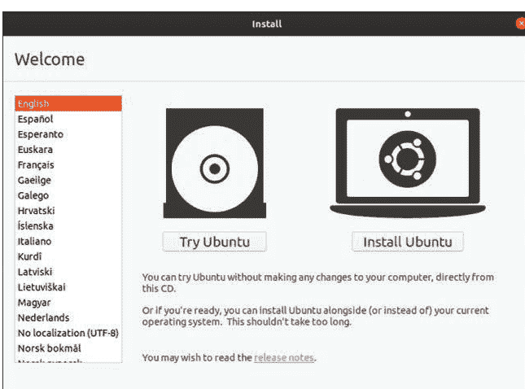

欢迎

- 英语 (English)
- 西班牙语 (Español)
- 世界普义语 (Esperanto)
- 巴斯克语 (Euskara)
- 法语 (Français)
- 加利利亚语 (Galège)
- 加利哥语 (Galego)
- 克罗地亚语 (Hrvatski)
- 冰兰语 (Islandenska)
- 意大利语 (Italiano)
- 库尔德语 (Kurdi)
- 拉脱亚语 (Latviski)
- 立陶宛语 (Lithuviškai)
- 匈牙利语 (Magyar)
- 荷兰语 (Nederlands)
- 无本地化 (UTF-8)
- 挪威语标准语 (Norsk bokmål)

试用 Ubuntu

安装 Ubuntu

您可以直接从此 CD 尝试 Ubuntu 而不对您的计算机进行任何更改。

或者如果您已准备就绪，可以将 Ubuntu 与您当前的操作系统并存（或替换）。这不会花费太长时间。

您可能希望阅读发行说明。

图 1.1 在此启动窗口中选择安装使用的语言。

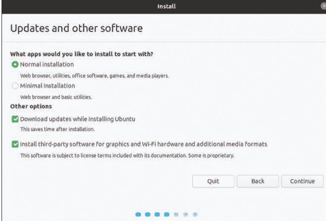

## 更新和其他软件

- 您起初想安装哪些应用程序？
- 正常安装：网络浏览器、实用程序、办公软件、游戏和媒体播放器。


# 第 1 章 安装 Ubuntu 和安装后配置

- 最小安装：网络浏览器和基础实用程序。

## 其他选项

- 在安装 Ubuntu 时下载更新：这可以节省安装后的时间。
- 为显卡和 Wi-Fi 硬件安装第三方软件以及额外的媒体格式：这些软件受其文档中包含的许可条款限制。某些是专有的。

图 1.2 在继续之前，决定是否想在安装期间下载更新。

如果您的系统中有其他操作系统，您可以选择与它们并存安装 Ubuntu，或者擦除它们并将整个硬盘用于 Ubuntu。在继续之前，请注意本章稍前的双系统说明和备份警告。

接下来，如图 1.3 所示，您可以选择擦除并使用硬盘进行安装（推荐给 Linux 新手以及对硬盘硬盘分区感到紧张的人士），或者手动指定，这听起来并不困难。您还有机会对 Ubuntu 安装进行加密；这非常安全，但如果您丢失了密码，就彻底没戏了，请明智选择。

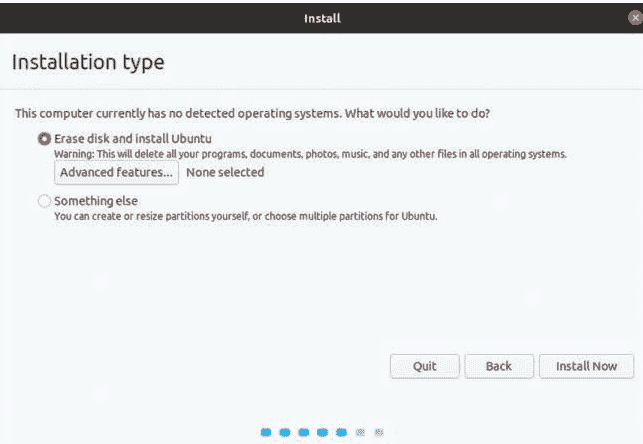

图 1.3 您想对您的存储驱动器做什么？

> 注意
>
> 对于更复杂的系统（如服务器），更复杂的分区方案可能有用，特别是当有多个硬盘可用时。请阅读第 10 章“命令行入门课程”，快速讨论 Linux 文件系统的各个部分，以了解文件系统的哪些部分如果驻留在自己的（甚至是多个！）分区或磁盘上可能会从中获益。

> 注意
>
> 添加、格式化和分区硬盘可以在任何时间进行，而不仅仅是在安装期间。您不应尝试修改当前正在使用的驱动器（例如安装了 Ubuntu 的驱动器），因为这样做可能会导致计算机无法使用，您将不得不重新开始。然而，如果您正在添加第二个驱动器或想格式化闪盘，对硬盘进行分区是一项实用的技能。在任何情况下，这都适用于标准警告：请注意您正在做什么以及为什么要这样做，因为这个强大的工具既有用又具有

除了添加硬盘有用外，`gParted` 还可以帮助您从问题中恢复。当您通过安装程序回答问题时，Ubuntu 安装开始将文件复制到您的硬盘上。并行执行这些任务将使过程变得比以前更快。当您输入所有必要信息并，

## 关

安装完成后，你将看到一系列充满了 Ubuntu 趣味内容的屏幕，在等待期间阅读这些内容非常有价值。

当过程完成后，系统会提示重启电脑。执行此操作并在安装介质弹出时将其移除。重启完成后登录即可。就是这样。

在本书之前的版本中，这一章的内容要长得多，并且描述了一个有时会令人困惑且充满风险的过程。Ubuntu 开发者让安装变得如此简单快速，这值得高度赞誉。Linux 内核支持的硬件比以往任何时候都要多，而 Ubuntu 内核专家们（他们负责决定启用哪些硬件模块等决策）做得非常出色，大多数硬件都可以开箱即用。

# 首次更新

过去，使用新系统后需要做的第一件事就是将其更新到最新的软件包版本。你这样做主要是为了确保获取了最新的安全更新。还记得安装的第一步吗？我们当时建议勾选“在安装过程中下载软件更新”的选框。如果你勾选了，更新会在安装期间获取，你的系统应该已经是最新状态了。

如果你想双重检查是否已安装了所有最新版本的软件和安全更新，请阅读第 9 章和第 10 章以获取更多信息。

# 关

在某个时刻，你将会关闭电脑。和 Linux 中的大多数其他事情一样，有不同的方法可以实现。你可以使用屏幕右上角的电源图标来访问电源菜单，如图 1.4 所示。

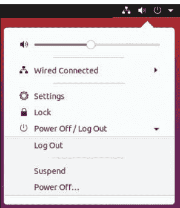

图 1.4 你也可以从电源菜单中锁定屏幕、访问设置等更多功能。

如果你在命令行界面工作，可以使用 `shutdown` 命令立即关闭系统，如下所示：

```
matthew@semour:- sudo shutdown -h now
```

你也可以使用 `shutdown` 命令重启电脑，如下：

```
matthew@semour:- sudo shutdown -r now
```

对于新用户来说，安装 Ubuntu 是在学习 Linux 道路上开启全新且收获丰丰的旅程的开始。对于 Ubuntu 系统管理员来说，接下来的任务是精调安装并自定义服务器或用户环境。

现在你已经完成了安装 Ubuntu 的主要任务，可以开始自定义你的新操作系统了。本章将介绍如何让 Ubuntu 运行起来。第 3 章“Linux GUI 基础”将带你环游桌面。接下来，本章将描述一些基础管理任务。在本章结束时，你应该觉得已经有足够的信心来阅读书中剩余的内容了。

# 查找程序和文件

过去，Ubuntu 使用菜单系统引导用户搜索程序，但现在有一种更简单、更快速的方法：使用搜索查找程序。你通过点击屏幕左上角的“活动”（Activities）来访问搜索，然后在搜索框中输入以查找系统上的特定程序或文档（图 1.5）。桌面（也称为 GNOME 用户界面）将在第 3 章中有更详细介绍。


图 1.5 搜索是查找程序和文件的地方。

# 软件更新器

软件更新器将在第 9 章中有更详细的介绍，但现在值得简单提一下，以便你开始从任何可用的服务和错误修复中受益。检查更新的最简单方法是使用“软件更新器”。通过搜索“software updater”来打开它。当窗口打开时，“更新管理器”会检查 Ubuntu 存储库以确定是否有可用更新。当它检测到已安装软件有新版本时，会在窗口中显示它们。对于你不想安装的特定软件更新，取消其旁边的选框。点击“现在安装”完成该过程（见图 1.6）。软件存储库将在本章稍后部分讨论。

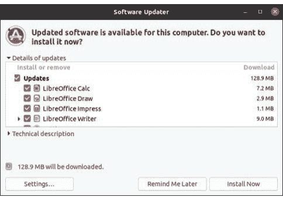

图 1.6 软件更新器，显示可用的软件更新。

更新系统的另一种方法是使用命令行。这对于没有 GUI 的服务器至关重要。

每当你使用 `sudo` 执行命令时，系统都会提示你输入密码。这与你登录 Ubuntu 时使用的密码相同，因此记住它非常重要。

然而，有时你可能想使用经典的 root（根用户）提示符工作，而不是在每个命令前输入 `sudo`（例如，如果你需要在命令行执行大量需要超级权限的命令时）。你可以通过使用 `sudo -i` 命令来实现这一点。同样，系统会提示你输入密码，你应该输入密码，之后 Ubuntu 将会为你提供如下标准的 root 提示符：

```
matthew@seymour:-$
```

从这里开始，你可以执行任何命令而无需不断输入 `sudo`。

> 警告
>
> 在 root 提示符下操作非常危险，除非你清楚自己在做什么。在获得经验之前，我们建议你使用 `sudo`，第 10 章将对其进行详细介绍。

## 配置软件仓库

Ubuntu 使用软件仓库来获取有关可以安装在系统上的可用软件的信息。Ubuntu 基于一个老得多的 Linux 发行版，称为 Debian。Debian 拥有访问数千个不同的软件包，这意味着 Ubuntu 也可以访问这些软件包。Debian 软件包可以在 Ubuntu 的 Universe 仓库中获得。一组受过良好培训的“宇宙大师”（MOTUs）志愿者遵循严格的准则，为 Universe 仓库中的 Ubuntu 用户提供更多软件甚至更多软件包。（有关 MOTUs 以及你如何成为其中一员的更多信息，请参阅第 40 章“帮助 Ubuntu”。）Universe 仓库充满了许多可选的、通常很有用或很有有趣的软件；它是默认启用的，而其他官方仓库则包含了安全更新、常规更新，以及 Ubuntu 安装和运行其所有官方功能所必需的软件。

你可以通过点击“软件与更新”（Software & Updates）更新程序中的“设置”按钮来调整启用了哪些仓库。在第一个选项卡（Ubuntu 软件）中，你有五个选项可以选择。默认设置如图 1.7 所示。选择哪种选项取决于你，但请确保至少勾选第一个复选框，以便访问 Canonical 支持的开源软件，这包含了基础安装所需的所有软件包以及其他一些常用的软件包。（Canonical 是资助大部分 Ubuntu 开发的公司。）你勾选的框越多，你的软件选择范围就越广。确保勾选“设备专有驱动程序”（Proprietary Drivers for Devices）也是一个好主意，这样你就可以从可能增强性能的驱动程序中受益。

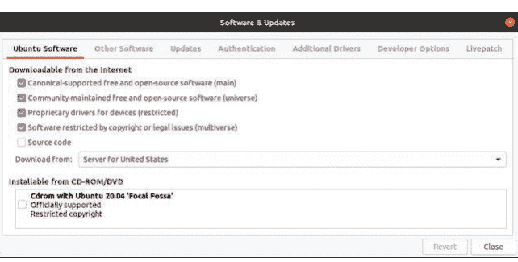

图 1.7 你可以在“其他软件”、“更新”、“附加驱动程序”等选项卡下找到或添加其他选项。

## 开源与专有软件

你可能会听到一些关于在 Ubuntu 中使用专有驱动程序或软件的争论。有些人认为，使用此类驱动程序违背了开源的立场，因为用于驱动程序或软件的程序代码无法被所有它的用户查看和修改，只能由原始开发者或拥有它的公司进行修改。还有一种有力的论点认为，用户只需投入最的工作就能获得一个功能完整的系统。

Ubuntu 对此问题采取了中立立场，并由用户自行决定。默认安装开源软件，但提供了选项允许方便地安装专有软件。

当你对自己的选择满意时，切换到“更新”选项卡来配置 Ubuntu 在有可用更新时的行为。默认情况下，系统勾选了重要的安全更新和推荐更新，以确保你拥有最新的错误修复程序和补丁。你也可以选择接收更新和回port（即为新版本的 Ubuntu 发布并经过重新编程以兼容当前版本的软件），但只有在你愿意为社区进行测试时，我们才建议这样做，因为来自这些仓库的任何更新软件都可能对你的系统产生不利影响。

Ubuntu 允许你配置检查更新的频率以及安装方式。默认情况下，Ubuntu 每天检查更新，如果有可用更新，它会通知你。然而，你可以更改频率以及 Ubuntu 在发现可用更新时执行的动作。我们建议保留“仅通知”选项，因为这允许让你在安装之前看到有哪些可用更新。如果你想节省时间，请选择“在后台下载所有更新”，让 Ubuntu 在提供安装选项之前静默下载更新。

## 系统设置

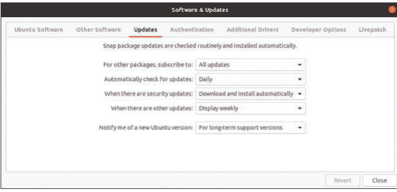

图 1.8 在“软件与更新”的更新中，配置你想要的更新以及你希望如何处理这些更新。

Ubuntu 的魔力之一在于轻松地从一个大版本升级到另一个大版本，例如从 19.04 升级到 19.10。某些 Ubuntu 版本是 LTS，即*长期支持*版本，供大多数人的生产环境使用。中间版本是提供给那些认为自己必须拥有一切最新版本的人，或者给那些帮助 Ubuntu 开发的人。这些版本是稳定的，但支持时间很短，如果你选择使用它们，你应该计划每六个月升级一次到新版本。通过确保将“发布升级”选项设置为“仅 LTS”，你将每两年才会被提示升级 Ubuntu 版本；用于编写此书的当前 LTS 版本 20.04 是于 2020 年 4 月发布的，而下一个 LTS 版本计划于 2022 年 4 月发布。

“其他软件”选项卡允许你添加其他仓库。它默认包含了连接到 Canonical 合作伙伴仓库所需的所有内容，其中包含来自与 Canonical 有协议的公司提供的非商业（通常是指许可意义上的非，但有时是为了付费）软件，以便感兴趣的用户可以方便地获取。该仓库默认是禁用的，如果你想使用它，必须通过勾选“其他软件”选项卡中对应条目旁的复选框来启用它。

## 系统设置

要配置系统设置，请搜索“系统设置”或点击电源菜单中的设置图标（参见图 1.4）。这将打开“设置”窗口（如图 1.9 所示），你可以从左侧菜单中选择项目并根据需要进行调整。后续章节将描述其中几个选项。

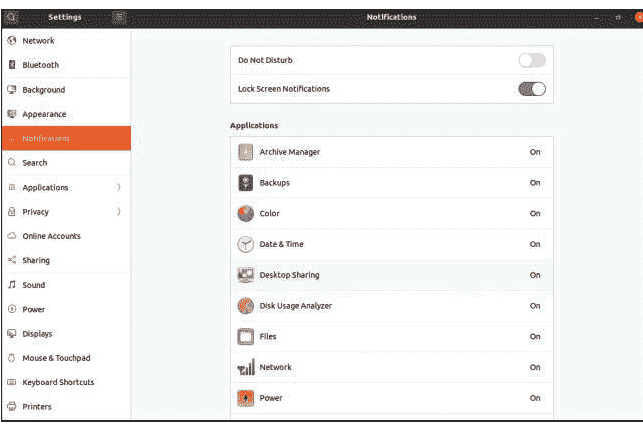

图 1.9 调整你的系统设置。

## 检测和配置打印机

在 Linux 中设置打印机曾是非常困难，这本书之前的版本包含一整个充满了命令行魔法和看起来可怕的配置文件的章节。在大多数情况下，设置方法已经不再不同。

Ubuntu 包含了打印机驱动程序，在 Ubuntu 中安装和使用打印机通常比其他系统更容易（尽管这不是绝对规律）。有些打印机制造商不为 Linux 编写和发布驱动程序，而某些打印机存在开源驱动。在购买打印机之前，在互联网上花时间搜索已知与 Linux 兼容的打印机是一个好主意。很好的资源是 Linux 基金会的 Open Printing 数据库，地址为 www.openprinting.org/printers。

如果你选择得当，你只需要将打印机连接到计算机并打开电源。在许多情况下，Ubuntu 会自动找到并添加它。在几分钟后，你就可以使用它了。从“设置”窗口选择“设备”并选择“打印机”，可以添加打印机、查看所有已安装和配置的打印机以及更改打印机设置。从这里你可以开启网络打印机共享、设置默认打印选项、打印测试页等。

## 在 Ubuntu 中配置电源管理

在“设置”窗口中选择“电源”，以控制 Ubuntu 在特定情况下如何处理节能功能。

Ubuntu 对*挂起*（suspend）提供了良好支持，这意味着电脑会将当前状态写入内存并进入低功率模式。你的电脑启动将快得多

当你下次使用它时，因为它不需要执行完全启动；它通过内存将系统恢复到之前的状态，而不是从头重新加载并启动每个程序。

## 设置时间和日期

Linux 提供系统时间和日期；你的计算机硬件提供基于硬件时钟的时间。在很多情况下，这两个时间可能会产生偏差。Linux 系统时间基于自 1970 年 1 月 1 日以来经过的秒数。你计算机硬件时间取决于 PC 主板上安装的时钟芯片类型，许多主板芯片组以产生偏差而闻名。

对于单个工作站，保持准确的时间很重要，但在网络环境中这至关重要。备份、计划停机和其他网络范围的操作需要精确的协调。

Ubuntu 安装程序会在安装过程中询问你的位置时设置时间和日期。如果你移动了位置或只是更改设置（例如，让计算机自动与互联网上的官方时间服务器同步），你可以自行操作。

### 更改时间和日期

使用 Ubuntu 的图形工具是设置系统日期时间最简单的方法，对桌面用户来说也最直观。从“设置”窗口中，选择“详情”，然后选择“日期和时间”来进行更改。你可以在 GUI 中手动设置日期和时间，也可以让计算机通过互联网获取更新的日期时间信息。

### 使用 date 命令

使用 `date` 命令显示或设置你的 Linux 系统时间。此命令要求你使用特定的数字序列来表示所需的日期和时间。要查看 Linux 系统认为的当前日期时间，请如下所示使用 `date` 命令：

```
mathew@system:-$ date
Tue Sep 28 21:03:14 CDT 2021
```

要调整你的系统时间（例如设置为 2021 年 9 月 28 日上午 10:33），使用包含月、日、小时、分和年份的命令，例如：

```
mathew@system:-$ sudo date 092810332021
Tue Sep 28 21:03:14 CDT 2021
```

### 使用 hwclock 命令

使用 `hwclock` 命令显示或设置你的 Linux 系统时间、显示或设置 PC 的硬件时钟，或同步系统和硬件时间。要查看硬件时间和日期，使用带有 --show 选项的 hwclock，例如：

```
mathew@system:-$ sudo hwclock --show
Tue Sep 28 2021 06:04:43 PM CDT -0.281699 seconds
```

使用 hwclock 配合 --set 和 --date 选项手动设置硬件时钟，如下：

```
matthew@semour:-$ sudo hwclock --set --date "09/28/21 10:33:00"
matthew@semour:-$ hwclock --show
Tue 28 Sep 2021 10:33:09 AM MST -0.904668 seconds
```

在这些示例中，硬件时钟是通过 hwclock 设置的，然后再次使用它来验证新的硬件日期时间。你也可以使用 hwclock 根据硬件时钟的值设置 Linux 系统时间和日期，使其与之同步。

例如，要从 PC 的硬件时钟设置系统时间，请使用 --hwosys 选项，如下：

```
matthew@semour:-$ sudo hwclock --hwosys
```

要使用系统时间设置硬件时钟，请使用 --systohc 选项，如下：

```
matthew@semour:-$ sudo hwclock --systohc
```

## 配置无线网络

要在 Ubuntu 中通过 GUI 管理网络，请点击电源图标（参考本章稍前的图 1.4）。菜单中的条目允许你处理和监控网络连接。

点击工具栏上的网络图标以连接无线网络。如果你的无线接入点广播了其服务标识符 (SSID)，它将出现在无线网络列表下。点击所需的网络，Network Manager 会检测正在使用的加密方式（如果有的话）并向你索要密码。输入密码后，Network Manager 将启动无线连接。密码随后将存储在默认密钥环中，该区域对你的登录来说是唯一的。从现在起，每当你登录 Ubuntu 并处于该网络范围内，Network Manager 都将自动启动连接。

如果由于某种原因你的无线网络没有出现（你可能隐藏了 SSID），你必须使用“连接其他无线网络”选项，在这种情况下，你需要输入网络名称、无线安全类型以及在需要时的连接密码。

Network Manager 还可以通过使用 vpn 软件连接到 Cisco VPN 连接。从 Ubuntu 仓库安装该软件（见第 9 章），你可以根据需要指定连接设置，或者如果你有预定义的配置文件 (PCF)，可以将其直接导入 Network Manager。

## 排除安装后配置问题排除

为了让 Ubuntu 尽可能通用，人们付出了许多努力，但有时你可能会遇到 Ubuntu 不确定的硬件。在这些情况下知道该做什么很重要，特别是当你刚开始使用 Ubuntu 时。

由于 Ubuntu（以及泛指 Linux）构建在健壮的 UNIX 基础之上，因此它比其他某些操作系统稳定得多。然而，尽管某些运行运行正常，Ubuntu 也可能存在不影响他人的问题。

# 第二章

## 本章主要内容

- 什么是 Linux？
- 为什么使用 Linux？
- 商业版 Ubuntu
- 家庭版 Ubuntu
- 如何充分利用 Linux 和 Ubuntu 文档

## 背景信息与资源


对于任何新事物来说，了解一下它的历史都是值得的。Ubuntu 也不例外，在本章中，你将更多地了解 Linux 和 Ubuntu 的源源。此外，本章还提供了一些资源，帮助你进行自主学习。

## 什么是 Linux？

Linux 是一个自由操作系统的内核，由林纳斯·本尼迪特·托瓦尔斯（Linus Benedict Torvalds）于 1991 年首次开发并向世界发布。托瓦尔斯当时是芬兰赫尔尔辛基大学的一名研究生，他现在是 Linux 基金会（www.linuxfoundation.org）的成员，此前曾在 CPU 设计和制造公司 Transmeta 工作过，随后在 2003 年离开并就了开源开发实验室（ODSL）。该实验室是由许多高科技公司成立的联盟，旨在支持 Linux 开发，这使他能够全职专注于 Linux 内核。对于所有 Linux 用户来说，幸运的是，托瓦尔斯选择在名为 GNU 通用许可证（GPL）的自由软件许可证下发布 Linux。

> 注意
>
> 免费在线资源维基百科有一关于 Linux 托瓦尔斯的精彩传记，探讨了他的生和卓越成就。你可以在 https://en.wikipedia.org/wiki/Linux_Torvalds 找到。

GNU GPL 是自由软件基金会创始人理查德·M·斯坦曼（Richard M. Stallman）的心血。斯坦曼作为 `emacs` 编辑环境和 `GCC` 编译器系统的著名作者，制定了 GPL，以确保使用其 GPL 许可的软件是免费的并以源码形式提供的。GPL 是 Linux 及其所有权、发行和版权的指导文档。托瓦尔斯拥有 Linux 商标权，但感谢于慷慨、互联网、全球数千万程序员、GNU 软件以及 GNU GPL 的共同作用，Linux 将永远不受许可或特许费限制。

## 发行版本与内核命名方案

Linux 内核、内核开发以及 Ubuntu 内核版本有一套数字系统。请注意，这些数字与你的 Ubuntu Linux 发版的版本号没有关系。Ubuntu 发行版本由 Ubuntu 开发人员分配，而大多数 Linux 内核版本号由 Linux 托瓦尔斯及其内核开发者团队分配。

要查看 Linux 内核版本，请使用带有 `-v` 选项的 `uname` 命令。要查看内核版本，使用 `-r` 选项。如 `4.14.0-22-generic` 的数字代表主版本 (4)、次要版本 (14) 和补丁级别 (0)。最后的数字 (22-generic) 是开发者补丁级别，在上下文中是由 Ubuntu 开发人员分配的。

即使是次要数字也被认为是“稳定”的，并适用于生产环境。你将在书中找到 Linux 内核的稳定版本。你可以选择下载并安装内核的 beta（测试）版本，但对于设计日常使用的系统，不建议这样做。开发者使用 beta 内核来测试对新硬件或操作系统的支持。

Linux 发音为 "liucks"，是软件。将 Linux 内核与 GNU 软件（驱动程序、实用程序、用户界面以及如 X.Org 基金会的 X Window 系统等软件）相结合就构成了 Linux 发行版。不同的供应商有很多不同的 Linux 发行版，但可能源自或模仿 Ubuntu 所基于的 Debian Linux 发行版。

> 注意
>
> Debian 列出了几十种其他基于 Debian Linux 的 Linux发行版（www.debian.org/misc/debian-distros）。

虽然严格来说内核本身最适合被称为“Linux”，但在口语用法中，该词指代的不仅仅是内核。大多数说“使用 Linux”的人至少指的是一组包含几项内容的软件套件。我们在这里列出了其中必要的内容，按照它们在启动周期期间加载到计算机内存中的顺序排列，这是在你的计算机 BIOS 或 UEFI 固件（由主板制造商包含，并从主板上的存储位置运行）运行并启动之后：

- 启动加载程序，例如 `GRUB2`，它在第 1 章“安装 Ubuntu 和安装后配置”中描述；
- Linux 内核，它在第 22 章“内核与模块管理”中描述；
- 守护进程（Daemons），这些是系统运行以执行日志记录或监听尝试的网络连接等任务的后台进程；守护进程可以更简单地理解为不由用户直接运行或调用的程序，在特定条件发生前一直处于休眠状态；
- Shell，这是一种命令行处理器，大多数人认识它，因为这是他们登录终端时看到的界面；shell 在第 14 章“自动化任务与 Shell 脚本”中描述；
- Shell 实用程序，例如第 10 章“命令行入门课程”、第 11 章“命令行大师课，第一部分”和第 12 章“命令行大师课，第二部分”中的大多数命令；
- 图形服务器，例如 X 服务器，它在第 3 章“GUI 基础”中描述；
- 桌面环境，例如 GNOME，它在第 3 章中描述，以及如第 4 章“Ubuntu 桌面选项”中描述的其他；
- 桌面软件，例如网络浏览器、办公套件、媒体播放器、游戏等

像 Ubuntu 这样的 Linux 发行版收集了所有这些。

## 为什么使用 Linux？

Linux 可以作为服务器平台投入——Linux 快速、安全、稳定且健壮。最新版本的 Linux 轻松支持多处理器计算机、大量系统内存、数百 GB 的单个文件大小以及（理论上）支持超过 40 亿用户的能力。IBM、Oracle 以及其他数据库供应商为 Linux 提供了所有版本的企业软件。

- 低入门部署成本门槛——维护成本也可以降低，因为 Linux 在各种 PC 上运行良好。虽然在新的硬件上可以实现最佳性能，但在低端计算机上也可以基础安装。这提供了更广泛的用户群，延长了旧硬件的寿命，并可以帮助家庭、小型企业和企业用户节省资金。
- 吸引硬件和软件行业的广泛观众——几乎每个 CPU 都有 Linux 版本。嵌入式系统开发者在利用 ARM、MIPS 以及 Raspberry Pi 等平台上的低功耗处理器编写自定义解决方案时，现在转向了 Linux。
- 免特许费的开发平台——由于开源开发方法和免费高质量开发工具的可用性，Linux 为开发者和初创公司提供了低成本的切入点。
- 计算机硬件行业中 IBM 等巨头的支持为 Linux 作为一种可的平台增加了信誉——IBM 已经在其公司的整个计算机产品中启用了 Linux，从低端笔记本电脑到“大铁”大型机。新的企业客户将 Linux 作为企业级解决方案的一部分。它已被用于世界上最快的计算机上。HP 和 Dell 等公司也在其大部分硬件产品中认证了 Linux。

# 什么是 Ubuntu？

Ubuntu 是一个基于 Linux 内核的操作系统，由 www.ubuntu.com 的 Ubuntu 社区创建、改进、精炼和发布。Ubuntu 由 Canonical Ltd.（www.canonical.com）赞助，是一个由全球开发者社区支持的开源项目。

Ubuntu 于 2004 年 10 月发布了其第一个版本。它因易于安装和使用而迅速闻名，再加上每个版本被赋予的略显古怪的代号。然而，Ubuntu 本身基于 Debian，Debian 是一个老牌的发行版，深受整个 Linux 社区的尊重。Debian 是 Ubuntu 赖以存在的基石。

在 Canonical Software 的赞助和 Mark Shuttleworth 的强大资源支持下，Ubuntu 从 4.10 版本 Warty Warthog（疣状野猪）获得了一个良好的开端。起初的目标是提供一种易于安装和使用、不会让用户困惑并且可以通过单张 CD（现在是单 DVD 镜像）分发的发行版。每六个月，Ubuntu 都在 Linux 社区中取得快速进展，是世界上最受欢迎的 Linux 发行版之一。

| UBUNTU 版本编号 |

| :--- |

如前所述，自 2004 年 10 月首次发布以来，Ubuntu 采用了独特的编号方案和一些奇特的版本名称。Ubuntu 摒弃了其他地方常见的典型版本命名法，决定将月份和年份反过来。因此，2004 年 10 月的首次发布变为 4.10，随后很快出现了 5.04（2005 年 4 月）、5.10、6.0LTS，并一直到现在的 20.04。

本书涵盖的版本于 2020 年 4 月发布，因此其版本号为 20.04。某些版本的特殊之处在于它们是 LTS（长期支持）：Canonical 将在 LTS 版本发布后，桌面版本提供三支持，服务器版本总共支持五年。LTS 版本每两年发布一次，最近的 LTS 是 20.04。

开发期间的代号甚至更有趣：4.10 被命名为 Warty Warthog（疣状野猪），以纪念它是一个免费发布且包含所有保证的版本。第二个版本 5.04 被称为 Hoary Hedgehog（灰豪猪）。5.10 情况稍好一点，命名为 Breezy Badger（清风獾鼠）。6.06 被宣布为 Dapper Drake（帅气龙），是第一个带有 LTS 标志的 Ubuntu 发行版。在 Dapper 之后是 Edgy Eft（6.10），随后是 Feisty Fawn（7.04）等。如需查看开发代号的完整列表，请参阅：https://wiki.ubuntu.com/DevelopmentCodeNames。

# 商业版 Ubuntu

Linux 多年来已经趋于成熟。它包含了企业级环境使用所需的所有基本功能，如 CPU 架构支持、文件系统和内存处理。Linux 为云计算、容器甚至 Android 提供了基础。

小企业主可以通过跳出软件许可费用和升级的轮怪循环，采用基于 Linux 的解决方案来获得丰厚回报。使用 Ubuntu 的企业不仅避免了许可费用统计的需求和软件审计的威胁，还为许多商业生产力软件提供了可行的替代方案，而且通常是免费的。

在小企业中使用 Ubuntu 有许多其他意义，例如，不需要投资尖端硬件来建立高效的店铺。Ubuntu 支持旧的或遗留硬件，通过避免不必要的升级，节省的费用随时间推移而增加。新版本的应用程序可以低成本或无成本下载并安装，而且办公软件是免费的。

Ubuntu 易于在网络安装并与其他系统良好协作，这意味着它在包含 Windows、macOS 以及 UNIX 等其他操作系统的混合计算环境中运行良好。一个简单的 Ubuntu 服务器可以作为初始部分解决方案投入，或者管理其他操作系统的文件、邮件或打印服务器。行政人员应能快速适应使用熟悉的互联网和生产力工具，而您的业务将获得稳定性、安全性和无病毒计算平台的额外益处。

通过仔细分配服务器硬件，可以构建一个多产且高效的多用户系统，其成本远低于同类商业软件。将这些优势与对笔记本电脑、移动设备和远程访问的支持相结合，您会发现 Ubuntu 支持创建和使用廉价且高效的工作环境。

# 家庭中的 Ubuntu

Ubuntu 在您的硬盘上安装了一套特殊的预选软件软件包。这些软件包适用于小型办公/家庭办公（SOHO）用户，为文档管理、打印、通信和个人生产力提供了丰富的生产力工具。

标准安装只需要少量的驱动器空间。尽管占用空间小，但安装程序还包含管理工具、额外的创作和出版客户端、各种编辑器、一个精美的桌面以及更多内容。

# 充分利用 Linux 和 Ubuntu 文档

您可以在 www.ubuntu.com 找到 Ubuntu 文档的链接。

您可以在 `/usr/share/man` 目录下找到传统的 Linux 软件包文档（如帮助页），并在 `/usr/share/doc` 下找到每个已安装软件包的文档。

# Linux

Linux 帮助页是压缩的文本文件，包含了关于如何使用程序的简要信息。每个帮助页通常提供命令的简短摘要、命令行选项概要、命令用途的解释、潜在的警告或错误、作者名称，以及相关配置文件和程序的列表。

例如，您可以使用 `man` 命令显示其自身的帮助页来学习如何阅读帮助页，如下：

```
mathew@semour:-$ man
```

按下回车后，屏幕或桌面窗口上会出现一页文本。

# 第 3 章

## 本章内容

- 基础与 X Server
- 启动 X
- 参考文献

## Linux GUI 基础

想象一个黑底白字或深绿底浅绿字的世界。你可能记得，也可能不记得，但那曾是用户访问计算机的主要界面。计算已经发生了巨大的变化，并将图形用户界面（GUI）作为大多数大多数桌面和工作站平台的标准。不仅如此，GUI 随着时间的推移也在不断变化和演变。本章涵盖了 GUI 底层的低级信息，而第 4 章“Ubuntu 桌面选项”则涵盖了桌面软件选项，默认版本为 GNOME。

# 基础与 X Server

许多 Linux 发行版正在切换到 Wayland（参见旁边的边栏）。然而，对于 20.04 LTS，Ubuntu 继续使用 X Window 系统，这是一种经典且稳定的图形网络接口，为各种图形化工具和窗口管理器提供了基础。它更广为人知的名称是 X，也可以称为 `X11R7` 和 `X11`。X 源于享誉全球的麻省理工学院（MIT），历经几个版本，每个版本都扩展并增强了这项技术。其开源实现由 X.Org 基金会管理，董事会包括多位开源界的关键人物。2017 年 9 月 15 日，X11 满 30 岁，对于任何软件来说，保持可用并处于活跃开发状态都是非常长的时间。Ubuntu 最终将默认从 X 迁移到 Wayland，但在 Ubuntu 20.04 LTS 发布时尚未如此，而且许多第三方应用程序尚未完全适应在 Wayland 上良好运行。如果你想尝试，Wayland 可以在登录界面作为一个选项可用。

## 什么是 WAYLAND？

简单来说，Wayland 旨在作为 X 更简单的窗口管理器替代品。

更复杂的回答是，Wayland 是一种合成窗口管理器协议，它定义了 Wayland 窗口管理器服务器中的合成器与其应用程序窗口客户端之间如何通信。它还包含了该协议的 C 库实现。合成器（Compositor）是一个应用程序，为每个 GUI 窗口提供独立的物理存储区域（此内存位置称为缓冲区）。运行应用程序的每一帧都使用独立的内存位置，由窗口管理器将其合成在一起。如果做得良好，这将提供更流畅的体验，几乎或或没有闪烁，并能够对缓冲窗口进行额外的处理，例如华丽的特效。合成与 X 的工作不同，因为 X 构建位图来创建图形用户界面，其中屏幕上的每个项目都响应一个或多个位的信息，主要定义每个像素的显示位置和颜色。

要了解更多关于 Wayland 的信息，请访问 https://wayland.freedesktop.org 以及 https://ubuntu.com/Wayland 获取 Ubuntu 的特定计划和细节。

理解 X 如何工作的最佳方法是将其视为一个客户端-服务器系统。X server 为开发的程序提供服务，这些程序旨在充分利用服务器下和导入库中提供的图形和网络功能。X.Org 为许多平台（包括 Linux 和 macOS）提供了版本。

X 的桌面环境提供一个或多个窗口管理器以及一组客户端，这些客户端符合基于一组常用软件库的标准图形界面。当用于开发相关客户端时，这些库为客户端窗口、菜单、按钮和其他屏幕上组件提供了图形的一致性，连同一些通用的键盘控制和对话框。

## 基础概念

X11 的底层引擎是 X 协议，它提供了一套管理本地和远程桌面显示的系统。该协议使用客户端-服务器模型，允许在本地和网络上对客户端窗口和其他装饰的绘制进行抽象。X server 根据客户端请求绘制特定于本地硬件的窗口、对话框和按钮。然而，客户端不必特定于本地硬件。这意味着系统管理员可以设置一个拥有大型服务器的网络，并允许用户在具有今天不同 CPU 和图形显示器的工作站上使用和查看这些客户端。

由于 X 使用了分布式处理方案，Ubuntu 可以作为连接到强大服务器的客户端廉价桌面平台。X server 越强大，能够容纳的基于 X 的客户端就越多。这种功能可以为旧硬件注入新生命，将大多数图形处理推到服务器上。如果你打算运行许多 X 客户端，快速网络是必不可少的，因为 X 可能会消耗大量带宽。

出于各种原因，X 在 UNIX 和 Linux 世界非常流行。它支持几乎每种硬件图形系统是一个大优势。这一点以及强大的多平台编程使其拥有了由致力于 X 的开发者构成的坚实基础。X 的另一个优势是其网络化能力，这在许多桌面的管理中起着核心作用，并且还可以辅助薄客户端计算环境的部署。能够在远程桌面上启动应用程序并能够标准化实例，都是这种多功能应用的示例。

更多版本的 X 还包含了对形状窗口（即矩形）、图形化登录管理器（也称为显示管理器）和压缩字体的支持。X 特性的发布旨在增强用户体验，使用户可以自定义 X 客户端的外观，这种自定义一直精确到桌面和窗口。大多数办公室和家庭环境在本地机器上运行 Linux 和 X。明智的公司和用户利用 X 的网络功能优势，实现了薄客户端环境。在 `/etc/xorg.conf` 中进行自定义配置让系统管理员的生活变得简单得多。

## 使用 X

X 的主要组件位于 `/usr` 目录，这些文件在 Ubuntu 中也可用。一些重要的子目录包括：

- `/usr/bin`: 这是 X server 的位置。
- `/usr/include`: 这是头文件的路径。
- `/usr/lib`: 这是库的所在地。
- `/usr/lib/X11`: 这是配置文件的位置。

活动会话所需的组件是 X server、字体以及一个管理显示、标题栏的窗口管理器。

## xorg.conf 元素

传统上，对 X 最重要的文件是 `xorg.conf` 文件。该文件包含了对 X 至关重要的配置信息，通常在安装时创建。

## 防固 X (BULPROOF X)

Ubuntu 设计为无论发生什么都能工作。在发生破坏你系统的灾难性事件时，你将有一种图形方式进入系统。额外的优点是，本章信息的复杂性对于大多数用户来说是不需要的；事实上，默认并不创建文件。缺点是 X server 的许多配置性在升级时会被覆盖。

现代版本的 Xorg 默认不创建 `xorg.conf`。相反，以 `.conf` 结尾的不同文件位于 `/usr/share/X11/xorg.conf` 目录中，并在 X 启动时自动加载，在读取任何 `xorg.conf` 之前。用户可以创建该文件并继续使用与 `xorg.conf` 相同的格式或其他多个部分。之前提到的单个文件内容不会更改，但你可以通过创建自己的 `/etc/xorg.conf` 文件来覆盖这些设置。

## 注意

从这里开始我们引用 `xorg.conf` 文件，但你应该记住之前的信息以防混淆。


我们查看 `xorg.conf` 的可能内容，以便你了解 X 正在寻找什么。`xorg.conf` 文件的组件（或部分）指定了 X 会话或服务器布局，以及服务器使用的文件路径、任何与直接相关的选项、连接到系统的鼠标和键盘的任何可选支持模块、安装的显卡、使用的显示器以及 Ubuntu 使用的分辨率颜色。这些是核心组件：

- `ServerLayout`: 定义显示、一个或多个屏幕布局并命名输入设备。
- `Files`: 定义颜色、字体或字体服务器端口号的位置。

### 基础与 X Server

- `Module`（模块）——告诉 X 服务器需要加载哪些图形显示支持模块。
- `InputDevice`（输入设备）——定义输入设备，如键盘和鼠标；可以使用多个设备。
- `Monitor`（显示器）——定义任何连接显示器的能力；可以使用多个显示器。
- `Device`（设备）——定义一个或多个显卡，并指定启用或禁用哪些可选功能（如果有）。
- `Screen`（屏幕）——定义一个或多个分辨率、颜色深度、可能存在的默认深度以及其他设置。

接下来的章节提供了这些元素的简要描述；`xorg.conf` 页面包含了所有你可以用于自定义桌面设置的选项和关键字的完整文档。

## ServerLayout 节

如前所述，`xorg.conf` 文件中的 `ServerLayout` 节定义了显示和屏幕布局，并命名了输入设备。一个来自自动配置的 `xorg.conf` 文件的典型 `ServerLayout` 节可能如下所示：

```
Section "ServerLayout"
Identifier          single head configuration
Screen               "Screen0" 0 0
InputDevice          "Mouse0" "CorePointer"
InputDevice          "Keyboard0" "CoreKeyboard"
InputDevice          "DevInputMice" "AlwaysCore"
EndSection
```

在此示例中，使用了单个显示器（数字指定屏幕），并使用了两个输入设备 `Mouse0` 和 `Keyboard0` 用于会话。

## Files 节

`xorg.conf` 文件的 `Files` 节可能如下所示：

```
Section "Files"
RgbPath             "/usr/lib/X11/rgb"
FontPath             "unix:/7100"
EndSection
```

该节在文本文件 `rgb.txt` 中按名称列出了各种部分，以及指向 X 字体服务器的端口号。字体服务器在启动时启动，不需要活跃的 X 会话。如果不使用字体服务器，`FontPath` 条目可以列出根目录下的每个字体目录，使用 `"/usr/lib/X11/fonts/"` 目录，如示例所示：

```
FontPath             "/usr/lib/X11/fonts/100dpi"
FontPath             "/usr/lib/X11/fonts/misc"
FontPath             "/usr/lib/X11/fonts/75dpi"
```

`FontPath "/usr/lib/X11/fonts/type1"`

`FontPath "/usr/lib/X11/fonts/Speedo"`

...

这些目录包含了在 X 会话期间可用的默认压缩字体。字体服务器使用 `/etc/X11/fs` 目录下的名为 `config` 的文件进行配置。该文件包含了字体服务器的字体列表（或目录）。通过在该文件中添加 `alternate-server`（备用服务器）条目并重启字体服务器，你可以为 X 会话指定远程字体服务器。这有助于集中字体支持并减少本地存储需求（尽管对于 Ubuntu 和 X 安装的近 5,000 个字体需要 25MB 空间）。

## Module 节

`xorg.conf` 文件的 `Module` 节指定了为 X 会话要加载的可加载模块或驱动程序。该节可能如下所示：

```
Section "Module"
Load "dbe"
Load "extmod"
Load "fbdevhw"
Load "glx"
Load "record"
Load "freetype"
Load "type1"
Load "dri"
Section
```

这些模块范围从特殊的显卡支持模块到字体光栅化器。模块位于 `/usr/lib/modules` 目录下的子目录中。

## InputDevice 节

`InputDevice` 节如示例所示配置了特定设备，例如键盘或鼠标：

```
Section "InputDevice"
Identifier "Keyboard0"
Driver "kbd"
Option "XkbModel" "pc105"
Option "XkbLayout" "us"
Section
Section "InputDevice"
Identifier "Mouse0"
Driver "mouse"
Option "Protocol" "PS2"
Option "Device" "/dev/input/mice"
Option "ZAxis" "4"
Option "EmulateButtons" "yes"
Section
```

你可以配置多个设备，可能存在多个 `InputDevice` 节。指定 USB 设备的 `InputDevice` 节可能如下：

```
Section "InputDevice"
Identifier "Mouse0"
Driver "mouse"
Option "Protocol" "PS2"
Option "Device" "/dev/input/mice"
Option "ZAxis" "5"
Option "EmulateButtons" "off"
Section
```

## Monitor 节

`Monitor` 节配置 `ServerLayout` 节中指定的显示设备，示例所示：

```
Section "Monitor"
  Identifier "Monitor0"
  VendorName "Monitor Vendor"
  ModelName "Monitor Model"
  DisplaySize 300
  HorizSync 31-48
  VertRefresh 50-70
  Option "dpms"
Section
```

注意，X 服务器根据此节中的水平和垂直同步值自动确定最佳时序。如果需要，可能在使用 XFree8 4.0 之前的旧式 modeline。如果在配置 X 时自动检测显示器，其定义将插入你的 `xorg.conf` 文件。该数据库包含 600 多个显示器，位于 `/usr/share/hwdata` 目录。

## Device 节

`Device` 节提供了计算机使用的图形芯片的详细信息，示例所示：

```
Section "Device"
  Identifier "Intel Corporation Mobile 945GM/GMS,943G Express Integrated Graphics Controller"
  Driver "intel"
  BusID "PCI:0:2:0"
Section
```

此示例识别安装的显卡为集成 Intel 945 芯片组。`Driver` 进入 Xorg 服务器加载 `intel` 内核模块。不同的芯片组有不同的选项。例如，这里是 NeoMagic 视频芯片：

```
Section "Device"
Identifier "NeoMagic (laptop/notebook)"
Driver "neomagic"
VendorName "NeoMagic (laptop/notebook)"
BoardName "NeoMagic (laptop/notebook)"
Option "externDisp"
Option "internDisp"
Section
```

在此示例中，`Device` 节指定了显卡的驱动程序 (`neomagic_drv.`) 并启用了两个芯片组选项 (`externDisp` 和 `internDisp`)，以便笔记本屏幕和连接的显示器上显示。

Xorg 服务器支持数百种不同的视频芯片。如果你更改了安装的 X，你需要编辑 `Device` 节或使用本章讨论的 X 配置工具之一生成新的 `xorg.conf` 文件，以反映新卡的能力。

## Screen 节

`Screen` 节将之前节整合在一起。它还可以指定一个或多个分辨率。示例所示：

```
Section "Screen"
Identifier "Screen0"
Device "Video0"
Monitor "Monitor0"
DefaultDepth 24
Sub "Display"
Viewport 0 0
Depth 16
Modes "1024x768" "800x600" "640x480"
EndSection
```

# 参考文献

- `www.x.org`—X Window 系统维护者
- `www.x.org/Downloads_mirror.html`—下载 X 最新版本源码的镜像站点列表
- `www.xfree86.org`—XFree86 项目 Inc. 的主页，该项目在近 10 年中为 Linux 提供了图形化界面
- `https://wiki.ubuntu.com/X`—学习 X 和 Ubuntu 的入门之处
- `https://wiki.ubuntu.com/X/Config`—关于在 Ubuntu 上配置 X 的绝佳信息

# 第 4 章

## 本章内容

# Ubuntu 桌面选项

- 桌面环境
- 使用 GNOME：入门指南
- KDE 与 Ubuntu
- Xfce 与 Ubuntu
- LXDE 与 Ubuntu
- MATE 与 Ubuntu MATE
- Ubuntu Budgie
- Ubuntu Kylin
- 参考文献

当你安装 Ubuntu 时，默认情况下你使用的是 GNOME 图形用户界面（GUI）。这通常被称为桌面。GNOME 具有吸引许多用户的特定优势。然而，我们中的一些人有独特的需求，或者只是喜欢折腾。本章将讨论 GNOME 的替代方案，并简要提到它们的一些优缺点以及关于如何安装每种方案的信息。这并不是可用选项的完整列表，而是对最流行选项的简要调查。

# GNOME 并非唯一选项

当你安装标准桌面版 Ubuntu 时，你也安装了 GNOME。这不仅不是你的唯一选项，而且你并不限于一次只能安装一个桌面环境。我们在本章中讨论的每个选项都可以在标准版 Ubuntu 中与 GNOME 并行安装，并且你可以在每次登录时选择使用哪一个，以及选择哪一个作为默认选项。这使得测试新选项的风险降低，因为切换回你已经熟悉的界面非常简单。

# 桌面环境

传统上，计算机的 GUI 具有“桌面比喻”；具体来说，界面使用物理办公桌的概念作为比喻，使与计算机的交互变得容易理解。就像现实世界中的办公室一样，计算机桌面环境使用文件来存储完成办公任务所需的信息。计算机系统通过添加应用程序进一步延伸了这种比喻，这些程序允许用户根据需要创建、操作和删除这些文档，就像在现实世界中可能执行的那样，但效率更高、功能更强。

计算机桌面包含一个窗口系统，这是另一个比喻，用于处理信息，使得对数字领域后台发生的复杂性进行概念化变得更容易。图形显示中的文件、文件夹（或目录）和应用程序可以在用户的桌面上移动，就像纸质文档和文件为了方便和效率而可以被移动到物理桌面的不同位置一样。使用这个窗口系统包括为了在显示这些操作的同时，在屏幕上绘制窗口所需的图形组件（称为小部件/`widgets`），以及在后台执行操作所需的所有程序代码，同时在显示这些操作时通过物理桌面这种精美的比喻来呈现这些操作。例如，在桌面上将文档从一个文件夹移动到另一个文件夹不仅仅是鼠标点击加拖放那么简单。在后台，桌面环境正在监听窗口管理器的指令，将文件从一个目录移动到另一个目录，然后在任务完成后告诉窗口管理器在屏幕上绘制该事件。

软件存储库包含了 Linux 可用的所有流行桌面环境，安装和尝试它们轻而易举。富有冒险精神的人找到其他在 Ubuntu 上运行的桌面环境并下载它们。我们在这里不涵盖这一过程。

也可以在使用一个桌面环境的同时，使用不同的窗口管理器来替换它，而不是使用该桌面环境自带的那个。例如，标准的 GNOME 窗口管理器被称为 `Mutter`。它稳定且运行良好。其他界面可能使用不同的窗口管理器，例如 `Compiz`。为了增加趣味性，你可以将其中任何一个替换为其他窗口管理器，例如 `Enlightenment`，它以独特的方式运行，例如当你右键点击屏幕时，菜单会在屏幕上弹出，而不是锚定在特定位置。

本章侧重于完整的桌面环境，使用每个环境的默认窗口管理器。此外，由于这是一本专注于 Ubuntu 的书，本章集中于经过 Ubuntu 优化过的环境版本（如 KDE 和 Xfce），而不是它们的默认版本，尽管默认版本在 Ubuntu 存储库中也可用，以防你想自行寻找它们。

# 使用 GNOME：入门指南

Ubuntu 的默认桌面是 GNOME 3。它不仅被 Ubuntu 使用，还被其他几个 Linux 发行版使用，例如 Debian、Fedora、Red Hat Enterprise Linux 和 Oracle Linux。

GNOME 3 的官方 GUI 称为 GNOME Shell。在本章中，与 Ubuntu 18.04 安装相比，唯一更改的是背景；这里使用的背景是纯简单的，以确保屏幕截图清晰。

登录后，将显示桌面（见图 4.1）。

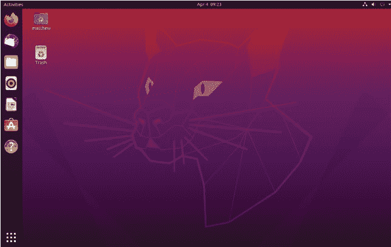

图 4.1 GNOME Shell 桌面。

通过桌面，你可以执行以下操作：

- 点击左上角的“活动”（Activities）搜索计算机中安装的程序。
- 从“Dash”（Dash，有时也称为收藏菜单）中选择程序，它是左侧的垂直栏，紧接“活动”链接下方（见图 4.2）。若要在 Dash 中添加或删除项目，可以在悬停在图标上时右键点击并从弹出菜单选择“添加”或“移除”。
- 点击左下角的“显示应用程序”图标（看起来像一个点阵）显示已安装的程序（见图 4.3）。
- 点击右上角的电源图标显示音量、账户设置等更多内容（见图 4.4）。
- 在桌面的顶部中央你可以看到日历。来自 Ubuntu 的通知也显示在这里。


图 4.2 GNOME Shell 桌面，顶部有“活动”链接。


图 4.3 点击“显示应用程序”图标显示已安装的程序。

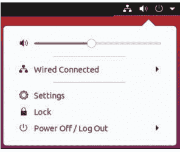

图 4.4 从菜单调整音量、账户设置等内容。

# KDE 与 Ubuntu

KDE 项目始于 1996 年，目标是为 Linux 创建一个免费、运行良好且集成良好的桌面环境，这意味着程序和界面将保持一致，而不是杂杂部分的组合。

KDE 项目一直关注终端用户，而不是为系统管理员创建 GUI。从从开始这一点很重要，意图是让任何计算机用户感到舒适并能够做他们想做的，而不需要完全理解后台发生的情况。这种情况持续至今，并被其他桌面环境共享，特别是 GNOME，后者是 1997 年由参与 KDE 项目的人员在对软件许可产生争议后离开而创立的。

该争议的原因已不再存在，因为现在的许可证同样免费，但这两个项目在关注点上产生了分歧：GNOME 提供了一个具有禅意简约感的桌面以及优雅的默认设置和用法，而 KDE 则提供了更多的视觉效果和配置选项。它们都是非常优秀的桌面环境，集成良好且具有高度的专业性，是 Linux 世界中最重要的两个。如果你从未用过任何，请尝试两者。

Kubuntu 是 Ubuntu 社区早期启动的项目，目标是让用户能够在 Ubuntu 中安装和使用 KDE。为了让那些已经知道自己喜欢 KDE 而非 GNOME 的人更容易，你可以下载并安装 Kubuntu ，它是去掉 GNOME 并增加 Kubuntu 特定增强的 Ubuntu。你也可以通过从 Ubuntu 存储库安装 `kubuntu-desktop` 包，在标准版 Ubuntu 中并行安装 Kubuntu。

Kubuntu（见图 4.5）对大多数任务使用不同的默认设置：浏览器、电子邮件等。大部分都是专门为 KDE 桌面环境编写的，使得 KDE 成为可用集成度最高、一致性最好的 Linux 桌面之一。


图 4.5 Kubuntu 桌面。

## Xfce 与 Ubuntu

Xfce 是一个更轻量的桌面环境，比 GNOME 或 KDE 需要的内存和处理能力更少，因此通常被建议在旧旧设备上使用。它不应该被局限于这一角色，因为它在当前的硬件上运行得也非常良好，并且往往出于其他原因成为一个高质量的选择。Xfce 的开发遵循传统的 UNIX 软件哲学：只做一件事，并把它做好，然后与其他程序协作。

Xfce 桌面环境的部分是模块化的；你可以随心所欲地添加或删除组件，并替换执行相同程序的。Xfce 中创建或包含的所有内容预计将按照简单的标准运行，允许其他程序轻松地与之交互。

一方面，这有时意味着人们在看 Xfce 时会认为它不像两个主流桌面环境那样无缝集成和顺滑。另一方面，这意味着如果你更倾向于使用 GNOME 文件管理器（Nautilus）而不是 Xfce 自带的（Thunar），那么你可以安装 Nautilus 并与 Thunar 并行使用，或者完全删除 Thunar。这是 Xfce 保持轻量化的重要部分——它的依赖要求非常少且具有高度的灵活性。


Ubuntu（见图 4.6）最初的设计是为了创建一个轻量级的 Ubuntu 版本，由于 Xfce 的代码依赖较少，该版本可以在旧硬件上运行得良好。随着时间的推移，一些人发现他们出于其他原因喜欢这个桌面环境，而旧硬件的使用场景不再是重点。是 Xfce 的模块化结合操作的顺畅性赢得了人们，该发行版开始从 Ubuntu 的定制版 GNOME 中中提取一些受青睐的部分，并将它们添加到 Xfce 中以替换其部分默认设置。我们今天拥有的是 Ubuntu GNOME 组件、Knoppix 组件、Xfce 组件以及其他未默认包含在任何一个版本中的元素的良好融合。


图 4.6 Ubuntu 桌面。

与标准的 Ubuntu 或 Ubuntu 安装相比，Ubuntu 仍然使用的内存更少、CPU周期更少；然而，仅从这些方面考虑并不能体现它的价值。要安装带有 Xfce 桌面环境的 Ubuntu，请安装 `ubuntu-desktop` 包。

## LXDE 与 Ubuntu

Lubuntu 基于 LXDE，这是一种极其快速的桌面环境，使用的内存和 CPU 比我们讨论过的任何其他环境都少。它专门为低性能计算机（如网络笔记本）开发，但并不是它唯一的用例。Knoppix 是一种从实时可启动 CD 或 DVD 运行的 Linux 发行版，现在使用 LXDE。Knoppix 是系统管理员的长期喜爱，用于无法启动的系统的应急修复，并具有良好的便携性。从 KDE 切换到 LXDE是为了利用这种轻量化，因为从 CD 或 DVD 运行操作系统通常比安装在硬盘上运行要慢得多。

Ubuntu 的重心从速度和轻量化转向享受 Xfce 的灵活性，这产生了一个空白。对廉价硬件（如移动互联网设备以及基于 ARM 或 MIPS 处理器的计算机）感兴趣的用户和开发者希望找到一种运行 Linux 发行版的方法，该发行版应共享 Ubuntu 社区，拥有美观实用的桌面，并且其开发不会在较慢的机器上滞后。LXDE 非常新，它的开发哲学与这些用户的希望和梦想非常契合（见图 4.7），它似乎是一个完美的选择。

Ubuntu 虽然安静，但它并不新。开发者们在 Ubuntu 社区内工作并取得着持续的进展，他们还在吸引感兴趣的人加入开发团队提供帮助。可以从 Ubuntu 仓库安装 `lubuntu-desktop` 来尝试一下。

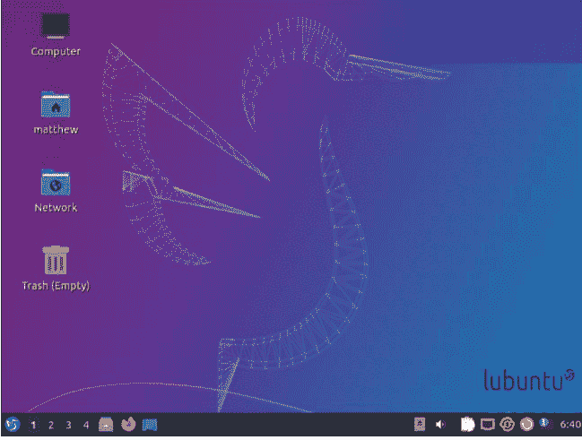

图 4.7 Ubuntu 桌面非常有吸引力。

## MATE 与 Ubuntu MATE

GNOME 2 曾广受喜爱，但它不再受到支持，因此不被推荐。然而，它的代码被分支成了 MATE（发音类似于南美的一种茶类饮品“mah-tay”）。基本上，MATE 是 GNOME 2 的延续，即 GNOME 3 发布之前的旧版本 GNOME。MATE 拥有旧版本 GNOME 的功能、外观和感受，以及相同的代码基础，但仍在持续开发（见图 4.8）。

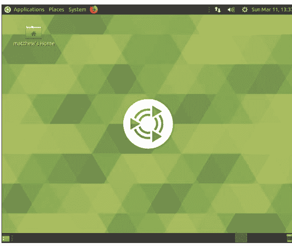

图 4.8 MATE 桌面。

## Ubuntu Budgie

Ubuntu Budgie 使用来自 https://budgie-desktop.org 的 Budgie 桌面（见图 4.9）。它是桌面领域的一种新尝试，旨在简单和优雅。它既美丽又有趣，虽然它始于 2013 年，但在过去的几年里才开始变得成熟并具有真正的实用性。非常值得一看！


图 4.9 Budgie 桌面。

Telegram 频道 @nettrain

## Ubuntu Kylin

Ubuntu Kylin 是中国本地化的 Ubuntu。它与标准 Ubuntu 起源相同，针对全球最大的市场进行了中文、日历和文化定制。由于它的语言与本书不同，我们仅对其进行了简要提及。然而，如果你是中文使用者，你可能会发现它很有趣并且值得一看。

# 参考文献

- www.gnome.org—GNOME 官方网站
- www.compiz.org—Compiz 官方网站
- www.enlightenment.org—Enlightenment 官方网站
- www.kde.org—KDE 桌面官方网站
- www.kubuntu.org—Kubuntu 官方网站
- www.xfce.org—Xfce 桌面官方网站
- www.xubuntu.org—Xubuntu 官方网站
- www.lxde.org—LXDE 桌面官方网站
- ubuntu.net—Lubuntu 官方网站
- www.gnome.org—GNOME 桌面官方网站
- untubudgie.org—Budgie 官方网站
- ubuntu-mate.org—MATE 官方网站
- wiki.ubuntu.com/UbuntuKylin—Ubuntu Kylin 的英文资源
- ubuntu.com/project/about-ubuntu/derivatives—Ubuntu 衍生版官方列表
- knopix.net—CD/DVD Linux 发行版 Knoppix
- en.wikipedia.org/wiki/Desktop_environment—桌面环境的详细定义
- en.wikipedia.org/wiki/Comparison_of_X_Window_System_desktop_environments—可用桌面环境精彩列表，包含功能对比

# 第 5 章 互联网上

考虑到这一点，我们不再涵盖本书以前版本中介绍过的、大多数人可能永远不会使用的旧技术。大多数交互都是通过 Web 进行的。在某些情况下，整个操作系统已经被仅仅由一个极简的 OS 层和一个由 Web 访问驱动的平台所取代，例如在运行 Chrome OS 的廉价笔记本电脑上。因此，我们不再介绍过时的程序，而是提供一个关于网络浏览器的简短章节。

## 开始使用 Firefox

Mozilla Firefox 是最受欢迎的网络浏览器之一，事实上它也是 Ubuntu 的默认浏览器（见图 5.1）。Firefox 构建在源自 Mozilla 套件的坚实代码的基础上，无论何种操作系统，它都为浏览网页提供了一个开源且安全的选项。


图 5.1 Mozilla Firefox 允许你添加许多扩展程序以进一步增强你的网页体验。

在 Ubuntu 中，你可以从侧边栏找到 Firefox，或者通过在“活动”下搜索“firefox”找到它。

除了基础需求外，还有许多插件和扩展程序，可以增加 Firefox 超越简单网页浏览的能力。像 Java 这样的插件可以随时安装（当然，是在你第一次需要时），以及用于查看视频内容的多媒体解码器。扩展程序为浏览体验提供了实用的补充。例如，ForecastFox 是一个提供本地天气状况的扩展程序，而 Bandwidth Meter and Diagnostics 是一个计算你当前带宽的工具。

## 检查 Google Chrome 和 Chromium

还有许多扩展程序和插件可以增强你的浏览体验，你可以通过在 Firefox 中按下 Shift+Ctrl+A 来找到它们。

你可以轻松地找到并获取插件和扩展程序，因为 Mozilla 开发者创建了一个专门的网站来帮助你从 Firefox 获取。你不需要寻找该网站，因为 Firefox 菜单的“工具 -> 附加组件 -> 获取附加组件”中有一个链接，可以直接带你到那里。一个特别受欢迎的是 Adblock Plus 插件，它允许你在浏览时杀掉所有占用大量带宽的烦人横幅和动画。

## 检查 Google Chrome 和 Chromium

如今最流行的浏览器是 Google Chrome（见图 5.2），它也运行在 Linux 上。这个浏览器快速、安全、可以通过扩展程序扩展，并且是极客桌面上最热门的新宠。它基于 WebKit 和其他技术，在符合标准的同时可以快速下载和渲染。你可以在 www.google.com/chrome 学习更多关于 Google Chrome 简单安装的信息。


图 5.2 在 Ubuntu 中运行的 Google Chrome。

Chrome 并非完全开源，但主要的基础部分是开源的，并作为 Google Chromium 提供，它具有 Chrome 的大部分功能，但缺少 Google 品牌和自动更新；它被用作 Chrome 发布的测试和开发基础。（作为一个有趣的点，chromium 是制造 chrome 的金属——因此有了这些名字。）

- [www.mozilla.com](https://www.mozilla.com)——Firefox 首页
- [www.google.com/chrome](https://www.google.com/chrome)——Chrome 首页
- [www.chromium.org/Home](https://www.chromium.org/Home)——Chromium 首页

# 第 6 章

## 本章内容

## 生产力应用

- 介绍 LibreOffice
- 其他实用的生产力软件
- 为 Microsoft Windows 编写的生产力应用
- 参考文献

许多企业已经找到了从免费开源软件中获益的方法，例如像 LibreOffice 这样的办公生产力套件，而不是为业务使用支付许可费用；Ubuntu 中也提供了传统的本地安装选项或这些之外的应用程序。在本章中，我们将探索其中一些。

注意

重要的是，即使是免费和开源的软件在大多数时候表现得非常好（特别是对于不那么复杂的文档），但它们与 Microsoft Office 并不是 100% 兼容的。为什么呢？微软对其文件格式非常保密。

Impress—此演示程序与 Microsoft PowerPoint 类似，允许您创建包含图表、图解和其他图形的幻灯片演示。它也能与 Microsoft PowerPoint 良好地协作。

以下五个应用程序默认不包含在 Ubuntu 中，但它们非常有用。除了 Dia 之外，所有程序都是 LibreOffice 项目的一部分，并为套件增加了 Ubuntu 默认安装中未使用的功能。如果您想或需要这些功能，必须从 Ubuntu 仓库中安装它们。

- Math—此公式编辑器允许您使用许多数学公式和符号编写数学公式，并将其纳入文字处理文档中。这些符号具有高度专业性，文字处理器的基本功能较容易包含。它主要对数学和科学类作者感兴趣，但对于任何需要在文本中包含复杂公式的人来说，Math 都很有用。
- Base—这是一个功能完整的应用程序。
- Draw—此图形应用程序允许您创建用于在 LibreOffice 生成的文档中的图像。它以 LibreOffice 格式保存文件，但可以导入大多数常见的图像格式。
- Dia—此技术绘图编辑器允许您创建测量图纸，例如建筑师和工程师使用的图纸。其功能与 Microsoft Visio 类似。
- Planner—您可以使用此项目管理应用程序进行项目规划、调度和跟踪；此应用程序类似于 Microsoft Project，但与之并不兼容。安装后，您将在“项目管理”（Project Management）下找到它。

LibreOffice 起于 OpenOffice 办公套件的分支。OpenOffice.org 办公套件起源于名为 StarOffice 的商业套件。StarOffice 最初由一家德国公司开发，后被美国的太阳微系统（Sun Microsystems）收购。对旧 StarOffice 的最大抱怨之一是，所有组件应用程序都集成在 StarOffice “桌面”中，看起来非常像 Microsoft Windows 桌面，包括开始按钮和菜单。这意味着为了编辑一个简单的文档，必须加载不需要的应用程序，导致办公套件加载缓慢、运行缓慢，并且对系统资源要求较高。

在收购 StarOffice 后，太阳微系统在 GNU 公共许可证下发布了大部分 StarOffice 代码，并开始开发已成为 OpenOffice.org 的软件，该软件在 GPL 下免费提供。太阳还继续对 StarOffice 进行开发。该软件免费版和商业版之间的显著差异在于，StarOffice 提供的字体比 OpenOffice.org 多，导入/导出过滤器也更多（由于许可证限制，这些过滤器在 GPL 版本中未提供），并且 StarOffice 提供了了自己的关系型数据库——即 Software Ag 的 Adabas D 数据库。太阳被甲骨文（Oracle）收购。甲骨文与 OpenOffice.org 的开发者社区发生严重分歧，开发者离开形成了文档基金会（The Document Foundation），希望甲骨文最终能加入。OpenOffice.org 的代码使用免费软件许可证许可，文档基金会创建了该软件的新版本，并使用了他们意图作为临时名称的 LibreOffice。他们的希望仅仅是改变项目的治理方式，从由一家公司领导转变为由许多公司和个人参与的社区领导。甲骨文选择不加入基金会，并恢复了所有版本的 OpenOffice.org 代码（它作为该代码的所有者可以这样做），并将代码交给了 Apache 软件基金会，该基金会使用限制较少的 Apache 许可证对其进行授权，该许可允许源代码在专有产品中使用。更有趣的是，IBM 正在使用这个 Apache 许可版本的 OpenOffice 作为其自己的（就成本而言）办公套件 Lotus Symphony 的基础，该软件也有专有的扩展。

随着故事的继续，最终的赢家将是终端用户，因为实际上有三个竞争性的办公套件。目前，LibreOffice 拥有最多的开发者、最强大的社区以及功能更新速度最快的最成熟软件。

## 第 6 章 效率应用程序

## 其他实用的效率软件

本章已经讨论的办公套件适用于典型的关注办公的交互：创建基本文档、电子表格等。然而，某些用户有更复杂或更精确的需求。本节涵盖了一些帮助您在这些情况下提高效率的选项。

## 处理 PDF

在 Ubuntu 中读取 PDF 非常简单。得益于安装了一个名为 Evince 的程序，该功能是默认提供的。如果您打开一个 PDF，它会在 Evince 中打开，您可以在那里阅读文档。有时填写表单也很简单，因为表单可能是使用仅 Adobe 提供的功能创建的。您可以从 Ubuntu 软件中心的“Canonical 合作伙伴”（Canonical Partners）部分安装 Adobe Reader。Adobe Reader 适用于任何使用 Adobe 软件创建的 PDF，无论它是通过 Windows、macOS 还是 Linux 创建的。

有时，您可能有想要编辑的 PDF 文件。这比读取 PDF 稍微复杂一点，但不像以前那么困难。有一个专门用于编辑 PDF 文件的程序：PDF Edit (`pdfedit`)。

从 Ubuntu 软件中心安装 `pdfedit`。表面上看，这个程序似乎很简单，但它具有不显而易见的力量。高级用户可以学习在脚本中使用 `pdfedit` 来快速进行大规模更改。当然，和大多数其他强大的工具一样，它也以复杂性和学习曲线为代价。

## 编写脚本

虽然可以使用任何标准的文字处理程序编写脚本，但 Celtx 是一个为严肃的作家和制作经理准备的复杂且强大的工具。这非常有用，因为脚本需要跟踪的不仅仅是文字。

应用程序提供了许多选项来帮助您组织场景；为这些场景添加注释；创建索引卡片；维护您的角色、地点和道具列表；以及更多功能。

初看之下，Celtx 看起来让人目不应接，但由于包含了一些示例项目，学习如何使用它并不听起来那么困难。

## 处理 PDF

在 Ubuntu 中读取 PDF 非常简单。得益于安装了一个名为 Evince 的程序，该功能是默认提供的。如果您打开一个 PDF，它会在 Evince 中打开，您可以在那里阅读文档。有时填写表单也很简单，因为表单可能是使用仅 Adobe 提供的功能创建的。您可以从 Ubuntu 软件中心的“Canonical 合作伙伴”部分安装 Adobe Reader。Adobe Reader 适用于任何使用 Adobe 软件创建的 PDF，无论它是通过 Windows、macOS 还是 Linux 创建的。

有时，您可能有想要编辑的 PDF 文件。这比读取 PDF 稍微复杂一点，但不像以前那么困难。有一个专门用于编辑 PDF 文件的程序：PDF Edit (`pdfedit`)。

从 Ubuntu 软件中心安装 `pdfedit`。表面上看，这个程序似乎很简单，但它具有不显而易见的力量。高级用户可以学习在脚本中使用 `pdfedit` 来快速进行大规模更改。当然，和大多数其他强大的工具一样，它也以复杂性和学习曲线为代价。

## 编写脚本

虽然可以使用任何标准的文字处理程序编写脚本，但 Celtx 是一个为严肃的作家和制作经理准备的复杂且强大的工具。这非常有用，因为脚本需要跟踪的不不仅仅是文字。

应用程序提供了许多选项来帮助您组织场景；为这些场景添加注释；创建索引卡片；维护您的角色、地点和道具列表；以及更多功能。

初看之下，Celtx 看起来让人目不应接，但由于包含了一些示例项目，学习如何使用它并不听起来那么困难。

## 处理 PDF

在 Ubuntu 中读取 PDF 非常简单。得益于安装了一个名为 Evince 的程序，该功能是默认提供的。如果您打开一个 PDF，它会在 Evince 中打开，您可以在那里阅读文档。有时填写表单也很简单，因为表单可能是使用仅 Adobe 提供的功能创建的。您可以从 Ubuntu 软件中心的“Canonical 合作伙伴”部分安装 Adobe Reader。Adobe Reader 适用于任何使用 Adobe 软件创建的 PDF，无论它是通过 Windows、macOS 还是 Linux 创建的。

有时，您可能有想要编辑的 PDF 文件。这比读取 PDF 稍微复杂一点，但不像以前那么困难。有一个专门用于编辑 PDF 文件的程序：PDF Edit (`pdfedit`)。


从 Ubuntu 软件中心安装 `pdfedit`。表面上看，这个程序似乎很简单，但它具有不显而易见的力量。高级用户可以学习在脚本中使用 `pdfedit` 来快速进行大规模更改。当然，和大多数其他强大的工具一样，它也以复杂性和学习曲线为代价。

## 编写脚本

虽然可以使用任何标准的文字处理程序编写脚本，但 `Celtx` 是一个为严肃的作家和制作经理准备的复杂且强大的工具。这非常有用，因为脚本需要跟踪的不不仅仅是文字。

应用程序提供了许多选项来帮助您组织场景；为这些场景添加注释；创建索引卡片；维护您的角色、地点和道具列表；以及更多功能。

初看之下，`Celtx` 看起来让人目不应接，但由于包含了一些示例项目，学习如何使用它并不听起来那么困难。

## 处理 PDF

在 Ubuntu 中读取 PDF 非常简单。得益于安装了一个名为 `Evince` 的程序，该功能是默认提供的。如果您打开一个 PDF，它会在 `Evince` 中打开，您可以在那里阅读文档。有时填写表单也很简单，因为表单可能是使用仅 Adobe 提供的功能创建的。您可以从 Ubuntu 软件中心的“Canonical 合作伙伴”部分安装 `Adobe Reader`。`Adobe Reader` 适用于任何使用 Adobe 软件创建的 PDF，无论它是通过 Windows、macOS 还是 Linux 创建的。

有时，您可能有想要编辑的 PDF 文件。这比读取 PDF 稍微复杂一点，但不像以前那么困难。有一个专门用于编辑 PDF 文件的程序：PDF Edit (`pdfedit`)。

从 Ubuntu 软件中心安装 `pdfedit`。表面上看，这个程序似乎很简单，但它具有不显而易见的力量。高级用户可以学习在脚本中使用 `pdfedit` 来快速进行大规模更改。当然，和大多数其他强大的工具一样，它也以复杂性和学习曲线为代价。

`Kile` 是专为 KDE 设计和编写的。因此，它与 Ubuntu 结合良好，但在标准的 Ubuntu 安装上也能很好地运行。它还提供了 Windows 版本可供选择。详细信息请参阅 `https://kile.sourceforge.net`。

# 创建思维导图

有时，帮助你组织思路和想法的最佳方法是创建一个思维导图。`Heimer` 可以帮助你快速完成这一目标，并提供了一个简单、高效的界面。它的选项并不多。相反，它的重点在于提供区块，你可以在区块中填充文本（如果你愿意的话，也可以填充代码），然后拖放这些区块，将它们与其他区块关联起来，从而创建出你需要的地图。你甚至可以将思维导图导出到其他应用程序中使用。从 Ubuntu 软件中心安装 `heimer`。

# 为 Microsoft Windows 编写的生产力应用

Microsoft Windows 与 Linux 有本质上的不同，但你可以通过一个名为 `Wine` 的应用程序在 Linux 中安装并运行某些 Windows 程序。`Wine` 允许你在基于 UNIX 的系统上使用 Microsoft Windows 和 DOS 程序。`Wine` 包含一个程序加载器，你可以用它执行 Windows 二进制文件，并包含一个实现 Windows 命令调用的 DLL 库，将这些调用翻译为等效 UNIX 和 X11 命令。由于 `Wine` 代码库频繁更新，Ubuntu 并不包含 `Wine`。请从 `www.wineq.org` 下载当前版本的 `Wine`。要查看你喜欢的应用程序是否受 `Wine` 支持，可以查看 `https://appdb.wineq.org` `Wine` 应用数据库。

其他解决方案（主要是 CodeWeavers 的 `CrossOver`）也能使用 Microsoft 生产力应用。如果你想更轻松地运行 Office 以及 Apple `iTunes` 等其他软件，你应该研究 CodeWeavers。`CrossOver` 是让基于 Windows 的程序运行简单的程序之一。访问 `www.codewavers.com` 下载最新软件的试用版。

# 参考文献

- `www.libreoffice.org`—LibreOffice 套件首页
- `www.documentfoundation.org`—文档基金会（The Document Foundation）首页
- `www.openoffice.org`—OpenOffice.org 办公套件首页
- `www.pdfedit.cz/en/index.html`—PDF Edit 首页
- `www.codewavers.com`—CodeWeavers 的 `CrossOver` 首页，它可以让你在 Linux 下运行某些 Windows 程序

# 第 7 章

## 本章内容

## 多媒体应用

- 声音与音乐
- 图形处理
- 在 Ubuntu 中使用数字相机
- 在 Ubuntu 中刻录 CD 和 DVD
- 视频
- 录制与编辑视频
- 视频编辑
- 参考文献

二十一世纪已成为数字化生活的世纪，全球数百万计算机用户正在拥抱新技术。这始于数码相机、MP3 播放器和各种多媒体设备的兴起。十五年前，你可能在 Windows 安装中散落着少量 WAV 文件，而十年前，你更有可能在不同的电脑上散落着成百甚至上千个 MP3 文件。今天，大多数人通过浏览器或手机享受音乐和视频，从 YouTube 和 Spotify 等网站消费内容。

然而，如果你是一个创作者或收藏者，你可能拥有大量的音频文件、视频剪辑、动画和其他图形。在这种情况下，组织和维护这些庞大的库并不是问题。

本章提供了 Ubuntu 自带或可用的某些基础工具的概述。

# 声音与音乐

Linux 曾有缺乏对声音和多媒体应用良好支持的声誉。然而，这真的不再是事实，而且多年以来如此。（如果你知道微软不再支持微软声卡，而 Linux 用户仍在使用支持，这可能会让你微笑——无疑是为了惹恼雷德蒙德的人们。）然而，UNIX 一直拥有良好的多媒体支持，正如 UNIX 作者和大师 David Taylor 指出的那样：

最初的计算机图形工作是由 Evans 和 Sutherland 在 UNIX 系统上完成的。麻理工学院媒体实验室的创新是在 UNIX 工作站上完成的。

# 声卡

Ubuntu 支持多种格式，包括：

- `ALSA`（高级音频架构）
- `OSS`（开源声音系统）

# 声音格式

有许多格式用于存储录音。其中某些格式与特定技术相关，另一些则出于专利原因使用。Ubuntu 支持所有流行的格式，包括：

- `RAW (.raw)`
- `MP3` 和 `MP4 (.mp3,.mp4)`
- `WAV (.wav)`
- `Ogg-Vorbis (.ogg)`
- `FLAC (.flac)`


# 声卡

Ubuntu 支持多种格式，包括：

- ALSA（高级音频架构）
- OSS（开源声音系统）

# 声音格式

有许多格式用于存储录音。其中某些格式与特定技术相关，另一些则出于专利原因使用。Ubuntu 支持所有流行的格式，包括：

- `RAW (.raw)`
- `MP3 和 MP4 (.mp3,.mp4)`
- `WAV (.wav)`
- `Ogg-Vorbis (.ogg)`
- `FLAC (.flac)`

# Rhythmbox

Rhythmbox 是一款用于播放 CD 和音乐文件的实用应用程序。它还可以将 CD 中的音乐提取（Rip）为你喜喜欢的格式。

# Banshee

Banshee 是另一个音乐应用程序，可以处理音乐的提取和播放、下载封面、与便携式播放器同步，甚至可以播放视频。

# 如何通过 SOUND JUICER 将音乐导入 UBUNTU

Ubuntu 自带了一个名为 Sound Juicer 的方便实用工具，可以在“应用程序”->“音频和视频”下找到，被称为“音频 CD 提取器”。系统会自动检测你何时插入了 CD，并尝试从网上检索曲目详情。从那里开始，它会将 CD 提取为 `.ogg` 文件并存储在你的文件系统中。

# 图形处理

在短时间内，数字摄像机、手机上的相机应用以及数字图像变得极其流行——流行到几乎所有的胶片相机制造商都已转向数字化或倒闭了。这种爆发式的增长导致了能够处理数字图像的应用程序数量的增加。得益于快速发展，Linux 现在被高度视为处理数字图像的多媒体平台。

默认情况下，Ubuntu 安装了实用的 Shotwell 照片管理器。该应用程序与其他时期的照片工具（如 Photo）类似，并包含了对许多用户来说足够的简单工具，如去红眼、裁剪、色彩调整，以及与 Facebook、Flickr 和 Instagram 等在线照片主机进行交互的能力。

# GNU 图像处理程序

最好的图形工具之一是 GNU 图像处理程序 (GIMP)。GIMP 是一个免费的、遵循 GPL 的图像编辑器，具有强大的功能，可以导入和导出 30 多种不同的图形格式，包括用 Adobe Photoshop 创建的文件。它经常与 Photoshop 比较，GIMP 代表了 GNU 项目的早期成功之一。Linux 中的许多图像都是使用 GIMP 制作的。

GIMP 默认安装，但你可以从 Ubuntu 软件仓库轻松安装它。

首次启动 GIMP 时你会看到一个安装对话框，随后是一系列显示本地 GIMP 目录创建和内容的对话框。该目录可以包含个人设置、偏好、外部应用程序资源文件、临时文件以及编辑器使用的外部工具的符号链接。

# PHOTOSOP 有什么 GIMP 没有的功能？

尽管 GIMP 功能强大，但它缺乏 Adobe Photoshop 提供的两个对某些图形专业人士非常重要的功能。

第一个是为商业印刷机生成色彩分色（CMYK）的能力，即青色、洋红色、黄色和黑色（主色）。GIMP 使用 RGB（红、绿、蓝），这对于视频显示很棒，但不适用于印刷机。GIMP 缺失的第二个功能是使用潘通色（一种专利色彩规范）。这些缺陷可能不会持续多久。一个 CMYK 插件正在开发中（早期版本可在 `https://cue.magic-info/softwares/separate-plus/index.html` 获取），潘通色问题可能在不久后得到解决。

如果这些功能对你并不重要，你会发现 GIMP 是一个非常优秀的工具。如果你必须使用 Adobe Photoshop，你可能想探索 Wine 或 CodeWeavers；一直有报告显示通过这些工具在 Linux 上运行 Photoshop 是成功的。但请记住，Ubuntu 和 Photoshop 定期发布，在假设它们可以运行之前，请检查 `www.winehq.org` 和 `www.codeweavers.com` 的最新信息。

## 在 Ubuntu 中使用扫描仪

随着数字摄影的兴起，对图像扫描仪的需求有所下降。然而，仍然会有需要使用扫描仪的时候，Ubuntu 通过默认一个名为 Simple Scan（简单扫描）的程序轻松实现了这一点。Simple Scan 的设计初目标只有一件事：轻松地扫描照片或文档。它的设置或选项很少，但包含了大多数人想要或需要的功能。

你也可以配合 GIMP 使用许多类型的图像扫描仪，这可能是喜欢折腾扫描仪和选项，或需要比 Simple Scan 更灵活功能的人的首选。如果在安装 GIMP 时没有安装，请安装 `sane` 包。这样在使用 GIMP 时，你将有大量的设置和选项可以使用。你也可以单独使用 Xsane。

# 处理图形格式

图像文件的开发是为了服务于特定的技术（例如无损压缩，在不牺牲图像质量的情况下减小文件大小）或为了竞争原因满足专有格式。许多文件受一个或多个父格式支持。例如，GIF 格式曾受到开源社区的青睐，尽管其专利持有者等待了一段时间才行使他的专利权，而不是直接要求专利使用费。不过，GIF 格式不再受专利保护。

如果你想查看或处理图像，你需要识别其格式，以便选择处理图像的正确工具。文件扩展名是判断文件格式的首要指标。Ubuntu 带应用程序支持的图形图像格式包括：

- BMP (.bmp)——位图图形，通常用于 Microsoft Windows
- GIF (.gif)——CompuServe 图像交换格式。查看 ImageMagick 的手册（man page）。
- JPG (.jpg)——联合摄影专家小组
- PCX (.pcx)——IBM Paintbrush
- PNG (.png)——便携网络图形
- SVG (.svg)——可缩放矢量
- TIFF (.tif)——标记图像文件格式

你可以在 ImageMagick 的手册页找到大量的图像文件扩展列表，ImageMagick 是 Ubuntu 自带的一款优秀应用程序，你将在本章后续章节中阅读更多关于它的信息。

## 提示

Ubuntu 的软件仓库中包含了几十种图形转换程序，可以通过命令行访问。

缩放或旋转图像最简单的方法是安装 `nautilus-image-converter` 包。这允许你在文件浏览器中查看文件时（例如，从“位置”->“图片”中），右键点击图像并选择菜单选项来缩放或旋转一张或多张图像，而无需打开另一个程序。

# 其他图形处理选项

如果你对图形处理有非常特定的要求，你可能会发现以下选项比之前的通用选项和注释更适合你的需求。这些选项中并非全部都位于 Ubuntu 仓库中：

- Blender—一个 3D 图像和动画编辑器，你可以在 `www.blender.org` 找到。
- CinePaint—许多好莱坞制片厂使用的强大且复杂的工具，你可以在 `www.cinepaint.org` 找到。
- darktable—一个 RAW 编辑器，可以在 `www.darktable.org` 找到。
- digiKam—一个全景照片拼接工具，可以在 `www.digikam.org` `https://hugin.sourceforge.net` 找到。
- Inkscape—一个矢量图形创建和编辑工具，你可以在 `https://inkscape.org` 找到。
- Krita—一个位图图形创建和编辑工具，你可以在 `https://krita.org` 找到。
- POV-Ray—一个使用光线追踪强大强大复杂的 3D 图形程序，可以在 `www.pov.org` 找到。
- Radiance—用于设计中的照明分析和可视化，可以在 `www.radiance-online.org` 找到。
- Xara Xtreme—一个通用的图形编辑器，你可以在 `www.xaraxtreme.org` 找到。

# 在 Ubuntu 中使用数字相机

大多数在 Ubuntu 下使用的数字相机分为两类：网络摄像头或数字相机和手机相机。Ubuntu 支持这两种。其他类型的摄像头，例如直接通过有线或无线连接连接到网络的监控摄像头，在 Linux 计算机上使用不需要特殊支持（网络连接和查看软件外）。

Ubuntu 支持数百种不同的数字相机，从早期的并行端口（基于 CPIA 芯片）到如今的 USB 摄像头。你甚至可以在 Ubuntu 上使用英特尔的 QX3 USB 显微镜。

# 手持数字相机

由于 Linux 的良好开发，你可以通过 USB 接口将几乎数字相机或手机相机连接到电脑，Ubuntu会自动将相机识别为 USB 存储设备。你甚至可以设置 Ubuntu 在相机插入时进行识别，以便自动为你导入照片。

# 在 Ubuntu 中刻录 CD 和 DVD

# 使用 Shotwell 照片管理器

本章前面提到的 Shotwell 照片管理器包含简单的调整工具。你可以将照片导入 Shotwell，为它们分配标签，进行排序和排列，并将它们上传到你喜爱的网络照片托管网站，如 Instagram。

# 在 Ubuntu 中刻录 CD 和 DVD

Linux 通常通过互联网以磁盘 ISO 镜像的形式发布，准备好写入 CD 或 DVD。因此，如果你必须下载并安装 Linux 发行版，学习如何刻录光盘至关重要。你可以使用 CD 和 DVD 执行以下操作：

- 记录和存储多媒体数据，如备份文件、图形图像和音乐。
- 从音乐 CD 中提取音频轨道并为自己制作个人音乐 CD。（刻录“Rip”是指从音乐 CD 中提取音乐轨道。）

尽管 U 盘等 USB 存储设备让 CD 和 DVD 变得像软盘一样罕见，但它们并非如此，许多人仍然认为它们很有用。只要情况依然如此，我们就希望确保这些信息可用。

# 使用 Brasero 创建 CD 和 DVD

虽然对于快速刻录和 Shell 脚本来说已经足够了，但刻录 CD 和 DVD 的命令行技术对许多人来说并不是理想的选择（但我们仍然在本章中介绍它，因为其他人发现它既有用又理想）。幸运的是，Ubuntu 提供了几个图形客户端；最实用的是 Brasero。

Brasero 是一个易于使用的图形化 CD 和 DVD 刻录程序，它是默认安装的。Brasero 采用基于项目的方法进行刻录，打开后显示的窗口提供了许多人想要执行的四个任务。Brasero 还会记住“项目”，让你能够创建光盘的多个副本，如果你计划给朋友和家人提供 Ubuntu 的副本，这将是理想的。

刻录 CD 或 DVD 只需要在屏幕上选择选项，并将从左侧目录树中想要包含的文件拖到右侧的放置区域即可，非常简单。如果你在刻录机中插入空白 CD 或 DVD，Brasero 会监控光盘并在你达到或超过限制时你。它会创建 ISO 文件，这是一种磁盘镜像，包含了如果你刻录一个真实的 CD 或 DVD 时在介质上存在的所有内容，适用于你想创建一个光盘的多个副本，或者你想共享磁盘镜像（可能使用 USB 优盘或通过互联网）。

最后，点击“刻录”（Burn）按钮，为光盘输入标签，Brasero 将开始创建你的新 CD 或 DVD 镜像文件。创建 CD 或 DVD 所的时间取决于你写入的数据量和驱动器的速度。

# 从命令行创建 CD

在 Linux 中，在命令行创建 CD 是一个两步骤的过程。你首先创建一个 ISO9660 格式的镜像，然后将镜像刻录或写入 CD 中。ISO9660 是 CD-ROM 的默认系统。

使用 `mkisofs` 命令创建 ISO 镜像。`mkisofs` 命令有很多选项（完整列表请参见 man page），你使用以下命令快速刻录：

```bash
matthewaseymour:-$ mkisofs -r -v -J -1 /tmp/our_special_cd.iso source_directory
```

示例中使用的选项如下：

- `-r`—将文件的权限设置为更有用的值。UID 和组 ID 要求设置为 0。
- `-v`—显示详细信息。
- `-J`—使用 Joliet 文件名。
- `-1`—允许不再有更多文件。
- `/tmp/our_special_cd.iso`—指定输出镜像文件。
- `source_directory`—指定源目录路径。

## 第 7 章 多媒体应用

提示

DVD 介质 4.7GB 的容量是按每 GB 1,000 兆字节计算的，而不是更传统的、但并不完全准确的每 GB 1,024 兆字节（对于 GB 来说更为准确），因此当格式化后的容量（约 4.4GB）小于你的预期时，不要惊讶。大多数硬盘制造商也都进行了这种切换。`dvd+rw-tools` 不允许你超过光盘容量。

你需要安装 `dvd-rw-tools` 包以及 `cdrtools` 包。`dvd-rw-tools` 包包含 `growisofs` （作为 `mkisofs` 的前端）和 DVD 格式化工具。

你可以通过两种方式使用 DVD 记录数据。第一种方法与记录会话 CD 非常相似，第二种方法是使用包写入（packet writing）将数据作为真正的文件系统记录。

## 刻录写入 (Session Writing)

要在刻录中记录数据，你需要两个阶段的过程：

- 使用 `dvd-rw-format /dev/scd0` 格式化光盘（仅在第一次使用光盘时需要，`/dev/scd0` 是你的驱动器设备名称）。
- 使用 `growisofs -Z /dev/scd0 -R /your/files` 将数据写入光盘。

`growisofs` 命令只是简化了向光盘传输的过程。对于后续会话，请使用 `-M` 参数而不是 `-Z`。`-Z` 参数仅用于初始会话刻录；如果你在已使用的光盘上使用 `-z` 参数，它会擦除现有文件。

注意

某些 DVD 是预先格式化的；在第一次使用时再次格式化它们可能会导致 DVD 损坏。请务必仔细阅读 DVD 的包装，以确保你不会制造出另一个“光盘垫”（废光盘）。

提示

刻录至少 1GB 的第一个会话有助于保持你记录的数据与其他光驱驱动器的兼容性。DVD 播放器通过尝试读取光盘上的特定位置来完成校准；你需要在那里有数据以便读取器自行校准。

此外，由于 Linux 中 ISO9660 文件系统的限制，不要为你创建的跨 4GB 边界的目录的多面 DVD 开启新会话。这样做会导致用于指向文件的偏移量“环绕”并指向错误的文件。

## 包写入 (Packet Writing)

包写入将 CD 或 DVD 视为硬盘，在其中你创建一个文件系统（如 ext3）并格式化光盘，然后随机写入，使其像传统的硬盘一样工作。这种方法虽然在基于 Windows 的计算机上很常见，但在 Linux 上长期被认为是实验性的，而且一直并不常用，因为在有机会 CD 或 DVD-RW 之前，USB 闪存已经普及了。我们不会详细介绍这一点，但进行快速概述是合适的。

## 提示

DVD+RW 介质只能支持约 1,000 次写入，因此使用 `noatime` 选项挂载它们可以消除任何更新 inode 的写入操作，或者在不需要写入时直接将其挂载为只读。

将数据管道传输到 `growisofs` 命令是可能的：

```
matthew@semour:-$ sudo your_application growisofs -Z /dev/scd0=/dev/fd/0
```

刻录现有的镜像（或文件、命名管道或设备）也是可能的：

```
matthew@semour:-$ sudo growisofs -Z /dev/scd0-image
```

在首次使用程序之前，需要阅读位于 `/usr/share/doc/dvd+rw-tools/index.html` 的 `dvd-rw-tools` 文档。我们建议你先尝试 DVD-RW（可重写）介质，如果你犯了错误，你仍然重复使用光盘，而不是为你的咖啡杯制作几个新的废光盘。

## 查看视频

你可以使用 Ubuntu 工具和应用程序查看视频。

## 视频格式

Ubuntu 识别多种视频格式。然而，由 MPEG 组、Apple 和微软创建的格式占据主导。视频格式的核心是编码器——视频和音频信息的编码器和解码器。编码器通常是专有的，但确实存在免费编码器。以下是最常见的视频格式及其关联扩展名的列表，尽管还有更多：

- AVI (.avi)—Windows 视听格式
- FLV (.fliv)—用于 Adobe Flash；支持 H.264 等其他格式
- MPEG (.mpeg)—MPEG 视频格式；也称为 .mpg
- MOV (.mov)—QuickTime 视频格式
- OGV/OGG (.ogg/.ogg.)—Ogg Theory 免费许可视频格式
- QT (.qt)—Apple 的 QuickTime 视频格式
- WEBM (.webm)—Google 设计的音视频免版税容器（如 VP8 格式），专为 HTML 设计

## 在 Linux 中查看视频

由于许可限制，Ubuntu 开箱即不支持任何专有视频编码器。然而，如果你从 Ubuntu 软件源中安装 `ubuntu-restricted-extras` 包，就可以获得此功能。你可以在 `https://help.ubuntu.com/community/RestrictedFormats` 了解更多信息。

你可以使用默认安装的 Totem 播放器观看视频文件和视频 DVD。它也可以用于几种其他文件格式，并适用于视频和音频，并且特别适合这些用途。

## 音频的录制与编辑

在 Ubuntu 中可以使用许多应用程序进行音频录制和编辑。对于专业级，你需要 Ardour 或 LMMS。这些是请求最多的音频编辑工具：

- Audacity—Linux 上最常用的音频编辑软件。
- Ardour—专业级数字音频工作站。
- Cecilia—这种跨平台音频处理工具面向音效设计师。
- LMMS—FL Studio 的免费开源替代品。
- Rosegarden—Linux 的简单数字音频工作站。

## 视频编辑

在 Ubuntu 中可以使用许多应用程序进行视频记录和编辑。对于专业级，你需要 Blender 这样的工具。对于我们大多数人来说，简单的 PiTiVi 就足够了。

这些是 Linux 上最受欢迎的视频编辑应用程序：

- Avidemux—为简单需求的用户设计的工具。
- Blender—跨平台（Linux, macOS, Windows）专业级视频制作工具。
- Cinema—该工具已存在多年，但最近进行了一些重大更改并正在重构社区。
- DaVinci Resolve—这种跨平台（Linux, macOS, Windows）专业级视频制作工具常用于好莱坞。


- Kdenlive—来自 KDE 团队。
- Lightworks—这种跨平台（Linux, macOS, Windows）专业级视频制作工具。
- OpenShot Video Editor—这种编辑器。
- PiTiVi—找到此工具。
- Shortcut—这种跨平台（Linux, macOS, Windows）编辑器。

大多数这些选项都在 Ubuntu 存储库中，所以先检查，但某些你必须直接从其网站下载。

# 第 8 章

## 本章内容

## 游戏

- Ubuntu 游戏
- 安装专有驱动
- 在线游戏来源
- 从 Ubuntu 仓库安装游戏
- 运行 Windows 游戏
- 参考文献

玩游戏是计算的一部分。对于我们的一些人来说，游戏是任何操作系统吸引力的很大一部分，至少对于那些身处商务或企业环境之外的人如此。从曾经让数百万人在茶歇时间娱乐的简单纸牌游戏，到涉及遍布全球玩家的激烈第一人称射击游戏，Linux 提供了一个可能会让你大吃惊喜的优质平台。

在本章中，我们将探索一些你可以在 Ubuntu 中轻松下载和安装的常用游戏。

## Ubuntu 游戏

桌面版默认安装了少量游戏，大多是能让你分散注意力几分钟的简单游戏，例如纸牌接接龙和麻将。这些游戏很容易尝试，你可能会发现它们很有趣。

我们大多数喜欢游戏的人都会想要寻找更多。坦率地说，Linux 游戏并不止于此；热门游戏具有原生支持。模拟器让你能够在 Linux 下原生原生运行经典游戏，例如 LucasArts ScummVM 的《猴子岛之谜》。有适用于 DOS、SNES 以及许多其他系统的模拟器。如果你感兴趣，可以在网上搜索 DOSBox、xFree**、Geo 和 Stella，但如果你足够幸运，你可能还可以玩到你喜欢的那些已不存在或当前版本不支持的主机或操作系统的游戏。

## 安装专有驱动

对我们大多数人来说，更重要的是，Linux 有大量的当前发行可用。首先，如果我们拥有 AMD 或 NVIDIA 显卡，我们需要升级默认驱动以获得更强大的功能。Linux 用户的一个主要不满点是很难让现代显卡正常工作。坦率地说，AMD 和 NVIDIA 的支持都使用开源的 Nouveau 驱动程序，它适用于大多数情况，但并不包含高端显卡的所有功能。这意味着 Ubuntu 并没有附带显卡的原生驱动，但它们可以在操作系统安装期间或安装后立即轻松安装。开源驱动对于游戏效果良好，通常也适用于计算机辅助设计（CAD）等专业用途。

> ### 注意
> 如果你认为在 Linux 上使用专有驱动是唯一途径，我们应该提到，目前有大量的开发工作投入到为稍旧的显卡提供完全免费且开源的驱动。Ubuntu 会自动为你的系统选择最佳“免费”驱动，并允许在你需要时切换到专有驱动。虽然开源驱动提供了 3D 加速，但这种支持并不总是扩展到完整的功能集或更新的显卡。

激活你需要的专有驱动非常简单：打开“软件更新”，点击“设置”，并选择“附加驱动”选项卡，如图 8.1 所示。安装不同的硬件驱动需要超级权限，因此系统会要求你输入密码。当驱动列表出现时，阅读描述并突出显示它，然后点击右下角的“更改”。Ubuntu 会确认你想使用专有驱动，如果你同意，它会自动下载并配置相关驱动。如果你想恢复到原始驱动，请执行相同的操作，但选择已激活的驱动并点击右下角的“移除”，位置就在之前提到的“更改”出现的地方。


**8.1** 使用“附加驱动”激活或禁用适用于你显卡的相应专有驱动。

## 在线游戏来源

许多网站提供可下载的游戏，通常需要付费，尽管有些作品是免费的。截至本书时，以下网站拥有所有可以在 Ubuntu 上运行的游戏。

## Steam

Steam 是一个跨平台娱乐平台。当你在 Ubuntu 上安装它时，你可以访问一个游戏商店和其他功能。其中一些是免费的，但大多数需要你付费。

使用 Steam 已成为大多数当前 Linux 游戏玩家寻找、安装和玩游戏的主要方法。

2013 年，Valve 的联合创始人兼执行总经理 Gabe Newell 表示，尽管 Linux 的市场份额微乎其微，但它是游戏的未来，而 Steam 网站称 Ubuntu 为 Steam 最喜爱的 Linux 版本。Steam 是 Newell 公司追求这一未来的手段。

要了解更多关于 Valve 和 Steam 的信息，请访问 www.valvesoftware.com 和 https://steampowered.com。

## GOG.com

GOG.com 提供了数千款运行在多个平台（包括 Linux）上的游戏。这些游戏是无 DRM 的，这意味着不包含数字版权管理，让自由和开源（FOSS）的支持者们感到非常。。看看 www.gog.com/games。

## Humble

Humble 商店出售许多 FOSS 游戏。该网站以捆绑销售闻名，当你购买包购买游戏时，价格远比平时便宜。要查看可用选项，请访问 www.humblebundle.com/store。

## itch.io

这个跨平台网站提供了许多兼容 Linux 的游戏。访问 https://itch.io/games/platform-linux。

## LGDB

Linux 游戏数据库（LGDB）有超过 2,000 款游戏供下载，其中包括模拟器、工具以及一个用于与其他用户讨论游戏、游戏和问答的网络论坛。你可以在 lgdb.org 找到这些游戏。

### Game Jolt

该网站上的游戏都是独立游戏，这意味着它们是由个人或小公司创建的。与其他网站一样，该网站提供许多跨平台游戏。你可以在 https://gamejolt.com/games/best?os=linux 找到列表。

## 从 Ubuntu 仓库安装游戏

在本节中，你将学习如何在 Ubuntu 上安装一些流行的游戏，所有游戏都可以从 Ubuntu 仓库轻松安装。除了通常的射击类游戏，你还会发现一两款侧重策略的。

## Warsaw

Warsaw 是一款免费且节奏快速的第一人称射击（FPS）游戏，适用于 Windows、macOS 和 Linux。Ubuntu 社区的成员对该游戏进行了封装，并使其变得直接可用。游戏涉及快速移动、在敌人之前获取补给和武器，并尝试在不被任何人发现的情况下炸弹和偷取旗帜。你可以在彩色的 3D 环境中跳跃、冲刺、躲避甚至爬墙。图 8.2 显示了游戏开始，可以看到许多武器、平台和坡以及补给。许多其他 FPS 游戏可用，例如 Alien Arena、Urban Terror、Wolfenstein: Enemy Territory、Smok'n Games、Nexuis、World of Padman 和 Cube 2: Sauerbrechen。


FIGURE 8.2 Warsaw 是可用最新且最快的 FPS 游戏之一。

## Scorched 3D

Scorched 3D 基于名为《Scorched Earth》的旧 DOS 游戏。目标和玩法相似：有多个玩家，你输入目标细节使用各种导弹类武器摧毁其他玩家。每次胜利都会积分，并在回合结束时购买新武器。游戏提供了令人惊叹的武器系列，且游戏过程完全处于惊人的 3D 环境中，如图 8.3 所示。


FIGURE 8.3 Scorched 3D 运行演示。

Telegram 频道 @nettrain

## 第8章 游戏

Scorched 3D 是基于回合的。每个玩家射击一次，然后其他每个玩家在第一位玩家再次射击之前各一次。该游戏允许同时有超过20名玩家，包括人类玩家和计算机控制的玩家。你可以进行本地游戏、通过局域网（LAN）甚至通过互联网游戏。Scorched 3D 适用于 Windows、macOS 和 Linux，因此无论你的朋友电脑使用什么平台，你都可以和他们一起玩。

## Frozen Bubble

Frozen Bubble 是一款趣味的小游戏，画面精美，音乐好听且操作简单。你可以独自玩，也可以与其他玩家对战。目标是在规定时间内使用你的彩色弹珠击落上方的弹珠。你必须一次击中至少两个与你射出的颜色相同的弹珠使其掉落；否则，你的射击就会加入“大杂烩”并更快地导致你的终结，如图 8.4 所示。Frozen Bubble 有很多之处，但即使有这么多细节，对孩子来说也足够简单，而且足以吸引大多数成年人的兴趣。


图 8.4 向左或向右移动以瞄准并按下发射。

## SuperTux

我们许多人是在游戏性比画面更重要的时代长大的。尽管如此，我们仍然喜欢华丽漂亮的游戏。SuperTux 是对马里奥时代的怀旧。它是一款 2D 横向卷轴游戏，在其中你可以跳跃、跑步，并在获得适当道具时偶尔射击物体。英雄是 Linux 企鹅 Tux。提供超过 25 个关卡，还有一个关卡编辑器供你创建自己的关卡。如果你喜欢跑步、跳跃、撞头换钱以及踩敌人头上，那么这个游戏非常适合你。图 8.5 展示了它的基本外观和感受。


图 8.5 尽管 SuperTux 的外观和感受带你回了马里奥时代，但它远非无味或无聊。

## Battle for Wesnoth

目前 Linux 上最受欢迎的游戏之一是 Battle for Wesnoth（见图 8.6），这是一款兼具单机和多人选项的策略游戏。游戏基于一个幻想世界，你负责组建军队来对抗攻击你的敌人。游戏玩法可以基于关卡（例如在单机模式下，某些关卡是预装的并可以轻松下载），或者在局域网派对或在线时优于你的朋友。

Battle for Wesnoth 自带有一个地图编辑器，可以让你创建自己的关卡。一个活跃的社区分享他们的作品并欢迎新的贡献。你可以在 https://wesnoth.org 找到更多关于 Battle for Wesnoth 的信息。

## Frets on Fire

图 8.7 所示的 Frets on Fire 类似于吉他英雄（Guitar Hero）。玩家需要跟上节奏并正确地“演奏”它。该游戏支持《Guitar Hero I》和《Guitar Hero II》，但与这些专有游戏不同，它可以由社区扩展，并且可以从互联网上下载到更多歌曲。Frets on Fire 是完全开源的，并拥有 Linux、Windows 和 macOS 的内容兼容版本。


图 8.6 通过玩 Battle for Wesnoth 来运用你的策略头脑，这是一个丰富且充满幻想冒险的土地。


图 8.7 Frets on Fire 提供了华丽的画面和熟悉的玩法。

## 从 Ubuntu 存储库安装游戏

## FlightGear

如果你喜欢飞行模拟器，你应该尝试一下 FlightGear（见图 8.8）。它是跨平台的、复杂的且有趣的。它是完全开源的，由志愿者开发，而且看起来非常专业且运行流畅。如果你喜欢这个，还可以找到其他类似的游戏，例如 Thunder and Lightning、GL-117 和 Search and Rescue II。


图 8.8 FlightGear 拥有迷人的风景和技术上准确的控制面板。

### Speed Dreams

有很多赛车游戏可用。其中较新的是 Speed Dreams（见图 8.9），它从一个旧的赛车游戏 TORCS 分支开始的。它具有各种赛道、车辆和选项。Speed Dreams 是开源、免费且多平台的。类似的游戏还包括 TORCS、Rigs of Rods、vDrift、Tile Racer、Trigger 和 Mania Drive。


图 8.9 在 Speed Dreams 中，有多种比赛视角，包括一个来自你汽车的视角。

# 第 9 章

## 本章内容

- Ubuntu 软件 (Ubuntu Software)
- 使用 Synaptic 进行软件管理
- 保持更新
- 在命令行中工作
- 从源码编译软件
- 使用 Snappy 软件包管理器
- 参考文献

在本章中，我们将介绍在 Ubuntu 中管理软件的选项。如果你习惯了通过访问不同的供应商网站来下载更新的环境，那么你将会感到惊喜。更新整个 Ubuntu 安装程序（包括所有的应用程序软件）就如运行“更新管理器”（Update Manager）一样简单。你将发现安装甚至删除各种软件包包是多么的容易。

Ubuntu 提供了多种系统资源管理工具。接下来的章节将介绍你在进行大多数软件管理时将使用的图形化软件管理工具。本章还涵盖了监控和管理系统中的磁盘存储。

## Ubuntu 软件

Ubuntu Software 是 Ubuntu 中用于软件包管理的图形实用程序。你可以通过在“活动”（Activities）中搜索“Ubuntu Software”来找到它；该软件包和可执行程序名为 `ubuntu-software`。Ubuntu Software 允许你通过直观的搜索和一键安装，轻松选择并安装大量应用程序。当你打开程序时，你会看到主界面，如图 9.1 所示。

在侧边栏顶部，有三个菜单选项：全部（All）、已安装（Installed）和更新（Updates）。右侧是一个搜索图标，你可以用它搜索软件包。向下滚动即可按类别列出的软件。

通过 Ubuntu Software 安装新软件非常简单：在软件包列表中找到该软件，双击它，然后点击“安装”（Install）按钮。当你这样做时，系统可能会要求你输入密码；然后应用程序就会下载并安装。你可以通过在 Ubuntu Software 中找到某个应用程序并点击“移除”（Remove）按钮来删除它。


图 9.1. Ubuntu Software 初始界面允许你浏览按类别排序的软件包。

## 用于软件管理的 Synaptic

Ubuntu 自带软件在添加和删除应用程序方面运行良好，但如果你需要安装特定的内容——例如库——则需要使用命令行或 Synaptic（见图 9.2）。你可以通过 Ubuntu Software 安装 Synaptic；它默认没有安装。

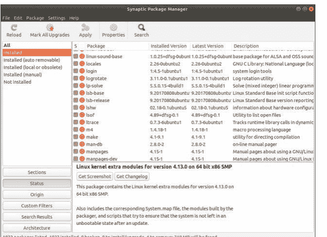

图 9.2. 如果要在 GUI 中进行更高级的软件管理，Synaptic 是你的首选工具。

## 使用 Synaptic 软件管理

左侧是软件类别，右上是该类别的软件包选择，右下方是“软件包信息”窗口，它显示当前所选软件包的信息。要安装或删除软件，点击名称左侧的复选框，你会看到一个提供以下选项的菜单：

- **取消标记（Unmark）**——如果你已标记该软件包进行安装、升级或其他其他操作，此选项将移除该标记。
- **标记为安装（Mark for Installation）**——点击此选项将此软件包添加到待安装列表中。
- **标记为重新安装（Mark for Re-installation）**——如果你已经安装了某些软件，但由于某种原因未被保留，点击此选项将从头重新安装它。现有的配置文件将被保留，因此你所做的任何编辑都是安全的。
- **标记为升级（Mark for Upgrade）**——如果软件有可用更新，选择此选项以下载并安装它们。
- **标记为移除（Mark for Removal）**——选择此选项从系统中删除所选的软件包，但保留其配置文件完好，以便在你重新安装它时无需重新配置。
- **标记为彻底移除（Mark for Complete Removal）**——选择此选项从系统中删除所选的软件包，并移除任何配置文件，从系统中清除所有内容。

在你做出更改后，点击“应用”（Apply）按钮，让 Synaptic 根据需要下载、安装、升级和卸载。如果你在不点击“应用”的情况下关闭程序，你的更改将会丢失。

在屏幕左侧的类别下方有六个框：部分（Sections）、状态（Status）、源（Origin）、自定义过滤器（Custom Filters）、搜索结果（Search Results）和架构（Architecture）。这些框可以自定义左侧列表：“部分”是类别视图；状态”允许你查看已安装或已升级的软件包；源”列出了可用于下载软件包的不同仓库；自定义过滤器”包含了一些仅对高级用户有用的特殊分组；搜索结果”显示你的搜索结果；“架构”显示 Ubuntu 各种架构特定的软件包。

你可以随时按 `Ctrl+F` 搜索特定软件包。默认情况下，它是按软件包描述和名称搜索的。你可以查看“输入”（In）框设置以按名称搜索。如前所述，你的搜索词保存在“搜索”视图下（左下角的按钮），你可以从该列表中点击再次搜索该术语。

除了安装和删除软件的方法外，Synaptic 还提供了配置你用于查找软件包的服务器的方法。事实上，这是你可以对 Ubuntu 系统进行最重要更改之一的地方：你可以将其向 Ubuntu 宇宙（Universe）和多重宇宙（Multiverse）仓库开放它。

Ubuntu 基于 Debian 发行版，该版本有数千个软件包可供安装。Ubuntu 仅使用了其中的一部分，但它可以让你方便地安装其他软件包，以及许多在 Debian 中不可用的软件包。当你使用 Synaptic 时，你会看到许多软件包旁边有橙色的小 Ubuntu 图标，这标识它们是官方 Ubuntu 的。

## 保持更新

尽管 Ubuntu 提供了一个用于更新的图形化工具，但了解如何通过命令行管理更新也很重要。Ubuntu 会自动检查更新并在可用关键更新时通知你。

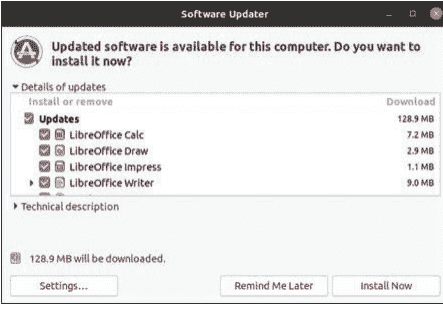

图 9.3. 如果你需要更新软件，请使用更新管理器。

## 在命令行中工作


由于有可安装的软件，基于 Debian 的发行版提供了许多管理软件的方法。实际上，它们都使用 Debian 的高级软件包工具（APT）。Slashdot 上的一人曾说：“欢迎来到 Slashdot。如果你想不出新词，就说 APT 很酷，你就能融入其中。”

为什么 APT 很酷？嗯，它是第一个正确处理依赖关系的系统。其他发行版使用的文件具有依赖关系。例如，Red 使用具有依赖关系的 RPM 文件。GIMP 的 RPM 依赖于 GTK。结果是如果你在没有 GTK RPM 的情况下尝试安装 GIMP，你的安装将失败。所以，获取 GTK RPM 后再次尝试。

相比之下，APT 设计为能够自动查找并下载软件包的依赖关系。因此，如果你想安装 GIMP 软件包及其所需的任何其他软件，无需手动寻找，不再需要担心寻找正确的版本，更不需要手动完成。APT 还可以处理断点续传，这意味着如果你在升级过程中丢失网络连接（或者电量耗尽，或者你不得不退出），下次运行时 APT 将从停止的地方继续。

## 日常 APT 使用

为了让你能够快速彻底地搜索软件包，APT 使用可用软件包的本地缓存。尝试运行以下命令：

```
matthew@seymour:$ sudo apt update
```

`apt update` 命令指示 APT 联系它所配置的所有服务器并下载最新的文件更新列表。如果你的列表已过期，APT 需要一分钟左右下载更新。否则，该命令将在几秒钟执行完毕。

在下载最新的软件包信息后，你将返回命令行。现在你可以要求 APT 自动下载任何已更新的软件，使用此命令：

```
matthew@seymour:$ sudo apt upgrade
```

如果你在机器上安装了许多软件，那么软件更新的可能性就会更大。APT 会扫描你的软件，并将其与服务器上的最新包信息进行对比，生成类似下方的报告：

```
matthew@semour:-$ sudo apt upgrade
Reading lists... Done
Building dependency tree
Reading state information... Done
The following packages will be upgraded:
abstract google-chrome-beta cedtea-6-plugin language-pack-en
language-pack-en-base language-pack-gnome-en language-pack-gnome-en-base
freetypes libfreetype6-dev libsmclient libwbclient0 openjdk-6-jre
openjdk-6-jre-headless openjdk-6-jre-lib samba-common samba-bin
smbclient update winbind xserver-common xserver-xorg-core
21 upgraded, 0 newly installed, 0 to remove and 0 not upgraded.
```

执行此操作后，将使用 623KB 的额外磁盘空间。

你想要继续吗 [Y/n]？

此报告的每个部分都传了重要信息。从顶部开始，“The following packages will be upgraded”这一行给出了可用更新的包列表。如果你正在安装新软件或删除软件，会出现某些标题为“The following packages will be installed”和“The following packages will be removed”的列表。底部的摘要显示 APT 将总共升级 21 个包，其中 0 个新包，0 个待删除和 0 个未升级。这是因为是升级而不是安装新软件，所有新包仅占了 623KB 的额外空间。尽管你有 84.8MB 的下载量，但这些包正在覆盖旧文件。

重要的一点是，基本的 `apt upgrade` 永远不会移除软件或添加新软件。使用此命令来保持系统完全补丁状态是安全的，因为它永远不会弄坏任何东西。然而，你偶尔会看到“0 not upgraded”状态，这意味着某些内容无法升级。当必须安装某些软件以满足更新包的依赖关系时，就会发生这种情况，正如之前提到的，`apt upgrade` 永远不会这样做。在这种情况下，你需要使用 `apt dist-upgrade`，它的名字是因为它旨在允许用户从 Debian/Ubuntu 的版本升级到新版本——这种升级不可避免地涉及系统上几乎所有内容的更改，移除 Debian 过时的功能，因为它允许你在无需下载和安装新 CD 的情况下从一个版本移动到另一个版本。保持定期更新和发行升级对于确保安全更新和简单的错误修复不会改变你可能依赖的配置非常有用，特别是对于那些需要持续可用和运行的机器，例如服务器。

虽然 `apt upgrade` 和 `apt dist-upgrade` 用于升级包，但 `apt install` 负责添加新软件。例如，如果你想安装 MySQL 数据库服务器，请运行此命令：

```
matthew@semour:-$ sudo apt install mysql-server
```

### 在命令行中操作

在内部，APT 在其软件列表中查询 `mysql-server`，并发现它与 `mysql-server-5.7` 包匹配。然后它找到了它需要的但你尚未安装的依赖项，并给你提供如下的报告：

```
matthew@semour~$ sudo apt install mysql-server
[sudo] password for matthew:
```

Reading package lists... Done

Building dependency tree

Reading state information... Done

The extra packages will be installed:

libibaevent-core-2.1.6 libhtml-template-perl mysql-client-5.7

mysql-client-core-5.7 mysql-common mysql-server mysql-server-5.7

mysql-server-core-5.7

Suggested packages:

libipc-sharedache-perl tinyyca mailx

The NEW packages will be installed:

libibaevent-core-2.1.6 libhtml-template-perl mysql-client-5.7

mysql-client-core-5.7 mysql-common mysql-server mysql-server-5.7

mysql-server-core-5.7

0 upgraded, 9 newly installed, to remove and 0 not upgraded.

Need to get 20.3 MB of archives.

After this operation, 160 MB of additional disk space will be used. Do you want to continue [Y/n]?
```

这一次，你可以看到 APT 已经挑选并选定了安装 MySQL Server 5.7 所需的所有依赖项，但它也列出了推荐的包和两个它没有选择安装的建议包。`recommended` 包仅仅是如此：制作该包的人（或其依赖项）认为你同时也拥有 `mailx` 包是一个明智的主意。如果你想添加它，按 `n` 终止 apt 并按如下方式重新运行：

```
matthew@semour~$ sudo apt install mysql-server mailx
```

`Suggested` 包仅仅是推荐的更低级的形式。它们不会向你想要安装的软件添加任何关键功能，但你可能在正在安装的主软件时需要它们。

APT 维护一个包缓存，其中存储它已下载并安装的 DEB 文件。这通常位于 `/var/cache/apt/archives`，有时会占用数百兆字节的空间。你可以通过运行 `apt clean` 来清理包缓存，它会删除所有缓存的 DEB 文件。或者，你可以运行 `apt autoclean`，它会删除超过某些时间的缓存 DEB 文件并保留较新的包。

对于你已经安装的包运行 `apt install` 时，APT 会考虑你的命令并查找是否有新版本可下载。另一个重要的日常操作是移除不再需要的东西，你通过如下方式使用 `apt remove` 命令来实现：

```
matthew@semour:-$ apt remove
```


libibaevent-core-2.1.6 libhtml-template-perl mysql-client-5.7

mysql-client-core-5.7 mysql-common mysql-server mysql-server-5.7

mysql-server-core-5.7

Suggested packages:

libipc-sharedache-perl tinyyca mailx

The NEW packages will be installed:

libibaevent-core-2.1.6 libhtml-template-perl mysql-client-5.7

mysql-client-core-5.7 mysql-common mysql-server mysql-server-5.7

mysql-server-core-5.7

0 upgraded, 9 newly installed, to remove and 0 not upgraded.

Need to get 20.3 MB of archives.

After this operation, 160 MB of additional disk space will be used. Do you want to continue [Y/n]?

这一次，你可以看到 APT 已经挑选并选定了安装 MySQL Server 5.7 所需的所有依赖项，但它也列出了推荐的包和两个它没有选择安装的建议包。**recommended（推荐）**包仅仅是如此：制作该包的人（或其依赖项）认为你同时也拥有 `mailx` 包是一个明智的主意。如果你想添加它，按 `n` 终止 apt 并按如下方式重新运行：

```
matthew@semour~$ sudo apt install mysql-server mailx
```

**Suggested（建议）**包仅仅是推荐的更低级的形式。它们不会向你想要安装的软件添加任何关键功能，但你可能在正在安装的主软件时需要它们。

APT 维护一个包缓存，其中存储它已下载并安装的 DEB 文件。这通常位于 `/var/cache/apt/archives`，有时会占用数百兆字节的空间。你可以通过运行 `apt clean` 来清理包缓存，它会删除所有缓存的 DEB 文件。或者，你可以运行 `apt autoclean`，它会删除超过某些时间的缓存 DEB 文件并保留较新的包。

对于你已经安装的包运行 `apt install` 时，APT 会考虑你的命令并查找是否有新版本可下载。另一个重要的日常操作是移除不再需要的东西，你通过如下方式使用 `apt remove` 命令来实现：

```
matthew@semour:-$ apt remove
```

## 使用 apt-get 代替 apt

虽然简化的 APT 接口去掉了连字符和命令的后部分效果非常好，并且包含了进度条等精的更新，但它并不包含老牌 apt-get 的所有功能。表 9-1 列出了了一些命令及其所替换的内容，以防你更熟悉旧命令。两个版本都可以工作，所以如果你不想切换，就不需要重新学习。今天，apt-get 仅用于更高级的包管理，超出了我们书中涵盖的内容。

### 表 9.1 apt-get 与 apt 命令对比

| apt-get 命令 | apt 命令 |
|---|---|
| apt-get install | apt install |
| apt-get remove | apt remove |
| apt-get update | apt update |
| apt-get upgrade | apt upgrade |
| apt-get dist-upgrade | apt full-upgrade |
| apt-get remove --purge | apt purge |
| apt-get autoremove | apt autoremove |
| apt-get search | apt search |
| apt-get show | apt show |
| dpkg --selections | apt list --installed |
| apt-get purge | apt purge |

## 从源码编译软件

从源码编译应用程序 并不困难。通常有两种方法：你可以使用 Ubuntu 软件库中提供的源码，也可以使用上游开发者提供的源代码（这对于 Ubuntu 软件库中没有的项目最为有用）。无论使用哪种方法，你都必须安装 `build-essential` 软件包，以确保你拥有编译所需的工具。你可能还需要安装 `automake` 和 `checkinstall`，它们都是构建工具。

### 从压缩包编译

大多数不在 Ubuntu 软件库中的源码都可以从原始作者或公司网站以压缩源码 `tarballs` 的形式提供——即使用 `gzip` 或 `bzip` 压缩过的 `tar` 文件。这些压缩文件解压后会得到一个包含多个文件的目录。作为普通用户来编译源码始终是一个好主意，这可以限制损坏或恶意代码可能造成的任何伤害。请在你的主目录下创建一个名为 `source` 的目录。

从你下载源码 tar 包的任何地方处，使用 `tar` 命令的 `-C` 选项将其解压到 `~/source` 目录：

```
matthew@seym:~$ tar xvf packagename.tgz -C /source
matthew@seym:~$ tar xvf packagename.tar.gz -C /source
matthew@seym:~$ tar xvf packagename.bz -C /source
matthew@seym:~$ tar xvf packagename.tar.bz2 -C /source
```

如果你不确定使用了什么压缩方法，可以使用 `file` 命令来识别：

```
matthew@seym:~$ file packagename
```

### 源码编译入门

现在，切换目录到 `~/source/packagename` 并寻找名为 `README`、`INSTALL` 或类似的文件。如有必要，打印该文件，因为它包含了有关如何编译和安装软件的具体说明。通常，编译源码的步骤如下：

```
matthew@semour:~/source/packagen$ ./configure
```

这会运行一个脚本来检查是否满足所有依赖项以及构建环境是否正确。如果缺少依赖项，configure 脚本通常会准确地告诉你它需要哪些。如果你在 Synaptic 中启用了 Universe 和 Multiverse 仓库，你可能会在其中找到缺失的软件（通常是库）。

当你的 configure 脚本执行成功后，运行以下命令编译软件：

```
matthew@semour:~/source/packagename$ make
```

最后，运行以下命令：

```
matthew@semour:~/source/packagename$ sudo make install
```

如果编译失败，请检查错误信息找到原因，并在重新开始之前运行以下命令：

```
matthew@semour:~/source/packagename$ make clean
```

如果你不喜欢该软件，也可以运行以下命令将其卸载：

```
matthew@semour:~/source/packagename$ sudo make uninstall
```

### 从 Ubuntu 软件库源码编译

有时你可能想要重新编译一个包，尽管 Ubuntu 软件库中已经有了二进制包。例如，某个程序在编译成二进制文件时可能禁用了你想要使用的特定功能。以下是使用一个名为 `foo` 的你想编译的软件包来实现此操作的方法。

首先，从 Ubuntu 软件库获取源码：

```
matthew@semour:-$ apt source foo
```

安装该包的构建依赖：

```
matthew@semour:-$ sudo apt build-dep-foo
```

进入源码所在目录（可能包含版本号）：

```
matthew@semour:-$ cd foo-4.5.2
```

你可以对软件包或编译标志进行任何你想要的更改。你可以通过使用 `.configure` 和 `make` 来实现，有时你也可以手动修改配置文件。每个包的实现方式可能不同，因此你需要查看该程序的文档。尝试从查找源码代码中的 `README` 文件开始。

接下来，创建一个新的 debian/changelog 条目。输入此命令后，你需要输入一条消息，说明为什么要制作新版本，也许类似于“Matthew 带有额外酱料的幻想之旅”之类的。

```
mathew@semour:-$ dch -i
```

Ubuntu 的包命名遵循特定的模式。为了方便以后使用，你应该坚持这种模式。使用这里显示的 `foo` 数字，一个从 Debian 继承且未修改的 Ubuntu 包将是 `4.5.2-1`。从 Debian 继承但针对 Ubuntu 修改的包将是 `4.5.2-ubuntu`（第二个版本为 `ubuntu2`，以此类推）。在 Debian 中没有版本但为 Ubuntu 创建的包将是 `4.5.2-ubuntu`（以及 `ubuntu2` 等）。

构建源码包。这创建了上传包所需的所有文件：

```
mathew@semour:-$ debbuild -S
```

最后，你得到了 `foo-4.5.2-1.deb`（根据实际情况替换为你创建的包名），你可以使用软件包管理器安装它。

```
matthew@semour:-$ dpkg -i foo-4.5.2-1.deb
```

## 配置管理

本节将介绍一些如果你想更深入地控制系统配置时可能会用到的工具。对于更大的需求

### 使用 Snap 管理器

snapd 通过允许你将系统中的任何文件替换为指向生成文件的符号链接来解决这个问题，当 `.d` 目录被添加、删除或修改时，它会使用 `inotify` 动态并立即更新生成的文件。主文件可以通过三种方式构建：使用平文件（合并）、使用 diff/patch 文件（应用）、以及使用可执行文件（处理 stdin 并输出到 stdout）。通过这种方式，满足了 Debian 的策略标准，但可以根据需要修改配置。

### Ubuntu Core

Ubuntu Core 为其新的包管理方式增加了运行服务器镜像所需的最小文件和代码。这种理念类似于基于 Android 的智能手机提供软件的方式：软件包含了运行所需的所有内容，从而使软件包与操作系统更加完全地隔离。这种设计是为了防止软件包破坏其他包或整个操作系统。它旨在让云部署或 IoT（物联网）等场景的更新变得更加方便快捷。该功能首次出现在 Ubuntu 16.04 LTS。

### 使用 Snap 管理器（续）

要显示可安装的 snap 包列表，使用以下命令：

```
matthew@seym:~$ snap find
```

由于 snap 是较新的，目前可用的包很少。然而，列表正在不断增长，并在以后可能会变得难以管理。你可以使用 `grep` 搜索输出以查找列表特定包，但你也可以使用：

```
matthew@seymour:~$ snap find searchterm
```

要安装 snap 包，使用以下命令：

```
matthew@seymour:~$ sudo snap install packagen
```

要显示已安装的 snap 包列表，使用以下命令：

```
matthew@seymour:~$ snap list
```

要更新 snap 包，请使用以下命令：

```
matthew@semour:-$ sudo snap refresh packagen
```

要删除 snap 包，请使用以下命令：

```
matthew@semour:-$ sudo snap remove packagen
```

要显示更改列表（例如 snap 安装、更新或删除的时间记录），请使用以下命令：

```
matthew@semour:-$ snap changes
```

# 参考文献

- **www.debian.org/doc/manuals/project-history/ch-detailed.en.html**—Debian Linux 软件包系统的历史

- **www.nongnu.org/synaptic/**—Synaptic 软件包管理器首页

# 第 10 章

## 本章内容

## 命令行入门课程

- 什么是命令行？

- 访问命令行

- 用户账户

- 阅读文档

- 理解 Linux 系统层级结构

- 遍历 Linux 文件系统

- 权限操作

- 文件操作

- 以 Root 身份进行操作

- 常用命令和程序

- 参考文献

Linux 命令行是计算机管理和维护最强大的工具之一。命令行也被称为终端（terminal）、外壳（shell）、控制台（console）、命令提示符（command prompt）和界面（CLI）。在本章和下一章中，这些术语可以互换，尽管它们之间确实存在细微差别。

使用命令行执行复杂任务比初看之下要高效、准确且简单得多。了解可用的命令以及如何将它们组合起来，会让 Ubuntu 的任务变得更加容易。许多命令是由 GNU 项目创建的，作为以前存在的专有 UNIX 命令的免费软件替代品。你可以在 www.gnu/gnu/theproject.html 了解更多关于 GNU 项目的信息。

本章涵盖了你在命令行高效工作所需的一些基础命令。你将学会如何进入命令行，并发现一些用于遍历文件系统以及对文件、目录和用户进行基本操作的命令。本章并未对所有讨论的命令进行全面介绍，但已足够你入门。第 11 章“命令行大师课，第一部分”将进一步推进该主题，并扩展本章中的某些命令。你在本章中发现的技能将帮助你更有信心地开始使用命令行。

### 什么是命令行？

如果你和丰富的 Linux 用户共处过一段时间，你一定听过他们提到命令行。有些人（特别是那些使用 Ubuntu 等易于通过图形用户界面 GUI 完成许多任务的发行版开启 Linux 之旅的人）可能会对文本界面的神秘感到生畏。另一些人则赞美它的强大，或者在通过命令行执行任务时认为这是完成任务最自然、显而易见的方式。

不必走极端。你可能在执行某些任务时对命令行产生兴趣，而在其他任务中更倾向于使用 GUI。这是大多数用户的最终归宿。有些人可能会说，在执行某些让你配置系统的图形任务之前，你永远不需要访问 Ubuntu 命令行。虽然这个前提在当时可能是正确的，但在接受这种观点之前，仍有一些理由让你应该考虑对命令行达到功能性的熟练程度。

有时事情会出问题，你可能没有幸运可以使用图形界面工作。在这种情况下，对命令行及其用途的基本理解可以成为救命稻草。某些任务通过命令行完成也更容易、更快速。更重要的是，你将能够在基于命令的系统中运行，如果你接触过 Linux 服务器，就会遇到这种情况，因为大多数 Linux 服务器没有 GUI，所有的管理都是通过命令行界面完成的。

> 注意
>
> 不要因为觉得本章无关就想跳过它。你应该花时间学习本章，确保在继续之前已经熟悉命令行。这样做将对未来几年大有益益。

起初，你可能想认为命令行是某种黑魔法或神秘术的产物；在某些方面，它看起来非常困难且复杂。然而，只要稍加坚持，在本章结束时，你将开始习惯使用命令行，并准备好进入第 11 章“命令行大师课，第一部分”和第 12 章“命令行大师课，第二部分”。

本章向你介绍了能够执行以下操作的命令：

- 常规任务——登录和注销、更改密码、列出和导航目录

- 基础文件管理——创建文件和文件夹、在文件系统中复制或移动、重命名和删除

- 基础系统管理——关机或重启、更改文件权限以及阅读页面（页面是以标准手册格式作为文件包含在计算机中的命令条目）

### 访问命令行

本章的信息对于新接触 Linux 并首次学习使用命令行的个人用户和系统管理员非常有价值。

> 提示
>
> 如果你用过多年电脑，你可能接触过 MS-DOS，在这种情况下，看到黑屏会让你产生怀旧之情。不要太自得（而且实际上更强大！）Linux 中的命令行与其遥远的 MS-DOS 亲戚不同。（此处注：此处原文包含大量重复错误码，翻译已根据逻辑清理）

### 注销

使用 `exit` 或 `logout` 命令或按下 `Ctrl+D` 退出会话。你将返回登录提示符。如果你使用虚拟控制台，请在离开 PC 之前记得退出。（否则其他人可以轻松坐下使用你的账户。）

### 从远程登录和注销

你可以顺利登录计算机，这被称为本地登录。此外，你可以通过远程网络连接登录计算机。基于 Linux 的操作系统提供了许多远程访问命令，你可以通过局域网（LAN）、广域网（WAN）或互联网登录其他计算机。注意，你必须在远程计算机上拥有账户，并且远程计算机必须配置支持远程登录；否则你无法登录。

### 文本控制台

如果你远程访问终端，你将看到类似的提示符：

```
login:
```

按下回车：

```
matthew@semour:-$
```

此点说明用户以 matthew 的身份登录系统 semour，目前位于主目录；Linux 使用波浪号 (~) 作为主目录的缩写，通常类似于 /home/matthew。

远程计算机。ssh 客户端具有许多命令行选项，但也可以简单地使用远程计算机的名称或 IP 地址，如下所示：

```
hew@seymour-$ ssh 192.168.0.41
```

无法建立 '192.168.0.41 (192.168.0.41)' 的真实性。

RSA 密钥指纹为 el:db:6c:da:3f:fc:56:b1:52:f9:94:e0:d1:1d:31:50。

你确定要继续连接吗 (yes/no)？

yes

当你第一次使用 ssh 连接到远程计算机时，Linux 会显示远程计算机的加密身份密钥，并要求你验证连接。在你输入 yes 并按回车键后，系统会警告你远程计算机的身份（密钥）已输入到你家目录下 `ssh` 目录下名为 `known_hosts` 的文件中。系统提示你输入你的：

警告：已将 '192.168.0.41' (RSA) 添加到已知主机列表。

```
thew@192.168.0.41:password:
thew@babbage-$
```


输入密码后，你就可以在远程计算机上工作了，你可以通过注意到提示符现在使用的是你正在操作的远程计算机名称来确认这一点。再次，由于你使用的是 `ssh`，因此与远程计算机通信时在键盘上输入的所有内容都是加密的。当你注销时，将返回到你的 shell：

```
thew@babbage-$ logout
thew@seymour:--$
```

## 用户账户

开始这一节的一个良好起点是基于用户的安全概念。在大多数情况下，只有两类人以用户身份访问系统。尽管还有其他运行程序和进程的账户，但我们谈论的是代表人类的账户，而不是为 Web 服务器进程创建的账户。大部分人都有普通用户账户。这些用户可以更改任何与其账户特定的内容，例如桌面壁纸、个人偏好，以及当他们使用自己的账户运行程序时的程序配置。请注意，重点是任何与其账户特定的内容。这种类型的用户无法进行可能影响他人的系统级更改。

要进行系统级更改，你需要使用超级用户权限（super user privileges），这可以使用你第一次启动 Ubuntu 时创建的账户来完成（参见第 1 章“安装 Ubuntu 和安装后配置”）。超级权限可以访问系统并执行任何任务——包括破坏性任务。为了帮助防止这种情况发生，普通用户并不是总是开启这些权限的，而是大部分时间都作为普通用户运行。

要从命令行使用超级权限，你需要在想要执行的命令前加上另一个命令 `sudo`，后面紧跟着一个空格以及你想运行的命令。用一个助记词，把它想成是“super user do（超级用户执行）”。当你（输入完剩余的命令后）按回车键，当系统提示你输入密码时，你应该输入密码，然后按回车键。与基于 UNIX 的系统一样，出于安全考虑，当你输入密码时密码不会显示在屏幕上，以防有人在你背后窥视。Ubuntu 将以（不带）超级权限的方式执行该命令。

使用超级用户的破坏性的一个例子是老旧的 `sudo rm -rf /`，如果不需要向根目录添加 `--no-preserve-root`，它将删除你硬盘上的任何内容——该参数是专门为了防止人们无意执行此操作而添加的。如果你作为普通用户使用 `sudo` 输入命令，会出现错误信息，且什么都不会发生，因为命令不会运行。我们建议你不要尝试这个特定命令作为测试，尽管如果你使用具有超级权限的账户输入此命令，你将会发现自己正从全新的安装开始重新来，并希望你有一份所有数据的当前备份。在使用超级权限时你必须格外小心；否则你可能会对系统造成无法修复的损坏。

然而，作为超级用户进行操作的能力是健康的 Linux 系统的基础，不应该恐惧它；相反，即使在集中注意力使用时也应该保持谨慎。如果没有它，你就无法安装新软件、编辑系统配置或处理大量的管理任务。顺便说，如果你曾经被要求输入账户来完成特定任务（例如安装软件更新），那么你已经在通过 GUI 使用超级权限执行操作了。区别在于，大多数图形界面限制了用户，并使得执行那些巨大的、破坏性的任务变得稍微困难（即使是非常用的）。

Ubuntu 的工作方式与其他许多 Linux 发行版不同。如果你学习其他发行版，特别是较旧或更传统的发行版，你会听到一种名为 `root` 的特定账户，它是一个超级用户。在这些发行版中，在使用具有超级权限的普通用户账户时，不需要在命令前输入 `sudo`，而是登录到 `root` 账户并发布命令而无需密码（至少默认情况下如此）；在所有情况下，这些发行版都可以安装和配置 `sudo`。在这些情况下，你可以通过命令行判断自己是否正在使用 `root` 账户，因为你会看到命令行提示符中的井号 (`#`) 代替美元符号 (`$`)。例如，你使用的是 `matt@yourmail:~` 而不是用户 `matt@yourmail:-$`

在 Ubuntu 中，`root` 账户默认是禁用的；然而，在以 `root` 登录时输入强大的命令可能是灾难性的。遇到这些问题首选求助的地方是系统带的文档；如果你找不到所需信息，请检查 Ubuntu 网站。

获取根提示符的另一种替代方法（无需启用 root）是使用 `sudo -i` 命令。在输入密码后，你会发现自己处于根提示符下 (`#`)）。完成后，退出并按回车键返回常规提示符。你可以通过 https://help.ubuntu.com/community/sudo 从 Ubuntu 的角度了解更多关于 sudo 和 root 的信息。

虽然你在书中学习了使用 Ubuntu 的基础知识，但你还需要时间通过练习来掌握并排查更复杂的方面。对于任何其他操作系统，当你继续使用 Linux 时，都会遇到一些问题或困惑的问题。

## 手页 Man Pages

要了解某个命令或程序，请使用 `man` 命令加上命令名称。手册页存储在 `/usr/share/man` 和 `/usr/local/share/man` 等地方，但你不需要知道这些。阅读手册页（例如 `rm` 命令的手页）可以这样使用 `man` 命令：

```
matthewseymour:-$ man rm
```

按下回车键后，`less` 命令（Linux 中的一个分页器）会显示手册页。`less` 是一个文本浏览器，你可以通过它向后滚动文档以了解更多命令信息。输入字母 `h` 获取帮助，使用正斜杠 `/` 输入搜索字符串，并按 `q` 退出。

> 注意
>
> Linux 包含的数百个命令中几乎每一个都有手册页；但有些没有，或者手册页很简单。你可以使用 `info` 命令来阅读某些命令更详细的信息，或者作为它的替代品

# 第 10 章 命令行入门课程

其他。例如，要学习更多关于 info 的信息（它有一个非常详尽的手手册），可以如下所示使用 `info` 命令：

```
matthew@semour:-$ info info
```

使用方向键浏览文档，并按 `q` 退出阅读。

## 使用 apropos

Linux 和 UNIX 是一个自文档化系统，可以通过 `man` 命令访问帮助页。Linux 还提供了许多其他访问文档的有用命令。你可以使用 `apropos` 命令（例如使用 `partition` 等关键字）来查找与分区相关的命令，如下：

```
matthew@semour:-$ apropos partition
```

- `addpart` (8) "add" ioctl 的简单封装器
- `all-swaps` (7) 表示所有交换分区已激活的事件信号
- `cfdisk` (8) 基于 Curses/语言的磁盘分区表操纵程序...
- `delpart` (8) "del" ioctl 的简单封装器
- `fdisk` (8) Linux 分区表操作器
- `gparted` (8) 用于管理磁盘分区的 Gnome 编辑器。
- `Mpartition` (1) 分区 MSDOS 磁盘头
- `Partprobe` (8) 告知操作系统分区表更改
- `Partx` (8) 告知内核关于磁盘分区的存在和编号
- `Pvcreate` (8) 初始化磁盘或分区供 LVM 使用
- `Pvresize` (8) 调整磁盘或分区大小供 LVM2 使用
- `Sfdisk` (8) Linux 分区表操作器

供参考，`apropos` 等同于使用 `man -k`。

## 使用 whereis

要查找一个命令及其文档，你可以使用 `whereis` 命令。例如，如果你正在寻找 `fdisk` 命令，可以使用：

```
matthew@semour:-$ whereis fdisk
fdisk: /sbin/fdisk /usr/share/man/man8/fdisk.8.gz
```

## 理解 Linux 文件系统层级结构

Linux 继承了 UNIX 良好的层级结构来组织对象。它并不完美，但通常是逻辑清晰且一致的，尽管发行版在 Fedora、Slackware 和 Ubuntu 之间切换时，往往会进行一些需要用户思考和适应的修改。表 10.1 显示了标准 Linux 的部分顶层目录。

### 表 10.1 基本 Linux 目录

| 目录 | 描述 |
| --- | --- |
| `/` | 根目录 |
| `/bin` | 基础命令 |
| `/boot` | 引导加载文件、内核 |
| `/dev` | 设备文件 |
| `/etc` | 系统配置文件 |
| `/home` | 用户家目录 |
| `/lib` | 共享库、内核模块 |
| `/lost+found` | 恢复的文件（如果在文件系统检查后找到） |
| `/media` | 可移动式介质（如 DVD 和软盘）的挂载点 |
| `/mnt` | 本地、远程文件系统，以及除标准之外的文件系统（如 DVD-ROM 或另一块硬盘）的常用挂载点 |
| `/opt` | 附加软件包 |
| `/proc` | 内核信息、进程控制 |
| `/root` | 超用户 (root) 家目录 |
| `/sbin` | 系统命令（主要仅限 root 使用） |
| `/sys` | 内核使用的设备实时信息 |
| `/tmp` | 临时文件 |
| `/usr` | 系统运行非必需的软件，以应用程序形式存在 |
| `/var` | 与系统运行的服务相关的变量文件，但其内容在正常运行期间预计会更改 |

这些目录可以帮助你在需要文件时找到它们。这些知识甚至可以帮助你在安装新系统时对磁盘进行分区；你可以将某些目录放在它们自己的独立分区上，这对于不同目录之间的隔离非常有用（例如，为了服务器安全，你可能将不更改的 `/boot` 目录放在单独的分区上，并设置为只读且不可更改，仅在维护周期内由超级用户进行操作）。桌面用户可能不需要考虑这些操作，但当你想要查找特定程序的配置并设置某些系统级选项以影响所有用户时，了解目录树仍然非常有用。

> 注意
>
> 这有很多内容需要记忆，尤其是刚开始时。作为参考，有一个关于 Linux 文件系统层级结构的 man 帮助页：
>
> `mathew@semour:~ $ man hiers`
>
> 这会返回文件系统的详细列表，并对每个部分进行描述。

关于文件系统的更多信息，请请参阅第 22 章“性能调优”。

# 第 10 章 命令行入门课程

表 10.1 中的一些重要目录，如包含段（sections）和根命令或系统配置文件的目录，将在后续章节中讨论。在 fact Ubuntu 时，你可以使用并编辑这些文件目录。

## `/bin` 和 `/sbin` 中的基础命令

`/bin` 目录包含系统运行和启动系统所需的基础命令。通常，只有 root 操作员才会使用 `/sbin` 目录中的命令。这两个位置的软件对系统都是至关重要的；它们构成了系统的基础，更改或删除这些软件可能会导致不稳定或系统完全崩溃。通常情况下，这两个目录中的命令是静态链接的，这意味着命令不依赖于位于 `/lib` 或 `/usr/lib` 目录下的软件。你系统中几乎所有其他应用程序都是动态链接的，这意味着它们需要使用外部软件库（也称为共享库）来运行。这是这两类软件的特性。

保留 `/bin` 和 `/sbin` 中的命令是为了维护系统的功能完整性，不需要频繁更新（如果根本不需要的话）。为了系统安全，这些命令被保留在原处。

了解目录树仍然可以帮助你想要查找特定程序的配置并设置某些系统级选项以影响所有用户。

## `/etc` 中的配置文件

# 第 10 章 命令行入门课程

| 指标 | 值 |
| :--- | --- |
| Mlocked | 48 KB |
| SwapTotal | 8787512 KB |
| SwapFree | 8787512 KB |
| Dirty | 136 KB |
| Writeback | 0 KB |
| AnonPages | 673760 KB |
| Mapped | 202308 KB |
| Shmem | 10396 KB |
| Slab | 129248 KB |
| SReclaimable | 107356 KB |
| SUnclaimable | 21892 KB |
| KernelStack | 2592 KB |
| PageTables | 30108 KB |
| NFS_Unstable | 0 KB |
| Bounce | 0 KB |
| WritebackTemp | 0 KB |
| CommitLimit | 10815352 KB |
| Committed_AS | 1553172 KB |
| VmallocTotal | 3435973837 KB |
| VmallocUsed | 342300 KB |
| VmallocChunk | 3435938764 KB |
| HardwareCorrupted | 0 KB |
| HugePages_Total | 0 |
| HugePages_Free | 0 |
| HugePages_Rsvd | 0 |
| HugePages_Surp | 0 |
| Hugepagesize | 2048 KB |
| DirectMap4 | 38912 KB |
| DirectMap2M | 4153344 KB |

可以通过向 `/proc/sys` 目录下的特定文件“回显”数值来动态更改运行中的 Linux 内核行为。要“开启”针对内核 SYN 泛洪的任何类型拒绝服务（DoS）攻击保护，使用 `echo` 命令向以下 `/proc/` 路径发送 `1`：

使用 `/proc/` 目录的其他方式包括：

- 从 `/proc/cpuinfo` 获取 CPU 信息，例如系列、类型和速度。
- 在 `/proc/net`、`/proc/dev` 下查看重要的网络信息，在 `/proc/net/route` 中查看路由信息，在 `/proc/netstat` 中查看网络统计。
- 获取文件系统挂载信息。
- 通过 USB 报告媒体挂载点信息；例如，如果系统检测到 USB 摄像头或硬盘，Linux 内核会报告用于访问文件的设备（`/dev/sda`）。你可以使用 `dmesg` 命令查看此信息。
- 在 `/proc/version` 获取内核版本，在 `/proc/uptime` 获取运行时间等性能信息，或在 `/proc/stat` 中获取 CPU 负载、交换文件使用情况和进程等统计数据。

## 在 `/usr` 目录下处理共享数据

`/usr` 目录包含软件应用程序、库以及系统上任何用户的其他共享数据。许多 Linux 系统管理员将 `/usr` 使用在独立分区。`/usr` 下的若干子目录包含手册页（`/usr/share/man`）、软件包文件（`/usr/share/name_of_package`，例如 `/usr/share/emacs`）、额外的应用程序或软件包文档（`/usr/share/doc`）以及一个用于本地构建和安装的软件的完整子树 `/usr/local`。

## `/tmp` 目录中的临时文件存储

顾其实名，`/tmp` 目录用于临时文件存储。在使用 Linux 时，各种程序会在此目录中创建文件。此目录中的文件由 `cron` 任务每天以及每次系统启动时清理。

## 访问 `/var` 目录中的变量数据文件

`/var` 目录包含各种系统服务用于溢写和记录的子目录。这些许多变量数据文件（如打印队列）是临时的，而其他文件（如内核日志）会进行重命名和轮转。入站邮件通常指向 `/var/spool/mail`。

> Linux 还使用 `/var` 其他其他服务，例如 Apache 服务器的主页目录 `/var/www/html`。有关使用 Apache 的更多信息请参见第 25 章“Apache 服务器管理”。

## 导航 Linux 文件系统

在文件系统（其前身为 UNIX）中，一切都是文件：数据文件、二进制文件、可执行程序以及所有的输入输出设备。这些文件存放在一系列目录中，就像文件夹一样。目录本质上是一种包含其他文件列表的特殊类型文件。这些文件和目录用于创建一个层次结构，以便放置特定类型的文件。本章稍后将讨论 Linux 文件系统的标准层次。首先，你将学习如何导航并与之交互。

> 包含内容的目录被称为父目录，其内容被称为子目录，例如“home/matthew/Documents 是 /home/matthew 的子目录”。

## 使用 `ls` 列出目录内容

`ls` 命令列出当前目录的内容。它通常单独使用，但 `ls` 提供了许多选项（也称为开关），可以提供更多信息。如果你按照之前描述的那样登录了，`ls` 命令将列出你主目录下的文件和目录：

```
thew@seymour:-$ ls
Documents Music    file.txt Pictures Music
```

> 本章中的目录列表都经过了简化以节省空间。

`ls` 命令本身只显示名称列表。有些是文件，有些是目录。这在你知道要找什么但不记得确切名称时非常有用。然而，在这种情况下使用 `ls` 有局限性。首先，它不显示隐藏文件。隐藏文件使用以点 (`.`) 开头的命名。你可以通过向以下命令添加开关来查看隐藏文件：

```
thew@seymour:-$ ls -a
```

该列表（在此处经过了简化）每行显示一个项目。为了包含权限、所有者和组（稍后讨论）、大小以及修改时间等详细信息，请输入以下：

```
thew@seymour:-$ ls -al
```

## 使用 `cd` 切换目录

使用 `cd` 命令在文件系统中从一个目录移动到另一个目录。你可以将此命令理解为“切换目录”（change directory）来帮助记住它。`cd` 最基本的用法如下：

```
matthew@seymour:-$ cd somed
```

该命令会在当前目录中寻找 `somedir` 子目录并进入。你也可以为目录指定确切的位置，如下：

```
matthew@seymour:-$ cd /home/matthew/stuff/somedir
```

你可以配合几个快捷键使用 `cd` 命令。例如，要快速返回父级目录（即当前所在目录的上一级），可以使用如下的 `cd` 命令：

```
matthew@seymour:-$ cd ..
```

要从 Linux 文件系统的任何地方返回家目录，可以使用如下所示的 `cd` 命令：

```
matthew@seymour:-$ cd ~
```

你也可以使用 `$HOME` 环境变量来实现相同的功能。环境变量将在第 12 章进行更详细的讨论。要返回家目录，请使用此命令并按回车：


```
matthew@seymour:-$ cd $HOME
```

你也可以使用波浪号（`~`）来实现相同的功能，如下：

```
matthew@seymour:-$ cd ~
```

## 使用 `pwd` 查找当前目录

使用 `pwd` 来确定你在文件系统中的位置：

```
matthew@seymour:-$ pwd
```

## 权限操作

在 Linux `UNIX` 中，文件系统中的一切（包括目录和设备）都是文件。你系统上的每个文件都有一组根据所有权确定的权限。这些权限通过为每个项目设置特定的权限，来规定谁可以读取、写入或执行该文件，从而提供数据安全。这些权限分别为文件的所有者、文件所属组的成员以及系统上的所有其他人单独设置。

## 权限操作 121

你可以使用 `umask` 命令检查你创建的文件的默认权限，该命令使用前文解释的数字系统列出默认权限；或者使用 `touch` 命令和 `ls` 命令的长格式列表，如下所示：

```
matthew@seymour:-$ touch file
matthew@seymour:-$ ls -l file
-rw-r--r-- 1 matthew default 2015-06-30 13:06 file
```

在此示例中，`touch` 命令快速创建了一个文件。`ls` 命令随后报告该文件信息，显示如下内容（从左到右）：

- `权限（Permissions）`——为所有者、组和系统上的所有其他人分配读取、写入和执行权限。（你将在本节后续部分学习更多关于这些权限的知识。）权限上被称为模式（mode），这也是稍后讨论的 `chmod` 命令的来源。
- `指向文件的硬链接数（Number of hard links to the file）`——`1` 表示只有一个文件，任何其他数字都表示可能有一个或多个链接文件。链接通过 `ln` 命令创建。硬链接文件是原始文件的指针，原始文件可能位于系统的其他地方。`root` 用户可以创建目录的硬链接。
- `所有者（The owner）`——这是拥有该文件的账户；它最初是文件的创建者，但你可以使用 `chown` 命令更改这一标识。
- `组（The group）`——这是允许访问文件的用户组；它最初是主组，但你可以使用 `chgrp` 命令更改这一标识。
- `文件大小和创建/修改日期（File size and creation/modification date）`——最后两个元素表示文件的字节大小以及文件被创建或修改的日期。

## 分配权限

在 Linux 下，权限按所有者、组和其他人分组，并为每个分配读取和执行权限，如下：

| 所有者 `Owner` | 组 `Group` | 其他 `Others` |
| :--- | :--- | :--- |
| rwx | rwx | rwx |

权限可以用助记符或八进制字符表示。助记符如下：

- `r` 表示所有者、所有者组成员或其他人打开并读取文件的权限。
- `w` 表示所有者、所有者组成员或其他人打开并写入文件的权限。
- `x` 表示所有者、所有者组成员或其他人执行文件（或读取目录）的权限。

在之前的名为 `file` 的文件示例中，所有者 `matthew` 具有读取和写入权限。名为 `matthew` 组的任何成员只能读取该文件。所有其他用户只能读取该文件。还要注意，由 `root` 用户（使用 `sudo` 或 `root` 账户）创建的文件权限会因为 shell 分配的 `umask` 设置而不同。

许多用户倾向于使用基于八进制（基8）的数值代码来表示权限。以下是这些数值的含义：

- `4` 表示读取权限。
- `2` 表示写入权限。
- `1` 表示执行权限。

在八进制表示中，之前的示例文件权限设置为 `644`（读取 + 写入或 `4 + 2`，只读或 `4`，只读或 `4`）。虽然你可以使用任何一种权限表示法，但当你视觉化并理解权限是如何编号的时，八进制易于快速使用。

> 注意
>
> 在 Linux 中，你可以创建组，根据权限为一组用户分配公共目录和文件的访问权限。你可能会分配一个……

# 第 10 章 命令行入门课程

## 目录权限

Linux 目录权限与文件权限略有不同。读取权限 `r` 允许你列出目录中的文件。写入权限 `w` 允许你在目录中创建或删除文件。执行权限 `x` 允许你进入目录并访问其中的文件。

例如，如果你检查一个目录，输出可能看起来所示：

```
matthew@seymour:-$ ls -ld /home
drwxr-xr-x 5 root root 4096 Oct 12 10:00 home
```

在此示例中，开头的 `d` 表示它是一个目录。权限 `drwxr-xr-x` 所有者 `root` 具有读取、写入、执行权限，而组和其他人只有读取和执行权限。

如果你想给其他人进入目录的权限，将使用 `chmod` 命令：

```
matthew@seymour:-$ chmod o+x /home
drwxr-xrwx 5 root root 4096 Oct 12 10:00 home
```

现在，任何人都可以进入 `/home` 目录。但是，除非他们也有写入权限，否则仍然无法创建或删除文件。

## 使用 `chmod` 修改权限

`chmod` 命令用于更改文件和目录的权限。有两种用法：八进制表示法符号表示法。

### 八进制表示法

在八进制表示法中，三个数字代表所有者、组和其他人的权限。每个数字都是权限之和：

- `4` 代表读取 `r`
- `2` 代表写入 `w`
- `1` 代表执行 `x`

例如，权限 `755` 意味着所有者具有读取/写入/执行 `4+2+1=7`，组和其他人具有读取/执行 `4+1=5`。

```
matthew@seymour:-$ chmod 755 filename
```

### 符号表示法

符号表示法使用字母表示你想更改的权限。字符为：

- `u` 代表所有者 `user`
- `g` 代表组 `group`
- `o` 代表其他人 `others`
- `a` 代表所有 `all`
- `+` 添加权限
- `-` 移除权限
- `=` 设置特定权限

例如，为组添加写入权限，将使用：

```
matthew@seymour:-$ chmod g+w filename
```

例如，如果你创建一个文件（例如 `readme.txt`），该文件将具有以下默认权限（由 `/etc/bashrc` 中的 `umask` 设置设定，将在下一节中介绍）：

```
-rw-r--r-- 1 matthew 2015-06-30 13:33 readme.txt
```

如你所见，你可以读取和写入该文件。其他人只能读取该文件（仅当它位于你的家目录之外时，该目录仅对你所有者开放读、写、执行权限）。你可以通过 `chmod`、符号 `-` 以及如下操作来移除任何人的写权限：

```
$matthewseymour:-$ chmod -w readme.txt
matthewseymour:-$ ls -l readme.txt
-r--r--r-- 1 matthew 2015-06-30 13:33 readme.txt
```

现在，没有人可以写入该文件（除非是你，如果文件位于你的 `/home` 或 `/tmp` 目录下，这是目录权限导致的）。要恢复只有你作为所有者的写权限，请使用加号 `+` 和 `u rw` 选项，例如：

```
$matthewseymour:-$ chmod +w readme.txt
matthewseymour:-$ ls -l readme.txt
-rw-rw--r-- 1 matthew 2015-06-30 13:33 readme.txt
```

你也可以使用 `chmod` 命令的八进制形式（例如，修改文件权限以使得只有你作为所有者可以读写该文件）。使用 `chmod` 命令和数字 `600`，如下：

```
$matthewseymour:-$ chmod 600 readme.txt
matthewseymour:-$ ls -l readme.txt
-rw------- 1 matthew 2015-06-30 13:33 readme.txt
```

如果你剥夺目录的执行权限，文件将隐藏在其中，并且可能无法被其他人列出或访问（当然，`root` 用户除外，他可以访问系统上的任何文件）。通过使用权限设置组合，你可以快速方便地建立一个更安全的环境，即使是在 `/home` 目录下的普通用户也可以做到。

## 使用 `umask` 管理文件权限

当你创建一个文件时，它将以默认权限 `666` 创建。目录也有一组默认权限。你可以使用 `umask` 查看并修改这些默认权限，它的作用是一个过滤器。当用户账户创建文件时（无论该账户属于像 `matthew` 这样的人类还是像 `init` 这样的进程），文件将使用特定的权限创建。

之前在讨论文件权限时使用的数字也用于 `umask`，但有一个有趣的变化。现在，`umask` 中定义的数字会从最终的文件权限中减去。因此，如果你希望新目录的默认权限为 `777`，你需要输入：

```
$matthew@seymour:-$ umask 000
```

## 权限操作

当然，你永远不希望所有的目录或文件默认都是可访问的，因为那样极其不安全。默认的 `umask` 是 `022`，这意味着文件默认以 `644` 权限创建，但 `/home` 目录（其下的所有用户）除外，那里的 `umask` 是 `002`，创建的文件权限为 `775`。注意：`umask` 是每个用户会话的系统级变量，因此无法为特定目录设置不同的设置（例如为 `/home` 设置一个，为 `/home/` 设置另一个）。

要查找当前的 `umask` 设置，请使用此：

```
matt@semour:-$ umask
```

这可能会显示四个数字而不是三个。如果是这样，不要疑惑。额外的数字是第一个，将在本章后面的“设置用户 ID、设置组 ID 和粘滞位权限”部分进行解释。

要更改 `umask` 设置——例如，如果你希望文件的默认权限为 `640`——请使用以下命令：

```
matt@semour:-$ umask 037
```

## 使用 `chgrp` 管理文件权限

你可以使用 `chgrp` 命令更改文件所属的组：

```
matt@semour:-$ chgrp sudo filename
```

## 使用 `chown` 修改文件权限

你可以使用 `chown` 命令更改文件的所有者：

```
matt@semour:-$ chown math filename
```

你也可以同时使用 `chown` 命令更改文件的所属组：

```
$matt@semour:-$ chown math:sudo filename
-rwx-xr-x 1 root 42856 2015-01-26 10:09 /usr/bin/passwd
```

## 理解设置用户 ID、设置组 ID 和粘滞位权限

列出的权限类型中前两种是“设置用户 ID”（简称 `suid`）和“设置组 ID”（或 `sgid`）。这些设置在程序中使用时，允许任何运行程序的用户拥有该程序的所有者或组组权限。这些设置使得任何人都能有效地运行该程序，而无需修改每个用户的权限以包含针对该程序的特定权限。

通常与 `sudo` 权限一起使用的是 `passwd` 命令：

```
matt@semour:-$ ls -1 /usr/bin/passwd
-rwx-xr-x 1 root 42856 2015-01-26 10:09 /usr/bin/passwd
```

*注：原文后半部分存在大量重复和断句，此处翻译已根据核心逻辑进行整合。*

# 第 10 章 命令行入门课程

从这两个示例中，你可以看到 `-m` 代表修改 `modify`，而 `-r` 代表删除 `remove`。

ACL `访问控制列表` 允许对组和其他用户执行与用户相似的操作。在用户名称前使用 `u:` 的地方，可以使用 `g:` 表示组，使用 `o:` 表示其他用户，如下：

```
mathew@semour:- setfacl -m g:name:rwx secrets.txt
mathew@semour:- setfacl -m o:r secrets.txt
```

注意，对于“其他用户”，命令中不需要包含用户名或组名。

一个很有用的功能是掩码 `masking`，它允许你只列出可用的权限，如示例所示：

```
mathew@semour:- setfacl -m o:rwx secrets.txt
```

这会限制所有人，无论其他设置如何。因此，在这种情况下，某个组可能对文件拥有 `rwx` 设置，但掩码规定只允许 `rx`，因此 `rx` 将是唯一可用的设置。

作为一个练习，如果你能弄出名为 `coffeecup.conf` 的文件的 `getfacl` 输出的含义：

```
# file: coffeecup.conf
## owner: mathew
# group: yirgacheffe
user::rw-
group::rw-
other::r-
group:qa:rwx
group:uat:rwx
mask::rwx
```

## 操作文件

在主目录中管理文件涉及使用一个或多个易记的命令。

### 使用 `touch` 创建文件

如果你是用户 `mathew`，要在当前目录下创建一个名为 `myfile` 的空文件，请使用以下命令：

```
mathew@semour:- touch myfile
```

要编辑此文件，你必须使用编辑器。第 14 章将讨论了多种文本编辑器。然而，通过这种创建空文件来创建一个访问记录是有用的，因为与文件关联了时间和日期信息。你也可以使用 `touch` 来更新这些信息（称为时间戳），而无需访问或修改文件。

你可以通过更改 `touch` 之后的内容在不同的位置创建文件。如果你已经在主目录中，要在 `/home/matthew/randomdirectory` 中创建一个新文件，可以使用以下命令：

```
matthew@seymour:- touch randomdirectory/newfile
```

或者从任何地方使用绝对路径，可以使用这个：

```
matthew@seymour:-$ touch /home/matthew/randomdirectory/newfile
```

或者从任何地方使用路径快捷方式，可以使用以下命令：

```
matthew@seymour:-$ touch ~randomdirectory/newfile
```

### 使用 `mkdir` 创建目录

要在当前目录下创建一个名为 `newdirectory` 的空目录，请使用此命令：

```
matthew@seymour:-$ mkdir newdirectory
```

如果你是用户 `matthew`，可以通过更改 `mkdir` 之后的内容在不同的位置创建目录。如果你已经在 `/home` 目录中，要在 `/home/matthew/music` 中创建一个新目录，可以使用以下命令：

```
matthew@seymour:-$ mkdir music/newdirectory
```

或者从任何地方使用绝对路径，可以使用这个：

```
matthew@seymour:-$ mkdir /home/matthew/music/newdirectory
```

或者从任何地方使用路径快捷方式，可以使用以下命令：

```
matthew@seymour:-$ mkdir ~music/newdirectory
```

`-p` 选项非常有价值。它允许你在父目录不存在时同时创建该目录及其父目录。这可以节省大量时间。如果父目录已存在，命令将正常运行。例如，假设你想创建一个包含两个子目录的新目录。在这种情况下，`music` 和 `newdirectory` 已经存在，但需要创建 `subdir1` 和 `subdir2`：

```
matthew@seymour:-$ mkdir -p /home/matthew/newdirectory/subdir1/subdir2
```

### 使用 `rmdir` 删除目录

如果你是用户 `matthew`，要删除名为 `directoryname` 的空目录，请使用以下命令：

```
matthew@seymour:-$ rmdir directoryname
```

你可以通过更改 `rm` 之后的内容在不同的位置删除目录。如果你已经在 `/home` 目录中，要删除 `/home/matthew/music` 中的目录，可以使用以下命令：

```
matthew@semour:-$ rm music/directoryname
```

或者从任何地方使用绝对路径，可以使用这个：

```
matthew@semour:-$ rm /home/matthew/music/directoryname
```

或者从任何地方使用路径快捷方式，可以使用以下命令：

```
matthew@semour:-$ rm ~/directoryname
```

在使用 `rm` 之前，目录必须是空的。然而，你可以使用 `rm` 删除包含内容的目录。

# 使用通配符和正则表达式

上一节中的中的每个命令都可以与模式匹配字符串一起使用，这些字符串被称为通配符或正则表达式。例如，要使用字母 `abc` 删除当前目录下的所有文件，你可以使用以目标文件名的前三个字母开头的表达式。添加一个星号 `*` 来匹配所有这些文件。这是一个带有 `rm` 命令的命令行：

```
matthew@seymour:- $ rm abc*
```

Linux shell 识别许多类型的文件命名通配符，但这与 Linux 命令支持使用复杂表达式的能力是不同的。你将在第 11 章和第 14 章中学习更多关于使用通配符的知识。

> 注意：你可以通过阅读 `grep` 手册页 `man grep` 来了解更多关于使用表达式的知识，因为 `man` 和 `grep` 在第 11 章中都有介绍，此处提及这一点仅是为了勾起你的兴趣。

## 以 root 身份工作


root（或超级用户）账户是 UNIX 和 Linux 系统上的特殊账户和用户。之所以需要超级权限，部分是因为给重要的系统配置文件分配了限制性的文件权限。你必须拥有 root 权限才能编辑这些文件，或访问或修改某些设备（如硬盘）。以 root 登录时，你对系统拥有完全控制权，这可能是危险的。

当你以 root 身份工作时，只需简单调用 `rm` 命令即可破坏运行中的系统：

```
matthew@seymour:-$ sudo rm -rf / --no-preserve-root
```

此命令行仅删除文件和目录，但也可能清除其他分区和远程计算机上的文件系统。单凭这一点就足以让你在使用 root 访问时采取措施。

你应该以超级用户身份运行 Linux 的唯一情况是在配置文件系统时（例如），或者修复或维护系统时。登录并以 root 身份使用 Linux 不是一个好主意，因为这违背了权限的完全目的。

知道如何在不登录 root 的情况下以超级用户（root）身份运行命令，可以帮助在配置系统时避免严重错误。在 Ubuntu 中，你可以使用 `sudo` 以 root 身份执行单条命令并立即返回普通状态。例如，如果你想编辑系统的文件表（一个描述本地或远程设备、其类型和位置的文件），你可以像这样使用 `sudo`：

```
matthew@seymour:-$ sudo nano -w /etc/fstab
[sudo] password for matthew:
```

# 第 10 章 命令行入门课程

按下回车键后，系统会提示你输入一个提供 root 权限的密码。这个额外的步骤也可以帮助你在跳入命令之前先思考。输入 root 密码，你现在就可以自由编辑 `/etc/fstab` 了，使用了禁用了自动换行的 `nano` 编辑器（多亏于 `-w` 参数）。

## 注意

### 理解和修复 sudo

大多数 Ubuntu 用户在 `sudo` 上从没有遇到过问题，但有时，喜欢实验的人会搞破坏，特别是在学习期间。本节将帮助你更完整地理解 `sudo` 的工作原理，以及如何为特定用户恢复 `sudo` 权限——由于某种原因，它导致了该用户无法使用。

## 注意

你通常可以判断出发生了问题，因为当你尝试使用 `sudo` 发出命令时，会出现 way类似这样的错误信息：

```
matthew@seymour:~$ sudo shutdown -h now
[sudo] password for matthew
matt not in the sudoers file. This incident will be reported.
```

有时，你可能不会收到错误信息，但发布的命令根本不运行。无论何种情况，你都可以通过以下知识和步骤来修复问题。

为了让用户使用 `sudo`，用户账户必须属于 `sudo` 组，并且必须列在 `/etc/sudoers` 文件中。如果这两个条件都满足，你将被允许通过用户账户在命令前加上 `sudo` 单词，为命令行发出的特定命令临时使用 root 权限。

特定用户在使用 `sudo` 时在几种情况下出现问题：

- 当用户不在 `sudo` 组中但本应在内时

- 当 `/etc/sudoers` 文件的权限被更改为 `440` 以外的任何值时

- 当 `/etc/sudoers` 文件的更改导致 `sudo` 组成员无法使用 root 权限时

### 以 root 身份工作

这些问题通常是因为用户做了他们不应该做的事情，例如更改了所有文件的权限，而不是花时间找出由于权限问题导致问题的特定文件。注意：多花一点时间学习比比走可能导致更大问题的捷径要好。

修复这些任何一个问题都需要使用 root 权限。如果 `sudo` 不可用，这是一个明显的问题，因为命令没有访问 root 的权限。要修复它，你必须获得 root 权限。你可以通过按以下步骤进入恢复模式来实现这一点：

- 1. 启动时按住 Shift 键。

- 2. 当 GRUB 页面出现时，使用键盘上的方向键滚动到 `(recovery mode)` 条目并按回车进入。

- 3. 当启动过程结束并出现几个选项时，选择 root 菜单项：Drop to Root Shell Prompt。你现在处于命令行，拥有对计算机的 root 权限。

- 4. 因为 Ubuntu 文件系统在恢复模式下默认是只读的，你需要将根系统 `/` 重新挂载为读写，以便修复问题。输入以下内容：

```
root@seymour:-# mount -o rw,remount /
```

> 注意

你对机器拥有完全的 root 权限和读写权限。这是为什么你的物理机器安全性的重要的示例。如果有人对你的计算机有物理访问并知道自己在做什么，他们就可以轻松控制机器。

如果问题是因为用户被从 admin 组中移除，输入：

```
root@seymour:-# adduser username admin
```

如果问题是因为 `/etc/sudoers` 的权限错误，输入：

```
root@seymour:-# chmod 440 /etc/sudoers
```

如果问题是因为 `/etc/sudoers` 内部问题，备份现有文件并使用 `visudo` 编辑它。（这是 `vi` 编辑器的一种特殊用法，它会在编辑后对文件进行检查；这通常发生在使用不进行检查的编辑器编辑文件时。）文件的内容应该是：

```
# 此文件必须以 root 身份使用 'visudo' 命令编辑。
#
# 请在 /etc/sudoers.d/ 中添加本地内容，而不是
# 直接修改此文件。

# 参阅 sudoers(5) 关于如何编写 sudoers 文件的详情。
Defaults env_reset
Defaults secure_path="/usr/local/sbin:/usr/local/bin:/usr/sbin:/usr/bin:sbin:bin"
```

# 主机别名

# 用户别名

# 命令别名

```
# 用户权限规范
root ALL=(ALL:ALL)
```

# admin 组成员获得 权限

`%admin ALL=(ALL:ALL)`

# 允许 sudo 组成员执行任何命令

`%sudo ALL=(ALL:ALL)`

# 更多关于 "#include" 指令请参阅 sudoers(5):

#includedir /etc/sudoers.d

``` 修复完成后，退出 root 命令行：
root@seymour#: exit

```

你回到恢复模式菜单。选择 Resume Normal Boot 完成并返回正常启动。启动完成后，你应该能够正确使用 `sudo` 了。

# 创建用户

当 Linux 管理员创建用户时，会在 `/etc/passwd` 中为用户创建一个条目。系统还会在 `/home` 中创建一个以用户用户名命名的目录。例如，如果你创建一个名为 `sandra` 的用户，该用户的家目录就是 `/home/sandra`。

在本章中，学习如何从命令行管理用户。有关用户管理的更多信息（包括图形化管理实用工具），请参阅第 13 章“管理用户”。

使用 `adduser` 命令配合用户名可以快速创建用户：

```
matthew@seymour:-$ sudo adduser sandra
```

创建用户后，你还必须使用 `passwd` 命令创建该用户的初始密码：

```
mathew@semour:-$ sudo password sandra
```

正在为用户 `sandra` 更改密码。

新密码：

重新输入新密码：

`passwd`: 所有身份验证令牌更新成功。

两次输入新密码。如果你不为新用户创建初始密码，他们将无法登录。

`adduser` 命令有许多命令行选项。该命令可用于为新用户的密码、登录壳（shell）、组成员身份以及用户账户的其他方面设置策略和日期。有关更多信息，请参阅 `man adduser` 以及第 13 章。

## 删除用户

使用 `deluser` 命令从系统中删除用户。该命令会移除 `/etc/passwd` 文件中的用户条目。你还应该使用 `--remove-all-files` 和 `--remove-home` 选项来删除用户的文件和目录（例如位于 `/var/spool/mail/` 下的用户邮件池）。

```
mathew@semour:-$ sudo deluser --remove-all-files --remove-home andrew
```

如果你不使用 `--remove-home` 选项，你将不得不手动删除 `/home` 下的用户目录，以及用户的 `/var/spool/mail` 队列。

## 关闭系统

使用 `shutdown` 命令关闭你的系统。`shutdown` 命令有许多命令行选项（例如在预定时间关闭，但干净地关闭 Linux 的方法是使用 `-h`（或 halt）选项，后紧跟单词 `now`）。

```
mathew@semour:-$ sudo shutdown -h now
```

你也可以在 `-h` 后面加上数字零 (0)，如下，以达到相同的效果：

```
mathew@semour:-$ sudo shutdown -h 0
```

要结合定时关闭并向所有活动用户发送相关消息，请使用 `shutdown` 的时间和消息选项，如下：

```
mathew@seymour:-$ sudo shutdown -h 18:30 "系统将于今晚 6:30 为了维护关机。请确保在此之前保存工作并注销，否则你可能会丢失数据。"
```

此示例将关闭你的系统，并在关机（或重启）前 15 分钟向所有活动用户提供警告。关闭正在运行的服务器可能被认为是激进的，特别是当有活动用户或正在进行重要数据交换（如正在备份）时。一种很好的方法是提前警告用户。这可以通过编辑系统的每日消息（Message of Day，MOTD）文件 `motd` 来，该文件会在用户登录命令行界面时显示给用户，这在多用户系统中很常见。

过去是使用文本编辑器创建一个自定义的 MOTD 文件并更改 `/etc/motd` 的内容。然而，这在 Ubuntu 中发生了变化，开发者不得不使用 `cron` 自动警告并定期更新 MOTD 文件中包含的一些有用信息。要修改更新后的 MOTD 文件，你应该使用 `update-motd` 并阅读 man 页面。

你也可以安排定期的停机时间，以便与安全审计、软件更新或硬件维护同步进行。

你只应在以下特定原因下关闭 Ubuntu：

- 你没有在使用这台电脑，没有其他用户登录或预期使用该系统（作为作为你的个人桌面级或笔记本电脑），并且你想节省电力。

- 你需要执行需要停止任何或所有系统服务的系统维护。

- 你想要更换核心硬件。

> 如果你怀疑入侵者已经进入你的系统，请勿关闭计算机；相反，请将机器从任何或所有网络断开，并对你的硬盘进行备份。你可能还想让机器运行以检查内存内容并检查日志。这些情况的例外是：系统仅包含试用数据文件和非本质服务（如一个仅运行网络浏览器的个人电脑），并且你没有意图追踪入侵者可能做了什么（无论是为了修复损坏还是通过计算机取证捕获入侵者），而是计划仅仅擦除所有内容并从头开始重建或重启系统。

## 重启系统

你应该使用 `shutdown` 命令重启你的系统。干净地重启 Linux 最快的方法是使用 `-r` 选项和单词 `now`：

你也可以在 `-r` 后面加上数字零 (0)，如下，以达到效果：

```
mat@semour:~$ shutdown -r 0
```

## 参考文献 139

如果在错误的时间执行重启和关机，可能会产生严重的后果（例如在备份或关键文件传输期间，这会引起系统用户的愤怒）。然而，基于 Linux 的操作系统被设计为能够以顺序妥善停止活动系统服务。你可用于关闭和重启 Linux 的其他命令是 `halt`、`poweroff` 和 `reboot` 命令，但 `shutdown` 命令更加灵活。

## 常用命令和程序

在命令行工作时，经常使用许多程序和内置 shell 命令。这些命令按类别组织，以帮助你理解每个类别的目的：

- **管理用户和组**—`chage`, `chfn`, `chsh`, `usadd`, `gpasswd`, `groupadd`, `groupdel`, `groupmod`, `groups`, `mkpasswd`, `newgrp`, `newusers`, `password`, `umask`, `useradd`, `usermod`

- **管理文件和文件系统**—`cat`, `cd`, `ls`, `chown`, `compress`, `cp`, `dd`, `fdisk`, `find`, `gzip`, `mount`, `rm`, `rmdir`, `rpm`, `sort`, `tar`, `touch`, `uncompress`, `unzip`

- **管理运行中的程序**—`bg`, `fg`, `killall`, `nice`, `ps`, `pstree`, `top`, `watch`

- **获取信息**—`apropos`, `cal`, `cmp`, `date`, `diff`, `dir`, `du`, `env`, `file`, `free`, `grep`, `head`, `info`, `last`, `less`, `locate`, `is`, `man`, `more`, `ps`, `pwd`, `stat`, `strings`, `tac`, `tail`, `uname`, `uptime`, `vdir`, `vmstat`, `w`, `wc`, `whatis`, `whereas`, `which`, `whoami`

- **控制台文本编辑器**—`ed`, `nano`, `sed`, `vim`

- **控制台互联网和网络命令**—`elm`, `ftp`, `host`, `hostname`, `ifconfig`, `lynx`, `mail`, `mut`, `netconfig`, `netstat`, `ping`, `ping`, `rdate`, `route`, `sc`, `sftp`, `tcpdump`, `traceroute`, `whois`, `wire`

# 第 11 章 命令行大师课，第一部分

“Unix 的命令行工具既粗糙又落后，”他嘲讽道。

“现代、设计良好的操作系统一切都通过图形化用户界面完成。”

福大师什么都没说，只是指了指月亮。旁边的一只狗开始对着大师的手狂叫。

“我不明白你在说什么！”程序员说。

福大师保持沉默，指着一幅佛像。然后他指向一个窗户。“你想告诉我什么？”程序员问。

福大师指了指程序员的头。他又指了指块石头。

“你为什么不能把你的话表达清楚？”程序员质问道。

福大师若有所思地皱了皱眉，敲了程序员两次鼻子，然后把他扔进了旁边的垃圾桶。

当程序员试图从垃圾里出来时，那狗走过来在他身上撒了尿。

在那一刻，程序员悟了。

虽然这个故事很荒诞，但它说明有些事情是 GUI 处理得不好的。进入命令行：它是一个强大且灵活的环境，而且如果你练习的话，实际上也很有趣！

在本章中，你将学习更多命令来帮助你掌握命令行，以便你通过它执行常用任务。

## 为什么要使用命令行？

从 GUI 转向到命令行对大多数人来说是一个有意识的选择，尽管这种伴随着放弃 GUI 的绝对选择正变得越来越罕见。

使用命令行的理由包括：

- 你想链接两个或多个命令。

- 你想使用仅在 shell 中提供的命令或参数。

- 你正在一个纯文本系统上工作。

- 你已经使用了很长时间，并且在那里感到自在。

- 你想自动化某个任务。

链接两个或多个命令（或使用管道），这赋予了 shell 真正的威力。有数百个命令可用，通过以不同的方式组合它们，你可以获得大量的新选择。有些 shell 命令可以通过 GUI 使用，但这些命令通常只提供一小部分参数，这限制了你对它们的操作。

在纯文本系统上工作，既适用于本地处理损坏的 GUI 故障，也适用于连接到远程纯文本系统。如果你的 linux 服务器出现问题，你最不想做的就是带有 GUI 地连接；在文本模式下工作更快、更高效。

许多人使用 shell 是因为它对他们很熟悉。有些人使用 shell 启动 gui 应用是因为这可以让他们暂时不离开键盘。这并不是坏事；它提供了对系统的流畅度和易用性，并且是一种完全有效的工作方式。从命令行工作比用鼠标快，而在键盘上移动手指会让你你的工作变得更慢。任何想要实现埃里克·雷蒙德（Eric Raymond）暗示的禅意力量的人，在努力学习后都会理解这一点。

如果你想在不使用 GUI 的情况下自动化系统上的任务，知道如何在 shell 中工作是至关重要的。无论你想向 `cron` 添加周期性任务，还是更新配置管理系统，你都需要知道哪些文本命令可以从命令行运行程序。

## 使用基础命令

无法知道普通的命令行用户使用多少种命令，但如果我们必须猜测的话，我们会认为是 25 个左右。其中一些在第 10 章中介绍过，但在这里会有更深入的介绍。其他的对你来说可能是全新的。还有一些在列表中提到，是为了为进一步的学习提供思路。以下是每个命令行用户都会想要学习的命令：

- `cat`—打印文件内容

- `cd`—切换目录

- `chmod`—更改文件访问权限

- `cp`—复制文件

- `du`—打印磁盘占用情况

- `emacs`—编辑文本文件

- `find`—通过搜索查找文件

- `grep`—在输入或文件中搜索字符串

- `head`—打印文件的前几行

- `less`—交互式显示文件或输入

- `in`—在文件间创建链接

- `locate`—从索引查找文件

- `ls`—列出当前目录下的文件

- `make`—编译并安装程序

- `man`—显示用于阅读的手册页

- `mkdir`—创建目录

- `mv`—移动文件

- `nano`—编辑文本文件

- `rm`—删除文件和目录

- `sort`—以文本文件输入，并你指定的顺序输出文件内容

- `ssh`—使用安全 shell 连接到其他机器

- `tail`—打印文件的最后几行

- `vim`—编辑文本文件

- `which`—打印命令的位置

许多其他命令也经常使用——`cut`, `diff`, `gzip`, `history`, `ping`, `su`, `tar`, `uptime`, `who` 等——但如果你理解了这里列出的这些命令，你就有足够的技能来组合你的命令了。

请注意，我们指的是“理解”命令——即知道所有可能的参数和用法。这是因为这些命令虽然常用，但只有有特定需求的人才会以复杂的方式使用。`make` 就是一个很好的例子，不仅仅是偶尔使用 `make` 和 `install`。如果你想学习更多，请参见第 38 章（“使用编程工具”）。

同样，`emacs`, `nano` 和 `vim` 都是带有自带文本界面的文本编辑器，在本章稍后会介绍。`ssh` 在第 19 章“使用 SSH 和 VNC 进行远程访问”中详细介绍。

其余大部分由许多命令组成，你可以使用许多参数来自定义命令的实际行为。

## 使用 cat 打印文件内容


## 使用 cat 输出文件

很多人使用 shell 输出文件。`cat` 命令是实现此最常用的方法。它最基本的用法如下：

```
matthew@semour:-myfile.txt
```

这打印 `myfile.txt` 的内容。你也可以用 `cat` 同时合并多个文件，如下：

```
matthew@semour:-cat myfile.txt myfile.txt
```

在这个命令中，`cat` 在输出中合并了 `myfile.txt` 和 `myfile.txt`。重要的是 `cat` 在输出并不区分文件；它们之间没有间隔。这允许你通过向命令行添加更多文件将多个文件视为整体。

`cat` 还有一些选项。例如，`-n` 每行编号，`-s` 将“压缩”多个空行最多一个空行。假设用户是 `matthew`，以下命令打印关于 CPU 的信息并过滤掉多余空行：

```
matthew@semour:-cat -sn /proc/cpuinfo
```

## 使用 cd 切换目录

切换目录肯定有很多选项，对吧？`cd` 实际上比大多数人认为的要灵活得多。与其他命令不同，`cd` 本身并不是一个命令——它是内置于 `bash`（或你使用的任何 shell 解释器）的，但仍然作为命令使用。

最基本的用法如下：

```
matthew@semour:-eday
```

这会在当前目录下查找 `someday` 子目录并进入。你也可以指定任何目录的位置，如下：

```
matthew@semour:-cd /home/matthew/stuff/someday
```

`cd` 魔法的第一部分在于字符 `-` 和 `~`，一个连字符和一个波浪号。第一个意思是“切换到上一个目录”，第二个意思是“切换到主目录”。以下与 `cd` 的对话展示了这种用法：

```
matthew@semour:-$ cd /usr/local
matthew@semour/usr/local$ cd bin
matthew@semour/usr/local/bin$ cd -
/usr/local
matthew@semour/usr/local$ cd -
matthew@semour:-$
```

在第一行中，你切换到 `/usr/local`，命令没有产生输出。在第二行中，你切换到 `bin`，它是 `/usr/local` 的子目录。接下来，使用 `cd -` 回到上一个目录。这次 `bash` 会打印出上一个目录，让你知道自己所在的位置。`cd -` 用于返回到 `/home/matthew` 目录，尽管如果你想少敲几次键，可以直接单独输入 `cd`，这等同于 `cd -`。

`cd` 的第二个神奇之处在于它具有查看预定义位置的能力。当你使用目录的绝对路径（即以 `/` 开头的路径）时，`cd` 总是会切换到该位置。然而，如果你使用相对子目录——例如 `cd subdir`——你就可以告诉 `cd` 你想相对于哪个位置进入哪个目录。这是通过 `CDPATH` 环境变量实现的。如果没有设置，`cd` 始终使用当前目录作为基准；但你可以将其设置为任何其他目录。

这个示例展示了对此功能的测试。它从 `/home/matthew/empty`（一个空目录）开始，并对行进行了命名以便备后参考：

```
1 matthew@seymour:/$ pwd
2 /home/matthew/empty
3 matthew@seymour:/$ ls
4 matthew@seymour:/$ mkdir local
5 matthew@seymour:/$ ls
6 local
7 matthew@seymour:/$ cd local
8 matthew@seymour:/local$ cd ..
9 matthew@seymour:/$ export CDPATH=/usr
10 matthew@seymour:/$ cd local
11 /usr/local
12 matthew@seymour:/usr/local$ cd -
13 /home/matthew/empty
14 matthew@seymour:/$ export CDPATH=./usr
15 matthew@seymour:/$ cd local
16 /home/matthew/empty
17 matthew@seymour:/$ export/
```

第 1-3 行显示你处于 `/home/matthew/empty` 且它是空的；`ls` 没有输出。第 4-6 行显示创建了本地子目录，因此 `/home/matthew/local` 存在。

第 7 和 8 行显示你可以 `cd` 进入 `/home/matthew/empty/local` 并再次返回。

在第 9 行中，`CDPATH` 被设置为 `/usr`。选择这个值是因为 Ubuntu 使用 `/usr/local`，这与你的当前目录匹配，且 `CDPATH` 目录（`/usr`）都包含 `local` 子目录。在第 10 行中，你在 `/home/matthew/empty` 目录中使用了 `cd local`。这次，`bash` 切换到了 `/usr/local` 并打印了目录，以确保你已进入新目录。

第 12 和 13 行返回到上一个目录 `/home/matthew/empty`。在第 14 行中，`CDPATH` 设置为 `:/usr`。`:` 是目录分隔符，这意味着 `bash` 应该先在当前目录查找，然后在 `/usr` 目录中查找。在第 15 行再次执行 `cd local`，这次移动到了 `/home/matthew/empty/local`。注意 `bash` 仍然打印了新目录；当它在 `CDPATH` 中查找目录时，它会执行打印操作。

## 使用 chmod 更改文件访问权限

你对 `chmod` 的使用可以通过一个简单的参数得到极大增强：`-c`。它指示 `chmod` 列出其操作过程中所做的所有更改，你可以捕获这些输出并将其用于其他用途。考虑以下情况：

```
matthew@seymour:$ chmod -c 600 *
mode of '1.txt' changed to 0600 (rw------)
mode of '2.txt' changed to 0600 (rw------)
mode of '3.txt' changed to 0600 (rw------)
matthew@seymour:- chmod -c 600 *
matthew@seymour:-$
```

在这里执行了带有 `-c` 参数的 `chmod` 命令，它输出了操作结果：三个文件被更改为 `rw------`（仅用户读写）。然而当再次执行命令时，没有返回输出。这是因为 `-c` 只打印更改。已经标记了你所设置的权限的文件保持不变且不打印。

另外两个值得关注的参数是 `--reference` 和 `-R`。第一个允许你指定一个文件作为匹配权限的模板。例如，如果你想当前目录下的所有文件都与 `/home/matthew/myfile.txt` 文件具有相同的权限，你可以使用：

```
chmod --reference /home/matthew/myfile.txt *
```

你可以使用 `-R` 来启用递归操作，这意味着你可以使用 `chmod` 更改目录以及该目录下所有文件和子目录的权限。你可以使用 `chmod -R 600 /home` 将 `/home` 下的每个文件和目录都变为所有者可读/写。

## 使用 cp 复制文件

与本章介绍的 `mv` 一样，`cp` 是一个易于使用和掌握的命令。然而，尽管某些参数非常强大，但它们似乎很少被使用——这很遗憾。这些是 `--parents` 和 `-u`。第一个将文件的完整路径复制到新目录；第二个仅在源文件不同于目标文件时才复制。

使用 `--parents` 需要一些解释，这里有一个示例。假设你有一个文件 `/home/matthew/desktop/documents/work/notes.txt`，并想复制到你的 `/home/matthew/desktop/documents/work/notes.txt`。

## 使用 du 查看磁盘占用

`du` 命令是 Linux 中最晦涩且最不为人理解的领域之一，但它也是强大的工具之一。承认，`du` 命令并没有通过使用 X 参数来帮助自己。Unix 标准是 `-c`、`-s` 等，而 GNU 标准是 `--something`、`--mooby` 等。X 参数通过单连字符加单词合并了两者。

然而，`du` 最大的问题是它的选项比大多数人记得的多得多；它确实可以完成你需要的事情。最基本的用法如下：

```
matthew@seymour:-$ du -h /home
```

## 第 11 章 命令行大师课，第一部分

第一个示例查找恰好为 100KB 的文件，第二个示例仅查找大于 100KB 的文件，最后一个仅查找小于 100KB 的文件。

接下来，`-user` 选项允许你指定要查找的文件的所有用户。要搜索 `/home` 下所有以 `.txt` 结尾、大小小于 100KB 且属于用户 `matthew` 的文件，你可以使用以下命令：

```
matthew@seymour-$ find /home -name "*.txt" -size -100k -user matthew
```

你可以通过在条件前指定 `-not` 来反转任何条件。例如，你可以在 `-user` 前添加 `-not`，以查找所有除 `matthew` 之外所有人拥的文件：

```
matthew@seymour-$ find /home -name "*.txt" -size -100k -not -user
```

你可以根据需要添加任意数量的参数，并可以使用 `-not -not` 来抵消第一个 `-not`。请记住，`-not -size -100k` 本质上等同于 `+size +100k`，例外是前者匹配恰好为 100KB 的文件，而后者不会。

你可以使用 `-perm` 来指定文件必须具有哪些权限才能被匹配。这很复杂，请仔细阅读。权限的处理方式与 `chmod` 命令相同：`u` 代表用户，`g` 代表组，`o` 代表其他人，`r` 代表读，`w` 代表写，`x` 代表执行。然而，在给出权限之前，你需要指定一个加号 `+`、减号 `-` 或空格。如果你既没有指定加号也没有指定减号，则文件必须匹配你给出的所有模式。如果你指定了 `+`，则文件必须匹配你指定的所有模式。

以下命令查找具有权限 `o-r`（其他人可读）的文件：

```
matthew@seymour-$ find /home -perm -o=r
```

此查询将返回所有设置了 `o=r` 的文件。下一个查询匹配所有设置了 `o=rw` 的文件：

```
matthew@seymour-$ find /home -perm o=rw
```

然而，此查询不匹配 `o-r` 或 `o=w` 的文件。要被匹配，文件必须对其他用户可读且可写。如果你想匹配可读或可写（或两者都可），你需要使用 `+`，如下所示：

```
matthew@seymour-$ find /home -perm +o=rw
```

下一个查询仅匹配对用户、组和其他人均可读的文件：

```
matthew@seymour-$ find /home -perm -ugo=r
```

另一方面，以下查询只要文件对用户、组或其他人可读，或者这三者的任何组合可读即可匹配：

```
matthew@seymour:-$ find /home -perm +ugo=r
```

如果你既不使用 `+` 也不使用 `-`，你就是在指定要搜索的精确权限。例如，以下查询搜索对用户、组和其他人可读，但任何人都不可写或不可执行的文件：

```
matthew@seymour:-$ find /home -perm ugo=r
```

例如，此查询查找所有对用户、组和其他人可读且对用户可写的文件：

```
matthew@seymour:-$ find /home -perm ugo=r,u=w
```

要查找对其他人不可读的文件，请使用 `-not` 条件，如下所示：

```
matthew@seymour:-$ find /home -not -perm +o
```

现在，来看 `find` 命令最高级的部分：`-exec` 参数。该参数允许你在每次匹配成功时执行一个外部程序，并在你需要的任何地方传递匹配到的文件名称。它有非常特定的语法：你的命令及其参数应该紧跟在 `-exec` 之后，并以 `\;` 结束。你可以使用 `{}` 在任何点插入文件名。

因此，你可以匹配整个系统上由 `matthew` 拥有的、对其他人不可读的所有文本文件，并使用 `chmod` 启用读取权限，如下：

```
matthew@seymour:-$ find / -name "*.txt" -size +10k -user matthew -not -perm +o -exec chmod o+r {} \;
```

当你输入 `-exec` 参数时，务必在 `\;` 之前包含一个空格。否则，你可能会看到类似“-exec 缺少参数”的错误。

## 使用 grep 在输入中搜索字符串

`grep` 命令和 `find` 一样，用得当的话是非常强大的搜索工具。但与 `find` 不同的是，`grep` 处理任何文本，无论是在文件中还是在标准输入中。

`grep` 的基本用法如下：

```
matthew@seymour:-$ grep "some text" *
```

这会搜索当前目录（但不包括子目录）下的所有文件。要在子目录中递归搜索，使用 `-r`，如下：

```
matthew@seymour:-$ grep -r "some text" .
```


你可以使用 `-perm` 来指定文件必须具有哪些权限才能被匹配。这很复杂，请仔细阅读。权限的处理方式与 `chmod` 命令相同：`u` 代表用户，`g` 代表组，`o` 代表其他人，`r` 代表读，`w` 代表写，`x` 代表执行。然而，在给出权限之前，你需要指定一个加号（`+`）、减号（`-`）或空格。如果你既没有指定加号也没有指定减号，则文件必须匹配你给出的所有模式。如果你指定了 `+`，则文件必须匹配你指定的所有模式。感到困惑了吗？

可以通过一些示例来消除困惑。以下命令查找具有权限 `o-r`（其他人可读）的文件。注意，如果删除了 `-name` 参数，因为文件名已经匹配了：

```
matthew@seymour-$ find /home -perm -o=r
```

此查询将返回所有设置了 `o=r` 的文件。这些文件也具有 `u=rw` 和其他权限，但只要它们具有 `o=r`，就会被匹配。下一个查询匹配所有设置了 `o=rw` 的文件：

```
matthew@seymour-$ find /home -perm o=rw
```

然而，此查询不匹配 `o-r` 或 `o=w` 的文件。要被匹配，文件必须对其他用户可读且可写。如果你想匹配可读或可写（或两者都可），你需要使用 `+`，如下所示：

```
matthew@seymour-$ find /home -perm +o=rw
```

同样，下一个查询仅匹配对用户、组和其他人均可读的文件：

```
matthew@seymour:-$ find /home -perm -ugo=r
```

另一方面，以下查询只要文件对用户、组或其他人可读，或者这三者的任何组合可读即可匹配：

```
matthew@seymour:-$ find /home -perm +ugo=r
```

如果你既不使用 `+` 也不使用 `-`，你就是在指定要搜索的精确权限。例如，以下查询搜索对用户、组和其他人可读，但任何人都不可写或不可执行的文件：

```
matthew@seymour:-$ find /home -perm ugo=r
```

正如你需要像拥有权限一样明智。例如，此查询查找所有对用户、组和其他人可读且对用户可写的文件：

```
matthew@seymour:-$ find /home -perm ugo=r,u=w
```

要查找对其他人不可读的文件，请使用 `-not` 条件，如下所示：

```
matthew@seymour:-$ find /home -not -perm +o
```

现在，来看 `find` 命令最高级的部分：`-exec` 参数。该参数允许你在每次匹配成功时执行一个外部程序，并在你需要的任何地方传递匹配到的文件名称。它有非常特定的语法：你的命令及其参数应该紧跟在 `-exec` 之后，并以 `\;` 结束。你可以使用 `{}`（相邻的左右括号以匹配）在任何点插入文件名。

因此，你可以匹配整个系统上由 `matthew` 拥有的（即与之前的示例相比，是从 `/` 递归搜索而不是 `/home`）、对其他人不可读的所有文本文件，并使用 `chmod` 启用读取权限，如下：

```
matthew@seymour:-$ find / -name "*.txt" -size +10k -user matthew -not -perm +o -exec chmod o+r {} \;
```

当你输入 `-exec` 参数时，务必在 `\;` 之前包含一个空格。否则，你可能会看到类似缺少参数的错误。

你明白为什么有些人觉得 `find` 命令很可怕了吗？很多人对 `find` 的了解仅够以非常基础的方式使用，但希望你给它一个机会，你会看到它可以做多少。

## 使用 grep 在输入中搜索字符串

`grep` 命令和 `find` 一样，用得当的话是非常强大的搜索工具。但与 `find` 不同的是，`grep` 处理任何文本，无论是在文件中还是在标准输入中。

`grep` 的基本用法如下：

```
matthew@seymour:-$ grep "some text" *
```

这会搜索当前目录（但不包括子目录）下的所有文件。要在子目录中递归搜索，使用 `-r` 参数，如下：

```
matthew@seymour:-$ grep -r "some text" .
```

# 第 11 章 命令行大师课，第一部分

输入一个单引号然后输入一个字母，它会将你带回到该字母的位置。你可以设置多达 52 个标记，命名为 `a-z` 和 `A-Z`。

`less` 的一个巧妙功能是，你可以在任何时候按下 `v`，在你的文本编辑器中打开文件。这默认是 `vim`，但你可以通过设置 `EDITOR` 环境变量为其他内容来更改它。

如果你已经读到了这里，你已经比大多数用户更会使用 `less` 了。此时，你完全有理由跳到下一节，并认为自己已经精通 `less`。然而，如果你想成为 `less` 大师，还有两件事需要学习：如何同时查看多个文件以及如何运行 shell 命令。

像 Linux 中其他基于文件的命令一样，`less` 可以接受多个文件作为参数，在本例中：

```
matthew@seymour:-$ less MN 1.txt 2.txt 3.txt
```

这会将所有三个文件加载到 `less` 中，从 `1.txt` 开始。`less` 会告诉你你处于哪个文件以及文件数量：`1.txt (file 1 of 3)` 应该位于屏幕底部。然而，某些信息可能会消失，所以你仍然应该使用 `-M`。

你可以通过按下冒号然后按 `n` 进入下一个文件，或按 `p` 进入上一个文件来在文件之间导航；这些从以后被称为 `n` 和 `p`。你可以通过按下 `e` 和文件名来打开另一个文件进行查看。可以是任何你有权限访问的文件，包括本地目录之外的文件。使用 `Tab` 键补全文件名。通过这种方式打开的文件会在你当前位置之后插入，因此如果你正在查看 4 个文件的第 1 个并打开了一个新文件，文件编号将变为 5 个第 2 个并立即打开。要关闭文件并从列表中移除，请使用 `:d`。

同时查看多个文件对搜索有影响。默认情况下，`less` 只在一个文件中进行搜索，但很容易搜索所有文件。当你输入 `/` 或 `?` 时，请在后面跟上一个 `*`。你可以搜索 `EOF` 后跟搜索提示符。你现在可以输入搜索内容，它将遍历当前文件；如果没有找到，搜索将查看后续文件，直到找到匹配项。你可以通过按下 `Esc` 然后按 `n` 或 `N` 来重复搜索。小写选项跨文件正向重复搜索，大写选项则反向重复。

你最后需要知道的是，你可以从 `less` 进入 shell 并执行命令。最简单的方法是输入 `!` 并按回车。这会启动一个 shell 并让你自由地像往一样输入你想要的所有命令。使用 `exit` 返回 `less`。你也可以通过在感叹号（`!`）之后输入输入特定命令，并使用特殊的 `%` 表示当前文件名。例如，`du -h %` 会打印当前文件的大小。最后，你可以使用 `:` 重复上一个命令。

# 使用 ln 创建文件之间的链接

Linux 允许你创建在大多数情况下看起来和工作起来与普通文件一样的链接。此外，它允许你创建两种类型的链接，被称为硬链接（hard links）和符号链接（symbolic links，简称 symlinks）。两者之间的区别至关重要，尽管初看起来并不显而易见。

你系统上的每个文件名都指向一个所谓的 inode（索引节点），它是文件的绝对位置。Linux 允许让多个文件名指向给定的 inode，结果就是一个硬链接——两个文件名指向同一个文件。这两个文件共享相同的内容和属性。如果你编辑了其中一个，内容就会改变，因为它们是同一个文件。

另一方面，符号链接——有时称为软链接（soft link）是对真实文件的重定向。当程序尝试从符号链接读取数据时，它会自动重定向到符号链接指向的地方。符号链接实际上只是指针这一事实有两个优势：你可以链接到并不存在的东西（如果需要可以创建它），而且你可以链接到目录。

这两种链接都已经被使用过。硬链接不是重定向，而是为同一个文件创建了第二个引用（名称），这意味着使用符号链接访问文件时可以节省一点时间。然而，巨大的区别在于，你可以删除用于创建硬链接的“原始”文件，而符号链接仍然引用原始数据；如果删除了软链接的原始文件名，它实际上会删掉原始数据，因此所有符号链接都会失效。为什么要有软链接呢？原因是并不是所有系统都允许使用硬链接，而这一点很重要；例如，当需要从系统备份层级数据时，或者具有 `sudo` 权限的用户创建硬链接时是如此，而普通用户可以创建软链接。符号链接之所以流行，是因为它们允许文件出现在不同的位置；你可以将网站存储在 `/var/www/live`，将建设中的停机页面放在 `/var/www/construction`。然后你可以让 Apache 指向符号链接 `/var/www/html`，根据需要指向 `live` 目录或 `construction` 目录。

> 提示
> `shred` 命令用随机数据覆盖文件内容，允许安全删除。这直接影响文件内容而不仅仅是文件名，这意味着所有链接到该 inode 的文件名都会受到影响。

两种类型的链接都使用 `ln` 创建。默认情况下，它创建硬链接，但你可以通过传递 `-s` 参数来创建符号链接。语法为 `ln [-s] something somewhere`，在本例中：

```
matthew@:$ ln -s myfile.txt mylink
```

这创建了指向 `myfile.txt` 的符号链接 `mylink`。

符号链接应该像这样：

```
lrwxrxr-x 1 matthew matthew 10 Jan 1 12:00 mylink -> myfile.txt
```


这创建了指向 `myfile.txt` 的符号链接 `mylink`。如果你使用链接指向 `myfile.txt` 的 `mylink`。x不需要1指向 `mat. mat` 的 `111`。你1删除指向 `myfile.txt` 的 `mylink`。

# 使用基础命令

## 从索引查找文件使用 locate

当你使用该命令时，它会在每次请求文件时遍历每个目录。正如你可以想象的，这很慢。幸运的是 Ubuntu 自带一个 cron 任务，每天晚上创建一个系统中所有文件的索引。搜索这种索引极快，这意味着如果你要找的文件在上次索引生成之后，这是首选搜索方法。

要在索引中查找文件，使用 `locate` 命令并跟上要查找的文件名，如下：

```
matthew@seymour:-$ locate myfile.txt
```

## 更新定位数据库

虽然 Ubuntu 每夜都会重建索引，但你可以随时运行 `sudo updatedb` 命令来强制重新构建。这通常需要几分钟时间，但完成后数据库将立即可用。

## 在当前目录列出文件使用 ls

`ls` 命令像 `ln` 一样，是一个大多数人认为非常直接的命令。它列出文件，但它可能有多少种选项呢？在真正的 Linux 系统中，答案有很多，尽管再次，你只需要掌握其中几个就能拥有巨大的力量！

基本用法是 `ls`，它列出当前位置下的文件和目录。

你可以对它们进行过滤：通过使用普通通配符，以下所有操作都是有效的：

```
matthew@seymour:-$ ls *matthew
matthew@seymour:-$ ls *.txt
matthew@seymour:-$ ls my* *.txt
```

任何匹配这些文件的目录都会递归进入一层。如果你运行 `my*` 且你有 `myfile1.txt`、`myfile2.txt` 以及一个名为 `ystuff` 的目录，匹配的文件会先打印。然后 `ls` 会打印 `mustuff` 目录的内容。

自定义 `ls` 输出的最常用参数如下：

- -a--包含隐藏文件
- -h--以人类可读格式显示大小
- -1（小写 L）——启用长列表显示
- -r--反转顺序
- -R--递归列出目录
- -s--显示大小
- --sort-对列表进行排序

在 Linux 中，所有以点开头的文件都是隐藏的，这包括了你 `/home` 目录下的 `.gnome` 目录，以及表示当前目录和父目录的 `.bash_history` 和 `.implicit` 目录。默认情况下，`ls` 不显示这些文件，但如果你运行 `ls -a`，就会显示。你也可以使用 `ls -A` 显示除 `....` 之外的所有隐藏文件。

`-h` 参数需要配合 `-s` 参数使用，如下：

```
matthew@seymour:-$ ls -sh *.txt
```

这会以人类可读格式输出每个匹配文件的大小，例如 `108KB` 或 `4.5MB`。

使用 `-l` 参数可以获取有关文件的更多信息。你不仅是获取文件，还会得到像这样的输出：

| drwxr-xr-x 24 matthew matthew 4096 Dec 24 21:33 arch |
| -rw-r--r-- 1 matthew matthew 18691 Dec 24 21:34 COPYING |
| -rw-r--r-- 1 matthew matthew 88167 Dec 24 21:35 CREDITS |
| drwxr-xr-x 2 matthew matthew 4096 Dec 24 21:35 crypto |

此输出显示了四个匹配项，并打印了每个项的详细信息。第一行显示 `arch` 目录；你可以看出它是一个目录，因为它的属性以 `d` 开头。随其后的 `rwxr-xr-x` 显示访问权限，由于它是目录，这些具有特殊含义。目录的读取权限允许用户查看目录内容，写权限允许你创建文件和子目录，执行权限允许你 `cd` 进入该目录。如果用户有执行权限但没有读取权限，用户可以 `cd` 进入目录但不能列出文件。

接下来，数字数字 `24`，它对目录也有特殊含义：它是子目录的数量（包括 `.` 和 `..`）。之后是 `matthew` 和 `matthew`，它们是目录的所有者用户和组。接着是大小和修改时间，最后是目录名本身。

下一行显示文件 `COPYING`，大多数数字的含义相同，访问权限后面的数字 `1` 除外。对于目录，这是子目录的数量；但对于文件，它是指向此文件的硬链接数。此列中的 `1` 表示该文件名指向此 `inode`，所以如果你删除了它，它就消失了。

Ubuntu 自带 `ls -l` 的快捷命令：`ll`。

`--sort` 参数允许你从默认的字母排序改为重新排列输出。你可以根据各种情况进行排序，尽管最流行的是扩展名（字母顺序）、大小（优先）和时间（最新）。要反转排序（按大小从小到大排序），请同样使用 `-r` 参数。因此，以下命令列出了所有 `.ogg` 文件，并按从大到小排序：

```
matthew@seymour:-$ ls sort size -r *.ogg
```

最后，`-R` 参数递归遍历目录。例如，`ls /etc` 列出 `/etc` 下所有的文件和子目录，但 `ls -R /etc` 会列出 `/etc` 下所有的文件和子目录、`/etc/acpi` 下的所有文件和子目录、`/etc/acpi/` 下的所有文件和子目录，以此此类推，直到每个子目录都被列出。

## 使用 lsblk, lshw, lsmod, llsp, neofetch 显示系统信息

`lsblk`、`lshw`、`lsmod`、`lsp` 和 `neofetch` 命令并不是真的与 `ls` 相关，但它们的工作原理类似。这里的重点是系统信息而不是目录内容。

要列出连接到你系统的存储块设备，请使用以下命令：

```
matthew@seymour:-$ lsblk
```

| NAME MAJ:MIN RM SIZE TYPE MOUNTPOINT |
| sda 8:0 0 465.8G disk |
| -sda 8:1 0 part |
| -lsda 8:2 0 453.7G part / |
| -lsda 8:5 0 12.6G [SWAP] |
| sdb 8:16 0 1.4T disk |
| -sdb1 8:17 0 1.4T part |
| sr0 11:0 1 1024M rom |


| sr0 11:0 1 1024M rom |

# 使用基础命令

下一个命令是 `lsblk`、`lshw`、`lsmod`、`lsp` 和 `neofetch` 命令，它们并不是真的与 `ls` 相关，但它们的工作原理类似。这里的重点是系统信息而不是目录内容。

要列出连接到你系统的存储块设备，请使用以下命令：

```
matthew@seymour:-$ lsblk
```

# 使用 rename 重命名

我们使用 `mv` 来重命名单个文件。然而，对于重命名多个文件，这样做是繁琐的。为此，使用 `rename`。基本语法如下：

```
matthew@seymour:-$ rename 's/filename/newfilename/'
```

单引号内的部分是一个 Perl 表达式，这意味着该命令比此示例要强大得多。假设你有一个满了 `.htm` 扩展文件的目录，你想将它们全部重命名为 `.html`：

注意这里的 `.` 字符必须在前面加上 `\`，以让命令知道它们是要搜索和替换的文本内容，而不是命令的一部分。这被称为对字符进行“转义”。接下来，命令的替换部分后面跟着一个通配符 `*` 以及目录中要搜索的文件剩余部分。任何匹配 `filename.htm` 组合的文件都将被重命名为 `filename.html`。

```
matthew@seymour:-$ rename 's/\.htm/\.html/' *.htm
```

`rename` 非常强大。请查看手册页获取更多信息。

这一次，该命令意味着“递归地删除 / 下的所有内容，然后删除 home/matthew——结果截然不同！”为了防止这种情况发生，`rm` 命令已更改为默认使用 `--preserve-root`，这意味着无法无意执行此操作，而 root 现在会通过此消息保护你免受灾难：

```
rm: error: use --no-preserve-root to override this failsafe.
```

由于 `--preserve-root` 是该命令的默认值，如果你确实想删除你的整个文件系统的内容（这是非常危险的），你需要使用 `--no-preserve-root`。

## 使用 sort 排序文件内容

假设你有一个文本文件，并且按字母顺序对其内容进行排序。这很简单。假设你的文本文件每行有一个字母，大写或小写都有。当你对此文件运行 `sort` 命令时，你会得到以下结果：

```
mathew@seymour:$ sort testfile.txt
a
A
b
B
```

这很有用。你也可以进行反向排序：

```
mathew@seymour:$ sort -r testfile.txt
```

该命令输出相同的内容，但这次是从 Z 到 a。你可以对数字文件使用 `sort`，但它并不会提供数值排序。它给出的输出如下所示：

```
mathew@seymour:$ sort numberfile.txt
1
14
5
58
6
```

你可以看到这里，`sort` 命令对数字执行了相当无用的字母风格排序。幸运的是，你可以使用一个开关来修复这个问题：

```
mathew@seymour:$ sort -n numberfile.txt
1
5
6
14
58
```

## 使用基础命令

还有一些可以配合 `sort` 排序的奇妙技巧，并在 `man` 手册文件中解释了更多参数。对于具有若干列的文件（例如目录列表），你可以指定 `-k` 开关以及你想要排序的列。让我们来看一个包含旧 conky 文件的目录示例，并从 `ls` 命令开始进行对比：

```
$ matthewseymour:conky ls -la
total 60
drwxr-xr-x 2 matthew 4096 Dec 25 2012
drwxr-xr-x 91 matthew 4096 Jul 28 18:42 ...
-rwxr-xr-x 1 matthew 5526 Dec 25 2012 conkyrc_main
-rwxr-xr-x 1 matthew 5502 Dec 25 2012 conkyrc_main-
-rwxr-xr-x 1 matthew 5387 Apr 16 2008 conkyrc_main (old)
-rwxr-xr-x 1 matthew 1326 Mar 15 2018 conkyrc_weather
-rwxr-xr-x 1 matthew 2549 Oct 23 2009 sample_conky.conf
-rwxr-xr-x 1 matthew 128 Aug 08 2008 start_conky (copy).sh
-rwxr-xr-x 1 matthew 139 Dec 25 2012 start_conky.sh
-rwxr-xr-x 1 matthew 140 Dec 25 2012 start_conky.sh
-rwxr-xr-x 1 matthew 1503 Sep 30 2007 weather.sh
-rwxr-xr-x 1 matthew 2379 Sep 30 2027 weather.xslt
```

这里是行列表，按大小排序后的：

```
$ matthewseymour:- ls -la | sort -n -k5n
total 60
-rwxr-xr-x 1 matthew 128 Aug 08 2008 start_conky (copy).sh
-rwxr-xr-x 1 matthew 139 Dec 25 2012 start_conky.sh
-rwxr-xr-x 1 matthew 140 Dec 25 2012 start_conky.sh
-rwxr-xr-x 1 matthew 1326 Mar 15 2018 conkyrc_weather
-rwxr-xr-x 1 matthew 1503 Sep 30 2007 weather.sh
-rwxr-xr-x 1 matthew 2379 Sep 30 2027 weather.xslt
-rwxr-xr-x 1 matthew 2549 Oct 23 2009 sample_conky.conf
drwxr-xr-x 2 matthew 4096 Dec 25 2012
drwxr-xr-x 91 matthew 4096 Jul 28 18:42 ..
-rwxr-xr-x 1 matthew 5387 Apr 16 2008 conkyrc_main
-rwxr-xr-x 1 matthew 5526 Dec 25 2012 conkyrc_main
```

## 使用 tail 打印文件的最后几行

如果你想在文件写入时监控它，或者如果你想监控用户正在发生的行为，可以使用 `tail` 监控正在发生的动作。如果你想查看文件的最后几行：

```
$ matthewseymour:tail -f /var/log/syslog
```

如果你只想查看文件的最后 10 行，可以使用 `-n` 参数：

```
$ matthewseymour:tail -n 10 /var/log/syslog
```

你知道这一行的第一部分是从 `/proc/cpuinfo` 文件中读取关于 CPU 的信息。通常情况下，这会将信息打印到屏幕上，但在这里输出被重定向到一个名为 `file.txt` 的文件中，该文件创建在你的 `/home` 目录下，也就是你执行命令的目录。你现在可以以任何需要的方式读取、编辑或使用此文件。

## 注意

请注意，你可以使用这种方式通过重定向来覆盖文件内容，因此请确保目标文件不存在，或者其当前内容不需要保留。

如果你想获取一个现有文件的内容并将其作为命令的输入怎么办？这只需要将符号 `>` 反转为 `<` 就那么简单：

```bash
matthew@semour:$ cat file.txt
```

这会在屏幕上显示 `file.txt` 的内容。乍一看，这似乎并没有用，因为该命令正在执行它通常所做的事情：将文件内容打印到屏幕上。也许不同的方法会有帮助。

Ubuntu 使用软件软件包系统 `apt`，这在第 9 章“管理软件”中会有讨论。通过使用 `apt` 的稳定命令 `dpkg`，你可以快速列出系统中所有使用 `apt` 安装的软件，并通过重定向将其记录到文件中：

```bash
matthew@semour:$ sudo dpkg --get-selections > pkg.list
```

这创建了一个名为 `pkg.list` 的文件，其中包含了所需的列表。你可以用文本编辑器打开它进行确认。你可以将此文件作为 `dpkg` 的输入，可能是在另一个你希望安装完全相同软件的系统上：

```bash
matthew@semour:$ sudo dpkg --set-selections < pkg.list
```

这告诉 `dpkg` 对列表中的任何尚未在第二个系统中安装的项标记为待安装状态。再执行一个快速命令（此处包含是为了示例的完整性，尽管它与重定向无关），这些就会被安装：

```bash
matthew@semour:$ sudo apt-get -u dselect-upgrade
```

在本章的前面，你看到了一个使用 `cat` 同时显示多个文件的示例。这个示例可以稍微修改，将输出重定向到文件中，从而创建一个包含前两个文件内容的新文件，并按照它们列出的顺序：

```bash
matthew@semour:$ cat myfile.txt combinedfile.txt
```

# stdin, stdout, stderr 和重定向 169

如果你想向文本文件的末尾添加信息，而不是替换其内容，请使用两个大于符号，如下：

```bash
matthew@seymour:- echo "This is a new line being added." >> file.txt
```

如果你想抑制某个进程产生的、你不想要保留的输出，使其不被设置为标准输出或保存，请将输出发送到一个名为“空设备”（Null Device）的特殊位置，如下，其中 `verboseprocess` 是一个产生大量输出的进程示例：

```bash
matthew@seymour:- verboseprocess > /dev/null
```

在下一节中将为信息添加重定向的功能，在那里你将开始理解精通命令行的用户所拥有的潜力和力量，以及为什么许多了解命令行的人绝对喜欢它。

# stdin, stdout, stderr 和重定向

当程序运行时，它会自动为自己打开三个输入/输出流：一个用于输入，一个用于输出，一个用于错误消息。通常，这些流连接到用户的终端（因此它们接受命令行输入或向命令行输出），但也可以被重定向到其他地方，例如指向文件或从文件。这三个流被称为并缩写为 `short`，每个流都被分配了一个数字，显示在第三列：

|  | 缩写 | 数字 |
|---|---|---|
| 标准输入 | stdin | 0 |
| 标准输出 | stdout | 1 |
| 标准错误，或错误流 | stderr | 2 |

在前面的节部分“重定向输出和输入”中，你学习了如何在不需要了解 `stdin` 或 `stdout` 的情况下重定向输入和输出。此外，你还可以重定向 `stderr` 消息的去向，并实现更强大的功能。

如果你正在运行一个程序并希望任何错误消息重定向到文本文件中，而不是打印在未监控的屏幕上，你可以在启动程序或运行命令可以使用以下命令（将 `program` 替换为你正在运行的程序或命令名称）：

```bash
matthew@seymour:- program 2> error.log
```

在这里，来自程序的的任何错误消息都会被添加到当前工作目录下名为 `error.log` 的文件的末尾。

如果你想将 `stderr` 和 `stdout` 都重定向到一个文件，请使用以下命令：

```bash
matthew@seymour:- program 2>& filename
```

你也可以以下方法实现相同的操作：

```bash
matthew@seymour:-$ program >> filename 2>&1
```

在这种情况下，来自程序的任何输出都会被添加到名为 `filename` 的文件的末尾。

要将 `stderr` 重定向到 `stdout`，以便错误消息打印到屏幕而不是另一个位置（例如某个程序或命令写在一个已经重定向这些错误到文件的页面），你使用以下命令：

```bash
matthew@seymour:-$ program 2>&1
```

# 比较文件

用户比较两个文件时最想知道的两件事是文件中有什么以及有什么不同。这在比较配置文件的当前版本与相同文件的备份版本时特别有用。有命令可以

## 使用 diff 比较文件差异

`diff` 命令按行比较文件并输出不同的行。例如，该命令会显示任何：

```bash
matthew@seymour:- diff file1 file2
```

## 使用 comm 比较文件相似性

`comm` 命令按行比较文件并输出相同的行。例如，该命令会以三列显示：

```bash
matthew@seymour:- comm file1 file2
```

运行 `comm` 时可用选项较少。以下三个是你可能感兴趣的：

- 抑制第 1 列
- 抑制第 2 列
- 抑制第 3 列

## 17 第 12 章 命令行大师课，部分 2

……（分别）；BSD 风格的参数不同之处，因为它们使用不带连字符的单字母。

`ps` 的输出列出了所有附加到终端的进程。然而，你可以通过添加 `x` 参数让它列出附加到任何终端（或无终端）的进程：`ps x`。你可以使用 `u` 参数来列出所有用户的进程，或与 `x` 结合来列出所有用户附加到终端或其他位置的进程：`ps ax`。

这两者都可以通过强大的 `u` 选项来控制，它开启了以用户为中心的输出。在实践中，这产生了巨大的差异：你可以获得一些重要的字段，例如所有者的用户名、使用了多少 CPU 时间和内存、进程启动时间等。为了获取信息，你可能会尝试添加 `f` 参数，它会使用 ASCII 艺术创建一个进程树，将父进程子进程连接起来。你可以将目前为止的所有选项与此命令结合：`ps faux`（凭借一点想象力，你可以用参数拼出单词。）

你可以通过 `--sort` 参数控制返回数据的顺序。在你要排序的字段后加上 `+` 或 `-`（`+` 是默认值）：`command`、`cpu`、`pid` 和 `user` 都是常用选项。如果你使用负号，结果将按倒序排列（为了节省空间）：

| USER | PID | %CPU | %MEM | VZ | RSS | STAT | START | TIME | COMMAND |
| :--- | :--- | :--- | :--- | :--- | :--- | :--- | :--- | :--- | :--- |
| 17669 | 10.2 | 3.8 | 5265448 | 1603116 | ? | S | Jan08 5:23 | /usr/lib/virtua |
| 6761 | 4.4 | 0.0 | 1221268 | 17544 | ? | S | Jan26 95:13 | conky -d -c /home |
| 30849 | 3.0 | 0.7 | 1425084 | 210356 | ? | S | Jan02 0:04 | /opt/config/ |
| 18668 | 3.2 | 0.5 | 5629116 | 2297988 | ? | S | Feb05 22:07 | /opt/google/ |
| 32111 | 3.0 | 0.0 | 698532 | 39348 | ? | S | Jan02 0:02 | /usr/bin/xfce4- |
| 14553 | 2.8 | 0.1 | 2818228 | 422126 | ? | S | Jan08 1:17 | /usr/lib/librebase |
| 1379 | 2.7 | 0.0 | 780372 | 304860 | ? | Sel+Jan26 490:58 | /usr/bin/xorg/X |
| 32115 | 0.4 | 0.0 | 69532 | 5524 | ? | S | Jan02 0:00 | bash |
| 1316 | 0.2 | 0.0 | 66008 | 6284 | ? | S | Jan26 24:00 | /usr/lib/systemd/ |
| 53619 | 0.1 | 0.0 | 457456 | 39304 | ? | S | Jan26 31:23 | /usr/bin/gnome- |
| 55689 | 0.1 | 0.0 | 210232 | 30962 | ? | S | Jan26 24:20 | xfwm --replace |
| 1 | 0.0 | 0.0 | 220548 | 8952 | ? | S | Jan26 26:51 | /usr/bin/pulisea |
| 1 | 0.0 | 0.0 | 0 | ? | S | Jan26 0:15 | /sbin/init split |
| 2 | 0.0 | 0.0 | 0 | ? | S | Jan26 0:00 | [kthread] |
| 4 | 0.0 | 0.0 | 0 | ? | S | Jan26 0:00 | [worker/0:OH] |
| 7 | 0.0 | 0.0 | 0 | ? | S | Jan26 0:00 | [mm_percpu_u] |
| 8 | 0.0 | 0.0 | 0 | ? | S | Jan26 0:00 | [kaftirqd/0] |


| 9 | 0.0 | 0.0 | 0 | ? | S | Jan26 0:00 | [rcu_sched] |

| 10 | 0.0 | 0.0 | 0 | ? | S | Jan26 0:00 | [rcu_bb] |

| 11 | 0.0 | 0.0 | 0 | ? | S | Jan26 0:01 | [migration/0] |

| 12 | 0.0 | 0.0 | 0 | ? | S | Jan26 0:01 | [watchdog/0] |

| 13 | 0.0 | 0.0 | 0 | ? | S | Jan26 0:00 | [cup/0] |

`@our:~ ps aux --sort=cpu`

## 限制资源使用与作业控制

`ps` 还有许多其他用于兼容 UNIX 的参数，所有这些都可以在 man 手页中找到。

## 使用 jobs 列出作业

作业（job）是指任何你交互式启动的程序，它会脱离用户独立运行（类似于守护进程）。如果你正在运行一个交互式程序，可以按 `Ctrl+Z` 挂起它。然后你可以将其在前台启动（使用 `fg`）或在后台启动（使用 `bg`）。你也可以通过在后面添加 `&` 来启动后台程序：

`@our~$ command &`

这样启动后，程序将作为后台作业运行。要列出所有运行中的作业，可以使用 `jobs`：

`@our~$ jobs`

你可以配合 `jobs` 使用一些有用参数，包括：

- `-l`——显示 PID 以及普通输出
- `-n`——仅显示自上次更新以来状态发生变化的作业
- `-r`——限制显示正在运行的作业
- `-s`——限制显示已挂起的作业

## 在后台运行一个或多个任务

在任何命令末尾加上 `&` 以让它在后台运行。后台进程不需要用户输入，shell 不会等待进程完成就会释放以允许更多命令运行。当你告诉一个命令在后台运行时，你会得到它的作业号。必要时，你可以使用它来管理该进程。你可以输入一系列在后台运行的命令。每个运行的任务将会有自己的 PID。在示例中，`a`、`b` 和 `c` 代表命令：

`@our~$ a & b & c`

你甚至可以在后台进程中使用管道并组合多个。这里的字母代表单个命令：

`@our~$ d & | e & f & | h`

注意上面的行虽然执行了五个命令，但变成了三个独立的后台进程。这是因为管道在一起的命令被视为一个进程。

## 使用 bg 和 fg 将作业移动到后台或前台

shell 有前台作业和后台作业的概念。前台作业是控制终端的进程组，后台作业是不控制终端的进程。假设你通过在命令行运行程序启动了一个作业——类似于这样，可能运行一段时间：

`@our~$ find . -type f -printf "%s:%t\n" | sort -n`

运行它时，它会在前台启动，在作业完成之前与你交互。这个特定的作业将查找当前目录及其子目录中的所有文件并按大小列出。你不希望在作业运行时一直占用你的终端会话。假设你打算在末尾加上 `&` 让它在后台运行，但你忘了。没关系，你可以按 `Ctrl+Z` 挂起作业，然后输入：

`@our~$ bg`

就这样。这会让进程恢复运行，但这次是在后台运行。如果输入了额外的参数，`bg` 和 `fg` 将作用于你操作最频繁的作业。

记住 `jobs` 命令列出了所有当前作业及其状态（运行、停止等）。如果你想将一个后台的作业移动到前台，首先列出作业。列表中的每个作业旁边都有数字。使用作业号将作业移动到前台，如下：

`@our~$ fg %2`

如果你想将特定的作业移动到后台，只需按 `Ctrl+Z` 并以同样的方式添加作业号：

`@our~$ bg %2`

记住当 shell 关闭时这种方式无效。如果你希望作业在你退出后继续运行，你应该考虑使用如 `byobu` 等工具，或将进程作为守护进程运行，这超出了本章的范围，你可能需要进一步研究。

## 使用 top 打印资源使用情况

`top` 命令在列表中与众不同，因为它接受的少数参数很少被使用。它有许多可以在运行时使用的命令，以定制你显示的信息。为了获取前两个指令，你可以运行两个终端窗口。在第一个窗口中，运行 `yes` 程序并让它保持运行；在第二个窗口中，运行 `top`。

当你运行 `top` 时，你会看到类似图 12.1 所示的。

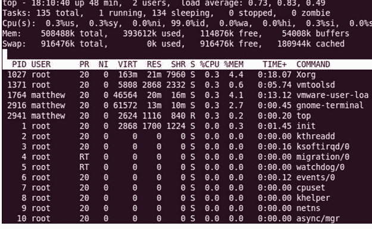

图 12.1 使用 top 命令监控和控制进程。

`top` 中的默认排序顺序控制着最 CPU 密集型的任务。第一个命令应该是你刚刚从另一个终端启动的 `yes` 进程，但应该还有很多进程。假设你想过滤掉所有其他用户并专注于正在运行的 `yes`。为此，按 `u` 并输入你运行 `yes` 时使用的用户名。按下回车后，`top` 会过滤掉非你运行的进程。

下一步是杀死 `yes` 命令的 PID，因此你需要理解每个重要字段：

+* PID——进程 ID
* User——进程所有者
* PR——优先级
* NI——nice 值（调度值）

## 176 第12 章 命令行大师课，第 2 部分

- Virt-虚拟内存大小，单位为 KB
- Res-常驻内存大小，单位为 KB
- Shr-共享内存大小，单位为 KB
- s-状态
- %CPU-CPU 占用率
- %Mem-内存占用率
- Time+-CPU 时间
- Command-正在运行的命令

除非你有特定问题，否则这些字段中的许多是通用的。在这种情况下，重要的字段是 PID、User、Niceness（优先级值）、%CPU、%Mem、Time+ 和 Command。进程的 Niceness 是指在与系统中所有其他资源进行比较时，分配给它的时间程度；19 是最低的，-20 是最高的。

解释了这些列后，你应该能够找到启动的错误进程的 PID；它通常是 PID 下方的第一个数字。现在输入 k，输入该 PID 并按回车。系统会提示你输入一个信号（即处理该进程的方式，默认提供 15）。信号 15（也称为 SIGTERM 或终止）是一种请求进程关闭的策略，所有没有完全失控的进程都应该对其做出响应。给几秒钟时间让它更新，希望 yes 命令可以执行。如果不行，你需要更强力一些：再次输入 k，输入 PID 并按回车。在提示输入信号时，输入 9 并按回车执行 SIGKILL，无论你喜不喜欢都将其“终止”。

你可以通过按 f 来选择字段。会出现一个新屏幕，列出所有字段，并带有你需要按的字母来切换它们的可见性。被选中的字段用星号标记，其表头如下：

- * A: PID = 进程 ID

如果你现在按一个键，屏幕将变为这样：

a: PID = 进程 ID

当你做出选择后，按回车键返回带有列选择的正常顶部视图。

你可以按 F 来选择你想要用于排序的字段。这与字段选择的功能相同，不同在于你一次只能选择一个字段。同样，在做出选择后按回车返回顶部，并使用新的排序进行更新。

如果你按 B，将启用文本加粗。这会将部分标题栏以及任何当前运行的程序（相对于睡眠状态的程序）加粗；如果你按 x，还可以启用对排序列表加粗。你可以使用 y 来切换运行中进程的加粗。

Telegram 频道 @netrain

## 限制资源使用和作业控制 177

最后一个尝试的命令是 `renice`，它允许你对进程进行 renice——或调整其 niceness 值。你需要输入进程的 PID，按回车，然后输入一个新的 niceness 值。记住，19 是最低的，-20 是最高的；任何小于 0 的值都被视为“高”，应该谨慎使用。

你可以将在这里学到的信息与第 16 章“系统监控工具”中的信息结合起来，获得对系统的更大控制力。

## 使用 nice 设置优先级

你可以为单个进程设置优先级，告诉内核限制或给予特定进程额外优先级。当多个并发进程请求的资源超过实际可用资源时，这种方法最有用，因为这通常是导致变慢和瓶颈的原因。高优先级进程比低优先级进程获得更多的 CPU 时间。

你可以在运行程序时通过在运行运行命令之前加上 `nice` 并分配一个决定优先级的值来设置优先级。默认情况下，所有进程的起始优先级均为 0（零）。nice 可以被设置为最大 -20（最高优先级）到最小 19（最低优先级）。只有 root 用户可以增加进程的优先级（设置负值），但任何用户都可以降低进程的优先级（正值）。

这里有一个示例，在本章早些时候使用的 `tar` 命令将其优先级设得非常低，因为 `tar` 可能会消耗大量资源，但通常不是你立即需要的。你可以运行之前的相同命令，但将 `nice` 设置为 19，以便允许你同时对系统执行其他事情：

```
matt@seymour:-$ sudo nice -n 19 tar czf compressedfilename.gz directory
```

如果一个进程已经在运行，你可以使用 `renice` 重置优先级（即对其进行“renice”操作）。要调整进程，首先使用 `top` 获取进程的 PID，然后使用 `-p PID`。在示例中，将 PID 20136 的优先级调整为 19 如下：

```
matt@seymour:-$ sudo renice -20 -p 20136
```

这个命令更灵活一点，因为它还允许对系统中属于特定用户或组的所有进程进行优先级调整。现在，`renice` 最常用于降低降低系统速度任务的优先级，但正如这些示例所示，它也可以用于提高紧急任务的优先级。在这里，我们首先给用户 `mysql` 的所有任务（使用 `-u username`）优先级 -20（记住是最高优先级？），然后给属于系统用户（使用 `-g group-name`）的所有任务优先级 -20：

```
matt@seymour:-$ sudo renice -20 -u mysql
matt@seymour:-$ sudo renice -20 -g website
```

Telegram 频道 @netrain

使用 `ionic` 命令，你可以调整磁盘访问的优先级，类似于 `nice` 和 `renice` 对 CPU 访问的优先级。区别在于优先级只有三类设置。最低优先级是 Idle (3)，它只在其他进程没有使用磁盘时允许该进程访问磁盘。Best Effort (2) 是默认值，内核根据其算法调度访问。最高优先级是 Real Time (1)，无论其他进程在运行什么，只要该进程需要，它就会获得磁盘的优先访问。Real Time 设置可能是危险的，因为它会导致进程丢失数据；这并不一定会发生，但你应该意识到这一点，并在设置任何 Real Time 之前可能需要花时间研究一下 `ionic` 页面。

将 `find` 与 `xargs` 一起使用是一个特殊情况。很多时候，人们使用管道配合参数也能达到同样的效果。例如，以下命令是完全相同的：

```
matthew@se:-$ ps aux --sort=cpu | grep -v whoami
matthew@se:-$ ps -N ux --sort=cpu
```

前者打印所有用户和进程并将其传给 `grep`，后者过滤掉所有包含 `whoami` 程序输出（在这种情况下为用户名）的行。因此，第一行打印其他用户运行的所有进程，并按 CPU 使用率排序。第二行没有为 `ps` 指定 `a` 参数，这使其只列出你的进程。它使用 `-N` 参数来反转这一点，并为你为你完成，无需 `grep`。

人们使用前者的原因通常是为了简单：许多人只知道每个命令的少数参数，因此他们将两个命令组合在一起，而不是正确地使用一个命令。除非该命令需要定期运行，否则这不是问题。事实上，第一行更好，因为你不需要去查阅手册页来确认 `ps -N` 的作用。

你可以组合任何命令来使用标准输入和输出格式。另一个例子是以下系列命令，用于验证命名软件软件包的安装情况（在本例中是搜索 FTP 相关的软件）：

```
matthew@se:-$ dpkg --get-selections | grep ftp | sort
ftp install
lftp install
```

在这里，`dpkg` 被告知列出已安装的包，`grep` 搜索任何包含 `ftp` 的行，而 `sort` 按字母顺序排序（这在这个两行的示例中并不至关重要，但如果你有大量结果，它非常有用）。

## 使用布尔运算符组合命令

如果你想在第一个命令成功完成后运行第二个命令，可以使用退出状态：`0` 表示真（成功），`1` 表示假（失败）。即使这些状态没有显示给用户，系统也会接收到这些状态。当你将 `&&` 算符添加到命令末尾时，它会读取退出状态，并在确认其值为 `0`（真）后才允许运行下一个命令。再次，这些字母代表着：

```
matthew@se:-$ i && k
```

你可以使用 `||` 执行相反的操作，它只有在第一个命令返回退出状态为 `1`（假）时才运行后续命令：

```
matthew@se:-$ m || n
```

## 按顺序运行单独命令

如果你想按顺序运行一组命令，但不想将一个命令的输出作为下一个命令的输入，可以使用 `;`。用分号（`;`）分隔命令会使系统将每个项目视为在前一个项目运行后在新建的一行中输入的。假设你有三个命令：`doctor`、`rose` 和 `tardis`。你可以使用此命令按顺序运行它们：

```
$ doctor ; rose ; tardis
```

注意，分号前后的空格是可选的，但它们确实让行看起来更易读。

## 进程替换

有时，一个或多个命令的输出正是你想要作为另一个命令输入的的内容。你可以使用输出重定向来实现此目的，通过使用进程替换，将一个或多个命令用 `()` 包围，并在每个命令前加上 `<`。当你这样做时，不要在 `<` 和左括号 `(` 之间插入空格。生成的命令看起来如下：

```
$ cat < ls -al
```

第一个示例与 `ls -al | cat` 相同。由于只涉及一个进程的输出，因此不值得学习额外的命令。

在下面的示例中，你将 `ls` 命令的输出作为 `diff` 命令的输入，以比较两个目录的内容：

```
$ diff <ls firstly> <ls seconddirectory>
```

这是因为你不需要等待文件被写入和读取；它节省了磁盘空间和节省了清理临时文件的时间。这样做的一个特别巧妙的优点是，bash 会自动运行作为输入的多个任务，这比使用重定向按顺序执行它们要快，例如：

```
$ ls firstly > file1.txt
$ ls seconddirectory > file2.txt
$ diff file1.txt file2.txt
```

## 并行执行作业

当你在终端发布命令时，它由 CPU（中央处理单元或进程）执行。常见的处理器包括 Intel 的 i3、i5、i7 和 Xeon 系列，以及 AMD 的 Ryzen 和 Epyc 系列。现代计算机拥有多个处理器（实际上通常称为“处理器核心”，每个核心都作为一个独立的进程运行）。这允许多个作业同时运行。为了利用多个处理器或核心而编写的程序通过将大任务分成块并将这些并行发送到多个处理器或核心，并发运行速度要快得多。

大多数终端命令（尚未）编写为利用多个处理器或核心。因此，当你执行命令时，通常命令只使用一个百分比的资源，即占用一个核心，直到任务完成。执行需要大量处理的任务可能需要很长时间。

`GNU parallel` 是一个在多个处理器、核心甚至连接的计算机之间并行执行作业的工具。作业可以是单个命令，甚至是脚本，只要它们是可执行文件或函数即可。该工具强大且复杂，值得专门出一本书。更多信息，请参阅 www.gnu/software/parallel/ 上的官方文档以及 www.gnu/software/parallel/parallel-tutorial.html 上的官方教程。

## 使用环境变量

登录时，默认会加载许多内存变量。这些变量被称为环境变量，可以用于提供有关环境的信息。环境变量被用于定制环境。以下列表包含了一些环境变量，以及它们用途的描述：

- PWD——提供工作目录的完整路径。
- USER——声明用户名。
- LANG——设置默认语言。
- SHELL——声明当前 shell 的名称和位置。
- PATH——设置执行文件的默认路径。
- TERM——设置使用的终端类型。

你可以通过 `echo $VARIABLE-NAME` 打印任何环境变量当前值，例如：

```
matthew@se:-$ echo $USER
matthew
```

每个 shell 都有自己的特性集和语言语法，以及一组独特的环境变量。你可以找到 bash 的默认设置，例如在 `/etc` 中，而 `/etc/skel` 中的内容在 `/home` 目录创建时会被复制到该目录。

你可以使用 `env` 或 `printenv` 命令来显示所有环境变量，如下：


```
matthew@se:~ $ env
ORBIT_SOCKETDIR=/tmp/orbit-matthew
SSH_AGENT_PID=1729
TERM=xterm
SHELL=/bin/bash
WINDOWID=71301
GNOME_KEYRING_CONTROL=/tmp/keyring
1677
GTK_MODULES=canberra-gtk-module
USER=matthew
SSH_AUTH_SOCK=/tmp/keyring-qFT/ssh
DEFAULTS_PATH=/usr/share/gconf/gnome.default.path
SESSION_MANAGER=local/seymour:/tmp/.ICE-unix/1695
USERNAME=matthew
XDG_CONFIG_DIRS=/etc/xdg/xdg-gnome
DESKTOP_SESSION=gnome
PATH=/usr/local/sbin:/usr/local/bin:/usr/sbin:/usr/bin:/sbin:/bin:/usr
PWD=/home/matthew
GDM_KEYBOARD_LAYOUT=us
LANG=en_US.utf
GNOME_KEYRING_PID=1677
MANDATORY_PATH=/usr/share/gconf/gnome.mandatory.path
GDM_LANG=en_US.utf8
GDMSESSION=gnome
HISTCONTROL=ignoreboth
SPEECH_PORT=7560
SHLVL=1
HOME=/home/matthew
LOGNAME=matthew
LESSOPEN=| /usr/bin/lessipe % $s
DISPLAY=:0.0
LESSLOSE=/usr/bin/lessipe % $s
XAUTHORITY=/var/run/gdm/auth-for-matthew-PzcGf
COLORTERM=gnome-terminal
OLDWP=/var/lib/mlocate
=/usr/bin
```

这个简化的列表显示了一些常见的变量，它们由配置或资源文件设置，而 `/etc` 和 `/etc/skel` 中包含的内容在 `/home` 目录创建时会被复制到该目录。你可以找到 `bash` 的默认设置，例如

`/etc/profile` 和 `/etc/bashrc` 以及 `/home` 目录下的 `.bashrc` 或 `.bash_profile` 文件。阅读 `bash` 的 `man` 页以获取有关使用这些配置文件的详细信息。

最重要的环境变量之一是 `$PATH`，它定义了可执行文件的位置。例如，如果你作为一个普通用户，尝试使用一个不在你的 `$PATH` 中的命令（例如一个虚构的命令 `command`），你会看到类似下面的内容：

```
matthew@seymour:-$ command
-bash: command not found
```

如果你尝试执行的命令在 Ubuntu 软件仓库中，但尚未安装在你的系统中，Ubuntu 会返回安装它的正确命令：

```
matthew@seymour:-$ command
```

程序 'command' 目前尚未安装。你可以通过输入以下命令来安装它：

```
sudo apt-get install command
```

然而，你可能知道该命令确实已经安装在你的系统上了，你可以使用 `where` 命令来验证它，如下所示：

```
matthew@seymour:-$ where command
command: /bin/command
```

你也可以通过输入该命令的完整路径或完整的目录规范来运行它，如下：

```
matthew@seymour:-$ sudo /bin/command
```

正如你在示例中看到的，`command` 命令确实已经安装了。默认情况下，`/bin` 目录不在你的 `$PATH` 中。导致此的原因之一是使用 `/bin` 目录的命令通常只供 root 使用。你可以通过编辑 `/home` 目录下的 `.bash_profile` 文件将 `/bin` 添加到你的 `$PATH` 中（如果你默认使用 `bash` shell，大多数 Linux 用户都是如此）。寻找以下行：

```
PATH=$PATH:$HOME/bin
```

然后你编辑此文件（可以使用本章后面提到的文本编辑器之一），以如下方式添加 `/bin` 目录：

```
PATH=$PATH:$HOME/bin
```

保存文件。下次登录时，`/bin` 目录就会在你的 `$PATH` 中。立即更改此的一种方法是使用 `bash` shell 的 `source` 命令读取 `.bash_profile` 中的新设置，如下所示：

```
matthew@seymour:-$ source .bash_profile
```

你可以直接运行位于 `/sbin` 目录下的命令，而不需要显式地输入完整路径。

某些 Linux 命令还使用环境变量来获取配置信息（例如通信程序会寻找类似于 `BAUD_RATE` 的变量，它可能表示默认速度）。

为了实验环境变量，你可以修改 `PS1` 变量来操作 shell 提示符的外观。如果你在使用 `bash`，可以使用内置的 `export` 命令来更改 shell 提示符。例如，假设你的默认 shell 提示符如下：

```
matthew@seymour:-$
```

你可以通过 `PS1` 变量更改它的外观，如下：

```
matthew@seymour:-$ PS1='$OSTYPE \u \w -> '
```

按下回车后，你会看到以下内容：

```
linux-gnu user@host ->
```

> 注意
>
> 查看 `bash` `man` 页了解其他可用于提示符设置的变量。

# 使用常用的文本编辑器

Linux 发行版包含许多名为文本编辑器应用程序，你可以使用它们创建文件或编辑系统配置文件。文本编辑器类似于文字处理程序，但通常功能较少，只处理文本文件，并且可能支持或不支持拼写检查或格式化。文本编辑器的功能和易用性各不相同，并存在于每个 Linux 发行版中。系统中安装的编辑器数量取决于你在系统上安装了哪些软件包。

最流行的基于控制台的文本编辑器包括：

- 全面的 **GNU emacs** 编辑环境，它远不仅仅是一个编辑器；请参见本章稍后的“使用 emacs”部分。
- **nano**——一个简单的文本编辑器，类似于经典的 `pico` 文本编辑器，后者包含在曾经盛行的 `pine` 邮件程序中。
- **vim**——`vi` 编辑器的改进兼容版本（在本章的其余部分，你可以称它为 `vi`，因为它有一个符号链接 `vi` 和一个符号链接的手册页）。

请注意，并非所有的文本编辑器都是面向屏幕的（这意味着它们被设计为从终端使用）。以下是一些设计为从图形桌面运行的文本编辑器，它们提供了带有菜单栏、按钮、滚动条等的图形化界面：

- **gedit**——用于 GNOME 的 GUI 编辑器，随 Ubuntu 默认安装。
- **kate**——一个简单的 KDE 文本编辑器。
- **kedit**——另一个简单的 KDE 文本编辑器。

学习如何使用文本编辑器（如 `vi` 或 `nano`）的一个很好的理由是，系统维护和恢复操作几乎不会在 GUI 会话期间进行，也不会使用 GUI 编辑器。当 Linux 引导到单用户模式或维护模式时，更大、更复杂且功能强大的编辑器将无法工作。如果你的系统发生任何故障，且你无法登录 GUI，那么使用命令行和文本编辑器的知识和经验将非常重要。务必打开一些编辑器并翻阅它们。你永远不知道；也许你今天就会感谢我。

在 Linux 控制台下学习如何使用基于文本的编辑器的另一个理由是，你可以通过远程 shell 编辑文本文件，因为许多服务器没有托管图形化桌面。

> 在你花时间熟悉非标准文本编辑器之前，请考虑这一点：这里讨论的所有三个编辑器都是容易获取且常见的。其中两个（`nano` 和 `vi`）是随处安装的。如果你使用非标准编辑器，请确保你对标准编辑器有基础知识。我们强烈建议使用 `nano`，但也欢迎尝试使用任何文本编辑器。

## 使用 nano

我们先讨论 `nano`，是因为它的学习曲线最简单。为了实验环境变量，你可以修改 `PS1` 变量来操作 shell 提示符的外观。可能 `nano` 是可用的。

你可以这样启动会话：

```
matthew@seymour~$ nano file.txt
```

当你首次启动 `nano` 时，你处于查看模式。你可以使用方向键或其他导航键滚动文本。要开始编辑，按下 `i` 键插入文本。当你完成后，使用 `Esc` 键切换插入模式并进入命令模式。要输入命令，按下冒号 `:`，然后跟上命令，例如 `w`。

尽管 `vi` 支持许多复杂的编辑操作和大量命令，但你可以可以使用命令完成工作。这些基础 `vi` 命令如下：

- 删除字符—`x`
- 删除行—`dd`
- 模式切换—`Esc`，插入 (`i`)
- 退出—`q`
- 不保存退出—`:q!`
- 运行 shell 命令—`:sh`（使用 `exit` 返回）
- 保存文件—`:w`
- 搜索——`:/`

> 使用 `vimutor` 命令快速学习如何使用 `vi`。该教程只需要30 分钟，它教新用户如何启动或停止编辑器：导航文件；插入和删除文本；执行搜索、替换和插入操作。

## 使用常用的文本编辑器

*emacs* 编辑器使用了大量的按键和命名命令，但你也可以通过基础命令子集与它协作。这些基础命令中的许多都需要你按住 `Ctrl` 键，或者先按下 *meta* 键（通常映射到 `Alt` 键）。基础 *emacs* 命令列出如下：

- 光标向左--`Ctrl+B`
- 光标向下--`Ctrl+N`
- 光标向右--`Ctrl+F`
- 光标向上--`Ctrl+P`
- 删除字符--`Ctrl+D`
- 删除行--`Ctrl+K`
- 到行首--`Ctrl+A`
- 到行尾--`Ctrl+E`
- 帮助--`Ctrl+H`
- 退出--`Ctrl+X, Ctrl+C`
- 另存为--`Ctrl+X, Ctrl+W`
- 保存文件--`Ctrl+X, Ctrl+R`
- 向后搜索--`Ctrl+R`
- 向前搜索--`Ctrl+S`
- 教程--`Ctrl+H, T`
- 撤销--`Ctrl+X, U`

学习如何使用 *emacs* 的最佳理由之一是，你可以使用几乎相同的按键在 *bash* shell 命令行上编辑命令，尽管可以将默认值改为 *vi*。它在几乎每个 UNIX 和 Linux 系统（包括 Apple 的 macOS）上都通用并安装。

## 使用 sed 和 awk

*sed* 是流编辑器（stream editor）的缩写，是一种用于对文本进行转换的命令。它从命令行运行，并通过标准输入和输出处理文本。它不会修改原始输入，除非你将输出重定向到文件，否则不会保存输出。它是最有用的方法，当是在命令之间使用管道时。

*awk* 是一种用于处理字符串的小型编程语言。它读取文本，按照你指定的任何方式进行转换，并输出转换后的文本。它的功能没有其他语言那么强大，但它所做的事情都既优雅又快速。

`sed` 和 `awk` 都从命令行运行。它们的内容非常丰富——远超一本长书中一个简短章节所能涵盖的内容——但你只需要几分钟就能学会每一个工具，并发现它们很有用。如果你想继续学习它们，可以在网上找到非常好的资源，比如 Dale Dougherty 和 Arnold Robbins 编写的、名副其实的书*sed & awk*。

21 世纪进入该行业的人很少使用 `sed` 和 `awk`，但深受那些花时间学习它们的人喜爱。在本书的这个版本中，我们仅简短的介绍和几个示例——显然不足以真正学会大量地使用它们。如果大家有很大兴趣，我们可能会在未来的版本中将其抽离并扩展成独立的章节。

你可以像这样配合命令一起使用 `sed`：

```
mathew@seymour:- sed sedcommand inputfile
mathew@seymour:- sed e sedcommand inputfile
mathew@seymour:- sed e anothersedcommand inputfile
```

第二个示例与第一个示例的作用相同，区别在于它特地指定了要运行的命令。当只有一个命令时，这是可选的，但当你像第三个示例那样想要运行其他命令时，它是很有用的。

假设你想将文本文件 `transportation.txt` 中所有的 `camel` 替换为 `dune buggy`。以下是操作方法：

```
mathew@seymour:- sed e '/s/camel/dune buggy/' transportation.txt
```

`s` 代表替换（substitution）。它被标记包围，以防止与字符串中的空格或其他字符混淆。后面跟着 `/`（斜杠），它是用于分隔命令不同部分的边界符。接下来是匹配的模式，然后是它将被替换的内容。最后，字母 `g` 表示在文本文件中 `camel` 出现的地方都进行替换。

你可以根据文件中的行号处理文本。如果你想删除名为 `long.txt` 文件中的第 4 到 17 行，你可以这样做：

```
mathew@seymour:- sed e '4,17d' long.txt
```

用于 `sed` 命令的字符通常是显而易见的，例如此例中的 `d` 代表删除（delete）。你可以使用正则表达式进行替换和删除。你可以在脚本中使用 `sed` 并将命令链在一起。

`awk` 最常见的用法是处理由分隔符分隔的字段的文件，例如从电子表格程序生成的逗号分隔值 (CSV) 输出，或者为程序变量分配默认值的配置文件。

你定义了 `awk` 将要查找的分隔符，它会为行中的每项内容分配一个 `awk` 变量。也就是说，如果你在一个文件中使用一组参数和值，其中每个参数都列出，并跟着一个等号作为分隔符，然后是一个值，那么你就在命令中为 `awk` 定义了这一点，参数就会被赋值，例如作为 `$1`，而值将作为 `$2`。

大多数文件包含不仅仅是参数和值的列表。如果你有一个逗号分隔的文件，其中包含你桌上物品的名称、每个物品的类别、颜色以及你取每个物品对应的日期，会怎样？如果你有四列：名称、类别、颜色和日期。如果你真的很在意名称和日期，你可以使用 `awk` 快速处理文件并像这样列出：

```
matthew@seymour:~$ awk -F',' '{print $1, "last picked up on," $4}' stuff.txt
```

输出将显示在屏幕上（但可以重定向到文件），并且将只包含你想要的信息列表。在前述命令中，`-F` 定义了分隔符，它被放在 `[` 之中。你可以使用 `{ }` 来定义多个分隔符，像这样：`-F]`。你可以查看 `awk` 的输出，就像运行一个 shell 脚本一样。

## 处理压缩文件

另一种文件管理操作是文件的压缩和解压缩。Linux 发行版通常包含了你可以用于创建、列出文件的压缩工具。这些命令包括：

- `bunzip2`—解压缩文件
- `bzip2`—压缩文件和目录
- `gunzip`—解压缩文件
- `gzip`—压缩文件和目录
- `tar`—创建、扩展或列出压缩或未压缩存档的内容

大多数这些命令都易于使用。然而，最常用的 `tar` 命令有一套相当复杂的命令行选项。例如，要创建一个目录的存档，使用 `czf` 选项：结果是一个压缩存档（以 `.tgz` 结尾的文件）。为前面的选项添加 `v` 可以查看压缩期间添加的文件列表。

```
seour tar cvf compressedfilename.tgz directory
```

要列出压缩存档的内容，将 `c` 选项替换为字母 `t`，像这样。然而，如果存档有很多文件，更好的调用方式（以便轻松阅读或滚动输出）是：

```
seour-$ tar tzf archive | less
```

要扩展压缩存档的内容，使用 `tar` 的 `zxf` 选项如下：

```
tar-$ zxf archive
```

`tar` 工具解压缩指定的存档并将内容提取到当前目录。

## 使用 byobu 使用多个终端

许多 Linux 老兵一直很喜欢 `GNU screen` 命令，它的设计是为了让你能够从多个会话轻松控制一个终端（更多信息请见 www.gnu/software/screen/）。虽然 `screen` 一直以来是一个非常有用的工具，但你应该考虑 `byobu`，它是 `screen` 的增强版本。Byobu 是日语中“屏风”的词，指的是作为房间隔断的多面板屏风。

## 使用 byobu 使用多个终端 193

学习 `byobu` 的最佳方法就是亲自尝试。所以，打开一个终端，输入 `byobu` 然后按回车。你的显示器会闪烁一下，取而代之的是一个新的终端，底部面板中显示有新信息。现在对该终端做些操作：运行 `top` 并暂时让它运行。按下 `F2`。你的提示符会再次清除，让你能够运行其他命令。运行 `uptime` 命令。

随堂测试：那个正在运行 `top` 的旧终端发生了什么？当然，它仍在运行。你可以按 `F3` 回到那里。按 `F4` 回到你的终端。当你查看其他终端时，其他终端中的命令会在后台正常运行，因此你可以进行多任务操作。以下是 `byobu` 的一些基本命令：

- `F2`—创建一个新窗口
- `F3`—跳转到上一个窗口
- `F4`—跳转到下一个窗口
- `F9`—打开 `byobu` 菜单用于帮助和配置

要关闭 `byobu` 内的终端，只需正常注销即可，例如使用 `exit` 或 `Ctrl+D`。当你退出 `byobu` 中打开的最后一个会话时，程序将关闭并回到你最初启动 `byobu` 的普通终端界面。

然而，退出 `byobu` 会话还有两种替代方案：锁定和断开。第一种通过 `F12` 激活，会锁定对屏幕数据的访问，直到你输入系统密码。

第二种是 `screen` 最强大的功能，在 `byobu` 中同样运行完美：你可以退出并去处理其他事情，稍后重新连接；`screen` 和 `byobu` 允许你从离开的地方继续。例如，你可以在桌边打字，断开会话并回家，仿佛一切没有变化一样继续。而且，你从 `screen` 或 `byobu` 运行的所有程序在 `screen` 或 `byobu` 断开时会继续运行。如果有人在终端窗口处于锁定状态（使用 `Ctrl+A+X`）时关闭它，系统会自动为你断开。


要断开连接，按 `F6`。你将回到启动 `screen` 或 `byobu` 的提示符，可以继续操作已打开的终端，甚至完全注销。当你想要重新连接时，使用命令 `screen -r` 或 `byobu -r`。在此期间，你只需运行 `screen` 或 `byobu` 开启新会话而不恢复之前的会话，但如果你看重自己的会话，就不该这样做。你可以根据需要多次断开并连接同一个会话，这可能意味着你需要再次丢失会话。

尽管这只是 `byobu` 和 `screen` 功能的一小部分，但希望你能看到它们有多么有用。可以查看它们的帮助页（`man` pages）以获取更多信息。也可以在 https://byobu.co 和 https://help.ubuntu.com/community/Byobu 找到 `byobu` 文档。

## 使用 REISUB 进行礼性系统重置

有时计算机系统会死机。我们指的不是某个程序运行异常导致程序冻结而其他一切都正常的情况。在那种情况下，你可以使用 `kill` 来终止程序并继续，正如本章前面的“使用 top 打印资源使用情况”部分所述，或者如第16 章那样使用 `kill` 命令。我们讨论的是死机失效的情况：任何键盘或其他输入都没有响应，甚至连 `Ctrl+Alt+Del` 组合也无效。最糟糕的情况是进行电源循环（`power cycle`），这是“关掉再重启”的一种高级说法。问题是，电源循环可能会导致数据丢失，因为它可能会损坏文件系统。这并非总是发生，但这种风险足够大，除非绝对必要，否则你应该避免执行电源循环。相反，你可以尝试使用 `REISUB`。

> 注意：在使用 `REISUB` 功能之前，必须先启用它。当 `/proc/sys/kernel/sysrq` 的值设置为 `1` 时，该功能可用。你必须在遇到问题之前启用它，`REISUB` 才能生效。

要检查此变量的当前值，请运行：

```
matthew@sysmour:$ cat /proc/sys/kernel/sysrq
```

要更改值，通过编辑 `/etc/sysctl.conf` 文件，删除文件中行前的 `#` 号来取消注释并保存为 `kernel.sysrq=1`。然后运行：

```
matthew@sysmour:$ sysctl -p /etc/sysctl.conf
```

Linux 内核有一组内置在内核级别的快捷键命令。这些命令使用按键的名称来引用，`SysRq` 键命令直接发送到内核，绕过运行在内核之上的任何程序，包括你的窗口管理器以及可能已冻结任何内容。要使用这些命令，按下 `SysRq+Alt` 加上另一个键。这里我们关注人们最常用的六个键；你可以在 www.kernel.org/doc/latest/admin-guide/sysrq.html 找到可用命令列表。

`REISUB` 是一个作为助记工具的缩写，帮助用户记住在尝试在不损坏文件系统的情况下重启死机系统时最佳使用的 Magic SysRq 键序列。你应该遵循 `SysRq+Alt`，并按顺序按下 `R`、`E`、`I`、`S`、`U`、`B` 键。这会执行此处列出的系列操作，其中字母对应的命令大大写：

- `unRaw`—从 X 服务器处夺回键盘的控制权
- `terminate`—向所有进程发送 `SIGTERM`
- `interrupt`—向所有进程发送 `SIGKILL`
- `sync`—将数据刷新磁盘
- `unmount`—将所有文件系统卸载为只读
- `boot`—重启计算机

尽管这只是 `byobu` 和 `screen` 功能的一小部分，但希望你能看到它们有多么有用。可以查看它们的帮助页以获取更多信息。也可以在 https://byobu.co 和 https://help.ubuntu.com/community/Byobu 找到 `byobu` 文档。

## 修复无法启动的系统

### 检查 BIOS

### 检查 GRUB

### 使用恢复模式

### 重装 Ubuntu

### 重装 GRUB

## 12 命令行大师，第2部分

## 技巧与技巧

这一部分是一些实用的命令行小技巧，它们并不适合放在其他类别中，但值得分享。请享用。

### 运行上一个命令

你可以使用方向键和回车键运行上一个命令。你也可以使用：`!!`（被称为 "bang bang!"）来运行。这在你输入了错误的命令但需要加上 `sudo` 前缀时特别有用，如下所示：

```
matthew@sysmour:$ apt-get update
E: Could not open lock file /var/lib/apt/lists/lock - open (13: Permission denied)
```

Telegram 频道 @nettrain

E: Unable to lock directory /var/lib/apt/lists/

E: Could not open file /var/lib/dpkg/lock - open (13: Permission denied)

E: Unable to lock the administration directory (/var/lib/dpkg/), are you root?

matthew@seymour:-$ sudo !!
```

这运行了 `sudo apt-get update`。

### 运行之前的任何命令

你发现了一个非常巧妙的技巧并运行了它，但现在想不起来了。这很让人沮丧。你知道可以使用向上和向下箭头键搜索命令历史来找到它，但 `last-ran` 是在在本周早些时候运行的，你不确定该记录还能持续多久。没担心，你可以搜索你的命令历史。

在命令行按 `Ctrl+R` 开始所谓的“反向搜索”（reverse-i search）并开始输入。你输入的任何内容都会与之前运行过的命令进行匹配，所以，如果你知道它是一个很酷的管道命令组合，中间有 `sort`，就开始输入 "`sort`" ，并看着历史记录中显示的命令逐出来。当你找到它时，按回车键运行它。

### 运行以特定字母开头的之前的命令

假设你正在列出一个几层深目录的内容，而你大约在九个命令之前运行了它，但你不想滚动屏幕。没问题。使用 `!`（感叹号）和构成该命令或其开头的字母，如下所示：

```
matthew@seymour:-$ !ls
```

这会运行最近一次的以 `ls` 开头的命令。

### 运行与之前运行的第一个单词不同的命令

假设你刚刚使用 `ls` 列出了一个文件，并已确认它存在。现在你想用 `nano` 编辑该文件。使用 `!*`（感叹号星号）：

```
matthew@seymour:-$ ls stuff/article.txt
article.txt
matthew@seymour:-$ nano !*
```

### 查看历史记录及更多

默认情况下，你运行过的前 1000 条命令保存在 `/home` 目录下的一个名为 `.bash_history` 的文件中。你可以编辑这个文件。你可以删除这个文件。你可以通过编辑 `/home` 目录下的 `.bashrc` 文件中的这一行，将历史记录中保存的命令数量更改为你任何想要的值：

```
HISTSIZE=1000
```

### 执行两个或多个任务

你有几种方法可以在一行内执行两个或多个任务。

用分号 `;` 分隔命令会导致该命令在第一个命令完成后执行，无论第一个命令的结果如何。这里是一个示例：

```
matthew@semourn:$ command1 ; command2
```

如果你希望只有在第一个命令无错误结束的情况下才运行命令，请使用 `&&`（两个和符号）：

```
matthew@semourn:$ command1 && command2
```

如果你只想在第一个命令失败时运行第二个命令，请使用 `||`（两个管道）：

```
matthew@semourn:$ command1 || command2
```

### 使用快捷键

我们在输入命令时都会犯输入错误。当你发现某行长文本中有错误时，在按下回车键之前，只需使用退格键逐个字符地删除整行。这里有更快的方法。

- `Ctrl+U`—删除整行
- `Ctrl+W`—逐单词删除
- 左键和右箭头键—沿行移动到错误所在位置
- `Ctrl+E`—将光标移动到行尾
- `Ctrl+K`—删除光标位置右侧的所有内容
- `Ctrl+Y`—恢复刚刚删除但本应保留的内容

### 将脚本限制在目录中

有时你想将一个进程与系统的其余部分隔离开，例如当你想要测试你编写的脚本时，同时也为了确保脚本只影响你想要它影响的部分而不影响其他。通过担心一个你编写的命令，如下所示：

```
matthew@seymour:-$
```

你可以创建一个被称为 `chroot` 的环境。实际上，你可以通过编辑 `/home` 目录下的 `.bashrc` 文件中的这一行更改你任何想要的值：

```
matthew@seymour:-$ chroot /tmp/test
```

当你输入以下：

```
matthew@seymour:-$ ls /
```

当你输入以下：

```
matthew@seymour:-$ chroot /tmp/test-root
```

当你输入以下：

```
matthew@seymour:-$ ls /
```

最后两个字段显示了 `/home` 目录的位置（通常为 `/home/username`）以及用户的默认 shell（对于新用户，默认是 `/bin/bash`）。此外还有一个名为 `GECOS` 的字段，它是一个用逗号分隔的列表，用于记录账户或用户的信息；通常在使用此字段时，它会记录用户的全名和联系信息。

## 注意事项

尽管密码（`Password`）字段中包含一个 `X`，但这并不意味着你在这里看到的内容是实际密码。所有密码都以加密格式存储在 `/etc/shadow` 中，以确保安全。每当需要密码时，Ubuntu 都会自动引用此文件。你稍后可以在在本章节的“影子密码（Shadow Passwords）”部分中了解更多信息。

遵循 UNIX 风格操作系统的长期传统，Ubuntu 使用了成熟的 UNIX 所有权和权限系统。首先，该系统中的一切都被视为一个文件，所有文件（可以包括目录和设备）都可以分配一个或多个读取、写入和执行权限。这三个“标记”也可以根据需要分配给三类类别中的每一个：文件的所有者、组组成员或系统中的其他人。根据这些权限和文件所有权（也称为超级用户）驱动的文件系统，你的责任是有效管理这些设置，并确保用户拥有适当的 `UID` 和 `GID`。重要的是，系统管理员可以使用这些文件权限将敏感文件锁定，防止没有访问权限的用户查看。

### 超级用户/Root 用户

无论系统有多少个系统管理员，只能有一个超级用户账户。超级用户账户通常被称为 `root` 用户，对系统的所有方面拥有完全且彻底的控制权。该账户可以访问系统的任何部分；读取、更改或删除任何文件；授予文件和目录的访问权限；在系统上执行任何操作并将其破坏。`root` 用户的特殊之处在于它的 `UID` 为 `0`，`GID` 也为 `0`。

由于 `root` 用户对系统拥有最高权力，因此一直以 `root` 身份工作是非常重要的，因为你可能会无意中给系统造成严重破坏，甚至可能使其完全无法使用。相反，仅在需要需要 `root` 权限的更改时以 `root` 身份工作。完成该工作后，你可以切换回普通用户账户继续工作。

在 Ubuntu 中，你使用 `sudo` 命令以 `root` 或超级用户权限执行命令：

```bash
mathew@seymour:-$ sudo apt-get update
```

系统会提示你输入密码，输入时屏幕上不会显示。输入密码后，Ubuntu 将执行该命令（在此更新可用软件的信息），就像你以 `root` 身份运行它一样。

### ROOT 用户

如果你用过其他的 Linux 发行版，可能会对 `sudo` 命令的使用感到困惑，因为并不是所有的发行版都使用它。简而言之，Ubuntu 允许系统上的第一个用户使用 `sudo` 命令获取 `root` 权限。它还禁用了 `root` 账户，因此实际上无人可以使用 `root` 用户名登录。

在其他 Linux 发行版中，你通过发布命令 `su -` 并在提示时输入 `root` 密码来切换到 `root` 用户。这让你处于 `root` 提示符下，显示为井号 (`#`)。从这里，你可以执行任何命令。要在 Ubuntu 中获取 `root` 提示符，你需要执行命令 `sudo -`，在输入密码后，即可获得 `root` 提示符。

### 用户账户

如果你用过其他的 Linux 发行版，可能会对 `sudo` 命令的使用感到困惑，因为并不是所有的发行版都使用它。简而言之，Ubuntu 允许系统上的第一个用户使用 `sudo` 命令获取 `root` 权限。它还禁用了 `root` 账户，因此实际上无人可以使用 `root` 用户名登录。

在其他 Linux 发行版中，你通过发布命令 `su -` 并在提示时输入 `root` 密码来切换到 `root` 用户。这让你处于 `root` 提示符下，显示为井号 (`#`)。从这里，你可以执行任何命令。要在 Ubuntu 中获取 `root` 提示符，你需要执行命令 `sudo -`，在输入密码后，即可获得 `root` 提示符。

## 注意

由于 `root` 用户对系统拥有最高权力，因此一直以 `root` 身份工作是非常重要的，因为你可能会无意中给系统造成严重破坏，甚至可能使其完全无法使用。相反，仅在需要需要 `root` 权限的更改时以 `root` 身份工作。完成该工作后，你可以切换回普通用户账户继续工作。

`root` 用户的特殊之处在于它的 `UID` 为 `0`，`GID` 也为 `0`。

第三类用户是系统用户。系统用户不是人类，而是系统用于服务的账户。例如，系统用户 `www-data` 拥有服务器。

以 `root` 身份工作时发生灾难性错误的风险很大，我们无法强调谨慎的重要性。

## 第 13 章管理用户

你可以在 `/etc/passwd` 中找到系统中的用户列表。

你可以在 `/etc/passwd` 中找到系统中的用户列表。

### 用户 ID 和组 ID

计算机本质上是一台面向数字的机器。它通过数字来识别用户和组：用户 ID (`UID`) 和组 ID (`GID`)。

如前所述，`root UID` 为 `0`。`1` 到 `499` 以及 `65534` 是系统用户，有时称为本地用户或伪用户。普通用户的 `UID` 从 `1000` 开始；Ubuntu 按顺序分配它们。

除了少数例外外，`GID` 与 `UID` 相同。Ubuntu 为每个大于 `1000` 的 `UID` 创建私有的 `GID`。系统管理员可以向组添加用户，也可以创建一个新组并添加用户。

### 文件权限

三种权限：读取、写入和执行（`r`、`w`、`x`）。对于任何文件或目录，权限分配给三个类别：用户、组和其他。本节重点关注组权限。首先，我想突出三个用于更改文件或目录组、用户或访问权限的命令：

- `chgrp`：更改文件或目录的组所有
- `chown`：更改文件或目录的所有者
- `chmod`：更改文件或目录的访问权限

你可以使用这些命令在你的 Ubuntu 系统中重现真实的组织结构和权限（参见“管理组”章节）。例如，人力资源部门可以通过使文件在可访问目录中可读（但不可写），向所有员工共享备忘录。公司研发部门的程序员可以相互访问彼此的源代码文件，但对人力资源的薪资或人事文件没有读取或写入权限——也不希望人力资源部窥探研发。

这些命令用于从命令行方便地管理组、文件所有权和权限。掌握这些命令至关重要，因为在某些时候你可能只有命令行界面可以工作。

## 用户刻板印象

与许多其他职业一样，用户和系统管理员也出现了一些夸大的刻板印象。许多刻板印象包含真实的元素，并夹杂着大量的夸张和幽默，以帮助我们理解这些刻板印象主体之间的特征差异。`luser`（愚蠢用户）和 `BOFH`（分别是对用户和管理员的不良友善称呼）的刻板印象作为警示案例，描述了计算社区中哪些行为是可接受的，哪些是不可接受的。

理解这些刻板印象可以让你更好地定义系统管理员、用户及其他人的适当与不适当角色。你可以在 Wikipedia 上找到这些术语的描述：https://en.wikipedia.org/wiki/Luser 和 https://en.wikipedia.org/wiki/BOFH。

## 管理组

组可以使用户管理变得简单得多。你不再为每个用户分配单独的权限，而是可以使用组来快速方便地向大量用户授予或撤销权限。设置组权限允许你为协作工作设置工作区，并控制可以使用哪些设备（例如外部驱动器或 DVD 刻录机）。这种方法代表了一种安全的方法，可以将资源访问权限限制仅需要它们的人。例如，系统管理员可以将用户 `matthew`、`ryan`、`sandra`、`debra` 和 `mark` 放入一个名为 `unleashed` 的新组中。这些用户可以创建供小组工作的文件，并将这些文件的组通过 `chgrp` 设置为 `unleashed`。


现在，`unleashed` 组中的每个人都可以访问这些文件——但其他人都不行。系统管理员可能会创建一个由该组拥有的目录，以便其成员能够有一个易于访问的地方来存储这些文件。系统管理员可以将 `chris` 和 `shannon` 等其他用户添加到组，并在他们完成工作后移除用户。系统管理员可以将用户 `matthew` 设为组管理员，这样 `matthew` 就可以决定如何更改组成员身份。你还可以对 DVD 刻录机进行限制，使得只有 `matthew` 可以刻录 DVD，从而保护敏感材料不落入他人手中。

# 组列出

不同的操作系统以各种方式实现“组”的概念。Ubuntu 使用一种称为 UPG（用户私有组）的方案，默认情况下，每个用户都被分配到一个与其名字同名的组。所有组都列在 `/etc/group` 文件中。

这是 `/etc/group` 文件的部分示例：

```
matthew@seymour-$ cat /etc/group
root:x:0:
daemon:x:1:
```

```
bin:x:2:
sys:x:3:
adm:x:4:mathew
tty:x:5:
disk:x:6:
mail:x:8:
news:x:9:
fax:x:21:mathew
voice:x:22:
cdrom:x:24:mathew
floppy:x:25:mathew
tape:x:26:mathew
www-data:x:133:
crontab:x:107:
ssh:x:109:
admin:x:115:mathew
saned:x:116:
gdm:x:119:
mathew:x:1000:
tp:x:122:
```

在这个示例中，你看到了许多组，大部分用于服务（邮件、新闻等）和设备（磁盘等）。如前所述，系统组允许这些服务拥有其文件文件的所有权和控制权。例如，将 Postfix 添加到 `mail` 组允许 Postfix 应用程序访问邮件文件，以便邮件可以决定组对文件的访问权限。将普通用户添加到设备组中，允许该普通用户根据组所有者授予的权限使用该设备。将用户 `matthew` 添加到 `cdrom` 组，允许 `matthew` 使用光驱设备。你即将在下一节中学习如何从组中添加或删除用户。

## 查找你的组

你可以使用 `groups` 命令查找你的用户账户所属的组，如下：

```
matthew@seymour:-$ groups
matthew adm cdrom sudo audio dip plugdev lpadmin sambashare
```

在命令后添加用户名可以列出该用户所属组。

## 组管理工具

Ubuntu 提供了几个用于管理组的命令行工具，同时也提供了用于此目的图形化工具。大多数丰富的系统管理员倾向于使用命令行，因为它们快速且易用、始终可用（即使在没有图形用户界面的情况下），并且可以包含在系统管理员可能用于执行重复任务的脚本中。

以下是最常用的组管理命令行工具：

- `groupadd`—此命令创建并添加新组。
- `groupdel`—此命令删除现有组。
- `groupmod`—此命令创建组名或 GID，但不会从组中添加或删除成员。
- `grouppasswd`—此命令创建组密码。每个组都可以有一个组密码并由一个管理员管理。使用 `-G` 参数将用户指定为组管理员。
- `useradd -G`—`-G` 参数在初始创建用户时将用户添加到组。（使用更多参数来创建用户）
- `usermod -G`—此命令允许你将用户添加到组，前提是该用户此时未登录。
- `groupck`—此命令检查 `/etc/group` 文件中是否存在拼写错误。

假设你计算机上的 DVD-RW 设备 `/dev/scd0` 系统管理员想让一个名为 `ryan` 的用户拥有访问权限。以下是授予 `ryan` 权限的流程：

1. 添加新组：

```
sudo groupadd dvdrw
```

2. 更改所有者：

```
sudo chgrp dvdrw /dev/scd0
```

3. 将用户添加到：

```
sudo usermod -G dvdrw ryan
```

4. 设置组密码：

```
sudo gpasswd dvdrw
```

现在 `ryan` 拥有该设备的权限。

# 管理用户

与组一样，Ubuntu 提供了几个用于管理用户的命令行工具，同时也提供了用于此目的图形化工具。大多数丰富的系统管理员倾向于使用命令行，因为它们快速且易用、始终可用（即使在没有图形用户界面的情况下），并且可以包含在系统管理员可能用于执行重复任务的脚本中。这里是管理用户的命令：

- `useradd`—此命令创建新用户。
- `userdel`—此命令删除现有用户。
- `usermod`—此命令修改用户账户。
- `passwd`—此命令设置或更改用户密码。

默认文件位于 `/etc/skel`。填充新主目录的文件集保存在 `/etc/skel` 中。这对于系统管理员非常方便，因为任何需要应用的特殊文件、链接或目录都可以放在 `/etc/skel` 中，并为每个用户复制具有相应的权限。

查看 `/etc/skel` 的内容：

```
matthewsour:$ ls -la /etc/skel
```

```
drwx-xr-x 2 root root 4096 2010-04-25 12:14 . 
drwx-xr-x 154 root root 12288 2010-07-01 16:30 .. 
-rw-r--r-- 1 root root 220 2010-09-13 22:08 .bash_logout
-rw-r--r-- 1 root root 3103 2010-04-18 19:15 .bashrc
-rw-r--r-- 1 root root 179 2010-03-26 05:31 examples.desktop
-rw-r--r-- 1 root root 675 2009-09-13 22:08 .profile
```

每行提供文件权限、该文件或目录的链接数、所有者、文件组、文件大小、创建日期以及文件名。你可以看到，这里的每个都属于 `root`。`useradd` 命令将 `/etc/skel` 中的所有内容复制到新主目录，并将文件所有权和权限重置为新用户。某些用户文件可能存在且系统管理员不希望用户更改；`/home/username` 下这些文件的权限可以重置，使得户户可以读取但无法写入。

## 管理用户

`deluser`—命令用于删除用户账户（通过删除该用户的家目录及其包含的所有文件）。该命令有一个旧版本名为 `userdel`，我们在书之前的章节中讨论过。我们倾向于使用 `deluser`，因为它对要删除的内容提供了更细粒度的控制。`userdel` 会自动删除账户以及所有用户文件（作为关联的家目录），而 `deluser` 只删除用户账户，除非你使用命令选项告诉它执行删除。`deluser` 包含了许多选项，如 `--remove-home`、`--remove-all-files`、`--backup` 等。更多信息请参阅帮助页（man page）。

`passwd`—此命令用于更新密码系统使用的身份验证令牌。

提示

要锁定某个用户的账户，请使用以下命令：

```
matthew@seymour:~$ sudo passwd -l username
```

这会在用户的加密密码前添加一个 `!`（感叹号，也称为 bang）；反转该过程的命令使用 `-u` 。

`usermod`—此命令更改多个属性。最常用的参数是 `-s` 更改 shell 和 `-u` 更改 UID。在用户登录或运行进程时无法进行任何更改。

`chsh`—此命令更改用户的默认 shell。对于 Ubuntu ，默认 shell 是 `/bin/bash`，被称为 Bash 或 Bourne Again Shell。

### 添加新用户

使用命令行添加用户非常简单，可以在一行内完成。在示例中，系统管理员使用 `useradd` 命令添加新用户 `sandra`：

```
matthew@seymour:~$ sudo useradd sandra -p c00kieZ4ME -u 1042
```

`adder` 命令（Unix 系统中找到的变体）与 `useradd` 相似且功能相同。此示例使用 `-p` 选项设置请求的密码，并使用 `-u` 选项指定其 UID。（如果你使用默认设置创建用户，则不需要使用这些选项。）如你所见，这一切都可以在一行完成。

系统管理员可以使用 Ubuntu 提供的图形界面来添加与上述命令相同的账户，但可用选项较少：

- 1. 从桌面右上角的菜单中，选择类似齿轮的“设置”图标（见图 13.1）。在“设置”应用程序中，从左下角选择“用户”（见图 13.2）。
- 2. 点击右上角的“解锁”，并输入密码以授权对用户账户进行更改。
- 3. 点击右上角“解锁”位置的“添加用户”，打开“添加账户”窗口。
- 4. 在表单中填写新用户名和所需的用户名，选择现在设置密码还是让新用户在首次登录时创建密码，并指定新用户是标准用户还是管理员，然后点击“添加”（见图 13.3）。

图 13.1 打开右上角的菜单找到“设置”图标。

图 13.2 选择“用户”。

图 13.3 添加新用户非常简单。GUI 提供了一系列分布在多个屏幕上的用户管理选项。

> 注意

Linux 用户名可以是任意字母数字组合，不能以 shell 脚本的特殊字符开头（主要是空格和标点符号；请参阅第 14 章“自动化任务与 Shell 脚本编写”以获取不允许的字符）。用户名通常是用户的名字加上姓的首字母，或者是用户名的首字母加上整个姓名。这些是有许多用户的大型系统的常见做法，因为这让系统管理员的工作更简单，但这两种惯例都不是规则或要求。

### 监控系统上的用户活动

监控用户活动是系统管理员职责的一部分，也是跟踪系统资源使用情况的重要任务。`w` 命令告诉管理员谁正在登录、登录在哪里以及正在做什么。没有人能躲过超级用户。`w` 命令后可以接特定的用户名以仅显示该用户。

`ac` 命令提供用户总连接时间的信息（以小时为单位）。它访问 `/var/log/wtmp` 文件获取信息。`ac` 命令在 shell 脚本中最有用，用于生成操作系统使用报告供管理层审查。要使用 `ac` 命令，你必须从 Ubuntu 仓库安装 `acct` 包。

有趣的是，可能会发生被称为“时间扭曲”的现象，即 `wtmp` 文件中的条目跳回过去，而 `ac` 显示用户占用了异常的时间。这也可以归因于与系统时钟的一些无害因素，值得系统管理员调查，因为它也可能是安全泄露的结果。

`last` 命令搜索 `/var/log/wtmp` 文件并列出自该文件创建以来所有登录和退出的用户。`last reboot` 可以让你知道自上次重启以来谁登录过。`last` 的伴侣命令是 `lastb`，它显示所有失败或无效的登录。这对于判断合法用户是否遇到问题或黑客正尝试访问很有用。

计算机上的计数系统跟踪用户使用统计数据，并保留在当前的 `/var/log/wtmp` 文件中。该文件由 `systemd` 进程管理。如果你想探索计数系统的详细信息，请使用 GNU info 系统：`accounting`。

### 管理密码

密码是 Linux 安全不可或缺的一部分，也是用户可见度最高的部分。在本节中，你将学习如何为你的系统建立最小密码策略、密码存储在哪里以及如何管理用户的密码。

#### 系统密码策略

有效的密码策略是良好系统管理的基础。策略应涵盖：

- 允许的密码
- 强制更改密码的频率
- 丢失或忘记密码的检索或替换
- 用户对密码的处理

#### 密码文件

密码文件是 `/etc/passwd`，它是用户可见最高的部分……（注：此处原文存在大量重复句子，翻译已按要求处理，以下是 `/etc/passwd` 内容内容）

密码文件是 `/etc/passwd`，它是用户可见最高的部分。密码文件是 `/etc/passwd`，它是用户可见最高的部分。密码文件是 `/etc/passwd`，

```
- root:x:0:0:root:/bin/bash
- bin:x:2:2:bin:/bin/sh
- sys:x:3:3:sys:/dev/bin
- games:x:5:6:games:/usr/games
- man:x:6:12:man:/var/cache/man
- mail:x:8:8:mail:/var/mail
- news:x:9:9:news:/var/spool/news
- uucp:x:10:10:uucp:/var/spool/uucp
- www-data:x:33:33:www-data:/var/www
```

## 第13 章 管理用户

请注意，密码字段没有显示密码，而是包含一个 X。这是因为它们是影子密码（shadow passwords），这是 Linux 一项非常有安全增强。

#### 影子密码

将密码存储在 `/etc/passwd` 中被认为存在安全风险，因为任何具有读取权限的人都可以对该文件运行破解程序并而而易举获取密码。为了避免这种风险，使用了影子密码，使得 `/etc/passwd` 的密码字段中仅显示 X；影子密码存储在 `/etc/shadow` 中，该文件仅供系统管理员（PAM，即可插拔认证模块）读取；有关 PAM 的解释，请参阅本章节后部分的“详解 PAM”侧边栏。

必须使用传统密码和登录程序的特殊版本才能启用影子密码。影子密码在安装 Ubuntu 时会自动启用。查看以下 `/etc/passwd` 辅助文件 `/etc/shadow` 的简略列表：

```
mathewsymour:$ sudo cat /etc/shadow
root*:14547:0:99999::
daemon*:14544:0:99999::
bin*:14544:0:99999::
sys*:14544:0:99999::
games*:14544:0:99999::
man*:14544:0:99999::
mail*:14544:0:99999::
www-data*:14544:0:99999::
irc*:14544:0:99999::
nobody*:14544:0:99999::
liuid*:14544:0:99999::
syslog*:14544:0:99999::
messagebus*:14544:0:99999::
kernops*:14544:0:99999::
gdm*:14544:0:99999::
mathew:$S6vWtML.nv4$:IsWept9tcGkJIM4uL5sGTUGvPrSJON2W7/t//JvBrWqOySEEDvXsA/skSEL
QsfmnEPJXrVr321/Ir70:14564:0:99999::
shhd*:14547:0:99999::
tp*:14548:0:99999::
usbmux*:14724:0:99999::
pulse*:14725:0:99999
```

这些字段由冒号分隔，按顺序如下：

- 用户的登录名称。
- 用户的加密密码。
- 上次更改发生的日期，以自 1970 年 1 月 1 日以来的天数计算。此日期在 UNIX 世界中被称为纪元（epoch）。
- 密码可以更改前需要经过的天数（防止更改密码后立即改回旧密码——这是一种危险的安全做法）。
- 密码后必须更改的天数。可以通过此设置来强制更改系统管理员已知的新发放密码。
- 密码过期前，用户用户即将过期的提醒天数。
- 密码过期后账户被禁用的天数（出于安全考虑）。
- 与密码更改日期类似，但它是自 1970 年 1 月 1 日以来账户被禁用的天数。
- 一个“预留”字段，目前未分配给任何用途。

请注意，Ubuntu 默认禁用了密码过期日期和警告功能。这些功能在家庭级系统中并不常用，通常即使在小型办公室也不使用。如果需要密码策略，则由系统管理员负责建立并强制执行。

`/etc/shadow` 文件的权限应设置为普通用户不可写且不可读：权限应为 `600`。

#### 详解 PAM

可插拔认证模块（PAM）是一套处理计算机认证任务的库系统。它使用四个管理组：账户管理、认证管理、密码管理和会话管理。这允许系统管理员选择应用程序将如何认证用户。Ubuntu 已经为你预装并预配置了所有必要的 PAM 文件。Ubuntu 中的配置文件位于 `/etc/pam.d`。这些每个文件都根据其控制的内容命名，使用以下格式：

```
type control module-path-arguments
```

`type` 字段是规则对应的管理组。`control` 字段告诉 PAM 如果认证失败该做什么。最后两项涉及使用的 PAM 模块及其在 `/etc/pam.d` 目录下的参数。为了获得更高的安全性，系统管理员可以修改默认条目。配置错误可能会导致不可预测的结果，因此在修改配置文件之前请备份。Ubuntu 提供的默认值对于家庭和小办公室用户来说足够了。

接下来显示包含上述格式条目的 PAM 配置文件示例。以下是 `/etc/pam.d/common-auth` 的内容：

```
account required pam_unix.so
auth required pam_unix.so
password requisite pam_unix.so nullok
session required pam_unix.so
```

## 第 13 章 管理用户

当你使用 `su` 变为超级用户 `root` 时，这一点最为明显。如果不附加 `-`，你将不会继承包含 `/bin /sbin` 的路径，因此当你使用 `su` 切换到 `root` 时，必须输入命令的完整路径。

不要忘记，标准的 Ubuntu 系统中，第一个创建的用户被归类为 `root`，而真正的 `root` 账户是被禁用的。要启用 `root` 账户，你需要在命令行输入 `sudo passwd` 命令，并输入你的密码以及新的 `root` 密码。完成后，你就可以 `su` 切换到 `root` 了。我们建议你在操作之前阅读 https://help.ubuntu.com/community/RootSudo 上的信息，以确保你理解为什么 `root` 账户默认是不启用的。


由于几乎所有的 Linux 系统安全都围绕着文件权限展开，因此偶尔使用具有访问其他用户或组所属文件权限的不同用户（例如，在使用调制解调器时访问通信端口 `/dev/tty0`，或在玩游戏时访问音频设备 `/dev/audio`）可能会很有帮助。你可以使用 `su` 命令切换到另一个用户身份并切换。

`su` 会产生一个新的 shell，更改现有用户的 UID 和 GID，并自动更改与之相关的环境变量（即继承环境变量）。有关环境变量的更多信息，请参阅第 6 章“生产力应用”。

`su` 的语法如下：

```
matthew@seymour:-$ su username arguments
```

`su` 页面提供了更多详细信息，但 `su` 命令的一些亮点如下：

```
-c, --command
使用 -c 向 shell 传递单个 COMMAND

-m, --preserve-environment
不重置环境变量

-1
为被替换的用户进行完整的登录模拟，
与指定短横线 (-) 相同
```

你可以通过不同的方式调用 `su` 命令，产生不同的结果。通过单独使用 `su`，你可以成为 root，但保留你的普通用户环境。这可以通过在更改后使用 `printenv` 命令来验证。注意，工作目录（你可以在命令行执行 `pwd` 来打印当前目录）并没有改变。通过执行以下命令，你成为 root 并继承 root 的环境：

```
matthew@seymour:-$ su -
```

通过执行以下命令，你成为该用户并继承超级用户的环境——这是一个非常方便的工具。（记住：继承环境源于在命令中使用短横线；省略它，你就会保留“旧”环境。）要成为另一个用户，请在命令行上指定不同的用户名：

```
matthew@seymour:-$ su other_user
```

当要离开某个身份返回你的用户身份时，请使用 `exit` 命令。例如，当普通用户身份登录时，使用以下命令：

```
matthew@seymour:-$ su root
```

系统提示输入密码：

Password:

当输入正确的密码后，会出现 root 用户的提示符：

```
root@#
```

要返回普通用户身份，只需输入以下内容：

```
root@# exit
```

这将带你回到普通用户的提示符：

```
matthew@seymour:-$
```

如果你需要允许其他用户以 root 权限访问某些命令，必须给他们 root 账户的密码（通常称为 root 密码），这显然不是一个安全的解决方案。下一节将描述一种更灵活、安全的方法，允许普通用户执行选定的 root 任务，这也是 Ubuntu 中共享和使用超级用户权限的首选方法。

> 注意
>
> `su` 命令通常被认为是不好的，因为它的意图有些模糊。一方面，它本应该打开一个新会话并更改多个执行参数，同时继承其发布时所在会话的参数。它给了你一个新的执行 shell，但这并不等同于完整的登录。systemd 添加了一个新命令 `machinectl shell`，根据其创建者的说法，旨在“正确地”实现这一点。由于 systemd 包含在第 15 章“启动过程”中，该命令也涵盖在内。

## 偶尔授予 Root 权限：sudo 命令

委派 root 在系统上拥有的权限通常是必要的。对于大型系统来说，这是合理的，因为没有某个人能随时执行超级用户功能。问题是 UNIX 权限是全有全无的。引入 `sudo`，该应用程序允许分配一个或所有仅限 root 的系统命令。

> 注意
>
> 如前所述，`sudo` 命令在 Ubuntu 中无处不在，因为它是默认使用的。如果你想获得一个 root shell，就不需要输入 `sudo -i` 来获取 root 提示符。要返回普通用户提示符，输入 `exit` 并按回车。这有点危险，因为如果你不留神并忘记退出 root，可能会对系统造成严重破坏。通常选择其中一种方法并保持一致更好，Ubuntu 社区始终使用并推荐对每条命令使用 `sudo`，即使这很乏味，因为它是一个很好的提醒，让你思考自己正在做什么。

配置好后，`sudo` 非常简单。授权用户在需要 sudo 用户权限的命令前加加上 `sudo`，如下所示：

```
matthew@seymour:-$ sudo command
```

当输入命令时，`sudo` 会检查 `/etc/sudoers` 文件查看该用户是否有权使用 `sudo` 权限；如果是，则 `sudo` 将获得一段时间的授权。用户会被提示输入密码（以维护问责制并提供某种保障）。

下一节将描述一种更灵活、安全的方法，允许普通用户执行选定的 root 任务，这也是 Ubuntu 中共享和使用超级用户权限的首选方法。

## 为普通用户授予系统管理员权限

sudoers 行的基本格式如下：

```
user host_computer=command
```

`user` 可以是单个用户，也可以是一个组（用 `%` 标识组）。`host_computer` 通常对于网络上的主机为 `ALL`，对于本地机器为 `localhost`，但也可以引用子网或任何特定主机。机器中的 `command` 是 `ALL`、特定命令列表，或对特定命令的限制（通过在命令前加上 `:` 实现）。sudoers 行有许多可用选项，可以使用别名（aliases）来简化权限的分配。再次，sudoers 管理细节，但让我们来看几个例子。

假设你想让用户 `john` 跨网络获得通过图形界面添加用户的权限。你会添加以下行：

```
john ALL=(users-admin)
```

或者你可能只想在用户的本地计算机上授予权限：

```
john 192.168.1.87=(/usr/bin/users-admin)
```

如果你想让编辑器组在范围内无需密码即可删除文件：

```
%editors ALL=NOPASSWD: /bin/rm
```

如果你想让每个用户在本地无需密码即可挂载光驱器，可以这样操作：

```
ALL localhost=NOPASSWD: /sbin/mount /dev/scd0 /mnt/cdrom /sbin/umount /mnt/cdrom
```

在构建 sudoers 文件中使用通配符也是可能的。别名也是如此，以便更容易定义用户和组。sudoers 的主页面包含一些示例，并且 `www.komar.org/pres/sudo/toc.html` 提供了关于大型公司中使用 sudo 的说明笔记和注释。`www.sudo.ws` 的 sudo 主页也是获取额外解释和示例的有用资源。

以下命令将向用户展示他们有权执行的命令列表：

```
matthew@semour:-$ sudo -l
```

## 磁盘配额 Disk Quotas

在拥有许多用户的大型系统中，你通常需要控制用户可以使用磁盘空间量。磁盘配额专门为此目的而设计。配额按分区管理，可以为单个用户和组设置配额；组的配额可能不会比组内个人配额的总和大。

> 注意
>
> 在家用系统中，磁盘管理并不真的有用或需要，而且在小型办公系统中也极少需要。在两种情况下，你都不太可能看到或实现这一功能。

要管理磁盘配额，你必须在系统中安装 `quota` 和 `quotool` 软件包。Ubuntu 的配额管理默认未启用，传统上由系统管理员手动启用和配置。系统管理员使用一系列配额命令，例如使用 `quotacheck` 初始化配额数据库文件，使用 `edquota` 设置和编辑用户配额，使用 `setquota` 配置磁盘配额，以及使用 `quota` 或 `quotoff` 控制服务。（其他工具 `warnquota` 用于向超过磁盘使用量限制的用户自动发送警告）。

## 实现配额 Implementing Quotas

即使在 Ubuntu 系统上安装了配额软件，配额默认也是禁用的。当安装并启用配额时，你可以查看哪些分区具有用户配额或组配额，或者查看 `/etc/fstab` 文件中的第四字段。例如，`/etc/fstab` 显示 `/home` 分区启用了配额：

```
/dev/hda5 /home ext3 defaults,usrquota,grpquota 1 1
```

启用配额的分区根将包含 `quota.user` 或 `group.group` 文件（如果同时启用了两种类型的配额，则两者都有），存储实际配额。这些文件的权限为 600，以便用户无法读取或写入它们（否则，用户将更改它们为他们的音乐文件和网络收藏留出足够的空间）。要初始化配额，必须重新挂载分区。通过以下操作完成：

```
matthew@semour:-$ sudo mount -o,remount partition_to_be_remount mount_point
```

底层的控制台工具（都有 man 手页）如下：

## 手动配置配额 Manually Configuring Quotas

手动配置配额涉及更改系统文件系统表 `/etc/fstab` 中的条目，以便在文件系统的指定部分添加 `usquota` 挂载选项。例如，在一个简单文件系统中，你可以像这样启用配额管理：

```
LABEL=/ / ext3 defaults,usquota 1 1
```

你还可以使用 `grpquota` 选项启用组级配额。作为创建用户配额示例中的根操作员，你必须在文件系统的指定分区创建一个名为 `quota.user` 的文件，如下：

```
matthew@seymour=$ sudo touch /quota.user
```

然后你应该使用 `quotaon` 命令开启配额的使用：

```
matthew@seymour=$ sudo quotaon -av
```

你可以使用 `edquota` 命令编辑用户配额，以对文件系统使用设置硬限制和软限制。当编辑用户配额时，会启动默认系统编辑器（除非更改了 `EDITOR` 环境变量，否则为 `vi`）。

用户可以通过以下命令查看他们的配额：

```
matthew@seymour=$ quota -v
```

> 注意
>
> Ubuntu 不支持任何允许你配置磁盘配额的图形化工具。Quota mini-HOWTO 维护在 `http://www.tldp.org/HOWTO/Quota.html`。

## 相关 Ubuntu 命令 Related Ubuntu Commands

你使用这些命令在 Ubuntu 中管理用户账户：

- -ac—提供用户账户统计信息

- change—设置或修改用户密码过期策略

- chfn—在 `/etc/passwd` 中创建或修改用户指（finger）信息

- chgrp—修改组组成

- chmod—更改文件权限

- chown—更改文件所有者

- chpasswd—批量修改用户密码

- chsh—修改用户的 shell

- groups—显示现有的组组成

- logname—显示用户的登录名

- newusers—批量用户管理命令

- password—创建或修改用户密码

- su—以另一个用户的身份执行 shell 或命令

- sudo—管理选定用户的执行权限

- useradd—创建、修改或管理用户

- usermod—编辑用户的登录配置

## 参考文献 References

- `https://tldp.org/HOWTO/User-Authentication-HOWTO/`—一份描述用户和组信息如何存储和用于认证的 HOWTO。

- `https://tldp.org/HOWTO/Shadow-Password-HOWTO.html`—一份深入研究影子密码（shadow passwords）深奥领域并讨论为什么你可能不想使用它们的 HOWTO。

- `https://tldp.org/HOWTO/Quota.html`—关于管理磁盘配额的 HOWTO。

- `https://www.kernel.org/pub/linux/doc/latest/pluggable/pam.html`—可插拔认证模块（PAM）文档。

# 使用 at 和 batch 安排以后执行的任务

如果你想运行一个耗时较的任务，但不想在登录期间运行它，可以使用 `at` 命令告诉 Ubuntu 稍后运行（你必须先安装该命令）。包名与工具名相同：`at`。使用 `at` 时，你需要告诉它希望运行任务的时间，然后按回车键。你会看到一个以 `at>` 开头的新提示符，在你按下 Ctrl+D 之前输入的所有内容都将作为执行的命令。

当指定的时间到达时，`at` 会逐个按顺序执行每个操作，这意味着后面的命令可以依赖于先前的命令的结果。在下面的示例中，假设在晚上 8 点运行 `at`，它被用于在网络空闲时下载并提取最新的 Linux 内核：

```bash
$ at now + 7 hours
at wget http://www.kernel.org/pub/linux/kernel/v3.0/linux-3.0.tar.bz2
tar xvfjp linux-3.0.tar.bz2
<EOT>
```

指定 `now + 7 hours` 的效果符合预期：`at` 是在早上 8:00 运行的，所以命令将在凌晨 3:00 之后运行。

如果你有一个更复杂的任务，可以使用 `-f` 参数从文件中读取命令，如下：

```bash
echo wget http://www.kernel.org/pub/linux/kernel/v3.0/linux-3.0.tar.bz2;
tar xvfjp linux-3.0.tar.bz2 > myjob.out
at -f myjob.out tomorrow
```

如你所见，它对时间的选择非常灵活；你可以通过三种方式指定时间：

- 使用 `now` 参数，可以指定相对于当前时间的若干月、小时、天或周。例如，`now + 4 weeks` 将在今天四周后运行命令。

- 你也可以指定特殊时间，包括 `tomorrow`（明天）、`midnight`（午夜）、`noon`（中午）或 `teatime`（下午4:00）。如果你没有在 `tomorrow` 后指定具体时间，你的任务将被设定在当前时间精确 24 小时后执行。

- 你可以使用 `HH:MM MM/DD/YY` 格式指定精确的日期和时间（例如，`16:40 22/12/20` 表示 2020年12月22日下午4:00）。

当你提交任务时，系统会报告任务号、任务执行的日期和时间、队列标识符以及任务所有者（它还会捕获你所有的环境变量并与任务一起存储，当任务运行时可以恢复这些变量，从而保留你的执行环境）。

任务号和任务队列标识符非常重要。当你使用 `at` 调度任务时，它会被默认放入队列中，这意味着它会在你指定的时间运行并占用正常的资源。

另一个替代命令 `batch` 实际上只是一个调用 `at` 并带有额外选项的 shell 脚本。这些选项（例如 `-q b m now`，如果你感兴趣的话）设置 `at` 在队列 `b` 上运行（`-q`）、向用户发送邮件（`-m`）并立即运行（`now`）。队列部分是关键：调度在队列 `b` 的任务只有在系统负载低于 0.8 时才会执行——即当系统没有以满负荷运行时。此外，这些任务的优先级值（niceness）较低，通常一个队列的优先级值为 2，而队列 `b` 的优先级值为 4。

由于 `batch` 总是将 `now` 指定为时间，因此你不需要指定自己的时间；任务将在系统启动后立即运行。默认优先级值为 4 意味着 `batch` 命令获得的系统资源比队列（`at` 的默认值）少，也比运行其他程序时获得的系统资源少。你可以选择性地通过 `at` 指定其他队列。队列 `c` 在优先级为 6 时运行，队列 `d` 在优先级为 8 时运行，以此此类推。需要注意的是，系统只会在命令运行前检查系统负载。如果负载低于 0.8，你的 `batch` 任务将继续运行（尽管是在后台），并遵循其优先级值。

当你提交一个执行任务时，系统也会返回返回一个任务号。如果你忘记了这个号码，或者只想查看你安排在以后运行的任务列表，请使用不带参数的 `atq` 命令。如果你以普通用户运行，它会打印你的任务；以超级用户身份运行则会打印所有人的任务。输出格式与你提交任务时相同，你可以获得每个任务的 ID 号、执行时间、队列 ID 和所有者。

如果你想删除任务，使用 `atm` 命令后接要删除的任务 ID 号。接下来的示例展示了如何使用 `atq` 和 `atm` 列出任务并删除一个：

```bash
mathew@seymour:-$ atq
14 2012-01-20 23:33 a matlab
16 2012-02-03 22:34 a matlab
17 2012-01-25 22:34 a matlab
15 2012-01-22 04:34 a matlab
18 2012-01-22 01:35 b matlab
mathew@seymour:-$ atm 16
mathew@seymour:-$ atq
14 2012-01-20 23:33 a matlab
17 2012-01-25 22:34 a matlab
15 2012-01-22 04:34 a matlab
18 2012-01-22 01:35 b matlab
```

在这个示例中，任务 16 使用 `atm` 删除了，并且在 `atq` 中不再显示。

# 调度任务

`at` 和 `batch` 的默认配置允许所有人使用，这并不是预期的行为。访问权限通过两个文件控制：`/etc/at.allow` 和 `/etc/at.deny`。默认情况下，`at.deny` 是空的，允许所有人使用 `at` 和 `batch`。你可以在 `at.deny` 中输入用户名（每行一个）来阻止这些用户调度。或者，你可以使用 `at.allow`；它默认不存在。如果你有一个空的 `at.allow`，则 root 之外无人可以调度。在 `at.allow` 中添加用户名（每行一个），这些用户就可以调度任务。当有人尝试运行 `at` 或 `batch` 时，系统检查 `at.allow` 中的用户名。如果在其中，或者 `at.allow` 不存在，系统会检查 `at.deny` 中的用户名。如果用户名在 `at.deny` 中，或者 `at.deny` 不存在，则不允许调度。

# 使用 Cron 运行任务


如果你只想在以后执行单个任务，`at` 和 `batch` 命令有效，但如果你想反复运行任务，它们就不合适。相反，`cron` 守护进程用于根据系统和用户的请求运行任务。`cron.deny` 文件列出的用户不允许使用 `cron`，而 `cron.allow` 列出的用户可以使用。空的 `cron.deny` 文件意味着所有人都可以设置任务。任务有两种：系统任务和用户任务。只有 root 可以编辑系统任务，而任何出现在 `cron.allow` 中或不在 `cron.deny` 中的用户都可以运行用户任务。系统任务通过 `/etc/crontab` 文件控制，其默认如下：

```bash
SHELL=/bin/sh
PATH=/usr/local/bin:/usr/local/bin:/bin:/sbin:/bin

# m h dom user command
17 * * * root run-parts /etc/cron.hourly
25 6 * * * root run-parts /sbin/anacron /etc/cron.daily
47 6 * * * root run-parts /sbin/anacron /etc/cron.weekly
52 6 1 * * root run-parts /sbin/anacron /etc/cron.monthly
```

前两行指定了执行任务时使用的 shell（默认是拥有 crontab 文件的用户，通常是 `/bin/bash`）以及使用的可执行文件路径。在该路径中使用环境变量很重要，因为当任务运行时这些变量可能未被设置。下一行以井号（`#`）开头，被视为注释并忽略。接下来的四行是重要部分：它们本身就是任务。

# 第14 章 任务自动化与 shell 脚本

每个任务由七个字段指定，定义了运行时间、所有者和命令。前五个字段以一种特殊的顺序指定执行时间：分钟（0–59）、小时（0–23）、日期（1–31）、月份（1–12）和星期（0–7）。对于星期，0 和 7 是周日，这意味着 1 是周一，3 是周三，以此此类推。如果你想指定“所有值”（即每分钟、每小时、每天等），请使用星号 `*`。

下一个字段指定任务所有者的用户名。当任务执行时，它将使用指定的用户名。最后一个字段是要执行的命令。

因此，第一个任务在每天每小时的 17 分运行，并执行命令 `run-parts /etc/cron.hourly`。`run-parts` 命令是一个简单的脚本，运行目录下的所有程序（在本例中为 `/etc/cron.hourly`）。因此，在这种情况下，任务将在 00:17（午夜 17 分）、01:17、03:17 等时间与 `cron.hourly` 中列出的所有程序运行。

下一个任务在每天的凌晨 6 点 25 分运行，运行 `run-parts /etc/cron.daily`。由于小时的限制，该脚本每天运行一次，即在早上 6:25。注意它比 17 分多了 25 分，以避免与每小时的任务冲突。你应该能够通过查看它们使用的命令来猜出后续任务的作用。

这四个目录 `cron.hourly`、`cron.daily`、`cron.weekly` 和 `cron.monthly` 中的每一个都包含一组由 `run-parts` 运行的 shell 脚本。例如，`cron daily` 包含如 `logrotate`（处理日志文件备份）和 `makewhat`（更新数据库）之类的脚本。如果你愿意，可以向这些脚本添加其他系统脚本，但要确保你的脚本是正确的。

> 注意

`cron` 守护进程每分钟读取一次所有系统 crontab 和 cron 文件（分钟在 6:00:00、6:01:00 等）以检查更改。然而，任何新任务在至少流过 1 分钟后才会执行。例如，如果现在是 6:01:49（即早上 6:00 之后 49 秒），而你设置一个 cron 任务在 6:02 运行，它不会执行。在 6:02，`cron` 守护进程会重新读取配置文件并看到新任务，此时它可以执行该任务。如果你将任务设定为每天早上 6:02 运行，它将在第二天及之后的早晨执行。

这种情况在删除任务时也存在。如果现在是 6:01:49，且你有一个安排在 6:02 运行的任务，没有任何区别：`cron` 会重新读取 crontab 文件检查更改。然而，在它读取 crontab 文件并发现该任务不再存在后，它在后续日期中将不再执行。

指定日期还有其他方法。例如，你可以通过连字符或逗号使用日期和时间的集合；例如，小时 9–15 将在 9、10、 11、 12、 13、 14 和 15 执行（从早上 9 点到下午 3 点），而 9, 11, 15 则会跳过偶数小时。注意，重要的是不要在这些集合中放入空格，因为 `cron` 守护进程将空格解释为字段分隔符。你可以使用斜杠定义一个步长值

`/` 用于显示时间划分；例如，`*/4` 表示“每 4 小时一次，全天”，而 `0-12/3` 表示“从午夜到中午每 3 小时一次”。你可以使用三个字母的缩写来指定日期和月份名称：星期使用 Sun, Mon, Tue, Fri；月份使用 Jan, Feb, Mar, Oct, Nov, Dec。

除了系统作业外，还有针对拥有正确权限的用户作业。用户作业存储在 `/var/spool/cron` 目录下，每个用户都有一个以自己名字命名的文件（例如，`/var/spool/cron/philip` 或 `/var/spool/cron/root`）。这些文件包含用户想要运行的任务，其格式与 `/etc/crontab` 文件相似，不同之处在于不需要指定任务的所有者，因为文件名始终是相同的。

要编辑你的 crontab 文件，请输入 `crontab -e`。默认编辑器是 `vim`，也通过它的旧名 `vi` 知晓，但你可以设置 `EDITOR` 环境变量来更改它。这种格式与主 crontab 文件的格式略有不同，因为在这种情况下不需要指定任务的所有者，因为它始终属于你。

因此，每行由六个字段组成：分钟 (0-59)、小时 (0-23)、日期 (1-31)、月份 (1-12)、星期 (0-7) 以及要运行的命令。如果你正在使用 `vim` 且是新手，请按 `i` 进入插入模式以编辑文本；然后按 `Esc` 退出插入模式。要保存并退出，输入冒号后跟 `wq` 并按回车。

在编程时，我们倾向于在主目录中使用沙箱目录，在其中存放各种各种尝试过的临时文件。我们可以使用个人作业在每天早上 6:00 编辑每个目录，以便每个早晨都有新的开始。这在我们的 crontab 文件中看起来如下：

```
0 6 * * * -rf /home/matthew/sandbox/*
```

如果你不被允许调度任务，系统将阻止你编辑 crontab 文件。

任务放置后，你可以使用命令 `crontab -l` 列出你的任务。这只会打印你的 crontab 文件的内容，因此输出与你输入的行相同。

如果你只想删除一个任务，最简单的方法是 `crontab -e` 在 `vim` 中编辑你的 crontab 文件；然后将光标移动到想要删除的任务上，按 `dd` 删除该行。如果你想删除所有任务，可以使用 `crontab -r` 删除你的 crontab 文件。

阅读该页面以获取更多关于 `cron` 的信息。

# 使用 rclock 自动从睡眠中唤醒计算机

我们中有些人习惯让电脑 24/7 运行。也许你不需要醒来操作，而是需要系统在每天的特定时间运行，但你保证自己能够准时打开它。可以使用 `rtcwake` 将计算机置于睡眠或挂起模式，而不是关闭后再唤醒计算机。要这样做，你必须拥有 sudo 权限。以下是一个示例：

`matthew@semour:-$ sudo rtcwake -m mem -s 3600`

此命令告诉计算机挂起到 RAM 或睡眠，这意味着将计算机的当前状态保存到内存中并关闭其他所有，然后在 3600 秒（即一小时）后唤醒计算机。

该命令的基本语法如下：

`sudo rtcwake -m [挂起类型] -s [秒数]`

与 m 配合使用的五种挂起类型有：

- `disk` (休眠)：将计算机的当前状态写入磁盘，并关闭电源。
- `mem` (睡眠)：将计算机的当前状态写入 RAM，并将计算机处于低功耗状态，仅使用保持内存保存所需的电力。
- `no`：计算机不会立即挂起。仅设置唤醒时间。这允许你继续工作；你必须记住手动将计算机置于睡眠状态。
- `off`：计算机完全关闭。此设置对所有人来说唤醒可能无效，且未获得官方支持，但在某些计算机上可行。将其包含在此处是为了给喜欢冒险的人准备的。
- `standby` (待机)：计算机进入待机模式，与正常运行相比节省一些电力，但没有其他选项节省得那么多。这是默认设置，如果省略了 `-m`，则将使用此模式。

设置唤醒时间可以通过更多一种方法：

- 如前所示，你可以使用 `-s`，它指定了唤醒前的秒数。
- 你也可以使用 `-t`，它允许你设置一个特定的唤醒时间，格式为自 UNIX 时间开始以来的秒数（1970 年 1 月 1 日 00:00:00 UTC）。`date` 命令可以帮助找到这个数字，这是 UNIX/Linux 世界中执行时间相关任务的常用方法。你可以这样做：`sudo rtcwake -m -t $(date +'tomorrow 06:30')`

查看 `rtcwake` 和 `date` 的 man pages 以获取帮助和更多选项。

这里有几个入门技巧：

- RTC 字母代表“实时时钟”（real-time clock），指的是 BIOS 中设置并由主板保持运行的硬件时钟。

## Shell 模式匹配支持

Shell 命令行允许你使用特殊构造的模式字符串进行通配符匹配。这与 `grep` 等 GNU 工具所支持的功能不同，也更简单，后者可以使用更复杂的模式（称为表达式）来搜索文件和目录，或者过滤命令输入或输出的数据。

Shell 的模式字符串可以是简单的，也可以是复杂的，但即使只使用通配符中可用字符的一个小子集，也能在命令行产生建设性的结果。用于模式匹配的常用字符包括以下：

- `*` 匹配任意字符。例如，要找到当前目录下所有以 .txt 结尾的文件，你可以这样用：

```
matthew@semour:~$ ls *.txt
```

- `?` 匹配单个字符。例如，要找到当前目录下所有以扩展名 .d?c 结尾的文件（其中 ? 可以是 0-9、a-z 或 A-Z），你可以使用以下命令：

```
matthew@semour:-$ ls *.d?c
```

- `[xxx]` 匹配字符范围。例如，要列出目录中名称包含数字的所有文件，你可以使用：

```
matthew@semour:-$ ls *-[0-9]*
```

- `\` 匹配或转义字符，如 ? 或制表符。例如，要创建一个包含问号名称的文件，你可以使用：

```
matthew@semour-$ touch foo\?
```

注意，Shell 对字符或正则表达式的处理方式可能与 Linux 命令不同，且在脚本中混合使用通配符和正则表达式可能会导致问题，除非你非常小心。在文本中查找模式的最好方法是配合 `grep` 等命令使用正则表达式；简单的通配符则用于在命令行中过滤或匹配文件名。Linux 命令和 Shell 脚本都将反斜线视为模式中的转义字符，而美元符号 (`$`) 有两个截然不同的含义（在表达式中表示单字符模式匹配，在脚本中表示赋值）。

警告

在使用通配符时务必仔细检查你的命令；一个常见的错误是输入类似 `rm -rf * .txt` 的命令，在 `*` 和 `.txt` 之间留了空格。当你疑惑为什么命令运行这么久时，Bash 已经删除了你大部分的文件。问题在于，它会将 `*` 和 `.txt` 分开处理。`*` 会匹配所有内容，因此 Bash 会删除你所有的文件。

## 重定向输入和输出

你可以通过进程输入和输出重定向，在命令行创建、覆盖和向文件追加数据。Shell 识别几个用于此过程的特殊字符，如 `<`、`>`、`>>`。在此示例中，`ls` 命令的输出被重定向创建一个名为 textfiles.listing 的文件：

```
matthew@semour:-$ ls *.txt >textfiles.listing
```

使用输出重定向时要小心，因为它可能会覆盖现有文件。例如，指定不同的目录但使用相同的文件名会覆盖现有的 textfiles.listing：

```
matthew@semour:-$ ls /user/share/doc/mutt-1/*.txt >textfiles.listing
```

幸运的是，大多数 Shell 都足够聪明，能够识别你何时可能做了蠢事。在这里，Shell 警告你命令正尝试将输出重定向到目录：

```
matthew@semour:-$ mkdir foo
matthew@semour:-$ ls >foo
bash: foo is a directory
```

可以使用追加运算符 `>>` 将输出追加到文件中而不覆盖现有内容。在此示例中，目录列表被追加到 textfiles.listing 的末尾，而不是覆盖其内容：

```
matthew@semour:-$ ls /user/share/doc/mutt-1/*.txt >>textfiles.listing
```

你可以使用输入重定向 `<` 这样向命令提供数据：

```
matthew@semour:-$ cat < textfiles.listing
```

你可以使用 here 运算符 `<<` 来指定 Shell 命令的输入结束标记：

```
matthew@semour:-$ cat simple_script <<DONE
echo "this is a simple script"
DONE
matthew@semour:-$ cat simple_script
echo "this is a simple script"
```

在此示例中，Shell 会不断向你正在输入的 cat 命令（输入），直到识别到模式 `DONE` 为止。输出文件 simple_script 被保存并验证了其内容。你可以在脚本中使用这种技术，根据各种命令的输出创建内容，并定义输入结束符或分隔符。

## 数据管道

许多 Linux 命令可以在单个连接的命令行中协作使用，将数据从一种格式转换为另一种。以这种方式串联 Linux 命令被称为使用或创建管道（pipes）。管道在命令行中通过竖线运算符 `(|)` 创建。例如，你可以使用管道从单条命令行执行复杂的任务，如下：

```
matthew@semour:~$ find /d2 -name '*.txt' -print | xargs cat | \
tr ' ' '\n' | sort | uniq output.txt
```

此示例获取 `find` 命令的输出，通过 `xargs` 为 `cat` 命令提供 `/d2` 目录下所有文本文件的文件名。`tr` 命令将数据流中的每个空格更改为换行符。然后对单词流进行排序，并使用 `uniq` 命令移除相邻的相同行。输出（一个原始单词列表）随后被存在名为 `output` 的文件中。

## 后台处理

Shell 允许通过在命令行末尾使用连接符 `&` 启动命令并将其作为后台进程运行。这种技术在命令行中很常用。例如，使用 `&` 启动一个后台运行的进程：

```
matthew@semour:-~$ xterm &
```

Shell 可能以与 Linux 命令不同的方式解释字符或正则表达式，在脚本中混合使用通配符和正则表达式可能会导致问题，除非你非常小心。例如，所示：

```
matthew@semour:-~$ ls &
```

## 编写和执行脚本

为什么要编写和执行脚本？脚本可以节省时间和输入量，特别是当你每天都要使用某些命令时。Ubuntu 包含的数百个命令实际上都是脚本，互联网上也有许多其他脚本示例；例如，启动会话的 `startx` 命令就是一个脚本。

在学习编写和执行第一个脚本时，从简单的任务开始。随着经验和知识的基础上扩展它们。使用 `vi` 等文本编辑器编写脚本，因为它不会自动换行。换行可能会破坏脚本语法并导致问题。如果你使用 `nano` 编辑器，请包含 `-w` 标志以禁用换行。

在本节中，你将学习如何编写一个简单的脚本，以便每次登录时设置一组别名（命令同义词），而不是使用文本编辑器将它们放入文件并执行文件。通常，这些更改保存在 `/etc` 目录下的系统级配置文件中以对所有用户生效，或者保存在家目录下的 `.bashrc`、`.cshrc`（如果你使用 tsh）或 `.bash_profile` 文件中。

以下是 `myenv` 的内容，这是一个为此目的创建的示例脚本（适用于 bash）：

```bash
#!/bin/sh
alias ls='ls -L'
alias ldir='ls -AF'
alias copy='cp'
```

此简单脚本为 `ls` 和 `cp` 命令创建了别名（方便的快捷形式）。`ll` 别名提供长目录列表：`ldir` 别名是 `ls` 命令但提供了指示（针对目录或可执行文件）。

## 编写和执行 Shell 脚本

`copy` 别名与 `cp` 命令相同。你可以尝试并添加自己的选项，或者为你经常使用的带有选项的命令创建别名。

在 Linux 下，你可以通过多种方式执行 `myenv`。例如所示，你可以使用 `chmod` 命令使 `myenv` 变为可执行文件，然后像执行其他原生 Linux 命令一样执行它：

```
matthew@semour:-$ chmod +x myenv
```

此行开启了 `myenv` 的执行权限，你可以使用 `ls` 命令及其 `-l` 选项进行检查：

```
matthew@semour:-$ ls -l myenv
-rwxr-xr-x 1 matthew matthew 0 2010-07-08 18:19 myenv
```

## 运行新的 Shell 程序

你可以通过几种方式运行你的 shell 程序。每种方法产生的结果相同，这证明了在 Linux 中使用 shell 的灵活性。运行 shell 的一种方法是从命令行执行文件 `myenv`，就像执行一个 Linux 命令一样：

```
matthew@semour:-$ ./myenv
```

第二种方法是在特定的 shell（如 `pdksh`）下执行 `myenv`，如下：

```
matthew@semour:-$ pdksh myenv
```


这会调用一个新的 `pdksh` 并将文件名 `myenv` 作为参数传递以执行该文件。第三种方法是在你的主目录下创建一个名为 `bin` 的目录，并将新的 shell 复制到该目录中。你就可以运行程序，而无需指定位置或使用 shell。操作如下：

```
matthew@semour:-$ mkdir bin
matthew@semour:-$ mv myenv bin
matthew@semour:-$ myenv
```

这之所以有效，是因为 Ubuntu 默认会在你的 shell 环境中执行路径 `$HOME/bin`。你可以通过通过 `grep` 过滤 `env` 命令的输出来查看名为 `PATH` 的环境变量，如下：

```
matthew@semour:-$ env | grep PATH
/usr/kerberos/bin:/usr/local/bin:/bin:/usr/bin:
/usr/X11R6/bin:/sbin:/home/matthew
```

如你所见，用户（在本例中为 `matthew`）可以使用新的 `bin` 目录存放可执行文件。另一种引入环境变量的方法（在本例中为 `$PATH`）：

```
matthew@semour:-$ echo $PATH
/usr/kerberos/bin:/usr/local/bin:/bin:/usr/X11R6/bin:/home/bball
```

# 第 14 章 任务自动化与 Shell 脚本编写

## 注意事项

永远不要将 `$PATH` 设置为执行当前目录下的文件或命令；这样做会带来严重的安全风险，特别是对于 root 操作员来说，如果 `.` 在你的 `$PATH` 搜索顺序第一位，风险更甚。黑客放置在 `/tmp` 等目录中的木马脚本可能被恶意利用，如果工作目录是你的 `$PATH` 的一部分，它们将被立即执行。

### 全局访问的 Shell

执行执行 `myenv` 命令后，你应该能够从命令行使用 `ls` 获取当前目录下的文件列表，并使用 `l` 获取带有属性的文件列表。然而，使用 `myenv` 中新命令的最佳方法是将它们放入 shell 的登录脚本（login）或配置文件（profile）中。对于 Ubuntu 以及几乎所有的 Linux 用户，默认 shell 是 `bash`，因此你可以通过将它们放入 `/etc/bashrc` 文件来让系统中的所有人使用这些命令。`tcsh` 的全局别名包含在 `/etc/profile.d` 目录下扩展名为 `.csh` 的文件中。`pdksh` shell 也可以使用这些别名。

### 注意

登录后使用 bash 以外的 shell，请使用命令行来自 `chsh` 命令或 X 会话期间的 `system-config` 客户端。你需要输入密码（如果使用 `system-config-users` 则输入 root 密码）以及新 shell 的位置和名称。新 shell 只有在 `/etc/shells` 的允许列表中时才会成为你的默认 shell。

### 通过特定的 shell 解析 shell

大多数 shell 脚本在开头使用 `shebang` (`#!`) 来运行脚本；这行 bang 行调用了 bash 的解释器：

```
#!/bin/sh
```

shebang 行（"sharp" 和 "bang" 的缩写，对应 `#` 和 `!`）告诉内核使用特定的命令（一个 shell，或者在其他脚本中可能是 `awk` 或 `Perl`）来解释文件的内容。使用 shebang 行是所有 shell 脚本的常见做法。例如，如果你使用 bash 编写 shell 脚本，但希望脚本像 Bourne shell (`sh`) 一样执行，那么你脚本的第一行包含 `#!/bin/sh`，这是指向 `dash` shell 的链接。将 `dash` 作为 `sh` 运行会导致 `dash` 表现为 Debian Almquist shell。这就是指向 dash 的符号链接 `sh` 的原因。

### SHEBANG 行

shebang 行是一个魔法魔数，定义在 `/user/share/misc/magic` 中——这是 Linux `file` 命令魔数的数据库。魔数被许多不同的 Linux 命令用于唯一标识文件类型，其数据库格式在名为 `magic` 的手册第五页中有记录（通过 `man 5 magic` 读取）。例如，Linux `file` 命令可以使用魔数来识别 a 的身份。

### 编写和执行 Shell 脚本

`copy` 别名与 `cp` 命令相同。你可以尝试并添加自己的选项，或者为你经常使用的带有选项的命令创建别名。

在 Linux 下，你可以通过多种方式执行 `myenv`。例如所示，你可以使用 `chmod` 命令使 `myenv` 变为可执行文件，然后像执行其他原生 Linux 命令一样执行它：

```
matthew@semour:-$ chmod +x myenv
```

此行开启了 `myenv` 的执行权限，你可以使用 `ls` 命令及其 `-l` 选项进行检查：

```
matthew@semour:-$ ls -l myenv
-rwxr-xr-x 1 matthew matthew 0 2010-07-08 18:19 myenv
```

### 运行新的 Shell 程序

你可以通过几种方式运行你的 shell 程序。每种方法产生的结果相同，这证明了在 Linux 中使用 shell 的灵活性。运行 shell 的一种方法是从命令行执行文件 `myenv`，就像执行一个 Linux 命令一样：

```
matthew@semour:-$ ./myenv
```

第二种方法是在特定的 shell（如 `pdksh`）下执行 `myenv`，如下：

```
matthew@semour:-$ pdksh myenv
```

这会调用一个新的 `pdksh` 并将文件名 `myenv` 作为参数传递以执行该文件。第三种方法是在你的主目录下创建一个名为 `bin` 的目录，并将新的 shell 复制到该目录中。你就可以运行程序，而无需指定位置或使用 shell。操作如下：

```
matthew@semour:-$ mkdir bin
matthew@semour:-$ mv myenv bin
matthew@semour:-$ myenv
```

这之所以有效，是因为 Ubuntu 默认会在你的 shell 环境中执行路径 `$HOME/bin`。你可以通过 `grep` 过滤 `env` 命令的输出来查看名为 `PATH` 的环境变量，如下：

```
matthew@semour:-$ env | grep PATH
/usr/kerberos/bin:/usr/local/bin:/bin:/usr/bin:
/usr/X11R6/bin:/sbin:/home/matthew
```

如你所见，用户（在本例中为 `matthew`）可以使用新的 `bin` 目录存放可执行文件。另一种引入环境变量的方法（在本例中为 `$PATH`）：

```
matthew@semour:-$ echo $PATH
/usr/kerberos/bin:/usr/local/bin:/bin:/usr/X11R6/bin:/home/bball
```

## 在 Shell 脚本中使用变量

在为 Linux 编写 shell 脚本时，你处理三种类型的变量：

- **环境变量**——你可以在程序中使用这些系统组成变量。你可以定义新变量，也可以在程序中修改其中一些，例如 `PATH`。
- **内置变量**——诸如命令上使用的选项（由 shell 解释为位置参数）等变量由 Linux 提供。与环境变量不同，你无法修改内置变量。
- **用户变量**——这些变量在你编写脚本时定义在脚本内部。你可以在脚本中使用并修改它们，但它们不能在脚本外部使用。

shell 编程与其他编程语言的主要区别在于，在 shell 编程中，变量不是`类型化`的——这意味着你不需要指定变量是数字还是字符串，等等。

### 给变量赋值

假设你想要使用变量 `lcount` 来计数循环的次数。你可以如下所示声明并初始化该变量：

| Command | Environment |
|---|---|
| lcount=0 | pdsh and bash |
| set lcount=0 | tcsh |

> 注意

在 `pdsh and bash` 下，你必须确保等号 (=) 前后没有空格。

要将字符串存储在变量中，你可以如下：

| Command | Environment |
|---|---|
| myname="Sedona" | pdsh and bash |
| set myname="Sedona" | tcsh |

### 访问变量值

你可以通过在变量名前加上美元符号 ($) 来访问变量的值。也就是说，如果变量名为 `var`，你就可以使用 `$var` 来访问该变量。

如果你想将 `var` 的值赋值给变量 `lcount`，可以进行如下操作：

| 命令 | 环境 |
| --- | --- |
| lcount=$var | pdksh and bash |
| set lcount=$var | tcsh |

### 位置参数

从命令行或另一个 shell 脚本向你的 shell 程序传递选项是可能的。

Linux 以位置参数的形式向 shell 程序提供这些选项，这些具有系统提供的特殊名称。第一个参数存储在变量 `$1`（数字 1）中，可以在程序中使用 `$1` 进行访问。第二个参数存储在变量 `$2` 中，可以在程序中使用 `$2` 进行访问，依此类推。在调用 shell 程序时，可以省略一个或多个编号较靠后的位置参数。

在开发更高级的 shell 程序时，理解如何使用这些位置参数以及如何访问和使用从命令行检索的变量是必要的。

### 位置参数的简单示例

考虑以下示例：如果一个 shell 程序 `myprog` 期望两个参数——例如名字和姓氏——你只用一个参数（名字）调用了该 shell 程序。然而，你不能只用第二个参数（姓氏）来调用它。

这里有一个 shell 程序 `myprog1`，它只接受一个参数（名称）并在屏幕上显示它：

```
#!/bin/sh
#Name display program
if [ $# -eq 0 ];
then
  echo "Name not provided"
else
  echo "Your name is "$1"
fi
```

如果你按照如下方式执行 `myprog1`：

matthew@seymour:~$ bash myprog

你会得到以下输出：

Name not provided

然而，如果你按照如下方式执行 `mypgml`：

```
matthew@semour:-$ bash mypgml Sandra
```

你会得到此输出：

Your name is Sandra

shell 程序 `mypgml` 还说明了 shell 编程的另一个方面：Linux 内核提供的给 shell 的内置变量。在 `mypgml` 中，内置变量 `$` 提供传递给 shell 的位置参数数量。你将在本章的下一节学习更多关于处理内置变量的知识。

### 使用位置参数访问和检索命令行值

如果你需要使用带有管道命令且需要复杂参数的命令行，那么在脚本中使用位置参数会很有。包含位置参数的 shell 程序使用得更为频繁。例如，如果你使用带有连接语音调制解调器的 Ubuntu 系统作为答器，你可以编写一个脚本来发布命令，检索并播放语音消息。以下几行将声音文件（.rmd 或 voice-phone 格式）转换并将其管道到你系统的音频设备：

```
#!/bin/sh
# play voice message in /var/spool/voice/incoming
rmdtopvf /var/spool/voice/incoming/$1 | pvfspeed -s 8000 | \
pvftobasic /dev/audio
```

然后你可以使用此脚本轻松地播放语音消息（在此情况下名为 `pmm`）：

```
matthew@semour:-$ pmm name_of_message
```

包含位置参数的 shell 脚本通常用于自动化例行和普通的工作，例如日志报告生成、文件系统检查、用户资源统计、打印机使用统计以及其他系统、网络或安全管理任务。

### 使用简单脚本自动化任务

你可以使用一个简单的脚本，例如检查系统日志中的关键关键词。如果脚本通过你系统的调度表 `/etc/crontab` 运行，它可以帮助实现自动化。通过将现有 Linux 命令的输出能力与 shell 的语言功能相结合，你可以快速构建一个实用的脚本来...

### 编写和执行 shell 脚本

执行通常需要许多行命令的任务。例如，你可以创建一个名为 `greplog` 的短脚本，如下：

```
#!/bin/sh
# name: greplog
# use: mail grep of designated log using keyword
# version: v.01 08aug02
#
# author: bb
#
# usage: greplog [keyword] [logname]
#
# bugs: does not check for correct number of arguments

log_report=/tmp/$1.logreport.$(date '+%m%d%y')

# 使用系统类型、主机名、日期和时间构建报告
echo "========================================"
echo " SYSTEM O N I T O R L O G " >>$log_report
echo uname -a >>$log_report
echo "log report for hostname -f '+on' `date '+%c'` >>$log_report
echo "========================================"
>>$log_report ; echo "" >>$log_report
```


# 记录日志搜索
```
echo "Search for-\ $1 starting `date '+%r'` >>$log_report
echo "" >>$log_report
```

# 从日志文件 ($2) 获取并保存关键词 ($1) 的 grep 结果
```
grep -i $1 $2 >>$log_report
```

# 使用时间构建报告页脚
```
echo "" >>$log_report
echo "End of $log_report at `date '+%r'` >>$log_report
```

## 第 14 章 自动化与 Shell 脚本

| 字符 | 解释 |
| --- | --- |
| `<<` | 等待后续输入结束字符串（HERE 操作符） |
| `[ ]` | 指定一个字符范围 |
| `[a-z]` | 指定从 a 到 z 的所有字符 |
| `[a,z]` 或 `[az]` | 指定字符 a 或 z |
| 空格 | 充当两个单词之间的分隔符 |

在创建 shell 脚本时，特殊字符非常，但如果你无意中将特殊字符用作变量名或字符串，程序的行为可能会异常。正如你在本章的后续部分中所学习的，如果你在字符串中的特殊字符前面加上一个转义字符（`\` 或反斜杠），就可以使用该特殊字符，以指示它不被用作特殊字符，且不应被程序处理。

有几个字符值得特别注意：双引号（`"`）、单引号（`'`）、反斜杠（`\\`）和反引号（`^`），它们将在接下来的章节中进行讨论。

### 使用双引号解析包含空格的字符串中的变量

如果字符串包含嵌入空格，你可以用双引号（`"`）将字符串括起来，这样 shell 就会将整个字符串视为整体，而不是多个整体。

例如，如果你在 shell 程序中将值 `abc def`（abc 后面跟着空格，然后是 def）赋值给变量 `x`，你会得到错误，因为 shell 会将 `def` 执行为单独命令：

| 命令 | 环境 |
| --- | --- |
| `x=abc def` | pdksh and bash |
| `set x = abc def` | tcsh |

如果你用双引号将字符串括起来，shell 将字符串作为单个命令执行，如下：

| 命令 | 环境 |
| --- | --- |
| `x="abc def"` | pdksh and bash |
| `set x="abc def"` | tcsh |

双引号会解析字符串中的所有变量。以下是针对 pdksh 和 bash 的示例：
```
var="test string"
newvar="Value of var is $var"
echo $newvar
```

以下是针对 tcsh 的相同示例：
```
set var="test string"
set newvar="Value of var is $var"
echo $newvar
```

### 编写和执行 Shell 脚本

如果你执行包含上述三行的 shell 程序，将得到以下结果：

Value of var is test string

### 使用单引号保持变量不被扩展

你可以用单引号（`'`）将字符串括起来，以停止 shell 扩展变量和解释特殊字符。当用于后者的目的时，单引号是一个转义字符，类似于反斜杠（你将在下一节中学习它）。在这里，你将学习如何使用单引号来避免 shell 脚本中的变量。未扩展的变量在输出中保持其原始格式。

在接下来的示例中，之前示例中的双引号已更改为单引号：

针对 pdksh 和 bash：
```
var='test string'
newvar='Value of var is $var'
echo $newvar
```

针对 tcsh：
```
set var = 'test string'
set newvar = 'Value of var is $var'
echo $newvar
```

如果你执行包含这三行的 shell 程序，将得到以下结果：

Value of var is $var

正如你所见，变量 `var` 在结果中保持其原始格式，而不是被扩展。

### 使用反斜杠作为转义字符

正如你之前学过的，反斜杠（`\`）充当转义字符，停止 shell 将后续字符解释为特殊字符。假设你想将值 `$test` 赋值给名为 `var` 的变量。如果你使用以下命令，shell 会读取特殊的 `$` 并将 `$test` 解释为变量 `test` 的值。没有为 test 赋值值；一个空值存储在 `var` 中，如下：

| 命令 | 环境 |
| --- | --- |
| `var=$test` | pdksh and bash |
| `set var=$test` | tcsh |

不幸的是，这种赋值在 bash 和 pdksh 中可能有效，但在 tcsh 中使用时会返回“未定义变量”错误。使用以下命令将 `$test` 正确存储在 `var` 中：

| 命令 | 环境 |
| --- | --- |
| `var=\$test` | pdksh and bash |
| `set var = \$test` | tcsh |

美元符号（`$`）之前的反斜杠指示 shell 将 `$` 解析为任何其他字符，而不赋予其任何特殊含义。你也可以在 `$test` 变量周围使用单引号获得相同的结果。

### 使用反引号将字符串替换为输出

你可以使用反引号（`` ` ``字符指示 shell 在执行时将字符串替换为其输出。这被称为命令替换。当你想要将执行命令的结果存储在变量中时，可以在 shell 程序中使用此此特殊字符。例如，如果你想统计当前目录下名为 `test.txt` 的文件的行数并将结果存储在变量 `var` 中，你可以使用以下命令：

| 命令 | 环境 |
| --- | --- |
| `var=`wc -l test.txt`` | pdksh and bash |
| `set var = `-wc test.txt` | tcsh |

### pdksh 和 bash 中表达式的比较

比较值或评估相似数据片段之间的差异（例如文件信息、字符串或数字）是一项被称为“表达式比较”的任务。表达式比较是在 shell 程序中使用逻辑来完成任务的不可或缺的一部分。两个操作符（数值或字符串）的逻辑比较在不同的 shell 中略有不同。

#### 编写和执行脚本
```bash
else
echo "number1 is equal to number2"
fi
```

```bash
if [ $number1 -gt $number2 ]; then
echo "number1 is greater than number2"
else
echo "number1 is not greater than number2"
fi
```

```bash
if [ $number1 -ge $number3 ]; then
echo "number1 is greater than or equal to number3"
else
echo "number1 is not greater than or equal to number3"
fi
```

```bash
if [ $number1 -lt $number2 ]; then
echo "number1 is less than number2"
else
echo "number1 is not less than number2"
fi
```

```bash
if [ $number1 -le $number3 ]; then
echo "number1 is less than or equal to number3"
else
echo "number1 is not less than or equal to number3"
fi
```

当你执行该 shell 程序时，将得到以下结果：

number1 is equal to number3

number1 is not equal to number2

number1 is not greater than number2

number1 is greater than or equal to number3

number1 is less than number2

number1 is less than or equal to number3

#### 文件操作符

你可以使用以下运算符进行文件比较：

- `-d`—判断文件是否为目录
- `-f`—判断文件是否为普通文件
- `-r`—判断文件是否设置了读权限
- `-s`—判断文件是否存在且长度大于零
- `-w`—判断文件是否设置了写权限
- `-x`—判断文件是否设置了执行权限

假设 shell 程序 `compare3` 位于当前目录下，该目录下包含一个文件 `filet` 和一个子目录 `dir`。假设 `filet` 的权限为 r-x（读和执行权限），而 `dir` 的权限为 rwx（读、写和执行权限）。该 shell 程序的代码如下：
```bash
#!/bin/sh
if [ -d $dir ]; then
echo "$dir is a directory"
else
echo "$dir is not a directory"
fi

if [ -f $filet ]; then
echo "$dir is a regular file"
else
echo "$dir is not a regular file"
fi

if [ -r $filet ]; then
echo "$filet has read permission"
else
echo "$filet does not have read permission"
fi

if [ -w $filet ]; then
echo "$filet has write permission"
else
echo "$filet does not have write permission"
fi

if [ -x $dir ]; then
echo "$dir has execute permission"
else
echo "$dir does not have execute permission"
fi
```

如果你执行该 shell 程序，你将得到以下结果：
```
dir is a directory
filet is a file
filet has read permission
filet does not have write permission
dir has execute permission
```

#### 编写和执行 Shell 脚本

#### 逻辑运算符

你使用逻辑运算符通过布尔逻辑来比较表达式——即使用代表 NOT、AND 和 OR 的字符来比较值：

- `- !` 取反一个逻辑表达式
- `-a` 逻辑与（AND）两个逻辑表达式
- `-o` 逻辑或（OR）两个逻辑表达式

此示例逻辑上一个比较示例中提到的文件和目录：
```bash
#!/bin/sh
if [ -x file -a -x dir ]; then
    echo file and dir are executable
else
    echo at least one of file or dir are not executable
fi

if [ -w file -o -w dir ]; then
    echo file or dir are writable
else
    echo neither file or dir are executable
fi

if [ ! -w file ]; then
    echo file is not writable
else
    echo file is writable
fi
```

#### 使用 tcsh 比较表达式

如前所述，tcsh 中比较表达式的方法与 `pdsh` 和 `bash` 的方法不同。本节演示的表达式比较使用了 tcsh shell 环境所需的语法。

#### 字符串比较

你可以使用以下运算符比较两个字符串表达式：

- `- ==` 比较两个字符串是否相等
- `- !=` 比较两个字符串是否不相等

以下示例在 shell 程序 `compare` 中比较两个字符串 `string1` 和 `string2`：
```tcsh
#!/bin/tcsh
set string1 = "abc"
set string2 = "abd"
```

```tcsh
if (string1 == string2) then
echo "string1 equal to string2"
else
echo "string1 not equal to string2"
endif
```

```tcsh
if (string2 != string1) then
echo "string2 not equal to string1"
else
echo "string2 equal to string1"
endif
```

如果你执行 `compare1`，你得到以下结果：

string1 not equal to string2

string2 not equal to string1

#### 数字比较

你可以使用以下运算符比较两个数字：

- `- >` 判断一个数字是否大于等于另一个
- `- <` 判断一个数字是否小于另一个
- `- >=` 判断一个数字是否大于或等于另一个
- `- <=` 判断一个数字是否小于另一个

下一个示例在 shell 程序 `compare2` 中比较三个数字 `number1`、`number2` 和 `number3`：
```tcsh
#!/bin/tcsh
set number1=5
set number2=10
set number3=3
```

```tcsh
if (number1 > number2) then
echo "number1 is greater than number2"
else
echo "number1 is not greater than number2"
endif
```

#### 编写和执行 Shell 脚本
```tcsh
if (number1 >= number3) then
    echo "number1 is greater than or equal to number3"
else
    echo "number1 is not greater than or equal to number3"
endif
```

```tcsh
if (number1 < number2) then
    echo "number1 is less than number2"
else
    echo "number1 is not less than number2"
endif
```

```tcsh
if (number1 <= number3) then
    echo "number1 is less than or equal to number3"
else
    echo "number1 is not less than or equal to number3"
endif
```

执行 shell 程序 `compare2` 时，你得到以下结果：

number1 is greater than or equal to number3

number1 is less than number2

number1 is less than to number3

#### 文件操作符

你可以使用以下运算符作为文件比较：

- `-d`—判断文件是否为目录
- `-f`—判断文件是否为普通文件
- `-r`—判断文件是否设置了读权限
- `-s`—判断文件是否存在且长度大于零
- `-w`—判断文件是否设置了写权限
- `-x`—判断文件是否设置了执行权限

假设 shell 程序 `compare3` 位于一个目录下，该目录下包含一个文件 `filet` 和一个子目录 `dir`。假设 `filet` 的权限为 r-x（读和执行权限），而 `dir` 的权限为 rwx（读、写和执行权限）。该 shell 程序的代码如下：
```bash
#!/bin/sh
if [ -d $dir ]; then
echo "$dir is a directory"
else
echo "$dir is not a directory"
fi

if [ -f $filet ]; then
echo "$dir is a regular file"
else
echo "$dir is not a regular file"
fi

if [ -r $filet ]; then
echo "$filet has read permission"
else
echo "$filet does not have read permission"
fi

if [ -w $filet ]; then
echo "$filet has write permission"
else
echo "$filet does not have write permission"
fi

if [ -x $dir ]; then
echo "$dir has execute permission"
else
echo "$dir does not have execute permission"
fi
```

如果你执行该 shell 程序，你将得到以下结果：
```
dir is a directory
filet is a file
filet has read permission
filet does not have write permission
dir has execute permission
```

#### 编写和执行 Shell 脚本

#### 逻辑运算符

你使用逻辑运算符通过布尔逻辑来比较表达式——即使用代表 NOT、AND 和 OR 的字符来比较值：

- `- !` 取反一个逻辑表达式
- `-a` 逻辑与（AND）两个逻辑表达式
- `-o` 逻辑或（OR）两个逻辑表达式

此示例逻辑使用了上一个比较示例中提到的文件和目录：


```bash
#!/bin/sh
if [ -x file -a -x dir ]; then
    echo file and dir are executable
else
    echo at least one of file or dir are not executable
fi

if [ -w file -o -w dir ]; then
    echo file or dir are writable
else
    echo neither file or dir are executable
fi

if [ ! -w file ]; then
    echo file is not writable
else
    echo file is writable
fi
```

如果你执行逻辑，它产生以下结果：

```
file and dir are executable
file or dir are writable
file is not writable
```

# 使用 tcsh 比较表达式

如前所述，tcsh 中比较表达式的方法与 `pdsh` 和 `bash` 的方法不同。本节演示的表达式比较使用了 tcsh shell 环境所需的语法。

# 字符串比较

你可以使用以下运算符比较两个字符串表达式：

- `- ==` 比较两个字符串是否相等
- `- !=` 比较两个字符串是否不相等

以下示例在 shell 程序 `compare` 中比较两个字符串 `string1` 和 `string2`：

```tcsh
#!/bin/tcsh
set string1 = "abc"
set string2 = "abd"
```

```tcsh
if (string1 == string2) then
echo "string1 equal to string2"
else
echo "string1 not equal to string2"
endif
```

```tcsh
if (string2 != string1) then
echo "string2 not equal to string1"
else
echo "string2 equal to string1"
endif
```

如果你执行 `compare1`，你得到以下结果：

`string1 not equal to string2`

`string2 not equal to string1`

# 数字比较

你可以使用以下运算符比较两个数字：

- `- >` 判断一个数字是否大于等于另一个
- `- <` 判断一个数字是否小于另一个
- `- >=` 判断一个数字是否大于或等于另一个
- `- <=` 判断一个数字是否小于另一个

下一个示例在 shell 程序 `compare2` 中比较三个数字 `number1`、`number2` 和 `number3`：

```tcsh
#!/bin/tcsh
set number1=5
set number2=10
set number3=3
```

```tcsh
if (number1 > number2) then
echo "number1 is greater than number2"
else
echo "number1 is not greater than number2"
endif
```

# 编写和执行 Shell 脚本

```tcsh
if (number1 >= number3) then
    echo "number1 is greater than or equal to number3"
else
    echo "number1 is not greater than or equal to number3"
endif
```

```tcsh
if (number1 < number2) then
    echo "number1 is less than number2"
else
    echo "number1 is not less than number2"
endif
```

```tcsh
if (number1 <= number3) then
    echo "number1 is less than or equal to number3"
else
    echo "number1 is not less than or equal to number3"
endif
```

如果你想为列表中的每个值执行一次语句，则应该使用这种格式。对于每次迭代，列表的当前值将被赋值给 `vcurvar`。`list` 可以是一个包含多个项目的变量，也可以是一个由空格分隔的值列表。第二种格式如下：

```
for curvar
do
  statements
done
```

在这种格式下，语句将为传递给 shell 程序的每个位置参数执行一次。对于每次迭代，位置参数的当前值将被赋值给变量 `curvar`。你也可以如下所示编写这种格式：

```
for curvar in $@
do
  statements
done
```

请记住，`$@` 指的是传递给 shell 程序的的位置参数列表，其引用方式与用户最初调用命令的方式一致。

在 tcsh 中，`for` 语句被称为 `foreach`，格式如下：

```
foreach curvar(list)
  statements
done
```

在这种格式下，语句将为 `list` 中的每个值执行一次，对于每次迭代，`list` 的当前值将被赋值给 `curvar`。

假设你想为目录中的每个文件创建一个备份版本，并存放在名为 `backup` 的子目录中。你可以在 pdksh 和 bash 中执行以下操作：

```
#!/bin/sh
for filename in *
do
  cp $filename backup/$filename
  if [ $? -ne 0 ]; then
    echo "copy for $filename failed"
  fi
done
```

在这个示例中，为每个文件创建了备份副本。如果复制失败，将生成一条消息。

tcsh 中的相同示例如下：

```bash
#!/bin/tcsh
foreach filename ("/bin/ls")
  cp filename backup/$filename
  if ($? != 0) then
    echo "copy $filename failed"
  endif
end
```

## while 语句

你可以使用 `while` 语句在指定条件为真时执行一系列命令，一旦指定条件评估为假，执行立即停止。如果指定条件初始评估为假，循环可能根本不会执行。请小心使用 `while` 命令，因为如果指定条件永远不为假，循环将不会终止。

### 死循环在 Shell 程序中大有用之地

死循环可能是很有用的。例如，你可以使用几行脚本轻松地构建一个简单的命令，持续监控网络接口的 802.11 链路质量：

```bash
#!/bin/sh
while true; do
  /sbin/ifconfig wlan0 | grep Link | tr '\n' '\r'
done
```

脚本输出搜索结果，然后通过 `tr` 命令对输出进行格式化。结果是一个不断更新的行的简单动画：

Link Quality:92/92 Signal level:-11 dBm Noise level:-102 dBm

你还可以使用这种技术为 X 创建一个图形化监控客户端，用于输出网络接口的流量信息和活动情况：

```bash
#!/bin/sh
xterm -geometry 75x2 -e \
bash -c \
"while true; do \
 /sbin/ifconfig eth0 | grep 'TX bytes' | tr '\n' '\r' \
done"
```

这个示例使用 bash 命令行脚本（通过 `ifconfig` 命令启用）来重复执行命令。脚本将 `ifconfig` 的输出通过给 `grep`，搜索 `ifconfig` 的输出，然后将包含 "TX bytes" 字符串的行传递给 `tr` 命令。随后，`tr` 命令删除行尾的回车符，以便在 `/xterm` 终端窗口中显示信息，窗口大小由 `-geometry` 自动调整：

RX bytes:4117594780 (3926.8 MB) TX bytes:452230967 (431.2 MB)

死循环非常有用，以至于 Linux 包含了一个重复执行给定命令的命令。例如，你可以使用 `sensors` 命令获取系统硬件健康报告。与其使用 Shell 脚本来无限循环输出，不如使用 `watch` 命令来重复显示信息并提供简单的动画：

在 pdsh 和 bash 中，使用以下格式进行 `while` 流程控制结构：

```
while expression
do
  statements
done
```

在 tcsh 中，使用以下格式：

```
while (expression)
  statements
end
```

如果你想相加前五个偶数，你可以在 pdsh 和 bash 中使用以下 Shell 程序：

```bash
loopcount=0
result=0
while [ $loopcount -lt 5 ]; do
  loopcount=$(expr $loopcount + 1)
  increment=$(expr $loopcount * 2)
  result=$(expr $result + $increment)
done
echo "result is $result"
```

在 tcsh 中，你可以这样编写该程序：

```bash
#!/bin/tcsh
set loopcount = 0
set result = 0
while ($loopcount < 5)
  set loopcount = `expr $loopcount + 1`
  set increment = `expr $loopcount * 2`
  set result = `expr $result + $increment`
end
echo "result is $result"
```

## until 语句

你可以使用 `until` 语句执行一系列命令，直到指定条件为真。

一旦指定条件评估为真，循环立即终止。

在 dksh 和 bash 中，使用以下格式：

```
until expression
do
  statements
done
```

如你所示，`until` 语句的格式与 `while` 语句相似，但逻辑不同：在 `while` 循环中，你执行表达式直到假；而在 `until` 循环中，你循环直到表达式为真。

如果你想相加前五个偶数，你可以在 pdsh 和 bash 中使用以下 Shell 程序：

```bash
loopcount=0
result=0
until [ $loopcount -ge 5 ]; do
  loopcount=$(expr $loopcount + 1)
  increment=$(expr $loopcount * 2)
  result=$(expr $result + $increment)
done
echo "result is $result"
```

## repeat 语句 (tcsh)

你使用 `repeat` 语句固定次数地执行一个命令。如果你想打印 80 次连字符（-），每行一个，可以使用以下：

```bash
repeat 80 echo '-'
```

## if 语句

`if` 语句通过评估逻辑表达式来做出决策。在 pdksh 和 bash 中，`if` 条件的格式如下：

```
if [ expression ]; then
  Statements
elif [ expression ]; then
  Statements
else
  Statements
fi
```

`if` 条件是可以嵌套的。也就是说，一个 `if` 条件内部可以包含另一个 `if` 条件。`if` 条件并不一定有 `elif` 或 `else` 部分；如果 `if` 语句中指定的任何表达式都不真，且正在评估的 `elif` 语句也不为真，则执行 `else` 部分。单词 `fi` 用于表示 `if` 语句的结束，这在你有嵌套条件时非常有用。在这种情况下，你应该确保 `fi` 与 `if` 匹配，以确保所有语句都编写正确。

在接下面的 bash 或 pdksh 示例中，变量 `var` 可以具有两个值之一：`Yes` 或 `No`。任何其他值都是无效的。代码编写如下：

```
if [ $var = "Yes" ]; then
  echo "Value is Yes"
elif [ $var = "No" ]; then
  echo "Value is No"
else
  echo "Invalid value"
fi
```

在 tcsh 中，`if` 语句有两种形式。第一种形式类似于 pdksh 和 bash 的形式，如下：

```
if (expression) then
  Statements
else if (expression) then
  Statements
else
  Statements
endif
```

以变量 `var` 仅有两个值（`Yes` 和 `No`）的为例，以下是使用 tcsh 的编写方式：

```sh
if($var == "Yes") then
  echo "Value is Yes"
else if ($var == "No" ) then
    echo "Value is No"
else
    echo "Invalid value"
endif
```

tcsh 中 `if` 条件的第二种形式如下：

```
if (expression) command
```

在这种格式下，只有当表达式求值为真时，才能执行单个命令。

## expr 语句

你使用 `expr` 来评估表达式。它可以评估数字和数学表达式。它也可以用于评估字符串并进行比较。以下是一些示例。

要进行加、减、乘、除，请使用以下操作之一：

```
expr 12 + 2
expr 26-24
expr 6 \* 3
expr 11 / 3
```

在这组操作中有两点需要注意：

- 当进行乘法时，你必须在乘法运算符之前使用转义字符，以便命令能够正确解析，这就是为什么你在 `\*`（乘法字符）之前看到 `\`（转义字符）。

- 当进行除法时，只会返回整数，例如，`expr 11 / 2` 返回 `3`。要获取余数，请使用以下命令，它将返回 `2`：

```
expr 11 / 2
```

可以使用许多字符串相关的操作。在要评估的字符串之前的命令前添加第二个单词。

要查找字符串的长度，请使用以下命令：

```
expr length string
```

如果字符串包含空格，你必须再次使用转义字符，如下：

```
expr length linux\ is cool
13
```

你可以使用 `expr` 执行更多事情。请阅读相应的帮助页（man page）以获取更多信息。

## case 语句

你使用 `case` 语句根据离散值或匹配指定变量的值范围来执行语句。在大多数情况下，如果你有大量的条件，可以使用 `case` 语句代替 `if` 语句。

pdksh 和 bash 的 `case` 语句格式如下所示：

```
case str in
  str1 | str2)
    Statements;
  str3|str4)
    Statements;
  *)
    Statements;
esac
```

你可以为每个条件指定多个离散值——例如 `str1`、`str2` 等——或者使用通配符。最后一个条件应该是一个星号（`*`），当其他其他条件都不满足条件时，将执行该条件。对于每个指定的条件，将执行一直到双分号（`;`）为止的所有关联语句。

如果你提供月份数字作为参数，可以编写一个脚本来输出该月份的名称。如果你提供的数字不在 1 到 12 之间，你将收到错误消息。该脚本如下：

```bash
#!/bin/sh
case $1 in
  01) echo "Month is January";
  02) echo "Month is February";
  03) echo "Month is March";
  04) echo "Month is April";
  05) echo "Month is May";
  06) echo "Month is June";
  07) echo "Month is July";
  08) echo "Month is August";
  09) echo "Month is September";
  10) echo "Month is October";
  11) echo "Month is November";
  12) echo "Month is December";
  *) echo "Invalid parameter";
esac
```

你需要用双分号（`;;`）结束每个条件下的语句。如果你不这样做，下一个条件下的语句也会被执行。

tcsh 的 `case` 语句格式如下所示：

```
switch (str)
  case str1|str2:
    Statements
    break
  case str3|str4:
    Statements
    break
  default:
    Statements
    break
endswitch
```

你可以为每个条件指定多个离散值——例如 `str1`、`str2` 等——或者使用通配符。最后一个条件应该是一个星号（`*`），当其他其他条件都不满足条件时，将执行该条件。对于每个指定的条件，将执行一直到双分号（`;`）为止的所有关联语句。

如果你提供月份数字作为参数，可以编写一个脚本来输出该月份的名称。如果你提供的数字不在 1 到 12 之间，你将收到错误消息。脚本如下：


```tcsh
#!/bin/tcsh
set month = $1
switch ($month)
  case 1:
    echo "Month is January";
    break
  case 2:
    echo "Month is February";
    break
  case 3:
    echo "Month is March";
    break
  case 4:
    echo "Month is April";
    break
  case 5:
    echo "Month is May";
    break
  case 6:
    echo "Month is June";
    break
  case 7:
    echo "Month is July";
    break
  case 8:
    echo "Month is August";
    break
  case 9:
    echo "Month is September";
    break
  case 10:
    echo "Month is October";
    break
  case 11:
    echo "Month is November";
    break
  case 12:
    echo "Month is December";
    break
  default:
    echo "Invalid parameter";
    break
endswitch
```

## `break` 和 `exit`

你应该了解另外两个语句：`break` 语句和 `exit` 语句。你可以使用 `break` 语句终止循环，如 `for`、`until` 或 `repeat`。你可以使用 `exit` 语句终止 shell 程序。调用程序可以检查 `$?` 或 `$status` 变量。

## Shell 中的函数

与其他语言一样，shell 程序也支持函数。函数是执行特定过程的代码；可以在 shell 中多次使用同一个函数。以下是 `pdksh` 和 `bash` 中的函数格式：

```
func() {
  Statements
}
```

你可以如下所示调用函数：

```
func param1 param2
```

参数 `param1`、`param2` 等是可选的。你也可以将参数作为单个字符串传递——例如 `$@`。函数可以像传递给 shell 程序一样解析参数，但在脚本内部使用 `instead`。例如，该脚本使用函数 `Displaymonth()`，当传入 1 到 12 范围内的月份时显示月份名称或错误消息。这在 `pdksh` 和 `bash` 中均有效：

```bash
#!/bin/sh
Displaymonth() {
  case $1 in
  01) echo "Month is January";
  02) echo "Month is February";
  03) echo "Month is March";
  04) echo "Month is April";
  05) echo "Month is May";
  06) echo "Month is June";
  07) echo "Month is July";
  08) echo "Month is August";
  09) echo "Month is September";
  10) echo "Month is October";
  11) echo "Month is November";
  12) echo "Month is December";
  *) echo "Invalid parameter";
  esac
}

Displaymonth 8
```

前面的程序显示如下内容：

Month is August

# 参考文献

- * www.gnu.org/software/bash/—GNU 软件项目的 bash 主页

- * www.tldp.org/LDP/abs/html/—Mandel Cooper 的“高级 Bash 脚本指南”

- * www.freeos.com/guides/lst/—Linux Shell 脚本教程

- * https://kornshell.com—KornShell 网站

- * https://web.cs.mun.ca/michael/pdksh/—pdksh 主页

- * www.tcsh.org—在此了解更多关于 tcsh 的信息

- * www.zsh.org/—在此详细查看 zsh

# 第 15 章

## 本章内容

# 启动过程

- 启动时运行的服务

- 开始引导加载过程

- 加载 Linux 内核

- 使用 systemd 启动和停止服务

- Boot-Repair（启动修复）

- 参考文献

在本章中，你将学习如何将任务转换为在系统启动时运行的服务，并将它们转变为你可以手动启动和停止的服务。你还将学习整个启动过程。

当你打开开关后，启动过程将从存储在称为 BIOS（或基本输入输出系统）的芯片中的计算机代码开始；无论你安装了什么操作系统，这个过程都会发生。Linux 启动过程始于代码知道由*引导加载程序*启动 Linux 内核，结束于登录提示符的出现。

作为系统管理员，你将使用在本章中学学的技能来控制你的系统服务并管理你的计算机。理解系统服务和状态的管理对于理解 Linux 的工作原理（特别是在多用户环境中）至关重要，并有助于揭开 Ubuntu 系统配置文件的奥秘。此外，熟悉处理任务调度的 cron 守护进程对于所有水平的管理员来说都是至关重要的，因此你可能希望将这些知识与第 14 章“自动化任务和 Shell 脚本”中学到的内容相结合。

# 启动时运行的服务

大多数人认为电脑非开即关，但在 Ubuntu 和通用 Linux 中，存在*运行级别*（runlevels），它们定义了启动时启动哪些系统服务。这些服务只是在后台运行的应用程序，为系统提供某些所需的功能，例如来自鼠标的信息并将其到显示器；或者服务可以监控分区以查看它们是否有足够的剩余空间。服务通常在启动过程中加载并运行（也称为启动），就像 Microsoft Windows 服务一样。在一段时间内，Ubuntu 使用一种名为 Upstart 的系统，而不是经典且久远的 SysInit；Upstart 有一个特殊的向后兼容层，让 Linux 老兵 Erasmus 可以使用它来处理 Upstart 无法处理的服务。从 2015 年开始，Ubuntu 切换到了另一个名为 systemd 的系统。你将在本章稍后部分学习更多关于运行级别、Upstart 和 systemd 的知识。

# Init 系统

描述 init 系统的方法有很多，但 Reddit.com 上一个帖子中的这段话是无与伦比的（大小写和拼写错误来自原文）：

> “要理解这种骚动，你应该关注 3 个 init 系统：sysvinit、upstart 和 systemd。SysInit 非常老旧、过时，且只允许系统顺序启动，也就是说，init 启动的所有服务必须等待上一个服务完成启动后，下一个服务才能启动。upstart 和 systemd 都是为了解决 init 的局限性而设计的，并允许并行初始化，也就是说多个服务可以同时启动，只要它们不相互依赖，并利用多核处理的优势。这还允许针对特定事件启动和关闭服务，例如网络连接建立或另一个服务已就绪。Upstart 由 Canonical 开发，最初于 2006 年发布，用于 Ubuntu、Debian、Fedora、RHEL、CentOS 等系统。Systemd 是一个年轻得多的系统，最初于 2011 年发布，大多数主流发行版已经默认迁移到使用 systemd。

> 

> “Upstart 和 Systemd 都是基于事件的，然而它们的架构和配置集非常不同，这正是担忧的来源—— — hitsujiMO 来自 reddit.com/r/Ubuntu/comments/2yeyyi/grab_your_pitchforks_ubuntu_to_system/cp92rinho

通过配置和排序启动脚本并使用 Ubuntu 自带的系统管理工具，你可以管理计算机的几乎每一个部分及其运行行为。在本章中，你将学习如何使用这些启动脚本和系统管理工具。本章还提供了对于排除和修复可能由于软件配置或从系统中移除各种硬件而出现问题的建议。

# 开始引导加载过程

尽管 Linux 的实际引导加载机制在不同的硬件平台（如 SPARC、Alpha 和 PC 系统）上有所不同，但运行 Ubuntu 的 Intel PC 在整个产品线中通常使用相同的机制。这个过程传统上通过 BIOS 完成。BIOS 是存储在主板芯片上的应用程序，用于初始化硬件（通常还包括连接到主板的设备）。BIOS 让系统准备就绪，以加载并运行我们识别为操作系统的软件。

作为最后一步，BIOS 代码会寻找一种称为引导加载程序（boot loader）或引导代码的特殊程序。这段小代码中的指令告诉 BIOS Linux 内核所在地、它应该如何被加载到内存中以及它应该如何被启动。

如果一切顺利，BIOS 将寻找一个可引导卷，例如 CD-ROM、硬盘、RAM 磁盘、USB 驱动器或其他媒体。可引导卷包含一个特殊的十六进制值，该值是在引导加载程序应用（如 Ubuntu 的 GRUB2）首次安装在系统中时写入的。BIOS 按照 BIOS 设置确定的顺序搜索卷（例如，USB 优先，然后是 DVD-ROM，最后是硬盘），并从找到的第一个引导卷启动。

> 注意

> 如果 BIOS 检测到硬件问题，启动过程失败，BIOS 会从系统扬声器发出几声哔声。“提示音”指示了 BIOS 所遇到的问题。不同制造商之间的代码不同，且对启动过程中出现问题的诊断超出了本书的范围。如果你遇到问题，请查阅手册。

Telegram Channel @netrain

# 开始引导加载 2

Telegram Channel @netrain

# 第 15 章 启动过程

Telegram Channel @netrain

# 开始引导加载

（注：由于原文后续部分存在大量重复的段落，此处已根据要求翻译了核心内容并确保不重复输出原文逻辑）

# 加载 Linux 内核

从一般意义上，内核管理资源。作为用户，你并不与内核交互，而是与你正在使用的应用程序交互。Linux 将每个应用程序称为*进程*（process），内核为每个进程分配一个称为*进程 ID*（PID）的数字。传统上，内核加载并运行一个名为 *init* 的进程，它是“所有进程的祖先”，因为它启动了每一个后续进程。传统的 *init* 系统是 SysVinit。它已被更新的选项取代。其中一个选项是 Upstart，它由 Ubuntu 开发人员编写并供任何发行版使用。从 Ubuntu 15.04 开始，Upstart 被 *systemd* 取代。本章将首先介绍 SysVinit 方法，并提供有关 Upstart 和 systemd 的详情。

启动过程的下一步开始显示一条 Linux 内核正在加载的消息，并在屏幕上打印出一系列消息，给出每个命令的状态。失败应该显示错误消息。在启动时可以向内核传递 *quiet* 选项来抑制这些消息中的许多。Ubuntu 默认不显示这些消息，而是使用由 Fedora/Red Hat 开发的 Plymouth 创建启动过程，它速度快并且包含了优美的启动过程。

如果启动过程在此处停止，系统将处于空闲状态，用户需要启动系统服务。这些服务是允许你与系统交互的一些应用程序。

## 使用 systemd 启动和停止服务

Ubuntu 使用 `systemd` 作为 init 的现代替代品。它由 Red Hat 创建，并在所有 Linux 发行版中几乎被完全采用。`systemd` 的工作是管理在系统中运行的服务，它由一组基础组件组成。

`systemd` 是所有进程的父进程，负责让 Linux 内核进入可以工作的状态。为了做到这一点，它首先挂载在 `/etc/fstab` 中定义的文件系统，包括交换文件或分区。

从这里开始，`/etc` 中的配置文件变得可用并被加载，首先是 `/etc/systemd/default.target` 中 `systemd` 自身的配置文件，该文件实际上是指向实际 `.target` 文件的符号链接，具体取决于系统的设置。

对于典型的桌面级系统，该符号链接将指向 `graphical.target` 文件。对于服务器，它可能会指向 `multi-user.target`，该目标仅包含命令行界面。还有其他 `.target` 文件，它们大致对应于 System V 的运行级别（runlevels），如表 15.1 所示。

### 表 15.1 Systemd 目标与 System V 运行级别的关系

| systemd 目标 (Target) | systemd 别名 (Alias) | SystemV 运行级别 | 描述 |

|---|---|---|---|

| default.target | | | 这是指向默认设置目标的符号链接。 |

| graphical.target | runlevel5.target | 5 | 用于桌面系统，这是默认目标，并加载带有 GUI 的多用户系统。 |

| multi-user.target | runlevel3.target | 3 | 将加载并运行多用户系统的所有服务，但仅限命令行界面。这对于服务器是典型配置。 |

| emergency.target | | S | 加载单模式，没有运行的服务、未挂载的文件系统，且仅有一个紧急 shell。 |

| rescue.target | runlevel1.target | 1 | 加载带有基础服务的基础系统、挂载的文件系统和救援 shell。 |

| halt.target | | | 停止系统但不关掉电源。 |

| poweroff.target | runlevel0.target | 0 | 停止系统并关机。 |

| reboot.target | runlevel6.target | 6 | 重启系统。 |

| | runlevel2.target | 2 | 启动多用户系统，除 NFS（网络文件系统）外的所有非 GUI 服务均运行。 |

| | runlevel4.target | 4 | systemd 未使用。 |

通过使用这些目标和目标别名，你可以更改运行模式，就像过去使用 SystemV init 命令更改运行级别一样。当 `systemd` 在启动过程中介入时，它会使用设置的目标来发现并加载预期的依赖项，即运行 Linux 系统达到预期功能水平所需的服务。

要更改系统状态，请使用以下命令（见表 15.2）：

### 表 15.2 systemd 状态相关命令

| 命令 | 描述 |

| --- | --- |

| systemctl get-default | 列出当前设置的默认目标 |

| sudo systemctl set-default new.target | 将默认设置为不同的目标；例如，将 new 替换为列表中之前的项，但永远不要将默认设置为 halt.target、poweroff 或 reboot。 |

| sudo systemctl isolate new.target | 切换到不同的目标；这类似于在 Systemd 中更改级别。 |

| sudo systemctl list-dependencies some.target | 列出特定目标的依赖项，在运行 isolate 命令之前执行此操作是个好主意，可以确保切换后拥有所需内容。 |

在基础服务加载并运行后，`systemd` 还会加载任何用户定义的服务。所有这些服务被称为“单元（units）”。要加载系统上的所有单元文件，请使用

```bash
$ systemctl list-unit-files
```

警告：输出的列表中将包含数百个单元文件。从好的一方面来说，它会告诉你每个单元是启用、禁用还是处于其他其他状态。包括：

-   **disabled**（已禁用），意味着它不可用。

-   **enabled**（已启用），意味着目前可用。

-   **masked**（已屏蔽），意味着该单元文件已被标记为不可启动，并链接到 `/dev/null`。这防止了单元在取消屏蔽之前无法自动或手动启动。

-   **static**（静态），意味着该单元文件不包含“install”部分，而这是启用单元单元所必需的；这些单元通常不由用户运行，通常在启动过程中执行一次性操作，或作为另一个单元的依赖项，并不打算单独运行。要与 `systemd` 交互，你通常使用 `systemctl` 命令。主要的交互可能涉及启动和停止服务。表 15.3 显示了与服务相关的命令。

### 表 15.3 systemd 服务相关命令

| 命令 | 描述 |

| --- | --- |

| systemctl | 列出运行的服务 |

| systemctl start | 启动服务 |

| servicename | |

| systemctl stop servicename | 停止服务 |

| service | 重启服务 |

| systemctl restart service | 重载服务（这只是告诉服务重载其配置文件，而不是重启整个服务）；通常，重启是更安全的选项） |

| servicename | |

| systemctl status | 显示服务的状态 |

| servicename | |

| systemctl constrestart | 如果服务已运行，则重启服务 |

| servicename | |

| systemctl enable | 在启动时启用服务 |

| servicename | |

| systemctl disable | 在启动时禁用服务 |

| servicename | |

| systemctl mask | 屏蔽服务，使其不可用 |

| servicename | |

| systemctl unmask | 取消屏蔽，使其可用 |

| service | |

在 `systemd` 中，一些标准命令被替换了，包括表 15.4 中列出的。

### 表 15.4 其他 systemd 命令

| 命令 | 描述 |

| --- | --- |


| `systemctl halt` | 停止系统 |
| `systemctl reboot` | 重启系统 |
| `systemctl cat servicename` | 显示服务的单元文件 |
| `systemctl list-dependencies` | 显示服务的依赖项 |
| `servicename` |  |
| `systemctl show servicename` | 显示服务的低级属性，使用 `key=value` 格式设置的内容 |
| `sudo systemctl edit` | 在内存中临时编辑服务文件 |
| `servicename` |  |
| `sudo systemctl edit --full servicename` | 永久编辑服务文件；删除你修改的 `.d` 目录将使用默认文件 |
| `journalctl -f` | 系统日志，替换 `tail -f /var/log/message` |

# 第15章 启动过程

服务定义在 `systemd` 单元文件中，以 `.service` 结尾。许多示例可以在 `/lib/systemd/system` 中找到。

关于 `systemd` 的更多内容远超一本涵盖如此广泛主题的书籍所能提供的——特别是没有人需要比这里涵盖的更多。如果你发现需要，请参阅“参考文献”部分中的官方文档。

## 使用管理工具控制服务

你可以使用“启动应用程序”配置启动时运行的内容。每个 Ubuntu 列出了你可以在启动时使用的所有服务。勾选的项目默认启用，但你可以取消勾选不需要的。随机禁用服务以“提高速度”是不建议的。某些服务对于你计算机的持续运行至关重要，例如图形登录管理器和系统通信总线。

在使用 Ubuntu 时，很少需要重新排列系统服务，但系统管理员应该具备 Linux 如何启动以及如何控制服务的基本知识，以便进行故障排除或诊断。通过使用诸如 `dmesg | less` 命令来读取启动后的内核输出，或者通过系统日志使用 `cat /var/log/syslog | less` 命令，在遇到棘手的驱动程序或服务故障时可以获得更多细节。

## Boot-Repair

有时，例如在同一块硬盘上安装 Windows 和 Ubuntu 时，可能会出现启动问题。`Boot-Repair` 是一个你可以用来修复此类问题的简单 GUI。通常，它会重新安装 `GRUB2`，对于许多用户来说，使用 `Boot-Repair` 是一个更简单的解决方案。该程序不在 Ubuntu 软件源中，尽管计划

关于包含它的内容已经过讨论。与此同时，如果你需要它，请查看 https://help.ubuntu.com/community/Boot-Repair 或位于 https://sourceforge.net/projects/boot-repair/ 的官方文档。

# 参考文献

- **`usr/src/linux/init/main.c`**——在安装内核源码后出现在你的计算机上的一个文件，它是学习 Linux 如何启动的最佳地方。
- **https://help.ubuntu.com/community/Grub2**——`GRUB2` 的 Ubuntu 社区文档。
- **https://wiki.freedesktop.org/www/Software/systemd/**——官方系统文档。

本页特意留。

# 第 16 章

## 本章内容

# 系统监控工具

- 基于控制的监控
- 图形进程与系统管理工具
- KDE 进程与系统监控工具
- 企业级服务器监控
- 参考文献

为了让系统处于最佳状态，你需要能够对其进行严密监控。这在企业环境中至关重要，因为运行时间是关键的，任何系统故障和停机可能非常昂贵。无论是为了检查进程是否存在错误的守护进程，还是密切关注内存使用情况，Ubuntu 都提供了丰富的工具，旨在根据你的需要提供多或少的功能。本章介绍了了一些基础监控工具，以及一些让你的系统运行更久的策略。在本章中，关于内存和硬盘的使用，你将学习如何结合图形界面和命令行工具来操作活跃的系统进程。

## 基于控制的监控

熟悉 UNIX 系统管理的人已经知道在大多数 UNIX 变体中都有 `ps`（或进程显示）监控命令。由于 Linux 和 UNIX 之间紧密的关系，Ubuntu 也包含了此命令，它允许你看到系统上运行的当前进程、所有者以及它们对资源的消耗情况。

Linux 内核有自己独特的架构和内存管理，它也受益于使用 `/proc` 文件系统，这是许多 UNIX 变体中常见的虚拟文件系统。通过 `/proc` 文件系统，你可以直接与内核通信，以深度查看当前正在发生的情况。开发者打算将 `/proc` 文件系统作为从内核提取信息的一种，并让程序将这些信息转换为人类可读的格式。对 `/proc` 文件系统的全面讨论超出了本书的范围。要为了更好地了解它包含的内容，你可以查看 https://en.tldp.org/LDP/Linux-Filesystem-Hierarchy/proc.html，它提供了一个极佳且深入的指南。

进程也可以在命令行控制，这很重要，因为你有时可能只有命令行界面。每当启动应用程序或命令（无论是通过命令行还是点击图标），来自内核的进程都会被分配一个称为进程 ID（PID）的标识数字。如果进程是通过命令行启动的，该数字将显示在 shell 中：

```
matthew@semour:-$ gedit &
[1] 9649
```

在这个示例中，*gedit* 在后台启动，(bash) shell 报告了一个作业号（在此情况下为 `[1]`）。作业号或作业控制是一个特定功能，允许不同形式的进程控制，例如将程序发送或挂起到后台，并将后台作业检索到前台。（如果你没有使用 bash，请查看你的 shell 页面获取更多信息。）

第二个数字（此例中的 `9649`）代表 PID。你可以使用 *ps* 命令快速获取进程列表，如下所示：

```
matthew@semour:-$ ps
PID TTY CMD
```

| PID | TTY | CMD |
|---|---|---|

| 9595 | pts/0 | 00:00:00 bash |
| 9656 | pts/0 | 00:00:20 gedit |
| 9657 | pts/0 | 00:00:00 ps |

如你所示，输出包含了 PID 以及其他信息，例如运行程序的名称。对于任何其他 UNIX 命令，都有许多选项；*proc* 页面有一个完整列表。一个用的选项是 `-e`，它列出系统上运行的所有进程。另一个是 `aux`，它提供了所有进程的更详细列表。你还应该知道，*ps* 工作不是通过轮询内存，而是通过对 Linux */proc/* 或进程文件的查询。

`/proc` 目录包含许多文件，其中某些文件不断更新硬件信息（如电池电量）。Linux 管理员经常将 *ps* 的输出通过 *grep* 传递以显示特定程序的信息，如下：

```
matthew@semour:-$ ps aux | grep bash
matthew 9656 0.0 0.1 21660 4460 pts/0 S 11:39 0:00
```

此示例返回了所有者（启动程序的用户）和 PID，以及其他信息，如 CPU 和内存的使用百分比、命令的大小（代码、数据和栈）、命令启动的时间（或日期）以及任何包含匹配 bash 的进程的命令名称。也可以通过 PID 查询进程，如下：

```
matthew@semour:-$ ps 9656
PID TTY      STAT TIME COMMAND
9656 pts/0      S 0:00 gedit
```

### 使用优先级调度与控制

Ubuntu 自带的两个实用程序是 `nice` 和 `renice` 命令。它们在第 12 章“命令行大师课，2.2”中会有详细介绍。除了 `nice` 之外，系统管理员还可以使用 `time` 命令来了解任务需要多少时间以及占用系统资源的比例，例如一个 shell（在这里，`time` 用于测量经过的持续时间；处理日历时间和恒星时间的命令是 `date`）。该命令通过另一个命令（如 `script`）的名字作为参数使用，如下所示：

```
$ matthewysm: sudo time -p find /conky
/home/matthew/conky
/etc/conky
/usr/lib/conky

/usr/bin/conky
real 30.19
user 1.09
sys 2.77
```

命令的输出显示了从开始到结束的时间，以及所需的用户和系统时间。你还可以查询内存、CPU 使用率和文件系统输入/输出（I/O）统计数据。更多细节请参阅 `time` 命令的 man 页。

`top` 命令在第 12 章中介绍。它还有一些更强大的“兄弟版本”值得进一步提及。

监控资源使用的一种方法是 `htop`。它默认没有安装，但可以在 Ubuntu 软件仓库中找到，当你熟悉 `top` 后，值得花一两分钟考虑一下。以下是一些主要区别：

- 使用 `top` 时，你可以垂直和水平滚动列表以查看所有进程和完整的命令行。
- 使用 `top` 时，你按下每个未分配的键都会有一个延迟（当意外触发多键转义序列时这尤其令人烦恼）。
- `htop` 启动更快。（`top` 似乎在显示任何内容之前收集一段时间数据。）
- 使用 `htop` 时，不需要输入进程号来杀死进程；而使用 `top` 需要。
- 使用 `htop` 时，不需要输入进程号或优先级值来调整进程的优先级；而使用 `top` 需要。
- `htop` 支持鼠标操作；`top` 不支持。
- `top` 较老，因此使用更广泛且经过了更多测试。

更多细节请访问 https://hisham.hm/htop/。

### 使用 free 显示空闲和已用内存

尽管 `top` 包含了内存信息，但 `free` 工具以 KB 为单位显示系统中的空闲内存。（`-m` 选项使其以 MB 为单位显示）。在某个系统上，输出如下：

```
matthew@semour:~$ free
total      used       free shared buffers cached
Mem      4055680 3327764 727916 0 280944 2097568
-+/ buffers/cache    949252 3106428
Swap             8787512 0
```

此输出描述了一台拥有 4GB 内存和 8GB 交换分区的机器。注意，交换分区没有被使用，且机器没有重负载。Linux 非常擅长内存管理，并“抓取”所有内存以备未来工作之用。

> 提示

一个实用的技巧是使用 `watch` 命令，它默认每隔两秒运行一次命令。如果你使用它，就可以看到每两秒更新一次的 `free` 命令输出：

matthew@semour:~$ watch

使用 Ctrl+C 退出。

另一个系统监控工具是 `vmstat`（虚拟内存统计）。该命令报告进程、内存、I/O 和 CPU 的情况，通常提供自上次重启以来的平均值；你也可以通过告诉它时间间隔（秒）和迭代次数来报告当前期间的使用情况，如下所示：

```
matthew@semour:~$ vmstat 5 10
```

这表示 `vmstat` 每五秒运行 10 次迭代。

使用 `uptime` 命令查看自上次重启以来已经过了多久，并了解平均负载情况；数字越大表示负载越高。

### 磁盘空间

除了系统负载，关注硬盘剩余的空闲空间量也很重要。这很容易做到，主要通过使用 `df` 命令，如下：

```
matthew@semour:~$ df
```

仅使用该命令即可返回此输出：

| Filesystem | K-blocks | Available | Use% | Mounted on |
| :--- | :--- | :--- | :--- | :--- |
| /dev/sda | 1442134 | 6584528 | 7104256 | 49% | / |
| none | 2020124 | 348 | 2019776 | 1% | /dev |
| none | 2027840 | 2456 | 2025384 | 1% | /dev/shm |
| none | 2027840 | 220 | 2027620 | 1% | /var/run |
| none | 2027840 | 0 | 2027840 | 0% | /var/lock |
| none | 2027840 | 0 | 2027840 | 0% | /lib/init/rw |
| /dev/sda6 | 284593052 | 147323812 | 122812752 | 55% | /home |

## 控制台监控

（注：原文后续部分存在大量重复段落，已根据“不重复输出原文”的要求进行处理。）

## 基于控制台的监控 289

有几个特殊情况值得单独提一下。这两个文件不是使用标准方法读取的，而是每个都有自己的读取命令行的程序。命令与日志名称相同：

- `faillog`: 从 `/var/log/faillog` 读取并列出最近的登录失败
- `lastlog`: 从 `/var/log/lastlog` 读取并列出每个账户最近的登录

对于使用图形用户界面（GUI）应用程序的用户，Ubuntu 默认安装了一个日志读取器。在 Dash（启动器）中找到“系统日志”（System Log）即可运行它。它不包含 `/var/log` 中的所有日志，但包含了面向最广泛受众的最重要日志。

### 日志文件轮转

日志文件非常有用，但随着时间的推移和记录信息的增加，它们有时会变得难以管理。日志轮转（Rotating）可以防止它们无限增长。轮转日志文件意味着归档当前的日志文件，开始一个新的日志，并删除旧的日志文件。这意味着你总有一个日志文件可以清理（上一个日志文件），而且日志永远不会变得过大。

通常，日志轮转由管理员设置为每晚执行，此时系统没有被频繁使用。这是通过一个作为 cron 任务运行的 `logrotate` 工具实现的。（cron 在第 14 章“自动化任务与 Shell 脚本”中有所描述）

Ubuntu 自带了 `logrotate`。并且已经设置了一个 cron 任务。你可以在 `/etc/cron.daily/logrotate` 找到该脚本。该文件是一个 bash 脚本，内容如下：

```bash
#!/bin/sh
# 文件中不存在的日志文件项
cd /var/lib/logrotate
test -e status || touch status
head -1 status > status.cleansed
sed 's/$//' status | while read logfile date; do
  [ -e "$logfile" ] && echo "$logfile $date" >> status.status
done
test -x /usr/sbin/logrotate || exit 0
/usr/sbin/logrotate /etc/logrotate.conf
```

如果你不理解此脚本中的所有内容，不要担心。你不需要理解它就能配置 logrotate 来实现你的想要。你可以在第 14 章学习更多关于 bash 和脚本的知识。

现在重要的一行是最后一行，它列出了配置文件 `/etc/logrotate.conf` 的位置。

```bash
# 详情请查看 "man logrotate"
# 每周轮转日志文件
# 默认使用 syslog 组，因为这是 /var/log/ 的所有组
syslog.so root syslog syslog
# 保留 4 周的备份日志
rotate 4
# 在轮转旧文件后创建新的（空）日志文件
create
# 如果你想压缩日志文件，请取消此注释
#compress
# 软件包将日志信息放入此目录
/etc/logrotate.d/
# 没有软件包拥有 wtmp 或 btmp - 我们在在这里进行轮转
/var/log/wtmp { missingok monthly create 0664 root wtmp rotate 1 }
/var/log/btmp { missingok monthly create 0660 root wtmp rotate 1 }
# 系统特定的日志可以在此处配置
```

该文件包含了实用的注释，且它能配置的内容直观易懂。如果你阅读了该文件，可能已经对这些设置的作用有了相当准确的猜测。作为日志文件中的第一条注释，logrotate 的 man 页面对你可以咨询的一切内容都提供了解释，如果它还不清楚的话。

一个有趣的条目是软件包将日志信息放入 `/etc/logrotate.d`。这是一个更详细的查看。该目录包含使用包管理器安装并记录日志信息的应用程序配置。这些文件以它们所控制的日志文件的应用程序命名。让我们来看两个例子。这个是用于包管理器 apt 的：

```bash
/var/log/apt/term.log { rotate 12 monthly compress missingok notempty }
/var/log/apt/history.log { rotate 12 monthly compress missingok notempty }
```

这里有两个条目，分别对应由 apt 创建的两个日志文件。这些条目定义了保留多少个旧版本的日志文件、logrotate 轮转日志的频率、是否压缩日志文件、日志文件缺失是否可以接受以及轮转的文件是否为空。再次，这非常直观易懂。这里有一个更复杂的例子，针对系统日志程序 rsyslog：

```bash
/var/log/syslog
{
  rotate 7
  daily
  missingok
  notempty
  delaycompress
  compress
  postrotate
    reload rsyslog >dev/null 2>&1 || true
  endscript
}
```


```bash
/var/log/mail.info
/var/log/mail.warn
/var/log/mail.err
/var/log/mail.log
/var/log/daemon.log
/var/log/kern.log
/var/log/auth.log
/var/log/user.log
/var/log/lpr.log
/var/log/cron.log
/var/log/debug
/var/log/messages
{
  rotate 4
  weekly
  missingok
  notifempty
  compress
  delaycompress
  sharedscripts
  postrotate
    reload syslog >/dev/null 2>&1 || true
  endscript
}
```

## 第 16 章 系统监控工具

`logrotate` 的 `man` 页面信息丰富且详尽。以下是最重要的几个项：

- `rotate`: 定义保留多少个旧版本的日志文件
- `interval`: 定义 `logrotate` 轮转日志的频率
- `size`: 定义日志文件在轮转前可以变得多大
- `compress`: 配置日志文件进行压缩
- `ncompress`: 配置日志文件不压缩

这里需要说明的是，应用程序特定的配置文件将覆盖 `/etc/logrotate.conf` 中的默认设置。

## 图形进程与系统管理工具

GNOME 和 KDE 桌面环境提供了丰富的监控工具。图形界面（如菜单和按钮）以及图形输出使得这些工具易于使用。这些工具需要活跃的 X 会话并随 Ubuntu 提供。

如果你本地查看运行在服务器上的图形工具，你需要在本地机器上正确安装并配置 X。虽然某些工具可以远程监控系统，但你必须正确配置 `DISPLAY` 等环境变量。

### 系统监控 (System Monitor)

系统监控是一个信息丰富、易于使用且用的图形监控工具。它具有运行进程、可用资源和本地文件系统的标签。

### Conky

Conky 是一个高度可配置、相当复杂的监控器，非常节省系统资源，可以提供几乎任何信息。缺点是你需要学习如何配置它。仅仅从软件仓库安装 Conky 只是个开始。然而，对于那些希望在桌面上始终显示特定信息的人来说，它是无价之宝，花费的时间会让你真正感激 Conky 的力量、灵活性和可能性。我们在这里给出一个示例，访问 https://github.com/brndnmwtthys/conky

# 图形进程与系统管理工具 293

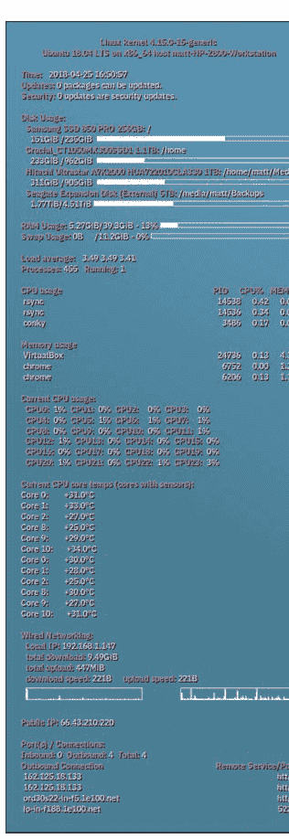

图 16.1 你可以配置 Conky 以获取任何内容的最新信息。

在这个示例中，Matthew 正在使用两个文件来运行 Conky。第一个文件名为 `conkyrc`，是一个文本文件，其中包含了图 16.1 所示内容的配置细节：

```
conky.config = {
Use Xft = {
    use_xft = true,
```

```
-- 启用 Xft 时的 Xft 字体
---font = 'HackBold:size=9',
font = 'Ubuntu:size=8',
```

```
-- 文本对齐，其他可能的值已注释
-- 最小尺寸 10 10
gap_x = 13,
gap_y = 45,
--对齐 左上
alignment = 'top_right',
--对齐 左下
--对齐 右下
```

```
-- 添加空格以防止内容移动？这只会影响某些对象。
use_spacer = 'right',
```

```
-- 从已用内存中减去文件系统缓冲区
no_buffers = true,
```

```
-- 使用双缓冲（减少闪烁，可能对所有人都有效）
double_buffer = true,
```

```
-- 允许图标出现、窗口移动以及设置透明效果
own_window = true,
own_window_class = 'Conky',--new
-- 覆盖own_window_type
own_window_transparent = true,
--own_window_type = 'normal',--new
own_window_hints = 'undecorated,below,sticky,skip_taskbar',--new
own_window_argb = visual,
own_window_argb_value = 0,--new
```

```
-- 设置温度单位，"华氏度"或"摄氏度"
temperature_unit = "fahrenheit",
```

```
-- 如果你想让 Conky 在后台运行，则设置为 yes
background = true,
```

```
-- 更新间隔（秒）
update_interval = 1,
```

```
cpu_avg_samples = 1,
net_avg_samples = 1,
```

```
-- 开始显示配置
```

;

conky.text = {[

$(aligng)($color c6b8e)$sysname kernel $Kernel

$(aligng)($color c6b8e)$(exec cat /etc/issue.net) on $machine host $nodename

$($color c6b8e)时间:($color E7E7E7)$time

($color c6b8e)更新:($color E7E7E7)$(exec /usr/lib/update-notifier/apt_check.py --human-readable | grep updated)

($color c6b8e)安全:($color E7E7E7)$(exec 3600 /usr/lib/update-notifier/apt_check.py --human-readable | grep security)

$($color c6b8e)磁盘使用:

Samsung SSD 850 250GB:($color E7E7E7)/($fs_used)/($fs_size / [$fs_bar /]

($color c6b8e)Crucial_CT1050MX300SSD1.1TB:($color E7E7E7)/home($fs_used)/home/$fs_size /home [$fs_bar /home]

($color c6b8e)Hitachi Ultrastar K72000 HUNY7201OCLA330 1TB:/home/matt/Media($fs_used)/home/Media/$fs_size /home/Media [$fs_bar /home/matt/Media]

($color c6b8e)Seagate Expansion Disk (External) 5TB:($color E7E7E7)/media/matt/Backups($fs_used)/media/Backups/$fs_size /media/Backups [$fs_bar /media/matt/Backups)

$($color c6b8e)内存使用:($color E7E7E7) $mem/$memmax $memperc% $membar

($color c6b8e)交换内存使用:($color E7E7E7) $swap/$swapmax $swapperc% $swapbar

$($color c6b8e)负载平均:($color E7E7E7) $loadavg

($color c6b8e)进程:($color E7E7E7) $processes ($color c6b8e)运行:($color E7E7E7) $running $processes ($color c6b8e)$

$($color c6b8e)CPU 使用 [$align]PID CPU% MEM%

($color E7E7E7)($top name 1)$[alignr]($top cpu 1) ($top mem 1)

($color E7E7E7)($top name 2)$[alignr]($top cpu 2) ($top mem 2)

($color E7E7E7)($top name 3)$[alignr]($top cpu 3) ($top mem 3)

$($color c6b8e)内存使用

($color E7E7E7)($top name 1)$[alignr]($top cpu 1) ($top mem 1)

($color E7E7E7)($top name 2)$[alignr]($top cpu 2) ($top mem 2)

($color E7E7E7)($top name 3)$[alignr]($top cpu 3) ($top mem 3)

$($color c6b8e)CPU 使用率:

($color c6b8e)CPU0:$(color E7E7E7) $(cpu0)%

($color c6b8e)CPU1:$(color E7E7E7) $(cpu1)%

($color c6b8e)CPU2:$(color E7E7E7) $(cpu2)%

($color c6b8e)CPU3:$(color E7E7E7) $(cpu3)%

($color c6b8e)CPU4:$(color E7E7E7) $(cpu4)%

($color c6b8e)CPU5:$(color E7E7E7) $(cpu5)%

($color c6b8e)CPU6:$(color E7E7E7) $(cpu6)%

($color c6b8e)CPU7:$(color E7E7E7) $(cpu7)%

($color c6b8e)CPU8:$(color E7E7E7) $(cpu8)%

($color c6b8e)CPU9:$(color E7E7E7) $(cpu9)%

($color c6b8e)CPU10:$(color E7E7E7) $(cpu10)%

($color c6b8e)CPU11:$(color E7E7E7) $(cpu11)%

($color c6b8e)CPU12:$(color E7E7E7) $(cpu12)%

($color c6b8e)CPU13:$(color E7E7E7) $(cpu13)%

($color c6b8e)CPU14:$(color E7E7E7) $(cpu14)%

($color c6b8e)CPU15:$(color E7E7E7) $(cpu15)%

($color c6b8e)CPU16:$(color E7E7E7) $(cpu16)%

($color c6b8e)CPU17:$(color E7E7E7) $(cpu17)%

($color c6b8e)CPU18:$(color E7E7E7) $(cpu18)%

($color c6b8e)CPU19:$(color E7E7E7) $(cpu19)%

($color c6b8e)CPU20:$(color E7E7E7) $(cpu20)%

($color c6b8e)CPU21:$(color E7E7E7) $(cpu21)%

($color c6b8e)CPU22:$(color E7E7E7) $(cpu22)%

($color c6b8e)CPU23:$(color E7E7E7) $(cpu23)%

$($color c6b8e)当前 CPU 温度（核心数）:

$(color E7E7E7)${exec 2 sensors | grep "Core" -c 1}

$($color c6b8e)有线网络:

($color c6b8e)本地 IP: $(color E7E7E7)${add eth0}

($color c6b8e)总下载: $(color E7E7E7)${totaldown eth0}

($color c6b8e)总上传: $(color E7E7E7)${totalup eth0}

($color c6b8e)下载速度: $(color E7E7E7)${downspeed eth0}

($color c6b8e)上传速度: $(color E7E7E7)${uppeedspeed eth0 15,150}

$(color E7E7E7)${uppupgraph eth0 15,150}

$($color c6b8e)公网 IP: $(color E7E7E7)${exec 600 bash /home/matt/conky/my.ip}

$($color c6b8e)端口 / 连接:

($color c6b8e)入站: $(color E7E7E7)${tcp_portmon 1 32767 connection}

($color c6b8e)总下载: $(color E7E7E7)${tcp_portmon 32768 61000 count}

($color c6b8e)总计: $(color E7E7E7)${tcp_portmon 1 65535 count}


wireshark—一种图形化网络协议分析器，可以实时保存或显示数据包，并具有智能过滤功能，能够识别来自各种硬件和第三方数据采集程序（包括压缩文件）的数据模式。某些协议包括互联网协议 (IP)、传输控制协议 (TCP)、域名系统 (DNS)、超文本传输协议 (HTTP)、安全外壳 (SSH)、传输层安全 (TLS) 以及基于 SSL/TLS 的 HTTPS。

## KDE 进程与系统监控工具

KDE 提供多个进程和系统监控客户端。可以通过右键点击任务栏并遵循菜单，将 KDE 图形客户端集成到桌面任务栏中。

这些 KDE 监控客户端包括：

- `kdf`—系统文件表的图形界面，可显示磁盘空间并允许您使用指向设备挂载和卸载文件
- `ksgard`—另一个面板小组件，以动画图的形式提供 CPU 负载和内存使用信息

## 企业级服务器监控

在企业环境中使用的服务器需要极高的运行时间。监控对于了解系统性能以及对系统组件和服务的整体健康状况的可观测性至关重要。

本书的范围是深入讨论可观测性、冗余、故障安全和保护等主题。然而，本节列出的工具可以帮助企业管理员开始寻找适合他们环境的适当工具。

### Datadog

Datadog 是几家年轻监控公司之一，它们将产品设计为软件服务 (SaaS) 云原生应用。Datadog 要求您在系统中安装一个代理。您可以使用他们的 Web UI 完成其余工作（如果愿意，也可以 API 程序化访问其平台）。然后，您将学习各种集成方案并决定跟踪哪些指标，同时创建仪表板、图表和监控。它是专有软件，根据您的需求提供多种定价方案。

### Nagios

Nagios 拥有开源基础，某些核心监控选项可以免费下载、使用和修改。付费选项提供更多功能和活性。无论哪种，您都必须下载 Nagios 软件并安装在您基础设施中的专用资源上。Nagios 多年来一直处于监控领域，但在新的计算时代正让位于 SaaS 新秀。

### New Relic

New Relic 是另一几家年轻监控公司之一，它们将产品设计为软件服务 (SaaS) 云原生应用。它灵活、可配置，并设计用于跨您的云部署工作。New Relic 的产品是专有的，该公司根据您的需求提供多种定价方案。

### SignalFX

SignalFX 是另一几家年轻监控公司之一，它们将产品设计为软件服务 (SaaS) 云原生应用。它灵活、可配置，并设计用于跨您的云部署工作。SignalFX 的产品是专有的，该公司根据您的需求提供多种定价方案。SignalFX 最近被 Splunk 收购，Splunk 是本地监控业务的长期参与，希望在向云计算转型的过程中保持竞争力。

### Splunk

Splunk 曾是企业监控领域的大角，但随着后期企业转向云计算，它不得不调整方向，并面临来自上述提到的较小年轻监控公司的强力竞争。它与 Nagios 仍然是本地数据分析解决方案的主流之一。Splunk 是某些独特功能的标准，例如安全信息和事件管理 (SIEM)、IT 运维人工智能 (AIOps) 和合规性监控。

### Zabbix

Zabbix 在欧洲比在北美更受欢迎。与 Splunk 类似，它是一个成熟的企业平台，设计用于监控大型 IT 环境（特别是本地环境），但该公司已扩展了其能力，可适用于所有流行的云平台。它是免费开源的，并提供付费的支持、服务和培训。

# 参考文献

- https://and.sourceforge.net—自动 nice 守护进程 (AND) 的主页，可自动优先排序和重新调度进程
- https://sourceforge.net/projects/schedutils/—提供实时调度实用程序的各种项目主页
- www.datadoghq.com/—Datadog 主页
- www.nagios.com/—Nagios 主页
- https.newrelic.com/—New Relic 主页
- www.signalfx.com/—SignalFX 主页
- www.splunk.com/—Solarwinds 主页
- https://sourceforge.net/projects/schedutils/—Zabbix 主页

# 第 17 章

# 备份

## 本章内容

- 选择备份策略
- 选择备份硬件和介质
- 使用备份软件
- 复制文件
- 配置文件的版本控制
- 系统救援
- 参考文献

本章探讨了通过创建备份副本来保护数据、在必要时恢复这些数据，以及在发生灾难性硬件或软件故障时恢复数据的实践。本章将让你充分理解良好的备份实践的原因。你可以利用此处的信息对哪些策略对你最好做出明智选择。本章还展示了如何自行执行某些类型的数据恢复和系统还原，并就何时寻求专业帮助提供了建议。

## 选择备份策略

备份始终是一种权衡。任何备份都会持续消耗时间、金钱和精力；必须进行监控、验证、索引，并且你……（根据提供的 OCR 上下文截断）

# 评估您的备份需求与资源

到此时，你已经意识到需要某种计划来保护你的数据，而且像大多数人一样，你可能对这一前景感到无从从。关于数据备份和恢复的主题已有整本书以及无数文章和白皮书。这个话题之所以复杂，是因为每个解决方案都是真正个性化的。然而，决策的正确方法非常简单。你通过回答以下问题开始这一：

- 哪些数据必须被保护？
- 数据变化的频率是多少？

这两个问题的答案有助于确定数据有多重要，了解数据量，并确定备份频率。根据这些信息，你可以选择备份介质。只有这样，你才能选择能够适应所有这些因素的软件。（你将在本章后面的部分学习备份软件、硬件和介质）。

可用资源是选择备份策略时的另一个重要考虑因素。备份需要时间、金钱和人员。从确定你在这些资源方面面临的局限性开始你的规划活动。制定符合这些限制的计划——或者准备通过对备份需求和成本的仔细评估，来证明更多资源的必要性。

> 提示
 如果你不愿或无法评估自己的备份需求并选择备份解决方案，你可以从大量的可供协助你的顾问、硬件供应商和软件供应商中进行选择。在你所在的地区，选择的最佳方法是询问其他 Unix 和 Linux 系统管理员（通过用户组、讨论组或邮件列表找到），他们愿意分享自己的经验和建议。如果你无法获得推荐，请向顾问索要参考并对其进行检查。

许多人在制定备份计划时也未能考虑时间因素。某些备份设备比其他设备快，某些恢复方法也比其他方法快。在做选择时需要考虑这一点。

要制定备份计划，你需要确定备份的频率。备份的必要频率取决于你系统中重要数据变化之快慢。在家庭系统中，大多数文件从不变化，少数文件每天变化，有些文件每周变化一次。处理这些情况不需要创建复杂的策略。家庭使用的策略是频繁地备份（到任何种可拆卸介质）关键数据，并每周备份一次配置和其他文件。

在企业级具有多个用户的大型企业级系统上，则需要一种不同的方法。某些关键数据在不断变化，重新创建这些数据可能是昂贵的的，因为这通常涉及复杂且昂贵的解决方案。我们大多数人都处于这些极端情况之间的某个位置。评估你的系统并借此确定你在光谱中处于什么位置。

# 第17 章 备份

备份方案和硬件可以是复杂的也可以是简单的，但它们都要求可行且忠实的执行。即使是最好的备份计划，如果过程没有执行、数据没有经过验证，并且没有定期进行数据恢复，也是徒用的。无论你选择何种备份方案，请务必包含这三个原则：

- 有一个计划——设计一个符合你需求的计划，并准备与任务相应的设备。这涉及到评估影响你正在备份的数据的所有因素。我们将在本章稍后详细介绍。
- 遵循计划——忠实地完成备份策略的每一个步骤，并验证备份中存储的数据。损坏的数据对任何人都没有用处。即使备份操作也可能出错。
- 练习你的技能——定期练习从备份系统中恢复数据，这样当灾难降临时，你已经准备好（并能够）受益于你备份计划的力量。（有关恢复数据，请参见“使用备份软件”章节）。请记住，当你尝试恢复时，你的备份计划中的缺陷完全可能显现出来。

# 良好的做法

你必须创建自己的备份计划，但这里是一些构成任何可靠计划基础的构建模块：

- 维护关键数据的多个副本。
- 备份标记。
- 将备份存储在气候受控且安全的区域。
- 使用关键数据的安全存储。许多公司选择银行金库作为离线存储，这是被高度推荐的。
- 建立合理且可以严格遵守的政策。尝试在系统一致时（即没有数据正在写入时）备份数据，这通常是在深夜。
- 跟踪谁有权访问你的备份介质，并将人数尽可能减少。如果可以，只允许信任的人员靠近你的备份。
- 定期验证备份并练习从中恢复数据。
- 定期检查备份介质的缺陷并定期更换（如果数据敏感后破坏数据）。

# 评估备份策略

当你确定自己需要备份时，你需要一个策略。具体描述理想策略是很困难的因为每个用户或管理员的策略将是高度个性化的，但这里有一些通用示例：

家庭用户——在家里，用户拥有 Ubuntu 安装媒体，重新安装不到一小时，所以时间问题不是主要考虑。家庭用户将想要备份任何更改过的配置文件，保留任何下载文件的存档，并在使用应用程序时保留任何数据文件的存档。除非用户有一个其中持续备份有用的特殊项目，否则每周备份可能足够了。家庭用户可能会使用面向消费者的在线云服务（如 Dropbox）、外部硬盘或其他可拆卸介质进行备份。

小型办公室——许多小型办公室倾向于使用与家庭用户相同的策略，但可能每天备份数据并使用自动化云服务。尽管他们将使用脚本来自动化备份，但其中一部分可能仍然是手动完成的。

小型企业——在这里，备份开始需要更高级的设备以及完全全自动的在线和离线备份。商业软件通常会对此进行介绍，但一个预算有限的熟练系统管理员可以使用本章讨论的基础应用程序。备份是高度结构化的并由专门的系统管理员监督。你可能猜到企业也将其备份迁移到云服务。

大型企业——大型企业最有可能是使用昂贵的、专利的、高度自动备份解决方案的候选。在这个水平，数据意味着钱，数据意味着损失，恢复数据也意味着钱。这些系统管理员知道备份是必要的保险并据此制定计划。通常，他们使用自己的分布式云系统，在地理位置不同的多个数据中心。

所有这些是否意味着企业级备份比家庭用户做的更好？并不是所有拥有 Ubuntu 的“小人物”都能通过在过程中投入更多时间而做得像企业运营一样好。通过研究本章中的高级策略，我们可以跨领域应用这些概念。

本章关注本地级活动，而不是基于此处列出的技术的云服务，但结合了额外的细节。本章还讨论了对于企业来说过时但可能对容易获得旧设备的爱好者实用的技术。如果你想使用在线云服务，请运用在这里学到的知识，阅读你的云服务供应商提供的所有内容，然后为你的独特需求设计一个合适的备份解决方案。这可能仅仅是将所有重要文件放在一个自动更新电脑的 Dropbox 文件夹中。你可以完全记住这些通常不保证你的数据会被永久备份（特别是免费版本）。尽管我们对这些解决方案没有遇到过问题，但我们警告它们不是企业级备份解决方案。你可能需要学习

Amazon Web Services、OpenStack 或其他云提供商，并了解其服务的细节，以查看它们是否符合你的需求。

> 注意
 如果你是一个新的系统管理员，你可能会继承现有的备份策略。花些时间检查并查看它是否满足组织的当前需求。考虑你的组织真正需要的备份保护，并确定当前策略是否满足了这些需求。如果不满足，请更改策略。考虑用户是否在执行当前的策略，如果没有执行，请思考其为什么不执行。

## 备份级别

UNIX 使用“备份级别”概念作为简写，指代与上一次备份相比备份了多少数据。其工作原理如下：0 级是全量备份。下一个备份级别是 1 级。

数字级别的备份会备份自上一次该级别或更高数字级别备份以来更改的所有内容。（例如，`dump` 命令提供了 10 种不同的备份级别）。例如，先进行 3 级备份再进行 4 级备份会生成基于全量备份的增量备份；而先进行 4 级备份再进行 3 级备份则生成两者之间的差异备份。

接下来的章节将解释我们今天使用的几种策略。许多策略都是基于这些示例方案的；其中一种可以作为为你自己的系统构建策略的de。

## 简单策略

如果你需要备份几个配置文件和小一些数据文件，可以将它们复制到 USB 盘中，贴上标签并妥善保存。大多数用户已经转而使用外部硬盘进行备份，因为硬盘变得越来越廉价且能够存储大量数据，或者他们已经将备份移到了在线。

除了配置数据文件外，你应该存档每个用户的 `/home` 目录和整个 `/etc` 目录。在这两者之间，备份将包含小型系统的大部分重要文件。这样，如果有必要，可以在完全重新安装 Ubuntu 后，从你选择的备份介质设备轻松恢复这些数据。

专家常说，如果你有的数据超过了软盘的容量，你真的需要一个正式的备份策略。因为软盘只能存储略多 1MB 的数据（而且如此过时），也许我们应该将其改为“如果你有的数据超过了廉价 USB 盘的容量”。无论如何，在接下来的章节中将讨论一些正式的备份策略。

## 定期全量备份

定期全量备份是一种涉及每周、每两周或其他定期对整个文件系统进行备份的策略。选择备份策略的频率取决于备份的数据量、数据的更改频率以及丢失这些更改的成本。

这种备份策略执行起来并不复杂，可以使用本章节后面提到的可热插磁盘驱动器完成。如果你连接到网络，可以将数据镜像到另一台机器上（最好是离线的) ；`rsync` 工具特别适合这项任务。请注意，这并不能解决对文件最新状态进行存档的需求；它仅提供了更新完成时的系统快照。

## 带有增量备份的全量备份

另一种方案涉及每周对整个系统进行一次全量备份，并对仅对前一天发生变化的文件进行增量备份，这开始与中大型系统的系统管理员通常使用的方法相相似了。

这种备份方案可以通过两种方式进行改进。首先，每个增量备份都可以参考全量备份进行制作。换句话说，在一个 0 级备份之后接有一系列 1 级备份。这种备份方案的优点是，恢复时只需要两盘磁带（全量备份和最近的增量备份）。但由于它引用了全量备份，在频繁使用的系统中，每个增量备份可能会变得很大（并可能变得更大）。

或者，每个增量备份可以引用上一个增量备份。这是一个 0 级备份后跟一个 1 级，然后是 2 级，依此类推。增量备份更快（数据更少），但需要每盘磁带才能恢复整个系统。这再次是一个经典的权衡决策。

现代商业备份应用（如 Amanda 或 BRU）有助于组织管理复杂备份计划和跟踪备份介质的过程。使用 shell 脚本运行 `tar` 来手动完成，需要系统管理员自己处理所有的组织工作。由于由于原因，复杂的情况通常由供应商包装、销售并支持的商业软件和专用硬件处理。

## 数据镜像或 RAID 阵列

在具有充足（且昂贵）硬件资源的情况下，你始终可以将数据镜像到其他地方，本质上是在手里保留一份数据的实时副本。如果不涉及大量数据，这通常是一种廉价且可行的解决方案。独立磁盘冗余阵列（RAID）阵列（在其某些形式中可以在磁盘故障时提供恢复。

请注意，RAID 阵列和镜像系统损坏数据与保存有效数据的概率是一样的。此外，如果一个文件被删除，RAID 阵列不会保存它。RAID 阵列最适用于保护运行系统的当前状态，用于备份需求。

## 选择

只有你才能决定什么对你的情况最有利。在阅读了书中的备份选项后，制定一些示例备份计划；然后运行几个可能的场景并评估你选择的有效性。

除了你学到的所有关于备份策略的信息外，在做选择时还有几条好的金法则需要记住：

- 如果备份策略和策略太复杂（这对于大多数安全问题也是如此），它最终会被忽视并被弃用。
- 好的方案通常是策略的组合；使用实用的。

## 选择备份硬件和介质

任何可以存储数据的设备都可以用于备份，但这就像是说任何带轮子的东西都可以带去跨国旅行一样。尝试将 10GB 的数据放入堆 CD-RW 或 DVD-RW 中是一次挫折的尝试，而使用自动磁带设备保存单个邮件则是资源的浪费。此外，这些技术正在迅速消失。

在本节中，你将了解到一些常用的备份硬件以及如何评估它们对你备份需求的适用性。随着大型存储设备变得越来越平价（你现在可以用 100 美元购买多个 TB 的硬盘），小型企业和用户的备份硬件决策变得越来越有趣。

## 磁带驱动备份

虽然这种方式正变得越来越常见，但磁带驱动备份仍然在使用的一种可行技术。计算机行业从一开始就一直使用磁带驱动。磁带存储在行业内是如此流行，以至于 `tar`（最常用于归档）是源于 tape archive（磁带存档）一词。磁带的容量和耐用性因类型而异，范围从几 GB 到数百 GB 不等，相应的设备和介质成本也随增加。自动加载磁带驱动系统可以容纳超过系统容量的存档。

- 提示
旧的磁带设备通常在二手设备市场上可以找到，对于那些已经超出有限备份设备选项限制的小型业务可能很有用。

磁带设备在 Linux 中得到了良好支持，在维护得当的情况下，极其可靠。考虑到其存储容量和重复使用的能力，磁带本身非常廉价。请注意，磁带会随着时间的推移而老化，机械磁带驱动器可能会故障。

- 注意
忽视磁带驱动器的清洁、对齐和维护会使数据面临风险。磁带本身也容易受到机械磨损和损坏。硬件维护是良好备份策略的一部分。永远不要忘记，硬件故障是何时发生而非是否会发生的问题。

## 云存储

像 Dropbox 以及 Amazon 的 AWS 和 S3 等服务提供了一种在本地创建和存储备份的方法。大公司可能还会创建自己的本地在线存储选项。在这些及类似的情况下，数据被复制并存储在专门为此目的设置的远程文件服务器上。数据备份可以灵活地调度，并根据客户的计划和设计进行。

云存储是一种近期且日益受欢迎的备份解决方案，但它也是一种快速变化的技术。要了解更多此处提到的选项，请查看 www.dropbox.com 和 https://aws.amazon.com/s3/。虽然这些不是唯一的此类服务，但它们对该概念提供了很好的介绍。如果你喜欢“自搞那一套”，你绝对想看看 www.ubuntu.com/cloud 上的 Ubuntu 企业级云。

## 使用备份软件

由于有成千上万独特的情况需要相应的备份解决方案，Linux 提供了许多备份工具这并不意外。除了 `tar` 和 `dd` 等命令行工具外，Ubuntu 还为桌面安装版本提供了一个名为 Deja Dup 的图形化归档工具，它是非常强大的。另一个优秀的、复杂的替代方案是 Amanda 备份应用程序——这是一种在网络连接上运行良好的高级备份应用程序，可以配置为自动备份网络上的所有计算机。Amanda 支持驱动器和磁带。

> 注意
备份系统中的软件必须支持硬件，这种关系决定了你对硬件或软件的选择。许多系统管理员选择特定的备份软件并不是因为他们优于其他软件，而是因为它们支持他们拥有的硬件。

对于免费备份工具来说价格似乎合适，但在评估成本时要考虑软件的易用性和自动化。如果你必须花费几个小时来实现、调试、记录以及其他处理过于复杂的自动化脚本，实际成本就会增加。

## tar: 最基础的备份工具

`tar` 工具作为归档工具中的“老格不群的老头”，是默认安装的。它是保存整个文件目录的极佳工具。例如，这里是备份 `/etc` 目录的命令：

```bash


matthew@semour:-$ `sudo tar cvf etc.tar /etc`

```
```

此示例使用 `tar` 创建一个存档，进行详细消息输出，并使用文件名 `etc.tar` 作为 `/etc` 目录内容的归档名称。

或者，如果将 `tar` 的输出发送到标准输出并重定向到文件，命令显示如下：

```bash
matthew@semour:-$ sudo tar cv /etc > etc.tar
```

结果与之前的 `tar` 选项相同：`/etc` 目录中的所有文件将被保存到文件 `etc.tar` 中。

凭借令人印象的系列选项（参见主页），`tar` 与 shell 脚本结合时既灵活又强大。通过 `-z` 选项，它甚至可以创建和恢复 `gzip` 压缩存档，而 `-j` 选项可以处理 `bzipped` 文件和用 `xz` 压缩的 `tar` 包。

## 使用 tar 创建全备份和增量备份

如果你想创建一个全备份，以下命令将创建一个整个系统的 `bzip2` 压缩 `tar` 包（使用 `j` 选项）：

```bash
matthew@semour:-$ sudo tar cjf backup.tar.bz2 /
```

要执行增量备份，你必须找到自上次备份以来更改的所有文件。为了起见，假设你每天进行备份。要找到这些文件，使用 `find` 命令：

```bash
sudo find / -newer name_of_last_backup_file | -a -type f -print
```

单独运行时，`find` 会生成全局范围的文件列表并将其打印到屏幕上。`-a` 消除了列表中普通文件以外的所有内容；否则，目录会被发送给 `tar`，即使内容没有更改。

将 `find` 命令的输出如下所示管道传递给 `tar`：

```bash
sudo find / -newer name_of_last_backup_file | -type d -print | \ tar czT - backup_file_name_or_device_name
```

在这里，`-T` 选项从缓冲区获取文件名（其中 `-` 是缓冲区的简写名称）。

> 注意
`tar` 命令可以备份到原始设备（没有文件系统的设备）和格式化分区。例如，以下命令备份了这些目录。

与 Microsoft Windows 兼容。你可以从 KDE 桌面或 Konquerer 文件浏览器拖放文件来添加或提取文件，你也可以使用 `ark`。

只要安装了相关的命令行程序，`ark` 就可以处理 `tar`、`gzip`、`bzip2`、`zip` 和 `lha` 文件（后者是用于通过压缩归档文件来节省空间的压缩方法）。

启动应用程序本身后即可打开现有的归包。你可以向归包中添加文件和目录，或从其中删除它们。打开归包后，你可以提取所有内容或单个文件。你还可以使用模式（例如 `*.jpg` 文件、`example`）进行搜索以选择文件。

要创建新归包，选择“文件”（File）、“新建”（New），然后输入归包名称，提供相应的扩展名（如 `.tar`、`.gz` 等）。然后你就可以根据需要添加文件和目录。

## Déjà Dup

Déjà Dup 是一个带有实用 GUI 的简单备份工具。它支持本地、远程或云备份。它可以对你的数据进行加密和压缩，以实现安全快速的传输及更多功能。在应用程序列表中，Ubuntu 将其称为“备份”（Backups）（见图 17.1）。


图 17.1 备份图标很容易找到。

打开“备份”应用程序后，通过左侧的菜单项设置备份存储位置、备份内容、自动备份计划等更多选项（见图 17.2）。当你按照喜好设置好后，记得通过将右上角的开关从“关闭”（Off）切换到“开启”（On）来启用 Déjà Dup。

Telegram 频道 @nettrain

## Back In Time

对于许多用户来说，Back In Time 是 Déjà Dup 的可行替代。它可以从 Ubuntu 软件仓库中轻松获得，并具有清晰易懂的界面。

Back In Time 使用 `rsync`、`diff` 和 `cp` 来监控、创建和操作文件，并使用 `cron` 来调度运行时间。本章将介绍如何使用这些命令行工具。Back In Time 不仅仅是一个为 GNOME 设计的定义良好的 GUI 前端，它在仓库中还提供了一个带有 KDE 前端的独立软件包。如果你使用的是标准的 Ubuntu 界面，请安装名为 `nautilus-actions` 的包以获取备份功能的右键菜单访问。

第一次运行 Back In Time 时，它会对你的驱动器拍摄快照。这取决于你的数据量，可能需要很长时间。你指定要备份哪些文件和目录以及备份到何处。设置备份计划。程序将处理其余工作。

要进行恢复，从 Back In Time 列表中选择最近的快照。然后浏览目录和文件列表，直到找到你感兴趣的文件。你可以右键点击文件查看弹出菜单，从菜单中打开文件、将文件复制到指定位置，或查看文件的多个快照并对其进行比较，以确定你想要恢复哪一个。

Back In Time 保留了多份操作、活动、文件更改和版本的日志，是一个非常有用的工具。

你可以在 https://backtime.readthedocs.io/ 找到 Back In Time 的官方文档。

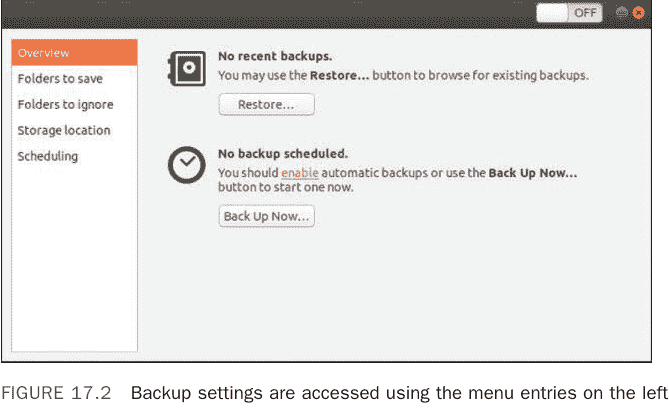

## Unison

Unison 是一种文件同步工具，适用于多个平台，包括 Linux、其他 UNIX 变体（如 Solaris 和 macOS）以及 Windows。设置好 Unison 后，它会在双向和跨平台同步文件。两端都会进行更改，文件会在双向更新。当发生文件冲突时（例如同一文件在每个系统上都被修改过），会提示用户决定如何处理。Unison 可以使用许多协议（包括 `ssh`）跨网络连接。它可以同时与许多系统以及云连接并同步。

Unison 在宾夕法尼亚大学作为一个研究项目开发，目前不再作为研究项目进行活跃开发，但它似乎仍在通过错误修复和极少数的功能添加进行维护。原始开发者声称他们现在每天仍使用它，因此它并未完全被遗弃。

Unison 功能强大且可配置。其基础基于 `rsync`，并包含了一些添加，使其实现了通常只有版本控制系统才具备。

尽管该项目不再是任何开发者的主要关注，但许多人仍在使用 Unison。出于某些原因，它在本章中被提及，如果你感兴趣，它值得你投入精力和。Unison 在免费的 GPL 许可证下发布，因此你可能决定深入研究代码。开发者已公开表示，他们没有时间定期通过补丁和贡献来维护它。如果这是你感兴趣的项目，请访问 www.cis.upenn.edu/~bcience/unison/

## Amanda

Amanda 是由马里兰大学学院帕克创建的强大网络备份应用程序。Amanda 是一款健壮的备份和恢复应用程序，最适用于具有足够容量自动加载磁带驱动器的无人值备份。它受益于良好的用户支持和文档。

Amanda 的功能包括压缩和加密。它旨在用于高容量磁带驱动器、光磁带、CD-R 和 CD-RW 设备。

Amanda 使用 GNU `tar` 和 `dump`；它旨在无人自动化的磁带备份，不适用于交互式或即时备份。Amanda 对磁带设备的支持非常稳健，恢复过程也相对简单。Amanda 不支持 Macintosh 客户端，也不支持 Windows。

## 注意 (CAUTION)

Amanda 不支持 Macintosh 客户端，也不支持 Windows。

## 第 17 章 备份

Amanda 没有 GUI。配置在 `/etc/amanda` 中完成。默认安装包含 `amanda-client` 和 `amanda-server`。请安装两者。就备份而言，Amanda 会相应计算出一个优化方案。

Amanda 的手册页（`man page`）编写得很好，解释了 Amanda 的配置，并详细说明了组成 Amanda 的多个程序。在 `/etc/amanda` 中找到的配置文件有良好的注释；它们提供了许多示例来协助你配置。

该程序的主页为 www.amanda.org。你可以找到关于订阅邮件列表的信息以及与 Amanda 相关的链接。

## 替代备份软件

存在商业和其他免费软件备份产品；BRU 和 Veritas 是商业备份产品的良好示例。以下是一些未随 Ubuntu 一起安装的实用备份工具：

- `flexbackup` 该工具是由 Perl 脚本组成的大文件，使得 `dump` 和恢复变得易用。通过带有 `-help` 参数的命令可以找到 `flexbackup` 的命令语法。它还使用 `afio`、`cpio` 和 `tar`，在考虑安全的情况下，通过 `rsh` 或 `ssh` 在本地或网络上创建和恢复归包。其主页为 www.edwin.org/backup/。注意，它已经很久没有收到任何更新或更改了。
- `afio` 它创建 `cpio` 格式的归包，但处理数据输入的能力比 `cpio` 好（后者处理数据输入的能力非常差）。它在交互操作期间支持多卷归包并可以压缩归包。如果你需要使用 `cpio`，可能想检查 `afio`。

存在许多其他替代备份工具，涵盖所有工具超出了本章的范围。

## 复制文件

通常，当你只有几个需要防止丢失或损坏的文件时，将单个文件复制到另一个存储介质可能比创建归包更有意义。你可以使用 `tar`、`cp`、`rsync` 甚至 `cpio` 命令来执行此操作；你还可以使用一个名为 `mc` 的方便文件管理工具。`tar` 是传统的选择，因为旧版本的 `cp` 有时处理符号链接和权限的能力不好，导致这些属性（文件的特征）丢失；`tar` 以更好的方式处理了这些文件属性。`cp` 已经得到改进以解决这些问题，但 `tar` 仍然被更广泛地。`rsync` 是镜像文件组的极佳选择，特别是通过网络进行操作时。

为了说明如何使用文件复制作为备份技术，这里的示例展示了如何复制（而非归档）目录树。该树包含了符号链接以及你需要保持完好且具有特殊文件权限的文件。

## 使用 tar 复制文件

将文件复制到另一个位置的选择之一是使用 `tar` 命令；你只需要创建一个 `tar` 文件并将其管道传输到 `tar` 以在新位置进行解压。要实现这一操作，首先切换到源目录。整个命令类似于：

```
mathew@semour:~$ tar -cvf files | cd target_directory ; tar -xpf
```

在此命令中，`files` 是你想要包含的文件名；你可以使用 `*` 来包含整个当前目录。

当你切换到源目录并执行 `tar` 时，你使用了 `cvf` 参数：

- `-c`: 创建归档。
- `v`: 指定详细模式；即列出正在处理的文件，以便你看到它正在运行。
- `f`: 指定归档的文件名。（在本例中为 `-`）

以下 `tar` 命令选项对于创建备份目的的文件副本非常有用：

- `-m`: 留在文件系统中（即不包含远程卷）。
- `atime-preserve`: 即使更改文件的访问时间，即使你现在正在访问它们（为了归档目的保留旧的访问信息）。

`tar` 文件的内容（临时存储在缓冲区中，命名为 `-`）随后被管道传输到第二个表达式，该表达式将文件提取到目标目录。在 shell 编程中（参阅第 14 节），将表达式括在括号中会使其在子壳中运行并优先执行。

在你切换到目标目录后，你配合 `tar` 使用了以下选项：

- `-x`: 从 `tar` 归档中提取文件。
- `-p`: 保留权限。
- `-t`: 指定文件名，在本例中为 `-`，即存储用 `tar` 归档文件的临时缓冲区。

## 压缩、加密并发送 tar 流

上一节中使用 `tar` 命令的文件复制技术也可以用于跨越局域网或互联网（使用 `ssh` 命令）快速、安全地传输目录结构。使用这些技术的方法之一是使用以下命令行首先压缩指定目录的内容，然后将压缩并加密的归档流解压到远程主机目录：

```
matthew@seymour:~$ tar -cvzf data_folder | ssh remote_host 'cd ~/backup_dir; tar -xvf -'
```

`tar` 命令用于创建、列出和压缩名为 `data_folder` 目录中的文件。输出通过 `ssh`（安全 Shell）命令并发送到名为 `remote_host` 的远程计算机。流被提取并保存到名为 `/backup_dir` 的目录中。系统会提示输入密码以发送流。

## 使用 cp 复制文件

要复制文件，你可以使用 `cp` 命令。当用于简单复制时，命令的通用格式如下：

```
matthew@seymour:~$ cp -a source_directory target_directory
```

`-a` 参数与 `-dp` 相同：

- `-d`: 保留符号链接（不对其进行引用），并复制它们所指向的文件而不是复制链接本身。
- `-p`: 在可能的情况下保留所有文件属性。（文件所有权可能会产生干扰）。
- `-r`: 递归复制目录。

你还可以通过配合 `-avR` 命令行使用 `cp` 命令来快速复制目录并保留权限。使用这些选项可以保留文件和目录权限，提供详细输出，并递归复制和创建子目录。你还可以通过重定向输出在备份期间创建备份日志：

```
matthew@seymour:~$ sudo cp -avR directory_to_backup destination_vol_or_dir 1 > /root/backup_log.txt
```

你可以这种方式获得相同的效果：

```
matthew@seymour:~$ cp -avR ubuntu /test 1 > /root/backup_log.txt
```

此示例在名为 `/test` 的卷上对 `/ubuntu` 目录进行了精确复制，并在 `/root` 下保存了名为 `backup_log.txt` 的备份报告。

## 使用 rsync

`rsync` 是备份的老宠。这其中的很大原因是，`rsync` 允许你只复制自上次备份以来更改的文件。使用此工具，虽然初始备份可能需要很长时间，但后续备份会快得多。`rsync` 还具有高度的可配置性，可以与 USB 硬盘等可移动介质或网络使用。让我们来看看如何使用 `rsync`。

首先，创建一个空文件并调用 `backup.sh`：

```
matthew@semour:~ sudo touch backup.sh
```

然后，使用你喜喜欢的编辑器将以下命令输入文件并保存：

```
rsync --force --ignore-errors --delete --delete-excluded --exclude-from=/home/matthew-exclude.txt --backup --backup-dir='+Y-%m-%d' -av / /media/externaldrive/backup/Seymour
```

将文件设为可执行：

```
matthew@semour:~$ chmod +x backup.sh
```


此命令使用了 `rsync` 的多个选项，并将它们放在一个快速易于运行的脚本中。你可以从命令行使用 `sudo sh ./backup.sh` 运行脚本，或者作为自动的 cron 任务运行。

以下是发生操作的概述。基本上，`rsync` 被告知要执行：以下是各个选项：

- `-force`: 强制删除。
- `-ignore-errors`: 告诉即使有 I/O 错误也继续。
- `-delete`: 删除目录。
- `-delete-excluded`: 也删除被排除的目录。
- `-exclude-from=/home/matthew-exclude.txt`: 防止备份文件中列出的文件。
- `-backup`: 在删除之前创建备份。
- `--backup-dir='+Y-%m-%d'`: 为日期创建一个备份目录。
- `-av`: 使用归档模式和详细模式。
- `/`: 表示源目录。
- `/media/externaldrive/backup/Seymour`: 设置备份的目标地。

## 配置文件的版本控制

能够快速方便地执行此操作具有巨大的权力和优势；不再需要文件编辑器记住关于谁、何时、甚至如何编辑了文件的技术细节。当问题发生时，文件只需恢复到之前的状态即可。版本控制系统还能通知用户每次保存时每个文件在何时以及如何发生了什么变化。

对配置文件使用版本控制系统意味着每次更改配置时，这些更改都会被记录和跟踪。这使得能够发现入侵者（如果配置被未经授权的人更改以重置，例如更改 Apache 的设置以便允许入侵者在你的服务器上运行恶意的 Web 服务或站点）、从错误和故障中恢复，并轻松发现软件升级在配置中启用或包含的新功能和设置。

许多旧且著名的工具都能完成此任务，例如 `changelelograck` 就是一个很好的例子。所有此类工具都能让跟踪配置更改的工作变得更加简单、快速，但随着版本控制系统的进步，它们提供的额外作用非常小。与其使用其中任何工具，你认为学习一个现代且良好的版本控制系统会更好。有一个例外值得讨论，因为它能够与你的软件软件包管理器协同工作，这节省了你每次运行包管理器时都要将更改提交到版本控制系统的任务。这个例外就是 `etckeeper`。

`etckeeper` 获取 `/etc` 目录的所有内容，并将其配置文件存储在版本控制仓库中。你可以通过编辑 `etckeeper.conf` 来配置程序，将数据存储在 Git、Mercur、Bazaar 或 Subversion 仓库中。此外，`etckeeper` 会自动连接到 Ubuntu 的 APT 软件包管理工具，并在软件包升级期间自动提交对 `/etc` 及其文件的更改。在运行 Fedora 等 Linux 发行版时，也可以跟踪 Yum 等其他包管理器。它还会跟踪版本控制系统不易跟踪的文件元数据，例如 `/etc/shadow` 中的权限。

> 注意
> 使用任何版本控制系统跟踪包含密码等敏感数据的文件都存在安全风险。被跟踪的文件和版本控制系统本身应该受到与敏感数据本身同级别的对待。

默认情况下，`etckeeper` 使用 Git。在 Ubuntu 上，这被改为 Bazaar `bz`，因为这是 Ubuntu 开发者使用的版本控制系统。由于这是可配置的，我们在这里只提到步骤，留给你根据自己喜好的特定版本控制系统进行调整。

首先，编辑 `/etc/etckeeper/etckeeper.conf` 以使用你所需的设置，如要使用的版本控制系统、使用的包管理器，以及是否每天自动提交更改。从 Ubuntu 仓库安装 `etckeeper` 后，必须从命令行启动它：

```
matthew@seymour:-$ etckeeper init
```

## 第 17 章 备份

如果你仅使用 `etckeeper` 来跟踪使用 APT 更新软件时对 `/etc` 做的更改，那么你什么都不需要做。如果你手动编辑文件，请确保使用你的版本控制命令来提交这些更改，或者使用以下命令：

```
matthew@semour:- etckeeper commit "Changed prompt style"
```

引号中的消息应该反映刚刚完成的更改。这使得读取日志和查找准确更改变得容易得多。

恢复可回滚的文件随后直接使用你的版本控制系统完成。例如，假设你对 `/etc/bash.bashrc`（设置 bash shell 默认值的文件）进行了更改。你在某处读到过如何更改提示符，但不喜欢那个结果。然而，由于更改正在被跟踪，你可以将其回滚到之前的版本。由于 bzr 是 Ubuntu 中 etckeeper 的默认值，你检查日志以找到以下更改的提交号：

```
revno: 2

committer: matthew <matthew@semour>

branch nick: semour etc repository

tstamp: Pri 2021-07-16 11:08:22 -0700

message:

 Changed /etc/bash.bashrc

revno: 1

committer: matthew <matthew@semour>

branch nick: semour etc repository

tstamp: Pri 2021-07-16 11:00:16 -0700

message:

 Changed /etc/bash.bashrc
```

如果你知道更改是在最近的修订中完成的（用 `revno 2` 表示修订版本号），你可以恢复到：

```
matthew@semour:- bzr revert -revision 2 /etc/bash.bashrc
```

今天，程序员、系统管理员和开发者使用版本控制备份他们的点文件（dotfiles）。点文件是用户 `/home` 目录下的配置文件和目录，所有这些文件都以点开头，例如 `.bashrc`。这些文件并不一定会被软件备份，它们通常由高技术水平的人根据自己的喜愿进行定制，因此备份它们是一个好主意。版本控制系统被广泛用于 Ubuntu 的程序 `dotdee` 对包含 `.d` 且存储在 `/etc` 中的不同类型文件或目录执行此操作。你可以在第 9 章“管理设置”中找到关于 `dotdee` 的更多信息。

## 系统救援

总会有需要进行系统救援工作的时候。这种需求出现在系统甚至无法启动 Linux 导致你无法恢复任何文件时。这个问题最常见与引导程序或分区表有关，但也可能是关键系统文件被无意删除或损坏了。

## 第 18 章

## 网络

开源技术通用（特别是 Linux）的优势之一是它可以毫不费力地跨多个网络环境和互联网。得益于标准互联网协议 TCP/IP 的强力支持，Linux 可以与所有 UNIX 变体通信，包括 macOS、Windows（借助 Samba）、NetWare `IPX`，甚至是如 DCNet 和 Banyan VINES 等较旧协议。大多数组织使用 Linux 作为互联网网关，允许许多不同的客户端通过 Linux 访问互联网，并通过电子邮件和即时消息进行通信。最重要的是它对 IPv6 的内置支持，这在商业/企业世界中已成为一项重大的更新。可以说，无论你遇到什么种网络协议，Linux 都能以某种方式与之工作。

本章涵盖了网络连接性，而大多数网络不可避免地会以某种形式连接到互联网。你将学习如何正确完成基础工作，包括在 Ubuntu 中配置和管理网络接口卡（NIC）以及其他网络服务。你还将了解如何从命令行管理网络服务——这在你可能受限于命令行提示符时非常重要。我们还查看了针对入站和出站流量的连接选项，例如点对点协议（PPP）。

在本章中，我们重点关注文本接口和手动配置。我们还包含了 Ubuntu 中基本图形化网络管理的概述，这正变得越来越流行。图形用户界面（GUI）选项已变得更加稳定、有用且易理解，大多数桌面用户现在使用 GUI 与网络进行交互。然而，这是一本为想要学习系统原理的用户设计的，所以请卷起袖子，准备大干一场。

### 本章内容

- 建立基础：localhost 接口
- 使用 `ping`、`traceroute` 和 `mtr` 检查连接
- 使用 TCP/IP 联网
- IPv6 基础
- 网络组织
- 网络硬件设备
- 使用网络配置工具
- 动态主机配置协议
- 无线网络
- 越网络进入互联网
- 常见配置信息
- 参考文献

### 建立基础：localhost 接口

在成功连接到互联网或任何网络之前，首先需要就绪一个 localhost 接口，有时称为回环接口（loopback interface），通常称为 `lo`。TCP/IP 协议族（参见本章稍后提到的“使用 TCP/IP 联网”章节）使用此接口为你的计算机分配 IP 地址，并且 Ubuntu 分配 PPP 接口也需要它。

#### 检查回环接口的可用性

通常你不需要手动创建回环接口，因为 Ubuntu 会自动为你创建一个。要检查它是否处于启动状态，可以使用 `ip` 命令配合几个参数列出所有可网络接口，包括如果存在 `lo` 接口。此示例显示了信息：

```bash
$mathew@semour~$$ ip address

lo: <LOOPBACK,UP,LOWER_UP> mtu 65536 qdisc noqueue state UNKNOWN group default qlen 1000

    link/loopback 00:00:00:00:00:00 brd 00:00:00:00:00:00

    inet 127.0.0.1 scope host lo

        valid_lft preferred_lft forever

    inet6 ::/128 scope host

        valid_lft preferred_lft forever
```

你在示例中看到的内容是回环接口存在且活跃的证据。分配给 localhost 的 inet 号（通常为 127.0.0.1）广播掩码为 255.255.0.0。你也可以看到分配给 `lo` 的 IPv6 地址，即 `::/128`，称为 `inet6`。

> 注意
> 之前你使用现在已弃用的 `ifconfig` 检查了回环接口的可用性：
> ```
> $mathew@semour~$ ifconfig
> lo Link encap:Local Loopback
>     inet addr:127.0.0.1 Mask:255.255.0.0
>     inet6 addr::/128 Scope:Host
>     UP RUNNING MTU:16436 Metric:1
>     RX packets:270 errors:0 dropped:0 frame:0 carrier:0
>     TX packets:270 errors:0 dropped:0 collisions:0 txqueuel:0
>     RX bytes:20748 (20.7 KB) TX bytes:20748 (20.7 KB)
> ```
> `ifconfig` 仍然可用，但它正在消失，并且不再默认安装。如果你已经学会了 `ifconfig`，我们强烈建议花时间学习 `ip` 并取而代之。

#### 手动配置回环接口

localhost 接口的 IP 地址指定在一个文本配置文件中，Ubuntu 使用该文件记录各种网络范围的 IP 地址。该文件名为 `/etc/hosts`，通常在系统中都存在，即使它是空的。Linux 内核和其他工具使用此文件访问 IP 地址和主机名。如果你没有配置任何其他接口，你可能会发现文件看起来所示：

```text
127.0.0.1 localhost
127.0.0.1 seymour
```

```text
# 以下行对于支持 IPv6 的主机是理想的
::1 localhost ip6-localhost ip6-loopback
fe00::1 ip6-local
ff00::1 ip6-multcastprefix
ff00::1 ip6-multicast
```


`127.0.0.1` `localhost`

`127.0.0.1` `seymour`

以下行对于支持 IPv6 的主机是理想的
`::1` `localhost` `ip6-localhost` `ip6-loopback`
`fe00::1` `ip6-local`
`ff00::1` `ip6-multcastprefix`
`ff00::1` `ip6-multicast`

`localhost` 接口的 IP 地址指定在一个文本文件中，Ubuntu 使用该文件记录各种网络范围的 IP 地址。该文件名为 `/etc/hosts`，通常在系统中都存在，即使它是空的。Linux 内核和其他工具使用此文件访问 IP 地址和主机名。如果你没有配置任何其他接口，你可能会发现文件所示：

```text
127.0.0.1 localhost

127.0.0.1 seymour
```

以下行对于支持 IPv6 的主机是理想的
`::1` `localhost` `ip6-localhost` `ip6-loopback`
`fe00::1` `ip6-local`
`ff00::1` `ip6-multcastprefix`
`ff00::1` `ip6-multicast`

# 使用 ping、traceroute 和 mtr 检查连接

如果成功，你现在应该使用 `ping` 来检查接口。命令如下：

```bash
matthews:~ ping -c 3 localhost

PING localhost (127.0.0.1) 56 data bytes

64 bytes from localhost (127.0.0.1): icmp_seq=1 ttl=64 time=0.047 ms

64 bytes from localhost (127.0.0.1): icmp_seq=2 ttl=64 time=0.050 ms

64 bytes from localhost (127.0.0.1): icmp_seq=3 ttl=64 time=0.060 ms

--- localhost statistics

3 packets transmitted, 3 received, 0% packet loss, time 2030ms

rtt min/avg/max/stddev = 0.045/0.050/0.060/0.010 ms
```

你使用 `-c` 选项来设置 `ping` 的次数，如果成功，命令将返回发送测试包的往返速度。

以 `::1` 开头的行是例外。它用于定义 IPv6 的 `localhost`，你可以在终端使用 `ping` 命令进行测试，如下：

```bash
matthews:~ ping -c 3 ::1

PING ::1 (::1) 56 data bytes

64 bytes from ::1: icmp_seq=1 ttl=64 time=0.072 ms

64 bytes from ::1: icmp_seq=2 ttl=64 time=0.065 ms

64 bytes from ::1: icmp_seq=3 ttl=64 time=0.061 ms

--- ::1 statistics

3 packets transmitted, 3 received, 0% packet loss, time 2060ms

rtt min/avg/max/stddev = 0.061/0.066/0.072/0.004 ms
```

这是一个讨论三个用于检查网络的实用工具的好地方：`ping`/`ping6`、`traceroute`/`traceroute` 和 `mtr`。使用这些任何一个工具时收到的网络超时表示存在连接性问题。如果你收到响应，说明你的网络工作正常。

你刚刚学习了第一个工具，`ping` 及其 IPv6 版本。这些命令向指定的网络主机发送请求，如果它收到了消息，就会发送响应。的 `-c`

## 使用 ping, traceroute 和 mtr 连接

建议使用 `-c` 选项后接数字来限制 `ping` 请求的次数。如果未指定数字，`ping` 将持续发送请求，直到你使用 `Ctrl+C` 停止进程。以下是一个示例，用于判断我们的本地连接情况如下：

```
mattweysmour:~$ ping -c 3 google.com

PING google.com (74.125.225.103) 56 bytes of data.

bytes from ord08s08-in-f7.le120net (74.125.225.103): icmp_req=1 ttl=53 time=22.0 ms

bytes from ord08s08-in-f7.le120net (74.125.225.103): icmp_req=2 ttl=53 time=20.1 ms

bytes from ord08s08-in-f7.le120net (74.125.225.103): icmp_req=3 ttl=53 time=21.0 ms

---

google.com ping statistics

3 packets transmitted, 3 received, 0 packet loss, time 2004ms

rtt min/avg/max/mdev = 20.111/21.097/22.085/0.814 ms
```

第二个工具 `traceroute`（以及其 IPv6 版本 `traceroute6`）会跟踪数据包在 IP 网络上从本地计算机到指定网络主机所经过的路径。`traceroute6` 旨在用于 IPv6，除非你想强制仅使用 IPv6 建立连接——否则 `traceroute` 会尝试解析名称并自动使用合适的协议。以下是一个示例：

```
mattweysmour:~$ traceroute google.com

traceroute to google.com (74.125.225.103), 30 hops max, 60 byte packets

1 Cisco02420 (192.168.1.1) 0.149 ms 0.181 ms 0.304 ms

2 10.2.0.1 (10.2.0.1) 3.190 ms 3.227 ms 3.217 ms

3 65.201.51.216.southle.net (65.201.25.201) 3.397 ms 3.611 ms 3.720 ms

4 ds-ddl-sec1.nl.southle.net (167.142.250.131) 3.622 ms 3.637 ms 3.649 ms

5 167.142.50.13 (167.142.50.13) 6.660 ms 6.665 ms 6.678 ms

6 incs-et2-8-4.desmins.net (167.142.67.197) 6.599 ms 6.503 ms 7.482 ms

7 inbs-db3-te-0-7-0-0.desmins.net (167.142.67.182) 7.845 ms 5.145 ms 5.131 ms

8 216.176.4.219 (216.176.4.219) 20.557 ms 20.981 ms 20.978 ms

9 216.176.4.158 (216.176.4.158) 20.124 ms 20.085 ms 20.103 ms

10 209.85.254.120 (209.85.254.120) 21.424 ms 22.390 ms 22.382 ms

11 209.85.240.150 (209.85.240.150) 23.318 ms 22.823 ms 22.821 ms

12 ord08s08-in-f3.le120net (74.125.225.100) 23.206 ms 23.269 ms 23.252 ms
```

第三个工具 `mtr` 结合了 `ping` 和 `traceroute` 的功能，并能为你实时显示路径，如下例所示：

```
My traceroute [v0.80]

Sat Jul 14:07:50 2012
```


| Hostname | %Loss | Rcv | Stnt | Last | Best | Avg | Worst |
| :--- | :--- | :--- | :--- | :--- | :--- | :--- | :--- |
| 1. example.lan | 0% | 11 | 11 | 1 | 2 | 2 | 2 |
| 2. ae-31.ebr.Chicago.n | 19% | 9 | 11 | 3 | 1 | 7 | 7 |
| 3. ae-lelebr2.Chicago.net | 0% | 11 | 11 | 7 | 1 | 7 | 7 |
| 4. ae-e2.Washington.ne | 19% | 9 | 11 | 19 | 18 | 23 | 31 |
| 5. ae-lelebr1.Washington.ne | 28% | 8 | 11 | 22 | 18 | 24 | 30 |
| 6. ge-3-0-53.garl.WashingtonLe | 0% | 11 | 11 | 18 | 20 | 36 | 36 |
| 7. 6320.29.230 | 0% | 10 | 10 | 19 | 19 | 19 | 19 |
| 8. t-1-bas1.re2.yahoo.com | 0% | 10 | 10 | 19 | 18 | 32 | 36 |
| 9. p25.re2.yahoo.com | 0% | 10 | 10 | 19 | 18 | 19 | 19 |

## 使用 TCP/IP 网络

任何基于 UNIX 主机的网络基础单元都是传输控制/网络协议 (TCP/IP) 套件，尽管名称中只有两个协议。该套件包含互联网协议 (IP)、传输控制协议 (TCP) 和用户数据报协议 (UDP)。TCP/IP 是基于包的，这意味着数据被拆分为块，从而实现更快、更准确的传输。在 TCP/IP 中，所有数据都通过 IP 包传输，这就是为什么称为 IP 地址。IP 是该套件的较低层。TCP 也是一种无连接协议。在两台机器之间传输数据之前，它们之间会建立连接。建立连接时，数据流被发送到 IP。在接收端，包被重新排序并发送到应用程序。TCP/IP 是互联网的基础；如果没有它，互联网将会是一个不同的地方。相比之下，UDP 是一种无连接协议。使用该协议的应用只需选择目的地和起始地。UDP 通常用于少量数据。如果你对内部原理感兴趣，请参阅本书末尾的“参考文献”部分获取更多信息。

## Ubuntu 与网络

你的网卡可能在安装 Ubuntu 期间已配置。你可以使用 `ip` 命令或 Ubuntu 的图形化网络工具来编辑系统的网络设备信息，或在系统中添加或删除网络设备。Ubuntu 使用了数百种网络命令和工具——本文无法涵盖，足以填满两本书。

读完本章后，你可能想学习用于 Linux 的其他网络客户端。例如，你可以使用 Nmap 扫描特定主机端口和其他运行的服务（更多访问 https://nmap.org）。你可能还会发现 Netcat（更多访问 nc110.sourceforge.org）、Wireshark（更多访问 www.wireshark.org）和 tcpdump（更多访问 www.tcpdump.org）非常有用。

## TCP/IP 排序

要理解 Linux 网络，你需要了解 TCP/IP 排序的基础知识。互联网 IP 地址（也称为公共 IP 地址）与局域网（LAN）内部使用的地址不同。互联网地址（针对美国和其他主机）由美国数字注册机构 (AR；见 www.arin.net) 分配。需要互联网地址的实体向该机构申请地址。ARIN 为互联网服务提供商 (ISP) 分配一个或一组 IP 地址，然后 ISP 将其分配给用户。

你会很快熟悉 TCP/IP 排序的当前形式，即 IP 版本 4 (IPv4)。在这种方法中，TCP/IP 地址表示为四个十进制：以点十进制格式表示的 32 位值，例如 `192.168.0.1`。每组数字被称为字节（八位 1 和 0，例如 10000000 表示 128），范围从 0 到 255。

第一个字节通常决定该网络属于哪一类。网络分为三类：

- **A 类网络**——由分类字节从 1 到 126 的网络网络组成。只有 126 个 A 类网络，每个网络最多包含 16,777,214 个主机。（如果你在计算，潜在地有 16,777,216 个地址，但地址的主机部分不能全为 0 或 255。）10 预留给本地网络使用，127 预留给回环地址 127.0.0.1。TCP/IP 使用回环排序允许 Linux 相关的客户端和服务器程序在同一主机上通信。此地址在你的局域网上不出现也无法访问。

> 注意 注意 O 不包含在 A 类中。O 地址预留用于网络-网络广播。还要注意还有两类网络，即 D 类和 E 类，D 类网络预留用于组播地址，不供网络主机使用。E 类地址被认为是实验性的，不对公共排序开放。

- **B 类网络**——由前两个字节定义的网络，第一个字节范围从 128 到 191。128 预留给本地网络使用。有 16,382 个 B 类网络，每个有 65,534 个可能的主。

- **C 类网络**——由前三个字节定义的网络，第一个字节范围从 192 到 223。可能有 2,097,150 个 C 类网络，每个网络最多 254 个主机。

这些类是标准定义的，但子掩码也决定了你的网络属于哪个类。子掩码决定了 IP 地址的哪部分代表网络，哪部分代表主机。不同类的常用子掩码如下：

- A 类—255.255.0.0
- B 类—255.255.0.0
- C 类—255.255.255.0

由于 Internet 主机 IP 地址的分配，现在获取 A 类网络已是不可能的。获取 B 类网络几乎是不可能的（所有地址已分配完毕，但据说某些公司正在出售它们），随着全球互联网的持续增长，C 类网络的可用性正在迅速下降。

## IPv4 寻址的局限性

IPv4 地址方案基于 32 位编号，这将可用 IP 地址的数量限制在 41 亿左右。在互联网早期阶段，许多公司和组织（特别是在美国）被分配了非常大的 IP 地址块，这导致了“可用”地址的短缺。即使对连接到互联网的主机 IP 地址进行仔细分配，并使用网络地址转换（NAT）为连接到互联网的计算机背后的机器提供出通信，互联网也可能耗尽可用地址。

为了解决这个问题，正在实施一种名为 IP 版本 6（IPv6）的新方案。它使用基于 128 位地址的大得地址空间，有足够的空间包含更多关于特定主机的信息，例如全球定位系统（GPS）或序列号。虽然整个地址的特定细节尚未最终确定，但所有与互联网相关的组织似乎都认为，必须采取措施提供更多地址。

你可以在 [www.arin.net/knowledge/v4-v6.html](https://www.arin.net/knowledge/v4-v6.html) 和 [www.arin.net/resources/request.html](https://www.arin.net/resources/request.html) 了解 IPv4 和 IPv6 IP 地址策略以及获取 IP 地址注册过程的区别。

Ubuntu 与所有其他 Linux 发行版一样支持使用 IPv6，并包含了许多符合 IPv6 寻址的网络工具。

迁移到 IPv6 的进展缓慢，因为许多计算机操作系统、软件、硬件、固件仍然停留在 IPv4 的思维中。支持 IPv6 需要重写许多程序、当前使用的操作系统部分以及路由器和防火墙硬件中的固件。

请在本章后后的“IPv6 基础”部分查看更多关于 IPv6 的信息。

## 在 Ubuntu 中使用 IP 伪装

三块 IP 地址被保留用于内部网络和未直接连接到互联网的主机。范围是从 10.0.0.0 到 10.255.255.255（即 1 个 A 类网络）；从 172.16.0.0 到 172.31.255.255（即 16 个 B 类网络）；以及从 192.168.0.0 到 192.168.255.255（即 256 个 C 类网络）。为业务或家庭构建局域网（LAN）时使用这些 IP 地址。选择哪一类取决于你网络上的主机数量。

内部网络的 Internet 可以通过另一台 PC 或路由器提供。该主机或设备连接到互联网，并作为 Internet 网关向和从你的局域网转发信息。该主机在作为 Internet 网关的同时，还应被用作防火墙，保护你的网络免受恶意数据和用户的攻击。

以此种方式使用的 PC 通常至少有两个接口。一个连接到互联网，另一个连接到局域网上的计算机（通过集线器或交换机）。某些宽带设备还集成了四个或更多交换接口。数据通过 NAT 在局域网和互联网之间传输，这在网络领域有时被称为 IP 伪装（IP Masquerading）。

> 注意：不要依赖单一保护点保护你的局域网，特别是当你使用无线网络、提供拨号服务或允许移动（笔记本电脑或 PDA）用户访问你的网络时。具有“护城河心态”的公司、机构和个人经常发现这种安全方法很容易被攻破。确保你的网络操作伴随着一项安全策略，强调多级安全访问，并在每台服务器和工作站中构建保护——这在使用 Linux 时可以轻松实现。

## 端口

你网络上的大多数服务器都执行多一个任务。例如，Web 服务器通常必须同时提供标准页面和安全页面。由于由于原因，应用程序使用端口来为特定的软件服务建立“直接”连接。许多服务共享同一个主机。这些端口帮助 TCP/IP 区分服务，以便数据能够到达正确的应用程序。如果你检查文件 `/etc/services`，你会看到常用端口及其用途。对于 FTP、HTTP 和 POP3（邮件检索服务器），你会看到以下：

```
ftp 21/tcp

http 80/tcp http # WorldwideWeb HTTP

pop3 110/tcp pop-3 # POP version 3
```

`/etc/services` 示例中定义的端口中，FTP 为 21，HTTP 为 80，POP3 为 110。其他常用的端口分配还有用于简单邮件传输协议（SMTP）的 25 和用于安全 Shell（SSH）远程登录的 22。注意，这些端口并不是固定的，你可以配置你的服务器响应不同的端口。例如，虽然端口 22 在 `/etc/services` 中被列为 SSH 的常用默认端口，但你可以通过编辑其配置文件 `/etc/ssh/sshd_config` 来配置你的 ssh 服务器监听不同的端口。

```
matthew@seymour:~ $ ssh -p 22 remote_host_name_or_ip
```

## IPv6 基础

本章讨论的大部分内容无论你使用 IPv4 还是 IPv6 都有效。我们从每个部分的简短描述开始，为进一步理解打基础。如果你错过了早期“TCP/IP 寻址”章节中的“寻址局限性”注释，你应该回去读它。

IPv4 基于 32 位编号，这将可用 IP 地址的数量限制在 41 亿左右，而这些地址的分配方式导致人们意识到所需的 IPv4 地址不足。这个问题在 90 年代被发现，只是 IPv4 问题之一。其他问题包括指向特定目的地的路由表，以及与这些路由相关的网络距离和拓扑。这些表存储在路由器和网络计算机中。

为了解决这些问题，IPv6 使用 128 位编号，理论上可以允许超过 340,282,366,920,938,463,463,607,431,768,211,456 个地址，这在科学计数法中通常表示为 3.4e38 个地址。那大约是 340 万亿亿地址，意味着我们在短期内不会耗尽。这种数量的地址允许每台计算机都有自己的全球可路由地址。在 IPv6 中，我们不需要 NAT 来在数据包通过路由设备时转换 IP 地址，因为有足够的地址。IPv6 允许我们回到 80 年代最初构思和使用的更易配置的对等点网络风格。这创建了更小的路由表，因为需要生成的子网更少。

IPv6 的其他一些有用功能包括：

- 地址自动配置(RFC2242)

- 组播地址（一对多）

- 强制性组播地址

- IPSec (IP 安全)

- 简化的报头结构

Telegram 频道 @nettrain

## IPv6 基础

- 移动 IP

- IPv6 到 IPv4 的转换机制

IPv6 地址有多种类型。单播地址（Unicast addresses）是广为人知的地址；发送到这些地址的数据包将直接到达属于该地址的接口。任播地址（Anycast addresses）看起来与单播地址相同，但它们实际上指向一组接口；发送到任播地址的数据包将到达距离（根据路由器度量）最近的接口。任播地址仅可供路由器使用。最后，多播地址（Multicast address）标识一组接口；发送到多播地址的数据包将到达属于该多播组的所有接口。

IPv6 地址使用八组数字创建，如下所示：

```
F734:0000:0000:3458:79B2:0D7B:4620
```

八组数字中的每一组由一个四位十六进制数字组成，这意味着每个数字可以是 0 到 9 或 A 到 F（A=10，B=11，以此此类推）。十六进制比二进制更紧凑的格式。在二进制中，只有 0 和 1 两个选项。这意味着在二进制中，4 位数字可以表示 16 个二进制位，如下：

- 二进制 0000000000000000 = 十六进制 000（或仅 0）

- 二进制 1111111111111111 = 十六进制 FFF

- 二进制 1010100110111011 = 十六进制 D4DB

因此，用二进制编写的 128 位地址确实非常长。这个用二进制编写并用点分隔的 128 位地址：

```
11111111.11111111.11111111.11111111.11111111.11111111.11111111.11111111.11111111.11111111.11111111.11111111
```

与这个用十六进制编写并用冒号分隔的 128 位地址相同：

```
FFFF:FFFF:FFFF:FFFF:FFFF
```

因此，可以理解，我们对 IPv6 使用十六进制格式（而不使用二进制格式，以防你好奇）。零被缩写为双冒号（::）。因为它的长度是可变的，所以每个地址中只能使用一次。前导 0——每节最多三个——被省略了。这样处理后，结果就是规范形式。例如，fe80:: 是 fe80:0000:0000:0000:0000:0001 的规范形式，而 2001:0db8:0db8:23c1:4952:efe:9982 是 2001:0db8:0db8:23c1:4952:efe:9982 的规范形式。

使用广为人知的 IPv4 格式编写 IPv6 地址的最后三位也是可能的。例如，2002::10.0.1 对应于长格式 2002:0000:0000:0000:0000:a000:0001，然后可以被压缩为规范形式 2002::a001。

与 IPv4 一，IPv6 地址分为网络部分和设备部分。然而，IPv6 地址有一个专门用于子网划分的区域。以下示例使用 1 来表示正在描述的地址部分（使用二进制是因为这对我们人类来说更容易），并用 0 表示地址的其余部分。

在 IPv6 中，前 48 位用于互联网路由（网络地址）：0000000000000000

```
1111111111111111.1111111111111111.1111111111111111.0000000000000000
0000000000000000.0000000000000000.0000000000000000
```

从第 49 位到第 64 位用于定义子网：0000000000000000.0000000000000000.0000000000000000.1111111111111111

0000000000000000.0000000000000000.0000000000000000

最后 64 位用于设备（接口）ID：0000000000000000.0000000000000000.0000000000000000

在 IPv6 中，前 48 位用于互联网路由（网络地址）：0000000000000000

```
1111111111111111.1111111111111111.1111111111111111.0000000000000000
0000000000000000.0000000000000000.0000000000000000
```

从第 49 位到第 64 位用于定义子网：0000000000000000.0000000000000000.0000000000000000.1111111111111111

0000000000000000.0000000000000000.0000000000000000

最后 64 位用于设备（接口）ID：0000000000000000.0000000000000000.0000000000000000


## IPv6 地址结构

最后 64 位用于设备（接口）ID：`0000000000000000.0000000000000000.0000000000000000`

在 IPv6 中，前 48 位用于互联网路由（网络地址）：`0000000000000000`

```
1111111111111111.1111111111111111.1111111111111111.0000000000000000
0000000000000000.0000000000000000.0000000000000000
```

从第 49 位到第 64 位用于定义子网：`0000000000000000.0000000000000000.0000000000000000.1111111111111111`

`0000000000000000.0000000000000000.0000000000000000`

因此，可以理解，我们对 IPv6 使用十六进制格式（而不使用二进制格式，以防你好奇）。零被缩写为双冒号（`::`）。因为它的长度是可变的，所以每个地址中只能使用一次。前导 0——每节最多三个——被省略了。这样处理后，结果就是规范形式。例如，`fe80::` 是 `fe80:0000:0000:0000:0000:0001` 的规范形式，而 `2001:0db8:0db8:23c1:4952:efe:9982` 是 `2001:0db8:0db8:23c1:4952:efe:9982` 的规范形式。

使用广为人知的 IPv4 格式编写 IPv6 地址的最后三位也是可能的。例如，`2002::10.0.1` 对应于长格式 `2002:0000:0000:0000:0000:a000:0001`，然后可以被压缩为规范形式 `2002::a001`。

与 IPv4 一，IPv6 地址分为网络部分和设备部分。然而，IPv6 地址有一个专门用于子网划分的区域。以下示例使用 1 来表示正在描述的地址部分（使用二进制是因为这对我们人类来说更容易），并用 0 表示地址的其余部分。

冒号（`:`）。MAC 地址看起来类似于：`00:60:08:8F:5A:D9`。硬件地址用于 DHCP（在本章稍后的“动态主机配置协议”章节中会介绍）来识别特定主机。此外，地址解析协议 `ARP` 和反向地址解析协议 `ARP` 使用 MAC 地址来宿主 IP 地址。

## 网卡类型

本节涵盖了用于连接网络的几种不同类型的网卡（NIC），包括几种已经过时但你可能在旧系统中仍在使用的网卡。

### 令牌环 Token Ring

令牌网络由 IBM 开发。如其名称所示，网络被设置成环形。一个单一“令牌”在主机之间传递，接收令牌的主获得了传输数据的权限。

令牌环的最大传输速率为 16Mbps（每秒 1600 万位）。与 10BASE-2 和 10BASE-5 不同，令牌环使用的是所谓的非屏蔽双绞线（UTP）电缆。这种电缆看起来像你连接电话和墙壁的电缆。几乎所有的令牌环网卡都能被 Linux 识别。

### 10BASE-T

10BASE-T 曾长期以来一直是标准。许多网络目前仍在使用它。和令牌环一样，10BASE-T 也使用 UTP 电缆。10BASE-T 不是配置成环形，而是大部分使用星型架构。在这种架构中，主机连接到一个中心位置（通常是集线机，你将在本章后面的“集线机和交换机”部分学习）。所有数据都会发送到所有主机，但只有目标主机会对单个数据包采取操作。10BASE-T 的传输速率为 10Mbps。

10BASE-T 的最大段长度为 100 米（约 325 英尺）。有许多 10BASE-T 网卡的制造商，大多数都能被 Ubuntu 识别。

### 100BASE-T

100BASE-T 在千禧年初交后非常流行，它提供了与 10BASE-T 相同的部署便利性，同时将速度提高了 10 倍。对于大多数网络来说，从 10BASE-T 升级到 100BASE-T 只需更换网卡和集线机即可。大多数 100BASE-T 网卡和集线机还能处理 10BASE-T 并自动检测哪种接入。这允许网络进行逐步升级，而不需要重新布线整个网络。几乎每个 100BASE-T 网卡和大多数通用网卡都兼容 Linux。100BASE-T 需要五类 UTP 布线。

### 1000BASE-T

通常被称为千兆以太网是企业网络中的长期标准。与 100BASE-T 网卡一样，千兆网卡如果插入较慢的网络，会自动降级。此外，与 100BASE-T 一样，千兆网卡需要 6 类 UTP 布线；许多机构现在正在部署 6 类电缆，它的范围长得多，通常物超值值。你会发现新的电脑配备了千兆网卡。使用光纤的光纤相关千兆网络被称为 1000BASE-X，而 1000BASE-T 以太网使用双绞线缆（参见本章后面的“非屏蔽双绞线”章节）。

## 第 18 章 网络

### 10G 以太网和 50G 以太网

10G 以太网现在是最常用的标准，并已取代了大多数数据中心的 1000BASE-T。它的传输速率为每秒 10Gbps，快 10 倍。10G 可以使用铜缆或光纤。如果你使用铜缆，想要运行高达 100 米的距离，必须使用更高等级的电缆。对于所有短距离，光纤真的是常态。

50G 以太网是新兴的标准。它的传输速率为每秒 50Gbps，在新建一个数据中心时应该是首选。现有的数据中心似乎在执行计划中的停用和更换时逐渐切换。

### 光纤

光纤在较新的和高端安装中使用得更多，因为对于旧站点，升级成本可能是无法承受的。

光电缆最初用于光纤分布式数据接口 `FDDI` 网络，在结构上与令牌环相似，因为它有两个环（一个主环，一个备环）。主环专供使用，备环在主环出现故障之前一直处于空闲状态。当备环接管时，它能保持网络运行。FDDI 的速度为 100Mbps，最大环长度为 100 公里（62 英里）。FDDI 同时使用多个令牌，结合光纤更快的速度，大幅提高了网络速度。

如前所述，切换到光纤网络可能非常昂贵。为了进行升级，必须重新布线，并同时更换所有网卡。大多数 FDDI 网卡都能被 Linux 识别。

### 无线网络接口

顾如名，无线网络不需要网络电缆；这是一个非常受欢迎的选项。升级只需更换网卡和设备（如路由器和交换机）即可。无线网络设备还可以与传统的有线网络配合工作，继续使用现有设备。

无线网络通常比传统的有线网络慢。然而，随着新协议的广泛采用，情况正在发生变化。

### 网络线

目前有三种网络线：同轴电、UTP 和光纤。同轴电现在较少使用。UTP 是最常见的，光纤用于高速应用。

### 非屏蔽双绞线

UTP 使用双绞线传输数据。

- 第一类 `Cat1`：用于早期的电话线。
- 第二类 `Cat2`：用于早期的数据网络。
- 第三类 `Cat3`：用于 10BASE-T 网络。
- 第四类 `Cat4`：用于早期的以太网网络。
- 第五类 `Cat5`：旧 UTP 类别中最快的，传输速率高达 1000Mbps。
- 第六类 `Cat6`：额定 10Gbps，但在较短距离内。
- 第七类 `Cat7`：额定传输速率高达 10Gbps。
- 第八类 `Cat8`：一种新型电缆，支持高达 40Gbps 的速度。
- 第九类 `Cat9`：目前讨论中，但标准尚未确定。

### 光纤

光纤 `fiber` 通常呈橙色或红色。在最大 100 公里（62 英里）的长度内传输率为 100Mbps，而在短距离内更快，在 100 米以内的距离可达 100gbps。光纤使用双针插头连接到设备。光纤具有若干优势，因为它使用光而不是电来传输信号；它对电磁干扰免疫，而且更难被接入和监听。

### 集线器和交换机

集线器和交换机用于在星型拓扑网络中将多个主机连接在一起。它们具有任意数量的连接；常见尺寸有 4、8、16、24 和 48 个连接（端口），每个端口都有一个在网络连接建立时指示的灯（链路灯）。集线器和交换机让你能够轻松地扩展网络；当需要添加新连接时，你可以添加新的集线器或交换机。每个单元都可以连接到网络上的其他集线器或交换机，通常通过集线器或交换机上的一个上行端口 `uplink port`。这意味着通过上行端口连接的两个集线器或交换机可以作为一个集线器或交换机工作。这提供了一个让网络上所有主机都能连接的中心位置，便于故障排除问题。如果一个主机宕机，其他主机都不会受到影响（取决于宕机机的用途）。由于集线器和交换机不直接涉及 Linux 操作系统，兼容性不是问题。

如果你正在构建小型到中型网络，考虑你是打算使用集线器还是交换机非常重要。集线器和交换机在视觉上是相同的，因为它们有一排网络端口。然而，在底层，差异是重要的。数据以信息包的形式跨网络传输；当使用集线器时，数据会同时传输到所有网络端口，无论目标计算机连接在哪个端口。

交换机更加智能，因为它们可以将信息包定向到连接目标计算机的正确端口。它们通过“学习”连接到它们的每台计算机的 MAC 地址来实现。简而言之，交换机减少了跨网络发送的冗余数据包，增加了网络带宽。在只有几台计算机的小网络中，使用集线器可能是完全可以的，你会发现交换机通常比集线器便宜。对于更多或更多计算机的大型网络，你应该考虑实施交换机。

排查网络连接问题可能是具有挑战性的，特别是在大型网络中。如果用户丢失连接，检查集线器或交换机是一个很好的开始。如果用户端口的链路灯亮，很可能是问题出在网卡 `NIC`、电缆插入不当或电缆由于某种原因损坏。

### 路由器和桥器

路由器和桥器用于连接不同的网络和不同的子网。路由器和桥器的目的是相同的连接网络，但它们使用不同的技术。以下章节中的信息帮助你选择最适合你需求。

#### 桥器

桥器用于网络内部连接不同的子网。桥器将所有信息从一个子网转发到另一个子网而不进行任何过滤，被称为哑网关。如果你网络中的一个子网过载而你需要进行过滤，那么桥器并不适合连接互联网。

#### 路由器

路由器可以将数据从一个网络传递到另一个网络，并允许过滤。路由器最适合将你的网络连接到外部网络（如互联网）。如果你有一个不想从互联网访问的内网 Web 服务器，可以使用路由器的过滤器拦截流量。由于这些原因，路由器也被称为智能网关。路由器的复杂程度价格从花费数千美元的企业级 Cisco 路由器，到价值低于 50 美元的为家庭或小型办公室设计的消费级品牌不等。

## 初始化新网络硬件

Ubuntu 的所有网络配置和硬件初始化通常在安装期间完成。有时，如果主机移动到不同的子网或你替换了计算机的任何网络硬件，你可能需要重新配置系统。当内核识别到 NIC 或网络设备连接到系统时，Linux 在内存中创建接口。这些接口与串口通信不同，在 `/dev` 目录中没有对应的设备文件。除非内核中内置了对特定 NIC 支持，否则必须告诉 Linux 加载特定的内核模块来支持你的 NIC。超过 100 个的模块位于 `/lib/modules/5.XX-XX/kernel/net` 目录（其中 XX-XX 是你的内核版本）。

你可以使用 Linux 的几种方式初始化网卡。当你首次安装 Ubuntu 时，自动硬件探测会检测并配置你的系统以使用任何已安装的 NIC。如果你移除原始硬件并更换为不同品牌和型号，除非你配置 Ubuntu 在启动时使用自动硬件检测，否则你的系统将不会自动检测并初始化设备。Ubuntu 应该能及时检测到旧 NIC 的缺失和新 NIC 的存在。

### 网络

如果你不使用自动硬件检测和配置，可以通过执行以下操作初始化网络硬件：

- 手动编辑 `/etc/modprobe.conf` 文件以提示系统在重启后识别并支持新硬件
- 使用 `modprobe` 命令手动加载或卸载新设备的内核模块

接下来的章节将详细解释这些方法。

### 编辑 /etc/modprobe.conf 文件

当你查找 `/etc/modprobe.conf` 文件时，它可能并不存在，因此你可能需要在文本编辑器中创建一个创建一个空白文件。你可以手动编辑 `/etc/modprobe.conf` 文件，以添加依赖项条目（也称为指令）来支持 NIC 或其他网络设备。此条目包括设备名称及其相应的内核模块。添加此条目并重启后，Linux 内核将识别你的新网络硬件。Ubuntu 在启动时运行模块依赖关系。

例如，如果你使用 RealTek NIC，可以使用此条目：

```
alias eth0 8139too
```

此条目告诉 Linux 加载 `8139too.o` 内核模块以支持 `eth0` 网络设备。另一方面，如果你安装了 Intel Ethernet Pro NIC，使用如下条目：

```
alias eth0 eepro100
```

如果需要，你可以使用一个或多个可选条目向内核模块传递其他参数，以配置你的 `modprobe.conf`。关于 NIC 内核模块的更多细节，请检查模块的源代码（没有可用页面——这为任何人编写文档提供了绝佳机会）。

此外，检查 `/etc/modprobe.d` 目录下的与其他内核模块相关的文件。

### 使用 modprobe 手动加载内核模块

你不需要使用 `/etc/modprobe.conf` 条目来初始化新网络设备的内核支持。作为 root 用户（使用 `sudo`），你可以使用 `modprobe` 命令配合模块名称手动加载或卸载设备的内核模块。例如，使用以下命令启用示例中的 RealTek NIC：

```
mathew@semour:-$ sudo modprobe 8139too
```

按下回车后，你将在内核环形缓冲区消息中看到此设备，可以使用 `dmesg` 命令显示它。这是该命令输出的一部分：

```
mathew@semour:-$ dmesg
```

### 使用网络配置工具

```
eth0: RealTek RTL8139 Fast Ethernet at 0xce8ee00, 00:30:1b:07:07d, IRQ 11
eth0: Identified 8139 chip type RTL-RTL-8139C
eth0: Setting half-duplex based on auto-negotiated partner ability 0000.
```

请注意，此时尚未为设备分配 IP 地址和其他设置。Linux 可以使用多个以太网接口，第一个太网设备命名为 `eth0`，第二个命名为 `eth1`，以此此类推。内核识别的每个不同太网设备可能会报告额外的或不同的信息，取决于其内核。以下是一个示例：

```
mattweiss Seymour:~ dmesg
```


```
eepro100:c.v109-t 92/29/99 Donald Becker http://cesdis.gsfc.nasa.gov/linux/drive/rs/eepro100.html
eeepro100:c:$Revision: 1.36 $ 2000/11/17 Modified by Andrey V. Savochkin
caw@saw.sw.com.# and others
PCI: Found IRQ 10 for device 00:00:0.
eth0: Intel Corporation 82557 [Ethernet Pro 100], 00:90:27:91:e2:B5, IRQ 10.
Board assembly 721383-07, Physical connects: RJ45
Primary interface chip i2555 PHY #1.
General self-test: passed.
Serial sub-system self-test: passed.
Internal registers self-test: passed.
ROM checksum self-test: passed (0x04f4518b).
```

在这个示例中，系统识别了一个 Ethernet Pro 100 网卡（NIC）。为了支持网卡，可以卸载内核模块，但通常是在设备不再被使用后。请阅读下一节，了解如何在 Linux 内核识别网卡后对其网，以及如何控制其行为。

# 使用网络配置工具

如果你在初始安装后添加或替换了硬件，则必须配置新硬件。你可以使用命令行或图形化工具完成。要使用命令行配置网络客户端，可以使用组合命令或编辑 `/etc` 目录下的特定文件。要通过图形化界面配置硬件，可以使用 Ubuntu 的 X 图形化工具 `nm-connection-editor`，只需点击网络指示器然后“编辑连接”（Edit Connections）。本节介绍了你可以用于配置 Ubuntu 系统上的网络接口和网络设置的命令行及图形软件工具。你将看到如何控制你的网卡并管理系统与网络的交互。

如果你是 Linux 新手，使用命令行配置工具可能看起来很难。对于任何网络初学者来说，使用 `nm-connection-editor` 图形工具是正确的方法。

| 用途 | 选项 | 示例 |
| --- | --- | --- |
| 创建别名 | `[network device]` | `ifconfig eth0 :[number] 10.10.10.10` |
| 更改 IP 地址 | | `ifconfig eth0 10.10.10.12` |
| 更改子网掩码 | `netmask [netmask]` | `ifconfig eth0 netmask 255.255.255.255` |

| 用途 | 广播 | 示例 |
|---|---|---|
| 更改广播 | `[address]` | `ifconfig eth0 broadcast 10.10.10.255` |
| 关闭接口 | `down` | `ifconfig eth0 down` |
| 开启接口 | `up` (添加 IP) | `ifconfig eth0 up` (`ifconfig eth0 10.10.10.1`) |
| 设置网卡混杂模式 | `[-promiscuous]` | `ifconfig eth0 -promiscuous on [off] allmulti [ifconfig eth0 -allmulti]` |
| 设置多组播模式 | `[-allmulti]` | `ifconfig _point-to-point address 10.10.10.250 [ifconfig eth0 _point-to-point _10.10.10.250]` |
| 启用或禁用 | `[-pointpoint][address]` | `ifconfig _pointpoint` |

`ifconfig` 页面显示了其他选项，使你的机器能够与多种网络类型交互，例如 AppleTalk、Novell、IPv6 等。再次，请阅读帮助页（man page）获取关于这些网络类型的详情。

> 混杂模式（Promiscuous mode）会导致网卡接收网络上的所有数据包。它通常用于嗅探网络。多组播（Multicasting）允许网卡接收网络上的所有组播流量。

如果不提供参数，`ifconfig` 会显示活动接口的状态。例如，在不带参数且仅配置了一个网卡的情况下，`ifconfig` 的输出类似于：

```
$ matthew@seymour:~ ifconfig
eth0  Link encap:Ethernet Haddr:00:90:f5:e8:52:b5
       UP BROADCAST MULTICAST MTU:1500 Metric:1
       RX packets:0 errors:0 dropped:0:0 frame:0
       TX packets:0 errors:0 dropped:0 overflows:0 carrier:0
       collisions:0 txqueelen:1000
       RX bytes:0 (0.0 B) TX bytes:0 (0.0 B)
lo   Link encap:Loopback
       inet addr:127.0.0.1 Mask:255.255.0.0
       inet6 addr::1/128 Scope:Host
       UP RUNNING MTU:1636 Metric:1
       RX packets:314 errors:0 dropped:0 overflows:0
       TX packets:314 errors:0 dropped:0 overflows:0
       collisions:0 txqueelen:1000
       RX bytes:25204 (24.6 KB) TX bytes:25204 (24.6 KB)
wlan0
Link encap:Ethernet HWaddr:00:16:ea:d4:58:88
inet addr:192.168.1.10 Mask:255.255.255.0
inet6 addr:fe80::64 Scope:Link
UP BROADCAST MULTICAST MTU:1500 Metric:1
RX packets:32583 errors:0 dropped:0 overflows:0
TX packets:30274 errors:0 dropped:0 overflows:0
collisions:0 txqueelen:1000
RX bytes:20738187 (207.3 MB) TX bytes:40427352 (404.4 MB)
```

此输出很容易理解。`inet` 显示接口的 IP 地址。`UP` 表示接口已就绪；`BROADCAST` 表示接口支持广播；`RUNNING` 表示接口正在运行；`LOOP` 显示回环设备。最大传输单元（MTU）为 1500，这决定了通过此接口传输的最大数据包大小。`Metric` 是一个 0 到 3 的数值，表示在路由表中的优先级。数值越小，优先级越高。

`ifconfig` 命令可以使用表 18.1 列出的命令来显示信息或控制特定接口。例如，要停用主机上的以太网设备，使用 `ifconfig` 命令、接口名称和 `down` 命令：

```
michael@seymour:-$ ifconfig eth0 down
```

你还可以通过指定主机名或 IP 地址来配置和激活设备。例如，使用 `ifconfig` 命令配置并激活（开启）`eth0` 如下：

```
michael@seymour:-$ ifconfig eth0 192.168.2.9 netmask 255.255.255.0 up
```

如果你在系统的 `/etc/hosts` 文件中有默认项（见本章后面的“网络配置文件”部分），你可以按照定义的主机名配置并激活接口：

```
michael@seymour:-$ ifconfig eth0 fakeurl.com up
```

## ip

在准备此版本时，`ifconfig` 在测试系统中运行良好，但它不再默认安装。`ip` 命令正在取代它并通过一系列子命令执行任务。许多常用命令有短别名，也在这里列出。注意，接下来列出的 IP 地址是示例；你的网络地址将不同。

以下命令允许你获取所有网络接口的信息：

```
michael@seymour:-$ ip addr show
```

要为特定接口（在此例中为 eth1）分配 IP 地址，请使用以下命令：

```
michael@seymour:-$ ip add 192.168.2.9 dev eth1
```

要移除已分配的 IP 地址，请使用：

```
michael@seymour:-$ ip addr del 192.168.2.9 dev eth1
```

如所示启用网络接口：

```
michael@seymour:-$ ip link set eth1 up
```

要禁用网络接口，请使用以下：

```
michael@seymour:-$ ip link set eth1 down
```

如下所示检查路由表：

```
michael@seymour:-$ ip route show
```

要添加静态路由，请使用以下：

```
michael@seymour:-$ ip route add 10.10.30.0/24 via 192.168.50.100 dev eth0
```

使用以下命令移除静态路由：

```
michael@seymour:-$ ip route del 10.10.30.0/24
```

要添加默认网关，请使用以下：

```
michael@seymour:-$ ip route add default 192.168.36.100
```

下一节将解释如何配置你的系统以与你的 LAN 协作。

## ip route

另一个用于配置网络的命令是 `ip route` 命令。`ip route` 用于构建路由数据包的路由表（内存中）并显示路由信息。在 `ip`（或 `ifconfig`）初始化接口后使用。`ip route` 通常用于通过网关或其他主机设置到静态路由。

要显示当前路由配置，请使用不带选项的 `ip route` 命令。显示内容如下：

```
michael@seymour:-$ ip route
default via 192.168.1.1 dev en10 proto static metric 100
169.254.0.0/16 dev en1s0 proto kernel metric link src 192.168.1.148 metric 100
192.168.1.0/24 dev en1s0 proto kernel metric link src
```

`netstat` 命令用于显示你的网络状态。它有几个参数，可以根据你的喜好显示多或少的信息。服务通过套接字（两台计算机之间的应用程序级连接）列出。你可以使用 `netstat` 显示表 18.2 中列出的信息。

### 表 18.2 netstat 选项

| 选项 | 输出 |
| --- | --- |
| `-g` | 显示配置的多播组组 |
| `-i` | 显示由 `ifconfig` 配置的接口 |
| `-s` | 列出每个协议的活动摘要 |
| `-v` | 提供详细输出，包括活跃和非活跃的套接字 |
| `-c` | 每秒更新一次输出（适用于测试和故障排除） |
| `-e` | 仅对活动连接提供详细输出 |
| `-C` | 显示来自路由缓存的信息，适用于查看以前的连接 |

该命令还有其他可用选项，但它们的使用频率较低。

## 网络配置文件

如前所述，可以通过修改五个网络配置文件来更改系统的基本网络交互：

在修改了这些文件后，更改将立即生效。对于大多数配置文件，你可以在注释前加上井号（`#`）来添加注释。所有这些文件中都包含可以在其中找到更多信息的页面。

### 向 /etc/hosts 添加主机

`/etc/hosts` 文件是 IP 地址到主机主机名的映射。如果你没有使用 DNS 或其他命名服务，并且连接到大型网络，此文件可能会变得非常大，管理它可能会非常令人头疼。一个小的 `/etc/hosts` 文件可能如下：

```
127.0.0.1   localhost
127.0.0.1   optimus
```

### 使用网络配置工具

```
# 以下行对于支持 IPv6 的主机来说是理想的
::1 ip6-localhost ip6-loopback
fe00::0 ip6-localnet
ff00::0 ip6-castprefix
ff02::1 ip6-allnodes
ff02::2 ip6-allrouters
ff02::3 ip6-allhosts
```

第一条目用于回环地址。第二条目是机器名称。如果网络上没有使用命名服务，`myhost` 通过名称识别的唯一主机是 `yourhost`。（可以使用网络上的 IP 地址。）

### /etc/services 中的服务设置

`/etc/services` 将端口号映射到服务。文件的的前几行（总长度可能超过 500 行）看起来如下：

```
+   # 每行描述一个服务，格式为：
# service-name port/protocol [aliases ...] [ comment]

tcpmux      1/tcp               # TCP 端口服务复用器

tcpmux      1/udp               # TCP 端口服务复用器

rje         5/tcp                # 远程作业输入

rje         5/udp                # 远程作业输入

echo        7/tcp

echo        7/udp

discard     9/tcp               sink null

discard     9/udp               sink null

systat      11/tcp              users
```

通常，每个服务有两个条目，因为大多数服务可以使用 TCP 或 UDP 进行传输。通常在初始配置了 `/etc/services` 后，你不需要再更改它。

### 在更改 N 服务后使用 /etc/nwitch.conf

`/etc/nwitch.conf` 文件最初由 Sun Micros 开发，用于指定系统上访问服务的顺序。`/etc/nwitch.conf` 文件中列出了许多服务，但最常修改的条目是 `hosts` 条目。其部分内容如下：

```
passwd:      compat

group:       compat

shadow:      compat

hosts:       files dns mdns

networks:    files

protocols: db files

services: db files

ethers: db files

rpc: db files

netgroup: nis
```

这告诉服务它们应该查询 UNIX/Linux 文件查找 passwd、shadow 和 group（分别对应 `/etc/passwd`、`/etc/shadow`、`/etc/group`）。对于主机查找，系统检查 `/etc/hosts`；如果没有条目，则检查 DNS。注释掉的 `hosts` 条目列出了 hosts 的可能值。仅当你的命名服务发生变化时才编辑此文件。

### 使用 /etc/resolv.conf 设置命名服务器

注意，这是旧方法，但包含在用于旧版本的 Ubuntu。对于 17.10 之后的版本，请参考“使用 /etc/netplan/yaml 设置命名服务器”。

`/etc/resolv.conf` 由 DNS 使用。以下是 `resolv.conf` 的示例：

```
nameserver 192.172.3.8

nameserver 192.172.3.9

search mydomain.com
```

这设置了 DNS 使用的命名服务器和域名顺序。如果你使用 DHCP（本章稍后出现的“动态主机配置协议”部分），文件内容将自动更新。

从 12.04 开始，Ubuntu 使用 `/etc/resolv.conf` 文件的方式发生了巨大变化。`resolvconf` 的管理已交给一个名为 `resolvconf` 的程序，它与 DHCP、Network Manager 插件以及 `/etc/network/interfaces` 配合工作，自动生成 `/etc/resolv.conf` 中的命名服务器和域名列表。这意味着任何手动进行的更改最终会被覆盖并丢失。

如果你有静态 IP 配置，你应该在 `/etc/network/interfaces` 中将你的每个 IP 接口列为 `dns-nameservers` 和 `dns-domain` 条目。手动进行的任何更改最终会被覆盖并丢失。

- `head`：该文件在没有条目时使用。
- `original`：该文件是 `resolv.conf` 的原始数据。
- `tail`：该文件用于向 `resolv.conf` 尾部添加内容。
- `body`：该文件由 `resolv.conf` 生成。
- `backup`：该文件是 `resolv.conf` 的备份。
- `static`：该文件用于静态 IP 配置。
- `dynamic`：该文件用于动态 IP 配置。
- `config`：该文件用于配置。
- `version`：该文件包含版本信息。
- `header`：该文件包含头部信息。
- `include`：该文件包含包含的内容。
- `override`：该文件用于覆盖设置。
- `generated`：该文件是自动生成的。

## 动态主机配置协议

配置成功应用后，在您的桌面上使用以下命令重启 Network Manager 服务：

```
matthew@semour:-$ sudo systemctl restart network-manager
```


或者在服务器上：

```
matthew@semour:-$ sudo systemctl restart system-network
```

然后再次使用 `ip` 来验证您的设置。

## 使用 `/etc/host.conf` 的 DNS 顺序

本节仅供旧服务使用（这些服务仍然存在），因此不要完全跳过此节，因为它在您的系统中可能很有用。下一节适用于现代服务。同时配置这两个选项并识别它们是一个是一个好主意。

`/etc/host.conf` 文件列出了机器搜索主机名解析的顺序。以下是默认的 `/etc/host.conf` 文件：

```
order hosts, bind
```

在此示例中，主机会首先检查 `/etc/hosts` 文件，然后执行 DNS 查找。另外几个选项可以控制名称服务的使用。修改此文件的唯一理由是您对名称服务使用了 NIS，或者您想要其中一个选项。`nosposconf` 选项对于系统安全来说是一个很好的选择。它会将标准查找与反向查找（主机到 IP 和 IP 到主机）进行比较，如果两者不匹配则失败。缺点是，当使用代理服务时，查找会失败，因此请谨慎使用此选项。

## 使用 `/etc/nwitch.conf` 的 DNS 顺序

本节仅供现代服务使用。系统可能仍在运行的旧服务使用上一节进行配置。同时配置这两个选项并识别它们是一个好主意。

`/etc/nwitch.conf` 文件列出了机器在 hosts: 中搜索主机名解析的顺序。根据需要在该行设置顺序并保存文件。

## 使用图形化配置工具

Ubuntu 为开发者提供了使用图形化工具配置网络的选项。大多数情况下，您需要知道的信息包含在第 1 章“安装 Ubuntu 和安装后配置”的“配置无线网络”章节中。高级用户和特殊设置通常会避免 GUI 和命令行工具。

## 动态主机配置协议

顾其名，动态主机配置协议（DHCP）用于配置主机以连接到网络。DHCP 允许网络管理员在 NIC 激活后连接网络时，为每个主机配置所有 TCP/IP 参数。这些参数包括自动为 NIC 分配 IP 和 DNS 配置、在 `/etc/resolv.conf` 中设置服务器项，以及为主机配置默认路由和网关信息。本节首先描述 DHCP 如何为您的 NIC 获取 IP 地址分配，以及如何使用 Ubuntu 快速设置并启动 DHCP 服务器。

您可以通过阅读 `www.ietf.org/rfc/rfc2131.txt` 中的 RFC 2131，“动态主机配置协议”来了解更多关于 DHCP 的信息。

### DHCP 如何工作

DHCP 通过持有每个每个网络客户端的标识信息，提供网络参数的持久存储。识别信息的三个常见方式如下：

- **子网/主机地址**——允许主机连接到网络-
- **子网/主机名**——允许指定的主机连接到子网
- **子网/硬件地址**——允许特定客户端在从 DHCP 获取主机名后连接到网络

DHCP 还为客户端分配临时或永久（IP）地址。当临时分配（称为“租约”）过期时，客户端可以请求延长租约，或者如果不再需要该地址，客户端可以放弃该地址。对于将永久连接到具有足够可用地址的网络的主机，DHCP 分配无限租约。

DHCP 为您的网络提供分配。首先，它将分配 IP 地址的责任从网络管理员（可能会意外分配重复 IP 地址）转移到 DHCP 服务器。其次，DHCP 能更好地利用空闲 IP 地址。如果用户由于某种原因离开办公室，用户主机可以释放其 IP 地址供他人使用。

就像生活中的其他事情一样，DHCP 并不完美。不能仅通过 DHCP 配置服务器，因为 DNS 并不知道 DHCP 为主机分配了哪些地址。这意味着仅通过 DHCP 配置的机器上无法进行 DNS 查找；因此无法提供服务。然而，DHCP 可以根据子网/主机名或子网/硬件标识符基于 DNS 条目进行分配。

使用注册主机名通过 DHCP 配置服务器的问题由动态 DNS（Dynamic DNS）解决，完全开发后，它将允许 DHCP 在 DNS 中注册 IP 地址。这将允许例如，注册一个域名（如 `matthew.com`）并轻松地访问该 Web 服务器，而无需对特定主机使用静态 IP 地址。要克服的最大障碍是

### 动态主机配置协议

允许每个连接到系统的主机更新 DNS 带来的安全影响。一些公司，如 Dyn.com (`www.dyndns.org`)，已经提供动态 DNS 服务并拥有 Linux 客户端。

### 在安装和启动时激活 DHCP

Ubuntu 默认将您的网络接口设置为使用 DHCP 分配的 IP，因为这是设置网络接口简单的方法。对于您的 NIC 使用动态或 DHCP 分配的 IP 方案，广播地址设置为 `255.255.255.255`。`dhclient` 是用于 IP 配置的 DHCP 客户端，最初不知道 DHCP 服务器在哪里，因此请求必须遍历每个网络，直到服务器回复。

您可以在 `/etc/netplan*.yaml` 文件中写有 `dhcp` 的行中找到为您的 NIC 使用 DHCP 的指令。

获取 DHCP 设置的其他设置保存在 `/etc/dhcp/dhclient.conf` 文件中，并记录在 `dhclient.conf` 手页中。

如果您想使用 DHCP 并且知道网络上有一个服务器，可以使用以下命令快速配置您的 NIC：

```
mattheysseymour:-$ sudo dhclient

Internet Systems Consortium DHCP Client V3.1.3

Copyright 2004-2009 Internet Systems Consortium.

All rights reserved.
```

# 动态主机配置协议

如果你决定从 ISC 网站下载的源码进行安装，安装过程将非常简单。只需解压你的 tar 文件，在源码目录根目录下运行 `./configure`，运行 `make`，最后，如果没有错误，运行 `make install`。这会将 DHCP 守护进程使用的所有文件放置在正确的位置。如果你有磁盘空间，最好在 DHCP 正常运行之前保留源码文件原位；否则，你可能会删除源码树。

> 无论你选择哪种安装方法，请确保一个名为 `/etc/dhcp/dhcpd.leases` 的文件是空的。该文件可以是空的，但为了让 `dhcpd` 正常启动，它必须存在。

# 使用 DHCP 配置网络主机

使用 DHCP 配置网络看起来可能很难，但如果你的需求简单，其实非常容易。取决于网络的复杂程度以及你希望 DHCP 执行多少，服务器配置可能需要花费一些精力。

配置服务器需要一些思考和一些工作。幸运的是，这些工作只涉及一个配置文件 `/etc/dhcp/dhcpd.conf`。要在系统启动时启动服务器，请使用 `system enable` 命令。

`/etc/dhcp3/dhcpd.conf` 文件包含了运行 `dhcpd` 的所有信息。Ubuntu 在 `/user/share/doc/dhcp*/dhcpd.conf.sample` 中安装了一个示例 `dhcpd.conf` 文件。DHCP 服务器源码也包含一个示例 `dhcpd.conf` 文件。

你可以将 `/etc/dhcp/dhcpd.conf` 文件视为一个由三部分组成的文件。第一部分包含以下 DHCP 配置：

- 设置域名：`option domain-name "example.org"`
- 设置 DNS 服务器：`option domain-name-servers nsl.example.org and ns2.example.org`（可以使用 IP 地址替换）
- 设置默认和最大租约时间：`default-lease-time 3600` 和 `max-lease-time 14400`

第一部分的其他设置还包括服务器是否为主服务器（权威）服务器以及 DHCP 应该使用什么种类型的日志记录。这些设置被视为默认值，在更复杂的情况下，你可以通过配置中的子网和主机端口来覆盖它们。

> `dhcpd.conf` 文件在每个命令语句后都需要一个分号 (;)。如果你的配置文件存在错误或运行不正常，请检查分号是否出现在需要的地方。

`dhcpd.conf` 文件的下一部分处理你的 DHCP 服务器设备服务的不同子网；这部分非常直观。每个子网都是单独定义的，看起来如下所示：

```
subnet 10.5.5.0 netmask 255.255.255.224 {

  range 10.5.5.26 10.5.5.30;

  option domain-name-servers ns1.internal.example.org;

  option domain-name "internal.example.org";

  option routers 10.5.5.1;

  option broadcast-address 10.5.5.31;

  default-lease-time 600;

}
```

这定义了 `10.5.5.0` 子网的 IP 方案。它定义了从 `10.5.5.26` 到 `10.5.5.30` 的 IP 地址范围，动态分配给位于该子网的主机。此示例显示你可以从配置文件的子网部分设置 TCP/IP 选项。它显示了将连接到哪个 DNS 服务器，这对于 DNS 服务器负载均衡很有帮助，也可以用于限制通过 DNS 可以访问的主机。如果你定义了名称，你的网络上可以有多个域名。你还可以更改默认和最大租约时间。

如果你想忽略特定的子网，可以按照以下方式操作：

```
subnet 10.152.187.0 netmask 255.255.255.0 {

}
```

这表示为 `10.152.187.0` 子网未定义任何选项；因此，DHCP 服务器会忽略它。

`dhcpd.conf` 文件的最后部分用于定义主机。如果你希望网络上的某个计算机具有特定的 IP 地址或关于该主机的其他信息，这很有用。完成主机部分的关键是知道主机的硬件地址。正如你在在本章早前的“网络硬件设备”部分中学到的，硬件地址用于区分不同的主机以进行配置。你可以像之前描述的那样使用 `ip` 命令获取你的硬件地址：

```
host hopper {

  hardware ethernet 08:00:07:26:c0:a5;

  fixed-address hopper.matthewhelmke.com;

}
```

此示例使用硬件地址 `08:00:07:26:c0:a5` 并进行 DNS 查询，将 `hopper.matthewhelmke.com` 的 IP 地址分配给主机。

DHCP 还可以这样定义和配置无盘客户端：

```
host bumblebee {

  hardware ethernet 00:c0:5d:bd:95;

  filename "vmunix.bumblebee";

  server-name "kernigan.matthehelmke.com";

}
```


进入`/path/to/xxx`目录，找到`xxx.json`。

在表达式`cvar = avar + bvar`中，加法运算符（`+`）将`avar`与`bvar`相加，得到它们的和`cvar`

在`List.of(arg0, arg1, arg2)`中，`List`接口的工厂方法`of()`接受一系列的元素，返回包含它们的只读列表。

之后我们这样调用`cmd`命令：`cmd arg0 arg1 arg2`。

```
if (condVar > someVal) {console.log("xxx")}
```

# 跨越网络进入互联网

`ifconfig`命令支持的其他选项包括：`ssid`，用于通过名称将 NIC 设置连接到特定网络；`mode`，使 NIC 能够自动从访问点检索设置或连接到另一个无线主机；以及`freq`，用于设置通信使用的频率。额外选项包括`channel`（通道）、`frag`（分片）、`enc`（加密）、`power`（功率）和`txpower`（发射功率）。这些选项的详情示例位于`ifconfig`管理页面。

你可以使用`ifconfig`命令或 Ubuntu 图形化工具设置设备网络参数，接口将像在有线局域网中一样工作。`ifconfig`命令的一个方便输出是链路质量（link quality），你可以在 shell 脚本或其他工具中使用它进行信号监控。

# 在可用的无线协议中进行选择

电气电子工程师协会（IEEE）在 1990 年受委托认真考虑无线网络。当无线局域网标准工作小组首次引入 802.11 标准时，该小组大致基于蜂窝网络使用的架构。无线网络由基站控制，基站可以只是连接到网络上的发射器，或者今天更常见的是路由器。

较大的网络可能使用多个基站。具有多个基站的网络通常被称为分布系统。你可以使用分布系统来扩大覆盖范围，并支持无线主机的漫游。你还可以使用外部全向天线来增加覆盖范围，或者在需要时使用点对点或定向天线来连接远端客户或网络。

802.11 标准规定无线设备使用 2400MHz 到 2483.5MHz 的频率范围。这在北美和欧洲被使用。然而，在日本，无线网络被限制在 2471MHz 到 2479MHz 的频率范围内。在这些范围内，每个网络被分配了最多 79 个不重叠的频率通道使用。这减少了两个位置靠近的无线网络同时使用同一通道的概率。它还允许信道跳变，这可以用于安全。

# 跨越网络进入互联网

Ubuntu 以多种不同的方式支持互联网连接和互联网资源的使用。你会在书中版本的 Ubuntu 中找到丰富的互联网相关软件，你还可以从各种来源下载数百种额外的工具。要使用它们，你必须拥有可用的互联网连接。

在本节中，你将学习如何在 Ubuntu 中使用调制解调器和点点协议（PPP）设置互联网连接，以及其他连接方法，包括数字用户线路（DSL）和电缆调制调器服务。几年前，让拨号连接工作是很困难的——这本书有一整一章都在介绍它。今天，只要你有现代调制解调器，拨号配置就很简单，尽管这现在已非常罕见。Ubuntu 开发者和更广泛的 Linux 社区在让连接变得简单方面取得了巨大进展。

尽管许多丰富的 Linux 用户继续使用手动脚本建立互联网连接，但新用户和经验丰富的管理员都会发现 Ubuntu 的图形化网络配置界面要易用得多。你将在本章中学习如何使用互联网连接向导，以及如何配置 Ubuntu 提供拨入 PPP 支持。本章还描述了如何使用 Roaring Penguin 的工具通过电缆调制调器连接管理连接。

# 常见配置信息

尽管 Ubuntu 提供了配置互联网连接的灵活性，但代价是增加了复杂性。要在 Ubuntu 中配置互联网连接，你对连接过程细节的了解要比你从互联网服务提供商（ISP）通常提供的信息更多。在本节中，你将学习应该询问什么以及如何使用这些信息。

某些 ISP 并不了解 Linux，或不愿意通过其服务来支持它。遗憾的是，这种态度正在迅速变化，大多数 ISP 提供使用兼容 Linux 的标准协议的服务，即使他们（或你的技术支持人员）并不知道他们的用户在使用 Linux。你只需要为了你所需的信息稍加“施压”即可。

如果你是少数仍在使用拨号调制调调器的人之一（在 Linux 中称为 PPP，即点点协议），你的 ISP 将为你的电脑提供静态或动态 IP 地址。动态 IP 地址在每次连接时都会更改，而静态 IP 地址保持不变。ISP 还会自动为你的电脑提供 DNS 服务器名称。你需要知道电脑建立连接时拨打的电话号码；你的 ISP 也会提供该号码（通常为`/dev/modem`）以及调调器的设备名称。

> 大多数 IP 地址是由 ISP 动态分配的。ISP 拥有一个可用的地址池。从 ISP 的角度来看，少量的地址可以服务许多人，因为并不是所有人都会在线。对于大多数服务，动态 IP 地址效果良好，因为 ISP 的工作是把信息路由到你那里，而它位于你和你想要使用的服务之间。但动态 IP 地址会变，如果有人需要在你每次登录时都能找到你，那是行通的。为此，你需要静态 IP 地址。因为你的 ISP 不能将该 IP 地址复用给其他客户，它对静态 IP 地址的收费可能会比动态的更高。普通消费者不需要静态 IP 地址的好处，并且乐意为动态分配的 IP 付费。此外，得益于 DHCP，ISP 可以自动提供 DNS 信息。

如果你使用 DSL 接入或电缆调制调器，你可能通过 DHCP 获得动态 IP 地址，也可能被分配静态 IP 地址。如果你使用 DHCP，可能会自动获得 DNS 服务器的名称，或者你可能必须手动设置（在这种情况下你必须知道 DNS 服务器的 IP 地址）。

在所有情况下，你必须知道你的用户名、密码，以及用于其他服务的邮件服务器和新闻服务器名称。你可以向你的 ISP 获取这些信息。

> 注意 本书中的信息帮助你理解并避免连接问题，但你可能会遇到连接问题。请保留技术帮助服务的电话号码，以防无法建立连接。请注意，很少 ISP 提供 Linux 支持，如果你的特定情况无法通过获得的知识解决，你可能需要向熟悉 Linux 的或用户小组寻求帮助。

# 配置数字线路接入

Ubuntu 还支持使用数字线路（DSL）。Ubuntu 将可用的 DSL 类型称为 XDSL（包括 ADSL、SDSL、SDS 以及其他变体 DSL），你可以通过互联网连接向导配置所有它们。DSL 服务通常提供 256Kbps 到 24Mbps 的传输速度，并通过铜线电话从电话局到个人用户站点（如你的家）传输数据。许多 DSL 服务而非 DSL 提供非对称速度，即下载速度大于上传速度。

> 注意 DSL 服务是一种“始终在线”的互联网服务，尽管你可以通过位于系统、管理、网络下的网络配置工具在 Ubuntu 中关闭连接。始终在线的连接会让你的电脑遭受爬爬互联网访问其他系统的黑客的恶意侵害。除了提供关闭此类连接的功能外，Ubuntu 预配置不监听任何网络端口，这意味着任何访问你电脑的尝试都会失败。这在 Ubuntu 中等于为你的电脑围了一道 12 英高的钢围栏。

# 理解基于以太网的 PPP

与提供静态 IP 地址的 ISP 建立 DSL 连接很容易。遗憾的是，许多 DSL 供应商使用一种被称为 PPPoE（基于以太网的点对点协议）的 PPP，它通过将 PPP 信息封装在以太网帧内部来提供 IP 地址分配和身份验证。Roaring Penguin 的`rp-pppoe`客户端可以在 Roaring Penguin (`www.roaringpenguin.com/files/download/rp-pppoe-3.11.tar.gz`) 获取，这些客户端使得难以配置的 PPPo 连接变得容易处理得多。你可以下载并安装服务器。

当 ISP 最初开始推出 ADSL 服务时，他们通常会提供 ADSL 调制调器。然而，在如今世界的许多地区，调制调器是可选的，这是一件好事，因为许多人选择带有内置调制调器的路由器来建立连接。在美国，AD 调制调器很少见，但如果你愿意花钱，通常可以使用售后市场的设备替换提供的调制调器。无论如何，使用路由器都可以避免很多烦恼，并允许将多台计算机连接到互联网。请注意，连接通常会带一根以太网线，在这种情况下你只需要一个路由器。在购买路由器之前，请向你的 ISP 确认你最终使用的路由器是否受支持。你可能会发现 ISP 甚至会将路由器作为软件包的一部分提供。

# 手动配置 PPPoE 连接

只有当你使用 ISP 提供的调制调器而不是路由器时，才需要使用本节中的步骤。在 Ubuntu 中手动设置 DSL 连接的基本步骤包括配置适当的硬件，如果你使用来自 Roaring Penguin 的`rp-pppoe`，则运行一个简单的脚本。

首先，将你的 DSL 调制调器连接到电话线，并将以太网线插入电脑的网卡（NIC）。如果你计划与局域网的其他部分共享 DSL 连接，你需要至少两块网卡，分别指定为`eth0`和`eth1`（用于 DSL 连接）。

以下示例假设你有有多台计算机，并在局域网上共享你的 DSL 连接。

首先，登录并确保你的第一个`eth0`已启用（可能使用`ifconfig`命令）。接下来，启用另一个接口但分配一个空 IP 地址，如下：

```
mathew@semour:-$ sudo ifconfig eth1 0.0.0.0 up
```

现在使用`adsl-setup`命令设置你的系统，如下：

```
mathew@semour:-$ sudo /bin/adsl-setup
```

系统会显示一段文本并要求你输入用户名和用于连接的以太网接口（如`eth0`）。你会被要求使用“按需”（on-demand）服务或让连接保持开启（直到被 root 用户关闭）。如果需要，你还可以设置一个以秒为单位的超时。如果你没有在网络接口上配置 DNS 信息，系统会要求输入 ISP DNS 服务器的 IP 地址。

之后，系统会提示输入两次密码，并必须选择使用的防火墙类型和 IP 伪装（Masquerading）（你之前在本章早前的“在 Ubuntu 中使用 IP 伪装”部分中学习过 IP 伪装）。实际配置将自动完成。使用防火墙是关重要的，除非你打算自己编写一套防火墙规则，否则请选择此选项（对此的讨论超出了本书的范围）。在你选择防火墙和 IP 伪装设置后，系统会要求确认、保存并实施你的设置。系统还会提供允许用户管理连接，这对于家庭用户非常方便。

更改将应用于你系统的`/etc/netplan/*.yaml`、`/etc/ppp/pap-secrets`和`/etc/ppp/chap-secrets`文件。

配置完成后，使用`adsl-start`命令启动连接和 DSL 会话，如下：

```
michael@semour:-$ sudo /bin/adsl-start
```

DSL 连接应该是瞬时完成的，但如果发生问题，请通过检查调制调器的状态 LED 灯来确保你的 DSL 调制调器正在与公司的局端通信，请确认用户的调制调器。

确保所有电缆都已正确连接，接口已正确配置，并且你已经在设置脚本中输入了正确的信息。

如果启用了 IP 伪装，局域网中处于相同子网地址的其他计算机（例如 192.168.0.XXX）可以使用互联网，但具有相同的服务器名称，并将连接 DSL 的计算机作为网关路由项。例如，如果带有 DSL 连接的主机 IP 地址为 192.168.0.1，而局域网上的其他计算机使用 192.168.0.XXX 范围内的地址，请在每台计算机上像这样使用`route`命令：

```
michael@semour:-$ sudo route add default gw 192.168.0.1
```

注意，如果每台计算机都有一个包含局域网主机和 IP 地址的`/etc/hosts`文件，你也可以使用主机名。要停止连接，请使用`adsl-stop`命令：

```
michael@semour:-$ sudo adsl-stop
```

# 配置拨号上网访问

大多数 ISP 都提供支持 PPP 的拨号连接，因为它是一种在串行线路上使用 TCP/IP 的快速高效协议。PPP 设计用于双向网络，而 TCP/IP 使用传输层协议处理数据。新 Ubuntu 用户面临的一个障碍是如何设置 PPP 并连接互联网。

# 故障排除

Linux 文档项目 (`tldp.org`) 许多用于配置和排除问题的资源。Google 也是处理连接问题的宝贵工具。其他参考，请参见本章末的“参考文献”。

以下是多年经验总结的故障排除技巧：

- 如果你的调制调器连接后挂断，你可能使用了错误的密码或拨打了错误的号码。如果密码和号码正确，可能是身份验证问题。
- 如果你已连接但无法访问网站，可能是域名解析问题，即 DNS 无法工作。如果昨天还能用而你没有调整过相关文件，那可能是 ISP 端的问题。
- 始终确保所有电缆都已插好。再次检查（再检查一遍）。
- 如果调制调器在 Windows 中正常但在 Linux 中无论你如何做都不行，那可能是盒上声称的软件调制调器。
- 如果一切突然停止工作（且你没有看到冒烟），可能是 ISP 或电话公司的故障。休息一下，给他们一些修复时间。
- 绝不要在睡眠不足或摄入咖啡因过量时配置网络连接；你明天将重做。

# 相关的 Ubuntu 和 Linux 命令

在你的 Ubuntu 系统中管理连接性时，使用以下命令：

- `dhclient`：自动配置和设置网卡 IP 工具
- `ethereal`：GNOME 框架网络扫描器
- `ufw`：Ubuntu 的基础防火墙工具
- `ifconfig`：显示和管理网络设备的工具
- `iwconfig`：显示和设置无线设备属性的工具
- `route`：显示和管理 Linux 内核路由表的工具
- `ssh`：OpenSSH 远程登录客户端，telnet 的首选替代方案
- `nm-connection-editor`：Ubuntu 配置网络连接的 GUI

参考文献

- `https://help.ubuntu.com/20.04/serverguide/networking.html`：Ubuntu 官方网络帮助
- `www.ietf.org/rfc.html`：搜索或获取请求评论（RFC）列表的网站
- `www.isc.org/products/DHCP`：DHCP 官方网站
- `www.ieee.org`：电气电子工程师学会 (IEEE) 网站

- 《Teach Yourself TCP/IP Network Administration in 21 Days》，Joe Casad 著——该主题的良好入门
- 《TCP/IP Network Administration》，Craig Hunt 和 Gigi Estabrook 著——更详细的内容
- 《The DHCP Handbook》，Ralph Droms 和 Ted Lemon 著——理解 DHCP 的完整参考

## 第 19 章
## 使用 SSH 和 VNC 进行远程访问

## 本章内容
- 设置 SSH 服务器
- SSH 工具
- 虚拟网络计算 (VNC)
- Guacamole
- 参考文献

远程控制你的系统是 Ubuntu 可以实现的最酷的功能之一。只需少量配置，你就可以以多种方式从任何 Linux 设备连接到另一台计算机。如果你只想快速检查某些东西，或者带宽有限，可以选择仅使用命令行，你也可以直接连接到 X 服务器并获得完整的图形化控制。

了解可用工具的选择很大程度上涉及一课历史。例如，Telnet 是一种早期通过命令行连接到另一台计算机的工具，但它后来已被 Secure Shell (`SSH`) 取代。因此，我们将忽略 Telnet，因为它使用不安全，即使作为备用方案也不行。本章涵盖了 SSH 以及虚拟网络计算 (VNC)。

## 设置 SSH 服务器

如果尚未安装 SSH，可以通过添加`openssh-server`包来安装 OpenSSH 服务器。正如你可能猜到的，`sshd`是 SSH 守护进程的名字。

配置你的防火墙允许通过端口 22 进行连接。如果此端口被阻塞，你将无法使用 SSH。请参考第 20 章“保护你的机器”以获取帮助。

存在两个版本的 SSH：SSH1 和 SSH2。后者更新且更安全、功能更多，是 Ubuntu 的默认设置。最好禁用对 SSH1 客户端的支持，以免旧客户端连接。这在`/etc/ssh/sshd_config`文件的这一行中默认完成：

```
Protocol 2
```

如果你没有其他选择且必须允许其他客户端连接，请添加此新行：

```
Protocol 1
```

## SSH 工具

许多人惊讶地发现 OpenSSH 实际上由一套工具包组成。你已经见过`ssh`（用于连接到其他机器的 Secure Shell 命令）和`sshd`（接受入站 SSH 连接的 SSH 服务器守护进程）。然而，还有`sftp`，它是`ftp`、`scp`和`rcp`的替代方案。

你可能熟悉`ftp`命令，因为它是 FTP 文件传输的最低共同标准。但与 Telnet 一样，`ftp`是安全的：它以明文形式跨网络发送你的数据，任何人都可以嗅探你的数据包以提取用户名和密码。不要使用 FTP。SSH 的替代方案`sftp`将 FTP 流量置于 SSH 链路之上并进行安全处理，既安全又易用。

`rcp`命令可能对你很陌生，因为它已经不被广泛使用了。在过去，`rcp`是将单个文件复制到另一个服务器的主要命令。现在`sftp`和`scp`通过简单地在安全的 SSH 连接上传输数据来取代了`rcp`。`sftp`和`scp`的区别在于前者允许你同时排队并复制多个文件，而后者仅用于发送一个文件，尽管`scp`可以配合`-r`选项一次性发送整个目录。详情请参见相关页面。

### 使用 SCP 在机器间复制单个文件

`scp`命令最基本的用法是从当前机器复制文件到远程机器。你可以使用以下命令实现：

```
matthew@seymour:-$ scp test.txt 192.168.1.102:
```

你可以恢复上一条命令，以便从本地机器复制`test.txt`并将其保存为服务器上的`newest.txt`：

```
matthew@seymour:-$ scp test.txt 192.168.1.102:newest.txt
```

或者，如果存在一个保存文件的目录，你可以这样指定：

```
matthew@seymour:-$ scp test.txt 192.168.1.102:subdir/stuff/newtest.txt
```


到目前为止的三个命令都假设你在本地机器上的用户名与远程机器上的用户名相同。如果情况不是如此，你需要在远程地址之前指定用户名，如下：
`matthew@seymour:-$ scp test.txt username newtest.txt`

你可以仅通过指定远程文件为源并将当前目录 (`.`) 为目标来使用 `scp` 在本地复制文件：
`matthew@seymour:-$ scp 192.168.1.102:remote.txt`

如果你想使用 `scp` 从一台远程机器复制到另一台远程机器，最好的方法是从其中一台远程机器使用 `ssh` 并在该位置使用 `scp`。

### 使用 sftp 在机器间复制多个文件

`sftp` 是 `ftp` 和 `scp` 的混合体。连接到服务器所需的语法与 `scp` 相同——你可以指定 IP 地址使用当前用户名连接，或使用 `username@address` 指定用户名。像 `scp` 一样可选地添加冒号和目录。当你执行 `mput` 时你已连接，命令与 `ftp` 相同：`cd`、`put`、`mget`、`get` 等。

本章中的一个 `scp` 示例将远程文件复制到了本地。（注意：此处 OCR 文字似乎有乱码/重复问题，但逻辑遵循标准的 sftp 用）。

## 使用 sshkeygen 密钥登录

即使是强密码也不超过 2048 位（如果使用 RSA）。你使用 `sshkeygen` 命令创建 ssh 密钥，如下：

```
matthew@seymour:-$ sshkeygen -t dsa
```

当系统要求保存密钥时按回车，并在要求输入短语时输入短语。这个短语只是用于保护密钥的密码。如果你愿意，可以留空，但这将允许其他人在能够登录时使用你的账户。

## 虚拟网络计算

### 提示

出于安全考虑，强烈建议你在 `/etc/ssh/sshd_config` 中将 `PermitRootLogin` 设置为 `no`。设置此项后，你将无法使用 root 账户 ssh 登录到机器；你必须使用普通用户账户连接并使用 `sudo` 切换到 root。这样做的优势在于，大多数暴力破解尝试都是针对 root 账户的，因为它是服务器上唯一保证存在的账户。

此外，如果破解者知道了你的用户账户，她必须同时猜出你的用户密码和 root 密码才能控制你的系统。

当然，如果你在自己的设备上没有启用 root 账户，那么这就不是一个问题，因为直接以 root 身份登录已经是不可能的了。为 Ubuntu 提供了更安全的默认设置点赞！

## 虚拟网络计算

在本章中，我们看了许多内容，但到为止还没有提到如何启动图形用户界面（GUI）。在 Ubuntu 中有多种方法可以实现这一点，其中一些已列在本章的“参考文献”部分。在这里，我们将讨论 Ubuntu 社区最欢迎、最青睐，且也是开发者支持得最好的 GUI：虚拟网络计算（VNC）。

VNC 是一种通过图形界面在网络上远程控制计算机并共享桌面的系统。它由 Olivetti & Oracle Lab 创建，该实验室于 1999 年被 AT&T 收购并在 2001 年关闭。后来，开发团队的几位成员创建了代码的免费开源版本（使用 GPL），在此基础上出现了许多不同的版本。VNC 在 Linux 世界中广泛应用，在 Windows 世界中也略有涉及。它的主要优势在于其广泛普及性：几乎所有的发行版都捆绑了 VNC，并适用于大量的平台。

请配置你的防火墙以允许通过端口 `5900` 连接。如果此端口被拦截，你将无法使用 VNC。

要在 Ubuntu 计算机上设置 VNC 以允许他人连接你的桌面，你需要告诉 Ubuntu 谁连接你的会话。默认情况下，你的桌面是不共享的。打开“设置”，从左侧菜单选择“共享”（见图 19.1），并将右上角的设置从“关闭”改为“开启”。

要从 Ubuntu 桌面访问运行 VNC 的计算机，请运行远程桌面客户端。程序启动后会在本地网络中搜索共享桌面。如果发现任何项，它们将会被列出来。例如，图 19.2 显示了 Sandra 的计算机。

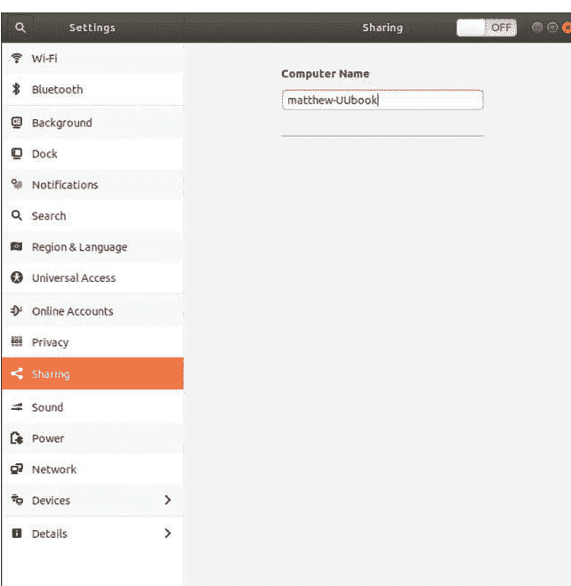
图 19.1 桌面共享偏好。

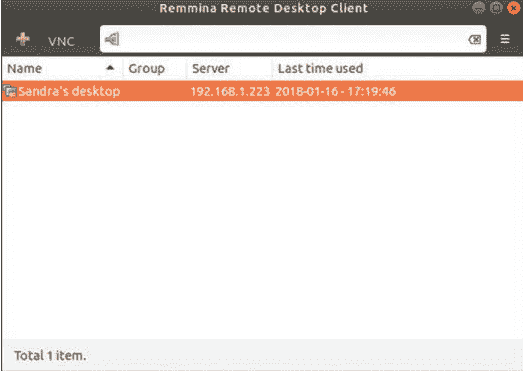
图 19.2 远程桌面查看器。

从图 19.2 显示的屏幕中，选择一个项目并点击左上标题栏中的“打开连接”图标（该标题栏包含关闭、最小化和全屏窗口控件）。如果你尚未输入任何计算机，请选择 `+` 并输入你已经在某处设置好以便访问的计算机的详细信息。

完成后，关闭查看远程桌面的窗口。VNC 不应被认为在互联网或不可信的内部网络上是安全的。

# Guacacamole

Apache Guacamole 是 Apache 软件基金会的应用程序，作为一个使用标准协议（如 VNC、RDP 和 SSH）的客户端远程网关工作。它被称为“无客户端”，因为不需要插件或客户端软件。Guacamole 安装在服务器上（只要该服务器可以从互联网访问，哪里都可以），然后你可以使用浏览器访问你的桌面。

技巧在于，你的桌面实际上并不存在。你使用主机计算机，但仅用于运行浏览器。浏览器连接到你的 Guacamole 服务器，该服务器在云端托管了一个虚拟桌面。当你使用 Guacamole 时，可以从任何地方访问云托管桌面，这是一个非常酷的想法。计算机的使用不再限于任何特定设备或位置。

有多种方法可以在服务器上安装 Guacamole，包括典型的裸机安装和容器化的 Docker 版本。Guacamole 的身份验证可以通过多种方式配置，包括使用本地数据库、LDAP（轻量级目录访问协议）或通过像 CAS 这样的单登录解决方案。

Guacamole 的主要用例似乎是那些需要集中桌面管理和终端用户自定义桌面以提高效率，同时维护一组基本物理硬件作为接口的企业。它对于经常移动的旅行者和远程工作人员来说似乎也很方便。

Guacamole 因其对 VNC 和 SSH 等技术的独特应用而被包含在本章中。如果你觉得这是你想要进一步调查的内容，可以在 https://guacamole.apache.org 学习更多关于 Guacamole 的信息。

# 参考文献

- **www.telnet.org**—Telnet首页
- **https://help.ubuntu.com/community/SSH**—Ubuntu 社区关于 SSH 的文档
- **www.openssh.com**—Ubuntu 使用的 OpenSSH 实现的首页，该实现由与 OpenBSD（一种基于 BSD 的安全操作系统）相同的团队维护
- **https://help.ubuntu.com/community/VNC**—Ubuntu 社区关于 VNC 的文档
- **www.realvnc.com**—RealVNC 公司的首页
- **www.tightvnc.com**—VNC 的替代方案
- **www.noachine.com**—VNC 的替代方案

## 评估你的漏洞

无论攻击来源如何，你都可以遵循五步检查清单来帮助保护你的设备：

- 1. 评估你的漏洞。决定哪些机器可以被攻击，它们运行哪些服务，以及谁有权访问它们。
- 2. 配置服务器以实现最大安全性。只安装你需要的，只运行必须的，并配置本地防火墙。
- 3. 确保服务器的物理安全。
- 4. 创建最坏情况策略。
- 5. 保持关注安全新闻。

这些步骤将在后续章节中介绍，且它们每一个都同等重要。

## 评估你的漏洞

人们犯的一个常见错误是认为开启防火墙就意味着安全。事实并非如此，事实上也从未如此过。每个系统都有独特的安全需求，花时间定制其安全布局将为你提供最大的安全性和最佳的性能。

以下列表总结了最常见的错误：

- **安装每一个软件包**——你计划将该机器作为 DNS 服务器使用吗？如果没有，你安装了 BIND 吗？检查并确保你只安装了需要的软件。
- **启用未使用的服务**——你想远程管理这台机器吗？你想上传文件吗？如果不想，关闭 SSH 和 FTP，它们只会增加攻击向量。所有其他未使用的服务也是如此。
- **由于已经在边界设置了防火墙，而禁用本地防火墙**——在安全领域，深度防御至关重要：攻击者需要面对的层级越多，他们放弃或被捕获的概率就越大。
- **让你的机器泄露比需要更多的信息**——许多机器默认配置为输出软件名称和版本号，这为黑客提供了便利。
- **将你的服务器放置在未锁的房间里**——如果你真的这样做，还不如把它关掉以省去担心。即使你公司的所有员工都是快乐且值得信任的，为什么要冒这个险呢？
- **将你的机器连接到无线网络**——除非你需要无线网络，否则请避免，特别是当你的机器是服务器时。永远不要将服务器连接到无线网络，因为这样做充满了安全问题。

在排除了这些潜在问题后，你就进入了真正的问题：你的服务器上存在哪些攻击向量？在互联网术语中，这取决于哪些服务面向面向的，以及它们运行在哪些端口上。

`Nmap` 会扫描你的机器并报告它找到的任何 TCP/IP 端口。你安装的任何响应 `Nmap` 查询的服务都会被列出来，这让你能够确保尽可能地锁好所有内容。

`Nmap` 可以从 Ubuntu 仓库中安装。虽然你可以在本地机器上使用 `Nmap`，但配合图形界面使用会更简单——至少在你精通之前。要运行图形界面，请使用终端并运行 `nmap`。如果你想启用 `Nmap` 的所有选项，你必须拥有管理员权限并运行 `sudo nmap`。

当你运行 `Nmap`（通过点击 Scan 按钮）时，它会测试机器上的每个端口并检查其是否有响应。如果端口有响应，`Nmap` 将输出端口列表、服务名称（通常占用端口）以及系统上每个开放端口的版本号。希望 `Nmap` 显示的信息不会让你感到意外。如果出现任何你不认识的内容，可能是黑客在你的系统中遗留了后门以允许访问，你应该对此进行调查。

利用 `Nmap` 的输出来帮助发现并消除不需要的服务。面向世界的开放服务越少，你就越安全。仅在你拥有的系统上运行 `Nmap`。扫描他人的服务器是不礼貌的，你还可能被指控在为非法活动做准备。

## 保护你的机器

在禁用了系统上所有不需要的服务后，剩余的是你想要保留的核心连接和程序。然而，如果你还没有完成：你需要收紧你的网络，物理上锁定你的服务器，并实施扫描程序（例如 Tripwire 和混杂模式监控）。

## 保护无线网络

无线网络具有一些独特的安全问题，这些问题值得专门讨论。

无线网络虽然方便，但其本质上是不安全的，因为传输的数据（即使是加密数据）也可以被远程设备接收。这些设备可能在同一个房间里；在隔壁的房屋、公寓或大楼里；甚至在几个街之外。过去几年取得了巨大进展，但当攻击者位于区域内并知道监听频率时，安全泄露的可能性就会增加。还需要注意的是，许多无线网卡使用的加密方法比其他加密形式（如 SSH）脆弱，你不应该将无线网卡加密作为你安全计划的一部分。

## 提示

在无线局域网上进行业务时，始终使用 OpenSSH 相关工具，如 `ssh` 或 `sftp`。密码不会以明文传输，你的会话是加密的。参见第 19 节“使用 SSH 和 VNC 进行远程访问”，了解如何使用 `ssh` 连接到远程系统。

网络周围的物理安全性越高，网络就越安全。（这也适用于有线网络。）将无线路由器（路由器、交换机等）尽可能靠近建筑的中心。记录或监控传输信号的范围，以确定你的网络是否暴露于移动嗅探——极客们称之为“无线网战（war driving）”。`Wireshark` 是一个分析无线流量（以及所有其他网络活动）的有用程序示例。偶尔在你的建筑周围走走不仅可以让你从办公桌前休息一下，还可以让你有机会注意到任何不该出现在那里的人或设备。

请记住，只需要一个接入合法网络的非法访问点就能打开你的系统。这些访问点可能比包香烟还小，发现它们的最佳方法是用另一个无线设备进行扫描。

## 密码与物理安全

安全的下一步是保护网络密码并确保用户也使用密码。对于更好的物理安全性，你可以强制 GRUB 引导程序使用密码，从 BIOS 中移除 DVD 器或 USB 启动选项，或者为 Ubuntu 配置网络启动服务器。还要记住，某些研究显示，90% 的网络破坏是由当前或前员工完成的。如果某人不再需要访问你的网络，请取消访问权限，或者更好的是立即删除账户。良好的安全策略还规定，要先对账户相关的任何数据进行备份并保留一段时间，以防止数据丢失。如果可能，在离职员工离开大楼之前从系统中将其删除。

最后，注意物理安全。如果潜在攻击者可以获得你系统的物理访问，获取完全访问将变得轻而易举。将所有服务器放在锁好的房间内，并确保只有授权人员可以使用客户端。笔记本电脑和其他移动设备应配置所需的内容，并将任何真正敏感的数据放在物理安全的机器上。当包含敏感数据的机器必须在安全环境之外使用时，你应该使用硬盘加密，例如安装 Ubuntu 时提供的加密功能。

你可能会发现 Prey 对笔记本电脑和其他移动设备很有用。Prey 有一个开源的免费版本，可以帮助你追踪丢失的设备，前提是 Prey 在设备丢失之前已安装在设备上。还有一个包含更多功能的付费版本。你可以访问 https://preyproject.com 有关 Prey 的信息。

## 配置使用 Tripwire

`Tripwire` 是一种安全工具，用于检查普通系统二进制文件的完整性，并将任何更改报告到 syslog 或通过电子邮件。`Tripwire` 是确保你的二进制文件未被木马替换的良好工具。木马是无意安装的与分发（预期）程序文件名相同的恶意程序，它们可能会对被攻破的系统造成破坏性影响。

`Tripwire` 有两个版本：开源版本和商业产品。`Tripwire` 的免费版本可以在 Ubuntu 仓库中找到。你可以在 www.tripwire.org 了解它们的差异。

初始化 `Tripwire`，请使用 `-init` 选项，如下：

```bash
$ sudo tripwire -init
Please enter your local passphrase:
Parsing policy file: /etc/tripwire/tw.pol
Generating the database...
*** Processing Unix File System ***
```

写入数据库文件：`/var/lib/tripwire/shuffle2.twd`
数据库已成功生成。

注意，并非所有输出都显示在这里。在 `Tripwire` 创建数据库（你的文件系统的快照）后，它将使用基础以及 `/etc/tripwire` 目录中的配置和策略设置来监控你的系统状态。你应该在需要时以完整性检查模式启动 `Tripwire`。详情请参阅 tripwire 手页。例如，你可以通过输入以下命令让 `Tripwire` 检查你的系统并生成报告：

```bash
$ seymour-$ sudo tripwire -m c
```

这里没有显示输出，但在输入此命令后你实际上会获得一个报告。输出可以重定向到文件，但保存为 `/var/lib/tripwire/report/hostname-YYYYMMDD-HHMMSS.twr`（在其他情况下，将使用你的主机名、年、月、日、小时、分和秒）。你可以使用 `twprint` 工具读取此报告，如下：

```bash
$ seymour-$ sudo twprint --print-report -r \
/var/lib/tripwire/report/shuffle2-20020919-181049.twr | less
```


Tripwire 还支持其他选项，例如通过电子邮件发送报告，它应该由你系统的调度表 `/etc/crontab` 在空闲时间作为运行（在性能较低的计算机上可能会消耗大量资源）。Tripwire 软件包还包含一个 `twadmin` 工具，你可以用它来微调或更改设置、策略，或执行其他管理工作。

如果你想使用 Tripwire，计划花些时间阅读文档。它强大但并不简单。我们建议从 `man` 页和 `www.tripwire.com` 开始。

## 加固设备

永远不要宣传你具有混杂模式（promiscuous mode）的 NIC（网络接口控制器）。混杂模式（可以使用 `ifconfig` 属性在接口上设置）有利于监控网络流量，并允许你监控可能已经侵入你网络的人的行为。`tcpdump` 命令在程序运行时也会将指定的接口设置为混杂模式；遗憾的是，`ifconfig` 命令不会报告 `tcpdump` 正在运行这一事实！

记住用正确的工具做正确的事。虽然你可以使用网络桥接器将你的网络连接到互联网，但这并不是一个好的选择。桥接器将变得几乎过时，因为它们会转发任何经过它们的数据包，当桥接器连接到互联网时这是不好的。路由器允许你过滤哪些数据包被中继。

## 病毒

事实上，Linux 在病毒面前与 Windows 一样脆弱。如果你是因为 Linux 的安全记录而切换到 Linux 的，这可能会让你感到。然而，Windows 和 Linux 之间的区别在于，Linux 更容易防御病毒。事实上，只要你足够明智且勤奋，就永远不需要担心它们。原因如下：

- Linux 永远不会将当前目录放入你的可执行路径，通过输入 `ls /bin/ls` 而不是当前目录中的任何程序名来实现。
- 非根用户只能感染其有权访问的文件，通常只有用户主目录下的文件。这是在不需要时绝不使用 `sudo` 的重要原因之一。
- Linux 强制你手动标记文件为可执行，因此你不会在误认为 `myfile.txt` 只是一个文本文件时意外运行它。
- 通过拥有多个网络浏览器和电子邮件客户端，Linux 具有通过多样性带来的优势：病毒无法同时针对一个平台和 90% 的用户。

尽管有所有这些因素，Linux 仍然容易成为病毒的载体。如果你运行邮件服务器，你的 Linux 可能会向 Windows 机器发送病毒感染的邮件。Linux 服务器可能是安全的，但 Windows 客户端会被病毒击。为了防止这种情况，请考虑为你的机器使用病毒扫描器。你有几个可以选择，但另一些提供了商业解决方案。`ClAV` (`www.clamav.net`) 寻找最适合你的的方案。

## 配置你的防火墙

在每台连接到互联网的计算机上使用基于硬件或软件的防火墙。Ubuntu 有一个名为 Uncomplicated Firewall (`UFW`) 的防火墙应用程序，默认已安装。该工具允许你针对访问计算机或局域网的行为实施选择性或限制性策略。

`UFW` 从终端运行，你必须拥有管理员权限才能使用。`UFW` 最有用的命令列表 20.1 中。

| Command | 执行的操作 |
| :--- | :--- |
| enable | 启用防火墙 |
| disable | 禁用防火墙 |
| on | 开启日志 |
| off | 关闭日志 |
| allow | 添加允许规则 |
| deny | 添加拒绝规则 |
| reject | 添加拒绝规则 |
| limit | 添加限制规则 |
| delete | 删除规则 |
| status | 显示防火墙状态 |
| numbered | 以编号方式显示防火墙状态 |
| verbose | 以详细方式显示防火墙状态 |
| show | 显示版本 |
| report | 显示信息 |

接下来，你想启用防火墙日志。正如 `enable` 命令一样，运行：

```bash
$ seymour-$ sudo ufw on
```

要在防火墙开启特定端口，你可以运行 `ufw` 命令配合端口号。例如，如果你想允许端口 80 (`HTTP`) 进入你的服务器，输入：

```bash
$ seymour-$ sudo ufw allow 80
```

要删除允许端口 80 的防火墙规则，运行：

```bash
$ seymour-$ sudo ufw delete 80
```

许多服务已经在 `ufw` 中定义。这意味着你不需要记住这些服务的标准端口，你可以使用服务名称来允许、拒绝或删除，如下：

```bash
$ seymour-$ sudo ufw allow ssh
```

你还可以从特定的 IP 地址允许。例如，如果你想让特定的 IP 地址连接到你的服务器，输入：

```bash
$ seymour-$ sudo ufw allow from 192.168.0.1
```

要删除允许之前的 IP 地址连接的防火墙规则，运行：

```bash
$ seymour-$ sudo ufw delete allow 192.168.0.1
```

有一个图形界面叫做 `GUFW`，你可以从 Ubuntu 仓库中安装它来管理 `UFW`。细节相同，但界面更简单，不需要像使用 `UFW` 那样记住那么多。

`UFW` 基于 `iptables`，`iptables` 用于配置 Linux 内核内置的防火墙。`UFW` 简化了用法和语法并直接使用 `iptables`。你在 Ubuntu 机器上可能不需要这些，但为了完整以及帮助你将来使用不同的 Linux 发行版，表 20.2 列出了简单的基础命令，并对 `iptables` 进行了要介绍。

在表中，你看到大写的规则 `ACCEPT` 和 `DROP`，这些是针对称为链的项设置的策略。链是网络访问类型的描述，例如表 20.2 中的 `INPUT`、`FORWARD` 和 `OUTPUT`，以及网络中的交互。例如，你可以将默认策略设置为 `DROP`（意味着拒绝），然后允许特定类型的流量通过防火墙。`iptables` 非常复杂且极其强大。

## 表 20.2 iptables 常用命令

| 命令 | 执行的操作 |
| --- | --- |
| Usage: command | |
| sudo iptables -L | 列出当前防火墙规则 |
| sudo iptables -L -vn | 列出当前防火墙规则但带有更多详细信息 |
| sudo iptables -F | 删除所有已设置防火墙规则 |
| sudo iptables -P INPUT DROP | 丢弃所有入流量 |
| sudo iptables -P FORWARD ACCEPT | 接受所有转发流量 |
| sudo iptables -P OUTPUT DROP | 丢弃所有出流量 |
| sudo iptables -A INPUT -s 8.8.8.8 -j DROP | 丢弃来自特定 IP 地址的流量（示例是一个 DNS 服务器，你可能不想拦截它……） |

你可以根据 IP 地址、网卡（NIC）、端口、网络等阻止或允许流量。你可以使用 `iptables` 记录所有操作或特定操作。你可以使用它来配置 NAT 路由器。更多信息，请参阅 `iptables` 及其 IPv6 兄弟版本 `iptables` 的首页。

`nftables` 是一个新的防火墙工具，正在逐渐取代 `iptables`。`nftables` 是稳定的且适用于生产环境的，但目前尚未如此。如果你想开始学习并切换，而不是等待它成为默认设置，请查看官方文档：`https://wiki.nftables.org/wiki-nftables/index.php/Main_Page`。

## AppArmor

`AppArmor` 是一种强制访问控制（MAC）系统。它比众闻知的 `SELinux` (`https://selinux.org/`) 简单，`SELinux` 是由美国国家安全局（NSA）创建的 MAC 框架。`AppArmor` 设计用于通过限制特定程序使用预定义的资源（仅限这些资源）来限制这些程序的功能。这是通过加载到内核的配置文件（profiles）实现的。它可以运行在投诉模式（complain mode），会记录不安全实践的信息但不采取操作；或者运行在强制模式（enforcement mode），此时策略和限制将生效。

本节提供了 `AppArmor` 的简要介绍。如需更完整的介绍，请查看本章末尾“参考文献”部分列出的链接。

默认情况下，`AppArmor` 的作用有限。你可以通过安装 `apparmor-profiles` 软件包从 Ubuntu 仓库安装一些额外的配置文件。这些配置运行在投诉模式并在 `/var/log/syslog` 中记录问题。

要释放 `AppArmor` 的威力，你需要在 `/etc/apparmor.d` 中编辑或创建文本文件。配置文件以应用程序命名，文件中包含该应用程序的完整路径。例如，这里显示的 `bin.rsyslogd` 文件限制了系统日志守护进程。

## 最后修改日期：2011年9月25日 周日 08:58:35

## AppArmor 389

```
#include <tunables/global>

# 如果 syslogor 无法写入内核记录拒绝信息的文件，调试可能会很困难。

# 在情况下，你可以执行以下操作：

# watch n 1 'dmesg' | tail -5

/usr/sbin/rsyslogd 

#include <abstractions/base> #include <abstractions/nameservice>

capability sys_tty_config, capability d_override, capability dac_read_search,

capability setuid, capability setgid, capability sys_nice, capability syslog

# rsyslog configuration /etc/rsyslog.conf r, /etc/rsyslog.d/, /etc/rsyslog.d/** r,

/var/run/rsyslog.pid rwk, /var/pool/rsyslog/ r, /var/pool/rsyslog/** rwk.

/usr/lib_(32,64)/rsyslog/*.so mr

/dev/xconsole rw, rw|[@PROC] kmsg

/dev/tty* r,

/dev/log wl, /var/lib*//dev/log wl, /var/pool/post-

fix/devlog

# 使用文件 #etc/mysql/my.cnf 时需要 'r' r, #/(var/run/mysqld/mysqld.sock rwk

# 为 postgresql 添加 #include <abstractions/openssl> ##include

# <abstractions/ssl_cert> #/(var/run/postgresql/.s.PGSQL.*[0-9] rwk

# 站点特定的添加和覆盖。详情请见 local/README。#include

# <local/usr/sbin.rsyslog>
```


即使没有语法，你也可以从该文件中看出配置文件是简单的文本文件，支持它们的使用、属性和通配符（对文件名的模式匹配），允许或禁用特定的能力，以及文件中哪些位置和程序可以被访问或使用。

每个访问规则都指定了此列表中的权限：
- `r` - 读取
- `w` - 写入
- `ux` - 无限制执行
- `Ux` - 无限制执行并清理环境
- `px` - 离散配置执行
- `Px` - 离散配置执行并清理环境
- `ix` - 继承执行
- `m` - 允许通过 `mmap(2)` 调用使用 `PROT_EXEC`
- `l` - 链接

这些权限列在行尾：

`genprof` 是一个帮助你生成或更新配置文件的程序。你提供可执行文件的名称（如果不在路径中，则提供路径），并可选地提供其路径作为路径。以下是一个示例：
```
matthew@seymour-$ sudo genprof google-chrome
```
你将能够启动该程序并使用一段时间。完成后，你将获得选择访问的机会。

## 制定恢复计划

没有人喜欢为最坏的情况做计划；你的老板和……如果你确实被黑了，并且花时间准备了恰当的响应。以下是一些建议：
- 不要拔掉网线，这会提醒黑客已被检测，你可以安全地将其从网络移除。然而，不要关闭电源，因为后门只有在系统重启时才会启用。
- 复制系统上所有的日志文件并将其存储在其他地方。这些文件可能被篡改过，但它们可能包含有用信息。
- 检查 `/etc/passwd` 文件并寻找你不认识的用户。更改系统上的所有密码并删除恶意用户。
- 检查 `ps aux` 的输出查看是否有异常程序运行。还要检查是否设置了任何定时任务（cron jobs）。
- 查看 `/var/www` 以及是否有任何不该存在的网页。
- 检查用户家目录下 `.bash_history` 文件的内容。你的主用户有最近的命令吗？
- 如果你以前与外部安全公司合作过，请联系他们进行新的审计。将所有的日志交给他们并解释情况。他们能够从日志中提取出可能的信息。
- 开始收集过去几周的备份磁带。系统可能在你发现之前就已经被黑了，你可能需要回滚系统以确定攻击何时发生。
- 从 `http://rkhunter.sourceforge/` 下载并安装 Rootkit Hunter。该工具搜索并移除坏客留下的类型的文件。

最后，将你的灾难恢复计划放在安全的地方；保存在有问题的机器上是一个非常糟糕的做法。

- https://help.ubuntu.com/community/UFW—Ubuntu 关于 UFW 的社区文档
- https://wiki.ubuntu.com/UncomplicatedFirewall—Ubuntu 关于 UFW 的文档
- https://gitlab.com/apparmor/apparmor/wikis/home/—AppArmor 的官方文档
- https://help.ubuntu.com/community/AppArmor—Ubuntu 关于 AppArmor 的社区文档
- https://wiki.ubuntu.com/Security/Features—概述并描述安全特性、Ubuntu 以及配置的 Ubuntu wiki 页面

# 第21 章：本章内容

## 性能调优

- 存储磁盘
- 内核
- Tuned
- 参考文献

从硬件中挤榨出额外的性能似乎是一项毫无意义的任务，因为如今通用型硬件升级的价格非常低廉。在某种程度上，这确实如此；对于我们大多数人来说，买一台新电脑比花费几个小时去争夺 5% 的速度提升要便宜得多。但如果速度提升是 20% 呢？如果是 50% 呢？

通过优化系统可以获得的收益取决于你运行的任务类型，但对每个人都有适合的内容。在接下来的几页中，我们将介绍优化 Apache Web 服务器、KDE 和 GNOME 桌面系统、MySQL 和 PostgreSQL 数据库服务器等的快速方法。

在进入细节之前，你需要理解“优化”并不是一个绝对的术语：如果你优化了一个系统，你提升了它的性能，但它仍然可能进一步提升的空间。你通常对从系统中获得 99.999% 的性能并不感兴趣，因为优化遵循收益递减规律：一些基础更改会产生最大的差异，但之后，需要投入越来越多的工作才能获得速度上的改进。

许多 Linux 用户喜欢在“引擎盖”下做文章来提高电脑性能，而 Linux 为你提供了一些非常棒的工具来实现这一点。虽然追求稳定性的维护者通常告诉我们：“不要修理没坏的东西”，但热爱实验的改装者会说：“修它，直到它坏掉为止”。在本节中，你将学习许多用于调优（或称为“微调”）文件系统的命令。

然而，在对 Linux 进行任何底层工作之前，请记住以下几点。在开始之前对你的系统进行基准测试。Linux 并不提供完善的基准测试应用程序，且现有工具的可用性变化很快。你可以在网上搜索适用于 Linux 基准测试应用程序的最新信息。如果你是系统管理员，可能会选择创建自己的基准测试方案。其次，记住一次只微调一种，这样你就能判断哪些是有效的、哪些无效的以及哪些会导致故障。这些微调中的可能不起作用或会让你的机器死机，但如果你一次只实施一个，你会发现撤销导致问题的更改要容易得多。

如果不进行测量，就无法调优。在做出更改之前测量你想要改进的内容，在进行增量更改时以及在更改完成后测量。永远不要假设任何事情。只有这样，你才能确定你所做的是有用的。

始终准备一个可以工作的启动盘，例如 Ubuntu 的 Live CD 或 DVD。记住，你对尝试任何这些微调承担了所有风险。如果你不理解自己在做什么，或者对自己没有足够的能力撤销这里所讨论的任何更改，请不要尝试本章中的任何建议。Ubuntu 的默认设置对大多数人来说运行良好，真的不需要调整——就像大多数人可以按原样使用并享受他们的汽车一样。然而，有些人喜欢拆解汽车并进行改装；他们会不断微调并弄坏它们。这一章就是为这些人准备的。如果你认为自己无法修复它，就不要冒险去弄坏它。

### 存储磁盘

第一组调优想法都与访问和存储你的数据有关。在进行性能调优时，通常需要权衡，例如减少或消除冗余或日志（journaling）。对于某些瞬即逝且丢失的数据，这是没关系的。对于大多数数据，你希望保持所有内容的完整，以确保数据的持久性和完整性。

此外，由于固态硬盘（SSD）以及使用它们与硬盘相比的速度提升，真的没有足够的理由再去调优大多数的这些项了。

### Linux 文件系统

本章讨论的大多数选项都是针对 ext2、ext3 或 ext4 文件系统的。Ubuntu（以及目前大多数其他 Linux 发行版）的默认是 ext4。xfs 和 zfs 系统也很常见。

ext3 和 ext4 都是日志文件系统，在数据存储方面，它们比其他文件系统可靠得多。日志文件系统首先将更改写入驱动器另一部分的日志中。一旦记录了日志，更改就会进入队列并在后台执行。这可以帮助防止数据损坏，同时保持数据处于一致状态。如果出现问题，可以从日志重建数据。

还有其他文件系统选项可用。它们大多数被认为是遗留选项，或用于与其他操作系统（如微软 Windows 的 NTFS）保持兼容。

目前最受关注的文件系统是 ZFS，它源自 Microsystems 和 Solaris 操作系统（现由 Oracle 所有），长期以来一直存在数据中心。然而，ZFS 是专有的，之前其他操作系统无法使用——但现在不再了。嗯，它是可用的，但仍然受到适当许可限制，因此对于个人使用之外的任何操作都存在潜在风险。不建议普通使用此选项，但如果你有巨大的存储需求并且愿意这样做的话。

### hdparm 命令

`hdparm` 工具用于调优驱动器。`hdparm` 的 man 页面非常详尽，并包含了内核告诉给它的有用信息。以下是一些示例：
- `hdparm -tT`
- `hdparm -m16 -d1 -ul-c1`
- `hdparm -m16 -d1 -ul-c1 -k`

`-m` 选项将预留块设置为较低的值，从而释放更多空间，但代价是 `fsck` 恢复任何文件的空间会变小。

使用 `-sparse_super` 选项减少超级块数量以节省空间。（现代文件系统默认使用此选项。）在更改此值后，务必运行 `e2fsck`。

通过 `-r` 选项可以释放更多空间，该选项设置了预留（根）块的数量。

`tune2fs` 的这些用法大部分是为了释放驱动器上的空间，但以牺牲 `fsck` 恢复数据的能力为代价。除非你真的需要这些空间并能够承担后果，否则请接受默认值；大硬盘相对廉价。

### e2fsck 命令

`e2fsck` 工具用于检查 ext2/ext3/ext4 文件系统。从 `man e2fsck` 中提取的某些常用参数如下：
- `-c` - 检查坏块并将其标记为坏块
- `-f` - 强制对干净的文件系统进行检查
- `-v` - 进入详细模式

### badblocks 命令

虽然 `badblocks` 本身不是一个性能调优程序，但该工具可以检查分区（最好是未挂载的分区）是否存在坏块。不建议单独运行此命令；你应该让由 `fsck` 调用。如果你只指定块大小精度，则应该直接使用它；不要假设任何内容。

`badblocks` 的可用选项在 man 页中有详细说明。它们允许对文件系统进行底层操作，这对于文件系统专家进行数据恢复或文件破解有用，但超出了本章和普通用户的范围。

### 禁用文件访问时间

每当 Linux 读取文件时，都会更改最后访问时间（称为 atime）。对于你的 Web 服务器也是如此：如果你每秒收到 50 次请求，你的硬盘每秒将更新 50 次 atime。你真的需要知道文件最后一次访问的时间吗？如果不需要，你可以通过以下方法禁用目录的 atime 设置：
```
hew@seymour:~ chatter -R +A /path/to/directory
```
`chatter` 命令更改文件系统属性，其中“不更新 atime”就是一种。要设置该项，使用 `+A` 并指定 `-R` 以便进行递归设置。`/path/to/directory` 会被更改，其包含的所有文件和子目录也会被更改。

### 内核

随着 Linux 内核随时间的推移，开发人员寻求一种精调某些内核参数的方法。在 `sysctl` 出现之前，这些参数必须在内核配置中更改，然后重新编译内核。

`sysctl` 命令可以更改运行中内核的某些参数。它通过 `/proc` 文件系统实现，该系统是通往运行中内核的“虚拟窗口”。尽管 `/proc` 下似乎存在一组目录和文件，但那只是内核部分内容的表示。当你是 root 用户或使用 `sudo` 命令时，你可以从这些“文件”中读取值并向其写入值，它们被称为变量。你可以像下面的示例一样显示变量列表（该示例显示了一个简略列表，完整列表大约有 250 个或更多项目）：
```
matthewsymour-$ sysctl -A
net.ipv4.tcp_max_syn_backlog = 1024
net.ipv4.tcp_rcflist37 = 0
net.ipv4.tcp_studurg = 0
net.ipv4.tcp_abort_on_overflow = 0
net.ipv4.tcp_tw_recycle = 0
net.ipv4.tcp_syncookies = 0
net.ipv4.tcp_fin_timeout = 60
net.ipv4.tcp_retries = 15
net.ipv4.tcp_retries1 = 3
net.ipv4.tcp_keepalive_intvl = 75
net.ipv4.tcp_keepalive_probes = 9
net.ipv4.tcp_keepalive_time = 7200
net.ipv4.ipfrag_time = 30
```
上述项目是网络参数，调优这些值超出了本书的范围。然而，如果你想更改某个值，请使用 `-w` 参数：
```
matthewsymour-$ sysctl -w net.ipv4.tcp_retries 2=20
```
这增加了该特定内核参数的值。

如果你发现某个设置有用，可以将其输入 `/etc/sysctl.conf` 文件。格式如下（使用此示例）：
```
net.ipv4.tcp_retries 2=20
```
对于内核黑客来说，比普通用户更有趣的是，`sysctl` 是一个强大的工具，仍在持续开发和完善文档。

> TIP
> 内核在平衡图形系统性能方面做得很好，所以你对调优桌面以运行得更快并没有太大空间。

GNOME 和 KDE 都是“重量级”桌面系统：它们是全能的、会唱会跳的环境，功能远比浏览文件系统得多。缺点是它们的体积使得它们在旧系统上运行缓慢。相反，Ubuntu 存储库中还有其他系统可用，Xfce 和 LXDE 桌面，它们比 GNOME 和 KDE 精简且快速得多。如果你发现 GNOME 和 KDE 仅仅打开文件浏览器就很吃力，那么 Xfce 或 LXDE 可能适合你。

### Tuned

Tuned 项目为 Linux 提供了系统调优服务。Tuned 可做很多：
- 监控连接的设备
- 允许自定义设置
- 包含预定义的配置文件
- 将配置存储在一个处
- 支持静态和动态设置
- 可以大幅提高性能
- 提供系统调优服务

首先，安装 tuned：
```
$ apt install tuned
```
查看可用配置列表，输入：
```
$ tuned-adm list
```
显示当前使用的配置，输入：
```
$ tuned-adm active
```
显示针对你的系统推荐的配置，
```
$ tuned-adm recommend
```
要更改当前使用的配置，输入以下内容，其中 profile 是你想切换到的配置名称：
```
$ tuned-adm profile
```
验证系统正在使用当前配置：
```
$ tuned-adm verify
```
卸载 Tuned 产生的所有设置，
```
$ tuned-adm off
```


点，你可能需要重新编译内核以支持特定的硬件，或为操作系统添加新功能，尽管 Ubuntu 内核团队非常努力地回传支持或启用任何可能的功能（以模块的形式），因此你极少会有这种需求。内核也是易于接触的，并且非常乐意讨论特定的需求和功能。某些功能没有启用仅仅是因为没有人请求过或需要过。偶尔，某些功能因为与另一个功能冲突而没有启用。在这些情况下，Ubuntu 内核团队可以帮助你了解发生的情况（但不要滥用他们的善意和时间）；他们非常忙碌，而且工作很长。

说真的，今天人们自己编译内核的主要原因是因为他们想要学习成为一名内核开发者。如果你听过关于重新编译 Linux 内核之困难的“恐怖故事”，你可以放松了；本章将提供你所需的所有信息，让你在兴趣学习新技能时，了解如何无痛地完成这一过程。这是一项复杂且注重细节的任务，但对于大多数技术用户来说是可以触及的，即使它是完全没有必要的。

## 注意

构建和使用自定义内核将使你的系统难以获得支持。虽然编译内核是一种学习体验，但你将被允许在自定义构建的内核上修复 Ubuntu 的错误（如果你这样做，它们将在不作进一步解释的情况下被拒绝），如果你与 Ubuntu/Canonical 有商业支持合同，构建和使用自定义内核将使合同失效。

## Linux 内核

Linux 内核是操作系统管理部分，许多人将其称为 Linux。虽然许多人认为整个发行版都是 Linux，但唯一可以被称为 Linux 的部分是内核。Ubuntu 与许多其他 Linux 发行版一样，包含一个带有与内核交互的软件的内核，以便用户能够以有意义的方式与系统进行交互。

系统工具和用户让计算机成为用户的有用工具。

### 第一个 Linux 内核

1991 年，Lin Torvalds 发布了 Linux 内核 0.99 版本，这是他渴望为他的 Intel 386 个人电脑拥有一个强大的类 UNIX 操作系统的结果。他编写了创建现在被称为 Linux 内核所需的初始代码，并将其与 Richard Stallman 的 GNU 工具结合起来。事实上，由于许多 Linux 基础系统工具都来自 GNU 项目，许多人将该操作系统称为 *GNU/Linux*。从那时起，Linux 受益于数千贡献者为该项目投入的才华和时间。Linux 仍然维护内核，决定哪些将和不会作为正式版本进入内核，这被许多人称为*原生 (vanilla)* Linux 内核。

### Linux 源码树

Linux 内核源码保留在一个名为内核源码树的目录组中。内核源码树的结构很重要，因为编译（构建）内核的过程是自动化的；它由 `make` 程序解释的脚本控制。这些脚本被称为 makefiles，它们期望在特定位置找到内核代码片段；如果找不到，它们将无法工作。你将在本章的晚些部分学习如何使用 `make` 来编译内核。

Linux 源代码不需要安装在你的系统上，系统也可以运行，或者你也可以完成典型任务，如处理电子邮件、浏览网页或使用文字处理程序。如果你想编译内核，则必须安装内核源码。在下一节中，你将学习如何安装内核源文件以及如何使用所需的符号链接。该链接 `/usr/src/linux-5.4.0`（结尾的数字与你系统中安装的内核发布版本匹配）正是我们用来指向内核源码树目录，以便查看内核源码树的内容。

> 注意：Linux 内核的变化速度正在加快，就像我们生活的其他部分一样。在本章中，我们选择使用 Ubuntu LTS 版本的版本号。你系统上的版本号可能不同，但过程和概念保持不变。

`/usr/src/linux-5.4.0` 目录包含 `.config` 文件和 makefiles 等。`.config` 文件是你内核编译时的配置。默认情况下，没有 `.config` 文件；你必须从 `/configs` 子目录中选择一个。你将找到 Ubuntu 提供的每种口味内核的配置文件；只需将适用于你系统的文件复制到默认目录并将其重命名为 `.config` 即可。

我们已经讨论过 `/configs` 子目录的内容，让我们检查 `/usr/src/linux-5.4.0` 下的其他目录。对我们最有用的是 `Documentation` 目录。在其及其子目录下，你将找到有关内核每个部分的文档。`00-INDEX` 文件（每个 `Documentation` 子目录都包含）包含了主目录中的文件列表以及它们的简要说明。许多文件仅为内核编程人员和应用程序编写者编写，但有少数是为尝试学习内核和设备驱动程序的中级或高级 Linux 用户准备的。有趣且实用的文档如下：

- `devices.txt`——此文件列出了 `/dev` 目录中表示的所有 Linux 设备，给出了主、次设备号和简短描述。你可能在某个时刻收到过提到 char-major-xxx 的错误信息；此文件就是保存列表的地方。

## 第 2 章 内核模块管理

- [ide.txt](https://www.kernel.org/doc/Documentation/latest/admin-guide/ide-howto.txt) ——如果你的系统使用 IDE 硬盘，此文件讨论了内核如何与它们交互，并列出了你可以管理 IDE 硬盘的内核命令。

- [initrd.txt](https://www.kernel.org/doc/Documentation/latest/admin-guide/initrd.txt) ——此文件提供了关于初始内存磁盘（initrd）的深度知识，了如何创建和挂载它们以及内核如何与之交互。

- [kernel-parameters.txt](https://www.kernel.org/doc/Documentation/latest/admin-guide/kernel-parameters.txt) ——此文件列出了许多可以在启动时传递以配置内核或硬件的参数，乍看起来并不有用。然而，知道某个参数的存在可能与你寻找的内容有关可以帮助你追踪更多信息。

- [sysrq.txt](https://www.kernel.org/doc/Documentation/latest/admin-guide/sysrq.txt) ——如果你曾经好奇过键盘上标记为 SysRq 的键是什么，此文件提供了答案。它是硬接到内核中的组合键，可以帮助你从系统锁定恢复。Ubuntu 出安全默认禁用了。你可以在根提示符下通过输入命令 `echo "1" > /proc/sys/kernel/sysrq` 重新启用，通过选择非 0 值来禁用。

在 Documentation 下的其他目录中，你会找到处理 CD-ROM 驱动器、文件驱动系统、游戏和摇杆驱动（不是显卡；那些属于 X11 而不是内核）、网络驱动以及 Linux 操作系统中所有其他驱动和系统的类似文件。再次，这些通常是为程序员写的，但也可以为中级和高级 Linux 用户提供有用信息。

`scripts` 目录包含许多 `make` 使用的脚本。对于不是程序员或内核开发者（也称为内核黑客）的人来说，这里真的不包含感兴趣的内容。

内核构建后，`arch` 目录及其子目录中的所有编译文件可以手动移动到最终位置，在本章的晚些部分，`make` 脚本将为你完成。在 Linux 早期时代，这种编译后的文件重定位都是手工完成的；你应该感谢 `make`。

`make` 工具是一个复杂的程序。你可以在此处找到关于 make 文件结构以及它可以接受的参数的完整文档：www.gnu.org/software-make/manual/make.html。

`/usr/src/linux-5.4.0` 中的剩余目录包含内核和内核驱动的源码。当你安装内核源码时，这些文件被放置

# Linux 内核 405

它们会自动生成。当你对内核源码进行补丁时，这些文件会被自动修改。当你编译内核时，这些文件会被自动访问。虽然你永远不需要触碰源码文件，但它们可能很有用。内核源码文件无非是带有特殊格式的文本，这意味着你可以查看它们并阅读程序员的注释。程序员编写了应用程序，但无法（或没有）编写文档。程序员写在源代码中的注释通常是该代码唯一存在的文档。

在在某些代码的注释中，甚至“隐藏”了一些微小的测试程序，其中包含了注释以及对其他信息的引用。由于源代码是用一种易读的语言编写的——几乎就像英语——非程序员可能能够了解应用程序或驱动程序实际上在做什么（可以参考第 38 章“使用编程工具”来了解这是如何实现的）。这些信息对于正遇到内核及驱动程序相关问题的中级或较旧的 Linux 内核来说可能很有用。

> 硬件的交互和控制由内核的一小部分处理，称为设备驱动程序。驱动告诉计算机如何响应用户提示与调制解调器、SCSI 卡、键盘、鼠标等进行交互。没有设备驱动程序，内核就不知道如何与关联设备交互。

## 内核的类型

在 Linux 的早期阶段，内核是一个单一的代码块，包含了用于处理器、主板和其他硬件的所有指令。如果你更改了硬件，你就必须重新编译内核以包含你需要的并丢弃你不需要的。包含额外的、不必要的代码会带来代价，因为内核会变得更大并占用更多内存。在只有 4MB 到 8MB 内存的系统上，浪费宝贵的内存来运行不必要的代码是不可接受的。内核编译在某种程度上是一门“黑艺术”，因为早期的 Linux 用户试图从他们的计算机中榨取可能的性能。

随着内核的增长和可以添加到计算机的设备数量的增加，重新编译的要求变得非常繁重。开发出了一种新的内核构建方法来简化编译每个内核的任务。内核源码中组成设备驱动程序代码的部分可以可选地编译为模块，该模块可以被加载和卸载到内核中。这被称为内核构建的模块化方法。现在，可以一次编译整个内核，大部分代码被编译到这些模块中。只加载所需的模块；内核可以保持较小，且添加硬件变得变得简单得多。

典型的 Ubuntu 内核有几个驱动程序是作为内核本身的一部分编译的（称为内联驱动程序），另一些则编译为模块。在启动过程中，只有内联设备驱动程序对内核可用；模块化驱动程序只有在系统启动后才可用。

作为一个常见的例子，如果你打算从 SCSI 磁盘启动，那么 SCSI 磁盘驱动程序必须对内核可用。如果编译内核时没有内联这些驱动程序，系统将无法启动，因为无法访问磁盘。

模块化内核的一种规避方法是使用初始 RAM 磁盘（initrd），在本章的“创建 RAM 磁盘镜像”部分中讨论过。initrd 加载一个微型内核和相应的设备，该设备可以访问设备以加载你想要运行的内核。

某些代码只能是二者之一（出于对普通用户无紧的技术原因），但大多数代码既可以编译为模块化，也可以编译为内联。取决于应用程序，系统管理员更倾向于其中一种；事实上，由于现代处理器和充足的系统内存，性能差异对于最狂热的 Linux 黑客之外的人来说几乎不值得担心。

在编译时，选择模块化还是内联是 `make config` 步骤的一部分，该章对此有详细介绍。除非你有特定的理由，否则在给出选择时选择模块化选项。因为你管理内核的频率比编译内核更高，管理模块的过程将在下一节中介绍。

## 管理模块

使用模块化内核时，需要特殊的工具来管理模块。模块必须加载和卸载，如果能尽可能自动地完成就太好了。当你加载模块时，还需要向它们传递必要的参数——如内存地址和中断等。（信息随模块而异，因此你需要查阅模块的文档来确定需要以及向它们传递哪些信息。）本节介绍了用于管理模块的工具，并给出了一些使用它们的示例。

Linux 提供了以下模块管理工具，所有工具（以及 `modprobe.conf`）都有 man 页面：

- `lsmod`—此命令列出已加载的模块。将其传递给 `less` 是很有用的，因为列表通常超过一页。

- `insmod`—此命令将模块加载到运行的内核中。如果给没有完整路径的模块名，则会搜索运行内核的默认位置 `/lib/modules/*`。此命令提供了几个选项；最用的是 `-f`，它强制加载模块。

- `rmmod`—此命令从运行的内核中卸载（移除）指定的模块。一次可以指定多个模块。

- `modprobe`—`insmod` 和 `modprobe` 的更高级版本，带有 `-x` 选项会自动处理加载。移除模块。然而，没有强制选项。`modprobe` 的有用选项是 `-t`，它导致 `modprobe` 循环遍历一组驱动程序，直到它

## 管理模块 407

找到并匹配你的系统。如果你不确定哪个模块适用于你的网卡，使用此命令：

```
matthew@semour:~$ sudo modprobe -t
```

这里使用了 `net` 术语，因为它是存放所有模块的目录名称（`/lib/modules/*/kernel/net`）。`modprobe` 命令尝试每一个，直到成功加载。

- `modinfo`—此命令查询模块的对象文件，并提供模块名称、作者和任何其他信息。它非常有用。

- `depmod`—此程序为内核模块创建依赖关系。某些模块需要加载其他模块；即它们依赖于其他模块。在启动过程中，启动文件包含 `depmod -a`，并在每次启动时运行以创建 `/lib/modules*/modules.dep` 文件。如果你对 `/etc/modprobe` 文件进行了更改，手动运行 `depmod -a`。`depmod` 命令、其依赖列表和 `modprobe` 允许按需要自动加载。

- `/etc/modprobe`—此目录包含一组 `*.conf` 文件，用于为模块指定选项。它们也可以用于创建别名或覆盖特殊需求模块的默认 `modprobe` 行为。

- `/etc/modprobe.conf`—这不是命令，而是一个控制 `modprobe` 和 `depmod` 行为的文件；它包含内核变量。虽然命令语法可以非常，但大多数情况不需要。最常用的是为设备设置别名并为其传递某些参数。例如，以下代码将设备名称（来自 `devices.txt`）别名为描述性单词，然后向关联模块传递信息：

```
alias char-major-89 i2c-dev

eeprom ignore=2,0x50,2,0x51,2,05
```

`i2c-dev` 设备用于读取此系统的 CPU 温度和风扇转速。这些 `/etc/modprobe.conf` 行是由用户建议的。我们使用文本编辑器添加了它们。

这里显示 `lsmod` 的部分列表，通过 `less` 命令传递，以便你可以逐页查看：

```
matthew@semour:~$ lsmod | less
```

| Module | Size | Used by |
| --- | --- | --- |
| parport_pc | 19392 | 1 |
| Module | | |
| parport_pc | 19392 | 1 |
| lp | 8236 | 0 |
| joydev | 17377 | 0 |
| parport | 29640 | 2 parport_pc,lp |
| autos4 | 10624 | 0 |
| sunprpc | 101064 | 1 |

Telegram Channel @nettrain

## 第 22 章 内核模块管理

列表实际上要长得多，但在这里你看到输入模块正在被 `joydev`（摇杆）模块使用，而摇杆模块并没有被使用。这台电脑有一个已自动检测到的摇杆端口，但没有连接任何摇杆。扫描仪模块也被加载了，但 USB 扫描仪未插拔，该模块未被使用。你使用 `lsmod` 命令来确定某个模块是否已加载，以及其他哪些模块正在使用它。如果你查看完整列表，可以看到所有连接到你电脑的设备对应的模块。

要移除模块（在本例中为 `joydev`），请使用以下命令：

```
matthew@seymour:-$ sudo rmod joydev
```

或者使用此命令：

```
matthew@seymour:-$ sudo modprobe -r joydev
```

`lsmod` 的输出现在显示它不再被加载了。如果你也移除 `input`，你可以使用简单的命令通过 `modprobe` 同时加载 `input` 和 `joydev`（记住，它们之间相互依赖），如下所示：

```
matthew@seymour:-$ sudo modprobe joydev
```

如果 Ubuntu 阻止了某个模块（因为它是与你当前运行的内核版本不同的内核版本；例如 NVIDIA 显卡模块），你可以像这样强制加载它：

```
matthew@seymour:-$ sudo insmod -f nvidia
```


在这种情况下，你可以忽略内核生成的任何抱怨（错误消息）。

## 何时重新编译

Ubuntu 系统使用的是一个原版 Linux 内核的修改版本（这种修改版本被称为“补丁内核”），并在其中编译了额外的驱动程序和其他特殊功能。

Ubuntu 对所有发行版内核都设有非常密集的测试期，并定期更新版本。所提供的内核尽可能多地编译了许多模块，以提供极大的灵活性。正在运行的内核可以通过 `sysctl` 程序进行进一步调优，该程序允许直接访问运行中的内核并更改某些内核参数。由于有了这些测试、配置和可读性，预编译的 Ubuntu 内核已经完成了大多数用户需要执行的所有工作。大多数用户只需要重新编译内核来完成以下操作：

- 适应某些冷门的新硬件
- 在 Ubuntu 尚未提供预编译内核时进行系统更新
- 尝试系统功能

Ubuntu 为 32 位和 64 位处理器提供了预编译的内核版本。对于每种架构，Ubuntu 都会编译一个适用于大多数用户的通用内核（generic kernel）、一个针对服务器用途优化的服务器内核（server kernel）、一个为低延迟服务器设计的抢占内核（preempt kernel），以及一个对于瞬时响应比平衡更重要的（例如在专业音视频录制和编辑中）的实时内核（rt kernel）。还有一个名为 `virtual` 的特殊内核，可在虚拟机中使用。这些都来自 Ubuntu 软件仓库。

此外可用的一系列名为 `linux-backports-modules-` 的包，每个包都包含一组从较新内核回传到当前版本 Ubuntu 内核的特定内核模块。如果你为某个硬件需要更新的驱动程序，请先查看这些回传模块。

## 内核版本

Linux 处于不断开发的状态。随着新功能的添加、故障的修复以及新技术被整合到代码库中，有必要为生产环境提供稳定的内核发布版。此外，发布包含最新代码以供开发者测试的独立版本也是重要的。为了跟踪内核，为它们分配了版本号。对于喜欢顺序修订的程序员来说，版本号具有抽象意义。同一个应用程序的版本 8 是否比版本 4 进了一倍？一个应用程序的版本 1 是否小于另一个应用程序的版本 3？版本号不能用于此类定性或定量的比较。高版本号完全可能比旧版本拥有更少的功能和 Bug。数字仅用于区分和组织软件的修订版本。内核版本可以分为四个部分：

- 主版本（Major version）——这是主版本号，在我们的示例中是 5。
- 次版本（Minor version）——这是次版本号，在我们的示例中是 4。
- 额外版本级（Extraversion level）——这是代表 Ubuntu 工程师为内核添加的一组补丁的数字，使内核能够满足他们（以及你）的需求。每个集合都有编号，并体现在内核名称中。在我们先前的示例中没有。在接下来的示例中，它是 9。

在命令行提示符输入 `uname -r` 显示你当前的内核版本，如示例输出所示：

```
mathew@semour:~$ uname -rn5.4.0-generic
```

## 获取内核源码

Linux 内核对任何需要它都是免费提供的。如果你想重新编译现有内核，请从 Ubuntu 仓库安装 `linux-source` 包。要获取最新版本（即直接来自主内核开发者的内核版本，尚未被任何特定发行版的内核补过或更改），请打开到 `www.kernel.org/pub/` 的 HTTP 连接，或使用 Git 从 `https://git.kernel.org` 获取，或者使用 RSYNC 从 `rsync:~/rsync.kernel.org/pub` 获取。我们将使用内核 5.4.0。

## 编译内核

如果你想从下载的新源代码更新内核，或者你应用了补丁来添加新功能或硬件支持，那么你必须编译并安装新内核才能实际使用这些功能。编译内核涉及将内核内容从人类可读的代码转换为二进制格式。安装内核涉及将所有编译后的文件放置它们在 `/boot` 和 `/lib` 中的对应位置，并对引导加载程序进行更改。

内核的编译过程和安装过程一样，几乎完全由 `make` 工具自动完成。通过提供必要的参数并按照接下来的步骤操作，你可以重新编译并安装一个供你使用的自定义内核：

- 1. 不要删除你当前的内核，这样如果你编译的内核出现问题，你还有一个备份可以使用来启动。
- 2. 应用所有补丁（如果有的话），以便你获得你想要的功能。详情请见上一节。
- 3. 备份 `.config` 文件（如果存在），以便你能够从不可避免的错误中恢复。使用以下 `cp` 命令来执行：

```bash
matthew@seymour:-$ sudo cp .config .config.bak
```

> 如果你正在重新编译 Ubuntu 默认内核，`/usr/src/linux-4.15/configs` 目录包含了几个不同用途版本的配置文件。Ubuntu 在 `configs` 子目录下提供了一整套 `.config` 文件，所有文件都根据其编译的系统类型命名。如果你想使用这些默认配置之一作为自定义内核的基础，只需将适当的文件复制到 `/usr/src/linux-4.15` 并将其重命名为 `.config` 即可。

- 4. 运行 `make mrproper` 来准备内核源码树，清理所有旧文件或二进制文件。
- 5. 恢复被 `make mrproper` 命令删除的 `.config` 文件，并编辑 `makefile` 来更改 `EXTRAVERSION` 数字。

> 如果你想保留任何使用相同代码树编译的当前内核版本，请使用你喜欢的文本编辑器手动编辑 `makefile` 并在 `EXTRAVERSION` 变量中添加一些字符串。你可以使用任何喜欢的描述。

- 6. 使用 `make config`、`make menuconfig` 或 `make xconfig` 修改内核配置文件；我们推荐最后一种。
- 7. 运行 `make dep` 创建稍后编译过程中使用的代码依赖关系。

## 编译内核

提示

如果你有一台多处理器机器，你可以在 `make` 命令后插入 `-jx` 来利用两个处理器来加速 `make` 过程，其中根据经验，`x` 应该大于你拥有的处理器数量。你也可以在单处理器机器上尝试更大的数字（我们在 SMP 机器上成功使用过 `-j8`）；它只会提高你的 CPU 负载。这里是一个示例：

```bash
matthewsymour:$ sudo make -j3 bImage
```

除了 `make dep` 之外，所有过程在这种并行编译方法下都能良好工作。

- 8. 运行 `make clean` 为内核编译准备源码。
- 9. 运行 `make bImage` 创建内核的二进制镜像。

注意

- 存在多种指令选择，最常见的如下：
> `zImage`——此指令编译内核，创建一个名为 `zImage` 的未压缩文件。
> `bImage`——此指令创建一个压缩的内核镜像，对于某些系统是必要的，这些系统要求内核镜像具有特定大小以便 BIOS 能够解析；否则，新内核将无法启动。它是最常用的选择。

- 10. 运行 `make modules` 编译新内核所需的任何模块。
- 11. 运行 `make modules_install` 将模块安装到 `/lib/modules` 并创建依赖文件。
- 12. 运行 `make install` 自动将内核复制到 `/boot`，创建所需的任何其他文件，并修改引导加载程序以默认启动新内核。
- 13. 使用你喜欢的文本编辑器验证 `/etc/lilo.conf` 或 `/boot/grub/grub.conf` 的更改；如有需要重新运行 `/sbin/lilo`。
- 14. 重启并测试新内核。
- 15. 如果必要，重复该过程并选择配置界面。

随着时间的推移，配置 Linux 内核的过程发生了变化。最初，你通过对每个配置参数回答一系列提示来配置内核；这部分稍后描述的 `make` 工具。虽然你可以这样配置 Linux，但大多数用户发现那种配置方式既困惑又不方便；例如，无法回回提示步骤来纠正错误。

`make config` 工具是一个命令行工具。该工具提出一个关于配置选项的问题。用户用 `y`、`N`、`M` 或 `?` 回答（不区分大小）。回答 `M` 将该选项配置为编译模块。回答 `?` 将显示该特定选项的上下文帮助（如果可用）。如果你选择了 `?` 但没有可用帮助，你可以转向庞大的互联网资源查找信息）。我们建议你避免使用 `make config` 工具。

如果你倾向于使用命令行界面，可以使用 `make menuconfig` 来配置 Linux 内核。`menuconfig` 为文本界面提供了一个图形化封装。虽然它不像 `make config` 那么原始，但 `menuconfig` 并不是一个复杂的图形界面；你可以使用它，但必须通过键盘命令进行导航。`make config` 中呈现的信息由 `make menuconfig` 呈现，但它看起来好一点。至少当你改变主意或犯错时，你可以在选择过程中来回移动。

在 `make menuconfig` 中，你使用方向键上下移动选择器，使用空格键切换选择（Selection）。`Tab` 键将焦点移动到选择的底部。

在 `make menuconfig` 中，你使用方向键上下移动选择器，使用空格键切换选择。`Tab` 键将焦点移动到选择的底部。

## 第 22 章 内核模块管理

| 子章节 | 描述 |
|---|---|
| 即插即用配置 | 支持即插即用 (PnP) PCI、ISA 和 PnP BIOS 的选项。通常，对 ISA 设备支持 PnP 是一个好主意。 |
| 块设备 | 详细介绍以字符块而非流与内核通信的设备章节。这包括通过并行端口连接的 IDE 和 ATAPI 设备，以及允许网络设备作为块设备进行通信。 |
| ATA/IDE/MFM/RLL 支持 | 大量选项，用于配置内核使用不同类型的数据通信协议与质存储设备（如硬盘）进行通信。注意本节不包含 SCSI。 |
| SCSI 设备支持 | 配置内核以支持小型计算机接口系统 (SCSI) 的选项。此子章节涵盖了特定卡、芯片组的驱动程序以及 SCSI 协议的可调参数。 |
| 旧 CD-ROM 驱动 | 支持不符合 SCSI 或 IDE 标准的冷门、旧 CD-ROM 驱动的配置选项。这些通常是使用专用类型 SCSI（而非 IDE）的旧 CD-ROM 驱动。 |
| 多设备支持 | 允许内核支持 RAID 和 LVM 软件仿真中的 RAID 设备以及不同 RAID 级的选项。还包含支持逻辑卷管理器的选项。 |
| Fusion MPT 设备支持 | 配置对 LSI 逻辑消息传递技术（MPT）的支持，用于高性能 SCSI 和 LAN 接口。 |
| IEEE1394 (firewire) 支持 | 对 FireWire 设备的实验性支持。 |
| 设备支持 | 支持智能输入输出架构的选项，该架构允许硬件驱动程序与操作系统驱动程序分离，使得大量硬件设备能够在一次实现中与操作系统兼容。 |
| 网络支持 | 内内核网络配置的多个选项。这些选项涉及支持的协议类型以及这些协议的可配置项。 |
| 业余无线支持 | 配置支持 AX25 协议设备的选项。 |
| IrDA（红外）支持 | 配置红外数据关联协议族以及使用这些协议设备的选项。 |
| 蓝牙支持 | 对蓝牙无线协议的支持。包括支持蓝牙协议和硬件设备的选项。 |

## 编译内核 417

| 子章节 | 描述 |
| --- | --- |
| ISDN 子系统 | 支持集成业务数字网络 (ISDN) 协议和设备的选项。ISDN 是一种通过调过的电话线路数字连接到广域网的方法，主要用于连接用户到 ISP。 |
| 电话支持 | 支持允许使用普通电话线支持 IP 语音 (VoIP) 应用的设备。本节不处理调制调器的配置。 |
| 输入设备支持 | 配置通用串总线 (USB) 人机设备 (HID) 的选项，如键盘、鼠标和摇杆。 |
| 字符设备 | 以顺序字符与服务器通信的设备配置选项。这是一个大型子章节，包含针对多个主板芯片组的驱动程序。 |
| 多媒体设备 | 视频和声音设备硬件实现的驱动程序，如视频采集卡、电视卡和 AM/FM 收音机适配器。 |
| 图形支持 | VGA 文字控制台、视频模式选择以及帧缓冲区支持的配置选项。 |
| 音频 | 配置内核支持的声卡驱动程序和芯片组支持的大型章节。 |
| USB 支持 | USB 配置选项。包括 USB 设备和厂商特定版本的 USB 配置。 |
| 文件系统 | 支持的文件系统类型配置选项。 |
| 额外设备支持 | 第三方补丁章节。 |
| 性能支持 | 对内核行为进行分析，以帮助调试和开发。 |
| 内核破解 | 决定内核是否包含调试选项的章节。大多数用户不希望在生产内核中包含此项，因为会增加内核大小并通过添加额外例程减慢性能。 |
| 安全选项 | 配置是否启用 NSA 安全增强 Linux (SELinux) 的配置选项。 |
| 密码学选项 | 对加密硬件的支持。（在原生内核源码中找到 Ubuntu 补丁）。 |
| 库函数 | 支持 zlib 压缩的选项。 |

在你选择了所有需要的选项后，可以保存配置文件并继续之前显示的内核编译步骤中的第 7 步。

## 创建初始 RAM 磁盘镜像

如果你需要将特殊的设备驱动加载到根文件系统（例如 SCSI 驱动器、网卡或特殊文件系统），你必须创建一个初始 RAM 磁盘镜像 `/boot/initrd.img`。对于大多数用户来说，创建此文件并非必要，但如果不确定，这样做也没有坏。如果你创建了 initrd.img 文件，请使用 脚本 `/bin/mkinitrd`。命令格式如下，`file_name` 是你想要创建的镜像名称：

```
/sbin/mkinitrd file_name kernel_version
```

`mkinitrd` 查看 `/etc/fstab`、`/etc/modprobe.conf` 和 `/etc/raidtab` 以获取确定启动期间应加载哪些模块所需的信息。对于某些系统，使用：
`matthew@semour:~ sudo mkinitrd initrd-5.4.0.img 5.4.0-1`

## 出现错误

在内核编译和安装过程中可能会出现各种问题，某些线索指向真实问题。你可能会看到屏幕上打印的错误信息，某些错误信息打印到文件 `/var/log/syslog` 中，你可以使用编辑器进行查看。

- **www.tldp.org**—Linux 文档项目，所有 Linux 文档的圣地，HOWTO 文档、常见问题解答以及 Linux 在线书籍的优秀来源。
- **www.minix3.org**—MINIX 网站，包含了有关 MINIX 信息的链接，MINIX 是一种设计为高度可靠、灵活且安全的开源操作系统。

## 第 23 章

## 本章内容

- 使用网络文件系统
- 让 Samba 运行起来
- 在 Ubuntu 上进行网络和远程打印
- 参考文献

## 共享文件和打印机

在计算机早期，由于缺乏良好的网络标准和互操作性，文件和打印机共享几乎是不可能的。如果你想使用连接到另一台电脑的打印机，你必须将文件保存到软磁盘，然后走去那台电脑。今天，人们实际上在做同样的事情，使用 USB 驱动器或通过电子邮件发送文件。然而，有更好的方法。

文件共享和打印机共享都很重要，因为一个人拥有多台电脑并不罕见。无论你是想在不同的电脑之间共享照片，还是拥有一个用于协作的中央存储库，文件共享都是信息时代的重要部分。与之并行的是共享打印机的需求；毕竟，人们不想为了打印一封简单的信件就反复插拔电脑与打印机之间的连接。

无论你需要在网络上共享文件和打印机的原因是什么，你都将在本章找到如何实现这两者。本章将向你展示如何使用流行的 UNIX NFS 协议和对 Windows 友好的 Samba 系统共享文件。本章涵盖了图形界面和命令行工具，因此你应该能找到适合你工作的内容。

> **注意**
 默认情况下，Ubuntu 分发时会阻塞所有的网络端口。这意味着，在首次安装时，它不会监听网络端口上的任何请求。要配置防火墙，请使用第 20 章“保护你的机器”中描述的简单防火墙 (UFW)。

## 使用网络文件系统

网络文件系统 (NFS)是由太阳微（Sun Microsystems）开发的一种协议，它允许计算机使用远程文件系统，就像它是本地机器真实的一部分一样。NFS 的常见用途是允许用户的 `/home` 目录出现在他们使用的每台本地机器上，从而消除了对物理主目录的需求。这开启了热桌办公和其他灵活的工作安排，特别是无论用户在哪里，他们的 `/home` 目录都会随之移动。

NFS 的另一个流行用途是在相似的计算机之间共享二进制文件。如果你有一个所有机器都需要的软件包的新版本，你只需要在 NFS 服务器上对其进行升级，所有运行相同版本 Ubuntu 的主机都将拥有相同的升级后软件包。

## 安装或停止 NFS

Ubuntu 默认不安装 NFS，因此你需要安装 `nfs-kernel` 软件包。NFS 本身包含几个协同工作的程序。其中之一是 `nfsd`，它将 NFS 请求映射到正确的守护进程。另外两个是 `nfsd`（即 NFS 守护进程）和 `mountd`，它控制文件的挂载和卸载。

Ubuntu 会自动将 NFS 添加启动脚本中，因此在你配置后它将可用。要检查这一点，使用命令 `sudo /etc/init.d/nfs-kernel-server status`。如果你需要手动启动 NFS 服务器，使用以下命令：

```bash
matthew@semour:~$ sudo systemctl start nfs
```

在此示例中，NFS 已启动。使用 `stop` 停止服务或使用 `restart` 重启服务。这种控制 NFS 的方法非常方便，特别是在进行了配置更改后。下一节将展示如何在你的 Ubuntu 系统上配置 NFS 支持。

## NFS 服务器配置

你可以通过编辑 `/etc/exports` 文件来配置 NFS 服务器。该文件与 `/etc/fstab` 文件类似，因为它用于设置所提供文件的权限。条目如下：


`/file/systemyourhost(options) *.domain.com(options) 192.168.0.0/24(options)`

这显示了三个用于共享 `/file/system` 的常用客户端。第一个 `yourhost` 仅向一台主机共享 `/file/system`。第二个 `*.domain.com` 使用星号 (`*`) 作为通配符，允许 `yourdomain.com` 中的所有主机访问 `/file/system`。第三个共享允许 Class C `192.168.0.0` 的所有主机访问 `/file/share`。出于安全考虑，最好不要在互联网上使用最后两个共享，因为数据会被任何通过网络传输的数据包读取。

表 23.1 显示了常用选项。

### 表 23.1 /etc/fstab 选项

| 选项 | 目的 |
|---|---|
| Rw | 赋予读写权限 |
| Ro | 赋予只读权限 |
| async | 当服务器而非客户端认为需要时写入数据 |
| Sync | 接收数据时写入数据 |

以下是 `/etc/exports` 文件的示例：

```bash

# /etc/exports: 可能导出到 NFS 客户端的文件系统访问控制列表

# 参见 exports(5)。

/home/matthew 192.168.0.0/24 (rw,no_root_squash)

```

此文件将 `/home/matthew` 导出到 `192.168.0.*` 中的任何主机，允许用户读取和写入 `/home/matthew`。

在你完成 `/etc/exports` 文件后，后续命令 [原文已省略，可能为 exportfs]... 等，在你完成 `/etc/exports` 文件后，后续命令 `[thefs]` 将 `/home/matthew` 导出到 `192.168.0.*` 中的任何主机。

（注：由于原始文本存在大量重复和 OCR 错误，已根据逻辑进行清理和翻译。）

# 让 Samba 工作起来

> 注意
> 大多数 Ubuntu 用户不需要本节其余部分的信息，因为安装共享服务时也会完成配置，结果是一切都应该正常工作。

为了获得更大的可配置性和控制力，请遵循以下指令：

- 1. 通过安装以下软件包来安装 Samba 和 GUI 配置应用程序：
  `samba` 和 `samba-common`。

- 2. 从应用程序菜单搜索 `samba` 并打开它。

- 3. 在 Samba 配置应用程序中，打开“首选项”（Preferences）和“服务器设置”（Server Settings）。在这里你将配置基本设置，例如将工作组（Workgroup）设置为你在网络上的 Windows 工作组名称，并为计算机提供描述以便网络上的其他用户看到。你也可以在此处更改 Samba 的网络安全选项，但默认设置已经很好。

- 4. 同样在 Samba 配置应用程序中，打开“首选项”，然后“Samba 用户”（Samba Users）。点击“添加用户”（Add User）。你需要输入以下详细信息：

- > 此 Ubuntu 机器上的用户，该用户将获得使用 Samba 查看网络其他计算机文件的权限

- > 当从网络上的 Windows 访问这台 Ubuntu 机器的文件时将使用的 Windows 用户名

- > 当从 Windows 机器访问这台 Ubuntu 计算机的文件时，需要配合 Windows 用户名使用的密码

- 5. 从终端重启 Samba 以完成输入，运行 `sudo service samba restart`。

你可以从 Samba 配置应用程序共享文件夹；设置目录、名称和读写权限；以及访问用户。

为了获得更大的可配置性，请阅读 `/etc/samba/smb.conf` 中的可编辑配置文件。它有详细的注释，并在本章后面的部分有更详细的解释。

要了解更多关于 Samba 的信息，请访问 `www.samba.org`。本节深入介绍了配置 Samba 的基础，你应该先阅读如何手动配置 Samba，以了解软件的工作原理。

在安装 Samba 时，同时安装 `samba-doc` 和 `samba-doc-pdf` 软件包是一个好主意，因为它们包含了文本、PDF 和 HTML 格式的大量文档。安装 Samba 后，你可以在 `/usr/share/samba/doc` 中找到这些文档。如果你使用 Ubuntu 盘片安装 Samba，可以在从 `/usr/share/doc/samba-doc` 或 `/usr/share/doc/samba-doc-pdf` 开始的目录树中找到大量文档。总之，源代码包含了近 3MB 的文档，涵盖多种格式，包括 PDF、HTML 和文本。

安装 Samba 后，你可以创建 `/etc/samba/smb.conf` 文件，也可以使用 Samba 提供的 `smb.conf` 文件，该文件由 Ubuntu 默认放置在 `/etc/samba` 目录下。你可以在 `/usr/share/doc/samba*/examples` 目录下找到近十个示例配置文件。

> 注意
> 根据你的需求，`smb.conf` 可以是一个少于 20 行的简单文件，也可以是一个跨越许多页巨大文件。如果你的需求复杂，我建议浏览 `www.samba.org` 网站。

## 使用 /etc/samba/smb.conf 手动配置 Samba

`/etc/samba/smb.conf` 文件被分为若干部分。每个部分都对要共享的资源（称为 Samba 共享或简单的共享）提供了描述，并应适当命名。三个特殊部分如下：

- `[global]`—建立全局配置设置（在 `smb.conf` 页面和 Samba 文档中有详细定义，位于 `/usr/share/doc/samba/docs` 目录中）

- `[homes]`—共享用户的家目录并指定目录路径和权限

- `[printers]`—通过定义共享资源和打印机访问来处理打印任务

你的 `/etc/samba/smb.conf` 配置文件中的每个部分都应该根据被共享的资源命名。例如，如果正在共享资源 `/usr/local/programs`，你可以将该部分命名为 `[programs]`。当 Windows 看到它时，将根据你给该部分的名称来调用（在本例中为 `programs`）。设置此项最简单快速的方法是使用来自 `smb.conf` 的示例：

```
[programs]

path = /usr/local/programs

writeable = true
```

这向任何请求的有效用户共享了 `/usr/local/programs` 目录，并使该目录可写。这是最基本的共享，因为它没有对目录设置任何限制。

以下是处你可以在各个部分中设置的一些参数：

- 要求用户在访问共享目录之前输入密码
- 限制允许访问共享目录的主
- 修改允许对目录的权限
- 限制目录可访问的时间段

可能性几乎是无限的。在各个部分中设置的任何参数都会覆盖 `[global]` 部分中设置的参数。以下部分为 `[programs]` 部分增加了一些限制：

```
[programs]

path = /usr/local/programs

writeable = true

valid users = mhelmke

browseable = yes

create mode = 0700
```

你可以拼写为 `writeable` 或 `Writable`；任何一种变体都有效，本章使用了这两种拼写。

示例中的 `valid users` 条目将 `userid` 限制为 `mhelmke`。由于 `browseable = yes` 条目，所有其他用户都可以浏览目录，但只有 `mhelmke` 可以向目录写入。`hudson` 在目录中创建的任何文件都具有完全权限，其他人将无法访问。

## 使用 [global] 部分设置全局行为

`[global]` 部分建立了 Samba 的通用设置。如果未指定参数，Samba 将使用默认值。`[global]` 部分还设置了网络安全。如果 `global` 部分存在，它定义了所有用户的配置。

## 使用 [homes] 部分共享家目录

`[homes]` 部分确保了家目录被共享。如果没有，Samba 将在 `/etc/passwd` 中查找用户名。如果提供了正确的用户名和密码，则会共享 `/etc/passwd` 中列出的家目录。通常，`[homes]` 部分如下：

```
[homes]

browseable = no

writable = yes
```

示例中的 `browseable = no` 条目防止其他用户浏览 `/home` 目录，这是一个良好的安全实践。

此示例共享了 `/home` 目录并允许用户写入。以下是为每个用户指定 Windows 家目录的方法：

```
[homes]

browseable = no

writable = yes

path = /path/to/windows/directories
```

## 通过编辑 [printers] 部分共享打印机

`[printers]` 部分的作用与 `[homes]` 部分类似，但它定义了用于网络的共享打印机。如果该部分存在，用户就可以访问 Ubuntu `/etc/printcap` 文件列出的任何打印机。注意，如果安装了 CUPS 且在 `[global]` 部分列出了它，则不使用 `/etc/printcap`。

与 `[homes]` 部分一样，当收到请求时，会扫描所有部分以查找打印机。如果没有找到（从命名来看，除非你为特定打印机创建了共享，否则不应该有共享），将扫描 `/etc/printcap` 文件以查找用于发送打印请求的打印机名称。

为了让打印正常工作，你必须在 Ubuntu 计算机上正确设置打印服务。典型的 `[printers]` 部分如下：

```
[printers]

comment = Ubuntu Printers
```

## 让 Samba 运行

`browseable = no`
`printable = yes`
`path = /var/samba` 是专门为 Samba 打印设置的输出路径。

## 使用 testparam 命令测试 Samba

在创建 `/etc/samba/sm.conf` 文件后，您可以使用 `testparam` 命令来检查其正确性。该命令会解析您的 `/etc/samba/sm.conf` 文件并检查是否存在任何语法错误。如果没有发现错误，您的配置文件将能够正常工作。然而，它并不能保证文件中指定的服务能够正常运行；它仅仅确保文件的写入格式是正确的。

对于所有配置文件，如果您正在修改一个现有的、运行正常的文件，稳妥的做法是将该运行文件复制到不同的位置进行修改。然后您可以使用 `testparam` 实用程序检查该文件。命令语法如下：

```
matthew@seymour:-$ sudo testparam /path/to/sm.conf.back-up

Load smbd config files from sm.conf.back-up

Processing section "homes"

Processing section "printers"

Loaded services file OK.
```

此输出表明 Samba 配置文件是正确的，只要所有服务在您的 Ubuntu 机器上运行正常，Samba 就应该正常运行。将旧的 `sm.conf` 文件复制到新位置，将新文件放在那里，并使用命令 `sudo smbd restart` 重启 Samba。您的新或修改后的 Samba 配置将生效。

## 启动、停止和重启 smbd 守护进程

在正确配置 `sm.conf` 文件后，您可能想要启动、停止或重启 Samba 服务器。您可以使用 `/usr/sbin/smbd systemctl samba start` 来实现，这将带有所有默认设置启动 Samba 服务器。您在此更改中选择的最常见选项是 `sm.conf` 文件的位置；如果您不想使用默认位置 `/etc/samba/smb.conf`，可以更改此选项。`-s` 选项允许您更改 Samba 使用的 `sm.conf` 文件；此选项对于测试新的 `sm.conf` 文件是否实际有效也非常有用。另一个选项是 `-l`，它指定了 Samba 用于存储信息的日志文件。

从命令行启动、停止或重启 Samba，请使用以下命令，并根据需要将 `start` 替换为 `stop` 或 `restart`：

```
matthew@seymour:-$ sudo systemctl samba start
```

## 使用 smstatus 命令

`smstatus` 命令报告您的 Samba 连接的当前状态。
语法如下：

```
/usr/bin/smstatus [options]
```

表 23.2 显示了一些可用选项。

| 选项 | 结果 |
| --- | --- |
| -b | 摘要输出 |
| -d | 详细输出 |
| -s /path/to/config | 如果启动时使用的不是标准配置文件则使用此项 |
| -u username | 显示特定用户连接的状态 |
| -p | 列出当前的 smb 进程，在脚本中可用 |

## 使用 mbclient 命令连接

`mbclient` 允许其他 Linux 主机上的用户访问您的 `smb` 共享。您无法在主机上挂载共享，但可以使用类似于 FTP 客户端的方式使用它。`mbclient` 命令可以使用多个选项。最常用的是 `-I`，后面跟着要连接的计算机的 IP 地址。`smclient` 命令不需要 root 权限即可：

```
matthew@seymour:-$ mbclient -I 10.10.10.20 -username&password
```

这会给您提供以下提示：

```
smb: <共享上的当前目录>
```

从这里开始，命令与标准的 UNIX/Linux FTP 命令几乎相同。请注意，您可以在 `mbclient` 命令行中省略密码。系统会提示您输入 Samba 共享密码。

## 挂载 Samba 共享

有两种方法将 Samba 共享挂载到您的 Linux 主机。挂载共享与直接挂载通过 SMB 访问的可用介质分区或 NFS 目录是相同的。第一方法是使用标准的 `mount` 命令：

```
matthew@seymour:-$ sudo mount -t smbfs //10.10.10.20/homes /mount/point -o username=sandra,dmask=777,fmask=777
```

如果您的名称服务正在运行或主机在您的 `/etc/hosts` 文件中，可以使用主机名代替 IP 地址。

## Ubuntu 网络和远程打印

上述命令在您的主机上挂载 `sandra/home` 目录，并赋予所有用户对挂载点的完全权限。这些权限等于 `chmod` 命令的权限。

第二方法使用 `smbmount` 命令产生相同的结果，如下：
```
matthew@seymour:-$ sudo smbmount //10.10.10.20/homes /mount/point -o username=sandra,dmask=777,fmask=777
```

要卸载共享，请使用以下标准命令：
```
matthew@seymour:-$ sudo umount /mount/point
```

您还可以使用这些挂载命令将 Windows 共享挂载到您的 Ubuntu 主机。通过 Samba，您可以配置服务器提供 Ubuntu 能提供的任何服务，而且除了您没人会知道。

第 1 章“安装 Ubuntu 和安装后配置”讨论了如何设置和配置本地打印机以及相关的打印服务。对于所有配置文件，如果您正在修改一个现有的、运行正常的文件，稳妥的做法是将该运行文件复制到不同的位置进行修改。然后您可以使用 `testparam` 实用程序检查文件。

## 创建网络打印机

设置远程打印机涉及 Samba 及其工具。本节介绍了如何创建本地打印机项以通过 SMB 打印到远程打印机。

## 在域网上启用网络打印

要手动启用共享，请编辑您的 `/etc/cups/cupsd.conf` 文件。找到以 `<Location />` 开头的部分并将其修改为：

```
<Location />

Order Deny,Allow

Deny From All

Allow From 127.0.0.1

Allow From 192.168.0.*

</Location>
```

这告诉 CUPS 跨网络（例如 `192.168.0.*`）共享打印机。接下来，您需要在同一个文件中查找开头以下的部分：

```
Listen localhost:631
```

将其修改为：

```
Listen 631
```

这告诉 CUPS 监听端口 `631` 以接收任何打印请求。

## 服务器阻塞打印

打印到 SMB 打印机需要 Samba 以及其工具，如 `smclient` 和相关的 `smprint` 打印过滤器。您可以使用 Ubuntu 自带的 Samba 软件打印到 Windows 网络上的共享打印机，或将连接到系统的打印机设置为 SMB 打印机。

您可以通过编辑 `smb.conf` 文件让 Samba 使用您的打印机。

在 `[global]` 部分中，如果尚未包含以下行，请输入：

```
load printers = yes

printing = cups

printcap name = cups
```

# Ubuntu 下的网络与远程打印

这告诉 Samba 使用 CUPS 提供打印服务。接下来，你需要在 `smb.conf` 文件的末尾创建一个新章节，如下所示：

```
comment = Use this for All Printers

path = /var/spool/samba

browseable = no

public = yes

guest ok = yes

writable = no

printable = yes

printer admin = root, andrew
```


这会将你的打印机发布到网络，并允许其他通过 Windows 客户端连接它们。

请确保使用之前显示的命令重启 Samba 服务，以便 Samba 采用配置文件的更改。

## 使用 CUPS 图形界面

你可以通过启动浏览器（如 Firefox）并访问 `http://localhost:631` 来使用 CUPS 创建打印队列、获取服务器信息并管理队列。CUPS 提供了一个基于 Web 的管理界面，如图 23.1 所示。

图 23.1 使用基于 Web 的 CUPS 管理界面配置和管理打印。

如果你点击浏览器页面上的“管理 (Administration)”选项卡，就可以开始配置你的打印机，如图 23.2 所示。

## 第 23 章 文件和打印机共享

`CUPS.org Home Administration Classes Help Jobs Printers`

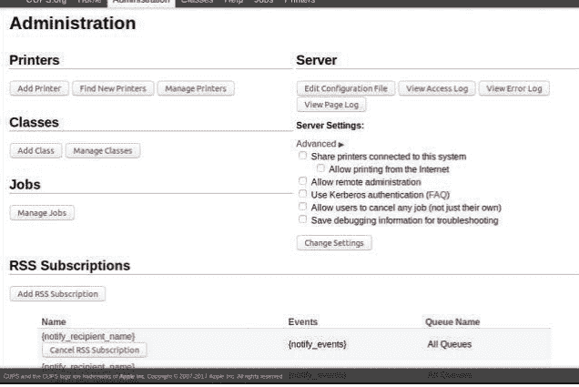

图 23.2 选择“管理”选项卡在 CUPS 中执行打印机管理。

### 创建 CUPS 打印条目

本节提供了一个使用 CUPS Web 界面创建 Linux 打印条目的简单示例。当你创建打印机和设备队列（例如本地、远程、串口端口或 Internet）时，你可以输入统一资源标识符 (URI)，例如 `ipp://192.168.2.35/lp`，它代表远程 UNIX 打印服务器的 IP 地址以及该服务器上远程打印队列的名称。

你还需要指定打印机的型号或品牌及其驱动程序。“打印机 (Printers)”链接允许你测试测试页、停止打印服务、管理本地打印队列、修改条目或添加另一个打印机。

在“管理 (Admin)”页面中，点击“添加打印机 (Add Printer)”按钮，并输入具有 sudo 权限的用户名和密码。然后你可以从检测到的打印机、发现的网络打印机或你想要手动输入详情的打印类型中选择。

CUPS 提供了许多额外功能，并为 Ubuntu 提供透明的传统 UNIX 打印支持。

> 注意
> 要了解更多关于 CUPS 并获取系统的基本概述，请访问 `www.cups.org`。

### 避免打印机支持问题

排除打印机问题可能会令人沮丧，尤其是当你发现新打印机在 Linux 上无法正常工作时。然而，请记住，今天市场上几乎所有的打印机都能与 Linux 工作。不过，某些厂商在支持 Linux 方面表现高于其他厂商。

### 一体机（打印/传真/扫描）设备

问题打印机或可能无法与 Ubuntu 通的打印设备包括结合扫描、传真和打印服务的多功能（一体机）。你应该对任何计划中的购买进行研究，并避免任何不愿意通过驱动程序或开发信息支持 Linux 的厂商。

### 使用 USB 和旧式打印机

问题的出现是因为缺少打印机的通用串行总线（USB）厂商设备 ID 信息——这个问题在 Linux 下某些扫描仪上得到了解决。

#### 相关的 Ubuntu 和 LINUX 命令

- 以下命令帮助管理打印服务：
- `cupsaccept`—允许打印作业访问 CUPS 服务器
- `cupsreject`—阻止打印作业访问 CUPS 服务器
- `cupscancel`—取消打印作业
- `cupsdisable`—禁用打印
- `cupsenable`—启用打印
- `lpr`—将指定文件发送到打印机并允许控制打印服务
- `lpc`—在控制台显示打印服务状态
- `lpq`—在控制台查看打印队列（待处理打印作业）
- `lprrm`—通过命令行从打印队列中删除打印作业
- `lstat`—显示打印机和服务器状态

## 参考文献

- [https://help.ubuntu.com/community/SettingUpNFFSHowTo](设置 NFS 的 Ubuntu 社区文档)
- [https://help.ubuntu.com/community/Samba](设置 Samba 的 Ubuntu 社区文档)
- [www.samba.org](获取更多关于 Samba 以及在 Linux、UNIX、macOS 和其他操作系统上使用 SMB 协议的 Base入口)
- [www.cups.org](CUPS 软件和信息的综合仓库)

## 第 24 章

### 本章内容

- LAMP
- LEMP
- MEAN
- 参考文献

### 常见的 Web 服务器栈

服务器栈是一组安装并配置以协同工作、通过网络提供内容的软件。有很多软件栈非常常见，足以用缩写来表示。本章描述了其中一些最流行的栈。在深入研究每种相关技术之前，本章介绍了今天常用的一些流行的 Web 服务器栈类型。

本章中的所有栈都可以在 Ubuntu 或任何 Linux 发行版上组装并运行，并且非常常见，值得了解。用于组装本章所述栈的组件通常可以用具有相同目的的不同软件替换，如讨论中所述。

（注：原文中存在大量重复段落和 OCR 错误文本，已按要求清理并翻译核心内容）

#### 附带说明

+ 3. 安装 MySQL、MariaDB 或你选择的关系型数据库，并确保设置了安全的密码。强烈建议在数据库中创建一个专门用于 Web 服务器的用户来与数据库进行交互，而不是在软件中使用 root 账户。
+ 4. 根据你打算运行/编写的用于显示内容的软件，适当地地安装 PHP、Python 或 Perl。

或者，你也可以通过以下几个命令更轻松地安装和设置基础的 LAMP 堆栈：

```bash
$ sudo apt install tasksel
$ sudo tasksel install lamp-server
```

这将以交互方式安装之前提到的所有内容，让你在在此过程中有机会设置 MySQL root 密码等。使用 `tasksel` 要方便得多，但配置是通用且简单的。

到此时，无论你使用哪种方法，整个堆栈都已安装。你现在可以继续安装 Drupal 等开源软件，或者开发你自己的程序。

### LEMP

LAMP 和 LEMP 之间的主要区别在于使用的 Web 服务器。LAMP 使用 Apache，而 LEMP 使用 Nginx。（有关 Nginx 的详细信息，请参见第 26 章“Nginx Web 服务器管理”）。

> 注意
> 似乎创建 LEMP 缩写的人认为需要一个元音，所以 E 代表 Nginx——但服务器名称的读音就像是以 E 开头的，所以这实际上是有意义的。

除了 Apache 和 Nginx 作为成熟 Web 服务器在用例上的明显区别外，唯一的区别是目前 Ubuntu Server 上没有 LEMP 选项。不过，这并没有太大区别，我们建议你先安装 Ubuntu，然后单独配置每个组件，而不是使用快捷方式的 Ubuntu 安装方法。

> 注意
> 我们可以为第 27 章“其他 HTTP 服务器”中列出的几乎每个 HTTP 服务器编写类似的章节。例如，如果有人想安装 LLMP 堆栈（Linux, lighttpd, MySQL, PHP），这无疑是可能的。

### MEAN

随着 Web 向更多、更动态的网站和应用程序发展，Web 开发者了解 JavaScript 变得至关重要。然后有人产生了一个想法，编写可以使用相同语言在客户端和服务器端运行的应用程序。这样做的基础原理非常简单：为 Web 开发需要时间。如果你使用多种编程语言，你就必须学习多种语言，或者雇佣通你你用语言的人。此外，随着越来越多的网站变得互动化，学习 JavaScript 已经成为更多开发者的必修课。因此，JavaScript 现在是客户端和服务器端的首选语言——它是 MEAN Web 堆栈中的重要组件。

你不需要运行 Linux 来使用 MEAN 服务内容。你也可以在 Windows 或 macOS 上运行 MEAN 堆栈。此外，这一切都是用 JavaScript 编写的。使用的是 NoSQL 选项之一的 MongoDB，它与 MEAN 堆栈使用的 JSON 数据配合良好。

无论使用什么操作系统作为平台，MEAN 堆栈由四个部分组成：

- **MongoDB**——使用第 29 章“NoSQL 数据库”中的之一以 JSON 格式存储应用程序的数据。
- **Express.js**——这个后端 Web 框架运行在 Node.js 上。
- **AngularJS or Angular**——它们都是 JavaScript MVC（模型-视图-控制器）框架。Angular 更新，是 AngularJS 的完全重写，并在过程中进行了刻意的更改。Angular 提供了前端 Web 应用框架，允许你在用户的浏览器中运行代码。
- **Node.js**——Node.js 是事件驱动服务器端应用程序的执行环境。

无论你的操作系统是什么，大多数 MEAN 堆栈建议从各自的网站下载并安装组件，而不是使用操作系统提供的包管理器。每个网站的列表如下；请按照读者的顺序在此下载并安装软件：

+ 1. 从 `www.mongodb.com/download-center` 安装 MongoDB。
- 2. 从 `https://nodejs.org/en/` 安装 Node.js。安装时，你还会安装你所需的 npm 包管理器。
- 3. 使用命令 `npm install express` 安装 Express.js。
- 4. 遵循 `https://angular.io` 的入门指南安装 Angular。

MEAN 应用与 LAMP 或其他传统应用程序真正的不同之处在于灵活性。你可以在服务器上运行应用程序代码。你可以在用户的浏览器中运行代码。你甚至可以在数据库中运行应用程序逻辑，这对于某些类型的分析来说特别有用。

#### NOTE

你可以将 Angular（最初来自 Google）替换为 React（来自 Facebook），它提供类似的功能。你也可以用其他框架替换它，例如 Ember.js 或 Backbone.js，并且仍然使用 JavaScript 进行所有开发。有些人喜欢这种灵活性，但对另一些人来说，这让人目不应接。无论如何，MEAN 开发已经存在，并且可能在短期内消失。

## 参考文献

- `https://help.ubuntu.com/lts/serverguide/lamp-overview.html`—Ubuntu Server Guide 中的 LAMP
- `www.mongodb.com`—MongoDB 官方网站
- `https://nodejs.org`—Node.js 官方网站
- `www.npmjs.com`—npm 包管理器主页
- `https://expressjs.com`—Express 官方网站
- `https://angular.io`—Angular 官方网站
- `https://emberjs.com`—Ember.js 官方网站
- `http://backbonejs.org`—Backbone 官方网站
- `https://reactjs.org`—React，用于构建用户界面的库

### 安装 Apache 服务器

你可以从基于文本的控制台或 X 终端的命令行启动 Apache，并且必须拥有 root 权限才能操作。具体操作方法取决于你运行的 Ubuntu 发布版本。对于 Ubuntu 16.04 及更高版本，你使用系统命令。对于较早的 Ubuntu 版本 12.04 和 14.04，使用 Upstart 命令。有些人倾向于使用 `apache2ctl` 命令，这些命令适用于不同的发行版。表 25.1 对这些命令进行了对比。

#### 表 25.1 systemd、Upstart 和 apache2ctl 使用命令的对比

| 操作 | systemd | Upstart | apache2ctl |
|---|---|---|---|
| 启动 | `sudo systemctl start apache2.service` | `sudo start apache2` | `sudo apache2ctl start` |
| 停止 | `sudo systemctl stop apache2.service` | `sudo stop apache2` | `sudo apache2ctl stop` |
| 重启 | `sudo systemctl restart apache2.service` | `sudo restart apache2` | `sudo apache2ctl restart` |

守护进程 `apache2` 识别了几个可以用于设置默认值的命令行选项，例如指定 Apache 读取其配置目录的位置。Apache2 可执行文件还可以理解其他选项，允许你选择性地使用部分配置、指定实际服务器和端口的不同位置、使用不同的配置文件（可能用于测试），并将启动错误保存到特定日志中。`v` 选项允许 Apache 打印其开发版本并退出。

`-h` 选项为服务器打印以下用法信息：

```
matthewsymour:- apache2 -h
Usage: apache2 [-D name] [-d directory] [-f file]
 [-k "directive"] [--c "directive"]
 [-k start|restart|stop]
 [-v] [-h] [-l] [-L] [-t]
```

- `-D name`：为 `<Define name` 指令定义一个名称
- `-d directory`：指定备用的 ServerRoot
- `-f file`：指定备用的 ServerConfigFile
- `-C "directive"`：在读取配置文件之前处理指令
- `-c "directive"`：在读取配置文件之后处理指令
- `-e level`：显示级别 (level) 的启动错误（参见 LogLevel）
- `-E file`：将启动错误记录到文件
- `-v`：显示版本号
- `-V`：显示编译设置
- `-h`：列可用命令行选项（本页）
- `-l`：列出编译的模块
- `-L`：列出可用的配置指令
- `-t DUMP_VHOSTS`：显示解析后的设置（目前仅限 vhosts）
- `-t`：对配置文件运行语法检查

其他选项包括列出 Apache 的静态模块（或服务器的特殊内置独立部分），以及可以与模块配合选项。这些选项被称为配置指令，是控制静态模块工作方式的命令。注意，Apache 还包含大量的动态模块，即在服务器运行时可以选择性加载和使用的服务器软件分区。

`-t` 选项用于检查你的配置。在重启服务器之前运行此命令是一个好主意，特别是当你已经更改了配置文件时。这些文件非常重要，因为配置错误会导致你的服务器在尝试重启时关闭。在 Ubuntu 中 `apache2` 的内部用户名设置存在一个 bug，当你输入以下内容时，`sudo` 会给你报错：

```
matthewseymour:-$ sudo apache2 -t
apache2: bad user name ${APACHE_RUN_USER}
```

如果这种情况发生在你身上，输入以下命令强制执行使用预期的用户名设置，你将获得正确的输出：

```
matthewseymour:-$ sudo APACHE_RUN_USER=www-data APACHE_RUN_GROUP=www-data
apache2 -t
```

### 运行时服务器配置设置

此时，Apache 服务器将开始运行，但你可能想要更改某些行为，例如网站文件的默认位置。本节涵盖了配置服务器以按你要求运行的基础知识。

运行时配置存储在一个文件中——`apache2.conf`，该文件位于 `/etc/apache2` 目录下。你可以使用此配置文件来控制 Apache 的默认行为，例如服务器的基础配置目录 (`/etc/apache2`)、服务器 PID 文件的名称 (`/var/run/apache2.pid`) 或其响应超时（300 秒）。Apache 在启动（或重启）时会从配置文件读取数据。

### 运行时配置指令

你通过配置指令对服务器进行运行时配置，这些指令是为 `apache2` 守护进程设置选项的命令。这些指令用于告诉服务器你想要启用的各种选项，例如对服务器配置和运行重要的文件位置。Apache 支持近 300 个配置指令，使用以下语法：

`directive option...`

每个指令单独占行指定。请参阅后续章节了解指令的示例及其使用方法。一个指令可能只设置一个值（如文件名），也允许你指定各种选项。某些特殊指令被称为节指令（section directives），用角括号括起来，例如

### 运行时服务器配置设置 447

`<Directory>`。节（Section）通常包含一组指令，这些指令仅适用于该节中指定的目录：

```
<Directory somedir/in/your/tree>
  directive option option
  directive option option
</Directory>
```

节始终用匹配的节标签关闭，格式如下：`</Directory>`。注意，节标签与其他任何指令一样，每行指定一个。

> 提示
> Apache 配置了一个别名，允许你查看文档。

### 编辑 apache2.conf

`ServerAdmin` 应设置为管理服务器管理员的地址。该地址应该是有效的电子邮件地址或别名，例如 `webmaster@matthehelmke.com`，因为当服务器出现问题时会返回此地址。

### ServerRoot

`ServerRoot` 指令设置目录的绝对路径。这告诉服务器去哪里寻找资源。在 Ubuntu 中，它设置为 `/etc/apache2`。

### Listen

`Listen` 实际上位于 `ports.conf` 中，它指示你想让服务器在哪个端口运行。默认情况下，它设置为 `80`，这是 HTTP 的标准端口。

### User and Group

`User` 和 `Group` 指令应设置为服务器处理请求时 UID 和 GID。在 Ubuntu 中，将这些设置为权限很少或没有权限的用户。在这种情况下，它们设置为 `www-data`（专门为运行 Apache 定义的用户）和组 `www-data`。如果你想使用不同的 UID 或 GID（而非 root），服务器将以分配的标识运行。

与其使用名称指定 `User` 和 `Group` 指令，不如使用 UID 和 GID 数字指定。如果你使用数字，请确保这些数字与你想要的用户和组对应，并且前面带有井号 (`#`) 符号。

使用名称指定的指令所示：

```
User www-user
Group www-user
```

使用 UID 和 GID 相同的指令所示：

```
User 48
Group 48
```


### ServerName

`ServerName` 指令应设置服务器返回的主机名。它设置为完全限定域名 (FQDN)。例如，是 `www.your.domain` 而非简单的 `www`。当该机器可以通过互联网访问而非仅在局域网时，这一点尤为重要。

除非你想返回一个不同于机器规范名称的名称，否则你不需要设置 `ServerName`。如果未设置此值，服务器将推断

# 运行时服务器配置设置

`ServerName` 本身将其设置为其规范名称。然而，你可能希望服务器返回一个更易读的地址，例如 `www.your.domain`。无论你如何操作，`ServerName` 应该应该是你网络的真实域名系统 (`DNS`)。如果你在管理自己的自己的 `DNS`，请记住为你的主机添加一个别名。如果是其他人在为你管理 `DNS`，请要求该人员为你设置此名称。

# DocumentRoot

将 `DocumentRoot` 指令设置为你的文档树的绝对路径，这是 Apache 提供服务的文件的顶层目录。默认情况下，它被设置为 `/var/www/`。如果你构建了源代码且没有选择编译 Apache 的其他目录，则 `DocumentRoot` 被设置为 `/usr/local/apache/htdocs`。

# UserDir

`UserDir` 指令用于禁用或启用某个目录（相对于本地用户的 `/home/username` 目录），该用户可以在该目录下放置公共 HTML 文档。它是相对的，因为每个用户都有自己的 HTML 目录。此设置默认是禁用的，但可以启用，以便在任何目录下存储用户的 Web 内容。

如果该指令已启用，则默认设置为 `public_html`。每个用户都可以在其 `/home` 目录下创建一个名为 `public_html` 的目录，放置在该目录中的 HTML 文档可以通过 `http://servername-username` 访问，其中 `username` 是特定用户的用户名。

# DirectoryIndex

`DirectoryIndex` 指令指示哪个文件应该作为目录的索引，例如当请求 URL `http://servername/SomeDirectory/` 时，应该提供哪个文件。

在这里列出文件列表通常很有用，这样当找不到 `index.html`（默认值）或其他 `DirectoryIndex` 文件时，可以提供另一个文件。这最实用的应用是让 CGI 程序作为目录中的默认操作。如果你使用的用户在 Windows 上创建网页，你可能还想添加 `index.html`。在这种情况下，指令看起来就像是 `DirectoryIndex index.html index.cgi index.htm`。

# Apache 多进程模块 (Multiprocessing Modules)

Apache 2.0 及更高版本使用了支持多进程模块 (`MPMs`) 的新架构。这些模块被服务器用于各种任务，例如网络和进程管理，并被编译到 Apache 中。`MPM` 使 Apache 能够在更广泛的计算机平台上运行得更好，并可以提高服务器的稳定性、兼容性和扩展性。

Apache 在任何时候只能使用一个 `MPM`。这些模块与 Apache 包含的基础集不同（参见本章稍后的“Apache 模块”部分），但它们被用于实现设置、限制或其他服务器行为。每个模块都支持许多额外的设置，称为指令 (`directives`)，它们进一步精炼了服务器操作。

与 Linux 相关的内部 `MPM` 模块包括：

- `mpm_common`—所有 `MPM` 模块通用的 20 个指令集
- `prefork`—一个多线程、预派进程的 Web 服务器，其工作方式与早期的 Apache (1.3) 版本非常相似
- `worker`—一个混合多进程多线程服务器

`MPM` 使 Apache 能够在资源较少的设备上运行，同时仍能处理大量访问并提供稳定的服务。`worker` 模块提供了指令来控制你的服务器可以处理多少个并发连接。

> 注意
> Apache 还提供了适用于其他平台的 `MPM`，例如用于 NetWare 宿机的 `mpm_network` 和用于 NT 平台的 `mpm_winnt`。一个名为 `perchild` 的 `MPM` 正在开发中，它可以为选定的守护进程提供用户 ID 标识。要了解更多信息，请访问 Apache 软件基金首页 `www.apache.org`。

# 使用 .htaccess 配置文件

Apache 支持特殊的配置文件，称为 `.htaccess` 文件。几乎任何出现在 `apache2.conf` 中的指令都可以出现在 `.htaccess` 文件中。该文件在 `apache2.conf` 的 `AccessFileFieldName` 指令中指定，用于设置每个目录（通常在用户目录）的配置。作为服务器管理员，你可以指定此文件的名称，以及服务器配置中的哪些部分可以被该文件的内容所覆盖。这对于有多个内容提供者的站点特别有用，你希望控制这些人在他们的空间内能做什么。

要限制 `.htaccess` 文件可以覆盖的服务器配置，请使用 `AllowOverride` 指令。`AllowOverride` 可以全局设置或按目录设置。例如，在你的 `apache2.conf` 文件中，可以使用以下内容：

```
# Apache 可访问的每个目录都可以根据该

# 目录（及其子目录）中启用和/或禁用的哪些

# 服务和功能进行配置。

# 首先，我们将“默认”配置为一组非常严格的

# 权限。

<Directory />

  Options FollowSymLinks

  AllowOverride None

</Directory>
```

# 运行时服务器配置设置

# Options 指令

为了配置 Apache 默认提供的配置选项，你必须使用 `Options` 指令。`Options` 可以是 `None`；`All` 或 `Indexes`、`Includes`、`FollowSymLinks`、`ExecCGI` 和 `MultiViews` 的任何组合（未包含在 `All` 中的组合必须显式指定）。这些选项在表 25.2 中解释。

# 表 25.2 Options 指令使用的开关

| 开关 | 说明 |
|---|---|
| None | 此目录未启用任何可用选项。 |
| Indexes | 在缺少 `index.html` 或其他 `DirectoryIndex` 文件的情况下，将生成目录中的文件列表作为 HTML 页面显示给用户。 |
| Includes | 此目录允许使用服务器端包含 (SSIs)。如果你想包含但不允许使用 `exec` 选项，也可以写为 `IncludesExec`。出于安全考虑，在你不希望完全信任的目录中使用这是一个好主意。 |
| FollowSymLinks | 此选项允许访问符号链接的目录。 |
| ExecCGI | 此目录允许运行 CGI 程序。 |
| MultiViews | Apache 尝试确定最适合的视图。 |

# AllowOverride 指令

`AllowOverride` 指令指定哪些 `.htaccess` 文件可以覆盖。你可以将 `AllowOverride` 设置为 `All` 或 `Options`、`FileInfo`、`AuthConfig` 和 `Limit` 的任何组合。这些选项在表 25.3 中解释。

# 表 25.3 AllowOverride 使用的开关

| 开关 | 说明 |
|---|---|
| Options | `.htaccess` 文件可以添加 `Options` 指令中未列出的选项。 |
| FileInfo | `.htaccess` 文件可以包含修改信息的指令。 |
| AuthConfig | `.htaccess` 文件可以包含授权指令。 |
| Limit | `.htaccess` 文件可以包含 `allow`、`deny` 和 `order` 指令。 |

# 文件系统认证与访问控制

你可能会在网站上包含一些不想公开的内容。你必须能够锁定这些内容的访问，并为指定用户提供解锁。Apache 提供了两种方法来实现这种访问：认证和授权。你可以使用不同的标准来控制网站访问，检查客户端的 IP 地址或主机名，或要求用户名和密码。本节简要介绍这些方法。

> 注意
> 允许个人在你的服务器上放置 Web 内容会带来若干重要的安全风险。如果你在互联网而非私有网络上运行 Web 服务器，请查看 `www.w3.org/Security/`。

## 使用 Require 限制访问

限制网站内容的简单方法之一是根据 IP 地址或主机名将访问限制给特定组的用户。Apache 使用 `Require` 指令来实现这一点。以下是可能放在 `apache2.conf` 文件中的示例：

```
<RequireAll>
Require all granted                   #允许所有人访问
Require not ip 10.252.46.163          #但禁止此 IP 地址访问
Require not host horriblepeople.com  #并且也不允许来自该域名
Require not host gov                  #最后，不允许来自任何 .gov 站点
</RequireAll>
```

除了 `RequireAll` 之外还有许多选项，包括 `RequireAny` 和 `RequireNone`，以及每个选项的详细设置。要了解更多信息，请参 https://httpd.apache.org/docs/2.4/howto/access.html。

# 文件系统认证与访问控制 453

## 认证

身份验证是确保访问者确实是其声称的过程。你可以配置 Apache，仅允许能够通过身份验证的客户端访问网页内容的特定区域。Apache 中有多种身份验证方法；基础认证（Basic Authentication）是最常见的（本章讨论的方法）。

在基础认证下，Apache 要求用户提供用户名和密码以访问受保护的资源。然后，Apache 会验证该用户是否有权访问相关资源。如果用户名可以接受，Apache 将验证密码。如果密码也通过了检查，则该用户获得授权，Apache 将提供服务。

HTTP 是一个无状态协议；发送到服务器的每个请求和每个响应都是单独处理的——而不是以智能的方式处理。因此，身份验证信息必须包含在每个请求中。这意味着对受密码保护区域的每个请求都更大，因此速度也较慢。为了避免不必要的系统消耗和延迟，请仅保护你网站上绝对需要的那些区域。

要使用基础认证，你需要一个列出允许访问资源的用户列表。该文件由一个包含用户名和密码对的纯文本列表组成。它看起来非常像你 Linux 系统中的 `/etc/passwd` 用户文件。

> 注意：不要使用 `/etc/passwd` 作为认证的用户列表。当你使用基础认证时，密码和用户名将以 Base64 编码的文本（可以作为明文读取）从客户端发送到服务器。用户名和密码包含在发送到服务器的每个请求中。因此，任何可能监控你流量的人都能获取这些信息！

为 Apache 创建用户文件，请使用 Apache 软件包包含的 `htpasswd` 命令。运行不带任何选项的 `htpasswd` 会产生以下输出：

```
用法：
htpasswd [-cmdps] passwordfile username
htpasswd -b[cmdps] passwordfile username password
htpasswd -n[mdps] username
htpasswd -nb[mdps] username password
```
- `-c` 创建新文件；
- `-` 不更新文件；显示到标准输出（stdout）。
- `-m` 强制对密码进行 CRYPT 加密。
- `-d` 强制对密码进行 SHA 加密（默认）。
- `-p` 不输入密码（明文）。
- `-s` 强制对密码进行 SHA 加密。
- `-b` 使用命令行中的密码而不是提示输入。
- `-D` 删除指定的用户。

在 Windows 上，TPF 和 NetWare 系统默认使用 '-m' 标记。
在所有其他系统上，'-p' 标记可能无法不起作用。

## 第 25 章 Apache Web 服务器管理

如你所见，这不是一个很难使用的命令。例如，要创建一个名为 `gnulixusers` 的新用户并包含新用户 `wsb`，你需要执行如下操作：
`mathewseymour:$ sudo htpasswd -c gnulixusers wsb`

然后会提示你为用户输入密码。要添加更多用户，请在不带 `-c` 标记的情况下重复此过程。
你还可以创建用户组。这些文件的格式与 `/etc/groups` 类似。在每一行中，组名后跟着一个冒号（`-`），然后列出所有用户，用户之间用空格分隔。例如，用户组文件中的条目可能像这样：

`gnulixusers: wsb pgj ajje nadal rkr hak`

现在你已经知道如何创建用户文件了

接下来，使用 `AuthType` 指令设置用于此资源的认证类型。在这里，类型被设置为 `Basic`。

现在你需要决定哪些资源属于其中。领域（Realms）用于将共享相同授权用户的不同资源分组。一个领域可以由任何字符串组成。领域会在用户 浏览器的认证对话框中显示。因此，你应该将领域设置为具有描述性的内容。领域通过 `AuthName` 指令定义。

最后，指定哪种类型的用户有权访问资源。你可以通过 `require` 指令来实现。这种用法有三种方法：

- 如果你指定 `valid-user` 为选项，则用户文件中的任何用户都允许访问资源（前提是提供了正确的密码）。
- 你可以使用 `users` 选项指定允许访问的用户列表。
- 你可以使用 `group` 选项指定组列表。组列表中的条目以及用户列表中的条目都用空格分隔。

回到你之前看到的 `server-status` 示例，与其根据主机名允许用户访问 `server-status` 资源，你可以要求用户对该资源进行认证。你可以通过配置文件中的以下条目来实现：

```
<Location /server-status>
SetHandler server-status
AuthType Basic
```

## 关于访问控制的结语

如果你在资源上同时设置了基于主机的和基于用户的访问保护，Apache 的默认行为是要求请求者满足这两项控制。但假设你想混合基于主机的和基于用户的保护，并在其中一个成功时允许访问资源。你可以使用 `satisfy` 指令来实现。你可以将 `satisfy` 指令设置为 `All`（默认值）或 `Any`。当设置为 `All` 时，在提供资源之前必须满足所有控制方法。如果 `satisfy` 设置为 `Any`，则只要满足任何访问条件，就会提供资源。

这是另一个访问示例，再次使用之前的 `server-status` 示例，但这次结合了访问方法，允许所有来自 Gnulix 域的用户访问，而来自域之外的用户在获得访问之前必须识别身份：

```
<Location /server-status>
SetHandler server-status
Order deny,allow
Deny from all
Allow from gnulix.org
AuthType Basic
AuthName "Server status"
AuthFile gnulixusers
Require valid-user
Satisfy Any
</Location>
```

## Apache 模块

Apache 核心功能很少；它通过模块获得功能。通过添加或删除模块，你可以根据需要定制 Apache 服务器。

许多核心模块与 Apache 一起包含。更多模块由开发者提供。Apache 模块注册表（Module Registry）是附加模块的存储；你可以在 https://apache.org/modules/ 找到它。模块存储在 `/usr/lib/apache2/`

每个模块都增加了可以在配置文件中使用的新指令。正如你可能猜到的，命令、开关和选项多到无法在本章全部描述。以下章节简要介绍了 Ubuntu 安装的部分模块。

要启用模块，请使用此命令：

`matthew@semour:$ sudo a2enmod module_name`

要禁用模块，请使用：

`matthew@semour:$ sudo a2dismod module_name`

注意这两个命令都需要模块的实际名称而不是文件名；例如，`mod_version.so` 是文件名，而 `version` 是模块名称。你必须知道模块名称才能使用这两个命令，但在大多数情况下，就像示例一样简单。此外，在你运行任何命令后，你可能需要重启 apache2 以激活新配置。

## mod_access

`mod_access` 根据 IP 地址、主机名或环境变量控制对 服务器区域的访问。例如，你可能希望允许来自你自己域的任何人访问网站的某些区域。更多信息请参见本章前面的“文件系统认证与访问控制”部分。

## mod_alias

`mod_alias` 操作传入的 HTTP 请求的 URL，例如将客户端重定向到另一个 URL。它还可以将文件系统的部分映射到你的 Web 层结构中。例如，以下通过以 `/images/` 开头的 URL 从 `/home/wsb/graphics` 目录获取内容：

```
Alias /images/ /home/wsb/graphics/
```


进入`/path/to/xxx`目录，找到`xxx.json`。

在表达式`cvar = avar + bvar`中，加法运算符（`+`）将`avar`与`bvar`相加，得到它们的和`cvar`

在`List.of(arg0, arg1, arg2)`中，`List`接口的工厂方法`of()`接受一系列的元素，返回包含它们的只读列表。

之后我们这样调用`cmd`命令：`cmd arg0 arg1 arg2`。

```
if (condVar > someVal) {console.log("xxx")}
```

这是在客户端不知的情况下完成的。如果你使用重定向，会被指示去另一个 URL。你可以使用在本章后面讨论的 `mod_rewrite` 实现更高级的 URL 操作。

## mod_asis

`mod_asis` 用于详细指定响应中包含的所有信息。这完全跳过了 Apache 原可能添加的任何响应头。所有以 `.asis` 结尾的文件都直接发送给客户端，不做任何更改。

作为 `mod_asis` 的一个用法示例，当你将内容从网站的一个位置移动到另一个位置时，你必须告知尝试访问此资源的人已移动，并使用它将他们重定向到新的

location. 为了提供此信息和重定向，你可以将以下代码添加到扩展名为 `.asis` 的文件中：

```
Status: 301 No more old stuff!
Location: http://gnulix.org/newstuff/
Content-type: text/html

<HTML>

<HEAD>

<TITLE>We've moved ...</TITLE>

</HEAD>

<BODY>

<P>We've moved the old stuff and now you'll find it at:</P>

<A HREF="http://gnulix.org/newstuff/">New stuff</A>!.

</BODY>

</HTML>
```

## mod_auth

`mod_auth` 使用一种简单的用户身份验证方案，称为基础认证（Basic Authentication），它基于在文本文件中存储用户名和加密后的密码。该文件非常像 UNIX 的 `/etc/passwd` 文件，并通过 `htpasswd` 命令创建。关于此主题的更多信息，请参阅本章节前面的“文件系统身份验证与访问控制”。

## mod_auth_anon

`mod_auth_anon` 模块提供类似于匿名-FTP 的匿名身份验证。该模块允许你定义哪些 ID 将作为访客用户处理。当用户尝试登录时，系统会提示其输入电子邮件地址作为密码。你可以让 Apache 检查密码以确保它是一个（在多程度上）正确的电子邮件地址。基本上，Apache 会确保密码包含一个 `@` 字符且至少有一个字符。

## mod_auth_dbm

`mod_auth_dbm` 使用 Berkeley DB 文件作为文本用户身份验证文件。

## mod_auth_digest

`mod_auth_digest` 是基础 `mod_auth` 模块的扩展。它不是以明文形式发送用户信息，而是通过消息摘要 5 (`MD5`) 身份验证过程发送。该身份验证方案定义在 RFC 2617《HTTP 身份验证：基础认证与摘要认证》中。与使用基础认证相比，这种方式在互联网上传输用户数据要安全得多。遗憾的是，并不是所有的网络浏览器都支持这种身份验证方案。

要创建用于 `mod_auth_dbm` 的密码文件，你必须使用 `htdigest` 工具。它的功能与 `htpasswd` 工具大体相同。更多信息请参阅 `htdigest` 的 man 手页。

## mod_autoindex

`mod_autoindex` 模块为目录索引动态创建文件列表。该列表以用户友的方式进行渲染，类似于 FTP 内置 `ls` 命令提供的列表。

## mod_cgi

`mod_cgi` 允许在你的服务器上执行 CGI 程序。CGI 程序是位于 `/var/www/cgi-bin` 目录下的可执行文件，用于在请求时为远程浏览器动态生成数据（通常是 HTML）。

## mod_dir and mod_env

`mod_dir` 模块用于确定当用户尝试访问目录时自动返回哪些文件。默认是 `index.html`。如果你有在 Windows 系统上创建网页的用户，你也应该包含 `index.htm`，如下：

```
DirectoryIndex index.html index.htm
```

`mod_env` 控制如何将环境变量传递给 CGI 和 SSI 脚本。

## mod_expires

`mod_expires` 通过向 HTTP 响应中添加 `Expires` 头部，为你网站上的内容添加过期日期。网络浏览器和缓存服务器不会缓存过期内容。

## mod_headers

`mod_headers` 用于操作服务器响应的 HTTP 头部。你可以根据需要添加、合并或删除头部。该模块提供了一个 `Header` 指令来实现此。`Header` 指令的顺序非常重要。对于同一个 HTTP 头部，如果一个 set 后跟一个 unset，将完全移除该头部。你可以将 `Header` 指令放置在配置文件的几乎任何位置。这些指令按照以下顺序处理：

- 1. 核心服务器
2. 虚拟主机
3. `<Directory>` 和 `.htaccess`
4. `<Location>`
5. `<Files>`

## mod_include

`mod_include` 允许在服务器上使用服务器端包含，这在 PHP 接管这部分市场之前非常流行。

## mod_info and mod_log_config

`mod_info` 提供关于服务器配置的全面信息。例如，它会显示所有已安装的模块以及配置文件中使用的指令。

`mod_log_config` 定义了日志文件的外观格式。关于此主题的更多信息，请参阅本章节后面的“日志”部分。

## mod_mime and mod_mime_magic

`mod_mime` 模块尝试通过检查文件扩展名来确定文件的 MIME 类型。

`mod_mime_magic` 模块尝试通过检查内容部分来确定文件的 MIME 类型。

## mod_negotiation

使用 `mod_negotiation` 模块，你可以选择最适合你客户端能力的多个文档版本之一。有多个选项来选择在协商过程中使用哪些标准。例如，你可以在不同的语言、图形文件格式和压缩方法之间进行。

## mod_proxy

`mod_proxy` 为 Apache 服务器实现了代理和缓存功能。它可以代理和缓存 FTP、CONNECT、HTTP/0.9 和 HTTP/1.0。对于用户大量且对代理和缓存有高要求的站点来说，这不是一个理想的解决方案。但对于少量用户来说，它是完全足够的。

## mod_rewrite

`mod_rewrite` 是 URL 操作的瑞士军刀。它允许你使用强大的正则表达式对 URL 进行任何想象中的操作。它提供了重写、重定向、代理等功能。使用该模块几乎没有你无法完成的任务。

> 提示
> 如果你使用了 `mod_rewrite`，请访问 https://apache.org/docs/mod_rewrite.html 获取更多信息。

## mod_setenv

`mod_setenv` 允许操作环境变量。使用 `mod_rewrite`，你可以根据条件设置环境变量。这对于根据请求头部创建动态内容非常有用。

## mod_spelling

`mod_spelling` 用于修正 URL 中的拼写错误。它使用一组算法为拼写错误建议正确的 URL。

## mod_status

你可以使用 `mod_status` 获取有关服务器的信息。它显示一个包含当前请求和统计数据的页面。这对于监控服务器性能很有用。

## mod_ssl

`mod_ssl` 为网络通信提供加密。它允许你在 Apache 服务器上使用 SSL/TLS 证书。

## mod_unique_id

`mod_unique_id` 为每个请求生成唯一标识符。这可以用于日志和跟踪。

## mod_userid

`mod_userid` 允许识别发出请求的用户。这可以提供个性化内容。

## mod_usertrack

`mod_usertrack` 用于跟踪用户活动。这对营销和分析很有用。

## mod_vhost_alias

`mod_vhost_alias` 允许你在一个 IP 上托管多个虚拟主机。

## Virtual Hosting

服务器提供的热门服务之一是托管虚拟域名。虚拟域名也称为虚拟主机，拥有独立域名的完整网站，就像是独立的机器一样，但它托管在同一台机器上。Apache 通过 `apache.conf` 中的指令简单地实现了这一功能。

## Virtual Hosting

在 Apache 上托管主机有两种方法。你可以有一个 IP 地址对应多个 CNAME，也可以有多个 IP 地址对应一个名称。Apache 有不同的指令来处理每种情况。

### Address-Based Virtual Hosts

在你为 Linux 机器配置了多个 IP 地址后，设置 Apache 服务这些地址非常简单。你只需要在 `apache.conf` 文件中为每个你想变成独立网站的地址放置一个 `VirtualHost` 指令：

```
<VirtualHost 212.85.67.67>

ServerName gnulix.org

DocumentRoot /home/virtual/gnulix/public_html

TransferLog /home/virtual/gnulix/logs/access_log

ErrorLog /home/virtual/gnulix/logs/error_log

</VirtualHost>
```

在 `VirtualHost` 标签中使用 IP 地址而不是主机名。

你可以在 `<VirtualHost>` 标签内指定任何配置指令。例如，你可能希望为虚拟主机和主服务器设置不同的 `AllowOverrides` 指令。

### Name-Based Virtual Hosts

基于名称的虚拟主机允许你在一个 IP 地址上运行多个主机。你必须将名称作为机器的 CNAME 添加到你的 DNS 记录中。

当 HTTP 客户端（Web浏览器）从你的服务器请求文档时，它会发送一个请求，其中包含一个指示请求文档的服务器名称的变量。服务器根据该变量确定应该从哪个虚拟主机提供服务。

基于名称的虚拟主机比基于 IP 地址的虚拟主机多需要一个步骤。你必须首先指定哪个 IP 地址上承载了多个 DNS 名称。这是通过 `NameVirtualHost` 指令实现的：

```
NameVirtualHost 212.85.06.67
```

你必须为该地址上的每个名称设置一个扇区，并为该名称设置配置。与基于 IP 的虚拟主机一样，你只需要设置那些与主主机配置不同的配置。你必须使用 `ServerName` 指令，因为它是区分不同主机的唯一标准：

```
<VirtualHost 212.85.06.67>

ServerName bugserver.gnulix

ServerAlias bugserver

DocumentRoot /home/bugserver/htdocs

ScriptAlias /home/bugserver/cgi-bin

TransferLog /home/bugserver/logs/access_log

</VirtualHost>
```

```
<VirtualHost 212.85.06.67>

ServerName pts.gnulix

ServerAlias pts

DocumentRoot /home/pts/htdocs

ScriptAlias /home/pts/cgi-bin

TransferLog /home/pts/logs/access_log

ErrorLog /home/pts/logs/error_log

</VirtualHost>
```

> 如果你在内网或内部网络上托管网站，用户可能会使用机器的短名称而非完全限定域名（FQDN）。例如，用户可能会在浏览器地址栏中输入 `https://bugserver/index.html` 而不是 `https://bugserver.gnulix/index.html`。在这种情况下，Apache 将无法识别这两个地址指向同一个虚拟主机。你可以通过同时为 `bugserver` 和 `bugserver.gnulix.org` 设置 `VirtualHost` 指令来解决这个问题，但简单的方法是使用 `ServerAlias` 指令，它列出了该机器的所有有效别名：
`ServerAlias bugserver`

有关 `VirtualHost` 的更多信息，请参阅 http://localhost/_manual 上的帮助系统。

## 日志 (Logging)

Apache 为你可能感兴趣的任何 Web 访问信息提供了日志记录。日志可以帮助以下工作：

- 通过跟踪使用情况进行系统资源管理
- 通过记录不良的 HTTP 请求进行入侵检测
- 通过记录处理请求时的错误进行诊断

当你运行 Apache 服务器时，会生成两个标准日志文件：`access_log` 和 `error_log`。它们位于 `/var/log/apache2` 目录下。（其他还包括 SSL 日志 `ssl_access_log`、`ssl_error_log` 和 `ssl_request_log`。）除了 `error_log`（默认情况下是 `access_log`）之外，所有日志都是按照你 `apache2.conf` 中 `CustomLog` 和 `LogFormat` 指令指定的格式生成的。

可以使用 `LogFormat` 指令定义新的日志格式：

```
LogFormat "%h %l %u %r"%s %b common
```

通用日志格式（common log format）是创建自定义格式的良好起点。请注意，大多数日志分析工具都假设你使用的是通用日志格式或组合日志格式（combined log format），两者都在默认配置文件定义。

以下变量适用于 `LogFormat` 语句：

- `%a`—远程 IP 地址。
- `%A`—本地 IP 地址。
- `%b`—发送的字节数，不包含 HTTP Header。这在 Apache 的组合日志格式 (CLF) 中显示。对于没有数据内容的请求，用 `-` 代替 `0`。
- `%B`—发送的字节数，不包含 HTTP Header。
- `%{VARIABLE}`—环境变量的内容。
- `%f`—输出日志的文件名。
- `%h`—远程主机。
- `%H`—请求协议。
- `%{HEADER}`—HEADER 的内容；发送到服务器的请求中的头部行。
- `%l`—远程日志名（如果提供了则来自 `identd`）。
- `%m`—请求方法。
- `%{NOTE}`—来自另一个模块的 NOTE 内容。
- `%{HEADER}`—HEADER 的内容；响应中的头部行。
- `%p`—提供请求的服务器的标准端口。
- `%p`—处理请求的子进程的 PID。
- `%q`—查询字符串的内容，以 `?` 字符开头。如果没有查询字符串，则等于空字符串。
- `%r`—请求的第一行。
- `%s`—状态。对于经过内部重定向的请求，这是原始请求的状态（最后一次为 `$s`）。
- `%t`—通用日志格式的时间。
- `%{format}t`—由 `format` 指定格式的时间。
- `%u`—处理请求花费的秒数。
- `%u`—来自认证的远程用户；如果返回状态 ($s) 为 401，则此可能是虚假的。
- `%u`—请求的 URL 路径。
- `%v`—`UseCanonicalName` 指令使用的服务器名称。
- `%v`—提供请求的服务器的规范 `ServerName`。

你可以在每个变量前面加上一个条件，以确定是否显示该变量。如果变量未显示，则用 `-` 代替。这些条件的形式为数值值列表。例如，`%401u` 除非返回码为 401，否则显示 `REMOTE_USER` 的值。

然后你可以使用 `CustomLog` 指令指定日志文件的位置和格式：

```
CustomLog /var/log/apache2/access_log
```

这告诉 Apache2 使用 SSL 以及证书文件的位置。

要使用默认配置、自签名证书和密钥为 Apache2 配置 HTTPS，请使用此命令：

```
sudo a2ensite ssl
```


当重启 Apache2 时，会提示输入证书密码。现在你有一个适用于内部使用但不适用于生产环境的安全服务器。

如果你要托管专业网站，最好的做法是使用 CA。每个 CA 都有其首选方法，在使用前应阅读 CA 的要求。基本流程如下：

- 创建私钥和公钥对。
- 根据公钥创建证书。
- 创建包含服务器和公司信息的证书请求。
- 将证书请求和公钥以及公司身份证明和付款发送给 CA。
- 等待 CA 验证请求并返回之前创建的自签名证书。
- 将证书安装到服务器上并配置 Apache2 使用。

CA 签名证书具有优势。首先，浏览器内置了大多数 CA 的数据，大多数情况下会自动识别它们在你证书上的签名。自签名证书会导致浏览器显示一个对非技术人员来说相当可怕的警告，并要求用户在查看站点之前确认。此外，如果 CA 签了证书，它保证了提供网页的组织身份。

有关证书和密钥的更多信息，包括付费证书和密钥的安装，请参阅 https://tldp.org/HOWTO/SSL-Certificates-HOWTO/index.html。

# 参考文献

- https://news.netcraft.com/archives/web_server_survey.html — 数百万服务器 Web 使用的统计图，显示 Apache 是互联网站点中最广泛使用的
- https://httpd.apache.org — Apache HTTP 服务器项目网站，可以在此处找到关于 Apache 的大量文档和信息。

# 第 26 章

## 本章内容

## Nginx Web 服务器管理

- 关于 Nginx Web 服务器
- 安装 Nginx 服务器
- 配置 Nginx 服务器
- 虚拟主机
- 设置 PHP
- 添加和配置模块
- HTTPS
- 附录

本章涵盖了 Nginx Web 服务器的配置与管理，包括对服务器一些主要组件的概述，以及对服务器配置的讨论。在本章中，你将学习如何使用命令行启动、停止和重启 Nginx。本章从一些介绍性信息开始，然后展示了如何安装、配置和使用 Nginx。

### 关于 Nginx Web 服务器

Nginx 发音为 "engine-x"，是一个轻量级且极快速的 Web 服务器。它是免费且开源的。一些知名网站，如 GitHub、Netflix 和 WordPress.com 都使用 Nginx，因为它在高流量状况下既稳定又快速，且占资源极少。它不像 Apache 那样可配置，但对于特定的用例，它是一个极佳的选择，而且非常容易设置和使用。

### 新闻

追踪 Web 趋势的 W3Techs 频道在 2013 年 7 月发表了一篇文章，标题为“Nginx 成为前 1000 个网站中使用率最高的 Web 服务器（参见 http://w3techs.com/blog/entry/nginx_just_became_the_most_used_web_server_among_the_top_1000_websites）”。文章摘要提到：“前 1000 个网站中有 34.9% 依赖 Nginx。这使其成为高流量网站最受信任的 Web 服务器，仅领先于 Apache。”

Nginx 的原始设计是为了允许更高的并发 Web 请求。较大的网站通常有数万个客户端同时连接，每个客户端都在发送必须得到响应的 HTTP 请求。Nginx 的设计者听到这个问题被描述为 C10K，并决定编写一个能够同时服务至少 10,000 个客户端的 Web 服务器。

### C10K 问题

学习更多关于此问题的权威网站是 www.kernel/c10k.html。该链接提供的文章源于 2000 年代初，描述了配置操作系统和编写代码以解决从 Web 服务器提供至少 10,000 个并发客户端服务的想法。在今天，这种情况更加普遍，而且随着 Nginx、lighttpd 以及其他 Web 服务器的不断成熟，许多最大的高流量网站已经放弃了 Apache。

新版本的 Apache Web 服务器和其他现代 Web 服务器依赖于线程（threads）的概念。*线程*是某种轻量级进程。这需要一些解释。进程是正在运行的程序的特定实例。进程包含了机器码（二进制文件，或计算机处理器可以理解并遵循的程序编译版本——这在 C 或 C++ 程序中是预编译的，也可能是 Python 或 Perl 等语言即时编译的输出）以及该程序正在执行的当前活动，它正在操作内存中存储的数据。每次通过运行一个进程来提供 HTTP 页面是糟糕的，因为如果变得越来越流行，服务器资源将会被耗尽。进程启动后，它们会争夺关注资源。这就是对进程的有序控制：首先做这个；然后做那个；再做这个事。一个进程可以管理许多线程。这对资源管理很有好处。通过使用线程而不是进程，可以使用比基于进程服务器更少的系统资源服务更多的客户端请求。

传统上，大多数服务器要么基于进程，要么基于线程。也有混合模型的示例，即使用多线程进程。基于进程的服务器非常棒，因为它们很稳定，一个进程的崩溃不会影响其他进程。然而，它们无法处理许多客户端，因为所有进程的创建和销毁产生了大量的进程开销并需要大量的内存。基于线程的服务器非常棒，因为它们可以共享内存，使其效率更高，因此一个线程就能导致整个服务器崩溃。然而，一个线程的崩溃可能会导致整个服务器宕机。

Nginx 不同之处在于它使用事件驱动架构来处理请求。在事件驱动架构中，程序的流由事件控制，事件是从另一个进程或线程发送的某种消息。在这里，你有一个作为“监听器”或“事件检测器”运行的进程，等待请求进入服务器。当请求到达时，监听器不是启动新进程，而是发送消息到服务器的另一个部分（称为事件处理器），然后由它执行任务。提供 Web 页面的简化输出结果是需要更少的时间更少的内存。

这种方法固包含一些巨大的困难，其中最可能是代码复杂性的增加，这可能使得修复漏洞、添加功能以及对于新手（甚至对于离开了同一代码库了一段时间的老手来说）理解代码变得变得困难。

Nginx 的设计可以很好地从一个小型低功耗服务器扩展到涉及许多服务器的大型网络。

配置方面，Nginx 使用虚拟主机系统，类似于 Apache，并有一套类似的配置文件。它们的区别是语义上的，并不非常困难。你可以在 Nginx 中使用完全不同的语法来创建 URL 重写。此外，没有类似于 Apache 的重写条件（rewrite conditions）。偶尔的博客文章和网络教程提供了处理某些常见形式的变通方法，但如果你经常这样做，你可能不会喜欢它。

## 安装 Nginx 服务器

你可以通过包管理器安装 nginx，也可以从源码编译。如果你正在使用包管理器，更新的包通常包含了错误修复。

有关从 Ubuntu 仓库安装软件的更多信息，请参见第 9 章“管理软件”。

### 构建源码

你可以直接从 https://nginx.org 下载 Nginx。

当你获得 tar 文件时，必须在临时目录中打开它，例如 `/tmp`。解压此文件会创建一个 `nginx_version` 目录，其中 version 是你下载的版本（例如 `nginx_1.3`）。

TIP 与许多其他在 Linux 和其他操作系统上分发的软件包一样，解压源码会得到一个 README 和一个 INSTALL 文件。在尝试构建和安装软件之前，准备好阅读 INSTALL 文件。

### 使用 ./configure 编译 Nginx

要构建 Nginx，在刚刚创建的目录中运行 `./configure` 脚本：

```
matthew@semour:-$ ./configure
```

这将生成用于编译服务器代码的 Makefile。

接下来，运行 `make` 来编译服务器代码：

```
matthew@semour:-$ make
```

编译完成后，安装服务器。这可能需要使用管理员权限：

```
matthew@semour:-$ sudo make install
```

TIP 在真正了解系统启动时发生了什么之前，强烈建议使用 Ubuntu 版 Nginx。从源码安装 Nginx 时没有“卸载”选项。在本章的剩余部分，我们假设你是通过这种方式安装 Nginx 的。如果你从源码安装，应该检查 Nginx 文档，因为它们可能与我们描述的不同。

## 配置 Nginx 服务器

现在你可以配置服务器了。Nginx 最常用的运行方式是虚拟主机，就像大多数人使用 Apache 那样。过程相似，主要是语法差异。

如果你使用的是包管理器，Nginx 的所有配置文件都位于 `/etc/nginx`。主配置文件是 `/etc/nginx/nginx.conf`。这里是该文件的示例：

```nginx
user www-data;

worker_processes 1;

# error_log /var/log/nginx/error.log;

events {
    worker_connections 1024;
}
```

Telegram 频道 @nettrain

```http
http {
    include /etc/nginx/mime.types;
    default_type application/octet-stream;
    access_log /var/log/nginx/access.log;
    sendfile on;
    tcp_nopush on;
    #tcp_nodelay on;
    #keepalive_timeout 0;
    keepalive_timeout 65;
    gzip on;
    include /etc/nginx/sites-enabled/*;
}
```

`nginx.conf` 文件包含以下部分：

- **user**: 你用于运行 Nginx 的系统用户。默认设置为 `www-data`。你可以通过插入第二个条目来向此设置添加用户组：
  `user www-data;`
- **worker processes**: 允许你设置 Nginx 在服务器上启动多少个进程。对于大多数用户来说，默认值 1 就足够了，尽管有些人人建议将其设置为 4。你可以尝试，但请务必谨慎。
- **error_log**: 在此示例中，该行被注释掉了。如果你不想使用默认的日志位置，可以通过删除标记该行为注释的 `#` 号并调整列出的目录来设置错误日志的位置。
- **events and worker_connections**: 这些设置调整了 Nginx 每个进程允许的并发连接数。这样想可能有所帮助：`worker_connections` 乘以 `worker_processes` 将得到连接到你服务器的最大客户端数量。内存决定了服务器是否能够实际处理你配置的所有允许连接，如果你不确定服务器是否有足够的内存来提高数值，请将这两个设置保持默认值，这通常没问题。
- **http**: 此部分包含 HTTP 访问的基础设置：
  - 保持 `include` 和 `default_type` 行不变，除非你喜欢尝试排查为什么内容没有显示出来，或者你知道必须调整允许的内容类型。

你可以随意调整 `access_log` 的位置，它会记录所有连接到你服务器的尝试，或者注释掉该行来禁用它。

当 Nginx 忽略其正在发送的文件内容时会使用 `sendfile`，例如在提供较大的文件时，这些文件不需要多次请求和确认的系统，从而为需要 Nginx 监控的项目释放资源。除非你知道为什么要关闭它，否则建议保留此设置，因为在提供图形等内容时它可以节省资源。

`tcp_nopush` 在一个数据包中发送 HTTP 响应头，这实际上是一件很好的事情，但也可以尝试一下它。

`tcp_nodelay` 用于不需要响应的项目，但大多数通用的 Web 用需要响应，这通常最好被注释掉，尽管尝试看看它在你的情况下是否会有差异是可以的。

`keepalive_timeout` 设置了 Nginx 在发出请求时保持连接打开的秒数。默认保持连接打开一分钟，如果你可用的连接数量有限，这似乎有点奇怪，因为保持连接活跃会防止另一个请求者在超时之前使用该槽位。将其设置为 2 或 3 秒等低数值将允许在一分钟内有更多的人连接。如果你提供的是流量很小的网站，流量并不重要。如果你流量很大，使用较小的数值通常是一个好主意。

`gzip` 允许使用实时 gzip 压缩，这可以使数据传输快一点。

`include` 定义了位于 `nginx.conf` 文件中的文件，供 Nginx 读取并用于配置。你可以包含多个文件；只需为每个文件创建新行。我们的示例包含了一个指令，用于包含虚拟主机所在目录中列出的所有内容，如后文“虚拟托管”部分所述。你可以在此处放置一个服务器变量并定义它（如你在“虚拟主机”部分中所做的），而不是使用 `include`，但如果你有多个站点，单独为每个站点配置 Nginx 的工作方式会有用，特别是当你有一个站点流量很大而另一个流量很少时。

每当你对 `nginx.conf` 文件进行更改时，必须重启 Nginx 以将配置加载到 Nginx 中使更改生效，例如：

```
matthew@seymour:-$ sudo systemctl start nginx
```

## 虚拟托管

有些人倾向于停止并启动它，也许在之间进行配置工作。这非常常见，因为以前的 Nginx 有不重启的习惯。根据我们的经验，错误的重置很少见，但使用这种方法可以消除任何疑问：

```
matthew@seymour:~ systemctl stop nginx
matthew@seymour:~ systemctl start nginx
```

Web 服务器提供的最受欢迎的服务之一是托管虚拟域名。虚拟域名也称为虚拟主机，虚拟域名是一个拥有独立域名的完整网站，因为它是一个独立的机器，但它托管与其他网站相同的同一台机器上。

Nginx 以一种简单的方式实现了这种能力：只需为你的虚拟主机创建一个配置文件，将其命名，并将其放在 `/etc/nginx/sites-enabled` 中。我们倾向于将文件存放在 `/etc/nginx/sites-available` 并在 `sites-enabled` 中创建符号链接，但这不是强制要求的。这样做将允许你通过简单删除符号链接并重新加载配置或重启 Nginx（同时准备站点的完整配置）来禁用多个站点中的一个，我们建议你尝试一下。

你可以将网站的文件放置在任何喜欢的地方。你网站的配置告诉 Nginx 在何处找到它们。这是一个虚拟主机的示例：

```nginx
server {
    listen 80;
    server_name yourdomain.com;
    location / {
        root /home/username/public_html;
        index index.html;
    }
}
```

在此之后，对于简单的 HTML 站点，一切都应该正常工作。要添加更多域名，请每个域名重复这些步骤。

## 第26 章 Nginx 管理

在本节之前，我们提到你可能将文件放在 `/etc/nginx/sites-available`，告诉 Nginx 在何处找到它们。

### 设置 PHP

如果你有用 PHP 编写的网站，你还需要做更多工作。这里是修改后的服务器示例：

```nginx
server {
    listen 80; # 设置网站使用的 HTTP 端口
    server_name yourdomain.com # 使用域名重命名服务器
}
```

等等，为了提供 PHP 脚本。这里你需要检查你任何打算使用的 PHP 应用程序的要求。某些其他 PHP 扩展。你可能还需要数据库。我们将跳过这些每个应用程序的详细步骤，但此时你很可能需要处理这些细节，尽管你可以以后再考虑。

接下来，你需要确保服务器上安装了 PHP。有很多方法可以做到这一点。对于本示例，你可以使用 PHP-FPM，你可以在 https://php-fpm.org 了解更多信息。

安装以下包：`php7-cli`, `php7-cgi`, `pisc`, `spawn-fcgi` 和 `php7-fpm`。

编辑文件 `/etc/php7/pool.d/www.conf`，让 `php-fpm` 使用 UNIX socket 而不是 TCP/IP 连接，找到：

```
listen = 127.0.0.1:9000
```

将其替换为：

```
listen = /tmp/php7-fpm.sock
```

最后，你需要编辑 `/etc/nginx/nginx.conf` 或你的虚拟主机文件 `/etc/nginx/sites-enabled/yourdomain.com`（如上所示），以包含 Nginx 需要处理 PHP 内容的信息。编辑任何一个都可以工作，区别在于编辑虚拟主机只会影响该网站，而编辑 `nginx.conf` 会影响所有内容。

```nginx
# 如果请求时未带 www，接下来的行将对其进行重写
rewrite ^/(.**)://yourdomain.com/$1 permanent;
}

# 第二个 server 模块告诉 Nginx 在请求时去哪里查找文件
server {
    listen 80; #设置网站服务的 HTTP 端口
    server_name yourdomain.com; #为正在配置的服务器命名
    root /home/yourusername/public_html_yourdomain.com; # 网站的根目录
    index index.html index.php;
    client_max_body_size 1G;
    fastcgi_buffers 64K;
    location /\ \ #设置所服务的文件位置
        try_files $uri =404;
        include fastcgi_params;
        fastcgi_split_path_info "^([^\/]+)(/.*+\)";
        fastcgi_pass unix:/tmp/php5-fpm.sock;
        fastcgi_param SCRIPT_FILENAME $document$fastcgi_script_name;
}
```


重启 `Nginx`，即可完成设置。详情请参阅 https://wiki.nginx.org/PHPCgiExample。

## 添加和配置模块

添加和配置模块的主题比本书能涵盖或应该涵盖的范围要大，我们旨在向你介绍 Ubuntu 及其可提供的各种技术和功能，并帮助你掌握它们的基本能力。在本章中，我们只设置了一个基础服务器。它能够满足大多数人的需求，但有大量的设置供你使用，而且核心模块还有许多其他配置选项，以及你可以添加到服务器的少量选项。

添加额外的模块必须在编译 `Nginx` 时完成，因此，如果 Ubuntu 存储库提供的软件包中默认未包含某些内容，你需要阅读官方文档，从网站下载 `Nginx` 并自行编译。最好的方法是沉浸在官方模块文档中：https://nginx.org/en/docs/。

要配置已启用的模块（无论是默认模块还是可选模块），请从同一个文档开始，在列表中找到你想要配置的模块，并点击该条目了解各种选项。即使是 `nginx\conf` 示例中配置的核心模块，也有大量的额外选项。你可能不需要其中任何一个，但你可能会发现一些有用的。

## HTTPS

`Nginx` 提供了使用 `openssl` 加密通信的能力。这意味着你的网站可以使用 `https://` 而非只是 `http://` 进行访问，并且该网站的所有通信都将被加密。

为了让 HTTPS 工作工作，需要一个证书和一个密钥。你应该生成一个自签名证书和密钥（适用于内部使用或个人网站），或者从证书颁发机构（CA）购买证书（如果你希望让任何人都能信任你的商业活动网站，则这是必要的）。

为证书生成密钥，请使用此命令：

```bash
mathew@seymour:-$ openssl genrsa -des3 out server.key 2048
```

这使用 Triple DES 和 2048 位加密生成一个基础密钥。有关可能设置的更多信息，请查看 `openssl` 的 man页。

生成证书签名请求 (CSR)，使用此命令：

```bash
mathew@seymour:-$ openssl req -new -key server.key -out server.csr
```

你会被要求提供一些信息来完成请求。

生成自签名证书，使用此命令：

```bash
mathew@seymour:-$ openssl x509 -req -days 365 -in server.csr -signkey key -out server.crt
```

这创建了一个有效期 365 天的证书。即使是供应商提供的证书也有过期日期。应该定期更新证书，以确保你的网站访问者确认他们正在与他们认为的对象进行交互。

将证书复制到正确的位置，使用此命令：

```bash
mathew@seymour:-$ cp server.crt /etc/nginx/ssl/
```

将密钥复制到正确的位置，使用此命令：

```bash
mathew@seymour:-$ cp server.key /etc/nginx/ssl/
```

接下来，你必须修改 `Nginx` 配置以使用服务器证书和密钥文件。这在配置文件的 `server` 模块中完成。以下是之前的示例，现在需要添加的内容已加粗：

```nginx
server {
    listen 80;               #设置网站服务的 HTTP 端口
    listen 443 ssl;
    server_name www.yourdomain.com; #使用 www 前缀命名服务器
    ssl_certificate /etc/nginx/ssl/server.crt
    ssl_certificate /etc/nginx/ssl/server.key
}
```


现在你现在使用 https 访问服务器上的网页了。这对于测试和内部使用是足够的，但不适用于任何其他用途。

如果你打算托管专业网站，最好的做法是使用 CA。每个 CA 都有其偏好的方法，你应该在使用该 CA 之前阅读其要求。基本流程通常如下：

- 1. 创建一对私钥和公钥密钥。
- 2. 根据公钥创建证书。
- 3. 创建包含你的服务器和托管公司信息的证书请求。
- 4. 将你的证书请求、公钥以及公司身份证明和付款发送给 CA。
- 5. 等待 CA 验证你的身份。
- 6. 在服务器上安装证书。

自签名证书会导致浏览器在查看你的网站之前显示一个对非技术人员看来相当吓人的警告。此外，当 CA 签署证书时，它保证了组织的身份。要了解更多关于证书和密钥的信息，请参 https://tidp.org/HOWTO/SSL-Certificates-index.html。

## 参考

- https://nginx.org/en/ Nginx 网站，可以在那里找到关于 Nginx 的大量文档和信息，包括安装指南和配置技巧

`lighthttpd` 支持重写规则，你可以使用条件判断和正则表达式来实现。然而，这种操作的语法与其他不同，需要花一点时间来学习并有效地使用。

`lighthttpd` 有一个非常网站，提供了专业的文档。阅读这些文档应该让你很好地判断 `lighthttpd` 是否适用于特定网站。

## Yaws

Yaws 全称为“Yet Another Web Server”（另一个 Web 服务器），用 Erlang 编程语言编写，这使得它对很多人来说既独特又有趣。Erlang 主要设计用于构建需要高可用性的可扩展实时系统。它通常用于电话应用、即时消息、商业和银行领域；其设计旨在支持并发和容错。Yaws 从底层开始就是为多线程设计的。像较新版本的 Apache 一，Yaws 使用线程（每个请求一个线程）来提供内容。让 Yaws 有趣的是它底层语言处理并发进程的方式。因为使用了 Erlang，即使使用相同的底层内容提供方法，Yaws 的速度也可能快得多。

Yaws 使用一个配置文件进行配置。虚拟服务器是标准模式，文件的语法足够熟悉，大多数配置应该可以快速方便地完成。

这里出现了一个主要的缺点：在本文撰写时，Yaws 网站提供的文档非常稀疏，而且大部分已经过时（网站也通过免责声明承认了这一点）。这与早期的 Nginx 相似，Nginx 已经大大改进了官方文档；但警告是，除非你的需求很简单，否则你可能需要花费大量时间研究和调试以让你的网站运行。好的一面是，如果你在寻找一个有趣的实验，也许作为一个学习服务器而不是托管核心内容的服务器，那么 Yaws 可能正是你所需要的。谁知道呢？它是一个开源项目，你可能会发现自己正在学习 Erlang 并贡献代码或文档。

## Cherokee

在众多提供速度和轻量化的服务器中，Cherokee 脱颖而出的特征是易于配置。Cherokee 支持所有大功能，如虚拟主机、CGI、负载均衡等。它还包含一个用于配置的图形界面，这使得它在图中的所有选项中独一无帜。它声称你可以在不编辑任何配置的情况下配置 Cherokee。

安装 Cherokee 就像在系统上安装它，然后以 root 身份运行 `cherokee-admin-launcher` 命令打开 Cherokee 界面一样简单。缺点是，这假设你正作为 Web 服务器在系统上运行图形界面，而大多数 Linux 管理员并不这样做。不要担心。你可以从具有网页浏览器和 ssh 终端访问权限的系统，通过远程系统的 IP 地址和特定端口（可配置）来远程使用此界面。

Cherokee 的其他功能与 `lighthttpd` 和 Nginx 相当。如果你喜欢它们提供的功能，但想在管理任务中使用 GUI，那么 Cherokee 值得值得进一步关注。Cherokee 网站提供的用户文档非常出色，应该能让你轻松上手并运行。

## Jetty

如果你正在托管一个个人 WordPress 站点或静态 HTML 页面，那么 Jetty 并不是你需要的。Jetty 是 Eclipse 基金会的一个项目，用 Java 编写。Eclipse 基金会的存在是为了向任何使用它的人提供开源开发工具、软件框架。Jetty 是一个 Web 服务器和客户端，是一个 `javax.servlet` 容器。Jetty 的所有组件都是开源且免费提供的，甚至可以商用分发。Jetty 用于 ActiveMQ (`https://activemq.apache.org/`) 和 Google App Engine (`https://cloud.google.com/app/`) 等产品中。它与 Apache Maven (`https://maven.apache.org/`) 配合，提供一个独立的 Web 服务器，用于在开发环境中本地运行 Web 应用。

Jetty 并不是传统意义上的独立 Web 服务器。相反，它创建了一种使用 Java 代码构建 Web 应用的方法。Jetty 的复杂程度足以单独写一本书。如果你正在使用 Java 开发 Web 应用，并希望能够使用一个高度可配置的连接器和处理程序网络，那么 Jetty 组件就是纯 Java 对象 (`POJOs`)。Jetty 拥有一个 API，使得在 Java 中使用它变得简单。正如网站所说，Jetty“提供了一个 HTTP 服务器和 Servlet，能够从独立或嵌入实例提供静态和动态内容”。如果你需要它，它是很棒；如果你不需要，它就大过其实了。

## thttpd

`thttpd` 是一个非常轻量、绝不花哨或功能全集的 Web 服务器。它并没有被遗弃，但看起来更新并不频繁。将其包含在这里的一个主要原因是：它有一个使其独独特的有趣特性。首先，我们对该 Web 服务器提供一个通用描述。

`thttpd` 简单而精简。它声称仅比 HTTP 1.1 所需的多出一点。没有花哨，也没有杂项。好的一面是，简单的代码通常具有更少的稳定性问题、更少的安全和性能问题，并且占用更少的内存。你可以在 `thttpd` 中使用熟悉的格式轻松地配置虚拟主机。要运行 CGI 类型的内容比本章中的任何其他服务器都要复杂，因为它不是开箱即支持的。

有趣的部分在这里：`thttpd` 有一个节流功能，允许你对 URL 设置最大速率。你可以根据客户端请求的 URL 限制网站带宽的速度或使用量。你可以利用这一特性，例如通过托管媒体文件并允许访问，以确保你有足够的带宽供其他用户访问你的静态 HTML 页面。

Cherokee 的其他功能与 `lighthttpd` 和 Nginx 相当。如果你喜欢它们提供的功能，但想在管理任务中使用 GUI，那么 Cherokee 值得进一步关注。Cherokee 网站提供的用户文档非常出色，应该能让你轻松上手并运行。

## Apache Tomcat

Apache Tomcat 是一个常用且频繁使用的 servlet 容器，实现了 Oracle 的 Servlet 和 Java Pages (`JSP`)get。通过这种方式，Tomcat 为在 Web 服务器中运行 Java 代码提供了可能。Java 程序员喜欢它，因为他们可以使用自己熟悉的语言编写 Web 应用。Tomcat 可以作为独立的 Java 服务器使用，但通常与 Apache 服务器或其他通用 Web 服务器配合使用。在某些情况下，Tomcat 为其他 Web 服务器提供服务。

## WildFly

WildFly 不仅仅是一个 Web 服务器。它是 Java Web 应用的应用运行时。因此，它比 Tomcat 更强大，这可能正是你需要的，也可能大过其实，取决于你的项目。它被用于托管许多企业级应用，以及 Red Hat 构建其 Java 企业应用平台 (`EAP`) 的开源社区上游。

## Caddy

Caddy 是一个用 Go 编写的开源 Web 服务器。它使用标准库处理 HTTP 功能，并默认启用 HTTPS。它的设计目标是减少移动并能够在容器中运行，因为它没有依赖。Caddy 管理 TLS 证书续期、在线证书状态协议 (`OCSP`) 封字（用于检查 X.509 数字证书的撤销状态）。它可以处理文件服务、反向代理和 Kubernetes Ingress。Caddy 相对较新，值得关注。

## 第 28 章

## 本章内容

## 管理关系型数据库服务

- 数据库基础简述
- 选择数据库：MySQL 对比 PostgreSQL
- 配置 MySQL
- 配置 PostgreSQL
- 数据库客户端
- 参考文献

本章介绍了 MySQL 和 PostgreSQL，这两个是在 Ubuntu 存储库中可用的数据库系统。在本章中，你将学习这些系统是如何运作的、这两个程序之间的比较，以及如何考虑它们的优缺点。这些信息可以帮助你选择并部署适合你组织数据库需求的系统。

### 与 MySQL 相似的项目

2009 年 4 月，Oracle 宣布收购拥有 MySQL 的 Microsystems。该交易于 2010 年 1 月完成。从那时起，至少有两个小组对代码进行了分叉（fork），以确保数据库在保持活跃开发的同时维持免费和开源状态。这些小组已经发布并正在开发 MariaDB (`https://mariadb.org/`) 和 Percona Server (`https://www.percona.com/software/percona-server.html`)。我们建议关注这些项目以及 MySQL 的其他潜在替代方案，以防 Oracle 认为免费的 MySQL 对其付费数据库产品的竞争过于激烈，从而削弱该项目。有趣的是，相当不错的 Linux 发行版和组织已经转向不再使用 MySQL，例如 Fedora、openSUSE 和 Wikipedia（它们都使用 MariaDB）。好消息是，你从本章中学到的关于 MySQL 的任何知识可能都完美适用于提到的其他选项。

组织的数据库管理员 (`DBA`) 有若干项职责，这些职责根据组织的规模、运营情况、支持人员等情况而异。

根据特定组织的具体结构，如果你是该组织的 DBA，你的职责可能包括以下内容：

- **安装和维护数据库服务器**——你可能需要安装和维护数据库软件。维护可能包括安装补丁以及在适当的时间升级软件。作为 DBA，你需要拥有访问系统的权限，并了解如何管理软件（见第 9 章“管理软件”）。你还需要意识到内核、文件系统和其他安全问题。
- **安装和维护数据库客户端**——数据库客户端是用于访问数据库的程序（在本地或通过网络远程访问，你将在本章稍后的“数据库客户端”部分中学习到更多信息）。你的职责可能包括在用户系统上安装和维护这些客户端程序。本章讨论了如何从 Linux 命令行及其图形用户界面工具安装并使用这些客户端。
- **管理账户和用户**——账户和用户管理包括从数据库中添加和删除用户、分配和管理密码等。在本章中，你将了解到如何为 MySQL 和 PostgreSQL 授予用户权限和密码。
- **确保数据库安全**——为了确保数据库安全，你需要关注访问控制（确保授权人员可以访问数据库）和权限（确保能够访问数据库的人无法执行他们未被允许的操作）。在本章中，你将学习如何管理 Secure Shell (`SSH`)、Web 和图形用户界面 (`GUI`) 客户端来访问数据库。规划和监督组织数据库的定期备份以及从这些备份中恢复数据是确保数据库安全的另一个关键环节。
- **确保数据完整性**——在存储在服务器磁盘存储上的所有信息中，数据库中信息的更改是最关键的。确保数据完整性涉及为多用户访问进行规划，并确保当多个用户同时对数据进行更改时更改不会丢失或重复。

## 数据库基础简述

Linux 下使用本章所讨论软件的数据库服务基于客户端/服务器模型。数据库客户端通常用于输入数据和从服务器查询结果。你可以使用命令行或图形客户端访问正在运行的服务器。数据库通常有两种形式：平文件和关系型。平文件可以是一个简单的文本文件，使用空格、制表符或其他字符来分隔信息的部分。简单平文件数据库的一个例子是 `/etc/passwd` 文件。另一个例子是类似于所示的地址通讯录：

你可以使用标准的 UNIX 工具（如 `grep`、`awk` 和 `perl`）来从这个原始数据库中搜索和提取信息。虽然这对于像只有一个人使用的地址通讯录这样的小数据库可能效果良好，但此类平文件数据库有几个局限性：

**扩展性不佳**——平文件数据库无法对数据进行随机访问。这意味着它们必须逐行扫描文件中的每一行来查找特定信息。随着数据规模的增长，访问时间增加，性能也会下降。

- **平文件数据库不适用于多用户环境**——取决于数据库的设置，它可能一次只允许一个用户访问，或者允许两个用户同时进行更改，而这些更改可能会相互覆盖，导致数据丢失。

这些局限性显然使得平文件数据库不适用于小企业的任何工作，更不用说企业环境了。关系型数据库，或关系型数据库管理系统（RDBMS，取其全称），擅长发现各个数据单元之间的关系。RDBMS 以类似于电子表格的字段在表格中存储数据，使得数据可检索且可排序。RDBMS 是本章的重点。

## NoSQL

我们刚刚所说的有一个例外。一类新的数据库类别现在在使用，通常在口语中被称为 NoSQL。与平文件数据库不同，NoSQL 数据库是一种适用于大规模和高流量的结构化存储形式。

## 关系型数据库的工作

RDBMS 以类似于电子表格的字段在表格中存储数据，使得数据可检索且可排序。RDBMS 是本章的重点。

在 RDBMS 示例中，下表显示了如何存储数据。

| last_name | first_name | phone |
|---|---|---|
| Doe | John | 555-555-1212 |
| Doe | Jane | 555-555-1212 |
| Palmer | John | 555-123-4567 |
| Johnson | Richard | 555-111-4321 |

图 28.1 在 RDBMS 的可视化图中，数据库存储了四条记录（行），包含姓名和地址，分为七个数据字段（列）。

| id | title | artist | year | rating |
|---|---|---|---|---|
| 1 | Mindbomb | The The | 1989 | 4 |
| 2 | For All've DOne | Hillsong | 2004 | |
| 3 | Trouser Jazz | Mr Scruff | 2002 | 5 |
| 4 | Natural Elements | Acoustic Alchemy | 1988 | 3 |
| 5 | Combat Rock | The Clash | 1982 | 4 |
| 6 | Life for Rent | Dido | 2003 | 5 |
| 7 | Adiemus 4 | Karl Jenkins | 2000 | 4 |
| 8 | The Towers | Howard Shore | 2002 | 5 |

图 28.2 单个数据库可以包含两个表——在本例中是 phonebook 和 cd_collection。

在 `sample_database` 示例中，`phonebook` 表包含四条记录（行），每个记录持有三个数据字段（列）。`cd_collection` 表存有八条记录，分为五个数据字段。

# 数据库基础简回顾 487

如果你认为 `sample_database` 示例中的 `phonebook` 表和 `cd_collection` 表之间没有逻辑关系，你是正确的。在关系型数据库中，用户可以在单个数据库中存储多个数据表，即使一个表中的数据与其他表的数据无关。

例如，你经营着一家销售配件的小型公司，并有一份客户计算机数据库。除了存储每个客户的姓名、地址和电话号码外，你希望能够查询任何客户的未付订单和发票信息。你可以在 RDBMS 中使用三个相关表来存储和组织这些客户数据。28.3 显示了这样一个数据库的示例。

| cid | last_name | first_name | shipping_address |
|---|---|---|---|
| 1 | Doe | John | 505 Somerset Street |
| 2 | Doe | Jane | 505 Somerset Street |
| 3 | Palmer | John | 200 Anystreet |
| 4 | Johnson | Richard | 1000 Another Street |

| cid | order_num | stock_num | priority | shipped | date |
|---|---|---|---|---|---|
| 1 | 1002 | 100,252 | | Y | 8/3/01 |
| 2 | 121 | 200,351 | | N | 10/2/01 |
| 3 | 123 | 200,121 | Y | 10/2/01 |
| 2 | 1225 | 221,152 | | N | 10/3/01 |

| cid | order_num | days_overdue | action |
|---|---|---|---|
| 1 | 1002 | 32 | sent letter |

图 28.3 你可以使用三个相关表来跟踪客户、订单和未付发票。

在图 28.3 中，我们在每个客户记录中都添加了一个 `cid` 字段。该字段持有客户 ID 号，这是用于将每个客户的所有其他信息与订单和发票关联起来的唯一信息。每个客户都被分配了一个唯一的 ID；两个客户在姓名字段中的数据可能相同，但它们的 ID 值是不同的。`orders` 表和 `overdue` 表中的 `cid` 字段从 `customers` 表中提取 `last_name`、`first_name` 和 `shipping_address` 字段信息。现在，当你想要查询任何客户的订单和发票数据时，你可以根据一个键而不是多个键进行搜索。你可以在更快、更容易的数据搜索中获得更准确的结果。

现在你已经了解了数据如何在 RDBMS 中存储以及 RDBMS 结构如何让你处理这些数据，你准备好学习如何从数据库输入和输出数据了。这就是 SQL 的作用。

# 理解 SQL 基础

SQL（读作 "S-Q-L" 或 "sequel"，取决于说话的人）是一种目前几乎所有可用 RDBMS 都能理解的数据库查询语言。你使用 SQL 语句将数据存数据库并从数据库中检索数据。与任何语言中的语句一样，SQL 语句具有定义的结构，决定了它们的含义和功能。

作为一名 DBA，你应该理解 SQL 的基础，即使你不会亲自进行任何编程。坦率地说，SQL 类似于标准英语，因此学习基础非常简单。

# 创建表

如前所述，RDBMS 将数据存储在类似于电子表格的表中。当然，在数据库中存储任何数据之前，你需要创建必要的表和列来存储数据。你通过使用 `CREATE` 语句来实现这一点。

例如，图 28.2 中的 `cd_collection` 表有五列（或字段）：`id`、`title`、`artist`、`year` 和 `rating`。

SQL 为数据提供了几种列类型，定义了列将存储什么类型的数据。可用类型包括 `INT`、`FLOAT`、`CHAR` 和 `VARCHAR`。CHAR 和 VARCHAR 都存储字符串，区别在于 `CHAR` 持固定长度字符串，而 `VARCHAR` 持变长度字符串。

还有一些列类型，例如 `DATE` 和 `ENUM`（枚举），可以用于指定只允许某些值。例如，如果你想记录 CD 的流，可以使用仅接受 `POP`、`ROCK`、`EASY_LISTENING` 等值的 `ENUM` 列。你将在本章稍些时候学习更多关于 `ENUM` 的知识。

查看 `cd_collection` 表，你可以看到三列持有数值数据，另外两列持有字符串。此外，字符字符串是变长的。根据这些信息，你判断出用于文本列的最佳类型是 `VARCHAR`，而其他列的最佳类型是 `INT`。你应该注意到 `cd_collection` 表的另一点：其中一列缺少评分（rating），可能是因为我们还没有听过它。因此，它是可选的；它开始时是空的，并且可以被填充。

你现在准备好创建一个表了。如前面提到的，你可以通过使用 `CREATE` 语句来实现，该语句语法如下：


`CREATE TABLE table_name (column_name column_type(parameters) options, ...);`

关于 `CREATE` 语句，你应该了解以下内容：

- SQL 对大小不敏感——例如，`CREATE TABLE`、`create table` 和 `Create Table` 都是有效的。
- 空格通常会被忽略

接下来的示例显示了如何创建表：

```sql
CREATE TABLE cd_collection (
id INT PRIMARY KEY,
title VARCHAR(100),
artist VARCHAR(100),
year INT,
rating ENUM('POP', 'ROCK', 'EASY_LISTENING')
);
```

向表中插入数据

创建表后，你可以向它们插入数据。以下语句是：

```sql
INSERT INTO cd_collection (id, title, artist, year, rating)
VALUES (1, 'Nevermind', 'Nirvana', 1991, 'ROCK'),
(2, 'Discovery', 'Daft Punk', 2001, 'POP'),
(3, 'OK Computer', 'Radiohead', 1997, 'EASY_LISTENING'),
(4, 'The Wall', 'Pink Floyd', 1979, 'ROCK');
```

# 从数据库检索数据

当然，在数据库中存储数据的主要目的是为了能够查询、排序并生成报告。基本数据检索通过 `SELECT` 语句完成，其格式如下：

```
SELECT column1, column2, column3 FROM table_name WHERE search_criteria;
```

语句的前两个部分 `SELECT` 和 `FROM` 是强制性的。`WHERE` 部分是可选的。如果省略，将返回 `table_name` 中的所有行。

`column1, column2, column3` 语法允许你指定想要查看的列。如果你想查看所有列，可以使用通配符 `*` 来显示匹配搜索条件的所有列。例如，以下语句显示了 `cd_collection` 表的所有列：

```
SELECT * FROM cd_collection;
```

如果你只想查看表中所有 CD 的标题，你可以使用如下语句：

```
SELECT title FROM cd_collection;
```

若要选择表中所有 CD 的标题和年份，你使用以下语句：

```
SELECT title, year FROM cd_collection;
```

如果你想要更花哨一点，可以使用 SQL 打印 CD 标题，并在后面附上括号内的年份。MySQL 和 PostgreSQL 都提供了字符串连接函数来处理此类问题。然而，这两个系统的语法是有所不同的。

在 MySQL 中，你可以使用 `CONCAT()` 函数将标题和年份列合并为一个输出列，并带有括号：

```sql
SELECT CONCAT(title, ",", year, ")") AS TitleYear FROM cd_collection;
```

# 数据库基础简要回顾

该语句在一个名为 `TitleYear` 的列标签下同时列出了标题和年份。请注意，在 `CONCAT()` 函数中除了字段外，还有两个字符串；这些字符串添加了空格和括号。

在 PostgreSQL 中，字符串连接简单地使用双竖线 `(||)`。接下来的命令是前述 MySQL 命令在 PostgreSQL 中的等效实现：

```
SELECT (genus||'|| '||species||'') AS TitleYear FROM cd_collection;
```

请注意，括号是可选的，但它们使语句更易于读。再次强调，中间和结尾的字符串（注意引号之间的空格）被用于在标题和年份之间插入空格和括号。

当然，大多数情况下，你并不需要数据库中的每一行数据。相反，你想要找到符合某些特征的行。为了实现这一点，你在 `SELECT` 语句中添加了 `WHERE` 语句。例如，假设你想找到 `cd_collection` 表中所有评分（rating）为 5 的 CD。你可以使用如下所示的语句：

```
SELECT * FROM cd_collection WHERE rating = 5;
```

### 使用图 28.2 中的表，你可以看到此查询将返回 *Tracer Jazz*、*Life for Rent* 和 *The Two Towers* 的行。这是一个简单的查询，而 SQL 能够处理比这复杂得多的操作。你可以使用逻辑 `AND` 和 `OR` 语句创建复杂的查询。例如，为了精炼查询使其仅列出不是在 2003 年发布的 CD，你使用如下查询：

```
SELECT * FROM cd_collection WHERE rating = 5 AND year != 2003;
```

在 SQL 中，`!=` 意味着“不等于”。再次查看图 28.2 中的表，你可以看到此查询返回了了 *Tracer Jazz* 和 *The Two Towers* 的行，但没有返回 *Life for Rent* 的行，因为它是于 2003 年发布的。

那么，如果你想列出所有评分为 3 或 4 的 CD，但排除在 2000 年发布的那些，呢？这一次，你结合了逻辑 `AND` 和逻辑 `OR` 语句：

```
SELECT * FROM cd_collection WHERE rating = 3 OR rating = 4 AND year != 2000;
```

此查询返回了 *Mind Bob*、*Natural Elements* 和 *Combat Rock* 的条目。然而，它没有返回 *Asterium 4* 的条目，因为它是 2000 年发布的。

数据库程序员常见的错误之一是混淆 `AND` 和 `OR`。例如，在日常对话中，你可能会说：“帮我找到所有 2003 年和 2004 年发布的 CD。”初看之下，你可能认为如果以 SQL 格式将此语句交给数据库，它将返回 *All You've Done* 和 *Life for Rent* 的行。事实上，它将什么都不返回。这是因为数据库将该语句解释为“找到 2003 年且 2004 年发布的 CD”（这是不可能的）。这是因为数据库将语句解释为“找到所有 2003 年发布的 CD，或者（在 2004 年发布的且不是 2000 年的 CD）”。（*注：此处原文逻辑似乎略有跳跃，此处按意翻译*）。

所以，如果你想列出所有评分为 3 或 4 的 CD，但排除在 2000 年发布的那些呢？这一次，你结合了逻辑 `AND` 和逻辑 `OR` 语句：

此查询返回了 *Mind Bob*、*Natural Elements* 和 *Combat Rock* 的条目。然而，它没有返回 *Asterium 4* 的条目，因为它是 2000 年发布的。

数据库程序员最常见的错误之一是混淆 `AND` 和 `OR`。例如，在日常对话中，你可能会说：“帮我找到所有 2003 年和 2004 年发布的 CD。”初看之下，你可能认为如果以 SQL 格式将此语句交给数据库，它将返回 *All You've Done* 和 *Life for Rent* 的行。事实上，它将什么都不返回。这是因为数据库将语句解释为……（此处略）。

## 事务处理中的遵循 ACID 特性以保护数据完整性

MySQL 和 PostgreSQL 的另一个不同点是它们在防止数据损坏方面的保护程度。ACID 缩写通常用于描述保护数据的各个方面：

- **原子性（Atomicity）**——意味着多个数据库操作被视为一个不可分割的单元，通常称为事务。在事务中，要么所有操作都执行，要么都不执行。换句话说，如果原子单元中的任何操作失败，整个单元都将被取消。
- **一致性（Consistency）**——这一特性确保任何事务都不会导致数据库处于不一致状态。不一致状态是由数据库崩溃、网络故障和类似情况引起的。一致性确保在这种情况下，任何会导致数据库处于不一致状态的已部分完成的事务都会被回滚或撤销。
- **隔离性（Isolation）**——确保在相同数据上操作的多个事务之间完全隔离。这防止了当两个用户尝试写入同一条记录时发生数据损坏。

持久性（Durability）——这确保了事务提交到数据库后，即使发生系统崩溃、网络故障或其他问题，也不会丢失。持久性意味着，例如，如果服务器崩溃，数据库可以在重启时检查日志，并提交任何在数据库中尚未完成的事务。

PostgreSQL 符合 ACID 规范，但同样，MySQL 允许你选择是否使用符合 ACID 规范的表。MyISAM 表不符合 ACID 规范，而 InnoDB 表是符合的。请注意，ACID 合规性并非易事：所有额外的预防措施都会产生开销。

## SQL 子查询

子查询允许你将多个操作组合成一个原子单元；并允许这些操作访问彼此的数据。通过使用 SQL 子查询，你可以对数据库执行极其复杂的操作。此外，SQL 子查询消除了由于另一个用户对同一组数据执行某些操作，而导致两个操作之间数据发生变化的潜在问题。PostgreSQL 和 MySQL 在此版本的 Ubuntu 中支持子查询，但在早期的版本中并非如此。

## 过程语言与触发器

过程语言是一种外部编程语言，你可以用它来编写函数和存储过程。通过过程语言，你可以执行 SQL 不支持的操作。触发器（trigger）允许你定义一个事件，从而调用你编写的外部函数或过程。例如，如果给出的 `INSERT` 语句中某个列包含意外或超出范围的值，你可以使用触发器来产生异常。

例如，在 CD 跟踪数据库中，如果用户输入了不合理的数据，你可以使用触发器产生异常。PostgreSQL 拥有一种名为 PL/pgSQL 的过程语言。虽然 MySQL 支持有限数量的内置过程和触发器，但它没有任何过程语言。它有一个名为“存储过程”（stored procedures）的功能，与之类似，但并不完全相同。

## 配置 MySQL

Ubuntu 包含了免费且稳定的 MySQL 版本。`mysql.com`。该软件提供源码、二进制和适用于 Linux 的 APT 格式。（有关添加（或删除）软件的详情请参见第 9 章。）

安装 MySQL 后，你需要初始化权限表（grant tables），这些表包含用户账户信息，或访问数据库内任何或所有数据库及列数据的权限。你可以通过 root 身份运行 `mysql_install_db` 来完成此。该命令初始化权限表并创建一个 MySQL root 用户。

## 注意

MySQL 数据目录需要由拥有 MySQL 进程的用户（最可能是 `mysql`）所有。（你可能需要使用 `chown` 命令更改目录的所有者。）此外，只有你本人应该拥有该目录的任何权限。换句话说，你应该使用 `chmod` 将权限设置为 700。以此其他方式设置目录都会导致安全漏洞。

运行 `mysql_install_db` 产生类似下面的输出：

```
$ matthew@seymour:-$ sudo mysql_install_db
Preparing db table
Preparing host table
Preparing user table
Preparing func table
Preparing tables_priv table
Preparing columns_priv table
Installing all prepared tables
20916 17:39:05 /usr/libexec/mysql: Shutdown Complete
```

该命令为在系统中使用 MySQL 准备并报告有用信息。下一步是为 MySQL root 用户设置密码，将在后续章节中讨论。

## 注意

默认情况下，创建 MySQL root 用户时不密码。这是你必须修改的首要任务之一，因为 MySQL root 用户可以访问数据库的所有方面。本节解释如何更改用户密码。

## 为 MySQL Root 用户设置密码

要为 MySQL root 用户设置密码，你需要以 MySQL root 用户身份连接到 MySQL 服务器；你可以使用命令 `mysql -u root` 来执行。此命令通过 MySQL 客户端连接到服务器。当你进入 MySQL 命令提示符后，执行类似下面的命令为 root 用户设置密码：

```
mysql> SET PASSWORD FOR root = PASSWORD("secretword");
```

在此命令中，将 `secretword` 替换为任何你想要的 root 用户密码。你可以对其他用户名使用相同的命令，来设置或更改其他数据库用户的密码。

输入密码后，你可以在提示符处输入 `exit` 退出 MySQL 客户端。

## 在 MySQL 中创建数据库

在 MySQL 中，你使用 `CREATE DATABASE` 语句创建数据库。要创建数据库，通过输入 `mysql -u root -p` 并按回车连接到服务器。完成后，你将以 MySQL root 用户身份连接到数据库并被提示密码。输入密码后，你将进入 MySQL 命令提示符。然后使用 `CREATE DATABASE` 命令。例如，以下命令创建一个名为 `animals` 的数据库：

```
matthew@seymour:-$ mysql -u root -p
Enter password:
Welcome to the MySQL monitor. Commands end with ; or \g.
Your MySQL connection is 1 to version: 3.23.58
```

输入 `\help';` 或 `\h` 获取帮助。输入 `\c` 清空缓冲区。

```
mysql> CREATE DATABASE animals;
Query OK, 1 row affected (0.00 sec)
mysql>
```

另一种创建数据库的方法是作为 root 用户使用 `mysqladmin` 命令，并配合 `create` 命令和新数据库名称。例如，要创建一个名为 `reptiles` 的新数据库，你可以使用如下命令：
`matthew@seymour:-$ sudo mysqladmin -u root -p create reptiles`

## 在 MySQL 中授予和撤销权限

权限（Privileges）也称为权利在四个级别上授予和撤销：

- 全局级（Global level）：这些权利允许访问服务器上的任何数据库。
- 数据库级（Database level）：这些权利允许访问某个数据库。
- 表级（Table level）：这些权利允许访问某个表。
- 列级（Column level）：这些权利允许访问单个列。

> 注意
列出所有可用权限超出了本章范围。

要向用户授予权限，你使用 `GRANT` 语句，其语法如下：

第一个选项 `what_to_grant` 是你授予用户的权限。第二个选项 `where_to_grant` 指定应授予权限的资源。第三个选项 `user_name` 是你想要授予权限的用户名。最后，第四个选项 `password` 是应分配给该用户的密码。如果这是一个已有密码的现有且你正在修改权限，可以省略 `IDENTIFIED BY` 部分。

例如，向名为 `foobar` 的用户授予 `sampleddata` 数据库的所有权限，你可以使用以下命令：

```
GRANT ALL ON animals.* TO foobar IDENTIFIED BY 'secretword';
```

用户 `foobar` 现在可以使用密码 `secretword` 连接到 `sampleddata` 数据库，并且 `foobar` 拥有该数据库的所有权限，包括创建和销毁表的能力。例如，用户 `foobar` 现在可以登录服务器（在本例中使用当前主机名 `shuttle2`）并如下所示访问数据库：

```
mathewsshuttle2:- mysql -h shuttle2 -u foobar -p animals
```

Enter password:
Welcome to the MySQL monitor. Commands end with ; or \g.
Your MySQL connection id is 43 to server version: 3.23.58

输入 'help'; 或 '\h' 获取帮助。输入 '\c' 清空缓冲区。

```
mysql>
```

> 注意
参见“The MySQL Command-Client”章节获取额外的命令行选项。

以后，如果你需要从 `foobar` 撤销权限，可以使用 `REVOKE` 语句。例如，以下语句从用户 `foobar` 撤销所有权限：

```
REVOKE ALL ON animals FROM foobar;
```

高级数据库管理、权限和安全是复杂的主题，超出了本书范围。你可以在本章的“参考文献”部分查看在线文档的链接。你也可以查看 Luke Welling 和 Laura Thompson 的著作《PHP and MySQL Web Development》。

## 配置 PostgreSQL

如果你想使用 PostgreSQL 但不想使用 Ubuntu 自带的版本，你可以在 `www.postgresql.org` 找到最新的 PostgreSQL 二进制文件和源码。PostgreSQL 软件包以多个文件的形式分发。至少你需要 `postgresql` 软件包。你应该查看 FTP 目录 `http://ftp.postgresql.org/pub/` 下的 `README` 文件，以确定你是否需要其他软件包。

如果你是从 Ubuntu 软件包进行安装的，系统会自动以用户的用户名创建一个必要的 `postgres` 用户账户（即在你的系统上运行服务器的用户同名的账户）：

```bash


mathew@semymour:-$ `grep` `postgres` `/etc/passwd`

`postgres:x:26:26:PostgreSQL Server:/var/lib/postgresql:/bin/bash`

否则，你需要在安装期间手动创建一个名为 `postgres` 的用户。该用户不应具有登录权限，因为只有 `root` 用户可以使用 `su` 切换到该用户，而且永远直接以该用户身份登录。（有关如何向 Ubuntu 系统添加用户的更多信息，请参见第 13 章“管理用户”。）添加用户后，你可以使用标准的 `dpkg -i` 命令安装下载的每个 PostgreSQL 软件包以进行默认安装。

## 在 PostgreSQL 中初始化数据目录

安装过程会初始化数据库并将数据目录的权限设置为正确值。

> 警告
> `initdb` 程序将数据目录的权限设置为 700。为了避免安全漏洞，你不应该将这些权限更改为任何其他值。

你可以使用以下命令启动 `postmaster` 程序（请确保你正在使用 `postgres` 用户）：

```bash
mathew@semymour:-$ postmaster -D /usr/local/postgresql/data &
```

如果你决定使用 `/usr/local/postgresql/data` 以外的目录作为数据目录，你应该将 `postmaster` 命令行中的目录替换为你正在使用的任何目录。

> 提示
> 默认情况下，Ubuntu 将 PostgreSQL 数据目录设置为 `/var/lib/postgresql/data`。然而，这并不是存储数据的好地方，因为大多数人在 `/var` 分区中没有足够的空间来存储任何类型类型的数据。如果你将数据目录更改为其他位置（例如本节示例中的 `/usr/local/postgresql/data`），你需要编辑位于 `/etc/init.d` 中的 PostgreSQL 启动文件（命名为 `postgres`）以反映此更改。

## 在 PostgreSQL 中创建数据库

在 PostgreSQL 中创建数据库非常简单，但它必须由具有 PostgreSQL 创建数据库权限的用户执行——例如，初始的名为 `postgres` 的用户。然后你可以从 shell 提示符（不是 PSQL 客户端提示符，而是普通的 shell）执行以下命令：

```bash
mathewseymour:$# su postgres
-bash-2.05b$ createdb database
```

其中 `database` 是你想要创建的数据库名称。

`createdb` 程序是一个包装器，它让你无需登录并使用 `psql` 即可轻松创建数据库。然而，你也可以在 `psql` 内部使用 `CREATE DATABASE` 语句创建数据库。以下是一个示例：

```sql
CREATE DATABASE database;
```

在启动 `psql` 客户端程序之前，你需要至少创建一个数据库。你应该在以 `postgres` 用户身份登录时创建此数据库。要登录此用户，你需要先使用 `su` 变为 `root`，然后使用 `su` 变为 `postgres` 用户。使用数据库名称作为命令行参数连接到数据库 `psql` 客户端，如下所示：

```bash
mathewseymour:-$ psql sampledata
```

如果你在调用 `psql` 时没有指定数据库名称，命令将尝试连接到与调用 `psql` 的用户同名的数据库（即默认数据库）。

## 在 PostgreSQL 中创建数据库用户

要创建数据库用户，请使用 `su` 从 Linux `root` 账户变为 `postgres` 用户。然后你可以使用 PostgreSQL 的 `createuser` 命令快速创建一个允许访问数据库或创建新数据库用户的用户，如下所示：

```bash
mathewseymour:-$ createuser sandra
Shall the new user allowed to create databases? (y/n) y
Shall the new user be allowed to create more new users? (y/n) y
CREATE USER
```

在此示例中，创建了新用户 `sandra` 并允许其创建新的数据库和用户（请仔细考虑允许谁创建新数据库或额外用户）。

你也可以使用 PostgreSQL 命令行客户端通过输入 `psql` 加上数据库名称来创建新用户，然后使用 `CREATE USER` 命令创建新用户。以下是一个示例：

```sql
CREATE USER foobar;
```

## 警告

> PostgreSQL 允许你省略语句中的 `PASSWORD` 部分。然而，这样做会导致创建的用户没有密码。这是一个安全漏洞，在创建用户时你应该始终使用 `WITH PASSWORD` 选项。

# 注意事项

> 当你完成 `psql` 命令行客户端中的工作时，可以输入 `\q` 退出并返回 shell 提示符。

## 在 PostgreSQL 中删除数据库用户

要删除数据库用户，你使用 `dropuser` 命令并指定用户名，从默认数据库中移除该用户的访问，如下：

```bash
matwsseymour:-$ dropuser msmith
DROP USER
```

你也可以通过 `psql` 登录数据库，然后使用 `DROP USER` 命令。以下是一个示例：

```bash
matwsseymour:-$ psql demob
Welcome to psql
Type \h for help, \? for list of internal commands.
-psql> \q
```

图 28.4 用户从工作站（主机为 Cheetah）登录到位于主机 Simba 的数据库服务器。数据库客户端运行在 Simba 上。

在图 28.5 所示的另一种场景中，用户通过 SSH 登录到远程主机并在其上启动一个程序来访问数据库，但数据库实际上运行在另一个系统上。现在涉及到三个系统：用户的工作站、运行数据库客户端的远程主机，以及运行数据库服务器的远程主机。

图 28.5 中需要注意的是中间的系统 Leopard。虽然客户端不再运行在数据库服务器本身上，但它也没有运行在用户的本地工作站上。

图 28.5 用户从工作站（主机为 Cheetah）登录到远程主机 Leopard，并在 Leopard 上启动数据库客户端。然后，Leopard 上的客户端连接到运行在主机 Simba 上的数据库服务器。数据库客户端运行在 Leopard 上。

## 本地 GUI 客户端访问数据库

用户可以使用图形客户端（可能运行在 Windows、macOS 或 UNIX 工作站上）登录到数据库服务器。图形客户端连接到数据库服务器。在这种情况下，客户端运行在用户的工作站上。28.6 显示了一个示例。

图 28.6 用户在用户的工作站（主机名 Cheetah）上启动了一个 GUI 数据库程序。该程序（数据库客户端）随后连接到运行在主机 Simba 上的数据库服务器。

## Web 访问数据库

本节介绍了访问数据库服务器的两种基本 Web 示例。在第一个示例中，用户通过万维网（World Wide Web）上的表单访问数据库。乍一看，客户端似乎运行在用户的工作站上。当然，实际上并非如此；客户端实际上运行在 Web 服务器上。用户工作站上的浏览器为每个用户提供了输入想要发送到数据库的数据的方法，以及将数据库结果显示给用户的方法。实际处理数据库请求的软件运行在 Web 服务器上，形式为 CGI 脚本、Java Servlet 或嵌入脚本，如 PHP 或 Sun Microsystems, Inc 的 Java Pages (JSP)。

在论及数据库结构时，通常“客户端”和“前端”这两个术语互换使用。然而，图 28.7 显示了一个访问示例，其中客户端和前端完全不是一个东西。在这个示例中，前端是用户 Web 浏览器中显示的表单。在这种情况下，客户端被称为中间件。

在另一种可能的访问场景中，可以说客户端是一个两部分应用程序，其一部分运行在用户的工作站上，另一部分运行在 Web 服务器上。例如，数据库程序员可以在 Web 表单中使用 JavaScript，以确保用户输入了有效的查询。在这种情况下，用户的查询部分在用户自己的工作站上处理，部分在 Web 服务器上处理。错误检查在用户的工作站上完成，这有助于减轻服务器负载，并减少网络流量，因为错误在通过网络发送到服务器之前就已经经过检查。

图 28.7 用户通过万维网访问数据库。前端是用户的浏览器，客户端运行在 Leopard 上，服务器运行在 Simba 上。

## MySQL 命令行客户端

MySQL 命令行客户端是 `mysql`，它具有以下语法：

```
mysql [options] [database]
```


进入`/path/to/xxx`目录，找到`xxx.json`。

在表达式`cvar = avar + bvar`中，加法运算符（`+`）将`avar`与`bvar`相加，得到它们的和`cvar`

在`List.of(arg0, arg1, arg2)`中，`List`接口的工厂方法`of()`接受一系列的元素，返回包含它们的只读列表。

之后我们这样调用`cmd`命令：`cmd arg0 arg1 arg2`。

```
if (condVar > someVal) {console.log("xxx")}
```

在表 28.1 中讨论了 `mysql` 的一些可用选项。`database` 是可选的，如果给出，它应该是你想要连接的数据库名称。

表 28.1 调用 `mysql` 时的命令行选项

| 选项 | 动作 |
| :--- | :--- |
| `-h hostname` | 连接到远程主机主机名（如果数据库服务器不在本地系统上）。 |
| `-u username` | 以用户 `username` 的身份连接到数据库。 |
| `-p` | 提示密码。如果用户连接需要密码访问数据库，则需要此选项。请注意这是一个小写的 `p`。 |
| `-P n` | 指定 `n` 为客户端应连接的端口号。注意这是一个大写的 `P`。 |
| `?` | 显示帮助信息。 |

可用选项比表 28.1 中列出的更多，但这些是最常用的选项。更多关于可用选项的信息请参阅 `mysql` 的 `man` 页（帮助文档）。

## 数据库客户端

### 注意

虽然 `mysql` 允许你在 `-p` 选项之后在命令行上指定密码，从而允许你避免在提示处输入密码，但你不应该这样调用客户端。这样做会导致……（等一下，文本此处似乎有损坏或重复的 OCR 输出内容）。

## PostgreSQL 命令行客户端

你使用 `psql` 调用 PostgreSQL 命令行。与 `mysql` 一样，`psql` 可以接受多个选项。这些选项列在表 28.2 中。

表 28.2 调用 `psql` 时的命令行选项

| 选项 | 动作 |
| :--- | :--- |
| `-h hostname` | 连接到远程主机主机名（如果数据库服务器不在本地系统上）。 |
| `-p n` | 指定 `n` 为客户端应连接的端口号。注意这是一个小写的 `p`。 |
| `-U username` | 以用户身份连接到数据库。 |
| `-W` | 在连接到数据库后提示密码。在 PostgreSQL 7 及更高版本中，如果服务器请求密码，密码提示是自动的。 |
| `-?` | 显示帮助信息。 |

## 相关的 UBUNTU 和数据库命令

以下命令对于在 Ubuntu 中创建和管理数据库有用：
- `createdb`—创建一个新的 PostgreSQL 数据库
- `createuser`—创建一个新的 PostgreSQL 用户账户
- `dropdb`—删除一个 PostgreSQL 用户账户
- `mysql`—交互式查询 `mysqld` 服务器
- `mysqladmin`—管理 `mysql` 服务器
- `mysqldump`—转储或备份 MySQL 数据或表
- `psql`—通过交互式终端访问 PostgreSQL

## 图形客户端

如果你更倾向于使用图形客户端而不是上一节讨论的命令行客户端与数据库交互，那么你很幸运：有几个选项可用。

MySQL 有一个名为 MySQLGUI 的官方客户端。MySQLGUI 可通过 MySQL 网站 `www.mysql.com` 以源码和二进制格式提供。

PostgreSQL 有 `pgAdmin`，它是随 `postgres` 软件包一起提供的。

基于 Web 的管理界面也适用于 MySQL 和 PostgreSQL。`phpMyAdmin` 和 `pgAdmin` 是两个产品。它们都基于 PHP 嵌入脚本语言，因此需要你安装 PHP。

# 参考文献

- **`www.mysql.com`**—MySQL 数据库服务器的官方网站，你可以在这里找到最新版本、最新信息以及 MySQL 的在线文档（你也可以在此购买支持合同。如果你将在公司环境中使用 MySQL，可能需要考虑这一点。许多公司对于使用自己没有签署支持合同的软件会感到反感。）
- **`https://mariadb.org`**—MariaDB 首页
- **`www.postgresql.org`**—PostgreSQL 数据库服务器的官方网站。

本页特意留。

# 第 29 章
NoSQL 数据库

## 本章内容

- 键值存储（Key/Value Stores）
- 文档存储（Document Stores）
- 列存储
- 参考文献

如果你读过第 28 章“管理关系型数据库服务”，你已经读过本章中数据库的简要描述。NoSQL 是一个广泛的术语，涵盖了许多数据库类型。它们之间有一些相似之处，但每种数据库都是为了特定目的而开发的。因此，它们并不一定可以相互替换，尽管可能强迫某一个数据库去执行一项并非为其设计的任务。但这通常不是一个好主意。此外，尽管过去几年关于 NoSQL 有大量的媒体报道和炒作，但 NoSQL 不应该被视为关系型数据库的替代品。相反，这是一组全新的数据库，旨在特定情况下表现优异，特别是在大规模、高流量的应用程序中。只有当你需要存储并与本章描述的特定类型数据进行交互时，我们才推荐使用本章中列出的数据库之一。

# 并非万能之

“不再是一种方案适用于所有场景了。人们将使用多种技术。如果我是首席技术官（CTO），我希望使用 NoSQL来实现可扩展的高性能操作访问、高速大量的读写，以及面向终端用户的准实时和低延迟。如果你还需要另一个用于报表和商业智能（BI）。这些 [NoSQL] 技术对于这些需求并不是理想的。总的来说，经典数据仓库是解决这些问题的良好解决方案。”

> Dwight Merriam，MongoDB 首席执行官，在 2011 年 OSCON 大上的发言，引自 ZNet 一篇文章，网址见：`www.zdnet.com/article/mongodb-choice-it-will-be-mixed-sql-nosql-world/`

关于 NoSQL 的含义存在不同的定义，甚至存在一些争议。它是否意味着数据库不使用 SQL 进行交互？可能吧，但这种说法太绝对了。它是否意味着像某些人现在建议的那样，“不仅是 SQL？”也许吧。这确实是一个更广泛、更准确的描述，但也有一点误导性，因为它似乎包含了所有使用 SQL 的关系型数据库。这里有一个众为人知的秘密：该术语并没有统一的定义。尽管如此，这些通常被标记为 NoSQL 的数据库确实拥有一套相当准确的特征：

- 它们存储结构化数据（以一种定义且可识别的方式进行组织）。
- 它们不以关系方式存储数据（没有具有行、列的表，以及表之间的关系）。

仅此如此。

使用 NoSQL 替代关系型数据库的优势如下：

- NoSQL 数据库专为大数据集设计，可以处理比任何关系型数据库都多的数据。
- NoSQL 数据库设计为根据需要进行扩展。这意味着，你不需要像关系型模型那样通过购买更大的数据库服务器来增加负载，而是轻松地添加额外的数据库主机并将数据库分布在这些主机上。这种设计旨在与廉价硬件透明地协同工作。
- 通用硬件比专用关系型数据库服务器便宜得多，使得 NoSQL 在某些情况下成为一个更具效益的选择。
- NoSQL 的数据模型更加灵活。谁会认为这是一个缺点呢，但它被列在优势列表中，是因为某些类型的数据模型频率可能会发生变化。在关系系统中，数据模型的更改需要数据库离线以修改结构。通常，NoSQL 数据库很少或没有数据模型限制，并允许快速且粗略的更改。

使用 NoSQL 数据库的劣势是：

- 支持没有那么容易获得。大多数 NoSQL 数据库都是规模较小的开源项目，本书的大多数读者会是这一点。但这也意味着，与大多数面向企业的关系型数据库不同，企业可能无法获得相应的企业级支持。这会让许多经理感到恐慌。
- 大多数 NoSQL 项目都非常新。这意味着它们在大型企业和业务中尚未经过测试。这也意味着由于学习曲线的存在，设置需要长得多；某些解决方案可以更快地实现。
- NoSQL 不符合 ACID（原子性、一致性、隔离性、持久性）。NoSQL 数据库并不保证每笔数据事务都即时且正确地记录，任何时候对某条数据只能发生一次交互，且终端用户只能获取当前版本；NoSQL 数据库通常运行在跨多个主机的复制系统中，每个主机最终都会更新。这可能发生很快，但不能保证你在特定时刻获取到的是最新的数据。这在处理金融交易时很重要，但在网络搜索结果中可能并不担心，因为“足够接近”可能就是所需要或必要的全部。
- NoSQL 并没有特殊的优势，除非你的数据量大到可以从中获益，或者你的项目完美契合某个特定的用例。
- 如果需要，从传统关系型数据库迁移到 NoSQL 并不困难。过早优化是万恶之源。

# NoSQL 数据库 511

如果需要，从传统关系型数据库迁移到 NoSQL 并不困难。过早优化是万恶之源。

## Key/Value Stores 513

### Cassandra

`Cassandra` 是由 Facebook 为其收件箱搜索功能而开发的。2008 年，当 Facebook 将交给 Apache 后，它作为一个开源项目发布了。`Cassandra` 是一种运行在灵活节点集群上的键值存储器，同时也是一种宽列存储器（关于 HBase 将在本章后后的“宽列存储器”部分进行讨论）。可以从集群中添加或删除节点。数据在集群的多个节点上进行复制。它没有中心节点，可以从任何节点访问数据；如果接收请求的是节点，它将检索并发送数据。`Cassandra` 的主要目标是快速检索数据，通过跨节点复制处理容错性，并通过添加节点以创建更多访问点来调整速度。

一个有趣的特性是，可以通过调整 `Cassandra` 来平衡事务速度与数据一致性之间的权衡。当数据被存储时，它最初存储在内存中，并在满足特定条件时发送磁盘。这使得交互变得非常快。事实上，存储在 `Cassandra` 中的所有数据并非设计为长期持久化，数据可能根本不会写入磁盘。这意味着数据的读取者或寻求者可能找不到某个特定片段，但在像 Facebook 存储具有有限时间价值的收件箱搜索数据这类情况下（例如明天甚至 10 分钟后可能不同的搜索结果），这可能完全没有影响。在这些情况下，访问速度和便利性更为重要。

`Cassandra` 被 Facebook、Twitter、Reddit 以及许多其他使用。

### etcd

`etcd` 背后的开源项目是 CoreOS，它正致力于容器领域的工作。CoreOS 现在归红帽（Red Hat）所有，而红帽又归 IBM 所有（更多容器请参见第 31 章“容器与 Ubuntu”）。这个键值存储器专门为跨节点集群的容器化部署设计。它用 Go 语言编写，并在许多大型公司中使用，包括 Cloud Foundry 和任何使用 Kubernetes 的用户。

`etcd` 的重点在于方面：简单性、安全性、速度和可靠性。它包含一个面向用户的 API，并通过 GitHub 提供对源代码的完整访问。

### Memcached 和 MemcacheDB

`Memcached` 将系统请求的数据存储在 RAM 中一段时间，以便在再次被请求时更快速地检索数据。数据持久化的时间可以基于特定设置、内存需求和其他标准。目标是减少访问数据存储器的次数。经常访问的数据保留在内存中，从中可以更快地检索。这可以缓解某些问题，例如博客上的页面因为在社交网络上发布了 URL 而突然变得流行。流量激增可以通过将博客文章的内容保留在内存中（而不是从数据库请求并返回）来保持在控范围内。

`MemcachedDB` 是 `Memcached` API 的一种实现，它使用基于 Berkeley DB 的键值格式。然而，`Memcached` 被设计为一种加速从内存访问数据的缓存解决方案，而 `MemcachedDB` 被设计为一种持久化存储引擎。由于它使用了与 `Memcached` 相同的 API 协议，因此使用它是这种已经部署了 `Memcached` 缓存的情况下添加数据持久化的简易方法。

`Memcached` 被 Twitter、Redis、YouTube 和 Facebook 等网站使用，同时也受到许多基于内容管理系统的网站（如 Drupal 和 WordPress）的支持和使用。

### Redis

`Redis` 最初发布于 2009 年，适用于性能和灵活性比持久性和绝对数据完整性更重要的应用程序。它是一个 C 语言编写的开源键值存储器。键可以包含字符串、哈希、列表、集合和有序集合。`Redis` 在 RAM 中运行以提高速度，偶尔转储到磁盘。由于操作是在内存中执行的，因此速度更快。操作包括向字符串追加、增加哈希值、向列表推送元素、计算等。`Redis` 的设计还使得主从复制易于设置。

### Riak

`Riak` 是一种容错的分布式数据库，为可扩展性和云端使用而设计。它是无主的（masterless），意味着不应该存在单点故障。它为速度、简单和稳定而设计。`Riak` 基于亚马逊描述 Dynamo 的论文，Dynamo 是亚马逊 拥有的内部专有系统。`Riak` wiki 在一处将该数据库描述为“你在生产环境中运行的最无聊的数据库。不需要分片，只需要水平扩展和直观的容量规划。相同的操作任务适用于小型和大型集群。机器不需要比运维更复杂的配置”。

### Scylla

`Scylla` 正在由一家名为 `ScyllaDB` 的年轻初创公司开发。该产品将自己与 `Cassandra` 相比，公司称其为“具有闪电吞吐量和极延迟的无缝替代品”。尽管它由一家小公司生产，但它有一些大牌金融资助者。`Scylla` 还不为人知；在本文写作时，我们只知道较小的部署。然而，它正被用于服务器上并被主要公司使用，因此我们认为它值得提及。

## 文档存储

文档存储设计用于存储已经以某种表示法（如 JSON 或 XML）结构化的数据。文档存储通常关注一种特定的表示法类型，旨在允许整个实体（包括数组和哈希）被同时存储和检索。

许多时候，文档存储被实现为应用程序和关系型数据库之间的一层，用于存放某些类型查询的输出。例如，聚合通常一起请求的信息（例如用户偏好设置或姓名地址信息）并将其存储作为一个对象可能会很方便。请求和检索一个已经以 JSON 等对象表示法格式化的单个对象，要比进行多次数据库查询更快，并能为客户端提供格式化数据。

以这种方式存储和提供的数据不需要符合特定的数据库要求。

`CouchDB` 的一个优秀特性是，与其他 NoSQL 选项不同，它在设计上具备使用 ACID 特性的能力。这使得 `CouchDB` 用于对一致性敏感的数据成为可能。

`CouchDB` 使用 Erlang 编写，这是一种专为并发设计的语言。在并发分布式系统中，`CouchDB` 设计用于存储 JSON 文档对象。

`CouchDB` 被许多软件和网络 应用使用，包括许多 Facebook 游戏和应用程序、BBC 内部等。

### MongoDB

`MongoDB` 与 `CouchDB` 相似之处在于，它们都被设计为 JSON 对象的文档存储；与 `Cassandra` 一样，它专为复制和高可用性设计。它由一家名为 `10gen` 的公司创建并支持，并且较新，于 2009 年首次发布。该开源数据库的一个独特特点是开发者提供了商业企业级支持、培训和咨询。这使得 `MongoDB` 的采用速度远于其他 NoSQL 产品。

`MongoDB` 支持分片（sharding），它可以自动跨多个服务器对数据进行分区，以提高性能和可扩展性。这产生了负载和数据平衡的形式，并提供了一种简单添加节点的方法。分片旨在支持自动故障转移系统，在该系统中节点数据被复制，从而避免单点故障。

此外，`MongoDB` 还包含了对索引的支持，其方式比大多数 NoSQL 解决方案更广泛、更强大。

### 是营销还是卓越的设计？

考虑一下关于 `MongoDB` 的观点：

> “`MongoDB` 并不是在实验室里设计的。我们根据自己构建大规模、高可用、健壮系统的经验构建了 `MongoDB`。我们并不是从零开始，我们真的在尝试找出哪里出了问题并解决这些问题。我对 `MongoDB` 的看法是，如果你取 MySQL 并将数据模型从关系型改为基于文档，你将获得许多特性：为了速度而嵌入文档、可管理性、使用无模式数据库进行敏捷开发、更易于水平扩展，连接变得不再那么重要。关系型数据库中有很多实用的功能：如索引、动态查询和更新等；我们在这些方面并没有做太大改动。例如，你在 `MongoDB` 中设计索引的方式应该与在 MySQL 或 Oracle 中完全相同；你拥有对嵌入字段索引索引选项。”

> —Eli Horowitz，10gen CTO 联合创始人

显而易见，`MongoDB` 背后的人擅长营销。同时，如果你仔细听听意见，你会发现有很多关于 `MongoDB` 的负面评论，但它拥有一个令人印象的用户列表，包括 Craigslist、Shutterfly、SourceForce、《纽约时报》和 GitHub。`MongoDB` 获得了巨大的尊重，其用途也在不断扩展。

### BaseX

`BaseX` 由 Christian Grün 于 2005 年在康斯坦茨大学创立，随后于 2007 年使用 BSD 许可证发布。它是一个简单、轻量级的数据库，不支持许多功能，但对于特定应用程序可能恰好。`BaseX` 与 `CouchDB` 和 `MongoDB` 使用 JSON 不同，设计用于在 XML 中存储对象。它支持 XPath 和 XQuery 等标准 XML 工具，并包含一个轻量级的 GUI。

`BaseX` 创建索引并支持 W3C 建议和标准、ACID 安全事务、大文档以及如 REST/J-RX 和 XML:DB 等各种 API。虽然不像本节中其他选项那样酷或知名，但可能因为 JSON 相比 XML 的新颖和流行，`BaseX` 受到许多大学和企业的尊重和使用。

## 宽列存储（Wide Column Stores）

宽列存储通常被称为大表（big table），来源于最著名的例子之一 Google 的 BigTable。通常，关系型数据库从行读取表。数据经过排序以仅找到行中所需的内容。宽列存储通过按列读取数据改变了系统，在读取数据之前选择属性。这对于输入和只读查询更高效。因此，宽列存储对于主要用于读取存储数据（尤其是来自大型数据集）的数据库往往非常高效。

宽列存储使用类似表的结构，每个表都有定义的模式（schema）。与关系型数据库不同，宽列存储不记录表之间的关系。它们不是关系型数据库，而更像显示数据在多个维度上何存在的映射。它们是为扩展性和分布式系统设计的。

这里讨论了两个宽列存储的示例。另一个 `Cassandra` 在本章前面讨论过，它既属于这一类别，也属于之前的键/对存储。

### BigTable

`BigTable` 是 Google 的专有产品，仅供 Google 使用。它设计用于与 Google 的 MapReduce 框架配合，该框架旨在处理跨大型计算节点集群的海量数据集。

`BigTable` 存储许多 Google 程序使用的海量数据，如 Google Reader、My Search History、Google Earth、YouTube 和 Gmail。`BigTable` 不供 Google 外部使用。

描述 Google `BigTable` 和 `MapReduce` 设计论文列在本章末尾的“参考文献”部分。

### HBase

`HBase` 是 Hadoop 使用的数据库，`Hadoop` 是 Apache 项目的一个免费软件应用，用于处理跨大型计算节点集群的海量数据。`Hadoop` 的建模部分参考了 MapReduce 和 Google File System 论文。`HBase` 之于 `BigTable` 如 `Hadoop` 之于 `MapReduce`。

`HBase` 的主要特性是能够托管非常大的表——跨列规模达到数十亿行。它被设计在通用硬件上托管这些表。`HBase` 提供了一个 RESTful Web 服务接口，支持许多格式和编码，并针对实时查询进行了优化。

许多公司正在使用 `Hadoop`，包括 Amazon、eBay、Facebook、IBM、LinkedIn、Yahoo! 和 Rackspace 等大名。

## 图存储（Graph Stores）

图存储（或图数据库）字面意思是将数据存储为图。

### Neo4j

`Neo4j` 是大多数人听过的图存储器。它有 Java、Python 和 Ruby 的绑定。它可以扩展到数十亿个节点，并可以跨集群部署。

### OrientDB

`OrientDB` 是一个根据 LGPL 发布的免费数据库。它使用一种名为 B-Tree 的索引算法，它声称比其他算法快得多。它是一个文档/图数据库。

- `[https://research.google.com/archive/bigtable.html]`—关于 BigTable 的论文
- `[https://research.google.com/archive/mapreduce.html]`—关于 MapReduce 的论文
- `[https://hadoop.apache.org]`—Hadoop 官网
- `[https://hbase.apache.org]`—HBase（Hadoop 数据库）官网
- `[https://research.google.com/archive/gfs.html]`—关于 Google 文件系统的论文
- `[https://neo4j.com]`—Neo4j 官网
- `[https://orientdb.org]`—OrientDB 官网
- `www.hypergraphdb.org`—HyperGraphDB 官网
- `[https://github.com/twitter/flockdb]`—FlockDB 官网

# 第 30 章
## Ubuntu 上的虚拟化

## 本章内容

- KVM
- VirtualBox
- VMware
- Xen
- 参考文献

虚拟化在今天是一个重要的课题，但它它并不难理解——至少在概念上是如此。我们在本章中涵盖了两种不同的情况：服务器虚拟化和桌面虚拟化。本章针对每种用例涵盖了大部分选项。在随后的章节中，本章指出了专注于某一特定用例的特定时刻。有几种从大到小的场景，有助于说明虚拟化的潜力并为这一概念提供一些定义。

首先，想象一家处理海量数据的大型公司或企业。该公司有许多专用计算机来协助完成任务。在过去，它可能使用大型机，即一种能够在处理大型数据集和并发用户的同时，并发执行多个任务的单台计算机。今天，同一家公司可能会使用服务器集群，这是一个由较小计算机组成的可扩展网络，网络中的特定服务器可以专门用于精确的任务。

问题是，其中一些服务器没有达到其容量率。例如，工资服务器在某些时间可能被大量使用，但在其他时间却几乎处于闲置状态。这似乎是资源的浪费。

如果系统管理员能够将所有机器的资源汇聚在一起，然后根据需要分配这些资源呢？她可以通过使用虚拟化来实现吗？

在其他时候，需要某些并不存在且长期需要的服务器。例如，统计部门可能由于某个大项目对额外的处理能力有一次性需求。设置专用服务器需要很长时间，而且对于一项一次性任务来说，这种努力很难证明合理。

# 第 30 章 Ubuntu 虚拟化

如果系统管理员能够根据特定任务轻松地创建和销毁服务器，使其根据需要完全配置地出现，并在需求不再存在时让它们消失，从而释放物理资源供其他使用，他可以通过使用虚拟化来实现。

可以使用虚拟化创建物理服务器网络，同时服务器的物理资源被汇聚在一起，然后按照管理员的设计分发出去。这就像是你不是拥有 100 台每台配备 4 个处理器、32GB 内存和 1TB 物理磁盘存储的服务器，而是拥有一个具有 400 个处理器、300GB 内存和 100TB 磁盘空间的巨型资源池。虚拟机可以使用这些资源。

虚拟机 (`VM`) 是一种运行在虚拟化层（通常称为虚拟机管理程序或 hypervisor）之上的计算机。它在意义上不是真实的，因为它运行在定义的、离散的物理资源上，但它像“真实”计算机一样执行所有任务。虚拟机所属的虚拟化层为虚拟机定义了一组虚拟接口，这些接口看起来就像虚拟操作系统的真实网卡、内存、硬盘等。在某种意义上，虚拟化欺骗虚拟机中的客户操作系统，使其认为运行在由虚拟化软件模拟的物理设备上，而虚拟化软件则处理与实际硬件交互的细节，这些细节甚至可以改变而不影响虚拟机。这就是硬件仿真（或简单称为仿真）。

虚拟机是灵活的；它们分配的资源可以被更改——在某些情况下无需停机。虚拟机可以根据需要快速创建，并在不再需要时删除，以便其之前使用的资源重新供资源池使用。虽然是虚拟的但通常使用较少资源的服务器可以使用比池中物理服务器所需的更少的资源来创建。对于较大任务需要的服务器可能可以利用池中许多物理服务器的资源。

可以创建一个虚拟机并保存其镜像，这样虚拟机启动时不是从安装的操作系统开始，而是从一个完整的操作系统和已安装的程序启动，共同协作完成一项任务。一种技巧是在本地运行一组服务器，然后从云计算资源池（如 Amazon EC2、Ubuntu Enterprise Cloud（使用 Eucalyptus）、Ubuntu Cloud Infrastructure（使用 OpenStack）或 OpenStack）中添加资源，以根据需要在其网络上启动虚拟机，同时按运行时间付费并将其删除（参阅第 32 章“Ubuntu 与云计算”）。这节省了大量的时间和金钱。

如果你只有一台机器，而且它是你的桌面或笔记本电脑呢？虚拟化可能对你有用；你是否曾经想过测试你正在使用的其他操作系统？也许你发现你需要运行一个只在 Windows 上运行的特定程序，但你的系统中安装了 Ubuntu。你可能想运行最新版本的 Ubuntu 来帮助测试，但你不想将其作为你的主操作系统。你可能想尝试另一个 Linux 发行版甚至 BSD。

虚拟化并不是新鲜事。例如，IBM 在 1960 年代就在大型机上使用了虚拟化。引起近期热度的是该技术已在廉价的 x86 硬件上可用。

2005 年 11 月，Intel 发布了支持 VT-x 扩展的处理器，允许虚拟化软件访问处理器。在此之前，x86 上的虚拟化很慢，因为需要困难的软件规避方法才能实现。VT-x 在许多 Intel 处理器上可用，但并非所有的都可用，因为这是 Intel 在不同价格点上细分市场的方式之一。此外，在主板上，该扩展默认未启用，必须在 BIOS 中启用后才能可用。

紧随其后，2006 年 5 月，AMD 为其处理器发布了虚拟化扩展。这些扩展被称为 AMD-V，在许多 AMD 处理器上可用，但并非全部，因为这是一项高端功能。

基于内核的虚拟机 (`KVM`) 是 Linux 内核的一部分。`KVM` 不执行硬件仿真，只提供底层任务。它需要一个在用户空间运行的第二层。这比在用户空间中运行虚拟化过程快得多。`KVM` 设计用于具有 VT-x 或 AMD-V 扩展的进程。在 Ubuntu 中使用 `KVM` 管理虚拟机主要通过使用 `libvirt` 和 `QEMU`。你可以通过安装并运行 `kvm-ok` 包来检查系统是否启用了扩展。它是一个简单的命令行，如果系统适用则输出 o，否则输出非 0。

- `qemu-kvm`—KVM 必需的用户空间组件
- `libvirt-bin`—与 Linux 虚拟化能力交互的 C 工具包的二进制文件，目前仅支持 KVM，但也支持 Xen、VirtualBox 等更多

- `virtinst`—一组用于创建虚拟机（VMs）的命令行工具
- `bridge-utils`—一组用于配置 Linux 中以太网连接的实用程序

你可能想使用 `virt-viewer`，它为虚拟机提供了一个良好的 GUI 和 VNC 接口，以及 `virt-manager`，它为管理虚拟机提供了一个良好的 GUI。如果已安装，你可以在应用程序的启动器（Dash）列表中找到这两者。

在安装完软件包后，请注注销并重新登录，以确保用户自动添加到 `libvirtd` 组的操作一定生效。

默认情况下，使用 `KVM` 作为客主机安装任何系统都具有访问网络服务的权限，但无法下载软件更新和浏览网页，例如，它无法作为其他系统可以的服务器运行。默认情况下，虚拟机接收 `10.0.2.0/24` 范围内的 IP 地址，这些地址可以通过虚拟机内部访问。这对于简单的用途已经足够，例如测试其他操作系统、使用 `scp` 往回复制文件，或对主机客机建立私有网络（VPN）连接。

## 网桥型网络 (BRIDGED NETWORKING)

如果你想更改网络设置以启用虚拟机作为外部可访问的服务器，你需要网桥型网络。这允许虚拟机使用物理接口连接到外部网络，使其在网络的其余部分看起来像任何其他典型的网络服务器一样。要实现这一点，你不能使用默认的 Network Manager 来配置被桥接的硬件。这也适用于有线硬件而非无线硬件。如果你需要理解这里提到的概念，请参阅第 18 章“网络”。

开始之前，使用 `libcap2-bin`。接下来，你需要通过设置 `cap_net_admin` 来授予 QEMU 管理网络的权限。如果你是 64 位系统，使用以下命令：

```


`matthew@seymour:~$ sudo set cap_net_admin=-ei /usr/bin/qemu-system-x86_64`

如果你是 32 位系统，请使用这个：

```
matthew@seymour:~$ sudo set cap_net_admin=-ei /usr/bin/qemu
```

然后在 `/etc/netplan/*.yaml` 的 `bridge` 部分下创建一个名为 `en3s0` 的网桥接口，添加以下行以使用 DHCP 或你的网络设置（如果你想配置它的话）：

```yaml
network:
  version: 2
  renderer: networkd
  ethernets:
    en3s0:
    dhcp4: true
```

输入以下命令重启网络：

```
matthew@seymour:~$ sudo netplan apply
```

## KVM 525

最后，你需要创建使用这种网桥网络的虚拟机。手动定义你的客主机操作系统使用新的 `enp3s0` 接口，就像你通常在那个操作系统中做的那样。

有几种方法可以创建用于 KVM 的虚拟机。一种方法是使用 `vmbuilder`。这是一个 Python 脚本，最适用于你打算运行专门的、非常轻量级服务器的服务器，该服务器仅包含作为虚拟服务器运行的基础元素，特别是在 KVM 和 VMware 环境下。从命令行中带有必要的参数安装 `virt-install`：有数以千计的选项可用。这里是一个示例，它从 18.04 `Bionic` 版本为 KVM 构建一个虚拟机，使用 `amd64` 架构的虚拟环境，同时覆盖之前的任何虚拟机版本，通过大量命令指示 `libvirt` 将生成的虚拟机添加到可用机器列表中，为新虚拟机分配特定的 IP 地址并命名网桥接口 `br0!`：

```
matthew@seymour:~$ sudo vmbuilder ubuntu bionic --arch amd64 --bridge br0 --ip 192.168.0.100 --hostname lovelace
```

你可以从这里学习更多信息：

```
vmbuilder ubuntu --help
```

由于 `vmbuilder` 是专门的，我们侧重于使用 `virtinst` 中的工具，因为它们更可能吸引普通读者的兴趣。然而，如果你可能不需要那样，`virtinst` 包含了几个工具：`virt-install` 用于置备新机器；以及 `virt-clone` 用于克隆现有机器。你可以像在本章早期使用 `vmbuilder` 那样使用 `virt-install` 做类似的事情。主要区别在于 `virt-install` 提供的选项更多，且它还可以创建包含 GUI 的桌面镜像，该镜像可以通过 VNC 访问。使用 SSH 和 VNC 进行远程访问，这里有一个示例：

```
matthew@seymour:~$ sudo virt-install -n hopper -r 512 --disk path=/var/lib/libvirt/images/hopper.img,size=20 -c /cdrom --accelerate --connect=qemu:///system -vnc --noautsole -v
```

此示例包含了以下选项：

- `n hopper`—定义新虚拟机的名称
- `r 512`—指定分配给虚拟机的内存，单位为 MB
- `disk path=/var/lib/libvirt/images/hopper.img,size=20GB`—指定虚拟磁盘的路径，它可以是一个文件、分区或逻辑卷
- `c /cdrom`—指定主机 CD-ROM 设备的路径（你也可以使用 ISO 文件）
- `--accelerate`—启用内核加速
- `--connect`—定义要使用的虚拟机管理程序
- `--vnc`—使用 VNC 虚拟控制台导出客主机
- `--noautsole`—防止自动连接到虚拟机的控制台
- `-v`—创建一个完全虚拟化的客主机

要拷贝虚拟机，请使用 `virt-clone`：

```
mattthew@seymour:$ sudo virt-clone -o hopper -n knuth -f /var/lib/libvirt/images/knuth.img -connect=qemu:///system
```

此示例包含了以下选项：

- `o hopper`—定义源虚拟机的名称
- `n knuth`—定义新虚拟机的名称
- `-f`—定义虚拟机使用的文件、分区或逻辑卷
- `--connect`—定义使用的虚拟机管理程序

要启动虚拟机，请使用：

```
mattew@seymour:~$ virsh -c qemu:///system start
```

要停止虚拟机，请使用：

```
mattew@seymour:~$ virsh -c qemu:///system shutdown
```

当虚拟机安装并运行时，你可以通过配置的 IP 地址和 SSH 等工具与其连接。你也可以使用 GUI：

```
mattew@seymour:~$ virsh-viewer -c qemu:///system
```

你可以通过以下 GUI 管理你的虚拟机：

```
mattew@seymour:~$ virt-manager
```

## VirtualBox

`VirtualBox` 比 KVM 容易使用得多，特别是如果你只是想在 Ubuntu 上运行另一个操作系统。它由 innotek 创建，被 Sun Microsystems 收购，现在由 Oracle（收购了 Sun）拥有并开发。`VirtualBox` 安装在另一个操作系统之上，因此对于对每个处理器周期都至关重要的密集活动来说并不理想。然而，对于测试或运行需要特定应用程序的应用，它是棒的。`VirtualBox` 运行在大多数 Unix 类型操作系统上，如 Linux 和 macOS（以及 Windows）。

Ubuntu 软件仓库中有 `VirtualBox` 的版本，但通常从 `VirtualBox` 网站下载是更好的主意。访问 `www.virtualbox.com/wiki/Downloads`。从那里你可以下载适用于任何可能使用的操作系统的版本，包括 Linux 的 DEB 文件，由于使用了高级软件包工具 `APT`，软件包管理不是问题。然而，这让你能够快速获取 Ubuntu 仓库中没有扩展包。扩展包添加了一些优秀但无法为主程序遵循 GPL 协议的专用功能，例如从 `VirtualBox` 虚拟机连接到主机的 USB 端口。安装后，通过以下命令行启动 `VirtualBox`：

```
matthew@seymour:~$ virtualbox
```

如果你想关闭终端并保持 `VirtualBox` 运行，通过在命令后加上 ampersand `&` 让 `VirtualBox` 在后台运行，如下：

```
matthew@seymour:~$ virtualbox &
```


无论哪种方式，完成后关闭 GUI，VirtualBox 就会关闭。当你运行它时，GUI 就会出现（见图 30.1）。

图 30.1 Oracle VM VirtualBox 管理器。

从这里，你可以点击顶部的“New”（新建）创建一个新的虚拟机。通过点击“settings”（设置）更改任何已安装虚拟机的设置。点击“Start”（启动）启动任何已安装的虚拟机。点击“Discard”（放弃）删除任何虚拟机。你可以点击右上角的“Details”（详情）查看当前选中虚拟机的细节，或点击“Snapshots”（快照）查看现有虚拟机的保存快照。GUI 的所有内容都是可配置的。对于新手来说，VirtualBox 非常简单直观。

通过 GUI，你可以克隆机器、导出并将其导入到另一台运行 VirtualBox 的机器上。它提供了命令行界面用于脚本编写，专注于虚拟机管理活动。你可以无头模式运行 VirtualBox 并使用远程桌面协议（RDP）对其进行访问。这些活动超出了本书的涵盖范围，但对于想要远程运行虚拟机的人来说，这可以让 VirtualBox 变得更有趣（尽管我们大多数愿意花这些精力的人可能会直接使用 KVM 并通过 VNC 连接到虚拟机）。

# VMware

VMware 是一个面向企业的虚拟化平台。该公司提供一个可以在桌面上免费运行的受限功能版本，同时也销售全功能版本。它运行良好，易于使用，并且拥有比 VirtualBox 更好的功能。它还需要每年购买新的许可证，而且许可证并不便宜。

许多人认为 VMware 的企业产品是业务中最强大、功能最丰富的。VMware 软件运行在裸金属上；它是安装在 VMware 环境所有服务器上的操作系统。然后，所有资源都从一个中心位置进行控制。虚拟机可以在系统中的一台物理机器移动到另一台，而不会丢失可用性并产生停机时间。这甚至可以通过管理员设置的标准（如带宽、可用内存或处理器负载）自动完成。其许可费用也非常昂贵。

VMware 主要设计为企业环境中的大型公司使用。它通常用于许多企业级公司的大规模部署。有趣的是，VMware 正在通过使用新的云容器服务（如 Kubernetes）的新产品来扩展虚拟化。

# Xen

Xen 是一个著名的开源虚拟化平台。研究人员、爱好者、开发者等都在使用它。网络托管公司经常使用 Xen。通常情况下，Xen 安装在裸金属上，也可以安装在另一个操作系统的宿主机/客户架构之上。然而，在 2008 年，Ubuntu 决定不再支持 Xen。相反，社区将精力集中在 KVM 上。这并不是说谁比谁更好的价值判断；而是意味着 KVM 似乎更符合 Ubuntu 社区的需求，因为该社区没有资源来为两个相似的虚拟化平台提供高质量的支持。

在 Ubuntu 上运行 Xen 似乎是可行的，但并没有保证。事实上，大多数 Linux 发行版现在已经放弃了 Xen 转用 KVM。

# 参考文献

- `www.linux-kvm.org`—KVM 的主页
- `www.virtualbox.org`—VirtualBox 的主页
- `www.vmware.com`—VMware 的主页
- `www.xenproject.org`—Xen 的主页

# 第 31 章

## 本章内容

- LXC 和 LXD
- Docker
- Kubernetes
- 参考文献

# 容器与 Ubuntu

云计算的最新趋势是容器。定义容器最简单的方法是从比较开始。第 30 章“Ubuntu 上的虚拟化”中描述的虚拟化，使我们在需要新服务器时结束对物理硬件的依赖；得益于虚拟化，我们现在可以将服务器重建为虚拟机，这些虚拟机可以在物理机器或物理机器的部分之间移动。同样，容器也允许我们复制运行特定进程或程序所需的软件组件。这是虚拟化需求的一个更快、更小的子集。

容器封装了应用程序及其运行时环境——应用程序运行所需的所有文件和依赖项。容器可以大也可以小，取决于用例和涉及的软件。运行在容器中的进程与运行容器的系统的其余部分隔离。这提供了一个安全级别以及极强的移植性。

今天企业计算中一个不可忽视的趋势是向微服务架构迁移。微服务架构尝试将软件系统代码模块化为离散的块，这些块可以被地替换、更新和复制。整个系统是松散耦合（微）服务的集合。微服务是独立部署的，并使用清晰定义的机制相互通信，这种机制可能是系统私有的内部的，也可以是公开访问的（优选通过 API）。容器使得使用这种架构创建系统变得更容易。

第 12 章“命令行大师课，第 2 部分”有一节描述了将脚本限制在目录中的方法，这通常被称为在 chroot jail（chroot 监狱）中运行。这个概念借自 FreeBSD 世界，可以防止进程访问其受限目录（chroot jail）之外的文件或资源。你可以将容器看作 chroot jail 的更强、更强大且隔离性更好的版本。

在基础设施之上运行运行操作系统——在本书和本章中，我们将假设使用 Ubuntu。在过去的几年里，Linux 内核的更改（特别是控制组或 cgroups 的添加）以及新的初始化系统 systemd（包含 cgroups）的发展扩展了控制和隔离容器的能力。结合 Linux 内核的用户命名空间（允许按每个命名空间映射用户 ID 和组 ID），为容器提供了基础。你的用户命名空间允许进程在定义的命名空间内拥有 root 权限，而在命名空间之外是普通的非特权进程。由于现在可以将操作的用户和组权限限制在系统的子集中，这种想法被称为“在容器中运行”。

本章的后续章节列出并描述了特定技术。它们的呈现方式使得每一节都建立在前节的基础上。除了列出的之外还有其他“品牌”和选项，但本章介绍了突破性技术的典型示例，这些技术让容器的概念变得越来越容易或更实用。与书中的其他一些概述类章节一样，关于这些每一个项都可以写一整本书，因此我们在这里只能满足于高层次的概述，提供足够的信息让你有基本的了解，并提供一些指南帮助你发现可能想学习更多知识的地方。

# LXC 和 LXD

一旦命名空间存在，处理容器就变得可能，但在任何规模上做到这一点仍然并不容易或实用。Linux Containers 项目 (`https://linuxcontainers.org`) 创建了一套工具、模板以及库和语言绑定，称为 LXC（有时读作 "lexie"），以便更容易封装 Linux 内核的包含特性并管理容器。其目标是创建一个尽可能接近虚拟机的环境，而没有运行单独内核和模拟所有硬件的开销。该项目是基于社区且开源的，并且取得了非常成功。

下一步是创建一个命令行工具，以便在本地和网络上都更容易管理容器。Linux Containers 项目创建了下一代容器管理器，命名为 LXD。LXD 在 LXC 之上构建，旨在改善用户体验。

在 LXD 中，一切都是基于镜像的，这意味着整个容器被创建、配置并进行存储。然后你可以在任何需要的地方部署镜像或其多个副本（称为实例），并且知道所有实例在内部都是完全相同的。

LXD 容器是系统级容器，这意味着每个 LXD 容器都包含一个完整的 Linux 系统，就如同你直接在物理系统上或在虚拟机中运行它时完全一样。这对于云计算来说是一个巨大的优势，尤其是当你想要跨数据中心或在公云中部署一组大型虚拟机服务器时。

虽然 LXD 由开发人员创立并一直由 Canonical 维护，但它是开源的，可以与其他 Linux 发行版集成并运行在上面，并且提供了镜像，用于部署 CentOS、RHEL、SUSE、Debian 等其他发行版的实例，以及 Ubuntu 实例。

我们尚未达到“仅包含应用程序及其运行时环境”的细粒度规模。那一天将会到来。

# Docker

该平台的名字令人困惑，它与一家名为 Docker, Inc. 的公司同名。该公司支持并领导了该平台的发展，该平台拥有开源项目，为免费的 Docker 社区版及其付费的企业级 Docker 平台产品提供支持。从现在起，假设当我们谈论 Docker 时，指的是 Docker 平台。

Docker 是一个容器系统，拥有构建、部署和运行应用程序容器的工具。这些容器包含了所有承诺的功能。

通过 Docker，你可以创建一个镜像，该镜像仅包含应用程序以及运行该程序所需的运行时软件和依赖项。一旦你有了容器镜像，就可以将其一个或多个实例部署到任何运行 Docker Engine 的机器或机器组（物理机或虚拟机）上。

Docker 容器最大的优势之一是容器实例的可移植性。每个容器都与原始镜像完全相同。Docker Engine 可以在开发者的本地机器上运行、在隔离的开发或测试环境中运行，并在生产环境中运行。容器实例中的应用程序在每个位置的工作方式应该是一致的，因为网络、存储和操作系统等细节都被抽象化了。

通常，会为大型应用程序或系统中的每个组件创建一个 Docker 容器。这让你拥有了在不让整个系统离线的情况下更新或替换组件的自由。事实上，你可以在系统运行的同时部署一个新的组件实例，让其并行运行一段时间以进行比较和测试，然后以极短甚至无停机的时间切换——至少在理论上是如此。当你发现当前负载超过系统能够承受的范围时，可以部署额外的容器实例，通知负载均衡器将这些实例添加到资源池中，并快速从过载中恢复。这很大程度上取决于你的设计和部署细节。

# Kubernetes

正如你想象的，容器带来的所有便利都有代价的：复杂性。你必须找到一种方法来跟踪每个容器化应用程序、它们部署在何处。为了让容器变得有用而又不让自己崩溃，你需要使用一个容器平台，帮助你在物理服务器、虚拟机和云服务器之间开发、部署和管理应用程序（或服务）。这就是 Kubernetes 的由来。

Kubernetes 的理念源于 Google 多年在容器中运行生产工作负载的经验。Google 在全球数据中心拥有数十亿个运行应用程序的容器。Kubernetes 是一个开源系统，用于自动化容器化应用的部署和管理，适用于任何所需的规模，甚至是 Google 级别的复杂度。Kubernetes 控制扩展、服务发现、负载均衡等大量功能。它是完全开源的，通过许多合作伙伴和开发者社区的合作构建而成。

Kubernetes 已迅速成为容器管理的实事实标准，你可以在许多不同的平台上运行 Kubernetes。它通常被用于云类型环境，无论是在你的私有数据中心、公云还是两者的混合体中。

在目前，设置和运行这些内容涉及的复杂性已导致大多数公司聘请专家来帮助他们启动。

# 参考文献

- `https://linuxcontainers.org/lxd/` — LXD 的主网站
- `www.docker.com` — Docker 的主网站
- `https://kubernetes.io` — Kubernetes 的主网站
- `www.ubuntu.com/kubernetes` — 通过 Canonical 提供的 Kubernetes 主页面

# 第 32 章

## 本章内容

- 为什么需要云？
- 公有云上的 Ubuntu 服务
- Canonical 特定的云服务
- 参考文献

# Ubuntu 与云计算

云计算允许你构建大型、灵活的系统，以按需处理数据。当你的需求较低时，你使用的资源就较少。随着进程规模扩大，它会根据即时需求使用多个系统以优化性能。这是一种使用硬件和最小化浪费的高效方式。

为了实现这一计算机工程成就，通过使用按需虚拟系统建立了一个特殊的网络，这些系统仅在需要时消耗资源，并在未使用时释放资源供他人使用。虚拟化是实现这一概念的技术。它可以通过使用第三方虚拟化平台（如 VMware、VirtualBox、Parallels 等）在本地完成（参见第 30 章“Ubuntu 虚拟化”）。Ubuntu 提供了另一种云选择，它将虚拟化移动到云端，这也是本章的重点。除了作为一个优秀的云托管平台外，Ubuntu Server 的开发还带有强烈的意图使其成为出色的云客。随着时间的推移，“Ubuntu 云客”（Ubuntu cloud guest）这一术语将变得越来越流行。

# 系统管理员 vs. DevOps

维护系统运行的传统称号是系统管理员，或 sysadmin（有时称为 ops，即运维）。创建运行在系统上的软件的人的传统称号是软件开发人员。在过去的几年里，出现了一个新称号 DevOps。DevOps 结合了系统管理员和开发者的许多才能和责任，但通常无法完美地归入现有的类别（如工程师），它们结合了所有人的技能以确保新功能不会破坏系统。

Ubuntu Cloud 是 Canonical 包含的一系列应用程序，这些应用程序使得安装和配置云环境变得简单。软件是免费开源的，Canonical 提供付费的技术支持。

# 安装指南

安装指南经常更新，最新版本始终在提供者的网站上。与其介绍具体的安装步骤，本章提供了一个高层次的视角，帮助你理解云如何设置和工作、为什么你应该关注、主要玩家在哪里以及下一步在哪里。

# 为什么需要云？

企业和机构已经构建了多年计算机网络。原因有很多，但通常构建网络是因为特定的计算或数据处理任务通过多台计算机会更简单、更快。网络的大小通常取决于完成的任务。构建网络通常涉及对需求进行详细调查、分析这些需求，并收集必要的硬件和软件以满足当前需求，并在允许的情况下留出增长空间。

云计算通过在互联网上提供计算能力和存储等服务变得简单，这些服务便于远程访问、按需可用、易于配置和扩展且具有高度动态性。一些巨大的优势包括云云添加新资源、大型服务器池内置冗余带来的容错能力，以及仅在使用资源时收费的付费计划。抽象过程的复杂性也有巨大的益处；客户执行想要执行的任务，而云计算平台负责根据需要添加资源的细节，而最终用户无需感知到这一过程。虚拟机（VM）被创建、配置，并在不再需要时立即销毁，从而释放系统资源供其他用途。可以创建这些虚拟机以满足广泛的需求。当需要时在本地访问这些额外的

## 为什么使用云？

云需要资源。有时，这些服务模型抽象被称为软件即服务 (`SaaS`)、平台即服务 (`PaaS`) 和基础设施即服务 (`IaaS`)。

## 软件即服务 (`SaaS`)

`SaaS` 有时被称为按需软件。在这种模型中，软件应用程序及其相关数据被移动到云端。云通常可以通过网络浏览器访问，尽管也可以使用轻客户端和服务器配置。其他人会处理好一切。这就像租酒店房间：一切都已为你准备并设置好了，你只需要根据特定需求进行享受和使用即可。`SaaS` 的示例包括 Yahoo! 这样的托管主机、Google Docs 这样的邮件、网页游戏以及客户关系管理 (`CRM`) 软件。

## 平台即服务 (`PaaS`)

`PaaS` 比 `SaaS` 更进了一步。在这种模型中，云端提供了一个整个计算平台。这基本上是付费在别人的容器平台上运行你的容器。这通常包括操作系统、编程语言解释器或执行环境、数据库、Web 服务器等。通过使用提供商、门户网站、应用程序编程接口 (`API`)、软件开发包 (`SDK`) 或 `SSH` 等服务，可以直接访问这些方面，以进行计算平台的维护。在平台上构建的内容，终端用户访问的方式与其运行在本地拥有并运营的、位于大型数据中心的硬件或软件上运行一样。其他人会处理好一切，但他们处理的比 `SaaS` 少，这意味着你需要处理得更多。这种场景有点像公寓：你租了空间，并在结构化的指南内按照你的喜意进行装饰。`PaaS` 的示例包括 Google App Engine、用于扩展服务的原始计算节点，以及像 Facebook 这样的社交应用平台。

## 基础设施即服务 (`IaaS`)

`IaaS` 比 `PaaS` 更进了一步。在这种模型中，你将整个服务器迁移到云端。你的提供商提供计算机（虚拟机），你可以在上面安装任何操作系统（可能在提供商允许的菜单内），并且你可以按喜意进行配置。其他人负责物理机器和网络，你负责其余的所有工作。`IaaS` 就像买一套公寓：你拥有它并可以在里面做你想做的任何事，但其他人会负责地面和绿化。

## 裸即服务 (`MaaS`)

通常，除 `IaaS` 之外，唯一的可用步骤是传统的服务器构建，你负责物理机器及其上的所有内容。然而，Ubuntu 在列表中增加了另一种服务器类型：裸即服务 (`MaaS`)，它旨在将云的语言带到物理服务器。他们的目标是轻松设置物理硬件、部署你的应用或服务，并像云端一样动态地扩展或缩小。服务器安装在物理硬件上，然后使用一个 Web 界面管理所有各种机器。访问 `https://maas.io/` 了解更多信息。

## 在做出任何决定之前需要考虑的事

你不必创建自己的云基础设施，但也可以将 Ubuntu 部署到 Microsoft Azure 或 Amazon Web Services (`AWS`) 等云提供商。在执行此类操作之前，你需要仔细考虑你的需求，并决定你需要哪种服务。你是想在别人已经设置好的服务器上运行 Web 应用程序，还是想建立一个可扩展计算的系统，以便在大任务开始和结束时添加或删除额外的 Hadoop 节点？只有你才知道这些问题的答案。当你弄清楚一切后，就可以找到你的解决方案，并思考如何使用 Ubuntu 来设置它。本章描述了许多选项，但你才是控制者。这是一个强大——有时又让人无所措的位置。思考和规划可以防止痛苦的错误和重复性工程。

## 公有云上的 Ubuntu

在迁移到云计算时，有几种选项可以选择。每种都有其独特的方法论、优势和命令集。对每种进行深入研究超出了本书的范围，但我们能够对在北美和欧洲提供公有云访问的主要提供者进行描述（在亚洲，还包括位于 `https://us.alibacloud.com/` 的阿里云）。

除了 OpenStack 之外，所有它们都是“需需付费”模式并使用专有软件，但 OpenStack 主要为私有云设计，并需要你有一个地方来托管它，例如你自己的数据中心，或者他们在后续链接中提到的提供商之一。这需要更多的本地工作和系统管理，而这正是大多数向云迁移的公司试图摆脱的。它在混合云中可能非常有用，混合云是本节末尾描述的一种选项。

通过 `https://ubuntu.com/public-cloud` 了解更多关于 Ubuntu 和公有云的使用。

## OpenStack

OpenStack 是一个采用 Apache 许可的云计算平台。它是作为 NASA 和 Rackspace 合作而成立的。成立不到一年的时间，它就拥有了全球性的开发者社区。它已被广泛采用，许多大型公司、大学和机构已经在使用 OpenStack 进行云计算。Ubuntu 和 OpenStack 长期以来一直密切合作，并有多个版本，Ubuntu 是 OpenStack 的参考操作系统。（等等, "release releases" 可能是原文中的拼写错误，但根据指令保留）。

OpenStack 不是服务提供商。它不运行系统或数据中心。OpenStack 是用于构建公有云和私有云的开源软件。许多公司已经实现并使用了 OpenStack，这是一件好事。这意味着如果你开发了云部署并将其运行在某公司的服务器上，如果该公司正在使用 OpenStack，只要第二家公司也运行 OpenStack，你就可以用很少或可能不需要更改将部署迁移到另一家公司的服务器。事实上，跨多个不同的提供商创建你的部署是可能的。

## 公有云上的 Ubuntu

对于向客户提供 OpenStack 的当前列表，请 `openstack.org/marketplace/public-clouds/`。你会发现一些没听过的名称，它们可能适合你的需求。

## Amazon Web Services

Amazon Web Services (`AWS`) 是一个从一开始就很成熟的提供商。它托管了 Netflix 和 PayPal 等巨头。它拥有大量的功能、选项和工具，初看可能会令人敬畏。它是目前领先任何竞争对手的云提供商。它可以处理你想要的任何配置，并提供出色的文档和支持。Ubuntu 镜像可以在 `AWS` 中进行快速部署，使其变得简单快捷。访问 `https://aws.amazon.com/` 了解更多信息。

## Google Cloud

Google Cloud 是第二受欢迎的云，还托管了 Target 和 Home Depot 等大客户。像 `AWS` 一样，它是成熟的，拥有丰富的工具集和选择。Ubuntu 镜像也可以在 Google Cloud 中进行快速部署。访问 `https://cloud.google.com` 了解更多信息。

## Microsoft Azure

微软比其他大品牌晚一点进入云服务，但它已经运营多年。Azure 是一个部署托管区域多于任何其他云提供商。它包含了强大的工具集，并拥有可供快速部署的 Ubuntu 镜像。访问 `https://azure.microsoft.com` 了解更多信息。

## 混合云

部署 Ubuntu 有两种方式：在私有云或公有云。每者都有优缺点。本节介绍了在选择时需要考虑的因素。我们还查看了结合两者的方法，即混合云。

公有云构建在提供商的系统上。这意味着你的本地硬件需求极小，启动成本低，部署快速且易于扩展。公有云对于测试非常有用，并且具有良好的稳定性和声誉，是生产环境的绝佳选择。与这种合作的缺点是你无法物理控制运行你云的硬件。虽然你独立控制公有云上的软件和进程，但可能会担心谁能访问这些机器。虽然云提供商如果其数据中心和机器不安全将无法生存，但某些应用程序和数据非常敏感，你无法承担任何外部风险。

私有云构建在你拥有并控制的硬件上。这需要大量的预期投入，而且由于所有内容都位于公司防火墙之后，安全性更高，同时你完全了解谁能够物理访问你的机器，以及谁在网络上监听。

一个值得考虑的可能性是构建混合云，即从私有云开始，然后从公共服务创建接口。也许你倾向于将某些数据和服务存储在私有云上，但你也有其他不敏感的数据，并希望在公有云上使用某些服务和应用程序。如果你的公司既有“安全且内部”的需求，又有“我们仍然希望远离窥探，但如果发生了什么，不至于是灾难性的”的需求，那么这是一个值得探索的途径。这种方法的主要问题是在公共和私有服务器之间传输数据；如果你有大量数据在两者之间移动，这可能会令成本高昂。请务必进行自己的调查。

## Canonical 特有的云产品

Canonical 提供了一些管理云部署的软件。他们还提供服务和咨询来帮助你使用这些软件。

## Juju

Juju 被描述为“云端的 APT”。正如你在第 9 章“管理软件”中所学到的，APT 是一个安装、配置和启动复杂软件栈及服务的卓越工具——但前提是这一切都发生在单机模式下。而 Juju 将这种能力扩展到多台机器。通常，Linux 服务器是为类似的任务而设置的。多台物理机器可能会被部署类似的配置以便在网络中相互协作，可能是为了负载均衡或冗余，以防止在单点故障或过载时发生停机。系统管理员是创建和编排这些网络的专家。然而，传统上需要逐个设置每台机器、配置其设置等。

多年来出现了一些工具来帮助完成任务，例如 Chef 和 Puppet；请参阅第 33 章“管理服务器组”获取更多关于这些工具的信息。Juju 能够快速轻松地在多个服务器上部署服务，简化配置过程，并专为云模式下的云服务器而设计。通过 Chef 的配方（recipes），这些服务使用标准化通信的公式（例如）进行部署，这些公式可能由不同的人编写。

Juju 不同于 Chef 和 Puppet 的地方在于，Juju（称为 charms，即咒语）封装了服务，定义了服务向其他服务暴露或消费配置数据的所有方式。这可以通过 Juju 咒语的多种方式实现，通过 shell 脚本或在 proviso 模式下使用 Chef。此外，Juju 通过跟踪所有资源（如 EC2、Eucalyptus 或 OpenStack 机器）并根据需要添加或删除它们来编排配置。

Juju 非常酷炫，但在 Canonical 之外并没有看到太多严肃的采用，特别是现在 OpenStack 工具的数量和范围不断扩大，加上公有云的兴起。然而，它确实具有一些独特之处，绝对值得你考虑。访问 `https://jujucharms.com` 获取更多信息。

## Mojo: 用于 Juju 的持续交付

Mojo 由 Canonical 开发，帮助你通过配置和工具验证 Juju 部署的成功。它为你提供了一种结构化的方法来实现完全可重复的部署过程。更多信息请访问 `https://mojo.canonical.com`。

## Landscape

Landscape 是由 Canonical 提供的面向面向企业的系统管理和监控工具。它可以监控本章讨论的 Ubuntu 云服务器。Landscape 可以本地部署在你的云中，也可以作为 Canonical 提供的名为 Ubuntu Advantage 的付费服务的一部分。Landscape 在第 33 章中有进一步的描述。

# 参考文献

- `www.ubuntu.com`—Ubuntu 关于云计算的官方介绍
- `www.openstack.org`—OpenStack 的官方网站
- `https://landscape.canonical.com`—Canonical 的 Landscape，一种用于 Ubuntu 云和 Amazon EC2 实例的商业管理工具
- `https://jujucharms.com`—Juju 的官方 Ubuntu 文档
- `https://conjure-up.io`—Conjure Up 的官方网站，用于通过 Juju 将大型软件栈部署到云
- `https://maas.io`—Ubuntu 和 MAAS 的官方文档

# 第 33 章

# 管理服务器组

本章对可能这些工具进行了快速介绍，特别是对于管理大量服务器的人来说。这里介绍的工具是为系统管理员和开发者设计的——这些人员负责维护一台或多台服务器的运行、管理它们的配置等。系统的增长已经到了逐个管理每台机器有时变得力不从心的地步，因此创建了一些工具，通过将工作简化为“管理所有服务器的软件”来减轻一些压力和复杂性。任何系统管理员或开发者都会告诉你，这有点过于简化了，但非常接近事实。

由于管理服务器组是一项极其复杂的任务——有很多厚书在写这个话题——我们提供了你应该考虑的一些选项的简要概述，并将进一步研究的任务留给你。这些选项中的某些本身就有专门的书籍，但如果你是一个需要管理服务器组的人，你将会想要深入研究。请进行你的研究。本章通过快速描述一些用于 Ubuntu 辅助管理服务器的工具和技术帮助你入门，按流行程度列出。

## Puppet

Puppet 是一个用 Ruby 编写的配置管理工具。它的设计旨在更容易在网络中部署服务器和扩展应用程序，并使用自定义的声明式语言来实现。它既有开源版本也有商业（闭源或专有）版本。

## 本章内容

- Puppet
- Chef
- Ansible
- SaltStack
- CFEngine
- Juju
- 参考文献

Puppet 执行四件基本工作。首先，它为你提供了一个定义基础设施所需状态的地方。其次，它在执行更改之前进行模拟。第三，Puppet 自动强制所需状态并进行纠正。最后，Puppet 为你提供实际状态和所需状态的报告。

Puppet Forge (`https://forge.puppetlabs.com`) 提供了下载模块，这些模块是用于自动化任务（例如设置特定类型的服务器）的 Puppet 代码。还提供了创建和共享你的模块的说明。

Puppet 的大部分功能可以在其付费版本中获得，该版本还包含良好的图形界面。开源版本可以与 Amazon 用于配置，管理系统的配置，让你使用 Puppet Forge 的模块，并通过网络获得社区支持。

## Chef

Chef 是另一个用 Ruby 编写的配置管理工具。它采用面向服务的架构来帮助自动化任务。通过 Chef，你编写配方（recipes），描述你希望如何配置服务器或特定的服务器软件（例如 HTTP 服务器或数据库服务器）。然后它确保该配置得到维护。

Chef 是开源的。然而，要使用它，你必须购买托管版本（称为 Hosted）或安装在基础设施内部并带有安全证书的独立版本（称为 Private）。下载源代码并运行它并非易事，而且在没有服务合同的情况下，开源版本（称为 Open Source）的支持是有限的。也就是说，和 Puppet 一，Chef 已经成熟，如果你需要它提供的功能，非常值得花时间。

## Ansible

Ansible 是一个编排引擎。它负责配置管理、应用部署等。它是一个专有产品，但红帽收购了创建它的公司，并迅速施展魔术，以开源许可发布了代码。这就像红帽处理企业级 Linux 和中间件产品的方式——仅以源代码形式提供。你可以使用红帽提供的二进制文件，该公司将对其提供支持。Ansible 深受推崇，值得研究。

## SaltStack

SaltStack 自动化基础设施、网络和安全。它既可以在本地也可以云端工作，并支持大规模扩展。在此时编写）并处理繁琐且重要的工作，包括持续合规性检查和原生 CVE 扫描，在许多情况下还包括自动修复。

## CFEngine

CFEngine 可能是自动化基础设施最古老的选项。它用 C 语言编写，因此可能比其他选项快一点。它管理服务器的构建、部署和管理，并执行一些非常有用的审计和报告。一些大企业已知在使用 CFEngine，例如 AT&T、IBM、Pixar 和高通。

CFEngine 提供开源版和企业版。它们的差异与其他某些选项相比并不那么极端，但同样，企业版拥有所有华丽的外观和一些非常有用的功能，对于大多数需要或想要获得这些额外益处的用户来说，这笔支出是值得的。

## Juju

Juju 能够跨多台服务器快速、方便地部署服务，简化配置过程，并特别地为云服务器而设计。它在第 32 章“Ubuntu 与云计算”中了他的详细介绍。

## Landscape

Landscape 是由 Canonical 提供的一款面向企业级的系统管理和监控工具。它是 Ubuntu Advantage 程序（`www.canonical/services`）的一部分，这是一项付费服务。你可以通过 Canonical 的 Ubuntu Advantage 将 Landscape 作为托管服务运行，也可以在本地安装。它可以监控第 32 章中讨论的本地服务器和云服务器。

# 参考文献

- `www.puppetlabs.com`—Puppet 的官方网站
- `https://forge.puppetlabs.com`—Puppet Forge 的官方网站
- `www.chef.io/chef/`—Chef 的官方网站
- `www.saltstack.com/`—SaltStack 的官方网站
- `https://cfengine.com`—CFEngine 的官方网站
- `www.ansible.com`—Ansible 的官方网站
- `www.ubuntu.com/support`—Ubuntu Advantage 的官方网站
- `https://help.ubuntu.com/20.04/serverguide/index.html`—官方 Ubuntu 服务器指南

## 第 34 章

## 本章内容

## 处理电子邮件

- 电子邮件是如何发送和接收的
- 基础 Postfix 配置与操作
- 使用 Fetchmail 获取邮件
- 选择邮件传输代理 (MTA)
- 参考文献

电子邮件仍然是互联网上主要的通信形式。它快速、免费且易于使用。然而，背后发生的许多事情极其复杂，对于任何不了解如何处理电子邮件的人来说，看起来都非常可怕。Ubuntu 配备了许多强大的应用程序，将帮助你构建从小型邮件服务器到能够处理数千条消息的大型服务器任何内容。

本章将向你展示如何配置 Ubuntu 作为电子邮件服务器。我们将查看 Ubuntu 中可用的选项，并分析每种选项的优缺点。你还将学到 Linux 处理了多少电子邮件，而在 UNIX 中处理的量相对较少。

## 电子邮件是如何发送和接收的

电子邮件通过简单邮件传输协议 (`SMTP`) 在全球范围内以明文形式传输。正如名称所示，该协议本身非常基础，它已经扩展了进一步的身份验证和错误报告/消息，以满足现代电子邮件日益增长的需求。邮件传输代理 (`MTA`) 在后台运行，将电子邮件从服务器传输到服务器，允许邮件发送到世界各地。你可能遇到过如 Sendmail、Postfix、Fetchmail、Exim 或 Qmail 等 MTA 软件。

`SMTP` 允许邮件通过的每台计算机将其向最终目的地的正确方向进行转发。当你考虑到全球数百万台电子邮件服务器时，你不得不叹服这一切看起来是多么简单。

电子邮件成功处理并发送到目的地的简化示例：

- `matthew@semourcray.net` 编写并向 `sandra@gracehopper.net` 发送了一封邮件消息。
- `semourcray.net` 的 MTA 接收了 Matthew 的邮件消息，并将其与其他其他要发出的消息一起放入发送队列。
- `semourcray.net` 的 MTA 在端口 24 上连接 `gracehopper.net` 的 MTA。在 `gracehopper.net` 确认连接后，`semourcray.net` 的 MTA 发送邮件消息。在 `gracehopper.net` 接受并确认接收消息后，关闭。
- `gracehopper.net` 的 MTA 将邮件消息放入 Sandra 的收件箱；Sandra 会收到通知，邮件可能在她下次登录时显示。

然而，在此过程中可能会出现一些问题。以下是几个例子：

- 如果 Sandra 在 `gracehopper.net` 不存在怎么办？在这种情况下，`gracehopper.net` 的 MTA 会拒绝邮件并通知 `semourcray.net` 的 MTA 该问题。`semourcray.net` 的 MTA 生成一封邮件消息并发送给 `matthew@semourcray.net`，告知他 `gracehopper.net` 不存在 Sandra（或者取决于服务器的配置，可能直接丢弃消息且不提供问题指示）。
- 如果 `gracehopper.net` 不响应 `semourcray.net` 的连接怎么办？（也许服务器正在维护。）`semourcray.net` 的 MTA 会通知发送者初始投递尝试已失败。系统将根据服务器管理员决定的间隔进行进一步尝试，直到达到截止，并通知发送者邮件无法投递。

## 邮件传输代理 (`MTA`)

Ubuntu 提供了多种可用的 MTA，每种 都有其优缺点。某些 MTA 功能强大，每天能够处理数千条消息，而另一些则是针对规模较小的安装环境的。在本节中，我们将查看可用选项。

## Sendmail

Sendmail 处理互联网上传输的绝大多数电子邮件。它随 Ubuntu 提供，但以配置极其困难而闻名。虽然 Sendmail 功能强大，但许多系统管理员使用更容易配置的替代品来替换它。

## Postfix

Postfix 源于 IBM Mailer，但向社区发布。与 Sendmail 相比，它更容易管理并具有许多优势。Postfix 提供了一个无痛替换的 Sendmail 替代品，你可以替换 Sendmail 而不会破坏系统。事实上，依赖 Sendmail 的应用程序会自动使用 Postfix 并正常运行（因为 Postfix 使用了 Sendmail 包装器，欺骗其他程序认为它是 Sendmail）。这种包装器——更准确地说是接口——如果你已经在运行 Sendmail，切换到 Postfix 非常简单。Postfix 也是也是 Ubuntu 选择的 MTA，但我们在本章稍后将重点介绍它。

为了增强安全性，许多 Postfix 进程使用 chrootset（限制访问系统的特定部分），且 Postfix 没有 setuid 组件。在 Ubuntu 中，不再使用 chroot 配置，事实上，作者也不建议这样做。你可以手动将 Postfix 配置为 chroot 配置，但这已不再支持。

如果你是从零开始，Postfix 是比 Sendmail 更好的选择。

## Qmail 和 Exim

Qmail 是 Postfix 的直接竞争对手，但并非 Ubuntu 提供。Qmail 设计得比 Sendmail 更容易使用，同时也更快更安全。Qmail 不是 Sendmail 的无缝替换，将现有的 Sendmail 安装迁移到 Qmail 并不像迁移到 Postfix 那样简单。Qmail 相对容易管理，并与许多插件集成，包括 Web 邮件系统和 POP3 服务器。Qmail 可以从 `www.qmail.org` 获取。

Exim 是另一种 MTA，可以在 `www.exim.org` 获取。Exim 比 Sendmail 或 Postfix 更快更安全，但其配置方法与两者都非常不同。Exim 和 Qmail 使用 maildir 格式而非 mbox，因此两者都被认为是“NFS 安全的”。

## Maildir 与 Mbox

Qmail 引入了 maildir，这是标准 UNIX 存储传入邮件方法的替代方案。maildir 是一个更通用的处理传入邮件系统，但它需要重新对你的电子邮件客户端进行配置，而且它与传统的 UNIX 存储传入邮件方式不兼容。你需要使用识别 maildir 格式的邮件程序（现代程序都是这样的）。

传统的 mbox 格式将所有邮件分配到单个文件中，并维护单封邮件的索引。在 maildir 中，每个邮件文件夹都有三个子文件夹：`/cur`、`/new` 和 `/tmp`。每封邮件都存储在一个独立的、唯一的文件中。如果你为大量用户运行邮件服务器，你应该选择一个能够高效处理大量小文件的文件系统。

mbox 有一个主要的缺点。当你访问包含所有邮件的单体式 mbox 文件时，文件本身或索引可能会发生某种类型的损坏。从这种问题中恢复可能是困难的。如果通过网络访问 mbox 文件，它们特别容易出现问题并导致文件损坏；你应该避免通过网络文件系统 (`NFS`) 挂载并访问邮件，因为可能会发生文件损坏。

根据你访问邮件的方式，maildir 允许多个应用程序同时访问 maildir 文件；而 mbox 则不允许。

邮件用户代理 (`MUA`) 或电子邮件客户端的选择也会影响你对目录格式的选择。例如，pine 程序不缓存任何目录信息，并且每次访问时都必须重新读取邮件目录。如果你正在使用 pine，maildir 是一个糟糕的选择。更高级的客户端执行缓存操作，因此 maildir 可能是一个不错的选择，尽管邮件缓存可能会不同步。似乎并不存在完美的选择。

Ubuntu 的邮件替代方案既有优点也有缺点。注意它们之间的区别，并频繁重新评估你的选择，以确保它是最适合你情况的。

## 选择 MTA

Ubuntu 还有其他 MTA 可用，但在前几节中讨论的是最流行的。你应该选择哪一个？这取决于你需要做什么。Postfix 的主要优势是它扩展性良好，并且以高速度处理大量邮件，更不用说它比晦涩难懂的 Sendmail 容易配置得多。你可能会发现只有 Sendmail 才能提供特定的功能。当你需要时，在 MTA 之间切换非常容易。

## 邮件投递代理

`SMTP` 是一种服务器到服务器协议，旨在将邮件递送到始终连接到互联网的系统。拨号系统仅在用户命令时连接；经常断开连接。为了适应这种差异，许多邮件系统还包含一个邮件投递代理 (`MDA`)。`MDA` 将邮件传输到没有永久互联网连接的系统。`MDA` 类似于 `MTA`（见下文注释），但不处理系统之间的递送，也不为用户提供界面。

## 邮件如何发送和接收

注意

Procmail 或 Spamassassin 是 `MDA` 的示例；两者都为 `MDA` 提供过滤服务，同时在本地存储消息，然后将其提供给 `MUA` 或电子邮件客户端供阅读。

`MDA` 使用邮局协议版本 3 (`POP3`) 或互联网消息访问协议 (`IMAP`) 进行此过程。以类似于邮局中邮局的方式，`POP3` 和 `IMAP` 实现了一种“存储并转发”的过程，如果你只想读取邮件，这种过程减少了维护本地邮件服务器的需求。例如，拨号上网可以间断连接到 ISP 的邮件服务器，使用 Fetchmail 获取邮件——这是 Ubuntu 推荐的 `MDA`。（参见本章后半部分的“使用 Fetchmail 获取邮件”章节。）

## 邮件用户代理

邮件用户代理 (`MUA`) 是邮件系统的另一个必要部分。`MUA` 是一个邮件客户端或邮件阅读器，允许用户在用户界面内读取和编写电子邮件以及邮件。大多数用户熟悉的“电子邮件”其实就是应用程序本身。一些流行的 UNIX 命令行 `MUA` 有 elm、pine 和 mutt。Ubuntu 还提供了 GUI `MUA`：Evolution、Thunderbird、Mozilla Mail、Balsa、Sylphed 和 KMail。作为比较，常见的非 UNIX `MUA` 有 Microsoft Outlook、Outlook Pegasus 和 Apple Inc. 的 Mail。

Microsoft Windows 和 Macintosh 操作系统通常包含某些 `MTA` 功能；UNIX 则没有。例如，Microsoft Outlook 可以连接到你互联网的邮件服务器来发送消息。相反，UNIX `MUA` 通常需要使用如 Sendmail 等外部 `MTA`。如果用于将单个用户连接到其 ISP，这看起来像是一个没必要那么复杂的方法，而且确实如此。然而，对于任何其他情况，使用外部 `MTA` 会给你提供更大的灵活性，你可以使用任意数量的外部程序来处理和处理你的电子邮件并定制服务。让不同的应用程序处理过程让你能够控制如何为你的网络、个人以及小型办公/家庭办公室 (`SOHO`) 提供邮件服务。

例如，你可以执行以下操作：

- 使用 Evolution 发送和编写邮件。
- 使用 Sendmail 发送你的邮件。
- 使用 xbbify 在你有新邮件时通知你。
- 使用 Fetchmail 从远程邮件服务器检索你的邮件。
- 使用 Procmail 根据发件者、主题或许多其他变量自动排序传入邮件。
- 使用 Spamassassin 在你阅读之前消除不需要的邮件。

## 基础 Postfix 配置和操作

由于 Postfix 是 Ubuntu 推荐的 `MTA`，这些章节提供了配置和运行你的邮件系统的简要说明和示例。（注：原文存在大量重复性描述，已提取核心逻辑翻译）

| 参数 | 值 |
| :--- | :--- |
| invalid_hostname_reject_code | 501 |
| lmtp_hlo_name | $myhostname |
| lmtp_tls_verify_match | hostname |
| local_transport | :myhostname |
| milter_macro_daemon_name | $myhostname |
| hostname | ubuntu |
| smtp_helo_name | $myhostname |
| smtp_tls_verify_match | hostname ESMTTP $mail_name (Ubuntu) |
| smtp_bdanner | $myhostname
| smtpd_proxy_ehlo | $hostname |
| unknown_hostname_tempfail_action | $reject_tempfail_action |
| unknown_hostname_reject_code | 450 |

## 第 34 章 邮件电子邮件

要显示默认参数设置而不是当前设置，请使用此命令：

```


使用此命令可以发现哪些参数已从默认值发生更改，并显示当前设置：

```
matthew@seymour:-$ postconf -d
```

```
matthew@seymour:-$ postconf -n
```

设置参数需要 root 权限。例如，设置 `myhostname` 参数，请使用以下命令：

```
matthew@seymour:-$ sudo postconf -e "myhostname=mail.matthewhelmke.com"
```

`myhostname=mail.matthewhelmke.com`

此方法适用于 Postfix `main.cf` 文件列出的参数：

```
matthew@seymour:-$ sudo postconf -e "smtp_sasl_auth_enable = yes"
```

`myhostname=othername.matthewhelmke.com`

如你所见，`postconf` 非常方便。你可以从帮助页（man page）了解更多关于 `postconf` 的信息。

使用以下命令启动、停止和重启 Postfix，根据所示，使用三个动作词之一的 `start`、`stop` 或 `restart`：

```
matthew@seymour:-$ sudo /etc/init.d/postfix start
```

复杂的邮件服务器设置超本书的范围；更多信息请参阅 Kyle Dent 写的《Postfix: The Definitive Guide》。这是一本很好的参考书，仅用 250 页就作为一个完整且实用的参考书是不常的；如果你想了解关于 Postfix 的特定知识，这本书值得一读。

后续章节介绍了一些常用选项。有关 Postfix 以及其他 MTA 的更多信息，请参见本章末尾的“参考资料”部分。

## 配置伪装（Masquerading）

有时，你可能需要让 Postfix 伪装成系统实际主机名以外的主机。如果你通过拨号连接 Internet 且 ISP 为你处理所有邮件，就会出现这种情况。在这种情况下，你希望 Postfix 伪装成你 ISP 的域名。例如，以下配置将任何来自 `matthew.gracehopper.net` 的消息仅精简为 `gracehopper.net`：

```
masquerade_domains = gracehopper.net
```

## 使用智能主机（Smart Hosts）

如果你没有持续的 Internet 连接，你可能需要让 Postfix 将消息发送到你 ISP 的邮件服务器并由它为你交付。

## 基础 Postfix 配置与操作

在没有持续 Internet 连接的情况下，你可能会发现很难将消息交付到某些位置（例如世界上一些欠发达地区，那里的邮件服务不稳定且随机）。在这些情况下，你可以配置 Postfix 作为智能主机，将邮件传递给另一个发送者而不是尝试直接交付。你可以在 `main.cf` 中使用如下行来启用智能主机：

```
relayhost = mail.isp.net
```

此行会导致 Postfix 将任何邮件传递给服务器 `mail.isp.net` 而不是尝试直接交付。如果 ISP 阻止了任何邮件转发，智能主机将无法工作。某些 ISP 阻止中继是因为它经常用于传播垃圾邮件。

## 设置邮件交付间隔

如本初提到的，Postfix 通常在收到邮件后立即尝试交付，并在之后按固定间隔再次尝试交付。如果你只有周期性的 Internet 连接（如拨号连接），你可能更希望 Sendmail 将所有消息留在队列中，并在每次连接到 ISP 时尝试交付。

由于拨号连接已成为例外而非常态且现在非常稀少，Ubuntu 默认不配置它们，且默认安装中不包含 `ppd` 守护进程。如果你需要，请从 Ubuntu 软件仓库安装 `ppd`。你可以通过向 `/etc/ppp/peers/ppp0` 添加以下行来配置 Postfix 留存稍后交付：

```
/usr/sbin/sendmail -q
```

此行会导致 Postfix 在连接到 ISP 时自动发送所有邮件。

然而，无论连接在线还是线下，Postfix 都会尝试发送邮件，你的电脑可能会为了发送邮件而拨号。要禁用此功能，你需要在 `mail.cf` 中输入该行：

```
defer_transports = smtp
```

这会阻止任何意外的拨号！

> 提示：如果你正在使用调制解调器网络，有一个名为 `ppp0` 的 ppd 配置文件，位于 `/etc/ppp/peers`。该文件中的任何命令会在 PPD 守护进程启动时自动运行。你可以向此文件添加 `sendmail -q` 行，以便在每次拨号连接 Internet 时都自动处理邮件队列。

## 邮件中继（Mail Relaying）

默认情况下，Postfix 不中继并非来自本地域的邮件。这意味着如果运行在 `gracehopper.net` 的 Postfix 接收到发往 `seymoucray.net` 的邮件，且该邮件并非来自 `gracehopper.net`，则邮件将被拒绝且不中继。如果你想允许选定的域名通过你进行中继，如下所示在 `main.cf` 文件中为域名添加条目：

```
mynetworks = 192.168.2.0/24, 10.0.0.2/24, 127.0.0.0/8
```

IP 地址需要以无类域间路由（CIDR）格式指定。需要方便的计算器，请访问 www.subnet-calculator/cidr.php。你必须重启 Postfix 使此更改生效。

> 注意：记得我们提到过某些邮件客户端可以包含 MTA 功能吗？你可以配置 Microsoft Outlook 和 Outlook Express 使用 SMTP，并且如果你使用拨号连接，它们提供连接并发送邮件。

## 使用别名转发邮件

别名允许一个用户拥有多个地址。如果你希望发送到不同地址的邮件都进入同一个收件箱，这非常有用。要设置别名，你必须编辑 `/etc/aliases` 文件。这是一个示例：

```
root:
```

此条目将所有邮件转发给 root。另一种方法是在你的目录下创建一个名为 `.forward` 的文件。例如：

```
@example.com
```

> 注意：`.forward` 文件位于用户目录下。

在安装 Fetchmail 后，你必须在目录中创建 `.fetchmailrc`，它提供了 Fetchmail 程序的配置。当你修改 `/etc/aliases` 时，必须重建别名数据库。使用以下命令执行此操作：

```
matthew@seymour:-$ newaliases
```

## 使用 Fetchmail 获取邮件

SMTP 设计用于具有全 Internet 连接的系统。如果你使用的是拨号连接呢？在这种情况下，你无法使用 SMTP 接收邮件，而需要使用 POP3 等协议。

遗憾的是，MUA 不知道 POP3 或 IMAP。为了解决这个问题，你可以使用 Fetchmail 程序从服务器获取邮件，然后从那里下载邮件并将这些消息注入本地 MTA，就像它们来自标准的 SMTP 服务器一样。后续章节将介绍如何安装、配置和使用 Fetchmail 程序。

## 安装 Fetchmail

与其他软件包一样，你可以使用 synaptic 或 apt 安装 fetchmail。你可以在 www.catkb.org/-esr/fetchmail 获取最新版本的 Fetchmail。

## 配置 Fetchmail

在安装 Fetchmail 后，你必须在目录中创建 `.fetchmailrc`，它提供了 Fetchmail 的配置。你可以使用任何文本编辑器创建并随后编辑 `.fetchmailrc` 文件。配置文件直观且易于创建；后续章节将介绍主要。后续章节介绍的信息没有讨论 `.fetchmailrc` 文件中的所有可用选项，涵盖了使基础 Fetchmail 安装运行所需的常用选项。你必须使用文本编辑器创建该文件以包含示例所示的条目——当然要根据你的个人信息进行修改。对于高级配置，请查看 Fetchmail 的帮助页。

> 注意文件分为三个部分：全局选项、邮件服务器选项和用户选项。这些部分按照列出的顺序出现非常重要。不要将选项添加到错误的部分。将选项放在错误的位置是新用户在使用 Fetchmail 配置文件时常见的问题之一。

## 配置全局选项

`.fetchmailrc` 的第一部分包含全局选项。这些选项影响你在配置文件中列出的所有邮件服务器和账户。正如你在本节后面将学到的，你可以用本地配置选项覆盖一些全局选项。以下是 `.fetchmailrc` 文件中全局部分可能出现的选项示例：

```
set daemon 600
set postmaster foobar
set logfile ./fetchmail.log
```

示例中的第一行告诉 Fetchmail 它应该以守护模式启动，并每隔 600 秒（即 10 分钟）检查一次邮件服务器是否有新邮件。守护模式意味着 Fetchmail 启动后会将它自己移动到后台并继续运行。如果没有此行，Fetchmail 只会在启动时检查一次，然后终止，不再检查。

第二个选项告诉 Fetchmail 使用本地账户 `foobar` 作为最后的备用地址。换句话说，任何收到的无法投递到指定账户的邮件都将发送到 `foobar`。

第三行告诉 Fetchmail 将活动记录到 `./fetchmail.log` 文件中。或者，你可以使用 `set syslog` 行——在这种情况下 Fetchmail 将通过 syslog 设施记录日志。

## 配置邮件服务器选项

`.fetchmailrc` 的第二部分包含了每个应该检查新邮件的邮件服务器的信息。以下是邮件部分可能内容的示例：

```
poll mail.samplanet.org
proto pop3
no dns
```

第一行告诉 Fetchmail 应该按照全局选项中设置的轮询间隔（在本示例中为 600 秒）检查邮件服务器 `mail.samplanet.org`。或者，第一行也可以 `skip` 开头。如果邮件服务器以 `skip` 开头，则不会按轮询间隔轮询，只有在 Fetchmail 命令行指定时才进行轮询。

第二行指定了连接邮件服务器时使用的协议。此示例使用了 POP3。其他合法选项是 IMAP、身份验证邮局协议 `APOP` 和 Kerberos 邮局协议 `KPOP`。你可以在这里使用 `AUTH`，在这种情况下 Fetchmail 将自动确定与邮件服务器使用的正确协议。

第三行告诉 Fetchmail 不要尝试进行域名系统 `DNS` 查找。如果你运行的是拨号连接，可能需要包含此选项。

## 配置用户账户

`.fetchmailrc` 的第三部分也是最后部分，包含了在前节指定的服务器上的用户账户信息。这是一个示例：

```
user foobar
pass secretword
fetchall
no flush
```

第一行当然只是指定了用于登录邮件服务器的用户名，第二行指定了该用户的密码。许多关注安全的人对在配置文件中放置明文密码的想法感到不知所措，如果该文件对组组或所有用户可读，他们确实应该如此担心。对这些信息的唯一保护方法是确保文件仅对所有者可读——即权限设置为 `600`。

第三行告诉 Fetchmail 它应该从服务器获取所有消息，即使它们已经被读取过。

第四行告诉 Fetchmail 在完成下载后从服务器上删除这些消息。这是默认设置，因此你实际上不需要指定此选项。如果你想在下载后从服务器上删除消息，请使用 `flush` 选项。

你刚刚插入的配置使得整个 `.fetchmail` 文件看起来如下：

```
set daemon 600
set postmaster foobar
set logfile ./fetchmail.log
```

```
poll mail.samenet.org
proto pop3
no dns
```

```
user foobar
pass secretword
fetchall
flush
```

此文件告诉 Fetchmail 执行以下操作：

- 每 600 秒检查 POP3 服务器 `mail.samenet.org` 是否有新邮件。
- 使用用户名 `foobar` 和密码 `secretword` 登录。
- 从服务器下载所有消息。
- 下载后从服务器上删除消息。
- 将收到的任何无法投递到本地用户的邮件发送到账户 `foobar`。

正如之前提到的，`.fetchmail` 文件中包含的选项比这里列出的多。然而，本节提供的选项将让你通过基础配置运行起来。

为了增加灵活性，你可以定义多个 `.fetchmail` 文件，使用相同的 Linux 用户账户从远程服务器检索邮件。例如，你可以为你最常用的账户定义设置并将其保存在默认的 `.fetchmail` 文件中。然后可以这样快速检索邮件：

```
$ matthew@you:~ fetchmail -a
1 message for matthew at mail.matthewhelke.com (1108 octets)
reading message 1 of 1 (1108 octets) flushed
```

通过使用 `fetchmail -f`，你可以指定备备资源文件，并轻松地从另一个服务器检索邮件，如下：

```
$ matthew@you:~ fetchmail -f .mymailrc
2 messages for matthew at mail.matthewhelke.com (5407 octets).
reading message 1 of 2 (3440 octets) flushed
reading message 2 of 2 (1967 octets) flushed
```


你有新邮件在 `/var/spool/mail/matthew`

## 病毒扫描器

目前广泛认为的观点是 Linux 对针对 Microsoft Outlook 用户的电子邮件病毒具有免疫力，但让 UNIX 邮件服务器允许发送受感染的邮件显然没有意义。虽然 Ubuntu 默认不提供病毒扫描器，但在 Ubuntu 存储库中提供一些流行的扫描器。可以参考 `ClamAV` 作为一个流行的例子。

## 自动回复器

自动回复器会自动生成回复消息；它们通常用于通知他人收件者不在办公室。遗憾的是，Ubuntu 默认不包含此类工具，但你可以从 Ubuntu 软件库中找到并安装如 `vacation` 或 `gnarwl` 这样的回复程序。如果你订阅了邮件列表，请注意来自你账户的自动回复可能会让列表中的其他成员感到困扰。在激活自动回复离开办公室之前，请先退订邮件列表。

# 参考文献

- **www.sendmail.org**—Sendmail 主页，你可以在那里找到关于 Sendmail MTA 的配置信息和常见问题。
- **www.postfix.org**—Postfix 主页，你可以在那里找到文档和示例配置。
- **https://help.ubuntu.com/community/Postfix**—Ubuntu 关于 Postfix 的社区文档。
- **qmail.org**—Qmail MTA 主页，包含文档以及指向 Qmail 其他资源的链接。
- **https://help.ubuntu.com/community/ClamAV**—Ubuntu 关于 ClamAV 的社区文档。
- **rfc-editor.org**—意见征求（RFC）存储库，它们定义了现代计算机使用的技术“规则”。
- **www.procmail.org**—Procmail 主页。
- **Sendmail by Cristian Costales, Claus Assmann, George Jansen, and Gregory Neil Shapiro**—关于 Sendmail 某方面的事实标准指南，厚达 1000 多页，让你了解 Sendmail 到底有多复杂。
- **Postfix by Richard Blum**—一本涵盖 Postfix MTA 的优秀书籍。
- **Postfix: The Definitive Guide by Kyle D. Dent**—另一本关于 Postfix 的优秀资源。
- **Running Qmail by Richard Blum**—与 Blum 编写的 Postfix 书类似，不同在于它涵盖了 Qmail MTA。

# 第 35 章

## 代理、反向代理与虚拟专用网络 (VPN)

### 本章内容

- 什么是代理服务器？
- 安装 Squid
- 配置客户端
- 访问控制列表 (ACL)
- 指定客户端 IP 地址
- 示例配置
- 虚拟专用网络 (VPN)
- 参考文献

在这个世界上，两样东西越越多越好：时间和带宽。Ubuntu 自带了一个名为 `Squid` 的代理服务器，它允许你在服务器上缓存网络流量，以便网站加载更快，用户消耗的带宽更少。出于安全和隐私考虑，推荐某些代理，但如果安全和隐私是你的主要关注点，虚拟专用网络（VPN）是更好的选择。本章的最后一节将介绍 VPN。代理服务器和 VPN 都有一个有趣的副作用，即你计算机连接的所有内容（例如某个网站）都会认为代理或 VPN 服务器的 IP 地址就是你的 IP 地址。

### 什么是代理服务器？

代理服务器位于客户端机器（你公司的台式电脑）和互联网之间。当客户端请求网站时，它们不会直接连接到 Web 并发送 HTTP 请求，而是连接到本地代理服务器。然后，代理将它们的请求转发到 Web，获取结果并将其交给客户端。简单来说，代理服务器真的只是客户端和服务器之间的额外层，那么为什么要费此精力呢？

部署代理服务器的三个主要原因如下：

- 内容控制——你想要防止访问某些类型的内容。
- 速度——你想要缓存常用网站以充分利用带宽。
- 安全——你想要监控人们在做什么。

`Squid` 完成了这些以及更多任务。

### 安装 Squid

你可以轻松地从 Ubuntu 软件库安装 Squid，它在其中被称为 `squid`。安装 Squid 后，它会在每次启动时自动启用。你可以在机器启动时通过 `ps aux | grep squid` 检查它是否正在运行。如果没有看到输出，请运行 `sudo systemctl start squid`。

### 配置客户端

在配置 Squid 服务器之前，先设置好用于 Web 访问的本地浏览器。这样做可以让你在编辑配置文件时设置你的规则。

要配置 Firefox，当 Firefox 在前台运行时，从“编辑”菜单中选择“首选项”，使用顶行中的图标选择“高级”设置，并在“高级”中选择“网络”选项卡。然后点击“设置”按钮配置连接互联网的代理，并选择“手动代理配置”选项。勾选“为所有协议使用代理”框。在 HTTP 代理框中输入 `127.0.0.1`，端口号输入 `3128`。查看图 35.1 了解其外观。如果你正在配置远程客户端，请设置 Squid 服务器的 IP 地址而不是 `127.0.0.1`。

图 35.1 设置 Firefox 使用 127.0.0.1 使其所有 Web 请求都通过 Squid 进行。

你可以类似地配置其他浏览器，如 Google Chrome、Opera 等。区别在于——

### 访问控制列表

主配置文件是 `/etc/squid/squid.conf`。访问控制列表 (ACL) 定义了谁可以访问什么。ACL 使用 `acl` 指令定义，后面跟一个名称、类型和表达式。常见的类型包括 `srcip`、`dstdomain` 和 `port`。可以使用逻辑运算符（如 `AND`, `OR`, `NOT`）组合多个 ACL。

一旦定义了 ACL，就会使用 `allow` 或 `deny` 指令来应用它们。Squid 按照它们在文件中出现的顺序处理这些指令。因此，按照从具体到不具体的顺序排列规则是至关重要的。

要测试你的配置，可以使用 `tail` 命令监控日志文件：

```bash
sudo tail -f /var/log/squid/access.log
```

这将显示通过代理的每个请求以及它们是被允许的还是拒绝的。

### 访问控制列表 (Access Control Lists)

第一行定义了一个名为 newssites 的访问类别，它包含一个域名列表 (`dstdomain`)。这些域名是 `news.bbc.co.uk` 和 `slashdot.org`，因此整行的含义是：“创建一个名为 news sites 的新访问类别，该类别应该对域名进行过滤并包含列出的两个域名。它并没有说明是否应该对该类别允许或拒绝访问；那将在下一行定义。`http_allow newssites` “允许访问新闻网站，且不进行进一步限制。” 限制并不局限于 localhost，这意味着它适用于所有连接到代理服务器的计算机。

保存配置文件并重新运行之前的 `kill -SIGHUP` 命令行来重启 Squid；回到 Firefox 并尝试加载 `.ubuntu.com`。你会看到相同的错误，因为该域名不在你的 newssites 类别中。现在尝试 `//news.bbc.co.uk`，它应该可以工作。然而，如果你尝试 slashdot.org，它将无法工作，你可能还会注意到 BBC 新闻网站上的图片也没有出现。问题在于指定 slashdot.org 为网站：意味着 `http://slashdot.org` 可以工作，而 `slashdot.org` 则不行。BBC 新闻网站将其图片存放在 `http://newsimg.bbc.co.uk` 站点，这就是为什么图片没有显示。

回到配置文件并将 newssites ACL 修改为：

```bash
acl newssites dstdomain .bbc.co.uk .slashdot.org
```

在域名前面加句号（在 BBC 的情况下，还去掉了 news 前缀）意味着 Squid 将允许该站的任何子域名，这正是你所需要的。如果你想更彻底一点，可以指定 `.com` 来匹配 `*.com` 地址。

接下来，你也可以为网站使用时间条件。如果你想在晚上允许访问新闻网站，可以使用此行设置一个时间类别：

```bash
acl freer time MTWHASF 18:00-23:59
```

此时，该类别的名称为 freer，条件是 time，这意味着你需要指定该时间类别包含哪些时间。紧随其后的七个字符是周几：周一、二、三、四、五、周六和周日。周四和周六使用大写的 H 和 A，以避免与周二和周日冲突。

定义好之后，你可以更改 `http_access` 行以包含它，例如：

```bash
http_access allow newssites freer
```

为了让 Squid 允许访问，必须同时匹配两个条件——请求必须针对 .bbc.co.uk 或 slashdot.org，且必须在指定的时间范围内。如果任一个条件不匹配，该行将不会匹配，Squid 将继续查找下方的规则。你在此处指定的两端时间意味着 freer 时段内的用户可以在从 18:00:00 到 23:59:59 之间上网。

### 第 35 章 代理、反向代理和虚拟专用网络 (VPNs)

你可以添加任意数量的规则，但你应该小心排列顺序，使其符合逻辑。请记住，行中的所有条件都必须匹配，该行才会生效。这里有一个更复杂的示例：

- 你想要一个 newssites 类别，包含人们工作所需的严肃网站。
- 你想要一个 playsites 类别，包含人们工作不需要的网站。
- 你想要一个从 09:00 到 18:00 的 worktime 类别。
- 你想要一个从 18:00 到 20:00 的 freetime 类别，此时另一个类别已关闭。
- 你希望人们在工作期间可以访问新闻网站，但不能访问娱乐网站。
- 你希望人们在空闲时间段可以同时访问新闻网站和娱乐网站。

为了实现所有这些，你需要以下规则：

```bash
acl newsites dstdomain .bbc.co.uk .slashdot
acl playsites dstdomain .tomshardware.com .ubuntulinux
acl worktime time MTWHF 9:00-18:00
acl freetime time D 18:00-20:00
http_access allow newsites worktime
http_access allow newsites freetime
http_access allow playsites freetime
```

> 你可以将 MTWHF 替换为 D，因为它等同于 MTWHF 且意味着“工作日的所有日子”。

注意，对于 newssites 类别有两条 `http_access` 行：一个针对 worktime，一个针对 freetime。这是因为要使行生效，必须匹配所有条件。或者，你可以这样写：

```bash
http_access allow newssites worktime freetime
```

然而，如果你这样做，并且有人在周二下午 2:30 (14:30) 访问 https://news.bbc.co.uk，Squid 的工作机制如下：

- 站点在 newssites 类别中吗？是的，继续。
- 时间在 worktime 类别内吗？是的，继续。
- 时间在 freetime 类别内吗？否；不匹配并继续搜索规则。

### 指定客户端 IP 地址

正因为如此，worktime 类别需要两行。

一种特别强大的过滤请求的方法是使用 `url_regex` 的 ACL 行。这允许你指定一个正则表达式，并对每个请求进行检查：如果表达式匹配请求，则匹配成功。

```bash
# 只包含工作时间
acl workhours time MTWHF 9:00-18:00
```

```bash
# 只包含午休
acl lunchtimes time MTWHF 13:00-14:00
```

```bash
# 只包含周末
acl weekends time AS 00:00-23:59
```

```bash
# 包含以 ".zip" 结尾的 URL。注意：\ 是重要的，
# 因为否则 ".* 有特殊含义
acl zipfiles url_regex -i \.zip$
```

```bash
# 包含以 https 开头的 URL
acl httpsurls url_regex -i ^https
```

```bash
# world所有匹配 "Hotmail" 的 URL
url_regex hotmail url_regex -i hotmail
```

```bash
# 包含三个特定的 IP 地址
acl directors src 10.0.0.14 10.0.0.28 10.0.0.31
```

```bash
# 包含从 192.168.0.0 到 192.168.0.255 的所有 IP
# 以及从 10.0.0.0 到 10.255.255.255 的所有 IP
acl internal src 192.168.0.0/24 10.0.0.0/8
```

当你配置好 ACL 行后，可以组合相应的 http_access 行。例如，你可能想使用多层系统，使得某些用户（例如公司董事）拥有完全访问权限，而其他用户被过滤。这是一个示例：

```bash
http_access allow directors
http_access deny hotmail
http_access deny zipfiles
http_access allow internal lunchtimes
http_access deny all
```

由于 Squid 按顺序读取这些行，因此董事将拥有完全、不受过滤的 Web 访问。如果客户端 IP 地址不在董事列表中，则会处理后两行，使用户无法下载文件或在 Hotmail 上在线。在拦截了这两类请求后，第 4 行的 allow 规则允许内部用户访问 Web，只要他们是在午休时间访问。最后一行（强烈建议添加）阻止所有其他用户使用代理。

### 第 35 章 代理、反向代理和虚拟专用网络 (VPN)

当你完成配置更改后，使用 systemd 来启动、停止或重启 squid 服务，如下所示：

```bash
$ sudo systemctl restart squid.service
```

### 虚拟专用网络 (VPN)

虚拟专用网络（或 VPN）为原本相互隔离且无法访问的网络之间创建了一种相互通信的方式。企业级业务经常使用 VPN 来保持内部业务网络的安全，同时允许员工从远程位置访问内部网络，例如当人们旅行并使用笔记本电脑下载和回复邮件时。VPN 保留所有源自网络内部的流量，以及使用正确凭据通过 VPN 连接从外部连接的流量。这听起来与 UNIX、Linux 和 Ubuntu 中已有的远程访问标准相似，但使用 VPN 将安全性提升到了新的高度。

还有其他类型的用例。VPN 不仅可以用于远程访问安全的内部网络，还可以用于通过中间的另一个网络让两个网络相互连接（例如，两个使用 IPv6 的网络通过 VPN 连接在 IPv4 网络上连接到彼此）。这并不常见，因此我们重点关注远程用户连接到安全内部网络的第一个场景。

你可能会问这与使用代理服务器有什么不同，因为 VPN 似乎在某种充当远程用户与安全系统之间的中介或桥梁。当使用代理服务器时，它是连接两端之间的另一层——而当使用 VPN 时，它通过加密隧道在两端之间提供直接访问；这等比于直接从一端到另一端运行一根电缆，有效地使远程计算机成为它所连接系统的实际组成部分。从这一刻起，远程系统将其所有流量通过主系统进行隧道传输。

虽然代理通常通过网络浏览器工作，并保护所有通过浏览器的流量，但 VPN 对所有流量进行隧道传输。使用 VPN 时，远程计算机不再感知到自己连接到互联网，而是感知到自己直接连接到安全系统，并将 VPN 作为其路由器。这种差异如图 35.2 所示。


图 35.2 代理连接与 VPN 的差异

### 设置 VPN 客户端

使用 VPN 的简单部分也是最需要的部分。通常，公司会设置 VPN 服务器，然后向在其本地系统（如笔记本电脑）上安装了 VPN 的员工提供访问。

大多数 VPN 服务器运行在 Ubuntu 上很容易使用的协议。你需要与你打算连接的 VPN 网络管理员联系，以确定使用哪种 VPN 客户端并获取你的凭据以便进行连接。在本节中，我们将使用默认的 VPN 管理，它是 Ubuntu 的默认配置。

下表将帮助你：

| 如果你需要 | 安装 |
| :--- | :--- |
| Cisco | network-manager-openconnect |
| OpenVPN | network-manager-openvpn |
| PPTP | network-manager-pptp |
| strongSwan | network-manager-strongswan |

重启 VPN 客户端使其生效：
```bash
```


`sudo systemctl restart squid`

# 第 35 章 代理、反向代理与虚拟专用网络 (VPN)

```
matthew@seymour:-$ sudo ./build-ca
```

```
matthew@seymour:-$ sudo cp -r /usr/share/doc/openvpn/examples/easy-rsa/2.0/* /etc/openvpn/easy-rsa/
```

为服务器生成证书和私钥，将 `yourusername` 替换为你的服务器名称：

```
matthew@seymour:-$ sudo ./build-key-server yourusername
```

构建 Diffie-Hellman 参数：

```
matthew@seymour:-$ sudo ./build-dh
```

复制证书和密钥，将 `yourusername` 替换为你的服务器名称：

```
matthew@seymour:-$ cd keys
matthew@seymour:-$ sudo cp yourusername.crt yourusername.key ca.crt dh1024.pem /etc/openvpn/
```

你必须使用此方法为每个客户端创建一个证书。这是因为较大的专有 VPN 供应商会在其客户端和软件中分发证书，而你正在自己创建。在服务器机器上为每个客户端执行此操作，将 `clientname` 替换为每个客户端的名称：

```
matthew@seymour:-$ cd /etc/openvpn/easy-rsa-/
matthew@seymour:-$ source vars
matthew@seymour:-$ ./build-key clientname
```

现在，将你生成的以下文件复制到对应的客户端。为每个客户端重复此操作，将 `clientname` 替换为每个客户端系统的名称：

```
/etc/openvpn/ca.crt
/etc/openvpn/easy-rsa/keys/clientname.crt
/etc/openvpn/easy-rsa/keys/clientname.key
```

在文件安装到客户端后，删除服务器上的这些文件。

OpenVPN 在 `/usr/share/doc/openvpn/examples/sample-config-files/` 中包含了许多配置文件。如果你有比此处的简单设置更复杂的需求，可以阅读它们。例如，你只需要最基础的配置文件。复制并解压这些：

```
matthew@seymour:-$ sudo cp /usr/share/doc/openvpn/examples/sample-config-files/
server.conf.gz /etc/openvpn
matthew@seymour:-$ sudo zip -d /etc/openvpn/server.conf .gz
```

编辑 `/etc/openvpn/server.conf`，通过更改或添加以下行指向并使用你之前创建的证书和密钥，将 `yourservername` 替换为你的服务器名称，并保持其他默认设置不变：

```
ca ca.crt
cert yourservername.crt
key yourservername.key
```

启动你的服务器：
```
matthew@semour~$ sudo systemctl start openvpn-server
```

OpenVPN 在你的电脑上创建一个名为 `tun0` 的新网络接口。要确保接口已创建，请输入：

```
matthew@semour~$ sudo ifconfig tun0
```

要使用上一节描述的客户端使用新 VPN 服务器，请选择 OpenVPN 作为 VPN 类型，使用本节中的 `yourservername` 作为网关，并将类型设置为证书 (TLS)。此外，将用户证书指向你创建并移动到客户端机器的客户端证书，CA 证书指向你创建并移动到客户端机器的凭据库，并将私钥指向你创建并移动到客户端机器的私钥。

# 参考

- **squid-cache.org—Squid Web 代理缓存首页**
- **https://github.com/oskarpearson/squid-users-guide—Squid：用户指南首页，一本关于 Squid 的免费在线书籍**
- **https://help.ubuntu.com/lets/serverguide/squid.html—设置 Squid 的 Ubuntu 社区文档**
- **Squid: The Definitive Guide by Duane Wessels—由 Squid 领先开发人员之一编写的一本深入介绍 Squid 服务器的实用指南**
- **Web Caching by Duane Wessels—一本讨论如何实现缓存的理论书籍**
- **http://help.ubuntu.com/lets/serverguide/openvpn.html—设置 OpenVPN 的官方 Ubuntu 服务器文档**

# 第 36 章

## 本章内容

# 轻量级目录访问协议 (LDAP)

- 配置服务器
- 配置客户端
- LDAP 管理
- 参考

轻量级目录访问协议 (LDAP，发音为 "ell-dap") 是技术之一，尽管它并不为人知，但它是许多企业计算核心基础设施的一部分。它的任务很简单：存储有关用户的信息。然而，它的强大源于它可以与几十种其他服务关联。LDAP 可以支持登录验证、公钥分发、邮件路由和地址验证。最近，它已成为单点登录 (SSO) 技术推动的核心。

> 提示：大多数人发现将 LDAP 视为一种高度专业的数据服务器时，更容易理解这个概念。在后台，Ubuntu 使用数据库存储其所有的 LDAP 信息；然而，LDAP并不提供像 SQL 那样直接的数据操作方法。

OpenLDAP 使用 Sleepcat Software 的 Berkeley DB (BDB)，强烈建议保留该默认设置。不过，如果你有特定需求，也存在更适合你的替代方案。

本章介绍了 LDAP 服务器的相对基础的安装，包括如何托管包含员工姓名和电子邮件地址的市级目录服务。LDAP 是一个客户端/服务器系统，这意味着 LDAP 服务器托管数据，而 LDAP 客户端对其查询。Ubuntu 自带了 OpenLDAP，以及 Evolution 和 Mozilla Thunderbird 等支持 LDAP 的客户端。

Telegram Channel

由于 LDAP 数据通常通过互联网可用——或者至少在你的局域网内——因此务必努力确保服务器的安全。本章提供了关于 OpenLDAP 密码配置的具体说明。

# 配置服务器

如果你已经使用了多年 LDAP，你会意识到它的巨大力量和灵活性。但如果你是第一次使用 LDAP，它看起来像是你能想象的最复杂的组件。LDAP 有特定的配置要求，这些要求在图形工具中非常缺乏，并且有很多数字需要记忆。从好的一方面来看，所有的努力都是的，LDAP 大大地提升了你的网络体验。在继续之前，你应该阅读全章。在开始配置服务器之前，阅读 `/etc/ldap/schema` 中的 README 文件。

配置服务器的第一步是安装客户端和服务应用程序。当你从 Ubuntu 仓库安装 `ldap` 和 `ldap-utils` 包时，还会安装 `libldap2` 包。

默认情况下，Ubuntu 以运行所需的最少选项配置 slap。

现在你需要知道服务器的完全限定域名 (FQDN)。稍后你将开始编写/修改配置文件，这将该过程的一个部分。示例使用了 `matthewhelmke.com`。在需要时，将其更改为你的 FQDN。

从 FQDN 中获取域组件，它是存储在 DNS 中的域名。LDAP 将域名的每个部分（用点分隔）视为一个域组件。在 `matthewhelmke.com` 中有两个 DC 项：dc=matthewhelmke dc=com。

OpenLDAP 使用一个独立的目录 `cn=config` 目录信息树来配置 slap 守护进程。这允许你动态修改架构定义、索引，而无需停止并重启服务，这在之前的版本中是需要的。这种配置需要两个文件：一个只有最小配置的后端和一个与外部程序兼容的传统格式的前端。

## 创建你的架构

通过加载某些文件启动你的架构。通过预加载某些设置，配置变得更快更快更容易。如果你正在构建企业级服务器，请阅读官方 OpenLDAP 文档并从零开始，以便确切了解服务器正在执行的一切。对于此示例，使用以下命令加载这三个文件：

```
matrix@semour:-$ sudo ldap -Y EXTERNAL -H ld:/// -f /etc/ldap/schema/
```

```
matthew@semour:-$ sudo ldapadd -Y EXTERNAL -H ldapi:/// -f /etc/ldap/schema/
-:-$ sudo ldapadd -Y EXTERNAL -H ldapi:/// -f /etc/ldap/schema/
```

接下来，创建一个名为 `backend.matthewhelmke.com.ldif` 的文件，内容如下：

```
# 加动态后端模块
d: cn=module,cn=config
objectClass: olcModuleList
cn: module
olcModulepath:/usr/lib/ldap
olcModuleload: back_hdb
# 数据库设置
d: olcDatabase=hdb,cn=config
objectClass: olcDatabaseConfig
objectClass: olcHDbConfig
olcDatabase:{1}hdb
olcSuffix: dc=matthewhelmke,dc=com
olcDirectory: /var/lib/ldap
olcRootDN: cn=admin,dc=matthewhelmke,dc=com
olcRootPW: changeToSOMETHINGBetter
olcDbConfig: set_caches=0 2097152 0
olcDbConfig: set_lk_max_objects 1500
olcDbConfig: set_lk_max_locks 1500
olcDbConfig: set_lk_max_lockers 1500
olcDbIndex: objectClass:eq
olcLastMod: TRUE
olcCheckpoint: to attrs=userPassword by dn="cn=admin,dc=matthewhelmke,dc=com" write by
anonymous auth by self write by *
olcAccess: to attrs=shadowLastChange by self write by * read
olcAccess: to dn.base="* by read
olcAccess: to by dn="cn=admin,dc=matthewhelmke,dc=com" write by *
```

确保将所有的 `matthewhelmke.com` 实例都替换为你的完全限定域名（FQDN），并将 `olcRootPW` 条目更改为你选择的更安全的密码。然后，将新文件添加到目录中，按照以下步骤操作，以确保你是在创建文件的目录下执行此命令：

```
matthew@semour:-$ sudo ldapadd -Y EXTERNAL -H ldapi:/// -f backend.example.com.ldif
```

## 填充目录

后端已准备绪。现在，你需要填充前端目录以使其可用。创建另一个名为 `frontend.matthewhelmke.com.ldif` 的文件，内容如下：

```
# 域名中的顶层对象
dn: dc=matthewhelmke,dc=com
objectClass: top
objectClass: dcObject
objectclass: organization
o: Example Organization
dc: Example
description: LDAP Example
# 管理用户。
dn: cn=admin,dc=matthewhelmke,dc=com
objectClass: simpleSecurityObject
objectClass: organizationalRole
cn: admin
description: LDAP administrator
userPassword: changeToSOMETHINGbetter
ou=people,dc=example,dc=com
objectClass: organizationalUnit
ou: people
ou=groups,dc=matthewhelmke,dc=com
objectClass: organizationalUnit
ou: groups
uid=john,ou=people,dc=matthewhelmke,dc=com
objectClass: inetOrgPerson
objectClass: posixAccount
objectClass: shadowAccount
uid: matthew
sn: Helmke
givenName: Matthew
cn: Matthew Helmke
displayName: Matthew Helmke
uidNumber: 1000
gidNumber: 10000
userPassword: changeMeSOMETHINGbetter
gecos: Matthew Helmke
loginShell: /bin/bash
homeDirectory: /home/matthew
shadowExpire: -1
```

```
shadowFlag: 0
shadowWarning: 7
shadowMin: 8
shadowMax: 999999
shadowLastChange: 10877
mail: matthew@matthewhelmke.com
postalCode: 85711
l: Tucson
o: Example
mobile: +1 (520) xxx-xxxx
homePhone: +1 (520) xxx-xxxx
title: System Administrator
postalAddress: I'm not putting it in the book.
initials: MH
```

```
dn: cn=example,ou=groups,dc=example,dc=com
objectClass: posixGroup
cn: example
gidNumber: 10000
```

记得更改细节以符合你的信息。然后将此文件添加到 LDAP 目录：
`matthew@seymour:-$ sudo ldapadd -x -D cn=admin,dc=example,dc=com -W -f frontend.example.com.ldif`

要检查你的内容是否已添加到 LDAP 目录，你可以使用 `ldsearch`，如下：
`matthew@:-$ ldsearch -xLLL -b "dc=example,dc=com" uid=john sn givenName cn-uid=matthew,ou=people,dc=matthewhelmke,dc=com
cn: Matthew Helmke
sn: Helmke
givenName: Matthew`

在这个示例中，dn 代表区分名称（distinguished name），uid 指用户标识，ou 是组织单元（organizational unit），dc 代表域名组件（domain component），cn 是通用名称（common name），sn 是姓氏（family or surname），许多文化都知道 givenName。

使用 LDAP 时，你可以以多种方式组织数据。你可以使用现有的架构（如前面的示例中使用开始时加载的 LDIF 文件），也可以创建自己的架构。

## 配置客户端

在这个示例中，dn 代表区分名称，uid 指用户标识，ou 是组织单元，dc 代表域名组件，cn 是通用名称，sn 是姓氏，许多文化都知道 givenName。

使用 LDAP 时，你可以以多种方式组织数据。你可以使用像开始时加载的 LDIF 文件那现有架构，也可以创建自己的。

在这个示例中，dn 代表区分名称，uid 指用户标识，ou 是组织单元，dc 代表域名组件，cn 是通用名称，sn 是姓氏，许多文化都知道 givenName。

## 配置客户端

`olcLastMod: TRUE`
`olcCheckpoint: to attrs=userPassword by dn="cn=admin,dc=matthewhelmke,dc=com" write by`
`anonymous auth by self write by *`
`olcAccess: to attrs=shadowLastChange by self write by * read`
`olcAccess: to dn.base="* by read`
`olcAccess: to by dn="cn=admin,dc=matthewhelmke,dc=com" write by *`

确保将所有的 `matthewhelmke.com` 实例都替换为你的完全限定域名（FQDN），并将 `olcRootPW` 条目更改为你选择的更安全的密码。然后，将新文件添加到目录中，按照以下步骤操作，以确保你是在创建文件的目录下执行此命令：

```
matthew@semour:-$ sudo ldapadd -Y EXTERNAL -H ldapi:/// -f backend.example.com.ldif
```


## 填充目录

后端已准备绪。现在，你需要填充前端目录以使其可用。创建另一个名为 `frontend.matthewhelmke.com.ldif` 的文件，内容如下：

```
# 域名中的顶层对象

dn: dc=matthewhelmke,dc=com

objectClass: top

objectClass: dcObject

objectclass: organization

o: Example Organization

dc: Example

description: LDAP Example

# 管理用户。

dn: cn=admin,dc=matthewhelmke,dc=com

objectClass: simpleSecurityObject

objectClass: organizationalRole

cn: admin

description: LDAP administrator

userPassword: changeToSOMETHINGbetter

ou=people,dc=example,dc=com

objectClass: organizationalUnit

ou: people

ou=groups,dc=matthewhelmke,dc=com

objectClass: organizationalUnit

ou: groups

uid=john,ou=people,dc=matthewhelmke,dc=com

objectClass: inetOrgPerson

objectClass: posixAccount

objectClass: shadowAccount

uid: matthew

sn: Helmke

givenName: Matthew

cn: Matthew Helmke

displayName: Matthew Helmke

uidNumber: 1000

gidNumber: 10000

userPassword: changeMeSOMETHINGbetter

gecos: Matthew Helmke

loginShell: /bin/bash

homeDirectory: /home/matthew

shadowExpire: -1
```

```
shadowFlag: 0

shadowWarning: 7

shadowMin: 8

shadowMax: 999999

shadowLastChange: 10877

mail: matthew@matthewhelmke.com

postalCode: 85711

l: Tucson

o: Example

mobile: +1 (520) xxx-xxxx

homePhone: +1 (520) xxx-xxxx

title: System Administrator

postalAddress: I'm not putting it in the book.

initials: MH
```

```
dn: cn=example,ou=groups,dc=example,dc=com

objectClass: posixGroup

cn: example

gidNumber: 10000
```

记得更改细节以符合你的信息。然后将此文件添加到 LDAP 目录：
`matthew@seymour:-$ sudo ldapadd -x -D cn=admin,dc=example,dc=com -W -f frontend.example.com.ldif`

要检查你的内容是否已添加到 LDAP 目录，你可以使用 `ldsearch`，如下：
`matthew@:-$ ldsearch -xLLL -b "dc=example,dc=com" uid=john sn givenName cn-uid=matthew,ou=people,dc=matthewhelmke,dc=com`
`cn: Matthew Helmke`
`sn: Helmke`
`givenName: Matthew`

在这个示例中，`dn` 代表区分名称，`uid` 指用户标识，`ou` 是组织单元，`dc` 代表域名组件，`cn` 是通用名称，`sn` 是姓氏，许多文化都知道 `givenName`。

使用 LDAP 时，你可以以多种方式组织数据。你可以使用现有的架构（如前面的示例中使用开始时加载的 LDIF 文件），也可以创建自己的架构。

## 配置客户端

`olcLastMod: TRUE`
`olcCheckpoint: to attrs=userPassword by dn="cn=admin,dc=matthewhelmke,dc=com" write by`
`anonymous auth by self write by *`
`olcAccess: to attrs=shadowLastChange by self write by * read`
`olcAccess: to dn.base="* by read`
`olcAccess: to by dn="cn=admin,dc=matthewhelmke,dc=com" write by *`

确保将所有的 `matthewhelmke.com` 实例都替换为你的完全限定域名（FQDN），并将 `olcRootPW` 条目更改为你选择的更安全的密码。然后，将新文件添加到目录中，按照以下步骤操作，以确保你是在创建文件的目录下执行此命令：

```
matthew@semour:-$ sudo ldapadd -Y EXTERNAL -H ldapi:/// -f backend.example.com.ldif
```

## 填充目录

后端已准备绪。现在，你需要填充前端目录以使其可用。创建另一个名为 `frontend.matthewhelmke.com.ldif` 的文件，内容如下：

```
# 域名中的顶层对象

dn: dc=matthewhelmke,dc=com

objectClass: top

objectClass: dcObject

objectclass: organization

o: Example Organization

dc: Example

description: LDAP Example

# 管理用户。

dn: cn=admin,dc=matthewhelmke,dc=com

objectClass: simpleSecurityObject

objectClass: organizationalRole

cn: admin

description: LDAP administrator

userPassword: changeToSOMETHINGbetter

ou=people,dc=example,dc=com

objectClass: organizationalUnit

ou: people

ou=groups,dc=matthewhelmke,dc=com

objectClass: organizationalUnit

ou: groups

uid=john,ou=people,dc=matthewhelmke,dc=com

objectClass: inetOrgPerson

objectClass: posixAccount

objectClass: shadowAccount

uid: matthew

sn: Helmke

givenName: Matthew

cn: Matthew Helmke

displayName: Matthew Helmke

uidNumber: 1000

gidNumber: 10000

userPassword: changeMeSOMETHINGbetter

gecos: Matthew Helmke

loginShell: /bin/bash

homeDirectory: /home/matthew

shadowExpire: -1
```

```
shadowFlag: 0

shadowWarning: 7

shadowMin: 8

shadowMax: 999999

shadowLastChange: 10877

mail: matthew@matthewhelmke.com

postalCode: 85711

l: Tucson

o: Example

mobile: +1 (520) xxx-xxxx

homePhone: +1 (520) xxx-xxxx

title: System Administrator

postalAddress: I'm not putting it in the book.

initials: MH
```
（此处由于原文存在重复，已按要求翻译处理）

## 第 37 章

# 使用域名系统 (DNS) 提供命名

## 本章内容

- 理解域名
- 使用 BIND 设置 DNS 服务器
- 参考文献

人类喜欢命名。

在这个示例中，`dn` 代表区分名称，`uid` 指用户标识，`ou` 是组织单元，`dc` 代表域名组件，`cn` 是通用名称，`sn` 是姓氏，许多文化都知道 `givenName`。

使用 LDAP 时，你可以以多种方式组织数据。你可以使用现有的架构（如前面的示例中使用开始时加载的 LDIF 文件），也可以创建自己的。

人类喜欢命名。我们给孩子、宠物以及许多无生命物体命名。汽车、船只和计算机也无例外。联网的计算机经常被命名。对于我们大多数人来说，记住名字比记住数字更容易。当我们记住数字时，我仍然记得我小时候住过的房子的电话号码。然而，当可以使用名称时，我们倾向于这样做；今天我记不住女儿的手机号了，因为它程序化在我的手机里，我只需要在目录中选择她的照片就可以打电话。

如果你在数据中心工作，特别是那种有很多联网服务器的数据中心，你不会记住所有的 IP 地址。此外，使用以下主题为网络上的每个设备命名很有趣：苹果品种、你喜欢的科学或幻想世界的角色、你希望拥有的吉他品牌等。“嘿，Liz，你能帮我检查一下 sontaran 吗？它没有响应我的 ping 请求”比说“你能检查一下 IP 为 192.168.2.47 的服务器吗？”要有趣且容易得多。

记忆设备就像这些有用，但我们将赋予的名称映射到系统实际使用的数字。映射只是匹配，将单词与数字连接起来，允许人类请求 `https://google.com` 并获取存储在 `https://74.125.224.72` 的信息。

启动、停止或重启 `slapd` 守护进程以通常的方式进行：

```
sudo systemctl start/restart slapd
```


# 参考文献

- `www.ldap.org`—OpenAP 项目的主页，你可以在那里下载最新版本的
- `https://ldap.perl.org`—用于与 LDAP 交互的 Perl 库主页，提供了全面的入门指南
- `https://help.ubuntu.com/lt/server/openldap-server.html`—官方 Ubuntu 服务器（Ubuntu Server for Openldap）
- `https://phpldapadmin.sourceforge.net`—phpldapadmin 的官方文档
- `LDAP System Administration`（Gerald Carter 著）——关于 LDAP 的权威书籍，是任何管理员的必读之
- `LDAP Directories Explained`（Brian Arills 著）——更通用的读物，更多侧重于微软目录实现

# 第 37 章 使用域名系统 (DNS) 进行名称解析

域名系统 `DNS` 将赋予网络化机器的人类可读名称转换为机器使用的 IP 地址。（有关 IP 地址的更多信息，请参阅第 18 章“网络连接”）`DNS` 也可以反向工作，即接收 IP 地址并返回名称。

当你在本章中使用 `BIND DNS` 服务器软件设置 `DNS` 服务器时，你将获得为你自己拥有的域名、你网络内部的其他域名，或你通过 `Namecheap.com` 或 `GoDaddy` 等注册商购买的互联网域名设置名称/IP 详情的能力。这些注册商运行着 `DNS` 服务器，并允许你通过他们友好的 Web 图形界面（GUI）进行此类设置。为什么有人想自己做这些呢？有几个可能的原因：

- 你有一个内部网络，即一个从外部无法访问的本地局域网（LAN）——内部网络分配并使用私有 IP 地址，但你希望通过为各种系统分配名称来让局域网用户更方便。这些域名不会由域名注册商分配，因为它们是内部的；它们结尾不会包含像 `.com` 或 `.net` 这样的顶级域名，仅在网络内部使用。
- 你想通过缓存来提高性能——大多数 `DNS` 查询是由大量计算机共享的。如果单独的计算机不需要连接到互联网并通过你的服务提供商的 `DNS` 服务器（或其他公共 `DNS` 服务器）解析其域名，而是可以从本地网络上的服务器获取这些信息，那么就能提高速度。这对于我们大多数人来说不是问题，但对于大型网络来说，这是一个巨大的优势。
- 你想禁止对有害域名的访问——也许有一封邮件发给了你公司的员工，包含一个分发病毒的特定网站，你希望防止天真的内部网络用户访问该网站。你可以更改该域名所提供的 IP 地址，让用户重定向到你编写的描述该问题的 HTML 页面。你的更改只会影响你内部网络上的计算机，因此这不会让你公司外的人生气，他们甚至不知道这正在发生。
- 你在家里运行一个本地局域网——你希望在登录和执行更新时更方便一点，所以你想给每台计算机命名，并允许使用名称（如宠物的名字）而不是网络上的 IP 地址来访问每台计算机。

Double 想不出其他点子了。我们大多数人不需要设置或运行 `DNS` 服务器，但你是那种会读《Ubuntu Unleashed》这类书的人，所以你可能喜欢钻研技术。读此书的大多数很可能想玩玩新事物并寻找一些乐趣。本章将带你入门。

## 理解域名

简单来说，*域名*是一个用于表示 IP 地址的字符字符串。域名的设计旨在比数字字符串更容易记忆。通常，它们被设置为一组由点隔开的字母组。这些字母组中的每一组被称为标签（label）。最右边的标签表示最广泛的顶级域名（TLD）。左侧的标签是右侧标签的子域名。`news.google.com` 就是一个例子。

在这里我们使用了三个标签：

- 这里的顶级域名是 `com`。其他顶级域名包括国家级顶级域名（TLDs），如 `edu`、`gov`、`mil`、`net` 和 `org`。其他如 `uk` 或 `in` 的资助级顶级域名（如用于国际航空电信学会 Société Internationale de Télécommunications Aeronautiques 的 `aero`），以及地理性顶级域名如 `asia`。所有顶级域名都由一个名为 `ICANN`（互联网分配数字管理机构）的团体控制，域名必须注册才能在互联网上运行（见 `www.icann.org`）。顶级域名通常根据不同程度的严格性定义子域名中允许的内容；某些顶级域名比其他更受控制。
- 第一个子域名，有时称为根区域（root zone）。创建完全限定域名名称（FQDN）需要根区域，它是根区域和顶级域名的组合。当你向注册商注册域名以便在互联网上放置网站时，你实际上是为某个顶级域名注册了一个根区域，例如 `mathelmke.com` 或 `mathelmke.net`。`DNS` 在整个互联网上工作需要正确的 FQDN。
- 在第一个子域名之后，可能会创建其他子域名，例如我们示例中的 `news`。这些是可选的。一些标准子域名是 `www`、`mail` 和 `ftp`，它们分别代表域名的特定用途。它们不是强制的，但如果你想使用多个 FQDN 的项，就必须定义并使用子域名。子域名在 `DNS` 服务器中的定义方式与顶级域名相同。

当一个包含顶级域名和所有所需子域名的完整组合在一起时，被称为主机名（hostname）。在局域网上，这可能是一个单词。在互联网上，它至少需要一个顶级域名和一个根区域，通常至少还需要另一个子域名，如 `www.icann.org`。定义主机名的另一种方法是任何与一个或多个 IP 地址关联的域名。“或”通常用于一个或多个机器之间的负载均衡。你可以让 `DNS` 在每次请求主机名时从一个 IP 地址循环到另一个地址。

## DNS 服务器

`DNS` 服务器接收查询或请求，并通过解析该查询并返回与之映射的信息（如果存在）来响应。整个互联网并没有统一的 `DNS` 服务器。相反，当一个域名被注册时，该注册信息会列在世界各地的服务器上。虽然注册是信息，但权威 `DNS` 信息存储在对应的域中。这通常（但并非一定）由注册商运营的 `DNS` 服务器。

`DNS` 请求按层次方式工作。这里有一个示例：

- 1. 一个完整的请求到达你的互联网服务提供商服务器。如果 `DNS` 服务器知道该信息，它就会响应。
- 2. 如果 `DNS` 服务器识别了根名称但不是子域名，它会向已知服务器提交请求。
- 3. 如果 `DNS` 服务器无法找到主机名的任何缓存信息，它将使用顶级域名联系 `ICANN` 服务器。`ICANN` 服务器可以使用其拥有的信息响应。

这种层次结构导致某些 `DNS` 请求比其他请求耗时长。它意味着一个服务器宕机并不是灾难性的；相反，可以在其他地方搜索并找到信息。

## DNS 记录

所有记录都位于区域文件中（在本章稍后的“使用 BIND 设置服务器”部分中讨论）。有几种方法可以定义 IP 地址/主机名。这些 `DNS` 记录是可选的。许多都有条目。这里列出了最关键和常用的记录，但还有更多可用，选项也比这里列出的多。更多信息见 `https://en.wikipedia.org/wiki/List_of_DNS_record_types`。

### A

`A` 记录将主机名映射到 32 位 IPv4 地址，如下：
```
example.com IN A 192.0.2.0
```
主机名在前。`IN` 表示互联网。`A` 表示这是一个 `A` 记录。IPv4 地址在最后。

### AAAA

`AAAA` 记录将主机名映射到 128 位 IPv6 地址，如下：
```
example.com AAAA 2001:db8::/32
```
主机名在前，后面跟着四个，因为 128 位的 IPv6 地址是 32 位 IPv4 地址的四倍。（有关 IPv4 和 IPv6 地址的更多信息，请参阅第 18 章）。IPv6 地址在最后。

### CNAME

`CNAME` 记录将一个或多个别名映射到机器的规范名称（canonical name）。别名域名接收与其匹配的原始规范名称的所有子域名和 `DNS` 记录。例如，如果你有一台设置了邮件服务器的 `wename.example.com`，但你想使用不同的 URL，你可以设置一个别名也使用 `mail.example.com`，如下：
```
mail.example.com CNAME wename.example.com
```

别名在前面。`CNAME` 表示该别名正映射到接后出现的规范名称（canonical name）。随后列出的是拥有 `A` 记录的服务器。`CNAME` 永远不会指向 IP 地址，只指向已经使用 `A` 或 `AAAA` 记录定义的其他域名。

一个巧妙的技巧是，你可以为运行多个服务的机器（例如 `ftp.example.com`、`www.example.com` 和 `mail.example.com`）上的每个子域都创建一个 `CNAME` 记录，并让其中一个记录指向名为 `example.com` 的服务器的同一个 `A` 或 `AAAA` 记录。该 `A` 或 `AAAA` 记录指向 IP 地址，如果你以后需要更改 IP 地址（例如在迁移服务器或建立新服务器时），你只需要在一个地方更改 IP 记录即可。

### MX

`MX` 记录将域名映射到该域名的邮件服务器列表列表（`MX` 源自 "mail exchange"，即邮件交换）。如果你不使用域名来收发电子邮件，则不需要此记录。以下是一个 `MX` 记录的示例：

```
example.com. 14000 IN MX 0 example.com.
```

首先，注意两个域名名称后的点。这些点至关重要，省略它们会导致邮件路由错误。

示例显示，任何发送到 `@example.com` 地址（最左侧字段）的邮件都应该路由到 `example.com`（右侧字段）的服务器。`mail.example.com` 的 `DNS A` 或 `AAAA` 记录或 `CNAME` 记录设置了该邮件服务器的 IP 地址。`14400` 定义了在缓存了此记录的任何服务器中更新 `DNS` 条目的频率（秒）；`14000` 是 4 小时，是标准值。`MX` 将此定义为邮件交换记录。

`0` 表示优先级，因为你可以列出多个 `MX` 服务器。较小的数字优于较大的数字。将多个服务器设置为相同的值意味着将随机使用具有该值的服务器。如果只有一个服务器，请使用 `0`。多路复用 `MX` 记录看起来如下：

```
example.com. 14400 IN MX 10 mail.example.com.
example.com. 14400 IN MX 20 mail2.example.com.
```

### NS

`NS` 记录将域名映射到对该域具有权威权限的 `DNS` 服务器列表。它最常用于域名注册商，告诉任何发送到域名注册商的查询去查找完整的 `DNS` 记录。例如，来自 `ICANN` 服务器的请求会首先查看域名注册商，域名注册商会根据 `NS` 记录中指示的地方进行查找，如果完整的 `DNS` 不在此处托管的话。以下是一个示例：

```
example.com. IN NS ns1.domainregistrationcompany.com.
```

域名再次在前面，末尾有一个点。后面是代表互联网的 `IN` 和代表名称服务器的 `NS`。最后列出名称服务器，末尾也有一个点。

### SOA

起始起始（start of authority，`SOA`）记录指定了提供有关域名权威信息的 `DNS` 服务器、域管理员的电子邮件地址、域序列号以及与刷新区域相关的计时器配置。它是区域文件中至关重要的部分。以下是一个示例：

```
; TTL 类 名称服务器 邮箱地址
example.com. 14400 IN SOA.mydomainnameserver.com. root.ns.mydomainnameserver.com.
2018080600; 序列号
86000 ; 刷新间隔（秒）
7200 ; 更新重试（秒）
3600000 ; 过期（秒）
600 ; 最小间隔（秒）
```

在此文件中，分号表示注释的开始，因此其后的所有内容都会被系统忽略，仅供阅读文件的人查看。第一行提醒你如何格式化下一行。文件中的其他所有内容都包含在括号内，第一个必须是第一行。

此示例使用 `example.com` 作为域名。记住在其他服务器在必须提交查询之前需要缓存的记录。

`14400` 是 `TTL`，或以秒为单位的时间，表示你允许其他服务器在必须提交查询之前缓存该记录的时间。如果设置为 `0`，则完全不允许缓存。

`IN` 是记录的类或类型——在本例中。不再使用其他其他选项。

`SOA` 表示这是一个起始记录（start of authority）。

此示例使用 `ns.mydomainnameserver.com` 作为 `DNS` 服务器的示例域名。请将其替换为你的 `DNS` 服务器域名，并在末尾加上点。

域管理员的电子邮件地址有点困惑，因为你预期会看到一个 `@` 符号，但它并不存在。在前一个示例中，`root.ns.mydomainnameserver.com` 意味着 `root@mydomainnameserver.com`。请使用 `@` 符号将其替换为你管理员的电子邮件地址。记住末尾的点。

序列号是一个版本号。每当文件更改时，它就会更改。转换方法是使用 `YYYYMMDD`，其中 `YYYY` 是月份，`DD` 是日期，`nn` 是在一天内发生多次编辑和保存时增加的额外数字。例如，`2018080600` 是 2018 年 8 月 6 日的第一次编辑。

刷新间隔设置了从 `DNS DNS` 服务器从主 `DNS` 服务器刷新的时间（秒）。

重试间隔设置了在刷新失败后进行下一次尝试之前等待多久。

过期时间设置了保留缓存区域文件的时间。

## 使用 BIND 设置 DNS 服务器

`Minimum`（最小）是默认值，即其他服务器在必须提交查询之前缓存记录的时间。

`14400` 是 `TTL`，或以秒为单位的时间，表示你允许其他服务器在必须提交查询之前缓存该记录的时间。如果设置为 `0`，则不允许缓存。

`IN` 是记录的类或类型——在本例中。不再使用其他其他选项。

`SOA` 表示这是一个起始记录（start of authority）。

此示例使用 `ns.mydomainnameserver.com` 作为 `DNS` 服务器的示例域名。请将其替换为你的 `DNS` 服务器域名，并在末尾加上点。

域管理员的电子邮件地址有点困惑，因为你预期会看到一个 `@` 符号，但它并不存在。在前一个示例中，`root.ns.mydomainnameserver.com` 意味着 `root@mydomainnameserver.com`。请使用 `@` 符号将其替换为你管理员的电子邮件地址。记住末尾的点。

序列号是一个版本号。每当文件更改时，它就会更改。转换方法是使用 `YYYYMMDD`，其中 `YYYY` 是月份，`DD` 是日期，`nn` 是在一天内发生多次编辑和保存时增加的额外数字。例如，`2018080600` 是 2018 年 8 月 6 日的第一次编辑。

刷新间隔设置了从 `DNS` 服务器从主 `DNS` 服务器刷新的时间（秒）。

重试间隔设置了在刷新失败后进行下一次尝试之前等待多久。

过期时间设置了保留缓存区域文件的时间。


# NS

`NS` 记录将域名映射到对该域具有权威权限的 DNS 服务器列表。它最常用于域名注册商，告诉任何发送到域名注册商的查询去查找完整的 DNS 记录。例如，来自 ICANN 服务器的请求会首先查看域名注册商，域名注册商会根据 `NS` 记录中指示的地方进行查找，如果完整的 DNS 不在此处托管的话。以下是一个示例：

```
example.com. IN NS ns1.domainregistrationcompany.com.
```

域名再次在前面，末尾有一个点。后面是代表互联网的 `IN` 和代表名称服务器的 `NS`。最后列出名称服务器，末尾也有一个点。

# SOA

起始（start of authority，`SOA`）记录指定了提供有关域名权威信息的 DNS 服务器、域管理员的电子邮件地址、域序列号以及与刷新区域相关的计时器配置。它是区域文件中至关重要的部分。以下是一个示例：

```
; TTL 类 名称服务器 邮箱地址

example.com. 14400 IN SOA.mydomainnameserver.com. root.ns.mydomainnameserver.com.

2018080600; 序列号

86000 ; 刷新间隔（秒）

7200 ; 更新重试（秒）

3600000 ; 过期（秒）

600 ; 最小间隔（秒）
```

在此文件中，分号表示注释的开始，因此其后的所有内容都会被系统忽略，仅供阅读文件的人查看。第一行提醒你如何格式化下一行。文件中的其他所有内容都包含在括号内，第一个必须是第一行。

此示例使用 `example.com` 作为域名。记住在其他服务器在必须提交查询之前需要缓存的记录。

`14400` 是 `TTL`，或以秒为单位的时间，表示你允许其他服务器在必须提交查询之前缓存该记录的时间。如果设置为 `0`，则完全不允许缓存。

`IN` 是记录的类或类型——在本例中。不再使用其他其他选项。

`SOA` 表示这是一个起始记录（start of authority）。

此示例使用 `ns.mydomainnameserver.com` 作为 DNS 服务器的示例域名。请将其替换为你的 DNS 服务器域名，并在末尾加上点。

域管理员的电子邮件地址有点困惑，因为你预期会看到一个 `@` 符号，但它并不存在。在前一个示例中，`root.ns.mydomainnameserver.com` 意味着 `root@mydomainnameserver.com`。请使用 `@` 符号将其替换为你管理员的电子邮件地址。记住末尾的点。

序列号是一个版本号。每当文件更改时，它就会更改。转换方法是使用 `YYYYMMDD`，其中 `YYYY` 是月份，`DD` 是日期，`nn` 是在一天内发生多次编辑和保存时增加的额外数字。例如，`2018080600` 是 `2018` 年 `8` 月 `6` 日的第一次编辑。

刷新间隔设置了从 DNS 服务器从主 DNS 服务器刷新的时间（秒）。

重试间隔设置了在刷新失败后进行下一次尝试之前等待多久。

过期时间设置了保留缓存区域文件的时间。

# 使用 BIND 设置 DNS 服务器

`Minimum`（最小）是默认值，即其他服务器在必须提交查询之前缓存记录的时间。

`14400` 是 `TTL`，或以秒为单位的时间，表示你允许其他服务器在必须提交查询之前缓存该记录的时间。如果设置为 `0`，则完全不允许缓存。

`IN` 是记录的类或类型——在本例中。不再使用其他其他选项。

`SOA` 表示这是一个起始记录（start of authority）。

此示例使用 `ns.mydomainnameserver.com` 作为 DNS 服务器的示例域名。请将其替换为你的 DNS 服务器域名，并在末尾加上点。

```
// 将 IP 地址替换为你的 IP 地址。
www      IN     A      192.168.0.2
mta      IN     A      192.168.0.3
nsl      IN     A      192.168.0.1
```

现在重启 BIND：

```
mathew@seymour:-$ sudo systemctl restart bind9.service
```

你也可以使用 `start`、`stop` 等命令来操作其他使用 `systemd` 的服务。
你不应该大大于此了。测试你的 DNS 服务器，编辑 `/etc/resol.conf`（在备份原始文件之后！），将其内容替换为以下内容，将 `example.com` 替换为你的域名，并将 `192.168.1.1` 替换为你新 DNS 服务器的地址：

```
example.com
nameserver 192.168.1.1
```

然后通过使用 `ping` 测试你的 DNS 服务器是否运行正常，查看它对 `example.com` 返回了什么结果：
```
mathew@seymour:-$ ping example.com
```

除了提到的 `ping` 工具外，`dig` 是另一个查看 DNS 记录的优秀工具。你可能还会发现 `nslookup` 和 `whois` 有用。此外，`named-checkzone` 包含在 `BIND` 中，可能对你有用。

# 参考文献

- `www.bind9.net`——一个包含大量关于 DNS 和 BIND 有用信息的网站
- `DNS and BIND`，由 Cricket Liu 和 Paul Albitz 编写——理解这两种技术的权威指南

## 第 38 章 本章包含内容

## 使用编程工具

如果你正在学习 C、C++ 或 Java 编程，那么这本书的这部分并不是合适的开始地点。与 Perl、Python、PHP 甚至 C# 不同，使用 C、C++ 和 Java 等语言产出生产性的成果不仅仅需要一点技巧。本章主要关注 Ubuntu 为程序员提供的提供的工具。

无论你是想编译自己的代码还是他人的代码，GNU 编译器集 (`gcc`) 都能提供帮助。它理解 C、C++、Fortran、Pascal 以及几十种其他流行语言，这意味着你可以尝试任何你感兴趣的内容。Ubuntu 还带了数百个你可以链接的库（`libraries`），从 GUI 工具包 GNOME 和 KDE 到 XML 解析、游戏编程。有些库使用 C，有些使用 C++，但仍为你提供支持，这意味着你可以选择你最舒适的。

- Linux 下的 C 编程
- 使用 Ubuntu 提供的 C 编程管理工具
- 使用 GNU C 编译器
- 图形开发工具
- 在 Linux 下使用 Java 编程
- 图形开发工具
- 版本控制系统
- 持续集成、持续交付和 DevOps 工具
- Canonical 创建的工具
- 参考文献

某些语言让程序员的生活变得更容易，但是以运行速度为代价的。像 Perl、Python 甚至 Java 这样的语言，由于每次访问的限制等因素，用户很难保证内存是顺序获取的或是否符合缓存。它们是有用的语言，但它们的运行速度比那些对程序员来说更难但运行更快的语言慢，例如 C 或 Fortran。
对于某些程序，例如短小的 shell 脚本或在 Perl 中搜索文件中文本的快速单行命令，运行速度的差异可以忽略不计。在桌面电脑上，你的音乐播放器用 Python 编写可能无所谓，如果它看起来很慢，购买一台更新、更快的桌面系统可能是一个可以接受的解决方案。

然而，在某些应用程序中，运行程序所需的时间可能会产生巨大差异。例如，使用运行缓慢的语言来对科学数据进行计算，特别是如果你在高性能计算 (`HPC`) 资源（如超级计算机集群）上进行，那是愚蠢的；为了利用该平台，使用你可以获得的最快语言（如 C）在时间和成本上都是有效的。

这种想法在 2011 年与 Matthew Helmke 和 Stanzione 的对话中得到了加强，后者是德克萨斯大学奥斯汀分校高级计算中心的副主任。Stanzione 表示，HPC 资源是昂贵的，因此，花钱请一个优秀的 C 程序员，比在 HPC 系统上运行用 Perl 或 Python 编写的生物信息程序要明智得多。正如他所说：“如果电脑花费 2000 美元，程序员的时间是主要成本，这才是驱动软件开发的动力。如果你的电脑花费 1 亿美元或更多，那么让程序员额外花一个月、一年或几十年时间进行软件优化是非常值得的。”硬核且用 C 编写。

## 在 Linux 下用 C 编程

C 是与 Linux 和 BSD 等 Unix 类操作系统最常相关的编程语言。自 20 世纪 70 年代以来，Unix 操作系统及其大部分应用程序都是用 C 语言编写的。因为 C 语言不依赖于任何特定的硬件架构，所以 Unix 是最早的可移植操作系统之一。换句话说，构成 Unix 的大部分代码并不知道也不在乎它实际上运行在哪种计算机上。特定的机器特性被隔离在 Unix 内核的几个模块中，这使得你在移植到不同的硬件架构时可以轻松地修改它们。

由于 C 对 Unix 和 Linux 至关重要，我们在本节的示例中使用了它。这里讨论的大部分内容也适用于其他语言，只是针对特定语言的特性略有不同。

C 是一种编译语言，这意味着你的 C 源代码首先由预处理器分析，然后翻译成汇编语言，最后翻译成机器指令。然后汇编器从机器指令汇装成二进制文件（或对象文件）。最后，链接器将对象文件与任何所需的软件链接。一个 C 程序存储在以 `.c` 结尾的文本文件中，并且至少包含一个例程（或函数），例如 `main()`，除非该文件是包含文件（`.h` 扩展，也称为头文件），包含共享变量定义或其他声明。

## 600 第38 章 使用编程工具

它规定了诸如源代码文件必须经过编译（并且需要特定代码模块和代码模块的编译器命令来构建程序——这种机制称为依赖检查）。

`make` 命令的优美之处在于其灵活性。你可以配合简单的 Makefile 使用 `make`，也可以编写包含大量宏、规则或命令的复杂 Makefile，这些命令可以在单个目录中工作，也可以递归地遍历你的文件系统，以构建程序、更新系统，甚至作为文档管理系统运行。`make` 命令几乎适用于任何程序，包括像 TeX 这样的文本处理系统。

你可以使用如下简单命令来编译、构建和安装软件包：

```
matthew@seymour:~$ sudo make install
```

你可以使用默认的 make（通常称为 `Makefile`，首字母大写），或者使用 make 的 `-f` 参数来指定特定的特定的 make-file，例如 `MyMakefile`，如下所示：

```
matthew@seymour:~$ sudo make -f Makefile
```

取决于你的 `Makefile` 内容，可能还有其他选项。你可能有一个源代码 `hi.c`，只需运行 `make hi`，`make` 就会自动找出如何构建最终的可执行文件。使用 `make -p` 查看 make 的内置规则。

## 使用宏和 Makefile 目标

在 `make` 中使用宏可以使程序具有可移植性。宏允许其他操作系统的用户通过指定本地值（例如任何所需软件的名称和位置或路径）来轻松配置程序。在以下示例中，宏定义了编译器的名称（`CC`）、安装程序（`INS`）、程序安装所需库的位置（`INSDIR`）、所需库的名称（`LIBS`）、源代码文件（`SRC`）、中间对象代码文件以及最终程序的名称（`PROG`）：

```makefile
# 一个用于骨架程序的示例 makefile

CC=gcc
INS=install
INSDIR=/usr/local/bin
LIBDIR=-L/usr/X11R6/lib
LIBS=-lX -lICE -lXt -l11
SRC=skel.c
OBJS=skel.o
PROG=skel

skel: $(OBJS)
	$(CC) -o $(PROG) $(SRC) $(LIBDIR) $(LIBS)

install:
	$(INS) -g root -o root $(PROG) $(INSDIR)
```

## 使用 Ubuntu 提供的 C 语言项目管理工具 601

注意
上一个示例中的缩进行使用的是制表键（tabs），而不是空格。这一点很重要！人很难看出这种区别，但 `make` 可以。如果你在 Linux 下开始构建程序时，`make` 报告了混淆的错误，请检查项目的 `Makefile` 是否使用了制表键和其他正确的格式。

使用上一个示例中的 `Makefile`，你可以这样构建程序：

```
matthew@seymour:-$ sudo make
```

要构建 `Makefile` 中的指定组件，你可以在命令行上使用目标定义（target definition）。要仅构建项目，你可以配合 `skel` 目标运行 `make`，如下所示：

```
matthew@seymour:-$ sudo make skel
```

如果你对目标对象的任何元素（如源代码文件）进行了更改，`make` 会自动重新构建该目标。这一功能是为了方便使用 `make` 管理开发项目。要一步到位构建并安装程序，你可以如下指定带有 `install` 的目标：

```
matthew@seymour:-$ sudo make install
```

较大的软件项目在 `Makefile` 中可能会有许多传统目标，如下：

- 在最终软件上运行特定测试
- 使用 man 宏处理实例或 troff 文档
- `clean`——删除任何剩余的对象文件
- `archive`——清理、归档并压缩整个源码树
- `bugreport`——自动收集并邮件发送构建或错误日志的副本

大型应用程序可能需要数百个源文件。编译和链接这些文件是一项复杂且容易出错的任务。`make` 实用有助于组织从许多源文件构建复杂应用程序的可执行形式的过程。

## 使用 autoconf 配置代码

`make` 命令只是 Ubuntu 包含的若干种编程自动化工具之一。还有其他工具，如 `pmake`（导致并行 make 的）；`imake`（一种依赖驱动的 make 生成器，用于构建 X11 客户端）；`automake`；以及较新的工具之一 `autoconf`，它用于构建用于配置源码包的 shell 脚本。

构建许多以源码形式分发的 Linux 软件包需要使用 GNU 的 `autoconf`。该程序构建一个名为 `configure` 的可执行 shell 脚本，执行该脚本时，它会自动检查并量化客户端从源码到软件资源，或目标主机（你的 Linux 系统）上安装的依赖（如编程工具、库和相关的实用程序）。

许多从源代码下载的 Linux 命令和脚本都包含 `configure` 脚本。要配置源码包、构建软件并安装新程序，root 用户可以使用该脚本（在解压源码并进入生成的构建目录后）：

```
matthew@semour:-$ ./configure make sudo make install
```


`autoconf` 程序使用一个名为 `configure.in` 的文件，其中包含一套规则集或一组宏。`configure.in` 文件通过 `autoscan` 命令创建。构建一个执行运行良好的脚本还会创建一个 Makefile 模板，命名为 `Makefile`。虽然可以手动创建依赖检查的 `configure` 脚本，

## 调试工具

调试既是一门科学也是一种艺术。有时最简单的工具是最好的。其他时候，你需要使用调试工具，如 `splint`、`gprof` 和 `gdb`。

## 使用 splint 检查源码

`splint` 命令类似于传统的 lint，它会静态地检查代码。你可以使用 `splint` 的 `-strict` 选项获取更多信息：

## 使用 gprof 跟踪时间

你使用 `gprof` 命令来研究程序是如何消耗时间的。如果编译和链接程序时使用了 `-p` 标志，会创建一个包含每个函数被调用次数和耗时数据的文件。`gprof` 解析并显示这些数据。分析有助于发现性能瓶颈。

## 使用 gdb 进行符号调试

`gdb` 工具是一个符号调试器。当你使用 `-g` 标志编译程序时，会保留符号表，你可以使用符号调试器跟踪错误。基本技术是在核心 dump（涉及对崩溃程序的内存进行快照）后调用 gdb 并获取堆栈。堆栈识别崩溃的源码行以及被调用的函数。

`gdb` 还提供了一个交互式调试环境。带有程序运行 `gdb` 允许设置断点、检查变量值并监控变量。如果你怀疑某行代码出现问题，可以在该行设置断点并运行 `gdb`。当到达该行时，执行会被中断。你可以检查变量值、查看堆栈并观察程序环境。你可以单步执行以检查值。你可以在任何地方恢复执行。

`gdb` 的图形化 X 界面是 Data Display Debugger，即 `ddd`。

## 使用编译器

如果你在安装 Ubuntu 时（或之后通过 synaptic）安装了开发工具包，你就应该拥有 GNU C 编译器 (`gcc`)。GNU C 编译器有许多可用选项，其中许多与与其他 UNIX 系统上提供的 C 和 C++ 编译器相似。查看 `gcc` 的 man 页面或信息文件可以获取完整的列表和描述。

> GNU C 编译器是 GNU 编译器集的一部分，该集合还包含了其他几种语言的编译器。

# 第 38 章 使用编程工具

当你使用 `gcc` 构建 C 程序时，编译过程分为几个步骤：

- 1. 首先，C 预处理器会解析文件。为此，它会按顺序读取行、包含头文件并执行宏替换。
- 2. 编译器解析修改后的代码以确定是否使用了正确的语法。在此过程中，它会构建符号表并创建中间对象格式。大多数符号都被分配了特定的内存地址，但在其他模块中定义的符号（例如外部变量）则没有。
- 3. 在最后的编译阶段——链接，GNU C 编译器会将不同的文件和库连接在一起，然后通过解析之前未解析的符号来链接文件。

> 如果你遵循严格的 ANSI 规则，大多数 C 程序都可以用 C++ 编译器编译。例如，你可以使用 GNU C++ 编译器编译标准的 hello.c 程序（每个人的第一个程序）。通常，你将文件命名为 `hello.cc`、`hello.C`、`hello.c++` 或 `hello.cxx`。GNU C++ 编译器接受这些名称中的任何一个。

## Java 编程对比 Linux

Java 语言最初由 Sun Microsystems（太阳系统公司）在 20 世纪 90 年代开发。其目标是实现虚拟机和一种具有类 C 语法的语言，但更简单，并通过为所有流行平台创建免费运行时来实现“一次编写，随处运行”的承诺。他们成功了。

2007 年，Sun Microsystems 以开放的 GNU GPL 许可发布了几乎所有的 Java 技术。开发在 Sun 以及一个外部贡献者社区继续进行，大部分由希望帮助其自定义使用 Java 的公司赞助。

2010 年，Oracle（甲骨文）收购了 Sun，包括 Java 剩余的专有部分。结果是出现了多个 Java 虚拟机（JVM）的实现。有一个来自 Oracle 的实现即 Oracle Java，它包含一些专利增强。问题是，任何使用这些增强的代码都只会在编写时对应的 Oracle JVM 上运行，这违反了“一次编写，随处运行”的理念。还有一个完全开放的实现称为 OpenJDK（开放开发包），它只包含编写或使用相同 GNU GPL 许可的代码。OpenJDK 由一个包括红帽、IBM、Apple 等在内的社区提供赞助。它现在被认为是 Java 的参考标准，除非雇主让你使用其他东西，否则你应该安装并使用它。

Java 语言是基于类的、面向对象的，程序被编译为字节码，可以运行在任何平台的 Java 运行时（Linux、Windows、macOS 等）。Java 使用自动垃圾回收管理内存，减轻了程序员手动管理内存的负担。其语法与 C++ 相似（并在程度上受到 C++ 的影响）。

Ubuntu 仓库中有两个包，都与 OpenCV 相关。一个是 Java 运行环境（JRE），它是运行 Java 程序所需的所有；要使用它，请安装 `default-jre` 包。另一个是 Java 开发包（JDK），编写 Java 程序时需要它；要使用它，请安装 `default-jdk` 包。如果你安装了 JDK，则包含了 JRE 的功能。JDK 还包含开发和调试工具以及库。

还有 Kotlin，它是 Android 的新 Java 语言。请参阅本章稍后的“开始 Android 移动开发”以了解如何为 Android 开发。如果只需安装 Kotlin 编译器，请通过 `sudo snap install kotlin --classic` 安装 Snap 软件包。

## 图形化开发工具

本节分支出扩展了更明显适用于许多语言的信息。例如，Java 被广泛使用，你可以在 Ubuntu 上使用 Java 开发，并使用第 39 章“使用编程语言”列出的任何流行语言。

Ubuntu 提供了许多图形化原型和开发环境。如果你想用 Java 编程，例如使用你喜爱的集成开发环境（IDE）或带有标准软件开发包（SDK）的语言，你可以这样做。如果你想为 KDE 或 GNOME 构建客户端软件，你可能会发现 KDevelop 和 Glade 非常有用。你可以使用这些程序中的每一个来为交互式窗口客户端构建图形框架，并可以使用它们中的每一个来自动生成必要的代码骨架，以支持为你程序的自定义界面。

## IDE 和 SDK

IDE 和 SDK 已变得非常流行。有些程序员喜欢使用标准文本编辑器编写和编辑软件，如 `nano` 或 `vi`（在第 12 章“命令行大师课，第二部分”中介绍），但许多人更倾向于使用更强大的工具。一个常用的工具是 `emacs`，它最初是一个文本编辑器，但随着更多功能的添加，它演变成了更高级的东西（见第 12 章）。通过添加工具和功能让程序员的生活更轻松，`emacs` 无意中成为了现代 IDE 的模板。

某些 IDE 支持多种语言，如 `emacs`。其他则专注于一种语言。大多数 IDE 包含特定语言的功能（如代码高亮），帮助你更快、更高效地阅读和浏览，同时也还包含编译器、调试器甚至构建工具。如果你阅读了本章前面关于使用 `make` 编译 C 的细节，你就能理解其附加价值。

那么，缺点是什么呢？嗯，如果你正在编写将在只有提供命令行或文本界面的服务器上运行的代码，那么你无法在服务器上运行典型的 IDE，你需要确保自己熟悉传统方法。这并不意味着你不能在本地机器上使用 IDE 进行开发然后将代码推送到服务器，但这意味着你应该做好防备——以防万一。

## 常用 IDE

本节将讨论最常用的 IDE。Eclipse 最初最初由 IBM 创建，但已拆分给一个基金会。非营利性的 Eclipse 基金会协调志愿者和公司在该开源项目中投入的时间、资金和代码。Eclipse 被广泛使用且流行。它支持多种语言，并有许多插件可以扩展其功能。

NetBeans 是一个极其强大的 IDE，适用于多种语言。它现在由 Oracle 所有，但最初是由开发并拥有 Java 的 Sun Microsystems 的。当 Oracle 收购 Sun 时，它收购了 NetBeans 并以开放许可发布。你可以从 https://netbeans.org 了解并下载 NetBeans。

Oracle Developer 是一个用于 Java 的 IDE，最用于在团队使用标准工具的企业环境中。它是这里提到的选项中最不流行的。你可以在 www.oracle.com/technet/developer-tools/jdev/overview/index.html 了解更多。

Visual Code 基于开源，这意味着它是开源代码。网站提供了 .deb 安装包供 Ubuntu 使用。它非常漂亮，深受它的开发者的推荐。你可以从 https://code.visualstudio.com 了解更多并下载。

SDK 是一套软件开发工具，它们关注的不是单一语言，而是更窄的范围，例如一个软件包或框架（例如“开始 Android 移动开发”中提到的 Android SDK）。公司提供 SDK是为了鼓励其他人编写在产品上运行的程序，例如其平台（如任天堂或世嘉的游戏系统）或操作系统（如 Android 或 iOS）。许多爱好者不会参与这些平台的代码编写；SDK 在这些环境中的不如 Windows 及其他平台流行。此外，取决于发布 SDK 时使用的软件许可，使用 SDK 代码的潜力可能会受到限制，并不是所有人都能接受这些限制。然而，许多 SDK 都在使用，如果你想为一个发布 SDK 的项目编写代码，它很可能包含实用的代码示例、工具和文档，让任务变得简单得多。做好功课并选择一个让你舒适的选择。

## 使用 KDevelop 客户端

你可以从应用程序菜单或从终端窗口的命令行启动 KDevelop 客户端，例如：

```
matthew@semour:~$ kdevelop
```


# 开始 Android 移动开发

按下回车键后，将启动 KDev 设置向导，引导你通过几个简短的向导对话框，以设置并确保构建环境稳定。你必须再次运行 `kdevel`（可以通过命令行运行，也可以通过点击桌面面板“编程”菜单下的对应项运行）。随后你将看到 KDev 主窗口，可以通过选择 KDev 的“项目”菜单并点击“新建”项目来启动你的项目。

你可以通过逐步对话框向导开始构建你的项目。当你点击“创建”`Create`按钮时，KDev 会自动生成 KDE 客户端源码目录下通常包含的所有文件（包括 `configure` 脚本，它会检查依赖项并构建客户端的 Makefile）。要测试你的客户端，可以点击“构建”`Build`菜单（或按 F8），或者直接点击“执行”`Execute`菜单（或按 F9），客户端将自动构建。你可以使用 KDev 创建 KDE 客户端、Konqueror 浏览器插件、KDE kicker 面板、KDE 主题、基于 Qt 库的客户端，甚至是用于 GNOME 的程序。

# 在 GNOME 中开发的 Glade 客户端

如果你更倾向于 GNOME 及其开发工具，Glade GTK+ GUI 构建器可以帮助你在构建程序基础骨架时节省精力和精力。你可以从桌面面板的“编程”菜单中启动 Glade。

启动 Glade 时，你的主目录下会创建一个名为 `Projects` 的目录，你会看到一个主窗口。你可以使用 Glade 的“文件”菜单保存空白项目，并通过从“调色板”`Palette`窗口点击并添加用户界面元素来开始构建客户端。例如，你可以先点击调色板上的 Gnome 按钮，然后点击创建你新客户端的主窗口。会出现一个带有菜单和工具栏的窗口——这就是新 GNOME 客户端的基础框架。

# 开始 Android 移动开发

许多 Linux 用户不仅接受了智能手机，特别是接受了基于 Android 的手机。Android 由 Google 所有并基于 Linux 内核，是智能手机和平板电脑最好的平台之一。Android 平台包含了操作系统、中间件和若干应用程序。中间件和应用程序包括基于 WebKit 的集成网络浏览器、优化过的库、对大多数格式的媒体支持以及基于 SQLite 的结构化数据存储。它还包含了依赖硬件的功能软件，如 GSM、蓝牙、3G、Wi-Fi、摄像头、GPS 等。

大多数 Android 源代码是免费提供的，并使用 Apache 许可。Google 运营着名为 Google Play 的应用商店，Android 手机或平板电脑的用户可以在那里下载免费付费应用程序来扩展设备的功能。其他第三方网站也出于相同的目的，为 Android 用户提供软件提供了多种路径。

本节将通过描述如何在你的 Ubuntu 机器上查找并设置所需的开发工具，帮助你开始为 Android 编写软件。

在我们进一步探讨开发 Android 软件的细节之前，对 Android 架构进行更详细的介绍是合适的。我们的描述从硬件开始，并在此基础上逐一层地构建。

## 硬件

尽管已经证明在其他平台上运行 Android 是可能的，但主要的目标平台是 ARM。ARM 处理器是 32 位或 64 位的减少指令集计算机 `RISC` 处理器。与其他 RISC 处理器一样，它们为速度而设计，其理念是更简单的处理器指令集可以产生更大的效率吞吐量。ARM 处理器还为低功耗使用而设计，使其成为移动和嵌入式设备的理想选择。事实上，ARM 是这些市场中的主处理器。

## Linux 内核

在 Android 堆栈中运行的第一层软件是定制的 Linux 内核。大部分定制都以功能增强或优化的形式存在，帮助 Android 和 Linux 更高效地工作。最初，Google 特意贡献了它开发的代码，但某些功能被标准 Linux 内核中的主线 Linux 内核开发者拒绝了。这意味着为了保留其所需的定制功能，Google 必须创建一个 Linux 内核的分支 `fork`，这在内核发布时根据许可协议是被允许的。第 22 章“内核与模块管理”提供了对 Linux 内核的介绍。

## 库

软件库运行在内核之上。这些库被 Android 的高级组件使用，并供开发者使用 Android 软件开发包 `SDK` 编写 Android 应用程序，`SDK` 将在本章后部分讨论。这些库包括标准 C 库 `libc`、用于录制和播放许多流行媒体格式的库、图形和网络浏览器引擎、字体渲染等。

## Android 运行时

应用程序层中 Android 的某些高级组件直接与上述库进行交互。应用程序层的其他部分通过 Android 运行时 `Android Runtime` 与库进行交互。Android 软件主要用 Java 编写，使用 Google 开发的和特定的 Java 库。这些软件运行在 Android 运行时，该运行时由运行在特殊虚拟机 Dalvik 之上的某些额外库组成。核心库提供了 Java 的大部分功能。Dalvik 执行即时编译 `JIT` 并针对移动设备进行了优化。

## 应用程序框架

应用程序框架 `Application Framework` 是一组顶层应用程序可以调用的有用系统和服务。这些系统和服务提供了提供了访问系统信息、使用硬件、创建通知等标准化方法。它们是 Android 包含的核心应用程序所使用的集合，因此终端用户创建的应用程序可以与 Android 提供的相同的外观、感觉和交互风格。

## 应用程序

Android 自带了一系列核心应用程序，包括网络浏览器、短信程序、联系人管理、日历、电子邮件客户端等。如前所述，Android 软件是用 Java 编写的。

# 安装 Android Studio

Android Studio 为软件开发包提供了一个捆绑开发环境 `IDE`，这是一套用于创建运行在 Android 上的应用程序的工具。Android Studio 有适用于 Linux、macOS 和 Windows 版本。

从 Android 开发者网站 `https://developer.android.com/studio/index.html` 下载版本的 Android Studio。对于 Ubuntu，你需要 Linux 版本，它以 `.zip` 文件格式提供。将文件解压到你希望开发包存放的位置（例如 `/home/matthew`）。记住这个目录的位置；稍后会用到。

导航到 `android-studio/bin/` 目录并运行 `studio.sh`：

```
matthew@seymour:-$ studio.sh
```

首次运行 Android Studio 时，向导将引导你完成初始化设置并下载安装所需的组件。

# 创建你的第一个 Android 应用程序

在你安装了 Android Studio 和所有必要的 SDK 包后，就可以开始了。启动一个新的 Android Studio 项目并使用向导输入你新应用程序的基本细节。

# 版本控制系统

决定是否在本章中包含版本控制系统的信息非常困难。一方面，只想快速完成任务的人可能对设置版本控制系统不感兴趣。另一方面，这些系统并不困难，特别是当配合本章讨论的代码托管网站使用时，而且如果代码要在你的系统之外生存，它们具有巨大的价值。版本控制系统为这类大型软件项目管理提供了工具。存放在版本控制中的文件更改会被跟踪。

文件可以由一个开发者检出，在他们的本地环境中更改，并在将更改保存到版本控制系统之前。如果之后发现某些更改是不需要的，可以从跟踪的文件中找到并删除。不同的版本控制系统管理项目的方式不同；某些使用中央仓库，而另一些则使用分布式格式，其中任何一个副本都可以成为主副本。

接下来的章节将介绍目前最常用的版本控制系统：Git、Bazaar、Subversion 和 Mercurial。你肯定听过其他系统，而且每年都有新系统出现。每个系统都有其优点和优势。在本章末的“参考文献”部分，你可以找到相关资源列表，用于进一步了解这些版本控制系统，以便在阅读完本章对每个系统的简短基础介绍后进一步深化你的知识。

Subversion 和 Mercurial 被广泛使用，但今天大多数开发者已将新项目切换到 Git 和 Bazaar。在阅读接下来的几节时请记住这一点。

## 使用 Git 管理软件项目

Git 最初由 Linux 创造者 Lin Torvalds 创建，于 2005 年发布，用于托管 Linux 内核的所有开发文件。现在，它由 Junio Hamano 领导的大型开发者团队积极开发，并被许多其他源码项目广泛使用。

Git 在没有中央仓库的情况下工作，它在实现目标时与其他版本控制系统的视角不同。每个被 Git 跟踪的目录都充一个独立的仓库，对其包含的任何内容具有完整的历史和源码更改。不需要中央跟踪。源码控制通过命令行完成，如下例所示。你需要从 Ubuntu 仓库安装 Git，它在那里被称为 `git`。

要创建一个新仓库，请访问项目的顶层目录并输入以下命令：

```
matthew@semour:-$ git init
```

要从现有仓库检出代码，你必须先告诉 Git 该仓库的位置：

```
matthew@semour:-$ git add origin git://path_to_repository/directory/proj.git
```

然后，你可以从该仓库拉取代码到本地仓库：

```
matthew@semour:-$ git pull git://path_to_repository/directory/proj.git
```

要向仓库添加新文件，请使用以下命令：

```
matthew@semour:-$ git add file_or_dir_name
```

要从仓库中删除文件，请使用：

```
matthew@semour:-$ git rm file_or_dir_name
```

在做出更改后检查代码，你需要使用 `git config --global user.name` 和 `git config --global user.email` 在 `.gitconfig` 中设置你的邮箱和姓名。

然后，使用 `-m` 标记添加备注，这有助于他人理解提交 `commit` 的内容是一个好主意：

```
matthew@semour:-$ git commit -m 'This fixes bug 204982.'
```

在 Git 中，commit 不会更改远程文件，而是将更改提交到你的本地副本。如果你想查看自己的更改，必须将更改推送到远程：

```
matthew@semour:-$ git push git://path_to_repository/directory/proj.git
```

许多开源项目使用 GitHub 托管其代码。你可以在 `https://github.com` 找到它。

## 使用 Bazaar 管理软件项目

Bazaar 由 Canonical 创建，并于 2007 年发布，用于托管 Ubuntu 及其他项目的所有开发文件。它由 Canonical 和 Ubuntu 开发者以及其他开源项目正在积极开发和使用。本章稍后介绍的 Launchpad 使用了 Bazaar。

Bazaar 支持在有或无中央仓库的情况下工作。你检出的任何及所有文件都会被跟踪，包括文件的多个版本。源码通过命令行获取，如下例所示。你需要从 Ubuntu 软件仓库安装 Bazaar，它在在那里被称为 `bzr`。

创建新仓库有两种方法。如果你是从空目录开始，请使用：

```
matthew@semour:-$ bzr init project_name
```

如果你正在创建一个现有项目，请进入项目的顶层目录并输入：

```
matthew@semour:-$ bzr init
matthew@semour:-$ bzr add .
```

要从现有中央仓库检出，请使用：

```
matthew@semour:-$ bzr checkout project_name
```

在提交之前检查更改，你可以使用 `bzr diff`，它们是相同的，带有颜色输出：

```
matthew@semour:-$ bzr diff
```

在做出更改后提交，使用 `-m` 标记添加备注，这有助于他人理解提交的内容：

```
matthew@semour:-$ bzr commit -m 'This fixes bug 204982.'
```

在 Bazaar 中，commit 不会移除远程文件，而是将更改提交到你的本地副本。如果你想查看自己的更改，必须将更改推送到：

```
matthew@semour:-$ bzr push sftp://path.to/repository
```

要从主仓库更新本地仓库以确保拥有其他开发者的最新更改，请使用：

```
matthew@semour:-$ bzr pull
```

许多开源项目使用 Launchpad 托管其代码。

## 使用 Subversion 管理软件项目

Subversion 创建于 2000 年，用于替代旧的并发版本系统 `CVS`。当时 CVS 非常流行，但现在已被许多其他项目积极开发和广泛使用。Subversion 通过中央仓库工作。你检出的任何及所有文件都会被跟踪，包括文件的多个版本。源码通过命令行获取，如下例所示。你需要从 Ubuntu 软件仓库安装 Subversion，它在那里被称为 `svn`。

持续集成和持续交付 `CI/CD` 是一项组合实践，首先每天将所有开发者的工作合并到共享分支，然后以更高的速度构建、测试和发布软件。该实践已成为 DevOps 中不可或的一部分。其实现方式是 CI/CD 流水线。让我们从高层视角开始。

持续集成 `CI` 涉及团队同意的一系列实践。当团队成员开发某个功能或修复错误时，他们会检出代码库的主分支。成员编写新代码并在确认正常后，立即将更改提交到主分支。

CI 的目标是首先为团队建立一种一致的工作方式，然后自动化构建、打包和测试过程。随着这些的创建，集成过程的一致性得到了保证，使得团队成员更容易频繁地检出和提交更改。

当你添加持续交付 `CD` 时，会获得最大的收益，它自动化了通过集成过程的应用程序交付。这可以是交付到测试环境、预发布环境甚至是生产环境。

CI/CD 改进了团队协作、代码质量，并更快速地将更改推送到生产环境。无论是修复 Bug 还是新功能/改进功能，更高的变更速度都能让客户受益并感到满意。

# CI/CD 工具

在 DevOps CI/CD 场景下，有很多工具都是非常有用的。每种工具都有其用武之地，某些可用工具适用于多个类别。取决于你的团队选择适合你所在场景的工具链。

主要的工具类型是自动化服务器，用于管理 CI/CD 过程。流行的选项包括 Jenkins、Maven、Travis CI 和 Spinnaker。

另一类工具是用于配置管理，这非常重要，尤其是在云计算背景下。容器的使用将影响你的团队选择的工具链选项。有关这些技术的更多信息，请参阅第 31、32 和 33 章。

# 混沌工程 Chaos Engineering

混沌工程由 Netflix 发起，旨在测试其云基础设施中的服务器是否能够承受生产环境部署，并在不进行传统测试的情况下测试大规模云部署。其目标是在变成影响客户的故障之前，发现系统性问题及其原因。这是通过故意且仔细地模拟网络、DNS 或资源使用等故障来实现，以观察这些问题如何影响整个系统。当发现问题时，可以实施缓解方案和自动故障转移方法，以增强系统的整体可靠性和弹性。

大多数 DevOps 和站点可靠性 `SRE` 团队正将混沌工程落实到流程的每个部分，从 CI/CD 流水线的早期到阶段环境再到生产环境。因为今天的大型云应用不断变化，没有任何测试或阶段环境能够准确模拟应用程序或微服务在生产环境中将经历的内容。

为了透明起见，本书作者任 way Gremlin 公司 `https://gremlin.com`，该公司提供软件即服务 `SaaS` 的混沌工程实现。许多开源选项供团队自行实现。

# Canonical 创建的工具

本节中的工具由 Canonical 创建并用于 Ubuntu 开发。它们在其他地方并没有广泛使用。

# Launchpad

要开始使用 Launchpad，你需要在 Launchpad 上注册账户。Launchpad 是一个为了简化软件开发中的通信、协作和流程而创建的基础设施。

Ubuntu 的大部分开发在这里，尽管部分工作已迁移到 Git。它集成了早期引入的版本控制系统 Bazaar，使软件代码更改的跟踪变得简单得多，并在需要时允许撤销这些更改，同时跟踪执行这些操作的人。

对于使用 Launchpad 的开发者来说，这意味着过程变得简单了一些。他们可以专注于编写和编辑代码，让 Launchpad 处理更改的跟踪和包的创建。这对于编写和维护需要源码版本控制等大型项目的活跃开发者非常有用。Launchpad 还托管了 Bug 报告、邮件列表、软件界面翻译等。

Launchpad 用户创建个人软件包归档 `PPA`。这是一种提供程序可用更简单的方法。任何拥有 PPA 的人都可以使用源代码来构建软件包。这些软件包将在一个 apt 仓库中提供，该仓库可以添加到任何 Ubuntu 用户的源仓库列表中，或使用 Ubuntu 中的任何标准包管理工具（如 apt、Ubuntu 软件中心和 Synaptic）进行下载或删除。每个 Launchpad PPA 的网页上都包含说明，描述了如何添加该仓库，这使得即使是非技术用户也能轻松共享可能被添加或删除的软件。

# Ubuntu Make

Ubuntu-make-make 是一个命令行工具，可以快速方便地为你的系统设置开发环境。它允许你下载最新版本的流行开发者工具及其依赖项、启用多架构等。安装 ubuntu-make 开始使用。然后运行此类命令来安装工具：

```
$ matthew@seymour:- umake android
```


安装后，系统会提示你接受安装路径和 Google 许可，然后 Ubuntu Make 会下载并安装 Android Studio 和最新的 SDK，配置所有内容，如果你在 64 位平台上运行，它还会添加一个 Ubuntu 启动器图标。

访问 `https://wiki.ubuntu.com/ubuntu-make` 了解更多可用软件包并开始使用。

# 创建 Snap 软件包

Snap 打包允许单个封装的应用程序在多个 Linux 发行版之间使用。虽然预计 snap 包不会取代像 `.deb` 这样传统的打包格式（我们在第 40 章“帮助 Ubuntu 开发”中将涵盖），但发现 snap 来使用第三方供应商提供的应用程序是合理的——例如，Mozilla 已经致力于使用 snap 包作为其 Firefox Web 浏览器——以及用于手机、路由器、交换机和新一代 IoT（物联网）设备的预期应用程序（参见 `https://en.wikipedia.org/wiki/Internet_of_things`）。对于桌面应用程序，snap 打包允许开发者提交免费或付费应用以获得奖励并纳入 Ubuntu 软件（Ubuntu Software）应用程序中（参见第 9 章“管理软件”）。

用于创建 snap 软件包的工具是 Snapcraft，可从 `https://snapcraft.io` 获取。Snapcraft 设计用于将你已创建的应用程序与任何所有依赖项捆在一起，以便安装和更新。

另一个与 snap 打包相关的社区项目是 Snappy Playpen，来自 `https://github.com/ubuntu/snappy-playpen`，它的存在是为了分享关于 snap 包的知识和最佳实践，同时帮助测试社区成员和其他创建的软件包。

# Bikeshed 及其他工具

Bikeshed 由 Dustin Kirkland 于 2010 年 9 月启动，该项目旨在封装他编写的一系列工具，以解决他作为位于 Canonical Ubuntu 服务器团队的 Ubuntu 开发者时遇到的一些问题，或者他认为对其他人有用的问题。所有优秀的开发者、系统管理员和 DevOps 大师通常都会编写脚本来执行他们发现的任务。Bikeshed 项目始于 Dustin 将他的脚本收集在一起并向世界开放。邀请更广泛的 Ubuntu 社区提供建议或提交补丁以使其变得更好。

Bikeshed 有时充当孵化器，存放特定的工具，直到它们准备好作为一个独立的包存在，或者被接收到现有的软件包中。所有命令行工具都有许多实用的页面。该项目将自己描述为“一组无法适应任何地方，或未被更合适的项目接收的实用工具和程序。将此包想象成‘孤儿’，工具在这里生活直到被充满喜爱的父母收养。” Launchpad 项目上 Bikeshed 的口号是“当其他人争论应该用什么工具时，我们把它放入 Bikeshed”。

为了客观说明，本节的大部分内容许可来自 Dustin 的博客（`https://blog.dustinkirkland.com`）、与他的直接交流以及各个工具页面。Dustin 还编写了 Byobu，这是一个在第 12 章末尾提到的工具，包含了从 Bikeshed 毕业的工具。

可以通过从 Ubuntu 仓库安装 Bikeshed 软件包来跟踪这些工具：

- `apply-patch`——封装了 `patch` 工具，通过自动检测补丁剥离级使其更容易使用。
- `bch`——确定当前 Bazaar (`bzr`) 树中已修改的文件，打开 `debian/changelog` 进行编辑，使用 `dch`，并为当前的修改文件列表添加变更日志条目。
- `bzrp`——操作与 `bzr` 相同，但输出被重定向到分页器以便于阅读。
- `cloud-sandbox`—启动一个云实例并使用 `ssh` 直接连接到它，云系统在隔离环境中运行，即通常所谓的沙箱。
- `dman`—从 `https://manpages.ubuntu.com` 远程检索 man 手页（手册），但在本地系统上阅读。这对于阅读本地系统未安装的工具的 man 手页非常有用。
- `pbget`—检索由 `pbget` 或 `pbputs` 上传到 pastebin 的内容文本。
- `pbput`—将文本文件、二进制文件或其他目录结构上传到 pastebin。它类似于后文描述的 pastebin，但增加了对二进制文件的支持，且仅使用 `https://pastebin.com`。
- `pbputs`—操作方式与 `pbput` 完全相同，不同之处在于在上传之前，用户会被提示输入口密码以使用 `gpg` 对内容进行加密。当请求文件时，`pbget` 会自动提示用户输入预设口密码。
- `release`—创建一个 Ubuntu 版本发布。
- `release-build`—获取 Launchpad PPA 中 `bzr` 项目的信息，使用特定参数并将其作为上游项目进行构建，然后可以将其发布到 Ubuntu。
- `release`—创建一个 Ubuntu 版本发布。
- `socks-proxy`—建立加密连接以通过 socks 代理进行流量隧道。
- `system-search`—通过一组系统命令、软件包、文档和文件进行统一搜索。
- `quickstart`—执行快速服务器安装。
- `what-provides`—确定哪个软件包提供了路径中的特定二进制文件。

Bikeshed 的内容预计随时间推移而变化。其中某些工具将毕业为独立工具、与其他现有的包合并，或被添加到官方上游包中。你可以随时检查 Launchpad 页面查找 Bikeshed 内容的最新列表。

本节中的其他工具实际上并不属于 Bikeshed，但它们要么是从 Bikeshed 毕业并拆分出来的独立工具，要么是由 Dustin 或 Ubuntu 社区独立开发的。所有工具都可以从命令行运行并有实用的帮助页面。

你可以在 Ubuntu 仓库中找到其他工具还包括：

- `paste`—将文件或命令结果上传到你指定的 pastebin，并返回 URL。它由 Ubuntu 开发者 Stéphane Graber 编写，你可以在 `https://launchpad.net/pastebin` 或从 Ubuntu 仓库找到它。默认情况下，它使用 `https://pastebin.com`，但可以配置为使用其他站点，例如 `https://paste.ubuntu.com`。
- `run-one`—运行不超过一组唯一的参数集。这在 cron 任务中通常非常有用，当你希望此时运行的副本不少于一个，但 cron 任务可能会运行时间较长并在下一次计划运行后才完成。另请参见 man 手页中的 `run-one-constantly`、`run-one-until-failure` 和 `run-one-until-success`。
- `run-this`—操作方式与 cron 完全相同，它使用 `pgrep` 查找并杀死属于该用户且匹配命令和参数的运行进程。它在尝试杀死进程时会阻塞，直到所有匹配的进程都结束。
- `keep-one`—操作方式与 `run-one` 完全相同，不同之处当一个命令退出（退出码为零或非零）时，它会产生“COMMAND [ARGS]”。
- `ssh-import-id`—使用安全连接联系公钥服务器（`https://launchpad.net/by`）以检索一个或多个用户的公钥，并将其附加到当前用户的 `~/.ssh/authorized_keys` 文件中。
- `mail`—系统重启时发送电子邮件的 cron 。它从 `/etc/bootstrap/recipients` 读取一个或多个用逗号分隔的电子邮件地址列表，然后遍历 `/etc/bootstrap/logs` 中一组用空格分隔的文件以构建电子邮件。这对于知道远程系统已重启很有用。
- `purge-old-kernels`—查找系统上的旧内核并将其删除。这是 Byobu 包的一部分。
- `coll`—分割并合并给定的列，其中要打印的列是你正在运行的脚本程序的名称（`coll col9`）是 `coll` 的链接；其行为根据调用的名称而变化。例如，与其使用 `awk "$1"`，你可以使用 `col5`。这曾经位于 Bikeshed 中，但现在是 Byobu 包的一部分。
- `wifi-status`—监控无线接口的连接和相关信息。这曾经位于 Bikeshed 中，但现在是 Byobu 包的一部分。

# 参考文献

- `www.programming.com`—学习 C 和 C++ 的有用网站。
- `https://gcc.gnu.org`—gcc（GNU 编译器集合）的主网站。
- `www.gnu.org/software/autoconf/autoconf.html`—更多关于 GNU 项目的 autoconf 工具以及如何构建可移植软件项目的信息。
- `www.qt.io`—主网站。
- `https://glade.gnu.org`—Glade GNOME 开发者工具的主页。
- `www.kdevelop.org`—托管 KDevelop 项目最新版本 KDE 图形开发环境 KDevelop 的网站。
- `The C Programming Language` 由 Brian W. Kernighan 和 Dennis M. Ritchie 编写—学习 C 的标准资源。
- `The Annotated C++ Reference Manual` 由 Margaret A. Ellis 和 Bjarne Stroustrup 编写—C++ 的优秀资源。
- `https://subversion.apache.org`—Subversion 的主网站。
- `https://bazaar.canonical.com/en/`—Bazaar 的主网站。
- `https://git-scm.com`—Git 的主网站。
- `https://jenkins.io`—Jenkins 的主网站。
- `https://maven.apache.org`—Maven 的主网站。
- `https://travis-ci.org`—Travis CI 的主网站。
- `https://spinnaker.io`—Spinnaker 的主网站。
- `https://launchpad.net/ppas` 允许上传源代码并构建 `.deb` 包的个人包存档。
- `https://glade.gnome.org`—GTK 用户界面设计器。
- `https://launchpad.net/bikeshed`—Bikeshed 的页面。
- `https://developer.android.com/`—Android 开发的主网站。
- `https://developer.android.com/sdk/`—这是 Android Studio 的页面。

# 第39 章

## 本章内容

# 使用语言

- Ada
- Clojure
- COBOL
- D
- Dart
- Elixir
- Elm
- Erlang
- Forth
- Fortran
- Go
- Groovy
- Haskell
- Java
- JavaScript
- Kotlin
- Lisp
- Lua
- Mono
- OCaml
- Perl
- PHP
- Python
- Raku
- Ruby
- Rust
- Scala
- Scratch
- Vala
- 参考文献

本章的内容预计随时间推移而变化。关注编程历史或当前趋势的学生和开发者已经意识到许多值得关注的可能性。本章的目标是介绍你可以使用的各种语言，有些是老老的，有些是新的。这个短章节并没有教你如何使用这些语言，而是让你接触它们，并提供足够的信息帮助你决定哪一个听起来有趣或有用；本章还指向了指导你下一步的资源。Ubuntu 仓库中包含的语言版本可能过旧，或者是免费（作为自由）而不是官方的专有版本。

本章的组织方式很荒唐。最初的想法是根据语言的知名度来安排章节，这是有问题的。旧的语言通常有更好的知名度，即使新的语言可能更被常用。使用这些语言的人往往会对他们偏好的语言产生强烈的情感连接，就像极客迷恋文本编辑器（emacs 对 vi）、电子邮件程序（web 对 Thunderbird 对 Mutt）以及更重要的漫画（Marvel 对 DC）。最后，看来按字母顺序排序是最好的。如果你喜欢的语言没有包含在本版本中，和

如果你认为某些内容应该包含在未来的版本中，请将你的建议和理由通过邮件发送给作者 `matthew@matthewhelmke` 以供考虑。

你在这里发现了新旧语言的奇妙混杂。有些人问过为什么包含某些语言，尤其是那些较老的语言。它们之所以被包含是因为它们在现实世界中仍然在使用。虽然使用其中某些语言创建的新项目可能并不多，甚至一个都没有，但如果你留心观察，你可能会发现每种语言都在良好地运行。《The Register》2013 年的一句引言完美地说明了这一点：“备受推目的 PDP-11 微型计算机到今天依然充满活力，为通用电的核发电厂提供动力——而且还可以运行 37 年。没错没错：PDP-11 汇编代码很难找到，但核能行业将让这些 16 位机器一直运行到 2050 年——这足够让几个程序出现并更替了”（`www.theregister.com/2013/06/19/nuke_plants_to_keep_pdp11_until_2050/`）。PDP-11 出于 1970 年，自 20 世纪 90 年代初以来不再生产。编程语言和程序一样，似乎总是比预期或设计的寿命长。谁知道呢？学习这些老语言让每个人以一种不同的方式从人机交互中受益。

## Ada

Ada 基于 Pascal。它以埃达·洛夫莱斯（1815–1852）的名字命名，她编写了第一个设计用于机器处理的算法——特别是查尔斯·巴贝奇创建的机械计算设备。

该语言以其在嵌入式系统中的应用而闻名，特别是在航空领域。Ada 还被认为是可靠且高效的实时语言。它最常出现在飞机系统、空中交通控制、道路系统以及医疗设备中。它还经常用作计算机科学课程的教学语言。

这些语言突出了静态类型检查、同步消息传递、保护对象、模块化和异常处理。Ada 是面向对象的，拥有用于 I/O 和容器等的标准库，与 C 等其他语言有良好的接口，并适用于分布式系统和数值处理。

要在 Ubuntu 上使用 Ada，你可以在你喜欢的编辑器中编写程序。要进行编译，你需要安装 `gnat` 包，即 GNU Ada 编译器。你可能想考虑 `gnat-gcc`，它会安装 Gnat 系统，这是一个为 Ada 和 C 编程设计的集成开发环境（IDE）。

## Clojure

Clojure 是 Lisp 的一种新方言，运行在 Java 虚拟机（JVM）上。它用于通用编程，旨在使编写多线程应用程序更容易。由于与 Java 的集成，Clojure 应用可以打包并部署到 JVM 环境而无需增加复杂度。它还提供了对 Java 框架的便捷访问，且 Clojure 的结构都实现了 Java 接口。

闭包（Closures）是编程中的常见元素，特别是在函数式语言中，如 Closure。（该语言的名字据传是 closure 和 Java 的混合）。通常，变量被设计为在定义的函数内部工作。使用闭包是临时绑定这些变量的一种。闭包始于函数，并允许该函数中的一个或多个变量的值在外部可用，同时在函数内部保持。另一种表述方式是，闭包是函数与函数定义时作用域内变量的组合；当函数被调用时，如果这些变量不再作用域内，函数仍然可以引用它们。当你使用一种具有一等函数（可以像变量一样传递）的编程语言工作时，使用闭包是一种在不使用对象或类的情况下使用封装的方便方法。使用闭包的一个示例是函数被封装在另一个函数内部，但仍然能够读取所在函数中变量的状态。

Closure 与大多数其他语言不同之处在于，你不需要安装 COBOL 本身；它只是一个与 JVM 交互的库。当你直接与其交互时，会使用工具和编辑器/IDE 集成（当然，当你使用 REPL 交互时除外；无论如何，你通常不会从命令行运行被调用的闭包）。这个过程稍微超出了本章简短介绍的范围；然而，你可以通过安装 closure 包（读取-评估-打印循环，交互式编程环境）来开始使用，你可以在命令行输入 `closure` 来获取它。当你安装了这个包时，你就获得了在 JVM 中使用所需的所有内容，但你需要设置开发环境来使用 Closure。请参阅每个环境的文档获取说明。注意事实上，用于 Leiningen 的 Closure 增加了一些实际功能，例如管理项目依赖的能力、轻松使用 REPL，甚至可以安装 Closure 本身。更多信息请参见 `https://github.com/technomancy/leiningen/readme`。

## COBOL

COBOL（通用面向事务语言）自 20 世纪 60 年代以来一直存在最老的编程语言之一，仍然是（遗留）业务应用程序的主导语言。大多数业务应用程序（如工资发放和会计）是用 COBOL 编写的，大多数知道它的程序员已经退休了。对于愿意学习它并愿意支持那些稳定、可靠且仍在各地运行的旧应用程序的年轻程序员来说，这里有工作。如果你能够理解 COBOL 中建模的业务流程并能与现代技术相结合，情况尤为如此，这并不总是一件容易的事。

COBOL 的语法设计旨在模仿自然语言。初学者可以阅读 COBOL 源码并大致了解它的功能，即使读者几乎没有或完全没有编程经验。早期 COBOL 中一个有趣的特征在后来的版本已被废弃，正如埃德格·迪杰斯特拉评论过的：“COBOL 的使用损害了大脑，因此应该被视为犯罪。”

在 2012 年《ComputerWorld》的一项调查中，46% 的受访者表示他们已经注意到 COBOL 人才短缺，50% 的人表示他们的 COBOL 员工年龄在 45 岁以上，22% 的人表示在 55 岁以上（`www.computerworld.com/article/922509/cobol_brain_drain_survey_results`）。组织正在离开 COBOL，但它仍然被广泛使用。

要在 Ubuntu 上使用 COBOL，你可以在喜欢的文本编辑器中编写程序。要进行编译，你需要 `open-cobol` 包，它可以程序转换为 C 并使用 `gcc` 进行编译。

## D

D 语言非常像 C 但新得多。它具有相似的语法，具有静态类型。然而，它为了方便有一些不同之处。在 D 中，你可以在指定类型的情况下编写大量代码。静态推断了类型和其他属性。内存管理是自动的，你拥有关联数组、切片和范围。D 提供了处理并发、扩展和内部集成的方法，使得功能的存在不会相互损害——例如提供多态、值语义、函数式风格、契约编程，像 C 一样，D 被编译为原生代码。

我们尚未在现实世界中看到 D，但程序员中的传言是 D 很有前景，可能成为 C 的继任者，正如预期那样。

要在 Ubuntu 上使用 D，你可以在喜欢的编辑器中编写程序。要进行编译，你必须从 D 语言网站 `https://dlang.org/download.html` 下载并安装包。

## Dart

Dart 是一种由 Google 开发的新语言和开源项目。它是面向扩展应用程序工程的工具set。你用 Dart 编写代码，它被编译为 JavaScript，这意味着你编写的内容可以在每个浏览器和几乎所有的服务器上运行。Dart 是面向对象的。代码简洁但不晦涩。语法非常熟悉，如果你有其他语言的经验很容易学会。Dart 允许创建和使用类型，但不要求它们，并且被设计为模块化和可扩展，提供了通过函数、类、库等组织代码的能力。编译器可以在编译期间从代码中提取多余库（例如你包含但从未使用的库），以创建更小的应用程序。它在编译为 JavaScript 时甚至可以进行代码压缩。

要在 Ubuntu 上使用 Dart，从 Dart 网站 `www.dartlang.org` 下载及其编辑器和工具。

# Elixir

Elixir 是一种基于 Erlang 的动态函数式语言。它具有交互模式和可执行模式。Elixir 和 Erlang 之间的主要区别在于便利性。Elixir 拥有它自己的包管理系统、宏和构建工具。它与现有的 Erlang 库兼容。目前它的主要用途是构建基于 Web 的应用程序。

在 Ubuntu 上使用 Elixir，请安装 `elixir` 包。

# Elm

Elm 是一种编译为 JavaScript 的函数式语言。它的设计旨在帮助创建网站和 Web 应用程序，并强调简单性。简单性的目标是在编程时充满信心，确保没有任何内容被遗漏或误解。Elm 包含了可靠的重构功能、所有 Elm 包的自动语义化版本控制，以及友好的错误信息。

在 Ubuntu 上使用 Elm，你必须从 GitHub 仓库下载官方二进制文件（Windows 和 macOS 提供了官方安装程序）。Linux 缺乏官方发行包可能会消除许多组织和公司使用 Elm 的可能性，但如果你感兴趣，请查看 `https://guide.elm-lang.org/install/elm.html` 上的当前安装说明。

# Erlang

根据官方网站，“Erlang” 是一种用于构建对高可用性有要求的大规模扩展实时系统的编程语言。它的用途包括电信、银行、电子商务、社区电话和即时消息。Erlang 的运行时系统内置对并发、分布式和容错的支持。Erlang 是一种声明式函数式语言，包含了实时垃圾回收和代码热加载。它主要为需要极高运行时间的分布式应用而设计。

Erlang 最大的优势能够创建大量的并发进程，每个进程的开销都很低，并允许它们使用异步消息处理系统相互通信。此外，Erlang 开发者拥有一种开发哲学，强调保持程序运行，使得未来的稳定更新不会破坏代码。他们喜欢在生产系统中尽可能进行大量的测试并尝试破坏，以防止生产系统出现故障。一位技术编辑在阅读此文时提到一个很棒的特性：Erlang 进程即使不在同一台机器上，也可以相互通信。你必须在代码中显式允许这一点，但这种能力是内置在语言运行时中的，而不是第三方库。

在 Ubuntu 上使用 Erlang，你可以在喜欢的文本编辑器中编写程序。要进行编译，你需要 `erlang` 包，该包会安装 Erlang/OTP 运行时、应用程序、源码、代码示例以及用于 `emacs` 的 Erlang 编辑模式。

# Forth

Forth 首次出现在 20 世纪 70 年代，是一种无类型数据的交互式过程、命令式语言。指令集可以保存并编译为字节码程序。它本身是一种非常小的语言，在引导加载程序和嵌入系统中非常有用，甚至被 NASA 用于太空应用。

从表面上看，Forth 是一种简单的语言，但它具有高度的可扩展性。本质上，程序员创建一个字典，包含一组很小的定义单词。这些单词以新的方式组合以扩展词汇表并创建新的事物。这是非常强大的，但也是危险的。标准的缺乏会导致创建不简单且模糊的词汇集，使得其他人无法维护他们编写的内容。然而，严谨且深思熟虑的程序员在 Forth 中创建了高度复杂且可维护的程序，这些程序已经在多个平台上使用了数十年。

也许 Forth 可以被描述为一种为经验丰富的程序员设计的语言，他们可以对 CPU 进行完全控制并在极其受限的环境中构建复杂的系统。如果你足够老，还记得 HP 计算器和它们的“逆波兰”表示法（操作符放在操作数之后），你会感到很熟悉。

在 Ubuntu 上使用 Forth，请安装 `gforth` 包，它是 Forth 编程环境的 GNU 实现。

# Fortran

Fortran 是 IBM 在 20 世纪 50 年代为工程和科学应用开发的。它的流行在由数值计算主导的科学领域迅速传播。今天，许多同样的 Fortran 程序仍在被维护，并应用于天气建模和预测、流体动力学以及化学和物理的部分领域。在 2010 年的一篇发表的文章中，Oracle 的工程师 Eugene Loh 称 Fortran 为最常用且可能是高性能计算最理想的语言 (`queue.acm.org/detail.cfm?id=1820518`)。

Fortran 是一种可以用较少语句编写复杂应用程序的语言。它是一种具有面向对象能力的过程化语言。它在数值计算方面表现出色，通常被用作超级计算机程序使用的语言。

在 Ubuntu 上使用 Fortran，你可以在喜欢的文本编辑器中编写程序。要进行编译，你需要 `gfortran` 包，即 GNU Fortran 95 编译器，它可以在 gcc 编译器支持的平台上编译 Fortran 95。它使用 gcc 后端生成优化代码。

# Go

Go 是由 Google 人员开发的开源项目和语言。它是一种追求清晰、简洁和高效利用资源的表达性语言。它具有

在 Ubuntu 上使用 Go，请在你喜欢的文本编辑器中编写程序并安装 golang 编译器。安装 `golang-docs` 包获取技术文档。

# Groovy

Groovy 像 Clojure 一样是为 JVM 设计的。它的编写是为了让 Java 开发者可以使用 Python 和 Ruby 等流行语言中的闭包和动态类型等功能。它使用类似 Java 的语法，让程序员感到很熟悉。它可以被编译为标准的 Java 字节码并在任何 Java 项目中使用。它也可以动态地用于脚本、模板或编写单元测试。

在 Ubuntu 上使用 Groovy，你必须先安装 JVM。然后你需要 `groovy` 包。然后你就可以使用它。Groovy 是一种动态的、 的语言。它可以动态地用于脚本、模板或编写单元测试，像这样：

```groovy

```


println "Hello, Groovy"

# Haskell

Haskell 是一种专为脚本设计的纯函数式语言。它包含了并发和并行支持，并与其它语言有良好的集成。自 1990 年开发以来，它作为一个开源项目。Haskell 使用惰性求值，这意味着表达式的求值被推到最后时刻，这提高了速度。

在 Ubuntu 上使用 Haskell，安装 `haskell-platform`，这是一个包含工具和库的套件。

# Java

Java 由 Sun Microsystems 创建，现由 Oracle 所有。它是一种高级、基于类的编程语言，旨在尽可能减少实现依赖。Java 旨在“编写一次，处运行”（WORA），这意味着编译后的 Java 代码可以在任何支持 Java 的平台上运行无需重新编译。Java 广泛用于服务器端应用程序、移动应用以及大型企业软件。它以健壮、安全性和性能闻名。Java 使用自动垃圾回收在对象不再使用时从内存中删除，这让程序员无需考虑内存管理。它包含一个名为 Swing 的图形界面。

编写 Java 程序，你可以在喜欢的文本编辑器中编写程序。要编译，你需要 `default-jdk`，它会安装适用于硬件的 Java 开发包。

# JavaScript

JavaScript 是一种主要用于脚本的面向对象函数式语言。它支持闭包和动态类型，其语法受到 C 和 Java 的影响，尽管与它们都无关。JavaScript 设计之初是为了让 Netscape 浏览器在客户端运行短小的程序。这个名字是 Netscape 和 Sun 在 90 年代中期的一项营销协议的结果，旨在让 JavaScript 成为 Web 的闪亮编程语言。该商标现在归 Oracle 所有。

JavaScript 可能是 Web 最流行的语言，广泛应用于编程应用。结合 HTML 和 CSS，它可以用于创建多样化且强大的网站。JavaScript 产生了大量的扩展和开发包，如 Node.js 和 JSP。它通常与 XML 等技术结合创建交互式网站。信息通常使用 JavaScript 对象表示法（JSON）传递，它正迅速成为 XML 的继者。无论人们喜欢还是讨厌 JavaScript，它被公认为是程序员今天必须掌握的技术。

在 Ubuntu 上使用 JavaScript，你可以在喜欢的文本编辑器中编写程序。不需要特殊的。编写脚本并用浏览器打开即可。

# Kotlin

Kotlin 是一种静态类型的跨平台语言，运行在 Java 虚拟机上，也可以编译为 JavaScript 源码，或者你可以使用 LLVM 编译器。它具有简洁的语法，并支持面向对象和函数式编程。

Mono 629

styles。它是开源的，并在 Android 移动编程中广泛使用，在在新项目中正变得非常流行，甚至在 Android Studio 3.0 IDE 中作为标准 Java 编译器的替代方案受到支持。Kotlin 由全球软件供应商 JetBrains 创建并由其支持。

要在 Ubuntu 上使用 Kotlin，请安装 snap 软件包：

```
mathew@semour:~$ snap install --classic kotlin
```

# Lisp

Lisp 比 Fortran 稍微年轻——首次于 1958 年发布——因此它并不属于本章讨论的那种老旧语言。之前讨论过的 Clojure 是 Lisp 的一种变体，旨在处理列表。链表是该语言的主要数据结构。它最初被设计用作计算机程序的实用数学符号，后来在人工智能研究中变得流行。

许多 Lisp 程序员倾向于使用 Emacs 作为他们的编辑器，它是用一种名为 Emacs 的 Lisp 方言编写的。它包含了许多用于 Lisp 的有用工具，并有其他插件。从这里可以很容易地将代码保存到文件中并进行编译，而且它可以作为程序运行，而不是通过 REPL 界面。

另一个有趣的 Lisp 方言是 Scheme，它也可以从 Ubuntu 仓库中获得，但本章未涵盖。

# Lua

Lua 是 20 世纪 90 代在巴西创建的一种脚本语言。它与 Scheme 相似并基于它。它是一种动态类型的过程语言，具有内存管理和垃圾回收机制。它很小，通常用于嵌入式应用程序。它可以在任何带有 C 编译器的平台上编译。Lua 还具有可扩展性，以“简单而不简单”而闻名。它最初设计用于扩展应用程序，经常被用于独立和通用需求。

要在 Ubuntu 上使用 Lua，你可以在你喜爱的编辑器中编写程序。要运行它们，你需要 `lua5.3` 软件包，它是 Lua 解释器。在命令行中输入 `programName` 运行程序。

# Mono

尽管微软将其扩展到了 Windows，但微软 .NET 平台已经发展到涵盖许多其他操作系统。这对于选择最适合自己的操作系统的微软客户来说并不是罕见的现象。相反，.NET 的传播是 Mono 项目，这是一个在 GPL 许可证下提供的免费 .NET 重新实现。

由于潜在的专利问题，大多数发行版花费了很长时间才整合 Mono，但它现在已经存在且运行良好。此外，Mono 同时支持 C# 和 Visual .NET，以及完整的 .NET 1.0 和 1.1 框架（以及大部分 2.0 框架），使其易于学习且使用率高。

你可以通过 https://mono-project.com 学习更多关于 Mono 的信息。无论如何，要在 Ubuntu 上使用 Mono 编译你的程序，你需要安装 `mono-devel` 软件包。

# OCaml

函数式编程很少消失。有时，编写某些内容的最优雅方法不是使用类、方法或框架。有时，最优雅的实现仅仅是一个函数。这就是为什么 Lisp 会存在，以及为什么像 OCaml 和 Haskell 这样较新的语言会出现。嗯，说是“出现”，但实际上 OCaml 是较旧的函数式语言 ML 的现代方言，ML 开发于 20 世纪 70 年代初。OCaml 主要（但但不限于）用于金融领域，用于电子交易、市场和投资的程序。它拥有先进的类型系统，不仅支持函数式，还支持命令式和面向对象的编程风格。它包含内存管理器和增量式垃圾回收。

要在 Ubuntu 上使用 OCaml，你可以在你喜爱的文本编辑器中编写程序。要运行它们，你需要 `ocamlloft` 软件包，它包含了两个编译器：`ocaml` 编译为字节码，`ocamlopt` 编译为原生代码。

# Perl

Perl 是一种成熟的编程语言，自 20 世纪 80 年代以来一直存在。它作为 Web 服务器的通用网关接口（CGI）语言。随着时间的推移，人们用它用于脚本、系统管理、网络编程以及许多其他领域。你会在任何其创造者从未梦想过的地方发现 Perl。它是一门极其灵活且强大的语言。它的缺点是它也是一种复杂的语言，被带点玩笑地描述为像猫走过你的键盘一样。如果你知道自己在处理 Perl，你就能施魔法。但对于你自己——正如任何其他人必须与你的 Perl 交互一样。抛开玩笑，它值得学习，即使只是一点。

Perl 已安装并存在于你的系统中。要在 Ubuntu 上使用 Perl，你可以在你喜爱的文本编辑器中编写程序。不需要特殊操作。将脚本放在所在位置并在命令行中运行它，例如：`perl scriptname.pl`。

注意，曾有一项旨在取代 Perl 5 的开发工作。新版本本被称为 Perl 6，但由于它与 Perl 5 偏差太远，因此决定将其重命名为 Raku。你可以在 www.raku.org 了解 Raku。

这本书有一关于 Perl 语言的数字版，可以在 www.informit.com/title/978013678851 获取。

# PHP

PHP 是另一种同样成熟的编程语言，最初为 Web 开发创建，现在被用于许多其他角色。它通常用于服务器上的简单脚本。PHP 简直是 Java 和 Perl 的混合体。它快速、易于学习且很常见。PHP 是另一门值得学习的语言。

要在 Ubuntu 上使用 PHP，你可以在你喜爱的编辑器中编写程序。不需要特殊操作。将脚本放在所在位置并在命令行中运行它，例如：`php scriptname.php`。

注意，曾有一项旨在取代 Perl 5 的开发工作。新版本本被称为 Perl 6，但由于它与 Perl 5 偏差太远，因此决定将其重命名为 Raku。你可以在 www.raku.org 了解 Raku。

# Python

Python 是另一种同样成熟的编程语言，最初为 Web 开发创建，现在被用于许多其他角色。它通常用于服务器上的简单脚本。PHP 简直是 Java 和 Perl 的混合体。它快速、易于学习且很常见。PHP 是另一门值得学习的语言。

Python 是世界上最流行的语言之一。它被用于 Web 开发、数据科学、人工智能等。

要在 Ubuntu 上使用 Python，你可以在你喜爱的编辑器中编写程序。要运行它们，你需要 `python3` 软件包。在命令行中输入 `python3 programName.py` 运行程序。

# Raku

Raku 是 Perl 6 的演进。它是一种多范式编程语言，支持过程和函数编程。它是由社区开发的。

# Ruby

Ruby 是一种动态、开源、面向对象的编程语言，专注于。它关注简单性和生产力。在 Ruby 中，一切都是对象。

要在 Ubuntu 上使用 Ruby，你可以在你喜爱的文本编辑器中编写程序。要运行它们，你需要 `ruby` 软件包。

# Rust

Rust 是一种多范式编程语言，旨在性能和安全，特别是并发。它由 Mozilla 开发。它是一种编译型、静态类型的通用编程语言。

要在 Ubuntu 上使用 Scratch，请安装 scratch 并访问 https://scratch.mit.edu 开始使用。

# Vala

Vala 是一种非常新的语言。它的设计目标是通过将现代语言的特性引入 GNOME 桌面环境开发的 C 中，让 GNOME 开发者的生活变得更容易。它的语法与 C# 非常相似。Vala 是一种编译语言，但它不是直接编译为字节码，而是编译为 C 语言，然后使用针对特定平台的 C 编译器进行编译。

在 C 语言中，程序员必须手动管理内存中的引用。如果使用内置的引用类型代替普通指针，Vala 就可以避免这一点。Vala 还使用 GNOME 对象系统提供引用计数。在大多数情况下，Vala 由开发 GNOME 的人员使用，这是很合理的，因为这正是开发 Vala 的原因。时间将证明它是否会获得更广泛的关注。

要在 Ubuntu 上使用 Vala，你可以在你喜欢的文本编辑器中编写程序。要进行编译，你需要 `valac` 软件包，它是 Vala 编译器。然后，你需要使用 C 编译器编译输出结果，例如第 38 章“使用编程工具”中描述的 GNU C 编译器。

# 参考文献

- **www.ada.org**—Ada 信息清理中心，学习 Ada 的极佳资源
- **https://clojure.org**—Clojure 的主网站
- **https://dl.org**—D 语言的主网站
- **www.dartlang.org**—Dart 的主网站
- **https://elixir-lang.org**—Elixir 的主网站
- **https://elm-lang.org**—Elm 的主网站
- **www.erlang.org**—Erlang 的主网站
- **www.forth.org**—Forth 兴趣小组主网站，学习更多 Forth 的绝佳地方
- **www.gnu.org/software/gfort/**—Gfortran 的主网站，它是 GNU 项目对 Forth 的实现
- **https://gcc.gnu.org/fortran**—Gfortran 的主网站
- **https://groovy-lang.org**—Groovy 的主网站
- **https://haskell.org**—Haskell 的主网站
- **www.java.com**—Java 的主网站
- **www.w3schools.com/js/default.asp**—JavaScript 的 W3C 教程页面，也是学习 HTML 和 CSS 的绝佳地方
- **https://kotlinlang.org**—Kotlin 的主网站
- **https://lisp-lang.org**—Common Lisp 的主网站
- **www.clisp.org**—GNU Clisp 的主网站，Common Lisp 的一种实现
- **www.lua.org**—Lua 的主网站
- **www.perl.org**—Perl 的主网站
- **https://php.net**—PHP 的主网站
- **www.python.org**—Python 的主网站
- **https://raku.org**—Raku 的主网站
- **www.ruby-lang.org/en**—Ruby 的主网站
- **www.scala-lang.org**—Scala 的主网站
- **https://live.gnome.org/Vala**—Vala 的主网站
- **https://scratch.mit.edu**—Scratch 的主网站
- **https://help.ubuntu.com/community/PowerUsersProgramming**关于使用 Ubuntu 作为开发平台进行编程的 wiki 页面

# 第 40 章

## 本章内容

- Ubuntu 开发简介
- 设置你的开发系统
- 修复 bug 与软件包打包
- 参考文献

# 帮助 Ubuntu 开发

本章的重点是成为一个大团队的一部分——特别是那些为 Ubuntu 开发和打包软件的人才。Ubuntu 由成千上万个不同的组件组成，这些组件使用多种不同的编程语言编写。每个组件都以源码的形式提供，并汇成源码包。源码包还包含其他内容，具体来说描述版权和许可信息、所需的依赖项以及用于编译或组装软件以使用的说明。这些源码包被用于构建二进制 .deb 包，这些包包含在 Ubuntu 软件仓库中，并供用户快速方便地安装。对于任何感兴趣并愿意花时间研究的人，都有可以使用自己的技能来帮助。

当发现 bug 时，只有当有人帮助花费时间探索程序以找到并修复它，它才会被修复。然后，只有有人花时间构建包含该修复的新包并将其上传到 Ubuntu 软件仓库中的适当位置时，该修复才能提供给广泛的社区。

本章分为几个部分。每个部分都在前部分的基础上，让你对整个过程有充分的理解。如果你只对过程的某一部分感兴趣——例如后期的部分，如打包——那也没关系。如果你最终只专注于过程中后期阶段的工作，阅读后后章节的前几个部分也会让你受益。只要你愿意学习如何操作，你就可以参与过程的任何部分。本章将带你入门，但并不是你所需学习的终点。

# Ubuntu 开发简介

本章描述的过程是准确的，但还有更多更有趣且复杂的细节未包含在内。

软件开发，特别是在大型项目中，不是可以轻率或草率对待的。因此，补丁和 bug 修复只接受那些愿意付出必要精力的人。

# 设置你的系统

在开始帮助 Ubuntu 之前，你必须设置你的系统，使其能够与社区的其他部分无缝协作。有一组标准的软件包需要安装，还有一些你必须执行的标准步骤。

## 安装基础包并配置

Ubuntu 开发社区创建了一个方便的软件包，包含了你所需的所有内容。从 Ubuntu 软件仓库安装 `packaging-dev`，它包含了：

- gpg（隐私卫，包含了你在将包上传到 Launchpad 时所需的加密工具
- pbuilder，在干净隔离的环境中创建包的可重复构建
- bzr-builddeb，包含了 bzr；这些工具共同充当你的版本控制和包管理系统
- apt-file，帮助你找到所需文件的二进制包

## 设置 GPG

生成你的密钥以便对包进行签名。包必须经过签名后会被接受上传到 Ubuntu 软件仓库。这允许追踪谁创建了什么，并最大限地减少恶意软件的风险。

```bash
matthew@seymour:-$ gpg --gen-key
```

系统会询问你想生成什么类型的密钥。你可以安全地选择默认设置。在提示时创建一个密码。完成后后，会返回类似下面的的消息：

```
pub 2048R/38E0C789 2012-08-02
  Key fingerprint = 6363 387F 7455 8929 E6E2 4619 4798 F0D9 38E0 C789
uid  Matthew Helmke <matthew@matthelmke.com>
sub 2048R/BDE097FF 2012-08-02
```

# 第 40 章 协助 Ubuntu 开发

注意
我专门为此书创建了此 GPG，它没有在其他地方使用。例如，你不会在 Launchpad 上看到它的用途，也不会用于对软件包签名。

你需要密钥 ID（在本例中为 3EE0C789），你需要将你的密钥 ID 上传到密钥服务器，将 `keyID` 替换为你的密钥 ID：

```
matthew@seymour:-$ gpg --send-keys keyID
```

# 创建你的 SSH Key

，创建一个 SSH 密钥，以便安全地连接到另一台计算机进行文件传输。当你将源文件上传到 Launchpad 时会用到它：

```
matthew@seymour:-$ ssh-keygen -t rsa
```

选择默认设置并创建一个密码。

# 设置 pbuilder

最后，设置 pbuilder 以便你可以在本地机器上构建软件包。将 `release` 替换为你要开发的版本名称（例如，在本书编写时正在开发的版本是 quantal）：

```
matthew@seymour:-$ pbuilder-dist release create
```


你可以同时对多个发布版本进行此操作，也可以对 Debian 发布版本（如 `sid`）以及 Ubuntu 进行操作。

下载和安装所有所需文件需要时间，但一旦完成，此步骤就完成了。

# 创建 Launchpad 账户

Launchpad 在第 38 章“使用编程工具”中介绍。如果你已经注册了账户，可以跳过此步。如果没有，打开 https://help.launchpad.net/YourAccount/NewAccount 并注册。你可以在没有 Launchpad 账户的情况下自己开发，但要为 Ubuntu 开发，你必须拥有账户。

# 设置你与 Launchpad 工作的环境

设置与 Launchpad 工作的环境涉及几个步骤，这些步骤基于你刚刚完成的步骤。

# 将你的 GPG 密钥上传到 Launchpad

运行以下命令找到你的 GPG 指纹，将 `youmail` 替换为你之前创建 GPG 密钥时使用的地址：

```
matthew@seymour:-$ gpg --fingerprint youmail
```

`pub 2048R/38E0C789 2012-02-25`

密钥指纹 = `6633 387F 7455 8929 E6E2 4619 4798 DFD9 38E0 C789`

`Matthew Helmke <matthew@matthewhelmke.com>`

`sub 2048R/BDE097FF 2013-08-25`

打开 https://launchpad.net/~/+editpgpkeys，并将“Key fingerprint =" 右侧的条目复制到网页上的文本框中。点击网页上的“Import Key”（导入密钥）。随后，Launchpad 将使用此指纹在 Ubuntu 密钥服务器上检查你之前上传的密钥。

你会收到一封加密邮件并被要求确认该密钥。你需要使用支持 OpenPGP 加密的邮件客户端，并输入你在创建密钥时创建的密码以读取它。如果你没有支持 OpenPGP 的邮件阅读器，也可以在命令行中执行此步骤：输入 `gpg` 并在按下回车之前将邮件文本复制/粘贴到终端窗口。

按照说明完成此步骤：

# 将你的 SSH Key 上传到 Launchpad

在你喜欢的文本编辑器中打开 https://launchpad.net/~/-edit ~/.ssh/id_rsa.pub。该文件的内容是你的 SSH 密钥的公部，因此可以与 Launchpad 安全共享。复制文件内容并粘贴到网页上的“Add an SSH key”框中。点击“Import Public Key”（导入公钥）。

# 配置 Bazaar

Bazaar 在第 38 章“使用编程工具”中介绍。在这里，你需要告诉 Bazaar 你是谁。这是一个步骤步骤。第一步是告诉 Bazaar 在创建提交信息时使用什么名称和邮箱地址。在以下命令中将我的名字和邮箱地址替换为你的信息：

```
matthew@seymour:- bzr whoami "Matthew Helmke" <matthew@matthewhelmke.com>
```

第二步是使用你的 Launchpad ID 配置 Bazaar，这样你签名并上传的代码就会与你的 Launchpad 账户关联。在此处显示的命令中将 `yourLaunchpadID` 替换为你的 Launchpad ID：

```
matthew@seymour:- bzr launchpad-login yourLaunchpadID
```

如果你不记得你的 ID，查看 https://launchpad.net/~ 重重定向到哪里。~ 之后自动添加的部分就是你的 Launchpad ID。

# 配置你的本地 Bash Shell

在开发机器命令行上运行的 Ubuntu 打包工具也需要配置你的信息，方式与为 Ubuntu 的父级版本 Debian 配置的方式相同。用你喜欢的文本编辑器打开 `~/.bashrc`，并在末尾添加以下行，更改为使用你的信息：

```
matthew@seymour:~ gpg --fingerprint youmail
```

如所示重新加载 Bash 配置文件，为了使用你的信息而进行必要的更改：

```
matthew@seymour:- export DEB_NAME="Matthew Helmke"
matthew@seymour:- export DEBEMAIL="matthew@matthewhelmke.com"
```

如果你使用的是默认 Bash 的其他 shell，你需要类似地配置你的 shell。

# 修复 Bug 并打包

在开发机器命令行上运行的 Ubuntu 打包工具也需要配置你的信息，方式与为 Ubuntu 的父级版本 Debian 配置相同。用你喜欢的文本编辑器打开 `~/.bashrc`，并在末尾添加以下行，更改为使用你的信息：

```
matthew@seymour:~ gpg --fingerprint youmail
```

如所示重新加载 Bash 配置文件，为了使用你的信息而进行必要的更改：

```
matthew@seymour:- export DEB_NAME="Matthew Helmke"
matthew@seymour:- export DEBEMAIL="matthew@matthewhelmke.com"
```

# 修复 Bug 并打包

当你知道包含所需源码的软件包时，自己获取一份源码副本。在 Ubuntu 中通过对软件包进行分支（branching）来操作。Launchpad 管理所有软件包的代码，是你从那里下载并创建本地分支的地方。你在本地分支中修复 Bug 并在你的机器上进行测试，然后提交一个合并建议（merge proposal），使你分支的代码被检查并合并回代码的主分支，用于构建代码的新软件包。

在你的机器上为代码创建一个本地仓库，再次将 `matthewsapp` 替换为你所需的软件包名称：

```
matthew@seymour:-$ bzr init-repo matthewsapp
```

进入新创建的目录：

```
matthew@seymour:-$ cd matthewsapp
```

创建一个新的本地分支，并起一个明显的名字。当 Ubuntu 开发者将新目标目录命名为与原始相同并在结尾添加 `.dev` 时，例如：

```
matthew@seymour:-$ bzr branch ubuntu:matthewsapp matthewsapp.dev
```

在你对 Ubuntu 仓库中的软件包执行此几次后，可以阅读《Ubuntu 打包指南》，了解如何对来自 Ubuntu 版本、Debian 或上游 `.tar` 文件执行类似任务。本节侧重于这种简单的方法以帮助你开始。

创建一个包含该错误修复的补丁：

```
matthew@semour:- edit-patch 99-new-patch
```

这会将文件的打包结构复制到新的临时目录。使用文本编辑器编辑文件，或在临时 shell 中使用补丁进行操作，如下：

```
matthew@semour:-$ patch -pl < ..bugfix.patch
```

你可以通过退出或 Ctrl+D 退出临时 shell。使用你的补丁构建测试包以测试你的更改，将 `release` 替换为发布名称（例如 `quantal`），并将 `package` 和 `version` 替换为包名称：

```
matthew@semour:-$ bzr builddeeb -S -us -uc
matthew@semour:-$ builder-dist release ../package_version.dsc
```

构建完成后，从 ~/pbuilder/release_result/ 安装包并测试错误是否已修复：

```
matthew@semour:-$ sudo dpkg -i package_version.deb
```

测试它。让它运行。尝试让它崩溃。如果你确信软件中的错误已经修复，那么就可以进行下一步了。根据需要重复此循环，直到错误被真正修复。

完成更改后，在 `debian/changelog` 文件中创建一个新条目：

```
matthew@semour:-$ dch -i
```

系统为你提供了 changelog 条目的模板文本，包含第一行和最后行，中间是占位符文本。使用文本编辑器编辑中间行，并在你的特定错误修复标签中指明你正在修复哪个 Launchpad 问题。确保在代码中包含你做了哪些更改、修改了什么，对更改的讨论要求非常严格，格式如下：

```
matthewssapp (0.9.2-ubuntu3) quantal; urgency=low
```

+   - `debian/control`: 如 launchpad 上所述，不要在午夜第 35 行干扰弄角鲸 (LP: #3263827)

+   - `Matthew Helmke <matthew@mathelmke.com> Sat, 25 Aug 2013 13:29:01 -0500`

在本地提交更改：

```
matthew@semour:-$ debcommit
```

将更改推送到 Launchpad，将*斜体部分*替换为你的信息：

```
matthew@seym:-$ bzr push lp:yourLaunchpadID/ubuntu/release/package/branchname
```

```
matthew@seym:-$ bzr lp-propose
```


第一个命令将你的代码发送到 `Launchpad`。最后一个命令会在浏览器中打开合并建议的 `Launchpad` 页面。

# 参考文献

+   * https://developer.ubuntu.com—Ubuntu 开发主网站。
+   * https://packaging.ubuntu.com—Ubuntu 打包指南主网站，这对本章的编写提供了极大帮助，提供的细节比本章详得多。（该打包指南也可以直接从 Ubuntu 软件仓库中的 `ubuntu-packaging-guide` 软件包获取。）

本页特意留白

# 第 41 章

## 本章内容

# 协助 Ubuntu 测试与质量保证

+   - 社区团队 `Community Teams`
+   - 错误小组 `Bug Squad`
+   - 参考文献

有许多方法可以帮助 Ubuntu 社区创建、完善和推广该操作系统。有些具有高度的技术性，例如编写代码或打包程序以包含在软件仓库中。有些则技术性较低，例如在当地推广 Ubuntu，或通过博客发布社区的趣闻新闻。在中间位置，更偏向技术侧，有一项非常适合开展更广泛社区参与的任务。

这部分内容相当简短且刻意模糊。如果志愿者的测试要对开发者产生有帮助而不是变成困扰，那么需要的不仅仅是随意的兴趣。出于考虑，本章涵盖了如何参与的基础知识和一些机会，但没有涉及具体的细节。如果你感兴趣——在读完本章后，我们希望你感兴趣——下一步是访问章节末“参考文献”部分列出的网站。

# 社区团队

两个社区团队——Ubuntu 测试团队和 Ubuntu QA 团队——非常欢迎能够遵循指令、细心且有方法并关注细节的志愿者。两个团队都致力于在开发周期内完善发行版，使 Ubuntu 达到最佳状态。

Ubuntu QA 团队直接关注发行版的整体质量，尝试默认程序和配置，并尝试让其崩溃。目标是在开发周期内发现错误并对其提交清晰的报告，尝试在终端用户感知其存在之前将其修复。这里的目标是产品改进和质量控制或质量保证。

# 第 41 章 协助 Ubuntu 测试与质量保证

这些都是巨大的任务。即使有几位 Canonical 员工全职负责这些任务，测试每种硬件配置或用例几乎是不可能的。猜测富有创意的用户会尝试执行开发者设计以不同方式执行的任务也是不可能的。当目标是为尽可能多的人创造良好体验时，这些选项中的许多都是关键的。这正是志愿者既受到欢迎又被积极招募的时候。

这些也是极其严格的任务。测试和错误报告（或修复）需要仔细的关注，以确保报告的问题描述清晰，并包含开发者可以重复的步骤。这使他们能够找到问题所在的位置并轻松修复。并不是每个人都适合这类工作，但那些能够清晰、精确且……的人。

# Ubuntu 测试团队

测试团队的成员最广为人知的可能是他们在发布期间的工作。要加入测试团队，你可以加入 Launchpad 账号，然后通过 `https://launchpad.net/~ubuntu-testing` 加入团队。订阅 `https://lists.ubuntu.com/mailinglist/ubuntu-qa` 邮件列表也是一个好主意。

参与测试有很多方法；每种方法对时间和技术技能的要求各异。有些任务简单快速，另一些则更为复杂。某些测试是自动化的，需要特定的测试软件。这里有许多技能水平和时间安排的机会。

# Ubuntu QA 团队

与 Ubuntu 测试团队相比，QA 团队更关注开发和使用工具实现自动化。这使得使用工具的人能够快速针对代码库运行大量测试，确保精确地探测所需内容。QA 团队的大部分工作对硬件认证、逻辑测试和错误发现非常有帮助。团队开发了一套针对 Ubuntu 开发者的工具套件 `ubuntu-qa-tools`、一个用于 Linux 桌面项目 `LDTP` 简化 Ubuntu 测试的库 `Mago`、一个直接测试并发送数据到 `Launchpad` 的框架 `Checkbox` 等。

# 错误小组

参与 Ubuntu 测试的地方之一是错误小组。这些志愿者是大多数提交给 Ubuntu 错误的初始接触点。他们阅读错误报告以判断每个错误是否合理（例如，它不是像“Ubuntu 不能用”这样，而是具体的且可衡量的）、是否提交到了正确的软件包中，以及每个报告是否包含了足够的信息以便开发者能够解决问题。如果错误报告符合标准，错误小组将决定通知哪个开发者或团队。有时在分拣过程中，错误小组可能会向报告者索要更多信息。

# 索引

# 符号

- +& 运算符, 237
- 后台进程, 运行, 173–174
- 特殊 shell字符, 247
- VirtualBox 命令, 527
- && 运算符, 组合, 180, 198
- * 特殊 shell字符, 247
- \ 特殊 shell字符, 249–250
- 特殊 shell字符, 247, 250
- [ ] 特殊 shell字符, 248
- [a, z] 特殊 shell字符, 248
- [a-z] 特殊 shell字符, 248
- [az] 特殊 shell字符, 248
- $ , 235
- $? 内置变量, 247
- $ 特殊 shell字符, 247
- $# 内置变量, 246
- $* 内置变量, 247
- $0 内置变量, 247
- !! 运算符, 196–197
- != 运算符, 491
- < 特殊 shell字符, 247
- << 运算符, 236
- << 特殊 shell字符, 248
- > 特殊 shell字符, 247
- >> 特殊 shell字符, 247
- | (管道) 特殊 shell字符, 247
- | | 运算符, 198, 491
- # 特殊 shell字符, 247
- ? 特殊 shell字符, 247

# 数字

- 特殊 shell字符, 248–249
- 特殊 shell字符, 249
- 10BASE-T 网络, 339
- 10G 以太网网络, 340
- 32-位 Ubuntu 与 64-位 Ubuntu 比较, 4-5
- 50G 以太网网络, 340
- 64-位 Ubuntu 与 32-位 Ubuntu 比较, 4-5
- 100BASE-T 网络, 339
- 1000BASE-T 网络, 339

# A

- A 记录, 590
- AAAA, 590
- ac 命令, 211, 223
- 访问
  - ACL
    - 设置权限, 127–128
    - Squid, 565–569
  - Apache Web 服务器, 452, 455
    - 命令行, 107
  - 数据库
    - 本地 GUI 命令, 503
    - PostgreSQL, 501–503
    - SSH, 501–502
    - 网页浏览器, 503
  - 文件访问时间, 禁用, 397
  - 访问, 链, 387
  - 远程访问
    - 机器间拷贝文件, 372–373
    - Guacamole, 377
    - 基于密钥的登录, 373–375
    - 在线引用, 377–378
    - SSH 服务器, 371–375
    - VNC, 375–377
  - shell 脚本, 存储用于系统范围, 240
  - 变量值, 243
  - 计费, 用户使用统计, 212
  - ACID 兼容性, 关系型数据库, 493–494
  - ACL
    - 权限, 设置, 127–128
    - Squid, 565–569
  - 活动（用户）, 监控, 211–212
  - Ada, 622
  - 路由
    - 广播, 338
    - IPv4 址, 331–332
    - IPv6 址, 334–336
    - 多组播, 338
    - NAT, 332
    - TCP/IP 命令, 331–332
    - 单播命令, 338
  - adderuser 命令, 136–137, 209
  - 管理
    - LDAP, 584–585
    - 权限, 217
  - Adobe Photoshop, 67
  - afio, 316
  - 多功能一体 (打印/传真/扫描), 435
  - ASA, 64
  - Amanda, 315–316
  - AND, 299
  - AND 运算符, 491–492
  - Android 移动开发, 607
  - Android Runtime, 608
  - Android Studio, 609
  - Application Framework, 608–609
  - 应用, 609
  - ARM 处理器, 608
  - Google Play, 607
  - Linux 内核, 608
  - 安全, 444, 452–455
  - RISC 处理器, 608
  - /停止, 444–446
  - Ansible, 544
  - Apache Tomcat, 482
  - Apache Web 服务器
    - apache2.conf 文件, 447–449
    - 访问控制, 452, 455
    - API, 512
    - 配置
      - AppArmor, 388–390
      - .htaccess 配置文件, 450–452, 469
      - Application Framework, 608–609
      - 运行时服务器, 446–449
    - 线程, 468

# C语言编程 655

- .bmp 文件, 68
- Firefox, 52–53
- BOFH, 205
- 在线参考, 54
- 布尔逻辑运算符, 组合命令, 180
- 暴力破解, 373–374
- 引导加载程序, 271
- 预算, 49
- 启动过程, 272–274
- 漏洞，修复
- GRUB2, 安装, 5
- Bug Squad (漏洞小队), 647
- GRUB2 引导加载程序, 恢复, 323–324
- Ubuntu 部署, 640–649
- Ubuntu 安装, 2–3, 5–6
- 内置变量, 242–246

## 启动过程
- 软件包 (软件), Snappy 管理, 103–104
- BIOS, 271, 272–274
- bzip2 命令, 191
- 引导加载程序, 271, 272–374
- 刻录 CD/DVD
- Boot-Repair, 278–279
- Brasero, 71
- DHCP 激活, 357
- Linux 命令行
- GPT, 274
- CD 制作, 72–73
- init 系统, 272
- DVD 制作, 73–75
- 加载过程, 272–274
- Ubuntu 支持, 71
- MBR, 274
- NetBoot, 274
- 不启动的硬盘，保存文件, 324
- byobu, 多终端操作, 192–193
- PXE, 274
- 运行级别, 271–272, 275–278
- 服务

## C
- 控制, 278
- C 语言编程, 597–599
- 运行, 271–272
- autoconf, 601–602
- 编译程序, 599–601
- 启动/停止, 275–278
- 启动应用程序设置, 278
- 配置代码, 601–602
- 故障排除, 278–279
- 调试, 602
- 检查源代码, 602–603
- Ubuntu 故障排除, 195–196
- UEFI, 273–274
- gdb 命令, 603
- gprof 命令, 603
- break 语句, 269
- split 命令, 602–603
- 符号调试, 603
- 跟踪函数时间, 603
- 依赖检查, 599–600
- GCC, 603–604
- 宏, 600–601
- 数据库访问, 503
- makefile 目标, 600–601
- makefiles, 599–600

## C++ 编程, 597–598, 599
- autoconf 命令, 601–602
- 编译程序, 599–601
- 配置代码, 601–602
- 调试, 602
- 检查源码命令, 602–603
- gdb 命令, 603
- gprof 命令, 603
- splint 命令, 602–603
- 符号调试, 603
- 跟踪函数时间, 603
- 依赖检查, 599–600
- GCC, 603–604
- 宏, 600–601
- makefile, 600–601
- makefiles, 599–600

# 额外章节 42

# 使用 Perl

Perl（其名称源于 Practical Extraction and Report Language 或 Pathologically Ecliptic Lister，取决于你和谁交流）是一种强大的脚本工具，允许你管理文件、创建报告、编辑文本并执行许多其他任务。Ubuntu 默认安装了 Perl，可以认为是该发行版的不可或缺的一部分，因为 Ubuntu 依赖 Perl 处理许多软件服务、活动日志和软件工具。

Perl 并不是容易学习的编程语言，因为它是为了灵活性而设计的。本章将展示如何在你的系统上创建和使用 Perl 脚本。你将学习程序长什么样、该语言是如何结构的，以及在何可以找到帮助你的预写代码模块。

# 在 Linux 中使用 Perl

尽管 Perl 最初被设计为数据提取和生成语言，但它吸引了许多系统管理员的关注，因为它填补了 Shell 脚本和编译程序之间的空白。Perl 相比其他工具的另一个优势是它可以处理二进制文件，而 sed 和 awk 则不能。

> 注意 Perl，“多种方法可以实现同一个目标。” 这通常被缩写

## 本章内容

- 在 Linux 中使用 Perl
- Perl 变量和数据结构
- Perl 运算符
- 条件语句：if/else 和 unless
- 循环
- 正则表达式
- 访问 Shell
-  模块和 CPAN
- 代码示例
- 参考文献

# 一个简单的 Perl 程序

本节介绍了一个非常简单的 Perl 程序示例，帮助你开始使用 Perl。虽然对于经验丰富的 Perl 黑客来说这微不足道，但对于想学习 Perl 的新用户来说，这个短示例是必要的。

为了让你了解 Perl 编程的绝对基础，列表 42.1 展示了一个显示短消息的简单 Perl 程序。

列表 42.1 一个简单的 Perl 程序

```
```


#!/usr/bin/perl

print 'Look at all the camels!\n'

输入列表中所示的程序并将其保存为名为 `trivial.pl` 的文件。然后，使用 `chmod` 命令（见下侧边栏）使其变为可执行，并在命令行提示符处运行。

# 命令行错误

如果你收到 `bash: trivial.pl: command not found` 或 `bash: ./trivial.pl: Permission denied` 消息，说明你要输入的命令行不正确，要么忘记使用 `chmod` 命令将 `trivial.pl` 设置为可执行，如下：

```
matthew@seymour:-$ chmod +x trivial.pl
```

你可以按照如下方式强制在当前目录下执行命令：

```
matthew@seymour:-$ ./trivial.pl
```

或者你可以使用 Perl 来运行该程序，如下：

```
matthew@seymour:-$ perl trivial.pl
```

列表中的示例程序是一个两行的 Perl 程序。当你输入程序并运行它（使用 Perl 或将程序设为可执行）时，你正在创建一个 Perl 程序，这一过程世界各地的 Linux 用户每天都在重复。

> 注意
> `#` 通常读作 `shebang`，它是 `sharp`（音乐家对 `#` 字符的称呼）和 `bang`（感叹号的另一个名称）的组合。这种符号也用于 shell 脚本。有关编写 shell 脚本的更多信息，请参见第14章“自动化任务与 shell 脚本”。

`#` 技术上并不是 Perl 代码的一部分。`#` 字符表示行的剩余部分是注释。注释是给 shell 的消息，告诉它去哪里寻找运行此程序的可执行文件。解释器会忽略注释行。注释对于记录脚本非常有用，如下：

```perl
#!/usr/bin/perl

# 一个打印问候的简单示例

print "hello there\n"
```

`#` 字符也可以用于引号字符串中，并用作正则表达式中的分隔符。

可能出现在循环或条件语句分支内部的代码块用大括号 (`{}`) 标。例如，这里有一个无限循环：

```
#!/usr/bin/perl

# 永远打印问候的代码块

while (1) {

print "hello there\n";

};
```

Perl 语句以分号 (`;`) 结束。Perl 语句可以跨行显示，因为 Perl 不关心空格。

列表 42.1 中简单程序的第二行打印了引号内的文本。`\n` 是换行符的转义序列。

提示

使用 `perldoc` 和 `man` 命令是获取关于系统中安装的 Perl 版本更多信息的简单方法。学习如何使用 `perldoc` 命令，`matthew@seymour:-$`

```
matthew@seymour:-$ perldoc
```

要获取 Perl 的介绍信息，你可以使用这两个命令之一：

```
matthew@seymour:-$ perldoc
```

```
matthew@seymour:-$ perldoc
```
matthew@seymour:-$ man perl
```

要查看 Perl 文档的概述或目录，请使用 `perldoc` 命令，如下：

```
matthew@seymour:-$ perldoc
```

文档详尽且组织良好。Perl 包含了一些标准的 Linux 手册页作为其功能的指南，但学习更多 Perl 的最佳方法可能是阅读 `perfunc` 文档，它列出了所有的 Perl 函数及其用法。你可以通过 `perldoc` 脚本并在命令行输入 `perldoc perfunc` 来查看此文档。你也可以在网上 https://perldoc.org 找到此文档。

# Perl 变量与数据结构

Perl 是一种弱类型语言，这意味着它不要求你声明数据类型，例如将某个（数据）值存储在特定的变量中。例如，C 语言要求你声明某个特定变量是整数、字符、结构或任何其他类型。Perl 变量根据需要可以成为任何类型，并在你需要时更改其类型。

# Perl 变量类型

Perl 有三种变量类型：标量（scalars）、数组（arrays）和哈希（hashes）。使用不同的字符表示每种变量类型，因此你可以同时在每个类型上使用相同的名称。

# Perl 变量与数据结构

标量变量用 `$` 字符表示，例如 `$penguin`。标量可以是数字或字符串，并且可以根据需要更改类型。如果你将数字视为字符串，它就会变成字符串。如果你将字符串视为数字，如果这样做有意义，它就会被转换为数字；否则，通常求结果为 0。例如，字符串 `"76trombone"` 在数值计算中求值为数字 76，但字符串 `"polar bear"` 求结果为 0。

Perl 数组用 `@` 字符表示，例如 `@fish`。数组是一个通过索引号引用的列表，从第一个元素开始，在 C 和 awk 中索引为 0。数组中的每个元素都是标量值。因为标量值用 `$` 字符表示，数组中的单个元素也用 `$` 字符表示。

例如，`$fish[2]` 指向 `@fish` 数组中的元素。这会让一些人感到困惑，但与 C 语言中的数组类似，第一个数组索引为 0。

哈希用 `%` 字符表示，例如 `%employee`。哈希是键/值对的列表。哈希中的单个元素通过名称而不是索引引用（与数组不同）。再次，由于值是标量，单个元素使用 `$` 字符。

# 其他操作符

Perl 支持若干不符合之前任何类别的操作符。表 42.5 总结了这些操作符。

| 操作符 | 用途 |
| --- | --- |
| -x | 按位取反（将 0 位变为 1，将 1 位变为 0） |
| x & y | 按位与 |
| x | y | 按位或 |
| x ^ y | 按位异或 (XOR) |
| x << y | 按位左移（x 向左移动 y 位） |
| x >> y | 按位右移（x 向右移动 y 位） |
| x . y | 接到 x 之后 |
| a x b | 将字符串 a 重复 b 次 |
| x, y | 逗号运算符；先求 x 后求 y |
| x ? y : z | 条件表达式（如果 x 为真，则求值 y；否则求值 z。） |

除了逗号运算符和条件表达式外，你还可以将这些运算符与赋值符号 (=) 使用，类似于值加法 (+) 可以与赋值符号 (=) 结合形成 +=。

# 特殊字符串常量

Perl 支持具有特殊含义或无法从键盘输入的字符串常量。

表 42.6 显示了 Perl 支持的大多数常量。

| 表达式 | 含义 |
| --- | --- |
| \ | 包含反斜杠的方法 |
| \a | 警报或铃声字符 |
| \b | 退格 |
| \cC | 控制字符（如按住 Ctrl 键并按下 C 字符） |
| \e | 转义 |
| \f | 换页 |
| \n | 换行 |
| \r | 回车 |
| \t | 制表符 |
| \xNN | 表示 NN 是十六进制数 |
| \oNNN | 表示 NNN 是八进制（基 8）数 |

# 条件语句：if/else 和 unless

Perl 提供了两个条件语句，if 和 unless，它们的功能相互相反。if 允许你仅在满足某些条件时执行代码块，从而你可以控制程序的逻辑流。相反，unless 在某些条件不满足时执行语句。

接下来的章节将解释并演示如何在编写 Linux 脚本时使用这些条件语句。

## if

Perl 的 if/else 结构语法如下：

```
if (condition) {
    语句或代码块
} elsif (condition) {
    语句或代码块
} else {
    语句或代码块
}
```

`condition` 是一个返回真或假值的语句。

Perl 对“真”的定义方式可能让你感到陌生，请小心。在 Perl 中，除了 0（数字 0）、"0"（包含数字 0 的字符串）、""（空字符串）和未定义值外，一切都是真。注意，即使字符串 "00" 也是真值，因为它不属于假值之一。

如果测试条件返回真值，则执行语句或代码块部分。

例如，列表 42.3 使用了 if/elif/else 结构，并展示了使用 eq 字符串比较符的条件语句。

```
LISTING 42.3 if/elsif/else
if ($favorite eq "chocolate") {
    print "I like chocolate.\n";
} elsif ($favorite eq "spinach") {
    print "Oh, I do not like spinach.\n";
} else {
    print "Your favorite food is $favorite.\n";
}
```

## unless

`unless` 的工作与 `if` 相同，只是方向相反。当条件为假时，`unless` 执行语句或代码块：

```
unless ($name eq "Rich") {
    print "Go away, you're not allowed in here!\n"
}
```

注意

你可以用更自然的语言重述前面的示例，如下所示：

print "Go away!\n" unless $name eq "Rich";

# 循环

循环多次重复程序动作。一个简单的例子是倒计时计时器，它在执行任务（等待一秒钟）300 次之前，会告诉你你的蛋已经煮好了。

循环结构（也称为控制结构）可用于在某些条件适用或当代码遍历（求值）一个值列表时迭代代码块，并可能将该列表作为参数。

Perl 有若干种循环结构。

## for

`for` 结构根据一组如下定义的条件执行语句（代码块）：

```
for (start condition; end condition; increment function) {
    语句 (s)
}
```

起始条件在循环开始时设置。每次执行循环时，都会执行递增函数，直到达到结束条件。这看起来非常传统的 for/next 循环。以下代码是 for 循环的示例：

```
for ($i=1; $i<=10; $i++) {
    print "$i\n"
}
```

## foreach

`foreach` 结构为列表或数组中的每个元素执行语句块：

```
@names = ("alpha", "bravo", "Charlie");
foreach $name (@names) {
    print "$name sounding off!\n"
}
```

循环变量（示例中的 `$name`）不仅仅是数组元素的值；它是对该元素的别名。这意味着如果你修改了循环，你实际上在修改数组。如果没有指定循环数组，可以使用 Perl 的默认变量 `$_`，如下所示：

```
@names = ("alpha", "bravo", "Charlie");
foreach (@names) {
    print "$_ sounding off!\n";
}
```

## while

`while` 在条件为真时执行代码块：

```
while (condition) {
    语句或代码块
}
```

`until` 语句在条件为假时执行代码块：

```
until (condition) {
    语句或代码块
}
```

你也可以使用 Shell 模块来访问 shell。Shell 是 Perl 附带的标准模块之一；它允许创建和使用类似 shell 的命令行。以下代码提供了一个示例：

```perl
Shell qw(cp);
cp("/home/httpd/logs/access.log", "/tmp/httpd.log");
```

这段代码看起来也像是直接将命令行函数导入到 Perl 中。

尽管事实并非如此，但你可以假装代码与命令行相似，并在你的 Perl 程序中使用这种方法。

访问 shell 的第三种方法是通过 `system` 函数调用：

```perl
$rc = 0xffff & system(`cp /home/httpd/logs/access.log /tmp/httpd.log`);
if ($rc == 0) {
    print "system cp succeeded\n";
} else {
    print "system cp failed $rc\n";
}
```

该该调用还可以配合 `or die` 子句使用：

```perl
system(`cp /home/httpd/logs/access.log /tmp/httpd.log`) == 0
or die "system cp failed: $$";
```

然而，你无法捕获通过 `system` 函数执行的命令的输出。

# 模块与 CPAN

Perl 社区（以及 Linux 社区）的一个巨大优势在于它是一个开源社区。该社区通过全面 Perl 归档网络（CPAN）获得支持，CPAN 是 Perl 代码仓库的镜像网络。

CPAN 的大部分内容由模块组成，这些是可重用的代码块，可以实现有用的功能，类似于包含 C 语言程序员函数的软件库。这些模块有助于在构建 Perl 程序时加速开发，并让 Perl 黑客在构建循环时无需重复发明造轮子。

Perl 附带了一系列标准模块。这些模块包含了你最初使用 Perl 时所需的大部分功能。如果你需要使用 Ubuntu 未安装的模块，可以使用 CPAN 模块（它是标准模块之一）将其他模块下载并安装到你的系统中。在 https://cpan.perl.org，你可以找到 CPAN 多路复用器（Multiplexer Dispatch），它会尝试连接离你最近的 CPAN 站点。

执行以下命令将你进入一个交互式 shell，让你访问 CPAN。你可以在提示符处输入 `help` 来获取有关如何使用 CPAN 程序的更多信息。

```bash
matthew@seymour:-$ perl -CPAN -e shell
```

从 CPAN 安装模块（或编写一个自己的）后，你可以将该模块加载到内存中，并使用 `use` 函数使用它：

```perl
use Time::CTime;
```

`use` 会在变量 `@INC` 列出的目录中查找模块。在这个示例中，`use` 查找名为 `Time` 的目录，其中包含一个名为 `CTime.pm` 的文件，该文件反过来假设包含 `Time::CTime` 包。每个模块的发行都应该包含使用该模块的文档。

所有标准 Perl 模块（安装 Perl 时附带的模块）的列表请参考 Perl 文档中的 `permodlib`。你可以通过在命令行提示符输入 `perdoc permodlib` 来阅读此文档。

# 代码示例

以下章节包含了你可能想用 Perl 执行的一些示例。

## 发送邮件

你可以通过几种方式让 Perl 发送电子邮件。你经常使用的方法是打开指向 `sendmail` 命令的管道并向其发送数据（如列表 42.5 所示）。另一种方法是使用 `Mail::Sendmail` 模块（通过 CPAN 获取），它直接使用 socket 发送邮件（如列表 42.6 所示）。后者方法更快，因为不需要启动外部进程。注意，为了让列表 42.5 中的 Perl 程序工作，你的系统中必须安装 `sendmail`。

### 列表 42.5 使用 Sendmail 发送邮件

```perl
#!/usr/bin/perl
open MAIL |"/usr/bin/sendmail -t"; # 使用 -t 防止受用户干扰
print MAIL <<EndMail;
To:\nFrom: me\nSubject: A Sample Email\nSending email from Perl is easy!\n
EndMail
close MAIL;
```

- 邮件地址中的 `@` 符号必须进行转义，否则 Perl 会尝试将该内容评估为该数组。也就是说，`dpitts@mk.net` 会导致问题，因此你需要使用以下格式：

```perl
dpitts\@mk.net
```

用于打印邮件消息的语法被称为“在此文档中（here document）”。其语法如下：

```perl
print <<EndText;
...
EndText
```

`EndText` 的值在块的开头和结尾必须完全一致，包括任何空格。

### 列表 42.6 使用 Mail::Sendmail 模块发送邮件

```perl
#!/usr/bin/perl
use Mail::Sendmail;

$mail = (
    To => "you@there.com",
    From => "meshere.com",
    Subject => "A Sample Email",
    Message => "This is a very short message"
);

ssendmail($mail) or die $Mail::Sendmail::error;

print "OK. Log says:\n", $Mail::Sendmail::log;
```

Perl 忽略哈希中最后一个元素后的逗号。将它留留那里很方便；这样，当你向哈希中添加项时，就不需要额外添加逗号。这纯粹是为了方便。

#### 使用 Perl 安装模块

列表 42.7 中的代码包含了一些惯用的 Perl 表达式以保持简洁。它将文件读取到数组中；然后除非匹配模式，否则会将行写回文件。

## 列表 42.7 清理日志


```perl
#!/usr/bin/perl
# 删除包含给定单词的行
# 用法: remove <word> <file>
$word=ARGV[0];
$file=ARGV[1];
if ($file)
  # 打开文件读取
  open(FILE, "$file") or die "Could not open file: $!";
  @lines=<FILE>;
  close FILE;
  # 打开文件写入
  open (FILE,"$file") or die "Could not open file: $!";
  for (@lines) {
    print FILE unless /$word/;
  }
  close FILE;
} else {
    print "Usage: remove <word> <file>\n";
}
```

`die` 操作会终止并显示错误信息。本章之前提到的错误信息中的 `$` 是系统返回的信息。它可能是“找不到文件”。

# 发布到 Usenet

如果你工作的一部分需要定期发布到 Usenet（例如 FAQ 列表），以下 Perl 程序可以为你自动化该过程。在列表 42.8 中，发布的文本从文本文件读取，但你的输入可以来自任何地方。

列表 42.8 显示的程序使用了 `Net::NNTP` 模块，它是 Perl 发行版的标准部分。你可以通过在命令行输入 `perdoc Net::NNTP` 获取关于 `Net::NNTP` 模块的更多文档。

## 列表 42.8 发布到 Usenet

```perl
#!/usr/bin/perl
# 将发布数据加载到 @post
open (POST, "post.file");
@post = <POST>;
close POST;
# 导入 NNTP 模块
use Net::NNTP;
$NNTPost = 'news';
# 尝试连接远程主机；
# 如果失败则打印错误信息
$ntmp Net::NNTP->new($NNTPost)
or die "Cannot connect $NNTPost: $!";
# $ntmp->debug(1);
# 发送头部
$ntmp->datasend("Newsgroups: news.announce\n");
$ntmp->datasend("Subject: FAQ - Frequently Asked Questions\n");
```

```php
$nntp->datasend("From: ADMIN <root>\n");
$nntp->datasend("\n\n");
# for each line in the @post array, send it
for ($post) {
    $nntp->datasend($_);
}
# End for
$nntp->quit;
```

## 单行代码 (One-Liners)

Perl 在编写单行代码方面表现优异。人们往往费尽心机将任务精简为一行 Perl 代码。Perl 有着一种相当难以读懂的声誉，但事实是，在任何语言中都可以写出难以读的代码。Perl 允许用多种方式实现同一个功能，这自然导致人们去寻找最晦奥的方法来解决问题。

瓦茨变换（Schwartzian transform）以 Randall Schwartz 命名，它是一种通过某种并不直而易见的标准对数组进行排序的方法。`sort` 函数按字母顺序对数组排序，这是显而易见的。但如果你想根据字符串的第三个单词按字母顺序对数组排序呢？或者你想要更复杂的，例如按大小对文件列表排序？瓦茨变换会创建一个新列表，其中包含你想排序的信息，并引用原始列表。然后对该列表进行排序，并利用它来确定原始列表应该处于顺序。这里有一个按长度对字符串列表排序的示例：

```perl
@sorted_by_length =
    map { $_ => 0 } # 提取原始列表
    sort { $a[1] <=> $b[1] } # 按转换后的值排序
    map { {_, length($_)} } # 映射为元素长度列表
@list;
```

由于每个操作符都作用于其紧右侧的内容，因此从左到右（或者按照这里的写法，从下到上）阅读代码是有帮助的。

第一步是列表的 `map` 操作符。它将列表转换为哈希表（hash），其中键是元素，值是每个元素的长度。你在此处编写用于转换你所需的排序逻辑的代码。

下一个操作符是 `sort` 函数，它根据值对列表进行排序。

最后，通过提取键将哈希表转换回数组。现在，该数组就已经是所要求的顺序了。

## 命令行处理 (Command-Line Processing)

Perl 非常擅长解析各种程序的输出。这是许多人使用 `awk` 和 `sed` 完成的任务，而 Perl 则为你提供了执行这些任务的词汇。下面的示例非常简单，但它说明了你如何使用 Perl 来截取输出并对其进行处理。这里 Perl 用于筛选大于以下大小的文件：

```bash
matthew@seymour:-$ ls -la | perl -ne 'print $F[8] is $F[4]\n if $F[4] > 10000';
```

`-n` 选项表示 Perl 代码应该对输出的每一行运行。`-a` 选项自动将输出分割到 `@SF` 数组中。`-e` 选项表示 Perl 代码将跟随命令行执行。

在 Linux 上使用 Perl 时，你经常会用到这些命令和工具：

- `awk`—一个将 `awk` 脚本翻译成 Perl 的过滤器

- `find2perl`—一个使用 `find` 命令从命令行创建 Perl 代码的实用

- `perldoc`—一个用于读取 Perl 文档的 Perl 工具

- `s2p`—一个将 `sed` 脚本翻译成 Perl 的过滤器

- `vi`—文本编辑器（实际上是 vim）

## 参考文献 (References)

- *Learning Perl, Third Edition* 由 Randal L. Schwartz 和 Tom Phoenix——学习 Perl 的标准入门教材。

- *Programming Perl, 3rd edition* 由 Larry Wall, Tom Christiansen 和 Jon Orwant ——学习 Perl 的标准高级教材。

- *Mastering Regular Expressions* 由 Jeffrey Friedl——正则表达式是 Perl 如此强大的原因。

- `www.perl.com`—这里可以找到 Perl 的各种信息，从历史到实用的技巧。这里也是为你的系统下载 Perl 器的地方。

- `https://cpan.perl.org`—CPAN 是你寻找 Perl 模块和程序的地方。如果你用 Perl 写了一些你认为特别有东西，可以将其提供给 Perl 社区。

- `https://perldoc.perl.org/index-faq.html`—常见 Perl 查询的 FAQ 索引；提供了一种快速搜索 Perl 相关答案的方法。

- `https://learn.perl.org`—在线学习 Perl 的最好的地方之一。

- `http://jobs.perl.org`—如果你精通 Perl，去这个网站找工作。

- `www.pm.org`—Perl Mongers 是本地 Perl 用户组。你所在的地区可能有一个。

- `www.perl.org`—这是 Perl 的倡导网站。

## 额外章节 43 (BONUS CHAPTER 43)

## 使用 Python

随着 PHP 开始主导 Web 脚本世界，Python 正在日益主导命令行脚本领域。PHP 精确且整洁的语法使其成为最容易学习的语言之一，它允许程序员更快地编写代码，并花费更少的时间维护代码。虽然 PHP 在根本上与 Java 和 Perl 相似，但 Python 更接近 C 和 Modula-3，因此刚开始可能看起来很陌生。

本章构成了一个 Python 快速上手教程，旨在为你提供编写基础脚本所需的所有信息，并指引你通往更深层次的资源。

目前有两个版本的 Python 在运行。Python 2.x 版本已于 2019 年结束维护，尽管你可能在现实中看到它运行更久。Python 3.x 现在是各处地方的默认版本，包括 Ubuntu。

## 本章内容

- Linux  Python

- Python 基础

- 函数

- 面对象

- 标准库与 Python 索引

- 参考文献

## Linux  Python

大多数 Linux 版本（包括 macOS）都预装了 Python。这部分是为了方便，因为它是一种非常流行的语言。例如，Ubuntu 软件中心就是一个 Python 程序。

要开始，打开终端并运行 `python` 命令。你将进入 Python 解释器，你会看到类似下面的版本号和日期：

```bash
$ matthew@semour:~ python
Python 3.6.4 (default, Dec 27 2017, 13:02:49)
[GCC 7.2.0] on linux
Type "help", "copyright", "credits" or "license" for more information.
>>>```

`>>>` 是你输入的地方，你可以这样设置和获取变量：

```python
>>> python = 'great'
>>> python='great'
great
>>>
```

示例的第一行中，变量 `python` 被设置为 `great`，在第二行中，你只需输入变量名即可读取该值。

我们在本章中使用交互式 Python 解释器，因为它在你输入命令时会提供即时反馈，这让你用起来更轻松。

第三种运行 Python 脚本的方法是通过 `mod_python`，它是一个 Apache 模块，将 Python 解释器嵌入 HTTP 服务器中，允许你使用 Python 编写 Web 应用。你可以从 Ubuntu 仓库中安装它。

# Python 基础

...你想要读取的变量。第三行显示 Python 打印该变量；或者第四行，你回到了提示符处输入更多命令。Python 会记住你在交互式解释器中使用的所有变量，这意味着你可以将一个变量设置为另一个变量的值。

完成后，按 Ctrl+D 退出。此时，解释器会忘记你所有的变量和命令，这就是为什么复杂的 Python 程序总是保存在脚本中。

# Python 基础

Python 是一门与其他许多语言完全不同的语言，但它是如此逻辑化，以至于大多数人都能快速学会。你已经看到如何轻松地赋值字符串，但在 Python 中，只要使用正确的语法，几乎一切都一样简单。

# 数字

Python 处理数字的方式比其他一些语言更精确。它拥有所有常规运算符——例如用于加法的 `+`、用于减法的 `-`、用于除法的 `/` 以及用于乘法的 `*` ——但但它还增加了 `%` 用于取模（除法余数）、`**` 用于幂。它对使用的数字类型也有明确规定，并配备了 `//` 用于地板除。在示例中：

```
>>> a = 5
>>> b = 10
>>> a * b
50
>>> a / b
0
>>> b = 10.0
>>> a / b
0.5
>>> a // b
0
```

第一次除法返回 0是因为 `a` 和 `b` 都是整数（整数），因此 Python 将除法视为整数计算，结果为 0。通过将 `b` 转换为浮点数，除法现在被视为浮点值计算，得到 0.5。即使 `b` 是浮点数，使用 `//` ——地板除——也会将其向下取整。

使用 `**`，你可以轻松地看到 Python 如何处理整数的：

```
>>> 2 ** 30
1073741824
>>> 2 ** 31
2147483648
```

第一条语句计算 2 的 30 次方（即 2 乘以 2 乘以 2...），第二条语句计算 2 的 31 次方。注意第二个数字末尾有一个大写的 `L`；这是 Python 在告诉你这是一个长整数（long integer）。长整数与普通整数之间的区别很小但很重要：普通整数可以使用 CPU 上的简单指令进行计算，而长整数——因为它们可以根据你的需要任意大——需要在软件中计算，速度较慢。

在指定数字时，你不需要在末尾加上 `L`，因为 Python 会为你处理。此外，如果一个数字开始后超过了它的边界，Python 会自动将其转换为长整数。反之则不然。如果你有一个长整数并将其除以另一个数字，以至于结果可以存储为普通整数，它仍然是长整数：

```
>>> num = 99999999999999999999999999999L
>>> num = num / 10000000000000000000000000000
>>> num
99L
```

你可以通过类型转换（casting）来转换数字类型，如下：

```python
>>> num = 10
>>> int(num)
10
>>> float(num)
10.0
>>> long(num)
10L
>>> floatnum = 10.0
>>> int(floatnum)
10
>>> float(floatnum)
10.0
>>> long(floatnum)
10L
```

你不需要担心你使用的是整数还是长整数；Python 会为你处理好一切，所以你可以专注于编写正确的代码。在 3.x 系列中，Python 整数类型自动为大数字提供额外的精度，而在 2.x 中，你使用一个单独的长整数类型来处理大于普通类型的数字。

# 关于字符串的更多内容

Python 将字符串存储为不可变的字符序列——这是一种充满术语的说法，意思是“字符串是字符集合，一旦设置，在不创建新字符串的情况下无法更改”。序列在 Python 中是重要的。主要有三种类型，字符串是其中一种，它们共享一些属性。（当你学习下一节的列表时，*可变性*就非常有意义了。）

正如你在上一个示例中看到的，你只需要一个等号就可以给 Python 中的字符串赋值，如下所示：

```python
>>> mystring = 'hello';
>>> myotherstring = "goodbye"
>>> mystring='hello'
>>> myotherstring='goodbye'
>>> test = "Are you really Jayne Cobb?"
>>> test
```

第一个示例将字符串封装在单引号中，第二个和第三个示例将字符串封装在双引号中。然而，打印第一个两个字符串时，它们都以单引号显示，因为 Python 不区分这两种类型。第三个示例是例外；它使用双引号是因为字符串本身包含一个单引号。在这里，Python 使用双引号打印字符串，因为它包含单引号。

由于字符串中的字符是按顺序排列的，你可以通过指定索引值来对它们进行索引。像其他语言一样，Python 中的这些索引是从 0 开始的，这意味着你需要请求字符 0 来获取字符串中的字母。这是一个示例：

```python
>>> string = "This is a test"
>>> string[0]
'T'
>>> string[4:]
'is a test'
```

（注：提供的 OCR 文本包含大量重复和碎片。我已按每页清理了唯一内容。）

'perl'

```
>>> mylist [1] = "c++"
>>> mylist [1]
'c++'
>>> mylist [1:3]
['c++', 'php']
```

括号表示法非常重要：你不能对列表使用圆括号 `()` 或大括号 `{}`。对列表使用 `+` 与对数字使用 `+` 是不同的。Python 会检测到你正在处理一个列表，并将一个列表附加另一个列表上。这被称为**运算符重载**，它是使 Python 变得简单之一。

列表是可以嵌套的，这意味着你可以将一个列表放在另一个内部。然而，这正是可变性开始变得重要的地方，而且听起来非常复杂。请记住，不可变字符串是字符的集合，一旦设定，在不创建新字符串的情况下无法更改。列表是**可变**的，与不可变相反，这意味着你可以在不创建新列表的情况下更改列表。这在 Python 中变得很重要，因为默认情况下只复制变量的引用而不是整个变量。考虑这个例子：

```
>>> list1 = [1, 2, 3]
>>> list2 = [4, list1, 6]
>>> list1
[1, 2, 3]
>>> list2
[4, [1, 2, 3], 6]
```

这个例子展示了一个嵌套列表。`list2` 包含 4，然后是 `list1`，最后是 6。当你打印 `list2` 的值时，可以看到它也包含了 `list1`。现在，让我们继续：

```
>>> list1[1] = "Flake"
>>> list2
[4, ['Flake', 3], 6]
```

在第一行中，你将 `list1` 中的第二个元素（记住序列是从零开始的）设置为 Flake 而不是 2；然后打印 `list2` 的内容。当列表发生变化时，`list2` 也随之更新。其原因是 `list2` 存储的是对 `list1` 的引用而不是 `list1` 的副本；它们共享相同的值。

你可以看到，通过对 `list2` 进行两次索引，这种方法也是有效的：

```
>>> list2[1] = "Caramel"
>>> list1
[1, 'Caramel', 3]
```

第一行的含义是：“获取 `list2` 中的第二个元素（`list1`）以及该元素的第二个元素，并将其设置为 'Caramel'。”然后打印 `list1`，你可以发现它发生了变化。这就是可变性的本质：你可以在不创建新列表的情况下更改列表。然而，编辑字符串会创建一个新字符串，而让旧的字符串保持不变。

这里有一个例子：

```
>>> mystring = "hello"
>>> list3 = [1, mystring, 3]
>>> list3
[1, 'hello', 3]
>>> mystring = "world"
>>> list3
[1, 'hello', 3]
```

当然，这引发了一个问题：在引用是默认的情况下，如何不通过引用进行复制？对于列表，答案是使用本章之前介绍过的 `[:]` 切片。这会从第一个到最后一个元素进行切片，本质上是在不使用引用的情况下对其进行复制。它的工作原理如下：


```
>>> list4 = ["a", "b", "c"]
>>> list5 = list4[:]
>>> list4 = list4 + ["d"]
>>> list5
['a', 'b', 'c']
>>> list4
['a', 'b', 'c', 'd']
```

列表有它们自己的内置方法集合，例如 `sort()`、`append()` 和 `pop()`。后者接收参数并从列表末尾移除元素，且 `pop()` 还会返回被移除的元素。这里有一个例子：

```
>>> list5 = ["nick", "paul", "Julian", "graham"]
>>> list5.sort()
>>> list5
['graham', 'Julian', 'nick', 'paul']
>>> list5.pop('paul')
>>> list5
['graham', 'julian', 'nick']
>>> list5.append("Rebecca")
```

此外，字符串的一种有趣方法返回列表：`split()`。它接受一个字符作为分隔符，并给你一个列表，其中每个元素都是字符串中的一个块。这里有一个例子：

```
>>> string = "This is a test string"
>>> string.split(" ")
['This', 'is', 'a', 'test', 'string']
```

列表在 Python 中被广泛使用，尽管随着语言的成熟，这种情况正在缓慢变化。在 3.x 中，列表的比较和排序方式发生了变化，因此在尝试执行这些任务时，务必检查最新的文档。

## 字典

与列表不同，字典是一个没有固定顺序的集合。相反，它有一个**键**（key，元素的名称）和一个**值**（value，元素的内容），Python 会为了最大性能在任何需要的地方放置字典。在定义字典时，你可能需要使用大括号 `{}` 和冒号 `:`。你从一个左括号开始，为每个元素提供一个键和一个值，用冒号分隔，如下所示：

```
>>> mydict = { "perl": "a language", "php": "another language" }
>>> mydict
{'php': 'another language', 'perl': 'a language'}
```

这个例子包含了 `perl` 和 `php` 键。然而，当打印字典时，你会发现 `php` 在 `perl` 之前；Python 并不遵循你输入它们的顺序。你可以使用普通代码对字典进行索引：

```
>>> mydict["perl"] = 'a language'
```

你可以使用 `break` 和 `continue` 关键字来控制循环。`break` 退出循环并立即继续后续处理，而 `continue` 则跳转到下一次迭代。

同样，从 2.x 到 3.x 发生了许多细微的变化。大多数条件判断和循环的工作方式相同，由于我们在本节中提到过这一点，我们应该注意到：在 3.x 中 `print` 不再是一个语句，而是一个函数调用。这为我们讨论函数铺平了道路。

## 函数

某些语言（例如 PHP）在执行代码之前会先读取并处理整个文件，这意味着你可以在函数定义之前调用它，因为编译器在尝试调用函数之前会读取该函数的定义。Python 则不同：如果你在调用函数时还没有到达该函数的定义，你将得到错误。这种行为背后的原因是 Python 实际上为你的函数创建了一个对象，这又意味着两点：第一，你可以在脚本中多次定义同一个函数，并在运行时选择正确的那个；第二，你可以在使用函数时直接将其赋值给另一个名称。

函数定义以 `def` 开始，然后是函数名、括号和参数列表，最后是一个冒号：函数的体内容需要比定义至少缩进一级。因此，通过函数赋值和动态声明，你可以编写一个以迂回方式打印问候的脚本：

```python
def hello_english(Name):
    print "Hello, " + Name + "!"

def hello_hungarian(Name):
    print "Szia, " + Name + "!"

>>> hello = hello_hungarian
>>> hello("Paul")
>>> hello = hello_english
>>> hello("Paul")
```

注意，函数定义不包含类型信息。如前所述，函数是无类型的。这样做的好处是你可以写一个函数来完成某些操作：

```python
def concat(First, Second):
    return First + Second
...
>>> concat(["python"], ["perl"])
['python', 'perl']
>>> concat("Hello, ", "world!")'Hello, world!'
```

这个示例演示了 `return` 语句如何将值传回调用者，以及函数如何对列表执行某项操作而对字符串执行另一项操作。这里的魔法是通过对象实现的。你写一个函数告诉两个对象相加，而对象本身本质上知道如何这样做。它们并不知道——也许用户传递了字符串和整数——Python 会为你捕获错误。然而，这种“放手不管，让它们去解决”的态度让函数如此灵活。`concat()` 函数理论上可以拼接字符串、列表或 zones（某人在添加功能时自己创建的数据类型）。也就是说，Python 并不限制你的函数能做什么。尽管听起来可能像老陈调，但唯一的限制就是你的想象力。

## 面向对象

读到这里，如果你听到 Python 的面向对象是非常灵活的，你不必感到惊讶；如果你长期使用类 C 语言，这可能会让你感到惊讶。

学习面向对象编程（OOP）最好的方法就是动手做。这是一个基础脚本，定义了一个类，创建了该类的对象并调用了一个函数：

```python
class Dog(object):
    def bark(self):
        print "Woof!"

fluffy = Dog()
fluffy.bark()
```

定义类正如预料的，是以 `class` 关键字开始，后面跟着你定义的类名和冒号。类内容需要缩进，以便 Python 知道它在哪里结束。注意，括号内的对象是为了对象继承的，这将在稍后讨论。现在，你需要知道，如果你的新类不是基于现有的类，你应该像前面的代码那样在括号中放入 `object`。

类内部的函数工作方式与普通函数相同（尽管它们通常被称为方法）；区别在于，它们都应该至少接受一个参数，称为 `self`。这个参数被填充为调用函数时的对象名称，你需要使用它。

创建类的实例是通过赋值完成的。你不需要像某些其他语言那样使用任何 `new` 关键字；提供括号即可标识创建。调用对象的方法是使用点 `.` 和要调用的类名，并将任何参数通过括号传递。

### 类变量和对象变量

每个对象都有自己的变量，你可以独立于同类型的对象来操纵这些变量。此外，类变量可以为所有类设置一个默认值，在这种情况下，可以对其进行全局操作。

该脚本演示了创建两个类的类的对象，每个对象都有自己的名字：

```python
class Dog(object):
    name = "Lassie"
    def bark(self):
        print self.name + " Woof!"
    def set_name(self, name):
        self.name = name

fluffy = Dog()
fluffy.bark()
poppy = Dog()
poppy.set_name("Poppy")
poppy.bark()
```

输出如下：

- Lassie says 'Woof!'

- Poppy says 'Woof!'

在这里，每只狗都从名字 Lassie 开始，但它被定制化了。请记住，默认情况下，Python 按引用赋值，这意味着每个对象都有一个指向类名变量的引用，正如你通过 `set_name()` 方法所看到的，引用丢失了。这意味着你的引用无法被全局操纵。因此，如果你更改了类的变量，该类所有未设置变量值的实例也会随之发生变化。考虑这个例子：

```python
class Dog(object):
    name = "Lassie"
    color = "brown"

fluffy = Dog()
poppy = Dog()
print fluffy.color
print poppy.color
```

### 构造函数和析构函数

为了自动化对象的创建和删除，你可以轻松地覆盖两个方法：`__init__` 和 `__del__`。这些是 Python 在类实例化和释放时调用的方法，分别被称为构造函数和析构函数。

当你需要为每个创建的对象接受一组参数时，拥有自定义构造函数是非常棒的。例如，你可能希望每只狗在创建时都有自己的名字，你可以这样实现：

```python
class Dog(object):
    def __init__(self, name):
        self.name = name
```

析构函数通过在创建和删除时打印消息来显示对象的生命周期：

```python
class dog(object):
    def __init__(self, name):
        self.name = name
        print self.name + " is alive!"
    def __del__(self):
        print self.name + " is no more!"

fluffy = Dog("Fluffy")
```

析构函数在这里有机会释放分配对象的资源或者记录日志。注意，虽然可以覆盖 `__del__` 方法，但这样做是非常危险的，因为无法保证在解释器退出时仍然存在的对象的 `__del__` 方法会被调用。Python 文档详细解释了这一点：`https://docs.python.org/reference/datamodel.html#object.__del__`

### 类继承

Python 允许你通过继承一个或多个类来重用代码。例如，狮子、老虎和熊共享许多相似的属性。在这种情况下，你不想在它们之间复制粘贴函数；更明智且更容易的方法是定义一个包含所有共享功能的主类，然后让每个动物继承该类。

考虑以下代码：

```python
class Car(object):
    color = "black"
    speed = 0
    def accelerate_to(self, speed):
        self.speed = speed
    def set_color(self, color):
        self.color = color
mycar = Car()
print mycar.color
```

这个示例创建了一个带有颜色的 `Car` 类，并提供了一个 `set_color()` 函数以便人们可以更改颜色。现在，你工作的工具是什么？它是一辆车吗？当然是，它是一辆福特、道奇、吉普，或者其他品牌；你不会得到没有品牌的汽车。另一方面，你并不需要定义一个 `Ford` 类并赋予它 `accelerate_to()`、`set_color()` 以及基础汽车所需的所有方法，然后对法拉利、日产进行重复的操作。

解决方案是使用继承：定义一个包含所有品牌共享函数和变量的汽车类（car），然后从它继承。在 Python 中，你可以在类声明的括号中放入要继承的类名来实现，如下所示：

```python
class Car(Object):
    color = "black"
    speed = 0
    def accelerate_to(self, speed):
        self.speed = speed
    def set_color(self, color):
        self.color = color
class Ford(Car): pass
class Nissan(Car): pass
mycar = Ford()
print mycar.color
```

`pass` 指令是一个空语句；意味着该类不包含任何新内容。然而，由于 `Ford` 和 `Nissan` 类继承自 `car` 类，它们获得了父类提供的 `color`、`speed`、`accelerate_to()` 和 `set_color()`。（注意，`Ford` 和 `Nissan` 类名后不需要对象，因为它们继承自已有的类：`car`。）

默认情况下，Python 会赋予你父类的所有的方法，但你可以通过为需要的类提供新的实现来覆盖它们。这是一个示例：

```python
class Model(Car):
    def set_color(self, color):
        print("对不起，Model T 只有黑色!")
```

```python
myford = Ford()
Ford.set_color("green")
mycar = Model()
mycar.set_color("green")
```

第一辆车是作为 `Ford` 创建的，所以 `set_color()` 可以正常工作，因为它使用了 `car` 类的方法。然而，第二辆车是作为 `Model` 创建的，它有自己的 `set_color()` 方法，所以调用失败了。

这暗示了一个有趣的场景：如果你覆盖了一个方法，但又想调用父类的方法该怎么办？例如，如果允许更改 Model T 的颜色但需要支付费用，你可能希望打印一条显示“你还欠 50 美元”的消息并更改颜色。要做到这一点，你需要使用当前 `Car` 继承自类对象（在本例中为 `Car`）。这里是一个示例：

```python
class Modelt(Car):
    def set_color(self, color):
        print("你还欠 50 美元")
        Car.set_color(self, color)
```

mycar = Modelt()

mycar.set_color("green")

print mycar.color


这会打印消息并更改汽车的颜色。

# 标准库与 Python 包索引

默认的 Python 安装包含许多模块（代码块），使你能够与操作系统交互、打开和管理文件、执行命令行选项、执行数据哈希和加密等。当人们问及为什么如此喜欢 Python 时，这是最常提到的原因之一：它提供了你可以立即利用的功能。事实上，标准库中包含的模块数量之多，以至于已经专门为它们了书籍。

对于 Python 的非官方脚本和插件，推荐的起点是 Python 包索引 (PyPI)，地址为 https://pypi.org/pypi。你可以找到从数学到游戏的各种 10,000 多个公共脚本和代码示例。

# 参考文献

- `www.python.org`—Python 网站充满了信息并定期更新。如果这是你的第一步，只需阅读最新的 Python 新闻。
- `www.jpython.org`—Python 还有一个出色的基于 Java 的解释器，允许它在其他平台上运行。
- `ironpython.com`—如果你更喜欢 Microsoft .NET，请查看此网站。
- `www.montypython.com`—Guido van Rossum 从《Monty Python 的飞行戏团》借用了他这种语言的名字，许多 Python 代码示例使用了隐晦的 Monty Python 参考（例如，spam and eggs 是相当常见的）。强烈建议访问 Monty Python 官方网站以完善你的 Python 知识。
- `www.zope.org`—这是 Zope 内容管理系统 (CMS) 的首页。Zope 是最受欢迎的 CMS 之一，完全用 Python 编写。

# 额外章节 第44 章

## 本章内容

# 使用 PHP

- PHP 简介
- 基础函数
- 处理 HTML 表单
- 数据库
- 参考文献

本章从命令行角度出发，将其作为一种 Web 脚本语言和命令行工具，向你介绍了 PHP 编程的世界。个人主页 PHP（Personal Home Page PHP）最初是一组 Perl 脚本，旨在方便访客簿、留言板和其他在主页上常见的其他交互式脚本的使用。然而，自那些早期日子以来，它接受了重大的更新和修订。

PHP 成功的因素之一是它与数据库的强大集成；它最早的使用几乎总是利用了数据库后端。

> 注意
> Ubuntu 存储库提供了许多 PHP 的包。你想要安装的基础包就叫做 `php`，安装它会带入其他包作为依赖项。

# PHP 简介

从外观表表上看，PHP 是 Java 和 Perl 的混合体，将两者的最佳特性成功融合到了一门语言中。Java 部分包括强大的面向对象系统、抛出程序异常的能力，以及这两种语言从 C 语言中借用的通用编写风格。从 Perl 中借用的是“它应该能直接工作”的理念，易用性优于严格性。因此，你发现在 PHP 中存在“实现某功能的方法不止一种”的列表。这意味着可能以不那么理想的方式或在不考虑良好安全性的情况下完成任务。许多人对此批评 PHP，但对于简单任务来说，或者如果编写得当，它可以是一门非常好的语言，并且易于理解和使用，特别是对于快速创建网站。

Telegram 频道 @nettrain

# 进入和退出 PHP 模式

与 PHP 的前身不同，你将 PHP 代码嵌入到 HTML 内部，而不是相反。在 PHP 出现之前，许多网站的大部分内容都使用标准的 HTML 页面……

# 变量

PHP 中的每个变量都以美元符号 `$` 开始。与许多语言不同，你不需要声明类型。

# 列表 44.1 在 PHP 中测试类型

```php
<?php
$i = 10;
$j = "10";
$k = "Hello, world";
echo $i + $j;
echo $i + $k;
?>
```

对 Java 程序的调用。由于它们都是外部系统，它们需要特有的数据类型，PHP 无法通过其他六种数据类型表示它们。因此，PHP 将它们的自定义数据类型存储在资源（resources）中——这些数据类型对 PHP 无意义，但可以由创建它们的外部库使用。

## Arrays

数组是 PHP 最受欢迎的部分之一，因为它们的语法智能、易于阅读和管理，而且强大到超出想象。你需要了解四个术语来理解数组：

- 数组由许多元素组成。
- 每个元素都有一个键（key），定义了它在数组中的位置。数组中特定的键只能有一个元素。
- 每个元素还有一个值（value），即与键关联的数据。
- 每个数组都有一个游标，指向当前的键。

前三者经常使用，最后一个则频繁使用。数组游标在本章稍后的“基本函数”部分会介绍，但我们现在看其他的。在 PHP 中，你的键可以是任何类型：整数、字符串、对象或其他数组。你甚至可以混合使用键，使得一个键是数组，另一个是字符串，以此此类推。所有的例外都是浮点数；你不能在数组中使用浮点数作为键。

向数组添加值有两种方法：使用 `[]` 运算符（这是数组特有的）；以及使用 `array()` 伪函数。当你想要向现有数组添加项时，应该使用 `[]`，当想要创建一个新数组时使用 `array()`。

用代码总结一下，列表 44.2 显示了一个脚本，它创建了一个没有特定键的数组，向其添加了没有键以及具有不同类型键的项，进行了一些打印并清空了数组。

### LISTING 44.2 操作数组

```php
<?php
$myarr = array(1, 2, 3, 4);
$myarr[4] = "Hello";
$myarr[] = "World";
$myarr["elephant"] = "Wombat";
$myarr["foo"] = array(5, 6, 7, 8);
echo $myarr[2];
echo $myarr["elephant"];
echo $myarr["foo"][1];
$myarr = array();
?>
```

## Introduction to PHP 43

初始数组由四个元素创建，我们为它们分配了值 1, 2, 3 和 4。因为没有指定键，PHP 自动为我们分配键，从 0 开始并向上计数——得到键 0, 1, 2 和 3。然后我们使用 `[]` 运算符添加了一个新元素，指定 4 为键，"Hello" 为值。接下来，使用 `[]` 添加了一个值为 "World" 且没有键的元素，然后添加了一个键为 "elephant" 且值为 "wombat" 的元素。随后的行演示了如何使用字符串作为数组值——即数组内部的数组（多维数组）。

接下来的三行演示了如何使用数字键从数组中读取数据，然后使用字符串键，以及同时使用字符串键和数字键。记住 "foo" 元素本身是一个数组，所以第三行检索了数组并打印了第二个元素（记住从 0 开始）。最后一行通过简单使用不带参数的 `array()` 来清空数组，这创建了一个带有元素的数组并将其赋值给 `$myapp`。

以下是使用 `array()` 指定键及其值的另一种替代方法：

```php
$myapp = array("key1" => "value1", "key2" => "value2", 7 => "foo", 15 => "bar");
```

选择哪种方法取决于你是想要特定的键，还是想让 PHP 为你选择。

## Constants

常量经常用于需要传入特定值的函数。例如，一个常用的函数是 `extract()`，它获取数组中的所有值并将它们放置在对应的变量中。你可以通过第二个参数选择在提取时更改变量的名称；传递 0，它将覆盖与提取出的变量同名的变量；传递 1，它将跳过同名的变量；传递 2，它仅在变量已存在时对其添加前缀；以此此类推。人们不需要为每个函数记住很多名称，所以你可以使用 `EXTR_OVERWRITE` 代表 0，`EXTR_SKIP` 代表 1，`EXTR_PREFIX_IF_EXISTS` 代表 5 等，这要容易得多得多。

你可以使用 `define()` 函数定义自己的常量。与变量不同，常量不以美元符号开头。定义常量的代码所示：

```php
<?php
define("NUM_SQUIRRELS", 10);
define("PLAYER_NAME", "Jim");
define("NUM_SQUIRRELS_2", NUM_SQUIRRELS);
echo NUM_SQUIRRELS_2;
?>
```

此脚本演示了你如何将常量设置为数字、字符串，甚至是其他常量的值（尽管最后一个选项并不经常使用）。

## References

你可以使用等号 (=) 将值从一个变量复制到另一个变量，以便每个变量都有该值的副本。另一个选项是使用引用，即变量没有它自己的值，而是指向另一个变量。这允许你共享值并让它们相互更新。

要通过引用拷贝，使用 `&` 符号，如下：

```php
<?php
$a = 1;
$b = &$a;
$b = 2;
?>
```

## Comments

在代码中添加注释是推荐的，而且通常是必要的。在 PHP 中，你有三种选项：`//`、`/* ... */` 和 `#`。第一种选项（双斜杠）指示 PHP 忽略该行。第二种选项（斜杠和星号）指示 PHP 忽略直到 `*/`。最后一种（井号）工作如下：

```php
<?php
// 这是单行注释
/* 这是多行
   注释 */
# 这也是单行注释
?>
```

## Introduction to PHP

### NOTE

与流行观点相反，在脚本中包含注释对 PHP 的执行速度几乎没有影响。

## Escape Sequences

某些字符无法直接输入，但你确实经常需要使用它们。例如，你可能需要一个换行的 ASCII 字符，但无法直接输入。相反，你需要使用转义序列：`\n`。同样，你可以使用 `\r` 打印回车。了解这两个都是重要的，因为在 Windows 平台上，你需要使用 `\n` 来换行。如果你计划不在本地 Ubuntu 或 Linux 环境之外运行脚本，就不需要担心这个。回到你写的第一个脚本，记得它打印了 2010，因为你加上了 10 然后是 0。你可以使用转义序列重写它，如下：

```php
<?php
$i = 10;
$j = "10";
$k = "Hello, world";
echo $i + $j;
echo "\n";
echo $i + $k;
echo "\n";
?>
```

这一次 PHP 在每个数字后都打印一个新行，使得输出显然是 20 和 10，而不是 2010。注意，转义序列必须在双引号中使用，因为它们在单引号中不起作用。

三个常见的转义序列是 `\\`（意味着“忽略反斜杠”）、`\"`（意味着“忽略双引号”）以及 `\'`（意味着“忽略单引号”）。这在字符串包含引号时很重要。如果你有一个字符串如 "Are you really Conan O'Brien?"，其中包含一个单引号，这段代码将无法工作：

```php
<?php
echo 'Are you really Conan O'Brien';
?>
```

PHP 会看到起始单引号，一直读到 O'Brien 中的 O，然后将 O 之后的引号视为字符串的结束。`Brian';` 将作为文本碎片出现并导致错误。你有两种选择：你可以通过用双引号包围字符串，或者使用 `\'` 转义单引号。转义的方法看起来如下：

```php
echo 'Are you really Conan O\'Brien\';
```

虽然转义序列是处理短文本字符串的一种整洁方案，但请务必小心使用它们。HTML 尤其充满了引号，对它们进行转义可能会变得非常混乱，如例所示：

在这种情况下，你最好使用单引号来包裹文本，因为这样视觉上会舒服得多。

## 变量替换

PHP 允许你使用三种方法定义字符串：单引号、双引号或 heredoc（此处文档字符串）。本章没有讨论 heredoc，因为与另外两种方法相比，它相当少见，但单引号和双引号的作用方式完全相同，只有一个细微的例外：变量替换。

考虑以下代码：

```php
<?php
$age = 25;
echo "You are ";
echo $age;
?>
```

这种将变量作为字符串的一部分打印出来非常笨拙。坦率地说，如果你将变量放在字符串内部，PHP 会执行变量替换，将变量替换为它的值。这意味着你可以这样重写代码：

```php
<?php
$age = 25;
echo "You are $age";
?>
```

输出结果是相同的。单引号和双引号的区别在于，单引号字符串不会进行变量替换。这里有一个例子：

```php
<?php
$age = 25;
echo "You are $age";
echo 'You are $age';
?>
```

第一个 echo 打印 `You are 25`，第二个 echo 打印 `You are $age`。

## 运算符

现在你已经有了数据值可以操作，你也需要一些运算符可以使用。你已经使用过 `+` 将变量相加，但 PHP 中许多其他运算符也可以处理算术、比较、赋值和其他操作。运算符（Operator）只是对执行操作（如加法或减法）的东西的说法。然而，操作数（operand）对你来说可能是全新的。考虑这个操作：

`$a = $b + $c;`

在此次操作中，`=` 和 `+` 是运算符，而 `$a`、 `$b` 和 `$c` 是操作数。除了 `+` 之外，你已经知道 `-`（减法）、`*`（乘法）和 `/`（除法），但表 44.2 提供了更多。

### 表 44.2 PHP 运算符

| 运算符 | 作用 |
| --- | --- |
| = | 将右操作数赋值给左操作数。 |
| == | 如果左操作数等于右操作数，则返回 true。 |
| != | 如果左操作数不等于右操作数，则返回 true。 |
| === | 如果左操作数与右操作数完全相同，则返回 true。这与 == 不同。 |
| !== | 如果左操作数与右操作数不相同，则返回 true。这与 != 不同。 |
| < | 如果左操作数小于右操作数，则返回 true。 |
| > | 如果左操作数大于右操作数，则返回 true。 |
| <= | 如果左操作数小于或等于右操作数，则返回 true。 |
| && | 如果左操作数和右操作数均为真，则返回 true。 |
| || | 如果左操作数或右操作数之一为真，则返回 true。 |
| ++ | 将操作数加 1。 |
| -- | 将操作数减 1。 |
| += | 将操作数加上右操作数。 |
| -= | 将操作数减去右操作数。 |
| . | 拼接左操作数和右操作数（将它们连接）。 |
| % | 将左操作数除以右操作数并返回余数。 |
| |= | 执行位或运算。它返回一个在左操作数或右操作数中任一设置位的数字。 |

至少还有 10 个其他运算符未列在表中，因为你可能用不到它们。即使表中的某些运算符使用频率也很低（例如位与运算符等）。尽管如此，位或运算符 (`|`) 是被经常使用的；它允许你组合值。

这里是一个演示某些运算符的代码示例：

```php
<?php
$i = 100;
$i++; // $i 现在是 101
$i--; // $i 现在又是 100
$i += 10; // $i 是 110
$i = $i / 2; // $i 是 55
$j = $i; // $j 和 $i 都是 55
$i = $i % 11; // $i 是 0
?>
```

最后一行使用了取模（modulus），这需要人们花一点精力才能理解。
`$i % 11` 的结果是因为 `$i` 被设置为 55，取模的工作原理是将左操作数（55）除以右操作数（11）并返回余数。55 除以 11 正好 5 次，没有余数，即 0。

拼接运算符点 (`.`) 听起来比它的名字更清晰：它只是将字符串连接在一起。这里有一个例子：

```php
<?php
echo "Hello, " . "world!";
echo "Hello, world!\n";
?>
```

PHP 中有两个特殊运算符在这里没有被介绍，但它们被频繁使用。在我们查看它们之前，了解比较运算符（如 `<`、`<=` 和 `!=`）如何在条件语句内部是非常重要的。

## 条件语句

在条件语句中，你指示 PHP 根据测试结果采取不同的操作。例如，你可能想要...

## 切换

在一个地方使用多个 `if` 语句既难看又慢，而且容易出错。请考虑列表 44.3 中的代码。

### 列表 44.3 多个条件语句如何导致糟糕的代码

```php
<?php
$cat_age = 3;
if ($cat_age == 1) {
    echo "Cat age is 1";
} else {
    if ($cat_age == 2) {
        echo "Cat age is 2";
    } else {
        if ($cat_age == 3) {
            echo "Cat age is 3";
        } else {
            if ($cat_age == 4) {
                echo "Cat age is 4";
            } else {
                echo "Cat age is unknown";
            }
        }
    }
}
?>
```

尽管这段代码确实可以运行，但列表 44.3 中的代码并不是该问题的糟糕解决方案。更好的方法是使用 `switch/case` 块，它可以将之前的代码转换为列表 44.4 所示的形式。

### 列表 44.4 使用 switch/case 块

```php
<?php
$cat_age = 3;
switch ($cat_age) {
    case 1:
        echo "Cat age is 1";
        break;
    case 2:
        echo "Cat age is 2";
        break;
    case 3:
        echo "Cat age is 3";
        break;
```


`case 4:`

`echo "Cat age is 4";`

`break;`

`default:`

`echo "Cat age is unknown";`

`}`

`?>`

尽管列表 44.4 只稍微短一点，但它的可读性好得多，更容易维护。`switch/case` 组由一个 `switch()` 语句组成，其中你提供要检查的变量，后面跟着大量的 `case` 语句。注意每个 `case` 结尾的 `break` 语句。如果没有它，PHP 将执行匹配项之下的每一个 `case` 语句。此外，末尾还有一个 `default` 情况，用于捕获所有没有匹配项的情况。

重要的是，你不要使用 `case default:`，而仅使用 `default:`。另外，它是最后一个情况，所以不需要 `break` 语句，因为 PHP 在那里就会退出 `switch/case` 块了。

## 循环

PHP 有四种方法可以多次执行代码块：使用 `while`、`for`、`foreach` 或 `do...while`。在这四种中，只有 `do...while` 被实际使用；其他的都很流行，你肯定会在别人的脚本中遇到它们。

最基础的循环是 `while` 循环，只要条件为真，它就会执行代码块。因此，你可以用以下 PHP 写一个无限循环——一个永远运行的代码块：

```php
<?php
$i = 10;
while ($i >= 10) {
    $i += 1;
    echo $i;
}
?>
```

该循环检查 `$i` 是否大于等于 10，如果该条件为真，则给 `$i` 加 1 并打印它。然后它再次回到循环条件。因为 `$i` 从 10 开始，且你一直在向它加数字，所以该循环会持续下去。通过两个微小的改动，你可以让循环从 10 减到 0：

```php
<?php
$i = 10;
while ($i >= 0) {
    $i -= 1;
    echo $i;
}
?>
```

## PHP 简介

所以，在这个循环中你检查 `$i` 是否大于等于 0，并在每次循环迭代中将其减去 1。当你不确定代码需要循环几次时，通常会使用 `while` 循环，因为 `while` 会一直循环，直到外部因素停止它。

在 `for` 循环中，你通过提供声明、条件和动作来指定其操作的限制。也就是说，你指定了一个或多个在循环运行前应设置的变量（声明），设置了会导致循环终止的条件（条件），并告诉 PHP 在每次循环迭代中应该改变什么（动作）。最后一部分是 `for` 循环真正区别于 `while` 循环的特征：你通常使用 PHP 在每次迭代中更改条件变量。

你可以使用 `for` 循环重写从 10 计数到 0 的脚本：

```php
<?php
for($i = 10; $i >= 0; $i -= 1) {
    echo $i;
}
?>
```

这一次你不需要在循环外指定 `$i` 的初始值，也不需要在循环内部更改 `$i`；所有这些都是 `for` 语句的一部分。实际代码量相对相当，但就此目的而言，`for` 循环显然更整洁，因此更容易阅读。在 `while` 循环中，`$i` 变量是在循环外声明的，因此没有显式地绑定到循环中。

第三类型是 `foreach`，它专门用于数组和对象，尽管它很少用于数组以外的对象。`foreach` 循环遍历数组中的每个元素（或对象中的每个变量），并可选地同时提供键名和值。

在最简单的形式下，`foreach` 循环如下：

```php
<?php
foreach($myarr as $value) {
    echo "$value";
}
?>
```

这个循环遍历你之前创建的 `$myarr` 数组，将每个值放入 `$value` 变量中。你可以修改它来同时更改数组的键和值，如下：

```php
<?php
foreach($myarr as $key => $value) {
    echo "$key => $value";
}
?>
```

该文本将 44 个字符的短语填充到 48 个字符。你可以使用 `trim()` 函数修复填充，它接收一个字符串并返回移除两端所有空格后的字符串。这是一个常用函数，因为许多字符串末尾有多余的换行符，或者开头有空格，而 `trim()` 可以完美地清理它们。

使用 `trim()`，你可以将 48 个字符字符串转换为 44 个字符字符串（内容相同但去除了多余的空格），如下：

```php
echo trim($string);
```

请记住 `trim()` 返回的是修剪后的字符串，因此它输出 "The Quick Brown Box Jumped Over The Lazy Dog"。这样 `trim()` 将其返回值传递给 `strlen()`，以便代码返回修剪后的长度：

```php
echo strlen(trim($string));
```

PHP 总是先执行内部的函数，因此参数 `$string` 经过 `trim()`，然后使用 `strlen()` 的返回值并打印结果。

当然，大家都知道箱子不会跳过狗；通常的短语是 "quick fox brown"。经常有一个问题的解决方法：`str_replace()`。注意它包含一个下划线。（PHP 在这方面是不一致的，所以你真的需要记忆函数名）

`str_replace()` 函数接受三个参数：要搜索的文本、要替换的文本、以及你想要处理的字符串。在处理搜索函数时，人们经常谈论“针和草堆”。在这种情况下，第一个参数是针（要找的东西），第三个参数是草堆（你正在搜索的内容）。

所以，你可以通过这段代码修复错误并将 "box" 改为 "fox"：

```php
echo str_replace("Box", "Fox", $string);
```

这里有两个补充说明。首先，注意我们指定的是 "Box" 而不是 "box"，因为它在文本中是这样出现的。`str_replace()` 函数是一个区分大小写的函数，这意味着它不认为 "Box" 和 "box" 是相同的。如果你想进行不区分大小写的搜索和替换，可以使用 `str_ireplace()` 函数，它的工作方式相同，但不关心大小写。

第二个补充说明是，由于你实际上只改变了一个字符（从 B 改为 F），你完全不需要函数。PHP 允许你通过在括号 `[]` 内部指定字符位置来读取（并修改）字符串的单个字符。与数组一样，字符串是从 0 开始的，这意味着变量 `$string` 的 `$string[0]` 是 T， `$string[1]` 是 h， `$string[2]` 是 e，以此此类推。你可以用这种方法代替替换函数，如下：

```php
<?php
$string = " The Quick Brown Box Jumped Over The Lazy Dog ";
$string[18] = "F";
echo $string;
?>
```

你可以使用 `substr()` 函数提取字符串的一部分，它接收字符串作为第一个参数，起始位置作为第二个参数，长度作为第三个可选参数。可选参数在 PHP 中很常见。如果你不提供它们，PHP 会假设一个默认值。在这种情况下，如果你指定了前两个参数，PHP 将从起始位置复制到字符串末尾。如果你指定了第三个参数，PHP 将从开始处复制更多字符。你可以写一个简单的脚本，通过将起始位置设置为 38 来打印 "Lazy Dog"，记住 PHP 从 0 开始计算字符串位置，第 39 个字符是字符串的末尾：

```php
echo substr($string, 38);
```

如果你只想打印单词 "Lazy"，你需要使用可选的第三参数将长度指定为 4，如下：

```php
echo substr($string, 38, 4);
```

你也可以对 `substr()` 使用负的第二个和第三参数。如果你只指定前两个参数并为第二个参数提供一个负数，`substr()` 将从字符串末尾向后计数。因此，与其为第二个参数指定 38，你可以使用 -10，这样它取字符串的最后 10 个字符。使用负第二个参数和正第三参数会从字符串末尾计数，然后使用正向长度。你可以通过从末尾数 10 个字符再取后续 4 个字符来打印 "Lazy"：

```php
echo substr($string, -10, 4);
```

最后，你也可以使用负第三参数，同样是从字符串末尾开始。例如，使用 -4 作为第三参数意味着取除最后四个字符以外的所有内容。还是糊吗？这个代码示例应该很清楚：

```php
echo substr($string, -19, -11);
```

这从字符串末尾向后数 19 个字符（这位于 Over 中的 O 位置），并复制直到字符串末尾 11 个字符之前的所有内容。这打印了 Over The。你可以使用 -19 和 8，甚至 29 和 8 来实现同样的效果；方法有很多。

在最基本的用法中，`strpos()` 可以在你的短语中找到第一个 Box，如下：

```php
echo strpos($string, "Box");
```

# 第44章 使用 PHP

这输出 18，因为那是 Box 中的 B 开始的位置。如果 `strpos()` 在父字符串中找不到子字符串，它返回 false 而不是位置。不过，更有用的是检查字符串是否包含子字符串的能力；检查字符串是否包含子字符串的第一次尝试如下：

```php
$string = "The Quick Brown Box Jumped Over The Lazy Dog";
if (strpos($string, "Box")) {
    echo "Found";
} else {
    echo "Not found";
}
?>
```


之前，在讨论常量时，我们提到了 `extract()` 函数，它可以将数组转换为单独的变量；现在是时候正式使用它了。你需要提供三个变量：你想要提取的数组、你想要为变量添加的前缀，以及你想要的前缀。从技术上讲，后两个参数是可选的，但你应该始终使用它们来正确为你的变量命名空间并保持其整洁。

第二个参数可以是以下内容之一：

- `EXTR_OVERWRITE`—如果变量已经存在，则覆盖它。
- `EXTR_SKIP`—如果变量已经存在，则跳过它并继续处理下一个变量。
- `EXTR_PREFIX_SAME`—如果变量已经存在，则使用第三个参数中指定的前缀。
- `EXTR_PREFIX_ALL`—无论变量是否存在，都为所有变量加上第三个参数中指定的前缀。
- `EXTR_PREFIX_INVALID`—仅当变量名无效（例如以数字开头）时，才使用前缀。
- `EXTR_IF_EXISTS`—仅提取已经存在的变量。我们从未见过这种用法。

你可以选择性地使用位按或运算符 `|` 添加到 `EXTR_REFS`，以便让 `extract()` 对提取的变量使用引用。通常情况下，优选 `EXTR_PREFIX_ALL`，因为它保证了命名空间。只有当你需要修改变量并让这些更改反映在数组中时才需要 `EXTR_REFS`。

接下来的脚本使用 `extract()` 将 `$myarr` 转换为单独的变量 `$arr_foo`、`$arr_bar` 和 `$arr_baz`：

```php
<?php
$myarr = array("foo" => "red", "bar" => "blue", "baz" => "green");
extract($myarr, EXTR_PREFIX_ALL, 'arr');
?>
```

注意数组键名为 "foo"、bar" 和 "baz"，前缀为 "arr"，但最终的变量将是 `$arr_foo`、`$arr_bar` 和 `$arr_baz`。PHP 在前缀和数组键之间插入下划线。

# 文件

正如你在书中其他地方学到的，UNIX 哲学是万物皆文件。在 PHP 中情况也是如此：选择基本文件函数适用于打开和操作文件，但这些函数也可以用于打开和操作套接字（sockets）。我们在这里这两者都会涵盖。

两个基础的文件读写函数使得这些基本操作变得简单。它们是 `file_get_contents()`，它接受文件名作为唯一参数并返回文件内容的字符串形式；以及 `file_put_contents()`，它接受文件名作为第一个参数，并将写入的数据作为第二个参数。

使用这两个函数，你可以编写一个脚本，从一个文件 `filea.txt` 读取所有文本并将其写入另一个文件 `fileb.txt`：

```php
<?php
$text = file_get_contents("filea.txt");
file_put_contents("fileb.txt", $text);
?>
```

由于 PHP 允许你像处理文件一样处理网络套接字，你也可以 `file_get_contents()` 从网站读取文本，如下：

```php
<?php
$text = file_get_contents("http://www.slashdot.org/");
file_put_contents("fileb.txt", $text);
?>
```

`file_get_contents()` 的问题在于它一次性将整个文件加载到内存中；如果你有大文件或许多用户访问的小文件，这样做并不实际。另一种方法是分段加载文件，这可以通过以下五个函数实现：`fopen()`、`fclose()`、`fread()`、`fwrite()` 和 `feof()`。这些函数名中的 `f` 代表文件（file），因此它们用于打开、关闭、读取和写入文件以及套接字。最后一个函数 `feof()` 在到达文件末尾时返回 `true`。

表面上看，`fopen()` 函数看起来很直观，尽管需要一些学习才能正确使用它。它的第一个参数是你想要打开的文件名，这很简单。然而，第二个参数是你指定如何操作文件的地方，你应该指定以下内容之一：

- `r`—只读；它会覆盖文件。
- `r+`—读写；它会覆盖文件。
- `w`—只写；它会擦除现有内容并覆盖文件。
- `w+`—读写；它会擦除现有内容并覆盖文件。
- `a`—只写；它会追加到文件末。
- `a+`—读写；它会追加到文件末。
- `x`—只写，但仅在文件不存在时创建。
- `a+`—读写，但仅在文件不存在时创建。

可选地，你还可以添加 `b`（例如 `a+b` 或 `rb`）来切换到二进制模式。如果你希望你的脚本及其写入的文件在其他平台上顺畅运行，则建议这样做。

# 62 BONUS 附录章节 44 使用 PHP

当你调用 `fopen()` 时，你应该存储其返回值。它是一个被称为文件句柄（file handle）的资源，其他函数都通过它来完成工作。例如，`fread()` 函数接受文件句柄作为第一个参数，将要读取的字节数作为第二个参数，并在返回值中返回内容。`fclose()` 函数接受句柄作为唯一参数并释放文件。

因此，你可以写一个简单的循环来打开文件、分段读取它、打印这些分段，然后关闭句柄：

```php
<?php
$file = fopen("file.txt", "rb");
while (!feof($file)) {
    $content = fread($file, 1024);
    echo $content;
}
fclose($file);
?>
```

# 杂杂

若干函数不属于上述类别，因此在这里进行介绍。第一个是 `isset()`，它接受一个或多个变量作为参数，如果它们已设置则返回 `true`。需要注意的是，变量设置为评估为 `false` 的值（例如 0 或空字符串），`isset()` 仍然返回 `true`，因为该函数并不检查变量的值。它仅仅检查变量是否已设置；因此，`unset()` 函数也接受一个或多个变量作为参数，直接删除变量并释放内存。通过 `isset()` 和 `unset()`，你可以编写脚本来检查变量是否存在，如果存在，则删除它（参见列表 44.5）。

# 列表 44.5 设置和取消变量

```php
<?php
$name = "Ildiko";
if (isset($name)) {
    echo "Name was set to $name\n";
    unset($name);
} else {
    echo "Name was not set";
}
if (isset($name)) {
    echo "Name was set to $name\n";
    unset($name);
} else {
    echo "Name was not set";
}
?>
```

此脚本运行两次 `isset()` 检查，但在第一次检查后对变量使用了 `unset()`。它输出了 "Name was set to Ildiko"，然后是 "Name was not set"。

PHP 中最频繁使用的函数可能是 `exit`，尽管其他人会告诉你它实际上是一个语言构造结构（language construct）而不是函数。`exit` 在执行时会立即终止处理，这意味着后续代码行不会执行。也许它真的只有这些功能，几乎不值得举个例子，但这里为了确保一下：

```php
<?php
exit;
echo "Exit is a language construct!\n";
?>
```

此脚本不会输出任何内容，因为 `exit` 在 `echo` 之前。

## 64 额外章节 44 使用 PHP

我们能够保证你会经常使用的一个函数是 `var_dump()`，它能将变量的信息（包括它的值）输出到屏幕上。这个函数对于数组来说是无价的，因为它会打印每一个值，如果其中一个元素是数组，它会打印它们中的所有元素，以此此类推。要使用此函数，只需将变量作为唯一参数传递给它，如下：

```php
<?php
$drones = array("Graham", "Julian", "Nick", "Paul");
var_dump($drones);
?>
```

该脚本的输出如下：

```
array(4) {
[0]=> string(6) "Graham"
[1]=> string(6) "Julian"
[2]=> string(4) "Nick"
[3]=> string(4) "Paul"
}
```

许多人将 `var_dump()` 函数视为一种基础的调试技术，因为使用它是将变量数据打印到屏幕进行验证的最简单方法。

最后，我们简要介绍正则表达式——之所以强调“简要”，是因为正则表达式的语法在本书的其他地方有所介绍，而与 PHP 相关的唯一内容就是你运行表达式的函数。你可以选择 Perl 兼容正则表达式 (PCRE) 或 POSIX 扩展正则表达式，但在功能方面，它们之间其实没有太大区别。为此，我们使用 PCRE 表达式，因为根据我们所知，PHP 程序员更倾向于使用它们。

主要的 PCRE 函数有 `preg_match()`、`preg_match_all()`、`preg_replace()` 和 `preg_split()`。我们从 `preg_match()` 开始，因为它提供了最基础的功能：如果一个字符串匹配正则表达式，则返回 true。`preg_match()` 的第一个参数是你想要搜索的正则表达式，第二个参数是待匹配的字符串。因此，如果你想检查一个字符串是否包含 Best、Test、rest、zest 或任何包含任何大小写字母的任何其他单词，你可以使用这段 PHP 代码：

```php
$result = preg_match("/[A-Za-z]est/","This is a test");
```

由于测试匹配了表达式，`$result` 被设置为 1 (true)。如果你将字符串更改为不匹配的结果，你得到的返回值是 0。

## 基础函数

下一个函数 `preg_match_all()` 会给你一个包含所有找到的匹配项的数组。然而，为了有用，它接受一个填充匹配项的数组作为引用参数，并将返回值保存为找到的匹配项数量。

我们建议你使用 `preg_match_all()` 和 `var_dump()` 来感受 `preg_match_all()` 函数是如何工作的。这个示例是一个很好的起点：

它输出以下内容：

```
array(1) {
[0] =>
  array(3) {
[0] =>
    string(4) "best"
[1] =>
    string(4) "test"
[2] =>
    string(4) "west"
  }
}
```

注意 `$matches` 数组实际上是多维的，它包含一个元素，该元素本身是一个包含所有与正则表达式匹配项的数组。这是因为该表达式没有子表达式（意味着没有使用括号进行独立匹配）。如果你有子表达式，那么每个子表达式在 `$matches` 数组中都会有自己的元素，并包含它自己的匹配项数组。

接下来，`preg_replace()` 用于将所有匹配正则表达式的字符串替换为其他内容。这种方法的基本用法非常简单：你用正则表达式搜索某些内容并为其提供一个替换项。然而，一种最有用的变体是反向引用，将匹配项作为替换的一部分。为了这个示例，假设你写了一篇关于 PHP 的教程，但你想处理文本，使每次引用函数都指向 PHP 手册的链接。

PHP 手册的 URL 采用 `www.php.net/somefunc()` 的形式（例如 `www.php/preg_replace`）。你需要匹配的字符串是函数名，这是一个由字母组成的字符串，可能混合了数字和下划线，并以括号 ` 结尾。作为替换，你可以找到匹配项，将其封装在 HTML 标签 `<em>...</em>` 中，然后提供指向相关 PHP 手册页的链接。在代码中这样使用它：

```php
$regex = "/([A-Za-z0-9_]*)\/i";
```

```php
$replace = "<em>$1</em> (<a href=\"http://www.php.net/$1\">manual</a> )";
$haystack = "File_get_contents() is easier than fopen().";
$result = preg_replace($regex, $replace, $haystack);
echo $result;
?>
```

`$1` 是反向引用；它将被替换为第一个表达式的结果。我们编写正则表达式的方式非常精确。匹配函数名的 `[A-Za-z0-9]*` 部分被标记为一个表达式，即 `\\`，这意味着精确的符号 `(` 和 `)`，而不是它们在正则表达式中的含义，这意味着替换中的 `$1` 将计算 `()` 而不是 `fopen()`，这正是我们预期的。当然，替换中任何未被反向引用的内容都会被删除，所以你必须在第一个 `$1` 之后加上 `()`（在链接中）来修复函数名。

完成这些工作后，输出是：

```html
<em>File_get_contents()</em> (<a href="http://www.php.net/file_get_contents()">manual</a>) is easier than fopen().
```

## 处理表单

PHP 轻松创建动态数据库驱动网站的能力是使用它的关键原因。PHP 的主要作用是处理表单，这是核心。考虑这个表单：

```html
<form method="POST" action="this.php">
  User ID: <input type="text" name="UserID">
```


Password: <input type="password" name="Password">

<input type="submit" value="submit">

</form>

当访问者提交时，`this.php`接收数据。你可以使用`$_POST`超全局变量来获取信息：

```php
<?php

$user_id = $_POST['UserID'];

$password = $_POST['Password'];

echo "User ID: " . $user_id;

echo "Password: " . $password;

?>
```

## 数据库

PEAR 是 PHP 的脚本库，包含了许多解决复杂问题的工具。`PE::DB`是 PEAR 项目中最流行的部分，但值得查看 PEAR 网站 (`https://pear.net`) 看看是否有其他吸引你的内容。

要入门 `PEAR::DB`，你需要学习如何连接数据库、运行 SQL 查询并处理结果。这不是一个 SQL 教程，所以我们假设你已经熟悉该语言。为了本教程，我们还假设你正在使用一个数据库和一个名为`patients`的表，包含以下内容：

- ID：自动递增整数，用于存储每个患者的唯一编号
- Name：`varchar(255)`字段，存储患者姓名
- Sex：1 表示男性，2 表示女性
- Occupation：`varchar(255)`字段，存储患者职业

使用 `PEAR::DB` 的第一步是引入 `PEAR::DB` 文件 `DB.php`。你的 PHP 将配置为在 PEAR 目录查找 `include()` 文件，因此不需要提供任何目录信息。

创建 `PEAR::DB` 对象，并在创建初始 DB 对象的同时指定连接。这是通过一个类似于 URL 的系统实现的，该系统指定了数据库服务器类型、用户名、密码、服务器和数据库名称。一旦在这里指定了数据库服务器，一切都是抽象的，这意味着你只需要更改连接行即可代码迁移到另一个数据库服务器。

列表 44.6 中的脚本连接到我们的服务器并打印状态消息。

### 列表 44.6 通过 PEAR::DB 连接数据库

```php
<?php

include("DB.php");

$dsn = "mysql://ubuntu.alm65z@10.0.0.1/dentists";

$conn = DB::connect($dsn);

if ($DB::isError($conn)) {

    echo $conn->getMessage() . "\n";

} else {

    echo "Connected successfully!\n";

}

?>
```

你应该能够看到连接字符串是如何拆解的。首先是服务器名称，然后是用冒号分隔的用户名和密码，接着是一个 `@` 符号以及要连接的 IP 地址，最后是斜杠和数据库名称。注意对 `connect` 的调用是 `DB::connect()`，它直接调用 `PEAR::DB` 并返回一个数据库连接对象存储在 `$conn` 中。变量 `$dsn` 用于存储连接详情，因为它是数据源名称（data source name）的常用缩写。

如果 `DB::connect()` 成功连接到服务器，它将返回一个你可以用于运行 SQL 查询的数据库对象。如果返回了错误，你可以使用 `getMessage()` 等函数进行查询。列表 44.6 中的脚本在连接失败时会打印错误信息，但在成功时也会打印一条消息。接下来，如果你有了连接，就可以运行 SQL 查询了。

通过数据库连接的 `query()` 函数运行查询，传入你想要执行的 SQL。这会返回一个可以获取数据的查询结果。这个结果可以被认为是一个多维数组，它包含许多行数据，每行都有许多属性列。这是通过 `fetchInto()` 函数提取的，该函数遍历查询结果，将其中一行转换为一个数组作为其返回值。你需要向 `fetchInto` 传递两个参数，指定数据应该存储在何处以及你希望如何存储它。除非你有特殊需求，否则为第二个参数指定 `DB_FETCHMODE_ASSOC` 是一个明智之举。

列表 44.7 显示了新的脚本。

### 列表 44.7 通过 PEAR::DB 运行查询

```php
<?php

include("DB.php");

$dsn = "mysql://ubuntu.alm65z@10.0.0.1/dentists";

$conn = DB::connect($dsn);

if ($DB::isError($conn)) {

    echo $conn->getMessage() . "\n";

} else {

    echo "Connected successfully!\n";

    $result = $conn->query("SELECT ID, Name FROM patients;");

    while ($result->fetchInto($row, DB_FETCHMODE_ASSOC)) {

        extract($row, EXTR_PREFIX_ALL, 'pat');

        echo "$pat_ID is $pat_Name\n";

    }

}

?>
```

列表 44.7 的前半部分与列表 44.6 中的脚本相同，所有新操作都发生在连接成功之后。

遵循“自己能清理干净的就不要留给 PHP”的说法，当前的脚本存在问题。它没有清理查询结果，也没有关闭数据库连接。如果这段代码在一个运行几分钟的较长脚本中使用，是对资源的巨大浪费。幸运的是，你可以调用 `$result->free()` 和 `$conn->disconnect()` 来释放与这两个函数相关的内存。如果你在脚本末尾添加这两个调用，它就完整了。

# 参考文献

- `https://secure.php.net`——查找信息的最佳地方是 PHP 在线手册。它全面、编写良好且定期更新。
- `www.phpbuilder.com`——这是一个大型 PHP 脚本和教程网站，你可以在那里学习新技术并与其它 PHP 开发者交流。
- `www.zend.com`——这是由两位 PHP 核心开发者创立的公司主页。Zend 为 PHP 开发者开发并销售专有软件，包括为 PHP 开发者提供强大的 IDE 和缓存。
- `pear.php.net`——PEAR 项目主页包含大量你可以下载和尝试的软件，并拥有所有软件的文档。
- `www.pharch.com`——有很多有很多优秀的 PHP 杂志，PHP Architects 领先领先。它在网上免费发布其部分文章，它的论坛也很好。
- `PHP and MySQL Web Development by Luke Welling and Laura Thompson`——这本书最适合初级开发者。
- `PHP in a Nutshell by Paul Hudson`——这本简洁、直击重点的书涵盖了 PHP 的所有方面。
- `Advanced PHP Programming by George Schlossagle`——正如其名，这本书是写给高级开发者的。
