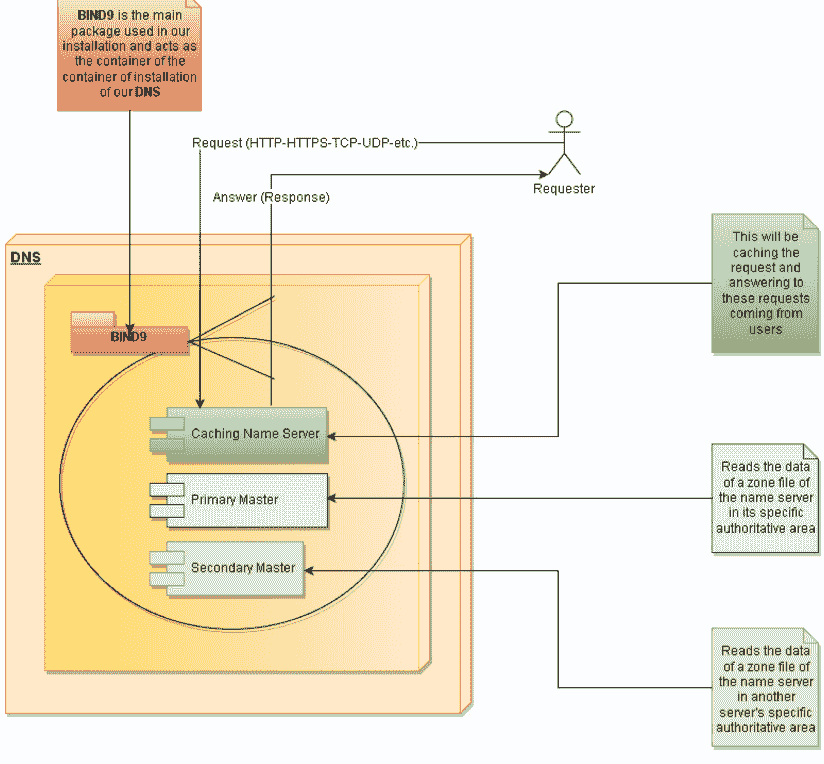

# Ubuntu® Linux 入门指南


> 我们不重新发明轮子，我们重新发明光光。迷人的灯光提供了无限的可能性：创新技术和新市场带来了机遇与挑战。在一个您的专业知识需求迫切的环境中，享受我们全球集团内的支持性工作环境，并从国际化职业路径中受益。与其他专家密切合作实施可持续理念，并为影响我们的未来贡献力量。来加入我们，每天重新发明光。

灯光来自 OSRAM SYLVLVANIA

注脚 55

# 关于作者


Mostafa A. Hamid

认证 CISSP 2013, LPIC 101, IBM RUP，并获得 SUNY 波茨坦大学和美国商会的 PHP、JS 和 Java 认证

来自 MIT 的 IoTx 认证

# 关于技术审核员

Mohamed Abbarra

TechWorld 技术工程师

海德拉巴大学信息系统学士

邮箱：mohamed.abarra.in@gmail.com

# 销售咨询

- 美洲 +1 888 9861322
- 德国 +49 800 1838219
- 法国 +33 800914061
- 西班牙 +34 900 833872
- 英国及其他地区 +44 800 0588704

pr@canonical.com

webmaster@ubuntu.com

如果您想立即与人联系，可以致电或写信 Canonical。位于伦敦的办公室是一个很好的起点。

- Canonical Group Limited
- Blue Fin Building 5th Floor
- 110 Southwark Street
- SE1 0SU
- United Kingdom, London
- 主交换机号码：+44 20 7630 2400

主传真号码：+44 20 7630 2401

# CANONICAL® LTD.

## 1.1 UBUNTU 背后的公司

Canonical LTD是一家英国公司，创始人来自南非的 Mark Shuttleworth，他是公司的大脑。

该公司总部位于英国。

该公司提供的一些产品包括：


UBUNTU 是我们本书的关注重点，它是一个为当今普通桌面用户、开发者、云 DevOps 以及企业和政府带来桌面使用技术革命的操作系统。Canonical Ltd 的 UBUNTU 能够成为世界第一 LINUX 发行版的原因是，它是免费的，而 Canonical Ltd 为其提供付费支持。

这些是 UBUNTU 背后的公司的特征，以及他们提供的其他产品：

- JUJU
- MAAS
- GNU Bazaar

Canonical LTD 网站为：

http://canonical.com

接下来，我们将了解更多关于 UBUNTU 和 LINUX 的细节。

## 1.2 UBUNTU LINUX

UBUNTU 是 Canonical Ltd 提供的操作系统，分为三个主要版本：

- 桌面版：UBUNTU Desktop
- 服务器版：UBUNTU Server
- 手机和平板：UBUNTU Touch

在本书中，我们将专注于 UBUNTU 桌面版和服务器版，通过设置进行操作，因为这些设置可能会根据环境有所不同。

# UBUNTU 与其他系统


# 2U 域名系统

## 2.1 在 UBUNTU 上使用 Bind9 安装 DNS

什么是 DNS 以及需要哪些软件包？

DNS 是一种管理所有设备的保护机制。

首先，让我们确定需要的软件包：

- 1. BIND9
- 2. DNSUTILS

现在我们将通过命令安装 DNS：

| sudo apt-get install bind9 |
| sudo apt-get install dnsutils |

让我们继续进行配置。

## DNS 配置、维护、管理与自动化

DNS 配置可以通过以下设置完成，某些设置可能会根据环境而异。

首先，让我们查看说明您环境结构的以下图表。



现在我们看到了在 http://draw.io 中绘制的图表，让我们在配置操作中查看组件之间的连接。

让我们了解缓存服务器配置。

使用以下命令编辑位于目录下的 `named.options` 文件：

```bash
sudo nano /etc/bind/named.options
```

注意，文件将在终端以文本编辑模式打开，并找到如下章节：

通过按下键盘上的 CTRL + W，nano 将允许您搜索 `forwarders` 章节并按下回车键。

```
forwarders {
  208.67.222.222;
  208.67.220.220;
};
```

当然，如果您有 ISP 静态 IP 地址，欢迎填写您自己的 IP 地址，但无论如何，这些 IP 地址是供任何人免费使用的，可以从 http://opendns.org 获取。

之后，我们需要运行命令来检查我们的 DNS 安装是否正常：

```bash
dig -x your-ip-address
```

您需要将 `your-ip-address` 更改为 ISP 提供的静态 IP 地址或路由器提供的 DHCP IP 地址，例如：192.168.1.2

让我们继续进入下一个配置选项，即主服务器，我们将应用以下配置选项：

如果您将使用单台机器安装您的 DNS 基础架构，我们将遵循此配置。

现在，我们将使用以下命令编辑位于 `/etc/bind/named.conf.local` 目录下的 `named.conf.local` 文件：

```bash
sudo nano /etc/bind/named.conf.local
```

## UBUNTU LINUX 上的域名系统

区域条目将遵循以下模板：

```zone "example.com" {
  type master;
  file "/etc/bind/db.example.com";
}
```

当然，请将 `example.com` 更改为你自己的域名。

如果你计划使用 DDNS（动态域名系统），目录将更改为以下内容：

```
zone "example.com" {
  type master;
  file "/var/lib/bind/db.example.com";
}
```

如果你需要为了自动化目的让域名动态监听来自机器外部的变化，那么 DDNS 将非常有用。例如，如果客户将使用 GUI 或图形用户界面来更改 DNS 属性，并通过该界面远程地控制 DDNS。

现在，让我们执行命令，使用 `cp` 命令将文件从原始位置复制到另一个位置作为副本，并准备好进行编辑：

```bash
sudo cp /etc/bind/db.local /etc/bind/db.example.com
```

现在，输入以下命令来编辑上一步中复制的文件：

```bind
$TTL 604800
@ IN SOA example.com. root.example.com. (
                2                     ; Serial
                604800                ; Refresh
                86400                 ; Retry
                241900                ; Expire
                604800 )             ; Negative Cache TTL

IN A 192.168.0.2

@ IN NS ns.example.com.
@ IN A 192.168.0.2
@ IN AAAA :1
ns IN A 192.168.0.2
```

请注意，将 `example.com` 和 `root.example.com` 更改为你选择的域名，并将 IP 地址 `192.168.0.2` 更改为你的 ISP 的 IP 地址或路由器的 IP 地址。

接下来，我们继续配置的下一个部分，并在对配置文件进行修改后，运行以下 2 个命令之一来重启 BIND9 服务：

```bash
sudo systemctl restart bind9.service
or
sudo service bind9 restart
```

接下来，我们通过向 `/etc/bind/named.conf.local` 目录下的 `named.conf.local` 中添加反向名称区域来进入下一个配置设置。

通过运行以下命令，我们将编辑请求的文件并进行如下修改：

```bash
sudo nano /etc/bind/named.conf.local
```

并添加如下的区域记录：

```zone
zone "0.168.192.in-addr.arpa" {
  type master;
  file "/etc/bind/db.192";
}
```

当然，你将需要将 `0.168.192` 替换为你的 IP 地址反向格式的前三个字节，且条目中最后的 `192` 也是根据你的 IP 地址决定的。

让我们继续安装配置选项，我们将创建一个名为 `db.192` 或 `db.(你IP地址的第一个字节)` 的文件，该文件将与上一个区域条目中放置的文件完全相同，如下所示：

```bash
sudo nano /etc/bind/db.192
or
sudo cp /etc/bind/db.127 /etc/bind/db.192
```

接下来，我们进入文件内容部分，我们将在文件中放入以下域名记录条目：

```bind
TTL 604800
@ IN SOA ns.example.com. root.example.com. (
      2 ; Serial
      604800 ; Refresh
      86400 ; Retry
      241900 ; Expire
      604800 ) ; Negative Cache TTL

 IN NS ns.
10 IN PTR example.com.
```

最后，让我们通过一张详细图表来查看我们所的操作：


## 在 Ubuntu 上开启 UFW

UFW 是 **Uncomplicated Firewall**（不复杂的防火墙）的缩写。它是一种允许用户通过特定端口访问或拒绝访问特定 IP 的防火墙程序。

让我们识别这些端口号及其功能。这些与 IP 地址相关的端口允许流量通过，其常见用途如下：

| 端口 | 常见用途 |
|---|---|
| 80, 8080 | HTTP 请求和响应 |
| 443 | HTTPS 请求和响应 |
| 22 | SSH 请求和响应 |
| 23 | Telnet 请求和响应 |
| 25 | SMTP 请求和响应 |
| 20 | FTP 请求和响应 |

现在，让我们在 Ubuntu 上安装 UFW。您需要安装以下软件包：

```bash
sudo apt-get install ufw
```

注意，Ubuntu 已经配备了 UFW，并配置了最安全的选项。使用以下命令启用防火墙：

```bash
sudo ufw enable
```

上一个命令将根据默认配置启动防火墙。让我们开始进行初始配置。以下命令将显示当前 UFW 服务的状态：

```bash
sudo ufw status verbose
```

它将显示防火墙是否启用、是否记录日志、默认的入站和出站规则，以及是否跳过了配置文件。以下命令将显示应用于当前 UFW 服务的异常列表：

```bash
sudo ufw show raw
```

下一节将介绍如何应用 UFW 规则。

## 3.1 UFW 角色与规则

UFW 接受作为角色和规则执行的命令。防火墙规则分为“允许 (allow)”或“拒绝 (deny)”。大多数防火墙的默认设置是“拒绝”，这将阻止访问特定资源或目标。

正如我们在之前的端口表中看到的，我们将使用它为防火墙创建一些规则。

## 3.2 端口操作

让我们按照以下方式启用和禁用特定端口的入站流量：

```bash
sudo ufw allow 53
sudo ufw deny 22
sudo ufw allow 80
sudo ufw deny 8080
sudo ufw allow 53/
```

现在，我们已经创建了一些规则来管理通过 53、22、80、8080 和 52/tcp 等端口的入站数据包。

## Linux - Ubuntu 上的 UFW

让我们详细查看这些命令：

- 第一个命令允许 53 端口入站流量。
- 第二个命令拒绝 22 端口入站流量。
- 第三个命令允许 80 端口入站流量。
- 第四个命令拒绝 8080 端口入站流量。

## 3.3 协议操作

第五个命令允许所有进入 53 端口的数据包并使用 TCP 协议，因为还有其他协议（如 UDP）可以使用，您也可以这样使用：

```bash
sudo ufw allow 53/udp
```

接下来的命令将如下所示删除现有规则：

```bash
sudo ufw delete deny 80/tcp
```

## 3.4 服务名称操作

现在，UFW 还可以通过服务名称允许和拒绝流量。如果您记得用于重启服务名称（例如 BIND9）的命令，我们将以如下相同的方式在 UFW 命令中使用：

```bash
sudo ufw allow bind9
sudo ufw deny bind9
sudo ufw delete allow bind9
sudo ufw delete deny bind9
```

## 3.5 伪装 (Masquerading)

如果您在您的机器上启用了伪装，请检查名为 `sysctl.conf` 的文件：

```bash
nano /etc/sysctl.conf
```

然后，取消以下行的注释：

```conf
net.ipv4.ip_forward=1
net.ipv6.conf.forwarding=1
```

最后执行以下命令：

```bash
sudo sysctl -p
sudo iptables -t nat -A POSTROUTING -s 192.168.0.4/16 -o eth0 -j MASQUADE
```

# 4 Ubuntu 邮件服务器

## 4.1 Ubuntu 上的 POSTFIX

Ubuntu 邮件服务器需要安装以下软件包：

```bash
POSTFIX
DOVECOT-CORE
MAIL-STACK-DELIVERY
```

现在，让我们开始安装过程，查看以下图表以说明组件是如何协同工作的：


之后，让我们继续下一步操作：

```
openssl x509 -req -days 365 -in server.csr -signkey server.key -out server.crt
sudo cp server.crt /etc/ssl/certs
sudo cp server.key /etc/ssl/private
sudo mkdir /etc/ssl/CA
sudo mkdir /etc/ssl/newcerts
sudo sh -c "echo '01' > /etc/ssl/CA/serial"
sudo touch /etc/ssl/CA/index.txt
```

然后，我们将移动配置的下一个部分，使用我们的新证书配置已安装的 OPENSSL 包，如下所示：

```
sudo nano /etc/ssl/openssl.cnf
```

之后，我们将把该文件中的配置设置更改如下：

```
dir = /etc/ssl
database = $dir/CA/index.txt
certificate = $dir/certs/cacert.pem
serial = $dir/CA/serial
private_key = $dir/private/cakey.pem
```

现在，我们将按照如下创建一个自签名根证书：

```
openssl req -x509 -extensions v3_ca -keyout cakey.pem -out cacert.pem -days 3650
```

然后，我们将移动到下一个部分，即根证书和密钥文件，如下所示：

```
sudo mv cakey.pem /etc/ssl/private/
sudo mv cacert.pem /etc/ssl/certs/
```

最后，我们将按照如下所示创建一个自签名证书签名请求：

```
sudo openssl ca -in server.csr -config /etc/ssl/openssl.cnf
```

之后，我们将继续进行 POSTFIX 配置，以使用我们使用的证书，如下所示：


# Postfix TLS 配置

```
sudo postconf -e 'smtp_tls_security_level = may'
sudo postconf -e 'smtpd_tls_security_level = may'
sudo postconf -e 'smtpd_tls_note_starttls_offer = yes'
sudo postconf -e 'smtpd_tls_key_file = /etc/ssl/private/server.key'
sudo postconf -e 'smtpd_tls_cert_file = /etc/ssl/certs/server.crt'
sudo postconf -e 'smtpd_tls_loglevel = 1'
sudo postconf -e 'smtpd_tls_received_header = yes'
sudo postconf -e 'myhostname = mail.example.com'
sudo postconf -e 'smtp_tls_CAfile = /etc/ssl/certs/cacert.pem'
sudo systemctl restart postfix.service
OR
sudo service postfix restart
```

# Dovecot SASL 身份验证

现在，我们将安装第二个包 `dovecot` 用于 SASL 身份验证，如下：

```
sudo apt install dovecot-core
```

然后，我们将按照如下所示配置 `dovecot-core` 包：

```
sudo nano /etc/dovecot/conf.d/10-master.conf
```

之后，我们需要更改配置文件的内容以符合如下所示的内容：

```
service auth {
  unix_listener auth-userdb (
  #mode = 0600
  #user =
  #group =
  )
  unix_listener /var/spool/postfix/private/auth {
  mode = 0660
  user = postfix
  group = postfix
}
```

对于 `outlook` 客户端，我们需要继续编辑以下文件：

```
sudo nano /etc/dovecot/conf.d/10-auth.conf
```

我们将按照如下所示向我们的文件中添加以下行：

```
auth_mechanisms = plain login
```

# Mail-Stack-Delivery 安装

现在，我们将按照如下所示安装我们的最后一个包 `mail-stack-delivery`：

```
sudo apt install mail-stack-delivery
```

之后，按照如下所示配置 `POSTFIX` 配置文件：

```
sudo nano /etc/postfix/main.cf
```

然后，我们将按照如下所示更改配置设置：

```
smtptd_tls_cert_file = /etc/ssl/certs/ssl-mail.pem
smtptd_tls_key_file = /etc/ssl/private/ssl-mail.pem
```

当然，您需要将证书目录和文件名更改为系统内部适当的文件，就像在创建自签名证书时完全配置的那样。

现在，我们将使用 `telnet` 连接到指定端口上的主机来测试我们的环境：

```
telnet mail.example.com 25
```

最后，我们需要输入以下命令并使用域名向我们的服务器发送 `ehlo`：

```
ehlo mail.example.com
```

我们已经完成了邮件服务器的安装和配置程序，我们剩下的工作是设置一个全面的用户界面并获取日志，以及对邮件服务器进行故障排除以确保运行良好。出于安全考虑，我们将完成配置，因为安装过程中出现的大问题是因为正在处理核心内容。

要安装 `SMTP`，我们将如下所示编辑 `/etc/postfix/master.cf` 文件：

```
sudo nano /etc/postfix/master.cf
```

然后，我们将进行以下配置更改：

```
smtps inet - smtpd
-o smtpd_tls_wrap_level=yes
-o smtpd_sasl_enable=yes
-o smtpd_client_restrictions=permit_sasl_authenticated,reject,ORIGINATING
```

邮件服务器日志应该是：

```
sudo postconf -e 'smtpd_tls_loglevel = 4'
```

如果您没有从特定域名接收邮件该怎么办？

```
sudo postconf -e 'debug_peer_list = domain-example.com'
```

当然，在每次配置之后，您必须重启与您所做更改相关的服务。

现在让我们为 `dovecot` 包安装以下内容：

```
sudo apt-get install dovecot-imap dovecot-pop3
```

我们将按照如下所示修改 `dovecot` 包的配置：

```
sudo nano /etc/dovecot/conf.d
```

我们将按照如下所示修改 `dovecot` 包配置：

```
protocols = pop3 imap
mail_location = maildir:/home/%u
```

按照如下格式如下：

```
mail_location = maildir:/home/%u
disable_plaintext_auth = no
ssl = yes
ssl_file = /etc/ssl/certs/cert.pem
key_file = /etc/ssl/private/cert.key
```

```
protocol imap {
listen = 143
ssl_listen = 993
}
protocol pop3 {
listen = 110
ssl_listen = 995
}
```

接下来，我们将按照如下内容将邮件邮件，设置 `Maildir` 格式：

```
sudo nano /etc/etcpostfix/main.cf
```

然后，我们将按照如下所示配置它：现在我们将按照如下所示为所有用户更新 `Maildir`，添加到他们的 `UBUNTU` `Skeleton` 如下：

```
sudo maildirmake.dovecot /etc/skel/Maildir
sudo maildirmake.dovecot /etc/skel/Maildir/Drafts
sudo maildirmake.dovecot /etc/skel/Maildir/Sent
sudo maildirmake.dovecot /etc/skel/Maildir/Trash
sudo maildirmake.dovecot /etc/skel/Maildir/Templates
sudo cp -r /etc/skel/Maildir /home/myuser/
sudo chown -R username:rootgroup /home/myuser/Maildir
sudo chmod -R 700 /home/myuser/Maildir
sudo service dovecot start
```

为了测试协议，我们将运行以下命令：

```
telnet localhost pop3
telnet localhost imap
openssl s_client -connect mail.domain.ext:993
LOGIN username password "*"
LIST "*"
EXAMINE INBOX
```

您是否想为邮件服务器安装一个反病毒扫描器并扫描所有邮件？

如今邮件服务充满了垃圾和病毒攻击，有一个名为 `Amavis-New` 的包，它可以自动扫描感染的邮件并排除它们。让我们按照如下所示进行邮件反病毒软件的安装和包配置：

要安装 `amavis-new`，我们需要运行以下命令：

```
sudo apt-get install amavisd-new spamassassin clamav-daemon
sudo apt-get install libnet-dns-perl libmail-spf-perl pyzor razor
sudo apt-get install arj bzip2 cabextract cpio file gzip lha nomarch pax rar unrar unzip unzoo zoo
```

接下来，我们将按照如下所示将以下内容配置到我们的 `postfix` 中，如下所示：

```
sudo postconf -e "content_filter = smtp-amavis:[127.0.0.1]:10024"
```

现在，我们将按照如下所示编辑文件 `/etc/postfix/master.cf`：

```
sudo nano /etc/postfix/master.cf
```

随后在文件末尾添加以下内容：

```
smtp-amavis unix - - 2 smtp
-o smtp_data_done_timeout=1200
-o smtp_send_xforward_command=yes
-o disable_dns_lookups=yes
-o max_use=20
127.0.0.1:10025 inet n - - smtppd
-o content_filter=
-o local_recipient_maps=
-o relay_recipient_maps=
-o smtpd_restriction_classes=
-o smtpd_delay_reject=no
-o smtpd_client_restrictions=permit_mynetworks,reject
-o smtpd_helo_restrictions=
-o smtpd_sender_restrictions=
-o smtpd_recipient_restrictions=permit_mynetworks,reject
-o smtpd_data_restrictions=reject_unauth_pipelining
-o smtpd_end_of_data_restrictions=
-o mynetworks=127.0.0.0/8
-o smtpd_error_sleep_time=0
-o smtpd_soft_error_limit=1001
-o smtpd_hard_error_limit=10000
-o smtpd_client_connection_count_limit=0
-o smtpd_client_connection_rate_limit=0
-o receive_override_options=no_header_body_checks,no_unknown_recipient_checks
```

现在，重启我们的 `postfix` 服务并执行以下命令：

```
sudo /etc/init.d/postfix reload
chmod -R 775 /var/lib/amavis/tmp
```

现在，我们将继续使用 `squirrelmail` 及其组件进行 `GUI` 安装。

## 4.2 在 UBUNTU 上安装 OPEN WEB WEBMAIL

安装 `open webmail` 需要在您的系统上安装以下软件包和编程语言：

- `perl`
- `libauthen-pam-perl`
- `libconvert-asn1-perl`
- `libmd5-perl`
- `libnet-ldap-perl`
- `perl-suid`
- `wwwconfig-common`
- `libpg-perl`

现在，让我们按照以下方式安装这些包：

```
sudo apt-get install perl libauthen-pam-perl libconvert-asn1-perl libmd5-perl libnet-ldap-perl perl-suid wwwconfig-common libpg-perl
```

现在，让我们继续对这些包进行配置，将其与我们的 `POSTFIX` 包集成：

```
sudo rm /var/www/openwebmail/index.html
sudo ln -s /var/www/openwebmail/redirect.html /var/www/openwebmail/index.html
```

现在，访问 `http://localhost/openwebmail`
你将发现邮件已经运行。
之后，如果您想登录您的用户名和密码，或使用系统的任何用户名和密码来添加用户，或者如果您想删除用户，则需要从系统中删除该用户。

最后的一件事是 `openmail` 的替代方案—— `squirrelmail`，让我们看看它是如何安装和配置的。

要安装 `squirrelmail`，首先让我们按照以下方式安装 `lamp-server` 软件包，它包含了 `PHP`、`MySQL` 和 `Apache Web` 服务器：

```
sudo apt-get install tasksel
sudo tasksel install lamp-server
```

在提示时提供 `mysql` `root` 密码，并将密码记录在纸上或其他备忘录中，以免忘记，因为我们在其他配置和其他软件包的安装中仍然会需要它。

让我们按照以下方式安装 `squirrelmail`：

```
sudo apt-get install squirrelmail
```

之后，让我们按照以下方式配置我们的 `squirrelmail`：

```
sudo squirrelmail-configure
```

在选项 `2` 中，让我们进行以下更改：

```
Update IMAP Settings : localhost:143
Update SMTP Settings : localhost:25
```

然后在选项 `4` 中，允许以下第 `11` 号设置：

```
Allow server-side sorting
```

执行以下命令按如下方式将 `squirrelmail` 集成到 `Apache Web` 服务器：

```
sudo cp /etc/squirrelmail/apache.conf /etc/apache2/sites-available/squirrelmail
sudo ln -s /etc/apache2/sites-available/squirrelmail /etc/apache2/sites-enabled/squirrelmail
OR
sudo a2ensite squirrelmail
sudo service apache2 restart
```

现在，访问以下 `URL`，你将发现它运行正常：

`http://localhost/squirrelmail`

通过这种方式，我们完成了所有邮件服务器组件的安装、配置和故障排除。

# UBUNTU 上的 KERBEROS 和联邦服务

让我们开始吧！！！

这部分有点像是你正在听的一首重金属歌曲，会让你的脑子有点嘈杂，但绝对很有趣。

首先，让我们认识什么是 `Kerberos` 和联邦服务（`Federation Services`）。

`Kerberos` 和联邦服务是我们使用 `bind9` 安装的域的一种保护机制。

在 `UBUNTU` 上安装 `Kerberos` 和联邦服务的包有：

- `slapd`
- `ldap-utils`
- `krb5-kdc-ldap`
- `krb5-kdc`
- `krb5-admin-server`
- `ldapscripts`

让我们先按照以下方式安装 `OpenLDAP`：

```
sudo apt install slapd
```

现在，我们继续使用以下命令创建一个名为 `/etc/ldap/slapd.d/add_content.ldif` 的新 `LDIF` 文件：

```
sudo nano /etc/ldap/slapd.d/add_content.ldif
```

向其中添加以下内容：

```
dn: ou=People,dc=example,dc=com
objectClass: organizationalUnit
ou: People
dn: ou=Groups,dc=example,dc=com
objectClass: organizationalUnit
ou: Groups
dn: cn=miners,ou=Groups,dc=example,dc=com
objectClass: posixGroup
cn: miners
gNumber: 5000
dn: uid=manon,ou=People,dc=example,dc=com
objectClass: inetOrgPerson
objectClass: posixAccount
objectClass: shadowAccount
uid: manon
sn: Niazi
givenName: Manon
cn: Manon Niazi
displayName: Manon Niazi
uidNumber: 1000
gidNumber: 5000
homeDirectory: /home/manon
shell: /bin/bash
```

然后，我们将执行以下命令：

```
ldapadd -x -D cn,dc=example,dc=com -W -f /etc/ldap/slapd.d/add_content.ldif
```

在提示时，输入你之前的密码。

# UBUNTU 上的 KERBEROS 和联邦服务

之后，执行以下命令：

```
ldapsearch -x -L -b dc=example,dc=com
```

最后，你可以搜索条目：

```
entry: 20110829165435935248#000000#000000
```


`sudo ldapmodify -Q -Y EXTERNAL -H \`
`ldap:///cn=(1)corba,cn=schema,cn=config`

将以下条目添加到你的文件中，如果条目已存在则对其进行编辑：

```
SERVER=localhost

BINDDN=cn=admin,dc=example,dc=com

BINDPWDFILE=/etc/ldapscripts/ldapscripts.password

SUFFIX=dc=example,dc=com

GSUFFIX='ou=Groups'

USUFFIX='ou=People'

MSUFFIX='ou=Computers'

GIDSTART=10000

UIDSTART=10000

MIDSTART=10000
```

当然，你需要根据你的环境更改这些条目。

然后，执行以下命令来修改 ldap passwd 文件：

```bash
sudo sh -c "echo -n 'manon' > /etc/ldapscripts/ldapscripts.password"
sudo chmod 400 /etc/ldapscripts/ldapscripts.password
```

之后，我们将使用以下命令创建用户和删除用户：

```
sudo ldadduser manon
sudo ldapsetpasswd manon
sudo ldapdeleteuser manon
```

并且，我们将按照以下方式添加和删除组：

```bash
sudo ldaddgroup niazi
sudo ldapdeletegroup niazi
```

之后，我们将使用命令将用户添加到组或从组移除：

```bash
sudo ldaddusertogroup manon niazi
sudo ldapdeleteuserfromgroup manon niazi
```

在 bookoon.com 下载免费电子书

我们现在将使用以下命令加载新架构（schema）：

```bash
ldapadd -x -D cn=admin,cn=config -W -f /tmp/cn\kerberos.ldif
```

执行以下命令按如下所示向你的文件添加条目：

```bash
ldapmodify -x -D cn=admin,cn=config -W
```

然后按照如下所示添加内容：

```text
dn: olcDatabase=(1)hdb,cn=config
add: olcDbIndex
olcDbIndex: krbPrincipalName eq,pres,sub
```

最后，使用命令更新访问控制列表（ACL）：

```bash
ldapmodify -x -D cn=admin,cn=config -W
```

现在，让我们安装以下软件包来创建我们的主 KDC：

```bash
sudo apt install krb5-kdc krb5-admin-server krb5-kdc-ldap
```

现在，编辑以下文件 `/etc/krb5.conf` 并在命令后添加内容：

```bash
sudo nano /etc/krb5.conf
```

然后，编辑文件的以下内容：

```ini
[libdefaults]
default_realm = EXAMPLE.COM

[realms]
EXAMPLE.COM = {
 kdc = kdc01.example.com
kdc = kdc02.example.com
admin_server = kdc01.example.com
admin_server = kdc02.example.com
default_domain = example.com
database_model = openldap_ldapconf
}

[domain_realm]
.example.com = EXAMPLE.COM

[dbdefaults]
ldap_kerberos_container_dn = dc=example,dc=com

[dbmodules]
openldap_ldapconf = {
db_library = ldap
lap_kdc_dn = "cn=admin,dc=example,dc=com"
lap_kadmind_dn = "cn=admin,dc=example,dc=com"
lap_service_password_file = /etc/krb5kdc/service.keyfile
lap_servers = ldap://ldap01.example.com
com ldap://ldap02.example.com
lap_conns_per_server = 5
}
```

现在，使用以下命令创建一个领域（realm），请注意我们在另一个章节中安装 Web 服务器时将使用此领域，请将领域名称和数据读取到一个文件中，以便在安装 Web 服务器的章节中使用。

```bash
sudo kdb5_ldap_util -D cn=admin,dc=example,dc=com create -subtrees \
dc=example,dc=com -r EXAMPLE.COM -s H ldap://ldap01.example.com
```

然后我们需要使用以下命令创建一个名为 stash（存储））的文件：

```bash
sudo kdb5_ldap_util -D cn=admin,dc=example,dc=com stashrvpw -f \
/etc/krb5kdc/service.keyfile cn=admin,dc=example,dc=com
```

在 bookboom.com 下载免费电子书

然后，使用以下命令从 LDAP 服务器复制 CA 文件：

```bash
scp ldap01:/etc/ssl/certs/cacert.pem . sudo
cp cacert.pem /etc/ssl/certs
```

现在，使用命令编辑 `ldap.conf` 文件：

```bash
sudo nano /etc/ldap/ldap.conf
```

然后向其添加这些内容：

```text
TLS_CACERT /etc/ssl/certs/cacert.pem
```

现在，运行以下命令添加 kerberos 主体（principals）：

```bash
sudo kadmin.local
```

现在，重启所有相关服务：

```bash
sudo systemctl restart slapd.service
sudo systemctl start krb5-kdc.service
```

# 在 UBUNTU 上使用 WEB 服务器

Web 服务器是一种容器，包含了由软件和 Web 程序员编写的 Web 应用程序，该应用程序通过 Web 服务器执行其所有功能。

## 6.1 在 UBUNTU 上安装 GLASSFISH 服务器

Web 服务器是一种容器，包含了由软件和 Web 程序员编写的 Web 应用程序，该应用程序通过 Web 服务器执行其所有功能。

然后，编辑文件的以下内容：

```ini
[libdefaults]
default_realm = EXAMPLE.COM

[realms]
EXAMPLE.COM = {
 kdc = kdc01.example.com
kdc = kdc02.example.com
admin_server = kdc01.example.com
admin_server = kdc02.example.com
default_domain = example.com
database_model = openldap_ldapconf
}

[domain_realm]
.example.com = EXAMPLE.COM

[dbdefaults]
ldap_kerberos_container_dn = dc=example,dc=com

[dbmodules]
openldap_ldapconf = {
db_library = ldap
lap_kdc_dn = "cn=admin,dc=example,dc=com"
lap_kadmind_dn = "cn=admin,dc=example,dc=com"
lap_service_password_file = /etc/krb5kdc/service.keyfile
lap_servers = ldap://ldap01.example.com
com ldap://ldap02.example.com
lap_conns_per_server = 5
}
```

现在，使用以下命令创建一个领域，请注意我们在另一个章节中安装 Web 服务器时将使用此领域，请将领域名称和数据读取到一个文件中，以便在安装 Web 服务器的章节中使用。

```bash
sudo kdb5_ldap_util -D cn=admin,dc=example,dc=com create -subtrees \
dc=example,dc=com -r EXAMPLE.COM -s H ldap://ldap01.example.com
```

## 7.2 安装与配置 ORACLE DATABASE SERVER 12C EXPRESS EDITION

Oracle Database Server 12c Express Edition 是 2017 年排名靠前的数据库服务器之一，它恰好作为存储应用程序或 Web 应用程序数据的容器。

请通过以下链接下载最新版本的 Oracle数据库服务器：
http://www.oracle.com/technet/database/enterprise-edition/downloads/database12c-linux-download-2240591.html

运行以下命令安装 oracle 12c 并按照向导操作：

```
path/to/db/runInstaller
```

通过这种方式，我们完成了书中的大部分主题。

## 结语

如果您对本书有任何疑虑，请访问：
http://bookboon.com
我们将非常乐意听取您的意见。

非常感谢 `Canonical LTD.`，这家 UBUNTU 背后的公司对本书进行了技术审阅。

非常感谢您花时间阅读本书，我们真的希望它对您的帮助能像它对我们的帮助一样大。

献给 `Manon Niazi`

The Deutschländer

我离开了农业学院，继续在计算机学院学习计算机科学，直到我遇到了德国人 Manon Niazi，因为我想制造一台名为“`Manon`”的设备。
