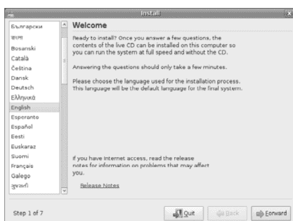
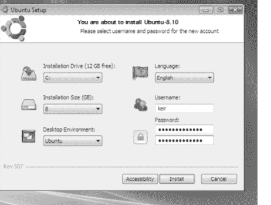
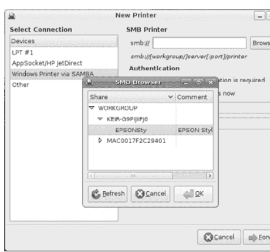
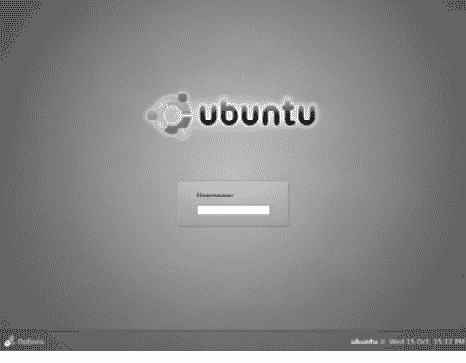
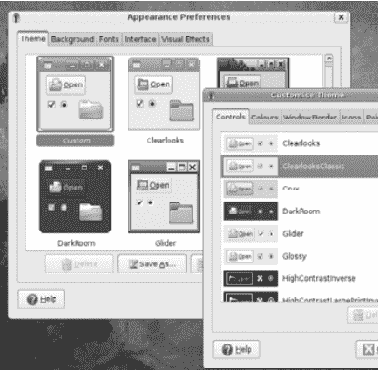
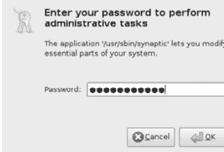
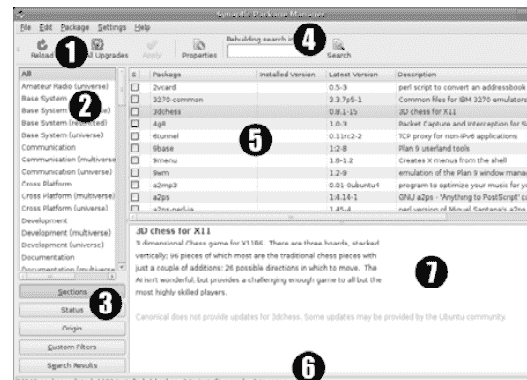

# Ubuntu 口袋指南与参考：日常使用的简洁伴侣

- Zip 文件 ..................................................................... 91

# 关于作者

Keir Thomas 是世界上编写 Ubuntu Linux 最多出的作者之一。

《Ubuntu 便携指南与参考》是他的第三本 Ubuntu 教程，也是他获奖的 Ubuntu 综合指南——《入门 Ubuntu Linux》（ISBN 978-1590599914）——最近已出版第三版。

Thomas 还是《Ubuntu Kung Fu》（ISBN 978-19343356227）的作者，这是一本包含超过 300 个技巧、窍门、提示和破解方法的独特书籍。它经常登上 Amazon.com Linux 类别的畅销榜。

他曾写过关于 SUSE 和 Fedora Linux 主题的书，并编辑过从企业电子商务到 Ruby 编程等各种主题的书。此前，他曾编辑过几本畅销的计算机杂志，包括《PC Utilities》和《Linux User & Developer》，并为更多杂志撰写过文章。

他住在英国，爱好包括远足、骑自行车和园艺。

他想感谢此书的技术评审员：John Southern、Matthew Helmke 和 Ryan Troy。

如果你喜欢《Ubuntu 便携指南与参考》，

为什么不买一本纸质版呢？

Keir Thomas 的其他书籍...

### Ubuntu Kung Fu

实战程序员系列 (The Pragmatic Programmers)

为全球最喜爱的 Linux

提供超过 300 个技巧、

窍门、

提示和破解方法。

### 入门 Ubuntu Linux，第三版 / Apress

ISBN 978-1590599914

全面的、获奖的指南。在 700 多页中实现从零到英雄的跨越！

# 简介

本章的目的是向你介绍 Ubuntu 操作系统以及支撑它的哲学思想。

你正在阅读这本书可能意味着你已经了解了 Ubuntu，但可能有一一两个读者是出于冲动购买了这本书的纸质版（或下载了 PDF），想看看到底在忙什么。这些人可能缺乏具体的了解，并且对 Ubuntu 的优点仍不信服。因此，我将利用这本薄书中的一些宝贵篇幅来传道并解释一下。

# 什么是 Ubuntu？

Ubuntu 是 Linux 操作系统的一个版本。操作系统是“运行你的计算机”的软件。Microsoft Windows 是世界上最流行的操作系统，至少对于台式电脑而言是，但 Linux 是一个完全不同的尝试。

## GNU

这一切始于 20 世纪 80 年代，一位非常有才华的计算机科学家 Richard Stallman 决定创建一个名为 Unix 的老牌操作系统的克隆。当时，Unix 运行着世界上许多工业和学术计算机系统。

Stallman 这样做是因为 Unix 变得变得越发私有化——它不再允许共享其源代码（程序员创建的列表），而这自 1969 年 Unix 诞生以来一直都在发生。

这对于 Stallman 来说是不可理喻的，他认为共享软件是自然且健康的。他决定他版本的 Unix 将始终免费可用，并发明了法律和伦理层面的概念——即**自由软件**（Free Software），认为用户应该始终拥有共享软件的自由，而不受任何限制。在技术层，自由软件保证了查看和修改代码的权利，甚至可以将其作为创建新程序的依据。然而，任何添加或更改都必须作为自由软件发布，以便他人能够继续受益。

自由软件的理想被载于所有自由软件项目的软件许可中。它是 GNU 公共许可证（GNU Public License），或者简称为 GPL。这是 Windows 附带的微软用户许可协议（或者每当你从头开始安装 Windows 时），但不同的是，微软的 EULA 在任何情况下都禁止 Windows，而 GNU 的说法恰恰相反——你永远可以共享软件！

# Stallman 将他的 Unix 版本称为“GNU”（读音为 G-noo）。这是一个递归缩写，代表“GNU's Not Unix”（GNU 不是 Unix）。换句话说，这个缩写指的是它自己——这是一种程序员喜欢的笑话。

# Linux 内核

GNU 发展成了一个拥有许多贡献者的重大项目。然而，尽管它很好，但它缺乏一个内核。内核是任何操作系统核心的程序，负责处理基础事务，例如让硬件与软件进行通信。

巧合的是，一位名叫 Linus Torvalds 的家伙提供了一个解决方案。1991 年，他启动了一个个人项目来创建一个内核。由于他的内核上传到互联网时出现命名错误，它以他的名字命名并被称为 Linux——“Linux”和“Unix”的混合体。

至关重要的是，Torvalds 选择将他的内核作为自由软件发布，并邀请任何感兴趣的人为他提供帮助。他们做到了。全球数千万的人参与了进来。随着时间的推移，该项目变得更加重要，在设计和前景上变得更加宏大。今天，Linux 内核获得了包括 IBM 在内的许多大型企业的赞助。

> 注意 Torvalds 至今仍在监督并贡献 Linux 内核项目。他幽默地将自己的角色描述为“仁慈的独裁者”。

由于内核是操作系统中极其重要的部分，人们开始将 GNU 和 Linux 的组合简称为 Linux。这让斯托尔曼（Stallman）很不高兴，他要求使用 GNU/Linux 这个名称。但为太晚了，这个名字已经传开了。

**注意** 将操作系统称为 GNU/Linux 还是简单的 Linux 是一个持续至今的争论。

Linux 操作系统通常也包含了来自 GNU 和 Linux 内核或其他来源的软件。Linux 中几乎所有的软件都是自由软件，尽管其中很大一部分与 GNU 或理查德·斯托尔曼没有直接联系。可以说，斯托尔曼给世界最大的礼物不是 GNU 软件，而是自由软件的概念。如今斯托尔曼的大部分活动涉及与全球范围内自由软件的交流。

**注意** 经常用开源（open source）来代替自由软件。它们的含义相似——参见 www.opensource.org。

## Linux 发行版

Linux 并不是只有一个版本，而是有数百个。这些版本被称为 Linux 发行版（distributions），简称 distros。其他发行版的示例包括红帽（www.redhat.com）和 SUSE（www.suse.com），但还有许多其他发行版，且新的版本不断出现。

这种多样性的存在是因为自由软件所允许的自由——任何人都可以获取源代码并制作他们自己的版本。

某些发行版是由商业赞助的，而另一些则源于全球庞大的用户社区。Ubuntu 兼具两者：它由企业家斯托尔沃（Shuttleworth）于 2004 年创立的公司 Canonical 赞助，但也受益于社区的支持，并基于 Debian（www.debian.org），这是一个由社区生成的发行版。

## 什么让 Ubuntu 特殊

有三点让 Ubuntu 脱颖而出：

1. 关注桌面用户；
2. Ubuntu 的哲学和社区；
3. 易用性。

让我们仔细看看每一项。

### 关注桌面用户

尽管它提供了适用于各种电脑的版本，但从核心上说，Ubuntu 是一个面向桌面用户的 Linux 发行版。大多数 Linux 发行版在桌面或服务器计算机上同样适用，但在桌面体验方面缺乏精细化。事实上，在很多情况下，桌面用户的需求是事后才考虑的。

相比之下，Ubuntu 开发者非常关注桌面体验。当 Ubuntu 在 2004 年创建时，斯托尔沃在在线数据库中记录了第一个 bug。然而，这并不是关于软件的。相反，这是一个修复 PC 市场中这一 bug 的革命性号召。

### 哲学与社区

正如你所察觉到的，Linux 既是一种操作系统，也是一种哲学。Ubuntu 也一样。

### 非洲价值观

Ubuntu 的名称源于一个非洲概念，大致翻译为“对他人的仁爱”（humanity to others）。这个术语在种族隔离后的南非流行起来，它强调了个人意识到自己在社区中的作用以及保持慷慨精神的重要性。

当斯托尔沃在 2004 年创立 Ubuntu 项目时，他根据这一概念和自由软件原则起草了一份哲学声明。简而言之，Ubuntu 项目由这样一个理念驱动：任何人、在任何地方都应该能够使用、共享或修改软件。这意味着即使他们有残疾，也应该能够获取这些软件。Ubuntu 像几乎所有的 Linux 版本一样免费，在发布后的特定时间内也是免费的（通常为 18 个月，更多细节请参见第 7 页表格）。

**注意** 你可以在 www.ubuntu.com/community/ubistory/philosophy 了解更多关于 Ubuntu 哲学的信息，并在 www.gnu.org/philosophy/free-sw.html 了解更多关于自由软件基金会的原则。Ubuntu 代表了自由——使用和共享软件的自由，随心使用软件的自由以及学习的自由。

### 社区

Ubuntu 社区直接产生于 Ubuntu 哲学。简单来说，人们尊重 Ubuntu 采取的有原则的立场。他们也喜欢 Ubuntu 关注桌面体验这一事实。曾有许多 Linux 版本像 Ubuntu 一样专门针对桌面用户，但它们几乎都失败了。这是因为它们在自由软件原则的组件上做了妥协。也许他们的 Linux 版本包含了不能自由共享或修改的专有安装程序。有时他们还尝试限制其 Linux 版本的重新发行。

Ubuntu 没有做这些事情。它的回报是全球范围内真正庞大的用户社区——可以说是是任何 Linux 版本中用户基数最大的。它无疑是最友好的 Linux 社区之一。斯托尔沃处于次要位置，偶尔发布版本外，由社区主导。关于新功能的决策是以民主方式做出的，许多用户帮助开发 Ubuntu（当然，前提他们拥有技能）。

对于 Ubuntu 的普通终端用户来说，Ubuntu 社区的收益体现在 www.ubuntuforums.org 等社区网站上，用户在那里聚集并互相帮助。

**注意** 说 Ubuntu 不包含专有软件并非 100% 准确。目前提供极少量的专有硬件固件，以支持尚未被自由软件完全支持的无线和图形设备。但这被权宜之计，直到更多可接受的替代方案出现。

### 易用性

除了强大的原则和资金赞助，斯托尔沃还为 Linux 世界带来了其他东西：他想做出“为人类设计的 Linux”（Linux for human beings）。事实上，这就是 Ubuntu 的口号。

### 过去是怎样的

为了理解为什么这很重要，让我讲述我在 2002 年（Ubuntu 出现之前）使用 Linux 的一次经历。我想让笔记本电脑的无线卡连接到我的网络，但在 Linux 下无法让它工作。于是，我在热门论坛上寻求帮助。我在回复中收到了类似以下的内容：

> 要让代码运行起来很简单！只需获取模块的源代码并针对内核进行编译。使用 insmod 加载它，然后使用 iwconfig 配置 WEP 密码——

你还在读吗？如你所见，这是一个复杂的答案。它涉及到命令行操作，并且要求在非常技术层面上了解 Linux 是如何工作的。我知道发帖者在说什么，尽管内心对所涉及的工作量叹了口气。然而，一个新手却困惑了。

当时就是这样。Linux 是“仅供技术人员准备的”。它被认为一种工业级操作系统，并随之带来了几乎所有的标准硬件，其陡峭的学习曲线赶走了许多人。

### 现在是怎样的

Ubuntu 改变了一切。它专注于桌面用户体验，为此，它提供了图形化配置软件。它包含了各种硬件驱动程序，使得几乎所有标准硬件都能“即插即用”。Ubuntu 自带一个安装程序，该程序没有包含令人费解的术语，更新系统只需鼠标点击几次即可。

公平地说，可以认为 Ubuntu 是桌面 Linux 这一更广泛革命的一部分，其他几个 Linux 版本也朝着同样的方向迈进。Ubuntu 是第一个实现这一点的，并在每一个新版本的发布中继续保持领先。

虽然命令行仍然存在，但不再强制要求使用它。使用命令行通常更快、更高效（正如你将在本书的后面部分发现的那样），但你不必这样做。Ubuntu 让 Linux 对所有人都触手可及。

## Ubuntu 提供的功能

Ubuntu 是一个非常现代的操作系统，提供了你在 Windows 或 Macintosh OS X 中可能找到的所有功能，但没有那些缺点。它保持了简单性，同时提供了丰富的功能。

想浏览网页吗？Firefox 可以胜任这项工作。你可能在 Windows 下使用的同一个 Firefox，而且相同的插件同样适用。想使用 AIM、MSN 或 ICQ 与朋友发送即时消息吗？Pidgin 提供了解决方案。需要进行文字处理、电子表格或演示吗？OpenOffice.org 可以帮你解决问题。GIMP 将处理图像编辑，而 RhythmBox 将负责音乐播放（独立视频播放由 Totem 处理）。

所有这些程序都是默认安装的。它们不是额外程序，而且都是免费的。

硬件支持非常出色，几乎每一项日常硬件都得到了支持，包括显卡/声卡、打印机、无线设备、USB 优存盘、摄像头、iPod 等。不需要费力寻找驱动程序光盘——几乎所有设备在安装后都会直接开始运行，尽管与任何操作系统一样，你可能需要根据自己的喜好和需求对系统进行配置。

> Ubuntu 在旧硬件上运行良好。Ubuntu 8.04 的最低实际要求是 700MHz 处理器、384MB 内存和 8GB 磁盘空间。你可能考虑先在旧 PC 上安装 Ubuntu 以进行评估。

## 如何阅读本书

《Ubuntu 口袋指南与参考》非常简洁。它的目标是以一种无烦恼的方式解释 Ubuntu 管理的核心要点。由于口袋书格式的限制，有时它可以作为 Ubuntu 功能的快速导览。然而，主题都得到了充分解释，并经常提供持久的参考。

关于 Ubuntu 还有更全面的书籍。我推荐《入门 Linux》第三版，由 Jaime Sicam 编写，Apress 出版（2008年6月；ISBN 978-159059914），提供了完整的 Ubuntu 指南。

## 复选框

图 1。复选框和单选按钮。

## 输入命令

有时可能会要求你在命令行输入某些内容。这通常会出现在行中，如下：

- `mv /home/keir/Desktop/report.doc /home/keir`

有些命令很长，页面上无法显示完全。如果是这种情况，我在行尾使用符号：

## 菜单选项

在某些章节中，要求你选择某个菜单选项。你可能会看到如下内容：点击 System ↩ Preferences ↩ Appearance。我的意思是点击屏幕顶部的 System 菜单，然后是 Preferences 子菜单，最后点击 Appearance 栏目。你要做什么将一目了然。

## 点击什么

关于单选按钮和复选框的简单介绍，书中反复提到这两者。它们都是对话框的元素，用于激活某些功能。单选按钮通常是圆形的，而复选框通常是正方形的。参见示例图 1。

## Ubuntu 版本

本书以 Ubuntu 8.10 为基础编写并在 8.04 长期支持版进行了进一步测试。截图使用的是 Ubuntu 8.10，因此与你看到的 8.04 可能略不同。

# 第一章

## 安装 Ubuntu

本章介绍了在电脑上安装 Ubuntu 的方法。此外，你将学习：

- 选择适合你的 Ubuntu 版本（发行版）；
- 进行准备工作以确保安装顺利运行；
- 创建自己的 Ubuntu 安装光盘；
- 在有问题的电脑上安装 Ubuntu；
- 在基于 Intel 的 Apple Macintosh 电脑上安装 Ubuntu。

## 安装类型

安装 Ubuntu 比你想象的要简单得多，基本上有三种方法，如下：

### #1：双启动

如果你打算长期使用 Ubuntu，通过重新划分硬盘分区来安装 Ubuntu 是最好的。这涉及缩小现有的 Windows 分区并在 Ubuntu 旁边创建新分区。完成后，将安装 Ubuntu 并添加一个菜单，让你可以在启动时选择 Ubuntu 或 Windows。这听起来很复杂，但备份数据是明智的。

### #2：在 Windows 内安装

Wubi 是一种在 Windows 内安装 Ubuntu 的方法。它允许你在不重新划分磁盘的情况下运行两个操作系统。这对于测试 Ubuntu 功能非常用。

### #3：虚拟机

通过虚拟化软件，你可以在 Windows 中像程序一样运行 Ubuntu。这是尝试 Ubuntu 最安全的方法，因为它不会影响你的现有文件。

特权模式，你会被要求进行身份验证。一旦 DOS 窗口出现，请按照 Windows XP 相同的步骤进行操作。

在安装 Ubuntu 之前，你应该确保 Windows 已经正常关闭。如果 Windows 在关闭过程中崩溃，或者你直接切断电源，Ubuntu 将无法调整分区大小。

## 获取 Ubuntu

Ubuntu 以 ISO 镜像文件的形式提供下载。这简单来说是将 CD-ROM 的内容包含在一个大文件中。ISO 文件设计用于使用你的计算机刻录到空白的 CD-R 或 CD-RW 光盘上。然后可以使用此光盘安装 Ubuntu。

如果你打算使用 Wubi 在 Windows 文件系统中安装 Ubuntu，那么下载 ISO 镜像是可选的，因为 Wubi 可以为你完成这一操作。参见后文的*Windows 内部 (Wubi)* 部分。

> 提示：Ubuntu 安装光盘还包含一个“现场”模式，可以直接从光盘运行 Ubuntu。这让你能够尝试 Ubuntu，但它的速度太慢，无法长期使用。

然而，在下载 Ubuntu 之前，你需要决定使用哪一个版本。

## 选择版本

Ubuntu 项目产生了许多衍生项目。每个项目都通过添加或移除软件、以不同的桌面环境的形式来适配 Ubuntu 主版本。

> 注意：安装完成后，可以切换到不同的 Ubuntu 版本，现在做此选择并不关键。

以下是主要选项：

- **Ubuntu 主发布**：这是 Ubuntu 的标准版本。它围绕用户友好桌面环境（www.gnome.org）构建，包含了许多高质量程序，包括 Firefox 浏览器。如果你不知道选择哪个版本的 Ubuntu，在这个阶段是最佳选择。

- **Kubuntu**：这是一个使用 KDE 桌面环境（www.kde.org）而不是 Gnome 的 Ubuntu 版本。KDE 大部分...

表 1-1. Ubuntu 衍生版本

| Ubuntu 版本 | 详情 |
| :--- | :--- |
| Edubuntu | 用于教育环境。更多信息请见 www.edubuntu.org。 |


| Gobuntu | 遵循 100% 自由软件原则，因此不包含任何专源软件。更多信息请见 www.ubuntu.com/guntu。写作时，该项目处于悬而未决可能会合并到 Ubuntu 项目（http://newsubuntu.org）。 |

| JeOS | 针对服务器的实验性发布——见 www.ubuntu.com/products/whatubuntu/edition/jeos。 |

| Ubuntu Server | 用于服务器硬件。更多信息请见 www.ubuntu.com/products/whatubuntu/server。 |

| Mobile and Embedded | 为手持和超便携设备设计——更多信息请见 www.ubuntu.com/products/whatubuntu/mobile。 |

| Mythuntu | 特色视频录制软件。Mythuntu 详情请见 www.mythbuntu.org。 |

| Ubuntu Studio | 包含多媒体编辑和创作。见 ubuntudio.org。 |

| Xubuntu | 该版本的 Ubuntu 基于 Xfce 桌面环境（www.xfce.org）。旨在在所有类型的硬件（特别是旧电脑）上优化运行，它具有与主版本相同的软件，并且功能齐全。 |

| Others | 其他项目的 Ubuntu 衍生版本。列表请见表 1-1。更多详情请见 wiki.ubuntu.com。 |

每六个月发布一次 Ubuntu 新版本。每两年发布一次长期支持（LTS）版本。

LTS 与普通版本的区别在于提供更新的时间。对于标准版 Ubuntu，在发布后提供 18 个月的更新；在此期限结束后，用户需要升级到新版本。对于 LTS 版本，在升级之前提供三年的更新。在使用专用 Ubuntu Server 版本的服务器上，提供五年的更新。

每个 Ubuntu 版本有两种命名方式。正式名称是年份和月份组合，中间用点分隔。例如，2008 年 4 月发布的版本命名为 8.04。版本还有绰号，由 Mark Shuttleworth 决定，并幽默地源自动物。8.04 的绰号是 Hardy Heron。8.10 称为 Intrepid Ibex。正式对话中可能会省略动物部分——8.04 可能简单称为“Ubuntu Hardy”或“Hardy”。表 1-2 显示了版本号和绰号。

表 1-2. Ubuntu 版本及支持日期

| 版本号 | 绰号 | 更新至 |
| :--- | :--- | :--- |
| 4.10 | Warty Warthog | 2006年4月 |
| 5.04 | Hoary Hedgehog | 2006年10月 |
| 5.10 | Breezy Badger | 2007年4月 |
| 6.06 LTS | Dapper Drake | 2009年6月 |
| 6.10 | Edgy Fate | 2008年4月 |
| 7.04 | Feisty Fawn | 2008年10月 |
| 7.10 | Gutsy Gibbon | 2009年4月 |
| 8.04 LTS | Hardy Heron | 2011年4月 |
| 8.10 | Intrepid Ibex | 2010年4月 |
| 9.04 | Jaunty Jackalope | 2010年10月 |

> * 6.06 LTS 是在上一个版本八个月后发布的，而不是六个月。

## 做出最佳选择

你应该使用什么？在写作时，选择是 2008 年 4 月发布的 8.04 LTS 版本，或者是 2008 年 10 月发布的较新的 8.10 版本。使用比这更早的发布没有意义，因为它的支持期即将过期，或者已经过期了。

注意：8.04 之前的版本不包含 Wubi 软件。

8.04 LTS 提供更长的支持期，并且设计得稳定可靠，因此是逻辑上的选择。非 LTS 版本用于尝试新功能和软件，因此可能不可预测且存在 Bug。

如果你只是想切换到 Ubuntu 以获得无忧的生活，无疑 8.04 LTS 是最好的。它也适合公司或家庭办公。它的支持将持续到2011年4月。

然而，如果你想使用前沿软件，并真正看看 Linux 世界提供的特性，你可能会选择 8.10 版本。它支持到2010年4月。

注意：8.10 版本的无线网络和蓝牙支持优于 8.04。

## 下载 Ubuntu

下载 Ubuntu，只需访问 ubuntu.com 并点击相关链接下载 ISO 镜像。选择 32 位桌面版。

注意：你可能会注意到还有 64 位版本供下载。在我看来，即使你拥有支持 64位的 CPU，也没有必要使用它。

## 创建安装光盘

假设 ISO 镜像下载完成，下一步将其刻录到 cd，步骤如下：

注意：如果你打算使用“虚拟计算机”方法试用 Wubi，则不需要刻录 CD。相反，请跳到第 15 页的虚拟机标题。

- 1. 你需要一台带有 CD-R/RW 或 DVD-R/RW 驱动器的计算机、一张空白 CD-R 或 CD-RW 光盘，并且你的 Windows 设置需要安装刻录软件。`Nero` 等应用程序可以刻录 ISO 文件镜像，但如果没有，请访问 http://isorecoder.alexfeiman.com 下载 `ISO Recorder`。这款免费 Windows 应用程序可以刻录 CD/DVD ISO 镜像。

> 提示：如果你可以订购一些 cd 就这样做。这对于想要推广 Ubuntu 并给朋友拷贝非常理想。专业制作的 CD 比你自己制作的光盘更有影响力。

如果你有 Windows XP，请使用 V2；如果你有 Windows Vista，请使用 V3。在任何情况下，你都需要 32 位版本，除非你确定自己正在使用 64 位的 Windows。

- 2. 一旦 `ISO Recorder` 下载完成，安装它并重启电脑。

- 3. 当桌面再次出现时，插入空白的 CD-R 或 CD-RW 光盘。右键点击 Ubuntu ISO 文件，在弹出的菜单中选择“复制映像到光盘”（取消任何弹出的询问你想对空白 CD-R/RW 做什么操作的 Windows 对话框）。`ISO Recorder` 将开始运行。

- 4. 如果你使用的是 Windows Vista，点击 `ISO Recorder` 界面中的“写入速度”下拉列表，并选择可能的最低速度。如果你运行的是 XP，在 `ISO Recorder` 界面中点击“属性”按钮。然后点击并拖动“写入速度”滑块到最左，使其达到最低速度。选择慢速是必要的，因为如果使用高速度，刻录 ISO 镜像到 CD 将失败。

- 5. 点击“确定”关闭对话框，点击“下一步”按钮实际刻录光盘。

刻录完成后，光盘会自动弹出。再次插入光盘，并跳转到下方描述你想要使用的安装方法的相关标题。

## 分步教程：安装 Ubuntu

下面详细介绍了安装 Ubuntu 的三种方法。

### 标准方法（重新分区）

这种安装 Ubuntu 的方法涉及通过使用 Ubuntu CD 启动电脑，并在安装过程中缩小 Windows 分区，以为 Ubuntu 留出空间。

> 注意：在技术层，发生的情况是 Windows 分区被缩小，并为 Ubuntu 创建了一个扩展分区。随后，在扩展分区内部创建了两个新分区：根分区（`root`，它将包含 Ubuntu 安装程序）和交换分区（`swap`）。后者是 Windows 的分页文件，只不过它包含在自己的分区中。某些 Linux 发行版会为操作系统文件和用户数据创建单独分区，但 Ubuntu 为所有数据仅使用一个分区。

步骤如下：

- 1. 插入 Ubuntu CD 并重启电脑。在 BIOS 启动界面上，寻找可以调出启动设备菜单的按键选项。具体按键因电脑而异。在许多电脑上，你需要按下 `Esc` 键或 `F12` 键。菜单出现后，选择 CD/DVD-ROM 驱动器。如果没有调出启动设备菜单的选项，按下相关按键进入 BIOS 设置，然后将 CD/DVD-ROM 驱动器配置为第一个启动设备。再次，启动时的操作方法因电脑而异。

- 2. 当电脑从 CD 启动时，将出现 Ubuntu CD-ROM 启动菜单。使用上/下光标键从列表中选择你偏好的语言并按回车。然后使用光标键高亮主菜单上的“安装 Ubuntu”选项并按回车。

- 3. 最终将出现 Ubuntu 安装程序窗口，如图 1-1 所示。按照提示进行选择，例如输入你的位置和语言选择，每次点击“向前”按钮继续。

- 4. 一段时间后，将出现磁盘分区选择。列出了三个选项：引导式–调整大小 SCSI (0,0,0) 分区；使用整个磁盘；以及手动（你可能会在第一个选项中看到“引导式–调整大小 IDE”，但它们是同一回事）。“引导式–调整大小分区”（`Guided–Resize Partition`）是默认选择，安装程序将尝试为 Windows 分区选择最佳的调整选项。更改的预览将以图形形式显示。通过点击并拖动预览显示中“新分区大小”标题旁边的句柄，你可以更改创建的空闲空间的大小（参见附页图 1-2，图中通过注释指示了句柄；请注意图 1-2 显示的是 Ubuntu 8.10 安装程序）。

在点击“向前”按钮之前，不会进行任何更改。通常，安装程序的默认调整大小选择是可以接受的，但对于 Ubuntu 来说可能有点激进，因此你可能会选择拖动滑块在 Windows 分区中保留更多空闲空间。如果点击“向前”按钮后看到“尺寸太小”错误消息，你必须将滑块向右移动以为 Windows 留出更多空间。

如果你想将电脑硬盘完全交给 Ubuntu 并擦除 Windows，请点击“引导式–使用



## 图 1-1. Ubuntu 安装程序。

整个磁盘。如果你要在电脑的第二块硬盘上安装 Ubuntu，你需要选择此选项，在这种情况下，你应该选择“引导式—使用整个磁盘”标题下列表中的第二个项目（可能被识别为 SCSI1 (θ, 0,1) sdb，但你也可以使用硬盘的大小来标识它）。

**警告**：如果你选择删除 Windows 分区，请注意没有办法可以恢复。请务必确定这是你想执行的操作。

“手动”选项适用于专家，允许你根据喜好选择合适的现有分区（如果你是从旧版本的 Ubuntu 安装升级，这很有用），或手动创建新分区。

- 5. 在做出分区选择后，点击“向前”。系统会要求你确认你的选择。分区完成后，你将受邀请创建一个用户账户。按照指示，你需要输入两次选择的密码以确认输入正确。

**提示**：密码可以包含数字、字母、符号甚至空格。密码越长越复杂，安全性越高。

你还会受邀请为电脑输入一个名称。这是你识别 Ubuntu 电脑的方式。在 Windows  way

## 磁盘空间。

- 6. 在做出分区选择后，点击“向前”。系统会要求你确认你的选择。分区完成后，你将受邀请创建一个用户账户。按照指示，你需要输入两次选择的密码以确认输入正确。

**提示**：密码可以包含数字、字母、符号甚至空格。密码越长越复杂，安全性越高。

你还会受邀请为电脑输入一个名称。这是你识别 Ubuntu 电脑的方式。在 Windows 

## 准备磁盘空间。

你想如何分区磁盘？

| 之前 | 之后 |
| :--- | :--- |
| 引导式–调整大小 SCSI (0,0,0) 分区 | 使用整个磁盘 |
| 使用整个磁盘 | 手动 |
| 新分区大小： |  |


**图 1-2.** 调整 Windows 分区。

在点击“向前”按钮之前，不会进行任何更改。通常，安装程序的默认调整大小选择是可以接受的，但对于 Ubuntu 来说可能有点激进，因此你可能会选择拖动滑块在 Windows 分区中保留更多空闲空间。如果点击“向前”按钮后看到“尺寸太小”错误消息，你必须将滑块向右移动以为 Windows 留出更多空间。

如果你想将电脑硬盘完全交给 Ubuntu 并擦除 Windows，请点击“引导式–使用

整个磁盘。如果你要在电脑的第二块硬盘上安装 Ubuntu，你需要选择此选项，在这种情况下，你应该选择“引导式—使用整个磁盘”标题下列表中的第二个项目（可能被识别为 SCSI1 (θ, 0,1) sdb，但你也可以使用硬盘的大小来标识它）。

**警告**：如果你选择删除 Windows 分区，请注意没有办法可以恢复。请务必确定这是你想执行的操作。

“手动”选项适用于专家，允许你根据个人喜好选择合适的现有分区（如果你是从旧版本的 Ubuntu 安装升级，这很有用），或手动创建新分区。

- 5. 在做出分区选择后，点击“向前”。系统会要求你确认你的选择。分区完成后，你将受邀请创建一个用户账户。按照指示，你需要输入两次选择的密码以确认输入正确。

**提示**：密码可以包含数字、字母、符号甚至空格。密码越长越复杂，安全性越高。

你还会受邀请为电脑输入一个名称。这是你识别 Ubuntu 电脑的方式。在 Windows 

## 安装 Ubuntu

### 在 Windows 内 (Wubi)

`Wubi` 允许将 Ubuntu 安装在 Windows 内部的系列磁盘文件中。它是最简单、方便的 Ubuntu 安装方法。

使用 `Wubi` 有两种方法：

- 1. 下载 `Wubi` 独立安装程序并在过程中根据需要下载 Ubuntu 文件；

- 2. 在 Windows 运行时插入 Ubuntu CD 并运行 `Wubi`。

两种方法之间没有真正的优劣之分，在安装过程中几乎相同。

无论选择哪种方法，步骤如下：

- 1. 如果你想下载 `Wubi` 独立安装程序且之前没有创建 CD，请访问 http://wubi-installer.org 并点击 Download 链接。下载完成后运行程序并跳转到第 3 步。

- 2. 如果你从下载的 ISO 文件创建了 Ubuntu CD，在 Windows 运行时插入 Ubuntu CD。如果提示，运行 `Menu.exe`，并在弹出的菜单中选择 Install Windows。

- 3. `Wubi` 程序窗口将出现，如图 1-3 所示。在“安装驱动器”标题下，选择要放置 Ubuntu 文件的分区或硬盘。通常默认选择 `C:` 是可以的。

- . 在“安装大小”标题下，指定你希望 Ubuntu 安装占用多少空间。默认设置可能可以的，但如果磁盘空间紧张，你可以减小。

- 5. 如果你使用 Ubuntu CD 安装，在“桌面环境”标题下只有一个选项，因此保持原样即可。如果你使用独立安装程序，在这里你可以选择安装 Ubuntu、Kubuntu、Xubuntu 还是 MythBuntu。

- 6. 在“语言”标题下，选择你偏好的语言。



**图 1-3.** 在 Windows 中安装 Ubuntu。

- 7. 在用户名文本字段中，输入你想要在 Ubuntu 中使用的用户名。`Wubi` 会根据 Windows 登录详情建议一个用户名，但你可以输入不同的内容。

- 8. 在密码字段中，输入你想要用于 Ubuntu 登录账户的密码。良好的密码应包含字母、数字、符号甚至空格，并且越长越好。

- 9. 完成后，点击 INSTALL（安装）按钮。安装分为两个阶段。首先，在 Windows 文件系统中创建容器文件（如果你使用的是独立的 `Wubi` 安装程序，Ubuntu 文件也会被下载；这可能需要一些时间）。然后电脑将重启以进行完整安装。重启后，你应该在启动菜单中选择 Ubuntu——使用上/下方向键，并在 Ubuntu 高亮时按下回车键。

安装完成后，你可以在每次进入启动菜单时选择它来启动进入 Ubuntu。

现在请跳到下一章学习如何配置 Ubuntu。

> 提示：可以将 `Wubi` 安装转换为全硬盘安装。然而，这有点复杂，因此你可能想在技能提高后再尝试。在你可以在 http://lubi.sourceforge.net/lvpm.html 找到相关说明。

## 14：安装 Ubuntu

### 虚拟机

虚拟机本质上是在软件中重构的整台 PC。虚拟机启动（此处）

免费的 `VMware Player` 应用程序允许轻松的虚拟计算，且仅用于尝试 Ubuntu。以下是所需的步骤：

- 1. 访问 www.vmware.com/products/player 并下载 `VMware Player`。下载后进行安装。然后访问 www.ubuntupcgetguide.com/vmware.html 并下载空的虚拟机 zip 压缩包。

- 2. 将虚拟机 zip 压缩的内容解压到新文件夹中，并将之前下载的 Ubuntu ISO 镜像拷贝到同一文件夹。将 OS 镜像重命名为 `ubuntu.iso`。

- 3. 双击新文件夹中的 `startubuntu` 文件启动虚拟机（你可能会看到 `startubuntu.vmx`，它们是同一个文件）。

- 4. 从现在开始，遵循上方“标准（重新分区）”标题下的说明操作。当你进入分区阶段时，你只会看到一个选项：引导式——使用整个磁盘。这是可以的。

> 注意：请记住，你正在将 Ubuntu 安装到虚拟硬盘上，它实际上是 Windows 文件系统中的一个文件。你并不会抹掉电脑的真实硬盘！

安装完成后，虚拟机就可以运行了——你不需要重启电脑！当你用完 Ubuntu 时，只需像退出其他程序一样退出 `VMware`——虚拟 Ubuntu 安装将挂起，直到你再次双击 `startubuntu` 文件启动 `VMware` 为止。

注意，你需要在 `VMware` 窗口内点击鼠标，以将键盘和鼠标输入切换到虚拟操作系统。一旦如此，鼠标光标将被“锁定”在窗口内。要释放它，请同时按下 `Ctrl+Alt` 键。

### 异常安装（备用安装）

有时 Ubuntu 的安装程序会出现故障。最常见的结果是图形问题，意味着安装程序没有正常工作。

在这种情况情况下，你可以使用备用安装 CD。你可以从 www.ubuntu.com 以 ISO 镜像的形式下载，就像主安装光盘一样（点击标记为“Text-based alternate installer installation disk”的链接），在选择你附近的下载位置后，选择文件名以 `-alternate-i386.iso` 结尾的文件。


备用 CD 提供与主安装光盘相同版本的 Ubuntu，但使用一个没有图形界面的“文本模式”安装程序。由于这种安装程序兼容几乎所有的电脑，但是有代价的，因为它不像主 Ubuntu 安装程序那样友好。对于初学者来说，术语可能晦涩，而且缺乏图形界面意味着没有鼠标——你必须使用键盘遍历界面。

使用备用 CD 需要的步骤如下：

- 1. 假设你已如之前所述下载了 CD-R/RW 光盘并将其刻空白空白 CD，使用光盘启动电脑。执行“标准（重新分区）”标题下的步骤 1，确保你的电脑从 CD-R/RW 光盘启动。

- 2. 在启动菜单中，选择你的语言并选择 `Install Ubuntu` 菜单。

- 3. 当安装程序启动时，通过高亮屏幕光标方向键并按下回车键来遵循初始安装步骤。在大多数情况下，默认选择都是好的。在某个阶段，安装程序会尝试连接网络并报告错误。不要担心这个。如果提示你输入无线网络详情，只需选择不在线（“此时不配置网络”）。

- 4. 最终，你将会被提示输入主机名。这是电脑在网络上的称呼。使用默认值即可。

- 5. 与主安装程序一样，备用安装程序将尝试调整 Windows 分区大小。当提供 `Guided–Resize SCSI1` 选项（或 `Guided–Resize IDE1`）时，按下回车键。

> 注意：在此阶段我看到一个警告，说“之前的更改必须写入磁盘”，尽管我还没有做过任何更改。高亮 `YES` 并按下回车键允许安装继续。

- 6. 此之后，你将被要求输入 Windows 分区的新尺寸。（注：此处原文存在大量重复错误，已清理）。

> 注意：Ubuntu 8.10 存在一个 bug，选择引导式——使用最大连续空间（`Use the Largest Continuous Free Space`）选项会在图形预览中显示 Ubuntu 占据整个磁盘。这是错误的，可以忽略。

- 6. 此之后，你将被要求输入 Windows 分区的新尺寸。（注：此处已清理 OCR 重复）。

# 第二章

## 配置 Ubuntu

在本章中，你将学习如何配置你的 Ubuntu 系统。我们将处理硬件的所有主要领域，包括：

- 键盘和鼠标；
- 图形和显示器；
- 音频；
- 网络（包括无线网络）；
- 打印；
- 数码相机/USB 平板扫描仪；
- 蓝牙设备。

### 入

简单来说，Ubuntu 开箱即用。与 Windows 不同，你不需要在安装后费腾驱动程序——对所有类型硬件的支持已内置在内核中。

注意：内核更新频繁，每次更新都会带来更好的硬件支持。这就是你应该保持系统更新的原因之一。我将在第 7 章中解释如何操作。

然而，你仍然需要根据自己的需求配置系统——例如，配置 Ubuntu 以访问你的无线网络，或者设置打印机以获得最佳输出。

### 键盘和鼠标/触控板

配置键盘和鼠标（或笔记本触控板）的选项可以在“系统 -> 选项”（`System -> Preferences`）菜单中找到——点击“键盘”即可配置键盘。对于任何配置过鼠标或键盘的人来说，这里显示的选项都不应带来任何挑战。

### 切换语言

你可以动态切换两个或多个键盘布局。如果你发现自己经常输入不同语言，这会非常有用。要配置此功能，请遵循以下步骤：

- 打开“键盘偏好”（`System -> Preferences -> Keyboard`），确保选中了“布局”（`Layouts`）选项卡，如果使用的是 Ubuntu 8.04，请点击“添加”（`ADD`）按钮。
- 从下拉列表中选择键盘布局。做出选择后，点击“添加”（`ADD`）按钮。
- 在对话框中“布局”标题下的列表中，点击你想要设置为默认的条目旁边的单选按钮。这将在 Ubuntu 启动时激活。完成后，点击“关闭”（`CLOSE`）按钮。
- 右键点击屏幕顶部的栏，选择“添加到面板”（`Add to Panel`）。在出现的对话框中，点击并拖动“键盘指示器”（`Keyboard Indicator`）到面板。然后点击关闭。

从现在起，你可以通过点击在键盘偏好对话框中选择的应用程序，在布局之间进行切换。

### 鼠标

如果你觉得指针移动得对你来说太快，打开“鼠标偏好”（`System -> Preferences -> Mouse`），点击并拖动“加速”（`Acceleration`）滑块稍微向左移动。更改会立即生效，请测试鼠标移动并反复调整，直到你对设置完全满意。要禁用触控板点击，选择“触控板”（`Touchpad`）选项卡并取消相关框的勾选。

### 图形

在几乎所有情况下，Ubuntu 的图形系统都可以正常工作。然而，仍有一些常见但容易修复的问题。

### 更改屏幕分辨率

Ubuntu 在安装后可能会猜测错误的屏幕分辨率。你会发现这种情况，因为一切看起来都是块状或模糊的。要调整分辨率，点击屏幕顶部的“系统”菜单，然后选择“偏好 -> 分分辨率”（`Preferences -> Resolution`）。

注意：如果你使用的是 CRT 显示器（即玻璃管显示器而非 TFT 面板），你可能需要调整“刷新率”。舒适的标准刷新率是 75Hz。平直显示器应设置为 60Hz。

如果你在下拉列表中找不到你需要的分辨率，或者在选择后不起作用，你可能需要激活专有图形驱动程序，如下所示。

### 安装专有驱动程序

安装专有图形驱动程序意味着 Ubuntu 将不再使用自由软件版本。这应该只在绝对必要的情况下进行（例如，内置驱动程序无法产生最佳结果，因为专有驱动程序的更新频率不如自由软件版本，且可能有很多错误）。要安装专有驱动程序，首先确保你已在线——参见后文的“在线网络”部分。这是必要的，因为将下载新的驱动程序。然后点击“系统 -> 偏好 -> 硬件驱动”（`System -> Preferences -> Hardware Drivers`）。

如果你使用的是 Ubuntu 8.10，选择列表中的图形驱动程序条目并点击“安装”按钮（见图 2-1）。

提示：如果提供多个驱动程序，请选择标记为“推荐”（`Recommended`）的那个。如果证明这不够理想，请重复此步骤并选择不同的版本。

如果你使用的是 Ubuntu 8.04，只需在显卡条目旁边的“启用”（`Enabled`）列中打钩即可。无论使用哪种版本的 Ubuntu，一旦做出选择，就会下载新驱动程序。完成后，你可能需要重启计算机——只需遵循屏幕上的提示即可。

### 硬件驱动程序

此系统未使用任何专有驱动程序。专有驱动程序没有 Ubuntu 开发人员可以自由修改的源代码。它们对你构成了风险，因为它们仅适用于制造商选择的计算机类型，且对它们的安全更新完全取决于制造商的响应速度。Ubuntu 无法修复或改进这些驱动程序。

| 驱动程序 | 说明 |
| :--- | :--- |
| 支持 Atheros 802.11 网卡 |  |
| NVIDIA 加速图形驱动程序（版本 177）[推荐] | 由 Ubuntu 开发人员测试。许可证：专有。用于 NVIDIA 显卡的 3D 加速专有图形驱动程序。为了充分利用 NVIDIA 显卡的 3D 潜力以及为新卡提供 2D 加速，需要此驱动程序。如果你想启用桌面效果，则需要此驱动程序。 |

利用专有驱动程序。

### 激活桌面视觉效果

与所有现代操作系统一样，Ubuntu 包含许多桌面视觉效果，这意味着程序窗口在首次激活时会淡入视图，或在最小化时在视觉上缩小。这可以让 Ubuntu 的体验变得更加愉悦。

视觉效果的实现通过使用高级图形驱动。在利用 Intel 或 AMD/ATI 图形芯片的系统中，提供了此类驱动的开源版本并将默认安装，但对于使用某些图形芯片组的计算机，必须安装专有驱动程序才能使用桌面效果。

你可以通过按住 `Ctrl+Alt` 并松开左或右箭头键来判断电脑是否已激活桌面效果。这将激活虚拟桌面切换（我将在第 3 章中详细介绍）。如果桌面“滑”出视图，说明视觉效果已激活，无需进一步操作。如果你在屏幕中间看到一个显示虚拟桌面的小面板，说明视觉效果未激活，你可能需要使用专有图形驱动程序。

注意：桌面效果并非绝对必要——Ubuntu 没有它们也可以完全功能运行。

要控制使用的视觉效果类型或禁用它们，点击“系统 -> 偏好 -> 外观”（`System -> Preferences -> Appearance`）。在出现的程序窗口中，选择“无”（`None`）、“普通”（`Normal`）或“额外”（`Extra`）。普通设置是默认设置。

### 配置第二个显示器

如果你连接了多个显示设备，Ubuntu 将镜像桌面内容，并选择两个输出设备中较高的作为桌面分辨率。这对于连接了 LCD 投影仪进行演示的情况非常方便，但对于连接了两个显示器的计算机来说没有用。

要切换到跨越两个显示设备的扩展桌面，使每个显示器都有独立的桌面区域，请点击“系统 -> 偏好 -> 屏幕分辨率”（`System -> Preferences -> Screen Resolution`），并在出现的对话框中确保“镜像屏幕/复制屏幕”（`Mirror Screens/Clone Screens`）标题旁没有勾选。然后点击并拖动第二个显示器的图标到你希望相对于主显示器“放置”的位置（即左侧、右侧，甚至上方或下方）。这将影响光标离开一个桌面进入第二个显示器另一个桌面的位置。

在提示时同意保存您的更改。您必须注销并重新登录（Ubuntu 8.10 中为 `System -> Log Out`；Ubuntu 8.04 中为 `Quit`）才能使更改生效。

提示：如果您在配置多个显示器时发现图形化设置错乱，请重启电脑，并在启动菜单中选择 Ubuntu 的“`recovery mode`”（恢复模式）选项（通常是列表中的第二个选项）。当第二个菜单出现时，选择 `xf1` 选项。然后选择 `resume`（恢复）以正常启动。

## 更改屏幕背光

如果您在笔记本电脑上使用 Ubuntu，应该能够使用笔记本的标准组合键来更改屏幕亮度，就像在 Windows 中一样。如果这不起作用，请右键点击屏幕顶部栏上的空白处，并在出现的菜单中选择“`Add to Panel`”（添加到面板）。在出现的列表中，选择“`Brightness`”（亮度调节）并点击“`ADD`”（添加）按钮。这将添加一个新图标，点击它会显示一个滑块，让您更改背光程度。

## 屏幕保护程序

您可以点击 `System -> Preferences -> Screensaver`（系统 -> 偏好 -> 屏幕保护程序）来选择屏幕保护程序并调整其激活所需的时间。

## Sound

您可以通过点击桌面右上角的声器图标来更改音量。双击此图标将打开主调音器窗口，您可以在其中控制音频系统中各个组件的音量，例如 CD 播放器，或 PCM（媒体播放器和网页浏览器的音频输出）。

注意：PCM 在 Windows 下有时被称为“wave”或“wav”。

为了充分利用声卡的功能集，请点击主调音器窗口中的 `PREFERENCES`（偏好）按钮，并在您想要添加到主调音器窗口的任何控件旁勾选标记（在 Ubuntu 8.04 中，点击 `Edit -> Preferences`）。新的滑块或控件将立即添加。

提供的精确功能取决于您电脑声学硬件的能力。例如，要为环绕声添加滑块控制，请在列表中相应的复选框旁加上标记。

24 : 配置 Ubuntu

## 上网

根据所使用的硬件，有多种方法上网和/或连接到网络。我将在下面分别介绍它们。

### 无线

网络连接由 Ubuntu 的 `NetworkManager` 插件处理，它可以在桌面右上角找到。它的图标是两个相互嵌入的显示器，如图 2-2 所示。连接到网络只需选择它并在提示时输入无线密码。完成后，点击 `CONNECT`（连接）。

> 确保 Ubuntu 检测到了正确的无线保护类型（如 `WEP/WPA`）。Ubuntu 在我的某次测试中犯了错。您可以通过点击 `Wireless Security`（无线安全）下拉列表进行选择。

要连接到不广播名称（`ESSID`）的无线网络，点击 `NetworkManager` 图标并从菜单中选择 `Connect to Hidden Wireless Network`（连接到隐藏的无线网络）（在 Ubuntu 8.04 下为 `Connect to Other Wireless Network`）。在 `Network Name` 字段中输入 `ESSID`，从 `Wireless Security` 下拉列表中选择正确的无线保护类型，并在下方填写相应的密钥/密码短语详情。完成后，点击 `CONNECT` 按钮。

Ubuntu 8.10 版本比之前的版本包含了得更好的无线硬件支持。如果您发现您的无线硬件不受 Ubuntu 支持，且您正在使用 Ubuntu 8.04 或更早版本，请考虑升级。如果无线卡不受支持，您将知道的，因为检测不到任何无线网络，尽管您也应该确保电脑的无线功能已激活——对于某些笔记本电脑，必须按下特殊的组合键，或者在电脑的 BIOS 设置中专门启用无线网络。

- **提示**：如果遇到无线无法工作的情况，您可以尝试安装 `linux-backports-modules-intrepid` 包（如果使用 Ubuntu 8.10）或 `linux-backports-modules-hardy`（如果使用 Ubuntu 8.04）（安装后重启）。如果不能解决问题，您可能考虑使用 `Ndiswrapper`。这是一个让您可以在 Linux 下使用 Windows 无线驱动程序的硬件驱动。我在《Ubuntu Kung Fu》书中写过 `Ndiswrapper`。访问 Ubuntu Kung Fu 网站阅读相关摘要：www.ubuntungfu.org/ndiswrapper_html。

### 有线（以太网）

一旦将以太网线连接到电脑，电脑将立即上线。不需要任何配置。

例外是您的网络没有自动分配 IP 地址（缺少 DHCP 服务器）。这种情况很罕见，但在某些工作场所可能会发生。在这种情况下，您需要手动输入 IP、子网掩码、网关和 DNS 地址，如下。

### 配置静态 IP 地址（Ubuntu 8.10及以上）

在 Ubuntu 8.10 下配置静态 IP 地址（无 DHCP），右键点击屏幕右上角的 `NetworkManager` 图标并选择 `Edit Connections`（编辑连接）。点击 `Auto-etho` 条目。点击 `EDIT`（编辑）按钮。在出现的新窗口中，确保选择了 `Wired`（有线）选项卡并点击 `Auto settings`（自动设置）。点击 `IPv4 Settings` 选项卡，从下拉列表中选择 `Manual`（手动）。点击 `ADD`（添加）按钮并通过点击相关标题下的条目输入您的 IP 地址、子网掩码和网关（路由器）详情。在 `DNS Servers` 文本字段中添加 DNS 地址（用逗号分隔）。您可以了解 `Search Domains` 字段。完成后，重启电脑。

### 配置静态 IP 地址（Ubuntu 8.04）

在 Ubuntu 8.04 下配置静态 IP 地址，点击 `System -> Administration -> Network`。在出现的窗口中，点击 `UNLOCK`（解锁）并在提示时输入密码。选择 `Wired Connection`（有线连接）并点击 `PROPERTIES`（属性）按钮。在出现的对话框中，取消勾选 `Enable Roaming`（启用漫游），并在 `Configuration` 下拉列表中选择 `Static IP Address`。在相关字段中输入 IP 地址、子网掩码和网关（路由器）详情。点击 `OK`，并在 `DNS` 标签中点击 `ADD`（添加）。

26 : 配置 Ubuntu

## 打印机

打印机由 Ubuntu 自动检测并配置。可以通过点击 `System -> Administration -> Printing` 来检查打印机是否已检测。如果您使用的是 Ubuntu 8.10，打印机将以图标形式出现在窗口中。Ubuntu 8.04 的打印机将列在对话框左侧的 `Local Printers`（本地打印机）标题下方。

> 提示：确保打印机已开启——否则 Ubuntu 无法检测到它！在打印机刚连接或首次开启后，Ubuntu 需要几秒钟进行安装和配置。配置完成后，屏幕右上角会有气泡通知您。

## 打印测试页

要在 Ubuntu 8.10 中打印测试页，打开打印机配置窗口（`System -> Administration -> Printing`），双击打印机图标并点击 `PRINT TEST PAGE` 按钮。在 Ubuntu 8.04 中，按照之前的方法打开打印配置对话框，点击左侧列表中的打印机，并点击 `PRINT TEST PAGE` 按钮（先在程序窗口中选择 `Settings` 标签）。

## 设置默认打印选项

要设置默认打印选项（如纸张类型或打印质量），打开打印机配置窗口（`System -> Administration -> Printing`），如果你使用的是 Ubuntu 8.10，双击窗口中的打印机图标。随后，点击程序窗口左侧列表中的 `Printer Options` 条目。

在任一版本中，你都可以从列表每个标题旁边的下拉列表中进行选择。完成后，点击 `APPLY`（应用）按钮，如果你使用的是 Ubuntu 8.10，随后点击 `OK`（确定）关闭窗口。

## 管理打印作业

要查看或取消打印作业，点击 `Applications ⇨ Accessories ⇨ Manage Print Jobs`（应用程序⇨附件⇨管理打印作业）。这将显示当前的打印队列。要删除作业，右键点击列表中的该条目并选择 `Cancel`（取消）。

如果打印作业由于某种原因停滞，屏幕右上角会出现一个图标。双击此图标将自动弹出打印机队列窗口。

## 安装网络打印机

要在 Ubuntu 8.10 中安装共享网络打印机（例如连接到家中或办公室另一台电脑的打印机），点击 `System ⇨ Administration ⇨ Printing`（系统⇨管理⇨打印），并点击工具栏上的 `NEW` 按钮（如果使用的是 Ubuntu 8.04，请点击 `NEW PRINTER`）。然后选择你想通过网络连接的网络打印机类型。

对于使用网络服务器设备的打印机（通常仅出现在企业环境中），请选择 `AppSocket/HP JetDirect`。在打印机窗口的右侧输入地址地址。这通常是以 IP 地址和队列名称的形式出现——请咨询你的管理员或打印机服务器文档获取这些信息。

如果连接到 Windows PC 上的共享打印机，选择 `Windows via SAMBA`，并点击 `BROWSE`（浏览）按钮，让 Ubuntu 自动检测本地网络上的共享打印机，如图 2-3 所示。点击标题旁边的箭头以“展开”它们，当你找到寻找的打印机时，选择它并点击 `OK`（确定）按钮。


回到主窗口，点击 `Authentication Details Now`（立即验证详情）旁边的单选按钮（Ubuntu 8.04 下点击 `Authentication Required`（需要验证）复选框），并输入访问 Windows 账户共享打印机所需的 Windows（不是 Ubuntu！）登录用户名/密码。点击 `VERIFY`（验证）检查详情是否有效。

完成后点击 `Forward`（下一步）以安装打印机驱动程序。它可能无法被检测到，你必须通过浏览打印机制造商和型号列表手动选择。

- 提示 你可能需要调整 Windows 计算机上的防火墙和/或共享偏好以便访问打印机。



## 可移动存储设备

可移动存储是一个统术语，描述任何存储数据的插拔硬件。示例包括：

- USB 优盘；
- 外部硬盘或 CD/DVD-ROM 驱动器；
- 数字照机；
- 内存卡读卡器（包括电脑内置的以及连接 USB 的读卡器）；
- 媒体播放器，如 iPod 和其他 MP3 播放器。

所有设备在 Ubuntu 下都以类似的方式访问。每当你插入文件时，会自动弹出一个文件浏览窗口显示设备内容，桌面上会出现一个图标；如果你关闭了该窗口，可以双击它重新打开文件浏览窗口。此外，屏幕顶部的 `Places`（位置）菜单将添加一个条目，选择它也可以浏览该设备。

> 注意 如果你插入了内存卡读卡器，在实际插入内存卡之前，它不会显示已连接。

对于某些具有特定用途的可移动存储设备（如数字照机或 MP3 播放器），相关的 Ubuntu 应用程序也会启动；例如，插入数字照机后会出现 `F-Spot` 照片管理器，如果你此时不想使用该程序，只需点击它的按钮。

- 提示 要更改在插入特定类型的可移动存储设备时启动的应用程序或停止它们启动，请打开文件浏览器（点击 `Places -> Home Folder`），并在文件浏览器菜单上点击 `Edit -> Preferences`（偏好）。在出现的窗口中选择 `Media`（媒体）选项卡，并在出现的下拉列表中进行选择。

在 Ubuntu 中使用可移动存储设备与 Windows 有一个重要的区别。在从 USB 插槽物理移除设备之前，你必须卸载它。这可以通过右键点击桌面图标并选择 `Eject`（弹出）、`Unmount`（卸载）或 `Unmount Volume`（卸载卷）选项来实现（术语因上下文而异）。或者，在 Ubuntu 8.10 中，你可以点击文件浏览窗口左侧可移动设备图标旁边的弹出图标。

一旦设备已卸载且其上的 LED 灯停止闪烁，即可从计算机上物理移除了。

> 其他 USB 设备（如打印机或蓝牙适配器）可以随时随意拔出——不需要卸载——但要注意带有内置读卡器的打印机。如果插入了任何卡，则必须先卸载它们。

## 扫描仪

扫描仪会自动安装并配置以便使用。Ubuntu 包含了一些优秀的扫描软件，形式为 `XSane Scanner`，可以在 `Applications`（应用程序)->`Graphics`（图形）菜单中找到。它的运行方式与 Windows 扫描仪驱动非常相似。

- 提示 如果你想利用光学字符识别 `OCR`，请安装 `gocr` 软件包。软件安装说明见第 6 章。一旦安装了 `gocr`，你可以在扫描后在 Xsane 查看窗口中点击 `File -> OCR-Save as Text`（保存为文本）来启动它。

## 蓝牙

如果你的计算机具有蓝牙功能，屏幕右上角会出现一个蓝牙图标。可以用它可以配置蓝牙连接的各个方面。

30 : 配置 Ubuntu

## 配对 (Ubuntu 8.10)

如果你正在使用 Ubuntu 8.10 并希望将你的 Ubuntu PC 与设备配对，请确保要连接的设备设置为“可发现”，并点击 Ubuntu 上的蓝牙图标。从出现的菜单选择 `Setup New Device`（设置新设备）并点击 `FORWARD`（下一步）按钮。你想配对的设备将立即出现在检测到的设备列表中，尽管它可能不会立即通过品牌/型号识别。等一两秒让信息出现。在列表中选择设备并点击 `FORWARD`（下一步）按钮。你将获得一个需要在设备上输入的 PIN 码，输入即可。完成后，设备将完成配对。

> 注意 在某些蓝牙设备上，你可能需要授权配对。这因设备而异。

## 配对 (Ubuntu 8.04)

Ubuntu 8.04 下蓝牙功能并不完美。如果你打算经常在 Ubuntu 上使用蓝牙设备，我建议升级到 Ubuntu 8.10。但是，如果没有其他选择，应遵循以下说明。

首先，右键点击蓝牙图标从出现的菜单中选择 `Preferences`（偏好）。在出现的对话框中，确保选择了第一个选项卡（标题将与你的 Ubuntu 系统名称相关），并点击 `Visible and Connectable for Other Devices`（对其他设备可见且可连接）。

在蓝牙设备上启动配对。这种方法因设备而异，但一旦完成，Ubuntu 桌面右上角将弹出提示，要求你输入在设备上输入的 PIN 码。完成后，设备将完成配对。

> 提示 配对设备时要快——在另一个设备上输入 PIN 码的时间只有几秒钟，否则配对将自动取消。

## 文件传输

一旦设备与 Ubuntu 配对，你就可以在之间传输文件（假设文件支持文件传输；示例包括手机或其他计算机）。

## 从 Ubuntu 发送文件

要从 Ubuntu 计算机发送文件，右键点击该文件并在出现的菜单中选择 `Send To`（发送到）。确保在 `Send As`（发送方式）下拉列表中选择了 `Bluetooth (OBEX) Push`，并在 `Send To`（发送到）下拉列表中选择了配对的设备。最后，点击 `SEND`（发送）按钮。

## 向 Ubuntu 发送文件

右键点击蓝牙图标从出现的菜单中选择 `Preferences`（偏好）。在对话框中，确保选择了第一个选项卡，并点击 `Temporary Visible`（临时可见，在 Ubuntu 8.04 下被称为 Limited Discoverable and Connectable）。在蓝牙设备上启动文件传输，并响应 Ubuntu 桌面上出现的提示。

# 第三章

## 掌握桌面

本章将介绍 Ubuntu 桌面的大路和小径——这是你与 Ubuntu 共处时间最长的部分。它还描述了你可能想要执行的一些常见管理任务。涵盖的主包括：

- 首次登录系统；
- 了解桌面上的各项功能；
- 使用虚拟桌面；
- 自定义 Ubuntu 的外观和感觉；
- 最实用的日常应用程序；
- 使用剪贴板（剪切、复制和粘贴）；
- 搜索文件（包括桌面搜索功能）；
- 向系统添加新用户；
- 重启、挂起和关闭电脑。

## 登录

让我们从最开始开始——在安装后首次开启电脑（或重启）。

在电脑完成自检后，你看到的第一个程序是启动菜单。它允许你在 Ubuntu 和 Windows 之间进行选择。

### Wubi (Windows 安装)

如果你使用 Wubi 安装 Ubuntu，你只会看到两个选项：Windows 和 Ubuntu。使用上/下方向键进行选择，完成后按一次 Enter 回车键。

此启动菜单实际上是由 Windows 提供的。如果你选择 Ubuntu 启动过程，将启动它；如果你在屏幕倒计时期间按下任意键，就可以访问 Ubuntu *自己的* 启动菜单。日常生活中没有理由这样做，尽管它为修复问题提供了一个实用的恢复选项。

### 双引导

如果你通过传统的重新分区路径安装了 Ubuntu，在 PC 开机自检后，你将直接进入 Ubuntu 启动菜单。这个菜单的选项列表更为复杂。

菜单顶部始终有两个与 Ubuntu 相关的选项。第一个以普通模式启动 Ubuntu，第二个启动恢复模式——这是 Ubuntu 相当于 Windows 的“安全模式”，可以在其中进行系统修复。

第三个菜单选项会启动一个独立于 Ubuntu 的内存测试程序，这对于诊断硬件故障很有用。

> **提示** 有关此程序的更多信息，请参阅 www.memtest.org。

Windows 占据列表的底部，你可以使用上/下方向键在选项之间移动高亮。按下 Enter 确认你的选择并开始启动程序。

> **注意** 如果你在安装期间删除了 Windows，除非在屏幕倒计时期间按下任意键，否则启动菜单将不会出现。

如果你在安装期间没有选择自动登录选项，在 Ubuntu 完成第一阶段启动后，你看到的下一个内容是登录界面。示例见图 3-1。

只需输入用户名，按 Enter，然后输入密码。假设这两个信息都正确，启动将完成，桌面将会出现。

> **提示** 如果你希望 Ubuntu 在未来的启动中自动登录（类似于某些 Windows 版本），请点击 `系统（System）➜ 管理登录（Administration Login）`。在提示时输入密码。在出现的对话框中，点击安全（Security）选项卡。勾选启用自动登录（Enable Automatic Login）框，并在用户列表中选择你的用户名。完成后点击关闭（CLOSE）按钮。

3 : 掌握桌面



**图 3-1.** Ubuntu 8.10 登录界面。

## 桌面布局

Ubuntu 桌面最初看起来可能有点奇怪，但别担心。你很快就会习惯的。

## 面板

Ubuntu 桌面与 Windows 的不同之处在于它有两个任务栏（在 Ubuntu 中称为*面板*）——一个在屏幕顶部，一个在底部。

顶部的面板用于显示信息、启动程序和配置系统。底部的面板是程序最小化的位置，该面板还包含显示桌面按钮（左侧）、垃圾桶图标（右侧）以及虚拟桌面选择器（右侧；稍后会介绍）。文件可以拖动到垃圾桶图标上，点击它可以查看和清空垃圾桶内容。

## 主菜单

屏幕顶部的三个菜单（应用程序、位置、系统）被称为*主菜单*。它们会一直显示在屏幕上。当一个应用程序启动时，它自己的菜单会出现在其窗口下方。

左上角的应用程序（Applications）菜单提供了对系统上安装的 GUI 软件的访问。

位置（Places）菜单提供了快速访问文件系统内部或连接的存储设备（如 USB 闪盘）。数字相机和 MP3 播放器在插入时也会列在这里。

> 注意 我将在第四章中详细详细介绍 Ubuntu 文件系统，并详细解释文件管理器。

系统（System）菜单与位置菜单一起提供了对电脑设置的控制。它有两个子菜单，如下：

**偏好 (Preferences):** 此菜单主要允许调整与特定用户帐户和桌面操作相关的设置。你可以更改某些硬件设置，例如屏幕分辨率，但仅限于与个人桌面配置相关的设置。

**管理 (Administration):** 此菜单提供系统级的硬件配置选项，例如更改时间/日期，以及配置底层 Ubuntu 系统的选项，如添加/删除软件。

## 图标和小组件

菜单旁边分别是网络浏览器、电子邮件客户端和帮助系统的快捷图标。

> 提示 你可以通过从菜单中甚至从桌面上点击并拖动图标，在此添加你自己的图标。

顶部面板右侧是时间/日期显示，以及系统托盘区域。

每个面板可以容纳任意数量的*小组件*——具有特定功能的微型程序。要添加小组件，只需右键点击面板上的任意位置，从列表中选择“添加到面板”。移除小组件（或面板上的现有项目），右键点击它并选择“从面板移除”。

> 注意 面板上的几乎一切都可以这样移除，包括主菜单！事实上，从技术上讲，你在面板上看到的都是小组件。

## 虚拟桌面

像所有 Linux 一，Ubuntu 使用虚拟桌面。这个方便的功能在 Windows 中是缺失的，但在 macOS X 10.5 中被称为 Space。

使用虚拟桌面就像拥有第二个（或第三个等）显示器。程序可以放在任何桌面上，你可以通过底部的选择器在它们之间切换。

> 提示 你可以通过按住 `Ctrl+Alt` 和左/右方向键来快速切换桌面。当鼠标悬停在虚拟桌面图标上时，也可以通过滚轮进行切换。

虚拟桌面通过示例解释最为清晰，所以启动一个你喜欢的程序（可能是 Firefox 浏览器），然后点击屏幕右下虚拟桌面图标中的第二个图标切换到第二个桌面。程序似乎消失了。现在打开一个文件浏览窗口（点击位置 ⇔ 主文件夹），然后点击第一个图标返回第一个桌面。第一个桌面的内容现在重新出现。

看到它是如何工作的了吗？你可以留出一个虚拟桌面专门用于电子邮件，另一个用于网页浏览等日常任务，并在时在桌面之间切换。

你可以拥有多达 36 个虚拟桌面——只需右键点击图标，选择偏好，并在工作区计数器中增加数量。你还可以为每个工作区命名一个描述性名称——双击列表中的条目并进行覆盖。

> 提示 你可以通过右键点击窗口标题栏并将窗口移动到另一个桌面，从菜单中选择“移动到工作区右侧（或左侧）”。如果你有多个虚拟桌面，可以从子列表中选择。

## 个性化

Ubuntu 用户界面的几乎任何元素都可以进行自定义，从桌面壁纸到程序标题栏和按钮。

要查看个性化选项，请点击 `系统（System）⇨ 偏好（Preferences）⇨ 外观（Appearance）`。这将打开外观对话框，你可以在程序窗口的各个选项卡之间切换以做出选择。

## 主题

程序窗口和对话框的外观和感受被称为主题。Ubuntu 提供了多种主题，除了默认的橙色外观之外。你可以通过选择外观偏好对话框中的“主题”选项卡在它们之间切换。更改将立即生效。

点击“自定义”（CUSTOMIZE）按钮，你可以对程序窗口和对话框的个性化进行精细调整，包括更改使用的颜色。示例参见图 3-2。如上述，更改在你完成后会立即应用。

- **提示** 可以从如 `http://gnome-look.org` 等网站下载新的主题和壁纸。一旦下载新主题，只需将压缩包拖放到到外观偏好对话框的任何位置即可安装。无需先解压压缩包。此外，通过安装 `gnome-background` 软件包（在 8.10 和 8.04 上均如此）后添加的包后端，可以将多个社区生成的主题添加到 Ubuntu 8.10 中。软件安装见第 6 章。

## 字体

在 Ubuntu 中，无法自定义桌面显示各种元素使用的字体，但可以微调它们在屏幕上的显示方式（称为字体渲染）。要调整字体设置，请点击 `系统（System）⇨ 偏好（Preferences）⇨ 外观（Appearance）` 并选择“字体”（Fonts）选项卡。

要更改应用程序、桌面等使用的字体，请点击每个标题旁边的下拉列表。

要更改字体显示方式，选择“渲染”（Rendering）标题下的项，或点击“详细”（DETAILS）按钮以获得更高程度的控制。如果你使用的是 LCD 屏幕或笔记本电脑，几乎肯定想要选择“子像素 (LCD)”选项，尽管这取决于个人喜好。尽管尝试，直到你对结果满意为止。

38 : 熟悉桌面



图 **3-2**。自定义桌面主题。

> **提示** 你可以通过在 `/home/.fonts` 中创建一个文件夹（注意 fonts 开头有一个点），并将 TrueType (.ttf) 字体文件放在其中，将你自己的字体导入 Ubuntu。注意这是一个隐藏文件夹，不会显示在正常的文件列表中；若要查看它，请在文件浏览应用程序中点击查看（View） ↩ 显示隐藏文件（Show Hidden Files）。一旦添加，新字体将立即在应用程序中可用。一个常用技巧是从 Windows 复制字体。

## 登录界面

要对启动 Ubuntu 时出现的登录界面进行个性化，请点击 `系统（System） ↩ 管理（Administration） ↩ 登录窗口（Login Window）`，在出现的对话框中，点击“本地”（Local）选项卡。然后从主题列表中进行选择。

> **提示** 与桌面主题一样，新的登录界面主题可以从 `http://gnome-look.org` 等网站下载。也可以在 Ubuntu 的软件存储库中找到新主题；它们在包名中通常会带有 `gdm-theme` 字样。软件安装见第 6 章。

## 配置菜单

可以通过选择 `系统（System） ↩ 偏好（Preferences） ↩ 主菜单（Main Menu）` 来自定义应用程序和系统主菜单的内容。点击并拖动以重新菜单项目的顺序，或取消勾选某项将其从菜单中移除。

## 自定义桌面图标

图标通常作为更广泛的桌面主题的一部分进行自定义，但你可以通过右键点击桌面图标，使用自己的图片，选择“属性”（Properties），并点击出现对话框中左上角的图标预览。随后，导航到一个图片文件。

桌面上的任何图标都可以通过右键点击它并选择“拉伸图标”（Stretch Icon）来调整大小。拖动图标角落的句柄来调整尺寸。

## 常用应用程序

像这样的口袋指南中没有空间来详细介绍常用应用程序。这是否有必要呢？因为这些应用程序非常直观，对于任何在 Windows 下使用过类似程序的人来说，都不会遇到任何问题。

表 3.1  {列出了 Ubuntu 用户日常最常用的应用程序列表，并提供了它们功能的概述，以及在必要时关于如何初始配置它们的提示。

## 剪切、复制和粘贴

Ubuntu 提供两种不同的复制和粘贴文本的方法。

第一种是你可能已经知道的标准方法，即先高亮文本，然后复制或通过选择程序“编辑”（Edit）菜单中的相关条目（或按下 `Ctrl+C` 或 `Ctrl+X`）来操作。点击“编辑”（Edit） ⭘ 粘贴（Paste）（或按下 `Ctrl+V`）将文本粘贴到新位置。

第二种独立于所有方法，且是 Linux/Unix 特有的。它使用选择缓冲区。其工作原理是：当任何文本被高亮时，它会自动复制到选择缓冲区中。点击鼠标中间键即可将其粘贴到光标位置。你可能认为你的鼠标没有这种按钮，但它确实有——在大多数鼠标上，滚轮充当鼠标按钮。

> **提示** 对于没有滚轮的鼠标，你可以同时点击鼠标左键和右键，这将模拟点击鼠标中间键。

要尝试一下，打开文本编辑器（`应用程序 Applications ⭘ 辅助工具 Accessories ⭘ 文本编辑器 Text Editor`）。输入一些内容，使用鼠标将其高亮（或通过按住 Shift 并使用光标键），然后点击鼠标中间键。

## 桌面搜索

Ubuntu 以 Tracker 的形式提供强大的搜索工具。与标准搜索工具不同，Tracker 会索引文件。要激活 Tracker，请点击 `系统（System）⇨ 偏好（Preferences）⇨ 搜索和索引（Search and Indexing）`。


> **注意** Tracker 默认未激活，是出于性能考虑。如果你使用的是笔记本电脑，勾选该框。一旦激活，新图标将添加到屏幕右上角的通知区域。

> **提示** 要让 Tracker 索引 Microsoft 文档，安装该包。安装后，右键点击搜索图标并从菜单中选择该选项来重新索引。

## Deskbar

尽管它被认为是 Tracker 的辅助，但 Ubuntu 的 Deskbar 插件是一个具有自己功能集的独立工具。可以通过右键点击面板上的空白处，从弹出的菜单中选择“添加到面板”（Add to Panel），在插件列表中选择 Deskbar，然后点击“添加到面板”（ADD TO PANEL）按钮将其添加。

## 表 3.1 日常使用的 Ubuntu 应用程序。

| 类型 | 应用程序 | 详情 |
| :--- | :--- | :--- |
| Web 浏览器 | Firefox 应用程序 ⇄ Firefox Web Browser | 功能强大的 Internet Explorer 替代品，用于通用浏览和访问交互式 Web 2.0 应用（如 Google Docs）。可以安装多个插件以提供更多功能，并对界面进行个性化——点击工具（Tools） ⇄ 插件（Add-ons）进行操作。 |
| 即时消息 | Pidgin 应用程序 ⇄ Internet Pidgin Messenger | 功能强大的聊天程序，“支持”AIM、Yahoo!、MSN、ICQ 以及许多其他协议。首次启动时，会提示你添加初始账户。随后可以添加更多账户（点击账户 Accounts ⇄ 管理账户 Manage Accounts），以便你通过同一个程序与所有联系人聊天。 |
| 电子邮件/PIM | Evolution 应用程序 ⇄ Internet Evolution Mail | 全功能邮件客户端、日历程序、联系人簿和组织工具。它毫不直言地借鉴了 Microsoft Outlook，可能是 Ubuntu 工具库中最强大、最业务化的工具之一。启动时将将引导你配置初始电子邮件账户。 |
| 图像编辑与分类 | GIMP 应用程序 ⇄ 图形 GIMP Image Editor | GIMP 是一款专业的图像编辑器，提供了类似于 Adobe Photoshop 等商业软件的大部分功能。F-Spot F-Spot Photo Manager。对照片进行分类并允许进行图像调整。当你连接数码相机时，F-Spot 会自动启动并将照片存储在 `/home` 文件夹下的 Pictures 文件夹中。 |
| 类型 | 应用 | 详情 |
| --- | --- | --- |
| 办公套件 | OpenOffice.org Applications ↔ Office ↔ OpenOffice.org 演示文/电子表格/文字处理器 | 办公套件包含电子表格应用程序 (Calc)、文字处理器 (Writer)、演示文包 (Impress) 和矢量图形应用程序 (Draw)。与 Evolution 类似，OpenOffice.org 应用程序紧密模仿 Microsoft Office，并提供了类似的易用性。默认情况下——OpenOffice.org 还包含一个默认未安装的数据库应用程序——即 `openoffice.org-base` 软件包（软件安装见第 6 章）。 |
| 音频播放器 | Rhythmbox ↔ 音频与视频 ↔ Rhythmbox 音乐播放器 | 类似于 Apple iTunes 的音频播放器，除了添加音频文件外，还能对其进行索引以便搜索和创建播放列表。程序启动后，点击音乐 ↔ 导入文件夹并导航到你的 MP3 存储目录。请注意，第一次尝试播放文件时，Rhythmbox 将提供自动安装 MP3 播放支持。另外注意，受数字权利管理 (DRM)保护的文件（例如通过 iTunes 购买的某些歌曲）通常无法在 Ubuntu 上播放 |
| 视频播放器 | Totem  ↔ 音频与视频 ↔ 电影播放器 | 功能强大的电影播放应用程序，附带浏览器插件，可将播放功能扩展到 Firefox。在首次尝试播放时，Totem 将安装对各种格式的支持 |
| CD/DVD 刻录 | Brasero 应用 ↔ 音频与视频 ↔ Brasero 刻录盘 | 类似于 Windows 下使用的 Nero 的 CD/DVD 刻录程序。Ubuntu 8.10 提供的版本还可以创建 VCD/DVD 电影光盘。 |

Deskbar 的目标仅仅是访问计算机的另一种方式。想打开“文档”文件夹吗？只需点击 Deskbar 图标，并在出现的 Deskbar 文本框中输入 documents。然后从出现的菜单中选择“打开位置”选项（可以使用光标方向键进行操作，而无需点击鼠标；注意，最常用的访问条目始终位于列表顶部）。

想访问网站吗？输入 URL 并从 Deskbar 菜单中选择“打开”。当然，如果你想搜索文件——文件中的某些文本——只需将其输入 Deskbar 搜索字段即可。文件将列在结果中，你可以选择并打开它。

注意：为了能够搜索文件或文件内容，必须如前所述启用 Tracker。

事实上，Deskbar 可以搜索和/或允许访问的内容几乎没有限制。它依赖于插件结构，这意味着可以添加新功能。要查看安装了哪些插件并激活/禁用它们，请右键点击 Deskbar 图标并从菜单中选择“偏好”。然后，在确保选中“搜索 (Searches)”选项卡的情况下，在你感兴趣的项目旁打上勾。

提示：可以在 `http://live.gnome.org/DeskbarApplet/Extending` 找到新的应用程序以及安装说明。

## 键盘快捷键

Ubuntu 使用多种键盘快捷键快速访问内置功能。其中一些快捷键与 Windows 下的快捷键相似，而另一些是特有的。更多信息请参阅表 3-2。某些快捷键仅在启用桌面效果时才有效——请参见第 2 章的“图形”部分。

## 添加新用户

在 Ubuntu 设置中添加新用户非常简单。你可能想给孩子或配偶提供自己的账户。

与 Windows 类似，你可以创建受限的用户账户，防止个人管理系统。“系统 ⇨ 管理”菜单中将移除几个条目，如果用户设法绕过了此限制并运行某些配置软件，他们的密码将不会被接受为授权。

## 表 3-2. 有用的键盘快捷键。

| 组合键 | 详情 |
|---|---|
| Alt+F4 | 退出应用程序 |
| F1 | 上下文帮助 |
| F10 | 打开程序的“文件”菜单；使用左/右光标键在其他菜单之间移动 |
| Alt+F1 | 打开主菜单；使用左/右光标键在菜单之间移动 |
| Alt+F2 | 打开“运行应用程序”对话框，通过输入文件名可以启动应用程序 |
| Alt+Tab | 在应用程序之间切换 |
| Shift+Alt+光标 | 使用每个窗口的实时预览在应用程序之间切换（类似于 Mac OS 的 Exposé 功能） |
| Ctrl+Alt+左/右光标 | 在虚拟桌面之间切换 |
| Windows+E | 通过查看每个桌面的实时预览在虚拟桌面之间切换（双击选择） |
| Windows+M | 反转桌面颜色（对视力受损者或在晚上使用电脑时有用） |
| Windows+N | 反转最顶窗口的颜色 |
| Ctrl+Alt+Backspace | 重启图形子系统 (X)；应在紧急情况下使用，因为重启是瞬时的且无需确认——所有数据将丢失！ |
| Alt+F9 | 最小化窗口 |
| Alt+F10 | 最大化窗口 |
| Alt+F5 | 最大化后恢复窗口 |
| Alt+F7 | 允许使用光标键移动窗口；完成后按回车 |
| Alt+F8 | 允许使用光标键调整窗口大小；完成后按回车 |
| PrintScreen | 截全屏 |
| Alt+PrintScreen | 截当前活动程序窗口 |

警告：系统上的所有用户都可以以只读方式访问 `/home` 文件夹内的其他用户文件。第 7 章介绍了如何设置加密以保护敏感数据，使得只有你能访问它。

要添加新用户，点击系统 ↔ 管理 ↔ 用户和组。当对话框出现时，点击解锁并在提示时输入你的密码。然后点击“添加用户”按钮。

在出现的对话框中，至少填写用户名、真实姓名和密码字段（根据提示，输入两次密码确认）。在“配置文件”下拉列表中，选择“桌面用户”。如果你希望新用户能够管理系统，请选择“管理员”。

通过点击“用户权限”选项卡，你可以为用户分配个人权限。如果电脑是笔记本电脑，你可能想在“无线和以太网网络”旁打勾，这将允许用户在外部加入新网络。此外，如果用户可能会连接新打印机，请在“配置打印机”旁打勾（8.04 中为“管理打印机”）。

完成后，点击确定。新用户账户将立即创建。要切换到该账户，请注销你的账户（Ubuntu 下为系统退出），或者点击屏幕右上角的的用户切换器——只需从出现的菜单中选择新用户的名称（示例见图 3-3）。这将临时你登录新用户，尽管你的用户账户仍在后台运行。

要切换回你的账户，请注销账户，或者在用户切换器菜单中选择你的账户。再次请记住新用户账户仍在后台运行。

提示：Ubuntu 8.10 包含一个宾客账户，适用于可能需要临时使用你电脑的人（例如，借用笔记本电脑查看收藏网站）。只需在用户切换器菜单上选择“宾客会话”即可。宾客用户无法管理系统且无法访问 `/home` 文件夹，因此你的个人数据是安全的。

## 让程序自动启动

通过点击“偏好会话”，你可以控制桌面启动时启动哪些程序，并精简现有的启动程序以优化启动速度。

要让程序自动启动，点击“添加”按钮并填写出现对话框中的“名称”和“命令”字段（“注释”字段仅供参考，可以留空）。

你需要在“命令”字段中提供程序的命令行名称。大多数情况下这是显而易见的——例如，如果你让 Evolution 启动，只需输入 `evolution`。如果有疑问，

按下 `Alt+F2` 可打开“运行应用程序”对话框。然后开始输入小写输入程序名称。在你输入几个字符后，名称将会自动补全。记下该名称并按回车键运行程序以确保其无误。

你可以通过取消启动程序旁边的复选框来禁用现有的条目，但请注意，大多数条目的存在都有其原因，其中某些条目控制着关重要的后台服务的运行。只有在你完全确定可以在没有它的情况下运行时，才禁用某个条目。

## 处理崩溃的程序

如果你启动的程序崩溃且无法退出，可以使用“系统监视器”（System Monitor）来终止它。该程序可以在“系统管理”菜单中找到。确保选中了“进程”（Processes）选项卡，然后在列表中找到崩溃的程序。右键点击它并选择“强制结束进程”（Kill Process）。请注意，你将无法杀死某些程序，因为它们由 `root` 用户“所有”。这将在第 5 章中详细讨论，届时我们将查看如何在命令行管理进程。

## 修改时间和和日期

要更改时间和和/或日期，右键点击屏幕右侧的时间显示，并点击“调整日期和时间”（Adjust Date & Time）。

如果使用 Ubuntu 8.10，在弹出的对话框中进行更改并点击“设置系统时间”（SET SYSTEM time）按钮。在提示时输入密码。

在 Ubuntu 8.04 中，点击弹出的对话框中的“解锁”（UNLOCK）按钮，在提示时输入密码，然后进行更改。

> 你可以通过安装 `ntp` 软件包让 Ubuntu 自动与互联网服务器同步，从而始终保持正确的时间。软件安装将在第 6 章中说明。安装 `ntp` 后，重启电脑。

## 重启和关机

要关闭或重启计算机，点击系统菜单上的“关机”（Shut Down）项（在 Ubuntu 8.04 下，选择“退出”Quit 项）。然后从弹出的对话框中选择相关选项。

> 你也可以通过选择快速用户切换小组件中的相关项来结束你的 Ubuntu 会话；参见上图 3-3。

根据你 PC 的硬件能力，你可能还会看到挂起（suspend）或休眠（hibernate）选项。这些是省电模式，区别如下：

- **挂起（Suspend）：** 这会降低 RAM 以外所有硬件设备的功率。要“唤醒”计算机，你必须按下任意键或按下电脑的电源按钮。计算机将在一两秒内恢复运行，你可以继续在挂起前打开的应用程序中工作。

- **休眠（Hibernate）：** 这会将 RAM 的内容保存到硬盘并完全关闭计算机电源，就像关机了一样。当下次打开计算机时，RAM 的内容将从磁盘加载，你会发现自己回到了选择休眠的瞬间。

在依赖这些模式之前，你应该测试其中一种模式。特别是休眠模式，取决于你的硬件配置，可能无法正常工作。在休眠或挂起计算机之前，请务必保存打开程序中的数据。

> 要配置笔记本电脑在合盖时自动进入休眠/挂起模式，点击系统 ⇞ 偏好 -> 电源管理，点击 AC 电源/电池电源选项卡，并在“笔记本盖子合上时”（When Laptop Lid Closed）下拉列表中选择相关选项。

# 第四章

## 用户与文件系统

本章的目的是让你快速熟悉 Ubuntu 文件系统。你将学习到：

- Ubuntu 在文件方面与 Windows 有何对比；
- Ubuntu 文件系统中可以找到哪些内容；
- Ubuntu 核心的用户和权限系统的基础；
- Nautilus 文件管理器；
- 有用的文件系统技巧和提示；
- 文件压缩。

## Ubuntu 如何处理文件

在讨论文件系统时，Windows 和 Ubuntu 之间的比较是不可避免的。尽管在根本上是类似的，但作为 Linux 的变体，Ubuntu 在以下方面与 Windows 有不同。

## 路径

Ubuntu 下没有驱动器号。相反，文件系统的根目录（在 Windows 下被称为 `C:\`）仅由一个正斜杠 `/` 标识。

此外， Windows 使用反斜杠 `\` 来分隔路径，而 Ubuntu 使用正斜杠 `/`。在 Windows 中路径如 `C:\Documents\Owner\My Documents`，而在 Ubuntu 中你会看到 `/home/Documents`。这种差异起初可能会感到很奇怪，但你很快就会习惯。

## 挂载

在 Ubuntu 下没有驱动器号。那么如何访问像 CD/DVD 或 USB 内存棒之类的存储设备？答案是它们被挂载到了某个目录下的。例如，在 Ubuntu 中你会看到 `/media/cdrom`。

重要的是，存储设备在 Ubuntu 中通常被挂载到 `/media` 目录下。挂载听起来很复杂，但不用担心——它通常在启动时自动完成，或者当设备插入时完成。如果设备被卸载，内容就会消失，但会重新出现。

## 文件和文件夹名称

Windows 通过设置文件属性来隐藏文件和文件夹。

Linux 采取了更简单的方法。任何以点 `.` 开头的文件或文件夹都不会显示，除非用户请求显示所有文件/文件夹。

换句话说，如果你将 `report.doc` 重命名为 `.report.doc`，它将立即变得不可见（你可能需要在文件窗口中点击刷新按钮来更新列表）。

用户的个人配置文件存储在他们的 `/home` 目录下，并且默认是隐藏的。要查看它们以及其他隐藏文件，点击文件窗口中的“显示隐藏文件”。

注意：任何以波浪号 `~` 结尾的文件或文件夹（例如 `report.doc~`）在 Nautilus 文件管理器提供的列表以及桌面上都是隐藏的。它们在任何地方都可见，包括命令行。

## 重要文件系统位置

系统上的每个用户在 `/home` 目录下都有一个属于自己的文件夹来保存数据。例如，用户 jane 被赋予了 `/home/jane` 文件夹。`/home` 目录类似于 Windows 下的 `C:\Users`。

用户不允许在 `/home` 目录之外保存个人文件。这通过所有权文件权限被严格执行，正如我在下文的用户部分所解释的那样。

在 `/home` 目录之外，Ubuntu 文件系统比 Windows 复杂一点，它并不是程序文件在一个位置、系统文件在另一个位置的情况。

对于大多数用户来说，最重要的位置是：

- `/home`，如上；
- `/usr/bin`，几乎所有软件位于此处；
- `/etc`，系统配置文件所在处。

## 表 4-1. Ubuntu 文件系统中的关键位置。

| 位置 | 详情 |
| --- | --- |
| /bin | 基础软件，通常是运行系统所需要的 |
| /boot | 与启动菜单/加载程序相关的文件 |
| /dev | 代表硬件设备的虚拟文件 |
| /etc | 系统（全局）配置文件 |
| /home | 用户的个人文件夹 |
| /lib | 软件所需的支持（库））文件 |
| /media | 包含可以挂载存储设备的子文件夹 |
| /proc | 包含表示统计和设置的文件的虚拟文件夹 |
| /root | root 用户的个人文件夹 |
| /sbin | 系统维护所需的基础软件，通常由 root 用户使用 |
| /tmp | 临时文件/文件夹 |
| /usr | 本质上是包含系统使用的大部分软件的子目录，包括系统库和文档 |
| /var | 对系统运行至关重要且不断更新的数据 |

## 文件扩展名

总体来说，Linux 的趋势是不为系统文件使用扩展名。Ubuntu 下的可执行程序没有像 Windows 那样的 .exe 等扩展名。相反，它们是程序而非普通数据文件的这一事实是通过使用可执行文件属性来指示的。这将在第5 章进行详细讨论。

配置文件有时有 `.conf` 文件扩展名，但通常没有扩展名。事实上，许多纯文本文件没有扩展名；在 Linux 世界中，使用 `.txt` 文件扩展名非常罕见。例如，`/usr/share/doc` 文件夹中的程序文档文件是纯文本且没有文件扩展名的。

> 注意：`/usr/share/doc` 文件夹中没有扩展名并不完全正确，因为某些程序文档文件是压缩的，所以具有 `.gz` 扩展，但这是一个次要问题。

然而，当涉及到用户的个人文件（如文档或图像）时，文件扩展名像在 Windows 下一样重要。例如，`.doc` 扩展的文件被识别为 Microsoft Word 文件，`.jpg` 文件被识别为图像。

## 理解用户

当你安装 Ubuntu 时，系统会为你创建一个个人用户账户。作为该过程的一部分，如前所述，在 `/home` 中创建了一个以你的用户名命名的文件夹。

## Root 用户

事实上，在大多数 Linux 系统在安装期间会创建两个登录账户——标准用户和 root 用户。`root` 用户是一个特殊的用户账户，被赋予执行任何操作的能力，例如删除系统文件或安装软件。它的用户名始终是 `root`。


通常当在 PC 上使用 Linux 时，标准用户在需要管理系统时会登录 `root` 账户，完成后注销。她大部分时间都会在自己的普通用户账户中，在浏览网页时处理日常事务。

Ubuntu 与大多数 Linux 略有不同。虽然 `root` 账户在后台存在，但不鼓励直接以 `root` 身份登录。必要时，使用用户“借用” `root` 权限来管理系统。通常，这是在提示时输入登录密码完成的。参见图 4-2，这是尝试运行 Synaptic（一个管理软件的程序）时出现的示例。Synaptic 链接位于“系统管理”菜单上，如果你运行此菜单上的任何程序，就会弹出一个密码提示框。在输入密码之前，你无法进行任何后续操作；但在之后，该应用程序将以 `root` 权限运行。

或者，某些应用程序启动后，在点击解锁（UNLOCK）按钮之前，其功能将受到限制，此时会 way 相同的密码请求。对于这些应用程序，输入密码并不会赋予整个应用程序 `root` 权限，但这样更安全，最终，Ubuntu 的所有管理应用程序都将以这种方式工作。

> 注意：在命令行工作时，任何需要管理权限的命令必须在前面加上 `sudo`（`sudo` 应该用于 GUI 应用）。我将在第 5 章中详细解释这一点。

## 文件权限

尽管 `root` 用户账户在 Ubuntu 中处于次要位置，但它的影响无处不在。大多数操作系统文件都“所有”于 `root` 用户，并设置了只有 `root` 才能编辑它们的权限。换句话说，只有 `root` 用户——或借用 `root` 权限的用户——才能删除或修改关键文件。在某些情况下，甚至禁止普通用户查看操作系统文件。



**图 4-2。** 输入密码以借用 `root` 权限并管理系统。

这种通过 `root` 用户所有权来保护操作系统的简单机制，是 Linux 实施安全和系统保护的方式。它简单但高效，并且多年来经受了时间的考验。

> 注意：Windows 未能区分这种区别，并有效地合并了标准和管理员类型的用户账户，这是它不安全的原因之一。如果病毒感染了系统，它将以管理员权限运行，因此确实会引起麻烦。Vista 通过在用户每次对系统进行某些远程危险的操作时骚扰用户，某种程度上缓解了这种情况。

文件权限是理解和操作 Linux 文件系统的核心，所以让我们深入了解它们。

如之前所述，每个文件都属于一个特定的用户——即使是系统文件，也由 `root` 用户所有。

文件的所有者可以设置三组不同的权限：首先针对他自己，其次针对组，最后针对其他人。

在为自己设置文件权限时，文件所有者可以将文件标记为只读，例如，以避免意外更改。所有用户都是一个组的成员，每个文件都分配给一个组。第三组最后的权限可以针对*其他人*配置，即不在该组的用户。

> 提示 在尝试理解 Linux 如何处理文件时，记住它是 Unix 的克隆（一种设计用于成百上千个不同用户的操作系统）会有帮助。你可以通过右键点击并选择菜单中的“属性”来查看任何文件或文件夹的权限。你只能更改你拥有的文件或文件夹的权限。

让我们来看看权限的运作。用户 `frank` 创建了一个表格。他有用户 `jane`，他在会计部门的同事。`frank` 想要 `jane` 能够编辑该表格，因此为文件设置了组权限，以便会计组中的任何人都可以读取和写入表格。`frank` 希望公司里的其他人能够查看该表格，包括不在会计组的用户。但他并不希望他们编辑它。因此，为其他人设置了只读权限。

对于操作系统文件（由 `root` 用户所有），权限通常设置为系统上的其他用户可以查看（读取）文件，但不能修改（写入）。`root` 用户还拥有文件系统的根目录（在 Windows 中称为 `C:\`）。这种特定的权限是“硬编码”的，因此只有 `root` 用户可以在那里创建新文件或文件夹。

56 : 用户与文件系统

图 4-3 标注了 Nautilus 程序窗口中每个组件的功能。描述如下。

- **工具栏：** 在此处，你可以在文件浏览历史中向后移动，或者点击“向上”按钮移动到当前浏览文件夹的父文件夹。“重新加载”（RELOAD）按钮将刷新文件列表，以显示最近添加或删除的文件，而“主页”（Home）和“计算机”按钮提供了指向这些浏览位置的快捷方式。

注意：“计算机”位置等同于 Windows 的“我的电脑”（Vista 下的“计算机”），并列出了连接到计算机的存储设备。

搜索（SEARCH）按钮启动 Nautilus 的文件搜索功能，该功能将在本章稍后部分介绍。

- **地址栏：** 地址栏显示当前浏览的文件夹，并有两种模式之一工作：*按钮*模式和*文本*模式。

按钮模式是默认激活的，会为你浏览的每个文件夹显示一个按钮。例如，如果你浏览到 `/home/keir/Pictures/Disneyland`，将有一个有一个 Disneyland 的按钮、一个 Pictures 的按钮以及一个 keir 的按钮（主文件夹为了节省空间不会显示文件夹）。点击每个按钮都将直接带你进入特定文件夹。

文本模式通过点击地址栏最左侧的按钮激活，等同于大多数文件浏览器中找到的标准地址栏：路径以文本形式显示以供参考，但也可以进行编辑以切换到新模式。请参图 4-4 查看并列显示的两种模式。

图 4-4. 并列展示的 Nautilus 地址栏模式（顶部：按钮模式；底部：文本模式）。

- **侧边栏显示与正在浏览的文件或文件夹相关的信息。** 你可以通过点击侧边栏右上角的 X 按钮将其关闭，或者通过点击下拉列表标题将其切换到以下六种模式之一，如下所示：

**位置（Places）：** 这是默认模式，显示指向重要文件系统位置的快捷方式，并提供一键访问连接到计算机的任何存储设备的权限。如果存储设备可以弹出或在删除前需要卸载（例如 DVD-ROM 驱动器或 USB 闪存），则旁边会出现一个弹出图标（仅适用于 Ubuntu 8.10 及以上版本）。

**信息（Information）：** 此模式类似于某些 Windows 版本中的模式，显示当前浏览的文件夹名称以及其中包含的项目数量。

**树状（Tree）：** 这是出现在文件浏览窗口左侧面板中的“传统”视图。它显示整个文件系统。通过点击列表每个条目旁边的箭头，你可以“展开”该特定文件夹以查看其包含的内容。选择文件夹将在主浏览区域中显示其内容。

**历史（History）：** 此模式呈现了你在当前文件浏览会话中访问过的位置列表，按顺序排列。点击任何条目将跳转到该位置。

**备注（Notes）：** 文件夹可以隐形地附带备注，“备注”模式允许你添加、编辑或查看这些文本。这在包含大量文件夹的非常复杂的文件系统中非常有用。

注意：文件和文件夹都可以附带备注，尽管侧边栏没有提供为文件添加备注的功能。要手动为文件或文件夹添加备注，请右键点击它，点击菜单中的“属性”，并在对话框中选择“备注”选项卡。

**图标标记（Emblems）：** 文件和文件夹上附有了小图标以供信息参考。其中某些图标具有特定的文件系统含义（将在下文的“图标标记”部分进行讨论），而另一些仅供用户辅助记忆。通过选择此侧边栏，将显示图标标记列表，可以将这些图标拖放到任何文件或文件夹上。要删除图标标记，只需对文件/文件夹重新应用相同的图标标记即可。

- **文件系统位置：** 如果选择了侧边栏的“位置”（默认如此），你将找到列出的位置或连接的存储设备。此列表与“位置”主菜单中的条目相同。在所示示例中，此列表如下：

`keir`：这是指向用户 `/home` 文件夹的快捷方式——在创建截图的测试 PC 上，用户名为 `keir`。

桌面（Desktop）：与 Windows 一样，桌面上的文件包含在你个人 `/home` 文件夹中名为 Desktop 的特殊文件夹内。在这里你可以切换到那里。

文件系统（File System）：提供指向根目录的链接。

网络（Network）：提供指向其他计算机的链接。

媒体（Media）：提供指向可移动介质的链接。

**垃圾箱（Trash）：** 此模式显示已删除但尚未从磁盘中移除的文件和文件夹。你可以从此模式恢复文件或永久删除它们。

**书签（Bookmarks）：** 此模式显示你已收藏的位置的快捷方式。你可以通过将文件夹拖入面板来添加或删除书签。

**状态栏（Status bar）：** 此栏条显示有关当前文件夹的一些信息，例如文件数量和可用空间。

**缩放控制（Zoom controls）：** 在此处你可以设置视图中图标的大小，使其变大或变小。

- **9. 文件区域：** 这里列出了当前浏览文件夹中的文件/文件夹。在空白处右键点击将弹出菜单，可以在其中创建新的文件和文件夹。

- **10. 图标/列表视图选择器：** 在此处你可以在三种不同的文件视图之间切换：*图标*、*列表*和紧凑。

- *图标（Icon）：* 在此模式下，文件和文件夹以大图标显示。

- *列表（List）：* 文件和文件夹以列表形式显示，并附带相关细节，如文件大小以及文件/文件夹最后修改日期。文件夹旁边有一个箭头——点击此箭头会“展开”列表，显示文件夹的内容。

- *紧凑（Compact）：* 此模式以列表格式显示文件和文件夹，但不包含任何细节，并根据窗口宽度显示若干列。

## 日常文件管理

由于 Nautilus 与你可能用过的其他文件管理器非常相似，如何执行大多数日常文件管理任务应该是显而易见的。然而，Nautilus 提供了一些独特的功能，某些任务比其他任务稍微复杂。这些将在节中进行解释。此外，请参见表 4-2，该表显示了用于 Nautilus 的快捷键。

> 提示：Ubuntu 桌面由 Nautilus 管理，即使没有打开 Nautilus 窗口，相同的技术和快捷键在那里也有效。

## 链接和启动器

Ubuntu 将文件快捷方式称为链接。与 Windows 一样，链接指向文件、文件夹或应用程序，创建链接有多种方法。最简单的方法可能是使用鼠标中键（在

（大多数鼠标使用此滚轮）点击并拖动文件到你想要创建链接的位置。然后松开按钮并在弹出的菜单中选择“在此处链接”（Link Here）。

提示：要为位于许多菜单中的应用程序或文件系统位置创建链接，只需使用鼠标左键从菜单中点击并拖动即可。

或者，你也可以通过右键点击文件夹并选择“创建链接”（Make Link）来手动创建链接。将在原始文件旁边创建一个链接，你可以将其复制到新位置。然而，只有在你有权限在原始文件位置创建链接时，这才会有效。

你还可以创建一个小型文件，双击它即可启动一个程序。启动器通常位于桌面或面板上。要创建一个启动器，右键点击桌面并从菜单中选择相关选项。填写“名称”（Name）和“命令”（Command）字段（“注释”可以留空）。在“命令”字段中，你需要输入系统识别的程序命令——请参第46页的“开机自动启动程序”章节了解如何查找它。

点击“创建启动器”对话框左上角的图标预览，为启动器选择图标。完成后，点击确定。

### 签书 (Bookmarks)

可以为文件系统中的各种位置添加 Nautilus 签书。这些就像你在网络浏览器中使用的签书——直接带你前往你想去的地方快捷快捷。

可以通过点击“签书”菜单以及在选中“位置”（Places）侧边栏的下半部分来查看签书。要为当前文件夹创建新签书，可以点击“签书 ⇿ 添加签书”，或按 `Ctrl+D`。你可以通过将相关文件夹拖到侧边栏的签书预览上立即创建新签书。这也会列在签书菜单中。

### 标签页浏览 (Tabbed browsing)

Ubuntu 8.10 及更高版本的 Ubuntu 新引入了 Nautilus 的标签页浏览功能。你可能喜欢网络浏览器中的这项功能，因为它允许同时浏览多个位置。要打开新标签页，按 `Ctrl+T`。

62 : 用户与文件系统

### 表 4-2.Nautilus 快捷键。

| 组合键 | 动作 |
| :--- | :--- |
| `Alt+左箭头` | 在文件浏览历史中后退 |
| `Alt+右箭头` | 在文件浏览历史中后进 |
| `Alt+上箭头` | 切换到当前文件夹的父文件夹 |
| `Alt+Home` | 切换到用户的 `/home` 文件夹 |
| `F5`/`Ctrl+R` | 刷新文件列表，显示自出现后发生的所有更改 |
| `Ctrl==`/`Ctrl++` | 放大（显示更多细节） |
| `Ctrl+-` | 缩小（显示更少细节） |
| `Ctrl+0` (零) | 缩放到默认级别 |
| `Ctrl+W` | 退出文件浏览窗口 |
| `Shift+Ctrl+W` | 退出所有文件浏览窗口 |
| `Ctrl+N` | 新浏览窗口 |
| `Ctrl+D` | 将当前位置添加为签书 |
| `Ctrl+B` | 编辑签书 |
| `Ctrl+T` | 新标签页（Ubuntu 8.10 及以上） |
| `Ctrl+A` | 选择所有文件 |
| `F2` | 重命名所选文件/文件夹 |
| `Ctrl+O` | 打开所选文件/文件夹 |
| `Ctrl+I`/`Alt+Enter` | 显示所选文件/文件夹的属性 |
| `Ctrl+Shift+N` | 创建新文件夹 |
| `Delete` | 将所选项目移动到废纸篓 (Trash) |
| `Shift+Delete` | 永久删除所选项目（跳过废纸篓） |
| `F9` | 显示/隐藏侧边栏 |
| `Ctrl+1` | 切换到图标视图 |
| `Ctrl+2` | 切换到列表视图 |
| `Ctrl+3` | 切换到紧凑视图（Ubuntu 8.10 及以上） |
| `Ctrl+H` | 显示/隐藏隐藏文件 |
| `Ctrl+L` (或按正斜杠) | 转到位置（实际上是切换到基于文本的位置栏而不是按钮模式；按 Esc 切换回） |

文件可以在标签页之间拖放。要进行此操作，请将文件或文件夹拖到另一个标签页，Nautilus 将自动切换到那里。然后松开鼠标按钮。或者，你也可以像往常一样使用“编辑”菜单复制、剪切和粘贴文件。

## 搜索文件

Ubuntu 提供了两种搜索文件的方法：使用系统范围的 Tracker 工具（详见第 3 章的“桌面搜索”部分），或使用 Nautilus 自身的简单文件搜索功能。这两种方法是独立的，你不需要启用 Tracker 即可使用 Nautilus 的搜索功能。

要使用 Nautilus 的搜索功能，点击工具栏上的“搜索”按钮，或按 `Ctrl+F`。输入你正在查找的文件名的部分并按回车。通过点击结果列表中的加号，你可以通过类型过滤来进一步缩小搜索结果。

> 提示：Nautilus 还为当前文件夹中的文件提供快速粗略的搜索功能——确保 Nautilus 窗口是活动窗口，只需开始输入。窗口右下角会出现一个小小的文本字段，随着你的输入，文件/文件夹将自动匹配并选中。

## 特殊浏览位置

Nautilus 不局限于你计算机的文件系统。它还能浏览 FTP 站点和 Windows 共享（称为 SMB/Samba 共享）。转到 ⇞ 位置，并在前面加上你想要连接的计算机地址，Windows 共享使用 `smb://`，FTP 站点使用 `ftp://`。

例如，要连接到网络上共享文件的计算机，我输入 `smb://office_pc`。要连接到地址为 `example.com` 的 FTP 站点，我输入 `ftp://`。一旦建立连接，将提示输入用户名和密码信息。

或者，对于网络共享，你可以转 ⇞ 网络，Nautilus 将尝试检测任何共享资源。

> 注意：Nautilus 还可以连接到 SFTP 站点。只需将 `ftp://` 替换为 `sftp://`

## 文件关联

双击某些文件将导致它们在相应的应用程序中打开。例如，双击电影文件将在 Totem 播放器中打开。使用你喜欢的另一种应用程序打开文件，右键点击它并选择“打开方式”。

永久更改特定类型文件的默认应用程序，右键点击该类型的任意文件并选择“属性”。然后，在弹出的对话框中点击“打开方式”选项卡，选择列表中正确的单选框。如果列表中没有，点击“添加”按钮添加应用程序。完成后，点击“关闭”按钮。

## 文件压缩

对于大多数普通用户来说，文件压缩是将许多文件合并成单个占用磁盘空间更小的存档的过程。这文件更容易传输到计算机。

大多数 Windows 用户经常使用 Zip 文件格式，Ubuntu 也完全支持该格式。

双击几乎任何格式的压缩文件都会用 FileRoller 程序打开，它就像 Windows 下的 WinZip。要提取存档内的任何文件或文件夹，只需将其拖动到新位置。

要从文件或文件夹创建压缩文件，只需右键点击它并选择“创建压缩归”选项。从文件名旁边的下拉列表中选择你想使用的压缩类型。

> 提示：Ubuntu 缺少一种流行的压缩格式：为 Ubuntu 添加 rar 压缩支持，安装 `rar` 和 `unrar` 软件包。软件安装将在第 6 章中讨论。请注意，这两个软件包都不是自由软件，且 rar 软件是 40 天的共享软件演示版——安装时查看软件包描述以了解如何注册。

## 表 4-3.常用的文件归档类型。

| 归档扩展名 | 详情 |
|---|---|
| `.tar` | 归档；一种简单的格式，将文件合并为一个较大的文件。通过命令行中的 `tar` 命令处理。Tar 文件不会自动压缩。tar 文件的主要优势是它们会记录权限和所有权详情，因此非常适合备份。 |
| `.tar.gz` | 使用 `gzip` 软件进行额外压缩的 Tar 归档，通常在创建时进行。有时会使用 `.tgz` 扩展名代替 `.tar.gz` |
| `.tar.bz2` | 使用 `bzip2` 软件进行额外压缩的 Tar 归档，通常在创建时进行。Bzip2 压缩产生的文件最小，因此是更优的。。有时会使用 `.tbz` 文件扩展名代替 `.tar.bz2` |
| `.zip` | 与 Windows 一样，zip 文件是压缩归档。由于几年前的一些法律问题，zip 文件在 Linux/Unix 世界中并没有流行起来。这已不再是一个问题，但 `gzip` 和 `bzip2` 等其他归档格式更为成熟。 |

技术。然而，tar 文件几乎总是使用插件程序进行压缩，最流行的是 `bzip2` 和 `gzip`。压缩过的 tar 文件通常具有双文件扩展名，显示所使用的压缩类型：`.tar.bz2` 或 `.tar.gz`。

> 注意：有时会使用 `bzip2` 或 `gzip` 压缩单个文件，而无需先创建 tar 文件。如果是这种情况，它们仅具有 `.gz` 或 `.bz2` 扩展名。例如，位于 `/usr/share/doc` 中的 Ubuntu 文档就是这样。

Ubuntu 中使用的最常用的压缩文件格式类型详情如表 4-3 所示。

# 第五章

## 命令行实操

本章将介绍 Linux 中被认为最迷人且实用的方面：命令行。本章解释了：


- 如何理解提示符在告诉你什么；
- 命令是如何运行的（即参数和选项）；
- 常用日常命令概述；
- 让你高效工作的小贴士和技巧；
- 在命令行下使用 root 权限；
- 处理崩溃或挂起的的程序；
- 理解并操作文件权限；
- 高级技巧（重定向、管道和大括号扩展）。

# 关于 shell 的一切切

当我们谈论“命令行”时，我们说的是直接向 Linux 输入类型命令。大多数命令与操作文件有关，而某些命令用于管理系统。命令行提供了力量和灵活性，代价是略显陡峭的学习曲线以及——可以说地说——缺乏直观性。

## bash 详解

Ubuntu 中使用的命令行被称为 `bash`——Bourne Again SHell（再次 Bourne Shell）。它是 Bourne `sh` 程序的演进版本，是 Unix 最老的命令行程序之一。大多数人认同 `bash` 在功能和易用性之间提供了最好的平衡。

命令行程序有时被称为 `shell`（外壳），这个词源于——就像软体动物和甲壳类动物一样——`shell` 包裹在操作系统脆弱的内部结构周围，保护它们免受意外损坏！

> 注意：根据上述定义，图形用户界面有时也被称为 `shell`，它与命令行提示符具有相同的功能。

在 Linux 下，有时会使用 `bash` 以外的其它 `shell` 程序。可能最流行的过于是 Korn Shell (`ksh`) 和 C Shell (`csh`)。两者都面向编程，而且你很可能会接触到它们。`bash` 是大多数流行 Linux 发行版的默认 `shell`。

## 是 DOS 而不是 DOS

你可能好奇 Linux 命令行是否与 Microsoft DOS 相似。它们是远亲而非兄弟。DOS 是 CP/M 的克隆，而 CP/M 本身借鉴了许多 Unix 命令行知识。一些 DOS 知识会让你领先，但你需要在学习过程中不断忘记旧的知识！

## 理解提示符

让我们直接进入主题。

[注：此处原文文本似乎出现了重复和乱码，已按要求处理翻译逻辑]

技术。然而，`tar` 文件几乎总是使用插件程序进行压缩，最流行的是 `bzip2` 和 `gzip`。压缩过的 `tar` 文件通常具有双文件扩展名，显示所使用的压缩类型：`.tar.bz2` 或 `.tar.gz`。

> 注意：有时会使用 `bzip2` 或 `gzip` 压缩单个文件，而无需先创建 `tar` 文件。如果是这种情况，它们仅具有 `.gz` 或 `.bz2` 扩展名。例如，位于 `/usr/share/doc` 中的 Ubuntu 文档就是这样。

Ubuntu 中使用的最常用的压缩文件类型详情如表 4-3 所示。

# 第五章

## 命令行实操

本章将介绍 Linux 中被认为最迷人且实用的方面：命令行。本章解释了：

- 如何理解提示符在告诉你什么；
- 命令是如何运行的（即参数和选项）；
- 常用日常命令概述；
- 让你高效工作的小贴士和技巧；
- 在命令行下使用 root 权限；
- 处理崩溃或挂起的程序；
- 理解并操作文件权限；
- 高级技巧（重定向、管道和大括号扩展）。

# 关于 shell 的一切切

当我们谈论“命令行”时，我们说的是直接向 Linux 输入类型命令。大多数命令与操作文件有关，而某些命令用于管理系统。命令行提供了力量和灵活性，代价是略显陡峭的学习曲线以及——可以说——缺乏直观性。

## bash 详解

Ubuntu 中使用的命令行被称为 `bash`——Bourne Again SHell。它是 Bourne `sh` 程序的演进版本，是 Unix 最老的命令行程序之一。大多数人认同 `bash` 在功能和易用性之间提供了最好的平衡。

命令行程序有时被称为 `shell`（外壳），这个词源于——就像软体动物和甲壳类动物一样——`shell` 包裹在操作系统脆弱的内部结构周围，保护它们免受意外损坏！

> 注意：根据上述定义，图形用户界面有时也被称为 `shell`，它与命令行提示符具有相同的功能。

在 Linux 下，有时会使用 `bash` 以外的其它 `shell` 程序。可能最流行的过于 Korn Shell (`ksh`) 和 C Shell (`csh`)。两者都面向编程，而且你很可能会接触到它们。`bash` 是大多数流行 Linux 发行版的默认 `shell`。

## 是 DOS 而不是 DOS

你可能好奇 Linux 命令行是否与 Microsoft DOS 相似。它们是远亲而非兄弟。DOS 是 CP/M 的克隆，而 CP/M 本身借鉴了许多 Unix 命令行知识。一些 DOS 知识会让你领先，但你需要在学习过程中不断忘记旧的知识！

## 理解提示符

让我们直接进入主题。

[注：由于原文后半部分大量重复且无意义的字符组合，根据“一定不要重复输出原文”的原则，此处仅保留翻译核心逻辑，未翻译重复乱码部分]

如前所述，`cd`（切换目录）命令用于切换到另一个文件夹。需要告诉它切换到哪个文件夹，因此我们将其作为参数提供。以下命令将切换到 `Documents` 文件夹：

- `cd Documents`

有些命令需要多一个参数。假设我们想将 `Documents` 文件夹中的 `report.doc` 文件复制到 `Desktop` 文件夹。`cp` 命令用于复制文件和文件夹。我们告诉它要复制的文件的位置和名称作为第一个参数，并将目标位置指定第二个参数：

- `cp ~/Documents/report.doc ~/`

在这个示例中，我们再次使用波浪号 `~` 作为 `/home` 文件夹的快捷方式。从左到右，在我的测试系统中，该命令将翻译为：(`cp`) 将位于 `/home/keir/Documents/` 的文件 `report.doc` 到目标文件夹 `/home/keir/Desktop`。

一旦输入命令，提示符中通常只会看到这些。没有确认信息。`bash` 不会说“OK”或“Command completed!”。`bash` 是一个沉默的类型。它只在必要时才会说话，通常是为了通知你错误。

## 命令选项

大多数命令都有命令选项。这些选项会改变命令的工作方式。回到文件列表命令（`ls`），问题之一是它列出文件时不包含任何额外信息。如果我们想知道文件归谁所有，或者设置了什么权限怎么办？我们使用 `-1` 命令选项。大多数命令前面都有一个或两个连字符，这样 `bash` 就知道它们不是参数。

这里是单独使用的 `ls` 命令，以及带有 `-1` 选项的：

- `ls`

`Desktop Documents Examples Music Pictures Public Templates Videos`

- `ls -1`

```
total 28
drwxr-xr-x 2 keir 2008-10-24 10:07 Desktop
drwxr-xr-x 2 keir 2008-10-24 10:07 Documents
lrwxrwx-x 1 keir 26 2008-10-24 09:51 Examples -> 
/usr/share/example-content
etc.
```

`ls` 的另一个实用命令选项是 `-a`，它会列出所有文件——即使是隐藏文件。

命令选项可以组合。只需将它们一个一个列出即可。要查看文件的所有细节以及任何隐藏文件，你可以输入 `ls -la`。

`ls -la` 是许多 Linux 用户每天使用的常用命令。

命令选项通常是字母，但有时也会使用单词。事实上，要查看选项快速列表，你可以使用 `--help` 命令选项（两个连字符，而不是一个）。例如，`ls --help` 或 `cp --help`。此选项适用于几乎所有命令。

## 文件名

带有空格的文件名会产生问题，因为命令行上项目之间的空格被视为后续参数或选项的指示。

例如，`rm` 命令用于删除文件。如果你想删除一个名为 `third quarter_report.doc` 的文件，并输入 `rm third quarter_report.doc`，你会看到以下系列错误信息：

- `rm: cannot remove 'third': No file or directory`
- `rm: cannot remove 'quarter': No file or directory`
- `rm: cannot remove 'report.doc': No file or directory`

换句话说，`rm` 命令将每个项解释为独立的参数——它认为你想删除一个名为 `third` 的文件、一个名为 `quarter` 的文件以及一个名为 `report.doc` 的文件。

解决方法很简单——只需将任何包含空格的文件或文件夹名称括在引号中：

- `rm "third quarter report.doc"`

对于包含符号的文件/文件夹名称也应该这样做。

> 提示 处理空格或符号的另一种方法是对其进行转义。这涉及到在每个空格或符号之前输入反斜杠 `(\ )`。要删除上面的文件，你可以输入 `rm third\quarter\report.doc`。大多数情况下引号运行良好。

## 相对路径和绝对路径

路径只是描述文件或文件夹在文件系统中所在位置的部分，例如 `/home/keir/Documents/report.doc`。路径可以用两种方式表示：相对和绝对路径。

假设一个名叫 Frank 的用户正在使用命令行浏览他的 `Pictures` 文件夹，其位置是 `/home/frank/Pictures`。

> 注意 记住文件系统的根目录在 Windows 下由 `C:\` 表示，在 Linux 中由单个正斜杠 `/` 表示。

Frank 想看休假的照片，因此想切换到 `Pictures` 文件夹中的 `Disneyland` 文件夹？

Frank 一直关注这本书，因为他知道可以像上面提到的那样输入 `cd` 命令。但他接下来应该输入什么？

他可以输入文件夹的完整路径，如下：

- `cd /home/frank/Pictures/Disneyland`

这运行得良好，但输入量太多了。

在上面的命令中，Frank 指定了文件的绝对路径——从文件系统根目录开始的完整位置。当然，如果 Frank 只输入会更有意义：

- `cd Disneyland`

毕竟他已经在浏览 `Pictures` 文件夹了。

Frank 没有意识到，但在这里指定了一个相对路径。他没有提供从底向上的路径，而是指定了一个相对于他当前浏览位置的文件系统位置。

> 注意 当前正在浏览的文件夹 `a` 有时被称为工作目录。

## 命令描述

### ln

为文件创建链接（类似于 Windows 下的快捷方式）；首先指定文件（必要时包含路径），然后指定创建链接的位置。可以为新链接指定不同的文件名。

典型示例：`ln -s myfile.doc ~/Desktop/`

- `-s` : 创建符号链接而非硬链接。在几乎所有情况下，符号链接都是更好的，因此这在实践中几乎是一项先决条件。

### less

在查看器中打开指定的纯文本文件（使用方向键滚动；按 Q 键退出）。适用于配置文件。

典型示例：`less myfile.txt`

### df

显示所有文件系统上的空闲磁盘空间。

典型示例：`df -h`

- `-h` : 显示 KB、MB、GB 等单位，而不是字节（bytes）。

### free

显示空闲内存量。

典型示例：`free -mt`

- `-m` : 以兆字节（MB）输出，而不是千字节（KB）
- `-G` : 以吉字节（GB）输出
- `-t` : 显示总计列

## grep

在指定文件中搜索单词或短语。首先指定短语，然后指定要搜索的文件。

典型示例：`grep -i myfile.txt`

- `-i` : 搜索时忽略大小写

### man

查看指定命令的帮助手册（man 页面）。这是一份内置技术文档——参见附录 B。

典型示例：`man 1`

### nano

简单的文本编辑器，非常适合创建、编辑或查看文件（特别是配置文件）；在编辑期间按 Ctrl+J 可对当前行进行端对齐。

典型示例：`sudo /etc/fstab`

### umount

卸载已连接的存储设备。这不是拼写错误！命令确实是 `umount`。需要 root 权限。指定挂载点。

典型示例：`sudo umount /media/cdrom`

### locate

查找指定文件，依赖于后台数据库，该数据库通过输入 `updatedb` 命令定期且自动更新。

典型示例：`locate filename.doc`

- `-i` : 搜索时忽略大小写

## 使用 root 用户操作

通常不建议以 root 用户身份登录。因此，管理任务由普通用户“借用” root 权限来完成。

在命令行中，你可以在命令前加上 `sudo` 来强制命令以 root 权限运行。例如，要使用 `dpkg` 命令安装软件（在第 6 章讨论），需要 root 权限，因此要使用 `dpkg`，你会输入类似的内容：`sudo dpkg -i package.deb`

系统会提示你输入密码。一旦输入，命令将完成。如果你从命令行运行图形化应用程序，则需要在其前面加上 `gsudo` 而不是 `sudo`。对于大多数用途而言，`gsudo` 与 `sudo` 是相同的。例如，要启动 Synaptic 安装，你将输入 `gsudo synaptic`。如果你使用的是 Kubuntu，则使用 `kdeexec`，与 Ubuntu 版本同样如此。

## 临时切换到 root

尽管不想以 root 身份登录，但也可以临时切换到 root 账户。如果你有大量的管理工作要做，在每个命令前输入 `sudo` 可能会很麻烦。要临时切换到 root 用户，请输入以下：

输入密码后，你会看到提示符变为井号 (#)，表示你已拥有 root 权限。当你完成工作并想返回普通账户时，只需输入 `exit` 或按 Ctrl+D。

（注：原文提供的此处之后似乎缺失了具体的命令 `sudo -i` 或 `su -`，根据上下文逻辑翻译此处保留结构）

- **只读：** 要限制用户仅查看文件夹内的文件列表，请确保设置了读取和执行权限，但没有设置写入权限：
- **写入：** 要允许用户在文件夹中创建或删除文件，请确保设置了读取、写入和执行权限（注意：如果未设置读取权限，文件夹可能被设置为“仅写”状态——用户将能够在那里保存文件，但无法查看文件列表）；
- **拒绝访问：** 要拒绝用户对文件夹的完全访问权限，请取消所有权限——读取、写入和执行。

文件夹权限的任何组合都可能导致困惑。

## 权限的样式

在命令行文件列列表中，权限通过 `r`（读取）、`w`（写入）和 `x`（执行）表示。对于所有文件和文件夹，权限列在同一行中：首先是组，然后是其他。请参图 5-1get带注释的示例。

可以使用 `ls -l` 命令查看权限、所有权和组分配。尝试列出你 `/home` 文件夹下文件和文件夹的权限来测试一下：

```bash
ls -l ~
```

以下是我在系统中看到的内容：

```
total 28
dr-xr-x 2 keir 4096 2008-10-24 10:07 Desktop
dr-xr-x 2 keir 4096 2008-10-24 10:07 Documents
lrwxrwxrwx 1 keir 26 2008-10-24 09:51 Examples -> 🔗
/usr/share/
dr-xr-x 2 keir 4096 2008-10-24 10:07 Music
dr-xr-x 2 keir 4096 2008-10-24 10:07 Pictures
dr-xr-x 2 keir 4096 2008-10-24 10:07 Public
dr-xr-x 2 keir 4096 2008-10-24 10:07 Templates
dr-xr-x 2 keir 4096 2008-10-24 10:07 Videos
```

让我们仔细看看列表中的第一个——Desktop 文件夹。权限、所有权和组分配列在行的开头，如下所示：

```
drwx-xr-x 2 keir
```

开头的 `d` 仅表示这是一个目录——文件夹的另一个说法。如果出现的是连字符 `-`，则表示我们处理的是一个文件。这里可能出现许多其他字母，你最遇到的是 `l`，它表示一个链接。

接其后的是三组权限，连续列出：`rwx-xr-x`。之后是链接数，这与本文讨论无关，可以忽略。列出的是所有者用户名（在此例中为 `keir`），然后是分配给它的组文件（该组名也为 `keir`）。

> 注意：在 Ubuntu 下，每个用户都被分配到他们自己的个人组。此策略实际上意味着，除非你专门将另一个用户添加到你的个人组，否则组权限对于个人文件是无关的。然而，理解组的概念以及它如何应用于文件/文件夹权限仍然非常重要。

以下是拆分为三组的权限，分别对应所有者、组和其他：

- 所有者：`rwx`
- 组：`r-x`
- 其他：`r-x`

所有者拥有读取 (`r`)、写入 (`w`) 和执行 (`x`) 权限。换句话说，他可以做任何事——他拥有完全权限。他可以查看 Desktop 文件夹的文件列表并写入新文件。他可以通过输入 `cd Desktop` 进入该文件夹。

组的用户拥有读取 (`r`) 和执行 (`x`) 权限。这意味着他们可以查看文件夹的文件列表并进入文件夹（通过 Nautilus 浏览它）。但是，他们无法在那里写入文件或删除文件，因为那里有一个连字符 `-`，意味着“没有权限”。最后，系统上的其他用户拥有读取和执行权限，但没有写入权限。

## 82：命令行操作

让我们看看另一个权限示例，这次是 `report.doc`：

```
-rw-r--r-- 1 keir keir 24 2008-10-28 report.doc
```

再次看到，该文件属于用户 `keir`，并分配给组 `keir`。这次权限部分以连字符 `-` 开头，因为这是一个文件而不是文件夹。以下是拆分后的组权限：

```
所有者：rw-
组：r--
其他：r--
```

第一组权限指的是所有者，他可以读取和写入文件。这很合理，因为这是一个文件，不需要执行权限。

| 类型 | 所有者权限 | 组权限 | 其他用户权限 |
|---|---|---|---|

| 文件 | rw- | r-- | r-- |

图 5-1。文件/文件夹权限。

（此处省略）

`chown` 命令用于更改文件的所有者。要将 `report.doc` 的所有者更改为 `frank`，你可以输入：


```bash
chown frank report.doc
```

这会将文件的所有者更改为 `frank`。同时更改组和所有者。

`chmod` 命令用于修改文件的模式。有多种使用方法，但最简单的是使用符号表示。它使用 `u` 表示用户，`g` 表示组，`a` 表示所有，并结合 `+` 添加权限、`-` 移除权限以及 `=` 设置权限。

例如，要为所有者添加执行权限，你可以输入：

```bash
chmod u+x report.doc
```

这为用户 (`u`) 添加了执行 (`x`) 权限。

要移除组的写入权限，你可以输入：

```bash
chmod g-w report.doc
```

这从组 (`g`) 中移除了写入 (`w`) 权限。

要将所有权限设为只读，你可以输入：

```bash
chmod a=r report.doc
```

这会将所有权限设置为只读 (`r`)。

> 提示：你也可以在 `chmod` 中使用数字法。每个数字代表所有者、组和其他人的权限。数字 4 代表读取，2 代表写入，1 代表执行。例如，`chmod 754 report.doc` 为所有者设置读取、写入和执行，为组设置读取和执行，为其他人设置读取。

## 修改文件夹权限

文件夹的处理相同，尽管允许/拒绝访问文件夹时，执行权限 (`x`) 是被取消的。

以下操作将阻止除所有者以外的所有查看查看 文件夹的文件列表、读取/写入文件以及进入该文件夹：

```bash
chmod go-rwx Documents
```

换句话说，这使得文件夹完全私有化。

> 注意：在 Ubuntu 下，每个用户都被分配到他们自己的个人组。此策略实际上意味着，除非你专门将另一个用户添加到你的个人组，否则组权限对于个人文件是无关的。然而，理解组的概念以及它如何应用于文件/文件夹权限仍然非常重要。

文件夹内的子文件夹会继承父文件夹的执行权限。换句话说，如果因为没有设置执行权限而无法访问 Music 文件夹，即使子文件夹的权限设置正确，你也无法访问其中的子文件夹。

可以被描述为系统管理员使用的权限，而且你可能在日常工作中需要它们。它们的工作方式如下：

**用户 ID（Set User ID）：** 在最典型的用法中，SUID 权限允许程序以文件所有者的身份运行（而不是运行它的用户）。这通常用于允许普通用户以 root 权限运行程序，无需使用 sudo 或切换到 root 用户。此类程序将由 root 拥有，并具有执行权限。SUID 权限必须通过 `chmod` 设置（例如 `chmod u+s`）。SUID 权限在文件列表中显示为 `-rws-xr-x`。

**注意** 在 Ubuntu 下，SUID 权限在应用到文件夹时没有意义，并且如果设置了它会被忽略。

**组 ID（Set Group ID）：** 与 SUID 类似，SETGID 权限导致程序以其组的权限运行。然而，SETGID 主要用于文件夹，使得文件夹内创建的所有文件或子目录都会继承文件夹的组权限，而不是创建者的组。如上文所述（例如 `chmod g+s myfolder`），SETGID 权限在文件列表中显示为 `drwxrsrxr`。

**粘滞位（Sticky bit）：** 当设置在文件夹时，粘滞位意味着只有文件的所有者、目录的所有者或 root 用户才能删除该文件或子目录（这对于共享临时目录非常有用）。粘滞位在文件列表中通过 `t` 标识（例如 `drwxrwxrwt`），并且通过 `chmod +t` 设置。

**注意** 你应该在文件列表中看到大写字母 S 而不是小写字母，执行权限没有为相关文件或文件夹设置。

## 表格 5-2. bash 快捷键。

| 组合键组合 | 详情 |
|---|---|
| 上/下方向键 | 滚动命令历史 |
| Ctrl+左/右方向键 | 在单词间移动光标 |
| Tab | 自动补全命令或文件名/路径 |
| Ctrl+A | 移动到行首 |
| Ctrl+E | 移动到行尾 |
| Ctrl+W/Alt+Backspace | 删除光标前的单词 |
| Alt+D | 删除光标后的单词 |
| Ctrl+U | 删除到行首 |
| Ctrl+K | 删除到行尾 |
| Ctrl+Y | 恢复已删除的文本 |
| Ctrl+L | 清屏（实际上，这只是将提示符移到顶部；如果终端窗口滚动，现有命令仍然可见） |
| Ctrl+C | 退出当前程序 |
| Ctrl+Z | 将当前程序切换到后台（见作业管理） |
| Ctrl+R | 搜索命令历史 |
| Ctrl+D | 登录（技术上是终止输入） |
| Ctrl+T | 交换光标后的两个字符 |

## bash 技巧

bash 是多年计算机研究的结果，已经进化成为极其高效的软件。

掌握 bash 的关键在于利用快捷键和命令历史——本质上是你已经加载的命令列表。此外，bash 内置了作业管理。这意味着你可以启动一个程序，将其切换到后台，并在它完成时处理其他事情。

### 快捷键

表格 5-2 列出了参考现代 PC 键盘的快捷键。某些快捷键引用了命令历史，将在下一节中解释。

也许最有用的快捷键是按下 Tab 键。它可以自动补全命令和或文件名。大多数命令短到可以手动输入，但某些文件名和路径可能很长，因此输入起来非常烦人。

假设你想删除（`rm`）`verylongfilename.doc`。你可以快速输入 `rm` 然后按 Tab 自动补全文件名。

尝试一下 Tab 自动补全。它比听起来要直观得多。

- **提示** 在使用 `apt-get` 或 `dpkg` 命令安装程序时，Tab 自动补全同样有效，见第 7 章。它会根据存储中的内容自动补全包名。

### 命令历史

每当你向提示符输入命令时，它都会被记录。事实上，会记录一个包含 500 条命令的滚动列表，你可以在命令提示符输入 `history` 来查看列表。

- **提示** 如果你只想查看最后 10 条命令，可以输入 `history 10`。对于最后 20 条，输入 `history 20`，依此类推。

命令是被记录留的，以便你重复使用它们。你可以使用上/下方向键从最近输入的命令开始向上循环遍历历史列表（`Ctrl+P` 和 `Ctrl+N` 具有相同的作用）。

或者，你可以通过输入感叹号后跟数字（如 `history` 命令所示）来重复使用历史列表中的任何命令。如果你想查看 Documents 文件夹的文件列表，而 `ls Documents` 是第 48 条，你就输入 `!48`。

还有一个很棒的技巧：假设你刚刚输入了一个命令并想再次使用。输入两个感叹号（`!!`）将运行你输入的上一个命令。例如，如果你刚刚输入了 `cp file.txt /tmp/`，输入 `!!` 将运行相同的命令。

你也可以通过按下 `Ctrl+R` 交互式地搜索历史。这让你能够搜索历史，bash 会填充匹配项。如果不正确，再次按下 `Ctrl+R` 查看下一个匹配项。

关于 bash 提供的历史功能还有更多内容。建议输入 `man history` 查看帮助页。

- **提示** 如果你想清除历史，只需输入 `history -c`。顺便一下，历史数据存储在一个名为 `.bash_history` 的文件中

### 作业管理

得益于现代计算机强大的性能，很少有命令需要长时间才能完成。

- **注意** 请记住，与 Unix 最初开发的 70 年代和 80 年代的计算机相比，现代计算机简直如神。尽管如此，bash 的某些功能似乎有些多余，但它们派上用场的频率令人惊讶。

然而，尽管大多数命令在眨眼之间就能完成，但在后台运行特定命令仍然非常有用，以便你处理其他事情。

例如，`updatedb` 命令更新 location search 命令使用的数据库。你可以通过命令行输入 `sudo updatedb` 来运行它。如果你这样做，提示符将被占用几分钟，在此期间除非打开新的终端窗口，否则无法工作。

为了避免这种情况，你可以通过在命令末尾添加安培符（）来将命令在后台运行：

`sudo updatedb &`

你会看到作业编号（方括号内），并通过输入 `fg` 切换到新作业。

或者，你可以像通常一样启动命令并按下 `Ctrl+Z`。这将将其放入后台，并将提示符的控制权还给你。同样，你可以输入 `fg` 切回。

许多作业可以作为后台任务启动，你可以使用 `jobs` 命令列出它们。可以通过百分比和作业编号切换到单个作业——例如 `%2` 将切换到列表中的 #2 号作业。

### 管理进程

命令行常见的任务之一是清理崩溃的程序，这被称为进程管理。

在技术层面，Linux 将当前运行的程序称为进程（processes）。

注意 某些进程会启动多个进程，因此对进程一个更准确的定义可能是：它是程序的全部或部分，而不一定是一个个完整的程序。

你可以通过在终端中输入 `top` 命令来查看不断更新的进程列表（完成后按 Q 键退出）。

与文件和文件夹一样，所有进程都“属于”一个用户。只有进程的所有者才能终止它，尽管 root 用户拥有终止任何进程的权限。

在 `top` 中列出的大多数进程是在系统启动时启动的。这些进程提供了必要的后台服务，图形用户界面（GUI）也是如此。此类进程通常由 root 用户所有。这保护了它们免受普通用户的干扰。

所有进程都有编号。该数字被称为进程 ID，或 PID，它列在 top 进程列表每条条目的左侧。要强制进程退出——即“杀死”进程——请按下 K 并输入 PID。系统会询问你想要发送何种信号。按回车键将选择默认信号（15）。在大多数情况下这是可以的。

你还可以使用 `ps` 命令在命令行列出进程并查找进程 ID。通常配合 `ps` 使用 `a`、`u` 和 `x` 选项，这会让命令返回包含所有进程名称的完整列表。

此外，输出通常会“管道”给 `grep` 命令以搜索该进程。我们将在稍后的“高级 Bash 技术”章节中讨论这一点，但目前只需要知道管道是将可以将一个命令的输出“发送”到另一个命令中就足够。

让我们来看一个例子。尽管 Firefox 很少崩溃，但假设你访问了一个导致它锁死的网站。此时，通过通常方法退出程序的尝试都将不再起。

以下命令将搜索运行中的进程列表并返回 Firefox 的 PID：

- `ps aux | grep firefox`

PID 是结果中每行列出的第一个数字，在我的测试电脑上，Firefox 的 PID 是 15994。得知此后，我可以使用 `kill` 命令，如下所示：

- `kill 15994`

这会导致 Firefox 立即退出。请记住，如果你在编辑数据时杀死一个程序，系统不会提示你先保存。`kill` 命令是毫不留情的！

另一种杀死程序的方法是使用 `killall` 命令。这允许你指定命令名称而不是 PID。因此，要终止 Firefox，你可以输入以下内容：

- `killall firefox`

`killall` 的缺点是你需要知道程序的名称。可以使用 `ps aux` 来发现此信息。正如其名，`killall` 还会杀死所有指定名称的进程实例。

如果你需要杀死一个 root 拥有的进程，只需在 `kill` 或 `killall` 前面加上 `sudo` 即可。然而，杀死 root 拥有的进程要非常小心，因为它们通常与后台服务的运行有关。此外，后台服务进程经常产生自己的进程集，杀死父进程在大多数情况下也会杀死其子进程——这通常会导致灾难性的结果。

## 处理压缩文件

正如第 65 页所述，典型的 Ubuntu 用户可能会遇到各种文件压缩和归档类型。然而，主要类型是 Windows 世界使用的 zip 文件和压缩的 tar 归档。

### Zip 文件

以下操作将创建一个名为 `report.zip` 的新 zip 文件，并将 `report.doc` 添加其中：

- `zip report.zip report.doc`

要压缩一个装有文件的文件夹，请添加 `-r` 命令选项。以下操作将创建包含 `reports` 文件夹内容的 `reports.zip`：

- `zip -r reports.zip`

注意 如果任何文件或文件夹包含空格或不寻字符，请将其包含在引号中。

要解压文件，使用 `unzip` 命令。以下操作将从 `archive.zip` 中提取文件：

- `unzip archive.zip`

在解压之前列出归档中的文件，请使用 `-l` 命令选项：

- `unzip -l archive.zip`

随后，你可以在指定归档名称后指定文件名（如果它包含在 zip 内部的子文件夹中则指定路径！）从归档中解压单个文件。以下操作将仅从 `archive.zip` 中提取 `report.doc`：

- `unzip archive.zip report.doc`

### tar 归档

`tar` 命令既强大又多功能。它最初设计用于备份目的，但对于单个文件来说也同样有效。

#### 创建 tar 归档

以下操作将创建一个名为 `archive.tar` 的 tar 归档，包含 `reports` 文件夹的内容：

- `tar cvf archive.tar`

`c` 命令告诉 tar 创建（create），`-f` 选项指定文件名。`-v` 选项提供详细反馈（verbose）。`-j` 选项用于 bzip2，`-z` 选项用于 gzip。

如果你担心这些选项难以学习，不必担心。

- `tar -czf archive.gz`

#### 从归档中提取

`x` 命令用于从归档中提取（extract）文件。以下操作将提取 `archive.tar` 的内容：

- `tar xvf archive.tar`

`-v` 选项提供正在提取内容的详细反馈，`-f` 选项指定文件名。

以下操作将提取 `archive.tar` 的内容：

- `tar xvf archive.tar`

在解压之前列出归档中的文件，请使用 `-t` 选项：

- `tar tjf archive.tar`

要从归档中提取单个文件，在指定归档名称后指定文件名（如果它包含在子文件夹中则指定路径）。以下操作将从 `archive.tar` 中提取 `report.doc`：

- `tar xvf archive.tar report.doc`

## 高级 bash 技术

尽管它们可能被归类为高级命令行技能，但重定向、管道和花括号扩展并不难理解。然而，由于只有高级用户才会发现这些技术，它们超出了本书的范围，我们在这里进行简洁的解释。

### 重定向

有时将命令的输出发送到文件中比显示在屏幕上更有用。这就是输出重定向原理。

假设你想为文件列表创建一个永久记录。要使用重定向实现这一点，请输入：

- `ls > listing.txt`

右角符号 `>` 告诉将 `ls` 命令的输出重定向到文件 `listing.txt`而不是发送到屏幕。将角括号想象成漏斗——`ls` 命令的输出被“倒进”列表文件。

如果 `listing.txt` 不存在，它将被创建。如果已存在同名文件，内容将被覆盖。使用两个角括号 `>>` 代替一个将导致输出添加到现有文件的末尾。

你可以使用文本编辑器查看你的新文件，或使用 `less` 查看器：

- `less listing.txt`

将文件的内容重定向到特定的命令，并不是所有的命令都设计为接收重定向输入，但 `sort` 命令就是如此。如果我们有一个名为 `shoppinglist.txt` 的文件，其中包含我们想要从商店购买的产品列表，并想按字母顺序对列表，我们可以将文件内容重定向到命令，如下：

- `sort < shoppinglist.txt`

### 管道 (Piping)

管道与重定向相似，不同之处它被用于将一个命令的输出传递给另一个命令——实际上就像在两个命令之间连接了一根管子！

管道符号 `|` 用于此目的。在大多数键盘上，通过按下 Shift 键和反斜杠可以找到这个符号。

回到上一个例子，如果我们想将 `ls` 命令的输出管道到 `sort` 中以按字母顺序排序，我们将输入内容：

- `ls | sort`

管道的一个常见用途是将命令的输出传递给 `grep` 命令，`grep` 用于搜索某个单词或短语。例如，如果你有一个包含数百个文件/文件夹的巨大文件列表，并想找到 `report.doc`，你可以输入：

- `ls | grep report.doc`

顺便提一下，如果你没有看到输出，说明该搜索短语未找到。

### 括号扩展 (Brace expansion)

括号扩展是一种省力的小技巧。用示例来解释最为合适。

假设你刚从欧洲旅行回来，数码相机里装满了照片，你想在电脑上创建四个文件夹，分别命名为 `photos_germany`、`photos_france`、`photos_england` 和 `photos_span`。你可以使用 `mkdir` 命令手动创建每一个，但括号扩展允许你一次性创建所有四个，如下所示：

- `mkdir photos_{germany,france,england,span}`

如果我们查看文件列表，会发现有了四个新文件夹：

- `photos_germany`

- `photos_france`

- `photos_england`

- `photos_span`

换句话说，大括号 `{}` 内的任何内容都会单独添加到名称中，并创建一个新文件夹。括号内的每个项目之间应该用逗号分隔。如果你之后想删除 `photos_span` 和 `photos_france`，与其输入两个独立的命令，不如使用括号扩展：

- `rm -r photos_{france,span}`

括号扩展适用于所有命令，而不仅仅是 `mkdir` 和 `rm`。例如，与其用逗号指定单个文件夹，不如指定一个数字范围。如果你想创建名为 `photos_1`、`photos_2` 等文件夹，使用以下命令即可解决：

- `mkdir photos_{1..10}`

也可以指定字母而不是数字。以下命令将创建 `photos_A`、`photos_B` 等，一直到 Z：

- `mkdir photos_{A..Z}`

### 通配符 (Wildcards)

在提到括号扩展的同时，还有提到通配符的概念。这个术语源于扑克，其中“wild”（百搭）可以代表任何东西。常用的通配符是星号 (`*`)，用于表示字符的任意组合。如果你想删除文件夹中的所有文件，可以输入：

- `rm *`

在这个例子中，星号代表包含任意数量字符的任何文件名。回到上面的例子，可以这样删除 `photos_germany`、`photos_france` 等：


进入`/path/to/xxx`目录，找到`xxx.json`。

在表达式`cvar = avar + bvar`中，加法运算符（`+`）将`avar`与`bvar`相加，得到它们的和`cvar`

在`List.of(arg0, arg1, arg2)`中，`List`接口的工厂方法`of()`接受一系列的元素，返回包含它们的只读列表。

之后我们这样调用`cmd`命令：`cmd arg0 arg1 arg2`。

```
if (condVar > someVal) {console.log("xxx")}
```
[/content]

Wait that's example. Need actual text.

Let's produce final.
[content]
- `rm -r photos_*`

这将删除任何以 `photos_` 开头但后面没有跟任何内容的文件。`?` 可以表示任意的单个字符。以下命令将删除 `photos_1`、`photos_3` 和 `photos_4`，但留下其他名为 `photos` 且跟两个字符的文件夹：

- `rm -r photos?`

换句话说，方括号 `[]` 内的每个字符都会替换文件名中的内容，方式与括号扩展类似。然而，通配符设计用于匹配现有文件（数据）中的字符模式，因此它们在创建文件时不起作用。

# 第六章：软件管理 (Software management)

本章介绍如何安装和删除软件，以及管理软件子系统。你将探索 Ubuntu 核心的软件包管理系统。涵盖主题包括：

- 软件包管理子系统的解释
- 使用 Synaptic 安装和删除软件；
- 手动安装软件包；
- 在命令行安装和删除软件；
- 添加新的软件存储库；
- 从源代码编译程序。

## 软件包管理一切 (All about package management)

许多 Linux 版本 Ubuntu 都依赖一种名为“软件包管理”（package management）的系统来处理所有的安装和删除需求。

### 软件包里包含什么？

几乎所有的 Ubuntu 程序都以软件包文件的形式发布。软件包文件与 Windows 下的安装 `.exe` 文件类似，它们是包含程序组件的单一存档文件。当程序安装时，组件会被解压到硬盘上，并配置系统使软件能够运行。

然而，与 Ubuntu 的一个关键区别是软件包只包含程序本身。Windows 典型的 `.exe` 文件包含程序，还包含允许程序正确运行的各种系统文件。如果一个 Ubuntu 程序需要额外的系统文件，它们需要单独安装，并且可能存在于它们自己的软件包中。

理解这一点很重要：在典型的 Ubuntu 安装中，所有内容最初都源自软件包——从 Linux 内核到 Nautilus 文件管理器，再到系统字体。当你安装 Ubuntu 时，安装程序所做的只是按顺序解压数百个软件包。

### APT 和 dpkg

使用 Ubuntu 的两个软件子系统来安装和删除软件包：高级软件包工具 (APT) 和 Debian 软件包系统 (`dpkg`)。`APT` 和 `dpkg` 是同一枚硬币的两面。`dpkg` 在基础层面工作，负责安装和删除软件包的工作，而 `APT` 则在更高层级工作，负责跟踪已安装了哪些软件包。

`APT` 非常聪明。因为它跟踪一切，所以当你尝试安装一个会给现有程序带来麻烦的软件包时，它会提醒你。在大多数情况下，它会提供一个解决方案。

此外，`APT` 还允许进行智能且高效的软件更新——涵盖系统软件和应用程序。

之所以能够进行更新，是因为 `APT` 不仅知道已安装了哪些，还知道哪些是可安装的，包括已安装软件的新版本。这通过使用“软件存储库”（software repositories）得以。

## 软件存储库 (Software repositories)

Ubuntu 使用软件存储库的方式与 Windows 处理软件管理的方式有最大的不同。

存储库是软件包的大仓库。你可以称它们为软件库。通常存储库位于在线，也可以位于 CD/DVD 上，甚至在 USB 内存棒上。Ubuntu 安装光盘实际上就是一个小型存储库，例如，只包含安装 Ubuntu 所软件。

典型的 Windows 用户通过从网站下载或购买 CD/DVD-ROM 光盘来获取软件。几乎你可能想在 Ubuntu 上安装的软件都能在软件存储库中找到。因此，安装新软件只需从存储库下载并安装即可。`APT` 会自动处理这两个任务。作为用户，你不需要直接处理软件包文件。

## 表 6-1. Ubuntu 默认存储库。

| 存储库 | 详情 |
| --- | --- |
| Main（主） | Main 存储库包含核心软件包。本质上讲，这是从零安装 Ubuntu 所需的最少存储库，尽管 Main 中也可以找到一些对基础设置并非必不可少的额外软件包。Main 中的软件正式由 Ubuntu 的赞助者 Canonical 官方赞助，因此保证在该特定 Ubuntu 版本的生命周期内持续更新。 |
| Universe（宇宙） | 被称为“社区维护”存储库，也可以称为“其他部分”，因为它包含了 Linux 社区生成的大多数未包含在 Main 中的自由软件软件。每个软件包都由 Ubuntu 或 Debian 社区的成员维护。Universe 中的软件不受官方支持，因此不保证更新。 |
| Restricted（受限） | 也称为“专有驱动程序”，该存储库包含少量的非开源软件，这些软件的用途是使某些 PC 硬件能够正常工作（主要是无线设备和显卡设备）。此存储库中的软件会定期更新。 |
| Multiverse（多元宇宙） | 被称为“受版权或法律问题限制的软件”，该存储库实际上是“其他中的其他”。Multiverse 中的软件与其与 Ubuntu 使用的自由软件许可协议的字面意思或精神都不兼容。然而，这并不意味着 Multiverse 中的软件都是专有的。Multiverse 软件不受官方支持，并且可能不会更新。 |
| Updates（更新） | 提供两个更新存储库以发布软件修复程序：“security”（安全）存储库提供必要的安全更新，而“updates”（更新）存储库提供推荐的更新。 |

如果软件需要安装额外的软件包，则称其依赖于其他软件包。如果没有安装依赖包，软件将无法运行。事实上，你甚至无法安装该软件。

`APT` 的工作是处理依赖关系，它是自动且在很大程度上无形地完成的。它感知特定软件包的需求，并将自动将任何必要的软件包添加到从存储库下载和安装的计数列表中。

## 100 : 软件管理



这同样适用于——如果你需要卸载某些依赖于其他软件的软件，`APT` 将警告你并提供解决方案，例如同时删除其他软件。此类软件包被称为*反向依赖*。

### Synaptic：概览

你可以使用 Synaptic 软件包管理器（这是一个 GUI 工具）或通过命令行添加和删除两个工具。这里涵盖了这两种方法，从 Synaptic 开始。

可以在“系统管理”菜单中找到 Synaptic。它的界面易于理解，图 6-1 显示了带注释的截图。注释说明的描述列在下方。（注意，该截图截自 Ubuntu 8.10，Ubuntu 8.04 版本中的 Synaptic 看起来略有不同，但在很大程度上是相同的。）

- 1. **工具栏**：在这里你可以快速访问 Synaptic 的关键功能。也许最有用的按钮是 RELOAD（重载），它强制计算机获取存储库中最新的软件包列表；以及 APPLY（应用），在对主软件包列表中做出选择后，必须点击此按钮以开始软件的安装/卸载。

软件管理：101

提示： 某些存储库经常更新，因此在安装新软件之前，你应该始终从存储库获取最新列表。为此，每次启动 Synaptic 时，点击 RELOAD 按钮应该是你做的第一几件事之一。

- 2. 过滤列表：这是过滤器选择出现的地方（见直接下方的 Filters 标题）。点击列表中的每一项都会精炼主软件包列表。

- 3. 过滤器：过滤器选择区域的按钮允许你在上方过滤器列表区域显示的过滤器集之间进行选择。每个过滤器选择的性质标记在每个按钮上，并在下方描述：

    - SECTIONS（部分）：这是默认视图。存储库通常被分为若干部分以便于浏览，选择 Sections 过滤器列表允许你根据这些部分精炼软件包列表。各部分的描述可以在 http://packages.ubuntu.com/intrepid 找到。

    - STATUS（状态）：在这里你可以选择按已安装的软件包过滤列表。此外，“Not Installed (residual config)”（未安装（残留配置））选项允许你过滤已删除但系统中仍存在配置文件的软件。

    - ORIGIN（源）：此选项允许你按单个存储库过滤软件包列表。默认存储库列表请参阅表 6-1。

    - CUSTOM FILTERS（自定义过滤器）：通过点击 Settings ⇌ Filters，你可以创建自己的过滤器，通常有助于修复软件管理子系统中的问题。点击 CUSTOM FILTERS 按钮会显示这些过滤器，包括一个现成的问题解决方案过滤器列表。

    - SEARCH RESULTS（搜索结果）：每当你搜索软件包时，此选项都会被选中。

- 4. 搜索：Ubuntu 8.10 提供了各种搜索软件包的方法，此处工具栏上有两种（Ubuntu 8.04 提供的 Synaptic 仅显示一种）。在 Search 框中输入可以快速搜索名称和描述。

- 5. 主软件包列表：这是显示可用软件包列表的地方。如果没有应用过滤器，将显示来自所有存储库的软件包（Ubuntu 8.04 的已安装旁边带有图标）。

- 6. 状态栏：在这里你可以查看已删除的数量，以及已标记为更新的数量。

- 7  . 对话框将显示所选软件包的完整描述。每个描述下方是更新的说明。

## 典型任务

## 安装软件

Frozen-Bubble (www.bubble.org) 是一个极好的例子。安装所需的步骤如下：

- 1. 启动 Synaptic（软件包管理器）。在安装任何软件之前，你应该始终从存储库获取最新列表。

- 2. 点击工具栏上的 SEARCH 按钮。

- 3. 几秒钟后会出现一个对话框。

- 4. 点击列表中项目旁边的复选框。

- 5. 一旦你做出选择，可能会弹出一个对话框解释额外的。这些是程序正常运行所需的依赖项。你应该点击将它们添加到待安装列表中。

- 6. 现在点击工具栏上的按钮。如果你对所有这些都满意，点击对话框中的按钮安装软件。

下载和安装会自动进行，通常需要几分钟。完成后会出现一个确认对话框，随后你将在相关的应用程序或系统子菜单中找到新软件的图标——对于 Frozen-Bubble，图标出现在应用程序 Games 菜单中。

**提示** 除了依赖项外，某些软件包还有推荐软件包列表，有时还有建议软件包列表。这些是增强程序功能的非必需附加组件。例如，如果你安装了一个文字处理器，词典应用程序可能是一个建议软件包。你可以通过安装推荐和/或建议软件包

右键点击软件包并从“标记为推荐”（Mark Recommended）和/或“标记为建议”（Mark Suggested）子菜单中选择。

## 卸载软件

删除软件包与安装一样简单。使用 Synaptic 的搜索功能找到相关软件包（安装软件时按程序名称搜索），并点击列表中程序包旁边的复选框。

将弹出一个菜单，提供多种选项，如下：

- **标记为重新安装（Mark for Reinstallation）：** 这将刷新软件，下文节节描述的那样。

- **标记为删除（Mark for Removal）：** 这将删除软件，但保留其配置文件，以便在将来你决定再次安装该软件时它能以相同的方式运行。这是最佳选择。

- **标记为彻底删除（Mark for Complete Removal）：** 这将删除软件并同时删除其配置文件。

假设你选择删除软件，复选框中将出现一个交叉标记。当你点击主工具栏上的“应用”（APPLY）按钮时，你将再次看到将要执行的操作摘要。在对话框中点击“应用”继续。

删除软件包不会删除与其一同安装的任何依赖包。目前使用 Synaptic 无法实现这一点，尽管正如“命令行软件管理”节所述，在命令行中是可以行的。

> 注意：有时你可能会在摘要对话框中看到一个标题为“软件包更新状态未更改”的标题。我将在第 7 章中详细解释更新，但如果你想使用 Synaptic 安装更新，可以点击工具栏上的“标记升级”（MARK UPGRADES）按钮。

## 重新安装软件

有时系统上安装软件可能会损坏，在这种情况下它可能无法运行或运行不正常。在这种情况下，重新安装软件可能是很有用的，Synaptic 提供了这种方法。搜索程序包并点击其旁边的复选框。在出现的菜单中，点击“标记为重新安装”选项，并点击主工具栏上的“应用”按钮。

在摘要对话框确认即将执行的操作后（就像安装/删除软件时一样），Synaptic 将运行软件的安装程序，例如解压包和配置软件，但实际上不会重新下载它，除非包文件未存储在包缓存中，在这种情况下它将必须从存储库下载。

## 手动安装软件包

手动下载并安装软件包是不可取的。这个过程充满了问题，最显著的问题是手动寻找依赖项可能存在困难。

注意：由于依赖问题，如果你打算在开发者网站上安装软件，你可能会发现开发者有自己的软件包存储库，你可以订阅它。这将让你能够使用 Synaptic 安装程序，并自动处理依赖项。添加新存储库在下文的“使用存储库”节中描述。

然而，在少数情况下可能需要“手动”安装软件包。

GDebi 安装程序会自动与包文件（它们具有 `.deb` 扩展名）关联，就像 OpenOffice.org 的 Writer 与 Microsoft Word 的 `.doc` 文件一样。因此，可以手动安装软件包并双击它，或者更简单地下载包文件并/或在网络浏览器的对话框中选择“用 GDebi 软件包安装器打开”选项。

GDebi 尝试通过从主存储库下载必要的依赖包来缓解任何依赖问题。然而，你不应该假设依赖包总是可用的，特别是当你安装一个并非专门为你正在使用的 Ubuntu 版本专门构建的软件包时。

一旦 GDebi 程序窗口出现，点击“安装软件包”（INSTALL PACKAGES）按钮。随后，任何依赖项都将被下载（如果可能的话）并安装软件。

如果在存储库中无法找到任何所需的依赖项，“安装包”（INSTALL PACKAGE）按钮将变灰色，并会出现警告提示你缺失的依赖项名称。你必须在继续之前手动获取并安装依赖包。

106 : 软件管理

## 表 6 软件管理命令（apt, dpkg）

| 命令 | 详情 |
| --- | --- |
| `apt-get update` | 更新来自存储库的可用软件包列表（等同于 Synaptic 的按钮，在任何软件安装前使用）。 |
| `apt-get update` | 更新来自存储库的可用软件包列表（等同于 Synaptic 的按钮，在任何软件安装前使用）。 |
| `apt-cache search` | 在存储库中搜索 `term`。 |
| `apt-cache show` | 显示有关 `软件包` 的详细信息。 |
| `apt-get install` | 安装 `软件包`，可以使用依赖项。 |
| `apt-get autoremove` | 卸载不再需要的依赖项。如果磁盘空间紧张，则不这样做。 |
| `apt-get upgrade` | 将已安装软件升级到最新版本。 |
| `apt-get dist-upgrade` | 实际上是将整个系统升级到最新版本。 |
| `apt-get clean` | 清理包缓存；除非空间紧张，否则不需要。 |
| `dpkg -i` | 手动安装 `文件`，假设你已经手动下载了它。 |
| `dpkg -r` | 卸载 `软件包`，保留其配置文件。 |
| `dpkg -P` | 卸载 `软件包`并删除其配置文件。 |
| `dpkg -I` | 显示关于 `文件` 的信息。 |
| `dpkg -l` | 列出已安装的 `软件包`，包括版本号。 |

注意：依赖项通常有自己的依赖项！换句话说，你可能会找到程序所需的所有依赖项，结果却面对一个全新的列表！这种情况被称为“依赖地狱”，是发明 APT 的主要原因。

手动安装的软件包可以使用 Synaptic 卸载，就像其他软件一样。

## 命令行软件管理

尽管 Synaptic 很有用，但它只是管理 APT 子系统的系列命令图形界面。

两个最重要的命令是 `apt-get` 和 `apt-cache`。除了这些命令之外，还可以使用 `dpkg` 命令安装手动下载的包。

在命令行安装软件可能比 Synaptic 更快捷、高效，因此这是一项值得学习的技能。

> 注意：当然，如果 GUI 不工作，也可以进行命令行软件安装。因此在尝试修复损坏的系统时非常有用。

> 提示：有些人倾向于使用 `aptitude` 命令而不是 APT 命令。`aptitude` 在处理依赖关系方面略好，并具有易于使用的半图形界面。更多信息请参见 http://algebrithithunk.net/~burrows/projects/aptitude/doc/en/。

## 安装软件

这里是之前讨论过的安装 Frozen-Bubble 游戏所需的步骤。

+   1. 在安装任何软件之前输入的第一个命令是 `sudo apt-get update`。这将从存储库获取最新的软件列表。

2. `apt-cache search` 命令可用于搜索可用软件列表。要搜索 Frozen-Bubble，可以输入类似下面的命令：

- `apt-cache search frozen bubble`

以下在我测试系统上看到的内容：

- fb-music-high - Frozen-Bubble 的高质量、大文件音乐文件

- fb-music-low - Frozen-Bubble 的低质量、小文件音乐

- frozen-bubble - 让泡泡破出来！

- frozen-bubble-data - Frozen-Bubble 的数据文件

- pengupop - Bust Move 的在线多人克隆版

3. 要查看任何包的完整详情，请使用 `apt-cache show` 命令；例如：

- `sudo apt-cache show frozen-bubble`

提供的信息可能会超出屏幕，因此通常将其通过管道到 `less` 查看器中是很有用的，以便于阅读（即 `apt-cache show frozen-bubble[less]`）。

4. 一旦你找到了包名，就可以使用 `apt-get install` 命令进行安装；安装软件需要 root 权限，因此在命令前必须加上 `sudo`：

- `sudo apt-get install frozen-bubble`

如果不需要依赖项，软件包将立即下载并安装。如果需要依赖项（这很有可能），它们将自动添加到待下载和安装的文件列表中。系统会显示一个摘要，你可以输入 `Y` 同意，或输入 `N` 取消软件安装。

假设你同意，软件将被下载并安装。进度将随着执行过程显示。


有时在安装软件包期间可能会执行一些系统配置任务。例如，如果你选择安装一个包含字体的新包，系统字体缓存可能会被刷新。此类任务会自动发生，如果使用 Synaptic，它们通常会被隐藏。然而，在命令行进行安装时，你将看到每个任务的完成情况。通常情况下不需要担心。如果任何管理任务甚至有损坏系统或更改关键设置的可能性，系统将提示你确认是否想要运行它。

## 卸载软件

卸载软件与安装软件一样简单，你只需要包名。如果你忘记了它是什么，可以再次使用 `apt-cache` 来查找。

随后，使用 `apt-get autoremove` 命令——以下操作将卸载 Frozen-Bubble：

- `sudo apt-get autoremove frozen-bubble`

你将看到一个要删除的包列表（这将包含任何冗余依赖项），并要求你按 `Y` 或 `N` 确认决定。

> 注意：只有未使用的依赖项会被标记为删除。这可能与最初安装的依赖项列表有所不同。这是因为你自之后安装的其他软件也需要这些依赖项。

## 重装软件

要刷新已安装的包，请输入以下内容，并将 `packagename` 替换为在 Synaptic 中或通过 `apt-cache search` 列出的程序名称：

- `sudo apt-get --reinstall install packagename`

如果软件包尚未存在系统的软件包缓存中（位于 `/var/cache/apt/archives/`），它将会被重新下载。

## 手动安装/卸载包

如果你发现自己必须手动安装包，可以使用 `dpkg` 命令。`-i` 命令用于安装，`-r` 选项用于删除包，如下：

- `sudo dpkg -i packagename.deb`

- `sudo dpkg -r packagename`

> 注意：一旦使用 `dpkg` 安装了包，也可以使用 `apt-get autoremove` 命令将其删除。

安装时必须指定软件包包文件的完整文件名。在删除软件时不需要这样做。相反，你只需要通过其“短名称”来引用包——即它在 Synaptic 或 `apt-cache search` 提供的包列表中显示的名称。

> 提示：短名称通常是包文件名的第一部分。

要查看下载的包文件中包含的完整描述（包括其所需的依赖项列表），请使用 `-I` 选项（将输出通过到 `less`，否则它会超出屏幕）：

- `dpkg -I packagename.deb`

要检查包是否已安装——这对于检查包所需的依赖项是否满足很有用——请使用 dpkg 的 `-l` 命令选项（小写字母 L），并指定包的短名称。如果包未安装，你将看到“No packages found”（未找到包）。如果已安装，你将看到一个显示包版本号和其他细节的表格。

## 安装限制

由于依赖项问题，`dpkg` 在安装/删除软件时的运行受到限制。这保护了系统免受损坏。

如果你尝试安装一个需要尚未安装的依赖的包，系统会告诉你这些依赖项是什么。软件将被安装，但不会被配置以使用。这意味着，本质上程序文件已就位，但为了程序正常运行所需的关键微调尚未执行。

在没有依赖项的情况下安装的包被称为“损坏包”（broken package）。安装损坏包会导致软件包管理系统处于损坏状态；在满足依赖项或卸载错误的包之前，`apt-get` 将拒绝工作，而 Synaptic 将在允许任何进一步包安装之前自动坚持删除该包。

> 提示：如果依赖包在仓库中可用，可以在命令行通过输入 `sudo apt-get -f install` 来解决此问题。这将下载依赖项、安装它们，并配置损坏包以使用。

## 卸载限制

如果你尝试使用 `dpkg` 卸载一个作为其他包依赖项的包，将不会被允许。这是因为系统在保护自己免受损坏。

## 使用仓库

Linux 的特性意味着几乎所有可用软件都是开源的——代码免费供人们使用并适配到新软件。在 20 世纪 70/80 年代 Unix 的时代，安装新软件的唯一方法是获取源代码并进行编译——手动将其转换为可以运行的二进制文件。

在尝试自己编译软件之前，请使用 Synaptic 安装 `build-essential` 软件包。这会安装必要的程序编译软件。

在解包源码并切换到包含源码的文件夹后，通常会连续使用以下三个命令来编译软件：

- `./configure`

- `make`

- `sudo make install`

第一条命令运行一个脚本，检查系统是否拥有编译软件所需的软件，以及最终运行该程序所需的任何依赖软件。

第二个命令实际上是在编译软件，因此可能需要很长时间才能完成。在此阶段，屏幕上可能会充斥“垃圾”信息。这些是*调试输出*，无需担心，尽管如果你在编译软件时遇到问题并在网上寻求帮助，他人可能会要求你查看这些输出。

第三条命令将新生成的程序文件复制到文件系统中的相关位置，以便日常使用。

由于本口袋指南的范围限制，我们无法对软件编译进行更深入的解释，但考虑到这是 Unix 任务中最基础（也是最古老）的任务之一，你可以在网上找到极佳的说明——只需访问你常用的搜索引擎即可。

# 第七章

## 系统安全防护

本章介绍了提高 Ubuntu 安全性的五个系统配置方面。它们是：

- 更新系统；
- 配置防火墙以保护你的计算机免受网络/互联网威胁；
- 安装防病毒软件；
- 加密数据，这样即使你的数据被盗或丢失，也无法被访问；
- 增强你网络浏览器内的安全性。

## 系统更新

与任何操作系统一样，你应该定期更新 Ubuntu。这可以确保你拥有最新的软件，且没有漏洞和安全隐患（这些漏洞会为黑客或病毒提供后门，导致你的系统不安全）。

## 更新管理器

Ubuntu 使用名为“更新管理器”（Update Manager）的程序自动更新系统。它会定期在后台自动运行，检查存储库中是否有针对已安装软件的更新版本。

你可能已经注意到该程序的图标出现在通知区域——取决于正在使用的 GUI 主题，它看起来像一颗星形，或者一个红色的向下箭头，当它第一次出现时会弹出一个提示框告知你有可用更新。

点击该图标将显示可以更新的软件包列表。

- 任何软件安装应用程序都会先关闭，例如 Synaptic。任何时候只能运行一个软件管理工具。这包括命令行工具。

并不是绝对必要通读整个更新列表，这样做只需要一两分钟，而且跟踪更新内容也是个好主意。如果你对更新列表满意，点击 `INSTALL UPDATES` 按钮自动下载并安装软件。

如果需要，你可以通过点击“系统 ⇼ 管理”菜单中的该项，并在程序窗口出现时点击 `CHECK` 按钮来强制运行更新管理器。

根据更新了哪些系统组件，你可能需要重启电脑来完成安装。由于是这种情况，你将会知道，因为更新管理器的图标将变为两个圆圈箭头，点击该图标会提示你重启电脑。

当 Ubuntu 的新版本可用时，更新管理器会通过弹出窗口通知你。然后你可以选择升级（或者如果你不想升级也可以跳过）。

## 在命令行进行更新

要在命令行中进行更新，可以执行两组命令：

- `sudo apt-get update`

- `sudo apt-get upgrade`

或者

- `sudo apt-get update`

- `sudo apt-get dist-upgrade`

`sudo apt-get update` 获取最新的软件包列表，因此在更新之前应始终使用它。

`sudo apt-get dist-upgrade` 将所有软件包更新到最新的可用版本。如果你想在命令行手动更新系统，应每周执行一次此命令。相比之下，`sudo apt-get dist-upgrade` 会更新整个系统，包括几个关键系统文件，从而将 Ubuntu 带到最新的发布版本。如果在 8.0 上运行，它会将 Ubuntu 更新到 8.10。

116 系统安全

## 配置防火墙

Ubuntu 包含一个名为 `netfilter` 的强大防火墙，它是内核的一部分。然而，它默认是不激活的，必须手动配置。这样做是因为 Ubuntu 没有面向外部的服务。如果你将 Ubuntu 想象成一栋房子，可以认为它没有入侵者进入的窗户或门。所有入站连接都会撞墙。

然而，尽管有这种基础保护，黑客仍然非常聪明，因此不能掉以轻心。使用下所示的 GUI 应用程序配置防火墙非常简单，完全没有理由不这样做。

- 提示：`ufw` 命令可以在命令行配置防火墙。它使用相对简单，但对于 Firestarter 这样的 GUI 来说仍然不够直观。详情请参见 http://ubuntuforums.org/showthread.php?t=823741。

## 安装与配置 Firestarter

Firestarter 是一个简单而强大的工具。要安装它，请启动 Synaptic 并搜索 `firestarter`。在 `firestarter` 旁边的框框，并从菜单中选择“安装”。点击对话框上的 `APPLY` 按钮。

不需要重启因为防火墙组件可以直接启动，点击“系统 ⇼ Firestarter”启动该程序。

- 注意：在技术层，Firestarter 的工作原理让你允许或拒绝特定的 TCP/UDP 端口。配置 Firestarter 并不需要理解这些，但如果你想创建更复杂的设置，这非常有帮助。

在默认状态下，Firestarter 拦截所有入站数据，而所有出站数据都允许通过防火墙。这与 Ubuntu 的默认状态区别不大。

- 注意：Linux 没有病毒或间谍软件的影响。然而，随着 Ubuntu 等 Linux 版本的流行，这种情况几乎会发生。

## 创建入站规则

入站规则允许你过滤所有入站连接。默认情况下，所有未经邀请的入站连接都会被拦截。创建入站规则实际上允许你在防火墙上开启一个“洞”，让特定程序所需的某些连接通过。这在你电脑上运行某些文件共享软件时非常有用，例如使用 BitTorrent 共享文件的 `Transmission`（应用程序）。

此外，你还可以选择允许某些入站连接通过，但前提是它们源自本地网络（即在特定的 IP 范围内。

（地址范围）。这在共享文件夹的情况下非常有用，例如，你工作场所或家中的其他计算机可能希望访问你计算机上的文件。

创建入站规则所需的步骤如下：

+   1. 启动 Firestarter 配置程序（如果尚未运行），点击系统（System）⇨ 管理（Administration）⇨ Firestarter。在提示时，你需要输入密码。

+   2. 点击程序窗口中的策略（Policy）**选项卡，并确保在编辑（Editing）下拉列表中选择了“入站流量策略（Inbound Traffic Policy）”。

+   3. 在程序窗口下半部分的允许服务（Allow Service）下，右键点击并从出现的菜单中选择“添加规则（Add Rule）”。

+   4. 在弹出的对话框中，从名称（Name）下拉列表中选择你想要通过防火墙的程序。例如，要允许 BitTorrent，请在该列表中选择。要让其他人访问你计算机上的共享文件夹，请选择 Samba (SMB)。注意，一旦你做出选择，端口（Port）字段将自动填充。如果你需要，可以进行编辑，但通常没有必要。

+   5. 如果规则涉及来自互联网的入站连接，请确保在“源（When Source）”标题下选择了“任意（Anyone）”单选按钮。

+   6. 要将传入连接类型限制在本地网络而非整个互联网，你需要找到计算机所处的 IP、主机或网络范围。要这样做，右键点击屏幕右上角的 NetworkManager 图标，并选择“连接信息（Connection Information）”。查看出现对话框中的“IP 地址”行，并记下前三个数字。在我的测试 PC 上，此行显示为 192.168.1.5，所以我记下了 192.168.1。

+   7. 回到 Firestarter 的规则创建对话框，输入数字，后跟一个点，然后是一个零。例如，在我的情况下，我输入了 192.168.1.0。然后添加一个斜杠，并输入 24。在我的 PC 上，整行显示为 192.168.1.0/24。

+   8. 完成后，点击添加（ADD）按钮，然后点击工具栏上的应用策略（APPLY POLICY）按钮。最后关闭 Firestarter。

9. 然而，如果你正在添加规则以允许访问计算机上的 Samba 共享文件夹，则需要另一个步骤让其他计算机跨网络“看到”共享资源。在 Firestarter 中点击编辑（Edit） ↩ 选项（Preferences），在出现的对话框左侧，点击列表中的“高级选项（Advanced Options）”项。取消勾选“阻止外部网络广播（Block Broadcast From External Network）”。完成后点击接受（ACCEPT）。

新规则将立即生效。要在稍后删除它，启动 Firestarter，右键点击该规则并点击“删除规则（Remove Rule）”。然后点击应用策略（APPLY POLICY）按钮。

## 创建出站规则

涉及到阻止从计算机发出的数据，Firestarter 可以执行两种不同的模式：白名单（whitelist）和黑名单（blacklist）。

-   **白名单：** 在此模式下，除非规则允许，否则网络流量将不允许离开计算机。这也被称为限制性策略。

-   **黑名单：** 在此模式下（默认模式），除非规则明确禁止，否则允许所有流量离开计算机。这也被称为许可策略。

白名单模式无疑提供了最安全的保护，但代价是必须为你可能进行的每种类型的出站连接创建一个规则。你需要为来自系统中所有软件发出的连接创建单独的规则：网络、即时消息等。

> 注意：你需要为连接创建两个规则：一个用于标准 HTTP，另一个用于 HTTPS 安全连接（例如在线商店、银行和电子邮件服务所使用的连接）。此外，某些网站坚持使用非标准端口号，在这种情况下，除非你创建一个允许该特定端口的自定义规则，否则它们将对你屏蔽。

你可以通过点击 Firestarter 窗口中的策略（Policy）选项卡，在编辑（Editing）下拉列表中选择“出站流量策略（Outbound Traffic Policy）”，并点击条目旁边的单选按钮来切换模式。

以下是无论你决定采用什么策略如何创建出站规则的方法：

+   1. 确保在 Firestarter 中选择了策略（Policy）选项卡，并在程序窗口底部附近的“拒绝服务（Deny Service）”（或“允许服务（Allow Service））标题下方右键点击。在出现的菜单中，选择“添加规则（Add Rule）”。

+   2. 在创建规则时，从名称（Name）下拉列表中选择你想要允许/拒绝的连接类型。忽略“源为（When Source Is）”标题下的部分——它们仅用于 Firestarter 管理你计算机上的互联网连接共享时。

+   3. 要为特定端口号创建自定义规则，在选择名称（Name）字段时手动输入你自己的名称（尽管这是一个下拉列表，你仍然可以在其中输入内容），并将端口号输入到端口（Port）框中。

> 提示：如果你选择了白名单（限制性）策略，你至少应该为 HTTP、HTTPS、POP3 和 SMTP 创建单独的规则。有关你可以用于创建额外规则的常用 TCP/IP 端口完整列表，请参阅 http://en.wikipedia.org/wiki/Port_number。

+   4. 完成后，点击添加（ADD）按钮，并点击主工具栏上的应用策略（APPLY POLICY）按钮。然后关闭 Firestarter。

新规则立即生效。要在稍后阶段删除规则，右键点击它并选择“删除规则（Remove Rule）”。然后点击应用策略（APPLY POLICY）。

## 关闭诊断工具响应

你还可以采取额外的步骤来保护你的计算机免受潜在的互联网威胁：关闭对诊断工具的响应。然而，关闭对诊断工具的响应在设计网络问题时可能有用。

要关闭诊断响应，在 Firestarter 中点击编辑（Edit） ↩ 选项（Preferences），在出现的对话框左侧，点击列表中的“高级选项（Advanced Options）”项。取消勾选“阻止外部网络广播（Block Broadcast From External Network）”。完成后点击接受（ACCEPT）。

新规则将立即生效。要在稍后删除它，启动 Firestarter，右键点击规则并点击“删除规则（Remove Rule）”。然后点击应用策略（APPLY POLICY）。

## 安装杀病毒软件

许多人说在 Ubuntu 上使用杀病毒软件是没有必要的。这很难反驳。目前 Linux 几乎没有病毒或恶意软件。关于未来是否会发生存在争议，但目前 Ubuntu 用户是非常安全的。

然而，除了防御未来的威胁，安装杀病毒软件可以让你检查发送给你的病毒。因此，你可以避免影响非 Linux 系统的文件。

> 提示：为什么不转换你的使用 Ubuntu 的同事？Ubuntu 免疫病毒是一个非常有说服力的论据。如果你转换他们，请确保他们买一本《UbuntuPocket指南与参考》来开始！

市上有多种 Linux 杀病毒软件，但从开源的角度来看，最好的选择可能是 ClamAV。这是一种为服务器计算机设计的工业级杀病毒软件，但你也可以安装 ClamTK，它提供了一个图形化界面，从而使 ClamAV 适用于普通用户。

### 安装 ClamTK

启动 Synaptic 并搜索 clamtk。在结果中勾选 clamtk 条目，并在出现的菜单中点击“标记为安装（Mark for Installation）”。同意安装依赖列表（包括 ClamAV 本身），然后点击工具栏上的应用（APPLY）按钮。

当 ClamTK 首次运行时需要更新病毒数据库。以后这将在后台自动定期完成，无需用户干预。

要手动更新数据库，ClamTK 需要以 root 用户身份运行，因此打开终端窗口（应用程序 ↔ 附件 ↔ 终端），并输入以下：

+   `gksu clamtk`

点击帮助（Help） ↔ 更新签名（Update Signatures）。一旦 ClamTK 签名是最新的，关闭程序窗口。

### 扫描病毒

要启动 ClamTK，点击应用程序 ↔ 系统工具 ↔ 病毒扫描器。

122 : 系统安全

使用 ClamTK 扫描整个文件系统并不是一个好主意，因为 ClamAV 并不是为了这项任务设计的。事实上，在我的测试中，任何全文件系统扫描尝试都会导致 ClamAV/TK 崩溃。

因此，你应该将扫描限制在你的 `/home` 文件夹。这里是最有可能发现病毒感染文件的地方，因为你下载的大多数文件都会存储在这里。


注意：如果你担心在安装软件时感染病毒，大可不必。Ubuntu 仓库中的所有软件都经过了数字签名。这是一种确保文件不被篡改的方法。虽然你手动下载并安装的任何软件确实可能包含病毒，但这种情况极小。

在开始扫描之前，请点击 `Options`（选项）➔ `Hidden Files`（隐藏文件），以确保 ClamAV 会扫描隐藏文件。

要开始对你的 `/home` 文件夹进行扫描，点击 `File`（文件）➔ `Home (Torough)`（彻底）。如果你使用的是 Ubuntu 8.04，点击 `File`（文件）➔ `Full Scan`（全扫描）。

任何受病毒的文件将列在 ClamTK 程序窗口的 `File`（文件）标题下，并显示它们的位置（路径）。病毒感染类型将列在 `Status`（状态）标题下。

扫描后，你可能会在结果区域看到其他出的文件。如果某个文件太大无法扫描，它会被列出来。如果你想让 ClamAV 扫描所有大小的文件，请点击 `Options`（选项）➔ `No Maximum Size`（无大小限制）。请记住，这可能会增加扫描所需的时间。

ClamAV 无法删除文件中的任何病毒感染。相反，用户必须决定采取什么行动。通常，删除该文件是最好的。

所有的防病毒软件都容易出现误报——即在文件不包含病毒时将其识别为包含病毒文件。为了防止这种情况，当 ClamAV 报告它认为受感染的文件时，请搜索 Google，并指定文件名和病毒名称。如果有一个或多个用户遇到过类似的结果，就可以判断这是一个误报。

## 加密文件和文件夹

加密是一种编码文件的方法，使其在没有经过解码的情况下无法访问。这通常需要一个密码。

加密的目标通常是阻止未经授权的人访问私有数据。你可能会选择加密个人文件，例如银行对单。或者你可能会在通过互联网传输文件时对其进行加密，这样任何人在传输过程中截获它也无法读取。

Ubuntu 允许对文件和文件夹进行加密和解密，使用 Ubuntu 8.10 或更高版本的用户还可以创建一个加密文件存储，其中文件会被自动且无形地加密。

### 创建加密的 `/private` 文件夹

Ubuntu 8.10 Intrepid Ibex 引入了允许对文件进行实时加密的技术。

工作原理是创建一个加密的文件格式。这实际上是一个大型存档文件，类似于 `tar` 文件。

当用户登录时，该文件格式会被“解锁”并挂载到用户 `/home` 文件夹内的 `/private` 文件夹中。

任何保存到 `/private` 的文件都会自动加密，尽管用户完全察觉不到这一点。他们可以像处理其他文件一样浏览该文件格式，并在无需额外操作的情况下在其中读取/写入文件。如果从文件夹中删除一个文件，它会被解密，但再次，这对用户来说是不可见的。

除了所有者可以访问 `/private` 内的文件外，其他用户会被隔在之外，尽管 `root` 用户在用户登录时可以访问这些文件。

当用户注销或关闭计算机时，该文件格式会被“锁定”——文件格式会被卸载，导致其内容在下次登录之前无法访问。这防止了任何人通过进入救援模式启动计算机来访问文件——这是绕过安全措施的常用方法，在该模式下用户无需输入密码即可获得 `root` 权限。

设置加密文件夹非常简单。首先，如果你还没有更新，请按照本章开头描述的方法更新你的用户软件。打开终端窗口（`Applications` ↔ `Accessories` ↔ `Terminal`）并输入以下命令：

- `sudo apt-get install encryptfs-utils`
- `encryptfs-setup-private`

在输入第二个命令后，系统会提示你输入登录密码。你还会被邀请创建一个挂载密码（mount passphrase）。这可以是几个单词到一句话的任意内容，并包含数字和标点符号等符号。确保你记住你输入的内容，因为你可能在未来的某一天需要它来手动解锁密钥库。或者，你也可以直接按回车自动生成一个密码，但你应该打印出密码并将其存储在安全的地方。

命令执行完成后，注销并重新登录。

当桌面出现时，你会在 `/home` 文件夹中发现一个新的 `/private` 文件夹。正如前面提到的，它可以像标准文件夹一样使用——文件和文件夹可以存储在那里，而且你不会看到任何迹象表明文件夹的内容是加密的。

> 注意：第三方 TrueCrypt 软件 (`www.truecrypt.org`) 允许你在任何版本的 Ubuntu 上创建加密文件库，而不仅仅是 8.10。我的《Ubuntu Kung Fu》讲解了如何使用 TrueCrypt。

### 加密单个文件和文件夹

加密是一种编码文件的方法，使其在没有经过解码的情况下无法访问。这通常需要一个密码。

加密的目标通常是阻止未经授权的人访问私有数据。你可能会选择加密个人文件，例如银行对单。或者你可能会在通过互联网传输文件时对其进行加密，这样任何人在传输过程中截获它也无法读取。

Ubuntu 允许对文件和文件夹进行加密和解密，使用 Ubuntu 8.10 或更高版本的用户还可以创建一个加密文件存储，其中文件会被自动且无形地加密。

一旦命令完成，你会发现一个新的原始文件或文件夹，具有相同的文件名，但带有额外的 `.pgp` 文件扩展名。这是文件或文件夹的加密版本。如果你选择加密文件夹并创建存档，该存档文件也会存在。

原始文件（以及存档，适用）应该被删除。

提示：要永久删除文件或文件夹，而不是将其发送到可能会恢复的垃圾箱，请点击它并输入 `Shift+Delete`。或者，在命令行删除它。为了额外的安全，使用 `shred` 命令。这不仅删除文件，还会通过覆盖破坏磁盘上留下的任何“残留”。

`shred -u filename`，将 `filename` 替换为相应的文件名。

### 解密文件

要解密 `.pgp` 文件，只需双击它。系统会提示你输入在生成时创建的密码，现在你应该能在 `.pgp` 文件旁边看到原始文件（或归包）。请记住，除非如后文节所示导出了密钥，否则只有在安装了相关密钥的计算机上才可以解密文件。

### 为另一台电脑导出密钥对

备份你的加密密钥是一个明智的主意，因为没有它们，没有简单的方法可以解密你加密的文件。或者，你可能选择在两或多台计算机上安装相同的密钥以便共享加密文件。要做到这一点，你需要将密钥对导出为文件。导出时，首先确保计算机的时间日期是正确的。然后启动“密码和密钥”程序（可以在应用程序菜单中找到）。选中“密钥”选项卡，并在列表中右键点击密钥。在出现的对话框中点击“属性”，最后点击右角的“导出”并选择保存密钥的位置。

要在不同的安装中导入密钥，首先确保计算机的时间日期是正确的。然后按照上述方法启动“密码和密钥”程序，点击菜单上的“导入”。最后导航到保存的密钥。

## 增强浏览器安全

Ubuntu 8.04 使用 Firefox 3 浏览器具有重要的功能，例如防止钓鱼攻击（即用户被重定向到虚假网站以窃取登录详情），以及防止恶意软件或危险文件被暗中提供。请参见图 7 关于这种攻击的示例（注意这是在 `www.mozilla.com` 处的演示；`www.mozilla.com` 是安全的访问）。

利用这些功能不需要配置。

**提示** 下文讨论的功能并非 Ubuntu 特有。提供的指令在 Windows 或 Mac OS 上的 Firefox 安装同样适用。

### 启用主密码

与许多浏览器一样，Firefox 3 可以记住各种网站的用户名和密码，这样你就不需要每次访问都输入。然而，任何访问你计算机的人都可以访问你离开时的这些站点。设置主密码允许锁定存储用户名和密码的密码文件。每当你启动 Firefox 并访问需要密码的站点时，都会提示输入主密码。当 Firefox 退出时，密码存储会被锁定。每次使用 Firefox 时解锁密码文件是必要的。

**提示** 由于你每次使用 Firefox 都会被提示解锁密码文件，养成在完成后退出 Firefox 而不是让它留在后台的习惯是有意义的。

启用主密码，点击 Firefox 窗口中的“首选项”，点击出现对话框顶部的“安全”，并在提示勾选“使用主密码”。完成后，退出并重启 Firefox。

### 避免“执行内容”

许多网站使用 JavaScript、Java 和或 Flash 来提供有用功能。此类网站功能被称为*执行内容*。

遗憾的是，在少数情况下，执行内容可用于攻击你的计算机并窃取数据。由于如此，注重安全的 Ubuntu 用户选择安装 NoScript，这是一个 Firefox 插件，允许你按站点授权或限制 JavaScript、Java 和其他技术。

### 安装 NoScript

要安装 NoScript，启动 Firefox 并点击“插件”。确保在出现的对话框中选中“获取插件”，并在“搜索插件”字段中输入 `noscript`。在结果列表中，点击 NoScript 项目旁边的“添加到 Firefox”按钮。在出现的对话框中，点击“立即安装”，安装完成后点击“重启 Firefox”。

### 阻止/允许执行内容

当 Firefox 重启时，你会在程序窗口右下角看到一个新的“S”图标。点击此图标可以允许或拒绝你正在浏览的站点执行内容。默认策略是 NoScript 禁用所有内容，包括 Java、JavaScript、Adobe Flash 和 Microsoft Silverlight 组件。然而，中央白名单上的某些站点被完全或部分排除在此之外。

# 附录 A

### 术语表

以下是你可能在本书或 Ubuntu 中遇到的部分术语表。描述是针对 Ubuntu 语境的。

- **绝对路径（absolute path）**：从文件系统根目录开始的文件位置的完整描述。参见相对路径。
- **小部件（applet）**：在 Ubuntu 桌面背景下，小部件是一个功能定义很窄的小程序（例如，显示时间）。
- **Apache**：Web 服务器软件。参见 LAMP。
- **APT**：高级软件包工具（Advanced Packaging Tool）；Ubuntu 中的高层软件管理子系统。参见 `dpkg`。
- **bash**：布恩复用 Shell（Bourne-Again Shell）；Ubuntu 和大多数 Linux 版本使用的默认命令行 shell。基于较旧的 `sh`。
- **二进制文件（binary）**：经过编译成可在计算机上原生运行的程序的源代码。一种可执行文件。


- **BSD**：伯克利软件发行版（Berkeley Software Distribution）；20 世纪70年代源于伯克利大学的 Unix 版本。现在有多个变体，包括 NetBSD、OpenBSD 和 FreeBSD。

- **C / C++**：用于创建大部分 Linux 操作系统的的语言。

- **客户端（client）**：连接到服务器的计算机（或程序）。

- **命令行（commandline）**：在终端窗口或虚拟控制台中输入命令的行。更多时候，该术语指的是与使用图形界面（GUI）相比的输入命令的界面和实践。

- **编译（compilation）**：将源代码转换为二进制文件的过程，通常使用 GNU 编译器集合 (`gcc`)。

- **配置文件（config file）**：配置文件的缩写；包含软件设置的文件。

- **cron**：允许任务在计划时间执行的服务，通常在后台运行。

- **CUPS**：通用 Unix 打印系统（Common Unix Printing System）；提供 Ubuntu 打印功能的软件（包括打印机驱动程序）。参见 www.cups.org。

- **Debian**：悠久的社区生成的 Linux 发行版，Ubuntu 基于此发行版，以及其他几个 Linux 发行版。了解更多信息请参阅 www.debian.org。

## dependency

程序运行所需的额外软件。

# 依赖地狱 (dependency hell)

一种用户手动尝试解决*安装或卸载软件时的*依赖问题*，结果却遇到了更多依赖需求的情况。

## 桌面环境

提供图形用户界面的软件，例如桌面、垃圾箱、文件管理器等。*Linux* 可用的示例包括 *Gnome*、*KDE 和 *Xfce*，但还有许多其他。

## 设备文件

通常包含在 `/dev` 文件夹中的特殊文件，用于访问硬件或内核提供的特定功能。

## 目录

文件系统文件夹的另一种术语。

## 发行版 (distribution)

*Linux 操作系统*的一个版本。简写为“distro”。

## dpkg

Debian 软件包系统；用于系统内和系统外软件的基础软件子系统。另见 *APT*。

## 双启动

如果 Windows 和 Ubuntu 安装在同一台电脑上，则称为双启动。如果安装了三个操作系统，电脑也可能是三启动。

## E

## ext3

在 Ubuntu 以及许多其他 *Linux 发行版* 中使用的文件系统的底层技术。

## F

## 自由软件 (Free Software)

*GNU 项目的 *Richard Stallman* 创造的术语，用于标识其*源代码*供所有人利用、检查、修改和重新分发的软件。另见 *GPL*。

## 分叉 (splintering)

将一个软件项目分裂为两个或多个单独（通常是独立的）项目。这是由于*开源软件*的性质导致的，其源代码是免费公开的。

## Gnome

*一种关注易用性和非技术用户的*桌面环境*。详见 www.gnome.org。该词曾是 GNU Network Object Model Environment 的缩写，但已被弃用。另见 *KDE 和 *Xfce*。

## GNU

GNU's Not Unix：一个所谓的递归缩写，指尝试重新创建 *Unix* 的 GNU 操作系统。另见 *GNU 项目*。

## GNU/Linux

任何利用 *GNU 软件并以 *Linux 内核为核心的操作系统的另一个术语。*Richard Stallman* 偏于使用这个术语，因为它承认了 *GNU 项目*的贡献。

## GNU 项目

一种开创性的操作系统，完全使用*自由软件*重新创建古老的 *Unix 操作系统*。见 www.gnu.org。

## GPL

GNU 公共许可证；大多数*自由软件*项目在法律合同中使用的软件许可，授予用户查看、研究、修改和重新分发软件*源代码*及其未来迭代版本的权利。*较小 GPL (LGPL)* 放弃了 GPL 的部分要求，通常用于启用库文件的重新分发。

## grep

全局正则表达式打印；*一种提供强大搜索功能的*shell 命令*。在 *Linux/*Unix 圈中，“grep”一词与搜索同义；“grep 一个文件”意思是对该文件进行搜索。

## 黑客技巧 (hack)

解决问题的方法，通常是巧妙或临时的方法。另见 *hacker*。

## 黑客 (hacker)

*Unix（以及延伸的 Linux）的*程序员或用户*。这个词在 20 世纪 80 年被媒体劫持，特指计算机犯罪分子。许多真正的黑客对这种重新分类表示反对，并使用*破解者 (cracker)* 来描述这类人。

## KDE

K 桌面环境；*Kubuntu 使用的*桌面环境*，优于 *Gnome*。另见 *Gnome 和 *Xfce*。

## 内核恐 (kernel panic)

涉及*Linux 内核*的崩溃。通常发生时，屏幕上会出现“kernel panic”字样。

## Kubuntu

Ubuntu 的版本，使用 *KDE 而不是 *Gnome 作为其*桌面环境*。少数图形工具与 Ubuntu 主版本不同，但这些项目在技术上是完全相同的，并按照相同的进度发布。

## LAMP

*Linux、*Apache、MySQL 和 PHP*；用于 web*服务器*电脑的软件组合。

## 链接 (link)

为文件提供文件系统快捷方式的方法。链接可以是符号链接，也可以硬链接。

## Linux

技术上讲，Linux 是一个内核程序。当用于描述操作系统时，“Linux”指的是对 *Unix 操作系统*的创建，通常使用*自由软件*。

## 日志 (log)

包含各种情况详情的文件，以及发生的时间。通常用于诊断目的。

## md5sum

为文件创建唯一校验和的软件，以区分文件是否完整或被损坏。

## 模块 (module)

可以从 *Linux 内核中插入或移除的软件。

## 挂载 (mounting)

使文件系统可访问的过程。

## NFS

网络文件系统；一种允许跨网络共享的软件。

## 开源 (open source)

在软件语境下，开源指的是。

## 软件包 (package)

一个包含可安装软件的存档文件。

## 分区 (partition)

磁盘的一部分。

## 程序员

创建软件的个人（或组织）。

## PPA

个人包存档；sompository。

## 正则表达式 (regular expression)

一种使用各种符号精确描述字符串的方法。也称为 *regex*。

## 相对路径 (relative path)

相对于当前浏览目录的文件位置描述。

## 仓库 (repository)

通常在线的*软件包*集合。

## 根 (root)

在文件系统的上下文中，根是文件系统的底部，用斜杠 (`/`) 表示。相当于 Windows 下的 C:\根分区是启动操作系统所需的磁盘。

## root 用户

管理员账户。

## 运行级别 (run level)

*Linux 的运行模式——哪些*服务*正在运行，因此哪些功能可用。

## Samba

允许 Ubuntu 访问 Windows 电脑上的共享文件/打印机的后台软件，并使其本身也能共享文件/打印机。

## 脚本 (script)

本质上是形成基础程序的命令链。脚本在 *Linux 启动时被广泛使用，以便为用户配置系统。

## 服务器

与*客户端共享数据或资源的电脑（或程序）。

## 服务

任何在后台运行以向用户或操作系统提供基本功能的软件。

## shell

任何允许用户与计算机交互的软件，但该术语通常指*命令行*。另见 *bash*。

## 源代码

有时简称为“源码”；*程序员创建的原始列表。

## Shuttleworth, Mark

创建 Ubuntu 的南非企业家，并建立了 Ubuntu 基金会作为该基金会的官方之家。此外，他还拥有并运营 Canonical Ltd，该公司商业赞助 Ubuntu 及多个相关项目。Canonical 还提供付费支持服务。

## ssh

安全外（Secure Shell）；一种提供对计算机加密远程访问的软件。

## Stallman, Richard

传奇*黑客*，创立了 *GNU 项目以及自由软件基金会 (FSF)，该组织致力于推动他发明的*自由软件*事业。

## 标准输入、输出和错误

简单来说，标准输入是在*命令行*处提供输入的设备。通常等同于键盘。标准输出是指在命令行显示输出的设备。

通常这相当于显示。标准错误（Standard error）与标准输出类似，但它只包含错误消息或警告。

## swap

也称为虚拟内存（在 Windows 下称为分页文件）；它是硬盘上的一个文件，可以临时缓存内存内容，以为其他软件腾出物理内存。与 Windows 不同，Ubuntu 安装程序会创建一个整个*交换空间分区 (partition for swap use)*。

## T

## tar

受 *Linux/*Unix* 用户欢迎的归档软件。tar 文件默认是不压缩的，尽管经常使用 bzip 或 gzip 软件进行压缩。

## tarball

tar 文件（非正式说法）。

## TCP/IP

传输控制协议/互联网协议；用于 *Linux* 核心和互联网的网络技术。

## terminal program

通常运行在*桌面环境*中的程序，允许访问*命令行 (command-line)*。这是一种终端模拟器。

## Torvalds, Linux

芬兰籍，兼*程序员*（现居于美国），他在 1991 年启动了 *Linux 内核*项目，并继续对其进行管理和做出贡献。

## tty

电字机（Teletypewriter）；在技术层面上，*Linux（以及 *Unix*）指的是*命令行*提示符。

## U

## Ubuntu

一种强调社区和个人责任的非洲个人哲学，由尼尔逊·曼德拉在种族隔离结束后的南非推广。Ubuntu Linux 的灵感源于这种哲学，并以此此命名。

## Unix

由 AT&T 于 1969 年创建的具有里程意义的操作系统项目，最初作为一个研究项目，后作为商业产品发布。Unix 的连续迭代定义了直到今天操作系统的准则，并启发了如 *Linux* 和 *GNU* 等克隆版本。

## vi

运行在*命令行*中的文本编辑器。如今通常使用 vi 的克隆版本 vim，但仍然被称为 vi。

## virtual console

访问 Ubuntu*命令行*的非 GUI 方法，通过按下 Ctrl+Alt 和 F1-F6 访问。一种虚拟终端。

## Wine

Wine 不是模拟器（Wine Is Not an Emulator）；一种创建许多 Windows 基础设施的软件，允许某些 Windows 程序在 Linux 上运行。

## X

参见 *X.org*。

## X.org

提供 Ubuntu 用于图形子系统的 X11 软件的组织。X11 通常被简称为 X，或 X 服务器。这指的是 X 所采用的客户端-服务器模型。

## Xfce

- Ubuntu Xubuntu 版本使用的*桌面环境*。Xfce 项目的目标是产生使用极少计算机资源但仍提供现代用户预期功能的软件。Xfce 曾是 XForms Common Environment 的缩写，但现已弃用。参见 *Gnome* 和 *KDE*。

## APPENDIX B

学习更多并获取帮助

成为高效 Ubuntu 用户的一个重要方面是知道在何处以及如何获取帮助，通常情况下帮助可以在三个地方找到：纸质书籍、在线以及 Ubuntu 内部。

## 书籍和杂志

Linux 得到了杂志物的良好支持。被认为具有权威性的刊物包括 Linux Journal (www.linuxjournal.com) 和 Linux Magazine (www.linux-mag.com)。在美国境外，值得关注的英文标题有 Linux Format (www.linuxformat.co.uk)、Linux User & Developer (www.linuxuser.co.uk) 以及 Linux Pro Magazine (www.linux-magazine.com；在美国境外简称为 Linux Magazine)。

还有几种基于 PDF 的杂志可用。Full Circle Magazine 专门涵盖 Ubuntu 以及影响 Ubuntu 社区的问题。它是社区生成的，并免费提供。更多信息请参阅 http://fullcirclemagmagazine.org。

值得读的还有 Free Software Magazine，它大约每两个月出版一次免费 PDF 版，涵盖与自由软件世界相关的事题，包括但不限于 Linux。更多信息请访问 www.freesoftwaremagazine.com。

在书籍方面，为了获得 Ubuntu 的完整指南，我推荐自己的书籍《Beginning Ubuntu Linux》(www.apress.com/book/view/1590599918)。该书目前已出版第三版，《Beginning Ubuntu Linux》是第一本涵盖 Ubuntu 的英文书籍。它获得了“年度终端用户/非技术类书籍”Linux 奖，并经常位列其出版社畅销书榜首。

我的另一本书也可能感兴趣，《Ubuntu Kung Fu》(www.prag.com/titles/ktuk/ubuntu-kung-fu)。《Ubuntu Kung Fu》经常登上 Amazon.com 的 Linux 畅销书榜，包含了针对各水平 Ubuntu 用户的 300 多种技巧、窍门、提示和黑科技。它是《Ubuntu Pocket Guide and Reference》的完美伙伴，可以在有效提高你的 Ubuntu 体验的同时进一步提升你的 Ubuntu 技能。

## 在线帮助

Linux 是随着互联网成长的，因此 Linux 初学者的最佳帮助来源在网上，这并不令人意外。

## 论坛

Ubuntu 社区聚集的枢纽无疑是 http://ubuntuforums.org，这是一系列专门针对 Ubuntu 使用各个方面的留言板论坛。

除了有一支专家版主团队外，许多 Ubuntu 老手也经常活跃在论坛上，并乐于与遇到问题的人士分享他们的智慧和经验。此外，许多人还创建了“如何做 (How To)”指南，特别是关于尖端软件的使用，这些构成了 Ubuntu 社区文档的重要部分。

从 Ubuntuforums.org 获取最大价值的关键在于“先进行自己的研究”。Matthew Helmke 是这样说的的。Matthew 补充道：“一次只问一个问题”。如果你有多个问题，请创建多个帖子。

注意：标准输入、输出和错误有时被称为 stdin、stdout 和 stderr。

你只需要知道这些：简单来说，标准输入通常等同于键盘，而标准输出等同于显示器。

考虑到这一点，让我们重新检查 grep 手动帮助页（man page）的摘录。它说，如果没有提供文件名，grep 将搜索标准输入。换句话说，如果没有指定文件名，grep 将搜索你输入的内容。

这种搜索你输入内容的能力似乎用处存疑。然而，正如第 5 章所提到的，可以将输入重定向或通过管道（pipe）传输到命令中。事实上，重定向和管道取代了标准输入（因此有了重定向或管道这些术语——到命令的输入被重定向了，或通过管道输入了）。

考虑到这一点，我们很清楚我们可以将输入重定向或通过管道传输到 grep，或者任何类似的命令，都可以接收标准输入。

注意：此外，我们可以重定向或管道传输命令的输出，前提是它使用了标准输出，也就是说通常将其结果显示在屏幕上。

grep 命令手动帮助页的作者显然对流（streams）了如指掌，他写下他这么做的描述是因为他预计你知道它。如果他必须从头开始解释，描述 grep 的功能将不需要四行——而是将需要四页。

## 结构

手动帮助页被分为几个标题，其中一个相对于正文缩进并加粗。常见的标题如下，尽管一个典型的手动帮助页包含的比这些选择多或少：

- **Name（名称）：** 命令名称及其功能简要摘要。
- **Synopsis（用法摘要）：** 命令的假设性示例。参数和选项带有下划线，并列在它们应该出现的位置。方括号 ([ ]) 中的任何内容都是可选的。管道 (|) 隔开了可以指定的多种选项。省略号 (...) 表示可以提供多个参数或选项的地方。
- **Description（描述）：** 对命令的简洁且技术性的描述。
- **Options（选项）：** 可能的命令选项及其作用。
- **Files（文件）：** 命令使用或需要的额外文件列表（通常是配置文件）。
- **Notes（注释）：** 可选部分，试图进一步阐明正在讨论的软件或技术。
- **Bugs（缺陷）：** 用户应该注意的任何局限性或错误；通常与高度非典型情况的使用有关。
- **Example（示例）：** 你可能喜欢的真实程序（和/或手动帮助页）。
- **See Also（参见）：** 你可能感兴趣的、与问题软件相关的其他程序（和/或手动帮助页）。

## README 和其他文档

在 `/usr/share/doc` 文件夹中，你将找到系统中安装的几乎每种软件的子文件夹。每个文件夹内部都是由软件背后的人员（或人员）创建的文档。

这些文件通常是纯文本，尽管有时会使用 gzip 进行压缩，在这种情况下它们将具有 .gz 文件扩展名。可以使用 `less` 命令同时查看压缩和普通文本文件。

通常文件列表包括以下任何一项或全部内容，有时还会包含其他文件：

- README：这些文件提供了关于软件及其功能的非正式说明。遗憾的是，它们并不总是存在。请记住，README 并不是专门为 Ubuntu 写的。相反，它们是为软件的任何潜在用户编写的，无论他们使用什么操作系统，该系统可能甚至 Linux。
- changelog：软件连续版本中新增功能或其他更改的列表。
- TODO：软件中待完成的工作。
- AUTHORS：谁编写了软件，以及联系方式。
- copyright：软件版权协议的详情。
- NEWS：与 changelog 类似，但包含了软件或整个项目的总体进展。


通常这些文件有带有 `.Debian` 扩展名的独立版本。这些文件是由包维护者编写的——即为包含在 Debian/Ubuntu 中而编译软件的人员。`README.Debian` 文件指出了在使用 Debian/Ubuntu 使用该软件时需要知道的信息，有时也会作为不存在的官方 README 文件的简要替代。

## 索引

- `$PATH` 变量, 74
- `/etc`, 52
- `/home` 文件夹, 51
- `/private`, 124
- `/usr/bin`, 52
- `/usr/share/doc`, 53, 143
- 64-bit, 8
- 绝对路径, 72
- 添加新用户, 44
- 管理权限, 46
- Advanced Packaging Tool (高级软件包工具), 98
- AIM, 42
- 备用安装 CD, 16
- 防病毒软件, 121
- AppSocket, 28
- `APT`, 98
- 音频播放器, 43
- 音量, 24
- 备份, 1, 94
- `bash`, 67
- `BIOS`, 10, 26
- 蓝牙, 7, 30
- 加密狗器 (dongle), 30
- 配对, 31
- 传输文件, 31
- Boot Camp, 17
- 启动菜单, 2, 14, 33, 34
- Bourne sh, 67
- 大括号扩展, 95
- Brasero, 43
- Breezy Badger, 77
- buildin (内置), 74
- `bzip2`, 66
- C Shell, 68
- `C:\`, 49
- Calc, OpenOffice.org 43
- Canonical, xiii
- 大小写敏感, 51
- CD/DVD 刻录, 8, 43
- CD/DVD 驱动器, 50
- CD-RW, 4, 16
- 聊天, 42
- ClamAV, 122
- ClamTK, 122
- 命令行, xi, xviii, 67
- 参数, 70
- 大括号扩展, 95
- 命令历史, 88
- 复杂文件名, 72
- 压缩文件, 91
- 启用登录, 77
- 日常命令, 75
- 文件权限, 78
- 如何工作, 70
- 任务管理, 89
- 进程管理, 90
- 选项, 71
- 所有权, 83
- 管道, 95
- 重定向, 44
- 相对路径和绝对路径, 72
- root 权限, 77
- 运行中的程序, 74
- 类似于 DOS, 68
- 软件管理, 10
- 理解提示符, 68
- 通配符, 96
- 复制, 40
- 崩溃的程序, 47
- 加密, 125
- Debian, xiii
- Debian 系统, 95
- Debian/Ubuntu 使用,
- 桌面, 5
- 双启动, 1
- 驱动程序, 19
- 数字版权管理 (DRM), 43
- 目录, 51
- 磁盘, 18
- 外部硬盘, 29
- 加密文件, 72
- Edgy, 7
- Edgy Ubuntu, 7
- Edubuntu, 5
- Ethernet (以太网), 26
- 加密文件夹, 17
- Escaping (转义),
- Evolution, 42
- 扩展桌面, 5
- 扩展桌面, 4
- 图形 (GIMP), 4
- 文件系统, 52
- Gnome, 5
- GNU Public License (GNU 公用许可证), xii
- GNU/Linux, xiii
- Guntu, 5
- Gutsy Goblin, 7
- 网关, 42
- 硬件支持, 19
- Hardy Heron, 6
- 隐藏文件和文件夹, 52
- 主机, 11
- IBM,
- 安装 CD, 8
- Internet Explorer, 42
- Internet time servers, 48
- Intrepid Ibex, 7
- IPod, 29
- IRC, 42
- 即时消息, 42
- ISO 记录, 8
- ISO 镜像文件, 4, 8, 13, 15
- iTunes, 43
- Jaunty Jack, 7
- JeOS, 5
- KDE, 4
- Korn Shell,
- 内核 (kernel), 19
- 键盘, 20
- 键盘布局, 20
- 键盘快捷键, 87
- 杀死进程, 90
- Conqueror, 5
- Contact, 5
- Kubuntu, 4, 5, 13
- 笔记本电脑, 12, 41, 48
- 笔记本触控板, 20
- LCD 屏幕, 38
- 受限账户, 34
- Linux, xi, xiii
- Linux/Ubuntu,
- Linux 桌面, 25
- Linux 发行版, xiii
- 哲学, xiv
- Linux Mint, 6
- Live模式, 4
- 登录, 33
- 登录服务器, 34, 39
- LTS, 6
- 邮件列表, 143
- 主菜单, 35
- 让程序自动启动, 46
- 手动帮助页, 143
- 媒体播放器, 29
- 内存卡读取器, 29
- 内存测试, 34
- tmemtest, 34
- Microsoft DOS, 68
- Microsoft Office, 43
- Microsoft Outlook, 42
- Microsoft Word, 53
- Microsoft Word 文档, 41
- 混器 (音频), 24
- 挂载点, 50
- 堆叠, 50
- 鼠标, 20
- MP3 播放器, 29
- MSN, 42
- Multiverse, 100
- Mythnu, 53
- MyTV, 5
- Nautilus, 56
- 书签, 60
- 连接 FTP 站点, 64
- 连接共享文件夹, 64
- 图标, 60
- 文件位置, 64
- 地址栏, 57
- 搜索, 64
- 侧边栏, 58
- 特殊浏览位置, 64
- 状态栏, 60
- 标签页浏览, 62
- 工具栏, 57
- 类型, 1
- 虚拟, 37
- 在虚拟机中, 15
- 在 Windows (Wubi), 2
- 与用户相关, 54
- paths, 72
- PCM, 24
- Personal Package Archive, 99
- PID, 90
- Pidgin, xvii, 42
- PIM, 42
- piping, 95
- PowerPC, 18
- power-saving, 2, 48
- PPA, 99
- presentations, xvii, 43
- print server, 28
- printers
    - configuration, 27
    - default options, 27
    - managing jobs, 28
    - shared/networking, 28
    - printing test page, 27
- Process ID, 90
- proprietary, xi, 5
- proprietary software, xv
- rar, 65
- discovery mode, 34
- Red Hat, 33
- redirection, 94
- eRefit, 18
- refresh rate, 21
- relative paths, 72
- removable storage, 29
- repartitioning, 1
- reverse dependencies, 101
- Rhythmbox, xvii, 43
- root (filesystem), 49
- root partition, 90
- Run Application dialog, 47
- safe mode, 34
- Samba, 28, 64
- scanner, 30
- screen backlighting, 24
- screen resolution, 21
- screensaver, 24
- second hard disk, 11
- second monitor, 23
- security
    - antivirus, 121
    - creating a key pair, 125
    - creating inbound firewall rules, 118
    - creating outbound firewall rules, 120
    - decrypting a file or folder, 127
    - diagnostic tool responses, 121
    - encrypted `/private` folder, 124
    - encrypting files & folders, 123, 125
    - exporting a key pair, 127
    - firewall configuration, 117
    - scanning for viruses, 122
    - updating the system, 115
    - web browser software, 127
- selection buffer, 40
- server, 5
- Sessions, 46
- Set Group ID, 86
- Set User ID, 86
- shared printer, 28
- Ship-It, 8
- Show Desktop button, 35
- shutting down, 48
- Shuttleworth, Mark, xiii, 66
- software management
    - `APT`, 98
    - command-line, 108
    - compiling from source code, 113
    - dependency management, 99
    - description, 97
    - `dpkg`, 98
    - filtering, 102
    - installing (command-line), 108
    - installing (Synaptic), 103
    - manual installation and removal, 110
    - manually installing (GUI), 106
    - reinstalling software (command-line), 110
    - reinstalling software (Synaptic), 105
    - repositories, 98, 112
    - repositories (table), 100
    - reverse dependencies, 101
    - Synaptic, 101
    - typical commands (table), 107
    - uninstalling software (command-line), 110
    - uninstalling software (Synaptic), 105
- sound, 24
- source code, xi
- source compilation, 113
- spreadsheets, xvii, 43
- Stallman, Richard, xi
- startup programs list, 47
- static IP address, 26
- sticky bit, 86
- subnet mask, 26
- SUID, 86
- surround sound, 24
- SUSE, ix, xiii
- suspend, 2, 48
- swap partition, 9
- Synaptic, 101
- system configuration, 5
- System Monitor, 47
- system tray, 36
- Tab autocomplete, 88
- tar, 65
- terminal emulator, 68
- terminal program, 68
- TFT panel, 21
- themes, 38
- time & date, 47
- Torvalds, Linux, xii
- Totem, xvii, 43
- touchpad tap-click, 20
- Tracker, 41
- trash, 35
- TrueCrypt, 125
- LibreOffice fonts, 39
- Ubuntu
    - 64-bit, 6
    - choosing a release, 6
    - choosing a version, 4
    - command-line, 67
    - community, xv
    - configuring, 19
    - corporate or home office, 7
    - definition, xi
    - derivatives, 5
    - desktop, 33
    - downloading, 7
    - DVD-ROM, 8
    - filesystem, 49
    - installation, 1
    - installation CD, 13
    - installation using Wubi, 13
    - installation, step-by-step, 9
    - main release, 4
    - naming conventions, 6
    - official store, 8
    - on older hardware, xii
    - philosophy, xiv
    - security, 115
- software management, 97
    - spin-off projects, 4
    - uninstall, 2
    - versions covered by book, xviii
    - Ubuntu Mobile and Embedded, 5
    - Ubuntu Server, 5, 6
    - Ubuntu Studio, 5
    - Universe, 100
    - Unix, definition of, xi
    - unmounting, 30
    - Update Manager, 36, 115
    - USB memory sticks, 3, 29, 50
    - VCD, 43
    - vector graphics, 43
    - video player, 43
    - virtual alliances, 5
    - virtual console, 6
    - virtual desktops, 37
    - virtual hard disk, 2, 13
    - virtual resolution, 23
    - virtual terminal, 66
    - visual effects, 22
    - VMW Player, 25
    - Warty Warthog, 27
    - wav, 24
    - Web browser, 42
    - WEP, 25
    - wildcards, 96
    - Windows shares, 64
    - wireless card support, 25
    - wireless networking, 7, 25
    - wireless drivers, 26
    - word processing, xvii, 43
    - WPA, 25
    - Writer, OpenOffice.org, 43
    - Wubi, 2, 3, 4, 7, 8, 13, 34
    - Xfe, 6
    - firefox, 24
    - XSane Image Scanner, 30
    - Xubuntu, 6, 13
    - yYahoo!, 42
    - zip files, 65

# 通过学习一些 Ubuntu 技巧，继续你的 Linux 之旅！


这本畅销书籍包含了 300 个提高效率的技巧、提示和破解。Learn as you work through the tips and become an expert while vastly improving your Ubuntu experience. It’s an ideal first step after Ubuntu Pocket Guide and Reference, and is even more readable and fun!

可在 Amazon.com 和其他优质书店购买！

`www.pragprog.com/titles/ktuk/ubuntu-kung-fu`

由 The Pragmatic Programmers 出版，2008年9月

400 页，ISBN: 978-19343562227
