#  Ubuntu 高级技巧与定制秘籍

*献给我的父母，感谢他们系统性地粉碎了我成为漫画家的梦想，同时鼓励了我对计算机的兴趣。*

---

## 关于作者

**Neal Krawetz** 在德克萨斯A&M大学获得计算机科学博士学位，在加州大学圣克鲁兹分校获得计算机与信息科学学士学位。2002年，他创立了 Hacker Factor（www.hackerfactor.com），专门从事非传统计算机取证、在线画像和计算机安全研究。他是三本书（包括本书）和众多文章的作者。他是地方和全国会议上的热门演讲者。Neal 在安全领域活跃了20多年，在开源社区活跃了超过25年。

虽然大多数人都有诸如观鸟或在足球比赛上喝啤酒这样正常的爱好，但 Neal 却收集操作系统。他目前运行着 Fedora、Ubuntu、Mac OS X、OpenBSD、Solaris、HP-UX 和 Microsoft Windows（还有几十种其他操作系统随时待命）。他从1993年开始使用 Linux，自2005年（Hoary Hedgehog 版本）起开始使用 Ubuntu。Neal 曾在从个人工作站、上网本到档案数据库系统和任务关键型服务器等各种设备上配置 Ubuntu。

---

## 致谢

**执行编辑**
Carol Long

**项目编辑**
Kenyon Brown

**技术编辑**
Timothy Boronczyk

**制作编辑**
Eric Charbonneau

**文字编辑**
Foxxe Editorial Services

**编辑总监**
Robyn B. Siesky

**编辑经理**
Mary Beth Wakefield

**制作经理**
Tim Tate

**副总裁兼执行集团出版人**
Richard Swadley

**副总裁兼执行出版人**
Barry Pruett

**副出版人**
Jim Minatel

**封面项目协调员**
Lynsey Stanford

**校对员**
Jen Larsen, Word One

**索引编制**
Johnna VanHoose Dinse

**封面设计**
Ryan Sneed

---

## 致谢

我从未将自己视为作家；我是一名程序员。然而，当 Wiley 的 Jenny Watson 联系我，询问我是否愿意更新《Hacking Ubuntu》第一版时，我欣然接受了这个机会。第一版是一次疯狂的旅程——在不到五个月的时间里完成整本书，重点介绍 Ubuntu 的 Dapper Drake 6.06（2006年6月）。但那是三年前的事了，操作系统已经 evolves。我渴望重写这本书。

写作需要时间和投入。我衷心感谢我的朋友们和家人支持我，并给我鼓励的话语（在玩笑式的 insults 之间）。

本书面向高级用户。然而，我只是高级用户中的一种：我通常会关闭所有花哨华丽的效果，以换取速度和稳定性。幸运的是，我的朋友们是不同类型的 power user：他们热爱图形、flash、震撼、惊叹和 cutting edge。他们提供了丰富的信息，真正帮助涵盖了所有类型的高级 Linux 和 Ubuntu 需求。许多富有启发性的讨论被纳入了本书的部分内容。对所有人，我致以最诚挚的感谢：Bill Tucker、Kyle Teague、Mark Litscher、Mark Rasch、Valdis Kletnieks、Paul Ferguson、Joe Battin、Erik Lillestolen、Paul Hummer、Jamie Leben 和北科罗拉多 Linux 用户组，以及帮助第一版的：Bill Hayes、Ragavan Srinivasan、LaMont Jones、Jer/ Eberhard、Paul Whyman、April Lorenzen、Marc Sachs 及其互联网风暴中心团队、国防部网络犯罪中心，以及所有组织 Blackhat Briefings 安全会议的人。我也必须感谢我的父亲 Howard，感谢他送给我的所有硬件，包括各种显卡和网络接口。还有我的母亲 Sharon，感谢她的鼓励话语。

尽管我已尽最大努力使本书尽可能完整、准确和易懂，但我必须感谢那些审阅、测试和帮助改进本手稿的人：Timothy Boronczyk 的 thoroughness 和 ideas，以及 Michelle Mach 的——嗯，*一切*。他们的耐心、feedback 和有益意见是无价的资产。本书中的任何错误都完全是我自己的，但如果没有他们，错误将会多得多。我感谢 Carol Long、Kenyon Brown、Jenny Watson、Foxxe Editorial Services 和 Wiley Publishing 的工作人员给我这个机会。最重要的是，我感谢 Neil Salkind 和 StudioB 的建议、协助和支持。

最后，没有人能在不使用由 literally 数千名开发者创建的软件的情况下使用 Linux。我向整个开源社区，以及 Mark Shuttleworth 和 Canonical Ltd. 致以最深切的敬意和感谢，感谢他们将最优秀的一切打包成一个发行版：Ubuntu。


## 引言

我于1995年开始认真使用 Linux。那时候，Slackware 3.0 是流行的发行版，但 RedHat 2.1 和 Debian 1.0 也在逐渐获得追随者。啊，1.2.13 内核的美好旧时光. . .

在过去的十年里，我在各种类型的系统和平台上使用 Linux——从个人电脑到关键任务服务器，从英特尔 x86 到 PowerPC、SGI 和 Sun 平台。我将操作系统视为一种工具，合适的工作需要合适的工具。十年前，灵活的 Linux 系统填补了一个 Microsoft、Sun 和其他专有操作系统无法填补的细分市场。它拥有开发者想要的所有强大功能和编程接口，但在可用性和支持方面严重缺乏。自定义设备驱动程序除非你自己构建，否则根本不存在，而与 Microsoft Windows 的兼容性仅限于 FTP 和网络。

如今，内核已经到了 2.6 版本，Ubuntu 是增长最快的 Linux 发行版之一。Ubuntu 将所有令人向往的特性——可用性、安全性和支持——整合到了一个发行版中。

#### 移动的目标

为开源操作系统写作就像拍摄移动的目标。虽然某些部分保持清晰准确多年，但其他部分很快就会失去焦点并过时。

第一版书名为 *Hacking Ubuntu*，实际上包含三种类型的 hack：增强、管理和变通方案。虽然大多数增强和管理 hack 至今仍有效，但开源社区在过去三年里一直在添加新功能并解决许多变通方案。例如，Dapper Drake（Ubuntu 6.06）下的无线加密（WPA）支持需要手动调整配置文件。但三年后，Ubuntu 的 Jaunty Jackalope（9.04）已经包含了可用的图形界面。现在你只需要在命令行下工作的 hack。

第一版聚焦于 Ubuntu 的 Dapper Drake 6.06 LTS 版本。虽然其他版本的 Ubuntu 只有18个月的支持周期，但 Dapper 从其企业赞助商 Canonical Ltd. 获得了五年的支持。在本版中，我尽量避免针对特定版本的 Ubuntu 写作。这些 hack 适用于 Hardy Heron（8.04 LTS）以及 Jaunty Jackalope（9.04）和 Karmic Koala（9.10），而且很可能在下一个 LTS（2010年4月发布）之后仍然有效。

**注意** *LTS* 代表长期支持（Long-Term Support）。

Ubuntu 一直在不断变化。对 Hardy Heron（8.04 LTS）了如指掌并不意味着你了解 Karmic Koala（9.10）。虽然许多基本功能保持不变，但许多实际的实现细节已经发生了巨大变化。菜单被更改，配置文件被移动，甚至核心功能（如默认的即时通讯软件）也被完全替换。当一个巧妙的 hack 突然失效时，这些细节变得更加明显。虽然我尽量避免针对特定 Ubuntu 版本写作，但我确实包含了关于影响某些 hack 的版本差异的说明和注意事项。

#### 危险地生活

实现同一个 hack 通常有很多方法。我在本书中包含的 hack 是我发现最容易实现的（即使"最容易"仍然是一个复杂的 hack）、维护最简单的以及最稳定的可用选项。

然而，尽管如此，你对操作系统所做的任何更改都可能导致完全搞砸系统。除非你享受重新安装操作系统或花费数小时试图撤销错误的乐趣，否则我强烈建议采取以下预防措施：

- **做好备份！** 在编辑任何文件或进行系统更改之前，务必保存所有你无法承受损失的东西。虽然大多数 hack 很容易撤销，但其他 hack——比如升级操作系统——有一个无法回头的临界点。

**提示** 参见第3章，了解一个简单的系统备份脚本。

- 保存系统文件！在编辑任何系统文件之前，先制作一个本地副本。例如，在编辑 `/etc/ssh/ssh_config` 之前，保存原始文件的副本（`sudo cp /etc/ssh/ssh_config /etc/ssh/ssh_config.bak`）。这样，如果你搞砸了某些东西，可以快速恢复原始文件。我还建议将不需要的配置选项注释掉，而不是删除它们。（取消注释一行来恢复功能比你记住删除前的样子要容易得多。）

- 不要在关键任务系统上操作！如果你无法承受停机时间，那么你不应该在该系统上尝试新技巧。相反，在一个测试系统上捣鼓，确保它有效，然后将已知的稳定更改应用到更重要的系统上。

#### 本书面向的读者

本书是为高级用户撰写的。高级用户希望从他们的系统中获得最大的收益：最高的速度、最炫的界面、最多的声音效果，或者最强的安全性。本书正是展示如何做到这些。

虽然你不必是程序员就能从本书中获得最大收益，但你应该熟悉 Linux 并知道如何编辑文件。特别是，知道如何下载、安装和使用基本操作系统是必需的。你应该足够熟悉 Linux 的 `bash` shell，能够创建和遍历目录、搜索应用程序、阅读 man 页面，并使用你最熟悉的编辑器编辑系统文件。你应该熟悉 `grep`、`find` 和 `sudo` 等命令。

在 Linux 和 Ubuntu 下，有很多方法可以获得相同的结果，也有很多相互竞争的应用程序。很少只有一种解决方案。然而，某些应用程序可能会引发情绪反应。例如，争论最佳编辑器（`vi` 对 `emacs`）或最佳桌面（例如，Gnome、KDE 或 Xfce）很快就会演变成一场宗教战争。虽然本书中的示例可能使用某种特定的编辑器或桌面，但这些任务通常可以同样轻松地用其他应用程序完成。

> **警告** 这*不是*一本 Ubuntu 入门书籍。大多数书店都有一整架专门介绍 Linux 入门的书籍。本书面向中级和高级用户。它包含供高级用户使用的 hack、提示和技巧。

#### 本书的组织结构

本书并未涵盖你可以用 Ubuntu 做的所有事情。对于大多数所涵盖的应用程序，都有数十种替代工具。而且即使是所涵盖的工具，也包含额外的选项和设置，可以做比这里描述的更多的事情。本书的目标是向你展示一些你可以用系统做的技巧、hack 和调整，以便你能更好地根据自己的需求定制它。我完全期待人们能在这些 hack 的基础上进行构建和扩展。

不同的高级用户有不同的需求。本书根据高级用户的类型分为四个部分。

- **第一部分：优化你的系统**——本书的第一部分聚焦于可用性。第1章涵盖了安装 Ubuntu 的不同选项。安装期间做出的决定将极大地影响系统的运作方式。第2章涉及用户界面和桌面。虽然默认的用户界面很友好，但可以自定义成 awesome 的界面。第3章聚焦于设备和底层驱动程序，包括硬盘和打印机。第4章针对常见的输入设备：键盘、鼠标、触摸板和数位板。

- **第二部分：处理兼容性**——在当今的网络世界中，很少有人孤立工作。第二部分聚焦于与其他系统的兼容性。第5章讨论软件管理以及如何安装用于互操作的文件。第6章探讨电子邮件、即时通讯和网络等网络工具。第7章涵盖与非 Linux 系统的协作。

- **第三部分：提升性能**——如果说第一部分聚焦于可用性，第二部分讨论兼容性，那么第三部分则着眼于效率。第8章聚焦于调整操作系统的性能。第9章展示多种浏览桌面、管理窗口以及在应用程序之间多任务处理的方法。第10章涵盖视频和图形系统的性能，包括如何使用多显示器扩展你的桌面。

- **第四部分：保护你的系统**——直到某人的系统被攻破之前，一切都是有趣的游戏。本节展示检查漏洞和防止不必要访问的技巧。第11章提供了不同的


 ## 使用本书所需条件

要使用本书，你需要具备以下条件：

- 一台用于运行 Ubuntu Linux 的计算机。本书明确支持从 6.04（Dapper Drake）到 9.10（Karmic Koala）的版本，包括长期支持版本 8.04（Hardy Heron）。本书主要关注 PC（x86）平台，但也包含针对 Macintosh（PowerPC）的章节。虽然其他平台未被明确讨论，但大多数技巧也适用于这些平台。
- 对于桌面安装，你需要至少 256 MB 的内存和 3 GB 的磁盘空间。
- 对于服务器安装，你需要至少 64 MB 的内存和 500 MB 的磁盘空间。
- 互联网连接，用于从在线 Ubuntu 仓库下载 ISO 镜像和额外的软件包。你还需要 Internet 连接来阅读涉及网络服务的章节。
- 对于第 1 章（"Hacking the Installation"），你需要一个 CD-ROM 刻录机和空白的 CD-R 或 CD-RW 光盘。如果要尝试 USB 介质，你应该拥有一个或多个 USB 闪存盘或 USB 硬盘。
- 第 3 章（"Configuring Devices"）、第 4 章（"Adapting Input Devices"）和第 10 章（"Getting Graphical with Video Bling"）涵盖了各种外围设备。你需要这些外围设备才能进行相关技巧操作。例如，没有打印机就无法进行打印机技巧操作，如果只有一台显示器也无法扩展桌面到多个显示器。
- 第 7 章（"Collaborating"）最好能够访问其他操作系统。一台运行 Apple 的 MacOS X 或 Microsoft Windows 的计算机是不错的选择。不过，其他操作系统也可以接受。这些计算机应该位于同一网络并具有网络连接。

#### 本书约定

我在本书中使用了以下约定，以帮助你充分利用文本并了解正在发生的事情：

- 文本中的内联代码和 URL 使用等宽字体显示，如下所示：`System.capabilities`。

- 代码示例块对于代码片段以如下方式呈现：

```
statusTitle._text = "Look at the line below.";
```

或者对于代码列表以如下方式呈现：

```
statusTitle._textColor = 0xFFFFFF;
```

在本书中，你会偶尔看到注释、提示和警告。这些用于突出细微的问题。

**NOTE** 注释指出与主题相关的次要事项。

**TIP** 提示提供小的有用提示，使技巧运行得更好。

**WARNING** 警告提醒你技巧可能带来的危险。

#### 源代码

一本关于修改开源操作系统的书如果包含复杂的脚本却不让开源社区轻松获取它们，那将是不公平的。本书所有编写的源代码均可从 `http://www.wrox.com` 下载。进入网站后，只需找到本书的书名（通过搜索框或使用书名列表），然后点击书籍详情页面上的"Download Code"链接，即可获取本书的所有源代码。

**NOTE** 由于许多书籍的书名相似，你可能会发现通过 ISBN 搜索最为方便；本书的 ISBN 是 978-0-470-58988-5。

下载代码后，只需用你喜欢的压缩工具解压即可。或者，你也可以访问 Wrox 主代码下载页面 `http://www.wrox.com/dynamic/books/download.aspx`，查看本书和所有其他 Wrox 书籍的可用代码。

#### 勘误

我们尽一切努力确保文本和代码中没有错误。然而，人无完人，错误确实会发生。如果你在我们的某本书中发现错误，例如拼写错误或错误的代码片段，我们将非常感激你的反馈。通过发送勘误，你可以节省其他读者数小时的沮丧，同时帮助我们提供更高质量的信息。

要找到本书的勘误页面，请访问 `http://www.wrox.com`，使用搜索框或书目列表找到书名。然后，在书籍详情页面上，点击"Book Errata"链接。在此页面上，你可以查看所有已提交并由 Wrox 编辑发布的本书勘误。完整的书目列表，包括每本书勘误的链接，也可在 `http://www.wrox.com/misc-pages/booklist.shtml` 找到。

如果你在"Book Errata"页面上没有找到你发现的错误，请访问 `http://www.wrox.com/contact/techsupport.shtml` 并填写那里的表单，将你所发现的错误发送给我们。我们将核实信息，如果合适，会在本书的勘误页面上发布消息，并在本书的后续版本中修正该问题。

#### p2p.wrox.com

如需与作者和同行讨论，请加入 `http://p2p.wrox.com` 的 P2P 论坛。这些论坛是一个基于网络的系统，你可以在其中发布与 Wrox 书籍和相关技术相关的消息，并与其他读者和技术用户互动。论坛提供订阅功能，当论坛上有新帖子时，会通过电子邮件发送你选择的感兴趣主题给你。Wrox 作者、编辑、其他行业专家以及你的 fellow 读者都在这些论坛上。

在 `http://p2p.wrox.com` 上，你会发现许多不同的论坛，这些论坛不仅能帮助你在阅读本书时有所收获，还能帮助你在开发自己的应用程序时有所帮助。要加入论坛，只需按照以下步骤操作：

1. 访问 `http://p2p.wrox.com` 并点击 Register 链接。
2. 阅读使用条款并点击 Agree。
3. 填写加入所需的信息以及任何你希望提供的可选信息，然后点击 Submit。
4. 你会收到一封电子邮件，其中包含有关如何验证账户和完成加入流程的信息。

**NOTE** 你可以在不加入 P2P 的情况下阅读论坛中的消息，但要发布自己的消息，你必须加入。

加入后，你可以发布新消息并回复其他用户发布的消息。你可以随时在网上阅读消息。如果你希望将某个特定论坛的新消息通过电子邮件发送给你，请点击论坛列表中论坛名称旁边的"Subscribe to This Forum"图标。

有关如何使用 Wrox P2P 的更多信息，请务必阅读 P2P 常见问题解答，其中包含有关论坛软件工作原理以及许多特定于 P2P 和 Wrox 书籍的常见问题的答案。要阅读常见问题解答，请点击任何 P2P 页面上的 FAQ 链接。

---

# 第一部分

## 优化你的系统

### 本部分内容包括

- 第 1 章：Hacking the Installation
- 第 2 章：Customizing the User Environment
- 第 3 章：Configuring Devices
- 第 4 章：Adapting Input Devices

---

# Hacking the Installation

### 本章内容包括

- 你应该安装哪个版本的 Ubuntu？
- 从 USB 驱动器、SD 卡和其他类型的可移动介质运行 Ubuntu
- 在上网本上使用 Ubuntu
- 升级 Ubuntu
- 修改 GRUB 引导加载程序的提示

本章探讨安装和配置设备的选项。你选择安装 Ubuntu 的位置、安装的版本以及选择的选项将影响系统的可用性。

### 开始之前

在安装操作系统之前，请务必创建你想保留的任何内容的备份。复制系统上的所有数据。你可以将其保存到 CD-ROM、复制到备用计算机，或物理更换硬盘——方法并不重要。不要将敏感数据保留在同一系统上，即使它保存在不同的硬盘或单独的分区中。如果你意外格式化或重新分区包含你想保留数据的工作硬盘，那么数据将会丢失。

### 选择发行版

本章涉及驱动器分区、格式化和安装操作系统。如果你在包含自定义设置或个人文件的系统上进行操作，存在意外删除工作配置和私人数据的严重风险。

驱动器设备标识符可能会令人困惑——标签 `/dev/sda1` 看起来很像 `/dev/sda2` 和 `/dev/hda1`。在每次分区、格式化和复制之前，请务必*三重检查*设备标识符！当你犯错误时，将无法挽回。

Ubuntu 是基于 Debian Linux 的 Linux 发行版。不同的 Linux 发行版针对不同的功能细分市场。Ubuntu 的目标是将 Linux 带入桌面工作空间。为此，它需要提供稳定的用户界面、大量的办公工具以及对众多外围设备的驱动程序支持，同时保持用户友好性。虽然不同的团体管理着几乎每个开源项目，但 Canonical Ltd. 提供了开发和支持的中心点。Canonical 与 Ubuntu 社区一起，可以回答你的大多数技术（和非技术性）问题。

不同的 Linux 发行版满足特定的需求。例如，虽然 RedHat 起步时是一个统一的发行版，但它主要支持英语应用程序。SuSE 是一个受欢迎的国际化发行版。许多发行版是通过修改其他发行版来维护的。例如，ASPLinux 是 RedHat 的一个版本，支持亚洲和斯拉夫语系的多语言，而 Beowulf 集群计算环境则基于 RedHat。

虽然 RedHat 催生了许多不同的发行版，但它并非个例。Debian Linux 是另一个拥有大量追随者的发行版。与 RedHat 一样，Debian 也被用来衍生出许多不同的细分发行版。虽然 Ubuntu 基于 Debian，但它也在催生其他发行版。

Linux 操作系统的不同发行版有时被称为*风味（flavors）*。有数百种不同的受支持的 Linux 风味，每种都有不同的侧重点。你可以在 `www.linux.org` 查看官方发行版的列表。

Ubuntu 是各种 Linux 发行版的基础——大多数仅在用户界面上有所不同，尽管有些确实包含特定的软件配置。基本的 Ubuntu 发行版使用 Gnome 桌面，面向桌面或服务器系统。其他基于 Ubuntu 的发行版包括：


 **Kubuntu**——采用 K 桌面环境（KDE）的 Ubuntu 变体

**Xubuntu**——采用 Xfce 桌面环境的 Ubuntu 变体

**Edubuntu**——预装了教育应用程序的 Ubuntu 修改版本

在每种情况下，都可以从一个已安装的版本切换到另一个版本。例如，你可以安装 Ubuntu，添加 KDE，然后移除 Gnome，这样就会得到一个看起来像 Kubuntu 的环境。要将 Ubuntu 安装转换为 Kubuntu，需要更换桌面环境、办公软件（将 OpenOffice 换成 KOffice），并替换其他工具。与其将一个发行版修改成另一个的样子，不如直接从一开始就选用正确的发行版。

> **注意** 大多数人不会为了更换桌面而安装 KDE 并移除 Gnome。相反，他们会在系统中*添加* KDE，同时保留 Gnome 和 KDE 两者。

为了让你了解其复杂程度，下面介绍如何在已使用 Gnome 桌面的 Ubuntu 系统上添加 KDE：

- 1. 安装 KDE。

```
sudo apt-get install kubuntu-desktop
```

这需要约 700 MB 的磁盘空间。安装过程中会询问你希望将 Gnome（`gdm`）还是 KDE（`kdm`）作为默认桌面。

- 2. 注销。这将使你退出当前活动的 Gnome 桌面。

- 3. 在登录页面，选择用户。

- 4. 从"Sessions"菜单中选择 KDE（见图 1-1）。

- 5. 使用 KDE 登录。

### 了解 Ubuntu 的版本名称

每个 Ubuntu 版本都对应一个数字编号和一个名称。版本编号采用国际化的年月格式。因此，"6.06"表示 2006 年 7 月，"9.04"表示 2009 年 4 月（而不是 2004 年 9 月）。每个版本还有一个常见的名称。表 1-1 列出了当前的名称和版本编号。人们通常用名称来指代各个版本。例如，9.04 通常被称为*Jaunty Jackalope*或简称*Jaunty*。

> **注意** 作为本书的惯例，版本引用其完整名称和版本号。这样，你就不需要记住 Hardy 是在 2008 年发布的。

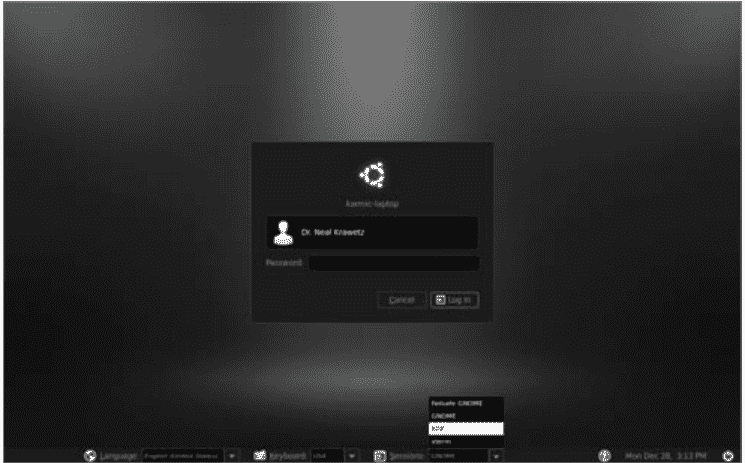

| 名称 | 版本 | 支持截止日期 |
| --- | --- | --- |
| Warty Warthog | 4.10 | 2006 年 4 月 |
| Hoary Hedgehog | 5.04 | 2006 年 10 月 |
| Breezy Badger | 5.10 | 2007 年 4 月 |
| Dapper Drake | 6.06 LTS | 2009 年 7 月（桌面版），2011 年 6 月（服务器版） |
| Edge Eft | 6.10 | 2008 年 4 月 |
| Feisty Fawn | 7.04 | 2008 年 10 月 |
| Gutsy Gibbon | 7.10 | 2009 年 4 月 |
| Hardy Heron | 8.04 LTS | 2011 年 4 月（桌面版），2013 年 4 月（服务器版） |
| Intrepid Ibex | 8.10 | 2010 年 4 月 |
| Jaunty Jackalope | 9.04 | 2010 年 10 月 |
| Karmic Koala | 9.10 | 2011 年 4 月 |
| Lucid Lynx | 10.04 LTS | 2013 年 4 月（桌面版），2015 年 4 月（服务器版） |

**表 1-1：** Ubuntu 版本

虽然大多数版本提供 18 个月的支持，但每隔一年会发布一个长期支持（LTS）版本。LTS 版本为桌面提供三年的更新，为服务器提供五年的更新。对于无法每 18 个月就完全更换的系统来说，LTS 是一个绝佳的选择。

> **注意** 本书重点关注正在积极支持的版本：Hardy Heron（8.04 LTS）、Jaunty Jackalope（9.04）和 Karmic Koala（9.10）。Dapper Drake（6.06 LTS）也会讨论，但程度较轻。

### 选择 Ubuntu 版本

每个 Ubuntu 版本的设计都只需一张 CD-ROM 即可完成系统安装。这减少了安装过程中换盘的需要。遗憾的是，一张光盘无法容纳完整环境所需的所有内容。为了解决这个问题，Ubuntu 提供了许多不同类型的初始安装镜像，以满足不同的系统需求。

- **Desktop**——该镜像提供 Live Desktop。可用于试用操作系统，或安装桌面或工作站系统。安装包括 Gnome 图形环境和面向用户的工具，如办公软件、多媒体播放器和游戏。

- **Alternate**——与 Desktop 镜像类似，该镜像安装 Ubuntu 的桌面版本，但不使用图形安装程序。当图形或鼠标在 Desktop 安装程序中无法正常工作时，这是非常理想的选择。

- **Server**——这个最小安装镜像没有图形桌面。它非常适合服务器和无头（无显示器）系统。该镜像包含安全 Shell 服务器、Web 服务器和邮件服务器等服务器软件，但默认情况下这些都不会安装（参见第 13 章）。

- **Netbook**——随 Jaunty Jackalope（9.04）引入，上网本版（也称为 Ubuntu Netbook Remix）是为便携式上网本系统定制的版本。（有关上网本版与桌面版之间的区别，请参阅本章中的"在上网本上使用 Ubuntu"。）

> **提示** 在 Ubuntu 网站（ubuntu.com）上，很难找到除当前版本和 LTS 版本的 Desktop 和 Server 版之外的其他下载选项。releases.ubuntu.com 和 cdimage.ubuntu.com 网站则提供了对所有发行版镜像的便捷访问。

安装镜像的名称与其功能并不完全匹配。这些名称的选择是为了避免与之前的 Ubuntu 版本混淆。（如果他们将 Desktop CD-ROM 称为*Install*，人们可能不会意识到它还包含 Live Desktop。）更好的名称可能是 Live CD with Desktop Install、OEM with Text Desktops 和 Server with Minimal System Configuration。但话说回来，这些名字太长了，所以我们还是沿用 Desktop、Alternate、Server 和 Netbook 吧。

除了这四张 CD-ROM 镜像之外，还有更多的安装选项。例如，还有一个 Ubuntu DVD 镜像。DVD 包含了所有 CD-ROM 镜像上的所有内容，包括 Live 操作系统。还有一些非官方移植到其他平台的版本。例如，PowerPC、Sun UltraSPARC、IA-64 和其他架构yu架构的安装盘可以从 http://cdimage.ubuntu.com/ports/releases/ 获取。虽然这些平台可能无法获得即时更新和一流支持，但它们得到了社区的支持。

每张安装盘都提供基本安装选项以及一些其他常见选项。例如，你可以使用"检查 CD 缺陷"来验证安装介质，使用"内存测试"来检测硬件，使用"救援"选项来访问已安装的系统。某些安装盘还有特定的选项。

### 使用 Smart Boot Manager

我的一台电脑太旧了，不支持从 CD-ROM 驱动器启动。然而，一切并未失去！在所有 Ubuntu 安装 CD-ROM 上都有一个小磁盘镜像：`install/sbm.bin`。这就是 Smart Boot Manager，它是安装 CD-ROM 上最不为人知的秘密之一。这是为软盘制作的镜像。要在 Linux 系统中创建该软盘，请使用：

```
dd if=sbm.bin of=/dev/fd0
```

如果你从这张软盘启动，会看到一个菜单，其中包括从硬盘或 CD-ROM 启动的选项。使用这张盘，你应该能够从任何安装 CD-ROM 启动。遗憾的是，SBM 不支持从 USB 或 FireWire 设备启动。

### 配置双启动

双启动系统在 20 世纪 90 年代末和 21 世纪初非常流行。由于不同的操作系统互不兼容，用户会启动到相应的系统来运行原生应用程序。

如今，双启动系统已不那么常见。计算机相对便宜，因此拥有单独的 Windows 和 Linux 电脑更加容易，而且有许多选项可以在系统之间交换文件和数据（参见第 7 章）。此外，VMware 和 Qemu 等虚拟机使你能够在窗口中运行原生应用程序，因此很少需要双系统启动。

有些用户仍然需要双启动系统。例如，许多游戏在原生操作系统下运行以及在虚拟机外部运行时响应更灵敏。如果你需要双启动系统，需要进行以下几个配置步骤：

- 1. 为多个操作系统对磁盘进行分区。最简单的方法是创建一个不使用整个磁盘的分区如果有多个磁盘，则每个磁盘可以包含不同的操作系统。

- 2. 如果你将使用 Windows 系统，请将其安装到已分配的分区上。（你可以使用 Windows 分区工具来创建第一个分区。）请务必*先*安装 Windows，因为 Windows 在安装时有一个坏习惯，就是会禁用引导加载程序。

- 3. 安装完第一个操作系统后，使用任何 Ubuntu 安装方法来安装 Ubuntu。

- 不要选择整个磁盘进行安装（除非你是安装在单独的驱动器上）。

- 使用分区工具为 Ubuntu 创建一个新分区——不要修改现有分区。

Ubuntu 安装程序足够智能，能够识别其他操作系统并将其添加到双启动的启动菜单中。这使你能够轻松地将 Ubuntu 与 Windows、BSD 和其他操作系统进行双启动。在 PowerPC 系统上，你可以轻松地在 Ubuntu 和 Mac OS X 之间进行双启动。

> **提示** 配置双启动系统相对容易。但是，配置带有三个或更多操作系统的多启动计算机会增加启动菜单的复杂性。建议你最后安装 Ubuntu，因为它的引导管理器安装将自动检测其他操作系统并正确标记它们。

### 使用 Desktop CD-ROM

Desktop CD-ROM 安装会启动图形化的 Live Desktop。这可以用于系统恢复、调试或浏览网页。

> **注意** Desktop CD-ROM 启动选择会给你 30 秒的时间做出决定，之后它会选择英语语言并启动图形化 Live Desktop。如果你想选择其他选项，请务必观察其启动过程（不要走开）并做出菜单选择。在菜单上按任意键可以停止 30 秒的计时。

当 CD-ROM 启动时，你会看到一个图形化桌面。桌面上有一个"Install"图标，可用于安装文件系统（见图 1-2）。同一选项也存在于菜单中的"System ➢ Administration ➢ Install"下。


 图 1-2：Hardy Heron 的 Live Desktop 与安装菜单

如果在安装过程中出现问题，你的调试选项并不多。图形桌面出现后，你可以按 Ctrl+Alt+F1 到 Ctrl+Alt+F4 来打开命令行终端。Ctrl+Alt+F7 返回图形显示界面。另外，你也可以考虑使用 Alternate CD-ROM 镜像进行基于文本的安装。

**注意** 按 Ctrl+Alt+F1 到 F4 会退出图形桌面。一旦退出图形模式，就不需要再按 Ctrl 了。只按 Alt+F1 到 Alt+F8 即可在终端之间切换。这是因为 Alt+F1 到 Alt+F12 是桌面使用的键盘信号；Ctrl 与 Alt 组合用于区分图形桌面和控制台请求。

### 快速恢复

Desktop 安装 CD-ROM 提供了 Live Desktop 功能，可以在不执行安装的情况下探索操作系统。它还可以访问现有系统以执行修复或恢复。但是，Live Desktop 并不是最快的系统。即使在一台较快的计算机上（例如 2 GHz 配 40x CD-ROM 驱动器），从启动到进入 Live Desktop 仍可能需要三分钟。如果你只是需要修复关键服务器上的一个文本文件，这可能会让人感觉漫长如 eternity。

如果你需要一个用于修复的系统，或者想在没有硬盘的情况下使用 Linux，可以考虑其他替代系统。Knoppix、Gnoppix 和 DSL（Damn Small Linux）都是为速度而设计的。它们都针对从单个 CD-ROM 或 DVD 启动时的快速启动时间进行了优化。

有时图形界面甚至都不是需要考虑的因素。如果你只需要一个命令提示符来修复系统，可以考虑 Ubuntu Server 或 Alternate CD-ROM 镜像。两者都包含恢复选项，可以让你访问本地系统并进行快速修复。如果你确实需要快速获得提示符，可以在 Server 或 Alternate 镜像的任意安装选项中选择后按 Alt+F2。这将给你一个提示符，你可以在其中挂载硬盘并快速执行修复。

### 使用 Alternate CD-ROM

Alternate CD-ROM 镜像允许你安装禁用图形的桌面镜像，或安装可定制的 OEM 系统（见图 1-3），方法是高亮 Install 选项，按 F4，然后选择不同的安装模式。

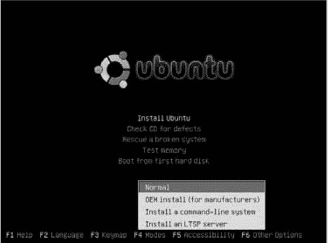

**图 1-3：** Hardy Heron 的 Alternate CD-ROM 启动选择菜单

#### 文本模式安装

文本模式和 OEM 安装都会创建工作用户站。然而，它们的配置有很大不同。文本模式系统缺少图形安装程序，但其他一切功能都存在。这对于资源有限或内存较少的计算机来说是理想的选择。这也是一种非常快速的安装方法。

#### OEM 安装

OEM 模式安装图形桌面并创建用户账户 `oem`。此账户可用于自定义系统。安装完成后，登录并运行 `oem-config` 脚本以更改任何原始安装响应，或运行 `oem-config-prepare` 以移除临时的 `oem` 账户，并在下次启动时启用配置提示（用于最终用户配置）。

> **警告** 在 OEM 安装期间，Alternate CD-ROM 会提示输入密码，但不会提示输入用户名。直到安装完成后才会告诉你该密码对应的账户名是 `oem`。当使用 `oem-config-prepare` 时，该账户和密码都会被移除。

OEM 模式是希望自定义系统（并移除安装账户）然后再将系统交给其他人的安装者的理想选择。原始设备制造商（OEM）可以使用此选项在将计算机发货给客户之前安装自定义应用程序。同样，企业系统管理员可以在将计算机交给新员工之前配置网络、应用程序和其他子系统。

#### 离线升级与修复

Alternate CD-ROM 包含升级先前 Ubuntu 安装所需的所有软件包。这意味着当网络访问不可用时，可以使用该 CD-ROM 执行升级。

与 Desktop CD-ROM 不同，Alternate CD-ROM 不会运行 Live 图形系统。但是，它具有用于修复无法操作的操作系统的救援模式。

#### 安装 LTSP 服务器

从 Hardy Heron（8.04 LTS）开始，Alternate CD-ROM 包含安装 LTSP 服务器的选项。Linux 终端服务器项目（LTSP）允许你将瘦客户端系统连接到 LTSP 服务器。

> **注意** *瘦客户端*是一种最小化工资源的作站。这些系统通常包含很少的磁盘空间，设计为通过网络启动，从远程服务器加载操作系统镜像，并将文件存储在远程系统上。

LTSP 安装会安装 Ubuntu 服务器并将其配置为与 LTSP 客户端一起使用。你还可以将运行中的 Ubuntu 系统配置为 LTSP 服务器：

1. 安装 LTSP 服务器软件包。这将安装 LTSP 服务器、SSH 服务器、DHCP 服务器以及所有其他必需的软件包。

```
sudo apt-get install ltsp-server-standalone openssh-server
```

2. 通过运行 `sudo ltsp-build-client --arch i386`（或 `--arch powerpc`）构建瘦客户端环境。此命令需要一些时间，因为它需要识别软件包并为客户端镜像准备一切。

最终客户端环境将构建完成。客户端镜像文件位于 `/opt/ltsp/i386/`，编译后的镜像存储在 `/opt/ltsp/images/` 下。要更改镜像，请修改 `/opt/ltsp/i386/` 下的文件，然后运行 `sudo ltsp-update-image`。要仅更新内核，请使用 `sudo ltsp-update-kernels`。

LTSP 客户端期望服务器位于特定的网络地址，并使用安全 Shell (SSH) 连接。SSH 将加密密钥与网络地址关联。如果服务器更改了网络地址，则需要更新客户端镜像：`sudo ltsp-update-sshkeys`。

**提示** 要测试你的 LTSP 配置，可以考虑使用虚拟机作为 LTSP 客户端。请参阅第 7 章了解如何安装 Qemu 模拟器。LTSP 服务器上安装了一个用于将 Qemu 用作 LTSP 客户端的快速脚本：

`/usr/share/doc/ltsp-server/examples/qemu-ltsp`

### 使用 Server CD-ROM

虽然 Alternate CD-ROM 专注于 OEM 定制，但 Server CD-ROM 仅安装基本服务器和最小系统镜像。其他一切都需要作为附加组件进行安装。

**注意** 在 Dapper Drake（6.06 LTS）中，服务器镜像包含安装 LAMP 的选项：Linux、Apache、MySQL 和 PHP/Perl/Python。但是，LAMP 在后来的 Ubuntu 版本中不再是选项。要创建 LAMP 服务器，你需要单独安装和配置组件。请参阅第 5 章和第 13 章。

调试 Server 和 Alternate 安装中的问题比诊断 Desktop CD-ROM 的问题要容易得多。在安装过程中的任何时候，你都可以按 Alt+F4 查看当前安装进度。如果系统挂起，你可以判断是哪个子系统导致了问题。按 Alt+F2 提供命令提示符，Alt+F1 返回用户友好的安装屏幕。

服务器安装非常快速地设置系统。虽然 Desktop CD-ROM 安装图形桌面，但安装程序非常慢。相比之下，Server CD-ROM 安装纯文本操作系统，但速度非常快。安装基于文本的操作系统后，你可以使用 `apt-get` 安装额外的软件包（请参阅第 5 章）。例如，你可能想使用 `sudo apt-get install ubuntu-desktop` 安装 Gnome 桌面。这会创建与 Desktop CD-ROM 相同的系统，但比启动 Live Desktop 并执行图形安装要快得多。所有必需的文件都在 Server CD-ROM 上。

> **提示** Live Desktop 的安装速度也相对较慢。为了显著缩短安装时间，请考虑使用 Alternate 或 Server 镜像。这两个选项都使用基于文本的安装程序。

### 更改选项

Desktop、Alternate 和 Server ISO 镜像都是可启动的，并且包含 CD-ROM 测试器（用于确保 CD-ROM 创建正确）和内存测试器。System 和 Alternate CD-ROM 包含用于调试已安装系统的恢复 shell，而 Desktop CD-ROM 包含也可以用于修复本地主机的 Live 系统。

根据你的计算机，这些光盘中的任何一个都可能无法运行。最常见的问题涉及与硬件冲突的内核参数。你可以在启动这些光盘时更改内核参数以解决任何问题。一些常见参数包括：

- 配置 RAM 磁盘。默认值是 Desktop ISO 为 1 GB，Alternate 和 Server ISO 为 16 MB。例如，Server ISO 使用：

  `ramdisk_size=16384`

- 指定备用根磁盘。默认指定 RAM 磁盘（`/dev/ram`），但为了调试系统，你可以指定硬盘，如 `/dev/hda`。

  `root=/dev/ram`

  或

  `root=/dev/hda`

- 某些硬件上的高级配置与电源接口（ACPI）支持可能导致安装程序失败。可以使用 `acpi=off` 显式禁用 ACPI 支持。

- 与 ACPI 类似，某些 PCMCIA 芯片组（特别是在较旧的主板和一些 Dell 系统上）可能导致安装程序的自动检测挂起。`start_pcmcia=off` 启动选项可以禁用 PCMCIA，让你能够绕过这类问题。

在初始安装菜单中，你可以按 F6 查看当前选项并进行更改。按 F1 可以查看其他内核选项，这些是系统安装失败时常见的解决方法。

### 安装最小系统

有时你希望从最小配置开始，并根据需要添加软件包。这通常是金融界


 RAM，或者低速 CPU。对于关键任务和可访问互联网的服务器来说，最小化系统也是可取的，因为不必要的应用程序可能会消耗关键资源或增加安全风险。

服务器 CD-ROM 提供了最简单的最小化安装选项。基本配置不安装任何额外的软件包，且使用不到 300 MB 的磁盘空间。备用 CD-ROM 也提供基本安装，但不会启用许多软件包——这些软件包会被放置在系统中，但不会被打开。

在这两种情况下，都可以移除不必要的软件包。例如，可以卸载 Alsa 声音驱动，释放 200 KB 的磁盘空间。列出所有已安装软件包的命令是：

```
dpkg -l | more
```

如果你想查看某个软件包中包含哪些文件，请使用 `dpkg -L` ***packagename***。例如：

```
dpkg -L alsa-base | more
```

许多软件包都有依赖包，因此移除操作并不总是那么简单。在移除软件包之前，若要识别冲突，请使用：

```
sudo apt-get -s remove alsa-base
```

`-s` 选项表示模拟移除 `alsa-base` 软件包——它会执行所有的安全检查，并列出所有依赖项和冲突，而不会实际执行移除操作。如果没有冲突，那么你可以去掉 `-s` 并执行实际的移除操作。你可以将 `alsa-base` 替换为系统上已安装的任何软件包。你也可以在 `apt-get` 命令行中列出多个软件包。

### 不安全的移除操作

`apt-get` 程序会尽量避免破坏依赖关系，因此移除一个软件包可能会导致移除其依赖的软件包。

**注意**：如果你选择了错误的依赖包，最终可能会移除操作系统的关键部分。例如，软件包 `perl-base` **无法在移除 `console-data` 软件包的情况下被移除**。移除 `perl-base` 和 `console-data` 还会**自动选择并移除** `cron`、`debconf`、**LVM 支持**、`python`、`wget` 以及数十个其他系统软件包。即使你不打算用 Perl 编程，移除它也会使你的系统瘫痪。在执行移除操作之前，请使用 `-s` 选项检查是否会产生不良后果。

### 通过网络安装

虽然从 CD-ROM 安装可能很方便，但当你需要管理数十台或数百台系统时，这种方式就无法很好地扩展。此外，没有 CD-ROM 驱动器的系统也需要有安装操作系统的选项。Ubuntu 提供了一个最小化的启动镜像，用于通过网络安装 Ubuntu。根据不同的目标架构，有不同版本的迷你镜像。例如，要通过网络安装 Hardy Heron (8.04 LTS)，可以使用位于 `http://archive.ubuntu.com/ubuntu/dists/hardy/main/installer-i386/current/images/netboot/` 的安装程序镜像。

该目录包含用于 i386 的 Hardy Heron (8.04 LTS) 迷你镜像。AMD64 (`install-amd64`) 以及任何其他受支持的平台都有类似的目录。同样，Jaunty、Karmic 和其他 Ubuntu 版本也都有相应的目录。每个目录都包含类似的预配置启动镜像。

- **boot.img.gz**——可启动安装程序的压缩镜像
- **mini.iso**——准备刻录到 CD-ROM 的 `boot.img` 文件
- **netboot.tar.gz**——`boot.img` 的内容，准备通过网络安装
- **pxelinux.0**——用于网络安装的预启动执行环境 (PXE)。这需要 DHCP 和 TFTP 服务器
- **pxelinux.cfg**——PXE 安装所需的目录
- **ubuntu-installer**——PXE 和 TFTP 安装所需的目录

### 选择安装方法

有许多不同的安装选项。使用哪一种实际上取决于你的环境以及你计划进行安装的次数。例如，如果你的网络连接非常慢或不可靠，那么你会希望从某个 CD-ROM 或 DVD 镜像进行安装。如果你的网络连接不好，就不要费心尝试网络安装了。

如果你想通过网络安装，并且只计划安装一两台系统，那么 `boot.img` 和 `mini.iso` 选项提供了最大的便利性，且所需的工作量最少。

然而，如果你计划安装多台计算机，*而且*每台都能从网络启动，那么请考虑使用 PXE 选项。虽然配置 PXE 需要一些工作，但你可以通过网络快速安装数百台计算机。

对于每种网络安装选项，你既可以使用 Ubuntu 官方服务器之一，也可以使用你自己的本地服务器。通过网络安装让你能够灵活地使用本地网络或位于互联网各处的服务器。

要使用迷你镜像，只需将镜像复制到设备上。例如，要使用外部硬盘安装 Ubuntu，可以使用 Linux 命令：

```
zcat boot.img.gz | dd of=/dev/hdb
```

此命令解压缩镜像并将其复制到外部驱动器 (/dev/hdb)。这适用于大多数外部媒体。

要从 CD-ROM 启动网络安装程序，只需将 mini.iso 镜像刻录到 CD-ROM 上。这可以通过两种方式完成。在 Ubuntu 桌面上，你可以右键单击 ISO 并选择菜单中的"写入光盘"（见图 1-4），或者你可以使用 cdrecord 命令从命令行刻录：

```
cdrecord dev=/dev/hdc blank=fast mini.iso
```

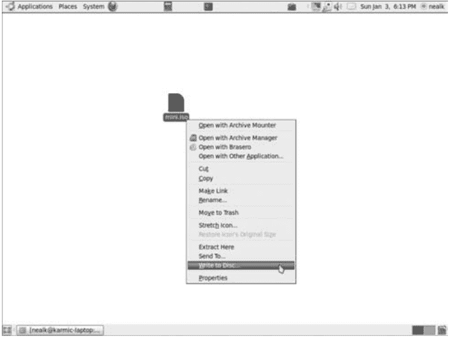

**注意** 其他操作系统，如 Windows 和 Mac OS X，有自己的将 ISO 文件写入 CD-ROM 的选项。

所有这些不同启动选项的结果都是：能够通过网络安装 Ubuntu 的磁盘（或 CD-ROM 或 PXE 配置）。

### 使用 USB 驱动器

无处不在的 USB 闪存驱动器（也称为*拇指驱动器*）已经取代了软盘。它们更小、更不易损坏，而且能存储更多的数据。为了方便起见，它们还可以用来启动安装、修复损坏的系统、运行独立的操作系统，或者简单地共享文件。

> **提示** 这些说明适用于*任何类型*的可移动媒体，包括 SD 卡、CF 卡，甚至是你旧的连接到电脑时看起来像拇指驱动器的 MP3 播放器。你并不严格局限于 USB 拇指驱动器。

#### 格式化 USB 驱动器

USB 驱动器支持两种基本格式：软盘和硬盘。USB 软盘由一个大型的已格式化驱动器组成。相比之下，USB 硬盘包含分区表和一个或多个已格式化的分区。如果你购买了拇指驱动器并且从未格式化过，那么它很可能是配置为带有一个大型分区的 USB 硬盘。

> **警告** 在格式化或分区任何设备之前，请确保该设备已卸载！使用 `mount` 命令（不带任何参数）查看它是否已挂载，然后使用 `umount` 卸载任何分区。例如，要卸载挂载在 `/media/usbdrive` 的 `/dev/sdc1`，你可以使用 `sudo umount /dev/sdc1` 或 `sudo umount /media/usbdrive`。

拇指驱动器通常就像普通硬盘一样进行分区。`fdisk` 和 `cfdisk` 等命令可以轻松修改驱动器分区，`mkfs` 可以用来格式化分区。

除了容量之外，速度是拇指驱动器和硬盘之间的一个显著差异。当你在闪存驱动器上更改分区表或格式化分区时，请在移除驱动器之前等待几秒钟；否则，某些数据可能仍在缓冲中，尚未传输。

> **提示** 在写入拇指驱动器时，我通常会运行 `sync` 命令（`sudo sync`）。这会将所有缓存的数据刷新到磁盘。当命令返回时，就可以安全地移除驱动器了。

当你对拇指驱动器使用 `fdisk` 或 `cfdisk` 命令时，你将它配置为 USB 硬盘。然而，你也可以将它配置为 USB 软盘。区别在于软盘不使用分区。例如，要在我的 1 GB USB 拇指驱动器 (`/dev/sdb`) 上制作一个 ext2 格式的 USB 软盘，我可以使用：

```
$ sudo mkfs /dev/sdb
mke2fs 1.41.9 (22-Aug-2009)
/dev/sdb is entire device, not just one partition!
Proceed anyway? (y,n) y
Filesystem label=
OS type: Linux
Block size=4096 (log=2)
Fragment size=4096 (log=2)
62976 inodes, 251648 blocks
12582 blocks (5.00%) reserved for the super user
First data block=0
Maximum filesystem blocks=260046848
8 block groups
32768 blocks per group, 32768 fragments per group
7872 inodes per group
Superblock backups stored on blocks:
	32768, 98304, 163840, 229376

Writing inode tables: done
Writing superblocks and filesystem accounting information: done

This filesystem will be automatically checked every 36 mounts or
180 days, whichever comes first.  Use tune2fs -c or -i to override.
$ sudo sync
```

**警告** 当你第一次插入 USB 硬盘时，所有分区都会出现并自动挂载。然而，要创建 USB 软盘，请务必**卸载所有分区，然后格式化主设备**（例如 `/dev/sda` 或 `/dev/sdc`）**而不是分区**（例如 `/dev/sda2` 或 `/dev/sdc1`）。

格式化设备后，你需要断开并重新连接设备，以清除任何陈旧的设备分区标识：

```
sudo sync; sudo eject /dev/sdb
```

#### 使用 USB 驱动器共享文件

USB 驱动器最简单、最常见的用途是在系统之间共享文件。Ubuntu 支持大多数 USB 驱动器。只需将驱动器插入 USB 端口，它就会自动挂载驱动器。从那时起，你就可以像访问任何已挂载的分区一样访问它。


 > **提示** 许多拇指驱动器都有一个指示灯来显示驱动器是否正在被访问。即使驱动器没有挂载，也要等到指示灯显示所有活动都已停止后再拔出驱动器。

Linux、Windows、Mac 和大多数其他系统都支持 FAT 文件系统。为了与其他用户共享文件，可以考虑使用 `mkdosfs` 格式化驱动器。例如：

1. 如果尚未安装 `mkdosfs`，请安装 `dosfstools` 软件包：

```
sudo apt-get install dosfstools
```

2. 如果驱动器当前已挂载，请将其卸载（例如 `/dev/sda1`）：

```
sudo umount /dev/sda1
```

3. 使用 FAT16 或 FAT32 格式化驱动器：

```
mkdosfs -F 16 /dev/sda1  # 格式化为 FAT16
mkdosfs -F 32 /dev/sda1  # 格式化为 FAT32
```

> **提示** 如果你想创建 FAT 格式的 USB 软盘驱动器，请使用 `-I` 选项。例如：`sudo mkdosfs -I -F 32 /dev/sda`。

> **警告** FAT16 每个分区最大支持 2 GB，每个目录不超过 512 个条目。如果任一项超出此限制，则必须使用 FAT32。

如果你不介意将文件共享限制为仅 Linux 系统，那么可以使用 ext2、ext3 或 ext4 文件系统格式化驱动器，使用以下任一命令：

```
mkfs /dev/sda1         # 默认格式为 ext2
mkfs -t ext2 /dev/sda1 # 显式格式化为 ext2
mkfs -t ext3 /dev/sda1 # 显式格式化为 ext3
mkfs -t ext4 /dev/sda1 # 显式格式化为 ext4（Jaunty
                         # 及更高版本）

mkfs.ext2 /dev/sda1    # 直接调用格式化 ext2
mkfs.ext3 /dev/sda1    # 直接调用格式化 ext3
mkfs.ext4 /dev/sda1    # 直接调用格式化 ext4（Jaunty 及更高版本）
```

> **注意** ext4 文件系统是在 Jaunty Jackalope (9.04) 中引入的。它是对 ext3 日志文件系统的向后兼容扩展。Ext4 包含性能增强功能，并支持最大 1 EiB 的分区。（1 个 exibyte，即 EiB，等于 2⁶⁰ 字节或 1,152,921,504,606,846,976 字节）。从 Karmic Koala (9.10) 开始，ext4 是默认的文件系统。

### 从 USB 驱动器启动

除了文件共享之外，USB 驱动器还可用作可启动设备。如果你的电脑支持从 USB 驱动器启动，那么这是开发便携式操作系统、创建紧急恢复磁盘或向其他电脑安装操作系统的绝佳选择。

尽管如今大多数系统都支持 USB 驱动器，但从 USB 拇指驱动器启动的能力并不一致。即使你创建了可启动的 USB 驱动器，你的 BIOS 仍可能阻止你从中启动。似乎每台电脑更改 BIOS 设置的方式都不同。通常，你先打开电脑电源，在操作系统启动之前按下一个键。该键可能是 F1、F2、F10、Del、Esc 或其他某个键或组合键。这完全取决于你电脑的 BIOS。进入 BIOS 后，通常会看到一组菜单，其中包括一个用于启动顺序的菜单。如果你可以从 USB 设备启动，就在这里进行设置。然而，每台电脑都不同，你可能需要在开机前插上 USB 驱动器，才能看到从中启动的任何选项。

> **警告** 更改 BIOS 可能会严重损坏你的电脑。请务必小心！

### 不同的 USB 设备

即使你的电脑支持从 USB 设备启动，它也可能不支持所有不同的 USB 配置。一般来说，拇指驱动器可以有以下三种配置方式之一：

- **小型 USB 软盘驱动器** — 配置为 USB 软盘设备的拇指驱动器（即无分区），容量为 256 MB 或更小，得到广泛支持。如果你的电脑无法从这种配置启动，那么你的电脑从任何配置启动的可能性都非常渺茫。

- **大型 USB 软盘驱动器** — 这些是容量大于 256 MB 的 USB 软盘设备。我自己的测试使用了两个不同的 1 GB 拇指驱动器、一个 2 GB SD 卡和一个 1.58 GB USB 硬盘。

- **USB 硬盘** — 根据我的经验，这是较旧硬件上支持最少的可启动配置。我只有一台电脑能够从分区的 USB 硬盘启动。然而，我测试的每台笔记本电脑似乎都支持这种配置。

在 USB 硬盘和 USB 软盘驱动器之间切换很简单，只需格式化基础设备或使用 `fdisk` 并格式化分区即可完成。然而，无法直接将大型 USB 软盘设备转换为小型 USB 软盘设备。

1. 使用 dd 创建一个与你要创建的驱动器一样大的文件。例如，要创建一个 32 MB 的 USB 驱动器，先从 32 MB 的文件开始：

```
dd if=/dev/zero of=usbfloppy.img bs=32M count=1
```

2. 将此文件视为基础设备。例如，你可以格式化并挂载它。

```
mkfs usbfloppy.img
sudo mkdir /mnt/usb
sudo mount -o loop usbfloppy.img /mnt/usb
```

3. 当你完成配置 USB 软盘驱动器映像后，将其卸载并复制到真实的 USB 设备（例如 `/dev/sda`）。这将使真实的 USB 设备表现为一个较小的 USB 软盘设备。

```
sudo umount /mnt/usb
dd if=usbfloppy.img of=/dev/sda
```

### 10 步启动配置

创建可启动的 USB 拇指驱动器需要 10 个基本步骤：

1. 卸载驱动器。当你将 USB 驱动器插入电脑时，Ubuntu 会立即挂载它。你需要先卸载它，然后才能对其进行分区或格式化。

使用 mount 命令列出当前的挂载点并识别 USB 拇指驱动器。请注意，设备名称对你来说可能不同。在此示例中，设备是 `/dev/sda1`，驱动器标签是 `NEAL`。

```
$ mount
/dev/hda1 on / type ext3 (rw,errors=remount-ro)
proc on /proc type proc (rw)
/sys on /sys type sysfs (rw)
varrun on /var/run type tmpfs (rw)
varlock on /var/lock type tmpfs (rw)
procbususb on /proc/bus/usb type usbfs (rw)
udev on /dev type tmpfs (rw)
devpts on /dev/pts type devpts (rw,gid=5,mode=620)
devshm on /dev/shm type tmpfs (rw)
lrm on /lib/modules/2.6.15-26-686/volatile type tmpfs (rw)
/dev/sda1 on /media/NEAL type vfat (rw,nodev,quiet,umask=077)
```

使用 umount 命令释放设备：

```
sudo umount /dev/sda1
```

2. 初始化 USB 设备。这是必需的，因为之前的配置可能会留下残留物，干扰未来的配置。清零设备的最简单方法是使用 `dd`。请记住，大型驱动器（即使是 1 GB 的拇指驱动器）可能需要很长时间才能清零。幸运的是，你通常只需要清零前几个扇区。

```
dd if=/dev/zero of=/dev/sda          # 格式化整个 /dev/sda
dd if=/dev/zero of=/dev/sda count=2048 # 格式化前 2048
                                       # 个扇区
```

使用 `sync` 命令（`sudo sync`）确保所有数据都已写入。清零设备后，拔出并重新插入。这将清除任何过时的设备分区。Ubuntu 不会挂载空白设备，但会为其创建设备句柄。

3. 如果你要制作 USB 硬盘，请对设备进行分区：

```
sudo fdisk /dev/sda
```

4. 格式化分区。如果你要制作 USB 软盘驱动器，请格式化基础设备（`/dev/sda`）。对于 USB 硬盘，请格式化每个分区（`/dev/sda1`、`/dev/sda2` 等）。

5. 挂载分区。

6. 将文件复制到分区。

7. 将内核和启动文件放在分区上。

8. 配置启动菜单和选项。

9. 使用 `sync` 命令（`sudo sync`）确保所有数据都已写入，然后卸载分区。

10. 安装启动管理器。

现在该设备应该是可启动的。接下来的几个部分展示了执行这 10 个步骤的不同方法。

### 从 USB 驱动器启动网络安装

USB 驱动器可用于简化系统安装。例如，如果电脑可以从 USB 驱动器启动，那么你可以用它来启动网络安装。

> **注意** 预配置的网络启动映像 `boot.img` 非常小，只有 8 MB。它应该适用于所有 USB 驱动器。

配置拇指驱动器以用作网络安装系统需要一些简单的步骤：

1. 插入 USB 驱动器。如果已挂载，请将其卸载。

2. 下载启动映像。每个平台都有不同的启动映像。请务必获取与你的 Ubuntu 版本相对应的正确映像。例如，对于 Hardy Heron (8.04 LTS)，请使用：

```
wget http://archive.ubuntu.com/ubuntu/dists/\
hardy/main/installer-i386/current/images/netboot/boot.img.gz
```

3. 启动映像已预配置为 USB 软盘驱动器。将映像复制到拇指驱动器上。请务必指定基础设备（例如 /dev/sda），而不是任何现有分区（例如 /dev/sda1）。

```
zcat boot.img.gz > /dev/sda
```

4. 使用 sync 确保所有写入完成，然后弹出拇指驱动器：

```
sudo sync; sudo eject /dev/sda
```

现在你可以从拇指驱动器启动了，操作系统将通过网络安装。

我测试过的每台支持从 USB 启动的 PC 都能够运行默认的网络安装程序：boot.img.gz。然而，由于 USB 支持并不一致，这在你的硬件上可能无法正常工作。如果你无法让它启动，请确保你的 BIOS 已配置为从 USB 驱动器启动，它在从其他设备启动之前从 USB 启动，并且 USB 驱动器已连接到系统。如果你有多个 USB 设备连接，请移除除可启动拇指驱动器之外的所有设备。

### 使用启动映像

boot.img.gz 映像是一个独立的文件系统，仅使用 8 MB 的磁盘空间。如果你有更大的拇指驱动器（例如 64 MB 或 2 GB），那么你可以将诊断工具或其他东西复制到驱动器上。

为了创建可启动的 USB 驱动器，你需要一个启动加载程序。选择是 GRUB 或 SYSLINUX。这里存在显著的权衡。GRUB 是安装 Ubuntu 时使用的默认启动加载程序。然而，使用 GRUB 需要你知道驱动器标识符，例如 /dev/sda1。

> **提示** 驱动器标识符的替代方案是通用唯一标识符（UUID）。使用 UUID 标识驱动器的方法在第 3 章中描述。

由于你可能会插入和移除 USB 设备，标识符可能会改变，从而破坏启动加载程序的配置。SYSLINUX 不使用静态


驱动器标识符，但仅限于支持 FAT12 或 FAT16 驱动器。由于 USB 设备需要便携，因此请使用 SYSLINUX：

```
sudo apt-get install syslinux mtools
```

主要步骤要求将驱动器格式化为 FAT16 并使用 `syslinux` 使其可启动。

1. 启动具有 root 权限的 shell：

```
sudo bash
```

2. 如果 USB 驱动器已挂载，请将其卸载。

3. 将驱动器格式化为 FAT16 USB 软盘驱动器（在本示例中为 `/dev/sdc`）并挂载：

```
mkdosfs -I -F 16 /dev/sdc
sync
mkdir /mnt/usb
mount -o loop /dev/sdc /mnt/usb
```

4. 挂载 `boot.img` 文件。这将用于提供启动文件。

```
zcat boot.img.gz > boot.img
mkdir /mnt/img
mount -o loop boot.img /mnt/img
```

5. 将文件复制到 USB 驱动器。这可能需要几分钟。

```
sudo bash  # 切换到 root，以 root 身份运行这些命令
(cd /mnt/img; tar -cf- .) | (cd /mnt/usb; tar -xvf -)
sync
```

6. 设置可启动磁盘的文件。通过将 ISO 映像的 SYSLINUX 配置文件（`isolinux.cfg`）复制到 FAT16 系统的配置文件（`syslinux.cfg`）来完成：

```
mv /mnt/usb/isolinux.cfg /mnt/usb/syslinux.cfg
rm /mnt/usb/isolinux.bin
sync
```

7. 卸载驱动器并通过安装引导加载程序使其可启动：

```
umount /mnt/usb
syslinux /dev/sdc
sync
eject /dev/sdc
exit  # 退出 root shell
```

现在，您可以从 USB 驱动器启动以安装操作系统。

### 从 USB 安装完整文件系统

USB 破解的圣杯是能够从 U 盘启动独立操作系统。此外，只要有足够大的 USB 驱动器（以及可以从 USB 端口启动的计算机），您就可以将 U 盘配置为独立操作系统。

> **警告** 在线论坛中讨论了多种将 USB 驱动器配置为可启动系统的方法。不幸的是，大多数说明要么不完整，要么非常复杂。即使您完全按照以下步骤操作，由于硬件限制，您仍可能无法从 USB 设备启动。

有两种配置可用于制作可启动文件系统：大型 USB 软盘驱动器或大型 USB 硬盘驱动器。在这两个示例中，我将使用 Hardy Heron（8.04 LTS）Live Desktop CD 作为可启动设备。

#### 从 USB 软盘驱动器使用 Live CD

将 Live CD 转换为可启动 USB 软盘驱动器需要至少 1 GB 的 U 盘。

- 1. 启动具有 root 权限的 shell。这样做是为了方便，因为几乎每个命令都必须以 root 身份执行。

   `sudo bash`

- 2. 卸载并清空 U 盘。（请参阅"10 步启动配置"部分以获取指导。）

- 3. 将磁盘格式化为一个大的 FAT16 驱动器。`mkdosfs` 的 `-I` 参数表示格式化整个设备。在此示例中，USB 驱动器为 `/dev/sdc`。

   `mkdosfs -I -F 16 /dev/sdc`

   `sync`

> **提示** FAT16 仅支持最大 2 GB 的驱动器。如果您有更大的 USB 驱动器，则需要使用"不同的 USB 设备"部分中的技巧，将大型 USB 驱动器转换为较小的驱动器。

- 4. 挂载 Live CD 和 USB 驱动器：

   `mkdir /mnt/usb`

   `mkdir /mnt/iso`

   `mount -o loop ubuntu-8.04.3-desktop-i386.iso /mnt/iso/`

   `mount /dev/sdc /mnt/usb`

- 5. 复制文件。这可能需要 20 分钟或更长时间。去看电视或吃午饭吧。另外，请忽略关于符号链接的错误，因为 FAT16 不支持它们。

   `cp -rpx /mnt/iso/* /mnt/usb/`

   `sync`

> **注意** FAT16 不支持符号链接。此 copy 命令将链接替换为链接的文件内容。

- 6. 设置可启动磁盘的文件。由于 SYSLINUX 不支持内核文件的子目录，因此您需要将这些文件移动到 USB 驱动器的顶层目录。

```
## 移动内核文件和内存测试器
mv /mnt/usb/casper/vmlinuz /mnt/usb/vmlinuz
mv /mnt/usb/casper/initrd.gz /mnt/usb/initrd.gz
mv /mnt/usb/install/mt86plus /mnt/usb/mt86plus
## 将启动文件移动到驱动器顶层
mv /mnt/usb/isolinux/* /mnt/usb/
mv /mnt/usb/isolinux.cfg /mnt/usb/syslinux.cfg
rm /mnt/usb/isolinux.bin
## 可选：删除 Windows 工具和 ISO 文件以释放空间
rm -rf /mnt/usb/start.* /mnt/usb/autorun.inf
rm /mnt/usb/bin /mnt/usb/programs
rm -rf /mnt/usb/isolinux
## 全部完成
sync
```

- 7. 编辑 /mnt/usb/syslinux.cfg 文件并更正内核路径。删除您看到的 /casper/ 和 /install/ 路径。这是因为步骤 6 将文件移动到了 USB 驱动器的根目录。应该有八处 /casper/ 和一处 /install/。写入更改后，运行 sync。

- 8. 卸载驱动器并使其可启动：

```
umount /mnt/usb
syslinux /dev/sdc
sync
eject /dev/sdc
exit  # 退出 root shell
```

U 盘现在应该可以启动了！您可以运行 Ubuntu Live 操作系统，或从此 U 盘安装操作系统。要进行自定义，您可以通过编辑 /mnt/usb/syslinux.cfg 文件并修改内核来更改启动菜单。

#### 从 USB 硬盘驱动器使用 Live CD

将 Live CD 转换为 USB 硬盘驱动器要复杂得多。许多支持从 USB 设备启动的计算机不支持此配置。即使基本配置受支持，BIOS 仍可能对磁盘布局有限制。此外，引导加载程序需要支持分区。最后，USB 驱动器的标识符在安装后不能更改。这一最后问题是我在 USB 驱动器上不使用 GRUB 或 LILO 作为引导加载程序的主要原因。

硬盘由磁头、扇区和柱面的组合定义。虽然磁头和柱面曾经与物理驱动器磁头和盘片匹配，但现在已经不是这种情况了。通常，每个扇区包含 512 字节的数据，每个柱面包含多个扇区，并且每个磁头有多个柱面。但是，从 USB 硬盘驱动器启动时，许多 BIOS 制造商假定驱动器有 64 个磁头和每个柱面 32 个扇区。这是 ZIP 驱动器使用的配置。如果您使用不同的配置，则可能无法启动。此外，第一个分区不能大于 1023 个柱面。

虽然 `syslinux` 命令仅支持 FAT12 和 FAT16 文件系统，但 `syslinux` 软件包包含支持 ext2 和 ext3 文件系统的 `extlinux`。在此示例中，我们将使用 `extlinux` 作为可启动分区上 ext2 文件系统的引导加载程序。

在 USB 驱动器上配置可启动操作系统有 10 个步骤：

- 1. 打开具有 root 权限的 shell：

   `sudo bash`

- 2. 连接 USB 驱动器并将其卸载。

- 3. 使用 `fdisk` 或 `cfdisk` 对驱动器进行分区（例如，`/dev/sdc`）。务必指定 64 个磁头和 32 个扇区。第一个分区的最后一个柱面不能大于 1023。如果在分配第一个分区后还有额外的磁盘空间，则可以分配额外的分区。

```
## fdisk -H 64 -S 32 /dev/sdc
Command (m for help): d
No partition is defined yet!
Command (m for help): n
Command action
   e   extended
   p   primary partition (1-4)
p
Partition number (1-4): 1
First cylinder (1-983, default 1): 1
Last cylinder or +size or +sizeM or +sizeK (1-983, default 983): 983
Command (m for help): a
Partition number (1-4): 1
Command (m for help): p
Disk /dev/sdc: 1030 MB, 1030750208 bytes
64 heads, 32 sectors/track, 983 cylinders
Units = cylinders of 2048 * 512 = 1048576 bytes
   Device Boot      Start        End      Blocks   Id  System
/dev/sdc1   *           1        983     1006576   83  Linux
Command (m for help): w
The partition table has been altered!
```

> **警告** 分区必须标记为"active"；否则，您将无法从该分区启动。

- 4. 将分区格式化为 ext2 文件系统：

```
mkfs.ext2 /dev/sdc1
```

- 5. 挂载 Live CD 和 USB 驱动器：

```
mkdir /mnt/usb
mkdir /mnt/img
mount -o loop ubuntu-8.04.3-desktop-i386.iso /mnt/img/
mount /dev/sdc1 /mnt/usb
```

- 6. 复制文件。如上一节所述，这可能需要 20 分钟或更长时间。

```
cp -rpx /mnt/img/* /mnt/usb/
sync
```

- 7. 创建引导文件。与 `syslinux` 不同，`extlinux` 的引导文件可以位于目录中。在这种情况下，您将重用 `casper` 目录，因为它已经包含内核文件。

```
cp /mnt/usb/isolinux/* /mnt/usb/casper/
rm /mnt/usb/casper/isolinux.bin
mv /mnt/usb/casper/isolinux.cfg /mnt/usb/casper/extlinux.conf
sync
```

> **注意** 引导配置文件的扩展名是 `.conf`，而不是 `.cfg`。

- 8. *不要*卸载驱动器！使用 `extlinux` 使其可启动需要挂载包含 `extlinux.conf` 文件的目录。

```
extlinux -z /mnt/usb/casper
sync
```

- 9. 复制引导加载程序。`syslinux` 二进制软件包中缺少一个文件，但它在源代码软件包中可用。此文件称为 `mbr.bin`，是包含引导加载程序的主引导记录。下载源代码软件包：

```
apt-get source syslinux
```

这将创建一个目录，例如 `syslinux-3.53/`。此目录中缺少该文件。使用以下命令将其安装到驱动器上：

```
cat mbr.bin > /dev/s门外 sdc
sync
```


 > **警告** 如果你正在配置的是文件镜像而非实际驱动器，那么这条`cat`命令会截断你的文件。相反，应使用`dd if=mbr.bin of=usbdrive.img bs=1 notrunc`来将主引导记录安装到你的USB驱动器镜像文件中（在此例中为`usbdrive.img`）。

+   10. 现在，确保所有写入操作完成，然后卸载驱动器：
    `sync; umount /dev/sdc; eject /dev/sdc`

如果一切顺利，你应该会有一个可正常工作的可启动USB闪存盘。这个驱动器可以作为最基本的恢复和修复系统使用。

作为一种替代配置，你可以将该驱动器格式化为FAT16，并使用`syslinux`使分区可启动。在这种情况下，你还需要将启动文件复制到分区的顶层目录，并按照上一节所述编辑`syslinux.cfg`文件。

### 启动变体与故障排除

我使用了多种电脑来测试USB启动过程。每台电脑对不同的启动配置都有不同的反应。

+   - 每台支持USB启动的电脑都能够启动原始的`boot.img`文件。它们都能够通过网络进行安装。

+   - 大多数电脑能够在我的1GB闪存盘格式化为USB软盘驱动器时启动Ubuntu Live桌面操作系统。然而，有一台电脑给出了通用的启动错误信息。

+   - 只有我的较新电脑系统才能启动带有ext2文件系统的USB硬盘。无论我使用的是真正的USB硬盘还是闪存盘，结果都没有区别。此外，指定ZIP配置是在某台电脑上使硬盘配置正常工作的唯一方法。

+   - 我的华硕上网本从这些配置中的任何一种启动都没有问题，甚至从2GB SD卡启动也能正常工作。

根据你使用的配置变体和硬件，你可能会看到一些常见的错误。

+   - **黑屏**——如果你看到的只是一个带有闪烁光标的黑屏，那么肯定有什么地方出了问题。这发生在引导加载程序失败时。可能是引导加载程序安装不当造成的，也可能是BIOS问题。尝试重新构建USB驱动器，以防你遗漏了某个步骤。另外，尝试在另一台电脑上启动该USB驱动器。如果它在一台电脑上可以工作而在另一台上不行，那么就是BIOS问题。但如果它在任何地方都失败，那么很可能是引导加载程序的问题。

+   - "PCI: Cannot allocate resource region..."——这表明是BIOS问题。你可能能够通过使用额外的内核参数来绕过PCI错误进行启动，例如：

  live noapic nolapic pci=noacpi acpi=off

  然而，你可能无法解决这个问题。检查你的电脑是否有可用的BIOS升级。

- **找不到根目录（Root not found）**——有各种各样的错误提示表明在启动过程中根分区不可用。这通常发生在USB驱动器仍在初始化或传输数据时，根分区尚未准备好被挂载。你可以通过解压`initrd`文件（见下一节"调整BusyBox"）并编辑`conf/initramfs.conf`文件来解决这个问题。添加15秒的挂载延迟（新行应为：`WAIT=15`）。这个延迟给USB时间来初始化、配置和传输数据。

### 调整BusyBox

在基于文本的安装过程中，你可以通过按Alt+F2来访问命令提示符。与完整的操作系统不同，这个提示符包含一个非常精简的环境，只有少量命令。

这个最小化的操作系统是一个名为BusyBox的应用程序的一部分。BusyBox是一个非常小的可执行文件，提供了安装环境。BusyBox的系统文件存储在`initrd`存档中。根据你的Ubuntu版本，该文件名为`initrd.gz`或`initrd.lz`。

通过修改`initrd`文件，你可以向基本安装环境添加命令。例如，你可以向`/bin`目录添加编辑器或诊断工具。务必复制命令使用的任何共享库。例如，`file /bin/nano`显示一个动态链接的可执行文件，`ldd /bin/nano`列出所有的库。除非你同时包含所有的库，否则你将无法使用链接的可执行文件。

```
$ file /bin/nano
/bin/nano: ELF 32-bit LSB executable, Intel 80386, version 1 (SYSV), for GNU/Linux 2.6.8, dynamically linked (uses shared libs), stripped
$ ldd /bin/nano
        linux-gate.so.1 =>  (0xb7fa1000)
        libncursesw.so.5 => /lib/libncursesw.so.5 (0xb7f4e000)
        libc.so.6 => /lib/tls/i686/cmov/libc.so.6 (0xb7dff000)
        libdl.so.2 => /lib/tls/i686/cmov/libdl.so.2 (0xb7dfa000)
        /lib/ld-linux.so.2 (0xb7fa2000)
```

> **注意** 不要担心linux-gate.so.1库。它实际上并不存在。你只需要复制包含路径的库，例如`/lib/libncursesw.so.5`。

相比之下，任何标识为静态链接（非动态链接）的可执行文件都可以直接使用！不需要额外的库。

```
$ file /usr/bin/rar
/usr/bin/rar: ELF 32-bit LSB executable, Intel 80386, version 1 (SYSV),
for GNU/Linux 2.6.0, statically linked, stripped
$ ldd /usr/bin/rar
        not a dynamic executable
```

> **提示** 如果你正在编译程序，可以使用`gcc -static`来生成静态链接的可执行文件。你还可以使用`apt-get source`下载软件包源代码。（有关安装编译环境和下载软件包源代码的信息，请参见第5章。）

修改initrd的步骤：

1. 解压存档。initrd文件实际上是一个压缩存档，包含了启动期间所需的所有可执行文件、库和配置文件。根据你的Ubuntu版本，该文件名为initrd.gz或initrd.lz。例如，Hardy Heron（8.04 LTS）Live桌面CD使用casper/initrd.gz，而Karmic Koala（9.10）的Live CD使用casper/initrd.lz。

```
mkdir extract
cd extract
zcat /mnt/usb/casper/initrd.gz | cpio -imvd  # 用于initrd.gz
lzma -dc -S .lz /mnt/usb/casper/initrd.lz | cpio -imvd
                                        # 用于initrd.lz
```

+   2. 解压出来的内容看起来像是一个文件系统。在此目录中添加或编辑文件。例如，要添加一个二进制文件，将二进制文件放入./bin/，将任何库放入./lib/。

3. 重新打包并替换initrd文件：

```
find . | cpio -o -L--format='newc' |
        gzip是人的核心 > /mnt/usb/casper/initrd.gz
find . | cpio -o -L--format='newc' |
        lzma -7 > /mnt/usb/casper/initrd.lz
```

### 在上网本上使用Ubuntu

从Jaunty Jackalope（9.04）开始，Ubuntu已经专门为上网本系统创建了一个专门的版本。上网本电脑是一类低端笔记本电脑。它们通常是较小、功能较弱的电脑。从物理上看，它们通常有更小的键盘、更小的屏幕，并且没有CD或DVD光驱。

虽然你不会想在上网本上运行多用户或高流量的Web服务器，但它们在办公室外进行简单任务时是理想的选择。例如，你可以查看电子邮件、浏览网页、进行一些基本的文字处理，甚至偶尔开发软件（比如在旅途中进行补丁）。上网本也很适合在飞机上观看电影。

### 在上网本上安装

大多数上网本都包含多个USB接口，通常还有一个SD卡槽或类似的存储设备插槽。由于上网本缺少CD和DVD光驱，所以它们都支持从USB、SD卡或其他类型的可移动存储设备启动。许多还支持从网络启动。

> **注意** 尽管上网本版本相对较新，并且仍在进行重大的版本变更（Jaunty桌面与Karmic桌面看起来非常不同），但这是我所经历过的最轻松的安装过程之一。

虽然市场上有各种各样的上网本，但并非所有上网本都受到Ubuntu的支持。有些开箱即用就能工作，有些可能需要你手动安装驱动程序或补丁，还有少数有完全不受支持的硬件。通常问题涉及声音、摄像头或网络支持。

> **提示** 在尝试在上网本上使用Ubuntu之前，请查阅https://wiki.ubuntu.com/HardwareSupport/Machines/Netbooks上的支持硬件列表。

### 创建上网本安装介质

要创建上网本安装介质，你需要下载上网本ISO（例如`ubuntu-9.10-netbook-remix-i386.iso`）。如果你的上网本有CD-ROM光驱，那么只需将ISO刻录到光盘并从光盘启动即可。

然而，大多数上网本都没有CD-ROM光驱。在这种情况下，你需要一个1GB的USB闪存盘、SD卡或你的上网本支持的其他形式的介质。你还需要一台电脑来创建CD-ROM。

在USB闪存盘或SD卡上制作可启动上网本安装镜像的最简单方法是使用`usb-creator`。这个工具可以自动将CD-ROM镜像放到其他类型的可移动介质上。

- Intrepid Ibex（8.10）及更高版本——使用`sudo apt-get install usb-creator`安装`usb-creator`。可执行文件名为`usb-creator-gtk`。

- Hardy Heron（9.04 LTS）——在Hardy上安装`usb-creator`有一个不太雅观的变通方法。Hardy和Intrepid非常相似，可以运行大部分相同的代码。


 1. 从以下地址下载 Intrepid 的 `usb-creator` 软件包：
   https://launchpad.net/ubuntu/intrepid/i386/usb-creator
   该文件的名称类似于 `usb-creator_0.1.10_all.deb`。

2. 安装依赖包：
   `sudo apt-get install syslinux mtools`

3. 在 Hardy 上安装 Intrepid 的 `usb-creator` 软件包：
   `sudo dpkg -i usb-creator_0.1.10_all.deb`

4. 可执行文件名为 `usb-creator`。

`usb-creator` 程序允许你选择 ISO 镜像和目标设备。（见图 1-5。）安装完成后，你可以将 USB 设备（或 SD 卡）连接到你的上网本并从中启动。

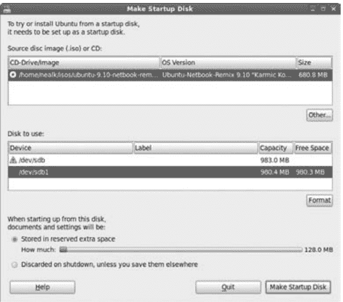

### 图 1-5：Karmic Koala 下的 `usb-creator`

如果无法使用 `usb-creator`（例如，你运行的是 Dapper Drake 6.06 LTS），则请遵循"从 USB 安装完整文件系统"一节中的步骤，将上网本安装镜像复制到 SD 卡或 USB 设备。使用 USB 硬盘配置。

### 仅使用上网本进行安装

还有另外两种方法可以在上网本或任何其他类型的 Windows 系统上很好地安装 Ubuntu。这种方法稍微有点绕，但你可以仅使用上网本和 USB 驱动器来安装 Ubuntu，而不需要将任何东西刻录到 CD-ROM。

大多数上网本都预装了 Microsoft Windows XP 或 Windows 7。使用 Windows 将上网本安装盘下载到上网本中。此时，你有两个选择：从 Windows 创建可启动 USB 设备，或使用 Windows Ubuntu 安装程序。

要创建可启动 USB 驱动器，请从 `unetbootin.sourceforge.net` 下载适用于 Windows 的 `unetbootin`。该程序的工作原理与 `usb-creator` 类似，允许你选择 ISO 并将其安装到 USB 设备上。

在 Windows 下，你也可以打开 ISO 镜像。在磁盘镜像的根目录下有一个名为 `wubi.exe` 的程序。这就是 Windows Ubuntu 安装程序。使用 Wubi，你可以将 Ubuntu 作为应用程序安装在 Windows 下，运行一个独立的操作系统。Wubi 通过将自己添加到 Windows 启动菜单来工作。这实际上将 Windows 系统变成了一个双启动计算机。

安装 Wubi 后，重新启动系统。你会在启动菜单中看到 Ubuntu。如果启动 Ubuntu，它将使用 Windows 引导管理器来运行 Ubuntu 环境。从 Ubuntu 中，你可以通过 `/host` 和 `/media` 访问主机 Windows 系统。更重要的是，你可以为 Ubuntu 下载 `usb-creator` 并创建可启动 USB 设备。

无论采用哪种方法，你现在应该已经拥有了一个可启动的 USB 驱动器（或 SD 卡或其他类型的可移动存储）。让你的上网本从新介质启动。例如，使用 Asus 1005HA 上网本时，你可以在按下电源按钮后按 Esc 键，然后选择 SD 卡或 USB 驱动器作为启动设备。此时，你就可以为上网本安装 Ubuntu 了。

### 隐藏磁盘分区

许多上网本和笔记本电脑都有恢复操作系统的启动选项。这是通过访问硬盘上包含可启动操作系统的单独分区来实现的，该分区会将系统恢复到出厂默认设置。

在安装过程中，使用高级磁盘分区选项。这将显示紧急恢复分区的名称。（它通常被命名为类似"XP recovery"的名称。）还可能有一个小的可扩展固件接口（EFI）分区，用于缩短启动时间。

如果你不想意外按下一个按钮就用 Windows 覆盖你的 Ubuntu 上网本，那么请务必在 installation 期间重新格式化驱动器（或删除 XP 恢复分区）。如果你删除了紧急恢复分区，操作系统将忽略恢复请求。

> **隐藏磁盘分区（续）**

删除 EFI 分区（fdisk 分区类型 0xEF）不会有什么害处，但保留这个小分区（通常为 8 MB）可以显著缩短启动时间。

### 升级 Ubuntu

已经使用 Ubuntu 的用户可以选择升级而不是重新安装。Ubuntu 在主要版本之间遵循严格的升级路径；你不能直接从 Dapper 升级到 Karmic。升级路径仅支持单版本和 LTS 版本。例如，你可以从 Dapper Drake（6.06 LTS）升级到下一个版本（Edgy Eft 6.10）或下一个 LTS 版本（Hardy Heron 8.04 LTS）。但是，跳过某个版本（例如从 Hardy Heron 升级到 Karmic Koala（9.10）并跳过 Jaunty Jackalope（9.04））是不受支持的。

> **注意** 虽然你可以直接从 Dapper 或 Hardy 升级到 Karmic，但这可能会导致问题。每次升级都假设你是从上一个版本升级的。跳过版本可能会破坏这一假设并导致升级问题。

> **升级与全新安装**

尽管 Dapper、Hardy 和 Karmic 都是 Ubuntu 的版本，但它们都是主要版本。将它们视为不同的操作系统。正如不推荐从 Windows 2000 升级到 Windows XP 一样，我也不推荐在 Ubuntu 版本之间走升级路径。相反，备份你的文件，整理你需要的软件，然后执行全新安装。安装完成后，恢复你的个人文件并添加你的软件。这比在升级后调试 Ubuntu 更快、更省事。

> **警告** 升级的成功与否取决于你的系统和自定义设置。升级并不总是有效。

最安全的升级方法是将你的文件保存到系统外，然后执行全新安装。但是，如果你仍然想要继续升级，那么你需要确定你的 Ubuntu 版本并运行一些升级命令。

> **提示** 考虑将 `/home` 目录放在单独的分区上。这样，你可以升级或重新安装而不会丢失所有个人文件。

### 确定版本

当 Ubuntu 用户用名称来称呼操作系统，而操作系统报告的是数字版本时，升级就变得复杂了。问题变成：你如何确定正在使用的是哪个版本的 Ubuntu？

一种方法是使用图形桌面。在菜单栏中，系统 ➤ 关于 Ubuntu 会显示版本号和常用名称。不幸的是，对于 Ubuntu 服务器等纯文本系统来说，这不是一个选项。这对于自动化系统也不实用。

另一种方法是查看当前的 `/etc/apt/source.list` 文件。假设没有人大幅修改过该文件，操作系统的常用名称应该列在 deb 安装行上。

更好的选择是 `lsb_release` 命令。该命令显示来自 Linux 标准基础的发行版特定信息。

```
$ lsb_release -a
No LSB modules are available.
Distributor ID: Ubuntu
Description:    Ubuntu 8.04.3 LTS
Release:        8.04
Codename:       hardy
```

### 执行升级

当你开始升级时，就没有回头路了。尝试停止升级很可能会搞乱系统，升级期间停电可能是灾难性的。请务必在开始升级前进行备份。

自动升级命令是：

```
sudo apt-get install update-manager-core
sudo do-release-upgrade
```

根据你系统的状态，这些命令可能会指示你运行其他命令。最终，你会被指示重新启动系统。如果一切顺利，系统将会启动。在首次登录时，系统可能会稍微慢一点，因为它会执行一些升级后配置。之后，你应该就可以正常使用了。

### Ubuntu 升级问题

Ubuntu 升级并不总是轻松的。（我还没有经历过一次简单的升级。）虽然从全新的 Dapper 安装（没有添加任何内容）升级到 Edgy 再到 Hardy 工作良好，但你不太可能正在运行全新的 Dapper 或 Edgy 安装。自定义设置会导致升级并发症。例如：

- **自定义系统文件**——自定义文件，例如 `/etc/gdm/g pads.conf`（见第 10 章），会提示你解决安装冲突。你可以选择覆盖或保留旧文件，但无法合并更改。

- **专有驱动程序**——二进制驱动程序和自定义驱动程序，从 Macromedia Flash 播放器到无线网络支持，都可能会损坏。你需要卸载并重新安装该软件。

- **共享库**——不同版本的 Ubuntu 使用不同的链接库。例如，Jaunty 使用的库比 Hardy 更新。为一种库集编译的代码可能会在新系统下损坏；请做好根据需要重新编译的准备。

- **移动文件**——必需的系统文件可能会在升级之间移动。例如，`w32codec` 文件（用于播放多媒体文件，见第 6 章）可能位于 `/usr/lib/win32/`、`/usr/lib/codec/` 或其他某个目录中，具体取决于你安装它的时间和方式。你甚至可能在不同目录中有相同文件的不同版本，从而导致运行时兼容性问题。

升级所需的时间是另一个重要问题。升级通常至少需要全新安装的三倍时间。这是因为升级在修改系统之前会检查文件。虽然 2 GHz 计算机可能在 15 分钟内完成安装，在一小时内完成升级，但较慢的计算机可能需要很多小时。我的 2 GHz PC 通过网络从 Dapper 升级到 Hardy 大约花了 5 个小时。同一台计算机完成 Hardy 的网络安装不到 30 分钟。

最后，你的图形桌面可能看起来不像全新安装。菜单和应用程序在 Ubuntu 版本之间会发生变化，但升级不会获得这些更改。例如，如果你从 Hardy Heron 升级到 Jaunty Jackalope 再到 Karmic Koala，那么你仍然会拥有系统 ➝ 首选项 ➝ 可移动驱动器和媒体菜单，即使弹出窗口不再描述任何可移动驱动器或媒体的设置。在 Karmic 的全新安装下，此菜单选项不存在。

> **警告** 请准备好投入时间进行升级。因为你可能会偶尔被提示解决冲突，你不能走开并期望升级在没有你干预的情况下完成。如果升级需要两个小时，你应该在这两个小时内在电脑附近。升级完成后，你可能需要花额外时间修复损坏的驱动程序并重新编译软件。（务必储备好咖啡并叫外卖午餐。）


 # 配置 GRUB

当你首次启动 Ubuntu 系统时，会出现一个小的文本屏幕显示 `GRUB Loading`，在系统启动默认操作系统之前，你有三秒钟的时间按下 Esc 键。GRUB（GRand Unified Bootloader，GRand 统一引导加载程序）决定你要运行哪个操作系统。如果你在引导加载程序屏幕期间按下 Esc 键，就可以选择其他操作系统、内核和内核参数。

如果你在三秒内没有按下 Esc 键，GRUB 将会启动默认的操作系统。你可以通过编辑 `/boot/grub/menu.lst` 来更改 GRUB 配置。例如，如果你将超时值从 `timeout 3` 改为 `timeout 15`，那么 GRUB 将在启动默认操作系统之前等待 15 秒。如果你的显示器需要几秒钟才能从省电模式中唤醒，或者你按下 Esc 键的速度较慢，这将非常有用。

同样，`menu.lst` 文件在文件末尾包含了已知的内核和操作系统列表。第一个列出的是条目 0，第二个是条目 1，依此类推。在 `menu.lst` 的开头有一行写着 `Default 0`。这表示默认的操作系统配置是列表中的第一个。如果你将其改为 `Default 3`，那么列出的第四个系统将成为默认的。

## 修改启动参数

`/boot/grub/menu.lst` 文件包含三个主要部分。第一部分位于文件的顶部，包含基本参数，如 `timeout` 和 `default`。

第二部分由一行写着 `BEGIN AUTOMAGIC KERNELS LIST` 的内容标识。这一部分包含用于自动内核配置的参数。这些行中的每一行都以一个或两个井号（`#` 或 `##`）开头。通常，井号表示注释行。然而，自动化脚本会主动移除第一个井号以获取自定义的内核参数。真正的注释有两个井号；配置参数有一个井号。

例如，我的一台计算机需要内核参数 `pci=nobios` 才能正常启动。与其每次重启时都按下 Esc 键并手动输入，我可以将其添加到启动选项行中。它需要一个井号，以便成为一个配置参数。

```
#### additional options to use with the default boot option, but not with
#### the alternatives
#### e.g. defoptions=vga=791 resume=/dev/hda5
## defoptions=pci=nobios
```

文件的最后一个部分在写着 `End Default Options` 的行之后。请勿修改此线以下的任何内容。每当你更新系统并安装新内核或更改 GRUB 时，这一部分都会重新生成。在此行之后手动更改的任何内容都将在下次安装内核升级时丢失。

## 更新 GRUB

引导加载程序实际上并不位于 Linux 分区中。相反，它被挂载到硬盘上包含分区表的扇区中。在你对 GRUB 配置文件进行任何更改之后，需要更新已安装的引导加载程序：

```
sudo update-grub
```

此命令会重新生成 `/boot/grub/menu.lst` 文件，并更新硬盘上的引导加载程序。

## 在 KARMIC KOALA 下配置 GRUB

GRUB 的配置在所有版本的 Ubuntu 中都非常一致……直到 Karmic Koala（9.10）出现。虽然 GRUB 的基本工作原理相同，但所有的配置文件都发生了变动。

例如，早期的 Ubuntu 版本使用 `/boot/grub/menu.lst` 来设置超时时间、默认操作系统及相关参数。在 Karmic 版本中，配置被拆分了。文件 `/etc/default/grub` 包含通用设置，包括超时时间（`GRUB_TIMEOUT`）和默认参数（`GRUB_DEFAULT` 和 `GRUB_CMDLINE_LINUX_DEFAULT`）。

额外的配置脚本已被移到 `/etc/grub.d/` 下。例如，实际的 Linux 启动命令存储在 `/etc/grub.d/10_linux` 中，内存测试程序在 `20_memtest86+` 中。

最后一项重大变化来自内核和操作系统列表。在 GRUB 的早期版本中，内核列表从 `/boot/` 目录自动检测，然后添加到 `menu.lst` 文件的最终自动部分。新版本的 GRUB 仍然会自动发现所有已安装的内核，但列表现在存储在 `/boot/grub/grub.cfg` 中。此配置文件是完全自动生成的。请勿编辑此文件。相反，请将任何配置更改应用到 `/etc/default/grub` 和 `/etc/grub.d/` 文件。

完成 GRUB 的自定义后，请务必运行 `sudo update-grub` 来刷新自动生成的文件并更新引导加载程序。

#### 总结

Ubuntu 的初始配置决定了修改操作系统时所需的便捷性和灵活性。一开始做出正确的决定可以使其他一切变得更加容易。本章涉及的问题包括：

- 你是升级还是重新安装？
- 你想要桌面版、服务器版还是自定义安装？
- 你应该从软盘、CD-ROM、USB 还是通过网络安装？
- 如果你升级，可能会遇到哪些问题？

第 2 章介绍了安装后环境，并讨论了首次登录后你可能想要更改的选项。在第 3 章中，你将学习如何配置不同类型的设备和外设，以便与你的系统配合使用；第 4 章将帮助你充分利用键盘、鼠标及其他手动输入设备。

## 第 2 章

## 自定义用户环境

#### 本章内容包含哪些？

- 首次登录后应该做什么？
- 调整桌面的外观和感觉
- 添加快捷访问按钮
- 配置 Nautilus 文件浏览器
- 更改登录屏幕的提示

Ubuntu 的基本安装提供了一个可用的系统。但*可用*并不等同于*最优*。当你首次登录系统时，有一些东西你肯定想要更改，比如颜色（没有人喜欢棕色——说真的，棕色能为你做什么？）。本章讨论使桌面和工作区环境更易用的选项。

#### 首次登录

当你首次登录 Ubuntu 时，有几样东西会吸引你的注意，比如登录音乐。在 Dapper Drake（6.06 LTS）中，它是一种逐渐升高的音调，闪烁着亮片般的声音，就像管弦乐队在调音；后来 Ubuntu 版本的声音则像邦戈鼓。还有桌面配色方案：棕色。在你称系统为可用之前，你需要更改这些和其他一些东西。

### 更改启动音乐

在 Karmic Koala（9.10）之前，启动音乐是最容易更改的项目之一。从顶部菜单中，选择系统 ➪ 首选项 ➪ 声音。这将弹出声音首选项小程序（见图 2-1）。在这里，你可以将声音分配给系统事件。例如，我为错误消息设置了令人毛骨悚然的尖叫声，为问题对话框设置了电话铃声。

> **警告** 新的声音选择不会立即生效。如果你发现新的声音没有立即使用，请注销并重新登录。这似乎是 Gnome 声音首选项小程序的一个 bug。

**图 2-1：** Hardy Heron（8.04 LTS）的声音首选项小程序

### 转换音频文件

你可以为任何音频事件选择任何 WAV 音频文件。如果你想使用不同的音频格式，如 MP3 或 OGG，你需要将其转换为 WAV 文件。转换音频文件最简单的方法是使用 sox——通用声音交换器。

1. sox 软件包来自 universe 仓库，但此仓库默认未启用。作为 root 用户，你需要编辑 `/etc/apt/sources.list` 并取消注释两个 universe 行。这些应该在文件顶部附近，看起来类似于：

```
deb http://us.archive.ubuntu.com/ubuntu/ hardy universe
deb-src http://us.archive.ubuntu.com/ubuntu/ hardy universe
```

你还需要更新仓库缓存：

```
sudo apt-get update
```

> **注意** `/etc/apt/sources.list` 文件和 `apt-get` 过程在第 5 章中有详细介绍。

2. 如果尚未安装，请安装 `sox`。

```
sudo apt-get install sox
```

3. 使用 `sox` 转换音频文件。默认情况下，`sox` 通过文件扩展名来确定文件类型。

```
sox fileIN.mp3 fileOUT.wav
```

4. 使用 `play` 命令测试声音文件：

```
play fileOUT.wav
```

5. 在声音首选项小程序中，选择所需系统声音的下拉菜单，例如"登录"，然后点击"选择声音文件"。

6. 选择你刚刚创建的 WAV 文件。

### SOX 不是 LAME

`sox` 应用程序是转换和修改声音文件的绝佳工具，但并非支持所有格式的所有功能。特别是，尽管它可以读取 MP3 文件，但如果没有额外的库，它无法用于创建 MP3 文件。为解决这一限制，你可以使用 `lame` 软件包将 WAV 文件编码为 MP3 文件。

正如 GNU 是一个递归缩写（GNU is Not Unix）一样，LAME 也使用递归名称：LAME Ain't an MP3 Encoder（LAME 不是一个 MP3 编码器）。抛开名称不谈，`lame` 是创建 MP3 文件的强大工具。首先，确保已安装该软件包：`sudo apt-get install lame`。然后，将你的 WAV 文件转换为 MP3 文件：`lame fileIN.wav fileOUT.mp3`。

来自 LAME 的 MP3 文件不能用于系统声音（因为系统声音不支持 MP3 文件），但可以被其他音频应用程序和便携式音乐设备使用。


### 修改音频文件

大多数 WAV 文件的时长都超过几秒，而且您可能并不希望每次点击按钮时都播放一段三分钟的歌曲。`sox` 程序可用于裁剪音频文件，但您需要知道想要的声音的起始时间和长度。例如，要从文件第 3 秒开始裁剪，并保留 2.31 秒的时长，请使用：

```
sox fileIN.mp3 fileOUT.wav trim 3 2.31
```

裁剪时间可以用多种格式书写。您可以指定秒数（以及秒的分数）或实际时间值。125.6 可以写成 2:05.6 或 0:2:5.6。这些表示法分别代表秒（含小数）、分钟和小时。另外，如果您未指定持续时间，则会一直裁剪到文件末尾。

`sox` 命令还可以添加回声、高通和低通滤波、拉伸和反转等效果。要查看完整的功能列表，请参考 `sox` 手册页（`man sox`）。

### 在 Karmic Koala 下更改声音

在 Karmic Koala（9.10）中，修改系统声音要稍微复杂一些。通过**系统 ➡ 首选项 ➡ 声音**菜单选项，您可以更改整个声音主题，但无法修改特定的声音。（见图 2-2。）此外，桌面登录声音甚至没有列出来。

启动声音实际上位于**系统 ➡ 首选项 ➡ 启动应用程序**下。要禁用桌面登录声音，请取消勾选 **GNOME 登录声音**项。

在 Karmic 中创建自己的音频主题更加复杂，因为这里没有图形界面。

- 1. 打开终端窗口并进入 `/usr/share/sounds/` 目录。

```
cd /usr/share/sounds
```

- 2. 将 Ubuntu 默认音频主题复制到您自己的主题：

```
sudo cp -r ubuntu newtheme
```

- 3. 在您的 `newtheme` 目录中有一个名为 `index.theme` 的文件。将主题名称从 `name=Ubuntu` 更改为您自己的主题名称（例如，`name=My Cool Audio Theme`）。

- 4. 在 `newtheme/stereo/` 下有一系列 OGG 声音文件。文件名会告诉您每个文件的用途。例如，`desktop-login.ogg` 在播放 GNOME 登录声音时播放。用您自己的 OGG 文件替换这些 OGG 文件。您可以使用 `sox` 将其他音频格式转换为 OGG。

- 5. 完成后，转到**系统 ➡ 首选项 ➡ 声音**，然后从列表中选择您的新声音主题。

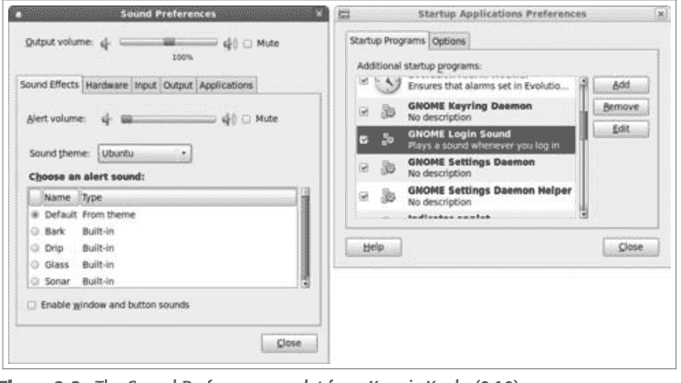

**图 2-2：** Karmic Koala（9.10）的"声音首选项"小程序

### 更改背景

Ubuntu 桌面的默认背景是带有明亮高光的棕色屏幕。正如我那位时尚的同事告诉我的，"没人喜欢棕色"。所以背景必须更改。右键点击背景，然后从弹出菜单中选择**更改桌面背景**。**系统 ➡ 首选项 ➡ 桌面背景**菜单项会打开"桌面背景首选项"小程序。

> **提示** 您也可以通过菜单打开"桌面背景首选项"小程序。对于大多数 Ubuntu 版本，您可以使用**系统 ➡ 首选项 ➡ 外观**，然后点击"背景"选项卡。对于 Dapper Drake（6.06 LTS），菜单是**系统 ➡ 首选项 ➡ 桌面背景**。

虽然 Ubuntu 确实包含一些非常丰富多彩的背景，但您也可以添加自己的背景。与"声音首选项"不同（在声音首选项中您局限于一种音频文件格式），桌面支持多种图像格式。GIF、JPEG、BMP、PCX、TIF 和 PNG 都是可接受的格式。除了选择其他图像外，您还可以选择图像应该平铺、拉伸还是居中，以及边框颜色。在图 2-3 中，我选择了我的安全计算标志，居中显示，并带有垂直渐变背景。由于我的图像是带有透明背景的 GIF，桌面的配色方案与图片融合得很好。

> **注意** 尽管桌面支持多种不同的图形格式，但有些图形并不受支持。特别是，桌面背景显示的是静态图片。动画 GIF 不会动，MPEG 视频无法作为背景使用，Adobe Flash 电影也不行。在第 10 章中，您将看到如何创建动画背景。

> **提示** 如果您需要裁剪或修改图片，桌面安装已自动包含 Gimp，这是一款功能强大的图像编辑器。

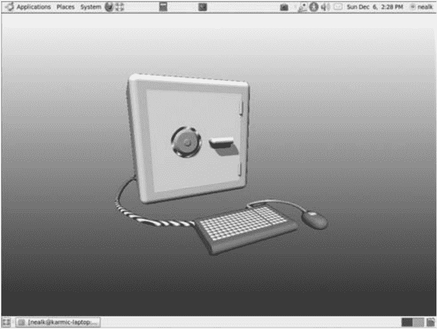

**图 2-3：** 带有渐变颜色的 Hacker Factor 安全计算标志作为背景

### 根据需要更改背景

桌面上的图片和颜色不需要是静态的。您可以使用一个简单的程序来根据需要更改图片（或颜色）。命令如下：

```
gconftool-2 -t str-set /desktop/gnome/background/picture_filename \
    /path/picture.gif
gconftool-2 -t str-set /desktop/gnome/background/primary_color \
    "#AABBCC"
gconftool-2 -t str-set /desktop/gnome/background/secondary_color \
    "#112233"
```

Gnome 桌面保留一组配置参数，类似于 Microsoft Windows 的注册表。`gconf-editor` 命令使您能够以交互方式查看和编辑这些值（让人想起 Windows 的 `regedit` 命令），而 `gconftool-2` 命令使您能够从命令行编辑值。在注册表中，`picture_filename` 字段存储背景图像的名称（在本例中为 `/path/picture.gif`）。请务必指定图像的*完整路径*。一旦您在注册表中更改了图像，背景上的图像就会随之改变。

与 `picture_filename` 类似，`primary_color` 和 `secondary_color` 字段用于控制背景颜色。如果您只有纯色背景，则颜色由 `primary_color` 定义。`secondary_color` 仅用于颜色渐变。颜色由三个十六进制字节表示，分别代表红色、绿色和蓝色。黑色是 `#000000`，白色是 `#FFFFFF`，漂亮的浅蓝色是 `#2255FF`。与背景图像一样，一旦您在注册表中更改了颜色，背景上的颜色就会随之改变。

### 使用信息性颜色

背景颜色不需要是静态的。通过简单的脚本，您可以根据系统事件更改颜色。例如，您可以监控日志文件，并在发生严重事件时将背景更改为红色。作为一个例子，清单 2-1 是一个 Perl 脚本，它更改背景颜色以表示系统负载。

> **注意** 清单 2-1 中脚本的结果只有在桌面的某些部分显示主背景颜色时才可见。如果您的图形覆盖了整个桌面，那么您将看不到任何变化。

#### 清单 2-1：根据负载更改背景颜色的脚本

```
 ATS  Sunday

```
#!/usr/bin/perl
## 根据系统负载为背景着色
my $key = "/desktop/gnome/background/primary_color";
my $load; # 系统负载
my $R, $G, $B; # 红、绿、蓝颜色
while ( 1 )
{
$load=`uptime`; # 获取当前负载
## 格式为 "持续时间, 用户数, 平均负载: 0.00, 0.00, 0.00"
## 删除除第一个负载值以外的所有内容
$load =~ s/.*: //;
## 负载值：1 分钟、5 分钟、15 分钟平均值
## 这些颜色为：1 分钟=红色，5 分钟=绿色，15 分钟=蓝色
($R,$G,$B) = split(', ',$load);

## 缩放到 0-255 范围，但上限为 255
$R = $R * 255; if ($R > 255) { $R = 255; }
$G = $G * 255; if ($G > 255) { $G = 255; }
$B = $B * 255; if ($B > 255) { $B = 255; }
## 转换为十六进制
$load = sprintf "%02X%02X%02X",$R,$G,$B;

## 设置颜色
system("gconftool-2 -t str-set $key '#$load'");
sleep 15; # 每分钟更新 4 次
}
Done
```

此脚本每 15 秒根据系统负载更改一次背景颜色。偏红的颜色表示系统非常活跃。黄色表示某个活跃进程已运行至少 5 分钟；白色表示至少 15 分钟。如果没有进程提高系统负载，颜色将从绿色循环到蓝色再到黑色。如果您想知道系统何时变得繁忙，背景颜色的突然变化应该能引起您的注意。

### 更改字体

默认情况下，Ubuntu 桌面使用 10 磅的 Sans 字体。您可以通过**系统 ➡ 首选项 ➡ 字体**小程序更改桌面使用的字体。更改字体会立即改变桌面。

#### 关于磅值

确定字体大小有三种度量单位。首先是像素（px）。这些是屏幕上的活动元素。屏幕坐标如 1024x768 通常描述的是绝对像素值。

 > 每英寸点数（dpi）描述了像素的密度。一台14英寸宽、分辨率为1024x768的显示器大约有73个水平像素每英寸（73 dpi），而一台20英寸宽屏幕在相同分辨率下为51个像素每英寸（51 dpi）。

最后，点（pt）用于描述可移植的密度。每英寸有72 pt。在渲染某个文字大小时，12 pt的字体应该让字母宽度为0.17英寸（12 pt ÷ 每英寸72 pt）。如果屏幕是96 dpi，那么字母的宽度应该为16像素（12 pt ÷ 每英寸72 pt × 96 dpi = 16 px）。

在渲染字体时，系统会将字体的pt映射到已知的dpi。如果屏幕的dpi值配置不正确，那么打印文档上的字体可能与屏幕上的同一文档显示不同的大小。通常人们不会更改屏幕的dpi设置，但这并不意味着你不能更改。

### 更改DPI

不同的输出设备以不同的分辨率渲染字体。增加字号会使它在所有设备上都显得更大，包括屏幕和打印机。另一方面，如果你更改单个设备的渲染分辨率，那么相同的字号将会更大或更小。

默认的桌面字体以96 dpi渲染。你可以通过打开“系统 ➔ 首选项 ➔ 外观”小程序，选择“字体”选项卡，然后点击“详情”按钮来更改dpi值。

> 注意 对于Dapper Drake（6.06 LTS），请使用“系统 ➔ 首选项 ➔ 字体”。较新版本的Ubuntu使用“外观”小程序。

虽然“字体”小程序适合一次性更改，但它不容易自动化。dpi值也可以通过gconf-edit注册表在/desktop/gnome/font_rendering/dpi下设置。可以调整此值以匹配你的屏幕。例如，如果你更改了屏幕分辨率或使用了不同大小的显示器，字体可能会显得更大或更小。

要更改dpi值，请使用：

```
gconftool-2 -t float-set /desktop/gnome/font_rendering/dpi 96
```

大于96的值会使字体显得更大（但不会改变实际字号），而较小的数字会减小渲染大小。一般来说，更改dpi设置*仅*改变字体在屏幕上的渲染方式。它不会改变应用程序窗口的大小，也不会影响文档的打印效果。

> 注意 更改渲染分辨率只会更改由桌面渲染的字体。例如，Gnome终端（应用程序 ➔ 附件 ➔ 终端）和Gnome文本编辑器（gedit）都会改变大小，但xterm窗口不会；xterm使用px，而不是pt。此外，某些应用程序（如xchat）使用硬编码的窗口高度，所以大号字体的顶部或底部可能会被粗暴地裁剪掉。

### 协助大字体适配

我有几位同事在坐电脑旁时需要佩戴老花镜。不止一次，他们来到我的工作区，又不得不跑回去拿眼镜。为了帮助他们（ Razorblade 顺便逗逗他们），我创建了一个"爷爷模式"宏，用于增大屏幕字体大小——专为他们设计。永久设置使用"爷爷模式"的能力需要四个命令。前两个命令定义了更改dpi值的自定义命令。后两个命令将命令绑定到按键序列。

```
gconftool-2 -t str-set /apps/metacity/keybinding_commands/command_7 \
  'gconftool-2 -t float-set /desktop/gnome/font_rendering/dpi 200'
gconftool-2 -t str-set /apps/metacity/keybinding_commands/command_8 \
  'gconftool-2 -t float-set /desktop/gnome/font_rendering/dpi 96'
gconftool-2 -t str-set /apps/metacity/global_keybindings/run_command_7 \
  '<Control>F7'
gconftool-2 -t str-set /apps/metacity/global_keybindings/run_command_8 \
  '<Control>F8'
```

现在按Ctrl+F7会将分辨率更改为200 dpi，使字体显得很大（同事可以不用眼镜阅读）。Ctrl+F8将屏幕恢复到系统默认的96 dpi（见图2-4）。

如果你想移除"爷爷模式"，可以使用gconftool-2-unset选项：

```
## 重置默认dpi
gconftool-2 -t float-set /desktop/gnome/font_rendering/dpi 96
## 取消按键映射
gconftool-2-unset /apps/metacity/keybinding_commands/command_7
gconftool-2-unset /apps/metacity/keybinding_commands/command_8
gconftool-2-unset /apps/metacity/global_keybindings/run_command_7
gconftool-2-unset /apps/metacity/global_keybindings/run_command_8
```

### 调优Shell

本书中的大多数Ubuntu技巧都需要你使用命令行，这意味着使用GNU Bourne-Again Shell（bash）。bash已在大多数Linux发行版上取代了sh、csh和tcsh等shell。当你打开命令提示符或终端窗口时，默认的shell就是bash。Bash使用与原始Bourne shell（sh）相同的语法，但具有更多可用性功能。例如，可以使用上下箭头滚动浏览shell历史记录。

**图2-4：** 96 dpi（左）和200 dpi（右）下的桌面和Gnome终端。两张屏幕截图均来自同一台1280x1024的显示器。


 ## 实用的别名

别名是常用命令的简单快捷方式。通常人们会将 `ls` 命令的别名添加到他们的 `.bashrc` 文件中。例如：

```
alias l.='ls -d .[a-zA-Z]*'   # 列出所有系统文件
alias ll='ls -l --color=tty'  # 详细列表（-l）并带颜色编码
                            # 的文件类型
alias llf='ls -l --full-time' # 使用完整时间戳列出
alias ls='ls -F'            # 让 ls 在每个文件名后
                            # 标注文件类型
```

**提示** 如果你不想使用别名命令，那么在命令前加上反斜杠。例如 `ls` 使用的是 `ls -F` 别名，但 `\ls` 将只运行常规命令。

还有一些其他别名我发现非常有用。前两个是 `webhist` 和 `webbook`。这两个别名都使用 `sqlite3` 命令（`sudo apt-get install sqlite3`）来访问 Firefox 数据库文件。

**注意** `webhist` 和 `webbook` 别名专为 Firefox 3 设计，该版本可在 Hardy Heron（8.04 LTS）及更高版本的 Ubuntu 上找到。这些别名仅访问默认的 Firefox 配置文件。第 6 章将介绍备用的 Firefox 配置文件。

`webhist` 别名访问 Firefox 的 `places.sqlite` 文件，并显示你当前访问过的网站历史记录：

```
## Firefox 的 places.sqlite 文件在 Firefox
## 运行时时会被锁定。
## 该别名将其复制到新文件以绕过
## 文件锁定。
```

```
## webhist: 列出当前网页历史记录
alias webhist='(cd $HOME/.mozilla/firefox/*.default;
  cp -f places.sqlite places.bak;
  echo "select url from moz_places inner join moz_historyvisits
       on place_id=moz_places.id order by visit_date;"
       | sqlite3 places.bak)'
```

`webbook` 别名显示你的 Firefox 书签：

```
## webbook: 列出当前书签
alias webbook='(cd $HOME/.mozilla/firefox/*.default;
  cp -f places.sqlite places.bak;
  echo "select url from moz_places inner join moz_bookmarks
       on fk=moz_places.id;" | sqlite3 places.bak)'
```

使用 `webhist` 和 `webbook`，我可以非常快速、轻松地根据 URL 自动化任务，或查找我以前访问过的特定网站。

> **提示** Firefox 的 `places.sqlite` 数据库包含的信息远不止 URL。例如，如果你将 `select url` 改为 `select url,title`，那么你还可以看到每个网页的 URL 和标题。对于数据库专家，模式图可在 `http://www.firefoxforensics.com/research/firefox_places_schema.shtml` 找到。

另一个我经常使用的别名是 `pinger`。这个别名只是每五秒显示一个数字。许多防火墙假设一段时间没有流量就表示连接已关闭。如果我知道我要离开一个活动连接，我会运行 `pinger` 别名只是为了生成流量并保持连接活跃。

```
alias pinger='(i=0; while [ 1 ]; do sleep 5; echo $i;
             ((i=$i+1)); done)'
```

### 有趣的函数

除了存储别名外，`.bashrc` 文件还可以存储可用于替代命令的 shell 函数。例如，`pinger` 也可以在 `.bashrc` 文件中写成：

```
function pinger() { i=0; while [ 1 ]; do sleep 5; echo $i;
             ((i=$i+1)); done }
```

另一个我使用的函数是 `ccd`：

```
function ccd()
{
  if [ "$1" == "" ]; then
    echo "Usage: ccd location"
  elif [ -d "$1" ]; then
    # 如果是目录，进入该目录
    cd "$1"
  else # 一定不是目录
    # 去掉文件名并进入包含目录
    cd "${1%/*}"
  fi
}
```

`ccd` 函数的工作原理与 `cd` 命令类似，只不过它在你粘贴包含文件名的行时不会出错。例如，`cd ~/public_html/logo.gif` 会失败，因为目标必须是目录。但 `ccd ~/public_html/logo.gif` 会识别 `logo.gif` 是文件，并将你放到该文件所在的目录。

我的技术编辑 Tim 建议了另一个很棒的程序员 shell 函数。这个别名搜索 `Makefile` 结果中的错误并用红色高亮显示。

```
function make()
{
## 注意引号的使用：外部用 "，内部用 '
## echo -e '' 打印转义字符
Red="$(echo -e '\033')[41;37m"
Reset="$(echo -e '\033')[0m"
/usr/bin/make $@ 2>&1 |
sed -e "s@\(.*\(error\|fail\|undef\).*\)@${Red}\1${Reset}@gi"
}
```

### 酷炫的命令

还有两个不太为人知的 bash 特性。Ctrl+T 调换光标处最后两个字符的位置。这样，常见的打字错误 `sl` 可以快速纠正为 `ls`。

另一个是 `CDPATH` 环境变量。`PATH` 环境变量指定在哪里查找命令。通常看起来像这样：

```
export PATH=/usr/local/bin:/usr/bin:/bin:/usr/bin/X11:/usr/games
```

当你运行命令时，shell 首先检查程序是否存在于 `/usr/local/bin` 中，然后是 `/usr/sbin`，然后是 `/usr/bin`，依此类推，直到找到为止。`CDPATH` 变量告诉 `cd` 当目录不在你当前目录时去哪里查找。例如：

```
export CDPATH=.:~:/usr:/etc
```

如果你输入 `cd bin`，那么 shell 将首先检查 `./bin`。如果它不存在，则会尝试 `~/bin`，然后是 `/usr/bin` 和 `/etc/bin`。如果你经常发现自己处于错误的位置却试图输入 `cd public_html`（或其他某个目录），这真的会非常方便。

> **提示** 对于其他不太为人知的 bash 命令，请参阅 Bash 手册页（`man bash`）。

### 调整桌面

配置好配色方案、字体和声音后，你会想要修改 Gnome 桌面。这意味着为常用功能添加按钮和菜单。你可能还想更改整体控件主题和应用程序外观。

### 添加面板按钮

屏幕顶部和底部的工具栏是放置按钮的便利位置。按钮为你提供了快速运行命令的方式。我通常会添加 X 终端的按钮，因为我经常使用命令行。我还会为我最喜欢的游戏和其他经常运行的应用程序添加按钮。

添加新按钮非常简单：只需右键单击顶部或底部工具栏的空白部分，然后选择"添加到面板"。默认选项会向你展示常见的应用程序，如天气预报和工作区切换器，你可以将它们拖放到工具栏上。但当你想要的应用程序不存在时，你需要选择自定义应用程序启动器（参见图 2-5）。

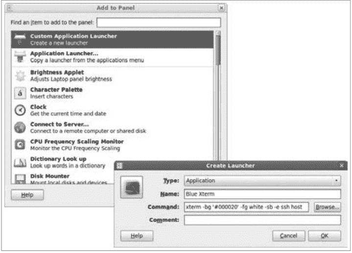

自定义应用程序启动器会提示你输入按钮的名称。这是你悬停鼠标在按钮上时显示的文本。命令是活动元素——这是你可以在命令行上输入的任何行。在图 2-5 中，我创建了一个 `xterm`，背景为深蓝色（`#000020`），白色文本，并带有滚动条（`-sb`）。与其在本地系统上打开终端，我使用安全外壳连接到远程主机（`-e ssh host`）。这样，我可以为特定主机的终端窗口设置颜色编码。你还应该为按钮选择一个图标。点击空白图标按钮会显示大量现成的图标。或者，你也可以创建自己的图标；PNG 是最佳格式。

> **注意** 命令可以是任何有效的命令行。如果你想使用管道或重定向，请考虑使用 `bash` 命令。例如：`bash -c 'ls | more'`。务必选择"在终端中运行"选项。这样，命令将运行，你可以看到输出。否则，它永远不会打开窗口（如果你不想看到任何文本结果，这可能是可取的）。

> **提示** 如果你想以 root 身份运行命令，在前面加上 `gksudo`。`gksudo` 的工作原理与 `sudo` 类似，但带有图形提示。你可以在单击了解有关 `sudo` 的更多信息。

创建按钮后，它将出现在工具栏上。你可以随时右键单击按钮来更改其属性（名称、命令、图标等）。此菜单还允许你沿工具栏移动按钮，移动到另一个工具栏（例如，从顶部移到底部），或锁定图标使其不会移动。

> **提示** 笔记本电脑可以使用自己的屏幕或外接显示器。两个屏幕通常分辨率不同。如果你经常切换分辨率，你可能想要为每个工具栏图标启用"锁定到面板"属性。否则，它们可能会移动并挤在工具栏中间。

按钮不限于工具栏。它们也可以在桌面上创建。

- 1. 在桌面上，右键单击以调出桌面菜单。
- 2. 选择"创建启动器"。创建窗口看起来与面板中的窗口一样。
- 3. 输入按钮的名称和命令行。你还可以选择一个图标。
- 4. 完成后，点击"确定"。

新按钮出现在你的桌面上。双击按钮即可启动应用程序。

### 添加面板

默认的 Ubuntu 用户界面有两个面板（工具栏）：一个在顶部，一个在底部。每个面板放置菜单和按钮的屏幕空间有限；你可能会用完空间。为了解决这个问题，你可以添加更多面板。

- 1. 右键单击任何面板上的空白区域。这将调出面板菜单。
- 2. 从菜单中选择"新建面板"。新面板将出现。


 第一个新面板将出现在屏幕右侧。若要移动面板，请用鼠标左键拖动它。它可以放置在屏幕任意边缘或另一个面板旁。例如，你可以轻松地将多个面板堆叠在顶部边缘，以便添加大量按钮。

面板还可以拥有子面板，称为抽屉。抽屉是一个弹出式面板，你可以在其中存放更多按钮。要创建抽屉：

1. 右键单击面板的任意空白区域，以调出面板菜单。
2. 选择"添加到面板"选项。这将弹出可用小程序列表。
3. 将"添加至面板"窗口中的抽屉图标拖动到面板上。
4. 左键单击抽屉图标以打开抽屉。

单击一次抽屉图标即可打开它。再次单击则关闭它。打开的抽屉相当于另一个面板，你可以向其添加面板图标。打开的抽屉通常为三行图标高。不过，如果你添加更多图标，它会自动加宽。

### 添加菜单

默认桌面包含一个基于文本的顶层菜单，其中有三项：应用程序、位置和系统。在 Gnome2 中，开发人员移除了添加自定义菜单的功能。据称该实现不稳定，因此被禁用。希望这能在后续的 Ubuntu 版本中加入。在此期间，你可以通过右键单击菜单并选择"编辑菜单"，在现有顶层菜单项（应用程序和系统）下添加自定义菜单。

GNOME 菜单包含两种不同类型的项目。首先，它们可以包含额外的菜单。例如，"应用程序"包含"游戏"（应用程序 ➪ 游戏）。菜单的嵌套深度没有限制；你可以在菜单中包含菜单中的菜单。

其次，GNOME 菜单包含条目。条目就像面板按钮一样，但使用文本（可选配图形）来表示功能。与按钮一样，条目可以运行系统中的任何命令。

> **警告** 只有包含项目的菜单项才会显示，且只有空菜单才能删除。

虽然添加菜单项很简单，但删除它们可能有点令人困惑（在这方面，GNOME 界面还不够完善）。

1. 通过右键单击主菜单并选择"编辑菜单"来打开菜单编辑器。
2. 右键单击每个项目并选择"删除"来删除所有菜单条目。你可以删除一开始就是空的菜单，但不能删除你刚刚清空的菜单。后续步骤（步骤 3–5）用于删除空菜单。
3. 关闭菜单编辑器。（没错！关闭它，以便你可以重新打开它来删除！）菜单编辑器只有在关闭并重新启动后才会更新。
4. 重新打开菜单编辑器。
5. 现在通过右键单击并选择"删除"来删除空菜单。

### 选择主题和皮肤

Ubuntu 自带的默认控件——窗口边框、滚动条和按钮——虽然不错，但还可以做得更好。你可以通过选择"系统" ➪ "首选项" ➪ "外观"来更改桌面主题。（在 Dapper Drake 中，该菜单名为"主题"。）在此菜单中，你可以从广泛的主题、配色方案和控件中进行选择（见图 2-6）。除了现有的主题选择外，你还可以自定义控件、窗口边框和图标。你在这里的选择将影响你运行的每个应用程序。

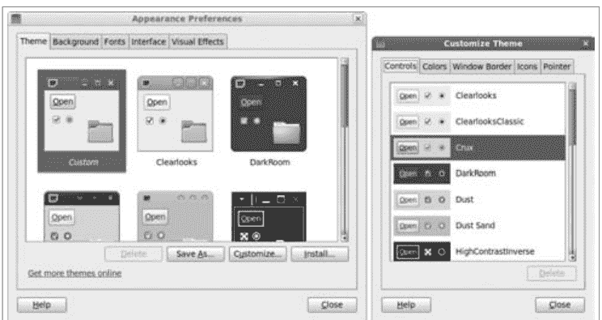

遗憾的是，主题选择小程序提供的选项不如其他操作系统多。（是的，Windows 甚至 OS/2 的可配置选项都比 GNOME 多。）但有一些方法可以调整图形自定义界面中不可用的方面。

1. 成为 root 用户。打开终端并输入：

```
sudo bash
```

> **警告** 这将启动一个 root 命令提示符。你有能力删除并破坏整个操作系统。请小心。

2. 转到目录 `/usr/share/themes`。

```
cd /usr/share/themes
```

3. 将你喜欢的主题复制到新目录。这会将现有主题用作模板。例如，如果你喜欢 AgingGorilla 主题，则使用：

```
cp -R AgingGorilla MyTheme
```

4. 在 `MyTheme/metacity-1` 目录中有一个名为 `metacity-theme-1.xml` 的文件（`/usr/share/themes/MyTheme/metacity-1/metacity-theme-1.xml`）。编辑此文件。

主题文件包含描述主题名称和属性的 XML。通过编辑此文件，你可以更改颜色、边框大小、图标等。这为你提供了比其他操作系统更多的自定义主题编辑能力。例如，我可以通过编辑 `title_tile` 部分并指定以下内容，让标题栏拥有几条可增长的条纹：

```
<draw_ops name="title_tile">
  <line color="#0000ff" x1="0" y1="0" x2="width" y2="0"/>
  <line color="#3030f0" x1="0" y1="1" x2="width" y2="1"/>
</draw_ops>
```

这会设置两条交替的水平条纹。一条是蓝色（`#0000ff`），另一条是灰蓝色（`#3030f0`）。如果你想更改关闭、最大化、最小化等图标，只需编辑 `/usr/share/themes/MyTheme/metacity-1/` 目录中相应的 PNG 文件即可。

对活动主题的更改会立即生效。如果你使用"系统" ➪ "首选项" ➪ "主题"小程序更改主题，可以通过单击"主题详细信息"按钮并选择 MyTheme 选项来重新选择你的自定义设置。

### 导航 Nautilus

Nautilus 是集成到 GNOME 中的图形文件浏览器。它使你能够图形化地查看文件、导航目录，并在双击图标时启动应用程序。除了以带有文件的窗口形式出现外，Nautilus 还管理着桌面——桌面只是另一个始终打开到底的文件夹。

你可以创建一个按钮来快速启动 Nautilus。

1. 在顶部面板上右键单击以调出菜单。
2. 选择"添加到面板"。这将弹出小程序。
3. 单击"自定义应用程序启动器"按钮。
4. 在按钮的"名称"字段中输入 `Nautilus`，在"命令"字段中输入 `nautilus`（小写）。
5. 选择一个合适的图标。我喜欢 `/usr/share/icons/gnome/24x24/apps/file-manager.png`。
6. 单击"确定"创建按钮。

Nautilus 有许多与其他操作系统相似的可配置项。例如，你可以将 Nautilus 窗口的背景设置为纯色或图像。还有一个侧边窗格（"视图" ➸ "侧边窗格"），可以列出目录信息或显示目录树。

除了这些常见功能外，Nautilus 还提供了一些不常见的功能，例如徽标、可缩放图标和自定义上下文菜单。

### 配置 Nautilus

**尽管 GNOME 使用 Nautilus 进行目录导航，但 Nautilus 与 GNOME 并不相同。在进行系统自定义时，这种区别变得非常明显。GNOME 使用 `gconf-edit` 来管理所有配置选项。对此注册表的任何更改都会立即生效。**

**与 GNOME 相比，Nautilus 使用多种配置方法，而且很少有立即生效的。要通知 Nautilus 更改，最好的选择是重新启动它。命令 `nautilus -q` 告诉 Nautilus 退出。如果 GNOME 没有立即重新启动 Nautilus，则运行 `nautilus` 来重新激活它。重新启动时将加载新的配置更改。**

### 善用徽标

徽标是可以添加到文件或目录图标上的小装饰。例如，关键文件都可以标上紧急徽标，财务文件可以加上美元符号。徽标出现在图标的角落，因此每个文件可以轻松启用四个徽标。有许多不同的方法可以启用徽标：

- **属性**——你可以右键单击图标并选择属性选项。在属性菜单中，选择"徽标"选项卡。这使你可以在所选徽标旁打勾。如果你选择了多个文件，则可以查看首选项并一次性启用它们的所有徽标。

- **背景和徽标**——在 Nautilus 菜单下，你可以选择"编辑" ↔ "背景和徽标"。会出现一个对话框，让你可以为 Nautilus 窗口拖入不同的背景（图案或颜色）。还有图标徽标。只需将徽标拖到文件图标上，即可设置（或如果已设置，则会移除）。

- **侧边窗格**——Nautilus 侧边窗格有一个下拉菜单，显示徽标。与背景一样，你可以将徽标拖到图标上以启用或禁用它。

徽标提供了有关文件用途的视觉提示，但目前除了人工解读外几乎没有其他用途。你无法自动选择文件或按徽标排序、在子目录上启用徽标，或通过编程方式更改它们（除非进行大量的编程工作）。

### 徽标的实际用途

尽管徽标除了人工解读外没有功能，但它们可能非常有用。例如，我有一位朋友是自由撰稿人。她用徽标来表示不同文章的状态。一个徽标表示已投稿，另一个徽标标记已售出，第三个则表示正在进行中。

### 技术细节

徽标存储在 `$HOME/.nautilus/metafiles/` 中的一组 XML 文件里。每个目录有一个 XML 文件，且只有自定义过的目录才会存在。你可以编辑这些 XML 文件来进行系统更改，但需要重新启动 Nautilus 才能使更改生效。

清单 2-2 展示了一个更改徽标的简单脚本。在这种情况下，每个带有重要徽标的图标都会被更改为紧急徽标。可以创建更复杂的脚本来为特定文件添加徽标、根据其徽标操作文件，或基于事件设置徽标。例如，如果重要图标超过 48 小时，则可以将其设置为紧急，或生成电子邮件通知。

#### 清单 2-2：将"重要"徽标更改为"紧急"的脚本

```


 ```
## save the result to a temporary file
cat $i | sed -e 's/name="important"/name="urgent"/g' > $i.new
## move the temporary file into place
mv $i.new $i
done
## restart Nautilus so the changes take effect
nautilus -q
```

### 拉伸图标

Nautilus 最酷的功能之一是能够拉伸图标。你可以将桌面上的任意图标进行缩放——可以变得很小，也可以变得非常大。如果图标表示的是文本文档，那么可以放大到足以阅读文本的程度。要缩放图像：

- 1. 对于桌面图标，右键单击该图标以调出图标菜单，然后选择"拉伸图标"菜单选项。对于 Nautilus 目录窗口中的图标，选中该图标，然后从 Nautilus 菜单栏中选择"编辑 ➡ 拉伸图标"。
- 2. 当你选择"拉伸图标"后，图标的四个角会出现四个蓝点。
- 3. 抓住其中一个蓝点（使用鼠标左键）并拖动它。这将拉伸或缩小图标。

拉伸图标的一个绝佳用途是整理桌面。当我正在处理某个项目时，桌面上可能会有几十个文件。去吃午饭之前，我可以将当前文件拉伸到更大的尺寸——这样，回来后我就能快速找到它。图 2-7 展示了一些拉伸后的图标。

要取消拉伸图标，调出该图标的菜单并选择"恢复图标原始大小"。

> **注意** 在前面的徽章部分中，我提到每个图标最多可以有四个徽章。这并不完全准确。徽章是沿着图标的边缘放置的。如果图标被拉伸到非常大的尺寸，那么就可以放置很多徽章而不会重叠。

### 拉伸练习

拉伸图标功能在 Nautilus 中仍在开发中。因此，并不是所有选项都能随时使用。例如，当图标位于桌面上时，菜单选项中有拉伸图标大小的选项。但当从 Nautilus 窗口内部选中图标时，拉伸选项不会出现在图标菜单中。这时，你需要使用"编辑 → 拉伸图标"。

Nautilus 允许你将拉伸后的图标拖放到文件夹中——并且它会保持拉伸后的尺寸。不幸的是，拖动图标会移除"恢复图标原始大小"菜单项。要恢复图标大小，你需要先拉伸该图标。这将重新激活恢复菜单选项。

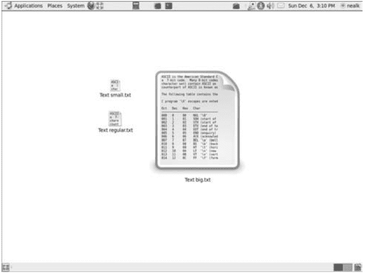

**图 2-7：** 常规图标、缩小的图标，以及一个非常大的拉伸图标。文本文件的图标会显示文件内容。

### *技术细节*

与徽章一样，拉伸值保存在 `$HOME/.nautilus/metafiles/` 的 XML 文件中。可以创建脚本来自动操作图标的大小。这样，重要的文件就可以突然变大。例如，一个很棒的用途是在线上会议之前立即将图标放大。这样，你就能快速找到需要的文件。与徽章一样，对拉伸值进行任何自动更改后，都需要重启 Nautilus 才能生效。

### 调整字体

"系统 ⤷ 首选项 ⤷ 外观 ⤷ 字体"窗口允许你设置字体类型，但不能设置字体颜色。默认字体使用白色文字和深色阴影。虽然这种字体在深色（或棕色）背景下效果不错，但在浅色背景下可能难以阅读。在 Nautilus 下更改字体颜色需要一个 `$HOME/.gtkrc-2.0` 文件。使用你喜欢的编辑器创建（或编辑）此文件。为桌面图标添加或修改一个部分：

```
style "desktop-icon"
{
NautilusIconContainer::frame_text = 1
NautilusIconContainer::normal_alpha = 0
text[NORMAL] = "#000000"
}
class "GtkWidget" style "desktop-icon"
```

在此示例中，字体颜色设置为黑色（`#000000`）。`frame_text` 值表示你正在指定文本格式，`normal_alpha` 字段控制字体的透明度（0 表示不透明）。编辑完文件后，保存更改并重启 Nautilus（`nautilus -q`）。文本颜色将按照你的设置显示，并且（希望）能提供比默认颜色更高的对比度。

### 配置模板

在 Nautilus 菜单（包括桌面菜单）中有一个名为"创建文档"的选项。"创建文档"选项允许你基于模板文件创建新文件。默认情况下，只有一个模板文件——空文件。这会创建一个零字节大小的文件，就像运行了 `touch` 命令一样。你可以通过将文件放在 Templates 目录中来创建自己的模板。

- 1. 在你的主目录中创建一个名为 Templates 的目录：

   `mkdir $HOME/Templates`

- 2. 将任意模板文件放在此目录中。模板文件的文件名（不含扩展名）将出现在"创建文档"菜单中。

例如，你可以启动 Open Office（应用程序 ⤷ 办公 ⤷ Open Office.org 文字处理），保存一个名为 `WordProcessor.doc` 的空文件到 Templates 目录中。一旦保存，你就会在"创建文档"菜单中看到"Word Processor"选项。选择此菜单选项将创建一个名为 `WordProcessor.doc` 的文件，其中名称 `WordProcessor` 处于高亮状态以便重命名。

### 脚本化菜单

Nautilus 最强大的单一功能是创建上下文敏感菜单项的能力。例如，你可以创建一个仅在选中 MP3 文件时才出现的特殊菜单项。你可以控制在哪些类型的文件、目录或两者中显示该菜单项，以及它是为单个选中项还是多个选中项显示。

要做到这一点，你首先需要安装 Nautilus Actions：

```
sudo apt-get install nautilus-actions
```

现在你可以创建自定义菜单了。例如，图 2-8 展示了用于安全删除文件的菜单。

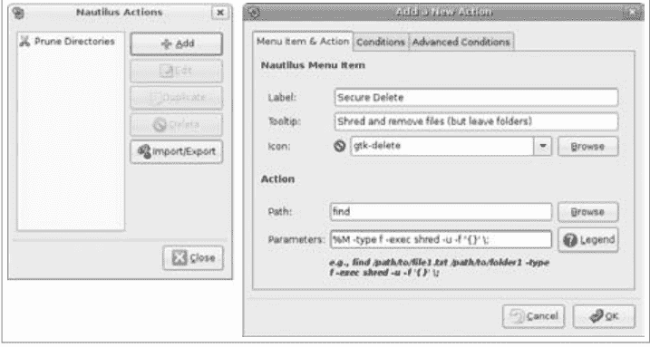

**图 2-8：** 添加"安全删除"菜单项

- 1. 运行 `nautilus-actions-config`。这将弹出配置菜单。

> **提示** 你也可以在顶部菜单的"系统 ➢ 首选项 ➢ **Nautilus Actions 配置**"中找到此工具。

- 2. 单击"添加"以创建新的菜单脚本。将打开一个新窗口。

- 3. 在"标签"处，输入 `Secure Delete`。这是将显示在菜单上的文本。

- 4. 你可以添加工具提示，例如"安全删除文件"。当鼠标悬停在菜单项上时会显示此内容。

- 5. 可以选择一个图标用于此菜单项。该图标将显示在菜单中。

- 6. "路径"是要运行的命令。任何可以在命令行上使用的命令都可以在此输入。对于此命令，使用 `find`（或 `/usr/bin/find`）作为路径。

- 7. 参数将传递给"路径"命令。在你输入时，参数字段下方会显示命令行示例。`%M` 参数会变成选中的文件列表。如果你单击"图例"按钮，将看到可以使用的其他变量。对于此操作，使用 `%M -type f -exec shred -u -f '{}' \;`。此参数告诉 `find` 识别所有文件并运行命令 `shred`，强制取消链接（删除）每个文件。

> **注意** `shred` 命令不能安全删除目录。结果会留下一堆空目录。有关此问题的解决方案，请参阅表 2-1 中的"Shred Everything"条目。

- 8. 在"条件"选项卡下，你可以选择菜单项何时出现。你可以基于文件名、元类型、文件或目录以及单个或多个选择的任意组合来进行选择。在这种情况下，你应该同时选择文件和目录（即使目录不会被删除），并允许多个文件选择。

- 9. 单击"确定"以将该操作添加到菜单中。

- 10. 单击"关闭"以结束 Nautilus Actions 应用程序。

- 11. 重启 Nautilus 以便加载新菜单项。

```
nautilus -q
```

你可以通过打开 Nautilus 并删除某些内容来测试新的菜单项。右键单击图标应该会显示"安全删除"菜单项。选择删除项应该会删除所有选中的文件。

> **警告** Shred 会在删除文件之前用垃圾数据覆盖文件。不会提示确认这是否是你真正想做的操作，并且任何被删除的内容都将永远消失。

操作脚本可用于转换文件（例如，对于任何 GIF，将其转换为 PNG）、通过邮件发送文件（例如"邮件发送到"命令），或在


 web 浏览器。操作仅限一行命令，但你可以指定一个 shell 脚本来执行多步骤命令。表 2-1 中包含了一些有用的自定义菜单项。

| 名称 | 路径 | 参数 | 条件 | 说明 |
|------|------|------|------|------|
| 命令提示符 | gnome-terminal | --working-directory ='\''%M'\''' | 仅文件夹，不支持多选。 | 打开一个终端窗口。 |
| 在 Firefox 中打开 | firefox | '%M' | 文件和文件夹均可，不支持多选。 | Firefox 必须先打开；否则可能无响应。 |
| 彻底删除所有内容 | bash | -c 'find %M -type f -exec shred -u -f "{}" \;; rm -rf %M' | 文件或文件夹，支持多选。 | 虽然只能运行一个命令，但这只是运行 bash 命令。bash 参数实际上是两个命令。 |
| WAV 转 MP3 | bash | -c "lame %M %d/`basename %M .wav`.mp3" | 仅适用于以 .wav 结尾的文件，不支持多选。 | 将 file.wav 转换为同目录下的 file.mp3。不是直接运行 lame，而是使用 bash 创建子 shell basename（用于重命名文件）。没有 basename 程序的话，你会得到一个名为 file.wav.mp3 的文件。 |

> 只能指定一个命令。不能使用 &、| 或 ; 来连接多个命令。

> 某些命令（如 shred 和 lame）在处理非常大的文件时可能需要数分钟（或更长时间）。在此期间，结果文件（例如，"WAV 转 MP3" 的文件）可能即使尚未完成也会被创建。

多次请求相同的任务可能会导致许多正在运行的进程相互干扰。最终效果可能不是你想要的。相反，应等待任务完成。有关监控进程的不同方法，请参见第 8 章。

> **提示** 虽然前面的例子使用 `shred` 来擦除文件，但 `shred` 不符合政府法规。一个替代品是 diskscrub（http://code.google.com/p/diskscrub/）。该程序符合美国国防部（DoD）和其他政府机构的规范。使用 `scrub -rSLp dod filename` 来调用它。

### 替代 Nautilus

虽然 Gnome 桌面相当稳定且易用，但 Nautilus 似乎随着每个 Ubuntu 版本的发布而 regress 到更不稳定的版本。在 Dapper Drake（6.06 LTS）中，Nautilus 稳定但功能有限。三年后，Karmic Koala（9.10）下的 Nautilus 已经变得严重有 bug，而且没有提供新功能。Nautilus 有太多的怪癖和局限性，不能被认为是"准备就绪"。

Nautilus 的替代品包括图形化的 Rox（`sudo apt-get install rox-filer`）和面向文本的 Gnome Commander（`sudo apt-get install gnome-commander`）。Gnome Commander 看起来像是 1986 年 DOS 程序 Norton Commander 的现代版本。

然而，我的个人偏好是保留 Nautilus 用于管理桌面，并使用看起来非常专业的 X File Explorer（`sudo apt-get install xfe`）进行文件夹导航。`xfe` 命令具有高度可配置的布局，只有一个主要限制：默认的辅助应用程序未包含在安装中。要解决这个问题，在感到太沮丧之前设置应用程序偏好（编辑 ➦ 首选项 ➦ 程序）。我建议将默认文本编辑器和查看器设置为 `gedit`，图像查看器设置为 Eye of Gnome（`eog`），终端设置为 `gnome-terminal`。

### 更改登录屏幕

现在你已经配置好了桌面，是时候处理一下登录屏幕了。每个 Ubuntu 版本都有不同的默认登录屏幕。如何更改它取决于 Ubuntu 的版本。

对于包括 Dapper Drake（6.06 LTS）和 Hardy Heron（8.04 LTS）在内的 Jaunty Jackalope 及之前的每个 Ubuntu 版本，你可以打开登录窗口首选项小程序（系统 ➦ 管理 ➦ 登录窗口）。这让你可以选择不同的样式、主题、背景、颜色，甚至是自动登录和允许登录的用户列表等安全选项。

从 Karmic Koala（9.10）开始，登录屏幕设置变得功能严重受限。你唯一能做的就是启用或禁用自动登录。在 Karmic 下，你需要手动更改登录配置。你可以通过以 Gnome 显示管理器（用户 `gdm`）身份运行 `gnome-appearance-properties` 小程序来更改背景、颜色、控件集和字体。

```
sudo -u gdm dbus-launch gnome-appearance-properties
```

或者，你可以使用 `gconftool-2` 更改特定属性。例如，你可以使用以下命令获取和设置登录屏幕的背景图像：

```
## 获取当前背景图像文件名
sudo -u gdm gconftool-2 -g /desktop/gnome/background/picture_filename
## 将背景图像设置为新文件
sudo -u gdm gconftool-2 -s /desktop/gnome/background/picture_filename \
  -t string /path/to/background.png
```

登录屏幕的另一个我通常会更改的方面是用户列表。默认情况下，它会列出系统上的每个用户。然而，如果你希望保护隐私（或不显示系统上的每个名字），或者系统上有几十个用户而不想显示一个长长的滚动窗口，那么你需要禁用用户列表。

```
## 获取当前用户列表设置
sudo -u gdm gconftool-2 -g /apps/gdm/simple-greeter/disable_user_list
## 将值设置为 true 以禁用列表
sudo -u gdm gconftool-2 -s /apps/gdm/simple-greeter/disable_user_list \
  -t bool true
```

你可以使用图形化的 `gconf-editor` 修改其他选项。我建议查看配置路径 `/apps/gdm/simple-greeter`。在这里你可以找到设置欢迎文本消息、更改语言设置、甚至禁用登录屏幕重启按钮的选项。

```
sudo -u gdm dbus-launch gconf-editor
```

完成这些更改后，注销并查看你的成果。

### 修改登录脚本

通常有一些你第一次在系统登录时想要运行的常见任务，还有一些在最终注销时要运行的任务。虽然你可以使用系统 ➦ 首选项 ➦ 会话来设置程序运行，但我发现这些选项太过局限；我不想运行单个命令，我想运行复杂的脚本。

GDM 在用户每次登录和注销图形桌面时运行一组脚本。`/etc/gdm/PostLogin/Default` 脚本在任意用户登录时启动。该脚本以 root 身份运行。

相比之下，`/etc/gdm/PreSession/Default` 和 `/etc/gdm/PostSession/Default` 脚本在图形桌面登录和注销期间以用户权限执行。对于用户特定的脚本，我在 `PreSession/Default` 脚本的末尾添加了以下行：

```
if [ -x $HOME/.gui_login ]; then (cd $HOME; ./.gui_login); fi
```

这会检查用户是否有一个名为 `.gui_login` 的可执行文件，并且在 `/etc/gdm/PostSession/Default` 中也有类似的 `.gui_logout` 检查。这些脚本允许我在图形登录期间运行特定应用程序，并在图形注销期间清理临时文件。

**警告** 确保你的登录和注销脚本不会提示用户输入或无限期挂起。否则，你的登录和注销将会挂起。

### 小结

正如没有家具的家不算完整的家一样，Ubuntu 的默认安装对于短期使用来说还可以，但要长期真正可用，需要进行定制。更改背景、声音、字体、按钮和主题可以让你根据自己的最佳需求配置桌面。对于某些用户来说，静态环境是最好的，但用户界面支持可以基于当前环境动态更改桌面的脚本。信息丰富的背景、动态图标、智能菜单和可调节字体真的可以增强系统的可用性和你自己的生产力。

## 第 3 章

## 配置设备

### 本章内容

- 如何安装可加载内核模块
- 配置启动服务的方法
- 添加和配置打印机、硬盘、电视卡和其他外围设备
- 创建带有备份的 RAID，以及如何在硬盘故障时幸存

### 使用设备驱动程序

在 Linux 下，使用设备需要几个必备要素。首先，你需要一个能够识别设备的内核驱动程序。这通常是一个低级驱动程序，例如用于并行打印机的并口驱动程序或 USB 支持（无论 USB 设备是什么）。

第二个要素取决于硬件类型——某些设备需要软件支持来管理设备。内核驱动程序只知道如何寻址设备；软件驱动程序才真正会用正确的"语言"交流。这意味着同一设备的不同版本可能使用不同的

不同的语言通过同一个内核驱动进行通信。打印机就是这样一个例子。打印机可能会使用 PostScript、HP PCL、oki182 或其他格式来传输数据。内核驱动知道如何将数据发送到打印机，而软件驱动知道要发送什么数据。大多数扫描仪、摄像头、指针设备甚至键盘也是如此。

最后一个要素是访问设备的用户级应用程序。这就是发出"打印"指令的程序，或是发出"播放"指令的音频系统。

使用任何设备之前都需要四个步骤：

1.  如果尚未安装设备驱动，则安装设备驱动。
2.  如果设备句柄未自动创建，则创建设备句柄。
3.  加载所有必需的软件驱动和配置参数。
4.  根据需要配置应用程序以使用该设备。

在某些情况下，部分或全部步骤是自动完成的。而在其他情况下，设备则需要手动配置。

### 实用程序

许多计算机外围设备和附加组件都是指针设备或视频设备。在测试这些设备时，有两个非常有用的程序。第一个是 GNU 图像处理程序，即 gimp（www.gimp.org），这是一个功能非常强大的绘图工具，支持大多数类型的指针设备，还可以从摄像头、扫描仪和电视卡等视频设备捕获输入。

第二个实用程序叫做 Scanner Access Now Easy，即 sane（www.sane-project.org）。它专门用于从扫描仪、数码静态相机、数码摄像机或电视卡等视频设备捕获图像。xsane 程序为 sane 提供了 X-Windows 前端界面。与 gimp 类似，xsane 可以从各种输入设备捕获图像。

sane、xsane 和 gimp 程序在 Ubuntu 默认桌面配置中已安装。

### 加载模块

早期的 Linux 版本将所有必要的内核驱动都编译到内核中。这意味着内确切地知道支持哪些设备。如果你需要添加新设备，则需要重新编译内核。

不幸的是，在内核中包含所有驱动会导致一个严重问题：内核变得过于庞大。在软盘时代，启动 Linux 需要两张 1.44 MB 的软盘——一张用于内核，另一张用于操作系统的其余部分。内核开发人员引入了压缩内核，但即便如此，内核对于软盘来说仍然太大。

幸运的是，将所有需要的模块编译进内核的蛮荒时代早已过去。如今，Linux 使用可加载内核模块（LKM）。每个 LKM 可以根据需要加载到内核中。这使内核保持小巧且快速。某些 LKM 甚至可以进行依赖检查，以确定是否需要它们。如果你的计算机上没有 SCSI 卡，那么 SCSI LKM 驱动就不会加载，也不会消耗内核资源。通常，系统通过设备标识符来发现硬件，但有时你需要告诉操作系统启用该设备。

Ubuntu 包含了丰富的常用和不常用内核模块。如果设备具有任何类型的稳定的 Linux 支持，那么 Ubuntu 系统中很可能已经包含了相应的 LKM。

### 查看模块

查看当前已加载模块的基本命令是 `lsmod`。运行 `lsmod` 会显示 LKM 的常用名称、LKM 的大小以及依赖于它的其他 LKM。例如：

```
$ lsmod | head
Module                  Size  Used by
floppy                  64676  0
rfcomm                  43604  0
l2cap                   28192  5 rfcomm
bluetooth               54084  4 rfcomm,l2cap
ppdev                   9668   0
speedstep_lib           4580   0
cpufreq_userspace        6496   0
cpufreq_stats           6688   0
freq_table              4928   1 cpufreq_stats
```

这显示 bluetooth 模块已加载，并被 rfcomm 和 l2cap 模块使用。第二个命令 `modprobe` 可用于显示实际的 LKM 文件。

```
$ modprobe -l bluetooth
/lib/modules/2.6.24-26-generic/kernel/net/bluetooth/bluetooth.ko
```

`modprobe` 命令还可以列出可用的模块——不仅仅是已加载的模块。例如，要查看所有异步传输模式（ATM）网络驱动，你可以使用：

```
$ modprobe -l -t atm
/lib/modules/2.6.24-26-generic/kernel/drivers/usb/atm/cxacru.ko
/lib/modules/2.6.24-26-generic/kernel/drivers/usb/atm/usbatm.ko
/lib/modules/2.6.24-26-generic/kernel/drivers/usb/atm/speedtch.ko
/lib/modules/2.6.24-26-generic/kernel/drivers/usb/atm/ueagle-atm.ko
/lib/modules/2.6.24-26-generic/kernel/drivers/usb/atm/xusbatm.ko
/lib/modules/2.6.24-26-generic/kernel/drivers/atm/idt77252.ko
/lib/modules/2.6.24-26-generic/kernel/drivers/atm/iphase.ko
/lib/modules/2.6.24-26-generic/kernel/drivers/atm/he.ko
/lib/modules/2.6.24-26-generic/kernel/drivers/atm/atmtcp.ko
/lib/modules/2.6.24-26-generic/kernel/drivers/atm/fore_200e.ko
/lib/modules/2.6.24-26-generic/kernel/drivers/atm/nicstar.ko
/lib/modules/2.6.24-26-generic/kernel/drivers/atm/lanai.ko
/lib/modules/2.6.24-26-generic/kernel/drivers/atm/suni.ko
...
```

`-t atm` 参数显示所有带有 ATM 标签的模块。LKM 存储在有组织的目录结构中，因此标签对应的是目录名称。这与使用 `modprobe -l '*atm*'` 不同，后者只会显示 LKM 文件名中包含"atm"的模块。

除了 `modprobe`，你还可以使用 `modinfo` 来了解有关特定 LKM 的更多信息。`modinfo` 命令可以列出模块的信息，也可以用于检索特定信息。例如：

```
$ modinfo lp  # list information about the lp module
filename:      /lib/modules/2.6.31-15-generic/kernel/drivers/char/lp.ko
license:       GPL
alias:         char-major-6-*
srcversion:    84EA21D13BD2C67171AC994
depends:       parport
vermagic:      2.6.31-15-generic SMP mod_unload modversions 586
parm:          parport:array of charp
parm:          reset:bool
```

如果你只需要查看 `modinfo` 输出中的某个特定字段，可以使用 `-F` 参数并指定所列出的字段之一。例如，`-F filename` 只显示模块的文件名。

```
$ modinfo -F filename lp  # only list the filename field
/lib/modules/2.6.31-15-generic/kernel/drivers/char/lp.ko
```

### 安装和卸载模块

模块的安装相对简单。`insmod` 命令用于加载模块，`rmmod` 命令用于卸载模块。`modprobe` 命令实际上使用了 `insmod` 和 `rmmod`，但增加了一些更智能的功能。`modprobe` 命令可以解析依赖关系并搜索模块。

举个例子，让我们看看 `suni.ko` ATM 驱动（你可能没有安装它，而且你可能也不需要它）。清单 3-1 展示了对该驱动的不同查询、安装驱动以及卸载驱动的操作。

**注意** 异步传输模式（ATM）网卡在家用 PC 上并不常见，因此在学习如何加载和卸载 LKM 时，这是一种很好的练习驱动类型。如果我们在本例中使用常见驱动，那么你可能会意外禁用硬盘、打印机或其他设备。如果你恰好有一张 Saturn 用户网络接口（SUNI）ATM 卡，那么建议在本例中使用其他驱动，例如 pppoatm。

### 清单 3-1：LKM 查询和管理示例

```
$ modinfo suni         # information about the module
filename: /lib/modules/2.6.24-26-generic/kernel/drivers/atm/suni.ko
license:   GPL
srcversion: 4F4DC0C890932441A81CC12
depends:
vermagic:  2.6.24-26-generic SMP mod_unload 586
$ lsmod | grep suni   # see if it is installed
[none found]
$ modprobe -l -t atm  # show all ATM modules
/lib/modules/2.6.24-26-generic/kernel/drivers/usb/atm/cxacru.ko
/lib/modules/2.6.24-26-generic/kernel/drivers/usb/atm/usbatm.ko
/lib/modules/2.6.24-26-generic/kernel/drivers/usb/atm/speedtch.ko
/lib/modules/2.6.24-26-generic/kernel/drivers/usb/atm/ueagle-atm.ko
/lib/modules/2.6.24-26-generic/kernel/drivers/usb/atm/xusbatm.ko
/lib/modules/2.6.24-26-generic/kernel/drivers/atm/idt77252.ko
/lib/modules/2.6.24-26-generic/kernel/drivers/atm/iphase.ko
/lib/modules/2.6.24-26-generic/kernel/drivers/atm/he.ko
/lib/modules/2.6.24-26-generic/kernel/drivers/atm/atmtcp.ko
/lib/modules/2.6.24-26-generic/kernel/drivers/atm/fore_200e.ko
/lib/modules/2.6.24-26-generic/kernel/drivers/atm/nicstar.ko
/lib/modules/2.6.24-26-generic/kernel/drivers/atm/lanai.ko
/lib/modules/2.6.24-26-generic/kernel/drivers/atm/suni.ko
...
$ modprobe -l '*suni*'   # Show only the suni.ko module
/lib/modules/2.6.24-26-generic/kernel/drivers/atm/suni.ko
$ modprobe -l -a 'suni'  # Show all suni modules
/lib/modules/2.6.24-26-generic/kernel/drivers/atm/suni.ko
$ sudo modprobe -a suni  # install all suni modules
$ lsmod | grep suni      # show it is installed
suni                  7504  0
$ sudo modprobe -r suni  # remove it
$ lsmod | grep suni      # show it is removed
[none found]
```

**提示** 不带任何其他参数使用 `modprobe -l` 将列出系统上的所有模块。

安装步骤也可以通过以下命令完成：

```
sudo insmod /lib/modules/2.6.24-26-generic/kernel/drivers/atm/suni.ko
```


同样，移除也可以使用以下任意命令：

```
sudo rmmod /lib/modules/2.6.24-26-generic/kernel/drivers/atm/suni.ko
sudo rmmod suni.ko
```

添加到 `/etc/modprobe.d/` 配置文件中可以允许更多的配置选项。

### 优化模块

如果你正试图精简系统，可能不希望安装或保留所有各种模块。虽然未使用的模块几乎不占用资源（即使它们已加载到内存中），但容量有限的系统或经过安全加固的系统可能不希望有不必要的 LKM。通过 `lsmod` 和 `modprobe -l` 命令，你可以识别哪些模块是不必要的，并将它们从系统中移除或干脆不加载它们。

例如，如果你的并行端口上没有打印机，那么你可能不需要加载 `lp` 模块。同样，如果你想禁用软盘驱动器，也可以移除该驱动器。

```
sudo modprobe -r lp
sudo modprobe -r floppy
```

你可以通过从 `/etc/modules` 中移除 `lp` 并将 `lp` 和 `floppy` 都添加到 `/etc/modprobe.d/blacklist`（或 `blacklist.conf`）来使这些更改永久生效。或者，如果你需要磁盘空间，也可以直接从系统中删除驱动程序（使用 `modinfo -F filename lp` 和 `modinfo -F filename floppy` 来查找文件）。

### 启动服务

设备驱动加载到内核后，通常需要进行配置。每个设备驱动都有自己的一套配置工具。例如，网络使用 `ifconfig` 来配置地址，PCMCIA 支持使用 `cardmgr` 来通知操作系统何时添加或移除了新卡。每个驱动都不同。有些软件驱动只需要一次来配置系统（例如，网络、音频和系统时钟）；有些则在设备使用过程中持续需要（例如，高分辨率图形和鼠标）。少数 KLM 驱动不需要额外的辅助——键盘、硬盘和 USB 就属于这一类。

除了配置和管理内核驱动外，有些软件驱动是纯粹基于软件的（不需要 KLM）。这些服务包括虚拟文件系统、显示和调度程序。最后，应用程序和网络服务，如安全外壳（SSH）和 Web，也可以进行配置。

虽然内核模块由 LKM 子系统管理，但 Init 和 Upstart 系统负责管理应用程序和网络服务的配置和管理。

#### 使用 Init.d

当系统启动时，内核驱动被加载到内存中，`init` 进程开始设置运行级别。在每个运行级别，不同的软件驱动和服务会被启动。哪些服务被启动以及它们启动的顺序由 `/etc/init.d/` 和 `rc` 脚本决定。共有八个 `rc` 目录：`/etc/rc0.d`、`/etc/rc1.d`、…… `/etc/rc6.d` 和 `/etc/rcS.d`。这些对应于不同的运行级别：0 到 6，以及 S 表示系统启动。

在每个目录中，都有指向 `/etc/init.d/` 中文件的符号链接。符号链接的名称决定了脚本在进入（S）或离开（K 表示杀死）运行级别时是否被调用（参见清单 3-2）。每个名称还有一个数字，用于确定服务启动的顺序。这样，依赖的进程可以按正确的顺序启动。例如，`S13gdm` 在 `S99rminologin` 之前启动，因为图形界面管理器（`gdm`）应该在用户登录提示之前启动。

`/etc/init.d/` 目录包含实际的控制脚本（不带 S/K 和编号）。每个脚本都有启动、停止和重新启动选项。因此，例如，如果你想重新启动网络并停止 `cron`，可以运行：

```
sudo /etc/init.d/networking restart
sudo /etc/init.d/cron stop
```

要使系统更改在下次重启后生效，请将适当的 S 或 K 脚本添加到适当的运行级别目录中。

#### 清单 3-2：/etc/rc6.d 的目录内容

```
$ ls /etc/rc6.d
K01gdm              K20vbi
K01usplash          K21postgresql-8.3
K01xdm              K25hwclock.sh
K09apache2		K25mdadm
K16dhcdbd		K50alsa-utils
K19aumix			K59mountoverflowtmp
K20apport		K80nfs-kernel-server
K20avahi-daemon	K99laptop-mode
K20cpufreqd		README
K20dkim-filter		S01linux-restricted-modules-common
K20kms-autoinstaller	S15wpa-ifupdown
K20libvirt-bin		S20sendsigs
K20nas			S30urandom
K20nfs-common		S31umountnfs.sh
K20nvtv			S32portmap
K20postfix			S40umountfs
K20privoxy		S51dmraid
K20snort			S60umountroot
K20sysstat		S90reboot
K20xinetd
```

#### 深入理解运行级别

Ubuntu 包含七种不同的运行级别：0–6 和 S。许多运行级别提供非常特定的服务。例如，级别 0 是系统停机，1 提供单用户模式，6 重新启动系统，S 提供无论运行级别如何都需要的系统启动服务。

其余的运行级别提供不同类型的多用户支持。通常系统使用级别 2。这提供了图形用户界面（如果可用）和网络支持。默认的级别 3 提供对辅助设备的支持，例如盲文 TTY 显示器。最后，级别 4 和 5 通常看起来与级别 2 相同，但如果你需要定制的运行时环境，可以修改它们。

### 了解 Upstart

从 Edgy Eft（Ubuntu 6.10）开始，System V init 被替换为一个名为 Upstart 的事件驱动进程管理器。Upstart 配置文件的位置因 Ubuntu 版本而异。（它是新的，所以在标准化之前你可以预期它会变动。）在 Jaunty Jackalope（9.04）下，配置文件位于 `/etc/event.d/`。在 Karmic Koala（9.10）中，它们位于 `/etc/init/`。

每个 Upstart 控制文件列出了它应该启动和停止的运行级别、要执行的命令以及依赖关系集。除了运行所需的命令外，Upstart 还支持可选的前后命令脚本。例如，`pre-script` 可以准备环境，命令（`script` 或 `exec`）启动服务，`post-script` 可以在运行命令后清理任何不必要的文件。

> **提示** 如果服务是用单个命令启动的，则使用 `exec`。更复杂的服务可以使用包含要运行脚本的 `script` 块来启动。

Karmic 的 `dbus.conf` 文件是一个简单 Upstart 脚本的好例子。该文件使用 `pre-start script` 块来创建所需目录并初始化系统。它运行单个命令来启动服务（`exec dbus-daemon --system --fork`），然后在启动服务后运行单个命令。

```
## dbus - D-Bus system message bus
#
## The D-Bus system message bus allows system daemons and user
## applications
## to communicate.

description    "D-Bus system message bus"

start on local-filesystems
stop on runlevel [06]

expect fork
respawn

pre-start script
    mkdir -p /var/run/dbus
    chown messagebus:messagebus /var/run/dbus

    exec dbus-uidgen --ensure
end script

exec dbus-daemon --system --fork

post-start exec kill -USR1 1
```

要控制 Upstart 脚本，你可以使用 start、stop 和 restart 命令。此外，status 命令让你知道某个服务是否正在运行。例如，以下命令操作 `cron` 守护进程。

```
$ sudo stop cron    # same as: sudo /etc/init.d/cron stop
cron stop/waiting
$ sudo status cron
cron stop/waiting
$ sudo start cron   # same as: sudo /etc/init.d/cron start
cron start/running, process 30166
$ sudo status cron
cron start/running, process 30166
$ sudo restart cron  # same as: sudo /etc/init.d/cron restart
cron start/running, process 30182
$ sudo status cron
cron start/running, process 30182
```

为了向后兼容，Upstart 包含了一些脚本，这些脚本会运行位于 /etc/rc*.d/ 目录下的任何 init 脚本。你不需要将脚本从 init 迁移到 Upstart，也不需要担心安装未配置为使用 Upstart 的软件。

### 使用 GUI 配置服务

手动管理服务可能很耗时。Ubuntu 包含一个简单的工具来启用和禁用某些系统服务：系统 ➪ 管理 ➪ 服务（参见图 3-1）。启用或禁用服务只需更改复选框。

> 服务工具已从 Karmic Koala（9.10）中移除。要配置启动服务，请使用命令行或安装 bum。

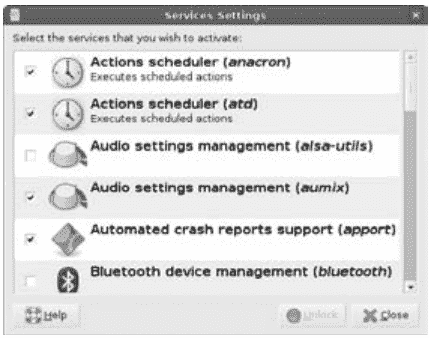

图 3-1：Hardy Heron 的服务设置工具

选中或取消选中某个服务会立即更改该服务的当前运行状态。它还会更改服务的启动状态。这样，如果你取消选中某个服务，你不需要手动停止任何正在运行的进程，而且它也不会在下次启动时启动。选中某个服务会立即启动它，并安排它在每次重新启动时启动。

虽然此工具确实识别一些较为知名的服务，但它不会列出自定义服务，也不会识别不同的运行级别。由于 Ubuntu 通常在运行级别 2 下运行，你只会修改在运行级别 2 期间启动的服务。为了控制更多的启动选项，你需要么

修改 `/etc/init.d` 和 `/etc/rc*.d` 目录中的文件，或者你需要一个更好的工具，比如 `bum` 或 `sysv-rc-conf`。

### 使用 bum 配置开机启动服务

启动管理器（`bum`）是一个功能强大的 GUI 工具，用于管理启动服务。与默认的服务小程序不同，`bum` 列出了所有启动服务，包括你自己创建的服务。`bum` 还包含一个高级菜单，用于更改启动优先级和按运行级别查看启动顺序。最棒的是：`bum` 适用于所有 Ubuntu 平台，并且甚至支持 Upstart。

要使用 `bum`，你首先需要安装它：`sudo apt-get install bum`。要运行它，使用 `sudo bum`。`bum` 可能需要一分钟才能启动；它会查找与每个启动服务相关的软件包描述。基本窗口显示服务名称和一行描述。一个图标指示服务当前是否正在运行，复选框允许你启用或禁用该服务（见图 3-2）。

> **提示** 使用默认的服务小程序时，更改在你点击复选框后立即生效。使用 `bum` 时，更改在你按下 **Apply** 按钮之前不会执行。

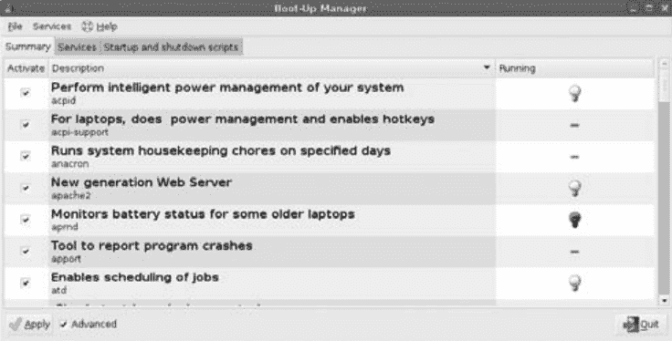

**图 3-2：** 启动管理器基本窗口

`bum` 最强大的部分来自屏幕底部标有 Advanced 的小复选框。这个复选框创建了三个标签页：Summary、Services 以及 Startup and shutdown scripts。Summary 标签页包含基本窗口。然而，Services 标签页简直令人惊叹（见图 3-3）。它列出了每个服务以及每个运行级别的启动顺序。该表格允许按服务名称、运行级别启动顺序甚至当前状态进行排序。但最精彩的部分发生在你高亮显示任何服务时：文本框会提供该服务的描述，这样你就能准确知道它的作用。

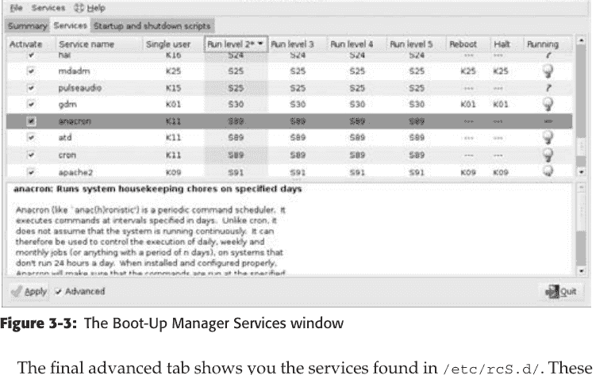

最后一个高级标签页显示 `/etc/rcS.d/` 中找到的服务。这些通常是系统关键的开机和关机脚本，无论运行级别如何都需要。由于这些脚本至关重要（如键盘设置和控制台驱动程序），`bum` 不允许你修改其设置。（你可以查看，但不要触碰。）要修改这些设置，你需要使用命令行。

### 从命令行配置服务

当你有 GUI 时，GUI 应用程序工作良好，但对于远程系统管理或管理 Ubuntu 服务器安装（缺少 GUI）来说并不理想。通常管理员需要使用命令行来创建、删除或重命名 `/etc/rc*.d/` 目录中的链接，以便修改系统服务。然而，有另一种选择。`sysv-rc-conf` 工具提供了一个中间方案，允许轻松访问启动服务，而无需手动修改 `/etc/init.d/` 和 `/etc/rc*.d/` 中找到的不同启动文件。

```
sudo apt-get install sysv-rc-conf
```

运行此工具（`sudo sysv-rc-conf`）会显示所有服务和运行级别的文本列表（见图 3-4）。使用此工具，你可以通过按 + 或 - 立即启动或停止服务，空格键可启用或禁用特定运行级别中的服务。该工具还支持鼠标；点击复选框可启用或禁用服务。

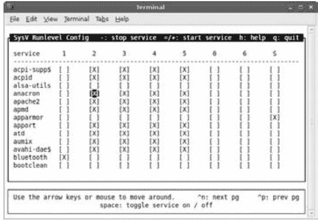

**图 3-4：** sysv-rc-conf 工具

**警告** `sysv-rc-conf` 工具仅识别 `/etc/rc*.d/` 和 `/etc/init.d/` 目录中的服务。它不支持 Upstart。`cron`、`hal`、`bootclean` 等服务的 Upstart 脚本确实在 `/etc/init.d/` 中包含脚本，但 `sysv-rc-conf` 将它们列为未在任何运行级别中使用。

与默认的服务小程序一样，选择或清除服务将立即更改服务的 Run 状态并修改服务的启动配置。

### 启用多 CPU（SMP）

如今许多计算机都有多个 CPU。有些是纯物理独立的，另一些是虚拟的，比如超线程和双核 CPU。无论如何，这些处理器都支持对称多处理（SMP），可以显著加速 Linux。

**注意** 内核支持多 CPU 和超线程。如果你的计算机有两个都支持超线程的 CPU，系统将显示共有四个 CPU。

较早版本的 Ubuntu，比如 Hoary 和 Breezy，有不同的内核可供 SMP 使用。要利用多处理器，你需要安装适当的内核。

```
sudo apt-get install kernel-image-2.4.27-2-686-smp
```

如果不安装 SMP 内核，你在 SMP 系统上只能使用一个 CPU。

Dapper Drake（6.06 LTS）改变了这一要求。在 Dapper 下，所有默认内核都启用了 SMP 支持。开发人员发现在非 SMP 系统上使用 SMP 内核没有明显的速度影响，这简化了他们需要维护的内核数量。

有几种方法可以判断你的 SMP 处理器在系统硬件和内核中是否都已启用：

- `/proc/cpuinfo` — 此文件包含系统上所有 CPU 的列表。或者，你可以使用 `sudo lshw -class cpu`。
- `top` — top 命令显示正在运行的进程。如果你运行 `top` 并按 1，标题会分别列出所有 CPU 及其各自的 CPU 负载。（在具有 32 个 CPU 的系统上运行它真的很有趣。确保终端窗口足够高以防止滚动！）
- **系统监视器** — 系统监视器小程序可以添加到 Gnome 面板中。点击它时，它会显示不同的 CPU 负载（见图 3-5）。

在上述每种情况下，如果只列出一个 CPU，则你没有运行 SMP。列表中的多个 CPU 表示 SMP 模式。

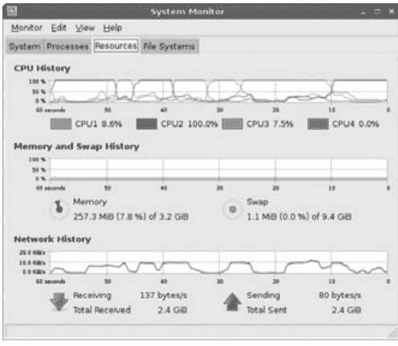

**图 3-5：** Hardy Heron 的系统监视器小程序显示多个 CPU

### 禁用 SMP

在某些情况下，比如应用程序基准测试或硬件调试，你可能希望禁用 SMP 支持。这可以通过内核参数 `nosmp` 或 `maxcpus=1` 来实现。如果这是临时需求，你可以启动系统，在 GRUB 菜单处按 Esc 捕捉，并在提示符处输入 `boot nosmp maxcpus=1`。如果你有多个启动选项，则可能需要编辑内核行并将 `nosmp maxcpus=1` 添加到内核启动行。

> **警告** 某些内核可能无法与 `nosmp` 一起工作，但根据我的经验，`maxcpus=1` 总是有效的。

> **注意** 默认的启动加载程序在启动操作系统之前给你三秒钟的时间按 Esc 键。

对于长期解决方案，请考虑将这些参数添加到启动配置中。有关配置 GRUB 的内容，请参阅第 1 章。

### 缺少 SMP？

如果你发现多 CPU 系统上只有一个活动的 CPU，那么有一些通用的调试选项。这个问题不太可能与 Ubuntu 相关——它可能是一个通用的 Linux 内核问题。

- 咨询主板制造商，看看 Linux 是否支持该芯片组。例如，我有一个旧的双 CPU 主板，Linux 不支持。
- 查看主板或芯片组的 Linux 硬件 FAQ。这会告诉你其他人是否设法让它工作。https://wiki.ubuntu.com/HardwareSupport 和 www.faqs.org/docs/Linux-HOWTO/SMP-HOWTO.html 等网站是很好的起点。
- 如果所有方法都失败了，向任何 Linux 或 Ubuntu 硬件论坛发布查询。也许其他人知道解决方法。一些好的论坛包括 ubuntuforums.org、www.linuxhardware.org 和 www.linuxforums.org。请务必提供详细信息，例如主板的制造商和型号、Ubuntu 版本和其他外设。在寻求帮助时，提供过多的信息通常比提供过少的信息要好。

不幸的是，如果基本安装后未启用 SMP，那么它可能根本无法工作。但你可能会走运——如果有人有补丁，那么你可能需要重新编译内核。


> **警告** 编译内核并非胆小者之事。如今 Linux 的许多方面已经实现自动化或拥有易用的图形界面，但编译内核不在此列。对于敢于自行编译内核的人，网上有大量的帮助页面和常见问题解答可供参考。

#### 添加打印机

打印机是最常见的外部设备之一。如今，许多电脑制造商随新电脑捆绑打印机——想要*不*拥有打印机反而很难。过去打印机配有两种接口之一：串口或并口。如今，USB 打印机非常普遍。在企业以及小型办公室/家庭办公室（SOHO）环境中，网络打印机已是常态。Ubuntu 支持数量惊人的打印机；让 Ubuntu 与大多数打印机协同工作相对容易。

#### 更改纸张大小

在安装第一台打印机之前，务必设置系统的默认纸张大小。该设置位于文件 `/etc/papersize` 中。默认纸张大小可能是 `A4` 或 `letter`——这取决于您在安装过程中选择的地理位置。如果默认纸张大小设置不正确，那么您添加到系统的每台打印机都会配置错误的默认纸张大小。在创建打印机*之后*更改 `/etc/papersize` 不会改变任何已存在的打印机。

要更改默认纸张大小，请编辑 `/etc/papersize` 并修改其值。常见值有 `A4`、`letter` 和 `legal`。A4 是欧洲的标准纸张。Letter 和 legal 分别指美国常见的 8.5 英寸 × 11 英寸和 8.5 英寸 × 14 英寸纸张规格。我遇到过的较少见的纸张大小包括 `A5`、`B2`、`C2`、`ledger` 和 `10x14`。

> **提示** 如果您有多台使用不同纸张大小的打印机，请在添加每台打印机之前更改 `/etc/papersize` 中的值。

> **纸张请出示**

纸张大小（如 A0、A1、A2、B3、C4 和 D4）指的是相对于更大纸张的比例。例如，A0 的总面积为一平方米。A0 的尺寸为 841 × 1189 毫米。A1 是 A0 最长方向的一半：594 × 841 毫米。A2 是 A1 的一半（420 × 594），依此类推。因此，16 张 A4 的表面积覆盖 1 平方米。其他纸张类型遵循相同的比例——四张 B2 可以放入一张 B0 中。B0 为 1000 × 1414 毫米，C0 为 917 × 1297 毫米。

不同领域使用不同的纸张大小。例如，A 在出版业中很常见，而 C 用于建筑施工图纸。如果您有大型打印机或绘图仪，请务必在添加打印机之前用正确的默认值设置 `/etc/papersize`。

#### 添加打印机

在 Ubuntu 下添加打印机非常简单。转到 系统 ⇄ 管理 ⇄ 打印 以打开打印机小程序。从那里，您可以双击"新打印机"来配置设备。

添加打印机的第一步需要指定哪个内核设备与打印机通信（见图 3-6）。系统将搜索本地和网络打印机。您还可以选择配置使用 USB 或并口的本地打印机，或网络打印机。尽管本地打印机配置很简单（选择检测到的 USB 打印机或并口），网络打印机需要额外的信息。

- **CUPS 打印机（IPP）**——通用 Unix 打印系统允许在不同的 Unix 计算机之间共享打印机。您需要提供打印机的 URL，例如 `ipp://server/printer_name`。

- **Windows 打印机（SMB）**——Windows 打印机非常常见。在小型办公室中，将打印机直接连接到 Windows 主机的用户可以与网络共享该打印机。您需要提供 Windows 主机名、打印机名以及访问该设备所需的任何用户名和密码。

- **Unix 打印机（LPD）**——行式打印机守护进程协议是最古老、最可靠的网络打印选项之一。大多数独立式网络打印机都支持 LPD。对于此选项，您需要提供主机名和 LPD 打印队列的名称。

- **HP JetDirect**——这是独立式打印机的另一种常见协议。您只需提供主机名（以及端口号，如果不是默认的 9100 的话）。

> **注意** 打印机配置小程序的布局随每个 Ubuntu 版本而变化。但是，核心功能保持不变。

> **提示** 使用 `sudo apt-get install cups-pdf` 添加用于生成 PDF 文件的打印机。

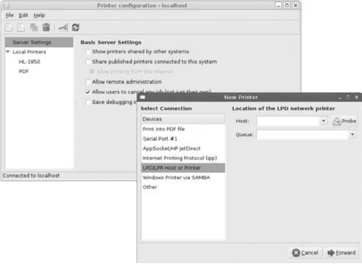

**图 3-6：** Hardy Heron 下添加新打印机的小程序

添加打印机的第二步需要您指定打印机类型。如果您的确切打印机型号未列出，很可能有一个足够接近的型号。在最坏的情况下，您总是可以选择其中一个通用打印机选项。

最后，您应该为打印机命名。给它一个描述性的名称，以便日后识别。

### 共享您的打印机

添加打印机后，您可以与网络上的其他人共享它。共享打印机需要知道谁将使用它：使用 CUPS 的其他系统、使用 LPD 的其他设备，或运行 Windows 的其他计算机。

#### 使用 CUPS 共享打印机

要通过 CUPS 共享打印机，您需要配置打印服务器和客户端。

在打印服务器上：

1. 编辑 `/etc/cups/cupsd.conf`，将 `Listen localhost:631` 这一行改为 `Port 631`。这告诉 CUPS 允许从任何远程系统进行打印，而不仅仅是 `localhost`。

2. （可选）编辑 `/etc/cups/cupsd.conf`，将 `Browsing off` 改为 `Browsing on`。这允许服务器向网络上的其他主机公告打印机的可用性。

> **提示** 默认情况下每 30 秒公告一次。您可以通过指定 `BrowseInterval` 来更改此设置。例如，`BrowseInterval 15` 将每 15 秒公告一次，而值 `300` 将每五分钟公告一次。

3. 在打印服务器上重启 CUPS 子系统：

```
sudo /etc/init.d/cupsys restart # Hardy Heron（8.04 LTS）及更早版本
sudo /etc/init.d/cups restart   # Jaunty Jackalope 及更新版本
```

在打印客户端上：

1. 转到 系统 ➢ 管理 ➢ 打印 以打开打印机小程序。

2. 添加新打印机。

3. 选择网络打印机和 CUPS 打印机（IPP）协议。

4. 以 URL 形式输入打印机主机名和打印机名称。例如，如果服务器名为 *printer.home.com* 且打印机名为 *Okidata*，则您将使用 `ipp://printer.home.com/printers/Okidata`。

5. 点击を继续按钮并选择打印机型号。

6. 为打印机创建描述

7. 点击应用按钮以创建打印机。

> **提示** 如果您在服务器配置的第二步中启用了浏览，那么 Ubuntu 客户端将尝试自动发现和配置远程打印机。

> **CUPS 满溢**

CUPS 提供了许多配置选项，但它长期以来一直存在安全风险。CUPS 安装包含一个基于 Web 的管理界面。默认情况下，它无法远程访问。（但如果您按照"使用 CUPS 共享"下的步骤操作，那么它*可以*远程访问。）此界面的 URL 为 `http://localhost:631/`。

虽然您可以使用 CUPS Web 界面查看和管理打印队列，但默认管理界面不允许添加新打印机或更改配置。此功能在 Ubuntu 中被禁用，主要是由于安全风险。不建议启用此界面。相反，如果您需要修改打印机配置，请使用 系统 ➢ 首选项 ➢ 打印 应用程序。

#### 使用 LPD 共享打印机

启用 LPD 支持稍微复杂一些，因为 Ubuntu 通常不包含服务器。

在打印服务器上：

1. 在打印服务器上安装 `xinetd`。这是用于运行进程的扩展 Internet 守护进程。

```
sudo apt-get install xinetd
```

2. 创建打印机服务的配置文件。这需要创建一个名为 `/etc/xinetd.d/printer` 的文件。内容应如下所示：

```
service printer
{
  socket_type = stream
  protocol = tcp
  wait = no
  user = lp
  group = sys
  server = /usr/lib/cups/daemon/cups-lpd
  server_args = -o document-format=application/octet/stream
}
```

3. 重启 `xinetd` 服务器：

```
sudo /etc/init.d/xinetd restart
```

在打印机客户端上：

1. 转到 系统 ➪ 管理 ➪ 打印，以打开打印机小程序。

2. 双击新打印机以配置设备。

3. 选择网络打印机和 Unix 打印机（lpd）协议。

4. 在主机字段中输入打印服务器主机名（或 IP 地址），在队列字段下输入 CUPS 打印机名称。

5. 继续浏览剩余屏幕以选择打印机类型并进行配置。

#### 与 Windows 共享打印机

通常最好使用原生打印协议。对于 Ubuntu，LPD 和 CUPS 是原生的。大多数版本的 Windows 支持连接到 LPD 服务器的网络打印，因此使用 LPD 共享应该足够了，但这需要用户配置他们的打印机。

原生 Windows 环境可以使用服务器消息块（SMB）协议共享打印机。这允许 Windows 用户浏览网络邻居并添加任何共享打印机——非常少的


需要安装SAMBA才能让Ubuntu与Windows用户共享打印机，SAMBA是一个开源的SMB服务器。

在打印服务器上：

- 1. 在打印服务器上安装SAMBA，这将提供Windows SMB支持：

```
sudo apt-get install samba
```

- 2. 创建打印队列目录：

```
sudo mkdir /var/spool/samba/
```

- 3. 编辑SAMBA配置文件：`/etc/samba/smb.conf`。

- 4. 在`[global]`部分下，将`workgroup =`改为与您的Windows工作组匹配。例如，我的办公室工作组是`SLUGGO`：

```
[global]
  workgroup = SLUGGO
```

- 5. 在`[global]`部分下方有一个打印机配置区域。取消注释（去掉开头的`;`）`load printers = yes`和CUPS打印相关行。

```
########## Printing ##########

## If you want to automatically load your printer list rather
## than setting them up individually then you'll need this
load printers = yes

## lpr(ng) printing. You may wish to override the location of the
## printcap file
;   printing = bsd
;   printcap name = /etc/printcap

## CUPS printing.  See also the cupsaddsmb(8) manpage in the
## cupsys-client package.
printing = cups
printcap name = cups
```

- 6. 将`[printers]`部分设置如下：

```
[printers]
  comment = All Printers
  browseable = no
  security = share
  use client driver = yes
  guest ok = yes
  path = /var/spool/samba/
  printable = yes
  public = yes
  writable = yes
  create mode = 0700
```

此设置允许任何Windows客户端无需密码即可访问打印机。

- 7. （可选）在`[printers]`部分下，设置`browseable = yes`。这将允许Windows系统通过网络邻居看到打印机。

- 8. 重启SAMBA服务器：

```
sudo /etc/init.d/samba restart
```

在Windows客户端上，您可以像添加Windows打印机一样添加打印机。例如，如果服务器名称是*printer.home.com*，打印机是*Okidata*，则共享打印机资源将是`\\printer.home.com\Okidata`。Windows客户端需要安装自己的打印机驱动程序。

### 添加驱动器

在过去的好日子里，人们会单独购买计算机组件。在收集了必要的组件，如主板、机箱、内存、显卡和显示器后，他们会组装成一台可用的计算机。如今，购买预装系统通常更便宜。很少有人（除了像您这样的高级用户）会在购买计算机后升级显卡或内存；大多数人会直接更换整个系统。尽管大多数硬件保持不变，但有一样东西通常会被升级：硬盘驱动器。这可能是因为您需要更多的磁盘空间，或者您想要第二个驱动器用于备份或额外存储。

### 升级驱动器

当您升级硬盘驱动器时，您需要确保转移所有个人文件。这可能就像将`/home`的内容从一个系统转移到另一个系统一样简单。但如果您安装了任何自定义应用程序（很可能）或调整了任何配置，那么您可能还需要转移系统文件。这里有一个简单的方法：

- 1. 关闭系统，取出旧驱动器，安装新驱动器。不要将旧驱动器留在系统中，因为您不想意外地重新格式化错误的驱动器。

- 2. 在系统上安装Ubuntu（参见第1章）。请务必使用相同的基础安装。不要费心自定义这个新安装——它只需要使驱动器可启动。

- 3. 关闭系统，将旧硬盘驱动器安装为第二个驱动器。不要从旧硬盘驱动器启动。

- 4. 启动计算机并从新驱动器启动。

- 5. 计算机重新启动后登录并打开终端。

- 6. 现在是困难的部分——找到旧驱动器的设备句柄。这是一个两步过程。首先，使用`mount`识别当前驱动器。它将是已挂载的那个。其次，使用`sudo lshw -class disk`找到需要挂载的未使用驱动器。在此示例中，当前驱动器是`/dev/sdb`，新驱动器是`/dev/sdc`。

```
$ **mount | grep -e /dev/sd -e /dev/hd**
/dev/sdb1 on / type ext3 (rw,relatime,errors=remount-ro)
$ **sudo lshw -class disk**
```

```
*-disk:0
       description: ATA Disk
       product: ST3500320AS
       vendor: Seagate
       physical id: 0
       bus info: scsi@4:0.0.0
       **logical name: /dev/sdb**
       version: SD15
       serial: 9QM52R9R
       size: 465GiB (500GB)
       capabilities: partitioned partitioned:dos
       configuration: ansiversions5 signature=00070904
```

```
*-disk:1
       description: ATA Disk
       product: ST31500341AS
       vendor: Seagate
       physical id: 1
       bus info: scsi@5:0.0.0
       **logical name: /dev/sdc**
       version: CC1H
       serial: 9VS2N2QN
       size: 1397GiB (1500GB)
       capabilities: partitioned partitioned:dos
       configuration: ansiversions5 signature=00052eee
```

- 7. 挂载旧驱动器分区。分区将被枚举。由于驱动器`/dev/sdc`是一个工作驱动器，应该有`/dev/sdc1`、`/dev/sdc2`等。如果您知道数据分区，则可以挂载它。否则，您可以盲目挂载每个分区。

```
cd /dev
for i in sdc[0-9]* ; do
  sudo mkdir /media/$i
  sudo mount /dev/$i /media/$i
done
```

> **注意** 如果某些分区挂载失败，请不要担心。交换分区和其他特殊分区不是数据分区。我们只关心数据分区，因为我们只想复制数据。

- 8. 以root身份，将所有旧文件复制到新系统。例如，如果`/dev/sdc1`是旧的`/`分区，则将数据从`/media/sdc1/`复制到新的`/`。

```
$ cd /media/sdc1
$ ls
bin   dev  initrd       lib       mnt  root sys var
boot  etc  initrd.img   lost+found opt sbin tmp vmlinuz
cdrom home initrd.img.old media  proc srv  user vmlinuz.old
$ sudo tar -cf - * | ( cd / ; tar -xvf - )
```

> **注意** 您可能想先删除临时目录和设备目录，例如`/mnt/disk/mnt`、`cdrom`、`tmp`、`dev`和`proc`。或者，您可以在`tar -cf`命令中只列出要保留的目录。

- 9. 对每个数据分区重复步骤8。务必将数据复制到正确的目录。例如，如果`/dev/sdc2`是`/home`，则将内容复制到`/home`，而不是`/`。

- 10. 由于复制可能带来了更新的内核，您将需要重置引导加载程序：

```
sudo update-grub
```

- 11. 现在一切都已复制，您可以立即重新启动系统。您不想使用`shutdown`，因为它可以将桌面设置保存在新设置之上。要强制立即重新启动，请使用`-f`参数：

```
sudo reboot -f
```

当系统重新启动时，您应该可以像原来一样找到所有旧文件，并且只有少量您原本不想要的残留文件。此方法非常适合切换分区布局，因为它只复制文件，但不应用于升级操作系统。

### 挂载系统

在第1章中，我们介绍了如何分区和格式化驱动器。现在，由于您在系统中安装了第二个驱动器，您可以使其在每次启动系统时挂载。

- 1. 卸载驱动器，对其进行分区和格式化。在此示例中，我们假设您已将其配置为一个分区`/dev/sdb1`。

- 2. 识别驱动器的通用唯一标识符（UUID）和可选标签：

```
$ sudo blkid | sort
/dev/sda1: UUID="357948d2-281e-444e-bcec-2fa67b498330" TYPE="ext3"
/dev/sda3: UUID="b14b1292-0165-4e61-8f70-f23b319d62ad" TYPE="ext4"
/dev/sda5: UUID="99ab3ba2-63bb-4c90-82fa-c1f7391fd732" TYPE="swap"
/dev/sda6: UUID="d24160cb-d2bc-44dd-aa0电视上


5. 使用 `sudo mount -a` 或 `sudo mount /mnt/backup` 挂载新文件系统。

完成这些更改后，新驱动器将在每次启动时自动挂载。

### 并非绝对唯一

**UUID 并非总是唯一的。** 例如，如果你对某个驱动器做镜像，那么镜像会具有相同的 UUID。使用 `uuidgen` 生成一个全新的 UUID，并使用 `tune2fs` 设置该 UUID。

```
sudo tune2fs -U $(uuidgen) /dev/sdb1
```

**这种方法也可用于强制将特定 UUID 分配给驱动器，从而简化硬盘故障后的恢复。** 你只需将系统备份恢复到新驱动器上，然后使用 `tune2fs -U` 将 UUID 分配给分区即可。这样，你就不需要编辑 `/etc/fstab`、GRUB 或其他系统文件来使驱动器可启动。

**标签和 UUID 只是可配置选项的起点。** 例如，你可以使用 `sudo tune2fs -c 20 /dev/sda1` 在每挂载 20 次后执行文件系统检查（`e2fsck`）。使用 `sudo tune2fs -l /dev/partition` 列出所有可配置参数。

### 使用简单备份

在很久以前，我会使用软盘进行备份。随着驱动器容量不断增加，我转而使用磁带。如今，家用系统可以使用第二个硬盘进行低成本的备份。清单 3-3 是一个我用来将 Ubuntu 系统备份到第二个硬盘的简单脚本。

### 清单 3-4：非常简单的备份脚本：/usr/local/bin/backup2disk-full

```
#!/bin/sh
## 将文件备份到磁盘
for i in bin boot etc home lib opt root sbin sys usr var ; do
  tar -clzf /mnt/backup/backup-$i-full.tgz "/$i" 2>/dev/null
done
```

这个简单的脚本会创建一组包含我所有数据的压缩 TAR 文件。例如，`/mnt/backup/backup-home-full.tgz` 包含我的 `/home` 分区内容。你也可以创建一个执行增量备份的版本，只需将清单 3-3 中的 tar 命令替换为：

```
tar --newer "$(date -r /mnt/backup/backup-$i-full.tgz)" \
  -clzf /mnt/backup/backup-$i-inc.tgz "$i" 2>/dev/null
```

对于我的系统，我将完整备份脚本添加到 root 的 `crontab` 中，并配置为每周运行一次。增量备份则每晚运行。

1. 编辑 root 的 `crontab`。这允许文件在特定时间运行。

   `sudo crontab -e`

2. 添加一行，使完整备份每周运行，增量备份每天运行。（有关 `cron` 的详细细节，请参阅第 8 章。）

```
## 分钟 小时 日期 月份 星期 命令
5 0 * * 0 /usr/local/bin/backup2disk-full
5 0 * * 1-6 /usr/local/bin/backup2disk-inc
```

使用这个脚本，我可以使用 `tar` 恢复任何文件或目录。例如，要恢复 `/home/nealk/book3` 目录，我会使用：

```
cd /
sudo tar -xzvf /mnt/backup/backup-home-full.tgz home/nealk/book3
sudo tar -xzvf /mnt/backup/backup-home-inc.tgz home/nealk/book3
```

> **警告** 这个备份脚本非常简单，仍然可能导致数据丢失。它不会保留历史备份，如果在备份过程中发生崩溃，你可能会丢失所有数据。虽然这个脚本是一个权宜之计，但总比没有备份要好。然而，它不应被用于关键的备份需求。对于长期或关键的数据恢复，请考虑使用专业的备份系统。

### 替代备份方法

并非所有人都喜欢压缩的 `.tar` 文件。虽然这些归档通常可以减少长期存储的磁盘空间需求，但在搜索要恢复的特定文件时并不总是方便。

对于简单的目录镜像，可以考虑使用 `sudo cp -axruf /home /mnt/backup/home`。`cp` 参数将归档（`-a`）一个文件系统（`-x`）上的所有文件，并递归处理目录（`-r`）。所有较新或缺失的文件都将被更新（`-uf`）。此命令保留所有者、权限、时间戳和链接。

另一个替代方案是使用 `rsync`。它的作用与 `cp` 命令类似（`rsync -av /home /mnt/backup/home`）**，但也可以通过网络存储文件**。例如，`rsync -av /home rsync://user@host/backup` 会将本地 `/home` 目录复制到 `host` 上的 `/backup` 目录。它将使用 SSH 以指定用户连接。要恢复，请交换源和目标参数：`rsync -av rsync://user@host/backup /home`。

### 配置 RAID

廉价磁盘冗余阵列（RAID）是应对磁盘崩溃的简单解决方案。Ubuntu 支持硬件 RAID 和软件 RAID。硬件 RAID 不需要额外的配置即可在 Ubuntu 上使用。整个 RAID 只显示为单个磁盘。另一方面，软件 RAID 需要一些配置。

#### RAID 级别

RAID 级别标识在数据故障前可以丢失的驱动器数量。常见的 RAID 级别包括：

- **RAID0**—将所有 RAID 驱动器串联成单个硬盘。没有数据冗余；如果丢失一个驱动器，整个分区都会损坏。但是，数据可以跨驱动器条带化，因此可以潜在地提高数据访问速率。如果你有许多小型驱动器并希望存储临时（非关键）数据，请使用此级别。
- **RAID1**—此级别对磁盘进行镜像。由于每个磁盘都包含所有数据，只要至少有一个驱动器正常，你的数据将保持完整。如果你的 RAID 只包含两个驱动器，那么这是最安全的选项。
- **RAID5**—此级别将数据拆分并镜像到多个驱动器上。如果你有三个或更多驱动器，此选项为你提供最佳的存储容量和冗余。实际冗余量取决于分区大小和驱动器数量。（分区可能大于一个驱动器。）
- **RAID10**—对于极度谨慎的人，此选项结合了镜像和数据条带化。虽然这可能是一个昂贵的选项（且扩展性不佳），但它非常快且高度容错。

其他 RAID 级别确实存在，但大多已经过时。例如，**RAID2** 包含纠错码（ECC）。然而，大多数驱动器已经包含 ECC，因此此功能是多余的。同样，**RAID3** 和 **RAID4** 使用不同的方法将数据拆分到驱动器上。RAID3 和 RAID4 都已被更高效的 **RAID5** 所取代。

软件 RAID 需要多个硬盘。最简单的选项 RAID1 使用两个相同的硬盘。我推荐同时购买相同品牌和型号的硬盘，因为它们肯定是相同的。其他人推荐购买相似但不相同的硬盘，以防驱动器存在未知的共性问题。选择真的取决于你的谨慎程度。我曾有过相同的硬盘在几个月内相继坏掉的情况，但从未同时坏掉过。

安装驱动器后（例如 `sda` 和 `sdb`），使用 `fdisk` 或 `gparted` 对它们进行分区，使用相同大小的分区（`sda1` 和 `sdb1`）。现在到了有趣的部分，将它们变成 RAID。

> **注意** 此示例假设你已向系统中添加了两个额外的硬盘并且它们已经分区。软件 RAID 通过将多个真实分区组合成一个虚拟分区来工作。通常这些分区位于不同的硬盘上，因为托管在单个硬盘上的 RAID 无法防止硬件故障。

> **警告** 创建 RAID 需要修改磁盘分区和格式。如果你意外指定了错误的分区，可能会破坏部分或全部系统。

1. 使用 `mdadm` 工具创建 RAID。`mdadm` 的手册页包含许多额外的选项，用于条带化、设置 RAID 级别等。在此示例中，我们将使用两个分区创建一个简单的 RAID1，即镜像磁盘配置。结果是一个名为 `/dev/md0` 的 RAID 驱动器。

```
sudo mdadm --create /dev/md0 --level=1 \
            --raid-devices=2 /dev/sda1 /dev/sdb1
```

2. RAID 创建在后台进行，可能需要数小时才能完成。在完成之前不要继续。要查看进度，请使用：

```
nice watch cat /proc/mdstat
```

3. 现在你可以为 RAID 创建文件系统。你可以在 RAID 上使用任何文件系统。例如，要创建 ext2 文件系统，可以使用：

```
sudo mkfs.ext2 /dev/md0
```

过程完成后，你可以使用 `sudo mdadm -Q --detail /dev/md0` 查看 RAID 的详细信息。你也可以挂载该分区（`sudo mount /dev/md0 /mnt/disk`）并将其添加到 `/etc/fstab`。

> **进退两难**

2004 年，我经历了一次痛苦的硬盘崩溃。数年的研究成果都在那个驱动器上，而且它发生了磁头碰撞。虽然我确实有简单的备份，但这与拥有完整可用的系统不同。虽然 98% 的数据被恢复了（感谢科罗拉多州朗蒙特市的 Reynolds 数据恢复公司！），而且丢失的 2% 很容易重新创建，但我很快吸取了教训：不要将关键数据存储在一个硬盘上。

*(待续)*


 > **进退两难（续）**

如今，我的主要研究计算机有四块硬盘。一块是主操作系统，一块配置为可移动备份，另外两块是用于存储研究和关键文件的软件 RAID 中的相同硬盘。当我遭遇第二次硬盘故障时，最终没有丢失任何数据。

我还使用每日备份以及异地、跨州的存储。严重的文件系统损坏可能需要一两天才能恢复，并导致数小时的工作丢失，但我的大部分数据是安全的。

尽管这种配置对大多数家庭和小型办公环境来说可能听起来过于夸张，但你需要问自己：配置一个软件 RAID 和简单的备份脚本，与在完全丢失后重建一切相比，哪个成本更低？即使从恢复时间的每小时成本来看，维护一个最小备份系统的花费也更少。

对于家庭用户，考虑使用简单的 RAID 和备份系统来存储不可替代的文件。这包括税务文件、个人电子邮件，以及小比利一岁生日的数码照片。如果你无法承受丢失数据的后果，那么就用数据冗余来降低潜在损失。

### 检测 RAID 故障

配置 RAID 是一回事，但真正看到 RAID 故障并从中恢复则是另一回事。幸运的是，我的一块 RAID 硬盘在撰写本章时正好坏了！所以我对所看到的情况以及恢复过程的描述并非理论——这对我很有效。

在解决 RAID 问题之前，你必须先知道你的 RAID 正在出现故障。就我而言，发生了两件事。首先，我注意到写入操作会暂时挂起。这是因为一块 RAID 硬盘在工作，而另一块在超时。其次，我的管理员账户收到了一封来自 RAID 子系统的电子邮件，告知有一块硬盘已死。邮件内容如下：

```
To: root
Subject: DegradedArray event on /dev/md0:slushy
Date: Sun,  6 Dec 2009 10:57:59 -0700 (MST)

This is an automatically generated mail message from mdadm
running on slushy

A DegradedArray event had been detected on md device /dev/md0.

Faithfully yours, etc.

P.S. The /proc/mdstat file currently contains the following:
```

```
Personalities : [linear] [multipath] [raid0] [raid1] [raid6] [raid5] [raid4] [raid10]
md0 : active raid1 sdb1[1]
      976759936 blocks [2/1] [_U]

unused devices: <none>
```

我的 RAID 通常由两块硬盘组成：`sda1` 和 `sdb1`。在这种情况下，`sda` 坏了，因为只列出了 `sdb1`。`[_U]` 的标记表示第一块硬盘已死，第二块正常（`U`）。正常工作的 RAID 看起来会是 `[UU]`（每块硬盘对应一个 `U`）。

由于不懂更好的方法，我快速做了备份（好主意）然后重启了系统（坏主意）。事实证明，如果有硬盘故障，`mdadm` 不会重建 RAID（挂载所需的操作）。我在重启前应该做的是：`sudo mdadm /dev/md0 -f /dev/sda1`。这会将该硬盘标记为故障，并允许 RAID 在重启后正常启动。

然而，如果你像我一样没有将硬盘标记为故障，那也不是毫无希望。你总是可以强制 RAID 用更少的硬盘重新组装。

```
## trying to assemble will fail
$ sudo mdadm --assemble /dev/md0 /dev/sdb1
mdadm: /dev/md0 assembled from 1 drive - need all 2 to start it (use --run to insist).
## force it to assemble
$ sudo mdadm --assemble --force /dev/md0 /dev/sdb1
mdadm: /dev/md0 has been started with 1 drive (out of 2).
$ mdadm -Q --detail /dev/md0  # check the RAID
/dev/md0:
       Version : 00.90.03
 Creation Time : Sat Sep 20 14:27:40 2008
     Raid Level : raid1
     Array Size : 976759936 (931.51 GiB 1000.20 GB)
  Used Dev Size : 976759936 (931.51 GiB 1000.20 GB)
   Raid Devices : 2
  Total Devices : 1
Preferred Minor : 0
    Persistence : Superblock is persistent
    Update Time : Sun Dec  6 10:58:37 2009
          State : clean, degraded
  Active Devices : 1
 Working Devices : 1
  Failed Devices : 0
  Spare Devices : 0
         UUID : 4f11630b:69c64ebc:b066c2d5:6a53b630 (local to host
         slushy)
       Events : 0.101020
```

```
Number  Major  Minor  RaidDevice State
      0      0       0        0  removed
      1      8      17        1  active sync   /dev/sdb1
$ sudo mount -a  # It works!
```

诚然，只用一块硬盘运行两块硬盘的 RAID 并不可靠。但这确实让我能够继续工作，同时等待订购的新硬盘到货。

### 向 RAID 中添加硬盘

更换坏掉的硬盘并向 RAID 中添加新硬盘是一个非常简单的过程：

- 1. 安装新硬盘。假设你的系统不支持热插拔，你需要先关闭计算机电源。

2. 如果你使用的是 SATA 或其他内部硬盘，请确保计算机的 BIOS 能识别到新硬盘。这能确保硬件安装正确。对于 USB 硬盘，你只需要将它们连接到计算机即可。

3. 启动计算机。系统应该能正常启动，并且硬盘会被分配设备句柄。就我而言，新硬盘是 /dev/sda 和 /dev/sdc；/dev/sdb 是我原来的 RAID 硬盘。（已经有一块硬盘故障后，我决定用另外两块硬盘替换它。）

4. 以 root 身份使用 fdisk 对新硬盘进行分区。使用 RAID 1 级别（镜像）时，分区需要等于或大于现有 RAID。对于 RAID 5 或 6 级别这不是必需的，因为数据是跨分区条带化的。

> **警告** 还有其他分区方法。例如，Karmic Koala (9.10) 包含 Palimpsest (sudo palimpsest)。较早的 Ubuntu 版本使用图形化的 gparted。然而，gparted 无法对我的 1.5 TB 硬盘进行分区。它对 1 TB 及更小的硬盘工作正常。尽管 fdisk 是基于文本的且晦涩难懂，但它对大型硬盘工作良好。

- 5. 将新分区添加到 RAID。要添加 sda1 和 sdc1，使用：
   `sudo mdadm --manage /dev/md0 --add /dev/sda1 /dev/sdc1`

6. 观察 /proc/mdstat 中的数据复制过程：nice watch cat /proc/mdstat。根据 RAID 的大小，这个过程可能需要数小时。

就我而言，我在一个双硬盘 RAID 中有三块硬盘。额外的分区在 `/proc/mdstat` 中被标记为备用硬盘（由分区名后的 `S` 表示）。

```
md0 : active raid1 sda1[2](S) sdb1[3] sdc1[1]
      976759936 blocks [2/1] [_U]
      [>....................]  recovery =  2.6%
      	  (25578432/976759936) finish=185.
```

要将 RAID 修改为使用全部三块硬盘，等待恢复完成，然后使用：

```
sudo mdadm --grow /dev/md0 --raid-devices=3
```

与其他命令一样，这个命令也需要数小时才能完成。完成后，`/proc/mdstat` 会显示三块活动硬盘。

```
md0 : active raid1 sda1[2] sdb1[3] sdc1[1]
      976759936 blocks [3/3] [UUU]
```

**提示** 你可以在 RAID 已挂载并正在使用时添加硬盘、移除硬盘和修改 RAID 配置。

**注意** `mdadm` 命令允许你修改大多数 RAID 属性，但并非全部。例如，你无法更改 RAID 级别。如果 `mdadm --version` 报告 3.1 或更高版本（尚未包含在任何 Ubuntu 版本中），则可以更改 RAID 级别。例如，`mdadm --grow /dev/md0 --level 5` 将其更改为 RAID 5 级别。

### 加速 RAID 重建

重建 RAID 可能需要数小时。你可以尝试使用以下方法加快速度：

```
echo 50000 | sudo tee /proc/sys/dev/raid/speed_limit_min
echo 200000 | sudo tee /proc/sys/dev/raid/speed_limit_max
```

这表示将最低重建速度提高到 50 Kps，最高到 200,000 Kps。默认值分别为 1,000 和 100,000。

更改速度限制可能会缩短恢复时间，但也会使系统变得迟缓，因为更多带宽被用于 RAID。对于某些系统，硬件总线已经是瓶颈，因此提高限制不会有任何影响。

### 调整默认设备

在 Ubuntu 中，不同的外设会引发不同的事件。例如，USB 存储设备会生成盘符并被挂载。新的 DVD 驱动器会成为另一个 `/dev/dvd` 设备（`dvd1`、`dvd2` 等），新的网卡会创建新的网络接口（`eth1`、`eth2`、`wlan1` 等）。虽然默认行为通常是可取的，但你可能希望修改它。

#### 禁用 USB 驱动器自动挂载

对于 USB 存储设备，如 U 盘和移动硬盘，默认行为是分配盘符并立即挂载驱动器。有两种方式会导致自动挂载。首先，你可以在 `/etc/fstab` 中列出磁盘并带有自动挂载参数。例如：

```
/dev/sdb1 /mnt/backup ext3 defaults,auto 0 0
```

要禁用自动挂载，你可以删除有问题的 `/etc/fstab` 行，或者修改条目使其包含 `noauto` 选项。`noauto` 选项允许你使用 `sudo mount /dev/sdb1` 或 `sudo mount /mnt/backup`，系统会根据现有的 `/etc/fstab` 条目执行正确的操作。

第二种自动驱动器挂载的情况发生在你登录图形桌面并连接新的存储设备（如 USB 硬盘）时。在登录前插入 USB 硬盘不会挂载该驱动器。

禁用桌面的自动挂载意味着更改 Gnome 配置。使用 `gconf-editor` 将 `/apps/nautilus/preferences/media_automount` 的值改为 `false`，或者你也可以使用 `gconftool-2` 从命令行修改。

```
gconftool-2 -t bool -s /apps/nautilus/preferences/media_automount false
```

#### 修改网络接口优先级

添加第二块网络接口卡（NIC）可能会带来麻烦。例如，如果你正在使用内置的有线网络接口，然后打开无线网络接口，你的所有流量可能会尝试通过无线网络路由。不管有线网络可能更快或更可靠；默认设置给所有 NIC 相同的优先级，最新的那个成为默认。

问题是，最新的 NIC 在你首次启用它时可能没有正确配置。将其连接到系统可能会导致你完全失去网络连接。解决方案是更改网络接口优先级。

在连接新的网络接口之前，安装 `ifmetric`（`sudo apt-get install ifmetric`）。NIC 优先级基于存储的排名

（接口度量值）。数值越小优先级越高，越优先被访问。默认值是零。要改变网络优先级，请指定接口和优先级值，例如`sudo ifmetric eth1 10`。要使更改永久生效，请编辑 `/etc/network/interfaces` 并为每个网络接口设置度量值。例如：

```
auto lo
iface lo inet loopback

## My manually configured network interface
iface eth0 inet static
  address 192.168.107.6
  netmask 255.255.255.0
  gateway 192.168.107.1
  metric 0

## My second network which uses DHCP
iface eth1 inet dhcp
  metric 10

auto eth0
```

> **注意** 无线网络配置在第12章中介绍。

### 添加其他设备

打印机、网卡和硬盘只是人们用于计算机的设备列表的开始。扫描仪、调制解调器和视频采集设备也很常见。不幸的是，开源社区内的硬件支持参差不齐。有些设备有大量支持，有些设备的驱动程序勉强能用，还有一些完全没有支持。雪上加霜的是，Ubuntu 原生支持的硬件选项比 Linux 总体上要少。因此，某些驱动程序可能需要从源代码下载并编译。

寻找 Linux 和 Ubuntu 支持时有一个基本的经验法则。如果设备是标准的且已经存在一段时间，那么它很可能有支持。专有设备和封闭技术不太可能有驱动程序。大多数新的酷炫外设要么缺乏支持，要么由标准驱动程序支持。

| 勉强兼容 |
|---|
| 某些厂商仅以二进制形式提供 Linux 驱动程序。虽然这些能在特定平台上工作，但可能无法在所有平台上运行。*(续)* |

### 勉强兼容（续）

选择需要 Linux 驱动程序的新硬件时，请确保它们支持*你的* Linux 版本。适用于 RedHat Enterprise Linux 5.4 的内核驱动程序可能无法在 Ubuntu 的 Hardy Heron 上工作，适用于 Edgy Eft 的设备驱动程序可能无法在 Karmic Koala 上工作。

一般来说，最好的硬件厂商使用标准协议，不需要专门的内核驱动程序。这意味着驱动程序已经存在很长时间了。你的第二选择是提供源代码的厂商。这使你能够重新编译代码以用于其他内核和操作系统版本。在最坏的情况下，你可能需要调整驱动程序才能工作，但至少你会有可以调整的源代码。最后，如果别无选择，请选择有长期 Linux 支持记录的厂商。今天不支持 Linux 的硬件，不应指望明天会支持 Linux。

例如，Timex 提供了一系列带有 USB 端口的手表。这使你可以将闹钟与计算机的日历程序同步。（用极客的话说，这非常酷。）不幸的是，这些手表使用非标准的 USB 协议。而且，驱动程序仅适用于 Windows。尽管一些开源组织曾尝试为其他操作系统创建驱动程序，但 Mac OSX 和 Linux 用户目前运气不佳。

NVIDIA 是另一个拥有专有协议的厂商例子。但不同于 USB 手表，NVIDIA 生产显卡。与 Timex 完全不存在驱动程序形成对比的是，NVIDIA 通过提供专有显卡驱动程序来支持 Linux，包括适用于 Ubuntu 的版本（参见第5章和第10章）。虽然源代码不可用，但 NVIDIA 有长期提供 Linux 驱动程序的历史。

在 Linux 下，通常更容易找到旧硬件的驱动程序。很少有设备被完全淘汰。（明显的例外是原始的 80386 和更旧的 CPU 架构，因为它们缺乏数学协处理器。）虽然 Windows XP 可能没有 Colorado Memory Systems 的 QIC-80 磁带备份系统的驱动程序，但 Linux 的 `ftape` 驱动程序的源代码在几十年内应该都是可用的（尽管你可能需要手动下载、编译和安装它）。

### 调试电视卡

电视采集卡是任何高级用户的必备品。这些扩展卡允许你通过计算机看电视，并配置诸如 MythTV（一种开源视频录像系统）之类的视频录像机。视频设备的驱动程序称为 video4linux（版本2为 v4l 和 v4l2）。video4linux 驱动程序支持 bt848、bt878、saa7130/34 和 conexant 2388x 电视卡。

> 大多数电视卡使用 bt848 或 bt878。如果你查看卡片，应该能看到一个1英寸的芯片，上面印有"848"或"878"。

虽然 Karmic Koala (9.10) 默认包含 video4linux，但你必须将其实装到旧版本的 Ubuntu 上。配置电视卡相对容易。

- 1. 安装视频卡并将电视电缆连接到它。大多数电视卡支持广播电视和有线电视信号。
- 2. 安装 v4l 驱动程序：

```
sudo apt-get install xserver-xorg-driver-v4l
```

- 3. 编辑 /etc/X11/xorg.conf 并将 v4l 添加到 "Modules" 部分，以便 X-Windows 识别视频驱动程序：

```
Section "Module"
        Load   "i2c"
        Load   "bitmap"
        Load   "ddc"
        Load   "dri"
        Load   "extmod"
        Load   "freetype"
        Load   "glx"
        Load   "int10"
        Load   "type1"
        Load   "vbe"
        Load   "v4l"
EndSection
```

- 4. 使用 Ctrl+Alt+Backspace 重启 X 服务器。
- 5. 测试视频配置。xsane 程序有一个扫描选项和菜单，用于选择电视作为输入（见图 3-7）。如果你能看到图像（或静态画面），则 v4l 驱动程序工作正常。

现在 video4linux 驱动程序已经工作，你可以安装能够配置和使用视频卡的采集、录像和观看程序。我最喜欢的是 xawtv。这是一个简单的程序，用于调谐电视、观看频道、采集图像和录制节目。

```
sudo apt-get install xawtv xawtv-plugin-qt tv-fonts xawtv-tools
```

当你第一次启动 xawtv 时，它会显示电视屏幕，但可能需要一些配置。右键单击电视窗口将弹出配置菜单。请务必设置制式（PAL、NTSC 等）、信号类型（例如，us-cable）和输入源（Television）。使用上下箭头更改频道。当你找到适合的配置后，使用 E 保存。此选项实际上用于设置频道名称，但会将整个配置保存在 `$HOME/.xawtv` 中。此时，`xawtv` 应该能为你正常工作了，电视卡也应完全配置完毕（见图 3-8）。

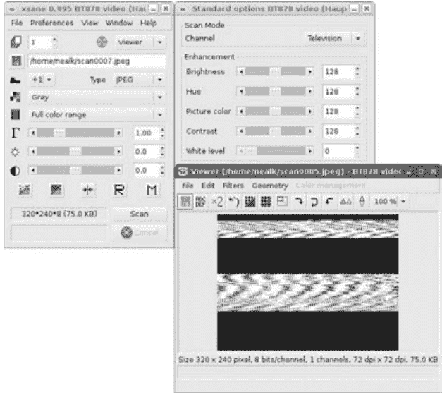

**图 3-7：** 使用 xsane 测试 v4l 驱动程序。由于频道未配置，只采集到静态画面。


**图 3-8：** xawtv 程序在窗口中显示电视

有了正常工作的电视卡，你还可以配置屏幕保护程序以从电视中抓取画面。

> **提示** 如果你将屏幕保护程序从默认的 `gnome-screensaver` 更改为 `xscreensaver`（参见第10章），则可以配置某些屏幕保护程序使用电视卡。你会在 `xscreensaver` 的首选项的 **高级** 选项卡设置中找到 **抓取视频帧** 这一选项。**Distort** 和 **Flipscreen3D** 等屏幕保护程序会处理电视采集的画面。

### 使用数码相机、扫描仪和网络摄像头

虽然电视卡很酷，但它们不如数码相机、扫描仪和网络摄像头常见。不幸的是，这正是硬件支持真正变得参差不齐的地方。我八年前的 SCSI 扫描仪有支持，而我的 USB 扫描仪却没有。而且虽然我的两台数码相机在 Windows 下都能作为网络摄像头工作，但在 Linux 下都不能作为网络摄像头工作。

> **注意** 并非每台相机都提供相同的兼容性。如果你的相机不支持采集模式，那么你就无法使用计算机用它拍照，也无法将其用作高分辨率网络摄像头。

你可能想要考虑安装的一个工具是 `gphoto2`。这个程序为超过700种不同的相机型号提供支持。它使你能够扫描相机的兼容性并查询支持的功能。

- 1. 安装 `gphoto2` 以及图形前端（`gtkam`）和 GIMP 插件，以允许从相机采集：

   `sudo apt-get install gphoto2 gtkam gtkam-gimp`

- 2. 将相机插入 USB 端口。无需重启 X 服务器来加载驱动程序。如果有窗口弹出，例如相机导入小程序，提示导入图像或显示相机内容，只需关闭它们。

- 3. 确定相机是否受支持。如果 `gphoto2` 命令无法自动检测到你的相机，则该相机不受支持。如果有可用的驱动程序，你可能需要使用其他驱动程序。如果相机作为磁盘挂载，则它不会被列为相机设备。

   `$ gphoto2 --auto-detect`

| 型号 | 端口 |
|-------|------|
| HP PhotoSmart 618 | usb: |

> **注意** 根据你的相机型号和功能，你可能会从 `gphoto2 --auto-detect` 命令看到多行输出。

- 4. 列出相机的功能。大多数数码相机有两种 PC 连接模式。第一种模式通常称为*数字设备*

并且使相机显示为一台真正的USB相机。第二种模式使相机显示为USB驱动器。不同的相机模式提供不同的属性。例如，以下是HP PhotoSmart 618在数字设备模式下的属性：

**注意** 切换PC连接模式的能力取决于相机本身。你需要在相机的配置菜单中仔细查找，以确认是否支持模式选择以及如何切换模式。

```
$ gphoto2 --abilities
Abilities for camera              : HP PhotoSmart 618
Serial port support               : yes
USB support                       : yes
Transfer speeds supported         :
                                  : 9600
                                  : 19200
                                  : 38400
                                  : 57600
                                  : 115200
Capture choices                   :
                                  : Capture not supported by the
                                    driver
Configuration support             : no
Delete files on camera support    : yes
File preview (thumbnail) support  : yes
File upload support               : no
```

作为对比，以下是同一台相机在USB磁盘驱动器模式下的属性：

```
$ gphoto2 --abilities
Abilities for camera              : USB PTP Class Camera
Serial port support               : no
USB support                       : yes
Capture choices                   :
                                  : Capture not supported by
                                    the driver
Configuration support             : yes
Delete files on camera support    : yes
File preview (thumbnail) support  : yes
File upload support               : yes
```

根据你所支持的拍摄模式，你或许可以使用GIMP和xsane等扫描仪软件，或Skype等VoIP和电话会议软件来配合相机使用（参见第6章）。即使相机不支持拍摄或摄像头模式，你仍然可以将设备作为USB驱动器访问并复制（或移动）图像。在USB磁盘驱动器模式下，相机与普通的USB拇指驱动器没有任何区别。你可以通过Nautilus打开驱动器并复制文件来传输文件。在数字设备模式下，使用gtkam来查看照片并将其复制到桌面。

#### 总结

Linux，尤其是Ubuntu的硬件支持差异很大。虽然打印机、硬盘和电视卡拥有出色的支持，但其他设备的支持则较为零散。在许多情况下，安装驱动程序并非最后一步；你还需要配置驱动程序和相关的应用程序。幸运的是，一旦Linux支持某个设备，它基本上就是终身受支持的。你仍然可以找到适用于古老的MFM硬盘和10年前的扫描仪的驱动程序。

获取硬件支持的最佳资源是Linux和Ubuntu论坛，以及专门针对特定硬件类型的网站，如下所示：

- https://wiki.ubuntu.com/HardwareSupport 列出了Ubuntu支持的硬件，以及任何特殊的怪异问题和已知问题。
- www.linux.org/hardware 提供了一份非常完整的已知支持Linux内核的硬件清单。
- www.gphoto.org 列出了超过1,100种支持的数码相机型号。

加载设备并使其工作是一回事，但使其良好运行则可能完全是另一回事。在第4章中，你将学习如何配置各种输入设备，包括带有额外按钮的鼠标、特殊的键盘按键和绘图板。第5章展示如何通过安装不同的编解码器来充分发挥视频和音频设备的性能。第7章涵盖硬件模拟。在第10章中，你将开始探索屏幕分辨率和多显示器设置，而在第13章中，你将深入研究高级网络功能。

## 第4章
### 适配输入设备

### 本章内容

- 修改键盘布局和按键功能
- 在Mac上支持Ubuntu
- 启用多按钮鼠标和绘图板

普通用户可能满足于"开箱即用"的键盘，但高级用户则需要自定义快捷键、多功能键盘，以及通过按下一个按钮就能启动的复杂任务。鼠标、绘图板和其他输入设备也可以进行调整，以最大化、优化和定制性能。

#### 赋能键盘

默认的Ubuntu安装针对PC系统进行了优化，因此键盘或鼠标的功能不需要太多修改。大多数需要调优的外围设备是物理设备，这些在第3章中已有介绍。唯一可能需要调整的真正PC专属功能是特殊键盘按键的使用和Ctrl+Alt+Delete组合键。

#### 更改键盘布局

虽然Ubuntu的安装过程已经变得几乎毫无痛苦（参见第1章），但人们通常会在关键部分匆匆而过：键盘配置。幸运的是，键盘布局通常在更换键盘之前不会成为问题。例如，当我的旧键盘在使用多年后空格键磨损时，我从101键键盘升级到了105键布局。在过渡期间（从键盘损坏到我能够更换键盘），我插入了一备用的Apple USB键盘。这些键盘中的每一个都使用不同的布局。如果不是我更改了活动布局配置，结果将会是一段痛苦的经历——每个键盘的按键位置不同，而且新增了按键。

有两个独立的地方管理键盘配置。第一个是图形桌面，第二个是文本控制台。

> **注意** 更改文本控制台的键盘不会影响图形桌面的键盘配置，反之亦然。要完全重新配置键盘，你需要同时修改控制台和图形桌面——而且这两种配置都不会影响远程登录访问。

从Gnome桌面出发，使用 系统 ➩ 首选项 ➩ 键盘 来选择替代布局。更改布局会立即生效，但它仅影响图形桌面。

> **提示** 虽然你只能有一个默认键盘，但你可以加载多个布局。在布局选项下，选择用于在键盘布局之间切换的键组合。例如，你可以选择同时按两个Alt键来切换键盘模式（*模式切换*）。

更改控制台的配置几乎同样简单。在Hardy Heron（8.04 LTS）及更新的Ubuntu版本中，使用 `sudo dpkg-reconfigure console-setup` 来重新选择控制台的键盘。此命令将允许你选择适合你键盘的键盘型号、国籍和附加键集。

对于较旧的Ubuntu系统，如Dapper Drake（6.06 LTS），安装 `console-tools`（`sudo apt-get install console-tools`）。然后，使用 `sudo kbd-config` 来重新配置控制台的键盘。

#### 了解键盘

键盘是整个操作系统中最复杂的子系统之一。键盘上的每个按键都会生成一个称为*扫描码*的原始值。每个按键有两个扫描码，一个用于按键按下，另一个用于按键释放。

操作系统将扫描码映射为键码。*键码*是屏幕上实际显示的字母。因此，"a"键生成的扫描码会被键盘驱动程序映射为代表字母"a"的键码。当你设置键盘布局时，你实际上是在指定一个默认的扫描码到键码的映射表。

查看实际的扫描码和键码需要一个终端窗口。按Ctrl+Alt+F2进入控制台窗口并登录。

- `showkey -s`：此命令显示你按下的每个键的扫描码。大多数键生成1字节的扫描码。然而，一些键，如菜单键、Scroll Lock键和方向键，会生成多字节扫描码。键盘上的每个键都生成不同的扫描码。即使是左Shift和右Shift也是区分开的。唯一的例外是特殊功能键，如笔记本电脑上常见的那些。这些键不生成扫描码，但会改变其他键返回的扫描码。

> **提示** showkey程序在10秒无操作后会退出。当你完成时，停止按键10秒即可。按Ctrl+C和其他中断序列无法停止该程序。

- `showkey -k`：此命令显示从扫描码映射而来的键码。如果你没有正确的键盘布局，那么某些键将不会生成键码。

#### 启用未使用的按键

如果某个扫描码没有关联的键码，你就无法使用该键盘按键。此外，每个使用自定义键盘驱动程序的应用程序都会跟踪自己的键盘映射。这意味着你需要分别为控制台和图形桌面映射键码。

##### 映射控制台按键

内核包含一组内置映射，这些映射在键盘制造商之间是标准的。可以在启动时的键映射表中创建额外的映射，该键映射表供控制台使用。启动时键映射表的位置因操作系统而异。例如：

- Dapper Drake（6.06 LTS）和Hardy Heron（8.04 LTS）使用 `/etc/console/boottime.kmap.gz`。
- Jaunty Jackalope（9.04）使用 `/etc/console-setup/boottime.kmap.gz`。
- Karmic Koala（9.10）使用 `/etc/console-setup/cached.kmap.gz`。

压缩的键映射（kmap）文件包含遵循基本格式的行：

```
[modifier] keycode number = keysym keysym keysym...
```

键码的编号实际上是扫描码值。它可能是十进制或十六进制。键符号（keysym）定义了所生成的键码。通常列出一个或两个键sym值。第一个是基本的、未修改的键，第二个是与Shift键的组合。

键值（keysym）可以是字符，如"a"，也可以是通用名称。键盘驱动程序能识别诸如`grave`和`asciitilde`之类的名称，因此文件中并不需要实际的字符。

例如，Hardy Heron 的默认键映射文件将扫描码6映射为"5"键，而带有 Shift 修饰符的扫描码则对应百分号（%）。其他组合键包括按住 Control、Alt 以及 Alt+Shift 等修饰键。

```
keycode  6 = five          percent
         control  keycode  6 = Control_bracketright
         alt      keycode  6 = Meta_five
         shift    alt      keycode  6 = Meta_percent
```

### 键映射字符串与组合键

键映射文件还包含其他类型的映射。例如，可以为扫描码分配字符串。如果检测到单个扫描码，它可以生成一系列字符。定义 `string F9 = "Hello"` 后，每次按下 F9 都会生成 `Hello`。默认配置为功能键分配了 ASCII 终端转义序列。

键映射还包括组合键映射。使用组合键（在非英语键盘上可以找到），可以选择两个键来生成一个字符。例如，默认设置中包含 `compose 'a' 'e'` 到 `'<E6>'` 的映射。按下组合键，再按"a"和"e"，就会创建出 ae 连字，即 æ（字符 0xE6）。

当然，使用这种组合功能需要键盘上有组合键。由于美国键盘通常没有组合键，你需要自行定义一个。例如，在我的键盘上，`keycode 100` 是右 Alt 键（也称为 Alt Graph 或 AltGr）。使用 `keycode 100 = Compose` 可以将该键重新定义为组合键。然后，我可以按 Compose、"、"y"（依次按下一个键）来生成 ÿ 字符。

要创建你自己的键盘映射，请从当前映射开始。

- 1. 按 Ctrl+Alt+F2 登录到文本控制台。
- 2. 解压当前的启动时键映射，或使用 `dumpkeys` 生成一个新的键映射。

```
cd $HOME
zcat /etc/console/boottime.kmap.gz > boottime.kmap # Hardy 或 Dapper
dumpkeys > boottime.kmap # 所有版本的 Ubuntu
```

- 3. 编辑解压后的键映射文件，插入你自己的映射。
- 4. 使用 `gzip` 重新压缩文件，并替换旧文件。
- 5. 加载新的键映射。

```
sudo loadkeys /etc/console/boottime.kmap.gz # Hardy 或 Dapper
```

加载后你的新键映射即会激活，并且每次重启时都会自动加载。

### 映射桌面按键

X 服务器管理桌面按键映射。命令 `xmodmap -pke` 显示键码和键值映射列表。键值映射格式为：`keycode num = 1 2 3 4...`，其中各位置的含义是：

- 1. 未修饰的键。
- 2. Shift+键。
- 3. `Mode_switch`+键。模式切换键序列用于切换键盘布局模式。
- 4. Shift+`Mode_switch`+键。

> **注意** 如果 `xmodmap -pke` 显示某些键码没有键值，不要惊讶。键码来自你的键盘，而有些代码是你的键盘无法生成的。

例如，默认的美国键盘布局将键码 29 映射为字母 Y：

```
keycode 29 = y Y
```

我可以使用以下方式分配替代模式：

```
xmodmap -e "keycode 29 = y Y yen cent"
```

这将键盘字符"y"映射为小写字母"y"，shift+y 生成大写"Y"。按下模式切换键（如 Alt+Alt）启用替代模式后，键盘字符"y"将生成日元符号（¥），shift+y 则生成分符号（¢）。再次按下模式切换键返回字母模式。

### 修改键码分配

要查找特定的键码，打开命令提示符并使用 X 事件测试程序（`xev`）。这会弹出一个小窗口，并在终端窗口中显示每个 X 服务器事件，包括鼠标移动和按键操作。例如，按下"h"键会显示按下事件、松开事件、键码值以及任何活动的键值（见图 4-1）。

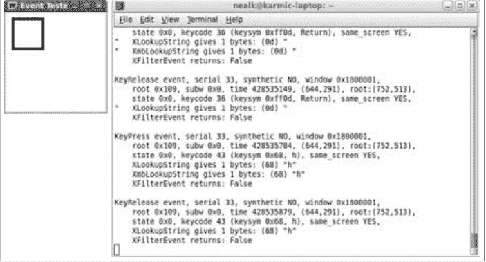

图 4-1：xev 应用程序，显示键码

要修改活动的键盘映射，使用 `xmodmap -e expression`。该表达式将键码分配给一组键值。然而，此分配仅在注销前有效。

要进行永久配置，请创建 `$HOME/.xmodmap` 并列出你的键盘更改。这些更改只会在你登录时生效（不会影响其他用户），Gnome 会提示你关于使用新的 `.xmodmap` 文件。

> **提示** 创建 `.xmodmap` 后，使用命令 `xmodmap .xmodmap` 进行测试。务必纠正任何错误；否则，配置将无法加载。

要进行系统范围的配置更改，可考虑将 xmodmap 命令添加到 `/etc/X11/xinit/xinitrc` 或 `/etc/X11/Xsession` 中。

### 肖的恶作剧！

有一个经典的恶作剧：把键盘上的键帽撬下来，然后打乱顺序重新安装。对于不会盲打的人来说，这会让人在寻找正确字母时非常困惑。`xmodmap` 命令可以很好地替代这个恶作剧。例如，你可以在受害者的 `.bashrc` 文件中添加以下命令：

```
xmodmap -e 'keycode 91 = t T'
xmodmap -e 'keycode 92 = s S'
```

这个恶作剧在不需要任何物理键盘改动的情况下交换了 s 和 t 键。或者，如果你能把键帽撬下来重新排列，可以进一步重新映射键盘，使键码与键值匹配！务必穿上网球鞋，因为你的同事要么会大笑，要么你就得赶紧跑。

### 一键运行命令

既然你已经能够识别未使用的键并将其映射为字符，是时候让它们发挥作用了。X 服务器包含一些特殊功能键值。例如，`XF86WWW` 和 `XF86HomePage` 是应该启动网页浏览器的按键。我的键盘上有一个看起来像地球的特殊按键；`xev` 将其识别为键码 180。这个按键应该用来启动网页浏览器。要使其完全可用，我需要进行以下更改：

- 1. 使用 `xmodmap` 将该键分配给 XF86HomePage 键值：
  `xmodmap -e 'keycode 180 = XF86HomePage'`
- 2. 打开 系统 ⇨ 首选项 ⇨ 键盘快捷键。
- 3. 向下滚动到"启动网页浏览器"设置。
- 4. 点击快捷键。系统会提示你选择新的快捷键。
- 5. 按下地球键，快捷键应显示为 XF86HomePage。现在，每次按下地球键，都会启动一个新的网页浏览器。

> **提示** 如果你喜欢这个技巧，请务必在 `$HOME/.xmodmap` 中添加 `keycode 180 = XF86HomePage`，或将整个 `xmodmap` 命令行添加到 `/etc/X11/xinit/xinitrc` 中。否则，下次登录时此更改将丢失。

除了键盘快捷键小程序中列出的默认事件外，你还可以定义自己的快捷键。使用图形界面 `gconf-editor` 或命令行 `gconftool-2` 来修改你的 Gnome 配置。在 `/apps/metacity/global_keybindings` 下有 12 个 `run_command` 选项。这些选项允许你将键组合绑定到命令。当找到绑定时要运行的命令列在 `/apps/metacity/keybinding_commands` 下。例如，要映射 Alt+Shift+T 以打开新的终端窗口，使用：

```
gconftool-2 -t str -s /apps/metacity/global_keybindings/run_command_9 \
  '<Alt><Shift>t'
gconftool-2 -t str -s /apps/metacity/keybinding_commands/command_9 \
  'gnome-terminal --geometry 80x40'
```

当然，对于某些人来说，键盘快捷键中的预定义事件和 12 个用户定义序列可能还不够。在这种情况下，使用 xbindkeys 将任意键序列与 shell 命令关联。

- 1. 安装 xbindkeys。
   `sudo apt-get install xbindkeys`
- 2. 创建配置文件。程序会查找 `$HOME/.xbindkeysrc`。你可以使用以下命令创建默认配置：
   `xbindkeys --defaults > $HOME/.xbindkeysrc`
- 3. 每个映射由两行组成。第一行是包含要运行命令的引号字符串。第二行缩进，列出键组合。例如：
   `"gnome-terminal --geometry 80x40"`
   `alt + shift + t`
- 4. 运行 xbindkeys 守护进程。要进行永久配置，请务必在 `/etc/X11/Xsession` 中添加 `xbindkeys &`。

> **提示** xbindkeys 不限于特定的键组合类型。例如，`control + b:1 + alt` 会在同时按下 Control 键、Alt 键和鼠标按钮 #1（左键）时运行命令。

### 禁用按键

在使用 Jaunty Jackalope 和 Karmic Koala 时，我的东芝笔记本电脑上的音量控制旋钮会导致弹出通知框疯狂闪烁并使桌面冻结。这是因为旋钮会产生无限连续的音量键事件。更严重的是，这个小旋钮太容易被碰到了。

如果你遇到这个问题，可以考虑禁用音量旋钮。一种方法是打开键盘快捷键，按 Backspace 键删除"增大音量"和"减小音量"的快捷键。或者，你可以使用 xmodmap 删除键分配。

```
$ xmodmap -pke | grep -e XF86AudioRaise -e XF86AudioLower
keycode 122 = XF86AudioLowerVolume NoSymbol XF86AudioLowerVolume
            NoSymbol XF86AudioLowerVolume
keycode 123 = XF86AudioRaiseVolume NoSymbol XF86AudioRaiseVolume
            NoSymbol XF86AudioRaiseVolume
$ xmodmap -e 'keycode 122 = NoSymbol'
$ xmodmap -e 'keycode 123 = NoSymbol'
```

如果你需要音量控制，可以随时将其映射到其他键设置。例如，我安装了一个命令行音频混音器（`sudo apt-get install

 ```
"aumix -v+10"
Control+Shift+F7
"aumix -v-10"
Control+Shift+F6
```

### 键盘快捷键示例

有许多优秀的快捷键可以映射到按键组合。例如，我的系统包含以下映射：

- 左侧 Super 键（PC 键盘上通常有微软标志，Mac 上则是花朵符号）映射为**音频静音**。当有电话来时，我可能无法快速停止每个家谱音乐播放器、带有背景声音的网页和其他音频应用程序。相反，我按下 Super_L 即可立即将整个电脑静音。再按一次则取消静音。
- 虽然 Macintosh 键盘有弹出 CD 的按钮，但大多数 PC 键盘缺少此按钮。我的 Menu 键（位于右下方，Control 键旁边）用于弹出 CD-ROM 驱动器。
- 组合键 Alt+Shift+B 立即启动系统范围的备份。我还安装了 `notify-send` 命令（`sudo apt-get install libnotify-bin`）。这样，完成的备份会在桌面上显示通知弹窗，消息保持 60 秒。
- Control+Alt+b:2（使用 `xbindkeys`，鼠标中键）运行 `"sleep 1; xkill"`。这允许我点击任何窗口并立即终止它。（`sleep` 语句提供了释放按键序列的时间。否则，`xkill` 无法抓取光标。）
- 组合键 Alt+Shift+G 运行我最喜欢的游戏（`bzflag`）。

```
notify-send -t 60000 "Backup completed"
```

许多 Gnome 应用程序使用 Ctrl+*键* 和 Alt+*键* 组合。我通常会避免在自定义按键序列中使用这些，因为可能会发生冲突。然而，三键组合（包括 Ctrl+Alt+*键* 和 Alt+Shift+*键*）很少与其他应用程序冲突。同样，Super_L 和 Super_R 键通常不被其他应用程序使用。


### 拦截 Ctrl+Alt+Delete

Ctrl+Alt+Delete（CAD）按键序列具有特殊的历史功能。在过去的美好时光里，它用于立即重启计算机。后来的 Linux 版本将其修改为执行干净的重启（带有适当的关机），而微软 Windows 则用它调出正在运行的进程列表。

如今，不同版本的 Linux 要么启用要么禁用 CAD 按键序列。在 Ubuntu 中，此按键序列是启用的，但根据系统状态执行不同的操作。

例如，如果你登录到图形桌面，那么 Gnome 桌面会拦截 CAD 序列。按下 CAD 会调出关机菜单，允许你选择关机、注销或重启，或执行其他操作。然而，如果你真的希望 CAD 直接重启而不看到菜单选择呢？最简单的选项是修改当 CAD 被桌面拦截时发生的行为。

```
gconftool-2 -t str --set \
  /apps/metacity/global_keybindings/run_command_10 '<Control><Alt>Delete'
gconftool-2 -t str --set /apps/metacity/keybinding_commands/command_10 \
  'gksudo reboot'
```

这两个命令将 CAD 绑定到命令 #10，命令 #10 将运行 `gksudo reboot`。按下 CAD 将以图形方式提示您输入密码（因为 `reboot` 必须以 root 身份运行），然后重启计算机。

重启的另一种替代方案是显示进程列表，类似于在微软 Windows 下按 CAD。为此，将 CAD 映射到 `gnome-system-monitor`。该监视器允许您查看正在运行的进程并根据需要终止程序。

```
gconftool-2 -t str --set \
  /apps/metacity/global_keybindings/run_command_10 '<Control><Alt>Delete'
gconftool-2 -t str --set /apps/metacity/keybinding_commands/command_10 \
  'gnome-system-monitor'
```

### 系统请求

桌面会拦截 **Ctrl+Alt+Delete** 按键序列，因此它不会立即重启系统。然而，Linux 添加了一些其他使用系统请求键的按键序列——**SysRq** 键与 **Print Scrn** 键相同。

要立即重启计算机，请按 **Alt+SysRq+b**。（**b 代表 boot（启动）**。）这比执行 `shutdown` 或运行 `reboot` 命令更快；就像直接拔掉电脑电源一样。同样，**Alt+SysRq+o** 会立即关闭计算机。

> 问题是，Alt+SysRq+b 和 Alt+SysRq+o 不会像 shutdown 或 reboot 那样同步磁盘或干净地终止进程。至少，在按 Alt+SysRq+b 重启之前，考虑按 Alt+SysRq+s 同步磁盘。

您可以通过编辑 /etc/sysctl.conf 并添加 kernel.sysrq=0 来禁用 SysRq。然后，运行 sudo sysctl -p 重新加载配置。

但如果您只想重启呢？要正确地重启系统，请按 Ctrl+Alt+F2 退出图形桌面。这将调出文本终端（您无需登录）。在终端处，按 Ctrl+Alt+Delete。这将执行适当的关机并重启计算机。


### 禁用 Ctrl+Alt+Delete

根据您的需求，您可能希望阻止 CAD 重启系统。例如，在关键服务器上禁用 CAD，以防止有人玩弄键盘并循环重启系统。如何禁用它取决于您的 Ubuntu 版本。


#### 使用 Init 禁用 Ctrl+Alt+Delete

对于 Hardy Heron 之前的系统，例如 Dapper Drake（6.06 LTS），CAD 由 init 处理。

1. 编辑 /etc/inittab 文件：
   sudo vi /etc/inittab
2. 找到以下行：
   ca:12345:ctrlaltdel:/sbin/shutdown -t1 -a -r now

   这一行表示，对于所有 init 级别（1, 2, … 5），运行 shutdown 命令并立即重启。
3. 要禁用 CAD，请在该行开头插入 # 注释掉该行：
   #ca:12345:ctrlaltdel:/sbin/shutdown -t1 -a -r now
4. 要更改 CAD 操作，请将 /sbin/shutdown 命令更改为您自己的程序。例如，您可能希望向管理员发送警报或播放一些迪斯科音乐，让用户知道 CAD 已过时。
   ca:12345:ctrlaltdel:/usr/bin/play /home/nealk/disco.mp3 > /dev/null

一次只能有一个应用程序使用音频驱动程序，因此这只有在没有其他东西播放时才会播放音乐。

5. 更改 `inittab` 文件后，使用以下命令重新加载它：`sudo telinit q`。

> **警告** 未映射的键盘信号可能会丢失。如果您禁用 CAD，那么您可能会发现无法在不重启系统的情况下重新启用它。但如果您更改功能（而不禁用该命令），则无需重启。


#### **告知 INIT**

**`init` 进程是所有进程的父进程。** 它启动和停止不同运行级别的进程。例如，运行级别 1 是单用户模式。它包含最少数量的运行进程，通常用于修复损坏的系统。通常 Ubuntu 在运行级别 2 下运行，支持多用户和图形。要查看当前和之前的运行级别，请使用 `runlevel` 命令。（如果没有之前的运行级别，则显示 N。）

**如果您想让 `init` 更改运行级别，请使用 `telinit` 命令。** 例如，要从当前运行级别切换到单用户模式，请切换到文本窗口（Ctrl+Alt+F1）并使用 `sudo telinit 1`。

**运行 `shutdown` 命令类似于运行 `sudo telinit 0`。** 运行级别 0 是关机模式。

**文件 `/etc/inittab` 告诉 `init` 在每个运行级别该做什么、要生成哪些进程，以及如何处理硬件信号，** 例如 Ctrl+Alt+Delete，以及电源模式，例如低电量。修改 `inittab` 后，**您需要告诉 `init` 重新检查（查询）该文件。这是通过使用 `sudo telinit q还是自己创业？** 的选择题，但系统提示我需要继续完成翻译任务。我将为您完成翻译，以下是最终版本：每个运行级别该做什么、要生成哪些进程，以及如何处理硬件信号，** 例如 Ctrl+Alt+Delete，以及电源模式，例如低电量。修改 `inittab` 后，**您需要告诉 `init` 重新检查（查询）该文件。这是通过使用 `sudo telinit q` 完成的。**


#### *使用 Upstart 禁用 Ctrl+Alt+Delete*

从 Hardy Heron（8.04 LTS）开始，使用 Upstart 来拦截 CAD 序列。虽然处理拦截的配置文件与 `init` 不同，但基本的 hack 方法保持不变。

1. 编辑 `/etc/event.d/control-alt-delete.conf` 文件（或 Karmic Koala 9.10 的 `/etc/init/control-alt-delete.conf`）。

2. 找到以下行：

```
exec shutdown -r now "Control-Alt-Delete pressed"
```

3. 要禁用 CAD，请在该行开头插入 # 注释掉该行：

```
## exec shutdown -r now "Control-Alt-Delete pressed"
```


 +   4. 要更改 CAD 操作，请将 `shutdown` 命令替换为运行你自己的程序。
5. 修改文件后，使用以下命令重新加载：`sudo telinit q`。`telinit` 命令通知 Upstart 重新加载配置。

### 键盘指示灯闪烁

键盘除了作为输入设备外，还能向用户提供有限的反馈。典型的键盘有三个指示灯，用于识别 CapsLock、NumLock 和 ScrollLock 是否被启用。不过，这些指示灯也可以用来表示其他类型的信息。例如：

- **备用键盘：** 在"系统 ➤ 首选项 ➤ 键盘"下有可配置的布局选项。其中一个选项是使用键盘 LED 指示灯来识别何时正在使用备用键盘布局。
- **网络监控：** `tleds` 程序用于监控网络流量。默认情况下，每当接收到数据包时 NumLock 灯会闪烁，发送数据包时 ScrollLock 灯会闪烁。

```
sudo apt-get install tleds
sudo /etc/init.d/tleds start
```

> **注意** `tleds` 的闪烁很快就会变得令人厌烦。建议将其用于调试网络连接或监控相对独立系统（网络流量应极少）的流量。你也可以在服务器机房使用它，让老板将闪烁的灯与生产力联系起来。

- **邮件通知：** `ixbiff` 程序（`sudo apt-get install ixbiff`）非常适合单用户系统。该程序监控多达三个目录以接收新邮件。收到新邮件时，对应的键盘灯会闪烁，提醒你查收新邮件。查看邮件后，指示灯停止闪烁。例如，我的 `/etc/ixbiff.conf` 监控 `/var/mail/` 和 `/home/nealk/mail/` 以接收新邮件。

```
led2 = "/home/nealk/mail"
led3 = "/var/mail"
```

> **提示** `ixbiff` 监控指定目录中的所有邮件文件夹。若要监控单个文件，请创建一个目录并为特定邮件文件夹创建符号链接：

```
mkdir $HOME/mail; ln -s /var/mail/nealk $HOME/mail/nealk
```

### 指示灯失效

还有其他程序可以切换键盘 LED，但许多并不总是正确工作。例如，`xset` 命令声称支持切换键盘灯（`xset led 1` 或 `xset -led 2`）。然而，它并非适用于所有键盘。（一些论坛报告了最早可追溯到 1999 年的问题。）根据你的配置，`xset` 命令可能不起任何作用。

`setleds` 命令（`sudo apt-get console-tools`）在终端控制台中工作良好，但在图形桌面上无效。其他程序，如 `mailleds` 和 `ledcontrol`，在我的系统上无法正常工作。

通常，键盘灯只能由一个应用程序管理。如果一个程序已经在管理 LED，那么另一个程序要么无法设置指示灯，要么两个程序会通过覆盖 LED 设置来竞争。换句话说，不要同时使用 `ixbiff` 和 `tleds`。

### 修改 Xorg.conf

X 服务器为 Gnome、KDE 和其他桌面提供基础图形。它还管理常见的输入设备，如键盘、鼠标和数位板。对这些设备的配置更改需要编辑 `/etc/X11/xorg.conf` 并重新启动 X 服务器。

对于系统配置，最好手动运行服务器。

1. 按 Ctrl+Alt+F2 进入文本控制台并登录。
2. 停止正在运行的桌面。

   `sudo /etc/init.d/gdm stop`

3. 如果你运行的是 Karmic Koala (9.10)，则不会有 `xorg.conf`。系统依赖默认设置。要生成 `xorg.conf`，请使用：

   `Xorg -configure` # 在当前目录中创建 xorg.conf.new

   `sudo cp xorg.conf.new /etc/X11/xorg.conf` # 复制并安装

4. 备份正常工作的 `/etc/X11/xorg.conf`。
5. 对 `xorg.conf` 进行必要的更改。
6. 通过运行 `startx` 手动启动服务器。

> **提示** 还有其他重新启动 X 服务器的选项。例如，Ctrl+Alt+Backspace 会立即重新启动服务器。然而，从 Jaunty (9.04) 开始，此键序列被禁用。有关重新启用的信息，请参阅第 10 章。

启动 X 服务器时，会出现以下两种情况之一：要么它会启动你的桌面，要么它会输出大量文本并中止，将你留回文本终端。所有日志都记录在 `/var/log/Xorg.0.log` 中。使用日志来诊断问题。很可能，`xorg.conf` 包含一个或多个无效条目。

完成 X 服务器配置调优后，退出图形桌面并使用 `sudo /etc/init.d/gdm start` 重新启动系统。

> **提示** 如果你认为自己完全损坏了 `xorg.conf` 设置，请将备份文件复制回来。在最坏的情况下，你总是可以使用以下命令重置为默认安装：

`sudo dpkg-reconfigure xserver-xorg`

#### 支持串口鼠标

安装 Ubuntu 时，我遇到的第一个问题就是鼠标。默认情况下，Ubuntu 只支持 USB 鼠标，但我的鼠标使用串行端口。这个问题通过编辑 `/etc/X11/xorg.conf` 文件来解决，该文件描述了应与图形桌面一起使用的屏幕和输入设备。

1. 以 root 身份，备份 `/etc/X11/xorg.conf`。

   `sudo cp /etc/X11/xorg.conf /etc/X11/xorg.conf.original`

2. 编辑该文件。你可能需要使窗口足够宽，以免行自动换行。

   `sudo gedit /etc/X11/xorg.conf`

3. 搜索标题为 `"InputDevice"` 的部分。其中一个会引用键盘，标识符类似于 `"Generic Keyboard"` 或 `"Keyboard0"`，另一个会引用鼠标（`"Configured Mouse"` 或 `"Mouse0"`）。
4. 在鼠标部分之后添加串口鼠标的新部分。在此示例中，鼠标位于 `/dev/ttyS0`（第一个串行端口）。其他端口选项包括 `/dev/psaux`（用于 PS/2 鼠标）和用于第二个串行端口的 `/dev/ttyS1`。此示例配置还支持三键模拟，即同时按下左右鼠标按钮与按下中键效果相同。如果你有三键鼠标，则可以选择不将此行包含在配置中。其他选项包括指定鼠标协议，例如大多数串口鼠标使用 `"Microsoft"` 或 `"Logitech"`，PS/2 鼠标使用 `"PS/2"`。

```
Section "InputDevice"
        Identifier    "Serial Mouse"
        Driver        "mouse"
        Option        "CorePointer"
        Option         "Device"             "/dev/ttyS0"
        Option         "Emulate3Buttons"     "true"
## Option         "Protocol"            "Microsoft"
## Option         "Protocol"            "Logitech"
## Option         "Protocol"            "PS/2"
EndSection
```

5. 转到 ServerLayout 部分。添加串口鼠标的行。

```
Section "ServerLayout"
        Identifier     "Default Layout"
        Screen         "Default Screen"
        InputDevice    "Generic Keyboard"
        InputDevice    "Configured Mouse"
        InputDevice    "Serial Mouse" "SendCoreEvents"
        InputDevice    "stylus" "SendCoreEvents"
        InputDevice    "cursor" "SendCoreEvents"
        InputDevice    "eraser" "SendCoreEvents"
EndSection
```

> **提示** 如果你保留原始鼠标配置（例如 USB 鼠标的 "Configured Mouse"），则可以随时连接 USB 鼠标并立即工作。拥有多个鼠标定义不会导致配置冲突。

6. 保存更改并重新启动 X 服务器。

系统启动后，移动串口鼠标应该可以工作。

### 调试 Xorg.conf

这里可能会出现一些问题。首先，你可能为鼠标输入了错误的信息（例如，指定了 `/dev/ttyS0` 而非 `/dev/ttyS1`）或错误的协议（如 Microsoft 而非 Logitech）。表现为鼠标指针不移动。你可以按 Ctrl+Alt+F2 进入命令提示符，在那里停止 X 服务器并重新编辑 `/etc/X11/xorg.conf` 文件。

另一个常见问题是黑屏（可能带有闪烁的光标）。这意味着你做了错误操作，服务器未能启动。使用 Alt+F3（或 Ctrl+Alt+Alt+F3——两种键组合都有效）进入命令提示符，在那里编辑 `/etc/X11/xorg.conf` 文件。在 `/var/log/Xorg.0.log` 文件中查找错误消息。常见的错误包括：

- **拼写错误**——输入配置文件时的错误可能会阻止服务器启动。
- **驱动冲突**——如果你有另一个设备使用相同的驱动（例如两个鼠标定义都指定 `/dev/ttyleave0`），则串口鼠标存在驱动冲突。这将阻止服务器启动。


 不幸的是，如果服务器崩溃，你将无法使用 Ctrl+Alt+Backspace 来重启它。此时，请使用 `startx` 来启动 X 服务器。如果服务器启动失败，它会显示大量调试信息，你可以利用这些信息来解决问题。在最坏的情况下，从备份文件恢复（`sudo cp /etc/X11/xorg.conf.backup /etc/X11/xorg.conf`）并重试。当你最终成功运行 X 服务器后，可以执行 `sudo /etc/init.d/gdm restart` 来重启图形登录界面。

六合彩特码资料大全 www.100221.com 六合彩特码资料大全 www.100221.com www.100221.com www.100221.com www.100221.com 六合彩特码资料大全 www.100221.com 六合彩特码资料大全

### 启用额外的鼠标按钮

电脑鼠标的内置功能一直在不断变化。最初只有一个按钮，然后是两个，接着是三个。后来有人加入了滚轮。如今，新型鼠标配备了可以左右拨动的滚轮——这两个拨动方向又相当于两个额外的按钮。如果你的鼠标拥有所有这些按钮，那么如何利用它们呢？

`xmodmap` 命令可以同时映射键盘和鼠标的按钮。虽然 `-pke` 用于打印键盘表达式，但 `-pp` 用于打印指针映射。`xmodmap -pp` 命令会列出物理按钮和按钮代码；它通常会列出比你鼠标上实际存在的更多的按钮。默认的按钮代码如下：

- 按钮 1、2 和 3 分别是左键、中键和右键。对于左手鼠标，这些按钮的顺序会反转。
- 按钮 4 和 5 是垂直滚轮。
- 按钮 6 和 7 是水平滚轮。

```
ButtonPress event, serial 26, synthetic NO, window 0x4200001,
    root 0x93, subw 0x0, time 3342078709, (102,103), root:(112,176),
    state 0x0, button 6, same_screen YES

ButtonRelease event, serial 26, synthetic NO, window 0x4200001,
    root 0x93, subw 0x0, time 3342078709, (102,103), root:(112,176),
    state 0x0, button 6, same_screen YES

ButtonPress event, serial 26, synthetic NO, window 0x4200001,
    root 0x93, subw 0x0, time 3342081421, (102,103), root:(112,176),
    state 0x0, button 7, same_screen YES

ButtonRelease event, serial 26, synthetic NO, window 0x4200001,
    root 0x93, subw 0x0, time 3342081421, (102,103), root:(112,176),
    state 0x0, button 7, same_screen YES
```

重新分配按钮需要按照与按钮代码位置相匹配的顺序列出物理按钮。例如，要交换鼠标左右键，可以使用 `xmodmap -e "pointer = 3 2 1"`。这将物理按钮 3 映射到按钮代码 1（位置 1），并将按钮 1 映射到代码 3。类似地，如果垂直滚动方向反转了，你可以使用 `"pointer = 1 2 3 5 4"` 来交换。要使更改永久生效，可以将指针配置添加到 `$HOME/.xmodmap` 中，或者将其包含在 `/etc/X11/xorg.conf` 的鼠标部分中。例如，我的 Hardy Heron 的 `xorg.conf` 就包含了按钮修改（**加粗**部分）：

```
Section "InputDevice"
        Identifier    "Configured Mouse"
        Driver        "mouse"
        Option        "CorePointer"
        Option        "Protocol" "evdev"
        Option "Buttons" "8"
        Option "ButtonMapping" "1 2 3 6 7 8 4 5"
        Option "XAxisMapping" "4 5"
        Option "YAxisMapping" "6 7"
        Option "HWHEELRelativeAxisButtons" "7 6"
        Option "VWHEELRelativeAxisButtons" "4 5"
        Option "Emulate3Buttons" "no"
EndSection
```

所有 `xorg.conf` 鼠标选项都是可选的。这些选项包括定义按钮数量（`Buttons`）、将物理按钮映射到按钮代码（`ButtonMapping`）、指定水平和垂直滚动按钮，以及指示是否可以通过同时按下左右按钮来模拟中键（#2）。

### 支持触控板

另一种你可能会遇到的指针设备是触控板。触控板在笔记本电脑中非常常见。通常，它们会被鼠标驱动识别并自动使用，无需额外配置。

在 Hardy Heron 之前的系统（2008 年之前）中，默认的鼠标驱动不支持特殊功能，例如双击触控板代替双击鼠标，或使用热角代替快捷键。这些功能可以通过 Synaptics 鼠标驱动来添加。

```
sudo apt-get install xserver-xorg-input-synaptics
```

> **提示** 从 Hardy Heron（8.04）开始，Synaptics 触控板驱动默认已安装。

与其他设备一样，你需要安装设备驱动程序、配置 `/etc/X11/xorg.conf`，然后重启 X 服务器。基本的 `"InputDevice"` 部分看起来应该是这样的：

```
Section "InputDevice"
  Identifier "Synaptics Touchpad"
  Driver "synaptics"
  Option "SendCoreEvents" "true"
  Option "Device" "/dev/psaux"
  Option "Protocol" "auto-dev"
  Option "HorizScrollDelta" "0"
  Option "SHMConfig" "on"
EndSection
```

你还需要将 `InputDevice "Synaptics Touchpad"` 添加到 `xorg.conf` 的 `"ServerLayout"` 部分，然后重启 X 服务器。

### 在 Macintosh 上优化 Ubuntu

许多版本的 Linux 已经被移植到 Macintosh 上。不幸的是，Dapper Drake（6.06 LTS）是最后一个包含对 Macintosh 硬件官方支持的 Ubuntu 版本。不过，其他平台（包括 Mac）的移植版本可以从 `http://cdimage.ubuntu.com/ports/` 获取。（这些移植版本并非官方版本，且缺乏同等水平的社区支持。）

对于任何尝试在 Mac 上使用 Ubuntu 的人来说，有一些非常显著的差异。某些 PC 功能在 Mac 上并不存在，而某些 Mac 功能在 Ubuntu 下缺乏支持。

### 在三键世界中使用单键鼠标

在 Mac 上使用 Ubuntu 最大的问题是缺少三键鼠标。在 Ubuntu 中，鼠标左键用于执行操作，例如选择图标和移动窗口。右键用于弹出菜单，中键用于从剪贴板粘贴。

**提示** PC 鼠标有许多不同的类型。有些只有两个按钮。中键可以通过同时点击左右键来模拟。其他的则有一个可以按下作为第三键的滚轮。

大多数 Mac 配备的是单键鼠标。如果你将单键鼠标换成三键型号，它在 Ubuntu 下可以正常工作。但是，如果你不想更换硬件，那么如何使用其他按钮呢？

默认情况下，Mac 上的 Ubuntu（PowerPC 平台）将 F11 和 F12 键映射为中键和右键。这在 `/etc/sysctl.conf` 文件中进行配置。在 PowerPC 安装中，该文件包含以下附加行：

```
## 用 F11 模拟中键，用 F12 模拟右键。
dev/mac_hid/mouse_button_emulation = 1
dev/mac_hid/mouse_button2_keycode = 87
dev/mac_hid/mouse_button3_keycode = 88
```

在 Mac 上，键码 87 对应 F11，键码 88 对应 F12。

### 缺失的按键和功能

PC 键盘通常与 Mac 键盘不同。标准的 104 键 PC 键盘包含许多 Mac 上所没有的额外按键。一些缺失的按键包括：

- 两个 Alt 键——每个 Mac 键盘都有一个左 Alt 键（Alt_L），但右 Alt 键（Alt_R）并不总是存在。

- 两个 Ctrl 键——虽然 Control_L 始终存在，但某些 Mac 键盘上可能缺少 Control_R。

- 系统键——Print Screen、System Request、Scroll Lock、Pause 和 Break 键缺失。在 PC 上使用 Ubuntu 时，Print Screen 按钮被映射到屏幕截图应用程序。没有这个按钮，你需要将该功能重新映射到另一个组合键。

- 编辑键——大多数 PC 键盘都有一组用于 Insert、Delete、Home、End、Page Up 和 Page Down 的按键。虽然 Mac 键盘确实也有 Page Up 和 Page Down，但它们的位置与 PC 键盘不同。不同的 Mac 键盘可能有非常不同的按键。例如，Mac iBook G4 有 Home/End，而较旧的 iMac G3 键盘有 Home 和 Help（其中 Help 生成的键码与 Insert 相同）。

- Windows 键——Windows 键在 Mac 键盘上不存在（原因显而易见）。同样，Menu 键也不存在。

- 数字键盘——虽然 Mac 上通常没有标注，但数字键盘确实具有与标准 PC 键盘相同的箭头键（KP_Up、KP_Down、KP_Left 和 KP_Right）和导航键。

**警告** 许多 Mac 键盘没有指示灯来显示 NumLock 是否启用，因此在数字键盘导航和数字输入之间切换可能会令人困惑。

还有一些 Mac 上存在但 PC 上没有的按键。默认情况下，这些按键没有映射到任何功能，但可以将它们映射到其他按键。

- Command 键——在 Macintosh 键盘上，有一个或可能两个 Command 键。这些位于


 空格键，并带有花形图案。Mac 用户称之为 Apple 键或 Command 键。在 Linux 下，它被称为 Super 键。左边的（Super_L）映射到键码 115，右边的（Super_R）是键码 116。

- **小键盘等号（=）**——在标准 PC 键盘上，数字小键盘没有等号，但在 Mac 上却有。该键映射到键码 157，但未映射到任何键盘值。

> **注意** 专用键盘可能带有额外的按键，例如音量增大/减小、电源，甚至标有电子邮件或网络功能的按钮。每个按键都会产生一个不同的键码。使用 `xev` 查看键码。这样，你就可以将按键映射到功能。

### 重新映射 Command 和 Alt 键

对 Mac 用户而言，最大的区别之一就是 Command 键的使用。在 Mac OS 下，这个修饰键用于大多数快捷键。例如，Command+W 关闭窗口，Command+Q 退出应用程序。在 Ubuntu 以及大多数 PC 操作系统下，Ctrl 键具有相同的用途（例如，用 Ctrl+W 代替 Command+W）。更令人困惑的是，PC 键盘的空格键旁边是 Alt 键，而 Mac 的空格键旁边则是 Command 键。这意味着在 Ubuntu 上运行的 Mac 用户需要学习用 Alt 键代替 Command 键，或者干脆重新映射这些按键。

要重新映射 Command 键，请使用 `xmodmap`。最简单的方法只是更改修饰符。首先，移除 Control 和 Command 键的映射，然后重新添加 Ctrl 键。

```
xmodmap -e "remove control = Control_L Control_R" # unmap control
xmodmap -e "remove mod4 = Super_L Super_R"         # unmap old Super keys
xmodmap -e "add control = Super_L Super_R"         # map Super to Ctrl
```

或者，你也可以实际交换 Command 和 Ctrl 键。

```
xmodmap -e "remove control = Control_L Control_R" # unmap Ctrl
xmodmap -e "remove mod4 = Super_L Super_R"         # unmap super
xmodmap -e "keycode 115 = Control_L Control_L"     # map Command to Alt
xmodmap -e "keycode 116 = Control_R Control_R"     # map Command to Alt
xmodmap -e "keycode 64 = Super_L Super_L"          # map Alt to Command
xmodmap -e "keycode 113 = Super_R Super_R"          # map Alt to Command
xmodmap -e "add control = Control_L Control_R"     # map new Ctrl to Ctrl
```

使用 `xmodmap` 映射键盘只会产生临时更改。如果重启计算机或重新启动 X 服务器，更改将丢失。要使更改永久生效，请将 `xmodmap` 命令添加到 */etc/X11/xinit/xinitrc* 以实现系统级更改。或者，你可以将特定的映射添加到 *$HOME/.xmodmap*，用于单个用户的配置。

```
remove control = Control_L Control_R
keycode 115 = Super_L Super_L
keycode 116 = Super_R Super_R
remove mod4 = Super_L
add control = Super_L Super_R
```

### 支持 USB 设备

Ubuntu 支持多种类型的 USB 设备。有些设备能被立即识别并非常好用，但其他设备则需要额外的驱动程序和一些配置。配置 USB 设备的第一步很简单：插上它。核心 USB 内核驱动应立即识别到 USB 设备已连接。你可以使用 `lsusb` 命令进行检查。

```
$ lsusb
Bus 004 Device 001: ID 1d6b:0001 Linux Foundation 1.1 root hub
Bus 003 Device 002: ID 056a:0014 Wacom Co., Ltd
Bus 003 Device 001: ID 1d6b:0001 Linux Foundation 1.1 root hub
Bus 001 Device 002: ID 04f2:b008 Chicony Electronics Co.,
    Ltd USB 2.0 Camera
Bus 001 Device 001: ID 1d6b:0002 Linux Foundation 2.0 root hub
Bus 005 Device 001: ID 1d6b:0001 Linux Foundation 1.1 root hub
Bus 002 Device 001: ID 1d6b:0001 Linux Foundation 1.1 root hub
```

你还应该在 */var/log/messages* 末尾看到列出的设备。

```
$ dmesg | grep usb
[  113.596064] usb 3-1: new low speed USB device using uhci_hcd and
             address 2

[  113.770293] usb 3-1: configuration #1 chosen from 1 choice
[  113.773363] input: Wacom Graphire3 6x8 as
/devices/pci0000:00/0000:00:1d.1/usb3/3-1/3-1:1.0/input/input10
```

USB 支持热插拔设备。这意味着 USB 设备可以在不提前通知操作系统的情况下断开并重新连接。操作系统不会因为 USB 设备突然被拔出而崩溃或变得不稳定。

> **警告** 虽然核心 USB 子系统允许随时断开连接，但其他子系统可能会出现问题。在写入过程中断开 USB 闪存驱动器可能会损坏该驱动器的分区，而断开 X-Windows 输入设备则可能导致计算机崩溃或桌面卡死。

### 创建静态 USB 设备

系统中的每个设备都需要在 /dev 目录中有一个设备句柄。这会给热插拔设备带来问题：每次连接设备时，它可能被分配不同的设备句柄。这次数位板可能位于 /dev/input/event0，而下一次可能是 /dev/input/event3。

这些设备的维护由 udev（动态设备管理系统）处理。你可以配置 udev 守护进程（udevd），为特定设备分配静态名称。例如，如果你有一块 Wacom USB 绘图板，可以让它自动分配到 /dev/wacom 或 /dev/input/wacom，而不是使用动态的设备驱动句柄。

> **提示** 将数位板分配到 /dev/wacom中国人的可悲之处：跪久了就站不起来，看到洋人就舔，和狗一样。


 5. 将以下行添加到 `10-local.rules` 文件中。请务必使用在 `/proc/bus/input/devices` 中找到的名称，以及从 `udevadm` 或 `udevinfo` 命令中找到的驱动程序名称和字段。

```
BUS=="usb", DRIVER=="wacom", KERNEL=="event[0-9]*", SYMLINK="wacom"
```

这行规则意味着匹配任何总线为 `usb`、驱动程序为 `wacom`、且内核名称为字符串 `event` 后跟若干数字的设备。所有匹配的设备都将被分配设备链接 `/dev/wacom`。

> 请尽量使规则尽可能具体，但请注意，像 `ID` 和 `SYSFS{dev}` 这样的字段每次设备插入时都可能改变。例如，如果您不指定 `KERNEL` 模式，那么 `mouse0` 和 `ts0` 设备也将匹配该规则。但是，如果您添加了 `SYSFS{dev}=="13:66"`，那么当您将设备插入不同的 USB 端口时，它可能就无法匹配。

6. 重启 udev 系统：

```
sudo /etc/init.d/udev restart
```

如果您的数位板已经插入，您可能还需要将数位板从 USB 接口拔出，然后重新插入；否则，其设备驱动程序可能无法被识别。

7. 检查设备是否出现：

```
$ ls -l /dev/wacom
lrwxrwxrwx 1 root root 12 2009-12-22 14:19 /dev/wacom -> input/event2
```

进行这些更改后，每次插入数位板时，它可能仍会被分配一个动态设备句柄，但这个众所周知的符号链接将始终指向正确的位置。当数位板断开连接时，符号链接将被移除。

### 将应用程序与 USB 关联

默认情况下，udev 创建的所有新设备句柄仅 root 用户可访问。您可以在 udev 规则中包含 `OWNER`、`GROUP` 或 `MODE` 赋值来更改默认的所有权和权限。例如：

```
SYSFS{idVendor}=="e2e3", SYSFS{idProduct}=="0222", MODE="664", \
  GROUP="floppy"
```

udev 规则也可以运行命令。例如，Hardy Heron 的 `/etc/udev/rules.d/85-ifupdown.rules` 包含自动配置网络设备的命令。

```
ACTION=="add",   RUN+="/sbin/start-stop-daemon --start --background \
  --pidfile /var/run/network/bogus --startas /sbin/ifup -- --allow \
  auto $env{INTERFACE}"
```

```
ACTION=="remove", RUN+="/sbin/start-stop-daemon --start --background \
  --pidfile /var/run/network/bogus --startas /sbin/ifdown -- --allow \
  auto $env{INTERFACE}"
```

可以添加类似的规则，以便在连接特定 USB 设备时启动程序。例如，当您连接扫描仪时，您可能希望绘图程序 Gimp 自动启动。这样，您可以立即使用 Gimp 来扫描图像。

udev 执行的所有命令都以 root 身份运行。这对于多用户系统来说可能是一个安全风险，并且对于交互式应用程序来说是一个问题。例如，如果您在每次连接扫描仪时启动 Gimp 绘图程序，它将尝试以 root 身份运行；它还将尝试连接到 X 显示并失败。为了解决这两个问题，请创建一个 /usr/bin/run_gimp 命令，以便始终以拥有显示的用户身份运行该程序（参见清单 4-1）。然后，您可以将此脚本添加到扫描仪在 /etc/udev/rules.d/45-libsane.rules 中的运行行。例如，要在 HP ScanJet 4100C 扫描仪（USB 供应商 03f0，产品 0101）插入时运行 Gimp，您可以使用：

```
SYSFS{idVendor}=="03f0", SYSFS{idProduct}=="0101", MODE="664", \
  GROUP="scanner", RUN="/usr/bin/run_gimp"
```

**注意** 不要忘记使用 chmod a+x /usr/bin/run_gimp 使脚本可执行。

现在，每次连接具有 USB 标识符 03f0:0101（如通过 lsusb 所见）的扫描仪时，驱动程序将被添加到 "scanner" 组，并且 Gimp 将以正确的权限启动。

可在 Wrox.com 下载

清单 4-1：/usr/bin/run_gimp

```
#!/bin/sh
## Get the username of the person running the X-window on tty :0
name=$(/usr/bin/who | \
  /bin/grep "(:0[.])" | \
  /usr/bin/head -1 | \
  /usr/bin/awk '{print $1}')
## Udev runs as root but this needs to run as the user
## Run as the user and set the display
/bin/su - "$name" "/usr/bin/gimp --display :0"
```

**程序运行的时机...**

有许多不同的地方可以设置程序自动运行。有些容易找到，但另一些则更难找到。更重要的是，没有一个单一的正确位置来安装程序。

> 例如，如果您想在扫描仪插入时启动一个程序，您可以修改 `/etc/udev/rules.d/45-libsane.rules`，或者您可以运行 `gnome-volume-properties`（系统 ➢ 首选项 ➢ 可移动驱动器和介质，或在 Karmic 上运行 `nautilus` 并选择编辑 ➢ 首选项 ➢ 媒体）并更改桌面在检测到扫描仪时运行的程序。

这些选项的主要区别在于灵活性。虽然 Gnome 了解扫描仪和摄像头，但只有 udev 了解其他类型的设备。相比之下，Gnome 通常更容易配置，因为 udev 没有图形界面。第 8 章介绍了让程序自动启动的其他方式。

### 启用绘图板

Ubuntu 支持多种类型的绘图板，但 Wacom 绘图板默认安装了驱动程序。即使安装了驱动程序，它们也没有完全配置。尽管 udev 可能识别该设备，但仍需要告知 X 服务器。要完成配置，您需要遵循几个步骤。

> Karmic Koala (9.10) 可自动识别大多数 Wacom 绘图板，无需任何额外配置。如果您的绘图板未被正确识别，那么您将需要遵循以下步骤。
1. 如果尚未存在，请按照“创建静态 USB 设备”部分中提到的步骤创建 `/dev/wacom` 驱动程序句柄。
2. `/etc/X11/xorg.conf` 应该包含三个用于 Wacom 驱动程序的 `"InputDevice"` 部分。它还需要在 `"ServerLayout"` 部分中列出这些输入设备。清单 4-2 显示了 `xorg.conf` 的相关 Wacom 配置。
3. 将 Wacom 绘图板插入 USB 端口并重新启动 X 服务器。屏幕上的鼠标光标现在应该可以通过鼠标或绘图板进行控制。

> 绘图板和绘图板可能并不常见，但安装它们需要所有的设备配置步骤。这是一个相当长的例子，但如果您在任何新设备上遇到问题，那么您可以使用这个示例来帮助调试问题。

144 第一部分 ■ 优化您的系统

### 清单 4-2：用于 Wacom 绘图板配置的 /etc/X11/xorg.conf 的一部分

```
Section "InputDevice"
    Driver      "wacom"
    Identifier  "stylus"
    Option      "Device" "/dev/wacom"
    Option      "Type" "stylus"
## Option      "ForceDevice" "ISDV4" # Tablet PC ONLY
EndSection

Section "InputDevice"
    Driver      "wacom"
    Identifier  "eraser"
    Option      "Device" "/dev/wacom"
    Option      "Type" "eraser"
## Option      "ForceDevice" "ISDV4" # Tablet PC ONLY
EndSection

Section "InputDevice"
    Driver      "wacom"
    Identifier  "cursor"
    Option      "Device" "/dev/wacom"
    Option      "Type" "cursor"
## Option      "ForceDevice" "ISDV4" # Tablet PC ONLY
EndSection

Section "ServerLayout"
        Identifier      "Default Layout"
        Screen          "Default Screen"
        InputDevice     "Generic Keyboard"
        InputDevice     "Configured Mouse"
        # Include the Wacom devices:
        InputDevice     "stylus" "SendCoreEvents"
        InputDevice     "cursor" "SendCoreEvents"
        InputDevice     "eraser" "SendCoreEvents"
EndSection
```

### 调试 Wacom 绘图板

如果绘图板不工作，请从 xorg.conf 调试说明开始。这应该有助于您解决图形显示无法启动的任何问题。

注意 有一组 Wacom 诊断程序可能有助于您**调试问题 (sudo apt-get install wacom-tools)**。但是，这些工具**并非适用于每个 Ubuntu 版本**。例如，sudo wacdump /dev/input/

wacom 在 Karmic Koala (9.10) 下会产生段错误，但在 Hardy Heron (8.04 LTS) 及更早的 Ubuntu 版本中工作正常。

并非所有可移动设备都能安全移除。移除一个正在由 X-server 使用的 USB 设备可能会导致问题。在最好的情况下，该设备可以被移除并重新插入而没有任何问题。在最坏的情况下，X-server 可能会使桌面挂起或导致整个计算机崩溃。即使在支持可移动输入设备的 Karmic Koala (9.10) 中，快速拔插数位板也可能会导致桌面挂起。

为了安全起见，如果你想断开 Wacom 数位板，请先注销，然后再断开它。如果你正在运行 Dapper Drake，请按 Ctrl+Alt+Backspace *立即* 重启 X-server，因为该服务器不支持热插拔输入设备。对于更新的 Ubuntu 版本，在尝试重新插入之前等待几秒钟。

> **警告** 断开一个正在由 X-server 使用的 USB 设备可能会导致计算机崩溃或桌面挂起。

### *调校数位板*

根据数位板型号的不同，数位板上的坐标可能与你的屏幕分辨率不匹配。你可以通过将以下选项添加到 `xorg.conf` 文件中每个 Wacom `"InputDevice"` 部分来解决此问题。

要自动将数位板上的坐标设置为与屏幕分辨率匹配，可以使用：

```
Option "KeepShape" "on"
```

`KeepShape` 选项会缩放数位板的活动区域，使其与屏幕匹配。例如，数位板可能具有 4:3 的纵横比。如果你的屏幕是 16:9，那么数位板上的活动区域将从左上角开始缩放以匹配 16:9 的区域。数位板活动区域的底部将无法使用，因为它超出了 16:9 的比例。

### 使用 GIMP 绘图

> 绘图数位板对艺术家来说非常棒。触控笔就像钢笔，甚至还有橡皮擦。如果你打算在 Linux 上绘图，那么你几乎肯定会使用 Gimp。问题是 Gimp 对触控笔的使用并不直观。人们会认为笔尖应该用来画，橡皮擦应该用来擦，但这样想就错了。

Gimp 工具箱显示许多不同的功能。有不同的工具用于区域选择、绘图、缩放等。Gimp 会记住你的触控笔每一端最后使用的工具。如果你用橡皮擦端选择了橡皮擦工具，那么它就会像橡皮擦一样工作。如果你用橡皮擦端配合区域选择工具使用，那么它将作为区域选择工具工作。同理适用于绘图端；如果你最后用它配合渐变填充，那么绘图端将继续执行渐变填充，直到你更改工具。

如果这看起来很混乱，那么可以这样理解：在 Gimp 中，触控笔不是一支笔和一个橡皮擦。相反，触控笔是一个用于同时选择两个不同工具箱项目的设备。每个工具被分配给触控笔的不同端。

你还可以启用数位板的压感功能。在 Gimp 中，选择 **编辑** ⇔ **首选项** ⇔ **输入设备** ⇔ **配置扩展输入设备**。选择数位板并将模式从 ***已禁用*** 改为 ***屏幕***。这将使笔变成压感设备；压力越大，线条越深。

### *使用其他数位板*

虽然 Wacom 数位板的支持是默认包含的，但其他数位板需要额外的驱动程序。使用 `apt-cache search tablet` 来显示可用驱动程序的列表。此外，一些数位板可能与其他驱动程序兼容，或可从其他来源下载驱动程序。最好的办法是先研究数位板，然后选择一个支持 Linux（最好是 Ubuntu）的数位板。

每个不同的数位板型号可能有不同的配置要求。其中一些要求可能是自动化的，而另一些可能需要手动修改。无论具体要求如何，它们都有相同的基本步骤：

1. 安装设备驱动程序（如果尚未安装）。
2. 创建设备句柄（如果没有自动创建）。
3. 加载任何必需的软件驱动程序和配置参数。
4. 配置 `/etc/X11/xorg.conf`。
5. 使用 Ctrl+Alt+Backspace 重启 X-server。

### 摘要

键盘、鼠标和数位板通常具有即插即用功能。然而，通过了解如何将额外的按钮映射到特定任务，你可以大大提高工作效率。这包括根据你的需求自定义系统，以及使输入设备适应你的舒适程度。无论你使用 PC 还是 Mac，都不必训练自己在不同的硬件配置之间切换。

# 第二部分

## 处理兼容性

### 本部分内容包括

- 第 5 章：管理软件
- 第 6 章：在线通信
- 第 7 章：协作

## 第 5 章

### 管理软件

#### 本章内容包括什么？

- 添加软件仓库
- 使用图形界面和不使用图形界面安装软件
- 启用多媒体支持
- 配置软件开发环境
- 从源代码编译软件包

操作系统在不断演进。有源源不断的补丁和更新需要审查和安装。然后是自定义软件——未包含在标准发行版中但可能非常有价值的软件包。你如何开始浏览这些软件包？如果你想与他人兼容，那么你需要一个最新的系统，其中包含*你*所需的软件。

作为 Linux 开源家族的一部分，Ubuntu 可以使用大多数开源软件包。SourceForge (`sourceforge.net`) 和 FreshMeat (`freshmeat.net`) 等大型仓库中存储了数十万个项目。不幸的是，对于某些项目来说，下载、编译、解决依赖关系和安装可能会让人不知所措。此外，还可以下载到一些已经停止维护、多年未更改且没有活跃维护者的项目。

幸运的是，Ubuntu 社区维护了许多预编译软件包的不同仓库，这些软件包可以直接安装和使用。你所需要做的就是指定你想要的软件包，它们就会被安装——无需手动编译。高级软件包工具 (APT) 及其图形前端 Synaptic 等程序简化了搜索和安装过程。

每个软件包包含以下几项：

- 预编译的应用程序
- 该软件包所需的其他软件包的依赖信息
- 安装脚本
- 软件包信息和描述
- 许可证信息

你可以从 Ubuntu CD-ROM 或 DVD 中获取软件包，或者通过网络从 Ubuntu 软件包仓库获取。

并非每个软件包在成功安装后都能立即工作。有些软件包需要额外的配置才能正常工作。在最坏的情况下，你需要下载源代码并进行编译。对于这些情况，你需要安装编程环境。

#### 了解软件包仓库

软件包（预编译的可执行文件）来自各种不同的位置。Ubuntu 维护四种主要的仓库类型（称为*组件*），大多数软件都可以从中获取。

- **main**——此组件包含所有官方支持的无限制性许可的开源项目。Gnome、GDM 和 Linux 内核都在 main 中。

- **restricted**——这些软件包是官方支持的，但具有限制性许可。此组件主要包含第三方视频和网络驱动程序。

- **universe**——这些软件包不受 Ubuntu 官方支持，但由 Ubuntu 社区提供和维护。与 main 一样，universe 组件仅包含无限制性许可的开源项目。游戏、编译器和各种各样的工具都可以在这里找到。

- **multiverse**——这是包含具有限制性许可的社区支持软件包的汇总组件。示例软件包包括 Adobe 的 Acrobat PDF 阅读器、某些字体和 MP3 相关工具。

来自 main 和 restricted 组件的软件包包含在 Ubuntu 安装 CD-ROM 中（参见 `/pool` 目录）。虽然 Ubuntu 官方支持这两个组件，但社区提供另外两个：universe 和 multiverse。这意味着它们的内容可能不如官方仓库那样经过充分测试、更新或修补。


通过根据许可和支持对软件进行分类，软件开发者和企业可以根据自身需求做出明智的决策。例如，一家开发定制软件的公司可能会希望远离受限和多维宇宙仓库，以降低许可污染的风险。一家寻求可靠支持的小型办公室可能会坚持使用来自主仓库和受限仓库的完全受支持软件包。

### 无限制软件

Ubuntu 自由软件理念包含三个核心概念：

1. 每位计算机用户都应享有下载、运行、复制、分发、研究、共享、更改和改进其软件的自由，无需支付许可费用，且可用于任何目的。

2. 每位计算机用户都应该能够使用自己选择的语言来运行其软件。

3. 每位计算机用户都应获得使用软件的每一个机会，即使他们在残疾条件下工作。

第一个核心概念决定了哪个仓库包含该软件。例如，某些无线驱动程序是专有的，不包含源代码。没有代码，就无法轻松地进行研究。即使拥有源代码，由于许可或专利问题，您也可能无权修改或重新分发代码。在这些情况下，该软件被视为"受限"的，并将出现在受限或多维宇宙仓库中。（多维宇宙用于社区支持的软件，而受限用于 Ubuntu 支持的软件包。）

如果软件是开源的，并且不受限制性许可或专利的束缚，那么它将被放入主仓库或宇宙仓库中。与受限和多维宇宙仓库一样，主仓库包含 Ubuntu 支持的软件，宇宙仓库包含社区提供的软件包。

### 区分发行版

除了这四个组件（主仓库、受限仓库、宇宙仓库和多维宇宙仓库）之外，还有各种 Ubuntu 仓库。对于 Ubuntu，每个仓库都包含 Ubuntu 版本的名称。对于 Dapper Drake（6.06 LTS），所有发行版都包含"dapper"。Hardy Heron（8.04 LTS）使用"hardy"，而 Karmic Koala（9.10）使用"karmic"。

- **hardy** — 这是操作系统的主发行版。

- **hardy-updates** — 该仓库保存主发行版的更新。更新与主发行版保持分离，以便维护安装基线。

- **hardy-security** — 这是一个专门用于安全更新的特殊仓库。

- **hardy-backports** — 该仓库包含已向后移植的软件 — 从较新版本的 Ubuntu 编译以适应当前版本。例如，Karmic Koala 使用的 Gnome 版本比 Hardy 更新。Karmic 的 Gnome 版本可能会被向后移植以与 Hardy 兼容。由于这些版本在 Hardy 下未经过全面测试，因此向后移植的发行版默认被禁用。

- **hardy-proposed** — 在成为更新之前，软件包必须首先经过测试。该仓库保存当前正在评估的软件包。如果您想尝试可能不稳定的最新更新，请启用此仓库。但是，只有对测试更新和提供反馈感兴趣的人才应该使用此仓库。请勿在关键任务系统或日常使用的计算机上启用此仓库。

### DEB 包、RPM 包和仓库

大多数大型 Linux 发行版都提供某种形式的预编译代码。例如，RedHat 和 SUSE Linux 使用 RedHat 软件包管理器（RPM）格式。虽然 Ubuntu 也存在 `rpm` 软件包工具，但它并不常用。每个 RPM 都包含许可信息。单个 RPM 仓库可能同时包含受限制和无限制许可的软件包。

Debian Linux 使用 Debian 软件包管理器（`dpkg`）来安装 `deb` 软件包。由于 Ubuntu 基于 Debian，它也使用 `dpkg` 和 `deb` 软件包。其他软件包管理工具，如 APT 和 Synaptic，实际上是 `dpkg` 的包装器。与 Ubuntu 一样，Debian 根据许可对软件包进行分类，但 Debian 使用的分类略有不同。

- **Debian main** — 这与 Ubuntu 的主组件类似。所有代码都是受支持的、开源的，并提供无限制许可。

- **Contrib** — 该组件包含具有无限制许可的开源软件，但可能依赖于具有限制性许可的代码。

- **Non-Free** — 与 Ubuntu 的受限组件一样，这些软件包包含限制使用或分发的许可。

- **Non-US/Main** — 这些软件包没有限制性许可，但可能无法出口到美国以外。这通常意味着这些软件包包含加密技术。

- **Non-US/Non-Free** — 该组件对应于 Non-US/Main。这些软件包中的大多数使用专有加密技术或受专利限制。

虽然可以在 Ubuntu 下安装 Debian 的 deb 软件包，但其中大多数已被移植到 Ubuntu 仓库中。

> 使用来自其他平台的二进制文件时，兼容性会导致大问题。根据软件和编译方式的不同，某些软件包可能无法在您的 Ubuntu 版本下工作。不同的内核和共享库版本可能会破坏可执行文件。

如果可以的话，请考虑坚持使用 Ubuntu 的二进制文件。如果找不到 Ubuntu 的二进制文件，那么请小心。在不知道如何移除二进制内核模块之前，不要尝试安装它们；不兼容的模块可能会使您的系统崩溃。对于常规用户应用程序，不兼容的二进制文件可能无法运行，或者可能会提示缺少库。有时您可以通过安装较旧的库来解决依赖关系问题，但您最好还是寻找源代码。如果二进制文件是专有的，那么除非您可以在虚拟机中使用它们（参见第7章），否则您就没有办法了。

每个发行版都包含主仓库、受限仓库、宇宙仓库、多维宇宙仓库和预提议仓库。不同的服务器可能托管部分或全部不同的发行版和仓库。

**注意** 并非所有 Ubuntu 服务器都提供相同的软件。即使官方仓库应该是镜像，有时它们包含不同的软件包。同样，某个镜像可能只携带 Hardy 的主组件，而原始服务器可能提供 Hardy 和其他 Ubuntu 版本的所有组件。

### 运行 Synaptic

Synaptic 是用于选择要安装的软件包的图形界面。要打开它，请选择系统 ➤ 管理 ➤ Synaptic 软件包管理器菜单（见图 5-1）。Synaptic 软件包管理器在左侧显示可用类别，在右侧显示可用软件包。您可以随时选择一个软件包进行安装，或取消选择已安装的软件包。如果您选择一个有依赖关系的软件包，那么所有依赖项都会自动被选中（或取消选中）。窗口底部的状态行显示选择的摘要。

当您准备好进行系统更改时，请选择应用按钮。虽然有一些确认和状态屏幕，但安装通常不需要手动操作。

### 使用 Synaptic 进行搜索

Synaptic 最强大的部分是其搜索功能。您可以按名称、描述、版本、依赖关系等搜索软件包。搜索以类别的形式列在左侧，搜索结果在右侧显示软件包。

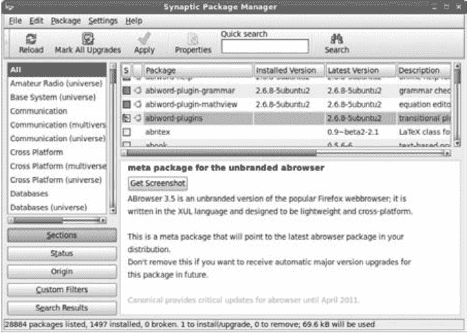

要切换回仓库列表，请点击类别按钮。您随时可以通过点击下方的搜索按钮返回到您的搜索历史。

### SYNAPTIC 的不足

尽管 Synaptic 功能强大，但它存在一些可用性问题。首先，在进行搜索时没有可用的停止按钮。如果您的计算机（或网络连接）较慢，并且您搜索常见的术语，例如单词 the，您应该做好等待搜索完成的准备。

其次，搜索历史仅限于当前会话。当您关闭 Synaptic 时，您将丢失搜索历史。

第三个限制涉及不断变化的搜索按钮。在 Dapper Drake（6.06 LTS）中，有两个搜索按钮。一个是搜索本身，另一个显示以前的搜索历史。在 Hardy 中，搜索按钮标记为搜索，历史可以通过使用搜索结果按钮找到。

然而，搜索按钮不断变化。例如，Karmic Koala（9.10）没有搜索按钮。您需要使用编辑 ⇒ 搜索或按 Ctrl+F。Karmic 还引入了快速搜索栏，您可以在其中优化搜索，而无需将结果存储在搜索结果列表中。


 ## 更改软件源

不同的 Ubuntu 发行版包含不同的默认软件源。默认的 Dapper Drake (6.06 LTS) 和 Hardy Heron (8.04 LTS) 安装仅启用官方支持的（main 和 restricted）软件源。你可能还想启用 universe 和 multiverse 软件源。相比之下，Karmic Koala (9.10) 启用了全部四个软件源。如果你只想要完全受支持的软件源，则需要禁用 universe 和 multiverse。

你可以通过 Synaptic 的 Settings ➪ Repositories 菜单修改软件源列表。系统提供了标准发行版的列表——你只需勾选相应的条目即可启用。

> **NOTE** 实验性（proposed）组件未包含在该列表中。如果你想从此软件源安装软件，需要手动将其添加到 `/etc/apt/sources.list`。此外，`sources.list` 文件中被注释掉的条目会显示在这里，但未勾选（已禁用）。

除了启用发行版之外，还可以使用 Add 按钮从发行版中选择特定的软件源（见图 5-2）。修改软件源后，你需要点击 Reload 重新扫描软件包列表。

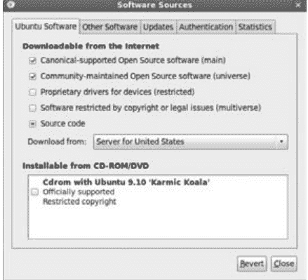

**图 5-2：** 添加到软件源列表

> **WARNING** Synaptic 几乎不会阻止你添加无效的 software-component 组合，或重复添加同一个发行版。错误的选择可能会导致后续出现错误消息，但在做出选择时你不会收到任何警告。

### 从 CD-ROM 或目录安装

除了通过网络安装外，Synaptic 还支持从 CD-ROM 驱动器或固定目录安装。这在没有网络连接或在封闭网络环境（如关键任务服务器机房）中工作时非常方便。

从 CD-ROM 安装非常简单——只需将 CD-ROM 放入光驱。Ubuntu 会识别该光盘为软件源，并提示你将其添加到软件源列表。此时，该 CD-ROM 将像任何其他软件源一样工作。

> **NOTE** 如果 CD-ROM 未被自动识别，你可以使用 Settings ➪ Repositories 进入 **Add Cdrom** 按钮。

在封闭环境中，通常从共享或本地目录安装更为方便。你可以使用 Settings ➪ Repositories 进行配置。不要选择预设值，而是点击 **Add** 按钮，然后选择 **Custom** 来添加你自己的软件源。例如，以下命令启用从下载的 ISO 文件安装软件包：

- 1. 了解你的系统。Dapper 希望从名为 dapper 的子目录安装。Hardy 希望从 hardy 安装，Jaunty 希望从 jaunty 安装。使用 `lsb_release -c` 识别你的系统希望使用的子目录：

   `$ lsb_release -c`
   
   `Codename:    hardy`

- 2. 下载一个与你的系统匹配的 Ubuntu 安装 CD-ROM。我们称其为 `ubuntu-hardy.iso`。

- 3. 挂载磁盘映像：

   `sudo mkdir -p /mnt/iso`
   
   `sudo mount -o loop ubuntu-hardy.iso /mnt/iso`

- 4. 使用 Synaptic 中的自定义添加按钮（Settings ➪ Repositories ➪ Add ➪ Custom），添加以下软件源：

   `deb file:/mnt/iso hardy main restricted`

> **NOTE** 使用 Synaptic 添加软件源时，每个软件源都会出现在 `/etc/apt/sources.list` 文件的末尾。但是，搜索软件包时，软件源是从文件的顶部到底部扫描的。如果你希望新添加的软件源优先使用，则需要编辑 `/etc/apt/sources.list` 并更改软件源的顺序。

Synaptic 将在 `/mnt/iso/dists/hardy/main` 和 `/mnt/iso/pool/hardy/main` 目录中查找 hardy 发行版的 main 软件源。`dists` 目录包含软件包的索引，而 `pool` 目录包含实际的软件包。

### 关闭软件源

使用 CD-ROM 或本地目录作为软件源可以提高安装速度，因为你不再依赖网络。本地软件源还可以让你自定义系统可以访问的软件。

然而，尽管将 CD-ROM 或本地目录用作软件源非常有用，但你在安装完成后可能希望禁用它。如果你不将其关闭，在移除 CD-ROM 或禁用目录后，Synaptic 会抱怨该软件源不再可访问。

要关闭软件源，请编辑 `/etc/apt/sources.list` 并注释掉相应的行以禁用，或删除行以移除。或者，你可以使用 Synaptic 并选择 System ➪ Repositories。你可以清除 CD-ROM 和自定义目录以将其关闭。如果你认为不再需要它们，可以点击 Remove 按钮。

### 管理更新

默认的 Synaptic 安装会定期检查升级。如果已安装的软件包有更新或补丁，Synaptic 可以标记这些更新或自动安装它们。

当有新更新可用时，系统会提醒你。在 Hardy Heron 及更早的系统上，你会在顶部面板看到警告图标。将鼠标悬停在此图标上会显示待处理更新的数量（见图 5-3），点击该图标即可应用更新。但是，Karmic Koala（烦人地）会打开一个巨大的弹出窗口，列出每个有待处理更新的软件包。


**图 5-3：** Hardy Heron (8.04 LTS) 上的指示器显示有可用更新

你可以使用 Software Preferences 小程序更改更新设置。可以从 System ➪ Administration ➪ Software Sources 菜单选择它，或通过右键点击更新指示器来选择。Updates 选项卡显示了设置。你可以让 Ubuntu 定期检查更新（或从不检查）、下载更新（但不安装），或自动安装安全更新。

某些更新在安装前需要特殊确认。这些包括内核更新和关键库。升级这些通常需要重新启动，并可能破坏某些应用程序。因此，这些软件包需要额外确认，不会自动安装。

默认情况下，Ubuntu 每天检查更新并通知你有待处理的更新。（在 Dapper Drake 上，它会自动安装关键的安全补丁。）

对于关键系统和受控环境，你可能希望完全禁用自动更新。这允许你在计划的时间段内应用更新，而不是在更新可用时。相比之下，普通家庭用户应保持每日检查更新，并考虑启用安全更新的自动安装。如果你使用慢速网络连接，可能希望更改更新频率，但至少应每两周检查一次。

> **WARNING** 完全禁用更新通常是一个糟糕的决定。虽然许多更新应用安全补丁，但其他更新解决稳定性问题。你可能只希望在有其他维护系统程序时才禁用自动更新。

### 在 Ubuntu Software Center 中浏览

虽然 Synaptic 提供了一种直接的方式来搜索所有软件包并安装选定项目，但它并不适合仅仅浏览可用软件列表。当然，Synaptic 列出了软件包甚至大致的类别，但它不区分依赖包和完整应用程序。从 Karmic Koala (9.10) 开始，桌面包含了一个名为 Ubuntu Software Center 的应用程序。

在 Ubuntu Software Center 中，所有软件包都按应用程序分组，并分为 Accessories、Games 和 Programming 等类别（见图 5-4）。目标是简化安装。如果你只是想浏览看看有什么可用，那么 Ubuntu Software Center 是理想的选择。

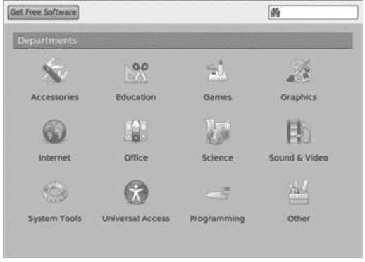

**图 5-4：** Ubuntu Software Center

例如，假设你想在 Synaptic 下安装一个天文馆应用程序。你可以搜索 "planetarium"，找到 `kstars`、`kstars-data` 以及六七个类似的 Celestia 软件包（`celestia`、`celestia-common`、`celestia-kde` 等）。你也可以搜索 "stars"，找到从 `kstars` 和 `stellarium` 到 `gcstars`（用于电影管理器收藏）以及 `defendguin` 和 `wing` 等街机游戏的所有内容。然而，除非你事先知道要搜索什么，否则你不会找到 OpenUniverse。

使用 Ubuntu 软件中心，你可以进入"科学"类别，轻松找到十几个天文程序。如果你选择"OpenUniverse 太空模拟器"，那么你会看到一个漂亮的描述、安装按钮，甚至还有一个指向网页的链接。所有繁琐的细节，比如晦涩的软件包名称和必需的依赖项，都被隐藏在幕后。

Ubuntu 软件中心提升了应用程序安装的可用性。由于它相对较新，用户界面可能会随着未来 Ubuntu 版本的发布而发生变化。（当前软件相比旧系统已经有了很大的改进，但还可以进一步优化。）最终，它甚至可能取代 Synaptic。

### 使用"计算机清理"工具

许多 Ubuntu 软件包都有依赖关系。如果你安装了一个软件包，后来决定移除它，这些依赖项可能会一直留在系统中。与 Ubuntu 软件中心一起，Karmic Koala 引入了"计算机清理"工具（系统 ➪ 管理 ➪ 计算机清理）。该应用程序会搜索不再需要的应用程序，让你可以轻松选择并删除它们。

与 Ubuntu 软件中心一样，"计算机清理"工具还需要一些改进，但它是朝着正确方向迈出的一步。与在 Hardy Heron（8.04 LTS）下使用 `sudo apt-get autoremove` 或 `deborphan`（`sudo apt-get install deborphan`）来查找未使用软件包相比，它无疑是一个改进。

```
## 移除一个未使用的依赖项可能会使另一个也变得未使用。
## 重复操作直到所有依赖项都被移除
while [ "$(deborphan)" != "" ]; do
    sudo apt-get remove-purge $(deborphan)
done
```

### 不使用 Synaptic 的生活

Synaptic 和 Ubuntu 软件中心是非常有用的工具，可用于保持补丁更新和安装新软件。不幸的是，这两个程序都需要人工操作和图形界面。如果你安装的是 Ubuntu 服务器，或者通过远程登录到系统，那么你可能没有图形界面。而且，当管理几十（或几百）个系统时，依赖图形界面会成为一种障碍。

幸运的是，Synaptic 是高级软件包工具环境的图形前端；Synaptic 的每一个基本功能都来自 APT。使用 APT 命令，你可以搜索软件、安装软件包，并从命令行执行升级。

### 修改软件源

APT 使用一个配置文件来告诉它软件仓库的位置。文件 `/etc/apt/sources.list` 包含服务器、发行版和仓库的列表。清单 5-1 展示了一些仓库条目示例。如果你想添加或更改仓库，只需（以 root 身份）编辑该文件并进行添加或修改。无需重启任何服务或进程。

> **注意** `/etc/apt/sources.list` 文件由 `dpkg`、APT、Synaptic 和 Ubuntu 软件中心使用。严格来说，APT 是 `dpkg` 的封装，而 Synaptic 和 Ubuntu 软件中心都是 APT 的图形前端。对此文件的更改会影响所有这些工具。

此文件中的每一行包含四个关键元素：

- **数据类型**——可用数据要么是预编译的二进制文件（`deb`），要么是用于编译二进制文件的源代码（`deb-src`）。
- **位置**——URL 说明如何获取数据。这通常是 HTTP、HTTPS 或 FTP 服务器，但也可以是本地 CD-ROM 或目录。
- **发行版**——提供发行版的名称。示例名称包括 hardy、hardy-updates 和 hardy-security。
- **组件**——指定一个或多个组件，如 main、restricted、universe 或 multiverse。

> **当所有其他方法都失败时……**
>
> 了解 Synaptic 的底层工作原理，以及如何命令行使用 APT，对于系统恢复至关重要。2006 年 8 月 21 日，Ubuntu 维护人员意外发布了一个错误的更新。该更新禁用了 X-Windows，将用户留在了命令行提示符下。Synaptic 等图形工具突然变得不可用了。唯一的缓解选项是在 Ubuntu 修复了 X-Windows 软件包中的错误后，使用 `apt-get` 从命令行重新安装 X 服务器。
>
> 并非所有故障都是由错误更新引起的。2006 年 7 月 22 日（星期六），许多托管 Ubuntu 软件仓库的服务器离线了——其中一些整个周末都处于离线状态。刷新 Synaptic 仓库列表会生成一个晦涩的错误信息（有时还会导致 Synaptic 崩溃）。了解如何手动将服务器从一个区域更改为另一个区域，是应用补丁和安装基本软件的唯一方法。而且，更改服务器是一项不使用 Synaptic 更容易完成的任务。（后来，停机时间被归因于一连串的服务器升级。）
>
> 意外时有发生，但如果不了解如何识别错误或从中恢复，你的系统可能会变得无法使用。命令行的 `apt-get` 和 `apt-cache` 工具会生成可用于诊断这些问题的信息性错误。在服务器或网络连接出现问题的情况下，编辑 `/etc/apt/sources.list` 文件使其指向其他服务器提供了一个快速解决方案。

### 清单 5-1：/etc/apt/sources.list 的示例条目

```
## 服务器 "us.archive.ubuntu.com" 包含软件包。
## 此服务器包含 karmic 的 main 和 restricted 组件。
deb http://us.archive.ubuntu.com/ubuntu/ karmic main restricted
deb-src http://us.archive.ubuntu.com/ubuntu/ karmic main restricted

## 发行版最终版本之后发布的主要错误修复更新。
deb http://us.archive.ubuntu.com/ubuntu/ karmic-updates main restricted
deb-src http://us.archive.ubuntu.com/ubuntu/ karmic-updates main restricted

## universe 组件中的软件包不受 Ubuntu 支持，
## 可能不会更新或修补，且未经 Ubuntu 安全团队检查。
## 如果你使用这些仓库中的软件，那么你只能自担风险。
#deb http://us.archive.ubuntu.com/ubuntu/ karmic universe
#deb-src http://us.archive.ubuntu.com/ubuntu/ karmic universe
#deb http://us.archive.ubuntu.com/ubuntu/ karmic-updates universe
#deb-src http://us.archive.ubuntu.com/ubuntu/ karmic-updates universe

## multiverse 组件中的软件包不受 Ubuntu 支持，
## 可能不是在免费许可证下提供的，可能不包含软件，
## 可能不会更新或修补，且未经 Ubuntu 安全团队检查。
## 如果你使用这些仓库中的软件，那么你只能自担风险。
#deb http://us.archive.ubuntu.com/ubuntu/ karmic multiverse
#deb-src http://us.archive.ubuntu.com/ubuntu/ karmic multiverse
#deb http://us.archive.ubuntu.com/ubuntu/ karmic-updates multiverse
#deb-src http://us.archive.ubuntu.com/ubuntu/ karmic-updates multiverse
```

### 添加 CD-ROM 仓库

> **提示** 如果你想排除特定的仓库，请确保 /etc/apt/sources.list 文件中没有任何仓库行包含它。例如，要排除 multiverse，请确保所有 multiverse 行都被注释掉（使用 # 字符）或从未注释的行中移除。

在对 /etc/apt/sources.list 进行任何更改后，你需要刷新 APT 可用软件包的缓存：`sudo apt-get update`。这将更新可用软件的缓存。没有这个命令，你就无法搜索可用软件列表。当你启用自动检查补丁时，系统实际上就是在运行 apt-get update 命令。

> **注意** 如果你对 /etc/apt/sources.list 进行了更改，并且你使用 Synaptic，那么你可以点击"重新载入"按钮来刷新缓存。否则，你需要运行 `sudo apt-get update`。

服务器列表应与你的地区相匹配。例如，us.archive.ubuntu.com 面向美国用户。uk.archive.ubuntu.com 服务器面向英国用户，ca.archive.ubuntu.com 则支持加拿大。目前已定义了一些两字母的国家代码（例如，uk 和 us）；未定义的国家代码会被重定向到英国，因为 Canonical 位于那里。如果你发现某个地区暂时不可用，那么可以尝试通过修改 /etc/apt/sources.list 中的每个服务器名称来更改地区。所有服务器同时不可用的情况很少见。

> **提示** 官方 Ubuntu 镜像与国家代码相关联，例如 us.archive.ubuntu.com 表示美国，de 表示德国。但这些主机名只是实际站点的别名。一些官方镜像的性能优于其他镜像。官方注册镜像列表维护在 https://launchpad.net/ubuntu/+archivemirrors。该列表包括国家、服务提供商、网络协议（http、ftp 或 rsync）、网络容量以及它上次与主 Ubuntu 服务器同步的时间。如果你发现某个国家代码服务器对你来说工作不顺畅，那么可以考虑查看此网站并明确使用不同的镜像。

除了使用 Synaptic，还有两种方法可以将 CD-ROM 添加到 /etc/apt/sources.list。第一种方法需要你先手动识别 CD-ROM 标签，然后再添加它。apt-cdrom 命令可以列出光盘的标签。让我们假设 Ubuntu 安装 CD-ROM 已挂载在 /mnt/iso：

```
$ apt-cdrom -m -d /mnt/iso ident
Using CD-ROM mount point /mnt/iso/
```


挂载 CD-ROM
正在识别。[246d1f9a6e6a7e92d0139dd36c36e257-2]
存储的标签：Ubuntu 9.10 _Karmic Koala_-Release i386 (20091028.5)

**提示** `apt-cdrom` 的 `-m` 参数表示不要挂载和卸载挂载点。`-d` 参数指定用于获取 `label` 的挂载点，`ident` 指示命令识别 CD-ROM 标签。如果不使用 `-m` 和 `-d`，则将使用驱动器中的 CD-ROM。

找到 CD-ROM 名称后，你可以使用 `cdrom:` 资源将其添加到 `/etc/apt/sources.list` 文件中。例如，要安装 main 组件，我会使用：

```
deb cdrom:[Ubuntu 9.10 _Karmic Koala_-Release i386
  (20091028.5)]/ karmic main
```

虽然你可以手动添加光盘，但添加 CD-ROM 最简单的方法是让 `apt-cdrom` 来完成。

+   1. 将 CD-ROM 插入驱动器。
2. 运行以下命令：

   `sudo apt-cdrom add`

CD-ROM 将自动添加到 `/etc/apt/source.list` 文件中。

**注意** 将 CD-ROM 添加到 `/etc/apt/sources.list` 文件后，务必运行 `apt-get update`。这会将 CD-ROM 上的软件包添加到已知软件包的缓存中。

## 浏览 APT 缓存

`apt-cache` 命令使你能够在仓库中搜索特定主题或文件名。搜索词将匹配任何软件包的名称或描述。例如，如果你正在搜索计算器，可以使用：

```
$ apt-cache search calculator
bc-The GNU bc arbitrary precision calculator language
gcalctool-A GTK2 desktop calculator
dc-The GNU dc arbitrary precision reverse-polish calculator
bison-A parser generator that is compatible with YACC
```

**提示** 搜索不区分大小写，并查找子字符串。你可以使用引号按顺序搜索多个单词，如 `apt-cache search "gnu bc"`。你也可以列出多个术语（不带引号），它们将以任意顺序匹配。例如：`apt-cache search calculator calctool`。

Bison（又一个编译器的编译器）被列为计算器可能看起来很奇怪，但另一个 `apt-cache` 命令显示整个软件包的描述，让我们了解为什么它会被列出。（Bison 的描述中包含 *calculator* 一词。）

```
$ **apt-cache show bison**
Package: bison
Priority: optional
Section: devel
Installed-Size: 1580
Maintainer: Ubuntu Core Developers
        <ubuntu-devel-discuss@lists.ubuntu.com>
Original-Maintainer: Chuan-kai Lin <cklin@debian.org>
Architecture: i386
Version: 1:2.4.1.dfsg-1
Depends: m4, libc6 (>= 2.4)
Suggests: bison-doc
Filename: pool/main/b/bison23-29-jessie/bison_2.4.1.dfsg-1_i386.deb
Size: 259028
MD5sum: b9f073b6ead38a0b448e3cb1fd9b1033
SHA1: e1eaf5fde901c727251ec1c624ce887d1dcbef88
SHA256: a4f633faa9a12caf642b29c646e91b66e14a2f5b5fd2cea9feca975f7151d84e
Description: A parser generator that is compatible with YACC
 Bison is a general-purpose parser generator that converts a
 grammar description for an LALR(1) context-free grammar into a C
 program to parse that grammar.  Once you are proficient with Bison, you
 may use it to develop a wide range of language parsers, from those used
 in simple desk calculators to complex programming languages.
..
```

`apt-cache` 的其他选项可以显示依赖关系、需求和内容。`apt-cache` 的手册页详细介绍了其他选项（`man apt-cache`）。

### 整理搜索结果

`apt-get search` 的结果不会按软件名称排序。相反，它们按服务器仓库排序。在计算器搜索的情况下，`bison` 列在 `dc` 之后，因为它来自不同的仓库。如果你想按软件包名称排序结果，那么你需要自己进行排序：

```
apt-cache search calculator | sort
```

同样，如果你正在搜索特定的软件包名称或描述，那么你需要应用过滤器：

```
$ **net usershare info**
The "usershare" commands are currently supported by Samba 3.0.23 and later. In add usershare acls username sharename
For Samba 3.0.23 and later, the **usershare** options require that the
**usershare** option be enabled in Samba. The local user must be a member
of the sambashare group to use these commands. Also a path must be configured
in **smb.conf** before you can use **net usershare**. uint32 **info-level**,
and can include:
* 97 — List shares owned by **user** (default if **usershare** options are shown with the **net usershare info** long share **command**.
* 98 — List shares available to **user** in **long** form.
* 99 — List **all** shares in **long** form.
The following **options** are available to only these **net** commands:
* **net rpc ?**
* **net rpc ?**
* **net rpc ?**
* **net ?**
好的，现在你知道如何测试基本连接了，让我们使用 **net** 创建一个共享文件夹。
**net** IIS helper domain
```

> **提示** 你可以使用 `grep` 将结果限制为显示的文本。这与使用 `apt-cache search` 的多个术语不同，因为匹配的结果可能不在显示的文本中。

#### 使用 APT 安装

知道要安装什么后，你可以使用 `apt-get install` 命令来执行安装。你可以在 `install` 指令后列出一个或多个软件包。如果你想看看会发生什么而不实际执行安装，请使用 `-s` 选项来模拟安装。你会看到所有警告和消息，而不实际执行安装。

```
sudo apt-get -s install gcalctool  # 检查安装
sudo apt-get install gcalctool     # 执行安装
```

虽然 `gcalctool` 应用程序在安装 Ubuntu 桌面时默认已安装，但其源代码并未安装。main 和 universe 组件中的所有软件包都提供源代码。但是，ERR_LIBRARY "for restricted or multiverse components. Source may not be available.

对于 restricted 或 multiverse 中的软件包，源代码可能不可用。当 `/etc/apt/sources.list` 包含错误条目或配置错误时，Synaptic 会给出晦涩的错误消息（或崩溃），而 `apt-cache` 和 `apt-get` 命令会显示大量错误和警告。

>/objects
in simple desk calculators to complex programming languages.

对于 restricted 或 multiverse 中的软件包，源代码可能不可用。当 `/etc/apt/sources.list` 包含错误条目或配置错误时，Synaptic 会给出晦涩的错误消息（或崩溃），而 `apt-cache` 和 `apt-get` 命令会显示大量错误和警告。

#### 使用 APT 移除软件包

软件包移除几乎和安装一样轻松。

+   1. 首先，找到你要移除的软件包名称。你可以使用 `apt-cache search` 或 `apt-cache pkgnames` 列出所有软件包，但最简单的方法是使用 `dpkg`。

```
dpkg -l | more
```

另外，如果你知道软件包中的某个文件，那么你可以使用 `dpkg -S` 列出包含该文件的所有软件包。例如，要移除提供 `bc` 程序的任何软件包，你可以使用：

```
dpkg -S $(which bc)
```

+   2. 使用 `apt-get -s` 检查将要移除的内容。某些软件包依赖关系会强制移除其他软件包。例如，要检查移除 `bc` 软件包，使用：

```
sudo apt-get -s remove bc
```

如果移除看起来安全，那么使用 `apt-get` 移除该软件包。例如，要移除 `bc` 软件包，使用：

```
sudo apt-get remove bc
```

**警告** `bc` 软件包是作为默认桌面的一部分安装的。移除 `bc` 会从一个名为 `ubuntu-desktop` 的琐碎软件包中移除一个依赖项。这不是实际的桌面，而是用作标志以指示已安装完整桌面。要查看 `ubuntu-desktop` 软件包中的所有内容，请使用 `dpkg -L ubuntu-desktop`。（`ubuntu-desktop` 只提供两个文件：`copyright` 和 `changelog.gz`。）

### 移除残留物

大多数软件移除都是干净的——进入的一切都被移除。不幸的是，某些移除会留下残留物，如配置和数据文件。移除或重新安装软件包因为它配置错误可能不会替换关键配置文件。这可能导致软件包在重新安装后仍然配置错误。一些例子：

+   - 移除并重新安装 Web 浏览器不会清除用户缓存或替换用户设置。这不是解决缓存网页隐私问题的方案。
- 移除并重新安装 Gnome 不会移除 `$HOME/.gnome`、`$HOME/.gnome2` 以及用户目录中的其他 Gnome 相关文件。
- 许多软件包会检查修改过的配置文件。如果你修改了配置文件，如 `/etc/X11/xorg.conf` 或 `/etc/gdm/gdm.conf`，那么这些软件包在移除时可能不会移除它们。

**注意** 如果你因为配置问题而重新安装软件，请注意这可能无法解决问题。

在你决定重新安装软件包之前，可能需要手动清理（或删除）剩余文件和其他残留物。在配置错误的情况下，重新安装软件包通常不会解决问题——尤其是当配置问题是由于用户目录中的文件或安装后创建的文件导致时。

### 跟踪移除

如前所述，移除的最大问题之一来自依赖软件包。移除一个软件包可能会自动选择并移除其他软件包。虽然使用 `apt-get remove -s` 可能很有用，但始终记住先使用 `-s` 检查。如果你忘记 `-s`，那么


你需要某种方式来查看所有被移除的内容（这样你才能把关键软件包恢复回来）。

幸运的是，你有两种选择（除了从系统备份恢复之外）。首先，`/var/log/dpkg.log` 文件记录了所有的安装和移除操作（见清单 5-2）。每当 Synaptic、APT 或 `dpkg` 安装或移除软件包时，这个日志文件都会更新。利用这个列表，你可以看到什么被移除了，并撤销意外移除的操作。

> `dpkg.log` 文件是自动更新后一个很好的参考来源。特别是在更新导致系统不稳定时，更是如此。

### 清单 5-2：/var/log/dpkg.log 的示例内容

```
2009-11-28 18:42:07 install openuniverse <none> 1.0beta3.1-6
2009-11-28 18:42:07 status half-installed openuniverse 1.0beta3.1-6
2009-11-28 18:42:07 status unpacked openuniverse 1.0beta3.1-6
2009-11-28 18:42:07 status unpacked openuniverse 1.0beta3.1-6
2009-11-28 18:42:08 startup packages configure
2009-11-28 18:42:08 configure openuniverse-common 1.0beta3.1-6 1.0beta3.1-6
2009-11-28 18:42:08 status unpacked openuniverse-common 1.0beta3.1-6
2009-11-28 18:42:08 status half-configured openuniverse-common 1.0beta3.1-6
2009-11-28 18:42:08 status installed openuniverse-common 1.0beta3.1-6
2009-11-28 18:42:08 configure openuniverse 1.0beta3.1-6 1.0beta3.1-6
2009-11-28 18:42:08 status unpacked openuniverse 1.0beta3.1-6
2009-11-28 18:42:08 status half-configured openuniverse 1.0beta3.1-6
2009-11-28 18:42:08 status unpacked openuniverse 1.0beta3.1-6
2009-11-28 18:42:09 status installed openuniverse 1.0beta3.1-6
2009-11-28 18:42:26 startup packages remove
2009-11-28 18:42:26 status installed openuniverse 1.0beta3.1-6
2009-11-28 18:42:26 remove openuniverse 1.0beta3.1-6 1.0beta3.1-6
```

第二种选择是使用 `script` 命令。该命令将所有的命令行输出记录到一个文件中：

```
$ script -c "sudo apt-get remove openuniverse-common" apt-get.log
Reading package lists.. Done
Building dependency tree
Reading state information.. Done
The following packages will be REMOVED:
  openuniverse openuniverse-common
0 upgraded, 0 newly installed, 2 to remove and 8 not upgraded.
After this operation, 5448kB disk space will be freed.
Do you want to continue [Y/n]? Y
(Reading database .. 217775 files and directories currently installed.)
Removing openuniverse ..
Removing openuniverse-common ..
Script done, file is apt-get.log
```

通过 `script` 命令，你会得到一个名为 `apt-get.log` 的文件，其中包含整个移除过程的完整记录。这个命令甚至可以封装成一个简单的脚本，用来替代直接使用 `apt-get` 命令（见清单 5-3）。

### 清单 5-3：用于记录结果的 /usr/local/bin/apt-get 替代脚本

```
#!/bin/sh
## Run the apt-get command and append (-a) results to ./apt-get.log
script -a -c "sudo /usr/bin/apt-get $*" apt-get.log
```

### 使用 APT 进行升级

应用升级是一个两步过程。首先，使用 `apt-get update` 根据你的 `/etc/apt/sources.list` 获取可用软件包和升级的列表。如果有任何更新可用，顶部面板将会出现更新指示器。获取更新列表后，使用 `apt-get upgrade` 执行升级。

```
$ sudo apt-get update
Get:1 http://archive.ubuntu.com hardy Release.gpg [189B]
Get:2 http://archive.ubuntu.com hardy Release [34.8kB]
Get:3 http://archive.ubuntu.com hardy/universe Packages [2458kB]
Hit http://us.archive.ubuntu.com hardy Release
Hit http://us.archive.ubuntu.com hardy-updates Release
Hit http://us.archive.ubuntu.com hardy/main Sources
..
Fetched 3117kB in 7s (416kB/s)
Reading package lists.. Done
$ sudo apt-get upgrade
```

### 安装常用功能

在设置 Ubuntu 桌面系统时，有一些软件包是大多数人想要安装的。其中很多都围绕多媒体功能：播放 MP3 文件、DVD 电影媒体，以及使用 RealNetwork RealPlayer 的多媒体流媒体。虽然使用 `apt-get` 下载相对容易，但有些软件包在使用前仍需要进行配置。

不幸的是，由于许可问题，一些必需的多媒体软件包不受 Ubuntu 支持（在某些情况下，该软件已被当地当局认定为非法）。因此，对于这些软件包，安装基本上是手动的。

> **没那么容易**
>
> 对于早期版本的 Ubuntu，如 Dapper Drake（6.06 LTS）和 Edgy Eft（6.10），曾有用于自动安装受许可限制的媒体库和播放器的应用程序。遗憾的是，像 EasyUbuntu 和 Automatix 这样的工具已不再受支持。在比 Edgy Eft 更新的 Ubuntu 版本中，你找不到这些程序。

### 安装多媒体支持

不同的多媒体格式需要不同的库来编码和解码格式。Ubuntu 提供了多种编解码器（codec）库。每个软件包都使用 `apt-get install package_name` 来安装。其中一些软件包位于 universe 或 multiverse 仓库中。对于大多数这些软件包，不需要额外的配置步骤。

> **变化的目标**
>
> 软件包的位置取决于你的 Ubuntu 版本。例如，用于 MP3 支持的 `ffmpeg` 软件包位于 **Dapper 的 universe、Hardy 的 universe 和 Karmic 的 main 仓库中**。同样，用于 MPEG4 支持的 `faad` 软件包位于 Dapper 的 multiverse 中，但 **Hardy 和 Karmic 的 universe 仓库中**。
>
> 要**找出软件包来自哪里，请使用** `apt-cache show` **并查找** `Section` **字段。例如**，`apt-cache show ffmpeg | grep "^Section:"`。**你会看到类似** `Section: universe/graphics` **的内容，表示 universe 仓库，或者看到** `Section: graphics` **表示 main 仓库。**

- **MP3** — MP3 是最常见和流行的音频格式之一。如第 2 章所述，`sox` 和 `lame` 软件包提供 MP3 编码和解码支持。虽然这些工具提供了命令行支持，但它们不提供音频库。对于能与大多数音频播放器配合工作的库，你需要安装 `ffmpeg` 软件包。
- **Ogg** — Ogg Vorbis 是一种替代音频格式，不受 MP3 许可限制。要支持 Ogg Vorbis 文件，你需要从 restricted 仓库安装 `vorbis-tools` 软件包。
- **MPEG 和视频** — 对于 MPEG 和其他视频文件格式，你需要安装 `mjpegtools` 软件包。这个 multiverse 软件包为 MPEG、AVI、QuickTime 和其他视频格式提供编解码器。
- **MPEG4** — `libxvidcore4` 和 `faad` 软件包为这种文件格式提供视频和音频支持。

在将编解码器加载到系统上后，你需要在多媒体播放器中添加插件，让它们知道这些编解码器的存在。

- **Gstreamer** — Gstreamer 接口为大多数 Gnome 应用程序提供多媒体支持。虽然有通用插件，但它们的软件包命名约定不够直观。
  - `gstreamer0.10-ffmpeg`：该软件包为 ffmpeg 软件包提供支持。
  - `gstreamer0.10-pitfdll`：该软件包为存在争议的 w32codecs 软件包添加支持。
  - `gstreamer0.10-plugins-bad`：该软件包为尚未成熟的编解码器提供支持，例如 WAV 音频编解码器。命名约定中的 bad 表示仍在开发中的编解码器。它们接近生产质量，但尚未达到。
  - `gstreamer0.10-plugins-bad-multiverse`：该软件包为尚未成熟的 multiverse 编解码器提供支持。这包括 `faad` 和 `libxvidcore4`。
  - `gstreamer0.10-plugins-ugly`：该软件包为 MPEG 格式提供支持。bad 编解码器只是不够成熟，而 ugly 编解码器可能由于许可限制或专利而存在分发问题。
  - `gstreamer0.10-plugins-ugly-multiverse`：与 gstreamer0.10-plugins-ugly 类似，该软件包支持来自 multiverse 仓库的软件包。
- **Xine** — Xine 是一个音频和视频播放器，为 Gnome 的 totem 播放器提供替代方案。与 Gstreamer 接口一样，Xine 支持插件。`gxine` 软件包安装 gxine 基础播放器。`libxine-main1` 和 `libxine-extracodecs` 软件包提供编解码器。

### 添加专有媒体支持

由于限制性许可，Ubuntu 不支持 WMA、WMV 和其他 Microsoft 专有格式的编解码器，这些编解码器可能不存在于 Ubuntu 仓库中。同样，播放 DVD 电影需要解码内容扰乱系统（CSS）。开源解码器（DeCSS）在某些国家已被认定为非法。


 # 警告

安装诸如 `libdvdcss2`、`libdvdread4` 和 `w32codecs` 之类的软件包可能会引发法律问题——尤其是在企业和政府环境中。如果您对此有任何疑问，在安装这些软件包之前，建议咨询法律顾问。

尽管 Ubuntu 发行版可能不提供所需的软件包，但 Medibuntu 发行版可以提供。Multimedia, Entertainment & Distractions In Ubuntu（Medibuntu）仓库包含一些因法律限制而未包含在 Ubuntu 仓库中的软件包。

### 警告

Medibuntu 仓库并不支持所有 Ubuntu 版本。例如，截至本文撰写时，Dapper 仍享有 Ubuntu 的长期支持。然而，Medibuntu 已将其仓库中的 Dapper 移除。Medibuntu 仅支持最近几个 Ubuntu 版本。

+ 1. 将 Medibuntu 仓库添加到您的 APT 源列表中。建议将其存储在单独的源文件中，而不是追加到 `/etc/apt/sources.list` 文件中，以便清楚区分 Ubuntu 仓库和非 Ubuntu 仓库。

```
sudo wget -O /etc/apt/sources.list.d/medibuntu.list \
  http://www.medibuntu.org/sources.list.d/$(lsb_release -cs).list
```

+ 2. 安装 Medibuntu 密钥环。这用于验证远程 Medibuntu 仓库。

```
sudo apt-get --yes -q --allow-unauthenticated install medibuntu-keyring
```

+ 3. 更新仓库存内容缓存。

```
sudo apt-get update
```

+ 4. 安装 Windows 编解码器。如果您运行的是 32 位系统，请安装 `w32codecs`；64 位系统应使用 `w64codecs`。

```
sudo apt-get install w32codecs # 适用于 32 位系统
sudo apt-get install w64codecs # 适用于 64 位系统
```

+ 5. 安装 RealPlayer 以访问 RealNetworks 的专有流媒体格式。这会自动为您的 Web 浏览器添加 RealNetworks RealMedia 支持。（安装播放器后，请务必重新启动所有已打开的 Web 浏览器。）

```
sudo apt-get install realplayer
```

+ 6. 安装 `libdvdcss2` 以播放加密的 DVD 视频。

```
sudo apt-get install libdvdcss2
```

## 其他 DVD 选项

除了添加 Medibuntu 仓库之外，还有其他方法可以为 Ubuntu 添加 DVD 支持。例如，`libdvdread3`（在 Karmic 下为 `libdvdread4`）软件包可以为系统准备 DVD 支持。但是，安装该软件包后，您需要运行一个脚本才能完成配置：

```
sudo apt-get install libdvdread3
sudo /usr/share/doc/libdvdread3/install-css.sh
```

该脚本将下载并安装 `libdvdcss2` 软件包。完成后，您可能需要删除 `/tmp/libdvdcss.deb` 或 `/tmp/dvdcss-*`，因为临时数据不再需要。（`libdvdread3` 和 `libdvdread4` 软件包虽然方便，但它们会在系统中留下安装残留。）

## 获取 Flash

Macromedia 为 Ubuntu 提供了 Flash 播放器。从 multiverse 仓库安装 `flashplugin-nonfree` 软件包实际上会从 Adobe 网站下载并安装 Linux 版 Flash 播放器。

```
sudo apt-get install flashplugin-nonfree
```

遗憾的是，`flashplugin-nonfree` 软件包仅适用于 PC。对于 PowerPC 等不受支持的平台，还有其他替代方案。开源的 `libflash-swfplayer`、`swfdec-gnome` 和 `swfdec-mozilla` 软件包为所有 Ubuntu 平台提供基本的 SWF（Flash 文件）支持。

尽管开源 SWF 播放器在 PC 和其他平台上都受支持，但并非在 Ubuntu 的每个版本上都可用。例如，Dapper（6.06 LTS）有 `libflash-swfplayer`，但没有 `swfdec-gnome`；Karmic（9.10）有 `swfdec-gnome` 但没有 `libflash-swfplayer`；而 Hardy（8.04 LTS）两者都有。

开源 SWF 软件包也不支持所有 SWF 版本。较新版本的 Flash 动画可能无法使用 `swfplayer`（来自 `libflash-swfplayer` 软件包）或 `swfdec-player`（来自 `swfdec-gnome`）播放。

## 安装字体软件包

有一些桌面软件包您可能希望安装。第一组软件包提供不同的桌面字体。这些字体被从文本菜单到 PDF 和 PostScript 查看器的各种应用所使用。如果某个应用程序找不到特定字体，它将尝试用其他字体替代，结果可能很糟糕。

Ubuntu 支持三种主要类型的字体：xfonts、gsfonts 和 ttf。xfonts 由 X-Windows 使用。这些位图字体针对特定分辨率（每英寸点数，dpi）设计，缩放时可能显得块状化。例如，`xfonts-100dpi` 软件包提供在 100dpi 下渲染效果最佳的字体。

Ghostscript 字体（gsfonts）是矢量字体而非位图字体。这些字体可能比位图字体渲染时间更长，但看起来更平滑且缩放效果更好。它们通常用于显示文档、文字处理和打印，但不用于常规屏幕字体。

最后一组是 TrueType 字体（ttf）。这些也是矢量字体，在 Windows 系统中广泛使用。如果您收到的 PDF 或 Word 文档有丑陋或缺失的字体，那么您可能需要安装 ttf 字体软件包。

字体定义文件相对较小，如果不使用也不会消耗系统资源。为了获得最佳效果，建议为可能遇到的所有语言安装所有可用字体。这样，您就不会以糟糕的替代字体进行渲染。

> **警告** 安装*所有*字体可能会对某些应用程序的性能产生负面影响。例如，如果您有数百种字体，而计算机速度较慢、资源有限，OpenOffice 可能会花费很长时间来填充字体列表。在决定是否安装特定字体时，请酌情判断。

> **注意** 大多数情况下默认字体称为 *misc-fixed*，是一种等宽的 Sans Serif 字体。在 PostScript 和 PDF 等图形格式之间转换时，缺失的系统字体可能会被位图字体替代，导致文本非常粗糙，虽然可读但并不美观。使用位图字体绘制文本的技术术语是*丑陋渲染*。

- **Ghostscript 字体**——Ghostscript 是开源的 PostScript 渲染和查看系统。Ghostscript 使用的字体可以被任何可用的 X-Windows 应用程序使用。`gv` 软件包提供用于查看 PostScript 文件的 Ghostscript Ghostview 程序。`gsfonts` 软件包提供 Ghostscript 字体，`gsfonts-x11` 则使这些字体可用于 X11。

```
sudo apt-get install gv gsfonts gsfonts-x11
```

- **国际字体**——有许多不同的软件包用于提供国际语言支持。支持所有最常见的语言，以及一些不太常见的语言。字体软件包示例包括：
  - `xfonts-intl-european` 为大多数欧洲和拉丁语系语言提供支持。这包括西班牙语、德语和法语。
  - `gsfonts-wadalab-common`、`gsfonts-wadalab-gothic`、`gsfonts-wadalab-mincho`、`konfont` 和 `ttf-sazanami-mincho` 分别提供日语支持。
  - `gsfonts-other` 提供用于西里尔字母、假名（日语）和其他字体的 Ghostscript 字体。
  - 有多种中文字体软件包。可以使用 `apt-cache` 轻松找到它们：
    - `apt-cache search font chinese | egrep 'ttf|xfont'`
  - `ttf-farsiweb` 和 `ttf-paktype` 提供波斯语和乌尔都语字体。
  - `ttf-khmeros` 提供柬埔寨高棉语字体。
  - 有数十 plain xfont 软件包（`apt-cache search xfonts`）用于支持大多数欧洲、亚洲和中东语言。

- **Windows 字体**——`msttcorefonts`（Karmic 下为 `ttf-mscorefonts-installer`）软件包提供 Microsoft 系统中的核心 TrueType 字体。虽然这确实能与 Windows 系统实现真正的兼容，但可能存在许可问题。

- **免费 Windows 兼容字体**——`ttf-liberation` 软件包（适用于 Hardy Heron 8.04 LTS 及更高版本）提供免费字体，其度量与 Windows 字体相同。如果您无法使用真正的 Windows 字体，那么这是最佳选择。

安装字体后，您需要通知应用程序它们的存在。幸运的是，所有标准应用程序都查看相同的缓存目录。命令 `sudo fc-cache -f -v` 将扫描并列出字体目录，并更新共享字体信息。

> **注意** 如果安装字体后它们没有出现，您可能忘记了运行 `fc-cache`。

## 编译和开发软件

Ubuntu 仓库中的软件包并未包含所有开源软件（远非如此！）。main 和 restricted 仓库仅包含由 Ubuntu 及其管理公司 Canonical 明确支持的软件。universe 和 multiverse 仓库仅包含社区中某人（曾经）支持的 Ubuntu 软件包。还有一些像 GetDeb路线 (`www.getdeb.net`) 这样的网站，在其非官方 Ubuntu 仓库中提供一些最新的软件版本。

软件可以来自任何地方。有数十万开源项目不在 Ubuntu 仓库中，其中许多只需要您下载并编译源代码。

你可能有许多理由想要下载源代码。一些常见的原因包括：

- **前沿技术**——Ubuntu 软件仓库中的软件可能已经过时。如果你想要最新版本，你可能需要访问项目的主页并下载源代码。
- **调整定制**——如果你不喜欢某个软件的运行方式，你可以下载源代码并进行修改。
- **修复问题**——某些软件包无法正常工作。这可能是由于依赖关系损坏或软件组件过时导致的。无论如何，你都可以获取代码，根据需要进行修补，并安装到你的系统中。你不仅限于使用预编译的软件。
- **学习教育**——如果你想了解某个东西的工作原理，你可以下载源代码并查看代码。开源项目的代码可以作为优秀的示例和模板使用。
- **扩展功能**——许多项目都是可扩展的。通过下载源代码，你可以了解如何将新的软件接入到项目中。
- **利用现有成果**——为什么要重复造轮子？如果某些源代码实现了你需要的功能，你可以下载代码并将其调整为适合你的需求。请务必注意原作者的许可证要求；某些源代码不能在无限制的情况下自由使用。
- **共享贡献**——universe 和 multiverse 软件仓库中的每个软件包都是由某个人编译和测试的。也许你想把你喜爱的项目添加进去，让社区也能受益？
- **独特功能**——许多不在 Ubuntu 软件仓库中的开源项目提供了非常独特且有用的功能。如果你无法下载二进制形式的功能，那么你需要获取源代码。

无论出于什么原因，你都需要某种方式来获取源代码并进行编译。某些开源代码是为特定平台和操作系统构建的。例如，邮件阅读器 `elm` 和图形程序 `xv` 都是为非常旧版本的 Linux 设计的，而且没有被持续维护。仅仅下载这些项目的源代码是不够的。你可能需要在构建这些可执行文件之前编辑文件。要编译任何不兼容的项目，你可能需要一个完整的开发环境。

### 安装软件包源代码

许多软件包同时提供预编译的可执行文件和源代码。如果你计划安装任何源代码，那么你需要安装 `dpkg-dev` 软件包。这会引入一个必需的可执行文件：`/usr/bin/dpkg-source`。它用于解压源代码包。

许多软件包包含开发者安装内容。例如，`linux-source` 软件包会将源代码放置在系统中，供进行内核开发的人员使用。大多数主要子系统（包括音频、USB 和 X-Windows）都提供了开发者软件包。

从 Ubuntu 软件仓库获取源代码的另一种方式是实际下载源代码，而不是安装包。使用 `apt-get source` *package_name* 来下载源代码。main 和 universe 软件仓库中的每个软件包都应该包含源代码，但 restricted 和 multiverse 软件仓库中的软件包可能缺少源代码。

> **注意** 并非每个软件包都包含源代码，有些软件包包含源代码、通用补丁和 Ubuntu 特定的补丁。

安装二进制文件需要你以 root 身份运行 `apt-get`。这是因为文件被放置在特权目录中，并且必须更新已安装软件包的目录。相比之下，源文件被放置在当前目录中，因此不需要 root 权限。这也意味着不会自动删除。例如，要下载 `gcalctool` 的源代码并解压，使用：

```
mkdir src
cd src
apt-get source gcalctool
```

如果你还想自动编译它，请在 `apt-get` 命令行中添加 `--compile` 标志：

```
apt-get --compile source gcalctool
```

> **警告** 虽然 `apt-get install` 会下载依赖项，但 `apt-get source` 命令不会。你可能需要下载和安装不同的开发者软件包以及额外的源代码。不要期望自动编译每次都能完美运行。

如果你不再需要源代码，可以不使用 `apt-get` 来删除它：

```
rm -rf gcalctool*
```

### 使用 C 语言编程

大多数开源项目是用 C、C++、Java、Perl、Python 或 Shell 脚本编写的。Perl、Python 和 bash（用于 Shell 脚本）默认已安装。虽然基本的 C 和 C++ 编译器已安装，但这些不是完整的开发环境。你应该考虑安装完整的环境。

完整的 C 和 C++ 环境包含许多组件。需要安装的关键组件包括：

- Gnu C 编译器（gcc）和 Gnu C++（g++）。这些软件包还会安装手册和文档，以便你在需要时查阅标准库调用。

```
sudo apt-get install gcc g++
sudo apt-get install gcc-doc manpages-dev
```

- make 命令通常用于构建可执行文件。其他构建环境工具包括 autoconf、automake 和 libtool。

```
sudo apt-get install make autoconf automake libtool
```

- 如果代码使用了任何复杂的状态机或词法分析器，那么你可能需要 flex 和 bison。

```
sudo apt-get install flex bison bison-doc
```

- zlib 库非常常见。大多数执行压缩操作的工具都使用它。一些著名的例子包括 gzip、bz2 和 unzip，但其他工具（如 PNG 渲染系统和 MP3 播放器）也使用 zlib。

```
sudo apt-get install zlib1g zlib1g-dev
```

- 大多数图形系统使用 X11 图形库。你可能需要开发环境，因为它提供了 X-Windows 的应用程序编程接口（API）。

```
sudo apt-get install libx11-dev
```

- 如果你计划进行任何深入的开发，你可能需要一个集成开发环境（IDE）。在 Ubuntu 下，你有几个选择。
  - Anjuta 是一个功能齐全的 IDE，具有图形界面。要安装它，使用 `sudo apt-get install anjuta`。
  - Eclipse 是一个非常流行的 Java IDE，但它确实有用于 C 编程的扩展。使用 `sudo apt-get install eclipse eclipse-cdt` 来安装 Eclipse 和 C 开发工具。

**注意** Anjuta 专为 C 和 C++ 软件开发而设计。相比之下，Eclipse 是 Java IDE 的扩展。因此，Eclipse 需要包含许多 Anjuta 不需要的额外软件包。Eclipse 的依赖列表包括 Ant（一个与 make 相当的 Java 构建系统）、Java（完整环境）和 libswt（标准小部件工具包）。

### 启用 Java

Java 是一种编程语言，一些开发者将其作为 C 和 C++ 的替代方案。它的优势在于可移植性：用 Java 创建的程序不需要在每个平台上重新编译。

> **注意** 尽管名称相似，Java 和 JavaScript 是非常不同的语言。JavaScript 的名称更多是一种营销策略而非功能表达。在该语言创建时，Java 非常流行，而 *scripts*（脚本）暗示 *简单*。不幸的是，许多非程序员仍然认为 JavaScript 使用的是 Java。

在 Ubuntu 的早期版本中，安装 Java 有许多选择，而且都需要多个步骤。问题在于许可证：Sun Microsystems 使用了一种限制性许可证，不适合 restricted 或 multiverse 软件仓库。当 Ubuntu Dapper Drake（6.06 LTS）发布时，Sun 更改了许可证，允许将该软件包放入 multiverse 软件仓库。

如今，Java 有许多不同的变体。这包括 Sun Microsystem 的 Java、OpenJDK 和 GCJ。对于大多数实际用途，你只需要安装其中之一。

- Gnu Java 编译器（GCJ）是 Ubuntu 默认安装的一部分，但它缺少开发环境。这个 Java 版本来自 main 软件仓库。

  `sudo apt-get install java-gcj-compat-dev`

- Sun Java 是由 Sun Microsystems 维护的 Java 官方版本。它存在于 multiverse 软件仓库中。

  `sudo apt-get install sun-java6-bin sun-java6-jre`

- OpenJDK 是一个开源的 Java 开发工具包，包含 Java 编译器和标准库。它从 Hardy Heron（8.04 LTS）及更高版本开始，可在 universe 软件仓库中获得。

  `sudo apt-get install openjdk-6-jre # 运行时环境`
  
  `sudo apt-get install openjdk-6-jdk # 可选的 Java 开发工具包`

除了 Java 开发环境之外，你可能还想安装一些可选组件：

- 如果你想在 Mozilla Firefox 网页浏览器中使用 Java，你需要安装 Java 插件并将其配置为默认的 JRE。你还需要运行 `update-alternatives` 来更新操作系统中找到的各种链接。

  `sudo apt-get install sun-java6-plugin` &nbsp;&nbsp;&nbsp;&nbsp; `# 用于 Sun Java..`
  
  `sudo apt-get install icedtea6-plugin` &nbsp;&nbsp;&nbsp;&nbsp;`# 用于 OpenJDK..`


 ## 修复脚本

Shell 脚本在系统中随处可见。`/etc/init.d/` 下的启动命令是脚本，`/etc/gdm/` 中的 Gnome 显示管理器配置和 `/etc/network/` 中的网络配置都是脚本。甚至命令行提示符实际上也是一个交互式脚本，你在使用过程中不断创建它。

Shell 脚本只有一个真正的问题，那就是 shell 本身。大多数 shell 脚本以 `#!/bin/sh` 这行开头。前两个字符是特殊的：它们告诉正在运行的 shell，该文件是脚本而不是数据文件或编译后的可执行文件。紧接着是要用哪个 shell 来处理脚本中的命令。在这个例子中，所有内容都将使用 `/bin/sh` 进行处理。Perl 脚本通常使用 `#!/usr/bin/perl`，你也可以使用 `#!/bin/awk` 创建一个 awk 脚本。

问题在于 `/bin/sh` 实际上并不是一个程序。它是一个指向实际 shell 的符号链接。在 Dapper Drake（6.06 LTS）及更早版本的 Ubuntu 中，`/bin/sh` 链接到 `/bin/bash`。Bourne Again Shell（bash）是一个功能丰富的 shell，它扩展了 Unix 早期的原始 Bourne shell（`sh`）。

从 Edgy Eft（6.10）开始，`/bin/sh` 被改为链接到 `/bin/dash`。Debian Almquist Shell（dash）是一个精简的 shell，加载速度更快，占用内存更少，非常适合大多数 shell 脚本。虽然 dash（大部分）符合 POSIX 标准且与 Bourne shell 兼容，但它缺少许多 bash 中的附加功能。一些缺失的功能包括：

- **没有命令行编辑器**——使用 bash 时，你可以使用 `bash -o vi` 或 `bash -o emacs` 来指定使用 vi 或 Emacs 控件进行命令行编辑。Dash 没有编辑器。

- **没有变量内表达式**——使用 bash 时，像 `${!MODE_*}` 和 `${MODEVAR//_/\/}` 这样的变量内替换是修改变量内容的快捷方式。Dash 不支持这些功能。

- **缺少 POSIX 功能**——一些 POSIX 功能，例如用于表示 shell 脚本行号的 `$LINENO`，在 dash 中缺失。这意味着 dash 无法存储先前命令的历史记录，而且 `!!`（重新运行上一条命令）和 `!-2`（重新运行倒数第二条命令）等命令也无法使用。

通常 `/bin/bash` 和 `/bin/dash` 之间的差异不会造成问题。但当代码从其他操作系统移植过来，而那里的 `/bin/sh` 实际上是 bash 时，就可能会给你带来麻烦。通常 shell 差异出现在复杂的 shell 脚本中，但也可能出现在运行系统命令的 Perl 或 C 代码中。（`system()` 和 `popen()` 调用会运行 `/bin/sh`，它可能是 bash、dash 或其他 shell。）

如果你遇到这个问题，有两种解决方法。最好的选择是在无法工作的单独实例中替换 shell。如果脚本需要 bash，那就让它运行 bash：将脚本的第一行从 `#!/bin/sh` 改为 `#!/bin/bash`。

不太理想的选择是将默认系统 shell 替换为 bash：

```
sudo ln -sf /bin/bash /bin/sh
```

这第二种选择不太理想，因为它会拖慢启动和运行时间；每个启动和维护脚本都使用 `/bin/sh`；由于 dash 运行速度更快、消耗资源比 bash 更少，这种更改会造成性能损失。不过，这种更改不会破坏任何东西，因为 bash 可以做 dash 能做的所有事情，而且功能多得多。

> **注意** 有关从 bash 更改为 dash 的更多信息，请参阅 `https://wiki.ubuntu.com/DashAsBinSh`。

### 小结

Ubuntu 提供了许多不同的方式来搜索软件、安装包和管理更新。某些方法需要图形显示——这些非常易于使用，但可能会限制远程管理。如果图形显示不可用（或不方便），你总是可以退回到命令行软件管理系统。虽然你可能想要的大多数常见软件都可以从四个标准仓库之一获得，但你应该准备好下载源代码并手动编译软件，因为某些酷炫的项目并不能直接在 Ubuntu 上使用。

## 第 6 章

在线通信

### 本章内容

- 通过改进浏览器功能增强 Web 访问
- 从远程位置保护 Web 访问
- 如何统一电子邮件账户
- 使用即时通讯和 VoIP 聊天

默认的 Ubuntu 桌面安装包含 Web 浏览器、电子邮件阅读器、即时通讯和聊天室客户端，甚至还有 VoIP 系统。虽然任何人都可以直接使用它们，但通过进行一些调整和设置几个参数，你可以从中获得更多收益。无论你想要速度、安全性，还是更华丽的图形和更酷的功能，你都需要修改默认应用程序。在本章中，你将了解如何调整 Web 浏览器设置、使用安全 shell 保护你的 Web 流量、在多种系统上访问邮件，以及在线聊天。

### 破解 Firefox Web 浏览器

Ubuntu 的默认 Web 浏览器是 Mozilla Firefox。该浏览器速度快，支持 HTTP 1.0 和 1.1 协议，以及 HTML、CSS 和 JavaScript。虽然你可以立即使用该浏览器访问网站，但某些默认设置还可以做一些修改。

> Hardy Heron（8.04 LTS）及更高版本的 Ubuntu 使用 Firefox 3.x。旧版本的 Firefox 具有相同的配置选项，但它们位于不同的首选项标签下。

### 调整首选项

Firefox 有一组可以调整以满足你需求的常用首选项。启动浏览器并选择 Firefox 菜单中的 Edit ↔ Preferences 来打开主首选项菜单。首选项菜单分为多个类别，由窗口顶部的图标表示（见图 6-1）。我会为了安全性、速度和便利性更改我的首选项。每当我使用新浏览器时，我会立即更改主页、Java 和 JavaScript 设置以及缓存选项。如果我打算反复使用该浏览器（而不是在临时系统上一安装就完事），我还会调整连接和隐私设置。

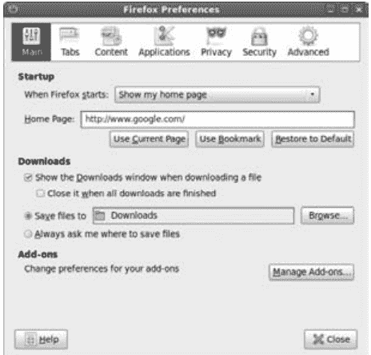

**图 6-1：** Firefox 首选项窗口

### 调整主要首选项

Main 类别提供了浏览器的基本设置。我通常会做一些小的更改。

- 更改默认位置。我通常使用搜索引擎或空白页。如果你有一个经常首先访问的特定网站，请在这里放入 URL。

不过，指定空白页可以让你获得更快的启动时间，因为浏览器不会忙于访问网络。

- **设置下载位置。** 默认位置是 `$HOME/Downloads/`。你可以根据需要更改；有些人喜欢下载到桌面或其他磁盘分区。我喜欢下载到文件夹，但我会从桌面创建一个指向该文件夹的链接以便访问：

```
ln -s $HOME/Downloads $HOME/Desktop/Downloads
```

### 调整标签页首选项

标签页让你可以在同一窗口中打开新页面，而不是打开新的浏览器窗口。我发现这是 Firefox 最有用的功能。我始终显示标签页。这样，如果我想打开新标签页，我可以按 Ctrl+T 或双击标签栏的空白部分。此外，始终显示标签页意味着我打开新标签页栏时屏幕不会调整大小。

> **提示** 按 **Ctrl+Shift+T** 可以重新打开最后关闭的标签页。已关闭标签页的列表存储在 *History* ➤ *Recently Closed Tabs* 下。

### 调整内容首选项

Content 类别提供了处理 HTML 内容的设置。

- **启用弹窗拦截。** 如果特定网站想要创建弹窗，Firefox 会在页面顶部创建通知。然后我可以选择明确允许该页面的弹窗。

> **注意** 拦截弹窗并不能阻止所有弹窗。JavaScript 也可以用来生成弹窗窗口，而且不会被此设置拦截。不过，启用弹窗拦截确实可以阻止很多烦人的弹窗。

- **禁用 Java。** 很少有网站需要 Java，而且安全风险太多。

- **调整 JavaScript。** 我过去建议人们禁用 JavaScript，但如今有太多网站将其用于动态网页。如果你确实保持启用状态，请务必查看 JavaScript 的高级设置。关闭任何你不需要的功能。（如果你不知道，


 turn it off until you do know—usually you will not notice a difference.) I usually permit JavaScript to move or resize existing windows, but not anything else.

### 调整首选应用程序

“应用程序”类别允许你指定哪些应用程序将处理特定的下载格式。例如，如果你下载了一个视频，你可以让它自动使用 VLC、Totem 或其他应用程序播放；始终保存；或者始终询问你要做什么。如果你有首选的应用程序（或不喜欢默认设置），那么你可以在这里更改设置。

### 调优隐私偏好设置

“隐私”类别提供了管理缓存信息的设置。

- **修改历史记录。** 我通常会缩短访问过的网站的历史记录。在 Hardy Heron（8.04 LTS）中，默认是 9 天；Karmic Koala（9.10）默认是 90 天。我通常会将其减少到一天。如果我需要经常访问某个网站，我会将 URL 添加为书签。保留九天（或三个月）的历史记录只会让我访问过的网站列表变得杂乱无章。但保留较长的历史记录也有一些理由。例如，如果你使用浏览器研究一个项目，那么较长的历史记录可以让你快速找到几天前或几周前访问过的地方。请考虑根据你的需求更改此值。

- **调整保存的密码。** 我通常会禁用保存表单和保存密码的功能。这主要是为了隐私；未经授权的用户无法通过自动登录功能访问我的在线账户。然而，启用这些选项确实可以加快访问某些网站的速度。如果你不存在隐私问题，并且经常访问需要填写表单或密码的相同网站，那么你可以启用这些选项。

- **更改下载历史记录。** Firefox 会保留已下载文件的历史记录。默认设置允许你手动清理文件列表。我通常会启用下载后自动删除条目的功能。这样，我的列表只会显示下载失败和正在进行的下载。

- **处理 Cookie。** 尽管 privacy advocates 抱怨跟踪用户，但 Cookie 已经成为网络上不可或缺的一部分。然而，有一些更安全的方式来处理 Cookie。我建议仅对原始网站启用 Cookie，并阻止第三方网站的 Cookie（见图 6-2）。除非你有关闭浏览器后仍需要长期保留 Cookie 的需求，否则我建议使用“保留 Cookie 直到：我关闭 Firefox”设置。当你关闭浏览器时，所有 Cookie 都会被删除。

> **注意**
>
> Firefox 使用共享内存。在使用“直到我关闭 Firefox”设置时，你必须关闭*所有* Firefox 浏览器和窗口才能清除 Cookie。关闭一个浏览器是不行的，因为共享内存不会被释放。

**图 6-2：** 修改 Firefox 的 Cookie 偏好设置

### 隐私浏览

许多人在浏览时都有隐私方面的顾虑。无论你是使用别人的电脑、让别人使用你的电脑，还是担心笔记本电脑被盗，总有一些东西你不希望被缓存。（你的朋友真的需要缓存你的 Gmail 账户吗？）

任何使用你浏览器的人都可以看到你去过的网站。如果你有隐私顾虑，可以考虑缩短历史记录或将其完全禁用，将天数设置为零，然后清除一次历史记录。你也可以使用“工具 ➤ 清除隐私数据”或按 Ctrl+Shift+Del 来清除缓存的信息。

从 Firefox 3.5 开始，你可以使用“工具 ➤ 开始隐私浏览”（或按 Ctrl+Shift+P）将浏览器切换到一种模式，在这种模式下它不会保存任何历史记录、用户名或缓存文件。不幸的是，Hardy Heron 及更早的 Ubuntu 版本在软件仓库中没有 Firefox 3.5。Karmic Koala（9.10）是第一个将 Firefox 3.5 作为默认浏览器包含在内的 Ubuntu 版本。

某些 Firefox 插件会维护自己的 Cookie，不受浏览器设置的影响。例如，Macromedia Flash 插件（见第 5 章）将 Cookie 存储在 `$HOME/.macromedia/Flash_Player/#SharedObjects/` 下。**清除浏览器的 Cookie 和缓存不会自动清除这些文件。** 我在我的 `$HOME/.profile` 中添加了以下行，以便在每次登录时清除 Flash Cookie：

```
rm -rf $HOME/.macromedia/Flash_Player/#SharedObjects/*/*
```

**你也可以将其添加到你的 crontab 中，让它每天或每周自动运行。**（关于使用 cron 进行调度，请参见第 8 章。）

### 调整安全设置

“安全”选项卡允许你更改一些通用安全设置——不要与“内容”、“隐私”和“高级”配置设置下的安全设置混淆。

- **启用关于附加组件的警告。** 每当网页试图自行安装某些内容时，你很有可能感染恶意软件。对试图自动安装附加组件、插件和更新的网站保持警惕总是好的。默认情况下，只有两个例外可以安装任何东西：`addons.mozilla.org` 和 `updates.mozilla.org`。这些通常是可以接受的，因为 Mozilla 提供了 Firefox 网页浏览器。

- **警告有恶意的网站。** Firefox 2.x 引入了额外的选项来警告 suspected phishing（伪造）和恶意软件网站。这些选项通过将 URL 与已知的恶意网站黑名单进行比较来工作。一方面，这确实有助于缓解一些网络钓鱼和恶意软件攻击。但它也会显著降低浏览体验——特别是在较慢的计算机上。

- **存储密码。** Firefox 可以选择为网站缓存密码。这简化了登录过程，特别是如果你每次退出浏览器时都清除 Cookie。然而，如果你要在浏览器中存储密码，请务必设置主密码。主密码将加密你存储的密码，并阻止未经授权的访问。

### 调优高级偏好设置

“高级”类别是 Firefox 其他选项的大杂烩。Ubuntu 下的可用选项与 Windows 下的 Firefox 设置不同。例如，你没有检查 Firefox 更新的选项。这是因为 Synaptic 的更新管理器会告诉你是否有新的更新可用。你可以选择禁用对已安装附加组件和搜索引擎的更新检查——这两者都不经常更改，不需要定期检查更新，但保持这些选项启用也不会有什么坏处。

“高级”类别包含四个选项卡：常规、网络、更新和加密。“常规”选项卡涵盖辅助功能、滚动和拼写检查器。我通常会确保禁用默认浏览器检查。

“网络”选项卡允许你设置代理，并指定分配给网页缓存的磁盘空间大小。

- **配置代理。** 如果你使用代理而不是直接连接到互联网，Ubuntu 为你提供了两个选择。你可以配置一个适用于所有网络服务的系统范围代理（见第 12 章），或者通过“连接设置”按钮为 Firefox 设置特殊的代理设置。

- **限制缓存大小。** 缓存文件存储在你的硬盘上，以便快速访问你经常访问的网站。默认缓存大小为 50 MB。我通常会将其减少到 20 MB。我访问的大多数网站都有每小时更新的动态内容（活跃的 web 论坛、新闻网站等）。不管广告商怎么想，我通常*不需要*在我的系统上缓存 50 MB 的横幅广告。

> **提示** 如果网页没有显示当前信息，那么它很可能是缓存的。点击“重新加载”图标时按住 Ctrl 键可以强制刷新页面。你也可以使用 Ctrl+F5 或 Ctrl+Shift+R。

### 缓存与隐私

浏览器缓存可能会导致隐私问题。从在线银行账户的网页到你意外浏览的色情内容，所有东西都会被存储在缓存中。如果你的系统被入侵或被其他人访问，那么缓存中的所有内容都会成为被攻击的目标。减少缓存大小还可以加快系统备份速度，因为需要复制的数据更少。

保持较小的缓存确实可以阻止普通用户获取数据，但它无法阻止专业人士。即使文件被删除，仍然可以通过 `e2undel` 和 `recover`（用于 ext2 文件系统）等工具恢复，或者通过更复杂的取证工具如 The Coroner's Toolkit (tct)、Sleuthkit 和 Autopsy 恢复。尽管这些不是易于使用的程序，但它们可以恢复大多数已删除的文件。

保持最安全的最好方法是完全禁用缓存，但这会导致网页加载变慢。每个图标——无论多小——都必须每次都从网络下载。一般来说，调整缓存大小更多是为了速度和磁盘空间，而不是为了隐私，因为任何保存到磁盘的东西都可能被恢复。


“更新”选项卡管理自动软件，“加密”选项卡管理 SSL 证书。除非有特殊需求，否则你可能不需要更改这些选项卡下的任何内容。

## 微调 Firefox 高级首选项

Firefox 的“首选项”菜单展示了最常见的可调整项，但这些并不是唯一可配置的选项。还有一个隐藏的配置界面，可以通过在地址栏中输入 `about:config` 来访问（见图 6-3）。

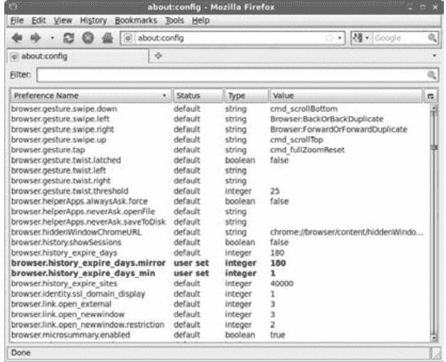

**图 6-3：** 高级配置菜单

该配置菜单显示了所有配置设置及其值。默认值以常规文本显示，而**粗体**文本表示已修改的设置。在本例中，你可以看到当我在“首选项”的“隐私”菜单中更改历史记录设置时，高级配置中的相应设置也随之更改。

“首选项”菜单中的所有项目都可以在 `about:config` 区域中修改。要更改某个首选项，双击要修改的项目并输入新值。或者，你也可以右键单击该行以调出小型菜单。

选择“修改”或“切换”菜单选项与双击效果相同。例如，要完全禁用将文件、网页和图像保存到磁盘缓存，请将 `browser.cache.disk.enable` 选项设置为 `false`。

除了常见的首选项之外，`about:config` 还提供了对其他设置的访问。有些会影响浏览器的外观或显示方式。例如，`browser.chrome.toolbar_tips` 控制当你将鼠标悬停在工具栏图标上时是否显示文本。其他项目则影响功能。例如，将 `layout.spellcheckDefault` 更改为 `2` 会将内置拼写检查器应用于所有文本输入字段，而不仅仅是多行文本区域。

>**注意** 修改 HTML 的显示方式（例如关闭闪烁文本）只会影响新的网页。你需要重新加载当前在其他浏览器窗口或标签页中显示的页面。

许多配置选项用于管理性能。例如，超文本传输协议（HTTP）使用 TCP 来传输数据。TCP 并非最快的协议，建立和拆除网络连接都需要时间。为了加快速度，HTTP 允许你在已建立的 TCP 连接上发送多个请求。这样，当你需要从一台服务器请求多个页面或图像时，就不会因打开新连接而产生额外的延迟。连接空闲一段时间后会断开。你可以使用 `network.http.keep-alive.timeout` 设置来调整此超时值。默认值是 300 秒（五分钟）。如果你使用家用防火墙（你有家用防火墙，对吧？），那么防火墙上的超时值可能不到五分钟。为了获得最佳性能，考虑将 Firefox 的超时时间调整为与防火墙匹配。我的是 120 秒（两分钟）。

由于一个 TCP 连接一次只能传输一段数据，浏览器会使用多个连接进行并行下载。你可以通过调整 `network.http.max-connections-per-server` 和 `network.http.max-connections` 设置来更改同时连接的数量。默认设置适用于电缆调制解调器或 DSL 用户。但是，如果你有更快的网络连接，你可能想要增加这些值（例如，总共 40 个连接，每台服务器 10 个），而如果你使用的是慢速连接，例如拨号调制解调器或 802.11b 无线网络，那么你可能想要将这些值降低到拨号 8 和 4，无线 15 和 5。这样做的原因是避免瓶颈：如果你尝试同时下载太多数据，所有数据都会同时到达。 resulting 流量将会交错，网络协议可能会向服务器发送流控制数据包，或者服务器可能会重新发送未确认的数据包。因此，大量并行下载可能比逐个下载文件更慢。

> **提示** 如果你能看到浏览器缓慢加载许多图像，并且经常遇到图像损坏或部分加载的情况，那么你可能使用的是慢速连接。减少同时连接的数量，看看性能是否有所改善。一般来说，并发连接的总数应该是每台服务器连接数的两到三倍。

幸运的是，这个高级配置菜单中没有什么是危险的——更改设置不会损坏任何东西（但可能会降低性能），并且始终可以通过右键单击该项目并从项目菜单中选择“重置”来恢复为默认值。

### 管理配置文件

Firefox 将所有设置存储在配置文件中。你不需要每次都使用相同的 Firefox 设置；你可以创建不同的配置文件。例如，我在一台笔记本电脑上使用 Ubuntu，在家和工作地点之间携带。我有一个配置为使用工作代理的配置文件，另一个则直接连接互联网用于家庭环境。

> **注意** 如果你使用的是共享计算机，也可以使用配置文件。理想情况下，系统中的每个人都应该有不同的用户账户。这样所有用户都有独立的配置文件。但有时家庭成员使用同一个账户会更方便。你可以轻松地为每个人（包括你的狗）创建不同的配置文件。

要打开配置文件管理器，你需要在命令提示符下运行 Firefox：

```
firefox -ProfileManager
```

这将打开配置文件管理器，你可以在其中添加、编辑或删除配置文件（见图 6-4）。主要的配置文件称为 *default*——除非你想丢失所有设置，否则不要删除它。创建新配置文件后，你可以选择它并单击“启动 Firefox”按钮。现在你更改的所有首选项将只影响你的新配置文件。稍后，你可以在命令行中指定配置文件来启动 Firefox。例如，在图 6-4 中，我创建了一个名为 *SOCKS Proxy* 的配置文件。我可以通过运行以下命令来使用此代理：`firefox -P "SOCKS Proxy"`。或者，我可以使用 `-P default` 指定默认代理，或者使用 `-ProfileManager` 再次查看菜单。

### 通过配置文件进行极端 Firefox 调整

“编辑 ⇨ 首选项”菜单中的设置是最基本的，`about:config` 菜单允许你控制大量功能，但并非所有功能。如果你真的想要调整 Firefox，你需要编辑一些配置文件。

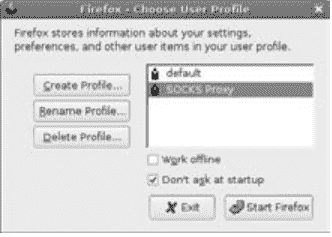

**图 6-4：** 配置文件管理器窗口

Firefox 将所有文件存储在 `$HOME/.mozilla/firefox/` 目录中。在此目录中，有你创建的每个配置文件的子目录。这些目录由一个随机的八字符字符串后跟配置文件名称组成。在每个配置文件目录中，都有所有配置文件。例如，文件 `prefs.js` 包含来自 `about:config` 菜单的所有已修改配置设置。

另一个很酷的目录是 chrome 子目录（例如，`$HOME/.mozilla/firefox/*.default/chrome/`）。这是你可以定义 Firefox 实际*外观*的地方。此目录中有两个示例文件：`userChrome` 和 `userContent`。前者控制 Firefox 的显示，后者控制默认渲染选项。

1. 在命令提示符下，进入 chrome 目录。在本例中，你将使用默认配置文件，但你实际上可以选择任何配置文件。

   `cd $HOME/.mozilla/firefox/*.default/chrome`

2. 如果你还没有创建自定义文件，那么复制示例文件：

   `cp userChrome-example.css userChrome.css`
   `cp userContent-example.css userContent.css`

3. 编辑 `userChrome.css`。这允许你更改浏览器的外观。另一个文件 `userContent.css` 用于自定义默认网页设置。

4. 修改这些文件后，保存更改。你需要关闭所有打开的浏览器，然后重新打开 Firefox 才能看到更改。

以下是一些使用这些配置文件可以做的酷炫示例：

- 停止滚动文本！虽然浏览器窗口底部的滚动 marquee 文本可能很有用，但大多数网站只是令人讨厌。


此外，我喜欢在鼠标悬停在链接上时看到 URL。要禁用滚动字幕文本，请将以下内容添加到 `userContent.css` 文件中：

```
marquee {
  -moz-binding: none !important;
  display: block;
  height: auto !important;
}
```

- 虽然你可以在 `about:config` 菜单和 `pref.js` 文件中关闭闪烁文本（将 `browser.blink_allowed` 设置为 `false`），但你也可以在 `userContent.css` 文件中进行设置：

```
blink {
  text-decoration: none !important;
}
```

- 默认情况下，所有标签页都有暗淡的灰色背景颜色。如果你使用大量标签页，那么可能会发现高亮显示活动标签页很方便。在这种情况下，我修改了 `userChrome.css` 文件，将活动标签页改为浅绿色，非活动标签页改为深红色。

```
/* Change tab colors */
tab{
  -moz-appearance: none !important;
}
tab[selected="true"] {
  background-color: lightgreen !important;
  color: black !important;
}
/* Change color of normal tabs */
tab:not([selected="true"]) {
  background-color: darkred !important;
  color: white !important;
}
```

- 你可以通过名称指定任何网页颜色（例如，`lightgreen` 或 `white`），或者通过指定 RGB 值。例如，`rgb(128,255,128)` 是一种令人作呕的绿色。

你需要关闭所有已打开的浏览器，然后重新打开 Firefox，才能看到对 `userChrome.css` 和 `userContent.css` 文件所做的更改。

提示 示例 `userChrome` 和 `userContent` 文件包含的示例很少。它们主要用于展示格式并提供一些简单的示例。你可以在 `www.mozilla.org/unix/customizing.html` 找到更多可调优项目的列表。

### 添加搜索引擎

当 Firefox 首次启动时，左上角会有一个文本输入字段，用于在 Google、Yahoo!、eBay 和其他一些网站上进行搜索。没有理由不能添加你自己的搜索引擎。例如，如果你在一家大公司工作，那么你的公司可能有自己的内部网络搜索引擎。你可以创建自己的搜索条目来执行公司内部搜索。再举一个例子，你可能想将 SourceForge (http://sourceforge.net) 或 Google Linux (www.google.com/linux) 的搜索引擎添加到菜单中，以便快速查找开源软件。

1. 打开命令提示符并进入 /usr/lib/firefox-addons/searchplugins 目录。这是定义搜索引擎插件的地方。

> **警告** 根据你的浏览器版本，你可能需要进入不同的目录。Hardy Heron 的 Firefox 3.0 使用 /usr/lib/firefox-addons/searchplugin/。Karmic Koala 的 Firefox 3.5 将全局搜索插件存储在 /usr/lib/firefox-addons/searchplugin/en-US/ 下。

2. 创建一个新的搜索引擎。在 Firefox 3.0 中，搜索引擎插件是在 XML 文件中配置的。

```
sudo gedit sourceforge.xml
```

> **提示** /usr/lib/firefox* 目录包含所有系统范围的默认设置，这些设置将影响系统上的所有用户。你可以使用 $HOME/.mozilla/firefox/*.default/searchplugins/ 目录来创建一个只有你能访问的搜索引擎。最初你需要创建这个目录，但在你的主目录中创建任何文件不需要 root 权限。

3. 根据需要编辑 xml 文件。例如，我创建了一个引擎来搜索 SourceForge 上的开源项目。我通过在搜索栏中输入任何经由任何内容来找到查询值。我看到的是一个搜索 URL：

http://sourceforge.net/search/?type_of_search=soft&words=anything

这是一个带有两个查询字段的 URL（列在 '?' 之后）。第一个字段是静态的，由 SourceForge 定义用于软件搜索：type_of_search=soft。第二个字段保存查询内容。因此，我的 sourceforge.xml 文件变为：

```
<SearchPlugin xmlns="http://www.mozilla.org/2006/browser/search/">
<ShortName>SourceForge</ShortName>
<Description>SourceForge Search</Description>
<InputEncoding>UTF-8</InputEncoding>
<Url type="application/x-suggestions+json" method="GET"
template="http://sourceforge.net/search/" />
<Url type="text/html" method="GET"
template="http://sourceforge.net/search">
<Param name="type_of_search" value="soft"/>
<Param name="words" value="{searchTerms}"/>
</Url>
</SearchPlugin>
```

4. 保存文件，关闭所有浏览器，然后重新启动 Firefox。你应该会看到你的插件（例如，SourceForge Search）已添加到搜索引擎列表中。

搜索引擎插件文件还有其他选项，但大多数不需要。如果你的搜索引擎使用 POST 而不是 GET（你会知道，因为搜索词不会出现在 URL 中），那么你需要找出参数。你可以通过查看搜索引擎网页的源代码来了解表单发送了哪些字段（或者跳到第 12 章，学习如何捕获数据包并查看真正发送的内容）。

### 玩转插件和扩展

插件和扩展是为 Firefox 提供附加功能的小程序。例如，默认的 Firefox 安装无法播放 SWF（Macromedia Flash）文件。通过添加 Flash 插件（参见第 5 章），你可以添加 SWF 播放器。要查看已安装的插件列表，请在地址栏中输入 about:plugins。虽然你不能从这里添加、编辑或删除插件，但你可以看到已安装的内容。

> 提示 在 about:config 下，将 plugins.expose_full_path 设置为 true。这将显示每个插件的完整路径，而不仅仅是文件名。

#### 添加插件

当 Firefox 不知道如何处理特定文件类型时，它会给你几个选项。首先，它可以将文件保存到磁盘。虽然这不会运行任何程序，但至少你可以保存它。

另一个选项是在 https://addons.mozilla.org/plugins/ 搜索可用的插件。你也可以访问此 URL 并浏览可用的插件列表。另一个托管 Linux 插件的网站位于 http://plugindoc.mozdev.org/linux.html，但 Firefox 通常不会搜索此网站。

最后一个选项需要你知道插件的名称并使用 apt-get 安装它。示例插件包包括 mozilla-helix-player、mozilla-mplayer 和 totem-mozilla。

#### 删除插件

如果你添加了一个插件，结果发现它不是你所需要的，你需要某种方法来删除它。不幸的是，Firefox 菜单没有提供解决方案。如果你使用 `apt-get` 安装了插件，那么你可以移除它（例如，使用 `sudo apt-get remove totem-mozilla`）。但如果 Firefox 安装了该插件，那么你需要手动删除它。

插件存储在许多不同的目录中。`$HOME/.mozilla/plugins/` 目录存储属于你的插件，并且只有你能使用；它在你以非 root 身份安装插件时创建。

其他目录，`/usr/lib/firefox/plugins/`、`/usr/lib/mozilla/plugins/` 地方存储系统范围的插件。从这些目录中删除文件会从 Firefox 中移除不需要的插件。

> **注意** 某些插件在插件目录中创建多个文件。例如，Helix 插件会创建 `nphelix.so` 和 `nphelix.xpt`。请务必删除与该插件相关的所有文件。

### 帮手处理器

当文件被下载时，它可以在浏览器窗口中显示、保存到磁盘，或传递给另一个应用程序。Web 浏览器有两种方式确定如何处理下载的文件。第一种方法使用 MIME 类型。例如，HTML 页面是 text/html，纯文本是 text/plain，而图像可能是 image/gif 或 image/jpeg。每种 MIME 类型都包含一个通用类别（例如，text 或 image）和一个特定格式标识符（例如，gif 或 jpeg）。第二种方法使用文件扩展名。例如，名为 `ch06.doc` 的文件是文字处理文档文件，`06-03.png` 是 PNG 图像。

> **注意** 许多 Unix 和 Linux 应用程序使用第三种方法来确定文件内容。这种方法称为 *magic number file*，它查看文件内容以寻找识别特征。Ubuntu 下的 `/usr/share/file/magic` 文件列出了常见的 magic 值。Firefox 在没有可用 MIME 类型时使用此方法，但不会用于识别未知的 MIME 类型。

当你访问网站上的数据时，信息会随 MIME 类型返回。文件名可能在 HTTP 头中指定，但通常取自 URL 的末尾。如果浏览器看到它认识的内容，例如 text/html 或 image/gif，那么它会渲染该文件。然而，如果浏览器无法识别 MIME 类型（例如，application/binary-octet 或 video/x-ogm+ogg），那么选项就有限了：保存文件或搜索

对于插件而言。尽管其他网络浏览器允许您将辅助应用程序与 MIME 类型或文件扩展名关联，但 Firefox 不允许您创建自己的辅助程序。

解决这一限制的方案是一个名为 `mozplugger` 的插件。

```
sudo apt-get install mozplugger
```

该插件会创建一个名为 `/etc/mozpluggerrc` 的配置文件，允许您将 MIME 类型或文件扩展名与计算机上的程序关联。例如，如果您希望使用 Ghostview (`gv`) 打开 PostScript (`ps` 和 `eps`) 文件，请按照以下步骤操作：

1. 安装 Ghostview PostScript 查看器（如果您尚未安装）：

```
sudo apt-get install gv
```

2. 以 root 身份，在 `/etc/mozpluggerrc` 末尾添加以下行：

```
application/postscript:ps,eps:Postscript
: gv $file
```

第一行指定了 MIME 类型、扩展名和描述。多个扩展名可以用逗号分隔的列表放置。第二行标识了处理程序。`mozplugger` 的文档 (`man mozplugger`) 解释了该控制文件的更多选项，包括条件判断和特殊处理。

3. 删除 Firefox 生成的缓存插件列表。如果不执行此步骤，新的处理程序将无法被识别。

```
rm $HOME/.mozilla/firefox/*/pluginreg.dat
```

4. 在地址栏中输入 `about:plugins`。新处理程序将在 `mozplugger` 部分的末尾列出。

使用 `mozplugger` 时，您无需关闭浏览器即可使更改生效。

### 打开远程浏览器

Firefox 是一个智能程序。它知道如何与其他运行中的实例通信以节省内存。如果您打开两个浏览器并查看 Firefox 的进程列表 (`ps --ef | grep firefox`)，您将只看到正在运行的进程。这是因为第二个进程检测到第一个进程，并让它打开新窗口，而不是实际运行新的独立浏览器。

虽然重用代码对减少内存需求很有好处，但它确实有一个不良的副作用：如果您在本地打开了一个浏览器，就无法远程运行浏览器。这种情况经常发生在系统管理员身上。例如，您将使用启用了 X-Windows 的远程主机登录，并希望在该远程主机上运行 Firefox，但将浏览器显示在您的本地系统上。这与在您的系统上运行浏览器不同，因为所有网络请求都将源自远程系统。不幸的是，仅在远程主机上运行 `firefox` 会告诉您的本地浏览器生成一个新窗口。相反，请使用 `firefox --no-remote -P`。这告诉 Firefox *不要*通过 X-Windows 系统进行通信以识别任何正在运行的浏览器。结果是，远程浏览器将看不到您的本地浏览器；它将在远程系统上开始运行，并将其显示发送到您的系统。

> **穿越多种组织类型的腔室。这将引发一场关于成体细胞能否替代胚胎细胞及其多功能性的激烈辩论。它还对再生医学领域产生了深远影响，该领域旨在利用自然修复机制来治疗疾病和损伤。

山中伸弥博士的发现改变了干细胞研究的格局，为围绕胚胎干细胞的伦理争议提供了替代方案。他的方法允许科学家在不破坏胚胎的情况下将成体细胞倒回到类胚胎状态，从根本上改变了研究人员对疾病建模和治疗开发的方法。

这项技术的临床应用延伸到了个性化医学。通过创建患者特异性的 iPSC，医生可能生成不会被免疫系统排斥的组织。这为使用患者自身细胞治疗从帕金森病到心力衰竭等各种疾病打开了大门。

重编程过程本身揭示了细胞身份的更深层见解。科学家发现，仅仅四个基因——Oct4、Sox2、Klf4 和 c-Myc——就能触发这种戏剧性的转变。每个因子在抹除成体细胞特征和建立多能性方面都发挥着独特的作用。

随着制药公司认识到药物测试的潜力，行业兴趣迅速增长。iPSC 衍生组织比传统方法更准确地筛选化合物，减少对动物模型的依赖，并改善对人类反应的预测。

**警告** Firefox 1.x 是一个更简单的浏览器。您可以 `ssh` 到远程系统并运行 `firefox --no-xshm`。这将启动远程浏览器在本地显示上，它将使用默认配置文件。

对于 Firefox 3.x，这种简便性已不复存在。您不能让两个浏览器实例使用相同的配置文件。因此，如果远程主机已经打开了一个浏览器并正在使用默认配置文件，那么您必须指定 `-P`（或 `-P profile`）才能使用远程浏览器。

还有其他注意事项。例如，Hardy Heron (8.04 LTS) 下的 Firefox 可以在 Dapper Drake (6.06 LTS) 或 Karmic Koala (9.10) 上显示。然而，Karmic 的 Firefox 浏览器无法在 Dapper Drake 上显示，因为它使用的 X-Windows 扩展比 Dapper 更新。根据本地和远程系统的 X-Windows 版本，您可能无法远程运行 Firefox。

### 使用其他网络浏览器

尽管 Firefox 是默认的网络浏览器，但它并不是唯一可用的浏览器。许多其他浏览器软件包可以安装，包括 `seamonkey`、`epiphany-browser`、`konqueror`、`lynx` 和 `elinks`。

- **Seamonkey**——先前称为 Mozilla Application Suite，这是一个集成的网络浏览器、电子邮件客户端、HTML 编辑器等。Seamonkey 类似于 Mozilla Firefox 浏览器，因为它们源于相同的来源。
- **Epiphany-browser**——这是 Gnome 的网络浏览器。因此，它与 Ubuntu 的 Gnome 桌面集成得非常好。
- **Konqueror**——Konqueror 是 KDE 环境的默认浏览器。如果您选择安装 Konqueror，您将需要安装整个 KDE 运行时环境。
- **Lynx**——尽管 Lynx 是一个基于文本的浏览器，我强烈建议安装它并学习如何使用它。当您崩溃 X-Windows、丢失图形显示，或者只是使用 Ubuntu 服务器安装时，您无法使用 Firefox 搜索网络寻求帮助——*没有图形意味着没有 Firefox*。尽管 Lynx 可能看起来很原始，但它将允许您搜索帮助和下载补丁。
- **Elinks**——与 Lynx 类似，这个增强的基于文本的浏览器处理 Lynx 无法显示的框架、表格和其他网页内容。

### 为什么要使用不同的浏览器？

尽管某些网络浏览器适用于特殊用途，但其他浏览器只是提供了替代选择。许多网页开发安装各种浏览器以测试他们的网页。您设计的页面在一个浏览器下看起来可能很好，但在不同的浏览器中可能会出现严重问题。

我有时会使用不同的网络浏览器来代替不同的 Firefox 配置文件。即使我为每个配置文件赋予不同的配色方案，它们仍然可能看起来太相似。例如，我使用一个浏览器进行直接互联网使用，另一个浏览器用于通过公共代理连接。我最不想做的就是使用直接浏览器来完成应该通过代理完成的事情。如果我同时使用两个不同的 Firefox 配置文件，那么我可能会混淆两个窗口。但是，如果我使用 Firefox 进行直接访问，使用 Epiphany 浏览器进行代理访问，那么浏览器看起来完全不同——我不会错误地使用 Firefox，以为它正在使用代理。（请参阅下一节"使用 SSH 保护网页访问"，以了解为什么我想要使用代理。）

### 减轻崩溃影响

Firefox 是一个相当稳定的浏览器，但它在极少数情况下也曾崩溃。当它崩溃时，所有 Firefox 窗口都会消失。即使使用多个配置文件，如果一个窗口崩溃，那么所有 Firefox 窗口都会关闭——无论配置文件如何。如果您像我一样，严重依赖网页访问来完成工作，这可能会严重影响生产力。在不适当的时刻浏览器崩溃可能会让我损失数小时的搜索工作，需要重新进行。

如果您要访问偶尔会导致浏览器崩溃的网站（2006 年，www.cnn.com 很容易使 Firefox 崩溃），您可以通过运行不同的浏览器来限制崩溃带来的风险。例如，一个浏览器可以用于查看新闻和娱乐网站，另一个可以用于与工作相关的网页访问。除了区分工作和娱乐之外，这还可以防止娱乐网站上的崩溃影响工作浏览器。（这可能是您的老板会在乎的事情，即使您不在乎。）

### 使用 SSH 保护网页访问

当您在自己家中或小型办公室舒适地使用网络时，有一定程度的安全性，因为您没有与他人共享互联网连接。您可以访问您最喜欢的网站或管理您的银行账户，有人监视您的风险相对较小。尽管您和银行之间的网络上的恶意黑客可以看到您的连接，但有人在您和银行之间的确切网络路由上的几率非常小。

不幸的是，同样的安全感不适用于远程位置。咖啡店、机场、书店、图书馆、酒店和其他提供免费（或收费）网络接入的地方不仅无法保护您免受窃听，而且他们还会向任何人——甚至是攻击者——提供相同的免费（或收费）连接。我在足够多的拥挤咖啡店待过，意识到窃听的可能性可能高达 25%（这还是假设*我*不在咖啡店里带着*我的*笔记本电脑）。有些人是为了好玩或好奇，但其他人可能是恶意的——玩弄连接或窃取密码和账户。即使使用 SSL 和 HTTPS，也无法为您提供针对主动攻击者的多少保护。

由于您不知道谁可能在监听，最好安全行事。如果您想要安全地访问网络*并且*想要随时随地自由浏览，那么请考虑使用安全外壳（SSH）隧道。SSH 提供两台计算机之间的加密连接，并可以通过隧道转发网络流量。要做到这一点，您需要：

- **两台计算机。** 一台将是您家中（或您信任的位置）的服务器，另一台将是您的笔记本电脑，您将带着它去咖啡店。
- **在服务器上运行的 SOCKS 服务器代理。** 这就是您如何从咖啡店中继您的流量，通过 SSH 连接到您家中，并通过您自己的 SOCKS 服务器代理到网络。

目标是使用 SSH 从咖啡店的笔记本电脑到您家中创建一个安全隧道。您将通过隧道发送所有网页流量，并通过您自己的 SOCKS 服务器中继网页请求。这样，您的所有网页流量在通过咖啡店时都是加密的。

尽管这种方法并非万无一失，但它与从家里访问网络差不多安全。基本步骤是：

1. 在您家中安装 SSH 服务器。

2. 将您家中的 SSH 服务器开放到互联网。这样，您可以从咖啡店、图书馆或任何其他公共场所访问它。


 -   3. 安装并配置一个仅能从你家内部访问的 SOCKS 服务器。
4. 在前往公共场所之前测试配置。
5. 建立完整的端到端隧道，并开始转发你的网络流量。
6. 根据你的速度需求配置 SSH 连接。

### 安装 SSH 服务器

你首先需要做的是安装 SSH 服务器。Ubuntu 安装时自带了 SSH 客户端，但没有服务器。要获得服务器，请安装 `openssh-server` 软件包：

```
sudo apt-get install openssh-server
```

除了安装服务器之外，该软件包还会生成加密密钥、将自己添加到 `/etc/init.d` 以便在启动时自动运行，并启动守护进程。我通常会检查 `/etc/ssh/sshd_config` 中的默认服务器配置：

- 确保启用了 X11 转发（`X11Forwarding yes`）。这样，如果你的笔记本电脑支持 X-Windows，你就可以在远程系统上运行图形应用程序。对于 SSH 客户端（`/etc/ssh/ssh_config`），你也需要启用 `X11Forwarding`。如果客户端或服务器不支持此选项，则无法通过隧道运行图形应用程序。
- 检查并确保设置了 `KeepAlive yes`。这可以防止空闲的 SSH 连接被过于激进的防火墙断开。
- 我喜欢启用横幅消息（`Banner /etc/issue.net`）。这样，当人们连接到 SSH 服务器时，会看到一个友好的问候语。此消息在用户被提示输入密码之前显示。你还需要编辑 `/etc/issue.net` 文件。默认横幅显示了操作系统版本，这可能存在安全风险。我将我的横幅改成了显示这条严肃的消息（见图 6-5）：

```
所有连接和数据包均正在被记录。
未经授权的访问尝试将被视为网络攻击，并可能被追究责任。
在未经授权访问可依法强制执行的情况下，将被起诉。
```

在对服务器配置进行任何更改后，你需要重启守护进程：

```
sudo /etc/init.d/ssh restart
```

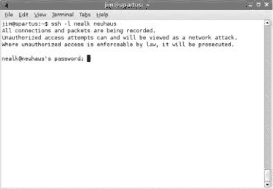

### 开放端口

由于你将从互联网访问 SSH 服务器，你需要将 SSH 端口向世界开放。如果你有防火墙，它需要允许流量进入 TCP 端口 22。

> 提示 对于谨慎的用户，考虑将 SSH 服务器更改为不同的端口（`/etc/ssh/sshd_config`，Port 选项）。这样，扫描活跃 SSH 服务器的 SSH 蠕虫和脚本小子将不太可能找到你的服务器。虽然这是通过隐匿实现安全，但它对自动攻击非常有效。

每个防火墙都不同，因此你需要查看如何开放端口。如果你使用的是小型家用防火墙和 NAT 系统，则查找传入连接的设置。至少，你需要提供端口（22）和 SSH 服务器的 IP 地址。根据你的防火墙，你可能还需要提供协议（TCP）。图 6-6 展示了一个家庭路由器（运行基于 Linux 的 DD-WRT 固件），它配置为将 SSH 连接路由到内部服务器。其他路由器，包括 Linksys、D-Link 和 Netgear，都提供类似的端口转发选项。

在开放端口后，测试它。使用 ssh 命令，使用你的笔记本电脑连接到服务器。这将做两件事：首先，它将验证端口已开放且 SSH 服务器正常运行。其次，它会将服务器的密钥传输到笔记本电脑。这样，当你去咖啡店时，没有人能够劫持你的 SSH 连接。

### 图 6-6：配置为路由 22/tcp 端口的运行 DD-WRT 的家庭路由器

### 启动代理

创建安全中继系统的第二个关键组件是在你的家庭系统上安装代理。有两个软件包提供此功能：`socks4-server` 和 `dante-server`。两个服务器都提供 SOCKS 代理，且在功能上等效，尽管 `socks4-server` 需要更多的配置。无论如何，你只需安装一个 SOCKS 服务器——不要两个都安装。由于两个服务器使用相同的端口（1080/tcp），一次只能运行一个。

#### 使用 Socks4-Server

`socks4-server` 软件包提供了一个基本的 SOCKS 版本 4 代理，旨在通过 `inetd` 使用。要使用此功能，你需要一个 `inetd` 代理，例如 `xinetd`。你还需要编辑 `/etc/sockd.conf` 以允许网络流量。

1. 安装两个服务器软件包：

```
sudo apt-get install xinetd socks4-server
```

2. 以 root 身份，为 `xinetd` 创建一个 socks 服务。`/etc/xinetd.d/socks` 的内容应如下所示：

```
service socks
{
  disable = no
  socket_type = stream
  protocol = tcp
  wait = no
  user = daemon
  group = sys
  server = /usr/sbin/sockd
}
```

3. 重启 `xinetd`：`sudo /etc/init.d/xinetd restart`。此时，SOCKS 服务器可从网络访问，但尚未配置。

4. 配置 SOCKS 服务器以允许流量中继。默认配置文件 `/etc/sockd.conf` 禁止所有连接。至少，你需要移除 "deny all" 命令，并将其替换为本地主机的权限。如果你希望其他系统使用此代理，则需要允许其他主机或子网。

```
## deny  ALL  0.0.0.0    .my.domain  0.0.0.0
permit  localhost 255.255.255.255    ALL  0.0.0.0
```

> 警告 允许所有网络流量通过你的机器中继，对于可从互联网访问的机器来说是一个巨大的安全风险。如果此计算机直接连接到互联网，垃圾邮件发送者可能会利用你开放的 SOCKS 服务器来中继电子邮件。将 SOCKS 服务器公开到开始转发垃圾邮件之间的时间可能只有几个小时。对于这个安全隧道，我们只允许本地主机使用 SOCKS 服务器，且 SOCKS 服务器不能从防火墙外部访问。只要你只允许从本地主机（而非整个互联网）访问 SOCKS 服务器，你就应该足够安全。

如果 SOCKS 服务器似乎无法正常工作，请在 `/var/log/syslog` 文件中查找错误消息。`sockd` 和 `xinetd` 都会将此文件记录其状态。

#### 使用 Dante-Server

Dante 服务器支持 SOCKS 版本 4 和版本 5。虽然 Dante 可以从 `xinetd` 运行，但通常用作独立服务器。

1. 安装 Dante 服务器。当你安装它时，它会尝试启动服务器，但由于尚未配置，会立即失败：

```
sudo apt-get install dante-server
```

2. 通过编辑 `/etc/dante.conf` 文件来配置服务器。你需要启用一个端口以及连接规则。例如：

```
## log results to /var/log/syslog (for debugging)
logoutput: syslog stderr
## use 'ifconfig -a' to determine your network interface (e.g. eth0)
## in this case, lo is the loopback port so it only allows localhost
internal: lo port = 1080  # where to listen
external: eth0            # where to relay
## enable SOCKS connection methods
method: username none #rfc931
clientmethod: none
## configure which clients to relay; this only allows localhost
client pass {
  from: 127.0.0.1/32 to: 0.0.0.0/0
}
pass {
  from: 127.0.0.1/32 to: 0.0.0.0/0
  protocol: tcp udp
  log: connect error
}
## log all failed connections
block {
  from: 0.0.0.0/0 to: 0.0.0.0/0
  log: connect error
}
```

3. 重启 Dante 服务器。查看 `/var/log/syslog` 中的任何错误消息：

```
sudo /etc/init.d/dante start
```

### 测试 SOCKS 服务器

无论你安装了哪个 SOCKS 服务器，在前往咖啡店之前都需要测试它。

1. 在运行 SOCKS 服务器的同一主机上打开 Firefox。

2. 打开连接首选项：编辑 ➤ 首选项 ➤ 高级 ➤ 网络 ➤ 设置。

> 提示 如果你不想修改默认的 Firefox 设置，则为此次测试创建一个新的配置文件。


 +   3. 启用 SOCKS 服务器。该服务器应在 localhost 的 1080 端口运行（见图 6-7）。如果你使用 `socks4-server`，请将协议指定为 SOCKS v4。如果使用 Dante，则 SOCKS v4 或 SOCKS v5 均可。

4. 使用浏览器连接到一个网站，例如 `www.google.com`。

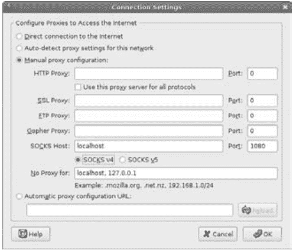

**图 6-7：** 配置 Firefox 使用代理

如果连接成功，你应该能在 `/var/log/syslog` 中看到日志条目，并且网页会显示出来。如果连接失败，请查看 `/var/log/syslog` 中的错误信息或失败原因。

### 建立隧道

现在你已经有了可用的 SSH 和 SOCKS 服务器，可以创建一条安全隧道。

+   1. 查明服务器的 IP 地址。如果你的 ISP 为你分配了一个 IP 地址。如果你有一台独立防火墙，则连接到它并查明其外部（WAN）IP 地址。另一方面，如果你的计算机直接连接到 Internet，那么你可以运行 `ifconfig -a` 列出 IP 地址（很可能在 `eth0` 记录中）。如果不知道 IP 地址，你就无法从外部连接。

> **提示** 如果 IP 地址以 10.、192.168.、172.16 到 172.31. 或 169.254. 开头，那么这是一个私有网络地址。你必须先确定公共地址，然后才能在本地网络之外访问该服务器。

+   2. 在笔记本电脑上，使用 SSH 创建到服务器的隧道。该隧道应将本地 8080 端口转发到服务器上的 1080 端口。例如，如果你的 IP 地址是 1.2.3.4，则可以使用：

    ssh 1.2.3.4 -L 8080:localhost:1080

    该命令表示将本地 8080 端口的连接转发到服务器上的主机和端口 `localhost:1080`。主机名 `localhost` 将由服务器解析。

+   3. 在笔记本电脑上，配置浏览器使用代理。在本例中，你需要使用 `localhost` 和 8080 端口（而不是 1080 端口）。

+   4. 通过访问一个网站来测试连接。

如果一切顺利，你应该能看到一个网页。这意味着所有 Web 连接从你的笔记本电脑发往本地 8080 端口，SSH 在此处将所有请求安全地通过隧道转发到服务器。服务器再把它发送给本地 SOCKS 服务器，SOCKS 服务器随后将请求发送到 Internet。

尽管这种方式无法消除有人窃听你家与 Internet 之间网络连接的风险，但它能阻止咖啡馆里的任何人窥探你的银行账户。

### 为提高速度更改加密算法

SSH 使用加密算法来保护数据，但并非所有算法都同样优秀。默认情况下，SSH 使用 AES。虽然 AES 是一种非常强大的算法，但它的速度不如其他算法。如果你计划通过安全隧道使用 Web，可以考虑使用另一种算法，例如 Blowfish。这种加密算法足以满足日常使用，而且速度快得多。因此，你会看到通过该安全隧道发送的请求速度有所提升：

```
ssh -c blowfish 1.2.3.4 -L 8080:localhost:1080
```

> **注意** 在密码学领域，AES 被认为是一种非常强大的算法。然而，它不是最快的加密算法。Blowfish 算法不一定同样强大，但它快得多。

根据网络流量的类型，你可能总是希望启用或禁用压缩。例如，X-Windows 流量可以被大量压缩，而图像（例如 GIF 和 JPEG）以及 MP3、MOV 等多媒体文件则无法被压缩。如果你正在浏览网页或流媒体音频，请不要使用压缩——这是默认设置。但如果你通过 X-Windows 进行远程管理，请使用 -C 参数启用压缩：

```
ssh -C -c blowfish 1.2.3.4 -L 8080:localhost:1080
```

### 使用 Evolution 管理电子邮件

Ubuntu 默认的电子邮件阅读器叫做 Evolution。这个程序是 Microsoft Outlook 的开源克隆版。除了查看和撰写邮件外，它还管理你的日历、任务列表和联系人（见图 6-8）。Evolution 还允许你管理多个电子邮件账户。虽然它原生支持多种不同的邮件服务器配置，但也有一些特殊之处。

### 配置账户

Evolution 最强大的地方在于它支持的邮件协议列表。它原生支持邮局协议（POP，也称为 POP3）和即时消息访问协议（IMAP 或 IMAP4），以及 Microsoft Exchange 和 Novell GroupWise。这意味着你应该能够在家里以及大多数企业和小型办公环境中使用 Evolution。

首次运行 Evolution 时（通过点击默认顶部面板中的邮件图标，或选择 应用程序 ➢ Internet ➢ Evolution Mail），它会要求你设置一个账户。之后你可以运行 Evolution 并选择 编辑 ➢ 首选项 ➢ 邮件账户 来添加或编辑账户。你需要提供三类主要信息。

+   - **身份**——用于指定电子邮件地址以及地址上显示的姓名。

+   - **接收选项**——用于确定如何检索你的邮件。例如，如果你使用 POP 邮件服务器，则需要指定服务器地址和你的账户名。

+   - **发送选项**——接收邮件的方式不一定与发送邮件的方式相同。例如，你可以使用 POP 接收邮件，但使用 SMTP 发送邮件。

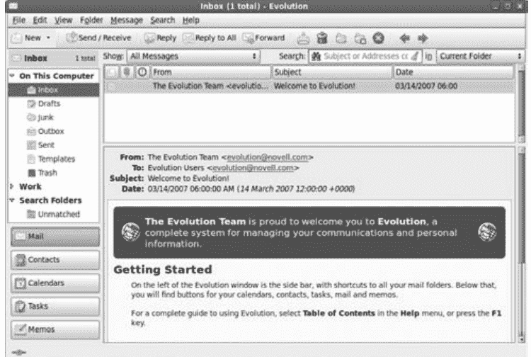

**图 6-8：** Evolution 邮件客户端

> **注意** 你的具体配置取决于你的邮件服务器。大多数 ISP 都会提供某种邮件服务器以及配置邮件阅读器的说明。虽然他们不太可能给出 Evolution 的具体配置，但应该会列出服务器主机名、协议（例如 POP3 或 IMAP4）以及任何必需的安全步骤，例如使用 SSL（或 TLS）进行加密。

创建新账户后，你还可以配置其他选项（在“邮件账户”下选择“编辑”选项）。例如，你可以指定检查新邮件的频率，以及是否保存每封外发邮件的副本。

除了使用本地 ISP 的电子邮件外，你可能还希望管理自己的免费电子邮件账户。一些最常见的免费电子邮件账户包括 Google Gmail、Yahoo! Mail 和 Microsoft MSN Hotmail。了解如何为这些免费邮件服务配置电子邮件，将有助于你为大多数其他邮件服务配置邮件。

### 从 Gmail 收取邮件

在所有免费的电子邮件账户系统中，Google 的 Gmail 是最容易配置的。Gmail 提供使用 SSL 保障安全的标准 POP3 服务器。

Google 在 `http://mail.google.com/support/bin/topic.py?topic=1555` 提供了受支持的 POP3 配置详细列表。邮件配置（包括服务器、协议和安全）详见 `http://mail.google.com/support/bin/answer.py?answer=13287`。

#### 准备你的 Gmail 账户

Gmail 是 Google 提供的免费邮件系统。你可以访问 `mail.google.com` 设置一个新账户。你需要提供的内容只有姓名（名和姓）、登录名、密码和安全问题。

> **警告** Google 的 Gmail 经历了多次改版。2004 年刚推出时，它是一个仅限邀请的系统。只有拥有账户的朋友邀请你，你才能获得账户。2005 年 8 月，Gmail 增加了一项功能：可以通过手机发送短信来申请邀请。（颇具讽刺意味的是，如果你有手机，就不需要朋友了。）2007 年 2 月，Gmail 向公众开放。

拥有账户后，你需要将其配置为使用 POP：

+   1. 打开 Web 浏览器并连接到 `www.gmail.com`。使用你的 Gmail 账户登录。
2. 选择左上角的“设置”选项。
3. 选择“转发和 POP/IMAP”标签。
4. 启用 POP（或 IMAP）支持（见图 6-9）。你可以为所有邮件启用，也可以仅对未来的邮件启用。
5. 保存设置。

#### 添加 Gmail 账户

要将 Gmail 账户添加到 Evolution：

+   1. 通过选择 编辑 ⇄ 首选项 ⇄ 邮件账户 打开账户管理器，然后点击“添加”按钮。这将弹出邮件配置向导。
2. 首先要求填写的是你的身份信息。输入你的姓名和 Gmail 电子邮件地址（*你的登录名*@gmail.com）。
3. 第二项所需信息用于接收邮件。Gmail 使用 POP 协议。邮件服务器是 `pop.gmail.com`，端口为 995，因此你应该输入 `pop.gmail.com:995` 并选择 SSL 选项。（对于 IMAP，请使用 `imap.gmail.com:993`。）图 6-10 展示了一个 POP 配置示例。虽然访问该账户需要密码，你

在您首次尝试发送或接收电子邮件时，系统会提示您输入密码。选择"记住密码"选项将会为您保存密码。

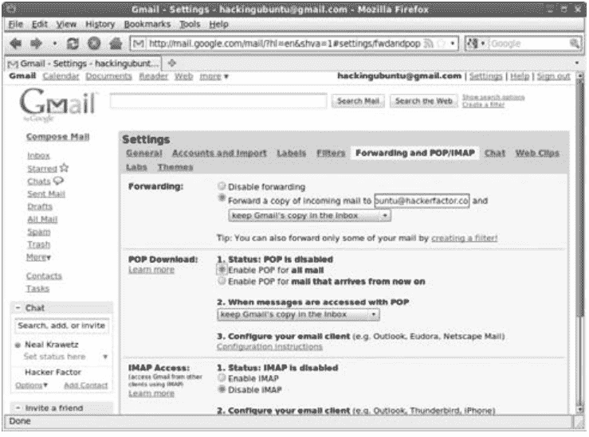

**图 6-9：** 启用 POP 支持的 Gmail 设置

+   4. 在"接收选项"页面上，我通常选择将邮件保留在服务器上。这样，我始终有一份备份。

+   5. 对于发送选项，Gmail 使用 SMTP，服务器为 `smtp.gmail.com`。您需要指定安全协议。Gmail 在端口 465 上支持 SSL（`smtp.gmail.com:465`），在端口 587 上支持 TLS（`smtp.gmail.com:587`）。

+   6. 为 Evolution 设置账户名称。默认情况下，它使用电子邮件地址。

+   7. 应用新账户。至此，账户创建完成。

+   8. 点击"发送/接收"按钮。您将看到密码提示以及关于 Gmail SSL/TLS 证书的通知。

+   - 您必须批准该证书。如果不批准，则无法访问您的 Gmail 账户。此提示只会出现一次。

+   - 如果您选择了"记住密码"选项，那么您将不会被再次提示输入密码。

9. 输入密码后，您应该能看到系统正在检查您的电子邮件并检索所有邮件。

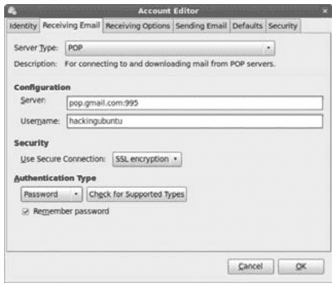

**图 6-10：** 配置 Evolution 以接收来自 Gmail 的电子邮件

### 获取邮件

命令行程序 `fetchmail`（`sudo apt-get install fetchmail`）是大多数 Unix 邮件系统的标准组件。该程序使您能够使用 POP2、POP3 或 IMAP4 从远程邮件服务器检索电子邮件。虽然 `fetchmail` 不能用于发送电子邮件，但它可以用来从多个账户收集电子邮件。

> **注意** 要使用 `fetchmail`，您还需要安装本地邮件投递系统。第 13 章展示了如何安装 Postfix 邮件系统。默认的 Postfix 安装（`sudo apt-get install postfix` 并选择任何默认配置设置）足以让 `fetchmail` 工作。

`fetchmail` 程序会查找配置文件 `$HOME/.fetchmailrc`。该文件中的每一行指定一个不同的账户。例如，要从 `account@gmail.com` 检索电子邮件，您需要有一行如下内容：

```
poll pop.gmail.com port 995 protocol POP3 username account
    password password ssl
```

运行 `fetchmail` 会检索电子邮件并将其发送到您的本地邮件系统。这会将邮件放入您的邮件缓冲池。如果您将 Evolution 配置为从邮件缓冲池检索电子邮件，则可以从 `/var/mail/` 目录读取电子邮件。

> **提示** 邮件缓冲池使用您的账户名存储电子邮件。如果您在 Ubuntu 系统上的账户是 timb，电子邮件将存储在 /var/mail/timb 中。该文件在您收到邮件时首次创建。

如果您不总是运行 Evolution，使用 fetchmail 收集电子邮件会非常方便。我将 fetchmail 配置为每 10 分钟检查一次新邮件。这样，如果 Evolution 没有运行，新邮件也会被检索。尽管 Evolution 有定期检查新邮件的账户设置，但这只有在您启动 Evolution 后才会生效。如果您重新启动计算机，新邮件将不会被检查，直到您启动邮件阅读器。

### 从 Yahoo! 检索电子邮件

与 Gmail 不同，Yahoo! Mail 仅对付费账户提供 POP 访问；免费账户没有 POP 访问权限。如果您想在 Evolution 中使用免费的 Yahoo! Mail 账户，那么您的选择非常有限。最佳（也是唯一持续支持的）选择是 fetchyahoo。

fetchyahoo 程序旨在从 Yahoo! Mail 账户访问电子邮件并将其存储在邮件文件夹中。它通过抓取 Yahoo! 网页界面并下载邮件来工作。

不幸的是，fetchyahoo 不是受支持的 Ubuntu 软件包。相反，您需要从 http://fetchyahoo.twizzler.org/ 下载并安装该软件。您可能还需要更新您的 Yahoo! 账户配置，包括更改网页界面。

> **警告** Yahoo! 会定期更改其网页界面。由于 fetchyahoo 读取网页，更改将导致其停止工作。如果 fetchyahoo 停止工作，请检查网站以获取更新版本。

+   1. 从 fetchyahoo.twizzler.org 下载 fetchyahoo。文件名将类似于 fetchyahoo-version.tar.gz。例如，fetchyahoo-2.13.7.tar.gz。

+   2. 解压代码并进入目录。对于版本 2.13.7，使用：

```
tar -xzvf fetchyahoo-2.13.7.tar.gz
cd fetchyahoo-2.13.7
```

+   3. 确保该程序可执行，并将其复制到您的 $PATH 中。

```
chmod a+rw fetchyahoo
sudo cp fetchmailyahoo /usr/local/bin/
```

+   4. 将 fetchmailyahoorc 配置文件复制到您的主目录：

```
cp fetchmailyahoorc $HOME/.fetchmailyahoorc
```

+   5. 编辑 `$HOME/.fetchmailyahoorc`。务必设置您的 Yahoo! 账户的用户名和密码。您需要替换每一处变量 `yahoo-user-name`、`yahoo-password` 和 `local-user-name`。

> **提示** 默认情况下，`fetchmailyahoo` 会将所有电子邮件投递到您的本地邮件缓冲池。但是，该配置文件有选项可以使用邮件中继、POP 或 IMAP 服务器转发电子邮件。

完成系统配置后，您可以运行 `fetchyahoo` 来检索您的电子邮件。

> **注意** 除了 `fetchyahoo` 之外还有其他选择。不幸的是，没有一个是持续维护的，过时的版本不太可能工作。例如，YahooPOPs（`www.ypopsemail.com`）积极支持 Microsoft Windows，但 Linux 用户需要等待社区移植该软件。其他程序，如 FreePOPs、Mechanoid 和 SendYmail，已经多年未更新。

### 使用 LDAP 进行寻址

Evolution 最大的优势之一是它与其他轻量级目录访问协议（LDAP）系统的集成。在许多大型办公环境中，LDAP 提供目录支持，列出员工姓名、电子邮件地址和其他联系信息。要启用 LDAP 支持，只需添加新的通讯录，文件 ➡ 新建 ➡ 通讯录，并将类型更改为"LDAP 服务器"（见图 6-11）。输入 LDAP 服务器信息后，您可以在撰写电子邮件时访问该目录。

### Evolution 的崩溃与恢复

Evolution 邮件阅读器过去存在稳定性和可用性问题。它可能在网络访问时挂起，在撰写电子邮件时崩溃，以及难以导入某些 Microsoft Outlook 客户端的会议邀请。

幸运的是，Evolution 名副其实。随着每个新版本的发布，它都会进化成更好的东西。不幸的是，较新版本的 Evolution 不会被移植回旧版本。虽然 Karmic Koala (9.10) 附带 Evolution 2.28，但 Hardy Heron (8.04 LTS) 只有 2.22，而 Dapper Drake (6.06 LTS) 只有 2.6。即使存在更新且稳定的软件，它也可能无法 readily 用于较旧的 Ubuntu 版本——包括长期支持版本。

在极少数情况下，Evolution 仍可能崩溃或意外关闭。当这种情况发生时，它可能不会终止所有正在运行的进程。您需要终止任何已分离的正在运行的进程。为此，使用：

```
killall -r 'evolution'
```

此命令将终止 Evolution 的所有正在运行的进程。

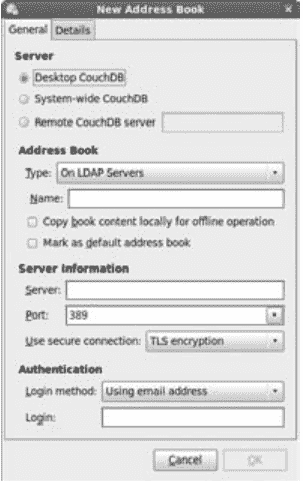

**图 6-11：** 添加 LDAP 服务器

如果您忘记终止所有旧进程就直接重新启动 Evolution，您可能会错过约会、无法检索电子邮件以及更频繁地崩溃als 崩溃。这是因为依赖进程不再连接到主 Evolution 进程。

### 使用 Thunderbird 邮件客户端

Evolution 邮件程序提供了一套完整的办公服务，包括电子邮件管理、日历日程和任务列表。然而，Evolution 仅适用于 Gnome。您可能希望选择一个在每个平台上都支持的邮件系统，这样在工作和家之间切换就不需要更换邮件程序。如果您只需要电子邮件访问，您可能需要考虑 Mozilla Thunderbird，因为它在每个流行的操作系统上都受支持：

```
sudo apt-get install thunderbird
```


 此安装完成后，你可以通过命令行运行 thunderbird，也可以从菜单中选择：应用程序 ➵ 互联网 ➵ Thunderbird 邮件。与 Evolution 不同，它只运行一个应用程序，启动速度稍快一些。

在我看来，Thunderbird 比 Evolution 更加精致，但功能不如后者全面。表 6-1 展示了功能对比。一般来说，在纯电子邮件需求方面，两者几乎相当。尽管 Evolution 支持更多协议和非电子邮件功能，但 Thunderbird 目前在稳定性和易用性方面表现更佳。

### **表 6-1：** Evolution 与 Thunderbird 对比

| 功能 | Evolution 2.28 | Thunderbird 2.0 |
|---------|---------------|-----------------|
| 协议 | POP、IMAP、Exchange、Novell Groupwise、文件 | POP、IMAP、文件 |
| 安全性 | SSL 和 TLS | SSL 和 TLS（创建账户后可通过 编辑 ➵ 账户设置 ➵ 服务器设置 启用） |
| LDAP | 支持 | 支持 |
| 加载图片 | 可禁用、对所有地址启用，或对已知联系人启用；默认：启用 | 可禁用、对所有地址启用，或对已知联系人启用；默认：启用 |
| JavaScript | 不支持 | 不支持 |
| 电子邮件诈骗检测 | 不支持 | 支持 |
| 防病毒支持 | 不支持 | 支持；默认：禁用 |
| 附件缺失警告 | 支持 | 可作为插件使用 |
| **附加功能** | | |
| 通讯录 | 支持 | 支持 |
| 日历 | 支持 | 可作为插件使用 |
| 任务列表 | 支持 | 不支持 |
| 备忘录 | 支持 | 不支持 |

### 在 Ubuntu 上使用即时通讯

互联网非常适合单向通信：有人发布网页，其他人浏览。即使在论坛中，讨论也可能持续数天。电子邮件是更快的通信方式，而且是双向的，但并非即时。即时通讯（IM）系统允许与群体进行实时通信。

互联网中继聊天（IRC）是最早的 IM 协议之一。（IRC 比大多数 IM 协议早了十多年。）Ubuntu 上有大量 IRC 客户端，包括图形界面的 xchat 和基于文本的 irssi。但 IRC 只是当今可用的 IM 协议之一。雅虎、AOL 和 MSN 都有自己的 IM 协议。除了专有系统之外，开源的 XMPP 协议也越来越受欢迎；XMPP 本质上是通过加密通道的 IRC。

> **注意** 可扩展通讯和表示协议（XMPP）与 *Jabber* 是同义词。200 年，Jabber 协议更名为 XMPP。如果你看到任何提到 Jabber 的内容，实际上指的就是 XMPP。

虽然你可以为每种协议下载特定的 IM 客户端，但拥有一个支持所有协议的客户端要方便得多。Empathy 和 Pidgin 是 Ubuntu 上的两款 IM 客户端。默认安装哪个取决于你的 Ubuntu 版本。例如，Karmic Koala（9.10）包含 Empathy，Hardy Heron（8.04 LTS）包含 Pidgin，而 Dapper Drake（6.06 LTS）包含 Pidgin 的旧版本 Gaim。

```
sudo apt-get install empathy telepathy-gnome
sudo apt-get install pidgin
```

> **注意** 从功能角度来看，Empathy 和 Pidgin 非常相似。如果你知道如何使用其中一个，那么使用另一个几乎没有学习曲线。选择其中一个而非另一个的唯一真正原因是个人偏好和协议支持。截至本文撰写时，Pidgin 比 Empathy 多支持两种 IM 协议；Empathy 不支持 IRC 和 Apple 的 Bonjour。

Empathy 和 Pidgin 都支持十几种最常见的 IM 协议。你可以在应用程序 ⇨ 互联网 菜单中找到这些程序。这两款 IM 客户端最初都会提示你添加账户。账户指定了 IM 服务器和你在每个服务器上的身份（见图 6-12）。每种服务器协议都有不同的要求需要你指定。

创建账户后，你可以登录该账户——这会连接到服务器。从那时起，你可以加入聊天室并进行实时通信。虽然 Empathy 和 Pidgin 都不允许你桥接 IM 连接，但两者都允许你同时连接到许多不同的服务器。

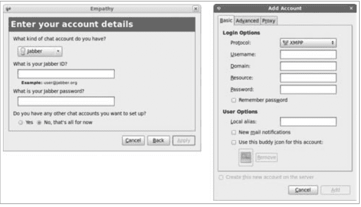

**图 6-12：** 在 Empathy（左）和 Pidgin（右）中添加 IM 账户

### 使用 VoIP 通话

Ubuntu 用户不仅限于文字和图形世界。Ubuntu 上有三种不同的 VoIP 软件包可供选择：Ekiga、Skype 和 QuteCom。默认的 Dapper 和 Hardy 桌面包含 Ekiga——以前称为 *GnomeMeeting*。这是一个开源 VoIP 系统，支持 SIP 和 H.323 协议。这意味着你可以使用 Ekiga 与其他 Ekiga 用户通话，也可以与 Microsoft NetMeeting、Skype 和 QuteCom 的 VoIP 用户通话。

> **提示** Karmic Koala（9.10）不包含默认的 VoIP 客户端。你可以使用 `sudo apt-get install ekiga` 安装 Ekiga。

虽然 Ekiga 是开源领域的宠儿，但 Skype 是行业领导者。使用 Skype，你可以呼叫其他 SIP 和 H.323 VoIP 用户，或拨打座机和手机（需支付象征性费用）。不过，你可能更愿意直接从 `www.skype.com` 下载 Skype，而不是从 Ubuntu 软件库获取；软件库中的版本并不总是最新的。

> **提示** 如果你的 Ubuntu 版本没有 Skype，可以尝试安装旧版本。例如，当 Karmic 发布时，Skype 还没有适用于 Ubuntu 9.10 的版本。但是，Ubuntu 8.04 版本的 Skype 在 Karmic 上运行良好。

Ubuntu 的第三个 VoIP 选择是 QuteCom（原名 *WengoPhone*；`sudo apt-get install qutecom`）。它提供与 Skype 类似的功能，包括拨打座机和手机。

这些 VoIP 选择都提供类似的功能。每个都支持音频、视频和文字消息，每个都可以直接呼叫或使用集中注册和目录系统，每个都可以同时处理多个呼叫。主要区别在于许可和座机接入：Ekiga 和 QuteCom 是开源的，而 Skype 不是（尽管 Skype 的开源版本正在开发中），只有 Skype 和 QuteCom 允许你拨打真实的电话号码（需支付象征性费用）。虽然所有这些系统都可以与 Microsoft NetMeeting 用户聊天，但没有一个能查看共享的 NetMeeting 桌面。

> **注意** 正如我在第 3 章中提到的，Ubuntu 不支持所有视频设备。但如果 Ubuntu 支持该设备，那么 Ekiga、Skype 和 QuteCom 很可能可以将其用于视频会议。

### 小结

Ubuntu 支持多种配置。虽然 Ubuntu 服务器非常适合独立服务器，但 Ubuntu 桌面使你能够与他人通信。访问网页、电子邮件、IM 和 VoIP 网络有多种选择。虽然默认工具（Firefox、Evolution、Pidgin 和 Ekiga）非常强大，但还有许多现成的替代方案，如 Mozilla、Lynx、Thunderbird、xchat、irssi、QuteCom 和 Skype。在电子邮件方面，甚至可以将支持扩展到非标准和基于 Web 的邮件系统。

有了在线通信，就伴随着网络安全风险。有多种选项可以保护网页浏览器、电子邮件，甚至是场外通信，但本章列出的主题，如调整应用程序和使用 SSH 隧道，只是冰山一角。如果你对网络安全更多信息感兴趣，可以考虑以下资源：

- *Steal This Computer Book*，Wallace Wang 著，讨论来自在线论坛的威胁。
- *Hacking Exposed: Network Security Secrets & Solutions*，Stuart McCluer、Joel Scambray 和 George Kurtz 著，涵盖许多不同的网络威胁。虽然该资源侧重于 Windows，但许多威胁对 Linux 用户来说也是类似的。
- *Introduction to Network Security*，Neal Krawetz 著，深入探讨在线通信带来的许多威胁，无论使用何种操作系统。

## 第 7 章

### 协作

### 本章内容

- 跨网络共享文件
- 当每个人使用不同操作系统时如何处理文档
- 与远程用户协作项目
- 在模拟器中运行操作系统

在当今这个始终连接的世界里，很少有人孤立工作。在办公室环境中，文件和文件夹与同事共享。在研究小组中，文档来回传递。即使是独自在黑暗地下室工作的硬核黑客也并非真正孤独——他在线与其他人共享文件和项目。团队人员在全球各地 physically 分布的情况下实时协作项目。

不兼容的操作系统在当今始终连接的世界中表现不佳。协作包括与不运行 Ubuntu 的人一起工作（我们称他们为"Windows 用户"）。Ubuntu 桌面的默认安装包含各种协作工具，而标准软件库中提供的其他工具则提供了更多选择。

协作始于共享和兼容性。如果你无法共享文档，那么你就无法协作。如果你的系统和软件无法处理你需要的文件，那么你将无法与其他人工作。

不幸的是，某些文件格式缺乏强大的支持，许多应用程序需要特定的操作系统。为了与他人工作，你可能需要共享桌面或实际运行为不同


操作系统。幸运的是，Ubuntu 有许多选项可以同时满足这两种需求。在最好的情况下，有完全兼容的应用程序可以使用。不过，也有其他选项可以将你的系统与其他计算机连接，甚至在虚拟机中使用其他操作系统。运行 Ubuntu 并不意味着你不能*同时*运行 Windows。

#### 同步时钟

在需要共享文件、文件系统、桌面和工具的情况下，你该从哪里开始呢？从系统时钟开始。这听起来可能像是一个微不足道的信息，但如果你的时钟偏差较大，实际上可能会妨碍协作工作。电子邮件将无法按正确顺序排序，文件将没有一致的时间戳，而对时间敏感的应用程序也会变得混乱。对于开发者来说，时间戳用于确定需要编译哪些文件——如果你的时钟严重偏差，源代码可能无确编译。

当你首次安装 Ubuntu 时（参见第1章），它会要求你设置时区并选择硬件时钟是否使用 UTC。关于时钟的其他所有设置都是在后台静默完成的。

Ubuntu 每次启用网络接口时自动设置时钟。这在脚本 `/etc/network/if-up.d/ntpdate` 中完成。Ubuntu 会检查文件 `/etc/default/ntpdate` 是否存在。该文件应包含网络时间协议（NTP）服务器的主机名。默认情况下，该文件指定为 `ntp.ubuntu.com`。以下是确保时钟正确设置的一些技巧：

- 如果你无法从网络访问默认服务器（`ntp.ubuntu.com`），那么你的时钟将不会在启动时设置，并且可能会产生漂移，通常每月会快慢几秒。编辑 `/etc/default/ntpdate` 并指定一个备用的 NTP 服务器。

> **警告** NTP 使用 UDP 数据包。如果你的代理或出站防火墙阻止了 UDP，那么你需要将默认 NTP 服务器更改为不被代理或防火墙过滤的系统。或者，你可以配置不同的网络路由，或选择其他设置系统时间的方法。

- 如果你的计算机从不重启（超过 100 天的正常运行时间很常见），那么你的时钟可能会漂移——通常每月漂移几秒。考虑将 `ntpdate` 添加到 root 的 Cron 条目中，使其每周运行。

```
sudo crontab -e
```

添加此行，以便在每个周日午夜过后两分钟运行 `ntpdate`。（Cron 在第8章中有详细介绍。）

```
2 0 * * 0 /etc/network/if-up.d/ntpdate
```

> **提示**
> 
> 如果主机操作系统对处理器进行节流，虚拟机上的时钟可能会显著漂移。你可能需要更频繁地重新同步虚拟机上的时钟。

- 对于作为网络路由器运行的 Ubuntu 系统，将时钟与网络接口绑定可能会成为问题——特别是当网络连接不断上下线时。（你真的需要每小时同步几次时钟吗？）在这些情况下，你可以考虑移除 `/etc/network/if-up.d/ntpdate` 并创建一个 `/etc/init.d/ntpdate` 命令。

- 如果你的时钟偏差超过 ±128 毫秒，那么同步可能会导致系统时钟跳跃，并对某些应用程序（如 Gnome 桌面）造成问题。如果存在此问题，请在 `/etc/default/ntpdate` 的 `NTPOPTIONS` 中添加 `-B`。此选项将缓慢调整时钟到正确时间。

> **注意**
> 
> `/etc/init.d/` 中的启动脚本在第3章中讨论。实际的示例脚本在第11章和第12章中。

NTP 只是设置日期的一种协议。另一个选项是 `rdate`（`sudo apt-get install rdate`）。默认情况下，`rdate` 使用 TCP 查询时间服务器的网络日间服务（端口 13/tcp）。你仍然需要创建 `/etc/init.d/rdate`、`/etc/network/if-up.d/rdate` 和 Cron 条目，但此命令可通过大多数代理工作。

> **提示**
> 
> 服务器 ntp.ubuntu.com 仅支持 NTP 协议；`rdate` 无法与此服务器配合使用。如果你使用 `rdate` 并需要时间服务器，请考虑使用官方原子钟站点之一，如 `utcnist.colorado.edu`、`time-a.nist.gov` 或 `time-b.nist.gov`。

#### 与其他系统良好协作

总有一小部分狂热者认为*协作*意味着每个人都应该运行相同的操作系统。无论是 Linux 用户批评 Windows 用户，BSD 用户批评 Linux 用户，还是 Windows 用户试图让全世界都转用 Windows，这些边缘群体总是在大声疾呼以引起注意。在现实生活中，同质网络既不现实也不理想。虽然为每个人提供一种操作系统确实能让每个人都运行完全相同的软件，但这也会导致许多其他问题。

一些问题涉及安全。如果每个人都运行相同的操作系统，那么每个人都面临相同的漏洞风险。无论风险来自病毒、溢出还是不稳定的软件，运行相同配置的所有计算机都同样脆弱。（Windows 今天可能有更多病毒，但如果每个人都使用 Ubuntu，那么病毒编写者就会转而针对 Ubuntu。Linux 缺少病毒并非因为缺乏机会，而是因为病毒编写者缺乏动机。）达尔文称之为"适者生存"；多样性带来安全。

其他问题涉及使用模式。操作系统只是一种工具——仅此而已。你应该为合适的工作选择合适的工具。Windows 提供出色的硬件支持和许多高质量的应用程序，但许多应用程序缺乏对非 Windows 系统的协作支持。BSD 从基础上提供安全性和经过验证的稳定性记录，但社区支持最少（与 Windows 和 Linux 相比）。Linux 拥有丰富多样的软件（虽然质量差异很大）和出色的协作能力。如果你需要一个能与各种其他系统良好协作的操作系统，那么 Linux 是一个极好的选择，而 Ubuntu 的长期支持承诺使其成为理想之选。

#### 共享文件

当你在项目中协作时，你需要某种方式在组成员之间传递文件。最直接的方法是作为电子邮件附件发送文件。虽然这确实给对方提供了副本，但它不提供更新——人们可能会传递非常旧的文件副本。

发送文件也不能让你轻松地合并更改。在大多数情况下，需要有一个负责人来收集更改并将其合并到单个文档中。这对于少数人可能运作良好，但对于十几个人同时工作则无法很好地扩展。

> 使用电子邮件共享文件的其他缺点涉及磁盘空间和便利性。大多数公司和服提供商限制邮件队列大小。如果队列已满，则没人能收到任何电子邮件。此外，传输大附件可能很耗时，而搜索特定附件通常也不方便。

另一个选项是将文件放在 FTP 或 Web 服务器上。这提供了分发的中心源，允许人们查看文件的近期更改。然而，Web 服务器不轻易允许反馈和主动协作，而 FTP 服务器则不以安全性著称。

最佳选项是在计算机之间共享文件系统的目录。这样，每个人都可以在共同位置看到所有文件。每个人也都能看到所有更改，并且每个人都可以在需要时进行更改。对于 Unix 和 Linux 系统，有 NFS 用于文件共享，但为了与 Windows 用户兼容，你可能需要使用 Samba。

#### 启用 NFS

在 Linux 和大多数 Unix 操作系统下，网络文件系统（NFS）是共享目录的常用方式。对于其他 Unix 和 Linux 操作系统，NFS 是核心安装的一部分。但在 Ubuntu 中，你需要将其作为软件包安装。NFS 需要三个主要组件：

**portmap**——此软件包提供对远程过程调用（RPC）的支持，并被 NFS 使用。你不需要单独安装 `portmap`——安装其他两个组件的 `apt-get` 命令会将 `portmap` 作为依赖项安装。

**nfs-common**——虽然 portmap 为 RPC 功能提供*支持*，但此软件包实际上*提供*了 NFS 的 RPC 功能。此软件包是 NFS 客户端和服务器所必需的。它提供文件锁定和状态等基本 RPC 功能。如果你只需要安装 NFS 客户端（意味着你将挂载由其他服务器导出的目录），则可以使用：`sudo apt-get install nfs-common`。

> 安装 `nfs-common` 可能会生成错误消息 "Not starting NFS kernel daemon: No exports."。这是正常的，因为它尚未配置。要配置它，请参见标题为"作为 NFS 服务器"的部分随从。

**nfs-kernel-server**——此软件包添加内核模块，使你可以导出目录供远程主机使用；通过此软件包，你获得一个服务器。你可以使用以下命令安装：`sudo apt-get install nfs-kernel-server`。这将把 `portmap` 和 `nfs-common` 作为依赖软件包带入。

NFS 是一个很棒的协作工具，因为整个文件系统可以透明地共享。每个人看到相同的文件，更改对所有人立即可用。主要限制是操作系统支持。虽然 NFS 可用于 Linux、BSD、HP-UX、AIX、Solaris、BeOS、Mac OS X 甚至 OS/2，但 Windows 本身并不包含它。如果你需要与 Windows 用户共享文件，请跳至下一节关于 Samba 的内容。

> 如果你想在 Windows 上使用 NFS，请考虑安装 Windows Services for UNIX（SFU）或 Subsystem for UNIX-based Applications（SUA）。这些来自 Microsoft 的免费产品包括 NFS 服务器和客户端支持。另一个选项是为 Windows 安装 Cygwin（www.cygwin.com）。


 ## 作为 NFS 客户端

使用 NFS 挂载远程文件系统非常简单。正如 `mount` 命令可以用于访问硬盘、CD-ROM 或其他块设备一样，它也可以用于挂载远程文件系统。你只需要三项信息：服务器名称、服务器上正在导出的目录名称，以及本地系统上的挂载点（一个目录）。例如，要从服务器 `sysprj1` 挂载目录 `/home/project`，并将其放置在你的本地计算机的 `/mnt/project` 上，你可以使用：

```
sudo mkdir -p /mnt/project # 确保挂载点存在
sudo mount -t nfs sysprj1:/home/project /mnt/project
```

现在，主机 `sysprj1` 上 `/home/project` 下的所有文件都可以从本地目录 `/mnt/project` 访问。访问是完全透明的——你可以在本机文件系统上执行的任何操作，都可以通过这个 NFS 挂载完成。

> **提示** 访问限制由 NFS 服务器设置，遵循 Unix 权限。如果你发现挂载后无法访问该目录，请使用 `ls -l` 检查权限。如果你没有权限，请联系 NFS 服务器的管理员。

如果你不知道导出目录的名称，NFS 允许你使用 `showmount -e` 命令浏览已导出的分区列表。这会列出已导出的目录以及可以访问它们的客户端。从服务器返回的客户端列表可以是整个域（例如，*.local.net`）或客户端列表。

```
$ showmount -e sysprj1
/home/projects *.local.net
/media/cdrom *.local.net
```

使用完挂载的分区后，你可以使用 `sudo umount /mnt/project` 将其移除。

对于短期访问，你可能希望按需要使用 `mount` 和 `umount` 来访问目录。对于长期协作，你可以将条目添加到 `/etc/fstab` 中。例如：

```
sysprj1:/home/project  /mnt/project  nfs   defaults  0   0
```

在 `/etc/fstab` 中添加条目将确保每次重启时都会挂载该目录。你也可以使用 `sudo mount /mnt/project`（仅指定挂载点）作为快捷方式，因为 mount 在确定设备时会查阅 `/etc/fstab`。

> **警告** NFS 有一个巨大的局限性。如果服务器宕机，那么对网络分区的所有文件访问都会挂起——长达数小时——然后才会失败。这种挂起是由于网络超时和重试造成的。如果你与服务器的连接不稳定，就不要使用 NFS。

#### 作为 NFS 服务器

NFS 服务器导出目录供 NFS 客户端使用。这是一个两步过程。首先，你需要创建一个名为 `/etc/exports` 的文件。该文件包含要导出的目录列表以及允许访问这些目录的客户端。还可以指定特殊的访问权限，例如 `ro` 表示只读，`rw` 表示读写，`sync` 表示同步写入。`/etc/exports` 文件的示例见清单 7-1。

> **提示** 除了 `ro`、`rw` 和 `sync` 之外，还有许多其他选项。有关完整选项列表，请参阅 exports 的手册页（`man 5 exports`）。

#### 清单 7-1：/etc/exports 文件示例

```
/home/project          *.local.net(rw,sync)
/home/solo_project     host.local.net(rw,sync)
/media/cdrom           *.local.net(ro,async)
```

> **提示** 要让 Mac（如 OS X 10.5 Leopard）挂载 Linux 分区，你需要在 Linux 主机的导出行中添加 `insecure`。否则，Mac 将不会在非安全端口（>1024/tcp）上挂载该分区，你会看到操作不被允许的错误。

```
mac$ mount linuxbox:/remote/path /local/path
mount_nfs: /local/path: Operation not permitted
```

在支持 Mac 的 NFS 时，Linux 服务器的 `/etc/exports` 应如下所示：

```
/home/projects   *.local.net(rw,sync,no_subtree_check,insecure)
```

如果 `/etc/exports` 缺失或不包含任何导出的目录，NFS 服务器将不会启动。默认文件只包含一些注释，因此服务器不会启动。创建你的第一个条目后，你需要启动服务器。简单的方法是使用命令 `sudo /etc/init.d/nfs-kernel-server start`。

在运行的服务器上修改 `/etc/exports` 文件后，你需要告诉 NFS 服务器导出这些条目：

```
sudo exportfs -r  # 重新导出 /etc/exports 中的所有条目
```

exportfs 命令还可以用于其他任务：

- 列出当前导出表——不带任何参数运行 exportfs。

- 一次性导出特定目录——如果导出不打算永久使用，这很有用（`/etc/exports` 实际上用于永久挂载）。你需要在目录之前指定选项和客户端列表。例如：

  sudo exportfs -o ro/ro,async '*.local.net:/media/cdrom'

- 取消导出目录——如果该条目仍列在 `/etc/exports` 中，则移除是临时的；下次重启或重启 NFS 服务器时，该挂载将被重新导出。

  sudo exportfs -u '*.local.net:/media/cdrom'

> **提示** 在任何 exportfs 命令中添加 `-v`（例如，`exportfs -v -r`）以详细列出附加信息。

你可以导出任何已挂载的内容。这包括 CD-ROM 驱动器、USB 闪存驱动器，甚至是从其他服务器挂载的 NFS 分区！虽然你不能导出单个文件或块设备，但你可以导出整个 `/dev` 目录（虽然你不会想这么做）。

> **警告** NFS 不提供安全性、加密或身份验证。此外，已建立的 NFS 连接很容易被劫持。NFS 适用于大多数内部企业网络和家庭使用，但不要用它来通过互联网共享文件。

#### 使用 Samba 交换文件

虽然 NFS 对于与 Unix 和 Linux 系统协作很有用，但它不太适合与 Windows 用户共享目录。如第 3 章所述，Samba 允许 Linux 使用 SMB 协议与 Windows 系统通信。第 3 章展示了如何共享打印机，但 Samba 也可以用于共享目录。

首先，如果你还没有安装，请安装 Samba 服务器：`sudo apt-get install samba`。你需要编辑 `/etc/samba/smb.conf` 并配置你的工作组。此配置文件包含许多其他选项，你可能需要查看。例如，你可以将 Samba 服务器绑定到特定网络接口、控制客户端日志记录以及配置备用登录凭据——这些都在文件中的注释中有所说明。配置服务器后，重启它：`sudo /etc/init.d/samba restart`。

使用 Samba 进行协作有两种方式。它可以作为与 Windows 用户共享目录的服务器，或作为接收从 Windows 服务器导出目录的客户端。

##### 与 Windows 共享目录

`/etc/samba/smb.conf` 文件附带了一个条目，允许你共享每个用户的主目录。在配置文件中搜索 `[homes]` 部分，并取消注释（删除每行前面的 `;`）。该部分应如下所示：

```
[homes]
  comment = Home Directories
  browseable = no
```

这定义了一个 Windows 服务（称为*共享*），使用 `\\server\username` 访问，其中 `server` 是你的 Ubuntu 系统的名称，`username` 是 `/home/username` 下找到的账户。你可以取消注释其他选项以限制访问（`valid users = %s` 和 `writable = no`）并设置文件权限。

如果你想导出特定目录，则需要在 `/etc/samba/smb.conf` 中创建自己的部分。清单 7-2 给出了导出 CD-ROM 和项目目录的示例。

##### 清单 7-2：/etc/samba/smb.conf 的示例导出目录

```
## Export the CD-ROM.
# The Windows system will use \\server\cdrom\ to access it.
[cdrom]
  comment = CD-ROM drive
  path = /media/cdrom
## Export a group project directory.
# The Windows system will use \\server\groupproject\ to access it.
[groupproject]
  comment = Group Project directory
  path = /home/project
  read only = no
  valid users = nealk, @team # nealk and group "team" have access
```

> **提示** 虽然默认的 Windows 安装无法访问 NFS 分区，但 Samba 可以将已挂载的 NFS 分区导出给 Windows 用户。

#### 学习 SAMBA

虽然 Samba 非常强大，但如果你不熟悉它，管理起来并不容易。如果 Samba 不能立即共享分区，那么请准备好花一个小时或更多时间来调试。在进入"上网搜索解决方案"模式之前，我通常会按顺序检查的常见问题：

*(待续)*


 # **学习山姆_（续）**

- `smb.conf` 文件是否正确？使用 `testparms`（或 `testparam.samba3`）程序来检查问题。并非所有问题都是关键的，但重大问题会被识别出来。（部分警告可能来自配置文件中的默认设置。）
- 共享名称是否拼写正确？我曾花费数小时排查问题，结果只是在 `smb.conf` 的共享名称中或 Windows 端发现了拼写错误。
- 如果你为共享使用了 "`valid user`" 选项，可能需要使用 `smbpasswd` 来创建用户账户。Samba 不会查询 `/etc/passwd`，而是使用位于 `/var/lib/samba/` 中的自有密码数据库。命令 `sudo smbpasswd -a username` 将新用户添加到数据库中，而 `smbpasswd`（以用户身份运行）用于修改密码。
- 旧版本的 Windows（例如，Windows 95、98 和 NT）使用纯文本密码。较新版本使用加密密码。请检查 `smb.conf` 中的 `encrypted password` 值，并确保其与你支持的系统相匹配。不幸的是，Samba 无法同时支持新旧系统，除非它们都使用相同的加密（或未加密）密码系统。
- 如果 Windows 系统可以读取分区但无法写入，请检查目录的权限。Samba 账户可能没有写入权限。

如果以上方法都无效，请参考 `www.samba.org` 上的 **FAQ** 和 **HOWTO** 指南，以及 `ubuntuguide.org` 上的 **Ubuntu 指南**。

#### *访问 Windows 目录*

Samba 访问 Windows 目录有多种不同方式。你需要的主要信息是 Windows 系统名称和共享。命令 `smbclient -L` 可以列出系统上的公共共享：

```
$ smbclient -L wserver
Password: [hit enter with no password]
Domain=[WSERVER] OS=[Windows 5.1] Server=[Windows 2000 LAN Manager]
    Sharename      Type    Comment
    ---------      ----    -------
    IPC$           IPC     Remote IPC
    print$         Disk    Printer Drivers
```

`smbclient` 命令可以作为类似 FTP 的客户端来访问 Windows 共享。例如，`smbclient //wserver/big` 将打开一个 FTP 客户端来访问 `big` 共享。

对于远程备份，我更倾向于使用 `smbtar`。该命令使你能够远程归档（或恢复）共享中的文件。备份会保存为 TAR 文件。例如，要从主机 `wserver` 备份 `big` 共享，你可以使用以下任一方式：

```
smbtar -t archive.tar -s wserver -x big               # 常规归档
smbtar -t -s wserver -x big | gzip -9 > archive.tgz  # 压缩归档
```

恢复时，添加 `-r` 参数：

```
smbtar -r -t archive.tar -s wserver -x big               # 常规归档
zcat archive.tgz | smbtar -r -t -s wserver -x big        # 压缩归档
```

> **警告** 这适用于备份用户文件，但不一定是完整的系统备份。例如，Windows XP 及更高版本不允许通过 SMB 访问系统目录或注册表。

尽管 `smbclient` 和 `smbtar` 使你能够访问文件，但它们并不允许你真正挂载共享。为此，需要安装 `smbfs` 软件包：

```
sudo apt-get install smbfs
```

`smbfs` 软件包提供了 SMB 文件系统驱动程序和 `smbmount` 命令。这使你能够透明地挂载共享，并与其他人并发使用文件。

```
sudo mkdir /mnt/smb
sudo smbmount //wserver/big /mnt/smb
```

> **提示** `smbmount` 命令实际上是 `mount` 命令的包装器。你也可以使用 `sudo mount -t smb`。

与其他挂载的目录一样，`sudo umount /mnt/smb` 将移除挂载。

> **注意** 使用公共目录共享文件可能会导致并发编辑带来的问题。一个人可能会覆盖另一个人的工作。请参阅本章中的"通过网络协作"，了解支持并发编辑的选项。

#### 使用 OpenOffice

在几乎每一个企业环境中，你都需要读写 Microsoft Word、PowerPoint 和 Excel 文件。虽然只有 Microsoft Office 能够完美地处理所有这些格式，但 Ubuntu 包含了 OpenOffice.org——一套可以读取、写入和修改 Microsoft Office 文档的开源工具。OpenOffice.org 工具包括文字处理器、演示系统和电子表格应用程序。这些都可以在"应用程序" ➤ "办公"菜单下找到。

##### 使用文字处理器

OpenOffice.org 文字处理器（`oowriter`）是 Microsoft Word 的开源替代品（见图 7-1）。使用这个程序，你可以访问大多数 DOC 文件。这款文字处理器相比 Microsoft Word 有诸多优势。

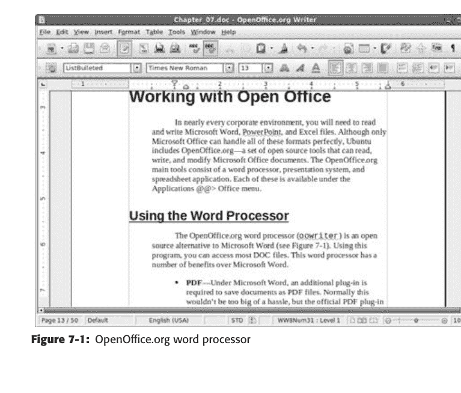

- **PDF**——在 Microsoft Word 下，需要额外的插件才能将文档保存为 PDF 文件。通常这不算太大的麻烦，但 Adobe 的官方 PDF 插件是一个资源密集型应用程序，启动时间较长，并且频繁检查更新。相比之下，OpenOffice.org 中的每个文档都可以通过菜单中的"文件" ➩ "导出为 PDF"立即导出为 PDF。此菜单选项在所有 OpenOffice.org 工具中都可用。

- **安全性**——Microsoft Word 在文档中嵌入了大量不必要的信息。这包括关于作者的信息以及已删除或编辑的文本。简单地添加一个字符、删除该字符并重新保存文档，就可能使文件变大。OpenOffice.org 允许你从保存的文档中移除个人信息和已删除的文本。你可以在"工具" ➩ "选项" ➩ "OpenOffice.org" ➩ "安全性"设置中配置此选项（见图 7-2）。该选项标记为"保存时移除个人信息"。

> **注意** 使用 Microsoft Office 2003 及更高版本时，你可以选择排除个人信息——但需逐个文件设置。而在 OpenOffice.org 中，此选项是默认配置，会影响所有文档。

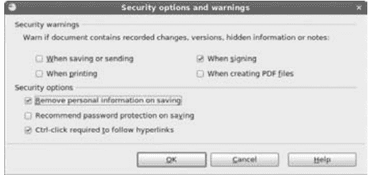

图 7-2：OpenOffice.org 安全性选项

- **OpenDocument 标准**——Microsoft 使用专有格式存储文档。相比之下，OpenOffice.org 默认采用 OpenDocument 标准。一方面，OpenDocument 的可移植性要高得多。另一方面，大多数版本的 Microsoft Office 不支持它。为了兼容性，你需要显式地将文档导出为 Microsoft Office 格式。或者，你可以转到"工具" ➩ "选项" ➩ "加载/保存" ➩ "常规"，更改默认文件格式。

尽管 OpenOffice.org 的文字处理器功能强大，但仍存在一些局限性。

- **格式**——虽然它可以查看大多数 Microsoft Office 文档，但专有文件格式是通过逆向工程解析的。因此，复杂格式可能显示异常，且可能无**法正确保存**。如果文档具有极其复杂的格式，实际上可能导致文字处理器崩溃。

- **项目符号、编号和标题**——这是 OpenOffice.org 的一个弱点。如果你只需要项目符号列表、编号列表或节标题，它可以胜任。如果你需要特殊格式或字符，那么最好先在 Microsoft Office 中创建这些格式。OpenOffice.org 可以使用文档中已有的格式，但无法轻松用于创建它们。虽然我预计这在后续版本中会有所改变，但这就是你目前必须面对的现实。

- **宏**——与格式一样，OpenOffice.org 对 Microsoft Word 宏的支持也不太好。

- **烦人的弹窗**——觉当鸭你将文档保存为 Microsoft Word 格式时，OpenOffice.org 可能会生成弹窗，警告你可能丢失格式信息。

##### 制作演示文稿

要么你*喜欢* Microsoft Office PowerPoint，要么你*讨厌*它。就我个人而言，它是我最喜欢的演示工具之一。OpenOffice.org 的对应产品叫做 Impress（`ooimpress`）。这款演示工具可以读取和写入 PowerPoint（PPT）文档。虽然 Impress 的整体外观和感觉与 PowerPoint 相似（见图 7-3），但仍存在一些明显差异：

- **复杂性**——与 OpenOffice.org 文字处理器一样，Impress 可能无法正确显示格式，如果 PPT 文件过于复杂，甚至可能导致崩溃。

- **动画**——动画图形、幻灯片和幻灯片切换效果并不总是正确显示。

- **兼容性**——一些从 Impress 导出的 PPT 文件无法在 PowerPoint 中加载，一些 PPT 幻灯片也无法正确导入到 Impress。我并未发现这总是发生，但它总是在你最需要的时候发生。

我在处理演示文稿时的一般原则是不要更换演示工具。如果演讲将使用 PowerPoint，那就坚持使用真正的 PowerPoint。如果演讲将使用 Impress，那就坚持使用 Impress。虽然

Impress 可用于查看 PPT 文件，但与 PowerPoint 的兼容性尚不足以支持真正的协作。


**图 7-3：** OpenOffice.org Impress——一款类似于 Microsoft PowerPoint 的演示工具

#### 访问电子表格

虽然 `ooimpress` 是一款可接受的演示工具，`oowriter` 是一款不错的文字处理器，但 Calc（`oocalc`）却是一款出色的电子表格应用程序。Calc 的外观与 Microsoft Excel 非常相似，并支持所有标准功能和布局（见图 7-4）。从 Excel 过渡到 Calc 几乎没有学习曲线。我唯一能发现的限制是宏支持；Calc 无法运行大多数 Excel 宏，也不支持可编程快捷键。例如，我有一个大型 Excel 电子表格，其中我将 Ctrl+G 映射到一个特定的宏。在 Calc 中，Ctrl+G 没有任何作用，而运行该宏（工具 ⇨ 宏 ⇨ 运行宏）会生成关于缺少括号的错误，但实际上括号并没有缺失。

#### 选择替代办公工具

OpenOffice.org 还包含许多其他有用的工具。例如，`oobase` 是 OpenOffice 版本的 Microsoft Access，`oomath` 是一款功能强大的公式编辑器，而 `oodraw` 则是一款非常简单的绘图工具，适用于您不需要 Gimp 复杂功能的情况。这些工具将帮助您提高工作效率，即使它们与相应的 Microsoft 应用程序并非完全兼容。与文字处理器、电子表格和演示工具不同，数据库接口前端、公式编辑器和绘图工具之间缺乏完美兼容性通常不会影响协作。

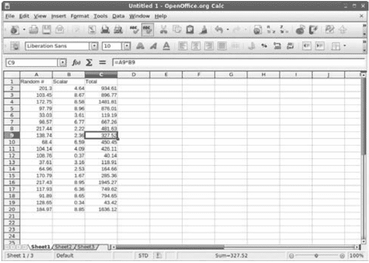

图 7-4：OpenOffice.org Calc 电子表格应用程序

虽然 OpenOffice.org 为 Ubuntu 提供了旗舰办公工具，但它们并非 Ubuntu 上唯一可用的办公工具。我认为应该为手头的任务选择最佳工具，而这并不总是意味着必须使用文字处理器来查看 Word 文档。

#### 替代文档查看器

我经常使用的一个工具是 antiword（`sudo apt-get install antiword`）。该程序将 Microsoft Word 文档转换为纯文本。这比打开文档并使用"文件 → 另存为"转换为文本要容易得多。当您没有图形界面登录时，它也非常方便——您可以使用 `antiword` 快速查看 Word 文件中的文本，即使字体和图形被排除在外。

`antiword` 还有另一个有用的功能。如前所述，Microsoft Word 文档可以包含隐藏注释。使用 `antiword -s`，您可以查看隐藏文本。如果您曾经想过自己泄露了什么信息，或者文档中可能隐藏了什么内容，这个工具将为您展示。要查看文档中隐藏了哪些文本（例如 file.doc），我使用以下命令：

```
antiword file.doc > plain.text
antiword -s file.doc > hidden.text
sdiff plain.text hidden.text
```

`sdiff` 命令显示两个文件之间的逐行并排差异。每个有差异的行都会被标记，因此您可以立即看到发生变化的位置。

另一个强大的工具是 `wv`（以前称为 WordView——`sudo apt-get install wv`）。该程序包含一套转换工具，例如 `wvPDF` 用于将 Word 文档转换为 PDF 和


在我看来，RCS使用起来很简单，但已经过时了，因为如今很少有人完全孤立地开发代码。相比之下，Git的配置和使用过于复杂。虽然Git非常适合Linux内核团队的需求，但对大多数其他项目来说却是大材小用。CVS适合多用户，但不如Subversion流行。相比之下，Subversion虽然配置困难，但使用非常简单，而且非常适合大多数协作项目。

> **注意** 还有其他并发源代码管理系统。有一些是免费的，比如FreeVCS，还有一些是专有的（微软的SourceSafe立刻浮现在脑海中）。RCS、CVS和Subversion都可以方便地用于Linux、BSD、Mac OS X，甚至Windows。相比之下，Git有适用于Mac OS X和Windows的移植版本，但这些移植版本可能不是最新最好的版本。如果你需要与不同平台的人协作，那么Subversion是一个很好的选择（CVS也是一个不错的替代方案）。

#### 配置Subversion

Subversion可以跟踪代码更改，并允许源代码树的分支。这样，你可以有一个稳定的源代码库（通常称为*主干*），以及各种分支，你可以在这些分支上进行重大修改和更改，而不会破坏主源代码树。如果你喜欢某个分支中所做的更改，你总是可以将其合并回主干。Subversion还允许用标签标记某些发布版本。这些标签可用于跟踪主要发布版本或里程碑。

安装Subversion由于其用户配置而略显复杂。

> **提示** Subversion比这里讨论的拥有更多的功能和选项。更多信息，请访问subversion.tigris.org。

1. 安装Subversion。

    `sudo apt-get install subversion`

2. 创建Subversion仓库。这是Subversion将存储源代码、元数据和配置信息的地方。例如，如果你需要一个名为`supercode`的项目，则使用：

    `mkdir $HOME/repos`

    `svnadmin create $HOME/repos/supercode`

> **提示** 如果你的服务器上有很多人想要自己的Subversion仓库，那么考虑创建一个Subversion用户（`useradd -m subversion`），并使用该主目录作为仓库的根目录（而不是`$HOME/repos`，使用`/home/subversion`）。然后你可以使用`itto`为每个用户创建项目。一个简单的脚本如下：

    for i in $(cd /home; ls -l | grep -v subversion); do
      svnadmin create $i
    done

仓库配置存储在`$HOME/repos/supercode/conf/svnserve.conf`中。该文件包含大量注释，选项都有很好的文档说明。默认配置允许任何人读取（检出）文件，但没有人可以检入任何内容。

Subversion文件总是使用URL访问。然而，URL的类型取决于你希望人们如何访问仓库。选项如下：

- `file://` 仅允许从本地文件系统访问。不使用授权文件。相反，Unix文件权限限制访问。

- `svn://` 使用原生Subversion网络协议。这将使用授权文件。你的`svnserve.conf`应该如下所示：

```
## General settings for svn:
[general]
anon-access = read
auth-access = write
password-db = passwd
authz-db = authz
```

- `svn+ssh://` 通过安全外壳使用Subversion。这是最安全的解决方案，因为`ssh`处理身份验证。然而，每个用户必须在服务器上有一个账户。要使用此选项，你必须安装安全外壳服务器，并且必须禁用授权（`anon-access = write`）。

```
## General settings for svn+ssh:
[general]
anon-access = write
#auth-access = write
#password-db = passwd
#authz-db = authz
```

如果用户很多，或者你处于企业环境中，那么你可能需要`svn:`或`ssh+svn:`。如果你的系统可以从互联网访问，那么你会需要`svn+ssh:`。确保在general标题下取消注释适当的行。

Subversion不使用`/etc/passwd`作为账户。对于授权，你需要编辑仓库的密码文件：`$HOME/repos/supercode/conf/passwd`。每个用户需要用户名和密码。例如：

```
[users]
user = password
neal = mypassword
rash = itchy
```

5. 编辑authz文件并给授权用户写入权限。至少，你需要在$HOME/repos/supercode/conf/authz下创建一个新标题，并在其下列出用户：

```
[/]
user = r
neal = rw
rash = rw
```

#### SUBVERSION密码安全

Subversion密码以纯文本存储。任何能够访问此密码文件的人都可以看到所有密码。不要将你的系统登录密码用于Subversion，也不要将其设置为侮辱管理员的字符串，因为他会读到（"ToddSucks"）。为了提高安全性，使用makepasswd（sudo apt-get install makepasswd）为用户生成随机密码。

Subversion将纯文本密码存储在服务器的repos/supercode/conf/passwd文件中，以及客户端缓存的`$HOME/.subversion/auth/`目录中。

从1.6版（Karmic Koala 9.10及更高版本）开始，Subversion包含了将客户端缓存密码存储在Gnome Keyring或KDE Kwallet中的选项。这两个选项都会对客户端缓存密码进行加密。要启用此选项，编辑`$HOME/.subversion/config`并取消注释以下行：

```
password-stores = gnome-keyring,kwallet
```

Subversion服务器可以手动启动，作为独立守护进程，或作为网络服务。要手动启动一次，使用svnserve -d -r $HOME/repos/。-d表示将其作为后台进程（守护进程）运行，-r指定仓库的根目录。

要使Subversion自动启动，你可以在`/etc/init.d/`中创建一个脚本（有关启动脚本的一些示例，请参见第11章和第12章），或者你可以使用xinetd（sudo apt-get install xinetd）将其作为按需网络服务启动。xinetd服务（`/etc/xinetd.d/svnserve`）应该如下所示：

```
## SVN server
## This is the tcp version.
## Be sure to set the root path to match your repository directory
service svn
{
        disable       = no
        id            = svn-stream
        socket_type   = stream
        protocol      = tcp
```

```
user         = root
wait         = no
server       = /usr/bin/svnserve
server_args  = -i --root=/home/user/repos
port         = 3690
}
```

#### 使用Subversion

与RCS不同，Subversion不使用文件锁。任何人都可以随时编辑任何文件。为了跟踪代码更改，Subversion在一堆.svn子目录中存储元数据。因此，在开始之前，你需要为你的代码准备一个目录。在此示例中，SVN服务器位于名为chai的远程系统上。

```
svn co svn://chai/supercode
svn co svn+ssh://chai/fullpath/supercode
```

对于本地文件系统，你可以使用：

```
svn co svn://localhost/supercode
svn co svn+ssh://localhost/fullpath/supercode
svn co file:///fullpath/supercode
```

> 如果你使用启用了授权的svn:，那么你需要指定用户名和密码。例如，svn --username user --password pass co svn://server/respository。user和pass必须与你的passwd文件中的条目匹配。你还可能看到有关密码以未加密形式存储在系统上的警告。

这将创建一个supercode/工作目录，并为其使用Subversion做好准备。如果supercode仓库中有任何代码，那么所有代码都会被检出。但如果这是一个新项目，那么只会创建一个.svn目录。

> .svn目录由Subversion管理。在常规使用场景中，你永远不需要编辑.svn目录下的任何内容。

你将使用的主要操作是更新、添加、删除和检入。然而，你可能还想查看文件的历史记录或差异。

- svn up—此命令更新目录中（以及任何子目录中）每个文件的副本。你也可以选择要更新的特定文件或目录（例如，svn up file）。使用它来下载最新检入的副本。如果你不周期性地用svn up更新你的目录，那么你将永远不会收到其他人检入的新代码。


 ■ **svn ci**—这是提交更改的检入命令。所有已修改的文件都会被选中并发送到服务器。系统会提示你输入一段可读性强的更改描述。一般来说，每次检入最好只包含一种类型的更改。这样，如果需要移除某些内容（比如错误的检入），你可以将影响范围缩小到少数几个文件。

> **警告** Subversion 允许多人同时编辑同一个文件。如果两个人更改了源代码的同一区域，那么第二个检入的人将被阻止。Subversion 会在代码中高亮显示冲突，并且不允许你检入，直到冲突解决为止。

■ **svn add *file***—这是将新文件添加到项目中的方法。如果你指定了一个新目录，那么该目录下的所有内容将在下次检入代码时被添加。

> **提示** 虽然你可能想要添加源代码，比如 `svn add *.c`，但你可能不想添加临时文件或每次构建都会变化的二进制对象。

■ **svn del *file***—这行命令会从仓库中删除一个文件（或目录）。但是，删除操作要到检入更改后才会生效。

■ **svn ren *old new***—将文件或目录从 *old* 重命名为 *new*。

■ **svn diff *file***—此命令显示你的代码与仓库中副本之间的差异。

■ **svn log *file***—这行命令会向你展示检入历史记录以及你输入的相关描述。

■ **svn status**—此命令列出所有文件冲突和未提交的更改。

■ **svn resolved *file***—有时候，Subversion 会禁止提交，因为它认为存在文件冲突。如果你确定没有冲突（或者已经解决了冲突），那么可以使用 `resolved` 来覆盖冲突通知。

每次提交都会递增一个版本号。你可以指定版本号来访问特定时间点的代码。例如，要将我的 `Makefile` 与当前最新版本进行比较，我会使用 `svn diff Makefile`。但是，如果我想将其与版本 21 进行比较，那么我会使用 `svn diff -r21 Makefile`。同样，`svn co` 会检索当前代码库，但 `svn co -r1280` 会检索版本 1280 时的代码。

#### 使用 Subversion 进行分支与 victorious

Subversion 中的分支本质上是源代码的副本。在使用分支和合并之前，请确保所有代码都在一个子目录中。

```
mkdir trunk
svn add trunk
svn ci trunk -m "Creating trunk"
## 将所有文件移到 trunk 下：
ls -l | grep -v '^trunk$' | while read i; do svn ren "$i" trunk; done
svn ci -m "Populating trunk"
```

使用 copy 命令将 trunk 复制到你的新分支。例如，我可以将 chai 上 supercode/trunk 复制到一个名为 branch/test123 的实验性分支，使用：

```
mkdir branch
svn add branch
svn ci branch -m "Creating parent directory for branches"
svn copy svn://chai/supercode/trunk/ \
     svn://chai/supercode/branch/test123 \
  -m "Experimental Test Branch"
svn up # 检出新分支
```

最终你会想要将你的分支合并回 trunk。以下两个命令都会将更改合并回 trunk；前者合并特定的分支，后者合并你当前的代码目录。

```
svn merge svn://chai/supercode/branch/test123 \
      svn://chai/supercode/trunk/
svn merge --reintegrate svn://chai/supercode/trunk/ .
```

你甚至可以将测试分支中的特定版本更改合并回 trunk。例如，要合并版本 115 到 118 之间的所有更改，我会使用：

```
svn merge -r 115:118 svn://chai/supercode/branch/test123 \
     svn://chai/supercode/trunk/
```

#### 实时共享文档

虽然共享源代码很好，但这与同时 actively 编辑同一个文件并不相同。请注意，当我说"同时"时，我不是指在不同系统上编辑文件或使用 Wiki 修改网页；我指的是真正的多人实时编辑，你可以看到另一个人打字！

我在偶然发现的最佳协同编辑程序之一是 Gobby（`sudo apt-get install gobby`）。Gobby 是一个用于编辑文本文件的实时协作工具。使用 Gobby 时，一个人启动服务器，其他人作为客户端连接。（见图 7-6。）

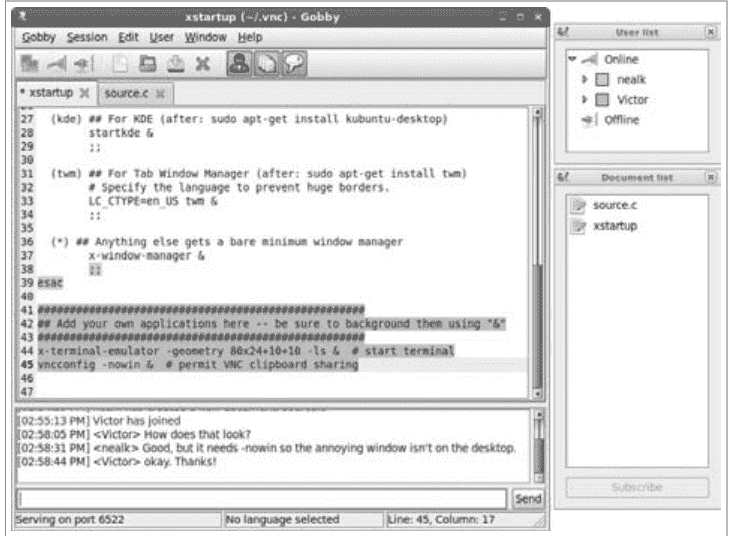

**图 7-6：** 一个 Gobby 会话

Gobby 允许任何人打开和共享文本文件。每个人选择一个名字和一种颜色。名字让其他人知道你是谁，颜色则告诉大家文档中哪些部分是你修改的。

除了共享文档，Gobby 还包含一个小型聊天窗口用于发送文本消息。聊天窗口的外观和行为与其他实时文本聊天系统类似。

最让我印象深刻的是，Gobby 0.4 版本（在 Hardy Heron [8.04 LTS] 及之后的 Ubuntu 版本中）会加密所有网络流量。你实际上可以安全地在互联网上使用 Gobby！

> **提示** 对于高强度的文档协作，我通常使用 Gobby 来共享文件编辑，并用 Skype 进行免费网络电话。虽然聊天窗口很方便，但没有什么比得上口头交流来得快速。

Gobby 也有一些替代品。例如，Abiword 2.6 包含协同编辑 Word 文档的功能。遗憾的是，Hardy Heron（8.04 LTS）的软件仓库中只有 Abiword 2.4。你需要 Jaunty Jackalope（9.04）或更高版本才能从软件仓库安装，或者你也可以从源代码编译最新版本的 Abiword。还有 DrawPile 用于共享画板（http://sourceforge.net/projects/drawpile/），但解决所有编译问题可能需要数小时（他们没有指明编译所需的依赖库）。

#### 使用 VNC 共享桌面

在 Ubuntu 下，虚拟网络计算（VNC）是共享桌面的最佳选择。VNC 支持 Unix、Linux、Mac OS X 和 Windows 操作系统。与其费力使用几乎兼容的软件，不如使用 VNC 来提供对远程桌面的访问，在那里你可以在其原生平台上使用软件。例如，我经常参加使用 Microsoft NetMeeting 或 LiveMeeting 来共享幻灯片的电话会议。这对 Windows 用户来说很方便，但对 Linux 用户就不行了。为了解决这个问题，我们在其中一台 Windows 客户端上运行 VNC 服务器。这样，Linux 用户就可以使用 VNC 来观看共享的演示文稿。

VNC 由两部分组成：服务器和一个或多个客户端（称为 *viewers*）。服务器共享桌面，而客户端创建一个窗口来显示服务器的桌面。

> **警告** 在 Microsoft NetMeeting 下，服务器可以选择共享哪些窗口。在 VNC 下，要么全部共享要么什么都不共享；要么共享整个桌面，要么什么都不共享。如果你正在共享桌面，别忘了所有人都能看到你在查看电子邮件。

> **远程桌面**
>
> 在 Windows 和其他系统之间共享桌面有几种不同的方法。虽然 VNC 非常常见且易于访问，但还有其他选择。例如，Microsoft 提供了远程桌面协议（RDP）用于与远程主机共享桌面。RDP 默认包含在 Windows 2003 和 XP 系统中，并且可以从 Microsoft 获得其他 Windows 版本的支持（msdn.microsoft.com/library/en-us/termserv/termserv/remote_desktop_protocol.asp）。**在 Linux 和 Unix 方面，诸如 rdesktop**（Ubuntu 默认桌面的一部分）之类的工具允许从非 Windows 系统访问共享的 Windows 桌面。要使用这个程序，你只需要提供中通服务器名——例如：
>
> `rdesktop winserver`
>
> 其他适用于 Ubuntu 的 RDP 客户端包包括 `gnome-rdp` 和 `tsclient`。对于 KDE 桌面，还有 `krdc`。
>
> 虽然使用原生 Microsoft 协议对于访问 Windows 桌面很有用，但有两个重大限制。首先，RDP 服务器（共享桌面）并非适用于所有版本的 Windows；其次，只有 Windows 可以作为服务器。目前，你无法使用这些 Ubuntu RDP 工具将 Ubuntu 桌面共享给 Windows 系统。

#### 使用 VNC 查看器

Ubuntu 有几种不同的 VNC 客户端itech。Hardy Heron（8.04 LTS）及之后的 Ubuntu 版本包含 `vinagre`。不过，我更喜欢 `xvnc4viewer` 包（Dapper Drake 下的 `vncviewer`），因为它提示更少、更易用。要启动客户端，运行：`vncviewer`。这会弹出一个要求输入服务器名的小窗口。

> 我通常将 VNC 查看器作为启动器添加到顶部面板。这样，点击图标就会立即提示输入服务器名。如果你在启动器参数中包含服务器名，那么 `vncviewer` 将立即连接到该服务器。

VNC 服务器可能需要密码。如果需要，系统会提示你输入密码。然后查看器窗口将出现，显示共享的桌面（见图 7-7）。当你的鼠标悬停在查看器上时，光标会变成一个小方块。如果服务器允许你交互（而不只是"仅查看"），那么服务器的光标会跟随你移动。每次按键和每次鼠标点击都会从你的系统传输到服务器。

更重要的是，服务器和客户端的剪贴板缓冲区是关联的。这使你能够在客户端上的应用程序与服务器上的所有内容之间复制和粘贴文本。

> 如果你的远程 Linux 系统不支持剪贴板共享，尝试运行 `vncconfig`（`sudo apt-get install vnc4server`）。

> 如果服务器的桌面大于客户端的窗口，那么查看器窗口会出现滚动条。这可能不太方便。另外，如果服务器的调色板与客户端的不同，颜色可能看起来不对。


 ## 共享您的桌面

对于 Ubuntu VNC 服务器，有两种选择。首先，您可以共享自己的桌面。在这种设置下，每个客户端都能看到您桌面上的所有内容。虽然这通常不是问题，但有时会影响您自己的工作效率。例如，如果每个人都能看到你的桌面，您就无法私下搜索网页或查看电子邮件。第二种选择是共享虚拟桌面，在这种方式下，客户端只能看到您希望他们看到的内容。

##### 共享您的完整桌面

要共享 Trimpser 完整桌面，您需要安装服务器 `x11vnc`。

```
sudo apt-get install x11vnc
```

要启动服务器，只需运行 `x11vnc`。基本服务器不使用密码，允许一个客户端与服务器完全交互，并在客户端断开连接时退出。`x11vnc` 还有许多其他选项。表 7-1 列出了一些更有用的选项。这些选项可以组合使用。我通常使用类似 `x11vnc -forever -passwd SeCrEt` 的命令。

##### 表 7-1：`x11vnc` 的命令行选项

| 选项 | 示例 | 用途 |
|---|---|---|
| `passwd` | `x11vnc -passwd SeCrEt` | 为服务器设置密码。这不是很安全，但可以阻止闲杂人等进入。 |
| `viewonly` | `x11vnc -viewonly` | 所有客户端只能观看，无法交互。这对于演示很有用。 |
| `forever` | `x11vnc -forever` | 最后一个客户端断开连接后，服务器继续运行。默认设置是 `-once`。 |
| `clip` | `x11vnc -clip 600x400+0+25` | 限制桌面区域。在本例中，它是 600x400 像素，垂直偏移 25 像素——这是位于顶部面板正下方的区域。只有该区域内的项目会被共享。 |

##### 共享独立桌面

虽然共享完整桌面很有用，但有时最好有一个干净的共享环境。X-Windows 支持虚拟桌面。这些是存在于内存中的桌面，不会与您的真实桌面冲突。`tightvncserver` 和 `vnc4server` 软件包都提供用于 VNC 共享的虚拟桌面。但是，只有 `vnc4server` 提供共享剪贴板支持。

- 1. 安装 VNC 服务器。

```
sudo apt-get install vnc4server
```

- 2. 启动服务器。请务必指定屏幕分辨率（例如，800x600）、色深（例如，8、16 或 32 位）和显示编号。您的正常桌面运行在显示 `:0` 上，因此您需要选择一个替代的显示。

```
vnc4server -geometry 800x600 -depth 16 :9
```

> **提示** 虽然您可以指定比真实桌面更大、分辨率更高的桌面空间，但不要这样做。在大多数情况下，选择比您的桌面更小、色深相同（或更低）的几何尺寸更为方便，以避免滚动条和难看的颜色。

- 3. 当您第一次启动 `vnc4server` 时，它会要求您输入密码。客户端在连接服务器时需要提供此密码。如果您重新启动服务器，则无需再次指定密码。如果您想稍后更改密码，请使用 `vncpasswd`。

- 4. 使用 `xvncviewer` 连接到服务器。对于服务器名称，请包含显示编号。例如，如果服务器的主机名为 `vserver`，则输入 `vserver:9`。

- 5. 如果您想与 `vnc4server` 共享剪贴板，您需要运行 `vncconfig`。这会弹出一个小窗口，询问您是否要发送或接收剪贴板。我通常使用 `-nowin` 参数来禁用该窗口。

```
vncconfig -nowin &
```

虚拟桌面在后台启动。要停止其运行，请使用 `-kill` 选项。例如，`vnc4server -kill :9`。

默认的虚拟桌面实际上取决于您的 Ubuntu 版本。例如，Dapper Drake (6.06 LTS) 和 Hardy Heron (8.04 LTS) 都默认为非常简单的配置：一个打开的终端窗口，没有菜单、没有图标，除了默认的 X11"灰色"背景之外没有任何背景。而 Karmic Koala (9.10) 的 VNC 桌面使用您的默认 Gnome 桌面设置。

桌面在 `$HOME/.vnc/xstartup` 脚本中定义。您可以修改此脚本以提供一个真正的桌面。例如，清单 7-3 显示了我的 `xstartup`。它有许多不同桌面的选项，但目前启动的是*我的* Gnome 桌面，而不显示我实际打开的任何应用程序（见图 7-8）。

##### 清单 7-3：带有不同桌面选项的示例 `$HOME/.vnc/xstartup`

```
#!/bin/sh
#############################################
## 设置您的桌面
## 选项有：'gnome'、'kde'、'twm' 或 'plain'
#############################################
DESKTOP=gnome

## 加载默认设置
xrdb $HOME/.Xresources
xsetroot -solid grey

## 启动桌面
case "$DESKTOP" in
  (gnome) # 这取决于您的 Ubuntu 版本
        # 获取主要版本（例如，9.10 变为 9）
        version=`lsb_release -sr | sed -e 's/[.].*//'`
        if [ "$version" -lt 9 ]; then
           # 早于 Jaunty（例如，Dapper 或 Hardy）
           gnome-session-sm-disable &
        else
           # Jaunty、Karmic 或更高版本
           /etc/X11/Xsession
        fi
       ;;

(kde) ## 用于 KDE（在以下操作后：sudo apt-get install kubuntu-desktop）
    startkde &
    ;;

(twm) ## 用于 Tab Window Manager（在以下操作后：sudo apt-get install twm）
    # 指定语言以防止出现大边框。
    LC_CTYPE=en_US twm &
    ;;

(*) ## 其他任何情况都使用最小的窗口管理器
    x-window-manager &
    ;;

esac

############################################
## 在此处添加您自己的应用程序——确保使用 "&" 使其在后台运行
############################################
x-terminal-emulator -geometry 80x24+10+10 -ls &  # 启动终端
vncconfig -nowin & # 允许 VNC 剪贴板共享
```

在 VNC 虚拟桌面上使用 Firefox 时，您可能会看到有关 Firefox 已在运行或配置文件正在使用的错误。考虑使用备用配置文件来解决此问题。有关调整 Firefox 的信息，请参阅第 6 章。

#### 保护 VNC 连接

VNC 密码提供了基本级别的安全性，但不应依赖其在互联网上的安全性。相反，您可以通过 SSH 连接来隧道传输 VNC。默认情况下，VNC 服务器使用端口 5900/tcp。每个 VNC 显示都会递增此值。例如，如果您使用 Tight VNC 并指定显示 :9，则端口为 `5909/tcp`。然后，使用 SSH 端口转发，您可以隧道传输 VNC 端口。例如，要将本地 VNC 端口隧道传输到运行在 :9 上的远程 VNC 服务器，请执行以下操作：

- 1. 在远程服务器上，在显示 :9 上启动 Tight VNC 服务器。例如：

   `vncserver :9`

- 2. 在您的本地系统上，使用 SSH 连接到服务器，并将本地端口 `5900/tcp` 转发到服务器的端口 `5909/tcp`。

   `ssh -L5900:localhost:5909 server`

- 3. 在本地系统的另一个窗口中，启动 VNC 客户端：

   `xvncviewer localhost`

此命令告诉查看器连接到位于 `localhost:5900` 的 VNC 服务器。然而，`5900/tcp` 实际上是通过 SSH 连接隧道传输到远程服务器的。该连接被隧道传输到服务器的端口 `5909/tcp`，那里运行着 VNC 服务器。

通过 SSH 隧道传输 VNC，您可以防止攻击者看到您的桌面，更重要的是，您无需让 VNC 服务器及其弱密码系统暴露给全世界。

通过 SSH 隧道传输 VNC 并不总是快速的。为了获得更好的速度性能，请启用压缩（`-C`）并将加密选择更改为使用 Blowfish 算法：`ssh -C -c blowfish -L5900:localhost:5909 server`。

##### 看到速度差异

VNC 传输大量图形，可能是带宽消耗大户。如果十几个客户端连接到单个服务器，那么离开服务器的网络流量可能会成为瓶颈，导致每个人的更新速度变得非常慢。

*(待续)*


 ## 体验速度差异（续）

如果你需要让很多查看者访问，可以考虑分担负载。主服务器应该只与少数客户端共享桌面（例如，一台服务器共享给四台客户端）。每台客户端也同时运行服务器，并与更多客户端共享。你可以继续在这台计算机之间分散网络负载，直到每个人都能访问。只需要三级这种"一台服务器对四台客户端"的结构，就有超过200人可以看到相同的内容。虽然这条链路末端的人可能需要等待一秒钟才能看到更新，但这比让200个客户端访问同一个VNC服务器要快得多。

#### 在模拟器中运行软件

虽然近乎兼容的软件有助于弥合协作者之间的沟通鸿沟，但没有什么比运行完全相同的应用程序更好的了。例如，如果你需要编辑Word文档，那么没有比Microsoft Word更好的工具了。在过去，这种真正的兼容性是通过双启动系统实现的。一台计算机上安装了多个操作系统，用户重启计算机进入他们需要的操作系统。虽然Ubuntu确实支持双启动环境（参见第1章），但这不如能够同时运行来自多个操作系统的应用程序有效。如今，人们要么运行两台装有不同操作系统并具备网络连接的不同计算机（硬件很便宜），要么使用硬件模拟器。

硬件模拟器是一个假装自己是整台计算机的应用程序。模拟器在虚拟机（VM)中复制一台计算机：CPU、内存、设备（例如，硬盘）甚至BIOS。一个完美的模拟器可以运行任何操作系统，而操作系统应该无法分辨自己运行在模拟器中。例如，像Ubuntu和Windows这样的操作系统期望标准化硬件。如果模拟器模拟了硬件，那么任一操作系统都可以毫无问题地运行。大多数操作系统不需要知道硬件是模拟的。

运行模拟器有很多理由，比如把玩恶意病毒、打开可疑邮件，或安装软件而不破坏主系统。一个真正的模拟器是一个完美的沙盒，软件可以在不伤害宿主操作系统的情况下运行。但使用模拟器的主要原因之一是兼容性。并非所有软件都能在Ubuntu下原生运行，但在Ubuntu下运行的模拟器可以安装非Ubuntu操作系统，用于运行原生应用程序。例如，如果我确实需要使用Microsoft NetMeeting，那么我可以启动一个运行Windows的虚拟机，并从模拟器内部使用NetMeeting。

#### 选择模拟器

模拟器有三个主要组成部分。*宿主*操作系统是模拟器运行的环境，而*客户*操作系统在模拟器中运行。例如，Ubuntu宿主可以在模拟器中运行Windows 2000作为客户系统。最后一个组成部分是虚拟硬盘。这通常是宿主系统上的一个文件。我经常在虚拟硬盘（文件）上安装客户操作系统，按我喜欢的方式配置它，并对该文件进行备份。之后，在客户系统中试用软件后，我可以复制回镜像来重置系统。这比尝试卸载不需要的软件或从备份系统执行恢复更快、更干净。

> **提示** 如果你想看看某个补丁是否会让系统不稳定，先在虚拟机中安装它。我有一个虚拟机，安装了与我的某些关键计算机相同的软件。在修补真机之前，我确保虚拟机在打补丁后能正常工作。

Ubuntu有三种主要模拟器：Qemu、VMware和Xen。虽然每种都提供了可靠的模拟，但它们各不相同。表7-2展示了一些差异。所有三种模拟器都提供相同的基本功能。它们都支持多个驱动器，提供可靠的i386模拟，并支持网络访问。主要区别在于许司方式、架构支持和速度。

Qemu是模拟器中最慢的，但提供了最广泛的硬件支持。Xen可以说是最快的，但只支持Linux或BSD系统。（如果你的CPU支持x86虚拟化，Xen可以支持Windows。但大多数CPU不支持。）VMware提供商业级的快速模拟、精细的界面，但它是专有的，且仅限于Linux和Windows宿主系统。

有两种类型的虚拟机：模拟器和虚拟化器。模拟器使用软件来表示计算机系统。真正的模拟器，如Qemu和VMware，提供虚拟硬件、BIOS甚至多个CPU。其好处是，任何在真实硬件上支持的操作系统都能在模拟器中工作。例如，如果模拟器充当一台带512 MB RAM的SMP Pentium Pro PC，那么它将支持Windows、Linux、BSD、OS/2、E/OS和任何其他PC操作系统。

模拟器最大的限制是系统资源和速度。如果你将模拟器配置为512 MB RAM，但实际只有128 MB RAM，那么你可以预期会花费时间将RAM交换到磁盘。就速度而言，模拟器解释运行的操作码。这意味着客户操作系统运行得比它在专用计算机上慢。速度可能不到实际操作系统时钟速度的25%。例如，一台2.8 GHz的宿主系统可能有一个运行速度看起来为300 MHz的客户机。如果它们正在执行硬件密集型命令，系统可能会运行得更慢，而且检测连接外设可能需要很长时间。为了克服一些速度限制，有内核模块可用于提升性能。这些模块允许模拟器将某些功能直接链接到宿主操作系统中。通过内核模块，驱动器、内存和视频访问都能更快执行。在最好的情况下，内核模块可以为你提供接近1:1的性能比。

#### 表7-2：硬件模拟器对比

| 特性 | QEMU 0.11.0 | VMWARE 3.0 | XEN 3.24 |
|---------|-------------|------------|----------|
| 许可协议 | GPL | 商业 | GPL |
| 开源 | 是 | 否 | 是 |
| 虚拟机类型 | 模拟器 | 模拟器 | 虚拟化器 |
| 宿主架构 | 32位和64位x86、PowerPC、Sparc；Linux、BSD、Windows、Solaris、MacOS X；可移植到其他宿主系统 | 32位和64位x86；Linux和Windows | 32位和64位x86；Linux和BSD；在适当硬件上支持Windows |
| 客户平台 | 32位和64位x86、PowerPC¹、ARM、MIPS、Sparc等 | 32位和64位x86 | 32位和64位x86⁴ |
| 内核加速模块 | 有² | 有 | 有 |
| Ubuntu支持 | Universe仓库³ | 通用Linux二进制文件 | 下载源代码或Debian二进制文件；Hardy Heron及更高版本的Ubuntu仓库 |
| 安装和卸载 | apt-get安装和卸载³ | 安装脚本；手动卸载 | 手动安装和卸载 |

- ¹ Qemu仅在PowerPC上支持Linux作为客户操作系统。
- ² Qemu包含内核加速模块，但在Ubuntu下不能稳定工作。
- ³ Ubuntu universe仓库通常没有最新版本的Qemu可用，且通常不包含所有不同的模拟平台。
- ⁴ Xen虚拟化硬件，因此它只能运行多个宿主硬件的实例。

与模拟器相反，*虚拟化器*不模拟硬件。相反，它们管理现有的宿主硬件，并允许不同的客户系统共享相同的资源。Xen是虚拟化器的一个例子。Xen允许多个客户操作系统在同一硬件上独立运行。虽然Xen不能让你为协作运行不同的应用程序，但它可以帮助分担工作负载、测试联网应用程序，甚至为软件进行基准测试。Xen经常用于安全。每个独立的操作系统执行特定任务。如果一个Xen虚拟机被入侵，它不会影响其他虚拟机。

#### 了解虚拟磁盘

一般来说，你可以与模拟器配合使用几种虚拟驱动器。第一种是实际硬盘的磁盘镜像。安装客户操作系统后，该镜像将包含分区表、引导加载程序和客户操作系统——类似于块设备`/dev/hda`。这是最灵活的选项。遗憾的是，这个选项并不总是理想的，因为你无法轻松地从磁盘镜像中复制文件。（Linux不允许你挂载包含分区表的文件。）

第二种选择是原始磁盘分区。这是一个缺少分区 svg 和引导加载程序的文件（或设备）——类似于`/dev/hda`下方的块设备`/dev/hda1`和`/dev/hda2`，它们是分区。这种选项允许你将文件挂载为回环设备。如果你想在客户和宿主操作系统之间共享文件，你可以挂载分区镜像。例如，如果分区文件名为`disk.img`，你可以使用：

```
sudo mkdir /mnt/img  # 确保挂载点存在
sudo mount -o loop disk.img /mnt/img  # 挂载磁盘
```

通过挂载分区，你可以向虚拟机复制任何需要的文件，或从中复制文件。

第三种选择是使用现有目录。该目录被虚拟机使用并视为磁盘分区。虽然并非所有模拟器都支持，但这确实使宿主和客户系统之间的文件复制更容易。

#### VNC与VM的区别

所有这些模拟器都能捕获鼠标。这意味着鼠标的输入完全被虚拟机使用。这与VNC不同，在VNC中，远程鼠标与本地鼠标是分离的，将鼠标移出窗口允许你离开远程窗口。要从模拟器中释放鼠标，请同时按Ctrl和Alt键。


 > **RFNOTE 对于 Qemu，只有键盘左侧的 **Ctrl+Alt** 键才能释放鼠标。右侧的按键会被发送到来宾操作系统。而对于 VMware，任何 **Ctrl** 和 **Alt** 键的组合都会释放鼠标。

另一个重大区别涉及剪贴板。在 VNC 下，你可以在远程（来宾）和本地（主机）操作系统之间进行剪切和粘贴。Qemu 不支持此功能——主机和来宾不共享剪贴板。Xen 和 VMware 如果修改了来宾操作系统内核，则提供共享剪贴板功能。

#### 使用 VNC 进行模拟

这三个模拟器提供的最酷功能是能够使用 VNC *作为显示器*。通常启动虚拟机时，会出现一个窗口作为操作系统的显示器。Qemu、VMware 和 Xen 允许你指定 VNC 显示器而非普通窗口。例如，在 Qemu 下，你可以使用 `qemu -vnc 2` 将显示器启动在 VNC 服务器 `localhost:2` 上。现在，如果你想协作，可以在任何支持的来宾 amino任何来宾操作系统上使用任意应用程序——你不会限于共享你的 Ubuntu 桌面。

#### 使用 VMware（商业软件）

VMware 是一款商业模拟器。它非常快且可配置性很强。然而，它不是开源的，且并非适用于所有硬件平台。

1. 访问 `www.vmware.com`。VMware 提供三种不同类型的模拟器：VMware Player、VMware Server 和 VMware ESXi。

> **提示** 如果你计划安装 VMware Server，请先获取你的序列号！虽然你可以重新运行安装程序，但在输入序列号之前服务器无法运行。VMware Workstation 提供短暂的试用期，但之后必须注册才能使用。

2. 安装软件。例如，如果你下载了 `VMware-Player-3.0.0-203739.i386.bundle`，则可以使用以下命令安装：

   `sudo sh ./VMware-Player-3.0.0-203739.i386.bundle`

3. 通过运行 `vmplayer` 启动 VMware Player。

`vmplayer` 窗口包含了创建新的虚拟机实例、安装到硬盘甚至更改虚拟硬件配置所需的一切。

VMware 提供了大量使用外设和虚拟网络连接的选项。你可以轻松创建包含大量虚拟机的虚拟子网。这对于测试网络软件非常有用。

#### 使用 Qemu（开源）

Q-模拟器（Qemu）是最灵活的模拟器选项，因为它支持多种主机和来宾架构。尽管它非常便携，但 Qemu 不如 VMware 快，也不如 VMware 那样良好地支持外设。

虽然可以从 Ubuntu 仓库获取 Qemu，但你可能希望从头编译 Qemu，因为 Ubuntu 软件包并不总是包含最新的代码版本。

> **注意** 你需要安装开发环境。请参阅第 5 章了解 C 语言编程。

1. 从 http://www.qemu.org/ 下载最新源代码。

2. 按照安装说明操作。应该很简单：
   - 解压源代码并 `cd` 进入源代码目录。
   - 使用 `./configure` 配置构建文件。
   - 使用 `make clean; make` 编译 Qemu。
   - 使用 `sudo make install` 安装。

3. 你需要执行一个手动配置步骤，为 Qemu VNC 服务器指定键盘映射：

```
sudo ln -s /usr/share/rdesktop/keymaps /usr/local/share/qemu/keymaps
```

#### 安装 Qemu 虚拟机

开始使用 Qemu 之前，你首先需要一块虚拟磁盘。有多种方法可以创建：

- **使用 `qemu-img`**——程序 `qemu-img` 创建一个空白文件，作为磁盘镜像。要创建一个名为 disk.img 的 2 GB 文件，请使用：

```
qemu-img create disk.img 2G
```

- **创建空白磁盘**——你可以使用 `dd` 创建空白磁盘。例如，`dd if=/dev/zero of=big1 bs=512 count=4194304`。这与使用 `qemu-img` 效果相同（但速度没那么快）。

- **复制工作驱动器 ——使用 `dd` 复制一块正在工作的硬盘。这比在虚拟机内安装来宾操作系统快得多。如果磁盘位于 `/dev/hdb`，则可以使用以下命令将其复制到 `disk.img`：

```
dd if=/dev/hdb of=disk.img
```

- **使用真实硬盘**——如果磁盘安装为 `/dev/hdb`，则你只需要 `/dev/hdb` 的读写权限。

不要与你的主机系统使用相同的启动设备！如果你的主机操作系统正在使用 /dev/hda，不要让虚拟机使用 /dev/hda。如果两个操作系统同时使用同一块硬盘，该驱动器可能会损坏。

如果你配置的是空白磁盘，则需要在上面安装操作系统。通常使用 CD-ROM 驱动器或 ISO 镜像来完成。例如，如果你下载了 Ubuntu 服务器 ISO，可以将其刻录到 CD-ROM 或直接从 ISO 安装：

```
qemu -hda disk.img -cdrom /dev/cdrom -boot d # 从真实 DVD 运行
qemu -hda disk.img -cdrom ubuntu-9.10-server.iso -boot d
    # 从镜像运行
```

这两个命令都会启动 Qemu i386 虚拟机并开始安装 Ubuntu。Qemu 的主要选项指定硬盘镜像（主和次 IDE 驱动器分别为 `-hda` 和 `-hdb`）、CD-ROM（`-cdrom`）和软盘驱动器（`-fda` 和 `-fdb`）。默认情况下，Qemu 从第一块硬盘（`-boot c`）启动。如果需要，你可以指定从软盘（`-boot a`）或 CD-ROM（`-boot d`）启动。还有其他选项用于支持 USB 设备、网卡和显卡。

在 Qemu 下安装 Ubuntu 可能需要很长时间。虽然真实的 Ubuntu 安装可能在半小时内完成，但基于 Qemu 的安装可能需要两小时或更长时间。你通常可以通过增加模拟内存量来加速虚拟机。Qemu 默认为每个虚拟机分配 128 MB。使用此默认设置时，我不建议从 Ubuntu Live Desktop CD-ROM 启动——你可能在桌面加载之前就已经等到老死了（可能需要超过四小时）。如果将虚拟机的内存增加到 512 MB（`-m 512`），则应该在几分钟内完全启动。

#### 运行 Qemu 虚拟机

虽然安装通常需要很长时间，但安装好的操作系统对于实时使用来说足够快。安装操作系统后，你可以使用以下命令从镜像驱动器启动：

```
qemu -hda disk.img
```

你可以同时运行的操作系统数量仅受主机系统速度和共享内存量的限制。虽然你可以增加共享内存大小（请参阅第 8 章），但你无法提高计算机的速度。在配备 1 GB RAM 的双 2.8 GHz 计算机上，我不建议同时运行超过两个图形操作系统（或四个文本系统）。由于大多数来宾系统的启动过程消耗资源最多，我还建议逐一启动它们。启动后，同时运行两个模拟器非常容易。图 7-9 显示了两个正在运行的 Qemu 会话。一个虚拟机运行 E/OS（BeOS 克隆）并带有 VNC 显示器。另一个运行带有 Firefox 浏览器的 Windows 98。主机操作系统是 Ubuntu 的 Dapper Drake。

> **提示** 如果 Qemu 的鼠标过于敏感或与主机鼠标不对齐，请尝试在命令行参数列表中添加 `-usbdevice tablet`。这将把虚拟鼠标更改为模拟一个对齐正确的绘图板。

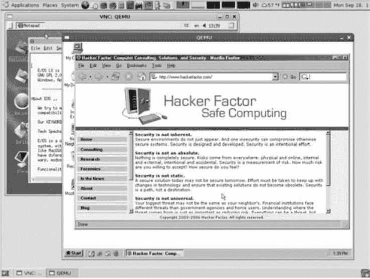

**图 7-9：运行两个 Qemu 会话**

#### QEMU 网络配置

Qemu 预定义了一些 IP 地址用于虚拟网络连接。来宾操作系统的默认 IP 地址是 10.0.2.15。虚拟防火墙、DHCP 服务器和可选的 TFTP 服务器位于 10.0.2.2。10.0.2.3 是 DNS 服务器，10.0.2.4 是 Qemu SMB 服务器。

Qemu 虚拟化所有这些网络地址。例如，来自宾操作系统到 10.0.2.3 的 DNS 查询会被转发到主机操作系统的 DNS 服务器。

如果宾操作系统需要 IP 地址，虚拟 DHCP 服务器会提供一个。

最后，如果你的来宾操作系统需要连接到主机操作系统，可以使用 `ssh`、`ftp`，或将网页浏览器指向 `10.0.2.2`。（请确保主机操作系统正在运行 SSH、FTP 或 Web 服务器——有关启用网络服务的信息，请参阅第 13 章。）

#### 创建分区

虽然为文件设置磁盘分区对于环回挂载来说很好，但 Qemu 和 VMware 无法将磁盘镜像用作驱动器，除非它有分区表。挑战在于：当你手上只有分区时，如何创建分区表？答案涉及 `dd` 和 `fdisk` 命令。

假设你有一个文件中的磁盘分区（例如，从 `/dev/hda1` 创建的 `part.img`），你想将其转换为 Qemu 的磁盘镜像（`disk.img`）。首先，你需要为分区表分配空间。分区表占用了驱动器的前 63 个扇区。使用 `dd`，你可以将分区文件（`part.img`）替换为磁盘镜像（`disk.img`）：

```
dd if=part.img of=disk.img bs=512 seek=63
```

你的磁盘文件（`disk.img`）比分区镜像大 32,256 字节，并且有空间容纳分区表。

下一步更复杂。磁盘有扇区、磁头和柱面。虽然旧驱动器的磁头与物理读写磁头有直接关联，但较新的驱动器只是将其用作数字偏移。扇区组被组合成柱面。最大大小为每柱面 63 个扇区、255 个磁头和 16,383 个柱面。对于大于 125 GB 的磁盘，使用大于 512 字节的扇区大小。

查看你的 `disk.img` 文件大小并计算柱面数。例如，假设 `disk.img` 的大小为 1,073,774,080 字节（1 GB 分区加上分区表）。Qemu 偏好 16 个磁头和 63 个扇区：1,073,774,080 字节 / (512 字节/扇区 / 63 扇区 / 16 磁头) = 2080.5704 个柱面。由于不能有分数个柱面，向上取整为 2081。现在你可以使用 `fdisk` 创建分区表：

```
fdisk -C 2081 -H 16 -S 63 disk.img
```

> **提示** `fdisk` 命令既适用于块设备也适用于文件。你不需要 root 权限来修改文件，但 `fdisk` 仍会尝试同步磁盘。如果你看到关于 `ioctl()` 的错误，别担心——只有 root.drop有人扩充我？有权限调用它，而且你的更改仍然会被保存。


创建一个从柱面1到2081跨越整个磁盘的分区。最终的分区表应该如下所示：

```
Device Boot      Start        End     Blocks   Id System
disk.img,           1       2081   1048823+   83 Linux
```

**注意** 根据分区类型，您可能需要更改分区表中的系统标识符。如果您计划从此驱动器启动，还需要将分区设置为活动分区。

您保存的磁盘镜像现在可以作为磁盘供Qemu使用。尽管它可能无法启动（因为没有Linux的引导管理器），但您可以从Live CD-ROM启动并设置引导管理器。

#### 在Qemu和VMware之间转换

VMware和Qemu使用不同的磁盘镜像格式。Qemu支持多种格式，但通常使用写时复制磁盘（cow或qcow）或原始磁盘镜像。相比之下，VMware使用vmdk格式，该格式包含磁盘以及元数据。幸运的是，您可以使用`qemu-img`轻松地在格式之间进行转换。要将原始Qemu镜像（例如`disk.img`）转换为VMware磁盘（`disk.vmdk`），请使用：

```
qemu-img convert disk.img -O vmdk disk.vmdk
```

同样，您可以使用以下命令将VMware磁盘转换为Qemu磁盘：

```
qemu-img convert -f vmdk disk.vmdk disk.img
```

使用这种方法，您可以在VMware下使用任何Qemu磁盘，反之亦然。尽管VMware Player不能用于创建虚拟磁盘，但Qemu可以！而且Qemu磁盘可以快速转换以供VMware使用。

#### 使用Xen（开源）

Xen是一个为速度而设计的操作系统虚拟化器。这个应用程序取代了宿主操作系统。虽然Dapper Drake（6.06 LTS）的软件仓库中不提供它，但在Hardy Heron（8.04 LTS）及更高版本的Ubuntu中可用。

**警告** 安装Xen需要您更改内核和引导加载器（Grub）配置。如果您搞砸了安装，可能会严重损坏您的系统。如果您对大量手动配置和故障排除不太熟悉，那么不要尝试Xen。您可能希望等到这个项目更加成熟一些再使用。

在开始之前，请检查您的系统要求。Xen仅支持32位和64位x86架构。如果您使用的是PowerPC系统或其他宿主架构，则无法使用Xen。

虽然安装Xen有很多不同的方法，但https://help.ubuntu.com/community/Xen上的说明非常有帮助且详细。

**注意** 为什么这些说明不在本书中？Xen正在经历大量开发，安装说明经常发生变化。此处列出的任何说明很可能很快就会过时。最好的说明可以在Ubuntu社区的Xen网页上找到。

安装Xen并重新启动系统以使用Xen内核后，您可以使用`xm`命令创建新的虚拟机、启动虚拟机以及移除正在运行的虚拟机。

## WINE还是VINEGAR？

当人们谈论模拟器时，话题几乎总是会转到Wine。（*Wine*是一个递归缩写：Wine Is Not an Emulator。）Wine创建于大多数硬件模拟器之前。它提供经过转换的Windows库，使Windows应用程序能够在Linux下运行。这与模拟器不同：模拟器提供整个系统，而Wine为Linux下的Windows应用程序提供支持。

Wine对大多数Windows程序的支持非常好。事实上，它的完整程度甚至允许一些Windows病毒传播！（在http://www.linux.com/archive/feature/42031中，Matt Moen报告称Klez、Sobig和其他一些病毒在Wine下可以运行。）

虽然许多应用程序可以与Wine一起使用（例如Microsoft PowerPoint和Word），但其他应用程序则时好时坏。即使是受支持程序的较新版本，由于Microsoft库的变化，也不总是能够工作。Wine也是一个基本不受支持的应用程序——2005年8月至2006年8月期间没有任何更新，严肃的开发兴趣直到2008年才重新出现。尽管它创建于1993年，但它有15年时间都是测试版软件。（正式的1.0版本于2008年10月发布。）

虽然Wine在几年前还是一个可接受的解决方案，但真正的模拟器和虚拟化器（如Qemu、VMware和Xen）提供了更好的兼容性。

## 与模拟器共享文件

无论您选择哪种模拟器，都需要某种在宿主系统和客户系统之间交换文件的方式。有多种选择——您应该选择最适合您需求的方案。

- **FTP**——您可以在宿主操作系统上运行FTP服务器，并使用客户机连接和传输文件。这也可以使用安全外壳的`scp`命令来完成。此选项几乎被所有客户操作系统普遍支持。
- **NFS**——宿主操作系统可以将分区导出到客户操作系统。如果客户机运行的是Linux或Unix版本，此方案效果很好。
- **Samba**——您可以使用Samba从宿主操作系统导出分区。客户操作系统必须是Windows或安装了Samba的系统。
- **端口转发**——Qemu和VMware允许您在宿主操作系统和客户操作系统之间转发端口。例如，Qemu参数`-redir tcp:10022:22`将宿主机上的`10022/tcp`端口重定向到客户机上的SSH服务器（`22/tcp`）。端口转发允许主机使用您需要的任何服务器与客户操作系统通信。
- **HGFS**——如果您安装VMware Tools（VM ➙ Install VMware Tools），VMware可以将宿主目录映射到客户Linux操作系统下的`/mnt/hgfs/`。

**注意** 所有这些选项都需要网络访问。虽然这些硬件模拟器都支持网络访问，但如果您正在评估病毒、执行磁盘取证或安装可疑软件，您可能希望禁用模拟器的网络访问。如果网络被禁用，则没有简单的方法可以将数据从虚拟系统中取出。

#### 其他协作工具

除了办公应用程序、共享桌面和虚拟机之外，还有其他协作工具。大多数常见的文件格式，如PDF和PostScript，在Ubuntu下有大量支持。`evince`、`xpdf`、Ghostscript和Ghostview等工具可以显示这些常见文件类型的内容。在网络方面，有大量对等应用程序。`amule`和`peercast`等软件包可从Ubuntu软件仓库中获得。

开发人员也有协作选项。并发版本系统（`cvs`）和Subversion（`svn`）文件管理系统随时可用，且配置不太困难。`svn`和`cvs`都支持通过网络共享源代码，并且安全性足以在互联网上使用（尤其是当它们通过SSH隧道传输时）。

#### 第二部分 ■ 处理兼容性

### 小结

Ubuntu提供了大量的协作选项。可用的工具使您能够与其他人一起工作，无论操作系统配置如何。如果您找不到兼容的工具，您可以访问支持该工具的远程系统，或运行所需应用程序原生运行的虚拟机。

# 第三部分

#### 提升性能

### 本部分内容

- 第8章：调优进程
- 第9章：多任务应用程序
- 第10章：视频的图形酷炫效果

# # 第8章

# 调优进程

### 本章内容

- 识别和调整系统资源
- 发现进程何时启动以及是什么启动了它们
- 缩短启动时间

默认的Ubuntu安装包含一些基本进程，用于检查设备、调整操作系统和执行日常维护。其中一些进程始终在运行，而另一些则定期启动。偶尔您可能会看到硬盘启动或运转几分钟——这是怎么回事？在关键任务服务器、严肃的游戏主机和其他实时系统上，意外的进程可能会引起巨大问题；管理员应该确切知道正在运行什么以及何时运行。对时间敏感的应用程序最不需要的就是资源密集型维护系统在意想不到的时间启动并导致系统变慢。

为了精细调整您的系统，您需要知道当前正在运行什么、有哪些可用资源以及进程何时启动。从那里，您可以调整配置：禁用不需要的进程、启用必要的日常维护，并调整内核以更好地满足您的需求。

#### 学习术语

系统上运行的所有内容都是*进程*。进程是执行任务的程序。这些任务可能从系统维护到即插即用


设备配置以及用户需要的任何其他内容。*系统进程*保持操作系统运行，而*用户进程*则处理用户需求。

许多进程为其他进程提供*服务*。例如，Web 服务器是一种处理 HTTP 网络请求的服务。Web 服务器可能会使用一个或多个进程来完成其任务。某些服务对系统的运行至关重要。例如，如果系统必须支持图形但 X-Windows 服务不可用，那么就缺少了一个关键服务。

虽然大多数系统进程是服务，但大多数用户进程是*应用程序*。应用程序由一个或多个进程组成，以支持用户需求。例如，Firefox 网页浏览器是一个帮助用户浏览网页的应用程序。一般来说，服务基于系统需要启动和结束，而应用程序基于用户需求启动和结束。

这些定义——程序、进程、应用程序和服务——并没有非常明确的界限。例如，Gnome 桌面环境（GDE）由为其他程序提供服务并支持用户需求的程序和进程组成。GDE 可以被称为一组程序、进程、应用程序或服务，而不会产生任何冲突。

#### 是时候改变了

不同版本的 Linux（包括 Ubuntu）使用不同的启动脚本并运行不同的支持进程。了解一个版本的 Linux 如何工作并不意味着你了解所有版本如何工作。例如，我的一台电脑在每次重启后时钟会丢失几分钟。（这是台旧电脑。）当我安装 Ubuntu Dapper Drake（6.06）时，我注意到重启后时间是正确的。我四处查找它是如何做到这一点的，以及它使用的是哪个时间服务器。我首先注意到的是，`/etc/init.d/` 中没有设置时间的脚本。最终我追踪到了网络启动脚本，发现 `ntpdate` 脚本从 `/etc/init.d/`（在之前的 Ubuntu 版本中）被移到了 `/etc/network/if-up.d/`。这个脚本让我找到了网络时间协议（NTP）配置文件（`/etc/default/ntpdate`）。

当我开始运行 Ubuntu Hoary Hedgehog（5.04）时，出现了一个类似的问题。当我没有执行任何操作时，硬盘会周期性地发出研磨声。在其他时候，当我运行受磁盘 I/O 影响的进程时也会发生这种情况——当硬盘开始研磨时，关键进程会检测到处理问题是问题。我很快将磁盘研磨定位到 `updatedb`——一个与 `slocate` 配合工作以快速查找文件的缓存程序。我找不到的是这个程序是如何启动的。最终我发现 `updatedb` 是由 `anacron` 启动的，anacron 是一个自动调度程序。

虽然了解什么在运行很重要，但更重要的是了解如何追踪正在运行的进程并根据你的需求调整它们。

当我谈论进程时，我指的是任何生成运行进程标识符的东西（请参阅下一节"查看运行中的进程"）。程序是系统上生成一个或多个进程的可执行文件。用户直接使用应用程序，而操作系统使用服务。

#### 查看运行中的进程

唯一消耗系统资源的是运行中的进程。如果你的计算机似乎比平时运行得慢，那么可能是因为某些进程行为异常或消耗了超出你可用范围的资源。

有几种简单的方法可以找出什么在运行。从命令行，你可以使用 `ps` 和 `top` 来显示应用程序、依赖项和资源。例如，`ps -ef` 以完整（`-f`）详细列表显示每个（`-e`）运行中的进程（参见清单 8-1）。各列显示了运行进程的用户（UID）、进程 ID（PID）、生成该进程的父进程 ID（PPID），以及进程何时启动、已运行多长时间，当然还有进程本身。

##### 清单 8-1：`ps -ef` 运行进程示例列表

```
% ps -ef
UID        PID  PPID  C STIME TTY          TIME CMD
root         1     0  0 Sep28 ?        00:00:01 init [2]
root         2     1  0 Sep28 ?        00:00:00 [migration/0]
root         3     1  0 Sep28 ?        00:00:00 [ksoftirqd/0]
root         4     1  0 Sep28 ?        00:00:00 [watchdog/0]
root      2406     1  0 Sep28 ?        00:00:00 [kjournald]
root      2652     1  0 Sep28 ?        00:00:00 /sbin/udevd-daemon
root      3532     1  0 Sep28 ?        00:00:00 [shpchpd_event]
root      4219     1  0 Sep28 ?        00:00:00 [kjournald]
daemon    4370     1  0 Sep28 ?        00:00:00 /sbin/portmap
root      4686     1  0 Sep28 ?        00:00:00 /usr/sbin/acpid -s /var/run/acpid.socket
root      4857     1  0 Sep28 ?        00:00:00 /bin/dd bs 1 /var/run/klogd/kmsg
klog      4859     1  0 Sep28 ?        00:00:00 /sbin/klogd -x
root      5174     1  0 Sep28 ?        00:00:00 /usr/sbin/gdm
hplip     5213     1  0 Sep28 ?        00:00:00 /usr/sbin/hpiod
hplip     5217     1  0 Sep28 ?        00:00:00 python /usr/sbin/hpssd
nobody	5303	1	0 Sep28 ?	00:00:00 /usr/sbin/danted -D
nobody	5304	5303	0 Sep28 ?	00:00:00 /usr/sbin/danted -D
nobody	5306	5303	0 Sep28 ?	00:00:00 /usr/sbin/danted -D
nobody	5308	5303	0 Sep28 ?	00:00:00 /usr/sbin/danted -D
```

#### 家族之争

Unix 有两个主要分支：BSD 和 System V。BSD 是较老的分支，提供了一个被 FreeBSD、OpenBSD、SunOS 和 Mac OS X 等操作系统使用的标准。BSD 标准定义了进程管理、设备驱动程序命名约定和系统目录布局。较年轻的分支 System V（读作"System Five"）包括 HP-UX、AIX、Solaris 和 IRIX 等操作系统。System V 遵循 POSIX 标准，与 BSD 家族略有不同。例如，BSD 将所有设备驱动程序放在 `/dev` 中——这个目录可能包含数百个设备。POSIX 在 `/dev` 中定义子目录，因此所有磁盘将在 `/dev/disk`（或 `/dev/dsk`、`/dev/rdsk` 等）中，所有网络驱动程序位于 `/dev/net`。这使 `/dev` 成为一个更干净的目录。

这些差异也体现在 `ps` 命令中。在 System V 上输入 `ps -ef` 产生的输出类似于 BSD 上 `ps -aux` 的输出。

并非每个操作系统都严格属于 BSD 或 System V 阵营。例如，Linux 同时支持 BSD 和 POSIX。在 Linux 下，硬盘通常列在 `/dev/` 中（例如，`/dev/hda` 和 `/dev/hdb`）以及 `/dev/disk/` 中。在某些标准冲突的地方（例如，特定目录中应该放什么），Linux 的选择似乎几乎是任意的。例如，BSD 下的 `/sbin` 目录包含系统二进制文件。在 POSIX 下，它们包含静态链接的可执行文件。在 Linux 下，它们两者都包含。

Linux 的 `ps` 命令实际上支持两种不同的输出格式：BSD 和 POSIX。以破折号开头的选项（例如，`-e`、`-f` 或组合为 `-ef`）遵循 POSIX 标准。没有破折号（例如，`ps aux`）时 `ps` 的行为类似于 BSD。在 Linux 下，`ps -ef` 的 POSIX 输出看起来与 `ps aux` 的 BSD 结果相似，而与 `ps ef` 完全不同（没有连字符时，`e` 包含整个运行时环境，`f` 显示进程层次结构）。

`top` 命令显示所有运行中的进程，并按内存或 CPU 资源使用排序。与 `ps` 不同，`ps` 提供当前运行应用程序的单一快照，`top` 每隔几秒刷新一次，向你显示什么正在积极运行。已生成但不活跃的进程将出现在 `top` 列表的较下方。你可以与 `top` 交互以更改刷新率（输入 `s` 然后以秒为单位输入刷新率）或排序方式（使用 `<` 和 `>` 选择排序列）。你也可以按 `h` 查看支持的完整命令列表。

图形化系统监视器（系统 ➪ 管理 ➪ 系统监视器）也使您能够查看运行中的进程列表（参见图 8-1）。

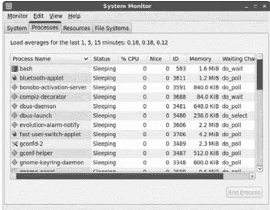

**图 8-1：** 显示进程的系统监视器

#### 终止进程

在 Linux 下，最多有 65,536 个不同的 PID——你不能同时运行超过 65,536 个进程。在 Ubuntu 下，默认最大值为 32,768 个 PID。（请参阅本章后面的"调整内核参数"；此参数的名称是 `137 `kernel.pid_max`）。任何新进程都被分配下一个可用的 PID。因此，新进程有可能以比某些旧进程更低的 PID 启动。你可以使用 PID 通过 `kill` 命令终止进程。例如，要终止 PID 123，使用 `kill 123`。`kill` 命令也可以用于暂停进程（`kill -STOP 123`）和继续暂停的进程（`kill -CONT 123`）。但是，某些进程不会立即终止。

> **注意** 严格来说，PID 是进程的*句柄*，而不是实际的进程。多线程进程可能为所有线程分配一个句柄，或为每个线程分配一个句柄。这完全取决于进程如何创建线程。

每个进程都被分配一个动态 PID，但有两个例外：`kernel` 和 `init`。内核使用 PID 0，不会被 `ps`、`top` 或系统监视器列出。你无法终止内核（使用 `kill` 命令）。`init` 进程（在第 1 章中简要讨论过）是主父进程。每一个


进程需要一个正在运行的父进程（PPID）来接收子进程的返回码和状态。如果某个进程的父进程死亡，那么`init`会成为其父进程。

**警告** 虽然你可以杀死`init`（`sudo kill -9 1`），但你绝对不想这样做！杀死`init`最终会导致系统崩溃，因为`init`负责清理已死亡的进程。

杀死一个进程只会将其终止*一次*；终止信号无法阻止该进程再次被启动。此外，有些进程是无法被杀死的。

- **僵尸进程**——当进程死亡时，它会向父进程（PPID）返回一个错误码。已死亡的PID如果尚未被父进程接收返回码，就会变成僵尸进程。僵尸进程不占用CPU资源，但会占用一个PID。对于程序员来说，调用`wait()`函数可以获取返回码并清除僵尸进程。相反，向僵尸进程发送终止信号毫无作用，因为该进程已经死亡。

- **I/O阻塞**——阻塞在内核驱动调用上的进程可能直到内核调用返回后才会处理终止信号。这种情况通常出现在网络文件系统（NFS）调用网络中断时，或者磁盘I/O在驱动器缓慢或损坏时。例如，如果你正在使用一个NFS挂载的目录并运行`ls`，如果网络挂载出现问题，该命令可能会挂起。向`ls`进程发送终止信号不会立即杀死它。我还曾在使用`dd`复制一个正在发生磁头崩溃的磁盘时，以及试图停止RAID驱动器上的`dd`或`rm`时遇到过这种挂起。

- **信号拦截**——某些终止信号可以被应用程序拦截。例如，程序可以拦截默认信号（`kill`、`kill -15`或`kill整形 SIGNALS: 僵尸之夜`）。这通常是为了让程序在退出前进行清理。不幸的是，有些程序不会立即死亡。其他终止信号，如`kill -KILL`或`kill -9`，则无法被拦截。

**提示** 如果你确实想杀死一个进程，首先使用`kill PID`（例如，`kill 1234`）。这会发送一个TERM信号，让行为良好的进程有机会清理资源。如果这没有达到你想要的效果，尝试`kill -1 PID`。这发送一个挂起信号，告诉进程终端已死亡。这个信号通常只有行为良好的进程会拦截；其他进程会直接死亡。如果那样还杀不死它，那么使用`kill -9 PID`。这是一个真正的终止信号，进程无法拦截。（`kill -9`命令总是让我想起约塞米蒂·山姆大喊：*"我说停，就是停！"*）

#### 信号：僵尸之夜

每个信号都有一个长名称、短名称和编号。最常见的信号有：

- SIGHUP, HUP, 1——这是一个挂起信号，在终端死亡时发送给进程。

- SIGINT, INT, 2——这是一个中断信号。在用户按下Ctrl+C时发送。

- SIGKILL, KILL, 9——真正的终止信号。这个信号无法被拦截，会立即导致进程死亡。

- SIGTERM, TERM, 15——这个请求发送一个终止信号，是`kill`命令默认发送的信号。与KILL不同，TERM可以被应用程序拦截。

- SIGSTOP, STOP, 19——这个信号会停止进程但不会终止它。在你按下Ctrl+Z暂停当前进程时发送。

- SIGCONT, CONT, 18——这个信号恢复被SIGSTOP暂停的进程。对于在命令行暂停的进程（Ctrl+Z），输入`fg`会将进程在前台继续运行，`bg`会让进程在后台继续运行。

- SIGCHLD, CHLD, 17——编写生成子进程应用程序的程序员会使用这个信号。当任何子进程死亡时，CHLD会发送给父进程。

完整的信号列表在`signal`的手册页中（`man 7 signal`）。`kill`命令可以使用这些表示形式中的任何一种。输入`kill -9 1234`与`kill -KILL 1234`和`kill -SIGKILL 1234`是相同的。

信号是标志；它们不会排队。如果你向一个进程发送了十几个TERM信号，而进程还没来得及处理，那么进程只会收到一个TERM信号。同样，如果一个程序生成了六个子进程并且它们同时死亡，那么父进程可能只会收到一个CHLD信号。如果父进程没有检查其他死亡的子进程，那么剩余的子进程可能会变成僵尸。

#### 杀死所有进程

我所认识的每个开发人员都曾经创建过生成子进程的噩梦。有时杀死一个进程只会让另一个进程生成。由于生成子进程的速度比用户运行`ps`和`kill`更快，你无法杀死所有进程。幸运的是，有几个选择。

- 按名称杀死 — 如果所有进程都有相同的名称，你可以使用`killall`一次性全部杀死。例如，如果我的进程名为`mustdie`，那么我可以使用`killall -9 mustdie`来结束所有正在运行的实例。

- 杀死所有用户进程 — 有一个特殊的`kill`命令可以结束你有权限杀死的所有进程：`kill -9 -1`。作为普通用户，这会杀死你的所有进程，包括图形显示和终端。但这肯定会杀死你可能正在运行的任何生成循环。

> **注意** 从技术上讲，进程ID -1是`kill`命令的一个特殊情况。这意味着杀死除`kill`命令本身（不要自杀）和`init`（不要杀死默认父进程）之外的所有进程。

> **警告** 永远不要以root身份使用`kill -9 -1`！这会杀死每个进程——包括shell和必要的系统应用程序。在手指离开回车键之前，你的系统就会崩溃。如果你需要以root身份杀死所有进程，使用电源按钮，或者使用`reboot`或`shutdown`命令——不要使用`kill -9 -1`。

- 停止进程 — 无限生成循环通常发生是因为一个进程检测到另一个进程的死亡。与其杀死进程，不如使用停止信号：`kill -STOP PID`或`killall -STOP Name`。这会阻止进一步的生成，并让你能够杀死所有处于睡眠状态的进程，而它们不会重新生成。

#### 识别资源

你的系统有许多不同的资源可供进程使用。这些资源包括CPU处理时间、磁盘空间、磁盘I/O、RAM、图形内存和网络流量。幸运的是，有办法测量这些资源中的每一个。

#### 访问 /proc

Linux提供了一个虚拟文件系统，挂载在`/proc`目录中。该目录列出了系统资源和正在运行的进程。例如：

```
$ ls -F /proc
1/      3910/  4133/  4351/    bus/         iomem        partitions
1642/   3930/  4135/  4352/    cmdline      ioports      pmu/
3264/   4167/  4364/    cpuinfo      irq/         scsi/
1650/   3951/  4167/  4364/    crypto       kallsyms     slabinfo
1736/   3993/  4220/  4382/    devices      kcore        stat
1946/   4/     4224/  5/       device-tree/ key-users    swaps
2/      4009/  4237/  54/      diskstats    kmsg         sys/
20/     4027/  4250/  55/      dma          loadavg      sysrq-trigger
3/      4057/  4270/  56/      driver/      locks        sysvipc/
3310/   4072/  4286/  57/      execdomains  mdstat       sysvipc/
3333/   4073/  4299/  6/       fb           meminfo      tty/
3335/   4081/  4347/  651/     filesystems  misc         uptime
3356/   4091/  4348/  apm      fs/          modules      version
3402/   4092/  4349/  asound/  ide/         mounts@      vmstat
3904/   4127/  4350/  buddyinfo  interrupts  net/       zoneinfo
```

编号的目录对应每个正在运行的进程。在每个目录中，你可以找到实际的运行命令行和运行环境。设备驱动程序和内核使用非数字目录。它们显示系统资源。例如，`/proc/iomem`显示硬件I/O映射，`/proc/cpuinfo`提供有关系统CPU的信息。

虽然`/proc`对调试很有用，但你应该小心避免让应用程序依赖它。特别是，一切都是动态的：进程目录可能快速出现和消失，有些资源会不断变化。

`/proc`目录实际上提供了运行中的操作系统的活跃视图。对`/proc`的更改会改变运行中的系统。例如，如果你想禁用所有网络ping数据包，可以使用：

```
echo 1 | sudo tee /proc/sys/net/ipv4/icmp_echo_ignore_all
```

这个更改会立即生效，并将持续到以下任一情况发生：你将其改回（将1改为0）、其他进程更改它，或者你重新启动。（如果你想让这个设置永久生效，请参阅本章后面的"调整内核参数"。这个参数的名称是`net.ipv4.icmp_echo_ignore_all`。）

#### /proc 怎么了？

> **`/proc`目录是系统的实时视图。** 每次查看该目录时结果都会变化，不要感到惊讶。此外，虽然`/proc`下的某些项目可以直接修改，但其他项目不行。例如，即使是**root用户也无法修改`/proc/cpuinfo`中的CPU信息、`/proc/meminfo`中的内存使用情况，或正在运行的进程环境（例如`/proc/1234/environ`）。**

#### 测量CPU

CPU负载可以通过几种方式测量。`uptime`命令提供了一个简单的摘要。它列出三个值：1分钟、5分钟和15分钟的平均负载。负载是对队列时间的测量。如果你有一个CPU且负载小于1.0，那么你没有消耗完CPU的所有资源。负载为2.0意味着所有资源都被消耗，你需要两倍的CPU来减少任何等待时间。如果你有两个CPU，

那么负载为 1.0 就表示两个处理器都在满负荷运行。虽然负载为 1.0 时不会显得卡顿，但负载为 5.0 时就可能明显察觉到迟缓，因为命令可能需要等待片刻才能被处理。

虽然 `uptime` 提供了一个基本指标，但 `top` 能提供更详细的细节。在运行 `top` 时，你可以按 `1` 来查看屏幕顶部的每个 CPU 的负载，并且可以看到哪些进程正在消耗最多的 CPU 资源。`ps aux` 命令也能显示每个进程的 CPU 资源使用情况。

#### 测量磁盘空间

`df` 和 `du` 命令用于查看磁盘空间。磁盘空闲命令（`df`，有时也称为 *disk-full* 或 *disk-file system*）列出所有已挂载的分区及其磁盘使用量。默认输出以块为单位显示信息。你也可以将输出设置为人类可读的格式（`-h`），以千字节或兆字节显示大小：`df -h`。`df` 命令还允许你指定文件或目录名。在这种情况下，它将显示包含该文件（或目录）的分区的磁盘使用情况。例如，要查看当前目录的可用空间，请使用：

```
$ df .    # 默认输出
Filesystem         1K-blocks   Used Available Use% Mounted on
/dev/hda1          154585604 72737288  73995748  50% /
$ df -h .  # 人类可读格式
Filesystem         Size  Used Avail Use% Mounted on
/dev/hda1          148G   70G   71G  50% /
```

你也可以使用系统监视器（系统 ➪ 管理 ➪ 系统监视器）以图形方式显示 `df` 的结果（见图 8-2）。

磁盘使用（`du`）命令按目录显示磁盘使用情况。单独使用时，它会显示当前目录及每个子目录的磁盘空间。如果指定了目录，则从此处开始显示。要查看最大的目录，可以使用类似 `du | sort -rn | head` 的命令。这将按大小对所有目录进行排序，并显示最大的 10 个目录。最后，你可以使用 `-s` 参数来阻止 `du` 列出每个子目录的大小。当我在目录中查找磁盘占用大户时，通常使用 `du -s * | sort -rn | head`。这会将目录按大小顺序列出。然后我可以进入最大的目录，重复该命令，直到找到最大的文件。

> **提示** `du` 命令会查看每个子目录中的每个文件。如果你有成千上万个文件，这可能需要一段时间。在查找大目录时，可以考虑那些处理时间最长的目录。如果几乎每个目录显示都只需一秒钟，而某个目录需要一分钟，那么你可以按 **Ctrl+C**，因为你可能已经找到了最大的目录。

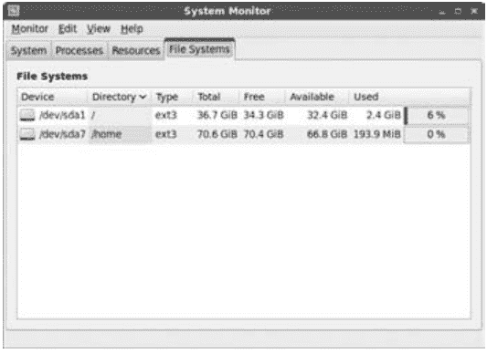

#### 测量磁盘 I/O

所有访问磁盘的进程都通过同一个 I/O 通道进行。如果该通道因流量过大而堵塞，整个系统可能会变慢。一个低 CPU 占用的应用程序很容易消耗大部分磁盘 I/O。虽然系统负载会保持较低，但计算机会显得迟缓。

如果系统似乎运行缓慢，你可以使用 `iostat`（`sudo apt-get install sysstat`）来检查性能（见清单 8-2）。除了显示系统负载外，还会显示每个设备的 I/O 指标。我通常将 `iostat` 与 `watch` 命令一起使用，以便识别哪些设备似乎过于活跃。

```
watch-interval 0.5 iostat
```

**清单 8-2：** 安装和使用 iostat

```
$ sudo apt-get install sysstat  # 安装 iostat
$ iostat
Linux 2.6.24-24-generic (lindt)         09/13/2009
avg-cpu:  %user   %nice %system %iowait  %steal   %idle
           6.53    0.01    0.47    1.10    0.00   91.89

Device:            tps   Blk_read/s   Blk_wrtn/s   Blk_read   Blk_wrtn
sda              2.35        40.25       107.24    7301369   19451016
sdb              5.68       300.10         1.88   54433418     340824
sdc              5.52       297.05         1.88   53880280     340824
sr0              0.00         0.00         0.00        672          0
md0             16.82       597.13         1.78  108310698     323256
```

找到哪个设备活跃后，你可以使用 `mount` 命令来确定该设备挂载在何处：

```
$ mount
/dev/hda1 on / type ext3 (rw,errors=remount-ro)
proc on /proc type proc (rw)
/sys on /sys type sysfs (rw)
varrun on /var/run type tmpfs (rw)
varlock on /var/lock type tmpfs (rw)
udev on /dev type tmpfs (rw)
devpts on /dev/pts type devpts (rw,gid=5,mode=620)
devshm on /dev/shm type tmpfs (rw)
```

现在你知道哪个设备活跃以及它被用于何处，你可以使用 `lsof` 来识别哪些进程正在使用该设备。例如，如果设备 `hda` 最活跃且挂载在 `/` 上，那么你可以使用 `lsof /` 列出访问该目录的每个进程。如果正在使用原始设备，那么你可以使用 `lsof /dev` 指定所有设备，或使用 `lsof /dev/hda` 指定单个设备（例如 `hda`）。

> **注意** 遗憾的是，没有类似 `top` 的磁盘 I/O 命令。你可以使用 `lsof` 缩小嫌疑应用程序的范围，但无法识别哪个应用程序正在消耗大部分磁盘资源。

#### 测量内存使用情况

RAM 是系统上的有限资源。如果你的应用程序消耗了所有可用 RAM，内核会暂时将内存块存储到磁盘上以释放空间。用于存储 RAM 的磁盘空间称为 *swap space*。虽然交换空间可以让你运行庞大的应用程序，但与使用 RAM 相比，它的速度非常慢。

有几种方法可以查看交换空间使用情况。`swapon -s` 命令会列出可用的交换空间并显示使用情况。通常会有少量交换空间被使用，但如果交换空间非常满，那么你需要么分配更多交换空间，要么安装更多 RAM，要么找出是什么正在消耗可用 RAM。系统监视器（系统 ➪ 管理 ➪ 系统监视器）允许你以图形方式查看可用的内存使用情况和交换空间，并识别它是否正在被积极使用（见图 8-3）。

要识别哪些应用程序正在消耗内存，请使用 `top` 或 `ps aux` 命令。这两个命令都显示每个进程的内存分配。此外，`pmap` 命令可以显示特定进程 ID 的内存分配情况。

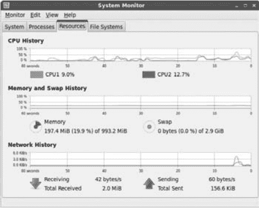

#### 测量显存

显卡上的内存容量将直接影响你的显示效果。如果你有一块只有 256 KB RAM 的老旧显卡，那么你最多只能期望 800x600 分辨率和 16 色。如今大多数高端显卡都有超过 128 MB 的 RAM，支持 1280x1024 这样巨大的分辨率和 3200 万色。更多的内存也有助于游戏和桌面的动画流畅。当一组显存保存主画面时，其他内存部分可以作为动画元素的图层。

没有简单的方法来确定显存大小。如果你有一块 PCI 显卡，那么 `lspci -v` 命令会显示所有 PCI 卡（包括你的显卡）以及与该卡相关的所有内存。例如：

```
$ lspci -v | more
0000:01:00.0 VGA compatible controller: nVidia Corporation NV18
                                               [GeForce4 MX 400
0 AGP 8x] (rev c1) (prog-if 00 [VGA])
           Subsystem: Jaton Corp: Unknown device 0000
           Flags: bus master, 66MHz, medium devsel, latency 248, IRQ 177
           Memory at fa000000 (32-bit, non-prefetchable) [size=16M]
           Memory at f0000000 (32-bit, prefetchable) [size=128M]
           Expansion ROM at fbee0000 [disabled] [size=128K]
           Capabilities: <available only to root>
```

此清单显示了一块带有 128 MB 显存的 NVIDIA NV18 显卡。

> **提示** 在大型超级计算机上，`lspci` 不仅能显示连接了什么，还能显示位置。例如，如果你有八块网卡，它可以识别每块卡在哪个插槽中。这对于具有故障转移硬件支持的关键任务环境中的诊断极为有用。一个例子是使用 (`lspci -t`; `lspci -v`) | `less` 来显示总线树和每个项目的详细信息。

#### 测量网络吞吐量

正如磁盘 I/O 会造成性能瓶颈一样，网络 I/O 也会造成瓶颈。虽然有些应用程序会轮询网络数据并在网络缓慢时增加 CPU 负载，但大多数应用程序只是等待网络可用，不会影响 CPU 负载。

如果访问网络时计算机显得迟缓，那么你可以使用 `netstat -i inet` 来检查网络性能：

```
$ netstat -i inet
Kernel Interface table
Iface   MTU Met    RX-OK RX-ERR RX-DRP RX-OVR    TX-OK TX-ERR TX-DRP TX-OVR Flg
eth0   1500   0 25415143      0      0      0 46521403      0      0      0 BMRU
lo    16436   0    25629      0      0      0    25629      0      0      0 LRU
vnet0  1500   0        0      0      0      0       93      0      0      0 BMRU
```

这显示了每个网络接口上的流量以及任何网络错误、丢包和溢出。这也显示了网络接口的名称（例如 eth0）。检查网络使用情况时，我通常将 `netstat` 与 `watch` 命令一起使用，以便观察一段时间内的网络使用情况：

```
watch-interval 0.5 netstat -i inet
```

> **提示** `netstat -i inet` 命令显示每个接口的数据包数量。你可以使用 `ifconfig`（例如 `ifconfig eth0`）查看更多详细信息；`ifconfig` 显示特定网络接口的数据包数量和字节数。

`netstat -t` 和 `netstat -u` 命令允许你看到哪些网络连接处于活动状态。`-t` 选项显示 TCP 流量，`-u` 显示 UDP 流量。还有许多其他选项，包括 `--protocol=ip`，用于显示所有 IP（IPv4）连接，IPv6 连接则用 `--protocol=ip6` 列出。

要识别哪些进程正在使用网络，你可以使用 `lsof`。`-i4` 参数显示哪些进程有 IPv4 连接，`-i6` 显示 IPv6，`-i tcp` 列出 TCP，`-i udp` 显示具有开放 UDP 套接字的应用程序：


```
$ sudo lsof -i4 -n # 显示网络进程并提供 IP 地址
```

```
COMMAND  PID  USER  FD  TYPE DEVICE SIZE NODE NAME
ssh  8699 mark  3u  IPv4 120398  TCP 10.3.1.5:41525->10.3.1.3:ssh
(ESTABLISHED)
ssh  8706 mark  3u  IPv4 120576  TCP 10.3.1.5:41526->10.3.7.245:ssh
(ESTABLISHED)
```

> **注意** 当以 root 身份运行时，`lsof -i4` 会显示所有使用 IPv4 的进程。如果不使用 sudo，则只显示当前用户运行的进程。这适用于所有其他 `lsof` 命令行参数。

#### 查找进程启动方式

虽然 `ps` 命令可以列出当前正在运行的内容，其他工具也能显示正在使用的资源，但还没有好的工具来告诉我们某个进程最初是如何启动的。尽管 `ps` 可以识别父进程 ID（PPID），但在很多情况下 PPID 是 1——这表明它由 `init` 拥有。实际上，进程可以在很多地方被启动，包括引导脚本、设备配置脚本、网络变更、登录、应用程序初始化脚本和计划任务。

#### 检查引导脚本

`/etc/init.d/` 目录包含用于启动和停止系统服务的脚本（这些在第 3 章中有详细说明）。这些脚本通过不同 `rc` 目录（`/etc/rc0.d`、`/etc/rc1.d` 等）中的链接来激活。当 `init` 进入每个运行级别时，相应的 S 链接会被执行。例如，在运行级别 1*[/]


shell script 无法工作时，请考虑将第一行从 `#!/bin/sh` 改为 `#!/bin/bash`。

> **警告** 创建用户账户有三种不同的方式：`useradd`、`adduser` 以及图形界面的"系统**⇨**管理**⇨**用户和组"小程序。`useradd` 的默认用户 shell 是 `/bin/sh`，而其他方法默认使用 `/bin/bash`。

> **提示** 如果你确实想使用 Bash shell，可以在命令行中运行 `bash` 来按需使用。也可以使用 `chsh` 来更改默认 shell，或者修改系统范围的符号链接：

`sudo ln -f -s /bin/bash /bin/sh`

所有这些脚本分为两种情况：登录/注销和交互式 shell。每当你登录 Ubuntu 系统时，登录和交互式 shell 脚本都会被执行。当你打开终端窗口时，只使用交互式脚本。

> **提示** 默认的用户专用 shell 脚本存储在 `/etc/skel/` 中。使用 `ls -la /etc/skel/` 可以列出所有默认文件。更改这些默认值会使所有新用户账户获得修改后的配置文件，但你仍然需要修改现有用户账户。对于系统范围的更改，请考虑在 `/etc/profile.d/` 下创建脚本，修改 `/etc/profile`，或者编辑 `/etc/bash.bashrc`。

#### 检查桌面脚本

除了用户级 shell 脚本外，图形桌面也会运行脚本。首先，X-Windows 启动。这通过运行脚本 `/etc/X11/xinit/xinitrc`、`/etc/X11/Xsession` 和 `/etc/X11/xinit/xserverrc` 来启动应用程序。这些脚本都会设置环境变量并可以运行应用程序。`/etc/X11/Xsession.d/` 中也有启动脚本，在用户登录后启动，并且每个用户可以拥有 `$HOME/.xsession` 脚本用于在启动时运行应用程序。

X-Windows 之后，桌面启动。在 Ubuntu 下，这是 Gnome。Gnome 运行大量应用程序，这些应用程序反过来又可以运行更多应用程序。查看自动运行的 Gnome 进程的主要位置在 `/etc/gdm/` 目录（旧版 Ubuntu 系统为 `/etc/X11/gdm/`）、文件 `$HOME/.gnomerc`，以及"系统**⇨**首选项**⇨**启动应用程序"（旧版 Ubuntu 中称为"会话"）。`/etc/gdm/` 目录包含系统范围的启动脚本。`$HOME/.gnomerc` 脚本使你可以配置自己的启动应用程序，而图形会话配置工具（参见图 8-4）则可以让你轻松自定义非标准启动项。

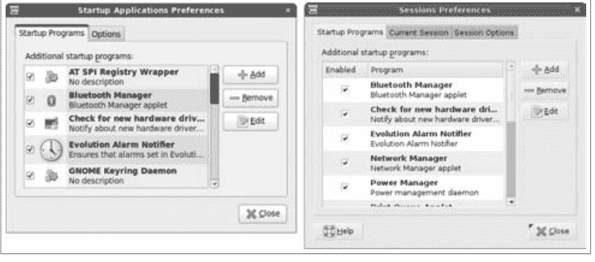

**图 8-4：** Gnome 图形启动应用程序首选项（左侧来自 Ubuntu 9.04，右侧来自 8.04）

拥有这么多启动选项可能会非常令人困惑。例如，如果你想在登录时自动启动 Firefox，可以将其添加到 `/etc/X11/Xsession`、`/etc/gdm/Xsession`、`/etc/gdm/PostSession/Default`、`/etc/X11/Xsession.d/99start_firefox`、`$HOME/.xsession`、`$HOME/.gnomerc`，或者使用图形化 Gnome 会话编辑器添加启动应用程序。主要要问的问题是"谁需要这个？"

- **所有运行 X-Windows 的用户？**——使用 `/etc/X11/Xsession` 或将启动脚本放在 `/etc/X11/Xsession.d/` 下。

- **只有你自己运行 X-Windows？**——使用 `$HOME/.xsession`。

- **所有运行 Gnome 的用户？**——使用 `/etc/gdm/PostSession/Default`。这对 Gnome 用户有效，但对 KDE 或其他桌面无效。KDE、XDM 和其他桌面有自己的配置目录和文件。

- **只有你自己运行 Gnome？**——使用 `$HOME/.gnomerc` 或图形会话编辑器。

**注意** 这些并非所有可能的启动挂钩。还有很多地方可以让代码开始运行。如果你试图找到某个应用程序的启动位置，请首先在此查找，或使用 `ps` 并开始追踪父进程。大多数图形进程使用配置文件，而这些文件中的任何一个都有可能运行应用程序。

#### 检查 Gnome 应用程序

正如 udev 监视即插即用设备一样，Gnome 也是如此。Gnome 桌面可以识别某些设备并自动运行应用程序。找到默认设置可能比较棘手，因为它们因 Ubuntu 版本而异。例如：

- **Dapper Drake (6.06 LTS)**——默认设置在"系统**⇨**首选项**⇨**可移动驱动器和介质"下找到。各选项卡显示了你可以更改的项目。例如，要更改连接数码相机时的默认操作，请选择"相机"选项卡，"存储"选项卡定义了添加新 USB 驱动器或 CD-ROM 时发生的情况（参见图 8-5）。


**图 8-5：** Ubuntu 6.04 (Dapper Drake) 的可移动驱动器和介质首选项，显示驱动器处理程序

- **Hardy Heron (8.06 LTS)**——与 Dapper 一样，有一个"可移动驱动器和介质"菜单。但是，它缺少"存储"和"多媒体"选项卡（参见图 8-6）。此功能已移至 Nautilus（文件浏览器）选项卡下。

1. 打开任意文件浏览器窗口。简单的方法是前往"位置**⇨**计算机"，或在命令提示符下运行 `nautilus`。
2. 从文件浏览器的菜单中选择"编辑**⇨**首选项"。
3. 新弹出的窗口有一个名为"介质"的选项卡。其中包含连接不同介质类型时默认应用程序的设置（参见图 8-7）。

- 不幸的是，此菜单不提供自动挂载和自动运行应用程序的选项。对于这些，你需要 `gconf-editor`。设置在 `/apps/nautilus/preferences/` 下找到（参见图 8-8）。

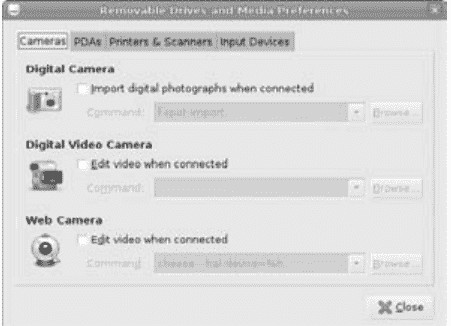

**图 8-6：** Ubuntu 8.06 (Hardy Heron) 的可移动驱动器和介质首选项

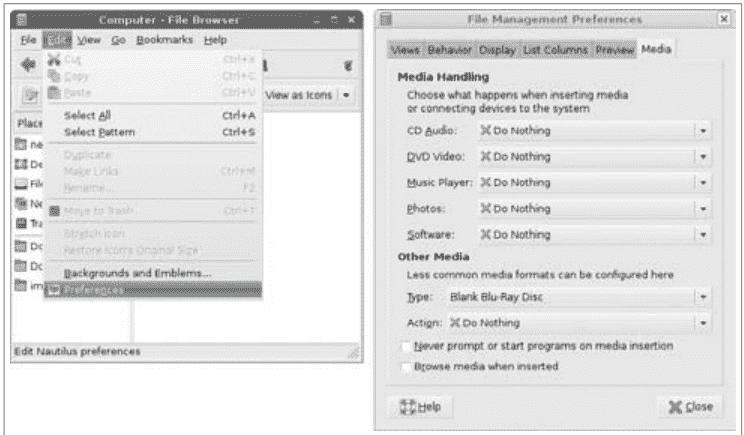

**图 8-7：** Ubuntu 8.06 (Hardy Heron) 及更高版本的 Nautilus 编辑**⇨**首选项和介质选项卡

- **Jaunty Jackalope (9.04)** 和 **Karmic Koala (9.10)**——如果你执行的是全新安装（而非从 Hardy 升级），则"可移动驱动器和介质"菜单已经消失。你需要像 Hardy Heron 下一样，使用 Nautilus 文件浏览器的编辑选项卡，以及 `gconf-editor`。

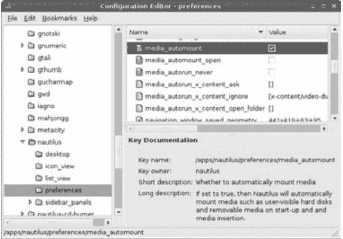

**图 8-8：** 配置编辑器中的 Nautilus 设置

虽然其他生成子系统（如 `udev` 和 `/etc/init.d/`）是可配置和可扩展的，但 Gnome 相当不灵活。你只能为小程序或 Gnome 配置设置中列出的项目配置自动运行设置。如果你有一个未列出的新即插即用设备（例如 GPS 系统），你无法让 Gnome 启动应用程序。相反，你需要配置 `udev` 来运行该应用程序。

> **提示** 配置 `udev` 运行程序的内容在第 3 章中介绍。参见"将应用程序与 USB 关联"部分。

#### 检查调度程序：at、cron 和 anacron

需要定期运行的程序通常放在调度程序中。三种常见的调度程序是 `at`、`cron` 和 `anacron`。

##### 使用 at 进行调度

`at` 命令指定应用程序应在特定时间运行。这用于一次性命令。例如，要在 15 分钟后启动 `xclock`，可以使用：

```
echo "DISPLAY=:0 xclock" | at now + 15 minutes
```

`at` 命令接受一个或多个命令行语句作为输入。时间格式可以是 HH:MM 并带有 am 或 pm（例如，3:45 pm 或 3:45 PM），日期格式（例如，09/15/09），或作为偏移量（例如，noon + 3 hours 或 8am + 6 days）。计划的 `at` 作业存储在 `/var/spool/cron/atjobs/` 目录中。你可以使用 `atq` 查询它们，使用 `atrm` 删除作业。进程运行后，任何文本输出都会通过电子邮件返回给用户。

##### 使用 cron 进行调度

虽然 `at` 用于一次性应用程序，但 `cron` 用于重复任务。每个用户都有一个 `crontab` 条目，可以在其中安排进程。例如，我的配置中有这样一个条目：

```
3,18,33,48 * * * * fetchmail -U -n --invisible > /dev/null 2>&1
```

每个 `cron` 条目每行有六个元素。前五个指定何时运行，最后一个元素是实际要执行的单个命令行。时间字段为：

- **分钟**——运行的小时分钟数。可以是单个值（`0-59`）或以逗号分隔的时间列表（例如，`3,18` 表示在每小时的 3 分和 18 分运行）。也可以使用星号表示*每分钟*。
- **小时**——运行的小时。可以是单个值（`0-23`）、范围（例如，`9-17` 表示从上午 9 点到下午 5 点每小时运行）、逗号分隔的列表，或使用除法指示运行频率。例如，`9-17` 表示从上午 9 点到下午 5 点每小时运行，但 `9-17/3` 表示上午 9 点到下午 5 点之间每 3 小时运行一次（上午 9 点、中午 12 点、下午 3 点）。星号表示*每小时*，与除数结合时，`*/4` 表示每四小时一次。
- **日**——每月运行的日期。与其他字段一样，可以是单个值（`1-31`）、范围或列表，并可以使用除数。星号表示*每天*。
- **月**——每年运行的月份。可以是单个值（`1-12`）、范围或列表，并可以使用除数。星号表示*每月*。
- **星期几**——可以指定在哪天工作日运行。日期是数字：`0-6` 表示星期日到星期六（`7` 也可以表示星期日）。同样，可以是值、列表或范围，并可以包含除数。

通常日期规范很简单。例如，`0 12 * * 0` 表示在每个星期日中午运行。但它也可以非常复杂：`*/3 */3 */3 */3 */3` 表示每三分钟、每第三小时的每第三天、在每第三个月的每第三天运行，但仅当这对应于每星期第三天时才运行。

> **提示** 尽量错开 `cron` 作业，使它们不会同时运行。虽然我可以使用 `*/15` 每小时运行 `fetchmail` 四次，但我改用列表 `3,18,33,48`。这可以防止大量应用程序都在整点时尝试启动。

要安排 `cron` 任务，请使用 `crontab -e`。这将编辑你的 `crontab` 文件（位于 `/var/spool/cron/crontabs/`）。你也可以使用 `crontab -l` 列出你的 `crontab` 条目。`crontab` 行首的 `#` 表示注释。我通常在文件开头添加以下注释，以便记住时间字段的含义：

```
## mm ss DD MM WW command
```


与 at 类似，cron 作业的每个文本输出都会通过电子邮件返回给用户。如果你不想接收电子邮件，请在命令末尾添加 > /dev/null 2>&1。这会将所有输出重定向到 /dev/null。

##### 使用 anacron 进行调度

虽然 cron 会重复运行任务，但它不会区分系统状态。anacron 服务与 cron 类似，但允许任务基于相对时间段而非绝对日期运行。例如，默认的 anacron 安装会在计算机首次启动后的五分钟开始每日运行 updatedb（更新在线 man 页索引）。

anacron 的配置调度文件位于 /etc/anacrontab。默认脚本位于 /etc/cron.d/、/etc/cron.daily/、/etc/cron.weekly/ 和 /etc/cron.monthly/。

如果你运行的是关键任务系统或资源有限的计算机，那么你应该认真考虑查看这些配置设置并根据需要进行调整。例如，如果你的系统是已部署的服务器，那么你可能不需要每天运行 updatedb。事实上，你可以完全禁用 anacron，并将任何所需的功能移到 root 的 crontab 中（sudo crontab -e）。这样，日志文件轮转等任务将按照可预测的时间表执行。

> **提示** 全新安装包含所有三个调度器：anacron、cron 和 at。但是，所有默认的系统任务都存储在 anacron 中；没有默认的 cron 或 at 作业。

#### 调整内核参数

许多可调性能项可以直接通过内核进行配置。使用 sysctl 命令查看当前内核设置并进行调整。例如，要显示所有可用参数（按排序列表），请使用：

```
sudo sysctl -a | sort | more
```

> **注意** 有一些可调参数是只有 root 才能访问的离群值。没有 sudo 的情况下，你仍然可以查看大部分内核参数。

每个内核参数都采用 field = value 的格式。例如，参数 kernel.threads-max = 16379 将并发进程的最大数量设置为 16,379。这小于唯一 PID 的最大数量（65,536）。减少 PID 数量可以提升慢速 CPU 或内存较少系统的性能，因为它减少了同时运行的任务数量。在配备双处理器的高性能计算机上，此值可以设定为较大的默认值。例如，我的 350-MHz iMac 设置为 2,048，我的 2.8-GHz 双处理器 PC 设置为 16,379，而我的 2.3-GHz 四处理器 PC 设置为 65,536。

> **提示** 内核根据可用资源配置默认的线程数量。在同一 Ubuntu 版本的不同硬件上安装可能会设置不同的值。如果你需要相同的系统（用于测试、关键部署或敏感兼容性），请务必显式设置此值。

调整内核参数有两种方法。首先，你可以在命令行上进行操作。例如，`sudo sysctl -w kernel.threads-max=16000`。此更改会立即生效但不是永久性的；如果重新启动，此更改将会丢失。另一种进行内核更改的方法是将参数添加到 `/etc/sysctl.conf` 文件中。添加行 `kernel.threads-max=16000` 将使更改在下次重新启动时生效。通常在进行调整时，你首先会使用 `sysctl -w`。如果你喜欢这个更改，那么可以将其添加到 `/etc/sysctl.conf` 中。首先使用 `sysctl -w` 允许你测试修改。如果一切出现问题，你总可以在将更改提交到 `/etc/sysctl.conf` 之前重新启动来恢复。

#### 计算交换空间

对于运行 Ubuntu 的任何计算机来说，最大的改进是添加 RAM。一般来说，添加 RAM 带来的速度提升比更快的处理器影响更大。例如，将 RAM 从 128 MB 增加到 256 MB 可以将安装时间从整天缩短到一小时。增加到 1 GB RAM 可以将安装缩短到几分钟。

关于交换空间数量有一个古老的经验法则。传统观点认为，你的交换空间应该是 RAM 的两倍。具有 256 MB RAM 的计算机应该从 512 MB 交换空间开始。虽然这对于内存受限的系统来说是个好主意，但对于高端家庭用户系统来说并不实际。如果你有 1 GB 的 RAM，那么你可能永远不需要用于运行应用程序的交换空间——而且除非你计划进行视频编辑或音频合成，否则你非常不可能需要 2 GB 的交换空间。

> **警告** 笔记本电脑和台式机用户通常会挂起他们的系统而不是关闭。挂起/恢复模式将所有内存保存到交换空间。如果你计划挂起系统，请确保驱动器上的可用交换空间至少与你的可用 RAM 一样大。

在内存方面，Linux 系统历史上曾有两个关键限制。首先，它们只能访问最多 4 GB 的 RAM。这是由于 Intel 32 位架构的限制。第二个限制来自内核：它只能访问 1 GB 的 RAM，并将其余用于交换。随 Ubuntu 32 位版本一起提供的默认内核只能访问 3 GB 的 RAM。要访问更多，你需要安装不同的内核。

```
sudo apt-get update
sudo apt-get install linux-headers-server \
  linux-image-server linux-server
sudo reboot
```

> **警告** 安装新内核后，你可能需要重新安装任何额外的驱动程序，例如视频驱动程序的受限驱动程序（参见第 10 章）。

交换空间可以配置为独立分区或文件系统上的文件。默认安装会在磁盘上分配一个交换分区。不幸的是，如果你确实耗尽了交换空间，这可能会发生在无法重新分区磁盘的不方便时刻。以下步骤可用于创建交换文件。

1. 分配交换空间。例如，要分配 1 GB 的交换空间，请使用：

```
sudo dd if=/dev/zero of=/swapfile bs=1G count=1
```

请确保目标分区（例如 /）有足够的空闲空间来容纳交换文件。

2. 格式化文件以用作交换空间：

```
sudo mkswap /swapfile
```

3. 打开交换空间。这样它将保持启用状态直到系统重新启动。

```
sudo swapon /swapfile
```

4. 要使更改永久生效，请将交换文件添加到 /etc/fstab。配置行如下：

```
/swapfile swap swap defaults 0 0
```

你可以使用 free 命令检查系统上的内存量。这会列出 RAM 的数量以及交换空间的数量。

```
$ free

             total       used       free     shared    buffers     cached
Mem:       3369464    2200988    1168476          0     156860    1738152
-/+ buffers/cache:     305976    3063488
Swap:      9871900      40840    9831060
```

#### 修改共享内存

虚拟内存的某些部分可以指定供多个应用程序使用。共享内存允许不同程序快速通信并共享大量信息。X-Windows、Gnome 桌面、Nautilus、X 会话管理器、Gnome 面板、回收站小程序和 Firefox 等应用程序都使用共享内存。如果程序无法分配或访问所需的共享内存，那么程序将无法启动。

进程间通信状态命令 `ipcs` 显示当前的共享内存分配以及创建和最后访问该内存的 PID（参见清单 8-4）。

> **提示** `ipcs` 还有许多其他标志。例如，`ipcs -m -t` 显示上次访问共享内存的时间，`ipcs -m -c` 显示访问权限。此外，`ipcs` 还可以显示信号量和消息队列分配。

##### 清单 8-4：查看共享内存分配

```
$ ipcs -m
---Shared Memory Segments---
key         shmid      owner    perms    bytes     nattch     status
0x00000000  327680     nealk    600      393216    2          dest
0x00000000  360449     nealk    600      393216    2          dest
0x00000000  196610     nealk    600      393216    2          dest
0x00000000  229379     nealk    600      393216    2          dest
0x00000000  262148     nealk    600      393216    2          dest

$ ipcs -m -p
---Shared Memory Creator/Last-op---
shmid      owner      cpid       lpid
327680     nealk      7267       7307
360449     nealk      7267       3930
196610     nealk      7182       7288
229379     nealk      7265       3930
262148     nealk      7265       3930
393221     nealk      7314       3930
425990     nealk      7280       3930
458759     nealk      7332       3930

$ ps -ef | grep -e 3930 -e 7280  # 什么进程是 PID 3930 和 7280？
root    3930  3910  0  09:24  tty7     00:00:02  /usr/bin/X:0 -br -audit
                                      0 -auth /var/lib/gdm/:0.Xauth -nolisten tcp vt7
nealk   7280     1  0  15:22  ?        00:00:01  update-notifier
```

程序可以通过两种不同的方式分配共享内存：临时的和永久的。临时分配意味着内存保持共享，直到所有附加的应用程序释放内存句柄。当没有应用程序保持附加时（`ipcs` 的 nattch 字段），内存将被释放。相比之下，永久的


即使在当前没有程序使用它时，共享内存分配仍然可以保留。这允许程序在共享通信缓冲区中保存状态。

有时共享内存会被遗弃。要释放被遗弃的内存，请使用`ipcrm`。你需要先使用`ipcs`（`shmid`列）找到共享内存ID，然后再指定它。

更多时候，你更关心分配更多共享内存，而不是释放被遗弃的段。例如，数据库和高性能Web服务器在有更多共享内存可用时工作得更好。`sysctl`命令显示当前的共享内存分配：

```
$ sysctl kernel | grep shm
kernel.shmmni = 4096
kernel.shmall = 2097152
kernel.shmmax = 33554432
```

在这个例子中，共有33,554,432字节（32 MB）的共享内存可用。单个应用程序最多可以分配2 MB（2,097,152字节），最小分配单元为4096字节。这些大小对于大多数日常使用来说已经足够了，但如果你计划运行Oracle、MySQL或PostgreSQL等数据库，那么你几乎肯定需要增加这些值。

#### 更改每用户设置

除了内核设置之外，还有用于配置用户的参数。`ulimit`命令内置于bash shell中，为特定应用程序提供限制。运行`ulimit -a`显示当前设置：

```
$ ulimit -a
core file size          (blocks, -c) 0
data seg size           (kbytes, -d) unlimited
max nice                       (-e) 20
file size               (blocks, -f) unlimited
pending signals                (-i) unlimited
max locked memory       (kbytes, -l) unlimited
max memory size         (kbytes, -m) unlimited
open files                     (-n) 1024
pipe size            (512 bytes, -p) 8
POSIX message queues     (bytes, -q) unlimited
max rt priority                (-r) unlimited
stack size              (kbytes, -s) 8192
cpu time               (seconds, -t) unlimited
max user processes             (-u) unlimited
virtual memory          (kbytes, -v) unlimited
file locks                     (-x) unlimited
```

这些设置显示，例如，单个用户shell最多可以有1,024个打开的文件，并且核心转储被禁用（大小为0）。开发人员可能希望启用核心转储，使用`ulimit -c 100`（100 blocks的门限值）。如果你想将打开文件的数量增加到2,048，请使用`ulimit -n 2048`。

用户无法更改某些限制。例如，如果你想将打开文件的数量增加到2,048，则使用`ulimit -n 2048`，但只有root用户才能增加此值。相反，用户总是可以降低该值。

> **注意** 某些值有内核定义的上限。例如，虽然root用户可以增加打开文件句柄的数量，但这不能超过内核参数`fs.file-max`（`sysctl fs.file-max`）设置的值。

在多用户系统上，管理员可能希望限制任何单个用户可以运行的进程数量。这可以通过在`/etc/bash.bashrc`脚本中添加`ulimit`语句来实现：

```
## 仅更改用户的最大进程数，不更改root。
if [ $(/usr/bin/id -u) -ne 0 ]; then
  ulimit -u 2048 2>/dev/null # 如果用户设置得更低，则忽略错误
else
  ulimit -u unlimited # root可以运行任何内容
fi
```

#### 加快启动时间

`/etc/init.d/`和`/etc/rc*.d/`目录中的默认初始化脚本对大多数系统来说很好，但你的特定系统可能不需要它们。如果你不需要某个服务，则可以禁用它。这可以减少系统的启动时间。在某些情况下，它还可以通过释放资源来加快整体运行速度。使用`sysv-rc-conf`（`sudo apt-get install sysv-rc-conf`）来更改启用/禁用设置。一些可以考虑禁用的服务包括：

- **anacron**——如前所述，此子系统定期运行进程。你可能希望禁用它，并将任何关键服务移到`cron`。
- **atd**和**cron**——默认情况下，没有安排`at`或`cron`作业。如果你不需要这些服务，则可以禁用它们。就我个人而言，我总是让它们保持启用，因为它们占用的资源相对较少。
- **apmd**——此服务处理高级电源管理（APM）事件，主要由笔记本电脑使用。它监控电池并在收到APM事件时运行程序。如果你不需要APM支持，则可以禁用此服务。
- **bluetooth**或**bluez-utils**——这为蓝牙设备提供支持。如果你没有蓝牙设备，则可以禁用此服务。
- **cupsys**——这是通用Unix打印系统，提供打印支持。如果你不需要打印机，则可以禁用此服务。
- **dns-clean**、**ppp**和**pppd-dns**——这些服务用于动态拨号连接。如果你不使用拨号，则可以禁用这些服务。
- **hplip**——此可选软件包为HP Linux图像和打印系统提供Linux支持。如果你不需要它，则可以禁用。没有此软件包，你仍然可以使用`lpr`和CUPS系统进行打印。
- **mdadm**、**mdadm-raid**和**lvm**——这些为RAID（`mdadm`和`mdadm-raid`）和逻辑卷组（`lvm`）提供文件系统支持。如果你不使用其中任何一个，则可以禁用这些服务。
- **nfs-common**、**nfs-kernel-server**和**portmap**——这些由NFS使用——它们仅在你安装NFS支持时存在。如果你不需要一直使用NFS，则可以禁用这些服务，仅在需要时启动它们：
  ```
  sudo /etc/init.d/portmap start
  sudo /etc/init.d/nfs-common start
  sudo /etc/init.d/nfs-kernel-server start
  ```
- **pcmcia**和**pcmciautils**——这些为笔记本电脑上的PCMCIA设备提供支持。如果你的计算机上没有PCMCIA插槽，则不需要这些服务。
- **powernowd**和**powernowd.early**——这些服务用于控制变速CPU。新计算机和笔记本电脑应该启用这些服务，但较旧的系统（例如，我的双处理器200 MHz PC）不需要它。你也可以用`cpufreqd`替换`powernowd`以获得更多配置选项：
  ```
  sudo apt-get install cpufreqd
  ```
- **readahead**和**readahead-desktop**——这些服务用于预加载库，以便某些应用程序最初启动更快。为了速度，这些服务会减慢系统的初始启动时间，并消耗预加载库的虚拟内存。如果你的RAM有限，则应该考虑禁用这些服务。
- **rsync**——这是远程复制（`rcp`）命令的替代品。很少有人需要这个——它用于在计算机之间同步文件。

> **提示** 有一个系统 ➞ 管理 ➞ 服务小程序用于启用和禁用某些服务。然而，这个小程序只知道少数服务；它没有列出所有可用服务。`sysv-rc-conf`命令识别更多的服务，并提供更多的管理选项。

sysv-rc-conf命令显示大多数系统服务。但是，它没有显示所有服务。如果服务名称以.sh结尾，包含.dpkg，或名为rc或rcs，则它被视为不可修改的系统服务。要更改这些服务，你需要手动修改/etc/init.d/和/etc/rc*.d/目录内容。

##### 保持开启！

虽然你可能不需要很多服务，但有一些是必不可少的。你不应该关闭这些基本服务，除非你真的知道自己在做什么：

- **dbus**——提供消息服务。
- **gdm**——这是Gnome桌面。仅当你不需要图形桌面时才禁用此服务。
- **klogd**——这是内核日志守护进程。删除它会禁用系统日志记录。
- **makedev**和**udev**——这些创建所有设备节点。
- **module-init-tools**——加载/etc/modules中指定的内核模块。
- **networking**和**loopback**——这些用于启动和停止网络。禁用它们会在启动时移除网络配置。
- **procps.sh**——添加到/etc/sysctl.conf的任何内核调优参数都由该服务处理。
- **urandom**——这为大多数加密系统使用的真实随机数生成器提供种子。你应该保持它启用。

根据经验，如果你不知道它是什么，那就让它保持开启。此外，如果服务仅在单用户模式（rcS）下运行，通常最好不要更改它。单用户模式是当一切失败时你应该去的地方，以便修复系统。

#### 分析启动序列

虽然每个版本的Ubuntu似乎都比上一个版本启动得更快，但你通常可以通过启动分析使它更快。当操作系统启动时，可以被告知跟踪所需文件。然后，它将在启动期间预加载文件。这减少了随机访问寻道，并且根据你的系统，可能会显著缩短启动时间。

1. 重新启动计算机。
2. 在Grub引导加载程序屏幕期间，你将有大约3秒钟的时间按Escape键。如果你不按Esc，计算机将启动


正常情况。如果你按下 Esc，你会看到一个文本菜单，列出系统上已安装的内核。

-   按 `e` 编辑当前内核设置。

-   选择以 "kernel" 开头的那一行，然后按 `e` 修改内核参数。

-   你会看到一条很长的行，末尾有 `ro quiet splash` 这样的参数。在该列表中添加 `profile`。你也可以选择移除 `quiet` 和 `splash` 参数，这样你就能看到系统在做什么。

-   按 `Enter` 临时保存更改。这是一次性的更改，下次重启后不会保留。

-   按 `b` 以带有 profile 参数的内核启动。

第一次这样做时，系统启动会稍微慢一点。然而，后续的启动将会更快。我的全新安装笔记本电脑从启动 Jaunty (9.04) 需要 38 秒缩短到了 7 秒。

#### 总结

Ubuntu 是为普通计算机用户设计的。因此，有些正在运行的进程可能并不需要，有些资源也没有得到最佳利用。通过使用各种命令，你可以查看什么正在运行、有哪些资源可用以及哪些资源正在被使用。可以通过调整内核参数、shell 参数以及特定应用程序的设置来优化系统。

#### 多任务应用程序

### 本章内容

-   最大化多任务处理
-   自定义应用程序窗口
-   创建快速启动器
-   自动化桌面任务
-   启用配额
-   跟踪项目

二十年前，计算机一次只能做一件事。你要么使用文字处理软件，*要么*使用电子表格，*要么*打印文档——但不能同时进行。如今，人们很少只用计算机做一件事。在使用电子表格的同时，你可能正在文字处理软件中修改文档、查看股市行情、阅读新闻以及查看天气——所有这一切都同时进行！根据我的经验，现在计算机只执行一项专门任务的情况仅有：（a）它是一个嵌入式系统，（b）它主要用于消耗所有资源的游戏，（c）它正在解决一些计算复杂的公式（例如，破解密码、建模或数据挖掘）并需要系统所有计算能力，或者（d）它是一台*非常*老旧的计算机。

多任务并不仅仅意味着同时运行两个程序。这个定义还包括你在程序之间切换的能力、在应用程序之间通信以及找到正在运行的程序。在企业环境中，它还意味着问责制：你需要能够说明在每个项目上花费了多少时间。幸运的是，Ubuntu 有很多选项可以满足这些需求。

##### 切换应用程序

在 Ubuntu 桌面上启动应用程序可以像点击图标或从菜单中选择一样简单。然而，当你有几十个程序在运行时，再次找到正确的程序可能会成为一个挑战。如果没有良好的应用程序管理方案，我经常发现自己需要点击多个窗口才能找到正确的那个。最糟糕的情况是，当我从另一个应用程序中选择文本后，找不到正确的窗口来粘贴，而找到正确的目标窗口后，又发现选中的内容已经丢失了。反复几次之后，这会让人非常沮丧。

幸运的是，Ubuntu 有很多选项来找到正确的应用程序。这些选项包括窗口列表、窗口选择器以及用于在应用程序之间切换的键盘。

##### 使用窗口列表和窗口选择器

两个最常见的窗口管理工具是窗口列表和窗口选择器（参见图 9-1）。默认情况下，窗口列表显示在屏幕的底部面板中。每次你启动新的应用程序窗口时，它会打开一个新的按钮。要在应用程序之间切换，只需点击按钮即可。你还可以右键点击窗口列表中的按钮，查看用于最大化、最小化、移动或关闭窗口的菜单。

窗口选择器提供了一个下拉菜单，显示桌面上的所有窗口。要设置窗口选择器，你需要将其添加到面板中。

1.  在顶部（或底部）面板的空白区域，右键点击以调出面板菜单。

2.  从菜单中选择"添加到面板"。这将弹出"添加到面板"小工具。

3.  在小工具列表的底部附近找到窗口选择器。将此小工具拖动到顶部面板。释放鼠标按钮即可将小工具放置在面板上。

>   **注意** 早期版本的 Ubuntu 将窗口选择器安装在面板的右上角。如果你是从 Hoary 或 Breezy 升级到 Dapper 的，那么你的顶部面板可能已经有窗口选择器了。但是，如果你是全新安装的 Dapper，那么你需要将其添加到顶部面板。

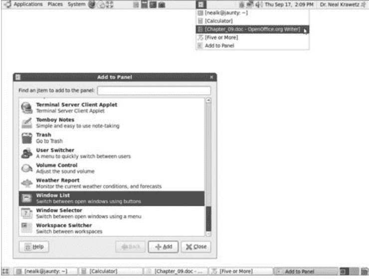

**图 9-1：** 窗口列表显示在底部面板上。窗口选择器已添加到顶部面板并处于打开状态，显示五个进程。

另一种在应用程序之间切换的方法是使用 Alt+Tab。当你同时按下 Alt 和 Tab 键时，屏幕中央会出现一个小窗口管理器（参见图 9-2）。这个窗口管理器显示每个打开窗口的图标。只要你按住 Alt 键，这个窗口管理器就会保持显示。按住 Alt 键并反复按 Tab 键，你可以选择不同的窗口。释放 Alt 键即可选中该窗口。

##### 使用 Alt+Tab

另一种在应用程序之间切换的方法是使用 Alt+Tab。当你同时按下 Alt 和 Tab 键时，屏幕中央会出现一个小窗口管理器（参见图 9-2）。这个窗口管理器显示每个打开窗口的图标。只要你按住 Alt 键，这个窗口管理器就会保持显示。按住 Alt 键并反复按 Tab 键，你可以选择不同的窗口。释放 Alt 键即可选中该窗口。

>   **提示** 每个选中的窗口在窗口管理器中显示窗口标题，并使用黑色矩形在屏幕上高亮显示该窗口。如果窗口被部分遮挡，你可以看到它将出现的位置。

此窗口管理器中的图标按使用情况从左到右排序；最左边的图标代表刚刚使用过的窗口。如果你在两个窗口之间切换，那么左边的两个图标将代表它们。不常使用的窗口会被移到右边。按 Alt+Tab 将选择器从左向右移动；按 Alt+Shift+Tab 将选择器从右向左移动。

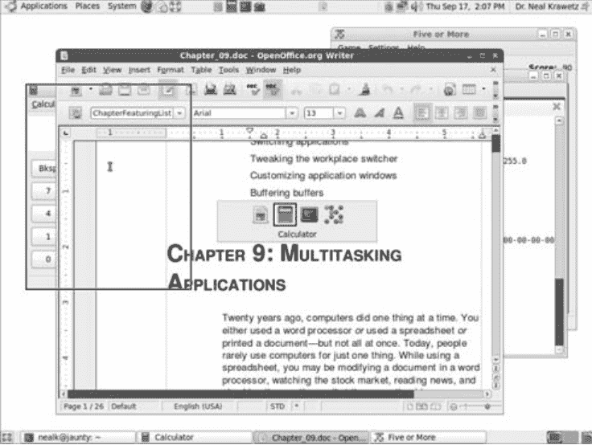

**图 9-2：** Alt+Tab 窗口管理器。计算器被选中，但部分被另一个应用程序覆盖。

##### 无鼠标操作桌面

假设你的鼠标停止工作，或者计算机启动时鼠标没有工作。你该怎么办？如何在图形桌面上进行导航？无鼠标导航需要记住的主要按键是 Alt+F1、Alt+F2 和 F10。

-   Alt+F1 打开顶部菜单。从顶部菜单中，你可以打开终端来调试或修复系统，或者关闭计算机。

-   Alt+F2 打开一个提示符，用于运行任何应用程序。在最坏的情况下，你可以运行像 `xterm` 这样的程序来打开命令行终端。

-   许多应用程序包含自己的图形菜单。F10 键可以打开任何应用程序的本地菜单。

还有另外两个与 Alt+F1 类似的组合键，用于从键盘选择顶部和底部面板。然而，Ctrl+Alt+Tab 和 Ctrl+Alt+Esc 序列对于纯键盘导航来说并不可靠。如果你的鼠标不能工作，请不要使用它们。

>   **警告** 无鼠标操作桌面时，使用 Alt+F1 访问顶部菜单。不要使用 Ctrl+Alt+Tab 或 Ctrl+Alt+Esc。

Ctrl+Alt+Tab 和 Ctrl+Alt+Esc 序列本应该允许你在顶部面板、底部面板和（取决于你的 Ubuntu 版本）桌面之间进行纯键盘导航选择。然而，大约在 Hardy Heron (8.04 LTS) 发布时，这个序列出现了问题。在 Hardy 中，顶部菜单可能会捕获焦点，使你无法离开菜单，即使你启动了一个应用程序。问题在 Jaunty (9.04) 中变得更糟——完全丢失用户焦点变得可能，这使得无鼠标导航几乎不可能。然而，Alt+F1、Alt+F2 和 F10 仍然是访问顶部菜单、运行应用程序和导航菜单的可靠方法——以防你没有鼠标。

##### 在标签页之间切换

有些应用程序还允许你在应用程序内拥有多个窗口，然后在窗口之间切换。对于大多数应用程序，Ctrl+PgUp 和 Ctrl+PgDn 用于在应用程序标签页之间导航。这适用于 Firefox 和 Gnome 终端等常见应用程序。

应用程序也可以定义自己的标签页。例如，Firefox 还识别 Ctrl+Tab 和 Ctrl+Shift+Tab 用于在网页标签页之间切换。

Firefox 和终端等程序中的标签页管理与桌面的 Alt+Tab 有两个主要区别。首先，应用程序不会在屏幕中央显示对话框。相反，观察标签页以查看哪个被高亮显示。其次，标签页是从左到右排序的，不是基于最近使用。如果你想更改标签页的顺序，可以右键抓住 Firefox（或终端）标签页并将其向左或向右拖动以重新定位。

##### 调整工作区切换器

没过多久，你的桌面就会有几十个打开的窗口。当这种情况发生时，再多的 Alt+Tab 组合也无法帮助你变得有条理。幸运的是，还有工作区切换器。这个小工具为你提供了多个桌面——你可以将所有工作窗口放在工作区上，游戏


 另一个上面放短项目，以此类推。默认情况下，工作区切换器位于底部面板的右侧——我通常会把它移到右上角，以便让窗口列表有更多空间。如果你没有工作区切换器，可以通过打开"添加到面板"菜单，然后将该小程序拖动到你的面板上来添加。

#### 使用 Ctrl+Alt+方向键 切换工作区

工作区切换器为你提供了每个桌面的微型视图（见图 9-3）。虽然你看不到图标或窗口标题，但可以看到大致布局——灰色方块代表每个桌面上的每个窗口。要在桌面之间切换，你可以点击工作区切换器，或者使用 Ctrl+Alt+方向键。例如，Ctrl+Alt+左箭头 切换到左侧的工作区，Ctrl+Alt+右箭头 移动到右侧的工作区。

> **提示** 如果你打开工作区切换器的首选项，就可以添加更多桌面并更改它们的布局。默认情况下有几个桌面排成一行。如果你添加更多行，就可以使用 Ctrl+Alt+上箭头和 Ctrl+Alt+下箭头 在它们之间导航。


**图 9-3：** 右下角的工作区切换器，显示四个不同的桌面

#### 管理工作区

默认情况下，有两个或四个可用的工作区（取决于你的 Ubuntu 版本）。你可以通过右键点击工作区切换器并选择首选项来添加更多工作区（见图 9-4）。在这里，你可以命名工作区、调整布局或添加更多工作区（你也可以移除工作区，但谁会想这么做呢？）。例如，我通常把我的中间工作区命名为 *Games*——老板不在的时候我总是可以去这个工作区。（而如果他突然出现，我可以用 Ctrl+Alt+左箭头 快速隐藏我的游戏，显示出真正的工作进度。）

应用程序不必停留在一个工作区中。你的活动窗口会在工作区切换器中高亮显示。你可以将应用程序的窗口拖到工作区切换器中的任何其他桌面。我通常在一个窗口变得杂乱，或者弹出窗口来自不同应用程序时这样做。例如，当 Evolution 邮件程序弹出待办事项列表提醒时，我会把它放到合适的窗口中。（没有理由让"写状态报告"出现在我的 Games 工作区中间。）

有些应用程序窗口很小，可能难以在工作区切换器中抓取。移动窗口的另一种方法是点击任何窗口的右上角。这将打开一个菜单，显示诸如"移到右侧工作区"和"移到另一个工作区"等选项，后面跟着一个工作区列表。你也可以通过右键点击工作区列表中的任何按钮来调出此菜单。

最后，有些应用程序窗口可能非常重要。这些是你希望它出现在每个工作区上，而不仅仅是一个工作区的窗口。在窗口左上角的菜单中有一个名为"始终显示在可见工作区上"的选项。如果你选择这个选项，无论选择哪个工作区，该窗口都会可见。我发现这个选项对于重要的在线对话（例如，IRC 和 Jabber）非常有用，还有在使用 `xawtv` 时（边工作边看电视——见第 3 章）。这样，当我切换工作区时不会错过任何通信。没有这个选项的话，某个窗口可能发生了什么事情，而我要直到切换回该工作区才会注意到。

#### 自定义应用程序窗口

当图形应用程序启动时，X-Windows 系统会设置诸如位置和尺寸（几何形状）、窗口是可见还是隐藏、最大化还是最小化、以及始终置顶或置底等元素。通常应用程序的默认值就可以了，但有时需要调整。例如，`xawtv`（在第 3 章中讨论）似乎总是被其他窗口埋住——这让我很难看 *MythBusters*。如果我想要它始终置顶启动，我需要么按 `t`（一个交互式命令）来告诉 `xawtv` 始终置顶，要么创建一个 X 资源文件来指定属性，要么使用像 Devil's Pie 这样的程序（见该工具的相关章节）来自动设置图形属性。

##### 创建 X 资源

许多 X-Windows 应用程序支持一组外部 configurable 参数。这些资源使你能够自定义从程序的启动位置到其大小、字体和颜色的所有内容。资源类型取决于可执行文件的类型。有 Gnome 工具包（Gtk）资源，用于大多数以"g"开头的应用程序，如 `gedit` 和 `gnobots2`。有 Qt 库，用于许多以"k"开头的 KDE 应用程序（像 `kate`、`konqueror` 和 `konsole`），还有 X 工具包（Xt），用于大多数以"x"开头的应用程序（例如，`xedit`、`xman` 和 `xterm`）。

大多数 Gtk 和 KDE 应用程序从特定于应用程序的配置文件中获取其资源配置。例如，`gedit` 使用 `$HOME/.gnome2/gedit-2`、`$HOME/.gnome2/acceles/gedit` 以及 `.gnome2/` 目录中的其他文件。不幸的是，这些配置文件的位置、名称、格式和内容是特定于应用程序的（如果它们存在的话）。

与 Gtk 和 Qt 相比，大多数 Xt 应用程序遵循标准的配置格式：`application*resource: value`。例如，`xterm*scrollBar: true` 将 `xterm` 应用程序的 `scrollBar` 资源设置为 `true`（默认值为 `false`）。这样，所有新的 `xterm` 窗口都会以滚动条启动。要创建一组 Xt X 资源：

- 1. 识别应用程序名称。如果你从命令行运行程序，那么这就是程序的名称。如果你点击图标或菜单项来运行程序，那么使用 `xprop` 来识别程序的名称。`xprop` 程序会将你的光标变成十字准线。通过点击窗口，你将在 `WM_CLASS` 字符串中看到正在运行的应用程序的名称。

```
`xprop | grep WM_CLASS`
```

> **提示** 一个应用程序可能有多个类字符串。有些是特定的，而有些是通用的。任何一个都可以作为资源名称。然而，如果你选择特定的字符串，请记住资源必须匹配该特定字符串。如果你希望为通用的 `xterm` 和特定的 `xterm`（通过 `TELNET` 的 `remote`）设置不同的属性，这将非常有用。

- 2. 识别资源的名称。不幸的是，这里几乎没有标准。有时你可以在特定应用程序的手册页中找到资源名称和属性，但并不总是如此。例如，`man xterm` 和 `man xman` 列出了许多 X 资源，而 `man xeyes` 没有提供任何信息。少数几乎通用的资源包括：

- `geometry` — 指定应用程序的尺寸和位置。例如，`80×42+150+180` 创建一个 80×42 的窗口，左上角位于屏幕坐标 150×180 处。

> **注意** 尺寸是特定于应用程序的。`80×42` 对于 `xterm` 意味着 80 列宽和 42 字符高，而 `80×42` 对于 `xeyes` 指定 80 像素宽和 42 像素高。

- `font` — 指定要使用的字体名称。这可以是一个短名称，如 `serif`，或者描述确切字体的长名称，如 `-*-serif-medium-r-normal-iso9241-*-*-*-75-75-p-*-iso8859-1` 表示 75 dpi 的常规衬线字体。你可以使用 `xfontsel` 程序浏览可用字体并确定确切的字体名称。

- `background` — 指定背景颜色。这可以是标准颜色名称（例如，`yellow` 或 `black`），或者代表红、绿、蓝分量的一组三个十六进制值（例如，`#ff0010` 表示带有一点点蓝色的红色）。

- `foreground` — 指定前景颜色。

3. 将你的资源添加到 X 资源文件。默认情况下，资源文件是 `$HOME/.Xdefaults`（如果不存在则创建它）。例如，我的 `$HOME/.Xdefaults` 指定了默认 `xterm` 窗口的尺寸并开启了滚动条：

```
xterm*VT100*geometry: 80×42+150+180
! 这一行是注释（! 表示注释）
!xterm*scrollBar: false
*scrollBar: true
```

4. 加载资源文件。命令 `xrdb` 用于加载 X 资源。这个命令有很多选项，但我通常使用：`xrdb -merge $HOME/.Xdefaults`。这表示所有值应该按字典顺序排序然后加载到内存中。现有值被替换，新值被添加。或者，你可以使用 `xrdb $HOME/.Xdefaults`，它将按顺序（未排序）加载文件并替换现有值。

> **提示** 在其他窗口管理器下，`.xdefaults` 的更改会自动加载。在 Gnome 下，你需要显式运行 `xrdb`。要自动加载你的默认值，将 `xrdb -merge $HOME/.Xdefaults` 添加到你的 `$HOME/.profile` 脚本中。这样，每次登录时它都会运行。


虽然个人用户可以拥有 `$HOME/.Xdefaults` 文件来个性化应用程序，但也存在系统级配置。目录 `/etc/X11/app-defaults/` 包含每个应用程序的文件以及默认的 X 资源值。更改这些默认值将影响整个系统。此外，对于系统级默认值，你无需使用 `xrdb`——更改会立即生效，因为应用程序知道在此处查找默认配置信息。

#### 使用 Devil's Pie

某些应用程序不使用 X 资源，配置其他应用程序可能很不方便。一种替代的配置方法是使用名为 Devil's Pie 的工具（`sudo apt-get install devilspie`）。该程序监视新的 X-Windows 应用程序，并在它们出现时进行配置。与 Xt X 资源不同，Devil's Pie 适用于所有 X-Windows 应用程序（Xt、Gtk 和 Qt）。

Devil's Pie 使用一个配置文件，描述要查找的内容以及如何修改 X 资源。

- 1. 创建 `$HOME/.devilspie/` 目录。此目录中的任何文件都将成为 Devil's Pie 的资源。

2. 创建资源文件。例如，我有一个名为 `$HOME/.devilspie/games.ds` 的文件，它将所有游戏打开在工作区 #4：

```
(begin
(if (is (window_class) "Gnobots2") (begin (set_workspace 4)) )
(if (is (window_name) "Iagno") (begin (set_workspace 4)) )
(if (is (window_name) "same-gnome") (begin (set_workspace 4)) )
)
```

同样，我有一个 `xawtv.ds` 配置文件，内容为：

```
(if (is (window_class) "xawtv") (above) )
```

- 3. 运行 `devilspie`。只要它在运行，就会监视新窗口并根据需要调整它们的 X 资源。

> **提示** 如果你喜欢 Devil's Pie，可以考虑将其添加到启动项中：**系统** → **首选项** → **会话** → **启动程序**。或者，你可以使用 `devilspie &` 在后台运行此命令。

配置文件中的每个子句包含一个条件（`is`、`contains` 或 `matches`）、要匹配的项目（`window_name`、`window_role`、`window_class` 或 `application_name`），以及一个或多个操作。表 9-1 列出了可用操作集及关联值（如有）。

`window_name` 是显示在窗口标题栏中的文本。应用程序可能会动态更改它。例如，OpenOffice 和 Gimp 都将标题栏设置为打开文件的名称。Devil's Pie 每次窗口名称更改时都可能执行操作。相比之下，`window_class` 代表应用程序，通常不会更改。

> **提示** 并非每个窗口都具有所有属性。如果 `application_name` 对你不起作用，请尝试 `window_class` 或 `window_role`。有关完整匹配项和可能操作的列表，请参阅 Devil's Pie 手册页（`man devilspie`）。

**表 9-1：** Devil's Pie 常见操作列表

| 操作 | 值 | 示例 | 用途 |
|--------|-------|---------|---------|
| Geometry | *宽度*×*高度*+*x位置*+*y位置* | geometry 80×42+100+20 | 使用指定尺寸启动应用程序 |
| Fullscreen | 不适用 | fullscreen | 全屏显示 |
| Focus | 不适用 | focus | 使应用程序获得焦点 |
| Center | 不适用 | center | 将应用程序置于桌面中央 |
| maximize | 不适用 | maximize | 最大化窗口 |
| minimize | 不适用 | minimize | 启动时最小化窗口 |
| above | 不适用 | above | 窗口始终位于其他窗口之上 |
| below | 不适用 | below | 窗口始终位于其他窗口之下 |
| set_workspace | 工作区编号 | set_workspace 4 | 将窗口放置到特定工作区 |

Devil's Pie 可以根据窗口的名称、角色或类来匹配 X-Windows 应用程序。要识别这些值，请使用：

```
xprop | grep -E "^(WM_NAME)|(WM_WINDOW_ROLE)|(WM_CLASS)"
```

这将列出任何给定窗口的任何或所有可用值。使用 Devil's Pie，你可以自动使窗口出现在正确工作区的正确位置，并带有正确的设置。你甚至可以处理由 Firefox（网页）、Evolution（邮件）和 Pidgin（聊天客户端）创建的动态弹出窗口。例如，要让 Pidgin 的聊天窗口在不同工作区中以最大化方式启动，可以使用：

```
(if
  (and
    (contains (window_class) "Pidgin")
    (contains (window_role) "conversation")
  )
  (begin (set_workspace 3) (maximize))
)
```

#### 缓冲区的缓冲

我认为没有人使用图形界面时会不定期地在窗口之间剪切和粘贴信息。在某些操作系统（例如 Microsoft Windows）下，只有一个常用的剪贴板。该剪贴板可用于在应用程序之间共享信息。在 Ubuntu 下，X-Windows 和 Gnome 桌面提供了 *两个* 供常用功能的剪贴板。第一个是选择剪贴板。每当你高亮任何文本时，它就会被放入此缓冲区。使用鼠标中键，你可以粘贴内容。

第二个剪贴板（称为 *主剪贴板*）在你使用 Ctrl+C 复制、Ctrl+X 剪切和 Ctrl+V 粘贴时使用。文字处理软件（例如 OpenOffice）和 Gimp 等图形编辑器通常使用第二个缓冲区。此外，某些文本应用程序（如 gnome-terminal）将剪切和粘贴改为使用 Shift+Ctrl 而不是 Ctrl（例如，Shift+Ctrl+C 复制），因为在命令行上 Ctrl+C 通常用于停止正在运行的应用程序。

> **注意** X-Windows 提供了几种不同的剪贴板缓冲区。*剪贴板* 用于选择，*主剪贴板* 用于 Ctrl+C 和 Ctrl+V，*辅助* 通常不使用。

我通常遇到默认剪贴板的两个问题。首先，选择剪贴板丢失信息太快。仅仅点击窗口使其前置就可能意外选择一个空格或其他字符，从而清除当前选择。虽然你可以点击标题栏使窗口前置并防止剪贴板更改，但其他窗口通常会覆盖我的标题栏。其次，在进行大量开发或编辑时，我有时需要的不只是两个剪贴板。我通常最终会先将要粘贴的文本粘贴到临时文件中，然后在需要时获取临时数据。

幸运的是，有一种更好的管理剪贴板的方法。程序 `xclip`（`sudo apt-get install xclip`）使你能够操纵剪贴板内容。你可以将剪贴板内容转储到文件，或将文件加载到剪贴板。使用 `xclip`，你可以轻松为自己提供一个或多个额外的剪贴板。你甚至可以在系统重启之间保存剪贴板内容！把它想象成带有记忆按钮的计算器——你想要一个存储区域，还是多个？你想在计算器关闭时丢失记忆，还是保留记忆？

`xclip` 的基本用法指定是写入输出（`-o`）还是读取输入（`-i`）剪贴板数据，以及使用哪个剪贴板（`p` 代表主剪贴板，`s` 代表辅助剪贴板，`c` 代表选择剪贴板）。例如：

- 要将主剪贴板存储到文件，使用：
  `xclip -o -selection p > buff`
- 要将文件加载到辅助剪贴板，使用：
  `xclip -i -selection s < buff`
- 要将选择剪贴板复制到主剪贴板，使用：
  `xclip -o -selection c | xclip -i -selection p`

这些命令可以映射到按键。例如，清单 9-1 创建了三个额外的剪贴板。Ctrl+F1 将主剪贴板复制到第一个存储区域，Ctrl+F2 使用第二个存储区域，Ctrl+F3 创建第三个存储区域。要调用这些缓冲区，使用 Ctrl+Shift+F1、Ctrl+Shift+F2 或 Ctrl+Shift+F3。使用此技巧，你可以将文本复制到主剪贴板（Ctrl+C），然后将其移动到第二个存储区域（Ctrl+F2）。稍后，你可以使用 Ctrl+Shift+F2 调用此缓冲区，并使用 Ctrl+V 粘贴。

> **提示** 此技巧还使你可以检查并轻松替换剪贴板的内容。该技巧中的存储缓冲区（参见清单 9-1）位于 `$HOME/.xclip/`。你可以查看、编辑或替换内容，然后使用 Ctrl+Shift 键（例如 Ctrl+Shift+F1）将其加载到剪贴板缓冲区。

可以使用类似的技巧来交换选择和主缓冲区的内容（清单 9-1，映射到 Ctrl+F4）。这样，如果你按 Ctrl+C 复制缓冲区，然后使用 Ctrl+F4 交换剪贴板，你可以使用鼠标中键粘贴内容，而不是使用 Ctrl+V。

> **提示** 交换剪贴板听起来可能过于复杂或不必要，但某些应用程序使用特定的剪贴板。例如，`xterm` 仅使用主剪贴板。任何复制到剪贴板缓冲区的内容（例如，在文字处理软件中使用 Ctrl+C）都无法粘贴到 `xterm` 窗口中。使用 Ctrl+F4，你现在可以粘贴该内容。


 ## 清单 9-1：使用 xclip 创建三个额外的剪贴板

```
mkdir ~/.xclip  # 为剪贴板缓冲区创建空间
## 将命令映射到动作
## 映射保存命令
gconftool-2 -t str-set /apps/metacity/keybinding_commands/command_1 \
  'bash -c "xclip -o -selection p > ~/.xclip/clip.1"'
gconftool-2 -t str-set /apps/metacity/keybinding_commands/command_2 \
  'bash -c "xclip -o -selection p > ~/.xclip/clip.2"'
gconftool-2 -t str-set /apps/metacity/keybinding_commands/command_3 \
  'bash -c "xclip -o -selection p > ~/.xclip/clip.3"'
## 映射恢复命令
gconftool-2 -t str-set /apps/metacity/keybinding_commands/command_4 \
  'bash -c "xclip -i -selection p < ~/.xclip/clip.1"'
gconftool-2 -t str-set /apps/metacity/keybinding_commands/command_5 \
  'bash -c "xclip -i -selection p < ~/.xclip/clip.2"'
gconftool-2 -t str-set /apps/metacity/keybinding_commands/command_6 \
  'bash -c "xclip -i -selection p < ~/.xclip/clip.3"'
## 将按键映射到命令
gconftool-2 -t str-set /apps/metacity/global_keybindings/run_command_1 \
  '<Control>F1'
gconftool-2 -t str-set /apps/metacity/global_keybindings/run_command_2 \
  '<Control>F2'
gconftool-2 -t str-set /apps/metacity/global_keybindings/run_command_3 \
  '<Control>F3'
gconftool-2 -t str-set /apps/metacity/global_keybindings/run_command_4 \
  '<Control><Shift>F1'
gconftool-2 -t str-set /apps/metacity/global_keybindings/run_command_5 \
  '<Control><Shift>F2'
gconftool-2 -t str-set /apps/metacity/global_keybindings/run_command_6 \
  '<Control><Shift>F3'
## 使 Control+F4 交换主剪贴板和选区剪贴板
## 通过使用第二剪贴板作为临时缓冲区来实现
gconftool-2 -t str-set /apps/metacity/keybinding_commands/command_10 \
  'bash -c "xclip -o -selection p | xclip -i -selection s;
           xclip -o -selection c | xclip -i -selection p;
           xclip -o -selection s | xclip -i -selection c"'
gconftool-2 -t str-set /apps/metacity/global_keybindings/run_command_10\
    '<Control>F4'
```

#### 自动化任务

有些任务我们需要反复手动完成。例如，我经常将 DOC 和 PDF 文件转换为文本。与其每次都要打开命令提示符并运行 `pdftotext` 或 `antiword`，不如创建一个自动转换目录。

`dnotify` 程序会监视指定目录中的任何变化。变化可能包括文件创建、更新、重命名、删除、权限修改或上述所有操作。当变化发生时，`dnotify` 可以运行脚本。我有一个脚本可以将 DOC 和 PDF 文件转换为文本，而被监控的目录位于我的桌面上。使用 `dnotify`，我只需将文件拖放到桌面上的目录中即可完成转换。

1. 安装 `dnotify` 以及你需要的任何转换工具。在此示例中，`pdftotext` 和 `antiword` 将执行文本转换。

```
sudo apt-get install dnotify
sudo apt-get install poppler-utils  # 提供 pdftotext
sudo apt-get install antiword
```

2. 创建一个小脚本来转换目录中的所有文件。清单 9-2 展示了我的 `convert2text` 脚本。该脚本在命令行接收一个目录名，并扫描目录中的所有 DOC 和 PDF 文件。任何尚未转换为文本的文件都会被转换。

##### 清单 9-2：将文件转换为文本的简单 convert2text 脚本

```
#!/bin/sh
## 确保使其可执行：chmod a+x convert2text
## 确保将其放在你的 $PATH 中
## （例如，sudo cp convert2text /usr/local/bin/）
if [ "$1" = "" ]; then
  echo "Usage: $0 directory"
  exit
fi
## 获取目录中的文件列表
find "$1" -type f |
while read filename; do
## 根据文件名执行转换
  case "$filename" in
    (*.pdf) # 将 pdf 转换为文本
      filenameTxt="${filename%.pdf}.txt"
      if [ ! -f "${filenameTxt}" ]; then
        pdftotext "${filename}" "${filenameTxt}";
      fi
    ;;
    (*.doc) # 将 doc 转换为文本
      filenameTxt="${filename%.doc}.txt"
      if [ ! -f "${filenameTxt}" ]; then
        antiword "${filename}" > "${filenameTxt}";
      fi
    ;;
  esac
```

3. 创建要监控的目录：

```
mkdir $HOME/Desktop/convert2text
```

4. 运行 `dnotify` 程序。指定 `convert2text` 脚本和要监控的目录。在这种情况下，要监视的动作是文件创建（`-c`）。`dnotify` 程序会将 `'{}'` 字符串替换为目录名。

```
dnotify -C $HOME/Desktop/convert2text -e convert2text '{}'
```

现在，将任何 PDF 或 DOC 文件拖放或粘贴到此文件夹中将创建文本文件。文本文件将与原始文档同名，但会以 .txt 扩展名结尾。例如，`ch09.doc` 将生成 `ch09.txt`。如果你在命令行中，可以使用 `cp` 或 `mv` 将文件复制或移动到 `$HOME/Desktop/convert2text/` 以进行自动转换。图 9-4 展示了一个示例转换目录。

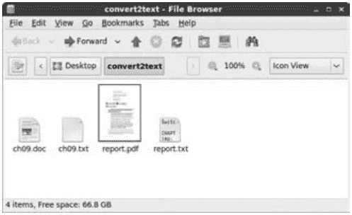

**图 9-4：** 使用 dnotify 和 convert2text 目录进行自动文件转换

> **提示** 如果你像我一样经常使用 `convert2text` 目录，可以将 `dnotify` 命令添加到你的 Gnome 启动项中（系统 ➤ 首选项 ➤ 会话 ➤ 启动程序 或 系统 ➤ 首选项 ➤ 启动应用程序）。这样，登录后自动转换功能将立即启用。此外，你可以使用 `-b` 选项在后台运行它。

```
dnotify -b -C $HOME/Desktop/convert2text -e convert2text '{}'
```

除了修改文本，你可能还想修改图像。`netpbm` 包（`sudo apt-get install netpbm`）提供了对 JPEG、GIF、PNG 和其他图像格式的操作支持。例如，清单 9-3 是一个 `dnotify` 脚本，它将所有 JPEG、PNG 和 GIF 图像转换为宽度为 64 像素的缩略图。

##### 清单 9-3：将图像转换为缩略图的简单脚本

```
#!/bin/sh
## 确保使其可执行：chmod a+x convert2thumbnail
## 确保将其放在你的 $PATH 中
## （例如，sudo cp convert2thumbnail /usr/local/bin/）
if [ "$1" = " " ]; then
  echo "Usage: $0 directory"
  exit
fi
## 获取目录中不以 "thumbnail-" 开头的文件列表。
cd "$1"
find . -type f ! -name thumbnail\* |
while read filename; do
## 根据文件名执行转换。
## 输出文件名变为 thumbnail-$filename。
filename="${filename#./}"  # 从文件名中移除 ./
if [ ! -f "thumbnail-$filename" ]; then
  # 只处理没有缩略图的文件。
  case "$filename" in
    (*.jpg|*.jpeg) # 转换以 jpg 或 jpeg 结尾的文件
      jpegtopnm "$filename" | pnmscale -xsize 64 | \
      pnmtojpeg > thumbnail-"$filename"
    ;;
    (*.gif) # 转换 gif
      giftopnm "$filename" | pnmscale -xsize 64 | \
      ppmtogif > thumbnail-"$filename"
    ;;
    (*.png) # 转换 png
      pngtopnm "$filename" | pnmscale -xsize 64 | \
      pnmtopng > thumbnail-"$filename"
    ;;
  esac
fi
done
```

#### 跟踪项目

许多企业和政府环境要求员工记录他们的时间。例如，作为顾问，我通常以 15 分钟为间隔跟踪时间。我曾经有一份工作，雇主要求精确到每 6 分钟的间隔。在当今的操作系统中，多任务处理既是福也是祸。好消息是你可以同时做很多事情。坏消息是当你多任务处理时，跟踪项目的可计费时间会变得非常混乱（而且重复向客户收费是绝对不允许的）。如果会计人员要求你跟踪工作，那么 Ubuntu 绝对是你的首选。

##### 项目时间跟踪

有多种包可以帮助你跟踪项目时间。一些示例包括 `gnotime`、`gtimer`、`gtimelog`、`wmwork` 和 `worklog`。这些包都允许你创建项目、启动和停止工时计时器，并在项目之间轻松切换。它们还允许你设置累计间隔（从一分钟到每小时）并显示总耗时摘要。


**图 9-5：** Gnotime 时间跟踪器

我个人的首选是 GnoTime 时间跟踪器（`sudo apt-get install gnotime`）。安装后，你可以从 应用程序 ➢ 办公 ➢ GnoTime 跟踪工具 运行 GnoTime 时间跟踪器。除了能够添加项目和日记条目外，它还允许你按项目指定可计费费率。你还可以用优先级和紧急程度标记项目。图 9-5 展示了 `gnotime` 的主窗口。只需双击任何任务即可启动计时器。可以添加日记条目来帮助跟踪正在进行的工作。

GnoTime 可以生成多种报告，包括耗时日志（见图 9-6）和账单列表（见图 9-7）。每份报告都包含带菜单的可点击项目，因此你可以添加更多日记、注释、调整时间、更改费率等。报告可以保存为 HTML、导出到 Web 服务器或 FTP 站点，或通过电子邮件发送。


 ## 追踪 CPU 使用率

在某些情况下，需要根据项目消耗的资源来进行追踪。两种最常见的计费资源是 CPU 时间和磁盘空间。遗憾的是，目前还没有好用的 GUI 应用程序来追踪项目的 CPU 消耗。取而代之的是使用 `time` 命令。它会记录实际的经过时间、用户空间花费的时间，以及系统时间（内核中花费的时间）。例如，`time bash` 会监控 `bash` 命令（一个 shell）以及由 `bash` 创建的每个进程。当 shell 最终退出时，会显示运行时间摘要：

```
$ time bash
## run some commands
$ exit
real	1m12.428s
user	0m0.292s
sys	0m0.588s
```

上述示例摘要显示该 shell 运行了约一分多钟，但大部分时间处于空闲状态——内核耗时 0.588 秒，用户空间耗时 0.292 秒。如果你需要知道一个进程运行了多长时间，就在命令前加上 `time`。当进程退出时，你就能知道耗时多少。

> **警告** `time` 命令在监控派生进程时存在问题。如果被计时的程序启动了一个 CPU 密集型进程，那么 `time` 只能看到总持续时间，而无法获取内核或用户空间时间。此外，如果进程与其父进程分离（例如，使用 `at` 调度运行），那么 `time` 将无法测量派生的应用程序。

#### 追踪磁盘使用量和配额

磁盘空间的计算要容易得多。`df` 命令（在第 8 章中讨论过）可以显示当前的磁盘使用情况，但这通常不足以用于计费。另一种追踪磁盘使用量的方法是安装 `quota` 软件包。启用配额并非最简单的系统，但命令行工具允许你指定用户在特定文件系统上可以拥有多少磁盘空间。

> **注意** 使用 `df` 来确定磁盘空间时，请注意这只是一个快照。在快照之间的时间间隔内，磁盘空间可能已经超过了当前的分配量。

尽管配额对于普通家庭用户来说似乎不必要，但它们对于项目追踪非常有用。配额使你能够追踪磁盘使用情况、按兆字节计费，并在项目规模急剧增长时识别出来。配额还可以阻止失控的进程填满你的硬盘。例如，Ubuntu 的默认安装将所有文件放在一个分区中。如果你正在运行邮件服务器，那么你可能希望为电子邮件系统启用配额。这可以防止巨大的电子邮件（或大量小邮件）填满你的磁盘。

#### 了解你的限制

在 Ubuntu 下，配额系统允许你为每个用户指定文件、链接和磁盘空间的限制。有软限制和硬限制，以及一个分配的宽限期。这些限制可以针对用户或 group 设置。这样，一个 group 可以在给定配额内共享文件。

- **硬限制**——硬限制指定用户或 group 的最大分配量。例如，如果你被分配了 10,000 个文件，那么当你超出配额后就无法创建任何新文件。降低配额的唯一方法是删除文件或让管理员提高你的限制。

- **软限制**——软限制用于向用户发出警告。如果他们超过了软限制配额，宽限期就开始生效。宽限期指明他们需要多长时间来删除文件并降低到配额以下。如果宽限期设置为七天，那么用户有七天时间来降低到配额以下。宽限期过后，软限制将被视为硬限制，用户将被阻止创建或更新新文件。软限制非常有用，因为有时你可能会在短时间内稍微超出配额。

- **磁盘限制**——可以基于磁盘空间设置软限制和硬限制。例如，用户可能被分配 100 MB 的软限制和 110 MB 的硬限制。小型系统的限制可能设置为兆字节级别，而大型系统可能使用千兆字节或更大的配额。

- **文件限制**——此限制允许你指定用户（或 group）可以拥有多少文件。文件是指任何消耗 inode 的项目——包括真实文件、设备文件和指向其他文件的链接。小型系统（如本地邮件服务器）可能被限制为几百或几千个文件。相比之下，大型文件仓库可能被允许拥有数十万个文件，或者根本没有限制。

> **注意** 文件系统使用 *inode* 来存储有关文件的元数据信息。这包括实际的文件名（因为它不会出现在文件内容中）、权限、时间戳和目录信息。

#### 启用配额

- 1. 安装 quota 软件包：
   `sudo apt-get install quota`

- 2. 配额是按文件系统设置的。编辑 `/etc/fstab` 并将挂载选项 `usrquota` 和 `grpquota` 添加到你的文件系统中。在我的例子中，我在 Ubuntu 文件系统（`/dev/hda1`）上添加了用户配额，并在第二块硬盘（`/dev/hdb4`）上同时添加了用户和 group 配额。我的 `/etc/fstab` 文件如下所示：

```
## /etc/fstab: static file system information.
## device  mount         fs    options                  dump   pass
proc      /proc         proc  defaults                    0       0
/dev/hda1 /             ext3  defaults,errors=remount-o,usrquota 0 1
/dev/hda5 none          swap  sw                          0       0
/dev/hdc  /media/cdrom0 udf,iso9660 user,noauto           0       0
/dev/hdb4 /mnt/disk     ext3  defaults,usrquota,grpquota  0       0
```

> **提示** 不要在 CD-ROM 驱动器等只读设备上启用配额。由于用户无法添加或删除文件，配额信息毫无价值。同样，软盘和 USB 闪存驱动器等可移动设备通常也不应启用配额。

- 3. 由于分区已经挂载，你需要重新挂载每个启用配额的文件系统，以便加载新的挂载标志。由于更改已写入 `/etc/fstab`，重启后就不需要这样做了。由于我在 `/` 和 `/mnt/disk` 上添加了配额，我可以使用以下命令重新挂载：

```
$ sudo mount -o remount /
$ sudo mount -o remount /mnt/disk
$ mount | grep quota  # check results
/dev/hda1 on / type ext3 (rw,errors=remount-ro,usrquota)
/dev/hdb4 on /mnt/disk type ext3 (rw,usrquota,grpquota)
```

- 4. 在启用配额之前，你需要检查现有问题（尽管不应该存在任何问题）。这使用 `quotacheck` 命令完成。参数 `-augmv` 表示"所有文件系统、所有用户和 group 配额，并且不重新挂载分区"。对于大容量磁盘，此检查可能需要几分钟。如果你没有用户配额，则不需要 `-u`；只有在启用 group 配额时才使用 `-g`。在没有 `grpquota` 挂载选项的情况下指定 `-g` 会生成警告，但不会导致问题。

```
$ sudo quotacheck -augmv
quotacheck: Scanning /dev/hdb4 [/mnt/disk] quotacheck: Cannot stat
old user quota file: No such file or directory
quotacheck: Cannot stat old group quota file: No such file or
directory
quotacheck: Cannot stat old user quota file: No such file or
directory
quotacheck: Cannot stat old group quota file: No such file or
directory
done
quotacheck: Checked 10254 directories and 228748 files
quotacheck: Old file not found.
quotacheck: Old file not found.
```

第一次运行 `quotacheck -augmv` 时，你会看到大量有关文件不存在的警告。这是因为系统之前尚未检查过。检查完成后，将创建配额版本 2 的文件 `/mnt/disk/aquota.user` 和 `/mnt/disk/aquota.group`（如果你使用的是较旧的配额版本 1 系统，则为 `quota.user` 和 `quota.group`），并且这些错误应该不会再出现。

> **注意** 即使你没有在文件系统上同时启用用户和 group 配额，你也应该同时创建这两个文件。否则某些配额命令可能会生成警告。

- 5. 现在可以启用配额了：

```
sudo quotaon -augv
```

> **提示** 运行 `sudo /etc/init.d/quota start` 将执行配额检查（第 4 步）并启用配额（第 5 步）。

#### 编辑配额

启用配额后，你可以使用 `edquota` 编辑配额。使用 `edquota -u` 可以编辑特定用户的配额。同样，`edquota -g` 编辑 group 配额。

```
sudo edquota -u bill
sudo edquota -g users
```

`edquota` 命令会打开一个编辑器，允许你指定磁盘空间（块）和文件（inode）的软限制和硬限制。每个启用了配额的分区都会列出。当前值也会显示出来。例如，我的配额设置如下所示：

```
Filesystem  blocks      soft     hard  inodes    soft    hard
/dev/hda1  68866148     0        0     247947     0       0
/dev/hdb4  31153944     0        0     238603     0       0
```

这表示我目前在 `/dev/hda1` 上使用了约 65 GB，占用了 247,947 个 inode。在 `/dev/hdb4` 上，我使用约 30 GB 和 238,603 个 inode。


这也意味着我没有配额限制。更改并保存软限制和硬限制值将立即启用配额。如果我超出了配额，则会立即执行软限制和硬限制。

宽限期默认为七天，但可以使用 `sudo edquota -t` 进行编辑。这将打开一个编辑器，显示每个设备的当前设置，并允许你更改这些值。

```
Grace period before enforcing soft limits for users:
Time units may be: days, hours, minutes, or seconds
  Filesystem           Block grace period     Inode grace period
  /dev/hda1            7days                  7days
  /dev/hdb4            7days                  7days
```

> **提示** 使用 `edquota` 编辑时，不必担心保持正确的列间距。系统只检查以空格分隔的列数，而不是实际的空格数。保存更改后再次运行 `edquota` 将重新格式化各列。

#### 报告配额

启用配额后，你可以使用 `repquota` 命令生成定期报告。报告可以是原始系统格式，也可以是人类可读的形式（`-s`）。

```
$ sudo repquota -a
*** Report for user quotas on device /dev/hda1
Block grace time: 7days; Inode grace time: 7days
                        Block limits                  File limits
User         used    soft    hard  grace    used  soft  hard  grace
---------------------------------------------------------------
root    --3953944       0       0            189921     0     0
nealk   --68866148      0       0            247947     0     0
postfix --    56        0       0                41     0     0
test    --    28        0       0                 8     0     0
*** Report for user quotas on device /dev/hdb4
Block grace time: 7days; Inode grace time: 7days
                        Block limits                  File limits
User         used    soft    hard  grace    used  soft  hard  grace
---------------------------------------------------------------
root    -- 36628        0       0               192     0     0
nealk   --31153944 41153944 51153944           238603 59153944 61153944
postfix --     4         0       0                 1     0     0
test    -- 32472        0       0               207     0     0
```

```
$ sudo repquota -as
*** Report for user quotas on device /dev/hda1
Block grace time: 7days; Inode grace time: 7days

User        used    soft    hard grace   used  soft  hard  grace
root     -  3862M      0       0           190k    0     0
nealk    - 67253M      0       0           248k    0     0
postfix  -     56      0       0            41     0     0
test     -     28      0       0             8     0     0
*** Report for user quotas on device /dev/hdb4
Block grace time: 7days; Inode grace time: 7days

User        used    soft    hard grace   used  soft  hard  grace
root     -  36628      0       0           192     0     0
nealk    - 30424M  40190M  49956M           239k 59154k 61154k
postfix  -      4      0       0             1     0     0
test     -  32472      0       0           207     0     0
```

你还可以使用 `warnquota` 生成配额电子邮件。默认情况下，当用户超出配额时会向每位用户发送电子邮件，并且 root 也会收到每封电子邮件的副本。你可以通过编辑 `/etc/warnquota.conf` 来更改电子邮件发件人的信息。

当我需要按磁盘空间跟踪项目时，我通常会为该项目创建一个专用的用户账户，并启用一个 `cron` 任务来每晚（或每小时）为该项目用户生成报告（`sudo repquota -a | grep projectusername`）。

#### 总结

Ubuntu 提供了许多不同的选项来管理并发应用程序。无论你的需求是任务切换、窗口管理还是项目跟踪，都有大量的可用选项。使用简单的脚本，你可以增强剪贴板的使用，并创建自动执行任务的目录。最重要的是，你实际上可以规划你的时间。

### 第 10 章

#### 使用视频特效实现图形化

### 本章内容

- 故障排除和显示调优的技巧与窍门
- 更换屏幕保护程序和桌面动画
- 如何使用多显示器扩展桌面

某些 Linux 版本只安装了非常基础的 VGA 或 SVGA 图形支持。用户需要自行将驱动程序升级为非默认的低分辨率版本（例如 800x600，256 色）。

Ubuntu 更进一步。在安装图形桌面时，它会尝试检测你的显卡。在大多数情况下，你至少会得到 1024x768 分辨率和 24 位色深（1600 万色）。虽然这对于入门来说已经足够，但这可能不是你能达到的最佳效果。

> 注意 如果你一开始只有 800x600 和 256 色，那么你很可能使用的是不受支持的显卡。显卡的价格已经大幅下降——你可以花不到 30 美元买到一块能支持 1024x768（或更高分辨率！）和真彩色的像样显卡。请参阅 https://wiki.ubuntu.com/HardwareSupport 获取受支持的显卡列表。

有了图形界面，就会有可自定义的元素，比如屏幕保护程序和动画背景。我见过有些人花上数小时来选择和调优屏幕保护程序。其他变得非常常见的自定义功能包括双显示器和跨桌面系统。使用 Ubuntu（再加上一点调整），你可以在同一台计算机上启用两个显示器，或者使用第二台计算机作为第二个显示器。

#### 故障排除显示问题

Ubuntu 的每个版本都会更新功能。从 Dapper Drake（6.06 LTS）开始，更新重点一直放在显示、桌面和用户界面上。更新后的 X 服务器在自动配置方面做得更好，支持更多的显卡，并且向一台计算机添加多个显示器不再需要手动编辑配置文件。

#### 解决棘手问题

随着 Ubuntu 新版本的发布，一些东西发生了变化。菜单位置改变了，一些小程序的功能也不同了。不幸的是，某些功能出现了问题。最值得注意的是，**xvidtune**（用于调整视频显示）、**xdmx**（用于通过网络连接桌面）和 Nautilus（桌面和图形文件管理系统）各自引入了一些存在多年的严重缺陷，但至今尚未修复。

重要的是要认识到这些问题并非 Ubuntu 独有。Ubuntu 是开源软件的集合。每个使用 X.Org X Server 1.4（2007）及更高版本的 Linux 操作系统都会存在有问题的 **xvidtune** 和 **xdmx** 版本。同样，至少从 Gnome 2.24（2008）以来的每个 Gnome 桌面都会存在有问题的 Nautilus 文件浏览器。这包括 Fedora、Suse、Debian 和 Ubuntu；它们都存在相同的问题。

本章中的技巧不仅介绍了新功能，还指出了一些问题区域并提供了解决方法，使这些缺陷不会成为阻碍。

#### 修补 Nautilus

本章中的许多技巧修改了文件管理器 Nautilus 使用的设置。虽然这通常不会有问题，但在 Dapper Drake（6.06 LTS）之后引入了一个 bug。如果 Nautilus 的配置选项 **show_desktop** 发生变化，Nautilus 就会崩溃。例如，以下命令会在 Hardy Heron（8.04 LTS）上终止 Nautilus——但前提是你没有打开文件夹：

```
gconftool-2 -s -t bool /apps/nautilus/preferences/show_desktop false
```

在 Jaunty Jackalope（9.04）和 Karmic Koala（9.10）中，问题变得更加严重。在这些系统上，Nautilus 会自动重启，导致它不断重生并无限崩溃。要禁用无限重生，请在 `/usr/share/applications/nautilus.desktop` 文件的末尾添加以下行：

```
AutostartCondition=GNOME /apps/nautilus/preferences/show_desktop
```

**提示** 你可能需要注销并重新登录才能使此更改生效。

如果 Nautilus 崩溃了，或者桌面没有自动刷新，你可以通过打开任何文件夹、运行文件管理器或在终端窗口中执行 `nautilus` 来重新启动 Nautilus。

#### 启用 X11

Ubuntu 在选择合适的显卡驱动程序方面做得相当不错。但是，它可能没有默认使用适合你需求的设置。为了调整视频配置，你可能需要启用一些 X11 组件。

#### 启用 Ctrl+Alt+Backspace

键盘组合 Ctrl+Alt+Backspace 可以重启 X 服务器。在正常操作计算机时，你可能永远不需要使用这个组合键。然而，在调试或更换显卡驱动程序时，你将不断需要重启 X 服务器以启用更改。这将大大节省时间。

早期版本的 Ubuntu 默认启用了此组合键。但从 Jaunty（9.04）开始，Ctrl+Alt+Backspace 组合键被禁用了。做出这一决定是因为一些用户会意外按下这个奇特的三键组合。（顺便说一句，我不知道有谁会意外按下这个三键组合。）

在使用显卡驱动程序和 X 服务器配置时，你会希望启用它。在 Jaunty 及更早的系统上，使用 `dontzap` 程序。

```
sudo apt-get install dontzap
sudo dontzap-disable
sudo reboot # or logout and restart the X-server
```

**提示** 旧系统也有 `dontzap` 软件包。安装它并使用 `dontzap-enable` 来禁用 Ctrl+Alt+Backspace 组合键。


 从 Karmic Koala (9.10) 开始，`dontzap` 不再可用。取而代之的是，该选项被隐藏在系统 ➔ 首选项 ➔ 键盘菜单下。选择"布局"选项卡，然后点击"布局选项"按钮，接着启用"终止 X 服务器的按键序列"（见图 10-1）。

#### 编辑 xorg.conf

大多数手动视频修改都需要对 `/etc/X11/xorg.conf` 文件进行更改。在开始之前，你需要先备份此文件。

如第 4 章所述，从 Karmic Koala (9.10) 开始，`xorg.conf` 文件在安装过程中不再创建。相反，服务器依赖内置默认值。如果 `xorg.conf` 存在，Ubuntu 将使用它。但要进行编辑，该文件首先需要存在。为此，你需要停止 X 服务器，创建 `xorg.conf`，将其移动到正确位置，然后重新启动服务器。

1. 按 Control+F2 进入文本提示符。
2. 登录到文本控制台。
3. 停止 X 服务器。

   `sudo stop gdm`     `# Karmic Koala 使用 Upstart`

4. 创建默认的 `xorg.conf` 文件。它将被放置在你当前的目录中，并命名为 `xorg.conf.new`。

   `Xorg -configure`

5. 将配置文件移动到 X 服务器的位置。

   `sudo cp xorg.conf.new /etc/X11/xorg.conf`

6. 重新启动 X 服务器。

   `sudo start gdm`  # 使用 upstart 重新启动

#### 调整图形设置

在安装过程中，Ubuntu 会检测显卡并安装可用的驱动程序。检测是通过 `ddcprobe` 和 `xresprobe` 命令完成的。例如，要列出我的显卡和显示器的所有分辨率信息，我可以使用：

```
$ sudo apt-get install xresprobe
## xresprobe 包已安装
$ sudo ddcprobe -?
vbe: VESA 3.0 detected.
oem: NVIDIA
vendor: NVIDIA Corporation
product: NV18 Board-p160nz Chip Rev A4
memory: 131072kb
mode: 640x400x256
mode: 640x480x256
mode: 800x600x16
mode: 800x600x256
mode: 1024x768x16
  ..
$ sudo xresprobe any
id: L1780U
res: 1280x1024 1024x768 800x600 720x400 640x480
freq: 30-83 56-75
disptype: crt
```

> **注意** 对于 `xresprobe`，你可能需要指定驱动程序的类型。例如，`sudo xresprobe ati` 适用于 ATI 驱动程序。其他驱动程序包括 `vesa`、`nvidia`、`nv`、`intel` 和 `i810`。

这些命令用于识别显卡和显示器。在桌面安装过程中，它们被用来识别最大分辨率并配置 `/etc/X11/xorg.conf` 文件。

不幸的是，`ddcprobe` 和 `xresprobe` 并不总是了解你的显示器，尤其是当你使用旧设备时。如果你的显卡支持 1280x1024 分辨率，但你的显示器仅支持 1024x768，那么你将无法在 1280x1024 下看到显示内容。除非你使用的是非常旧的老式 CRT 显示器，否则你的显示器很可能支持 1024x768。因此，这通常是默认分辨率。要更改默认分辨率，请使用系统 ➤ 首选项 ➤ 显示小程序（见图 10-2）。在这里，你可以选择所需的分辨率和刷新率。你还可以选择为登录账户设置新分辨率，或进行系统范围的更改。

> **注意** 较早的 Ubuntu 系统，如 Hardy Heron 和 Dapper Drake，将菜单选项称为系统 ➤ 首选项 ➤ 屏幕分辨率，而不是显示。

**图 10-2：** Hardy Heron (8.04) 的屏幕分辨率小程序

#### 更改屏幕分辨率 (xrandr)

系统 ➤ 首选项 ➤ 显示小程序可能不会列出所有可用的屏幕分辨率和设置。完整的支持屏幕分辨率列表可以通过 X-Windows 旋转和反射命令找到：`xrandr`。例如，命令 `xrandr -q` 列出视频驱动程序支持的屏幕分辨率：

```
$ xrandr -q
Screen 0: minimum 320 x 200, current 1280 x 1024, maximum 1280 x 1280
VGA1 disconnected
DVI0 disconnected
VGA2 connected 1280x1024+0+0 338mm x 270mm
  1280x1024     60.0 +   75.0*    59.9
  1152x864      75.0
  1024x768      74.9     75.1     60.0
  832x624       74.6
  800x600       75.0     74.9     60.3
  640x480       75.0     74.8     60.0
  720x400       70.1
```

在此示例中，我的视频驱动程序支持七种不同的屏幕分辨率和多达三种不同的刷新率。这些分辨率不一定与 `/etc/X11/xorg.conf` 中列出的分辨率（对于 X-Windows 而言）相同，并且某些分辨率可能不受你的显示器支持。

> **警告** 你的显卡、视频驱动程序和显示器可能不支持相同的分辨率。xrandr 命令显示你的视频驱动程序分辨率，并允许你设置显示器*不*支持的分辨率。这可能会损坏你的显示器和显卡！

你可以使用 xrandr 通过指定列出的尺寸之一来更改分辨率。使用示例，你可以使用以下任一命令将屏幕设置为 1024x768：

```
xrandr -s 2              # 屏幕尺寸 2 是 1024x768（0 是 1280x1024）
xrandr -s 1024x768       # 按尺寸指定
xrandr -s 1024x768 -r 60 # 设置为 60 Hz（列出的默认值为 75 Hz）
xrandr -s 2 -r 60        # 屏幕尺寸 2，60 Hz
```

#### 考虑安全性

当显示小程序进行更改时，它会给你 20 秒的时间来撤消更改。这样，如果分辨率不受支持且显示屏变黑或无法阅读，你只需等待 20 秒即可恢复。不幸的是，使用 xrandr 时，你无法享受这种便利。xrandr 命令会立即更改分辨率，并且它假设你知道自己在做什么。

如果你想使用 xrandr 测试屏幕更改，请使用一个小脚本（见清单 10-1）来保存当前分辨率，更改屏幕，然后再改回。如果你喜欢该分辨率，可以按 Ctrl+C 终止脚本，或者运行不带测试脚本的 xrandr 来设置分辨率。

可从 Wrox.com 下载

##### 清单 10-1：测试屏幕分辨率的脚本

```
#!/bin/bash
## 临时更改分辨率（非常适合测试）
## 用法示例：./testres -s 1（设置为 xrandr 屏幕设置 #1）
#
## xrandr 输出随 xrandr 版本而变化。
version=$(xrandr -v | sed -e 's/^[^0-9]*//')
resolution=""
rate=""
if [ "$version" = "1.2" ]; then
    resolution=$(xrandr -q | grep '*' | awk '{print $1}')
    rate=$(xrandr -q | grep '*')
    rate=${rate%\**} # 移除当前刷新率之后的所有内容
    rate=${rate##* } # 移除刷新率之前的所有内容
fi
if [ "$version" = "1.1" ]; then
    resolution=$(xrandr -q | grep '*' | \
        sed -e 's/ x /x/g' | awk '{print $2}')
    rate=$(xrandr -q | grep '*')
    rate=${rate##*'*} # 移除刷新率之前的所有内容
    rate=${rate%% *}  # 移除当前刷新率之后的所有内容
fi
if [ "$resolution" = "" ]; then
  echo "Unknown xrandr version."
  exit
fi

echo "旧值: 分辨率: $resolution  刷新率: $rate Hz"
## 使用命令行选项设置分辨率。

xrandr $*
if [ "$1" == "" ]; then
  echo -e "\n选择一个分辨率。例如: $0 -s 1024x768"
  exit
fi
echo "新值: $(xrandr -q | grep '*' )"
## 等待 20 秒，然后恢复
echo "等待 20 秒..."
sleep 20
xrandr -s $resolution -r $rate
echo "正在切换回"
echo "当前: $(xrandr -q | grep '*' )"
exit
```

#### *翻转酷极了！*

某些视频驱动程序支持翻转屏幕。如果你的视频驱动程序支持此功能，那么你可以使用 `xrandr -x` 水平翻转屏幕，形成镜像反射。`xrandr -y` 命令垂直翻转屏幕，`xrandr -x -y` 则同时翻转两个方向。类似地，`-o` 选项可以将屏幕方向从正常（`-o normal`）更改为旋转 90 度（黑木耳（`-o right`）、180 度（`-o inverted`）和 270 度（`-o left`）。

然而，并非每个视频驱动程序都支持翻转和旋转。如果你的驱动程序不支持这些命令，那么 `xrandr` 会给出一个晦涩的错误消息，例如：

```
X Error of failed request:  BadMatch (invalid parameter attributes)
  Major opcode of failed request:  155 (RANDR)
  Minor opcode of failed request:  2 (RRSetScreenConfig)
  Serial number of failed request:  12
  Current serial number in output stream:  12
```


 ## xrandr 的实用用途

到目前为止，你可能会想，“xrandr 很酷，但没有什么长期实用的价值。”大多数人设置好显示器就完事了。然而，有时确实需要切换显示分辨率。例如，网页设计师可能希望快速切换屏幕分辨率，以查看他们的网页在不同设置下的显示效果。这很重要，因为不是每个人都使用 1280x1024。在我用于演示的笔记本电脑上，我使用 xrandr 快速更改显示设置，使其与投影仪兼容；我见过太多会议中，人们花更多时间与投影仪搏斗，而不是实际进行演示。而且对于这本书，我使用了一个快速脚本（参见清单 10-2）来更改屏幕分辨率，并设置背景、颜色等，以匹配出版商对截图的指导方针。这个脚本确保每张截图都以相同的方式截取。

#### 清单 10-2：用于截取出版物截图的 setbg 脚本

```
#!/bin/sh
## Set background to white for a screen shot, then put it back.

## Config Paths
gnomeBG="/desktop/gnome/background"
gnomeSC="/desktop/gnome/screen/default/0/resolution"
nautilus="/apps/nautilus/preferences"

## Save current settings
RES=$(gconftool-2 -get $gnomeSC)
BG1=$(gconftool-2 -get $gnomeBG/primary_color)
BG2=$(gconftool-2 -get $gnomeBG/secondary_color)
BG=$(gconftool-2 -get $gnomeBG/draw_background)
BF=$(gconftool-2 -get $gnomeBG/picture_filename)
SD=$(gconftool-2 -get $nautilus/show_desktop)

## Set change
gconftool-2 -t str -set $gnomeSC "1024x768"
gconftool-2 -t str -set $gnomeBG/primary_color "#ffffff"
gconftool-2 -t str -set $gnomeBG/secondary_color "#ffffff"
gconftool-2 -t boolean -set $gnomeBG/draw_background "false"
gconftool-2 -t str -set $gnomeBG/picture_filename ""
xrandr -s "1024x768"
## Bug introduced Post-Dapper: nautilus dies when show_desktop
## changes. So, wait a few seconds for everything else to take
## effect, then let nautilus die.
sleep 4
gconftool-2 -t boolean -set $nautilus/show_desktop "false"
## Poof: Nautilus crashed, but desktop is gone so I can take
## screen shots.

## Wait for the user
echo "Use Control+Alt+D to hide all windows (and later restore)"
read key

## Put it back
xrandr -s "$RES"
if [ "$RES" != "" ]; then
  gconftool-2 -t str -set $gnomeSC "$RES"
fi
gconftool-2 -t str -set $gnomeBG/primary_color "$BG1"
gconftool-2 -t str -set $gnomeBG/secondary_color "$BG2"
gconftool-2 -t boolean -set $gnomeBG/draw_background "$BG"
gconftool-2 -t str -set $gnomeBG/picture_filename "$BF"
gconftool-2 -t boolean -set $nautilus/show_desktop "$SD"

## Bug introduced Post-Dapper: nautilus dies if show_desktop changes
nautilus 2>/dev/null &
exit
```

#### 更改显卡驱动

X-Windows 支持数十种显卡。若要……，请使用 apt-cache search video driver。大多数这些视频驱动程序在默认的 Ubuntu 安装期间就已经安装在系统上，可以在 /usr/lib/xorg/modules/drivers/ 中找到。启用的显卡列在 /etc/X11/xorg.conf 文件的 Device 部分。例如：

```
Section "Device"
        Identifier     "ATI Technologies, Inc. Rage 128 RL/VR AGP"
        Driver         "ati"
        Option         "UseFBDev"             "true"
EndSection
```

这指定使用在 /usr/lib/xorg/modules/drivers/ati_drv.so 中找到的 ati 驱动。如果你想更改驱动，则需要修改 xorg.conf 配置并重新启动 X 服务器。

#### 启用 OpenGL

开放图形库（OpenGL）提供了一组用于加速 2D 和 3D 渲染的扩展。没有这个扩展，某些图形必须由每个应用程序显式绘制，导致图形渲染速度变慢。

某些显卡驱动程序无需任何额外步骤即可支持 OpenGL。例如，如果你有 Intel、SiS 或 Matrox 显卡，那么 OpenGL 可能已经得到支持并启用。然而，如果你有 NVIDIA 或 ATI 显卡，那么你或许可以通过标准软件包安装获得支持；否则，你需要更换驱动并安装加速图形扩展。

要判断是否需要启用 OpenGL，请使用 glxinfo 命令，你将看到输出结果，指示 OpenGL 的直接渲染是否已启用：

```
$ glxinfo | grep "direct rendering"
direct rendering: No
```

如果显示 yes，则 OpenGL 已经启用。然而，如果显示 no，则要么 OpenGL 不受支持，要么你需要启用它。

##### 自动驱动选择

从 Hardy Heron（8.04）开始，Envy 软件包可用于自动化 ATI 和 NVIDIA 驱动安装。要运行 Envy，请使用以下命令：

```
sudo apt-get install envyng-gtk
sudo envyng -g
```

Envy 允许你自动为显卡选择正确的驱动。好消息是，它适用于大多数 ATI 和 NVIDIA 显卡。坏消息是，当它失败时，你需要么手动安装驱动，要么你的配置不受支持。

> **警告** 某些 NVIDIA 驱动程序无法与某些默认的 Ubuntu 内核一起工作。例如，通用桌面内核不支持超过 3 GB 的 RAM，但它与 NVIDIA GeForce 8500 GT 显卡配合良好。然而，如果你安装 Ubuntu 服务器内核以访问超过 3 GB 的 RAM（参见第 8 章），那么你还会获得启用了 Xen 的虚拟机内核。NVIDIA GeForce 8500 驱动程序无法在启用了 Xen 的内核上工作。因此，你要么可以访问全部 RAM，要么可以利用你的显卡，但你无法同时做到这两点——除非你从头开始编译内核——带物理地址扩展（PAE）以支持扩展 RAM，且不带 Xen。

##### 手动启用 OpenGL

1. 要启用 OpenGL，请确保你的显卡是 NVIDIA 或 ATI。使用 lspci 命令列出你的显卡。如果结果没有显示 "nVidia" 或 "ATI"（小写、大写或混合大小写），那么你不需要执行以下步骤。

```
$ lspci | grep -i -e Display -e VGA  # on an iMac
0000:00:10.0 Display controller: ATI Technologies Inc Rage 128
RL/VR AGP
```

```
$ lspci | grep -i -e Display -e VGA # on a PC
0000:01:00.0 VGA compatible controller: nVidia Corporation NV18
[GeForce4 MX 4000 AGP 8x] (rev c1)
```

并非所有 ATI 和 NVIDIA 显卡都受到支持。请确保 `lspci` 命令列出的型号与受支持的显卡匹配：

- ATI 必须是 9xxx 系列（或更高），或支持 TV-out。你的显示器还必须支持至少 60 Hz。

- NVIDIA 支持大多数带有 AGP、TV-out 和平板显示器的 GeForce、nForce 和 Quadro 型号。

- NVIDIA 通过旧版驱动程序支持较早的 TNT、TNT2 和 GeForce 型号。

> **注意** 两个示例 `lspci` 命令分别显示了 iMac 系统中不受支持的 ATI Rage 128 显卡，以及 PC 系统中支持 AGP 的 NVIDIA GeForce4 MX 4000 显卡。

2. 备份你的 `xorg.conf` 文件。如果出现问题，你将需要这份备份来恢复到正常显示：

```
sudo cp /etc/X11/xorg.conf /etc/X11/xorg.conf.bak
```

3. 无论你的显卡是什么，都需要安装针对你的内核的受限驱动（如果尚未安装）：

```
sudo apt-get install linux-restricted-modules-`uname -r`
```

此时，你必须执行一些特定于显卡的配置。

#### **如果你有 ATI 显卡……**

1. 安装 ATI 驱动：

```
sudo apt-get install xorg-driver-fglrx fglrx-control
```

2. 运行以下命令配置你的 `xorg.conf` 文件：

```
sudo aticonfig --initial
sudo aticonfig --overlay-type=Xv
```

3. 重新配置 X 服务器：

```
sudo dpkg-reconfigure xserver-xorg
```

这将自动检测你的显卡。请务必选择 fglrx 而不是 ATI。对于其余的提示（而且有很多提示），你只需按 Enter 键选择默认值即可。（由于你已经正在运行 X 服务器，默认值可以正常工作。）

4. 检查 `/etc/X11/xorg.conf` 设置，确保 Device 部分中的驱动显示为：`Driver "fglrx"`。

5. 重新启动你的 X 服务器。你可以通过重新启动或注销，然后按 Ctrl+Alt+Backspace 来实现。


如果一切顺利，显示器将会启动。亚太stdlang你的显示器将会启动。否则，你会卡在文本提示符界面——跳转到“调试 X-Windows”部分来解决问题。

#### 如果你使用的是 NVIDIA 显卡 …

1. 为当前或旧版显卡安装 NVIDIA 驱动程序。*不要同时安装两者。*（实际上，`apt-get` 不会允许你同时安装两者。）

```
sudo apt-get install nvidia-glx nvidia-kernel-common
```

如果你使用的是旧版显卡，请使用：

```
sudo apt-get install nvidia-glx-legacy nvidia-kernel-common
```

2. 如果你之前修改过 `xorg.conf` 文件，请确保它已归档：

```
md5sum /etc/X11/xorg.conf | sudo tee /var/lib/x11/xorg.conf
```

> **注意** 虽然归档 `xorg.conf` 总是有好处的，但 NVIDIA 配置脚本如果没有归档就不会继续执行。

3. 配置驱动程序：

```
sudo nvidia-glx-config enable
```

4. 编辑 `xorg.conf` 并检查 Device 部分。NVIDIA 驱动程序有两种类型。"nv" 驱动程序由开源社区提供。"nvidia" 驱动程序是制造商的官方驱动程序。要启用 OpenGL，驱动程序应该是 `nvidia`，而不是 `nv`。如果显示的是 `nv`，请将其改为 `nvidia`。

5. 编辑 `xorg.conf` 时，在 Device 部分添加以下行以禁用 NVIDIA 启动画面（并加快启动速度）：

```
Option "NoLogo" "true"
```

完整的 Device 部分应该与以下示例类似（尽管你的显卡型号和 BusID 可能不同）：

```
Section "Device"
    Identifier  "NVIDIA Corporation NV18 [GeForce4 MX 4000 AGP 8x]"
    Driver      "nvidia"
    BusID       "PCI:1:0:0"
    Option      "NoLogo"      "true"
EndSection
```

6. 重新启动你的 X 服务器。你可以通过重新启动系统，或者注销后按 Ctrl+Alt+Backspace 来实现。

如果一切顺利，你的显示器将会启动。否则，你会卡在文本提示符界面——跳转到下一节“调试 X-Windows”，了解如何解决问题。

#### 调试 X-Windows

当 X-Windows 出现故障时，它要么将你丢在文本提示符界面，要么让屏幕保持空白。在最坏的情况下，X-Windows 会挂起并且无法响应键盘；你需要重新启动计算机才能进入文本登录提示符。X-Windows 系统会将所有内容——包括难以理解的_integer的错误信息——记录到 `/var/log/Xorg.0.log` 中。检查该日志以开始调试。幸运的是，问题通常属于以下四类之一：

1. 人为错误。确保你没有输入错误的内容。`xorg.conf` 文件对拼写错误并不宽容。
2. 你的显卡不受支持。
3. 你安装了多个冲突的驱动程序。
4. 你的显卡未被正确识别。

第一个问题可以通过检查你输入到 `xorg.conf` 文件中的所有内容来解决。其他问题稍显复杂，将在下面的子节中介绍。

#### 恢复原状

如果你的显卡不受支持，或者你的更改不正确，那么请恢复你的 `xorg.conf` 文件。你应该能够从命令行运行 `startx`。这将启动图形系统，并让你知道你是否正确恢复了配置。

> **提示** 希望你已经备份了 `/etc/X11/xorg.conf`。如果你没有，也并非无计可施。某些驱动程序在安装时会自动备份。在 `/etc/X11/` 目录中查找名为 `xorg.conf~` 和 `xorg.conf.backup` 的文件。这些可能是可用的配置文件。在最坏的情况下，你可以运行 `sudo dpkg-reconfigure xserver-xorg` 来生成一个新的配置文件。

虽然 `startx` 适合运行服务器和调试 `xorg.conf` 文件，但它是在你的文本登录环境下运行服务器的。这意味着从图形桌面注销或关机会将你返回到文本命令提示符；它实际上并不会让你注销或重新启动系统。要使自动登录生效，请使用：

```
sudo stop gdm
sudo start gdm
```

在不改变使用 Upstart 的旧系统上，如 Dapper Drake (6.06 LTS)，请使用：

```
sudo /etc/init.d/gdm restart
```

##### 调试错误的驱动程序

通常人们会盲目地安装一个驱动程序，如果它不起作用，再尝试另一个。（好吧，我承认我也这么做过。）如果你要这样做，请务必先移除未使用的驱动程序；否则，两个驱动程序都将无法工作。

- 要移除 ATI 驱动程序，请使用：
  `sudo apt-get remove xorg-driver-fglrx fglrx-control`

- 要取消配置 NVIDIA 驱动程序，请使用：
  `sudo /usr/bin/nvidia-installer-uninstall`
  `sudo apt-get remove nvidia-glx` # 适用于当前显卡
  `sudo apt-get remove nvidia-glx-legacy` # 适用于旧版显卡

- 要复制回你的 `xorg.conf` 文件，请使用：
  `sudo cp /etc/X11/xorg.conf.bak /etc/X11/xorg.conf`

- 通过重新启动系统或注销后按 Ctrl+Alt+Backspace 来重新启动你的 X-Windows 系统。

##### 强制驱动程序安装

对于 ATI，有些显卡声称不受支持，尽管它们可以工作。你可以更改 PCI ID，尝试欺骗驱动程序使其认为该显卡受支持。例如，Radeon Mobility 9600（在笔记本电脑中常见）被 ATI 驱动程序报告为不受支持。该显卡使用 PCI ID 4e53（可通过 `lspci -n` 命令找到）。你可以在 `xorg.conf` 的 Device 部分添加一行来指定一个受支持的 ID（例如，4e50——Radeon 9600 M10——受支持且似乎与 4e53 兼容）。例如：

```
Section "Device"
  Identifier "ATI"
  Driver    "fglrx"
  ChipID    0x4e50
  ..
EndSection
```

完整的 PCI ID 列表位于 `/usr/share/misc/pci.ids` 中。供应商通常遵循一致的 ID 约定，因此 4e50、4e51、4e52 和 4e53 都是 ATI Radeon 显卡。如果一个不起作用，请尝试另一个。然而，将 ATI ID 强制用于非 ATI 显卡领域内（例如，Cirrus GD 5440）几乎没有成功的可能。

##### 调整视频位置

许多较新的计算机配备平板 LCD 显示器。这意味着画面通常是居中的。（如果不是，应该有一个自动或手动调整设置。）然而，CRT 显示器并不总是居中的。桌面可能在顶部、底部、左侧或右侧稍微被裁切掉一部分。（对于某些显示器来说，裁切的部分可能不止一点点。）某些显卡和显示器的组合允许 X 服务器调整屏幕——移动宽度、高度和位置。

在撰写本文时，`xvidmode` 已经损坏，并且自 Xorg 1.4 服务器以来已经损坏了两年多。X-Windows 正在转向更新的自动系统，但 `xvidmode` 尚未更新。检查这一点的一种方法是使用 `xrandr`。如果 `xrandr -v` 报告版本 1.2 或更高，那么你的 X 服务器比 `xvidmode` 更新，`xvidmode` 仅支持版本 1.1。为了对齐屏幕，你需要一个使用损坏的 `xvidmode` 和新的 `xrandr` 的丑陋变通方法。

视频屏幕通过更改扫描线频率来调整。`xvidtune` 程序允许你通过调节水平和垂直扫描频率来调整屏幕的宽度、高度和位置。

`xvidtune` 程序实际上并不执行系统更改（尽管它允许你测试设置）。相反，它会生成可以插入到 `/etc/X11/xorg.conf` 中的代码，以自动调整显示器。

1. 打开终端并运行 `xvidtune` 程序。这将显示一个关于可能损坏显示器的警告（见图 10-3）。认真对待此警告，然后微微一笑，点击确定。

> **注意** 你需要从终端窗口运行 `xvidtune`（例如，**应用程序** ➢ **附件** ➢ **终端**）。这是因为 `xvidtune` 的最终输出将打印在终端窗口中。

**图 10-3：** xvidtune 警告屏幕

2. `xvidtune` 菜单可能不美观，但它是功能性的（见图 10-4）。窗口顶部是实际的水平和垂直扫描同步值，用于表示模拟视频扫描的开始。我通常会忽略这些。更重要的是按钮。这些按钮允许你调整屏幕。


#### 图 10-4：xvidtune 配置设置

xvidtune 的调整选项包括：

- Left（左）、Right（右）、Up（上）、Down（下）——这些选项用于移动屏幕的位置。

- Wider（更宽）、Narrower（更窄）、Shorter（更短）、Taller（更高）——这些选项用于调整屏幕的宽度和高度。

- Test（测试）——临时应用更改到屏幕，以便你可以看到效果。

- Auto（自动）——无需手动调整并点击 Test，你可以点击 Auto 来自动应用更改。这些更改不是永久性的，但可以让你实时看到效果。

- Restore（恢复）——如果你觉得自己搞砸了，可以点击此按钮恢复到当前设置。

- Show（显示）——在你运行 xvidtune 的文本控制台中显示当前设置。

- Quit（退出）——退出程序。你也可以按 q 退出。

3. 进行调整。使用 Test 或 Auto 查看更改效果。如果 Test 和 Auto 按钮可以正常查看设置，则可以跳到第 8 步。否则，继续执行丑陋的 hack（第 4–7 步）。

> **提示** 在某些显示器上，点击 Left 或 Right 可能会使显示大幅偏向一侧。在调整之前，将 xvidtune 窗口移到屏幕中央。这样，它不会意外移出视野。

4. 由于 "Test" 或 "Auto" 按钮会显示不支持配置的错误，你需要手动测试扫描线频率。这需要 xrandr。在 xvidtune 窗口中，点击 Show。这将在终端窗口中显示一行描述频率设置的内容。它应该类似于：

```
"1280x1024"  135.00  1280 1288 1432 1688  1024 1025 1028 1066
                                          +hsync +vsync
```

5. 频率行开头的引号字符串只是一个唯一的名称。将其更改为独特的名称，而不仅仅是屏幕分辨率。例如，我将屏幕向右移动，并将字符串重命名为 '1280x1024_shift'。然后使用 xrandr 将其添加为新的视频模式。

```
xrandr --newmode "1280x1024_shift"  135.00  1280 1288 1432 1688  \
1024 1025 1028 1066 +hsync +vsync
```

如果你不带参数运行 xrandr，它将在列表末尾列出新的模式。

```
$ xrandr
Screen 0: minimum 320 x 200, current 1280 x 1024, maximum 1280 x 1280
VGA1 disconnected
DVI0 disconnected
VGA2 connected 1280x1024+0+0 338mm x 270mm
    1280x1024      60.0 +   75.0*    59.9
    1152x864       75.0
    1024x768       74.9     75.1     60.0
    832x624        74.6
    800x600        75.0     74.9     60.3
    640x480        75.0     74.8     60.0
    720x400        70.1
1280x1024_shift (0x59)  135.0MHz
    h: width  1280 start 1288 end 1432 total 1688 skew    0
           clock  80.0KHz
    v: height 1024 start 1025 end 1028 total 1066
           clock  75.0Hz
```

6. 将模式分配给视频显示。显示设备由 xrandr 在列表开头提供，使用大写字母。在本例中，我的显示设备是 VGA1、VGA2 和 DVI0；目前只有 VGA2 连接。addmode 选项将新模式分配给显示设备。

```
$ xrandr --addmode VGA2 "1280x1024_shift"
$ xrandr
Screen 0: minimum 320 x 200, current 1024 x 768, maximum 1280 x 1280
VGA1 disconnected
DVI0 disconnected
VGA2 connected 1024x768+0+0 338mm x 270mm
    1280x1024      60.0 +   75.0     59.9
    1152x864       75.0
    1024x768       74.9*    75.1     60.0
    832x624        74.6
    800x600        75.0     74.9     60.3
    640x480        75.0     74.8     60.0
    720x400        70.1
1280x1024_shift  75.0
```

7. 现在你可以启用该模式进行测试。我喜欢使用短延迟，然后将屏幕恢复到一个已知良好的视频模式，以确保不会搞砸显示。

```
$ xrandr -s "1280x1024_shift"; sleep 10; xrandr -s "1280x1024"
```

如果调整还不够好，你可以重复第 4–7 步。只是每次尝试时，一定要给每个模式一个新的名称。

8. 找到良好的调整设置后，在 `xvidtune` 中点击 Show。终端窗口应该显示一行你的设置。它应该类似于：

```
"1280x1024"  135.00  1280 1288 1432 1688  1024 1025 1028 1066
                                      +hsync +vsync
```

这一行列出了分辨率（引号内）和扫描线设置。

9. 编辑 `/etc/X11/xorg.conf` 并向下滚动到 Monitor 部分。添加一个包含 `xvidtune` 输出的 `Modeline` 选项。`PreferredMode` 选项告诉服务器优先启用此模式。例如，我的（包括一条在屏幕上换行的非常长的行）看起来像这样：

```
Section "Monitor"
    Identifier  "MyDisplay"
    ModeLine    "1280x1024_shift"  135.00  1280 1288 1432 1688   1024
    1025 1028 1066 +hsync +vsync
    Option  "PreferredMode"  "1280x1024_shift"
EndSection
```

10. 保存更改，注销，并使用 Ctrl+Alt+Backspace 重启 X 服务器。

> **提示** 如果你使用多种屏幕分辨率，那么在更改每种分辨率后运行 `xvidtune`。你可以在 `xorg.conf` 文件中拥有多个 `Modeline` 条目——只要它们都有不同的分辨率。

#### 提升性能

当你有一个缓慢的显示时，其他一切都会变得更慢。这可能是因为显示消耗了 CPU、延迟了命令并独占了内存资源。幸运的是，你可以做一些事情来提升显示性能。

- 安装加速驱动程序——OpenGL 显卡，包括在"启用 OpenGL"部分提到的 NVIDIA 和 ATI 加速 3D 驱动程序，能显著提升性能。如果你有安装其中任何一个的选项，那就去做吧！

- 禁用 Nautilus 背景——Nautilus 用于在背景上放置图标（参见第 2 章）。如果禁用此功能，内存和 CPU 资源就会被释放。否则，每次屏幕上的内容变化时，Nautilus 都可能需要重绘背景。要禁用它，使用：

```
gconftool-2 --type bool \
  --set /apps/nautilus/preferences/show_desktop FALSE
```

- 禁用 Gnome 背景图片——绘制背景需要时间和内存。如果你不需要背景图片，那就关闭它。这可以通过背景小程序（系统 ➪ 首选项 ➪ 桌面背景，选择无壁纸）或 `gconftool-2` 完成。

```
gconftool-2 --type string \
  --set /desktop/gnome/background/picture_options none
```

- 禁用缩略图——Nautilus 可以生成缩略图图标和预览音频。如果 Nautilus 打开一个包含大量图片的目录，创建缩略图的开销可能会非常明显（特别是在慢速系统上）。要禁用预览，使用：

```
gconftool-2 --type string \
  --set /apps/nautilus/preferences/show_image_thumbnails never
```

> **提示** 如果你需要一些缩略图图标，可以使用 `local_only` 代替 `never`。这会在本地文件夹中显示图标，但为网络文件系统禁用它们。这样，你就不需要等待网络传输所有图片——这是生成缩略图图像所必需的操作。

- 禁用菜单中的图标——默认情况下，每个菜单项都包含一个图标。虽然这些图标被缓存，但它们可能需要时间来加载（特别是在慢速系统上）。你可以通过以下方式禁用图标：

```
gconftool-2 --type bool \
  --set /desktop/gnome/interface/menus_have_icons FALSE
```

#### 无障碍功能

不是每个人都为了酷炫的图形和速度而优化显示。视力有障碍的人可以根据自己的需求优化显示。默认情况下，Ubuntu 包含许多用于解决无障碍问题的主题。例如，在系统 ➪ 首选项 ➪ 外观（或主题）下，你可以选择许多不同的高对比度和低对比度配置。即使没有眼镜，我也可以在大字体主题下阅读屏幕，而无需贴近显示器。

对于视力很少或没有视力的人，默认的 Ubuntu 安装支持文本阅读器和盲文显示。Gnome-Orca 包默认已安装，包括文本转语音和其他无障碍选项。

1. **配置 Orca。** 在终端中，运行 `orca`。它会问你一些问题，例如：

   是否使用键击回显？输入 y 或 n：

   **Orca 支持一些文本转语音系统，并可以使用你的声卡。**

#### 切换屏幕保护程序

自从 Dapper Drake 以来，默认的屏幕保护程序一直是 `gnome-screensaver`。（在 Dapper 之前，Ubuntu Hoary 和 Breezy 使用 `xscreensaver`。）虽然 `gnome-screensaver` 能基本完成防止屏幕烧屏的工作，但它有一些严重的限制。例如：

- Gnome 屏幕保护程序缺少许多其他屏幕保护程序中的选项。例如，许多屏幕保护程序有更改屏幕保护程序中元素的大小、数量和复杂度的选项。Gnome 屏幕保护程序不提供任何选项。

- Gnome 屏幕保护程序有时无法启动。例如，如果你将鼠标留在下拉菜单上，屏幕保护程序将不会激活。但如果你 30 分钟后回来并将鼠标移出菜单，它就会启动。

- Gnome 屏幕保护程序还有在应用程序全屏运行时启动的坏习惯。当我第一次升级到 Dapper 时，我开始玩我最喜欢的游戏：`bzflag`。这是一款全屏联网坦克游戏。游戏开始十分钟后，屏幕会变成黑色！起初，我以为是游戏的问题，然后我意识到那是屏幕保护程序。游戏截获了所有的键盘和鼠标输入。结果，屏幕保护程序认为电脑处于空闲状态。

虽然我可以编写脚本来解决这些问题，但我选择了一个更好的解决方案：用 `xscreensaver` 替换 `gnome-screensaver`。这给了我所有


缺少的功能，以及一个支持识别游戏的屏幕保护程序。这一更改需要几个步骤：

- 1. 安装 `xscreensaver`：
  `sudo apt-get install xscreensaver`

- 2. 停止正在运行的 `gnome-screensaver`：
  `sudo killall gnome-screensaver`

- 3. 禁用 Gnome 屏幕保护程序：
  `gconftool-2 --type boolean --set /apps/gnome_settings_daemon/screensaver/start_screensaver false`

> **警告** 在 Dapper Drake 版本中，卸载 `gnome-screensaver` 是很危险的：它有依赖项会导致整个桌面被移除！在 Hardy、Jaunty 和 Karmic 版本中，`sudo apt-get remove gnome-screensaver` 可以工作，但无法移除所有 Gnome 的挂钩。我建议保留安装但将其停用。

- 4. 配置 `xscreensaver` 在登录时启动。前往 系统 → 首选项 → 启动应用程序（或 系统 → 首选项 → 会话 → 启动程序）。点击 添加 并输入：
  `xscreensaver -nosplash`

   **基本操作**：这使得新的屏幕保护程序在你登录时启动。

- 5. 更改菜单首选项，使其使用 `xscreensaver`：
   - 右键点击 系统 菜单并选择 编辑菜单。这将弹出菜单编辑器小程序。
   - 在菜单编辑器中，滚动到左侧窗口的底部，然后点击 首选项。
   - 在右侧窗口中，向下滚动并右键点击 屏幕保护程序（见图 10-5）。从项目菜单中选择 属性。
   - 如果你只看到列出一个屏幕保护程序项目，则将命令从 `gnome-screensaver` 更改为 `xscreensaver-demo`。（见图 10-6）。
   - 如果你看到列出两个屏幕保护程序项目，则检查每个项目的属性，并禁用（取消勾选）`gnome-screensaver` 项目。只应勾选 `xscreensaver`。
   - 关闭所有菜单编辑器窗口。

- 6. 以 `root` 身份编辑文件 `/usr/share/applications/gnome-screensaver-preferences.desktop`。在文件底部附近，你会看到一行 `Exec=gnome-screensaver-preferences`。将这行更改为 `Exec=xscreensaver-demo`。同时，注释掉（或删除）以下行：

```
X-GNOME-Bugzilla-Bugzilla=GNOME
X-GNOME-Bugzilla-Product=gnome-screensaver
X-GNOME-Bugzilla-Component=general
X-Ubuntu-Gettext-Domain=gnome-screensaver
```

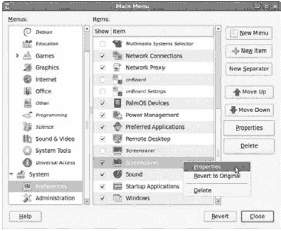

**图 10-5：** 屏幕保护程序项目的菜单编辑器属性

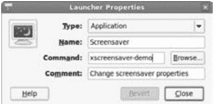

**图 10-6：** 屏幕保护程序菜单项的属性

**警告** 如果你使用 `sudo apt-get upgrade`（或自动升级）并刷新屏幕保护程序包，那么你可能需要再次进行此更改。

- 7. 让屏幕保护程序守护进程在登录时运行。打开启动应用程序列表（位于 系统 → 首选项 下的 启动应用程序 或 会话）。如果存在屏幕保护程序，将其移除或禁用。添加一个运行 `xscreensaver -nosplash` 的新屏幕保护程序。

- 8. 打开屏幕保护程序首选项（系统 → 首选项 → 屏幕保护程序），并取消选择所有灰色显示的屏幕保护程序选项。如果你不禁用它们，默认的随机屏幕保护程序可能会尝试运行缺失的屏幕保护程序，从而导致错误。

> **注意** 如果你按照这些说明在启动屏幕保护程序之前打开首选项，那么你会收到一个弹出窗口，提示 XScreenSaver 守护进程未运行。点击 确定 立即启动它。如果守护进程已经在运行，则你不会看到此弹出消息。

- 9. 选择你想要的屏幕保护程序，根据需要调整属性，然后关闭窗口。

现在，xscreensaver 是你的默认屏幕保护程序，并且将从启动时开始运行。我发现安装 xscreensaver 只有一个限制：它无法从系统的锁定屏幕菜单工作。此菜单通常包含注销、重启和关机等选项。安装 xscreensaver 后，锁定屏幕选项没有任何作用。为了绕过这一限制，我在顶部面板上安装了一个小程序，运行命令：xscreensaver-command -lock。（当你安装 xscreensaver 时，它甚至会在 /usr/share/pixmaps/ 中为你提供一个图标，看起来像一个显示器上面有火焰。）为了快速锁定屏幕，我点击顶部面板上的 xscreensaver 图标。虽然这无法修复系统菜单中的锁定屏幕选项，但我发现点击即锁定比通过层层菜单来锁定屏幕更为方便。

#### 添加新的屏幕保护程序

默认的 Ubuntu 安装包含一些未安装在 xscreensaver 下的屏幕保护程序。例如，Lattice（我最喜欢的 GL 屏幕保护程序）默认未安装。要安装 Lattice，你需要一个 OpenGL 视频驱动程序（参见"启用 OpenGL"一节）。但是，非 GL 屏幕保护程序也可以通过以下步骤添加：

- 1. 以 root 身份编辑 /etc/X11/app-defaults/XScreenSaver。此文件列出了 xscreensaver 知道的所有屏幕保护程序。

- 2. 搜索 flip——这是另一个*确实*存在的屏幕保护程序。你将用它作为模板。

- 3. 复制该行并将 flip 更改为 lattice。保留 GL: 因为 Lattice 是一个 GL 屏幕保护程序。

```
GL:                    flip -root                      \n\
GL:                    lattice -root                   \n\
```

- 4. 继续向下搜索 `fliptext`（会有第二行）。复制这一行并将 `fliptext` 和 `FlipText` 更改为 `lattice` 和 `Lattice`：

`*hacks.fliptext.name: FlipText`
`*hacks.lattice.name: Lattice`

- 5. 保存你的更改。

全部完成后，注销并使用 Ctrl+Alt+Backspace 重启桌面。当图形界面恢复时，它将使用你的新屏幕保护程序，并且 Lattice 将被安装。你可以通过 系统 → 首选项 → 屏幕保护程序 来选择此屏幕保护程序。如果你按照上一节关于安装 `xscreensaver` 的说明操作，那么这将运行 `xscreensaver-demo` 并允许你选择 Lattice——相互交联的环。

#### 让桌面背景动起来

默认的 Ubuntu 桌面可以是纯色或静态图像。通过几个简单的脚本，你可以更改背景图像或颜色（参见第 2 章），但这并不是真正的动画。真正让桌面动起来的秘诀是运行一个绘制背景的 X-Windows 应用程序。以下是一个由屏幕保护程序绘制背景的示例：

- 1. 你需要告诉 Nautilus 不要绘制桌面。这意味着你将失去所有桌面图标，但当你可以让桌面动起来时，谁还需要图标呢！

`gconftool-2 -s -t bool /apps/nautilus/preferences/show_desktop false`

- 2. 启动将绘制背景的 X 应用程序。在这种情况下，我将使用 Lattice 屏幕保护程序，告诉它绘制完整背景（`-root` 窗口），渲染看起来像电路的环（而不是甜甜圈、黄铜等），并消耗更少的 CPU 周期（`-n` 和 `nice`）。其他选项指定了渲染速率（每秒 20 帧）、运动速度（`-e 1`）、视野（`-o 10`）和背景雾（`-f`）。所有这些选项都在 `lattice` 的 man 手册中有详细说明。

`nice /usr/lib/xscreensaver/lattice -root -circuits -x 20 -e 1 -o 10 -f`

这会创建一个带有移动环的动画背景（见图 10-7）。

> **注意** Lattice 是一个 GL 屏幕保护程序。如果你的视频驱动程序没有 GL 支持，Lattice 将无法工作。此外，如果你的 OpenGL 视频驱动程序没有启用直接渲染，那么 Lattice 将消耗你所有的 CPU 资源，使系统变得迟缓。你总是可以选择一个受你的显示器更好支持的不同屏幕保护程序。

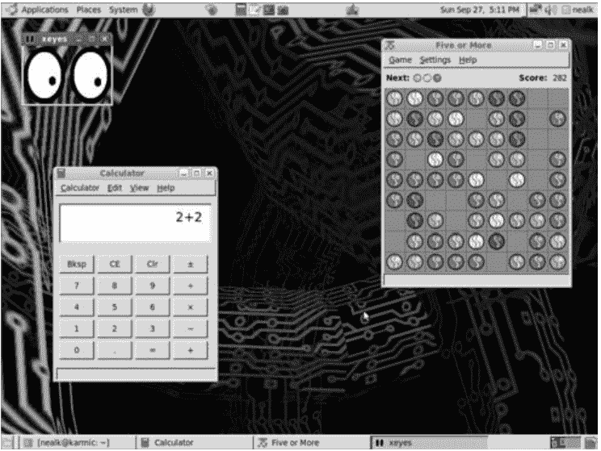

**图 10-7：** 使用 Lattice 屏幕保护程序的动画背景

任何可以渲染内容到根窗口的应用程序都可以用作背景图像。但是，有一些注意事项：

- **应用程序不存储它们后面的图像**——因此，一个不重新绘制屏幕的背景（例如，`/usr/lib/xscreensaver/sonar -root`）在窗口被移动或关闭时可能会有很大的空隙。最好的背景每秒至少渲染整个屏幕 5 次——每秒 20 次更好。

- **一些后台应用程序消耗大量资源**——例如，运行 `/usr/lib/xscreensaver/colorfire -root` 可能会明显减慢你的系统速度。好的背景消耗很少的资源，许多屏幕保护程序都有降低其资源消耗的选项。

- **尽管听起来可能有些奇怪，移动的背景可能会让一些人产生晕动病的感觉**——虽然 `sonar` 可能不会导致


问题，`lattice`的持续运动可能既有趣又没那么有趣。建议你在将其设为永久之前先测试一下背景。

#### 禁用动画背景

如果你决定关闭动画背景，需要按照以下步骤操作：

1. 终止背景动画。例如，如果你正在运行`lattice`，则使用`killall lattice`。这将停止背景绘制。不过，它不会恢复你的默认背景，而且移动窗口时会开始擦除背景的部分内容。

2. 告诉 Nautilus 可以绘制背景。

   `gconftool-2 -t bool /apps/nautilus/preferences/show_desktop -s true`

3. 即使 Nautilus 现在已被允许绘制背景，你仍然需要强制它重新绘制一次背景。你可以通过注销并重新登录来实现，或者运行：`nautilus -q; nautilus`。这将退出 Nautilus——如果它没有自动重启的话——再重新启动它。

#### 配置双显示器

图形显示器的屏幕空间有限。随着打开的窗口越来越多，桌面空间就成了问题。使用工作区切换器（见第9章）是一个不错的开始，但最终你会发现自己在两个桌面之间快速切换，试图同时使用两个应用程序。对于重度用户来说，一个显示器通常不够。Ubuntu 提供了几种不同的多显示器添加方案：

- **双头系统**——一台计算机可以安装多个显卡。这对于有额外硬件的人来说是理想的解决方案。另外，某些显卡能够驱动多个显示器。
- **共享桌面**——并非所有桌面都需要运行相同的操作系统。对于需要同时使用 Windows、Mac OS X 和 Linux 的人来说，这是必不可少的。

在之前的 Ubuntu 版本（Dapper Drake 及更早版本）中，还有第三种选择：联网桌面。使用 Xdmx，同一桌面可以跨多台计算机通过网络延伸。虽然双头系统和共享桌面在所有 Ubuntu 版本中都工作良好，但联网桌面却并非如此。由于 Xdmx 与 X Server 1.4（及更高版本）之间存在不兼容性，联网桌面支持在2007年中断。你可以在`/var/log/Xorg.0.log`的开头找到你的 X-server 版本。

#### 使用双头配置

如果你的计算机有多个视频端口，通常可以用它们来驱动两个不同的显示器。虽然大多数工作站计算机没有安装多个显卡，但你随时可以额外插入一个。不过，许多笔记本电脑包含两个视频源：一个用于 LCD 显示屏，一个用于外接显示器。在某些情况下，这些视频端口可以配置为协同工作，形成一个大的显示区域，而其他笔记本电脑则必须在两个端口上显示相同的内容。

> **注意** 计算机显示器通常称为*头*（head）。带有两个显示器的计算机是*双头*（dual-headed）系统。许多服务器是*无头*（headless）的，因为它们没有连接显示器。

配置双头系统有三种方法。第一种是通过图形显示设置（自 Hardy Heron 起可用）。第二种是使用 TwinView 组合显示器。然而，TwinView 严格限于 NVIDIA 显卡。更通用的选项是 Xinerama。

#### 使用图形显示配置

在早期的 Ubuntu 版本中，例如 Dapper Drake（6.06 LTS），配置多显示器只有手动选项。然而，Hardy Heron（8.04 LTS）及更高版本拥有智能的 X-windows 服务器和图形显示器配置选项。这使得设置变得非常简单。只要第二个显示器已经加载了显卡驱动，你只需插入第二个显示器就能工作。

1. 运行`xrandr`，查看是否列出了多个显示器。它们会被标记为"connected"（已连接显示器）或"disconnected"（尚未连接显示器……）。要使用图形配置，必须列出多个视频适配器。在本例中，有两个：VGA1、DVI0 和 VGA2。

```
$ xrandr
Screen 0: minimum 320 x 200, current 1280 x 1024, maximum 1280 x 1280
VGA1 disconnected
LVDS1 connected 1280x800+0+0 286mm x 179mm
```

2. 连接第二个显示器。

3. 打开显示配置小程序。它位于"系统" ➡ "首选项"菜单下，名称为"显示"或"屏幕分辨率"。（见图 10-8。）如果你在顶部面板中有显示图标，也可以使用它来配置显示器。

> **提示** 较新的 Ubuntu 版本，例如 Jaunty 和 Karmic，还会在每个显示器的右上角显示屏幕名称。这样，你可以快速确定哪个真实显示器对应哪个图标。

> **警告** 如果屏幕闪烁片刻，而且你的一些打开的应用程序突然消失，不要惊讶。一旦检测到显示器，它就会立即被使用，桌面也会扩展。应用程序会被移到最左边的显示器，而这可能就是新显示器。

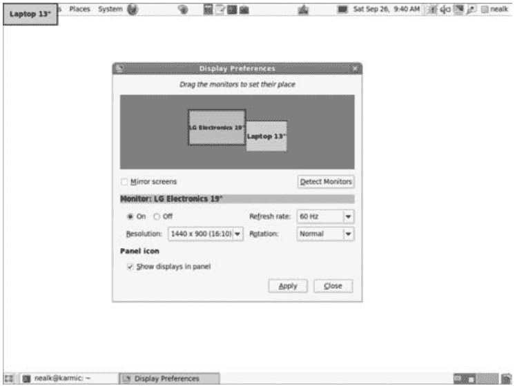

**图 10-8：** 显示配置 applet，显示连接了两个监视器

4. 小程序中会显示两个显示器。你可以拖动它们来配置相对位置（左、右、上等）。

5. 完成后，点击"应用"并关闭配置窗口。

显示器不需要尺寸相同，甚至不需要完全对齐。这会使截图变得非常有趣。未被桌面覆盖的截图部分会显示为黑色矩形。（见图 10-9。）

#### 使用 TwinView 配置双头

如果你有一块 NVIDIA 显卡*并且*它支持两个显示器，那么可以使用 TwinView 将两个显示器组合成一个桌面。TwinView 是 NVIDIA 专有的多显示器管理图形扩展。


**图 10–9：** 来自 Karmic Koala 的完整屏幕截图显示了偏移的监视器 gibson 角监视器标签以及没有桌面的黑色区域

## 第10章 ■ 让视频特效变得图形化

1. 备份你正在使用的`xorg.conf`文件：

    `sudo cp /etc/X11/xorg.conf /etc/X11/xorg.conf.orig`

2. 告诉 X-Windows 关于第二个显示器的信息。在文件`/etc/X11/xorg.conf`中有一个标题为`Device`的部分。这包含了显卡属性。为第二个显示器添加 TwinView 选项。例如：

```
Section "Device"
    Identifier  "NVIDIA Corporation NV18 [GeForce4 MX 4000 AGP 8x]"
    Driver      "nvidia"
    BusID       "PCI:1:0:0"
    Option      "TwinView"
    Option      "MetaModes"      "1280x1024,1280x1024; 1024x768,1024x768"
    Option      " truncatedViewOrientation"  "RightOf"
    Option      "ConnectedMonitor"     "CRT,CRT"
    Option      "SecondMonitorHorizSync"       "UseEdidFreqs"
    Option      "SecondMonitorVertRefresh"     "UseEdidFreqs"
## Option      "SecondMonitorHorizSync"       "24-80"
## Option      "SecondMonitorVertRefresh"     "50-75"
EndSection
```

这些选项包括成对的视频分辨率（每个显示器一个）、第二个显示器的位置（在第一个的右侧），以及显示器扫描频率（使用默认值或指定范围）。

3. 保存新的`xorg.conf`文件并重启 X-server。注销并使用 Ctrl+Alt+Backspace 重启服务器。如果无法启动，请参阅本章前面"调试 X-Windows"一节。（如果能正常启动，那么你就完成了，应该可以正常使用的两个显示器。）

#### 使用 Xinerama 配置双头

如果你的系统有两个不同的视频端口，那么可以使用 Xinerama 将它们链接成一个虚拟显示器。在使用两个显示器之前，你需要确保计算机确实有两个视频设备。使用`lspci`命令列出所有显示设备：

```
lspci -x | grep -i -e VGA -e DISPLAY
```

如果只列出了一个显示控制器，则无法使用此选项。但是，如果你看到多个控制器，则可以配置你的 X-server 以使用两个显卡。这需要编辑`/etc/X11/xorg.conf`文件。

1. 备份你正在使用的`xorg.conf`文件。

    `sudo cp /etc/X11/xorg.conf /etc/X11/xorg.conf.orig`


 2. 告诉 X-Windows 关于第二台显示器的信息。在 `/etc/X11/xorg.conf` 文件中，有一个标题为 `Monitor` 的段落。它包含一个唯一标识符和显示器属性。为你的第二台显示器创建第二个。例如：

```
Section "Monitor"
	# Default monitor
	Identifier	将你提供的文档翻译成中文，请确保格式完全保留，包括代码块、列表、引用块、加粗、斜体等 Markdown 格式。翻译要求：粗体和斜体内容需要翻译并保留符号；内联代码和代码块保持原样；链接文字需要翻译但保留 URL；不要漏掉任何一行；不要重复输出原文；输出需要包裹在 [content]...


 3. 检查你的客户端配置。Synergy 几乎支持所有 Windows、Mac OS X、Linux 和 Unix 系统。对于 X-Windows 系统，请确保启用了 XTEST 扩展。你可以使用 `xdpyinfo | grep XTEST` 来检查。这应该显示 `XTEST` 字样。对于 Windows 和 Mac 系统，不需要特殊配置。

4. 启动客户端。每个客户端需要两个元素。首先，它需要知道服务器的主机名。其次，它需要一个在服务器配置中列出的唯一名称（在 `screens` 部分）。默认情况下，该名称是客户端的主机名。但是，你可以指定一个备用的客户端名称。

- 在 Linux、Unix 和 Mac OS X 下，客户端是 `synergyc`。服务器名称在命令行中指定。你也可以包含一个可选的客户端名称。按照前面的示例，我使用以下命令将我的 Mac（`matt`）连接到我的 Ubuntu 服务器（`udo`）。

`synergyc -name matt udo`

- 在 Windows 下，使用 Synergy 客户端来指定服务器名称和可选的客户端名称（见图 10-11）。


**图 10-11：** Synergy 的 Microsoft Windows 客户端配置

5. 启动服务器。在 Ubuntu、Mac OS X 和其他 Unix 和 Linux 系统上，命令是 `synergys`。使用以下方式指定配置文件：

`synergys -config synergy.conf`

在 Windows 系统上，打开 Synergy 应用程序，"选择共享此计算机的键盘和鼠标（服务器）"，然后点击启动。

> **提示** 默认情况下，`synergys` 和 `synergyc` 会从控制台分离并在后台运行。要防止进程成为守护进程，请使用 `-f`。例如，`synergys -f -config synergy.conf`。

尽管服务器和客户端都需要启动，但顺序并不重要。客户端会定期轮询服务器，直到建立连接。

当每个系统连接时，链接规则将被应用。按照示例，在 `matt` 连接之前，光标无法从 `udo` 的右侧移出。当 `matt` 连接时，向右的移动将遵循已建立的链接。

> **注意** 在 Synergy 下，系统要么是客户端，要么是服务器。你不需要在客户端上运行服务器。

当所有客户端都连接到服务器后，你就可以开始共享桌面了。在窗口之间移动鼠标可以让你设置键盘的焦点。最重要的是：如果你从任何桌面复制文本，你就可以将其粘贴到任何其他桌面上的应用程序中。

> **提示** Synergy 允许客户端随时连接和断开。如果你有经常崩溃或重启的系统，Synergy 绝对是一个好的生产力解决方案，因为你可以在一个部分的桌面宕机时继续工作。

双显示器和 Synergy 不必是独立的解决方案。你可以在一台计算机上运行两个显示器（双头解决方案）*并且* 使用 Synergy 来链接其他操作系统的桌面。虚拟桌面大小的唯一限制就是你的物理桌面。你的桌子到底能放多少台显示器呢？

> **提示** 考虑在虚拟机中安装 Synergy 客户端，例如 Qemu（见第 7 章）。这使你能够在虚拟计算机和真实桌面之间进行剪切和粘贴。在许多情况下，这比通过网络或共享分区传输数据要方便得多。

### 小结

尽管基本的 Ubuntu 桌面适合初学者，但它的灵活性使你能够将其从适用于大多数事情变为满足你的特定需求。无论你是想要不同的屏幕分辨率、显示调整，还是更复杂的东西，都有 hack 可以自定义系统以满足你的需求。使用这些调整，你可以启用酷酷的屏幕保护程序、动画背景，甚至是跨越多个屏幕和操作系统的超大桌面。

## 第四部分：保护你的系统

### 本部分内容

- 第 11 章：锁定 Ubuntu
- 第 12 章：高级网络
- 第 13 章：启用服务

## 第 11 章

### 锁定 Ubuntu

### 本章内容

- 了解默认的安全模型
- 如何加密文件、目录和磁盘
- 进行备份和删除临时文件

从新安装开始，Ubuntu 就是一个非常安全的操作系统。即使不应用任何安全补丁，它对来自外部的远程攻击者也几乎不构成风险。然而，安装后维护安全是**你的**责任。有一些技巧可以让你的文件和数据保持安全。其中包括使用 Sudo 获取 root 权限、使用 GPG 编码消息、启用加密文件系统，以及日志文件和缓存管理。基本的 Ubuntu 系统已经足够安全，但通过一些 hack，它可以变得更加安全。

在安全领域之外，许多人将加密和缓存清除视为有罪的标志。通常的基本感受是，"如果你没有什么可隐瞒的，为什么要掩盖你的踪迹？"仅仅因为你在加密数据和清理临时文件，并不意味着你在做任何非法的事情。把它比作拉上你卧室窗户的窗帘——这意味着你想要隐私，而不是你在做错事。隐私也是预防性的。如果你的笔记本电脑被盗，你希望小偷在你的网络缓存中看到你所有的银行账户信息吗？你正在从事的某个大项目的源代码呢？你的家用电脑也是如此。小偷偷走你的台式工作站的可能性，与偷走你的电视和音响一样大。

锁定你的系统限制了坏人能够造成的损害程度。此外，许多这些预防步骤除了安装和初始配置之外，不需要额外的工作。

#### 了解 Ubuntu 安全默认值

Ubuntu 安装时使用了一个基本的安全模型，包括无网络可访问服务和无 root 登录。这些基本原则确保干净的安装不会导致远程主机被入侵。如果你需要网络服务，那么你需要显式安装它（见第 13 章）。即使安装了网络服务，通常也需要几个步骤才能完全启用它。

维护安全的 Ubuntu 系统有几个基本步骤：

- **不要使用 root**——默认的 Ubuntu 安装不设置 root 密码，你无法以 root 身份登录。相反，默认用户账户可以使用 Sudo（见下一节）以 root 身份运行命令。其他用户账户除非被明确授权，否则甚至无法运行 Sudo。限制 root 访问限制了你不小心（或故意）搞砸整个操作系统的能力。

- **限制网络服务**——只启用你需要的服务。如果你不需要邮件服务器，那就不要安装。如果你不托管网页，那就不要安装 Web 服务器。攻击者只能利用你系统上正在运行的网络服务。

- **使用可信的软件源**——第 5 章描述了如何修改 `/etc/apt/sources.list` 以更改支持的仓库列表。默认的仓库来自可信的位置：四个官方的 Ubuntu 仓库。然而，有数以百计的非官方仓库。从未知和不可信的仓库安装软件可能导致安装恶意软件。不要更改默认的仓库设置或从不可信的提供商处安装软件，除非你知道自己在做什么。记住：仅仅因为*他们*说安全，并不意味着真的安全。

- **限制脚本**——Web 浏览器、聊天室软件和其他程序可以从网络传输潜在的恶意软件、下载文件和运行程序。如果你不需要这个功能，那就禁用它。例如，如果你不需要 Web 浏览器中的 Java，那就禁用它（见第 6 章）。

> **提示** 我曾经建议禁用 JavaScript，但现在大多数流行的网站都需要 JavaScript 来显示内容和导航。相反，考虑安装


 Firefox NoScript 插件。该插件限制哪些网站可以使用 JavaScript 和其他网络插件。

- **使用强密码**——如果你是唯一能物理接触你电脑的人，并且不允许远程网络访问，那么你或许可以侥幸使用 *abcd* 或你宠物的名字作为密码。（我的一台家用电脑通常保持登录状态，而且屏幕保护程序不要求密码——这和没有密码一样有效。）然而，如果你处于一个有许多用户的公司环境中，或者启用了远程访问，或者家里有喜欢按删除键的小孩（或猫），那么请考虑使用强密码。远程访问和物理访问攻击可以使用暴力破解方法，包括：
  - **字典单词**——如果你的密码能在字典（英文、法文、中文等）中找到，那么它很容易被猜到。
  - **带数字的单词**——简单的单词-数字组合，如 *apple12* 或 *288cereal* 很容易被猜到。标点符号也是如此（*hello!* 和 *?what?*）。
  - **键盘模式**——像 *asdfghjk*（键盘上相邻的键）这样的序列非常容易猜到。
  - **常见数据**——车牌、日期（生日、纪念日等）、孩子名字和其他类型的公开信息非常容易猜到。
  - **常见字母替换**——许多人用形状相似的字符替换字母。例如，零（0）看起来像字母 o，一（1）替换字母 l，三（3）是反过来的 'E'，& 符号中间有一个小写的 'a'。像 "p@ssw0rd" 和 "N3@1"（Neal）这样的密码很容易被猜到。

- **不要泄露你的安全。** 告诉别人"我有一个很酷的密码——是我高中的学生 ID 号码，没人会猜到的！"这对攻击者来说是巨大的提示。不要暗示你的密码，不要通过电子邮件发送它，不要当众告诉任何人。如果你认为有人可能知道你的密码线索，那么立即更改它。记住：更改密码唯一 inconvenienced 的人是你。除了密码，不要把带有 Sudo 权限的账户给每个人，不要安装来自陌生人的软件，不要拿着剪刀奔跑。你的安全性取决于最薄弱的环节，而最薄弱的环节通常是用户。

> **警告** 不要把你的 Ubuntu 系统密码用在其他地方。许多人对他们的 Yahoo!、Gmail 和 eBay 账户以及其他在线服务使用相同的密码。如果你到处使用相同的密码，那么一个被入侵的网站将导致你所有账户都被入侵。大多数人低估了黑帽黑客找到你其他账户的能力。我是好人（白帽），我花了很多时间在网上追踪人们——相信我，找到你的其他账户很容易。

### 默认安全

默认的 Ubuntu 服务器和桌面安装不包含任何远程网络服务。这样，干净的安装可以在没有外部攻击者入侵系统风险的情况下进行补丁和准备。你可以将 Dapper Drake、Karmic Koala 或任何其他 Ubuntu 系统的干净安装放在互联网上，即使没有防火墙也不会有远程入侵.........安全的风险。（当不存在网络服务时，你无法入侵网络服务。）

安装后，你可以更新系统（`sudo apt-get update; sudo apt-get upgrade`）并开始添加服务和用户账户。这最小化了远程利用的风险。

"无默认网络服务"的基本理念是一个可以使其他操作系统受益的概念。例如，Microsoft Windows、HP-UX 和 RedHat Fedora Linux 在安装时都启用了一些基本的网络服务。这导致了严重的问题。例如，如果你在大公司工作，有几台已感染的 Windows 系统，那么在网络上安装新的 Windows 系统就会成为问题：新系统可能在第一个安全补丁应用之前通过开放的公共服务被感染。

### 锁定密码

许多组织有关于使用强密码和定期更改密码的规定。然而，有规定并不等同于执行规定。

你可以强制用户更改密码，使用 `passwd -w` 进行警告，使用 `-x` 设置过期，在下次登录时强制更改密码。你甚至可以可以` -i` 禁用不活跃的账户。例如，`sudo passwd -w 30 -x 35 -i 60 joe` 会在 30 天后警告 `joe` 更改密码，35 天后密码过期，60 天后锁定他不活跃的账户。要禁用过期设置，将值设为 零。

像 John the Ripper（`sudo apt-get install john`）这样的程序旨在通过字典攻击和常见密码模式破解密码，如上一节所列的模式。根据我的经验，John 可以在最初几分钟内破解大约 20% 的用户选择密码，几小时内可达 80%。最好的密码不会基于字典单词或简单模式，而且要容易记忆。好的密码应该只有你自己能理解，其他人都无法理解。

如果你是系统上有很多用户的管理员，考虑使用 John the Ripper 来查找弱密码。你在黑帽黑客之前找到弱密码要安全得多。

当然，当你发现弱密码时可以采取不同的措施。礼貌的做法是通知用户。我曾经打电话给一位教员，告诉他他的密码是德克萨斯州的一个城市。（我不知道他的儿子叫 Austin。）其他选项包括强制在下次登录时更改密码（`sudo passwd -e username`）、封锁违规账户（`sudo passwd -l username` 锁定，`-u` 解锁），或将他们的名字张贴在耻辱墙上。虽然这可能会给用户带来不便，但你几乎可以确保他们只会选择一次坏密码。

### 使用 Sudo 进行黑客攻击

在本书中，我们一直使用 `sudo` 以 root 身份运行命令。Sudo 允许你以 root 权限运行命令。Ubuntu 的默认安装包含 Sudo 命令（`sudo`），并允许默认用户账户访问该命令。如果你需要以 root 身份运行某些东西，你可以使用 `sudo`。一个相关的命令，`sudoedit`，允许你以 root 身份编辑文件。例如，要编辑仅限 root 的文件 `/etc/fstab`，你可以使用以下任一命令：

```
sudo vi /var/spool/anacron/cron.daily
sudoedit /var/spool/anacron/cron.daily
```

提示：`sudoedit` 命令使用在 `$EDITOR` 环境变量中定义的编辑器。如果未定义此编辑器，则使用 `nano` 编辑器。有关设置 `$EDITOR` 变量，请参见第 2 章中的"调整 Shell"。

当 Unix 还年轻时（约 1970 年），管理员需要一种在用户体验权限之间切换的方法。这是通过 `su` 命令实现的。虽然最初设计为 **s**witch **u**ser（切换用户）访问，但它主要用于从普通用户切换到 root 权限。（因此，`su` 命令有时被称为超级用户命令。）

使用 `su` 以 root 身份运行命令有几个巨大的风险。最值得注意的是，所有命令都以 root 权限执行。很多时候，一长串命令中只有一条命令真正需要 root 访问权限。此外，当终端以 root 身份登录时，用户可能忘记他们正在以哪个用户身份运行。作为 root 意外删除重要用户和系统文件的潜在风险远大于作为普通用户这样做。

Sudo 的创建是为了限制可以以 root 身份运行的命令。与其改变所有权限，不如只改变特定命令的权限。Sudo 相对于 `su` 还有其他好处，包括限制用户可以以 root 身份运行哪些命令，以及不需要共享 root 密码。还可以跟踪你上次认证的时间。虽然 `su -c cmd` 会运行特定命令，但它总是会提示你输入密码；这对迭代脚本没有用处。相比之下，`sudo cmd` 只需要第一次认证，因此你可以轻松地在脚本中使用它。

当 Sudo 命令完成后，你将回到你的普通用户访问权限。这样，只有必需的步骤以 root 身份运行，你不会意外地将终端保持在 root 登录状态。

虽然非常老的 Unix 系统仍然依赖 `su` 来改变访问级别，但它正被 `sudo` 强制取代。此外，在大多数 BSD 和 Linux 发行版（包括 Ubuntu）中，Sudo 已成为启用 root 权限的标准。虽然 Ubuntu 安装包含 `su` 命令，但你不能使用它以 root 身份运行命令，除非你首先使用 `sudo passwd root` 设置 root 密码。

### 将用户添加到 Sudo

sudo 的配置文件是 `/etc/sudoers`。这列出了谁可以以 root 身份运行命令、他们可以运行哪些命令以及任何配置首选项。列表 11-1 显示了来自 Hardy Heron（8.04 LTS）的默认 `/etc/sudoers` 文件。

> **注意** 不同的 Ubuntu 版本有略微不同的默认 `/etc/sudoers` 文件。虽然注释不同，但它们都包含相同的默认限制：只有 root **admin** 组成员才有 Sudo 权限。由于 root 用户没有密码且无法登录，这意味着实际上只有 **admin** 组中的用户才有访问权限。

虽然可以使用 `sudo vi /etc/sudoers` 或 `sudoedit /etc/sudoers` 编辑 sudoers 文件，但这不推荐。相反，命令 `sudo visudo`（`vi sudo` 的缩写）是首选方法。`visudo` 命令确保一次只有一个人编辑该文件。它还会在安装新文件之前检查语法错误。（你最不需要的就是损坏 `/etc/sudoers` 并失去运行 `sudo` 来修复问题的能力。）

默认的 `/etc/sudoers` 文件授予属于 `admin` 组的所有成员访问权限。非 `admin` 用户被阻止以 root 身份运行命令。如果你想将某人添加到 `admin` 组，请使用以下步骤：

1. 使用 `vigr` 命令编辑 `/etc/group` 文件。

   `sudo vigr`

2. `/etc/group` 文件列出每个组名、组 ID 号和以逗号分隔的用户列表。搜索以 `admin` 开头的行。

它会列出一个账户名（你的默认 Ubuntu 账户）。例如，我的默认账户名是 *neal*，该行显示为：

```
admin:x:112:neal
```

3. 在该行添加新用户名。使用逗号分隔用户名。例如，如果我想添加用户 *marc*，我将得到：

```
admin:x:112:neal,marc
```

4. 保存修改并退出编辑器。

> **注意** 对 /etc/groups 的更改不会传播到正在运行的应用程序。如果用户当前已登录，他需要先注销才能注意到组的变化。

如果你想给用户 Sudo 权限而不将其添加到组中，那么你可以将其添加为特权用户。

1. 使用 `sudo visudo` 编辑 `/etc/sudoers` 文件。

2. 查找显示 `root ALL=(ALL) ALL` 的行。

3. 创建一行类似的行，使用用户的账户名。例如，如果我想给账户 *marc* 授权，我将使用：

```
root   ALL=(ALL) ALL
marc   ALL=(ALL) ALL
```

这一添加说明用户 *root* 和 *marc* 可以使用 `sudo`，并且可以用 root 权限运行任何命令。

4. 保存修改并退出 `visudo` 命令。

### **列表 11-1：** Hardy Heron (8.04 LTS) 的默认 /etc/sudoers 文件

```
## /etc/sudoers
#
## This file MUST be edited with the 'visudo' command as root.
#
## See the man page for details on how write a sudoers file.
#

Defaults    env_reset

## Uncomment to allow members of group sudo to not need a password
## %sudo ALL=NOPASSWD: ALL

## Host alias specification

## User alias specification
## Cmnd alias specification

## User privilege specification
root    ALL=(ALL) ALL

## Members of the admin group may gain root privileges
%admin ALL=(ALL) ALL
```

### 调整其他 Sudo 选项

sudoers 文件包含应用于每个 sudo 命令的默认选项。你可以添加或更改这些选项。在 Dapper Drake (6.06 LTS) 下，默认选项是 !lecture、tty_tickets 和 !fqdn。Ubuntu 的后续版本，包括 Hardy (8.04 LTS)、Jaunty (9.04) 和 Karmic (9.10)，默认是 env_reset。

这些选项是标志——任何标志前面的 ! 会禁用该选项。可以添加其他包含值的选项。所有选项都属于 /etc/sudoers 文件中的 Defaults趋向行（使用 sudo visudo 编辑此文件）。你可能想要调整的一些命令选项包括：

- env_reset——此标志清除环境变量。只保留 $LOGNAME、lier方 $SHELL、$USER、$USERNAME 和少数其他变量。

> **警告** 许多命令需要环境变量才能正确运行。例如，如果你需要使用 SOCKS 服务器来访问网络（参见第 6 章），那么你可能需要 $SOCKS_SERVER 环境变量。env_reset 命令会从所有 Sudo 环境中删除此变量。如果你想为特定命令保留你的环境，使用 sudo -E *command*。-E 选项保留环境变量。

- lecture——启用此标志时，sudo 命令会显示关于以 root 身份运行命令的警告。如果系统上有很多管理员，这可能很有用。然而，人们通常会忽略该警告。默认安装禁用该消息：!lecture。

- timestamp_timeout——此选项列出 sudo 要求你重新输入密码前的分钟数。如果你连续运行多个 sudo 命令，那么在每个命令后重新输入密码可能会非常不方便。默认配置是 15 分钟（timestamp_timeout=15）——如果你的最后一条 sudo 命令是在超过 15 分钟之前执行的，那么你需要重新输入密码才能运行 sudo。将值设置为 零将始终提示输入密码；将值设置为负数将禁用超时。

如果你处于一个非常敏感的环境中，那么你可能想要降低此值（或将其设置为零）。

- `tty_tickets`——如果你打开了很多窗口，你会注意到在每个窗口中第一次运行 `sudo` 时需要输入密码。这是由于 `tty_tickets` 标志——每个终端（`tty`）都有自己的 `sudo` 环境。如果你禁用此标志（`!tty_tickets`），那么在一个窗口中为 `sudo` 输入密码将会停止在所有其他窗口中的 `sudo` 密码提示。

- `fqdn`——当在 sudoers 文件中使用主机名时，此标志指定使用完全限定域名（fqdns）。

- `passwd_tries`——这设置用户在 `sudo` 失败前可以尝试输入密码的次数。默认是 `passwd_tries=3`。

- `insults`——这是一个有趣的标志。如果用户输入了错误的密码，`sudo` 会生成一条随机消息。（默认是 `!insults`）。例如：

```
$ sudo id
Password: [wrong]
Just what do you think you're doing Dave?
Password: [wrong]
It can only be attributed to human error.
Password: [wrong]
My pet ferret can type better than you!
sudo: 3 incorrect password attempts
```

> **提示** 还有许多其他高级配置选项，包括日志记录和基于用户的限制。如果你有特定需求，查看 sudoers 的手册（`man sudoers`）。

### 成为 Root

尽管 Ubuntu 的安全模型要求所有管理命令都通过 `sudo` 发出，但有时你以 root 命令提示符会更好。幸运的是，有很多方法可以通过 `sudo` 实现这一点。几个例子：

```
sudo -s        # 以 root 身份运行 shell
sudo bash -o vi # 以 root 身份运行 shell，使用 vi 风格的命令行编辑
sudo -i        # 设置 root 的初始登录环境
sudo su --root  # 成为 root 并运行 root 的登录环境
```

在前两种情况下，shell 以 root 身份运行，但其他环境变量如 `$HOME` 会被继承。在其他两种情况下，环境会被替换为 root 的真实环境设置。

如果你*真的*需要能够以 root 身份登录，那么你可以使用 `sudo passwd root` 给 root 账户设置密码。一旦你设置了密码，root 账户就可以登录。你可以随时用 `sudo passwd -l root` 撤销此更改以锁定该账户。

> **警告** 启用 root 登录通常是一个坏主意。登录会留下责任追溯的痕迹。如果有人使用非个性化账户登录，那么无法确定真正登录的人是谁。`sudo` 在 `/var/log/auth.log` 中提供审计跟踪（尽管具有 `sudo` 权限的用户有能力清除日志）。

### 加密数据

有许多不同的方法可以加密信息，Ubuntu 提供了大量选项。你可以加密单个文件、特定目录、整个主目录，甚至整个硬盘。更重要的是，这些选项是相互独立的。你可以在加密磁盘分区上拥有加密主目录中的加密目录里的加密文件！每种选项将在下一节中讨论。

- 加密文件。如果你想加密特定文件，使用 GPG 或像 vi 这样的文本编辑器。使用 GPG 时，解密文件的副本仍会存在于你的文件系统中，如果你删除它可能会恢复。相比之下，vi 编辑器的加密（`vi -x file`）不会将解码后的文本保存到硬盘，但它确实只对纯文本文件工作良好。

> **提示** 如果 `vi -x` 不起作用，那么你可能安装了基本 vim 包。使用 `sudo apt-get install vim` 安装完整版本。

- 加密目录。如果你想拥有一个包含多个加密文件的单个目录，使用 EncFS。

- 加密的用户目录。使用 eCryptfs，你可以加密你的整个主目录。系统的其余部分INSTANCES将 accessiblee 任何可以访问硬盘的人，但你的主目录将被加密，直到你登录为止。这是保护隐私的好选项，但可能会阻止 `cron` 和 `at` 作业在用户未登录时正确运行。

- 加密整个驱动器。对于真正的偏执狂，整个磁盘都被加密。没有密码你甚至无法启动。这对于远程访问服务器来说不是理想 solution，因为你无法远程输入密码。


### 使用 Gnu 隐私保护工具 (GPG)

安全和加密经常出现在同一句话中。如果你想保密某些内容，请使用密码学。1991年，Phil Zimmerman 公开了一种名为 *Pretty Good Privacy* (PGP) 的密码系统。这成为他公司 PGP, Inc. 的基础。PGP 系统在 Gnu 公共许可证 (GPL) 下被重写并授权使用。这个新系统，即 Gnu 隐私保护工具 (GnuPG 或 GPG)，已成为 Linux 和 Unix 系统中文件和电子邮件加密的事实标准。因此，它被包含在 Ubuntu 的默认安装中。

> **提示** 许多人交替使用 GPG 和 PGP 这两个名称。两种系统使用相同的加密方法，工具的使用模型也相似。用 PGP 加密的文件可以用 GPG 解密。最显著的区别在于许可证和可用性；GPG 是开源的、GPL 许可的，并且使用更为广泛。

GPG 包含在每个 Ubuntu 安装中，即使是最小化安装也不例外。GPG 使你能够创建公钥和私钥、安全地交换密钥，以及加密和解密消息。许多电子邮件程序要么原生集成了 PGP（和 GPG），要么提供了可用的插件。例如，Evolution 邮件客户端原生支持 GPG。基于文本的邮件客户端 `mutt` 也支持 PGP，甚至 Microsoft Outlook 用户也可以获得用于 PGP 加密的插件。

使用 GPG 有许多必需的部分：

- 密钥生成
- 搜索密钥
- 交换密钥
- 定义密钥信任
- 文件加密和解密
- 密码签名
- 电子邮件集成

### 创建密钥

GPG 使用非对称密钥加密。这意味着一个密钥用于加密数据。所有用户都拥有自己的一组密钥（称为 *密钥环*），存储在 `$HOME/.gnupg/` 中。主要的密钥环是 `$HOME/.gnupg/pubring.gpg` 和 `secring.gpg`。前者存储公钥，而后者存储私钥。

虽然分发你的公钥是预期的行为，但你的私钥应尽可能保密。在生成密钥对时，GPG 会提示你输入密码。虽然这个密码不用于加密过程（加密过程仅使用密钥），但它*确实*用于在硬盘驱动器上加密你的私钥。这可以阻止系统上的其他用户窃取你的私钥并使用它们来访问你的编码数据（或冒充你——请参阅签名数据部分）。

> **提示** 密码不是必需的。许多自动化工具使用 GPG，因此完全不使用密码可能非常理想。如果你将密码留空（在生成密钥时只需按回车键），那么你将永远不会被提示输入密码。

#### **清单 11-2：** 生成 GPG 公钥和私钥

```
$ gpg --gen-key
```

```
gpg (GnuPG) 1.4.9; Copyright (C) 2008 Free Software Foundation, Inc.
This is free software: you are free to change and redistribute it.
There is NO WARRANTY, to the extent permitted by law.
```

```
Please select what kind of key you want:
   (1) DSA and Elgamal (default)
   (2) DSA (sign only)
   (5) RSA (sign only)
Your selection? 1
DSA keypair will have 1024 bits.
ELG-E keys may be between 1024 and 4096 bits long.
What keysize do you want? (2048) 2048
Requested keysize is 2048 bits
Please specify how long the key should be valid.
         0 = key does not expire
       <n>  = key expires in n days
       <n>w = key expires in n weeks
       <n>m = key expires in n months
       <n>y = key expires in n years
Key is valid for? (0) 2y
Key expires at Thu 06 Oct 2011 10:56:08 AM MDT
Is this correct? (y/N) y
You need a user ID to identify your key; the software constructs the
user ID from the Real Name, Comment and Email Address in this form:
```

```
"Heinrich Heine (Der Dichter) <heinrichh@duesseldorf.de>"
Real name: John Travolta
Email address: travolta@discomania.tv
Comment:
You selected this USER-ID:
"John Travolta <travolta@discomania.tv>"
Change (N)ame, (C)omment, (E)mail or (O)kay/(Q)uit? O
You need a Passphrase to protect your secret key.
Enter passphrase: *******
Repeat passphrase: *******
We need to generate a lot of random bytes. It is a good idea to perform
some other action (type on the keyboard, move the mouse, utilize the
disks) during the prime generation; this gives the random number
generator a better chance to gain enough entropy.
++++++++++.++++++++++.+++++.+++++++++++++++++++++++++++++++.+++++++
+++.++++++++++++++++++++++++++++++++++++++++.++++++++++.++++++++++
>+++++.....................+++++
gpg: key 7B88C50D marked as ultimately trusted
public and secret key created and signed.

gpg: checking the trustdb
gpg: 3 marginal(s) needed, 1 complete(s) needed, PGP trust model
gpg: depth: 0 valid: 1 signed: 0 trust: 0-, 0q, 0n, 0m, 0f, 1u
gpg: next trustdb check due at 2011-10-06
pub  1024D/7B88C50D 2009-10-06 [expires: 2011-10-06]
Key fingerprint = 10B6 1C42 92AC AC29 2D87  E79C 5308 470A 7B88 C50D
uid                  John Travolta <travolta@discomania.tv>
sub  2048g/71D990B6 2009-10-06 [expires: 2011-10-06]
```

### 你能再说一遍吗？

私钥应该是唯一的，GPG 使用了一些可用的最强密码算法。如果你丢失了密码、删除了私钥，或者在没有备份的情况下损坏了密钥环，那么你就倒霉了。你将无法恢复数据。

同样，除非你确定以后再也不需要它们，否则不要删除私钥。由于它们是唯一的，一旦你做出这个决定就无法回头。我的密钥环包含许多旧的和已过期的密钥，因为它们需要用来解码一些旧消息和验证签名。

发送 GPG 编码的电子邮件时，务必给自己发送一份副本。否则，你将无法解码已发送的邮件。仅仅保存已发送消息的副本是不够的，因为你的密钥没有被添加到加密中。我偶尔会收到一些电子邮件，发件人要求我把电子邮件发回给他们，以便他们可以拥有自己文本的副本。

### 搜索密钥

创建密钥后，你可以使用 `list-keys` 选项来查看它们。`gpg --list-keys` 命令将列出密钥环中的每个公钥。你还可以指定搜索过滤词来搜索密钥环。例如，`gpg --list-keys 7B88C50D` 返回匹配此唯一标识符的密钥。你也可以指定关键词，如 `gpg --list-keys disco` 来列出人员姓名或电子邮件地址中包含字符串 *disco* 的所有密钥。

> **提示** 由于密钥包含电子邮件地址，我将 `gpg --list-keys` 用作简易的通讯录。例如，如果我需要记住 Marc See 的电子邮件地址，我使用 `gpg --list-keys marc`，他的条目 (Marcus T. See <msee@test.lan>) 就会立即显示出来。

其他搜索选项包括 `gpg --list-secret-keys` 和 `gpg --fingerprint`。前者列出你的所有私钥，后者显示可用于验证密钥的密钥唯一哈希值。由于任何人都可以使用任何人的姓名和电子邮件地址创建任何密钥，因此唯一的指纹使你能够确认密钥来自正确的人（请参阅传输密钥）。

> **注意** 你可以使用 `--delete-key` 和 `--delete-secret-key` 删除密钥。但是，你可能永远不需要删除密钥，而且删除私钥是不可逆的，除非你有备份。

基于姓名、电子邮件地址或唯一 ID 搜索密钥被大多数 GPG 操作使用。例如，加密消息时，系统会要求你提供用于加密的密钥列表。这些可以通过搜索姓名、电子邮件地址或 ID 来找到。

> **提示** 你可以在 gpg 命令行上指定多个搜索词。这些词构成逻辑或关系——任何匹配其中任一词的密钥都会被显示出来。

### 传输密钥

创建密钥后，你需要分发你的公钥。只有拥有你公钥的人才能给你发送加密消息。为此，你需要从密钥环中导出公钥。命令 `gpg --export -a` 将导出你的*所有*私钥。你可以使用搜索字符串来缩小导出密钥的范围。例如，`gpg --export -a travolta` 将导出我的 John Travolta 的公钥。此命令的结果是一个 ASCII 编码的文本块，可以通过电子邮件发送或传递给其他人。该文本块应类似于以下内容：


 ```
-----BEGIN PGP PUBLIC KEY BLOCK-----
Version: GnuPG v1.4.9 (GNU/Linux)

mQGiBErLdqqRBADHF2uphafC8vHj4q5xLUVI7BNjD8DVfXOI+PvIvgfCLy0PFJz7
XBvPVGzHF3VPT9/hVolunNvsZyCOp5ztpJV/7YmKIU+QxSlrFr57jJUTvHs+RUtm
iIbFUoXp5yrpg7rmTHPIE62C1eiizymwQYAQEr1jmvhky9/VSI04m0eNmwCg4zk+
O8slfQuNDVR4M/YiTFTB58ED/iTbCjFJfbJ8Pq1x3aLhFT75LoJSEiAHPsC4LUcU
RzEOsEQtimfCakcB2Pm8SWVdEJ7gXt16a2qg3mP4Qi6X8VlQ+M1EJ73w6srNyz7K
mw1SY3GmeTfWWxGV4wPeeUzkHI+LY6E9+KV7QZK91FaGAgVHZJaWwgbVQaZEG5DU
NZUgA/OTTOpimOpGG3fDnKJRIHWyE740OUujYia0ElgTbhT4OoYX+MTvNIjk+Csk
ocLCxWxfJJdG3AGZUgKHOz3INnEmHBhKxkQCrPwr3LHM0gya6S/I/RoW921GMj3ez
R4WzEdbboboxKl7B3I9e0eBBmkT0AY6q3nZQDM2Rgd72EPuNRRLQmSm9obiBUcmF2
b2x0YS8dHJhdm9sdGFAZ2lhY29tYW5AajI6ZgQTEQIcAjUCSst2qAIbAwUJa8JnAAYLCQgHAwIEFQIIAwQWAgMBAh4BAheAAAoJEFMIRwp7iMUN59YANy4SWCW
yMXcHIuVhuPTg7FEdhR+AKCTuEBwpMN5PBJk9OOVnWpRlfgRI7kCDQRKY3aoEAgA
97A8EYW3Tt9UHJmQY+sOyq2IibuK+gvfF8m/70HuWhlqNY7N/+NswRTOV4V8mrpB
ZF6HTY6bDeuOUDT1gOE+jV2tUpE++vMApnvpuH4a3VIR7UulEhTVtTTwsw8XQIoc5
coWquJYGwoySkks8r6S54t7GbqohlyVPzZqU9TmbSBW1scNSfOch3ut7tkSYoRg1
ZCCfUUwZbWQTNY6nMzne3Pi0t8gcQGFSYQwyF7pjrgMyZWBJsA9bKKITaradPtG
wNky9ig2NrPmjGlZ2QKgOBNw1Vzuku7NqBnf0bnxA5QWsDeyO+5Erpk7t3kwxc09
1K6CauG3Ai0lzupCRpjVjwADBQf8Diq1RrdsUAlfZNo1XCI/MgaDULEHySu8kWBw
kbSZKT9+zGstc5Qx+kYCUw2f1eELP2v9GK时而2U0aXWQo2np2Xi0vCtoKlSp/Y8NNJ9FOf18Ck/jcnei78RgWn2MeECfLM5u0B4
Srv2KfL41qfd3xdIDaBu+rCRmnXxQp4HpCurL/na5oG3IWVaS4hPBBgRAgAPBQJK
y3aoAhsMBQkDwmcAAAJEFMIRwp7iMUN0W0AoMHmpx5mlhiiH+DZXuwrE/k7jnIy
AKC8c5oFooIV3kPivqr0z61SL+57iA==
=Rp14
-----END PGP PUBLIC KEY BLOCK-----
```

当你收到类似这样的消息时，可以使用 `gpg --import` 来导入它。例如：

```
gpg --export -a travolta > travolta # 导出公钥
gpg --import travolta.pub           # 导入公钥
gpg --import < travolta.pub         # 内联导入公钥
```

导入命令会查找 BEGIN 和 END 标记，所以你甚至不需要在执行导入之前将其从文件其余部分中分离出来。例如，如果你的邮件文件中包含一堆密钥（比如 email.mbox），那么你可以使用以下命令导入所有密钥：

```
gpg --import email.mbox
```

### 定义信任级别

GPG 有一个定义明确的信任概念。虽然导入的新密钥可以用来解密消息，但你应该避免与不信任的密钥进行通信。使用 `gpg` 命令，你可以为密钥设置明确的信任级别。基本级别包括：

- **Undefined（ undefined ）**——你可以使用该密钥解密消息，但可能不应该用它进行加密。
- **Do not trust（不信任）**——此密钥是已知的伪造密钥，或者是其他恶意密钥。
- **Marginal trust（ marginal trust ）**——该密钥可能是真实的。
- **Fully trust（完全信任）**——你知道该密钥是有效的。最有可能的是，你曾被提供过哈希指纹，并使用 `gpg --fingerprint` 进行了比对，确认它是正确的。
- **Ultimately trust（最终信任）**——这通常意味着它是你自己的密钥。

清单 11-3 展示了如何在示例 Travolta 密钥上设置信任级别。

> **注意** 使用 GPG 的程序中，很少有真正使用信任级别的。我发现的主要程序是 Evolution。如果公钥未被明确信任，那么你将无法向该用户发送加密电子邮件。

#### **清单 11-3：** 设置信任级别

```
$ gpg --edit-key travolta trust
gpg (GnuPG) 1.4.9; Copyright (C) 2008 Free Software Foundation, Inc.
This is free software: you are free to change and redistribute it.
There is NO WARRANTY, to the extent permitted by law.

Secret key is available.

pub  1024D/7B88C50D  created: 2009-10-06  expires: 2011-10-06  usage: SC
                     trust: ultimate      validity: ultimate
sub  2048G/71D990B6  created: 2009-10-06  expires: 2011-10-06  usage: E
[ultimate] (1). John Travolta <travolta@discomania.tv>

pub  1024D/7B88C50D  created: 2009-10-06  expires: 2011-10-06  usage: SC
                     trust: ultimate      validity: ultimate
sub  2048g/71D990B6  created: 2009-10-06  expires: 2011-10-06  usage: E
[ultimate] (1). John Travolta <travolta@discomania.tv>

Please decide how far you trust this user to correctly verify other
users' keys
(by looking at passports, checking fingerprints from different
sources, etc.)

  1 = I don't know or won't say
  2 = I do NOT trust
  3 = I trust marginally
  4 = I trust fully
  5 = I trust ultimately
  m = back to the main menu
```

```
Your decision? 4
pub  1024D/7B88C50D  created: 2009-10-06  expires: 2011-10-06  usage: SC
                     trust: full         validity: ultimate
sub  2048g/71D990B6  created: 2009-10-06  expires: 2011-10-06  usage: E
[ultimate] (1). John Travolta <travolta@discomania.tv>
Please note that the shown key validity is not necessarily correct
unless you restart the program.

Command> q
```

### 使用 GPG 加密文件

GPG 有两种加密文件的方式。第一种方式，`gpg -e file`，会提示你选择所有应用于加密数据的公钥。如果你选择了三个公钥，那么这三个人中的任何一个（拥有私钥的人）都可以解密数据。此命令的输出是一个带有 `.gpg` 扩展名的二进制文件。如果你使用 `file`，则输出变为 `file.gpg`，如果你使用 `cow.txt`，则输出是 `cow.txt.gpg`。由于这是二进制文件，内容看起来像是随机的乱码。当你传输文件时，请确保使用能够传输二进制文件的系统——将 `file.gpg` 粘贴到电子邮件中可能会损坏数据。

> **警告** 如果你有一个使用 GPG 加密的文件，并且丢失了密钥，那么该文件将无法读取。

第二种加密方法使用 ASCII 装甲编码。在这种方法中，二进制数据使用文本字符进行编码。内容被包裹在 BEGIN 和 END 标签之间，可以直接用于电子邮件。使用 `gpg -e -a file` 或 `gpg -e --armor file` 将创建 `file.asc`，其中包含 ASCII 装甲加密的密文。装甲消息在 BEGIN 和 END 标签之间应该看起来像一团随机的字符：

```
-----BEGIN PGP MESSAGE-----
Version: GnuPG v1.4.9 (GNU/Linux)

hQIOAyi9T1Zx2ZC2EAgA0tLhXZxZZfJ7v9v9ZS9bcPo/FMrQ+yWc+qrD5w8Y Features
cALFR/87mjMBuaDyWoSolZlZe7kVvgm6XQ5/OXnut5GblSHilC+zJi9NIn/ir4P
LqGrOJT26F8Rp5T0Wtl1ehpqEYf4VMERI3CpVoPB0Ig7zAzA/gpGLZVhkW/m7byx
8+Eyr2Rt3QUq136WMah39MMjCkIpKdhS8RMDaf0nbAFOzEVZPxrDSSzha072bW7d
wZhIjOItv+eaa17QwHvXmpdRJ1rdxXTsyof3nUPismBnoNoAjxaGLUEIV9ISAo11
qSyXTGNFQSLxvJ4waC7gs+JG4+gpS4PskHJVq/poKggAtdUt5ynf5zYveQ4p4iwv
UE9C8V87UdKS9LkfIwDn3zpGcZCkWNFFEtDLHmHKmA5x9KkHTe5sbkQsgt1nLg0g
XWstrn5wYiOTs97oauaoFRI1JzTbvANObFt/4JRcbVA6ewg7P7y/M0vg1/iKZZM4
RXW0UVIyx2Hbr5LmMEgxnjULeMzDzIMaz80diNmzoJU8SYCcMz7au+Gx6JLnYk/9
7A/HxtQ/dVg8DMI7ox8is0LPjCYFjcaci2T bill in yousuzu wulugu. T76fUTzzOJ8MZJICl2d2fK51097nJd
vlMitcuVoVLL7XXdeoBO83iYSUzLzwLIPKuA2bCjPgdh8m4clMCnwCyzL6WaQN5v
FtJdAQA4TEPmVL3RjvfP8WS1YIa3PlFO/ns5VSCd68h+X6liQ63/I43W8sLr/n1a
2wGl2AkyfYzHKVICwy/a8e5u4a2xwt4IkbiXVRxcLP4QJohkaFzTG+ci/+621YiU
=FyU2
-----END PGP MESSAGE-----
```

> **警告** 不要修改 BEGIN 和 END 标记之间的任何内容，否则会损坏数据。

解码 GPG 消息非常简单。`-d` 参数表示 *decode（解码）*，命令行指定要解密的文件。解码后的内容将发送到标准输出。

```
gpg -d file.gpg > file  # 解码二进制 GPG 文件
gpg -d file.asc > file  # 解码 ASCII 装甲 GPG 文件
```

在解密过程中，系统会要求你提供私钥的密码。

### 数据签名

通常公钥用于加密数据，因此只有私钥才能解密文件。这样，任何人都可以加密消息，而只有你能够解密。然而，GPG 允许你反转这一过程。GPG 可以使用私钥对消息进行签名——任何拥有公钥的人都可以验证加密签名。这使收件人能够知道数据未被篡改，并且是真实的。要对文件进行签名，请使用：

```
gpg -s file        # 创建签名的二进制文件 file.gpg
gpg -a -s file     # 创建签名的 ASCII 装甲文件 file.asc
gpg -e -a -s file  # 创建签名并加密的 ASCII 装甲
                   文件 file.asc
```

对文件进行签名时，系统会要求你提供私钥的密码。在解码过程中（`gpg -d`），签名将被测试和验证。

> **提示** 即使你没有公钥的副本，你仍然可以使用 `gpg -d` 查看已签名的内容。但是，如果没有公钥，你将无法验证签名，如果文件是加密的，那么你甚至无法查看内容。

尽管数据签名听起来是一个不错的想法，但它具有关键作用。在某些司法管辖区，数字签名是合法且具有约束力的。如果你
```


在发送合同或签订商业协议时，可以考虑使用 GPG 对文档进行数字签名。这样做可以防止伪造，而且比在纸上签名后传真安全得多。（请务必先咨询您的法律顾问，以确保数字签名具有法律约束力。）

### 与电子邮件集成

PGP 和 GPG 最常见的用途是加密电子邮件。Ubuntu 的邮件程序 Evolution 原生支持 GPG（尽管它称之为 PGP）。撰写电子邮件时，请从 Security 菜单中选择 PGP 选项（见图 11-1）。

Evolution 在使用 PGP 时有一个很大的限制：只有在公钥上定义了信任级别，你才能发送加密电子邮件。如果某个密钥的信任未定义，或者收件人没有可用的公钥，那么你将无法发送加密电子邮件。（请参阅本章前面的“定义信任”一节。）如果该密钥关联的是一个电子邮件地址，但用户却有几个不同的电子邮件地址，这就可能成为一个大问题。


**图 11-1：** 启用 PGP 加密和数字签名

Evolution 并不是唯一支持 PGP 的电子邮件程序。我经常使用 `mutt`（见图 11-2）。这是一个纯文本邮件程序（`sudo apt-get install mutt`）。这个程序让我可以轻松地把公钥发送给其他人（按 **Esc**，然后按 **k**），而且我可以通过按 **p** 来启用加密或签名。与 Evolution 不同，如果 `mutt` 找不到合适的密钥，它允许我搜索备用密钥。不过，`mutt` 不是图形化应用程序——HTML 内容和图片无法用这个工具查看。


**图 11-2：** 使用 `mutt` 发送。在此示例中，公钥正以附件形式转发

PGP 用于电子邮件时确实有一个很大的限制：不同的电子邮件程序可能互不兼容。用 Microsoft Outlook 发送的 PGP 邮件可能无法直接用 `mutt` 或 Evolution 读取。这是因为不同的邮件程序使用不同的邮件头来识别加密消息。在 `mutt` 中，你通常可以按 `Ctrl+E` 并将 `Content-Type` 改为 `application/pgp` 来解决格式不兼容的问题。相反，在 Evolution 中，你需要将邮件保存到文件中，然后手动解密。

### 使用其他文件加密选项

文件还有一些其他常见的加密选项。emacs 和 vi 编辑器都提供了加密文件的选项。使用 emacs 时，你需要安装 EasyPG；EasyPG 是 emacs 的 GPG 插件。

1. 使用 `sudo apt-get install easypg` 安装 EasyPG。如果你尚未安装 emacs，这会一并安装。

2. 将以下行添加到 `$HOME/.emacs` 文件中。（如果该文件不存在，请创建它。）

   `(require 'epa-file) (epa-file-enable)`

3. 如果你对任何带有 `.gpg` 后缀的文件运行 emacs，它会提示你输入用于解密的密钥。

4. 保存带有 `.gpg` 后缀的文件时，系统会让你从 GPG 密钥环中选择用于加密的密钥。向下滚动列表并键入 `m` 来标记每个要用于加密的密钥，然后点击 **ok**。

```
`(require 'epa-file) (epa-file-enable)`
```

与 emacs 不同，vi 不使用 GPG。相反，它使用一种名为 *crypt* 的不同算法，该算法基于数据加密标准（DES）算法。虽然 DES 被认为不如 PGP 强，但只要使用一个良好（且最好较长）的密码，它通常足以加密文本文件。

要用 vi 加密文件，请使用 `vi -x file`。这将提示你输入初始密码。之后，你只需使用 `vi file` 即可编辑。编辑器会检测到加密并提示你输入密码。

使用文本编辑器加密适合加密文本文件。但是，它并不理想用于加密二进制数据。对于二进制数据，可以考虑使用 Mcrypt（`sudo apt-get install mcrypt`）。Mcrypt 允许你使用多种加密算法对文件进行编码。例如，要使用 Blowfish 算法加密文件，可以使用：`mcrypt -a blowfish myfile`。这将创建 `myfile.nc`。要解密，请使用 `mcrypt -d myfile.nc`。

### 加密文件系统

早期版本的 Ubuntu 没有提供任何内置的加密文件系统支持，但你可以自行添加。Dapper Drake（6.06 LTS）使用 EncFS 支持加密目录。EncFS 加密文件和目录。Hardy Heron（8.04 LTS）引入了使用 Linux Unified Key Setup（LUKS）的全磁盘加密，Jaunty Jackalope（9.04）则引入了用于加密主目录的 eCryptfs。每种加密类型都有特定的使用模型和权衡。

#### 安装和配置 EncFS

EncFS 不是一个独立的文件系统。相反，它是一个文件系统插件，可以即时加密和解密文件。它使用现有的文件系统来存储数据，但所有数据都是按文件逐个加密的。文件名也被隐藏，以确保加密目录对没有密码的人用处有限。

1. 如果尚未安装 EncFS，请安装它。这还会安装 FUSE（Filesystem in Userspace，用户空间文件系统）工具。

   `sudo apt-get install encfs`

2. 确保 `fusermount` 命令可以以 root 身份运行。

   `sudo chmod u+s /usr/bin/fusermount`

3. 每个需要使用 EncFS 的用户都必须添加到 `fuse` 组。使用 `sudo vigr` 将用户添加到此组。找到以 `fuse` 开头的那一行，并在行尾添加用户名。

4. 对 `/etc/groups` 的更改不会影响当前登录。运行 `groups` 命令确保用户已在 `fuse` 组中。如果未列出 `fuse` 组，则用户必须注销并重新登录，更改才能生效。

5. 确保已加载 FUSE 内核模块。你还可以将 `fuse` 添加到 `/etc/modules`，以便在重启后始终加载。

   ```
   sudo modprobe fuse
   ```

6. 使用 `encfs` 命令创建加密和解密目录。例如，我使用 `encrypt/` 和 `decrypt/`。如果目录不存在，系统会提示你创建它们。系统还会提示你输入密码。

   > **注意** `encfs` 命令尝试在后台运行。要做到这一点，你必须使用绝对路径。如果指定相对路径，则需要使用 `-f` 选项，这样它就不会在后台运行。

   ```
   encfs $(pwd)/encrypt $(pwd)/decrypt
   The directory "//../encrypt/" does not exist.
   Should it be created? (y,n) y
   The directory "//../decrypt" does not exist.
   Should it be created? (y,n) y
   Creating new encrypted volume.
   Please choose from one of the following options:
    enter "x" for expert configuration mode,
    enter "p" for pre-configured paranoia mode,
    anything else, or an empty line will select standard mode.
   ?> [enter]
   Standard configuration selected.
   Configuration finished. The filesystem to be created has
   the following properties:
   Filesystem cipher: "ssl/blowfish", version 2:1:1
   Filename encoding: "nameio/block", version 3:0:1
   Key Size: 160 bits
   Block Size: 512 bytes
   Each file contains 8 byte header with unique IV data.
   Filenames encoded using IV chaining mode.
   Now you will need to enter a password for your filesystem.
   You will need to remember this password, as there is absolutely
   no recovery mechanism. However, the password can be changed
   later using encfsctl.
   New Encfs Password: [password]
   Verify Encfs Password: [password]
   ```

   > **警告** 不要忘记你的密码！丢失的密码无法恢复。

现在你有两个目录：`decrypt/` 包含解码后的文件系统，`encrypt/` 包含真正的加密文件。如果你将文件复制到 `decrypt/` 目录中，那么在 `encrypt/` 目录中会看到这些文件的加密副本。

> **注意** 查看 encrypt/ 目录的攻击者可以看到文件数量、所有者名称、权限和时间戳。他还能看到大致的文件大小。但是，他无法看到实际的文件名或文件内容。

#### 维护 EncFS

当你使用完解密目录后，可以使用 `fusermount -u decrypt` 卸载它。虽然加密文件仍然存在于 `encrypt/` 目录中，但 `decrypt/` 目录看起来会是空的（因为它没有挂载）。稍后，当你需要访问加密文件时，可以使用：`encfs $(pwd)/encrypt $(pwd)/decrypt`。这只会要求你输入密码。只有输入正确的密码，文件才会出现在 `decrypted/` 目录中。

如果你需要更改密码，可以使用 `encfsctl passwd encrypt/` 命令。这将提示你输入旧密码和新密码。

> **注意** 更改密码时无需卸载目录。密码只在初始挂载文件时使用。但是，如果你更改了密码，那么在重新挂载加密文件时将需要使用新密码。

#### 使用 EncFS

如果你担心有人窃取存储介质或访问存储的数据，EncFS 非常适合用于存储文件。以下是一些你可能希望使用 EncFS 的场景示例：

- **加密整个目录**——如果你有一个不希望他人访问的目录，可以将其加密。例如，我有一个包含敏感信息的源代码仓库。实际文件使用 EncFS 存储。如果你担心网页缓存，可以考虑加密 `$HOME/.mozilla/`。

- **加密 CD-ROM**——你可以将加密目录刻录到 CD-ROM，而不是刻录普通目录。CD-ROM 上的每个文件看起来都会是乱码文件名和随机数据。不过，你可以随后使用 `encfs` 挂载它并访问解密后的数据。如果你担心有人窃取包含敏感信息的 CD-ROM，那么这是一个绝佳的解决方案。CD-ROM 的安全性取决于你的密码。


 - 加密 USB 驱动器——你可以指定一个 USB 拇指驱动器来存储加密文件。这与 CD-ROM 解决方案类似，但你可以对该驱动器进行读写操作。
- 加密网络文件系统——NFS 不提供加密功能，而 SMB 提供的安全选项很少。与其导出未受保护的文件，不如导出加密的文件系统。网络客户端可以挂载包含加密文件的 NFS（或 SMB）分区，然后使用 `encfs` 访问解密后的文件。这样，文件系统的数据在网络传输过程中就会被加密。（有关配置 NFS 和 Samba 的内容，请参阅第 7 章。）

### 了解 EncFS 的局限性

EncFS 非常灵活，并且支持多种文件系统。你可以下载适用于 Windows 和其他 Linux 版本的 EncFS。但是，这种类型的加密文件系统存在一些局限性。

- **支持的平台**——EncFS 并非支持所有操作系统。BSD 和 Mac OS X 就是两个例子。如果你在这些平台上需要使用 EncFS，可以考虑使用 Qemu 等虚拟机（请参阅第 7 章）运行受支持的平台，并将解密后的目录导出到主机操作系统。
- **EncFS 在你注销时不会卸载**——卸载需要有意识的主动操作。考虑在你的 `$HOME/.bash_logout` 脚本中放置 `fusermount -u -z decoded/`。这将在所有进程结束后卸载该目录。
- **EncFS 不保护解密后的目录**——如果你成功运行了 `encfs` 并可以访问解密后的文件，那么系统中的任何人都可以访问这些解密后的文件。
- **EncFS 不适用于自动化系统**——有人尝试配置 EncFS 在系统启动时（或用户登录时）自动挂载。这样做会破坏安全性。例如，如果加密文件系统在通电时就已经挂载，那么偷走系统的小偷只需给电脑通电就能访问敏感文件。

### 加密主目录

从 Jaunty Jackalope (9.04) 开始，有一种简便的方法可以加密主目录。这是通过使用 Linux 统一密钥设置（LUKS）进行分区（块）加密，以及使用 eCryptfs 进行文件和目录加密来实现的。

1. 安装 eCryptfs 和 LUKS。

```
sudo apt-get install ecryptfs-utils cryptsetup
```

2. 创建新用户账户时，使用命令行 `adduser` 程序，并包含加密主目录的参数。

```
sudo adduser --encrypt-home *username*
```

3. `adduser` 命令会要求你输入密码，并使用该密码来加密账户的主目录。

当用户未登录时，该目录是加密的。即使是 root 也无法看到解密后的文件。但是，当用户登录时，所有文件都会被解密并可访问。

> **提示** eCryptfs 的工作方式与 EncFS 类似。你的实际目录位于 `$HOME/.Private`。每个文件都存放在那里，但都是加密的。攻击者可以看到你有多少文件、大致的文件大小以及上次修改的时间戳。但他们无法看到真实的文件名或内容。

关于加密主目录，有一些重要的警告。

-必须注意以下几点：

- 任何具有 root 权限的人都可以使用 `sudo passwd username` 重置账户密码，从而获得对加密文件的访问权限。此外，任何能够物理接触硬盘的人都可以通过从恢复盘启动来重置 root 密码。eCryptfs 只能保护你的数据免受系统中其他（非 root）用户的侵害。请考虑使用全盘加密以获得额外的保护。（请参阅下一节。）
- 你的主目录实际上是用随机生成的密码加密的。使用 `ecryptfs-unwrap-passphrase` 查看该密码。对于非常重要的数据，你可能希望将其记录在计算机系统以外的某个地方。
- 自动化进程，例如后台任务和 `cron` 或 `at` 等定时命令，如果你未登录，将无法访问你的目录。这些命令可能无法运行。
- 如果你要加密主目录，请禁用自动登录。（自动登录到加密主目录会丧失加密的意义。）前往 系统 ➢ 管理 ➢ 登录窗口，选择"安全"选项卡，然后取消勾选"启用自动登录"选项。
- 如果你的任何文件被交换到交换空间，那么数据将在未加密的位置可访问。请考虑禁用交换空间，或者使用 `sudo ecryptfs-setup-swap` 对其进行加密。不幸的是，禁用交换空间会阻止计算机挂起。而且只有在运行 _kund (9.10) 或更高版本的 Ubuntu 时，才能使用加密交换空间进行挂起。

- 没有选项可以加密现有的未加密用户账户，或者永久解密加密的主目录。相反，请创建一个具有适当权限的新账户，将文件移动过去，然后删除不需要的账户。

### 加密整个磁盘

从 Hardy Heron (8.04 LTS) 开始，你可以选择使用 LUKS 加密整个磁盘。但是，这需要使用 Alternate 或 Server CD 镜像进行全新安装。

1. 按照基于文本的安装界面进行操作，但在磁盘分区界面停止。
2. 选择加密逻辑卷（LVM）的选项。（参见图 11-3。）
3. 格式化驱动器后，系统会提示你输入加密密码短语。这将用于加密驱动器。（参见图 11-4。）
4. 继续完成安装。

**图 11-3：** 启用加密文件系统。

每次系统启动时，系统都会提示你输入分区密码短语。在输入正确的密码短语之前，系统将无法启动。

> **警告** 请勿在远程服务器或可能自动启动的系统上启用分区加密。如果终端旁没有人输入密码短语，系统将永远无法启动。

**图 11-4：** 设置密码短语。

更改磁盘密码不像更改用户密码那样简单直接。LUKS 支持多达八个密码来解锁驱动器。每个密码存储在一个*槽位*中。要更改密码，你需要先添加一个新密码，然后删除旧密码。

1. 找到加密分区。它将是 `/dev/mapper/` 中列出的 `crypt` 分区之一。在本例中，`/dev/sda1` 已加密，并列为 `/dev/mapper/sda1_crypt`。

```
$ ls /dev/mapper/
control  cryptswap1  sda1_crypt  ubuntu-root  ubuntu-swap_1
```

2. 使用 `luksAddKey` 添加新密码。这将提示你输入新密码短语。

```
$ sudo cryptsetup luks形的密码`luksAddKey`添加新密码。系统会提示你输入新密码短语。

```
$ sudo cryptsetup luksAddKey /dev/sda1
Enter any LUKS passphrase: [旧密码]
key slot 0 unlocked.
Enter new passphrase for key slot: [新密码]
Verify passphrase: [新密码]
Command successful.
```

3. 使用 `luksRemoveKey` 删除旧密码。

```
$ sudo cryptsetup luksRemoveKey /dev/sda1
Enter LUKS passphrase to be deleted: [旧密码]
Key slot 0 selected for deletion.
Enter any remaining LUKS passphrase: [新密码]
key slot 1 verified.
Command successful.
```

> **提示** 你可以为硬盘启用多个密码。这样，不同的管理员可以使用不同的密码。而且如果你碰巧忘记了一个密码，始终可以使用另一个。

### 管理日志和缓存

备份对安全性至关重要，但并非所有内容都需要备份。例如，缓存文件和非常旧的日志可能不需要归档。有些文件（如日志）需要进行维护。如果不偶尔进行清理，日志可能会膨胀到占用所有可用的磁盘空间。

除了消耗不必要的磁盘空间和减慢备份系统速度之外，临时文件和缓存文件还可能带来安全风险。缓存文件允许他人查看你的活动历史，并可能恢复敏感信息。虽然已删除的文件可能通过取证工具恢复，但这通常比简单攻击者能够做到的要困难得多。删除不必要的缓存文件总比留着它好。

### 清除临时文件

许多应用程序需要使用临时文件进行存储。虽然有些程序写入当前目录，但其他程序写入 /tmp 或 /var/tmp。如果没有定期维护，这些目录可能会变得杂乱。此外，由于 /tmp 通常是 / 分区的一部分，临时文件可能会消耗根分区上的所有可用空间。

默认情况下，Ubuntu 在启动时会清理 /tmp 中的文件。变量 TMPTIME 在 /etc/default/rcS 中定义，设置为在 /tmp 中保留文件的天数。默认情况下，该值为零 (0)，意味着所有 0 天或更旧的文件都会被删除。将 TMPTIME 设置为 -1 可以阻止清理 /tmp。

TMPTIME 存在一些问题三更改为：

```
$ sudo cryptsetup luksAddKey /dev/sda1
输入任意 LUKS 密码短语：[旧密码]
密钥槽 0 已解锁。
为密钥槽输入新密码短语：[新密码]
验证密码短语：[新密码]
命令执行成功。
```

3. 使用 `luksRemoveKey` 移除旧密码。

```
$ sudo cryptsetup luksRemoveKey /dev/sda1
输入要删除的 LUKS 密码短语：[旧密码]
已选择删除密钥槽 0。
输入任意剩余的 LUKS 密码短语：[新密码]
密钥槽 1 已验证。
命令执行成功。
```

> **提示** 你可以为硬盘启用多个密码。这样，不同的管理员可以使用不同的密码。而且如果你碰巧忘记了一个密码，始终可以使用另一个。

### 管理日志和缓存

备份对安全性至关重要，但并非所有内容都需要备份。例如，缓存文件和非常旧的日志可能不需要归档。有些文件（如日志）需要进行维护。如果不偶尔进行清理，日志可能会膨胀到占用所有可用的磁盘空间。

除了消耗不必要的磁盘空间和减慢备份系统速度之外，临时文件和缓存文件还可能带来安全风险。缓存文件允许他人查看你的活动历史，并可能恢复敏感信息。虽然已删除的文件可能通过取证工具恢复，但这通常比简单攻击者能够做到的要困难得多。删除不必要的缓存文件总比留着它好。

### 清除临时文件

许多应用程序需要使用临时文件进行存储。虽然有些程序写入当前目录，但其他程序写入 /tmp 或 /var/tmp。如果没有定期维护，这些目录可能会变得杂乱。此外，由于 /tmp 通常是 / 分区的一部分，临时文件可能会消耗根分区上的所有可用空间。

默认情况下，Ubuntu 在启动时会清理 /tmp 中的文件。变量 TMPTIME 在 /etc/default/rcS 中定义，设置为在 /tmp 中保留文件的天数。默认情况下，该值为零 (0)，意味着所有 0 天或更旧的文件都会被删除。将 TMPTIME 设置为 -1 可以阻止清理 /tmp。

TMPTIME 存在一些问题。首先，它只清理 /tmp 中的文件，而不清理 /var/tmp。其次，更重要的是，它会清除 /tmp 中的所有内容。这包括 lost+found 目录（如果 /tmp 是独立分区）、磁盘配额配置（当你想限制 /tmp 中的用户消耗时）以及所有 root 拥有的文件。

因此，我将 TMPTIME 设置为 -1 以禁用该功能，并使用自己的清理脚本（参见清单 11-4）。该脚本删除 /tmp 和 /var/tmp 中的所有临时文件，但 root 拥有的系统文件除外。

#### 清单 11-4：用于清理临时目录的 /etc/init.d/cleantmp

```
#!/bin/sh

PATH=/bin:/usr/bin:/sbin:/usr/sbin

. /lib/lsb/init-functions
```

```bash
cleantmp()
{
  # EXCEPT list for system files
  for i in /tmp /var/tmp; do
  EXCEPT="! ( -path $i )
	         ! ( -path $i/lost+found -uid 0 )
	         ! ( -path $i/quota.user -uid 0 )
	         ! ( -path $i/aquota.user -uid 0 )
	         ! ( -path $i/quota.group -uid 0 )
	         ! ( -path $i/aquota.group -uid 0 )
	         ! ( -path $i/.journal -uid 0 )
	         ! ( -path $i/.clean -uid 0 )
	         ! ( -path '$i/.security*' -uid 0 )"
    # Find everything in the directory (except the exceptions)
    find $i -maxdepth 1 $EXCEPT -exec rm -rf "{}" \;
  done
}

case "$1" in
  start|stop|restart|reload)
    log_begin_msg "Cleaning tmp directories..."
    cleantmp
    ;;
  *)
    log_success_msg "Usage: /etc/init.d/cleantmp" \
      "{start|stop|restart|reload}"
    exit 1
esac

exit 0
```

为了让 cleantmp 脚本在启动和关机时运行，我将其添加到了 /etc/rcS.d/、/etc/rc2.d/ 和 /etc/rc0.d/ 中。

```bash
sudo chmod a+rx /etc/init.d/cleantmp
cd /etc/rcS.d
sudo ln -s ../init.d/cleantmp S36cleantmp  # 用于启动
cd /etc/rc2.d
sudo ln -s ../init.d/cleantmp S36cleantmp  # 用于启动
cd /etc/rc0.d
sudo ln -s ../init.d/cleantmp K78cleantmp  # 用于关机
```

### 清除 Web 缓存

Web 浏览器会存储大量缓存文件。Firefox 的默认设置为每个用户的每个配置文件 50 MB！（有关管理配置文件和配置浏览器的详细信息，请参阅第 6 章。）大多数情况下，这些缓存文件不需要由备份系统保留。要查看 Firefox 缓存文件的列表，可以使用：

```bash
sudo ls -d /home/*/.mozilla/firefox/*/Cache
```

在大多数情况下，你可以安全地删除（或不备份）这些文件。但是，你应该保留空的缓存目录，这样 Mozilla 就不需要在下次启动浏览器时重新创建它。

> **注意** 如果你安装了 **Konqueror**（**Kubuntu** 桌面环境的一部分），那么请在 `/var/tmp/kdecache*/` 中查找用户拥有的缓存文件。

Firefox 会存储访问过的每个 URL 的历史记录。这也可能变成一个非常大的文件，而且通常对系统运行并不关键。所有历史文件可以通过以下方式找到：

```bash
sudo ls -d /home/*/.mozilla/firefox/*/history.dat   # Firefox 1.x 和 2.x
sudo ls -d /home/*/.mozilla/firefox/*/places.sqlite # Firefox 3.x
```

如果你希望在启动时删除缓存文件，可以将它们添加到 `/etc/init.d/cleantmp` 脚本中的 `find` 命令（参见清单 11-4），将 `for` 循环改为：

```bash
for i in /tmp /var/tmp /home/*/.mozilla/firefox/*/Cache; do
```

你可能还想添加一些行来清空历史文件。例如：

```bash
for i in /home/*/.mozilla/firefox/*/history.dat ; do
  cat /dev/zero > $i
done
for i in /home/*/.mozilla/firefox/*/places.sqlite ; do
  cat /dev/zero > $i
done
```

### 清理 APT 缓存

APT 命令也可能是大量不必要的文件的来源。例如，如果你安装了一些软件然后又将其移除，安装文件可能仍然留在系统中。默认情况下，APT 不会自动删除这些文件。但是，命令 `sudo apt-get autoclean` 可以移除这些残留文件。

你还可以通过编辑 `/etc/apt/apt.conf.d/10periodic` 来配置 APT 定期删除旧文件。例如，你可以通过添加不同的命令指令来告诉 APT 定期删除旧文件：

- 将自动清理间隔设置为每周一次（间隔以天为单位指定）。

  `APT::Periodic::AutocleanInterval "7";`

- 告诉 APT 删除超过七天的缓存包。

  `APT::Periodic::MaxAge "7";`

- 如果你禁用了定期的 Synaptic 更新检查（或安装了最小化的 Ubuntu 服务器且没有安装 Synaptic），那么你可以启用每周（七天）检查新包：

```bash
APT::Periodic::Update-Package-Lists "7";
```

这些更改由 /etc/cron.daily/apt 中的 anacron 处理。（有关配置 anacron 的详细信息，请参阅第 8 章。）

### 轮转日志

有许多不同的系统日志文件。有些每天轮转，有些每周轮转，还有一些从不轮转。如果你不管理日志文件，它们可能会无限增长。而且由于大多数日志文件存储在 /var/log 中，磁盘填满可能导致系统故障。

轮转日志文件的基本命令是 savelog。这将重命名日志文件。因此，savelog test.log 会将 test.log 移动为 test.log.0（或者如果文件足够大可以压缩，则为 test.log.0.gz），任何旧的 test.log.0 将变为 test.log.1，test.log.1 变为 test.log.2，依此类推。默认设置保留七个级别的备份（test.log.0 到 test.log.7）。任何更旧的都会被删除。你可以使用 -c 参数更改轮转副本的数量。例如，savelog -c 20 test.log 将保留 20 次轮转。

如果你想创建自己的日志文件，那么应该将其添加到轮转系统中。主要的轮转系统是 logrotate，由 anacron 调用（参见 /etc/cron.daily/logrotate）。该命令查阅一个轮转命令脚本目录：/etc/logrotate.d/。在这个目录中有一些定义日志文件和轮转计划的文件。例如，Hardy Heron (8.04 LTS) 上的 /etc/logrotate.d/acpid 如下所示：

```bash
/var/log/acpid {
    weekly
    rotate 4
    compress
    missingok
    postrotate
        pkill -SIGUSR1 acpid > /dev/null
    endscript
}
```

这指定了 /var/log/acpid 每周进行四次日志轮转。轮转日志后，服务 /etc/init.d/acpid 会重新启动。postrotate 和 endscript 行之间的所有内容形成一个将被执行的脚本。对于某些进程，你可能需要使用 prerotate...endscript 在轮转日志之前停止进程。

有些日志文件并不总是需要轮转。在 `logrotate` 配置文件中，你可以添加 `size` 参数。例如，`size 10M` 只有在日志大于 10 MB 时才会轮转。你还可以使用其他大小，如 `50k` 或 `1G`。单个字母 *k*、*M* 和 *G* 分别被识别为千字节、兆字节和千兆字节。如果未指定大小修饰符，则假定为字节。

如果你运行的是高流量服务，比如每天获得数百万次点击的 Web 服务器，那么你可能希望比每天或每周更频繁地轮转日志。我建议将 `logrotate` 命令放入你的 `crontab` 中（参见第 8 章），以便更频繁地运行。例如，每小时轮转日志（在每小时的第 1 分钟）：

```bash
1 * * * * logrotate /etc/logrotate.d/mylog
```

或者，你可以使用 `savelog`：

```bash
1 * * * * savelog -c 48 /var/log/mylogfile # 保存最近 48 小时为 0..47
```

如果你注意到某个日志增长过大，或从未被轮转，那么在 `/etc/logrotate.d/` 中查找日志配置文件。如果不存在，考虑添加一个。如果存在，那么可能需要更频繁地轮转。

### 小结

默认的 Ubuntu 安装是构建安全系统的良好开端。虽然它确实降低了来自远程攻击者的风险，但它容易受到本地数据暴露的影响。限制 root 访问、加密文件和目录以及删除不必要的文件都提供了额外的安全性。**Sudo**、**GnuPG**、**EncFS** 和 **LUKS** 等工具帮助保护文件和访问，而 `savelog` 和 `logrotate` 则管理那些否则会无限增长的文件。

## 第 12 章

### 高级网络

### 本章内容

- 如何配置、调试和调整网络驱动程序
- 启用无线网络连接
- 管理网络防火墙
- 创建安全的网络隧道
- 配置你自己的代理服务器
- 启用用于家长控制的智能代理服务器
- 设置安全的网络连接

在大多数情况下，人们安装 Ubuntu，在安装期间配置网络，之后就不需要再更改了。然而，在某些情况下，你可能需要配置网络。如果你有一台笔记本电脑并经常在不同的网络之间移动，如果你添加了第二块网卡，或者如果你需要比默认设置更高的安全性，就可能会发生这种情况。

在许多情况下，更改网络配置可以简单地使用 GUI 来完成。在其他情况下，你需要编辑一些配置文件以正确配置某些适配器。

如第 11 章所述，默认的 Ubuntu 桌面安装相当安全，因为未启用任何网络服务。但是，你的网络流量可能仍然以未加密的形式通过网络发送。你可以通过几种不同的方式在访问网络时启用加密、认证和匿名性。
```

如果你开始启用网络服务（参见第13章），就需要确保网络已经加固。像 `iptables` 这样的工具肯定能帮助锁定系统。

最后，当一切出错时，你需要知道如何调试网络。这正是 `tcpdump`、`snort` 和 Wireshark 等工具派上用场的地方。

### 使用网络管理器

配置网络最简单的方式是通过图形化网络管理器。如何启动这个小程序取决于你的 Ubuntu 版本。例如：

- **Dapper Drake**（6.06 LTS）。该 idi 程序叫做 `network-admin`，可以从 **系统 ➪ 管理 ➪ 网络** 菜单启动。

- **Hardy Heron**（8.04 LTS）。`network-admin` 程序可以从 **系统 ➪ 管理 ➪ 网络** 菜单启动。

- **Jaunty Jackalope**（9.04）和 **Karmic Koala**（9.10）。虽然可以安装 `network-admin`（`sudo apt-get install gnome-network-admin`），但它不是默认应用程序。取而代之的是使用 `nm-connection-editor`。它可以在 **系统 ➪ 首选项 ➪ 网络连接** 菜单下找到，或者在顶部面板中右键单击网络图标并选择 **编辑连接**。

> **警告** 这些菜单出现在全新安装中。如果你升级到 Jaunty 或 Karmic，那么你的账户可能没有这些菜单。此外，在 Jaunty 和 Karmic 中，图标会根据网络状态变化。它可能看起来像两台电脑（Jaunty 有线连接）、网络连接器（Karmic 有线连接）、指示无线信号强度的几根条形（Karmic 和 Jaunty 无线连接），或者两个点带动态旋转（正在建立连接）。

无论 Ubuntu 版本如何，图形化网络管理器都会显示每个可用的网络适配器并允许你配置它们。你可以启用或禁用接口，并静态设置地址或通过 DHCP 设置。对于调制解调器，你可以输入 ISP 的电话号码、登录凭据，以及是否在断开连接后重新连接。

随着每个 Ubuntu 版本的发布，网络配置变得越来越简单。在 Dapper Drake 下，你确实需要了解网络知识。`network-admin` 工具要求你了解适配器、IP 地址、子网和 DNS（见图 12-1）。配置无线网络需要一些复杂的技巧。


**图 12-1：** Dapper Drake 下的网络设置小程序，显示 eth0 的属性

从 Jaunty Jackalope 开始，网络管理器变得极易使用。虽然你可以使用 GUI 创建或编辑新的网络连接，但你也可以直接左键单击网络面板图标，并从自动检测到的网络列表中选择。（见图 12-2。）


**图 12-2：** Jaunty Jackalope 下自动检测到的网络选项

### 从命令行配置网络

当前 Ubuntu 的开发工作主要围绕基于 GUI 的配置展开。如果你安装了 Ubuntu Server 并且没有 GUI 怎么办？如果你正在远程管理系统怎么办？如果你的图形桌面无法工作怎么办？在这些情况下，你仍然可以配置网络，但这不是那么直接。你需要手动配置每个网络接口。

命令 `ifconfig -a` 列出所有已知的网络接口。有三种常见的网络设备：`lo`、`eth0` 和 `sit0`。`lo` 设备是本地回环，`eth0` 通常是第一个有线以太网适配器，`sit0` 用于桥接 IPv4 和 IPv6。你的系统可能有额外的网络接口，它们可能会被枚举，例如 `eth1` 和 `eth2` 表示两个额外的以太网卡。

每个设备的配置存储在文件 `/etc/network/interfaces` 中。在这里，你可以定义静态或动态配置，以及它们是自动启动还是按需要启动。例如，我的电脑有两块以太网卡，但只有第一块是自动配置的（见清单 12-1）。

**清单 12-1：** /etc/network/interfaces 示例

```
## This file describes the network interfaces available on
## your system and how to activate them. For more information,
## see interfaces(5).
## The loopback network interface
auto lo
iface lo inet loopback
## The primary network interface is eth0
auto eth0
iface eth0 inet static
address 10.1.2.30
netmask 255.0.0.0
gateway 10.1.2.254
## The second network interface is eth1
auto eth1
iface eth1 inet dhcp
```

表 12-1 显示了 `/etc/network/interfaces` 的一些常见字段。更多信息，请参阅在线手册（`man06 `interfaces`）。

配置完 `/etc/network/interfaces` 文件后，可以使用以下命令加载设置：

```
sudo /etc/init.d/networking restart
```

对于不会自动启动的接口，你可以使用 `ifconfig` 来启用和停用它们。例如，`sudo ifconfig eth1 up` 和 `sudo ifconfig eth1 down`。只有在接口处于 **up** 状态时才能使用它。

**表 12-1：** /etc/network/interfaces 的常见字段

| 字段名 | 示例 | 用途 |
|--------|------|------|
| `iface` | `iface eth0`<br>`inet dhcp` | 定义一个接口。参数是接口名称（例如，`eth0`）、协议（`inet` 表示 IPv4 或 `inet6` 表示 IPv6），以及配置是 `static`、`dhcp`、`ppp` 还是 `bootp`。 |
| `address` | `address`<br>`10.1.2.5aternal` | 静态 IP 或 IPv6 地址。 |
| `netmask` | `netmask`<br>`10.255.255.255` | 静态子网掩码。 |
| `gateway` | `gateway`<br>`10.1.2.254` | 静态默认网关。 |
| `hostname` | `hostname`<br>`myhost.local.lan` | 使用 DHCP 时，这是请求的主机名。 |
| `auto` | `auto eth0 lo` | 设置一个或多个接口自动启动配置。如果你希望某个接口 *不* 自动启动，则不要将其放在 `auto` 字段中。 |
| `wireless-essid` | `wireless-essid`<br>`home` | 对于无线网络，指定要连接的服务集标识符（SSID）（例如，"home"）。 |
| `wireless-key` | `wireless-key`<br>`0123456789abcde`<br>`f0011223344` | 对于使用 WEP 进行安全的无线网络，此字符串指定 WEP 密钥，为 10 或 26 位十六进制数字（分别对应 64 位或 104 位加密）。 |
| `pre-up` | `pre-up /usr/local/bin/myscript` | 在启动网络接口之前运行此脚本。 |
| `post-up` | `post-up /usr/local/bin/myscript` | 在启动网络接口之后运行此脚本。 |
| `pre-down` | `pre-down /usr/local/bin/myscript` | 在关闭网络接口之前运行此脚本。 |
| `post-down` | `post-down /usr/local/bin/myscript` | 在关闭网络接口之后运行此脚本。 |

## 配置无线网络

从 Jaunty Jackalope（9.04）开始，大多数受支持的无线网络卡都会被自动识别。无线网络只需通过 GUI 或命令行进行配置。

不幸的是，如果你的无线网卡没有被自动识别，那么你就有得忙了。在最坏的情况下，许多无线网卡只包含 Windows 驱动程序，没有 Linux 驱动程序。没有驱动程序，就无法使用硬件。幸运的是，ndiswrapper 使你能够在 Ubuntu 下使用一些 Windows 驱动程序！

假设你有一块正常工作的无线网卡，配置新的无线网络配置并不总是自动的。此外，WEP、WAP 和其他无线安全协议可能很难配置。

## 以简单方式安装无线设备

对于 Hardy Heron（8.04 LTS）及更高版本的 Ubuntu，你可以前往 **系统 ➪ 管理 ➪ 硬件驱动程序**。如果硬件被操作系统识别，那么你很有可能只需启用任何专有驱动程序就能拥有一个正常工作的系统。（见图 12-3。）不幸的是，我很少有这种运气。我通常不得不去寻找驱动程序。


**图 12-3：** Jaunty Jackalope 自动检测到的硬件


 ## 寻找驱动程序

无线网络驱动程序可以来自许多不同的来源，并使用不同的硬件组件（*芯片组*）。某些网络接口卡（NIC）在安装 Ubuntu 时就会被识别并立即安装。这些包括 Intel ipw2100 和 ipw2200、Cisco Aironet 卡以及基于 Prism 芯片组的 NIC（例如 Prism 2、2.5 和 3）。如果你打开网络管理器并看到你的无线网卡列在其中，那么它已经得到支持并准备好进行配置。你可以直接跳转到"使用无线工具进行配置"部分。

> **注意** 虽然某些制造商（例如 Intel）为 Ubuntu 提供了无线网络驱动程序，但其他驱动程序是通过逆向工程实现的。例如，Broadcom 驱动程序是由开源社区的人员构建的，而非 Broadcom 公司。

如果基础安装不支持你的无线 NIC，可以考虑使用 `apt-cache` 搜索合适的 Ubuntu 驱动程序。（有关使用 `apt-cache` 的方法，请参见第 5 章。）你可能需要根据无线网卡的芯片组而非 NIC 的型号或制造商进行搜索。例如，`linux-restricted-modules` 软件包中的 Madwifi 驱动程序（`apt-cache search linux-restricted-modules`）提供了对基于 Atheros 的适配器的支持。基于 Atheros 的无线适配器在许多笔记本电脑中都能找到，3Com、D-Link、Netgear 及许多其他制造商的 NIC 中也有使用。

> **警告** 请务必为你的内核安装正确的 `linux-restricted-modules` 软件包。使用 `sudo apt-get install linux-restricted-modules-$(uname -r)`。由于此软件包来自受限仓库，其中的驱动程序不一定是自由或开源的。

如果以上方法都失败了，你找不到适合你无线网卡的原生 Linux 驱动程序（而且购买原生支持的无线 NIC 也不是一个可行的选择），那么你可以尝试使用 `ndiswrapper` 在 Ubuntu 下使用 Microsoft Windows 驱动程序。

### 使用 ndiswrapper

第 7 章讨论了在 Ubuntu 下运行的一些不同的模拟器。使用这些模拟器，你可以在虚拟环境中安装完整的操作系统。然而，虚拟环境中的一切都仅限于虚拟环境中。相比之下，网络驱动程序接口规范包装器（`ndiswrapper`）程序允许你在实际的 Linux 环境中安装一些 Microsoft Windows 网络驱动程序。该包装器提供了足够的模拟能力来支持 Windows 设备驱动程序。

> **警告** 使用 ndiswrapper 可能会导致计算机挂起！在尝试使用此工具安装任何驱动程序之前，请保存所有重要文件并关闭所有不必要的进程。

#### 安装驱动程序

在 Linux 下安装 Windows 驱动程序之前，你需要准备以下几样东西：

- **获取 Windows 驱动程序**—ndiswrapper 工具仅适用于 Microsoft Windows XP 驱动程序。如果你的驱动程序是针对 Windows 95、98、ME、Vista、Windows 7 或其他 Windows 版本的，那么它将无法工作，除非驱动程序说明中注明它也适用于 Windows XP。如果你没有 Windows XP 驱动程序，那么你可以到此为止了，因为它不会起作用。

- **解压的 INF 文件**—大多数 Windows 驱动程序捆绑在自解压归档文件中。你需要先解压文件才能使用它们。尝试使用 unzip 解压自解压 zip 文件，使用 cabextract 解压 Windows Cabinet 文件，或者使用 unshield 解压 Install Shield 文件。你可以使用以下命令安装这些工具：

	sudo apt-get install unzip cabextract unshield

- 如果你看到一个 INF 文件和一些设备驱动程序（很可能是 SYS 文件），就说明你已经提取了正确的文件。你可以使用以下命令进行检查：

	find . -type f -name '*.inf' -o -name '*.INF'

收集到必要的程序和文件后，你就可以安装驱动程序了。

1. 安装 ndiswrapper—可以使用 `sudo apt-get install ndiswrapper-utils` 安装。这将为你提供 ndiswrapper 程序以及一个可加载的内核模块。

2. 如果设备是外部 USB 设备，请在安装驱动程序之前将其断开连接。如果在安装驱动程序之前就连接了设备，某些驱动程序可能会导致操作系统挂起。

3. 找到安装程序所需的 INF 文件。在我的案例中，需要两个文件，尽管其他网络设备可能只需要一个 INF 文件。

	$ find . -name '*.inf' -o -name '*.INF'
	./athfmwdl.inf
	./net5523.inf

4. 使用 ndiswrapper 安装文件。对于我的 USB 网络适配器，有两个驱动程序需要安装，而且它们需要按照特定顺序安装（参见"调试驱动程序问题"）。

	```
	sudo ndiswrapper -i ./net5523.inf
	sudo ndiswrapper -i ./athfmwdl.inf
	```

5. 加载内核模块：

	```
	sudo modprobe ndiswrapper
	```

6. 如果设备需要插入（例如 USB 网络适配器），请在此时插入。

> **警告** 如果系统要锁定和挂起，它会在这里发生。如果挂起，请转到下一节"调试驱动程序问题"。

7. 如果你顺利到达这一步，说明没有挂起（这很好！）。使用 `ifconfig -a` 列出所有网络设备。你应该能看到一个名为 `wlan0` 的设备—这是 `ndiswrapper` 设备的默认名称。然后你可以使用图形化的网络管理器或命令行使用设置来配置它（参见"使用网络管理器和从命令行配置网络"）。

8. 要在启动时自动启动 `ndiswrapper`，请将内核模块添加到 `/etc/modules` 中。

	```
	sudo bash -c 'echo "ndiswrapper" >> /etc/modules'
	```

使用命令行 `ndiswrapper` 的图形化替代方案是 `ndisgtk`：

```
sudo apt-get install ndisgtk
sudo ndisgtk
```

该工具为 `ndiswrapper` 提供了前端界面，使安装设备变得稍微容易一些（参见图 12-4）。你也可以点击"配置网络"按钮来快速打开网络设置小程序。

#### 调试驱动程序问题

使用 `ndiswrapper` 安装驱动程序相当简单，尽管有些地方可能会出大问题。如果驱动程序会导致计算机挂起，那么它很可能在加载内核模块或插入设备时发生。然而，驱动程序也可能在设备卸载或断开连接时，或在从挂起状态恢复时（如笔记本电脑可能发生的情况）导致系统挂起。

**图 12-4：`ndisgtk` 界面**


如果驱动程序对你不起作用，你可以尝试以下方法：

- **卸载驱动程序**—如果驱动程序导致系统挂起，你可能应该卸载它们。
- 重新启动系统（通常使用前面板的重置按钮，因为计算机可能已经挂起）。
- 当 Ubuntu 开始启动时，按 Alt+F1 以便你可以看到所有 `init` 步骤的执行过程。
- 当你看到文本"Configuring network interfaces"时，按 Ctrl+C。这将跳过网络配置。只要网络没有配置，NDIS 驱动程序就不会加载，系统也不会挂起。如果你不在这里停止，系统将再次挂起。
- 让其余的初始化阶段正常启动。
- 登录系统。
- 使用 `ndiswrapper -l` 列出每个已加载的驱动程序。
- 使用 `ndiswrapper -e` 擦除（移除）有问题的驱动程序。例如，你可以使用：

	```
	$ ndiswrapper -l
	```

	```
	Installed ndis drivers:
	athfmwdl           driver present
	net5523        driver present, hardware present
	$ sudo ndiswrapper -e net5523
	```

- 重新启动系统（`sudo reboot`）并让其完全启动。

> **提示** 对于某些 USB 网络设备，只需拔掉设备并重新启动系统就可以让系统正常启动而不挂起。在这种情况下，你只需要移除设备（`ndiswrapper -e`），而不需要再次重新启动系统。

- **检查驱动程序**—在某些情况下，可能有更新或更稳定的 Windows XP 驱动程序可用。此外，来自兼容网络设备的驱动程序可能比制造商的官方驱动程序更好用。

- **查看官方论坛**—`ndiswrapper` 工具得到了很好的支持，有数百个网络接口的文档记录了它们的兼容性、不兼容性或需要额外步骤。请访问 `http://sourceforge.net/apps/mediawiki/ndiswrapper/` 获取针对特定网卡的技巧和提示。在许多情况下，该论坛还提供了实际 Windows 驱动程序的链接，确保你安装的是正确的驱动程序。

- **检查兼容设备**—许多制造商可能在不同的网卡中使用相同的芯片组。使用 `lsusb` 或 `lspci -n`，识别你的网络适配器的 4 字节唯一标识符。它应该类似于 `"0123:89ab"`（尽管具体的十六进制数字会不同）。在官方论坛上查找该标识符，看看是否有其他设备使用相同的驱动程序。例如，EnGenius EUB-862 与 Airlink101 使用相同的芯片组（两者都使用 USB 标识符 `"0cf3:0001"`）。虽然 EUB-862 自带的 Windows XP 驱动程序总是导致我的 Linux 系统挂起，但 Airlink101 的驱动程序却运行良好。

### 使用无线工具进行配置

Ubuntu 包含许多不同的网络配置工具。最重要的是 `iwconfig` 和 `iwlist`。使用它们，你可以配置和重新配置大多数无线选项。

`iwconfig` 命令用于配置无线设备。单独使用时，它会列出每个网络设备，如果它是无线设备，则显示当前配置。例如：

```
$ iwconfig
lo      no wireless extensions.
eth0    no wireless extensions.
```

sit0 无无线扩展。

```
wlan0     IEEE 802.11b  ESSID:"My SSID"
          Mode:Managed  Frequency:2.437 GHz
          Access Point: Not-Associated
          Bit Rate:108 Mb/s
          Power Management min timeout:0us  mode:All
packets received
          Link Quality:0  Signal level:0  Noise
level:0
          Rx invalid nwid:0  Rx invalid crypt:0  Rx
invalid frag:0
          Tx excessive retries:0  Invalid misc:0
Missed beacon:0
```

使用 `iwlist` 命令，你可以扫描可用的接入点（AP），如清单 12-2 所示。

### 清单 12-2：示例 iwlist 扫描

```
$ sudo iwlist wlan0 scan
wlan0     Scan completed:
          Cell 01-Address: 00:18:39:CC:F8:C7
                    ESSID:"logo1"
                    Protocol:IEEE 802.11g
                    Mode:Managed
                    Frequency:2.412 GHz (Channel 1)
                    Quality:0/100  Signal level:-87 dBm  Noise level:-256 dBm
                    Encryption key:on
                    Bit Rates:1 Mb/s; 2 Mb/s; 5.5 Mb/s; 11 Mb/s; 18 Mb/s
                              24 Mb/s; 36 Mb/s; 54 Mb/s; 6 Mb/s; 9 Mb/s
                              12 Mb/s; 48 Mb/s
                    Extra:bcn_int=100
                    Extra:atim=0
                    Extra:wpa_ie=
                    3d180050f21101020050f21201002050f20211002050f20
          Cell 02-Address: 00:14:BF:9B:CA:D3
                    ESSID:"My SSID"
                    Protocol:IEEE 802.11g
                    Mode:Managed
                    Frequency:2.437 GHz (Channel 6)
                    Quality:0/100  Signal level:-36 dBm  Noise level:-256 dBm
                    Encryption key:on
                    Bit Rates:1 Mb/s; 2 Mb/s; 5.5 Mb/s; 11 Mb/s; 18 Mb/s
                              24 Mb/s; 36 Mb/s; 54 Mb/s; 6 Mb/s; 9 Mb/s
                              12 Mb/s; 48 Mb/s
                    Extra:bcn_int=1000
                    Extra:atim=0
          Cell 03-Address: 00:18:39:2C:2B:51
                    ESSID:"linksys"
                    Protocol:IEEE 802.11g
                    Mode:Managed
                    Frequency:2.437 GHz (Channel 6)
                    Quality:0/100  Signal level:-85 dBm  Noise level:-256 dBm
                    Encryption key:off
                    Bit Rates:1 Mb/s; 2 Mb/s; 5.5 Mb/s; 11 Mb/s; 18 Mb/s
                              24 Mb/s; 36 Mb/s; 54 Mb/s; 6 Mb/s; 9 Mb/s
                              12 Mb/s; 48 Mb/s
                    Extra:bcn_int=100
                    Extra:atim=0
```

> **提示**  当以普通用户身份运行时，`iwscan wlan0 scan` 只会显示之前的结果。这些结果可能在几分钟后过期。然而，如果你以 root 身份运行该命令，它将启动一次新的扫描。

清单 12-2 中的示例显示了 `iwlist` 的扫描结果。在该示例中，有三个 AP 在 Ubuntu 系统的范围内。你可以结合 `iwlist` 和 `iwconfig` 的结果连接到特定的接入点（AP）。例如：

```
## 使用 SSID 连接到一个 AP
sudo iwconfig essid "My SSID"
## 在特定信道上连接到 SSID
sudo iwconfig essid "My SSID" channel 6
```

### 使用 WEP 启用无线安全

有线等效隐私（WEP）协议是一种常见的无线连接加密方法。`iwconfig` 程序允许你指定物理连接。它还允许你提供用于连接到 AP 的 WEP 密钥。该密钥可以在命令行上指定为一串 ASCII 文本或十六进制值。表 12-2 显示了一些常见的密钥格式。

**表 12-2：** iwconfig 密钥格式示例

| 示例 | 描述 |
|---------|-------------|
| `iwconfig wlan0 key 0123456789` | 为 64 位 WEP 指定一个 10 位（十六进制）密钥。 |
| `iwconfig wlan0 key 0123-4567-89ab-cdef-0123-4567-89` | 为 104 位 WEP 指定一个 26 位（十六进制）密钥。连字符是可选的。 |
| `iwconfig wlan0 key 's:Secret Key'` | 如果 ASCII 字符串以 "s:" 为前缀，则可以用作密钥。如果字符串包含空格，请务必用引号将其括起来。 |

> **注意**  尽管存在一些安全弱点，WEP 是普遍可用的，并且肯定比不使用安全措施要好。

`iwconfig` 的密钥值也可以放在 `/etc/network/interfaces` 文件中。此外，你可以指定多个密钥——如果一个密钥不工作，它将尝试下一个。如果你的家里和办公室使用相同的 SSID 但不同的密钥（或者如果你的办公室有会议室，每个会议室使用相同的 SSID 但不同的密钥），多密钥会非常有用。例如，要指定三个密钥并将默认密钥设置为 #2，你可以在 `/etc/network/interfaces` 文件中包含类似以下的行：

```
auto wlan0
iface wlan0 inet dhcp
wireless-essid My SSID
wireless-key1 0123456789abcdef0123456789
wireless-key2 abcdef0123
wireless-key3 s:Top Secret
wireless-defaultkey 2
```

### 使用 WPA 启用无线安全

虽然 WEP 肯定比不安全要好，但还有其他方法来保护无线网络。Wi-Fi 保护访问（WPA）正日益普及，并为隐私和身份验证提供更强大的选项。

- 1. 要配置 WPA，你需要生成一个 WPA 配置文件。这是通过使用 `wpa_passphrase` 完成的。你需要提供你的 SSID 和一个密码短语，程序将生成一个配置文件。

> **提示**  在命令行上指定密码短语（如此示例所示）通常不是很安全——特别是如果多个人可以访问该计算机。如果你不指定密码短语，将会提示你输入。（提示要好得多，因为密码短语不会存储在你的 shell 历史记录中。）

```
wpa_passphrase "My SSID" "Secret Password" > tempfile
sudo cp tempfile /etc/wpa_supplicant.conf
```

`/etc/wpa_supplicant.conf` 的内容列出了你的网络名称和关联的 WPA 密钥。虽然它们应该被自动检测到，但某些驱动程序可能需要你添加 `proto` 和 `key_mgmt` 字段。清单 12-3 显示了一个示例 `/etc/wpa_supplicant.conf` 文件（粗体表示可选字段）。

### 清单 12-3：示例 /etc/wpa_supplicant.conf 文件

```
network={
	ssid="My SSID"
	#psk="Secret Password"
	psk=aa380927bc23c6a736a69fa2b395b442bade145973b3a39c25cee0c9d55b0711
	proto=WPA
	key_mgmt=WPA-PSK
}
```

> **提示**  为了多用户系统的安全，你应该考虑删除包含解码密钥的 #psk 行，并更改文件权限，使其只能由 root 访问：`sudo chmod 600 /etc/wpa_supplicant.conf; sudo chown root:root /etc/wpa_supplicant.conf`。

- 2. 从 Karmic Koala (9.10) 开始，对 `/etc/wpa_supplicant.conf` 的支持被移除了。（Karmic 的无线网络很容易从 GUI 配置，但如果你安装的是 Server 版本且没有 GUI 呢？）要重新启用它，你需要编辑 `/etc/network/interfaces` 并指定配置文件。例如：

```
auto wlan0
iface wlan0 inet dhcp
wpa-conf /etc/wpa_supplicant.conf
```

- 3. 创建 `/etc/wpa_supplicant.conf` 文件后，你应该测试它以确保它能正常工作。在此示例中，无线接口是 `wlan0`，它使用通用的无线局域网扩展（`-D wext`）。其他可能的控制扩展列在 `man wpa_supplicant` 中，包括 `ndiswrapper`、`ndis`、`madwifi`（适用于 Atheros 适配器）以及 `wired`（用于支持 WPA 的有线以太网卡）。

```
sudo wpa_supplicant -D wext -i wlan0 -c /etc/wpa_supplicant.conf
```

- 4. 为了使更改在每次使用网络接口时都生效，可以将 `pre-up` 和 `post-down` 脚本添加到 `/etc/network/interfaces`。这些脚本将启动和停止 WPA 支持。例如：

```
auto wlan0
iface wlan0 inet dhcp
pre-up wpa_supplicant -B -w -D wext -i wlan0 \
                -c /etc/wpa_supplicant.conf
post-down killall -q wpa_supplicant
```

> **注意**  `wpa_supplicant` 的 `-B` 选项表示在后台运行该命令。`-w` 选项表示等待接口添加，以防在脚本启动时 `wlan0` 接口未立即可用（或未创建）。

### 保护网络安全

当你启用网络接口时，你就创建了一个双向路径。正如你可以通过网络出去一样，攻击者也有一条路径进入你的系统。防火墙软件，如 Tcpwrappers 和 IP Tables，使你能够限制、修改和管理网络数据包处理。

使用网络通常还有另一个限制：没有安全性。尽管用户可以使用 SSH 或其他


 ## 使用 Tcpwrappers 配置防火墙

基本的 Ubuntu 安装包含两种防火墙：Tcpwrappers 和 IP Tables。Tcpwrappers 通常与 inetd 和 xinetd 等自动化服务一起使用。该系统会查阅两个文件（`/etc/hosts.allow` 和 `/etc/hosts.deny`），并根据这些设置授予访问权限。两个文件的格式相同：*守护进程*：*客户端*。例如，要将传入的 FTP 请求限制为仅允许来自 `mydomain.lan` 域的机器访问，你可以使用：

```
in.ftpd: .mydomain.lan
```

> **注意** 有多种不同的 FTP 服务器可用。在此示例中，服务器的可执行文件名为 `in.ftpd`。要获取完整列表，请使用 `apt-cache search ftpd`。你需要一个支持 libwrap 的服务器，或者从 `inetd` 启动的服务器。请参阅本章后面"启用 Tcpwrappers"部分。

当收到针对守护进程的新网络请求时，Tcpwrappers 首先检查 `/etc/hosts.allow`，然后检查 `/etc/hosts.deny`。如果在 `/etc/hosts.allow` 中找到限制，则允许连接与守护进程建立联系。`/etc/hosts.deny` 中的限制会阻止请求到达守护进程。如果没有限制，则允许连接。

如果你不想列出特定的守护进程和主机，可以使用关键字 `ALL`。安全性很高的系统通常会有一个 `/etc/hosts.deny` 文件，内容如下：

```
ALL: ALL
```

这会创建一个默认拒绝配置，阻止来自所有客户端对所有服务的访问，除非它们在 `/etc/hosts.allow` 中被明确允许。

> **警告** 如果你将 `/etc/hosts.deny` 设置为 `ALL: ALL`，却忘记在 `/etc/hosts.allow` 中授予访问权限，那么新的远程访问连接将会失败！如果你已经远程连接，可能不会立即注意到这一点；Tcpwrappers 仅限制新连接，而不限制已建立的连接。

### 测试 Tcpwrappers 配置

你可以使用 `tcpdmatch` 命令检查 Tcpwrappers 配置。例如，要检查主机 `myhost.mydomain.lan` 是否可以访问 `in.ftpd` 服务，你可以使用：

```
tcpdmatch in.ftpd myhost.mydomain.lan
```

这将显示任何主机名警告、服务问题，以及访问是被允许还是被拒绝。此外，如果有任何规则匹配，它还会告诉你匹配的文件（`/etc/hosts.allow` 或 `/etc/hosts.deny`）以及具体行号。

### 启用 Tcpwrappers

运行 Tcpwrappers 的活动程序称为 `tcpd`（`/usr/sbin/tcpd`）。这通常在 `/etc/inetd.conf` 中找到，用于启动服务。例如：

```
netbios-ssn  stream  tcp  nowait  root  /usr/sbin/tcpd  /usr/sbin/smbd
```

这行表示当在 139/tcp 端口（`netbios-ssn` TCP 端口）有连接时，运行 SMB 守护进程。在运行 `smbd` 守护进程之前，Tcpwrappers 用于检查连接是否被允许。

并非每个使用 Tcpwrappers 的程序都会运行 `tcpd` 程序；Tcpwrappers 通常被编译到某些网络守护程序中。例如，SSH 守护程序（`sudo apt-get install openssh-server`）内置了 Tcpwrappers。你可以使用 `ldd` 命令列出所有链接的库，并搜索 `libwrap` 共享库来检查这一点。

```
$ ldd /usr/sbin/sshd | grep libwrap
        libwrap.so.0 => /lib/libwrap.so.0 (0xb7eee000)
```

这意味着 SSH 服务器将在允许连接之前查阅 `/etc/hosts.allow` 和 `/etc/hosts.deny`。你可以使用一个小脚本来生成启用了 libwrap 的应用程序列表：

```
## 查找所有可执行文件并测试 libwrap
find /bin /usr/bin /sbin /usr/sbin -type f -perm -1 | \
while read filename; do
  haslib=$(ldd "$filename" | grep libwrap.so);
  if [ \"$haslib\" != \"\" ]; then echo \"$filename\"; fi;
done
```

### 使用 IP Tables 配置防火墙

Tcpwrappers 在网络的传输层上运行。它可以过滤 TCP 或 UDP 端口，但无法过滤网络层（IP、IPv6 等）流量。对于这种类型的过滤，你可以使用 IP Tables。与作为应用程序运行的 Tcpwrappers 不同，IP Tables 作为内核模块提供。因此，IP Tables 影响所有应用程序，而不仅仅是那些设计或配置为使用它的应用程序。

默认情况下，IP Tables 存储三种类型的过滤器：

INPUT—此表标识要接受的传入数据包类型。例如，要阻止来自子网 172.16.23.0/24 的使用端口 22 上 TCP 的 SSH 数据包，你可以使用：

```
sudo iptables -A INPUT -p tcp --dport 22\
    --source 172.16.23.0/24 -j REJECT
```

OUTPUT—此表用于过滤出站网络流量（从您的系统到远程系统）。例如，要阻止所有与 Microsoft 的连接，你可以使用：

```
sudo iptables -A OUTPUT --destination 207.46.0.0/16 -j REJECT
```

FORWARD—此表用于转发流量，以防你想将 Ubuntu 系统用作网络防火墙。例如，要允许来自我的本地局域网（10.0.0.0/8）的所有流量通过我的 Ubuntu 系统中继，我可以使用：

```
sudo iptables --table nat -A POSTROUTING\
--out-interface eth0 -j MASQUERADE
sudo iptables -A FORWARD --in-interface eth0\
--source 10.0.0.0/8 -j ACCEPT
```

```
sudo iptables -A FORWARD --in-interface eth0\
--source 10.0.0.0/8 -p tcp --dport 80 -j ACCEPT
```

配置系统转发流量后，你可以将其用作网络上其他系统的网络网关。

iptables 命令管理一组称为*链*的表和规则。单个表可能有许多不同的链。默认表称为 filter，具有 INPUT、OUTPUT 和 FORWARD 链。其他表包括 nat（用于网络地址转换）、mangle（用于数据包修改）和 raw（用于低级数据包管理）。

iptables 命令接受各种选项。表 12-3 列出了一些更常见的参数。完整列表可以在 iptables 的手册页中找到。

完成后，你可以使用 `sudo iptables -L` 查看你的表。例如：

```
$ sudo iptables -L

 Chain INPUT (policy ACCEPT)

 target    prot opt source             destination

 REJECT    tcp  --  172.16.23.0/24     anywhere
```

```
tcp dpt:ssh reject-with icmp-port-unreachable
REJECT  tcp -- 172.16.23.0/24    anywhere
tcp dpt:ssh reject-with icmp-port-unreachable
Chain FORWARD (policy ACCEPT)
target  prot opt source          destination
ACCEPT  tcp -- 10.0.0.0/8       anywhere
tcp dpt:www
Chain OUTPUT (policy ACCEPT)
target  prot opt source          destination
REJECT  all -- anywhere          207.46.0.0/16
reject-with icmp-port-unreachable
```

### **表 12-3 使用 `iptables` 时的五个常见错误** A：`iptables` 的常用参数：

| 参数 | 示例 | 用途 |
| --- | --- | --- |
| `-t`, `--table` | `-t nat` | 指定要操作的表，如 `filter`、`nat`、`mangle` 或 `raw`。默认表为 `filter`。 |
| `-A`, `--append` | `-A INPUT` | 将规则附加到特定的链，如 INPUT、FORWARD 或 OUTPUT。 |
| `-s`, `--source`, `-d`, `--destination` | `-s 10.0.0.0/8` | 指定源（`-s` 或 `source`）和目标（`-d` 或 `destination`）网络地址。可以包含可选的子网掩码。 |
| `-p`, `--proto` | `-p tcp` | 指定传输层协议，如 tcp、udp、icmp 或 all。如果不使用此选项，所有协议都匹配该规则。 |
| `--port`, `--sport`, `--dport` | `--port 22` | 如果指定了 `-p` 协议，则还可以指定端口号。这可以是源端口（`sport`）、目标端口（`dport`）或任一端口（`port`）。 |
| `--in-interface`, `--out-interface` | `--in-interface eth0` | 指定用于接收（`in`）或发送（`out`）数据包的端口。 |
| `-j`, `--jump` | `-j ACCEPT` | 确定如何处理规则。常见规则通常使用 ACCEPT、REJECT 或 DROP。还有各种其他规则，包括用于重写数据包、触发日志或生成特定数据包响应的规则。 |

> **提示** 如果你需要支持 IPv6 网络地址，请使用 `ip6tables` 命令代替 `iptables`。


 ## 保存 IP Tables 设置

使用 IP Tables 所做的更改不是永久性的。要让它们在每次重启时都生效，你需要保存设置并在启动时重新加载。

- 1. 配置 IP Tables 并进行测试，确保它们按预期工作。

## 自定义过滤

通常管理员配置 IP Tables 时，是为了阻止外部攻击路径或启用通过现有计算机的路由。然而，还有另一种用途。

许多不同类型的病毒、间谍软件和蠕虫会连接远程控制系统。利用 `filter` 表的 OUTPUT 链，你可以阻止已知的通信协议。例如，如果你的网络中没有人应该访问 IRC 服务器，那么你可以阻止 TCP 端口 6666 和 6667，因为这些端口通常用于 IRC：

```
sudo iptables -A OUTPUT -p tcp --dport 6666 -j REJECT
sudo iptables -A OUTPUT -p tcp --dport 6667 -j REJECT
```

在邮件服务器上，你可以用它来阻止来自已知垃圾邮件子网的访问；在代理服务器上，你可以阻止访问感染了恶意软件的网站。

就我个人而言，我有不同的用途。我进行计算机网络审计，某些系统可能是禁止访问的，或者超出了审计范围。为了防止意外访问，我会阻止到限制主机的出站流量。在某些情况下，主机可能仅在某些时段可以访问（以避免干扰常规客户）。在这种情况下，我使用 `cron` 作业根据需要添加和移除访问。（有关使用 `cron` 安排任务，请参见第 8 章。）

 `   `   `    `    ` 2. 将更改保存到配置文件。

```
sudo iptables-save > iptables.conf
sudo mv iptables.conf /etc/iptables.conf
```

- 3. 为 IP Tables 创建一个启动脚本。我创建了 `/etc/init.d/iptables`，内容在清单 12-4 中。确保该脚本可执行：`chmod 755 /etc/init.d/iptables`。

#### 清单 12-4：/etc/init.d/iptables 启动脚本

```
#!/bin/sh
PATH=/usr/local/sbin:/usr/local/bin:/sbin:/bin:/usr/sbin:/usr/bin
NAME=iptables
DESC="IP Tables"

[ -f /etc/iptables.conf ] || exit 1
```

```
case "$1" in
  start)
        echo "Starting $DESC: $NAME"
        /sbin/iptables-flush -t filter
        /sbin/iptables-flush -t nat
        /sbin/iptables-restore /etc/iptables.conf
        ;;
  stop)
        /sbin/iptables-flush -t filter
        /sbin/iptables-flush -t nat
        ;;
  restart|reload|force-reload)
        echo "Restarting $DESC: $NAME"
        /sbin/iptables-flush -t filter
        /sbin/iptables-flush -t nat
        /sbin/iptables-restore /etc/iptables.conf
        ;;
  *)
        echo "Usage: $0 {start|stop|restart|force-reload}" >&2
        exit 1
        ;;
esac
exit 0
```

4. 将该脚本添加到启动配置中。它被配置为最早运行的脚本之一。

```
cd /etc/rcS.d

sudo ln -s ../init.d/iptables S37iptables
```

现在，保存在 `/etc/iptables.conf` 中的任何配置都将在启动时包含。如果你使用 `iptables` 进行了新的更改，可以使用 `sudo iptables-save` 保存它们。

### 使用 Uncomplicated Firewall

`iptables` 系统提供了强大的防火墙功能。然而，它可能相当复杂。Uncomplicated Firewall（`ufw`）是 `iptables` 的前端。它允许你快速配置网络。例如，如果你只想允许 SSH 和 HTTP 连接进入你的系统，你可以使用：

```
$ sudo ufw allow ssh/tcp    # 允许 ssh，即 22/tcp
Rules updated
$ sudo ufw allow 80/tcp     # HTTP 也被称为 80/tcp
Rules updated
$ sudo ufw enable
Firewall started and enabled on system startup
```

```
$ sudo ufw status
Firewall loaded

To                        Action  From
--                        ------  ----
22:tcp                    ALLOW   Anywhere
80:tcp                    ALLOW   Anywhere
```

> **提示** 你可以通过数字或名称引用端口。`/etc/services` 文件包含常见端口及其名称的列表。端口 22 是 ssh，所以 `22/tcp` 与 `ssh/tcp` 相同。

`ufw` 命令允许你非常快速地允许（allow）或拒绝（deny）连接。你甚至可以制定非常具体的命令。例如：

```
## 允许 10.1.2.0 到 10.1.2.255 访问我的邮件服务器 (25/tcp)
sudo ufw allow from 10.1.2.0/24 to any port 25
## 禁止从我的计算机到 192.168 子网的 FTP 连接。
sudo ufw deny to 192.168.0.0/16 port ftp
```

配置完防火墙后，使用 `ufw enable` 使规则生效。这也会保存规则，并在下次计算机启动时启用它们。

表 12-4 列出了一些更常见的参数。完整的列表可以在 `ufw` 的手册页中找到。

不同版本的 Ubuntu 提供不同级别的 `ufw` 功能。例如，Hardy Heron（8.04 LTS）支持基本的允许和拒绝规则，以及 IPv4 和 IPv6 网络地址。然而，Hardy 的 `ufw` 没有任何限制传入连接数量的选项（速率限制）。Jaunty Jackalope（9.04）包含速率限制的选项，但不支持按接口过滤（例如，eth0 或 wlan0）。对于特定接口的规则，你需要使用 Karmic Koala（9.10）或回退到 `iptables`。不幸的是，`ufw` 不适用于 Dapper Drake（6.06 LTS），并且 `ufw` 的更新不会向后移植到较旧的 Ubuntu 版本。

在 Hardy Heron 和 Jaunty Jackalope 之间，Uncomplicated Firewall 只过滤到传入网络服务的连接。如果你想过滤出站连接，那么你需要么使用 `iptables`，要么使用 Karmic Koala 自带的 `ufw`。在 Karmic 下，你可以使用 `ufw` 来阻止出站网络连接。

```
sudo ufw deny 22/tcp    # 阻止入站连接到 SSH（任何 Ubuntu）
sudo ufw deny in 22/tcp # 阻止入站连接（Karmic 或更高版本）
sudo ufw deny out 22/tcp # 阻止出站连接（Karmic 或更高版本）
```

```
## 阻止到特定子网的所有出站连接：
sudo ufw deny out proto tcp to 192.168.0.0/16 port 22
## 阻止所有出站连接：
sudo ufw deny out proto tcp to any port 22
```

### 表 12-4：ufw 的常见参数

| 参数 | 示例 | 用途 |
| --- | --- | --- |
| `allow port` | `allow 25/tcp` | 添加一条规则以允许特定端口。端口可以按名称或数字列出。如果省略协议，则会为 TCP 和 UDP 同时创建规则。 |
| `deny port` | `deny 25/tcp` | 显式禁止访问该端口。 |
| `status` | `status` | 列出当前规则集。 |
| `delete rule` | `delete allow 25/tcp` | 从表中移除一条规则。 |
| `default policy` | `default deny` | 指定没有特定规则时的默认操作。通常应将此保留为 `default deny`。 |
| `enable` | `enable` | 保存当前规则列表，激活规则，并确保它们在下次计算机启动时启用。 |
| `disable` | `disable` | 停用当前规则列表，并防止规则在下次启动时生效。 |

### 禁用 Ping

在 `iptables`、`ufw` 和内核参数之间，有很多方法可以调整网络和启用数据包过滤。例如，以下命令对于阻止到本地互联网中继聊天（IRC）服务器（端口 6667/tcp）的网络连接是等效的：

```
sudo ufw deny 6667/tcp
sudo iptables -A INPUT -p tcp --dport 6667 -j REJECT
```

一种经常被过滤的常见协议是 ICMP Echo-request 数据包，也称为 echo 或 *ping*。Echo 是互联网控制消息协议（ICMP）的一部分，用于确定远程主机是否可达。不幸的是，ping 数据包也可能被滥用。攻击者可能发送 ping 数据包作为网络侦察的一种形式——如果主机回应，那么它就是可用的，可以进一步扫描和攻击。同样，大量的 ping 数据包也足以使网络服务器瘫痪。

> **注意** 大量 ICMP Echo-request 数据包被称为 *Smurf 攻击*——以 20 世纪 80 年代的蓝色小卡通人物命名。该卡通强调了团队合作的力量。单个 ping 数据包不是威胁，但同时有一百万个 ping 数据包足以使网络崩溃。

直接连接到互联网（可从外部访问）的服务器通常会禁用 ICMP Echo-request 数据包，以阻止网络侦察和减轻潜在的 Smurf 攻击。许多防火墙路由器也会丢弃 ping 数据包，以减少不必要的网络流量并保护服务器。在 Ubuntu 上，有多种选项可以禁用对 ICMP Echo-request 数据包的支持：

- 使用 `sysctl` 禁用。使用 `sysctl`，你可以从内核禁用 ICMP Echo-request 支持。这是禁用支持的最高效方式，因为数据包不会传递给任何其他内核或应用程序子系统。（有关 `sysctl` 的更多信息，请参见第 8 章中的"调整内核参数"。）

```
sudo sysctl -w net.ipv4.icmp_echo_ignore_all=1
```

- 使用 `/proc` 禁用。你可以通过编辑 `/proc` 中的支持来直接修改运行中的系统配置。

```
echo 1 | sudo tee /proc/sys/net/ipv4/ic


响应 ICMP Echo-request 数据包。出现这种情况是因为内核在 `ufw` 禁用它们之前就加载了 ICMP 支持。

### 启用 IPsec

尽管防火墙可以阻止部分连接，但它们实际上并不能对连接进行身份验证，也不提供任何隐私选项。如果你确实需要确保连接是被允许的，并且不希望有人看到你的操作，那么可以考虑使用 IPsec，即 IP 的安全扩展。IPsec 提供用于身份验证的数字签名和用于隐私的加密功能。

 ### 注意

 Internet 协议有两个常见版本：较早的 IP（也称为 IPv4）和较新的 IPv6。IPv6 使用了与 IPsec 相同的安全选项。唯一的区别是：这些安全功能在 IPv4 中是可选的，而在 IPv6 中是强制性的。然而，*可用*并不等同于*启用*。IPv6 中的安全性通常处于关闭状态，除非你明确启用它。启用 IPv6 的安全性与配置 IPsec 的安全性完全相同。

IPsec 提供点对点安全性，可用作安全路径或虚拟专用网络（VPN）。配置过程分为两个阶段。首先定义要使用的密钥，然后定义安全策略。

配置 IPsec 的主要程序称为 `setkey`，它来自 `ipsec-tools` 软件包。

```
sudo apt-get install ipsec-tools
```

> **揭秘 RACOON**
>
> 有一个 `ipsec-tools` 的替代软件包叫 `racoon`。（是的，它拼写时只有一个 c，不像那种同名的动物。）尽管 `racoon` 在一些 Linux 和 BSD 发行版中很受欢迎，但 `ipsec-tools` 是较早版本 Ubuntu 主仓库中第一个包含的软件包。这一历史先例使其在 Ubuntu 用户中稍微更受欢迎。两个软件包都包含 `setkey` 程序，且用法几乎完全相同。具有讽刺意味的是，即使你没有安装 `racoon`，`ipsec-tools` 软件包中的 `setkey` 手册页也明确引用了 `racoon`。
>
> 那么，`racoon` 和 `ipsec-tools` 有什么区别呢？从我的角度来看，不太多。`ipsec-tools` 接受来自文件或 stdin 的配置命令，而 `racoon` 还支持命令行配置。`racoon` 软件包还使用不同的配置文件：`/etc/racoon/racoon-tool.conf`，而不是 `/etc/ipsec-tools.conf`。

### 创建 IPsec 密钥

### 警告

 我强烈建议不要*远程*使用 `setkey` 来配置 IPsec。一旦你运行该命令，它就会立即生效。如果你配置了一条需要密钥的规则，那么你的网络连接可能会立即被终止。除非你有其他途径进入该系统，否则你很容易被锁定在外。

要创建密钥，你需要知道源主机和目标主机的 IP 地址、算法和密钥。例如，要为使用密码块链接（CBC）的 3DES 加密定义一个密钥，我可以使用：

```
echo 'add 10.1.1.5 10.1.2.10 esp 0x201 -m tunnel
-E 3des-cbc "Twenty-four characters!!"
-A hmac-md5 0xdeadbeefcafe1234deadbeefcafe1234;' |
sudo setkey -c
```

在这种情况下，用于加密的 3DES 密钥是字符串 `Twenty-four characters!!`，而用于验证数据包的密钥是十六进制值 `0xdeadbeefcafe1234deadbeefcafe1234`。

`setkey` 程序从文件或 stdin 读取命令。如果你只想运行一个设置，那么将命令放在 `echo` 语句中，并将数据通过管道传递给 `setkey -c`。`setkey` 的 `-c` 选项表示从 stdin 读取，而 `-f` 表示从文件读取。它读取的行是诸如 `add` 或 `delete` 之类的命令，并包含配置选项。每个命令都需要以分号结尾。

`setkey` 命令中的 `add` 选项用于指定安全关联数据库（SAD）条目。这些基本上是加密、身份验证和压缩定义与网络地址的组合。

- **地址**—`add` 命令的前两个选项是源 IP 地址和目标 IP 地址。这些可以是 IP 或 IPv6 地址（尽管它们必须同时为 IP 或同时为 IPv6）。

- **协议**—下一个参数指定协议类型。通常可用的值是 `esp`（封装安全载荷）或 `ah`（认证头）。前者定义受保护的载荷，而后者仅用于验证发送者身份。其他协议包括 `esp-old` 和 `ah-old`（来自已废止的标准）、`ipcomp`，以及用于使用 TCP 配合 MD5 进行验证的 `tcp`。

- **SPI**—协议后面跟着一个安全参数索引，用于标识 SAD 条目。

- **模式**—`-m` 选项标识协议类型。它可以是 `tunnel`、`transport` 或 `any`。`tunnel` 用于 VPN，而 `transport` 仅用于保护传输层（TCP 或 UDP 流量）。使用 `transport` 时，其他协议（如 ICMP）将无法通过安全连接。指定 `-m any` 允许 SAD 用于 `tunnel` 或 `transport` 安全。

- **加密**—`-E` 选项指定加密算法和用于加密的密钥。密钥长度取决于所选的加密算法。例如，`-E 3des-cbc` 需要 24 字节的密钥。表 12-5 列出了可用的加密算法及所需的密钥长度。密钥可以以十六进制值（以 0x 开头）或带引号的字符串形式提供。如果你不指定加密算法，那么整个数据包将以未加密形式发送——就像使用无密钥的 `null` 密码一样。

 ### 警告

 `setkey` 程序不会在密钥长度错误时加载命令。它只会说密钥长度错误，但不会告诉你密钥长度应该是多少。此外，`setkey` 的手册页只给你以比特为单位的密钥长度，而不是以字节或字符为单位。

#### 表 12-5：setkey 可用的加密算法及所需密钥大小

| 算法 | 密钥大小（位） | 密钥大小（字节） |
|---|---|---|
| `des-cbc` | 64 | 8 |
| `3des-cbc` | 192 | 24 |
| `null` | 0–2048 | 0–256 |
| `blowfish-cbc` | 40–448 | 5–56 |
| `cast128-cbc` | 40–128 | 5–16 |
| `des-deriv` | 64 | 8 |
| `3des-deriv` | 192 | 24 |
| `rijndael-cbc` | 128, 192, or 256 | 16, 24, or 32 |
| `twofish-cbc` | 0–256 | 0–32 |
| `aes-ctr` | 160, 224, or 288 | 20, 28, or 36 |

- **身份验证**—`-A` 选项指定用于对数据包进行数字签名的算法。该认证头允许接收方确认数据包确实来自发送方。与加密一样，密钥可以是十六进制值（以 0x 开头）或带引号的字符串，密钥大小取决于算法（见表 12-6）。如果未指定此选项，则头部不会被认证。

- **压缩**—`-c` 选项可用于指定数据包压缩。唯一可用的算法是 `deflate`，基于与压缩 gzip 文件相同的算法（参见 RFC2394）。但是，与 gzip 不同，你无法指定压缩级别。尽管压缩在某些情况下很有用，例如传输大型文本文件，但它并不适用于所有情况。例如，大多数加密算法生成的随机外观数据可能压缩效果不佳。此外，如果传输的数据已经压缩，则无法进一步压缩。再次尝试压缩数据可能只会消耗更多 CPU 资源。如果你传输的是小数据包或不使用加密，那么启用压缩可能是有价值的，因为 TCP 头部（一个显著的传输开销）将被压缩。然而，对于通过加密隧道传输的大块流数据，不使用加密可能会获得更好的性能。这是因为 TCP 头部不再占数据量的显著部分，而且加密数据压缩效果不佳。由于这些原因，此选项通常不启用。

| 算法 | 密钥大小（位） | 密钥大小（字节） |
|---|---|---|
| hmac-md5 | 128 | 16 |
| hmac-sha1 | 160 | 20 |
| keyed-md5 | 128 | 16 |
| keyed-sha1 | 160 | 20 |
| null | 0–2048 | 0–256 |
| hmac-sha256 | 256 | 32 |
| hmac-sha384 | 384 | 48 |
| hmac-sha512 | 512 | 64 |
| hmac-ripemd160 | 160 | 20 |
| aes-xcbc-mac | 128 | 16 |
| tcp-md5 | 8–640 | 1–80 |

加密隧道的两端需要具有相同的配置。否则，它们将无法通信。然而，加密隧道的两个方向不需要使用相同的配置。例如，发送 IPsec 数据包可能使用一个密钥的认证头，而响应可能使用不同的密钥进行身份验证和加密。


### 配置安全策略数据库

安全关联数据库（SAD）用于将算法与特定配置相匹配，而安全策略数据库（SPD）则决定何时使用SAD条目。`setkey`选项`spdadd`用于定义这些要求。例如：

```
spdadd 10.1.2.10 10.1.1.5 any -P in
    ipsec esp/tunnel/10.1.2.10-10.1.1.5/require;
```

与`add`命令类似，`spdadd`也接受一系列参数。

-   **地址**——前两个参数指定源地址和目标地址。这些地址可以是IP或IPv6格式。它们还可以包含可选的子网掩码和端口号。例如，`10.1.2.10`与`10.1.2.10/32`和`10.1.2.10/32[any]`相同。如果要允许整个子网，则可以使用类似`10.1.2.0/24`的格式。您可以指定端口（例如端口80），格式为`10.1.2.10[80]`或`10.1.2.0/24[80]`。如果您正在配置静态VPN，那么特定端口非常有用。
-   **策略**——`-P`选项用于指定策略要求。它以数据包传输方向开头：`-P in`（入站）、`-P out`（出站）或`-P any`（任意方向）。虽然IPsec连接的两端需要具有相同的SAD值，但SPD中的`-P`选项需要相反设置。如果一个系统设置为`-P in`，则另一个系统需要设置为`-P out`。策略还定义了应该采取的操作。选项包括用于启用IPsec的`ipsec`、用于拒绝访问的`discard`，或用于允许非安全连接的`none`。
-   **IPsec**——如果策略指定使用`ipsec`，则还需要指定将哪个SAD与SPD关联，以及何时进行关联。规范包含四个参数，以斜杠分隔。
    -   **协议**——可以是`esp`或`ah`。
    -   **模式**——可以是`tunnel`（隧道）或`transport`（传输）。
    -   **地址**——仅隧道模式需要此项；它列出源地址和目标地址，可带有可选端口。对于传输模式，此字段可以为空（用`//`表示）。
    -   **级别**——指定何时启用IPsec。该值必须是`default`、`use`或`require`之一。`default`设置将参考`esp_trans_deflev`内核变量（有关`sysctl`请参阅第7章）。如果您未更改任何设置，则这意味着不使用IPsec。`use`值将尝试使用IPsec，但如果无法建立连接，则会回退到常规IP。最后，`require`值要求必须使用IPsec，如果没有IPsec则不会建立连接——这是最安全的选项。

### 配置IPsec

有一个名为`/etc/init.d/setkey`的启动脚本，用于在系统启动时配置IPsec。它通过查阅配置文件`/etc/ipsec-tools.conf`来完成配置。如果您想配置IPsec，请将您的设置放入此文件中。清单12-5显示了一个示例配置文件，该文件在两台主机之间使用加密和认证头。

#### 清单 12-5：示例 /etc/ipsec-tools.conf

可从Wrox.com下载

```
#!/usr/sbin/setkey -f
## Flush the SAD and SPD
flush;
spdflush;

########
## My host is 10.1.1.5
## The remote host isIMMED 10.1.2.10

########
## Set a tunnel between 10.1.1.5 and 10.1.2.10
add 10.1.1.5 10.1.2.10 esp 0x201 -m tunnel \
  -E 3des-cbc "Twenty-four characters!!" \
  -A hmac-md5 "0123456789abcdef";

add 10.1.2.10 10.1.1.5 esp 0x301 -m tunnel \
  -E 3des-cbc "Twenty-two plus two more" \
  -A hmac-md5 0xdeadbeefcafe1234deadbeefcafe1234;

########
## Security policies
## NOTE: If this file is placed on the remote host, then
## swap the "-P out" and "-P in" values.
## All outbound traffic must go through the tunnel
spdadd 10.1.1.5 10.1.2.10 any -P out \
  ipsec esp/tunnel/10.1.1.5-10.1.2.10/require;

## All inbound traffic must come from the tunnel
spdadd 10.1.2.10 10.1.1.5 any -P in \
  ipsec esp/tunnel/10.1.2.10-10.1.1.5/require;
```

创建配置文件后，您可以使用以下命令进行测试：

```
sudo setkey -f /etc/ipsec-tools.conf
```

如果加载时出现任何错误，它们可能难以理解，但至少您会知道存在问题。错误很可能是由于打字错误或疏忽造成的。加载后，您可以使用`setkey -D`和`setkey -DP`查看当前设置。

```
$ sudo setkey -D
10.1.1.5 10.1.2.10
    esp mode=tunnel spi=513(0x00000201) reqid=0(0x00000000)
    E: 3des-cbc  5477656e 74792d66 6f757220 63686172 61637465
                                           72732121
    A: hmac-md5  30313233 34353637 38396162 63646566
    seq=0x00000000 replay=0 flags=0x00000000 state=mature
    created: Nov 25 16:53:50 2006   current: Nov 25 iface.eth0网店_225 16:53:55 2006
    diff: 5(s)      hard: 0(s)      soft: 0(s)
    last:                          hard: 0(s)      soft: 0(s)
    current: 0(bytes)      hard: 0(bytes)  soft: 0(bytes)
    allocated: 0   hard: 0 soft: 0
    sadb_seq=1 pid=9861 refcnt=0

10.1.2.10 10.1.1.5
    esp mode=tunnel spi=769(0x00000301) reqid=0(0x00000000)
    E: 3des-cbc  5477656e 74792d74 776f2070 6c757320 74776f20
                                           6d6f7265
    A: hmac-md5  deadbeef cafe1234 deadbeef cafe1234
    seq=0x00000000 replay=0 flags=0x00000000 state=mature
    created: Nov 25 16:53:50 2006   current: Nov 25 16:53:55 2006
    diff: 5(s)      hard: 0(s)      soft: 0(s)
    last:                          hard: 0(s)      soft: 0(s)
    current: 0(bytes)      hard: 0(bytes)  soft: 0(bytes)
    allocated: 0   hard: 0 soft: 0
    sadb_seq=0 pid=9861 refcnt=0
```

```
$ sudo setkey -DP
10.1.2.10[any] 10.1.1.5[any] any
    in prio def ipsec
    esp/tunnel/10.1.2.10-10.1.1.5/require
    created: Nov 25 16:53:50 2006  lastused:
    lifetime: 0(s) validtime: 0(s)
    spid=32 seq=2 pid=9864
    refcnt=1

10.1.1.5[any] 10.1.2.10[any] any
    out prio def ipsec
    esp/tunnel/10.1.1.5-10.1.2.10/require
    created: Nov 25 16:53:50 2006  lastused:
    lifetime: 0(s) validtime: 0(s)
    spid=25 seq=1 pid=9864
    refcnt=1

10.1.2.10[any] 10.1.1.5[any] any
    fwd prio def ipsec
    esp/tunnel/10.1.2.10-10.1.1.5/require
    created: Nov 25 16:53:50 2006  lastused:
    lifetime: 0(s) validtime: 0(s)
    spid=42 seq=0 pid=9864
    refcnt=1
```

最后，您可以测试连接。如果您能够ping通主机或使用已知服务（如SSH或HTTP）进行连接，那么您就知道它正常工作了。

### 启用代理

为网络增加安全性的另一种方法是通过代理转发流量。第6章介绍了如何安装SOCKS服务器以协助保护隐私。该示例通过SSH隧道转发Web流量。然而，此示例之所以有效，是因为Web浏览器已配置为使用代理。在Ubuntu下，有多种不同的方式可以配置代理。例如，有一个通用系统代理设置，但很少有应用程序使用它。还有一些通用代理设置，被各种应用程序所支持。

代理可以增加不止一层间接性。某些代理系统（如Tor）可以提供网络匿名性。

### 使用通用系统代理

单个应用程序可以独立配置为各自使用代理。相比之下，Ubuntu的Gnome桌面支持全局代理配置。理论上，所有应用程序都会立即使用代理，而不是直接访问互联网。实际上，只有特定的应用程序使用这些设置，并且您可能需要注销并重新登录，才能使所有应用程序应用该配置。通用系统代理配置通常对于具有特定出站中继以访问互联网的企业网络是必需的。

要设置通用代理，请使用**系统** ➢ **首选项** ➢ **网络代理**。这将打开网络代理首选项小程序（参见图12-5）。在此小程序中，您可以声明SOCKS、HTTP、HTTPS和FTP代理服务器。您需要知道主机名（或网络地址）以及代理端口号。在**高级配置**选项卡下，您可以指定不需要代理访问的本地主机和网络。

> **提示** 在Jaunty Jackalope和Karmic Koala版本中，网络代理首选项允许您存储多个代理配置。这样，当您的笔记本电脑在家时可以使用一组代理设置，在办公室使用不同的设置，在您最喜欢的咖啡店使用第三组设置。

### 启用应用程序特定的代理配置

虽然全局代理设置是个好主意，但目前许多应用程序并不支持它们。例如，这些设置可能会被

 firefox、ssh、wget 和 apt-get。如果你需要更通用的代理支持，可以使用环境变量。许多应用程序在已成为事实标准的环境变量名称中查找 HTTP、HTTPS 和 FTP 代理定义。表 12-7 列出了更常见的定义。一般来说，如果变量是全大写的，则仅指定服务器名称和端口号。小写变量需要完整的 URL。


**图 12-5：** Hardy Heron (8.04 LTS) 的网络代理首选项小程序

**表 12-7：** 常见的代理环境变量

| 变量 | 示例 | 用途 |
| --- | --- | --- |
| HTTP_PROXY | export HTTP_PROXY=10.1.2.45:8080 | 定义 HTTP 代理。 |
| FTP_PROXY | export FTP_PROXY=10.1.2.45:8081 | 定义 FTP 代理。 |
| ftp_proxy | export ftp_proxy=http://10.1.2.45:8081/ | 指定用于中继 FTP 流量的代理。 |
| http_proxy | export http_proxy=http://10.1.2.45:8080/ | 指定 HTTP 代理。 |
| https_proxy | export https_proxy=http://10.1.2.45:8082/ | 指定 HTTPS 代理。 |

> **提示** 在许多企业环境中，所有代理服务使用相同的服务 hearts 服务器和端口。它们不需要全部不同。

### GOPHER 和 WAIS

其他网络协议，如 **Gopher** 和 **WAIS**，也通过环境变量 `wais_proxy` 和 `gopher_proxy` 拥有标准代理支持。例如：

```
export gopher_proxy=http://10.1.2.45:8083/
export wais_proxy=http://10.1.2.45:8084/
```

**Gopher 和 WAIS 的出现早于 Web，用于提供在线内容。虽然如今你在公共互联网上不太可能找到它们的使用，但一些大学仍在使用。**

这些代理定义可以添加到你的 `$HOME/.profile`（或 `$HOME/.bashrc`）中，用于单个用户声明。对于系统范围的支持，应将其添加到 `/etc/bash.bashrc` 或 `/etc/profile`。

### 警告

**设置通用系统代理会为新的 shell 和应用程序定义许多这些变量。但是，它们仅针对 Gnome 应用程序设置。例如，如果你启动 Gnome 终端，它们会被设置。但是，如果你启动 `xterm`，它们将不会被设置。通过远程登录时，代理设置也不一定可用。最后，你可能还需要注销并重新登录才能使更改生效。如果你需要这些代理设置，应考虑手动将它们添加到 `$HOME/.bashrc` 或 `/etc/profile`。**

定义这些代理变量将为某些应用程序提供代理支持，但其他应用程序需要自己的配置。例如：

- **Firefox**—网页浏览器的代理设置必须通过 Firefox 首选项指定。如果你有多个配置文件，则需要在每个配置文件中设置首选项。
- **APT**—`apt-get` 命令在 `/etc/apt/apt.conf` 中查找代理。默认安装显示：

```
Acquire::http::Proxy "false";
```

此设置禁用所有代理。如果你需要使用代理，可以将该行更改为类似以下内容：

```
Acquire::http::Proxy "http://proxyserver:port/";
```

这告诉 `apt-get` pocket 使用此特定代理进行 HTTP 访问。如果你有多个可用代理，则可以指定多个代理定义。

## 启用 SOCKS 客户端

虽然 HTTP 和 FTP 代理转发特定协议，但 SOCKS 服务器可以转发几乎所有协议。这可以使用 SOCKS_SERVER 环境变量指定。例如：

```
export SOCKS_SERVER=10.1.2.251:1080
```

不幸的是，大多数应用程序不支持 SOCKS，即使定义了环境变量。对于 SOCKS 支持，你需要对应用程序进行 socksify 处理。

1. 如果尚未安装，请安装 `dante-client` 软件包。这将为你提供一个 SOCKS 客户端：

```
sudo apt-get install dante-client
```

2. 编辑 `/etc/dante.conf` 配置并声明你的 SOCKS 服务器。你需要知道服务器的网络地址、端口和版本（SOCKSv4 或 SOCKSv5）。我的配置指定了位于 10.1.2.251 的 SOCKS 服务器，并使用标准端口 1080。配置如下所示：

```
route {
  from: 0.0.0.0/0 to: 0.0.0.0/0 via: 10.1.2.251 port = 1080
  protocol: tcp udp              # 服务器支持 tcp 和 udp
  proxyprotocol: socks_v4 socks_v5 # 服务器支持两个版本
  method: none #username         # 不需要身份验证
}
```

3. 要为非 SOCKS 应用程序启用 SOCKS 支持，请通过 `socksify` 包装器运行应用程序。例如，要通过 SOCKS 服务器使用 `ssh` 连接到主机 `outside.local.lan`，我可以使用：

```
socksify ssh outside.local.lan
```

类似地，我可以强制 Firefox 使用 SOCKS 服务器而无需更改 Firefox 代理设置：

```
socksify firefox
```

> **注意** 对 Firefox 进行 socksify 处理只有在没有其他打开的 Firefox 窗口时才有效。这是因为 Firefox 使用进程间通信。当存在多个实例运行时，它将使用现有实例而不是创建新实例。你可以通过使用 `socksify firefox --no-xshm` 来克服此限制。

## 使用 Tor 匿名化

简单的代理适用于中继流量，但一组代理可以提供网络匿名性。一个名为 The Onion Router (Tor) 的系统使用一组链接的代理来中继流量。每个代理之间的连接是加密的，因此任何观察网络流量的人都无法看清正在发生什么。从客户端的角度来看，Tor 看起来就像另一个 SOCKS 代理服务器（尽管它可能有显著更高的网络延迟）。

安装 Tor 需要下载并编译源代码。（有关安装完整编译器的信息，请参阅第 5 章的"使用 C 语言编程"部分。）源代码可从 https://www.torproject.org/ 获取。你需要下载源代码 tar 包。其名称类似于 tor-version.tar.gz（例如，版本 0.2.1.19 对应 tor-0.2.1.19.tar.gz）。

Tor 项目经常更新版本。请务必使用最新的版本号，并定期检查更新。如果你发现 Tor 无法连接，则可能需要更新软件。

> **注意** 有安全意识的用户应至少每月检查 Tor 更新。对于其他人，只需在感觉 Tor 变慢或无法建立连接时检查。

> **警告** 某些 Ubuntu 版本在软件仓库中有 Tor 软件包。*不要使用它！* Ubuntu tor 软件包未得到维护。它缺少许多安全修复，并且与当前的服务器列表不兼容。（截至本文撰写时，Tor 的当前版本是 0.2.1.20。Dapper Drake 仓库中找到的版本是 0.1.0.16，Hardy Heronresponsive 仓库包含 0.1.2.19。两者都已过期一年以上。）

1. 安装 libevent 和 libssl 软件包（`sudo apt-get install libevent-dev libssl-dev`）。
2. 下载并解压 tar 文件。对于 Tor 0.2.1.20，使用 `tar -xvf tor-0.2.1.20.tar.gz`。这将创建一个目录 tor-0.2.1.20。
3. 进入源代码目录：
   `cd tor-0.2.1.20`
4. 编译并安装代码：
   `./configure`
   `make`
   `sudo make install`
5. 如果你正在升级已安装的 Tor 版本，则应删除缓存的 Tor 服务器列表：`rm -rf $HOME/.tor`。否则，你的缓存可能包含过时服务器的列表，这会严重影响 Tor 建立新连接的能力。
6. 默认情况下，Tor 仅监听来自本地系统的连接。如果你计划让其他计算机使用你的 Tor 连接，则需要修改 Tor 配置文件：

```
cd /usr/local/etc/tor/
sudo cp torrc.sample torrc
```

编辑 `/usr/local/etc/tor/torrc` 文件。有一行写着 `SocksListenAddress 127.0.0.1`。为此主机上的每个 IP 地址添加另一行。例如，我的计算机具有外部 IP 地址 10.1.2.50，因此我的 `torrc` 包含：

```
SocksPort 9050

SocksBindAddress 127.0.0.1     # 接受来自 localhost 的连接

SocksBindAddress 10.1.2.50:9050 # 接受来自外部地址的连接
```

7. 运行 Tor。这将启动它并检索 Tor 代理列表。首次运行时，可能需要一分钟才能完全配置自身。

```
tor
```

要在 Tor 网络上运行应用程序，请将代理设置为 `localhost:9050` 或使用 `torify` 程序，方式与使用 `socksify` 相同。例如，要通过 Tor 网络运行 Firefox，可以使用：`torify firefox --no-xshm`。当 Firefox 使用 Tor 时，你的外部 IP 地址可能在世界上任何地方。连接到 Google（`www.google.com`）等网站时，可能会显示英语、德语、意大利语或其他语言的文本，具体取决于 Google 认为你来自中国哪里。

### 使用 Torbutton

如果你发现自己经常使用 Tor，请考虑安装 Firefox 的 torbutton 插件。这会在浏览器状态栏的右下角提供一个按钮，你可以单击它来启用或禁用通过 Tor 代理系统连接。

1. 启动 Firefox 网络浏览器。
2. 在 Firefox 菜单上，选择 工具 ➢ 附加组件。
3. 搜索"torbutton"。
4. 安装插件。
5. 重新启动 Firefox。
6. 浏览器底部角落将有红色文本显示"Tor Disabled"。这就是 torbutton。右键点击红色文本以配置它。


 + 7. 启用自定义代理设置。你唯一需要的代理是端口 9050 上的 SOCKS 服务器。端口 9050/tcp 是 Tor 端口。将 SOCKS 主机设置为你运行 Tor 的服务器。如果 Tor 运行在同一系统上，请使用 127.0.0.1。

> **警告** 请*不要*点击"测试设置"按钮。即使连接正常，此功能也经常失败。失败后，每次你启用 torbutton 时，都会收到关于之前失败的警告。要禁用此警告，请在浏览器地址栏输入 `about:config`。将首选项 `extensions.torbutton.test_failed` 改为 false。

+ 8. 关闭配置窗口，通过双击 torbutton 文本两次来切换 orbutton。

+ 9. 点击以启用 torbutton。文本应变为绿色并显示"Tor Enabled"。

+ 10. 访问一个你确定可用的网站，例如 `http://www.google.com/`。连接可能会在 Tor 尝试建立初始连接时超时。如果超时，请稍等片刻后重试该 URL。

完成使用 Tor 后，再次点击 torbutton。这将禁用代理连接。

### *理解 Tor 的局限性*

尽管 Tor 确实能使所有 SOCKS 连接实现有效的匿名化，但仍有一些方式可以破坏这种匿名性。

例如，在连接到主机之前，你的系统会使用 DNS 执行域名查找以识别主机的网络地址。DNS 查询通常不会通过代理。因此，一个聪明的管理员可以检查其 DNS 服务器连接与任何匿名 Tor 连接，从而识别出本应匿名的来源。

Tor 是一个 SOCKS 服务器，支持 socks4、 socks4a 和 socks5 协议。socks4 协议不支持主机名查找（DNS），但 socks4a 和 socks5 支持。使用 Firefox 浏览器时，你可以选择使用 socks4 或 socks5，而 socks4 会将流量路由到 Tor 隧道之外。

为了克服这一限制，你可以指定使用 socks5，或者安装 `privoxy` 软件包。Privoxy 是一个非缓存的 Web 代理。虽然它旨在阻止不良的网络广告，但它还有一个额外的好处，即使用 socks4a 或 socks5，这样你就不会向 DNS 服务器泄露信息。

+ 1. 安装 privoxy：
   `sudo apt-get install privoxy`

+ 2. 配置 privoxy 以使用你的 Tor 服务器。将以下行添加到 `/etc/privoxy/config` 配置文件中：
   `# My tor server is on 127.0.0.1 (the local system).`
   `# Be sure to set the IP address to match your Tor configuration.`
   `forward-socks4a / 127.0.0.1:9050 .`

+ 3. 重启 privoxy：
   `sudo /etc/init.d/privoxy restart`

Privoxy 系统为 Tor 的 SOCKS 接口提供了 HTTP 代理接口。由于 HTTP 代理不需要客户端执行主机名查找，因此客户端永远不会生成 UDP 流量。然后你可以使用 HTTP_PROXY 和 http_proxy 环境变量（或 Firefox 的 HTTP 代理连接首选项）来指定使用 `localhost:8118` 上的 privoxy 服务器。

> **提示** 安装 Firefox torbutton 后，你可以将代理设置配置为使用 privoxy。

虽然 privoxy 为 Web 请求提供匿名性，但它不为其他协议提供安全性。例如，通过 Tor 连接进行 SSH 会产生可追踪的主机名查找。

Tor 的另一个局限性来自未代理的请求。例如，如果你的 Web 浏览器为流式视频启动 RealPlayer 或 Totem 播放器，那么这些播放器可能不会使用代理服务器。

### 应用家长控制

Tor 是一个网络代理的示例，它不仅仅是代理流量；Tor 使网络连接匿名化。智能代理还可以用来过滤不良流量。例如，许多家长希望使用家长控制来过滤掉他们的孩子可能（意外或以其他方式）尝试访问的不适当网站。家长控制可以通过一些智能代理服务器来添加。

要添加用于 Web 过滤的家长控制，你需要安装 Squid、DansGuardian、ClamAV 和 FireHOL。Squid 是一个缓存 Web 代理服务器。DansGuardian 是一个基于 Web 的内容过滤系统，包含黑名单。ClamAV 是一个免费的防病毒扫描器，由 DansGuardian 使用。最后，FireHOL 使用 `iptables` 来重定向网络流量。

> **提示** 即使你不需要家长控制，这也是结合网络和应用程序代理服务器来过滤访问的一个很好的例子。

1. 安装 Squid、DansGuardian、ClamAV 和 FireHOL：

```
sudo apt-get install squid dansguardian clamav firehol
```

Squid 在端口 3128/tcp 上启用代理。DansGuardian 在端口 8080/tcp 上添加代理。但完成后，这一切都将变得透明。

2. 通过编辑 `/etc/firehol/firehol.conf` 来配置 FireHOL。替换默认内容。新内容禁止直接访问 Squid 代理服务器。相反，所有流量将从 DansGuardian 透明地转发到 Squid。

```
version 5

## Use iptables to stop users from using the proxy without
## DansGuardian
## NOTE: This is one really long line...
iptables -t filter -I OUTPUT -d 127.0.0.1 -p tcp --dport
3128 -m owner
 !--uid-owner dansguardian -j DROP

## Setup the redirection to DansGuardian
transparent_squid 8080 "proxy root"
interface any world
  policy drop
  protection strong
  client all accept

## Permit SSH into this computer.
  server ssh accept

## If you have a mail server, uncomment this line:
## server "smtp pop3 imap" accept

## This line permits any computer on the network to use
## this parental
## control system. However, they must each be configured
## to use the
## HTTP proxy on this computer's port 8080.
  server webcache accept
```

3. 编辑 `/etc/default/firehol` 并将 `START_FIREHOL=NO` 改为 `START_FIREHOL=YES` 以启用防火墙。

+ 4. FireHOL 维护一个保留 IP 地址列表。如果此文件已过时，它将会报错。你只需要更新保留 IP 列表上的时间戳：

    sudo touch /etc/firehol/RESERVED_IPS

+ 5. 现在配置 DansGuardian。编辑 `/etc/dansguardian/dansguardian.conf`。其中一行首行写着 "UNCONFIGURED"。通过在该行开头插入 `#` 来注释掉这一行。

    # UNCONFIGURED - Please remove this line after
    configuration

+ 6. 在 `dansguardian.conf` 中稍往下一点是被拒绝网页的 URL。将服务器名称改为 localhost。

    # accessdeniedaddress =
          'http://YOURSERVER.YOURDOMAIN/cgi-bin/dansguardian.pl'
    accessdeniedaddress =
          'http://localhost/cgi-bin/dansguardian.pl'

+ 7. DansGuardian 在 `/etc/dansguardian/lists/` 中维护不良网站、加权短语等列表。即使你进行任何更改，也值得查看一下这些列表，以便了解默认情况下过滤了什么内容。（默认过滤器的全面性令人印象深刻。）

+ 8. 启动服务器。Squid 在安装过程中启动，但其他服务器必须在配置后启动：

    sudo /etc/init.d/dansguardian start

    sudo /etc/init.d/firehol start

配置这个家长控制系统并不需要很长时间，而且你不需要更改浏览器的配置。如果你尝试访问被过滤的网站，你会立即看到禁止消息（见图 12-6）。

> **警告** 有很多方法可以绕过这个家长控制系统。虽然它在过滤 Web（HTTP）流量方面做得很好，但它不会过滤 HTTPS 或其他协议。此外，它无法阻止 Tor，任何用户都可以无需 root 权限安装 Tor。这个家长控制系统可能会阻止非技术型计算机用户访问，但它无法阻止一个好奇的、精通技术的孩子。


图 12-6：被默认家长控制阻止的网站

### 调试网络

根据我的经验，配置网络使用代理或加密并不总是在第一次就能正常工作。由于拼写错误和遗漏步骤，可能需要几次尝试才能正确。你可能需要一个网络嗅探器来诊断不良连接，并确保良好连接正常工作。（设置 IPsec 隧道后却发现所有流量都是以明文传输的，或者配置代理后发现关键应用程序没有使用它，这些都没有意义。）

你可以使用几种不同的工具来诊断网络问题。它们的复杂程度从"漂亮的图片"到硬核的数据包分析不等。我使用的主要工具是 EtherApe、Snort 和 Wireshark。

数据包嗅探器的效果取决于它们所连接的网络。如果你的网络适配器位于隔离的网络上（或在网络交换机后面），那么你看不到很多数据包。相反，如果你连接到一个繁忙的网络，你会看到很多数据包。


 > **注意** 嗅探器只能捕获到达网络适配器的数据包。其范围受物理连接的限制。远程数据包嗅探器无法捕获你本地网络中的数据包。

### 使用 EtherApe

EtherApe 是一款简单的数据包嗅探器，能够以图形化方式显示所有网络连接。如果你只想知道连接的去向，而不需要每个数据包中的详细信息，那么这是一款非常实用的工具。

要使用 EtherApe，只需安装并运行它。

```
sudo apt-get install etherape
sudo etherape
```

图形界面显示一个黑色的大区域，网络中检测到的每个节点以圆点表示（见图 12-7）。节点之间的线条表示连接，线条粗细代表流量大小。线条根据协议进行颜色编码，并在左侧的协议图例中列出。你还可以将鼠标悬停在任意线条上，在窗口底部查看协议名称。


**图 12-7：** EtherApe 捕获数据包

EtherApe 可以快速识别是否正在使用代理或安全隧道。例如，如果你所有的网络连接都应该通过代理或 VPN，那么唯一应该出现的连接应该指向一台主机。

同样，端口与协议相对应。如果连接应该使用特定端口，那么你可以验证该特定端口是否正在被使用。此外，如果你正在使用 IPsec 且数据包应该加密，那么你应该会看到一个显示为"未知"的协议。

### 使用 Wireshark

虽然 EtherApe 能让你快速了解正在发生的事情，但它无法告诉你传输的是什么流量。例如，如果所有流量都应该使用代理，而 EtherApe 显示代理连接之外存在一些流量，那么你需要某种方式来排查问题。Wireshark 绝对是我见过的最强大的数据包分析器。它不仅能收集和显示数据包，还能拆解数据包字段并解码大多数协议。如果某些内容应该加密，你可以确认数据包内容是否已加密。如果某些数据包出乎意料，你可以捕获这些数据包并进行分析，调查实际情况。

运行 Wireshark 几乎和运行 EtherApe 一样简单：

- 1. 安装 Wireshark 软件包：

```
sudo apt-get install wireshark
```

> **注意** Wireshark 数据包分析器最初名为 Ethereal。2006 年 5 月，由于商标问题而更名。Dapper Drake 软件仓库包含较旧的 `ethereal` 软件包。Hardy Heron 同时包含 `ethereal` 和 `wireshark` 软件包（`ethereal` 指向 `wireshark`）。更高版本的 Ubuntu 仅包含 `wireshark` 软件包。

- 2. 运行 Wireshark：

```
sudo wireshark
```

用户界面允许你捕获数据包或分析数据包，但捕获和分析通常是分两步进行的。

- 3. 通过从菜单中选择 Capture ⬄ Interfaces 来捕获一些数据包。这将显示可用接口的列表。在此弹出窗口中，你可以点击适当接口的 Capture 按钮。

- 4. 数据包被捕获时，会显示捕获状态窗口。它显示收集到的每种数据包类型的数量。当你完成数据包捕获后，可以点击 Stop（或停止标志图标）。这将使你从收集阶段进入分析阶段。

- 5. 分析窗口分为三个部分（见图 12-8）。顶部按收集顺序显示每个收集到的数据包。你可以点击任意数据包，在下方两个窗口部分中查看其内容。中间部分显示解码后的组件，底部显示原始数据包。你可以点击解码部分的任意部分，底部部分中相应的原始字节将被高亮显示。同样，你可以点击任意原始字节，查看其解码后的含义。


虽然 Wireshark 相对易于使用，但它有一些非常复杂的包过滤选项。某些功能的学习曲线非常陡峭。如果你需要将 Wireshark 用于基本捕获和分析之外的其他用途，那么你可能应该购买一本专门介绍 Wireshark 的书籍；有大量可用资源。另一个获取更多信息来源是 Wireshark 网站：www.wireshark.org。

### 使用 Snort 和 Tcpdump

如果你有图形化工站，Wireshark 和 EtherApe 非常有用。但是，如果你使用的是命令行终端、远程登录或 Ubuntu Server 安装，那么你确实需要一款命令行工具。两种最常见的是 TcpdumpMaskito、Tcpdump 和 Snort。

Tcpdump 是 Ubuntu 系统的标准配置。它允许你捕获数据包并应用简单的包过滤器。例如，要捕获所有 UDP 数据包，可以使用：`sudo tcpdump udp`。如果你想捕获所有数据包，使用 `sudo tcpdump`。

每个被捕获的数据包在控制台显示一行。例如：

```
14:32:28.958743 IP ubuntu.roach.lan.32966 >
  dns.roach.lan.domain: 31917+ A? cow.rats. (26)
14:32:28.959476 IP ubuntu.roach.lan.32967 >
  dns.roach.lan.domain: 35645+ PTR? 251.1.1.10.in-addr.arpa. (41)
14:32:28.960760 IP dns.roach.lan.domain >
  ubuntu.roach.lan.32967: 35645* 1/1/0 PTR[|domain]
14:32:28.960929 IP ubuntu.roach.lan >
  dns.roach.lan.domain: 33818+ PTR? 5.1.1.10.in-addr.arpa. (39)
14:32:28.961467 IP dns.roach.lan.domain >
  ubuntu.roach.lan.32967: 33818* 1/1/0 PTR[|domain]
14:32:28.997905 IP dns.roach.lan.domain >
  ubuntu.roach.lan.32966: 31917 NXDomain 0/1/0 (101)
```

每行包括时间戳、协议、源地址和目标地址及端口，以及一些解码后的数据包标志。Tcpdump 可以配置为将数据包写入文件，之后可由 Wireshark 进行分析。

Snort（`sudo apt-get install snort`）是 Tcpdump 的替代品。正如 Wireshark 比 EtherApe 更复杂一样，Snort 也比 Tcpdump 更复杂。使用 Snort，你可以捕获数据包、显示内容、触发规则和警报，甚至创建自己的插件过滤器。与 Wireshark 一样，如果你需要将 Snort 用于比显示带有基本过滤器的数据包更复杂的用途（例如，`sudo snort -v udp`），我强烈推荐 Snort 主页（`www.snort.org`）作为资源。也有很多关于 Snort 基础和高级配置的书籍。

**提示** 安装 Snort 时，它会启用 Snort 入侵检测系统（IDS）。此 IDS（在第 13 章中介绍）每天生成一封电子邮件，汇总检测到的可能的网络攻击。如果你想禁用 IDS，可以从 `/etc/rc*.d/` 目录中移除 `S20snort` 和 `K20snort` 初始化脚本。

### 小结

Ubuntu 的网络配置不必是静态的。你可以随时启用新的网络适配器并重新配置现有适配器。网络连接可以是直接的、通过代理路由的，或通过加密网络连接保护的。借助 `ndiswrapper` 等工具，你不限于使用带有 Linux 驱动的硬件，IPsec 和 Tor 为你的连接增加了安全性。

配置新的网络路由并不总是简单的。Ubuntu 提供了多种功能强大的数据包分析工具，可用于诊断网络问题。

## 第 13 章

启用服务

### 本章内容？

- 启用常见的网络服务
- 如何防御基于网络的攻击
- 安装 SSH、FTP 和 Web 服务器

我觉得本书最后一章介绍启用 FTP、电子邮件和 Web 等基本网络服务器，这多少有点讽刺意味。本书第一部分介绍安装和系统调整，主要关注本地系统，而非网络服务。第二部分讨论协作系统，其中你的 Ubuntu 系统主要作为客户端运行，并详细介绍了 Samba（SMB）、安全外壳（SSH）、套接字服务器（SOCKS）和行式打印守护进程（LPD）等服务。第三部分旨在提高性能，但不涉及网络服务。这就剩下了第四部分。在第 11 章和第 12 章中，我向你展示了如何锁定系统和网络。在本章中，我将向你展示如何打开它。

每当你使网络服务可从外部访问时，你就可能面临网络攻击。因此，准确了解你提供的服务内容，并将访问权限限制为你明确想要提供的服务，这一点非常重要。你还需要监控系统以应对可能的威胁。基本的网络服务，如 Web 和电子邮件系统，每天应该预料到会收到数百次探测和攻击尝试。通常说来，你停止监控这些事件的那一天，就是其中一次成功入侵你系统的那一天。


最后，当你了解了风险以及如何处理它们之后，应该有足够的信心向其他人（包括互联网上的所有人）开放网络服务。你可能想要运行的常见服务包括 SSH、FTP、电子邮件和 Web 服务器。

> **警告** 虽然从 USB 驱动器启动可以说是本书中最困难的技巧（参见第 1 章），但开放网络服务（尤其是面向互联网）是最为危险的。问题不在于"你会被攻击吗？"——你会的。很可能在几小时内你就会被探测和攻击，而且攻击尝试将*永远不会*停止。最终某些攻击方法可能会得逞。唯一真正的问题是，"你什么时候会注意到？"

### 了解 Ubuntu 的默认服务

Ubuntu 有一个简单的默认设置：没有默认网络服务。虽然软件防火墙未被配置（参见第 12 章），但在你开始启用服务之前，它们也是不需要的。

虽然外部可访问的服务被禁用，但某些程序确实会使用网络连接来在同一系统上的进程之间进行通信。例如，X-Windows 使用一些本地网络连接在应用程序之间进行通信。有两种常见的方法可以识别正在运行的服务：`netstat` 和 `nmap`。

### 使用 netstat

如第 8 章所述，`netstat` 命令提供了关于你系统上网络接口的有用统计信息。除了汇总流量，`netstat` 还显示已建立的网络连接和开放的监听网络服务。单独运行该命令会生成当前 TCP、UDP（数据报）和 Unix 套接字的长列表。

> **提示** `netstat` 命令通常会生成大量数据。你应该将输出通过管道传送到分页程序，如 `more` 或 `less`。（`less` 命令类似于 `more`，但允许你向后滚动。）

```
$ netstat | more
Active Internet connections (w/o servers)
Proto Recv-Q Send-Q Local Address           Foreign Address        State
tcp   0      0      marvin.local.lan:55419 bugs.local.lan:ssh     ESTABLISHED
tcp   0      0      localhost:44235          localhost:46274        ESTABLISHED
tcp   0      0      marvin.local.lan:38446 foghorn.local.lan:ssh  ESTABLISHED
```

```
tcp   0    0 localhost:46274       localhost:44235 ESTABLISHED
tcp6  0    0 chutney.local.lan:ssh foghorn.local.lan:1074 ESTABLISHED
```

Active UNIX domain sockets (w/o servers)

| Proto | RefCnt | Flags | Type | State | I-Node | Path |
|-------|--------|-------|------|-------|--------|------|
| unix | 4 | [ ] | DGRAM | | 13124361 | /dev/log |
| unix | 2 | [ ] | DGRAM | | 5610 | |
| unix | 2 | [ ] | DGRAM | | 12548 | |
| unix | 2 | [ ] | DGRAM | | 13232791 | |
| unix | 2 | [ ] | DGRAM | | 13198909 | |
| unix | 3 | [ ] | STREAM | CONNECTED | | |
| unix | 3 | [ ] | STREAM | CONNECTED | 13123938 | |
| unix | 2 | [ ] | DGRAM | | 13123531 | |

```
--More--
```

`netstat` 输出的第一部分显示 TCP 连接。这也可以使用 `netstat -t` 来显示。连接显示本地地址（在这种情况下，我的 localhost 名为 *marvin*）、连接的远程系统（*bugs* 和 *foghorn*）以及连接状态。状态代表 TCP 连接的状态。有两种状态你会经常看到：

- **ESTABLISHED** — 两个系统之间存在网络连接。
- **TIME_WAIT** — 连接已终止，系统只是在等待任何最终数据包，然后拆除连接。

除了这些常见状态，还有许多其他只存在很短时间的状态。例如，SYN_SENT 和 SYN_RECV 表示连接正在建立。这些状态会很快切换到 ESTABLISHED 状态。还有许多状态表示连接正在关闭，例如 FIN_WAIT1、FIN_WAIT2、CLOSE 和 CLOSE_WAIT。这些状态很少存在超过一眨眼的时间，就会切换到 TIME_WAIT 状态。

`netstat` 输出的第二部分显示 Unix 服务。这些包括无连接的 UDP 数据包（DGRAM）和面向连接的套接字（STREAM）。你可以使用 `netstat -x` 将显示限制为仅这些服务。

### 使用 *netstat* 识别服务器

除了显示已建立的连接，`netstat` 还可以显示等待的网络服务。`netstat -l` 命令显示所有正在监听的服务器。

```
$ netstat -l | more
Active Internet connections (only servers)
```

```
Proto Recv-Q Send-Q Local Address           Foreign Address    State
tcp        0      0 *:nfs                   *:*                LISTEN
tcp        0      0 *:printer               *:*                LISTEN
tcp        0      0 *:40867                 *:*                LISTEN
tcp        0      0 localhost:42309         *:*                LISTEN
tcp        0      0 *:935                   *:*                LISTEN
tcp        0      0 *:netbios-ssn           *:*                LISTEN
tcp        0      0 localhost:44235         *:*                LISTEN
tcp        0      0 *:sunrpc                *:*                LISTEN
tcp        0      0 localhost:8118          *:*                LISTEN
tcp        0      0 localhost:socks          *:*                LISTEN
tcp        0      0 *:smtp                  *:*                LISTEN
tcp        0      0 localhost:9050          *:*                LISTEN
tcp        0      0 localhost:6010          *:*                LISTEN
tcp        0      0 *:668                   *:*                LISTEN
tcp        0      0 *:microsoft-ds          *:*                LISTEN
tcp6       0      0 *:ssh                   *:*                LISTEN
tcp6       0      0 ip6-localhost:6010      *:*                LISTEN
tcp6       0      0 *:32768                 *:*                LISTEN
udp        0      0 *:nfs                  *:*
udp        0      0 *:netbios-ns           *:*
```

这个示例显示了大量可用的网络服务，包括 Tor（TCP 端口 9050）、NFS 和 LPD（打印机），甚至 Samba（netbios）。如果你只想列出 TCP 或 UDP 服务，可以分别使用 `netstat -lt` 或 `netstat -lu`。`netstat -lx` 显示本地 Unix 服务和套接字。

### 运行 nmap

虽然 `netstat` 通常会显示许多服务，但并非所有都可以从网络另一端访问。例如，Unix 服务通常限制在本地系统上，无法从外部访问。此外，许多 TCP 和 UDP 服务可能绑定到回环接口而不是外部网络接口。这些由 *localhost* 接口名称表示。

识别运行中服务的更好方法是使用 `nmap` 命令（`sudo apt-get install nmap`）。这个网络映射工具可以识别主机上所有可网络访问的服务，甚至可以在几分钟内扫描整个子网。

> **警告** 在一些敏感的网络环境中，nmap 会触发入侵检测系统。在扫描任何主机之前，确保你不会因此惹上当地网络管理员的麻烦。

表 13-1 列出了我使用 `nmap` 时常用的一些命令行参数。其他参数在 `nmap` 的 man 手册中有说明。

### 表 13-1：常用 nmap 命令行参数

| 参数 | 用途 |
| --- | --- |
| `-p portlist` | 默认情况下，`nmap` 只扫描一组知名和常用端口。此选项可用于指定一个或多个端口（例如，`-p 80` 或 `-p 80,443`）或端口范围（例如，`-p 0-65535` 或 `-p 1-1023`）。 |
| `-P0` | 通常 `nmap` 在扫描主机之前会先 ping 它。但是，如果你启用了 `iptables` 或防火墙来丢弃 ICMP 数据包，那么主机就无法被 ping 通。此选项禁用扫描主机之前的 ping 操作。 |
| `-sS` | 此选项执行 SYN 扫描。与执行完整的 TCP 连接不同，只执行初始连接。某些日志系统检测不到这种类型的扫描。我使用它是因为它比执行完整 TCP 扫描更快。 |
| `-sU` | 此选项扫描 UDP 服务，而非 TCP 服务。 |
| `-sV` | 当识别出网络服务时，只知道端口号。此选项告诉 `nmap` 对端口上运行的内容进行探测分析。在许多情况下，它会识别出服务器的名称和版本。 |
| `-O` | 虽然 `-sV` 探测各个服务，`-O` 则探测实际的操作系统。使用此选项，`nmap` 可以尝试确定运行的操作系统和版本。 |

`nmap` 扫描的结果显示所有可访问的网络服务。例如：

```
$ sudo nmap -sS -sV -p 0-65535 -O 127.0.0.1
Starting Nmap 4.53 ( http://insecure.org ) at 2009-10-27 13:31 MDT
Interesting ports on localhost (127.0.0.1):
Not shown: 65519 closed ports
PORT      STATE SERVICE   VERSION
21/tcp    open  ftp       vsftpd 2.0.6
22/tcp    open  ssh       OpenSSH 4.7p1 Debian 8ubuntu1.2
          (protocol 2.0)
25/tcp    open  smtp      Postfix smtpd
80/tcp    open  http      Apache httpd 2.2.8 ((Ubuntu)
          PHP/5.2.4-2ubuntu5.7 with Suhosin-Patch)
111/tcp   open  rpcbind   2 (rpc #100000)
631/tcp   open  ipp amp       CUPS 1.2
2049/tcp  open  nfs       2-4 (rpc #100003)
3690/tcp  open  unknown
```


 ```
5432/tcp open postgresql PostgreSQL DB
6000/tcp open X11 (access denied)
8000/tcp open network audio Network Audio System
8118/tcp open privoxy?
35002/tcp open status 1 (rpc #100024)
35245/tcp open mountd 1-3 (rpc #100005)
50962/tcp open nlockmgr 1-4 (rpc #100021)
```

No exact OS matches for host (If you know what OS is running on it, see http://insecure.org/nmap/submit/).

```
TCP/IP fingerprint:
OS:SCAN(V=4.53%D=10/27%OT=21%CT=1%CU=42723%PV=N%DS=0%G=Y%TM=4AE74AF0%P=i686
OS:-pc-linux-gnu)SEQ(SP=CE%GCD=1%ISR=CC%TI=Z%II=I%TS=7)OPS(O1=M400CST11NW7%
OS:O2=M400CST11NW7%O3=M400CNNT11NW7%O4=M400CST11NW7%O5=M400CST11NW7%O6=M400
OS:CST11)WIN(W1=8000%W2=8000%W3=8000%W4=8000%W5=8000%W6=8000)ECN(R=Y%DF=Y%T
OS:=40%W=8018%O=M400CNNNSNW7%CC=N%Q=)T1(R=Y%DF=Y%T=40%S=O%A=S+%F=AS%RD=0%Q=)
OS:T2(R=N)T3(R=Y%DF=Y%T=40%W=8000%S=O%A=S+%F=AS%O=M400CST11NW7%RD=0%Q=)T4(R
OS:=Y%DF=Y%T=40%W=0%S=A%A=Z%F=R%O=%RD那年40%W=0%S=A%A=Z%F=R%O=%RD=0%Q=)T7(R=Y%DF=Y%T=
OS:40%W=0%S=Z%A=S+%F=AR%O=%RD=0%Q=)U1(R=Y%DF=N%T=40%TOS=C0%IPL=164%UN=0%RIP
OS:L=G%RID=G%RIPCK=G%RUCK=G%RUL=G%RUD=G)IE(R=Y%DFI=N%T=40%TOSI=S%CD=S%SI=S%
OS:DLI=S)
```

```
Uptime: 33.765 days (since Wed Sep 23 19:11:15 2009)
Network Distance: 0 hops
Service Info: Host: marvin.private.lan; OSs: Unix, Linux

OS and Service detection performed. Please report any incorrect
results at http://insecure.org/nmap/submit/.
Nmap done: 1 IP address (1 host up) scanned in 84.451 seconds
```

使用 nmap 扫描本地系统与从远程主机扫描产生的结果不同。这是因为某些网络服务仅限于本地主机或远程网络接口访问。此外，某些网络服务会自行进行过滤（例如，第12章所述的 Tcpwrappers），并且仅允许本地连接。理想情况下，您应该从同一本地网络中的不同主机扫描您的系统。从我的主机通过远程系统特系统扫描显示：

```
$ sudo nmap -sS -sV -O -p 0-65535 marvin
Starting Nmap 5.00 ( http://nmap.org ) at 2009-10-27 13:30 MDT
Interesting ports on marvin.private.lan (10.1.100.6):
Not shown: 65522 closed ports
PORT STATE SERVICE VERSION
21/tcp open ftp vsftpd 2.0.6
22/tcp open ssh OpenSSH 4.7p1 Debian 8ubuntu1.2
(protocol 2.0)
25/tcp open smtp Postfix smtpd
80/tcp open http Apache httpd 2.2.8
((Ubuntu) PHP/5.2.4-2ubuntu5.7 with Suhosin-Patch)
111/tcp open rpcbind
```

```
2049/tcp open rpcbind
3690/tcp open svnserve Subversion
6000/tcp open X11 (access denied)
8000/tcp open network audio Network Audio System
MAC Address: 00:22:15:5F:35:20 (Asustek Computer)
Device type: general purpose
Running: Linux 2.6.X
OS details: Linux 2.6.9-2.6.28
Network Distance: 1 hop
Service Info: Host: marvin.roach.lan; OSs: Unix, Linux

OS and Service detection performed. Please report any incorrect
results at http://nmap.org/submit/.
Nmap done: 1 IP address (1 host up) scanned in 16.96 seconds
```

请注意，远程扫描显示的端口更少，且操作系统配置文件略有不同。（您还可以看到我的 Subversion 源代码服务器位于 3690/tcp，该端口只能从外部网络接口访问。）

> **警告** nmap 网络配置文件可能无法识别被扫描的系统。有时它会描述位于扫描系统和扫描目标之间的中间路由器或防火墙，或者如果系统未知，则可能返回编码的指纹。

### 识别网络威胁

每个可远程访问的网络服务都为进入您的系统提供了一条路径。如果存在漏洞利用（无论是今天*还是*将来某个时候），那么您将面临需要解决的风险。此外，许多网络服务以 root 权限运行；漏洞利用可能使攻击者能够以 root 身份访问您的整个文件系统。即使漏洞利用仅提供用户级访问，也有大量选项可以将权限从"普通"本地用户提升到 root。

> **提示** 就漏洞发现而言，本地漏洞比远程漏洞常见得多。但是，如果您定期使用 `apt-get update` 和 `apt-get upgrade` 更新系统，那么您应该能够控制大多数本地漏洞。定期更新系统还可以解决任何已知的远程漏洞。

在家庭或办公室网络内开放端口通常不如将端口开放给互联网上的任何人严重。例如，我并不太担心我的 RedHat 系统访问我的 Ubuntu 机器。另一方面，我当然不想让全世界的人都来访问我的 Ubuntu NFS 服务。

### 我的动机是什么？

安全性是对风险的衡量。一个好的系统对您来说"足够安全"。随着安全性的提高，需要在性能、可访问性和功能性方面做出权衡。为了了解您的风险，您需要了解潜在的攻击者。例如，在家庭环境中，您的主要风险可能仅限于儿童、猫和偶尔来访的客人（任何可能下载病毒或意外删除关键内容的人）的物理访问。然而，其他风险可能包括盗窃、磁盘崩溃和您意外下载的病毒。

家庭中的威胁与工作场所的威胁不同。在您的办公室，有数十或数百人拥有网络访问权限，其中包括一些不满的员工，以及敏感或公司机密信息。然而，本地访问仍然仅限于通常受信任的人员。这与可互联网访问的服务不同，在那种情况下，世界上任何人都可以访问，而且您*知道*您无法信任所有人。

关键问题变成：谁可能是您的攻击者，以及攻击者可能想要什么？在有针对性的攻击中，有人想要您系统上的某些东西——文件、密码、信用卡号、机密文件或任何其他有价值的东西。然而，更常见的是广播攻击，攻击者想要*一台*计算机，而不是特指*您的*计算机。即使您的 CPU 速度很慢且磁盘空间很小，您拥有互联网接入这一事实意味着您可以转发垃圾邮件、充当匿名攻击的代理，或成为僵尸网络的一部分。如果您碰巧拥有一台快速计算机或几 GB 的磁盘空间，那对于攻击者来说只是锦上添花。他们可以用您的计算机存储色情内容或 warez（盗版软件）、破解密码、为其他不良同伙托管聊天室，或者更糟。您临时向互联网开放的那个网络服务可能是您处于大规模网络攻击和儿童色情圈中心的原因。

攻击者不断扫描互联网以寻找具有漏洞网络服务的计算机。如果您开放 Web、FTP 或电子邮件服务器，潜在的攻击者可能会在几小时内发现它。如果您开放其他一些服务，那么可能需要更长时间才会被发现，但最终总会有人找到它。

### 公开之前降低风险

在将网络服务开放到互联网之前，您可以采取一些措施来降低风险。

- 移除默认设置——任何示例脚本和默认文档都应该删除。在许多情况下，示例代码可用于利用系统，而文档通常会告诉攻击者他们面对的是什么。如果有在社交提供有默认登录名或账号名，请更改它。

- **限制服务访问**——仅将互联网访问限制在必要的服务上。例如，如果您只想给 SSH 服务器提供访问权限，那么您无需将 HTTP 服务器提供给全世界。您可以使用 Tcpwrappers、IP Tables 或 ufw 来限制访问（参见第12章）。某些服务可以绑定到回环接口而不是网卡。比本地访问限制更好的替代方案是使用独立防火墙。这样，恶意网络流量首先根本不会到达您的计算机。

- **限制每个系统上的服务**——理想情况下，每个开放的网络服务应该在不同的计算机系统上。这样，入侵您的 Web 服务器的攻击者将无法同时访问您的电子邮件、SSH 和其他服务。实际上，您可能没有那么多闲置的计算机来作为专用服务提供者。维护也可能很麻烦。但是，如果您有关键服务，请务必考虑将其放在独立系统上。

- **限制主机访问**——如果只有少数主机将访问该服务，请考虑仅将连接限制到这些主机。限制可能基于 IP 地址（如果它们是静态的）或 VPN 技术，例如 IPsec（参见第12章）或 SSH（参见第6章）。

- **使用防火墙**——任何使用连接到互联网（或 ISP）的计算机而不使用防火墙的人都是在自找麻烦。一个简单的基于 NAT 的家庭防火墙通常价格低于30美元，非常值得投资。

> **注意** NAT 路由器执行*网络地址转换*。NAT 用于将一个外部 IP 地址与多台内部计算机共享。路由器将每个传出连接映射到一个网络端口，以便回复可以返回到正确的系统。然而，外部发起的入站连接（例如网络攻击）不会映射到任何已建立的路由，因此数据包永远不会到达计算机，攻击失败。因为 NAT 路由器会丢弃传入的连接，所以它们通常被称为*防火墙*。

- **使用 DMZ**——DMZ（非军事区）是由防火墙包围的网络缓冲区区域。概念非常简单：所有入站流量必须在进入内部网络之前在 DMZ 中的计算机处停止。DMZ 为监控可疑网络流量和验证合法流量提供了一个瓶颈点。配置 DMZ 需要两个防火墙和一台计算机（该计算机甚至可以是您放在衣橱里积灰的那台旧的 75-MHz 奔腾）。

- **配置 IDS**——IDS（入侵检测系统）监视网络流量以寻找潜在威胁，并在发现可疑情况时向您发出警报。


 - 监控日志——本地网络服务通常会生成日志文件，防火墙和入侵检测系统（IDS）也是如此。如果你不定期查看日志，那么在攻击发生时你将永远无法发现。
- 保留备份——能够从入侵中恢复与了解入侵如何以及何时发生同样重要。第3章提供了一个非常简单的备份系统，但你的备份方案应当真正符合你的需求。
- 打补丁！打补丁！打补丁！——虽然一台没有运行服务的家用电脑可能每月更新一次就足够了，但提供互联网可访问服务的系统则需要更频繁地打补丁。攻击者可不会等你跟上最新的漏洞利用。

### 监控攻击

无论你想要启用何种类型的网络服务，你都应该有大量日志文件来记录发生了什么以及何时发生。你需要一种方法来从所有噪音和杂乱中筛选出那些可能表明潜在攻击——或成功攻击——的少量项目。

### 你应该关注什么？

有几种不同类型的攻击，每种都应该在各种日志文件中有所体现。

- 暴力破解——暴力破解攻击通常针对登录系统。你应该会看到包含大量失败连接尝试的日志。
- 侦察扫描——在攻击之前，许多系统会先进行某种侦察。这在日志中应表现为扫描。扫描通常看起来像大量连接或简单查询。可能是每台主机一次，或每台主机一组连接。如果扫描发现了有用信息，攻击就会随之而来。
- 一次性尝试——许多自动化攻击系统会盲目地尝试漏洞利用。如果攻击成功，你就被入侵了。如果失败，你就安全了。这些在日志文件中应表现为一次性的异常情况。或者在大型蠕虫的情况下，大量相同的异常，因为每个受感染的系统都试图传播。

分析日志文件的一个快速技巧是查看文件大小。如果你按小时或按天轮转日志，那么注意日志大小的急剧增加——这将表明有新的蠕虫或网络扫描。至于一次性攻击，浏览一些日志以了解"正常"状态，然后寻找那些突出的异常情况。

应定期使用 nmap 等工具扫描你自己的系统，以发现新的、意想不到的服务。如果系统上运行着新的、意想不到的服务，那么花时间找出原因。如果出现了大量新端口，这强烈表明系统已被入侵。同样，注意意外的网络流量。如果你从不使用 IRC，却开始看到 IRC 流量，那么找出它的来源！

### 然后呢？在入侵之后……

好吧，你启动了一项新的网络服务，把它放到了互联网上，然后你被入侵了。你知道该怎么办吗？关闭系统是一个好的开始，但你将在何时以及如何重新启动它呢？你要重置还是恢复系统？这可能只是重新引入导致最初入侵的相同环境！

无论你计划做什么，在公开服务之前就要制定好计划。例如，如果你在度假时突然听说你的爱好 FTP 服务器正在发送数百万封垃圾邮件，你该怎么办？你自己处理这件事总比让你的 ISP 断开你的连接要好。

我有一个非常简单的计划：如果系统行为可疑，总是有人可以拔掉电源线。之后，我可以取出硬盘并挂载到另一台 Linux 系统下，查看出了什么并恢复日志文件。随后，我可以从备份恢复并根据需要应用最新的补丁。

### 记录登录

许多类型的服务提供登录访问。失败的登录应该被记录到日志文件中。在默认的 Ubuntu 安装下，成功的登录记录在 `/var/log/wtmp`。这是一个二进制文件，存储登录账户名、访问日期（登录和注销），如果是远程连接，还会记录远程主机名。你可以使用 `last` 命令访问这个日志文件。

```
$ last
    nealk   pts/0       10.1.100.7        Tue Oct 27 13:22   still logged in
    nealk   pts/2       :0.0               Tue Oct 27 13:20   still logged in
    nealk   pts/1       :0.0               Tue Oct 27 13:20   still logged in
    nealk   tty7        :0                 Tue Oct 27 13:19   still logged in
    nealk   pts/0       10.1.100.7        Tue Oct 27 13:14 - 13:22   (00:07)
    reboot  system boot 2.6.31-11-generi Tue Oct 27 13:14 - 15:08   (01:54)
```

### 记录失败的登录

Ubuntu 将失败的登录尝试存储在 `/var/log/btmp` 文件中。如果该文件存在，它将存储失败的登录。如果不存在，则不会记录任何失败。

```
sudo touch /var/log/btmp
sudo chown root:utmp /var/log/btmp
sudo chmod 660 /var/log/btmp
```

**提示** `/var/log/btmp` 文件通常用于基于文本的登录。图形登录界面，如 Gnome 的 `gdm`，不会将登录失败记录到 `btmp`。同样，SSH 记录到 `/var/log/auth.log` 而不是 `btmp`。要测试 `btmp`，按 Ctrl+Alt+F2 并尝试几次失败登录，然后登录并使用 `lastb` 查看结果。

你可以使用 `lastb` 命令访问 `btmp` 日志：

```
$ sudo lastb
nealk  tty2                      Tue Oct 27 15:32-15:32  (00:00)
UNKNOWN tty2                     Tue Oct 27 15:32-15:32  (00:00)
UNKNOWN tty2                     Tue Oct 27 15:32-15:32  (00切合00)
root   tty2                      Tue Oct 27 15:15-15:15  (00:00)
UNKNOWN tty2                     Tue Oct 27 15:15-15:15  (00:00)
(unknown tty7        :0          Sat Oct 17 21:57-21:57  (00:00)
nealk  tty7        :0           Thu Oct  8 09:45-09:45  (00:00)

btmp begins Thu Oct  8 09:45:49 2009
```

**提示** `wtmp` 和 `btmp` 日志文件会轮转。你可能需要使用 `lastb -f` 来指定日志文件。例如，`sudo lastb -f /var/log/btmp.1`。

### *增强失败登录记录*

通常 `btmp` 只记录有效的用户名和失败登录尝试的时间。未知的用户名记录为 UNKNOWN。你可以更改 `btmp` 以记录所有未知用户名，从而能够看到暴力破解攻击使用了哪些用户名：

1. 以 root 身份，编辑 `/etc/login.defs`。

2. 将 `LOG_UNKFAIL_ENAB` 从 `no` 改为 `yes`。无需重启系统——此更改立即生效。

> **警告** 用户有时会在登录时意外输入密码而不是用户名。这意味着他们的密码将被记录到 `/var/log/btmp`。如果你在多用户系统的登录提示符处意外输入了密码，那么立即登录并更改你的密码。

**提示** 为了防止其他用户可能看到登录密码错误，确保 `btmp` 不是全局可读的（`sudo chmod o-r /var/log/wtmp`）。同时编辑 `/etc/logrotate.conf` 并更改 `btmp` 的轮转。新文件的权限应为 `660`，而不是 `664`。通过这些更改，只有具有 root 访问权限的用户才能查看失败的登录。

虽然 `last` 和 `lastb` 记录登录事件，但并非每个远程访问系统都使用它们。例如，SSH 守护进程记录到 `/var/log/auth.log`。要查看失败登录的列表，你需要搜索日志文件：

```
$ zgrep "Invalid user" /var/log/auth.log* | sed -e 's/^.*: //' |
sort| uniq -c
```

```
2 Invalid user bill from 127.0.0.1
1 Invalid user cow from 10.1.30.25
3 Invalid user dog from 127.0.0.1
```

此命令搜索所有 auth.log 文件中包含 Invalid user 的行。然后显示每个无效用户名、尝试来源以及尝试次数（按用户名排序）。

> **提示** zgrep 命令搜索常规日志和压缩（.gz）文件。

### 启用入侵检测系统

Snort 是一个非常强大的工具。正如第12章提到的，它可以用来嗅探数据包。然而，Snort 能做的远不止收集数据包。默认安装（`sudo apt-get install snort`）启用了入侵检测系统（`/etc/init.d/snort`）。这持续监视可疑流量并生成活动报告。要生成报告，你可以使用 `snort-stat` 命令：

```
## 确保下一个 sudo 命令不会提示输入密码
$ sudo id
$ sudo cat /var/log/snort/alert | snort-stat -a | less
Events between  11 28 05:29:52  and  12 02 10:26:15
Total events: 1289
Signatures recorded: 21
Source IP recorded: 8
Destination IP recorded: 21
Events from same host to same destination using same method
==================================================================
 # of  from                    to                method
==================================================================
 1088  10.1.30.10      10.255.255.255  NETBIOS name query
overflow attempt UDP
   73  10.1.30.5       65.19.187.154   WEB-IIS %2E-asp access
   24  204.11.52.67    10.1.30.5       ATTACK-RESPONSES 403 Forbidden
   21  64.127.105.40   10.1.30.5       ICMP Destination Unreachable
Communication with Destination Host is Administratively Prohibited
    9  64.127.105.44   10.1.30.5       ICMP Destination Unreachable
Communication with Destination Host is Administratively Prohibited
    6  10.1.3.5        209.97.46.5     (http_inspect) DOUBLE DECODING
ATTACK
    4  10.1.30.25      10.1.30.5       SNMP trap tcp
    4  10.1.30.25      10.1.30.5       SNMP AgentX/tcp request
    3  10.1.30.5       72.21.210.11    WEB-CGI redirect access
    3  10.1.30.25      10.1.30.5       (spp_rpc_decode) Multiple RPC
Records
    3  10.1.30.5       203.0.178.91    WEB-CGI count.cgi access
    2  10.1.30.30      10.1.30.5       (portscan) TCP Portscan
    2  10.1.30.25      10.1.30.5       (portscan) TCP Portscan
    2  10.1.30.25      10.1.30.5       (portscan) TCP Portsweep
--More--
```


 日志报告显示了可疑数据包的数量以及攻击类型。例如，识别出了一些端口扫描和端口探测，以及一些可疑的 Web 流量，但主要关注点是一次 NETBIOS 名称查询溢出尝试。（在本例中，这是由于一台配置错误的 OS/2 系统运行着旧的 SMB 配置。）虽然可能会有很多误报发现，但像端口扫描和已知攻击这样的项目应该仔细检查。所有可疑数据包都保存在 `/var/log/snort/tcpdump.log.*` 文件中。这些可以使用 Wireshark 查看（参见第 12 章）。

Snort 实际使用的 IDS 规则集位于 `/etc/snort/rules/` 目录中。有数十种攻击签名会触发警报。如果你有一些已知的误报，可以通过在 `/etc/snort/snort.conf` 配置文件中注释掉该规则来移除 IDS 规则。同样，如果你了解到一个新规则，也可以很容易地将其添加到规则目录中，并告诉 `snort.conf` 包含这个新规则。在更改任何规则后，请务必重启 IDS：`sudo /etc/init.d/snort restart`。

Snort IDS 配置文件（`/etc/snort/snort.conf` 和 `snort.debian.conf`）有大量配置项，大多数都有很好的默认值。你可能需要更改的主要项目是你的内部网络（`HOME_NET` 变量）和接口。例如，我的一个系统有两个网络适配器：`eth0` 和 `eth1`。其中一个适配器（`eth0`）用于常规网络流量，而另一个（`eth1`）连接到 DMZ 中的集线器，用于监控可疑流量。为了让 Snort 只监视第二个网卡，我在 `/etc/snort/snort.debian.conf` 中将接口名称从 `DEBIAN_SNORT_INTERFACE="eth0"` 改为 `DEBIAN_SNORT_INTERFACE="eth1"`。

### 运行服务

实际上有数百种不同类型的服务器可以安装和使用。然而，当涉及到互联网上的服务时，你可能想要启用的主要有几种。这些包括 SSH、FTP、电子邮件和 Web。

### 加固 SSH

安全 Shell 服务器（`sshd`）为登录、文件传输和远程命令执行提供加密和认证的远程连接。基本的 SSH 服务器安装（`sudo apt-get install openssh-server`，在第 6 章中讨论过）足够安全，可以立即放置在互联网上。然而，`/etc/ssh/sshd_config` 文件中有一些参数你可能想要修改以增强安全性（参见表 13-2）。

#### 表 13-2： commonly 修改的 SSH 服务器参数

| 选项 | 默认值 | 用途 |
|--------|-------------|---------|
| AllowUsers | AllowUsers * | 限制登录访问权限到一组用户名（以空格分隔）。你也可以指定 user@host 来限制从特定主机登录的特定用户。如果只有部分用户应该具有远程访问权限，那么你可以使用此项来明确阻止所有其他用户。 |
| AllowGroups | AllowGroups * | 类似于 AllowUsers，你可以指定 `/etc/group` 中找到的组名。只有指定组的成员才被允许登录。要查找你所属的组，使用 `groups` 命令。 |
| LoginGraceTime | LoginGraceTime 120 | 指定用户在密码提示符前可以停留的秒数，之后将被断开连接。sshd 对并发连接数量有限制。如果有人试图通过占用所有可用连接来阻止你的连接，那么考虑将此值从 120 秒降低到 5。如果有些用户连接后花时间试图记住密码，你也可以考虑降低此值。 |
| MaxStartups | MaxStartups 10 | 指定允许的并发登录尝试次数（在成功输入密码之前）。默认是 10 个并发的未认证连接。你应该考虑将其改为 10:30:60。这指定允许 10 个并发连接。如果 10 个都已连接，则以 30/100 的速率丢弃连接——有 30% 的概率某个连接会在 LoginGraceTime 之前被丢弃。这将持续到达到最大 60 个连接为止；然后所有新连接都将被丢弃。 |
| Port | Port 22 | 对于互联网上的服务器，考虑将其移到 22/tcp 以外的端口。虽然这在技术上属于"通过隐匿实现安全"，但它会阻止大多数简单的侦察攻击发现你的服务器并尝试暴力破解登录。 |

`/etc/ssh/sshd_config` 中有两个参数对于互联网上的任何系统来说都是严重风险：`PermitRootLogin` 和 `PermitEmptyPasswords`。默认情况下，空密码用户无法登录。虽然默认设置允许 root 登录，但 Ubuntu 并没有给 root 设置密码。尽管如此，将这两项中的任何一项设置为 `yes` 对于互联网上的系统来说都是严重风险。你应该考虑将两者都改为 `no`。

更改 `/etc/ssh/sshd_config` 文件后，你需要重启服务器：

```
sudo /etc/init.d/ssh restart
```

重启服务器会将所有更改应用到新连接，但现有连接将不受影响。你甚至可以在通过 SSH 远程连接时重启服务器。

### 使用 SSH 密钥

SSH 支持不同类型的认证。基本密码认证是最常见的方法。然而，密码认证对于使用 SSH 进行网络管理的自动化任务（如 `cron` 作业，参见第 8 章）来说并不理想。

另一种认证形式使用密钥代替密码。SSH 密钥类似于优秀隐私（PGP，参见第 11 章），它们是非对称的；有公钥和私钥之分。创建 SSH 密钥需要在客户端生成密钥，并将公钥传输到服务器。

- 1. `ssh-keygen` 程序用于在客户端生成 SSH 密钥。你需要指定算法（DSA 或 RSA）和位大小。为了更强的安全性，使用至少 2048 位的 RSA 密钥。

```
% ssh-keygen -t rsa -b 2048
Generating public/private rsa key pair.
Enter file in which to save the key (/home/user/.ssh/id_rsa):
Enter passphrase (empty for no passphrase): [password]
Enter same passphrase again: [password]
Your identification has been saved in /home/user/.ssh/id_rsa.
Your public key has been saved in /home/user/.ssh/id_rsa.pub.
The key fingerprint is:
5b:6b:3d:58:32:0f:56:40:54:6d:8a:96:f1:96:60:d2 user@karmic-laptop
```

生成超过 2048 位的密钥可能需要一段时间。请耐心等待，程序最终会询问你密钥的保存位置。

一般来说，RSA 密钥更受青睐，因为 DSA 在密码学上较弱。此外，虽然 OpenSSH 4.2 版（在 Dapper Drake 中找到）允许 DSA 使用较大的密钥大小（如 `-t dsa -b 2048`），但在 Hardy Heron 和其他 Ubuntu 版本中找到的较新版本的 OpenSSH 只允许 DSA 密钥大小为 1024。对于更大的密钥大小，请使用 RSA。

> **提示** 密码短语用于保护密钥免遭窃取。如果你不担心系统上的其他用户窃取你的 SSH 密钥文件，那么可以留空。对于无法输入密码的自动化系统，你可能应该留空。

- 2. 生成密钥会创建两个文件。`$HOME/.ssh/id_rsa`（或 `id_dsa`）保存私钥，而 `$HOME/.ssh/id_rsa.pub`（或 `id_dsa.pub`）是公钥。将公钥从客户端传输到远程服务器。

```
scp $HOME/.ssh/id_rsa.pub remote:id_rsa.pub
```

这将使用 SSH 将公钥从你的本地系统复制到名为 *remote* 的服务器。文件将被复制到 `$HOME/id_rsa.pub`（而不是远程主机上的 `$HOME/.ssh/id_rsa.pub`）。

- 3. 你需要告诉服务器哪些密钥被允许用于登录。将 `id_rsa.pub` 的内容复制到 `$HOME/.ssh/authorized_keys`。如果该文件已存在，那么你只需追加到其中。

```
mkdir $HOME/.ssh  # 如果不存在
cat $HOME/id_rsa.pub >> $HOME/.ssh/authorized_keys
```

- 4. 在某些 SSH 服务器上，你可能需要确保服务器接受密钥。编辑（或让管理员编辑）`/etc/ssh/sshd_config` 文件，确保 `RSAAuthentication` 和 `PubkeyAuthentication` 都设置为 `yes`。（在 Ubuntu 的默认安装下，它们已经设置为 `yes`。）如果你做了更改，那么还需要重启 SSH 服务器。

- 5. 测试连接。你应该能够仅使用密钥通过 `ssh` 连接到主机。如果你为密钥输入了密码短语，那么系统会提示你输入，但不会通过网络传输。如果没有密码短语，你应该立即获得命令行提示符。

> **提示** 如果服务器不接受密钥，那么它将回退到使用用户的登录密码。如果你想禁用基于密码的登录，那么在 `/etc/ssh/sshd_config` 中将 `PasswordAuthentication` 设置为 `no`。

### 调试 SSH 连接

SSH 最常见的问题是未知的服务器密钥。在服务器安装过程中，会生成一个服务器密钥。OpenSSH 客户端在你第一次连接到服务器时缓存此密钥，然后在后续连接中比较新密钥。


服务器密钥不匹配的实际原因只有几个。首先也是最常见的，SSH 服务器由于某种原因被重新安装并生成了新密钥，或者被另一台带有不同密钥的服务器替换。另一种可能是有人试图劫持你的连接。这两种情况都会显示类似如下的消息：

```
@@@@@@@@@@@@@@@@@@@@@@@@@@@@@@@@@@@@@@@@@@@@@@@@@@@@@@@@@@@@@
@	WARNING: REMOTE HOST IDENTIFICATION HAS CHANGED!	@
@@@@@@@@@@@@@@@@@@@@@@@@@@@@@@@@@@@@@@@@@@@@@@@@@@@@@@@@@@@@@
IT IS POSSIBLE THAT SOMEONE IS DOING SOMETHING NASTY!
Someone could be eavesdropping on you right now (man-in-the-middle
attack)!
It is also possible that the RSA host key has just been changed.
The fingerprint for the RSA key sent by the remote host is
7f:23:ac:9d:4f:6d:88:eb:db:61:85:af:8b:c6:f3:21.
Please contact your system administrator.
Add correct host key in /home/user/.ssh/known_hosts to get rid of this
message.
Offending key in /home/user/.ssh/known_hosts:7
RSA host key for localhost has changed and you have requested strict
checking.
Host key verification failed.
```

要解决这个问题，你需要从 SSH 缓存文件中移除有问题的服务器密钥：`$HOME/.ssh/known_hosts`。在本例中，按照警告中的说明删除第 7 行：`/home/user/.ssh/known_hosts:7`。

> **WARNING** 尽管劫持极其罕见，但确实是可能的！不要在没有确认这不是真正的攻击之前就随意修复缓存文件。如果你在咖啡馆（或黑客大会）上，你拥有这台服务器，而且没有任何东西应该发生变化，那么不要尝试修复与服务器之间的连接！如果没有任何东西应该发生变化，那么这很可能*确实*是一次攻击。如果你移除了缓存条目，那么攻击者将会获取你的登录凭据，并可能获得对真实系统的访问权限。

### 启用 FTP

我使用多种操作系统——有些很新，有些则很古老。使用 SSH 登录并在 Unix 和 Linux 系统之间传输文件很方便。然而，对于其他操作系统来说，使用 SSH 可能不那么方便。例如，Windows 有像 PuTTY 这样的免费 SSH 客户端，但许多 Windows 上的 SSH 服务器是商业软件且价格昂贵（尽管也存在一些免费服务器）。在某些情况下（例如，我的旧 OS/2 系统），SSH 服务器根本无法使用。

由于我需要在本地网络上的系统之间传输文件，我发现 FTP 无处不在，而且通常比 SSH 稍快一些，即使它不如 SSH 安全。对于本地网络来说，FTP 是一个很好的文件传输选项。对于直接的互联网访问，只要你锁定系统并认识到任何人都有可能访问服务器（因为用户名和密码是以明文形式在网络上传输的），FTP 也可以足够安全。考虑将 FTP 用于非关键账户和传输非敏感数据。

> **WARNING** 虽然 FTP 在您的家庭或企业网络内部通常足够安全，但对于通过互联网访问敏感文件或账户来说，通常不够安全。

除了对所有客户端都通用之外，FTP 还克服了 SSH 的一个严重限制：SSH 不允许匿名登录。而使用 FTP，任何人都可以连接到共享目录进行协作。

#### 安装 VSFTPD

Ubuntu 提供多种 FTP 服务器（`apt-cache search ftpd`）。我个人偏好 Very Secure FTP Daemon（VSFTPD）。我喜欢它所有的可自定义功能，而且默认安装会激活一个匿名账户，不启用任何用户账户。不过，你可能需要自定义系统，因为基本安装不提供任何访问权限。

安装服务器很简单：

```
sudo apt-get install vsftpd
```

安装将会把服务器作为独立进程启动（不需要 `inetd`），配置 `/etc/init.d/vsftpd` 启动脚本，并创建用户 *ftp* 用于匿名访问。服务器会立即允许对 `/home/ftp` 目录的匿名只读访问。你可以使用用户名 *anonymous* 或 *ftp*，密码任意来登录。

```
$ ftp localhost
Connected to localhost.
220 (vsFTPd 2.0.4)
Name (localhost:ubuntu): anonymous
331 Please specify the password.
Password: ********
230 Login successful.
Remote system type is UNIX.
Using binary mode to transfer files.
ftp> ls -la
200 PORT command successful. Consider using PASV.
150 Here comes the directory listing.
drwxr-xr-x  2 0  65534  4096 Dec 09 16:30 .
drwxr-xr-x  2 0  65534  4096 Dec 09 16:30 .
226 Directory send OK.
```

放在 `/home/ftp/` 目录中的任何文件或目录都可由匿名 FTP 用户访问。然而，普通用户在明确启用之前无法访问（参见本章后面的"调整普通 FTP 访问"部分）。

### 调整匿名 FTP 访问

如果你不想使用匿名 FTP 访问，可以将其禁用。

1. 以 root 身份编辑 `/etc/vsftpd.conf`。
2. 将配置值 `anonymous_enable=YES` 改为 `anonymous_enable=NO`。
3. 重启 FTP 服务器：
   `sudo /etc/init.d/vsftpd restart`

> **TIP** 每次更改 `/etc/vsftpd.conf` 后，你都需要重新启动服务器。

然而，如果你想使用匿名 FTP 访问，那么有许多配置选项可以更改。表 13-3 显示了一些匿名 FTP 配置选项。其他选项可以在线手册中找到（`man vsftpd.conf`）。

> **TIP** 如果你允许匿名用户上传文件，可以考虑为 FTP 用户启用磁盘配额（参见第 9 章）。这样，匿名 FTP 用户就不会耗尽你的所有磁盘空间。

### 调整普通 FTP 访问

默认情况下，VSFTPD 禁用普通用户的 FTP 访问。要为本地（非匿名）用户启用 FTP 访问：

1. 编辑 `/etc/vsftpd.conf`。
2. 取消注释 `local_enable=YES` 这一行。
3. 重启服务器：
   `sudo /etc/init.d/vsftpd restart`

完成这些更改后，任何用户都可以通过指定有效的用户名和密码来 FTP 登录其账户。你还可以修改 `/etc/vsftpd.conf` 中的其他本地用户选项（参见表 13-4）。

> **TIP** VSFTPD 将每次连接、文件传输和匿名登录密码记录到文件 `/var/log/vsftpd.log` 中。如果你的系统连接到互联网，你应该监控此日志文件以发现可能的攻击或滥用。该日志文件由 `logrotate` 配置文件 `/etc/logrotate.d/vsftpd` 每周轮转一次（参见第 11 章了解日志文件轮转）。

| OPTION | EXAMPLE | PURPOSE |
| --- | --- | --- |
| anon_upload_enable | anon_upload_enable=YES | 允许匿名用户上传文件到 /home/ftp/ 目录。 |
| anon_mkdir_write_enable | anon_mkdir_write_enable=YES | 允许匿名用户在 /home/ftp/ 下使用 mkdir FTP 命令创建目录。 |
| anon_other_write_enable | anon_other_write_enable=YES | 允许匿名用户重命名或删除 /home/ftp/ 下的文件。 |
| anon_max_rate | anon_max_rate=131072 | 限制匿名用户的文件传输速率。此处指定 131,072 字节每秒（即 1 兆比特每秒）。 |
| anon_world_readable_only | anon_world_readable_only=YES | 限制匿名用户只能下载全局可读的文件的文件。这样，ftp 用户可以拥有无法下载的私有文件。 |
| hide_ids | hide_ids=YES | 将所有用户和组 ID 更改使其显示为 FTP。默认情况下，所有 ID 都以数值形式显示。 |
| secure_email_list_enable | secure_email_list_enable=YES | 强制匿名用户提供有效密码。你需要创建文件 /etc/vsftpd.email_passwords，并给出密码列表，每行一个。这些密码中的任何一个都可以用于匿名访问。 |

### 保障互联网 FTP 安全

FTP 不是一种安全的协议。每个用户名和密码都以明文形式在网络上传输。如果你的服务器可以从互联网访问，那么任何能够捕获你数据包的人都会看到你的有效用户名和密码。如果你需要给用户提供 FTP 访问，可以考虑创建一个仅用于 FTP 访问的单独账户。默认情况下，新账户会被赋予一个唯一的组名。你可以为每个用户创建一个仅限 FTP 的账户，并分配


将账户关联到用户的组名。例如，可以为用户 *bill* 分配组 bill 中的账户 bill-ftp：

```
sudo useradd -m -g bill -c "FTP for Bill" bill-ftp
```

务必授予 Bill 对 `bill-ftp` 目录的写入权限：

```
sudo chmod -R g+w /home/bill-ftp
```

### 表 13-4：/etc/vsftpd.conf 的本地用户 FTP 选项

| 选项 | 示例 | 用途 |
|--------|---------|---------|
| max_clients | max_clients=20 | 限制客户端连接数量。在本例中，最多可同时连接 20 个客户端。默认值为 0，表示*无限制*。 |
| max_per_ip | max_per_ip=2 | 指定同一 IP 地址可以建立的 FTP 连接数。默认为 0，表示*无限制*。 |
| local_max_rate | local_max_rate=1048576 | 指定用于限制 FTP 连接速度的每秒字节数。本例将上限设置为每秒 1 兆字节（8 兆比特）。如果您的带宽为 8 Mbps，建议将上限设为 6 Mbps 或更低，以免 FTP 服务器占用全部可用网络带宽。默认值无限制。 |
| chroot_local_user | chroot_local_user=YES | 将本地用户限制在其主目录中，而非允许其访问系统上的任何内容。 |
| chroot_list_enable | chroot_list_enable=YES | 指定一个用户列表，用于确定哪些用户应该或不应该被限制在其主目录中。如果 chroot_local_user 为 NO，则此列表为应受限制的用户。如果 chroot_local_user 为 YES，则此列表为不应受限制的用户。用户列表（每行一个用户名）存储在 `/etc/vsftpd.chroot_list` 中（您需要创建此文件）。 |

```
sudo passwd bill-ftp
```

然后，您可以为此账户设置一个与 Bill 常规账户不同的密码。

最后，您可以阻止任何账户名中包含 -ftp 的账户通过 SSH 和远程登录访问。

- 编辑 /etc/ssh/sshd_config。
- 添加以下选项：

```
DenyUsers *-ftp
```

- 重启 SSH 服务器：

```
sudo /etc/init.d/ssh restart
```

这样，用户 bill 就可以访问 bill-ftp 目录。但如果他的登录凭据泄露，攻击者将无法通过 SSH 访问该账户。

### 启用 Postfix

电子邮件几乎是一项强制性的网络服务。如果您不想托管自己的电子邮件，那么您只需要一个电子邮件客户端（参见第 6 章）。然而，如果您计划在自己的系统上实际接收电子邮件，那么您将需要一台电子邮件服务器。此外，许多应用程序使用电子邮件生成状态报告。如果您希望直接将电子邮件发送给自己，您将需要一台服务器。

> 提示：我的家庭防火墙可以通过电子邮件发送其系统日志。与其将日志发送到我的 ISP，我让它们直接发送到我自己的、运行 Ubuntu 系统的内部邮件服务器。

Ubuntu 提供了许多不同的电子邮件服务器。然而，Sendmail、Qmail 和 Postfix 是 Linux 下最常见的。在这些服务器中，Sendmail 是最古老且使用最广泛的，但它也是历史上最不安全的。我个人偏爱 Postfix，因为它具有安全性、速度和可靠性。这些邮件服务器中的每一个都支持从即插即用的简单配置到极其复杂的各种配置。不幸的是，这些邮件服务器没有一个配置起来是简单的。（Sendmail 是最难配置的服务器之一——这也是我喜欢 Postfix 的另一个原因。）

要开始配置您的邮件服务器，您需要安装服务器软件包、配置它并进行测试。如果测试顺利且看似工作正常，那么您可以大胆地将其开放到全世界。

1. 安装 Postfix 服务器。这将创建适当的启动脚本、放置默认文件并启动服务器：

```
sudo apt-get install postfix
```

> **提示**：如果 Postfix 已经安装，您可以使用 `sudo dpkg-reconfigure postfix` 重新配置它。

2. 在安装过程中，您将被提示选择安装类型。您的选项包括：

- **无配置** — 安装服务器但保持未配置状态。（除非您正试图修复损坏的安装，否则这可能不是您想要的。）

- **Internet 站点** — 假设服务器将直接连接到 Internet。如果您确实打算直接发送和接收电子邮件，请使用此选项。这是默认选项，但如果您是在家庭系统、私有网络或小型企业上安装，这可能不是您想要的。

- **Internet 站点使用智能主机** — 此配置对大多数需要通过 ISP 邮件服务器中继出站电子邮件的家庭用户很有用。即使主机无法从 Internet 访问，也可用于向本地网络提供邮件服务。

> **注意**：*智能主机*（smarthost）是一个知道如何在 Internet 上路由电子邮件的邮件中继器。许多 ISP 提供用于发送电子邮件的智能主机。您需要向您的 ISP 询问他们是否有用于出站投递的 SMTP 服务器。

- **卫星系统** — 此选项将 Postfix 配置为通过智能邮件中继器发送电子邮件但不接收电子邮件的系统。如果您的实际电子邮件存储在其他服务器上，这是一个很好的选择。

- **仅本地** — 如果没有其他系统将通过此主机中继电子邮件，请选择此配置。

对于主服务器，我通常选择 Internet 站点或 Internet 站点使用智能主机选项。然而，对于辅助服务器和工作站，我使用卫星系统。根据您选择的选项，系统将提示您提供自己的邮件域、智能主机名称和其他配置值。然后安装将完成，服务器将启动。

### 安装后配置

在 `/etc/postfix/main.cf` 中，您可能需要在安装后修改或添加几个选项。

- `relayhost` — 此选项是智能主机的 IP 地址或主机名。如果为空，则不使用智能主机。

- `mydestination` — 这是用于本地投递的主机名和域的逗号分隔列表。您应该将系统的主机名添加到此列表中。此外，如果此服务器需要为多个域接收电子邮件，您需要将每个域都添加到这里。

- `myhostname` — 此选项指定发送电子邮件时显示的主机 Internet 主机名。我通常将其设为我的 Internet 域名，而非我的私有局域网域名，因为看到来自 `neuhaus.roach.lan` 的电子邮件对除我之外的任何人都没有意义。

- `mydomain` — 与 `myhostname` 类似，此选项指定您的 Internet 域名。如果您有一个个性化（个人）域名，可以将其放在这里，而不是使用您的 ISP 或其他私有域名。

- `inet_interfaces` — 您可以指定一个或多个用于接收电子邮件的网络接口。如果您的系统有多个网络接口，但只有一个应该接收电子邮件，那么您肯定需要修改这一行。如果您只是进行测试，可以随时设置为 `inet_interfaces = loopback-only`，这样只接收来自您自己的电子邮件。

- `mynetworks` — 如果其他系统将通过您的服务器中继电子邮件，那么您需要指定可以中继电子邮件的网络。例如，我使用：

  `mynetworks = 127.0.0.0/8, 10.0.0.0/8`

  此设置使我能够从 localhost（127.0.0.1 子网）和私有本地网络 10.x.x.x 发送电子邮件。连接到我的邮件服务器的所有其他机器（不在这些网络上）只能直接向此主机投递电子邮件；它们无法中继。这样，我的主机将不会被用于向其他网络中继垃圾邮件。

- `smtpd_banner` — 这是邮件客户端连接到邮件服务器时显示的欢迎横幅。为了安全起见，它应尽可能少地显示有关系统的信息 — 不要显示服务器版本，因为攻击者可以利用它来获取有关服务器的知识。默认设置不显示版本，但会显示 Ubuntu（我建议移除它）。我通常设置一个简单的横幅：

  `smtpd_banner = Private System - All connections are logged.`

还有更多的配置选项。文件 `/usr/share/postfix/main.cf.dist` 是一个模板，描述了每个默认选项和配置。或者，您可以查阅 man 手册页：`man 5 postconf`。完成配置文件的调整后，您需要告诉 Postfix 重新加载它：

```
sudo /etc/init.d/postfix reload
```

 ## 测试 Postfix

当你完成所有配置后，尝试给自己发送一封电子邮件——既要本地发送，也要发送到远程系统，以便验证网络访问是否正常。此外，如果你网络中的任何系统需要通过你的服务器进行中继，那么请尝试中继电子邮件。如果存在任何问题或错误，你应该能在 `/var/log/mail.log` 中看到相应的日志记录。

### 开放 Postfix

如果你打算让邮件服务器能够从互联网公开访问，那么你需要在防火墙中开放 25/tcp 端口。这类流量应当指向你的邮件服务器。开放防火墙后，你可以尝试从网络外部给自己发送电子邮件，看看能否成功接收。

> **警告** 将邮件服务器开放到互联网并不像在防火墙中开放一个端口那么简单。你还需要为域名配置 DNS 条目，将该服务器列为邮件交换器（DNS MX 记录）。具体操作方法取决于你的域名注册商或 DNS 托管服务提供商。如有疑问，请联系他们。

### 启用 Apache

Web 服务器在大多数网络中都扮演着重要角色。你可以用它们来搭建官方网站，或在将网页公开之前进行测试。在内部网络中，将文件放到网站上供下载可能比使用 FTP 服务器更为方便。此外，CGI 脚本和 PHP 等服务器端脚本可以创建动态内容。作为一名软件开发人员，我经常使用 HTML 和 CGI 脚本来模拟图形界面和用户流程，然后再花时间创建最终的"正式"界面。

Ubuntu 软件仓库中包含种类繁多的 Web 服务器。例如，`thttpd` 是一款微型服务器，非常适合资源有限的系统。其他服务器软件包还包括 `dhttpd`、`fnord` 以及 Roxen WebServer（`roxen4`）。然而，Apache 无疑是最常见的服务器。虽然它不算小巧，但它快速、稳定、安全且极其灵活。

安装基本 Apache 软件包即可安装核心 Web 服务器：`sudo apt-get install apache2`。这提供了服务器程序（`apache2`）、启动脚本（`/etc/init.d/apache2`）以及日志管理文件（`/etc/logrotate.d/apache2`）。你应该能够使用 `http://localhost/` 进行连接，并看到一个通用的网页（见图 13-1）。

### 你能被服务到吗？

Apache Web 服务器实际上有两个不同的分支：1.x 和 2.x。Apache 软件基金会（www.apache.org）同时支持这两个版本。基本上，2.x 分支是完全重写的，提供了诸如 IPv6 支持和新的软件 API 等功能。然而，除非你计划为 Apache 创建插件（而非 CGI），否则你可能永远不会注意到两者的区别。

对于 Ubuntu 的 Dapper Drake（6.06 LTS），apache 软件包安装的是 Apache 1.x，而 apache2 安装的是 2.x 版本。Ubuntu 的后续版本只在软件仓库中包含 apache2。


图 13-1：来自 Karmic Koala（9.10）的默认 Apache2 服务器网页

### 安装后配置

安装 Apache 后，有一些配置项需要进行微调。Apache 服务器管理多个域名的内容。每个域名的配置存储在 /etc/apache2/sites-available/ 中，并通过 /etc/apache2/sites-enables/ 进行链接。只有链接到 sites-enabled 目录中的域名才能被访问。默认情况下，有两个可用域名（default 用于 HTTP，default-ssl 用于 HTTPS），但只有 default 是启用的。

要自定义你的服务器，你需要编辑这些默认文件，或创建你自己的文件。一些你可能希望修改的常见参数包括：

- **ServerAdmin**——这是出现问题时的联系人。默认为 webmaster@localhost。我建议为你的域名创建一个 webmaster 账户，并将其设置为联系人。我尽量不使用具体的个人用户，因为公司里的人员常有变动——更改邮件别名比联系所有持有 webmaster 电子邮件地址的人要容易得多。

- **DocumentRoot**——默认的根目录是 `/var/www/`。我通常在创建 `www-data` 用户的目录后（如果尚不存在）将其改为 `/home/www-data/`：

```
sudo useradd -c "Web Server" -m www-data
```

我这样做是因为在我的系统上，`/home/` 通常比 `/var/` 拥有更多的磁盘空间，而且如果我启用了磁盘配额，`/home/` 通常会启用配额。

除了基本的联系人和主机名配置之外，我还会修改一些默认目录。这些修改大多是为了增强安全性。

- **移除不需要的别名**——服务器上任何不需要的内容都可能被用来分析并潜在地攻击服务器。我通常会移除 Web 服务器的 `/doc/` 条目、`/images/` 和 `/perl/`。例如，`/doc/` 的定义如下：

```
Alias /doc/ "/usr/share/doc/"
<Directory "/usr/share/doc/">
    Options Indexes MultiViews FollowSymLinks
    AllowOverride None
    Order deny,allow
    Deny from all
    Allow from 127.0.0.0/255.0.0.0::1/128
</Directory>
```

我会移除所有这些内容。尽管 `/doc/` 只能从本地系统访问，但我从未需要从 Web 浏览器中使用这些文件。通过 Web 提供这些文件可能会让攻击者准确了解我系统上的软件（及其漏洞）。

- **禁用目录索引**——在整个配置文件中，有一些 `Options` 行引用了 `Indexes`。例如：

```
<Directory /var/www/>
    Options Indexes Includes FollowSymLinks MultiViews
    ...
</Directory>
```

只需移除 `Indexes` 关键字即可。启用此选项后，没有 `index.html` 文件的目录实际上会显示目录内容。这使得任何人都能浏览 Web 服务器上任何可访问的文件——包括备份版本、临时文件以及隐藏或个人目录。移除 `Indexes` 选项可以阻止开放目录并返回错误。如果某个特定目录需要开放，我可以按需求单独开放。

- **启用主目录**——默认的 Apache2 安装不会启用主目录。然而，可以通过链接 `userdir` 模块来添加它们。快速链接的方法是使用 `a2enmod`（Apache2 启用模块）命令：

```
sudo a2enmod userdir
sudo /etc/init.d/apache2 restart
```

`userdir` 模块使每个用户都能拥有 `$HOME/public_html` 目录来存储 Web 内容。这样，用户 *tim* 就可以使用 `http://localhost/~tim/` 来访问他的文件。任何不需要 Web 存在的用户只需删除 `public_html` 目录即可。

**提示** 考虑将 public 目录添加到 `/etc/skel`（`sudo mkdir /etc/skel/public_html`），以便新账户默认创建该目录。对于现有账户，你可以作为 root 运行以下命令来创建目录：

```
cd /home
for i in *; do
  if [ ! -d "$i"/public_html ]; then
    mkdir -m 766 "$i"/public_html
    chown "$i":www-data "$i"/public_html
  fi
done
```

**警告** 如果 Web 服务器返回 "Forbidden" 消息，请检查目录权限。Apache2 Web 服务器不以 root 身份运行，因此它需要以普通用户身份访问 `public_html` 目录。最低限度，主目录的权限应该可访问（`chmod o+x /home/user`），并且 `public_html` 目录应该可读（`chmod o+rx /home/user/public_html`）。此外，`public_html` 下的所有文件都应该是全世界可两者之间可读的（`a+r`）。

- **启用 CGI 脚本**——我经常进行编程，所以我喜欢启用 CGI 脚本。我通常会编辑 `/etc/apache2/mods-available/userdir.conf`，并将 `ExecCGI` 添加到选项列表中。这样，任何用户的 `public_html` 目录中的任何可执行文件都会作为 CGI 脚本运行。整个 `userdir.conf` 文件最终看起来像这样：

```
<IfModule mod_userdir.c>
        UserDir public_html
        UserDir disabled root
        <Directory /home/*/public_html>
                AllowOverride FileInfo AuthConfig Limit Indexes
                Options MultiViews SymLinksIfOwnerMatch ExecCGI
                <Limit GET POST OPTIONS>
                        Order allow,deny


 <Limit>
    Allow from all
</Limit>
<LimitExcept GET POST OPTIONS>
    Order deny,allow
    Deny from all
</LimitExcept>
    </Directory>
</IfModule>
```

你还需要编辑 `mods-enabled/mime.conf` 并添加一行，以便以 .cgi、.sh 和 .pl 结尾的文件能够作为 CGI 脚本运行：

```
AddHandler cgi-script .cgi .sh .pl
```

此处理程序允许任何以 `.cgi`、`.sh` 或 `.pl` 结尾的文件用作 CGI 脚本。

**警告** 启用 CGI 脚本*绝非*适合所有人。这里存在巨大的安全隐患。如果你为所有人启用 CGI 脚本，那么攻击者利用弱脚本并危害你的系统将构成非常严重的威胁。对于托管许多不同用户的公共服务器，我强烈建议*不要*为所有人启用 `ExecCGI`。但如果只是你在一个私有服务器上，那么这是一个非常方便的选项。

更改 Apache 配置文件后，你需要重新加载服务器。

```
sudo /etc/init.d/apache2 reload
```

### 启用 HTTPS

超文本传输协议（HTTP）可以与安全套接层协议（SSL）结合形成 HTTPS。使用 HTTP 时，所有通过网络传输的信息都是未加密的。任何具有 Web 服务器和浏览器之间网络访问权限的攻击者都可以拦截数据。HTTPS 提供了加密 Web 流量的框架。为 Apache2 启用 HTTPS 本身很简单。然而，基本系统不会算是安全的。

```
sudo a2enmod ssl               # 启用 mod_ssl
sudo a2ensite default-ssl      # 启用默认 SSL 站点
## 配置
sudo /etc/init.d/apache2 reload # 加载新配置
```

你可以通过 `https://localhost/` 连接到服务器来测试 SSL 配置。如果有问题，它们将在 `/var/log/apache2/error.log` 和 `ssl_access.log` 中标示出来。

## 虚拟 SSL 服务器

虽然 Apache2 可以在同一系统上托管许多不同的虚拟 Web 服务器，但它一次只能安装一个 SSL 证书。这是因为 SSL 是比 HTTPS 更低的网络协议，在 Web 服务器名称传输之前就被访问。因此，同一端口上的每个 HTTPS 服务器（443/tcp 端口是 HTTPS）必须具有相同的 SSL 证书。

如果你希望服务器使用不同的 SSL 证书托管不同的网站，那么有两种选择，而且都有局限性。

首先，你可以在每个不同的非标准端口上运行每个站点。这样，配置允许一个域在标准端口上（`https://domain1/`），另一个域在非标准端口上，如 10443/tcp（`https://domain2:10443/`）。

另一个选项是服务器名称指示（SNI）。SNI 是 SSL 的扩展，允许 Web 浏览器在请求 SSL 证书之前指定域名。问题是，SNI 相对较新。它需要 Apache 2.2.12 或更高版本（Hardy Heron 8.04 LTS 软件仓库包含 Apache 2.2.8——你需要 Karmic Koala 9.10 或更高版本），并且仅受较新的 Web 浏览器支持；你需要 Firefox 2.0 或更高版本，或适用于 Windows Vista（而非 XP）的 Internet Explorer 7。在 SNI 被广泛接受之前，这不是一个很好的选择。

遗憾的是，仅启用 HTTPS 是不够的。SSL 使用服务器证书来执行加密。Web 浏览器应该将证书与受信任的第三方证书颁发机构（CA）进行比较，例如 Verisign、Thawte 或 DigiCert，以进行验证。默认证书是在没有受信任 CA 的情况下创建的；Web 浏览器将无法验证该证书。理想情况下，你应该联系受信任的第三方提供商并获取（或购买）SSL 证书。

获取过程因提供商而异，但最终你会收到一个隐私增强邮件（`.pem`）和私钥（`.key`）文件。PEM 看起来类似于：

```
-----BEGIN CERTIFICATE-----
MIIBmTCCAQICCQC+F19KWjYKTANBgkqhkiG9w0BAQUFADARMQ8wDQYDVQQDEwZ1
YnVudHUwHhcNMDkxMDA1MjEzODE5WhcNMTkxMDAzMjEzODE5WjARMQ8wDQYDVQQD
EwZ1YnVudHUwgZ8wDQYJKoZIhvcNAQEBBQADgYAMIGAoGBA0tMuVKMp/QPeZW2
0vx5UijAqJJjH0pOYhR7GOyFmLJYh21/EVHzns1IW0zxQvC0wQmk4Q0hH1kt4j2x
YonPvq2ZdAD+a7c7PVNxewds0AsPYIp8/CWZztA1ZKBQZbOIa+KG2wlAqQCv+Ssz
ewZ2ASdQNLvgSWix1NqKEENp0FWt3XAgMBAEEwDQYJKoZIhvcNAQEFBQADgYE4
LLTQ5bqX96yN/STqSRpM/GkuY2oMGRnWY0aUX/tcyQBpqQYvfZ/9vnohMGJFKva
aUVBwWO7eG7HMXY1smZuUCfqqcynFPx6reR9yaXYiuEHDITJYj/Zl9PNGH+Bym8
XCDJQcPx10jHfp3ca5Dxby+KfsR3fvrHdc3QPJjQX6A=
-----END CERTIFICATE-----
```

密钥文件看起来与 PEM 文件类似，但它会包含一个私钥标题。两个文件都需要安装在你的 Web 服务器上。

1. 将 PEM 文件保存在 `/etc/ssl/certs/myhost.pem`。确保使文件对所有用户可读，但不可写：`chmod 644 myhost.pem`。

2. 将密钥文件保存在 `/etc/ssl/private/myhost.key`。此文件应仅可由 root 用户和 `ssl-cert` 组访问：`sudo chown root:ssl-cert myhost.key; sudo chmod 640 myhost.key`。

3. 编辑 `/etc/apache2/sites-available/default-ssl`。搜索 `SSLCertificateFile` 和 `SSLCertificateKeyFile` 行，并将它们分别指向你的 PEM 文件和密钥文件。

4. 你可能需要配置 `SSLCertificateChainFile` 和 `SSLCACertificateFile` 变量来标识你的 CA 服务器。你的证书颁发机构应该向你提供配置信息。

5. 重启你的 Web 服务器。它应该会启动并使用新证书。

```
SSLCertificateFile    /etc/ssl/certs/myhost.pem
SSLCertificateKeyFile /etc/ssl/private/myhost.key
```

## 扩展 Apache

基本的 Apache 安装足以提供 Web 页面并处理基本的 CGI 脚本。然而，有许多附加的软件包可以添加以扩展服务器的功能。这些附加模块提供了集成到 Web 服务器中的功能。可用模块的完整列表可以通过 `apt-cache search libapache2-mod` 找到。表 13-5 列出了一些可用的软件包及其提供的功能。你可以使用 `apt-get install package` 安装其中任何一个。在某些情况下，在模块可以使用之前还需要额外的配置步骤。

#### 表 13-5：附加 Apache 软件包

| 软件包 | 功能 |
| --- | --- |
| `libapache2-mod-perl` | 在你的 HTML 中添加 `<Perl>...</Perl>` 部分，以使用 Perl 执行服务器端脚本。 |
| `libapache2-mod-gnutls` | 为 Apache 服务器添加 SSL 支持。这使你可以使用 HTTPS。但是，在启用 SSL 之前，你需要配置 SSL 证书。 |
| `libapache2-mod-php5` | 为 Apache2 提供 PHP 版本 5 的服务器端脚本支持。遗憾的是，在撰写本文时，`libapache-mod-php5` 尚不能作为 Apache 1.x 服务器的软件包使用。但是，`php5-cgi` 软件包提供了类似的功能。 |

并非每个 Apache 模块都易于安装。例如，Ruby on Rails 是一种流行的编程语言（Ruby）和 Web 应用程序框架（Rails）。安装需要安装许多依赖项，然后手动启用它们。

```
## 以下 apt-get 将安装几十个必需的软件包。
sudo apt-get install ruby rails
sudo apt-get install libapache2-mod-ruby libapache2-mod-fcgid
sudo a2enmod ruby
sudo a2enmod fcgid
sudo /etc/init.d/apache2 restart
```

### 创建 Web 页面

配置 Web 服务器后，你需要创建一些 HTML Web 页面。至少，你需要将默认占位符（如前面图 13-1 所示）替换为你自己的页面——或空白页面。除非你更改它（像我通常所做的那样），默认的服务器 Web 页面位于 `/var/www/`，占位符是 `/var/www/index.html`。

如前所述，个人用户可以创建一个 `public_html` 目录（`mkdir $HOME/public_html`）并将他们的个人文件放在此目录中。例如，Tim（我的技术审阅者）可以使用：

```
mkdir /home/t Lone/Page Breaktim/public_html
echo "Test page" > /home/tim/public_html/index.html
```

然后他可以使用 `http://localhost/~tim/` 访问他的测试页面。


安装基础的 Ubuntu 系统并使用出厂默认配置并不需要太多技巧。然而，要根据你的需求来配置、调优、优化和加固系统则需要扎实的技能。如果你想安全地启用网络服务，那么你需要从一个基础系统开始，并根据自己的需求进行定制。虽然这些服务使你能够为网络上的其他系统提供支持，但它们也会开放你的系统并为攻击者提供攻击途径。不过，这些网络服务的技巧应该能让你在不暴露过多风险的前提下运行你想要且需要的服务器。

### 摘要

# 索引

- 二维渲染，OpenGL，340
- 三维渲染，OpenGL，340
- 3DES 加密，428

## A

- 接入点。*参见* AP（接入点）
- 活动分区，29
- 别名，55-56
  - pinger，56
  - webbook，55
  - webhist，55
- Alternate CD-ROM 镜像，11
  - LTSP 服务器，12-13
  - 无网络升级和修复，12
  - OEM 安装，12
  - 恢复 shell，14
  - 文本模式安装，11
- Alternate 安装镜像，7
- Alt+Tab，切换应用程序，307-308
- anacron 命令，296
- 动画，桌面背景，355-357
- Anjuta，179
- antiword，238-239
- Apache
  - CGI 脚本，487-488
  - 配置，485-488
  - 启用，484-491
  - 扩展，490-491
  - 主目录，487
  - 启用 HTTPS，488-490
  - 网页创建，491
- 小程序
  - 桌面背景偏好设置，47-48
  - 字体，50-52
  - 登录窗口偏好设置，71-72
  - 声音偏好设置，44
- 应用程序专用代理配置，434-436
- 应用程序窗口，自定义，311-316
- 应用程序
  - KDE，312
  - Mozilla Firefox，186
  - 进程与应用程序，272
  - 切换
    - Alt+Tab，307-308
    - 窗口列表，306-307
    - 窗口选择器，306-307
  - 关联 USB 设备，141-143
- AP（接入点），414-415
- APT（Advanced Package Tool），151
  - 浏览缓存，165-166
  - 安装与 APT，167
  - 移除软件包，167-170
  - 软件源，CD-ROM，164-165
  - 搜索结果，166-167
  - 软件源，162-164
  - 升级，170
- 清除 APT 缓存，400-401
- apt-cache 命令，165-166，166，409
- apt-get 命令，15
- ASCII 装甲，387-388
- ASPLinux，4
- 为事件分配声音，44
- 关联应用程序与 USB 设备，141-143
- at 命令


 ## 索引 · D–E

- 磁盘，加密，396–398
- 显示器
  - 性能提升，349–351
  - 故障排除，332–333
- 发行版
  - ASPLinux，4
  - Beowulf，4
  - Debian Linux，4
  - 区别，153–155
  - 发行版本，4
  - RedHat，4
  - 选择建议，4–5
  - SuSE，4
  - Ubuntu
    - Edubuntu，5
    - Kubuntu，5
    - Xubuntu，5
- DMZ（非军事区），467
- dnotify 程序，318–320
- doc 文件，dnotify，318–320
- 文档共享，实时，247–249
- 文档查看器，238–239
- dontzap 程序，333–334
- 点入，54
- dpi（每英寸点数），51
  - 更改，51–52
- dpkg（Debian 包管理器），154
- dpkg 软件包，154
- Draw（OpenOffice），238
- 绘图板
- 驱动程序，146
  - 启用，143–146
  - 调优，145–146
  - Wacom 绘图板，139
    - 调试，144–145
- 驱动程序
  - 绘图板，146
  - 显卡，335
  - 内核驱动程序，75
  - 网络，调试，411–413
  - 网络，安装，410–411
  - 并行端口驱动程序，75
  - 打印机，76
  - 移除，345
  - 取消配置，345
- 无线网络，定位，409
- 驱动器
  - 备份，100–101
  - 设备标识符，4
  - 挂载，98–100
  - RAID
    - 添加到，106–107
    - 配置，102–104
    - 故障检测，104–106
  - 升级，96–98
- 双启动配置，8–9
- 双核 CPU，87
- 双头系统，358–359
- 双显示器，357
- TwinView，359–361
- 两个桌面，364–368
- Xinerama，361–364
- 双显示器
  - 配置，357–368
  - 双头系统，358–359
  - TwinView，359–361
  - 两个桌面，364–368
  - Xinerama，361–364
  - 共享桌面，357
  - 双头系统，357
- DVD 安装镜像，8

## E

- 电子邮件，209。另见 Evolution
  - 加密，389–390
  - fetchmail，213–214
  - Gmail，获取，210–213
  - 与 GPG 集成，389–390
  - Mozilla Thunderbird，216–217
  - Yahoo! 邮件，214–215
- EasyPG，390–391
- eCryptfs，394–396
- Edge Eft，6
- 编辑命令行
  - emacs 模式，53
  - vi 模式，53
- edquota 命令，327
- Edubuntu，5
- Ekiga，219
- emacs，EasyPG，390–391
- emacs 模式，53
- 徽标，63–65
- Empathy，218
- 模拟器，256–257
  - 硬件
    - 比较，258
    - 虚拟驱动器，259
  - 软件
    - 文件共享，266–267
    - 客户操作系统，257
    - 主机操作系统，257
    - Qemu，257，261–265
    - 选择，257–260
    - VMware，257，260
    - Wine，266
    - Xen，257，265–266
- EncFS
  - 自动化系统，394
  - CD-ROM 加密，393
  - 配置，391–393
  - 解密目录，394
  - 目录加密，393
  - 安装，391–393
  - 注销，394
  - 维护，393
  - 网络文件系统加密，394
  - 平台，394
  - 卸载，394
  - USB 驱动器加密，394
- encfs 命令，392
- 加密
  - 目录，380
  - 磁盘，396–398
  - 文件系统metrics队列磁盘 encryption磁 combined disk filesystems all could disk maybe filesystems disk ...234 disk from here. after this only doubled disk parts stay. keep going carefully now
  - 文件系统，391–396
  - 文件，380
  - 选项，390–391
  - GPG，387–389
  - 文本编辑器，391
- 环境变量
  - CDPATH，57
  - PATH，57
  - 代理，435
- env_reset 标志，378
- Envy，视频驱动程序，341
- 公式编辑器，237–238
- EtherApe，444，445–446
- Evolution，209。另见电子邮件
  - 账户，配置，209–210
  - 崩溃，215–216
  - fetchmail，213–214
  - Gmail 账户，211–213
  - LDAP，215
  - 恢复，215–216
  - 与 Thunderbird 比较，217
  - Yahoo! 邮件，214–215
- Exchange，209
- 可扩展消息与存在协议（XMPP），218

## F

- 登录失败
  - 增强记录，470–471
  - 记录，469–470
- FAT 文件系统，20
- fdisk，U 盘，18
- Feisty Fawn，6
- fetchmail，213–214
- fetchyahoo，214–215
- ffmpeg，171
- 文件补全，bash shell，54
- 文件共享，226–233
  - 模拟器，266–267
  - NFS（网络文件系统），227–230
  - Samba，230–233
  - USB 驱动器，19–20
  - Windows，231–232
    - 目录访问，232–233
- 文件系统，加密，391–396
- 文件
  - 配置文件，Mozilla Firefox，192–194
  - 加密，380
    - 选项，390–391
  - 魔术数字，197
  - 临时文件，清除，398–399
  - X 文件资源管理器，71
- 过滤器，IP 表，420
- Firefox。见 Mozilla Firefox
- FireHOL，441
- 防火墙
  - 配置
    - IP 表，419–423
    - Tcpwrappers，418–419
  - pinger，56
  - 服务，467
  - SSH 和，203
  - 简易防火墙（ufw），423–425
- 标志，378
  - env_reset，378
  - fqdn，379
  - insults，379
  - lecture，378
  - passwd_tries，379
  - timestamp_timeout，378
  - tty_tickets，379
- Flash 播放器，174
- Linux 发行版本，4
- 翻转屏幕，338
- 软盘驱动器，USB 驱动器，18–19
  - 配置，21
  - Live CD，26–27
- 文件夹，X 文件资源壮士243停顿后继续前行 stuck on disk encryption part. continuing now
- 文件夹，X 文件资源管理器，71
- 字体，313
- 字体小程序，50–52
- 字体
  - 更改，50–52
  - 老年人模式，52
  - 国际字体，175–176
  - 大字体，52
  - misc-fixed，175
  - Nautilus，67
  - 软件包，安装，174–176
  - 大小，50
  - 类型，175
  - Windows 字体，176
- 前台，313
- 格式化
  - OpenOffice 文字处理器，236
  - USB 驱动器，18–19
- fqdn 标志，379
- FreeBSD，274
- FreeVCS，242
- FreshMeat，151
- FTP（文件传输协议），267
  - 匿名访问
    - 调整，478
    - 选项，479
  - 启用，476–481
  - 常规访问
    - 调整，478–479
    - 选项，480
    - 安全，479–481
  - VSFTPD，安装，477–478
- 函数
  - ccd，56
  - shell 函数，56–57

## G

- gcc -static，32
- GCJ（Java GNU 编译器），180
- gconf-editor 命令，49
- GDE（Gnome 桌面环境），272
- gdm（Gnome 显示管理器），81–82
- 常规系统代理，434
- 几何，313
- GetDeb，176
- gforge，323
- Ghostscript，267
- ghostscript 字体（gsfonts），175
- Ghostview，267
- GIF 格式，48
- gimp（GNU 图像处理程序），76
- Git，241
- glxinfo 命令，341
- Gmail
  - 账户，添加到 Evolution，211–213
  - 准备，211
  - 获取邮件，210–213
- Gnome，4
  - 应用程序，291–294
  - 桌面，配置参数，49
  - Nautilus 和，63
- Gnome Commander，71
- Gnome 显示管理器，72
- Gnome 菜单，项目，60
- Gnome 屏幕保护程序，351
- Gnome 会话编辑器，291
- GnomeMeeting，219
- gnotime，322
- GnoTime 时间跟踪器，322–323
- Java GNU 编译器（GCJ），180
- Gnumeric，239–240
- Gobby，248
- Google，Gmail，210
- `gparted` 命令，103
- `gpg` 命令，386
- GPG（GNU 隐私卫士），381–391
  - 电子邮件集成，389–390
  - 加密和，387–389
  - 密钥
    - 创建，381–383
    - 搜索，384
    - 传输，384–385
  - 消息，解码，388
  - 签名数据，388–389
  - 信任，定义，385–387
- `gphoto2`，113
- GPL（GNU 公共许可证），381
- 老年人模式（字体），52
- 图形格式，48
- 显卡，驱动程序，335
- GroupWise，209
- `grpquota` 命令，326
- GRUB 引导加载程序，24
  - 引导参数，39–40
  - 配置，39–40
  - 更新，40
- GRUB（GRand Unified Bootloader），39
- gsfonts（ghostscript 字体），175
- Gstreamer，172
- `gtimelog`，322
- `gtimer`，322
- Gtk（Gnome 工具包），312
- 客户操作系统，模拟器，257
- Gutsy Gibbon，6

- 硬盘，USB，配置，21
- 强化 SSH，472–476
- 硬件兼容性，110
- 硬件模拟器
  - 比较，258
  - 虚拟驱动器，259
- Hardy Heron，6
- 标题，OpenOffice 文字处理器，236
- HGFS，文件共享，267
- 劫持，476
- Hoary Hedgehog，6
- 主机操作系统
  - 模拟器，257
  - 智能主机，482
- 热插拔设备，138
- HP JetDirect 打印机，91
- HTML（超文本标记语言），`ppthtml`，239
- HTTP（超文本传输协议），191
  - Apache，启用，488–490
- 超线程 CPU，87

- I/O（输入/输出）
  - 终止进程，276
  - 测量，281–282
- ICMP（互联网控制消息协议），425
- 图标，拉伸，65–67
- IDS（入侵检测系统），467
  - 启用，471–472
- `ifconfig` 命令，80
- IM（即时通讯），218–219
- IMAP（即时消息访问协议），209
- Impress（OpenOffice），236–237
- `inetd`，418
- `init`，286–288
  - 禁用 CAD，127–128
- `init.d`，81–82
- 初始安装镜像，7
- `initrd`，修改，32
- 索引节点，325
- `insmod` 命令，78–80
- 安装
  - APT 和，167
  - 备份，3–4
  - 二进制文件，178
  - CD-ROM，7
  - 选择方法，16
  - 调试，10，13
  - 字体软件包，174–176
  - 初始安装镜像，7
  - 内核参数，14
  - Live Desktop 和，14
  - 最小系统，14–15
  - 多媒体支持，171–172
  - 上网本，33–36
  - 通过网络，16–17
  - 软件包源代码，177–178
  - 基于文本，10
  - USB 驱动器，18
- `insults` 标志，379
- 接口，网络
  - 字段，407
  - 列出，406
- 国际字体，175–176
- Intrepid Ibex，6
- IP 表
  - 过滤器，420
  - 防火墙配置，419–423
  - 设置，保存，422–423
- IPsec
  - 配置，432–433
  - 启用，427
  - 密钥，创建，428–433
- `iptables`，420
  - 参数，421
  - 简易防火墙，423–425
- IRC（互联网中继聊天），218–219
- `irssi`，218
- `iwconfig` 命令，413
  - 密钥格式，415
- `iwlist` 命令，413
  - 接入点，414
- `ixbiff` 程序，129

## J

- Jabber，218
- Jaunty Jackalope，5–7，6
- Java，180
  - GCJ（Java GNU 编译器），180
  - Mozilla Firefox 和，180


索引

- OpenJDK, 180
- Sun Java, 180
- JavaScript, 禁用, 372
- John the Ripper, 374
- JPEG 格式, 48
- Karmic Koala, 6
  - 声音, 更改, 46–47
- KDE
  - 添加到带有 Gnome 的 Ubuntu 系统, 5
  - 应用程序, 312
- 内核, 每用户设置, 300–301
- 内核驱动程序, 75
  - 编译, 90
  - 压缩内核, 77
- 内核参数
  - 安装, 14
  - 调优, 296–301
- 密钥环, 382
- 键盘
  - 闪烁指示灯, 129–130
  - 控制台按键, 映射, 119–121
  - 桌面按键, 映射, 121
  - 桌面导航, 308–309
  - 启用未使用的按键, 119–125
  - 键码, 118
    - 修改分配, 121–123
    - 显示, 119
  - 布局, 更改, 117–118
  - Macintosh, 136–137
    - 重映射按键, 137–138
  - 扫描码, 118
    - 显示, 119
  - 快捷方式, 125
    - 定义, 123–124
  - 键码, 118
    - 修改分配, 121–123
    - 显示, 119
- 键位映射文件, 120
- 密钥
  - GPG
    - 创建, 381–383
    - 搜索, 384
    - 传输, 384–385
  - IPsec, 创建, 428–433
  - SSH, 474–475
- 键符 (keysym), 119–120
- 特殊功能值, 123
- 终止进程, 275–277
  - 全部终止, 277–278
- KLM 驱动程序, 81
- Kubuntu, 5
- 上次登录事件, 470
- lastb 登录事件, 470
- 格子屏幕保护程序, 354–355
- LDAP（轻量级目录访问协议）, 215
- 警告标志 lapsing, 378
- 库, Qt, 312
- Live CD
  - USB 软盘驱动器, 26–27
  - USB 硬盘驱动器, 27–30
- Live Desktop, 安装和, 14
- LKM（可加载内核模块）, 77
- 加载模块, 76–80
- localhost, 462
- 锁定密码, 374–375
- 登录, 43
  - 失败
    - 增强记录, 470–471
    - 记录, 469–470
  - 日志记录, 469–471
  - 音乐, 43
  - root, 372
  - 屏幕更改, 71–72
  - 脚本, 修改, 72–73
- 登录窗口首选项小程序, 71–72
- logrotate 命令, 401–402
- 日志
  - 轮转, 401–402
  - 服务, 468
- LPD（行式打印机守护进程）, 91
  - 打印共享, 91
- ls 命令, 别名, 55
- lsmod 命令, 77
- lspci 命令, 283, 341
- LTS（长期支持）
  - 版本, 6–7
- LTSP（Linux 终端服务器项目）, 12
- LTSP 服务器, 12–13
- Lucid Lynx, 6
- LUKS（Linux 统一密钥设置）, 394–396
- Mac OS X, 274
- Macintosh
  - 键盘, 136–137
  - 重映射按键, 137–138
  - 鼠标, 单按钮, 135–136
- 宏, OpenOffice 文字处理器, 236
- 魔术数字文件, 197
- 主组件, 152
- 映射
  - 控制台按键, 119–121
  - 桌面按键, 121
- 禁用滚动字幕, 194
- Math（OpenOffice）, 237–238
- 媒体支持, 专有, 172–174
- Medibuntu, 173
- 内存
  - Mozilla Firefox, 187
  - 共享, 修改, 299–300
  - 交换空间, 282, 297–298
  - 使用量, 测量, 282–283
  - 视频, 测量, 283–284
- 菜单
  - 添加, 60–61
  - 上下文菜单, Nautilus, 68–71
  - Gnome, 项目, 60
  - 使用键盘打开, 308
- Mercurial, 241
- 鼠标
  - 按钮
    - 启用, 133–134
    - 重新分配, 134
  - 单按钮（Macintosh）, 135–136
  - 串口, 131–133
 _togglewhjinAFE9QwI3MDJgs):
  - USB, 131

## K

## L

Microsoft Exchange, 209
Microsoft NetMeeting, 249
Microsoft Word, 转换为纯文本, 238–239
迷你映像, 16–17
最小安装, 14–15
镜像, 164
misc-fixed 字体, 175
modprobe 命令, 77
模块
- 安装, 78–80
- 加载, 76–80
- 优化, 80
- 移除, 78–80
- 查看, 77–78
监视器, 识别, 335
挂载系统, 98–100
Mozilla Firefox, 183
- 缓存, 187–188, 189
- Cookie, 186
- 崩溃, 200
- 文件配置, 192–194
- 处理程序, 197–198
- 历史记录, 186
- Java 和, 180
  - 禁用, 185
- 禁用滚动字幕, 194
- 内存, 共享, 187
- 密码, 186
- 插件, 196–197
- 弹出窗口, 阻止, 185
- 首选项, 184
  - 高级, 188–190, 190–192
  - 应用程序, 186
  - 内容, 185–186
  - 下载位置, 185
  - 主要, 184–185
  - 隐私, 186–188
  - 安全, 188
  - 标签页, 185
- 配置文件管理, 192
- 代理, 189
- 远程浏览器, 198–199
- 搜索引擎, 194–196
Mozilla Thunderbird, 216–217
MP3 文件, 171
- 转换为 WAV, 44–45
MPEG 文件, 171
MPEG4 文件, 172
多媒体支持
- 安装, 171–172
- Medibuntu, 173
多任务处理, 简介, 305–306
multiverse 组件, 152
启动音乐, 43
- 更改, 44–47
mutt, 389
MythTV, 110

## M

## N

Ubuntu 的名称, 5–7
NAT（网络地址转换）, 467
Nautilus, 332
- 替代方案, 71
- 自动重启, 333
- 背景, 63
- 崩溃, 333
- 徽章, 63–65
- 字体, 67
- Gnome 和, 63
- 图标, 拉伸, 65–67
- 简介, 62–63
- 菜单
  - 上下文菜单, 68–71
  - 自定义命令, 70
- 修补, 332–333
- 重新生成, 333
- 侧窗格, 64
- 模板, 67
- 工具提示, 69
Nautilus Actions, 安装, 68–69
导航, 桌面, 键盘, 308–309
ndiswrapper, 409–413
上网本安装映像, 7
上网本, 32–33
- 安装介质, 33–34
- 安装, 33–36
- Wubi, 35
- 分区, 35–36
NetMeeting, 249
netstat 命令, 284–285, 460–462
- 服务器和, 461–462
- TCP 连接, 461
网络
- 通过网络协作, 240–256
- 配置, 从命令行, 405–407
- 调试, 444–445
- 设备
  - eth0, 406
  - lo, 406
  - sit0, 406
- 驱动程序, 调试, 411–413
- 安装, USB 驱动器, 23–24
- 通过网络安装, 16–17
- 接口
  - 字段, 407
  - 列出, 406
- 限制服务, 372
- 风险, 缓解, 466–468
- 威胁, 识别, 465–466
- 无线
  - 配置, 408–417
  - 设备安装, 408
  - 禁用 ping, 425–427
  - 安全, 417–433
network-admin, 404
网络安装程序, 启动, 17
网络接口, 时钟和, 224
网络管理器, 404–407
网络代理首选项小程序, 435
网络服务
- 远程, 374
- 启动进程, 288–289
网络系统文件, 加密, 394
网络吞吐量, 测量, 284–285
无网络升级和修复, 12
网络, DMZ, 467
newtheme 目录, 46
NFS（网络文件系统）, 227–230
- 客户端, 228–229
- 文件共享, 267
- 服务器, 229–230
NIC（网络接口卡）, 409
- 添加, 108
- 首选项, 108–109

## 492 索引 ■ M–N

nmap, 462–465
- 参数, 463
Novell GroupWise, 209
NTP（网络时间协议）, 224
编号, OpenOffice 文字处理器, 236
NVIDIA 驱动程序, Envy, 341
NVIDIA 显卡, 343
- TwinView, 359–361

## O

oem-config 脚本, 12
OEM 安装, 12
OEM（原始设备制造商）, 12
Ogg 文件, 171
- 转换为 WAV, 44–45
单按钮鼠标（Macintosh）, 135–136
一次性尝试（攻击）, 468
oodraw, 238
ooimpress, 236
oowriter, 234
开源, 151
- FreshMeat, 151
- SourceForge, 151
OpenBSD, 274
OpenDocument 标准, 235
OpenGL（开放图形库）, 启用, 340–343
- 手动, 341–342
OpenJDK, 180
OpenOffice, 234
- Base, 237
- Calc, 237
- Draw, 238
- Impress, 236–237
- Math, 237–238
- PDF 文件, 235
- 演示文稿, 236–237
- 文字处理器, 234–236
  - 项目符号, 236
  - 格式设置, 236
  - 标题, 236
  - 宏, 236
  - 编号, 236
  - 弹出窗口, 236
  - 安全, 235
openssh-server 软件包, 202
操作系统, 作为演进系统, 151

## P

软件包
- dpkg, 154
- openssh-server, 202
- 移除, APT, 167–170
- 仓库, 152–155
- RPM（RedHat 软件包管理器）, 154
- socks4-server, 204
- 源代码, 安装, 177–178
- sox, 45
- Synaptic 和, 155–161
- tightvncserver, 252
- usb-creator, 34
- vnc4server, 252
面板, 59–60
纸张大小（打印机）, 90–91
并口驱动程序, 75
家长控制, 441–444
分区
- 活动分区, 29
- 挂载/卸载, 18
- 上网本, 35–36
- Qemu, 264–265
- USB 驱动器, 18
- Windows 分区工具, 9
passwd_tries 标志, 379
密码
- 破解程序, 374
- 强制更改, 375
- 锁定, 374–375
- Mozilla Firefox, 186
- root, 372, 379–380
- 强密码, 373
补丁
- Nautilus, 332–333
- 服务, 468
PATH 环境变量, 57
PCMCIA 支持, 80
PCX 格式, 48
PDF 文件, 235
- dnotify, 318–320
每用户设置, 300–301

## 索引 — N–P

PGP（ Pretty Good Privacy）, 381
Pidgin, 218
PID, 275
pinger 别名, 56
禁用 ping, 425–427
像素
- dpi（每英寸点数）, 51
- 字体, 50
插件, Mozilla Firefox, 196–197
PNG 格式, 48
指针设备, 76
POP（邮局协议）, 209
弹出窗口, OpenOffice, 文字处理器, 236
阻止弹出窗口, 185
端口转发, 文件共享, 267
端口, 打开, 203–204
Postfix
- 配置, 482–483
- 启用, 481–484
- 打开, 484
- 测试, 484
ppthtml, 239
首选项, Mozilla Firefox, 184–190
演示文稿, 236–237
- 演示文稿查看器, 239
主剪贴板, 316
打印机, 90
- 添加, 91–92
- CUPS（IPP）, 91
- 驱动程序, 76
- HP JetDirect, 91
- 纸张大小, 90–91
- 共享
  - CUPS, 92–93
  - LPD, 94
  - Windows, 94–96
- Unix 打印机（LPD）, 91
- Windows 打印机（SMB）, 91
隐私, Mozilla Firefox, 186–188
私钥, 381–383
特权用户, 377
privoxy, 440–441
/proc 目录, 278–285
进程, 271–272


 ## 494 索引 ■ P–S

- 进程, *(续)*
  - 应用程序与, 272
  - 桌面脚本, 290–291
  - 进程 ID, 275
  - 运行中的进程, 273–278
    - 终止, 275–278
  - 启动
    - 启动脚本, 285–286
    - 设备, 288
    - GNOME 应用程序, 291–294
    - 网络服务, 288–289
  - 调度器, 294–296
  - Shell 启动脚本, 289–290
  - Upstart, 286–288
  - 系统进程, 272
  - 用户进程, 272
- 项目跟踪, 321–322
  - 时间, 322–323
- 提示按钮, 57–59
- 提示符, 键盘与, 309
- 代理
  - 应用程序特定配置, 434–436
  - 环境变量, 435
  - 通用系统代理, 434
  - 启动, 204–206
- *ps* 命令, 273
- 公钥, 381–383

## Q

- Qemu, 8, 257
  - 与 VMware 转换, 265
  - 安装, 261–262
  - 分区, 264–265
  - 运行虚拟机, 262–264
- Qt 库, 312
- quota 软件包, 324–325
- 配额系统
  - 编辑配额, 327–328
  - 启用配额, 326–327
  - 限制, 325–326
  - 报告配额, 328–329
- 配额, 跟踪, 324–325
  - 编辑配额, 327–328
  - 启用配额, 326–327
  - 限制, 325–326
  - 报告配额, 328–329
- QuteCom, 219

## R

- *racoon*, 427
- RAID (独立磁盘冗余阵列)
  - 添加至, 106–107
  - 配置, 102–104
  - 故障检测, 104–106
  - 级别, 102
  - 重建, 107
- RAM (随机存取存储器), 282
- RCS (修订控制系统), 241
- *rdate*, 225
- RDP (远程桌面协议), 249
- 重启, CAD (Ctrl+Alt+Delete), 126–127
- 侦察扫描, 468
- RedHat, 4
- 刷新率, 337
- Ubuntu 版本发布, 6
- 远程浏览器, Mozilla Firefox 与, 198–199
- 远程网络服务, 374
- 渲染分辨率, 51
- 报告配额, 328–329
- 软件源
  - CD-ROM, 添加, 164–165
  - 组件
    - main, 152
    - multiverse, 152
    - restricted, 152
    - universe, 152
  - hardy, 153
  - hardy-backports, 154
  - hardy-proposed, 154
  - hardy-security, 154
  - hardy-updates, 153
  - 软件包, 152–155
  - Synaptic, 更改, 157
- *repquota* 命令, 327
- 分辨率
  - 默认, 336
  - 刷新率, 337
  - 渲染, 51
  - 测试, 337
  - X11, 336–340
- 资源
  - 后台, 313
  - CPU, 测量, 279–280
  - 磁盘 I/O, 测量, 281–282
  - 磁盘空间, 测量, 280–281
  - 字体, 313
  - 前台, 313
  - 几何属性, 313
  - 识别, 278–285
  - 内存使用, 测量, 282–283
  - 网络吞吐量, 测量, 284–285
  - /proc 目录, 278–285
  - 显存, 测量, 283–284
  - X 资源, 312
- restricted 组件, 152
- *rmmod* 命令, 78–80
- root 密码, 372, 379–380
- 轮转日志, 401–402
- Rox, 71
- *rpm* 软件包工具, 154
- RPM (RedHat 软件包管理器), 154
- *runlevel* 命令, 285–286
- 运行中的进程, 273
  - 终止, 275–277
- 运行中的服务
  - Apache, 484–491
  - FTP, 启用, 476–481
  - Postfix, 481–484
  - SSH, 加固, 472–476

## S

- SAD (安全关联数据库), 428
- Samba
  - 文件共享, 230–233, 267
  - 安装, 95–96
- *sane* (Scanner Access Now Easy), 76
- *savelog* 命令, 401–402
- 扫描码 (键盘), 118
  - 显示, 119
- 扫描仪, 添加, 113–115
- 调度器, 启动进程, 294–296
- 屏幕
  - 登录屏幕, 修改, 71–72
  - 分辨率
    - 支持, 336
    - X11, 336–340
- 屏幕翻转, 338
- 屏幕保护程序
  - GNOME 屏幕保护程序, 351
  - Lattice, 354–355
  - 新建, 354–355
  - 切换, 351–354
  - xscreensaver, 351–352
- script 命令, 170
- 脚本
  - 限制, 372
  - 登录脚本, 修改, 72–73
  - Shell, 181–182
  - 启动脚本, 289–290
- sdiff 命令, 239
- 搜索引擎, Mozilla Firefox 与, 194–196
- 搜索
  - APT
    - 大小写敏感, 165
    - 结果, 166–167
    - 密钥 (GPG), 384
  - Synaptic, 155–156
- 安全
  - 入侵, 373
  - CUPS, 93
  - 默认设置, 372–374
  - 加密, 380
  - FTP, 479–481
  - GPG, 381–391
  - Mozilla Firefox, 188
  - 网络服务, 372
  - OpenOffice, 文字处理器, 235
  - 密码, 373
  - root, 372
  - 脚本, 372
  - 可信软件源, 372
  - VNC 连接, 255–256
  - Web, SSH, 201–209
  - 无线网络, 417–433
    - WEP, 415–416
    - WPA, 416–417
- 串口鼠标, 131–133
- 服务器 CD-ROM 镜像, 13–14
- 服务器安装镜像, 7
- 服务器, netstat 与, 461–462
- 服务
  - 访问, 限制, 467
  - 备份, 468
  - 启动, bum (启动管理器), 85–86
  - 配置
    - 命令行, 86–87
    - GUI, 84–85
  - 默认, netstat, 460–462
  - DMZ, 467
  - 启用, 459
  - 防火墙, 467
  - 主机访问, 限制, 467
  - 按系统限制, 467
  - 日志, 468
  - 补丁, 468
  - 运行中, 472–491
  - 启动, 80–87
- setkey, 427
- 共享桌面, 双显示器, 357
- 共享内存
  - 修改, 299–300
  - Mozilla Firefox, 187
- 共享, 231
- 实时共享文档, 247–249
- 文件共享, 226
  - 模拟器, 266–267
  - NFS (网络文件系统), 227–230
  - Samba, 230–233
  - Windows, 231–232
    - 目录访问, 232–233
- 共享打印机
  - CUPS, 92–93
  - LPD, 94
  - Windows, 94–96
- 共享源代码, 241
  - CVS (并发版本系统), 241
  - FreeVCS, 242
  - Git, 241
  - Mercurial, 241
  - RCS (修订控制系统), 241
  - Subversion (svn), 241
    - 分支, 247
    - 配置, 242–245
    - 合并, 247
    - 使用, 245–246
- Shell
  - bash, 52
  - 启动脚本, 289–290
- Shell 函数, 56–57
- Shell 脚本, 181–182
- 快捷键, 125
  - 定义, 123–124
- show_desktop, 332
- showkey, 119
- 数据签名 (GPG), 388–389
- 皮肤, 61–62
- Skype, 219
- Smart Boot Manager, 8
- 智能主机, 482
- SMB (服务器消息块), 94–96
- SMP (对称多处理), 87–90
  - 禁用, 89
  - 多系统中的单 CPU, 89–90
- Snort, 444, 447–448, 472
- SOCKS 服务器, 201
  - 客户端, 启用, 437
  - 代理, 204
  - 测试, 206–207
- socks4-server 软件包, 204
- 软件
  - 编译, 176–182
  - 开发, 176–182
  - 模拟器, 256–257
    - 文件共享, 266–267
    - Qemu, 257, 261–265
    - 选择, 257–260
    - VMware, 257, 260
    - Xen, 257, 265–266
  - 可信源, 372
  - Ubuntu 自由软件理念, 153
  - 无限制, 153
- SOHO (小型办公室/家庭办公室) 环境, 90

## 索引 S–T

- 声音首选项小程序, 44
- 声音
  - 为事件分配, 44
  - Karmic Koala, 更改, 46–47
- 源代码
  - 下载, 原因, 177
  - 软件包, 安装, 177–178
  - 共享, 241–242
- SourceForge, 151
- sox 软件包, 45
- SPD (安全策略数据库), 431
- spdadd, 参数, 431
- 电子表格, 237
  - 电子表格查看器, 239–240
- Squid, 441
- ssh-keygen 程序, 474–475
- SSH (安全 Shell), 13, 201–202
  - 横幅消息, 202
  - 加密算法, 208–209
  - 调试连接, 475–476
  - 防火墙, 203
  - 加固, 472–476
  - 空闲连接, 202
  - 密钥, 474–475
  - 端口, 打开, 203–204
  - 代理, 启动, 204–206
  - 远程主机, 连接至, 58
  - 服务器
    - 安装, 202–203
    - 参数, 473
- 启动音乐, 43
  - 更改, 44–47
- 启动, 进程
  - 启动脚本, 285–286
  - 设备, 288
  - 网络服务, 288–289
  - 调度器, 294–296
  - Shell 启动脚本, 289–290
  - Upstart, 286–288
- startx 命令, 344–345
- 静态 USB 设备, 139–141
- 强密码, 373
- Subversion (svn), 241
  - 分支, 247
  - 配置, 242–245
  - 合并, 247
  - 使用, 245–246
- sudo 命令, 375
  - 选项, 378–379
  - 用户, 添加, 376–378
- Sun Java, 180
- SUNI (Saturn User Network Interface) ATM 卡, 79
- SunOS, 274
- Sun 支持, LTS (长期支持), 6–7
- SuSE, 4
- 交换空间, 282, 297–298
- 交换剪贴板, 317
- 切换应用程序
  - Alt+Tab, 307–308
  - 窗口列表, 306–307
  - 窗口选择器, 306–307
- 标签页切换, 309
- 切换屏幕保护程序, 351–354
- 切换工作区, 309–311
- Synaptic, 151
  - 安装, 158–159
  - 软件源, 更改, 157
  - 搜索, 155–156
  - Ubuntu 软件中心, 160–161
  - 更新, 159–160
- 同步, 时钟, 224–226
- Synergy, 364–368
- sysctl, 426
- sysctl 命令, 296
- SYSLINUX 引导加载程序, 24
- syslinux 命令, 28
- 系统 CD-ROM 镜像, 恢复 Shell, 14
- 系统监视器, 275
- 系统进程, 272
- System V 分支, 274
- 任务自动化, 318–321
- TCP (传输控制协议), 191
  - 连接, netstat, 461
- tcpd 程序, 419
- Tcpdump, 447–448
- Tcpwrappers, 418–419
  - 配置, 测试, 419
  - 启用, 419
- 模板, Nautilus, 67
- 临时文件, 清理, 398–399
- 测试
  - Postfix, 484
  - SOCKS 服务器, 206–207
- 文本, 闪烁, 191
- 基于文本的安装, 10
- 文本编辑器, 加密, 391
- 文本模式安装, 11
- 主题, 61–62
- 瘦客户端, 12
- 网络威胁, 识别, 465–466
- U 盘, 18
  - 可启动, 创建, 22–23
  - cfdisk, 18
  - fdisk, 18
  - 轻量, 20
- Thunderbird 电子邮件, 216–217
- TIF 格式, 48
- tightvncserver 软件包, 252
- 时间, 跟踪, 322–323
- time bash, 324
- time 命令, 324
- timestamp_timeout 标志, 378
- tleds 程序, 129
- 工具, 无线, 413–415
- 工具提示, Nautilus, 69
- top 命令, 273, 274
- Tor (洋葱路由), 438–441
  - 限制, 440–441
  - Vidalia, 439–440
- 触摸板, 134–135
- 跟踪 CPU 使用, 324
- 跟踪磁盘使用, 324–325
- 跟踪项目, 321–322
  - 时间, 322–323

## T

- 数位板. 见绘图板
- 标签页, 切换, 309
- Mozilla Firefox 中的标签页, 185


跟踪配额（quotas），324–325
  编辑，327–328
  启用配额，326–327
  限制，325–326
  报告配额，328–329
流量汇总，460
传输密钥（GPG），384–327
故障排除
  启动，30–31
  显示，332–333
TrueType 字体，175
信任（GPG），定义，385–387
可信软件源，372
ttf（TrueType 字体），175
tty_tickets 标志，379
调优绘图板，145–146
隧道，安全，207–208
电视卡，110–113
TwinView，358，359–361

## U

Ubuntu
  桌面环境，4
  Edubuntu，5
  Kubuntu，5
  转换到，5
  名称，5–7
  发行版本，6
  LTS（长期支持）版本，6–7
  升级，36–38
  Xubuntu，5
Ubuntu 自由软件哲学，153
Ubuntu 软件中心，160–161
udev，288–289
ufw（简单防火墙），423–425
  参数，425
丑陋的渲染效果，175
ulimit 命令，300–301
简单防火墙（ufw），423–425
unetbootin，35
universe 组件，152
Unix 打印机（LPD），91
  打印共享，94
非受限软件，153
更新，Synaptic，159–160
升级，36–38
  APT，170
  自定义设置，37–38
  驱动器，96–98
  执行，37
  时间需求，38
  版本，37
Upstart，82–84
  禁用 CAD，128–129
  启动进程，286–288
uptime 命令，279–280
usb-creator 软件包，34
USB 设备
  应用程序，关联，141–143
  静态，139–141
  支持，138–146
USB 驱动器
  自动挂载，禁用，108
  可启动，35
  从中启动，21–23
  加密，394
  文件共享，19–20
  软盘驱动器，18–19
    配置，21
  Live CD，26–27
  格式化，18–19
  硬盘
    配置，21
  Live CD，27–30
  安装，18
  完整文件系统，26–30
  网络安装，23–24
  分区，18
  闪存盘，18
    可启动，创建，22–23
    轻量型，20
USB 鼠标，131
用户访问权限，切换，375
用户进程，272
用户
  特权用户，377
  sudo，376–378
usrquota 命令，326
UUID（通用唯一标识符），24，99
  唯一性，100

## V

变量，代理环境变量，435
版本，升级，37
vi 模式，53
视频
  简介，331
  位置，调整，345–349
视频卡
  ATI，342–343
  识别，335
  列出，341
  NVIDIA，343
  支持的，331
视频设备，76
视频驱动
  更换，340
  Envy，341
  翻转屏幕，338
  强制安装，345
  移除，345
  支持的屏幕分辨率，336
  取消配置，345
视频内存，测量，283–284
视频录制器，110–113
video4linux，111
虚拟驱动器，模拟器，259
虚拟机
  时钟，225
  Qemu，8
  VMware，8
虚拟化软件，259
VM，VNC 对比，259–260
VMware，8，257
  商业版，260
  与 Qemu 转换，265
VNC（虚拟网络计算），249–250
  连接安全，255–256
  桌面共享
    完整共享，251–252
    独立桌面，252–255
  作为显示，260

## 498 索引 ■ V–Z

VNC（虚拟网络计算），*（续）*

VM 对比，259–260
VNC 查看器，250–251
vnc4server 软件包，252
VoIP，219–220
VPN（虚拟专用网络），427
VSFTPD（非常安全的 FTP 守护进程），安装，477–478

## W

Wacom 绘图板，139
  调试，144–145
  调优，145–146
warnquota 命令，327
Warty Warthog，6
WAV 文件
  转换为，44–45
  修改，46
Web 访问，安全，SSH，201–209
Web 缓存，清除，399–400
网络摄像头，添加，113–115
webbook 别名，55
webhist 别名，55
WengoPhone，220
WEP（有线等效保密），415–416
窗口列表，306
窗口管理
  窗口列表，306
  窗口选择器，306
窗口选择器，306
Windows
  禁用启动加载器，9
  访问目录，232–233
  文件共享，231–232
  字体，176
  打印共享，94–96
窗口，应用程序，自定义，311–316
Windows 分区工具，9
Windows 打印机（SMB），91
Wine，266
无线网络
  配置，408–417
  设备
    安装，408
    iwconfig，413
  驱动
    调试，411–413
    安装，410–411
    定位，409
  ping，禁用，425–427
  安全
    WEP，415–416
    WPA，416–417
  工具，413–415
Wireshark，444，446–447
wmwork，322
文字处理器（OpenOffice），234–236
  安全，235
WordView，239
工作日志，322
工作区切换器，309–311
  双显示器，357
工作区，切换，309–311
WPA（Wi-Fi 保护访问），416–417
Wubi（Windows Ubuntu 安装程序），35
wv 文档查看器，239
X 调试，344–345
  Devil's Pie，314–315
  X-resources，创建，312–314
xbindkeys，124
xchat，218
xclip，317
xdmx，332
Xdmx，双显示器，357
Xen，257，265–266
xev，121–123
xfonts，175
Xine，172
Xinerama，361–364
xinetd，418
xinetd，socks 服务，205
XML，徽标，64
xmodmap 命令，122，133–134
XMPP（可扩展消息与存在协议），218
xorg.conf
  调试，132–133
  修改，130–135
xrandr 命令，336，339–340
xrdb 命令，313
xresprobe 命令，335
xsane，76
xscreensaver，351–352
Xubuntu，5
xvidmode，346
xvidtune，332
xvidtune 程序，346–347
x11vnc，命令行选项，252

## X

X11
  Ctrl+Alt+Backspace，333–334
  转发，202
  OpenGL，启用，340–343
  屏幕分辨率，336–340
  视频驱动，更换，340
  xorg.conf，编辑，334–335
X 事件测试器，121–123
X 文件管理器，71
X-resources，加载，313
X-Windows

## Y

Yahoo! 邮件，214–215

## Z

Zimmerman，Phil，381
僵尸进程，276

## 让您的操作系统超速运转的黑客技巧、提示和诀窍

无论是速度、外观、声音还是安全性，您都想充分发挥 Ubuntu Linux 系统的潜力。本书向您展示如何做到这一点。您将了解如何自定义用户界面、实现网络工具、优化视频等。然后，您可以在此基础上进一步调整、优化和定制 Ubuntu，以满足您的所有需求。基本的 Ubuntu 系统不错，但稍加修改，就能让它变得出色。

## 本书包含的技术将帮助您：

- 在上网本、服务器或其他系统上安装 Ubuntu 时选择正确的选项
- 安装文件以实现互操作性，并与非 Linux 系统协作
- 调优操作系统以获得最佳性能
- 增强图形效果，使其更上一层楼
- 浏览桌面、管理窗口、在应用程序之间多任务处理
- 检查漏洞并防止不必要的访问
- 学习安全开放系统以使用外部网络服务的技巧

Neal Krawetz 博士是一位计算机安全专业人士，在计算机取证、分析、密码学和密码分析、人工智能和软件解决方案方面具有丰富经验。Krawetz 博士的公司 Hacker Factor 专门从事非常规取证技术和反匿名技术。他已在从个人工作站到任务关键型服务器的各种设备上配置过 Ubuntu。

访问我们的网站 www.wiley.com/compbooks
