# Ubuntu 2016 完全手册


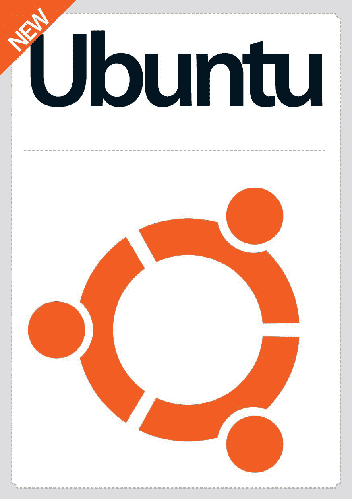


欢迎来到

许多想从 Windows 迁移到 Linux 发行版的人选择 Ubuntu 作为他们的第一步。它通过 Unity 提供了一个整洁、吸引人的图形化用户界面（GUI），并且具有极高的易用性。它是学习命令行和创建更具定制性的工作区的完美环境。同时，你仍然可以获得在 Windows 和其他桌面系统中熟悉的许多优势。本书将介绍 Ubuntu 的美妙与强大。从默认软件到从软件中心下载的最佳开源软件（FOSS）应用程序，我们将带你浏览顶部的程序和应用，很快你就能熟练使用 Ubuntu 了。


出版总：Aaron Asadi
设计主管：Ross Andrews
总编辑：Jon White
制作编辑：Fiona Hudson
高级艺术编辑：Greg Whitaker
设计师：Perry Wardell-Wicks
摄影师：James Sheppard


...的一部分


## 了解 Ubuntu
许多想从 Windows 迁移到 Linux 发行版的人选择 Ubuntu 作为他们的第一步。它通过 Unity 提供了一个整洁、吸引人的图形化用户界面（GUI），并且具有极高的易用性。它是学习命令行和创建更具定制性的工作区的完美环境。同时，你仍然可以获得在 Windows 和其他桌面系统中熟悉的许多优势。本书将介绍 Ubuntu 的美妙与强大。从默认软件到从软件中心下载的最佳开源软件（FOSS）应用程序，我们将带你浏览顶部的程序和应用，很快你就能熟练使用 Ubuntu 了。

这种免费的开源操作系统在近年来获得了巨大的动力。它是一个易于使用的操作系统，遍布世界角落。最棒的是，它对硬件非常友好，你可以将其安装在三四年前的电脑上，且运行流畅。它拥有社区和专业支持，Ubuntu 适用于桌面和服务器。但不仅如此：Ubuntu 无处不在。几乎所有的电脑制造商都在出基于 Ubuntu 的型号。

Ubuntu 运行良好。很少其他 Linux 发行版能提供同样的长期支持。它非常上手，即使你来自 Windows 世界（见图 1）。Ubuntu 非常稳定。对于大多数用户来说，开箱即用。

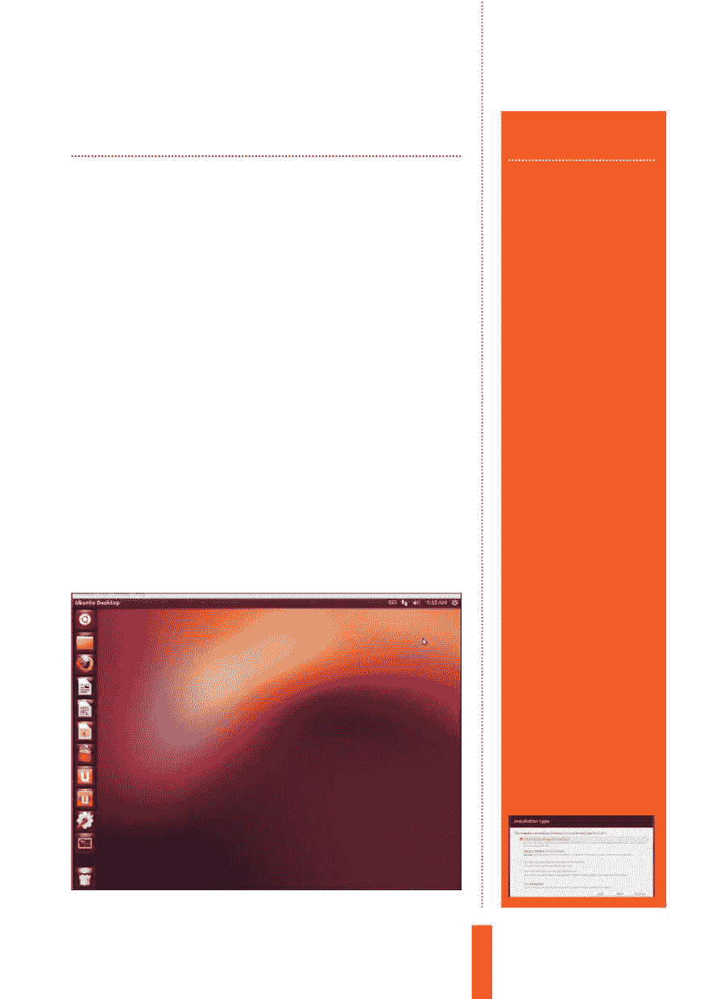
## 入门
## 了解 Ubuntu
01 如果使用 DVD，请将 DVD 插入驱动器并重启电脑。电脑随后将从移动介质启动，然后你选择语言。还会有安装 Ubuntu 或从 DVD 尝试的选项。

02 如果你想使用 U 盘，请注意最新的电脑可以从 U 盘启动。在这里你也将看到一个欢迎界面，提示你选择语言并提供安装 Ubuntu 或从 U 盘尝试的选项。

03 无论使用 DVD 还是 U 盘，下一步都是选择你的首选语言，然后点击“尝试 Ubuntu”。你的实时桌面将会出现（如左图所示，见图 2）。

04 最后，当你准备好安装 Ubuntu 时，只需双击桌面上的图标：“安装 Ubuntu 16.04 LTS”。

**在安装之前尝试 Ubuntu**
## 现场启动和虚拟机
开始学习 Ubuntu 的简单方法之一是创建启动 U 盘、CD 或 DVD。将 Ubuntu 放入其中后，你可以将 U 盘或光盘插入任何电脑，然后重启它。电脑随后将从移动介质启动，你可以在不对硬盘进行任何更改的情况下使用 Ubuntu。

你可能想如何创建启动 Ubuntu U 盘或光盘。为此，你可以从 Ubuntu 网站下载最新的 Ubuntu 磁盘镜像。使用 UNetbootin 工具将 Ubuntu 放入 U 闪存盘或将下载的 ISO 镜像刻录到光盘。你现在只需要从提供的移动介质重启电脑，并选择“尝试 Ubuntu”选项即可。


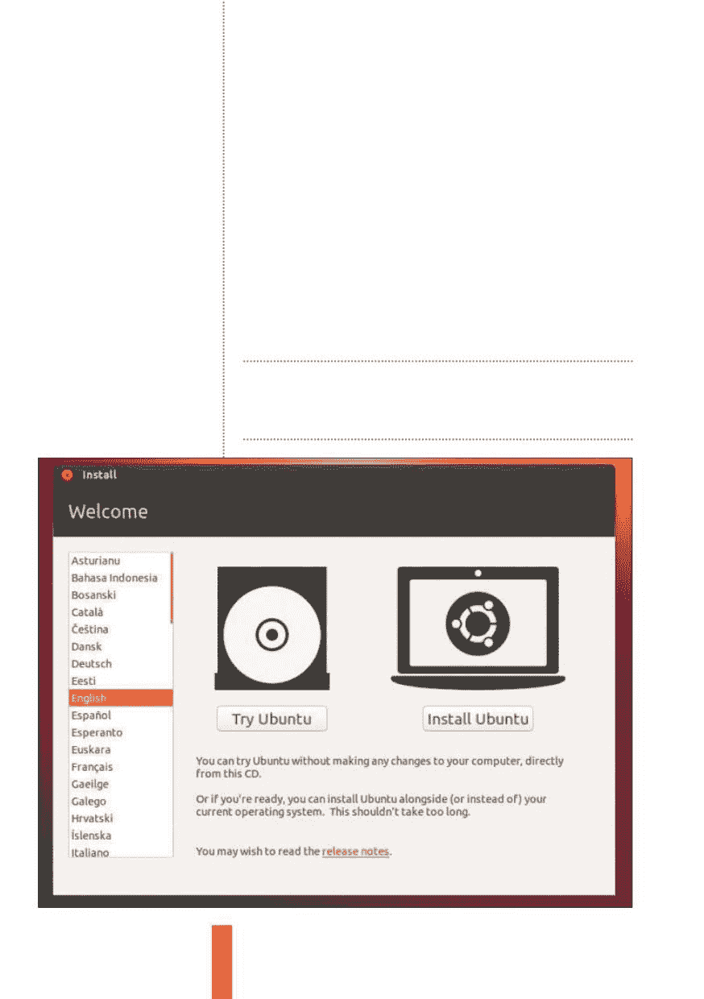

**入门指南**

了解 Ubuntu

与其他任何操作系统一样，Ubuntu 也可以在你计算机的虚拟机中运行。通过这种方式，你甚至无需重启电脑就可以尝试 Linux，尽管你应该注意，虚拟机运行的速度比直接在电脑本身上运行操作系统要慢。

要创建一个 Ubuntu 虚拟机，你首先需要下载并安装 VirtualBox。使用它创建一个新的虚拟机，选择 Ubuntu 操作系统，并在提示时提供你从 Ubuntu 官网下载的 ISO 文件。

安装过程非常直观易懂，你可以在虚拟机中进行安装，其操作方式就像在在真实电脑上安装 Ubuntu 一样。

“你甚至无需重启电脑就可以尝试 Linux”

**图 3（下方）** 安装 Ubuntu 或使用试用版尝试

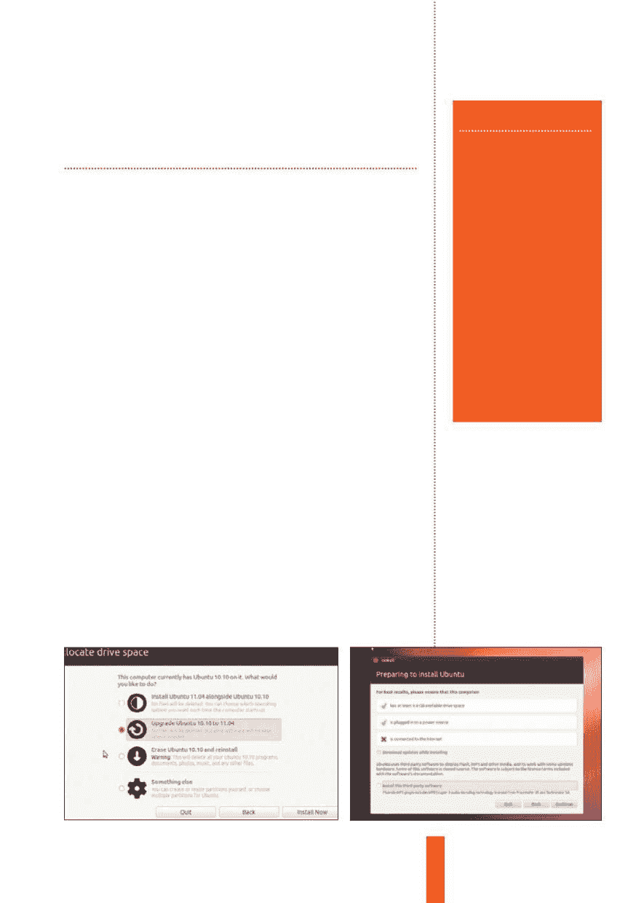

**入门指南**

了解 Ubuntu

采用正式版本

新版本每六个月发布一次，并提供18 个个月的支持

如前所述，Ubuntu 是一个非常流行的 Linux 发行版，拥有多年的经验和庞大的用户群。在熟悉 Ubuntu 的基础内容后，是时候查看 Ubuntu 的正式版本了。在开始使用 Ubuntu 之前，你需要获取 Ubuntu 安装镜像。此外，你必须确保你的系统满足最低要求。获取 Ubuntu 最常用的方法是直接从官网 ubuntu.com/download 下载 Ubuntu DVD 镜像。要下载并安装它，你只需要选择你需要 32 位还是 64 位版本，然后点击“开始下载”。

理解 Ubuntu 提供的两个版本很重要：32 位和 64 位。它们在计算机处理信息的方式上有所不同。因此，如果你的电脑拥有 64 位处理器，你需要安装 64 位版本。另一方面，如果你使用的是较旧的电脑，或者不知道电脑处理器的类型，建议选择安装 32 位版本。

虽然安装 Ubuntu 需要 5GB 的硬盘可用空间，但建议准备 15GB 或更多。这意味着你有足够的空间安装额外的应用程序，以及存储你自己的文档、音乐等。

如果你连接了网络，安装程序现在会询问你是否想要“在安装时下载更新”。强烈建议执行此步骤。

在 Ubuntu 安装过程中，连接网络非常重要。如果你没有连接网络，安装程序会要求你选择无线网络（如果有）。在这种情况下，你可以按照以下三个步骤操作……

- **01** 选择“连接到此网络”并从列表中选择你的网络。
- **02** 在“密码”字段中输入你路由器的 WEP 或 WPA 密钥。
- **03** 然后点击“连接”继续。

网络连接

**图 4（下方）** 确保在安装前有可用磁盘空间


**入门指南**

了解 Ubuntu

Ubuntu 安装程序将自动检测机器上已安装的任何操作系统，并提供适用于你系统的安装选项。请注意，以下选项完全取决于你的特定系统，并非所有选项对你都可用：

- 安装 Ubuntu
- 不安装直接尝试 Ubuntu
- 与其他操作系统并存安装 Ubuntu
- 其他

在上述四个选项中，首选的是“将 Ubuntu …… 升级到 16.04”。这是因为该选项允许你保留电脑上所有珍贵的文档、音乐、图片和其他任何个人文件。已安装的软件将尽可能保留，但系统级设置将被清除。

如果你想擦除整个磁盘，可以使用“擦除磁盘并安装 Ubuntu”选项。如所预期，这将删除该磁盘上安装的任何现有操作系统，并在其位置上安装 Ubuntu。

当你选择“其他”选项时，你可以在安装 Ubuntu 之前根据需要配置分区。

这里需要注意的是，为了缩短安装时间，用户配置所有重要的用户细节（如用户名、密码、键盘设置、默认时区等）时，Ubuntu 会在后台继续安装过程。

Ubuntu 安装

你可以与另一个操作系统并存安装 Ubuntu 或替换它

“在成功安装 Ubuntu 后，你可能还想加密你的主文件夹。这花费的时间很少且非常直观。这被认为是在你进一步操作之前的一个重要步骤”


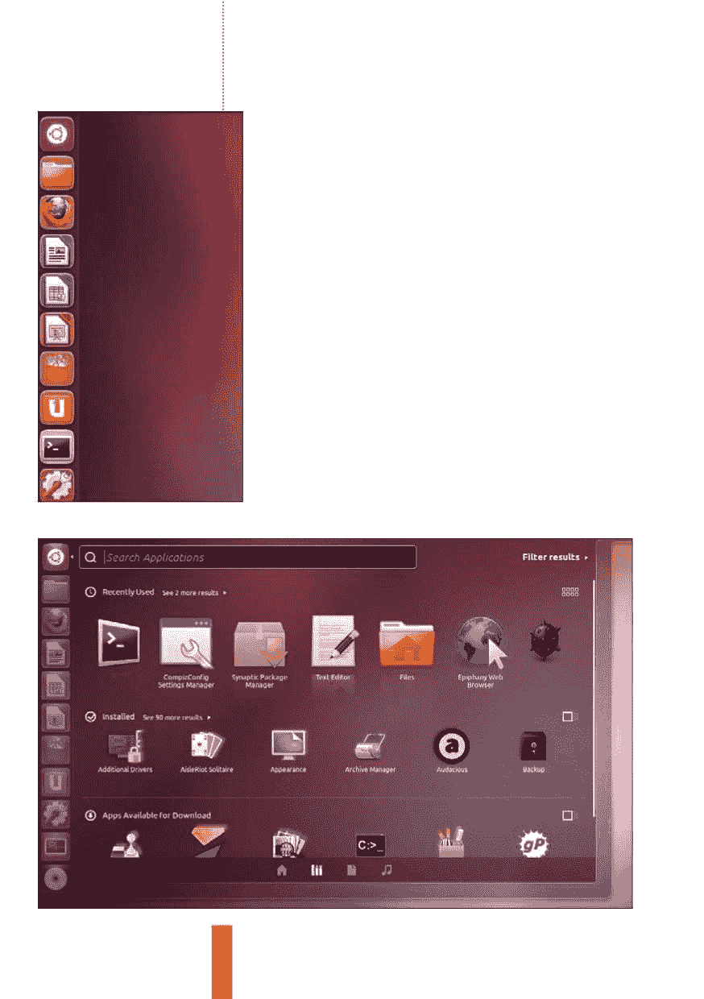

## 入门
## 了解 Ubuntu


例如，某些程序在安装期间会自动在指示器区域添加图标。你应该注意，每个应用程序都有其自己的菜单系统，你可以在其中执行不同的操作（如文件、编辑、视图等）。相应地，应用程序的菜单系统被称为应用程序菜单。

在 Ubuntu 中，我们需要理解的另一点是“启动器”（Launcher）——即位于桌面左侧的垂直图标栏（图 6）。通过这个启动器，用户可以轻松访问各种应用程序、挂载设备和垃圾箱。请注意，任何运行中的应用程序其图标都会放置在启动器栏中。

在 Ubuntu 中，我们经常会遇到被称为“Dash”（活动）的东西。如果你以前使用过 Windows，可以将 Dash 视为类似于 Windows 开始菜单的工具。Dash 会帮助你找到电脑上正在寻找的应用程序和文件。要探索 Dash，你需要点击启动器最顶部的图标。现在，你将看到一个顶部带有搜索栏的窗口，以及最近访问的应用程序、文件和下载内容。

**图 6（上方）** 从启动器运行任何应用程序，只需点击应用程序的图标

**图 7** 输入内容以搜索文件或文件夹，建议结果将出现在 Dash 菜单中

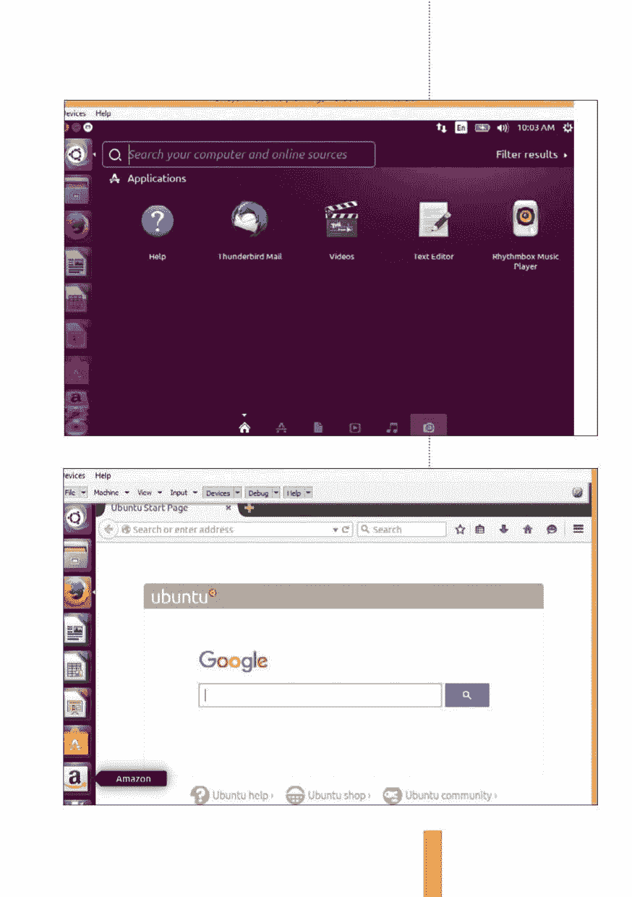

## 入门
## 了解 Ubuntu

**图 8（上方）** 从 Dash 进行计算机和全范围搜索

**图 9（上方）** 导航到浏览器应用进行更高级的搜索

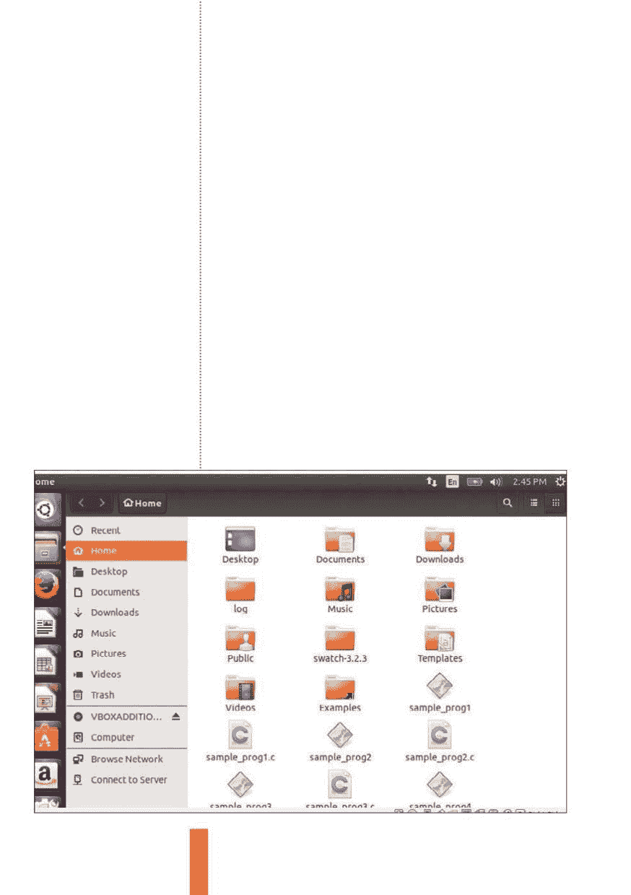

## 入门
## 了解 Ubuntu


如上所述，Dash 是一个非常强大的工具，可用于搜索电脑上的文件和应用程序。只需输入文件或文件夹名称的一部分即可找到文件或文件夹（图 7，第 14 页）。随着你的输入，结果将出现在 Dash 中。

正如预期的那样，标准的 Ubuntu 安装带有许多应用程序，但用户还可以从 Ubuntu 软件中心额外下载数千个应用程序。Dash 上的应用程序视图会将已安装的应用程序自动分类在“最近使用”、“已安装”或“更多建议”下。你也可以在 Dash 的搜索栏中输入应用程序的名称（或其部分），匹配你搜索标准的应用程序名称将会出现（图 8，第 15 页）。即使你不记得应用程序的名称，输入与该应用程序相关的关键词，Dash 也能找到它。

我们在这里需要理解的另一点是，除了搜索本地机器上的文件和应用程序外，Dash 还可以帮助搜索各种在线资源。

现在让我们查看如何浏览电脑上的文件。除了使用 Dash 搜索文件外，用户还可以直接从目录访问它们。主目录（图 10）是

**图 10（下方）** 在主目录搜索电脑上的文件

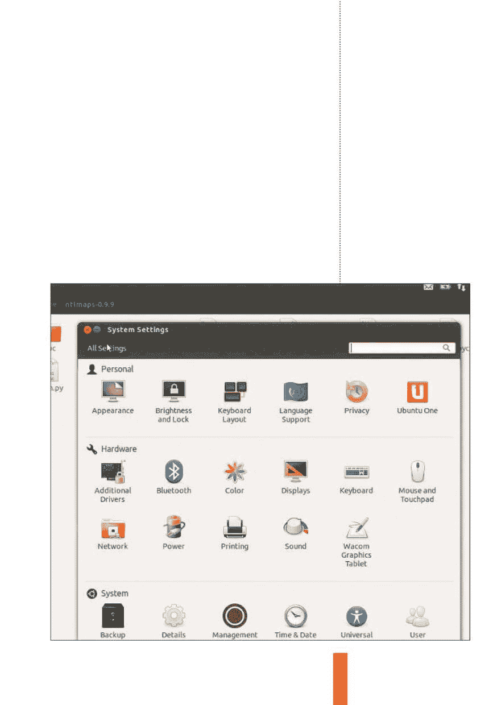

## 入门
## 了解 Ubuntu


用于存储你所有的个人文件（而不是系统相关文件）。有时，你可能需要使用“文件”文件管理器窗口。每当你选择启动器中的“文件”快捷方式时，Ubuntu 就会打开此文件管理器。

正如对面的截图所示，此窗口具有以下功能：

- **菜单栏**：位于屏幕顶部。通过此菜单栏，用户可以浏览并删除书签、打开新窗口、连接到服务器、退出等。
- **标题栏**：指示当前所选目录的名称。
- **工具栏**：显示你在文件系统中的位置、搜索按钮等。

**图 11（下方）** 大多数自定义选项均在“系统设置”菜单中可用


## 入门
## 了解 Ubuntu


Ubuntu 使用 Linux 文件系统，它基于根目录下的系列文件夹。这些文件夹包含重要的系统文件，除非你以 root 用户身份运行或使用 `sudo` 命令，否则无法进行修改。由于这种限制，电脑病毒将无法更改核心系统文件，普通用户也无法意外更改任何关键内容。

Ubuntu

有时，你可能需要自定义你的桌面。大多数自定义可以通过会话指示器实现，然后选择“系统设置”来打开设置窗口（图 11，第 17 页）。

理解终端

尽管 Ubuntu 提供了图形用户界面（GUI），但为了充分利用操作系统的功能，你需要理解命令行界面。任何操作系统都有两种类型的用户界面：

- **GUI**：这是你点击以完成任务的桌面、窗口和工具栏。
- **命令行界面 (CLI)**：终端被称为 CLI。它是一种通过在键盘上输入命令来控制 Ubuntu 某些方面的方法。

可以通过按下 Alt+Ctrl+T 或在桌面上右键点击并选择“终端”来打开终端。请注意，终端中的所有命令都遵循相同的方法：你输入命令，可能带有某些参数，然后按下回车键以执行指定的操作（图 12）。

!(/a6bf9da4751f37b25a0d6611dc73918d_18_0.png)

## 入门
## 了解 Ubuntu

**19**

Ubuntu 被认为是安全的，主要归功于以下原因：

- 像 Ubuntu 这样的开源软件发布快速。
- 安全漏洞可以被轻松检测。
- 理解文件权限、密码和用户账户等概念也有助于保护电脑安全。

故障排除任务：如果你在使用 Ubuntu 时遇到任何困难，你可能需要使用终端。如果你需要对多个文件执行操作，终端是首选方法。

Ubuntu 提供了默认安装的各种文本编辑器。最常用的命令行编辑器称为 Vim。下表提供了关于 Ubuntu 中一些重要文件的简要信息。

| 文件 | 简要描述 |
| :--- | :--- |
| /etc/issue | 操作系统的信息 |
| /etc/apt/sources.list | Ubuntu 的软件源位置 |
| /usr/share/tomcat | tomcat 文件的路径 |

**图 12（上方）** 使用终端通过命令行执行操作


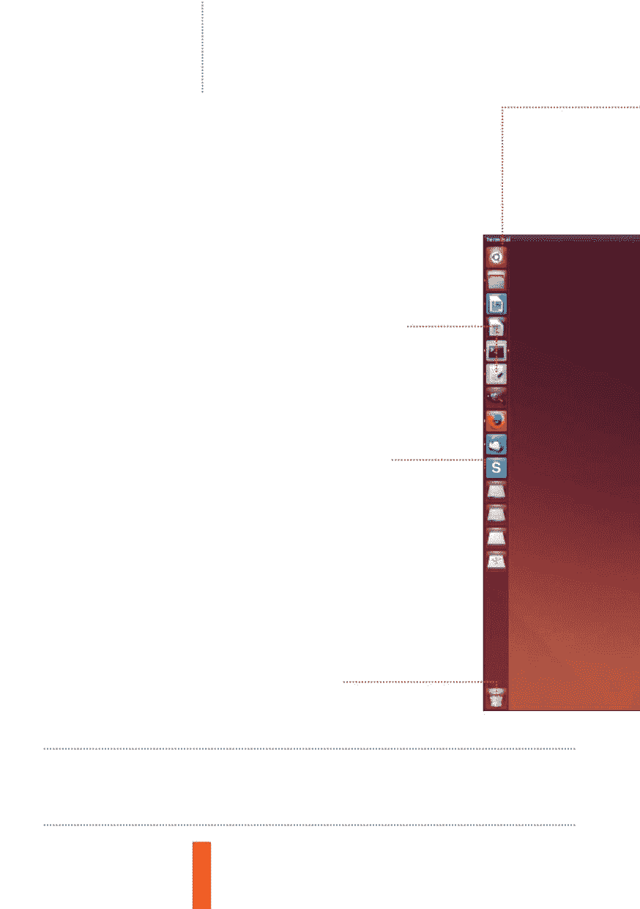

## Ubuntu 基础
### 导航 Ubuntu 桌面


在直观且迷人的 Ubuntu 桌面界面 Unity 上找到你所需的一切。当 Ubuntu 首次引入 Unity 桌面时，一些用户威胁要回到 Windows Vista。但随着时间的推移，该桌面变得更加可靠：截至 12.04 LTS 版本，已经没有理由不喜欢 Unity 了。Unity 起初是一个研究产品，试图创建一种更适合超级笔记本（netbooks）的 GUI：它们极宽的显示器对于为使用标准 4:3 显示器的工作站而设计的传统桌面管理器效果并不特别好。这解释了界面上的两个重要变化：首先，启动器（Launcher）被移动到屏幕侧边以保留宝贵的垂直空间。其次，不同应用程序的菜单栏被组合到一个顶栏中，该顶栏始终用于当前启用的应用程序。这是你在易用性方面与 Windows 及其他发行版发现的主要区别之一，但随着时间的推移，你会习惯的。虽然熟悉 Unity 可能需要用户花费一些时间，但放心，你最终会发现它是完全值得的。

> “Unity 起初是一个研究产品，试图创建一种更适合超级笔记本的 GUI”

### 垃圾桶 
垃圾桶就在你预期的地方，它在快速启动栏的底部始终可见。

### 查看应用状态
所有运行中的应用程序都显示在 Dash 图标下方。图标左侧的箭头可以让你知道当前打开的窗口数量。在双屏工作站上，此处的“空”箭头表示窗口不在显示此特定版本工具栏的显示器上。

### 快速启动应用
右键点击运行中的应用程序图标以打开短菜单。在可用选项中选择“锁定到启动器”（Lock to Launcher），可以确保该图标始终保留在栏中，以便快速访问特定应用程序，即使它当前没有运行。

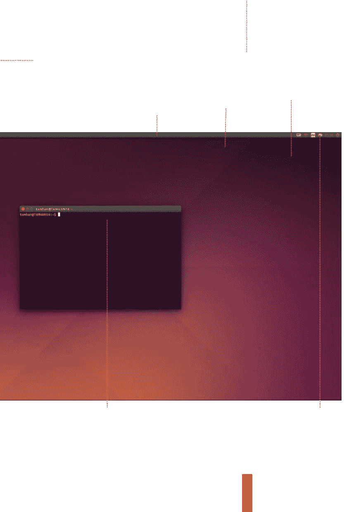

## Ubuntu 基础
### 导航 Ubuntu 桌面


### Dash（启动器）
Unity 的启动菜单是键盘驱动的，通过这种方式打开它可以节省时间。熟练的用户会使用键盘上的 Windows 键打开它。通过输入几个描述你正在查找的应用的字符，你可以获得真正的生产力提升，例如在按下 Windows 键后输入‘Thun’，几乎可以确保 Thunderbird 图标出现在应用程序列表的正中间。

### 菜单栏
将鼠标光标移动到屏幕最顶部即可启用菜单显示。这对于辅助功能来说是一个非常有用的工具，因为完成此操作所需的灵活性要求较低。只需将光标滑向屏幕顶部，让 Unity 处理任何超出部分即可。

### 壁纸
与几乎任何其他发行版或操作系统一样，你的壁纸是你施加个人印记的空白画布。不过，Ubuntu 提供的默认也不错。

### 状态菜单
Ubuntu 将显示符号来提醒你正在发生或需要你注意任何事件和/或重要的系统状态变化。当这些图标出现时，点击任何一个即可显示短菜单，提供有关当前情况的更多选项。

Unity 自带了一组实用的键盘快捷键，可以提高效率并更快地完成任务。按住 Windows 键可以在屏幕中间显示当前激活的快捷键列表。

### 活跃工作区
正中心是你正在工作的窗口。要在不关闭当前窗口的情况下切换到另一个窗口，只需点击或搜索你下一个要打开的应用即可。如果悬停在窗口顶部，可以将其最小化——经典的三个按钮将出现，提供关闭、最小化或最大化的选项。请注意，点击关闭选项意味着你需要重新启动程序。

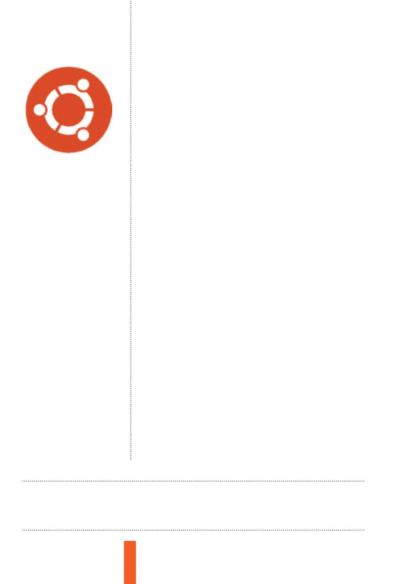

## Ubuntu 基础
### 与 Ubuntu 的双启动


### 双启动
在现有的 Windows 安装系统旁运行 Ubuntu

大多数想要尝试 Ubuntu 的用户已经拥有了安装有 Windows 系统的桌面电脑或笔记本电脑。Ubuntu 可以与 Windows 并排安装，两个系统将良好地共存，互不干扰。

Ubuntu 的安装向导有一个高级选项，你可以信任安装程序自动收缩 Windows 分区并创建 Ubuntu 分区，也可以手动进行。

如果你选择手动方法，安装程序将提供一个专门的分区划分阶段。首先，你需要调整 NTFS 卷的大小并将其缩小几个 GB。确保 Windows 中没有过度的磁盘碎片，否则你可能会导致 Ubuntu 安装程序中的 NTFS 卷变得不可用。尝试猜测收缩后在未分配区域需要多少空间。例如，10GB 看起来是最低限——Ubuntu 根分区至少留出两倍的空间。提前考虑交换分区（swapping）和 /home 独立分区等因素。

安装程序会将 GRUB 引导程序安装到旧系统的主引导记录（MBR）或现代系统的 GPT 中。Ubuntu 还支持许多现代设备上的安全启动（Secure Boot）。安装完成后，你将看到一个菜单，每次启动时可以在 Ubuntu 和 Windows 之间进行选择。

> “Ubuntu 可以与 Windows 并排安装，两个系统将良好地共存”

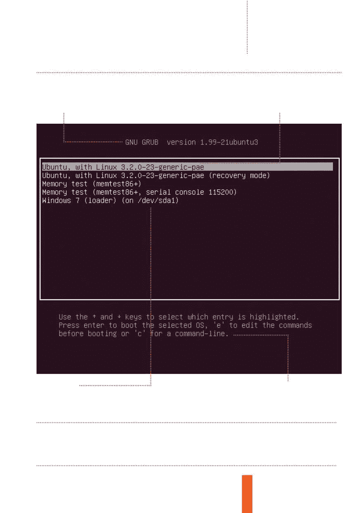

## Ubuntu 基础 
### 与 Ubuntu 的双启动


### 双启动
敢于尝试手动设置

Ubuntu 的安装程序在过去几年经过了改进，现在看起来非常流畅。在完成基本步骤（如选择语言）后不久，用户将面临第一个真正的障碍：“安装类型”步骤。如上所示，Ubuntu 已自动检测到你的操作系统以及如何保持其完整（图 1）。在这里，你可以让安装程序自动决定你想为 Ubuntu 分配多少空间。注意带有红色标签的第二个选项——我们将安装 Ubuntu 并保持 Windows 正常运行，所以不要选择这个。最后一个选项是更像专家级的磁盘分配路径。在 UEFI 模式下双启动为 Ubuntu 安装程序引入了更多程序。如果你不确定选择什么，请选择自动模式。如果你的系统使用 BIOS，你可以手动对硬盘进行重新分区。

### Windows
自动分区选项对于非熟练用户绝对更舒服，但它确实有局限性，例如无法添加额外的 Home 分区或手动定义交换空间。让我们通过在上一步中选择“其他”（Something else）选项来使用完整的分区方法。首先，你需要调整 NTFS 卷的大小并将其缩小几个 GB。确保 Windows 中没有过度的磁盘碎片，否则你可能会导致 Ubuntu 安装程序中的 NTFS 卷变得不可用。尝试猜测收缩后在未分配区域需要多少空间。例如，10GB 看起来是最低限——Ubuntu 根分区至少留出两倍的空间。提前考虑交换分区和 /home 独立分区等因素。

### 发现 GRUB 的力量
安装程序会将 GRUB 引导程序安装到旧系统的主引导记录（MBR）或现代系统的 GPT 中。Ubuntu 还支持许多现代设备上的安全启动（Secure Boot）。安装完成后，你将看到一个菜单，每次启动时可以在 Ubuntu 和 Windows 之间进行选择。

### 默认入口
自动分区选项对于非熟练用户绝对更舒服，但它确实有局限性，例如无法添加额外的 Home 分区或手动定义交换空间。

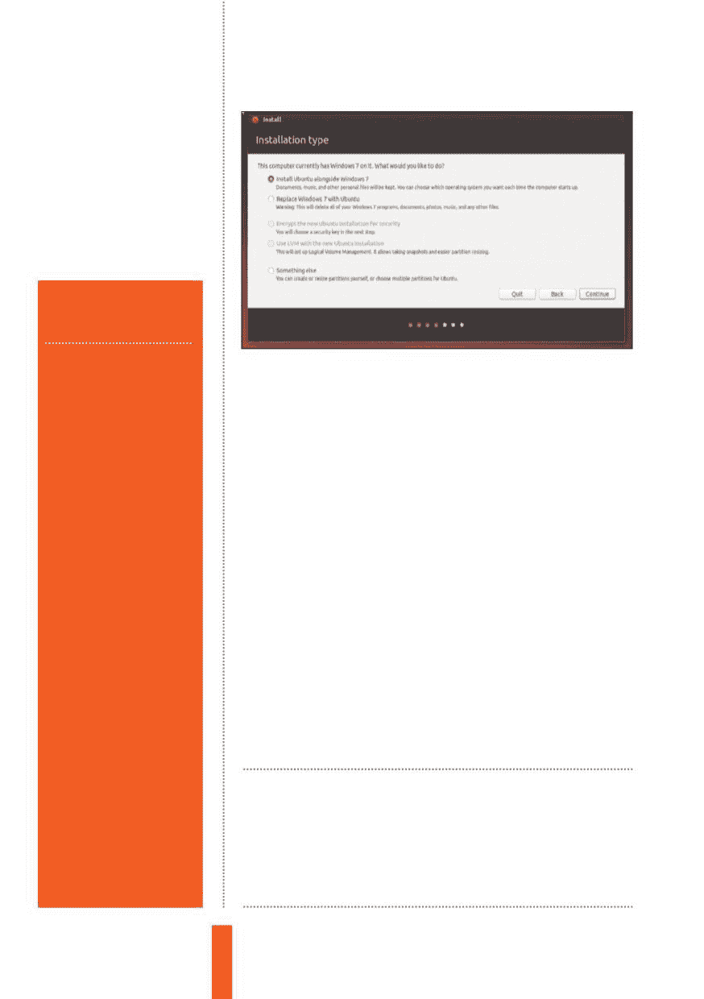

## Ubuntu 基础 
### 与 Ubuntu 的双启动


### 双启动
结识 GRUB
Ubuntu 的安装程序在过去几年经过了改进，现在看起来非常流畅。在完成基本步骤（如选择语言）后不久，用户将面临第一个真正的障碍：“安装类型”步骤。如上所示，Ubuntu 已自动检测到你的操作系统以及如何保持其完整（图 1）。在这里，你可以让安装程序自动决定你想为 Ubuntu 分配多少空间。注意带有红色标签的第二个选项——我们将安装 Ubuntu 并保持 Windows 正常运行，所以不要选择这个。最后一个选项是更像专家级的磁盘分配路径。在 UEFI 模式下双启动为 Ubuntu 安装程序引入了更多程序。如果你不确定选择什么，请选择自动模式。如果你的系统使用 BIOS，你可以手动对硬盘进行重新分区。

> “Ubuntu 可以与 Windows 并排安装，两个系统将良好地共存”

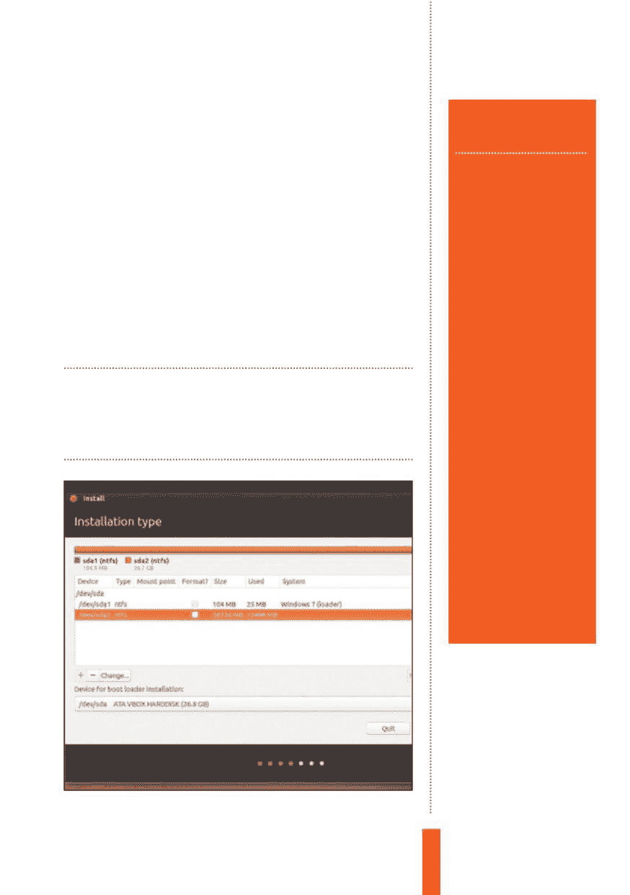

### 默认入口
自动分区选项对于非熟练用户绝对更舒服，但它确实有局限性，例如无法添加额外的 Home 分区或手动定义交换空间。

**图 1（上文）** 安装类型已自动检测到你的操作系统


## Ubuntu 基础

### 与 Ubuntu 双系统启动

为引导程序选择目标驱动器

只有当你的电脑内部或连接了多个硬盘时，你才需要关注此选项。否则，如果你之前在 Windows 桌面级电脑或笔记本电脑上安装过自定义操作系统，你可能会发现熟悉此选项也很有用。首先，为了能够正确启动，Ubuntu 需要一个安装妥当的 GRUB 引导程序。你可以将其安装在硬盘（例如 /dev/sda）或驱动分区（例如 /dev/sda3）上。如果你使用的是较现代的 UEFI/安全启动（Secure Boot）设置，Ubuntu的行为会有不同：它会在 /dev/sda1 上安装 GRUB2-EFI（这是一个 FAT32 分区），并将其挂载为 /boot/efi。此外，还将通过 `efibmgrmgr` 工具在你的电脑 UEFI 内部创建一个特殊的加载程序条目。不过不用担心，Ubuntu 会自动完成所有这些操作。

许多关于 Linux 安装的旧文章强烈建议用户创建一个大小为内存容量两倍的交换分区（例如，如果你有 1GB 内存，则设置为 2GB）。然而，现代计算机通常拥有更大的内存，因此这条规则已不再那么重要了。尽管如此，除非你觉得真的需要，否则你可以完全不需要交换分区。Ubuntu 中为家目录设置的独立分区是另一个需要考虑的方面。如果你选择单一根分区，这意味着你所有的个人文件和设置将与系统的其他部分保留在一个分区（/）中，就像你在 Windows 中只有一个 C 盘来存储所有内容一样。有时创建另一个分区并将其挂载为 /home 更为明智——这意味着即使你将来决定重新安装或删除 Ubuntu，你的文件和设置也不会丢失。

创建 Ubuntu 分区 “如果你选择单一根分区，这意味着你所有的个人文件和设置将与系统其他部分保留”

**图 2（上方）** 在硬盘或驱动分区上安装 GRUB 引导程序

### 自定义桌面

更改桌面设置并为 Ubuntu 的外观增添个性化色彩

Ubuntu 的默认桌面环境称为 Unity。它为用户提供了一个一致且易于使用的图形界面，用于执行日常任务。默认设置非常简单，基于对人们认为舒适和直观的功能的研究。然而，由于有许多人具有不同的品味，Unity 允许根据用户的喜好自定义所有核心功能，如桌面的外观和行为。

这是通过外观与感觉（Look and Feel）设置、本地化、输入选项以及隐私相关的设置来实现的。上述某些不会影响 Ubuntu 的行为——例如各种美学设置（主题、图标），但有些则会。

值得提到的是，有时人们需要对 Ubuntu 安装进行更精确的控制，并需要一些开箱即 Ubuntu 未包含的额外功能。因此，有不同的方法通过命令（`$ gsettings`）甚至独立的调优工具（例如 `Unity-tweak-tool`）来绕过限制。这些额外工具允许你更改高级设置，如字体、窗口控制位置、桌面效果等。接下来，你可以了解如何更改最常用的设置并解决经常出现的问题。

**01** 任务栏面板或启动器（Launcher）运行良好，但有时你可能需要移除一些默认图标并添加你喜欢的应用程序。要移除图标，请右键点击它并选择“从启动器中解锁”选项。要向任务栏添加应用程序，你首先需要在 Dash（活动）中找到它，并将其拖动到任务栏上的所需位置。你也可以拖动并重新排列任务栏上的现有图标。使用系统设置中的“外观>外观”部分来更改任务栏图标大小。如果你将其调小，就能容纳更多图标，这对于小屏幕很有帮助。此外，检查“行为”选项卡以查看自动隐藏选项、启用多个工作区等设置。

调整启动器

### Unity 调优工具

它并非内置，但在 Ubuntu 标准仓库中可以获取。通过命令 `$ apt-get install unity-tweak-tool` 获取它

### 外观设置

在这里你可以单独更改 GTK 样式、窗口装饰主题和字体，更改鼠标光标外观，并移动窗口按钮

### 更改特定设置

Unity 由许多不同元素组成，包括位于右侧的主任务栏、带有搜索功能的活动菜单（Dash）、顶部面板以及任务切换器

### 系统设置

Unity 调优工具提供了高级设置，例如启用桌面图标、安全措施、滚动条控制以及鼠标行为

### 窗口管理器

有方法可以更改 Unity 中窗口管理器的行为。阴影、透明度、动画、热点吸附、聚焦规则等

### Ubuntu 的注册表编辑器

使用命令 `$ apt-get install dconf-editor` 安装设置管理器。它的类似于 Windows 的注册表编辑器，允许你调整许多隐藏设置

### 默认壁纸

你可以在系统设置的“外观”部分中，将默认 Ubuntu 壁纸设置为你喜欢的照片（或绘画）

### 更改主题

这定义了各种 UI 控件的外，包括按钮、滚动条、菜单背景、窗口装饰等许多细节

“由于有许多人具有不同的品味，Unity 允许根据用户的喜好自定义所有核心功能，如桌面的外观和行为”

调整桌面设置 使用 Ubuntu 系统设置中的相关部分

图 1（上方）你可以使用热点优化你的 Ubuntu 

**03** 更改界面主题可以极大改变工作体验。这是完全安全的：你没有改变桌面的工作方式，只是改变它的外观。默认情况下，Ubuntu 带有三个主题：Ambiance（默认）、Radiance（浅色）和 High Contrast（针对视觉障碍人士）。你可以通过命令行安装新主题（例如添加包含主题的 PPA 并安装其程序包），或从 gnome-look.org 等网站手动下载主题。Ubuntu 会在系统级的 /usr/share/themes 目录以及家目录下的 `~/.themes` 中查找主题。

更改外观与感觉

- Ubuntu 了一些收集用户数据和收集统计信息的机制——当然，这完全是为了未来 Ubuntu 版本的易用性。有些人觉得这种行为有争议，所以让我们稍微调整一下。在系统设置>安全与隐私中，转到“文件与应用程序”选项卡，取消勾选或完全关闭文件和应用程序使用统计。在“搜索”选项卡中，你可以开启或关闭 Unity Dash 中的在线搜索结果。例如，如果你在寻找本地应用时不喜欢购物建议，只需将其关闭即可。

更改隐私设置


## Ubuntu 基础

### 使用热点

Unity 桌面允许你将操作分配到屏幕的任何角以及任何侧边。为了实现这一点，我们需要访问高级窗口管理器设置。启动 Unity Tweak Tool，并进入“窗口管理器（Window Manager）>> 热点（Hotcorners）”。共有八个区域（四个角和四个侧边），每个区域旁边都有下拉菜单，让你选择当鼠标移动到屏幕相应区域时执行何种操作。你可以将某个角或某个侧边设置为切换桌面（例如，最小化所有窗口或恢复它们）、平铺窗口或显示工作区。所有更改将立即生效，你可以通过将鼠标移动已分配操作的角或侧边来检查。

## 管理指示器

“系统托盘”区域位于顶部栏的最右侧。某些指示器可以单独配置，但若要获得更多控制权，你需要处理 dconf-editor（图 2）。这个双面板应用程序左侧有类别列表，右侧是内容，允许你调整 Unity 指示器的属性。前往 com>canonical>indicator 并探索每个项的参数。你可以通过切换“visibility（可见）”参数来开启或关闭顶部栏上的指示器显示，并通过调整“show-\*”参数来更改指示器的显示格式。这样你就可以保持系统托盘区域的整洁。

“通过将鼠标移动到已分配操作的角或侧边来检查热点是否生效”

**图 2** 使用 dconf Editor 获取更多自定义控制权

## 定制桌面

发现系统设置
发现系统详情、管理用户账户并配置硬件

“系统设置”应用程序包含了各种设置，其工作方式与 Windows 中的控制面板相同。你可以从顶部栏最远端的指示器启动系统设置，甚至从命令行启动（$ unity-control-center）。当然，这里的系统相关设置并不是更改此类设置的唯一地方，但它是执行这些操作最方便、最安全的地方。在 Linux 中（Ubuntu 也不例外），系统设置可以通过编辑 /etc 目录下的配置文件，或者在 root 权限下执行某些命令来更改。虽然这些方法在 Ubuntu 中有效，但它需要高级技巧，并且有时会给你的 Linux 安装带来风险。Ubuntu 中的系统设置外壳包含数量有限但设计精美的项目，可以帮助你轻松以最小的技能管理基础的系统相关设置。“系统（System）”子部分包含备份、系统详情、Landscape 服务、软件源、时间和日期、辅助功能和用户账户的设置。上述某些适用于企业 Ubuntu 用户（例如技术支持的付费订阅，称为 Landscape），而其他设置将在单独的章节中详细介绍（备份、时间与日期等）。本概述重点关注“详情”和“用户账户”，以及某些硬件相关的设置。

“Ubuntu 中的系统设置外壳包含数量有限但设计精美的项目，可以帮助你轻松以最小的技能管理基础的系统相关设置”

## 导航

它并非默认包含，但在标准的 Ubuntu 在线存储库中即可可用。使用 $ sudo apt-get install unity-tweak-tool 获取它。

### 个人设置
这里的大多数设置都是针对特定用户的。你也可以在此更改外观和感觉设置、调整隐私、管理在线账户等。

### 硬件设置
你可能设置额外的外设、输入设备、更改电源设置，甚至为打印机和显示器管理色彩配置文件

### 搜索设置
如果你找不到所需的设置但知道它的名称，请将其输入搜索栏，查看系统设置如何根据你的输入实时过滤结果。

### 系统相关设置
备份、系统详情、更新和软件源、辅助选项、时间和日期等，都可以在此类别中管理。

查看重要的子部分

## 配置你的 Ubuntu 安装

探索系统详情并更改某些默认值

有时你需要了解更多关于你的 Ubuntu 版本的信息。它是 32 位还是 64 位的？你的电脑中有多少内存？为了防止你迷失方向，系统设置中有一个专门的“详情（Details）”子部分。“详情”屏幕显示了系统的摘要，包括 CPU、内存、显卡驱动、硬盘卷等。你还可以通过右侧的“更新（Updates）”按钮更新系统。在“详情”中，你可以更改默认浏览器、邮件客户端、音乐播放器或图像查看器。同样，在“可移动媒体（Removable Media）”标签页上，你可以定义插入光盘（CD/DVD）时 Ubuntu 应该做什么。再次，所有更改将立即生效。

“有时你需要了解更多关于你的 Ubuntu 版本的信息。它是 32 位还是 64 位的？你的电脑中有多少内存？为了避免迷失方向，请前往系统设置”

**图 1** 在系统设置中查看详情

### 调整电源设置

这些设置主要影响笔记本电脑用户，也有助于优化能耗。在系统设置的“硬件（Hardware）”类别下，前往“电源（Power）”并使用第一个下拉菜单设置闲置时间——这是电脑进入挂起的时间。第二个选项允许你禁用电池指示器等。另一个与电源相关的可调项是屏幕亮度。你可以点击“电源”标签页上的链接，也可以直接打开“亮度与锁定（Brightness & Lock）”子部分。在这里你可以设置一个闲置时间，之后显示器将自动关闭电脑将锁定。你可以定义用户是否需要提供以前设置的密码来解锁电脑。

管理 Ubuntu 用户

如果你的电脑主要作为私人或个人使用，可能你需要创建另一个用户。这些在“用户账户（User Accounts）”子部分进行管理。默认情况下，你只能看到列表和设置，无法更改任何内容。要添加或删除用户，必须点击“解锁（Unlock）”按钮并输入 root 密码。之后你可以点击屏幕左下角的“+”和“-”按钮，查看其他用户的活动日志（历史记录按钮）并切换它们的自动登录。

设置打印机

Ubuntu 会自动检测并配置本地打印机，前提是它拥有相应的驱动程序。大多数消费级打印机在 Linux 中都可以顺利运行，因此如果你打开“打印机（Printers）”子部分，你应该能看到已配置打印机的图标。你可以编辑打印机偏好、更改其驱动程序，或者为同一台打印机创建多个具有不同设置的实例。点击“添加”并按照并设置本地或远程打印机——大部分操作是自动的（图 2）。如果你需要更多控制权或想解决打印问题，使用 $ sudo service cups restart。这是重启 Ubuntu 系统级打印服务的命令。如果想使用功能丰富的 CUPS 管理界面，请在浏览器中尝试 http://localhost:631。请注意，所有打印机设置更改都需要 Ubuntu 系统的 root 密码。

**图 2（上方）** Ubuntu 应该自动检测本地和网络打印机


## 调整您的安全设置

确保您的 Ubuntu 设置提供了适当的隐私保护

隐私是安全计算的基石。您的数据应该受到保护，你的电脑应该防止未经授权的访问，并且您应该意识到从系统发送到远程服务器的个人数据。Ubuntu 在易用性和安全性之间取得了很好的平衡。例如，您无法直接登录 Unity；相反，您实际上可以使用“sudo” 前缀来以管理员的身份运行命令。对于常规桌面活动，有一个“系统设置 > 安全与隐私”子部分，您可以在那里更改许多设置。大多数设置都与密码保护、保留文件和应用程序的日志与历史记录、Ubuntu Dash 中的在线搜索结果，以及 Canonical 用于修复错误和收集用户统计数据的诊断信息有关。您可能想要更改任何内容的原因可能各不相同。也许您不希望别人看到您最近使用过什么，或者可能是 Dash 中的在线搜索结果分散了您的注意力。在 Ubuntu 的系统设置外壳之外，还有另一个安全设置。当您第一次启动 Firefox 时，它会要求您选择想要共享的数据。默认情况下，Firefox 会向 Mozilla 发送崩溃报告和帮助报告，但仍由您决定并批准它们。

### 01 生成更强密码

将您的 Ubuntu 密码设置为 12345678 或 P@ssw0rd 等简单内容没有意义。发明一种独特、复杂、足够长且最重要的是您确定自己不会忘记的符号组合是明智之举。一个良好的密码应该包含小写字母、大写字母、特种字符和数字。幸运的是，Ubuntu 可以通过 APG 工具帮助您更好地处理更强的密码。使用 `$ sudo apt-get install apg` 安装它，并只需运行 `$ apg` 即可。APG 将提示您输入一个自定义的随机单词，然后将您的建议转换为更强的字符组合，但仍然是可读的且不易于背诵，例如 WoudElIc6（Woud-El-Ic-SIX）。


### 02 启用简单的防火墙

防火墙是阻止外部网络入侵的有效工具，通过阻塞 IPv4 和 IPv6 协议中的某些网络数据包，限制双向的可疑网络活动。Linux 有“iptables”工具来执行这项工作，但对初学者来说并不直观。幸运的是，Ubuntu 有一个名为 UFW 的 iptables 易用前端——Ubuntu 防火墙（图 1），位于其标准仓库中。使用以下命令安装：

`$ sudo apt-get install ufw gufw`

您可以从命令行（`$ sudo ufw --help`）或图形界面内（在 Dash 中搜索“firewall”或直接运行 `$ gufw`）来控制它。

### 03 启用自动安全更新

让我们更进一步，让 Ubuntu 在无需与用户交互的情况下接收重要的安全更新。此功能非常有用，因为并不是所有更新都是在您不知情的情况下安装的，只有修复漏洞、严重错误、内存泄漏等的安全相关更新。要启用此功能，首先从安装软件包以及所需的脚本开始：

`$ sudo apt-get install unattended-upgrades.`

接下来，使用以下命令启用更新：

`$ sudo dpkg-reconfigure -priority-low unattended-upgrades.`

您需要做的就是每天/每周/每月将 unattended-grades 命令添加到您的 Cron 列表中。访问 bit.ly/1EtLKFF 查找更多详情。

“一个良好的密码包含小写字母、大写字母、特种字符和数字。幸运的是，Ubuntu 可以帮助您”


**图 1** 启用 Ubuntu 防火墙并调整设置

### 保护您的电脑

如果电脑在空闲一段时间后挂起或关闭显示，您可以设置 Ubuntu 需要密码才能继续使用电脑。

#### 选择包含的内容
在您的主目录内有音乐、图片、下载等默认位置。您可以决定想要将哪些项目项包含在 Ubuntu 日志中。除了目录外，还有聊天日志和办公文档。

#### 相关设置
第一个链接带您进入“用户账户”子部分，您可以在那里更改密码；第二个链接用于“电源设置”，您可以在那里更改系统挂起之前的时间段。

#### 使用活动记录
这是一个触发文件和应用程序使用日志的全局开关。您只需点击鼠标即可将其关闭，或者决定进行更精确的调整。

#### 排除特定目录和程序
使用“+”和“-”按钮选择 Ubuntu 不记录或跟踪的特定目录或应用程序。您甚至可以创建复杂的应用程序组合。

#### 在线搜索结果如何？
这是一个相当有争议的事项，这就是为什么 Canonical 决定在 16.04 中加入关闭模式。您可以随时在此更改触发器的位置。

#### 诊断报告
Canonical 需要您的反馈以便使 Ubuntu 变得更好。如果出现问题（例如程序崩溃），Ubuntu 将向其总部发送包含问题细节报告。

“Ubuntu 在易用性和安全性之间取得了很好的平衡。例如，您无法直接登录 Unity；您可以使用‘sudo’前缀来以管理员的身份运行命令”


查找安全设置 查看安全与隐私工具

**图 2（上方）** 通过使用“sudo”前缀获取 root 权限

### 04 配置 ‘sudo’

“sudo” 是一个命令，您可以将其放在另一个命令之前，以便以 root 权限运行（图 2）。您可以随时对任何命令使用 sudo，但实际上，只有当您使用普通用户账户没有足够的权限时，才需要这样做——例如，管理打印机，或者当您需要向主目录之外的目录写入文件时。Ubuntu 默认启用 sudo，这让您可以运行任何命令，但需要输入您的当前密码。可以通过执行 `$ sudo visudo` 命令来更改 sudo 设置，将在 Nano 编辑器中打开 /etc/sudoers 文件。您可以通过 `$ man sudo` 发现 sudo 的魔法，但也可以通过更改以下行来获得快速解决方案：

`username ALL=(ALL) ALL`

改为：

`username ALL=(ALL) NOPASSWD: ALL`

从而停止 sudo 请求密码。

调整您的安全设置

**Ubuntu 基础**

## 熟悉 Dash

熟悉 Dash
桌面的神经中心，这些基本技巧和技巧将让您像专业人士一样使用 Dash

从 Windows 平台切换到 Linux 系统的人经常会寻找流行的开始菜单。通常，开始菜单作为与电脑交互的起点，一旦您习惯了它，就会觉得它是操作电脑最自然的方式。坦率地说，Unity —— Ubuntu 系统的标准桌面环境提供了 Dash。

将 Dash 视为 Ubuntu 系统的相当于开始菜单。Dash 允许您搜索应用程序、文件、音乐和视频，并显示最近使用的项目。Dash 还可以帮助您启动应用程序和文件快捷方式。

启动 Dash，只需点击菜单栏左上部分的 Ubuntu 标志。您也可以按下键盘上的 super 键（带有 Windows 标志）来启动它。要退出 Dash，只需点击“esc”键即可。


## 熟悉 Dash

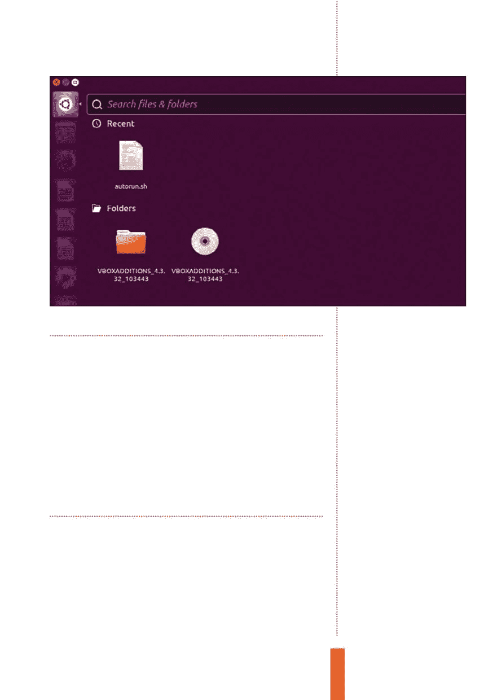

### Dash 范围 (Scopes) 与视图 (Lenses)

Dash 是查找内容的通用窗口，但由于计算机上有多种类型的内容，结果被划分为更小的范围或视图（图 1）。Dash 有了一系列范围，在逻辑上分离结果，并为你的文件、文件夹、应用程序和数据提供视图。默认安装的范围包括：首页（Home）、应用程序（Applications）、文件（Files）、视频（Videos）、音乐、照片和在线（社交媒体）。

当你启动 Dash 时，会在顶部看到一个搜索栏。这是所有视图通用的。只需开始输入，下方就会出现结果列表。注意这是首页视图（home lens）。首页视图是默认视图，除非你显式选择其他视图，否则它将会出现。你可以通过点击底部栏上的选项之一（当 Dash 激活时）来显式选择视图。其他视图只会显示与你的搜索查询相关的对应范围的项目。例如，如果你输入文本作为搜索查询，首页视图将显示来自整个计算机的结果，但如果你将其更改为应用程序视图，你会看到文本编辑器作为第一个结果。

### Dash 快捷键

你可以使用几个快捷键来加速与 Dash 的交互。例如，按下 Super 键并保持一会；启动启动器（Launcher）旁会显示一个数字列表。你只需按下键盘上相应的数字即可打开任何应用程序。当你按住 Super 键时，你会看到一个列出多个快捷键的窗口。

要直接跳转到应用程序视图，只需同时按下 Super 键和字母 A。音乐视图也是如此，同时按下 Super 键和 M。对于视频，按下 Super 键和 V。

Super 键+C 带你进入照片视图，Super 键+F 打开文件视图。如果你想在视图之间快速切换，可以在进入 Dash 后使用 Ctrl+Tab 在视图间切换。

**图 1（上图）** Dash 中的搜索结果按逻辑分类分类

## Ubuntu 基础知识

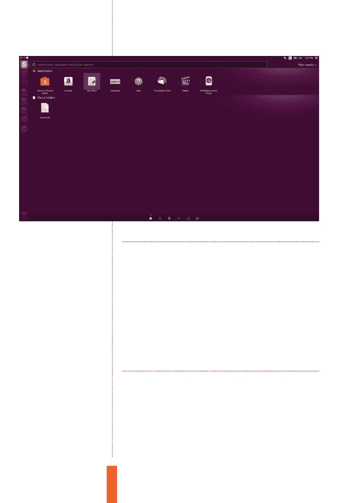

### 在 Dash 中管理视图

尽管 Dash 在显示搜索结果方面提供了很大的灵活性，但你可能希望移除列出的某些结果，或者添加某些默认隐藏或简单不存在的结果。Ubuntu 软件中心（Ubuntu Software Centre）有一个小型应用程序可以帮助你完成这些。让我们先安装它。打开 Dash。将范围更改为“应用程序”并搜索“主菜单”。在出现的结果中，点击指向“Ubuntu 软件中心”的链接。点击页面右上角的“安装”来安装软件。现在，使用启动器或 Dash 打开主菜单应用程序。

你现在可以在这里启用、禁用甚至永久删除项目或整个类别。查看左侧列中的类别。你可以取消勾选项目或类别以隐藏它们，并重新勾选它们以使其重新变得可搜索。这不会安装或卸载任何软件，只是停止结果在 Dash 搜索结果中的显示（图 2）。这样，你就可以确保不会破坏任何重要内容。

### 过滤 Dash 响应

每个视图的右上角都有过滤选项。你可以点击“过滤结果”（Filter results）链接来展开选项。注意，这些选项是与上下文相关的——也就是说，不同视图下有不同的选项。在“首页”选项卡中，过滤选项允许你选择显示的类别以及可以从中获取结果的在线来源。

“应用程序”选项卡的过滤器包括按类型（如图形）、游戏、互联网应用程序等进行过滤的能力。过滤器还允许你在已安装的应用程序和在 Ubuntu 软件中心中出现的应用程序之间缩小搜索范围。同样，如果你在“文件”视图中，你将能够根据类型、大小和最后编辑时间来过滤结果。“音乐”视图按流派和年代进行过滤。“照片”视图根据照片拍摄日期进行过滤。

**图 2（上图）** 你可以使用 Ubuntu 软件中心自定义你的 Dash 搜索结果

## 熟悉 Dash
## Ubuntu 基础知识

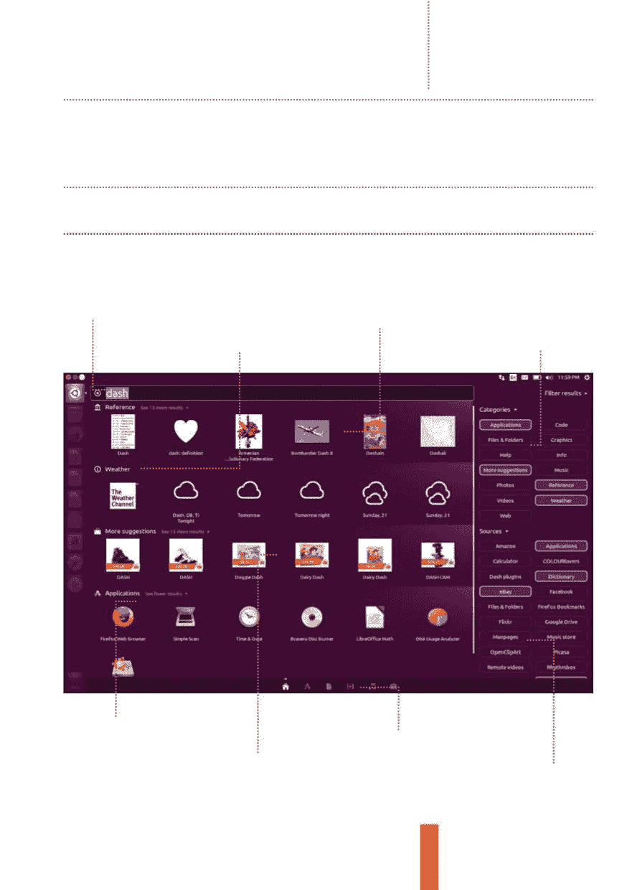

-   **文本区域**：这是你向 Dash 输入查询内容的地方。当你输入文本时，你会看到下方空间动态地填充结果。
-   **应用程序**：此部分显示与应用程序范围相关的结果。你将在这里看到所有匹配搜索查询的应用程序。
-   **天气**：Dash 自动检测可能与搜索查询相关的范围。由于有一个名为 Dash 的地方，它会自动显示该位置的天气预报。
-   **更多建议**：这是显示来自在线网站结果的部分。
-   **参考**：此部分显示与查询相关的参考。你可以看到树中的所有目录。
-   **范围**：Dash 默认显示所有可用范围。你可以将结果限制在特定范围内。
-   **类别**：这显示你想看到的类别。
-   **来源**：这允许你选择 Dash 在何处查找。

“每个视图的右上角都有过滤选项。你可以点击‘过滤结果’链接来展开选项。注意，这些选项是与上下文相关的——也就是说，不同视图下有不同的选项。”（等等，这段文字重复或重叠了）

## 熟悉 Dash
## Ubuntu 基础知识


### 理解文件系统

Linux 最复杂的事情之一可能是它的文件系统。对于初 Linux 的学者来说，这就像一个迷宫。Ubuntu（像所有 Unix 系统一样）将文件组织在层次级树中，其中关系通过父子关系来考虑。树中的任何元素都可以通过路径名引用。绝对路径以字符 `/` 开头；相对路径不是以 `/` 开头的；在这种情况下根取决于上下文，称为当前目录。从根目录执行时，它会显示所有目录。单点表示当前目录；双点表示父目录。这里有许多用途不同的文件。对于初 Linux 的学者来说，这就像一个迷宫。

理解文件系统

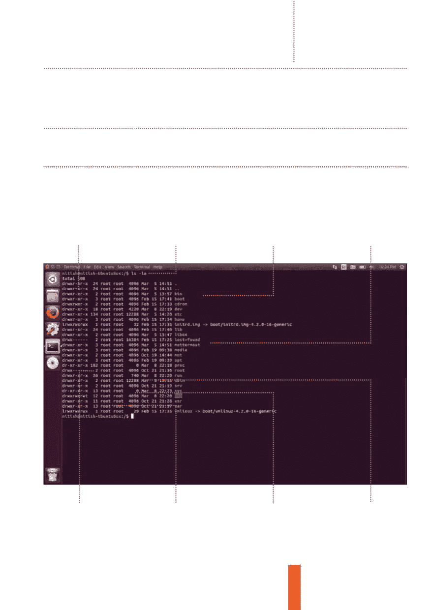

### 列出命令

`ls` 列出目录下的所有文件，`-la` 扩展以长格式列出所有隐藏文件。从根目录执行时，它会显示所有目录。

| 列 | 描述 |
| :--- | :--- |
| 第一列 | 第一个字符表示它是目录还是文件。其余九个字符表示文件所有者、组和其他人的权限。 |
| 第二列 | 此列显示目录内部的链接或目录数量。 |
| 第三和第四列 | 第三列显示文件的所有者，第四列显示文件所属的组。 |
| 第五列 | 此列显示以字节为单位的大小。你可以通过结合 `-l` 使用 `-h` 选项来修改；这将以 KB、MB 和 GB 输出，以便更好地理解大小。 |
| 第六列 | 显示目录最后修改的时间戳。 |
| 文件名 | 这里列出了所有的目录/文件名。 |

### 特殊文件

在 Linux 任何地方执行 `ls` 命令，你都会在顶部看到这两个文件。但是，如果你通过图形用户界面（GUI）检查同一个目录，这些文件是不可见的。单点表示当前目录；双点表示父目录。


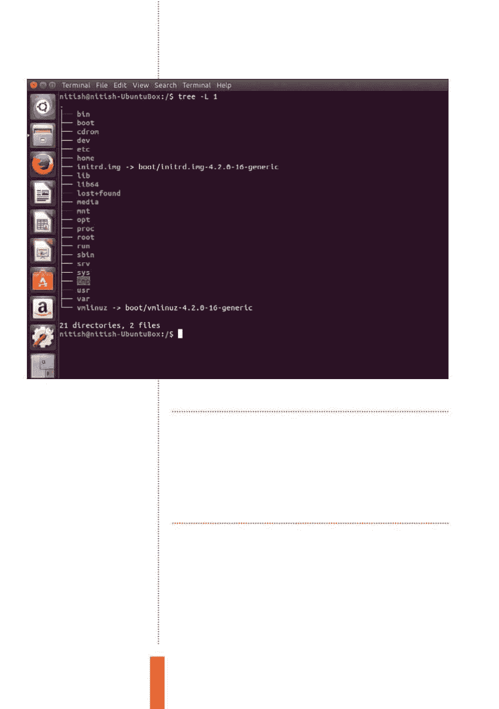

**图 1（上方）** 使用终端探索 Ubuntu 的文件系统结构

## 02 根目录

Unix 完全抽象化了树形层次结构的本质，而根目录是 Ubuntu 层级结构中所有文件夹的基础。根目录以“/”符号表示，它包含了所有其他文件夹（图 2）。尽管习惯上将根目录称为“/”，但该目录条目本身没有名称——它的名称是初始目录分隔符字符（/）之前的空空部分。所有文件系统条目（包括挂载的文件系统）都是此根目录的“分支”。正是由于这种布局，Unix 系统中的所有绝对路径都以“/”开头。即使你的计算机连接了多个物理或虚拟存储设备，所有文件夹都会显示在根目录下。

请注意，不要将其与作为 root 用户主目录的 /root 目录混淆。

### 根目录

### 01 文件系统层级标准

Ubuntu 文件系统基于文件系统层级标准（FHS）。该标准定义了 Linux 操作系统中的主要目录及其内容（图 1）。很大程度上，它是传统 BSD 文件系统层级结构的规范化和扩展。Linux Foundation——一个由 HP、Red Hat、IBM 和 Dell 等主要软件和硬件供应商组成的非营利组织——维护着 FHS。在编写时，当前的 FHS 版本为 3.0，于 2015 年 6 月 3 日发布。

### 理解文件系统

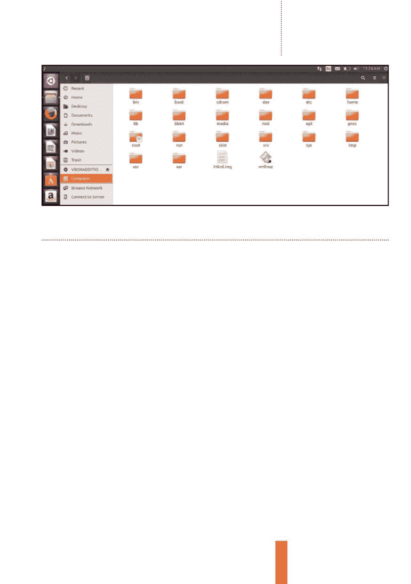

### 03 / 下的各种目录

现在让我们来看看根目录下存在的各种重要目录，并了解它们各自的用途。

- **/bin** 存放最常用的终端命令，如 ls、mount、rm 等。
- **/boot** 包含启动系统所需的文件，包括 Linux 内核、RAM 磁盘镜像和引导加载程序配置文件。
- **/dev** 包含所有设备文件，它们不是普通文件，而是指向系统上的各种硬件设备，包括硬盘。
- **/etc** 包含系统全局配置文件，影响所有用户的系统行为。
- **/home** 是用户的主目录。
- **/lib** 包含重要的动态库和内核模块。
- **/media** 设计用于外部设备的挂载点，如硬盘或可移动介质（CD、DVD 等）。
- **/mnt** 也是挂载点的地方，但专门用于“临时挂载”设备，如网络文件系统。
- **/opt** 可用于存储软件包管理器未处理的软件。
- **/proc** 是一个虚拟文件系统，为内核向进程发送信息提供了机制。
- **/root** 是超级用户的主目录；即使 /home/ 不可用，它允许启动系统。
- **/run** 是启动过程中早期可用的临时文件系统，存储运行时数据。该目录下的文件在启动开始时会被删除或截断。
- **/sbin** 包含通常仅供超级用户使用的管理命令。
- **/srv** 可以包含服务的目录目录，如 HTTP 或 FTP。
- **/sys** 是一个虚拟文件系统，可以访问它以获取有关内核视图的信息。
- **/tmp** 用于应用程序的临时文件。
- **/usr** 包含大多数用户工具和应用程序，并部分复制了根目录结构，例如 /usr/bin/ 和 /usr/lib。
- **/var** 用于可变数据，如日志、数据库、网站和临时打印队列（电子邮件等），这些文件从一次启动持续到下一次。一个显著目录是 /var/log，存放系统日志。

**图 2** 你可能熟悉的文件夹布局

**理解文件系统**

## 在 Ubuntu 中共享文件

创建服务器共享数据

默认的 Ubuntu 文件管理器 Nautilus 提供了一个易于使用的界面来帮助你跨系统共享文件。但在后台，Samba 正在运行。

Samba 是一个用于无缝文件和打印服务的套件。它为 Unix 系统实现了服务器消息块 (SMB)/通用文件系统 (CIFS) 协议，支持 Windows、OS X 和其他 Unix 系统的文件和打印机共享。

与其他 SMB/CIFS 实现不同，Samba 在各种系统中被广泛使用。你可以通过在其中系统上配置 Samba 为文件服务器来方便 Ubuntu 和 Windows 之间的文件共享。

Samba 可以执行许多其他功能，包括作为 SMB 客户端的服务器：你可以共享打印机（包括伪打印机），以便网络中的所有计算机都可以写入文件。Samba 还可以作为 Windows 网络中的域控制器（验证用户等），甚至帮助使用 Windows 域控制器验证 Linux/Unix 机器的用户。然而，在本功能中我们将仅关注 Samba 的文件共享部分。

Ubuntu 16.04 默认没有安装 Samba，要开始共享你需要安装 Samba。我们将在后面的章节中查看安装过程和设置文件共享的步骤。

“通过在其中系统上配置 Samba 为文件服务器来方便 Ubuntu 和 Windows 之间的文件共享”


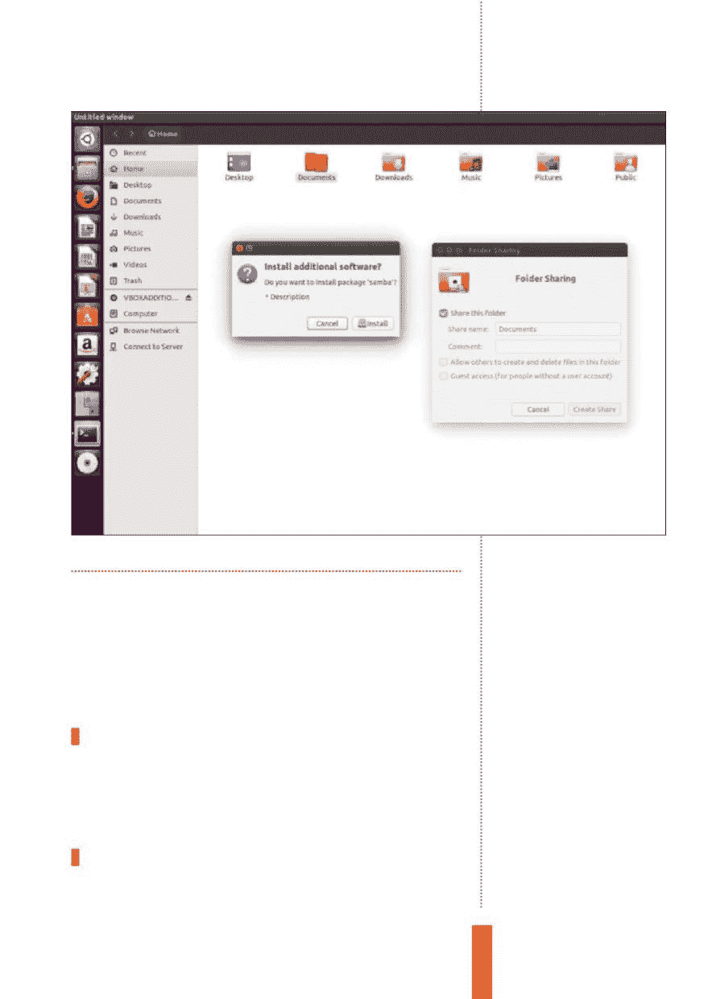

### 01 共享目录

要共享目录，你必须拥有访问目录的权限。为了演示，让我们从用户主目录取一个文件夹，例如 Documents。

进入你的主目录。右键点击 Documents 目录，在弹出菜单中选择“本地网络共享”。勾选“共享此文件夹”。如果没有 Samba，你会收到弹出菜单：“未安装共享服务”。选择“安装附加软件”并点击“安装”（图 1）。如果你收到找不到 samba .deb 的错误消息，打开终端并如下所示更新 apt-get：

$ sudo apt-get update$

再次尝试，Ubuntu 将安装 Samba。再次尝试共享文件夹。右键点击 Documents 目录，在弹出菜单中选择“本地网络共享”。勾选“共享此文件夹”。如果没有 Samba，你会收到弹出菜单：“未安装共享服务”。选择“安装附加软件”并点击“安装”（图 1）。

**图 1（上方）**

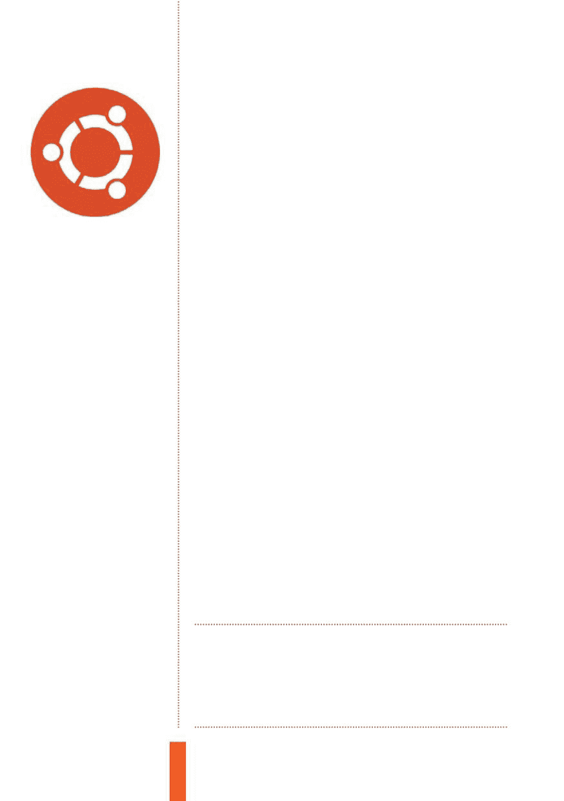
**图 2（上方）**

**Samba 服务器配置**
**Ubuntu 基础**

### 03 使用配置文件

我们学习了通过 GUI 进行共享，但直接编辑配置文件可以为你提供多种选项和灵活性，完全按照你想要的方式实现。主 Samba 配置文件位于 /etc/samba/smb.conf（图 2）。默认配置文件有大量的注释，以记录各种指令。首先，在 [global] 部分编辑以下键值对：

Workgroup = EXAMPLE
Security = user

注意，“security”参数在 [global] 部分的下方，并且默认是被注释的。此外，将“workgroup”值从 EXAMPLE 改为符合你环境的值。然后，要共享目录，在底部创建一个新部分，或取消注释一个示例：

[share]
comment = Ubuntu 文件服务器
path = /srv/samba/share
browsable = yes
guest ok = yes
read only = no
create mask = 0755

让我们看看每一项的含义：

- **comment:** 共享的短描述。你可以根据需要进行调整。
- **path:** 共享目录的路径。此示例使用 /srv/samba/share，是因为根据文件系统层级标准 (FHS)，srv 是应该提供特定数据的地方。从技术上说，只要权限正确，Samba 共享可以放在文件系统的任何位置，但建议遵循标准。
- **browsable:** 允许 Windows 客户端使用资源管理器浏览共享目录。

**Samba 客户端**
**Ubuntu 基础**

### 通过 Samba 访问文件

Ubuntu 和 Gnome 使得访问 Samba 服务器共享的文件变得简单。首先，进入文件管理器，并在左侧垂直菜单上找到“浏览网络”链接。打开此链接，你会看到一个 Windows 网络图标。双击打开。下一个窗口显示网络上发现的所有域/工作组。在每个域/工作组内部，你会看到所有启用了共享的计算机。双击计算机图标即可访问其共享和文件。


## 在 Ubuntu 中共享文件

## Ubuntu 基础知识

### 标准工具栏
在右上角，你会找到设置、添加文件和帮助选项的快速链接。

### 共享文件
在这里，你可以看到 Samba 共享下所有可用文件的列表。

### 权限
如果你希望你共享的目录是可写/可见，只需勾选相应的复选框。

### 菜单栏
此部分包含添加要共享文件的基本设置，并设置如服务器组和查看所有 Samba 用户等偏好。

### 共享名称
你可以在此部分为上方选择的目录设置名称。

### 保存或取消更改
点击确定以将更改保存到 Samba 配置文件并开始共享。如果你点击“取消”，更改将被丢弃。

### 描述
在此处为共享目录设置描述。

### Samba 共享目录
一旦点击“添加文件进行共享”，就会弹出一个窗口。在“目录”部分，只需浏览并选择你想要共享的目录即可。

使用 Samba GUI 共享文件 学习使用 Samba 共享文件

- **guest ok:** 允许客户端在不提供密码的情况下连接到共享。
- **read only:** 决定共享是只读的还是授予写入权限。只有当值为 no 时（如示例所示），才允许写入权限。如果值为 yes，则对共享的访问为只读。
- **create mask: ** 决定创建新文件时将拥有的权限。

现在 Samba 配置完成，需要创建目录并更改权限。在终端中输入：

`$ sudo mkdir -p /srv/samba/share`
`$ sudo chown nobody:nogroup /srv/samba/share/`

最后，重启 Samba 以启用新配置：

`$ sudo restart smbd`
`$ sudo restart nmbd`

## 使用“磁盘”管理驱动器

使用 Ubuntu 的磁盘工具管理硬盘、SSD 和可移动介质。

磁盘可以管理本地和可移动驱动器，对它们进行重新分区、备份镜像以及从镜像恢复。这是一个直观的工具，左侧是设备列表，右侧是当前选中设备的详细信息。你可以用它查找硬盘的型号和大小、分区数量、序列号、健康状态 (SMART) 等更多信息。用户在需要对硬盘、SSD 或 USB 接口的可移动质质存储设备进行操作时经常会启动磁盘。它对驱动器卷的直观可视化非常有用。如果你不了解主分区或扩展分区，在查看磁盘中“卷”标签下的图形方案后，你会立即理解这一概念。你只需点击几次鼠标即可完成许多高级任务，例如对硬盘进行基准测试、进入待机模式、创建或删除分区等。

磁盘的另一个功能是可以创建驱动器镜像 (*img) 并此类镜像恢复到其他驱动器。此功能允许你将所有数据、逻辑结构和引导加载程序克隆到新的硬盘上。有时新硬盘到达时完全没有分区，磁盘会将它们显示为标记为“未知”的单调矩形。现在你可以选择要操作。如果你点击上方的“齿轮”按钮并格式化整个磁盘，你只会创建一个分区表而不是卷。有旧的 MBR（主引导记录）类型和现代的 GPT（GUID 分区表）。前者兼容所有设备，而具有 UEFI 引导的新型 PC 以及大硬盘 (>2TB) 要求 GPT。接下来，你可能想通过点击下方特定的卷“齿轮”按钮并再次选择“格式化”选项来创建实际卷。如果你计划从 Windows 访问磁盘，请使用 NTFS 文件系统。否则，对于仅限 Linux 的使用，最佳选项是 Ext4。

格式化 USB 移动驱动器

**Ubuntu 基础知识**

使用“磁盘”管理驱动器

“用户在需要对硬盘、SSD 或 USB 接口的可移动质质存储设备进行操作时经常会启动磁盘”

### 查看**已连接**设备
磁盘会显示它支持的所有已连接驱动器（几乎支持所有设备）。“设备”栏允许你选择多个驱动器并同时对多个驱动器执行某些操作。

### **每个分区**的独立控制
这个小按钮仅适用于当前选中的分区。

### **文件系统**
“设备”栏允许你选择多个驱动器并同时对多个驱动器执行某些操作。

### **详情**
这个小按钮仅适用于当前选中的分区。

### **分区**
“设备”栏允许你选择多个驱动器并同时对多个驱动器执行某些操作。

### **卷**
这个小按钮仅适用于当前选中的分区。

### **结构**
“设备”栏允许你选择多个驱动器并同时对多个驱动器执行某些操作。

### **特性**
这个小按钮仅适用于当前选中的分区。

**Ubuntu 基础知识**

“设备”栏允许你选择多个驱动器并同时对多个驱动器执行某些操作。

02**
进行性能测试既有趣又具有挑战性，特别是对于非技术用户而言。磁盘应用程序内置了一个工具，意味着你可以随时对驱动器进行基准测试。首先，你需要卸载整个驱动器或仅卸载分区。点击“齿轮”标签并选择“启动基准”。你会得到一张图，其中红色曲线表示平均写入速率，蓝色曲线表示读取速率，绿色点表示访问时间。

**Ubuntu 基础知识**

04**
与普通的文件备份相比，硬盘镜像非常有用。它存储了所有驱动器结构、引导加载程序记录以及所有细节，允许你将你的设置复制到另一个物理驱动器上。同样，对于你觉得可能随时损坏的旧硬盘，没有比创建镜像更好的保存方法了。根据你使用的“齿轮”按钮，你既可以创建整个驱动器的镜像的的，也可以只创建当前分区的镜像。当你选择“创建磁盘镜像”选项时，磁盘会提示你选择镜像文件的目标目录。注意，它必须保存在另一个物理驱动器上。稍后，你将能够使用“恢复磁盘镜像”选项从镜像文件恢复驱动器。

03**
驱动器设置对台式电脑和笔记本电脑都很敏感。将驱动器置于待机模式不仅有助于节省功率，还能减少热，甚至让系统更安静。无论你的驱动器在 Ubuntu 中的默认行为如何，你都可以显式地设置它在一段时间后进入睡眠。点击“齿轮”图标进入“驱动器设置”，在其中你可以将“应用待机超时设置”开关移动到“开启”位置。现在你拖动滑块并设置偏的超时值，之后驱动器将进入待机状态。同样，你可以决定是否启用或禁用写入缓存——只需进入“写入缓存”选项卡并选择所需的模式。当启用缓存时，驱动器工作速度更快，但在断电情况下可能会损坏你的文件。


## 掌握 Linux 命令行

遣词得当可以让你免去在图形用户界面（GUI）中来回奔波，因此请确保你使用了正确的命令。

命令行可能是一个较老的界面，但它之所以能生存至今，是因为它能够通过几个恰当的命令精确地告诉计算机你想要什么。例如，单条命令就可以将目录中所有的 MP3 和 MP4 文件复制到备份磁盘或网络上的另一台机器——或者互联网上的任何地方。

许多人第一次接触计算机——也许是在 20 世纪 70 年代或 80 年代的大学里——是坐在一个被称为“控制台”（console）的哑终端终端前，该终端连接到一台远端且巨大的计算机。如今，计算机可以像信用卡一样大——比如树莓派——但旧式的终端仍然以“终端”程序的形式被记忆，它为你提供了一个访问 Ubuntu 的命令行界面。

根据你运行的是哪种版本的 Ubuntu，终端的名称可能不同，但在 Unity Shell 的应用搜索或菜单中输入‘term’，你就会至少出一个终端选项。打开它，你应该看到一个看起来相当空旷的窗口。不要被那个闪烁的光标吓到——通常是‘$’符号，被称为“美元提示符”。它正在等待执行你告诉它的任何操作。你只需要知道正确的词汇——或命令——来让它运行。

这里有一个简单的示例供你先尝试：在终端中输入 **evince**——我们将你需要输入的指令加粗，以便你更清楚地看到命令；之后始终按回车，让 Ubuntu 知道现在要执行操作了。

只要你没有输错，你刚刚打开了 Ubuntu 的 PDF 阅读器，而没有使用任何 GUI 菜单或快捷项目。

## Ubuntu 基础

要查看“文档”（Documents）文件夹，打开终端并输入 `ls Documents`。别忘记按回车。你将看到 Documents 文件夹中所有文件的列表。输入 `ls` 你将看到主目录下的文件列表——因为当你打开终端时，它会将你置于该目录。你可以使用切换目录命令——`cd` 来更改，例如：`cd Documents`。现在，单独输入 `ls` 就会显示你的文件。

`cd -` 命令将带你回到上次，因为 `-` 是一个快捷方式，告诉 `cd` 回到你之前的所在地。你也可以输入 `cd ~`，因为 `~` 是你的主目录（如 /home/jo/ 等）的缩写。`pwd` 将提醒你现在所在的位置。

配置文件——那些被称为点文件（dotfiles）的文件，因为它们以点开头——通常在列表中被隐藏。在大多数文件管理器中，你可以通过 Ctrl+H 切换显示（在少数软件中是 Ctrl.+）。在终端中，命令是 `ls -a`。

`.` 和 `..` 是“当前目录”和“父目录”（即上一级目录）的快捷方式——使用 `-A` 代替 `-a` 可以隐藏它们。连字符后的那些字母被称为命令行开关（switches）：尝试 `ls -l` 来查看详细列表。我们稍后会介绍它显示的那些看起来晦涩的信息。

移动和复制文件使用 `mv` 和 `cp` 命令。我们将在 Overleaf 中看到 `cp` 的用法，但现在我们将复制图 1 并尝试将文件移动到新位置：

```bash
cd ~
touch random.txt
mv random.txt newname.txt
mv newname.txt Documents/
ls
ls Documents
```

## 文件、文件夹和熟悉的内容

是时候让命令行在你的文件和文件夹上为你工作了。

### 内部查看

你不需要打开应用程序即可查看文件内容。`file` 命令让你看到它是什么类型的文件。`cat` 将文件内容滚动显示，而 `more` 则一次一页地提供给你。`less` 的功能相同，但有更多控制选项，如果你不知道按 **Q** 退出，你就会卡在里面。**Q** 也会退出帮助手册（man pages）；对于其他程序，Ctrl+C 是退出的不错选择。有时只想只想文件的开头或最后几行——`head` 和 `tail` 就是你需要的命令，每个命令默认显示十行。`tail -n 30 /var/log/syslog` 会显示该日志文件记录的最后 30 条内容。真正的威力来自 `grep`（图 2，第 56 页），用于在文件中搜索术语。尝试 `grep ls ~/.bash_history` 来提取你目前为止使用的所有 `ls` 实例。

### Tab 键补全

如果你觉得输入量太大，尝试在输入每个单词的前几个字母后按下 Tab 键。当只有一种可能的补全方式时，单词将自动填充。按两次 Tab 键会在有多种可能的情况时显示建议。

如果你想了解更多关于命令的信息，它们（几乎）都有手册——或说 man 页（图 3）。`man ls` 将告诉你 `ls` 的所有选项；`ls` 将告诉你关于命令本身的手册。

### 使用 Nano

查看文件是一回事，但我们通常需要编辑它。Nano 包含在 Ubuntu 以及其他发行版中，友好得多。在这个示例中，我们将使用 Nano 编辑 `.bashrc` 文件。要要打开文件，输入 `nano ~/.bashrc`。进入后，你可以使用方向键导航到文本。注意，# 之前的行是非激活的（被注释掉了）。要激活它们，请删除 #。

要保存工作，按住 Ctrl+O 然后按 O。要退出，按 Ctrl+X。

### 权限请求

Ubuntu 文件受到保护，防止共享机器上其他用户的修改。所有文件和文件夹都属于一个用户和一个组。每个文件的权限关系到用户、组或其他任何人可以读取、写入或执行该文件；这缩写为 rwx。对于目录，执行权限只是进入目录的权限。执行文件意味着作为程序运行——所以 JPG 图片文件没有运行权限。

### 没有附件？

虽然权限提供的保护非常有用，但它们也是为了让疏忽的人碰壁。例如，使用 sudo 时，你可能从另一个用户的主目录复制了文件。除非你更改所有权，当你尝试将文件附加到电子邮件时，你可能会困惑，因为它们无法添加——因为你甚至没有读取这些文件的权限！


“每个文件的权限关系到用户、组或其他人是否可以读取、写入或执行该文件；这缩写为 rwx 权限”

## 详细列表
运行 `ls -l` 可以查看是谁拥有某个文件或文件夹，以及谁有权读取、写入和运行软件。列列表中的三组 rwx 分别适用于指定的用户、指定的组以及剩余的所有人员。

## 归所有权给我
如果你使用 `sudo` 将文件复制到文件夹中，你可能将其遗留了 root 所有权。使用 `chown jo myfile.txt` 更改所有权——例如——使用 `chown :audio myfile.mp3` 更改组。填满 ‘:’ 左右两侧的内容可以同时更改用户和组所有权。

## 进制代码
rwx —— 读取/写入/执行权限分别被赋予 4、2 和 1 的值。要给文件赋予读取 + 写入 + 执行权限，则将 4、2 和 1 相加得到 7。如果只需要读取和执行权限，则为 4 + 1 = 5。将前者应用于用户和组，后者应用于“其他”，执行 `chmod 755 file.txt`。

## 运行它
当一个文件可以运行时，它就变成了一个程序。你编写或下载了一个 shell 脚本，比如 `backup.sh`，并尝试运行它 `- ./backup.sh` 但没有任何发生。你需要给它赋予执行权限：为了节省进制加法的麻烦，你可以只需 `chmod u+x backup.sh`。你也可以通过 `sh backup.sh` 调用它。

熟悉 Linux 命令行

## Ubuntu 基础知识

## 给我更多软件
尽管 Ubuntu 的每个版本都有一个图形化程序向系统安装软件，但你通常会看到项目提供通过命令行获取软件的方法。这是因为命令行指令是直接且无歧的。让我们尝试一下，你就会明白我们的意思了。

正如你可能在本文其他地方读到的，Ubuntu 基于 Debian，这是最早的 GNU/Linux 发行版之一，可以追溯到 1992 年。这是一个全球一千多个开发人员通过互联网协作的开放性项目，这有助于它的长期存在。Debian 的软件包管理系统以及获取和安装软件包的命令行程序也是如此。Apt —— 高级软件包工具——跟踪 Ubuntu 存储库中的所有软件，并在安装时处理与其他软件包的任何依赖关系。这就是 Ubuntu 软件中心在该图形界面背后使用的工具。

在你的系统上安装软件的每一步都需要 root（超级用户）权限：在 Ubuntu 上，这是通过在命令前加上 ‘sudo’ 完成的。在某些其他系统中，你将以 root 用户身份登录；在 Ubuntu 上，你可以通过运行 `sudo -s` 或 `sudo bash` 临时这样做，但我们建议这样做，因为很容易养成用 root 权限运行的习惯，并不小心造成某些损坏。

使用 `sudo apt-get update` 更新 Ubuntu 对最新可用软件包的认知。你可以查看 `/etc/apt/` 下的源文件，Ubuntu 在那里记录了应该查看哪些存储库。你可以手动编辑这些文件以添加更多存储库，并更改版本以进行升级（请谨慎操作！）。但添加新存储库的最简单方法是使用 `apt-add-repository`：`sudo apt-add-repository ppa:jon-hedgerows/get-iplayer`。之后，在从存储库安装之前，你需要再次运行 `sudo apt-get update`：`sudo apt-get install get-iplayer`（图 7）。get-iplayer 脚本是一个用于 BBC 广播（和电视）节目定时回放的命令行软件；apt-get upgrade 将安装最近进行的所有安全更新和错误修复。这是你应该定期运行的内容（但为了省去麻烦，Ubuntu 会提示你有可用更新，并定期请求许可获取它们）。运行 `apt-cache search terminal` 来寻找备用终端程序，运行 `apt-cache show terminal` 来检查其中一个。现在你已经了解了基础，再多探索一下。

### 使用 GNOME Terminal & Xterm
探索 Ubuntu 中终端模拟器的基础和优势

Ubuntu 附带两个终端模拟器。其中一个是 GNOME Terminal，这是一个被广泛使用的程序，可能可能是许多 Ubuntu 用户唯一知的终端应用程序。GNOME Terminal 是 Unity 桌面与 GNOME Shell 共享的许多基于 GTK 的应用之一——Unity 和 GNOME 中的许多工具和配件是相同的。GNOME terminal 看起来简洁且极简，但它有足够的设置让你能够配置这个小型应用程序以符合你的需求和品味。选择 Edit>Profile Preferences（编辑> 配置文件偏好）来为了不同的行为或自定义的外观而编辑当前的‘Default’默认）配置。得益于对文本字符串拖放的支持、通过按键和右键菜单进行复制和粘贴的支持，以及终端模式下的鼠标滚动，GNOME Terminal 使得图形化应用程序与 Bash shell 之间的交互变得舒适。

Xterm 完全不同；它是一个微小的、老派的家伙，自 1984 年以来没有发生太大变化，并且最初是在 X Window 系统问世之前开发的。Xterm 使用与 GNOME Terminal 相同的 Bash shell，因此命令在两个终端中的行为完全相同。Xterm 在紧急情况下非常有帮助；如果你的主桌面环境加载失败，而你只需要进入图形模式，请使用类似 `$ xinit xterm` 之类的命令。它永远不会崩溃！

#### 01
每个 Linux 发行版在终端模拟器（包括 Xterm 和 GNOME Terminal）的文本模式和图形模式下都使用 Bash。Bash 拥有一非常丰富的命令集，但最实用的功能源于它的流行性；所有 Linux 用户都使用相同的语法操作终端。然而，还有其他 shell——例如具有更广泛功能且高度自定义的 ZSH，或者带有内置脚本语言的 CSH——它们与 C 语言有相似之处。要在 GNOME Terminal 中将默认 shell 从 Bash 更改为其他内容，请转到 Edit>Profile Preferences，切换到 Title and Command（标题和命令）选项卡，启用‘Run a custom command instead of my shell’选项并在 Custom Command 字段中输入所需的 shell 名称。

### 02
让我们通过更改文本字体、颜色和背景让 GNOME Terminal 看起来更个性化（图 1）。转到 Edit>Profile Preferences 并切换到 Colors（颜色）选项卡。取消勾选‘Use colors from my system theme’选项，并为文本、粗体文本和背景选择任何颜色组合。‘Built-in schemes’下拉菜单列表中有很多预设方案；它可以节省你选择的痛苦。要更改字体本身，转到 General（常规）选项卡并取消勾选‘Use the system fixed width font’。之后，你就可以选择另一个等宽字体了。


## 编辑你的终端配置文件

更改标题、光标形状、滚动选项和命令行为，以及颜色、字体、一些历史遗留功能（如退格键和删除键的行为）等。

## 图标说明了一切

得益于那个独特的图标，你不会将 Xterm 与任何其他终端模拟器混淆，它在那块表现力阴极管显示屏上支持 256 色。

## 享受 GNOME Terminal 的便利

GNOME Terminal 以其标志性的 Ubuntu Mono 字体和深紫色背景完美融入 Ubuntu 的设计。然而，你可以通过几次鼠标点击更改这些和其他设置。

## 不干扰的滚动条

GNOME Terminal 过去曾绘制丑陋且粗粗的滚动条。后来，Canonical 应用了覆盖条，并移除了终端框架周围的 1 像素轮廓。

## 尝试安全解决方案

Xterm 相对老旧，但它提供了纯粹的 Bash 体验，没有任何花哨。Xterm 存在于每个使用 X.org 的操作系统（所有 Linux 发行版都是如此）。

**64**

“Bash 拥有一套非常丰富的支持命令，但最实用的功能源于它的普及性；所有 Linux 用户都使用相同的语法操作终端”

使用 GNOME Terminal & Xterm
节省你的时间：与终端模拟器工作比你想象的要容易

**Ubuntu 基础**

**65**

**04**

在终端中工作可以追溯到 Linux 和 UNIX 的长期历史，所以难怪我们发现了许多彩蛋和笑话，它们能带来一些乐趣并让你在终端中感到更自在。从运行 `$ sudo apt-get install moo` 开始，召唤一只快乐的奶牛（图 2），通过 `$ aptitude moo` 寻找另一个彩蛋，然后运行 `$ aptitude --v moo` 并再添加三次 ‘v’，就能看到一条吃掉大象的蛇。`$ ls` 显示一辆蒸汽机车，最后 `$ fortune | cowsay` 显示了一头正在为你占卜的奶牛。然而，为了结束一下，让我们做一些宏大的事情，将我们无聊的 GNOME Terminal 变成一个好莱坞科技剧的展示场，模仿 FBI 指令中心（图 1，第 63 页）：

```bash
sudo apt-add-repository ppa:hollywood/ppa
sudo apt-get update
sudo apt-get install Hollywood
```

享受一下乐趣

**03**

了解 Ubuntu 中 GNOME Terminal 的技巧可以节省时间并提高效率。我们从最简单的开始：在 Unity 的任何地方使用 Ctrl+Alt+T 序列启动应用程序。在 Nautilus 中浏览文件时，为当前目录打开终端窗口是有用的。当你在视图区域内的空白处点击右键并选择“在终端中打开”时，可以这样做，但此功能在 Ubuntu 中默认未启用。使用以下命令修复它：

```bash
$ sudo apt-get install nautilus-open-terminal
```

然后重启文件管理器。当你需要复制或粘贴文本时，分别使用 Ctrl+Ins 和 Shift+Ins，而不是费力地点击右键菜单。要清除输入，你可以用 Ctrl+C 取消命令，或用 Alt+R 清除已输入的内容。

学习实用的快捷键
使用 GNOME Terminal & Xterm
**Ubuntu 基础**

**图 2（左侧）** 执行 `$ fortune | cowsay` 命令并查看这家伙

**65**

**66**

**Ubuntu 基础**

## 使用 Déjà Dup 保护文件

为你的照片、文档、音乐和视频准备备份副本是确保它们安全的首要任务，尽管某些新手用户选择跳过这一过程。想象一下你的硬盘出了问题，无法再次启动。坏消息是，虽然你可以购买新硬盘，但你很可能会丢失旧硬盘上的数据，而这些数据通常比你丢失的任何硬件都要珍贵。

所以，现在是时候使用你预先准备并定期更新的备份副本了。你没有理由不这样做，因为 Ubuntu 包含一个强大的自动且无忧无虑的备份工具，名为 Déjà Dup ——也被称为更简单的名称 Backups（备份）。

使用 Déjà Dup 可以再简单不过：你选择想要备份的内容和位置，指定它应该跳过的目录，然后将任务放入 Ubuntu 调度器的自动队列中，该调度器可以定期执行备份，甚至同时保留新旧备份。Déjà Dup 的界面左侧有一个分类树，右侧是主部分。默认设置假设你可能想备份 ~/home，因此你可以留下像 ~/Downloads 这样通常存放大文件的目录。

**67**

**Ubuntu 基础**

## 使用 Déjà Dup 保护文件

为你的照片、文档、音乐和视频准备备份副本是确保它们安全的首要任务，尽管某些新手用户选择跳过这一过程。

“为你的照片、文档、音乐和视频准备备份副本是确保它们安全的首要任务”

**66**

**67**

**Ubuntu 基础**

**08**

**Ubuntu 基础**

 使用 Déjà Dup 保护文件

**68**

**Ubuntu 基础**

01

我们最常见的备份目标是照片、视频、办公文档和应用程序设置。对于家用电脑来说确实如此，但让我们补充一些与生产环境服务器和公司用途更相关的目标，例如数据库、收集的数据等。务必提前评估拟议备份的大小，确保它符合目标存储。如果你进行增量备份，将确实需要额外的空间。

如果你将备份副本存储在与原始文件相同的驱动器上，它只能防止意外删除。因此，强烈建议将备份保存到另一个物理驱动器或磁盘上，以防止受到主硬盘故障的损害。对于频繁的增量备份，外部硬盘比闪存盘效果更好——后者的寿命有限，且不喜欢频繁写入。你还可以通过 SSH、WebDAV 或 Windows 共享文件夹使用远程目标。你可以通过存储位置菜单选择合适的地方。

03

如果我们有水晶球，我们会使用它。但事实是，没有人知道问题会在何时发生。为了防止让自己在发现备份损坏时体验那种心沉底的感觉，请从一开始就进行测试恢复。设置一个小型备份任务并运行它是一个好主意。之后，进入概述部分并点击恢复按钮。Déjà Dup 将通过简单的向导引导你，你可以在其中选择备份的位置，然后选择一个日期，从中衍生出一个副本。如果一切恢复正常，就可以进行真实的备份了。


## 使用 Déjà Dup 安全文件

## Ubuntu 基础

#### 04
Déjà Dup 有一个局限性：它是一个“全或无”工具，意味着你无法提取特定的文件和目录。相反，你被迫复制或下载整个备份快照。要解决这个问题，请使用 Nautilus 右键菜单中的“恢复缺失的文件”项（图 1）。这对于包含在备份中的目录有效，并允许你恢复单个文件。Déjà Dup 是 Duplicity 工具的前端界面，这让你可以在无需启动 Déjà Dup 的情况下提取备份快照。这对于脚本编写非常有用，或者当你通过 SSH 远程访问备份位置时可能有用。提取的语法如下：

```bash
$ duplicity restore --no-encryption “file:///path/to/snapshot” "/where/to/extract”
```

Duplicity 语法也可以提取单独的备份项目（参见 $ duplicity --help）。

### 访问备份副本

### 05
最简单的方法是使用你的 Dropbox、MEGASync 或其他云同步目录作为备份位置。这样，一旦 Déjà Dup 完成工作，你的数据就会上传到云端。然而，让我们尝试直接在线备份，例如备份到 Amazon S3 云（图 2）。要实现这一点，你只需要在 Amazon 有一个合适的账户以及一些额外的软件包。命令如下：

```bash
$ sudo apt-get install python-boto python-cloudfiles
```

之后，可用存储位置列表将增加 Amazon S3 和 Rackspace 云。

备份到云端
“Déjà Dup 有一个局限性：它是一个‘全或无’工具”
**图 2（下方）** 轻松管理你的备份位置

## Ubuntu 基础

### 使用启动盘创建器

### 使用启动盘创建器
创建一个带有 Ubuntu 或几乎任何其他 Linux 的可启动 USB 盘

这里最可能出现的第一个问题是：“你到底需要启动盘做什么？”从历史角度看，Linux 发行版是以 CD 光盘分发的，你应该从光盘中安装。后来，随着可刻录 CD/DVD 光盘时代的到来，结合宽带网络接入，导致 Linux 爱好者下载他们喜爱的 Linux 发行版的 ISO 镜像并将其刻录到空白光盘。然而，这种光盘已经过时了，USB 闪存盘现在是更明智的介质。你可以可靠地使用 USB 盘几百次。

在 Linux 中，你可以通过 `dd` 命令将可安装的 ISO 文件传输到 USB 驱动器。这非常简单，但整个过程对普通用户来说并不直观，这就是为什么 Ubuntu 提供了方便的“启动盘创建器”（Startup Disk Creator）工具。它的功能与“磁盘”（Disks）工具有重叠，但启动盘创建器侧重于将 CD/DVD 光盘或下载的 Ubuntu 兼容 Linux 的 ISO 文件转换为可启动 USB 介质，也就是说，它帮助你从旧介质迁移到更现代、高效的 USB 磁盘。

启动盘创建器还可以将新创建的 USB 磁盘作为现场模式下的工作环境，从而将所有数据持久地存储在磁盘上。

**存储持久化**
这是一个非常有用的功能，允许持久化保存你的所有数据。通过这种方式，你可以将你的 Ubuntu 闪存盘变成一个功能齐全的便携工作系统。

**选择要使用的磁盘**
启动盘创建器在此显示可用的目标 USB 驱动器。当你插入它时，应用程序会自动检测并添加到列表中。

**选择源**
这里是系统中找到的源镜像文件 (.iso) 和 CD/DVD 光盘的列表。启动盘创建器会自动更新列表。

**操作系统版本**
有时并不清楚 ISO 内部具体是系统的哪个版本，或者那张没有标签的光盘上有什么内容。“OS 版本”列提取了必要的细节。

**选择镜像文件**
如果你想让你的 ISO 镜像出现在列表中，点击“其他”（Other）按钮并选择镜像文件。顺便说一下，它也支持镜像 (.img)。

**容量和可用空间**
你可以找到介质的总大小以及上面的可用空间。此功能专为格式化为 FAT16 或 FAT32 文件系统并可能包含用户数据的 USB 盘设计。

**注意大小**
这里的最后一列指示源介质的大小。它显示 ISO 文件的精确大小，但无论实际上有多少兆字节，默认显示为 CD 和 DVD 的总容量。

**复制文件**
再次检查一切，并点击“制作启动盘”（Make Startup Disk）按钮。应用程序将显示进度对话框并将文件复制到目标 USB 介质上。

获取现场 Ubuntu 系统：使用普通的 USB 闪盘或任何大容量存储设备

### 创建可启动 USB 闪盘
利用启动盘创建器

#### 01
启动盘创建器旨在用于 Ubuntu 以及其他衍生自它的系统。这是一个短且不完整的列表：Kubuntu, Linux Mint, Xubuntu, Lubuntu, Ultimate-Edition, elementaryOS, Peppermint, Peppermint Ice, Deepin 和 Zorin OS。Linux 的其他变体（特别是那些非 Debian 的版本）可能无法与启动盘创建器配合。如果你有目标介质，测试一下会是一个好主意。

**02 **
常见的目标设备是闪盘（也称为 USB 盘或 thumb drive）、外部硬盘、SD 卡或任何通过 USB 读卡器连接的其他内存卡。几乎所有设备都可以工作。只要 FAT32 分区上有足够的空间存放源镜像，启动盘创建器就不会擦除 FAT32 分区中的任何数据。尽管如此，仍建议使用干净的闪盘，或至少对其进行格式化，以避免因频繁使用该闪盘导致的问题（例如，闪盘可能会出现碎片化）。
“建议使用干净的闪盘，或至少对其进行格式化，以避免因频繁使用该闪盘导致的问题（例如，闪盘可能会出现碎片化）”
**图 1** 使用启动盘创建器制作启动盘

#### 03
拖动相应的滑块并定义你为文件和设置所需的持久化存储空间。启动盘创建器将创建一个大小合适的持久化存储文件并将其与根系统合并。/home 目录中的更改、下载的内容以及从现场系统中添加或删除的其他文件将在重启后被保留。系统级组件同样有效，例如，你可以安装额外软件或删除不必要的内容，并在关闭或重启现场操作系统后保留它们。这使得你的 USB 盘变成了一个功能完备的便携操作系统。同时，该设备仍然可以在 Windows 或其他非 Linux 操作系统中读取和访问。

#### 04
当你完成设置且文件复制对话框成功完成（图 2）后，重启并将你的 USB 介质选择为启动设备。磁盘创建器会将 Ubuntu 引导加载程序添加到 USB 介质的 FAT32 分区，以便其启动 Ubuntu。使用启动盘创建器写入的 与通过 `dd` 命令实现的经典现场模式之间的体验差异不大。唯一的视觉区别是你可以拥有持久化存储，尽管它受限于 4GB —— 这是 FAT32 的最大文件限制。你可以在 Windows（或其他处）在你的 USB 介质上写入一些文件或文件夹，然后从它启动并在那里发现你的文件，且完好无损。

**图 2** 使用此对话框跟踪安装进度


## Ubuntu 基础

### 释放归管理器
**74 利用这个内置在你的 Ubuntu 系统中的一个小配件**

归管理器（Archive Manager）是一个用于打开压缩文件和创建自定义归包的小工具。多年前，当人们的硬盘空间很小时，归管理器一直是王者。它现在仍然是标准桌面体验的重要部分，因为它是解压下载的包或将多个文件合并为一个文件的简单方法（图 1）。

标准的 Ubuntu 归管理器遵循通用命名策略，因此没有特殊名称（与“磁盘”、“备份”等并列）。不过，Ubuntu 是从 GNOME 桌面引入了它，在那里，归管理器被称为 File Roller。你可以通过在 Ubuntu 终端中运行 `$ file-roller` 命令来检查它。当单独启动时，File Roller 界面看起来非常空旷，因为它设计的设计是在窗口最大的区域显示文件内容。

### 利用额外功能

File Roller 拥有额外功能，并与 Ubuntu 的文件管理器 Nautilus 具有良好的集成。这意味着你只需右键点击任何支持的压缩包并从菜单中选择“提取此处”（Extract Here），即可进行解压。你还可以从 Nautilus 拖拽文件和目录到 File Roller 窗口以将其添加到归包中。应用程序会提示你输入归包名称并提供高级选项，包括密码保护（仅限 ZIP 和 CBZ）。你可以仅保护文件和目录，这样就可以查看归包内部的文件列表，但为了打开或提取此类包中的任何内容，必须提供正确的密码（图 2）。你还可以保护归包的文件和目录列表，或将归包分割为固定大小。

“它仍然是标准桌面体验的重要部分”

**75**
**Ubuntu 基础**
**75 释放归管理器**

### 打开或查看归包
打开归包非常简单：只需双击它，或在归包的右键菜单中使用“用归管理器打开”。如果它的图标看起来像一个盒子，意味着该归包很可能被支持。File Roller 支持 ZIP, RAR, GZIP, BZIP, 7Z, JAR, XZ 等许多格式的打开和压缩，还支持只读模式下的 AR 和 ISO 格式。你也可以反过来操作：打开空的 File Roller 窗口并使用它的“打开”按钮浏览并选择归包。打开归包和查看归包之间是有区别的。虽然前者的含义显而易见，但后者让你能够浏览整个文件列表并在单一视图中查看整个归包的内容。例如，如果你的归包有很多子目录，你可能想选择“查看> 查看文件”（View> View Files）并作为单个列表查看所有内容。File Roller 添加了额外的“位置”列来帮助你查看哪个文件在何处。

你可能创建归包的原因各异。首先，归档的文件总是比原始文件小，因此最简单的目标是节省磁盘空间。这对于照片和视频没有太大帮助，因为它们已经压缩过了，所以将它们添加到归包中并不节省空间。然而，办公文档或未压缩的媒体文件（DOC, XLS, WAV, TIFF 等）显示出惊人的压缩率，高达 90-95%。其次，归档将许多文件合并为一个归包，这非常方便。例如，复制一千个小文件可能花费很长时间（这会让大多数文件系统发疯），但当它们压缩成归包时，你只需要等待几秒钟。要将带有符号链接和 UNIX 特有属性（如权限和额外标志）的文件传输到 FAT32 或 NTFS 卷，你应该先对这些文件进行归档。使用项目右键菜单中的“压缩”（Compress）项压缩任何文件或目录，或使用 File Roller 内部的相应功能。

**图 2** 使用密码保护文件
**图 1** 使用归管理器压缩文件

**76**
**Ubuntu 基础**
**76 使用磁盘使用分析器**
**使用专用配件找出你的可用磁盘空间去哪儿了**

文件和目录倾向于增长并占用大量的磁盘空间。如今，即使你决定在那里存放电影收藏，几个 TB 的空间也会变得捉襟。有时你没有足够关注自己实际下载、复制或存储了多少内容，这意味着你的硬盘被大量文件堆满，耗尽了你的可用空间。磁盘使用分析器（Disk Usage Analyzer），也称为 Baobab，是标准 Ubuntu 桌面自带的一个工具。它分析你提供给它的任何目录并显示一个彩色环形图，其中每个切片的大小对应相应子目录的大小（图 1）。这是一个优美的图形化表示，具有即时实用性，让你知道硬盘上哪些内容占用了最多的空间。有时它可能只是一个被忽略的临时目录、一个巨大的日志文件，或者只是增长得太快的媒体库。

### 获取即时结果
通过在 Ubuntu Dash 中搜索此名称或“Baobab”来启动磁盘使用分析器。启动后，你将看到设备和位置的列表。如果驱动器已挂载，它将包含在你的根分区的统计中。例如，如果你在一个较小的根分区（例如 20GB）内挂载了一个 4TB 的驱动器，生成的环形图将你的系统目录显示在一个极细的切片中。因此，如果你想分析 Ubuntu 本身的组成部分，你需要卸载任何外部媒体。要获取主目录的结构，只需点击其图标并等待磁盘使用分析器完成工作——这取决于文件的数量，可能需要一些时间。

“这是一个优美的图形化表示，具有即时实用性”

**77**
**Ubuntu 基础**
**77 使用磁盘使用分析器**

### 深入统计数据
对于想要分析的目录没有限制。磁盘使用分析器允许你打开任何目录，无论是本地还是远程的。点击右上角的型“齿轮”图标打开所需的位置。如果是远程目录，请使用“扫描远程文件夹”（Scan Remote Folder）选项并提供正确的地址，例如 Samba 共享地址以 smb:// 开头。当你看到生成的环形图时，将鼠标悬停在切片上以查看详情。点击切片以深入并将其设置为顶级目录。图表将自动调整，你将看到更多关于目录权重的详细信息。屏幕左部分通过树形视图补充图表，并带有使用百分比、大小和数量的额外列。

### 切换图形视图
这种环形图并不是你获取数据图形化表示的唯一方法。在应用程序的右下角，你会注意到两个按钮，允许你在环形图和树图（treemap）模式之间切换。树图是另一种数据可视化方法，侧侧重于单元的大小。

环形图和树图的主要区别在于，后者将所有单元与子目录和大型文件显示在一起。当你需要估计不同单元的相对大小时，这种方法实际上更好。树图在第一次看时可能很难理解，但当你知道它是如何构建时就会很有帮助。磁盘使用分析器首先为你的顶级驱动器或目录绘制最大的矩形，然后根据内部内容的大小递归地划分为较小的矩形。较大的矩形会立即显示名称，其他矩形在鼠标悬停后将提供更多信息。

**图 1（上文）** 你的使用数据通过磁盘使用分析器进行可视化分解


## Ubuntu 基础

## 软件与更新

添加更多应用源并保持系统为最新状态

Ubuntu 预装了用于基础计算任务和活动的应用程序及配件。“软件与更新”允许你自定义标准软件源集、配置更新并管理额外的驱动程序。“软件源”是一个通用术语，包含了在线存储库和本地介质。你可以开启或关闭标准的 Ubuntu 软件源，管理第三方源并使用签名密钥对它们进行身份验证。对于配备 Nvidia 或 AMD 显的用户，你可以安装专有驱动程序，但由于许可证限制，这些程序无法直接包含在 Ubuntu 中。

### 安装附加驱动程序

Ubuntu 用户切换到“软件与更新”中的“附加驱动”选项卡的常见情况是显卡驱动程序。Ubuntu 开箱支持带有 Nvidia 和 AMD 视频芯片的电脑，但系统使用的是开源驱动（分别为‘nouveau’和‘radeon’），这些驱动在 3D 性能和游戏方面落后于专有驱动。要将开源驱动替换为专有驱动，请前往“附加驱动”选项卡并等待片刻，让 Ubuntu 发现是否有适用于你硬件的专有驱动。不一定是显卡：由于许可证限制，数十种无线网络驱动程序和改进系统性能的各种固件组件无法直接发布。

当你决定使用一个或多个非免费驱动程序时，只需选择它们并点击“应用更改”按钮。Ubuntu 将在后台下载所有所需文件并自动安装驱动程序。之后，你需要注销并重新登录，或者最好是重启系统。

Ubuntu 会定期在网上检查更新，如果发现至少有一个包有新版本，就会弹出特殊的通知。在“软件与更新”应用程序中，你可以选择系统查找哪些更新以及检查的频率。要执行此操作，请进入“更新”选项卡并检查勾选框列表。默认情况下，Ubuntu 会查找安全更新、常规软件包的推荐更新，以及未受 Canonical 支持但能提升 Ubuntu 体验的回传软件更新。接下来的四个下拉菜单控制更新的频率和行为。例如，在此处你可以程序让“软件与更新”自动下载并安装所有或特定的更新，而不会打扰用户。这对于具有稳定网络连接的无人值守 Ubuntu 安装非常有帮助。最后一个下拉菜单让你选择 Ubuntu 是否应该就操作系统本身的任何新版本进行通知，或仅就长期支持版本（LTS）通知。如果你不喜欢频繁跳转到新版本，请坚持使用 LTS 版本。

### 设置更新

添加或删除软件源

可以在“软件与更新”中的“Ubuntu 软件”选项卡管理标准的 Ubuntu 存储库。它列出了：由 Canonical（Ubuntu 制作）提供官方支持的 Main（主）库；由 Ubuntu 社区维护的 Universe（宇宙）库；包含专有软件的 Multiverse；以及包含闭源设备驱动程序的 Restricted（受限）库。如果你由于某种原因需要在 Ubuntu 中自行开发软件，可以开启 Source（源码）库。以下是选择最近镜像的其他有用控制选项（这可以提高包的下载速度）以及用于标准交付软件包的 Ubuntu CD/DVD 可选开关。“其他软件”选项卡允许你添加第三方存储库，并默认列出 Canonical 合作伙伴存储库中的条目以及额外的独立存储库以获取更多软件（图 1）。点击“添加”按钮添加新存储库，点击“编辑”更改详情，点击“删除”删除存储库。互联网上有许多额外的存储库，但请务必谨慎对待。

“可以在软件与更新中的‘Ubuntu 软件’选项卡管理标准的 Ubuntu 存储库”

**图 1** 使用“软件与更新”添加第三方存储库

## 使用通用辅助功能

配置辅助功能设置让 Ubuntu 更用户友好

Ubuntu 是对所有人都很友好的地方，包括能力受限或残障的人士。如果你需要在 Ubuntu 中使用特殊设置以获得更舒适的用户体验，在“系统设置”中有一个名为“通用辅助”的专用子部分。如果你愿意，也可以在 Dash（启动器）中搜索其名称，或在终端中使用 `$ unity-control-center universal-access` 命令单独启动它。通用辅助功能包含大量设置，分为四个独立的类别：视觉、听觉、打字以及指向点击。每个类别都有许多提高易用性的开关。Ubuntu 配备了高对比度主题和大字体切换器，这些都能帮助视障人士。此外还有屏幕阅读器（图 1）。

### 使用键盘作为光标

如果这种方式移动鼠标不习惯，可以通过键盘控制光标。这种辅助功能可以通过进入“指向点击”选项卡并开启点击切换器来启用。有两种触发鼠标点击的方法：第一种是通过长按鼠标按键来模拟双击；第二种是将鼠标指针悬停在项目上持续较长时间。对于这些操作，都有有用的滑块可以调整延迟。“鼠标与触摸板”子部分中的常规设置也有助于灵活的鼠标性能。在此处你可以降低双击延迟、更改指针速度并在需要左手使用时切换按钮布局。

通用辅助功能中的“打字”选项卡列出了适用于无法打字并需要帮助的选项（图 2）。这里最明显的选项是屏幕键盘切换，它允许通过鼠标点击输入文本。登录会话后屏幕键盘将会出现，看起来像一个悬浮在窗口顶部的桌面小组件。各种键盘微调可以在某些情况下简化输入，例如粘滞键（将一系列修饰键视为组合键）、慢键（在按下按键和接受之间设置延迟）和去抖键（忽略短时间内的双击按键）。这可以通过额外的听觉通知进行补充，例如按下某些按键时发出哔哔声。如果你觉得使用物理键盘会泄露隐私，Ubuntu 的屏幕键盘也可以用于额外的安全。

“如果你需要在 Ubuntu 中使用特殊设置以获得更舒适的用户体验，中有一个名为‘通用辅助’的专用子部分”

### 采用 Orca 屏幕阅读器

Ubuntu 默认的屏幕阅读器称为 Orca。它可以在通用辅助的“视觉”选项卡中启用，也可以从命令行启动（`orca`）。Orca 会朗读正在使用的控件对应的标题和文本。首次启用后访问 Orca 偏好，请在桌面键盘上按下 `Ins + Space`，或在笔记本电脑上按下 `Caps lock + Space`。打开一个新窗口，Orca 将宣布“屏幕阅读器设置。常规选项卡。”现在你可以根据喜好配置 Orca，更改语音类型和速度、重新定义键绑定、开启或关闭盲文支持以及许多其他可调项。Orca 还允许你自定义它的详细程度并定义将朗读的文本类别。它还内置了语音模式的帮助系统。按下 `Ins + H` 或 `Capslock + H` 可以听取指令和其他重要键绑的参考。


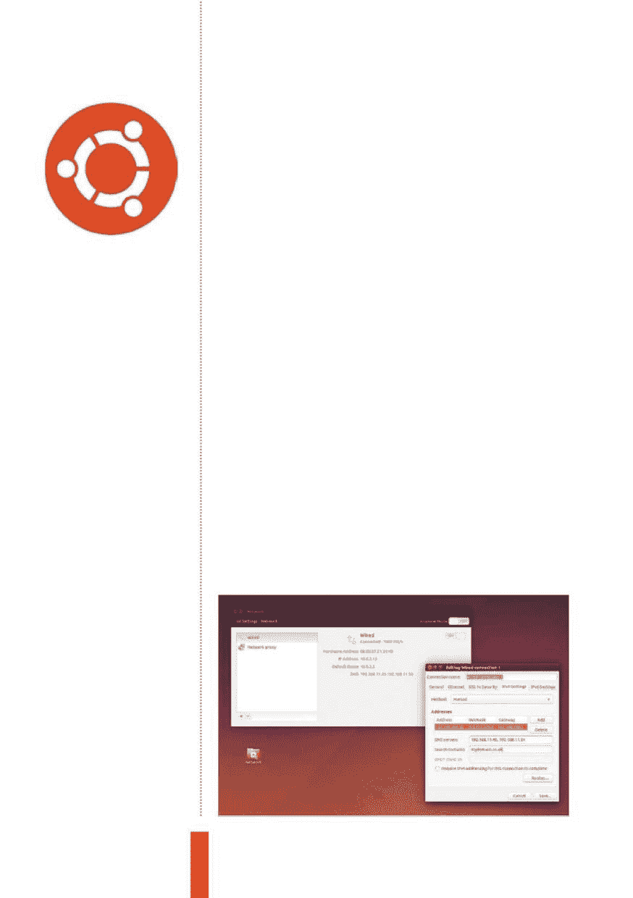

## Ubuntu 基础

## 配置网络连接

配置网络连接

在 Ubuntu 中设置网络连接非常简单。

对于那些只需要将以太线插入电脑网络端口即可立即访问互联网的人来说，可以跳过本节（也许在虚拟机环境中运行 Ubuntu 的人也可以这样做）。然而，大多数 Linux 新手在在连接互联网或更改网络参数时往往需要帮助。在过去的十年里，几乎每个 Linux 发行版都依赖于 NetworkManager —— 这是一个稳定、功能丰富且直观的 Linux 网络处理器。Ubuntu 的 Unity 桌面环境与 NetworkManager 紧密集成，在顶栏提供网络指示器，以及一个名为 Network 的独立图形化实用程序（图 1）。你可以在 Dash 中搜索它，作为系统设置中的子项打开它，或者从命令行启动（$ unity-control-center network）。在这里可以添加、修改甚至删除有线和无线线网络连接。

**图 1（右侧）** 配置有线和非有线网络连接

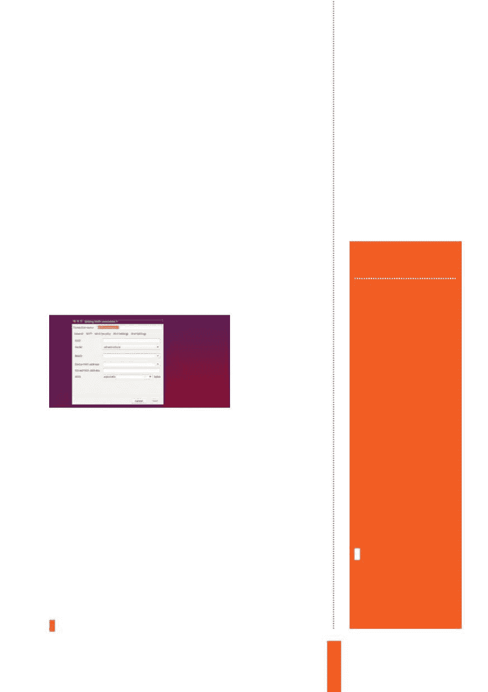

## Ubuntu 基础

## 配置网络连接

### 连接无线或有线网络

如果你想使用无线连接并且你有一个 Wi-Fi 网卡或芯片，事情就非常简单：注意 Unity 顶栏最右侧的“雷达”图标并点击它查看可用网络列表。选择你的网络，一旦提供正确的身份验证密码，大部分工作就完成了。对于有线网络连接，你会获得 IP 地址、子网掩码和网关地址，你需要进入网络配置对话框并手动添加连接。要这样做，首先检查有线网络的全局开关是否处于 On（开启）模式，然后按下窗口右下角的 Options（选项）按钮。这将打开连接编辑器（图 2），在其中最常用的地方是 IPv4 设置选项卡。在 Method（方法）下拉菜单中，选择 Manual（手动），然后在下面的字段中提供你的连接详情。

### 查看连接设置

当你在线时，可能仍然想使用 NetworkManager 查找有关当前连接的某些详情。查找此类详情最快的方法是点击 Unity 顶栏上的网络指示器并进入 Connection Information（连接信息）项目。你将看到一个带有许多连接详情的独立窗口，包括常规设置（你的网卡 MAC 地址、声明速率、接口名称）以及 IPv4 和 IPv6 的 IP 连接详情（如果对你有相关的话）。Network 应用的主窗口也显示网络设置，并包含一个更简短的列表，带有硬件地址 (MAC)、IP 地址、默认路由和 DNS 服务器列表。如果由于某些原因无法以图形模式运行 NetworkManager，请使用 `$ ifconfig` 命令查看设置并使用 `$ nmcli` 管理各种连接。例如，让我们从一个无法进入桌面的损坏 Ubuntu 系统中启动一个已知的 Wi-Fi 连接：

$ nmcli dev wifi con “Network_Name” password “your_password”

在代理服务器后进行操作会增加一点复杂性。通常情况下，你必须声明多次你的代理设置：分别用于 Web 浏览器、Bash 环境、Apt 软件包管理器、Wget 下载器等。然而，Ubuntu 在这方面让事情变得简单了一点。点击左侧列表中的 Network Proxy（网络代理）项，并选择适合你的代理设置类型。如果你得到了一个 URL，选择 Automatic（自动）方法并在下面的字段中提供该 URL。带有个人身份验证的代理通常需要手动设置。选择 Manual（手动）方法并提供至少 HTTP 代理，使用以下语法：

username:password@server-name.domain

提供正确的端口，最后点击 Apply system wide（应用到全系统）按钮完成设置并开始使用。

设置网络代理

**图 2** 使用连接编辑器手动输入详情

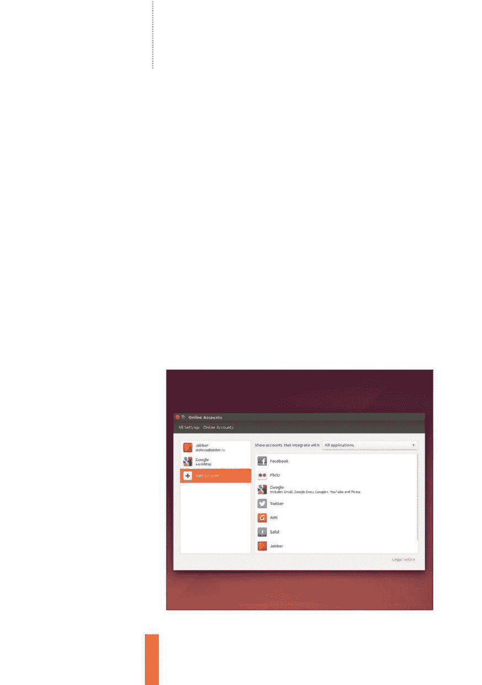

## Ubuntu 基础

### 连接在线账户

### 连接在线账户

在 Ubuntu 中享受更方便的在线服务集成

在线社交服务对于普通用户来说已经是日常生活的一部分。我们大多数人使用这些服务来与朋友和亲戚建立联系，分享照片、视频和其他文件。几乎每个在线服务都需要身份验证，这通常涉及注册账户并在稍后使用它访问服务的个人部分。Ubuntu 通过消除登录单个账户的需求，简化了在线服务的通用体验。（*注：原文中该段落存在大量重复，译文按要求已去重复处理*）

连接在线账户或有线网络

如果你想使用无线连接并且你有一个 Wi-Fi 网卡或芯片，事情就非常简单：注意 Unity 顶栏最右侧的“雷达”图标并点击它查看可用网络列表。选择你的网络，一旦提供正确的身份验证密码，大部分工作就完成了。对于有线网络连接，你会获得 IP 地址、子网掩码和网关地址，你需要进入网络配置对话框并手动添加连接。要这样做，首先检查有线网络的全局开关是否处于 On（开启）模式，然后按下窗口右下角的 Options（选项）按钮。这将打开连接编辑器（图 2），在其中最常用的地方是 IPv4 设置选项卡。在 Method（方法）下拉菜单中，选择 Manual（手动），然后在下面的字段中提供你的连接详情。

查看连接设置

当你在线时，可能仍然想使用 NetworkManager 查找有关当前连接的某些详情。查找此类详情最快的方法是点击 Unity 顶栏上的网络指示器并进入 Connection Information（连接信息）项目。你将看到一个带有许多连接详情的独立窗口，包括常规设置（你的网卡 MAC 地址、声明速率、接口名称）以及 IPv4 和 IPv6 的 IP 连接详情（如果对你有相关的话）。Network 应用的主窗口也显示网络设置，并包含一个更简短的列表，带有硬件地址 (MAC)、IP 地址、默认路由和 DNS 服务器列表。如果由于某些原因无法以图形模式运行 NetworkManager，请使用 `$ ifconfig` 命令查看设置并使用 `$ nmcli` 管理各种连接。例如，让我们从一个无法进入桌面的损坏 Ubuntu 系统中启动一个已知的 Wi-Fi 连接：

$ nmcli dev wifi con “Network_Name” password “your_password”

在代理服务器后进行操作会增加一点复杂性。通常情况下，你必须声明多次你的代理设置：分别用于 Web 浏览器、Bash 环境、Apt 软件包管理器、Wget 下载器等。然而，Ubuntu 在这方面让事情变得简单了一点。点击左侧列表中的 Network Proxy（网络代理）项，并选择适合你的代理设置类型。如果你得到了一个 URL，选择 Automatic（自动）方法并在下面的字段中提供该 URL。带有个人身份验证的代理通常需要手动设置。选择 Manual（手动）方法并提供至少 HTTP 代理，使用以下语法：

username:password@server-name.domain

提供正确的端口，最后点击 Apply system wide（应用到全系统）按钮完成设置并开始使用。

设置网络代理

**图 2** 使用连接编辑器手动输入详情

连接在线账户

连接在线账户

在 Ubuntu 中享受更方便的在线服务集成

（*注：原文中该段落存在大量重复，译文按要求已去重复处理*）

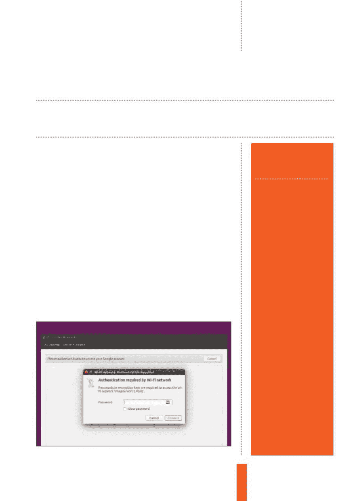

**Ubuntu 基础**

**85**


## Ubuntu 基础知识

## 使用系统监器

使用系统监器应用查看并管理系统资源

系统监器是一个用于管理运行进程和监控系统资源的工具。它是从 Gnome 桌面借用的许多配件之一。你可以通过启动器（Dash）或命令行（`gnome-system-monitor`）运行它。该应用程序的外和功能与 Windows 和 OS X 中的类似程序相似，并包含三个逻辑标签页：进程（Processes）、资源（Resources）和文件系统（File systems）。可以使用命令行参数启动显示特定标签页的应用程序，使用 `-p` 表示进程，`-r` 表示资源，`-f` 表示文件系统。使用 `gnome-system-monitor -f` 命令可以启动并显示文件系统标签页。系统监器用于解决系统卡顿问题。你还可以使用 CPU 负载图来检查硬件加速视频输出是否真实有效。

**管理系统进程**

Linux 中的每个应用程序至少创建一个进程。某些进程指向图形化应用程序，另一些则在后台运行并提供服务功能。在系统监器的帮助下，你可以查看所有进程列表，了解它们的名称，找出进程属于哪个用户，检测消耗过多 CPU 周期或占用大量内存的进程，将进程与其低级 ID 关联并管理进程优先级。通常，你会看到一个按名称排序的进程列表。注意，你可以点击列名称来对进程进行排序。按 CPU 使用百分比或内存占用进行排序非常有帮助。如果某个进程属于你（或你有相应权限），你可以杀死它或降低其优先级。选择你想要移除的进程并按下窗口右下角的“结束进程”（End Process）按钮。右键点击该进程并选择“更改优先级”（Change Priority）菜单来修改其优先级。

文件系统标签页显示了当前在 Ubuntu 中挂载的所有文件系统的表格。你可以找到设备名称、文件系统类型、挂载点、总容量和可用磁盘空间。当然，你可以在 Ubuntu 的磁盘实用程序（Disks，第50页）中找到类似的信息，但系统监器提供了更舒适的视图，让你能够快速分析设备上剩余的空间并按各种标准进行排序。“已用”（Used）列双倍了了磁盘空间的信息，但以百分比条的形式显示。当进度条填充到大约 90% 或更多时，意味着你的可用磁盘空间不足，这对于某些工作流场景可能会带来麻烦。如果根分区 (/) 达到 100% 满，Ubuntu 将无法正常运行。你也可以在终端中使用 `df` 命令（disk free）检查可用磁盘空间，尽管它不允许你对任何行进行排序或重新排序。

**查看文件系统详情**

**控制资源使用**

资源标签页提供了实时更新的有效图表（图1）。第一张图显示实时模式下的 CPU 历史（默认数据更新无延迟），用不同颜色显示 CPU 核心。当你启动一个重量级应用程序时，你会注意到图上的峰值。你还可以判断应用程序是否可以同时使用多个 CPU 核心，或者是否将所有负载推到一个核心上。中间的图是内存和交换使用（Memory and Swap Usage）。在现代系统中，日常任务很少使用交换文件或独立的交换分区，因为已经有了足够的 RAM。然而，处理大文件（例如在 GIMP 中修饰巨大的海报）可能需要交换，这只在系统可用内存不足时才会发生。最后一张图网络历史（Network History）显示了下载和上传的网络速度。该图对于网络故障排除和低网速诊断特别帮助。内存和网络历史图都能帮助你监控系统性能。

**图1** 图表有助于性能数据可视化

## Ubuntu 应用

### 探索 Ubuntu 软件中心

导航你购买、安装和删除应用的一站式商店

Ubuntu 软件中心（简称 USC）是一个包管理门户——也就是说，一个集成平台，你可以在其中搜索、安装或购买软件，甚至从已安装的软件列表中删除应用。Ubuntu 软件中心最初于 2009 年 10 月 29 日发布，用 Python 开发，包含超过 53,000 个应用程序。此前，Ubuntu 程序是从存储库中以 tar 文件格式下载、解压然后安装的，并在控制台中手动运行命令。即使是之前的 Ubuntu 版本，也有许多图形化实用程序用于添加/删除软件，这最终导致了功能冗余和开发工作的碎片化。为了简化这一过程，USC 提供了一种非常有价值的方法，只需点击几次按钮即可安装所有软件。在这里搜索特定软件是非常方便的，因为 USC 具有基于名称/描述的搜索功能，并有多个选项可供选择。评分和用户评论帮助你找到最佳软件。最新版本的 Ubuntu 带有一些预配置的工具和软件，如 LibreOffice 软件套件、Mozilla Firefox、文本编辑器等，它们在左侧边栏垂直显示。要开始使用，请在显示中搜索购物袋图标并点击它启动软件中心。启动 USC 后，会出现主屏幕，其中包含不同类别的软件、推荐软件、新添加软件（图2）、高评分软件等等。例如，如果你正在寻找文本编辑器，可以在搜索栏中输入关键字，它将以列表视图显示 USC 中存在的不同文本编辑器。你只需选择其中任何一个并点击“安装”（Install）按钮开始下载。

**图2** 软件中心按类别排列，帮助你找到所需内容

在主屏幕顶部，你会找到导航命令：所有软件（All Software）和已安装（Installed）（图1，第88页）。后退和正向按钮（分别显示为 `<` 和 `>`）帮助你在不同页面间导航。USC 将访问过的页面保存在内存中，这样你就可以通过后退按钮回到上次之前的页面。

**图3** 注册 Ubuntu 以获取推荐

在显示方面，如果类别设置为“默认显示非应用程序”，结果将以列表视图显示；否则使用磁格视图，并默认隐藏非应用程序。高星级应用程序也会显示在主屏幕上，无论它们是否已安装。五星级应用程序显示在“高评分”（Top Rated）标签页下；点击“更多”（More）按钮，你会进入一个按评分降序排列项目的页面。

**通过类别导航** 导航软件中心的不同方式。

在“已安装”（Installed）部分，你会找到安装在 Ubuntu 机器上的程序列表，以及安装日期。当选择一个软件项时，如果该项尚未安装在系统中，你将看到“安装”按钮。点击将软件安装到你的机器上。如果软件已安装，则提供“移除”（Remove）按钮；点击它将卸载软件。

在主屏幕上，你会发现“为你推荐”（Recommended For You）部分。为了使用推荐功能，你必须在 Ubuntu 中注册，并在表单提供有效的电子邮件 ID（图3）。你将在提供的电子邮件地址接收验证码（图4）。一旦完成该过程，你将收到成功消息，Ubuntu 开始向你推荐实用的软件，你可以轻松选择并安装到你的机器上。


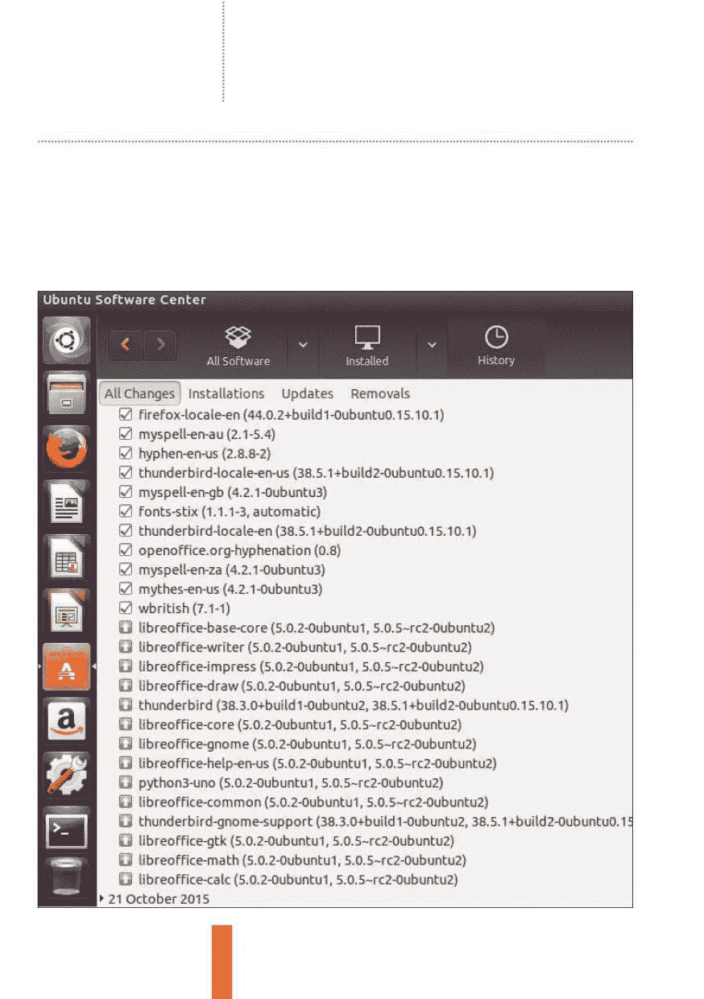

**92**

**Ubuntu 应用**

探索 Ubuntu 软件中心

在 USC（软件中心）的首页上，你会找到“历史”（History）选项卡；点击后，默认显示“所有更改”页面。导航栏下方有“所有更改”、“安装”（Installations）、“更新”（Updates）和“移除”（Removals）选项卡（图 5）。条目按分支分组，并按日期倒序排列标签为）（最新的在最上方）。点击分支上的任何位置（或在选中时按空格键），如果它是折叠的则会展开，如果它是展开的则会折叠。

USC 历史屏幕默认打开最近发生活动所在的分支。

更新和过去的下载记录：查看“历史”选项卡

**图 5** “历史”选项卡显示了过去的更新

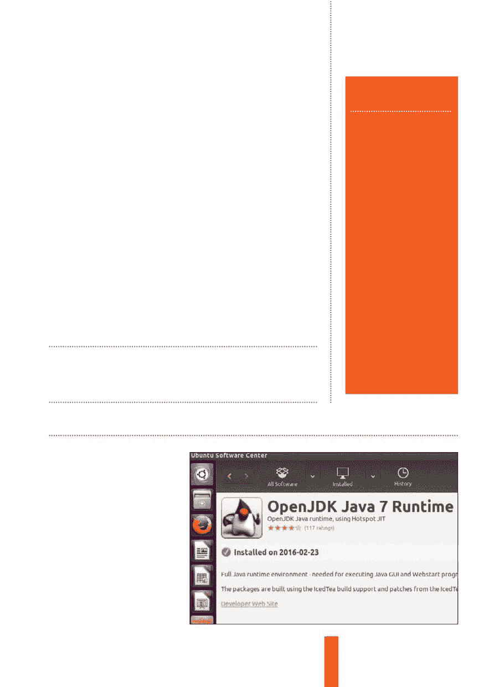

**93**

**Ubuntu 应用**

探索 Ubuntu 软件中心

“软件中心包含由 Ubuntu 自身提供的程序列表”。除了提供大量可下载的免费软件外，Ubuntu 软件中心还购买和安装商业软件的选项。

软件中心包含由 Ubuntu 自身提供的程序列表，以及 Canonical 合作伙伴提供的软件（那些遵守 Ubuntu 软件规则的程序）。软件中心中可用的程序数量持续快速增长，因此有很多选择。简单来说，Ubuntu 软件中心相当于适用于 Ubuntu 的 Google Play 商店（或 Apple App Store），你可以在这里找到只需点击几次即可安装的数以千计程序、工具和应用程序。

Ubuntu 一站式商店

“历史”选项卡中显示的项目包含软件图标、名称，以及安装日期和时间。在“安装”选项卡下，你将找到所有按安装日期分组的已安装应用程序。另一方面，“更新”选项卡列出了所有更新的应用程序及其更新日期。最后，“移除”选项卡显示了已从系统中卸载的应用程序列表。

在“历史”选项卡中，右上角的搜索栏可以搜索已安装或已从系统中移除的应用程序。每当 Backports 通道包含任何比已安装版本更新的应用程序时，最后一个导航栏就会出现“更新”项目。更新部分显示可用的应用程序更新数量，以及一个“全部更新”按钮。列表包含图标、标题、应用程序的更新版本以及最右侧的“更新”按钮。

当选中某个项目时，按回车键应激活其“更新”按钮；当更新已安装或正在等待安装时，其“更新”按钮应处于非活动状态。

安装程序：获取全新的程序

现在我们已经涵盖了导航和布局，让我们进入安装。在这个示例中，我们将安装 OpenJDK Java 7 和 Eclipse IDE。从 USC 首页选择“开发者工具”（Developer Tools）类别。这会将带你进入开发者工具页面，该页面有进一步的子分类。点击“Java”（咖啡杯图标），这将带你进入以列表视图显示 Java 相关项的页面（图 6）。

现在选择 OpenJDK Java 7 Runtime 项目，在右侧你将找到“安装”（Install）按钮；点击它来安装软件包。随后你会被提示输入管理员密码；输入正确的密码并按回车键开始安装。

安装期间，你将看到进度图标以图形化方式显示安装状态。完成后，你将被重定向到成功页面，该页面也包含“移除”（Remove）按钮以便卸载程序。

点击“返回”按钮搜索 IDE 部分；现在点击 IDE 图标以查看 USC 中存在的 IDE 列表。在搜索栏中输入“Eclipse”来搜索 Eclipse IDE。

“有许多程序可以安装，如聊天应用、文件共享等”

**图 6** 此页面列出了 Java 安装选项

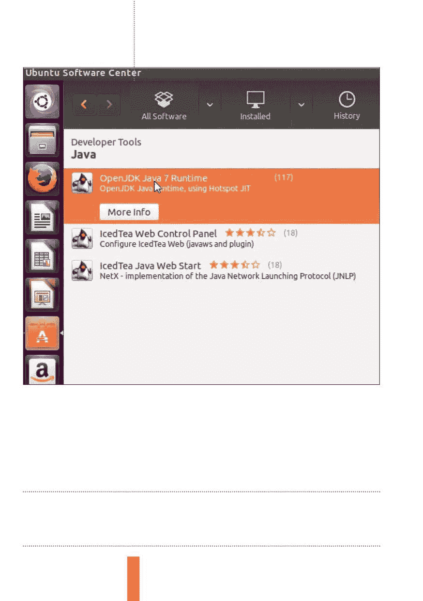

**94**

**Ubuntu 应用**

探索 Ubuntu 软件中心

选择 Eclipse IDE（蓝球图标），然后点击“安装”按钮；输入管理员密码开始安装。一旦 Eclipse 成功安装，打开它。

在控制台中创建一个名为‘Hello’的项目，并包含 `Hello.java`。运行此项目以获得输出。

高级软件：从“开发者工具”切换到“互联网”（Internet）部分，你将发现许多可以安装的工具，如聊天应用、文件共享等。

在“历史”选项卡中，右上角的搜索栏可以搜索已安装或已从系统中移除的应用程序。每当 Backports 通道包含任何比已安装版本更新的应用程序时，最后一个导航栏就会出现“更新”项目。更新部分显示可用的应用程序更新数量，以及一个“全部更新”按钮。列表包含图标、标题、应用程序的更新版本以及最右侧的“更新”按钮。

当选中某个项目时，按回车键应激活其“更新”按钮；当更新已安装或正在等待安装时，其“更新”按钮应处于非活动状态。

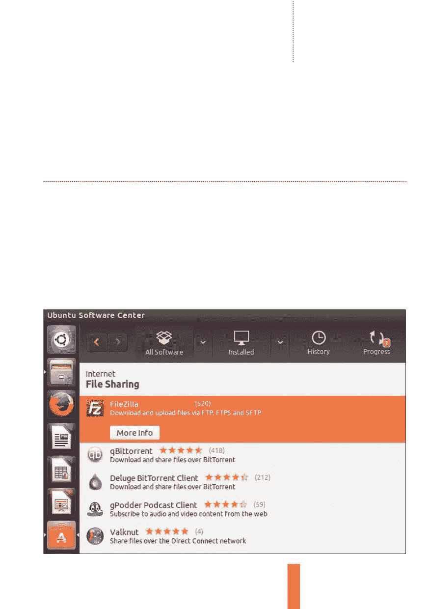

**95**

**Ubuntu 应用**

探索 Ubuntu 软件中心

“历史”选项卡中显示的项目包含软件图标、名称，以及安装日期和时间。在“安装”选项卡下，你将找到按安装日期分组的已安装应用程序。另一方面，“更新”选项卡列出了所有更新的应用程序及其更新日期。最后，“移除”选项卡显示了已从系统中卸载的应用程序列表。

在“历史”选项卡中，右上角的搜索栏可以搜索已安装或已从系统中移除的应用程序。每当 Backports 通道包含任何比已安装版本更新的应用程序时，最后一个导航栏就会出现“更新”项目。更新部分显示可用的应用程序更新数量，以及一个“全部更新”按钮。列表包含图标、标题、应用程序的更新版本以及最右侧的“更新”按钮。

当选中某个项目时，按回车键应激活其“更新”按钮；当更新已安装或正在等待安装时，其“更新”按钮应处于非活动状态。

安装程序：获取全新的程序

现在我们已经涵盖了导航和布局，让我们进入安装。在这个示例中，我们将安装 OpenJDK Java 7 和 Eclipse IDE。从 USC 首页选择“开发者工具”类别。这会将带你进入开发者工具页面，该页面有进一步的子分类。点击“Java”（咖啡杯图标），这将带你进入以列表视图显示 Java 相关项的页面。

现在选择 OpenJDK Java 7 Runtime 项目，在右侧你将找到“安装”按钮；点击它来安装软件包。随后你会被提示输入管理员密码；输入正确的密码并按回车键开始安装。

安装期间，你将看到进度图标以图形化方式显示安装状态。完成后，你将被重定向到成功页面，该页面也包含“移除”按钮以便卸载程序。

点击“返回”按钮搜索 IDE 部分；现在点击 IDE 图标以查看 USC 中存在的 IDE 列表。在搜索栏中输入“Eclipse”来搜索 Eclipse IDE。

选择 Eclipse IDE（蓝球图标），然后点击“安装”按钮；输入管理员密码开始安装。一旦 Eclipse 成功安装，打开它。

在控制台中创建一个名为‘Hello’的项目，并包含 `Hello.java`。运行此项目以获得输出。

“有许多程序可以安装，如聊天应用、文件共享等”

**图 6** 此页面列出了 Java 安装选项


**96**

**Ubuntu 应用**

探索 Ubuntu 软件中心

“软件中心包含由 Ubuntu 自身提供的程序列表”。除了提供大量可下载的免费软件外，Ubuntu 软件中心还购买和安装商业软件的选项。

软件中心包含由 Ubuntu 自身提供的程序列表，以及 Canonical 合作伙伴提供的软件（那些遵守 Ubuntu 软件规则的程序）。软件中心中可用的程序数量持续快速增长，因此有很多选择。简单来说，Ubuntu 软件中心相当于适用于 Ubuntu 的 Google Play 商店（或 Apple App Store），你可以在这里找到只需点击几次即可安装的数以千计程序、工具和应用程序。

“历史”选项卡中显示的项目包含软件图标、名称，以及安装日期和时间。在“安装”选项卡下，你将找到所有按安装日期分组的已安装应用程序。另一方面，“更新”选项卡列出了所有更新的应用程序及其更新日期。最后，“移除”选项卡显示了已从系统中卸载的应用程序列表。

在“历史”选项卡中，右上角的搜索栏可以搜索已安装或已从系统中移除的应用程序。每当 Backports 通道包含任何比已安装版本更新的应用程序时，最后一个导航栏就会出现“更新”项目。更新部分显示可用的应用程序更新数量，以及一个“全部更新”按钮。列表包含图标、标题、应用程序的更新版本以及最右侧的“更新”按钮。

当选中某个项目时，按回车键应激活其“更新”按钮；当更新已安装或正在等待安装时，其“更新”按钮应处于非活动状态。

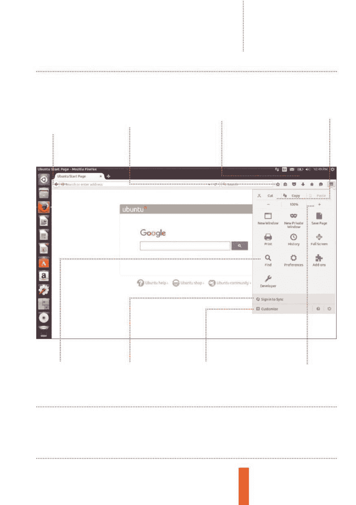

**97**

**Ubuntu 应用**

探索 Ubuntu 软件中心

地址和搜索栏
在此输入网站地址以浏览互联网。地址栏是智能的，因为它根据你的历史记录和书签自动建议网站。你可以在搜索栏中输入查询内容。

图标栏
此栏包含其他服务的图标，如 Pocket（保存阅读列表）、下载、首页和聊天。最后一个图标打开设置菜单。

通用选项
此区域包含 Firefox 提供的所有主要选项。你可以在这里打开新窗口、打印、查看历史、编辑设置等。

自定义
你可以使用此处的自定义选项来配置 Firefox 安装的按钮位置、主题以及整体外观和感受。

同步
在这里你可以登录以启用在所有设备上同步浏览数据。

添加和查看 **
**书签**
你可以通过星形图标添加书签，并点击下一个图标查看所有保存的书签。


## Ubuntu 应用

## 提升你的浏览体验
使用 Firefox 浏览网页的重要技巧

#### 01
有些步骤你每天会重复执行几次，却没有意识到它们花费了多少时间，例如搜索特定的网站。与其先访问搜索引擎、找到搜索框、输入关键词并执行搜索，不如你可以在浏览任何网站时，直接使用 Firefox 搜索互联网。

要在浏览器中设置此功能，请访问目标网站上你通常用于搜索该站的搜索字段页面。按住 Ctrl 键并点击地址栏搜索字段中的“搜索网站”（Search website）。为此搜索选择“添加关键字”（Add a Keyword）。会出现“添加书签”对话框。为书签输入一个适当的名称（例如：“Wikipedia搜索”）。创建一个关键字（如“wikipedia”）。选择包含该智能关键字的书签文件夹。点击确定。要使用创建的智能书签，在位置栏输入关键字和搜索字符串，然后按回车键。

### 02
现在人们使用多个设备访问互联网。Firefox 帮助确保你所有的同步书签、链接和其他内容在设备间无缝同步。Firefox 通过一个名为“同步”（Sync）的功能来实现这一点。它允许你在所有设备间共享数据和偏好（如书签、历史、密码、打开的标签页、阅读列表和安装的插件）。

让我们如何在 Firefox 中设置并同步账户。首先，点击菜单按钮并点击“登录同步”（Sign in to Sync）。登录将在新标签页中打开。点击“开始使用”（Get Started）按钮。填写表格创建账户并点击“下一步”。记住你使用的电子邮件地址和密码；稍后需要它们登录。检查邮箱中的验证链接并点击它以确认你的邮箱地址。

**图 1（上方）** 只需几个简单的步骤即可更改默认主页

“隐私浏览允许你浏览互联网而不保存任何关于你之前访问过的网站和页面的信息”

你已准备就！现在你只需要在所有其他设备上登录同步，让它完成剩下的工作即可。

#### 03
当你浏览网页时，Firefox 会记住很多信息，例如你访问过的网站和密码。然而，在某些情况下，你不希望能够访问你电脑的人看到这些信息。隐私浏览允许你浏览互联网而不保存任何关于你之前访问过的网站和页面的信息。隐私浏览还包含追踪保护，它可以防止公司跨多个网站跟踪你的浏览历史。要开启隐私浏览会话，点击菜单按钮然后点击“新隐私窗口”。如果你想直接在新的隐私窗口中打开链接，请在按住 Ctrl 键的同时点击该链接，并在右键菜单中选择“在新隐私窗口中打开链接”选项。

#### 04
Mozilla 也为开发者提供浏览器平台。

安装应用
这为 Mozilla 市场中数千个有趣且实用的应用铺平了道路（图 2）。Firefox 市场拥有丰富的游戏、音乐和生产力应用，满足每个人的需求。要安装应用，打开 Firefox，点击“工具”菜单并选择“应用”（Apps）。这将打开市场。现在，在搜索框中输入查询内容以查找特定应用，或根据你正在寻找的应用类型选择类别。你也可以从下拉菜单中选择屏幕类型，查看针对该屏幕尺寸优化的应用。点击应用查看详情。最后，如果你准备好安装应用，点击蓝色的安装按钮。

**图 2（上方）** 前往 Mozilla 市场下载应用

## 使用 Thunderbird 管理你的邮件
Thunderbird 是 Mozilla 软件套的一部分，是一款轻量级邮件客户端。它支持 POP、IMAP、Gmail 等不同的账户协议。它还内置了垃圾邮件过滤器，并可以通过标签轻松地组织邮件。通过简单的安装扩展可以添加更多功能。如果你是一个热心读者，Thunderbird 还可以作为新闻和 RSS 客户端。标签页邮件允许你在单独的标签页加载消息，这样你就可以快速在不同对话之间切换。快速过滤器可以帮助你根据标签、关键词等过滤消息。其他功能还包括消息存档、自定义主题和人物设定、智能文件夹，甚至是聊天集成。你还可以直接将 Twitter 和 Facebook 等社交媒体账户添加到 Thunderbird，并在这些平台上与联系人聊天。Ubuntu 16.04 默认安装了 Thunderbird，只需搜索它即可。点击结果中的图标启动 Thunderbird，你现在就可以开始了。

“你也可以直接将 Twitter 和 Facebook 等社交媒体账户添加到 Thunderbird”

使用 Thunderbird 远程工作并学习管理所有邮件账户

### 探索 Thunderbird 界面的核心功能
| 区域 |  |
| :--- | :--- |
| 获取消息 (Get messages) | 你可以使用此按钮强制与邮件服务器同步，并获取所有邮件账户的新消息 |
| 搜索和过滤 (Search and filter) | 你可以从此区域在邮箱中搜索特定关键词，或根据发送者、收件人、主题等过滤邮件 |
| 写信 (Write) | 点击此处打开撰写对话框并编写消息 |
| 通讯录 (Address book) | 它将不同邮箱账户的所有联系人详情存储在一个处 |
| 邮件文件夹列表 (Mail folder list) | 此区域包含所有邮件文件夹。如果你启用了统一邮箱，你将看到每个邮箱显示为一个文件夹 |
| 邮件列表 (Mail list) | 此区域按时间顺序显示所有邮件的列表。只需点击列标题即可根据不同标准进行排序 |
| 聊天 (Chat) | 所有的平台配置（如 Facebook、Twitter 等，如果已链接到 Thunderbird）都在此框内可见 |
| 邮件显示 (Mail display) | 此区域显示上方窗格中选邮件的详细视图。你可以在这里看到回复、转发和删除按钮 |

使用 Thunderbird 进行社交聊天
要向 Thunderbird 添加聊天账户，点击 Thunderbird 启动页面上“邮件”旁旁“聊天”按钮。点击链接后，你将看到一个列出支持服务的弹出窗口。Facebook、Twitter、Google Talk、IRC 和 Yahoo 均受支持。选择要添加的账户并点击“下一步”。在下一页输入用户名，在下一页选择别名。最后，点击“完成”按钮。你将被带到所选账户的网站以验证对账户的访问。验证后，你可以在新标签页中查看所有的对话。Thunderbird 聊爱的另一个方面是所有聊天对话都包含在搜索中。因此，如果你正在寻找某个关键词，只需输入它，获得的结果将包含你过去的聊天历史记录。

将 Thunderbird 作为你的邮件客户端
使用 Thunderbird 设置新账户非常简单。从点击启动页面上的“邮件”链接开始。然后你需要为你的邮件提供商提供用户名和密码，以及你的电子邮件地址（图 1）。Thunderbird 通过查询你的邮件提供商来确定连接详情（如端口、服务器名称、安全协议等），通常可以提供账户详情。

如果你的邮件提供商未列在 Thunderbird 数据库，或者你有非标准的邮件配置，则需要手动配置账户。手动配置账户需要以下详情：入邮件服务器和端口（例如 `pop.example.com` 和端口 110），出邮件服务器和端口（例如 `smtp.example.com` 和端口 25），以及与服务器连接的安全设置（例如 `SSL/TLS` 以及是否使用安全验证）。填写这些详情即可开始。

“使用 Thunderbird 设置新账户非常简单。从点击启动页面上的‘邮件’链接开始。”

**图 1（上方）** 输入你的姓名、地址和密码详情以关联新账户


## Ubuntu 应用
使用 Thunderbird 管理您的邮件

统一收件箱（Unified folders）是一种文件夹面板视图，类似于全局收件箱账户：它合并了所有账户的所有收件箱文件夹（包括 POP、IMAP 和本地文件夹）的内容。还将每个账户的收件箱作为统一收件箱账户的子文件夹显示。收件箱中的任何消息都会显示在统一收件箱的根目录以及统一收件箱的子文件夹中。每个账户显示收件箱的任何子文件夹，只有收件箱文件夹被“移动”到了账户之外。这不会改变消息存储的位置和方式。统一视图只是在单点查看文件夹的另一种方式。

要启用统一收件箱，请前往“查看 > 文件夹 > 统一收件箱”并选择。或者，如果您不想使用该功能，可以使用“查看 > 文件夹 > 所有文件夹”来选择更传统的显示方式。

带有统一收件箱的多个邮件账户

## 扩展 Thunderbird 功能

Thunderbird 具有开放、可扩展的设计和程序架构。这使得人们为它创建插件。大部分插件通过 Mozilla 附加网站分发，但作者可以以他们选择的任何方式进行分发。让我们看看如何安装插件……

首先，前往“工具 > 附加组件”。点击“获取附加组件”（图 2）。在搜索字段中输入您想要的插件名称或关键词，然后点击放大镜图标。然后从列表中选择该插件并点击“添加到 Thunderbird”。

一旦按钮可用，点击“立即安装”。请注意，来自官方网站 (addons.mozilla.org) 的插件经过了 Mozilla 的审核，安装起来相对安全。此外，如果作者经过了验证，将显示作者名称。最后，重启 Thunderbird 以完成更改。

要删除插件，请前往“工具 > 附加组件”，并在“扩展”、“主题”或“插件”面板中选择要删除的插件。然后点击“禁用”以防止其加载；您也可以点击“卸载”来将其完全删除。

“Thunderbird 具有一个开放、可扩展的设计和程序架构”
**图 2（上方）** 访问 Mozilla 附加网站以改进您的 Thunderbird 功能

## Ubuntu 应用
以同理心进行交流

即时消息（缩写为 IM）是一种通过互联网和本地局域网进行即时通信的基于文本的。虽然某些 IM 应用需要您创建一个新账户，但另一些则通过使用来自 Google、Yahoo 等不同服务提供者的账户提供 IM 功能。IM 应用还可以用于连接到聊天室。对于初学者来说，聊天室是志同道合的人聚在一起交流的在线场所。

在本特性中，我们将探索 Empathy。它是一个支持通过许多不同协议进行文本、语音、视频聊天和文件传输的消息程序。Empathy 还允许您添加来自不同服务的账户，并使用它们与您的联系人聊天。基于 Telepathy 的协议支持和基于 Gossip 的 UI，Empathy 是当前版本 GNOME（以及因此 Ubuntu）的默认聊天客户端。

要开始使用 Empathy，只需在 Dash（启动器）中输入“Empathy”。然后点击 Empathy 图标启动应用程序。当您首次启动它时，系统会要求您链接在线账户。只需链接您的账户，您就可以轻松地与所有联系人交流。使用 Empathy，您还可以将所有对话合并在一个窗口中，为不同类型的对话开启多个窗口，轻松搜索之前的对话，并只需点击两次即可共享您的桌面。现在让我们更详细地了解 Empathy。

“当您首次启动它时，系统会要求您链接在线账户。只需链接您的账户，您就可以轻松地与所有联系人交流”
学习如何设置并充分利用 Empathy 文本信器

### 应用设置
| 功能 |  |
| :--- | :--- |
| 应用设置 | 当您打开 Empathy 时，这些设置会自动显示在顶部状态栏上。您可以在这里找到与对话、联系人等的各种设置。 |
| 其他设置 | 您可以在 Empathy > 偏好下的不同标签页中查看声音、通话、位置、拼写检查、主题等多个其他设置。 |
| 在线账户 | 如果您在状态栏中选择“账户”，将打开此项。如果您在此点击“所有设置”，将带您去到系统页面。 |
| 通用设置 | 您可以在 Empathy > 偏好中找到这些设置。在通用设置下，您可以设置默认显示哪些联系人以及等。 |
| 联系人列表 | 此窗口显示所有联系人列表及其当前状态。要与列表中的任何人聊天，右键点击该联系人并选择“聊天”。 |
| 账户详情 | 一旦您在左侧选择了已添加的账户，您将看到所有相关选项。您可以在此处启用或禁用服务。 |
| 账户列表 | 您将看到已添加到系统的账户列表。点击“添加账户”添加新账户。 |
| 聊天窗口 | 这是您与联系人交谈的实际聊天窗口。根据系统功能，您还可以在音频和视频模式下聊天。 |

#### 01
您可以从多个支持的服务中添加即时消息账户（图 1）。对于某些账户提供商，这些步骤还允许您注册新账户。要添加账户，点击 Empathy > 账户，然后按 +。从“您有什么种的聊天账户？”下拉列表中，选择您想要添加的账户类型。输入所需信息。对于大多数账户，您只需要登录 ID 和密码。不过，某些账户可能需要额外信息。

 02
在您将账户添加到 Empathy 之后，下一步是添加您的联系人并管理他们。要添加联系人，点击“聊天 > 添加联系人”。然后从账户下拉列表中选择您想要连接到该联系人的账户。请注意，您的联系人也应该使用与您选择的账户相同的服务。使用 Empathy 的第一步开始使用 Empathy 消息传递。在标识符字段中，输入联系人的登录 ID、用户名、屏幕名称或其他适用于该服务类型的适当标识符。在别名字段中，输入您希望在联系人列表中显示的联系人姓名。最后，点击“添加”将该人员添加到您的联系人列表。如果您的某一个或多个联系人具有不同消息服务的多个账户，可以将这些账户合并为一个单一联系人。生成的联系人被称为“元联系人”（meta-contact）：由不同的单一联系人组成的联系人。要链接账户，点击勾选按钮。“对于大多数账户，您只需要登录 ID 和密码。不过，某些账户可能需要额外信息。最后点击“添加”以确认
**图 1** 使用 Empathy 登录各种消息账户

#### 03
Empathy 支持使用默认 GUI 进行音频和视频通信，然而，它仍然依赖于您用于通信的账户。这是因为只有特定的服务支持音频和视频通信。目前仅支持 Google、Jabber 和 SIP 账户。假设您正在使用支持的账户之一，让我们看看如何发起音频和视频通话。要发起通话，右键点击您想要通话的联系人并选择“音频通话”或“视频通话”。在随后打开的窗口中，您将看到正在建立连接。连接建立后，您将在窗口底部看到总通话时间。完成后，点击挂机按钮结束对话。

“Empathy 支持使用默认 GUI 进行音频和视频通信，然而它仍然依赖于您用于通信的账户”

#### 04
要在 Empathy 中使用 IRC，请确保您已向 Empathy 添加了至少一个账户。然后您可以选择“房间 > 加入房间”，这将打开 IRC 弹出窗口。您只需从下拉列表中选择您的账户名称，然后填写房间名称和服务器名称（图 2）。现在您应该可以与加入房间中的人聊天了。请注意，一个 IRC 网络可能有许多您可以连接的服务器。当您连接到特定网络上的服务器时，您可以使用 Empathy 与该网络上所有其他服务器的所有用户进行 IRC 通信。您还可以使用“添加”和“删除”按钮为此网络添加移除服务器。选择某个服务器时，点击服务器或端口下的字段进行编辑。或者，使用左右箭头键聚焦字段，并按空格键开始编辑。选择您想要链接的条目。这将启用选择模式，您可以看到每个条目对应的复选框。勾选对应于同一个联系人条目的复选框。最后，按“链接”。

**图 2（下方）** 输入您的详情以进入 IRC 聊天室


## Ubuntu 应用程序
220 LibreOffice 基础知识

正如其名称所示，LibreOffice 是微软 Office 的开源替代品。它包含了文字处理、数据库创建、幻灯片设计等完整程序，是大多数流行 Linux 发行版中自带的办公套件。

对于普通用户和新手来说，可能很难理解 LibreOffice 到底有多强大。人们很容易陷入思维定式，无法充分利用它提供的各种功能。例如，在日常工作中，你可能认为不需要在 Writer 中使用宏、创建索引或进行邮件合并。但这些功能可以极大地提高你的生产力和效率（图 1）。

在接下来的几页中，我们将介绍一些提升体验的佳方法——特别是在核心的 Writer 和 Calc 程序中。你将优化工作方式，并开始充分利用这款功能丰富的办公软件。

通过这些 LibreOffice 套件中不可或缺的小技巧，让你的工作日更加高效。

**图 1（下方）** 更高效地使用 LibreOffice 应用程序

“对于普通用户和新手来说，可能很难理解 LibreOffice 到底有多强大”

### 01 调出格式选项
也许你正寻求提高可读性，或者确保文档打印效果完全符合你的预期。无论何种情况，解决方法都是对文本进行格式化。起初你可能很难弄清楚为什么某些文本段显示那样，因此请进入格式部分查找原因并修改。工具栏上有一个看起来像反向“P”的符号——点击它可以显示实时格式符号，例如异常的段落标记。

### 02 更好的项目符号
创建项目符号列表非常简单；点击圆点或数字类型即可。你可以更改这些项目符号的格式，将其改为不同的符号或字母而非数字。此外，你还可以使用 `Tab` 键创建嵌套子列表，然后按 `Shift+Tab` 回到标准列表。

### 03 粘贴未格式格式的文本
通常在 Linux 中，你可以使用 `Ctrl+Shift+V` 粘贴文本并同时删除格式。如果你在 Writer 中使用此功能，或者在“编辑”菜单中找到“特殊粘贴”，你将会有多种粘贴文本的选择（图 2）。其中一种是不带格式的粘贴，但它也允许其他方法，例如使用 LibreOffice 格式。

**图 2** “特殊粘贴”功能提供了多种格式格式选项

### 04 快速计算
即使在写作时，你可能也需要进行快速数学计算。无需切换到 Google 或计算器应用，你可以使用公式栏。进入“插入”、“对象”、“公式”，然后写下你想要计算的内容。一旦确认，公式的结果就会出现在你光标所在的位置。

“即使在写作时，你可能也需要进行快速数学计算。无需切换到 Google 或计算器应用，你可以使用公式栏”

### 05 快速导航
按下 `F5` 或进入“视图”菜单将允许你使用“导航器”功能。在大型文档中，可以使用它在不同的标题、表格、图形、书签以及文档中的许多对象之间快速移动。它不是一个固定的面板，因此你可以移动它，以便随时查看你想看的内容。

### 06 设置默认文档格式
默认情况下，Writer 将将新文件保存为 ODT（开放文档格式）。这在大多数其他文字处理器中都适用，但如果你经常需要处理需要在 Microsoft Office 中运行的文件，可以将默认文件格式更改为 .doc 或 .docx。进入“工具 > 选项”，并在“加载/保存”下找到“常规”设置来更改默认值。

### 07 创建备份
Writer 有了一套针对意外关机的恢复系统，但这依赖于临时文件。你可以在“加载/保存”选项中启用备份系统。

### 08 更改大小写
有句子或单词没有正确大写吗？你可以通过选中内容并查看可用菜单来更改大小写。还有一个专门的选项可以进行更改。

### 09 表格自动格式化
如果你创建了表格，可能需要添加一些颜色来提高其可读性。使用“格式”下的“自动格式”选项可以创建一个方案。一旦设置就绪，你也可以对其进行微调。

### 10 保护你的电子表格
共享表格对提高效率很有帮助，但表格变得越复杂，就越难以追踪某人的意外更改。你可以通过“工具 > 文档 > 表格”来保护电子表格，让特定人员可以进行更改。

### 11 更改状态栏预览
当你选择某些带有数值的单元格时，状态栏上会显示一个方便的提示，告诉你的总和。不过，这并不总是你想要的。点击状态栏的该区域调出菜单，并将其改为平均值、最大值或最小值。

### 12 自动筛选行
筛选行有助于组织数据，但如果你不确定如何操作，Calc 有一个你可以使用的自动筛选工具。选择一行，然后进入“数据 > 筛选 > 自动”，它将根据该行创建一个自动筛选系统。一旦设置就绪，你也可以对其进行微调。

### 13 分组单元格
有时你不需要一直看到特定的数据块，像代码中那样将其折叠起来可以为可视页面留更多空间。通过使用“数据 > 分组和轮纲 > 自动轮纲”下的“轮纲”功能，你可以创建这些可折叠组，它们使用粗线条来标识自己。

### 14 自动递增或复制单元格
如果你从未发现过它，Calc 在复制单元格方面非常智能。如果你写下二或三个数字甚至是日期，选中一个并向下拖黑色方块进行复制，它将按正确的顺序自动填充单元格数字或日期。如果你不希望它这样做，在复制单元格时按住 `Control` 键即可进行普通复制。


## Ubuntu 应用
## 20 个 LibreOffice 核心

15 回车键将你移动到下一行单元格似乎非常自然，这也是 Calc 的默认行为。然而，你实际上可以通过进入“工具 > 选项 > LibreOffice Calc”，然后选择“常规”来更改回车键的行为，使其按行移动。

### 更改回车键

16 如果你有大量的数据、行或列，你有时会发现自己在浏览电子表格时，并不总是记住或确定某个单元格的用途。通过选择你希望始终显示的行或列，进入“窗口”然后选择“冻结”，这样在浏览表格时它们就会始终保持在顶部或左侧。

### 冻结列

## 杂项

17 使用 Impress 演示幻灯片时，你通常会连接到投影仪或电视机，它们要么镜像你的笔记本屏幕，要么作为扩展显示。Impress 有一个非常用的功能：实际演示将在大屏上显示，而你可以仅为笔记本电脑显示开启演讲者控制台，向你展示即将要演示的内容以及备注。

### 演讲者模式

18 你可能需要从另一种语言粘贴一段话到文档中。文档的其余部分是英文，所以拼写检查遇到不熟悉的单词时会出错。高亮该段落，点击“工具 > 语言”，然后为文档的这部分选择一种语言，仅限此部分。

### 动态切换拼写检查中的语言

19 LibreOffice 有一个完全独立的应用程序叫做 Math，它实际上并不是数据库软件，而是一种绘制数学方程的方法，这些方程随后可以插入到其他 LibreOffice 软件中。如果你正在写一篇包含复杂数学公式且需要可读性的学术论文，这非常有帮助。

### 插入可读的公式

20 可以在 LibreOffice 中编辑 PDF。只需使用类似 Writer 的工具将其导入，它就会将 PDF 导入 Draw 应用程序中。你可以编辑文本、更改图片，甚至更改 PDF 的整体格式。完成后，Draw 允许你将工作文件导出为 PDF 供使用。

### 使用 PDF

## Ubuntu 应用
## 使用 gedit 编辑文本

文本编辑器（又名 gedit）是 Ubuntu 操作系统和 GNOME 桌面环境的默认 GUI 文本编辑器。它兼容 UTF-8，并支持大多数标准文本编辑器功能，以及许多高级功能，如多语言拼写检查、广泛的语法高亮支持以及大量的官方和第三方插件。由于支持多种字符集，文本编辑器可以扮演多功能角色——你可以用它准备简单的笔记和文档，也可以使用其高级功能创建源代码，就像使用集成开发环境一样。gedit 在 Ubuntu 16.04 中默认安装，可以通过 Dash 或应用程序快捷方式启动。如果你更偏于命令行，可以使用 `gedit` 命令直接与工具进行交互。

要用 gedit 打开特定文件，请在命令行提示符输入 `gedit <文件名>`。要打开多个文件，输入 `gedit <文件名1> <文件名2>` 等。你也可以通过在路径中包含 `+<行号>` 来打开特定行的文件，例如：`sudo gedit +21 /etc/apt/sources.list`。

gedit 在“编辑 > 偏好”下提供了几个非常有用的选项，你可能想要查看一下。例如，gedit 会自动为你正在编辑的文件创建备份副本。然而，如果你的磁盘空间不足，可以禁用此：只需进入“编辑 > 偏好 > 编辑器”标签并取消勾选“创建备份副本”。

### 了解其功能并学习其许多用途
“高级功能包括多语言拼写检查、广泛的语法高亮支持以及大量的官方和第三方插件”

## Ubuntu 应用
## 使用 gedit 编辑文本

### 发现用户界面

**新文件**
- **新文件**：此按钮允许你在 gedit 中创建新文件。当你点击此按钮时，将创建新的标签页。保存文件时系统会提示选择位置。
- **搜索文件**：放大镜图标允许你搜索文件，接下来的带有铅笔的图标允许将搜索到的术语替换为其他术语。
- **保存文件**：完成文件编辑后，点击此按钮保存工作。如果是全新的文件，系统也会要求你输入位置。
- **撤销/重做按钮**：你可以使用这些按钮撤销文件中的操作或选择重做这些操作。
- **打开文件**：你可以从这里打开现有文件。只需点击按钮并选择你想要打开的文件。
- **状态栏**：此栏会实时显示文件详情，如编码、当前光标位置、标签宽度等。
- **打印文件**：此按钮允许你直接从应用程序打印文件。如果你还没有添加打印机，系统会提示你添加。
- **编辑按钮**：你可以在这里找到编辑选项（剪切、复制和粘贴）。你也可以使用常用的快捷键（Ctrl+X, Ctrl+C 和 Ctrl+V）来完成这些操作

## Ubuntu 应用
## 使用 gedit 编辑文本

### 使用 gedit 处理文件

01 我们已经看到如何通过命令行在 gedit 中打开文件了。现在让我们了解如何在 gedit 中管理文件。要在 gedit GUI 中打开一个文件或一组文件，请点击打开按钮或按 `Ctrl+O`。在对话框中，选择所有你想要打开的文件并点击打开（图 1）。默认情况下，gedit 提供了访问你最常用文件的快捷。要打开其中之一，点击打开按钮右侧的向下箭头。一旦你选择了所需的文件，它就会在一个新的标签页中打开。

“默认情况下，gedit 提供了访问你最常用文件的快捷。要打开其中之一，点击打开按钮右侧的向下箭头”

02 查找工具可以帮助你在文件中定位特定的文本序列。要打开搜索窗口，点击“菜单 > 查找”，或按 `Ctrl+F`。这将把光标移动到搜索窗口的开头。在搜索窗口中输入你想要查找的文本。当你输入时，gedit 将开始高亮匹配你输入内容的文本。你可以使用上/下方向键或按 `Ctrl+G` 滚动搜索结果。你也可以用鼠标高亮部分文本并按 `Ctrl+F`。你高亮的文本将自动出现在搜索窗口中。

### 语法高亮

03 如果你想使用 gedit 进行文本编辑，你可以选择高亮你编写的代码行。gedit 使用 GtkSourceView 进行语法高亮。它使用 `.lang` 文件来定义高亮方案。特定特定编程语言的 `.lang` 文件位于 `/usr/share/gtksourceview-3.0/language-specs/` 文件夹中。

你可以通过“视图 > 高亮模式”从菜单启用代码高亮，或者通过底部的状态栏启用。通过“视图”菜单启用的状态栏显示许多源、脚本、标记和科学格式的编程语言选项。

“在文件中定位特定的文本序列”

### 处理文本
**图 1 ** 使用此对话框导航到你想打开的文件

### 发现核心功能
深入探索 gedit 的功能。你还可以用 gedit 打开位于其他机器上的文件。然而，在 gedit 中打开服务器上的文件之前，你需要了解有关服务器的一些技术信息。例如，你需要服务器的 IP 地址或 URL，并可能需要它是什么类型的服务器（HTTP、FTP 等）。一旦获取了所有必要信息，进入打开对话框并点击图标输入服务器的 IP 地址/URL。选择文件并点击打开。如果你拥有权限，文件应该立即打开。

04 插件极大增强了 gedit 的功能，可以通过“编辑 > 偏好 > 插件”访问（图 2）。预装了十多个插件并可以在这里启用/禁用。额外的插件可以通过互联网获取。这里是两个可以帮助你日常活动的插件：
- 标签列表 (Tag List)：在侧边栏显示常用标签并允许将其插入文件。
- 外部工具 (External Tools)：这允许用户在 gedit 内部对正在编辑的文件运行外部命令。一旦启用此插件，用户就可以从“工具”菜单中选择自定义工具。注意，这默认是不启用的。

**图 2 ** 使用 gedit 偏好对话框启用和禁用插件**


## Ubuntu 应用
## 使用 Shotwell 管理图像

大多数用户将 Shotwell 视为一个简单的图片查看器：在 Nautilus 中双击图片，它就会在 Shotwell 中弹出。但将此产品仅作为图片查看器意味着用户错失了一系列非常有用的辅助功能。Shotwell 自带了一个基于 SQL 技术的相当复杂的数据库，因此可以极快的速度存储和检索图片。各种高级选项允许你根据需要定制显示列表；如果 Shotwell 设置得当，它将显著减少在你的（不断增长）的文件集中查找特定图像所需的时间。此外，如果你的数码相机设置正确，Shotwell 将自动分析 EXIF 数据，以获取拍摄日期和其他信息。因此，将单次活动拍摄的所有照片汇集到一个位置只需点击一下即可。

屏幕右侧的教程假设你已经完成了该产品的初始配置。如果情况并非如此，请在 Dash（启动器）中输入 Shotwell。点击“Shotwell Photo Manager”启动应用程序，并在面对“欢迎 Shotwell”对话框时点击 OK 按钮。你可以直接接受其默认设置，但请准备等待几分钟，因为数据库将填充你个人资料中“图片”文件夹下的所有图片和截图。

使用 Shotwell 轻松管理大量照片

“大多数用户将 Shotwell 视为一个简单的图片查看器。但用这种方式意味着用户错失了一系列非常有用的辅助功能”

### 最近导入视图
点击图像库的此部分可以将焦点集中在最近添加的内容。如果你想查看最近向集合添加了项目，这非常有帮助——特别是如果你是一个“懒于打标签的人”，这非常方便。

### 边框指示器
可以选择图片进行批量处理。Shotwell 用蓝色边框显示选中的图片——使用覆盖层会影响当前图片的原始性。

### 相机列表
主列表的这部分提供了当前连接到工作站的所有外部存储媒体的概述。它是启动导入操作的首选地。

整理你的作品 瞬间存储并检索你的图片

### 事件列表
图片根据拍摄日期进行分类。点击其中任何一项都可以限制图片区域显示的内容。

### 标签列表
如果说事件列表之于事件，标签列表之于标签：这是一个寻找有趣图像素材非常有用的工具。

### 缩放杆
可以根据需要调整显示区域图像元素的大小。只需向左或向右滑动杆，即可在信息密度和图片质量之间找到正确的平衡。

### 图像显示
Shotwell 在灰色背景上显示当前选择部分的内容。双击任何图片即可以全屏模式打开查看。

### SQLite 驱动
Shotwell 将数据存储在 SQLite 数据库中。与传统的平文件存储相比，这显著提升了性能——甚至可能有一天允许添加网络功能。

## 整理你的照片 使用 Shotwell 处理图像

**01**
从活动回到后，启动 Shotwell 并将数码相机的内存卡插入内部或外部读卡器中。Shotwell 将自动识别存储介质，并将其作为树状列表中“相机”部分的一个项目显示。等待底部的进度条填充——应用程序必须读取每张图像以获取有关它的进一步详细信息。接下来，点击屏幕右下角的“导入图像”按钮。Shotwell 将开始将图片复制到工作站的“图片”文件夹中。如果涉及的文件很大，这个过程可能会花费相当的时间。

“从活动回到后，启动 Shotwell 并将数码相机的内存卡插入内部或外部读卡器中”

**图 1（上方）** 图片按日期存档

**02**
当导入过程结束，你的硬盘空间将会减少一些。重要的是，你不要移动文件——移动文件会导致灾难性的后果。

**03**
如果让 Shotwell 自动处理，图片将根据拍摄日期分组。由于日期本身并不包含信息，赋予有用的名称是明智的。

**04**
无论是移动物体还是昏暗场景，当成像情况变得棘手时，使用 RAW 拍摄可以帮助你利用图像。遗憾的是，生成的文件并不适合分享，因为大多数机器上没有相应的查看器。

Shotwell 提供了一个 RAW 导出器，用于将分散的相机文件转换为 JPEG 等效文件（图 2）。只需双击图像以全屏模式打开它，然后右键点击它。接下来，选择“发送到”。弹出的窗口允许你选择格式——选择 JPG 可确保 Shotwell 生成行业标准的图片文件。

**05**
逐个发送图片是一项辛苦的任务。幸运的是 Shotwell 也可以一次转换一组图片。在概览模式下（Shift/Ctrl+点击）选择它们，然后选择“文件>导出”。Shotwell 将首先显示第四步中的格式选择对话框，随后将显示一个允许你选择存储位置的常用对话框。

过程完成后，将显示一个标题为“保留还是删除”的消息。它允许你决定图像是否应留在内存卡上——选择“是”没有问题，因为它们不会再次被导入。

**查看什么**
**命名事件**
**添加标签**
**分享 RAW 文件**
“如果让 Shotwell 自动处理，图片将根据拍摄日期分组。为事件赋予有用的名称是明智的”
**批量分享**
**图 2（上方）** 文件可以轻松转换为 jpeg 等效文件
点击 OK 后，程序将显示一个允许你选择目标的对话框。然后可以通过蓝牙或电子邮件发送图像。


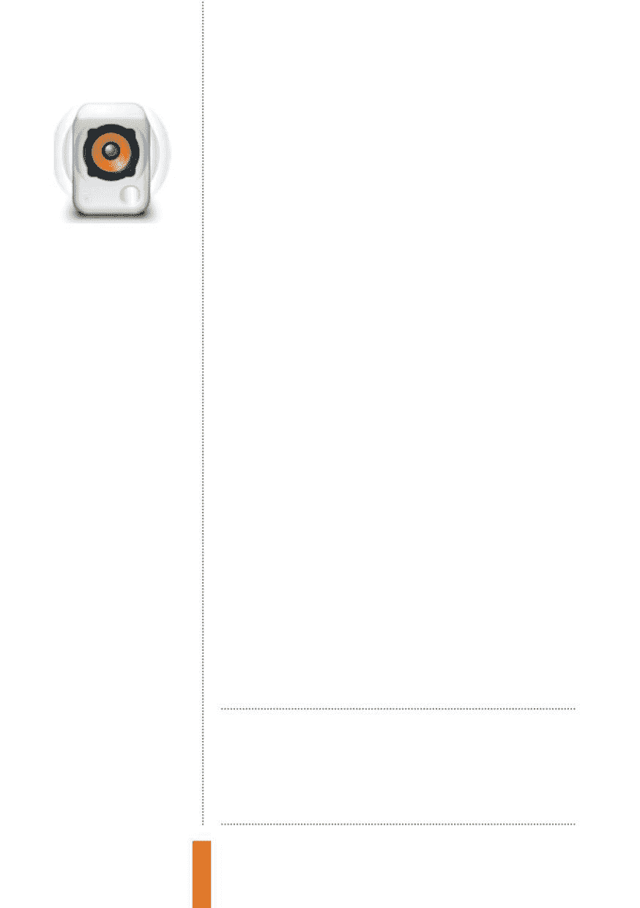

**Ubuntu 应用**

使用 Rhythmbox 听歌曲

124

高质量的耳机对处理背景噪音很有帮助——得益于多核 CPU，在后台播放音乐非常简单。

遗憾的是，获取媒体文件只是挑战的一小部分；一旦几千个 MP3 文件占满了你的存储空间，音乐管理本身就会变成一个严重且令人烦恼的问题。Ubuntu 通过 Rhythmbox 媒体播放器解决了这一问题。它是一个媒体数据库、在线收电台播放器以及一个经典的、低资源消耗的媒体播放工具的结合体。

开始使用 Rhythmbox 非常简单：在 Nautilus 中点击媒体文件，播放器就会显示在屏幕上。将其最小化以享受后台播放的好处——即使你关闭了应用程序，音乐也会继续运行。

遗憾的是，这种方式使用 Rhythmbox 意味着忽略了该产品的大多数有趣功能。高级用户可以创建包含喜爱单曲的自定义播放列表——某些冷门的 Falco 曲目绝对能让你从工作中分心来！

此外，该程序还可以用作淡出引擎。这意味着普通 MP3 文件之间令人讨厌的间隙可以通过歌曲之间的重叠来“桥接”——它可能无法模仿 DJ 的精湛技巧，但比比没有好得多。

在工作时使用你的工作站听音乐

“Rhythmbox 是一个媒体数据库、在线收电台播放器以及一个经典的、低资源消耗的媒体播放工具的结合体”

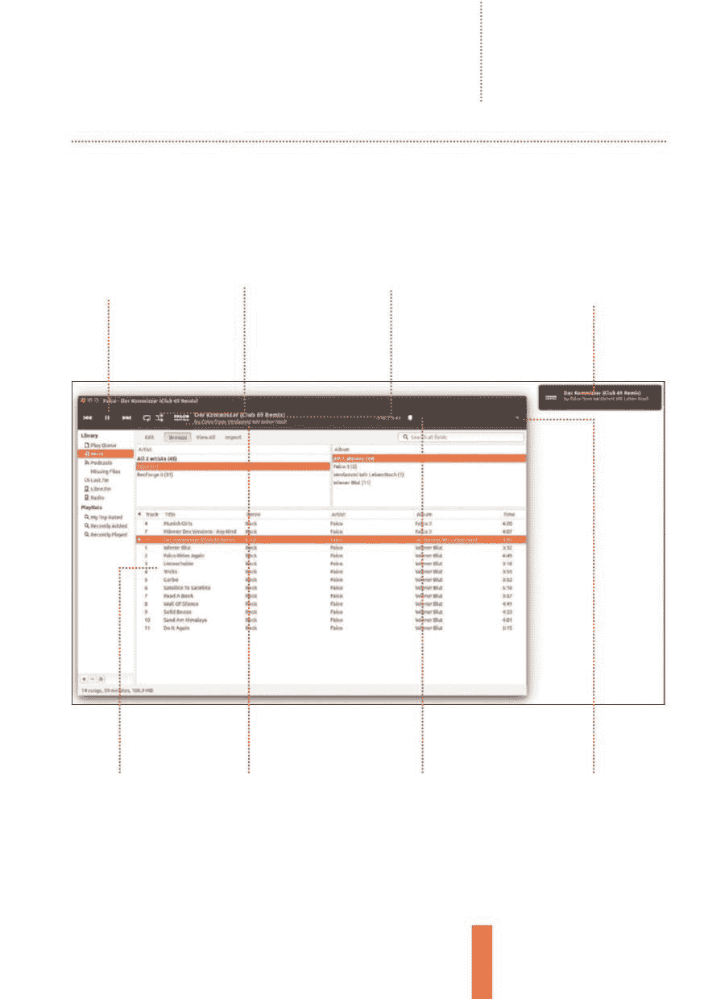

**Ubuntu 应用**

使用 Rhythmbox 听歌曲

125

**播放控制**

如果它在 Apple 的 iPod 上有效，那么它在 Rhythmbox 上同样有效。这三个按钮控制当前选中文件的播放。这个微型控制器对于快速切换播放内容非常方便。

**dbus 调用**

Rhythmbox 集成到 Ubuntu 的 dbus 事件系统中。这意味着即使 Rhythmbox 此时没有处于前台，当前播放的曲目也会显示在通知器中。

**随机和重复**

无论你的播放列表有多长，它最终都会到达结束。启用循环模式可以轻松解决这个问题，因为 Rhythmbox 会简单地从头重新开始。

使用 Ubuntu 播放音乐 使用 Rhythmbox 在不经意间播放音乐

**曲目信息**

音乐是 Rhythmbox 的核心内容。专辑封面色块旁边的两个标签提供了当前播放曲目的信息，以及专辑和艺术家的信息。

**媒体存储列表**

播放控制下方的的大表格提供了当前计划播放的媒体概览。双击项目即可开始播放。

**音量调节**

独立于系统其他部分降低 Rhythmbox 的音量可能会帮助。点击扬声器符号，然后在弹出菜单中查看控件以符合你的喜好。

**专辑封面预览**

尽管音乐是一种听觉体验，但添加一些视觉上的点缀完全值得的。双击小图标可以打开一个弹出窗口，显示更大版本的图像。

**进度条**

是否曾觉得想跳过无聊的间奏和引子？按住进度条并向右拖动。播放位置将自动调整。

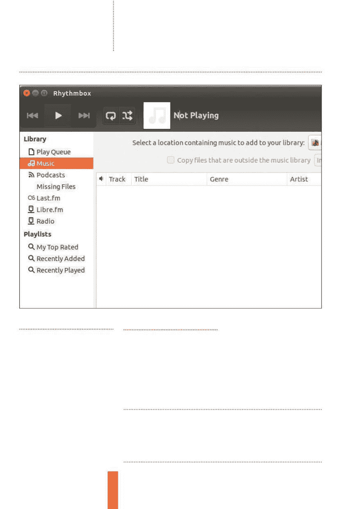

**Ubuntu 应用**

使用 Rhythmbox 听歌曲

126

##01

本教程从一个需要思考的场景开始：一个朋友为你提供了价值一个 Gigabyte 级别的 Falco 曲目。假设包含文件的 USB 闪盘已经归还，音乐目前位于你机器上硬盘的一个子文件夹中。首先点击“文件 > 添加音乐”。接下来，点击复选框旁边的箭头并选择“其他”以打开文件选择对话框。然后继续导航到包含专辑子文件夹的文件夹。最后，点击“打开”关闭常用对话框。

导入曲目

管理你的音乐 组织大量的媒体

“当分析完成后，导入控制下方的列表将填充更多信息”

##02

Rhythmbox 将继续扫描文件夹的内容。这个过程每个文件可能需要长达一秒，这意味着在这里耐心是种美德。当分析完成后，导入控制下方的列表将填充更多信息。

设置曲目

设置导入选项

点击“导入”按钮将它们添加到库中。选择你想要导入音乐的位置（图 1）。勾选“复制库之外的文件”复选框将指示 Rhythmbox 将媒体复制到 Music 文件夹。如果它位于可移动设备上，则建议这样做，否则应禁用。

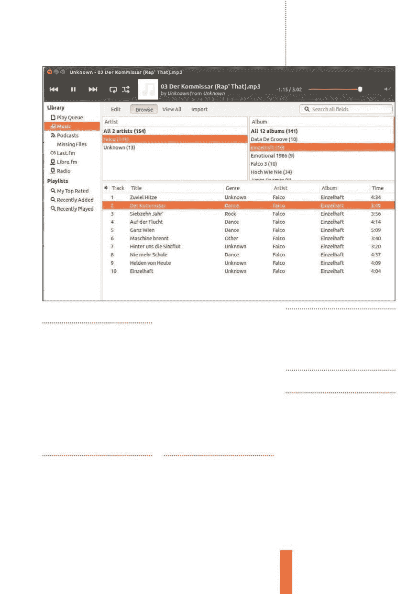

**Ubuntu 应用**

使用 Rhythmbox 听歌曲

127

##04

尽管音乐是一种听觉体验，但添加一些视觉上的点缀完全值得的。双击小图标可以打开一个弹出窗口，显示更大版本的图像。

列表提供三个选择：类型、专辑和曲目。

搜索曲目

##03

返回 Rhythmbox 并点击“音乐”标签页；显示导入的曲目。双击歌曲开始播放。结果自然将显示在列表中。或者，右键点击文件以打开上下文菜单。

查看你的曲目

##05

一个空的播放列表没有多少价值。通过拖放向其内容添加曲目；在“音乐”视图中选择文件，并将其拖到播放列表中。

##06

点击 Rhythmbox 窗口左下角的“+”符号创建一个新的。然后点击“新建播放列表”并输入播放列表名称。最后，按回车键，Rhythmbox 将输入的文本提交到内存。

填充播放列表

选择屏幕左侧的播放列表。顺序点击任何曲目以开始播放——现在向后靠着享受表演吧！

图 2 所有歌曲将按艺术家和专辑分开

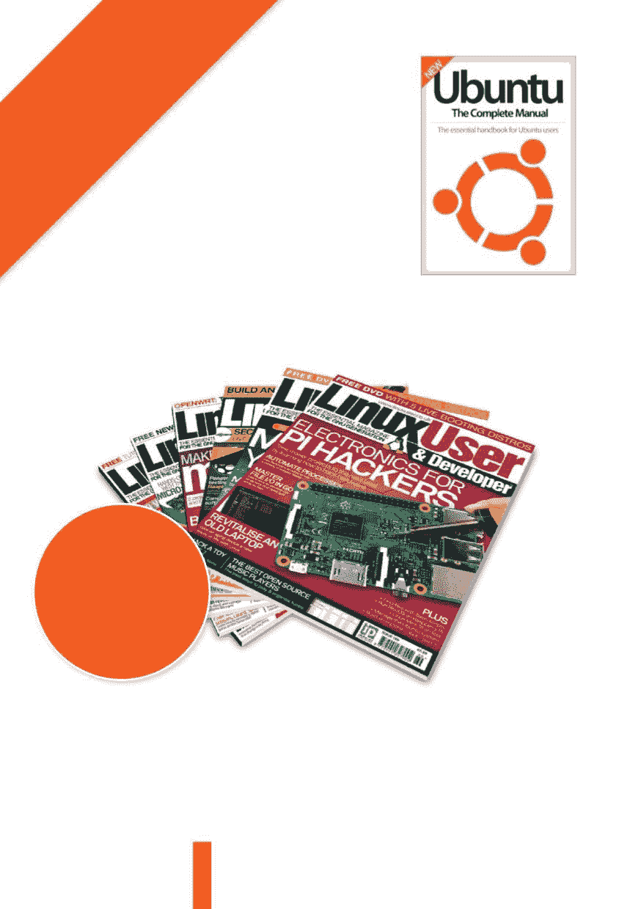

128

**特别优惠**

**针对新用户的独家优惠**

你喜欢这本书吗？

\*\* 此优惠使英国直接借记的新订阅者能够以 5 英镑获得前三期。在这些期数之后，订阅者将每六期支付 25.15 英镑。订阅者可以随时取消订阅。新订阅将从下一个可用期开始。必须提供优惠代码 ZGGINE 以获得此特别订阅价格。根据要求提供直接借记担保。此优惠将于 2017 年 9 月 30 日过期。

\*\* 这是一个美国订阅。美国的订阅费是基于 13 期每年 65 英镑的价格计算的，在写作时相当于 102 美元，而报刊亭 13 期 16.99 美元的价格为 220.87 美元。你的订阅将从下一个可用期开始。


订阅……

唯一一份完全介绍 Linux 的杂志

关于杂志

获取超值优惠请访问 www.imaginesubs.co.uk/lud
优惠码 ZGGZINE
英国地区仅需 5 英镑即可试用 3 期*，在美国仅需每期 7.85 美元**（比报刊亭价节省了 54%）
或拨打英国电话 0844 249 0282，国际电话 +44 (0)1795 418 661

为您倾力
《Linux User & Developer》是唯一专为高级用户、开发者和 IT 专业人士打造的杂志。

深度指南与专题
由基层开发者和行业专家编写

每期赠送免费资源
每月介绍四个最热门的发行版——登录 FileSilo，下载并测试所有版本！

+ 通话费用为每分钟 7 便士，外需加您的电信公司接入费

立即购买您的副副本
纸质版请访问 www.imagineshop.co.uk
电子版请访问 www.greatdigitalmags.com

更多精彩内容……

触手可及的内容世界
无论你热爱游戏、历史、动物、摄影、Photoshop、科幻或其中的任何内容，Imagine Publishing 出版的每本杂志和专题杂志都充满了专家建议和引人入胜的事实。通过我们的必备 Python 指南，你可以学习这种多功能编程语言，发现增强理解的奇妙项目，并找到使用 Python 提升整体计算体验的方法。

源自出品：
《Python 完全手册》

《Ubuntu 完全手册》

### 从 Ubuntu 开始
了解创新型 Linux 操作系统的基础知识，探索它如何为您提供服务

- 操作系统导航
探索用户界面的最佳功能，并发现开源开发的优势

- 自定义桌面
熟悉 Unity 工作空间，并根据您的需求个性化您的桌面

- 命令行基础
掌握命令行并对您的计算体验获得更多控制权

- 游览软件中心
发现您安装、购买和删除 Ubuntu 应用的一站式商店

- 使用 Ubuntu 进行创作
探索必备内置和第三方应用程序，从 LibreOffice 软件件到 Rhythmbox

