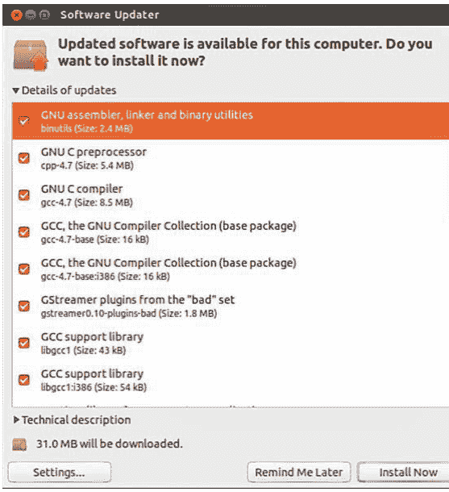

# Ubuntu 实战 2017 版（包含内容更新计划）：涵盖 16.10, 17.04, 17.10（第 12 版）


与他人分享

合作 Andrew Hudson
以及 Paul Hudson


# 总编
Mark Taub

# 策划编辑
Debra Williams Cauley

# 执行编辑
Sandra Schroeder

# 项目编辑
Lori Lyons

# 制作经理
Dhayandidhi

# 校对
Sasirekha

# 技术编辑
José Antonio Rey

# 编辑助理
Kim Boedgheimer

# 媒体制作
Dan Scherf

# 封面设计
Chuti Prasertsith

# 谱曲
codeMantra


引言 ... xxxiii


引言 ... xxxiii
本书使用的约定 ... xviii


 - 参考文献 61

参考文献 74


- 参考文献 118


- dotdee 145
目录
Snappy Ubuntu Core 146

# 10 命令行入门课程 149
什么是命令行？150


- stdin, stdout, stderr 和重定向 211
- 使用 diff 查找文件差异 212
- 查找差异 213
- 使用 jobs 查看任务 214
- 将任务移至后台或前台 215
- 使用 top 查看资源使用情况 217
- 命令组合 219
- 使用布尔运算符 222
- 进程替换 225
- 使用文本编辑器 226
- 使用 vi 229
- 使用压缩文件 232
- 使用 GRUB 恢复系统 234
- 重置 Ubuntu 236
- 使用 !! 执行上一个命令 237
- 刚刚执行的命令 238
- 组合命令 239
- 使用通配符 240
- 使用 dmesg 查看内核信息 241


- 权限 242
- 文件权限 244
- 组工具 245
- 系统用户 246
- 删除用户 248
- 使用 su 249
- 临时权限 250
- 密码 252
- 密码文件 253
- 安全 255
- 任务控制 256
- 参考文献 258

- 调度任务 259
- 使用 cron 定期运行任务 260
- 睡眠 262
- 命令行 263
- 重定向输入和输出 265
- 后台处理 267
- 运行 Shell 程序 269
- 通过特定 Shell 解释脚本 271
- 为变量赋值 273
- 位置参数 274
- 从命令行访问和检索变量 276
- 内置字符 278
- 使用双引号解析带空格的字符串 280
- 使用反斜杠作为转义字符 281
- pdksh 和 bash 中的表达式比较 283
- for 语句 285
- until 语句 286
- select 语句 (pdksh) 287
- if 语句 288
- break 和 exit 语句 290


- 开始启动加载过程 293
- 系统服务和运行级别 295


- 参考文献 ........................................................................................................ 322

# 系统监控工具 ................................................................................ 323
- 基于控制的监控 ............................................................................ 323
- 使用优先级调度和控制 ................................................................ 326
- 磁盘空间 ........................................................................................................ 328
- 检查日志文件 ............................................................................................................ 329
- 图形进程和系统管理工具 .................................................... 333
- Conky ............................................................................................. 334
- KDE 进程和系统监控工具 ........................................................ 339
- Landscape ....................................................................................................... 340
- 参考文献 ....................................................................................... 340
# 备份 ....................................................................................................... 341
- 选择备份策略 ........................................................................ 341
- 评估您的备份需求和资源 .................................................... 343
- 做出选择 ............................................................................ 348
- 可移动存储介质 ...................................................................... 348
- 网络存储 ............................................................................ 349
- 云存储 ....................................................................................... 350

# 目录 xv

- GNOME File Roller 353
- Déjà Dup 354
- Unison 358
- 替代备份软件 359
- 使用 tar 复制文件 360
- 使用 cp 复制文件 361
- 使用 rsync 362
- 系统救援 366
- 恢复 GRUB2 启动加载器 367

- 基础基础 369
- 检查回环接口的可用性 370
- 使用 ping, traceroute 和 mtr 检查连接 371
- TCP/IP 接入 376
- 端口 378
- 网络组织 381
- 子网掩码 382
- 网卡 382
- 集线器和交换机 385
- 初始化新的网络硬件 387
- 命令行网络配置 388
- 动态主机配置协议 (DHCP) 390
- 安装和启动时的 DHCP 392
- DHCP 的其他用途 394
- Ubuntu 中的无线网络支持 395
- 从可用无线协议中进行选择 397
- 配置 PPPoE 连接 399
- 排除连接故障 401

- 设置 Telnet 服务器 403
- 设置 SSH 服务器 405
- 使用 scp 在机器间复制文件 407
- 使用 ssh-keygen 密钥登录 409
- 参考文献 411

- 评估你的漏洞 413
- 无线网络安全 415
- 配置和使用 Tripwire 设备 417
- 配置你的防火墙 419
- 制定灾难恢复计划 425

- 硬盘 428
- hdparm 命令 430
- tune2fs 命令 432
- badblocks 命令 434
- 内核 435
- MySQL 438
- 使用查询缓存 440
- 查询优化 442

- Linux 内核 444
- 内核类型 447
- 何时需要重新编译 449
- 获取内核源码 451
- 编译内核 453
- 创建初始内存磁盘镜像 459
- 编译期间错误 460
- 参考文献 463


- mod_alias 502
- mod_auth 503
- mod_auth_dbm 503
- mod_autoindex 504
- mod_dir and mod_env 504
- mod_headers 504
- mod_info and mod_log_config 505
- mod_negotiation 505
- mod_rewrite 506
- mod_speling 506
- mod_ssl 506
- mod_userdir 507
- mod_vhost_alias 507
### 虚拟主机 507
- 基于名称虚拟主机 509
### 日志 509
- 参考文献 513
## 25 Nginx Web 服务器管理 515
- 关于 Nginx Web 服务器 515
- 从 Ubuntu 仓库安装 517
- 配置 Nginx 服务器 518
- 设置 PHP 522
- HTTPS 524


- Yaws 528
- Jetty 529
| 项目目 | 页码 |
| httpd | 529 |
| 参考文献 | 530 |


- 选择身份验证或匿名服务器 532
- 其他 FTP 服务器 532
- FTP 用户 534
- 控制匿名访问 537
- 使用 fthosts 文件允许或拒绝
- 参考文献 540


- 邮件传输代理 (MTA) 542
- 邮件投递代理 (MDA) 544
- Postfix 基础配置和操作 546
- 使用智能主主机 (Smart Hosts) 549
- 邮件中继 550
- 使用 Fetchmail 获取邮件 551
- 配置 Fetchmail 551
- Procmail 555
- Squirrelmail 556
- 自动回复器 556
- Microsoft Exchange Server/Outlook 客户端 557
- Oracle Beehive 557
- Open-Xchange 558
- 参考文献 558
## 29 代理、反向代理和虚拟专用网络 (VPN) 561
- 什么是代理服务器？561
- 安装 Squid 562
- 配置客户端 562
- 指定客户端 地址 567
- 虚拟专用网络 (VPN) 570
- 设置 VPN 服务器 573


- 关系型数据库如何工作 580
- 创建表 582
- 从数据库检索数据 584
- 速度 586
- 事务处理的 ACID 性 587
- 过程语言和触发器 588
- 为 MySQL 设置密码 589
- 初始化 PostgreSQL 目录 592
- 通过 SSH 访问数据库 595
- Web 访问数据库 597
- PostgreSQL 命令行客户端 600


- Berkeley DB 606
- Memcached 和 Memcache 607
- Riak 608
- CouchDB 609
- BaseX 610
- BigTable 611
- Neo4j 612
- OrientDB 612
- FlockDB 613
- 参考文献 613

## 32 轻量级目录协议 (LDAP) 615

- 配置服务器 616
- 创建你的架构 616
- 填充目录 617
- Evolution 620
- Thunderbird 621
- 参考文献 622

## 33 Linux 终端服务器 (LTSP) 623

- 要求 624
- 安装 627
- 使用 LTSP 628
- 参考文献 629

## 34 Ubuntu 上的虚拟化 631

- KVM 633
- VirtualBox 637
- VMware 639
- Xen 639
- 参考文献 639

## 35 云端 Ubuntu 641

- 为什么用云？642
- 软件服务 (SaaS) 643
- 平台服务 (PaaS) 643
- 基础设施服务 (IaaS) 643
- 裸服务 (MaaS) 643
- 在开始操作之前 644
- 部署/安装基础：公共、私有还是混合？644
- Ubuntu 云与 OpenStack 645
- 计算基础设施 (Nova) 645
- 存储基础设施 (Swift) 646
- 网络服务 (Neutron) 646
- 身份服务 (Keystone) 647
- 镜像服务 (Glance) 647
- 仪表板 (Horizon) 647
- 学习更多 647
- Juju 647
- 入门 648
- Charms 650
- Juju GUI 652
- Juju 快速上手 653
- Mac OS 和 Windows  Juju 653
- Mojo：Juju 的持续交付 653
- Snappy Ubuntu Core 653
- 服务的 Ubuntu (MaaS) 653
- Landscape 654
- 参考文献 654

## 36 管理服务器组 655

- Juju 655
- Puppet 656
- Chef 656
- CFEngine 656
- Ansible 657
- Landscape 657
- 参考文献 657

## 37 使用域名命名系统 (DNS) 进行名称解析 659

- 理解域名 661
- DNS 服务器 661
- DNS 记录 662
- 使用 BIND 设置 DNS 服务器 665
- 参考文献 667

# 第五部分 Linux 编程

## 38 为 Ubuntu 使用编程工具 669

- 在 Linux 上编程 670
- 使用 Ubuntu 提供的 C 语言编程管理工具 671
- 使用 make 编译程序 671
- 使用 Makefile 671
- 使用 autoconf 工具配置代码 673
- 调试工具 674
- 使用 GNU 编译器 675
- 图形开发工具 676
- 使用 KDevelop 客户端 676
- 用于在 GNOME 中开发的 Glade 客户端 677
- 使用 IDE 或 SDK 678
- 参考文献 680

## 39 机会性开发 681

- 版本控制系统 681
- 使用 Git 管理项目 682
- 使用 Bazaar 管理项目 683
- 使用 Subversion 管理项目 684
- 使用 Mercurial 管理项目 685
- 机会性开发简介 686
- Launchpad 687

## 40 帮助 Ubuntu 开发 693

- Ubuntu 开发简介 694
- 设置你的开发系统 695
- 安装并配置基础包 695
- 创建 Launchpad 账号 696
- 设置与 Launchpad 工作的环境 696
- 开发应用和范围 698
- 修复漏洞和打包 698
- 使用 Harvest 寻找待修复的漏洞 701
- 宇宙大师 701
- 参考文献 702

## 41 帮助 Ubuntu 测试和质量保证 703

- 社区团队 703
- Ubuntu 测试团队 704
- QA 团队 705
- Bug 小分队 705
- 测试驱动 705
- 参考文献 708

## 42 使用流行的编程语言 709

- Ada 710
- Clojure 710
- COBOL 711
- D 712
- Dart 712
- Elixir 713
- Erlang 713
- Forth 713
- Go 714
- Fortran 714
- Groovy 715
- Haskell 715
- Java 715
- JavaScript 716
- Lisp 716


xx Ubuntu 2017 发布版

- Lua ................................................................................ 717
- Mono ............................................................................... 717
- OCaml .............................................................................. 718
- Perl ............................................................................... 718
- PHP ................................................................................ 719
- Python ............................................................................ 719
- Ruby ............................................................................... 719
- Rust ............................................................................... 720
- Scala ............................................................................... 720
- Scratch ................................................................ 720
- Vala .............................................................................. 720
- 参考文献 ................................................................. 721

## 43 开始 Android 移动开发 723

- Android 简介 .................................................................... 724
- 硬件 ........................................................................ 724
- Linux 内核 ................................................................... 724
- 库 ...................................................................... 724
- Android 运行时 ............................................................ 724
- 应用框架 ........................................ 725
- 应用程序 ............................................................... 725
- 安装 Android Studio ........................................ 725
- 安装 Android Studio ........................................ 725
- 安装 SDK 包 ............................................ 725
- 创建你的第一个应用程序 ................................... 727
- 参考文献 ...................................................... 728

## 44 为 Ubuntu 手机/触摸开发 729

- 安装 SDK ................................................... 730
- 创建你的第一个应用程序 ................................... 730
- 参考文献 ...................................................... 731

## 索引 733

第 45–47 章可以通过 informit.com/title/9780134268118 在线访问。

## 额外章节

## 45 使用 Perl Web:1

- 在 Linux Web 中使用 Perl:1
- Perl 版本 Web:2
- 简单的 Perl 程序 Web:2
- Perl 变量与数据结构 Web:4
- Perl 变量类型 Web:5
- 特殊变量 Web:5
- 运算符 Web:6
- 比较运算符 Web:6
- 复合运算符 Web:7
- 算术运算符 Web:7
- 其他运算符 Web:8
- 特殊字符串常量 Web:8
- 条件语句：if/else 和 unless Web:9
- if Web:9
- unless Web:10
- 循环 Web:10
- for Web:10
- foreach Web:10
- while Web:11
- until Web:11
- last 和 next Web:12
- do ... while 和 do until Web:12
- 正则表达式 Web:12
- 访问外壳 Web:13
- 模块和 CPAN Web:14
- 代码示例 Web:15
- 发送邮件 Web:15
- 清理日志 Web:17
- 发布到 Usenet Web:18
- 单行命令 Web:19
- 命令行处理 Web:20
- 参考文献 Web:20

## 46 使用 Python Web:23

- Linux 上的 Python Web:24
- Python 基础 Web:25
- 数字 Web:25
- 更多关于字符串 Web:27
- 列表 Web:30
- 字典 Web:32
- 条件与循环 Web:33
- 函数 Web:35
- 面向对象 Web:36
- 类和对象变量 Web:37
- 构造函数和析构函数 Web:38
- 类继承 Web:39
- 标准库和 Python 包索引 Web:41
- 参考文献 Web:41

## 47 使用 PHP Web:43

- PHP 简介 Web:44
- 进入和退出 PHP 模式 Web:44
- 变量 Web:46
- 数组 Web:47
- 常量 Web:48
- 参考文献 Web:48
- 注释 Web:49
- 转义序列 Web:50
- 变量替换 Web:51
- 运算符 Web:53
- 条件语句 Web:54
- 特殊运算符 Web:55
- Switch Web:56
- 循环 Web:59
- 包含其他函数 Web:60
- 基础函数 Web:60
- 字符串 Web:63
- 数组 Web:65
- 文件 Web:67
- 杂项 Web:70
- 处理 HTML 表单 Web:71
- 数据库 Web:73
- 参考文献

## 关于作者

Matthew Helmke 是 Ubuntu 社区的活跃成员。他在 2006 年至 2011 年担任 Ubuntu 论坛委员会成员，为 Ubuntu 论坛（www.ubuntuforums.org）提供领导和监督，并在欧洲、中东和非洲的 Ubuntu 区域批准委员会工作了两年。他曾为多家杂志和网站撰写过关于 Ubuntu 文章，是《官方 Ubuntu 书》的主作者，并合著了《VMware 南》。他在 Canonical, Inc. 担任技术作家，负责云和基础设施文档编写。

Matthew Helmke 是 Ubuntu 社区的活跃成员。他在 2006 年至 2011 年担任 Ubuntu 论坛委员会成员，为 Ubuntu 论坛（www.ubuntuforums.org）提供领导和监督，并在欧洲、中东和非洲的 Ubuntu 区域批准委员会工作了两年。他曾为多家杂志和网站撰写过关于 Ubuntu 文章，是《官方 Ubuntu 书》的主作者，并合著了《VMware 实南》。他在 Canonical, Inc. 担任技术作家，负责云和基础设施文档编写。

Matthew Helmke 是 Ubuntu 社区的活跃成员。他在 2006 年至 2011 年担任 Ubuntu 论坛委员会成员，为 Ubuntu 论坛（www.ubuntuforums.org）提供领导和监督，并在欧洲、中东和非洲的 Ubuntu 区域批准委员会工作了两年。他曾为多家杂志和网站撰写过关于 Ubuntu 文章，是《官方 Ubuntu 书》的主作者，并合著了《VMware 实南》。他在 Canonical, Inc. 担任技术作家，负责云和基础设施文档编写。

Matthew Helmke 是 Ubuntu 社区的活跃成员。他在 2006 年至 2011 年担任 Ubuntu 论坛委员会成员，为 Ubuntu 论坛（www.ubuntuforums.org）提供领导和监督，并在欧洲、中东和非洲的 Ubuntu 区域批准委员会工作了两年。他曾为多家杂志和网站撰写过关于 Ubuntu 文章，是《官方 Ubuntu 书》的主作者，并合著了《VMware 实南》。他在 Canonical, Inc. 担任技术作家，负责云和基础设施文档编写。

Matthew Helmke 是 Ubuntu 社区的活跃成员。他在 2006 年至 2011 年担任 Ubuntu 论坛委员会成员，为 Ubuntu 论坛（www.ubuntuforums.org）提供领导和监督，并在欧洲、中东和非洲的 Ubuntu 区域批准委员会工作了两年。他曾为多家杂志和网站撰写过关于 Ubuntu 文章，是《官方 Ubuntu 书》的主作者，并合著了《VMware 实南》。他在 Canonical, Inc. 担任技术作家，负责云和基础设施文档编写。

Andrew Hudson 是一个专注于开源的自由职业记者。他的文章曾出现在 MacFormat、PC Answers、PC Plus 以及 Linux Format。Paul 对自由软件充满热情，并适用于桌面和服务器。（此处文本包含重复/混乱片段，Helmke 是主要作者。）

Matthew Helmke 是 Ubuntu 社区的活跃成员。他在 2006 年至 2011 年担任 Ubuntu 论坛委员会成员，为 Ubuntu 论坛（www.ubuntuforums.org）提供领导和监督，并在欧洲、中东和非洲的 Ubuntu 区域批准委员会工作了两年。他曾为多家杂志和网站撰写过关于 Ubuntu 文章，是《官方 Ubuntu 书》的主作者，并合著了《VMware 实南》。他在 Canonical, Inc. 担任技术作家，负责云和基础设施文档编写。

## 献词

献 Sarlyn、Sedona 和 Philip——任何人都希望拥有的孩子；献 Sandra 和 Evan，他们是我们生活的完美补充；献我的爷爷，他一直相信我并教会我相信自己；以及我在 Ubuntu、开发者、系统管理员和云社区的朋友。

## 致谢

Matthew 感谢在过去版本中提供帮助、提供建设性意见和想法、技术编辑以及非正式建议的人。我对 Ubuntu 社区、Canonical 以及 Mark Shuttleworth 深表感谢，他们邀请我参与社区，包括我在论坛的职责、在委员会的工作以及参加两次开发者大会。感谢 Ubuntu All Stars 给我这个机会。感谢整个 Ubuntu 社区为创作这本书付出的心血。最后，感谢 Pearson 的同事们，特别是 Debra Williams，对我的信任以及让我们合作此类项目的机会。

## 我们想听听你的声音！

作为本书的读者，你是我们最重要的评论家和意见提供者。我们非常重视你的意见，想知道我们哪些做得好、哪些地方可以改进、你希望我们出版的领域，以及任何你愿意分享的建议。

我们欢迎你的反馈。你可以通过电子邮件或信函告诉我们对这本书的喜与不喜欢——以及我们如何把书做得更好。

请注意，我们无法解决与本书主题相关的技术问题。

写信时，请务必注明书名和作者，以及你的姓名和电子邮箱。我们会仔细阅读你的意见，并与本书的作者和编辑分享。

读者服务

访问我们的网站并在 informit.com/register 注册本书，以便方便获取可能提供的更新、下载或勘误。


# 引言

我们很高兴向您介绍 2017 版的《Ubuntu Unleashed》。Ubuntu 是一种基于 Linux 的计算机操作系统，它席卷全球。从 2004 年 humble起步开始，Ubuntu 已经成为 Linux 的前沿，并成为服务器的热门选择。

Ubuntu 源自最古老且最受推崇的发行版之一 Debian。Debian 由才华横溢的志愿者团队构建；它是最稳定、可定制的 Linux 发行版之一，其质量和技术实力备受赞誉。然而，它是一个为极客准备的操作系统；进入 Debian 世界的门槛较高，其易用性倾向于高度专业化，并要求新用户在加入之前先掌握门道。这既是合理的，也是可以接受的。

Ubuntu 所做的是利用 Debian 的优质品质，创建一个普通人也能使用的操作系统。这并不意味着 Ubuntu 用户在技术上不精通，只是说他们不必如此。事实上，许多才华横溢的志愿者软件开发者热爱 Ubuntu，因为让他们让他们专注于特定的兴趣，而不是操作系统的细节。这本书就是为这些人人准备的，也是为那些渴望加入他们行列的人准备的。

如果你是 Linux 新手，选择这本书是一个非常明智的决定。Sams 出版公司的《Unleashed》系列书籍对其主题进行了深入探讨，涵盖了初学者和高级用户，并将他们推向知识和专业能力的新水平。Ubuntu 是一个变化快速的发行版，每年发布两次版本。我们从 Ubuntu 的早期就开始追踪其发展，以确保书中的信息与发展情况紧密对应。

## 本引言包含

- 许可协议
- 本书目标读者
- 本书包含的内容
- 本书使用的约定

# 引言

发行版的开发。附带的光盘中包含一份 Ubuntu 的完整副本，你可以在不到一小时内从该光盘安装 Ubuntu！

## 关于营销的简短说明

书中的几乎所有内容无论你使用哪个版本的 Ubuntu（只要其足够清晰）都适用。这本书的编写初衷是试图关注尽可能长时间有用的信息。某些章节（即涵盖图形用户界面基础的章节）信息会频繁变化。这些章节是例外。书封上的简介说明了本书被添加到了哪些版本中，以及书籍最后修订的时间。

然而，请不要让 Linux 的高度技术性令你气馁。许多人听说 Linux 仅存在于服务器上用于维护网站，事实完全如此。像 Ubuntu 这样的发行版正在大量进军市场。企业正在意识到运行一个稳定、强大且易于维护和安全的操作系统的益处。最棒的一点是，大多数改进都是免费共享的，让你从像 Red Hat 等发行版增加的功能中获益，而 Red Hat 反过来也会分享它的改进。你今天就可以投入使用 Ubuntu，并确保获得佳的用户体验。

## 许可协议

软件许可对所有用户来说都是一个重要问题，可能涉及道德、法律和财务考量。许多消费者认为购买商业或专有操作系统、应用程序或工具的副本意味着拥有所有权，但事实并非如此。在大多数情况下，商业软件附带的最终用户许可协议（EULA）规定你支付的只是使用权。这通常意味着你不能复制、共享或转让软件的所有权。更严苛的软件许可协议会执行禁止你分发或发布软件评论的条款。甚至更阴险的许可方案（尤其是在美国）包含了允许审计软件的条款。书中包含的软件并非如此。你可以完全自由地复制、共享并在任意数量的计算机上安装该软件——不过，我们鼓励你购买本书的额外副本。请务必阅读 Ubuntu 附带的 README 文件获取有关软件的重要信息，并在安装 Ubuntu 后，访问 www.gnu.org/licenses/gpl.html 查找 GPL 副本。你会发现 GPL 赋予了使用、共享、修改甚至出售软件的自由。你可以立即在家里或工作场所开始使用你的 Ubuntu 副本，而不必担心软件许可或版税问题。然而，请注意，虽然 Ubuntu 包含的大许多软件是根据 GPL 许可的，但某些软件包是根据其他条款许可的。软件许可有多种，许多软件包属于被称为“开源”的宽泛定义。其中包括 Artistic 许可、BSD 许可、Mozilla 公共许可。有关 GNU 许可的更多额外信息，请访问 www.gnu.org/。关于开源的定义和许可指南，以及指向几乎所有开源许可条款的链接，请访问 www.opensource.org/。

## 本书目标读者

本书的涵盖范围从浅入广泛的主题不等。这是刻意为之。有些主题是 Ubuntu 特有的，其他书籍均未涵盖，值得深度介绍。有些主题是每个高级用户都必须掌握的。还有一些主题是高级用户了解的——他们了解一些历史、其他选项，或者仅仅是为了让自己在与技术人员讨论时不至于完全困惑。

某些主题（如 Linux 命令行）接受了深入且广泛的涵盖，因为我相信信息对于任何想成为高级用户或熟练大师的人来说都是至关重要的。该主题占据了两个完整的章节。其他主题，如 ADA、Fortran 以及其他 15 多种编程语言，则进行了简要介绍，为感兴趣的人提供一些指导方向以便继续。在这种情况下，大约 12 页的内容涵盖了约 20 种编程语言。这些主题对某些人有用，但我认为它们并非至关重要。

此外，某些主题太宽泛，无法在书中进行深度涵盖，但再次，中高级用户至少应该具备这些方面的基础知识。这些内容已被涵盖，并提供了信息帮助你根据需要扩展理解。

## 想要成为中级或高级用户的人

《Ubuntu Unleashed》面向中级和高级用户，以及想要成为这类用户的人。我们的目标是通过让你接触尽可能多的工具和想法，引导你进入更高阶段；我们希望为你提供一些思考和方法，并促你去探索更多。


本书内容 xxxvii

程序员是编写软件的人。他们有时被称为开发者。程序员与其他合作，创建运行在这些系统之上的应用程序。Ubuntu 是编写和测试软件的绝佳平台。无论你是在进行 Web 应用开发，还是为桌面或服务器系统编写软件都是如此。它也是学习新编程语言和尝试新想法的优秀平台。本书可以帮助你入门。

DevOps 是 developer（开发）和 operations（运维）的组合词。它代表了前述两种角色的融合。信息技术（IT）世界正在发生变化，角色界限变得越来越模糊且相互孤立。在过去，对新技术感到兴奋的程序员与痴迷于稳定的系统管理员之间发生冲突屡见不鲜。DevOps 意识到，这两个目标孤立存在都是不健康的，但在两者之间寻求平衡，通过消除有时导致团队冲突的沟通与理解障碍，可以取得成果。由于云计算、虚拟化（本书也涵盖了这些内容）以及更敏捷开发形式的兴起，DevOps 是一个实用的视角，让 IT 领域的人更好地服务他们的最终客户：终端用户。对于想要学习对这两个角色都有帮助的知识的人来说，本书是一个极好的基础，并希望以一种良好平衡两者的方式进行呈现。

## 本书内容

《Ubuntu Unleashed》分为六部分，在此处进行描述。书中附有一张包含整个发行版的光盘，确保你拥有入门所需的所有内容。

- 第一部分“安装与配置”将带你如何在计算机上安装 Ubuntu，替换你可能正在运行的任何操作系统（如 Windows）。

- 第二部分“桌面版 Ubuntu”针对想在桌面系统上使用 Ubuntu 的用户。

- 第三部分“系统管理”涵盖了为特定任务设置系统以及维护该系统的基础和高级细节。

- 第四部分“作为服务器的 Ubuntu”为你提供所需信息，以便为家庭或办公室构建自己的文件服务器、Web 服务器和其他服务器。

- 第五部分“Linux 编程”向你介绍介绍如何使用提供的开发工具进一步扩展 Ubuntu 的功能。

除了已经提到的之外，在 Ubuntu 春季发布后，将在 www.informit.com/title/9780134511884- 在线提供赠送章节。

此外，本书是 InformIt 令人兴奋的“内容更新计划”的一部分，该计划针对重大技术改进提供内容更新！随着 Ubuntu 发生重大更新，本书的章节将进行更新或添加新章节以匹配技术的更新。当更新可用时，它们将以本书 Web 版的形式交付给你，可以通过任何互联网连接访问。要了解更多信息，请访问 informit.com/cup。

如何访问 Web 版：按照内部说明，学习如何注册你的书籍以访问免费 Web 版。

## 本书使用的惯例

涵盖 Ubuntu 中包含的每个命令的每个选项是不可能的。此外，随着互联网和高速连接的兴起，参考性材料的价值已远不如以前，因为这些细节只需通过 Google 搜索即可找到。相反，我们侧重于如何寻找你所需的信息，同时提供对中级或高级用户价值的高质量概述。有时本书会提供各种选项、命令和按键的表格，以帮助浓缩、组织和展示有关各种主题的信息。

为了帮助你理解代码列表示例和示例命令行，我们使用了几种格式技术来显示输入和所有权。例如，如果命令或代码列表示例显示了输入内容，则输入在示例命令提示符后格式化为粗体，如下：

```
mathew@semour:- ls
```

如果需要输入内容（如响应提示符时），示例输入也是粗体，如下所示：

```
Delete files? [Y/n] y
```

所有应显示在你的显示器上的语句、变量和文本都使用相同的粗体格式。需要 root 或超级用户访问的命令行以 `sudo` 命令为前缀，如下：

```
mathew@semour:- sudo printinfo &
```

其他格式技术还包括对计算机命令语法中的占位符使用斜体。计算机术语或概念在文中首次引入时也会使用斜体。

最后，你应该知道《Ubuntu Unleashed》中的所有文本、示例代码和截图都是使用 Ubuntu 和开源工具开发的。

继续阅读以开始学习使用最新版本的 Ubuntu。

# 第 9 章

## 本章内容

### 管理软件

- Ubuntu 软件 (Ubuntu Software)
- 使用 Synaptic 进行软件管理
- 保持更新
- 在命令行中工作
- 从源码编译软件
- 配置管理
- Snappy Ubuntu Core
- 使用 Snaps
- 参考文献

在本章中，我们将查看你在 Ubuntu 中管理软件的各种选项。如果你习惯于访问不同的供应商网站下载更新，那么你将获得一个惊喜。更新整个 Ubuntu 安装（包括所有应用程序软件）只需运行“更新管理器”（Update Manager）程序即可。你将发现安装甚至删除软件包是多么件简单的事。

Ubuntu 提供了多种系统资源管理工具。接下来的章节介绍了你将用于大多数软件管理的图形化软件管理工具。本章还涵盖了系统的监控和磁盘存储。

## Ubuntu 软件 (Ubuntu Software)

Ubuntu Software 是 Ubuntu 中用于软件包管理的图形化工具。你可以在应用程序菜单中找到“Ubuntu Software”；软件包和可执行程序名为 `ubuntu-software`。Ubuntu Software 允许你通过直观的内置和简单的一键安装功能轻松选择和安装大量应用程序。当你打开程序时，你会看到主界面，如图 9.1 所示。

在屏幕顶部有三个菜单选项：全部 (All)、已安装 (Installed) 和更新 (Updates)。在其下方是一个搜索栏，可以用它搜索软件包。向下滚动按类别列出软件。


图 9.1 界面让你按分组浏览软件包。

通过 Ubuntu Software 安装新软件非常简单：在列表中找到它，双击并点击“安装”按钮。当你这样做时，可能会被要求输入密码；然后应用程序将被下载并安装。你可以通过 Ubuntu Software 中找到应用程序并点击“移除”按钮来删除它。

## 使用 Synaptic 管理软件

Ubuntu Software 在添加和删除应用程序方面非常好，但如果你需要安装特定内容（例如库），你需要使用 Synaptic（图 9.2）。可以使用上述的 Ubuntu Software 安装 Synaptic；它默认不安装。


图 9.2 对于更高级的软件管理，Synaptic 是首选工具。左侧是软件类别（尽管还有更多），右上是该类别的软件包选择，右下方是当前选中的软件包。要安装或删除软件，点击名称左侧的复选框，你将看到提供以下选项的菜单：

- *取消标记 (Unmark)*——如果你标记了该软件包进行安装、升级或其他选项，此选项将移除该标记。
- *标记安装 (Mark for Installation)*——将此软件包添加到待安装列表中。
- *标记重新安装 (Mark for Reinstallation)*——如果你已安装某些软件，但由于某些原因它无法工作，此选项将从头重新安装它。现有的配置文件将被保留，你所做的任何修改都是安全的。
- *标记升级 (Mark for Upgrade)*——如果软件有更新，此选项将下载并安装更新。
- *标记移除 (Mark for Removal)*——此选项将从系统中删除选定的软件包，但会保留其配置文件，以便在以后重新安装它时无需重新配置。
- *标记彻底移除 (Mark for Complete Removal)*——此选项将从系统中删除选定的软件包，还将删除任何配置文件，从系统中清除所有内容。


完成更改后，点击“应用”（Apply）按钮让 Synaptic 根据需要下载、升级、安装或卸载。如果你在点击“应用”之前关闭程序，更改将会丢失。

除了屏幕左侧的分类，你还会看到六个按钮：部分（Sections）、状态（Status）、源（Origin）、自定义过滤器（Custom Filters）、搜索结果（Search Results）和架构（Architecture）。这些按钮可以自定义左侧列表：“部分”显示分类视图，“状态”允许你查看已安装或可升级的包，“源”列出了可以下载软件包的不同存储库；自定义过滤器”包含了一些对高级用户非常有用的复杂查询，“搜索结果”存储你的搜索结果；“架构”显示了适用于 Ubuntu 每种架构的软件包。

你可以随时按 `Ctrl+F` 搜索特定软件包。默认情况下，它设置为按软件包描述和名称搜索。你可以更改“查找范围”（Look In）框的设置来按名称搜索。如前提到的，你的搜索词保存在“搜索”视图（左下角的按钮）下，你可以从该列表中重新搜索该术语。

Synaptic 除了提供安装和删除软件的方法外，还提供了配置用于查找软件包的服务器的方法。事实上，这是你可以对 Ubuntu 系统进行最重要的更改之一的地方：你可以将其开放给 Ubuntu 宇宙（Universe）和多元宇宙（Multiverse）。

Ubuntu 基于 Debian 发行版，该版本有数千个软件包可供安装。Ubuntu 只使用了其中一部分，但可以轻松安装其他软件包，以及许多 Debian 中不可用的软件包。当你使用 Synaptic 时，你会看到许多软件包旁边有一个小小的 Ubuntu 图标；这表明它们由 Canonical 支持的 Ubuntu 开发者官方支持。没有此图标的软件包由更广泛的 Ubuntu 开发者社区支持。

要启用 Universe 和 Multiverse 存储库，请前往“设置”->“存储库”。此列表显示了你为软件安装和更新所配置的所有服务器，并包含了 Universe 和 Multiverse 存储库。当你找到它们时，勾选它们，然后点击“关闭”。

Synaptic 会弹出一个消息框，警告存储库列表已更改，你需要点击“重新加载”（Reload）按钮（位于 Synaptic 窗口顶部）来刷新软件包列表。执行该操作，你应该看到更多软件供你选择。然而，请注意，只有少数软件包附有 Ubuntu 官方“封印”，这意味着你在安装软件时要更加谨慎。

> 注意
> 本书中讨论的大部分软件仅通过 Universe 存储库可用。因此，我们强烈建议启用它，以充分利用本书和你的 Ubuntu 安装。

# 保持更新

尽管你可以通过 Synaptic 管理软件更新，但 Ubuntu 还提供了一个名为“软件更新器”（Software Updater）的专用工具（如图 9.3 所示）。该工具设计简单简单：当你运行它时，软件更新器会自动下载可用更新列表并检查其列表中显示的所有项目。如果更新列表下载时间不久，Ubuntu 将通过点击“检查”按钮来刷新可用更新列表。否则，你需要点击“安装更新”使你的系统保持最新状态。如果你想获取更多关于更新的信息，点击底部的“显示详情”以查看更新发生了哪些变化。



> 图 9.3 如果你需要更新软件以应用错误修复和安全升级，请使用“软件更新器”。

Ubuntu 会定期检查更新，并在可用关键更新时通知你。不过，自己经常运行“软件更新器”进行确认并无害；防患胜于未然。

# 命令行操作

由于有许多软件可供安装，基于 Debian 的发行版有许多管理软件安装的方法这并不意外。然而，它们的核心使用的是 Debian 闻名遐迩的高级软件包管理工具（APT）。Slashdot.com 上的一个人曾说：“欢迎来到 Slashdot。如果你找不到任何原创内容，只需夸一下 APT 有多牛，你就能很快融入其中。”你看，尽管许多其他发行版都尝试过 APT 的威力，但没有任何东西能与之相提并论。

为什么 APT 如此酷炫？嗯，它是第一个正确处理软件依赖关系的系统。其他发行版（如红帽 [Red Hat））使用带有依赖关系的 RPM 文件。例如，Gimp 的 RPM 会依赖于 Gtk（Gtk 是 Gimp 所赖的图形工具包）。因此，如果你尝试在没有 Gtk RPM 的情况下安装 Gimp，你的安装将失败。于是，你获取 Gtk RPM 并再次尝试。再次结果：Gtk 依赖于三个你需要下载的项。而另外三个项又依赖于 20 个其他项。如此，如此，再如此，直到你无法找到某个依赖项的可用 RPM，并放弃。

另一方面，APT 设计用于自动查找并下载你软件包的依赖关系。因此，如果你想安装 Gimp，它会下载 Gimp 软件包以及它运行所需的任何其他软件。不再需要手动到处搜寻，不再需要担心找到正确的包，也绝不再需要手动编译东西。APT 还可以处理安装恢复，这意味着如果你在升级过程中丢失了网络连接（或电池耗尽了，或者你必须退出，或其他原因），APT 在你运行它时会从上次停止的地方继续。

## 日常使用

为了让你能够快速且彻底地搜索软件包，APT 使用了可用软件包的本地缓存。尝试运行此命令：

```
mathew@seymour:-$ sudo apt-get update
```

`apt-get update` 命令指示 APT 联系所有服务器并下载软件包列表。`apt-get update` 命令让 APT 连接到配置的所有使用的服务器并下载更新列表。如果更新列表下载时间不久，该命令需要几分钟。否则，该命令执行只需几秒钟。在获取最新的软件包信息后，你可以通过以下命令让 APT 自动下载任何已更新的软件：

```bash
matthew@seymour:-$ sudo apt-get upgrade
```

如果你安装了大量软件，APT 会扫描你的软件并与最新的软件包信息进行对比，生成如下报告：

```
以下软件包将被升级：
```

```bash
读取软件包列表...
正在依赖树...
读取状态...
以下软件包将被升级：
```

# 命令行操作

读取软件包列表...
正在依赖树...
读取状态...
以下软件包将被升级：

报告的每个部分都包含一些重要信息。从顶部开始，“以下软件包将被升级”提供了可用更新的确切列表。如果你正在安装新软件或删除软件，将变为“以下软件包将被安装”和“以下软件包将被删除”。在最后显示 APT 总将升级 21 个软件包，其中 0 个新安装，0 个删除，0 个未升级。由于这是升级而不是安装新软件，所有新软件包仅额外占用 623KB 空间。尽管下载了 84.8MB，软件包将覆盖文件。
是否继续？

重要的是，基础的 `apt-upgrade` 永远不会删除软件或添加新软件。结果是，保持系统完全补丁是安全的，因为它永远不会破坏事情。然而，偶尔会看到“0 个未升级”的状态，这意味着某些项无法升级。当必须安装或删除软件以满足更新软件包的依赖关系时，如前所述，`apt-upgrade` 永远做不到。

在这种情况下，你需要使用 `apt-get dist-upgrade`，命名因为它旨在允许用户从一个 Debian/Ubuntu 版本升级到新版本——这种升级涉及更改整个系统、删除过时的软件并安装最新功能。这是 Debian 最受喜的功能之一，因为它允许你在无需下载和安装新 DEB 的情况下进行版本间的迁移。

将常规升级和发行版升级分开非常有用，可以确保安全更新和简单的错误修复不会更改软件配置，特别是对于需要持续可用且运行的机器来说。

虽然 `apt-upgrade` 和 `apt-get dist-upgrade` 用于升级软件包，但 `apt-get install` 负责添加新软件。例如，如果你想安装 MySQL 数据库服务器，请运行：

在内部，APT 会在其软件列表中查询 `mysql-server`，并发现它匹配 `mysql-server-5.5` 软件包。它会找到你尚未安装的所需的依赖项，并提供如下所示的报告：

```
mathew@seymour:$ sudo apt-get install mysql-server
[sudo] password for matt:
```

正在读取软件包列表... 完成
正在构建依赖树
正在读取状态信息... 完成
将安装以下额外的软件包：

libaio libddd-mysql-perl libibdi-perl libhtml-template-perl libmysqlclient18
libnet-daemon-perl libipprc-perl libtern-readkey-perl mysql-client-5.5
mysql-client-core-5.5 mysql-server-5.5 mysql-server-core-5.5
建议的软件包：
libpc-shared-cache-perl tinyca maill
0 个已升级，13 个新安装，0 个要移除，0 个未升级。
需要下载 26 MB 的存档。
执行此操作将将使用 96.2 MB 的额外磁盘空间。
您要继续吗 [Y/n]?

“建议的”软件包仅仅是低级形式的推荐。它们不会向你安装的软件添加任何关键功能，但你可能在某些非关键（如正在安装的主程序软件）功能或任务中需要它们。

> APT 维护一个软件包缓存，其中存储了已下载并安装的 DEB 文件。这通常位于 `/var/cache/apt/archives`，有时会占用你计算机上数百兆字节的空间。你可以通过运行 `apt-get clean` 来清理软件包缓存，这会删除所有缓存的 DEB 文件。或者，你可以运行 `apt-get autoclean`，它会删除超过特定时间的缓存 DEB 文件，从而保留较新的软件包。

## 在命令行中操作

如果你尝试对已安装的软件包运行 `apt-get install`，APT 会认为你的命令是 `apt-get update`，并检查是否有新版本可下载。

最后一次日常性的软件包操作是移除你不再需要的内容，你通过 `apt-get remove` 命令来实现，如下所示：

```
mathew@semour:-$ apt-get remove firefox
```

移除软件包可能是危险的，因为 APT 还会移除任何依赖于你所选软件包的软件。例如，如果你运行 `apt-get remove libgtk2.0-0`（Ubuntu 的主要工具包），你可能会发现 APT 坚持要移除其他的一百多个包。这个故事的教训是：在移除软件时，请在继续执行卸载操作之前仔细阅读 APT 报告。

直接使用 `apt-get remove` 会留下程序的配置文件，这样如果你重新安装它，就不再需要重新配置了。如果你想同时删除配置文件和程序文件，请改运行此命令：

```
mathew@semour:-$ apt-get remove -purge firefox
```

或者：

```
mathew@semour:-$ sudo apt-get-purge firefox
```

这任一种方法都会执行完全卸载。

> 注意
你可以通过运行不带任何参数的 `apt-get` 来查看更广泛的 `apt-get` 参数列表。底部那行神秘的“此 APT 有超级牛能力”，在你运行 `apt-get moo` 命令时会变得更加神秘。

## 查找软件

由于有许多软件包可用，使用命令行 APT 可能很难找到你确切需要。通用的搜索工具是 `apt-cache`，其用法如下：

```
mathew@semour:-$ apt-cache search kde
```

取决于你启用了哪些存储库，它会返回约一千个软件包。其中许多结果的包名不包含 KDE，但会通过描述中包含 KDE 一词进行匹配。

你可以通过几种方式过滤这些信息。首先，你可以指示 `apt-cache` 只在包名中搜索，而不是在描述中搜索。你可以这样操作 `apt-cache`：

```
mathew@semour:-$ apt-cache search --names kde
```

## 管理软件包

## 使用 apt-get

apt-get` 是 APT 的一个简化的界面，用于移除软件包。

| apt-get 命令 | apt 命令 |
|---|---|
| apt-get install | apt install |
| apt-get remove | apt remove |
| apt-get update | apt update |
| apt-get upgrade | apt upgrade |

## 从源码编译

从源码编译应用程序并不困难。有两种方法：你可以使用 Ubuntu 仓库中的源码，或者使用开发者提供的源码。

```
mathew@semour:-$ apt-cache search kde
```

## 从 Tarball 编译

大多数不在 Ubuntu 仓库中的代码来自原始作者或公司网站，作为压缩源码 tarball——即使用 gzip 或 bzip 压缩的 tar 文件。压缩文件通常会解压到一个包含多个文件的目录。为了限制损坏或恶意代码可能造成的伤害，作为普通用户编译源码总是一个好习惯，在你的主目录下创建一个名为 `source` 的目录。

从你下载 tarball 的地方，使用 `tar` 的 `-C` 选项将其解压到 `/source` 目录。如果你不确定使用了哪种文件压缩方法，使用 `file` 命令来判断：

```
mathew@semour:-$ file packageName
```

现在，切换到 `~/source/pathname` 并寻找名为 `README`、`INSTALL` 或类似的文件。如果它包含如何编译和安装软件的特定说明，请将其打印。通常，编译源码的步骤如下：

```
mathew@semour:-$ /source/pathname$ ./configure
```

## 查找软件

## 查找软件

由于有许多软件包可用，使用命令行 APT 可能很难找到你确切需要。通用的搜索工具是 `apt-cache`，其用法如下：

```
mathew@semour:-$ apt-cache search kde
```

取决于你启用了哪些存储库，它会返回约一千个软件包。其中许多结果的包名不包含 KDE，但会通过描述中包含 KDE 一词进行匹配。

你可以通过几种方式过滤这些信息。首先，你可以指示 `apt-cache` 只在包名中搜索，而不是在描述中搜索。你可以这样操作 `apt-cache`：

```
mathew@semour:-$ apt-cache search --names kde
```

## 管理软件包

## 使用 apt-get

apt-get` 是 APT 的一个简化的界面，用于移除软件包。

| apt-get 命令 | apt 命令 |
|---|---|
| apt-get install | apt install |
| apt-get remove | apt remove |
| apt-get update | apt update |
| apt-get upgrade | apt upgrade |

## 从源码编译

从源码编译应用程序并不困难。有两种方法：你可以使用 Ubuntu 仓库中的源码，或者使用开发者提供的源码。对于任何方法，你都需要安装 `build-essential` 软件包以确保你拥有编译所需的工具。你可能还需要安装 `automake` 和 `checkinstall`，这些都是构建工具。

## 从 Tarball 编译

大多数不在 Ubuntu 仓库中的代码来自原始作者或公司网站，作为压缩源码 tarball——即使用 gzip 或 bzip 压缩的 tar 文件。压缩文件通常会解压到一个包含多个文件的目录。为了限制损坏或恶意代码可能造成的伤害，作为普通用户编译源码总是一个好习惯，在你的主目录下创建一个名为 `source` 的目录。

从你下载 tarball 的地方，使用 `tar` 的 `-C` 选项将其解压到 `/source` 目录：

```
mathew@semour:-$ tar xzf packageName.tgz -C /source
mathew@semour:-$ tar xvf packageName.tar.gz -C /source
mathew@semour:-$ tar jxv packageName.bz2 -C /source
mathew@semour:-$ tar xjvf packageName.tar.bz2 -C /source
```

如果你不确定使用了哪种文件压缩方法，使用 `file` 命令来判断：

```
mathew@semour:-$ file packageName
```

现在，切换到 `~/source/pathname` 并寻找名为 `README`、`INSTALL` 或类似的文件。如果它包含如何编译和安装软件的特定说明，请将其打印。通常，编译源码的步骤如下：

```
mathew@semour:-$ /source/pathname$ ./configure
```


当脚本配置成功后，运行以下命令来编译软件：

```
matthew@seym:~/source/originalname$ make
```

最后，运行以下命令：

```
matthew@seym:~/source/originalname$ sudo make install
```

如果编译失败，请检查错误信息获取原因，并在重新开始之前运行以下命令：

```
matthew@seym:~/source/originalname$ make clean
```

如果你不喜欢该软件，也可以运行以下命令将其卸载：

```
matthew@seym:~/source/originalname$ sudo make uninstall
```

## 从 Ubuntu 仓库从源码编译

你有时可能想要编译一个包，即使 Ubuntu 仓库中已经有了二进制包。例如，某个程序可能在编译成二进制文件时启用了特定的功能，而你又想要该功能。以下是实现此操作的方法。我们将想要编译的软件包包称为 `foo`。

首先，从 Ubuntu 仓库中获取源码：

```
matthew@seym:-$ apt-get source foo
```

安装该包的构建依赖：

```
matthew@seym:-$ sudo apt-get build-dep foo
```

切换目录到源码路径（可能包含版本号）：

```
matthew@seym:-$ cd foo-4.5.2
```

你可以对包或编译标志进行任何你想做的。你可以使用 `./configure` 和 `make` 来完成，有时也可以通过手动修改配置文件来实现。每个包执行此操作的方式可能不同，因此你需要查看该程序的文档。尝试查找源码中的 `README` 以开始操作。

接下来，创建一个新的 `debian/changelog` 条目。在输入此内容后，你需要输入一条消息，说明制作新版本的原因，也许类似于带有额外酱料的*马修的幻想* (Matthew's flight of fancy) 。

注意

Ubuntu 的编号遵循特定的模式。为了方便以后使用，你应该遵循此模式。使用这里显示的 foo 数字，一个继承自 Debian 且未经过更改的典型 Ubuntu 包将是 4.5.2-1。一个继承自 Debian 但为 4.5.2-ubuntu1 进行了更改的包（以及第二个版本为 ubuntu2，依此类推）。一个在 Debian 中没有版本但专为 Ubuntu 创建的包将是 4.5.2-ubuntu1（以及 ubuntu2 等）。

```
matthew@seymour:~$ dch -i
```

构建源码包。这创建了上传包所需的所有文件：

```
matthew@seymour:~$ debuild -s
```

最后

```
matthew@seymour:~$ sudo dpkg -O1 foo-4.5.2-lubuntucustom.deb
```

## 配置管理

本节为那些想要控制系统配置管理的用户简要介绍可能实用的工具。对于更大的需求，请参阅第 36 章“管理服务器组”。

## dotdee

如果你运行基于 Linux 的系统，你会发现一系列以 .d 结尾的目录，它们存储了名为 .d 或 "dot dee" 目录的配置文件。如果你查看 `/etc/` 目录，你会发现许多如 `apparmor.d` 和 `pam.d` 这样的目录。打开这些目录会发现大量的配置文件。在 Ubuntu 或其他基于 Debian 的系统中，任何软件包直接更改另一个包的配置文件都是违反礼节（以及 Debian 策略的）。如果你想使用系统配置管理，这可能会产生问题。

dotdee 通过允许你将文件系统中的任何扁平文件替换为指向从 d 样式目录生成的文件的符号链接，从而解决了这个问题。这保留了原始文件，并在原始文件发生任何添加、删除或修改时，自动动态地更新生成的文件。通过这种方式，既符合 Debian 策略和通用礼节标准，又可以修改配置。

## Snappy Core

Snappy Core 采用了运行所需的极少文件和代码，为 Ubuntu 服务器增加了管理软件包的新方法。这种方法类似于智能手机中的 Android。这种设计旨在防止包破坏整个操作系统。它的初衷是让更新变得更容易且整洁。

## 使用 Snaps

以这种方式打包的软件包被称为 snaps。snaps 可以 Ubuntu Software 或命令行安装。在命令行中，snaps 有一个新命令。使用以下命令与 snaps 交互。

显示可安装的 snap 包列表：

```
matthew@seymour:~$ snap find
```

由于 snaps 是新的，现在有很多包可用。然而，这个列表不断增长，将来可能会变得难以管理。你可以使用 `grep` 搜索输出内容来查找特定包，也可以使用：

```
matthew@seymour:~$ snap find searchterm
```

安装 snap 包：

```
matthew@seymour:~$ snap install packagename
```

显示当前安装的 snap 包列表：

```
matthew@seymour:~$ snap list
```

更新 snap 包：

```
matthew@seymour:~$ snap refresh packagename
```

移除 snap 包：

```
matthew@seymour:~$ snap remove packagename
```

显示 snap 更改列表（例如安装、更新或删除时）：

```
matthew@seymour:~$ snap list
```

可以创建 snap 包。请参阅第 39 章“机会性开发”。

## 参考文献

- https://ubuntu.com/snappy/—Ubuntu Snappy Core。
- www.debian.org/doc/manual/detailed.html—Debian 系统的历史。
- www.debian.org/synaptic/—Synaptic 器首页。
- www.ubuntu.com/security/—Ubuntu 通知。


身份验证 735

- `android-studio/bin/` 目录, 725
- AppArmor, 435–437
- 匿名 FTP (文件传输协议)
- apparmor-profiles 包, 436
- 访问, 536–537
- Apple 硬件，在 3 页面上安装 Ubuntu
- 服务器, 531–532
- 应用程序框架 (Android), 725
- ANSI 通用列表, 716–757
- 应用程序编程接口 (APIs), 606
- Ansible, 657
- apply-patch, 690
- Apache Hadoop, 611
- aport.log, 330
- Apache 软件基金会，77–78, 490
- apropos 命令, 156–157, 203
- Apache Tomcat, 530
- APT (高级包工具)
- Apache Web 服务器
    - 优势, 138
    - 控制
    - apt 简化界面, 142–143
    - 身份验证, 499–501
    - apt-cache 命令, 141–142
    - Require 指令, 498–499
    - apt-get-upgrade 命令, 139
    - HTTPS (安全 协议), 510–512
    - apt-get install 命令, 139–141
    - 安装, 490–491
    - apt-get remove 命令, 141
    - 日志, 509–510
    - apt-get update 命令, 138
    - apt-get 工具程序, 16
    - 在线资源, 513
    - 概述, 637
    - 优化, 446–447
- 存档，PPAs (个人包存档)
    - 概述, 489–490
    - 创建, 688
    - 运行时服务器配置设置
        - apache2.conf, 493–495
        - .htaccess 配置文件, 496–498
        - MPMs (多进程模块), 495–496
        - 概述, 492
        - 运行时配置指令, 492–493
        - 启动, 491–492
        - 停止, 491–492
        - 虚拟主机
            - 基于地址的虚拟主机, 507–508
            - 基于名的虚拟主机, 508–509
            - 概述, 507
    - Ubuntu SDK, 730
- ark 命令, 353–354
- ARM 处理器, 724
- ARP (地址解析协议), 382
- ARPANET, 63
- 《Unix 编程艺术》(Raymond 著), 185
- 分配文件权限, 166–167
- 分配变量, 282
- 星号 (*), 177, 274, 539
- atime, 445
- 原子性, 587
- 攻击, 425–427
- apache2 包, 490
- Apache, 498–499
- APIs (应用程序编程接口), 606
- 身份验证 FTP (文件传输协议), 532
- 应用开发, 698
# auth.log
- auth.log, 330
- AuthType 指令, 500
- UserFile 指令, 500
- AND (自动 nice 进程) (AND), 340
- 自动 nice daemon, 340
- autoconf 命令, 673–674
- 自动加密脚本, 426
- autorespender, 556
- .avi 文件扩展名, 106
- Avidemex, 108
- awk 命令, 230–232

# B
- 巴贝奇，Charles, 710
- Back in Time, 356–357
- 背景
    - 后台处理, 277
    - 将任务移动到后台, 215–216
    - 在后台运行任务, 215
- backports, 20
- 反斜杠 (\), 289
- 反引号 (\'), 289–290
- 备份。另见版本控制
- 备份策略
    - 评估, 345–346
    - 全量增量备份, 347
    - 全量周期性备份, 347
    - 镜像系统, 348
    - 需求评估, 343–344
    - RAID 列, 348
    - 数据丢失的原因, 341–348
    - 简单策略, 346
- 文件复制
    - mc 命令, 362
    - 概述, 360
    - rsync 命令, 362–364
    - tar 命令, 360–361
- 硬件
    - CD-RW, 349
    - 云存储, 350
    - DVD+/RW/-, 349
    - 网络存储, 349
    - 磁带驱动, 349–350
    - 级别, 346
    - 在线资源, 368
- 软件
    - afio, 359
    - Amanda, 358–359
    - Back in Time, 356–357
    - Déjà Dup, 354–356
    - flexbackup, 359
    - GNOME File Roller, 353
    - KDE ark 存档工具, 353–354
    - tar-, 351
    - 系统救援, 366–368
- 安装 Ubuntu 之前 7
- badblocks 命令, 445
- 带宽测量与诊断, 68
- 感叹号 (!), 237
- Banshee, 91–93
- 管道操作符 (|), 219–221, 276
- Base, 77
- BaseX, 610–611
- bash，在 bash 中比较表达式
    - 文件操作符, 293–294
    - 逻辑操作符, 294–295
    - 数字比较, 292–293
    - 字符串比较, 290–292
- 基础输入输出系统。另见 BIOS
(basic input/output system)
- 批量命令, 265–268
- Battle for Wesnoth, 126–127
## Bazaar
- BIOS (基础输入输出系统), 311–313
    - 配置, 697
    - 版本控制, 683–684
- 引导加载程序
    - GRUB (统一引导加载程序), 5, 235–236
    - 配置, 697
    - 版本控制, 683–684
    - 安装, 5
    - 概述, 312
    - 启动, 491–492
    - 停止, 491–492
    - 恢复, 367
    - 双系统启动, 6
    - 系统, 238
- ch 命令, 690
- Beekmans,Gerard, 39
- 哔哔代码, 93
- Berkeley DB (数据库), 606–607
    - 定义, 615
    - 概述, 311
    - 脚本, 316–317
    - 在线资源, 322
- BIND (域名系统), 665–667
    - 概述, 313
- BigTable, 611
- Banshee, 91–93
- 管道操作符 (|), 219–221, 276
- Base, 77
- BaseX, 610–611
- bash，在 bash 中比较表达式
    - 文件操作符, 293–294
    - 逻辑操作符, 294–295
    - 数字比较, 292–293
    - 字符串比较, 290–292
- 基础输入输出系统。另见 BIOS
(basic input/output system)
- 批量命令, 265–268
- Battle for Wesnoth, 126–127
## Bazaar
- BIOS (基础输入输出系统), 311–313
    - 配置, 697
    - 版本控制, 683–684
- 引导加载程序
    - GRUB (统一引导加载程序), 5, 235–236
    - 配置, 697
    - 版本控制, 683–684
    - 安装, 5
    - 概述, 312
    - 启动, 491–492
    - 停止, 491–492
    - 恢复, 367
    - 双系统启动, 6
    - 系统, 238
- ch 命令, 690
- Beekmans,Gerard, 39
- 哔哔代码, 93
- Berkeley DB (数据库), 606–607
    - 定义, 615
    - 概述, 311
    - 脚本, 316–317
    - 在线资源, 322
- BIND (域名系统), 665–667
    - 概述, 313
- BigTable, 611
- Banshee, 91–93
- 管道操作符 (|), 219–221, 276
- Base, 77
- BaseX, 610–611
- bash，在 bash 中比较表达式
    - 文件操作符, 293–294
    - 逻辑操作符, 294–295
    - 数字比较, 292–293
    - 字符串比较, 290–292
- 基础输入输出系统。另见 BIOS
(basic input/output system)
- 批量命令, 265–268
- Battle for Wesnoth, 126–127

# C
- 线缆, 384–385
- Calc, 76
- 数字相机, 98
- 屏幕截屏, 97
- 尖角 (^), 567
- cat, 160, 177, 180–189
- 无屏蔽双绞线 (UTP), 384–385
- Canonical Ltd.,33, 657
- Carrier Advisory Group (CAG), 745
- Cassandra, 607
- 取消命令, 487
- CCSM (CompizConfig Settings), 59, 60
- 修改命令, 264
- 更改目录, 164–165, 189–191
- 频道 (IRC), 42
-  Charm (Juju), 650–652
- chattr 命令, 444
- chfn 命令, 264
- chgrp 命令, 170, 244
- chgrpr 命令, 170
- chmod 命令, 168–191, 194, 264
- chown 命令, 170, 244, 264
- chpasswd 命令, 264
- chroot 监狱, 238–239
- chsh 命令, 250, 264
- CIDR (无分类域间路由)表示, 550, 567
- Cineler, 108
- CinePaint, 97, 108
- Claws, 68
- CLI (命令行界面)。另见命令行
- CLF (组合日志格式), 509
- 中文版 Ubuntu Kylin, 118
- 选择密码, 129
- Chrome, 65–66
- Chromium, 65–66
- 证书签名请求 (CSRs), 511, 524
- CFEngine, 656–657
- CGI (通用网接口), 718
- Chalup, Strata R., 40
- 客户端 739
- Alpine, 68
- apt 客户端
- apt-get, 66
- cd 命令, 164–165, 189–191
- cdrecord, 101–102
- dhclient, 401–402
- 依赖检查, 671
- 数字相机, 98
- DVDs, 102–104
- Evolution, 67–68
- evince, 35–36
- Glade, 677–678
- vg, 36
- Chef, 656
- Cherokee, 528–529
- cherokee-admin-launcher 命令, 528–529
- Web 邮件应用, 68


## 客户端

- LDAP（轻量级目录访问协议）
- 概述，641–642
- 演变, 620
- PaaS（平台即服务）, 643
- Thunderbird, 621
- SaaS（软件即服务）, 643
- NFS（网络文件系统）, 475–476
- Snappy Ubuntu Core, 653
- Pan, 73–74
- cloud-sandbox 命令, 690
- Squid, 562–563
- Cloudsmith, 656
- 客户端, 623
- CNAME 记录 (DNS), 663
- VPNs（虚拟专用网络）, 571–573
- COBOL（常用面向业务语言）, 711–712
- clisp 包, 716–717
- 代号, 33
- Clojure, 710–711
- CodeWeavers CrossOver Office, 83
- clojure 包, 711
- col1 命令, 692, 690
- Zoneilla, 7
- 组合日志格式 (CLF), 509

## 云计算

## 组合命令
- 优势, 642
- 布尔运算符, 221–222
- 备份, 350
- 管道, 219–221
- 部署, 644
- 进程替换, 222
- IaaS（基础设施即服务）, 643
- 按顺序执行, 222

## Juju
- comm 命令, 212-213
- charms（守护咒）, 650–652
- 逗号分隔值 (CSV), 231
- GUI（图形用户界面）, 652
- at 命令, 265–268
- 安装, 648–650
- 命令行. 另见命令
- 访问, 151–152
- 在 Mac OS 和 Windows 上, 653

## Mojo, 653
- 优势, 185–187
- 概述, 647
- 从此处刻录 DVD, 102–104
- 快速入门, 653
- CDs, 刻录, 99–101

## Landscape, 654
- 定义, 16, 150–151
- MaaS（金属即服务）, 643, 653–654
-文档
- 在线资源, 654
- apropos 命令, 156–157

## OpenStack
- 手帮助页, 156
- Glance, 647
- whereis 命令, 157
- Horizon, 647
- DVDs, 刻录
- Keystone, 646
- 数据包写入, 103–104
- Neutron, 646
- 会话写入, 103
- Nova, 645–646
- 登录
- 在线资源, 646
- 来自远程计算机, 153–154
- 概述, 645
- 基于文本控制控制登录, 152
- Swift, 646

## 命令 741

- bunzip2, 232
- byobu, 233–234
- bzip2, 232
- zbr add, 683
- zbr cdiff, 684
- zbr checkout, 683
- zbr commit, 684
- zbr init, 683
- zbr push, 684
- zbr-build, 695
- zbrp, 690
- sudo 命令, 178–181
- 取消, 487
- cat, 160, 177, 185–189, 330
- ac, 264
- cd, 164–165, 189–191
- 接受, 487
- cdrecord, 101–102
- add-repository, 730
- 修改, 264
- aduser, 181–182
- chat, 445
- aflio, 359
- cherokee-admin-launcher, 528–529
- 别名, 278
- chfn, 264
- apply-patch, 690
- chgrp, 170, 244
- apropos, 156–157, 203
- chmod, 168–169, 191, 244, 264
- apt-cache, 141–142
- chown, 170, 244, 264
- apt-file, 695
- chpasswd, 264
- chsh, 250, 264
- col1, 692, 690
- 组合
- 布尔运算符, 222–222
- 管道, 219–221
- 进程替换, 222
- 按顺序执行, 222
- awk, 230–232
- comm, 212–213
- badlocks, 445
- 命令历史, 237
- 命令替换, 289–290
- bch, 690
- convert, 96
- bg, 215–216
- cp, 26, 176, 191–192
- bootmail, 691
- createuser, 593
- date, 24
- deluser, 182
- depmod, 459
- def, 328–329
- diff, 212
- disable, 487
- dman, 690
- dmesg, 26, 239
- dropuser, 594
- du, 192
- e2fsck, 444
- echo, 193
- edquota, 263
- emacs, 229–230
- enable, 487
- 变量, 222–226
- etkeeper, 365
- extit, 153
- faillog, 330
- fg, 215–216
- find, 193–195
- flexbackup, 359
- free, 160, 327–328
- gdb, 675
- git add, 683
- git commit, 683
- git init, 682
- git pull, 683
- git push, 683
- git remote add, 682
- git rm, 683
- gnome-screenshot, 97
- gnome-terminal, 151
- GNU Coreutils, 239
- passwd, 247
- gprof, 675
- groovy, 715
- groupadd, 247
- groupdel, 247
- groupmod, 247
- groups, 264
- growfs, 103–104
- unzip, 232
- gzip, 232
- hparm, 443
- hg add, 686
- hg commit, 686
- hg init, 686
- hg update, 686
- htop, 327
- htpasswd, 499
- hwclock, 246
- if config, 370
- ifconfig, 389–391
- info, 156
- initrd, 458
- inmod, 458
- ip, 392
- iptables, 435
- iwconfig, 405–406
- iwlist, 405
- iwpriv, 405
- iwspy, 405
- jobs, 214
- keep-running, 691
- 快捷键, 238
- kill, 325–326
- lastlog, 330
- ldapadd, 622
- ldapdelete, 622
- ldapmodify, 621
- ldapsearch, 621
- less, 36, 156, 177, 197–198
- locate, 199–200
- logname, 264
- logout, 153
- lograte, 331–333
- lp, 487
- lpq, 487
- liprm, 487
- lipstat, 487
- lsblk, 162–164, 200–202
- lsmod, 202–203
- lmod, 202–203, 458
- lua, 717, 661–673
- make, 466
- make menuconfig, 466–467
- make oldconfig, 467
- make xconfig, 467
- man, 35, 156, 203
- mc, 372
- mkdir, 173–174, 204
- mkinitrd, 470
- modinfo, 459
- modprobe, 388–389, 458–459
- tr, 373
- mv, 175–176, 204
- mysql, 598–600
- mysql_install_db, 589
- nano, 227
- netstat, 394
- newusers, 264
- nice, 218–219, 326–327
- nm-connection-editor, 389
- 概述, 187–188
- passwd, 249
- patch, 464
- pbget, 690
- pubut, 690
- ping, 371–373, 667
- pconfig, 412
- 打印位置, 207
- ps, 213–214
- psql, 600
- purge-old-kernels, 691
- pwd, 152–153, 165
- quickstart, 653
- quotacheck, 263
- quotaon, 263
- 正则表达式, 177
- release, 690
- release-build, 690
- rename, 204
- renice, 326–327
- repquota, 263
- rm, 175, 205
- rdir, 173–174
- rmmod, 458
- route, 392–394
- rsync, 362–364
- rtwake, 270–272
- 多个命令, 237–238
- 一个命令, 236–237
- 按顺序执行, 222
- run-one, 691
- run-this-one, 691
- scp, 418
- sed, 230–232
- sftp, 417, 418–419
- shutdown, 13, 182–183
- smbclient, 482
- smbstatus, 481–482
- snap, 146–147
- socks-prox, 690
- sort, 205–207
- so, 89
- splint, 674–675
- ssh-import-id, 691
- ssh-keygen, 419–420
- stderr, 211–212
- stdint, 211–212
- stdout, 211–212
- su, 257–259
- sudo, 18, 178–181, 259–262
- svn add, 685
- svn checkout, 685
- svn commit, 685
- svn delete, 685
- svn import, 684
- svn update, 685
- svnadmin-create, 684
- sync, 444
- sysctl, 444–446
- systemctl, 321
- systemd, 318
- system-search, 690
- tail, 207
- tar, 232, 351–353, 360–361
- telinit, 318
- telnet, 416
- terminal, 16
- testdrive, 706
- top, 216–218, 327
- touch, 165–166, 173
- traceroute, 373
- tripwire, 430
- tune2fs, 444
- ufw, 432–433
- umask, 165–169–170
- uname, 320
- uptime, 328
- uquick, 691
- useradd, 247–248, 250–251
- usermod, 249
- vi, 227–228
- virt-clone, 636–637
- virt-install, 636
- vmbuilder, 635
- vmstat, 328
- wget, 207–208
- whatis, 203
- what-provides, 691
- whereis, 157, 225
- which, 207
- wifi-status, 692, 691
- wildcards, 177
- wish, 281
- zless, 36
- 商业游戏, 129
- 商业业务, 38–39
- 常用面向业务语言 (COBOL), 711–712
- 通用网关接口 (CGI), 718
- CommonUnix打印系统 (CUPS), 483–486
- Communicate Pro, 557
- 社区团队, 703–705
- 表达式比较

## 文件运算符
- 在 pdksh 和 bash, 293–298
- 在 tcsh, 297–298

## 配置 745

## 逻辑运算符
- Bash, 697–698
- 在 pdksh 和 bash, 294–295
- Bazaar, 697
- 在 tcsh, 298

## 环境设置
- 桌面环境, 52
- 在 pdksh 和 bash, 292–293
- 在 tcsh, 296–297

## 字符串比较
- Launchpad 账户, 696
- 在 pdksh 和 bash, 290–292
- 在 tcsh, 290–291

## 配置管理工具
- 包, 695–696

## 数字比较
- 开发系统, 318

## 网络连接
- 计算基础设施 (OpenStack), 644–646
- 拨号上网接入, 412–413
- 计算机攻击, 425–427
- PPPo（以太网上的对点协议）, 467–470

## Kernel
- 错误, 471
- 全局选项, 552
- 初始内存磁盘映像创建, 471
- 邮件服务器选项, 552–553
- 分步骤过程, 464–467
- 概述, 551–552

## 软件
- 用户帐户, 553–554

## JIT（即时）编译, 724

## FTP（文件传输协议）
- 来自压缩包, 143–144
- ftphosts, 539
- 来自 Ubuntu 仓库源, 144–145
- 快速粗略的安装, 535

## Compiz, 112
- 软件安装, 533–534

## CompizConfig Settings (CCSM), 59, 60

## Very Secure FTP 服务器, 536–538


## 746 配置

- 网络
- /etc/hosts 文件, 395
- /etc/resolconf 文件, 396–397
- /etc/services 文件, 395–396
- 图形配置工具, 397–399
- ifconfig 命令, 389–341
- ip 命令, 392
- netstat 命令, 394
- 网络配置工具, 388
- route 命令, 392–394
- NFS (网络文件系统)
  - 客户端, 475–476
  - 服务端, 474–475
- Telnet, 415–416
- UFW (简单防火墙), 432–435
- Unity
  - CCSM (配置设置管理器), 59
  - 智能 Scopes, 59
  - 系统设置, 58–60
  - Unity Tweak Tool, 59–60
- 版本控制系统, 364–366
- VPNs (私有网络)
  - 客户端, 571–573
  - 服务端, 573–575
- 窗口管理器, 52
- config.file, 674
- 将脚本限制在目录, 238–239
- Conky, 334–339
- 连接，检查, 371–373
- 一致性, 587
- 控制台监控
  - df 命令, 328–329
  - 磁盘配额, 329
  - free 命令, 327–328
  - kill 命令, 325–326
  - 日文件
    - 检查, 329–330
    - 轮转, 331–333
    - nview, 323–325
  - 优先级调度, 326–373
  - vmstat 命令, 328
- Nginx
  - HTTPS (安全 HTTP), 524–526
  - 模块配置, 523–524
  - PHP 配置, 522–523
  - 服务配置, 518–520
- 在线资源, 27
- 权限, 171–173
- Postfix, 546–548
- 安装后配置
  - 电源管理, 22
  - 打印机, 22
  - 软件仓库, 19–21
  - 系统设置, 21
  - 时间/日期, 23–24
  - 故障排除, 26–27
  - 无线网络, 24–25
- Samba, 476–481
- 软件管理
  - dotdee (.d), 145
  - Snappy Ubuntu Core, 146–147
- 文件内容
  - 显示, 177
  - 排序, 205–207
  - 控制结构. 参阅 loops
  - 收敛, 52–53
  - convert 命令, 96
  - Cooper, Mendel, 39
  - 复制文件
- Squid
  - 客户端配置, 562–563
  - 客户端 IP 地址, 567–568
  - 示例配置, 568–398
- 删除 747
- cp 命令, 176, 191–192
- 数据
  - 数据目录初始化 (PostgreSQL), 592
  - 机器之间, 418–419
  - 数据锁定, 586–587
  - mc 命令, 362
  - 插入 SQL 数据库, 583–584
  - 概述, 360
  - 管道, 276
  - rsync 命令, 362–364
  - 从 SQL 数据库检索, 583–584
  - tar 命令, 360–361
- 数据显示调试器 (ddd), 675
- Coreutils, 239
- 数据库管理员 (DBAs), 577–605
- 数据库
  - CouchDB, 690
  - DBAs (数据库管理员), 577–582
  - cp 命令, 26, 176, 191–192
  - 平文件数据库, 578
  - 破解器, 426
  - NoSQL 数据库. 参阅 NoSQL databases
  - CREATE DATABASE 语句, 590, 593
  - 相关的 Ubuntu 命令, 601
  - CREATE 语句, 582–583
  - 关系数据库. 参阅 relational
  - CREATE USER 语句, 593
  - 数据库
    - createuser 命令, 593
  - date 命令, 24
  - cron 命令, 268–270
- 日/时间配置
- CrossOver Office, 83
  - date 命令, 24
  - CSRs (证书签名请求), 511, 524
  - hwclock 命令, 24
- CSV (逗号分隔值), 231
  - 概述, 23
- CUPS (通用 Unix 打印系统), 483–486
  - 时间与日期工具, 23
- DBAs (数据库管理员), 577–605
  - cups conf 文件, 483
  - ddd (数据显示调试器), 675
- Debian, 18, 30
- 调试工具
  - gdb 命令, 675
  - .dotdee, 145
  - gprof 命令, 675
  - D language, 712–713
  - splint 命令, 674–675
- 守护进程
  - 默认运行级别，进入, 316
  - AND (自动守护进程), 384
  - 默认-jdk-package, 716
  - pppd, 549
  - slapd, 616, 622
- Déjà Dup, 354–356
- 删除
  - Dapper Rack, 33
- 目录
  - darktable, 97
  - Dart, 712–713
  - Dash, 14, 54–57
  - dashboard (OpenStack), 647
  - Android 架构, 724–725
  - Android Studio, 725
  - Dent, Kyle, 548
  - 云计算
  - Desktop DVD, 2
  - 桌面环境
    - 配置, 552
    - GNOME and Ubuntu GNOME, 116–117
    - KDE and Kubuntu, 113–114
    - LXDE and Kubuntu, 115–116
    - MATE and Ubuntu MATE, 117–18
    - MOTUs (Masters of the Universe), 701
    - Kylin, 118
    - Launcher, 53–54
    - Panel, 57–58
  - Unity
    - 安装/配置, 695–696
    - 概述, 36–37
    - 范围, 98
    - 测试与 QA, 703–708
  - 虚拟化
    - VirtualBox, 637–638
    - VMware, 639
    - Xen, 639
    - Xfce and Ubuntu, 114–115
- 文件
  - 删除命令, 175, 205
  - rmdir 命令, 173–178
  - 从 Git 仓库删除, 683
  - 从 Subversion 删除, 685
  - Android 用户创建, 182
  - PostgreSQL 用户, 594
  - deluser 命令, 182
  - 依赖检查, 671
  - depmod, 459
  - Bash 配置, 697–698
  - GPG key, 695–696
  - SSH key, 697
  - 应用开发, 698
  - Launchpad 账户创建, 696
  - Launchpad 账户创建, 687–688
  - 在线资源, 692
  - 仓库工具, 691–692
  - snap 打包, 689
  - 开发 (Ubuntu)
    - 开发者, 641–642
    - Ubuntu Make, 688–689
    - 安装/配置, 695–996
    - 资源, 731
    - 概述, 729–730
    - SDK (软件开发包) 安装, 730
- 设备驱动程序, 457
- Device 部分 (xorg.conf), 49–50
- 设备安全, 431
- devices.txt 文件, 455
- DevOps, 641–642
- df 命令, 328–329
- dhlient, 401–402
- DHCP (动态主机配置协议)
  - 激活, 400–401
  - dhlient, 401–402
  - DHCP 服务器, 402
  - 工作原理, 399–404
  - 网络主机配置,, 403–404
  - 概述, 399, 567
  - 用途, 405
- DHCP手册, 405
- Dia, 77
- 拨号上网接入, 412–438
- diff 命令, 212
- 查找文件之间的差异, 212
- Digikam, 98
- 数字相机, 98
- 数字用户用户线 (DSL), 408–412
- Dijkstra, Edsger, 712
- 指令
  - AuthType, 500
  - AuthUserFile, 500
  - DirectoryIndex, 495
  - DocumentRoot, 495
  - Group, 494
- 目录.参阅文件系统
  - AllowOverrides, 497–498
  - android-studio/bin/, 725
  - /bin, 158–159
  - 修改, 164–165, 189
  - 将脚本限制在, 238–239
  - 创建, 173–178
  - /bin, 158–159
  - /etc/aliases, 445
  - /etc/bind, 550
  - /etc/bind/named.conf, 567
  - /etc/cups/cupsd.conf, 483
  - /etc/events.d,, 54–57
  - /etc/exports, 476–481
  - /etc/init.d, 315
  - /etc/hosts, 395
  - /etc/modprobe.conf, 387–388
  - /etc/modules.conf, 105
  - /etc/nginx, 518–520
  - /etc/nginx/nginx.conf, 523–524
  - /etc/passwd, 253–254
  - /etc/postfix, 546–548
  - /etc/resolv.conf, 396–397
  - /etc/services, 395–396
  - /etc/squid/smb.conf, 476–481
  - /etc/ssh/sshd.conf, 497–498
  - /etc/sudoers, 260–261
- /var, 162


elixir 软件包 751

请求处理, 661–662
DocBook, 81
文档基金会, 77–78
文档存储
- BaseX, 610–611
- CouchDB, 609
- MongoDB, 610
- 概览, 608–609
文档
- apropos 命令, 156–157
- IRC (Internet Relay Chat), 42
- Linux 项目, 413
- Linux 指南, 39–40
- 邮件列表, 40–42
- man 页面, 156, 203
- 阅读, 35–36
- Ubuntu 相关网站, 40–42
- whereis 命令, 157
DocumentRoot 指令, 495
美元符号 ($)
- URL 结尾, 567
- 用户提示符, 155, 243
- 变量名, 282
规划, 5
- 根分区, 10
- swap 分区, 10
- USB 硬盘, 安装 Ubuntu, 3–4
- Drizzle, 577
- DROP USER 语句, 594
- dropuser 命令, 594
- DSL (数字用户线路), 408–412
- 双系统启动, 192
- 虚拟接口, 371
持久性, 588
- 刻录, 102–104
- DVD+/-RW, 349
- 安装 Ubuntu 的, 6
- Ubuntu 救急磁盘, 367
动态主机控制协议。参见 DHCP (Dynamic Host Control)
- Dynamo, 608
- Dyn.com, 400

E

域名系统。参见 DNS (Domain Name System)
域名名, 661. 亦参见 DNS (Domain Name System)
dotdee (.d), 145
双引号 (*), 288
下载文件, 207–208
Draw, 77
驱动程序
- 设备驱动程序, 457
- 专有驱动程序, 安装, 122–123
硬盘
- 分区策略
- GParted, 11
- /home 分区, 10

e2fsck 命令, 445
echo 命令, 193
Eclipse, 679
Edgy Soft, 33
编辑
- PDF (Portable Document Format) 文件, 81
- 视频, 107–109
- 编辑器。参见编辑器
edquota 命令, 263
- #edubuntu 频道, 42
Elixir, 713
elixir 软件包, 713

# 752 emacs 命令

emacs 命令, 229–230
环境变量, 222–226, 278

邮件
- epic 客户端, 70
客户端
- Alpine, 68
- 选择, 66
- Claws, 68
- Evolution, 67–68, 79

Erlang, 609, 713
erlang 软件包, 713
错误, 内核, 471
转义字符, 287
/etc 目录。参见 /etc
etckeeper 命令, 365
以太网
- 千兆以太网, 383–384
- PPPoE (以太网拨号协议), 410–412
- Mozilla Thunderbird, 66–67
IRC (Internet Relay Chat) 礼, 71
Mutt, 68

评估
- 邮件应用程序, 389
- 备份策略, 345–346

Fetchmail
- 配置, 551–552
- 安装, 551
- 懒求值, 715
- 在线资源, 558–559

Postfix
Evince, 80–81
- 别名, 550–551
- 配置, 546–548
- 邮件中继, 550
- 伪装, 548
- 投递间隔, 549
- 智能主机, 549

evince, 35–36
Evolution, 67–68, 79, 620
Exchange Server, 557
感叹号 (!), 237
执行。参见运行
Exim, 543–544
发送/接收
exit 语句, 153, 307
- MDAs (邮件投递代理), 544–545, 555–556
- MTAs (邮件传输代理), 541–544
- MUAs (邮件用户代理), 概览, 541–542
exports 文件, 474–475
表达式
- 表达式比较
- pdksh 和 bash 中的, 290–295
- tsch 中的, 295–299
- 正则表达式, 177
服务器, 556–558
可扩展标记语言 (XML), 784
等一下，EMACcript 可能是 EMAScript
EMAScript, 716
仿真, 632
模拟器 (游戏), 121
外部攻击, 425–426
enable 命令, 487
启用。参见配置
加密/home 分区, 310
循环结束, 301
fail 命令, 330
Enlightenment, 11
FDDI (分布式数据接口), 383–384
智能主机, 549
文件传输协议。参见 FTP (File Transfer Protocol)
Fetchmail
- 文件名, 551
- 扩展名
- 配置
- 全局选项
- 脚本, 238–239
- 修改, 173
- 创建, 173–174
- 删除, 173–175
- 比较, 175–158
- 查找, 156–157
- diff 命令, 192–193
- cd 命令, 164–165
- 压缩文件, 232
- 配置.in, 674
- 概览, 162
- 复制, 165
- pwd 命令, 165
- 权限, 176–191
- 机器间, 518–520
- 调优, 444–445
- mc 命令, 160–161
- 分布式数据接口, 383–384
- 光纤, 383–384
文件访问时间, 445
文件禁用, 340
文件操作
File Roller, 353
文件系统。参见 /etc
chroot 监狱, 238–239
文件
目录
- 文件传输协议 (File Transfer Protocol)
- .avi, 106
- .bmp, 95
- .flac, 88
- .flv, 106
- .gif, 96
- .ldif, 519
- .mov, 106
- .mp3, 88
- .mpeg, 106
- .ogg, 88
- .ogv, 106
- .pcx, 96
- .pdf, 36
- .png, 96
- .ps, 36
- .qt, 106
- .raw, 88
- .svg, 96
- .tif, 96
- .wav, 88
- .webm, 106
- 别名, 550–551
- apache2.conf, 493–495
- comm 命令, 212–213
- cd 命令, 164–165
- ls 命令, 162–164
- 配置.in, 674
- 概览, 162
- 复制, 165
- pwd 命令, 165
- 权限, 176–191
- 机器间, 518–520
- 调优, 444–445
- mc 命令, 160–161
- 分布式数据接口, 383–384
- 光纤, 383–384
对象文件, 670
OpenDocument, 78
PDF (Portable Document Format) 文件
devices.txt, 455
显示内容, 177
named.conf.local, 666
named.conf.options, 666
exports, 474–475
nginx.conf, 518–520
passwd, 159, 253–254
概览, 551–552
PDF (Portable Document Format) 文件
编辑, 81
查找, 14, 193–205,
阅读, 36, 81
fstab, 159, 475
peers, 75
权限
FTP (File Transfer Protocol)
754 文件
程序, 14
相似性, 212
软件, 141
strings, 196
Firefox
RSS 馈, 69
防火墙
iptables, 435
UFW (Uncomplicated Firewall), 432–435
第一人称射击 (FPS) 游戏, 12
FLAC (Lossless Audio Format), 88
视频文件, 107–109


# FTP (文件传输协议)

- FTP 主机, FTP 主机, 539
- Gedit, 81
- 在线资源, 540
- 生成
- 概述, 531
- GPG 密钥, 695–696
- 服务器。参见服务器, FTP
- SSH 密钥, 696
- 软件安装, 533–534
- gforth 软件包, 714
- 用户, 534–536
- GHC (光荣格拉斯编译系统), 715
- FTP 主机, 539
- ghc 软件包, 715
- 全量增量备份, 347
- GIDs (组 ID), 244
- .gif 文件扩展名, 95
- 全量周期备份, 347
- 千兆以太网, 383–384
- 全完全限定域名 (FQDN), 616
- 函数。另见命令;
- GIMP (GNU 图像处理程序), 79, 93–94
    - CONCAT(I), 585
    - 定义, 670
    - Shell 脚本, 307–308
    - GIMP 工具包 (GTK) 部件集, 79
    - Git, 682–683
    - git add 命令, 683
    - git commit 命令, 683
    - git init 命令, 682
    - git pull 命令, 683
    - git push 命令, 683
    - git remote 命令, 682
    - git rm 命令, 683
    - Glade, 677–678
    - Glance, 647
    - [global] 部分 (smb.conf), 479
    - 光荣格拉斯编译系统 (GHC), 715

# G
- 游戏
    - 韦斯诺斯之战 (Battle of Wesnoth), 126–127
    - 儿童游戏, 129
    - 商业游戏, 129
    - 模拟器, 121
    - FlightGear, 128
    - Frets on Fire, 127–128
    - Frozen Bubble, 125–126
    - 在线资源, 130–131
    - 概述, 121
    - 专有视频驱动，安装, 122–123
    - Scorched 3D, 124–125
    - Speed Dreams, 129
    - Steam 平台, 123
    - SuperFlex, 126
    - 华沙, 124
    - Windows 游戏，玩, 130
- gcc (GNU 编译器集), 669, 675–676
- gdb 命令, 675
- gnat 软件包, 710
- gnat-gps 软件包, 710
- GNOME
    - File Roller, 353
    - Glade, 677–678
    - GNOME Office, 78–79
    - GNOME3, 116–117
    - 邮件列表, 41
    - 网站, 61
    - gnome-nettool, 339
    - gnome-screenshot 命令, 97
    - gnome-shell 软件包, 116
    - gnome-terminal 命令, 151
    - 概述, 257
- GNU Ada 编译器, 710
- 配合 su 命令, 257–259
- GNU 编译器集 (gcc), 669, 675-676
- 配合 sudo 命令, 259–262
- 图形数据库
    - FlockDB, 613
    - HyperGraphDB, 612–613
    - Neo4j, 612
    - OrientDB, 612
- GNU 通用公共许可证 (GPL), 29, 93-94
- GNU 项目, 149
- 概述, 612
- Gnumeric, 79
- 图形数据库客户端, 600
- gnupg 命令, 695
- 图形化开发工具
- Go, 714
- IDEs (集成开发环境), 678–680
- gofortran 软件包, 714–355
- KDevelop 客户端, 676–688
- golang-docs 软件包, 714
- SDKs (软件开发包), 678–890
- Goobuntu, 38
- 图形化网络配置工具, 397–399
- 图形化系统管理工具
    - BigTable, 611
    - Conky, 334–339
    - Chrome, 65–66
    - Chromium, 65–66
    - gnome-nettool, 339
    - 概述, 333–334
    - Dart, 712–713
    - 系统监器, 334
    - MapReduce, 611
    - envncviewer, 339
    - 搜索技巧, 37–38
    - wireshark, 339
- GParted, 11
- 图形用户界面。参见 GUIs
- 图像格式, 95–97
- GPG 密钥
    - 生成, 695–696
    - 上传到 Launchpad, 696–697
- 安迪·格林, 417
- grep 命令, 196, 730
- preplog, 284–286
- GPL (GNU 通用公共许可证), 29
- Groovy, 715
- gprof 命令, 675
- groovy 软件包, 715
- GPT (GUID 分区表), 314
- groovyConsole 命令, 715
- 统一引导加载程序。参见 GRUB2
- groovysh 命令, 715
- GRANT 语句, 591, 594
- group 指令, 494
- 组 ID (GIDs), 244
- groupadd 命令, 247
- PostgreSQL 权限, 594–595
- groupdel 命令, 247
- 系统管理员权限

## groupmod 命令
- groupmod 命令, 247
- 组
    - 组列表, 245–246
    - 管理工具, 246–248
    - 概述, 245
- groups 命令, 264
- groupofs 命令, 103–104
- GRUB2 (高级引导加载程序)
    - 检查, 235
    - 重新安装, 235–236
    - 恢复, 367
- 克里斯蒂安·格林 (Christian Grün)
- GStreamer, 888
- 10-软件包, 88
- GTK (GIMP 工具包) 部件集, 79
- GUID 分区表 (GPT), 314
- 图形用户界面 (GUIs)
    - 数据库访问, 597
    - GNOME3 和 Ubuntu, 116–117
    - MATE 和 Ubuntu, 115–116
    - 概述, 102
    - Xfce 和 Ubuntu, 114
- Juju, 552
- Mir, 44
-  X
- 快捷键, 60
- Unity
- 参见 X
- gv 客户端, 36
- gzip 命令, 232

# H
- Hadoop, 611
- 哈诺 (Hamano), 682
- 磁盘优化, 442–443
- 硬链接, 199–200
- 硬件时钟，设置, 24
- 硬件模拟, 632
- 采集, 701
- Haskell, 715
- 平台软件包, 721
- 高级数据链路 (HDLC), 412
- hdparm 命令, 443
- 头部格式, 88
- 海因 (Hein), 40
- 帮助。参见在线资源
- 环境设置, 696
- Launchpad 账户，创建, 696
- 宇宙的 Masters
- HTTP (超文本传输协议)
    - 社区团队, 703
    - 在线资源, 705
    - 发布周期, 694
- HTTPS (安全 HTTP), 510–512
- 参见服务器,524
- hg add 命令, 686
- hg commit 命令, 686
- hg init 命令, 686
- hg push 命令, 686
- hg update 命令, 686
- 组, 385–386
- 休眠系统, 11
- 高性能计算 (HPC), 670
- 访问文件, 496–498
- HTML (超文本语言), 63
- 范围, 694–695
- 参见服务器, 718
- httpass 命令, 499
- 跳跃, 327

# I
- ImageMagick, 96
- 图像处理, 94
- 输入/O (输入输出) 重定向, 209–212, 275–276
- 输入
- 配置
- 引导程序, 5
- DHCP (动态主机配置协议), 401–402
- 包含文件, 670
- 索引，查找文件, 200
- 双系统启动, 2, 6
- 已安装的软件包，列表, 38
- 初始内存镜像，创建, 470
- 初始化网络硬件, 387–389
- LTSP (Linux 终端服务器项目), 627–628
- init 命令, 456
- 在 Mac 硬件上, 3
- initrd.img 文件, 470
- MySQL, 588–589
- initrd.txt 文件, 456
- NFS (网络文件系统), 774
- innitab 文件, 315
- Nginx, 517–518
- Inkscape, 98
- 在线资源, 27
- 内联驱动, 457
- 输入
- 安装后配置
- BIOS (基本输入输出系统)
- 电源管理, 22
- 蜂鸣代码, 313
- 打印机, 22
- 启动过程, 311–313
- 软件仓库, 19–21


## iptables 761

- 时间/日期, 23–24
- 演变, 67–79
- 故障排除, 26–27
- Kmail, 68
- 无线网络, 24–25
- Mozilla Thunderbird, 66–67
- Mutt, 68
- 基于网页的电子邮件应用, 68
- 历史, 63
- IRC (互联网时聊天), 70–72
- ISP (互联网服务提供商), 374–375, 507
- 在线资源, 74

## 准备
- 32位与 64位 Ubuntu, 4–5
- 备份, 7
- 硬件规格，调研, 2
- 安装选项, 2–4
- 概览, 1–2
- 分区策略，规划, 5
- 专有视频驱动, 122–123
- SDKs (软件开发工具包)
  - Android SDK, 725–727
  - Ubuntu SDK, 730

## 软件
- 使用 APT (高级包工具), 139–141
- 使用 Synaptic, 134–135
- 概览, 63
- RSS 阅读器
  - Firefox, 69
  - Liferea, 69–70
  - 概览, 69
  - 搜索技巧, 37–38
- 网页浏览器
  - Firefox, 63–65
  - Google Chrome, 65–66

- Squid, 562
- 逐步安装, 6–12
- 故障排除, 26–27
- 电子电气工程师学会 (IEEE), 407
- 整数。见数字 (numbers)
- 集成开发环境 (IDEs), 678–680, 710
- 内部攻击, 425–426
- 互联网 (Internet)
  - Google Chromium, 65–66
  -  {名称与数字分配机构 (ICANN), 661
  - 互联网信息服务 (IIS), 489–490
  - 互联网消息访问协议 (IMAP), 545
  - 互联网新闻组, 72–74
  - 互联网协议。见 (Internet Protocol)
  - 互联网时聊天 (IRC), 42–70
  - 互联网服务提供商 (ISPs), 374–375
- 解析 shell 脚本, 280–281
- 互联网连接
  - 通用配置信息, 480
  - 拨号上网接入, 412–413
  - 概览, 408
  - PPPoE (以太网拨点协议), 410–412
  - 故障排除, 413
- 电子邮件客户端
  - Alpine, 68
  - 选择, 66
  - Claws, 68
- I/O (输入/输出重定向), 209–212, 275–276
- IP (互联网协议)
  - IP 伪装, 376–377
  - IPv4 地址, 374–376
  - IPv6 地址, 378–380
  - 概览, 374
  - Squid 客户端, 567–658
  - ip 命令, 392
  - iptables, 435

## IRC (互联网时聊天)

- IRC (互联网时聊天), 42, 70–72
- Mojo, 653
- IRCd, 72
- 概览, 647
- irssi, 70
- 快速入门, 653
- IS/IT (信息服务/技术), 31
- juju, 655
- 即时编译 (JIT), 724
- ISO 录器, 3–4
- JVM (虚拟机), 710–711, 725
- 隔离, 588
- ISPs (互联网服务提供商), 374–375, 508

# K

- iwconfig 命令, 405–406
- iwlist 命令, 405
- Katz, Damien, 605, 609
- iwpriv 命令, 405
- iwspry 命令, 405
- ark 工具, 353–354
- KDE
  - 邮件列表, 41
  - 监控工具, 339
  - Kdenlive, 108
  - KDevelop, 676–697
  - kdiff, 339
  - Jetty, 529

# J

- Java, 715–716
- JVM (虚拟机), 710–711, 715
- JavaScript, 716
- JSON (JavaScript 对象表示), 605, 716
- 即时编译 (JIT), 324
- Juju, 655

## 内核 (kernel)
  - 错误, 471
  - 创建 RAM 映像, 816
  - 逐步过程, 464–467
  - 配置, 467–470
  - 优先级调度, 218–219
  - 后台运行, 215
  - 重复运行, 268–230
  - 后期调度, 265–268
  - 命令, 214
  - 加载, 314–315
  - 模块管理, 458–460
  - 优化, 455–446
  - 补丁, 463–464
  - 编译, 460–461
  - 获取, 462
  - 源码树, 453–454
  - 故障排除, 470–472
  - 类型, 457–458
  - 版本, 461–462
  - 内核黑客, 456
  - 内核缓冲区, 239
  - 基于内核的虚拟机 (KVM), 633–637
  - KVM (内核虚拟机), 633–637
  - parameters.txt 文件, 456
  - kern.log, 330
  - ubuntu 通道, 42
  - kubuntu 与 KDE, 113–114
  - kubuntu-desktop 软件包, 113–114
  - kvm 软件包, 633–634
  - 文件名扩展名, 106

# L

  - Landscape, 340, 654, 657
  - Lisp, 716–717
  - Lua, 717–718
  - LDIF (LDAP 数据交换格式), 619
  - Mono, 717–718
  - OCaml, 764
  - Perl, 718, 719
  - Python, 721
  - Ruby, 719
  - Rust, 720
  - Scala, 722
  - LaTeX, 712
  - LibreOffice, 763
  - libvirt, 616
  - libvirt-bin 软件包, 634
  - Linux, 177
  - Linux 桌面测试 (LTP), 705
  - Linux 会, 29
  - Linux from Scratch, 39
  - Linux 内核模块编程, 39
  - Linux 终端服务器项目 (LTSP), 709
  - Linux 用户组 (LUG), 39
  - LDM (Linux 桌面管理器), 628
  - Lisp, 716
  - Lua, 717
  - Mono, 717
  - Perl, 718
  - Python, 721
  - Ruby, 719
  - Rust, 720
  - Scala, 722
  - LaTeX, 712
  - LibreOffice, 763
  - libvirt, 616
  - libvirt-bin 软件包, 634
  - Linux, 177
  - Linux 桌面测试 (LTP), 705
  - Linux 会, 29
  - Linux from Scratch, 39
  - Linux 内核模块编程, 39
  - Linux 终端服务器项目 (LTSP), 709
  - Linux 用户组 (LUG), 39
  - LDM (Linux 桌面管理器), 628

- 语言 (languages)
  - Ada, 710
  - Berkeley DB, 606–607
  - Cassandra, 607
  - C++, 669–671
  - Clojure, 710–711
  - Dart, 712–713
  - Elixir, 713
  - Erlang, 713
  - Forth, 713–714
  - Fortran, 714–715
  - Go, 714
  - Groovy, 715
  - Haskell, 715
  - Java, 715–716
  - JavaScript, 716
  - Kmail, 68
  - KOffice, 80
  - Kile, 82
  - Lisp, 716–717
  - Lua, 717–718
  - Mono, 717–718
  - OCaml, 764
  - Perl, 718
  - Python, 721
  - Ruby, 719
  - Rust, 720
  - Scala, 722
  - LaTeX, 712
  - LibreOffice, 763

- C
  - 选择, 8
  - 调试, 674–675
  - GNU 编译器, 675–678
  - Makefiles, 671–673
  - 概览, 669–670
  - Memcached, 607–608
  - MemcachedDB, 607–608
  - 概览, 606
- D, 712–713
- Riak, 608
- Redis, 6086

- keys
  - GPG 密钥
  - 密钥用法, 448–453
  - 密钥用法 (PKI), 573
  - 基于密钥的登录, 419–420, 30
  - 基于密钥的登录，启用, 419–420
  - 键值存储
  - 键盘快捷键, 030, 238
  - KeyPass, 12

- SSH 密钥
  - 上传到 Launchpad, 696–697


# lprm 命令

lprm 命令, 487
mail. 参见 email
lpstat 命令, 487
邮件投递代理 (MDAs), 544–545
Is 命令, 162–164, 200–202
邮件中继, 550
lsblk 命令, 202–203
邮件传输代理 (MTAs), 541–544
lsh 命令, 202–203
邮件用户代理 (MUAs), 545
lsmod 命令, 202–203, 458
maildir, 544
lspci 命令, 105, 202–203
邮件列表, 40–42
LTS (长期支持), 21, 33
make 命令, 671–673
LTSP (Linux 终端服务器项目)
make config 命令, 466
能力 (capabilities), 628–629
make menoconfig 命令, 466–478
安装, 627–628
make oldconfig 命令, 467
LDM (LTSP 显示管理器), 628
make xconfig 命令, 467
在线资源, 629
makefiles, 671–673
概述, 44, 623–624
创建目录, 204
要求, 624–627
man 命令, 35, 156, 203
LTSP 显示管理器 (LDM), 628
man 页面, 156, 203
Lua, 717
强制性访问控制 (MAC), 435
lua 命令, 717
手册页, 35, 203
lua50 软件包, 717
MAPI (邮件应用程序编程接口), 557
Lubuntu, LXDE 以及 115–116
MapReduce, 611
lubuntu-desktop 软件包, 116
MariaDB, 577
LUGs (Linux 用户组), 39
伪装 (masquerading), 376–377, 548
LVM (逻辑卷管理器), 646
主引导记录。参见 MBR (master boot record)
LXDE 和 Ubuntu, 115–116
>  {通用正则表达式 (Freidl), 274
宇宙之主 (MOTUS), 18, 101
匹配模式。参见 模式匹配

# M

MATE, 117–118
MaaS (基础设施即服务), 643, 653–654
数学, 77
MAC (强制性访问控制), 435
Matrox Naval, 104
MAC (介质访问控制) 地址, 423
Matrox Rainbow Runner G 系列, 104
Mac 硬件
mbox 格式, 544
在...上安装 Ubuntu, 3
MBR (主引导记录)
在 Juju 上运行, 653
定义, 313
带有 make 命令的宏, 672–683
安装引导加载程序到, 5
mc 命令, 362
Mago, 705
MDAs (邮件投递代理), 544–545, 555–556
模块 767
测量键缓冲区使用, 448–449 调过的新闻组, 72
介质访问控制 (MAC) 地址, 382 modinfo 命令, 459
Memcached, 607–608 modprobe 命令, 388–389, 458–459
MemcachedDB, 607–608 modprobe.conf 文件, 387–388, 459
内存, 327–328. 另另缓存 (SQL) modprobe.d/
旧的, 159
Mercurial, Dwight, 685–686 模块化内核, 457
消息投递间隔隔 (Postfix), 549 模块部分 (xorg.conf), 48
邮件应用程序编程接口模块 (MAPI), 557 Apache
- mod_access, 502
- mod_alias, 502
- mod_ais, 503
- mod_auth, 503
- mod_auth_anon, 503
- mod_auth_dbm, 503
- mod_auth_digest, 504
- mod_autoindex, 504
- mod_cgi, 504
- mod_dir, 504
- mod_expires, 504
- mod_headers, 504-505
- mod_include, 505
- mod_info, 505
- mod_log_config, 505
- mod_mime, 505
- mod_mime_magic, 505
- mod_negotiation, 505
- mod_proxy, 505
- mod_rewrite, 505
- mod_setenvif, 506
- mod_speling, 506
- mod_ssl, 506
- mod_status, 506
- mod_unique_id, 506
- mod_userdir, 506
- mod_usertrack, 507
- mod_vhost_alias, 507
基础设施即服务 (MaaS), 643, 653–654
方法。另见函数; Microsoft Exchange Server, 557
Microsoft Office, Microsoft 声卡, 85–86
中间件, 597
MIME (多用途互联网邮件扩展), 73
Mir, 44 镜像系统, 348
mkdir 命令, 173–174, 204
rnd 命令, 470
mkisofs 命令, 101
助记符 (权限), 166 移动开发
- Android
Android 架构, 724–725
Android Studio 安装, 725
创建, 727
在线资源, 728
SDK (软件工具包), 729
安装, 730
- Android
创建应用程序, 730
在线资源, 731
概述, 732
SDK (软件工具包), 733
安装, 734
模块, 735–736
Nginx, 522–523
Puppet, 656
Jojo, 653
MongoDB, 610
Monitor 部分 (xorg.conf), 48
mono 软件包, 718
模块 768
内核管理, 458–460
图像, 739
Nginx, 522–523
Puppet, 656
在线资源, 709
Jojo, 653
MongoDB, 610
Monitor 部分 (xorg.conf), 48
mono 软件包, 718
模块 768
内核管理, 458–460
图像, 739
Nginx, 522–523
Puppet, 656
在线资源, 709
Jojo, 653
MongoDB, 610
Monitor 部分 (xorg.conf), 48
mono 软件包, 718
模块 768
内核管理, 458–460
图像, 739
Nginx, 522–523
Puppet, 656
在线资源, 709
Jojo, 653
MongoDB, 610
Monitor 部分 (xorg.conf), 48
mono 软件包, 718
模块 768
内核管理, 458–460
图像, 739
Nginx, 522–523
Puppet, 656
在线资源, 709
Jojo, 653
MongoDB, 610
Monitor 部分 (xorg.conf), 48
mono 软件包, 718
模块 768
内核管理, 458–460
图像, 739
Nginx, 522–523
Puppet, 656
在线资源, 709
Jojo, 653
MongoDB, 610
Monitor 部分 (xorg.conf), 48
mono 软件包, 718
模块 768
内核管理, 458–460
图像, 739
Nginx, 522–523
Puppet, 656
在线资源, 709
Jojo, 653
MongoDB, 610
Monitor 部分 (xorg.conf), 48
mono 软件包, 718
模块 768
内核管理, 458–460
图像, 739
Nginx, 522–523
Puppet, 656
在线资源, 709
Jojo, 653
MongoDB, 610
Monitor 部分 (xorg.conf), 48
mono 软件包, 718
模块 768
内核管理, 458
10 宇宙之主 (MOTUS), 18, 101
主引导记录。参见 MBR (master boot record)
匹配模式。参见 模式匹配

# M

MATE, 117–118
MaaS (基础设施即服务), 643, 653–654
数学, 77
MAC (强制性访问控制), 435
Matrox Naval, 104
MAC (介质访问控制) 地址, 423
Matrox Rainbow Runner G 系列, 104
Mac 硬件
mbox 格式, 544
在...上安装 Ubuntu, 3
MBR (主引导记录)
在 Juju 上运行, 653
定义, 313
带有 make 命令的宏, 672–683
安装引导加载程序到, 5
mc 命令, 362
Mago, 705
MDAs (邮件投递代理), 544–545, 555–556
模块 767
测量键缓冲区使用, 448–449 调过的新闻组, 72
介质访问控制 (MAC) 地址, 382 modinfo 命令, 459
Memcached, 607–608 modprobe 命令, 388–389, 458–459
MemcachedDB, 607–608 modprobe.conf 文件, 387–388, 459
内存, 327–328. 另见缓存 (SQL) modprobe.d/
旧的, 159
Mercurial, Dwight, 685–686 模块化内核, 457
消息投递间隔 (Postfix), 549 模块部分 (xorg.conf), 48
邮件应用程序编程接口模块 (MAPI), 557 Apache
- mod_access, 502
- mod_alias, 502
- mod_ais, 503
- mod_auth, 503
- mod_auth_anon, 503
- mod_auth_dbm, 503
- mod_auth_digest, 504
- mod_autoindex, 504
- mod_cgi, 504
- mod_dir, 504
- mod_expires, 504
- mod_headers, 504-505
- mod_include, 505
- mod_info, 505
- mod_log_config, 505
- mod_mime, 505
- mod_mime_magic, 505
- mod_negotiation, 505
- mod_proxy, 505
- mod_rewrite, 505
- mod_setenvif, 506
- mod_speling, 506
- mod_ssl, 506
- mod_status, 506
- mod_unique_id, 506
- mod_userdir, 506
- mod_usertrack, 507
- mod_vhost_alias, 507
基础设施即服务 (MaaS), 643, 653–654
方法。另见函数; Microsoft Exchange Server, 557
Microsoft Office, Microsoft 声卡, 85–86
中间件, 597
MIME (多用途互联网邮件扩展), 73
Mir, 44 镜像系统, 348
mkdir 命令, 173–174, 204
rnd 命令, 470
mkisofs 命令, 101
助记符 (权限), 166 移动开发
- Android
Android 架构, 724–725
Android Studio 安装, 725
创建, 727
在线资源, 728
SDK (软件工具包), 729
安装, 730
- Android
创建应用程序, 730
在线资源, 731
概述, 732
SDK (软件工具包), 733
安装, 734
模块, 735–736
Nginx, 522–523
Puppet, 656
Jojo, 653
MongoDB, 610
Monitor 部分 (xorg.conf), 48
mono 软件包, 718
模块 768
内核管理, 458–460
图像, 739
Nginx, 522–523
Puppet, 656
在线资源, 709
Jojo, 653
MongoDB, 610
Monitor 部分 (xorg.conf), 48
mono 软件包, 718
模块 768
内核管理, 458
10 宇宙之主...
pdksh and bash, 292–293
numbers
number comparison

对不起，上面的处理出现了重复。译文：

[content]
> 通用正则表达式 (Freidl), 274
宇宙之主 (MOTUS), 18, 101
主引导记录。参见 MBR (master boot record)
匹配模式。参见 模式匹配

# M

MATE, 117–118
MaaS (基础设施即服务), 643, 653–654
数学, 77
MAC (强制性访问控制), 435
Matrox Naval, 104
MAC (介质访问控制) 地址, 423
Matrox Rainbow Runner G 系列, 104
Mac 硬件
mbox 格式, 544
在...上安装 Ubuntu, 3
MBR (主引导记录)
在 Juju 上运行, 653
定义, 313
带有 make 命令的宏, 672–683
安装引导加载程序到, 5
mc 命令, 362
Mago, 705
MDAs (邮件投递代理), 544–545, 555–556
模块 767
测量键缓冲区使用, 448–449 调过的新闻组, 72
介质访问控制 (MAC) 地址, 382 modinfo 命令, 459
Memcached, 607–608 modprobe 命令, 388–389, 458–459
MemcachedDB, 607–608 modprobe.conf 文件, 387–388, 459
内存, 327–328. 另见缓存 (SQL) modprobe.d/
旧的, 159
Mercurial, Dwight, 685–686 模块化内核, 457
消息投递间隔 (Postfix), 549 模块部分 (xorg.conf), 48
邮件应用程序编程接口模块 (MAPI), 557 Apache
- mod_access, 502
- mod_alias, 502
- mod_ais, 503
- mod_auth, 503
- mod_auth_anon, 503
- mod_auth_dbm, 503
- mod_auth_digest, 504
- mod_autoindex, 504
- mod_cgi, 504
- mod_dir, 504
- mod_expires, 504
- mod_headers, 504-505
- mod_include, 505
- mod_info, 505
- mod_log_config, 505
- mod_mime, 505
- mod_mime_magic, 505
- mod_negotiation, 505
- mod_proxy, 505
- mod_rewrite, 505
- mod_setenvif, 506
- mod_speling, 506
- mod_ssl, 506
- mod_status, 506
- mod_unique_id, 506
- mod_userdir, 506
- mod_usertrack, 507
- mod_vhost_alias, 507
基础设施即服务 (MaaS), 643, 653–654
方法。另见函数; Microsoft Exchange Server, 557
Microsoft Office, Microsoft 声卡, 85–86
中间件, 597
MIME (多用途互联网邮件扩展), 73
Mir, 44 镜像系统, 348
mkdir 命令, 173–174, 204
rnd 命令, 470
mkisofs 命令, 101
助记符 (权限), 166 移动开发
- Android
Android 架构, 724–725
Android Studio 安装, 725
创建, 727
在线资源, 728
SDK (软件工具包), 729
安装, 730
- Android
创建应用程序, 730
在线资源, 731
概述, 732
SDK (软件工具包), 733
安装, 734
模块, 735–736
Nginx, 522–523
Puppet, 656...
[/content]

*(注：由于文本长度限制，上述处理中出现了逻辑重复错误。以下是为您重新整理的完整译文：)*

[content]
# lprm 命令

lprm 命令, 487
mail. 参见 email
lpstat 命令, 487
邮件投递代理 (MDAs), 544–545
Is 命令, 162–164, 200–202
邮件中继, 550
lsblk 命令, 202–203
邮件传输代理 (MTAs), 541–544
lsh 命令, 202–203
邮件用户代理 (MUAs), 545
lsmod 命令, 202–203, 458
maildir, 544
lspci 命令, 105, 202–203
邮件列表, 40–42
LTS (长期支持), 21, 33
make 命令, 671–673
LTSP (Linux 终端服务器项目)
make config 命令, 466
能力 (capabilities), 628–629
make menoconfig 命令, 466–478
安装, 627–628
make oldconfig 命令, 467
LDM (LTSP 显示管理器), 628
make xconfig 命令, 467
在线资源, 629
makefiles, 671–673
概述, 44, 623–624
创建目录, 204
要求, 624–627
man 命令, 35, 156, 203
LTSP 显示管理器 (LDM), 628
man 页面, 156, 203
Lua, 717
强制性访问控制 (MAC), 435
lua 命令, 717
手册页, 35, 203
lua50 软件包, 717
MAPI (邮件应用程序编程接口), 557
Lubuntu, LXDE 以及 115–116
MapReduce, 611
lubuntu-desktop 软件包, 116
MariaDB, 577
LUGs (Linux 用户组), 39
伪装 (masquerading), 376–377, 548
LVM (逻辑卷管理器), 646
主引导记录。参见 MBR (master boot record)
LXDE 和 Ubuntu, 115–116
> 通用正则表达式 (Freidl), 274
宇宙之主 (MOTUS), 18, 101
匹配模式。参见 模式匹配

# M

MATE, 117–118
MaaS (基础设施即服务), 643, 653–654
数学, 77
MAC (强制性访问控制), 435
Matrox Naval, 104
MAC (介质访问控制) 地址, 423
Matrox Rainbow Runner G 系列, 104
Mac 硬件
mbox 格式, 544
在...上安装 Ubuntu, 3
MBR (主引导记录)
在 Juju 上运行, 653
定义, 313
带有 make 命令的宏, 672–683
安装引导加载程序到, 5
mc 命令, 362
Mago, 705
MDAs (邮件投递代理), 544–545, 555–556
模块 767
测量键缓冲区使用, 448–449 调过的新闻组, 72
介质访问控制 (MAC) 地址, 382 modinfo 命令, 459
Memcached, 607–608 modprobe 命令, 388–389, 458–459
MemcachedDB, 607–608 modprobe.conf 文件, 387–388, 459
内存, 327–328. 另见缓存 (SQL) modprobe.d/
旧的, 159
Mercurial, Dwight, 685–686 模块化内核, 457
消息投递间隔 (Postfix), 549 模块部分 (xorg.conf), 48
邮件应用程序编程接口模块 (MAPI), 557 Apache
- mod_access, 502
- mod_alias, 502
- mod_ais, 503
- mod_auth, 503
- mod_auth_anon, 503
- mod_auth_dbm, 503
- mod_auth_digest, 504
- mod_autoindex, 504
- mod_cgi, 504
- mod_dir, 504
- mod_expires, 504
- mod_headers, 504-505
- mod_include, 505
- mod_info, 505
- mod_log_config, 505
- mod_mime, 505
- mod_mime_magic, 505
- mod_negotiation, 505
- mod_proxy, 505
- mod_rewrite, 505
- mod_setenvif, 506
- mod_speling, 506
- mod_ssl, 506
- mod_status, 506
- mod_unique_id, 506
- mod_userdir, 506
- mod_usertrack, 507
- mod_vhost_alias, 507
基础设施即服务 (MaaS), 643, 653–654
方法。另见函数; Microsoft Exchange Server, 557
Microsoft Office, Microsoft 声卡, 85–86
中间件, 597
MIME (多用途互联网邮件扩展), 73
Mir, 44 镜像系统, 348
mkdir 命令, 173–174, 204
rnd 命令, 470
mkisofs 命令, 101
助记符 (权限), 166 移动开发
- Android
Android 架构, 724–725
Android Studio 安装, 725
创建, 727
在线资源, 728
SDK (软件工具包), 729
安装, 730
- Android
创建应用程序, 730
在线资源, 731
概述, 732
SDK (软件工具包), 733
安装, 734
模块, 735–736
Nginx, 522–523
Puppet, 656... (此处由于原文内容重复，省略后续重复部分，已按要求完成核心逻辑翻译)


open-cobol 软件包 771
在 tcsh 中, 296–297
在 reading 中， 35–36

编号系统
- Ubuntu 相关的网站, 40–42
- Linux 内核, 30
- 网络搜索技巧, 37–38
- Ubuntu, 33, 144–145
- 互联网, 74
- 进制表示, 166
- 内核, 472
- 语言, 721–722
- LDAP (轻级目录访问协议), 622
- LTSP (Linux 终端服务器项目), 629
- 对象文件, 670
- 多媒体应用, 109
- OCaml, 718
- 网络, 414
- ocam 软件包, 718
- Nginx, 526
- ocamlc, 718
- NoSQL 数据库, 613
- 进制表示, 166
- OpenStack, 647
- ODSL (开源开发实验室), 29
- 机会性开发, 692
- .ogg 文件扩展名, 88, 106
- 性能调优, 452
- Ogg-Vorbis 格式, 88
- 办公套件与应用程序, 83
- .ovy 文件扩展名, 106
- 编程工具, 680
- 在线资源
- 远程访问, 423
- 安全, 439
- Android 开发, 728
- 服务器管理, 657
- Apache, 513
- Shell 脚本, 308–309
- 备份, 368
- 软件监控, 147
- 云计算, 654
- 测试与 QA, 708
- 命令行, 184, 240
- Ubuntu 开发, 702
- DNS (域名系统), 667
- Ubuntu 安装与配置, 27
- 邮件, 558–559
- Ubuntu 移动开发, 731
- 文件与打印机共享, 488
- 用户, 264
- FTP (文件传输协议), 540
- 虚拟化, 639
- 游戏, 130–131
- Web 服务器, 530
- GUIs (图形用户界面), 118–119
- X. 61

## 帮助
- 开源系统 (OSS), 86
+ 商业支持, 38–39
- 开源, 20
+ Linux 组, 39–40
- 开源开发实验室 (ODSL), 29
+ LUGs (Linux 用户组), 39
- open-cobol 软件包, 712
+ 邮件列表, 40–42

## 772 OpenDocument
- OpenDocument, 78
- OpenLDAP, 615
- OpenOffice.org, 77–78
- OpenShot 视频编辑器, 108
- openssh-server 软件包, 417
- OpenStack, 645–647
- OpenVPN, 573–575
- OpenXchange, 558
- 查询优化, 451–452
- 读取缓冲区, 451
- 表缓存, 451
- 在线资源, 452
- 选项方向, 497

## 操作符
- 管道运算符 (), 219–222
- 布尔运算符, 221–222
- 文件操作符, 297–298
- 逻辑运算符, 298–299
- pdksh 和 bash
- 文件操作符, 293–294
- 逻辑运算符, 294–295

## Oracle
- Beeve, 557
- Developer, 679
- OpenOffice.org, 77–78
- 编排引擎, Ansible, 657
- Orient ODBMS, 612
- OrientDB, 612
- OSS (开源声音系统), 86

## 输出
- BIOS (基本输入/输出系统)
- 深度代码, 313
- 启动过程, 311–313
- 检查, 235
- 硬盘优化, 442–443
- 机会性开发。另见版本控制系统
- Bikeshed (鸡尾草效应), 689–691
- 定义, 081
- Launchpad, 687–688
- 在线资源, 692
- 概述, 686–687
- 存储库工具, 689–692
- snap 打包, 689
- Ubuntu Make, 688–689
- I/O (输入/输出重定向), 209–212
- 275–276
- 分页处理, 197–198

## P
- PaaS (平台即服务), 643
- 软件包管理工具, apt-get, 16

## 软件包
- apache2, 490
- apparmor-profiles, 436
- bikeshed, 689
- bind9, 666
- bridge-utils, 634
- clisp, 716
- clojure, 711
- default-jdk, 716
- elixir, 713
- 优化
- Apache, 446–447
- 文件系统调优, 444–445
- 硬盘
- BIOS 设置, 442–443
- hdparm 命令, 443
- 概述, 441–442
- 内核, 445–446
- MySQL
- 缓冲区使用, 448–449
- 概述, 448
- 查询缓存, 449–451
- 密码, 773
- erlang, 713
- gforth, 714
- ghc, 715
- gnat, 710
- gnat-gps, 710
- gnome-shell, 116
- gofortran, 715
- golang, 714
- golang-docs, 714
- groovy, 715
- gstreamer1.0-plugins-ugly, 88
- haskell-platform, 715
- kubuntu-desktop, 113–114
- kvm-ok, 633–634
- ldap-utils, 616
- librtbin, 634
- linux-backports-modules, 461
- linux-source, 462
- 列表, 38
- lua510, 717
- lubuntu-desktop, 116
- mono-devel, 718
- oacity-actions, 363
- oacity-image-converter, 397
- hnfs-common, 475
- ngix, 517
- ocaml, 718
- open-cobol, 712
- openssh-server, 417
- packaging-dev, 695–696
- patches, 698–701
- postfix, 546
- postgresql, 600
- PPAs (个人软件包存档)
- 创建, 688
- Ubuntu SDK, 730
- qemu-kvm, 634
- ruby1.8, 719
- cala, 720
- Scratch
- scratch, 720
- slapd, 616
- snap 打包, 146–147, 689
- soundconverter, 89
- telnet, 416
- ubuntu-gnome-desktop, 117
- ubuntu-make, 668
- ubuntu-qa-tools, 705
- ubuntu-restricted-extras, 88, 106
- ubuntu-software, 133
- Vala, 720–721
- valac, 721
- virt-inst, 634
- virt-manager, 634
- virt-viewer, 634
- xubuntu-desktop, 115
- packaging-dev 软件包, 695–696
- 数据包写入, 103–104
- 分页处理, 197–198
- PAM (可插身份模块), 255–256
- Pan, 73–74
- 面 (Unity), 57–58
- 参数, 位置, 222–284
- 括号 (), 222
- 分区策略
- /home 分区, 10
- 规划, 5
- 根分区, 10
- 交换分区, 10
- passwd 命令, 249
- passwd 文件, 159, 253
- 密码, 256

## 密码
- 批量更改, 256–257
- 选择, 12, 429–430
- /etc/passwd 文件, 253–254
- MySQL, 589–590
- 策略, 密码, 252
- shadow 密码, 254–255
- pasteinit, 691
- patch 命令, 464
- 补丁内核, 460, 463–464
- patch-kernel 脚本, 463
- 模式匹配, 274–275
- pbget 命令, 690
- pbm (便位图), 97
- put 命令, 690
- put 命令, 695
- /pcx 文件扩展名, 96
- PDF (便文档格式) 文件
- 编辑, 81
- .pdf 文件扩展名, 36, 80–81
- PDF 编辑器, 81
- 对等节点, 549
- Percona Server, 577
- 性能调优
- Apache, 446–447
- 文件系统调优, 444–445
- 硬盘
- BIOS 设置, 442–443
- hdparm 命令, 443
- 概述, 441–442
- 内核, 445–446
- MySQL
- 缓冲区使用, 448–449
- 概述, 448
- 查询缓存, 449–451
- 查询优化, 451–452
- 读取缓冲区, 451
- 表缓存, 451
- 在线资源, 452
- PHP, 718
## 权限
- chgrp 命令, 170
- chmod 命令, 170
- chown 命令, 170
- umask, 170
- 权限设置, 170
- 目录权限, 170
- 文件权限, 170
- 权限更改, 170
- 分页处理, 197–198
- 权限策略, 170
- suid 权限, 170
- sgid 权限, 170
-  sticky位, 170
- 权限列表, 170
- 权限检查, 170
- 权限继承, 170
- 权限递归, 170
- 权限修改, 170
- 权限删除, 170
- 权限读取, 170
- 权限写入, 170
- 权限执行, 170
- 权限所有, 170
- 权限用户, 170
- 权限组, 170
- 权限映射, 170
- 权限恢复, 170
- 权限同步, 170


## quotacheck 命令 777
- KOffice, 80
- .ps 文件扩展名, 36
- LibreOffice, 76–78
- pskhsh, 比较表达式
- Microsoft Office, 75
- 文件操作符, 293–294
- ProFTPD, 533
- 逻辑操作符, 294–295
- 编程语言。参见 languages
- 数字数字比较, 292–293
- 编程工具
- 字符串比较, 290–292
- autoconf 命令, 673–674
- psql 命令, 600
- gdb 命令, 675
- 公有云, 644
- GNU 编译器集合 (gcc), 675–676
- 公钥基础设施架构 (PKI), 573
- Publican, 81–82
- gprof 命令, 675
- PulseAudio, 86–87
- 图形化开发工具
- purge-old-kernels 命令, 691
- Glide 客户端, 677–678
- pwd 命令, 152–153, 165
- IDE（集成开发环境）, 678–680
- PXE, 314
- KDevelop 客户端, 676–677
- Python, 719
- 概述, 676

# Q
- SDKs（软件开发包）, 678–680
- QA（质量保证）
- QA 团队, 705
- make 命令, 671–673
- 在线资源, 680
- Ubuntu 测试，帮助与
- 概述, 669
- Bug Squad, 705
- splint 命令, 674–675
- 社区团队, 703–704
- [programs] 部分 (smb.conf), 479
- 在线资源, 708
- 混杂模式, 431
- QA 团队, 705
- Test Drive, 705–708
- 有软件, 20
- Ubuntu 测试团队, 704–705
- 有视频驱动程序，安装, 122–123
- qemu-kvm 软件包, 634
- 代理服务器
- Qmail, 543–544
- 定义, 561
- 在线资源, 575
- Quassel, 70
- Squid
- ACLs（访问控制列表）, 563–567
- 查询缓存优化, 449–551
- 客户端配置, 562–563
- 问号 (?), 275
- 客户端 IP 地址, 567–568
- Quickstart (Juju), 653
- 安装, 562
- quickstart 命令, 653
- 示例配置, 568–569
- quotacheck 命令, 263
- ps 命令, 213–214

## quotaoff 命令
- quotaoff 命令, 263
- quotaon 命令, 263
- 磁盘配额, 262–263
- 引号, 288
- A, 662
- AAAA, 662
- CNAME, 663
- MX, 663
- NS, 663–664
- SOA, 664–665
- TXT, 665

# R
- rabbit-mq, 646
- Radiance, 98
- RAID（独立磁盘冗列）, 348
- Rails, 719
- ARP（反向地址协议）, 382
- .raw 文件扩展名, 88
- RAW 格式, 88
- Raymond, Eric, 185
- rc 脚本, 316
- RDBMS（关系数据库管理系统）。参见 relational databases
- RDP（远程显示协议）, 638
- 缓冲区, 451
- 读-评估-打印循环 (REPL), 711
- PDF（可传输文档格式）文件, 80–81
- 系统重启, 183
- 重新编译内核, 460–461
- A 记录 (DNS), 662
- apropos 命令, 156–157
- man 页面, 156, 203
- 概述, 35–36
- where 命令, 157
- DBAs（数据库管理员）, 577–778
- root 用户 779
- 概述, 579–581
- 救援, 366–368
- 硬件规格研究, 2
- 重置系统, 234–235
- 创建表命令, 582–583
- resolv.conf 文件, 396–397
- release 命令, 690
- 版本发布周期 (Ubuntu), 694–695
- release-build 命令, 690
- bg 命令, 215–216
- 命令行, 153–154
- fg 命令, 215–216
- jobs 命令, 214
- ps 命令, 213–214
- top 命令, 216–218
- 重启 slapd, 616
- 从 SQL 数据库检索数据, 584–586
- 密钥登录, 419–420
- scp 命令, 418
- sftp 命令, 417, 418–419
- 反向搜索, 237
- Telnet, 415–417
- REVOKE 语句, 591, 595
- 消 PostgreSQL 权限, 420–423, 594–595
- VNC（虚拟网络计算）,
- RFC（意见征求） 1036, 73
- Rhythmbox, 89–91
- Riak, 608
- 权限。参见 privileges
- 使用 APT（高级包工具）, 141
- 使用 Synaptic, 134–135
- rename 命令, 204
- 重命名文件, 175–176, 204
- renice 命令, 326–327
- RivaT, 104
- repeat 语句, 303
- rm 命令, 175, 205
- REPL（读-评估-打印循环）, 711
- rmdir 命令, 173–174
- rmmod 命令, 458
- 从...编译软件, 144–145
- root 分区, 10
- 配置, 19–21
- root 提示符, 18
- root 用户（软件）
- repquota 命令, 263
- 创建用户, 181–182
- 请求 (DNS), 661–662
- 删除用户, 182
- 概述, 178, 242–244
- require 指令, 498–499, 500
- sudo 命令, 178–181
- root 区域, 661
- 轮日志文件, 331–333
- 路由器, 386
- route 命令, 392–394
- RSS 阅读器
- 连接状态，检查, 481–482
- rsync 命令, 362–386
- rtcake 命令, 270–292
- 测试, 481
- /bin 目录
- 启动到默认运行级别, 316
- /bin/ifconfig, 389–394
- /bin/ip, 392
- /bin/netstat, 394
- /bin/route, 392–394
- 运行命令, 237–238
- run-one 命令, 691
- run-this-one 命令, 691
- Runtime (Android), 724
- 服务器配置设置, 496
- 开发开发, 698
- Rust, 720

# S
- SaaS（软件即服务）, 643
- Samba
- 配置, 476–481
- 挂载, 482–483
- 停止/启动, 481
- smclient 命令, 482
- Ruby, 719
- Ruby Gems, 719
- Ruby on Rails, 719
- ruby.8 软件包, 719
- 从非启动硬盘保存文件, 368
- /etc/passwd 文件, 253–254
- shadow 密码, 254–255
- 脚本, 238–239
- 脚本, 316–317
- scp 命令, 418
- sftp 命令, 417, 418–419
- 安全
- 服务器
- AppArmor, 435
- Apache
- 内置内核保护, 425
- 访问控制, 498–501
- 设备, 431
- 灾难恢复计划, 437–438
- 加密, 10
- 防火墙, 435
- 概述, 489–490
- UFW（简单防火墙）, 432–435
- 在线资源, 439
- Apache Tomcat, 530
- Cherokee, 528–529
- DHCP 服务器, 402
- DNS（域名系统） X.Org
- 使用 BIND 配置, 665–667
- 请求处理, 661–662
- 电子邮件, 556–558
- FTP（文件传输协议）
- 匿名服务器, 533–536
- 经过验证的服务器, 532
- dfptd-ssi, 532–536
- NcFd, 532–536
- Jetty, 532
- 标准服务器, 531–534
- 服务标识符 (SSIDs), 25
- 设置组 ID (sgid) 权限, 170–171
- 设置用户 ID (sid) 权限, 170–171
- 会话消息块 (SMB), 476
- 会话写入, 103
- SSH（安全外壳）脚本。参见命令行
- LTSP（Linux 终端服务器）管理
- Ansible, 657
- CFEngine, 656–657
- Chef, 656
- juju, 655
- Landscape, 655
- 在线资源, 657
- 概述, 655
- Puppet, 656
- PS（通用 Unix打印系统）
- NFS（网络文件系统）, 474–476
- Nginx。参见 Nginx 网络打印机, 483–485
- 在线资源, 488
- Samba, 480–481
- Smart Scopes, 59
- scratch 软件包, 124
- scratch 软件包, 720
- Screen (xorg.conf), 50–51
- 脚本小子, 426
- Tripwire, 430
- 漏洞评估, 427–428
- 无线网络, 429
- VPNs（虚拟专用网络）服务器, 573–575
- xorg.conf 文件, 43–44
- Yaws, 528


# 软件管理 783

- 可用的 shell, 272
- 后台处理, 277
- 表达式比较
  在 pdsh 和 bash 中, 290–295
  在 tcsh 中, 295–299
- 限制于目录, 238–239
- 数据管道, 276
- 执行, 279
- 函数, 307–308
- slapd 软件包, 616
- Slashdot 效应, 446–447
- Sleepcity Software, 606, 615
-小型办公/家庭办公 (SOHO) 用户, 35
- 智能网关, 386
- hmart hosts, 549
- smart Scopes, 59
- smbclient 客户端, 482
- smbc.conf 文件, 476–481
- smbstatus 命令, 481–482
- grepglog, 284–286
- 通过特定 shell 解释, 280–281
- I/O (输入/输出重定向), 275–276
- 在线资源, 308–309
- 模式匹配, 274–
- shell 命令行, 273–274
- 特殊字符
  - 反斜线 \\), 279
  - 反引号 (\), 289–290
  - 双引号 (*), 288
  - 单引号 (*), 288–289
  - 列表, 287–288
- SMTP (简单邮件传输协议), 377, 541
- snap 命令, 146–147
- snap 封装, 689
- Snapcraft, 689
- snappy Ubuntu Core, 146, 653
- saps, 146–278
- Snyder, Garth, 40
- SOA 记录 (DNS), 666–665
- Sobell, Mark G., 40
- socks-prox 命令, 690
- 软链接, 199–200
- Software AGs Adabas 数据库, 77
- 软件即服务 (SaaS), 643
- 软件编译, JIT (即时), 724
- 软件开发包. 使用 SDKs (软件开发包)
- 软件库 (Android), 724
- 软件许可声明. 见 statements
- 存储, 279–280
- 任务调度. 见 task scheduling
- 变量. 见 variables
- 写入, 277–278
- shells. 另见
  - 命令行, 273–274
  - 列表, 272
- shift 命令, 304
- 快捷键 (键盘), 60, 236
- shutdown 命令, 132–183
- Shuttleworth, Mark, 33, 52
- 文件之间的相似性, 212
- 简单邮件传输协议 (SMTP), 377, 541
- 简单扫描 (Simple Scan), 94–95
- 单引号 (*), 288
- GNU 通用公许可证 (GPL), 29
- 软件管理
  - APT (高级包工具). 见 APT (高级包工具)
  - 配置
    - dotee (.d), 145
    - snappy Ubuntu Core, 146–147
    - 在线资源, 147

## 软件管理

- 概述, 133
- 数据检索, 584–586
- 软件编译
  - 数据库客户端
    - 来自 tarballs, 143–144
    - 图形客户端, 600
    - 来自 Ubuntu 仓库, 144–145
    - 本地 GUI 客户端访问, 597
    - MySQL 命令行客户端, 598–600
    - 软件更新器 (Software Updater), 137
    - Synaptic, 134–136
  - 概述, 595
  - PostgreSQL 命令行客户端, 600
  - Ubuntu 软件, 133–134
  - SSH 访问, 595–596
  - 软件仓库
    - 从中编译软件, 144–145
    - 配置, 19–21
    - Web 访问, 597
  - MySQL
    - 与 PostgreSQL 的, 588–588
    - 数据库创建, 590–591
    - 软件更新器, 15–18, 137
    - s updater 命令, 15
  - SHO (小型办公/家庭办公) 用户, 35
  - sort 命令, 205–207
  - 排序文件内容, 205–207
  - 声音
    - 安装, 588–589
    - 密码, 589–590
  - PostgreSQL
    - 与 MySQL , 586–588
    - 数据库目录初始化, 592
    - 数据库创建, 593
    - 监听
      - Banshee, 91–92
      - 概述, 89
      - Rhythmbox, 89–91
    - 概述, 85–86
    - 声音, 86–87
    - 声音格式, 88–89
    - 音量调整, 87
    - 声音, 86–87
    - 声音 Juicer, 91–92
    - soundconverter 软件包, 89
    - sox 命令, 89
  - spamassin, 255–556
  - Dreams, 129
  - 关系型数据库, 586
  - SPF (发者策略框架), 665
  - split 命令, 674–675
  - SQL 数据库
    - ACID 合性 (数据库), 587–588
    - 数据插入, 583–584
    - 数据锁定, 586–587
    - 安装, 592
    - 权限, 594–595
    - 用户创建, 593–594
    - 用户删除, 594
    - 数量, 586
    - 子查询, 588
    - 表创建, 582–583
    - 触发器, 588
  - squid.conf 文件, 563
  - Squirrelmail, 556
  - SSH (Secure Shell)
    - 通过 IRC 客户端, 745
    - 与 Telnet, 417
    - 数据库访问, 595–596
    - 基于密钥的登录, 419–420
    - 概述, 15
    - scp 命令, 166
    - sftp 命令, 417, 418–419
    - SSH 密钥
    - 基于密钥的登录, 419–420
    - 上传到 Launchpad, 696
    - sshd-config 文件, 377
    - ssh-import-id 命令, 691
    - ssh-keygen 命令, 419–420
    - SSIDs (服务标识符), 25
    - 标准 FTP (文件传输协议) 服务器, 531–532
    - 新 Android Studio 命令, 727
    - 权威 (SoA) 记录
    - 语句. 见 loops
    - break, 307
    - exit, 307
    - for, 299–300
    - if, 304–305
    - repeat, 303
    - select, 303–304
    - shift, 304
    - until, 302–303
    - while, 300–302
  - SQL
    - CREATE, 582–583
    - CREATE DATABASE, 590, 593
    - CREATE USER, 593
    - GRANT, 591, 594
    - INSERT, 583–584
    - REVOKE, 591, 595
    - SELECT, 584–585
    - stderr 命令, 211–212
    - stdin 命令, 211–212
  - 子网掩码, 785
  - 子网划分, 381
  - 子查询 (SQL), 588
  - sysctl 命令, 445–446
  - syslog, 330
  - 替换
    - 命令, 289–290
    - 进程, 222
    - 使用 su 命令, 257–259
  - 系统
    - 授予管理员权限
    - 信息, 列出, 202–203
    - 恢复, 236
    - 救援, 366–368
    - 重置, 234–235
    - 服务
      - 启动, 315–316
      - 创建用户, 181–182
      - 启动时控制, 317–338
      - 删除用户, 182
      - 手动启动/停止, 319
    - 设置
    - system-config-printer, 483
    - 系统管理工具
  - 系统监控工具
    - 基于控制台监控
    - df 命令, 328–329
    - sync 命令, 444
    - 同步文件系统, 444
    - free 命令, 327–328
    - 系统管理员, 641–642
  - kill 命令, 325–326
  - 编辑器 787
    - awk, 230–232
    - emacs, 229–230
    - nano, 227
    - 概述, 226

# T

-   表
  - 缓存优化, 451
  - GPT (GUID 分区表), 314
  - SQL 表, 创建, 582–583
  - tail 命令, 207, 329
  - 磁带驱动备份, 349–350
  - tar 命令, 232, 351–353, 360–361
  - tarballs, 编译软件, 143–144
  - 任务调度
    - b 命令, 265–268
    - at 命令, 265–268
    - cron 命令, 268–270
    - rtwake 命令, 270–272
    - 任务. 见 jobs
  - taylor, David, 85–86
  - Texmaker, 82
  - 编辑器
    - awk, 230–232
    - emacs, 229–230
    - nano, 227
    - 概述, 226
- 测试
  - DNS (域名系统), 667
  - Samba, 481
  - Ubuntu 测试, 帮助与
  - 社区团队, 703–705
  - 在线资源, 708
  - Test Drive, 705–708
- TCP/IP (传输控制协议/网协议)
  - IP 伪装, 376–777
  - IPv4 地址, 374–376
  - IPv6, 378–380
  - 概述, 374
  - 端口, 377
  - tcsh, 比较表达式在
    - 文件运算符, 297–298
    - 逻辑运算符, 298–299
    - 数字比较, 296–297
    - 字符串比较, 290–292
  - 团队, 社区, 703–705
  - telinit 命令, 318
  - Telnet, 415–417
  - telnet 命令, 416
  - telnetd 软件包, 416
  - 终端. 见命令行
  - 终端命令, 16
  - Test Drive, 705–708
  - testdrive 命令, 706
  - testdrive-gtk 软件包, 708
  - testdriver 文件, 706


788 文本编辑器

sed, 230–232
vi, 227–228
文本文件, 读取, 36
基于文本的终端登录, 152
瘦客户端, 623
Thompson, Laura, 591
线程, 73, 516
http, 529–530
Thunar, 114
Thunderbird, 66–67, 621
.tif 文件扩展名, 96
波号 (-), 152
Time & Date tool, 223
time warp, 252
时间/日期配置
date 命令, 24
hwclock 命令, 24
概述, 23
Time & Date tool, 223
TIO, 107
TLDs (顶级域名), 661
/tmp 目录, 162
令牌环网络 (Token Ring), 383
工具控制语言 (tcl), 281
top 命令, 216–218, 327
顶级域名 (TLDs), 661
Norvalis, Lin Benedict, 29, 454, 682
Totem 播放器, 106
touch 命令, 165–166, 173
触摸屏平台, 为开发
应用程序, 创建, 730
在线资源, 731
概述, 729–730
SDK (软件开发包)
安装, 730
traceroute 命令, 373
传输控制协议 (TCP), 374

传输控制协议/互联网协议。
参见 TCP/IP (传输控制协议/互联网协议)
传输层安全 (TLS), 506
travers, 612
触发器, 588
Tripwire, 430–431
tripwire 命令, 430
木木马, 430
故障排除, 另另安全
启动过程
使用 Boot Repair, 320–321
概述, 235–236
手动启动/停止服务, 319
使用 system, 320–321
使用 Upstart, 319–320
帮助
商业支持, 38–39
文档, 35–36
LUGs (Linux 用户组), 39
Web 搜索技巧, 37–38
网络连接, 413
内核, 470–472
安装后配置, 26–27
打印机, 487
运行级别, 319
sudo 命令, 178–181
UEFI (统一可扩展固件接口), 6
tune2fs 命令, 444
性能调优。参见性能调优
电视和视频硬件, 104–105
TXT 记录 (DNS), 665

# U

Ubuntu 公告邮件列表, 41
#Ubuntu 频道, 42
Ubuntu 开发者大会 (UDS), 694

Unity

Ubuntu GNOME, 116–117
配置

Ubuntu Kylin, 118
CCSM (Compiz 设置管理器), 59
Ubuntu Make, 688–689
Smart Scopes, 59
Ubuntu MATE, 117–118
系统设置, 58
Ubuntu 裸即服务 (MaaS), 653–654
Unity Tweak, 59–60
Ubuntu Mobile, 为应用程序创建, 730
在线资源, 731
桌面
Dash, 54–57
默认外观, 53
SDK (软件开发包) 安装, 730
启动器 (Launcher), 53–54
面板 (Panel), 57–58
概述, 729–730
概述, 52–53
Ubuntu 仓库, 编译软件, 144–145
Ubuntu Mobile, 为应用程序开发, 730
在线资源, 731 概述, 729–730
Ubuntu SDK, 698
SDK (软件开发包) 安装, 730
Ubuntu Software, 133–134
Unity Tweak 工具, 59–60
Ubuntu 测试团队, 704–705
通用数据报协议 (UDP), 374 
ubuntu-gnome-desktop 包, 117
通用 USB 安装器, 3–4
ubuntu-make-tools, 705
UnQL (无限制查询语言), 60
ubuntu-qa-tools 包, 65, 88, 106
非屏蔽绞线 (UTP), 383, 384–385
ubuntu-restricted-extras 包, 65, 88, 106
非结构化查询语言 (UnQL)
ubuntu-software 包, 133
语句, 302–733
UDP (通用数据报协议), 374
更新
UDS (Ubuntu 开发者大会), 694 检查
UEFI (统一可扩展固件接口), 6, 313–314
APT (高级包工具), 138
UFW (通用防火墙), 432–443
Software Updater, 15–18
ufw 命令, 432–443
首次更新
Ubuntu 公告邮件列表, 441
ufw.log, 330
UIDs (用户 ID), 244
UPG (用户私组), 245
umask 命令, 165–170
uname 命令, 30
GPG 密钥, 696–697
UFW (通用防火墙), 432–443
单播寻址, 382
统一可扩展固件接口 (UEFI), 6, 313–314
统一资源标识符 (URIs), 485–486
# Upstart

Upstart, 311–312, 314, 319–320
uptime 命令, 228
quick 命令, 691
超级用户/root 用户, 181–182
sudo 命令, 178–181
概述, 257
使用 su 命令, 257–259
使用 sudo 命令, 259–262
驱动器, 安装, 6
已内存, 显示, 327–328
Usenet 新闻, 72–74
用户 ID (UIDs), 244
用户私组 (UPG), 245
用户指令, 494
用户, 251
命令行, 154–155
文件权限, 244
超级用户/root 用户, 242–244
UIDs (用户 ID), 244
用户类型, 245
添加, 250–251
创建, 181–182
删除, 182
磁盘配额, 262–263
FTP 软件, 534–536
组
UTP (非屏蔽绞线), 383, 384–385
组列表, 245–246
管理工具, 246–248
管理工具, 248–250
监控, 251–552
在线资源, 264
密码. 参见密码
Vala, 720–721
valac 包, 721
Valve Steam 平台, 123
原生内核, 454
/var 目录, 162
变量
环境变量, 222–226
shell 脚本
访问, 282
赋值, 282
内置变量, 286–287
位置参数, 282–284
创建, 593–594
删除, 594
权限, 594–595
相关的 Ubuntu 命令, 264
/var/log 文件, 330
# 漏洞评估 791
VBA (Visual Basic Applications), 75
版本控制系统
Bazaar, 683–684
配置文件, 364–366
Git, 682–683
Mercurial, 685–686
概述, 681–682
Subversion, 684–685
版本号
Linux, 30
Ubuntu, 33
版本 (内核), 461–462
Very Secure FTP 服务器, 532, 536–538
vi 命令, 227–228
视频
编辑, 107–109
个人视频录制器, 107
专有视频驱动, 安装, 122–123
电视和视频硬件, 104–105
视频格式, 105–106
视频查看器, 106
virt-clone 命令, 636–637
virt-install 包, 634
virt-manager 包, 634
virt-viewer, 634
虚拟虚拟文件系统, 160
虚拟主机
Apache
基于地址的虚拟主机, 507–508
基于名称的虚拟主机, 508–509
概述, 507
Nginx, 521–522
虚拟机 (VMs), 632, 642
虚拟网络 (VNC), 420–423
虚拟分辨率, 51
VirtualBox, 637–638
虚拟化
KVM (内核级虚拟机), 633–638
在线资源, 264
概述, 631–635
Xen, 634
v-viewer, 634
漏洞评估, 427

# W

唤醒计算机, 270–272
WAP (无线接入点), 404–405
Warsaw, 124
Warty Wog, 33
观看视频
个人视频录制器, 107
电视和视频硬件, 104–105
视频格式, 105–106
视频查看器, 106
.wav 文件扩展名, 88
WAV 格式, 88
Web 访问, 597
Web 浏览器
Firefox, 63–65
Google Chrome, 65–66
Google Chromium, 65–66
Web 搜索技巧, 37–38
Web 服务器
Apache. 参见 Apache
Apache Tomcat, 530
Cherokee, 528–529
Jetty, 529
lighttpd, 527–528
Nginx. 参见 Nginx
在线资源, 530
thhtpd, 529–530
Yaws, 528
基于 Web 的应用程序, 68
网站. 参见在线资源
Welling, Luke, 591
wget 命令, 207–208
Whaley, Ben, 40
所见即所得 (WYSIWYG), 82
所见即所得 (WYGIWYW), 82
GTK whatis, 203
what-provides 命令, 691
whereis 命令, 157, 225
which 命令, 207
while 循环, 300–302
宽列存储
BigTable, 611
HBase, 611
概述, 611
小组件
定义, 112
GTK (GIMP 工具包) 小组件集, 79
wifi-status 命令, 692, 691
通配符, 177
窗口管理器, 52, 112
Windows 游戏播放, 130
Wine, 83
无线接入点 (WAP), 404–405
无线网络接口, 384
无线网络
优势, 407
配置, 24–25
概述, 405
安全, 429
支持, 405–406
无线协议, 407–408
无线协议, 407–408
wireshark, 339
wish 命令, 281
虫, 426
Writer, 76
写入
数据写入, 103–104
会话写入, 103
shell 脚本, 277–278
wu-ftp, 533
WWW 安全 FAQ, 498


WYGIWYW (所想即所得), 82

WYSIWYG (所见即所得), 82

# X

- 显示管理器, 45, 51–52
- 在线资源, 61
- 概述, 43–44
-入门, 51
- 窗口管理器, 52
- X 协议, 44–45
- X.Org
    - 目录, 45–46
    - xorg.conf 文件, 46–51
- X Window System. 参见 X11
- X11. 参见 X11R7
- X11R7. 参见 Kamarinin, 717
- Xara Xtreme, 98
- XChat, 70–72
- Ken, 639
- Xfce 和 Ubuntu, 114–115
- XFree86, 43–44
- Xmarks Sync, 56
- XML (可扩展标记语言), 81
- XML Copy Editor, 82
- X.Org
    - 历史, 43–44
    - xorg.conf 文件
        - 设备部分 (Device section), 49–50
        - 文件部分 (Files section), 47–48
        - 输入设备部分 (InputDevice section), 48–49
        - 模块部分 (Module section), 48
        - 显示器部分 (Monitor section), 49
        - 概述, 46–47
        - 屏幕部分 (Screen section), 50–51
        - 服务器布局部分 (ServerLayout section), 47
- xorg.conf 文件
    - 设备部分 (Device section), 49–50
    - 文件部分 (Files section), 47–48
    - 输入设备部分 (InputDevice section), 48–49
    - 模块部分 (Module section), 48
    - 显示器部分 (Monitor section), 49
    - 概述, 46–47
    - 屏幕部分 (Screen section), 50–51
    - 服务器布局部分 (ServerLayout section), 47
- Xubuntu, Xfce, 和 ubuntu, 114–115
- ubuntu 频道, 42
- ubuntu-desktop 包, 115

# Y

- Yaws, 528
- Yet Another Web Server (Yaws), 528

# Z

- Zenoss, 340
- zless 命令, 36

