# 企业级 Linux 网络安全终极指南：精通高效高级网络安全技术，保护 Linux 网络并管理企业级网络服务

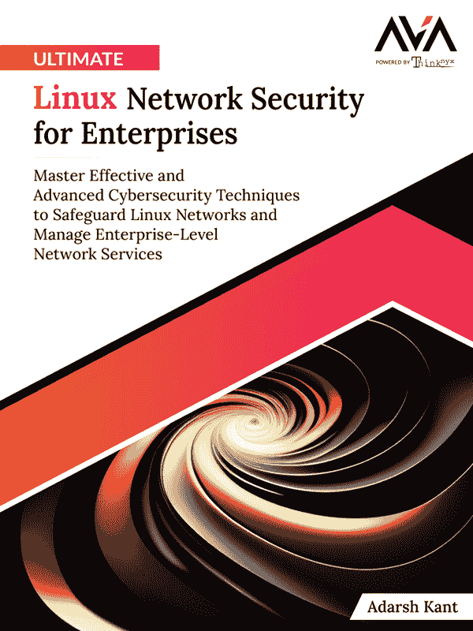


[www.orangeava.com](http://www.orangeava.com)

[www.orangeava.com](http://www.orangeava.com)

# 献给

我亲爱的父亲：

Amar Kant

我的力量与支持系统

# 关于作者

`Adarsh Kant` 是一位卓越的网络安全专家和企业家，拥有纳格普尔大学的学士学位。凭借对知识和创新的不热情，`Adarsh` 在网络安全、数字取证和创业领域积累了 70 多项认证，巩固了他在这些领域的专业专长。

在他辉煌的职业生涯中，`Adarsh` 向全球包括印度、英国、新加坡、日本和阿联酋内的 14,000 多名学生和专业分享了他的专业知识。他在印度储备银行、军械工厂、中央储备警察部队和坎普尔印度理工学院（IIT Kanpur）等知名机构提供培训课程方面发挥了关键作用。值得注意的是，`Adarsh` 荣获得了由技能发展与创业部颁发的声誉“青年偶像奖”，该奖由受尊敬的 Nitin Gadkari 先生授予。

`Adarsh` 的贡献不仅限于培训和教育；他还与许多银行和跨国公司合作，加强其 Web 应用程序的安全并进行全面的安全审计。他在领域的实战经验使其网络安全领域的卓越工作赢得了赞誉和认可。

作为一名热衷的企业家，`Adarsh` 是其初创公司 `Cyber3ra` 的推动力量，这家公司专注于网络安全解决方案。他的创业精神不仅推动了自己的事业取得成功，还启发了创业生态系统中的其他人。`Adarsh` 担任过各类创业活动的评审，包括马哈拉哈特拉创业之旅、由德里政府组织的 Business Blasters 1.0 和 2.0，以及坎普尔印度理工学院举办的 Startup Sprint。通过他的指导和引导，`Adarsh` 持续培养和促进了印度新兴创业者的成长。

凭借对卓越的追求以及对网络安全和创业未来的愿景，`Adarsh Kant` 始终处于行业创新和领导的前沿。

# 技术评审伙伴

`Thinknyx^® Technologies` 是一支专业人士团队，在 IT 技术领域拥有多年经验，涵盖从软件开发到 IT 基础设施管理、云、自动化、容器管理、Web 和 APP 开发、安全以及专业服务。作为一个信誉良好的品牌，`Thinknyx^® Technologies` 提供 IT 咨询服务，提供全面的信息技术和软技能培训。此外，他们还为全球各类机构提供人才获取和招聘解决方案。


`Mr. Yogesh Raheja` 是 `Thinknyx^® Technologies` 的创始人兼首席执行官， DevOps、SRE、云和容器化认证专家，拥有二十年的 IT 经验。

他在公有/私有云、容器、自动化工具、持续集成/部署/交付工具、监控和日志工具等技术方面拥有专长。`Mr. Raheja` 热于通过各种论坛、会议、网络研讨会、博客和 LinkedIn 向全球观众分享他的技术知识。此外，他还编写了多本书，包括 *Effective DevOps with AWS, Automation with Puppet 5* 和 *Automation with Ansible*，并在多个平台发布了他的在线课程。此外，他还为 Packt 评审了多本书，包括 *Implementing Splunk 7, Third Edition* 和 *Splunk Operational Intelligence Cookbook, Third Edition* 等。

# 关于技术评审


`Surendranath P` 是一位丰富的嵌入式系统开发者，在网络和汽车软件开发方面拥有超过 7 年的经验。他工作过 Cisco 交换机、路由器和防火墙，以及使用 `Yocto` 进行 IVI 系统软件开发和平台软件集成。他在海得拉巴的 Vector India 受过培训，`Surendra` 在 `C` 和 `DS` 方面的技能值得赞。此外，他还出于兴趣担任过自由职业撰稿人和版主。

# 致谢

开启《企业级网络安全》的写作之旅是一段美妙的经历，我对在本书过程中起到关键作用的个人深表感谢。如果没有许多人慷慨分享的支持、指导和专业知识，这项工作是不可能的。

首先，我衷心感谢 Linux 社区和 Laravel 的创始人 `Taylor Otwell`，他对框架的奉献塑造了这本书。Laravel 文档（[www.laravel.com/docs](http://www.laravel.com/docs)）是一个宝贵的资源，指明了方向，丰富了内容并确保了准确性。向技术评审人员表示特别感谢，他们严谨的评审和见性的反馈提升了本书。他们的投入和专业知识在精炼内容和确保准确性方面至关重要。

感谢我的家人一直以来给予的支持。特别感谢我的母亲 `Barkha Jain`，她的鼓励和理解在整个写作过程中是我不断的力量源。特别感谢我的兄弟 `Samyak Jain` 在此过程中的坚定支持。

感谢出版社在各个方面做出贡献的所有人员，你们的共同努力丰富了事业。我感谢推动本书创作的协作精神。

最后，感谢读者们选择本书作为知识来源。希望它能成为你们精通 Laravel 和应对动态 Web 开发世界之旅中的宝贵伴侣。

# 前言

欢迎阅读*企业级极致 Linux 网络安全*——这是一本专为在网络安全领域拥有 3-5 年经验的中级专业人士设计的全面指南。在当今瞬息万变的数字版图中，网络安全威胁不断变得复杂，掌握先进的知识和技术至关重要。

本书将作为你精通 Linux 网络安全的路线图，深入探讨基础原理、高级技术和行业最佳实践。每一章都经过了精心设计，旨在将理论见解与实践应用相结合，确保你不仅能理解这些概念，还能培养出有效应对现实世界挑战的必要技能。

## 第 1 章：探索 Linux 网络安全基础

在这一基础章节中，读者将全面理解 Linux 网络安全的核心原理。涵盖的主题包括网络架构、常见漏洞、威胁态分析以及实施稳健安全措施的重要性。

## 第 2 章：构建安全的实验环境

本章侧重于实际操作层面，引导读者设置和配置安全的实验室环境。书中强调通过中学学习，涵盖了虚拟化技术、网络分段以及将实验室环境与生产网络隔离的最佳实践。

## 第 3 章：Linux 中的访问控制机制

读者将深入研究 Linux 中访问控制机制的细节，包括权限、用户和组管理以及文件系统安全。本章还探索了高级访问控制技术，如强制访问控制 (`MAC`) 和基于角色的访问控制 (`RBAC`)。

## 第 4 章：实施防火墙与包过滤

本章深入探讨 Linux 中防火墙和包过滤技术的实现。读者将学习如何配置防火墙规则、利用 `iptables` 和 `nftables` 等包过滤工具，并设计防火墙策略以防御各种网络威胁。

## 第 5 章：掌握网络安全密码学

本章涵盖了 Linux 加密的基础，探索了加密协议、算法和密钥管理技术。读者将对传输中和静态数据的加密、通信通道的安全以及实施安全的加密实践获得见解。

## 第 6 章：入侵检测系统与入侵防御系统

读者将学习 Linux 中的入侵检测和防御系统 (`IDS/IPS`)，包括基于网络和基于主机的解决方案。涵盖的主题包括检测方法、基于特征和基于异常的检测，以及 IDS/IPS 在企业网络中的部署。

## 第 7 章：使用 Linux 进行漏洞评估

本章为读者提供了在 Linux 环境中进行全面漏洞评估的知识和工具。主题包括漏洞扫描、渗透测试、风险评估方法论以及修复工作的的优先级排序。

## 第 8 章：制定有效的灾难恢复策略

读者将探索在 Linux 环境中设计和实施稳健灾难恢复计划的策略。涵盖的主题包括备份恢复程序、高可用解决方案、灾难恢复测试以及应急协调。

## 第 9 章：稳健的安全事件响应计划

本章侧重于开发为 Linux 环境定制的有效安全事件响应计划。读者将学习事件检测与分类、事件响应框架、通信协议以及事后分析与改进。

## 第 10 章：Linux 网络安全专业人士的最佳实践

作为本书的结语，本章总结了 Linux 网络安全中级专业人士的关键见解和最佳实践。它涵盖了持续学习策略、职业发展机会以及行业趋势，帮助你在动态变化的网络安全领域保持领先。

在整本书中，你将发现许多实用示例、案例研究和动手练习，这些旨在强化你的学习效果并弥合理论与实践之间的差距。无论你是寻求职业发展，还是想增强在 Linux 网络安全方面的专业知识，本书都是你通往成功之路上的信赖伴侣。

当你开启*企业级极致 Linux 网络安全*的旅程时，鼓励你带着好奇心和热情迎接每一章。希望这本书能成为你在守护受托数字领域成长和精通的催化剂。

祝学习愉快，愿你在 Linux 网络安全领域的努力有所收获且充实自我！

# 彩色图片

请点击链接或扫描二维码下载书籍的*图片*：

你可以在我们的官方 Github 仓库中找到我们书籍的代码包。访问以下链接或扫描二维码以进一步探索：

[`github.com/orgs/ava-orange-education/repositories`](https://github.com/orgs/ava-orange-education/repositories)


请点击链接下载书籍的彩色图片：

[`rebrand.ly/asomgah`](https://rebrand.ly/asomgah)


如果代码有更新，将在现有的 GitHub 仓库中更新。

# 错误表

我们对 **Orange Education Pvt Ltd** 的工作感到非常自豪，并遵循最佳实践以确保内容的准确性，为订阅者提供极佳的阅读体验。读者是我们的镜子，我们利用他们的反馈来反思并改进出版过程中可能发生的任何人为错误。为了方便我们维护质量并帮助我们联系可能因意外错误而遇到困难的读者，请通过以下邮箱联系我们：

errata@orangeava.com

非常感谢您的支持、建议和反馈。

# 你知道吗

你知道 Orange Education Pvt Ltd 为出版的每本书都提供电子书版本吗？提供 `PDF` 和 `ePub` 文件。你可以在 `www.orangeava.com` 升级电子书版本，作为纸质书客户，你有权获得电子书副本的折扣。请联系 `info@orangeava.com` 了解更多详情。

在 `www.orangeava.com`，你还可以阅读免费的技术文章集，订阅一系列免费新闻邮件，并获取 AVA™ 书籍和电子书的独家折扣优惠。

# 盗版

如果你在互联网上发现我们作品的任何形式的非法副本，告知我们地址或网站名称我们将不胜感激。请通过 `info@orangeava.com` 联系我们并附上材料链接。

# 你对与我们合作写作感兴趣吗？

如果您在某个领域拥有专长，并且对撰写或贡献书籍感兴趣，请发送邮件至 `business@orangeava.com` 与我们联系。我们正致力于帮助开发者和技术专业人员洞察全球范围内发生的的技术进步和创新，并建立一个相信“知识通过与他人分享和学习获得最好”的社区。请联系我们，了解我们读者的需求，以及您如何参与这场教育改革。我们还欢迎技术专家提供建议，并帮助他们为其领域构建学习和开发内容。

# 评价

请留下您的评价。在您阅读并使用此书后，为什么不在您购买的网站上留下评价呢？潜在的读者可以查看并参考您的中立意见做出购买决策。我们 Orange Education 非常想知道您对我们产品的看法，我们的作者也可以从您的反馈中学习。感谢您！

有关 Orange Education 的更多信息，请访问 [`www.orangeava.com`](http://www.orangeava.com)。

# 第 1 章：探索 Linux 网络安全基础

## 引言

学习 Linux 基础将让你接触到一个稳定且适应性强的操作系统，该系统驱动着互联网大部分份额。Linux 以其可靠性、安全性和开源状态而闻名，是许多应用程序（包括嵌入式系统和服务器）的基础。在介绍之旅中，我们将探索支撑 Linux 的基本理念，剖析其文件系统设计、命令行界面和必要的工具。我们还将解构支撑计算机网络的基本理念。我们将揭示允许设备高效交互的关键组件，从理解 OSI 模型层级到深入研究协议和寻址的细差别。此外，我们将检查网络管理和安全的关键方面，阐明为保护数据机密性和完整性所实施的步骤。在探索交换机、路由器和防火墙的世界时，你将学习决定现代网络韧性的物理组件。

## 结构

在本章中，我们将讨论以下主题：

*   理解和探索 Linux 环境

*   学习计算机网络基础概念

*   理解 CIA 原则

*   防火墙如何帮助网络安全

*   理解 Web 安全

### Linux 简介

### CLI

命令行界面，简称为 `CLI`，是一种基于文本的界面，允许用户在终端或命令提示符中输入命令以与计算机或程序通信。提供 `CLI` 访问权限的一个程序被称为 `Terminal`。通常，命令提示符会显示当前目录和用户的信息。

操作系统是在启动期间加载到计算机并控制所有应用程序的软件。

开源、社区驱动的 Linux 是一种操作系统。该系统的基石是 `kernel`（内核），它与其他程序和工具结合。

### 基础 Linux 命令

| 文件命令：用于执行基本文件操作 | 描述 |

| :--- | :--- |

| `ls` | 列文件和目录 |

| `ls -lt` | 按修改时间对格式化列表排序 |

| `cd <dir>` | 切换目录到 `<dir>` |

| `cd ..` | 回到父目录 |

| `pwd` | 打印工作目录 |

| `mkdir <dir>` | 创建目录 `<dir>` |

| `cat ><filename>` | 将标准输入写入文件 |

| `more <filename>` | 输出文件内容 |

| `touch <filename>` | 创建空文件或更新文件时间戳 |

| `rm <filename>` | 删除文件 |

| `rm -r <dir>` | 递归删除（用于目录） |

| `cp <filename1> <filename2>` | 将文件 1 的内容复制到文件 2 |

| `cp -r <dir1> <dir2>` | 递归将 dir1 复制到 dir2；如果不存在则创建 dir2 |

| `ln -s <filename> <link>` | 为文件创建符号链接或软链接 |

| 进程管理：用于管理进程 | 描述 |

| :--- | :--- |

| `ps` | 显示当前运行的进程 |

| `top` | 显示所有运行中的进程 |

| `kill <pid>` | 杀死给定 pid 的进程 |

| `killall <proc>` | 杀死所有名为 proc 的进程 |

| 文件权限：用于设置权限 | 描述 |

| :--- | :--- |

| `chmod octal file` | 将文件权限更改为八进制，可以通过添加以下数字分别查找用户、组、世界：4-读(r), 2-写(w), 1-执行(x) |

| 搜索：用于搜索特定内容 | 描述 |

| :--- | :--- |

| `grep pattern file` | 在文件中搜索模式 |

| `grep -r pattern dir` | 在目录中递归搜索模式 |

| `command \| grep pattern` | 在命令输出中搜索模式 |

| `locate file` | 查找所有文件实例 |

| `find . -name filename` | 在当前目录（用点表示）和所有子目录中搜索与 filename 精确匹配的文件和目录 |

| `pgrep pattern` | 搜索所有匹配模式的命名进程，默认返回它们的 ID |

| 系统信息：用于获取系统信息 | 描述 |

| :--- | :--- |

| `Date` | 显示当前日期和时间 |

| `cal` | 显示本月日历 |

| `uptime` | 显示运行时间 |

| `w` | 显示谁在线 |

| `whoami` | 显示当前用户是谁 |

| `uname -a` | 显示内核信息 |

| `cat /proc/cpuinfo` | 显示 CPU 信息 |

| `cat /proc/meminfo` | 显示内存信息 |

| `man command` | 显示命令的手手册 |

| `df -h` | 显示磁盘占用情况 |

| `du -h <filename>` | 如果给出文件名，则显示其磁盘占用情况 |

| `du -h <dirname>` | 如果给出目录名，则显示所有目录的磁盘占用情况 |

| `free` | 显示内存和交换空间 |

| `whereis app` | 显示 app 的可能位置 |

| `which app` | 显示默认运行哪些应用程序 |

| 网络命令：用于获取网络相关信息 | 描述 |

| :--- | :--- |

| `ping host` | 探测主机并输出结果 |

| `whois domain` | 获取域名的 WHOIS 信息 |

| `dig domain` | 获取域名的 DNS 信息 |

| `dig -x host` | 反向查找主机 |

| `wget file` | 下载文件 |

| `wget -c file` | 继续停止下载 |

**表 1.1：Linux 命令**

| 文件层级 | 描述 |

| :--- | :--- |

| /root 目录 | 用户命令二进制 |

| `/boot/` | 引导程序的静态文件 |

| `/dev/` | 设备文件 |

| `/etc/` | 主机特定系统配置 |

| `/home/` | 用户主目录 |

| `/lib/` | 共享库 |

| `/media/` | 可移动介质 |

| `/mnt/` | 挂载的文件系统 |

| `/opt/` | 附加软件包 |

| `/sbin/` | 系统二进制文件 |

| `/srv/` | 系统服务数据 |


| `/tmp/` | 临时文件 |
| `/usr/` | 用户工具 |
| `/proc/` | 进程信息 |

**表 1.2：文件系统**

#### `root`

- 文件系统的顶层目录是根目录。
- 只有 `root` 用户有权限写入根目录。

#### `bin`

- 单用户模式运行所需的主要命令位于 `/bin` 目录。
- 它包含二进制执行程序，系统无需解释器即可运行它们。
- 该目录包含了单用户模式下常用的常用 Linux 命令。

#### `device`

- 重要的设备文件（包括 `/dev/null`）存储在 `/dev` 目录。
- 物理连接到系统的终端设备、USB 设备和其他外设设备通过这些设备文件来表示。
- 两个设备文件的实例是 `/dev/usbmon0`（用于跟踪 USB 设备）和 `/dev/tty1`（代表第一个串口控制台）。

#### 4. `/etc`

- 需要主机特定系统级配置文件的程序和服务可以在 `/etc` 目录中找到。
- 此外，它还包含用于启动和停止某些应用程序及服务的 shell 脚本。
- 该目录包含配置文件，例如调节日志文件轮转的 `/etc/logrotate.conf` 以及管理 DNS 设置的 `/etc/resolv.conf`。

#### 5. `/home`

- 系统上所有用户的家目录都包含在 `/home` 目录下。
- 每个用户都有一个唯一的家目录，用于保存他们的私人文件、偏好和设置。

#### 6. `/lib`

- `/bin` 和 `/sbin` 文件夹中的二进制文件依赖于 `/lib` 目录中的重要库。
- 可执行文件正确运行所需的功能由这些库提供。

#### 7. `/media`

- `/media` 目录作为 CD-ROM 等可移动介质设备的临时挂载点。
- 它为挂载和卸载可移动存储设备提供了一个标准位置。

#### 编辑器

- **Vim**：它是一个高度可配置的文本编辑器，非常高效且功能强大。它以两种模式运行：用于导航和编辑文本的普通模式以及用于插入文本的插入模式。
- **Emacs**：它因内置的脚本语言（Emacs Lisp）而闻名，允许用户大量自定义和扩展其功能。它的学习曲线很陡，但一旦掌握就会非常强大。
- **Nano**：一个简单易用的文本编辑器，专为可能不习惯 Vim 或 Emacs 陡峭学习曲线的用户设计。它提供了基本的文本编辑能力，是快速编辑的良好选择。
- **Sublime Text**：一个知名的内置文本编辑器，拥有许多功能和时尚的界面。它强大的插件生态系统并支持多种编程语言。尽管不是开源，但 Sublime Text 提供免费试用版。
- **Atom**：由 GitHub 创建的开源文本编辑器。Atom 以其用户友好性和丰富的社区贡献自定义包而闻名。它具有高度扩展性，并使用 Web 技术构建。

## 计算机简介

通过通信链路连接的一组设备称为网络。计算机、打印机、路由器和其他数据传输与接收设备都是节点的示例。任何可以传输数据信号的介质（如电缆或光纤）都可以认为是链路。

### OSI 模型

开放系统互连接（OSI）是一个描述计算机之间传输数据所需程序的参考模型。它帮助我们理解数据如何从一端传输到另一端。它是一个分层模型，将通信划分为更小的、可管理的组件，从而加速开发并使各种硬件和软件的协作成为可能。

| 123 | 应用层表示层会话层 | 用户支持层（提供无关软件间的互操作性） |
| 4 | 传输层 | 确保端到端可靠数据传输 |
| 567 | 网络层数据链路层物理层 | 用户支持层（提供无关软件间的互操作性） |

**表 1.3:** OSI 层的功能

#### 1. 物理层

该层负责将单个比特位从一个节点传输到下一个节点。

- OSI 模型的底层
- 通信单位是比特（Bit）
- 将比特位转换为电子信号以发送出的消息
- 将电子信号转换为比特位以接收传入的消息
- 管理计算机与网络介质之间的接口

**职责：**

- 比特位的同步和数据速率
- 线路配置
- 物理拓扑
- 传输模式

#### 2. 数据链路层

数据链路层负责将帧从一个节点传输到下一个节点。

- 通信单位是帧（Frame）
- 将物理层的原始数据封装成数据帧，并交付到接收端的网络层
- 在发送端，数据链路层将数据转换为物理层可以处理的原始格式

**职责：**

- 物理地址
- 序列号
- 错误控制
- 控制
- 访问控制

#### 3. 网络层

网络层负责将单个数据包从源地交付到终点（端到端交付）。

- 通信单位是数据包（Packet）
- 负责数据包的源到目的交付
- 提供在网络之间移动数据包的机制
- 如果两个系统连接到同一条链路，通常不需要网络层。然而，如果两个系统连接到不同的网络（链路），且网络之间有连接设备，通常需要网络层来完成源到目的的交付
- 也处理数据包交换

**职责：**

- 网络地址（逻辑地址）
- 路由

#### 4. 传输层

传输层负责将消息从一个进程交付到另一个进程（源到目的交付）。

- 通信单位是分段（Segment）
- 提供可靠的数据交付
- 从上层接收信息并将其分段

**职责：**

- 进程间通信
- 分段和重组
- 连接控制

#### 5. 会话层

会话层负责会话控制和同步。

**职责：**

- 同步设备之间的数据交换
- 管理令牌以控制对通信信道的访问

#### 6. 表示层

表示层负责处理两个系统之间信息的语法和语义。

**职责：**

- 数据翻译
- 语法检查
- 加密和解密
- 数据格式化
- 图形处理

#### 7. 应用层

应用层负责为用户提供服务。

**职责：**

- 文件传输和管理存访问
- 电子邮件服务
- 网页浏览
- 数据库访问

| 层 | 功能 |
| :--- | :--- |
| 应用层 | 提供网络资源的服务 |
| 表示层 | 对数据进行翻译、加密和压缩 |
| 会话层 | 建立、管理和终止会话 |
| 传输层 | 提供可靠的进程间交付和错误恢复 |
| 网络层 | 将数据包从源移动到目以提供网络互连 |
| 数据链路层 | 将比特组织成帧并提供跳跳交付 |
| 物理层 | 在介质上传输比特以提供机械和电气规范 |

## IP 地址

IPv4 地址是一个 32 位地址，唯一且通用地定义设备（例如计算机或路由器）与互联网的连接。

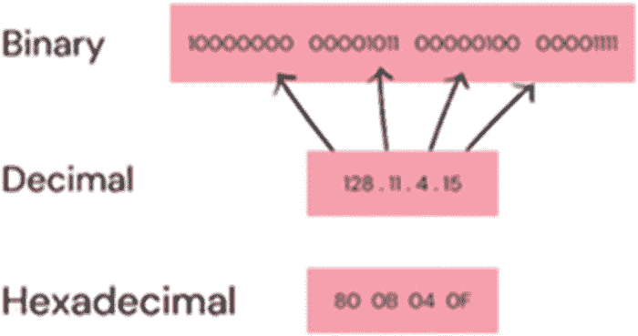

**图 1.1:** IP 地址

地址划分有两种类型：类划址和无类划址。

### 类划址

在类类划址中，地址空间被分为五类：A、B、C、D 和 E。

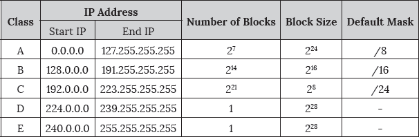

**表 1.5:** 类划址

在类划址中，浪费了大量的 IP 地址。

### 无类划址

在无分类寻址中，块中的地址数量可以通过公式 `2^(32−n)` 找到，其中 `n` 是掩码值。

- 块中的第一个地址可以通过将右侧的 `(32 – n)` 位设置为 0 来找到。
- 块中的最后一个地址可以通过将右侧的 `(32 – n)` 位设置为 1 来找到。

## IPv6 地址

尽管有了所有短期解决方案，地址枯竭仍然是互联网面临的一个长期问题。这一问题以及 IP 协议本身的其他问题是开发 IPv6 的动力。

IPv6 地址的长度为 128 位。

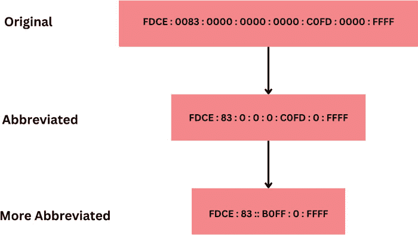

**图 1.2:** IPv6 地址缩写

## 特殊地址

有很多类型的特殊地址，用于某些特定的任务。

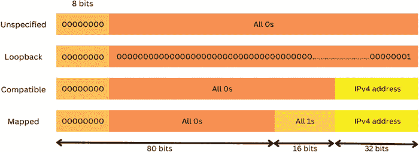

**图 1.3:** 特殊地址

- 虽然该块的部分内容用于定义某些特殊地址，但以前缀 `(0000::/8)` 开头的地址是保留的。
- 当主机在启动过程中想要发送查询以查找自己的地址时，它可以使用 `unspecified address`（未指定地址）子块，这是一个只有一个地址的子块。
- 回环地址只有一个地址。IPv4 的 `Loopback addresses`（回环地址）之前讨论过。在 IPv6 中，一个块由单个地址组成，而不是 IPv4 中的地址范围。
- 主机在从 IPv4 切换到 IPv6 时，可以使用嵌入其 IPv6 地址中的 IPv4 地址。

专门为这种用途创建了两种格式：兼容格式（compatible）和映射格式（mapped）。

- **兼容（Compatible）**：由 96 位零后跟 32 位 IPv4 地址组成的地址被认为是兼容的。当一台支持 IPv6 的计算机想要与另一台支持 IPv6 的计算机通信，但消息必须通过仍然仅支持 IPv4 的网络部分时。
- **映射（Mapped）**：当已过渡到版本 6 的计算机向仍在运行版本 4 的计算机发送地址时，它使用映射地址。

| | **IPv4** | **IPv6** |
| :--- | :--- | :--- |
| 地址长度 | 32 位 | 128 位 |
| 地址表示 | 十进制 | 十六进制 |
| 多组播地址 | 224.0.0.0/4 | FF00::/8 |
| 广播地址 | 存在 | 不适用 |
| 未指定地址 | 0.0.0.0 | :: |
| 回环地址 | 127.0.0.1 | ::1 |

**表 1.6:** IPv4 和 IPv6 比较

## 子网划分

子网划分是在网络创建子网络（也称为 subnet）的过程。子网内的网络接口和设备可以相互通信。路由器促进不同子网之间的通信。

块中的每个地址都可以被视为两级层次结构：最左侧的 `n` 位（前缀）定义网络，而最右侧的 `(32 – n)` 位定义主机。

### 类

假设我们有一个 IP 地址为 `200.1.2.0` 的网络。该地址属于 C 类，因此掩码值为 `/24`，这意味着前 24 位保留用于网络地址。

现在，要将其分为两部分，我们需要 1 位 `(0/1)`。

```
200.1.2.0
```

我们将最后一个十进制值表示为二进制值（我们只扩展最后一个十进制值，因为掩码值为 24，所以我们只需要 8 位来划分网络。如果我们需要超过 8 位，我们将必须也扩展倒数第二个十进制值，依此类推）。

```
200.1.2.00000000
```

- 第 1 个子网：`200.1.2.00000000` -> `200.1.2.0`
- 第 2 个子网：`200.1.2.10000000` -> `200.1.2.128`

| **子网** | **起始地址** | **结束地址** |
| :--- | :--- | :--- |
| 子网 1 | 200.1.2.0 | 200.1.2.127 |
| 子网 2 | 200.1.2.128 | 200.1.2.255 |

**表 1.7:** 示例

现在，要将其分为四部分，我们需要 2 位 `(00/01/10/11)`。

```
200.1.2.0
```

```
200.1.2.00000000
```

- 第 1 个子网：`200.1.2.00000000` -> `200.1.2.0`
- 第 2 个子网：`200.1.2.01000000` -> `200.1.2.64`
- 第 3 个子网：`200.1.2.10000000` -> `200.1.2.128`
- 第 4 个子网：`200.1.2.11000000` -> `200.1.2.192`

| **子网** | **起始地址** | **结束地址** |
| :--- | :--- | :--- |
| 子网 1 | 200.1.2.0 | 200.1.2.63 |
| 子网 2 | 200.1.2.64 | 200.1.2.127 |
| 子网 3 | 200.1.2.128 | 200.1.2.191 |
| 子网 4 | 200.1.2.192 | 200.1.2.255 |

*(注：原始文本在 4 部分划分的表中存在某些错误，我已根据逻辑进行了修正。)*

**表 1.7:** 示例

## 2. 文件传输协议

文件传输协议，简称 FTP，允许通过基于 TCP 的网络（如互联网）从一端到另一端进行文件传输。与 `FTPS` 或 `SFTP` 类似，FTP 可以在加密或不加密的情况下使用。尽管如此，结合外部加密使用 FTP 会更安全。

## 3. 电子邮件

它可以使用简单邮件传输协议 (`SMTP`) 在服务器之间发送。

## 4. 邮局协议版本 3 (POP3)

这是一种基于电子邮件的协议，用于从服务器检索电子邮件到客户端设备，通常会将其下载并从服务器删除。

## 5. 互联网消息访问协议 (IMAP)

该协议与 `POP3` 类似，允许电子邮件客户端访问邮件服务器上的消息，而无需下载。它允许用户在服务器上组织和操作他们的电子邮件。

## 6. 域名系统 (DNS)

这是一个将人类可读的域名转换为 IP 地址的系统，以便客户端能够获取请求的网页。DNS 使用分布式服务器系统来管理从域名到 IP 地址的转换。在 DNS 查找过程中，将 `www.example.com` 等域名转换为如 `192.168.1.1` 的 IP 地址非常重要。

## 7. 简单网络管理协议 (SNMP)

该协议用于管理和监控路由器、交换机、服务器等许多网络设备及其功能。SNMP 陷阱是代理向管理员发送的异步通知，用于向他们报警特定事件，例如系统重启、链路状态更改或其他重大事件。

## 8. Telnet

一种提供与远程计算机通信的文本接口的协议。它是不安全的，并在很大程度上已被安全外壳 (`SSH`) 取代。

## 9. 安全外壳 (SSH)

它提供访问远程计算机的安全方法，允许加密通信和安全的远程管理。

## 10. 动态主机配置协议 (DHCP)

它为网络上的设备动态分配 IP 地址和其他网络配置信息。

## 11. 网络时间协议 (NTP)

它用于同步网络上计算机和网络设备的时钟。它的设计目的是确保分布式系统中准确且一致的时间计时，允许设备与参考时间源保持同步时间。

## 网络安全

### CIA

CIA 指的是信息安全的核心原则：机密性、完整性和可用性。这些原则为设计和实施安全系统及实践奠定了基础。


**图 1.6:** 信息安全基础

- **机密性**：确保数据仅对授权人员可见且可访问。
- **完整性**：确保存在的数据是正确且准确的。这意味着数据没有被任何未经授权的人篡改。
- **可用性**：确保数据对于需要并愿意访问它的人是可用的。

### IdAM

身份和访问管理（IdAM）是一项策略和技术框架，确保正确的个人拥有对技术资源的适当访问。

- **身份识别**：涉及识别系统内的个人。
- **身份验证**：涉及验证用户的身份。最广泛使用的三个因素是用户所知道的、用户拥有的以及用户具备的特征。
- **授权**：涉及用户可以拥有的访问级别。

## 防火墙配置

防火墙是一种网络安全设备或软件，根据预定义的安全规则监控并控制入出站的网络流量。防火墙的主要目的是在安全的内部网络与不可信的外部网络（如互联网）之间建立屏障。

防火墙可以以硬件和软件的形式实现：

硬件防火墙实现在路由器层级并保护整个网络，而软件防火墙保护单台计算机，通常成本较低。

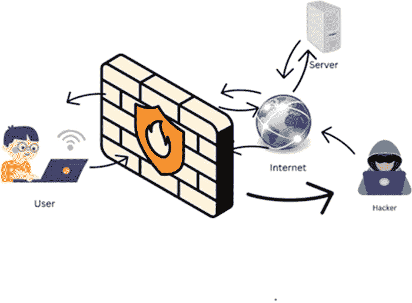

**图 1.7:** 防火墙实现

然而，防火墙不执行以下操作：

- 防止免受可能伤害你的内部人员攻击。
- 防止免受完全全新的威胁。
- 编程访问互联网，尽管这是防火墙可以控制的功能之一。
- 确定哪些程序可以访问互联网。
- 防止弹出广告。
- 防范 `SMTP` 会话劫持。
- 防止免受操作系统中 bug 的影响。
- 防止未经授权的用户使用计算机。
- 防止免受源路由攻击（Source routing）。

以下是防火墙实现的安全技术：

- **深度防御**：一种安全方法，确保网络上的每个系统都尽可能安全。
- **默认拒绝**：禁止所有未显式许可的通信。
- **默认允许**：允许所有未显式禁止的通信。
- **最小权限**：降低执行各种操作时的授权级别。
- **瓶颈点**：迫使攻击者通过狭小的通道规避网络。

以下是防火墙测试方法：

- **Ping**：要检查防火墙是否允许互联网控制消息协议（ICMP）流量，请使用 `ping` 命令：

```bash
ping <IP>
```

这可以支持基本的连通性验证。

- **端口扫描**：要发现系统上哪些端口是开启，请使用端口扫描器（如 `Nmap`）。这有助于定位任何未使用的开放端口。
- **测试防火墙规则**：要测试防火墙的行为，请创建特定的规则。例如，通过尝试阻止或允许特定的端口或 IP 地址，查看防火墙的行为是否符合预期。
- **渗透测试**：为了发现网络漏洞并评估防火墙阻止未经授权访问的能力，请进行伦理黑客或渗透测试。

## 欺骗

欺骗背后的想法是为恶意用户创建一个虚假的攻击面感知。欺骗有以下几个优点：

- 高性效益比
- 支持策略分析
- 易于部署和使用

## 蜜罐方法

蜜罐是针对恶意人员具有吸引力的精心制作的信息、服务、数据或其他任何资源。它用于诱骗黑客进入欺骗系统。

蜜罐是一种用于检测、偏离或研究未经授权使用信息系统尝试的安全机制。蜜罐方法涉及部署一个具有真实系统漏洞的系统或网络，诱骗攻击者与之交互。蜜罐的主要目的是收集攻击者使用的战术、技术和程序（TTP）信息，并将他们从实际生产系统中分散。

以下是蜜罐方法的关键点：

**蜜罐类型：**

- **研究蜜罐**：用于研究和理解攻击者的战术。这些蜜罐通常部署在公共网络中。
- **生产蜜罐**：设计用于模拟真实系统，但在生产环境中使用，以检测并将攻击引离关键基础设施。
- **高交互蜜罐**：功能完整的系统，模拟真实的服务和操作系统，允许与攻击者进行深度交互。
- **低交互蜜罐**：仅模拟攻击者经常针对的服务和协议。它们的功能有限，以降低被破解的风险。

**部署：**

- 蜜罐可以部署在各种网络层级，包括边界、内部网络，甚至特定的应用程序内部。
- 它们可以是物理系统，也可以是虚拟系统，取决于部署的需求和目标。

### 目标：


# 检测、分析与分散注意力

- **检测**：蜜罐设计用于检测和记录未经授权的访问或活动。与蜜罐的任何交互都可能是恶意的，因为在正常情况下它不应该被访问。

- **分析**：蜜罐为分析受攻击者所使用的工具、战术和程序提供了宝贵的数据。这些信息可用于改进整体安全措施。

- **分散攻击者注意力**：通过将攻击者引入蜜罐，组织可以分散其对实际生产系统的注意力，为响应和缓解威胁赢得时间。

## 挑战

- **被破解风险**：部署蜜罐面临蜜罐本身可能被破解的风险。这需要仔细的配置和监控以最大限度地降低这种风险。

- **伦理考虑**：蜜罐的使用引发了伦理考量，因为它涉及到故意创建一个带有漏洞的系统来吸引攻击者。

- **法律考虑**：组织在部署蜜罐时需要考虑法律影响，特别是当它们被用于与潜在攻击者交互时。未经授权的访问和数据收集可能会引发法律问题。

- **与安全运营集成**：蜜罐应集成到组织的整体安全运营和事件响应流程中，以确保任何发现都能得到及时处理。

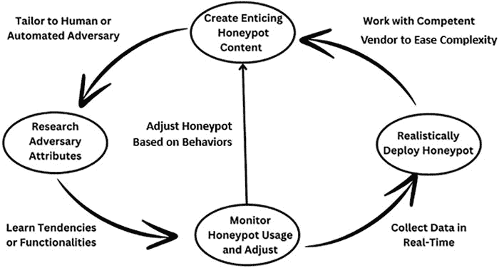

**图 1.8：蜜罐生命周期**

# SSH 协议

该协议在客户端-服务器模型中运行，由 SSH 客户端发起与 SSH 服务器的连接。连接建立由 SSH 客户端发起，利用公钥加密验证 SSH 服务器的合法性。在设置阶段之后，SSH 协议采用稳健的对称加密和哈希算法来确保客户端与服务器之间交换数据的机密性和完整性。数据传输过程中采用了加密技术以防止窃听或拦截，从而确保登录凭据和命令输出等敏感信息的机密性。SSH 基于 TCP 运行，利用了其可靠性以及在需要传输数据时信号的能力。

## SSH 的关键属性

- **加密**：所有数据（包括登录凭据和会话命令）在传输过程中都会经过加密，即使被拦截也能保持机密性。

- **身份验证**：SSH 使用各种方法（如密码、公钥加密和高级技术，如双因子认证）来验证用户身份。公钥认证因其更高的安全性而通常受青睐。

- **密钥交换**：在客户端-服务器连接后，会执行密钥交换以建立共享秘密密钥。该密钥随后被用于加密客户端与服务器之间交换的数据。

- **端口转发**：SSH 促进了安全隧道的创建，允许将特定的网络连接从客户端转发到服务器或反之。这对于访问其他因网络限制而受限的服务非常有价值。

# 访问控制列表

访问控制列表（ACL）是一组规则或条件，规定了在网络或系统资源上允许或拒绝执行的操作。ACL 常用于计算机安全和网络技术中，用于控制对文件、目录、网络资源或服务的访问。

## 组成

- **主体**：尝试访问资源的实体（用户、组或系统进程）。

- **对象**：主体尝试访问的资源（文件、目录、网络服务等）。

- **权限**：在对象上允许或拒绝的特定操作或过程。这可能包括读取、写入、执行、删除等许多项。

- **条件**：应用规则必须满足的额外标准。例如，网络 ACL 可能包含基于源或目的 IP 地址、端口号或协议的条件。例如：

    - 允许用户 `Alice` 读取和写入文件 `example.txt`。

    - 拒绝来自特定 IP 地址范围的所有入站流量。

## 使用 ACL 的益处

- **简化用户识别**：使用访问控制列表使用户识别变得更容易。ACL 保证了系统只有授权的用户和流量才能访问。

- **工作输出**：与实现相同目的的其他技术相比，ACL 提供了性能上的优势。访问控制列表不会影响路由设备的性能，因为它们直接设置在设备的转发硬件上。相比之下，状态检测防火墙是种不同的软件，可能会导致性能下降。此外，当流量受到控制时，网络可以运行得更高效。

- **控制**：管理员可以使用 ACL 对网络中各个网络节点上的用户和流量权限进行更精确的控制。它们有助于控制对网络端点的访问以及流在内部网络之间的流量。

# 虚拟专用网络

VPN 是一种在不安全性较差的网络（如互联网）上建立安全且加密连接的技术。VPN 为用户提供了一种方法，通过用户设备与目标网络之间创建虚拟加密隧道，在互联网上安全地访问私网络。VPN 使用加密算法保护通过互联网传输的数据，例如安全套接层（SSL）和传输层安全（TLS）。

## VPN 连接的优势

- **安全加密**：为了读取数据需要加密密钥。如果没有暴力破解，计算机解码这些代码需要数百万年。有了 VPN，即使在公共网络上你的在线活动也会被隐藏。

- **隐藏你的位置**：本质上，VPN 服务器充当你的在线代理。系统的精确位置无法确定，因为人口统计位置数据来自不同的服务器。此外，大多数 VPN 提供商不维护活动日志。另一方面，某些服务供应商会记录你的活动但保持信息私密。这意味着任何关于你当前和过去用户行为的信息都将永远保密。

- **访问区域内容**：并不是每个网站都能从任何地方访问区域内容。网站和服务的内容通常限制在特定地理位置的用户。标准连接使用各地的本地服务器来确定你的确切位置。这意味着你在旅行或从海外访问时无法访问国内内容。通过启用 VPN，你可以通过连接到另一个国家的服务器来“更改”你的位置。

- **安全数据传输**：如果你远程工作，可能需要访问公司网络上的重要文件。出于安全考虑，此类数据必须通过安全连接发送。通常情况下，访问网络需要 VPN 连接。VPN 服务连接到私有服务器并使用加密方法来降低数据泄露的风险。

# 入侵防御系统（IPS）和入侵检测系统（IDS）

IDS 监控网络或系统活动，以检测恶意行为或违反安全策略的情况。它能够检测并警告管理员潜在的安全事件。当检测到可疑活动时，IDS 会生成警报，这些信息可能包含攻击性质、受影响的系统以及潜在影响。

- `基于签名的检测`：已检测出的威胁的行为可用于检测后续的相同威胁。然而，它无法检测完全未知的威胁。

- `基于异常的检测`：基于检测特定流量流中的异常。然而，它可能会产生误报，并且如果异常范围设置不当，可能会允许恶意内容通过。

- `内存保护`：这是一组机制，旨在防止同一系统上的一个进程擦除另一个进程的内存。进程执行监控，结合终止看似为恶意的进程的能力，构成了进程保护。

- `内联网络设备`：通过将网络设备直接放置在网络通信的路径上，这种入侵防御技术使设备具备在攻击包通过其接口时对其进行修改和拦截的能力。

- `会话抢占`：这种入侵防御技术向连接的两端发送 `TCP RST` 数据包以结束 `TCP` 会话。发送 `TCP RST` 是为了响应检测到的尝试攻击，从缓冲区中清除尝试的利用并防止其发生。

- `网关交互设备`：这种入侵防御策略允许检测设备与路由器或防火墙等网络网关设备进行动态交互。当检测到尝试攻击时，检测设备可以引导路由器或防火墙拦截攻击。

# Web 安全

保护网站免受未经授权的利用、访问、更改、破坏或中断的行为被称为网站安全。

- `HTTPS`：使用 `HTTPS` 保证连接的安全和加密。它结合了 `SSL/TLS` 和 `HTTP` 协议，为用户提供一个与网站交互的安全界面。此外，启用 `HTTPS` 的网站在搜索结果中的排名更高。

- `XSS 保护`：实施保护措施防止攻击者将恶意脚本插入其他用户正在查看的网站。安全头部、输出编码和输入验证都可以帮助实现这一点。

- `CSRF 保护`：确保只有授权用户才能发起敏感的网站操作，并使用反 CSRF 令牌来防御跨站请求伪造（`CSRF`）攻击。

- `SQL 注入预防`：对用户输入进行清理和验证，以防止 SQL 注入攻击，攻击者通过用户输入操纵 SQL 查询以获得对数据库的非法访问。

# 事件响应

事件是指一组或多个安全事件或条件，需要采取行动并关闭以维持可接受的风险状况。事件响应是快速检测事件、最小化损失和破坏、缓解被利用的弱点以及恢复 IT 服务的能力。

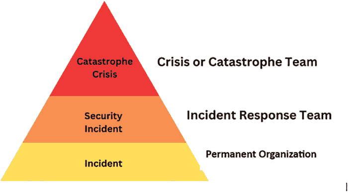

**图 1.9：事件响应**

## 事件响应的必要性

事件响应的必要性在于及时高效地响应安全泄露。这对于几个原因非常重要：

- 通过处理当前事件获得的知识，更好地为处理即将发生的事件做准备。

- 为数据和系统提供更好的保护。

- 协助处理事件期间可能出现的任何法律问题。

- 遵守规定对数据进行同步高效保护的法律法规、政策和指南。

## 事件处理阶段

事件处理过程涉及几个阶段，例如：

- `准备`：组建并培训事件响应团队，以及获取所需的设备和用品。

- `检测与分析`：识别安全漏洞并通知组织即将到来的攻击。

- `抑制`：减轻事件影响的一种策略是抑制。

- `消除与恢复`：完成检测和分析循环以结束事件并开始修复过程。

- `事后活动`：准备关于事件原因、成本的详细报告，以及未来针对类似攻击的预防措施。

# 结论

本章提供了 Linux 操作系统、计算机网络和信息安全的基础知识。这些是网络安全之旅中的基础主题。掌握这些基础概念使你能够理解如何与 Linux 工作，并获得网络基础知识，这对于理解网络中的数据流起着至关重要的作用。此外，获得信息安全的基础知识让你理解计算机安全动态格局中常见的挑战和解决方案。

在接下来的章节中，我们将探索建立安全的实验室环境，以便实践练习的无缝执行。这种方法旨在增强我们的学习体验，并从每次实验室课程提取最大的知识。

# 第 2 章：创建一个安全的实验室环境

## 引言

开始创建安全的实验室环境是为各种操作、实验和学习体验提供受控且保护空间的关键步骤。建立这样的环境可以确保一个安全的场所，用于探索各种任务，而不会损害您的系统完整性或面临外部漏洞。选择虚拟机（`VMs`）来实施任务是一项战略决策，在灵活性、可扩展性和安全性方面具有许多优势。虚拟化技术允许你在单台物理机上创建多个隔离的操作系统实例，为各种任务提供动态且高效的环境。

## 结构

在本章中，我们将讨论以下主题：

- 什么是虚拟化以及如何实现？

- 安装安全的实验室环境

- 用于安全实验的虚拟机的逐步设置

- 为即将进行的实践练习准备实验室环境

# 虚拟化

虚拟化是将计算机硬件资源划分为多个执行环境的框架或方法。这是通过应用一个或多个概念，如软件分区、时间共享以及部分或完整的机器模拟或仿真实现的。这种技术允许创建事物的虚拟（逻辑上的而非物理上的）版本，例如操作系统、存储设备或网络资源。

主机操作系统可以运行多个虚拟机，每个虚拟机都具有特定操作系统的特性。

## 虚拟机

虚拟机是一种软件构造，允许用户将现有硬件虚拟化，以便在同一硬件上运行多个操作系统。

- 它配置了一个或多个处理器、内存、存储器和网络连接。

- 虚拟机只能看到它被配置的资源，而看不到主机上物理可用的所有资源。

## 虚拟机程序（Hypervisor）

虚拟机程序充当虚拟机和物理硬件之间的桥梁，实现无缝通信和资源分配。它将底层硬件从客户操作系统中抽象出来，允许它们独立运行同时高效地共享可用资源。

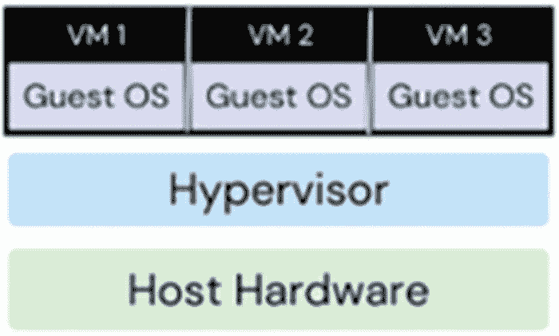

**图 2.1：虚拟机管理程序**

# 安装 VirtualBox

VirtualBox 是一款免费且开源的虚拟化软件，允许用户在单台计算机上运行多个操作系统。它创建了虚拟机（VM），虚拟机是利用宿主机物理硬件的模拟计算机。这允许用户在不影响其主操作系统的情况下，测试不同的操作系统、软件应用程序和配置。

欲需更多详情和信息，请访问以下链接：[`www.virtualbox.org/`](https://www.virtualbox.org/)（Oracle VM VirtualBox）。

以下是下载和安装 VirtualBox 的步骤：

1. 要下载 Oracle VM VirtualBox，请访问以下链接：[`www.virtualbox.org/wiki/Downloads`](https://www.virtualbox.org/wiki/Downloads)

    

    **图 2.2：安装虚拟机**

2. 下载开始，下载完成后，打开文件安装 VirtualBox。

    

    **图 2.3：安装向导**

3. 如果你想更改位置，请点击“浏览”。否则，你可以保持默认并点击“下一步”。

    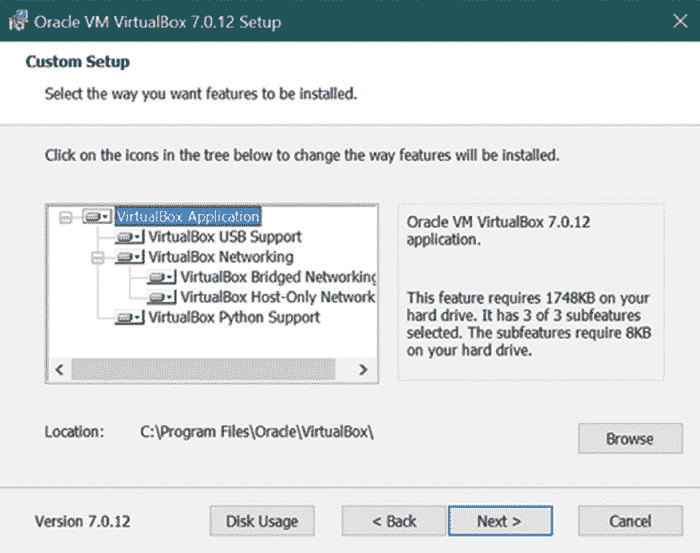

    **图 2.4：设置向导**

4. 点击`Install`开始安装。

    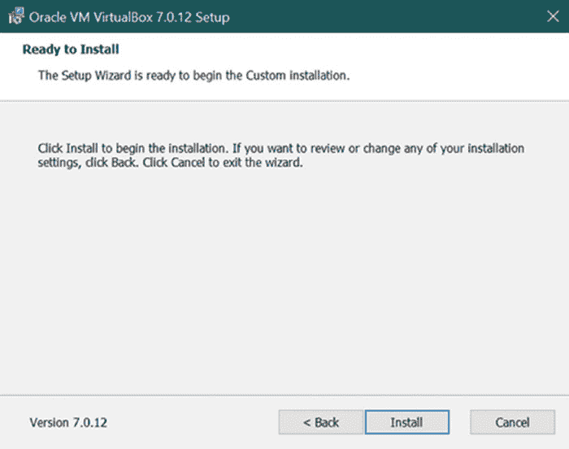

    **图 2.5：设置向导**

5. 安装将开始。安装完成后，点击“完成”。

# 在 VirtualBox 上安装 Parrot Security 虚拟机

## Parrot Security

Parrot Security 是一个基于 Debian 的 Linux 发行版，专门为安全专业人员、道德黑客和渗透测试人员量定制。这是一个由 Parrot Project 团队领导的社区驱动项目。该发行版拥有一套全面的安全工具，涵盖了网络分析、漏洞评估、数字取证等许多任务。

- Parrot Security 提供了一个全面的安全工具集，包括信息收集、漏洞评估、渗透测试、密码学、逆向工程等。它作为网络安全专业人士和爱好者执行各种安全相关任务的平台。

- Parrot Security 优先考虑用户的匿名性和隐私。它包含了 Tor 浏览器等工具，并提供了对 VPN 的内置支持，使用户在进行安全评估时能够保护自己的在线身份。

- 作为一个开源项目，Parrot Security 受益于开发者和用户社区，他们为开发做出贡献，并通过论坛和其他渠道提供支持。

以下是下载和安装 Parrot Security 的步骤：

1. 访问链接 [`www.parrotsec.org/download/`](https://www.parrotsec.org/download/) 下载适用于 VirtualBox 的 Parrot Security OS ISO 文件。

    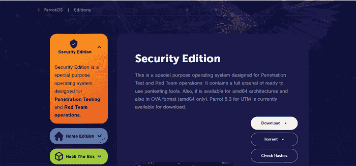

    **图 2.6：Parrot Security 落地页**

2. 下载完成后，打开 VirtualBox 并点击`New`添加新虚拟机。

3. 输入名称并挂载 ISO 镜像文件。

    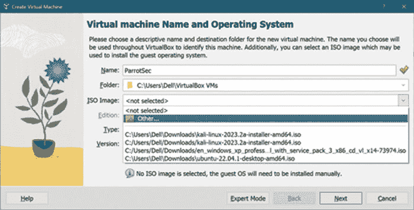

    **图 2.7：在虚拟机上设置 Parrot OS**

4. 根据你的需求选择内存和处理器。

5. 现在，运行虚拟机。

    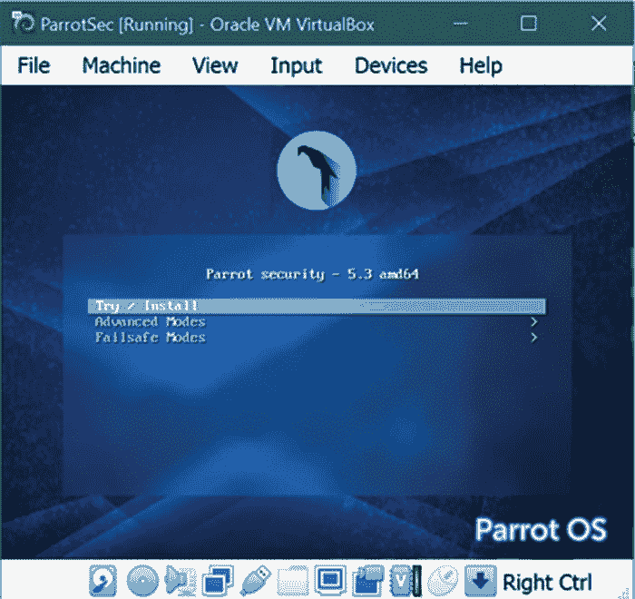

    **图 2.8：在虚拟机上安装 Parrot OS**

6. 点击`Install Parrot`图标开始安装。

    

    **图 2.9：在虚拟机上安装 Parrot OS**

7. 选择合适的选项并输入你的登录用户名和密码，然后点击`Next`安装。

    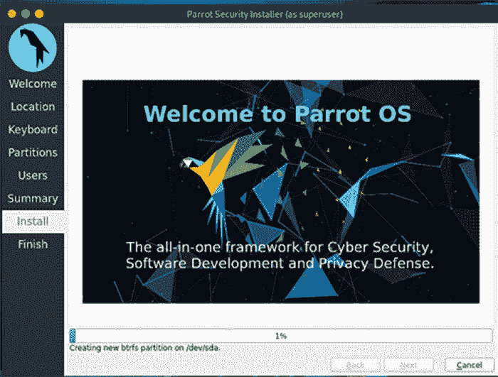

    **图 2.10：完成安装**

有关关于 Parrot OS 的更多详情，请访问以下链接：[`www.parrotsec.org/docs/`](https://www.parrotsec.org/docs/)

# 结论

虚拟机（VM）实验室环境的成功安装为各种计算任务提供了一个安全、灵活且动态的平台。通过选择虚拟化技术，用户可以充分利用硬件的潜力，创建隔离实例，并享受资源效率、可扩展性和可移植性带来的好处。

在接下来的章节中，我们将开始对实际实现进行上手探索，深入研究核心概念，例如对访问控制机制的细致维护。此外，我们还将研究防火墙和 IDS/IPS 系统的复杂部署，深入理解它们的内部原理，并积极将这些知识转化为有效的实现。

# 第 3 章

# Linux 中的访问控制机制

## 引言

作为数字环境的守护者，访问控制机制通过管理权限和入口，确保只有经过授权的用户或系统才能与资源交互。这些保护措施对于保护网络安全领域的私有数据和维护数字环境的完整性至关重要。

一种被称为访问控制的详尽安全机制被用于管理和限制对资源的访问。这些资源可能包括实际区域、网络、数据库或文件，访问控制确保只有具有权限的人才能使用或更改它们。基于角色的访问控制（`RBAC`）、强制访问控制（`MAC`）和自主访问控制（`DAC`）是三大基本类别。

## 结构

在本章中，我们将讨论以下主题：

- Linux 访问控制机制简介

- 探索不同的访问控制类型

- 理解基于访问类型的 Linux 环境

- 根据组织对不同用户实施权限

- 保持环境安全的最佳实践

# Linux 中的访问控制机制

## 资源与所有权

- **用户**：用户是与计算机系统交互的人或系统。它是所有程序操作、文件创建和修改以及系统请求的起点。每个用户账户关联一个用户 ID。

- **进程**：进程是运行中的程序。在系统中，任何时刻都有多个进程正在运行。用户创建进程来执行特定的操作。每个进程都有其自己的资源和地址空间。

- **文件**：在计算机上，文件是存储的数据组。它们可以代表程序、图片、文档等。

    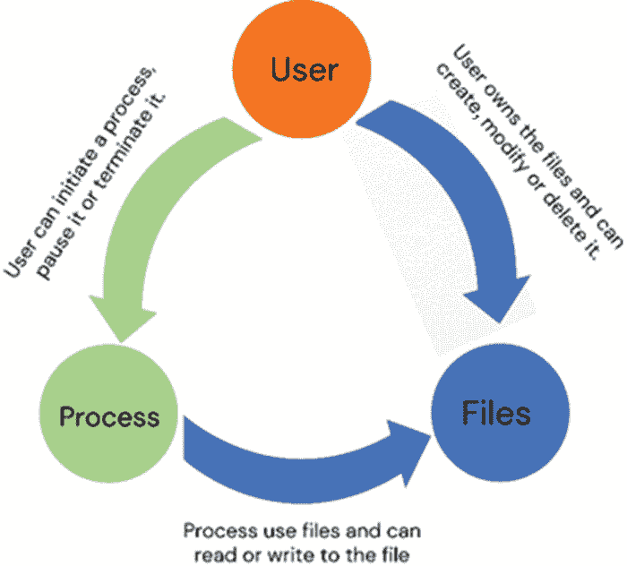

    **图 3.1：资源与所有权**

## 沙箱

沙箱的主要目的是提供一个与系统隔离的封闭环境。在沙箱中，你可以在受控的环境中运行未知的代码，而不会干扰其他运行的程序。这种隔离有助于控制错误或恶意代码带来的危害。

它被认为是防御零日漏洞的有效系统，零日漏洞是全新的且从未见过的威胁。

沙箱在各种情况下都非常有用：

- **安全测试**：软件开发和测试经常使用沙箱。在沙箱环境中，开发者可以测试新的代码或程序，因为它提供了灵活性而不会损害整个系统。

- **网页浏览**：浏览器中的每个标签页或进程都运行在自己的沙箱环境中，因此即使访问了恶意网站，影响也局限于该标签页的沙箱环境。

- **虚拟化**：虚拟机和容器可以被视为沙箱的一种形式。它们允许在隔离环境中执行应用程序或进程，从而提供额外的安全保护层。

- **利用高级网络和支持**：通过使用合适的沙箱环境，你可以探索高级网络功能，并在这些功能符合你的预期工作环境时对其进行测试。

- **防止未来的攻击**：如果危险被限制在沙箱环境中，IT 人员或外部网络安全专家可以在隔离环境中对其进行研究。仔细检查威胁有助于发现趋势，从而帮助防止未来发生类似的攻击。

# 访问控制类型


访问控制是一种安全措施，用于规范和限制对资源或系统的访问。它确保只有授权的实体（如用户或系统）可以与某些资源交互，同时防止未经授权的实体访问敏感信息或执行特定操作。访问控制是计算机安全的一个基本方面，通过各种机制和技术实现。以下是某些访问控制类型：

### 任意访问控制

`DAC`（或自主访问控制）是一种安全访问控制技术，它通过由主体或对象所有组建立的策略来管理对象的访问。在身份验证过程中，将使用用户名和密码等凭据来验证用户并在 `DAC` 内部设置控制。主体（所有者）有权向其他用户提供对验证对象或信息的访问，这就是 `DAC` 的“任意”之处。换句话说，对象的访问权限是由所有者决定的。

`DAC` 是计算机系统安全概念，赋予管理员或所有者对资源访问的控制权。对象（如文件、目录或网络）的所有者有权在 `DAC` 下决定是否对其提供访问。

任意访问控制的主要特征包括：

- **所有者控制**：资源所有者有权选择谁可以使用该资源以及他们可以在该资源上执行什么操作。所有者可以授予或撤销权限。

- **授权程度**：`DAC` 通常涉及赋予个人或组不同程度的授权。常见的权限包括读、写、执行和删除。这些权利可以根据所有者的主意授予。

- **访问控制列表 (`ACLs`)**：`ACL` 是 `DAC` 中建立访问限制的一种流行方法。`ACL` 是附加在项目上的权限列表，描述了哪些操作是允许的，哪些用户或系统进程被授权访问。

- **自由度**：由于资源所有者可以选择访问控制，`DAC` 提供了很大的自由度。然而，如果所有者未能仔细监控权限，可能会导致未经授权或不当的访问，这种灵活性也会变成一个缺点。

- **困难性**：在大规模系统中管理 `DAC` 可能困难，并可能导致权限过度。此外，它可能不如某些其他类型的访问控制（如强制访问控制 `MAC`）那样精确。

**注意**：你将在标准 Linux 下学习更多关于 `DAC` 的知识。

### 强制访问控制

强制访问控制（`MAC`）网络安全系统旨在提供或限制对组织内部机密和受保护数据的访问。组织内部人员的分级决定了访问权限的分配方式。用户被限制在与其许可级别匹配（或低于）的资源上，而管理员是唯一的控制者。系统会自动验证用户访问资源及其所属类别的资格。

在使用 `MAC` 之前，公司必须投入时间和资源来充分理解流程控制。这涉及对人员、流程和可用资源的分析，以及建立标签和类别等属性和规则。

强制访问控制的主要特征包括：

- **集中化控制**：`MAC` 由系统管理员或安全策略进行集中控制。访问决策基于分级方式，而不是根据资源所有者的主意。

- **卓越的数据安全性**：由于这是一个强制性系统，公司可以保证重要和私密信息被安全存储，且不太可能泄露。由于其细密的设计、测试和强化，`MAC` 是最安全的访问系统之一。企业可以放心，因为只有某些经过批准的人员才能看到所需的信息，且在没有所需权限的情况下无法更改数据。

- **隐私**：由于该系统是集中的，其他人无法简单地更改类别或访问级别。只有高级官员才能编辑它，为企业提供了一定程度的隐私保护，帮助其保护数据。

**注意**：你将在 `SELinux` 下学习更多关于 `MAC` 的知识。

### 基于角色的访问控制

系统访问还可以通过基于角色的访问控制（`RBAC`）方法进行限制，这有时被称为基于角色的安全。有必要设置权利权限以允许授权用户访问系统。基于角色的访问控制是大企业使用的流行工具，根据员工的职位和职责为他们提供不同程度的访问。这保护了隐私信息，并确保员工只能访问和执行履行职责所必需的操作。

因此，如果低级人员执行职责时不需要敏感数据，他们通常无法访问这些数据。这在雇佣承包商和第三方以及拥有大量员工时特别有用，因为此时严密监控网络访问具有挑战性。

`RBAC` 的核心组件包括：

- **用户**：这些与系统交互的个人。用户被分配一个或多个角色，其访问权限由与这些角色相关的权限决定。

- **角色**：定义了具有该角色的用户可以执行的操作或过程的权限集。例如，系统可能有“管理员”、“经理”和“用户”等角色，每个角色具有不同的访问级别。

- **权限**：这些是在系统中可以执行的单个访问权限或操作。权限被分配给角色，用户通过被分配特定角色获得这些权限。

- **角色分配**：这涉及根据工作职责将用户与特定角色关联。用户可以拥有一个或多个角色，每个角色提供特定级别的访问。

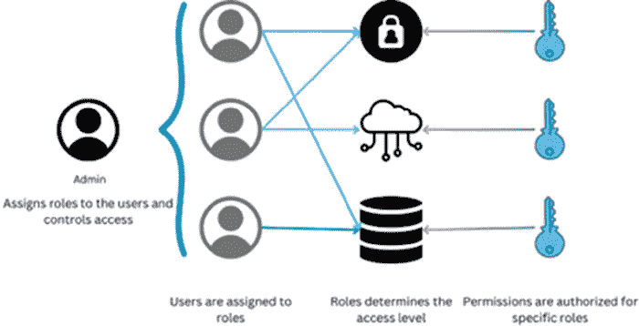

**图 3.2**：*基于角色的访问控制*

`RBAC` 提供了若干优势，包括：

- **简单性**：基于角色管理权限可以简化访问控制管理。

- **可扩展性**：随着组织增长，通过将新用户分配到相应角色来添加用户比定义个人权限要容易。

- **安全性**：`RBAC` 有助于实施最小权限原则，确保用户拥有执行其工作功能所需的最低级别权限。

## 访问控制命令

以下是一些用于访问控制的命令：

```
sudo (Superuser Do) 允许许可的用户以超级用户或其他用户的身份执行命令，如 sudoers 文件中所指定的。
```

要创建另一个用户账户，请使用命令 `sudo useradd <username>`，设置密码时使用命令 `sudo passwd <user>` 并输入密码。

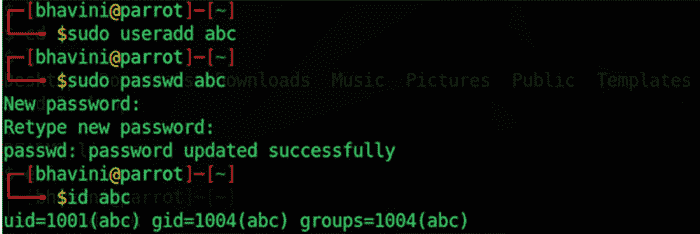

**图 3.3:** `sudo`

如果你想给某个用户授予管理员权限，可以使用 `sudo visudo` 在 sudoers 文件添加该用户。

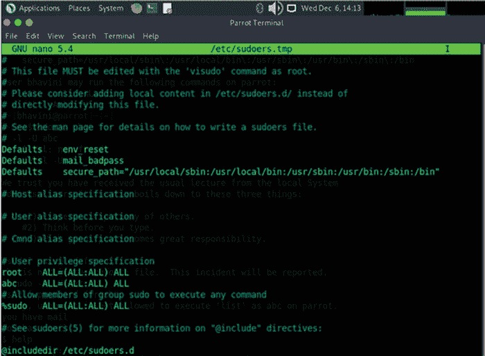

**图 3.4:** `/etc/sudoers.tmp`

如果非根用户尝试访问特权文件和文件夹，该事件将被记录。

现在，如果你想根据角色授予任何用户访问特定文件和文件夹的权限，请打开 sudoers 文件并添加以下内容：

`<username> ALL=(ALL:ALL) NOPASSWD: </path of file or directory>`

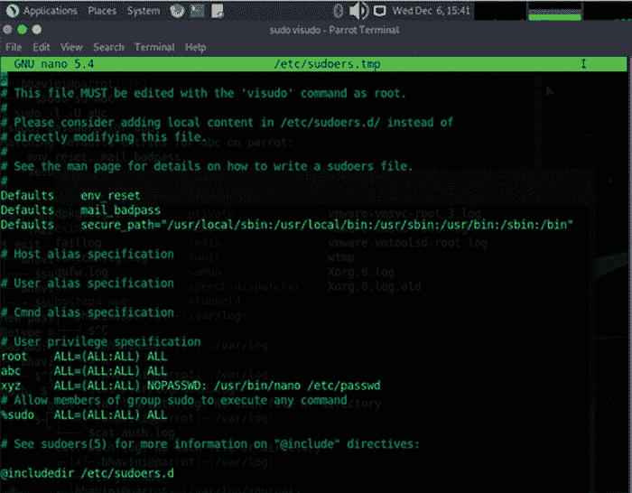

**图 3.5:** `/etc/sudoers.tmp`

使用 `sudo visudo -c` 命令，你可以检查 sudoers 文件是否存在任何语法错误。


**图 3.6:** `sudo visudo -c`

现在，如果 xyz 用户尝试访问 passwd 文件，将获得访问权限，但对任何其他特权文件或文件夹将不会获得访问权限。

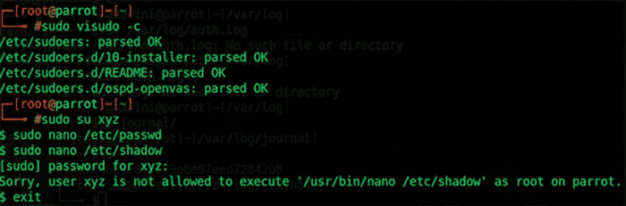

**图 3.7:** `sudo su`

根据访问控制，Linux 主要分为两种类型：

*   标准 Linux：基于 `DAC`（自主访问控制）

*   安全增强型 Linux (`SELinux`)：基于 `MAC`（强制访问控制）

## 标准 Linux（Standard Linux）

通常，“标准 Linux”指的是遵循特定规定和标准的 Linux 操作系统发行版。Linux 是一个开源操作系统内核，与 Unix 相似，是多个操作系统发行版的基础。Linux 发行版（或称为 distro）是 Linux 操作系统的完整封装版本，包含了桌面环境、包管理系统、库和 Linux 内核。

标准 Linux 构建在被称为“自主访问控制”（`DAC`）的安全范式之上，该范式允许资源的所有者（无论是文件还是系统）控制对该资源的访问。在 `DAC` 系统中，资源所有者有权决定授予哪些权限以及授予谁访问该资源。

以下是几个被视为标准或被频繁使用的流行 Linux 发行版：

*   **Ubuntu**：Ubuntu 基于 Debian，以其用户友好型和强大的社区支持而闻名。它提供桌面版和服务器版。

*   **Debian**：这个稳定且灵活的发行版是许多其他发行版（包括 Ubuntu）的上游基础。

*   **Fedora**：红帽（Red Hat）支持 Fedora，它以利用最新的软件和技术而闻名。它经常被用作红帽企业 Linux (`RHEL`) 日后可能包含的功能的测试场。

*   **CentOS**：CentOS 基于与 `RHEL` 相同的架构，旨在提供一个开源、免费且持久的替代。

*   **Arch Linux**：得益于这种流行、灵活且简单的操作系统的滚动发布机制，用户可以定期安装更新，而无需等待特定的版本发布。

*   **openSUSE**：由 SUSE 支持，openSUSE 同时提供稳定版（Leap）和滚动发布版（Tumbleweed）。它提供了系统管理工具 YaST 设置。

*   **Linux Mint**：这种基于 Ubuntu 的桌面替代品专注于提供各种用户友好的桌面环境。

这些发行版使用了广泛接受的 Linux 标准，例如 Linux 标准基础 (`LSB`) 和文件系统层次结构标准 (`FHS`)，这有助于发行版之间的兼容性。

为了理解如何对不同用户实施访问控制，我们首先需要了解不同的用户、用户管理以及可以授予用户的权限。

## 用户（Users）

用户（无论是系统还是人类）与计算机系统通信。它是所有程序操作、文件创建和修改以及系统服务请求的起点。每个用户账户都与一个用户 ID（`UID`）关联。

### 普通用户（Regular Users）

*   使用计算机系统处理日常事务和应用程序的终端用户被称为普通用户。

*   普通用户拥有的资源通常只有他们自己的文件和最基本的系统功能。

*   在没有管理员或特殊访问权限的情况下，他们执行常规任务，包括文字处理、上网和使用应用程序。

### 特权用户（Privileged Users）

*   也被称为超级用户（super users）。特权用户比普通用户拥有更高级的功能。这些功能可能包括安装软件、执行管理功能和修改某些系统设置。特权用户可以管理系统配置的方面，并执行普通用户无法执行的任务，但他们通常没有完全的管理员控制权。

### 网络用户（Network Users）

*   网络用户侧重于管理、配置和故障排除活动。

*   他们经常拥有调整网络配置、控制网络硬件和解决网络相关问题的权限。

*   网络用户可能负责管理 IP 地址、建立和维护网络连接以及监控网络的整体健康状况。

### 用户管理（Managing Users）

*   最高级别的访问权限和责任归属于用户管理员，通常被称为系统管理员（system administrators）。

*   系统管理员负责确保整个系统的安全。他们对系统拥有完全控制权，包括安装软件、修改用户账户和更改系统设置的能力。他们负责用户账户管理、安全设置、软件升级和常规系统维护等工作。

## 集中式用户管理（Centralized User Management）

集中用户管理是指从单一的集中化位置管理用户账户和权限的实践。这种方法提供了许多优势，特别是在具有多个应用程序和服务的组织中。

根据您的需求，有不同的选项可用，包括：

*   **轻量级目录访问协议 (`LDAP`)**：它是一种用于访问和维护目录服务的开放标准协议。它通常用于网络环境中的集中身份验证和授权。

    *   `LDAP` 是为目录服务设计的，这类数据库易于读取和搜索，而不是频繁更新。目录服务是一种层次化组织存储和检索网络内用户、设备和其他信息的方式。

    *   `LDAP` 使用名为目录信息树（`DIT`）的层次树形结构组织信息。树中的每个条目都是包含实体（如用户或设备）信息的记录。条目通过唯一的区分名（`DN`）标识。

    *   它概述了许多用于与目录服务器通信的协议过程。添加新条目、编辑现有条目、删除条目和搜索条目是常见操作。这些操作供 `LDAP` 客户端和服务器交换消息。

    *   它经常用于授权身份验证。当用户尝试访问系统或应用程序时，系统可以查询 `LDAP` 目录以确认用户的凭据并获取其访问权限的详情。

*   主流的 `LDAP` 实现包括 Microsoft Active Directory（它是一个商业系统，但基于 `LDAP`）以及 OpenLDAP（它是一个开源程序）。这些实现使得 `LDAP` 能够处理用户账户及其数据，并提供目录服务。电子邮件系统、业务目录和网络身份验证只是 `LDAP` 的应用场景之一。它通常用于企业环境，用于管理用户身份、访问控制和目录服务。

*   `Kerberos`：这是一种网络身份验证协议，旨在为客户端服务器应用程序在可能不安全的网络上提供安全认证。在身份验证过程中，使用密钥加密来保证用户凭据的完整性和机密性。包括 Microsoft Windows 在内的许多操作系统都带有 `Kerberos` 作为默认认证机制。`Kerberos` 经常用于业务场景。

    单点登录（Single Sign-On）通过 `Kerberos` 实现，它使用户只需登录一次即可访问多种服务，无需再次输入凭据。

    `Kerberos` 主要使用两个元素：密钥分配中心 (`KDC`) 和对称密钥加密。`KDC` 涉及三个要素：

    *   服务服务器 (`SS`)，通过票据授予服务器 (`TGS`) 连接到用户。

    *   `Kerberos` 数据库，存储每个经过验证的用户身份和密码。

    *   身份验证服务器 (`AS`) 执行初始验证，并负责验证用户并在成功验证后向他们提供票据授予票据 (`TGT`)。

    身份验证过程的步骤如下：

    1.  用户通过提供凭据（通常是密码）向 `AS` 进行身份验证。`AS` 验证凭据，如果有效，则颁发 `TGT`。

    2.  用户将 `TGT` 提交给 `TGS`，请求特定服务的服务票据。

    3.  如果 `TGT` 有效，`TGS` 颁发一个服务票据，其中包含访问所请求服务的会话密钥。

    4.  用户将服务票据同时间戳和其他信息提交给请求的服务。该服务验证票据，如果成功，则授予访问。

*   `Microsoft Active Directory`：`Kerberos` 是 Windows 域的默认身份验证协议，Active Directory 高度依赖 `Kerberos` 在 Windows 网络中进行安全身份验证。

*   `MIT Kerberos`：马省理工学院 (`MIT`) 开发了 `Kerberos` 的开源实现，通常用于 Unix/Linux 环境。

*   `Configuration Management Systems`：配置管理系统是旨在自动化基础设施配置和管理的工具，确保不同环境之间的一性和可重现性。提到的每个工具 —— Ansible、Chef、Puppet 和 SaltStack —— 都用于此目的，但它们的方法和方法论上有所不同。以下是每种工具的概述：

    *   `Ansible`：这种开源自动化工具强调易用性和简单性。它使用基于 YAML 的语言定义剧（playbooks）——指定所需配置和任务的指令集。

        *   **无代理 (Agentless)**：由于其无代理特性，`Ansible` 不需要向受管理节点上安装代理。因为它使用 `SSH` 与远程计算机交互，因此安装和使用非常简单。

    *   `Chef`：开源配置管理应用程序使用基于 Ruby 的语言描述系统设置。`Chef` 使用声明式方法，定义系统的理想状态。

        *   **客户端-服务器架构 (Client-Server Architecture)**：`Chef` 使用客户端-服务器架构，`Chef` 服务器存储配置数据，`Chef` 客户端（节点）获取并应用配置。

    *   `Puppet`：它是一种广泛使用的配置管理系统，使用声明式语言描述系统的预期状态。它遵循客户端-服务器架构，节点上的 `Puppet` 代理从中央 `Puppet` 主服务器请求配置。

        *   **丰富的生态系统 (Rich Ecosystem)**：`Puppet` 拥有丰富的生态系统和大量的预构建模块（Puppet Forge），可用于管理系统配置的各个方面。

    *   `SaltStack`：它通常简称为 Salt，是一种开源配置管理和编排工具。它使用与 `Ansible` 类似的声明式语言，以其速度和可扩展性而闻名。

        *   **主-从架构 (Master-Minion Architecture)**：`SaltStack` 采用主-从架构，Salt Master 将配置和命令分发到受管理节点上的 Salt Minions。它还支持事件驱动自动化。

## 权限 (Permissions)

Linux 权限是指 Linux 操作系统中访问控制机制，用于规定谁可以访问文件、目录和其他资源，以及他们对这些执行哪些操作。权限系统是 Linux 安全的重要组成部分，允许管理员和用户控制对敏感数据和系统资源的访问。

### 文件权限

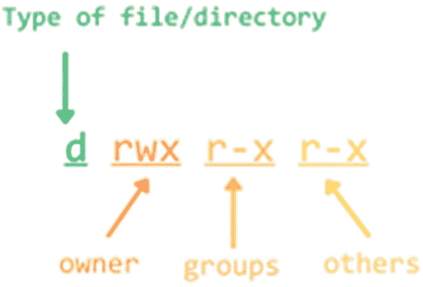

**图 3.8:** 文件权限拆解

### 权限范围

*   **用户 (User)**：文件的所有者。第一组 `rwx` 权限适用于用户。

*   **组 (Group)**：包含一个或多个成员。第二组 `r-x` 权限适用于组。

*   **其他 (Other)**：针对所有其他人的类别。第三组 `r-x` 适用于其他人。

### 访问类型

*   **读 (r)**：允许用户查看/读取文件内容。

*   **写 (w)**：允许用户查看、创建、更新或删除文件或文件内容。

*   **执行 (x)**：对于文件，允许将文件作为程序执行。对于目录，允许访问目录内容。

此外，还有其他类型的访问，如下所示：

*   可执行文件的 `setuid/setgid` 权限由字母 `s` 表示。

*   `t` 是粘滞位（sticky bit），仅对目录有效。如果配置，非 root 用户无法从中删除文件。

`ls -l` 命令列出所有文件和目录的详情，如权限、所有者、组、大小、修改日期等。

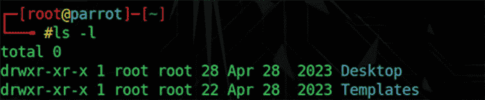

**图 3.9:** `ls -l`

在上述图中，你可以看到：

*   `drwxr-xr-x` 代表类型和权限。

*   `1` 代表文件或目录的硬链接数。

*   `root` 代表文件或目录的所有者。

*   `root` 代表与文件/目录相关的组。

*   `28` 代表文件/目录的大小（单位为 kb）。

*   `Apr 28 2023` 表示最后修改日期。

*   `Desktop` 表示文件/目录的名字。

| 符号 | 语义 |

| :--- | :--- |

| `-` | 普通文件（例如执行 `touch abc`） |

| `b` | 设备文件 |

| `c` | 字符设备文件 |

| `C` | 高性能（连续数据）文件 |

| `d` | 目录 |

| `l` | 符号链接 |


| `p` | 管道（通过 `mkfifo` 创建） |
| `s` | 套接字 |
| `?` | 其他（未知）文件类型 |

**表 3.1:** 文件/目录类型及其符号

### 十进制值表示的权限

一个三位数值代表文件的权限。第一位代表所有者的权限，第二位代表组的权限，第三位代表对其他用户的权限。

* 读 (`r`): 4
* 写 (`w`): 2
* 执行 (`x`): 1

| 模式 | 有效权限 | 十进制表示 |
| :--- | :--- | :--- |
| `---` | None | 0 |
| `--x` | Execute | 1 |
| `-w-` | Write | 2 |
| `-wx` | Write and execute | 3 |
| `r--` | Read | 4 |
| `r-x` | Read and execute | 5 |
| `rw-` | Read and write | 6 |
| `rwx` | Read, write, execute | 7 |

**表 3.2:** 权限的十进制表示

现在，让我们取一个数字代码 744：

| **所有者** | **组** | **其他人** |
| 7 | 4 | 4 |
| 4 + 2 + 1 | 4 + 0 + 0 | 4 + 0 + 0 |

**表 3.3:** 示例

### 修改文件权限

我们可以使用 `chmod`（更改模式）命令来更改文件的权限：

* `$ chmod <numeric code> <filename>`

  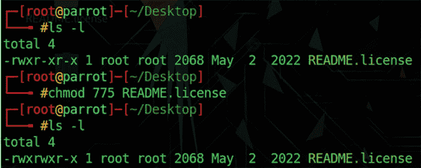

  **图 3.10:** `chmod` 命令

* `$ chmod <user category>+<permissions>`

  其中用户类别表示为：

  * `u`: 用户（所有者）
  * `g`: 组
  * `o`: 其他用户

权限表示为：

* `r`: 读取
* `w`: 写入
* `x`: 执行

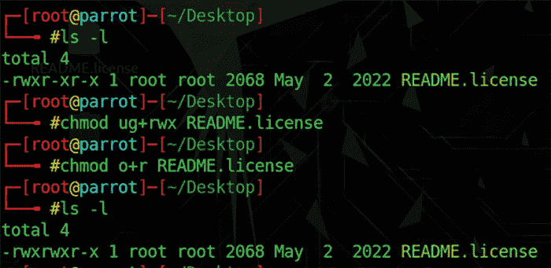

**图 3.11:** 权限

## 进程权限

与当前正在执行的操作系统进程相关的权利和特权被称为进程权限。一种名为访问控制的安全技术，限制了谁或什么实体可以使用计算机系统的资源并执行特定任务。进程权限对于维护系统安全和实施访问控制至关重要。

* **实际 UID (Actual UID)**：实际 UID 是启动进程的用户的用户 ID，从人类用户的角度来看指示了所有权。`getuid(2)` 系统调用允许进程确定其实际 UID。

  使用 `top` 命令查看进程及其资源使用的动态列表：

  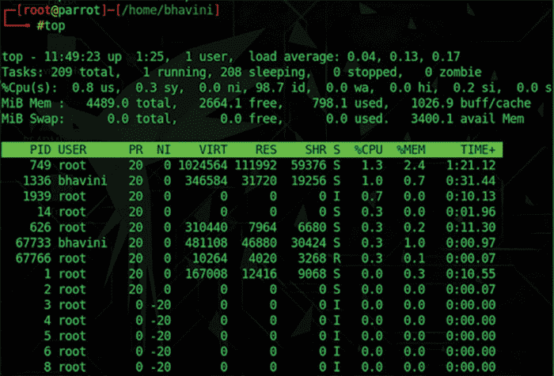

  **图 3.12:** `top` 命令

  * `PID`: 进程 ID（进程的唯一标识符）。
  * `USER`: 进程所有者的用户名或 ID。
  * `PR`: 进程优先级。
  * `NI`: Nice 值。nice 值越高，优先级越低。
  * `VIRT`: 虚拟内存占用（进程使用的总虚拟内存）。
  * `RES`: 驻留集合大小（进程使用的非交换物理内存）。
  * `SHR`: 共享内存大小（进程使用的共享内存）。
  * `S`: 进程状态（例如，'R' 表示运行中，'S' 表示睡眠）。
  * `%CPU`: 进程占用 CPU 的百分比。
  * `%MEM`: 进程占用物理内存（RAM）的百分比。
  * `TIME+`: 进程累计使用的 CPU 时间。

  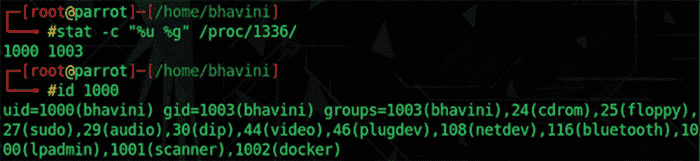

  **图 3.13:** `stat -c "%u %g" /proc/1336/`

`stat -c "%u %g" /proc/1336/` 命令显示 PID 为 1336 的进程的用户 ID 和组 ID。每个进程都与用户和一个组关联。要查找与 ID 关联的用户名和组名，请使用 `id <id>` 命令：

* **有效 UID (Effective UID)**：Linux 内依赖有效 UID 来建立进程在访问共享资源（如消息队列）时拥有的权限。在传统的 UNIX 系统中，有效 UID 也用于文件访问。然而，Linux 以前使用专门的文件系统 UID（参见随后的讨论）用于文件访问权限。为了兼容性考虑，这种做法仍然保留。进程可以通过 `geteuid(2)` 系统调用确定其有效 UID。

* **保存的组用户 ID (Saved Set-User-ID)**：在 `setuid` 实例中，进程可能通过在实际 UID 和保存的组用户 ID 之间切换其有效 UID 来获取特权，此时保存的组用户 ID 是相关的。例如，为了让进程获得使用特定网络端口的权限（参见“端口”），需要特权（例如以 root 身份运行）。进程可以通过 `getresuid(2)` 系统调用检索其保存的组用户 ID。

* **文件系统 UID (Filesystem UID)**：这些 ID 是 Linux 特有的，用于设置文件访问权限。程序通常不直接修改此 UID；它最初开发是为了方便此类情况：文件服务器代表普通用户操作，同时将进程与该用户发送的信号隔离。内核监控所有对有效 UID 的修改并相应地调整文件系统 UID。通常，文件系统 UID 与有效 UID 匹配，但可以使用 `setfsuid(2)` 系统调用进行更改。值得注意，从技术上讲，这个 UID 已不再存在。

## SELinux

Linux 安全扩展，称为安全增强型 Linux (SELinux)，提供了一种处理访问的方法。Linux 包含了强制性访问控制 (MAC)。

安全策略是一组规则，规定了 SELinux 中哪些用户可以访问哪些资源。这些规则通常以标签的形式阐述，标签与文件、进程和其他系统组件相连。

通过将所有决策（阻止或允许）存储在访问向量缓存（AVC）中，SELinux 加快了访问控制过程。当进程请求访问时，SELinux 检查 AVC 以判断。

### SELinux 模式

SELinux 运行三种不同的模式：

### 强制模式 (Enforcing Mode)

SELinux 在强制模式下会严格执行 SELinux 策略中规定的安全策略。访问违规将导致拒绝，SELinux 会记录这些事件。对于 SELinux 来说，这是许多系统的默认选项。

* **强制执行**：在强制模式下，SELinux 严格执行访问控制限制。它通过评估 SELinux 策略中的安全上下文和权限，确定进程或用户是否被允许访问资源。SELinux 会阻止访问。
* **安全策略**：SELinux 使用安全策略为用户和进程的交互提供指南和限制。
* **防止策略违反**：强制模式的主要目标是通过阻止可能破坏性或未经授权的行为来保护系统。如果进程尝试 SELinux 策略不允许的操作，该操作将被拒绝。
* **日志记录**：当 SELinux 在强制模式下拒绝操作时，它会生成日志记录。

### 许可模式 (Permissive Mode)

在许可模式下，SELinux 会记录策略违规，但不会主动执行它们。这种模式对于排除故障有用，允许管理员识别并理解潜在问题，而不会阻止资源的访问。

日志记录允许管理员识别并理解问题，而无需主动阻止资源的访问。

* **访问控制绕过**：在宽容模式（Permissive mode）下，即使操作违反了 SELinux 策略，该操作也不会被拒绝。这种模式有效地绕过了访问控制的执行，同时仍会提供有关策略违规的信息。
* **故障排除与策略开发**：宽容模式通常用于排查与 SELinux 相关的问题。管理员可以通过查看日志来识别问题操作，并相应地调整 SELinux 策略。

  这在开发或测试 SELinux 策略期间可能大有裨益，允许管理员在不立即阻塞操作的情况下精调策略。

### 禁用模式（Disabled Mode）

在禁用模式（Disabled mode）下，SELinux 被关闭，不提供任何安全增强或策略执行。这种模式通常用于管理员想要临时禁用 SELinux 的情况，通常是为了故障排除或在特定环境不需要 SELinux 的时候。

* **无访问控制执行**：禁用模式下的 SELinux 不会主动执行任何安全策略。它不会评估 SELinux 策略中指定的安全上下文或权限来做出访问控制决策。

  对资源的访问完全由传统的 Linux 任意访问控制（DAC）机制主管。

* **无策略违规日志**：由于 SELinux 已禁用，它不会记录任何策略违规或安全相关事件。
* **无 SELinux 保护**：在禁用模式下，系统完全依赖底层 Linux 内核和文件系统提供的安全机制。

## 信息策略（Information Policies）

信息策略是指组织建立的一系列指南、规则和程序，用于管理、访问、使用和保护信息资产。这些策略的设计初衷是确保信息的机密性、完整性和可用性，同时符合组织的目标、法律要求和伦理标准。信息策略在管理和保护组织信息资源方面起着至关重要的作用。

## 目标策略（Targeted Policy）

在 SELinux 中，有不同的策略类型，常见的策略类型之一是“目标”（targeted）策略。目标策略旨在安全性和可用性之间取得平衡。它侧重于限制特定的高风险服务或进程，同时允许大多数其他进程以最小的 SELinux 限制运行。以下是关于 SELinux 目标策略的一些关键点：

* **关注特定服务**：目标策略针对从安全角度来看具有高风险的特定服务或进程量身定制。目标策略通常涵盖的服务示例包括 Web 服务器、数据库和网络服务。
* **对通用系统的影响最小化**：与对所有进程实施强限制的严格策略不同，目标策略对通用系统操作的侵入性较小。在目标策略下，大多数用户应用程序和系统进程不受 SELinux 的严重约束。
* **增强高风险服务的安全性**：目标策略的目标是通过限制其进程并减少其攻击面来增强关键服务的安全性。它有助于防止安全泄露，并限制由受攻击服务造成的潜在损害。
* **类型强制（Type Enforcement）**：目标策略与其他 SELinux 策略一样，使用类型强制来定义进程和资源如何交互的规则。每个进程、文件和网络端口都分配了一个带有特定类型的安全上下文，访问决策基于这些类型。
* **更易维护**：由于目标策略关注服务的子集，因此在维护方面可能更具管理性。这使得管理员更易于理解、自定义和排除 SELinux 配置。
* **附加模块的灵活性**：虽然目标策略解决了高风险服务，但管理员仍可以通过加载额外的策略模块来扩展或修改策略。这允许在不牺牲目标方法整体优势的情况下进行定制。
* **可用性考虑**：SELinux 目标策略旨在安全性和可用性之间取得平衡点。其目标是提供一个安全的环境，而不过度阻碍系统功能。
* **用于监控的审计日志**：目标策略生成的审计日志可以进行监控，以跟踪安全相关事件。这些日志帮助管理员识别并响应与受限服务相关的安全事件。

## 多级安全策略（Multi-Level Security Policy）

多级安全策略（通常称为 MLS）是一种旨在保护组织内不同分级水平敏感信息的安全方法。这种类型的安全策略通常用于政府、军事以及具有不同级别机密信息的环境。

* **分级水平**：信息根据其敏感性和重要性归分为不同的级别。常见的分级包括不机密（Unclassified）、机密（Confidential）、秘密（Secret）和绝机密（Top Secret）。
* **访问控制**：根据用户的安全许可和信息的分级水平限制对信息的访问。用户仅被授予与其安全许可相对应的信息。
* **知情原则（Need-to-Know Principle）**：只有当用户执行工作职责确实需要该特定信息时，才授予其对信息的访问权限。这一原则有助于限制访问并降低未经授权披露的风险。
* **划分管理（Compartmentalization）**：即使在同一分级水平内，信息通常也会划分为特定的区域或类别。用户根据其角色和职责可能只能访问特定的区域。
* **数据标记和标识**：信息会根据其分级水平进行标记和标识。这有助于用户轻松识别信息的敏感性并确保妥善处理。
* **审计与监控**：持续监控和审计对于确保符合安全策略至关重要。可疑活动或未经授权的访问尝试会被记录并调查。
* **安全通信**：使用安全通道和加密传输机密信息，以防止拦截和未经授权的访问。
* **安全策略执行**：通过技术控制和组织程序严格执行安全策略。

### 设置 SELinux 策略

SELinux 策略类型通常可以在安装 SELinux 时设置，也可以根据系统的安全后续更改。可以通过以下步骤更改策略类型：

1. 首先，使用 `sestatus` 检查 `selinux` 状态。
2. 如果是禁用模式，使用命令 `setenforce [1 | 0]` 分别设置为强制模式（enforcing）或宽容模式（permissive）。
3. 现在，打开配置文件 `[/etc/selinux/config]` 并将 `SELINUXTYPE` 设置为 `targeted` 或 `mls`。
4. 重启系统使更改生效。

### 自定义 SELinux 策略

自定义 SELinux 策略涉及创建或修改策略模块以适应系统的特定安全需求。SELinux 使用策略模块来定义各种进程和资源的规则和访问控制。

要显示布尔值及其描述，使用以下命令：

```
semanage Boolean -l
```

要显示和设置特定布尔（Boolean）值，你可以使用 `getsebool` 和 `setsebool` 命令。以下示例展示了如何显示和设置 `ftp_home_dir` 布尔值：

```
getsebool ftp_home_dir
```

```
ftp_home_dir --> off
```

```
sudo setsebool ftp_home_dir on
```

```
getsebool ftp_home_dir
```

```
ftp_home_dir --> on
```

要切换布尔值的值，请使用 `togglesebool` 命令，如下例所示：

```
sudo togglesebool ftp_home_dir
```

```
ftp_home_dir: inactive
```

要使布尔值在重启后依然有效，请为 `setsebool` 指定 `-P` 选项。例如：

```
sudo setsebool -P ftp_home_dir on
```

```
getsebool ftp_home_dir
```

```
ftp_home_dir --> on
```

### 最佳实践

为了保持环境安全，应该实施以下最佳实践：

### 最小权限

* 最小权限原则传达了一个理念：个人或进程应仅拥有完成特定任务所需的本质权限。
* 在 `File Permissions`（文件权限）的范围内，讨论了使用 `chmod +x` 命令的影响。注意到，该命令除了预期的权限外，还授予了其他用户额外的权限。
* 建议避免使用 root 权限进行操作。例如，在安装软件时，推荐的方法是使用 `sudo` 而不是以 root 登录。

### 审计

* 审计涉及记录操作的实践，包括执行者的身份，其记录方式可以防止生成的日志被任何篡改。

## 结论

总而言之，Linux 访问控制对于维护操作系统的安全态势和保护其监管的资源至关重要。由于 Linux 访问控制方法强大且适应性强，管理员能够精确控制和管理用户与文件、目录以及系统功能交互的方式。

Linux 访问控制遵循通过坚持最小权限概念来减少可能的安全风险的哲学。用户通过身份和授权过程经过验证，然后根据预设权限提供访问，确保只有授权的实体才能执行某些操作。

在接下来的章节中，我们将开始实现防火墙。这一过程涉及配置网络安全措施，特别关注数据包过滤，以对互连网络和设备之间的流量进行控制。

# 第 4 章

## 实现防火墙与包过滤

### 引言

实现防火墙和数据包过滤涉及配置网络安全措施，以控制网络与设备之间的流量。防火墙充当受信内部网络与不可信外部网络（如互联网）之间的屏障。防火墙架构的核心是数据包过滤的复杂功能。

这是一个决定跨越网络的单个数据包命运的关键机制。这一过程由精心编写的规则引导。这些规则中的每一条都作为防火墙的指令，用于允许或拒绝特定的数据包。这些规则是根据一系列标准建立的，包括源地址、目的地址、端口和协议，从而实现了对网络流量的细粒化和精细控制。

### 结构

在本章中，你将学习：

* 防火墙及其组件
* 防火墙架构
* 数据包过滤及其类型
* 使用 UFW 在 Linux 环境中配置防火墙

## 防火墙

防火墙是一种网络安全硬件或软件，负责监控所有进入和退出的网络流量。它使用预定义的安全规则来决定是否允许或禁止特定类型的数据。通常，网络节点通过防火墙与进入和退出的数据流量以及某些应用程序隔离开。防火墙利用硬件、软件或云端技术保护网络免受外部威胁。防火墙的主要目标是防止有害流量和数据包进入，而同时允许合法流量通过。为了停止攻击，防火墙根据预定义的安全规则检查入站的通信，并过滤源自不可信或可疑源的流量。在计算机与外部设备传输数据传输端口上，流量得到了保护。

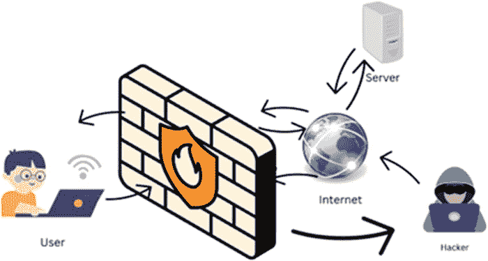

**图 4.1:** 防火墙实现

### 防火墙的组件

### 边界路由器

任何网络的入口点都是边界路由器，它位于外部防火墙和互联网之间。因此，我们的第一个网络访问控制是通过在路由器上配置适当参数来在边界路由器上定义安全策略。边界路由器将根据 IP 地址范围过滤流量。使用它的主要目的是提供到公共网络系统（如互联网或特定组织）的链接。它通过遵循适当的路由协议执行数据包的路由。它还提供数据包过滤和地址转换功能。

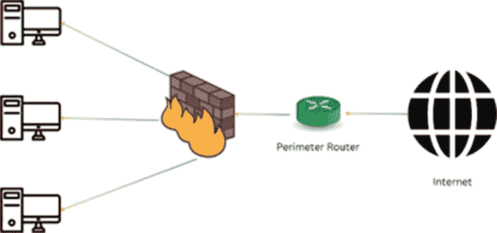

**图 4.2:** 边界路由器

### 虚拟专用网络 (VPN)

其目的是在两个计算机、两个网络或计算机与网络之间提供安全的链接。这包括数据包可靠性保证、验证和加密。通过启用安全的远程网络访问，它连接了同一平台上但未连接的两个广域网（WAN）。

以下是 VPN 的一些应用场景：


**隐私与匿名性：** 通过加密你的互联网连接，VPN 减少了外部人员（如黑客或政府组织）监控你在线活动的能力。当你使用公共 Wi-Fi 时尤为关键。

**绕过地理限制：** 你可以使用 VPN 访问所在地区可能被屏蔽的内容。通过连接到不同位置的服务器，你可以让自己看起来像是从该位置浏览的。

**安全远程访问：** 组织经常部署 VPN，以允许员工从外部安全地访问公司内部网络。这对于在访问敏感数据时保持高水平的安全至关重要。

**绕过审查：** VPN 可以帮助用户绕过限制，访问在互联网审查常见的地区被禁止的内容。

**增强安全性：** VPN 为你的互联网连接提供了额外的保护。VPN 利用加密来保护你的数据免受潜在危险，并让你的在线体验更安全。

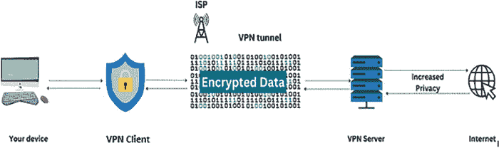

**图 4.3:** VPN

## VPN 工作原理

VPN 的基本工作涉及在用户设备与位于不同位置的服务器之间建立安全加密的连接。这一过程确保用户的互联网流量通过安全的 VPN 隧道路由，保护数据免受可能的窃听或未经授权的访问。以下是 VPN 操作的关键步骤：

1. **用户发起连接：** 用户在设备上启动 VPN 客户端或应用程序，并启动到 VPN 服务器的连接。

2. **验证：** 用户设备向 VPN 服务器进行身份验证。这可能包括输入凭据（如用户名和密码）、使用数字证书或其他身份验证方法。

### 3. 隧道建立

一旦通过验证，用户设备与 VPN 服务器之间将建立一个安全隧道。隧道是一个虚拟的加密连接，所有数据流量都通过它传输。

### 4. 加密

通过 VPN 隧道传输的数据经过加密，以确保机密性。通常使用 `AES` 等加密算法来保护数据。

### 5. 数据传输

用户的网络流量（包括网页浏览、文件下载和其他活动）现在都通过 VPN 隧道进行路由。这使得第三方很难截获或监控用户的在线活动。

### 6. VPN 服务器路由

VPN 服务器位于不同的地理位置，充当用户设备与互联网之间的中介。当用户访问在线资源时，请求似乎源自 VPN 服务器的 IP 地址，从而掩盖了用户的实际 IP 地址。

### 7. 服务器端解密

VPN 服务器对入入的数据进行解密，并将其转发到互联网上的目标位置。来自互联网的响应随后会被加密，并通过 VPN 隧道传回给用户设备。

### 8. 安全数据传输

用户设备与 VPN 服务器之间、以及 VPN 服务器与互联网之间的整个通信都在加密隧道内进行。这确保了传输数据的机密性和完整性。

### 9. 会话终止

当用户断开 VPN 连接时，安全隧道将被终止。用户设备在没有 VPN 保护的情况下恢复到正常的互联网连接。

## 入侵检测系统 (IDS)

这种安全技术通过监控和检查网络或系统活动，来寻找恶意活动、非法访问或违反安全策略的迹象。入侵检测系统的主要目标是通过检查与恶意活动相关的趋势、异常或已识别的指标，来识别并解决安全问题。它有能力通过未经授权的访问从网络后端发起拒绝服务攻击（denial-of-service attack）。这类攻击能够由智能防御系统进行管理。

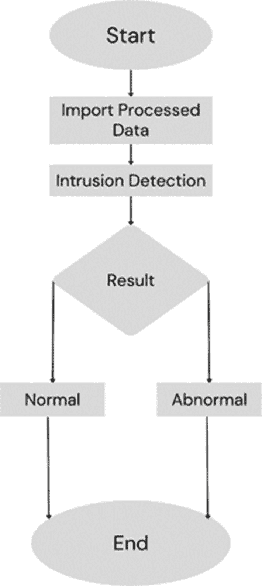

**图 4.4:** IDS 的工作原理

IDS 通过监控和分析网络或系统活动来识别并响应潜在的安全威胁。IDS 有两种主要类型：基于网络的入侵检测系统 (NIDS) 和基于主机的入侵检测系统 (HIDS)。以下是 IDS 典型工作方式的概述：

### 基于网络的入侵检测系统 (NIDS)

**流量监控**：NIDS 被动地监控网络流量，在数据包流经网络时对其进行分析。它可以部署在网络的关键节点以捕获并检查流量。

**数据包捕获与分析**：NIDS 捕获网络数据包并分析其头部和内容。它可能使用多种技术，包括基于特征的分析、异常检测和启发式分析，以识别潜在威胁。

**基于特征的检测**：基于特征的检测将网络流量特征与已知攻击特征数据库进行对比。如果发现匹配，系统将生成警报。

**基于异常的检测**：基于异常的检测建立正常网络行为的基准。偏离此基准的行为（例如异常的流量模式或意外的数据流）会触发警报。

**启发式分析**：启发式分析涉及使用预定义的规则或算法来识别与已知攻击方法相关的模式。这种方法允许 NIDS 检测已知攻击的变体。

**警报生成**：当 NIDS 检测到潜在的恶意活动时，它会生成警报。这些警报提供了有关威胁性质、受影响系统以及潜在影响的信息。

**响应或通知**：根据配置，NIDS 可以采取行动，例如记录事件、阻止恶意流量或通知安全人员。然而，NIDS 通常以监控模式运行，默认不会主动拦截流量。

### 基于主机的入侵检测系统 (HIDS)

**代理部署**：HIDS 部署在单个主机机器上。每个主机都运行自己的 HIDS 代理，监控该特定设备上的活动。

**系统事件监控**：HIDS 代理监控各种系统事件，包括登录、文件更改、进程执行以及与其他与主机相关的特定活动。

**基准建立**：HIDS 中的异常检测涉及建立正常主机行为的基准。HIDS 系统学习该主机的典型行为，并在发生偏离时发出警报。

**基于特征的检测**：与 NIDS 类似，HIDS 使用基于特征的检测，将活动与已知攻击模式或恶意行为数据库进行对比。

**警报生成**：当 HIDS 检测到可疑或恶意活动时，它会生成警报。这些警报包含了有关活动类型及其潜在影响的信息。

**响应或通知**：HIDS 可以触发响应，例如记录事件、隔离受影响的主机或通知管理员。响应通常可以根据组织的安全策略进行配置。

## NIDS 和 HIDS 的共同元素

**日志与报告**：NIDS 和 HIDS 系统都会记录检测到的事件以便分析和报告。这些信息对于调查事件和提高整体安全性具有重要价值。

**与 SIEM 集成**：IDS 通常与安全信息和事件管理 (SIEM) 系统集成，以提供整个组织安全事件的集中视图。

**持续监控**：IDS 实时运行，对网络或主机活动提供持续监控，以便快速识别和响应安全事件。

## 防火墙架构

防火墙拓扑根据网络的特定需求和规格分类。根据网络规模、所需的安全级别以及要缓解的威胁类型，不同的企业可能会使用不同的防火墙架构。

以下组件构成了防火墙架构：

### 堡垒机 (Bastion Host)

网络通过堡垒机免受攻击。它充当外部和内部网络之间的中介。构建并设置用于防御网络入侵的计算机系统称为堡垒机。防火墙过滤所有进入和离开网络的流量。它有两个接口：一个连接到内网的私有接口，另一个直接连接到互联网的公共接口。

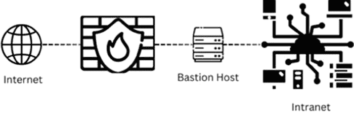

**图 4.5:** 堡垒机

### 隔离子网 (Screened Subnet)

非军事化区 (DMZ)，也称为隔离子网，是在筛选防火墙后面使用双口或三口防火墙建立的安全网络。将三口防火墙的第一个接口连接到互联网，第二个接口连接到 DMZ，第三个接口连接到内网。私网络无法访问 DMZ 内的任何主机，但它回答公共查询。用户无法访问秘密区域。在内网之外筛选子网的一个优点是它可以回答公共查询，而不会让流量进入内网。如果三口防火墙被攻破，DMZ 和内网可能会受到影响，这是一个缺点。更安全的方法是使用多个防火墙来隔离互联网与 DMZ，然后将 DMZ 与内网隔离开。

一个有多个 NIC（网络接口卡）连接到两个或多个网络的节点被称为多宿主防火墙。它在每个接口与其他网络组件之间建立了逻辑和物理连接。在多宿主防火墙的帮助下，IP 网络可以运行得更可靠、更高效。多宿主防火墙的三个以上的接口允许根据组织独特的安全目标进行额外的系统划分。然而，背对背防火墙概念提供了更全面的安全性。

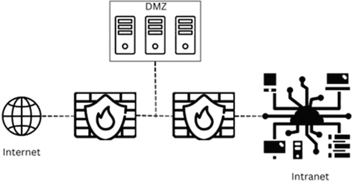

**图 4.7:** 多宿主防火墙

## 包过滤

包过滤防火墙是一种用于调节进出网络数据流的网络安全功能。每一个包含控制数据和用户数据的数据包都会经过防火墙的检查，防火墙根据预设的一组规则对其进行测试。如果包通过了测试，防火墙允许其到达目的地。未通过测试的包会被拒绝。防火墙通过查看规则集、协议集、端口和目的地址来测试数据包。

在系统网络中，数据包是跨分组交换网络发送的结构化数据单元。由于这些网络将通信分成称为“数据包”的小单元，并在网络上逐个交付，因此它们能够抵抗故障。当数据包通过防火墙到达目的地时，它们会被重新排列以正确显示其内容。当正确实施时，分组交换可以减少传输延迟，化网络通道容量并提高通信效率。

数据包有两个关键部分：

**头部（Headers）**：数据通过数据包头部定向到目标位置。它们包含了地址位、互联网协议（IP）以及发送数据包到其预期地所需的任何其他信息。

**载荷（Payloads）**：数据包中包含的用户数据称为载荷。这是试图到达其预期位置的数据。

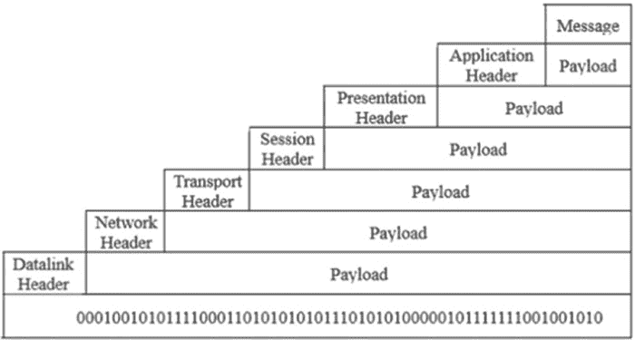

**图 4.8:** 每一层的头部

### 包过滤的类型

防火墙利用称为包过滤的技术根据预定义的标准来调节网络流量。存在多种不同的包过滤技术，每种技术都为控制和保护网络流量提供了独特的方法。以下三类是主要的：

**静态包过滤**：这种包过滤是最基础的。它根据协议类型（例如 TCP、UDP）、源和目的端口号以及源和目的 IP 地址等参数分析数据包。管理员预先建立规则，根据静态标准指示允许或禁止某些类型的数据包。它易于实现，对于简单的网络安全效果良好。

**动态包过滤**：考虑到活动连接的状态，动态包过滤是静态包过滤的扩展。为了跟踪连接，它维护一个更新的状态表，并根据流量的上下文做出选择。为了根据连接的当前状态对接受或拒绝哪些数据包做出更具信息量的判断，防火墙维护了对现有连接状态的跟踪。通过考虑连接的当前状态，它提供了增强的安全性并增加了其对特定类型攻击的抵抗力。

**状态检测检测 (SPI)**：SPI 是动态包过滤的增强版本。除了监控连接状态外，它还会检查应用层的数据包内容。它通过跟踪现有连接的状态来确定应用程序或服务。

**无状态包过滤**：这种技术在不考虑状态的情况下过滤网络流量，仅依赖于数据包的属性。

# 防火墙的类型

## 包过滤防火墙

包过滤防火墙是一种调节进出网络数据流的网络安全功能。每一个包含控制数据和用户数据的数据包都会经过防火墙的检查，防火墙根据预设的一组规则对其进行测试。如果包通过了测试，防火墙允许其到达目的地。未通过测试的包会被拒绝。防火墙使用规则集、协议、端口和目的地址来检查数据包。

包过滤防火墙根据以下内容允许或拒绝网络数据包：

- 数据包的地址是目的 IP 地址，源 IP 地址是发送包的地址。
- 数据传输协议，包括会话和应用协议（TCP、UDP）是协议的示例。
- 端口包括源和目的端口，以及 ICMP 类型和代码。
- 标志包括头部标志，例如数据包是否为连接请求。
- 数据包通过的物理接口（NIC）（入站或出站）。

### 优点

**效率**：使用包过滤的防火墙的主要优点之一是它们的效率。路由器通常以高速运行，根据其地址、源端口和目的地实时接受和拒绝数据包。

**透明性**：这是额外的优势。当防火墙拒绝数据包时，用户是知晓的，而包过滤器通常会快速且静默地阻止用户功能。其他方法需要用户为某些服务器或客户端手动设置防火墙。

**成本效益**：由于只需要一个过滤路由器来保护内部网络，包过滤是非常经济的。包过滤是许多硬件和软件路由系统的标准功能。

**易用性**：由于包过滤廉价且易于使用，它是一种理想的替代方案。这种安全方法允许整个网络受到单个筛选路由器的保护。用户在使用防火墙时需要的帮助、指导或培训很少。

### 缺点

**安全性较低**：包过滤的主要缺点是它忽略了应用或上下文信息，而仅依赖 IP 地址和端口号。因此，它们被认为是不安全的。这是因为任何通过允许的 IP 地址或端口的流量都会被它们转发。未被注意的头部或载荷本身可能包含恶意命令。

**缺乏日志功能**：对于必须遵守报告和合规义务的企业，如果包过滤器没有日志功能，可能会遇到问题。

**无状态性**：数据包过滤本质上是无状态的——也就是说，它独立检查每个数据包，而不考虑已建立的连接或之前的数据包。因此，防火墙防御严重威胁和攻击的能力相当有限。

# 电路级网关

电路级网关是一种工作在网络会话层的设备，用于为网络内部和外部的计算机提供连接安全。与应用网关不同，电路级网关不根据数据包的内容进行过滤。它验证两个传输层之间之间虚拟电路上的 `TCP` 或 `UDP` 数据包。电路级网关运行在开放系统互连（OSI）模型的会话层。防火墙会检查数据包之间的 `TCP` 握手，以检测并防止非法访问尝试。在确定流量是否符合电路级网关要求时，会忽略数据包的内容；只检查头部信息。它管理使用不可信主机和可信服务器的客户端之间的连接。

### 工作原理

- 当用户开始连接到某个主机时，电路级网关会在用户和远程主机之间创建一个电路或虚拟连接。
- 穿过该电路的流量将由电路级网关进行观察，它会判断其是否属于已建立连接的一部分，并仅允许允许的流量通过。
- 之后，使用 `UDP` 或经过验证的 `TCP` 连接将代表客户端与目标服务器通信。如果连接被拒绝，会话结束。

电路级网关由一组规则控制。这些规则规定了哪些流量应该被禁止，哪些流量规则可以通过电路级网关流动。通过将这些数据与协议类型、端口号以及源和目的 IP 地址等因素进行交叉引用，网络管理员可以对网络会话层进行细粒度的控制。

### 优点

**性能增强**：与应用网关和其他防火墙解决方案相比，电路级防火墙通常更快且消耗资源更少。这是因为它们只在会话层监控流量，并运行在较低的网络栈层级。由于此，它们增加延迟或影响网络性能的概率也较低。

**易于配置**：与其他防火墙系统相比，电路级防火墙的设置和维护更简单。它们不需要对需要配置的网络中协议和应用层网关有深入了解。由于关注点仅在于连接状态，变量比更复杂的防火墙类型更少。

**成本效益**：与下一代防火墙等更复杂的防火墙相比，它们属于完全不同的价格范围。另一方面，电路网关是最廉价的选择。因此，资源紧张的中小型企业会选择这种。

**提供隐蔽连接安全**：由于其工作方式，电路级网关代表内部主机使用虚拟连接评估已建立连接的安全性。这个中间人有助于向服务器隐藏其 IP 地址和身份。因此，供黑客利用的痕迹（线索）更少。

### 缺点

**应用感知能力有限**：电路级网关缺乏对 OSI 模型应用层（第 7 层）的详细了解。这意味着可能无法有效过滤或控制某些可能被攻击者利用的特定应用程序行为。

**性能影响**：监控连接状态的过程引入了一些开销，可能会影响防火墙的性能。随着活动连接数量增加，这种影响可能会变得更加。

**配置复杂**：配置电路级网关可能比设置基础数据包过滤防火墙复杂。理解和管理连接状态及规则需要更多的专业知识。

**细粒度控制不足**：与应用层防火墙相比，电路级网关对特定应用程序及其功能的细粒度控制较少。在对精细控制至关重要的环境中，这种局限性可能是一个缺点。

**状态攻击的风险**：虽然电路级网关提供了连接状态监控，但仍存在状态攻击的可能性。复杂的攻击者可能会利用状态跟踪机制中的漏洞。

# 应用层防火墙

应用层防火墙运行在 OSI（开放系统互连）模型的应用层，有时被称为代理防火墙。应用层防火墙的设计目的是根据特定的应用程序或服务过滤流量，而不是运行在传输层和网络层的标准网络防火墙。

### 应用层防火墙的关键特性包括：

**深度数据包检测 (DPI)**：与传统防火墙不同，应用层防火墙更彻底地检查数据包内容。这使得它们能够理解正在发送的数据含义和内容。

**协议过滤**：它们能够根据特定的应用程序或协议过滤流量。例如，你可以决定是否允许或禁止特定程序（如电子邮件客户端、即时消息服务和网络浏览器）的流量。

**用户身份验证**：通过将某些应用层防火墙与用户身份验证系统集成，你可以根据用户标识限制访问。通过确保只有授权用户才能访问某些应用或服务，这提供了额外的保护。

**内容过滤**：这些防火墙具有检查和管理数据包内容的能力。此功能对于阻止敏感数据的传输、根据内容类别筛选网站以及拦截危险内容很有帮助。

**状态检测**：为了监控活动连接的状态并根据通信上下文做出选择，应用层防火墙通常配备了状态检测功能。

**代理服务**：应用层防火墙能够充当公司内外网络通信的中间介。结果是它们能够更好地监管和过滤流量。

**日志与审计**：通过其尽的日志和审计功能，管理员可以监控网络活动，发现任何安全风险并生成报告。

**配置简便**：许多应用层防火墙提供了易于使用的界面来设置策略和规则。

### 缺点

**复杂性**：实施和管理应用层防火墙可能比传统防火墙复杂，需要更高水平的专业知识和精细配置。

**性能影响**：深度数据包检测和内容过滤过程可能会引入延迟并影响网络性能，特别是在高流量环境中。

**资源密集型**：与简单的数据包过滤防火墙相比，应用层防火墙通常需要更多资源（CPU 和内存），这可能导致硬件需求和潜在的可扩展性挑战。

**兼容性问题**：某些应用程序可能无法与应用层防火墙无缝工作，需要额外的配置，并可能导致某些功能中断。

**成本**：功能和能力是有代价的，应用层防火墙的实施和维护成本可能比简单的防火墙解决方案更高。

**潜在的误报**：深度包检测可能会导致误报，即合法流量被错误地标记为恶意，可能对正常业务操作造成干扰。

**配置错误**：配置不当会导致安全漏洞或意想不到的后果，这强调了正确设置和持续管理的重要性。

**对加密流量的保护有限**：应用层防火墙在加密流量时可能会面临挑战，因为它需要额外的资源，并可能为处理 SSL/TLS 连接引入复杂性。

# 状态多层检测

动态包过滤（或称为状态检测）是数据包过滤的一种，它能够监控活动连接的状态，并根据流量上下文做出判断。在连接期间，防火墙会跟踪序列号、其他相关数据以及 TCP 握手的状态。通过这种方式，防火墙能够理解流量的上下文，并决定允许还是拒绝数据包。

在 OSI 模型的许多层（通常是网络层、传输层和应用层）分析网络流量被称为多层检测。多层检测意味着对数据包的内容和上下文进行更深入的检查，而不仅仅关注其基础信息。检查负载内容、应用层协议甚至用户行为可能都属于这一类。


通过将状态检测与多个 OSI 层次的分析相结合，该方法提供了更彻底且感知上下文的安全态势。多层检测能够更好地识别复杂的威胁，包括那些可能试图利用高层协议或应用程序漏洞的威胁。

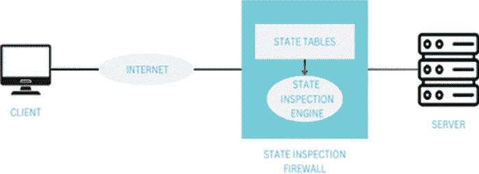

**图 4.9:** 状态多层检测

### 用例

**网络安全**：状态多层检测通常用于防火墙，保护网络免受未经的访问、恶意活动和其他安全威胁。

**入侵检测与防御系统 (IDPS)**：该方法也应用于入侵检测与防御系统，用于监控和分析网络和/系统活动，寻找恶意行为或违反安全策略的迹象。

### 挑战与考虑

* **资源密集型**：在多个层对流量进行深度分析可能会消耗大量资源，影响安全基础设施的性能。

* **配置复杂性**：实施和配置状态多层检测需要仔细的考虑，以避免可能导致安全漏洞或运行问题的配置错误。

# 简单的防火墙

Uncomplicated Firewall，简称 `UFW`，是一个易于使用的命令行界面 (CLI) 程序，可用于处理多种 Linux 发行版（包括 Debian、Ubuntu 和 Arch Linux）的防火墙配置选项。`UFW` 的设计是为了让用户更容易在计算机上设置和维护防火墙配置，特别是对于那些不是防火墙专家的用户。

### 使用 UFW 的优势

* `UFW` 为防火墙管理提供了一个易于使用的界面。

* 对于大多数用户，`UFW` 提供的默认设置已经是安全的。

* `UFW` 提供了一种通用灵活的方法，可以根据你的独特需求定制防火墙规则。

* `UFW` 是一个轻量级应用，占用资源少。

* `UFW` 是一个开源免费的应用，所有人都可以。

### 与 UFW 相关的命令和信息

1. 首先，确保你的计算机上安装了 `UFW`。

   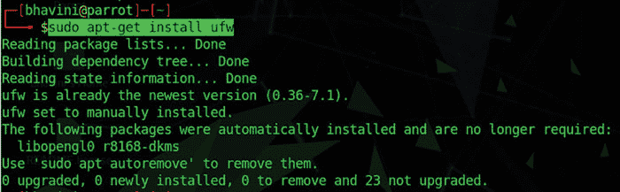

   **图 4.10:** UFW 安装

2. 使用以下命令启用或禁用 `UFW`：

   ```
   sudo ufw enable
   sudo ufw disable
   ```

   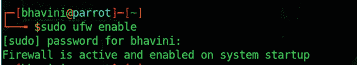

   **图 4.11:** 启用或禁用 UFW

3. 使用命令 `sudo ufw status` 检查 `ufw` 的 `status`。如果返回 `inactive`，则你需要使用提到的命令启用 `ufw`。

   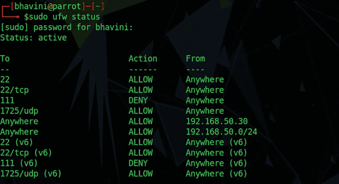

   **图 4.12:** ufw status

4. 如果你想设置任何默认设置，可以通过以下命令完成：

   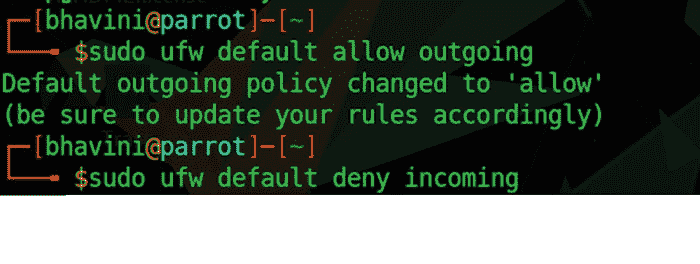

   **图 4.13:** 默认设置

5. 为了 SSH `allow` 来自端口 `22` 的入站和出站连接：

   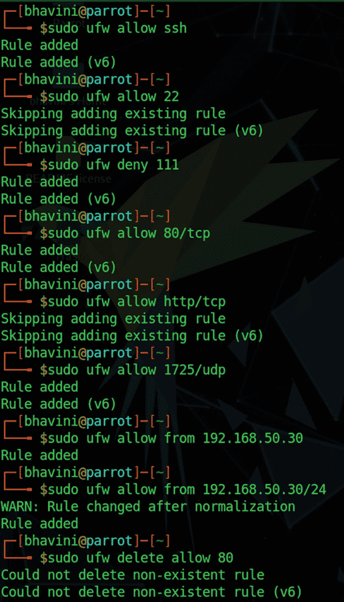

   **图 4.14:** 允许连接

6. 如果规则已存在，它将不会再次添加规则，你会收到“Skipping adding the existing rule”的输出。

   用于 `allow` 或 `deny` 来自任何特定端口或该端口的任何特定包的流量。

   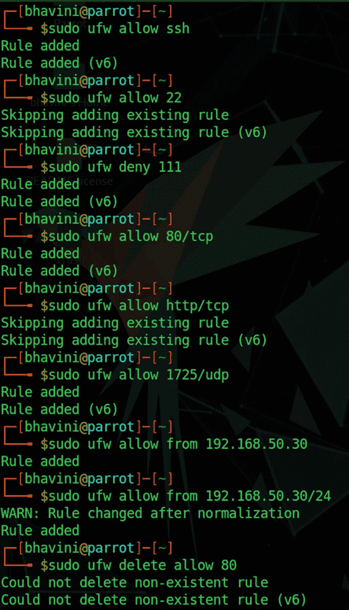

   **图 4.15:** 允许或拒绝流量

7. 为了 `allow` 来自特定 IP 地址或特定子网的连接：

   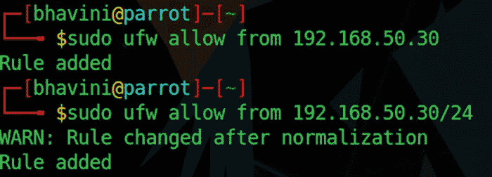

   **图 4.16:** 允许来自特定 IP 地址的连接

8. 你也可以使用 `delete` 关键字删除规则：

   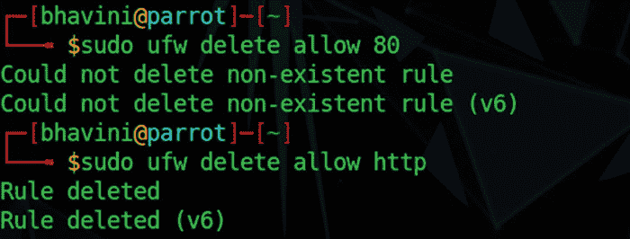

   **图 4.17:** delete 关键字

9. 为了禁用 `icmp` 请求，你可以进入 `/etc/ufw/before.rules` 文件，并将 `ALLOW` 移动到 `DROP`。

   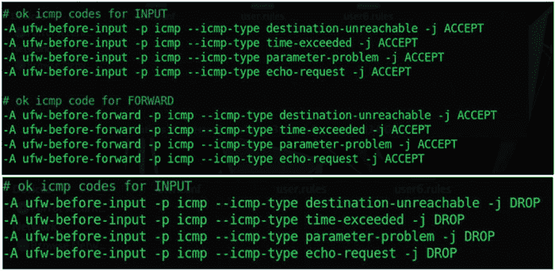

   **图 4.18:** icmp 请求

10. 如果你想阻止来自 `192.168.20.1` 端口 `22` 的访问，则允许所有其他 IP 使用 `tcp`。

    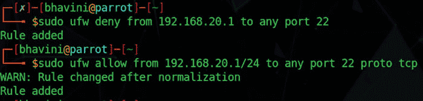

    **图 4.19:** 阻止来自 192.168.20.1 的 22 访问

11. 要启用日志，使用命令 `sudo ufw logging on`。

## 测试防火墙配置

在创建合适的配置后，确认你的防火墙配置确实实现了预期结果是非常关重要的。Linux 防火墙提供了一种更快、更易用户的方法。它让你手动创建测试，并以处理真实数据报的方式通过防火墙执行测试。

```
Nmap -p <port> <IP>
```

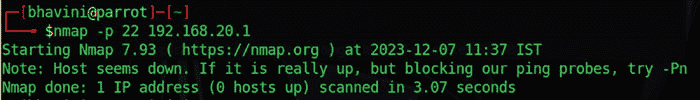

**图 4.20:** 工具

我们还可以检查系统的 `iptables`。系统管理员可以使用用户空间实用软件 `IP tables` 配置 Linux 内核防火墙的 IP 包过滤规则，这些规则是以各种 `netfilter` 模块的形式实现的。过滤器根据几个表排列，这些表包含了规定如何处理网络流量的规则链。

密码学是网络安全的基石，是保护数字领域敏感信息的关键。随着网络变得越发互联，保护数据免受未经授权访问和篡改的需求呈指数级增长。密码技术提供了一个稳健的框架，通过采用数学算法对数据进行加密和解密来实现这一目标。通过加密，明文信息被转换为不可读的密文，使得任何缺乏相应解密密钥的人无法破译。这一过程确保了数据的机密性，这是网络安全通信的基本要求。

除了机密性之外，密码学在维护传输信息的完整性和验证通信双方身份方面起着至关重要的作用。哈希函数通过为数字内容生成唯一的指纹（哈希值），担任数据完整性的守护者。这种多维的密码学方法为网络通信建立了安全基础，促进了信息交换中的信任与可靠性。

### 结构

在本章中，我们将涵盖以下主题：

* 理解密码学及其类型

* 密码学中使用的不同算法

* 各种哈希技术及其应用

* 使用密码学工具加密和解密数据

* 学习密码学攻击

* 隐写术与密码学的区别

## 理解密码学

`cryptography` 一词源于希腊语单词 `graphein`（意思是写）和 `kryptos`（意思是隐藏或秘密）。`cryptography` 描述了使用代码和密码进行数据安全和安全通信的方法及研究。密码学的目标是在传输过程中和存储时对数据进行加密。在计算机科学中，密码学是对数学思想和技术的研究，通过使用加密密钥或方案将可读的明文转换为不可读的密文，从而防止通信被他人窥探。

密码学的主要目标包括：

* **机密性 (Confidentiality)**：保护私有数据免受泄露或非法访问。可以使用加密对数据进行编码，使得只有获得授权的人才能对其进行解码和理解。

* **完整性 (Integrity)**：保证信息在发送、存储或处理过程中不被篡改。其目的是确保数据是准确的，且没有被意外或未经授权的个人所更改。

* **身份验证 (Authentication)**：验证实体（人、设备或系统）的身份以确保其确实为其声称的身份，这就是身份验证的过程。可以使用数字签名、证书和身份验证方法验证消息中发送者或接收者的身份。

* **不可否认性 (Non-repudiation)**：不可否认性的目标是防止人们或事物对消息或数据的合法性或来源产生争议。换句话说，如果一个人同意做某事（例如发送消息或批准交易），他们就不应该撤回自己的同意或否认参与。数字签名极大地有助于不可否认性，因为一旦有人对文档或通信进行了数字签名，他们以后就无法撤回该签名。

# 密码学的类型

根据加密和解密使用的密钥，加密分为两种：对称加密和非对称加密。

### 对称加密

对称加密是一种密码技术，使用相同的密钥对明文（原始数据）进行加密对密文（加密数据）进行解密。换句话之，通信双方存在一个共享的密钥，且该密钥保持保密以确保通信的安全。

以下是对称加密工作的基本概述：

* 由发送者或密钥分发机制生成一个密钥。然后将该密钥安全地共享给目标接收者。

* 将明文（原始数据）连同密钥输入加密算法。

* 算法将明文转换为密文，密文看起来是随机且无意义的数据。

* 密文通过通信通道传输，或存储在数据库、云服务或其他存储介质中。

* 拥有密钥的接收者将其密文输入解密算法。

* 算法反转加密过程，将密文转换回原始明文。

* 对称加密的安全性取决于共享密钥的秘密性和完整性。如果未经授权的方获取了密钥，他们解密密文并访问原始数据。

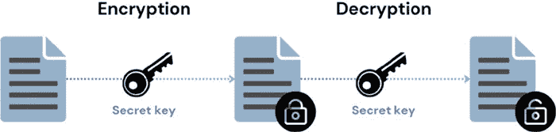

**图 5.1:** 对称加密与解密

### 非对称加密

非对称加密也称为公钥密码学，是一种使用一对数学相关的密钥对数据进行加密和解密的密码技术。与使用相同密钥进行加解密的对称加密不同，非对称加密涉及一对密钥：公钥和私钥。

以下是对非对称加密原理的基本说明：

* 为每个用户或企业生成一对密钥——公钥和私钥。尽管密钥之间存在数学关系，但无法从公钥计算出私钥。

* **公钥 (Public key)**：任何想要与密钥所有者通信的人都可以获取并自由传播公钥。它可以包含在数字证书中，或发布在公钥服务器上。

* **私钥 (Private key)**：只有密钥所有者知道私钥，且必须保持保密。它绝不能分发或共享。

* 使用接收者的公钥来加密旨在发送给密钥所有者的消息。只有私钥的所有者才能解码并读取该消息。

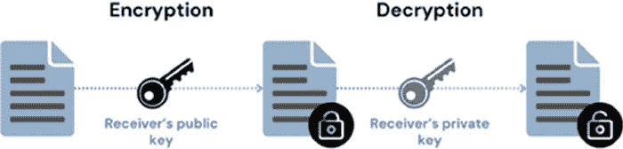

**图 5.2:** 非对称加密与解密

在接下来的表中，我们可以看到对称加密和非对称加密之间的区别。

| 对称加密 | 非对称加密 |
| :--- | :--- |
| 使用单一的共享秘密密钥进行加密和解密。该密钥必须保持保密并在通信双方之间安全共享。 | 使用公钥加密、私钥解密，这两者是一对数学上关联的密钥。虽然私钥需要保持保密，但公钥可以无限制共享。 |
| 挑战在于如何在通信双方之间安全地分发和管理秘密密钥。 | 公钥的发布使得密钥分发变得更容易。所有者是唯一知道秘密私钥的人。 |
| 通常计算开销较小，适用于加密大量数据。 | 随着密钥长度的增加，计算开销往往更大。 |
| 由于其简单性和处理效率，速度比非对称加密快。 | 不太适合加密大数据集，因为它比对称加密慢。 |
| 缺乏交换秘密密钥的安全通道。 | 由于私钥不需要发送或共享给任何人，安全性更高。 |
| 容易受到字典攻击和暴力破解。 | 容易受到中间人攻击和暴力破解。 |
| 适用于批量数据加密，在这种情况下，效率和速度至关重要。通常用于磁盘加密、文件加密和数据传输等应用。 | 广泛用于数字签名、安全密钥交换以及保护少量数据的隐私。经常用于涉及数字签名、在线交易和安全通信的场景。 |

**表 5.1:** *对称加密与非对称加密的差异*

### 加密算法

将可读数据转换为不可读格式的过程被称为加密。通过增加未经授权的人员或系统访问、理解或更改原始数据的难度，加密起到了保护信息的作用。在许多不同领域，加密方法对于保护私有数据和对话至关重要。加密算法是一系列数学操作和规则的集合，用于将数据（即明文）转换为一种难以理解的格式（即密文）。

以下是一些用于加密数据的加密算法。

## 数据加密标准 (DES)

数据加密标准 (DES) 是一种对称密钥分组密码，在被更先进的加密算法取代之前，它被广泛用于安全数据传输和机密性。

* 分组密码是一种在固定大小数据块（位位组）上运行的确定性算法。`DES` 使用固定大小的 64 位块。每个明文块都被单独加密。

* `DES` 是一种对称密钥技术，这意味着加密和解密是通过相同的秘密密钥完成的。通信双方必须安全地交换此共享密钥。64 位密钥由 56 个随机生成的位和用于错误检测所需的 8 位组成。

* 使用该秘密密钥，`DES` 算法将固定长度的明文位字符串转换为相同长度的密文位字符串。

* 随着计算机算力的提高，56 位密钥长度被证明随着时间的推移容易受到暴力破解攻击。在这些攻击中，攻击者会系统地尝试每一个密钥来解密密文。

## 三重数据加密标准 (3DES)

为了增强安全性，三重数据加密标准 (3DES) 作为 DES 的扩展被引入。

3DES 使用不同的密钥应用了三次 `DES` 算法。虽然 3DES 更安全，但计算量也更大。

* `3DES` 使用的“密钥包”由三个 `DES` 密钥组成：`K1`、`K2` 和 `K3`。每个密钥都使用一个典型的 56 位 `DES` 密钥。然后执行以下过程：`DES` 使用 `K1` 加密，`DES` 使用 `K2` 解密，`DES` 使用 `K3` 加密。

* 对于密钥有三种选择。第一种选择中的三个密钥是不同的且独立运行。第二种选择中的 `K1` 和 `K3` 是相同的。第三种选择中的三个密钥完全相同。因此，你实际上是三次使用了同一个密钥和同一个 `DES` 方法。安全性最低的是第三种，最安全的是第一种。

* `DES` 算法为用户在物理驱动上存储加密数据提供了一种简单的方法。

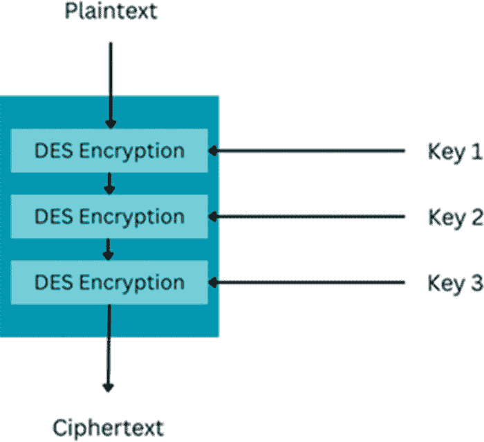

**图 5.3:** *3DES 算法*

### 高级加密标准 (AES)

与 `DES` 类似，`AES` 是一种对称密钥方法，这意味着加密和解密是用同一个密钥完成。通信双方必须安全地交换共享秘密密钥。

* 它的分组大小为 128 位，密钥大小对于 `AES-128` 为 128 位，`AES-192` 为 192 位，`AES-256` 为 256 位。

* 因为其计算效率高，`AES` 可用于各种目的，包括跨多个平台的软件实现。

* 密钥的大小影响 `AES` 中处理的轮数：

  * 128 位密钥：10 轮

  * 192 位密钥：12 轮

  * 256 位密钥：14 轮

* 原始秘密密钥使用 `AES` 密钥扩展方法转换为一组轮密钥。每一轮加密都使用这些轮密钥来增加安全性能并增加复杂性。

* 数据在每个周期中都将经过混合、置换和替换程序的处理。

* `AES` 使用一种高安全分组密码架构，称为代换排列网络 (SPN) 结构。

* `AES` 现在是一种广泛使用且受认可的加密系统。它用途广泛，包括保护敏感数据的机密性、加密文件和存储设备，以及促进安全的在线通信（例如 HTTPS）。

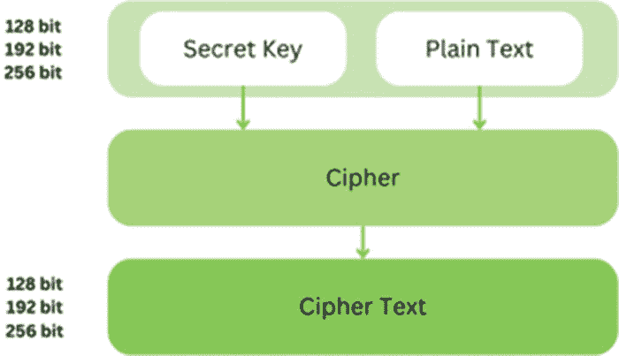

**图 5.4:** *AES 算法*

### RSA (Rivest-Shamir-Adleman)

`RSA` 是一种广泛使用的非对称加密算法，以其发明者 Ron Rivest、Adi Shamir 和 Leonard Adleman 命名。它是一种公钥体系，广泛用于安全数据传输、数字签名和密钥交换。


**图 5.5:** *RSA 算法*

`RSA` 的工作原理如下：

* 两个两个质数（`x` 和 `y`），并确定它们的积（`p = xy`，其中 `p` 称为模）。

* `RSA` 选择一个小于 `p` 且与 `(x-1)(y-1)` 互质的数字 `n`。因此，`n` 和 `(x-1)(y-1)` 除了 1 没有公因子。

* 此外，`RSA` 选择一个数字 `m`，使得 `nm` 能被 `(x-1)(y-1)` 整除。

* 值 `n` 和 `m` 分别是公次私指数。

* 公钥为 `(p, n)`；私钥为 `(p, m)`。

* 从公钥 `(p, n)` 获取私钥 `(p, m)` 是困难的。但是如果有人能将 `p` 分解为 `x` 和 `y`，那么这个人就可以解密 `m`。

分解两个大整数乘积的复杂性是 `RSA` 安全性的基础。

数字签名使用 `RSA` 生成，提供了一种确认消息或文档完整性和有效性的手段。

`RSA` 用于安全电子邮件协议中的数字和加密，例如 Pretty Good Privacy (PGP) 和 S/MIME。

## 哈希

哈希在密码学领域起着至关重要的作用，用于各种目的以确保数据完整性、提供认证并安全存储密码。


**图 5.6:** *哈希*

### 哈希算法

哈希算法是加密操作，将输入数据（有时称为 `message`）转换为固定长度的字符字符串，通常由哈希值或哈希代码表示。这些算法经常用于生成数字签名、维护密码安全并保证各种安全应用和协议中的数据完整性。

# 消息摘要算法 5 (MD5)

**目标：** `MD5` 是一种加密哈希函数，接受任何输入数据（通常称为消息）并输出固定大小的 128 位哈希值（32 个十六进制字符）。

数据块由 `MD5` 算法处理，生成 128 位哈希。它利用移位、位逻辑运算（AND、OR、XOR）以及一系列模算运算。

**特性：**

* **确定性**：`MD5` 对于相同的输入总是生成相同的输出（哈希值）。

* **计算快速**：由于其相对快速且高效的计算，`MD5` 可用于快速哈希操作。

* **不可逆性**：由于它被设计为单向函数，反转过程并从哈希值获取原始输入在计算上是不可能的。

* **安全问题**：`MD5` 被认为在密码学上存在缺陷，在安全是首要考虑的情况下不应再次使用。它包含的弱点使其容易受到特定类型攻击的影响，例如碰撞漏洞（不同的输入产生相同的哈希值）。

* **常见用途**：在过去，完整性检查和校验和是 `MD5` 的两种常见用途。对于密码学应用，由于其局限性，目前强烈不建议使用。

* **漏洞**：当两个不同的输入产生相同的哈希值时，`MD5` 容易受到碰撞攻击。对于数字签名或证书生成等安全关键型应用，这使其变得不再适用。

# 安全哈希算法 (SHA)

SHA 是由美国国家安全局（NSA）设计并由美国国家标准与技术研究院（NIST）发布的一系列加密哈希函数。这些哈希函数每一个属于不同的家族，并提供不同级别的安全性。

### SHA-1

* 该函数的输出结果大小为 160 位（20 字节）。

* **漏洞**：不同的输入可以生成相同的哈希值，使其容易受到碰撞攻击。由于这些缺陷，从密码学角度考虑，它不再被认为是安全的。

* **用法**：考虑到密码学的发展，已过时。它曾被用于证书、数字签名和其他安全流程。

### SHA-2

* SHA-2 家族中有多个不同输出宽度的哈希函数版本。

  * `SHA-224`：224 位（28 字节）。

  * `SHA-256`：256 位（32 字节）。

  * `SHA-384`：384 位（48 字节）。


*   `SHA-512`：512 位（64 字节）。

*   **安全性**：被认为是安全的，并广泛应用于许多密码学领域，例如区块链技术、`SSL/TLS`、数字签名和证书。

*   **抗碰撞性**：对碰撞提供了高程度保护，使得两个不同的输入很难生成相同的哈希值。

*   **应用**：用于许多对数据完整性至关重要的安全程序。

### SHA-3

*   `SHA-3` 是安全哈希算法家族的最新成员，其内部结构与 `SHA-1` 和 `SHA-2` 不同。它是通过公开竞赛选出的。

*   **输出大小**：可变（例如 `SHA3-256` 输出 256 位）。

*   **安全性**：根据 2022 年 1 月的最新更新，`SHA-3` 被认为是安全的，为加密哈希函数提供了额外的选择。

*   **特性**：与 `SHA-1` 和 `SHA-2` 使用的 Merkle-Damgård 结构相比，使用了不同的海绵结构。

*   **应用**：虽然没有 `SHA-2` 那么广泛，但 `SHA-3` 已用于各种安全应用，其使用可能会随时间的推移而增加。

# RACE 完整性原语消息摘要 (RIPEMD-160)

名为 `RIPEMD-160` 的加密哈希算法生成 160 位固定大小的哈希值。它是欧洲高级通信技术研究（RACE）项目期间创建的哈希函数之一，由 Hans Dobbertin、Antoon Bosselaers 和 Bart Preneel 创建。

*   **输出长度**：`RIPEMD-160` 生成的 160 位哈希值通常表示为 40 个十六进制整数。

    `RIPEMD-160` 的主要目标包括数据完整性验证、数字签名和其他安全应用，与其他加密哈希函数相似。

*   **算法**：为了处理输入数据，`RIPEMD-160` 使用了移位、模加和一系列位逻辑操作。它使用特定的数学运算和轮次构建结构。

*   **安全性**：`RIPEMD-160` 的构建考虑了防御一系列密码学威胁，例如碰撞攻击。对于对安全性要求更高的应用，当安全标准变化时，必须考虑更新的哈希算法。

*   **常见用途**：各种加密协议和应用都使用了 `RIPEMD-160`。一个突出的应用是在比特币协议中，它用于生成比特币地址所需的公钥加密哈希。

## 哈希的应用

哈希有多种应用，包括：

## 文件哈希

*   文件哈希的主要目标是验证文件的完整性和真实性。它确认了信息在发送或存储过程中没有被篡改。

*   **应用**：为了产生哈希值，会对原始数据应用哈希函数。发送者可以发送数据及其哈希值。之后，接收方可以独立地对其接收的数据进行哈希，并通过将计算出的哈希与发送的哈希比较来验证其完整性。

### 数字签名

*   数字签名的目标是提供一种安全的方法来确认数字消息或文档的完整性和真实。

*   **应用**：使用哈希函数创建消息的固定大小表示（即哈希）。然后使用发送者的私钥对该哈希进行签名，创建数字签名。接收方可以使用发送者的公钥验证签名，并将计算出的哈希与对接收的消息进行单独计算的哈希进行比较。

### 密码存储

*   密码存储的目标是安全地隐藏密码，防止窥探。

*   **应用**：系统保存哈希后的密码值而非实际明文密码。系统会对登录时输入的密码进行哈希处理，并与保存的哈希进行比较。在发生数据泄露时，这种策略保护了密码，增加了安全性。

## 密钥派生函数

*   是从低熵输入（如密码）中提取加密密钥的目标。

*   **应用**：为了从密码创建加密密钥，密钥派生函数使用了哈希函数。通过增加计算复杂度，该过程增加了攻击者破解的难度。

## 消息认证码

*   消息认证码 (`MAC`) 和哈希消息认证码 (`HMAC`) 的目标是保证消息的真实性和完整性。

*   **应用**：通过哈希算法生成消息的固定大小哈希值并与密钥密钥配对。通过查看生成的 `MAC`，可以确认消息没有被篡改且来自可靠来源。

## 区块链技术

*   区块链技术的目标是保护分布式账本的交易完整性。

*   **应用**：区块链由一系列连接的块组成，每个块包含前一个块的哈希。这通过确保更改一个块也会修改后续所有的块，从而保证高安全性。

## 数据去重

*   数据去重的目标是有效地查找并删除重复数据。

*   **应用**：哈希函数产生数据块哈希值。相同的数据块提供相同的哈希结果，即可区分重复数据。

## 加盐

*   在密码哈希中添加盐的目的是保护其免受彩虹表攻击。

*   **应用**：在哈希之前，将密码与随机数（盐）拼接。这确保了即使两个用户的密码相同，也会产生不同的哈希结果。

## 一次密码 (OTP)

一次性密码 (`OTPs`) 是一种加密安全功能，生成的密码仅对单个计算机系统或其他数字设备登录话或交易有效。`OTPs` 具有时间敏感性且仅限一次使用，在静态密码之上提供了额外的保护。

# 基于时间的一次性密码 (TOTP)

* 它基于哈希消息认证码 (HMAC) 算法。

* **描述**：双因子身份验证 (2FA) 通常通过 TOTP 实现。它依赖于客户端和服务器共享一个密钥。使用当前时间和和一个移动因子（或时间步长——通常为 30 秒）来构建一次性密码 (OTP)。基于计数器的 HMAC (HOTP) 是一种经常与 `SHA-1` 或 `SHA-256` 哈希配合使用的哈希函数。

## 基于计数器的哈希消息认证码 (HOTP)

* **算法**：基于 `HMAC`。

* **概述**：HOTP 使用每次使用都会增加的计数器值来生成 OTP。通过对计数器值应用 `HMAC` 生成 OTP，服务器和客户端交换一个密钥。

## 通用第二因子 (U2F)

* 用于通用第二因子 (U2F) 的算法是公钥密码学。

* 快速身份在线 (FIDO) 联盟是建立 U2F 标准的组织。为了创建 OTP，它利用公私密钥对。在注册期间，设备创建一个公私密钥对，私钥安全地保存在设备上。服务提供商保留公钥。在身份验证期间，服务提供商使用 `nonce` 对设备发起，设备使用其私钥对 `nonce` 进行签名。

### 基于移动设备的 OTP

* 它基于各种算法（通常基于 TOTP）。

* 描述：在移动设备上，许多应用程序（如 Authy 和 Google Authenticator）创建 OTP。对于基于时间的 OTP，它们经常使用基于 TOTP 的算法。

## 密码学工具

密码学工具是实现加密技术以保护信息和通信的软件或硬件应用程序。这些工具用于保护数据的机密性、完整性和真实性。

### GnuPG (GPG)

GnuPG 也称为 `GPG`，是一个强大且广泛使用的 OpenPGP 标准开源实现，用于安全通信和数据加密。

要在你的系统中安装 `GPG`，请使用以下命令：


**图 5.7：** 安装 GPG

现在，使用以下命令生成 `GPG` 密钥对：


**图 5.8：** 生成 GPG 密钥对

按照接后的提示输入名称和电子邮件 ID，并为你的密钥设置一个强密码短。


**图 5.9：** 密码短

现在，你的密钥已生成。


**图 5.10：** 密钥已生成

此信息包含了关于你的公钥的细节。密钥类型为 `RSA`，密钥大小为 3072 位。以下是信息的分解：

* 密钥类型：`RSA 3072-bit`

* 密钥过期日期：`2025 年 12 月 10 日`

* 密钥 ID：`ED8D7DA52A806EC110A27EC44C3416D909D9B9D2`

* 用户 ID (UID)：`Admin <admin@gmail.com>`

此外，还有一个具有相同 `RSA 3072-bit` 类型且过期日期与主密钥匹配的子密钥。

要加密文件，使用以下命令：

```bash
gpg --encrypt --recipient <key ID> -o <newfilename.gpg> <filename>
```


**图 5.11：** 加密文件

加密后的文本存储在 `encrypted_file.gpg` 中，你可以使用 `nano encrypted_file.gpg` 查看内容。

现在，如果你想解密一个加密文件，请使用以下命令：

```bash
gpg --decrypt <encryptedfilename> <new file>
```


**图 5.12：** 解密文件

输入你密钥的密码短。


**图 5.13：** 输入密码短

解密后的文本将存储在新文件中。

### OpenSSL

OpenSSL 是 SSL/TLS 协议的健壮开源实现，提供了多功能的加密函数集。

使用以下命令创建对称密钥：

```bash
openssl rand -base64 32 > encryption_key.txt
```


**图 5.14：** OpenSSL

此命令生成 32 字节的随机数据，以 Base64 格式编码，然后将结果保存到名为 `encryption_key.txt` 的文件中。

可以使用 `nano` 或 `cat` 命令打开密钥文件。

加密文件：

```bash
openssl enc -aes-256-cbc -salt -in <filename> -out <encrypted_file.enc> -pass file:encryption_key.txt
```


**图 5.15：** 加密文件

解密文件：

```bash
openssl enc -aes-256-cbc -d -in <encrypted_file.enc> -out <decrypted_file> -pass file:encryption_key.txt
```

## 消息摘要算法 5 (MD5) 计算器

一种名为 MD5 的流行哈希算法生成 128 位的哈希值，通常显示为十六进制整数。MD5 经常用于确认数据的完整性。要创建文件的哈希，请使用以下命令：

```bash
md5sum <filename>
```

要比较两个不同文件的哈希，请使用以下命令：

```bash
diff <hash1.txt> <hash2.txt>
```

这就是为什么建议使用慢速且计算开销大的哈希算法（如 `bcrypt` 或 `Arg2`）对密码进行哈希处理的原因之一。

可以使用多种策略来防止暴力破解攻击，例如：

*   **复杂的密码规定**：确保人员使用安全且唯一的密码。

*   **账户锁定策略**：为了防止自动化暴力破解，在登录失败一定次数后临时冻结账户。

*   **速率限制**：为了减慢暴力破解的速度，对特定时间内登录尝试次数进行限制。

*   **采用强健的加密**：通过使用长密钥和强健的加密方法，可以大幅增加成功暴力破解所需的时间和资源。

# 中间相攻击 (Meet-in-the-Middle Attack)

MITM 攻击（不要与中间人攻击 Man-In-The-Middle attack 混淆）是一种密码分析攻击，它通过执行预计算和暴力破解攻击的组合来破解加密系统。这种攻击对于使用两步过程（如双重加密或密钥交换机制）的加密系统特别有效。

以下是中间相攻击工作原理的概述：

*   **预计算阶段**：攻击者预计算并存储加密过程或密钥生成过程中一部分的结果。这通常涉及尝试过程的前半部分的所有可能的密钥，并存储中间结果。

*   **暴力破解阶段**：攻击者对过程的后半部分进行暴力破解，尝试所有可能的密钥直到找到匹配项。由于预计算阶段的中间结果已经存储，攻击者在暴力破解阶段不需要重新计算它们。

**示例：**

举个例子，经过双重 DES 加密后产生的消息为 `hPe`，明文为 `Boy.`。攻击者使用所有 256 个可能的单 DES 密钥对 `key1` 进行暴力破解，对明文 `John.` 密加密，并将每个密钥与相应的中间密文一起记录在表中，以便检索用于加密的两个密钥（即 `key1` 和 `key2`）。通过暴力破解，攻击者对 `hPe` 进行最多 256 次解密。当初始暴力破解后在密文表中找到的中间密文与第二次尝试的结果相同时，该攻击被视为成功。攻击者一旦找到匹配项，就可以识别出两个密钥并完成攻击。这种攻击最多需要 257 次操作，或者最多 256 次。当双重 DES 结合时，这使得攻击者能够获取数据。

# 彩虹表攻击 (Rainbow Table Attack)

彩虹表攻击是一种密码破解攻击，涉及使用预计算表来破解密码哈希值。出于安全考虑，密码通常以哈希值而非明文存储在数据库中。哈希函数将密码转换为固定长度的字符串，使得攻击者难以逆转该过程获取原始密码。在彩虹表攻击中，攻击者使用一个预计算表（彩虹表），该表包含明文密码及其对应哈希值的值对。这些表是通过预先对大量可能的密码进行哈希并将结果存储在表中生成的。一旦创建了表，就可以快速查找被捕获密码的哈希并找到对应的明文值。

彩虹表攻击背的基本思想是用存储空间换取计算时间。攻击者在攻击过程中不再计算密码的哈希，而是快速从彩虹表中查找预计算的哈希值。这种方法对于没有包含额外安全措施（如加盐 salting）的密码哈希系统是有效的。


**图 5.20：** 彩虹表攻击

为了防御彩虹表攻击，许多系统使用名为 `salting`（加盐）的技巧。为每个用户生成一个唯一的随机值（盐），并在哈希处理之前与其密码结合。这意味着即使两个用户具有相同的密码，由于唯一的盐，它们的哈希值也是不同的。因此，彩虹表变得不再那么有效，因为无法为每种可能的盐值进行预计算。

# DROWN 攻击

DROWN 攻击（使用过时和弱化的加密解密 RSA）是一种安全漏洞，针对支持 SSL/TLS 但仍在使用过时的 SSLv2（安全套接层版本 2）协议的服务器。DROWN 允许攻击者解密用户浏览器与易受服务器之间的安全通信。


**图 5.21：** DROWN 攻击

以下是关于 DROWN 攻击的关键点：

*   **SSLv2 漏洞**：该攻击利用 SSLv2 协议的漏洞，它是 SSL/TLS 协议过时且不安全的版本。SSLv2 有许多安全缺陷，强烈建议不要使用。

*   **跨协议攻击**：DROWN 是一种跨协议攻击，这意味着它允许攻击者利用一个协议（SSLv2）中的漏洞来支持更现代更安全协议（如 TLS，传输层安全）的服务器。

*   **加密密钥恢复**：该攻击的工作原理是利用服务器上多个协议共同使用同一个私钥的情况。攻击者可以使用 SSLv2 对服务器执行一系列特殊构造的连接。通过这些连接，攻击者最终可以恢复更安全协议（例如 TLS）所使用的加密密钥。

*   **影响**：如果成功，攻击者可以解密并监听用户与受影响服务器之间的安全通信。这可能包括敏感数据，如登录凭据、个人信息或财务交易。

*   **缓解措施**：DROWN 攻击的主要缓解措施是禁用服务器对 SSLv2 的支持。此外，鼓励组织使用强且最新的加密协议（如 TLS），并更新软件和系统以修复漏洞。

## 侧信道攻击 (Side-Channel Attack)

侧信道攻击是一种安全攻击，其重点是利用系统在正常运行期间泄露的信息，而不是尝试直接破解加密算法本身。这些攻击利用来自各种侧信道的无意信息泄露，例如功耗、电磁辐射、计时或声音。

以下是一些常见的侧信道攻击类型：

*   **计时攻击**：计时攻击涉及分析系统执行某些操作所需的时间。通过测量这些时间，攻击者可能会获得系统内部运作的见解，特别是在涉及加密操作时。例如，执行时间的变化可能会暴露密钥信息。

*   **功耗分析攻击**：功耗分析攻击利用设备在加密操作期间功耗的变化。通过监控功耗模式，攻击者可以推断出所使用的加密密钥。这在功耗随处理的位值而变化的情况下尤为相关。

*   **电磁分析攻击**：与功耗分析类似，电磁分析攻击侧重于测量设备在加密操作期间产生的电磁辐射。通过分析电磁发射的波动，可以推导出系统内部状态的信息。

*   **声学密码分析 (Acoustic Cryptanalysis)**：声学密码分析涉及分析系统在加密操作过程中产生的声音。例如，计算机硬盘或键盘发出的可能会泄露正在执行活动的信息，包括加密密钥生成。

*   **基于缓存的攻击 (Cache-based Attacks)**：这些攻击利用访问系统缓存中数据的时间差异。通过仔细测量这些访问时间，攻击者可能会推断出正在处理的数据信息。


**图 5.22:** *侧信道攻击*

以下是一些侧信道攻击的防御措施：

*   **算法措施 (Algorithmic countermeasure)**：使用抵抗侧信道攻击的算法。

*   **随机化技术 (Randomization techniques)**：在加密过程中增加不可预测性，以增加攻击者模式识别的难度。

*   **恒时间实现 (Constant-time implementations)**：为了减少计时攻击，确保加密程序的执行时间不依赖于秘密值。

*   **防护屏蔽 (Protective shielding)**：实施具体的安全措施以减少噪声和电磁辐射。

*   **硬件安全模块 (HSMs)**：使用内置侧信道攻击防御的专用硬件，HSM 旨在安全地执行加密操作。

# 密码分析工具

### John the Ripper

John the Ripper（通常简称为 John）是一种广泛使用的开源密码破解工具。它通过使用各种破解方法（如字典攻击、暴力破解和混合攻击）来识别弱密码。John the Ripper 支持多个平台，包括 Linux、Windows 和 macOS。它通常用于道德黑客、渗透测试和安全评估。

以下是 John the Ripper 的一些关键方面：

*   **密码破解技术 (Password Cracking Techniques)**：


# 字典攻击 (Dictionary Attack)

`John the Ripper` 使用词列表（字典）系统地尝试不同的单词和短语作为潜在密码。

# 暴力破解 (Brute-Force Attack)

它可以通过尝试所有可能的密码组合来执行穷举搜索，这可能耗时但有效。

# 混合攻击 (Hybrid Attack)

它将字典攻击与暴力破解结合起来以提高效率。

# 哈希算法 (Hash Algorithms)

`John the Ripper` 支持广泛的加密哈希算法，包括 `DES`、`MD5`、`SHA-1`、`SHA-256` 等。

# 社区版 (Community Editions)

`John the Ripper` 有多个版本，包括“`John the Ripper` 社区版”（`John the Ripper Jumbo`）和“`John the Ripper Pro`”（一个带有额外功能的商业版本）。

# 平台支持 (Platform Support)

`John the Ripper` 适用于各种操作系统，包括 `Linux`、`Windows` 和 `macOS`。

# 自定义 (Customization)

用户可以自定义攻击参数、规则和词列表，以根据其特定需求定制密码破解过程。

## Hashcat

使用 `Hashcat` 可以通过暴力破解、字典攻击和其他复杂方法来破解不同类型的密码哈希。它是一个广受欢迎且强大的开源密码恢复程序。由于它支持多种哈希算法，因此它适用于各种安全评估和渗透测试任务。

### 哈希算法 (Hash Algorithms)

`Hashcat` 支持 `MD5`、`SHA-1`、`SHA-256`、`SHA-512` 等许多哈希算法。它能够胜任。

### 攻击模式 (Modes of Attack)

- **暴力破解 (Brute-Force Attack)**：`Hashcat` 通过尝试所有可能的密码组合来执行穷举搜索，这可能耗时但有效。
- **字典攻击 (Dictionary Attack)**：`Hashcat` 使用词列表（字典）系统地尝试不同的单词和短语作为潜在密码。
- **混合攻击 (Hybrid Attack)**：`Hashcat` 将字典攻击与暴力破解结合起来以提高效率。

### 性能 (Performance)

`Hashcat` 能够处理多种哈希算法。

### 用例 (Use Cases)

`Hashcat` 经常用于道德黑客和渗透测试。

## 公钥基础设施

公钥基础设施或 `PKI` 是一种支持信息传输的强有力架构。`PKI` 从根本上使用公钥加密技术。

**公私钥对 (Pairs of Public and Private Keys)**：`PKI` 为用户提供一个保密的私钥和一个共享的公钥。

**数字证书 (Digital Certificates)**：在 `PKI` 中，数字证书是至关重要的。这些证书通过将实体的公钥与该身份关联，为人们提供验证密钥所有者的方法。证书中包含了密钥数据、颁者详细信息、身份信息以及由可靠的 `CA` 生成的数字签名。

**机构的角色 (The Role of Authorities)**

- **证书权威 (CAs)**：`CAs` 是负责创建和确认数字证书的可靠第三方。`PKI` 的核心由 `CAs` 运行。它们负责确认获取数字证书的机构的身份，并授予证明相应公钥的证书。在链的顶端，根 `CAs` 向中间 `CAs` 发行证书，然后由后者向终端实体发放证书。
- **注册机构 (RA)**：当注册机构 (`RAs`) 与 `CAs` 协作时，它们作为证书请求的转发代理和验证者。在将用户请求转发给 `CA` 之前，`RAs` 会验证用户。
- **证书吊销列表 (CRL)**：`CAs` 发布 `CRLs` 以维护安全性。用户和依赖方可以使用这些列表来确认证书的真实性，因为它们包含了在过期日期之前被吊销的证书序列号。

`PKI` 程序涉及的步骤列如下：

1. 主体（人、企业或系统）向注册机构 (`RA`) 请求证书，以便安全地通信信息。
2. 在确认主体的身份后，`RA` 获取来自主体的请求并要求 `CA` 授予用户公钥证书。
3. 一旦 `CA` 生成公钥证书，修改后的数据随后会被转发给验证机构 (`VA`)。
4. 完成交易后，用户在使用公钥证书进行数字签名后，将消息传递给客户端。
5. 通过询问 `VA` 用户的公钥证书是否仍然有效，客户端可以确认用户的身份。
6. `VA` 通过将用户的公钥证书与 `CA` 提供的新数据进行对比，评估结果（有效或无效）。

# 隐写术

隐写术是将信息隐藏在文本、图像、音频、视频等看似无害的其他数据中的一种实践。它是各方之间进行机密通信的有效方法。这种技术通过将秘密数据隐藏在普通的、非秘密的文件或消息中来避免检测，然后在目标位置提取出这些秘密数据。隐写术的使用可以与加密相结合，作为隐藏或保护数据的额外步骤。

隐写术与密码学是不同的。将两者结合使用可以帮助提高受保护信息的安全性，并防止机密通信被检测。如果隐藏的数据也经过了加密，数据可能仍然能够免受检测，尽管信道将不再能免受检测。与仅使用加密的通信相比，隐写术与加密相结合具有优势。

使用隐写术隐藏数据相比于密码学的主要优势在于，它有助于模糊敏感数据隐藏在文件或其他载有隐藏文本的内容中的事实。相比之下，加密的文件、消息或网络包载荷会被明确标记并识别为此类内容，而使用隐写技术则帮助隐藏安全通道的存在。

# 隐写算法

隐写算法是在将秘密数据嵌入其他非秘密数据（载体媒体）中以隐藏嵌入信息存在的技术或方法。存在多种隐写算法，每种算法都有其优缺点。

一些常见的隐写算法包括：

### 最低位 (LSB)

- `LSB` 算法涉及将载体媒体（如图像像素或音频样本）的最低位替换为秘密数据的位。
- 这是最简单且应用最广泛的隐写技术之一。
- 它被用于 `Steghide` 等工具中。

### 扩频

- 该技术将数据分布在宽泛的频谱上，使其难以检测。
- 跳频和直接序列扩频是扩频隐写中的常用方法。

### 变换域技术

- 技术如 `离散余弦变换 (DCT)` 或 `离散小波变换 (DWT)` 可以应用于频率域或变换域中隐藏数据。
- `JPEG` 和 `JPEG2000` 图像通常使用频率域隐写。

### 相位编码

- 该技术通过修改信号的相位信息来编码隐藏数据。
- 它常用于音频隐写。

### 回声隐藏

- 这通过操纵音频信号中的回声来嵌入信息。
- 它利用了人耳在某些情况下忽略回声的能力。

### F5 算法

- `F5` 算法是一种基于 `LSB` 和纠错码的隐写算法，旨在增加安全性和抗攻击能力。

### Jsteg

- `Jsteg` 是一种用于在 `JPEG` 图像中隐藏信息的算法。它修改了 `JPEG` 编码过程的量化表。

### 基于混沌的技术

- 可以通过使用混沌函数对隐藏信息进行编码和解码应用于隐写。

### 混合技术

- 结合多种隐写技术可以增强安全性，并增加检测难度。

# 隐写工具

Linux 上的隐写工具允许用户在其他文件或媒体中隐藏信息，以保护敏感数据或进行秘密通信。

### Steghide

`Steghide` 是一种流行的命令行工具，用于在各种图像和音频文件中嵌入和提取数据。

要在图像文件中隐藏数据，请使用以下命令：


**图 5.23：**加密文件

在这里，`cover.jpg` 是载体图像，我们在其中隐藏名为 `hide` 的文件中的数据。包含秘密文本的输出图像将保存为 `stg.jpg`。

现在要从隐写图像提取数据，请使用以下命令：


**图 5.24：**提取数据

数据将存储在 `output.txt` 中。

# 密码学与隐写术

密码学和隐写术都是保护信息的技术，但它们有不同的目的并采用不同的方法。

| 密码学 | 隐写术 |
| :--- | :--- |
| 密码学的主要目的是通过算法和密钥将数据转换为不同的格式（密文）来保护通信和数据。密码学侧重于确保信息的机密性、完整性和真实性。 | 隐写术的主要目的是隐藏信息的存在。隐写术不是加密数据，而是将其隐藏在另一个看似无害的文件或媒介中，使隐藏数据的存在不明显。 |
| 密码算法通常产生看起来像随机或与原始明文明显不同的密文。 | 目标是保持隐藏信息的存在不可被检测。载体文件（载体媒体）看起来没有变化，且其包含隐藏数据的事实不明显。 |
| 密码学使用数学算法和密钥转换原始数据。 | 隐写术在另一个文件或媒介中隐藏信息，而不会显著改变原始结构。 |
| 密码学的存在通常是可以检测的，加密强度取决于加密密钥的秘密性。 | 隐写术的检测通常更具挑战性，因为对载体文件进行的修改是非常微妙的。 |

**表 5.2：密码学与隐写术的区别**

在某些情况下，密码学和隐写术结合使用，为信息安全提供分层方法。密码学可以保护数据内容，而隐写术可以隐藏正在发生通信或数据隐藏的事实。

## 结论

在本章中，我们全面涵盖了数字信息安全的本质组成。通过涵盖对称和非对称加密算法，它强调了加密工具在满足各种安全需求方面的通用性。对`公钥基础设施 (PKI)` 的探索强调了其管理加密密钥和证书以实现安全数字通信的关键作用。`密码分析`的学习使学习者能够评估并加强加密系统，强调了它们的动态性。此外，隐写术的引入展示了在数据中隐藏信息的艺术。本章强调了密码学与更广泛安全策略的内在联系，强调了其在应对不断演变的网络威胁和加强互联数字格局中的信息安全基础方面不可或缺的作用。

在下一章中，我们将深入研究入侵检测和防御系统领域，探索它们在增强安全性方面的关键作用。`IDS` 和 `IPS` 的结合在加强网络整体安全态势方面发挥着至关重要的作用。

入侵检测系统（`IDS`）和入侵防御系统（`IPS`）是网络安全的关键组件，旨在识别和响应计算机网络中的恶意活动。`IDS` 监控网络流量，以寻找可能表明安全违规的可疑模式或异常情况，并利用了多种检测方法，例如基于特征的检测、基于异常的检测和启发式检测。在检测到潜在威胁时，`IDS` 会生成警报以通知管理员可疑活动。另一方面，`IPS` 不仅能识别恶意活动，还能通过阻止或缓解检测到的威胁采取主动措施防止其发生。`IPS` 可以以同步模式运行，主动防止恶意流量到达其目标主机。`IDS` 和 `IPS` 共同通过提供实时监控、分析和响应能力，防止网络威胁和未经授权的访问，从而提升了整体的安全态势。

### 结构

在本章中，你将学习到：

- 入侵检测系统及其类型
- `IDS` 用于检测入侵的方法
- 如何在 `Linux` 操作系统中设置 `IDS`
- 入侵防御系统及其类型
- `IDS` 与 `IPS` 之间的比较
- 在 `Linux` 操作系统中设置 `IPS`

## 理解 IDS

`IDS` 是一种安全设备（软件形式或硬件形式），旨在观察、识别并保护网络或系统免受恶意活动的影响。它在检测到任何入侵时立即通知安全人员。`IDS` 通过持续审查入站和出站的网络流量证明了其极高的价值，确保持续识别网络或系统内部潜在的安全违规。它专门检查流量中是否存在与既定入侵模式相符的迹象，并在发现匹配时触发警报。根据功能的不同，`IDS` 可分为主动式或被动式。被动式 `IDS` 主要识别入侵，而主动式 `IDS`（即 `IPS`，入侵防御系统）则更进一步，不仅能检测还能防止网络入侵。

## IDS 的功能操作

- **监控**：`IDS` 实时监控网络或系统活动。它观察入站和出站流量、系统日志和其他相关数据源，以识别偏离正常行为模式的任何异常。
- **检测**：`IDS` 的主要目的是检测潜在的安全事件或入侵。它使用多种方法（如基于特征的检测、基于异常的检测或基于行为的检测）来识别指示已知威胁或异常活动的模式。
- **警报**：当 `IDS` 识别出可疑或恶意活动时，它会生成警报以通知安全管理员或其他相关人员。这些警报提供了有关检测到的事件性质、其严重程度和潜在影响的信息。
- **日志**：`IDS` 记录检测到事件的信息，包括事件性质的细节、源和目的地址以及发生时间。这些日志对于事后分析、取证和合规性目的具有重要价值。

## IDS 在网络中的位置

部署 `IDS` 的一种常用位置是防火墙附近。将 `IDS` 放置在防火墙外部还是内部取决于监控的目标流量——是来自外部网络的入站流量还是来自内部网络的出站流量。如果位于内部，将 `IDS` 放在 `DMZ` 附近最为有效。尽管如此，通过分层防御方法可以实现最佳安全性，即将一个 `IDS` 放置在防火墙之前，另一个放置在网络内部之后。


**图 6.1**：`IDS` 的位置

# IDS 的类型

入侵检测系统 (`IDS`) 可分为三大主要类型，包括：

## 网络入侵检测系统 (NIDS)

进入网络的每个数据包都会经过网络入侵检测系统的检查，以查看是否存在任何异常或不准确的数据。通过限制防火墙拒绝大量数据包的能力，`NIDS` 详尽检查每个数据包。所有流量都由 `NIDS` 记录和检查，它根据内容在 `IP` 层或应用层创建通知。`NIDS` 的分布比基于主机的 `IDS` 更广泛。`NIDS` 在主机和路由器级别发现异常。在接收数据包后，它会为每个风险分配危险等级，并审计数据包中的信息，同时记录恶意数据包的内容。由于威胁的数量，安全团队必须保持警惕。这些系统通常由一个安装在网络混杂模式下的“黑盒”组成，旨在监听可能指示入侵的模式。通过网络流量监控，它能发现恶意行为，诸如 `DoS` 攻击、端口扫描，甚至是尝试破坏系统的行为。


**图 6.2**：网络型 `IDS`

## 主机入侵检测系统 (HIDS)

`HIDS` 检查每个系统的操作。你可以将 `HIDS` 安装在任何种机器上，从服务器到桌面级电脑。与 `NIDS` 相比，它更具适应性。除了识别非法内部活动外，基于主机的系统在识别非法文件更改方面非常高效。`HIDS` 关注本地系统的演变。此外，它更具平台特定性，相对于其他 `HIDS`，它更强调 `Windows` 操作系统，尽管它们适用于 `UNIX` 平台。通常，这些程序包括审计发生在特定主机上发生的事件。由于需要监控每个系统事件涉及的开销，它们并不特别流行。


**图 6.3**：主机型 `IDS`

## 基于启发式的入侵检测系统

基于启发式的入侵检测系统是一种 `IDS`，它依赖启发式（即从经验或专家知识中得出的规则或原则）来识别潜在的安全威胁。与寻找已知攻击特定模式的基于特征的检测，或关注偏离正常行为的异常检测不同，启发式 `IDS` 使用一组预设的规则来标记可疑活动。

以下是基于启发式的 `IDS` 的关键方面：

### 启发式指南

- **指定指南**：基于启发式的 `IDS` 使用一套既定的规则或启发式，这些规则代表了已知攻击技术或恶意行为的共同特征。
- **专家知识**：关于过去攻击趋势的信息或安全专家的经验通常是这些规则的来源。

### 行为模式

- **识别攻击模式**：基于启发式的 `IDS` 识别与已知网络攻击或恶意行为相关的特定活动模式。
- **上下文分析**：为了区分可能是良性还是恶意的行为，它可能会考虑某些活动发生的上下文。
- **动态分析**：由于基于启发式的 `IDS` 系统具有识别已知威胁变体的能力，因此它们可能比基于特征的系统更灵活。
- **动态规则**：某些启发式被设计为根据新威胁或网络环境的变化进行动态调整。

### 启发式的类型

- **误用启发式**：关注已知的恶意活动模式，类似于基于特征的检测。
- **异常启发式**：寻找偏离既定基准的情况，类似于异常检测。
- **基于规则的启发式**：使用预定义的规则来识别可能指示攻击的特定事件序列或条件。

### 告警生成

- **规则匹配**：当观察到的行为匹配上一个或多个预定义的启发式时，系统会生成告警。
- **严重级别**：可以根据感知到的威胁水平为告警分配严重级别。

### 局限性

- **误报**：如果合法活动触发了预定义的规则，基于启发式的 `IDS` 可能会产生误报（错误地将良性活动识别为恶意）。
- **静态性**：启发式的有效性取决于预定义规则的准确性和相关性。需要定期更新和调整，以适应不断演变的威胁。

### 用例场景

- **特定威胁**：基于启发式的 `IDS` 在识别具有已知明确模式或特征的特定类型威胁时特别有效。
- **行为分析**：它通过提供基于专家知识的行为分析，弥补了其他检测方法的不足。

## 入侵检测方法

有多种方法可以检测计算机网络或系统中的入侵。这些方法可以大致分为不同的处理方式，每种方法都有其自身的优缺点。

### 特征识别

特征识别是指识别与已知威胁、攻击或恶意活动相关的已知模式或特征的方法。这种方法通常用于 `IDS` 和反病毒软件中基于特征的检测系统内部。以下是特征识别的工作原理：

- **特征数据库**：安全系统维护一个预定义的特征数据库，每个特征都代表已知威胁的特定模式或特征。这些特征源于对先前识别的恶意软件、攻击方法或恶意行为的分析。
- **与网络或系统流量对比**：特征识别系统持续监控网络流量、系统日志或其他数据源，寻找与其数据库中已知特征匹配的模式。这种监控可以在网络的多个点进行，取决于它是基于网络的入侵检测系统 (`NIDS`) 还是基于主机的入侵检测系统 (`HIDS`)。
- **告警生成**：当系统识别到观察到的模式与数据库中的特征之间的匹配时，它会生成告警。该告警通知安全人员或管理员检测到了潜在的安全威胁或入侵。
- **响应**：根据配置的不同，系统可能会触发自动响应或启动预定义的操作来缓解威胁。这些操作可能包括阻止来自特定 `IP` 地址的流量、隔离受感染的系统或采取其他步骤防止进一步的损害。

### 特征识别的优点

- **对已知威胁有效**：特征识别在检测和阻止已知威胁（包括已建立的恶意软件、病毒和攻击模式）方面非常有效。
- **低误报率**：由于它依赖于已知威胁相关的特定模式，误报的可能性相对较低。

### 特征识别的局限性

- **无法检测未知威胁**：基于特征的系统对于没有建立特征的新型或未知威胁效果较差。这是一个巨大的缺点，因为攻击者在不断开发新的技术和恶意软件。
- **静态性**：特征数据库需要定期更新以保持有效。必须向数据库中添加新特征以应对新出现的威胁。

## 异常检测


IDS 中的异常检测是一种用于识别偏离既定正常活动基准的行为模式的方法。与依赖已知恶意活动模式的特征检测不同，异常检测侧重于识别与网络或系统内视为典型或预期行为的偏差。以下是 IDS 中异常检测的概述：

## 基准建立

- **正常行为定义**：异常检测从建立网络、系统或特定用户被视为正常行为的基准开始。基准是通过分析历史数据并识别常规活动模式创建的。

## 持续监控

- **实时监控**：IDS 实时监控网络流量、系统日志或其他相关数据源。
- **行为分析**：它将观察到的行为与既定的基准进行比较，寻找任何偏差或异常。

## 异常类型

- **点异常**：当单个数据点显著偏离常态时发生。
- **上下文异常**：考虑数据点之间的上下文或关系，根据其相互作用识别异常。
- **集体异常**：通过共同分析一组数据点的行为来检测异常。

## 检测算法

- **统计学方法**：使用统计分析来识别偏离预期行为的偏差。
- **机器学习算法**：采用监督或无监督机器学习技术来学习并适应正常行为，标记任何超出学习模式的项。
- **启发式方法**：使用预定义的规则或启发式根据特定条件识别异常。

## 告警生成

- **阈值与策略**：异常检测系统配置了阈值或策略来定义什么被视为异常。当系统识别出超过这些阈值的行为时，就会生成告警。

## 人工验证与调查

- **告警审查**：安全人员审查生成的告警，以确定异常的性质。
- **调查**：可能会对异常进行进一步调查，以了解它们代表的是合法活动还是潜在的安全威胁。

## 异常检测的优点

- **对未知威胁有效**：异常检测能够识别以前未知或新出现的威胁，因为它不依赖于预定义的特征。
- **适应性**：异常检测系统可以适应网络环境的变化和不断发展的攻击技术。

## 异常检测的挑战

- **误报**：如果网络或系统发生了未被充分考虑的合法变化，异常检测可能会触发误报。
- **复杂性**：设计和调整异常检测系统可能非常复杂，需要尽可能地减少误报以保持系统的有效性。

# 告警类型

IDS 生成四种类型的告警：真阳性（True Positive）、假阳性（False Positive）、假阴性（False Negative）和真阴性（True Negative）。

- **真阳性（攻击 - 告警）**：触发警报并促使 IDS 像实际攻击一样做出响应的事件被称为真阳性。该事件可能是真实的攻击（黑客试图入侵网络），也可能是演习（安全人员使用黑客工具测试网络部分）。
- **真阴性（无攻击 - 无告警）**：如果 IDS 将某项活动报告为可接受的行为（如果发现如此），这被称为真阴性。忽略适当的行为实际上导致了真实的阴性。由于 IDS 在此例中运行符合预期，因此它是没有危险的。
- **误报（无攻击 - 告警）**：当没有发生真实攻击，但某些活动触发了警报时，就会发生误报。当 IDS 将常规系统活动视为攻击时，就会发生误报。误报通常会导致用户对警报的响应能力降低，并且对真实入侵情况的关注度减少。管理员利用误报来在配置测试期间，评估 IDS 区分合法攻击和误报的能力。
- **漏报（攻击 - 无告警）**：当 IDS 无法对实际攻击事件做出响应时，它会产生漏报。由于 IDS 的目的是识别并应对威胁，这种形式的失效是危害最大的。

# 在 Linux 中设置 IDS

在 Linux 上设置 IDS 涉及安装和配置 IDS 软件，以监控网络或系统活动，从而发现潜在的安全威胁。以下是使用 Snort 设置 IDS 的通用指南：

## Snort

要安装`snort`，请使用以下命令：

```bash
sudo apt-get install snort
```

安装成功后，打开配置文件`/etc/snort/snort.conf`查看该文件中的所有配置。


**图 6.4：** `/etc/snort/snort.conf`

要查看规则，请进入目录`/etc/snort/rules`。


**图 6.5：** `/etc/snort/rules`

要启动检测，使用以下命令：

```bash
snort -A console -c /etc/snort/snort.conf
```


**图 6.6：** `snort -A console -c /etc/snort/snort.conf`

Snort 将捕获并分析所有网络包，并在该区域记录任何可疑活动或尝试入侵的行为。


**图 6.7：** Snort 结果

要停止分析，按下`Ctrl+C`。它将显示所有数据的细分。


**图 6.8：** `Ctrl+C`后的数据细分

你也可以在`local.rules`文件中根据你的需求和要求编写自己的规则。


**图 6.9：** `local.rules`

这是一个规则示例：

```bash
alert icmp $EXTERNAL_NET any -> $HOME_NET any (msg: "Example alert Message"; sid:384; rev: 5;)
```

该规则检测从任何外部网络到你家庭网络中任何端口发生的任何 ICMP ping，然后显示消息“Example alert Message”。

在添加任何规则后，你需要使用以下命令测试 Snort 的配置：

```bash
snort -T -c /etc/snort/snort.conf
```

在验证成功后，你将看到这条消息：


**图 6.10：** 检查配置

现在，我们将使用之前提到的命令启动 Snort。

## 从另一台机器执行模拟攻击

现在，我们将从外部网络对我们的系统执行 ICMP ping：


**图 6.11：** ICMP ping

我们可以看到我们的规则已被触发，且消息显示在屏幕上。


**图 6.12：** ICMP ping 导致的结果

这里是规则的一些其他示例：

- `alert tcp any any -> $HOME_NET 21 (msg: "FTP Attempted"; sid:60001; rev:1;)`

如果任何外部系统尝试在 21 端口上执行 FTP 连接，将显示消息“FTP Attempted”。

- `alert tcp any any -> $HOME_NET 22 (msg: "SSH Attempted"; sid:60002; rev:1;)`

如果任何外部系统尝试在 22 端口上执行 SSH 连接，将显示消息“SSH Attempted”。

现在，当你尝试通过 FTP 连接时，它将显示相应的消息。


**图 6.13：** FTP 和 SSH 连接

结果如下：


**图 6.14：** FTP 和 SSH 连接导致的结果

# 理解 IPS

入侵防御系统（IPS）既能检测也能阻止入侵；因此它们被称为主动 IDS。持续监控系统（或 IPS）经常被用作防火墙后的额外安全措施。与被动的 IDS 不同，IPS 部署在网络的内联位置（inline），位于源和目的之间。它们的目的是主动监控网络流量，并对进入网络的流量做出自动选择。

## IPS 的功能操作

一种名为 IPS 的网络安全工具旨在识别并停止网络上可能发生的威胁和攻击。以下是 IPS 的主要职责：

- **流量监控：** IPS 实时监控系统和网络活动。为了识别和发现可疑模式，它会检查入站和出站数据。
- **基于特征的检测：** 使用已知攻击数据库识别并拦截有害通信。这些指标指向了危险。
- **基于异常的检测：** 通过检查偏离正常网络活动的情况来识别未发现的风险。
- **协议分析：** 研究网络协议以确保通信符合规范且不会向恶意意图发展。
- **内容检查：** 检查包内容是否存在可能指向恶意行为的模式或特征。这包括检查嵌入网络流量的恶意软件、漏洞或其他攻击。
- **包过滤：** 根据预设标准单独检查数据包。基于源目的 IP 地址、端口和协议，它可以允许或拒绝包。
- **防御与阻止：** 通过阻止或移除恶意包采取主动措施停止已识别的威胁。这可能切断连接。
- **日志与报告：** 记录安全事件、已识别的威胁和系统活动。这些数据不仅对于合规报告非常有用，对于评估和调查安全事件也至关重要。
- **安全信息事件管理系统集成：** 它在 SIEM 系统之间交换数据，以提高威胁管理效率并提供安全环境的全视图。
- **自动响应：** 高级 IPS 能够通过预设措施自动响应安全事件。这些行动可能阻止 IP 地址、隔离系统或修改安全规则。
- **持续更新：** 为了跟上新的威胁和漏洞，它定期更新特征数据库和检测系统。

# IPS 类型

入侵防御系统（IPS）可以分为四类：

## 基于主机的 IPS

它可以被描述为运行在单个主机上的入侵防御系统类型。这种类型 IPS 的目标是确保内部网络没有有害活动。该 IPS 通过扫描网络获取任何异常特征活动的信息，从而阻止恶意行为在特定主机上发生。这种类型 IPS 的主要特征是它不管理整个网络，而是保护其安装的主机免受所有潜在的网络层攻击，因此非常安全。

## 基于网络的 IPS

这可以被视为安装在网络内部以停止恶意活动的另一种类型的 IPS（入侵预防系统）。这种 IPS 的目标是监视或注视整个网络。通过实施此类 IPS，可以停止整个网络中发现的任何恶意行为。其他如`Nexpose`等网络扫描程序可以与此系统结合。因此，这种类型的入侵预防系统还会考虑这些工具发现的任何漏洞。即使对于网络扫描工具识别出的漏洞尚未可用补丁，该入侵预防系统仍然保护系统免受利用该漏洞的攻击。

## 网络行为分析

顾如其名，这种 IPS 用于分析网络行为，在网络中移动的每个网络设备都会被系统持续监控。IPS 确保阻止系统发现的任何恶意特征的数据包，以防止对应用程序造成损害。

此类 IPS 的主要目标是确保没有恶意数据包在内部网络中创建和发送。使用这种 IPS 的企业始终能够免于拒绝服务攻击（`DoS`）攻击和其他基于侵犯隐私的攻击的影响。

## 无线 IPS

它可以被视为另一种基于无线网络的入侵检测系统。使用这种 IPS，可以跟踪无线网络内部的有害行为。通过使用特征，这种 IPS 会检查或监控在无线网络中移动的每个数据包。

如果 IPS 检测到带有可疑特征的数据包，将阻止数据包进入网络。如今，无线网络比基于局域网的网络更流行，使其成为最好的 IPS 类型之一。它显著提高了网络安全性，并阻止任何恶意网络包改变当前环境。

## IDS 与 IPS 的比较

| | IDS | IPS |
| :--- | :--- | :--- |
| 功能 | IDS 监控网络或系统活动，并在检测到可疑行为时发出警报或通知。它不主动防止或拦截威胁 | IPS 不仅检测可疑活动，还采取主动措施防止或阻止潜在威胁。它可以对安全事件做出自动响应 |
| 响应 | IDS 提供有关潜在安全事件的信息，但不采取自动操作来停止或缓解威胁。通常需要人工干预来响应警报 | IPS 实时拦截或缓解已识别的威胁。它可以丢弃恶意包、终止连接或采取其他预定义的操作来保护网络 |
| 运行 | IDS 主要是一种监控工具。它分析网络流量和系统日志，以识别指示未经授权或恶意活动的模式或异常 | IPS 将主动预防和阻止威胁与 IDS 的监控能力相结合。它是执行安全强制措施的工具 |
| 部署 | IDS 通常被部署作为额外的安全层，补充防火墙和其他安全措施。它用于检测并对潜在安全事件提供早期警告 | IPS 通常被部署为网络防御策略中的关键组件。它被策略性地放置，在恶意流量到达目标之前对其主动拦截 |
| 灵活性 | IDS 的侵入性通常较小，因为它不主动拦截流量。它可以用于严格预防措施可能会干扰正常操作的环境 | IPS 可能比 IDS 更具侵入性，因为它会主动干预以停止潜在威胁。需要仔细配置以避免误报和对合法流量的干扰 |
| 示例 | 流行的 IDS 工具包括`Snort`、`Suricata`和`Bro` | 流行的 IPS 解决方案包括`Cisco IPS`、带有`inline`模式的`Snort`以及具备 IPS 能力的`Suricata` |

**表 6.1：** IDS 与 IPS 的比较

# 在 Linux 中设置 IPS

在 Linux 中设置 IPS 涉及使用不仅检测而且主动防止和阻止网络上恶意活动的软件。`Suricata`既是 IDS 也是 IPS，是一个流行的选择。以下是在 Linux 系统上将`Suricata`设置为 IPS 的通用步骤：

1. 要安装`Suricata`，请使用以下命令：

   ```bash
   sudo apt install suricata
   ```

   

   **图 6.15：** 安装 Suricata

2. 要配置规则，可以编辑`/etc/suricata/suricata.yaml`文件并根据您的需求设置规则。

   

   **图 6.16：** `/etc/suricata/suricata.yaml`

3. 要启动`Suricata`，执行以下命令：

   - `sudo systemctl start suricata`
   - `sudo systemctl enable suricata`
   - `sudo systemctl status suricata`

   

   **图 6.17：** Suricata 状态

漏洞评估是当代网络安全实践中的关键组成部分。它涉及对组织的数字基础设施进行系统性检查，以识别可能被恶意攻击者利用的弱点或漏洞。这些漏洞可能存在于软件、硬件、网络配置中，甚至由于培训不足或意识缺失等人员相关的因素导致。漏洞评估的主要目标包括风险的识别、优先级排序和缓解。这一过程结合了自动化扫描工具和手动测试，使安全专家能够全面评估安全态势。漏洞评估的生命周期涵盖发现、优先级排序、修复和验证，并配有持续监控环节以适应不断变化的威胁。对行业标准和法规的合规性促使组织定期进行漏洞评估，确保其系统面对潜在网络威胁的持续韧性。

# 本章结构

在本章中，你将学习到以下主题：

- 漏洞评估
- 搭建 VAPT 实验室
- 在 Virtual Box 中安装 Kali Linux
- 安装基础工具
- 侦察与信息收集
- 扫描与枚举
- 理解扫描的工作原理
- 漏洞利用与后渗透
- 案例研究与真实世界示例
- 从成功的漏洞评估中学习
- 实施教训总结

# 漏洞评估概述

漏洞评估（VA）是一项评估信息系统、应用程序和网络安全态势的系统过程，旨在识别并缓解潜在漏洞。它涉及对漏洞进行识别、量化和优先级排序，为组织提供增强整体安全态势的路线图。VA 是任何稳健的网络安全策略中不可或缺的一部分，能够实现主动风险管理并防止潜在的安全漏洞。


**图 7.1**：漏洞评估方法流程图

# Linux 在网络安全中的重要性

Linux 的开源特性、强大的安全功能、丰富的工具集和灵活性使其成为网络安全格局中的基础元素。该领域的专业人士经常利用 Linux 完成从渗透测试、道德黑客到管理安全服务器和网络基础设施的各种任务。

## 前提条件

为了充分利用这些内容，参与者应对以下内容有基础了解：

- 基础计算机网络概念
- 操作系统基础知识
- 对网络安全原理的熟悉

## 漏洞评估

漏洞评估是一个渗透人员试图发现应用程序和计算机网络中逻辑和技术缺陷的过程。例如，在网络 VA 扫描中，渗透人员首先识别操作系统、开放端口和正在运行的服务。检查服务版本对于确定运行版本是否最新至关重要。在列出任何弱点之前，全面的评估涉及多级关联。进行漏洞评估有两种不同的方法：自动和手动。

### 自动 VA 扫描

自动化扫描工具（如`Nessus`、`Nexpose`和`OpenVAS`）通过将接收到的数据或参数与漏洞数据库对比来分析响应。当匹配预设条件时，扫描工具会识别并列出漏洞。利用扫描允许组织简化漏洞检测，减少时间、精力和相关成本。

### 手动 VA 扫描

另一方面，手动评估可以揭示任何自动化工具无法检测到的漏洞。然而，手动方法也有其缺点，例如需要额外的精力、时间和成本。

## 渗透测试

渗透测试紧随 VA 之后，渗透人员尝试利用初始扫描识别出的漏洞。利用程序旨在促使目标服务器执行未经授权的操作并交付所需的输出。通过利用存在漏洞的运行服务，可以执行数据转储、中断和反向连接等各种操作。虽然许多拥有大量数据库的工具可以利用已知的技术漏洞，但手动方法仍然是利用业务逻辑流或逻辑缺陷的最佳且最准确的方法。某些组织倾向于在生产环境中进行渗透测试，以评估其安全控制的有效性。

### 搭建 VAPT 实验室

计算机系统和网络组件（如交换机、路由器、服务器和应用程序）通常连接在漏洞评估与渗透测试（VAPT）实验室。这些系统的目的是模拟真实的网络，其中充满了缺陷和防护措施。

VAPT 实践者需要实验室。它提供了一个安全且受监管的环境，他们可以在那里磨练技能。此外，如果没有获得必要的授权，可能会产生严重的法律后果。专家可以在 VAPT 实验室中模拟和测试，而不必担心危害真实的系统或网络。这使得在不担心现实世界后果的情况下进行实践成为可能。这有助于他们识别弱点、制定针对性的 VAPT 计划，并加强自己的网络和系统。

### 开始 Kali Linux

Kali Linux 是一种开源、免费的 Linux 操作系统，用于安全研究、渗透测试和数字取证。Kali Linux 基于 Debian GNU/Linux 平台，由声誉良好的安全培训供应商 Offensive Security 开发和维护。


**图 7.2**：Kali Linux 关键特性

### 部署 Kali Linux 2023.2


你可以使用 ISO 镜像或虚拟镜像在 `VMBox` 中设置 Kali Linux。每种方法都有其优缺点，你的选择取决于你的需求以及你对 Kali Linux 的熟悉程度。有关每种方法优缺点的对比，请参考下表：


**图 7.3**：Kali Linux 的 ISO 方法与虚拟方法之间的优缺点对比

### 在 Virtual Box 中安装 Kali Linux

以下是在虚拟环境中安装 Kali 的步骤：

1. 首先，你需要在计算机上下载并安装 `VirtualBox`。

   

   **图 7.4**：下载并安装 `VirtualBox`

2. 接下来，下载 Kali Linux 虚拟镜像。

   

   **图 7.5**：Kali Linux 虚拟镜像

3. 打开 `VirtualBox` 并点击 `Add` 按钮。按照提示将虚拟镜像导入 `VirtualBox`。

   

   **图 7.6**：将虚拟镜像导入 `VirtualBox`

4. 一旦导入虚拟镜像，你就必须配置虚拟机。这包括设置虚拟机将使用的内存和 CPU 资源，以及配置网络设置。

   

   **图 7.7**：配置网络设置

5. 现在，你可以通过点击 `Start` 按钮启动它。这将引导虚拟机并加载 Kali Linux 操作系统。现在你可以使用默认凭据登录：用户名 `kali`，密码 `kali`。

   

   **图 7.8**：使用默认凭据登录

### 安装必要的工具

在 Linux 环境下，进行有效的漏洞评估时，某些工具至关重要。一些广泛使用的工具包括：


**图 7.9**：VAPT 工具

* **Nmap**：一种强大的网络扫描工具，用于发现计算机网络上的主机和服务、识别开放端口并检测漏洞。
* **OpenVAS**：开放漏洞扫描系统（VAS）提供了一个包含多个服务和工具的框架，用于漏洞扫描和管理。
* **Nessus**：一种全面的漏洞扫描器，用于识别安全问题、配置错误和潜在威胁。
* **Wireshark**：一种网络协议分析器，可以实时捕获并检查数据，适用于识别网络漏洞和异常。
* **Metasploit**：一个先进的渗透测试框架，允许对已知漏洞进行测试和利用。

在进行漏洞评估之前，确保这些工具已在你的 Linux 环境中安装并经过妥当配置。建议定期更新它们，以访问最新的漏洞数据库和功能。

你可以使用 Kali Linux 的包管理器 `apt-get` 安装这些工具。例如，要安装 `Burp Suite`，可以使用以下命令：

```
sudo apt-get install burpsuite
```

## 侦察与信息收集

侦察是漏洞评估的第一阶段，涉及收集有关目标系统或网络的信息。这一阶段有助于识别潜在漏洞，并为进一步分析提供基础。侦察可以是被动的或主动的，而开源情报（OSINT）技术在收集价值信息方面起着至关重要的作用。


**图 7.10**：侦察类型

### 被动侦察

被动侦察涉及在不直接与目标交互的情况下收集信息。一些常见方法包括：

* **WHOIS**

查找目标的 IP 地址和域名所有权信息是侦察的第一步。要从域名注册商数据库检索这些数据，请使用 `WHOIS` 命令。它可能会暴露 IP 地址以及谁在托管该域名。

渗透人员可以根据所访问的数据库收集范围信息：

* **注册商 (Registrar)**：分配和监督域名预留的公司。
* **注册人 (Registrant)**：域的所有者实体或个人。
* **管理员和技术人员 (Admin and Tech)**：负责创建和管理网站的公司或人员。
* **域名服务器 (Name servers)**：将域名解析为 IP 地址。
* **创建和过期 (Date of creation and expiration)**：域名注册和注销的日期。
* **状态 (Status)**：域名的当前状态，如活动、过期等。

**示例：**

运行以下命令：

```
whois ummedcyber.com
```


**图 7.11**：`whois ummedcyber.com`

### DNS 侦察

域名系统（DNS）侦察是收集有关网站的不同信息的实践，以协助其配置和互联网访问。DNS 解析使得能够确定连接到网站的 IP 地址，它是该技术的核心组件之一。许多程序包括 `nslookup`、`dig`、`dnsenum`、`dnsrecon`、`dnsmap`、`DNSRecon`、`theHarvester` 和 `Sublist3r` 用于 DNS 侦察。我们将以 `dnsenum` 为例，这是一种可以在命令行模式执行的多线程 Perl 脚本，用于枚举 DNS 信息，以此演示 DNS 侦察的概念。

输入以下命令：

```
dnsenum
```


**图 7.12**：`dnsenum ummedcyber.com`

### IP 侦察

IP 侦察是指收集 IP 地址信息的过程，例如开放端口的数量和运行的服务。由于这是被动侦察的一种形式，因此从 `Shodan` 等被动源获取这些信息比直接向目标发送请求更为重要。

在 IP 侦察期间，渗透人员可以收集广泛的信息，例如：

* **开放端口 (Open ports)**：提供目标 IP 地址上的开放端口列表。
* **运行的服务 (Running services)**：许多大型数据库被动存储了运行在各种 IP 地址上的服务信息。
* **反向查询 (Reverse lookup)**：IP 侦察用于识别关联域名或确定 IP 范围。

网上有用于反向查询的工具，我们将使用免费网站 [www.viewdns.info](http://www.viewdns.info)。

除了 IP 反向查询，该网站还提供了多个搜索选项，可以帮助在单一平台上进行全面的侦察：


**图 7.13**：用于反向查询的搜索 IP

下图说明了反向 IP 查询响应：


**图 7.14**：反向 IP 查询响应

### 主动侦察

主动侦察涉及直接与目标交互以收集信息。方法如下：

### 主机发现

主机发现是网络侦察的第一步，用于识别攻击的潜在目标。它涉及识别目标网络内的活动主机。主机发现的传统方法是使用 ICMP 回显。

虽然这种方法经常被网络安全拦截，但 `Nmap`（Network Mapper 的缩写）是一种免费且开源的工具，用于网络发现和安全审计。它还提供一个名为 `Zenmap` 的图形界面。让我们执行一次 ping 扫描来识别主机：

```
nmap -v -sP 192.168.159.129
```


**图 7.15**：主机发现

下表显示了主机发现的技术：


**图 7.16**：主机发现技术及参数

`Nmap` 的一些实际应用概述如下：

* **扫描与枚举 (Scanning and Enumeration)**：扫描和枚举是漏洞评估的关键阶段，涉及对目标系统或网络进行系统的探索，以识别开放端口、服务和潜在漏洞。

这里是使用 `nmap` 进行端口扫描的演示，运行以下命令：

```
nmap -v -p 22 192.168.159.129
```

在这里，`-p` 参数用于指定想要扫描的端口号或范围：


**图 7.17**：使用 `nmap` 进行端口扫描

让我们探索一些端口扫描方法：


**图 7.18**：NMAP 端口扫描技术

* **运行的服务与版本检测 (Running Services and Version Detection)**：要确定服务的名称和版本，可以在 `Nmap` 命令中使用 `-sV` 参数。我们将运行以下命令：

```
nmap -v -p 22 -sV 192.168.159.129
```


**图 7.19**：使用 `nmap` 进行运行的服务和版本检测

下图描绘了端口扫描攻击：


**图 7.20**：端口扫描攻击

漏洞扫描是一个持续的过程，定期扫描有助于组织在面对新兴威胁和新漏洞时保持领先。以下是其工作原理的逐步说明：


**图 7.21**：漏洞扫描流程的工作原理

1. **创建资产清单**：漏洞扫描器识别并创建所有连接到网络的系统清单。它会识别每个设备的操作系统、软件、开放端口和用户账户。
2. **扫描攻击面**：接下来，扫描器会扫描网络、硬件、软件和系统，用以识别潜在的风险暴露和攻击向量。
3. **与漏洞数据库对比**：漏洞扫描器会检查已知缺陷（如 `CVEs`）以及指向目标攻击面上敏感数据的潜在路径。
4. **检测与分类**：扫描器检测并分类系统弱点，识别攻击者可能利用的漏洞。
5. **报告**：扫描器随后创建有关漏洞及其修复方法的报告，以帮助组织确定工作优先级。
6. **采取修复措施**：根据漏洞扫描报告，组织可以采取行动解决已识别的漏洞。这可能涉及应用补丁、更新软件、重新配置系统或实施其他安全措施。

### 扫描检测的常见漏洞

漏洞取决于所使用的扫描工具和扫描过程的配置。通过这种方式，你可以检测到：

* 配置不当的系统，可能存在攻击者可以利用的默认或弱设置。
* 具有已知漏洞的过时软件应更新到最新的补丁和安全修复。
* 弱密码，攻击者利用这些密码获取系统或账户的未经授权访问。
* 易受已知漏洞利用的缺失补丁。
* 可能作为攻击者潜在切入点的开放端口和服务。
* 系统中不安全的配置，可能会暴露敏感数据或允许未经授权的访问。
* 启用默认凭据的设备，有助于攻击者实施利用。
* 使用不安全网络协议的系统，如旧版本的 `SSL/TLS`。

### 漏洞扫描的最佳实践

以下是漏洞扫描的一些最佳实践：

* 建立一个涵盖该过程六个步骤的框架，对其进行记录并使用它来执行漏洞扫描过程。
* 一致的扫描有助于在安全漏洞被利用之前识别并解决它们。
* 扫描连接到你生态系统的每个设备，包括安全内部网络中防火墙后的系统。
* 为关键资产分配所有者，以确保漏洞得到及时识别和处理。
* 根据识别出的漏洞的严重程度对补丁过程进行优先级排序。
* 记录所有结果，以确保漏洞得到及时跟踪和处理。
* 使用多种工具（例如至少两个具有不同方法的扫描器），以获得跨厂商的结果和更好的覆盖率。
* 使用度量工具提供最准确且可操作性的结果，减轻安全团队的分类分拣负担。
* 识别你不同的攻击向量，以便为你的业务找到合适的扫描器。

## 理解扫描原理

扫描分为四个主要步骤，如下所示。


**图 7.22**：漏洞扫描步骤

1. **主机发现**：主机发现是初始阶段。我们将对扫描的每个目标 IP 探测约 20 个常用端口（`13 TCP`、`6 UDP` 和 `ICMP`），以检查我们是否收到响应。如果只收到一个答案，扫描将进入下一个阶段。
2. **垂直端口扫描**：在收到预期主机的响应后，我们进行半开放 SYN 扫描，或垂直端口扫描。此步骤的目的是定位开放端口，以便我们随后识别在目标主机上运行的服务。
3. **服务发现**：在发现 `TCP/UDP` 端口已开放后，扫描器执行活动服务发现测试，尝试确定每个开放端口上运行的是什么服务。我们能够命名超过 300 种不同的服务类型。例如，我们将首先在端口 `80` 上发起 `HTTP Get` 请求。如果收到 `200 OK` 响应，则表示请求成功，我们能够定位等待在端口 `80` 上的“Web 服务”。我们最初尝试为端口 `22` 建立 `SSH` 连接。如果没有收到 `SSH` 应答，我们将尝试列表中的其他服务，直到找到正确的那个。通过这种方式，我们可以独立于其监听的端口来识别单个服务。
4. **VM/PC 评估**：在找到并正确识别监听服务之前，将不会执行漏洞和合规性测试。我们意识到可以使用应用程序的语言或协议进行通信并获取数据。例如，如果是一个 `HTTP` 服务器，我们可能会发送 `HTTP` 请求以获取符合监听服务协议的数据。

每个漏洞检查都是非侵入性的，这意味着漏洞永远不会被扫描器真正利用。相反，我们只使用 OS 版本检查、远程检查、验证检查和 banner 版本检查等方法收集数据。然后，我们根据获取的信息和安全公告发布相关的漏洞信息。

## 利用与后利用

利用和后利用是漏洞评估过程中的关键阶段。虽然漏洞评估的主要目标是识别和修复弱点，但理解这些漏洞如何被利用以及攻击者在后利用阶段可能做什么同样重要。

此外，`Metasploit` 包含了在利用完成后发挥作用的后利用模块。这些模块有助于保持对目标系统的访问、提升权限或积累额外数据。让我们探索一个实际示例来理解辅助（Auxiliary）、利用（Exploit）和后利用（post）的作用。我们将使用 Metasploitable 2 机器上的 `8010` 端口。以下是从收集信息到利用的逐步指南：

1. 在 Metasploitable 2 IP 上运行 `Nmap`，观察到 `8180` 端口开放并运行 `Tomcat` 服务。
2. 尝试通过 URL `http://metasploitableIP:8180` 打开 `8180` 端口页面，点击左侧面板中的任何链接都会提示用户登录。
3. 为了获取登录凭据，可以使用 `msfconsole` 中的 `auxiliary/scanner/http/tomcat_mgr_login` 辅助模块并执行所需的命令。
4. 成功运行将显示登录凭据。
5. 发现凭据后，登录并导航到“应用程序”选项卡。在这里你会找到多个上传文件的选项。你可以使用 `msfconsole` 中现成利用程序尝试利用上传漏洞，或使用 `msfvenom` 创建新的利用程序。
6. 对于利用，可以使用 `exploit/multi/http/tomcat_mgr_deploy` 模块。你必须确保设置 manager 的用户名和密码，以及从辅助扫描中获得的其他选项。


**图 7.28**：配置并运行利用程序

7. 这样，我们获得了 `meterpreter session`，但它并没有授予 root 权限。


**图 7.29**：Meterpreter 会话

8. 要提升权限并成为 root 用户，你可以尝试利用任何可用的设置用户 ID (SUID) 二进制文件。然而，在运行任何命令之前，你应该通过执行以下命令从 meterpreter 进入 shell：


**图 7.30**：来自 meterpreter 的 shell

9. 使用 `Nmap`，你可以进行权限提升并成为 root 用户。我们将运行以下命令：

```
nmap --interactive
```


**图 7.31**：权限提升

10. 在获得 Metasploitable 2 的 root 权限后，用户可以进行各种横向移动来实现他们的目标。


**图 7.32**：横向移动

### 利用 (Exploitation)

在没有 Metasploit 的情况下利用漏洞需要高级技术知识以及对目标系统和被利用漏洞的深入理解。一种常见方法是使用 Python 或 C 等编程语言编写自定义利用代码。另一种方法是使用公开的利用程序或脚本并对其修改以适应目标系统和漏洞。

为了利用 Metasploitable 2 机器上的 `vsFTPd` 服务，我们将使用 `telnet` 并触发现有的后门以获得反向 shell 访问。以下是具体步骤：

1. 运行以下命令：

```
telnet <Metasploitable 2 的 IP 地址> 21
```


**图 7.33**：运行 `telnet`

2. 输入 `USER random string` 后跟一个笑脸 :) 输入凭据，然后输入 `PASS another random string` 并按 `Enter`。要退出 `telnet`，按 `Ctrl + ]` 然后按 `Enter`。


**图 7.34**：输入凭据

3. 一旦成功利用 `vsFTPd 2.3.4`，将创建一个 shell 并绑定到端口 6200，且具有 root 权限。要连接到该 shell，运行命令 `nc <Metasploitable 2 的 IP 地址> 6200`。


**图 7.35**：在端口 6200 连接 shell

# 报告编写概述

在网络安全评估中，报告编写至关重要，特别是对于 VAPT（漏洞评估与渗透测试）。它涉及记录来自技术和非技术评估的发现、严重性、影响和建议。目标是为评估结果提供清晰简洁的表示，帮助利益相关者理解已识别的漏洞或差距，并有效地采取适当的风险缓解措施。

### 优秀报告的组成部分

VAPT 报告必须遵守相关的指南和法规，这些在不同组织之间、不同行业标准之间，甚至不同国家之间都存在巨大差异。在这种情况下，渗透测试报告应涵盖满足所有监管和合规机构基本要求的基准标准。因此，通过彻底理解这些多样化的需求，我们可以创建一个包含以下核心组件的全面报告。


**图 7.36**：渗透测试报告的组成部分

## 跟上不断演变的威胁

领先于不断演变的威胁需要主动且自适应的方法：

* **威胁情报**：订阅并利用威胁情报馈送，以了解最新威胁、漏洞和攻击技术的动态。然后利用这些信息相应地调整安全控制措施。


# 定期培训与安全意识

* **定期培训**：为安全团队提供定期培训，使其更新有关新兴威胁和演变攻击技术的知识。这包括模拟和实操练习，以增强他们的实践技能。
* **协作**：促进与外部组织、行业小组和政府机构的协作，共享威胁情报和最佳实践。协作努力为新兴威胁提供更广泛的视角。
* **安全意识计划**：向所有员工普及最新的钓鱼技术、社会工程学策略和其他常见的攻击向量。人为错误是许多安全事件的重要考虑因素，因此提高安全意识至关重要。
* **更新策略和程序**：定期审查并更新安全策略和程序以应对新威胁。确保安全控制措施与组织的风险承受能力以及不断演变的威胁格局相匹配。
* **渗透测试**：定期进行渗透测试，以便在攻击者利用漏洞之前识别并解决漏洞。这种主动的方法有助于组织走在潜在威胁之前。

# 案例研究与现实示例

近年来，各种网络攻击证明了网络安全威胁对组织和个人的巨大影响。让我们探索其中的一些著名案例：

## 案例研究 1：WannaCry 勒索软件攻击

**日期**：2017 年 5 月

**受影响系统**：全球范围内的 Windows 操作系统

**描述**：WannaCry 是一种全球传播的勒索软件攻击，它加密感染计算机上的文件并要求支付比特币赎金。

**要点：**

* **利用的漏洞**：WannaCry 利用了 Windows 服务消息块 (SMB) 协议中名为 `EternalBlue` 的漏洞，该漏洞是据传由 NSA 开发的一套黑工具。
* **快速传播**：勒索软件在组织中迅速传播，影响了医疗系统等关键基础设施并中断了运营。
* **教训**：此事件强调了及时应用安全补丁的重要性，以及组织保持软件更新的必要性。

## 案例研究 2：Stuxnet 蠕病毒

**日期**：2010 年发现

**受影响系统**：Windows 操作系统，专门针对西门子工业控制系统

**描述**：Stuxnet 是一种针对伊朗核设施的复杂蠕病毒，旨在破坏铀浓离心机。

**要点：**

* **针对性攻击**：Stuxnet 设计专门用于针对监控控制和数据采集 (SCADA) 系统，展示了高度针对性网络武器的能力。
* **利用零日漏洞**：Stuxnet 利用了多个零日漏洞，包括 Microsoft Windows 和西门子软件中的漏洞，这使得检测和缓解变得困难。
* **国家级参与**：Stuxnet 被广泛认为是国家支持的网络武器，它的发现引发了对网络空间军事化的担忧。

# 从成功的漏洞评估中学习

成功的漏洞评估为有效的网络安全实践提供了见解。以下是几个示例：

* **金融机构的定期扫描**：一家金融机构对其网络实施定期的漏洞扫描。通过这种方式，他们在漏洞被利用之前识别并修补了关键漏洞。这种主动的方法显著降低了安全泄露的风险。
* **医疗保健机构的全面测试**：一家医疗保健机构对其应用程序和系统进行了彻底渗透测试。测试揭示了一系列漏洞，包括弱的身份验证机制和未修复的系统。解决这些漏洞增强了整体安全态势，并提高了对医疗数据保护法规的合规性。
* **电子商务平台的持续监控**：某电子商务平台通过结合入侵检测系统和异常检测工具实现了持续监控。这种方法有助于检测并阻止多次攻击尝试，保护了客户数据并确保了业务的连续性。

# 实施经验教训

在分析了安全漏洞并从成功的漏洞评估中学习后，组织可以实施相关教训来加强其网络安全态势：

* **补丁管理**：开发并实施稳健的补丁管理流程，及时处理已知漏洞。从 Equifax 泄露事件等事件中吸取教训，理解软件和系统更新的重要性。
* **供应链安全**：通过彻底审查第三方供应商和监控软件供应链来增强供应链安全。SolarWinds 事件强调了组织有必要对集成到其环境中的工具和服务的安全性保持警惕。
* **应急响应计划**：开发并定期更新应急响应计划。Colonial Pipeline 事件强调了拥有定义良好的应急响应程序的关键作用，包括通信计划和快速恢复策略。
* **主动测试**：定期进行漏洞评估、渗透测试和红队演练。实施从成功评估中获得的教训，以解决薄弱环节，并持续改进安全态势。
* **用户意识与培训**：投资于持续的用户意识和培训计划，以降低社会工程攻击的风险。人为因素是安全泄露的共同因素，教育用户可以成为一种有力的防御。
* **持续监控与检测**：实施持续监控解决方案，以便快速检测并响应安全事件。电子商务平台的示例展示了主动监控方法如何阻止潜在的攻击。

# 结论

在本章中，我们了解到在 Linux 环境中集成漏洞评估，对于维护稳健且安全的 IT 基础设施至关重要。Linux 广泛用于服务器、嵌入式系统和网络设备，需要警惕的监控以识别并处理潜在漏洞。漏洞评估的全面性（涵盖了自动化扫描工具和手动测试）使得依赖 Linux 系统的组织能够系统地评估其安全态势。

在完成漏洞评估与渗透测试（VAPT）后，必须主动为组织可能面临的攻击做好准备。因此，在接下来的章节中，我们将深入探讨灾难恢复策略的细节。这些策略包含了周密的准备和既定协议，旨在确保对重大网络灾难做出快速高效的响应和恢复。

# 第 8 章：创建有效的灾难恢复策略

## 引言

灾难恢复是指通过系统的准备和建立程序，以确保对重大网络灾难做出快速高效的反应和恢复。此类灾难的示例包括网络攻击、数据泄露、系统故障以及危及关键信息资产机密性、可用性或完整性的事件。有效的灾难恢复通过保护机密数据确保公司活动的持续，最大限度地减少财务损失并维护组织声誉。

## 结构

在本章中我们将学习：

* 灾难恢复的需求
* Linux 系统的威胁
* 灾难恢复计划的各个方面
* 创建详细的灾难恢复计划
* 备份与恢复策略
* DRP 测试
* DRP 案例

## 灾难恢复对安全专业人员的重要性

灾难恢复（DR）对于安全专业人员至关重要，因为它能保护组织的资产并在意外灾难发生时保证业务连续性。对于安全专业人员来说，灾难恢复出于以下原因至关重要：

* **减少停机时间**：在灾难发生（无论是自然灾害、网络攻击、硬件故障或其他事件），灾难恢复计划有助于减少停机时间。安全人员对于确保系统能够及时有效地恢复至关重要，以防止企业运营的长期中断。
* **数据保护与完整性**：安全专家负责维护数据的隐私性、可用性和完整性。灾难恢复计划包含了保护关键数据的措施，确保其在恢复过程及之后保持安全且完好。
* **应对网络威胁的韧性**：由于网络攻击的频率和复杂性增加，安全专家必须将灾难恢复计划纳入其网络安全态势中。在发生安全漏洞或网络攻击时，DR 计划帮助系统恢复安全状态并防止关键数据遭到破坏。
* **合规性**：许多企业的行业规定要求制定灾难恢复计划。安全专家需要确保 DR 程序符合这些规则，以避免因不合规带来的财务罚款和法律后果。
* **声誉损害**：当组织能够快速高效地从灾难中恢复时，其声誉会得到提升。通过高效地管理和从安全事件中恢复，安全专业人员有助于维护利益相关者、合作伙伴和消费者的信任。
* **防止财务损失**：长时间的停机、数据丢失或声誉损害可能导致巨大的财务损失，而使用有效的灾难恢复程序可以避免这些损失。安全专家确保系统和数据得到及时恢复，从而增强组织的财务韧性。

## Linux 系统的常见威胁

尽管 Linux 拥有强大的安全措施，但安全风险可能来自多种来源，理解这些威胁对于提供可靠防御至关重要。以下是一些与 Linux 系统相关的风险：

* **恶意软件与病毒**：Linux 比某些其他操作系统更不容易受到攻击，尽管它并非完全免疫传统的病毒和恶意软件。如果发现并利用安全漏洞，即使是用户批准的应用，恶意软件仍可能构成威胁。
* **未经授权的访问（暴力攻击）**：攻击者可能尝试使用弱密码或默认密码获取 Linux 系统的未经授权访问。在暴力攻击中，会逐个尝试每一个可能的密码，直到找到正确的密码。通过实施账户锁定和强密码规则等安全措施可以降低此类风险。
* **漏洞利用**：攻击者可能会利用 Linux 内核、系统库或外部程序中的缺陷。补丁管理和定期安全升级对于修复已知漏洞和阻止利用至关重要。
* **拒绝服务 (DoS)**：`DoS` 旨在通过流量使系统或网络过载，以防止用户访问。Linux 系统可能会由于通过向其发送大量流量，或利用安全漏洞耗尽所有可用资源而受到攻击。通过使用防火墙和速率限制可以降低这些危险。
* **钓鱼攻击**：没有任何操作系统可以完全免受钓鱼攻击。欺骗 Linux 用户泄露个人信息或下载有害软件的钓鱼技术仍然是可能的。反钓鱼最重要的防御措施是用户意识和教育。
* **不安全配置**：配置不当的系统可能会带来安全风险。这包括设计不当的防火墙、暴露的网络端口、运行不需要的服务以及松散的安全配置。可以通过定期的安全审计和系统加固程序来解决不安全的设置。

准备是减轻不可预见灾难潜在影响的关键，因为灾难的发生是不可预测的。通过提前采取主动措施，我们可以显著地减少不利影响，并增强我们在面对不确定性时的韧性。

## 灾难恢复

组织在破坏性事件发生后用于恢复或维护关键技术系统和基础设施的方法、指南、工具和实践被称为灾难恢复，或 `DR`。这种情况有时被称为“灾难”，可能涉及硬件故障、网络攻击、自然灾害或其他导致大量停机或数据丢失的事件。灾难恢复的主要目标是尽快将关键系统和流程恢复到运行状态，同时尽可能地减少对业务连续性的影响。

一个成功的灾难恢复计划是一个包含策略、方法和程序的详细文档，以确保灾难发生时业务的持续以及关键系统和数据的恢复。以下是有效的灾难恢复计划应包含的关键组件：

* **恢复点目标 (RPO)**：这代表了恢复过程中可能丢失的数据。你可以通过更改备份数据的频率来控制此。
* **恢复时间目标 (RTO)**：这是对灾难性事件发生后恢复正常状态所需时间的大致估计。通常，较快的 `RTOs` 比较慢的 `RTOs` 使用更多资源。
* **远程数据备份**：每个灾难恢复计划的基础是为您最关键的信息创建一个次离地备份。
* **责任矩阵**：谁负责执行灾难恢复策略？当责任矩阵明确了角色和职责时，快速且一致地遵循并实施计划将变得简单。
* **DR 计划测试**：为了确保在真实紧急情况下能够满足 `RTOs` 和 `RPOs`，`DR` 计划通常要求定期测试。

### 灾难恢复计划

一个健壮的灾难恢复计划 (`DRP`) 包含潜在的破坏性场景及其处理方法。灾难可能会导致员工流离失或无法工作。因此，确保灾难恢复计划 (`DRP`) 易于获取和理解至关重要。


**图 8.1：** *创建 DRP*

在你开始规划公司的 `DRP` 时，请考虑以下要素：

### 1. 目标

首先，公司应该列出灾难恢复计划的目标，这些包括对灾难的必要响应、如何限制损害范围、如何减少灾难对正常运营的影响、如何以及何时对人员进行此类事件培训等。

### 2. IT 清单

在 `DRP` 中，IT 资产清单是一个关键组件，它概述了关于组织 IT 资产的基本信息。该清单是 IT 专业人员在灾难恢复工作期间的参考点。以下是 IT 清单通常应包含的内容：

| 硬件 | |
| :--- | :--- |
| * 服务器（物理和虚拟） | |
| * 网络设备（路由器、交换机、防火墙） | |
| * 存储设备 (`SAN`, `NAS`) | |
| * 用户终端设备（桌面电脑、笔记本电脑、平板电脑） | |
| * 备份设备（磁带驱动器、备份服务器） | |

| 软件 | |
| :--- | :--- |
| * 操作系统 | |
| * 应用程序软件 | |
| * 中间件 | |
| * 数据库管理系统 | |

| 网络基础设施 | |
| :--- | :--- |
| * IP 地址和子网 | |
| * 域名和 `DNS` 配置 | |
| * `VPN` 配置 | |
| * 网络拓扑图 | |

| 数据和数据库 | |
| :--- | :--- |
| * 数据库和数据库服务器 | |
| * 数据存储位置 | |
| * 数据复制机制 | |
| * 备份和恢复程序 | |

| 通信系统 | |
| :--- | :--- |
| * 电子邮件服务器 | |
| * 语音 IP (`VoIP`) 系统 | |
| * 协作工具（例如消息、视频会议） | |

| 安全系统 | |
| :--- | :--- |
| * 防火墙和入侵检测/防御系统 | |
| * 防病毒和反恶意软件解决方案 | |
| * 安全证书和加密密钥 | |
| * 访问控制系统 | |

| 配置信息 | |
| :--- | :--- |
| * 服务器和网络设备的系统配置 | |
| * 软件配置和设置 | |
| * 自定义脚本和自动化工具 | |

| 供应商信息 | |
| :--- | :--- |
| * 硬件和软件供应商的联系信息 | |
| * 支持合同和服务水平协议 (`SLAs`) | |

| 关键应用程序 | |
| :--- | :--- |
| * 关键应用程序列表 | |
| * 之间的依赖关系 | |
| * 应用恢复优先级 | |

**表 8.1：** *IT 清单*

### 3. 备份程序

它概述了在哪里以及如何备份数据资源，以及恢复备份数据的指令。有三种备份程序：

1. **全量备份**：在硬盘、`SSD`、`HDD` 等存储设备上复制完整数据，包括文件、文件夹、设置和应用程序。
2. **增量备份**：涉及备份自上次备份以来发生变化的文件。
3. **差异备份**：涉及备份自上次全量备份以来发生变化的文件。

#### 标准

备份标准是为了确保系统化和安全地创建、存储和恢复数据备份而建立的指南和实践。遵循备份标准有助于组织保护数据、维护业务连续性并符合法规要求。以下是备份标准的关键要素：

* **数据分类**：根据重要性和敏感性对数据进行分类。这种分类有助于确定备份所需的频率和保护级别。
* **备份类型**：指定要执行的备份类型，例如全量备份、增量备份或差异备份。不同类型具有不同的用途并影响存储需求和恢复时间。
* **保留策略**：定义备份应保留多久。考虑法律和合规性以及业务需求。保留策略有助于管理存储成本并确保在需要时数据可用。
* **备份计划**：根据数据性质和业务需求建立定期的备份计划。关键数据的备份频率可能比非关键数据更频繁。
* **测试与验证**：定期测试备份和恢复过程，以确保备份有效且能够成功恢复。这包括验证数据在备份期间和恢复后的完整性。
* **安全措施**：实施安全措施，如对传输中和静态的数据进行加密。保护备份免受未经授权的访问对于维护数据的机性和完整性至关重要。
* **异地存储**：将备份存储在地理位置独立的地点，以降低因局部事件（如自然灾害或主存储位置物理损坏）导致数据丢失的风险。
* **版本控制**：考虑实施版本控制以保留文件的多个历史副本。这允许从特定时间点进行恢复，并防止数据损坏或意外更改。
* **文档记录**：维护整个备份和恢复过程的详细文档。文档应包括程序、配置以及对备份系统所做的任何更改。
* **监控与报告**：实施监控工具跟踪备份状态，并在发生故障或异常时接收警报。定期审查报告以确保备份系统按预期运行。
* **定期审计**：定期进行审计以评估备份策略的有效性。审计有助于识别备份和恢复过程中的潜在漏洞和改进领域。
* **合规性**：确保备份策略符合适用于组织的行业法规和合规标准。这在医疗和金融等行业尤为重要。
* **用户教育**：向用户和 IT 人人员教育数据备份的重要性、他们在流程中的作用以及发生数据丢失时应遵循的程序。
* **灾难恢复计划集成**：将备份策略与整体灾难恢复计划相结合，以确保数据保护和业务连续性的全面方法。

通过建立并遵守这些备份标准，组织可以增强其数据保护能力，并为从数据丢失事件中恢复做好更好的准备。

### 备份工具

有很多可用的备份工具，从企业级解决方案到开源和云服务。备份工具的选择取决于组织规模、数据类型、预算限制和特定需求等因素。以下是不同类别的备份工具列表：

* **企业级解决方案**：
  * **Veeam Backup and Replication**：适用于虚拟和物理环境的全面解决方案。
  * **Veritas NetBackup**：适用于各种环境的企业级数据保护。
  * **Commvault**：跨云和本地环境的统一数据管理。
* **云备份服务**：
  * **AWS Backup, Azure Backup, Google Cloud Backup**：云提供商为其各自平台提供的原生备份服务。
* **开源**：
  * **Duplicity, Bacula, Amanda**：具有各种功能和能力的开源备份解决方案。

### 备份检查清单

* 选择哪些数据和系统需要备份。
* 确定哪种备份类型（全量、增量或差异）最适合特定类型的数据。
* 决定存储的类型（本地服务器、云存储、异地备份）。
* 对静态数据和传输中的数据均进行加密。
* 创建自动化计划，以保证定期备份。
* 频繁测试恢复程序，以确保备份按预期运行。
* 使用警报和监控工具及时获知异常或备份失败。
* 如果基础设施或协议发生更改，请更新备份文档。
* 定期审查并更新数据保留策略，确保其仍满足业务需求和监管义务。
* 为参与备份和恢复过程的员工成员提供定期培训。

### 备份最佳实践


**图 8.2**：*3-2-1 备份规则*

以下是组织应考虑实施的一些备份最佳实践，以确保有效的数据保护和恢复：

* **3-2-1**：遵循 3-2-1 备份计划。维护三份数据副本，其中两份应异地并分开存放。
* **自动备份**：为了减少人为错误并保证一致性，请使用自动备份选项。
* **版本控制**：使用版本控制保存文件的不同迭代，以便在不同时间进行恢复。
* **记录程序**：清晰记录备份和恢复过程，以便在数据丢失时能够采取行动。
* **频繁审计**：执行例行审计以评估备份计划的效力并进行必要的修改。

### 4. 员工职责

这是参与灾难恢复计划（`DRP`）的所有员工列表，每个成员都分配了一个角色，以便以结构化的方式尽快恢复。以下是 `DRP` 中常见的员工职责。

### 检查清单

为 `DRP` 中的员工职责创建检查清单，对于确保在灾难期间和之后做出协调且有效的响应至关重要。以下是概述关键员工职责的示例检查清单：

### 应急响应小组：

* **应急协调员**：
  * 在必要时激活 `DRP`
  * 协调并监督整体应急响应工作


# 联络官

- 管理内部和外部通信通道
- 向利益相关者通报情况

# 安全官

- 确保灾难期间和灾后的人员安全
- 在需要时监督疏散程序

## IT 恢复小组

### IT 灾难恢复经理

- 领导 IT 恢复工作
- 协调活动并确保与整体`DRP`一致

### 网络管理员

- 管理网络基础设施、连接性和相关的恢复任务

### 系统管理员

- 监督服务器和系统恢复，确保关键应用程序得到恢复

### 数据库管理员

- 管理数据库的恢复并确保数据完整性

### 应用支持专家

- 协助恢复业务关键型应用程序

### 数据恢复专家

- 专注于关键数据的恢复，包括备份和恢复过程

## 设施管理

### 设施经理

- 协调物理设施的访问和恢复

### 维护与安保人员

- 在灾难期间和之后协助维护和保护设施

## 通信与公关

### 公关协调员

- 管理外部通信，包括媒体关系和利益相关者更新

### 内部通信协调员

- 促进组织内部沟通，让员工了解情况

## 人力资源

### HR 协调员

- 协调与人员相关的活动，包括员工安全与健康

### 员工支持协调员

- 为受灾害影响的员工提供支持

## 财务管理

### 财务经理

- 管理恢复工作中的财务事务，包括预算编制

### 保险协调员

- 协调保险理赔及相关的财务事务

## 文档与记录

### 文档协调员

- 管理恢复工作的文档归档

## 测试与培训

### 测试协调员

- 计划并执行定期的灾难恢复计划（`DRP`）测试和验证演练

### 培训协调员

- 确保员工接受有关`DRP`中概述的职责和责任的培训

## 高层领导层

### 执行赞助人

- 为`DRP`提供整体领导和支持

### 决策团队

- 包括在恢复过程中做出关键决策的核心高管人员

## 法律与合规性

### 法律顾问

- 就与灾害相关的法律和法规事务提供指导意见

### 合规官

- 确保恢复工作符合相关法律法规

定期审查和更新员工职责至关重要，以反映人员、技术和业务流程的变化。此外，开展定期的培训课程和模拟演练有助于确保员工在灾害发生时能够充分准备执行其职责。

## 最佳实践

在`DRP`中定义员工职责时，必须遵循最佳实践以确保对灾害做出协调良好且有效的响应。以下是`DRP`中员工职责的一些最佳实践：

- 明确说明每个团队成员的职责和责任。为了确保每个人在危机期间都清楚自己的个人角色和责任，请保持清晰。
- 组织频繁的培训课程，使员工熟悉`DRP`中规定的职责和义务。
- 提高员工对灾难恢复重要性以及他们应采取的特定步骤的理解。
- 使用交叉培训以确保多名员工能够胜任关键任务。这降低了在紧急情况下关键员工无法提供的风险。
- 通过进行定期的`DRP`演练和测试来确保员工做好准备。
- 利用多种危机情景来评估团队对变化情况的适应能力。
- 完整记录每位员工履行职责的步骤。确保这些材料易于获取。
- 提供一种让员工提交有关其工作和职责执行情况反馈的渠道。
- 在每次测试或实际事件发生后，鼓励员工分享他们的观察结果和汲取的教训。
- 定期开展网络安全事件背景下识别和缓解安全威胁的培训。
- 提供有关社会工程、钓鱼意识以及保护敏感数据最佳方法的细节。

## 5. 灾难恢复站点

这是一个二级异地备份或数据存储列表。灾难恢复站点根据站点类型和组织的特定需求而异。以下是不同类型灾难恢复站点的示例：

### 热备（Hot Site）

- 位于地理隔离区域的全设备数据中心。
- 实时数据复制、冗余系统和即时运行就绪。
- 对于具有严格`RTO`要求且需要最短停机时间的关键系统的组织。

### 温备（Warm Site）

- 拥有部分 IT 基础设施但尚未完全运行的辅助设施。
- 定期数据备份、预装设备，与冷备相比恢复速度更快。
- 适用于可停机时间稍长且能够相对快速配置系统的组织。

### 冷备（Cold Site）

- 带有电力、冷却和物理安全保障的空设施，但没有预装 IT 设备。
- 运营成本低，设置时间长，且没有持续的数据复制。
- 对于恢复时间较灵活且能够从头建立系统的组织来说具有成本效益。

## 6. 恢复点目标（RPO）

恢复点目标（`RPO`）是灾难恢复计划中的一项关键指标。它定义了在灾害或破坏性事件发生时可接受的最大数据丢失。`RPO`以时间表示，指示恢复数据相对于事件发生时间的允许最大年龄。`RPO`的计算对于确定应多频繁地执行数据备份以满足业务需求至关重要。

`RPO`的计算：

```

```

其中：

- `RPO`是恢复点目标（最大允许的数据丢失）。
- `Time[incident]`是破坏性事件发生的时间。
- `Time[last backup]`是上一次数据备份的时间。

### RPO 考虑因素

- **业务需求**：`RPO`应与公司对数据丢失的容忍度一致。关键系统的`RPO`要求可能与不重要的系统不同。
- **备份频率**：`RPO`计算有助于确定需要多频繁执行数据备份。如果需要较低的`RPO`，则需要更频繁的备份。
- **数据变化率**：考虑到公司内部数据更新的频率。为了满足特定的`RPO`，高数据变化率可能需要更频繁的备份。
- **基础设施与技术**：实现特定`RPO`的可行性取决于组织基础设施以及备份恢复技术的能力。
- **成本效益分析**：为了实现更低的`RPO`，通常需要增加在更频繁备份和使用先进技术方面的费用。进行成本效益分析以确定最佳平衡。

## 7. 灾难恢复点

`DRP`是与既定`RPO`相对应的具体时间点。它标记了数据和系统需要恢复的点，以确保组织能够以接受的数据丢失水平恢复运营。灾难恢复点是更广泛`RPO`的一个实际且可操作方面。它指导了数据备份、复制过程以及旨在保护数据完整性并尽可能减少损失的其他措施的时间。

## 8. 恢复时间目标（RTO）

`RTO`是`DRP`中的一个关键参数，定义了灾难发生后特定系统或过程的最大允许停机时间。它代表了组织旨在恢复 IT 系统并恢复正常业务运营的目标时长。例如，如果组织对某个关键系统的`RTO`为四小时，这意味着该系统应该在破坏性事件发生后四小时内恢复并恢复运行。

```

```

其中：

- `RTO`是恢复时间目标（最大允许的停机时间）。
- `Time[recovery start]`是恢复过程开始的时间。
- `Time[incident]`是破坏性事件发生的时间。

## 9. 灾难恢复时间

灾难恢复时间（`DRT`）是将系统、应用程序和数据恢复到符合指定`RTO`的实际时间。它是恢复计划的实际执行，旨在灾难发生后将组织恢复到运行状态。实现定义的恢复时间对于尽量减少中断对组织运营、客户和利益相关者的影响至关重要。

## 10. 恢复

指的是在发生破坏性事件或灾难后，将受影响的系统、应用程序、数据和服务恢复并重新运行的过程。是执行`DRP`的一个关键阶段，涉及几个关键步骤：

1. 数据恢复
2. 系统和应用程序恢复
3. 网络和连接性恢复
4. 通信恢复

### 方法论

恢复过程中可以使用多种技术和策略。以下是一些常用方法：

- 对重要数据和系统进行定期备份，并在发生灾难时利用恢复的文件恢复业务。
- 根据系统的关键性确定不同类别的恢复地点。温备地点只部分建立了基础设施，而冷备地点则需要大量时间来建立。相比之下，热备地点功能完备，可供立即使用。
- 使用虚拟化技术创建服务器和其他系统的虚拟实例，以实现灵活快速的恢复。
- 使用云服务存储和检索备份数据。对于可扩展和适应性解决方案，请利用提供基础设施即服务（`IaaS`）或灾难恢复即服务（`DRaaS`）的供应商。
- 在备份位置保留最新或近乎最新的数据副本。在这种情况下，可以进行同步或异步复制。
- 建立由特定情况或事件触发的自动恢复程序。
- 配备所需的工具和资源，建立移动恢复中心，以便在公司恢复期间维持商业运营。
- 反转复制过程，将数据从备站点传回原始站点，在此过程中恢复系统和数据。
- 在自动化方法不可行或发生故障的情况下，记录并遵循手动恢复协议。这可能涉及修复系统和检索数据的详细指令。

### 最佳实践

- 定义备份计划、存储位置和备份类型（全量、增量、差异备份）。通过定期测试确保备份的完整性。
- 确保虚拟环境与物理环境之间的兼容性。
- 了解数据传输和带宽需求。确保云端解决方案的安全合规性。
- 定义触发器，建立故障转移机制，并定期测试自动化脚本，以确保其按预期运行。
- 确保系统能够处理恢复期间增加的负载。
- 计划停机期间更改的同步。测试反向复制过程以确保数据一致性。

## 11. 灾难恢复计划（DRP）测试

`DRP`测试是一个关键且系统化的过程，旨在评估组织灾难恢复策略、程序和系统的有效性。测试的主要目标是确保组织能够在定义的恢复时间目标（`RTO`）和恢复点目标（`RPO`）之内恢复其 IT 基础设施和业务运营。测试有助于识别弱点、提高响应能力并增强对潜在灾难的整体准备工作。`DRP`测试的关键考虑因素如下：

1. **频率**：定期测试至关重要。根据公司的需求、技术进步和不断变化的威胁，测试频率可能会发生变化。
2. **记录**：为了持续合规和改进，对测试方法、结果和补救措施进行详尽记录是必要的。
3. **场景**：`DRP`测试应包含各种灾难场景，例如涉及网络攻击、自然灾害和其他可能威胁的场景。
4. **利益相关者的参与**：为了对`DRP`进行全面评估，必须将各个部门的关键利益相关者纳入测试过程。

### 检查清单

`DRP`测试检查清单如下：

#### 测试准备

- 制定详细的测试计划，概述目标、范围和测试方法。
- 通知所有相关利益相关者即将进行的测试，包括测试时间和预计持续时间。
- 为执行测试获得必要的批准和资源。
- 记录测试期间将模拟的具体场景和条件。

#### 人员与通信

- 为参与测试的人员识别并分配角色和职责。
- 确保关键人员接受有关其在灾难期间角色和职责的培训。
- 测试通知和更新利益相关者的通信通道和程序。

#### 文档

- 审查并更新所有`DRP`文档，包括程序、联系列表和恢复计划。
- 验证相关人员在测试期间能够访问文档。

#### 数据备份与恢复

- 对关键数据的备份和恢复程序进行测试。
- 验证备份副本的完整性以及将数据恢复到所需状态的能力。

#### 系统恢复

- 根据`RTOs`测试关键系统和应用程序的恢复。
- 验证恢复系统的功能和性能。

#### 基础设施测试

- 测试网络基础设施的恢复，包括路由器、交换机和防火墙。
- 验证恢复所需的硬件和软件的可用性。

#### 备站点激活

- 如果适用，测试备用恢复站点（冷、温、热）的激活。
- 验证备用站点环境中系统的功能。

#### 自动化与编排

- 测试自动恢复过程和编排脚本。
- 验证故障转移机制和自动系统恢复的有效性。

#### 云端恢复

- 如果使用云恢复解决方案，测试系统和数据向云端的迁移。
- 验证云环境中系统的可用性和功能。

#### 移动恢复中心

- 如果适用，测试移动恢复中心的部署和功能。
- 验证移动恢复中心是否满足业务运营的基础设施需求。

#### 负载与性能测试

- 模拟系统负载增加，确保其处理恢复期间的峰值需求。
- 测试分布式处理的负载均衡机制。

#### 文档与报告

- 记录整个测试过程，包括遇到的问题及其解决方案。
- 生成用于后期分析和改进的综合报告。

#### 测试后评估

- 与测试小组举行简讨会议以收集反馈。
- 识别改进领域并相应更新`DRP`。
- 记录教训和最佳实践以备日后参考。

#### 监管合规性

- 确保测试过程符合任何相关的行业特定或监管要求。
- 记录合规证明以备审计。

## 培训与意识

- 根据测试中获得的教训为人员提供培训和意识提升会议。
- 根据需要更新培训材料并开展复习课程。

# 灾难恢复计划（DRP）案例研究

## 场景：勒索软件攻击

一家拥有全球业务的中型制造公司拥有集成的 IT 基础设施，支持多种关键业务运营，包括生产管理、供应链和客户关系。

### 事件描述

员工发现计算机系统无法访问，屏幕上出现了勒索软件信息，要求支付加密货币以释放其数据。勒索软件加密了多个服务器上的文件，影响了关键应用程序和数据库。

#### 响应与恢复

#### 隔离与遏制

- IT 安全团队迅速响应，隔离受影响的系统以防止勒索软件的扩散。
- 实施了网络分段以控制感染并保护不受影响的系统。

#### 通知与协调

- `XYZ Corporation`激活了其事件响应团队，并通知了关键利益相关者，包括高管、法律和 IT 人员。
- 引入了外部支持（包括网络安全专家和执法部门）以协助调查。

#### 评估与调查

- 组织进行了彻底评估，以确定勒索软件攻击的范围，识别哪些系统和数据受到影响。
- 执行了取证分析，以了解恶意软件的来源和性质。

#### 决策

- 根据评估结果，组织决定不支付赎金，而是聚焦于从备份中恢复系统。
- 法律和公关团队为潜在的监管后果和声誉影响做准备。

#### 数据恢复

- 使用定期测试的备份，将关键系统和数据恢复到勒索软件攻击之前的状态。
- 恢复工作优先考虑关键应用程序和数据库，以最大限度地减少停机时间。

#### 通信与透明度

- 在整个恢复过程中，与员工、客户和其他利益相关者保持透明通信。
- 定期提供恢复工作进展以及确保系统安全的已采取措施更新。

#### 增强安全措施

- 加强了安全措施以防止未来发生事件，包括实施先进的威胁检测系统以及针对网络安全最佳实践的员工培训。
- 组织审查并更新了其网络安全策略和程序。

### 事后分析

- 恢复后，进行了全面的事后分析，以了解根本原因并识别改进领域。
- 记录了汲取的教训，并根据事件中获得的经验更新了灾难恢复计划。

# 场景：数据中心毁坏灾难恢复案例研究

一家领先金融机构面临了灾难性事件，其主数据中心因自然灾害遭受了严重破坏。本案例研究详细介绍了该事件、应急响应以及为了恢复运营和保护关键数据而采取的全面灾难恢复工作。

### 事件概述

由于袭击`ABC Corporation`主数据中心所在地区的自然灾害，导致该设施被完全摧毁。这导致组织 IT 基础设施的广泛中断，并危及敏感的财务数据。

### 应急响应

- **紧急疏散与安全**：首要任务是确保人员安全。激活了紧急疏散计划，员工从受影响区域安全撤离。
- **数据中心关闭程序**：启动了紧急关闭程序，以防止剩余基础设施遭受进一步损坏，并保护关键系统。
- **通信协议**：成立了危机通信小组，向员工、利益相关者和客户发布信息。提供定期更新以管理预期，并让各方了解情况。

## 灾难恢复策略

#### 备份与冗余

- 公司实施了带有异地存储的稳健数据备份策略。使用最新的备份集立即开始了数据恢复工作。

#### 激活替代数据中心

- 激活了位于地理位置遥远且安全的替代数据中心，以恢复关键业务运营。
- 采用了冗余系统和故障转移机制以确保服务不中断。

#### 与 IT 服务供应商协作

- 公司与 IT 服务供应商和云服务商合作，快速配置额外的资源和基础设施。
- 云服务促进了快速扩展，并最大限度地减少了停机时间。

#### 安全措施

- 在恢复阶段实施了增强的安全措施，以保护敏感的财务数据。
- 加强了持续监控和威胁检测系统，以识别并应对潜在的安全风险。

### 结果

尽管主数据中心遭受了严重破坏，公司仍成功恢复了所有运营。全面灾难恢复策略的实施（包括异地备份、替代数据中心激活以及与 IT 服务供应商的合作）在减少对业务运营的影响和确保数据完整性方面发挥了关键作用。

### 总结

本案例研究强调了主动灾难恢复规划的重要性，以及异地数据备份和替代基础设施的必要性。`ABC Corporation`快速恢复并重新运营的能力，强调了冗余、与外部伙伴协作以及定义良好的通信计划在缓解灾难性数据中心破坏事件影响方面的关键作用。从这次事件中汲取的教训告知了未来的灾难恢复规划，强调了持续改进韧性措施以防范不可预见的灾难。

# 场景：DDoS 攻击

一家全球电子商务巨头面临大规模 DDoS 攻击，导致其在线服务中断，并造成了收入和客户信任的重大损失。本案例研究概述了该事件、组织的响应以及为减轻影响而实施的灾难恢复策略。

### 事件概述

全球电子商务巨头面临分布式拒绝服务（`DDoS`）攻击，该攻击影响了其全球运营，导致包括生产管理、供应链和客户关系在内的各种关键业务功能出现中断。

### 事件发现

员工发现计算机系统无法访问，正常业务运营被中断。很快确定正在进行`DDoS`攻击，因为系统被大量恶意流量淹没，导致关键应用程序和数据库无法使用。

### 响应与缓解

#### 隔离与遏制

- IT 安全团队及时响应，隔离受影响的系统以防止`DDoS`攻击的扩散。
- 进行了网络流量分析以识别恶意流量源，并采取措施拦截或过滤攻击流量。

#### 通知与协调

- 立即激活了事件响应团队，涉及包括高管、法律和 IT 人员在内的关键利益相关者。
- 引入了外部支持（包括`DDoS`缓解专家）协助处理和缓解攻击。

### 评估与调查

- 进行了彻底评估，以确定`DDoS`攻击的规模和影响，并识别了受影响的系统和服务。
- 执行了取证分析，以理解恶意流量的特征和来源。

### 缓解与恢复

- 实施了`DDoS`缓解措施，以过滤恶意流量，并允许合法流量到达目标服务。
- 对缓解策略进行了定期监控和调整，以适应不断演变的攻击模式。

### 通信与透明度

- 在整个`DDoS`攻击缓解过程中，与员工、客户和其他利益相关者保持透明的沟通。
- 定期提供攻击状态、缓解进展以及预期的全服务恢复时间表的更新。

### 事故事后分析

- 进行了全面的事件事后分析，以理解`DDoS`攻击的根本原因并识别改进领域。
- 记录了教训经验，并根据从事件中获得的见解更新了事件响应计划。

## 结论


在当今的数字版图中，一个稳健的灾难恢复计划至关重要，能够保护组织免受日益增长的网络灾难威胁。本章概述的积极且有条理的准备和响应方法，对于减轻网络攻击、数据泄露和系统故障等事件的影响至关重要。

在接下来的章节中，我们将深入探讨事件响应计划（IRP）的关键方面，这是管理和缓解网络安全事件的总体战略中的重要组成部分。事件响应计划是一个全面的框架，旨在指导组织有效检测、响应并从安全违规、网络攻击或其他破坏性事件中恢复。

# 第 9 章

# 稳健的网络安全事件响应计划

### 引言

在网络安全威胁不断演变的态变格局中，保护基于 Linux 的网络已成为全球组织的首要任务。Linux 作为众多基础基础设施的骨干，运行着大量的服务器、物联网设备和嵌入式系统，使其成为网络威胁的首要目标。本全面的事件响应计划旨在为组织提供一个结构化框架，以加强其防御、检测异常，并有效应对针对 Linux 环境的安全事件。

该事件响应计划不仅是一项反应性措施，还是一项积极策略，促进了应对针对 Linux 网络的潜在网络威胁的韧性和防备文化。


**图 9.1:** 网络安全事件响应计划

### 结构

在本章中，将涵盖以下主题：

- 准备的力量
- 应对响应周期
- 构建你的团队与通信

### 快速检测

快速检测是有效的事件响应计划的基石。越早识别出漏洞或潜在威胁，你的团队就能越快行动以控制损害并防止进一步伤害。这需要结合高级监控工具、定义良好的告警机制以及能够快速识别攻击迹象的经过培训的人员。通过优先考虑快速检测，你可以最大限地缩短攻击者在系统中的停留时间，显著减少安全事件的潜在影响。


**图 9.2:** 快速检测

# 准备阶段

让我们来看准备阶段：

### 建立有效的事件响应团队

在 Linux 网络安全领域，稳健的事件响应策略始于组建一个专门且技能丰富的事件响应团队（IRT）。该团队由具有不同专业知识的人员组成，涵盖网络架构、系统管理、网络安全、取证、法律事务和沟通。应明确定义角色和职责，以确保在事件发生期间能够无缝协作并迅速行动。

### Linux 网络安全风险评估

理解并缓解 Linux 环境中固有的风险至关重要。进行全面的风险评估有助于识别潜在的漏洞、威胁以及它们对关键系统的潜在影响。评估应涵盖系统配置、网络架构、访问控制、软件漏洞和第三方集成等领域。这允许对最关键的风险进行优先排序和资源分配。

### Linux 事件响应的文档化与程序

文档化记录在案的事件响应程序是高效响应计划的基石。为不同类型的事件制定详细的逐步步进的协议、升级路径、通信程序和事件事后分析框架，可以确保在高压力情况下的清晰性和一致性。此外，维护关键资产、配置以及外部支持服务联系方式的清单，有助于快速响应和恢复。


**图 9.3:** 准备阶段

# 重点关注的关键要素

重点关注的关键要素是：

- **响应团队培训与演练**：为事件响应团队开展定期的培训和模拟练习（“桌面演练”），以增强防备能力并测试 Linux 环境内响应流程的有效性。
- **事件响应计划的审查与更新**：定期审查并更新事件响应计划，以适应 Linux 网络中不断演变的威胁、系统变更和技术进步。
- **与外部实体协作**：与相关的外部实体（如执法部门、网络安全机构和事件响应社区）建立关系，以便在需要获得额外的支持和专业知识。
- **持续监控与改进**：实施持续监控机制和反馈回路，识别改进领域，完善响应策略并增强 Linux 网络安全的韧性。

## Linux 网络安全事件响应的高级准备措施

### 建立清晰的通信渠道

顺畅高效的通信是安全事件期间的生命线。在 IRT 内部以及与利益相关者之间建立预定义的通信通道至关重要。这些通道应包括安全的通信方法、指定的联系点以及升级和决策的分级机制。

### 威胁情报集成

将威胁情报馈和工具集成到事件响应框架中可以增强主动检测和响应能力。利用针对 Linux 漏洞、利用和新兴威胁的威胁情报源，使团队能够预处理潜在风险。

### 事件分类与优先级

根据 Linux 网络中的严重程度、影响和紧迫性，开发一套稳健的事件分类系统。这种分类有助于优先考虑响应顺序、有效分配资源，并确保关键事件得到立即关注。

- **资源分配与应急计划：** 预先识别并分配必要的资源，如硬件、软件、人员和外部支持服务。此外，制定应急预案以应对资源短缺，确保在资源受限的情况下响应活动仍无缝进行。
- **法律与法规合规考量：** 有关 Linux 网络安全中事件响应的法律和法规背景。确保响应程序符合适用的法律、法规和合规标准。这包括对数据保护、隐私法、事件报告要求和证据保全的考虑。
- **持续评估与改进：** 建立一个持续评估和改进事件响应能力的框架。定期进行差距分析、事后回顾和反馈会议，以识别需要增强的领域。利用这些数据来完善事件响应计划，更新文档，并提升团队技能和准备水平。

## 加强准备阶段的重点领域

- **事件模拟与兵演：** 定期进行模拟练和兵演演习，以测试响应计划的有效性，评估团队就绪状态，并在受控环境中识别改进之处。
- **文档的可访问性与培训：** 确保事件响应文档易于获取、易于理解并定期更新。为团队及相关利益相关者进行培训，使他们熟悉流程和协议。
- **技术创新与自动化：** 探索创新的技术和自动化工具，以简化 Linux 网络中的事件检测、响应和恢复过程。

# 检测阶段

事件响应策略中的检测阶段具有巨大的意义，它是抵御潜伏在 Linux 网络环境中的潜在安全威胁的主动哨兵。它包含了多种方法、技术和最佳实践，旨在异常、潜在入侵或入侵指标（IOCs）在升级为全面的安全事件之前对其进行识别。


**图 9.4：** *检测阶段*

### 1. 健壮的监控与日志系统

有效检测的基石是在 Linux 网络中实施健壮的监控和日志系统。这些系统作为眼睛和耳朵，持续记录并分析网络流量、系统日志、用户活动和应用程序行为。日志的实时分析可以识别出异常模式或偏差，这些可能预示着恶意活动。

### 2. 入侵检测与防御系统 (IDS/IPS)

专门为 Linux 系统设计的 IDS 和 IPS 在识别和阻止潜在安全威胁方面发挥着关键作用。这些系统监控网络流量和系统活动，利用基于签名和基于行为的检测技术来标记或阻止可疑活动、未经授权的访问尝试，或针对 Linux 网络的已知攻击模式。

#### 2.1 IDS/IPS 识别

- 渗透测试人员可以使用`fragroute`和`wafw00f`来识别是否部署了任何检测或防御机制，例如 IDS、IPS 或 Web 应用程序防火墙 (WAF)。
- `WAF`是 Kali Linux 中的默认工具，可以执行数据包分片。网络包将允许攻击者拦截、修改和重写特定目标的出站流量。该工具在高度安全的远程环境中非常有用。

下图提供了`fragroute`中可用的选项列表，用以确定已部署的任何网络 ID：


**图 9.5：** *fragroute 命令*

攻击者还可以编写自己的自定义配置来执行分片攻击，用以实现延迟、重复、丢弃、分片、重叠、重排序、源路由和分段。示例自定义配置看起来如下：


**图 9.6：** *fragroute 的自定义配置*

**注意：** 在`target.com`上运行`fragroute`并检查现有连接就是对`target`上使用`fragroute`所需要的。

### 3. 行为分析与异常检测

采用行为分析技术为 Linux 环境内的正常系统和用户行为建立基准。任何对这些既有模式的偏差都可能信号着潜在的安全事件。利用异常检测机制（如机器学习算法）有助于识别超出常规的异常或可疑活动，从而实现快速调查和响应。

### 4. Linux 终端检测与响应 (EDR)

名为 Linux 终端检测与响应的网络安全解决方案监控基于 Linux 系统（包括工作站、服务器和物联网 (IoT) 设备），以防御各种网络安全威胁。通过使用 EDR 技术（提供对 Linux 环境内终端行为和活动的实时可视化），企业可以主动识别、调查并解决网络安全漏洞。

Linux EDR 解决方案通过收集和分析终端数据、系统日志、网络流量、文件更改和进程执行等技术和方法来实现其目标。在 Linux EDR 可以协助识别的许多网络安全风险中包括：

#### 4.1 恶意软件与勒索软件

EDR 技术能够定位勒索软件活动，识别 Linux 终端上的恶意软件并隔离受损系统以停止额外的伤害。


**图 9.7：** *Linux 勒索软件攻击分析*

#### 4.2 内部威胁

Linux EDR 有能力跟踪用户行为，并识别数据泄露、非法访问以及承包商或人员的可疑活动。

#### 4.3 高级持续性威胁 (APT)

EDR 系统能够发现避开传统安全措施的长期、隐蔽入侵尝试，这就是它们识别 APT 的方式。


**图 9.8：** *威胁周期*

#### 4.4 零日漏洞

零日攻击是在开发者修复软件漏洞之前针对这些漏洞进行的网络攻击。黑客在任何人知道这些漏洞存在之前发现并利用了它们。这意味着开发者只有“零天”的时间来反应。零日漏洞是指特定的缺陷，而零日攻击则是采取的有害行动。安全团队在发现漏洞时会于修补，但在攻击后弥补损害要困难得多。


**图 9.9：** *零日防护*

#### 4.5 数据泄露

数据泄露并不总是外部黑客的产物。有时，原因更接近内部。故意攻击是一种威胁，但员工的简单失误或公司内部系统的脆弱性也是如此。

以下是数据泄露发生的方式：

- **无意内部人员：** 一个例子是员工在没有相应权限的情况下使用了同事的电脑并读取文件。访问是非故意的，也没有共享任何信息。但由于它被未经授权的人员查看，数据被视为泄露。
- **恶意内部人员**：此人蓄意访问并/或共享数据，意在对个人或公司造成伤害。恶意内部人员可能拥有使用这些数据的合法授权，但其意图是以非法手段使用这些信息。
- **丢失或被盗的设备**：一个未加密且未解锁的笔记本电脑或外部硬盘——任何包含敏感信息的设备——丢失了。
- **恶意外部犯罪分子**：这些是利用各种攻击向量从网络或个人处收集信息的黑客。

## 用于破译数据的恶意方法

恶意攻击者采用一系列令人恐惧的策略来破译数据。钓鱼诈骗（受害者被诱导暴露敏感信息或下载恶意软件）仍然是首要威胁。黑客还利用软件漏洞，针对未打补的系统发起攻击。暴力攻击使用强大的软件来破解弱密码。勒索软件加密受害者的数据，要求支付费用以释放。有时，危险源于内部——不满的员工或受外部力量贿赂的员工可能会故意泄露数据。这些方法凸显了网络攻击不断演变的本质，要求个人和组织保持持续警惕。


**图 9.10：** 数据泄露类型

## 5. 主动威胁猎寻与漏洞扫描

为了补充响应式检测方法，主动威胁猎寻演变得至关重要。参与定向威胁猎寻允许安全团队在 Linux 网络中主动寻找潜在威胁或漏洞。结合定期的漏洞扫描、渗透测试和安全评估，这种方法有助于在对手利用它们之前发现弱点。

### 1. 威胁猎寻的方法论

威胁猎人假设对手已经潜伏在系统中。他们会主动调查可能指向隐藏攻击的异常活动。这种主动方法通常分为三类：

- **假设驱动**：由新的威胁情报触发此类调查。猎人分析众包的攻击数据，以了解攻击者近期的 TTP（战术、技术、程序），并在自己的网络中搜索类似的模式。
- **IOCs/IOAs 驱动**：使用战术性威胁情报，猎人寻找与新兴威胁相关的入侵指标 (IOCs) 或攻击指标 (IOAs)。这些作为发现潜在进行中攻击的触发器。
- **分析与机器学习**：分析海量数据集以寻找暗示恶意活动的异常。这些异常成为分析师进一步调查和发现隐藏威胁的线索。

这三种方法都将威胁情报与现代安全工具相结合，利用人类专业知识来防御组织的数据。

### 威胁猎寻流程

主动威胁猎寻通常遵循三步流程：触发、调查和解决。

- **第 1 步：触发**：高级检测工具标记异常行为，促使猎人调查特定的系统或网络区域。触发也可以是新的威胁概念，例如无文件恶意软件攻击。
- **第 2 步：调查**：猎人使用`EDR`等工具深入调查潜在入侵。调查持续，直到该活动被认为无害或出现恶意行为的清晰画像。
- **第 3 步：解决**：将相关的威胁情报共享给运营和安全团队，用于事件响应和降低风险。来自恶意和良性活动的数据都可以反馈到自动化系统中提高其有效性。

在整个过程中，猎人会尽可能多收集有关攻击者方法和目标的信息。他们分析这些数据以增强组织的安全态势，消除当前的弱点，并预测未来的威胁。


**图 9.11：** 网络威胁猎寻流程

## 6. 网络分段与访问控制

1. **增强检测能力：全面方法**：增强 Linux 网络安全中的检测能力涉及一种整合技术、持续监控、威胁情报和主动措施的多方面方法。
2. **持续监控与分析**：建立持续监控的文化，确保对 Linux 网络活动进行全天候监控。自动化监控系统配合专门的安全分析师，能够对标记的异常进行及时调查，可能在威胁升级之前缓解威胁。
3. **威胁情报的整合**：整合威胁情报源和信息共享平台，可以为新兴威胁、新攻击向量以及专门针对 Linux 系统的漏洞提供宝贵的见解。获取及时相关的威胁情报可以增强检测机制的精确性和有效性。
4. **定期更新与补丁管理**：在 Linux 系统上保持最新的软件版本、安全补丁和固件更新至关重要。这种做法通过解决已知漏洞减少了攻击面，并降低了被威胁者利用的可能性。
5. **协作与知识共享**：鼓励安全团队、行业同仁和信息共享社区之间的协作，培养集体防御方法。通过共享经验、最佳实践和事件见解，利用集体知识和专业知识加强检测能力。
6. **自适应安全技术与自动化**：探索创新技术，如 AI 驱动的分析、行为分析和为 Linux 环境定制的自动化工具，可以增强检测能力。自适应安全技术提高了威胁识别和响应的准确性和速度，实现了主动防御措施。
7. **合规性与报告**：将检测机制与监管要求和合规标准对齐，确保遵守法律义务。此外，稳健的报告机制有助于记录事件，辅助事后分析和合规报告。

## 总结：主动检测的必要性

Linux 网络安全事件响应中的检测阶段是应对演变网络威胁的前线防线。其意义在于能够在潜在安全事件升级之前主动识别并中和它们，最大限地减少对关键系统和数据的影响。

通过采用整合先进检测技术、持续监控实践、威胁情报和协作努力的全面方法，组织可以巩固其 Linux 网络安全态势。检测能力的不断演进和完善，在针对 Linux 环境的复杂且不断演变的网络威胁的持续战斗中起着关键作用。

# 响应阶段：迅速且有策略地行动

在 Linux 网络安全世界中，响应阶段是理论知识遇到安全事件残酷现实的熔炉。拥有一个定义良好的事件响应计划是关重要的，但该计划的效力最终取决于其执行的速度和精确度。

## 应急响应团队 (IRT) 的激活

一旦检测到安全事件，必须迅速激活 IRT。该团队由具有 Linux 知识的资深人士组成，在执行事件响应计划方面起着关重要的作用。他们的主要职责包括包含事件、调查范围以及启动恢复流程。

### 隔离与遏制策略

Linux 环境需要细致的隔离方法。响应团队必须采用在隔离受影响系统的同时，尽可能地减少对关键业务的干扰。这可能涉及隔离受攻击的服务器、划分网络或使用虚拟局域网（VLAN）来防止攻击者的横向移动。

## 用于识别根本原因的司法分析

在进行遏制的同时，将启动彻底的取证分析以识别事件的根本原因。这涉及仔细审查日志、检查网络流量模式以及分析受影响的系统。针对 Linux 环境的取证工具在此阶段至关重要，它们为对手采用的攻击向量和方法提供了见解。

### 通信协议

在响应阶段，有效的沟通至关重要。IRT 必须在内部建立清晰的通信渠道，必要时建立外部渠道。这包括让利益相关者知、与其他团队协调，并在某些情况下与执法部门或监管机构等外部实体联系。

### 威胁消除

一旦确定了根本原因，重点将转向从 Linux 环境中消除威胁。这可能涉及删除恶意代码、对漏洞应用补丁并确保系统恢复到安全状态。响应团队必须仔细平衡速度和彻底性，以防止任何攻击残留。

### 文档记录与报告

在整个响应阶段，详尽的记录至关重要。所采取行动、发现和整体响应过程的详细记录具有多种用途。它们有助于事后分析，满足法律和合规要求，并为持续改进事件响应计划提供宝贵资源。

## 持续监控与适应

响应阶段不是一次性事件，而是一个需要持续监控的动态过程。IRT 应该保持警惕，确保事件已完全解决且系统安全。此外，从每次事件中吸取的教训应纳入未来的事件响应计划中，使其更具韧性和有效性。

在瞬息变化的 Linux 网络安全世界中，执行良好的响应阶段是决定事件响应成功的关键。在 Linux 环境方面拥有丰富经验的专业人士了解这些策略的细微差别，使他们能够精确专业地应对复杂的安全事件态势。

# 恢复阶段：恢复秩序与加强防御

Linux 网络安全事件响应中的恢复阶段是遏制与恢复正常运营之间的桥梁。它不仅涉及恢复受影响的系统，还涉及实施强化措施以防止未来发生类似事件。


**图 9.12:** 恢复阶段

### 1. 系统恢复

恢复阶段的直接目标是将受影响的系统恢复到完全运行状态。这包括重新安装清洁的操作系统、从备份中恢复数据以及验证恢复系统的完整性。Linux 管理员必须确保事件发生期间被利用的所有漏洞都已修复补丁，并审查配置以符合安全最佳实践。

### 2. 数据验证与完整性检查

在从备份中恢复数据时，彻底的验证和完整性检查是必不可少的。确保恢复的数据未被篡改且不含恶意软件至关重要。这一过程可能涉及加密验证以及使用校验和来验证文件和配置的完整性。

### 3. 通信与公关

在恢复阶段，透明的沟通至关重要。让利益相关者（包括员工、客户和相关部门）了解事件情况、所采取的行动以及恢复进展，有助于建立信任。这种沟通应经过仔细管理，以避免误信息传播并维护组织声誉。

### 4. 重建信任

安全事件会侵蚀内部和外部的信任。Linux 安全专家需要采取积极措施来重建信任。这可能包括提供透明的更新、为员工提供额外的安全培训以及实施防止再次发生的的措施。


### 5. 事后分析与报告

进行彻底的事后分析对于持续改进至关重要。Linux 专业人员应审查事件响应过程，识别改进领域，并相应地更新事件响应计划。一份详细的报告（包括根本原因分析、所采取的行动和吸取的教训）有助于组织学习，并可能是合规性要求的。

### 6. 实施安全增强

恢复阶段是实施安全增强的良机。这可能包括重新审视访问控制、加强网络划分以及增强监控和检测能力。Linux 管理员应考虑采用最新的安全技术和最佳实践，以提升组织的整体安全水平。

### 7. 员工培训与意识

人为因素在安全事件中起着重要作用。恢复阶段应包括针对员工的针对性培训和意识计划，强调从事件中吸取的教训。这有助于营造安全意识文化，并赋予员工识别和报告潜在安全威胁的能力。

### 8. 持续监控与事件响应优化

即使在恢复阶段之后，持续监控也是必不可少的。Linux 安全专家应时刻警惕任何复发或新安全威胁的迹象。事件响应计划应定期审查、完善和测试，以确保它们在不断演变的网络安全威胁环境中保持有效。

恢复阶段不仅是为了恢复正常，更是为了变得更强大、更具韧性。拥有丰富经验的 Linux 安全专家明白，恢复阶段是一个增强整体安全态的机会，将事件转化为持续改进的催化剂。

对恢复阶段的这一详细探讨为在安全事件后恢复运营、重建信任和加强 Linux 网络安全基础设施所需的方面方法提供了见解。

# 文档

有效的文档对于维护安全的 Linux 网络环境至关重要。它是管理员的参考，有助于故障排除并确保安全措施的一致性。以下是文档中应包含的关键元素：

## 网络拓扑文档

* 提供网络架构的综合图表，包括服务器、路由器、防火墙和其他网络设备。
* 清晰标记 IP 地址、子网和任何相关的 VLAN 配置。

### 安全策略与程序

* 编写安全策略，涵盖用户访问控制、密码策略和加密标准等主题。
* 概述安全相关任务的逐步操作程序，以确保标准化。

### 配置文件

* 记录关键服务的配置文件，重点突出安全配置。
* 包含有关防火墙规则、用户权限以及任何自定义安全设置的信息。

### 用户访问文档

* 维护用户账户、角色及其关联访问权限的记录。
* 明确定义员工的入职和离职流程。

## 应急响应计划

* 制定详细的应急响应计划，包括关键人员的联系方式。
* 规定发生安全漏洞时应采取的步骤。

### 安全审计与日志

* 描述将如何进行安全审计，包括频率和范围。
* 记录关键服务的日志配置，以及如何审查安全事件日志。

## 恢复

恢复措施对于在发生安全事件时尽可能地减少停机时间和数据丢失至关重要。以下是恢复文档的结构：


**图 9.13:** *恢复关系*

### 备份程序

* 详细说明关键数据的备份策略，包括备份频率和存储位置。
* 指定用于备份的工具（例如，`rsync`、`tar` 或备份解决方案）。

### 灾难恢复计划

* 制定全面的灾难恢复计划，概述发生灾难性事件时应采取的步骤。
* 包括恢复服务、系统和数据的程序。

### 系统镜像恢复

* 记录从干净、已知的镜像恢复系统的过程。
* 指定用于镜像创建和恢复的工具及方法。

### 数据完整性检查

* 概述恢复后验证数据完整性的程序。
* 提供识别和解决恢复后数据中任何问题的步骤。

### 通信计划

* 明确定义在恢复过程中将如何处理通信。
* 指定通信渠道和联系人。

### 事后分析

* 包括进行事后分析的步骤，以识别安全事件的根源。
* 提供实施纠正措施的指南，以防止未来再次发生。

通过创建详尽的文档和恢复程序，行业专业人士可以确保 Linux 网络环境的弹性和安全性，最大限度地减少潜在安全事件的影响。定期更新这些文档，以反映网络架构、安全策略和最佳实践的变化。

## 案例研究

Secure Shell (SSH) 是一种广泛用于安全访问和管理远程服务器的协议。以下是几个实际案例研究，展示了如何使用 SSH 进行 Linux 网络安全：

### 案例研究 1：保护远程访问

**场景**：某组织希望确保对其 Linux 服务器进行安全的远程访问。他们决定使用 SSH 加密通信，并实施基于密钥的认证以增加安全性。

**步骤**：

1. **安装 OpenSSH**：
   1. 如果 Linux 服务器上尚未安装 OpenSSH，使用以下命令：
      * # 对于 Debian/Ubuntu: `sudo apt-get install openssh-server`
      * # 对于 Red Hat/CentOS: `sudo yum install openssh-server`

2. **配置 SSH**：
   1. 编辑 SSH 配置文件 `/etc/ssh/sshd_config` 以：
      * 仅允许特定用户登录。
      * 禁用密码认证。
      * 设置基于密钥的认证。
      * 可选：更改默认 SSH 端口以增加隐性。

3. **生成 SSH 密钥对**：
   1. 在客户端机器上使用 `ssh-keygen` 生成 SSH 密钥对。
   2. 生成密钥对的命令如下：
      ```
      ssh-keygen -t rsa -b 2048
      ```

4. **将公钥拷贝到服务器**：
   1. 将公钥拷贝到服务器的 `~/.ssh/authorized_keys` 文件。
   2. 将授权密钥拷贝到服务器的命令如下：
      ```
      ssh-copy-id username@server_ip
      ```

5. **测试 SSH 连接**：
   1. 确保无需输入密码即可登录。
   2. 登录机器的命令如下：
      ```
      ssh username@server_ip
      ```

### 案例研究 2：监控 SSH 日志

**场景**：该组织希望监控 SSH 日志发现发现疑活动和潜在的安全威胁。

**步骤**：

1. **启用 SSH 日志**：
   1. 编辑 SSH 配置文件以启用日志。
   2. 代码：
      ```
      sudo nano /etc/ssh/sshd_config
      将 LogLevel 设置为 VERBOSE 或 DEBUG
      ```

2. **重启 SSH 服务**：
   1. 重启 SSH 服务以应用更改。
   2. 重启 SSH 服务器的命令如下：
      ```
      sudo systemctl restart ssh
      ```

3. **监控认证日志**：
   1. 定期检查 `/var/log/auth.log` 文件中的 SSH 相关条目。
   2. 打印最新日志的命令如下：
      ```
      tail -f /var/log/auth.log
      ```

4. **实施 Fail2Ban**：
   1. 安装并配置 `fail2ban` 在多次失败登录尝试后拦截 IP 地址。
   2. 安装 `fail2ban` 的命令如下：
      * # 对于 Debian/Ubuntu: `sudo apt-get install fail2ban`
      * # 对于 Red Hat/CentOS: `sudo yum install fail2ban`

### 案例研究 3：双重身份认证 (2FA)

**场景**：为了增强安全性，该组织决定为 SSH 访问实施双重身份认证 (2FA)。

**步骤**：

1. **安装并配置 Google Authenticator**：
   1. 安装 Google Authenticator 包。
   2. 安装命令如下：
      * # 对于 Debian/Ubuntu: `sudo apt-get install libpam-google-authenticator`
      * # 对于 Red Hat/CentOS: `sudo yum install libpam-google-authenticator`
   3. 编辑 `/etc/pam.d/sshd` 在末尾添加：
      ```
      auth required pam_google_authenticator.so
      ```

2. **配置 SSH**：
   1. 编辑 SSH 配置文件启用 `ChallengeResponseAuthentication`。
   2. 配置 SSH 的命令：
      ```
      sudo nano /etc/ssh/sshd_config
      ```
   3. 将 `ChallengeResponseAuthentication` 设置为 yes。

3. **重启 SSH 服务**：
   1. 重启 SSH 服务以应用更改。
      ```
      sudo systemctl restart ssh
      ```

4. **强制 2FA**：
   1. 确保登录时需要提供密码和 2FA 代码。

这些案例研究涵盖了使用 SSH 进行 Linux 安全的关键方面，包括安全远程访问、监控日志以及实施双重身份认证。根据特定的 Linux 发行版和组织需求，可能需要进行调整。

# 网络与安全专业人员的 10 必备 Linux 工具

让我们来看看这些 Linux 工具：

**网络安全与测试**

* `Aircrack-ng`：一套 Wi-Fi 安全工具，用于监控、攻击、测试和破解网络。它擅长破解 WEP 和 WPA/WPA2 协议（免费，开源）。
* `NMAP`：网络扫描和映射的标准。发现远程设备上的活动端口、操作系统和服务，进行深层漏洞分析（免费，开源）。
* `Wireshark`：终极网络协议分析器。实时捕获并解析网络流量以定位问题并识别潜在威胁（免费，开源）。
* `Impacket`：一个基于 Python 的工具集，对渗透测试网络协议至关重要。可以地从头构建包或解析原始数据（免费，权利归 SecureAuth 所有）。

**Web 应用安全**

* **Burp Suite Pro**: 一款用于评估 Web 应用安全的强大套件。可以被动映射站点、主动扫描漏洞，并通过插件扩展功能（专业版：399 美元/年，提供企业版）。
* **sqlmap**: 自动化检测和利用 SQL 注入漏洞。适用于主流数据库服务器并支持多种攻击技术（免费，开源）。

### 漏洞利用及扩展

* **Metasploit**: 一个强大的漏洞利用框架，内置了许多已知漏洞。可以扫描网络或导入结果，然后自动化攻击以进行快速渗透测试（提供免费版和专业版，专业版 12,000 美元/年起）。
* **NCAT**: Netcat 的继任者，提供了如 SSL 支持等增强功能。可以发送/接收任意数据、建立反向 Shell 等（免费，开源）。
* **ProxyChains**: 通过受损机器对网络流量进行隧道传输，以规避防火墙和检测。是隐蔽操作的理想选择（免费，开源）。
* **Responder**: 模拟对 DNS 系统的攻击，以暴露名称解析过程中的漏洞，从而可能导致凭据窃取（免费，开源）。

## 结论

针对 Linux 网络安全量身定制的良好应急响应计划，对于应对复杂的网络威胁形势至关重要。通过整合快速检测、有效遏制和彻底的恢复流程，组织可以加固其针对潜在入侵的防御。最终，这种全面的方法不仅保护了关键系统，还增强了利益相关者的信心，为 Linux 环境下持续的网络安全弹性奠定了基础。

在下一章中，我们将学习 Linux 网络安全专业人员的最佳实践。

# 第 10 章

## Linux 网络安全专业人员的最佳实践

### 引言

Linux 网络安全专业人员应优先考虑持续教育和意识提高，以了解新兴威胁和最佳实践。定期的安全审计和漏洞评估有助于识别弱点并增强网络的整体弹性。网络分段至关重要，通过隔离敏感系统和数据来限制安全漏洞的潜在影响。实施双因子身份验证 (2FA) 可进一步加固用户访问控制，增加额外的验证层。定期备份关键数据可确保在发生安全事件时，系统能够以最小的干扰进行恢复。与开源社区合作以及参与安全论坛可以促进知识共享和集体防御。最后，在组织内部创建并执行全面的安全策略，可以确保安全措施被所有利益相关者一致地应用和遵守。通过结合这些实践，Linux 网络安全专业人员可以建立起针对动态变化威胁格局的稳健防御。

### 结构

在本章中，我们将讨论以下主题：

* Linux 安全提示与最佳实践
* 防火墙
* 入侵检测与防御系统
* Snort 和 Suricata
* SSH
* VPN
* 网络服务安全
* 服务器安全
* 文件系统安全
* 安全工具与实用程序

## Linux 安全提示与最佳实践

是在 Linux 环境下工作的一些基本安全提示：

#### 1. 验证所有账户均已密码

（基础安全机制）

没有密码的账户允许任何人无需身份验证即可登录系统，损害系统的数据安全和机密性。

运行带有以下选项的 `awk` 命令 ([`phoenixnap.com/kb/awk-command-in-linux`](https://phoenixnap.com/kb/awk-command-in-linux))：

```bash
sudo awk -F: ‘($2 == "") {print $1}’ /etc/shadow
```


**图 10.1:** 打印无密码账户的命令

该命令搜索 `/etc/shadow` 文件（该文件包含用户账户密码信息），并打印任何密码字段为空的账户名称。

由于空密码账户是严重的安全风险，请考虑以下操作：

1. **设置密码**：例如，使用 `passwd` 命令为用户分配新密码 ([`phoenixnap.com/kb/passwd-command-in-linux`](https://phoenixnap.com/kb/passwd-command-in-linux))：
   ```bash
   sudo passwd [username]
   ```

2. **禁用账户**：通过完全禁用账户来防止用户登录。要锁定 Linux 用户账户，运行带有 `-L` 选项的 `usermod` 命令（该命令无任何输出）：
   ```bash
   sudo usermod -L [username]
   ```
   或者，使用带有 `-l` 选项的 `passwd` 命令：
   ```bash
   sudo passwd -l [username]
   ```

   

   **图 10.2:** 锁定/禁用用户账户的命令

   该用户现在无法使用其密码登录。

3. **删除账户**：使用以下命令删除不需要的账户：
   ```bash
   sudo userdel [username]
   ```
   执行正确，该命令将无输出。

#### 2. 设置密码过期

密码过期是要求用户定期更改密码的实践。定期更改密码可以减少用户重复使用旧密码的机会。

有几种方法可以为 Linux 用户设置密码过期：

1. **使用 `chage` 命令**：例如，启用密码过期策略，确保密码在 60 天后过期。系统会在过期日期前 10 天警告用户，用户必须在 14 天内更改密码。执行此操作请运行以下命令：
   ```bash
   sudo chage -M 60 -m 10 -W 14 [username]
   ```

2. 或者，使用 `passwd` 命令：
   ```bash
   sudo passwd -x 60 [username]
   ```
   该命令将 `username` 的密码过期日期设置为 60 天。

#### 3. 禁用 SSH Root 登录

（中间安全机制）

Linux 机器默认启用外部 root 访问，留下了黑客可以使用暴力攻击利用的 SSH 漏洞。禁用服务器 root 登录可以防止未经授权的人控制系统。活跃的 root 账户允许攻击者获取或破解 root 密码，从而获得完全权限。

要在 Linux 中禁用 root 登录，修改 SSH 配置如下：

1. 使用喜欢的编辑器打开文件。例如，要访问 Vim 配置文件，运行以下命令：
   ```bash
   sudo vim /etc/ssh/sshd_config
   ```

2. 找到 `PermitRootLogin` 行。

3. 将值从 `yes` 改为 `no`。

4. 保存更改并退出文件。

5. 重启 SSH 服务以应用更改。

#### 4. 限制 sudo 的使用

无限制地使用 `sudo` 会导致权限提升并允许攻击者控制系统。限制 sudo 权限可以减少潜在的攻击面。

如果攻击者进入了用户账户，他们将只能运行有限的 Linux 命令，这增加了造成破坏的难度。

然而，限制 sudo 的使用需要修改 sudoers 文件。虽然可以正确操作，但出错可能会导致安全漏洞。

## 防火墙

防火墙是网络安全的一个组件，作为受信任的内部网络与互联网等可能不可信的外部网络之间的屏障。它的主要功能是根据预定义的安全规则控制和监控入站及出的网络流量。防火墙根据既定的规则和策略对数据包进行调节，从而允许或阻止它们。这种控制有助于防止未经授权的访问并保护敏感信息。

防火墙在网络层工作，会检查单个数据包并根据指定的标准决定是否允许或拒绝这些数据包。在 Linux 生态系统中，防火墙配置通常通过 `iptables` 等工具进行管理，它提供了详细的控制；而 Uncomplicated Firewall（UFW，简化防火墙）则提供了简化的规则设置。

防火墙规则定义了允许或拒绝流量的条件。这包括指定允许哪些服务或应用程序进行通信。防火墙具有默认策略（通常设置为拒绝），这规定了如何处理未被定义规则明确涵盖的流量。这增加了额外的安全层。


**图 10.3：** *防火墙*

### Linux 中防火墙的工作原理

没有无缘无故的火。同样，提到 Linux 中的防火墙时就不能提到 `netfilter`。`netfilter` 是 Linux 内核中的一个框架，用于处理数据包过滤、网络地址转换（NAT）、端口转换等网络功能。换句话说，`netfilter` 的功能是实现防火墙，而 `netfilter` 可以通过 `iptables`、`firewalld` 或 `nftables` 防火墙工具进行管理。


**图 10.4：** *Netfilter*

### Iptables 和 nftables

`iptables` 和 `nftables` 是两个允许你在 Linux 上配置和管理包过滤规则的工具。

配置和管理数据包过滤规则：

* `iptables` 是较旧且使用广泛的工具，而 `nftables` 是更新且更强大的继任者。
* `iptables` 拥有四个内置表：`filter`、`nat`、`mangle` 和 `raw`。每个表都有特定的用途和一组预定义的链（chains）。
* `filter` 表用于过滤数据包，具有三个链：`INPUT`、`OUTPUT` 和 `FORWARD`。

要允许端口 22 上的入站 SSH 流量，可以使用以下命令：

```bash
iptables -A INPUT -p tcp --dport 22 -j ACCEPT
```

* `nftables` 没有任何预定义的表或链。你可以根据任何名称和目的创建你自己的表和链。
* 要创建一个过滤表和一个输入链，可以使用以下命令：

```bash
nft add table filter
nft add chain filter input { type filter hook input priority 0 \; }
```

* 如你所见，`nftables` 比 `iptables` 具有更灵活、对用户友好的配置。
* 你可以使用 `iptables-translate` 和 `ip6tables-translate` 命令将现有的 `iptables` 规则转换为 `nftables` 语法。翻译 SSH 流量的 `iptables` 规则可以使用以下命令：

```bash
iptables-translate -A INPUT -p tcp --dport 22 -j ACCEPT
```

* 输出将是：`nft add rule ip filter INPUT tcp dport 22 counter accept`。

### Firewalld：Linux 动态防火墙管理工具

* 默认情况下，某些 Linux 发行版如 Red Hat 7 和 CentOS 7 现在使用 `firewalld`。事实上，在 Red Hat 8 和 CentOS 8 等某些 Linux 发行版中，`iptables` 已完全弃用。
* 在这些发行版中管理 `netfilter` 的防火墙工具现在是 `firewalld` 和 `nftables`。
* `firewalld` 可配置非高级防火墙规则，而 `nftables` 用于配置非常高级的防火墙规则。
* 创建并激活一个 `zone`（区域）。防火墙规则将在该区域定义，包括允许一组 IP、协议/端口、网卡等。防火墙规则可以直接在区域上定义/配置，也可以通过创建服务然后将服务附加到区域来定义。


**图 10.5：** *Firewalld*

### 创建 Firewalld 服务

要创建一个服务，你需要遵循与预定义服务模板相似的 XML 模板。然而，最佳实践是管理员将在 `/etc/firewalld/services` 路径下创建服务，而不是 `/usr/lib/firewalld/services`。例如，要创建一个允许端口 2020 以及 TCP 和 UDP 协议的 tekneed 服务，请以下步骤使用预定义的服务 XML 模板之一：

* **复制一个预定义的 XML 服务模板来创建你自己的**（记得扩展名必须为 `.xml`）：

```bash
[root@HQDEV1 ~]# cp /usr/lib/firewalld/services/samba.xml /etc/firewalld/services/tekneed.xml
```

* **根据你的需求编辑模板：**

```bash
[root@HQDEV1 ~]# vi /etc/firewalld/services/tekneed.xml
```

```xml
<?xml version="1.0" encoding="utf-8"?>
<service>
  <short>Tekneed</short>
  <description>此选项用于基于本文的 tekneed 服务。</description>
  <port protocol="udp" port="2020"/>
  <port protocol="tcp" port="2020"/>
</service>
```

### 使用 Firewalld 配置防火墙

以下是步骤：

1. 安装 `firewalld`：

```bash
[root@HQDEV1 ~]# yum install firewalld
```

2. 检查防火墙是否运行：

```bash
[root@HQDEV1 ~]# systemctl status firewalld
```

3. 启动防火墙：

```bash
[root@HQDEV1 ~]# systemctl start firewalld
```

4. 启用防火墙自机启动：

```bash
[root@HQDEV1 ~]# systemctl enable firewalld
```

5. 停止防火墙：

```bash
[root@HQDEV1 ~]# systemctl stop firewalld
```

6. 禁用防火墙自机启动：

```bash
[root@HQDEV1 ~]# systemctl disable firewalld
```

### 入侵检测防御系统

防火墙是网络安全的一个组件，作为受信任的内部网络与互联网等可能不可信的外部网络之间的屏障。它的主要功能是根据预定义的安全规则控制和监控入站及出的网络流量。防火墙根据既定的规则和策略对数据包进行调节，从而允许或阻止它们。这种控制有助于防止未经授权的访问并保护敏感信息。

防火墙在网络层工作，会检查单个数据包并根据指定的标准决定是否允许或拒绝这些数据包。在 Linux 生态系统中，防火墙配置通常通过 `iptables` 等工具进行管理，它提供了详细的控制；而 Uncomplicated Firewall（UFW，简化防火墙）则提供了简化的规则设置。

防火墙规则定义了允许或拒绝流量的条件。这包括指定允许哪些服务或应用程序进行通信。防火墙具有默认策略（通常设置为拒绝），这规定了如何处理未被定义规则明确涵盖的流量。这增加了额外的安全层。


**图 10.3：** *防火墙*

### Linux 中防火墙的工作原理

没有无缘无故的火。同样，提到 Linux 中的防火墙时就不能提到 `netfilter`。`netfilter` 是 Linux 内核中的一个框架，用于处理数据包过滤、网络地址转换（NAT）、端口转换等网络功能。换句话说，`netfilter` 的功能是实现防火墙，而 `netfilter` 可以通过 `iptables`、`firewalld` 或 `nftables` 防火墙工具进行管理。


**图 10.4：** *Netfilter*

### Iptables 和 nftables

`iptables` 和 `nftables` 是两个允许你在 Linux 上配置和管理包过滤规则的工具。

配置和管理数据包过滤规则：

* `iptables` 是较旧且使用广泛的工具，而 `nftables` 是更新且更强大的继任者。
* `iptables` 拥有四个内置表：`filter`、`nat`、`mangle` 和 `raw`。每个表都有特定的用途和一组预定义的链。
* `filter` 表用于过滤数据包，具有三个链：`INPUT`、`OUTPUT` 和 `FORWARD`。

要允许端口 22 上的入站 SSH 流量，可以使用以下命令：

```bash
iptables -A INPUT -p tcp --dport 22 -j ACCEPT
```

* `nftables` 没有任何预定义的表或链。你可以根据任何名称和目的创建你自己的表和链。
* 要创建一个过滤表和一个输入链，可以使用以下命令：

```bash
nft add table filter
nft add chain filter input { type filter hook input priority 0 \; }
```

* 如你所见，`nftables` 比 `iptables` 具有更灵活、对用户友好的配置。
* 你可以使用 `iptables-translate` 和 `ip6tables-translate` 命令将现有的 `iptables` 规则转换为 `nftables` 语法。翻译 SSH 流量的 `iptables` 规则可以使用以下命令：

```bash
iptables-translate -A INPUT -p tcp --dport 22 -j ACCEPT
```

* 输出将是：`nft add rule ip filter INPUT tcp dport 22 counter accept`。

### Firewalld：Linux 动态防火墙管理工具

* 默认情况下，某些 Linux 发行版如 Red Hat 7 和 CentOS 7 现在使用 `firewalld`。事实上，在 Red Hat 8 和 CentOS 8 等某些 Linux 发行版中，`iptables` 已完全弃用。
* 在这些发行版中管理 `netfilter` 的防火墙工具现在是 `firewalld` 和 `nftables`。
* `firewalld` 可配置非高级防火墙规则，而 `nftables` 用于配置非常高级的防火墙规则。
* 创建并激活一个 `zone`（区域）。防火墙规则将在该区域定义，包括允许一组 IP、协议/端口、网卡等。防火墙规则可以直接在区域上定义/配置，也可以通过创建服务然后将服务附加到区域来定义。


**图 10.5：** *Firewalld*

### 创建 Firewalld 服务

要创建一个服务，你需要遵循与预定义服务模板相似的 XML 模板。然而，最佳实践是管理员将在 `/etc/firewalld/services` 路径下创建服务，而不是 `/usr/lib/firewalld/services`。例如，要创建一个允许端口 2020 以及 TCP 和 UDP 协议的 tekneed 服务，请以下步骤使用预定义的服务 XML 模板之一：


- **复制一个预定义的 XML 服务模板来创建你自己的**（记得扩展名必须为`.xml`）：

  ```bash
  [root@HQDEV1 ~]# cp /usr/lib/firewalld/services/samba.xml /etc/firewalld/services/tekneed.xml
  ```

- **根据你的需求编辑模板：**

  ```bash
  [root@HQDEV1 ~]# vi /etc/firewalld/services/tekneed.xml
  ```

  ```xml
  <?xml version="1.0" encoding="utf-8"?>
  <service>
    <short>Tekneed</short>
    <description>此选项用于基于本文的 tekneed 服务。</description>
    <port protocol="udp" port="2020"/>
    <port protocol="tcp" port="2020"/>
  </service>
  ```

### 使用 Firewalld 配置防火墙

以下是步骤：

1. 安装`firewalld`：

   ```bash
   [root@HQDEV1 ~]# yum install firewalld
   ```

2. 检查防火墙是否运行：

   ```bash
   [root@HQDEV1 ~]# systemctl status firewalld
   ```

3. 启动防火墙：

   ```bash
   [root@HQDEV1 ~]# systemctl start firewalld
   ```

4. 启用防火墙自机启动：

   ```bash
   [root@HQDEV1 ~]# systemctl enable firewalld
   ```

5. 停止防火墙：

   ```bash
   [root@HQDEV1 ~]# systemctl stop firewalld
   ```

6. 禁用防火墙自机启动：

   ```bash
   [root@HQDEV1 ~]# systemctl disable firewalld
   ```

### 入侵检测防御系统

一种名为 IDPS（入侵检测防御系统）的安全技术结合了 IDS 和 IPS。它监控系统操作，寻找恶意活动、非法访问和策略违规。通过结合 IDS 和 IPS，IDPS 能够在检测的同时停止有害活动。为了企业保护其网络和系统免受各种网络威胁，如恶意软件、拒绝服务（DoS）攻击和未经授权的访问尝试，IDPS 因此是一个关键工具。

## 入侵检测防御系统的类型

现在的 IDPS 有多种类型。虽然某些被设定为适用于任何类型的网络，但其他仅为特定类型的网络设计。最常见的 IDPS 类型包括：


**图 10.7：** IDPS 的类型

- **基于网络的 IDPS**：网络边界设备（如防火墙或路由器）托管基于网络的 IDPS。它监控所有入站和出站网络流量并具有停止有害活动的能力。
- **基于主机的 IDPS**：基于主机的 IDPS 位于服务器或工作站上。除了监控进出主机的流量，它还可以采取行动停止有害流量。
- **无线 IDPS**：无线 IDPS 的目的是监控并保护无线网络。通常由无线控制器或访问点托管。为了检测潜在的安全漏洞，无线 IDPS 实时分析无线网络数据，寻找模式和异常。


图 10.10：无线 IDPS

## 入侵检测与防御系统的最佳实践

在按照下图所示设置 IDPS 时，请记住以下需要遵循的最佳实践：


图 10.11：IDPS 最佳实践

## Snort 和 Suricata

Suricata 和 Snort 已经成为两种强大的开源网络安全解决方案和入侵检测解决方案。这些 IDS 在保护网络免受恶意活动以及检测潜在威胁方面发挥着关键作用。


图 10.12：Snort 与 Suricata 的对比

### 为什么你应该使用 Snort？

如果你正在考虑使用 Snort，有几个选项可以探索。最初，你可以选择下载并将其安装在你的系统或网络上。一旦 Snort 开始运行，你将需要整合规则以指示它监控网络流量中的哪些内容。主要的主要的规则集可供选择：“社区规则集”（Community Ruleset）和“Snort 订阅者规则集”（Snort Subscriber Ruleset）。订阅规则集仅供订阅者访问，由 Cisco Talos 精心制作和验证。订阅者在规则发布给 Cisco 客户后，即可实时访问这些规则。相反，社区规则集由 Snort 社区开发并由 Cisco Talos 审核，所有用户都可以免费访问。这些规则可以从网站获取并实施到你的网络环境中。

## 安装和配置 Snort

Snort 是一个免费的开源的网络入侵检测和防御系统。它可以安装在 Linux、Windows 和 macOS 操作系统上。在本节中，我们将讨论在 Linux 系统上的安装。

### 步骤 1：安装依赖项

假设所有所需的依赖项已经安装，我们必须继续安装程序。使用以下命令安装依赖项：

```bash
sudo apt-get install build-essential libpcap-dev libpcre3-dev libdumbnet-dev bison flex zlib1g-dev liblzma-dev openssl libssl-dev libnghttp2-dev
```


图 10.13：安装 Snort 的前提条件

### 步骤 2：下载并提取 Snort

访问官方网站获取最新版本的 Snort。你可以使用以下命令进行下载：

```bash
wget https://www.snort.org/downloads/snort/snort-2.9.20.tar.gz
```


图 10.14：下载 Snort 的 tar 包

下载完成后，使用以下命令解压下载的压缩包：

```bash
tar -xzf snort-2.9.20.tar.gz
```

### 步骤 3：配置和安装 Snort

在 Snort 压缩包解压后，使用以下命令进入提取目录：

```bash
cd snort-2.9.20
```

**运行以下命令来配置安装**：

```bash
./configure --enable-sourcefire --disable-open-appid --prefix=/usr --enable-ipv6 --enable-perfprofiling --with-libpcap-includes=/usr/include/pcap --with-libpcap-libraries=/usr/lib/x86_64-linux-gnu
```


图 10.15：配置 Snort 以安装

使用此命令将使用所需的设置进行配置。你现在可以通过执行以下命令开始安装：

```bash
sudo make install
```


图 10.16：将 Snort 安装到系统

## 安全外壳（SSH）

一种名为 Secure Shell（SSH）的网络协议允许从一台机器到另一台机器的安全远程登录。确保你的 SSH 连接安全至关重要，因为未经授权的人一旦通过 SSH 访问你的系统，可能会对你的基础设施造成破坏、窃取机密并导致你整个运营的中断。然而，管理和安全远程访问基础设施并非易事。你必须确保对监督范围内的所有系统、用户和设备的授权访问，并监控每次远程登录。

### 加固你的 SSH 设置

**更新 SSH 包：** 使用以下命令确保你的 SSH 包是最新版本：

```bash
sudo apt-get update
sudo apt-get install openssh-server
```


图 10.17：安装 OpenSSH 服务

**验证系统状态：** 使用以下命令验证系统是否正在运行：

```bash
sudo systemctl status ssh
```


图 10.18：检查 SSH 状态

**配置 SSH 守护进程：** 编辑 SSH 守护进程配置文件。主配置文件通常位于`/etc/ssh/sshd_config`。

```bash
sudo nano /etc/ssh/sshd_config
```

**端口：** 更改默认端口（22）以增加安全性。


图 10.19：`/etc/ssh/sshd_config`

**使用 SSH 密钥认证：** SSH 密钥提供了更安全的身份验证方法。在你的本地机器上生成密钥：

```bash
ssh-keygen -t rsa
```


图 10.20：生成 RSA

## 虚拟专用网（VPN）

VPN（或虚拟专用网）是一种在不安全的网络（如互联网）上创建安全加密连接的技术。它可以帮助你保护在线隐私、访问地理限制内容并绕过防火墙。


图 10.21：虚拟网络

## OpenVPN 和 IPsec

OpenVPN 和 IPsec 都是 VPN 协议。OpenVPN 是一种运行在 SSL/TLS 之上的灵活协议，提供了易于配置的跨平台兼容性。IPsec 运行在网络层，通常用于站点对点 VPN。它们之间的选择取决于具体的需求和网络配置。

这些是两种流行的 VPN 协议：

- **OpenVPN**：OpenVPN 是一种使用 SSL/TLS 加密的开源协议，可以在任何端口运行。它通常被认为比 IPsec 更安全可靠，但速度较慢且消耗资源。
- **IPsec**：IPsec 是一套运行在网络层的协议，为数据包提供身份验证和加密。它比 OpenVPN 更快更高效，但也更复杂且难以配置。

## 配置和安全 VPN 连接

以下是在 Kali Linux 系统上配置和安全 VPN 连接的一些步骤：

1. OpenVPN 是一种流行且安全的 VPN 协议，可以在任何端口运行并使用任何加密算法。
2. 使用以下命令在 Kali Linux 系统上安装 OpenVPN 包和所需的依赖项：

   ```bash
   sudo apt install openvpn network-manager-openvpn network-manager-openvpn-gnome
   ```

3. 安装 OpenVPN 包后，你需要从 VPN 服务商的网站下载配置文件文件。
4. 使用 CLI 连接到 VPN 服务器，你需要打开终端并输入以下命令：

   ```bash
   sudo openvpn --config /path/to/file.ovpn
   ```

   其中`/path/to/file.ovpn`是你想使用的 OpenVPN 配置文件的路径。

5. 使用 GUI 连接到 VPN 服务器，你需要安装支持 OpenVPN 的网络管理器，例如 NetworkManager 或 Wicd。
6. 打开终端并输入以下命令：

   ```bash
   sudo apt install network-manager network-manager-gnome or sudo apt install wicd wicd-gtk
   ```

7. 安装网络管理器后，你需要使用下载的 OpenVPN 配置文件添加 VPN 连接。
8. 要使用网络管理器连接到 VPN 服务器，你需要打开网络管理器应用程序，点击 VPN 图标，并选择你添加的 VPN 连接。
9. 你也可以通过点击 VPN 图标并选择你添加的“断开 VPN”选项来断开 VPN 连接。

## VPN 隧道与加密协议

VPN 隧道是你的设备与外部网络（如互联网）之间的加密链接。加密可以防止任何人在数据通过隧道传输时截获或修改你的数据。加密类型以及隧道的创建方式取决于你的 VPN 服务所使用的 VPN 协议。有许多类型的 VPN 协议，每种协议都有不同的优缺点。

### 点对点隧道协议（PPTP）

点对点隧道协议（PPTP）是最老且最快的 VPN 协议之一，但也是安全性最低的协议之一。它使用弱加密，容易受到各种攻击。不建议用于敏感数据或活动。


**图 10.22：** `PPTP`

### 第二层隧道协议（L2TP）

带有带有协议安全性的第二层隧道协议（L2TP）比 PPTP 更安全，因为它使用了更强的加密和身份验证方法。它的速度可能较慢，设置也较复杂。由于使用了特定的端口和协议，它可能会被某些防火墙和路由器拦截。


**图 10.23：** `L2TP`

### 安全套接隧道协议（SSTP）


**图 10.24：** `SSTP`

安全套接隧道协议（SSTP）是一种使用 SSL/TLS 加密的协议（HTTPS 网站使用的相同加密类型）。它非常安全，并兼容大多数平台和设备。它还可以绕过大多数防火墙和审查，因为它使用了通常用于网络流量的 443 端口。互联网密钥交换版本 2（IKEv2）是一种为移动设备设计的协议，可以在不同的网络连接之间快速切换并恢复 VPN 会话。它也非常安全快速，因为它使用了 AES 加密并支持各种身份验证方法。它还可以绕过某些防火墙和审查，因为它可以使用不同的端口和协议。

## 网络服务安全

网络服务安全涉及实施措施来保护在网络内部运行的各种服务，确保它们的可用性、完整性和机密性。这些服务可以包括电子邮件、Web 托管、文件共享等。为了增强网络服务安全，组织通常会采用组合策略。实施访问控制（如防火墙和入侵防御系统）来监控和调节进入和离开网络的流量。加密在保护网络服务与其用户之间传输的数据方面起着至关重要的作用，保护信息免受潜在的窃听或未经授权的访问。定期软件更新和补丁管理对于解决网络服务的漏洞至关重要，可以降低恶意攻击者利用的风险。此外，实施强身份验证机制（如多因素身份验证）可以确保只有授权用户才能访问网络服务。持续监控和日志有助于检测并响应潜在的安全事件，从而采取主动的方法维护网络服务安全。总而言之，全面的网络服务安全策略涉及分层方法，结合各种措施来保护网络内多样化的服务。

## 保护域名系统（DNS）服务器


**图 10.25：** `DNS`

域名系统（DNS）是一种将域名（如`www.pppp.com`）转换为 IP 地址（如`204.79.197.200`）的服务。它容易受到各种攻击，例如 DNS 欺骗、DNS 劫持、DNS 缓存中毒和 DNS 放大。

## 保护动态主机配置协议（DHCP）服务


**图 10.26：** `DHCP`

DHCP 是一项为网络上的主机分配 IP 地址和其他网络配置参数的服务。它容易受到如 DHCP 欺骗、DHCP 饥饿和流氓 DHCP 服务器等攻击。

## 网络时间协议（NTP）安全


**图 10.27：** `NTP`

NTP 是一项同步网络上主机时钟的服务。它容易受到如 NTP 欺骗、NTP 反射和 NTP 放大等攻击。为了保护 NTP，你可以使用`NTPsec`，它是 NTP 的一个分支，实现了安全改进并修复了漏洞。你还可以使用网络时间安全（NTS），这是一种为 NTP 消息提供加密和身份验证的协议，防止窃听和篡改。

## Web 服务器安全


**图 10.28：** `Web Server Security`

保护 Web 服务器是一项多方面的工作，对于防御网络威胁和维护在线服务的完整性至关重要。定期更新和补丁管理构成了第一道防线，确保服务器软件、操作系统和应用程序针对已知漏洞进行了强化。

## Kali Linux 加密连接的 TLS/SSL 配置

Kali Linux 加密连接的 TLS/SSL 配置是在 Web 服务器和浏览器之间建立安全通信通道的过程。

此过程涉及几个步骤，例如：

- 为你的 Web 服务器生成私钥和证书签名请求（CSR）。
- 从信任的证书颁发机构（CA）获取签名证书或使用自签名证书。
- 将证书和私钥安装在 Web 服务器上。
- 配置你的 Web 服务器启用 TLS/SSL 并指定支持的协议、加密算法和其他选项。
- 使用`sscan`、`openssl`或在线服务测试你的 Web 服务器的 TLS/SSL 配置。

使用 OpenSSL 为 Web 服务器生成私钥和 CSR，请遵循以下步骤：

```bash
# 生成 2048 位 RSA 私钥
openssl genrsa -out server.key 2048

# 使用私钥生成 CSR
openssl req -new -key server.key -out server.csr
```

使用 OpenSSL 创建自签名证书，请遵循以下步骤：

```bash
# 生成有效期为 365 天的自签名证书
openssl x509 -req -days 365 -in server.csr -signkey server.key -out server.crt
```

将证书和私钥拷贝到相应的目录：


```bash
sudo cp server.crt /etc/ssl/certs/
sudo cp server.key /etc/ssl/private/
```

找到以下行并确保它们指向正确的文件：

```apache
SSLCertificateFile /etc/ssl/certs/server.crt
SSLCertificateKeyFile /etc/ssl/private/server.key
```

使用 `Ctrl+O`、`Enter`、`Ctrl+X` 保存退出文件。

# 启用 SSL 模块和默认-ssl 站点

```bash
sudo a2enmod ssl
sudo a2ensite default-ssl own
```

# 重启 Apache 服务

```bash
sudo systemctl restart apache2
```

# Web 应用防火墙 (WAF)

Web 应用防火墙 (WAF) 是用于保护 Web 应用免受 SQL 注入、跨站脚本和暴力破解等常见攻击的安全系统。WAF 工作在 OSI 模型的应用层，并根据预定义的规则或策略过滤恶意请求。

有几款工具可以帮助你识别并测试 Web 服务器上是否存在 WAF，例如：

* `wafw00f`: 一个基于 Python 的工具，它通过一组 HTTP 请求和方法查询 Web 服务器，并分析响应以检测部署的防火墙。你可以使用 `-a` 选项查找所有匹配特征的 WAF，使用 `-t` 选项测试某个特定的 WAF，以及使用启用详细输出的选项。

你可以使用 `apt` 命令或通过克隆其 GitHub 仓库在 Kali Linux 上安装这些工具。例如，要安装 `wafw00f`，可以使用以下命令：

```bash
# 从 Kali Linux 仓库安装 wafw00f
sudo apt install wafw00f

# 或者克隆 GitHub 仓库
git clone [⁷^][7]

cd wafw00f

# 给工具赋予执行权限
chmod +x setup.py

# 运行工具
./setup.py --help
```

# 使用 Wireshark 等工具监控网络流量

Wireshark 是监控网络流量的关键工具，可提供数据流的实时洞察。网络管理员使用它来排查连接问题、识别瓶颈并通过分析 IP 地址、协议和时间戳等包细节来诊断问题。它的用途扩展到协议分析，有助于理解应用程序和设备如何在网络上进行通信。安全专业人员利用 Wireshark 通过检查数据包内容、识别可疑模式和缓解潜在威胁来检测安全事件。

* 使用 Wireshark 等工具监控网络流量是网络管理员、安全分析师和白帽黑客的一项有用技能。

* Wireshark 是一个实时捕获和分析数据包的图形化工具。

在 Kali Linux 上使用 Wireshark 进行网络监控，你需要遵循以下步骤：

1. 使用以下命令在 Kali Linux 上安装 Wireshark：

    ```bash
    sudo apt install wireshark
    ```

2. 通过应用程序菜单或在终端输入 `Wireshark` 启动 Wireshark。

3. 从可用接口列表中选择你想要监控的网络接口。你也可以使用 `ifconfig` 命令查看网络接口的详情。

4. 点击绿色的鲨鱼图标开始捕获数据包。你也可以使用红色正方形图标停止捕获数据包。

5. 你可以使用过滤器栏根据各种标准（如协议、源、目的、端口等）对捕获的数据包应用过滤器。你还可以使用表达式生成器创建复杂的过滤器。

# 文件系统安全

文件系统安全是整个系统安全的关键方面，重点保护存储在文件结构中的数据和资源。它涉及实施措施控制访问、防止未经授权的修改并确保文件的机密性和完整性。文件权限是文件系统安全的基础组成部分，规定了哪些用户或系统进程可以读取、写入或执行特定的文件和目录。正确配置的文件权限有助于降低未经授权访问和数据泄露的风险。此外，文件系统安全还包括加密技术，这些技术保护静态数据，使其在没有相应解密密钥的情况下无法读取。定期审核、监控和入侵检测机制对于识别和响应文件系统内的潜在安全事件至关重要，确保对未经授权的访问、数据篡改和其他安全威胁的稳健防御。文件系统安全是数据安全的子集，侧重于保护文件免受未经授权的访问、修改、删除或损坏。

# 文件权限与所有权

这些决定谁可以访问、读取、写入、执行或修改文件的属性。它们通常由文件所有者或系统管理员设置，并可以使用命令或图形化工具进行更改。

## 文件权限

文件权限定义了用户和组对文件或目录可以执行的操作。在 Unix 类操作系统中，这些权限通常被分为三个级别：读取 (r)、写入 (w) 和执行 (x)。每个级别分别为文件所有者、与文件关联的小组以及其他人（既不是所有者也不在组的用户）分配。这些权限的组合形成了一组规则，规定了谁可以对文件或目录执行特定操作。例如，一个对所有者具有读和写权限、但对其他人只有读取权限的文件，可以确保只有所有者可以修改该文件。

## 所有权

文件系统中的每个文件和目录都有一个所有者，并与特定的组相关联。所有者是创建文件的用户账户，组是一组共享共同访问权限的用户。所有权决定了分配给文件的初始权限集。所有者通常有权修改权限、更改所有权并控制对文件的访问。同时，组允许一组用户共享共同的访问权限。通过管理所有权组分配，管理员可以控制谁可以对文件和目录执行各种操作。

# 安全工具与实用程序

安全工具和实用程序是帮助用户保护计算机、网络、数据和应用程序免受各种网络威胁（如病毒、恶意软件、黑客或数据泄露）的程序。

# 用于入侵防御的 Fail2ban

Fail2ban 是一个监控日志文件恶意活动（如暴力破解攻击）并通过本地防火墙封禁源 IP 地址的工具。

在 Kali Linux 上使用 fail2ban 可以下步骤：

1. 从 Kali 仓库安装 fail2ban：

    ```bash
    sudo apt-get install fail2ban
    ```

2. 将配置 `/etc/fail2ban/jail.conf` 复制到 `/etc/fail2ban/jail.local` 并根据需要进行编辑。你可以启用或禁用不同的监狱（jails），这些部分定义了要保护的服务的日志文件、过滤器、动作和参数。

3. 使用命令重启 fail2ban 服务：

    ```bash
    sudo service fail2ban restart
    ```

4. 使用命令检查 fail2ban 状态：

    ```bash
    sudo fail2ban-client status
    ```

    你也可以使用以下命令检查特定监狱（如 sshhd）的状态。你会看到被封的 IP 地址数量和监狱的激活时间：

    ```bash
    sudo fail2ban-client status <jail>
    ```

5. 使用命令解禁 IP 地址：

    ```bash
    sudo fail2ban-client set <jail> unbanip <ip>
    ```

# Nessus 或 OpenVAS 等安全扫描器

安全扫描器通过与已知漏洞数据库对比，帮助你识别并优先处理系统或网络中的漏洞。Nessus 和 OpenVAS 是可以在 Kali Linux 上使用的常用安全扫描器。Nessus 是一个专有工具，为个人使用提供免费版本，为专业使用提供付费版本。

在 Kali Linux 上配置 Nessus，你可以遵循以下步骤：

1. 下载 Nessus。

2. 使用以下命令安装 Nessus：

    ```bash
    sudo apt install -f/Nessus amd64.deb
    ```

3. 使用以下命令启动 `Nessus` 服务：

```bash
sudo service nessusd start
```

4. 访问 Nessus Web 界面 `https://localhost:8834/`，并按照安装向导创建管理员用户账户并激活 Nessus。

## 结论

Linux 网络安全专业人员必须优先考虑持续教育，保持对新兴威胁的关注，并定期进行安全审计以识别并解决漏洞。网络分段、双因子认证和定期数据备份是增强整体韧性的必要措施。与开源社区合作以及参与安全论坛可以促进知识共享和集体防御。在组织内部实施全面的安全策略可确保安全措施的一致性。通过整合这些实践，Linux 网络安全专业人员可以建立起针对不断变化的威胁格局的稳健防御体系，维护系统的完整性和功能性。

# 索引

## A

### 访问控制 39

- 访问控制，最佳实践

- 审计 61

- 最小权限 61

- 访问控制命令，利用 42-45

- 访问控制列表 (ACL)

    - 概述 23

    - 优势 24

    - 组件 23, 24

- 访问控制，策略

    - 策略自定义 60, 61

    - MLS 策略 59, 60

    - 目标策略 58

- 访问控制，类型

    - 任意访问控制 39, 40

    - 强制访问控制 40

    - 基于角色的控制 41

## 异常检测

- 概述 125

- 优势 127

- 告警生成 126

- 算法算法 126

- 建立基线 125

- 挑战 127

- 持续监控 126

- 人工验证 126

### 应用层协议 16, 17

- 应用层协议，方面

    - DHCP 18

    - DNS 17

    - 电子邮件、消息 17

    - FTP 17

    - HTTP 17

    - 互联网消息访问协议 (IMAP) 17

    - NTP 18

    - 邮局协议版本 3 17

    - 安全外壳 (SSH) 17

    - SNMP 17

    - Telnet 17

### 应用层防火墙

- 概述 77

- 缺点 78

- 关键特性 77, 78

## B

### 暴力破解攻击

- 概述 105

- 实例 105, 106

- 利用策略 106

## C

### 集中化用户管理

- 概述 47

- 验证步骤 48, 49

- Microsoft Active Active 目录 49

- 权限处理 54, 55

- 权限范围 50-53

- SELinux 56

### 集中化用户管理需求

- Kerberos 48

- LDAP 47, 48

- CIA 原则

    - 可用性 18

    - 机密性 18

    - 完整性 18

- 电路级网关

    - 概述 75

    - 优势 76

    - 缺点 76

    - 功能分析 75, 76

- 命令行界面 2

- 计算机网络 6

### 配置系统

- 配置系统工具

    - ansible 49

    - chef 49

    - puppet 49, 50

    - saltstack 50

- 密码分析 105

### 加密学

- 暴力破解攻击 105

- DROWN 攻击 108, 109

- MITM 攻击 106, 107

- 彩虹表攻击 107, 108

- 侧信道攻击 109-111

- 加密目标

    - 验证 88

    - 机密性 88

    - 完整性 88

    - 不可否性 88

- 加密工具

    - GnuPG 101-103

    - MD5 计算 104, 105

    - OpenSSL 103

- 加密类型

    - 非对称加密 90

    - 对称加密 89

## D

### DDoS 攻击

- 概述 193

- 投资评估 194

- 缓解响应 193

- 事后分析 194

## 入侵检测方法

- 告警类型 127

- 异常检测 125

- 签名识别 124

### 灾难恢复 (DR)

- 概述 172

- 案例研究 191, 192

- 策略 174

### 灾难恢复计划 (DRP)

- 概述 174

- 最佳实践 182-189

- 案例研究 190, 191

- 要素 175-177

- 员工职责 180, 181

- 工具 178, 179

### 灾难恢复原因

- 合规性 172

- 网络威胁韧性 172

- 损害 172

- 数据完整性 172

- 停机缓解 172

- 防止损失

### 任意访问控制 39, 40

- 任意访问控制，特征

    - ACL 40

    - 授权程度 40

    - 困难 40

    - 自由 40

    - 所有者控制 40

### DNS 侦察

- 概述 125-153

- 最佳实践 158

- 关键概念 154, 155

- 漏洞扫描 156-158

### 文档

- 概述 212

- 文件配置 212

- 事件响应规划 212

- 网络拓扑 212

- 安全审计 212

- 安全策略 212

- 用户访问

# 目录

- `lib`, 目录 5

- `media`, 目录 6

- `root` 5

# 文件系统安全

- 关于 244

- `Nessus`, 配置 246

- 所有权、权限 245

- 安全工具，利用 246

# 防火墙

- 关于 19, 64

- 访问控制列表 (ACL) 23

- 硬件、软件实现 19

- `honeypot` 20, 21

- `IDS`, 监控 25

- 事件响应 26

- 安全、技术 20

- SSH 协议 22, 23

- 虚拟专用网络 (VPN) 24

- 网络安全 26

## 防火墙，优点

- 成本效益 74

- 易用性 74

- 效率 74

- 透明度 74

## 防火墙架构 70

## 防火墙架构，组件

- 堡垒，托管 70

- 网络接口卡 71

- 屏幕子网 70, 71

## 防火墙，组件

- 边界路由器 64, 65

- `VPN` 65

## 防火墙，缺点

- 安全性较低 75

- 缺乏日志功能 75

- 无状态 75

## 防火墙，测试方法

- 渗透测试 20

- `Ping` 20

- 端口扫描 20

- 规则测试 20

# H

## 哈希 95

## 哈希，算法

- `MD5` 95, 96

- `OTPs`, 分析 100

- `SHA` 96, 97

## 哈希，应用

- 区块链技术 99

- 数据复制 99

- 数字签名 98

- 文件哈希 98

- 密钥派生函数 99

- 消息认证码 99

- 密码存储 98

- 加盐 99, 100

## `honeypot`

- 关于 20, 21

- 挑战 22

- 目标 21

- 部署源 21

## `honeypot`,类型

- 高交互 21

- 低交互 21

- 生产 21

- 研究 21

# I

## IDAM，资源

- 身份验证 19

- 授权 19

- 标识 18

- `IDPS` 227

## `IDPS`,类型

- 基于主机 228

- 基于网络 228

- 无线 229

## `IDS`,类别

- 启发式 IDS 123, 124

- `NIDS` 122

## `IDS`,影响

- 异常检测 25

- 设备初始化 25

- 网关交互 26

- 内存保护 25

- 会话嗅探 25

- 签名检测 25

## `IDS` (入侵检测系统)

- 关于 67, 68, 120

- 功能操作 120

- 网络定位 121

- `snort`, 使用 231

## `IDS`,类型

- `HIDS` 69

- `NIDS` 68, 69

## 事件响应

- 关于 26

- 需要分析 27

- 阶段利用 27

## `IP 地址`,类型

- 类 10

- 较少 10

- `IPv4` 10

- `IPv6` 11

- 特殊 11

## `IP 地址`,使用

- 兼容 12

- 映射 12

## `IPS` (入侵防御系统) 133

## `IPS`,类型

- 基于主机 135

- 基于网络 135

- 网络行为 135

- 无线 135, 136

# J

## `John the Ripper` 111

## `John the Ripper`,关键方面

- 社区版本 111

- 定制 111

- 哈希算法 111

- 密码破解 111

- 平台支持 111

# K

## `Kali Linux`

- 关于 144

- 制作报告，组件 166, 167

- 部署 145

- 环境预防 146, 147

- 关键工具 148, 149

- 报告编写 165

# L

## 第 2 层隧道协议 (L2TP) 237, 238

## `Linux`

- 关于 2

- 命令行接口 2

- 网络安全，重要性 143

- 防火墙，工作 223-226](#c10.xhtml_page226)

- `IDS`,设置 128-133](#c06.xhtml_page133)

- `IPS`,设置 137-139](#c06.xhtml_page139)

- 安全技巧 220-222](#c10.xhtml_page222)

- 来源，利用 160-165](#c07.xhtml_page160)

- `Linux`,渗透测试 144

- 漏洞评估 143

- `Linux`,文件 38

- 过程 38

- 用户 38

- `Linux`,威胁 38

- 攻击，钓鱼 73

- 拒绝服务 (DoS) 73

- 不安全配置 73

- 恶意软件，病毒 73

- 未经授权访问 73

- 漏洞 73

# 目录

- `lib`, 目录 5

- `media`, 目录 6

- `root` 5

# 关于 196

# 防御，加强 209-211

# 检测，阶段 200-208

# 关键要素 198

# Linux 网络，测量 199, 200

# 准备，阶段 197, 198

# 策略，确定 208, 209

# 恢复文档，概念

## 社区，规划 214


# 数据完整性，检查 213

# 灾难恢复，规划 213

# 事件后，分析 214

# 流程，备份 213

# 系统镜像，恢复 213

# RIPEMD-160 97

## RIPEMD-160，概念

## 算法 98

## 常见用途 98

## 输出，长度 97, 98

## 安全 98

# 基于角色的访问控制 41

## 基于角色的访问控制，优势

### 可扩展性 42

## 安全 42

## 简单性 42

## 基于角色的访问控制，组件

## 权限 42

## 角色 41

## 角色，关联 42

## 用户 41

# S

## 沙箱 38, 39

## 沙箱，种类

## 防止未来攻击 39

## 网络，利用 39

## 安全，测试 39

## 虚拟化 39

## Web，浏览 39

## 扫描，步骤

### 主机，发现 159

## 服务，发现 159

## 垂直端口 159

## VM/PC，评估 159

# Secure Shell (SSH)，案例研究

## Linux 工具，利用 217

## 日志，监控 215

## 远程访问，安全 214, 215

## 双因子，认证 216, 217

# SELinux (SSH)

## 关于 214

## 设置 233, 234

# SELinux，关键点

## 审计日志，监控 59

## 易于维护 59

## 强制 59

## 影响，最小化 58

## 模块，灵活性 59

## 安全，增强 58

## 特定服务，关注 58

## 可用性，考虑 59

# SELinux，模式

## 禁用 57, 58

## 强制 56, 57

## 许可 57

# 签名识别

## 关于 124

## 优势 125

## 概念 124, 125

## 局限性 125

### Snort

## 关于 231

## 安装 231, 232

## SSH 协议 22, 23

## SSH 协议，属性 23

## 加密 23

## 密钥，交换 23

## 端口，转发 23

## 标准 Linux 45, 46

## 标准 Linux 发行版 46

## CentOS 46

## Debian 45

## Fedora 45

## Linux Mint 46

## openSUSE 46

## Ubuntu 45

## 标准 Linux，用户 47

## 网络，管理 47

## 特权 46

## 常规 46

# 隐写术

## 隐写术 114

## 隐写术算法

## 基于混沌的技术 115

## 回声，隐藏 115

## F5，算法 115

## 混合，技术 115

## Jsteg 115

## 最低位 (LSB) 114

## 阶段，编码 115

## 散布，频谱 114, 115

## 变换域技术 115

# 子网掩划分 12

## 子网掩划分，分级结构

## 有类 13

## 无类 14

## Suricata 230

# T

## 传输层协议 14

## 传输层协议，概念

## 数据报协议，使用 16

## 半关闭 15

# U

## 简易防火墙 (UFW)

## 关于 80

## 优势 80

## 命令，利用 80-84

## 配置，测试 84, 85

# V

## VirtualBox 31-33

## 虚拟化

## 关于 30

## Parrot Security 33-36

## VirtualBox 31-33

## 虚拟化，特性

## 虚拟机管理程序 (Hypervisor) 30

## 虚拟机 30

# 虚拟专用网络 (VPN)优势

## 位置，隐藏 24

## 区域内容，访问 25

## 安全数据，传输 25

## 安全，加密 24

## 认证 23

## 数据，安全 26

## 数据，传输 27

## 加密 27

## 服务器，路由 27

## 会话，终止 27

## 隧道，建立 26

## 用户，连接 26

## VPN，用例

## 匿名性，隐私 65

## 审查，绕过 66

## 地理限制，绕过 65

## 远程，安全 65

## 安全，增强 66

# VPN (虚拟专用网络)

## 关于 24

## 连接 236, 237

## DHCP，利用 240

## DNS 服务器，配置 239

## 第 2 层隧道协议 (L2TP) 237, 238

## 网络，实现 239

## NTP，可视化 241

## OpenVPN 236

## WAFs，利用 243, 244

## Web 服务器，配置 241, 242

## 漏洞扫描，案例研究

## 教训，实施 169, 170

## 常规，扫描 168

## Stuxnet 蠕虫 168

## WannaCry，攻击 167

## 漏洞扫描 (VA) 142

# W

## Web 安全，用途

## CSRF，防护 26

## HTTPS 26

## SQL 注入，防护 26
