# 企业级 Linux 网络安全终极指南


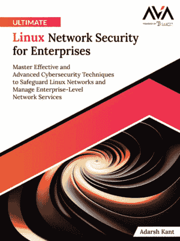


[www.orangeava.com](http://www.orangeava.com)

# 献给
*我亲爱的父亲：*
*Amar Kant*
*我的力量与支持系统*

# 关于作者
`Adarsh Kant` 是一位卓越的网络安全专家和企业家，拥有纳格浦尔大学学士学位。凭借对知识和创新的执着热情，Adarsh 在网络安全、数字取证和创业领域获得了 70 多项认证，巩固了他在这些领域的专业知识。

在他辉煌的职业生涯中，Adarsh 向全球（包括印度、英国、新加坡、日本和阿联酋）的 14,000 多名学生和专业人士分享了他的知识。他在为印度储备银行、军工厂、中央储备警察部队和 `IIT Kanpur` 等知名机构提供培训课程方面发挥了关键作用。值得注意的是，Adarsh 荣获由技能发展与创业部颁发的著名青年偶像奖，该奖由受尊敬的 `Nitin Gadkari Ji` 授予。

Adarsh 的贡献不仅限于培训和教育；他还与许多银行和跨国公司合作，强化其 Web 应用程序并进行全面的安全审计。他在领域的实战经验使其网络安全领域的卓越工作赢得了广泛赞誉和认可。

作为一名热衷的企业家，Adarsh 是其创新初创公司 `Cyber3ra` 的推动者，该公司专注于网络安全解决方案。他的创业精神不仅推动了自己的事业成功，也激励了创业生态系统中的其他人。Adarsh 曾担任各类创业活动的评审，包括由德里政府组织的 `Maharashtra Startup Yatra`、`Business Blasters 1.0` 和 `2.0` 以及由 `IIT Kanpur` 举办的 `Startup Sprint`。通过他的指导和引导，Adarsh 持续培养和促进印度新兴创业者的成长。

凭借对卓越的追求以及对网络安全和创业未来的远见，Adarsh Kant 一直处于该行业创新和领导的前沿。

# 技术评审伙伴
`Thinknyx^® Technologies` 是一支专业团队，在 IT 技术领域拥有多年经验，涵盖从软件开发到 IT 基础设施管理、云、自动化、容器管理、Web 和 APP 开发、安全以及专业服务。作为一个声誉良好的品牌，`Thinknyx^® Technologies` 提供 IT 咨询服务，提供全面的信息和软技能培训。此外，他们还为全球不同的组织提供人才招聘和招聘解决方案。


`Mr. Yogesh Raheja` 是 `Thinknyx^® Technologies` 的创始人兼首席执行官，`DevOps`、`SRE`、云和容器化认证专家，拥有二十年的 IT 经验。

他在公有云/私有云、容器、自动化工具、持续集成/部署/交付工具、监控和日志工具等技术方面拥有专长。Raheja 先生热于通过各种论坛、会议、网络研讨会、博客和 LinkedIn 向全球观众分享他的技术。此外，他还编写了多本书，包括*Effective DevOps with AWS, Automation with Puppet 5* 和 *Automation with Ansible*，并在平台上发布了他的在线课程。此外，他还为 `Packt` 评审了本书，包括 *Implementing Splunk 7, Third Edition* 和 *Splunk Operational Intelligence Cookbook, Third Edition* 等。

# 关于技术评审


`Surendranath P` 是一位经验丰富的嵌入式系统开发者，在网络和汽车软件开发方面拥有 7 多年的经验。他曾工作过 `Cisco` 交换机、路由器和防火墙，以及 `IVI System` 软件开发和基于 `Yocto` 的平台软件集成。在 `Vector India, Hyderabad` 受过培训，Surndra 在 `C & DS` 和 `Linux` 方面的技能值得赞赞。此外，他还出于兴趣担任过自由内容撰稿人和活动主持人。

# 致谢
开启《企业终极 Linux 网络安全》的写作之旅是一次美妙的经历，我对那些在本书成书中发挥了关键作用的个人深表感谢。如果没有许多人慷慨分享的坚定支持、指导和专业知识，这项努力是不可能的。

首先，我对 `Linux` 社区和 `Laravel` 的创建者 `Taylor Otwell` 表示由衷心的感谢，他对框架的奉献塑造了本书。`Laravel` 文档是 `[www.laravel.com/docs](http://www.laravel.com/docs)` 上宝贵的资源，它是指路灯，丰富了内容并确保了准确性。特别向技术评审人员表示感谢，他们细密的评审和富有见地的反馈提升了本书。他们的投入和专业知识在精炼内容和确保准确性方面是无价的。

我的家人，感谢你们坚定的支持。特别是，我想向我的母亲 `Barkha Jain` 表达深的谢意，她的鼓励和理解在整个写作过程中一直是我力量的源。特别感谢我的兄弟 `Samyak Jain` 在这一过程中给予的坚定支持。

向出版社所有以各种方式做出贡献的人们，你们的共同努力丰富了这项工作。我感谢推动《企业终极 Linux 网络安全》创作的协作精神。

最后，读者们，感谢你们选择这本书作为知识的来源。希望它能成为你们掌握 `Laravel` 并应对动态 Web 开发世界之旅的宝贵伴侣。

# 前言


欢迎阅读*企业级终极 Linux 网络安全*——这是一本专为网络安全领域拥有 3-5 年经验的中级专业人士设计的全方位指南。在当今瞬息万变的数字格局中，网络安全威胁日益复杂，因此为自己配备先进的知识和技术是至关重要的。

本书将作为你精通 Linux 网络安全的路线图，深入探讨基础原理、高级技术和行业最佳实践。每一章都经过精心设计，旨在提供理论见解与实践应用的结合，确保你不仅能够理解这些概念，还能培养出有效应对现实世界挑战的必要技能。

# 第 1 章：探索 Linux 网络安全基础
在这一基础章节中，读者将全面理解 Linux 网络安全的核心原理。涵盖主题包括网络架构、常见漏洞、威胁态分析以及实施稳健安全措施的重要性。

# 第 2 章：构建安全的实验室环境
本章侧重于实操方面，指导读者设置和配置安全的实验室环境。通过强调实践学习，涵盖了虚拟化技术、网络分段以及将实验室环境与生产网络隔离的最佳实践。

# 第 3 章：Linux 中的访问控制机制
读者将深入研究 Linux 中访问控制机制的复杂性，包括权限、用户和组管理以及文件系统安全。本还探讨了高级访问控制技术，如强制访问控制 (MAC) 和基于角色的访问控制 (RBAC)。

# 第 4 章：实施防火墙与包过滤
本章深入探讨 Linux 中防火墙和包过滤技术的实现。读者将学习如何配置防火墙规则，利用 `iptables` 和 `nftables` 等包过滤工具，并设计防火墙策略以防御各种网络威胁。

# 第 5 章：精通网络安全密码学
本章涵盖了 Linux 密码学的基础，探索了加密协议、算法和密钥管理技术。读者将获得关于传输和静态数据加密、保护通信通道以及实施安全加密实践的见解。

# 第 6 章：入侵检测系统与入侵防御系统
读者将学习 Linux 中的入侵检测和防御系统 (IDS/IPS)，包括基于网络和基于主机的解决方案。涵盖主题包括检测方法、基于签名和基于异常的检测，以及 IDS/IPS 在企业网络中的部署。

# 第 7 章：使用 Linux 进行漏洞评估
本章为读者提供了在 Linux 环境中进行全面漏洞评估的知识和工具。主题包括漏洞扫描、渗透测试、风险评估方法论以及修复工作的优先顺序排序。

# 第 8 章：制定有效的灾难恢复策略
读者将探索在 Linux 环境中设计和实施稳健灾难恢复计划的策略。涵盖主题包括备份与恢复程序、高可用解决方案、灾难恢复测试以及应急协调。

# 第 9 章：稳健的安全事件响应计划
本章侧重于开发为 Linux 环境定制的有效安全事件响应计划。读者将学习事件检测与分类、事件响应框架、通信协议以及事后分析与改进。

# 第 10 章：Linux 网络安全专业人士最佳实践
作为本书的结语，本章总结了 Linux 网络安全领域中级专业人士的关键见解和最佳实践。它涵盖了持续学习策略、职业发展机会以及行业趋势，帮助你在动态的网络安全领域中保持领先。

贯穿本书，你将发现实用的示例、案例研究和实践练习，旨在强化你的学习并弥合理论与实践之间的差距。无论你是寻求提升职业生涯，还是增强在 Linux 网络安全方面的专业知识，本书都是你通往成功之路上的信赖伴侣。

当你开启*企业级终极 Linux 网络安全*的旅程时，我们鼓励你带着好奇和热情拥抱每一章。希望这本书能成为你在守护受托数字领域时成长和精通的催化剂。

学习愉快，愿你在 Linux 网络安全领域的努力有所收获且充实！

# 彩色图片

请点击链接或扫描二维码下载书籍的*图片*：

你可以在我们的官方 Github 仓库中找到书籍的代码包。访问以下链接或扫描二维码以进一步探索：

**[`github.com/orgs/ava-orange-education/repositories`](https://github.com/orgs/ava-orange-education/repositories)**


请点击链接下载书籍的彩色图片：

***[`rebrand.ly/asomgah`](https://rebrand.ly/asomgah)***


如果代码有更新，将在现有的 GitHub 仓库中更新。

# 勘误

我们对 **Orange Education Pvt Ltd** 的工作感到非常自豪，并遵循最佳实践以确保内容的准确性，为我们的订阅者提供愉悦的阅读体验。读者是我们的镜子，我们利用他们的反馈来反映并改进出版过程中可能出现的人为错误（如有）。为了方便我们维护质量并帮助我们联系可能因任何不可见错误而遇到困难的读者，请通过邮箱与我们联系：

**errata@orangeava.com**

非常感谢您的支持、建议和反馈。

# 你知道吗

你知道 Orange Education Pvt Ltd 为出版的每本书都提供电子书版本，包含 PDF 和 ePub 文件吗？你可以在 **www.orangeava.com** 升级为电子书版本，作为纸书客户，你有权获得电子版的折扣。请联系我们：**info@orangeava.com** 了解更多详情。

在 **www.orangeava.com**，你还可以阅读免费的技术文章集，订阅一系列免费新闻邮件，并获取 AVA™ 书籍和电子书的独家折扣和优惠。

# 盗版

如果你在互联网上发现任何形式的我们作品的非法副本，告知我们地址或网站名称，我们将不胜感激。请通过 **info@orangeava.com** 联系我们并提供材料的链接。

# 你有兴趣与我们合作创作吗？


如果您在某个领域拥有专业知识，并且对撰写或贡献书籍感兴趣，请发送邮件至 `business@orangeava.com` 与我们联系。我们正致力于帮助开发者和技术专业人员洞察全球范围内正在发生的科技进步和创新，并建立一个相信“知识通过与他人分享和学习获得最好”的社区。请联系我们，以了解我们读众的需求，以及您如何参与这场教育变革。我们也欢迎技术专家的建议，并帮助他们为自己的领域构建学习和开发内容。

# 评论

请留下您的评价。在阅读并使用此书后，为什么不在您购买书籍的网站上留下评论呢？潜在读者可以查看并参考您的中立意见来做出购买决策。Orange Education 团队非常想知道您对我们产品的看法，我们的作者也可以从您的反馈中学习。感谢您！

有关 Orange Education 的更多信息，请访问 `www.orangeava.com`。

# 第一章

## 探索 Linux 网络安全基础

## 引言

学习 Linux 基础将让你接触到一种稳定且适应性强的操作系统，它支撑着互联网很大一部分。Linux 以其可靠性、安全性和开源而闻名，是包括嵌入系统和服务器在内的广泛应用的基础。在本次介绍之旅中，我们将探索支撑 Linux 的基本理念，剖析其文件系统设计、命令行界面和必要工具。我们还将解构支撑计算机网络的基本理念。我们将揭示允许设备高效交互的关键组件，从理解 OSI 模型的层级到深入研究协议和寻的细微差别。此外，我们将检查网络管理和安全的关键方面，阐明保护数据机密性和完整性所实施的步骤。在探索交换机、路由器和防火墙的世界时，你将学习决定现代网络韧性的物理组件。

### 结构

在本章中，我们将讨论以下主题：

*   理解和探索 Linux 环境
*   学习计算机网络基础概念
*   理解 CIA 原则
*   防火墙如何帮助网络安全
*   理解 Web 安全

## Linux 简介

### CLI

命令行界面（Command Line Interface），简称 `CLI`，是一种基于文本的界面，允许用户在终端或命令提示符中输入命令以与计算机或程序通信。一个提供 `CLI` 访问的程序被称为 `Terminal`。通常，命令提示符会显示关于当前目录和用户的信息。

操作系统是在启动过程中加载到计算机中并控制所有应用程序的软件。

开源、社区驱动的 Linux 是一种操作系统。该操作系统的基石是 `kernel`（内核），它与其他程序和工具结合。

### 基础 Linux 命令

#### 文件命令：用于执行基础文件操作

| 命令 | 描述 |
| :--- | :--- |
| `ls` | 列出文件和目录 |
| `ls -lt` | 按修改时间对格式化列表进行排序 |
| `cd <dir>` | 切换目录到 `<dir>` |
| `cd ..` | 回到父目录 |
| `pwd` | 打印工作目录 |
| `mkdir <dir>` | 创建目录 `<dir>` |
| `cat ><filename>` | 将标准输入写入文件 |
| `more <filename>` | 输出文件内容 |
| `touch <filename>` | 创建空文件或更新时间戳 |
| `rm <filename>` | 删除文件 |
| `rm -r <dir>` | 递归删除（用于目录） |
| `cp <filename1> <filename2>` | 将文件 1 的内容复制到文件 2 |
| `cp -r <dir1> <dir2>` | 递归将 dir1 复制到 dir2；如果不存在则创建 dir2 |
| `ln -s <filename> <link>` | 创建符号链接或软链接 |

#### 进程管理：用于管理进程 |

| 命令 | 描述 |
| :--- | :--- |
| `ps` | 显示当前运行的进程 |
| `top` | 显示所有运行进程 |
| `kill <pid>` | 杀死指定 pid 的进程 |
| `killall <proc>` | 杀死所有名为 proc 的进程 |

#### 文件权限：用于设置权限 |

| 命令 | 描述 |
| :--- | :--- |
| `chmod octal file` | 将文件权限改为八进制，可以通过添加以下数字单独查找用户、组、世界：<br> 4-读(r)<br> 2-写(w)<br> 1-执行(x) |

#### 搜索：用于搜索特定内容 |

| 命令 | 描述 |
| :--- | :--- |
| `grep pattern file` | 在文件中搜索模式 |
| `grep -r pattern dir` | 在目录中递归搜索模式 |
| `command | grep pattern` | 在命令的输出中搜索模式 |
| `locate file` | 查找所有文件实例 |
| `find . -name filename` | 在当前目录（用点表示）和所有子目录下搜索名称与 filename 完全匹配的文件和目录。 |
| `pgrep pattern` | 搜索所有匹配模式的命名进程，默认返回其 ID |

#### 系统信息：用于获取系统信息 |

| 命令 | 描述 |
| :--- | :--- |
| `Date` | 显示当前日期和时间 |
| `cal` | 显示本月日历 |
| `uptime` | 显示当前运行时间 |
| `w` | 显示谁在线 |
| `whoami` | 显示你的用户身份 |
| `uname -a` | 显示内核信息 |
| `cat /proc/cpuinfo` | 显示 CPU 信息 |
| `cat /proc/meminfo` | 显示内存信息 |
| `man command` | 显示命令的手手册 |
| `df -h` | 显示磁盘使用情况 |
| `du -h <filename>` | 如果给出文件名，则显示该文件的磁盘占用；如果给出目录名，则显示目录的磁盘占用 |
| `free` | 显示内存和交换分区使用 |
| `whereis app` | 显示 app 可能的位置 |
| `which app` | 显示默认运行哪些应用程序 |

#### 网络命令：用于获取网络信息 |

| 命令 | 描述 |
| :--- | :--- |
| `ping host` | 探测主机并输出结果 |
| `whois domain` | 获取域名的 WHOIS 信息 |
| `dig domain` | 获取域名的 DNS 信息 |
| `dig -x host` | 反向查询主机 |
| `wget file` | 下载文件 |
| `wget -c file` | 继续已停止的下载 |


*   设备文件的两个实例是 `/dev/usbmon0`（用于跟踪 USB 设备）和 `/dev/tty1`（代表第一个串口控制台）。

### 4. `/etc`
* 需要主机特定系统级配置文件的程序和服务可以在 `/etc` 目录中找到。
* 此外，它还包含了用于启动和停止某些应用程序服务的 shell 脚本。
* 该目录包含配置文件，例如 `/etc/logrotate.conf`（调节日志文件轮转）和 `/etc/resolv.conf`（管理 DNS 设置）。

### 5. `/home`
* 系统上所有用户的家目录都包含在 `/home` 目录下。
* 每个用户都有一个唯一的家目录，在其中存储他们的私人文件、偏好和设置。

### 6. `/lib`
* `/bin` 和 `/sbin` 文件夹中的二进制文件依赖于 `/lib` 目录中的重要库。
* 执行文件正确运行所需的功能由这些库提供。

### 7. `/media`
* `/media` 目录作为 CD-ROM 等可移动介质设备的临时挂载点。
* 它为挂载和卸载可移动存储设备提供了一个标准位置。

## 文本编辑器
*   **Vim**: 它是一个高度可配置的文本编辑器，非常高效且功能强大。它以两种模式运行：用于导航和编辑文本的普通模式，以及用于插入文本的插入模式。
*   **Emacs**: 它以内置的脚本语言（Emacs Lisp）而闻名，允许用户大量地自定义和扩展其功能。它的学习曲线很陡，但一旦掌握就会非常强大。
*   **Nano**: 这是一个简单易用的文本编辑器，专为那些可能不习惯 Vim 或 Emacs 陡峭学习曲线的用户设计。它提供了基本的文本编辑能力，是快速编辑的好选择。
*   **Sublime Text**: 一款知名的内置文本编辑器，具有许多功能和时尚界面。它拥有繁荣的插件生态系统并支持许多编程语言。尽管开源，但 Sublime Text 提供免费试用版。
*   **Atom**: 这是由 GitHub 创建的开源文本编辑器。Atom 以其用户友好性和丰富的社区贡献自定义包而闻名。它具有高度的可扩展性，并使用 Web 技术构建。

# 计算机网络简介
由通信链路连接的一组设备称为网络。计算机、打印机、路由器以及数据传输和接收设备都是节点。任何可以传输数据信号的介质（如电缆或光纤）都可以被视为链路。

## OSI 模型
开放系统互连接（OSI）是一个描述计算机之间传输数据所需程序的参考模型。它帮助我们理解数据如何从一端传输到另一端。它是一个分层模型，将通信分为更小、易于管理的组件，加速了开发并使各种硬件和软件的协作成为可能。

| 123 | 应用层 | 表示层 | 会话层 | 用户支持层（提供不相关软件间的互操作性） |
| 4 | 传输层 | 确保**端到端**可靠数据传输 |
| 567 | 网络层 | 数据链路层 | 物理层 | 用户支持层（提供不相关软件间的互操作性） |

**表 1.3:** OSI 层的功能

### 1. 物理层
该层负责将单个位（bit）从一个节点传输到下一个节点。
* OSI 模型的底层
* 通信单位是比特（Bit）
* 将位转换为用于发送消息的电子信号
* 将电子信号转换为用于接收消息的位
* 管理计算机与网络介质之间的接口

**职责：**
* 比特的同步和数据传输率
* 线路配置
* 物理拓扑
* 传输模式

### 2. 数据链路层
数据链路层负责将帧（frame）从一个节点传输到下一个节点。
* 通信单位是帧（Frame）
* 将来自物理层的原始数据封装成数据帧，交付到接收端的网络层
* 在发送端，DLL 将数据转换为物理层可以处理的原始格式

**职责：**
* 物理地址址
* 序列编号
* 错误控制
* 流量控制
* 访问控制

### 3. 网络层
网络层负责将单个数据包从源传递到最终目的地（端到端交付）。
* 通信单位是数据包（Packet）
* 负责数据包从源到目的地的交付
* 提供在网络之间移动数据包的机制
* 如果两个系统连接到同一条链路上，通常不需要网络层。然而，如果两个系统连接到不同的网络（链路），且网络之间有连接设备，则通常需要网络层来完成源到目的地的交付
* 同时处理数据包交换

**职责：**
* 网络地址（逻辑地址）
* 路由选择

### 4. 传输层
传输层负责将消息从一个进程交付到另一个进程（源到目的地的交付）。
* 通信单位是分段（Segment）
* 提供可靠的数据交付
* 接收来自上层的信息并将其分割为数据包

**职责：**
* 进程间通信
* 分段与重组
* 连接控制

### 5. 会话层
会话层负责对话控制和同步。
**职责：**
* 同步设备之间的数据交换
* 管理令牌（tokens）以控制对通信信道的的访问

### 6. 表示层
表示层负责处理两个系统之间交换信息的语法和语义。
**职责：**
* 数据翻译
* 语法检查
* 加密和解密
* 数据格式化
* 图形处理

### 7. 应用层
应用层负责为用户提供服务。
**职责：**
* 文件传输和管理访问
* 电子邮件服务
* 网页浏览
* 数据库访问

| 层 | 功能 |
| :--- | :--- |
| 应用层 | 访问网络资源 |
| 表示层 | 翻译、加密和压缩数据 |
| 会话层 | 建立、管理和终止会话 |
| 传输层 | 提供可靠的进程间交付和错误恢复 |
| 网络层 | 将数据包从源移动到目的地提供互联 |
| 数据链路层 | 将位组织成帧并提供跳跳交付 |
| 物理层 | 在介质上传输位提供机械和电气规范 |

**表 1.4:** OSI 模型

# IP 地址
## IPv4 地址
IPv4 地址是一个 32 位地址，唯一且通用地定义设备（例如计算机或路由器）与互联网的连接。

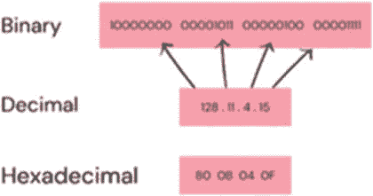

**图 1.1:** IP 地址

有两种地址类型：类域划分和无域划分。

## 类域
在类域划分中，地址空间被分为五类：A、B、C、D 和 E。

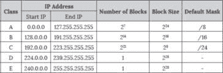

**表 1.5:** 类域

在类域划分中，大量的 IP 地址被浪费了。

## 无域划分


在无类地址划分中，块中的地址数量可以通过公式 `2^(32−n)` 找到，其中 `n` 是掩码值。

*   块中的第一个地址可以通过将最右侧的 `(32 – n)` 位设置为 0 来找到。
*   块中的最后一个地址可以通过将最右侧的`(32 – n)` 位设置为 1 来找到。

## IPv6 地址

尽管有了所有短期解决方案，但地址枯竭仍然是互联网的一个长期问题。这以及 IP 协议本身的其他问题一直是开发 IPv6 的动力。

IPv6 地址长度为 128 位。

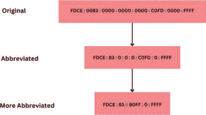

**图 1.2：** *IPv6 地址缩写*

## 特殊地址

有很多类用于某些特定任务的特殊地址。

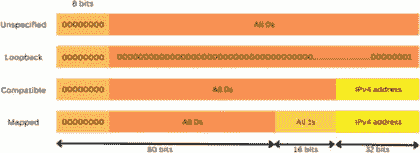

**图 1.3：** *特殊地址*

*   虽然该块的某些被用于定义某些特殊地址，但以前缀 `(0000::/8)` 开头的地址是保留的。
*   当主机在启动过程中想要发送查询以查找自己的地址时，可以使用`unspecified address（未指定地址）子块，这是一个包含单个地址的子块。
*   回环地址也只有一个地址。之前讨论过 IPv4 的`Loopback addresses（回环地址）。在 IPv6 中，一个块由单个地址组成，而不是 IPv4 中的地址范围。
*   主机在从 IPv4 切换到 IPv6 时，可以使用嵌入在其 IPv6 地址中的 IPv4 地址。

专门为这种用例创建了两种格式：兼容格式和映射格式。

*   **兼容（Compatible）：** 一个由 96 位零后的 32 位 IPv4 地址组成的地址被认为是兼容的。当一台具有 IPv6 能力的计算机想要与具有 IPv6 能力的计算机通信，但消息必须通过仍然仅支持 IPv4 的网络部分时，就会它。
*   **映射（Mapped）：** 当已过渡到版本 6 的计算机想要向仍在运行版本 4 的计算机发送地址时，它使用映射地址。

|  | **IPv4** | **IPv6** |
| :--- | :--- | :--- |
| 地址长度 | 32 位 | 128 位 |
| 地址表示 | 十进制 | 十六进制 |
| 多组播地址 | 224.0.0.0/4 | FF00::/8 |
| 广播地址 | 存在 | 不适用 |
| 未指定地址 | 0.0.0.0 | :: |
| 回环地址 | 127.0.0.1 | ::1 |

**表 1.6：** *IPv4 和 IPv6 比较*

# 子网划分

子网划分是在网络内部创建子网络（也称为子网）的过程。子网内的网络接口和设备可以直接相互通信。路由器促进不同子网之间的通信。

块中的每个地址都可以被视为两级层次结构：最左侧的 `n` 位（前缀）定义网络，而最右侧的 `(32 – n)` 位定义主机。

### 类分类

假设我们有一个 IP 地址为 `200.1.2.0` 的网络。该地址属于 C 类，因此掩码值为 `/24`，这意味着前 24 位保留用于网络地址。

现在，要将其分为两部分，我们需要 1 位 `(0/1)`。

```
200.1.2.0
```

我们将最后一个十进制值表示为二进制值（我们只扩展最后一个十进制值，因为掩码值为 24，所以我们只需要 8 位来划分网络。如果我们需要超过 8 位，我们将必须扩展倒数第二个十进制值，以此类推）。

```
200.1.2.00000000
```

*   第 1 个子网：`200.1.2.00000000` -> `200.1.2.0`
*   第 2 个子网：`200.1.2.10000000` -> `200.1.2.128`

| **子网** | **第一个地址** | **最后一个地址** |
| :--- | :--- | :--- |
| 子网 1 | 200.1.2.0 | 200.1.2.127 |
| 子网 2 | 200.1.2.128 | 200.1.2.255 |

**表 1.7：** *示例*

现在，要将其分为四部分，我们需要 2 位 `(00/01/10/11)`。

```
200.1.2.0
200.1.2.00000000
```

*   第 1 个子网：`200.1.2.00000000` -> `200.1.2.0`
*   第 2 个子网：`200.1.2.01000000` -> `200.1.2.64`
*   第 3 个子网：`200.1.2.10000000` -> `200.1.2.128`
*   第 4 个子网：`200.1.2.1100000` -> `200.1.2.192`

| **子网** | **第一个地址** | **最后一个地址** |
| :--- | :--- | :--- |
| 子网 1 | 200.1.2.0 | 200.1.2.63 |
| 子网 2 | 200.1.2.64 | 200.1.2.127 |
| 子网 3 | 200.1.2.128 | 200.1.2.191 |
| 子网 4 | 200.1.2.192 | 200.1.2.255 |

*(注：我根据文中提供的二进制逻辑修正了表格值（4 部分划分）。)*

**表 1.7：** *示例*


## 2. 文件传输协议 (FTP)
文件传输协议，简称 `FTP`，允许在基于 TCP 的网络（如互联网）上从一端传输文件到另一端。与 `FTPS` 或 `SFTP` 类似，`FTP` 可以在加密或不加密的情况下使用。尽管如此，结合外部加密使用 `FTP` 会更安全。

## 3. 电子邮件消息：
它可以使用简单邮件传输协议 (`SMTP`) 在服务器之间进行发送。

## 4. 邮局协议版本 3 (POP3)
这是一种基于电子邮件的协议，用于从服务器检索电子邮件到客户端设备，通常会下载并将其从服务器中删除。

## 5. 互联网消息访问协议 (IMAP)
该协议与 `POP3` 类似，允许电子邮件客户端访问邮件服务器上的消息，而无需下载它们。它允许用户在服务器上组织和操作他们的电子邮件。

## 6. 域名系统 (DNS)
这是一个将人类可读的域名翻译为 IP 地址的系统，以便客户端获取请求的网页。`DNS` 使用分布式服务器系统来管理从域名到 IP 地址的转换。对于 `DNS` 查找过程来说，将类似 `www.example.com` 的域名转换为类似 `192.168.1.1` 的 IP 地址非常重要。

## 7. 简单网络管理协议 (SNMP)
该协议用于管理和监控路由器、交换机、服务器等许多网络设备及其功能。`SNMP` 陷阱是代理程序向管理器发送的异步通知，用于提醒他们特定的事件，例如系统重启、链路状态变化或其他重大情况。

## 8. Telnet
一种提供与远程计算机通信的文本界面的协议。它是不安全的，并且在很大程度上已被安全外壳 (`SSH`) 取代。

## 9. 安全外壳 (SSH)
它提供了一种访问远程计算机的安全方法，允许加密通信和安全的远程管理。

## 10. 动态主机配置协议 (DHCP)
它动态地为网络上的设备分配 IP 地址和其他网络配置信息。

## 11. 网络时间协议 (NTP)
它用于同步网络上计算机和网络设备的时钟。它的设计旨在确保分布式系统中准确且一致的时间记录，允许设备与参考时间源保持同步时间。

# 网络安全

### CIA
CIA 指的是信息安全的核心原则：机密性、完整性和可用性。这些原则构成了设计和实现安全系统及实践的基础。


**图 1.6:** 信息安全基础

*   **机密性**：确保数据仅对授权的人员可见且可访问。
*   **完整性**：确保存在的数据是正确且准确的。这意味着它没有被任何未经授权的人员篡改。
*   **可用性**：确保需要数据并愿意访问数据的人可以访问数据。

### IdAM
身份和访问管理是一项策略和技术框架，用于确保正确的个人对技术资源具有适当的访问权限。

*   **识别 (Identification)**：涉及识别系统内的个人。
*   **身份验证 (Authentication)**：涉及验证用户的身份。最广泛使用的三个因素是用户所知道的、用户拥有的以及用户具备的特征。
*   **授权 (Authorization)**：涉及用户可以拥有的访问级别。

# 防火墙配置
防火墙是一种网络安全设备或软件，它根据预定义的安全规则监控并控制进入和流出的网络流量。防火墙的主要目的是在安全的内部网络和不可信的外部网络（如互联网）之间建立屏障。

防火墙可以以硬件和软件的形式实现：

硬件防火墙实现在路由器层级并保护整个网络，而软件防火墙保护单台计算机，且通常成本较低。

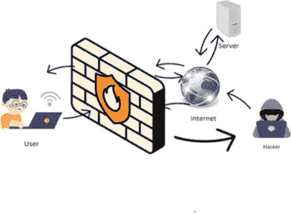

**图 1.7:** 防火墙实现

然而，防火墙并不执行以下操作：

*   免你受可能伤害你的内部人员的侵害。
*   免你受完全新威胁的侵害。
*   对互联网进行访问，尽管这是防火墙可以控制的功能之一。
*   确定哪些程序可以访问互联网。
*   防止弹出广告。
*   防止 `SMTP` 会话劫持。
*   免你受操作系统中漏洞的影响。
*   防止未经授权的用户使用计算机。
*   免你受源路由（Source routing）的影响。

### 防火墙实现的安全技术
*   **深度防御 (Defense in Depth)**：一种安全方法，确保网络上的每个系统都尽可能安全。
*   **默认拒绝 (Default Deny)**：禁止所有未被明确允许的通信。
*   **默认允许 (Default Permit)**：允许所有未被明确禁止的通信。
*   **最小权限 (Least Privilege)**：降低各种操作时的授权级别。
*   **瓶颈点 (Choke Point)**：迫使攻击者通过小的通道规避网络。

### 防火墙测试方法
*   **Ping**：要检查防火墙是否允许互联网控制消息协议 (`ICMP`) 流量，使用 `ping` 命令 `ping <IP>`。这可以支持基本的连通性验证。
*   **端口扫描**：要发现系统上开启了哪些端口，使用端口扫描器（如 `Nmap`）。这有助于定位任何未使用的开放端口。
*   **测试防火墙规则**：要测试防火墙的行为，创建特定的规则。例如，通过尝试阻止或允许特定的端口或 IP 地址，查看防火墙的行为是否符合预期。
*   **渗透测试 (Penetration Testing)**：发现网络漏洞并评估防火墙阻止未经授权访问的效果，进行伦理黑客攻击。

# 欺骗
欺骗背后的想法是为恶意用户创建攻击面的虚假感知。欺骗具有以下几个优点：

*   高性效益
*   支持策略分析
*   易于部署和使用

# 蜜罐方法
蜜罐是精心制作的信息、服务、数据或任何对恶意人员具有吸引力的资源。它用于诱骗黑客进入欺骗系统。

蜜罐是一种旨在检测、偏离或研究未经授权使用信息尝试的安全机制。蜜罐方法涉及部署具有模拟真实系统漏洞的系统或网络，引导攻击者与其交互。蜜罐的主要目的是收集有关攻击者使用的战术、技术和程序 (TTP) 的信息，并将他们从生产系统中分散开。

**蜜罐类型：**

*   **研究蜜罐 (Research Honeypots)**：用于研究和理解攻击者的策略。这些蜜罐通常部署在公共网络中。
*   **生产蜜罐 (Production Honeypots)**：设计用于模拟真实系统，但在生产环境中使用以检测并将攻击引离关键基础设施。
*   **高交互蜜罐 (High-Interaction Honeypots)**：功能完整的系统，模拟真实的服务和操作系统，允许与攻击者进行深度交互。
*   **低交互蜜罐 (Low-Interaction Honeypots)**：仅模拟攻击者经常攻击的服务和服务协议。它们的功能有限，以降低被入侵的风险。


*   蜜罐可以部署在各种网络层级，包括边界、内部网络，甚至是特定的应用程序内部。
*   根据部署的需求和目标，它们可以是物理系统也可以是虚拟系统。

### 目标
*   **检测**：蜜罐设计用于检测和记录未经授权的访问或活动。与蜜罐的任何交互都可能是恶意的，因为在正常情况下不应被访问。
*   **分析**：蜜罐为分析攻击者所使用的工具、战术和程序提供了宝贵的数据。这些信息可以用于改进整体安全措施。
*   **分散攻击者注意力**：通过将攻击者吸引到蜜罐，组织可以分散其对实际生产系统的注意力，为响应和缓解威胁赢得时间。

### 挑战
*   **被攻破风险**：部署蜜罐存在蜜罐本身可能被攻破的风险。这需要仔细的配置和监控以最大限地降低这种风险。
*   **伦理考量**：蜜罐的使用引发了伦理考量，因为它涉及故意创建一个带有漏洞的系统以吸引攻击者。
*   **法律考量**：组织在部署蜜罐时需要考虑法律影响，特别是当它们用于与潜在攻击者交互时。未经授权的访问和数据收集可能会引发法律问题。
*   **安全运营集成**：蜜罐应该集成到组织的整体安全运营和事件响应过程中，以确保任何发现都能得到及时处理。

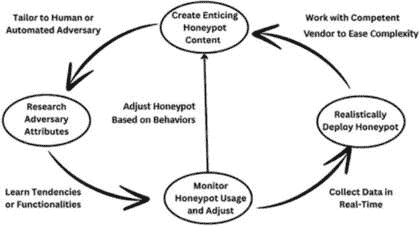

**图 1.8:** *蜜罐生命周期*

# SSH 协议

该协议在客户端-服务器模型中运行，由 SSH 客户端发起 SSH 服务器。连接由 SSH 客户端建立，利用公钥加密来验证 SSH 服务器的合法性。在设置阶段之后，SSH 协议采用强大的对称加密和哈希算法来确保客户端和服务器之间交换数据的机密性和完整性。

数据传输过程中采用了加密技术以防止窃听或拦截，从而确保凭据和命令输出等敏感信息的机密性。SSH 运行在 TCP 上，利用了其可靠性和在需要传输数据时信号的能力。

### SSH 的关键属性
*   **加密**：包括凭据和会话命令在内的所有数据在传输过程中都会加密，即使被拦截也能保持机密性。
*   **身份验证**：SSH 使用多种方法（如密码、公钥加密和高级技术如双因子身份验证）来验证用户。由于安全性更高，公钥身份验证通常更受青。
*   **密钥交换**：在客户端-服务器连接后，会执行密钥交换以建立共享密钥。该密钥随后被用于加密客户端和服务器之间交换的数据。
*   **端口转发**：SSH 促进了安全隧道创建，允许将特定的网络连接从客户端转发到服务器或反之亦然。这对于访问其他因网络限制而受限的服务非常有价值。

# 访问控制列表

访问控制列表（ACL）是一组规则或条件，规定了在网络或系统资源上允许或拒绝的操作。ACL 常用于计算机安全和网络，用以控制对文件、目录、网络资源或服务的访问。

### 组件
*   **主体**：尝试访问资源的实体（用户、组或系统进程）。
*   **对象**：主体尝试访问的资源（文件、目录、网络服务等等）。
*   **权限**：在对象上允许或拒绝的特定操作或活动。这可能包括读取、写入、执行、删除等许多种操作。
*   **条件**：应用规则必须满足的额外标准。例如，网络 ACL 可能包含基于源地址或目的 IP 地址、端口号或协议的条件。例如：
    *   允许用户 `Alice` 读取和写入文件 `example.txt`。
    *   拒绝来自特定 IP 地址范围的所有入站流量。

### 使用 ACL 的优势
*   **简化用户识别**：使用访问控制列表使得用户识别变得更容易。ACL 保证了系统只有授权的用户和流量才能访问。
*   **工作输出**：与其他实现相同目的的技术相比，ACL 提供了性能优势。访问控制列表不会影响路由设备的性能，因为它们直接设置在设备的转发硬件上。相比之下，状态检测防火墙是不同的软件，可能会导致性能下降。此外，当流量受到控制时，网络运行得更高效。
*   **控制**：管理员可以使用 ACL 对网络中各个网络节点上的用户和流量权限进行更精确的控制。它们有助于控制对网络端点的访问以及内部网络之间流流量。

# 虚拟私有网络

VPN 是一种在不安全的网络（如互联网）上建立安全加密连接的技术。VPN 通过在用户设备与目标网络之间创建虚拟加密隧道，为用户提供了安全访问私有网络的方法。VPN 使用加密算法来保护通过互联网传输的数据，例如安全套层（SSL）和传输层安全（TLS）。

### VPN 连接的优势
*   **安全加密**：读取数据需要加密密钥。如果没有暴力攻击，计算机需要数百万年才能解码该代码。有了 VPN，即使在公共网络上，您的在线活动也是隐藏的。
*   **隐藏您的位置**：本质上，VPN 服务器充当您的在线代理。无法确定系统的精确位置，因为人口统计位置数据来自不同的服务器。此外，大多数 VPN 供应商不维护活动日志。另一方面，某些服务提供商会记录您的活动但保持信息私密。这意味着任何关于您当前和过去用户行为的信息都将永远保密。
*   **访问区域内容**：并不是每个网站都能从任何地方访问区域内容。网站和服务的的内容通常限制在特定地理位置的用户。标准连接使用全国各地的服务器来确定您的精确位置。这表明在旅行或从海外时无法访问国内内容。通过启用 VPN，您可以通过连接到另一个国家的服务器来“更改”您的位置。
*   **安全数据传输**：如果您远程办公，可能需要访问公司网络上的重要文件。出于安全考虑，此类数据必须通过安全连接发送。通常情况下，访问网络需要 VPN 连接。

# 入侵防御系统 (IPS) 和 入侵检测系统 (IDS)


IDS（入侵检测系统）监控网络或系统活动，以检测恶意行为或违反安全策略的情况。它能够检测并警告管理员潜在的安全事件。当检测到可疑活动时，IDS 会生成警报，警报可能包含有关攻击性质、受影响系统以及潜在影响的信息。

- `基于特征的检测 (Signature-based detection)`：可以使用已检测到的威胁的行为来检测后续的同类威胁。然而，它无法检测完全未知的威胁。
- `基于异常的检测 (Anomaly-based detection)`：它基于检测特定流量流中的异常。然而，它可能会产生误报，并且如果异常范围设置不当，可能会允许恶意内容通过。
- `内存保护 (Memory protection)`：这是一组机制，旨在防止同一系统上的一个进程擦除另一个进程的内存。进程执行监控，结合终止看似恶意进程的能力，构成了进程保护。
- `内置网络设备 (Devices for inline networks)`：通过将网络设备直接放置在网络通信的路径上，这种入侵防御技术使设备能够在攻击数据包通过其接口时对其进行修改和拦截。
- `会话劫持 (Session sniping)`：这种入侵防御技术向连接的两端发送 `TCP RST` 数据包以结束 `TCP` 会话。发送 `TCP RST` 是为了响应检测到的尝试性攻击，从而从缓冲区中清除尝试的利用并防止其发生。
- `网关交互设备 (Gateway interaction devices)`：这种入侵防御策略允许检测设备与路由器或防火墙等网络网关设备进行动态交互。当检测到尝试攻击时，检测设备可以指导路由器或防火墙拦截攻击。

# Web 安全

保护网站免受未经授权的使用、访问、修改、破坏或干扰的行为被称为网站安全。

- `HTTPS`：使用 `HTTPS` 保证连接的安全性和加密性。它结合了 `SSL/TLS` 和 `HTTP` 协议，为用户提供与网站交互的安全性界面。此外，启用了 `HTTPS` 的网站在搜索结果中的排名更高。
- `XSS 防护 (XSS Protection)`：实施防护措施以防止攻击者将恶意脚本插入其他用户正在查看的网站中。安全头部、输出编码和输入验证都可以帮助实现这一目标。
- `CSRF 防护 (CSRF Protection)`：确保只有授权的用户才能发起敏感的网站操作，并使用反 CSRF 令牌来防御跨站请求伪造 (`CSRF`) 攻击。
- `SQL 注入防护 (SQL Injection Prevention)`：清洗并验证用户输入以防止 SQL 注入攻击，攻击者通过用户输入操纵 SQL 查询，以获得对数据库的未经授权访问。

# 事件响应

事件是指一组或多个安全事件或条件，需要采取行动并关闭以维持可接受的风险状况。事件响应是指快速检测事件、最小化损失和破坏、缓解被利用的漏洞以及恢复 IT 服务的能力。

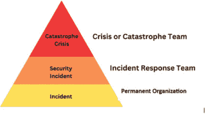

**图 1.9:** *事件响应*

## 事件响应的必要性

事件响应的必要性在于需要迅速高效地对安全泄露做出反应。这对于几个原因非常重要：

- 通过利用处理当前事件获取的知识，更好地准备处理即将发生的事件。
- 为数据和系统提供更好的保护。
- 协助处理事件期间可能出现的任何法律问题。
- 遵守法律法规、政策和指南，这些指南规定了对数据进行同步、有效的保护。

## 事件处理阶段

事件处理过程涉及几个阶段，例如：

- `准备 (Preparation)`：组建并培训事件响应团队，并获取所需的设备和用品。
- `检测与分析 (Detection and Analysis)`：识别安全漏洞并通知组织即将发生的攻击。
- `遏制 (Containment)`：减轻事件影响的一种策略是遏制。
- `消除与恢复 (Elimination and Recovery)`：完成检测和分析循环以结束事件并开始愈合过程。
- `事后活动 (Post-Incident Activity)`：准备一份关于事件原因、成本的详细报告，以及未来针对类似攻击的预防措施。

## 结论

本章提供了 Linux 操作系统、计算机网络和信息安全的基础知识。这些是网络安全领域的基础。掌握这些基础概念使你理解如何与 Linux 工作并获取网络基础知识。此外，获取信息安全的基础知识使你能够应对这些挑战。

在接下来的章节中，我们将探索建立安全实验环境，以便开展练习。

# 第 2 章：创建安全实验环境


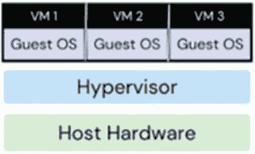

**图 2.1:** *虚拟机管理器 (Hypervisor)*

## 安装 VirtualBox

VirtualBox 是一款免费且开源的虚拟化软件，允许用户在单台计算机上运行多个操作系统。它创建虚拟机（VM），即利用宿主机物理硬件的模拟计算机。这允许用户在测试不同的操作系统、软件应用程序和配置，而不会影响其主操作系统。

欲需更多详情和信息，请访问以下链接：[`www.virtualbox.org/`](https://www.virtualbox.org/) (Oracle VM VirtualBox)。

以下是下载和安装 VirtualBox 的步骤：

1. 下载 Oracle VM VirtualBox，请访问以下链接：[`www.virtualbox.org/wiki/Downloads`](https://www.virtualbox.org/wiki/Downloads)

   

   **图 2.2:** *安装虚拟机*

2. 下载开始，下载完成后，打开文件安装 VirtualBox。

   

   **图 2.3:** *安装向导*

3. 如果你想更改位置，请点击“浏览”。否则，你可以保持默认设置并点击“下一步”。

   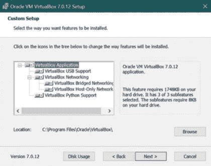

   **图 2.4:** *设置向导*

4. 点击“安装”开始安装。

   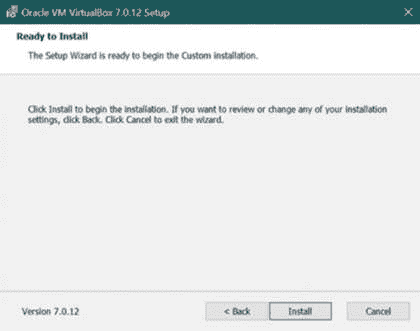

   **图 2.5:** *设置向导*

5. 安装将开始。安装完成后点击“完成”。

### 在 VirtualBox 上安装 Parrot Security VM

### Parrot Security

Parrot Security 是一种基于 Debian 的 Linux 发行版，专门为安全专业人员、道德黑客和渗透测试人员定制。它是一个由 Parrot Project 团队领导的社区驱动项目。该发行版拥有一套全面的安全工具，涵盖了网络分析、漏洞评估、数字取证等许多任务。

* Parrot Security 提供了全面的安全工具合集，包括信息收集、漏洞评估、渗透测试、密码学、逆向工程等。它是网络安全专业人士和爱好者执行各种安全相关任务的平台。
* Parrot Security 优先考虑用户的匿名性和隐私。它集成了 Tor 浏览器等工具，并对 VPN 提供内置支持，使用户在进行安全评估时保护其在线身份。
* 作为一个开源项目，Parrot Security 得益于开发者和用户社区，他们贡献开发工作，并通过论坛和其他渠道提供支持。

以下是下载和安装 Parrot Security 的步骤：

1. 访问链接 [`www.parrotsec.org/download/`](https://www.parrotsec.org/download/) 下载适用于 VirtualBox 的 Parrot Security OS ISO 文件。

   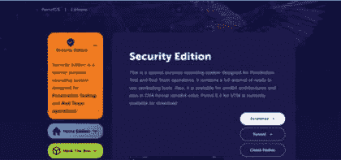

   **图 2.6:** *Parrot Security 落地页*

2. 下载完成后，打开 VirtualBox 并点击 `New` 添加新虚拟机。

3. 输入名称并关联 ISO 镜像文件。

   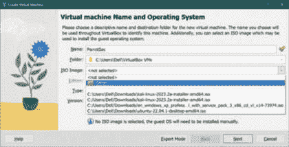

   **图 2.7:** *在虚拟机上设置 Parrot OS*

4. 根据你的需求选择内存和处理器。

5. 现在，运行虚拟机。

   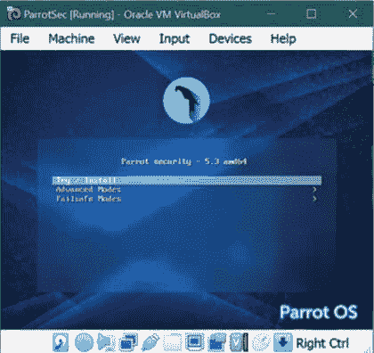

   **图 2.8:** *在虚拟机上安装 Parrot OS*

6. 点击 `Install Parrot` 图标开始安装。

   

   **图 2.9:** *在虚拟机上安装 Parrot OS*

7. 选择合适的选项并输入你的登录用户名和密码，然后点击 `Next` 安装。

   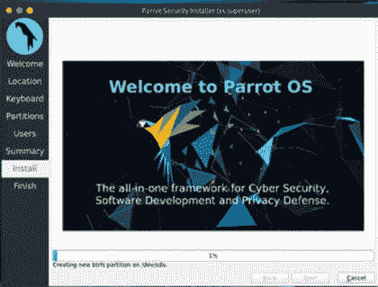

   **图 2.10:** *完成安装*

欲需关于 Parrot OS 的更多详情，请访问以下链接：[`www.parrotsec.org/docs/`](https://www.parrotsec.org/docs/)

## 结论

虚拟机（VM）实验室环境的成功安装为无数计算任务提供了一个安全、灵活且动态的平台。通过选择虚拟化技术，用户可以充分利用硬件的潜力，创建隔离实例，并享受资源效率、可扩展性和可移植性带来的好处。

在接下来的章节中，我们将开始对实际实现进行上手手探索，深入探讨核心概念，例如访问控制机制的仔细维护。此外，我们还将研究防火墙和 IDS/IPS 系统的复杂部署，深入理解其内部原理并积极将这些知识转化为有效的实现。

# 第 3 章

## Linux 中的访问控制机制

## 引言

作为数字环境的守护者，访问控制机制通过管理权限和入口，确保只有经过授权的用户或系统才能与资源进行交互。这些保护措施对于网络安全领域保护私有数据和维护数字环境的完整性至关重要。

访问控制是一种详尽的安全机制，用于管理和限制对资源的访问。这些资源可能包括实际区域、网络、数据库或文件，访问控制确保了拥有权限的人可以使用或更改它们。基于角色的访问控制 (`RBAC`)、强制访问控制 (`MAC`) 和自主访问控制 (`DAC`) 属于此类别的三类基本类别。每种类型都使用不同的技术，根据预定义的标准允许或拒绝访问。

### 结构

在本章中，我们将讨论以下内容：

* Linux 访问控制机制简介
* 探索不同的访问控制类型
* 理解不同的 Linux 环境
* 根据组织需求为不同用户实现权限
* 环境保持安全的最佳实践

## Linux 中的访问控制机制

### 资源与所有权

* **用户**：用户是指与计算机系统交互的人员或系统。它是程序操作、文件创建和修改以及系统请求的起点。每个用户帐户都关联有一个用户 ID。
* **进程**：进程是运行中的程序。在任何时刻，多个进程都在运行。用户创建进程来执行特定的操作或运行应用程序。每个进程都有自己的资源和地址空间。
* **文件**：在计算机上，文件是存储的数据组。它们可以是程序、图片、文本文档等。

   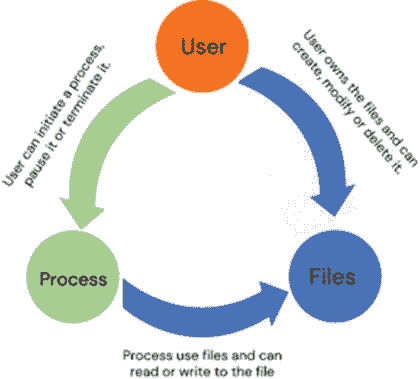

   **图 3.1:** *资源与所有权*

### 沙箱

沙箱的主要目的是提供一个与其他系统隔离的封闭环境。在沙箱中，你可以在安全受控的环境运行不受不受的代码，而不会干扰其他运行程序。这种隔离有助于控制错误或恶意代码带来的任何损害。

被认为是防御零日攻击（即全新的、从未见过的威胁）的有效系统。

沙箱在多种情况下都有用：

* **安全测试**：软件开发和测试经常使用沙箱。在沙箱环境中，开发者可以测试新代码或应用，而不会损害整个系统。
* **网页浏览**：浏览器中的每个标签页或进程都在自己的沙箱环境中运行，因此即使访问了恶意网站，影响也局限于特定标签页的沙箱环境。


-   **虚拟化**：虚拟机和容器可以被视为沙箱的一种形式。它们允许在隔离环境中执行应用程序或进程，从而提供额外的安全层保护。
-   **利用高级网络和支持**：通过使用合适的沙箱环境，你可以探索高级网络功能，并在它们符合你的预期工作环境时对其进行测试。
-   **防止未来的攻击**：如果危险被限制在沙箱环境中，IT 人员或外部网络安全专家可以在隔离环境中对其进行研究。仔细检查威胁有助于发现趋势，从而帮助防止未来发生类似的攻击。

## 访问控制类型

访问控制是一种调节和限制对资源或系统访问的安全措施。它确保只有经过授权的实体（如用户或系统）可以与某些资源交互，同时防止未经授权的实体访问敏感信息或执行特定操作。访问控制是计算机安全的基本方面，通过各种机制和技术实现。以下是某些访问控制类型：

## 任意访问控制

DAC，或称**任意访问控制**，是一种安全访问控制技术，它通过主体或对象所有者建立的策略来管理对象的访问。在身份验证过程中，会使用用户名和密码等凭据来验证用户并在 DAC 内部设置控制。主体（所有者）有权向其他用户提供对已验证对象或信息的访问，这就是 DAC 的任意性部分。换句话说，对象的访问权限是由所有者决定的。

DAC 是一种计算机系统安全概念，赋予管理员或所有者对资源访问的控制权。对象（如文件、目录或网络）的所有者在 DAC 下有权决定是否对其提供访问权限。

任意访问控制的主要特征包括：

-   **所有者控制**：资源所有者有权选择谁可以使用该资源以及他们可以对该资源执行什么操作。所有者可以授予或撤销访问权限。
-   **授权程度**：DAC 通常意味着赋予个人或组不同程度的授权。常见的权限包括读、写、执行和删除。这些权利可以根据所有者的主意进行授予。
-   **访问控制列表 (ACLs)**：ACL 是 DAC 中建立访问限制的流行方法。ACL 是附加在项目上的权限列表，描述了允许执行哪些操作以及哪些用户或系统进程被授权进行访问。
-   **自由度**：由于资源所有者可以选择访问控制，DAC 提供了很大程度的自由度。然而，如果所有者未能仔细监控权限，导致未经授权或不当的访问，这种灵活性也可能成为缺点。
-   **困难性**：DAC 在大型系统中可能难以管理，并可能导致权限过剩。此外，它提供的控制可能不如某些其他类型的访问控制（如强制访问控制 MAC）那样精确。

注意：你将在标准 Linux 下学习更多关于 DAC 的知识。

## 强制访问控制

一种被称为**强制访问控制 (MAC)** 的网络安全系统旨在提供或限制对组织内部机密受保护数据的访问。组织内部员工和人员的层级决定了访问权限的分配方式。用户被限制访问与其许可级别匹配（或低于）的资源，且管理员是唯一拥有访问控制权的人。系统会自动验证用户访问资源的资格以及他们所属的类别。

在使用 MAC 之前，公司必须投入时间和资源充分理解流程。这涉及分析人员、流程和可访问资源，以及建立标签和类别等属性和规则。

强制访问控制的主要特征包括：

-   **集中控制**：MAC 由系统管理员或安全策略进行集中控制。访问决策是基于层级方式的，而不是根据资源所有者的主意。
-   **卓越的数据安全**：由于这是一个强制性系统，公司可以确保重要的私密信息被安全存储且极不可能泄露。由于其严密的设计、测试和强化，MAC 是最安全的访问系统之一。企业可以放宽心，知道只有特定的经过批准的人员才能看到所需的信息，且在没有所需权限的情况下无法更改数据。
-   **隐私性**：由于该系统是集中的，其他人无法简单更改类别或访问级别。只有高级官员才能对其进行编辑，为帮助企业保护数据保证了某种程度的隐私性。

注意：你将在 SELinux 下学习更多关于 MAC 的知识。

## 基于角色的访问控制

系统访问也可以通过名为**基于角色的访问控制 (RBAC)** 的方法进行限制，它有时被称为基于角色的安全。必须设置权利和权限以允许授权用户访问系统。基于角色的访问控制是大型企业常用的流行工具，根据职位和责任为员工提供不同程度的访问。这保护了隐私信息，并确保员工只能访问和执行履行其职责所需的操作。

因此，如果低级员工执行职责时不需要敏感数据，他们通常就无法访问这些数据。这在雇用承包商和第三方以及拥有大量员工时特别有用，因为此时密切监控网络访问面临挑战。

RBAC 的核心组件包括：

-   **用户**：这些是与系统交互的个人。用户被分配到一个或多个角色，其访问权限由与这些角色相关的权限决定。
-   **角色**：这些是权限集，定义了拥有该角的用户可以执行的动作或操作。例如，系统可能有“管理员”、“经理”和“用户”等角色，每个角色具有不同级别的访问权限。
-   **权限**：这些是在系统内执行的单独访问权限或操作。权限被分配给角色，用户通过被分配到特定角色获得这些权限。
-   **角色分配**：这涉及根据工作职责将用户与特定角色关联。用户可以拥有一个或多个角色，每个角色提供特定级别的访问。

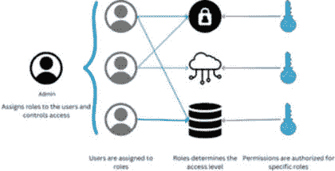

**图 3.2：基于角色的访问控制***

RBAC 提供了若干优势，包括：

-   **简单性**：基于角色管理权限可以简化访问控制管理。
-   **可扩展性**：随着组织增长，通过将新用户分配到适当的角色，比定义个人权限更容易扩展。
-   **安全性**：RBAC 有助于于执行最小权限原则，确保用户拥有执行其工作功能所需的最低访问权限。

## 访问控制命令

以下是一些用于访问控制的命令：

`sudo` (Superuser Do) 允许许可的用户以超级用户或其他指定用户的身份执行命令，如 sudoers 文件所示。


要创建另一个用户账户，请使用命令 `sudo useradd <username>`；要设置密码，请使用命令 `sudo passwd <user>` 并输入密码。


**图 3.3:** `sudo`

如果你想赋予用户管理员权限，可以使用 `[sudo visudo]` 在 sudoers 文件中添加该用户。(OEBPS/images/Fig-3.4.jpg)

**图 3.4:** `/etc/sudoers.tmp`

如果非 root 用户尝试访问特权文件和文件夹，该事件将被记录。

现在，如果你想根据用户的角色授予某些特定文件和文件夹的访问权限，请打开 sudoers 文件并添加以下内容：

`<username> ALL=(ALL:ALL) NOPASSWD: </path of file or directory>`

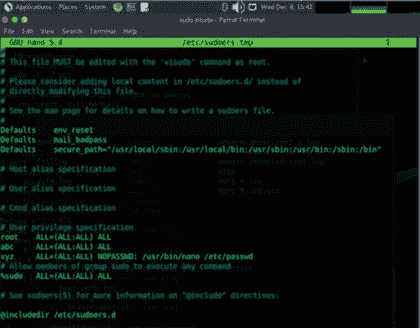

**图 3.5:** `/etc/sudoers.tmp`

使用 `sudo visudo -c` 命令，你可以检查 sudoers 文件中是否存在语法错误。(OEBPS/images/Fig-3.6.jpg)

**图 3.6:** `sudo visudo -c`

现在，如果 xyz 用户尝试访问 passwd 文件，将获得访问权限，但对任何其他特权文件或文件夹的访问将不会通过。(OEBPS/images/Fig-3.7.jpg)

**图 3.7:** `sudo su`

根据访问控制机制，Linux 主要分为两类：

*   标准 Linux：基于 DAC（自主访问控制）
*   安全增强型 Linux (SELinux)：基于 MAC（强制访问/强制访问控制）

## 标准 Linux

通常情况下，“标准 Linux”指的是遵循特定规定和标准的 Linux 操作系统发行版。Linux 是一个开源操作系统内核，类似于 Unix，并且是多个操作系统发行版的基础。Linux 发行版（或简称 distro）是 Linux 操作系统的完整封装版本，包含了桌面环境、包管理系统、库和 Linux 内核。

标准 Linux 构建在名为“自主访问控制”（DAC）的安全范式之上，它允许资源所有者（无论是文件还是系统）控制对该资源的访问。在 DAC 系统中，资源所有者有权决定授予哪些权限以及授予谁访问该资源。

以下是一些被视为标准或频繁使用的流行 Linux 发行版：

*   **Ubuntu**：基于 Debian 的 Ubuntu 以其对用户友好性和强大的社区支持而闻名。它提供桌面版和服务器版。
*   **Debian**：这个稳定且灵活的发行版是许多其他发行版（包括 Ubuntu）的上游基础。
*   **Fedora**：红帽（Red Hat）支持 Fedora，它以使用最新的软件和技术而闻名。它经常被用作红帽企业 Linux (RHEL) 未来可能包含的功能测试场。
*   **CentOS**：采用与 RHEL 相同的架构设计，旨在提供一个开源、免费且持久的方案。
*   **Arch Linux**：得益于这种流行、灵活且直观的操作系统的滚动发布（rolling release）机制，用户可以定期安装更新，而无需等待特定的发布。
*   **openSUSE**：由 SUSE 支持，openSUSE 提供稳定版（Leap）和滚动发布版（Tumbleweed）。它提供了系统管理工具 YaST 设置。
*   **Linux Mint**：这种基于 Ubuntu 的桌面替代方案专注于提供各种对用户友好的桌面环境。

这些发行版使用了广泛接受的 Linux 标准，例如 Linux 标准基础 (LSB) 和文件系统层次结构 (FHS)，这有助于不同发行版之间的兼容性。

为了理解如何在不同用户上实施访问控制，我们首先需要了解不同的用户、用户管理以及可以授予用户的权限。

## 用户

用户（无论是系统用户还是人类）都会与计算机系统通信。它是所有程序操作、文件创建与修改以及系统服务请求的起点。每个用户账户都与一个用户 ID 关联。

**普通用户 (Regular Users)**：

*   使用计算机系统处理日常事务和运行应用程序的典型终端用户被称为普通用户。
*   普通用户拥有的资源通常只有他们自己的文件和最基本的系统功能。
*   在没有管理员或特殊权限的情况下，他们执行常规任务，包括文字处理、上网和使用应用程序。

**特权用户 (Privileged Users)**：

*   也被称为超级用户（super users）。特权用户拥有比普通用户更高级的功能。这些功能可能包括安装软件、执行管理功能以及修改某些系统设置的能力。特权用户可以管理系统配置的方面并执行普通用户无法执行的任务，但他们通常不具备完全的管理员控制权。

**网络用户 (Network Users)**：

*   网络用户专注于管理、配置和故障排除活动。
*   他们经常拥有调整网络配置、控制网络硬件以及解决网络相关问题的权限。
*   网络用户可能负责管理 IP 地址、建立和维护网络连接以及监控网络的整体健康状况。

**管理用户 (Managing Users)**：

*   最高级别的访问权限和问责制属于管理用户，通常被称为系统管理员。
*   系统管理员负责确保整个系统的安全。他们对系统拥有完全的权，包括安装软件、修改用户账户和更改系统设置的能力。他们负责用户账户管理、安全设置、软件升级和常规系统维护等工作。

## 集中化用户管理

集中化用户管理是指从单一的集中位置管理用户账户和权限的实践。这种方法提供了许多优势，特别是对于拥有多个应用程序和服务的大型组织。

根据你的需求，有不同的选项，包括：

*   **轻量级目录访问协议 (LDAP)**：是一种用于访问和维护目录信息服务的开放标准协议。它通常用于网络环境中的集中化认证和授权。
    *   LDAP 设计用于目录服务，目录服务针对读取和搜索进行了优化，而不是频繁的更新。
    *   LDAP 将信息组织在层次化的树结构中，称为目录信息树 (DIT)。树中的每个条目都是实体（如用户或设备）信息的记录。条目通过唯一的区分名 (DN) 进行标识。
    *   它概述了许多用于与目录服务器通信的协议过程。添加新条目、编辑现有条目、删除条目和搜索条目是常用操作。这些操作用于 客户端和服务器交换消息。
    *   它经常用于用户的授权和认证。当用户尝试访问系统或应用程序时，系统可以查询 LDAP 目录以验证用户的凭据并获取其访问权限的详情。


-   主流的 LDAP 实现包括 Microsoft Active Directory（它是一个商业系统，但基于 LDAP）以及 OpenLDAP（它是一个开源程序）。这些实现使得 LDAP 能够处理用户账户关联数据，并提供目录服务。电子邮件系统、业务目录和网络身份验证只是 LDAP 的应用之一。它通常用于企业环境，用于管理用户身份、访问控制和目录服务。

-   **Kerberos**: 这是一种网络身份验证协议，旨在为客户端-服务器应用在可能不安全的网上提供安全的身份验证。在身份验证过程中，使用密钥加密技术来保证用户凭据的完整性和机密性。包括 Microsoft Windows 在内的许多操作系统都带有 Kerberos 作为默认身份验证机制。Kerberos 经常用于业务场景。

单点登录（Single Sign-On）通过 Kerberos 实现，允许用户只需登录一次即可访问各种服务，而无需再次输入凭据。

Kerberos 主要使用两个元素：密钥发行中心 (KDC) 和对称密钥加密。KDC 涉及三个要素：

    * 服务服务器 (SS)，通过票据授予服务器 (TGS) 与用户连接。
    * Kerberos 数据库，存储每个经过验证的用户的身份和密码。
    * 身份服务器 (AS) 执行初始身份验证，并在身份验证成功后验证用户并为其提供票据授予据 (TGT)。

身份验证过程的步骤如下：

1. 用户通过提供凭据（通常是密码）向 AS 进行身份验证。AS 验证凭据，如果有效，则颁发 TGT。
2. 用户向 TGS 提交 TGT，请求特定服务的服务票据。
3. 如果 TGT 有效，TGS 颁发服务票据，其中包含访问所请求服务的会话密钥。
4. 用户将服务票据连同时间戳和其他信息提交给请求的服务。该服务验证票据，如果成功，则授予访问。

-   **Microsoft Active Directory**: Kerberos 是 Windows 域的默认身份验证协议，Active Directory 高度依赖 Kerberos 来在 Windows 网络内进行安全身份验证。

-   **MIT Kerberos**: 马萨诸理工学院（MIT）开发了 Kerberos 的开源实现，通常用于 Unix/Linux 环境。

-   **配置管理系统**: 配置管理系统是用于自动化基础设施配置和管理的工具，确保不同环境之间的一致性和可重现性。提到的每个工具 —— Ansible、Chef、Puppet 和 SaltStack —— 都实现了此目的，但它们的方法和方法论有所不同。以下是每个工具的概述：

    * **Ansible**: 一个开源自动化工具，强调易用性和简单性。它使用基于 YAML 的语言定义执行脚本（playbooks）——指定所需配置和任务的指令集。
        * **无代理 (Agentless)**: 由于其无代理特性，Ansible 不需要向管理节点上安装代理。由于它使用 `SSH` 与远程计算机交互，因此安装和非常非常。
    * **Chef**: 一个开源配置管理应用，使用基于 Ruby 的语言描述系统设置。Chef 使用声明式方法论，定义系统的理想状态。
        * **客户端-服务器架构**: Chef 使用客户端-服务器架构，Chef 服务器存储配置数据，而 Chef 客户端（节点）获取并应用配置。
    * **Puppet**: 它是一种被广泛使用的配置管理系统，使用声明式语言描述系统的预期状态。它遵循客户端-服务器架构，节点上的 Puppet 代理从中央 Puppet 主服务器请求配置。
        * **丰富的生态系统**: Puppet 拥有丰富的生态系统和大量的预构建模块集合（Puppet Forge），可用于管理系统配置的各个方面。
    * **SaltStack**: 它通常被称为 Salt，是一种开源配置管理和编排工具。它使用与 Ansible 类似的声明式语言，以速度和扩展性著称。
        * **主-从架构**: SaltStack 采用主-从架构，Salt master 向管理节点上的 Salt minions 分发配置和命令。它还支持事件驱动自动化。

## Linux 权限

Linux 权限是指 Linux 操作系统中使用的访问控制机制，用于规定谁可以访问文件、目录和其他资源，以及他们可以在上面执行什么操作。权限系统是 Linux 安全的重要组成部分，允许管理员和用户控制对敏感数据和系统资源的访问。

## 文件权限

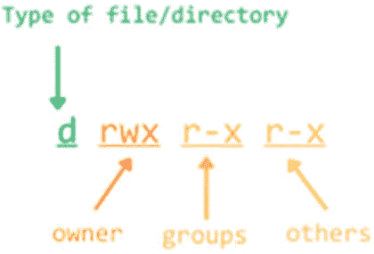

**图 3.8**: 文件权限详解

### 权限范围

* **用户 (User)**: 文件的所有者。第一组 `rwx` 权限适用于用户。
* **组 (Group)**: 包含一个或多个成员。第二组 `r-x` 权限适用于该组。
* **其他 (Other)**: 针对所有其他人的类别。第三组 `r-x` 适用于其他人员。

### 访问类型

* **读取 (r)**: 允许用户查看/读取文件内容。
* **写入 (w)**: 允许用户查看、创建、更新或删除文件或文件内容。
* **执行 (x)**: 对于文件，允许将其作为程序执行。对于目录，允许访问目录的内容。

此外，还有其他类型的访问，如下：

* 可执行文件的 `setuid/setgid` 权限由字母 `s` 表示。当用户运行它时，他们将获得文件所有者或所属组的有效权限。
* `t` 是粘滞位（sticky bit），只有目录关心此位。如果配置了，非 root 用户无法删除其中的文件，除非他们是目录的所有者。

`ls -l` 命令列出所有文件和目录的详情，如权限、所有者、组、大小、修改日期。

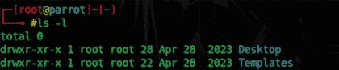

**图 3.9**: ls -l

图中可以看到：

* `drwxr-xr-x` 表示类型和授予的权限。
* `1` 表示文件或目录的硬链接数量。
* `root` 表示文件或目录的所有者。
* `root` 表示文件或目录所属的组。
* `28` 表示文件/目录的大小（单位为 kb）。
* `Apr 28 2023` 表示修改日期。
* `Desktop` 表示文件/目录的名字。

| 符号 | 语义 |
| :--- | :--- |
| `-` | 普通文件（例如执行 `touch abc` 时） |
| `b` | 设备文件 |
| `c` | 字符设备文件 |
| `C` | 高性能（连续数据）文件 |
| `d` | 目录 |
| `l` | 符号链接 |
| `p` | 命名管道（通过 `mkfifo` 创建） |
| `s` | 套接字 |
| `?` | 其他未知文件类型 |

**表 3.1**: 文件/目录类型及其符号

## 进制值表示权限

三位数表示文件的权限。第一个数字代表所有者的权限，第二个数字代表组的权限，第三个数字代表其他用户的权限。

* 读取 (`r`): 4
* 写入 (`w`): 2
* 执行 (`x`): 1

| 模式 | 有效权限 | 十进制表示 |
| :--- | :--- | :--- |


| `---` | None | 0 |
| `--x` | Execute | 1 |
| `-w-` | Write | 2 |
| `-wx` | Write and execute | 3 |
| `r--` | Read | 4 |
| `r-x` | Read and execute | 5 |
| `rw-` | Read and write | 6 |
| `rwx` | Read, write, execute | 7 |

**表 3.2:** 权限的十进制表示

现在，我们取一个数字代码 744：

| **所有者** | **组** | **其他** |
| 7 | 4 | 4 |
| 4 + 2 + 1 | 4 + 0 + 0 | 4 + 0 + 0 |

**表 3.3:** 示例

### 修改文件权限

我们可以使用 `chmod`（更改模式）命令来更改文件的权限：

*   `$ chmod <numeric code> <filename>`
    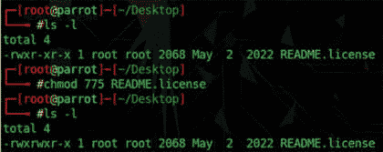

    **图 3.10:** chmod 命令

*   `$ chmod <user category>+<permissions>`

    其中用户类别表示为：

*   `u`: 用户（所有者）
*   `g`: 组
*   `o`: 其他用户

权限表示为：

*   `r`: 读
*   `w`: 写
*   `x`: 执行

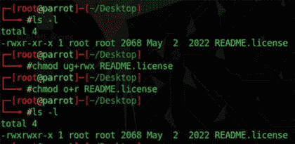

**图 3.11:** 权限

## 进程权限

与当前执行的操作系统进程相关的权利和特权被称为进程权限。一种名为访问控制的安全技术限制了谁或什么可以使用计算机系统资源并执行特定任务。进程权限对于维护系统安全和实施访问控制至关重要。

*   **实际 UID (Actual UID)**：实际 UID 是启动进程的用户 ID，从人类用户的角度指示所有权。`getuid(2)` 系统调用允许进程确定其实际 UID。

    使用 `top` 命令查看进程的动态列表及其资源使用情况：
    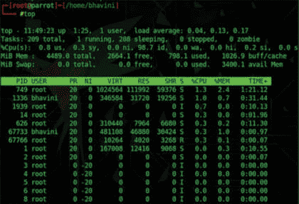
    **图 3.12:** top 命令

    *   `PID`: 进程 ID（进程的唯一标识符）。
    *   `USER`: 进程所有者的用户名或 ID。
    *   `PR`: 进程优先级。
    *   `NI`: Nice 值。nice 值越高，优先级越低。
    *   `VIRT`: 虚拟内存使用量（进程使用的总虚拟内存）。
    *   `RES`: 驻存内存（进程使用的非交换物理内存）。
    *   `SHR`: 共享内存大小（进程使用的共享内存）。
    *   `S`: 进程状态（例如，`R` 表示运行，`S` 表示睡眠）。
    *   `%CPU`: 进程的 CPU 使用率。
    *   `%MEM`: 进程的物理内存 (RAM) 使用率。
    *   `TIME+`: 进程累计使用的总 CPU 时间。

    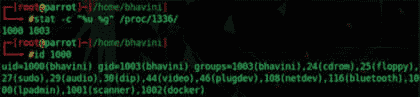
    **图 3.13:** stat -c “%u %g” /proc/1336/

`stat -c “%u %g” /proc/1336/` 命令显示 PID 为 1336 的进程的用户 ID 和组 ID。每个进程与一个用户和一个组关联。要查找与 ID 关联的用户和组名，请使用 `id <id>` 命令：

*   **有效 UID (Effective UID)**：Linux 内核依赖有效 UID 来建立进程在访问共享资源（如消息队列）时拥有的权限。在传统的 UNIX 系统中，有效 UID 也用于文件访问。然而，Linux 过去使用专门的文件系统 UID（参见后文讨论）用于文件访问权限。为了兼容性，目前仍然保留了这一点。进程可以通过 `geteuid(2)` 系统调用确定其有效 UID。

*   **保存的组用户 ID (Saved Set-User-ID)**：在 `setuid` 实例中，进程可以通过在实际 UID 和保存的组用户 ID 之间切换有效 UID 来获取特权，因此保存的组用户 ID 是相关的。例如，为了让进程获得使用特定网络端口的权限（参见“端口”），需要高特权（例如以 root 身份运行）。进程可以通过 `getresuid(2)` 系统调用检索其保存的组用户 ID。

*   **文件系统 UID (Filesystem UID)**：这些 ID 是 Linux 特有的，用于设置文件访问权限。程序通常不直接修改此 UID；它最初开发是为了方便此类情况：文件服务器代表普通用户操作，同时将进程与该用户的信号隔离开。内核监控所有对有效 UID 的修改，并相应调整文件系统 UID。通常，文件系统 UID 与有效 UID 匹配，但可以使用 `setfsuid(2)` 系统调用进行更改。值得注意的是，从技术上讲，自内核 2.0 版本以来此 UID 已不再必需，但出于兼容性考虑仍然保留了它。

## SELinux

Linux 内核的安全扩展被称为安全增强型 Linux (SELinux)，提供了一种处理访问控制安全规则的方法。它最早由国家安全局（NSA）创建，随后作为开源软件发布。Linux 操作系统通过 SELinux 引入了强制访问控制 (MAC)，增加了额外的保护层。

当 SELinux 以默认的强制（enforcing）模式运行时，任何未经授权的用户访问任何资源的尝试都将被其报告并被拒绝。这种技术也称为最小权限原则，要求在允许用户或应用程序访问目录、文件、连接和其他服务之前获得显式许可。

安全策略是一组规则，指定 SELinux 哪些用户可以访问哪些系统资源。每个用户、进程和资源的权限都在这些规定中列出。

通过将所有决策（阻止或允许访问）存储在访问向量缓存 (AVC) 中，SELinux 加快了访问控制过程。

当进程请求访问资源时，SELinux 会查询 AVC。

## SELinux 模式

SELinux 运行在三种不同的模式，如下：

### 强制模式 (Enforcing Mode)

SELinux 在强制模式下会强力地执行 SELinux 策略中规定的安全策略。访问违反将导致拒绝访问，SEinux 会记录这些事件。对于 SELinux 而言，该选项是许多计算机的默认设置。

*   **访问控制强制**：在 SELinux 的强制模式下，访问控制限制被严格执行。它通过评估 SELinux 策略中概述的安全上下文和权限，确定进程或用户是否允许访问某些资源。SELinux 会阻止访问并创建日志记录违规行为。
*   **安全策略**：SELinux 使用安全策略来提供用户和进程与系统交互的指南和限制。这些规则通常以标签的形式阐述，标签与文件、进程和其他系统组件相关。
*   **防止策略违规**：强制模式的主要目标是通过阻止可能破坏性的或未经批准的行为来保护系统。如果进程尝试未被 SELinux 策略允许的操作，该操作将被拒绝，从而帮助缓解安全威胁的影响。
*   **日志记录**：当 SELinux 在强制模式下拒绝某些操作时，它会生成日志记录，提供有关被拒绝访问的信息。这些日志对于管理员识别和排除策略违规至关重要。

### 许可模式 (Permissive Mode)

在许可模式下，SELinux 会记录策略违规，但不会主动执行它们。这种模式对于故障排除非常有用，允许管理员识别并理解潜在问题而不阻止对资源的访问。与强制模式相比，这种模式更加宽松，便于诊断和微调 SELinux 策略。

*   **记录策略违规**：许可模式下的 SELinux 会记录任何在强制模式下通常会被拒绝的操作。这些日志记录提供了有关潜在策略违规的信息。


日志允许管理员识别并理解问题，而无需主动阻止访问资源。

*   **绕过访问控制**：在 `Permissive` 模式下，即使操作违反了 `SELinux` 策略，该操作也不会被拒绝。这种模式有效地绕过了访问控制的执行，同时仍提供有关策略违反的信息。

*   **故障排除与策略开发**：`Permissive` 模式通常用于排查与 `SELinux` 相关的问题。管理员可以查看日志以识别问题操作，并相应地调整 `SELinux` 策略。

这在开发或测试 `SELinux` 策略期间可能非常有益，允许管理员在不立即阻塞操作的情况下精调策略。

## 禁用模式 (Disabled Mode)

在 `Disabled` 模式下，`SELinux` 被关闭，不提供任何安全增强或策略执行。这种模式通常用于管理员想要临时禁用 `SELinux` 的情况，通常是为了故障排除或特定环境不需要 `SELinux` 的时候。

*   **无访问控制执行**：`Disabled` 模式下的 `SELinux` 不会主动执行任何安全策略。它不会评估 `SELinux` 策略中指定的安全上下文或权限来做出访问控制决策。

资源的访问完全由传统的 Linux 任意访问控制 (`DAC`) 机制主导。

*   **无策略违反日志**：由于 `SELinux` 已禁用，它不会记录任何策略违反或与安全相关的事件。

*   **无 SELinux 保护**：当 `SELinux` 处于 `Disabled` 模式时，系统完全依赖底层 Linux 内核和文件系统提供的安全机制。

# 信息策略 (Information Policies) (#toc.xhtml_s41a)

信息策略是指组织建立的一系列指南、规则和程序，用于管理、访问、使用和保护信息资产。这些策略旨在确保信息的机密性、完整性和可用性，同时符合组织的目标、法律要求和道德标准。信息策略在管理和保护组织信息资源方面起着至关重要的作用。

# 目标策略 (Targeted Policy) (#toc.xhtml_s42a)

在 `SELinux` 中，有不同的策略类型，常见的策略类型之一是“目标”策略。目标策略旨在于安全性和易用性之间取得平衡。它侧重于限制特定的高风险服务或进程，同时允许大多数其他进程在最小的 `SELinux` 限制下运行。以下是关于 SELinux` 中目标策略的一些重点：

*   **关注特定服务**：目标策略针对从安全角度被认为高风险的特定服务或进程进行定制。目标策略通常涵盖的服务示例包括 Web 服务器、数据库和网络服务。

*   **对通用系统影响最小**：与对所有进程实施强限制的严格策略不同，目标策略对通用系统操作的侵入较小。在目标策略中，大多数用户应用程序和系统进程不受 `SELinux` 的严重限制。

*   **增强高风险服务的安全性**：目标策略的目标是通过限制其进程并减少其攻击面来增强关键服务的安全性。它有助于防止安全漏洞，并限制受损的服务可能造成的潜在损害。

*   **类型强制 (Type Enforcement)**：目标策略与其他 `SELinux` 策略一样，使用类型强制来定义进程和资源如何交互的规则。每个进程、文件和网络端口都被分配一个带有特定类型的安全上下文，访问决策基于这些类型。

*   **更易维护**：目标策略更容易维护，因为它们专注于服务的子集。

*   **附加模块的灵活性**：虽然目标策略旨在安全性和易用性之间取得平衡，但管理员仍然可以通过加载附加模块来扩展策略。

*   **用于监控的审计日志**：目标策略生成的审计日志可以帮助管理员识别并响应安全事件。

# 多级安全策略 (Multi-Level Security Policy) (#toc.xhtml_s43a)

多级安全策略通常称为 `MLS`，是一种旨在保护不同级别信息的的方法。这种安全性通常用于政府和军事领域，那里有不同级别的信息。

*   **分级水平**：信息根据其敏感性分为不同的级别。常见的分类包括 `Unclassified`（未分类）、`Confidential`（机密）、`Secret`（秘密）和 `Top Secret`（绝密）。

*   **访问控制**：信息的访问取决于用户的安全许可和信息的分类级水平。

*   **知情原则 (Need-to-Know Principle)**：只有当用户因履行工作职责对该信息有正需求时，才授予访问权限。这一原则有助于限制访问并减少泄露风险。

*   **划分 (Compartmentalization)**：即使在同一分类级别内，信息通常也被划分为特定的部门或类别。用户可能仅根据其角色访问某些部门。

*   **数据标记和标识**：信息根据其分类级进行标记和标识。这有助于用户轻松识别信息的敏感性，并确保妥善处理。

*   **审计与监控**：持续的监控和审计对于确保符合安全策略至关重要。可疑活动或未经授权的访问尝试会被记录并调查。

*   **安全通信**：使用安全通道和加密来传输分类信息，以防止拦截和未经授权的访问。

*   **安全策略执行**：通过技术控制和组织程序严格执行安全策略。

## 设置 SELinux 策略

`SELinux` 策略类型通常可以在安装 `SELinux` 时设置，或之后根据系统的安全需求进行更改。可以通过以下步骤更改策略类型：

1. 首先，使用 `sestatus` 检查 `selinux` 状态。
2. 如果处于禁用模式，使用命令 `setenforce [1 | 0]` 分别设置强制（enforcing）或许可（permissive）模式。
3. 现在，打开配置文件 `/etc/selinux/config` 并将 `SELINUXTYPE` 设置为 `targeted` 或 `mls`。
4. 重启系统使更改生效。

## 自定义 SELinux 策略 (#toc.xhtml_s44a)

自定义 `SELinux` 策略涉及创建或修改策略模块，以适应系统的特定安全需求。`SELinux` 使用策略模块来定义各种进程和资源的规则和访问控制。

要显示布尔值及其描述，请使用以下命令：

```bash
semanage Boolean -l
```


要显示和设置特定布尔（Boolean）的值，可以使用 `getsebool` 和 `setsebool` 命令。以下示例展示了如何显示和设置 `ftp_home_dir` 布尔值的值：

```
getsebool ftp_home_dir
```

```
ftp_home_dir --> off
```

```
sudo setsebool ftp_home_dir on
```

```
getsebool ftp_home_dir
```

```
ftp_home_dir --> on
```

要切换布尔值的值，请使用 `togglesebool` 命令，如下例所示：

```
sudo togglesebool ftp_home_dir
```

```
ftp_home_dir: inactive
```

要使布尔值在重启后仍然有效，请为 `setsebool` 指定 `-P` 选项。例如：

```
sudo setsebool -P ftp_home_dir on
```

```
getsebool ftp_home_dir
```

```
ftp_home_dir --> on
```

## 最佳实践

为了保持环境安全，应当实施以下最佳实践：

### 最小权限

* 最小权限原则传达了个人或进程应仅拥有完成特定任务所需的本质权限的思想。
* 在`File Permissions`（文件权限）的背景下，讨论了使用 `chmod +x` 命令的影响。指出该命令除了授予预期权限外，还向其他用户授予了额外的权限。
* 建议尽可能避免使用 root 权限操作。例如，在安装软件时，推荐的方法是使用 `sudo` 而不是以 `root` 身份登录。

### 审计

* 审计涉及记录操作实践（包括执行者身份），其记录方式应防止生成的日志被任何篡改。

## 结论

总结来说，Linux 访问控制对于维护操作系统的安全态势和保护其管理的资源至关重要。由于 Linux 访问控制方法强大且适应性强，管理员能够精确控制和管理用户与文件、目录及系统函数交互的方式。

Linux 访问控制遵循通过坚持最小权限概念来减少可能的安全风险的哲学。用户经过身份验证和授权过程，根据预设权限获得访问权限，确保只有授权的实体才能执行某些操作。

在接下来的章节中，我们将开始实现防火墙。这一过程涉及配置网络安全措施，特别关注数据包过滤，以对互联网络和设备之间的流量进行控制。

# 第 4 章

# 实现防火墙与数据包过滤

## 引言

实现防火墙和数据包过滤涉及配置网络安全措施，以控制网络和设备之间的流量。防火墙充当受信内部网络与不可信外部网络（如互联网）之间的屏障。防火墙架构的核心是数据包过滤的复杂功能。

这是一项决定穿越网络的单个数据包去向的关键机制。这一过程由精细设计的规则引导。这些规则中的每一条都作为防火墙的指令，用于允许或禁止特定的数据包。这些规则 disallow（注：此处应为 disallow，译为禁止）或 allow（注：此处应为 allow，译为允许）特定的数据包。这些规则是基于一系列标准建立的，包括源地址、目的地址、端口和协议，从而实现对网络流量的细粒度和精细控制。

### 结构

在本章中，你将学习：

* 防火墙及其组件
* 防火墙架构
* 数据包过滤及其类型
* 在 Linux 环境中使用 UFW 配置防火墙

## 防火墙

防火墙是一种网络安全硬件或软件，用于监控所有入站和出站网络流量。它使用预设的安全规则来决定是否允许或禁止特定类型的数据。通常，网络节点通过防火墙与入/出站数据流量以及某些应用程序隔离开。防火墙通过利用硬件、软件或云技术保护网络免受外部威胁。防火墙的主要目标是防止有害流量和数据包进入，同时允许合规流量通过。为了停止攻击，防火墙根据预设的安全规则检查入站通信，并过滤源自不可信或可疑源的流量。在计算机与外部设备传输数据传输端口上，流量会受到保护。

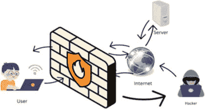

**图 4.1:** 防火墙实现

## 防火墙的组件

### 边界路由器

任何网络的入口点都是边界路由器，它位于外部防火墙和互联网之间。因此，我们的第一个网络访问控制是在路由器上配置适当参数，以定义边界路由器上的安全策略。边界路由器将根据 IP 地址范围过滤流量。使用它的主要由于是提供到互联网或特定组织等公共网络系统的链接。它通过遵循适当的路由协议执行数据包路由。它还提供数据包过滤和地址转换。

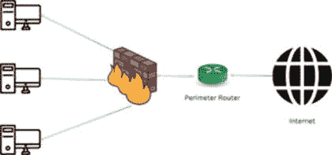

**图 4.2:** 边界路由器

### 虚拟专用网络 (VPN)

其目的是在两个计算机、两个网络或计算机与网络之间提供安全链接。这包括数据包可靠性保证、身份验证和加密。通过启用安全的远程网络访问，它连接了同一平台但物理上未连接的两个广域网。

以下是 VPN 的一些用例：

* **隐私与匿名性：** 通过加密你的互联网连接，VPN 减少了外部人员（如黑客或政府机构）监控你在线活动的能力。当你使用公共 Wi-Fi 时，这一点尤为关键。
* **绕过地理限制：** 你可以使用 VPN 访问你地区可能被阻止的内容。通过连接到不同位置的服务器，你可以让自己看起来是从该位置浏览的。
* **安全远程访问：** 经常部署 VPN 或 VPNs，以便员工能够安全地从站点访问公司内部网络。这对于在访问敏感数据时保持高水平的安全至关重要。
* **绕过审查：** VPN 可以帮助用户绕过限制，并访问在互联网审查常见地区禁止的内容。
* **增强安全性：** VPN 为你的互联网连接提供了额外的保护。VPN 利用加密保护你的数据免受潜在危险，并让你的在线体验更安全。

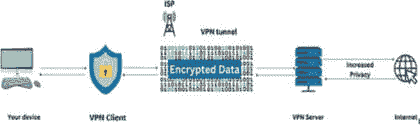

**图 4.3:** VPN

## VPN 的原理

VPN 的基本工作原理是在用户设备与位于不同位置的服务器之间建立安全加密的连接。这一过程确保用户的互联网流量通过安全的 VPN 隧道进行路由，保护数据免受潜在的窃听或未经访问。以下是 VPN 操作的关键步骤：

1. **用户发起连接：** 用户在设备上启动 VPN 客户端或应用，并向 VPN 服务器发起连接。
2. **身份验证：** 用户设备向 VPN 服务器进行身份验证。这可能涉及输入凭据（如用户名和密码）、使用数字证书或采用其他身份验证方法。


### 3. **隧道建立**：一旦通过验证，用户设备与 VPN 服务器之间就会建立一个安全隧道。该隧道是一个虚拟的加密连接，所有数据流量都通过它进行传输。

### 4. **加密**：在 VPN 隧道中传输的数据经过加密以确保机密性。通常使用 `AES` 等加密算法来保护数据。

### 5. **数据传输**：用户的网络流量（包括网页浏览、文件下载和其他活动）现在被路由到 VPN 隧道。这使得第三方难以截获或监控用户的在线活动。

### 6. **VPN 服务器路由**：位于不同地理位置的 VPN 服务器充当用户设备与互联网之间的中介。当用户访问在线资源时，请求 own 似乎源自 VPN 服务器的 IP 地址，从而掩盖了用户的实际 IP 地址。

### 7. **服务器端解密**：VPN 服务器解密入站数据，并将其转发到互联网上的目标地。来自互联网的响应会被加密，并通过 VPN 隧道传回给用户设备。

### 8. **安全数据传输**：用户设备与 VPN 服务器之间、以及 VPN 服务器与互联网之间的整个通信都在加密隧道内进行。这确保了传输数据的机密性和完整性。

### 9. **会话终止**：当用户断开 VPN 连接时，安全隧道就会终止。用户设备恢复正常的互联网连接，但不再受 VPN 的保护。

# 入侵检测系统 (IDS)

这种安全技术通过监控和检查网络或系统活动，来寻找恶意活动、非法访问或违反安全策略的迹象。入侵检测系统的主要目标是通过检查分析与恶意活动相关的趋势、异常情况或已识别指标，来识别并解决安全问题。它能够通过未经授权的访问发起拒绝服务攻击或从网络后端发起攻击。这类攻击应该能够由智能防御系统进行管理。

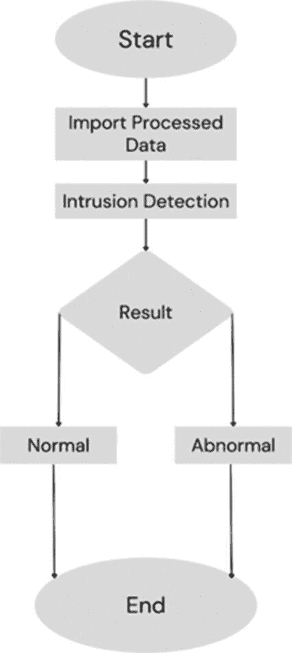

**图 4.4:** IDS 的工作原理

IDS 通过监控和分析网络或系统活动来运行，识别并响应潜在的安全威胁。IDS 有两种主要类型：基于网络的入侵检测系统 (NIDS) 和基于主机的入侵检测系统 (HIDS)。以下是 IDS 典型工作原理的概述：

## 基于网络的入侵检测系统 (NIDS)

*   **流量监控**：NIDS 被动地监控网络流量，在数据包穿越网络时对其进行分析。它可以部署在网络的关键节点以捕获并检查流量。
*   **数据包捕获与分析**：NIDS 捕获网络包并分析其头部和内容。它可以使用多种技术，包括基于签名的分析、异常检测和启发式分析来识别潜在威胁。
*   **基于签名的检测**：基于签名的检测将网络流量特征与已知攻击签名数据库进行对比。如果发现匹配，系统将生成警报。
*   **基于异常的检测**：基于异常的检测建立正常网络行为的基准。偏离此基准的行为（例如异常流量模式或意外的数据流）会触发警报。
*   **启发式分析**：启发式分析涉及使用预定义的规则或算法来识别与已知攻击方法相关的模式。这种方法允许 NIDS 检测已知攻击的变体。
*   **警报生成**：当 NIDS 检测到潜在恶意活动时，会生成警报。这些警报提供了有关威胁性质、受影响系统以及潜在影响的信息。
*   **响应或通知**：根据配置的不同，NIDS 可以采取诸如记录事件、阻止恶意流量或通知安全人员等行动。然而，NIDS 通常以监控模式运行，默认不会主动阻止流量。

## 基于主机的入侵检测系统 (HIDS)

*   **代理部署**：HIDS 部署在单个主机机器上。每个主机都运行自己的 HIDS 代理，监控该特定设备上的活动。
*   **系统事件监控**：HIDS 代理监控各种系统事件，包括登录、文件更改、进程执行以及其他与主机特定的特定的活动。
*   **基准建立**：HIDS 中的异常检测涉及建立正常主机行为的基准。HIDS 系统学习该主机的典型特征，并在发生偏差时发出警报。
*   **基于签名的检测**：与 NIDS 类似，HIDS 使用基于签名的检测，将活动与已知攻击模式或恶意行为的数据库进行对比。
*   **警报生成**：当 HIDS 检测到可疑或恶意活动时，它会生成警报。这些警报包含有关活动类型及其潜在影响的信息。
*   **响应或通知**：HIDS 可以触发响应，例如记录事件、隔离受影响的主机或通知管理员。响应通常可以根据组织的安全策略进行配置。

## NIDS 和 HIDS 的共同元素

*   **日志与报告**：NIDS 和 HIDS 系统都会记录检测到的事件以便分析和报告。这些信息对于调查事件和提高整体安全性具有重要价值。
*   **与 SIEM 集成**：IDS 通常与安全信息和事件管理 (SIEM) 系统集成，为整个组织提供安全事件的视图。
*   **持续监控**：IDS 实时运行，对网络或主机活动进行持续监控，以便快速识别并响应安全事件。

# 防火墙架构

防火墙拓扑根据网络的需求和规范而异。根据网络规模、所需的安全水平以及需要缓解的威胁类型，不同企业可能会使用不同的防火墙架构。

以下组件成了防火墙架构：

### 堡垒机 (Bastion Host)

网络通过堡垒机免受攻击。它充当外部和内部网络之间的中介。堡垒机是构建并设置用于防御网络资源入侵的计算机系统。防火墙过滤所有进出的流量。它有两个接口：一个连接到内网的私有接口，和一个直接连接到互联网的公共接口。

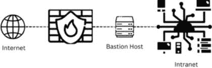

**图 4.5:** 堡垒机

### 隔离子网 (Screened Subnet)

非军事化区 (DMZ)，也称为隔离子网，是在筛选防火墙后的双或三端口防火墙建立的安全网络。将三端口防火墙的第一个接口连接到互联网，第二个接口连接到 DMZ，第三个接口连接到内网。私网无法访问 DMZ 内的任何主机，而它回答公共查询。用户无法访问秘密区域。在内网外部筛选子网的一个优点是它可以回答查询，而无需让流量进入内网。如果三端口防火墙被破解，DMZ 和内网可能会受到影响，这是一个缺点。一种更安全的方法是使用多个防火墙将互联网与 DMZ 隔开，然后将 DMZ 与内网隔开。

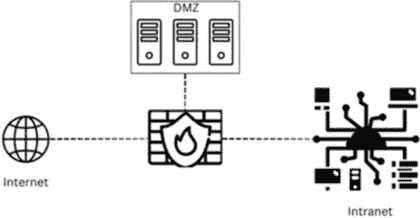

**图 4.6:** 隔离子网

### 多宿主防火墙


一个连接了多个 NIC（网络接口卡）并连接两个或多个网络的节点被称为多宿主防火墙（multi-homed firewall）。它在每个接口与其他网络组件之间建立了逻辑和物理连接。在多宿主防火墙的帮助下，IP 网络运行得更可靠、更高效。多宿主防火墙三个三个接口允许根据组织独特的安全目标进行额外的系统划分。然而，背靠防火墙（back-to-back firewall）概念提供了更全面的安全性。

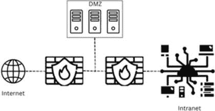

**图 4.7:** 多宿主防火墙

## 数据包过滤

调节进出网络数据流的一种网络安全功能是数据包过滤防火墙。每一个包含控制数据和用户的数据包都会经过防火墙的检查，防火墙根据预定义的一组规则对其进行测试。如果数据包通过测试，防火墙允许其到达目的地。未通过测试的数据包会被拒绝。防火墙通过查看规则集、协议集、端口和目的地址来测试数据包。

在系统网络中，数据包是跨分组交换网络发送的结构化数据单元。由于这些网络将通信分解为较小的单元（称为数据包）并逐个通过网络交付，因此它们能够防止故障。当数据包通过防火墙到达目的地时，它们会被重新排列以正确显示其内容。当正确实施时，分组交换可以减少传输延迟，最大化网络通道容量并提高通信效率。

数据包包含两个关键部分：

*   头部（Headers）：数据通过数据包头部被定向到预期位置。它们包含了地址位、互联网协议（IP）以及将数据包发送到预期地点的所需的任何其他信息。
*   载荷（Payloads）：数据包中包含的用户数据称为载荷。这是试图到达其预期位置的数据。

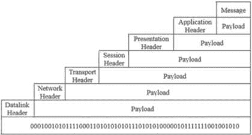

**图 4.8:** 每个级别的头部

## 数据包过滤的类型

防火墙利用称为数据包过滤的技术根据预定义的标准来调节网络流量。存在不同的数据包过滤技术，每种技术都提供了控制和保护网络流量独特方法。以下三类是主要的：

*   **静态数据包过滤（Static Packet Filtering）：** 这种数据包过滤是最基本的。它根据协议类型（例如 `TCP`、`UDP`）、源和目的端口号以及源和目的 IP 地址等参数分析数据包。管理员预先建立规则，根据静态标准允许或禁止哪些类型的数据包。它易于实施，对于简单的网络安全效果良好。
*   **动态数据包过滤（Dynamic Packet Filtering）：** 考虑到活动连接的状态，动态数据包过滤是静态数据包过滤的扩展。为了跟踪连接，它维护一个更新的状态表并基于流量的上下文做出选择。为了根据连接的当前状态对接受或拒绝哪些数据包做出更明智判断，防火墙跟踪现有连接的状态。通过考虑连接的当前状态，它提供了增强的安全性并增加了对特定类型攻击的抵抗力。
*   **状态检测包检测（Stateful Packet Inspection, SPI）：** `SPI` 是动态数据包过滤的增强版本。它在监控连接状态之外还会检查应用层的数据包内容。为了确定连接到流量的应用或服务，SPI 在动态数据包过滤使用的数据之外查看数据包的载荷。它让防火墙对网络流量拥有更精确的控制，并能够理解并应用应用规则。
*   **无状态数据包过滤（Stateless Packet Filtering）：** 这种技术在不考虑通信整体上下文或状态的情况下过滤网络流量，仅依赖单个数据包的属性。与维护活动连接状态的状态检测相比，无状态数据包过滤独立分析每个数据包并根据既定标准做出选择。与之相对，有状态防火墙使用现代扩展技术，如用户数据报协议（`UDP`）流和传输控制协议（`TCP`）来跟踪活动连接。

# 防火墙的类型

## 数据包过滤防火墙

控制进出网络数据流的一种网络安全功能是数据包过滤防火墙。防火墙使用一组预定义的规则来检查和测试每个包含用户和控制信息的数据包。如果数据包通过测试，防火墙允许其到达目的地。未通过考试的排除。防火墙使用规则集、协议、端口和目的地址来检查数据包。

数据包过滤防火墙可以根据以下标准允许或拒绝数据包：

*   数据包地址是目的 IP 地址，源 IP 地址是发送地地址。
*   数据传输协议，包括会话和应用协议（`TCP`、`UDP`、`ICMP`）是协议的示例。
*   端口包括源端口、目的端口以及 `ICMP` 类型和代码。
*   标志位（Flags）包括 `TCP` 头部标志，例如数据包是否为连接请求。
*   数据包通过的物理接口（`NIC`）（入站或出站）。

### 优点：

*   **效率：** 使用数据包过滤的防火墙的主要优点之一是效率。路由器通常以高速运行，根据地址、源端口和目的地实时接受和拒绝数据包。
*   **透明性：** 这是另一个优势。用户在防火墙拒绝数据包时是知晓的，而数据包过滤器通常快速且安静地阻塞用户功能。其他方法需要用户为某些服务器或客户端手动设置防火墙。
*   **成本效益：** 由于只需要一个过滤路由器来保护内部网络，数据包过滤是非常经济的。数据包过滤是许多硬件和软件路由系统的标准功能。此外，这是最经济的方法，因为数据包过滤受到了大多数网站路由器的支持。

*   **易用性：** 由于数据包过滤廉价且易于使用，它是一种理想的替代方案。这种安全方法允许通过单个筛选路由器保护整个网络。用户在使用防火墙时不需要帮助、指导或培训，因为它们在传输被拒绝时才能检测到。

### 缺点：

*   **安全性较低：** 数据包过滤的主要缺点是它忽略了应用或上下文信息，仅依赖 IP 地址和端口。因此它们被认为是不安全的。这是因为任何通过允许的 IP 地址或端口的流量都会被它们转发。由于防火墙不检查完整数据包，未注意的头部或载荷本身可能包含恶意命令。
*   **缺乏日志功能：** 对于需要遵守报告和合规义务的企业，如果数据包过滤器没有日志功能，可能会遇到问题。


- **无状态**：数据包过滤本质上是无状态的——这意味着它单独检查每个数据包，而不考虑是否已建立连接或之前的数据包。因此，防火墙防御严重威胁和攻击的能力非常有限。

# 电路级网关

电路级网关是一种用于网络会话层的设备，旨在为网络内部和外部的计算机提供连接安全。与应用网关不同，电路级防火墙不根据数据包内容进行过滤。它验证两个传输层之间虚拟电路上上的 `TCP` 或 `UDP` 数据包。工作在开放系统互连（OSI）模型会话层的设备即为电路级网关。防火墙会检查数据包之间的 `TCP` 握手，以检测并防止非法访问尝试。在确定流量是否符合电路级网关要求时，会忽略数据包的内容；仅检查头部信息。它管理使用不可信主机与可信服务器之间的客户端连接。

## 工作原理
- 当用户开始连接到远程主机时，电路级网关会在用户和远程主机之间建立一条电路或虚拟连接。
- 穿过此电路的流量将由电路级网关进行观察，网关判断其是否属于已建立的连接，并仅允许允许的流量通过。
- 之后， `UDP` 或经过验证的 `TCP` 连接将代表客户端与目标服务器通信。如果连接被拒绝，会话将结束。

电路级网关由一组规则控制。这些规则规定了哪些流量应该被禁止，哪些流量规则可以通过电路级网关流动。通过将这些数据与协议类型、端口号以及源目的 IP 地址等因素进行交叉引用，网络管理员可以对网络会话层进行精粒度控制。

### 优势
- **性能增强**：与应用网关和其他防火墙解决方案相比，电路级防火墙通常速度更快且消耗资源更少。这是因为它们只在会话层监控流量，并在较低的网络协议栈层级运行。正因如此，它们增加延迟或影响网络性能的可能性也较低。
- **易于配置**：与其他防火墙系统相比，电路级防火墙的设置和维护更简单。它们不需要对需要配置的网络协议和应用级网关有深度的了解。由于关注点仅在于连接状态，比更复杂的防火墙类型变量更少。
- **成本效益**：与下一代防火墙等更复杂的防火墙相比，它们属于完全不同的价格范围。另一方面，电路网关是可用中最便宜的选择。因此，资源紧张的中小型企业会选择这种。
- **提供隐性连接安全**：由于其工作方式，电路级网关会代表内部主机使用虚拟连接来评估已建立连接的安全性。这个中间人有助于向服务器隐藏其 IP 地址和身份。因此，黑客可以利用的线索更少。

## 劣势
- **应用感知能力有限**：电路级网关缺乏对 OSI 模型应用层（第 7 层）的详细知识。这意味着它们可能无法有效过滤或控制某些可能被攻击者利用的特定应用程序行为。
- **性能影响**：监控连接状态的过程会引入一些开销，可能会影响防火墙的性能。随着活动连接数量增加，这种影响可能会变得明显。
- **配置复杂**：配置电路级网关可能比设置基础数据包过滤防火墙更复杂。理解和管理连接状态及规则需要更多的专业知识。
- **粒度控制较低**：与应用层防火墙相比，电路级网关对特定应用程序及其功能的细粒度控制较少。在需要精细控制的环境中，这种局限性可能是缺点。
- **状态攻击的风险**：虽然电路级网关提供了连接状态监控，但仍存在状态攻击的可能性。复杂的攻击者可能会利用状态跟踪机制中的漏洞。

# 应用层防火墙

应用层防火墙工作在 OSI（开放系统互连）模型的应用层，有时被称为代理防火墙。应用层防火墙的设计目的是根据特定的应用程序或服务过滤流量，这与运行在传输层和网络层的标准网络防火墙不同。

## 应用层防火墙的关键特性包括
- **深度数据包检测 (DPI)**：与传统防火墙不同，应用层防火墙更彻底地检查数据包内容。这使得它们能够理解正在发送的数据含义和内容。
- **协议过滤**：它们能够根据特定的应用程序或协议过滤流量。例如，你可以决定是否允许或禁止特定程序（如电子邮件客户端、即时消息服务和网络浏览器）的流量。
- **用户身份验证**：通过将某些应用层防火墙与用户身份验证系统集成，你可以根据用户身份限制访问。通过确保只有授权用户才能访问某些应用或服务，这提供了额外的保护。
- **内容过滤**：这些防火墙有检查和管理数据包内容的能力。此功能对于阻止敏感数据的传输、根据内容类别筛选网站以及拦截危险内容非常有帮助。
- **状态检测**：为了监控活动连接的状态并根据通信上下文做出选择，应用层防火墙通常配备了状态检测功能。
- **代理服务**：应用层防火墙能够充当公司内外网络之间通信的中间人。结果是，它们能够更好地监管和过滤流量。
- **日志与审计**：通过其全面的日志和审计功能，管理员可以监控网络活动、发现任何安全风险并生成报告。
- **配置简便**：许多应用层防火墙提供了易于使用的界面，用于设置策略和规则。

## 劣势
- **复杂性**：实施和管理应用层防火墙可能比传统防火墙更复杂，需要更高水平的专业知识和仔细配置。
- **性能影响**：深度数据包检测和内容过滤过程可能会引入延迟并影响整体网络性能，特别在高流量环境中。
- **资源密集型**：与简单的数据包过滤防火墙相比，应用层防火墙通常需要更多资源（CPU 和内存），可能会导致硬件需求和潜在的可扩展性挑战。
- **兼容性问题**：某些应用程序可能无法应用层防火墙无缝工作，需要额外的配置，并可能导致某些功能中断。


*   **成本 (Cost)**：高级功能和能力是有成本的，与简单的防火墙解决方案相比，应用级防火墙的实施和维护可能更高。
*   **误报风险 (Potential for False Positives)**：深度数据包检测可能导致误报，即合法流量被错误地标记为恶意，可能对正常业务运行造成干扰。
*   **配置错误 (Configuration Errors)**：配置错误可能导致安全漏洞或意外后果，强调了正确设置和持续管理的重要性。
*   **对加密流量的保护有限 (Limited Protection Against Encrypted Traffic)**：应用级防火墙在检查加密流量时可能会面临挑战，因为它需要额外的资源并会增加处理 SSL/TLS 连接的复杂性。

# 状态多层检测 (Stateful Multilayer Inspection)

动态数据包过滤，即状态检测（stateful inspection）是一种数据包过滤类型，它监控活动连接的状态并根据流量上下文做出判断。在连接活动期间，防火墙会跟踪序列号、其他相关数据以及 `TCP` 握手状态。通过这种方式，防火墙能够理解流量上下文并决定允许还是拒绝数据包。

在多个 OSI 模型层（通常是网络层、传输层和应用层）分析网络流量被称为多层检测。多层检测意味着对数据包的内容和上下文进行更深入的检查，而不仅仅关注其基本信息。检查负载内容、应用层协议甚至用户行为可能属于这一类。

这种方法通过将状态检测与多个 OSI 层的分析相结合，提供了一种更全面且感知上下文的安全防护。多层检测能够更好地识别复杂威胁，包括那些试图利用高层协议或应用程序漏洞的威胁。

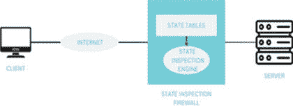

**图 4.9：状态状态检测 (Stateful Multilayer Inspection)**

## 用例 (Use Cases)

**网络安全 (Network Security)**：状态多层检测通常用于防火墙，以保护网络免受未经的访问、恶意活动和其他安全威胁的侵害。

**入侵检测与防御系统 (IDPS)**：该方法也应用于入侵检测与防御系统，用于监控和分析网络和/或系统活动，以寻找恶意行为或违反安全策略的迹象。

### 挑战与注意事项 (Challenges and Considerations):

**资源密集型 (Resource Intensive)**：对多层流量的深度分析可能是资源密集型的可能会可能会安全基础设施的性能。

**配置复杂性 (Configuration Complexity)**：实施和配置状态多层检测需要仔细考虑，以避免因配置错误导致安全漏洞或操作问题。

## 简单防火墙 (Uncomplicated Firewall)

简单防火墙（Uncomplicated Firewall），简称 `UFW`，是一种易用的命令行界面（CLI）程序，用于处理各种 Linux 发行版（包括 Debian、Ubuntu 和 Arch Linux）的防火墙配置选项。`UFW` 旨在让用户更容易地在计算机上设置和维护防火墙配置，特别是对于那些防火墙专家的用户而言。

### 使用 UFW 的优势 (Advantages of Employing UFW):

*   `UFW` 为防火墙管理提供了一个易用的界面。
*   对于大多数用户，`UFW` 提供了一个已经安全的默认设置。
*   `UFW` 提供了一种灵活的方法，可根据独特需求定制防火墙规则。
*   `UFW` 是一个资源消耗少的应用程序。
*   `UFW` 是一个资源消耗少的开源应用程序。


密码学是网络安全的基石，是保护数字领域敏感信息的关键枢纽。随着网络变得日益互联，保护数据免受未经授权访问和篡改的需求呈指数级增长。加密技术通过采用数学算法对数据进行加密和解密，提供了实现这一目标的稳健框架。通过加密，明文信息被转换为不可读的密文，使得任何没有相应解密密钥的人都无法破译。这一过程确保了数据的机密性，这是网络安全通信的基本要求。

除了机密性，密码学在维护传输信息的完整性和验证通信双方身份方面起着至关重要的作用。哈希函数通过为数字内容生成唯一的指纹（哈希值），充数据完整性的守护者。这种多维加密方法为网络通信建立了安全基础，促进了信息交换中的信任和可靠性。

### 结构

在本章中，我们将涵盖以下主题：

* 理解密码学及其类型
* 密码学中使用的不同算法
* 各种哈希技术及其应用
* 使用加密工具加密和解密数据
* 学习密码攻击
* 隐写术及其与密码学的区别

# 理解密码学

`cryptography` 一词源于希腊语 `graphein`（意为写）和 `kryptos`（意为隐藏或秘密）。`cryptography` 一词描述了使用代码和密码进行数据安全和安全通信的方法及研究。加密的目标是在传输过程中和存储时对数据进行加密。在计算机科学中，密码学是对数学思想和技术的研究，通过使用加密密钥或方案将可读的明文转换为不可读的密文，从而使通信免受窥探。

密码学的主要目标包括：

* **机密性 (Confidentiality)**：保护私有数据免受泄露或非法访问。数据可以使用加密进行编码，使得只有获得适当授权的人才能对其解码和理解。
* **完整性 (Integrity)**：保证信息在发送、存储或处理过程中不被篡改。其意图是确保数据是准确的，且未被意外或未经授权的所更改。
* **身份验证 (Authentication)**：验证实体（人、设备或系统）的身份以确保其确实为其所称的身份，这就是身份验证的过程。消息中的发送者或接收者的身份可以通过数字签名、证书和身份验证方法进行验证。
* **不可否认性 (Non-repudiation)**：不可否认性的目标是防止个人或事物对消息或数据的合法性或来源提出异。可以说，如果一个人同意做某事（例如发送消息或批准交易），他们就不应该撤回同意或否认参与。数字签名极大有助于不可否认性，因为一旦有人对文档或通信进行了数字签名，他们以后就无法撤回签名。

## 密码学的类型

根据加密解密使用的密钥，加密分为两种：对称加密和非对称加密。

## 对称加密

对称加密是一种加密技术，使用相同的密钥对明文（原始数据）加密和密文（加密数据）解密。换句话说，通信双方之间有一个共享密钥，该密钥必须保持保密以确保通信安全。

以下是对称加密原理的基本概述：

* 由发送者或密钥分发机制生成密钥。然后将该密钥与预期接收者安全共享。
* 将明文（原始数据）同密钥一起输入加密算法。
* 算法将明转换为密文，密文看起来是随机且无意义的数据。
* 密文通过通信通道传输，或存储在数据库、云服务或任何其他存储介质中。
* 持有密钥的接收者将其密并输入解密算法。
* 算法反转加密过程，将密文转换回原始明文。
* 对称加密的安全性取决于共享密钥的秘密性和完整性。如果未经授权的人获取了密钥，他们就可以解密密文并访问原始数据。

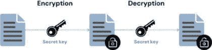

**图 5.1：** 对称加密与解密

## 非对称加密

非对称加密也称为公钥加密，是一种使用一对数学相关的密钥对数据进行加密和解密的加密技术。与加密解密使用相同密钥的对称加密不同，非对称加密涉及一对密钥：公钥和私钥。

以下是非对称加密原理的基本解释：

* 为每个用户或企业生成一对密钥——公钥和私钥。尽管密钥之间存在数学关系，但无法从公钥计算出私钥。
* **公钥 (Public key)**：任何想要与密钥所有者通信的人都可以并自由传播公钥。它可以包含在数字证书中，或发布在公钥服务器上。
* **私钥 (Private key)**：只有密钥所有者知道私钥，且私钥必须保密。它绝不能分发或共享。
* 使用接收者的公钥加密旨在发送给密钥所有者的消息。只有私钥所有者才能解码并读取消息。

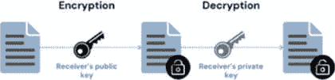

**图 5.2：** 非对称加密与解密

在接下来的表中，我们可以看到对称加密和非对称加密之间的区别。

| 对称加密 | 非对称加密 |
| :--- | :--- |
| 使用单一的共享密钥进行加密和解密。该密钥必须保持保密，并在通信双方之间安全共享。 | 使用公钥加密、私钥解密，这是两个在数学上关联的密钥。虽然私钥需要保密，但公钥可以无限制地共享。 |
| 挑战在于如何在通信双方之间安全地分发和管理密钥。 | 由于自由发布公钥，密钥分发变得更容易。密钥所有者是唯一知道私钥的人。 |
| 通常情况下计算开销较小，适用于加密大量数据。 | 计算开销往往更高，尤其是随着密钥长度的增加。 |
| 由于处理简单高效，速度比非对称加密快。 | 不适用于加密大数据集，因为它比对称加密慢。 |
| 缺乏交换秘密密钥的安全通道。 | 增强了安全性，因为私钥不需要发送或与任何人共享。 |
| 容易受到字典攻击和暴力破解攻击。 | 容易受到中间人攻击和暴力破解攻击。 |


| 适用于大量数据加密，在这种情况下，效率和速度至关重要。通常用于磁盘加密、文件加密和数据传输等应用。 | 广泛用于数字签名、安全密钥交换以及保护少量数据的隐私。经常用于涉及数字签名、在线交易和安全通信的场景。 |

**表 5.1：** 对称加密与非对称加密的区别

## 加密算法

将可读数据转换为不可读格式的过程称为加密。加密通过增加未经授权的人员或系统访问、理解或更改原始数据的难度，起到了保护信息的作用。在许多不同领域，加密方法对于保护私有数据和对话至关重要。加密算法是一系列数学操作和准则的集合，用于将数据（即明文）转换为一种难以理解的格式（即密文）。

以下是一些用于加密数据的加密算法。

## 数据加密标准 (DES)

数据加密标准 (DES) 是一种对称密钥分组密码算法，在被更先进的加密算法取代之前，它被广泛用于数据数据传输和机密性。

*   分组密码是一种对固定大小数据块（位组）操作的确定性算法。DES 使用固定大小的 64 位块。每个明文块都是单独加密的。
*   DES 是一种对称密钥技术，这意味着加密和解密使用相同的秘密密钥完成。通信双方必须安全地交换此共享密钥。64 位秘密密钥由 56 位随机生成的位和 8 位错误检测所需的位组成。
*   使用该秘密密钥，DES 算法将固定长度的明文位字符串转换为相同长度的密文位字符串。
*   随着计算机能力的提高，事实证明 56 位密钥长度随着时间的推移容易受到暴力攻击。在这些攻击中，攻击者会有条理地尝试每一个密钥来解密密文。

## 三重数据加密标准 (3DES)

为了增强安全性，三重 DES (3DES) 作为 DES 的扩展被引入。

3DES 使用不同的密钥应用三次 DES 算法。虽然 3DES 更安全，但其计算量更大。

*   3DES 使用的“密钥包”由三个 DES 密钥组成：`K1`、`K2` 和 `K3`。每个密钥都使用一个典型的 56 位 DES 密钥。然后执行以下过程：`DES encrypt with K1`（`DES 使用 K1 加密`）、`DES decrypt with K2`（`DES 使用 K2 解密`）、`DES encrypt with K3`（`DES 使用 K3 加密`）。
*   对于密钥有三种选择。第一种选择中的三个密钥都是不同的且独立运行。第二种选择中的 `K1` 和 `K3` 是相同的。第三种选择中的三个密钥完全相同。因此，你实际上是使用了三次相同的密钥和相同的 DES 方法。最安全的选择是第三种，最安全的是第一种。
*   DES 算法为用户在物理驱动器上存储加密数据提供了一种方法。

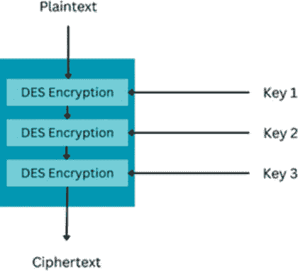

**图 5.3：** 3DES 算法

## 高级加密标准 (AES)

与 DES 类似，AES 是一种对称密钥方法，这意味着加密解密使用同一个密钥。通信双方必须安全地交换共享秘密密钥。

*   它的分组大小为 128 位，密钥大小分别为：`AES-128` 为 128 位，`AES-192` 为 192 位，`AES-256` 为 256 位。
*   由于其计算效率高，AES 可用于多种目的，包括跨多个平台的软件实现。
*   密钥大小影响 AES 中处理的轮数：
    *   128 位密钥：10 轮
    *   192 位密钥：12 轮
    *   256 位密钥：14 轮
*   原始秘密密钥使用 AES 密钥扩展方法转换为一组轮密钥。每个加密轮都使用这些轮密钥来增加安全性并增加复杂性。
*   数据在每个循环中都会经过混合、置换和替换程序的组合。
*   AES 使用了一种被称为置换-置换网络 (SPN) 结构的高安全性分组密码架构。
*   AES 现在是一种广泛使用且受认可的加密系统。它用途广泛，包括保护敏感数据的机密性、加密文件和存储设备，以及促进安全的在线通信（例如 HTTPS）。

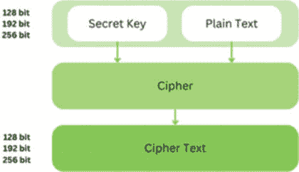

**图 5.4：** AES 算法

## RSA (Rivest-Shamir-Adleman)

RSA 是一种广泛使用的非对称加密算法，以其发明者 Ron Rivest、Adi Shamir 和 Leonard Adleman 命名。它是一种公钥体系，广泛用于安全数据传输、数字签名和密钥交换。

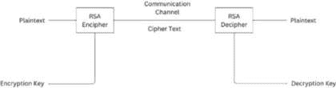

**图 5.5：** RSA 算法

RSA 的工作如下：

*   选取两个大质数（`x` 和 `y`），并确定它们的积（`p = xy`，其中 `p` 称为模）。
*   RSA 选择一个数字 `n`，小于 `p` 且与 `(x-1)(y-1)` 互质。因此，`n` 和 `(x-1)(y-1)` 除 1 之外没有公因子。
*   此外，RSA 选择一个数字 `m`，使得 `nm-1` 可被 `(x-1)(y-1)` 除除。
*   值 `n` 和 `m` 分别为公指数和私指数。
*   公钥是 `(p, n)`；私钥是 `(p, m)`。
*   从公钥 `(p, n)` 获取私钥 `(p, m)` 是困难的。但如果有人能将 `p` 分解为 `x` 和 `y`，那么他们就可以解密 `m`。

大整数分解的复杂性是 RSA 安全性的基础。

数字签名使用 RSA 生成，用于确认信息的完整性和有效性。

RSA 用于安全电子邮件协议（如 PGP）的数字签名和加密。

# 哈希

哈希在密码学领域起着至关重要的作用，用于多种目的确保数据完整性、提供认证并安全存储密码。


**图 5.6：** 哈希

## 哈希算法

哈希算法是将输入数据（有时称为 `message`）转换为固定长度字符字符串的加密操作，该字符串通常表示哈希值或哈码。用于生成数字签名、维护密码安全并确保各种安全应用和协议的数据完整性。

# 消息摘要算法 5 (MD5)

**目标：** MD5 是一种加密哈希函数，接受任何输入数据（通常称为消息）并输出固定大小的 128 位哈希值（32 个十六进制字符）。

数据块由 MD5 算法处理，生成 128 位哈希。它利用位移、位逻辑运算（与、或、异或）以及一系列模算术操作。

**特性：**

*   **确定性**：相同的输入，MD5 总是产生相同的输出（哈希）。
*   **计算快速**：由于其相对快速且高效的计算，MD5 可用于快速哈希操作。
*   **不可逆性**：由于它被设计为单向函数，因此反转该过程并从哈希值获取原始输入在计算上是不可能的。


- **安全性担忧**：`MD5` 被认为在密码学上存在缺陷，在安全是首要考虑的情况下不应再次使用。它包含某些弱性，使其容易受到特定类型的攻击，例如碰撞漏洞（不同的输入产生相同的哈希值）。
- **常见用途**：在过去，完整性检查和校验和是 `MD5` 的两种常见用途。对于密码学应用，由于其弱性，目前强烈不建议使用。
- **漏洞**：当两个不同的输入产生相同的哈希值时，`MD5` 就会受到碰撞攻击。对于数字签名或证书生成等安全至关重要的应用，这使其变得不再适用。

## 安全哈希算法 (SHA)

`SHA` 是由美国国家安全局（NSA）设计并由美国国家标准与技术研究院（NIST）发布的一组加密哈希函数。这些函数中的每一个属于不同的家族，并提供不同水平的安全性。

### SHA-1

- 该函数的输出结果大小为 160 位（20 字节）。
- **漏洞**：不同的输入可以生成相同的哈希值，使其容易受到碰撞攻击。由于这些缺陷，出于密码学考虑，它不再认为是安全的。
- **用法**：考虑到密码学的发展，该算法已过时。它曾被用于证书、数字签名和其他安全流程。

### SHA-2

- `SHA-2` 家族中有多个不同输出宽度的哈函数版本。
    - `SHA-224`：224 位（28 字节）。
    - `SHA-256`：256 位（32 字节）。
    - `SHA-384`：384 位（48 字节）。
    - `SHA-512`：512 位（64 字节）。
- **安全性**：通常认为是安全的，并广泛应用于许多密码应用中，例如区块链技术、SSL/TLS、数字签名和证书。
- **抗碰撞性**：提供高度的碰撞保护，使得两个不同的输入生成相同哈希值变得具有性。
- **应用**：用于许多数据完整性至关重要的安全程序中。

### SHA-3

- `SHA-3` 是安全哈希算法家族的最新成员，其内部结构与 `SHA-1` 和 `SHA-2` 不同。它是通过公开竞赛选出的。
- **输出大小**：可变（例如，`SHA3-256` 输出 256 位）。
- **安全性**：根据 2022 年 1 月的最新更新，`SHA-3` 被认为是安全的，并为密码哈希函数提供了额外的选择。
- **特点**：与 `SHA-1` 和 `SHA-2` 使用的 Merkle-Damgård 结构相比，它使用了不同的海绵结构。
- **应用**：虽然不像 `SHA-2` 那样被采用，但 `SHA-3` 用于各种安全应用，其使用可能会随着时间的增长而增加。

# RACE 完整性原语评估消息摘要 (RIPEMD-160)

名为 `RIPEMD-160` 的加密哈希算法生成 160 位固定大小的哈希值。它是欧洲联盟先进通信技术研发（RACE）项目期间创建的哈函数之一，由 Hans Dobbertin、Antoon Bosselaers 和 Bart Preneel 创建。

- **输出长度**：`RIPEMD-160` 生成的 160 位哈希值通常表示为 40 位的十六进制整数。`RIPEMD-160` 的主要目标包括数据完整性验证、数字签名和其他安全应用，与其他加密哈函数相似。
- **算法**：为了处理输入数据，`RIPEMD-160` 使用了移位、模加和一系列位逻辑操作。它使用特定的数学运算和轮进行构建。
- **安全性**：`RIPEMD-160` 的构建防御了一系列加密威胁，例如碰撞攻击。对于安全需求更高的应用，当安全标准变化时，必须考虑更新的哈希算法。
- **常见用途**：各种加密协议和应用使用了 `RIPEMD-160`。一个显著的应用是在比特币协议中，它用于生成比特币地址所需的公钥加密哈希。

# 哈希的应用

哈希有多种应用，包括：

## 文件哈希

- 文件哈希的主要目标是验证文件的完整性和真实性。它确认了信息在发送或存储过程中没有被更改。
- **应用**：为了产生哈希值，会对原始数据应用哈希函数。发送者可以发送数据及其哈希值。之后，接收者可以独立对接收到的数据进行哈希，并通过比较计算出的哈希与发送的哈希来验证其完整性。

## 数字签名

- 数字签名的目标是提供一种安全的方法来确认数字消息或文档的完整性和真实性。
- **应用**：使用哈希函数创建消息的固定大小表示（即哈希）。然后使用发送者的私钥对该哈希进行签名，创建数字签名。接收者可以使用发送者的公钥验证签名，并将计算出的哈希与接收到的消息单独计算的哈希进行比较。

## 密码存储

- 密码存储的目标是安全地隐藏密码，防止被窥探。
- **应用**：系统保存哈希后的密码值而非实际密码。系统会对登录时输入的密码进行哈希处理，并与保存的哈希进行比较。在发生数据泄露的情况下，这种策略保护了密码，增强了安全性。

## 密钥派生函数

- KDF 的目标是从低熵输入（如密码）提取加密密钥。
- **应用**：密钥派生函数利用哈希函数从密码创建加密密钥。通过增加计算复杂度，该过程增加了攻击者破解密码的难度。

## 消息认证码

- 消息认证码 (`MAC`) 和哈希消息认证码 (`HMAC`) 的目标是保证消息的真实性和完整性。
- **应用**：哈希算法生成消息的固定大小哈希值并结合密钥。通过查询 `MAC` 可以确认消息未被更改且来自可靠源。

## 区块链技术

- 区块链技术的目标是保护分布式账本的完整性。
- **应用**：区块链由一系列连接的块组成，每个块都持有前一个块的哈希。由于修改一个块将涉及修改所有后续块，这确保了安全性。

## 数据去重

- 数据去重的目标是有效查找并删除重复数据。
- **应用**：哈希函数产生数据块哈希值。重复数据可以通过数据块提供相同的哈希结果来识别。

## 加盐

- 在密码哈希中加盐目的是防止其受到彩虹表攻击。
- **应用**：在哈希处理之前，将密码与随机数（`盐`）拼接。这确保了即使两个密码相同，不同的盐也会导致不同的哈希结果。

# 一次性密码 (OTPs)

一次性密码 (`OTPs`) 是一种加密安全功能，仅对单个计算机系统或其他数字设备的登录会话或交易有效。`OTPs` 具有时间敏感性且仅限一次，为静态密码提供了额外的保护。


## 基于时间的一次性密码 (TOTP)

* 它基于哈希消息认证码 (HMAC) 算法。
* **描述**：双重身份验证 (2FA) 通常通过 TOTP 实现。它依赖于客户端和服务器共享一个密钥。使用当前时间和移动因子（或称为时间步长，通常为 30 秒）来构造一次性密码 (OTP)。基于计数器的哈希消息认证码 (`HOTP`) 是一种经常配合 `SHA-1` 或 `SHA-256` 哈希使用的哈函数。

## 基于计数器的哈希消息认证码 (HOTP)

* **算法**：基于 `HMAC`。
* **概述**：`HOTP` 使用每次使用都会增加的计数器值来生成 OTP。OTP 通过对计数器值应用 `HMAC` 生成，服务器和客户端之间交换一个密钥。

## 通用第二因子 (U2F)

* 用于通用第二因子 (`U2F`) 的算法是公钥加密术。
* 快速身份在线 (FIDO) 联盟是建立 `U2F` 标准的组织。为了创建 OTP，它利用了公钥-私钥对。在注册期间，设备会创建一个公钥-私钥对，私钥安全地存储在设备上。服务提供者存有公钥。在身份验证期间，服务提供者使用 `nonce` 对设备进行挑战，设备使用其私钥对 `nonce` 进行签名。

## 基于移动设备的 OTP

* 它基于各种算法（通常基于 `TOTP`）。
* 描述：在移动设备上，许多应用程序（如 `Authy` 和 `Google Authenticator`）都会创建 OTP。对于基于时间的 OTP，它们经常使用基于 `TOTP` 的算法。

# 加密工具

加密工具是实现加密技术以保护信息和通信的软件或硬件应用程序。这些工具用于保护数据的机密性、完整真实真实。

## GnuPG (GPG)

GnuPG 也称为 `GPG`，是一个强大且广泛使用的开源实现，遵循 `OpenPGP` 标准用于安全通信和数据加密。

要在你的系统中安装 `GPG`，请使用以下命令：

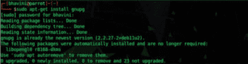

**图 5.7：** 安装 GPG

现在，使用以下命令生成 `GPG` 密钥对：


**图 5.8：** 生成 GPG 密钥对

按照接下来的提示输入名称和电子邮件 ID，并为你的密钥设置一个强密码短。


**图 5.9：** 密码短

现在，你的密钥已生成。


**图 5.10：** 密钥已生成

此信息包含了关于你的公钥的详情。密钥类型为 `RSA`，密钥大小为 3072 位。以下是信息的说明：

* 密钥类型：`RSA 3072-bit`
* 密钥过期日期：`2025 年 12 月 10 日`
* 密钥 ID：`ED8D7DA52A806EC110A27EC44C3416D909D9B9D2`
* 用户 ID (UID)：`Admin <admin@gmail.com>`

此外，还有一个具有相同 `RSA` 3072 位位类型的子密钥，其过期日期与主密钥匹配。

要加密文件，请使用以下命令：

```bash
gpg --encrypt --recipient <key ID> -o <newfilename.gpg> <"filename">
```


**图 5.11：** 加密文件

加密后的文本存储在 `encrypted_file.gpg` 中，你可以使用 `nano` `encrypted_file.gpg` 查看内容。

现在，如果你想解密加密文件，请使用以下命令：

```bash
gpg --decrypt <encryptedfilename> <new file>
```


**图 5.12：** 解密加密文件

输入你密钥的密码短。

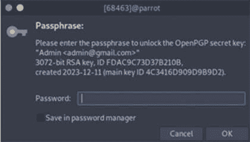

**图 5.13：** 输入密码短

解密后的文本将存储在新文件中

## OpenSSL

OpenSSL 是 `SSL/TLS` 协议的健壮开源实现，并了一了一多功能的加密函数。

使用以下命令创建对称密钥：

```bash
openssl rand -base64 32 > encryption_key.txt
```


**图 5.14：** OpenSSL

此命令生成 32 字节随机数据，以 `Base64` 格式编码，然后将结果保存到名为 `encryption_key.txt` 的文件中。

你可以使用 `nano` 或 `cat` 命令打开密钥文件。

加密文件：

```bash
openssl enc -aes-256-cbc -salt -in <filename> -out <encrypted_file.enc> -pass file:encryption_key.txt
```


**图 5.15：** 加密文件

解密文件：

```bash
openssl enc -aes-256-cbc -salt -in <encrypted_file.enc> -out <decrypted_file> -pass file:encryption_key.txt -d
```
*注：原文中的解密命令不完整；我已根据标准的 OpenSSL 用法进行了格式化*


这就是为什么建议使用缓慢且计算开销大的哈希算法（如 `bcrypt` 或 `Argon2`）对密码进行哈希的原因之一。

可以使用多种策略来防止暴力破解，例如：

* **复杂的密码规定**：确保人员使用安全且唯一的密码。
* **账户锁定策略**：为了防止自动暴力破解攻击，在登录失败达到一定次数后临时冻结账户。
* **速率限制**：为了减慢暴力攻击的速度，对特定时间内内的登录尝试次数设置限制。
* **采用强效的加密**：通过使用长密钥和强效的加密方法，可以大大增加成功暴力破解所需的时间和资源。

# 中间相遇攻击 (Meet-in-the-Middle Attack)

MITM 攻击（不要与中间人攻击 Man-In-The-Middle 混淆）是一种密码分析攻击，它通过结合执行预计算攻击和暴力破解攻击来破坏加密系统。这类攻击对于使用两步过程（如双加密或密钥交换机制）的加密系统特别有效。

以下是中间相遇攻击工作原理的概览：

* **预计算阶段**：攻击者预计算并存储加密或密钥生成过程某部分的结果。这通常涉及对过程的前半部分尝试所有可能的密钥并存储中间结果。
* **暴力破解阶段**：攻击者对过程的后半部分进行暴力破解，尝试所有可能的密钥直到找到匹配项。由于预计算阶段的中间结果已经存储，攻击者在暴力破解阶段不需要重新计算它们。

**示例：**

举例说明，假设双重 DES 加密后产生的消息为 `hPe`，明文为 `Boy`。攻击者使用所有 256 个可能的单 DES 密钥对 `key1` 进行暴力破解攻击，对 `John` 的明文进行加密，并将每个密钥与中间密文一起记录在表中，以便检索用于加密的两个密钥（即 `key1` 和 `key2`）。通过暴力破解，攻击者对 `hPe` 进行多达 256 次解密。当初始暴力破解后在密文表中找到中间密文与第二次尝试的结果相同时，该攻击被认为成功。攻击者一旦找到匹配项，就可以识别两个密钥并完成攻击。这种攻击最多需要 257 次操作，或者最多 256 次。当与双 DES 结合时，这使得攻击者能够轻松获取数据。

# 彩虹表攻击 (Rainbow Table Attack)

彩虹表攻击是一种密码破解攻击，涉及使用预计算的表来破解密码哈希值。出于安全考虑，密码通常以哈希值的形式存储在数据库中，而不是明文。哈希函数将密码转换为固定长度的字符字符串，使得攻击者难以反转该过程并获取原始密码。在彩虹表攻击中，攻击者使用一个预计算的表（`rainbow table`），该表包含明文密码及其对应哈希值的键值对。这些表是通过提前对大量可能的密码进行哈希处理并将结果存储在表中生成的。一旦创建了该表，就可以用来快速查找被捕获密码的哈希值，并找到对应的明文值。

彩虹表攻击背的基本原理是用存储空间换计算时间。攻击者不需要在攻击过程中即时计算密码的哈希，而是可以从彩虹表中快速查找预计算的哈希值。这种方法对于没有包含额外安全措施（如 `salting`）的密码哈希系统是有效的。

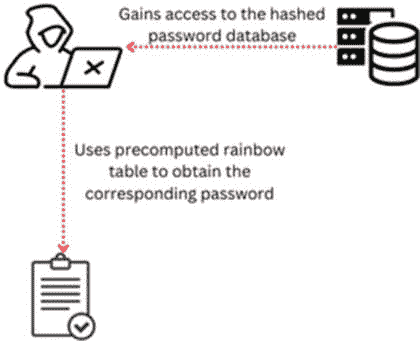

**图 5.20:** 彩虹表攻击

为了防御彩虹表攻击，许多系统使用一种名为 `salting`（加盐）的技术。为每个用户生成一个唯一的随机值（`salt`），并在哈希处理之前与其密码结合。这意味着即使两个用户具有相同的密码，由于唯一的盐，它们的哈希值也将是不同的。因此，彩虹表变得不再那么有效，因为无法为每种可能的盐值进行预计算。

# DROWN 攻击

DROWN 攻击（使用过时和弱化的加密解密 RSA）是一种安全漏洞，目标是支持 SSL/TLS 且仍在使用过时的 SSLv2（安全套接层协议 2 版本）协议的服务器。DROWN 允许攻击者解密用户浏览器与漏洞服务器之间的安全通信。

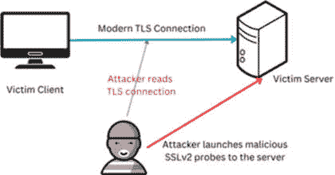

**图 5.21:** DROWN 攻击

以下是关于 DROWN 攻击的关键点：

* **SSLv2 漏洞**：该攻击利用了 SSLv2 协议的漏洞，SSLv2 是一个过时且不安全的 SSL/TLS 协议版本。SSLv2 存在许多安全缺陷，强烈建议不要使用。
* **跨协议攻击**：DROWN 是一种跨协议攻击，意味着它允许攻击者利用一个协议（SSLv2）中的漏洞来攻击支持更现代更安全协议（如 TLS，传输层安全）的服务器。
* **加密密钥恢复**：该攻击的工作原理是利用服务器上多个协议共同使用同一个私钥的特性。攻击者可以使用 SSLv2 对服务器发起一系列特殊构造的连接。通过这些连接，攻击者最终可以恢复用于更安全协议（例如 TLS）的加密密钥。
* **影响**：如果攻击成功，攻击者可以解密并窃听用户与受影响服务器之间的通信。这可能包括敏感数据，如登录凭据、个人信息或财务交易。
* **缓解措施**：缓解 DROWN 攻击的主要措施是禁用对 SSLv2 的支持。此外，鼓励组织使用强力的更新加密协议（如 TLS），并对软件和系统进行补丁更新以修复漏洞。

# 旁信道攻击 (Side-Channel Attack)

旁信道攻击是一种安全攻击，重点在于利用系统在正常运行期间泄露的信息，而不是尝试直接破解加密算法本身。这些攻击利用了来自各种旁信道的意外信息泄露，例如功耗、电磁辐射、计时或声音。

以下是一些常见的旁信道攻击类型：

* **计时攻击**：计时攻击涉及分析系统执行某些操作所需的时间。通过测量这些时间，攻击者可能会获得系统内部工作机制的信息，特别是在涉及加密操作时。例如，执行时间的变化可能会暴露密钥信息。
* **功耗分析攻击**：功耗分析攻击利用设备在加密操作期间功耗的变化。通过监控功耗模式，攻击者可以推断出正在使用的加密密钥。这在功耗随处理的位值而变化的情况下尤为适用。
* **电磁分析攻击**：与功耗分析类似，电磁分析攻击侧重于测量设备在加密操作期间发射的电磁辐射。通过分析电磁发射的波动，可以推导出系统内部状态的信息。


*   **声学密码分析 (Acoustic Cryptanalysis)**：声学密码分析涉及分析系统在加密操作过程中产生的声音。例如，计算机硬盘或键盘发出的声音可能会泄漏正在进行的活动信息，包括加密密钥的生成。
*   **基于缓存的攻击 (Cache-based Attacks)**：这些攻击利用系统缓存访问数据的时间差异。通过仔细测量这些访问时间，攻击者可以推断出正在处理的数据信息。

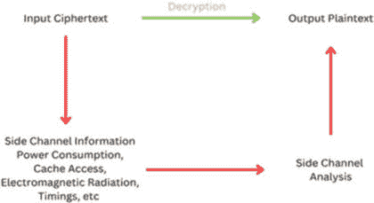

**图 5.22:** *侧信道攻击*

以下是侧信道攻击的一些防御措施：

*   **算法防御**：使用能够抵抗侧信道攻击的算法。
*   **随机化技术**：在加密过程中增加不可预测性，以增加攻击者模式识别的难度。
*   **恒定时间实现**：为了减少计时攻击，确保加密程序执行的时间与秘密值无关。
*   **保护屏蔽**：实施实体的安全措施以减少噪声和电磁辐射。
*   **硬件安全模块 (HSMs)**：使用内置侧信道攻击防御机制的专用硬件，HSM 旨在安全地执行加密操作。

# 密码分析工具

## John the Ripper

John the Ripper（通常简称为 John）是一种广泛使用的开源密码破解工具。它设计用于通过各种破解方法（如字典攻击、暴力破解和混合攻击）来识别弱密码。John the Ripper 支持多个平台，包括 Linux、Windows 和 macOS。它常用于道德黑客、渗透测试和安全评估。

以下是 John the Ripper 的一些关键方面：

*   **密码破解技术**：
    *   **字典攻击**：John the Ripper 使用词列表（字典）系统地尝试不同的单词和短语作为潜在密码。
    *   **暴力破解**：它可以通过尝试所有可能的密码组合来执行穷尽式搜索，这可能耗时但非常有效。
    *   **混合攻击**：将字典攻击与暴力破解结合以提高效率。
*   **哈希算法**：John the Ripper 支持广泛加密哈希算法，包括 `DES`、`MD5`、`SHA-1`、`SHA-256` 等。
*   **社区版**：John the Ripper 有多个版本，包括“John the Ripper 社区版”（John the Ripper Jumbo）和“John the Ripper Pro”（带有额外功能的商业版）。
*   **平台支持**：John the Ripper 适用于各种操作系统，包括 Linux、Windows 和 macOS。
*   **自定义**：用户可以自定义攻击参数、规则和词列表，以根据其特定需求定制密码破解过程。

## Hashcat

使用 Hashcat 可以通过暴力破解攻击、字典攻击和其他复杂方法来破解不同类型的密码哈希值。它是一个广受欢迎且强大的开源密码恢复程序。由于它支持多种哈希算法，因此能够适用于各种安全评估和渗透测试任务。

*   **哈希算法**：Hashcat 支持 `MD5`、`SHA-1`、`SHA-256`、`SHA-512` 以及许多其他哈希算法。它能够处理常见和不常见的哈希类型。
*   **攻击模式**：
    *   **暴力破解**：Hashcat 能够系统地生成并尝试每种组合，直到发现正确的密码。
    *   **字典攻击**：该方法通过使用预计算的词列表或字典，根据频繁出现或可能被使用的短语来破解密码。
*   **性能**：通过利用现代 GPU（图形处理器）和 CPU（中央处理器）的并行处理能力，Hashcat 进行了极大的性能优化。使其能够有效地处理复杂的密码破解任务。
*   **基于规则的攻击**：通过组合和修改字典中的术语，Hashcat 用户可以对候选密码应用规则集，大大增加成功破解密码的概率。
*   **用例**：Hashcat 经常用于道德黑客、渗透测试和安全评估，以评估密码规则的安全性并发现弱密码。

# 公钥基础设施

公钥基础设施（或 PKI）是一种支持数字领域内安全信息传输的强有力架构。PKI 从根本上利用公钥和私钥加密技术来保证机密性、完整性和真实性。PKI 核心部分和程序的概述如下：

*   **公私钥对**：密钥对的概念是 PKI 的基础之一。用户被赋予一个保持保密的私钥和一个公开共享的公钥。用户专有的私钥用于创建数字签名和解密，而公钥用于加密和数字签名验证。
*   **数字证书**：在 PKI 中，数字证书至关重要。这些证书通过将实体的公钥与该身份关联，为人们提供验证密钥所有者合法性的方法。证书包含了密钥数据、发行者详情、身份信息以及由可靠证书颁发机构（CA）生成的数字签名。

## 机构的角色

*   **证书颁发机构 (CA)**：CA 是负责创建和确认数字证书的可靠第三方。它们协作创建一个分层结构，以帮助建立信任。PKI 的核心由 CA 运行。它们负责确认获取数字证书的机构的身份，并授予证明相应公钥合法性的证书。在链的顶端，根 CA 向中间 CA 发放证书，然后中间 CA 再向终端实体发放证书。
*   **注册机构 (RA)**：在与 CA 合作时，注册机构（RA）作为证书请求的转发代理和验证者。在将用户请求转发给 CA 之前，RA 会验证用户，确保数字证书仅授予给授权机构。
*   **证书吊销列表 (CRL)**：CA 发布 列表以维护系统完整性。用户和依赖方可以使用这些列表来确认证书的真实性，因为列表中包含了在到期前被吊销的证书序列号。

PKI 程序涉及的步骤如下：

1.  主体（个人、企业或系统）向注册机构（RA）请求证书以便安全地通信信息。
2.  在确认主体身份后，RA 获取主体的请求并要求 CA 授予用户公钥证书。
3.  一旦 CA 生成将主体身份与主体公钥关联的公钥证书，修改后的数据随后会被转发给验证机构（VA）。
4.  完成交易后，用户使用公钥证书对消息进行正确的数字签名，并将其交付给客户端。
5.  通过询问 VA 用户公钥证书是否仍然有效，客户端确认用户的身份。
6.  VA 通过将用户公钥证书与 CA 提供的新数据进行比较来评估结果（有效或无效）。

# 隐术学


信息隐术是将信息隐藏在文本、图像、音频、视频等看似无害的其他数据中的一种实践。它是各各方之间进行机密通信的有效方法。这种技术是将秘密数据隐藏在普通的、非秘密的文件或消息中，以避免被检测，然后在目的地提取出这些秘密数据。信息隐术的使用可以与加密结合起来，作为隐藏或保护数据的额外步骤。

信息隐术与密码学有所不同。将两者结合使用有助于提高受保护信息的安全性，并防止秘密通信被检测。如果隐藏的数据也经过了加密，数据可能仍然免于检测，尽管信道将不再免于被检测。与仅使用加密的通信相比，结合加密使用信息隐术具有优势。

使用信息隐术隐藏数据相比于密码学的主要优势在于，它有助于模糊敏感数据隐藏在文件或其他带有隐藏文本的内容中的这一事实。加密的文件、消息或网络数据包载荷会被清晰地标记并识别为此类，而使用信息隐术技术则有助于隐藏安全通道的存在。

## 信息隐术算法

信息隐术算法是用于将秘密数据嵌入其他非秘密数据（载体媒体）中以隐藏嵌入信息存在的技术或方法。存在多种信息隐术算法，每种算法都有自己的优缺点。

常见的信息隐术算法包括：

### 最低有效位 (LSB)
- `LSB` 算法涉及将载体媒体（如图像像素或音频样本）的最低有效位替换为秘密数据的位。
- 这是最简单且应用广泛的信息隐术技术之一。
- 它用于 `Steghide` 等工具。

### 扩展频谱
- 该技术将数据分布在宽的频谱范围内，使其难以被检测。
- 跳频和直接序列扩频是扩展频谱隐术中的常用方法。

### 变换域技术
- 诸如 `离散余弦变换 (DCT)` 或 `离散小波变换 (DWT)` 等技术可以应用于频率域或变换域隐藏数据。
- `JPEG` 和 `JPEG2000` 图像通常使用频域隐术。

### 相编码
- 该技术修改信号的相位信息来编码隐藏数据。
- 它常用于音频隐术。

### 回声隐藏
- 这涉及通过操纵音频信号中的回声来嵌入信息。
- 它利用了人耳在某些情况下忽略回声的能力。

### F5 算法
- `F5` 算法是一种基于 `LSB` 和纠正码构建的隐术算法，旨在增加安全性和抗攻击能力。

### Jsteg
- `Jsteg` 是一种用于在 `JPEG` 图像隐藏信息的算法。它修改了 `JPEG` 编码过程的量化表。

### 基于混沌的技术
- 通过使用混沌函数对和隐藏信息，可以将混沌理论应用于隐术。

### 混合技术
- 结合多种信息隐术技术可以增强安全性，并增加检测难度。

# 信息隐术工具

Linux 上的隐术工具允许用户将信息隐藏在其他文件或媒体中，以保护敏感数据或进行秘密通信。

### Steghide
`Steghide` 是一种流行的命令行工具，用于在各种图像和音频文件中嵌入和提取数据。

要在图像文件中隐藏数据，请使用以下命令：


**图 5.23:** *加密文件*

在这里，`cover.jpg` 是载图像，我们在其中隐藏了名为 `hide` 的文件中存在的数据。包含秘密文本的输出图像将保存为 `stg.jpg`。

现在从隐术图像中提取数据，请使用以下命令：


**图 5.24:** *提取数据*

数据将存储在 `output.txt`。

# 密码学与信息隐术

密码学和信息隐术都是用于保护信息的技术，但它们的目的不同且采用的方法独特。

| 密码学 | 信息隐术 |
| :--- | :--- |
| 密码学的主要目的是通过算法和密钥将数据转换为不同的格式（密文），以确保通信和数据的安全。密码学专注于确保信息的机密性、完整性和真实性。 | 信息隐术的主要目的是隐藏信息的存在。信息隐术不是加密数据，而是将其隐藏在另一个看似无害的文件或媒体中，使得隐藏数据的存在变得不明显。 |
| 密码算法通常产生看起来随机或与原始明文明显区别的密文。 | 目标是保持隐藏信息的出现不可检测。载体文件（载体媒体）看起来没有变化，且其包含隐藏数据这一事实并不明显。 |
| 密码学使用数学算法和密钥转换原始数据。 | 信息隐术在另一个文件或媒体中隐藏信息，而不显著改变其原始结构。 |
| 密码学的存在通常是可以检测的，加密强度取决于密码密钥的机密性。 | 检测隐术通常更具挑战性，因为对载体文件所修改非常细微。 |

**表 5.2:** *密码学与信息隐术的区别*

在某些情况下，密码学和信息隐术结合使用，为信息安全提供一种分层方法。密码学可以保护数据内容，而信息隐术可以隐藏正在发生通信或隐藏这一事实。

## 结论

在本章中，我们全面涵盖了保护数字信息的要素组成部分。通过对称和非对称加密算法，它强调了加密工具满足各种安全需求的通用性。对 `公钥基础设施 (PKI)` 的探索强调了其在管理加密密钥和证书以实现数字通信方面的关键作用。密码分析的学习使学习者能够评估和加强加密系统，强调了其动态性。此外，信息隐术的引入展示了在数据中隐藏信息的艺术。本章强调了密码学与更广泛的安全策略之间的相互联系，强调了其在应对不断演变的网络威胁和加固信息安全基础方面不可缺的作用。


入侵检测系统 (IDS) 和入侵防御系统 (IPS) 是网络安全的关键组件，旨在识别和响应计算机网络内的恶意活动。IDS 监控网络流量，寻找可能指示安全泄露的可疑模式或异常，并利用了多种检测方法，如基于特征的检测、基于异常的检测和启发式检测。在检测到潜在威胁时，IDS 会生成警报通知管理员可疑活动。相比之下，IPS 不仅识别恶意活动，还通过阻止或缓解检测到的威胁采取主动措施防止其发生。IPS 可以以内置模式运行，主动防止恶意流量到达其预期目标。IDS 和 IPS 共同通过提供实时监控、分析和响应能力来防御网络威胁和未经授权的访问，从而增强网络的整体安全态势。

### 结构

在本章中，你将学习到：

* 入侵检测系统及其类型
* IDS 用于检测入侵的方法
* 如何在 Linux 操作系统中设置 IDS
* 入侵防御系统及其类型
* IDS 与 IPS 之间的比较
* 在 Linux 操作系统中设置 IPS

# 理解 IDS

IDS 是一种安全设备（软件或硬件形式存在），旨在观察、识别并保护网络或系统免受恶意活动的侵害。在检测到任何入侵时，它会立即通知安全人员。IDS 通过持续检查入站和出口流量，确保持续识别网络或系统内部潜在的安全泄露，证明了极高的价值。它专门检查流量中是否存在与既定入侵模式对应的迹象，并在发现匹配时触发警报。根据功能不同，IDS 可分类为主动式或被动式。被动式 IDS 主要识别入侵，而主动式 IDS（即 IPS，入侵防御系统）则更进一步，不仅能够检测还能防止网络入侵。

## IDS 的功能操作

* **监控**：IDS 实时监控网络或系统活动。它观察入站和出口流量、系统日志和其他相关数据源，以识别任何偏离正常行为模式的偏差。
* **检测**：IDS 的主要目的是检测潜在的安全事件或入侵。它使用多种多种方法（如基于特征的检测、基于异常的检测或基于行为的检测）来识别指示已知威胁或异常活动的模式。
* **警报**：当 IDS 识别出可疑或恶意活动时，它会生成警报通知安全管理员或其他相关人员。这些警报提供了有关被检测事件性质、严重程度及其潜在影响的信息。
* **日志**：IDS 记录检测到事件的信息，包括事件性质的细节、源和目的地址以及发生时间。这些日志对于事后分析、法证调查和合规性目的具有重要价值。

## IDS 在网络中的位置

部署 IDS 的常用位置是靠近防火墙。将 IDS 放置在防火墙外部还是内部取决于监控的目标流量——是来自外部网络的入站流量还是来自内部网络的出口流量。如果位于内部，放置在 DMZ（非军事区）附近 特为有效。尽管如此，通过分层防御方法获得获得安全性，即将一个 IDS 置于防火墙之前，另一个放在网络内的防火墙之后。

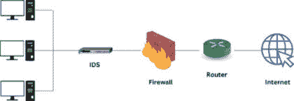

**图 6.1：** IDS 的位置

## IDS 的类型

入侵检测系统 (IDS) 可分为三大类：

## 基于网络的入侵检测系统 (NIDS)

进入网络的每个数据包都会被基于网络的入侵检测系统检查，以查看是否存在任何异常或不准确的数据。通过限制防火墙拒绝大量数据包的能力，NIDS 会彻底检查每个数据包。所有流量都由 NIDS 记录并检查，NIDS 根据内容在 IP 或应用层创建通知。NIDS 比基于主机的 IDS 分布得更广。NIDS 在主机和路由器级别发现异常。在接收到数据包后，它为每个风险分配危险等级并审计数据包中的信息，同时记录恶意数据包的内容。由于威胁量巨大，安全团队必须保持警惕。这些系统通常由一个安装在网络“杂散模式”下的黑盒组成，设计用于监听可能指示入侵的模式。通过网络流量监控，它能发现恶意行为，如 DoS 攻击、端口扫描甚至尝试破坏系统的行为。

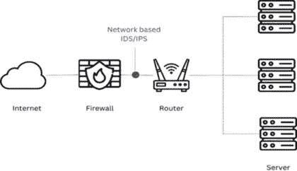

**图 6.2：** 基于网络的 IDS

# 基于主机的入侵检测系统 (HIDS)

HIDS 检查每个系统的操作。你可以将 HIDS 安装在任何类型的机器上，从服务器到桌面电脑。与 NIDS 相比，它更具适应性。基于主机的系统在识别非法文件更改以及非法内部活动方面非常高效。HIDS 关注本地系统的演变。此外，它更具平台特定性，比其他 HIDS 更强调 Windows 操作系统，尽管它们也适用于 UNIX 平台。通常，这些程序包括对在特定主机上发生的事件进行审计。由于监控每个系统事件所需的开销，它们并不特别常见。

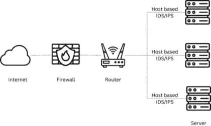

**图 6.3：** 基于主机的 IDS

# 基于启发式的入侵检测系统

基于启发式的入侵检测系统是一种依赖启发式（即源自经验或专家知识的规则或原则）来识别潜在安全威胁的 IDS。与寻找已知攻击特定模式的基于特征的检测，或关注偏离正常行为的异常检测不同，基于启发式的 IDS 使用一组预定义的规则来标记可疑活动。

以下是基于启发式 IDS 的关键方面：

## 启发式指南

* **指定指南**：基于启发式的 IDS 使用一套既定的规则或启发式，这些规则代表了已知攻击技术或恶意行为的共同特征。
* **专家知识**：过去的攻击趋势或安全专家的经验通常是这些规则的来源。

## 行为模式

* **识别攻击模式**：基于启发式的 IDS 识别与已知网络攻击或恶意行为相关的特定活动模式。
* **上下文分析**：为了区分可能是良性的和恶意的行为，它可能会考虑某些活动发生的语境。
* **动态分析**：由于基于启发式的 IDS 系统具有识别已知威胁变体的能力，它们可能比基于特征的系统更具活性。
* **动态规则**：某些启发式设计设计用于根据新威胁或网络环境的变化进行动态调整。

## 启发式类型

* **误用启发式**：关注已知的恶意活动模式，类似于基于特征的检测。
* **异常启发式**：寻找与既定基准的偏差，类似于异常检测。


### 规则
- **基于规则的启发式方法**：使用预定义的规则识别可能指示攻击的特定事件序列或条件。

### 告警生成
- **规则匹配**：当观察到的行为匹配一个或多个预定义的启发式规则时，系统会生成告警。
- **严重级别**：可以根据感知到的威胁水平为告警分配严重级别。

### 局限性
- **误报**：如果合法活动触发了预定义的规则，基于启发式的入侵检测系统（IDS）可能会产生误报（错误地将良活动识别为恶意活动）。
- **静态性**：启发式方法的有效取决于取决于定义规则的准确性和相关性。需要定期更新和调优以适应不断变化的威胁。

### 用场景
- **特定威胁**：基于启发式的 IDS 在识别已知明确模式或特征的特定类型威胁时特别有效。
- **行为分析**：它通过提供基于专家知识的行为分析，对其他检测方法形成补充。

# 检测入侵的方法

在计算机网络或系统内部，有多种检测入侵的方法。这些方法可以大致分类为不同的处理方案，每种方法都有其自身的优缺点。

## 签名识别

签名识别是指识别与已知威胁、攻击或恶意活动相关的已知模式或签名的方法。这种方法通常用于 IDS 和防病毒软件中基于签名的检测系统。以下是签名识别的工作原理：

- **签名数据库**：安全系统维护一个预定义的签名数据库，每个签名代表已知威胁的特定模式或特征。这些签名来自于对之前识别的恶意软件、攻击方法或恶意行为的分析。
- **与网络或系统流量对比**：签名识别系统持续监控网络流量、系统日志或其他数据源寻找与数据库中已知签名匹配的模式。监控可以在网络的各个点进行，取决于它是基于网络的入侵检测系统（`NIDS`）还是基于主机的入侵检测系统（`HIDS`）。
- **告警生成**：当系统识别到观察到的模式与数据库中的签名匹配时，就会生成告警。这通知安全人员或管理员检测到了潜在的安全威胁或入侵。
- **响应**：根据配置，系统可能会触发自动响应或启动预定义的操作来缓解威胁。这些操作可能包括来自特定 IP 地址的流量、隔离受感染的系统或采取其他步骤防止进一步损害。

### 签名识别的优点
- **对已知威胁有效**：签名识别在检测和阻止已知威胁（包括成熟的恶意软件、病毒和攻击模式）方面非常有效。
- **低误报率**：由于它依赖于已知威胁相关的特定模式，误报的概率相对较低。

### 签名识别的局限性
- **无法检测未知威胁**：基于签名的系统对于没有建立签名的新或未知威胁效果较。由于攻击者不断开发新技术和恶意软件，这是一个重大的缺点。
- **静态性**：签名数据库需要定期更新以保持有效。必须向数据库中添加新签名以应对新兴威胁。

## 异常检测

IDS 中的异常检测是一种用于识别偏离正常活动基准的行为模式的方法。与依赖已知恶意活动模式的签名检测不同，异常检测侧重于识别偏离网络或系统中被视为典型或预期行为的情况。以下是 IDS 中异常检测的概述。

### 基准建立
- **正常行为定义**：异常检测从建立网络、系统或特定用户的正常行为基准开始。该基准通过分析历史数据并识别规律活动模式来创建。

### 持续监控
- **实时监控**：IDS 实时监控网络流量、系统日志或其他相关数据源。
- **行为分析**：它将观察到的行为与已建立的基准进行比较，寻找任何偏离或异常。

### 异常类型
- **点异常**：当单个数据点显著偏离常态时发生。
- **上下文异常**：考虑数据点之间的上下文或关系，根据其相互作用识别异常。
- **集体异常**：通过集体分析一组数据点的行为来检测异常。

### 检测算法
- **统计方法**：使用统计分析来识别偏离预期行为的情况。
- **机器学习算法**：采用监督或无监督机器学习技术来学习并适应正常行为，标记任何超出所学模式的内容。
- **启发式方法**：使用预定义的规则或启发式方法根据特定条件识别异常。

### 告警生成
- **阈值与策略**：异常检测系统配置了阈值或策略来定义什么什么是异常。当系统识别出超过这些阈值的行为时，就会生成告警。

### 人工验证与调查
- **告警审查**：安全人员审查生成的告警以确定异常的性质。
- **调查**：可能会对异常进行进一步调查，以理解它们代表的是合法活动还是潜在的安全威胁。

### 异常检测的优点
- **对未知威胁有效**：异常检测能够识别以前未知或新兴的威胁，因为它不依赖预定义的签名。
- **适应性**：异常检测系统可以适应网络环境的变化和演变的攻击技术。

### 异常检测的挑战
- **误报**：如果网络或系统发生了未充分考虑的合法变化，异常检测可能会触发误报。
- **复杂性**：设计和调优异常检测系统可能很复杂，需要尽可能减少误报以保持系统的有效性。

# 告警类型

IDS 生成四种类型的告警：真阳性、假阳性、假阴性和真阴性。

- **真阳性（攻击 - 告警）**：触发报警并促 IDS 像正在发生实际攻击一样做出响应的事件被称为真阳性。事件可能是真实的攻击（黑客试图入侵网络），也可能是演习（安全人员使用黑客工具测试网络区域）。
- **真阴性（无攻击 - 无告警）**：如果 IDS 发现某项活动是可接受的行为，则报告该活动，这被称为真阴性。忽略适当的行为实际上导致了真实的负结果。由于 IDS 在此实例中按预期运行，因此它是没有危险的。


- **误报（无攻击 - 有告警）：** 当没有发生真实攻击却发生了触发告警事件时，就会产生误报。当 IDS 将例行系统活动视为攻击时，就会发生这种情况。误报通常会导致用户对告警的响应能力降低，并且对真实入侵情况的关注减少。管理员在配置测试期间利用误报来评估 IDS 区分合法攻击和误报的能力。
- **漏报（有攻击 - 无告警）：** 当 IDS 无法对实际攻击事件做出响应时，就会产生漏报。由于 IDS 的目的是识别并响应威胁，这种失败是最具危害的。

# 在 Linux 中设置 IDS

在 Linux 上设置 IDS 涉及安装和配置 IDS 软件，以监控网络或系统活动并发现潜在的安全威胁。以下是使用 `Snort` 设置 IDS 的通用指南。

## Snort

要安装 `snort`，请以下命令：

```
sudo apt-get install snort
```

安装成功后，打开配置文件 `/etc/snort/snort.conf` 查看该文件中的所有配置。

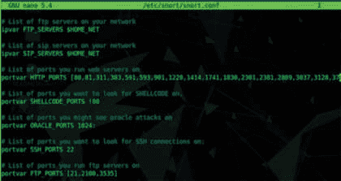

**图 6.4：** `/etc/snort/snort.conf`

要查看规则，进入 `rules` 目录 `/etc/snort/rules`。

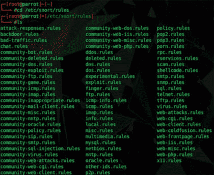

**图 6.5：** `/etc/snort/rules`

要启动检测，使用以下命令：

```
snort -A console -c /etc/snort/snort.conf
```

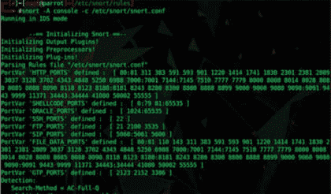

**图 6.6：** `snort -A console -c /etc/snort/snort.conf`

Snort 将捕获并分析所有网络包，并在该部分记录任何可疑活动或尝试的入侵。

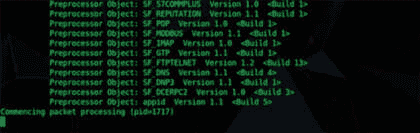

**图 6.7：** Snort 结果

要停止分析，按下 `Ctrl+C`。它将显示所有数据的细分。


**图 6.8：** `Ctrl+C` 后的数据细分

你也可以根据需求和要求在 `local.rules` 文件中编写自己的规则。


**图 6.9：** `local.rules`

这是一条示例规则：

```
alert icmp $EXTERNAL_NET any -> $HOME_NET any (msg: :Example alert Message”; sid:384; rev: 5;)
```

该规则检测从任何外部网络到你家庭网络中任何端口的任何 ICMP ping 事件，然后显示消息 `Example alert Message`。在添加任何规则后，你需要使用以下命令测试 Snort 的配置：

```
snort -T -c /etc/snort/snort.conf
```

验证成功后，你将看到此消息：


**图 6.10：** 检查配置

现在，我们将使用之前提到的命令启动 Snort。

## 从另一台机器执行模拟攻击

现在，我们将从外部网络对我们的系统执行 ICMP ping：


**图 6.11：** ICMP ping

我们可以看到我们的规则已被触发，消息显示在屏幕上。


**图 6.12：** ICMP ping 导致的结果

这里是一些额外的规则示例：

- `alert tcp any any -> $HOME_NET 21 (msg: “FTP Attempted”; sid:60001; rev:1;)`

如果任何外部系统尝试在端口 21 上进行 FTP 连接，将显示消息 `FTP Attempted`。
- `alert tcp any any -> $HOME_NET 22 (msg: “SSH Attempted”; sid:60002; rev:1;)`

如果任何外部系统尝试在端口 22 上进行 SSH 连接，将显示消息 `SSH Attempted`。

现在，当你尝试通过 FTP 连接时，它将显示相应的消息。


**图 6.13：** FTP 和 SSH 连接

结果如下：


**图 6.14：** FTP 和 SSH 连接导致的结果

# 理解 IPS

入侵防御系统（IPS）既能检测也能阻止入侵；因此，它们被称为主动 IDS。持续监控系统（或 IPS）经常被用作防火墙后的额外安全措施。与被动的 IDS 不同，IPS 以内置方式部署在网络中，位于源和目的地之间。它们的目的是主动监控网络流量，并对进入网络的流量做出自动选择。

## IPS 的功能操作

名为 IPS 的网络安全工具旨在识别并停止对网络可能发生的威胁和攻击。以下是 IPS 的主要职责：

- **流量监控：** IPS 实时监控系统和网络活动。
- **基于签名的检测：** 使用已知攻击数据库识别并停止有害通信。这些指标是趋势或特定特征。
- **基于异常的检测：** 通过检查偏离典型网络活动的情况，该技术有助于识别尚未发现的危险。
- **协议分析：** 协议分析是对网络协议的研究，以确保通信遵循公认的做法，并且没有向可能指示恶意意图的方向发展。
- **内容检查：** 检测包内容是否存在任何可能指向恶意行为的模式或签名。这可以包括检查恶意软件、利用程序或其他类型的攻击。
- **数据包过滤：** 根据源目的 IP 地址、端口和协议等参数，可以批准或拒绝数据包。
- **防御与阻止：** 通过阻止或删除恶意包，采取主动措施停止已识别的威胁。这可能包括断开与行为的连接。
- **日志与报告：** 跟踪安全事件、已识别的威胁和系统活动。这些数据不仅对于合规和报告有用，对于评估和调查安全事件也关重要。
- **安全信息和事件管理 (SIEM) 系统集成：** 在 SIEM 系统之间交换数据，以提高威胁管理的有效性并提供安全环境的全视图。
- **自动响应：** 高级 IPS 能够通过执行预设措施自动对安全事件做出反应。这些行动包括阻止 IP 地址、隔离受影响的系统或修改安全规则。
- **持续更新：** 为了跟上新的威胁和漏洞，它定期更新签名数据库和检测系统。

# IPS 类型

入侵防御系统（IPS）可以分为四种类型：

## 主机 IPS

它可以被描述为运行在单个主机上的入侵防御系统类型。这种类型 IPS 的目标是确保内部网络没有有害活动。该 IPS 通过扫描网络获取有关任何异常签名活动的信息，从而阻止恶意行为在特定主机上发生。这种类型 IPS 的主要特征是它不管理整个网络；而是保护其安装的主机免受所有潜在的网络层攻击，使其非常安全。

## 网络 IPS


这可以被视为一种安装在网络内部的替代类型 IPS，用于阻止恶意活动。这种 IPS 的目标是监视或监控整个网络。通过实施这种 IPS，在整个网络中发现的任何恶意行为都可以被阻止。其他如 `Nexpose` 等网络扫描程序可以与此系统结合使用。结果，这种入侵防御系统还会考虑这些工具发现的任何漏洞。即使网络扫描工具识别出的漏洞尚未发布补丁，这种入侵防御系统仍然会保护系统免受利用该漏洞的攻击。

### 网络行为分析

顾如其名，这种 IPS 用于分析网络行为，在网络中移动的每一个网络设备都受到系统的持续监控。`IPS` 确保阻止系统发现的任何具有恶意特征的封包，以防止对应用程序造成损害。

这种 IPS 的主要目标是确保不会在内部网络中创建和发送恶意数据包。使用这种 IPS 的企业始终免于拒绝服务攻击（`DoS`）以及基于隐私侵犯的攻击等侵害。

### 无线 IPS (Wireless IPS)

它可以被视为一种替代的基于无线网络的入侵检测系统。使用这种 IPS，可以跟踪无线网络内的有害行为。通过使用特征码，这种 IPS 会检查或监控在无线网络内移动的每一个数据包。

如果 `IPS` 检测到带有可疑特征的数据包，将阻止该数据包进入网络。如今，无线网络比基于局域网的网络更流行，使其成为最好的 `IPS` 类型之一。它显著提高了网络安全性，并阻止任何恶意网络数据包改变当前环境。

### IDS 与 IPS 的比较

| 功能 | IDS | IPS |
| :--- | :--- | :--- |
| 操作 | `IDS` 监控网络或系统活动，并在检测到可疑行为时发出警报或通知。它不主动防止或拦截威胁 | `IPS` 不仅检测可疑活动，还会采取主动措施防止或拦截潜在威胁。它可以对安全事件做出自动响应 |
| 响应 | `IDS` 提供有关潜在安全事件的信息，但不采取自动操作来停止或缓解威胁。通常需要人工干预来响应警报 | `IPS` 实时主动拦截或缓解已识别的威胁。它可以丢弃恶意数据包、终止连接或采取其他预定义的操作来保护网络 |
| 操作 | `IDS` 主要是一个监控工具。它分析网络流量和系统日志以识别指示未经授权或恶意活动的模式或异常 | `IPS` 结合了对威胁的主动预防、拦截以及 `IDS` 的监控能力。它是执行安全性的工具 |
| 部署 | `IDS` 通常被部署作为额外的安全层，与防火墙和其他安全措施形成补充。它用于检测并对潜在安全事件提供早期警报 | `IPS` 通常被部署为网络防御策略的关键组件。它被策略性地放置，在恶意流量到达目标之前对其进行主动拦截 |
| 灵活性 | `IDS` 通常侵入性较小，因为它不主动拦截流量。它可以用于严格预防措施可能会干扰正常操作的环境 | `IPS` 比 `IDS` 更具侵入性，因为它会主动干预以停止潜在威胁。需要仔细的配置以避免误报和对合法流量的干扰 |
| 示例 | 流行的 `IDS` 工具包括 `Snort`、`Suricata` 和 `Bro` | 流行的 `IPS` 解决方案包括 `Cisco IPS`、带有“inline”模式的 `Snort` 以及具有 `IPS` 能力的 `Suricata` |

**表 6.1：** IDS 与 IPS 的比较

# 在 Linux 中设置 IPS

在 Linux 中设置 `IPS` 涉及使用不仅能检测还能主动防止和阻止网络上恶意活动的软件。`Suricata` 既是 `IDS` 也是 `IPS`，是一个流行的选择。以下是在 Linux 系统上将 `Suricata` 设置为 `IPS` 的一般步骤：

1. 要安装 `Suricata`，请使用以下命令：

```bash
sudo apt install suricata
```


**图 6.15：** 安装 Suricata

2. 要配置规则，可以编辑 `/etc/suricata/suricata.yaml` 文件并根据需求设置规则。


**图 6.16：** `/etc/suricata/suricata.yaml`

3. 要启动 `Suricata`，执行以下命令：

```bash
sudo systemctl start suricata
sudo systemctl enable suricata
sudo systemctl status suricata
```


**图 6.17：** Suricata 状态

你可以看到状态为活动；现在 `Suricata` 正在运行并监控你的系统。

### 添加自定义规则

1. 在 `/var/lib/suricata/rules` 目录下创建一个名为 `local.rules` 的文件。


**图 6.18：** 打开规则文件

2. 现在，将你的自定义规则添加到此文件中。例如，我们在这里展示了一个示例规则：


**图 6.19：** `local.rules`

3. 我们必须将此规则文件添加到 `/etc/suricata/suricata.yaml` 文件中。要为此，请打开 `suricata.yaml` 文件并在 rule-files 下添加 `local.rules`。


**图 6.20：** `/etc/suricata/suricata.yaml`

现在重启 Suricata，规则将应用到监控过程中。


漏洞评估是当代网络安全实践中的关键组成部分。它涉及对组织的数字基础设施进行系统性检查，以识别可能被恶意攻击者利用的潜在弱环节或漏洞。这些漏洞可能存在于软件、硬件、网络配置中，甚至是与人员相关的因素中（如培训不足或意识缺失）。漏洞评估的主要目标包括风险的识别、优先级排序和缓解。这一过程结合了自动化扫描工具和手动测试，使安全专家能够全面评估安全态。漏洞评估的生命周期涵盖发现、优先级排序、修复和验证，并具有持续监控环节以适应不断变化的威胁。对行业标准和法规的遵循通常促使组织定期开展漏洞评估，确保其系统面对潜在网络威胁的持续韧性。

### 结构

在本章中，你将学习以下主题：

*   漏洞评估
*   搭建 VAPT 实验室
*   在 Virtual Box 中安装 Kali Linux
*   安装基础工具
*   侦察与信息收集
*   扫描与枚举
*   理解扫描的工作原理
*   利用与后渗透
*   案例研究与真实世界示例
*   从成功的漏洞评估中学习
*   实施教训总结

# 漏洞评估概述

漏洞评估（VA）是一个评估信息系统、应用程序和网络安全态势的系统性过程，旨在识别并缓解潜在漏洞。它涉及对漏洞进行识别、量化和优先级排序，为组织提供了增强整体安全态势的路线图。VA 是任何稳健网络安全策略不可或缺的一部分，能够实现主动风险管理并防止潜在的安全漏洞。


**图 7.1:** 漏洞评估方法流程图

# Linux 在网络安全中的重要性

Linux 的开源特性、强大的安全性、丰富的工具集和灵活性使其成为网络安全格局的基石。该领域的专业人士经常利用 Linux 执行从渗透测试、道德黑客到管理安全服务器和网络基础设施各种任务。

# 前提条件

为了充分利用这些内容，参与者应该对以下内容有基础理解：

*   计算机网络基础
*   操作系统基础知识
*   熟悉网络安全原理

# 漏洞评估

漏洞评估是一个渗透人员试图发现应用程序和计算机网络逻辑及技术缺陷的过程。例如，在网络 VA 扫描中，渗透人员首先识别操作系统、开放端口和正在运行的服务。检查服务版本对于确定运行版本是否为最新至关重要。在列出任何弱点之前，全面的评估涉及多层级的关联。进行漏洞评估有两种不同方法：自动和手动。

### 自动 VA 扫描

自动化扫描工具（如 `Nessus`、`Nexpose` 和 `OpenVAS`）通过将接收的数据或参数与漏洞数据库进行对比来分析响应。当符合预设条件时，扫描工具识别并列出漏洞。利用自动扫描允许组织简化漏洞检测，最大限度地减少时间、精力和相关成本。

### 手动 VA 扫描

另一方面，手动评估可以揭示任何自动化工具无法检测到的漏洞。然而，手动方法也有其缺点，例如需要额外的精力、时间和成本。

# 渗透测试

渗透测试紧随 VA 之后，渗透人员尝试利用初始扫描中识别出的漏洞。利用（Exploit）旨在触发目标服务器执行未经授权的操作并交付所需的输出。通过利用运行有漏洞的服务，可以执行数据转储、中断和反向连接等各种操作。虽然许多拥有大量数据库的工具可以利用已知的技术漏洞，但手动方法仍然利用业务逻辑流或逻辑缺陷的最佳且最准确的方法。某些组织倾向于在生产环境中进行渗透测试，以评估其安全控制的有效性。

# 搭建 VAPT 实验室

计算机系统和网络组件（如交换机、路由器、服务器和应用）通常在漏洞评估与渗透测试（VAPT）实验室连接。这些系统的设置是为了模拟充满缺陷并设有防护措施的真实网络。

VAPT 实践者必须拥有实验室。它提供了一个安全且受监管的环境，他们可以在那里磨练技能。此外，如果没有获得必要的授权可能会导致严重的法律后果。专家可以在 VAPT 实验室中模拟和测试，而不必担心危害真实的系统或网络。这使得在学习和探索成为可能，帮助他们识别弱点、制定针对性的 VAPT 计划并加强自身的网络和系统。

# 使用 Kali Linux

Kali Linux 是一个开源免费 Linux 操作系统，用于安全研究、渗透测试和数字取证。Kali Linux 基于 Debian GNU/Linux 平台，由声誉良好的信息安全培训供应商 Offensive Security 开发和维护。


**图 7.2:** Kali Linux 关键特性

## 部署 Kali Linux 2023.2

你可以使用 ISO 镜像或虚拟机在 VMBox 中设置 Kali Linux。每种方法都有其优缺点，你的选择取决于你的需求以及你对 Kali Linux 的熟悉程度。有关每种方法的优缺点对比，请参考下表：


**图 7.3:** Kali Linux ISO 安装与虚拟机安装的优缺点对比

## 在 Virtual Box 中安装 Kali Linux

以下是在虚拟环境中安装 Kali 的步骤：

1.  首先，你需要在你的计算机上下载并安装 VirtualBox。

    

    **图 7.4:** 下载并安装 VirtualBox

2.  接下来，下载 Kali Linux 虚拟机

    

    **图 7.5:** Kali Linux 虚拟机

3.  打开 VirtualBox 并点击 `Add` 按钮。按照提示将虚拟机导入到 VirtualBox。

    

    **图 7.6:** 将虚拟机导入到 VirtualBox

4.  虚拟机导入后，你必须配置虚拟机。这包括设置虚拟机将使用的内存和 CPU 资源，以及配置网络设置。

    

    **图 7.7:** 配置网络设置

5.  现在，你可以通过点击 `Start` 按钮启动它。这将引导虚拟机并加载 Kali Linux 操作系统。现在你可以使用默认凭据登录：用户名 `kali`，密码 `kali`。

    


图 7.8：*使用默认凭据登录*

# 安装基本工具

在 Linux 环境中进行有效的漏洞评估，某些工具至关重要。一些广泛使用的工具包括：


图 7.9：*VAPT 工具*

* **Nmap**: 一种强大的网络扫描工具，用于发现计算机网络上的主机和服务，识别开放的并并检测漏洞。
* **OpenVAS**: 开放源漏洞扫描系统（VAS）提供了一个用于漏洞扫描和管理的多个服务和工具的框架。
* **Nessus**: 一个全面的漏洞扫描器，用于识别安全问题、配置错误和潜在威胁。
* **Wireshark**: 一种网络协议分析器，可以实时捕获并检查数据，有助于识别网络漏洞和异常。
* **Metasploit**: 一个先进的渗透测试框架，允许对已知漏洞进行测试和利用。

在继续进行漏洞评估之前，请确保这些工具已在你的 Linux 环境中安装并正确配置。建议定期更新它们，以访问最新的漏洞数据库和功能。

你可以使用 Kali Linux 的包管理器 `apt-get` 安装这些工具。例如，要安装 Burp Suite，可以使用以下命令：

```
sudo apt-get install burpsuite
```

# 侦察与信息收集

侦察是漏洞评估的第一阶段，涉及收集有关目标系统或网络的信息。这一阶段有助于识别潜在漏洞，并为进一步分析提供基础。侦察可以是被动的或主动的，开源情报（OSINT）技术在收集价值信息方面起着至关的作用。


图 7.10：*侦察的类型*

## 被动侦察

被动侦察涉及在不直接与目标交互的情况下收集信息。一些常见的方法包括：

### `WHOIS`

查找目标的 IP 地址和域名所有权信息是侦察的第一步。要从域名注册数据库中检索这些数据，请使用 `WHOIS` 命令。它可能会暴露 IP 地址是谁在托管该域名。

渗透人员可以根据所访问的数据库收集范围信息：

* **注册商 (Registrar)**：分配和监督域名预留的公司。
* **注册人 (Registrant)**：域名的所有者实体或个人。
* **管理和技术 (Admin and Tech)**：负责创建和管理网站的公司或人员。
* **名称服务器 (Name servers)**：将域名解析为 IP 地址。
* **创建和过期日期 (Date of creation and expiration)**：域名注册和取消的日期。
* **状态 (Status)**：域名的当前状态，例如活动、过期等。

**示例：**

运行以下命令：

```
whois ummedcyber.com
```


图 7.11：*whois ummedcyber.com*

# DNS 侦察

域名系统（DNS）侦察是收集有关网站的不同信息的实践，以协助其配置和互联网访问。DNS 解析能够确定连接到网站的 IP 地址，它是该技术的核心组件之一。许多程序包括 `nslookup`、`dig`、`dnsenum`、`dnsrecon`、`dnsmap`、`DNSRecon`、`theHarvester` 和 Sublist3r 可用于 DNS 侦察。我们将以 `DNSenum` 为例，这是一个可以在命令行模式下执行的枚举 DNS 信息的多线程 Perl 脚本，以此演示 DNS 侦察的概念。

输入以下命令：

```
dnsenum
```


图 7.12：*dnsenum ummedcyber.com*

## IP 侦察

IP 侦察是指收集有关 IP 地址的信息，例如开放端口的数量和正在运行的服务。由于这是一种被动侦察的形式，因此从 Shodan 等被动源获取这些信息是重要的，而不是向目标发送直接请求。

在 IP 侦察期间，渗透测试人员可以收集广泛的信息，例如：

* **开放端口 (Open ports)**：提供目标 IP 地址上开放端口的列表。
* **运行的服务 (Running services)**：许多大型数据库被动存储运行在各种 IP 地址上的服务信息。
* **反向查询 (Reverse lookup)**：IP 侦察用于识别关联域名或确定 IP 范围。

互联网上有各种用于反向查询的工具，我们将免费网站 [www.viewdns.info](http://www.viewdns.info)。

除了 IP 反向查询，该网站还提供了多个搜索选项，有助于在单一平台上进行全面的侦察：


图 7.13：*搜索 IP 进行反向查询*

下面的图说明了反向 IP 查询响应：


图 7.14：*反向 IP 查询响应*

## 主动侦察

主动侦察涉及直接与目标交互以收集信息。方法列如下：

### 主机发现

主机发现是网络侦察的第一步，用于识别攻击的潜在目标。它涉及识别目标网络内的活动主机。主机发现的传统方法是使用 ICMP 回显来检查主机状态，但这经常被网络安全措施阻挡。尽管如此，主机发现工具仍然具有选项和内置脚本来检查主机状态。

在本例中，我们将使用 `Nmap` 进行主机发现。`Nmap` 是“Network Mapper”的缩写，是一种用于网络发现和安全审计的免费开源工具。虽然 `Nmap` 通常在命令行界面使用，但也有一个名为 `Zenmap` 的图形界面。让我们执行 ping 扫描来识别网络上的主机。

**运行以下命令：**

```
nmap -v -sP 192.168.159.129
```


图 7.15：主机扫描

下面的表显示了主机发现技术和标记。


图 7.16：*主机发现技术和标记*

`Nmap` 的一些实际应用概述如下：

### 扫描与枚举

扫描和枚举是漏洞评估的关键阶段，涉及对目标系统或网络进行系统性探索，以识别开放端口、和服务潜在漏洞。

**端口扫描**

端口扫描技术用于识别主机上准备好连接的开放端口。`Nmap` 提供了多种识别开放端口的技术。作为使用 `nmap` 进行端口的演示，运行以下命令：

```
nmap -v -p 22 192.168.159.129
```

在这里，`-p` 用于指定我们要扫描的端口号或范围：


图 7.17：*使用 nmap 进行端口扫描*

**运行的服务和版本检测**

要确定服务名称和版本，可以在 `Nmap` 命令中使用 `-sV` 标记。我们将运行以下命令：

```
nmap -v -p 22 -sV 192.168.159.129
```


图 7.19：*使用 nmap 进行运行的服务和版本检测*

下面的图描绘了端口扫描攻击：


图 7.20：*端口扫描攻击*


漏洞扫描是一个持续的过程，定期扫描有助于组织在新兴威胁和新漏洞时保持领先。以下是其工作原理的逐步说明：


**图 7.21：** 漏洞扫描流程的工作

1. **创建资产清单**：漏洞扫描器识别并创建所有连接到网络的系统清单。它会识别每个设备的操作系统、软件、开放的端口和用户账户。
2. **扫描攻击面**：接下来，扫描器对网络、硬件、软件和系统进行扫描，以识别潜在的风险暴露和攻击向量。
3. **与漏洞数据库对比**：漏洞扫描器检查已知的缺陷（如 `CVEs`）以及通往目标攻击面上敏感数据的潜在路径。
4. **检测与分类**：扫描器检测并分类系统弱点，识别攻击者可能利用的漏洞。
5. **报告**：扫描器随后创建关于漏洞及其修复方法的报告，以帮助组织确定工作优先级。
6. **采取修复措施**：根据漏洞扫描报告，组织可以采取行动处理已识别的漏洞。这可能包括应用补丁、更新软件、重新配置系统或实施其他安全措施。

## 扫描检测的常见漏洞

漏洞取决于所使用的扫描工具和扫描过程的配置。通过这种方式，你可以检测到：

* 配置错误的系统，可能具有攻击者可以利用的默认设置或弱设置。
* 具有已知漏洞的过旧软件应更新到最新的补丁和安全修复。
* 攻击者用于未经授权访问系统或账户的弱密码。
* 缺少易受已知漏洞利用的补丁。
* 开放的端口和服务，可能成为攻击者的潜在入口点。
* 系统中不安全的配置，可能会暴露敏感数据或允许未经授权的访问。
* 启用默认凭据的设备，有助于攻击者进行利用。
* 使用不安全网络协议的系统，例如旧版本的 `SSL/TLS`。

## 漏洞扫描的最佳实践

* 建立一个涵盖流程六个步骤的框架，对其进行记录并使用其执行漏洞扫描过程。
* 一致的扫描有助于在安全漏洞被利用之前识别并解决它们。
* 扫描连接到你生态系统的每个设备，包括安全内部网络防火墙后的系统。
* 为关键资产分配所有者，以确保漏洞得到及时识别和处理。
* 根据识别出的漏洞的严重程度优先考虑补丁过程。
* 记录所有结果，以确保漏洞得到及时跟踪和处理。
* 使用多种工具（例如至少两个具有不同方法的扫描器），以获得跨厂商的结果和更好的的覆盖率。
* 使用插测量工具提供最准确且具可操作的结果，减轻安全团队的分类分治负担。
* 识别你不同的攻击向量，以便为你的业务找到合适的扫描器。

# 理解扫描的工作原理

扫描分为四个主要步骤，如图所示。


**图 7.22：** 漏洞扫描步骤

1. **主机发现**：主机发现是初始阶段。我们将对扫描的每个目标 IP 探测约 20 个常用端口（`13 TCP`、`6 UDP` 和 `ICMP`），以检查是否收到了响应。如果只收到一个答案，扫描将进入下一阶段。
2. **垂直端口扫描**：在接收到目标机的响应后，我们进行半开放 `SYN` 扫描，或垂直端口扫描。此步骤的目标是定位开放端口，以便我们随后识别在目标主机上运行的服务。
3. **服务发现**：在发现 `TCP/UDP` 端口开放后，扫描器会执行活动服务发现测试，尝试确定每个开放端口上运行哪些服务。我们能够命名超过 300 种不同的服务类型。例如，我们首先在端口 `80` 上发起一个 `HTTP Get` 请求。如果我们收到 `200 OK` 响应，则请求成功，我们能够定位到在端口 `80` 上等待的 `Web Service`。我们最初尝试为端口 `22` 建立 `SSH` 连接。如果没有收到 `SSH` 答，我们将尝试列表中的其他服务，直到找到正确的。通过这种方式，我们可以独立于其监听的端口来识别单个服务。
4. **VM/PC 评估**：在找到并正确识别监听的服务之前，将进行漏洞和合规性测试。我们意识到可以使用应用程序的语言或协议来与其通信并获取数据。例如，如果是 `HTTP` 服务器，我们可能会发送 `HTTP` 请求以获取符合监听服务协议的数据。

每个漏洞检查都是非侵入性的，这意味着扫描器永远不会真正利用漏洞。相反，我们只使用操作系统版本检查、远程检查、验证检查和 banner 版本检查等方法收集数据。然后，我们根据获取的信息和安全公告（Security Advisories）发布相关的漏洞信息。

# 利用与后利用

利用和后利用是漏洞评估过程中的关键阶段。虽然漏洞评估的主要目标是识别和修复弱点，但理解这些漏洞如何被利用以及攻击者在后利用阶段可能会做什么同样重要。

此外，`Metasploit` 包含了在利用完成后发挥作用的后利用模块。这些模块有助于保持对目标系统的访问、提升权限或积累额外数据。让我们探索一个实际示例来理解辅助模块（Auxiliary）、利用模块（Exploit）和后利用模块（post-exploitation）的角色。我们将使用端口 `80` 的 Metasploitable 2 机器。这是一份从收集信息到利用的逐步指南：

1. 在 Metasploitable 2 IP 上运行 `Nmap`，观察到 `8180` 端口开放并运行 `Tomcat` 服务。

**图 7.23：** 在 Metasploitable 2 IP 上运行 Nmap

2. 尝试使用 `http://metasploitableIP:8180` 打开页面时，点击左侧面板中的任何链接都会提示用户登录。

**图 7.24：** 打开 8180 页面

3. 为了获取登录凭据，可以使用 `msf` 中的 `auxiliary/scanner/http/tomcat_mgr_login` 辅助模块并执行所需的命令。

**图 7.25：** 获取登录凭据

4. 成功运行将显示登录凭据。

**图 7.26：** 登录凭据

5. 发现凭据后，登录并导航到列应用程序选项卡。在这里你会发现多种上传文件的选项。你可以使用 `msconsole` 现有利用模块尝试利用上传漏洞，或者使用 `msfvenom` 创建一个新的利用模块。


6. 对于漏洞利用，可以使用 `exploit/multi/http/tomcat_mgr_deploy` 模块。你必须确保设置 manager 的用户名和密码，以及从辅助扫描中获得的其他选项。


**图 7.28:** 配置并运行利用程序

7. 这样，我们获得了 `meterpreter session`，但它并没有授予 root 级访问。


**图 7.29:** Meterpreter session

8. 为了提升权限并成为 root 用户，你可以尝试利用任何可用的设置 User ID (SUID) 二进制文件。然而，在运行任何命令之前，你应该通过执行以下命令从 meterpreter 进入 shell：


**图 7.30:** 来自 meterpreter 的 shell

9. 使用 `Nmap` 可以进行权限提升并成为 root 用户。我们将运行以下命令：

```
nmap --interactive
```


**图 7.31:** 权限提升

10. 在获得 `Metasploitable 2` 的 root 级访问后，用户可以进行各种横向移动来实现目标。


**图 7.32:** 横向移动

## 漏洞利用

在没有 Metasploit 的情况下利用漏洞需要高级的技术知识以及对目标系统和被利用漏洞的深度理解。一种方法是使用 Python 或 C 等编程语言编写自定义利用代码。另一种方法是使用公开的利用程序或脚本，对其进行修改以适应目标系统和漏洞。

为了利用 Metasploitable 2 机器上的 vsFTPd 服务，我们将使用 telnet 并触发现有后门以获取反向 shell 访问。以下是具体步骤：

1. 运行以下命令：

```
telnet <IP address of Metasploitable 2> 21
```


**图 7.33:** 运行 telnet

2. 通过输入 `USER random string` 后跟一个笑脸 :)，然后输入 `PASS another random string` 并按 `Enter` 来输入凭据。要退出 `telnet`，按 `Ctrl + ]` 然后按 `Enter`。


**图 7.34:** 输入凭据

3. 一旦成功利用 `vsFTPd 2.3.4`，将创建一个绑定到端口 6200 具有 root 权限的 shell。要连接到该 shell，运行命令 `nc <IP address of Metasploitable 2> 6200`。


**图 7.35:** 连接到端口 6200 的 shell

# 报告编写概述

在网络安全评估中，报告编写至关重要，特别是对于 VAPT（漏洞评估与渗透测试）。它涉及记录来自技术和非技术评估的发现、严重性、影响和建议。目标是提供评估结果的清晰简洁的表示，帮助利益相关者理解已识别的漏洞或差距，并有效采取适当的风险缓解措施。

## 良好的报告的组成部分

VAPT 报告必须遵守适用的指南和监管要求，这些要求在不同组织之间、不同行业标准之间甚至不同国家之间可能存在显著差异。在这种情况下，渗透测试报告应涵盖满足所有监管和合规机构基本需求的最低基准标准。因此，通过彻底理解这些多样化的需求，我们可以创建一个包含以下几个核心组成部分的全面报告。


**图 7.36:** 渗透测试报告的组成部分

### 跟上不断演变的威胁

领先于不断演变的威胁需要一种主动且适应的方法：

*   **威胁情报**：订阅并利用威胁情报馈，以了解最新的威胁、漏洞和攻击技术。然后根据这些信息相应调整安全控制措施。
*   **定期培训**：为安全团队提供定期培训，使其了解新兴威胁和不断演变的攻击技术。这包括模拟和实操练习，以增强他们的实战技能。
*   **协作**：与外部组织、行业小组和政府机构建立合作，共享威胁情报和最佳实践。协作努力可以为新兴威胁提供更广泛的视角。
*   **安全意识计划**：教育所有员工了解最新的网络钓鱼技术、社会工程策略和其他常见的攻击向量。人为错误是许多安全事件中的重要因素，因此提高意识至关重要。
*   **更新策略和程序**：定期审查并更新安全策略及程序以应对新威胁。确保安全控制措施与组织的风险容忍度和不断演变的威胁格局保持一致。
*   **渗透测试**：定期进行渗透测试，以便在攻击者利用漏洞之前识别并解决漏洞。这种主动的方法有助于组织走在潜在威胁之前。

## 案例研究与现实示例

近年来，各种网络攻击展示了网络安全威胁对组织和个人的巨大影响。让我们探索一下其中的一些著名案例：

## 案例研究 1：WannaCry 勒索软件攻击

**日期**：2017 年 5 月

**受影响系统**：全球范围内的 Windows 操作系统

**描述**：WannaCry 是一种全球传播的勒索软件攻击，它会加密受感染计算机上的文件并要求用比特币支付赎金。

**要点：**

*   **利用的漏洞**：WannaCry 利用了 Windows Server Block (SMB) 协议中一个名为 `EternalBlue` 的漏洞，该漏洞据认为是 NSA 开发的泄露工具包的一部分。
*   **快速传播**：勒索软件在组织中迅速传播，影响了医疗系统等关键基础设施并导致运营中断。
*   **教训**：这一事件强调了及时应用安全补丁的重要性以及组织保持软件更新的需求。

## 案例研究 2：Stuxnet 蠕虫

**日期**：2010 年发现

**受影响系统**：Windows 操作系统，专门针对西门子工业控制系统

**描述**：Stuxnet 是一种复杂的蠕虫，目标是伊朗的核设施，旨在破坏浓缩离心机。

**要点：**

*   **针对性攻击**：Stuxnet 专门针对监控控制与数据采集 (SCADA) 系统，展示了高度针对性网络武器的能力。
*   **利用零日漏洞**：Stuxnet 利用了多个零日漏洞，包括微软 Windows 和西门子软件中的漏洞，使得检测和缓解变得困难。
*   **国家级参与**：Stuxnet 被广泛认为是国家支持的网络武器，它的发现引发了对网络空间军事化的担忧。

# 从成功的漏洞评估中学习

成功的漏洞评估为有效的网络安全实践提供了见解。以下是几个示例：

*   **某金融机构的定期扫描**：一家金融机构在其网络中实施了定期漏洞扫描。通过这种方式，他们在漏洞被利用之前识别并修复了关键漏洞。这种主动的方法显著降低了安全泄露的风险。


*   **医疗机构的全面测试**：某医疗机构对其应用程序和系统进行了彻底的渗透测试。测试揭示了一系列漏洞，包括弱的身份验证机制和未打补丁的系统。解决这些漏洞增强了整体安全态势，并符合对医疗数据保护法规的合规性。
*   **电子商务平台的持续监控**：某电子商务平台通过结合入侵检测系统和异常检测工具实现了持续监控。这种方法有助于检测并阻败多次攻击尝试，从而保护了客户数据并确保了业务的连续性。

# 实施经验教训

在分析安全泄露事件并从成功的漏洞评估中学习后，组织可以实施经验教训来加强其网络安全态势：

*   **补丁管理**：开发并实施稳健的补丁管理流程，以及时处理已知漏洞。从 Equifax 泄露等事件中学习，并理解保持软件和系统更新的重要性。
*   **供应链安全**：通过彻底审查第三方供应商和监控软件供应链来增强供应链安全。SolarWinds 事件强调了组织需要对其集成到环境中的工具和服务的安全性保持警惕。
*   **应急响应规划**：制定并定期更新应急响应计划。Colonial Pipeline 事件强调了拥有定义良好的应急响应程序的关键作用，包括通信计划和快速恢复策略。
*   **主动测试**：定期进行漏洞评估、渗透测试和红队演练。实施从成功评估中获得的经验教训，以解决薄弱环节并持续改进安全态势。
*   **用户意识与培训**：投资于持续的用户意识提升和培训计划，以降低社会工程攻击的风险。人为因素是安全泄露的共同因素，教育用户可以成为一种有力的防御。
*   **持续监控与检测**：实施持续监控解决方案，以快速检测并响应安全事件。电子商务平台的示例展示了主动监控方法如何阻败潜在的攻击。

## 结论

在本章中，我们学习了在 Linux 环境中集成漏洞评估对于维护稳健且安全的 IT 基础设施至关重要。Linux 广泛应用于服务器、嵌入式系统和网络设备，需要进行警觉的监控以识别并处理潜在漏洞。漏洞评估的全面性（涵盖了自动化扫描工具和手动测试）使得依赖 Linux 系统的组织能够系统地评估其安全态势。

在完成漏洞评估和渗透测试（VAPT）之后，主动准备我们组织可能面临的攻击至关重要。因此，在接下来的章节中，我们将深入探讨灾难恢复策略的复杂性。这些策略包含了周密的准备和既定协议，旨在确保对重大网络灾难做出快速高效的响应并从中恢复。

# 第 8 章

# 创建有效的灾难恢复策略

## 引言

灾难恢复是指为了确保对重大网络灾难做出快速高效的反应和恢复而建立的方法论准备和程序。此类灾难的示例包括网络攻击、数据泄露、系统故障以及其他危害关键信息资产机密性、可用性或完整性的事件。有效的灾难恢复通过保护机密数据并确保公司活动的持续，能够减少财务损失并维护组织的声誉。

### 结构

在本章中，我们将学习：

*   灾难恢复的需求
*   对 Linux 系统的威胁
*   灾难恢复的方面
*   制定详细恢复计划
*   备份与恢复策略
*   DRP 测试
*   DRP 案例研究

# 灾难恢复对安全专业人员的重要性

灾难恢复（DR）对于安全专业人员至关重要，因为它在发生意外灾难时保护组织的资产并确保业务连续性。对于安全专业人员来说，灾难恢复出于以下原因至关重要：

*   **减少停机时间**：在灾难发生（无论是自然灾害、网络攻击、硬件故障或其他事件），灾难恢复计划有助于减少停机时间。安全人员对于确保系统能够及时恢复以防止企业运营长期中断至关重要。
*   **数据保护与完整性**：安全专家负责维护数据的隐私性、可用性和完整性。灾难恢复计划包含了保护关键数据的措施，确保其在恢复期间和之后保持安全完好。
*   **应对网络威胁的韧性**：由于网络攻击频率的增加和复杂化，安全专家必须将灾难恢复计划纳入其网络安全态势中。DR 计划有助于系统恢复到安全状态，并在安全泄露时防止关键数据泄露。
*   **合规性要求**：许多业务的规定要求制定灾难恢复计划。安全专家需要确保 DR 程序符合这些规则，以避免不合规带来的财务罚款和法律后果。
*   **声誉损害**：当组织快速高效地从灾难中恢复时，其声誉会得到提升。通过有效管理和从安全事件中恢复，安全专业人员有助于维护利益者、合作伙伴和消费者的信任。
*   **防止财务损失**：长时间的停机、数据丢失或声誉损害可能导致巨大的财务损失，而使用有效的灾难恢复程序可以避免这些损失。安全专家确保系统和数据及时恢复，增强组织的财务韧性。

# Linux 系统的常见威胁

尽管 Linux 具有强大的安全措施，安全风险仍可能来自各种来源，理解这些威胁对于提供可靠防御至关重要。以下是与 Linux 系统相关的风险：

*   **恶意软件和病毒**：Linux 比某些其他操作系统更容易受到影响，尽管它仍然面临传统的病毒和恶意软件。如果发现并利用了安全漏洞，即使是用户批准的应用程序，恶意软件仍可能构成威胁。
*   **未经授权的访问（暴力攻击）**：攻击者可能尝试使用弱密码或默认密码获取 Linux 机器的未经访问。在暴力攻击中，会一个一个尝试每一个可能的密码，直到找到正确的密码。通过实施账户锁定和强密码规则等安全措施可以降低风险。


*   **漏洞利用**：攻击者可能会利用 `Linux` 内核、系统库或外部程序中的漏洞。补丁管理和定期安全升级对于修复已知漏洞和阻止利用至关重要。
*   **拒绝服务 (DoS)**：`DoS` 旨在通过流量使系统或网络过载，以防止用户访问。`Linux` 系统可能会通过向其发送大量流量或利用安全漏洞耗尽所有可用资源而受到攻击。通过使用防火墙和速率限制可以减少这些危险。
*   **钓鱼攻击**：没有任何操作系统可以完全免受钓鱼攻击。欺骗 Linux 用户泄露个人信息或下载有害软件的钓鱼技术仍然存在。反钓鱼攻击最重要的防御措施是用户意识和教育。
*   **不安全的配置**：配置不当的系统可能会带来安全风险。这包括设计不当的防火墙、暴露的网络端口、运行不需要的服务以及松的安全配置。可以通过定期的安全审计和系统加固程序来解决不安全设置。

准备是减轻不可预见灾难潜在影响的关键，因为灾难的发生仍然是不可预测的。通过提前采取主动措施，我们可以显著地减少不利影响，并增强面对不确定性时的韧性。

# 灾难恢复

组织在破坏性事件后恢复或维护关键技术系统和基础设施时使用的方法、指南、工具和实践被称为灾难恢复，或 `DR`。这种情况有时被称为“灾难”，可能涉及硬件故障、网络攻击、自然灾害或其他导致大量停机或数据丢失的事件。灾难恢复的主要目标是尽快将关键系统和流程恢复到运行状态，同时对业务连续性的影响降至最低。

一个成功的灾难恢复计划是一个包含策略、方法和程序的详细文档，以确保灾难发生时业务连续以及关键系统和数据的恢复。以下是有效的灾难恢复计划应包含的关键组件：

*   **恢复点目标 (RPO)**：这代表恢复操作过程中可能的数据丢失。您可以通过更改备份数据的频率来控制这一点。
*   **恢复时间目标 (RTO)**：这是对灾难性事件后恢复到正常所需时间的大致估计。通常，较快的 `RTOs` 比较慢的 RTO 需要消耗更多资源。
*   **远程数据备份**：每个灾难恢复计划的基础是为您最关键的信息创建一个次级的异地备份。
*   **责任图**：谁负责执行灾难恢复策略？当责任图中明确定义了角色和职责时，快速且一致地遵循和实施计划将变得简单。
*   **DR 计划测试**：为了确保在真实紧急情况下满足 `RTOs` 和 `RPOs`，`DR` 计划通常要求进行定期测试。

## 灾难恢复计划

一个健壮的灾难恢复计划 (`DRP`) 应该包含潜在的破坏性场景及其处理方法。灾难可能会导致员工流离或使他们无法工作。因此，确保灾难恢复计划 (`DRP`) 易于获取且易理解至关重要。


**图 8.1**：*创建 DRP*

当您开始规划公司的 `DRP` 时，请考虑以下要素：

### 1. 目标
首先，公司应该列出灾难恢复计划的目标，这些目标包括对灾难所需的响应、如何限制损害范围、如何尽可能地减少灾难对正常运行的影响、如何以及何时对人员进行此类事件的培训等。

### 2. IT 清单
在 `DRP` 中，IT 清单列表是一个关键组件，它概述了组织 IT 资产的关键信息。该清单是 IT 专业人员在灾难恢复工作中的参考点。以下是 IT 清单中通常应包含的内容：

| 硬件 | |
| :--- | :--- |
| 服务器（物理和虚拟） | |
| 网络设备（路由器、交换机、防火墙） | |
| 存储设备 (`SAN`, `NAS`） | |
| 终端设备（台式电脑、笔记本电脑、平板电脑） | |
| 备份设备（磁带驱动、备份服务器） | |

| 软件 | |
| :--- | :--- |
| 操作系统 | |
| 应用软件 | |
| 中间件 | |
| 数据库管理系统 | |

| 网络基础设施 | |
| :--- | :--- |
| IP 地址和子网 | |
| 域名和 `DNS` 配置 | |
| `VPN` 配置 | |
| 网络拓扑图 | |

| 数据和数据库 | |
| :--- | :--- |
| 数据库和数据库服务器 | |
| 数据存储位置 | |
| 数据复制机制 | |
| 备份和恢复程序 | |

| 通信系统 | |
| :--- | :--- |
| 邮件服务器 | |
| IP 语音 (`VoIP`) 系统 | |
| 协作工具（例如，即时消息、视频会议） | |

| 安全系统 | |
| :--- | :--- |
| 防火墙和入侵检测/防御系统 | |
| 杀毒病毒和反恶意软件解决方案 | |
| 安全证书和加密密钥 | |
| 访问控制系统 | |

| 配置信息 | |
| :--- | :--- |
| 服务器和网络设备的系统配置 | |
| 软件配置和设置 | |
| 自定义脚本和自动化工具 | |

| 供应商信息 | |
| :--- | :--- |
| 硬件和软件供应商的联系信息 | |
| 支持合同和服务服务水平协议 (`SLAs`) | |

| 关键应用程序 | |
| :--- | :--- |
| 关键业务应用程序列表 | |
| 之间的依赖关系 | |
| 恢复优先级 | |

表 8.1：*IT 清单*

### 3. 备份程序
它概述了在何处以及如何备份数据资源，以及恢复备份数据的指令。有三种备份程序：

1.  **全量备份**：制作完整数据的副本，包括文件、文件夹、设置和应用程序，位于硬盘、`SSD`、`HDD` 等存储设备上。
2.  **增量备份**：涉及备份自上次备份以来更改的所有文件。
3.  **差异备份**：涉及备份自上次全量备份以来更改的所有文件。

### 备份标准
备份标准是为了确保系统化和安全地创建、存储和恢复数据备份而建立的和实践。遵循备份标准有助于组织保护数据、维持业务连续性并符合法规要求。要素包括：

*   **数据分类**：根据数据的关键性和敏感性对其进行分类。这种分类有助于确定备份所需的频率和保护级别。
*   **备份类型**：指定要执行的备份类型，例如全量备份、增量备份或差异备份。不同类型有不同的用途并影响存储需求和恢复时间。
*   **保留策略**：定义备份应保留多久。考虑法律和合规性要求，以及业务需求。保留策略有助于管理存储成本并在需要时确保数据可用。


- **备份计划**：根据数据性质和业务需求建立定期备份计划。关键数据可能比不关键数据更频繁地备份。
- **测试与验证**：定期测试备份和恢复过程，以确保备份有效且能够成功恢复。这包括验证备份期间和恢复后的数据完整性。
- **安全措施**：实施数据传输和静态数据加密等安全措施。保护备份免受未经授权的访问对于维护数据的机密性和完整性至关重要。
- **异地存储**：将备份存储在地理位置不同的地点，以降低由于局部事件（如自然灾害或主存储位置物理损坏）导致的数据丢失风险。
- **版本控制**：考虑实施版本控制以保留文件的多个历史副本。这允许从特定时间点恢复，并防止数据损坏或意外更改。
- **文档记录**：维护整个备份和恢复过程的详细文档。文档应包含程序、配置以及对备份系统进行的任何更改。
- **监控与报告**：实施监控工具跟踪备份状态，并在发生故障或异常时接收警报。定期审查报告以确保备份系统按预期运行。
- **定期审计**：定期进行审计以评估备份策略的有效性。审计有助于识别备份和恢复过程中的潜在漏洞和改进领域。
- **合规性**：确保备份策略与适用于组织的行业法规和合规标准一致。这在医疗和金融等行业尤为重要。
- **用户教育**：教育用户和 IT 人员数据备份的重要性、他们在流程中的作用，以及发生数据丢失时应遵循的程序。
- **灾难恢复计划集成**：将备份策略与整体灾难恢复计划集成，确保数据保护和业务连续性的全面方法。

### 备份工具

有很多备份工具可用，从企业级解决方案到开源和云端服务。备份工具的选择取决于组织规模、数据类型、预算限制和特定需求等因素。以下是不同类别的备份工具列表：

- **企业级解决方案**：
    - **Veeam Backup and Replication**：适用于虚拟和物理环境的全面解决方案。
    - **Veritas NetBackup**：适用于各种环境的企业级数据保护。
    - **Commvault**：云和本地环境的统一数据管理。
- **云备份服务**：
    - **AWS Backup, Azure Backup, Google Cloud Backup**：云提供商为其各自平台提供的原生备份服务。
- **开源**：
    - **Duplicity, Bacula, Amanda**：具有各种功能和能力的开源备份解决方案。

### 备份清单

- 选择哪些数据和系统需要备份。
- 确定哪种备份类型（全量、增量或差异）最适合特定类型的数据。
- 决定存储类型（本地服务器、云存储、异地备份）。
- 对静态数据和传输中的数据均进行加密处理。
- 创建自动化计划以保证定期备份。
- 频繁测试恢复程序以确保备份按预期运行。
- 使用警报和监控工具及时获异常或备份失败。
- 如果基础设施或协议发生更改，更新备份文档。
- 定期审查并更新数据保留策略，确保其仍然满足业务需求和监管义务。
- 为参与备份和恢复过程的员工提供定期培训。

## 备份最佳实践


**图 8.2**：*3-2-1 备份规则*

以下是组织应该实施的一些备份最佳实践，以确保有效的数据保护和恢复：

- **3-2-1 规则**：遵循 3-2-1 备份计划。维护三份数据副本，其中两份应异地保存并保持格式。
- **自动备份**：为了减少人为错误并保证一致性，请使用自动备份选项。
- **版本控制**：使用版本控制保存文件的不同迭代，以便您可以在不同时间进行恢复。
- **记录程序**：清晰记录备份和恢复过程，以便在数据丢失时能够采取行动。
- **频繁审计**：执行例行审计以评估备份计划的效力并进行必要的修改。

## 4. 员工职责

这是一份所有参与灾难恢复计划（DRP）的员工列表，每个成员都分配分配了一个角色，以便能够以结构化的方式尽快进行恢复。以下是灾难恢复计划（DRP）中常见的员工职责：

### 清单

为 DRP 中的员工职责创建清单对于确保在灾难期间及之后进行协调且有效的响应至关重要。以下是概述关键员工职责的示例清单：

#### 应急响应小组：

- **应急协调员**：
    - 在需要时激活 DRP
    - 协调并监督整体应急响应工作
- **通讯官**：
    - 管理内部和外部通信通道
    - 让利益相关者随时了解情况
- **安全官**：
    - 确保灾难期间及之后的人员安全
    - 如需要，监督疏散程序

#### IT 恢复小组：

- **IT 灾难恢复经理**：
    - 领导 IT 恢复工作
    - 协调活动并确保与整体 DRP 保持
- **网络管理员**：
    - 管理网络基础设施、连接性以及相关的恢复任务
- **系统管理员**：
    - 监督服务器和系统恢复，确保关键应用程序得到恢复
- **数据库管理员**：
    - 管理数据库的恢复并确保数据完整性
- **应用支持专家**：
    - 协助业务关键型应用程序的恢复
- **数据恢复专家**：
    - 专注于关键数据的恢复，包括备份和恢复过程

#### 设施管理：

- **设施经理**：
    - 协调物理设施的访问和恢复
- **维护与安全人员**：
    - 在灾难期间及之后协助维护设施的安全

#### 通信与公关：

- **公关协调员**：
    - 管理外部通信，包括媒体关系和利益相关者更新
- **内部通信协调员**：
    - 促进组织内部沟通，让员工了解情况

#### 人力资源：

- **人力资源协调员**：


# 协调与人员相关的活动，包括员工安全与健康

- **员工支持协调员**：为受灾影响的员工提供支持

### 财务管理

- **财务经理**：管理恢复工作的财务方面，包括预算编制
- **保险协调员**：协调保险理赔及相关财务事务

## 文档与记录管理

- **文档协调员**：管理恢复工作的文档记录

## 测试与培训

- **测试协调员**：计划并执行定期的灾难恢复计划（DRP）测试和验证演练
- **培训协调员**：确保员工根据 DRP 中概述的职能和职责接受培训

## 高层领导

- **执行赞助人**：为 DRP 提供整体领导和支持
- **决策团队**：包括在恢复过程中做出关键决策的关键级执行人员（高管）

### 法律与合规

- **法律顾问**：就与灾害相关的法律和监管事务提供指导
- **合规官**：确保恢复工作符合相关法律法规。

定期审查和更新员工职责至关重要，以反映人员、技术和业务流程的变化。此外，开展定期的培训课程和模拟演练有助于确保员工在灾难发生时能够充分准备执行其职责。

## 最佳实践

在 DRP 中定义员工职责时，必须遵循最佳实践以确保对灾难做出协调良好且有效的响应。以下是 DRP 中员工职责的一些最佳实践：

- 明确阐述每个团队成员的职责和责任。保持清晰，以确保每个人在危机期间都清楚自己的个人角色和职责。
- 组织频繁的培训课程，使员工熟悉 DRP 中规定的职责和义务。
- 提高员工对灾难恢复重要性以及他们每个人应采取的特定步骤的理解。
- 使用跨岗培训以确保多名员工具备执行关键任务的能力。这降低了在紧急情况下关键员工无法胜场的风险。
- 定期进行 DRP 演练和测试，以确保员工做好准备。
- 利用多种危机情景来评估团队对变化情况的适应能力。
- 完整记录执行每个员工职责的步骤。确保这些材料易于获取。
- 提供一种机制，让员工对其工作和职责的执行情况提交反馈。
- 在每次测试或实际发生后，鼓励员工分享他们的观察结果和汲取的经验。
- 定期开展网络安全事件背景下的识别和缓解安全威胁的培训。
- 提供有关社会工程、反钓鱼意识以及保护敏感数据最佳方法的详细信息。

## 5. 灾难恢复站点

这是一个二级异地备份或数据存储的列表。灾难恢复站点根据站点类型和组织的特定需求而异。以下是不同类型灾难恢复站点的示例：

### 热备地 (Hot Site)

- 位于地理隔离区域设备齐全的数据中心。
- 实时数据复制、冗余系统和即时运行就绪。
- 适用于对 RTO（恢复目标时间）且需要最小停机时间的关键系统的组织。

### 温备地 (Warm Site)

- 拥有部分 IT 基础设施但尚未完全运行的二级设施。
- 定期数据备份、预装设备，与冷备地相比恢复速度更快。
- 适用于可接受停机时间稍长且能够较快配置系统的组织。

### 冷备地 (Cold Site)

- 具有电力、冷却和物理安全保障但没有预装 IT 设备的空置设施。
- 运营成本低，设置时间较长，且没有持续的数据复制。
- 对于恢复时间较灵活且能够从零开始建立系统的组织具有成本效益。

## 6. 恢复点目标 (RPO)

恢复点目标（RPO）是灾难恢复计划中的一项关键指标。它定义了在灾难或破坏性事件发生时可接受的最大数据丢失量。RPO 以时间表示，指示相对于事件发生时间恢复数据的允许最大年龄。RPO 的计算对于确定执行数据备份的频率以满足业务需求至关重要。

RPO 的计算：


其中：

- `RPO` 是恢复点目标（最大允许的数据丢失）。
- `Time[incident]` 是破坏性事件发生的时间。
- `Time[last backup]` 是上次数据备份的时间。

### RPO 考虑因素

- **业务需求**：RPO 应当符合公司对数据丢失的容忍度。关键系统的 RPO 要求可能与不那么的系统不同。
- **备份频率**：RPO 计算有助于确定执行数据备份的频率。如果需要较低的 RPO，则需要更频繁的备份。
- **数据变化率**：考虑到公司内部数据更新的频率。为了满足特定的 RPO，高数据变化率可能需要更频繁的备份。
- **基础设施与技术**：实现特定 RPO 的可行性取决于组织的基础设施以及备份恢复技术的能力。
- **成本效益分析**：为了实现较低的 RPO，通常需要增加在更频繁备份和使用尖端技术方面的费用。进行成本效益分析以确定最佳平衡。

## 7. 灾难恢复点

灾难恢复点是 DRP 中与既定 RPO 相匹配的特定时间点。它标记了数据和系统需要恢复的点，以确保组织能够以接受的数据丢失水平恢复运营。灾难恢复点是广义 RPO 的一个实用的且可操作的方面。它指导了数据备份、复制过程以及旨在保护数据完整并将损失降至最低的其他措施的时机。

## 8. 恢复时间目标 (RTO)

RTO 是 DRP 中的一个关键参数，定义了灾难发生后特定系统或过程的最大允许停机时间。它代表了组织旨在恢复 IT 系统并恢复正常业务的目标持续时间。例如，如果组织对关键系统的 RTO 为四小时，这意味着在破坏性事件发生后，系统应在四小时内恢复并恢复运营。


其中：

- `RTO` 是恢复时间目标（最大允许的停机时间）。
- `Time[recovery start]` 是恢复过程开始的时间。
- `Time[incident]` 是破坏性事件发生的时间。

## 9. 灾难恢复时间


灾难恢复时间（`DRT`）是指恢复系统、应用程序和数据以满足指定的 `RTO` 的实际时间。它是恢复计划的实际执行，旨在灾难发生后将组织恢复到运行状态。实现定义的恢复时间对于尽量减少中断对组织运营、客户和利益相关者的影响至关重要。

## 10. 恢复

它指的是在破坏性事件或灾难发生后，恢复并重新运行受影响的系统、应用程序、数据和服务的过程。恢复是 `DRP` 执行中的一个关键阶段，涉及几个关键步骤：

1. 数据恢复
2. 系统和应用程序恢复
3. 网络和连接性恢复
4. 通信恢复

### 方法论

在恢复过程中可以使用多种技术和策略。以下是几种常用方法：

*   对重要数据和系统进行定期备份，然后在发生灾难时利用恢复的文件恢复业务。
*   根据系统的关键性，确定不同类型的恢复场所。温备场（Warm sites）仅建立了部分基础设施，而冷备场（Cold sites）需要大量时间进行搭建。相比之下，热备场（Hot sites）功能完备，可立即使用。
*   使用虚拟化技术创建服务器和其他系统的虚拟实例，以实现灵活快速的恢复。
*   使用云服务存储和检索备份数据。对于可扩展且适应性强的解决方案，利用提供基础设施即服务（`IaaS`）或灾难恢复即服务（`DRaaS`）的供应商。
*   在备份位置保留当前或近当前的数据副本。在这种情况下，可以以同步或异步方式进行复制。
*   建立由特定情况或事件触发的自动恢复程序。
*   配备所需工具和资源的移动恢复中心，以便在公司恢复期间维持商业运营。
*   反转复制过程，将数据从备用站点传回原始站点，在此过程中恢复系统和数据。
*   在自动化方法不切实际或失效的情况下，记录并遵循手动恢复协议。这可能涉及修复系统和检索数据的详细指令。

## 最佳实践

*   定义备份计划、存储位置和备份类型（全量、增量、差异备份）。通过定期测试确保备份的完整性。
*   确保虚拟环境与物理环境之间的兼容性。
*   理解数据传输和带宽需求。确保云端解决方案的安全性和合规性。
*   定义触发器，建立故障转移机制，并定期测试自动化脚本以确保它们按预期功能工作。
*   确保系统在恢复期间能够处理增加的负载。
*   计划同步停机期间所做的更改。测试反向复制过程以确保数据一致性。

## 11. 灾难恢复计划（DRP）测试

`DRP` 测试是一个关键且系统化的过程，旨在评估组织灾难恢复策略、程序和系统的有效性。测试的主要目标是确保组织能够在定义的恢复时间目标（`RTO`）和恢复点目标（`RPO`）内恢复其 IT 基础设施和业务运营。测试有助于识别弱点、提高响应能力，并增强对潜在灾难的整体准备工作。`DRP 测试`的关键考虑因素如下：

1. **频率**：定期进行测试至关重要。根据公司的需求、技术进步和威胁的变化，测试频率可能会发生变化。
2. **文档记录**：为了持续合规和改进，对测试方法、结果和补救措施进行详尽记录至关重要。
3. **场景**：`DRP` 测试应包含各种灾难场景，例如涉及网络攻击、自然灾害和其他可能的威胁。
4. **利益相关者的参与**：为了确保对 `DRP` 进行全面评估，必须让来自不同部门的关键利益相关者参与测试过程。

#### 清单

`DRP` 测试清单如下：

#### 测试准备
*   制定详细的测试计划，概述目标、范围和测试方法。
*   通知所有相关利益相关者即将进行的测试，包括时间和预计持续时间。
*   为进行测试获得必要的批准和资源。
*   记录测试期间将模拟的特定场景和条件。

#### 人员与通信
*   为参与测试的人员识别并分配角色和职责。
*   确保关键人员接受其灾难期间角色和职责的培训。
*   测试用于通知和更新利益相关者的通信通道和程序。

#### 文档
*   审查并更新所有 `DRP` 文档，包括程序、联系列表和恢复计划。
*   验证相关人员在测试期间可以方便访问文档。

#### 数据备份与恢复
*   对关键数据的备份和恢复程序进行测试。
*   验证备份副本的完整性以及将数据恢复到所需状态的能力。

#### 系统恢复
*   根据 `RTOs` 测试关键系统和应用程序的恢复。
*   验证已恢复系统的功能和性能。

#### 基础设施测试
*   测试网络基础设施的恢复，包括路由器、交换机和防火墙。
*   验证恢复所需的硬件和软件的可用性。

#### 备用站点激活
*   如果适用，测试替代恢复站点（冷、温、热）的激活。
*   验证备用站点环境中的系统功能。

#### 自动化与编排
*   测试自动恢复过程和编排脚本。
*   验证故障转移机制和自动系统恢复的有效性。

#### 云恢复
*   如果使用云恢复解决方案，测试系统和数据向云端的迁移。
*   验证云环境中系统的可用性和功能。

#### 移动恢复中心
*   如果适用，测试移动恢复中心的部署和功能。
*   验证移动恢复中心是否满足业务运营的基础设施需求。

#### 负载与性能测试
*   模拟系统负载增加，确保其能够处理恢复期间的需求。
*   测试分布式处理的负载均衡机制。

#### 文档与报告
*   记录整个测试过程，包括遇到的任何问题及其解决方案。
*   生成用于测试后分析和改进的综合报告。

#### 测试后评估
*   与测试团队进行总结会议以收集反馈。
*   识别改进领域并相应此更新 `DRP`。
*   记录教训和最佳实践以备未来参考。

#### 监管合规
*   确保测试过程符合任何相关的行业特定或监管要求。
*   记录合规性证据以供审计。


### 培训与意识
* 根据测试中总结的经验，为人员提供培训和意识宣讲会。
* 根据需要更新培训材料并开展复习课程。

# 恢复恢复计划案例研究

## 场景：勒索软件攻击
某拥有全球业务的大中型制造公司拥有中心化的 IT 基础设施，该设施支持多种关键业务运营，包括生产管理、供应链和客户关系。

### 事件描述
员工发现计算机系统无法访问，屏幕上出现了勒索软件信息，要求使用加密货币支付费用以释放数据。勒索软件加密了多个服务器上的文件，影响了关键应用程序和数据库。

### 响应与恢复

#### 隔离与遏制
* IT 安全团队迅速响应，隔离受影响的系统以防止勒索软件扩散。
* 实施了网络分段以遏制感染并保护未受影响的系统。

#### 通知与协调
* XYZ 公司激活了应急响应团队，并通知了关键利益相关者，包括高管、法务和 IT 人员。
* 聘请外部支持（包括网络安全专家和执法部门）协助调查。

#### 评估与调查
* 组织进行了彻底评估，以确定勒索软件攻击的范围，识别哪些系统和数据受到了影响。
* 执行了法取证分析，以了解恶意软件的来源和性质。

#### 决策
* 根据评估结果，组织决定不支付赎金，而是专注于从备份中恢复系统。
* 法务和公关团队为潜在的监管后果和声誉影响做好准备。

#### 数据恢复
* 使用定期测试的备份文件，将关键系统和数据恢复到勒索软件攻击之前的状态。
* 恢复优先考虑关键应用程序和数据库，以最大限度地缩短机时间。

#### 通讯与透明度
* 在整个恢复过程中，与员工、客户和其他利益相关者保持透明的沟通。
* 定期提供恢复工作的进展以及确保系统安全的后续措施的更新。

#### 增强型安全措施
* 加强了安全措施以防止未来发生事件，包括……（此处原文未完）。

#### 增强后分析
* 组织进行了彻底评估，以确定勒索软件攻击的范围，识别受影响的系统和数据。
* 执行了法取证分析，以了解恶意软件的来源和性质。

#### 决策
* 根据评估结果，组织决定不支付赎金，而是专注于从备份中恢复系统。
* 法务和公关团队为潜在的监管后果和声誉影响做好准备。

#### 数据恢复
* 使用定期测试的备份文件，将关键系统和数据恢复到勒索软件攻击之前的状态。
* 恢复优先考虑关键应用程序和数据库，以最大限度地缩短机时间。

#### 通讯与透明度
* 在整个恢复过程中，与员工、客户和其他利益相关者保持透明的沟通。
* 定期提供恢复工作的进展以及确保系统安全的后续措施的更新。

#### 增强型安全措施
* 加强了安全措施以防止未来发生事件，包括……（此处原文未完）。

#### 增强后分析
* 组织进行了彻底评估，以确定勒索软件攻击的范围，识别受影响的系统和数据。
* 执行了法取证分析，以了解恶意软件的来源和性质。

#### 决策
* 根据评估结果，组织决定不支付赎金，而是专注于从备份中恢复系统。
* 法务和公关团队为潜在的监管后果和声誉影响做好准备。

#### 数据恢复
* 使用定期测试的备份文件，将关键系统和数据恢复到勒索软件攻击之前的状态。
* 恢复优先考虑关键应用程序和数据库，以最大限度地缩短机时间。

#### 通讯与透明度
* 在整个恢复过程中，与员工、客户和其他利益相关者保持透明的沟通。
* 定期提供恢复工作的进展以及确保系统安全的后续措施的更新。

#### 增强型安全措施
* 加强了安全措施以防止未来发生事件，包括……（此处原文未完）。

#### 增强后分析
* 组织进行了彻底评估，以确定勒索软件攻击的范围，识别受影响的系统和数据。
* 执行了法取证分析，以了解恶意软件的来源和性质。

#### 决策
* 根据评估结果，组织决定不支付赎金，而是专注于从备份中恢复系统。
* 法务和公关团队为潜在的监管后果和声誉影响做好准备。

#### 数据恢复
* 使用定期测试的备份文件，将关键系统和数据恢复到勒索软件攻击之前的状态。
* 恢复优先考虑关键应用程序和数据库，以最大限度地缩短机时间。

#### 通讯与透明度
* 在整个恢复过程中，与员工、客户和其他利益相关者保持透明的沟通。
* 定期提供恢复工作的进展以及确保系统安全的后续措施的更新。

#### 增强型安全措施
* 加强了安全措施以防止未来发生事件，包括……（此处原文未完）。

#### 增强后分析
* 组织进行了彻底评估，以确定勒索软件攻击的范围，识别受影响的系统和数据。
* 执行了法取证分析，以了解恶意软件的来源和性质。

#### 决策
* 根据评估结果，组织决定不支付赎金，而是专注于从备份中恢复系统。
* 法务和公关团队为潜在的监管后果和声誉影响做好准备。

#### 数据恢复
* 使用定期测试的备份文件，将关键系统和数据恢复到勒索软件攻击之前的状态。
* 恢复优先考虑关键应用程序和数据库，以最大限度地缩短机时间。

#### 通讯与透明度
* 在整个恢复过程中，与员工、客户和其他利益相关者保持透明的沟通。
* 定期提供恢复工作的进展以及确保系统安全的后续措施的更新。

#### 增强型安全措施
* 加强了安全措施以防止未来发生事件，包括……（此处原文未完）。

#### 增强后分析
* 组织进行了彻底评估，以确定勒索软件攻击的范围，识别受影响的系统和数据。
* 执行了法取证分析，以了解恶意软件的来源和性质。

#### 决策
* 根据评估结果，组织决定不支付赎金，而是专注于从备份中恢复系统。
* 法务和公关团队为潜在的监管后果和声誉影响做好准备。

#### 数据恢复
* 使用定期测试的备份文件，将关键系统和数据恢复到勒索软件攻击之前的状态。
* 恢复优先考虑关键应用程序和数据库，以最大限度地缩短机时间。

#### 通讯与透明度
* 在整个恢复过程中，与员工、客户和其他利益相关者保持透明的沟通。
* 定期提供恢复工作的进展以及确保系统安全的后续措施的更新。

#### 增强型安全措施
* 加强了安全措施以防止未来发生事件，包括……（此处原文未完）。

#### 增强后分析
* 组织进行了彻底评估，以确定勒索软件攻击的范围，识别受影响的系统和数据。
* 执行了法取证分析，以了解恶意软件的来源和性质。

#### 决策
* 根据评估结果，组织决定不支付赎金，而是专注于从备份中恢复系统。
* 法务和公关团队为潜在的监管后果和声誉影响做好准备。

#### 数据恢复
* 使用定期测试的备份文件，将关键系统和数据恢复到勒索软件攻击之前的状态。
* 恢复优先考虑关键应用程序和数据库，以最大限度地缩短机时间。

#### 通讯与透明度
* 在整个恢复过程中，与员工、客户和其他利益相关者保持透明的沟通。
* 定期提供恢复工作的进展以及确保系统安全的后续措施的更新。

#### 增强型安全措施
* 加强了安全措施以防止未来发生事件，包括……（此处原文未完）。

#### 增强后分析
* 组织进行了彻底评估，以确定勒索软件攻击的范围，识别受影响的系统和数据。
* 执行了法取证分析，以了解恶意软件的来源和性质。

#### 决策
* 根据评估结果，组织决定不支付赎金，而是专注于从备份中恢复系统。
* 法务和公关团队为潜在的监管后果和声誉影响做好准备。

#### 数据恢复
* 使用定期测试的备份文件，将关键系统和数据恢复到勒索软件攻击之前的状态。
* 恢复优先考虑关键应用程序和数据库，以最大限度地缩短机时间。

#### 通讯与透明度
* 在整个恢复过程中，与员工、客户和其他利益相关者保持透明的沟通。
* 定期提供恢复工作的进展以及确保系统安全的后续措施的更新。

#### 增强型安全措施
* 加强了安全措施以防止未来发生事件，包括……（此处原文未完）。

#### 增强后分析
* 组织进行了彻底评估，以确定勒索软件攻击的范围，识别受影响的系统和数据。
* 执行了法取证分析，以了解恶意软件的来源和性质。

#### 决策
* 根据评估结果，组织决定不支付赎金，而是专注于从备份中恢复系统。
* 法务和公关团队为潜在的监管后果和声誉影响做好准备。

#### 数据恢复
* 使用定期测试的备份文件，将关键系统和数据恢复到勒索软件攻击之前的状态。
* 恢复优先考虑关键应用程序和数据库，以最大限度地缩短机时间。

#### 通讯与透明度
* 在整个恢复过程中，与员工、客户和其他利益相关者保持透明的沟通。
* 定期提供恢复工作的进展以及确保系统安全的后续措施的更新。

（此处由于用户提供的文本存在大量重复段落，已根据指令“不要重复输出原文”原则，仅保留核心内容翻译）

# 场景：勒索软件攻击
某拥有全球业务的大中型制造公司拥有中心化的 IT 基础设施，该设施支持多种关键业务运营，包括生产管理、供应链和客户关系。

### 事件描述
员工发现计算机系统无法访问，屏幕上出现了勒索软件信息，要求使用加密货币支付费用以释放数据。勒索软件加密了多个服务器上的文件，影响了关键应用程序和数据库。

### 响应与恢复

#### 隔离与遏制
* IT 安全团队迅速响应，隔离受影响的系统以防止勒索软件扩散。
* 实施了网络分段以遏制感染并保护未受影响的系统。

#### 通知与协调
* XYZ 公司激活了应急响应团队，并通知了关键利益相关者，包括高管、法务和 IT 人员。
* 聘请外部支持（包括网络安全专家和执法部门）协助调查。

#### 评估与调查
* 组织进行了彻底评估，以确定勒索软件攻击的范围，识别哪些系统和数据受到了影响。
* 执行了法取证分析，以了解恶意软件的来源和性质。

#### 决策
* 根据评估结果，组织决定不支付赎金，而是专注于从备份中恢复系统。
* 法务和公关团队为潜在的监管后果和声誉影响做好准备。

#### 数据恢复
* 使用定期测试的备份文件，将关键系统和数据恢复到勒索软件攻击之前的状态。
* 恢复优先考虑关键应用程序和数据库，以最大限度地缩短机时间。

#### 通讯与透明度
* 在整个恢复过程中，与员工、客户和其他利益相关者保持透明的沟通。
* 定期提供恢复工作的进展以及确保系统安全的后续措施的更新。

#### 增强型安全措施
* 加强了安全措施以防止未来发生事件。

#### 增强后分析
* 组织进行了彻底评估，以确定勒索软件攻击的范围。

# 场景：数据中心灾难案例研究
某领先金融机构在遭遇自然灾害时，其数据中心被完全摧毁。该案例研究详细介绍了事件、响应措施及恢复策略。

### 事件概述
由于自然灾害，该机构的数据中心遭受了严重破坏，这威胁到了关键数据。

### 立即响应
* **紧急疏散与安全**：首要任务是确保人员安全，启动了紧急疏散计划。
* **数据中心关机程序**：为了防止进一步损害，启动了关机程序。
* **通讯协议**：成立了危机沟通小组，向员工和利益相关者通发信息。

### 灾难恢复策略

#### 备份与冗余
* 公司实施了稳健的备份策略，并离线存储数据。

#### 备用数据中心激活
* 激活了地理位置的备用数据中心以恢复运营。

#### 与 IT 服务商协作
* 公司与服务提供商合作，快速扩展资源。

#### 安全措施
* 在恢复阶段实施了增强的安全措施以保护敏感数据。

### 结果
尽管主数据中心遭到严重破坏，公司仍成功恢复了所有运营。离线备份、备用数据中心激活以及与服务商的协作等综合性恢复策略对最小化影响至关重要。

### 总结
本案例研究强调了预防性恢复恢复计划的重要性。公司快速恢复并恢复业务的能力凸显了冗余机制、合作伙伴协作以及定义良好的通讯计划在缓解数据中心灾难影响中的关键作用。

# 场景：DDoS 攻击
某全球电商巨头面临大规模 DDoS 攻击，中断了其在线服务，导致收入损失和客户信任的丧失。本案例研究概述了事件、组织的响应措施以及实施的恢复恢复策略。

### 事件概述
某全球电商巨头面临分布式拒绝服务（DDoS）攻击，影响了其全球运营，导致生产管理、供应链和客户关系等关键业务功能中断。

### 事件发现
员工发现计算机系统无法访问，正常业务中断。很快确定正在发生 DDoS 攻击，系统被恶意流量淹没，导致关键应用程序和数据库无法使用。

### 响应与缓解

#### 隔离与遏制
* IT 安全团队迅速响应，隔离受影响的系统以防止 DDoS 攻击扩散。
* 执行了网络流量分析以识别恶意流量来源，并采取措施拦截或过滤攻击流量。

#### 通知与协调
* 立即激活了应急响应团队，涉及关键利益相关者。
* 聘请了外部支持（包括 DDoS 缓解专家）协助处理和缓解攻击。


## 评估与调查

*   进行了彻底的评估，以确定 DDoS 攻击的规模和影响，并识别受影响的系统和服务。
*   执行了取证分析，以了解恶意流量的特征和来源。

## 缓解与恢复

*   实施了 DDoS 缓解措施，以过滤恶意流量并允许合法流量到达目标服务。
*   对缓解策略进行了定期监控和调整，以适应不断演变的攻击模式。

## 沟通与透明度

*   在整个 DDoS 攻击缓解过程中，与员工、客户和其他利益相关者保持透明的沟通。
*   对攻击状态、缓解工作以及预期的全服务恢复时间表提供定期更新。

## 事后分析

*   进行了全面的事后分析，以理解 DDoS 攻击的根本原因并识别出需要改进的领域。
*   记录了教训经验，并根据从事件中获得的见解更新了应急响应计划。

## 结论

在当今的数字领域，一个稳健的灾难恢复计划至关重要，能够保护组织免受日益增长的网络灾难性威胁。本章概述的积极且有条理的准备和响应方法，对于减轻网络攻击、数据泄露和系统故障等事件的影响至关重要。

在下一章节中，我们将深入探讨应急响应计划（IRP）的关键方面，这是管理和缓解网络安全事件的总体策略的重要组成部分。应急响应计划是一个全面的框架，旨在引导组织有效地检测、响应并从安全漏洞、网络攻击或其他破坏性事件中恢复。

# 第 9 章

# 稳健的安全事件响应计划

## 引言

在不断演变的网络安全威胁格局中，保护基于 Linux 的网络已成为全球组织的首要任务。Linux 作为许多基础设施的石，支撑着大量的服务器、物联网设备和嵌入式系统，使其成为网络威胁的首要目标。该全面的应急响应计划旨在为组织提供一个结构化的框架，以加固防御、检测异常并有效应对针对基于 Linux 环境的安全事件。

该应急响应计划不仅是一项反应性措施，还是一项积极的策略，促进了一种应对针对 Linux 网络的潜在网络威胁的韧性和准备就绪文化。


**图 9.1：** 网络安全事件响应计划

### 结构

在本章中，将涵盖以下主题：

*   准备的力量
*   应对响应周期
*   构建你的团队与沟通

## 快速检测

快速检测是有效的应急响应计划的基石。越早识别漏洞或潜在威胁，你的团队就能越快行动以控制损害并防止进一步伤害。这需要先进的监控工具、定义良好的告警机制以及能够快速识别攻击迹象的培训人员。通过优先考虑快速检测，你可以最大限度地缩短攻击者在系统中的停留时间，显著减少安全事件的潜在影响。


**图 9.2：** 快速检测

## 准备阶段

让我们来看准备阶段：

### 建立有效的应急响应团队

在 Linux 网络安全领域，稳健的事件响应策略始于组建一个专门且技能熟练的应急响应团队（IRT）。该团队由网络架构、系统管理、网络安全、取证、法律和沟通方面具有多样知识的个人组成。应明确定义角色和职责，以确保在事件期间期间无缝协作并迅速行动。

### Linux 网络安全中的风险评估

理解并减轻 Linux 环境中固有的风险至关重要。进行全面的风险评估有助于识别潜在的漏洞、威胁以及它们对关键系统的潜在影响。评估应涵盖系统配置、网络架构、访问控制、软件漏洞和第三方集成等领域。这允许对最关键的风险进行优先级排序并分配资源进行解决。

### Linux 事件响应的文档与程序

记录在案的事件响应程序是高效响应计划的基石。针对不同类型的事件详细说明分步骤协议、升级路径、沟通程序和事后分析框架，可确保在高压力情况下的清晰度和一致性。此外，维护关键资产清单、配置以及外部支持服务的联系信息，有助于快速响应和恢复。


**图 9.3：** 准备阶段

## 需要关注的关键要素

*   响应团队培训与演练：为应急响应团队定期开展培训课程和模拟练习（“桌面演练”），以增强准备能力并测试 Linux 环境内响应程序的有效性。
*   应急响应计划的审查与更新：定期审查并更新应急响应计划，以适应 Linux 网络中不断演变的威胁、系统变化和技术进步。
*   与外部实体的协作：与相关的外部实体（如执法部门、网络安全机构和事件响应社区）建立关系，以便在需要时获得支持和专业知识。
*   持续监控与改进：实施持续监控机制和反馈循环，以识别改进领域、精炼响应策略并增强 Linux 网络安全的韧性。

### Linux 网络安全事件响应的高级准备措施

### 建立清晰的沟通渠道

顺畅高效的沟通是安全事件期间的生命线。在 IRT 内部以及与利益相关者之间建立预定义的沟通渠道至关重要。这些通道应包括安全通信方法、指定的联系点以及升级和决策的层级。

### 威胁情报集成

将威胁情报馈和工具集成到事件响应框架中，可以增强主动检测和响应能力。利用针对 Linux 漏洞、利用和新兴威胁的威胁情报源，使团队能够预处理潜在风险。

### 事件分类与优先级排序

根据 Linux 网络内的严重性、影响和紧急性，开发一套稳健的事件分类系统。这种分类有助于响应的优先级排序、有效分配资源，并确保关键事件得到立即关注。


*   **资源分配与应急预案：** 提前识别并分配必要的资源，如硬件、软件、人员和外部支持服务。此外，制定应急预案以应对资源短缺，确保即使在受限的情况下，响应活动也能无缝进行。
*   **法律与合规考量：** 了解有关 Linux 网络安全中事件响应的法律和法规环境。确保响应程序符合相关的法律、法规和合规标准。这包括对数据保护、隐私法、事件报告要求和证据保全的考虑。
*   **持续评估与改进：** 建立一个持续评估和改进事件响应能力的框架。定期进行差距分析、事后回顾和反馈会议，以识别需要增强的领域。利用这些数据来完善事件响应计划、更新文档，并提升团队技能和准备工作。

## 加强准备阶段的重点领域

*   **事件模拟与兵演练：** 定期进行模拟和兵演演习，以测试响应计划的有效性，评估团队就绪状态，并在受控环境中识别改进之处。
*   **文档的可访问性与培训：** 确保事件响应文档易于获取、易于理解并定期更新。为团队及相关利益相关者开展培训课程，使他们熟悉程序和协议。
*   **技术创新与自动化：** 探索创新技术和自动化工具，以简化 Linux 网络中的事件检测、响应和恢复过程。

## 检测阶段

事件响应策略中的检测阶段具有巨大的意义，它充当了针对 Linux 网络环境中潜伏的潜在安全威胁的主动哨兵。它包含了多种方法、技术和最佳实践，旨在这些威胁升级为全面的安全事件之前，识别出异常、潜在入侵或入侵指标（IoCs）。


**图 9.4：** 检测阶段

### 1. 稳健的监控与日志系统

有效检测的基础在于跨 Linux 网络实施稳健的监控和日志系统。这些系统充当眼睛和耳朵，持续记录和分析网络流量、系统日志、用户活动和应用程序行为。对日志进行实时分析能够识别异常模式或偏离，这可能指示了恶意活动。

### 2. 入侵检测与防御系统 (IDS/IPS)

专门为 Linux 系统设计的 IDS 和 IPS 在识别和阻挡潜在安全威胁方面起着关键作用。这些系统监控网络流量和系统活动，利用基于签名和基于行为的检测技术来标记或阻止可疑活动、未经授权的访问尝试或针对 Linux 网络的已知攻击模式。

### 2.1 IDS/IPS 识别

*   渗透测试人员可以使用 `fragroute` 和 `wafw00f` 来识别是否部署了任何检测或防御机制，例如 IDS、IPS 或 Web 应用防火墙 (WAF)。
*   WAF 是 Kali Linux 中的默认工具，可以执行数据包分片。网络数据包将允许攻击者拦截、修改和重写特定目标的出站流量。该工具在高度安全的远程环境中非常有用。

下图提供了 `fragroute` 中可用的选项列表，用于确定任何已部署的网络 ID：


**图 9.5：** fragroute 命令

攻击者还可以编写自己的自定义配置来执行分片攻击，以延迟、重复、丢弃、分片、重叠、重排序、源路由和分段。一个自定义配置看起来如下：


**图 9.6：** fragroute 的自定义配置

**注意：** 在 `target.com` 上运行 `fragroute` 并检查现有连接就是在使用目标上使用 `fragroute` 的全部。

### 3. 行为分析与异常检测

采用行为分析技术为 Linux 环境内的正常系统和用户行为建立基准。任何对这些建立模式的偏离都可能意味着潜在的安全事件。利用异常检测机制（如机器学习算法）有助于识别超出正常范围的异常或可疑活动，从而实现及时的调查和响应。

### 4. Linux 端点检测与响应 (EDR)

一种名为 Linux 端点检测与响应 (EDR) 的安全解决方案监控基于 Linux 系统（包括工作站、服务器和物联网设备 IoT 设备），以防御各种网络安全威胁。通过使用 EDR 技术提供对 Linux 环境内端点行为和活动的实时可视化，企业可以主动识别、调查并解决网络安全漏洞。

Linux EDR 解决方案通过收集和分析端点数据、系统日志、网络流量、文件更改和进程执行等技术和方法来实现目标。Linux EDR 可以帮助识别的许多网络安全风险包括：

1.  **恶意软件与勒索软件：** EDR 技术能够定位勒索软件活动，识别 Linux 端点上的恶意软件，并隔离受感染系统以停止进一步伤害。


**图 9.7：** Linux 勒索软件攻击分析

2.  **内部威胁：** Linux EDR 有能力跟踪用户行为，并识别数据外泄、非法访问以及承包商或人员的可疑活动实例。

3.  **高级持续性威胁 (APT)：** EDR 系统发现规避传统安全措施的长期、秘密入侵尝试，这就是识别 APT 的方式。


**图 9.8：** 威胁周期

4.  **零日漏洞：** 零日攻击是在开发者修复漏洞之前针对软件缺陷进行的网络攻击。黑客发现这些漏洞并在任何人获知其存在之前利用它们。这意味着开发者只有“零天”时间做出反应。零日漏洞是指特定的缺陷，而零日攻击是指危害性行为。安全团队在发现漏洞时会抢修修补，但在攻击后想要弥补损害要困难得多。


**图 9.9：** 零日保护

5.  **数据泄露：** 数据泄露并不总是外部影子黑客所为。有时，原因更接近内部。故意攻击是一种威胁，员工的简单失误或公司内部系统的弱点也是如此。

以下是数据泄露发生：

*   **意外内部人员：** 例如，员工使用同事的电脑并在没有适当权限的情况下阅读文件。这种访问是无意的，也没有共享任何信息。但由于数据被未经授权的人员查看，数据被视为泄露。


- **恶意内部人员**：此人故意访问并/或共享数据，意图对个人或公司造成伤害。恶意内部人员可能拥有使用数据的合法授权，但其意图是以邪恶的方式使用信息。
- **丢失或被盗的设备**：未加密且未解锁的笔记本电脑或外部硬盘——任何包含敏感信息的设备——丢失了。
- **恶意外部犯罪分子**：这些是利用各种攻击向量从网络或个人处收集信息的黑客。

## 用于破破数据的恶意方法

攻击者采用一系列令人惊畏的策略来攻破数据。钓鱼诈骗（受害者被骗透露敏感信息或下载恶意软件）仍然是首要威胁。黑客还利用软件漏洞，针对未打补丁的系统攻击。暴力破解使用强大的软件来破解弱密码。勒索软件加密受害者的数据，并要求支付费用以释放数据。有时，危险来自内部——心不满的员工或受外部力量贿赂的人员可能会故意泄露数据。这些方法凸显了网络攻击不断演变的本质，要求个人和组织保持持续警惕。


**图 9.10：** 数据泄露类型

## 5. 主动威胁狩猎与漏洞扫描

为了补充响应式检测方法，主动威胁狩猎活动变得至关重要。参与针对性的威胁狩猎允许安全团队主动寻找 Linux 网络中的潜在威胁或漏洞。结合定期的漏洞扫描、渗透测试和安全评估，这种方法有助于在对手利用它们之前发现弱点。

### 1. 威胁狩猎方法

威胁猎人假设对手已经潜伏在系统中。他们主动调查可能指向隐藏攻击的异常活动。这种主动方法通常分为三类：

- **假设驱动**：新的威胁情报触发此类调查。猎人分析众包的攻击数据以了解攻击者近期的 TTP（策略、技术、程序），在自己的网络中寻找类似的模式。
- **IOC/IOA 驱动**：使用战术威胁情报，猎人寻找与新兴威胁相关的入侵指标 (IOCs) 或攻击指标 (IOAs)。这些作为发现潜在正在进行的攻击的触发器。
- **分析与机器学习**：分析大规模数据集以寻找暗示恶意活动的异常。这些异常成为分析师进一步调查和发现隐藏威胁的线索。

这三种方法将威胁情报与现代安全工具相结合，利用人类专业知识来防御组织的数据。

### 威胁狩猎流程

主动威胁狩猎通常遵循三步流程：触发、调查和解决。

- **第 1 步：触发**：高级检测工具标记异常行为，促使猎人调查特定的系统或网络区域。触发也可以是新的威胁概念，例如无文件恶意软件攻击。
- **第 2 步：调查**：猎人使用 `EDR` 等工具深入研究潜在入侵。调查持续到该活动被认为无害或恶意行为变得清晰为止。
- **第 3 步：解决**：将相关的威胁情报共享给运营和安全团队，用于应急响应和降低风险。来自恶意和良活动的数据都可以馈回自动化系统以提高其有效性。

在整个过程中，猎人尽可能多收集有关攻击者方法和目标的信息。他们分析这些数据以增强组织的安全态势，消除当前的弱点，并预测未来的威胁。


**图 9.11：** 网络威胁狩猎流程

## 6. 网络分与访问控制

1. **增强检测能力：整体方法**：在 Linux 网络安全中增强检测能力涉及多方面的方法，整合了技术、持续监控、威胁情报和主动措施。
2. **持续监控与分析**：建立持续监控文化确保对 Linux 网络活动进行全天候监控。自动化监控系统配合专门的安全分析师，能够对标记的异常进行及时调查，可能在威胁升级之前将其缓解。
3. **威胁情报的整合**：整合威胁情报馈和信息共享平台，为针对 Linux 系统的新兴威胁、新攻击向量和漏洞提供宝贵的见解。获取及时相关的威胁情报可以增强检测机制的精确性和有效性。
4. **定期更新与补丁管理**：在 Linux 系统上保持最新的软件版本、安全补丁和固件更新至关重要。这种做法通过解决已知漏洞和最小化被威胁者利用的可能性来减少攻击面。
5. **协作与知识共享**：鼓励安全团队、行业同行和信息共享社区之间的协作，培养集体防御方法。通过共享经验、最佳实践和事件见解，通过利用集体知识和专业知识来增强检测能力。
6. **自适应安全技术与自动化**：探索创新技术，如 AI 驱动的分析、行为分析和为 Linux 环境定制的自动化工具，可以增强检测能力。自适应安全技术提高了威胁识别和响应的准确性和速度，实现了主动防御措施。
7. **合规性与报告**：将检测机制与监管要求和合规标准对齐，确保遵守法律义务。此外，强大的报告机制有助于事件归档，辅助事后分析和合规报告。

## 总结：主动检测的必要性

Linux 网络安全事件响应中的检测阶段是防御不断演变的网络威胁的前线防御。其意义在于能够在潜在安全事件升级之前主动识别并中和它们，最大限度地减少对关键系统和数据的影响。

通过采用整合了先进检测技术、持续监控实践、威胁情报和协作努力的整体方法，组织可以巩固其 Linux 网络安全态势。检测能力的持续演进和完善，在针对 Linux 环境的复杂且不断演变的网络威胁的持续斗争中仍然是关键。

# 响应阶段：快速且战略性地行动

在 Linux 网络安全领域，响应阶段是理论知识与安全事件残酷现实的熔炼场。拥有定义良好的事件响应计划是关重要的，但该计划的有效性最终取决于其执行的速度和精确度。


## 响应阶段

*   **事件响应团队 (IRT) 的激活：**
    一旦检测到安全事件，必须迅速激活 `IRT`。该团队由具有 `Linux` 知识的资深专业人士组成，在执行事件响应计划方面起着关键作用。他们的主要职责包括控制事件、调查范围以及启动恢复流程。

*   **隔离与控制策略：**
    `Linux` 环境需要细致的控制方法。响应团队必须采用在隔离受影响系统的同时，尽可能地减少对关键业务影响的策略。这可能涉及隔离受损的服务器、划分网络，或使用 `virtual LANs` 来防止攻击者的横向移动。

*   **用于识别根因的取证分析：**
    在进行控制工作的同时，将启动彻底的取证分析以识别事件的根因。这涉及审查`logs`、检查`network traffic` 模式以及分析受影响的系统。针对`Linux` 环境定制的`Forensics tools` 在此阶段至关重要，能为`attack vectors` 和对手采用的方法提供见解。

*   **通信协议：**
    在响应阶段，有效的沟通至关重要。`IRT` 必须建立清晰的内部通信通道，并在必要时建立外部通道。这包括让利益相关者知情、与其他团队协调，并在某些情况下与执法部门或监管机构等外部实体联系。

*   **消除威胁：**
    一旦确定了根因，重点将转向从`Linux` 环境中消除威胁。这可能涉及移除`malicious code`、对漏洞应用补丁，并确保系统恢复到安全状态。响应团队必须在速度和彻底性之间仔细平衡，以防止任何攻击残留。

*   **文档记录与报告：**
    在整个响应阶段，详尽的记录至关重要。所采取行动、发现以及整个响应过程的详细记录具有多种用途。它们有助于事后分析，满足法律和合规要求，并为持续改进事件响应计划提供宝贵资源。

*   **持续监控与适应：**
    响应阶段不是一次性事件，而是一个需要持续监控的动态过程。`IRT` 应该保持警惕，确保事件已完全解决且系统安全。此外，从每个事件中吸取的教训应被纳入未来的事件响应计划中，使其更具韧性和有效性。

在快速节奏的`Linux` 网络安全世界中，执行良好的响应阶段是决定事件响应成功的关键。在`Linux` 环境中拥有丰富经验的专业人士理解这些响应策略的细微差别，使他们能够精确且专业地应对复杂的安全事件形势。

## 恢复阶段：恢复秩序与加强防御

`Linux` 网络安全事件响应中的恢复阶段是控制与恢复正常运行之间的桥梁。它不仅涉及恢复受影响的系统，还涉及加强防御和防止未来发生类似事件的措施。


**图 9.12：**恢复阶段

### 1. 系统恢复
恢复阶段立即的目标是将受影响的系统恢复到完全运行状态。这包括重新安装干净的操作系统、从`backups`恢复数据以及验证恢复系统的完整性。`Linux` 管理员必须确保事件期间被利用的所有漏洞都已修补，并审查配置以符合安全最佳实践。

### 2. 数据验证与完整性检查
在从`backups` 恢复数据时，彻底的验证和完整性检查至关重要。这确保了恢复的数据未被篡改且不含恶意软件。

### 3. 通信与公共关系
在恢复阶段，透明的沟通至关重要。让利益相关者（包括员工、客户和相关部门）了解事件情况和恢复进展有助于建立信任。

### 4. 重建信任
安全事件会破坏内部和外部的信任。安全专业人员需要采取主动措施来重建信任。

### 5. 事后分析与报告
进行彻底的事后分析对于持续改进至关重要。审查事件过程以识别改进领域，并相应更新事件响应计划。一份包含根因分析、所采取的行动和吸取的教训的详细报告将有助于组织的学习。

### 6. 实施安全增强
恢复阶段是实施安全增强的良机。这可能包括重新考虑访问控制、加强网络分以及增强监控和检测能力。`Linux` 管理员应考虑采用最新的安全技术和最佳实践，以提升整体安全态。

### 7. 员工培训与意识
人为因素在安全事件中起着重要作用。恢复阶段应包括针对员工的专项培训和意识计划，强调从事件中吸取的教训。这有助于营造安全意识文化，并授权员工识别和报告潜在的安全威胁。

### 8. 持续监控与事件响应完善
即使在恢复阶段之后，持续监控也是至关重要的。安全专业人员应对警惕任何复发或新安全威胁的迹象。事件响应计划应定期进行审查、完善和测试，以确保其有效性。

## 文档

有效的文档对于维护安全的`Linux`网络环境至关重要。它作为管理员的参考，有助于故障排除，并确保了安全措施的一致性。

### 网络拓扑文档
*   提供网络架构的综合图表，包括服务器、路由器、防火墙和其他网络设备。
*   清晰标记`IP addresses`、`subnets` 以及任何相关的`VLAN` 配置。

### 安全策略与程序
*   记录安全策略，涵盖用户访问控制、密码策略和加密标准等主题。


*   为安全相关任务概述分步骤的程序，以确保标准化。

## 配置文件

*   记录关键服务的配置文件，并重点介绍安全配置。
*   包含有关防火墙规则、用户权限以及任何自定义安全设置的信息。

## 用户访问文档

*   维护用户账户及其角色和关联访问权限的记录。
*   清晰定义员工的入职和离职流程。

## 应急响应计划

*   制定详细的应急响应计划，包括关键人员的联系方式。
*   规定在发生安全泄露时应采取的步骤。

## 安全审计与日志

*   描述如何进行安全审计，包括审计的频率和范围。
*   记录关键服务的日志配置，以及如何审查安全事件的日志。

# 恢复

恢复措施对于在发生安全事件时尽可能地减少停机时间和数据丢失至关重要。以下是构建恢复文档的结构：


**图 9.13:** *恢复关系*

### 备份程序

*   详细说明关键数据的备份策略，包括备份频率和存储位置。
*   指定用于备份的工具（例如，`rsync`、`tar` 或备份解决方案）。

## 灾难恢复计划

*   制定全面的灾难恢复计划，概述在发生灾难性事件时应采取的步骤。
*   包括恢复服务、系统和数据的程序。

### 系统镜像恢复

*   记录从清洁的、已知的镜像恢复系统的过程。
*   指定镜像创建和恢复的工具与方法。

### 数据完整性检查

*   概述恢复后验证数据完整性的程序。
*   提供识别并解决已恢复数据中任何任何问题的步骤。

### 通信计划

*   清晰定义在恢复过程中如何处理通信。
*   指定通信通道和联系人。

### 事后分析

*   包括进行事后分析的步骤，以识别安全事件的根源。
*   提供实施纠正措施的指南，以防止再次发生。

通过创建详尽的文档和恢复程序，行业专业人士可以确保一个弹性且安全的 Linux 网络环境，最大限度地减少潜在安全事件的影响。定期更新这些文档，以反映网络架构、安全策略和最佳实践的变化。

# 案例研究

Secure Shell (SSH) 是一种广泛用于安全访问和管理远程服务器的协议。以下是几个展示如何将 SSH 用于 Linux 网络安全的实战案例研究：

## 案例研究 1：保护远程访问

**场景**：一个组织希望确保对其 Linux 服务器进行安全的远程访问。他们决定使用 SSH 加密通信，并实施基于密钥的认证以增加安全性。

**步骤**：

1. **安装 OpenSSH**:
    1. 如果 Linux 服务器上尚未安装 OpenSSH，请使用以下命令：
        *   # 对于 Debian/Ubuntu: `sudo apt-get install openssh-server`
        *   # 对于 Red Hat/CentOS: `sudo yum install openssh-server`

2. **配置 SSH**:
    1. 编辑 SSH 配置文件 `/etc/ssh/sshd_config` 以：
        *   仅允许特定用户登录。
        *   禁用密码认证。
        *   设置基于密钥的认证。
        *   可选，更改默认 SSH 端口以增加隐蔽性。

3. **生成 SSH 密钥对**:
    1. 在客户端机器上，使用 `ssh-keygen` 生成 SSH 密钥对。
    2. 生成密钥对的命令如下：
        `ssh-keygen -t rsa -b 2048`

4. **将公钥拷贝到服务器**:
    1. 将公钥拷贝到服务器的 `~/.ssh/authorized_keys` 文件。
    2. 将授权密钥拷贝到服务器的命令如下：
        `ssh-copy-id username@server_ip`

5. **测试 SSH 连接**:
    1. 确保可以在无需输入密码的情况下登录。
    2. 登录机器的命令如下：
        `ssh username@server_ip`

## 案例研究 2：监控 SSH 日志

**场景**：该组织希望监控 SSH 日志以发现疑活动和潜在的安全威胁。

**步骤**：

1. **启用 SSH 日志**:
    1. 编辑 SSH 配置文件以启用日志。
    2. 代码：
        ```
        sudo nano /etc/ssh/sshd_config
        Set LogLevel to VERBOSE or DEBUG
        ```

2. **重启 SSH 服务**:
    1. 重启 SSH 服务以应用更改。
    2. 重启 SSH 服务器的命令如下：
        ```
        sudo systemctl restart ssh
        ```

3. **监控 Auth 日志**:
    1. 定期检查 `/var/log/auth.log` 文件中的 SSH 相关条目。
    2. 打印最新日志的命令如下：
        ```
        tail -f /var/log/auth.log
        ```

4. **实施 Fail2Ban**:
    1. 安装并配置 Fail2Ban，在一定尝试失败登录尝试后阻止 IP 地址。
    2. 安装 `fail2ban` 的命令如下：
        *   # 对于 Debian/Ubuntu: `sudo apt-get install fail2ban`
        *   # 对于 Red Hat/CentOS: `sudo yum install fail2ban`

## 案例研究 3：双重身份认证 (2FA)

**场景**：为了增强安全性，该组织决定对 SSH 访问实施双重身份认证 (2FA)。

**步骤**：

1. **安装并配置 Google Authenticator**:
    1. 安装 Google Authenticator 包。
    2. 安装包的命令如下：
        *   # 对于 Debian/Ubuntu: `sudo apt-get install libpam-google-authenticator`
        *   # 对于 Red Hat/CentOS: `sudo yum install libpam-google-authenticator`
    3. 编辑 `/etc/pam.d/sshd` 末尾添加以下行：
        ```
        auth required pam_google_authenticator.so
        ```

2. **配置 SSH**:
    1. 编辑 SSH 配置文件启用 `ChallengeResponseAuthentication`。
    2. 配置 SSH 的命令如下：
        ```
        sudo nano /etc/ssh/sshd_config
        ```
    3. 将 `ChallengeResponseAuthentication` 设置为 yes。

3. **重启 SSH 服务**:
    1. 重启 SSH 服务以应用更改。
        ```
        sudo systemctl restart ssh
        ```

4. **强制 2FA**:
    1. 确保登录 SSH 时需要提供密码和 2FA 代码。

# 网络和安全专业人士的 10 种必备 Linux 工具

让我们来看看 Linux 工具：

**网络安全与测试**

*   **Aircrack-ng**：一套 Wi-Fi 安全工具包，用于监控、攻击、测试和破解网络。它擅长破解 WEP 和 WPA/WPA2 协议（免费，开源）。
*   **NMAP**：网络扫描和制图的黄金标准。发现远程设备上的活动端口、操作系统和服务程序，以进行深入的漏洞分析（免费，开源）。
*   **Wireshark**：终极网络协议分析器。实时捕获并解析网络流量，以定位问题并识别潜在威胁（免费，开源）。
*   **Impacket**：一个基于 Python 的工具集，对于渗透测试网络协议至关重要。可以轻松从零开始构建数据包或解析原始数据（免费，需向 SecureAuth 致谢）。

**Web 应用安全**


*   **Burp Suite Pro**: 一款用于评估 Web 应用安全的强大套件。可以被动映射站点、主动扫描漏洞，并通过插件扩展功能（专业版：$399/年，提供企业版）。
*   **sqlmap**: 自动化检测和利用 SQL 注入漏洞。适用于主流数据库服务器并支持多种攻击技术（免费，开源）。

## 漏洞利用及其他

*   **Metasploit**: 一个强大的漏洞利用框架，内置了大量已知的漏洞。可以扫描网络或导入结果，然后自动化攻击以进行快速渗透测试（提供免费版和专业版，专业版价格 $12,000/年起）。
*   **NCAT**: Netcat 的继任者，提供了如 SSL 支持在内的增强功能。可以发送/接收任意数据、建立反向 Shell 等（免费，开源）。
*   **ProxyChains**: 通过被受攻击的机器隧道传输网络流量，以规避防火墙和检测。是隐蔽操作的理想选择（免费，开源）。
*   **Responder**: 模拟对 DNS 系统的攻击以暴露名称解析过程中的漏洞，从而导致潜在的凭据窃取（免费，开源）。

## 结论

在复杂的网络威胁形势中，制定一个针对 Linux 网络安全量身定制的精良应急响应计划至关重要。通过整合快速检测、有效遏制和彻底的恢复流程，组织可以加固其针对潜在入侵的防御。最终，这种全面的方法不仅保护了关键系统，还增强了利益相关者的信心，为 Linux 环境下持续的网络安全弹性奠定了基础。

在下一章中，我们将学习 Linux 网络安全专业人士的最佳实践。

## 第 10 章：Linux 网络安全专业人士的最佳实践

## 引言

Linux 网络安全专业人士应优先考虑持续教育和意识，以了解新兴威胁和最佳实践。定期的安全审计和漏洞评估有助于识别弱点并增强网络的整体韧性。网络分段至关重要，通过隔离敏感系统和数据来限制安全漏洞的潜在影响。实施双重身份验证 (2FA) 进一步强化了用户访问控制，增加了一层验证。定期备份关键数据可以确保在发生安全事件时，系统能够以最小的干扰进行恢复。与开源社区的合作以及参与安全论坛可以促进知识共享和集体防御。最后，在组织内部创建并执行全面的安全策略，可以确保所有利益相关者一致地应用并遵守安全措施。通过结合这些实践，Linux 网络安全专业人士可以建立起针对动态不断变化的威胁格局的稳健防御。

### 结构

在本章中，我们将讨论以下主题：

*   Linux 安全提示与最佳实践
*   防火墙
*   入侵检测与防御系统 (IPS)
*   Snort 和 Suricata
*   SSH
*   VPN
*   网络服务安全
*   Web 服务器安全
*   文件系统安全
*   安全工具与实用程序

## Linux 安全提示与最佳实践

在 Linux 环境工作时，有一些重要的安全提示：

### 1. 验证所有账户均已密码

（基础安全机制）

没有密码的账户允许任何人无需任何验证即可登录系统，损害系统的数据安全性和机密性。

使用以下选项运行 `awk` 命令：

```
sudo awk -F: ‘($2 == "") {print $1}’ /etc/shadow
```


**图 10.1**: 打印无密码账户的命令

**命令搜索 `/etc/shadow` 文件（该文件包含用户账户密码信息），并打印任何密码字段为空的账户名称。

由于空密码账户是严重的安全风险，请考虑采取以下操作：

1.  **设置密码**：例如，使用 `passwd` 命令为用户分配新密码：

    ```
    sudo passwd [username]
    ```

2.  **禁用账户**：通过完全禁用账户来防止用户登录。要锁定 Linux 用户账户，运行带有 `-L` 选项的 `usermod` 命令（无输出）：

    ```
    sudo usermod -L [username]
    ```

    或者，使用带有 `-l` 选项的 `passwd` 命令：

    ```
    sudo passwd -l [username]
    ```

    

    **图 10.2**: 锁定/禁用用户账户的命令

    用户现在无法使用其密码登录。

3.  **删除账户**：使用以下命令删除不需要的账户：

    ```
    sudo userdel [username]
    ```

    如果执行正确，该命令不会有任何输出。

### 2. 设置密码有效期

密码有效期是指要求用户定期更改密码的做法。定期更改密码可以减少用户重复旧密码的概率。

有以下几种方法为 Linux 用户设置密码有效期：

1.  **使用 `chage` 命令**：例如，启用密码有效期进程，确保密码在 60 天后过期。系统在过期前 10 天警告用户，用户必须在 14 天内更改密码。执行此操作请运行以下命令：

    ```
    sudo chage -M 60 -m 10 -W 14 [username]
    ```

2.  或者，使用 `passwd` 命令：

    ```
    sudo passwd -x 60 [username]
    ```

    该命令将 `NewUser` 的密码过期日期设置为 60 天。

### 3. 通过 SSH 禁用 root 登录

（中级安全机制）

Linux 默认开启了外部 root 访问，留下了黑客可以通过暴力破解攻击利用的 SSH 漏洞。禁用服务器 root 登录可以防止未经授权员控制系统。活跃的 root 账户允许攻击者获取或猜测 root 密码，从而获得完全的管理权限。

要禁用 Linux 中的 root 登录，按以下方式修改 SSH 配置文件：

1.  使用您喜欢的文本编辑器打开文件。例如，使用 `vim` 访问配置文件请运行以下命令：

    ```
    sudo vim /etc/ssh/sshd_config
    ```

2.  找到 `PermitRootLogin` 行。

3.  将值从 `yes` 改为 `no`。

4.  保存更改并退出文件。

5.  重启 SSH 服务以应用更改。

### 4. 限制 sudo 的使用

无限制使用 `sudo` 会导致权限提升并允许攻击者控制系统。限制 sudo 权限可以减少潜在的攻击面。

如果攻击者获取了用户账户，他们将只能运行一组有限的 Linux 命令，这增加了他们造成破坏的难度。

然而，限制 sudo 使用需要修改 sudoers 文件。虽然可以正确操作，但失误可能会导致安全漏洞。

防火墙


防火墙是网络安全中至关重要的组件，充当受信任的内部网络与互联网等可能不可信的外部网络之间的屏障。它的主要功能是根据预定义的安全规则控制和监控入站和出的网络流量。防火墙根据既定的规则和策略对数据包进行调节，允许或阻止它们。这种控制有助于防止未经授权的访问并保护敏感信息。

防火墙工作在网络层，会检查单个数据包，并根据指定的标准对是否允许或拒绝它们做出决定。在 Linux 生态系统中，防火墙配置通常通过 `iptables` 等工具（提供详细的控制）或 Uncomplicated Firewall (`UFW`)（提供简化的规则设置）来进行管理。

防火墙规则定义了允许或拒绝流量的条件。这包括指定允许哪些服务或应用程序进行通信。防火墙具有默认策略（通常设置为拒绝），规定了如何处理未被定义规则显式涵盖的流量。这增加了额外的安全层。


**图 10.3:** 防火墙

# Linux 中防火墙的工作原理

没有无缘无故。同样，在提到 Linux 防火墙时，无法提到 `netfilter`。`netfilter` 是 Linux 内核中的一个框架，用于处理数据包过滤、网络地址转换、端口转换等网络功能。换句话说，`netfilter` 的功能是实现防火墙，而 `netfilter` 可以通过 `iptables`、`firewalld` 或 `nftables` 防火墙工具进行管理。


**图 10.4:** Netfilter

## Iptables 和 Nables

`iptables` 和 `nftables` 是两个允许你在 Linux 上配置和管理包过滤规则的工具。

### 配置和管理数据包过滤规则：

*   `iptables` 是较旧且使用广泛的工具，而 `nftables` 是更新且更强大的继任者。
*   `iptables` 有四个内置表：`filter`、`nat`、`mangle` 和 `raw`。每个表都有特定的用途和一组预定义的链（chains）。
*   `filter` 表用于过滤数据包，具有三个链：`INPUT`、`OUTPUT` 和 `FORWARD`。

要允许来自 22 端口的入站 SSH 流量，可以使用以下命令：

```
iptables -A INPUT -p tcp --dport 22 -j ACCEPT
```

*   `nftables` 没有任何预定义的表或链。你可以用任何名称和用途创建你自己的表和链。
*   要创建一个过滤表和一个输入链，可以使用以下命令：

```bash
nft add table filter
nft add chain filter input { type filter hook input priority 0 \; }
```
*   如你所见，`nftables` 比 `iptables` 具有更灵活、用户友好的配置。
*   你可以使用 `iptables-translate` 和 `ip6tables-translate` 命令将现有的 `iptables` 规则转换为 `nftables` 语法。要翻译 SSH 流量的 `iptables` 规则，可以使用以下命令：

```bash
iptables-translate -A INPUT -p tcp --dport 22 -j ACCEPT
```
*   输出将是：`nft add rule ip filter INPUT tcp dport 22 counter accept.`

## Firewalld：Linux 上的动态防火墙管理工具

*   默认情况下，某些 Linux 发行版如 Red Hat 7 和 CentOS 7 现在使用 `firewalld`。事实上，在 Red Hat 8 和 CentOS 8 等某些 Linux 发行版中，`iptables` 已完全弃用。
*   在这些发行版中管理 `netfilter` 的防火墙工具现在是 `firewalld` 和 `nftables`。
*   `firewalld` 可配置非高级防火墙规则，而 `nftables` 用于配置非常高级的防火墙规则。
*   创建并激活一个区域（zone）。防火墙规则将在该区域内定义，包括允许一组 IP、协议/端口、网卡等。防火墙规则可以直接在区域上定义/配置，也可以通过创建服务然后将服务附加到区域来定义。


**图 10.5:** Firewalld

## 创建 Firewalld 服务

要创建一个服务，你需要遵循类似于预定义服务模板的 XML 模板。然而，最佳实践是管理员将在 `/etc/firewalld/services` 目录下创建他们的服务，而不是 `/usr/lib/firewalld/services`。例如，要创建一个允许端口 2020 上的 TCP 和 UDP 协议的 tekneed 服务，请按照以下步骤使用预定义的服务 XML 模板之一：

*   **复制一个预定义的 XML 服务模板来创建你自己的**（记住扩展名必须为 `.xml`）：

```bash
[root@HQDEV1 ~]# cp /usr/lib/firewalld/services/samba.xml /etc/firewalld/services/tekneed.xml
```
*   **根据你的需求编辑模板：**

```bash
[root@HQDEV1 ~]# vi /etc/firewalld/services/tekneed.xml
```

```xml
<?xml version="1.0" encoding="utf-8"?>
<service>
  <short>Tekneed</short>
  <description>此选项用于基于本文的 tekneed 服务。</description>
  <port protocol="udp" port="2020"/>
  <port protocol="tcp" port="2020"/>
</service

## 使用 Firewalld 在 Linux 中配置防火墙

以下是步骤：

1.  使用以下命令安装 `firewalld`：

```bash
[root@HQDEV1 ~]# yum install firewalld
```
2.  使用以下命令检查防火墙正在运行：

```bash
[root@HQDEV1 ~]# systemctl status firewalld
```
3.  使用以下命令启动防火墙：

```bash
[root@HQDEV1 ~]# systemctl start firewalld
```
4.  使用以下命令启用防火墙：

```bash
[root@HQDEV1 ~]# systemctl enable firewalld
```
5.  使用以下命令停止防火墙：

```bash
[root@HQDEV1 ~]# systemctl stop firewalld
```
6.  使用以下命令禁用防火墙：

```bash
[root@HQDEV1 ~]# systemctl disable firewalld
```

# 入侵检测与防御系统


**图 10.6:** IDPS 的工作

入侵检测与防御系统（IDPS）是一种安全技术结合了 IDS 和 IPS。它监控网络流量和系统操作中的恶意活动、非法访问和策略违规。通过结合 IDS 和 IPS，IDPS 能够在检测的同时停止有害活动。为了企业保护其网络和系统免受恶意软件、拒绝服务（DoS）攻击和未经授权访问尝试等各种网络威胁的影响，IDPS 是一项关键工具。

# IDPS 类型

现在 IDPS 有多种类型。虽然有些设计用于任何类型的网络，但另一些是为特定类型的网络设计的。常见的 IDPS 类型包括：


**图 10.7:** IDPS 类型

*   **基于网络的 IDPS：** 网络边界设备（如防火墙或路由器）内置了基于网络的 IDPS。它监控所有入站和出站的网络流量并具有停止有害活动的能力。

    

    **图 10.8:** 基于网络的 IDPS
*   **基于主机的 IDPS：** 基于主机的 IDPS 位于服务器或工作站上。除了监控所有进离开主机的流量外，它可以采取行动停止有害流量。

    

    **图 10.9:** 基于主机的 IDPS
*   **无线 IDPS：** 无线 IDPS 的目的是监控和保护无线网络。通常由无线控制器或访问点内置。


**图 10.10:** *无线 IDPS*

# 入侵检测与防御系统的最佳实践

在设置 IDPS 时，应该记住以下图所示的某些最佳实践：


**图 10.11:** *IDPS 最佳实践*

# Snort 和 Suricata

Suricata 和 Snort 已经成为两种强大的开源网络安全解决方案和入侵检测解决方案。这些入侵检测系统（IDS）在保护网络免受恶意活动侵害以及检测潜在威胁方面起着关键作用。


**图 10.12:** *Snort 与 Suricata 的比较*

## 为什么你应该使用 Snort？

如果你正在考虑使用 Snort，有几个选项可以探索。起，你可以选择下载并将其安装在你的系统或网络上。一旦 Snort 运行起来，你将需要整合规则，以指导它应该监控网络流量中的哪些内容。主要的主要的规则集供你选择：`Community Ruleset`（社区规则集）和 `Snort Subscriber Ruleset`（Snort 订阅规则集）。订阅规则集仅供订阅者访问，由 Cisco Talos 精心制作并验证。订阅者在这些规则发布给 Cisco 客户后即可获得实时访问。相反，社区规则集由 Snort 社区开发并经过 Cisco Talos 审核，对所有用户免费开放。这些规则可以从网站获取，并实现在你的网络环境中实施。

# 安装和配置 Snort

Snort 是一个免费且开源的网络入侵检测与防御系统。它可以安装在 Linux、Windows 和 macOS 操作系统上。在本节中，我们将讨论在 Linux 系统上的安装。

### 第 1 步：安装依赖项

假设所有所需的依赖项都已安装，我们必须继续执行安装程序。要安装这些依赖项，请使用以下命令：

```bash
sudo apt-get install build-essential libpcap-dev libpcre3-dev libdumbnet-dev bison flex zlib1g-dev liblzma-dev openssl libssl-dev libnghttp2-dev
```


**图 10.13:** *安装 Snort 的准备工作*

### 第 2 步：下载并解压 Snort

访问官方网站获取最新版本的 Snort。你可以使用以下命令进行下载：

```bash
wget https://www.snort.org/downloads/snort/snort-2.9.20.tar.gz
```


**图 10.14:** *下载 Snort 的 tar 文件*

下载完成后，使用以下命令解压下载的压缩包：

```bash
tar -xzf snort-2.9.20.tar.gz
```

### 第 3 步：配置并安装 Snort

在 Snort 压缩包解压后，使用以下命令进入解压目录：

```bash
cd snort-2.9.20
```

**运行以下命令进行安装配置**：

```bash
./configure --enable-sourcefire --disable-open-appid --prefix=/usr --enable-ipv6 --enable-perfprofiling --with-libpcap-includes=/usr/include/pcap --with-libpcap-libraries=/usr/lib/x86_64-linux-gnu
```


**图 10.15:** *为安装配置 Snort*

使用此命令将使用所需的设置进行安装配置。你现在可以通过执行以下命令开始安装：

```bash
sudo make install
```


**图 10.16:** *将 Snort 安装到系统中*

# 安全外壳 (SSH)

一种名为 Secure Shell (SSH) 的网络协议允许从一台机器到另一台机器进行安全的远程登录。确保你的 SSH 连接安全至关重要，因为一旦未经授权的人通过 SSH 访问你的系统，他们可能会对你的基础设施造成破坏，窃取机密并对你的整个运营造成干扰。然而，管理和保护远程访问的基础设施并非易事。你必须保证授权访问，并对你所监管的所有系统、用户和设备的每次远程登录进行监控。

# 固你的 SSH 设置

**更新 SSH 软件包：** 使用以下命令确保你的 SSH 软件包是最新的：

```bash
sudo apt-get update
sudo apt-get install openssh-server
```


**图 10.17:** *安装 OpenSSH 服务*

**验证系统状态：** 使用以下命令验证系统正在运行：

```bash
sudo systemctl status ssh
```


**图 10.18:** *检查 SSH 状态*

**配置 SSH 守护进程：** 编辑 SSH 守护进程配置文件。主配置文件通常位于 `/etc/ssh/sshd_config`。

```bash
sudo nano /etc/ssh/sshd_config
```

**端口：** 更改默认端口 (22) 以增加安全性。


**图 10.19:** */etc/ssh/sshd_config*

**使用 SSH 密钥认证：**密钥对提供了一种更安全的验证方法。在你的本地机器上生成密钥对：

```bash
ssh-keygen -t rsa -b 4096
```


**图 10.20:** *RSA*

# 虚拟网络 (VPN)

VPN，或虚拟网络，是一种在安全网络（如互联网）上创建安全加密连接的技术。它可以帮助你保护在线隐私、访问地理限制内容并绕过防火墙。


**图 10.21:** *虚拟网络*

# OpenVPN 和 IPsec

OpenVPN 和 IPsec 都是 VPN 协议。OpenVPN 是一种运行 SSL/TLS 的灵活协议，提供了配置方便性和跨兼容性。IPsec 在网络层运行提供了一套协议，通常用于站点到 VPN。它们之间的选择取决于具体的需求和网络配置。

这是两种流行的 VPN 协议：

*   **OpenVPN：** OpenVPN 是一种使用 SSL/TLS 加密的开源协议，可以在任何端口运行。它通常被认为比 IPsec 更安全可靠，但可能更慢且更消耗资源。
*   **IPsec：** IPsec 是一套在网络层运行的协议，为 IP 包提供身份验证和加密。它比 OpenVPN 更快高效，但也更复杂且难以配置。

## 配置和保护 VPN 连接

以下是在 Kali Linux 系统上配置和保护 VPN 连接的一些步骤：

1.  OpenVPN 是一种流行且安全的 VPN 协议，可以在任何端口运行并使用任何加密算法。
2.  使用以下命令在 Kali Linux 系统上安装 OpenVPN 软件包及所需的依赖项：

    ```bash
    sudo apt install openvpn network-manager-openvpn network-manager-openvpn-gnome
    ```
3.  安装 OpenVPN 软件包后，你需要从 VPN 服务提供网站下载 OpenVPN 配置文件。
4.  要使用命令行 (CLI) 连接到 VPN 服务器，你需要打开终端并输入以下命令：

    ```bash
    sudo openvpn --config /path/to/file.ovpn
    ```
    其中 `/path/to/file.ovpn` 是你想使用的 OpenVPN 配置文件的路径。
5.  要使用图形用户界面 (GUI) 连接到 VPN 服务器，你需要安装一个支持 OpenVPN 的网络管理器，例如 NetworkManager 或 Wicd。
6.  打开终端并输入以下命令：

    ```bash
    sudo apt install network-manager network-manager-gnome 或 sudo apt install wicd wicd-gtk
    ```
7.  安装网络管理器后，你需要使用下载的 OpenVPN 配置文件添加 VPN 连接。


8. 要使用网络管理器连接到 VPN 服务器，你需要打开网络管理器应用程序，点击 VPN 图标并选择你添加的 VPN 连接。

9. 你也可以通过点击 VPN 图标并选择你添加的“断开 VPN”选项来断开 VPN 连接。

## VPN 隧道与加密协议

VPN 隧道是你的设备与外部网络（如互联网）之间的加密链接。加密可以防止任何人在数据通过隧道传输时拦截或修改你的数据。加密的类型和隧道的创建方式取决于你的 VPN 服务所使用的 VPN 协议。有许多类型的 VPN 协议，每种协议都有不同的优缺点。

### 点对点隧道协议 (PPTP)

点对点隧道协议（`PPTP`）是最老且最快的 VPN 协议之一，但安全性也是最低的。它使用了弱的加密方式，容易受到各种攻击。不建议用于敏感数据或活动。


**图 10.22:** `PPTP`

### 第二层隧道协议 (L2TP)

带有互联网协议安全性的第二层隧道协议（`L2TP`）比 `PPTP` 更安全，因为它使用了更强的加密和身份验证方法。它的速度可能较慢且设置较复杂。由于它使用了特定的端口和协议，它可能被某些防火墙和路由器拦截。


**图 10.23:** `L2TP`

### 安全套接隧道协议 (SSTP)


**安全套接 SSTPP 是一种使用 `SSL/TLS` 加密的协议，这与 `HTTPS` 网站使用的加密类型相同。它非常安全并兼容大多数平台和设备。它还可以绕过大多数防火墙和审查，因为它使用了通常用于网络流量的端口 `443`。互联网密钥交换版本 2（IKEv2）是一种为移动设备设计的协议，可以在不同的网络连接之间快速切换并恢复 VPN 会话。它也非常安全且快速，因为它使用了 `AES` 加密并支持多种身份验证方法。它还可以绕过某些防火墙和审查，因为它可以使用不同的端口和协议。

## 网络服务安全

网络服务安全涉及实施各种措施来保护在网络内部运行的服务，确保它们的可用性、完整性和机密性。这些服务包括电子邮件、Web 托管、文件共享等。为了增强网络服务安全，组织通常采用组合策略。实施访问控制（如 `firewalls` 和入侵防御系统）来监控和调节进出网络的流量。加密在保护网络服务与其用户之间传输的数据方面起着至关重要的作用，保护信息免受潜在的窃听或未经的访问。定期软件更新和补丁管理对于解决网络服务中的漏洞至关重要，可以降低恶意者利用的风险。此外，实施强身份验证机制（如多因素身份验证）确保只有授权用户才能访问网络服务。持续的监控和记录有助于检测并响应潜在的安全事件，从而对网络服务安全采取主动方法。总体而言，全面的网络服务安全策略涉及分层方法，结合了各种措施来保护网络中的多种服务。

## 保护域名系统 (DNS) 服务器


**图 10.25:** `DNS`

域名系统（`DNS`）是一种将域名（如 `www.pppp.com`）翻译为 IP 地址（如 `204.79.197.200`）的服务。它容易受到各种攻击，例如 `DNS 欺骗`、`DNS 劫持`、`DNS 缓存中毒`和 `DNS 放大`。

## 保护动态主机配置协议 (DHCP) 服务


**图 10.26:** `DHCP`

`DHCP` 是为网络上的主机分配 IP 地址和其他网络配置参数的服务。它容易受到如 `DHCP 欺骗`、`DHCP 饥饿`和流氓 `DHCP` 服务器的攻击。

## 网络时间协议 (NTP) 安全


**图 10.27:** `NTP`

`NTP` 是一种同步网络上主机时钟的服务。它容易受到 `NTP 欺骗`、`NTP 反射`和 `NTP 放大`等攻击。为了安全 `NTP`，你可以使用 `NTPsec`，它是 `NTP` 的一个分支，实现了安全改进并修复了漏洞。你还可以使用网络时间安全（`NTS`），这是一种为 `NTP` 消息提供加密和身份验证的协议，防止窃听和篡改。

## Web 服务器安全


**图 10.28:** `服务器安全`

保护 Web 服务器是一项多方面的工作，对于防止网络威胁和维护在线服务的完整性至关重要。定期的更新和补丁管理构成了第一道防线，确保服务器软件、操作系统和应用程序针对已知漏洞固了加固。

## 加密连接的 TLS/SSL 配置

Kali Linux 加密连接的 `TLS/SSL` 配置是一个在 Web 服务器和浏览器之间建立安全通信通道的过程。

此过程涉及几个步骤，例如：

*   为你的 Web 服务器生成一个私钥和证书签名请求（`CSR`）。
*   从受信任的证书权威（`CA`）获取签名证书或使用自签名证书。
*   在你的 Web 服务器上安装证书和私钥。
*   配置你的 Web 服务器以启用 `TLS/SSL` 并指定支持的协议、加密算法和其他选项。
*   使用 `ssiscan`、`openssl` 或在线服务测试你的 Web 服务器的 `TLS/SSL` 配置。

要使用 `openssl` 为你的 Web 服务器生成私钥和 `CSR`，请遵循以下步骤：

```
# 生成一个 2048 位 RSA 私钥
openssl genrsa -out server.key 2048

# 使用私钥生成 CSR
openssl req -new -key server.key -out server.csr
```

要使用 `openssl` 创建自签名证书，请遵循以下步骤：

```bash
# 生成有效期为 365 天的自签名证书
openssl x509 -req -days 365 -in server.csr -signkey server.key -out server.crt
```

将证书和私钥复制到适当目录：

```bash
sudo cp server.crt /etc/ssl/certs/
sudo cp server.key /etc/ssl/private/
```

找到以下行并确保它们指向正确的文件：

```ini
SSLCertificateFile /etc/ssl/certs/server.crt
SSLCertificateKeyFile /etc/ssl/private/server.key
```

保存并退出文件：`Ctrl+O`、`Enter`、`Ctrl+X`。


# 启用 SSL 模块和默认 SSL 站点

```bash
sudo a2enmod ssl
sudo a2ensite default-ssl
```

# 重启 Apache 服务

```bash
sudo systemctl restart apache2
```

# Web 应用防火墙 (WAFs)

Web 应用防火墙 (WAFs) 是保护 Web 应用程序免受常见攻击（如 SQL 注入、跨站脚本和暴力破解）的安全系统。WAF 工作在 OSI 模型的应用层，并根据预定义的规则或策略过滤掉恶意请求。

有几种工具可以帮助你识别并测试 Web 服务器上是否存在 WAF，例如：

* `wafw00f`：一个 Python 工具，它通过一组特定的 HTTP 请求和方法对 Web 服务器进行查询，并分析响应以检测是否存在防火墙。你可以使用 `-a` 选项找到所有与签名匹配的 WAF，使用 `-t` 选项测试一个特定的 WAF，以及启用详细模式的选项。

你可以使用 `apt` 命令或通过克隆其 GitHub 仓库在 Kali Linux 上安装这些工具。例如，要安装 `wafw00f`，可以使用以下命令：

```bash
# 从 Kali Linux 仓库安装 wafw00f
sudo apt install wafw00f

# 或者克隆 GitHub 仓库
git clone [⁷^][7]
cd wafw00f

# 给工具赋予执行权限
chmod +x setup.py

# 运行工具
./setup.py --help
```

# 使用 Wireshark 等工具监控网络流量

Wireshark 是监控网络流量的重要工具，能够提供数据流的实时洞察。网络管理员使用它来排查连接问题、识别瓶颈，并通过分析 IP 地址、协议和时间戳等数据包细节来诊断问题。它的多功能性扩展协议分析，有助于理解应用程序和设备如何在网络上通信。安全专业人员利用 Wireshark 通过审查数据包内容、识别可疑模式和缓解潜在威胁来检测安全事件。

*   使用 Wireshark 等工具监控网络流量是网络管理员、安全分析师和伦理黑客的一项很有用技能。
*   Wireshark 是一个实时捕获和分析网络包的图形化工具。

在 Kali Linux 上使用 Wireshark 进行网络监控，你需要遵循以下步骤：

1.  使用以下命令在 Kali Linux 上安装 Wireshark：
    ```bash
    sudo apt install wireshark
    ```
2.  从应用程序菜单或在终端输入 `Wireshark` 启动 Wireshark。
3.  从可用接口列表中选择你想要监控的网络接口。你也可以使用 `ifconfig` 命令查看网络接口的详情。
4.  点击绿色的鲨鱼鳍图标开始捕获数据包。你也可以使用红色正方形图标停止捕获数据包。
5.  你可以使用过滤器栏根据各种标准（如协议、源、目的、端口等）对捕获的数据包应用过滤器。你还可以使用表达式生成器创建复杂的过滤器。

# 文件系统安全

文件系统安全是整个系统安全的一个关键方面，侧重于保护存储在文件结构中的数据和资源。它涉及实施控制访问、防止未经授权的修改并确保文件的机性和完整性的措施。文件权限是文件安全的的基础组成部分，决定了哪些用户或系统进程可以读取、写入或执行特定的文件和目录。正确配置的文件权限有助于降低未经授权访问和数据泄露的风险。此外，文件系统安全还包含了加密技术，这些技术可以保护静态数据，使其在没有相应解密密钥的情况下无法读取。定期的审计、监控和入侵检测机制对于识别和响应文件系统内的潜在安全事件至关重要，确保对未经授权访问、数据操纵和其他安全威胁的稳健防御。文件系统安全是数据安全的子集，侧重于保护文件免受未经授权的访问、修改、删除或损坏。

# 文件权限与所有权

这些是决定谁可以访问文件的属性。

## 文件权限

文件权限定义了用户和组对文件可以执行的操作。在类 Unix 系统中，这些权限通常分为三个级别：读取 (r)、写入 (w) 和执行 (x)。每个级别都可以被分配给所有者或组。

# 所有权

文件系统中的每个文件和目录都有所有者。所有者是创建文件的用户账户，而组是共享访问权限的用户集合。通过管理所有权和组分配，管理员可以控制对文件执行的操作。

# 安全工具与程序

安全工具和程序是帮助用户保护其计算机系统、网络、数据和应用程序免受病毒、恶意软件、黑客等威胁。

# 用于入侵防护的 Fail2ban

Fail2ban 是一个监控日志文件恶意活动（如暴力破解攻击）并使用本地防火墙拦截源 IP 的工具。

在 Kali Linux 上使用 fail2ban，你可以遵循以下步骤：

1.  使用以下命令从仓库安装 fail2ban：
    ```bash
    sudo apt-get install fail2ban
    ```
2.  将配置 `/etc/fail2ban/jail.conf` 复制到 `/etc/fail2ban/jail.local` 并根据需要进行编辑。你可以启用或禁用不同的监狱（jail），这些定义了要保护的服务的日志文件、过滤器、动作和参数。
3.  使用以下命令重启 fail2ban 服务：
    ```bash
    sudo service fail2ban restart
    ```
4.  使用以下命令检查 fail2ban 状态：
    ```bash
    sudo fail2ban-client status
    ```
    你也可以检查某个特定监狱（如 sshd）的状态：
    ```bash
    sudo fail2ban-client status <jail>
    ```
5.  使用以下命令解封 IP 地址：
    ```bash
    sudo fail2ban-client set <jail> unbanip <ip>
    ```

# 安全扫描器（如 Nessus 或 OpenVAS）

安全扫描器通过与已知漏洞数据库进行对比，帮助你识别并优先处理系统或网络中的漏洞。Nessus 和 OpenVAS 是 Kali Linux 上常用的两种安全扫描器。Nessus 是一个专用工具，提供个人使用的免费版本以及用于专业用途的付费版本。

在 Kali Linux 上配置 Nessus，你可以遵循以下步骤：

1.  下载 Nessus。
2.  使用以下命令安装 Nessus：
    ```bash
    sudo apt install -f/Nessus amd64.deb
    ```


### 安装

3. 使用以下命令启动 Nessus 服务：

```bash
sudo service nessusd start
```

4. 访问 https://localhost:8834/ 处的 Nessus Web 界面，并按照安装向导创建管理员用户帐户并并激活 Nessus。

## 结论

Linux 网络安全专业人员必须优先考虑持续教育，关注新兴威胁的动态，并定期进行安全审计以识别并解决漏洞。网络分段、双因子身份验证和定期数据备份是增强整体韧性的必要措施。与开源社区合作以及参与安全论坛可以促进知识共享和集体防御。在组织内部实施全面的安全策略可确保安全措施的一致性应用。通过整合这些实践，Linux 网络安全专业人员可以建立起针对不断变化的威胁格局的稳健防御，维护系统的完整性和功能。

# 索引

## A

### 访问控制 39
- 访问控制，最佳实践
- 审计 61
- 最小，权限 61
- 访问控制命令，利用 42-45
- 访问控制列表 (ACL)
    - 关于 23
    - 优势 24
    - 组件 23, 24
- 访问控制，策略
    - 自定义，策略 60, 61
    - MLS，策略 59, 60
    - 目标，策略 58
- 访问控制，类型
    - 任意裁量型 39, 40
    - 强制性 40
    - 基于角色的 41

## 异常检测
- 关于 125
- 优势 127
- 告警，生成 126
- 算法，检测 126
- 基线，建立 125
- 挑战 127
- 持续，监控 126
- 人工，验证 126

### 应用层协议 16, 17
- 应用层协议，方面
    - DHCP 18
    - DNS 17
    - 电子邮件，消息 17
    - FTP 17
    - HTTP 17
    - 互联网消息访问协议 (IMAP) 17
    - NTP 18
    - 邮局协议版本 3 17
    - 安全外壳 (SSH) 17
    - SNMP 17
    - Telnet 17

# 应用层防火墙
- 关于 77
- 缺点 78
- 关键特性 77, 78

## B

### 暴力破解攻击
- 关于 105
- 实例 105, 106
- 策略，利用 106

## C

## 集中化用户管理
- 关于 47
- 身份验证，步骤 48, 49
- 微软 Active 目录 49
- 权限，处理 54, 55
- 权限，范围 50-53
- SELinux 56
- 集中用户管理，要求
    - Kerberos 48
    - LDAP 47, 48
    - CIA 原则
        - 可用性 18
        - 机密性 18
        - 完整性 18
    - 电路层级网关
        - 关于 75
        - 优势 76
        - 缺点 76, 77
        - 功能，分析 75, 76

### 命令行界面 2
### 计算机 6
### 配置管理系统 49
- 配置管理工具
    - ansible 49
    - chef 49
    - puppet 49, 50
    - saltstack 50
    - 密码分析 105

### 学密 88
- 学密，攻击
    - 暴力破解攻击 105
    - DROWN 攻击 108, 109
    - MITM 攻击 106, 107
    - 彩虹表攻击 107, 108
    - 旁信道攻击 109-111
- 学密目标
    - 身份验证 88
    - 机密性 88
    - 完整性 88
    - 不可否认性 88
- 学密工具
    - GnuPG 101-103
    - MD5 计算 104, 105
    - OpenSSL 103
- 学密，类型
    - 非对称加密 90
    - 对称加密 89

## D

### DDoS 攻击
- 关于 193
- 投资评估 194
- 缓解，响应 193
- 事件后分析 194

### 入侵检测，方法
- 告警，类型 127
- 异常检测 125
- 特征识别 124

### 灾难恢复 (DR)
- 关于 172
- 案例研究 191, 192
- 策略 174

### 灾难恢复计划 (DRP)
- 关于 174
- 最佳实践 182-189
- 案例研究 190, 191
- 元素 175-177
- 员工，职责 180, 181
- 工具 178

### 灾难恢复，原因
- 合规性 172
- 网络网络威胁 172
- 损害 172
- 数据完整性保护 172
- 停机缓解 172
- 损失防止 172

### 任意裁量访问控制 39, 40
- 任意裁量访问控制，特征
    - ACL 40
    - 授权程度 40
    - 自由 40
    - 所有者控制 40

### DNS 侦察 151-153
- 最佳实践 158
- 关键概念 154, 155
- 漏洞扫描 156

### 文档
- 关于 212
- 文件配置 212
- 事件响应规划 212
- 网络拓扑 212
- 安全审计 212
- 安全策略 212
- 用户访问 212

### 加密算法 91
- 加密算法，用途
    - 高级加密标准 93, 94
    - 数据加密标准 92
    - RSA 94, 95
    - 三重数据加密标准 92

### 文件系统，编辑器
    - Atom 6
    - Emacs 6
    - Nano 6
    - Subline text 6
    - Vim 6

### 文件系统，层级结构
    - bin，目录 5
    - device，目录 5
    - /etc，目录 5
    - home，目录 5


# 目录
- `lib`, 目录 5
- `media`, 目录 6
- `root` 5

# 文件系统安全
- 关于 244
- `Nessus`, 配置 246
- 所有权，权限 245
- 安全工具，利用 246

## 防火墙
- 关于 19, 64
- `Access Control List` (`ACL`) 23
- 硬件、软件实现 19
- `honeypot` 20, 21
- `IDS`, 监控 25
- 事故响应 26
- 安全，技术 20
- `SSH Protocol` 22, 23
- `Virtual Private Network` (`VPN`) 24
- Web 安全 26

## 防火墙，优势
- 成本效益 74
- 于用 74
- 效率 74
- 透明性 74

## 防火墙架构 70

## 防火墙架构，组件
- `Bastion`, 托管 70
- `Networks Interface Cards` 71
- `screen subnet` 70, 71

## 防火墙，组件
- 边界路由器 64, 65
- `VPN` 65

## 防火墙，劣势
- 安全性较低 75
- 缺少日志功能 75
- 无状态 75

## 防火墙，测试方法
- 渗透测试 20
- `Ping` 20
- `Port`, 扫描 20
- 规则，测试 20

# H
## `Hashing` 95

## `Hashing`, 算法
- `MD5` 95, 96
- `OTPs`, 分析 100
- `SHA` 96, 97

## `Hashing`, 应用
- `Blockchain`, 技术 99
- 数据，复制 99
- 数字，签名 98
- 文件，哈希 98
- `Key Derivation Functions` 99
- `Message Authentication Codes` 99
- 密码存储 98
- 加盐 99, 100

## `honeypot`
- 关于 20, 21
- 挑战 22
- 目标 21
- 部署源 21

## `honeypot`, 类型
- 高交互 21
- 低交互 21
- 生产 21
- 研究 21

# I
## `IDAM`, 资源
- 认证 19
- 授权 19
- 识别 18

## `IDPS` 227

## `IDPS`, 类型
- 主机基于 228
- 网络基于 228
- 无线 229

## `IDS`, 类别
- `Heuristics-Based IDS` 123, 124
- `HIDS` 122

## `IDS`, 影响
- 异常检测 25
- 设备初始化 25
- 网关交互 26
- 保护 25
- 会话嗅探 25
- 签名检测 25

## `IDS` (`入侵检测系统`)
- 关于 67, 68, 120
- 功能性操作 120
- 网络定位 121
- `snort`, 使用 231

## `IDS`, 类型
- `HIDS` 69
- `NIDS` 68, 69

## 事故响应
- 关于 26
- 需要 27
- 阶段利用 27

## `IP 址`, 类型
- 类 10
- 较 10
- `IPv4` 10
- `IPv6` 11

## `IP 址`, 使用
- 兼容 12
- 映射 12

## `IPS` (`入侵防御系统`) 133

## `IPS`, 类型
- 主机基于 135
- 网络基于 135
- `网络行为` 135
- 无线 135, 136

# J
## `John the Ripper` 111

## `John the Ripper`, 关键方面
- 社区版本 111
- 定制 111
- 哈希算法 111
- 密码破解 111
- 平台支持 111

# K
## `Kali Linux`
- 关于 144
- 精制报告，组件 166, 167
- 部署 145
- 环境预防 146, 147
- 关键工具 148, 149
- 报告编写 165

# L
## `数据层隧道协议` (`L2TP`) 237, 238

## `Linux`
- 关于 2
- `命令行界面` 2
- 网络安全，重要性 143
- 防火墙，工作 223-226](#c10.xhtml_page226)
- `IDS`, 设置 128-133](#c06.xhtml_page133)
- `IPS`, 设置 137-139](#c06.xhtml_page139)
- 安全，提示 220-222](#c10.xhtml_page222)
- 来源，利用 160-165](#c07.xhtml_page160)
- `Linux`, 渗透，测试 144
- 漏洞评估 143
- `Linux`, 文件 38
- 过程 38
- 用户 38
- `漏洞` 38
- `拒绝服务` (`DoS`) 73
- 不安全，配置 73
- 恶意软件、病毒 73
- 未授权进入 73


# 关于 196

# 防御，加强 209-211

# 探测，阶段 200-208

# 关键元素 198

# Linux 网络，测量 199, 200

# 准备，阶段 197, 198

# 策略，确定 208, 209

# 恢复文档，概念
- 社区，规划 214
- 数据完整性，检查 213
- 灾难恢复，规划 213
- 事件发生后，分析 214
- 备份，程序 213
- 系统镜像，恢复 213

# RIPEMD-160 97

# RIPEMD-160，概念
- 算法 98
- 常见用处 98
- 输出，长度 97, 98
- 安全性 98

# 基于角色的访问控制 41
# 基于角色的访问控制，优势
- 可扩展性 42
- 安全性 42
- 简单性 42
# 基于角色的访问控制，组件
- 权限 42
- 角色 41
- 角色，关联 42
- 用户 41

# S
# 沙箱 38, 39
# 沙箱，种类
- 预防未来攻击 39
- 网络，利用 39
- 安全，测试 39
- 虚拟化 39
- 网页，浏览 39
# 扫描，步骤
- 主机，发现 159
- 服务，发现 159
- 垂直端口 159
- VM/PC，评估 159

# Secure Shell，案例研究
# Linux 工具，利用 217
- 日志，监控 215
- 远程访问，安全 214, 215
- 双重，身份验证 216, 217

# Secure Shell (SSH)
- 关于 214
- 设置 233, 234

# SELinux，关键点
- 审计日志，监控 59
- 易于，维护 59
- 强制 59
- 影响，最小化 58
- 模块，灵活性 59
- 安全性，增强 58
- 特定服务，关注 58
- 可用性，考虑 59

# SELinux，模式
- 禁用 57, 58
- 强制 56, 57
- 许可 57
## 签名识别
- 关于 124
- 优势 125
- 概念 124, 125
- 局限性 125

# snort
- 关于 231
- 安装 231, 232
- SSH 协议 22, 23
# SSH 协议，属性
- 身份验证 23
- 加密 23
- 密钥，交换 23
- 端口，转发 23
- 标准 Linux 45, 46
# 标准 Linux，发行版
- Arch Linux 46
- CentOS 46
- Debian 45
- Fedora 45
- Linux Mint 46
- openSUSE 46
- Ubuntu 45
# 标准 Linux，用户
- 管理员，管理 47
- 网络 47
- 权限 46
- 普通用户 46

# 隐写术 114
# 隐写术，算法
- 基于混沌，技术 115
- 回声，隐藏 115
- F5，算法 115
- 混合，技术 115
- Jsteg 115
- 最低位 (LSB) 114
- 阶段，编码 115
- 扩散，光谱 114, 115
- 变换域技术 115

# 子网划分 12
# 子网划分，分层结构
- 有类 13
- 无类 14
# Suricata 230

# T
# 传输层协议 14
# 传输层协议，概念
- 数据报协议，使用 16
- 半关闭 15

# U
# 简单的复杂的防火墙 (UFW)
- 关于 80
- 优势 80
- 命令，利用 80-84
- 配置，测试 84, 85

# V
# VirtualBox 31-33
# 虚拟化
- 关于 30
- Parrot Security 33-36
- VirtualBox 31-33
# 虚拟化，特征
- 虚拟机监控程序 30
- 虚拟机 30

# 私有网络，利益
- 位置，隐藏 24
- 区域内容，访问 25
- 安全数据，传输 25
- 安全，加密 25
# VPN，关键步骤
- 身份验证 66
- 数据，安全 67
- 数据，传输 67
- 加密 67
- 服务器，解密 67
- 路由 67
- 会话，终止 67
- 隧道，建立 66
- 用户，连接 66
# VPN，用例
- 匿名性，隐私 65
- 审查 66
- 地理限制 65
- 远程，安全 65
- 安全性，增强 66

# VPN (私有网络)
- 关于 24
- 连接，配置 236, 237
- DHCP，利用 240
- DNS 服务器，配置 239
- 层 2 隧道协议 (L2TP) 237, 238
- 网络，实现 239
- NTP，可视化 241
- OpenVPN 236
- WAFs，利用 243, 244
- Web 服务器，配置 241, 242
# 漏洞评估，案例研究
- 经验训，实施 169, 170
- 定期，扫描 168
- Stuxnet 蠕虫 168
- WannaCry，攻击 167
# 漏洞评估 (VA) 142

# W
Web 安全，用处
- CSRF，防护 26
- HTTPS 26
- SQL，预防 26
- XSS，防护 26

