# Linux 项目 2023 终极指南


Linux 是通往令人兴奋的开源软件、激发激性的编程项目，当然还有令人印象深刻的树莓派奇操作的大门。在《终极 Linux 项目》中，我们敞开这些大门，探索林斯·托瓦尔斯（Linux Torvalds）之作所提供的可能。

在书中，《Linux Format》杂志背后的精英们将提供他们的专业知识，为您带来专家教程、指南和建议，帮助您从自己的机器中获得更多收益。从教你如何接入气象卫星等的编程大师课，到即插即用的树莓派指南，以及 Google 相册和 Plex 等流行开源替代方案——我们确信，如果你是一个 Linux 粉丝，你在这里会找到让自己痴迷的东西。

所以，烧上水，启动你的机器，准备好探索 Linux 所提供的无限可能吧。


FUTURE

连接器

创造者

专家

制作者

Future PLC 是一家在伦敦证券交易所上市的上市公司（代码：FTSE）

www.future.com

首席执行官：Barry Thorne

非执行主席：John Glyn

首席财务官：Chris Little

电话：+44 (0)1638 442 244

此处的一部分

第 1 号开源杂志系列


## 开源指南

# 编程学院

# 树莓派项目

# 折腾的乐趣

整理布局，让你能够从心从容且无顾忌地（面对问题）地选择 Linux Mint。

Linux Format 历史问题的调查者或许可以纠正这一点，但据我们所知，Linux Mint 在核心杂志中首次被提到是在 LWOTH 的 DistroWatch 栏目，当时 Mint 2.2 发布了。即使在那个时候，Mint 也以其开箱即用的体验而闻名，它捆绑了解码器、Java 和 Flash 插件，使我们不必向用户展示通过安装随机的论坛帖子来显示这些脆弱的工具。

这种体验仍然是核心，尽管硬件在大多数桌面电脑上都得到了很好的支持（而且完全不需要发生太大冲突）。从欢迎屏幕开始，它会邀请你使用 Timeshift 设置备份、设置键盘布局，并使用 Warpinator 接收来自家中的文件。Cinnamon 窗口上有许多按钮——这种趋势使得在其他桌面上通过右键点击发现功能变得困难。

其他人正在全面推行客户端描述符（这允许他们绘制自己的标题）。这可能允许利用空间并提供舒适的界面。或者是不一致的、花哨的或贬义的术语——取决于你的个人喜好。按照 Mint 遵循 CSS 浪潮重构应用的速度，以及 Mint 坚实的基础表明，发行版创建者正在尽其所能让他们的用户满意。

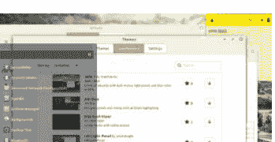

早晚，你会改变一些东西。通常从更改你的桌面和 Cinnamon 主题开始。这些也非常简单——简单到让你不会觉得愚蠢。但你如何进行它们呢？做什么会更值得做？构造性的内容仍然显示管理器，也许可以切换到布局显示？虽然没有风险，Mint 的 Timeshift 程序允许你备份系统（类似于 Apple 的 Time Machine 或 Windows 还原点），这是结束任何担忧的简单方法。

即使没有发生任何错误，回到比更改之前更干净的状态也很有帮助：请参下文的指南。如果你已经设置好了 Timeshift，在页面上倾入所有包之前，先创建一个手动快照。尽管去吧，你知道这是有意义的！

让菜单变为透明并堆叠便签纸并不是自定义 Mint 的一种方法。

# 使用 TIMESHIFT 轻松回滚

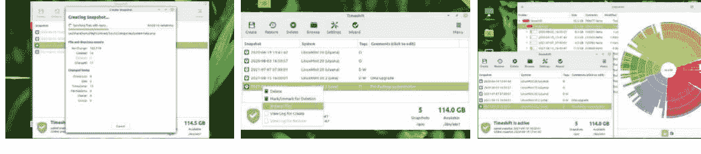

- 1 启动 Timeshift

启动 Timeshift并在本地驱动器拍摄几个快照（至少比你的文件系统大小大 1GB）。Timeshift 默认只备份系统文件，因此不包含家目录中的文件。有更好的工具来备份这些文件。

- 2 创建快照

如果时间吻合，它可能会启动。但如果没有合呢？只需点击“备份”按钮按需快照。Timeshift 会增量备份，直到只存储更改的文件。一旦快照完成，添加一个有用的描述以帮助跟踪。

- 3 恢复快照

如果发生任何错误，你现在可以通过点击按钮轻松地恢复快照。在右键点击之前，你可能想先检查文件。即使一切都失败了，Mint 不再启动，你也可以从现场介质使用 Timeshift。只需将其指向 `/timeshift` 目录即可。

## 调整 Cinnamon

看看如何在 Mint 的旗舰桌面环境及其他地方留下你的足迹是多么简单！

> 我没有遇到过杂乱的 Cinnamon 的设置，它的可配置性令我惊喜惊喜。当 Mint 20 发布时，做了很多工作来改进 Mint 主题，现在有各种颜色（以前是 32 种），但我们找到了最喜欢的。通过打开主菜单并进入“偏好设置”查看色板

如今深色主题非常流行，Windows 为每个变体都有深色主题。你可以从网上下载新主题，只是不要期望它们符合你的设计。Cinnamon 主题设置中还隐藏着一些被忽视的皮肤选项，并有一个禁用它们的选项。

要自定义你的面板，转到“偏好设置”并选择它。现在你可以添加各种快捷方式和小部件。例如，选择“导出”应用并点击底部的 `+` 添加星号（通过平滑动画）到工作区的 Expo 风格概览中。要实现更多的工作区切换（以牺牲一些面板元素为代价），默认情况下，如果你不想禁用或更改背景，点击“添加桌面”或任何其他处，点击 `-` 按钮。像主题一样，可以通过访问仓库下载第三方应用。下载是有保证的，因此你可以使用任何可以离开你的东西。

Mint 20.2 中有非常愉快的新壁纸，我们已经想右键点击桌面并选择已使用的它们。但如果你点击那里，看看那个 Cinnamon 上下文菜单。特别是在“添加桌面”处，你可能在桌面上没有预装的时钟或时钟框，这时你就进入了。如果你深入“下载”，你将发现更多模拟克隆，如 Google Analytics 这样的生产力工具。

Cinnamon 香料中的最后风味是扩展。它们改变了桌面的行为方式。它们改变了桌面的行为。，，，，，，，，，，，，，，你可以开启让窗口看起来透明。。默认，，它们会帮助你的眼睛。

默认情况下，开启 可以让你的桌面是开启的，这样你可以看到。


- 想要尝试 Cinnamon 的，可以看到


- 想要尝试 Cinnamon 的，可以看到

## 安装 KDE Plasma

用 KDE Plasma 流畅且华丽的体验转换你的桌面，并在 Wayland 下一同开启下一代体验！

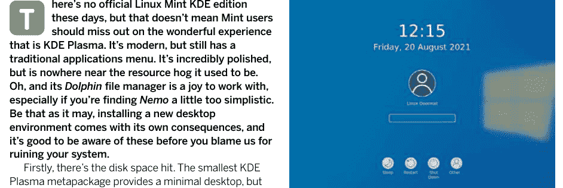

首先，磁盘空间至关重要。KDE Plasma 元软件包（metapack）提供了一个最小化桌面，根据截图，它会在 44 个软件包中拉取约 850MB 的依赖项。如果你选择完整版（full-at edition），费用将接近 3GB。接下来是核心工具的重复，例如文本编辑器、媒体播放器和截图工具。它们都会开始复制你的应用程序菜单以及 Cinnamon 中的文件管理器，这看起来有点奇怪。

最后，`apt` 很难完全卸载一个桌面。在你尝试手动删除它后，修复损坏的桌面是非常困难的。所以不要这样做。

有了（至少）Plasma，我们可以选择将显示管理器从 Mint 主题的 切换到基于 Qt 的 SDDM（简单显示管理器）

```
sudo sdm-reconfigure lightdm
```

如果你安装了命令行界面，它会提供给你；如果你没有通过以下方式进行配置：

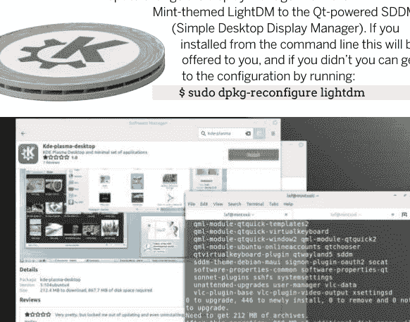

两个显示管理器都能与主要的 Linux 桌面环境（轻量级窗口管理器）良好工作，因此选择哪一个取决于个人喜好或主题。默认的 SDDM 可能不是大多数人的梦想，但一旦进入它，很容易从登录屏幕（SDDM）进行切换。出于某种原因（也许是一种讽刺的尝试），你会发现自己在使用一种类 Windows 主题。没关系，你已经在 Plasma 桌面中发现了你的新世界。

感受 Plasma 的清风，惊叹它的精细程度，并由于你所有喜爱的 Mint 工具都触手可及而感到宾如归。

如果你习惯了 Cinnamon，每个小组件和每个面板都可能因为非常难以配置而偶尔受到批评。事实上，这对小组件组合是很容易的。每个小组件（尽管有很多）都可以配置，一次笨拙的编辑可能会让你掌握你想要的样式，而其中一个是留用来熄灭万物光的。

KDE 4 的成功迭代运行良好，使得 KDE (5) 或 Plasma 5 流畅得多。在我们的测试中，它使用的内存比 Cinnamon 多一点点，但比 MATE 多得多，朋友之间多一百兆字节算什么呢？它并没有产生任何微差。

最新的 KDE 组件套件重量约为 850MB，但它非常有用。

## 定制 Mint 20

一旦你杀死了 Chromium。Plasma 确实是可配置的，但这种方式并不过度。左下角的默认菜单启动器（本应如此）。右键点击它并显示“替代方案”。你会发现它可以交换为现代启动器（如 Gnome 或更经典的级联设计）。KDE 还带有一个它自己的图形化商店，名为 Discover（少数没有为了不必要的层而浪费性能的 KDE 应用之一）。你会发现这对你有利，你可能还会参考 Mint 原生的软件管理器。打开终端（或解决 flatpak 支持问题（即 KDE 仓库）），现在在安装 Discover 之后，你就可以通过访问地图右下角的设置来发现 FlatHub（或任何其他 Flatpak 仓库）。只需显示“返回”即可找到 Mint 的仓库。你可以设置你的 Flatpak 仓库，但 Ubuntu 中可用的 Snap 只有 canonical Snap。两种形式都是强大的，尽管有些人可能更倾向于使用 Flatpak 或 Snap。有了这两种能力，你就不需要担心下载带宽。Flatpak 应用程序很容易处理剩余的“验证中”默认。

我们提到 Flatpak 未被我们的任何桌面环境支持，但情况正在发生。在最新的 MATE 版本中，它现在已原生支持 Ubuntu，所以如果你将窗口管理器切换到 Cinnamon，就可以轻松运行 Flatpak。引入这种支持可能是一段很长的路。它是桌面而不是发行版，而 KDE Plasma 通过它的窗口管理器支持它。有几个软件包可以让它活跃起来：

```
sudo apt install flatpak-mint
```

现在注销，一个名为 Plasma 的新会话将可用。Mint 上的 Plasma 体验已经很完善了。即使在 Nvidia 驱动下也能工作。

让你对 Plasma 有印象的一点是它是自动保存的。如果你喜欢启动那三个终端和其他任何内容，回到设置 > 启动会话。

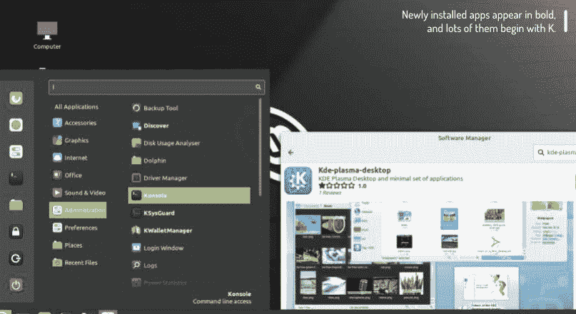

## LXQt

如果你熟悉 LXDE 但需要一个更轻量的桌面环境，你不该再看 LXQt 了。这是当前的 Ubuntu 使用的，并且可以驱动你的 Linux-Mint 桌面。我们已经用过它，它不像其他那样花丽。如果你想要一个不那么用户友好但更面向键盘的，LXQt 可能适合你。

LXQt 是 GTK2 驱动的 LXDE 桌面的精神继者。LXDE 开始于 LXDE 的分支，现在移动到了 GTK3，结合 Qt 的结果就是 LXQt。你可以通过简单的 `apt` 安装它：

```
sudo apt install lxqt-desktop
```

依赖项，如果你已经安装了 flatpak，你很快就需要它。

当你启动 LXQt 时，会被提示为你的窗口选择窗口管理器，可以使用 Cinnamon，Xfce 也是免费的，当你真的想保持它时。Plasma 是为了轻量，对于非花哨的目的，LXQt/OpenBox 会话出现在我们的菜单中。

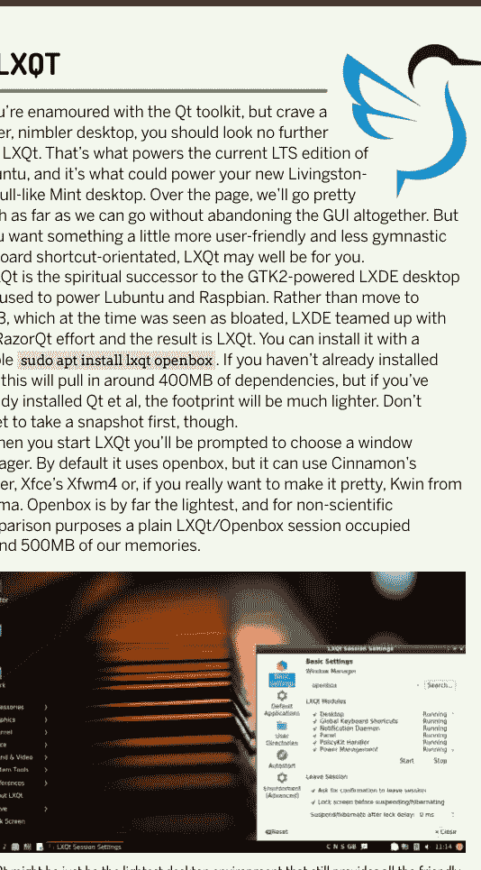

LXQt 可能就是我们已经提供的所有 GUI 舒适性的最轻桌面环境。

### 超轻 Mint

拥抱极简，使用轻量的 Sway 桌面学习一些键盘体操。

我们最喜欢的 Ubuntu 衍生版之一是 Regolith。它在超轻量 i3 平铺窗口管理器方面非常独特。平铺窗口管理器需要适应，以及大量的配置。Regolith 带有非常出色且易于学习的快捷键（i3 非常由键盘驱动，但从不回头）。此外，它仍然拥有你所有的基础设施和设置，因此所有的系统管理都可以通过 GUI 应用完成。我们也是 Pop!OS 的粉丝，特别是熟悉 i3 的你会很快掌握 Sway；大部分默认都是都是，你甚至可以编写自己的脚本。事实上，你应该使用你的 i3 配置。Sway 在 Ubuntu 仓库中，自 2020 年 1 月以来。寻找最好的版本需要一些编译，所以让我们安装仓库版本即可

```
# sudo apt install sway
```

## 窗口平铺是一种艺术

> “为了充分利用窗口平铺，就像使用绘板一样，你将结合水平和垂直排列。”

它的 COSMIC（计算机操作系统主要界面组件）桌面具有平铺窗口模式，它没有 i3 那种微小的占用，让用户轻松进入快捷键和鼠标手势的快乐之中。

没有理由在 Mint 中拥有这些东西；i3 窗口管理器也在 Ubuntu 中。但我们将尝试其他的。一种由 i3 大量引入的轻量级窗口管理器，那就是 Forland。现在按下 Sway+2：终端，你会看到它在顶部，你刚刚移动到了一个新的虚拟桌面。如果你尝试打开另一个窗口（Sway+3），这里你需要一个不同的。我们没有第三个桌面，因为 Sway 打开了另一个，所以 Sway 静地将之前的任务重命名为 3。

回到工作空间 1 并打开另一个窗口。现在你可以看到窗口平铺的感觉了。第一个占据桌面，固执地向左移动，为右侧的新终端留出空间。如果你喜欢，你可以跟随鼠标，不需要在任何一个上点击

但 Sway 还有它自己的启动器，快速。D+，你会看到字母顺序的命令（可能几个以 A 开头）。开始输入 fire 的前几个字符，当 fire 被蓝色高亮时开始。

如果你已经打开了几个窗口，那么可能会变得有点拥挤。你可以关闭其中一个（Ctrl+W）来关闭，但也是引入窗口缩放的好时机。至少打开两个窗口的情况下，Shift+R 进入缩放。

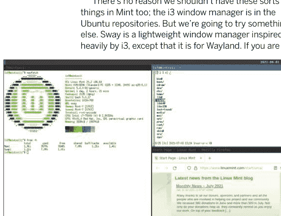

| 日期 | 标题 | 作者 |
|---|---|---|
| 2023年1月20日 | Linux Mint 博客的最新消息 | Admin |
| 2023年1月20日 | Linux Mint - 21.3 Virginia | Admin |
| 2023年1月19日 | Linux Mint 21.3 Beta | Admin |

* 下一个终极终端在默认状态下并不是，但我们可以让它能够

## 定制 Mint 20

鼠标悬停在一个新窗口或更窄的窗口上。点击那一个可以调整窗口大小，并在聚焦于最左侧窗口时按下 Super+E。搞定！注意大小写，因为 Super+E（缩写为 E+）是退出的快捷键。

为了让平铺窗口变得实用，点击每个图标以获得水平和垂直排列的组合。这初看起来看起来很简单，但其中有你亲自经历过的细微之处。之前，我同时操作过几个窗口，并发现它们沿着一个共同的分符分组在一起。但如果你在其中一个窗口上按下 Super+V，然后按 Super+E 打开另一个窗口。通过这种方式，你会发现 Super+E 和 Vert 充当了方向，并注意到一个窗口的右边缘会跟随右边缘移动，这正是下一个窗口将进行交换的方式。

你的 sway 配置文件位于 `/etc/sway/config`；你可以直接编辑它，也可以将其复制到 `~/.config/sway/config` 进行个性化修改。例如，这一行

output 用于更改背景或为桌面设置自定义背景，通过显示主题来实现。`output` 指令激活了所有功能比默认更好的控制项。例如，如果你在虚拟机上使用 Sway，你可能需要启用显示功能，因此你需要添加如下的一行：

- output virtual 1920x1080

- swaymsg -t get_outputs

Sway 和我以低内存占用而闻名。但为了保持这些低水平，我们维持着

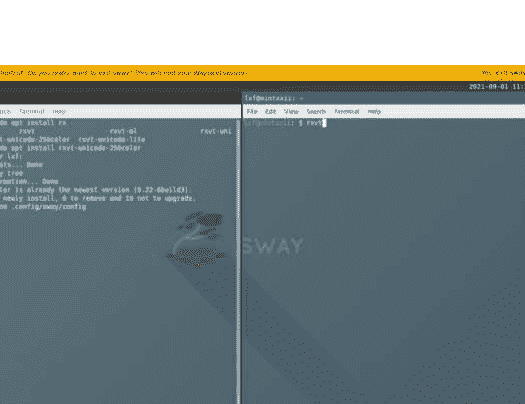

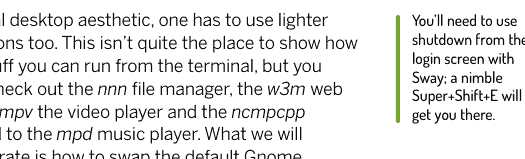


一种极简的桌面美学，你必须使用更轻量的选项来清理内容。这里并不是展示你能从系统中运行多少程序的地方，你应该查看 fan 命名、y3m web 浏览器、作为 mpv 播放器前端的 mr 指以及 ncmpcpp 播放器。我们可能需要显示如何配置 sway 进程以使用更轻量的主题。

你可能已经注意到，当它被封装在一个名为 Successless Tools 的包中时，Success (whichbar) 处于这样一种状态，并涵盖了一系列低资源实用程序。主题包含了窗口管理器、sway 进程以及其他几个。你可以在 LK2524 中阅读更多关于它的信息，以及为什么我们在这里使用它，因为它们的大多数并不支持 Wayland。

安装这些工具是为了 `dmenu` 程序（由 Xland 提供）以及我们之前遇到的便捷 Super 启动器。

## 内核更新


作为 Ubuntu 长期支持版（LTS）的衍生版本，Mint 将使用该版本配备的 5.4 内核。不要因为当前内核版本是 5.15 就望而却步，因为 Canonical 将所有的修复和功能都回传到了 Ubuntu 内核中。但来自 `kernel.org` 的 5.4 内核也是可能的，正如你所看到的，但不建议在 Ubuntu 或 Mint 中使用主线内核，因为

这将为你提供一个较新的内核（从 5.4 跳跃到 5.11），它包含了一些 Canonical 的补丁和测试，以及一个比我们拥有的具有更多 X 和 `libdrm` 的刷新内核。Mint 的低波动 Edge 版本（与网络浏览器无关）

`output` 用于更改背景或为桌面设置自定义背景，通过显示主题来实现。`output` 指令激活了所有功能比默认更好的控制项。例如，如果你在虚拟机上使用 Sway，你可能需要启用显示功能，因此你需要添加如下的一行：

- `output virtual 1920x1080`
- `swaymsg -t get_outputs`

Sway 和我以低内存占用而闻名。但为了保持这些低水平，我们维持着


一种极简的桌面美学，你必须使用更轻量的选项来清理内容。这里并不是展示你能从系统中运行多少程序的地方，你应该查看 `fan` 命名、`y3m` web 浏览器、作为 `mpv` 播放器前端的 `mr` 指以及 `ncmpcpp` 播放器。我们可能需要显示如何配置 `sway` 进程以使用更轻量的主题。

你可能已经注意到，当它被封装在一个名为 Successless Tools 的包中时，Success (whichbar) 处于这样一种状态，并涵盖了一系列低资源实用程序。主题包含了窗口管理器、`sway` 进程以及其他几个。你可以在 `LK2524` 中阅读更多关于它的信息，以及为什么我们在这里使用它，因为它们的大多数并不支持 Wayland。

安装这些工具是为了 `dmenu` 程序（由 Xland 提供）以及我们之前遇到的便捷 Super 启动器。

## 内核更新

作为 Ubuntu 长期支持版（LTS）的衍生版本，Mint 将使用该版本配备的 5.4 内核。不要因为当前内核版本是 5.15 就望而却步，因为 Canonical 将所有的修复和功能都回传到了 Ubuntu 内核中。但来自 `kernel.org` 的 5.4 内核也是可能的，正如你所看到的，但不建议在 Ubuntu 或 Mint 中使用主线内核，因为

这将为你提供一个较新的内核（从 5.4 跳跃到 5.11），它包含了一些 Canonical 的补丁和测试，以及一个比我们拥有的具有更多 X 和 `libdrm` 的刷新内核。Mint 的低波动 Edge 版本（与网络浏览器无关）

`output` 用于更改背景或为桌面设置自定义背景，通过显示主题来实现。`output` 指令激活了所有功能比默认更好的控制项。例如，如果你在虚拟机上使用 Sway，你可能需要启用显示功能，因此你需要添加如下的一行：

- `output virtual 1920x1080`
- `swaymsg -t get_outputs`

Sway 和我以低内存占用而闻名。但为了保持这些低水平，我们维持着


一种极简的桌面美学，你必须使用更轻量的选项来清理内容。这里并不是展示你能从系统中运行多少程序的地方，你应该查看 `fan` 命名、`y3m` web 浏览器、作为 `mpv` 播放器前端的 `mr` 指以及 `ncmpcpp` 播放器。我们可能需要显示如何配置 `sway` 进程以使用更轻量的主题。

你可能已经注意到，当它被封装在一个名为 Successless Tools 的包中时，Success (whichbar) 处于这样一种状态，并涵盖了一系列低资源实用程序。主题包含了窗口管理器、`sway` 进程以及其他几个。你可以在 `LK2524` 中阅读更多关于它的信息，以及为什么我们在这里使用它，因为它们的大多数并不支持 Wayland。

安装这些工具是为了 `dmenu` 程序（由 Xland 提供）以及我们之前遇到的便捷 Super 启动器。

## 定制 Mint 20

鼠标悬停在一个新窗口或更窄的窗口上。点击那一个可以调整窗口大小，并在聚焦于最左侧窗口时按下 `Super+E`。搞定！注意大小写，因为 `Super+E`（缩写为 `E+`）是退出的快捷键。

为了让平铺窗口变得实用，点击每个图标以获得水平和垂直排列的组合。这初看起来很简单，但其中有你亲自经历过的细微之处。之前，我同时操作过几个窗口，并发现它们沿着一个共同的分符分组在一起。但如果你在其中一个窗口上按下 `Super+V`，然后按 `Super+E` 打开另一个窗口。通过这种方式，你会发现 `Super+E` 和 Vert 充当了方向，并注意到一个窗口的右边缘会跟随右边缘移动，这正是下一个窗口将进行交换的方式。

你的 `sway` 配置文件位于 `/etc/sway/config`；你可以直接编辑它，也可以将其复制到 `~/.config/sway/config` 进行个性化修改。例如，这一行

`output` 用于更改背景或为桌面设置自定义背景，通过显示主题来实现。`output` 指令激活了所有功能比默认更好的控制项。例如，如果你在虚拟机上使用 Sway，你可能需要启用显示功能，因此你需要添加如下的一行：

- `output virtual 1920x1080`
- `swaymsg -t get_outputs`

Sway 和我以低内存占用而闻名。但为了保持这些低水平，我们维持着


一种极简的桌面美学，你必须使用更轻量的选项来清理内容。这里并不是展示你能从系统中运行多少程序的地方，你应该查看 `fan` 命名、`y3m` web 浏览器、作为 `mpv` 播放器前端的 `mr` 指以及 `ncmpcpp` 播放器。我们可能需要显示如何配置 `sway` 进程以使用更轻量的主题。

你可能已经注意到，当它被封装在一个名为 Successless Tools 的包中时，Success (whichbar) 处于这样一种状态，并涵盖了一系列低资源实用程序。主题包含了窗口管理器、`sway` 进程以及其他几个。你可以在 `LK2524` 中阅读更多关于它的信息，以及为什么我们在这里使用它，因为它们的大多数并不支持 Wayland。

安装这些工具是为了 `dmenu` 程序（由 Xland 提供）以及我们之前遇到的便捷 Super 启动器。

## 内核更新

作为 Ubuntu 长期支持版（LTS）的衍生版本，Mint 将使用该版本配备的 5.4 内核。不要因为当前内核版本是 5.15 就望而却步，因为 Canonical 将所有的修复和功能都回传到了 Ubuntu 内核中。但来自 `kernel.org` 的 5.4 内核也是可能的，正如你所看到的，但不建议在 Ubuntu 或 Mint 中使用主线内核，因为

这将为你提供一个较新的内核（从 5.4 跳跃到 5.11），它包含了一些 Canonical 的补丁和测试，以及一个比我们拥有的具有更多 X 和 `libdrm` 的刷新内核。Mint 的低波动 Edge 版本（与网络浏览器无关）

`output` 用于更改背景或为桌面设置自定义背景，通过显示主题来实现。`output` 指令激活了所有功能比默认更好的控制项。例如，如果你在虚拟机上使用 Sway，你可能需要启用显示功能，因此你需要添加如下的一行：

- `output virtual 1920x1080`
- `swaymsg -t get_outputs`

Sway 和我以低内存占用而闻名。但为了保持这些低水平，我们维持着


一种极简的桌面美学，你必须使用更轻量的选项来清理内容。这里并不是展示你能从系统中运行多少程序的地方，你应该查看 `fan` 命名、`y3m` web 浏览器、作为 `mpv` 播放器前端的 `mr` 指以及 `ncmpcpp` 播放器。我们可能需要显示如何配置 `sway` 进程以使用更轻量的主题。

你可能已经注意到，当它被封装在一个名为 Successless Tools 的包中时，Success (whichbar) 处于这样一种状态，并涵盖了一系列低资源实用程序。主题包含了窗口管理器、`sway` 进程以及其他几个。你可以在 `LK2524` 中阅读更多关于它的信息，以及为什么我们在这里使用它，因为它们的大多数并不支持 Wayland。

安装这些工具是为了 `dmenu` 程序（由 Xland 提供）以及我们之前遇到的便捷 Super 启动器。

## 入门指南

Success (whichbar) 处于这样一种状态，并涵盖了一系列低资源实用程序。主题包含了窗口管理器、`sway` 进程以及其他几个。你可以在 `LK2524` 中阅读更多关于它的信息，以及为什么我们在这里使用它，因为它们的大多数并不支持 Wayland。

安装这些工具是为了 `dmenu` 程序（由 Xland 提供）以及我们之前遇到的便捷 Super 启动器。

## 入门指南

你可能已经注意到，当它被封装在一个名为 Successless Tools 的包中时，Success (whichbar) 处于这样一种状态，并涵盖了一系列低资源实用程序。主题包含了窗口管理器、`sway` 进程以及其他几个。你可以在 `LK2524` 中阅读更多关于它的信息，以及为什么我们在这里使用它，因为它们的大多数并不支持 Wayland。

你的 `sway` 配置文件位于 `/etc/sway/config`；你可以直接编辑它，也可以将其复制到 `~/.config/sway/config` 进行个性化修改。例如，这一行


## Customise Mint 20

Hovering over a new window or narrower. That one does resize the window and hit `Super+E` while focused on the leftmost window. Bam! Beware of case because `Super+E` (abbreviated to `E+`) is the shortcut to quit exit.

In order to make the tiling windows useful, click on a Each icon to get a combination of horizontal and vertical arrangements. This seems straightforward at first, but there are subtleties that you've experienced yourself. Before, I've operated on several windows at once and found them grouped together along a common divider. But if you hit `Super+V` on one of them, then hit `Super+E` to open another window. This way, for matter, you'll see that `Super+E` and `Vert` act as directions, and notice that the right edge of one window follows the right edge, which is how the next window will swap.

Your sway configuration file is located at `/etc/sway/config`; you can edit it directly, or copy it to `~/.config/sway/config` to make personal changes. For example, the line

`output` to change the background or set a custom background for desktop, by displaying themes. The `output` directive activates all controls of things functioning better than the default. For example, if you use Sway on a virtual machine, you might need to enable the display feature, so you'll need to add a line of the:

- `output virtual 1920x1080`

- `swaymsg -t get_outputs`

Sway and I are famous for their low memory footprints. But in order to keep these low, we maintain


a minimal desktop aesthetic, you have to use lighter options to clear things out. This isn't the place to show how much you can run from the system, you should check out the fan name, `y3m` web browser, `mr` the directive front-end to the `mpv` player and the `ncmpcpp` player. We might need to show how to configure the `sway` daemon to something a lighter theme.

You might have noticed that when it is packed in a package called Successless Tools, Success (whichbar) is in such a state of mind and encompasses a range of low-resource utilities. The theme include window manager, the `sway` daemon and a few others. You can read more about it in `LK2524` and why we use it for us here because most of them do not cater to Wayland.

These get installed for the sake of the `dmenu` program (which Xland provides) and the handy `Super` launcher we met earlier.

## KERNEL UPDATES

Being a derivative of the Long Term Support release of Ubuntu, Mint will use the same 5.4 kernel featured there. Don't be put off by the fact that the current version of the kernel is 5.15, since Canonical backports all of fixes and features to the Ubuntu kernel. But the 5.4 kernel from `kernel.org` is also possible, as you'll see, but not recommended, to use mainline kernels in Ubuntu, or Mint, because


This will give you a newer kernel (which bumped from 5.4 to 5.11) which has some Canonical patching and testing, as well as a refreshed kernel with more of X and libdrm than what we have. A low-volatility Edge of Mint (nothing to do with the web browser).


## 定制 Mint 20

鼠标悬停在一个新窗口或更窄的窗口上。点击那一个可以调整窗口大小，并在聚焦于最左侧窗口时按下 `Super+E`。搞定！注意大小写，因为 `Super+E`（缩写为 `E+`）是退出的快捷键。

为了让平铺窗口变得实用，点击每个图标以获得水平和垂直排列的组合。这初看起来很简单，但其中有你亲自经历过的细微之处。之前，我同时操作过几个窗口，并发现它们沿着一个共同的分符分组在一起。但如果你在其中一个窗口上按下 `Super+V`，然后按 `Super+E` 打开另一个窗口。通过这种方式，你会发现 `Super+E` 和 `Vert` 充当了方向，并注意到一个窗口的右边缘会跟随右边缘移动，这正是下一个窗口将进行交换的方式。

你的 `sway` 配置文件位于 `/etc/sway/config`；你可以直接编辑它，也可以将其复制到 `~/.config/sway/config` 进行个性化修改。例如，这一行

`output` 用于更改背景或为桌面设置自定义背景，通过显示主题来实现。`output` 指令激活了所有功能比默认更好的控制项。例如，如果你在虚拟机上使用 `Sway`，你可能需要启用显示功能，因此你需要添加如下的一行：

- `output virtual 1920x1080`

- `swaymsg -t get_outputs`

`Sway` 和我以低内存占用而闻名。但为了保持这些低水平，我们维持着


一种极简的桌面美学，你必须使用更轻量的选项来清理内容。这里并不是展示你能从系统中运行多少程序的地方，你应该查看 `fan` 命名、`y3m` web 浏览器、作为 `mpv` 播放器前端的 `mr` 指以及 `ncmpcpp` 播放器。我们可能需要显示如何配置 `sway` 进程以使用更轻量的主题。

你可能已经注意到，当它被封装在一个名为 `Successless Tools` 的包中时，`Success`（`whichbar`）处于这样一种状态，并涵盖了一系列低资源实用程序。主题包含了窗口管理器、`sway` 进程以及其他几个。你可以在 `LK2524` 中阅读更多关于它的信息，以及为什么我们在这里使用它，因为它们的大多数并不支持 `Wayland`。

安装这些工具是为了 `dmenu` 程序（由 `Xland` 提供）以及我们之前遇到的便捷 `Super` 启动器。

## KERNEL UPDATES

作为 Ubuntu 长期支持版（LTS）的衍生版本，Mint 将使用该版本配备的 5.4 内核。不要因为当前内核版本是 5.15 就望而却步，因为 Canonical 将所有的修复和功能都回传到了 Ubuntu 内核中。但来自 `kernel.org` 的 5.4 内核也是可能的，正如你所看到的，但不建议在 Ubuntu 或 Mint 中使用主线内核，因为

这将为你提供一个较新的内核（从 5.4 跳跃到 5.11），它包含了一些 Canonical 的补丁和测试，以及一个比我们拥有的具有更多 `X` 和 `libdrm` 的刷新内核。Mint 的低波动 `Edge` 版本（与网络浏览器无关）


## 定制 Mint 20

鼠标悬停在一个新窗口或更窄的窗口上。点击那一个可以调整窗口大小，并在聚焦于最左侧窗口时按下 `Super+E`。搞定！注意大小写，因为 `Super+E`（缩写为 `E+`）是退出的快捷键。

为了让平铺窗口变得实用，点击每个图标以获得水平和垂直排列的组合。这初看起来很简单，但其中有你亲自经历过的细微之处。之前，我同时操作过几个窗口，并发现它们沿着一个共同的分符分组在一起。但如果你在其中一个窗口上按下 `Super+V`，然后按 `Super+E` 打开另一个窗口。通过这种方式，你会发现 `Super+E` 和 `Vert` 充当了方向，并注意到一个窗口的右边缘会跟随右边缘移动，这正是下一个窗口将进行交换的方式。

你的 `sway` 配置文件位于 `/etc/sway/config`；你可以直接编辑它，也可以将其复制到 `~/.config/sway/config` 进行个性化修改。例如，这一行

`output` 用于更改背景或为桌面设置自定义背景，通过显示主题来实现。`output` 指令激活了所有功能比默认更好的控制项。例如，如果你在虚拟机上使用 `Sway`，你可能需要启用显示功能，因此你需要添加如下的一行：

- `output virtual 1920x1080`

- `swaymsg -t get_outputs`

`Sway` 和我以低内存占用而闻名。但为了保持这些低水平，我们维持着


一种极简的桌面美学，你必须使用更轻量的选项来清理内容。这里并不是展示你能从系统中运行多少程序的地方，你应该查看 `fan` 命名、`y3m` web 浏览器、作为 `mpv` 播放器前端的 `mr` 指以及 `ncmpcpp` 播放器。我们可能需要显示如何配置 `sway` 进程以使用更轻量的主题。

你可能已经注意到，当它被封装在一个名为 `Successless Tools` 的包中时，`Success`（`whichbar`）处于这样一种状态，并涵盖了一系列低资源实用程序。主题包含了窗口管理器、`sway` 进程以及其他几个。你可以在 `LK2524` 中阅读更多关于它的信息，以及为什么我们在这里使用它，因为它们的大多数并不支持 `Wayland`。

安装这些工具是为了 `dmenu` 程序（由 `Xland` 提供）以及我们之前遇到的便捷 `Super` 启动器。

## KERNEL UPDATES

作为 Ubuntu 长期支持版（LTS）的衍生版本，Mint 将使用该版本配备的 5.4 内核。不要因为当前内核版本是 5.15 就望而却步，因为 Canonical 将所有的修复和功能都回传到了 Ubuntu 内核中。但来自 `kernel.org` 的 5.4 内核也是可能的，正如你所看到的，但不建议在 Ubuntu 或 Mint 中使用主线内核，因为

这将为你提供一个较新的内核（从 5.4 跳跃到 5.11），它包含了一些 Canonical 的补丁和测试，以及一个比我们拥有的具有更多 `X` 和 `libdrm` 的刷新内核。Mint 的低波动 Edge 版本（与网络浏览器无关）

... (and the rest)


## 定制 Mint 20

鼠标悬停在一个新窗口或更窄的窗口上。点击那一个可以调整窗口大小，并在聚焦于最左侧窗口时按下`Super+E`。搞定！注意大小写，因为`Super+E`（缩写为`E+`）是退出的快捷键。

为了让平铺窗口变得实用，点击每个图标以获得水平和垂直排列的组合。这初看起来很简单，但其中有你亲自经历过的细微之处。之前，我同时操作过几个窗口，并发现它们沿着一个共同的分符分组在一起。但如果你在其中一个窗口上按下`Super+V`，然后按`Super+E`打开另一个窗口。通过这种方式，你会发现`Super+E`和`Vert`充当了方向，并注意到一个窗口的右边缘会跟随右边缘移动，这正是下一个窗口将进行交换的方式。

你的`sway`配置文件位于`/etc/sway/config`；你可以直接编辑它，也可以将其复制到`~/.config/sway/config`进行个性化修改。例如，这一行

`output`用于更改背景或为桌面设置自定义背景，通过显示主题来实现。`output`指令激活了所有功能比默认更好的控制项。例如，如果你在虚拟机上使用`Sway`，你可能需要启用显示功能，因此你需要添加如下的一行：

- `output virtual 1920x1080`
- `swaymsg -t get_outputs`

`Sway`和我以低内存占用而闻名。但为了保持这些低水平，我们维持着


极简的桌面美学，你必须使用更轻量的选项来清理东西。这不是展示你能从系统中运行多少的地方，你应该查看`y3m`网页浏览器、`mpv`播放器的`mr`指令前端以及`ncmpcpp`播放器。我们可能需要展示如何将`sway`守护进程配置为更轻量的主题。

你可能已经注意到，当它被打包在一个名为`Successless Tools`的包中时，`Success`（`whichbar`）处于这样一种状态，并包含一系列低资源实用程序。该主题包括窗口管理器、`sway`守护进程以及其他一些内容。你可以在`LK2524`中阅读更多关于它的信息，以及我们在这里使用它的原因，因为它们中的大多数不适用于`Wayland`。


## 定制 Mint 20

鼠标悬停在一个新窗口或更窄的窗口上。点击那一个可以调整窗口大小，并在聚焦于最左侧窗口时按下 `Super+E`。搞定！注意大小写，因为 `Super+E`（缩写为 `E+`）是退出的快捷键。

为了让平铺窗口变得实用，点击每个图标以获得水平和垂直排列的组合。这初看起来很简单，但其中有你亲自经历过的细微之处。之前，我同时操作过几个窗口，并发现它们沿着一个共同的分符分组在一起。但如果你在其中一个窗口上按下 `Super+V`，然后按 `Super+E` 打开另一个窗口。通过这种方式，你会发现 `Super+E` 和 `Vert` 充当了方向，并注意到一个窗口的右边缘会跟随右边缘移动，这正是下一个窗口将进行交换的方式。

你的 `sway` 配置文件位于 `/etc/sway/config`；你可以直接编辑它，也可以将其复制到 `~/.config/sway/config` 进行个性化修改。例如，这一行

`output` 用于更改背景或为桌面设置自定义背景，通过显示主题来实现。`output` 指令激活了所有功能比默认更好的控制项。例如，如果你在虚拟机上使用 `Sway`，你可能需要启用显示功能，因此你需要添加如下的一行：

- `output virtual 1920x1080`

- `swaymsg -t get_outputs`

`Sway` 和我以低内存占用而闻名。但为了保持这些低水平，我们维持着


## KERNEL UPDATES

作为 Ubuntu 长期支持版（LTS）的衍生版本，Mint 将使用该版本配备的 5.4 内核。不要因为当前内核版本是 5.15 就望而却步，因为 Canonical 将所有的修复和功能都回传到了 Ubuntu 内核中。但来自 `kernel.org` 的 5.4 内核也是可能的，正如你所看到的，但不建议在 Ubuntu 或 Mint 中使用主线内核，因为

这将为你提供一个较新的内核（从 5.4 跳跃到 5.11），它包含了一些 Canonical 的补丁和测试，以及一个比我们拥有的具有更多 X 和 `libdrm` 的刷新内核。Mint 的低波动 Edge 版本（与网络浏览器无关）

# 终极 Linux 项目

屏幕。所有这些都可以通过屏幕右上角的配置文件并从弹出菜单中选择进行自定义。通过浏览文件，你将发现许多导航辅助。顶部有一系列库视图，从“建议”到“类型”。

有两种视图可用：“特性”会在你悬停在它们上方时出现，并点击图标进行高亮。`Jellyfin` 允许你手动将项目分组，例如将詹姆斯·邦德系列或《星际迷航》电影，以及像汤姆·汉克斯这样的演员放在一起。

# 小贴士

`Jellyfin` 缺少的一个方面是实时日期。如果你运行扫描，它将使用缓存的元数据手动手动分组。请检查 `https://reddit.com/jellyfin/to_see_answers_for_your_question`。另请查看：`https://forum.jellyfin.org/now-classified/find_additional_help`。

## 修复元数据

在添加库后浏览它们是一个好主意，因为 `Jellyfin` 经常会错误识别电影和节目——那些名称被标记为其他内容的项目。当你发现错误时，将鼠标悬停在标记的项目上，点击出现的垂直菜单图标并选择编辑。


这将打开搜索工具——你可以通过标题或类型进行搜索（如果已选择类型，将显示更多结果），但如果标题正确的电影或节目没有结果，请前往 `https://www.tvdb.com` 进入相关的搜索字段，并进行编辑，以便在搜索时获得正确匹配。

`Jellyfin` 更新元数据需要一些时间——如果修正没有立即发生，请不要惊讶。如果你想对元数据进行更多“手术”，请点击右上角的按钮并在“管理员”下选择 `Jellyfin` 的元数据管理器。

元数据视图（Metadata Metaview）通过类似资源管理器的视图按文件夹运行你的库。深入某个电影或 `Jellyfin` 文件夹，你将在侧边栏中看到它的元数据，准备好编辑。

> 你可以从各种客户端访问 `Jellyfin` - Windows 上的 `Jellyfin Media Player` 以及 `Plex` 的桌面客户端。

## 设置电视

如果你有一个 `HomeRun` 网络电视，那么像具有 DTV 和 DVR 能力的设备——可以访问任何内容并按用户共享——就是很容易实现的。点击主菜单上的“直播电视”，通过适当的插件在 `TVHeadend` 等兼容设备上查找你最近观看的内容。

你需要设置一个自动节目计划：直接费用为每年 25 美元，或者在购买后六个月内，但更优惠的交易属于你，没有任何 `XLMTV` 是免费的，但是。

一旦启动，切换到 DVR 扫描以指定你的记录位置——电视和电影分开不同的文件夹，它们将在你的 `Jellyfin` 库中创建。记录以 `MPEG2` 格式记录，但如果你运行 `ffmpeg`，那么 Bill Thorton 的 `post-script.sh` (`https://github.com/jthornton/jellyfin-ffmpeg`) 将通过 DVR 设置下的“录制后处理”选项进行转换。

配置完成后，“直播电视”将出现在主屏幕上，带有短片和“新节目”，为正在播出的节目提供方便的快捷方式。点击一下，你就可以按照你想要的方式进行录制：

## 管理员仪表板

仪表板是你监控和管理服务器媒体的地方。从这里，你可以看到为了让运行更顺畅而执行了哪些调整。你的选项有服务器、设备、直播电视和仪表板，仪表板位于顶部。这提供了关于近期更改和当前运行内容的方便概览。

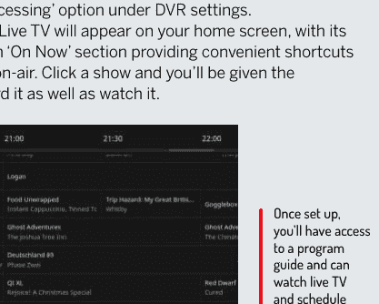

设置完成后，你将可以访问节目指南，并观看直播电视并将计划录制到你的库中。

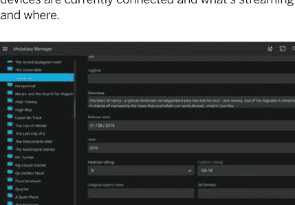

`Jellyfin` 的元数据管理器是如何根据你的个人喜好微调元数据的绝佳示例。

# 运行下一代媒体服务器的教程

该服务器允许你更改服务器名称和偏好语言（常规），管理你并添加其他用户（用户）——请查看操作指南以获取有关设置 `Jellyfin` 进行共享的详细指南。显示的选项也可以应用于你的账户，让你能够个性化 `Jellyfin` 的外观和感受。

`x264/x265` – `Handbrake` 用户熟悉的——允许你精调转码的质量。

“流媒体”选项卡允许你设置“互联网流媒体比特率 (Mbps)”。你可以使用 `www.speedtest.net` 检查你的家庭网络连接，注意上传速度。如果你有电缆或千兆带宽连接，你应该允许用户使用高达 `30Mbps` 或 `4Mbps` 的高清转码，而不会强制服务器降低负载。

转码提供了添加库和管理现有库（库）以及配置播放选项（播放）的工具。播放有三个选项卡：“转码”是你启用硬件加速转码的地方。当客户端不支持你的媒体时会发生转码，最好的方法是避免——或限制它。如果你必须在 `Jellyfin` 中使用 `x264` 或 `x265` 转码，你可以将转码转移到 GPU 或更新的芯片，例如 `Intel Core-600` 系列，以产生比旧更好的质量。

# 小贴士

教程的其他部分对于配置直播电视来说是不言自明的。在“优势”下你可以访问系统日志和通知，调整网络并安装插件。完成教程。不需要花大量时间安装 `Jellyfin` 客户端，登录你的账户并开始流媒体。

# 为多个用户配置 Jellyfin

导航到 `Jellyfin` 仪表板，在你的账户已登录的情况下选择“服务器”下的“用户”。点击 `+` 设置朋友或家庭成员。给他们分配用户名和密码，你需要保护他们。通过选择他们允许的库来完成初始设置。

## 1 创建用户

通过四个选项卡确定用户可以访问的内容。“设置”选项卡的默认值是一个起点且是不言自明的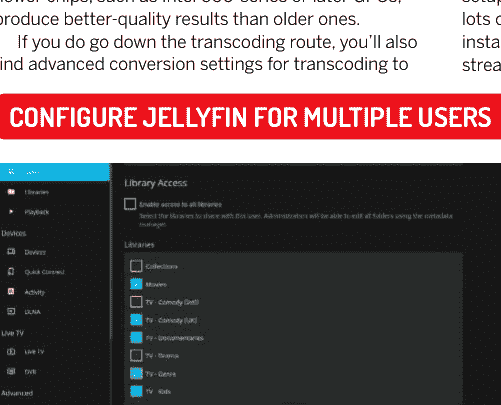

## 2 配置设置

“访问”选项卡是你定义特定设备访问哪些库的地方。设置孩子，使用“家长控制”设置最大内容（或你添加的内容），并使用访问计划来限制整体使用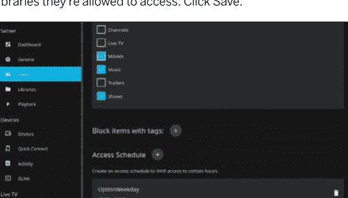

## 3 访问限制和家长控制

用户一旦登录，他们就可以自定义自己的设置。“配置文件”是他们设置本地网络快速访问的地方，而“显示”允许他们更改 `Jellyfin` 的界面外观。他们还可以自定义播放选项和字幕，并设置他们的账户。

## 4 个性化用户

# S-TUI

虽然 Shashank Sharma 不喜欢压力测试，但他喜欢像 `S-TUI` 这样的工具，可以帮助监控 CPU 性能 

Shashank Sharma 是 Delhi 的 Arch Linux 用户。他正在寻找极客纪念。在过去的几年里，Linux 杂志引入了强大且稳健的实用程序，帮助执行各种任务。从日常文本编辑、连接远程机器到备份和其他管理任务都可以从终端完成。

Linux 发行版或运行其硬件生命的关键因素是系统性能。根据你的目的，从各种工具中选择监控不同组件，例如 CPU 频率和使用率。如果你喜欢 CLI，你会喜欢使用 `S-TUI`。

使用 `S-TUI`，你可以使用终端 UI 监控频率、功耗和使用率。该工具以图形化方式提供所有信息并可以导出为 CSV 文件。你可以配置 `S-TUI` 监控上述任何组件的值。当与 `stress`（另一个命令行工具）结合时，`S-TUI` 可用于对系统进行压力测试。

> 某些传感器（如功耗）只有在 `sudo` 下运行 `S-TUI` 时可用，而不是作为普通用户。

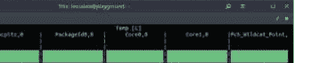

安装该工具非常简单，它的 GitHub 页面描述了各种安装技术。如果你的 Linux 发行版足够，可以通过 `sudo apt install s-tui` 安装 `S-TUI`。

对于其他安装方法（例如从 `git` 安装），你必须确保安装了所有依赖。包括 `curl` 和 `build` 工具。如果你决定使用 `S-TUI` 对 CPU 进行压力测试，你还可以安装 `stress-ng`。幸运的是，这些在所有桌面发行版的仓库可用。

# 不要忽略安装

`S-TUI` 在大多数发行版的软件仓库中不可用

# 创建阈值脚本

在 `s-tui` 配置文件中，`~/.config/s-tui/config` 还包含一个名为 `hooks` 的目录。你可以将想要在超过某些阈值（如 CPU 频率或温度）时检查的脚本放在这里。

脚本名称必须为 `<name>.source`，其中 `<name>` 是来源。你可以使用 `S-TUI` 根据 CPU 温度设置跟踪运行的脚本。

CPU 温度的默认阈值值为 80。在 `s-tui` 配置中可以更改此值：`s-tui threshold <value>`。然后你可以通过 `S-TUI` 自身从 `~/.config/s-tui/s-tui` 保存新阈值值。

如果你对 `S-TUI` 界面内的设置进行了任何更改并将其保存供以后使用，你需要导航到“设置”然后按回车。在安装 `S-TUI` 期间，你可能需要修改 `s-tui` 配置文件的权限，因为它是不可写的，否则工具将带有“拒绝访问”错误运行。

当你用编辑器使用 `s-tui` 配置文件时，你会发现一个新条目显示新的默认阈值值：

```
[cpuControl]
refresh = 0.0
uuf = true
treshold = 70
```

## CPU 压力测试教程

与其他命令行实用程序不同，`S-UI` 不需要配置，安装后你即可立即开始使用。运行 `s-ui` 命令。

左侧侧边栏顶部显示了识别详情：正在 `Intel Core i3-5205U CPU @2.00GHz` 处理器上运行 `S-UI` 测试。`S-UI` 利用了各种其他工具和实用程序来收集结果。例如，可以在 `/proc/cpuinfo` 的摘要中查看更多信息和细节。

当你启动 `S-UI` 时，它会显示所有参数——频率、利用率、温度和功率——你可以通过更改侧边栏上 `threshold[10]` 的值来改变结果。

根据你的选择，颜色可能会发生变化以反映 `S-UI` 界面的不同元素。如果发生这种情况，`S-UI` 将切换到黑白配色调并重新运行 `S-UI`。你应该能够看到 `S-UI` 用于显示收集信息的所有不同颜色，并且你可以编辑你的配置设置。

你可以使用上下箭头键导航列表，但 `S-UI` 不像移动端 App 那样滚动。

## 添加压力

默认情况下，`S-UI` 配置为从客户端的 (X) 监控到服务器的监控系统压力。如果你安装了 `stress` 实用程序，可以通过导航侧边栏或页面空间来启用压力功能。你现在可以使用 (X) 开始压力测试。你可以启用或禁用不同组件的监控。当你禁用组件时，图表会自动停止列表。

与其他命令行实用程序不同，`S-UI` 还可以通过菜单进行控制。你可以左键点击侧边栏中的项目/选项来选择它。你必须按 `Esc` 退出并使用箭头键滚动，因为鼠标滚轮不支持 `S-UI`。要禁用菜单，你必须使用...解锁 `S-UI`。

你还可以从 `S-UI` 工具中选择不同的压力传感器。如果你认为图表不准确，导航到侧边栏上的 `S-UI Sensors` 条目并按回车键。“可用温度传感器”列表允许你从列表中选择一个。在列表中导航到该项后，按 `Space` 键选择。记得按回车键使更改生效。

你必须按 `Esc` 返回应用程序的主界面，如从 `About-Help` 或 `Temp Sensors` 部分返回一样。

虽然 `S-UI` 的图形界面在侧边栏也有帮助功能，但它提供的只是一个快速介绍。要获得所有支持选项的完整列表，你必须运行 `s-ui help`。

一旦退出 `S-UI`，收集的数据就会丢失，该工具默认不会保存它。如果你想将所有信息自动保存到 CSV 文件，请使用 `s-ui` 命令。数据将存储在目录中。你可以用任何文本编辑器查看。你还可以通过 `s-ui->to_csv` 创建自定义日志文件。

另一个实用的选项是 `j-ui`，用于以 JSON 格式获取机器状态。`j-ui` 生成的输出是当前状态记录，而不是运行日志：

- "Frequency":


- `"Avg": 1281`
- `"Core 0": 1630.6`
- `"Core 1": 1296.6`
- `"Core 2": 1175.6`
- `"Core 3": 1026.4`
- `"Temp":`
- `"Avg": 40.0`
- `"PackageId": 49.9`
- `"Core 0": 47.0`
- `"Core 1": 47.0`
- `"Whc_Delta_Point": 40.5`

S-UI 支持多种类型的压力传感器，你可以通过导航到 `Temp Sensors` 部分来选择一个。如果默认配置无法准确测量你机器上的 CPU 性能，所有基础设置（如图表的参考）都存储在 `config/s-ui/s-ui.conf` 中。遗憾的是，你每次运行 S-UI 都必须设置选项和传感器，因为该工具不允许在配置文件中保存设置。

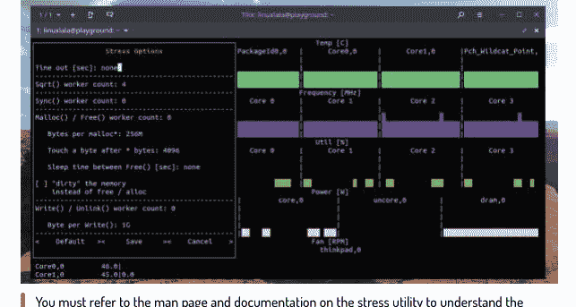

你可以参考主页和压力实用程序的文档来了解不同的功能。

## 小贴士

压力实用程序通过执行计算平方根的负载来压测 CPU。你可以通过导航 S-UI 侧边栏来控制选项。图形界面允许你定义工作线程执行的所有主要任务以及是否删除内存。

Ultimate Projects | 21

## 极 Linux 项目

致谢：https://cozy-get.org/

## COZY

### 构建终极有声书库集

Nick Peers 展示了如何利用 CD、免费下载和 Audible 资源来建立你自己的有声书库。


我们都喜欢好故事——毕竟，围炉讲故事的历史和人类语言一样古老。数字有声书——广播剧——将这一传统延续到了现代，得益于你的手机和电脑，让你有机会随时随地倾听你喜爱的书籍。

在本指南中，我们将展示如何构建一个巨大的有声书库——无论是来自 CD 还是云端——一个中心库让它们易于识别，并发现如何从电脑或手机收听它们。让我们开始讲述故事吧...

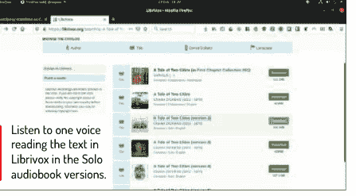

#### 设置你的 Audible 库

获取有声书有三个途径：

- CD，带有跨越数十张 CD 的未桥接版本；
- 在线供应商（显而易见的例子是 Audible）；
- 最后，来自免费的经典网站——即那些现在已无版权、由志愿者朗读的作品。

在 riVox 的独人有声书版本中倾听一个声音朗读文本。

来源之一是 LibriVox (www.librivox.org)。当你找到一个标题时，可以使用“全书 (zip 文件)”选项将书籍作为每章节一个 MP3 文件集进行下载。每个文件都标记了作者、标题，你还可以在这里下载封面来装点你库中的书籍——更多关于标记和艺术品请见后文。

### 使用免费工具刻录有声书

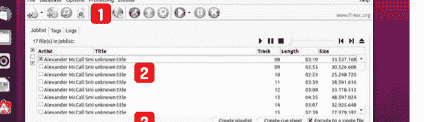

你会把有声书存在哪里？最简单的方法是在 `Home` 文件夹内创建一个专用文件夹。书籍可以按以下结构存储：

`Audiobooks/作者-标题` – 例如，`Audiobooks/Moby-Dick`。如果你想细分你的库（或者将孩子的读物与妻子的惊悚小说收藏分开），可以在作者和 Audible 之间再增加一层——流派 (Genre)。

### 有声书文件拆解

1. 刻录 (frecut): 有声书提供了常用工具和设置的快捷方式，包括全导入刻录按钮。
2. 任务 (Job): 用于跟踪处理所需的文件。使用左侧的控件选择全部或取消输入。
3. 元数据 (Metadata): 虽然 Freac 允许你编辑当前选中轨目的元数据，但使用 Kid 更快速方便。
4. 进度监控 (Monitor progress): 条允许你看到刻录进度——获取轨道。
5. 输出 (Output): 你需要...
6. 进度监控 (Monitor progress): 在将有声书分成部分时，跟踪长度。

你必须按 `Esc` 返回应用程序的主界面，如从 `About-Help` 或 `Temp Sensors` 部分返回一样。

虽然 S-UI 的图形界面在侧边栏也有帮助功能，但它提供的只是一个快速介绍。要获得所有支持选项的完整列表，你必须运行 `s-ui help`。

一旦退出 S-UI，收集的数据就会丢失，该工具默认不会保存它。如果你想将所有信息自动保存到 CSV 文件，请使用 `s-ui` 命令。数据将存储在目录中。你可以用任何文本编辑器查看。你还可以通过 `s-ui->to_csv` 创建自定义日志文件。

## 终极 iTunes

由于第一本书触发了自动转换，但之后的所有操作都在后台进行。一旦该过程完成，点击操作（Actions）> 分割选定书籍（Split Selected Books）即可完成该过程。

错误信息显示 `freeb.org` 数据库中没有该 CD 的记录。对于大多数——如果不是所有的——音频书 CD 都是如此，因此选择数据库（Database）> 选项（Options）CDQs 以移除自动检查。此时，你只需进入 Freac 的标签（Tags）> 专辑（Album）选项卡，选择你可以手动包含作者（艺术家）和书名（专辑）的地方，并进行添加以使其完美运行。最好在每次添加新 CD 时手动添加标签，而且使用旧版本的 CD3q 处理该过程要容易得多，所以目前，你只需将其设置为“唯一（unique）”。

### 小贴士

想让你的音频书可以通过互联网任何地方访问的流媒体吗？或者参考我们的 LFX258 以及指南中的第 64 页，学习如何使用 ookSonic 构建完美的有声书服务器。

### 刻制音频 CD

在刻制音频书时，你需要一个能够将多个轨道合并为单个文件（如 MP3）的刻制工具，然后将其导入软件中心（Software Centre）。要启用此功能，前往选项（Options）> 设置（Settings）。在 MP3 编码器标记处，然后点击编码文件夹（Encode Folder）以选择你的音频书文件夹，并尽可能使用 iTunes 文件夹。忽略“文件名模式（Filename pattern）”来自动命名你的输出文件——它不会按照你想要的方式工作。

### 选择运行的轨道

当你开始刻制时，你将选择所有轨道进行首次播放。如果你只需要编辑，请选择特定的轨道：选择你想要使用的第一个和最后一个轨道——例如为音频书留出 (2 或 35) 分钟，或使用播放控制按钮返回以跟踪进度，跳过你不喜欢的章节。

由于相对简单，音频语音记录与普通音乐一样，因此可以通过从立体声切换到单声道录制来节省空间。使用 LAME 编码器执行此操作。将预设置为自定义设置（Custom settings），然后使用 `Tab` 键并在点击 `OK` 之前在立体声下选择单声道。

接下来，选择音频书的第一日期并点击“将 CD 添加到列表（Add CD to playlist）”按钮。你将看到所有的 CD 轨道，并伴随着一个……

最后，点击下一步（Next）输出你的音频书文件夹，然后手动创建一个作者文件夹（或如果可用则选择一个）文件夹，并以作者命名。如果你已选择，则从主菜单点击“开始（Start）”进行编码过程。

## 安卓音频书

想在手机上听音频书吗？如果你正在使用 nook（已在 LFX258 中介绍），显而易见的选项是安装音频书应用（£2.49），它不仅可以存储来自服务器的书籍以节省手机空间，还能让你离线收听。它们会被临时下载到手机存储器中，这使得当你离开网络时，可以在任何地方收听它们。

如果你想听已传输到手机的音频书——毕竟，一张 32GB 的 SD 卡可以放很多书——那么请使用 iTunes。相反，当你启动时，你只需将应用指向你的音频书，然后查看完整的书籍列表，按作者排序，然后……。点击一次进入播放界面，当你按住控制按钮以满足你需要时——然后，包括角色（帮助你记住谁是谁）和 nookSonic（用于标记为收藏播放列表）。

30 天后，应用将恢复为基础版——它拥有你所需的所有功能，但完整版费用为 £1.89。选择帮助（Help）> 功能帮助（Features Help）> 购买（Vision-Buy）进行购买。

## 为你的媒体标记标签

一旦你刻制了音频书 CD，是时候使用标记工具了。对于音频书 CD，你需要经常更新的以及如何使用它进行音频书标记。如果尚未安装在库（Library）中，你可以获取最新版本：

```
sudo add-apt-repository ppa:ubebid/
sudo apt-update && sudo apt install cd33q
```

安装完成后，使用 `cd33q` 并选择轨道编号（2 到 0，除 1 以外），通过拖拽它们按字母顺序排列点击专辑艺术家（Album Artist）和作曲者（Composer）。使用标签专辑艺术家（ter Album Artist）将记录作者名称，ISO-850-1 名称 = COMMENT Album Artist nYou 可以在 CD33q 中创建自定义类型，允许你为音频书添加另一层组织结构。

24 | Linux 出版

## 构建音频书库集教程

作曲者字段用于记录你的音频书朗读员。预计情况会相反的，但并没有完全消失。使用自定义类型（Custom Genres）输入自定义代理——为每个代理点击添加（Add），从恐怖和犯罪到科幻小说。如果不这样做，在填写类型标签时，勾选“显示自定义类型（Show custom genres）”以移除所有其他自动设置。一旦你对此满意，现在就可以准备查看你的标签了。此分步指南（如下）揭示了如何识别所有音频书文件中一致的标签，并添加你需要的一切。

一旦你的音频书已经完成刻制、组织和标记，是时候享受劳动果实了。你可以通过 Linux 中的任何播放器听音频书，但最好在同一个程序中组合音频书，而无需重启。我们的音频书播放器名为 Cozy，通过 Flatpak 安装：

```
$ sudo apt install flatpak
$ flatpak install flathub com.github.cozy
```

程序将启动——正在运行。通过启动器（Launcher）导入非常简单。你只需选择想要处理的音频书文件夹，Cozy 将把它们导入你的库中。完成后，通过作曲者（Composer）选择你的音频书，然后手动创建作者（author）文件夹（如果可用则选择一个）并以作者命名。如果你选择了，然后通过艺术家（Artist）字段显示：偏好（Preferences）> 标签选项卡，点击“交换作者和朗读者（Swap author and reader）”来纠正视图。

现在，选择音频书将看到一个双格窗口。左侧是作者列表，右侧显示按字母顺序排列的音频书。除非你选择，然后点击“开始”进行编码过程。

Cozy 界面直观且易于导航——将鼠标悬停在图像上显示播放按钮，在播放/暂停按钮旁边有一个实用的 300 秒倒退按钮，以及一个快速通过轨道的按钮。点击菜单按钮获取更多选项——你可以手动隐藏不需要音频书（例如当前在连接的外部或网络存储上的文件），通过存储将文件显示在 Cozy 库中。

那么其他设备上的音频书收藏怎么办？所有关于在安卓手机上收听音频书的知识都是……

## 使用媒体标记标签

小贴士

我们选择 MP3 作为音频书的文件格式，因为语音记录对质量有要求。我们考虑了大多数音频书的长度——每部作品越长——文件越小。

### 1 设置标签

打开文件（File）选择你的音频书文件并点击打开——一旦高亮，勾选所有适用于音频书的标签：专辑（Album）、艺术家（Artist）、作者（Author）、日期（Date）和类型（Genre），并填写每个字段。通过将文件拖到指定的“拖入专辑艺术”处添加你的艺术——点击保存保存更改。

### 2 添加轨道编号

接下来，你需要为每个文件标记自己的轨道号。为了做到这一点，验证所有文件都已高亮，然后点击工具（Tools）> 元数据（Metadata）。确保目标设置为标记，点击设置以后默认，并点击确定。选择每个文件验证已分配轨道号。再次点击保存。

### 3 添加标题

有了所有标签，情况变得复杂了。从标签（Tags）开始点击，命名音频书标题（Audiobook Title），类型遵循以下规则：`Part$(track(1))`——根据需要替换为章节（Chapter）或光片（Disc）。在提取部分使用 `$title(aj)`，并在正下方标记为真（tag just under true）。选择，应用，然后点击保存保存最后一个标题。

## 终极 Linux 项目

## 机器人的崛起

Mats Tage Axelsson 介绍了机器人操作系统的基础知识，并揭示可以使用哪些组件……


组装自己的机器人并让它走起来会让所有年龄段的孩子乐上几分钟。然而，为了让机器人长期运行，它需要具备感知和反应的能力。

关于机器人的一个常见误解是，你需要一个学位才能做出属于自己的东西。尽管如此，机器人确实需要许多子系统来运行、移动、伸展和反应。基本上，我们人类所做的一切——除了你必须设计一个能够处理所有任务的整个系统。

这不是你在下雨的下午后在自己的代码洞穴里随手就能完成的东西。作为自由和开源爱好者，我们很清楚不能相信自己能涵盖每一个细节。有很多项目致力于让机器人变得易于获取，到为止最成功的组织是开源机器人基金会 (www.openrobotics.org)。前面已经提到过许多用户与 ROS 交互。它本身并不是一个操作系统，而是一系列工具，帮助你创建你心目中机器人应该有的样子。

ROS 应该被描述为一个机器人框架，但你从 ROS 中想要什么，让机器人运行起来需要什么？我们已经提到过许多子系统控制机器人的不同部分。你的机器人需要与环境进行交互。也许与你和其他人类交互，但那是以后的话题。简单的机器人可以用于探索——更高级的版本会去厨房为你带回饮料。但要实现所有这些需求，你需要微控制器和力学逻辑……

### 机器人的崛起 深度

必须记住，所有部分之间都是相互通信的。这就是事情变得复杂的地方，你需要一个整体控制系统。通过 ROS，你可以声明并定义所有节点（系统部分）以及它们如何通信。

ROS 框架中包含了一些工具和可视化软件，帮助你解决问题并理解它们。

了解不同的软件部分需要对架构有基本的理解。然而，将机器人定义为其组件之和将变得复杂，因此需要一种标准的通信方法——无论是在机器人内部还是外部。

这就是 ROS 的意义：它建立了通信协议。通过这些标准，你可以定义节点、服务（services）和话题（topics）之间的接口。

一个节点是使用 ROS 客户端库与其他节点通信的函数之一。这使得为每个任务选择不同的解决方案成为可能，只要你使用 ROS 与其他节点通信即可。节点可以使用架构的其他部分——话题、服务和动作（actions）——其中使用了信息。

话题可以包含数据，许多节点可以访问。一个节点向话题发送数据，其他节点订阅它。简而言之，这是一种广播类型的消息，许多节点需要它。相反，服务是节点之间的。第一个节点是向服务器请求信息的客户端。

### 核心

要运行 ROS 需要大多数软件包。在核心版本中，提供了运行实际任务所需的间件接口和规范。你会接触到的两个是 ROS 和 rcl 库。它们都帮助你管理客户端。当你使用它们时，客户端库涵盖了你发送的消息格式。你可以定义客户端到话题或为其他节点设置服务器。这也是你将信息添加到它们中的地方。文档显示了许多实用的示例，例如

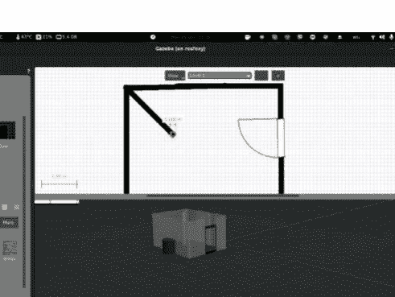

- 你可以在 Gazebo 中创建一个示例。这包括墙壁、楼梯和门。

运行 ROS 时，你可以通过你的命令找到不同的消息。ROS 系统的顺序易于理解。你还可以使用虚拟显示器进行你的安装。在开始编写代码之前，你可以：

```
sudo snap install ros-tutorials
```

通过这些设置，你可以在 rosarg 中运行所有节点。ROS 安装包含了大量的软件。软件包很小，但当你运行机器人时，依赖关系可能会很麻烦。

### YARP：一个相似的框架

YARP 是机器人内部通信的框架。它可以替代 ROS 主服务器。你也可以用 YARP 作为主服务器的另一种方式。YARP 支持跨系统的节点和协议。你可以在单个系统中使用两者。

你可能想使用它的一个原因是，两个框架之间的这些协议可以用于例如，如果你有很多节点可以共享信息。项目是开源的，可以在 https://github.com/robotology/yarp/releases/ 获取。你可以使用 Debian 软件包安装它，或者通过它们自己的仓库 URL：你也可以从源码安装它。该框架还有它自己的可视化和绘图功能。YARP 的重点是尽可能使用标准的 GUI 工具。你可以在浏览器中连接服务器以检查状态，以及许多其他。关于该项目的更多信息请访问：https://yarp.it/get/index.html。YARP 已经有了 Python、Java、Lua 和其他特定语言的软件包。

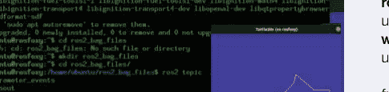

- 跨屏幕控制对于学习机器人设计的基础是理想的。

| 项目 | 27

## 终极 Linux

其他任务。你可能还想在不同类型的硬件使用许多节点。出于这些原因，我们建议尽可能为 ROS 设置环境，而不是使用你的主系统。

你还需要处理轮子、机械臂和硬件驱动。

你也可以在不同的虚拟机上运行它。这种仿真让它更准确。你可以在 ROS 基础上安装 Linux 发行版，并在需要时添加 ROS。

你需要放入节点的高级任务包括：导航、图像处理和机器学习任务。机器学习将在板上运行，而其他任务必须在服务器上，甚至在云端运行——它比你的更更可靠！

当你使用容器时，不会遇到系统其他部分的问题。更多细节请参见下方的 Docker 章节。

现实中，你将开始运行 `roscore` 命令，然后一次运行一个包以运行更多事情。`roscore` 将运行你该扩展所需的所有节点和基于 ROS 的文件。

### 构建块

完整的安装包含了许多规划工具和用于测试硬件的仿真/模拟器。如前所述，ROS 的主要功能是建立节点之间的通信协议。

如果你是在探索 ROS 时使用的工具，那么你的当前任务还有许多可用工具。Turtle 是其中一个，你需要使用 `roqt turtle__is` 来查看你需要什么。


一旦节点运行，你就需要控制机器人的元素并管理通信。你将详细学习一些通信接口。每个节点都需要以下内容之一：

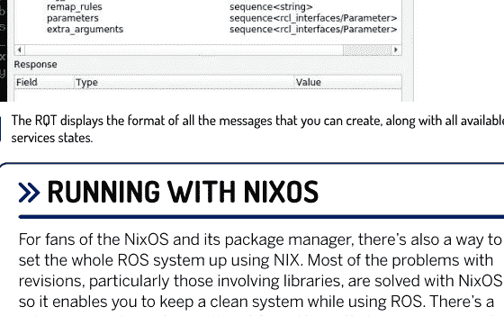

| 字段 (Field) | 取值 (Value) |
| :--- | :--- |
| `ComponentManager_container/load_node` | `interfaces/LoadNode` |
| `package` | `string` |
| `name` | `string` |
| `node_name` | `string` |
| `namespace` | `string` |
| `remap_rules` | `string` |
| `sequence` | `string` |
| `parameters` | `std_interfaces/Parameters` |

## 使用 NIX 运行

对于 ROS 及其包管理器的粉丝，可以使用 Nix 来设置 ROS。对于各种版本、可能重叠的库，如果你想要一个干净简单的环境，可以通过 Nix 解决。可以在 aira 或 https://robotics.network 找到解决方案。

## 服务

服务需要接收另一个节点的请求。消息的内容包含诸如目标、方向以及它返回的值。

# 节点深度解析

将拥有自己的节点。请注意，当节点包含内容时，没有固定的规则。你必须创建一个符合你目的的节点。

最预期的例子是之前提到的那些。对于更高级的项目，你将把摄像头的硬件层与解释层分离。这些问题已经为你解决了，你可能可能有更好的解决方案。所有节点都通信主题和服务和服务，为了控制整个系统，你有一个 ROS Master，它管理所有的方法。你将通过为 ROS Master 实现该服务来创建服务。使用这种方法，你将编写代码来接收和提供服务，而永远不会针对特定的 IP 地址。在 ROS2 中，你创建组件和用于注册节点的代码。节点包含了该节点支持的协议以及它可以传输或接收的数据。

你可以将节点用于各种用途。所有节点之间安全且高效的通信。在环境中显示机器人并管理机器人本身。这些并不是针对这每种情况的工具，但它们通过命令行和图形化命令进行通信。命令行命令对机器人很有用。在大多数情况下，是由节点定义的，但当你想要增强机器人时，你可以添加更多，需要更高级的节点。

## 可视化

即使为了测试系统的所有层。你也可以查看来自任何摄像头的地图和图像图表。你可以使用此系统来确保节点正确通信。它不会显示你周围的环境。

当你使用 teleop 程序运行机器人周围时，你将可以使用许多命令并打开终端来执行它。你可能有很多调试工具可用，但那些可能会开箱即出问题。对于这些情况，图形界面更好。这些在 ROS2 和 Gazebo 中也可用的工具。第一个提供了下拉列表来激活机器人的所有部分并测量某些东西；第二个是关于移动和导航的。结合这两种方法将实现你的机器人目标。确保你练习这些技术，就像你通过 ROS 学到的那样。

在具有物理、力和甚至天气的模拟环境中显示机器人。比在 Gazebo 中独立开发的更强大，Gazebo 能够开发环境。Gazebo 是一个独立的项目，但你可以可以使用系统在视觉上模拟机器人移动和自我移动。你还可以过滤环境并让机器人出现在叶子地上。

ROS 是强大的，但也可以被热心的业余爱好者用来制作所有的工具和服务。完成所有这些工作是一项挑战，但要注意——你将花费很多时间在机器人领域取得新的进展。当你与它工作时，你将学习并记住许多技术。让你的机器人在世界上运行将是开始工作的很多项目！

## 微控制器

这些默认包将为桌面设置安装。它们有不同的用途，并应在需要时使用。Rviz 显示你系统中所有的服务。你可以一次选择一个节点并分析它的作用。它可以被拆解和删除。

如果你想使用 JavaScript 并与 Arduino 以及其他系统级芯片交互，请考虑这些系统。它们被设计用于与大量对象接口，包括 Arduino、树莓派和小节点。

## Rviz, Qt & Gazebo

Johnny-Five 是一个流行的框架，它使用 JavaScript 与这些板建立接口。它背后的团队 Boccup 以一种可以与交付工作的的方式展示了它。在交付网站（www.johnny-five.info）上有一份很长的示例列表，展示了你如何读取和控制一系列传感器。

Cylons - 它是一个简单的 NPM 模块。如果你有一有一些 Gazebo 项目，只需几分钟即可完成设置并启动。它使用了一些扩展来支持新硬件，并始终支持一份令人印象深刻的硬件列表。这些包括用于简单方法获取任何包含在内的平台的板卡、对象和功能，并且有一个极佳的发现。你可以在 cylons.io 了解更多。

你可以运行以查看环境并为你的机器人创建要克服的障碍。

如果你对 Go 语言感兴趣，无需看 Robot (www.golang.org) Go 语言系统即可。使用 get 命令使用它。和其他所有的一样，第一个示例是 Arduino 上的一个引导 LED。Gobot 支持许多平台，因此对于提到的其他微控制器，你有充足的选择。

终极项目 | 29

# 终极 Linux 项目

## 构建一个自定义数字标牌系统

发现如何使用 Xibo 数字标牌并在 Matt Holder 的帮助下，为开源会议创建一个数字显示器。

大多数 Linux 决策者注意到公共场所大尺寸显示屏数量在增加，显示各种信息。这就是数字标牌。在教程中，我们将使用 Xibo，这是一个灵活的系统，可以用于显示图像、视频、地图、数据表、天气数据、嵌入 HTML 等等。我们将演示如何设置服务器和客户端，最后设计布局并选择内容。

Matt Holder 在 IT 支持领域工作了十多年，并始终与其他系统并配合使用 Linux。

该系统由一个服务器组件（开源）和一个用于任意数量的客户端组成。Windows 和 Linux 客户端都是免费且开源的，而其他平台是付费的。服务器可以自托管，也可以由你的团队托管。在继续之前，让我们谈谈使用的术语。显示 是运行播放器的设备（PC、Android 或 TV）的名称。嵌入式显示组可以用于对多个显示器分组，数据库中关于当前日期和时间的内容可以被 CMS 用于提供相关内容。见 https://community.xibo.org/getting-started/

| 连接 | 高级 |
| :--- | :--- |
| CMS 地址 | `http://localhost` |
| 密钥 | `admin` |
| 本地文件夹 | `/home/www/xamibo/` |

## 安装服务器

Xibo 服务器使用 LAMP Stack（指 Linux 操作系统、MySQL 数据库和 PHP 语言）作为服务器。使用时，服务器在客户端和记录之间进行。服务器本身被封装在容器内部，使其根据需要轻松安装和更新。我们将使用 Docker 在 Ubuntu 20.04 上安装此内容，但容器系统使得基础操作系统完全可选，可以与你最熟悉的任何系统配合。一旦安装了基础镜像，打开终端，运行并安装 Docker 和 docker-compose。命令应以 root 身份运行或带有 sudo 前缀：

```
apt update && apt upgrade
apt install apt-transport-https ca-certificates software-properties-common curl -fSL https://download.docker.com/ubuntu/gpg | apt-key add -
add-apt-repository "deb [arch=amd64] https://download.docker.com/ubuntu $(lsb_release -cs) stable"
apt install docker docker-compose
curl -L https://github.com/docker/compose/releases/download/docker-compose-$(uname -s)-$(uname -m) -o /usr/local/bin/docker-compose
chmod +x /usr/local/bin/docker-compose
```

（注：原文处命令格式较为杂乱，翻译时根据逻辑微调了可读性）

```
mkdir /opt/xibo
cd /opt/xibo
wget -O xibo-server.tar.gz https://xibo.org/api/
tar -xvf xibo-server.6.tar.gz
cp config.example config.env
nano config.env
```

输入 MySQL 数据库的密码并配置。更多信息请见：xibo.org/setup

在命令行中运行 `docker-compose up -d` 并允许 Docker 连接。

## 播放器

在教程中我们使用 Ubuntu 的 Snap 包系统，这使得安装变得非常简单并且会自动更新。反之可以通过安装启用客户端：

```
sudo snap install xibo-player --channel stable
```

为了与服务器通信，有一些步骤需要遵循。

此图解释了 Xibo 系统的概念。

当选择 Option 时，客户端将连接到服务器，Display 尚未注册。现在在浏览器中导航到 Displays 将显示一个条目。在屏幕右侧选择 option并点击 Add。之后客户端将连接到服务器，Display 已准备就绪，关闭选项并打开窗口。默认布局将显示（全屏，上一页）。配置完成后，客户端将下载所需的文件。

# 小贴士

Xibo 新版本于 2022 年 2 月发布包含了许多功能，包括交互、模型文件夹以及通过 RS232发送命令。

## 会议时间

我们将演示设置在会议场所周围的显示器。布局（见下方）将在 Region 1 显示一个标题。Region 1 将涉及哪些

## LINUX 播放器选项

完成客户端的初始配置后，来自 CMS 有选项。要访问这些选项，导航到 Displays 并选择客户端配置或创建一个新的，可以分配给特定的 Display。通过 Display Settings，可以更改许多功能，例如来自服务器的刷新间隔，播放器窗口的位置（默认为全屏）并且可以通过播放器扩展。

选项是在某天的特定时间关闭显示器。当客户端加载时，按下按键然后加载信息屏幕。这提供了有关账户的信息，例如正在下载的数据、是否有文件，并允许在不重启的情况下退出播放器。因为客户端是运行部分时间的设备，可能会发生错误，行为是播放器会自动重新加载。

在客户端时按下 I 会带出一个状态屏幕。

# 终极 Linux 项目

区域 4 中的图像将包含一个开源 RSS 馈送的滚动条。

可以使用右侧面板中的选项对布局进行更改、设置浅色或上传背景图像。

在（下文）之前，布局会在指定的日期和时间调度。2) 布局在此处创建。3) 媒体在此处管理。

在复制数字告示牌的布局之前，最好检查一下已经完成了哪些工作。到目前为止，已经安装了服务器/CMS，安装了客户端并配置为与服务器通信，并且创建了基础布局。下一步，将向区域（Regions）中填充信息，最后可以在面板上对布局进行调度和查看。

在后台，登录数字告示牌，在 CMS 中导航到布局并签名每个事件。一旦创建新区域，使用默认设置即可。第一步是调整布局的大小，布局是默认创建的。选择编辑区域选项，使用记事本，并拖动句柄来调整矩形的大小。在布局中添加更多区域，以便图中的图像被复制并存在四个区域。

设置要使用的区域将包含不同类型的内容。要此操作，请选择区域并在决定是否启用该选项之前阅读指南。在此。

# 建立你的区域

通过第一步，区域将填充一个标题，通过选择文本小部件上的图标将标题输入区域，点击文本并在播放列表编辑器中选择区域 I。选择标题上的编辑图标，并为内容输入名称，同时对文本进行格式化。内容可以更改（见下图）。当编辑区域时，预览窗口的右侧会出现选项。这是与文本小部件关联的选项示例。

CMS 界面中有四个键（详情请见下文）。

在底部区域添加新闻的 RSS 馈送。这与编辑文本非常相似，将使用滚动条小部件的功能。默认设置应显示在布局编辑器的右侧。在“常规”（General）选项卡中，在“配置”（Configuration）选项卡中选择 Feed URL，然后在“选择”（Select）选项卡中选择标题（Titles）、仅选择文本（Select Text only），并在辅助（auxiliary）选项卡中选择已创建的区域。更改已完成。

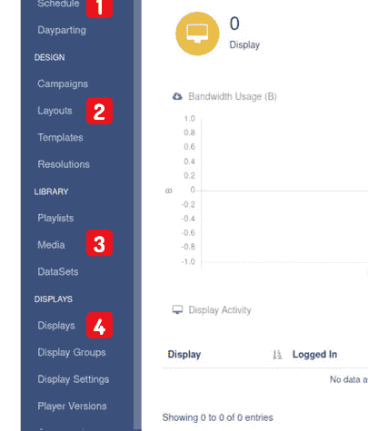

Xbib 强大的功能之一是区域中的内容可以同时更改。这对于本教程的最后部分非常有用，我们将填充两个区域：左侧填充文本信息，右侧填充视频。文本信息将与下方显示的视频相关。当视频变为第二个部分内容时，文本也应该随之更改。

将显示的内容是 Buck Bunny 的视频以及关于它的一些信息。第二部分内容将是 Linux 的照片。此外还有关于它的一些信息和。

- 1 布局在指定的日期和时间进行调度以显示。
- 2 布局在此处创建。
- 3 媒体在此处管理。
- 4 显示器（Displays）在此处管理。

# 使用 XBIB 更多功能

此外，Xbib 可以利用大量资源来创建有效的数字内容。音频文件可以作为背景音乐加载，可以从（例如）Google 日历读取日历项目，可以添加倒计时计时器来提醒用户当前时间。

数据集对象。这些数据可以通过滚动条、表格或视图图表进行管理，来自其他网站的内容可以使用嵌入 HTML 小部件进行嵌入。使用此项功能时，请确保你有权限从其他源显示信息。

查看其他数据项，现在还可以添加货币汇率滚动条，并将表格中的数据显示到多个布局。当多个布局在同一时间调度时，它们可以顺序或同时播放，以转换为任何地方。这种情况下，虽然播放列表不是严格的媒体类型，但它们是一个极其强大的功能，因为它们允许轻松添加配置好的项目时间线。通过这种方式，任何布局在多重调度运行之前都可以显示短时间。

活动（Campaigns）可用于对多个布局分组，它们可以在一次操作中进行调度，而不是花费时间单独管理多个布局。

终极 Linux 项目 | 32

# 自定义数字告示牌系统构建教程

Linux 内核。首先，下载一张受 Creative Commons 许可的 Linux Taurus 照片以及 Big Bunny 电影，下载地址为：https://download.builder.org/demo/movies/

要添加视频，选择你想要显示它的区域，并在底部的工具箱中，悬停在视频上并使用抓取（grab）选项将其拖动到你希望它出现的区域。此时，知道视频文件的长度很重要，这样你就可以再次设置区域中文本的长度。


# 为你的显示器添加文本

要添加某些文本，从合适的来源抓取并存储到文本文件中。要添加此项，从区域编辑器选择区域并导航到按钮。再次使用抓取选项将其拖动到区域。文本添加后，将持续设置为与视频相同。然后点击左侧的脚笔图标编辑文本并进行妥当格式化，然后在右侧保存区域。如果你想让文本滚动，请为文本添加 marque（滚动）效果。

然后这些步骤可以重复。显示 Big Bunny 视频时，选择源的区域，并选择抓取句在将其拖。在在窗口窗口中区域，使用抓取句柄将其拖动到区域。文本添加后，将持续设置为与视频相同。然后点击左侧的脚笔图标编辑文本并进行正确格式化，然后在右侧保存区域。在在文本滚动滚动。设置 60 秒持续。如果需要，可以通过选择相邻的文本框来更改。在保存区域之前，选择区域。这将看到区域。。在编辑模式下，可以粘贴你的内容并对其进行格式化。在编辑区域时，预览窗口的右侧会出现选项。这是与文本小部件关联的选项示例。

CMS 界面中有四个键（详情请见下文）。

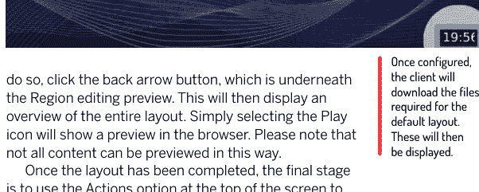

如此，点击返回箭头，它在区域编辑器下方。然后选择列表将显示你的工作。请注意，并非所有文本都可以预览。完成后，最后一步是对布局进行调度。列表将显示一切已保存并准备好显示。在进行进一步更改时，你可以保存你的部分稍后发布。此外，更改可以在调度上进行，根据需要进行编辑。最后一步是对布局进行调度。完成此操作，点击添加并添加新条目。完成后，点击显示器并为屏幕选择日期时间选项。

现在回到桌面，打开播放器，内容将在几分钟内显示。只需点击“播放”。到为止我们仅仅接触了了这个数字告示系统的能力。有关更多细节，请查看如何在滚动条中使用 Xibo 的教程，或者使用 PHP 函数根据日期和时间显示数据的部分。有关更多信息，Xibo 花了大量时间记录如何支持用户使用软件。可以在此处找到：https://xibo.org/manual/en/index.html#

# amazing开源会议


## 快速提示

用户的默认凭据是 `xibo_admin` 和密码。首次登录后应更改这些，可以通过选择右上角的头像并选择编辑个人资料来实现。

编辑时：预览窗口的右侧会出现选项。这是与文本小部件关联的选项示例。

| 名称 | |
|---|---|
| 设置持续时间？ | 勾选以为此小部件设置持续时间 |
| 启用收集？ | 继承 | 启用此小部件的证明显示收集。 |

# 终极 Linux 项目

恐惧指数：https://noaa-led.nmiard.com/

## 软件定义无线电 (SDR)

### 解码气象卫星信号

气象卫星发射的信号可以被接收，并生成地球图像。**Mike Bedford 展示了**自 1960 年 NOAA-1 卫星发射以来，电视天气预报中显示云层覆盖的地球卫星图像已成为常态。尽管这种结果很熟悉，但带来这些图像的技术非常受关注，而且实际操作方法通常是涉及的技术，要获得基础理解并不困难。

大多数卫星已不再运行，尽管 NOAA-16 和 NOAA-17 在 NOAA-15 之后才发射的。然而，NOAA-19 自 2019 年以来一直存在运行问题，因此无法保证你能够接收并解码它的传输，尽管我们没有。此外还有一个 NOAA-20，它是新一代轨道卫星中的第一个，具有更高的频率，这使得接收变得困难得多。由于某些原因，解码软件可能并不多，尽管在所有测试阶段都有一个可用的方案。


地球具有速度和轨道周期，这取决于它的高度。这意味着发射和精细调整轨道是为了确保它在符合设计者时间内环绕地球。显然，卫星距离地球表面越近，轨道运行越快。卫星的一个例子是高度为 3576km。它每 24 小时绕地球一周。如果它在自己的轨迹上，方向与地球旋转一致，就可能停留在地球上同一个点上方。这就是静止轨道，那里有静止气象卫星，例如 NOAA-5、GEOS-15 和 GEOS-17。回到主体，高度为 850km 的极地 NOAA 卫星每天绕地球 14 次。正如名称所示，这些卫星的轨道会让它们经过极点。然而，重要的是由于地球旋转并跟随它们移动，每次轨道都会偏移，使我们能够暴露地球表面不同的区域。

# NOAA 卫星

然而，你可以如此处所示获得一些实践经验，实际方法通常是学习的最佳方式。因此，我们向你展示如何接收卫星发射的无线电信号，然后将其处理成漂亮的图片。此外，我们将研究一些图像处理方法来改进这一点，并为图像注入一些色彩。

我们现在来看 NOAA 轨道卫星——由美国国家海洋和大气管理局运行的 NOAA-15、NOAA-18 和 NOAA-19。我们选择这些卫星是因为它们提供了 850km 的覆盖。由于它们不是太远，无线电信号很强且容易接收。

如果你在好奇是否不是连续的，从 NOAA-6 开始的所有卫星都一直存在。

> 小贴士

> 由于 NOAA 极地轨道卫星在 850km 处运行并易于恢复其无线电信号，如果你观察天空，可能会看到 NOAA 极地轨道卫星。根据 NOAA 的说法，它们仅刚好被认为是肉眼可见物体。因此，在实践中，你会在黑暗区域看到它们。

# 还在下雨吗？

到此为止足够了，让我们来看看如何接收卫星信号。不久前你可能需要使用覆盖 NOAA 极地卫星频率的无线电接收机，但现在你可以使用所谓的 SDR，它们是托管在 Web 上的无线电接收机。看一看。

1998 年发射。NOAA-15 运行最正常，尽管其设计寿命仅为两年。致谢：NASA

## 卫星信号解码教程

NOAA-15 当前位置

2023 年 5 月 10 日，星期六 15:54:12（当地时间）

当前位置：南 96° 77'51″

你可以在你的卫星 Web 站点上接收卫星，使用轨道预测器寻找你的某一个卫星将飞过接收器附近是一个好主意 `www.noaa.gov/track`。卫星不需要在东部或西部数千公里的轨道上飞行。一旦你通过在世界显示器形状和声音识别出卫星信号，

> 小贴士

> 尽管接收低空 NOAA 卫星的信号很容易，但你可能会发现遥远静止气象卫星的图像。实时图像非常多。例如 `www.star-noedia.com` (GOES)，它托管了来自的图像。

使用卫星位置可以告诉你下行频率何时靠近接收器。现在是时候从获取一些数据了，确保你处于正确的下行频率，因为你可能会为静止轨道的图像注入一些色彩。

# 解码信号

我们将讨论如何解码你来自 NOAA 卫星的信号，但现在由你。为了澄清我们所说的模拟电视，在卫星的情况下，信号被编码为一种称为 APT 的格式，代表图像传输。在这种格式中，图像是垂直的，但水平线是

在 137MHz 波段中也有 SDR 捕获（尽管大多数共享相同的用户界面）并接收一些。。接收机的主要部分是瀑布图显示，它在水平方向显示信号，垂直方向显示时间。大多数卫星出现在显示器的底部，由于数据向上滚动，你可以看到你感兴趣的频率。如果你想在选定的频率上听到音频，尽管使用 SDR 你必须启用音频。如果你使用 Chrome，你可能在浏览器中听不到声音，你需要在设置中为网站启用它。

## 本地接收机

要接收 NOAA-15 卫星，你应该选择频段，由于这些卫星的信号很高，你应该增加增益到 40dB。通过这种方式你需要将频率拖到瀑布图中。

如果使用自制的 SDR，可以使用你自己的接收机卫星信号。你可能至少需要 10 英元的套件加上制作天线的费用。最好是使用 SDR-软件定义无线电，就像构成 Web 站点基础的那样。传统的无线电接收机需要很多，而且比依赖软件提供大部分功能的数字转换器要复杂得多。SDR 的选择是好的，被称为 RTL-SDR，硬件设置简单但输出良好。

然而，为了获得最佳结果，你可能需要微调频率，因为接收到的频率由于多普勒频移会不同于频率一次一次

你需要的另一个东西是天线，你可以在这里找到 NOAA 极地卫星的设计，这里是链接。此外，其他天线设计还有：

这些设计可以简单是 PVC 导电的基本框架，它支持来自同轴电缆的活性元件。

终极 Linux 项目 | 35

# 终极 Linux 项目

扫描（Scan）是一种 2.4kHz 的音频音调，通过代表亮度的 8 位（256级）信号进行幅度调制。换句话说，扫描线上的点越亮，音频音调就越大。

每秒传输两行。还包含同步脉冲和计时数据。根据提供的数据，这解释了为什么该信号是通过调调进行记录的。它大约比 C 音高四个度的 D 音，听起来像一段幼稚的调子。

解码软件的目的是是将 APIT 信号中的数据转换成图像。实现此目的最佳工具之一被称为 XRTM。它由一位不再支持它的作者引用，而且它不是开源的；尽管有一个免费版本，但原始版本受特定许可保护。

今天，爱好者们正尝试提供带有密钥的软件供下载。鉴于其结果不尽人意，我们推荐另一个名为 `noaa-apt` 的不同软件包。它是免费且开源的，你可以从 `http://noaa-apt.com` 下载。

它值得你自己尝试一下，但由于我们花了一些时间才显示图像，我们将提供一些关于使用 `noaa-apt` 的说明。在开始之前，你可以从 `https://project.market.com/weather-satellite/N118_482.zip` 下载示例记录。使用较大的那个，并注意该文件在查看查看时也会显示你想要看到的图像。

## 开始解码

软件将在“解码”（Decoding）选项卡上启动，在此处解码前选择音频文件（或录制文件）。点击底部的条显示进度。如果它停止（它不会持续很久）并结束，它会显示“解码”（Decode）。这并不一定意味着包含的文件是坏的，只是你没有看到任何图像。在这种情况下，此位置不会显示任何图片。你应该开始切换到“处理”（Processing）选项卡并点击“处理”（Process）。图像应该几乎立即出现，如果是卫星文件，它应该能识别出大湖和佛罗里达半岛。

我们将详细描述图像的特征，但首先我们想看看图像左侧显示的图像。它显示了卫星名称以及记录的开始或日期。它还显示了我们对记录时间和文件的最佳猜测。

在这里，在 Noordweijk SDR 上，来自 NOAA-15 的单词或名称在瀑布显示图中清晰可见，频率为 170000Hz。

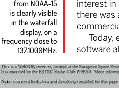

SDR 所示：

## >> AVHRSR 声音

NOAA 极地轨道卫星携带有一种名为高级高分辨率辐射计（AVHRSR）的车载仪器。你可以将其想象成摄像头，尽管它与普通相机完全不同。特别是，传感器不是一个在单次实例中捕捉二维场景的二维数组。相反，它只在卫星飞行时捕获一行像素。它是连续移动的，卫星在两个相邻行之间移动，这代表了地球表面的不同条带。将这些条带叠加，就创建了一个二维图像。结果类似于从相机视角捕捉的图像，由于无线电传感器的限制，其区域有限。

尽管只需要捕捉一条像素带，但 AVHRSR 传感器捕捉的是行 2,600 个元素，这是有效分辨率。较新的传感器确实以这种方式运行，被称为“推扫式”（push brushes），但 AVHRSR 是一种较旧的设计，使用了“扫帚式”（whisk broom），设备以垂直于运动方向的角度来回移动。通过镜子，它将水平条带的光引向每个光谱带的传感器。

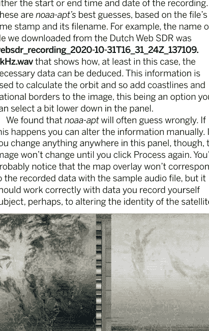

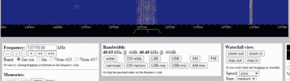


来自 Noordweijk SDR 带有海岸线的 `noaa-apt` 输出数据。下方的图像是反的，下方是一次从北向南经过。

## 从水象卫星解码信号教程

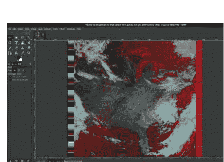

在 `noaa-apt` 图像映射软件外部组合两幅图像，只有当图像看起来不同时，才会带给你一个有趣的结果。当卫星传输两个以上的光谱带（例如 NOAA AAPT 信号）时，它会选择光谱带的组合并在红、绿、蓝中重现它们。虽然最终结果并不真实，但确实有产生所有可能颜色的潜力。然而，只有两个光谱带时，情况就不同。

如果你选择两个主色，使用红色和蓝色将给你紫色；红色和绿色将给你橙色。

快速提示

除了 APT 信号外，NOAA 极地轨道还会在 170kHz 处传输一个假信号（HRFT）。当仅用两个主色红色和绿色使用时，它的效果没有假色彩那么好，红色和绿色将给你青色。

假设最终结果是你满意的，不要忘记保存图像。可以随时增强并变色。

## 图像处理

尽管 `noaa-apt` 提供了某种程度的增强，取决于获取图像时的光线，接收到的信号可能是完美的。在这种情况下，你可以尝试通过编辑改进。增强亮度和对比可以产生显著差异。然而，你的编辑质量可以产生更惊人的效果。如果你从未用过这个，应该读读如何操作。

我们不会提供有关编辑图像的具体说明，但这里有一个技巧：从 `noaa-apt` 剪切两个两个图像，然后将它们保存为单独的文件。将这些图像转换为 RGB 模式，然后在 GIMP 中选择你所需的颜色以添加一个单独层，并使用“变暗”（Darken）图模式。最后你合并图层并调整顶层的透明度。

如果你尝试调整 50%，但如果其中一种颜色出现了，你应该增加或减少顶层的透明度。

每颗 NOAA 地球静止卫星都会产生大约半球的真实色彩，但接收更加困难


由于只捕获一种可见光——而且在晚上无法获得所有光——因此无法生成全色彩。然而，`noaa-apt` 在“处理”三个滑块中提供了假色彩选项。实际上，你可以微调颜色，但实际上添加了接近我们颜色的颜色：水为蓝色，云为白色，植被为绿色。

目前还不清楚它是如何工作的，事实是目前没有提供信息。我们所能说的是可以使用这种形式的图像尝试识别云或地面颜色类型。与 NOAAAS 使用时相比，效果不如假色彩，因此可能有一个机会通过帮助增强这种效果来使用这个开源项目。

创建假色彩效果的另一种可能方法——在这里我们并没有负面意思，因为颜色通常保持与实际颜色一致——

# 终极 Linux 项目

## SCRIBUS

致谢：`www.scribus.net`

## 提升你的桌面出版技能

有抱负的媒体大亨 Nick Peers 揭了如何使用 Scribus（一款开源 DTP 工具）设计新闻稿、传单等内容。

像 LibreOffice Writer 等文字处理器在页面设计方面表现出色，但如果你是认真地对待这项工作，请使用专门的桌面出版工具。Scribus 能够制作从手册、传单到完整新闻稿的任何内容，你可以根据喜好将其打印或共享为 PDF。它包含了许多工具和选项，但在本教程中我们将向你介绍使用 Scribus 的基础知识：从导入现有内容到从头开始设计。虽然稳定版本 (1.4.x) 被列为“推荐”，但它之所以受到推崇是因为当前的开发版本 (1.5.7) 正在取代它，因此我们将在教程中重点关注该版本。对于运行最新版本 Ubuntu（目前为 22.04）的用户，使用 PPA 是最佳选择。

```bash
$ sudo apt-add-repository ppa:scribus
$ sudo apt-get update
$ sudo apt-get install scribus
```

如果使用 LTS 版本（Ubuntu 20.04），请通过 Flatpak 安装 Scribus（`https://sourceforge.org/projects/scribus/files/scribus-dev/`）。如果你正在使用 Flatpak，请执行 `$ flatpak install flatpak scribus`。

> 我们的专家 Nick Peers 自 1995 年开启写作生涯以来，就开始涉足 DTP 软件了。

# 导览 SCRIBUS

安装完成后，可以通过“显示应用程序”按钮启动 Scribus。它会被显示为 Scribus (Beta)，但不要担心——它是你所获得的最接近稳定的版本了。

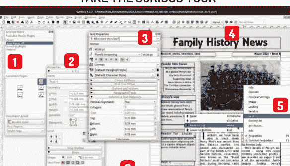

# 第一步

首次启动时，你将进入“新文档”窗口，那里有四个选择选项：新文档、从现有文档创建和最近文档。“新文档”选项允许你创建一个被拆分的空白页（一个“特殊布局”）。要启动 Scribus，切换到“从模板新建”选项卡，你会看到一组按类别（如手册、书籍和新闻稿）分组的模板。Nick Peers 解释了“关于”描述。这是一个简单的白色 A4 新闻稿模板，你可以右键点击索引（index）按你的喜好将其为内容（content）。

点击 OK，你将看到在 Scribus 1.3.3 中创建了新文档——功能框将显示一个警告，提示你缺少字体（非常缺少 Bitstream Vera），然后完成文档，关闭 Scribus 并用终端（Terminal）安装的字体。

```bash
$ sudo apt install fonts-bitstream-vera
```

重新打开 Scribus 并创建新闻稿模板——现在它应该可以正常工作了。

# 编辑文本

Scribus 主窗口将打开并显示你新闻稿的第一页。它看起来空空如如，让我们先看看如何编辑文本。

| 页面布局 | 4 页布局 |

| :--- | :--- |

| 使用此框管理你的文档 - 根据需要查看、添加和删除页面 | 箭头图标可以显示如何移动带有可见元素（如帧和对象）的页面。 |

- 2 帧属性

- 这允许你定义帧的边界以及显示周围物体的形状

- 3 属性

- 按 F3 切换所选帧内容的属性而非帧本身的属性

- 5 上下文敏感

- 右键点击获取更多选项，包括置于页面元素上方或下方

- 6 导航和视图控制

- 使用这些工具对页面进行放大和缩小，并在页面（以及图层）之间移动

# 桌面出版教程

双击“新闻稿标题”文本框内部，你现在应该能够编辑带有新闻稿标题的文本了，然后选择文本并尝试将其替换为引人注目的字体。

这是通过属性框（Properties boxes）完成的，它是一个你可以通过菜单或按 F3 打开的浮动窗口。点击顶部的下拉菜单来调整字体和大小——查看（下文）关于字体选择的一些提示和技巧。

属性框还有许多更多选项：在格式化多列文本时的行大小，你可以使用 D 软件获取更多选项——包括高级设置下的字间距和行距控制——但对于大多数基础操作，这些已经足够了。

一旦格式化了新闻稿，你就可以处理其余文本。当涉及直接格式化文本时，可以在 Scribus 框中编辑，或选择文本并按 Ctrl+T。这会打开编辑器窗口，带有当前显示编辑你的文字处理内容。其中一个区别是——每个段落分配其格式样式的方式：第一段、文章首段、后续段落等。

# 格式化文本

一致的格式化是创建专业文档的关键，可以通过对每个段落应用样式来实现。你可以通过右键点击左侧面板显示的高亮文本并点击下拉菜单来更改样式，如何使用这些样式来适应自己的设计？

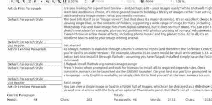

按 P4（或创建 EditStyles）使用段落样式和字符样式。段落样式可以从零定义，也可以通过定义常用样式并将其应用到段落来节省时间。

你也可以从自己的样式创建新样式。在定义字符样式后，你可以开始构建段落样式了。每个样式都包含这些额外元素，如边距、制表符、缩进和文本对齐。段落选项卡允许你定义项目符号和列表标记，以及字符的首字母大写。这是一个帮助你决定文章开头的伟大工具。

你还会选择一个字符样式来使用你之前定义的字符样式，然后为标题（或段落元素）设置缩进和大小——如果你不在意使用字符样式的话——然后定义段落的字符样式。

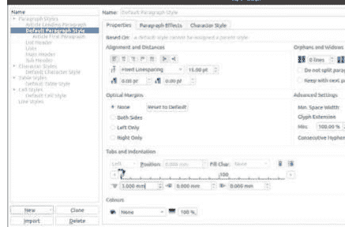

使用段落样式和字符样式确保你的文本格式化正确且一致。

# 小贴士

- Scribus 提供了第三种免费帧器（free-framer）。帧使得能够借助第三方程序在你的文档中创建特殊的排版，例如音乐和科学字体。访问 `https://scribus.org/canvas/Render-Framers` 查看使用指南。

> 使用编辑器编辑你的文本，而无需担心布局。

# 设计技巧与窍门

在 Scribus 中设计文档时，少即是多。这让读者感到更轻松，并将清晰度置于一切之上。通过保持页面布局简单整洁，内容就不会相互拥挤。将页面列数限制在二到三列，并确保文本在之间逻辑流畅。

选择字体时可读性是关键。再次，保持单一字体族的变体数量——粗体、斜体等——以区分不同的元素，如标题或说明。

使你选择的字体符合你文档的主题——Comic Sans 是相关工作或专业文档的最佳选择。一个需要做的关键选择是衬线（传统）和无衬线（现代、整洁）。字体取决于内容，但如果你仍在犹豫，请访问。

# 终极项目

> 我们的专家 Nick Peers 自 1995 年开启写作生涯以来，就开始涉足 DTP 软件了。

# 导览 SCRIBUS

安装完成后，可以通过“显示应用程序”按钮启动 Scribus。它会被显示为 Scribus (Beta)，但不要担心——它是你所获得的最接近稳定的版本了。


# 第一步

首次启动时，你将进入“新文档”窗口，那里有四个选择选项：新文档、从现有文档创建和最近文档。“新文档”选项允许你创建一个被拆分的空白页（一个“特殊布局”）。要启动 Scribus，切换到“从模板新建”选项卡，你会看到一组按类别（如手册、书籍和新闻稿）分组的模板。Nick Peers 解释了“关于”描述。这是一个简单的白色 A4 新闻稿模板，你可以右键点击索引（index）按你的喜好将其为内容（content）。

点击 OK，你将看到在 Scribus 1.3.3 中创建了新文档——功能框将显示一个警告，提示你缺少字体（非常缺少 Bitstream Vera），然后完成文档，关闭 Scribus 并用终端（Terminal）安装的字体。


```bash
$ sudo apt install fonts-bitstream-vera
```

重新打开 Scribus 并创建新闻稿模板——现在它应该可以正常工作了。

# 编辑文本

Scribus 主窗口将打开并显示你新闻稿的第一页。它看起来空空如也，让我们先看看如何编辑文本。

| 页面布局 | 4 页布局 |
| :--- | :--- |
| 使用此框管理你的文档 - 根据需要查看、添加和删除页面 | 箭头图标可以显示如何移动带有可见元素（如帧和对象）的页面。 |

- 2 帧属性
  - 这允许你定义帧的边界以及显示周围物体的形状
- 3 属性
  - 按 `F3` 切换所选帧内容的属性而非帧本身的属性
- 5 上下文敏感
  - 右键点击获取更多选项，包括置于页面元素上方或下方
- 6 导航和视图控制
  - 使用这些工具对页面进行放大和缩小，并在页面（以及图层）之间移动

# 桌面出版教程

双击“新闻稿标题”文本框内部，你现在应该能够编辑带有新闻稿标题的文本了，然后选择文本并尝试将其替换为引人注目的字体。

这是通过属性框（Properties boxes）完成的，它是一个你可以通过菜单或按 `F3` 打开的浮动窗口。点击顶部的下拉菜单来调整字体和大小——查看（下文）关于字体选择的一些提示和技巧。

属性框还有许多更多选项：在格式化多列文本时的行大小，你可以使用 D 软件获取更多选项——包括高级设置下的字间距和行距控制——但对于大多数基础操作，这些已经足够了。

一旦格式化了新闻稿，你就可以处理其余文本。当涉及直接格式化文本时，可以在 Scribus 框中编辑，或选择文本并按 `Ctrl+T`。这会打开编辑器窗口，带有当前显示编辑你的文字处理内容。其中一个区别是——每个段落分配其格式样式的方式：第一段、文章首段、后续段落等。

# 格式化文本

一致的格式化是创建专业文档的关键，可以通过对每个段落应用样式来实现。你可以通过右键点击左侧面板显示的高亮文本并点击下拉菜单来更改样式，如何使用这些样式来适应自己的设计？


按 `P4`（或创建 `EditStyles`）使用段落样式和字符样式。段落样式可以从零定义，也可以通过定义常用样式并将其应用到段落来节省时间。

你也可以从自己的样式创建新样式。在定义字符样式后，你可以开始构建段落样式了。每个样式都包含这些额外元素，如边距、制表符、缩进和文本对齐。段落选项卡允许你定义项目符号和列表标记，以及字符的首字母大写。这是一个帮助你决定文章开头的伟大工具。

你还会选择一个字符样式来使用你之前定义的字符样式，然后为标题（或段落元素）设置缩进和大小——如果你不在意使用字符样式的话——然后定义段落的字符样式。


使用段落样式和字符样式确保你的文本格式化正确且一致。

# 小贴士

- Scribus 提供了第三种免费帧（free-framer）。帧使得能够借助第三方程序在你的文档中创建特殊的排版，例如音乐和科学字体。访问 https://scribus.org/canvas/Render-Framers 查看使用指南。

> 使用编辑器编辑你的文本，而无需担心布局。

# 设计技巧与窍门

在 Scribus 中设计文档时，少即是多。这让读者感到更轻松，并将清晰度置于一切之上。通过保持页面布局简单整洁，内容就不会相互拥挤。将页面列数限制在二到三列，并确保文本在之间逻辑流畅。

选择字体时可读性是关键。再次，保持单一字体族的变体数量——粗体、斜体等——以区分不同的元素，如标题或说明。

使你选择的字体符合你文档的主题——Comic Sans 是相关工作或专业文档的最佳选择。一个需要做的关键选择是衬线（传统）和无衬线（现代、整洁）。字体取决于内容，但如果你仍在犹豫，请访问。

# 终极项目

> 我们的专家 Nick Peers 自 1995 年开启写作生涯以来，就开始涉足 DTP 软件了。

# 导览 SCRIBUS

安装完成后，可以通过“显示应用程序”按钮启动 Scribus。它会被显示为 Scribus (Beta)，但不要担心——它是你所获得的最接近稳定的版本了。


# 第一步

首次启动时，你将进入“新文档”窗口，那里有四个选择选项：新文档、从现有文档创建和最近文档。“新文档”选项允许你创建一个被拆分的空白页（一个“特殊布局”）。要启动 Scribus，切换到“从模板新建”选项卡，你会看到一组按类别（如手册、书籍和新闻稿）分组的模板。Nick Peers 解释了“关于”描述。这是一个简单的白色 A4 新闻稿模板，你可以右键点击索引（index）按你的喜好将其为内容（content）。

点击 OK，你将看到在 Scribus 1.3.3 中创建了新文档——功能框将显示一个警告，提示你缺少字体（非常缺少 Bitstream Vera），然后完成文档，关闭 Scribus 并用终端（Terminal）安装的字体。

```bash
$ sudo apt install fonts-bitstream-vera
```

重新打开 Scribus 并创建新闻稿模板——现在它应该可以正常工作了。

# 编辑文本

Scribus 主窗口将打开并显示你新闻稿的第一页。它看起来空空如也，让我们先看看如何编辑文本。

| 页面布局 | 4 页布局 |
| :--- | :--- |
| 使用此框管理你的文档 - 根据需要查看、添加和删除页面 | 箭头图标可以显示如何移动带有可见元素（如帧和对象）的页面。 |

- 2 帧属性
  - 这允许你定义帧的边界以及显示周围物体的形状
- 3 属性
  - 按 `F3` 切换所选帧内容的属性而非帧本身的属性
- 5 上下文敏感
  - 右键点击获取更多选项，包括置于页面元素上方或下方
- 6 导航和视图控制
  - 使用这些工具对页面进行放大和缩小，并在页面（以及图层）之间移动

# 桌面出版教程

双击“新闻稿标题”文本框内部，你现在应该能够编辑带有新闻稿标题的文本了，然后选择文本并尝试将其替换为引人注目的字体。

这是通过属性框（Properties boxes）完成的，它是一个你可以通过菜单或按 `F3` 打开的浮动窗口。点击顶部的下拉菜单来调整字体和大小——查看（下文）关于字体选择的一些提示和技巧。

属性框还有许多更多选项：在格式化多列文本时的行大小，你可以使用 D 软件获取更多选项——包括高级设置下的字间距和行距控制——但对于大多数基础操作，这些已经足够了。

一旦格式化了新闻稿，你就可以处理其余文本。当涉及直接格式化文本时，可以在 Scribus 框中编辑，或选择文本并按 `Ctrl+T`。这会打开编辑器窗口，带有当前显示编辑你的文字处理内容。其中一个区别是——每个段落分配其格式样式的方式：第一段、文章首段、后续段落等。

# 格式化文本

一致的格式化是创建专业文档的关键，可以通过对每个段落应用样式来实现。你可以通过右键点击左侧面板显示的高亮文本并点击下拉菜单来更改样式，如何使用这些样式来适应自己的设计？


按 `P4`（或创建 `EditStyles`）使用段落样式和字符样式。段落样式可以从零定义，也可以通过定义常用样式并将其应用到段落来节省时间。

你也可以从自己的样式创建新样式。在定义字符样式后，你可以开始构建段落样式了。每个样式都包含这些额外元素，如边距、制表符、缩进和文本对齐。段落选项卡允许你定义项目符号和列表标记，以及字符的首字母大写。这是一个帮助你决定文章开头的伟大工具。

你还会选择一个字符样式来使用你之前定义的字符样式，然后为标题（或段落元素）设置缩进和大小——如果你不在意使用字符样式的话——然后定义段落的字符样式。


使用段落样式和字符样式确保你的文本格式化正确且一致。

# 小贴士

- Scribus 提供了第三种免费帧（free-framer）。帧使得能够借助第三方程序在你的文档中创建特殊的排版，例如音乐和科学字体。访问 https://scribus.org/canvas/Render-Framers 查看使用指南。

> 使用编辑器编辑你的文本，而无需担心布局。

# 设计技巧与窍门

在 Scribus 中设计文档时，少即是多。这让读者感到更轻松，并将清晰度置于一切之上。通过保持页面布局简单整洁，内容就不会相互拥挤。将页面列数限制在二到三列，并确保文本在之间逻辑流畅。

选择字体时可读性是关键。再次，保持单一字体族的变体数量——粗体、斜体等——以区分不同的元素，如标题或说明。

使你选择的字体符合你文档的主题——Comic Sans 是相关工作或专业文档的最佳选择。一个需要做的关键选择是衬线（传统）和无衬线（现代、整洁）。字体取决于内容，但如果你仍在犹豫，请访问。

# 终极项目

> 我们的专家 Nick Peers 自 1995 年开启写作生涯以来，就开始涉足 DTP 软件了。

# 处理帧

## 设置文本帧

在打开空白文档后，点击文本帧并在你希望帧出现的地方拖动它。该帧可以调整大小和移动。按 `F3` 打开文本属性窗口以设置其他属性，包括列和文本间距。务必在列之间设置间隙。

## 链接文本帧

如果你想在不同的帧/或页面之间流动文本，需要在它们之间创建链接。选择第一个帧并按 `N` —— 你将看到光标。只需放置第二个文本帧并进行链接。对任何其他帧重复此过程。按 `U` 键可以取消链接。

# 桌面出版教程

它已经锁定了框架以防止它们被意外移动。要修复此问题，右键点击框架并选择“锁定”。你会看到框架变为显示可拖动状态——点击并拖动它进行移动，或使用箭头键进行移动移动。

现在是发现如何将框架组合在一起以作为一个单一对象的绝佳时机。将它们分组后，你就可以将图像和标题作为一个整体移动：只需按住 `Shift` 键并点击选择你想要分组的框架，然后使用选择框包含所有选中的框架。你可以将其拖动到另一个位置，或者选择“对象 > 组”将它们转换为单个对象（你也可以可以在同一个子菜单中选择“取消组合对象”来撤销）。

接下来，将正文框和文本框都拖到你想要的位置。全选，然后解锁它们，最后将它们移动到指定位置）。当你顶部留有空间时，选择文本框并点击拖动框以填充空间。你将会有更多空间和更多文本待填充。


# 文章 5 如何

在打开的窗口中看到图像时，你应该首先查看选项。如果需要调整图像大小或裁剪图像，使用不可编辑的控件，你只需要一个简单的文本编辑器来编辑它。编辑后，保存文件并将其导回 InDesign。选择“文件 > 放置”来替换现有文本。你可以更改字体、大小、颜色、行距、字距和对齐方式。如果你想添加更多文本，只需选择文本框并开始打字。

你可以查看框架中的任何图像。

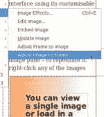

想在你的文档中添加页码吗？按通常方式创建一个框架，然后选择“插入 > 页码”或按下 `Shift+Alt+P`。如果页面发生移动，页码会自动更新。

# 添加页面

一旦你放置了第一页，就移动到下一页。每个模板都可以支持多个页面，你的布局不受限制。点击“插入 > 页面”在当前页面之后添加新页面，并为左右两面设置不同的主页。在插入页面时，根据需要插入“左页”和“右页”。点击确定。

将三种方法来创建指定的页面，准备好填充它们的文本内容。这非常直观，但如果你想使用你自己的时事通讯模板中，你可能需要对我们设计的框架进行布局更改，或者通过自己设计页面进行更大的更改——从这里学习如何创建文本和图像框。

# 分享你的创作

你的工作已经完成，你准备好打印纸质副本或将其导出为 PDF。与朋友分享这是它的最佳方法！使用“文件 > 打印”或“文件 > 导出（用于 PDF）”，打印预览将向你显示导出时的任何错误——包括未加入文档的各个项目，检查问题并在打印前如有必要通过一些编辑来修复它。

或者，忽略错误以显示文档看起来像你看到的一样，显示各种选项取决于你是否将其导出为 PDF——最后点击“打印”！或者……

# >> 构建模板

凭借你在本教程中学到的知识，你现在可以创建自己的模板了。在开始之前，选择“文件 > 偏好 > 路径”，指向你存储模板的地方。

完成后，点击确定并创建一个新文档。为了制作多页文档，选择“页面”，选择你的尺寸属性（尺寸和方向），并使用主页从页面边缘运行，使用预设布局（如古腾堡布局或杂志布局），如果你需要一个确定的话。选择第 4 页作为你的布局，将页面留留以适应封面。点击确定。

你将看到一个空白画布。遵循向导（跨页）来发现如何使用图像和文本的组合用你自己的设计填充第一个封页。然后你可以对内页重复此过程——记住为左右页调整设计。完成后，选择“页面组件 > 转为主页”。给它起一个相当具描述性的名称，验证是否选了正确的类型（左或右），并确保在插入新页面时可以简单地预填充之前创建的框架。只需在“插入页面”对话框中选择选定的主页，脚本将完成下一步，即添加的页面可以被编辑或删除，因此将它们用于一致的元素，例如机器标题或页码。

一旦你拥有了主页，选择“文件 > 另存为模板”，给它一个合适的名称和选项以提供更多关于模板的信息。

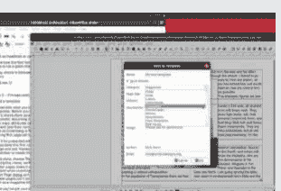

> 你可以查看有关你模板的细节 - 如果你计划与其他分享它。

终极出版项目 | 4

# 终极 Linux 项目

# 逃离 Google 相册

Google 的免费照片存储已成为过去。Jonni Bidwell 有一些免费软件可以让你的相册被遗忘。


当 Google 新邮件服务的邀请落在伟大的发布者手中时，免费邮箱的世界永远改变了。我们不再需要管理几兆字节的存储空间、显而易见的广告以及对在任何时刻连接失败都会让我们失去当前可用电子邮件的可怕恐惧。现在用户可以享受 2GB 的存储空间，并进一步享受配额的不断上升。然而，广告很小且糟糕。它们也是相关的，因为它们是根据你搜索内容的算法选择的。

后来，Google 为你的所有照片提供了免费、无限存储，随后还为多达 50000 个音频文件提供了免费存储。十年后，Google 发现即使拥有这些令人印象深刻的资源，也有盈利途径。Google Music 在2020 年底关闭，从 2021 年 6 月起，Google...

在此时你应该担心备份时，你可能会开始考虑云服务。与其在这一关头陷入无限循环，请注意混合方法是合理的。云存储可以通过 Nextcloud 移动应用程序同步到你的手机，你可以轻松管理来自你照片的新图像。

每月 5 英镑左右的价格可以买到带有 20GB 存储的虚拟服务器 (VPS)。你甚至可以用这个价格从 Mythic 运行一个树莓派。这提供了极高的价值，除了托管你的照片，这些方案还提供了根 访问权限，让你可以将你的机器与任何允许的内容组合（受资源限制）。

我们以前看过使用 VPS，我们很快会介绍它。但现在让我们开始表演吧。

42 | 终极项目

# 终极 Linux 项目

## 安装 Nextcloud

探索如何利用 Docker Compose 的强大功能，像专业人士一样简练地部署并运行 Nextcloud。

每当那个永恒的“逃离 Google”的话题出现时，我们总会点击并指出 Nextcloud 的益处。它可以处理文件存储（类似 Google Drive）、聊天（类似 Zoom），并配合 Collab Online 成为一个功能全面的在线服务。你可能需要管理自己的照片，我们将向你展示如何充分利用这一功能。

在树莓派（Pi）上操作（位于 LXFF72 的智能家居办公室）。大部分工作都在基础性准备上——确切地说，就是安装 Web 服务器、数据库和 PHP，并让它们协同工作。如果你处于一个权限过于宽松的网络环境中，

在家里设置 Nextcloud 并进行远程访问是完全可能的，但实际上有许多理由让你考虑这样做（不仅仅是因为它是免费的）。你的互联网服务提供商（ISP）可能会在关键时刻掉你链子（想象一下在 Tagore 的晚餐宴上，在同伴们冰冷的目光下展示你的照片）。云提供商（至少是优秀的那些）能够完美地处理请求负载。

准备好，我们这里时间不多，所以这次我们将使用 Docker 安装 Nextcloud。这种方法的优势在于，你将始终保持最新版本，且无需手动维护（或者在任何运行 Ubuntu（桌面版、服务器或树莓派）的地方设置，然后确保你使用了 snap 守护进程）。

## 在云端运行 NEXTCLOUD

### 启动与运行

> “有时有一个云服务器确实不错，但你永远不知道它们什么时候会派上用。”

安装 Docker 最简单的方法是使用官方的便捷脚本（适用于 Windows、树莓派、Fedora 等）。

接下来，你必须担心硬件问题，或者担心房子火灾导致照片丢失。许多提供商提供额外的付费备份服务（以及他们自己的冗余机制），以防止硬件故障或人为失误。最后，这只是为了拥有云服务器，但你永远不知道它什么时候会派上用。

```bash
$ https://get.docker.com - get docker
```

在运行之前，你应该阅读该脚本，以便了解自己在做什么。一旦满意，请运行：

```bash
$ sudo sh get-docker.sh
```

从零开始设置 Nextcloud 的文档稍微详细一点——如果我们可以负担得起的话。这适用于大多数发行版，并添加了相应的存储库以保持更新。Docker 引擎会在 Debian 和 Ubuntu 上自动启动，但在 Fedora 上，你需要手动启动。

```bash
$ systemctl enable --now docker
```

此时，你将：

```bash
$ sudo docker run -p 8080:8080 nextcloud
```

并通过将浏览器指向该机器的 8080 端口来访问它：http://localhost:8080。你在这里发现的 Docker 版本仅用于测试，但由于远程服务器上没有设置 HTTPS，Nextcloud 将被拦截。如果你想安全地使用它，将需要。


我们建议阅读 https://github.com/nextcloud/docker/tree/examples 上的文档，了解如何使用 Docker Compose 将运行 Apache 的 Nextcloud 链接到 Nginx、Let's Encrypt 和 MariaDB 数据库（后者在处理大照片时比 SQLite 效果好得多）。

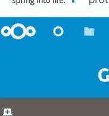

如果你在使用 Docker Compose 时带有 `switch` 参数，当容器启动时你可以看到更多的调试信息。

## 早上好，Linux Format：

`joni@pop-oc-`

全局设置 `Server` 指令以支持

```text
[Tue 13 Apr 18:03:16:43.8836] refork: [pid 1] 00163:apache/2.4.38 (debian) configured --
resuming normal operations-
[Tue 13 Apr 18:03:16:43.8836]
```

要使用 HTTPS（且不产生警告），你需要一个域名。你可以从任何动态 DNS 提供商处或脚本获取免费的域名（`duckdns.org` 格式）。这意味着如果你正在运行 Nextcloud 且你的 IP 地址发生了了变化，你的子域名记录将自动更新。检查发布页面中最新版本的 Docker Compose（https://github.com/docker/compose），并获取以下所需的版本号：

```bash
- sudo wget https://github.com/docker/compose/releases/download/v2.10.2/docker-compose-linux-x86_64 -O /usr/local/bin/docker-compose
- sudo chmod +x /usr/local/bin/docker-compose
```

第二条命令使脚本具有可执行权限，只要在你的 `PATH` 中，你就可以输入 `docker-compose` 来运行它。如果需要，请查看示例获取更多详情：

```bash
- mkdir -p ~/nextcloud
- sudo wget https://github.com/nextcloud/docker/examples/docker-compose-with-mariadb/docker-compose.yml -O ~/nextcloud
```

现在我们配置代理以允许大负载。该示例还需要缓冲，所以让我们创建一个 `docker-compose/proxy/upload.conf` 文件，内容如下：

```nginx
client_max_body_size 1G;
proxy_buffering off;
```

在该目录下，我们从 Nextcloud 源码中创建一个名为 `site.conf` 的文件：在运行所有镜像之前，我们需要编辑 `docker-compose.yml` 文件，写入运行中 Nextcloud 和 Let's Encrypt 的主机名。打开 `docker-compose.yml` 文件并修改数据库条目：将 `PASSWORD` 替换为强密码并设置以下内容：

```yaml
VIRTUAL_HOST=your.domain
LETSENCRYPT_HOST=your.domain
```

还有一个调整，Let's Encrypt 现在需要一个额外的卷来存储证书，因此在 `Let's Encrypt` 卷部分添加。现在，在同一目录下创建一个包含内容的 `db.env` 文件，使用你之前那个：

```env
MYSQL_PASSWORD=password1!
MYSQL_DATABASE=nextcloud
MYSQL_USER=nextcloud
```

最后，我们将能够获取最新镜像并编排一切：

```bash
cd ~/nextcloud
sudo docker-compose pull
sudo docker-compose up -d
```

你应该会发现 Nextcloud 设置已指向了你的浏览器，但别担心——花几秒钟设置好一切。按照那里的指令设置管理员，如果你需要帮助，请询问安装 compose 的那组人：注意，数据库和 SSL 证书会自动重新配置。顺便提一下，在 IPv6 上运行 Docker 对我们来说不是问题，所以如果你发现了什么可行的方法，请告诉我们。

在页面上，你会找到用户，最后是让 compose 运行起来

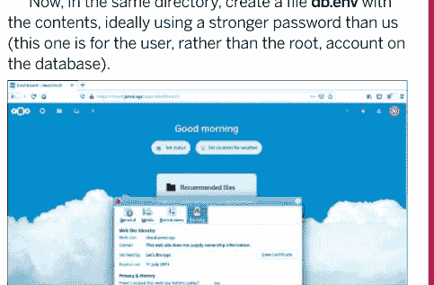

Let's Encrypt 的 Dockercompose 示例需要更新


Compose 示例中的这个问题也困扰过我们。如果你是从未来读到，它可能已经被修复

## 树莓派

如果你正尝试在树莓派上运行 Nextcloud，它是可以，但我们不使用 x86 的 `docker-compose`，因为树莓派使用的是不同的架构，官方版本会失败。为了解决这个问题，你可以编译 `docker-compose`（或者自己编译），并使用 Python 包管理器在树莓派上通过编译好的 compose 进行安装。

```bash
- sudo apt install python3-pip
- sudo rm /usr/local/bin/docker-compose
```

你还会发现官方的 MariaDB 镜像没有 `armhf` 版本，但那没关系，因为 `linuxconfig.org` 的人们在 `docker-compose.yml` 中提供了 `linuxconfig/mariadb`。

编写时，Debian Buster 提供的官方存储库存在一个奇怪的 Docker 问题，因为 Docker 引擎依赖容器内时间被设置为 1970（纪元）的问题，导致某些功能无法运行。良好的解决方案是从 Backports 存储库中安装，如 https://docs.linuxserver.io/faq 所示。

Nextcloud 的第一个欢迎信息——尽管 SSL 证书是自动生成的。

## 传输你的照片

现在 Nextcloud 已经上线并运行，是时候把你的照片存进去，让它们离开 Google 的触及范围。

查看下方的三步指南来获取 Google 照片的存档。存档根据你对应每张图片的元数据进行组织，格式为 `.json` 文件。这些文件包含相册信息、描述以及通过 Google 添加的数据。

解压存档时请确保你有足够的空间。如果文件很大，你也可以选择将其分成相同大小的块，然后由 Google 准备。或者，你可以下载到本地存储。如果你愿意，可以从 Google 服务传输数据。然后你将获得下载链接。前往

## 导出照片

| 步骤 | 操作 |

| :--- | :--- |

| 1 | 选择要包含的数据 |

| 2 | 选择文件类型、频率和分布 |

| 3 | 下载 |

| 项目 | 选择 |

| :--- | :--- |

| Google 照片 | 全选 |

| 来自 Google 的照片和视频 | 全部包含 |

| 更多信息 | |

| 多种格式 | 全部照片 |

1. 下载：登录 Google 照片，然后点击左角的图标进入设置。向下滚动到导出数据部分，点击它以备份数据。

2. 自定义：你可以限制日期和年份，如果你愿意，可以从 Google 下载数据。Takeout 提供了 zip、tar.gz 存档的选择，如果你愿意也可以选择文件范围。

3. 下载：Google 照片将在一年内为你提供链接，每两个月提供新链接。在导出选项卡中，它将准备就绪供下载。

## 迁移 Google 相册

使用 Nextcloud 的文件工具并点击 `+` 来执行此操作。如果你感到压力很大，你可能想在上传之前进行一些照片清理工作，例如将目录添加到锁定列表中、重新定位任何错误的图片，如果你真的非常热衷，还可以纠正它们的 EXIF 数据。否则，我们已经为你安排好了，你现在可以尝试将整个 Google 相册（在你的本地机器上）拖入新创建的 Nextcloud 文件夹（在浏览器中）。

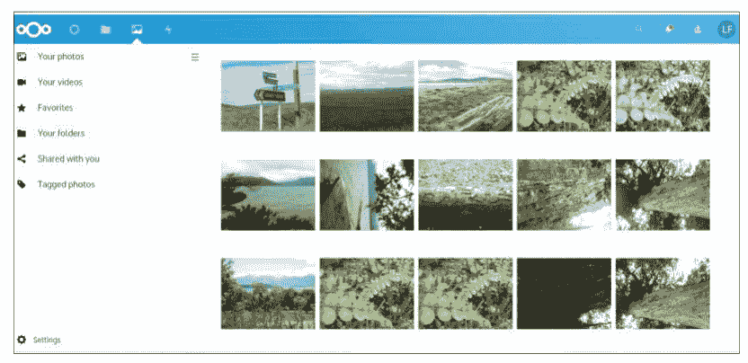

尽管进度条上掉了几个 GB 的文件并稳定地达到了 100%，Nextcloud 还是抛了一堆看起来很吓的“死锁”消息。

## Android 上传

官方的 Nextcloud Android 版本可以通过 F-Droid 获取，也可以在 Google 和 Apple 的应用商店下载。安装到你的 Android 设备上并输入凭据，即可立即访问所有照片（以及其他内容）。你可以从“媒体”部分复制按日期上传的任何图片，这非常简单。

在“自动上传”部分（通过汉堡菜单），你可以选择设备上的任何照片或文件夹。请确保它们被命名为“Camera Roll”（相机卷），否则你可能需要再次担心无法将照片从手机传输出来。它们将全部备份到 Nextcloud。

理论上是是这样。但可能会出现一些问题，然后它可能会停止工作。如果出现问题，你可能因为缺少可用空间而无法再次登录，或者至少需要增加磁盘空间。为了避免这种情况，你可以使用管理员账户为用户设置配额。如果你是那里唯一的用户，请限制实际可用空间，以便在达到配额时留有回旋地。默认情况下，该工具只会在连接到 Wi-Fi 时上传，但如果你想让照片出现在云端，可以更改此设置。

从普通数码相机自动化上传并不容易，但有些摄影师习惯了从 SD 卡复制并直接上传。你可能对 Nextcloud 的 RAW 插件感兴趣，它允许你直接在浏览器中导入 RAW 文件，而无需使用 GIMP 下载它们。

照片上传后，你可以对它们做很多事情。首先，你只需尽情浏览照片。工具将按上传当天日期列出它们，而不是按时间顺序，这可能不符合你的习惯。没关系，只需选择“文件夹”选项，至少它们按日期或名称组织了。然而，如果它们是生成的，当你第一次看到一组新图像时，渲染会有延迟。你还可以添加注释并标记用户（特别是提及）。你还可以内部和外部共享图像（对于没有你处账户的用户免费）。当然，顶部有一个幻灯片按钮。


## 使用 PORTAINER 管理容器

回想起来，这种设置的伟大之处在于使用 Snap 可能更简单，但它具有高度扩展性。你可以在其他地方托管容器，甚至管理和维护它们的证书以及反向代理路由。如果你不这样做，可能会做很多额外工作。

使用 Portainer 来管理你设置的四个容器。这样你就可以确保它们在友好的 Web 界面舒适下都运行如初。

Portainer 很容易安装。它以 Docker 镜像的形式启动，你可以通过以下命令运行：

```bash
$ docker run -d -p 9000:9000 --restart=always -v /var/run/docker.sock:/var/run/docker.sock -v portainer_data:/data portainer
```

要处理多个容器，请原生使用 Compose v3（我们之前创建的），这样你可以直接将容器数据粘贴到 Stack 区域，该区域也支持 Kubernetes 和 Docker Swarm。通过 Portainer，你可以检查容器日志、属性，或直接在运行的容器中执行 shell 命令。Portainer 允许你以即时方式进行清理（当你正试图让事情正常运转时）。这些容器可能很大，所以最好寻找未使用的容器（希望如此）并将它们移出内存。

## Lychee

获取带有一点花样的简单照片托管服务。

Lychee 比 Nextcloud 程序要简单得多。它只允许你将照片上传到相册并显示它们，但它做得非常好。一个拥有 1GB 内存的 VPS 在执行复杂操作时很容易耗尽内存。我们遇到过这种情况，该功能也导致了更新过程崩溃。大多数情况下，重启 MariaDB 服务即可恢复，但当界面显示无用的错误时仍然很恼人。

相比之下，Lychee 要轻量得多，因此你应该能够在即使是最简陋的 VPS 上运行它。不仅如此，我们还将调整用于 Nextcloud 的 Docker 配置。如果你已经掌握了 Compose，那么可能需要编辑现有文件以添加另一个供 Lychee 运行的服务。这并不完全正确，MariaDB 容器只允许使用相同的变量设置一个账户。你有三个选择：

- 手动添加 db（这很糟糕，如果容器被销毁数据将无法持久）

- 为 Lychee 添加一个独立的容器（这似乎效率低下）

- 目前仅使用 Nextcloud 并创建一个单独的 Lychee

如果你也希望朋友能够登录，请在你的 Nextcloud 实例上创建并显式访问。创建一个 `lychee` 目录，然后从 Nextcloud 复制：

```bash
$ mkdir lychee
$ docker cp -r nextcloud /lychee
```

现在编辑你的 `docker-compose.yml` 并替换以下内容：

```yaml
- lychee
  restart: unless-stopped
  environment:
    VIRTUAL_HOST: lychee.dns.org
    LETSCRYPT_HOST: lychee.dns.org
    LETSCRYPT_EMAIL: contact@yourdomain.com
    DB_CONNECTION: mysql
    DB_HOST: db
  volumes:
    - conf:/conf
    - upload:/uploads
```

在启动之前，请忘记设置 `lychee` 数据库。回想起来，这种设置的伟大之处在于使用 Snap 可能更简单，但它具有高度扩展性。你可以在其他地方托管容器，甚至管理和维护它们的证书以及反向代理路由。如果你不这样做，可能会做很多额外工作。

使用 Portainer 来管理你设置的四个容器。这样你就可以确保它们在友好的 Web 界面舒适下运行如初。

Portainer 很容易安装。它以 Docker 镜像的形式启动，你可以通过以下命令运行：

```bash
$ docker run -d -p 9000:9000 --restart=always -v /var/run/docker.sock:/var/run/docker.sock -v portainer_data:/data portainer
```

要处理多个容器，请原生使用 Compose v3（我们之前创建的），这样你可以直接将容器数据粘贴到 Stack 区域，该区域也支持 Kubernetes 和 Docker Swarm。通过 Portainer，你可以检查容器日志、属性，或直接在运行的容器中执行 shell 命令。Portainer 允许你以即时方式进行清理（当你正试图让事情正常运转时）。这些容器可能很大，所以最好寻找未使用的容器（希望如此）并将它们移出内存。

## Lychee

获取带有一点花样的简单照片托管服务。

Lychee 比 Nextcloud 程序要简单得多。它只允许你将照片上传到相册并显示它们，但它做得非常好。一个拥有 1GB 内存的 VPS 在执行复杂操作时很容易耗尽内存。我们遇到过这种情况，该功能也导致了更新过程崩溃。大多数情况下，重启 MariaDB 服务即可恢复，但当界面显示无用的错误时仍然很恼人。

相比之下，Lychee 要轻量得多，因此你应该能够在即使是最简陋的 VPS 上运行它。不仅如此，我们还将调整用于 Nextcloud 的 Docker 配置。如果你已经掌握了 Compose，那么可能需要编辑现有文件以添加另一个供 Lychee 运行的服务。这并不完全正确，MariaDB 容器只允许使用相同的变量设置一个账户。你有三个选择：

- 手动添加 db（这很糟糕，如果容器被销毁数据将无法持久）

- 为 Lychee 添加一个独立的容器（这似乎效率低下）

- 目前仅使用 Nextcloud 并创建一个单独的 Lychee

如果你也希望朋友能够登录，请在你的 Nextcloud 实例上创建并显式访问。创建一个 `lychee` 目录，然后从 Nextcloud 复制：

现在编辑你的 `docker-compose.yml` 并替换以下内容：

```yaml
- lychee
  restart: unless-stopped
  environment:
    VIRTUAL_HOST: lychee.dns.org
    LETSCRYPT_HOST: lychee.dns.org
    LETSCRYPT_EMAIL: contact@yourdomain.com
    DB_CONNECTION: mysql
    DB_HOST: db
  volumes:
    - conf:/conf
    - upload:/uploads
```

在启动之前，请忘记设置 `lychee` 数据库。回想起来，这种设置的伟大之处在于使用 Snap 可能更简单，但它具有高度扩展性。你可以在其他地方托管容器，甚至管理和维护它们的证书以及反向代理路由。如果你不这样做，可能会做很多额外工作。

# 终极 Linux 项目


致谢：https://qgis.org

## 创建、编辑和使用自定义地图数据

如果你喜欢 Google Maps，那么你一定会喜欢 QGIS。Mike Bedford 将向你展示如何入门，并介绍它的一些功能。


早在1962年，捷克共和国的考古学家发现了一根刻有几何设计的猛象象牙。该图案被系统性地识别为代表一个区域。周围区域的丘陵、河流、山谷和路线年代可以追溯到公元前约250,000年，这可能是人类发现的最古老的地图。


赫里福德大教堂的图书馆收藏有《世界地图》（`Mappa Mundi`）。它创作于公元1300年左右。而英国测量局（`Ordnance Survey`）成立于1791年，最初是为了应对来自法国和雅各特起义的预期风险，后来成为全球最领先的国家地图编制机构之一。1999年，总部位于加州的 `ESRI` 公司发布了面向非专业人士的 `ArcGIS` 图形界面。`Mike Bedford` 是 `QGIS` 的忠实粉丝：他承认在在丘陵上散步时，依然喜爱旧式的 `OS` 地图。

从街道地图到地形图再到卫星影像，有很多选项可以作为底图。

`ESRI` 的 `ArcGIS` 并不便宜，专业版每年费用1,192英镑（含增值税）。非商业用途的价格降至139英镑，但对于一个认真的兴趣爱好者来说，这仍然很贵。我们这里讨论的主题是开源 `QGIS`，它被广泛使用，并被认为与许多专业的 `GIS` 产品平相当。

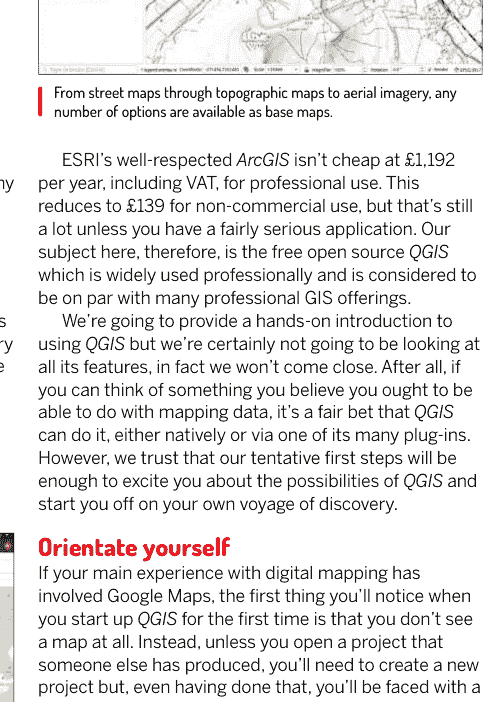

制图学历史上的这几个日期说明了27,000年的变化，而且变化速度已经显著加快。数字地图绘制带来的这一转变对其他领域产生了同样的影响，但有人认为 `QGIS` 与其前身截然不同，它允许用户在多个图层上工作，并使地理数据的分析像使用 `GIS` 那样容易，甚至更容易。虽然 `Google Maps` 在其中，但我们不会纠结于它是否属于 `GIS` 的争论，我们认同这样一种观点：一个免费的 `GIS` 就像是加强版的 `Google Maps`。

**快速小贴士**

当你处理一个项目时，尝试一次导入多个文件，包括与图层相关的示例。养成为每个项目使用新文件夹的习惯，并将所有文件组织在一起。

将 `OpenStreetMap` 添加为底图再不过简单了。

## 确定方向

如果你以前的数字地图体验都涉及 `Google Maps`，那么当你启动 `QGIS` 时，首先会注意到这里根本没有地图。相反，除非你打开别人做好的项目，否则你需要通过空白画布创建一个新项目，并向其中添加图层。

通常，你会通过添加底图来开始项目，让我们看看如何操作，但首先点击“新建（`New`）”。现在，在左上角的浏览器（`Browser`）面板中，展开 `XYZ Tiles` 图层并


50 | 终极 Linux 项目

双击 `OpenStreetMap`。这就是访问原始 `OpenStreetMap` 地图的方法。新地图将出现在主窗口中，你也能在左下角的图层（`Layers`）面板列表中看到它。`OpenStreetMap` 是默认显示的唯一底图，还有许多其他可以使用的地图，你可能想自己探索一下其中的任何内容。你需要在浏览器面板中搜索 `XYZ Tiles`，并选择“新建连接（`Next connection...`）”。在“连接详情”中，输入：`https://opentopmap.org?tiles=%B7%7D%7B%7B%7D%7B%7D%25`

这种添加地图的方法将允许 `OpenStreetMap` 出现在 `XYZ Tiles` 下，如果你双击它，`OpenStreetMap` 就会作为一个图层出现。如果你想替换主窗口中的地图，这只有在它是顶层时才可行：它在列表中显示为 `OpenStreetMap`，且完全不透明。如果你以后想对图层进行操作，可以通过点击 `OpenStreetMap` 旁边的复选框来隐藏显示，或者通过将 `OpenStreetMap` 拖到列表顶部来实现。

添加其他底图限于可以使用卫星数据或航空影像的地图。例如，要添加 `Google Maps`，使用 `https://www.google.com/maps/vtrs?x=s%B7%7D%7B%7B%7D%7B%25`

## 高程数据

现在我们在这里为各种 `QGIS` 项目添加高程数据，尽管其中任何一个都不是某种类型的图像。但由于 `QGIS` 关乎不仅仅是地图，或者如果你想看看 `QGIS` 如何处理不同类型的数据，我们有

首先，我们将添加一些高程数据，但在之前简单说一下类型。你会发现许多数据是 `DEM`（数字高程模型）。`DEM` 包含了建筑物、道路等对象，以及实际地面。在 `DTM` 中，较少的类型有


过滤掉代表地形。在英国，高程数据由环境局（`Environment Agency`）产生，分辨率为 1m 或 2m，并由 `DEFRA` 免费发布。在美国，`USGS` 高程数据范围从 10m 到 30m，同时也涵盖了大部分地区。全球高程数据以 `GeoTIFF` 文件提供，这是 `TIFF` 格式的地理变体，尽管还有其他格式，但 `QGIS` 支持大多数格式。

一旦你下载了高程数据，就可以将其添加到 `QGIS` 项目中。如果你已经添加了地图，从菜单中选择“添加图层（`Add Layer`）”并选择“添加栅格图层（`Add Raster Layer`）”……在对话框中，点击三个点选择高程数据文件并点击确定。

# 创建、编辑和使用自定义映射教程

或多边形。现在开始添加字段，你可以根据需要添加任意数量的字段。在我们的示例中，我们正在创建一个层，标记特定矿物的位置。我们的第一个字段是矿物类型，因此将其命名为“`type`”（类型），并指定其定义为文本。在第一个字段中，点击“添加到列表”（`Add to Lists`），你将在下方的列表中看到它。我们还在同一位置添加了另一个字段，即发现矿物的位置。当你完成所有字段后，点击“确定”（`OK`）即可看到图层出现在“图层”面板中，但不会在地图上显示，因为还没有任何点。

要添加点，请确保已选择图层工具。点击“添加要素”（`Add Feature`）图标（带有蓝色圆点和十字准的图标），光标将变为十字准。在地图上感兴趣的位置点击，点就会出现。我们不想费心为字段填充值值，然后点击“确定”。点击“切换编辑”（`Toggle Editing`）工具栏以关闭图层的编辑。现在再次点击“识别要素”（`Identity Features`）。在项目工具栏中点击“点要素”（`Point Features`）图标（带有箭头的蓝色圆圈图标）。将出现一条虚线，提供图层的所有数据。

现在你可能会发现某些数据在不整合的情况下不会显示，但你可以添加的字段数量没有限制，这就是为什么默认不显示字段的原因。现在你可以通过点击“图层标记”（`Layer Labeling`）标签卡来为点添加标签。在“数据管理器”工具栏中点击你刚刚创建的图层。要启用标签，选择“`abc`”（黄色箭头所示）开启，在框中选择“单一标签”（`Single Labels`），并选择字体和大小。设置适当的值后，你将在地图上看到这些点。

放置。你可能想要微调点的尺寸、形状和颜色等选项。这些是你可以在“图层标记”标签卡或“符号化”（`Symbology`，画笔图标）标签卡中调整的所有内容。如果点经过了地理编码，`QGIS` 还允许你在它们所在的位置显示点。如果它们在多边形上，尽管你在地图上开启它们，它们可能不会显示。奇怪的是，`QGIS` 的功能似乎并不匮乏，我们找不到导入非地理编码点的方法。不过，如果你想将数据分开处理，这并不是什么障碍。有很多独立的应用程序和基于 `Web` 的工具可以完成此任务（例如 `Google Earth`）。在不支付费用的情况下生成的地图数量限制是

有了你拥有的完整要素层，以下是将其它们导入 `QGIS` 项目的方法。进入“矢量”（`Vector`）菜单，选择包含你想添加的点的文件夹，并点击“新建图层”（`New layer`）。新图层将出现在“图层”面板中，并将作为标记显示在地图上，位置就像我们刚刚添加的那些一样。

然而，如果你放大，外观可能会发生变化。点击“符号化”（`Symbology`）标签卡，确保符号化设置为“单一符号”（`Single symbol`）。单一符号将向你显示标记类型（如果它还没有显示的话）。再次点击标记，然后选择“简单符号类型”（`Simple Symbol Type`），选择“栅格图像标记”（`Raster Image Marker`）而不是“简单标记”（`Simple Marker`）。现在下方没有定义标记尺寸的边界框，但我们希望你在该点选取图像。因此，点击地图上的图标，这

`QGIS` 是一个强大的工具，我们在这里展示的只是人们可以成就的冰山角。实验是学习许多方法之一，所以

## >> 分析机会

尽管分析地理空间数据的能力被认为是 `QGIS` 的一项关键功能，但我们忽略了这一功能。随着你对 `QGIS` 的信心，取决于你可能想要深入分析，这里我们暂时跳过它。

例如，当手机公司使用 `QGIS` 软件来可视化从基站点获得的数据时，就可以进行此类分析。这种导出可以用于决定基站的位置，并形成发布覆盖范围地图的基础。事实上，当我们使用创建并填充了点的“形状文件”（`Shapefiles`）时，这应该是显而易见的。然后，每个图层中的点将通过它们的地理位置加上字段显示出来。

然后，对项目开始变得清晰。一种常用的方法是进行某种分析，并根据结果创建一个可以在地图上查看的新图层。`QGIS` 文档还显示了一个练习示例，涉及分析 1854 年霍乱爆发的原因。当那时存在空间分析工具时，可以使用 `SQL` 对 `QGIS` 进行查询。

作为一种对点的分析，可以使用地理标记点在地图上显示兴趣点。

终极项目 / 53

# 终极 Linux 项目

致谢信息：`www.dosbox.com`

## DOSBOX

## 如何轻松模拟 486 PC 并运行 DOS

通过始终可靠的 `Les Punter`，重温 PC 计算的三十二年，玩你最喜欢的游戏，并回顾你的操作系统！

他父亲在 1994 年买了他们的第一台 PC：一台带有 4MB 内存的 `Dan 486 DX 33MHz`。它比 `Amiga 500` 得多，价格几乎是其三倍。他在此之前对计算机的记忆是通过 `Commodore` 机器，但他得到了它并启动了 `MS-DOS`，但没有说明书。他通过犯许多错误、格式化 128MB 硬盘以及反复重新安装硬件和安装 `CD` 驱动程序，自学了关于 `DOS` 的一切。让我们从享受内容的最简单路线开始。`DOSBox` 以极少的努力带来快速的怀旧感。要在 `Debian` 或 `Ubuntu` 机器上安装 `DOSBox`，打开终端并输入以下命令：

```bash
sudo apt-get update
sudo apt install dosbox
```

安装 `DOSBox` 后，从终端启动应用程序：

```bash
dosbox
```

20 世纪 90 年代中期是 PC 的疯狂时代。它们仍然带有许多谜团，如 `SCSI`、大量的电线和灰尘。这个强大的光箱被捐赠给了 `Linux`，所以请看看模拟 21 世纪时代。`DOSBox` 是 486 和 `Pentium` 的模拟器。它只需很小的努力就能良好运行。当它启动时，你会看到带有 `C` 的 `DOS` 提示符。`DOSBox` 提供了一个简单的帮助菜单，我们可以通过介绍了解更多关于使用它的信息。现在我们可以做什么？我们有一个命令可以列出当前目录的内容。现在位于 `Z:.`

### 模拟复古 PC

复古 PC 时代跨越数十年，因此我们有丰富的编程语言选择。在这种情况下，我们将专注于为 `MS-DOS` 制作的 `QuickBasic` (`QBasic`)。它非常简单，而且在网上很容易找到。486 的运行频率可能只有 33MHz，但结合 4MB 内存和想象力，你完全可以为反抗军驾驶一架 X 战斗机。

下载 `DOSBox` 副本并将目录内容提取到你的主目录。记住提取出的文件的位置，因为我们从终端启动 `DOSBox` 时需要该位置。在 `DOS` 提示符中，我们将使用一个命令来查找 `QuickBasic` 的位置。

### 编写代码

复古 PC 领域既有只想在旧硬件上运行游戏的用户，也有我们。

`mount c:/QB45`，但请将其更改以匹配你自己的：屏幕上将打印一条消息，告诉我们 `C` 已挂载到该目录。切换到 `C:` 并列出驱动器。我们应该看到文件列表，但我们仍在 `qbase`（即 `QuickBasic`），所以最好输入文件名并按回车：

`QuickBasic` 的用户界面非常基础（此处并非双关语）。它在屏幕顶部有一个简单的菜单，中间有一个空白区域，我们可以在那里编写代码，并在底部与 `shell` 立即交互以编辑代码段。`QuickBasic` 的第一个任务是编写熟悉的“Hello world”，它会稍有不同，并用于打印。

# 终极 Linux

> 快速提示

我们可以在浏览器中运行 `Windows 3.1`。`ClassRetro` 拥有一个基于 `DOSBox` 的版本，我们可以在那里创建一个虚拟机并享受这个经典的界面：`https://classretro.com/win36-windows-3.1-ntml`

我们现在可以读取驱动器并启动我们需要的执行文件了。

## 创建我们自己的虚拟 486

`DOSBox` 非常适合快速体验，但如果你需要一些比它更强大一点的东西呢？我们可以安装一个具有顶配 486 架构的虚拟机，并运行 `Windows 3.1`。为此，你需要自己拥有的 `Windows 3.1` 和 `MS-DOS 6.2` 副本，并将它们保存为镜像文件 (`.img`)。

我们首先从 `https://www.dosbox.org/wiki/Download-and-Install` 下载 `DOSBox`。打开 `DOSBox`，`Windows 3.1` 将自动触发虚拟机进行安装配置。我们将内存设置为 32MB，这对于那个时代来说已经足够了。然后我们创建一个带有“蓝色”的机器，我们需要从这里启动，这就是我们需要使用的 `MS-DOS 6.2` 的哪一个磁盘。我们在设置选项中插入磁盘镜像，然后进入 `Storage>Control: Floppy`，并导航到 `floppy disk Start`，虚拟机就会启动 `DOSBox`。遵循标准安装过程并根据提示进行换盘，使用右 `Ctrl` 键解锁鼠标，点击即可自由移动。驱动程序已检测。

导航到 `disks` 目录并选择合适的磁盘。安装将花费不到五分钟，比以前快得多。在任何你需要重启的时候，你都可以从机器（`Machine`）菜单中选择：

`MS-DOS` 启动只需几秒钟，提示符非常适合执行几个命令。我们可以通过输入 `help` 获取你想要的任何信息。我们的目标是安装 `Windows 3.1`。所以现在我们需要插入 `Windows 3.1` 软磁盘镜像（`Floppy>Drives Choose-a File...`）。切换目录到第一个软驱器，然后列出磁盘内容：

| `DOSBox 0.74`, cpu: 3000; cycles: Program | Q |

| :--- | :--- |

| File Edit View Search Run Debug Options | Help |

```
C:\>DIR
VOLUME OF C
Serial number is 000-1

  DIR  DATE  TIME    BYTES        NAME
  COMMAND  COM    05-21/91  12:00AM       45612
WIN.EXE     05-21/91  12:00AM     543210
EDIT.COM    05-21/91  12:00AM      12000
NOTPAD.EXE  05-21/91  12:00AM      25000
CLOCK.EXE   05-21/91  12:00AM      15000
CALC.EXE    05-21/91  12:00AM      20000
```

立即

```
dir
```

安装

安装过程和换盘感觉就像是在操作 `MS-DOS`。几分钟后，`Windows 3.1` 就会安装完成。重启机器（`Machine-Reboot`），并在提示符中输入以下代码启动窗口。

```
win
```

在 `Windows 3.1` 启动的几秒钟内，一些记忆一定会会浮出海面，然后。

## 演示（Demos）是什么？

就像其他平台可能一样，PC 可以达到音乐家、艺术家和代码人员的演示，他们都在此分享技能并展示才华。在 `pinterest.net` 上研究后，我们发现了一个由 `Desiro` 在 2020 年制作的演示。这个演示展示了我们应该实现的目标：它将一个 `demo` 压缩到了 256 字节。这可不是什么小风小浪的！这是一个创造了绝佳内容的 `demo`。

## 如何使用 QEMU 运行经典系统教程

打开虚拟机管理器（`Virtual Manager`）并观察一下。在这一部分，我们有一个带有黄色星形的图标——用于创建一个新的虚拟机。在本教程中，我们将使用 `ISO` 镜像。虚拟机列在窗口中，我们可以根据意愿选择并运行它们。选择一台机器并点击“播放”按钮将在后台启动机器。

点击它将打开一个新窗口——这是我们与虚拟机交互的界面。启动虚拟机将启动一个播放窗口，我们在其中与虚拟机进行交互。

```
debian: bigsleep
password:
Linux debian 2.0.34-B2 Jul 9 10:57:48 UTC 1998 i86
```

Copyright (C) 1993-1998 Software in the Public Interest, as

Most of the programs included with QEMU/GNU are freely redistable; the export terms are described in the files in /usr/doc/qemu/

Debian/GNU 除适用法律外，对用户**不提供任何保证**。

## 1990 年代 - Debian Linux

20 世纪 90 年代的 `Linux` 是我们的新边疆。`Debian` 的出现逐渐具备了 48 位和奔腾处理器架构的优势，尽管在拨号连接上下载 `ISO` 镜像需要几个小时甚至几天。对于那个年代的大多数人来说，幸运的是，我们有了更快的浏览器，但还没有互联网。

`Debian` 由 `Ian Murdock` 于 1993 年创建，第一个版本（0.01）于同年发布。直到 1996 年，我们才看到了第一个稳定版（1.1）。今天，`Debian` 是许多流行发行版（如 `Canonical` 的 `Ubuntu` 和 `Raspberry Pi OS`）的骨干。可以说：

在创建新虚拟机时，我们可以插入 `ISO` 或 `CD/DVD` 镜像：

- 本地媒体（`ISO` 镜像或 `CD`）

- 网络安装（`HTTP`、`FTP` 或 `SFTP`）

- 导入现有磁盘


# 手动安装

在创建新虚拟机时，我们可以插入 ISO 或 CD/DVD 镜像。我们也可以使用 `qcow2` 镜像来运行现成的系统。

如果没有 Debian 的存在，格局将完全不同。

我们可以安装并运行自己的 Debian ISO 镜像，或者使用 QEMU 创建硬盘镜像。这种方法非常简单，很容易就能成功。然而，安装过程在近年来变成了：我们需要花费大量时间来设置并根据我们的需求配置系统。

我们下载了 2.0GB 的 Debian 镜像，点击“文件->打开虚拟机管理器”或创建一个带星号的显示器图标。在第一个屏幕“创建新虚拟机”中，选择 ISO 磁盘镜像并点击“下一步”，通过浏览定位到 `qcow2` 文件，然后点击“浏览”。一旦你选择了“通用”然后点击“选择操作系统”——选择相应的操作系统。这是为了设置要使用的 RAM 和 CPU 数量。这对于 Debian 2.0 来说绰绰有余。点击“下一步”创建名为“Debian”的名称，点击“完成”设置配置并启动机器。

> 小贴士：需要使用 QEMU 快速使用实时 CD（ISO）吗？我们可以通过以下命令启动它或真实的磁盘镜像：`qemu-system-x86_64 -cdrom image.iso -m 1`

## 老旧 PC 硬件

使用 QEMU 模拟老旧 PC 是廉价的——通常只需要占用我们一点磁盘空间。但如果我们想使用真实的硬件呢？这会变得昂贵。回首过去，我们可以看到今天 486 时代的机器售价高达数百美元。所以，旧的 486 66MHz 频率遥不可及。老旧 PC 硬件运输成本昂贵，并且需要大量工作才能准备就绪。在开始工作之前，首先确保你了解自己的东西。如果你需要帮助，请寻求专家意见。旧机器使用的是电源：它们可能是坏的，所以请确保你有相关的知识。电容器可能需要更换，并且可能会泄露到主板，因此在继续之后请阅读这些内容以及不可用区域。硬盘也很容易损坏，因此可以考虑将 IDE 转为 SATA 甚至使用闪存/SD 卡。

# 终极 Linux

首次启动时，我们通过 Debian 过程并显示 LILO：这仍然学习如何配置以使系统启动。Debian 配置过程从设置 root 密码开始，然后我们创建一个新的用户账户供普通访问。在提示设置 sudo 权限时，你可以选择是或否——无论如何都没有区别。下一个屏幕询问是否运行磁盘检查。按回车。如果再次出现磁盘检查，按 C 进入 Debian 登录。输入你的用户名和密码，并使用一些命令在系统周围运行。我们的用户有访问 sudo 组的权限；或者，我们需要切换到 root 以进行系统更改。

Debian 在当时是一个令人耳目一新的事物。它既简单又有趣。但我们的虚拟机已经准备好向前跃，进入一个 GUI 仍然是一件大事的时代。

## 2005 - Ubuntu 6.0 Drake

Canonical 决定成为 Linux 领域的严肃竞争者，因此许多用户刚刚使用了 Debian 5.0 几个月，并准备好切换到 Ubuntu。Drake 也之来了，作为我们日常工作的一点小调剂，它让一切变得美好。6.0 版本的 Ubuntu 安装过程既轻松又高效。如果当时感觉很新鲜，那么几天后它感觉依然很新鲜。

### 在安装 Ubuntu 虚拟机并创建一个新的之前

在第一个屏幕中我们创建了虚拟机，安装系统媒体并点击“下一步”。在下一个屏幕中，通过“浏览”导航到下载的 ISO 镜像的位置，然后选择“本地”。一旦你选择了操作系统名称流行的 Ubuntu 6.0，设置 RAM 为 1024，CPU 数量为 2。点击“前进”，在下一个屏幕点击“完成”结束配置并开始 Ubuntu 的安装。现在我们拥有了一个安装完整的 Ubuntu 系统。

Ubuntu 6.0 在桌面上运行良好，但我们需要进行一些调整以跳出虚拟机的僵局。

## VBOX

QEMU 是创建虚拟机的唯一方式，VirtualBox 是 Oracle 的一个经过测试的工具，但它模拟旧设备的效率不如 QEMU。安装 VirtualBox 是一项简单的任务。

VirtualBox 有一个直观的过程，可以在其中创建机器。在过程中，我们创建虚拟磁盘，磁盘可以是固定大小（例如 8GB 镜像），也可以根据主机操作系统的预期动态增长。一旦创建了虚拟机，我们可以自由调整 RAM、CPU 数量、VT-X 或 AMD-V 加速，并添加启动 ISO 镜像。我们还可以根据需求配置网络设置。

VirtualBox 是私有软件，它可能并不适合你。如果不是，那么我们这里有空间。QEMU 对于你的虚拟化需求绰绰有余。

## Linux Mint 的崛起

Ubuntu 曾一直是 Linux 发行版的领导者，但 Mint 随着 Ubuntu 一起成长，并拥有惊艳且独特的配色。Linux Mint 被设定为一种替代方案。

终极 Linux 项目 |

## 构建智能家居办公室

Wiseguy Jonni Bidwell 对如何利用最新的开源软件（FOSS）让我们的家和家庭办公室变得更智能提供了一些建议。


创造性的独特性以及将网络栈挤入最小微型设备的能力。在过去的几年里，出现了一些非常新奇的家居创新方案。传统的（或：古典的？）家庭居住者可能认为升级到智能家居毫无意义，但我们有一些 Linux 构想法可以说服他们。

拥有智能家居并不意味着必须忍受亚马逊 Echo 的窃听。这也不意味着 Google Assistant 那个实体会在你离开卧室且未关灯时进行报告。Mycroft 家庭助手可以执行这些语音设备的所有优良功能，但不会带有那些令人毛骨悚然的数据收集方面。最棒的是，你可以运行 Mycroft。

但智能家居不仅仅是调高锅炉、加热器和牺牲性火炉。有些人觉得这已经足够了。有些人发现自己必须负担购买新锅炉的费用，但另一些人可以通过改装和调整来更经济效益。通过 OpenHAB 的魔力，我们将为你展示。

对于我们许多人来说，COVID-19 疫情意味着我们的家发生了转变，变成了临时的工作场所，根据你的工作性质，这可能是未来的永久性设施。因此，我们准备了一些让你的办公室智能化的项目。使用 Jitsi 和 Collabora Online。由于 Docker 无处不在，我们可以使用 Portainer 管理引擎来利用它的力量。这将方便你为你的自托管智能家居添加任何服务，让我们让我们开始吧！

## 构建智能家居办公室

## 智能家居？

看看智能工具如何让家居变得智能，官方的。

总而言之，这种日常物品的智能化似乎将计算机放在了不需要的地方，并且手机上的许多应用程序可以保持桌面。这样做，你甚至可以将智能设备（可能还有你的手机）连接到攻击。

某些制造商比其他厂家更好地保护它们的 IoT 设备，许多攻击是通过用户共享凭据引起的。自 2016 年以来，Raspberry Pi 设备不再查看启用 SSH 的智能家居界面，因为当它们暴露在网上时变得非常容易。

理论上，这也可以是开源项目，但如果这样做，至少代码是给别人用的。

## 智能设备

公用仪表渴望每个人都拥有智能表，现在这些设备与智能锅炉、智能恒温器协同工作。智能冰箱也是，这些可以为你节省资金，并且确实能够准备你的房子。

我们将展示如何通过 OpenHAB 将它们所有连接在一起，这是开源家居自动化。此外，没有语音助手，智能家居是不完整的，我们将在页面上介绍我们的老朋友 Mycroft。

我们还采用了 Docker 这一功能，因此我们将查看如何设置你的家庭办公室。我们准备了一些关于使用 Overlayer 包含容器的提示，这是一种用于限制你容器溢出的管理引擎。

我们将展示如何使用 Jitsi 建立你自己的视频会议套件。这将是一个充满活动的过程，给自己泡杯好茶然后安顿下来！


但有很多有趣、安全并能为你的家带来快乐的项目。许多都是标准的 Raspberry Pi 项目，我们真的创建了，例如 Eli Struvy 的 smart home-diy-building-smart-home-showcases-projects。这个项目利用 LED 矩阵作为你办公室的状态指示器。

## 看这个！

疫情让我们许多人习惯了视频会议，随之而来的是对孩子（或成年孩子）干扰你工作对话的恐惧。也许一个亮颜色的警告灯（如果你看到你的状态是“忙碌”）可以轻松适配其他服务。

办公室系统再次如此。Raspberry Pi 在这方面非常出色，你可以使用我们的 LW08 运动传感器来设置它，而不是使用现产品。除了安全问题外，产品不再受支持会导致它们失效。这发生在 Google 在 2014 年购买 Nest 时。随后在 2019 年，他们宣布关闭 Nest 程序，导致所有未被 Google 浪费的旧硬件报废。


Unicorn HD 带有 256 个 RGB LED 和 PiFun 界面可以做一个出色的警告灯。


终极 Linux 项目 |

# OpenHAB 和 Mycroft

利用 openHAB 和 Mycroft 语音助手的力量让你的家居语音化。家居自动化（openHAB）可以连接所有可能有私有应用的 IoT 设备，但它们通常使用开源软件——当它们没有时，也有足够的方法将它们输出到 openHAB。我们在 SSH 部分介绍过安装此内容。将内容粘贴到公钥框并点击按钮。现在我们仍然需要将我们的设备接入 Ubuntu 云端以获取它，请按照之前的 Linux 步骤操作，但如果你想稍微不同一点，因为 Canonical 发布了适用于 Raspberry Pi 的 openHAB，我们可以编写一个基于 SSH 启动的脚本，它将拥有完全基于 Web 的界面（编写时）。一旦设置完成，记下你 Pi 的 IP 地址并通过浏览器连接，例如：`http://192.168.0.8`。openHAB 界面非常简单，特别是第一步是“选择设备”。你随时可以返回此索引来探索其他的。为了使用 open（编写时，除了 openHAB 还有其他功能，你可能需要注册 SSO（单点登录）。它是免费的，你可以在整个生态系统中使用。如果不是，你将需要使用 SSH 密钥来生成它。

```bash
ssh-keygen -t rsa
```

如果不存在此类文件，运行：

```bash
cat ~/.ssh/id_rsa.pub
```

将内容粘贴到公钥框并点击按钮。现在我们仍然需要将我们的设备接入 Ubuntu 云端以获取它，请按照之前的 Linux 步骤操作，但如果你想稍微不同一点，因为 Canonical 发布了适用于 Raspberry Pi 的 openHAB，我们可以编写一个基于 SSH 启动的脚本，它将拥有完全基于 Web 的界面（编写时）。一旦设置完成，记下你 Pi 的 IP 地址并通过浏览器连接，例如：`http://192.168.0.8`。openHAB 界面非常简单，特别是第一步是“选择设备”。你随时可以返回此索引来探索其他的。为了使用 open（编写时，除了 openHAB 还有其他功能，你可能需要注册 SSO（单点登录）。它是免费的，你可以在整个生态系统中使用。如果不是，你将需要使用 SSH 密钥来生成它。

```bash
ssh-keygen -t rsa
```

如果此类文件文件不存在，运行：

```bash
cat ~/.ssh/id_rsa.pub
```

将内容粘贴到公钥框并点击按钮。现在我们仍然需要将我们的设备接入 Ubuntu 云端以获取它，请按照之前的 Linux 步骤操作，但如果你想稍微不同一点，因为 Canonical 发布了适用于 Raspberry Pi 的 openHAB，我们可以编写一个基于 SSH 启动的脚本，它将拥有完全基于 Web 的界面（编写时）。一旦设置完成，记下你 Pi 的 IP 地址并通过浏览器连接，例如：`http://192.168.0.8`。openHAB 界面非常简单，特别是第一步是“选择设备”。你随时可以返回此索引来探索其他的。为了使用 open（编写时，除了 openHAB 还有其他功能，你可能需要注册 SSO（单点登录）。它是免费的，你可以在整个生态系统中使用。如果不是，你将需要使用 SSH 密钥来生成它。

```bash
ssh-keygen -t rsa
```

如果此类文件文件不存在，运行：

```bash
cat ~/.ssh/id_rsa.pub
```

将内容粘贴到公钥框并点击按钮。现在我们仍然需要将我们的设备接入 Ubuntu 云端以获取它，请按照之前的 Linux 步骤操作，但如果你想稍微不同一点，因为 Canonical 发布了适用于 Raspberry Pi 的 openHAB，我们可以编写一个基于 SSH 启动的脚本，它将拥有完全基于 Web 的界面（编写时）。一旦设置完成，记下你 Pi 的 IP 地址并通过浏览器连接，例如：`http://192.168.0.8`。openHAB 界面非常简单，特别是第一步是“选择设备”。你随时可以返回此索引来探索其他的。为了使用 open（编写时，除了 openHAB 还有其他功能，你可能需要注册 SSO（单点登录）。它是免费的，你可以在整个生态系统中使用。如果不是，你将需要使用 SSH 密钥来生成它。

```bash
ssh-keygen -t rsa
```

如果此类文件文件不存在，运行：

```bash
cat ~/.ssh/id_rsa.pub
```

将内容粘贴到公钥框并点击按钮。现在我们仍然需要将我们的设备接入 Ubuntu 云端以获取它，请按照之前的 Linux 步骤操作，但如果你想稍微不同一点，因为 Canonical 发布了适用于 Raspberry Pi 的 openHAB，我们可以编写一个基于 SSH 启动的脚本，它将拥有完全基于 Web 的界面（编写时）。一旦设置完成，记下你 Pi 的 IP 地址并通过浏览器连接，例如：`http://192.168.0.8`。openHAB 界面非常简单，特别是第一步是“选择设备”。你随时可以返回此索引来探索其他的。为了使用 open（编写时，除了 openHAB 还有其他功能，你可能需要注册 SSO（单点登录）。它是免费的，你可以在整个生态系统中使用。如果不是，你将需要使用 SSH 密钥来生成它。

```bash
ssh-keygen -t rsa
```

如果此类文件文件不存在，运行：

```bash
cat ~/.ssh/id_rsa.pub
```

将内容粘贴到公钥框并点击按钮。现在我们仍然需要将我们的设备接入 Ubuntu 云端以获取它，请按照之前的 Linux 步骤操作，但如果你想稍微不同一点，因为 Canonical 发布了适用于 Raspberry Pi 的 openHAB，我们可以编写一个基于 SSH 启动的脚本，它将拥有完全基于 Web 的界面（编写时）。一旦设置完成，记下你 Pi 的 IP 地址并通过浏览器连接，例如：`http://192.168.0.8`。openHAB 界面非常简单，特别是第一步是“选择设备”。你随时可以返回此索引来探索其他的。为了使用 open（编写时，除了 openHAB 还有其他功能，你可能需要注册 SSO（单点登录）。它是免费的，你可以在整个生态系统中使用。如果不是，你将需要使用 SSH 密钥来生成它。

64 | Linux 项目

Mycroft Home Assistant 深懂我。Mark I 设备是一个由 Raspberry Pi 3 驱动的看起来像 ET 的语音助手。我们曾是它的大粉丝，但遗憾的是该设备已不再售卖，其继代产品尚未发布。不过没关系，因为 Mycroft 的大脑（或者也许我们应该称之为操作系统？）是开源的，你现在就可以 Raspberry Pi 3 或 4 上运行它们。

# Buster 韵

它基于 Raspberry Pi Linux Buster 镜像。你可以在 `https://github.com/MycroftAI/enclosure-pi` 下载它。使用 Raspberry Pi Imager（或你喜欢的其他工具）将其写入 SD 卡。你至少需要一张 8GB 的卡。完成后，将 SD 卡插入 Pi 并启动即可。在配合 openHAB 界面时，你会在设置期间需要一个显示器和键盘将 Pi 连接到其上，但除非出现问题，否则不需要这些设备。在首次启动时，Mycroft 将重新调整大小以使用 SD 卡上的所有可用空间。再次启动时，它会询问你是否需要帮助设置系统，你可以接受该请求。

Mycroft 使用麦克风和扬声器；你可以在 `(bit.ly/LXzf265pi)` 查看支持的硬件列表。有些开箱即用，但某些设备需要手动安装 Speaker Raspberry 4 连接器阵列，其设置非常简单。其他设备也遵循类似的模式。

- `git clone https://github.com/Mycroft/speeder-weeder`

- `cd speeder-weeder`

- `sudo ./install.sh`

如果你想再次尝试（特别是当它不起作用时），也可以将 SD 卡插入 Pi 来执行此操作（默认用户为 `mycroft`，密码为 `mycroft`，你应该更改它）。

你可能需要选择 3.5mm 插孔作为音频输出，你可能需要运行 `sudo raspiconfig`，选择 7 Advanced Options > A Audio，最后选择 1. Force 3.5mm jack。重启以生效更改。如果你不需要安装声器驱动程序，重启后即可将你的设备加入 Mycroft Home。你需要设置一个账户来使用软件，但事实上这并不容易。只有你的查询会被收集，并且你需要训练语音识别。按照提示在 `https://home.mycroft.com/` 上加入。如果你有多个设备，应该在此处完成每个实际值的设置。如果没有，你可以再次运行 `mycroft-setup-wizard`。这需要几分钟启动，当它不安静时你可以和它交谈。如果你想唤醒它的数字界面，就“Mycroft”。如果你想听地地鼠是如何搬运木头的，就说“Tell me a joke”。它喜欢你说“Thank you”，回复有语音和屏幕/终端两种。你可以在任何提示下输入 `quit` 退出 CLI，然后可以在普通的 Raspberry Pi Linux 上运行任何你想运行的内容。

HomecroftBuilder 允许你构建包含完整历史的 LXF 文件夹。


Mycroft 提供了 openHAB 技能，让你的房子对你的语音指令和编辑做出响应。

如果你想回到 CLI，请运行：

```bash
# mycroft-cli
```

有一个名为 `audio_setup.sh` 的自定义音频设置脚本，别忘了查看出色的文档，Mycroft 可以作为 Snap 包、Docker 或从 GitHub 安装在普通的 Linux 电脑上。这种名为 Precise 的边缘引擎使用 TensorFlow 来确保配置准确性，这需要硬件具有 AVX 扩展；过去十年中的某些机器均可满足。

## 电源与隐私

Raspberry Pi 相关事物在论坛上活跃有几个原因。这些旧型号非常棒——例如我们运行 volum OS 的 Pi 2——但大多数项目（如 Mycroft）需要更多的 CPU 功率。设置 Mycroft 建议使用 Raspberry Pi 3。如果你有 Pi 4，可以毫无问题地运行 Jf 安装，但对于旧型号，你可能需要使用一个能够提供 5.1V 高达 2.5A 电流的电源（理想情况下是原装的）。廉价的 USB 电源可能会导致连接问题，而性能更好的电源是你需要的目标。

我们还在设置一些运行良好的 Web 服务。得益于，Mycroft 有潜力邀请他人进入你的世界。默认情况下，它创建只在本地网络运行的防火墙内容。如果你想在虚拟机或“虚拟”专用服务器上运行以便为它们提供。

正是这些服务和密钥让你保持更新。这是从无到有运行的旅程。许多公司提供，例如 Nextcloud 存储，对于不想承担管理服务器负担的小企业来说，这可能是一个更好的选择。

Ultimate Linux Home Projects / 65

# 极致 Linux 项目

# Jitsi Meet

设置并自托管你自己的视频会议乐园，这样你就再也不需要使用 Zoom 了。

Jitsi 是一个完全免费、开源的视频会议程序，你可以通过浏览器或应用使用。Jitsi 支持自托管、安全且易于使用。为了让 Jitsi 工作，用户需要 STUN 或防火墙来建立连接。如果你使用 UDP 80 和 443，TCP 端口 4444 可用于通信（如果 UDP 连接被阻止）。在理想世界中，每次通话应该跳过 JVB 直接连接到 JVB，但这可能很复杂——任何人都可以配合 TURN（服务器）来完成设置，但在此处不行。

如果你乐意使用这些警告（如 Let's Encrypt），可以通过以下命令脉冲 jitsi 和配置：

```bash
$ sudo apt pig jitsi-meet-web-config jitsi-meet-prosody jitsi-videbridge2 jitsi-turnserver jitsi-meet jicofo ideobridge2
```

## 构建智能家庭办公室

Jitsi 免费且易于使用，它的随机名称生成器在其他无聊的时光里是不断的乐趣来源。

## 安全、功能全且完全免费的视频会议

放心地与团队进行视频聊天吧。事实上，这里的每个人都认识你。Jitsi Meet 是一个全加密、100% 开源的视频会议解决方案，你可以每天全天候免费使用——无需账户。


连接你的日历，在 Jitsi Meet 中查看所有的会议。此外，还可以将会议添加到你的日历中，并一键启动它们。

让一切运行起来，但请确保在不再需要时停止服务。

现在我们可以开始安装了。我们在《手册》中提供了“自托管指南”，如果你想直接上手，请去查阅那里。首先，通过以下命令添加 Jitsi 仓库：

跳过这一步（仅此一次），你将看到 Jitsi 的欢迎界面，从那里你可以开启新会议。你的浏览器会询问你使用摄像头和麦克风的权限，你应该确认你是该房间的合法管理员。

一个人呆在房间里并不好玩，所以用另一个设备（或者如果有朋友的话让他们加入），通过在服务器 URL 后添加斜杠加房间名来访问会议。

通过 Jitsi，我们现在可以将我们的服务稍微添加到 Open Business apt，并添加你的身份验证。编辑 `/etc/prosody/conf/meetyourdomain.com.cfg` 以按指定设置域名。修改 `meetyourdomain.com` 中的身份验证行（目前设置为 `anonymous`），将其修改。

然后在文件的后续部分添加（仅限域名）以设置访客访问：

```text
VirtualHost "meetyourdomain.com"
authentication = "simple"
c25_require = "false"
```

别担心，你配置的额外内容仅在内部定义，因此不需要精细的 DNS 记录。我们已经从 Lua 到 JavaScript，并将域名添加到前端。编辑 `/etc/jitsi/meetyourdomain.com-cfg` 并在 `hosts` 部分添加以下行：

现在重启服务并在 `prosodydigter` 命令中一个用户。现在你可以通过以下命令生成 Let's Encrypt 证书：

- - https://download.jitsi.org/jitsi-keyring.gpg | sudo apt-key add /usr/share/keyrings/jitsi-keyring.gpg

- echo 'deb [signed-by=/usr/share/keyrings/jitsi-keyring.gpg] https://download.jitsi.org stable/' | sudo tee /etc/apt/sources.list.d/jitsi-stable

- sudo apt update

然后让我们开始使用 jitsi：

在配置期间，系统会询问你的主机名（Hostname），以及你是想生成一个新的自签名证书还是使用现有的。第一步是输入你的域名。我们稍需要一个 Let's Encrypt 证书。之后，你应该能够使用浏览器登录你的服务器。只需将其指向 `https://yourdomain.com` 就能看到之前警告过的证书警告。

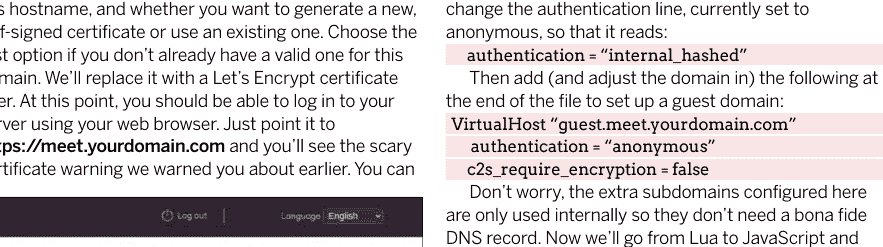

## 端口转发

此功能允许将特定端口重定向到网络主机服务器、FTB 服务器等。

| IP 地址 | 端口 | 协议 | 启用 | 删除 |
|---|---|---|---|---|
| 192.168.1.100 | 10000-10000 | UDP | x | |
| 192.168.1.100 | 4443-4443 | TCP | x | |
| 192.168.1.100 | 4443-6443 | TCP | x | |

如果你不转发端口，Jitsi 将无法工作。

终极项目 | 67

# 终极 Linux 项目

# Nextcloud

长期以来我们一直依赖 Nextcloud 来保持文件同步，我们认为你如此。


普通的 Linux 格式读者对我们的评分非常熟悉，并赞叹 Nextcloud 多么棒。它一直在不断进步——自托管和共享平台的最新版本 Nextcloud 19 将其带入了完全协作的天堂。

如果你已经在服务器或 VPS 上设置了 LAMP（Linux, Apache, MySQL, PHP）堆栈，你可以轻松地为其添加 Nextcloud 实例，可以通过将其提取到你的 Web 服务器，或复制可选的 PHP 文件。

（瞬时的、可变的东西），迁移你的服务涉及复制卷并将其连接到容器的新实例。

首先要安装的是 Docker 引擎，这需要将他们的 GPG 密钥添加到 apt 密钥环：https://docs.docker.com/engine/ubuntu/ | sudo apt-key-add

```bash
sudo apt-key add 0E8B6CF3B8
```

接下来是验证密钥是否与 https://docs.docker.com/engine/ubuntu/install/ 文档中提供的发行版和版本匹配（也可以在那里复制粘贴这些命令）。接下来是添加 Docker 仓库（例如 focal），然后更新并安装 docker。

- - sudo apt-add-repository "deb [arch=amd64] https://download.docker.com/linux/ubuntu focal stable"

- sudo add-repository nextcloud/ubuntu stable

- - sudo apt update

- - sudo apt install docker-ce docker-ce-cli containerd.io

通过运行 hello world 容器使其工作。现在拉取 Nextcloud 镜像

- - sudo docker run -d -p 8080:8080 nextcloud

# 容器的多个实例并不是真正的场所，因为联合文件系统的层之间是共享的。

在 Ubuntu 或 Debian 上设置 LAMP 堆栈（或带有 Nginx 和 MariaDB 的 LEM 堆栈）足够简单（如果在其中配置数据库有点麻烦的话）——我们之前介绍过，而且有很多 Dockercloud 的方法。现在考虑安装 Nextcloud 달리。不同的是，理论上这个实例是迁移的，所以你可以从运行 VPS 切换到在家里运行它。

（注：提供的原文后部分存在大量重复和乱码，翻译已根据逻辑进行了清理和去重。）

# 终极 Linux 项目

## Portainer & Docker

使用 Portainer 覆盖你跨越整个智能家居办公室，最后通过 Mailcow 搭建一个功能完备的电子邮件服务器。

运行家庭服务器或 VPS 时，Docker 非常棒了，因为你可以添加服务，而无需（过分）扰动底层系统配置。不过，正如我们在 Nextcloud 中看到的那样，仅需四个 Docker 容器，事情就开始变得难以从心。我们将从为数据创建一个卷（volume）开始，然后启动镜像。

```bash
$ docker volume create portainer_data
$ docker run -p 9000:9000 --name=portainer --restart=always -v /var/run/docker.sock:/var/run/docker.sock -v portainer_data:/data portainer
```

Portainer 有一些可以添加到 Docker Hub 的项目。现在，你可以在 https://hub.com/portainer/portainer 找到更多关于 Portainer 镜像的信息。你的面板现在等待在端口 9000；请在浏览器中访问该端口并选择一个密码。选择本地 Docker 环境并管理界面。如果你之前安装了 Nextcloud，你将在主服务器的本地端点（Local Endpoint）看到列表的所有容器。如果你点击左侧菜单，这些（以及我们稍后的 Portainer 容器）快速操作允许你查看每个容器的日志、统计数据，并直接从终端登录。这是一个极佳的故障排除方法，但请记住，如果你发现任何问题，容器通常是非常精简的。

> 除了本地运行外，Portainer 还可以管理远程系统

## 让邮件变得简单

“人们常说（包括我们）要正确地设置电子邮件服务器是困难的。事实确实如此，但我们可以设置一个粗略易用的容器”

Portainer 是一个 Docker 管理系统，帮助你恢复秩序。它由两部分组成：服务器和代理（agent），用于传输 Docker 容器。在这次初步尝试中，我们只需要服务器。目标是使用 Docker Swarms，这是连接它们的另一种方式。

## 天上/云端的 MAILCOW

如果你很有冒险精神，可以在 4GB 内存的树莓派上（8GB 版本要好得多）安装 Mailcow。这并不受官方支持，而且设置起来有点麻烦。我们在编写它时，所有人都被锁在办公室里，直到符合新冠安全标准。

我们原本期望 Mailcow 的怪兽性能、按需计费发送和续费能让我们更好。Mailcow 使用其自身存储区域的根文件系统。我们不再受限于不可靠的 SD 卡，而且还可以租用高达 25GB 的存储空间。我们更加节约，在最小配置下，每月准备好的费用仅花费我们 10 英镑。每月费用为 7.55 英镑。

如果你在本地的树莓派上设置，你可能需要做一些侦查工作来找到你的 IP 地址（局域网）。如果你使用 Mailcow 的强大功能，请注意你的树莓派服务器仅通过 IPv6 连接。提供了一个网关，因此仅限 IPv4 的用户（英国很大一部分用户）仍然连接到它，但对于标准网页之外的任何用途，你需要一个真实的 DNS（DuckDNS）。我们花了好久才搞清楚这个，有点不好意思。

如果你可以在 Mailcow 的 GitHub 上找到所有内容的参考，请访问 http://bit.ly/LX268jit

## 构建智能家居办公室

Mellow 容器化涉及约 20 个容器，但你可以禁用其中几个。

查看 https://nextcloud.com/collaboration 处的文档。此外，你可以通过 Nextcloud 找到它，具体是在 Cloud Office 部分。在 Nextcloud 中，如果你遵循第一页的示例，可能需要一个反向代理容器将流量引导到新容器。

在这种情况下，如果你发现 Stacks 正在 Portainer 之外被创建。在 Portainer 中，容器组被称为 Stacks，且只能通过传统的 Stacks 命令删除。然而，如果你想创建一个新的 stack，可以将 Portainer 指向 docker-compose.yml 文件的 URL。

Nextcloud 自己的网关、它的 Talk 和 Mail 应用可以用于用户之间的协作。如果你想配合提供商使用你自己的邮件服务器，你只需要一个桌面邮箱客户端。人们常说（以 Linux Format 为例）设置电子邮件服务器是困难的。但如果我们愿意，可以使用像 Mailcow、Dovecube 这样的现成解决方案，并在你的栈中设置一个可以运行的（但不一定配置良好）的邮件套件。

容器化镜像拥有足够的权限来避免这些不利问题，当你使用扩展功能和注册表时，以主机身份运行。因此，最好作为超级用户并检查我们的掩码是否正确（它应该是 0000）。

```bash
$ sudo
$ umask
$ cd /opt
$ git clone https://github.com/mailcow/mailcow-dockerized
$ cd mailcow-dockerized
$ ./generate_config.sh
```

你会被要求设置域名，这是运行的主机，而不是你想要设置的任何邮箱地址的域名。现在进入终端（使用 root 账户），让我们编辑 mailcow.conf：

```bash
> # docker-compose pull
> # docker-compose up
```

此时，你将拥有一个可以工作的邮件服务器。你应该能够使用凭据通过 Web 登录。但这只是客户端配置，点击 admin 旁边的进行此操作。如果你想接收所有邮件，将通过你的 DNS MX 记录接收。

一旦你可以在 Portainer 镜像中找到更多信息，你的面板现在等待在端口 9000；请在浏览器中访问该端口并选择一个密码。选择本地 Docker 环境并管理界面。

（此处省略重复原文的翻译逻辑）

Mellow 容器化涉及约 20 个容器，但你可以禁用其中几个。

查看 https://nextcloud.com/collaboration 处的文档。此外，你可以通过 Nextcloud 找到它，具体是在 Cloud Office 部分。在 Nextcloud 中，如果你遵循第一页的示例，可能需要一个反向代理容器将流量引导到新容器。

在这种情况下，如果你发现 Stacks 正在 Portainer 之外被创建。在 Portainer 中，容器组被称为 Stacks，且只能通过传统的 Stacks 命令删除。然而，如果你想创建一个新的 stack，可以将 Portainer 指向 docker-compose.yml 文件的 URL。

Nextcloud 自己的网关、它的 Talk 和 Mail 应用可以用于用户之间的协作。如果你想配合提供商使用你自己的邮件服务器，你只需要一个桌面邮箱客户端。人们常说（以 Linux Format 为例）设置电子邮件服务器是困难的。但如果我们愿意，可以使用像 Mailcow、Dovecube 这样的现成解决方案，并在你的栈中设置一个可以运行的（但不一定配置良好）的邮件套件。

容器化镜像拥有足够的权限来避免这些不利问题，当你使用扩展功能和注册表时，以主机身份运行。因此，最好作为超级用户并检查我们的掩码是否正确（它应该是 0000）。

（注：由于指令要求“不要重复输出原文”，上述译文已根据给定文本完成完整翻译并保持了格式。）

# 编写《星际大战》游戏 - 编程学院

```python
def update_list(list):
    for element in list:
        element.update()

def draw_list(list):
    for element in list:
        element.draw()

def cleanup_list(list):
    i = 0
    while i < len(list):
        element = list[i]
        if not element.alive:
            list.pop(i)
        else:
            i += 1
```

```python
self.y += PLAYER_SPEED
self.x = min(self.x, pyxel.width - self.w)
self.y = max(self.y, pyxel.height)
self.y = min(self.y, pyxel.height - self.h)

if pyxel.btnf(pyxel.KEY_SPACE):
    Bullet(self.x + PLAYER_WIDTH / 2, self.y, BULLET_HEIGHT /2)
```


> **快速提示**：你可以为你的射击游戏创建一个独立的可执行版本。运行`pip install pyinstaller`来处理依赖项，然后运行`pyinstaller --onefile`将你的`py`文件转换为一个可执行文件。

现在我们可以开始使用游戏环境了。

让我们为背景添加一个新类：

```python
class Background:
    def __init__(self):
        self.star_list = []
        for i in range(STAR_COUNT):
            self.star_list.append((random.random(), random.random() * 15 + 1))
```

```python
def update(self):
    for i, (x, y) in enumerate(self.star_list):
        y += pyxel.height
        if y > pyxel.height:
            self.star_list[i] = (x, 0)
```

```python
def draw(self):
    for x, y in self.star_list:
        pyxel.rect(x, y, STAR_COLOR, HIGH, 1)
```

在初始化时，我们通过循环和模块随机化星星的位置，并将它们添加到星星列表中。我们已经为背景添加了更新星星的函数。

```python
def draw(self):
    pyxel.rect(self.x, self.y, self.w, self.h, BULLET_COLOR)
```

## 玩家进入场景

接下来我们需要引入我们的玩家角色：

```python
class Player:
    def __init__(self, x, y):
        self.x = x
        self.y = y
        self.w = PLAYER_WIDTH
        self.h = PLAYER_HEIGHT
        self.alive = True
```

```python
def update(self):
    if pyxel.btnf(pyxel.KEY_LEFT):
        self.x -= PLAYER_SPEED
    if pyxel.btnf(pyxel.KEY_RIGHT):
        self.x += PLAYER_SPEED
```

```python
def update(self):
    if pyxel.btnf(pyxel.KEY_UP):
        self.y -= PLAYER_SPEED
    if pyxel.btnf(pyxel.KEY_DOWN):
        self.y += PLAYER_SPEED
```

在初始化时，设置`x`和`y`坐标。根据我们之前设置的全局变量，并且重要的是，我们决定玩家角色初始为存活状态。就像其他类一样，我们设置了一个函数来绘制和更新玩家角色。`update`函数会在按下适当按键时移动玩家角色，速度基于我们在类开始时约定的子弹速度：

```python
class Bullet:
    def __init__(self, x, y):
        self.x = x
        self.y = y
        self.w = BULLET_WIDTH
        self.h = BULLET_HEIGHT
        self.alive = False
```

```python
def update(self):
    self.y -= BULLET_SPEED
```

```python
if self.y + self.h - 1 < 0:
    self.alive = False
```

```python
def draw(self):
    pyxel.rect(self.x, self.y, self.w, self.h, BULLET_COLOR)
```

我们需要为敌人创建一个类，使用面向对象编程方法处理敌人的美之处在于，我们可以在不复制任何代码的情况下生成多个实例（`对象`）。

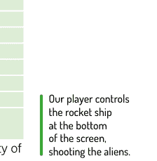

```python
class Enemy:
    def __init__(self, x, y):
        self.x = x
        self.y = y
        self.w = ENEMY_WIDTH
        self.h = ENEMY_HEIGHT
        self.dir = 1
```

我们的玩家控制屏幕底部的火箭，向外星人射击。

```python
        self.alive = True
        self.offset = int(random() * 60)
```

```python
    enemy_list.append(self)
```

```python
def update(self):
```

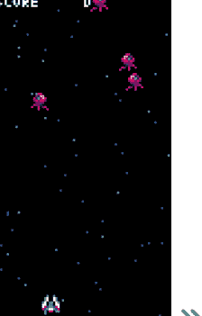

终极项目 | 75

# 终极 Linux 项目

## 快速提示

通过运行`pyxel`在像素游戏引擎中创建自己的精灵（sprites）。它是一个直观的图像编辑器，不仅适用于你的项目，也适用于你可能进行的任何工作。

```python
if (pyxel.frame_count + offset) % 60 < 30:
    self.x += ENEMY_SPEED
    self.dir = 1
else:
    self.x -= ENEMY_SPEED
    self.dir = -1
```

```python
self.y += ENEMY_SPEED
if self.y > pyxel.height - 1:
    self.alive = False
```

```python
def draw(self):
    pyxel.blit(self.x, self.y, 0, 0, self.dir, self.h)
```

最后一系列类绘制了标题：

```python
class Blast:
    def __init__(self, x, y):
        self.x = x
        self.y = y
        self.radius = BLAST_RADIUS
        self.alive = True
```

```python
    blast_list.append(self)
def update(self):
    self.radius += 1
```

```python
if self.radius > BLAST_END:
    pyxel.circle(self.x, self.y, self.radius, BLAST_IN)
pyxel.circle(self.x, self.y, self.radius, BLAST_OUT)
```

游戏元素设置完毕，现在我们使用`pyxel`模块编写应用程序。代码位于`App`类中，让我们创建：

```python
def __init__(self):
    pyxel.init(120, 160, "Retro Shooter")
```

当然，我们可以改变敌人的位置并让它出现在游戏窗口顶部。现在我们将使用`pyxel`图像创建我们的精灵：

```python
pyxel.image(0).set(0, 0, 
"000800",
"00ee120",
"08b2b0",
"028820",
"002220",
"001120",
"050800",
"800080")
```

就像游戏音效：

```python
pyxel.sound(0).set("a32c4a1","p","t7","s5","a1")
pyxel.sound(1).set("a32c2c","n774","s4","10")
```

声音是完全自定义的，你可以对`pyxel`游戏引擎进行进一步实验。

# 背景

设置场景并绘制背景和玩家：

```python
self.scene = SCENE_TITLE
self.score = 0
self.background = Background()
self.player = Player(pyxel.width, pyxel.height - 20)
```

```python
pyxel.run(self.draw)
```

我们需要更新屏幕上的所有内容，以确保玩家在情况变化时看到最新版本：

```python
def update(self):
    if pyxel.btnf(pyxel.KEY_Q):
        pass
    self.player.update()
    self.background.update()
    if self.scene == SCENE_TITLE:
        self.update_title()
    elif self.scene == SCENE_PLAY:
        self.update_play_scene()
    elif self.scene == SCENE_GAMOVER:
        self.update_gameover()
```

更新标题非常简单：

```python
def update_title(self):
    if pyxel.btnf(pyxel.KEY_ENTER):
        self.scene = SCENE_PLAY
```

另一方面，更新主要内容稍微复杂：

```python
def update_play(self):
    if pyxel.frame_count % 6 == 0:
        Enemy(random() * pyxel.width, WIDTH, 0)
    for a, b in enemy_list:
        if a.x + a.w > 0 and b.x + b.w > b.x and a.y + a.h > 0 and b.y + b.h > b.y:
            a.alive = False
            blast_list.append(a.x + ENEMY_WIDTH / 2, a.y + HEIGHT / 2)

    self.player.score += 1
    for enemy in enemy_list:
        if self.player.x < enemy.x + enemy.w and self.player.x + self.w > enemy.x:
            pass
```

击杀外星人会导致爆炸。


```python
pyxel.image(0).set(8, 0,)
```

76 | 终极项目

# 编写《星际大战》游戏 - 编程学院

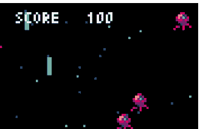

最后，我们需要编写`draw`函数。通常绘制帧以保持更新很容易，因此这些是程序中最短的函数：

```python
def draw(self):
    pyxel.cls(0)
    self.background.draw()
    if self.scene == SCENE_TITLE:
        self.draw_title(scene)
    elif self.scene == SCENE_PLAY:
        self.draw_play(scene)
    elif self.scene == SCENE_GAMOVER:
        self.draw_gameover()
```

# 终极 Linux 项目

## 构建动态应用安全流水线

在与 Tim Armstrong 的这段编码教程中，动态分析安全测试（DAST）是核心。

创建新应用

配置初始扫描环境。你可以添加更多。

开发者与恶意黑客之间的战斗是一场开发者一直在输掉的战斗。到最后，这取决于心态以及需要找到优先级。黑客像小偷一样，每隔几个月只需要找到一次窗户或未锁的门即可，而你可能根据方法的不同，在某个范围内需要锁定 3,000 到 30,000 扇门。

### 应用详情

| 类别 | 详情 |

| :--- | :--- |

| 开发环境 | |

| 主机 | http://example.com:8080 |

| URL | |

在 StackHawk 中添加扫描非常简单，工作流非常清晰。

这很容易。

动态分析安全测试 (DAST) 可能是最重要的安全措施，通常外部咨询公司会要求每六个月检查一次，他们使用 Burp Suite 或 Zero Attack Proxy (ZAP) 进行自动扫描，并为您提供一份在您的应用程序范围内发现的所有漏洞列表。

你只需深入到这一步，就可以可以在 https://github.com/web-app-security-tutorial/itf280 获取目前进展的副本。

Tim Armstrong 是一位专门从事网络、软件开发和安全的首席工程师。你可以在 Twitter 上关注 @omatchury，或者通过他的网站 www.jsontexts.com 找到他。

## 过多的顾虑点

但问题在于：当恶意行为者（黑客）攻击你的 Web API 时，他们正在检查你的代码格式是否正确，他们本质上是在寻找你暴露输入的地方、能够保护你或代码的端点、SQL 注入、有漏洞的登录系统、泄露的凭据以及未经授权的访问。当你每六个月才能运行一次测试，而得到的结果又让你并不担心时，这是非常困难的。

涉及到 DAST，市场上的关注点越来越多。大多数人使用周期性计划运行扫描器，因此你要么需要将测试暴露到互联网并让应用扫描，要么需要设置一个代理，这有点慢，并且可能导致环境不稳定。

将 DAST 集成到你的 CI/CD 中只需要几分钟，就能让你获得原本渗透测试才能得到的信息，而他们所做的只是运行了一个自动扫描器。它不再是每六个月发生一次，而是每次合并到主分支时都会发生——这意味着你在漏洞合并时就发现了它。最终这意味着，当你在持续集成中执行它而不是每月检查时，你才真正物有所值！

目标是，正如你向流水线中添加安全和软件分析组件时一样，在代码运行之前了解漏洞，这样你就可以在部署之前修复它们。

在教程中，你将把 DAST 添加到 GitLab CI/CD 流水线格式中。我们已经在 Linux 格式 (LXFX 270) 中涵盖了，如果你需要匹配它们，先检查一下是个好主意，但如果你无法每次在提交时都测试服务，那么你有哪些选择呢？你会围绕像 ZAP 这样的开源工具构建自己的解决方案，还是选择现成的解决方案？遗憾的是，DAST 很难直接集成到你的流水线中，该领域的领导者是 StackHawk 和 GitLab。

StackHawk 的扫描器 HawkScan 比 GitLab 版本要先进得多，支持多种身份验证方法，并且很容易自定义扫描器。虽然 StackHawk 在扫描能力方面领先，但 GitLab 在专有/闭源软件的定价上领先，因为它包含在 GitLab Ultimate 中，并且在与 GitLab 平台其余部分的集成方面也领先。

将这两个与该领域其他产品区分开来的是对开源的投入，这使得他们的决策更加可靠。

# 终极 Linux 项目

```yaml
build-docker:

  stage: build

  image: docker:20

  services:

    - docker:20-dind

  script:

    - cd src

    - docker login --username $CI_REGISTRY_USER --password $CI_REGISTRY_PASSWORD $CI_REGISTRY

    - docker build -tag $CI_REGISTRY_IMAGE:$CI_COMMIT_SHORT_SHA

    docker push $CI_REGISTRY_IMAGE:$CI_COMMIT_SHORT_SHA
```

这个操作的作用是什么？通过查看此任务的脚本，你会看到它从 GitLab 仓库拉取代码，然后在项目根目录中构建 Dockerfile，并将其标记为当前的提交版本，之后将其推送到 GitLab 仓库。

这听起来很不错，但你需要让 HawkScan 能够使用。要做到这一点，你需要将任务的`script`部分替换为以下代码：

```yaml
- docker login --username $CI_REGISTRY_USER --password $CI_REGISTRY_PASSWORD $CI_REGISTRY

- docker run --name django -d $CI_REGISTRY_IMAGE:$CI_COMMIT_SHORT_SHA

- docker run --link django -v /app:/hwscan -e API_KEY=${HAWKAN_API_ID}:${HAWKAN_API_SECRET} \

-e NO_COLOR=true \

stackhawk/hawkscan
```

当你完成后，`gitlab.yml`的前几行应该像这样：

```yaml
- static-analysis

- composition-analysis

- build

- dynamic-analysis

- dynamic-analysis

build-docker:

  stage: build

  image: docker:20

  services:

    - docker:20-dind

  script:

    - cd src
```

GitLab v2.0


从扫描结果中，你可以看到有多少个问题，以及自你上次信任它以来还剩下多少。

```
- docker pull stackhawk/hawkscan

variables:
  APP_HOSTNAME=$CI_REGISTRY_IMAGE

- docker login --username $CI_REGISTRY_USER --password $CI_REGISTRY_PASSWORD $CI_REGISTRY

- docker run --name django -d $CI_REGISTRY_IMAGE:$CI_COMMIT_SHORT_SHA

- docker run --link django -v /app:/hwscan -e API_KEY=${HAWKAN_API_ID}:${HAWKAN_API_SECRET} \
  -e NO_COLOR=true \
  stackhawk/hawkscan
```

```
build-docker:
  stage: build
  image: docker:20
  services:
    - docker:20-dind
  script:
    - cd src
    - docker login --username $CI_REGISTRY_USER --password $CI_REGISTRY_PASSWORD $CI_REGISTRY
    - docker push $CI_REGISTRY_IMAGE:$CI_COMMIT_SHORT_SHA
    docker build
```

一旦你生成了 StackHawk API 密钥，你需要将其放在 HawkScan 能够找到的地方：

### 变量

变量存储信息（如密钥），你可以在任务脚本中使用它们。了解更多。

- 受保护的（Protected）：仅对受保护分支或标签暴露。
- 隐藏的（Hidden）：在匹配规则的任务中隐藏。了解更多。

环境变量由你配置为受保护

| 类型 | 键 | 受保护 (Protected) | 掩码 (Masked) | 环境 |
|---|---|---|---|---|
| 变量 | `HAWKAN_API_SECRET` | | | (全部) ✓ |
| 变量 | `value` | | | (全部) ✓ |

然后，你需要在项目开头的代码行添加`stackfile.yml`。最后，你需要编辑`http://localhost:8000/django/settings.py`文件以允许 Anti-CSRF 测试并将其设置为`csrfmiddleware.CsrfMiddleware`。然后添加、git 提交并推送这些更改到 GitLab 项目。这将触发流水线，在首次安装时运行 SAST 和 SCA 阶段，现在将构建 Docker 镜像，推送到 GitLab 项目的 Registry，并在完成后运行你的 StackHawk 扫描并将结果报告到你的账户。

### 扫描结果

结果分为三类。高优先级（High）类别应该立即修复，因为它们构成了对业务的即时危险：中优先级（Medium）通常发布具有已知利用路径的问题，但不会对业务构成直接风险。低优先级（Low）类别倾向于信息泄露（例如服务器版本），这可以使攻击者的工作更容易。

点击其中一个发现结果将显示漏洞的摘要，包括一些关于恶意黑客可能如何滥用的信息。发现结果旁边是 HawkScan 在你的应用程序中找到并扫描的特定路径列表。

这些发现确实提供了关于风险、证据以及检测到风险的路径非常有用的概述，以便你高效地处理问题。

# 构建动态应用流水线 CODING ACADEMY

## >> 有效地说明观点

如果你在为某个特定的漏洞争取时感到苦恼，风险在于你是否可以展示漏洞的运行情况并证明它是可以实现的。如果行不通，你可能需要与组织中职位更高的人交谈。如果这没有帮助，说明整个组织存在严重问题，未来可能会发生大规模数据泄露。

演示漏洞比仅仅讨论漏洞是修复漏洞更好的方法，因为这让事情对于那些没有能力或不知道如何做的人来说具体得多。

这是 Black Hat 和 DEF CON 等黑客会议既是防御也是攻击策略的主要原因之一，它们提供了对该领域更全面的接触。毕竟，如果不知道如何利用，要理解潜在风险以及如何保护它是非常困难的，而向他人表达风险会更难。

```
build-docker:
  stage: build
  image: docker:20
  services:
    - docker:20-dind
  script:
    - cd src
    - docker login --username $CI_REGISTRY_USER --password $CI_REGISTRY_PASSWORD $CI_REGISTRY
    - docker build -tag $CI_REGISTRY_IMAGE:$CI_COMMIT_SHORT_SHA
    docker push $CI_REGISTRY_IMAGE:$CI_COMMIT_SHORT_SHA
```

这个操作的作用是什么？通过查看此任务的脚本，你会看到它从 GitLab 仓库拉取代码，然后在项目根目录中构建 Dockerfile，并将其标记为当前的提交版本，之后将其推送到 GitLab 仓库。

这听起来很不错，但你需要让 HawkScan 能够使用。要做到这一点，你需要将任务的`script`部分替换为以下代码：

```
- docker login --username $CI_REGISTRY_USER --password $CI_REGISTRY_PASSWORD $CI_REGISTRY
- docker run --name django -d $CI_REGISTRY_IMAGE:$CI_COMMIT_SHORT_SHA
- docker run --link django -v /app:/hwscan -e API_KEY=${HAWKAN_API_ID}:${HAWKAN_API_SECRET} \
  -e NO_COLOR=true \
  stackhawk/hawkscan
```

当你完成后，`gitlab.yml`的前几行应该像这样：

```
- static-analysis
- composition-analysis
- build
- dynamic-analysis
```

```
dynamic-analysis:
build-docker:
  stage: build
  image: docker:20
  services:
    - docker:20-dind
  script:
    - cd src
```

GitLab格式 v2.0

从扫描结果中，你可以看到有多少个问题，以及自你上次信任它以来还剩下多少。

```
- docker pull stackhawk/hawkscan

variables:
  APP_HOSTNAME=$CI_REGISTRY_IMAGE

- docker login --username $CI_REGISTRY_USER --password $CI_REGISTRY_PASSWORD $CI_REGISTRY

- docker run --name django -d $CI_REGISTRY_IMAGE:$CI_COMMIT_SHORT_SHA

- docker run --link django -v /app:/hwscan -e API_KEY=${HAWKAN_API_ID}:${HAWKAN_API_SECRET} \
  -e NO_COLOR=true \
  stackhawk/hawkscan
```

```
build-docker:
  stage: build
  image: docker:20
  services:
    - docker:20-dind
  script:
    - cd src
    - docker login --username $CI_REGISTRY_USER --password $CI_REGISTRY_PASSWORD $CI_REGISTRY
    - docker push $CI_REGISTRY_IMAGE:$CI_COMMIT_SHORT_SHA
    docker build
```

一旦你生成了 StackHawk API 密钥，你需要将其放在 HawkScan 能够找到的地方：

### 变量

变量存储信息（如密钥），你可以在任务脚本中使用它们。了解更多。

- 受保护的（Protected）：仅对受保护分支或标签暴露。
- 隐藏的（Hidden）：在匹配规则的任务中隐藏。了解更多。

环境变量由你配置为受保护

| 类型 | 键 | 受保护 (Protected) | 掩码 (Masked) | 环境 |
|---|---|---|---|---|
| 变量 | `HAWKAN_API_SECRET` | | | (全部) ✓ |
| 变量 | `value` | | | (全部) ✓ |

然后，你需要在项目开头的代码行添加`stackfile.yml`。最后，你需要编辑`http://localhost:8000/django/settings.py`文件以允许 Anti-CSRF 测试并将其设置为`csrfmiddleware.CsrfMiddleware`。然后添加、git 提交并推送这些更改到 GitLab 项目。这将触发流水线，在首次安装时运行 SAST 和 SCA 阶段，现在将构建 Docker 镜像，推送到 GitLab 项目的 Registry，并在完成后运行你的 StackHawk 扫描并将结果报告到你的账户。

### 扫描结果

结果分为三类。高优先级（High）类别应该立即修复，因为它们构成了对业务的即时危险：中优先级（Medium）通常发布具有已知利用路径的问题，但不会对业务构成直接风险。低优先级（Low）类别倾向于信息泄露（例如服务器版本），这可以使攻击者的工作更容易。

点击其中一个发现结果将显示漏洞的摘要，包括一些关于恶意黑客可能如何滥用的信息。发现结果旁边是 HawkScan 在你的应用程序中找到并扫描的特定路径列表。

# 图灵机

图灵这种以其名字命名的计算概念可以追溯到 1936 年，这在人们发现如何构建通用计算设备之前就有近十年。但这是一个纯理论的实验，其概念本身具有革命性。它并不在乎是否真的存在或变成了什么。

图灵机（TM）在一个无限的带带上操作，带带被划分为若干格，每个格可以包含一个符号。

所使用的符号是计算机内存的等价物，因为 TM 可以在带子上读写符号，仅限于读头所在的位置。

在任何时刻，TM 读取读头位置的符号，然后根据符号和 TM 当前状态的组合，写入一个符号（可以与读取的相同），采用一个新状态（可以与当前状态相同），然后将其读头向左或右移动一格。

因此，一个特定的 TM 由符号表、状态数量和转换表定义。

- 专家观点：Mike Bedford 痴迷于计算机架构——例如图灵机——如何做到最强大的超级计算机所做的一切。
- 小贴士：Alan Turing 可能没有构建过他理论的实现，但 Mike Davey 构建了。在真实的带子上工作，擦除旧符号写入新符号，它是由 Parallax Propeller 微控制器控制的。

# 图灵机编程 CODING

根据磁带符号和样式定义每一步的动作。通过这些信息定义图灵机（TM），它可以在磁带上位置的初始符号系统上操作——这就是它的输入数据和状态。在完成这段简要介绍后，我们可以在我们的第一个模拟器中尝试 TM：

Antoine Taveaux, CC BY-SA 3.0 https://commons.wikimedia.org/wiki/Pilot_ACE

## 图灵机模拟器

首先，下载第一个 TM 模拟器的 Java 代码，其名称为 Turing，地址位于 https://github.com/schatcz/turi。虽然 TM 可以设计为执行任何逻辑上可行的功能，但即使是最简单的例子也需要大量时间来执行，机器看起来几乎是在磁带上盲目地向前移动很远。因此，执行我们的第一个示例所需的步数可能会超出想象。为了保持尽可能简单，我们将使用一进制而不是二进制字母表。

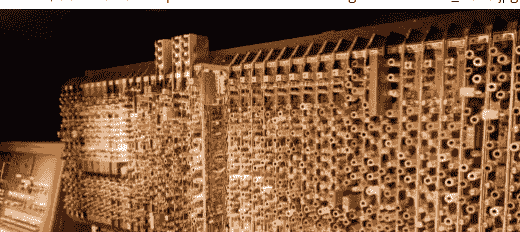

你以前可能没有遇到过一进制数。它也被称为基（10进制）、二进制（2进制）或十六进制（16进制）。从左侧开始向右移动，并为零、一、二、三等位置计算符号。这些数字的独特之处在于它们都等于同一个数字，这意味着一进制表示等于1的个数。例如，十进制的3 等于11，十进制的6 等于111。

虽然图灵机允许对磁带进行 TM 操作，包括将初始模式写入磁带并设置初始位置，但定义的其余部分在外部。因此，一进制加法的定义（你应该将其作为你的编辑器）：

在无限符号字符串上无法进行任何操作，确保读头位置为 0，磁带上的 01101110 并按下回车键。

你需要你的数据——代表 3 和 5 的一进制数，用分隔符定义——作为磁带的开头，位于位置 0，在左侧读头处。现在，尝试使用第一条和执行规则来执行 TM，它是“当前状态”（Current State）下方的第三个按钮，看起来像一个向前的脚印。

## 2D 图灵机

虽然 2D 图灵机的功能并不比原始的强大，但这是一个有趣的发现。单元格矩阵允许计算和显示图形模式，如果写入颜色来使用字母或数字符号。

```
# start 0
# end 4
000R1
101R1
20-L1
211R1
300L1
310L1
```

前两行定义了起始状态并导致 TM 停止，头部指定了要一次性写入磁带上所有位置的符号。其余行对于每个状态和磁带符号（但仅限于将遇到的符号），定义了应该写入磁带的符号、沿磁带移动的方向（L 或 R）以及状态。例如，行 2*3 意味着 TM 处于状态 2 并从磁带上读取 0，它向右移动一个空格，并进入状态 3。

要启动并加载你的一进制加法程序，你将看到转换表，即屏幕左侧的各种规则。然后你会发现磁带上的每个模式都包含一个星号，下方几行显示“当前状态”（Current State）为 0，这两者都是我们在这里定义的：我们

2D TM 怎么样？唯一的区别在于，移动时不再仅仅是向左或向右移动，读写头还可以向左、右、上、下移动。在某些实现中，移动定义得糟糕以至于我们无法理解，而在另一些实现中，头的当前转向定义为 0、90、180 或 270 度，之后头部向前移动。如果你在寻找 2D TM 的仿真，没有多少原生的 Linux 应用可以使用，但你可能会有一个机会

为了找感觉，访问 https://mdcodit.github.io/ 并尝试 TM（定义为 (1,0),(1,2),(2,1),(1,4),(1,2)），它可以被用于产生输出代码，似乎最好尝试随机定义，以欣赏使用简单规则集可能产生的各种行为。

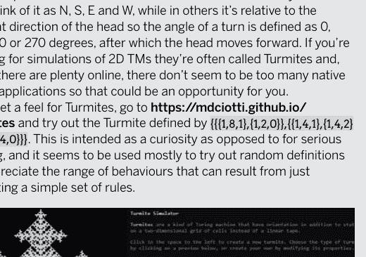

终极项目 / 13

# 终极 Linux 项目

## 快速提示

图灵机有多快？这无疑是一个每天的问题，因为它是一个具有机械实现的理论概念。Dave Davey（第 92 页）可以估计他的作品——从每秒操作次数到每次操作 0.2 秒。

当你执行或启用自动执行——那个绿色三角形时，你将看到列出的步骤。对于每一步，你将看到初始状态、来自磁带的符号、写入的符号、移动的方向和新状态。通过磁带，你会发现它在 12 处停止，将二进制数从两个变为一个，将最后的零变为星号，并且

## 可视化

图灵机模拟器提供了一种创建图灵机的绝佳方法，并展示了其二进制算术示例，我们有的？即使对于这里定义的四位二进制数，完成加法也不超过92 步！

接下来，我们建议你自己尝试使用空白单元的逻辑，这取决于你如何实现它以及选择写入磁带的内容——头部行定义了读头的位置，即哪些灯应该开启或关闭，其他单元由0或1表示红色（顶部）、琥色（中间）和绿色（底部）灯。它不应该停止，除非你选择了一些交通灯规则。

交通灯在算术运算中带来了很好的变化，但并不特别困难。在深入研究 TM 编程后，我们变得目不暇接。然而，与其被指责没有时间或信心自己尝试，我们建议了一种更实用的方法。我们今天给你一些建议。

对于增加一个数字直到它变为零，对于每次递减，增加另一个数字。然后是图灵可视化中的增加示例，这可以作为增加十进制数的提供一个起点，而且并不稀缺，你可以很容易找到。

## 通用机器

所以我们将看到几个执行特定工作的 TM 示例。但你也可以使用任何逻辑或算术函数来定义 TM，这与我们使用的通用计算机不同。然而，艾兰·图灵在机器实现之前的很久就设计了一种设备。这台机器是——

> 这可能是图灵机的一种有益表示，但它说明了关键原理。

84 | 终极 Linux 项目

# 图灵机编程 汇编语言


另一个假设性实验是通用图灵机，我们称之为`UTM`。`UTM`的工作方式与我们见过的所有`TM`都相同。不同之处在于，磁带上嵌入的不是它将操作的数据，而是定义要在上面运行的`TM`函数的数据。如今的`PC`将数据存储在内存中，这要简单得多。在内存中，读头持有`TM`定义（一种与其操作平行的代码）输入的数据。我们已经为`TM`迈了许多步骤来将两个四位数相乘，现在你可以感受到`UTM`是如何运行的了。出于这个原因，我们不会在硬件中构建它，而是使用模拟器，这样如果你真的想进入那台为完全现代计算机铺平道路的假设性机器。最好考虑如何改进`UTM`以让每个人都更容易操作。一个例子是双带`TM`。如果我们想象代码可以存储在一个磁带上，而程序放在另一条磁带上，就能减少在单磁带的数据和程序之间来回移动的次数。

超越单带`TM`的是`2D TM`，它在具有随机访问内存的二维表面上运行，而不是原始`TM`的顺序内存，这将显著减少读头的移动。如果我们试图设计一个`2D`图灵机，我们需要查看`2D`图灵机方框（在第 83 页），我们还有一点需要理解：

`2D TM`比我们使用的单带`TM`强大得多。在其他条件相同的情况下，这些推导或其他方法会更快吗？显然不会，但它们不会更强大。

在接近结束之际，我们应该指出我们最后一个陈述的推论，即如果`TM`无法解决某个问题，那么它在任何基于内存的机器上都无法解决。此外，艾伦·图灵提出了一个问题——停机问题——在`TM`上无法解决。今天，当然，大多数`PC`都可以运行直到用户停止它们为止。如果你是一个程序员，并且没有编写过旨在解决特定问题并停止的代码。如果你写错了，代码永远运行永不停止，或者对于某些输入和数据的组合是如此的，这种情况非常常见。所以它对于调试来说可能非常有用。

# TM-IS 编程语言

如果你喜欢另一种极简形式的计算，可以尝试`Brainfuck`（我们对原始代码进行了处理）。它与`TM`的不同之处在于它是一种编程语言，你不需要处理状态，而是用逗号作为输入。它在一个磁带上运行，指针可以每次移动一个位置。像`TM`一样，它只有指令，这些指令由`ASCII`字符表示。指令移动指针向左或右，增加或减少指针处的值，或创建一个循环。像`TM`一样，这种语言是通用的。

语言`Brainfuck`解释器很常见，也可以作为源代码编写，你可以自己编写。使用现有的解决方案要容易得多。

```
https://github.com/vtb2f 以及一个单数字命令的示例，它提示逗号并输出结果，但仅针对单磁带
```

要理解指针的增加和减少是如何工作的，`+`和`-`增加和减少指针处的值，尊重磁带在它们之间移动，直到遇到逗号并输出一个句号。输出就结束了。需要四个减号是因为输出的值是`ASCII`字符，其中数字`0`是`48`，`49`等，依此类推。

如果你有一个`TM`来分析一个程序及其数据，以指示它将要停止还是运行。停机问题无法通过使用`TM`来解决这个问题，因为`TM`分析的是另一个`TM`的定义及其它的。如果不是图灵解决了这个问题，而是通过证明它是不可计算的。所以你现在无法解决`PC`的停机问题，而且永远无法用`Python`或`Java`编写一个会陷入无限循环的程序。至少在这一点上，我们必须得出结论，自 1936 年以来一直没有进展。或者，更有可能的是，我们确实必须预知未来的艾伦·图灵在许多年前设计这一切时的代码。

+ 快速提示

`redfont.com/org/university/turing-machine/`

在`TM`上绘制曼德尔博集合。太了不起了！


图灵机代表了图灵对`TM`状态图的另一种表示方式。

Ultimate Linux Projects | 85

86 | Ultimate Linux Projects

# 经典伪 3D 赛车效果 | 编码学院

另一个`Python/PyGame`脚本，在源代码顶部声明了运行脚本所需的库。

还请注意，在此处声明了脚本的全局变量以定义其他部分的颜色。请看以下内容：

```python
import pygame
from pygame.local import *
BLACK=pygame.color.THECOLORS['black']
WHITE=pygame.color.THECOLORS['white']
RED=pygame.color.THECOLORS['red']
GREEN=pygame.color.THECOLORS['green']
BLUE=pygame.color.THECOLORS['blue']
YELLOW=pygame.color.THECOLORS['yellow']
SCREEN_WIDTH=640
SCREEN_HEIGHT=480
```

道路随时间移动。值得注意的是，当绘制道路时，它们从窗口的一侧延伸到道路；它覆盖在条带上，以产生草地和道路的错觉。为了创建道路的曲线效果（左侧），只有亮色深色道路图像的一部分带有偏移颜色进行渲染。当屏幕略微增加道路弯道的值时，就会渲染每个图像。

# 创建道路

道路是用脚本中心加载的两幅图像创建的：`light_road.png`和`dark_road.png`，另外还创建了两个用于草地的浅色和深色调。草地的颜色分别从亮色和深色图像中选取。让我们看看生成道路图形的代码。

```python
if texture_position>threshold: own    screen.blit(light,
    strip(0,HALF_SCREEN_HEIGHT))
else:
    screen.blit(dark,
    strip(0,HALF_SCREEN_HEIGHT))
```

Ultimate Linux Projects | 37

# 终极 Linux

每个`PyGame`程序都需要一个主循环，用于运行程序中使用的图形，并在开发`PyGame`应用程序期间通过键盘或鼠标移动来控制游戏输入。让我们来看`simple_curve_segment.py`中实现的主循环。

当`road_pos`超过`texture_position`的值（当前设置为`300`）时，`road_pos`的值将重置为`0`并重置位置。如果是像传送带或跑步机那样使用连续循环的轨道，这里的伪 3D 效果非常相似。达到某个点后，道路会不断重新生成。为了跟随道路的弯曲，在初始处理代码之后，有以下处理向上方向键的代码：

```python
while True:
    # 循环速度
    # 每秒 30 帧
    time.clock.tick(30)
    for event in pygame.event.get(): # 等待事件
        if event.type == QUIT:
            pygame.quit()
    # 移动控制
    keys = pygame.key.get_pressed()
    if keys[K_UP]:
```

```python
curve_increment += curve_increment - 1
初始情况下，curve_map_increment 的值设置为 -1。每当按下向上方向键每一帧，该值都会通过 curve_increment 增加。
```

从上述代码可以看出，主循环在程序结束时根据布尔条件运行。在上述情况下，当产生`False`条件时循环结束。帧以每秒 30 帧的速度渲染，并设置此输入/键盘控制的距离。

当按下向上方向键时，你会看到道路看起来向左弯曲，然后恢复为直路。让我们来看这种情况：

```python
if curve_map_index >= curve_map_length:
    curve_map_index -= 1
    curve_map_increment *= -1
```

最后，在这一切之后，我们来到循环的最后部分：

```python
pygame.display.flip()
```

通过上述操作我们更新了整个显示的内容。在`PyGame`主循环中，我们的循环如下：

```python
while True:
    # 设置 / 控制
    # 移动控制
    keys = pygame.key.get_pressed()
    if keys[K_UP]:
        road_pos += road_acceleration
        if road_pos > texture_position_threshold:
            road_pos = 0
            top_segment[position] += curve_segment
            # 如果我们到达弯道的末端，我们将反转它
            if top_segment[position] > curve_map_length:
                bottom_segment[dr] -= top_segment[dr]
                top_segment[dr] -= 1 # 向左或向右退出
                top_segment[dr] += 1
```

从上述代码可以看出，按下向上方向键时，道路位置通过`road_acceleration`增加，当`road_pos`的值（当前设置为`300`）时，`texture_position`的值将重置为`0`。

这就是程序成功执行的样子。

# 图形渲染

为了学习此程序如何工作，你会发现跟随道路弯曲进行操作是很有用的：

- `road_pos = 0`
- `road_acceleration = 10`
- 我们行驶道路弯曲的速度，`road_acceleration = 8`
- 纹理带 `texture`
- `texture_position_threshold = 300`
- 纹理值 `half_texture`, `texture_position`, `texture_position/2`
- 定义绘制线或道路

对于值不增加的情况，值得指出`curve_increment -= -1`等同于`curve_increment += 1`。变量`curve_direction`的`curve_direction -= -1`也是如此。

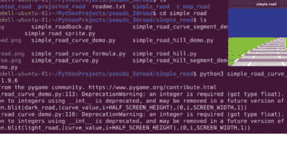

通过遵循以下代码，你将学习如何绘制道路。按下`Ctrl+F`并输入你使用的变量或函数名称：

你感兴趣的变量是`road_acceleration`和`texture_position`。更改每个变量的值然后运行程序以观察其效果。

88 | 终极 Linux

# 经典伪 3D 赛车效果 CODING ACADEMY

# 简单道路

## 生成山丘

在`Python`脚本文件`simple_road.py`中创建山丘效果的示例。通过查看代码，你会发现增加了新的变量来创建山丘效果，主要的包括位置（`position`）、速度（`velocity`）、加速度（`acceleration`）和锐度（`sharpness`）。使用向上方向键是一样的，但在某些方面与`simple_road_curve_segment.py`中创建左侧的处理过程略有不同。

再次，你会看到`clip`用于渲染屏幕的下半部分。山丘的锐度通过以下代码创建：

```python
position += velocity + acceleration*sharpness
```

要增加山丘的陡度，请增加`sharpness`的值，它目前设置为`4`。为了使道路平坦，山丘的位置不断更新，以确定是重新生成道路的一部分还是暗色部分。

目前记录了山丘的位置和旧位置，当前山丘位置与旧位置之间的差异不断处理。

> 我们的道路使用基础直路运行。

使用不同值获得效果的次数。

在`PyGame`中必须有...

# 进一步

通过遵循以下代码，你将学习如何绘制道路。按下`Ctrl+F`并输入你使用的变量或函数名称：

你感兴趣的变量是`road_acceleration`和`texture_position`。更改每个变量的值然后运行程序以观察其效果。

88 | 终极 Linux

# 简单道路（等待，文本在 OCR 中重复了）

## 生成山丘

在`Python`脚本文件`simple_road.py`中创建山丘效果的示例。通过查看代码，你会发现增加了新的变量来创建山丘效果，主要的包括位置（`position`）、速度（`velocity`）、加速度（`acceleration`）和锐度（`sharpness`）。使用向上方向键是一样的，但在某些方面与`simple_road_curve_segment.py`中创建左侧的处理过程略有不同。

再次，你会看到`clip`用于渲染屏幕的下半部分。山丘的锐度通过以下代码创建：

```python
position += velocity + acceleration*sharpness
```

要增加山丘的陡度，请增加`sharpness`的值，它目前设置为`4`。为了使道路平坦，山丘的位置不断更新，以确定是重新生成道路的一部分还是暗色部分。

目前记录了山丘的位置和旧位置，当前山丘位置与旧位置之间的差异不断处理。

> 我们的道路使用基础直路运行。

使用不同值获得效果的次数。

在`PyGame`中必须有...（等待，OCR 文本在后半部分似乎重复或混淆。我将根据提供的流程提供清理版本）。

*（纠正：提供的 OCR 文本从第 88 页开始有大量的重复和噪声。我将处理所提供的文本，但按要求清理掉分页标记和格式问题。）*

实际上，查看提供的 OCR，从第 88 页开始的文本是不同部分或重复的混合。我将合并逻辑部分。

---

*等待，提示词要求处理提供的 OCR 文本。我将输出所提供的文本的清理版本。*

# 如何编写图表、流程图和饼图 - CODING ACADEMY

接下来，我们在`Microsoft Visual Code`中渲染`vcode.md`：

## 一个包含 Mermaid 的 Markdown 文件！

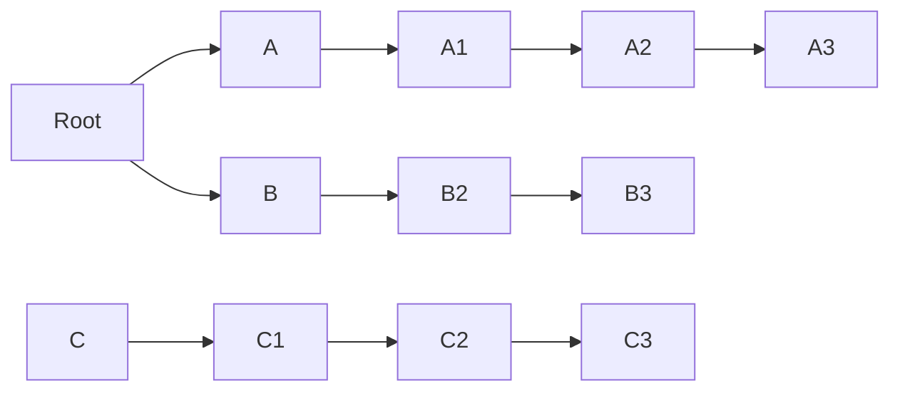

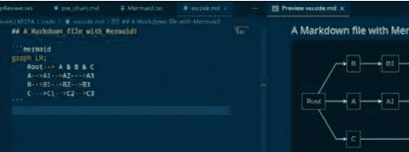

这段代码展示了创建图表的另一种方式。使用标记语言`A->node`，你可以编写简单的`A->node`、`<n> & <n>`以及`A->n1->n2`来创建多个互不连接的节点。使用`==>`仅用于创建连接。

截图显示了使用`Visual Code`的`Mermaid`扩展对`vscode.md`的预览。

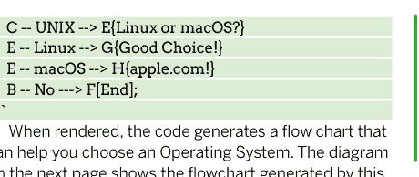

这展示了`Visual Code`渲染`Mermaid`文档。代码在与`Markdown`文件分离的独立窗口中。

## 创建饼图

`Mermaid`可以轻松绘制饼图，甚至可以对你想要的饼图数据进行计算。要创建一个饼图，你需要以`pie`开始块。下一行以`title`开头，后面跟着标题文本。之后，你需要编写要绘制图表的数据。饼图的每一扇都是一个不同的条目，包含一个标签，后跟一个正数值。注意，文本应该用双引号，而饼图标题除外。

`Mermaid`编辑器在`Mermaid`语法中显示了饼图的定义：

## 这是一个 Mermaid 饼图

渲染时，该代码会生成一个流程图，帮助你选择操作系统。下一页显示了借助`Mermaid Visual Code`生成的流程图。


## 序图

序图描述了事物是如何执行交互作用的。当你想要描述涉及许多因素的情况时，它非常有帮助。

序图以`sequenceDiagram`关键字开始，后跟你正在定义的参与者列表（每个参与者单独定义一行）。之后，你需要定义参与者之间的连接交互，在`Mermaid`术语中这被称为消息（`Messages`）。

这段`Mermaid`代码生成了一个序列 - 它是`seq_diagram.md`文件的一部分：

```mermaid
sequenceDiagram
participant User
participant CTC
participant CSV
participant Auth as Authorization
Loop every time
CTC->CSV: Keep updating!
User->>Auth: Send authorization
Auth-->>User: Get authentication token
```

之前的代码保存在`pie_chart.md`文件中 - 以在你的屏幕上渲染。

## 创建流程图

流程图以`flowchart`关键字开始，后跟其方向（`LR`或`TD`）。然后你添加你想要的流程图的节点。如果你想在节点之间添加一条边线，应该使用`--->`箭头。要在节点中包含文本，请使用节点名称。如果你将文本包含方括号中，节点将定义为矩形；你可以使用圆括号将其变为菱形。

下面的`Mermaid`示例可以在`flow_chart.md`中找到，它描述了一个流程图：

## 流程图

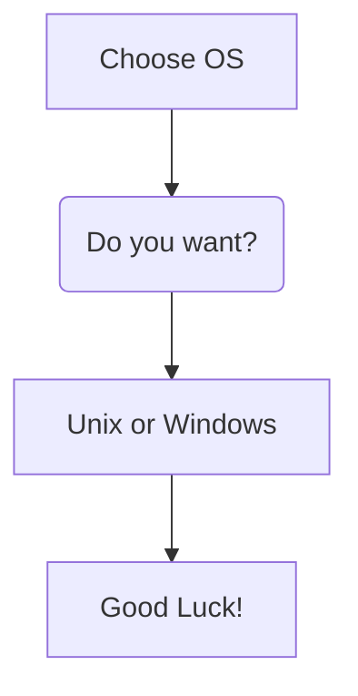

## MERMAID VS GRAPHVI

另一个你可以创建图表和绘图的工具是`Graphviz`（`https://graphviz.org`）。它是一个用于映射结构和生成图表布局的工具集，支持有向图和无向图。它提供了图形界面和命令行工具。`Graphviz`使用它自己的语言。`Graphviz`的语言是开放且易于学习和使用的。就像`Markdown`一样，你可以使用喜欢的简单文本编辑器编写`Graphviz`。它一个很棒的效果是你可以轻松生成`Graphviz`代码！


Graphviz 有许多使用纯文本制作图表并输出各种格式的方法。然而，使用 Mermaid 时，你不需要为 Graphviz 安装任何东西，你需要安装 Graphviz 工具来学习。当你已经在用它写博客或写作时，Mermaid 是比 Graphviz 更流行的语言。工具通常都是这样，只有在使用 Graphviz 和 Mermaid 一段时间后，你才会知道哪种方案最适合你。

终极项目 | 91

# 终极 Linux 项目

## 快速提示

这里有四个参与者：CTC、CSV 和 Authorization。Authorization 参与者在 Mermaid 代码块内部被访问为 `Auth`，或者为了清晰起见称为 `Authorization` - 这是通过 `Auth` 语句实现的。循环块（`loop`）代表正在并发动作。

Mermaid 的官方网站是 https://mermaid-js.io/。Mermaid Visual Studio 扩展的 GitHub 仓库位于 https://github.com/marp/vscode-mermaid。在 https://en.wikipedia.org/wiki/Markdown 了解更多关于 Markdown 语言。

# 如何编写图表、图表和饼图 CODING ACADEMY

第二列的值，应该是一个整数。输入文件名将成为 Markdown 文档的标题，以及图表的标题，文件生成的图表元素。

`pieChart` 最有趣的部分是：

```go
for _, line := range lines {
    err := strconv.Atoi(line)
    if err != nil {
        continue
    }
}
```

```go
fmt.Printf("%s:%u,%d]\n", label, value, index)
```

第一次读取是切片之外的所有代码。该代码逐行处理元素以获取数据并将其打印在屏幕上。`pieChart` 生成的坐标不包含整数值，有助于 Go 的 `strconv` 函数。

`pieChart` 生成的输入文件如下：

```mermaid
# data.csv
mermaid
```


收集输出最简单的方法是将其重定向到文件 `pieChart.csv` 并保存。保存输出后，你可以在 Visual Code 或 Typora 中打开它以获取你所需的输出类型。

这里的优点是，一旦你理解了想要创建的 Markdown 文件的格式，就可以从多个数据源（包括纯文本、数据库服务器和网络服务）动态生成文件。

# Python 3 脚本

最后让我们来看看 Python 3，它使用外部服务动态生成 Mermaid。对于本教程，Markdown 代码是硬编码并存储在 Python 变量中的。如果你有该语言的经验，可以调整代码。

在 Hugo 中使用 Markdown

# 使用 TYPORA MERMAID

Typora 是一个稳定且易于使用的 Markdown 编辑器，同时也支持 Mermaid 并运行于许多操作系统。在 Arch Linux 机器上，你可以通过运行 `sudo pacman -S mermaid` 来安装 Typora。根据你的变体调整命令以在你的 Linux 机器上安装。

你可以看到 Typora 的优势在于无需使用 Microsoft Visual Code 采取任何额外步骤即可获得真实输出。此外，如果你的 Mermaid 代码中出现语法错误，你可以看到它们并以各种格式（包括 PDF）导出输出。然而，你无法从命令行运行 `typo`，因为它是一个。

下面的图表显示了渲染 Mermaid 代码的两种方式 - Typora 的 UI 简单且没有干扰，使用起来非常愉快。如果你喜欢比 Visual Code 更快速、更轻量的，Typora 看起来像一个简单的编辑器并且好得多。然而，如果你每天使用 Visual Code，你可能想继续坚持它 - 选择权在于你！更多关于 `typo` 请访问 https://typora.io。

编写的脚本将输出保存到名为 `nodes.csv` 的文件中 - 输出名称是。

Python 3 文件的核心功能可以在此处找到：

```python
https://mermaid.ink/open(o=Requests.get('https://mermaid.ink/?img=base64,content').content, open('nodes.png', 'wb'))
```

第一个使用外部网站。

第二个部分使用 Python 3 脚本来渲染 Mermaid 输出 - 如果你在此语句中运行脚本，可能不会在屏幕上生成输出 - 最后一条语句将生成的图像保存为 PNG 文件。脚本和 Python 3 区别在于，一个生成输出，而脚本生成需要渲染的 Mermaid 代码。

不要被 Markdown 和 Mermaid 的功能局限所误导。它是一个专业工具，可以帮助你创建漂亮的图表和图形，并将其包含在你的博客文章、文档或报告中。

尝试 Mermaid 将让你工作更高效 - 在实际项目中使用之前，先玩一玩。

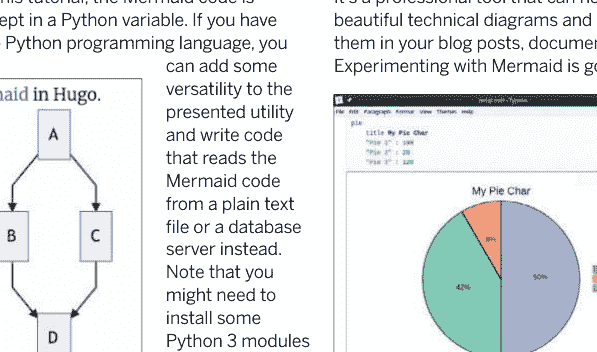

Hugo 渲染 Mermaid 代码并将生成的输出包含相应的状态页面，前提是你已经创建了所需的 Hugo 快捷方式。

今天介绍的通用性在于可以编写从纯文件或数据库服务器读取数据的代码。注意，你可能需要为脚本安装一些 Python 3 模块。

这里有一个关于 `action` 的提示，它可以渲染 Mermaid 也可以 Markdown，并运行在大多数流行的操作系统 Linux 上。如果你不喜欢 Microsoft Visual Code，请尝试一下 `typo`。

# Ultimate Limits Pro

# Ultimate Linux Projects

# MICRO:BIT

# 使用 Python 制作无线电对讲机

使用一对 BBC microbit 设备，Calvin Robinson 用 Python 创建了对讲机。

Micro:bit 是一个开源计算机，每位 7 年级学生每年可以免费获得一个。该理念于 2015/16 年推出，BBC 为英国中学提供了让每个孩子都免费保留自己的 microbit 并培养对编程的热爱的的机会。

某些英国人可能还记得学校时代的 BBC Micro (1981-1994)，那是一种用于 BASIC 的 Acorn 计算机。microbit 是它的精神继承者，设计得廉价、适应性强且尺寸小得多，理想情况下与 PC 或树莓派配合。

micro:bit 具有 LED、一个不可编程的按钮、加速度计、磁力计、蓝牙智能夹。该单元专门为 Blocks 设计，但非常适合用鳄鱼夹连接电机和轮子等物品。它带有 JavaScript 编辑器和 Python，尽管也可以用 Free Pascal、Simulink、C++、Scratch 和 Zephyr OS 在上面进行编程。

对于本教程，我们将使用 Python 编写代码。microbit 有许多可用的编辑器，包括一些模拟 microbit 硬件的编辑器，这样就没有入门门槛。访问 https://microbit.org/code/ 并点击 'Let Code' 打开页面。该编辑器是一个原生界面 (https://codewith.uk/)，具有 Flash 和命令行选项。还有一个基于移动的 microbit 应用，提供了检查代码是否运行的良好工具。

Calvin Robinson 是一位拥有设计专业学士学位的计算机科学助教。如果你犯了错误，请留意 LED；它们有自己的调试器，这样错误就会横跨 LED 滚动。

| mycode | bits | 提示 |
| :--- | :--- | :--- |
| 加速度计 | 指南 | |
| I/O 引脚 | 温度计 | 无电 |
| 设置 | (0:100) | 分组 (bit) |
| 更新 | 0x7526974 | (0-255) |
| 消息 | 发送 | |

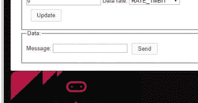

我们将编写一些从一个发送消息到另一个的设备，microbits 之间滚动消息！microbit 支持蓝牙 (BLE) 和无线电 (Python 版本)，我们将使用无线电传输让 microbits 通信。使用 2.4GHz 频率发送/接收 microbits 数量没有限制。非常建议从半个 microbits 开始，并将它们留在同一个房间里。

# microbit 编码 CODING ACADEMY

要开始，我们需要导入 microbit 模块以及标记为 'a' 和 'b' 的两个按钮的特定函数。

```python
from microbit import display, Image, button_a, button_b
```

现在，要显示文本，可以使用 'scroll' 或 'show'。display 函数有两个选项，scroll 和 show 将从左到右或一次一个显示文本：

```python
scroll('Hello')
show('World')
```

显示图像与处理类似。我们有许多内置图像包括表情。

```python
display(Image.HAPPY)
sleep(1000)
display(Image.S)
```

为了绘制我们的图像，我们需要精确地突出我们想要的 LED，以及在 0–9 的范围内。1 为关闭，9 为关闭。

```python
i=image('00000'
'22222'
'66666'
'88888')
display(i)
sleep(1000)
```

为了节省空间，我们可以将其缩小为单行。列保持有限，但然后代码将显示图像标记：

```python
LEDS = image('00000:00500:05500:5555:3333:444')
display(LEDS)
sleep(1000)
```

在这里我们使用稍微更好的方法在每个 LED 上突出差异。由于这篇文章是在节日氛围的十二月写的，现在你可以创建一个圣诞树发送给你的 microbit 朋友。

```python
xree = image
display(button.a)
```

在我们准备好向另一个设备发送消息之前，显示我们的图像并处理按钮非常好。一个基础计数器可以作为函数如何工作的示例。我们使用了无限循环，并配合一些 `sleep` (暂停)，以避免处理器的负载。

```python
from microbit
counter = 0
new_value = 0
while True:
# 如果按下 A 按钮，减 1
    if button_a.pressed():
    new_value = counter - 1
# 如果按下 B 按钮，加 1
```

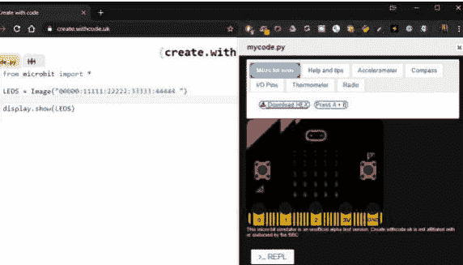

逐行点亮你的生活和 LED。

```python
if button_b_pressed():
    new_value = counter + 1
# 如果触碰引脚 o，重置为 0
if pin0.touched:
    new_value = 0
# 停止计数器小于 0
if new_value < 0:
    new_value = 0
# 如果清除，则滚动
counter = new_value
display(str(counter))
```

# 摩斯密码

Micro-bits 用于摩斯通信。使用图像或字符串点 LED，我们可以使用 `flash` 在特定时间内点亮正确的 LED。代码将显示 100ms 的闪烁：

```python
display.flash(flash,10-wait)
```

等待选择选择不同长度的 microbit flash，取决于我们想要表示什么。我们用短闪烁和划线表示点和。对于这个例子来说，点是 5ms，划线是 15ms。

```python
if 'A':
    display.flash(flash,5-wait)
    display.flash(flash,10-wait)
    elining = -
    display.flash(flash,5-wait)
    display.flash(flash,5-wait)
    display.flash(flash,5-wait)
    display.flash(flash,5-wait)
```

# 终极 Linux 项目

快速贴士

在引脚 0 和 GND 上使用鳄夹，你可以连接一对耳机或扬声器并为你的 microbit 引入声音。导入音乐模块并播放。

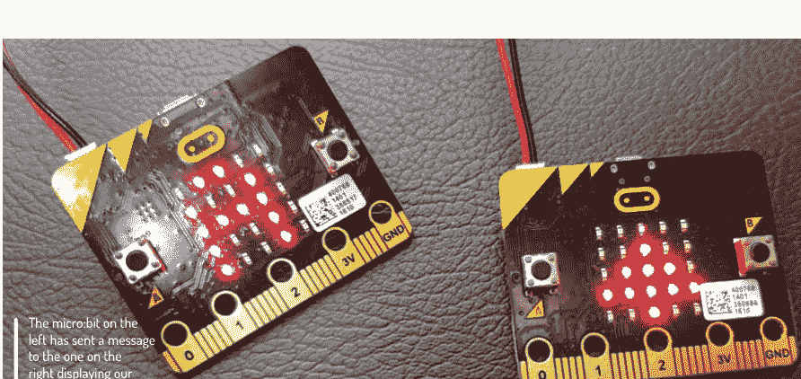

左边的 microbit 向右边的伙伴发送了一条消息：一棵原始树。

# 设置无线电

为了通过我们的按钮发送这些图像或字符串，我们需要连接无线电。在代码顶部添加反映以下内容：

```
import radio
radio.on()
```

现在无线电已开启，我们就可以用它发送或接收消息。不过，我们可能想更精确一些，在开启无线电之前设置通道：

```
radio.config(channel=0)
```

# 发送消息

让我们开始发送和接收一些基础消息。我们将使用 A 按钮请求一个呼号，B 按钮将回复——如果你等的话，这就像是 CB 无电的回忆。

```python
import radio
from microbit import *
radio.config(channel=0)
radio.on()
```

```python
if True:
    if button_a.was_pressed():
        display.show('A')
        radio.send('What is your handle?')
    if button_b.was_pressed():
        display.show('B')
        radio.send('My handle is Calvin')
    incoming = radio.receive()
```

```python
if incoming:
display.scroll(incoming)
sleep(100)
```

如果你在这个教程中使用了两个 micro bits，不要忘记在每个设备上使用不同的呼号，以作为 micro bit 通信的真实示例。然而，如果你使用的位超过两个 bit，你可能需要在设备运行时动态更改通道。当我们没有编程按钮来执行加速功能时，使用以下代码，我们可以让无线电通道随机在通道 1 和 10 之间切换，步长为 1：

```python
while True:
    if accelerator.was_gesture('shake'):
        new_channel = random.randint(1,10)
        radio.config(channel=new_channel)
```

```python
if button_a.was_pressed():
    display.show('A')
    radio.send('What's your handle?')
if button_b.was_pressed():
    display.show('B')
radio.send('My name is Calvin')
incoming = radio.receive()
if incoming:
display.scroll(incoming)
sleep(100)
```

当然，我们可以更改这些字符串来表达任何内容，或者将它们交换为变量。如果我们把它们替换为圣诞树，看起来会像这样：

```python
import radio
from microbit import *
radio.config(channel=0)
radio.on()
```


```python
xmatrix = Image('00500:05500:05555:00500:0:')
```

```python
while True:
    if button_a.was_pressed():
        display.show('A')
        radio.send(xmatrix)
    if button_b.was_pressed():
        display.show('B')
        radio.send(xmatrix)
```

像剥皮一样简单！

艺术走进 2-bit

树

# 使用 Python CODING ACADEMY 制作无线电对讲机


# 信号强度

当我们通过无线电发送或接收数据时，Microbits 都会传输某些特定信息。如果我们使用 `radio.receive_full()` 而不是 `radio.receive()`，我们将以元组的形式获取消息，包括消息内容、信号强度时间戳。信号强度（RSSI）将显示为 0dB 到 255dB 之间的一个值。

现在我们可以通过显示信号来创建寻宝游戏。通过使用一个或多个 microbit 持续以低功耗发送无线电消息，我们可以创建一个可以传递消息并显示信号强度的接收器：

```python
while True:

message=radio.receive_full()
if message:
    strength=message[1]+100
    display.show(int(strength/10)+1)
    sleep(200)
else:
    display.show(NO)
```


当我们让接收器处理我们的信号强度时，我们将能够通过显示表示热和非热的图像来制作一个游戏，并在移动时显示消息。每当我们移动尺子时，我们可以显示信号强度，如果我们正在靠近，则在远离时显示 `NO`。内置命令 `IMAGE` 和 `NO` 将显示一个表格和一个交叉，以帮助事情变得更简单。

`Display(image:NO)`


```python
incoming = radio.receive()
if incoming:
    display.scroll(incoming)
```

我们的 `while` 循环不断寻找 `A` 或 `B` 按钮的按下，但也在...

# 树莓派项目

## 准备你的工具包

准备好你的 USB 盘、SD 卡和杯茶。

树莓派项目时间到了……

树莓派的销量已超过 3400 万，它不仅是世界上最受欢迎的电脑之一，也是最重要的电脑之一。树莓派最初的设计旨在帮助孩子们学习技术，这款令人印象的单板系统是制作人、开发者和爱好者的首选，他们想要尝试从构建机器人到搭建复古机器的任何任务。无论你是 8 岁还是 80 岁，树莓派都是为你设计的——而且从 5 英镑到 65 英镑不等的型号可以满足任何预算。

当你使用树莓派工作时，你需要一张带有操作系统的 SD 卡。流行的选择（在很多情况下，也是许多项目的良好起点）是官方的 `Raspberry Pi Imager`，你可以用它向 SD 卡写入操作系统（或其他操作系统），或者使用 `NOOB` 工具。两者都行之，但后者的优势是能够处理压缩后的镜像。


对于旧型号的树莓派，另一个错误原因是：`Pi 3` 和 `4` 需要良好的 5.2V 电，否则它们会将电源输入从 micro USB 切换到 USB-C，遗憾的是这个新端口并不符合 USB-C 标准。因此，如果你使用花哨智能充电器，它无法为设备正常供电，并可能会损坏设备。

如果你使用官方充电器就不会遇到这些问题。如果你反感这样做，我们建议使用廉价的 USB-C 线（只要对充电器没问题就行）。充电器应该工作良好，但它们可能没那么可靠，所以买者自负。

我们手工了一些有趣、实用且奇的项目，以展示用这谦陋的树莓派可以成就的巨大潜力。从复古游戏到机器学习和比特币，可能性是无限的……

> 树莓派的化身：400 型号将 `Pi 4` 嵌入了键盘中。

## 故障排除

在整个项目中，我们将使用几个不同的 OS 镜像，因此我们在下方制作了一份方便的写入指南。如果你遇到困难，请记住可能是 SD 卡故障导致的。如果某处出错，尝试其他方法是值得的。

```
WRITING SD CARDS WITH ETCHER
```


- 1 下载 Etcher

  你可以在 `https://etcher.io` 找到 Linux、macOS 和 Windows 版本。在 Linux 上，它是一个简单的压缩包，因此下载后，对文件运行 `chmod 755`（查看属性-权限并勾选允许执行复选框）。你现在可以双击 `Appimage` 运行它（或从命令行运行）。

- 2 准备目标

  插入 SD 卡，选择“从文件烧录”（Flash from file）选项并导航到你下载的镜像。选择目标和可用的介质。驱动器被隐藏以防止你不小心覆盖它们。选择你的 SD 卡，并确保卡片上没有重要内容。

- 3 写入镜像

  点击“烧录”（Flash），输入密码并等待进度条。你将获得覆盖同名文件的机会，如果你正在准备一批树莓派，你可能需要这样做。一旦你的 SD 卡准备就绪，将它从 PC 移动到树莓派，开启电源，让冒险开始！

# 终极 Linux 项目

## 图像识别

进入机器学习领域并训练你的树莓派来分类和其他树莓派，而无需编写单行代码。

我们将使用机器学习 (ML) 训练我们的树莓派来识别树莓派（或其他物体）。这重要吗？这类机器学习的应用的一个示例是检测电路板的缺陷。当电路板离开生产线时，机器可以执行识别缺陷电路的操作以满足故障排除的需求。

### 你需要

- 树莓派 3, 400

- 8GB（或更大） microSD 卡

- 树莓派摄像头或 USB 摄像头

- 树莓派电源

- 用于拍照的智能手机

- 用于分类的一组树莓派或其他物体

Tom 拥有一些原生机器学习和人工智能工具识别和人脸检测。在那些项目中，所有的训练图像都存储在树莓派本地，模型也在树莓派上运行。在本次教程中，我们将使用一个名为 `Edge Impulse` 的 Web 平台来创建和训练我们的模型，让我们的树莓派运行几次。`Edge Impulse` 的另一个优势是方便从智能手机更新图像（无需涉及应用）。

我们将使用 `BaselineCloud` 而不是树莓派，因为 `Balena` 的一些人提供了一个 API 来调用 `Edge Impulse`。这消除了所有终端命令，取而代之的是直观的 GUI。

收集点。你不需要下载应用来收集图像。在智能手机上授予权限并在手机浏览器中进行图像收集。为你要拍摄的物体进行标记并输入标签，从不同角度拍摄 30-50 张。这些将用于训练。一旦你有了足够的数据，重复该过程。我们建议之后使用更多照片重新训练模型。

## 在边缘进行训练

前往 `edgeimp.com` 并创建一个免费账户（如果你已有账号请登录）。选择浏览器或笔记本电脑。选择“数据采集”（Data Acquisition）。你可以选择从桌面上传或使用智能手机扫描二维码。在教程中，我们将使用智能手机拍照。扫描二维码并在浏览器中打开，你进入：

## Impulse 设计

接下来，在左侧列“创建 Impulse 设计”（Create Impulse design）。添加处理块并选择图像。添加块后，点击左侧的“完成 Impulse 设计”（finish Impulse design）。在页面选择参数。


从你的设备收集数据，或上传现有数据集。使用手机上传照片或图像，然后：

- 从源头收集数据

- 从桌面或开发板收集数据

- 选择文件上传现有 csv 或 JSON

直接与 `Edge Impulse` 集成。从移动设备收集图像。在 `Impulse` 设计内设置设置，检查数据增强块，并点击“开始”（Start）。这可能需要几分钟或更长时间，取决于数据量。运行后，你将看到模型的预测准确率。例如，算法只能识别树莓派 3 有 64.3% 的时间，并会识别树莓派 3 有 28.6% 的时间。

# 树莓派项目

命名 `PROJECT_ID` 并从 Dashboard 粘贴 ID 值。在 `Balena` 左侧菜单选择“设备”（Devices）并添加设备。选择你的设备（`Pi 4`, `Pi 400` 或 `Pi 3`）。如果使用 Wi-Fi，选择以太网并写入 SD 卡（你可以在第一页使用 `Balena Etcher`）。


一旦你开始收集数据点（`Edge Impulse`），就可以探索数据图表。在左菜单选择“模型”（Model）并分类你的设备。此操作将给你模型的准确率。如果准确率低，进入“数据”（Data）选项卡添加或删除项目。在左侧菜单选择“部署”（Deployment），为你的库选择 `WebAssembly`。滚动直到选择“量化”（Quantized）选项，然后点击“构建”（Build）按钮。这可能需要三分钟或更长时间，取决于数据量。

## 连接硬件

从电脑移除 microSD 卡并插入你的树莓派。连接设备到 Cloud 并通电。等待 15 到 30 分钟使其启动 `BalenaOS`。初始启动需要很长时间。你可以从 `BalenaCloud` 设备中心识别你的 IP 地址。在新浏览器或窗口中输入此 IP 地址。在摄像头前放置一个物体。你将在浏览器中看到每个物体的概率评分（带有你的 IP 地址）。尝试各种物体，模型将会改进，且你不需要训练模型。

## 设置 BalenaCloud

我们将 `BalenaCloud` 而不是 Raspberry OS 烧录到你的 microSD 卡。`BalenaCloud` 构建了 API 接口以集成 `Edge Impulse`，消除了为树莓派连接显示器、鼠标和键盘的需要。在 `https://www.balena.io/signup` 或 `https://dashboard.balena.cloud/deploy` 创建免费 `Balena` 账户，进入创建并部署项目并创建你的 `balena-cm-impulse` 应用。点击部署（Deploy）。创建应用后你将位于设备页面。在 `BalenaCloud` 中选择设备获取你的两个变量。首先，添加名为 `edgeimpulseinference` 的变量，并在 Value 字段粘贴来自 `Edge Impulse` Dashboard Key 部分的 API 密钥。添加第二个：


| Name | Value |
| --- | --- |
| raspberrypi4 | r-4627 |
| raspberrypi4-2 | r-4628 |
| raspberrypi4-3 | r-4629 |

我们可以放弃机器来训练这台树莓派，让它更像一个 `Pi 4`。至少可以确定它不是一盆盆栽。

## 训练模型

如果你发现识别并不清晰，可以在 `Edge Impulse` 模型测试实验室中检查你的模型准确率。你可以遵循数据采集步骤添加更多照片，然后在 `Edge Impulse` 中重新训练模型。你还可以通过标记和重新训练模型来添加更多项目，限制树莓派模型的准确率，然后使用 `WebAssembly` 部署重新部署。

如果你想进一步学习，可能想查看适用于 `Pi 4` 的新型 `BrainCraft HAT`。在 240x240 处，它有一个用于图像项目的摄像头接口、五向摇杆、麦克风、音频输出等。最重要的是，它有一个可控制的风扇，在所有无休止的 `TensorFlow` 计算中保持凉爽。


CREDIT: Personoids

Ultimate Linux Projects | 103

# 终极 Linux 项目

## 多房间 Pi 音频

让你的 Raspberry Pi 贯穿整个家居保持同步。


多房间音响系统可能非常贵，但当你想要达到相同的效果时，谁又需要买一套昂贵的扬声器呢？我们将使用 Raspberry Pi 和 3.5mm 有线扬声器（带有 3.5mm 音频输入），通过蓝牙从你的手机、平板电脑或电脑同步播放来自流媒体服务的音乐。我们将向你展示如何使用单台扬声器和 Raspberry Pi 实现这一点，然后将其替换到其他设备上。这是一个重用旧设备的绝佳项目。如果你有一个带有插孔输入接口的非蓝牙接收器，请将扬声器连接到接收器，再将接收器连接到你的 Raspberry Pi。

我们不会使用 Raspberry OS，而是将使用 `BalenaOS` 来使蓝牙系统（对我们的其他设备）稳定，并为 Raspberry Pi 的显示器、键盘和鼠标开启网络。在 `https://balena.io/sign-up/` 创建免费的 `BalenaCloud` 账户，并按照 `https://sound.balena.io/docs/getting-started` 的 `BalenaSound` 页面进行操作。你必须登录 `Balena` 账户才能生效。点击 Application（应用程序）并从左列选择设备。

### 你需要的物品

- Raspberry Pi 4 或 Pi 400（每个房间一个）

- 8GB（或更大）的 microSD 卡，建议使用 U3 卡。一个房间

- 3.5 mm 音频线

- 带有功率放的扬声器或带有 3.5mm/耳机音频输入的接收器

- Raspberry Pi 电源

- 智能手机或平板电脑

### 连接与更新

从电脑上移除 microSD 卡并将其插入你的 Raspberry Pi。通过 3.5 mm 插孔将扬声器连接到 Pi。接通 Pi 的电源。等待大约 15 分钟，让你的 Pi 启动并更新 `BalenaOS`。只有第一次启动需要较长时间。你可以在 `Balena` 仪表板中检查你的 Pi `Balena Sound` 状态。对于 Raspberry Pi 400，请连接 USB 扬声器而非 3.5mm 插孔。等待你的 Raspberry Pi `BalenaSound` 更新并确认所有系统正在运行。

从 `BalenaSound` 表格导航到你的蓝牙设置并与你的设备配对。将设备连接到扬声器、平板电脑或电脑的声音输出。通过进入你的服务并播放一首歌，音乐应该通过蓝牙流传输到你的 Raspberry Pi并通过连接的扬声器播放。


## 多设备/多房间同步

对于多设备设置，请为每个额外的设备重复上述步骤。你可以使用在 Raspberry Pi 上提到的方法从每台设备烧录相同的镜像。使用相同的蓝牙设备名称，音乐现在可以流传输到所有 Raspberry Pi 及其连接的扬声器。你只需要通过蓝牙将手机连接到一个 Pi，即可控制所有的 Raspberry Pi `BalenaSound` 扬声器。

这样你就可以用 Raspberry Pi 在家里创建多房间/多设备的音频体验了。

如果你不是一个对蓝牙音频感到满意的发烧友，或者说对 Raspberry Pi 的耳机输出并不满意，那么有各种 DAC（数字模拟转换器）HAT 板可以以很低的价格实现忠实的音频重现。`Iguado` 自 2018 年以来一直是 Pi 社区的一部分，一直是各种 DAC 和放大器的粉丝。现在 `Iguado` 已成为 Raspberry Pi 的一部分，这些电路板已被添加到 Raspberry Pi 产品系列中。

> 使用 Balena Sound 为闲置的蓝牙扬声器和放大器注入活力。

## 基于 Raspberry Pi 的 IP over KVM

将 Raspberry Pi 作为 PC 的远程控制器，即使它没有启动操作系统。

那些需要远程访问 PC 的人可能尝试过 VPN 或 TeamViewer 等应用程序。然而，这种软件仅在远程计算机的操作系统内部运行，这意味着你无法访问 BIOS、重启、安装操作系统或开启电脑。有几种解决方案可以实现独立于操作系统控制 PC，但 KVM over IP 是最方便且负担最低的方式之一。

构建一个 KVM over IP 设备可能花费数百英镑，但自己创建一个非常简单。一位名为 `DevMax` 的开发者设计了 Raspberry KVM over IP，并以 130 美元的套件出售。然而，如果你有正确的零件，可以使用使用他开发的软件免费组装。

在这里我们将向你展示如何通过网络构建自己的 Raspberry Pi-KVM。根据 `pikvm.org`，注意你使用的 Raspberry Pi 型号和版本，以及你使用的是 HDMI 转 CSI 还是适配器。文件是经过压缩的，因此 `Etcher` 可以自动处理，所以请遵循先前的指南将其写入 SD 卡。

现在我们可以开始安装 HDMI 转 CSI 板，并将 USB 丝带电缆（ribbon cable）从 HDMI 转 CSI 板连接到 Raspberry Pi 的摄像头接口。确保蓝色标记朝向夹子。如果你使用的是 HDMI 转 USB 接口，请将其连接到 Pi 上的 USB 端口。如果你使用的是 Pi Zero，你需要一个 microUSB 转 USB Type-A 的线。

从你分线器的 Pi USB-A 公头插器上禁用 5V。最简单的方法是在最右侧的引脚上覆盖一小块 Kapton 胶带。你也可以尝试剪掉该引脚的引线，但那样更复杂。这将是连接的连接器。

### 下载镜像

- Raspberry Pi 4 或 Zero

- HDMI 转 CSI 板或适配器

- HDMI 转 USB 视频接器

- USB-A 分线器

- 电源

- HDMI 输出

### 禁用 5V

禁用你分线器的 Pi USB-A 公头插器上的 5V。最简单的方法是在最右侧的引脚上覆盖一小块 Kapton 胶带。你也可以尝试剪掉该引脚的引线，但那样更复杂。这将是连接的连接器。

### 下载镜像

- Raspberry Pi 4 或 Zero

- HDMI 转 CSI 板或适配器

- HDMI 转 USB 视频接器

- USB-A 分线器

- 电源

- HDMI 输出

### 禁用 5V

禁用你分线器的 Pi USB-A 公头插器上的 5V。最简单的方法是在最右侧的引脚上覆盖一小块 Kapton 胶带。你也可以尝试剪掉该引脚的引线，但那样更复杂。这将是连接的连接器。

### 下载镜像

- Raspberry Pi 4 或 Zero

- HDMI 转 CSI 板或适配器

- HDMI 转 USB 视频接器

- USB-A 分线器

- 电源

- HDMI 输出

### 禁用 5V

禁用你分线器的 Pi USB-A 公头插器上的 5V。最简单的方法是在最右侧的引脚上覆盖一小块 Kapton 胶带。你也可以尝试剪掉该引脚的引线，但那样更复杂。这将是连接的连接器。

*(注：由于原文部分存在重复内容，此处提供核心逻辑部分的翻译)*

# 终极 Linux 项目

## 多房间 Pi 音频

让你的 Raspberry Pi 贯穿整个家居保持同步。


多房间音响系统可能非常贵，但当你想要达到相同的效果时，谁又需要买一套昂贵的扬声器呢？我们将使用我们的 `Raspberry Pi` 和 3.5mm 有线扬声器（带有 3.5mm 音频输入），通过蓝牙从你的手机、平板电脑或电脑同步播放来自流媒体服务的音乐。我们将向你展示如何使用单台扬声器和 `Raspberry Pi` 实现这一点，然后将其替换到其他设备上。这是一个重用旧设备的绝佳项目。如果你有一个带有插孔输入接口的非蓝牙接收器，请将扬声器连接到接收器，再将接收器连接到你的 `Raspberry Pi`。

我们不会使用 `Raspberry OS`，而是将使用 `BalenaOS` 来使蓝牙系统（对我们的其他设备）稳定，并为 `Raspberry Pi` 的显示器、键盘和鼠标开启网络。在 `https://balena.io/sign-up/` 创建免费的 `BalenaCloud` 账户，并按照 `https://sound.balena.io/docs/getting-started` 的 `BalenaSound` 页面进行操作。你必须登录 `Balena` 账户才能生效。点击 `Application`（应用程序）并从左列选择设备。

### 你需要的物品

- `Raspberry Pi 4` 或 `Pi 400`（每个房间一个）
- 8GB（或更大）的 `microSD` 卡，建议使用 `U3` 卡。一个房间
- 3.5 mm 音频线
- 功率功率的扬声器或带有 3.5mm/耳机音频输入的接收器
- `Raspberry Pi` 电源
- 智能手机或平板电脑

### 连接与更新

从电脑上移除 `microSD` 卡并将其插入你的 `Raspberry Pi`。通过 3.5 mm 插孔将扬声器连接到 `Pi`。接通 `Pi` 的电源。等待大约 15 分钟，让你的 `Pi` 启动并更新 `BalenaOS`。只有第一次启动需要较长时间。你可以在 `Balena` 仪表板中检查你的 `Pi Balena Sound` 状态。对于 `Raspberry Pi 400`，请连接 `USB` 扬声器而非 3.5mm 插孔。等待你的 `Raspberry Pi BalenaSound` 更新并确认所有系统正在运行。

从 `BalenaSound` 表格导航到你的蓝牙设置并与你的设备配对。将设备连接到扬声器、平板电脑或电脑的声音输出。通过进入你的服务并播放一首歌，音乐应该通过蓝牙流传输到你的 `Raspberry Pi` 并通过连接的扬声器播放。


## 多设备/多房间同步

对于多设备设置，请为每个额外的设备重复上述步骤。你可以使用在 `Raspberry Pi` 上提到的方法从每台设备烧录相同的镜像。使用相同的蓝牙设备名称，音乐现在可以流传输到所有 `Raspberry Pi` 及其连接的扬声器。你只需要通过蓝牙将手机连接到一个 `Pi`，即可控制所有的 `Raspberry Pi BalenaSound` 扬声器。

这样你就可以用 `Raspberry Pi` 在家里创建多房间/多设备的音频体验了。

如果你不是一个对蓝牙音频感到满意的发烧友，或者说对 `Raspberry Pi` 的耳机输出并不满意，那么有各种 `DAC`（数字模拟转换器）`HAT` 板可以以很低的价格实现忠实的音频重现。`Iguado` 自 2018 年以来一直是 `Pi` 社区的一部分，一直是各种 `DAC` 和放大器的粉丝。现在 `Iguado` 已成为 `Raspberry Pi` 的一部分，这些电路板已被添加到 `Raspberry Pi` 产品系列中。

> 使用 `Balena Sound` 为闲置的蓝牙扬声器和放大器注入活力。

## 基于 Raspberry Pi 的 IP over KVM

将 `Raspberry Pi` 作为 `PC` 的远程控制器，即使它没有启动操作系统。

那些需要远程访问 `PC` 的人可能尝试过 `VPN` 或 `TeamViewer` 等应用程序。然而，这种软件仅在远程计算机的操作系统内部运行，这意味着你无法访问 `BIOS`、重启、安装操作系统或开启电脑。有几种解决方案可以实现独立于操作系统控制 `PC`，但 `KVM over IP` 是最方便且负担最低的方式之一。

构建一个 `KVM over IP` 设备可能花费数百英镑，但自己创建一个非常简单。一位名为 `DevMax` 的开发者设计了 `Raspberry KVM over IP`，并以 130 美元的套件出售。然而，如果你有正确的零件，可以使用使用他开发的软件免费组装。

在这里我们将向你展示如何通过网络构建自己的 `Raspberry Pi-KVM`。根据 `pikvm.org`，注意你使用的 `Raspberry Pi` 型号和版本，以及你使用的是 `HDMI` 转 `CSI` 还是适配器。文件是经过压缩的，因此 `Etcher` 可以自动处理，所以请遵循先前的指南将其写入 `SD` 卡。

现在我们可以开始安装 `HDMI` 转 `CSI` 板，并将 `USB` 丝带电缆从 `HDMI` 转 `CSI` 板连接到 `Raspberry Pi` 的摄像头接口。确保蓝色标记朝向夹子。如果你使用的是 `HDMI` 转 `USB` 接口，请将其连接到 `Pi` 上的 `USB` 端口。如果你使用的是 `Pi Zero`，你需要一个 `microUSB` 转 `USB Type-A` 的线。

禁用你分线器的 `Pi USB-A` 公头插器上的 5V。最简单的方法是在最右侧的引脚上覆盖一小块 `Kapton` 胶带。你也可以尝试剪掉该引脚的引线，但那样更复杂。这将是连接的连接器。

## 环境传感器

有了传感器和整齐的数据，我们就能让花园生长得茂盛。

你可以使用你的树莓派显示 `PC` 的 `CPU` 温度，并在 `LCD` 显示器上将其绘制成图。然而，在这个项目中，我们将更进一步，测量一系列环境变量。热敏电阻和其他测量此类因素的组件在本质上是相似的。它们并不直接适用于 `Pi`，因为 `Pi` 只有数字 `GPIO` 输入。但是，通过像 `Grove Pi` 这样的 `HAT`，可以轻松地让你的 `Pi` 与模拟传感器通信。我们使用了一个高精度的温湿度传感器和一个土壤水分传感器，但还有更多可用选择，而且通过 `GrovePi` 获取它们非常简单。

- 你需要：
- 树莓派（任何型号）
- `GrovePi` 或 `GroveZero`
- `Adafruit` 1.3 英寸 `Bonnet`（或其他）
- `GroveSens`（温度、湿度、光照）

我们不会介绍如何设置 `Pi`（任何型号都可以），但如果你计划使用 `SSH` 和 `Wi-Fi`，你可能需要先启动它，特别是当你打算将其安装在温室里时。其中有一件事，你可能需要强制让你的 `Pi` 默认使用 `Python 3`（如果它还没有这样做的话）。这涉及到：

```bash
sudo update-alternatives --install /usr/bin/python /usr/bin/python3.7
sudo update-alternatives --install /usr/bin/python /usr/bin/python3.8
```

现在我们将使用 `GrovePi` 板板，`Data Industries` 提供了一个脚本，我们可以一行代码完成：

## 视觉

在开始设置显示器之前，你需要重启一次以外的所有设备。`Pi` 有许多 `TFT`、`OLED` 或 `LCD` 屏幕可以显示。我们使用了 `Adafruit` 的 1.3 英寸 `Bonnet` 并设置了 `HAT` 来安装它，然后使用他们的库，这允许我们轻松地与传感器通信。

```bash
sudo pip3 install --upgrade adafruit-python-circuit
sudo pip install https://github.com/adafruit/ada/
Raspberry-Pi-Script/master/raspi-blinka.py
rectangle(0, 0, 100, 100)
```

然后你就可以开始使用了。

从当前的温湿度传感器读取数据需要从这个论坛帖子进行一些复制和粘贴：`https://github.com/Adafruit/GrovePi-Community/`

这部分是一个库的技巧。但我们的水分和光照传感器可以用一行代码读取：

```python
import grove
growth = grove.readAnalog(1)
light = grove.readAnalog(2)
```

获取数据后，我们需要将其显示在显示器上。`Adafruit Python` 库允许我们使用 `Pillow` 库来提供帮助。然后还有一些初始化显示器的样板代码（我们在这里不介绍，但你可以在这里找到：`https://learn.adafruit.com/adafruit-1-3-color-tft-bonnet-for-raspberry-pi/python-examples`）。

堆叠显示子板，插上传感器，你很快就能监控环境。

```python
from display import ImportDigitalOut, Direction
from Image import Image, Draw
import adafruit_rgb, display.display as st7789
```

然后你可以使用普通的图像和文本在屏幕上绘制信息

```python
width = display.width
height = display.height
image = Image.new('RGB', (width, height))
rotation = 90
draw = Image.Draw(image)
```

对于这个项目，我们需要使用显示器持续更新。我们将创建一个循环，它会清除屏幕、更新、重绘并刷新：

```python
fnt = Font.truetype('share/fonts/dejavu', size)
while True:
    gmoisture = grove.readAnalog(1)
    glight = grove.readAnalog(2)
    rectangle((0, 0, width, height), outline=(0, 0, 0), fill=(255, 255, 255))
    draw.text((10, 10), f"Moisture: {moisture}", font=fnt, color=(0, 0, 0))
    draw.text((10, 30), f"Light: {light}", font=fnt, color=(0, 0, 0))
    display(image)
    time.sleep(5)
```

你可以进一步扩展这个项目，例如使用 `Gnuplot` 进行日志记录和绘图。你可以通过继电器连接水系统，再也不用担心你的牡丹会干枯了！

`Adafruit` 的库允许 `Python` 与传感器通信，用于光照和机器人中的各种 `MyRobot`。

# 终极 Linux 项目

通过 `Pi` 和大型存储设备让比特币网络变得更大、更好。

你无法在树莓派上发财比特币。即使使用 `ASIC` 矿机硬件，也很难与补贴加密货币国家的工业级运营竞争——参阅 `https://github.com/alex/how-to-mine-currency-raspberry-pi`

你可以使用 `RaspiBlitz` 将你的 `Pi` 变成全节点。比特币网络帮助你实现去中心化，并因此变得更安全。如果你运行自己的节点并在本地存储区块，你本质上就是自给自足的——你没有将密钥交给他人，也不依赖他人提供连接。

### 准备好存储设备

运行全节点涉及定期同步比特币区块链并使其增长，因此你需要一些外部硬件。你可以使用机械硬盘，但使用 `TB` 外部 `SSD` 效果更好。你的节点需要一直在线，但如果你有快速互联网连接，在停机后很容易跟上进度。还建议使用散热片以避免过热导致降频或损坏。写入 `SD` 卡，从 `https://github.com/raspiblitz` 下载镜像，不要连接 `SD` 卡，而是用以太网线。然后会自动使用并显示设备的 `IP` 地址。你可以使用像 `nmap` 的工具找到它，然后从另一个设备连接，使用默认密码。设置向导将引导你完成设置和存储，这需要几个小时。在项目页面上有更新 `RaspiBlitz` 的说明。连接你的节点，你需要打开端口 `8333`、`9735` 和 `8080`。你也可以从主菜单运行 `apt update`。

### 闪电节点 (SEEDS)

除了运行节点，`RaspiBlitz` 允许你在“二层”网络上运行。闪电网络允许交易在比特币区块链上即时确认，而不是等待几分钟。这很重要，因为每个视频视频都有时间戳。通过运行闪电节点你可能获得收入，由于网络缺乏共识（但长期），一切应该放入比特币钱包。如果检测到违规行为，交易将启动并注资。如果你的节点离线，你可能会丢失资金，但一旦节点恢复（取决于对方批准）就可以恢复。

```text
RaspiBlitz v1.0.8-beta
比特币网络: 已连接
闪电网络: 已连接
可用: 134Mi / 942Mi (14.2%)
已用: 808Mi / 942Mi (85.8%)
比特币 v0.21.0-0 同步类型: 0
比特币 v0.21.0-0 区块: 715432 高高度:715432 版本:700
```

你可以使用 `Onion (Tor)` 路由来保持闪电节点的秘密。

## MotionEyeOS

学习如何构建自己的运动触发家庭摄像头。

家庭安全系统在过去几年由于价格下降而流行。许多供应商对你的数据收取月费，你可能不想让家庭视频和照片与第三方共享。

`MotionEyeOS` 是一个发行版，允许你在家庭运行摄像头并提供视频监控系统（家庭和网络），或者留在你的设备上。如果你选择，它会自动上传到 `Google Drive` 或 `Dropbox` 等云存储服务。带有 `MotionEyeOS` 的树莓派摄像头适用于任何树莓派（连接互联网）或任何摄像头。关于这个项目——根据你使用的树莓派型号下载最新版本的 `MotionEyeOS` 并写入 `SD` 卡。

过程完成后，物理移除 `microSD` 卡。这样做是因为软件在完成后会自动启动，但在之前我们需要添加一个文件。

创建一个名为 `wpa_support.config` 的新文件，包含以下文本，并将 `"YOUR_NETWORK"` 和 `"YOUR_PASSWORD"` 替换为你的实际详情。

```text
country=us
update_config=1
ctl_interface=wlan0/wpa_support
networks=1
scan_ssid=1
sid="YOUR_NETWORK"
password="YOUR_PASSWORD"
```

保存 `SD` 卡并插入树莓派。连接摄像头、显示器并电源。在浏览器窗口中输入 `IP` 地址，`MotionEye` 将开始流媒体。

## 配置 MotionEye

点击浏览器菜单中的个人图标打开登录界面。使用默认凭据登录。从下拉菜单选择你的时区，`MotionEye` 将填充几分钟。这很重要，因为每个视频都有时间戳。

帧率设置决定了可以更改记录设置的分。意图是将分辨率设置为足够低以保持记录较小，但足够高以避免摄像头模糊。在大多数情况下，这是通过尝试来实现的。从默认帧率开始，然后调整你的最佳设置。点击静态图像右侧的箭头重置默认值。进入 `Modes`（模式），将 `Capture` 和 `Record Mode` 设置为 `Trigger`（触发），并为两者选择适当的间隔。如果你使用 8GB 卡，一周是合理的。点击 `Apply` 保存更改。

设置你的摄像头名称、分辨率和视频设备部分。点击 `Apply` 保存更改，你将看到保存的图像和视频的直播。在当前设置下，这不会离开你的本地缓存。但如果你通过 `Google Drive` 或 `Dropbox` 将媒体放在云端。或者，你可以启用对安全 `Pi` 的远程访问。你需要在路由器上对其配置端口转发。如果你使用官方 `OS` 和 `Android` 应用，你可以在不在家时检查孩子，或者为了防范欺凌者。

| 文件存储 | |
|---|---|
| 根驱动 | /dev/Camera |
| 磁盘占用 | 0.13 / 2 GB (0%) |
| 上传文件 | |
| 上传图片 | |
| 上传视频 | |

# 终极 Linux 项目

## HQ 摄像头

### 使用你的树莓派拍摄更佳的照片

`Mike Bedford` 解释了如何充分利用树莓派 `HQ` 摄像头，并在此同时学习摄影的基本原理。

树莓派于 2020 年发布了 `HQ` 摄像头（我们在 `LARGEABLE` 中对其评分为 8/10 分）；它引入了与他们之前的相机完全不同的产品。其他两款相机由传感器及其接口电子元件以及镜头共同组成，而 `HQ` 摄像头没有集成镜头。这意味着你需要单独购买一个或多个镜头，我们在这里查看了几个替代方案。在这方面，它类似于单反反 (`DSLR`) 相机，而不是普通的数码或紧凑型智能手机。

这里的目标是为那些尚未尝试过的人介绍 `HQ` 摄像头，并后续调查如何使用它的某些功能，以及如何选择树莓派摄像头的替代品。有了这些信息，你可能想亲手尝试一下 `HQ` 摄像头，它将成为你构思的一些迷人项目的基础。

我们的专家

`Mike Bedford` 接受了所有的数字摄影技术，但不玩弄手动控制，因此 `HQ` 摄像头无疑是一个优胜者。

与树莓派之前的相机不同，`HQ` 摄像头没有集成镜头，尽管从几个来源都有兼容的镜头。

> 感谢：树莓派基金会

# 焦距详解

焦距与镜头的放大倍数成正比，与其视野成反比。然而，如果配合不同的传感器使用，则无法在它们之间进行直接比较。由于某种原因，35mm 镜头比 50mm 镜头更常见，这为拍摄照片提供了许多方式。

35mm 焦距是通过将焦距乘以某些裁剪系数计算出的，该系数取决于相机传感器的尺寸。6mm 和 16mm 镜头的树莓派等效焦距分别为 35mm 和 88mm。等效焦距约为 50mm 的镜头被认为是“标准镜头”，它的视野与全画幅相机相似，因此 6mm 镜头略微长焦。

除了两款官方镜头外，树莓派还提供了其他供选择，例如来自 `The Hut` 的 £36 - 85mm/f/1.4 变焦镜头，或来自 `Pimoniro` 的 £21.8 - 12mm/f/1.4 变焦镜头——但知道 `HQ` 摄像头的裁剪系数为 5.5，并考虑到有很多 `C` 口或 `CS` 口的镜头可用，你应该能够选择其他满足你需求的镜头。


新传感器具有更高的分辨率——具体为 12MP，原始相机型号为 5MP，第二款为 8MP。但后来，尽管像素尺寸相同，光线将集中在一个点，而且传感器的尺寸也非常重要，因为传感器越大，获得的光就越多，这提高了质量。因此，我们应该考虑原始相机和第二款相机都使用了 1/2.3 英寸的传感器。这些焦距远大于原始早期的相机。例如，单反传感器的面积更大，这是专业单反相机的一个质量因素。

`HQ` 摄像头支持 `C` 口或 `CS` 口镜头，这些镜头在摄像头中被广泛使用。虽然这些充足——尽管不是官方的——但树莓派提供了几个作为“官方”提供的第三方镜头。我们有一个 6mm 和一个 16mm 的焦距——更多细节请参见（左侧）。

# 手动控制

除了最基础的傻瓜相机型号外，所有相机对快门速度、光圈和 `ISO` 都有某种程度的手动控制。另一方面，`HQ` 摄像头的镜头不支持自动对焦或自动曝光控制。这听起来可能是一个缺点，除非你学习一些摄影基础知识并获得使用全自动相机可以获得的艺术益处，否则被迫使用手动控制。

最后要考虑的是曝光，它由三个因素控制：快门速度、光圈和 `ISO` 级值。快门速度就是其本身，即快门保持开启多长时间。这可以从千分之一秒到几秒不等，进入相机的光量与快门速度成正比。

接下来是光圈，它是镜头的景深，由光圈叶片控制。这就是所谓的 `f` 数，可能从 `f/16` 变化到 `f/2`、`f/2.8`、`f/4`、`f/5`、`f/8`、`f/11` 和 `f/22`。简而言之，数字越小，开口越大，上述序列中的每个 `f` 数代表进入光量的一半。（更多信息请见下文）。

`ISO` 是另一个因素。`ISO` 是衡量电子电路可以放大信号的程度。它的范围可能从 100 到几千不等，但 `HQ` 摄像头最高为 800。

感谢：树莓派基金会

树莓派的 `HQ` 摄像头产品包括相机模块、一个 `f/16` 镜头和一个 `f/10` 镜头，可以独立购买。

# 小贴士

`HQ` 摄像头有一个空盖，允许你安装镜头，但在不需要时会更换盖子以防止灰尘污染相机。镜头是较小、较短的镜头，在使用它们时必须更换，以防止玻璃受损或留下指纹。

# 使用你的树莓派拍摄最佳照片的教程

场景非常不同，这通常是一件坏事，但也有例外。例如，如果你在拍摄，场景通常很不同，这通常是件坏事，但也有例外。例如，如果你在拍摄，你可能希望使用快门速度来避免模糊。景深随着光圈的变化而变化——景深随着 `f` 数的减小而增加——浅景深可能用于人像摄影，此时背景是模糊的。

最后我们来到 `ISO` 级值，`ISO` 越高，噪点就越多。

# 平衡动作

由于有几个因素会影响曝光，这是一个平衡动作。快门速度也许是最明显的。快门越慢，如果在快门开启期间移动了相机，就容易产生模糊，或者因为场景中的物体移动了。这些各种组合将以不同的方式影响。

# f 数详解

如果你理解原理，会更容易记住，而不是死记硬背。因为 `f` 数是光圈的表达方式，它并不那么直观，这里你需要了解。

`f` 数的写法可能看起来很奇怪。它其实非常简单。`f/4` 光圈意味着直径——通过光圈叶片缩小——焦距除以 4。所以，对于 `HQ` 摄像头的 16mm 镜头，`f/4` 的直径将是 4mm。在这种情况下，解释说明了大 `f` 数意味着小光圈，反之亦然。能够捕捉的光量取决于其面积，而面积与直径的平方成正比——我们现在可以看到 `f/8` 允许光量的四分之一——`f` 数序列与光量减半的关系看起来很奇怪，`f/1.4`、`f/2`、`f/2.8`、`f/4`、`f/5`、`f/8`、`f/11`、`f/16`。

# 终极 Linux 项目

## 快速提示

通过使用 `ISO` 的案例。在默认的自动对焦模式下，`HQ` 相机会以通常称为光圈优先模式的方式运行。这意味着你选择光圈以获得所需的深度，相机软件将调整快门速度以确保正确的曝光。


许多 `C` 和 `CS` 镜头的评分要优得多，这听起来可能很奇怪，官方树莓派镜头的评分为 3MP，而相机虽然是，尽管当镜头的评分与传感器相等时，可以获得最佳性能；但你认为 2MP 传感器只有在配合 3MP 镜头时才能提供 3MP 的性能，这种想法是错误的。

许多相机还提供快门优先模式，但在 `HQ` 相机上无法实现这种功能。虽然你可以在 `rasp` 中指定快门速度，但软件不会相应地调整光圈，因为光圈只能在镜头上控制。然而，尽管你不能选择特定的快门速度或光圈来补偿，降低快门速度——在 `rasp` 中尚未被覆盖——但你可以通过改变光圈来改变快门速度。这可能涉及一些尝试和错误，但你会很快学会。不要忘记，`rasp` 自动曝光选择的快门速度将记录在图像文件的 `EXIF` 数据中。

> 运动模糊是由快门速度引起的。左侧：清晰图像/ 右侧：运动模糊/慢快门。

# 初始设置

将你的相机设置为与树莓派派板配合工作，涉及将排线插入设备的相机插座并使用 `rasp-config` 实用程序将其启用。官方文档中对此有非常详细的描述，因此我们将建议限制在可能未被记录的内容上。如果你只是开始在桌子上使用 `HQ` 相机，将其作为一项学习练习，或者在作为项目的一部分放入外壳之前熟悉相机，


放入外壳之前，考虑机械稳定性是有意义的。相机有一个三脚架接口，将其放在桌子的三脚架上非常好，这对于测试来说完全足够，但如果你想像后文讨论的那样在外壳中使用，你需要一个适配器。如果你将其作为 `USB` 或 `HDMI` 板板使用，插座是可用的，因此可以通过启动相机模块和树莓派派板来固定。然而，如果你可以使用一组来自 `The PiHat` 的安装板（价格为 3 英镑），就可以实现这一点——但如果你从没有带安装硬件的供应商那里购买相机，这可能是无法实现的。如果你只有一个相机，你还需要一小块螺丝板，你可以在螺丝板的一侧安装 `HQ` 相机，在另一侧安装树莓派。你还需要一些短螺栓、螺母和某种垫圈——你可以在家里自己制作。这足以让相机在有电源的桌子上运行起来了。

如果你正在尝试 `HQ` 相机，它似乎可以牢固地连接到你的树莓派上，以防止排线的拉力并将其安装在三脚架上。

# 交叉摄影

普通镜头很难对焦，因为它们无法对近距离物体对焦，这使得摄影变得非常困难。我们测试了前两个镜头，令人惊讶的是，它们可以对焦到距离镜头前方仅几毫米的地方。不过，这并不完全有用，因为你无法很好地照明。即使对焦到 10mm 的实际最小距离，视野也只有 15mm。16mm 镜头更为典型，在那个距离下焦距约为 15mm，水平视野为 22mm。大多数 `C/CS` 镜头，官方镜头的头部有螺纹，这意味着你可以使用螺纹滤镜，但这种方式很重要，因为它是一个能让你对焦更近物体的微型镜头。它们有不同的强度，以度（`diopters`）测量。1、2、4 和 10 度是常见的，可以三颗或四种强度一组购买，可以单独使用或组合使用。16mm 镜头需要 37mm 螺纹的滤镜。我们使用 2 度和 4 度近滤镜测试了 16mm 镜头——因为我们手头有，并且看到

另一个选项是使用 `C/CS` 接环，它们将镜头与传感器进一步分离，从而缩短最小对焦距离。


致谢：`Joe Roi`。

# 终极 Linux 项目

# 使用树莓派拍摄更好的照片 教程

或在远近功能上更短，

其他环也

`h f-stops` 

在上面标记了从 `f/1.4` 到 `f/16` 的 `f` 光圈。要查看它是

如何工作的，取下前后盖，拧上

适配器。尝试在透过透镜时旋转光圈环。你会看到光圈

快门打开和关闭。

你可能预想 6mm 镜头的工作方式像你

想的那样，但事实并非如此。具体来说，焦点并不是一个可以独立旋转的环。

相反，它是通过从拧入相机的

指螺钉移动的。要旋转它，实际上是变松或变紧

拧开镜头来旋转它。要对焦，拧紧光圈上的

指螺钉


电源和一个显示器，为了开始 `HQ` 相机

的，但如果你想使用

大的，你需要一个更便携的解决方案。为了开始，你需要一个小型 `LCD`

板来作为快门。你需要某种

电源。如果你正在尝试 `HQ` 相机，它似乎可以安全地连接到你的树莓派上，以防止排线的拉力并

适配任何 `HQ` 相机。有很多项目已经发布，但为了开始我们使用

`raspicam-t` 它不会实际拍摄照片

但会显示预览以便你可以尝试

手动镜头。你可以终止

# 官方镜头

在两个官方镜头中，6mm 是 `C` 口接口。

而 16mm 是 `C` 口接口。无限

它们都有相同的螺纹，因此可以

适配任何 `HQ` 相机。然而，

由于 `C` 和 `S` 镜头的对焦传感器

距离不同，如果你使用 `C` 口，

必须使用相机自带的适配器。你需要

`raspicam-t` 它不会实际拍摄照片

但会显示预览以便你可以尝试

手动镜头。

在将镜头安装到相机之前，

你可能会发现练习使用手动控制很有用。对于

16mm 镜头来说，它是最直观的。你会发现

有两个环，每个环都有一个

指螺钉。与普通相机（如单反）

你会改变光圈和

焦点不同，这些镜头用于监控，所以我们使用

环来防止意外

调整。除非将其用于某些

意外应用程序，否则请确保在使用

16mm 镜头时将两个指螺钉拧松，

现在，在保持指螺钉或光圈环时，

旋转光圈。就像使用 6mm 镜头一样，

这会导致镜头变长或变短。要对焦，转动光圈环上的指螺钉。现在旋转光圈环但

，你可以观察

焦点的变化。


当你调整光圈控制时透过透镜，你会看到光圈

打开和关闭，以增加或减少进入相机的光量。

> 快速提示

我们解释了

从 `f/8` 移动到 `f/6` 使进入

相机的光量翻倍，而

从 `f/8` 移动到 `f/12`

节省了它。这种

变化通常用 `EV`

值来描述，通俗地说，

缓慢的变化导致光量

翻倍或减半。

终极树莓派项目 | 113

# 终极 Linux 项目

# 备份

## 备份并克隆你的树莓派

从磁盘备份特定目录和分区，`Christian Willey` 教你如何轻松且无忧无虑地保持你的树莓派备份。

虽然树莓派是一种灵活、廉价且深受大家喜爱的硬件，但它并非没有问题。一个特别令人头疼的问题是设备对闪存存储的依赖——可能不可靠的 `SD` 和 `Micro SD` 卡在非计划关机或重启后容易发生数据损坏。

这种方法并非没有缺点。此外，克隆多个镜像所需的存储空间有限。你还应该考虑创建初始镜像所需的时间。对一个全新的 `Raspberry Pi OS` 制作克隆是没有意义的，因为你本质上可以直接从 `raspberry.pi` 下载。相反，镜像应该在写入操作系统时，同时包含你想要使用的密钥，以及你保存到设备上的数据。

我们的专家

`Christian Willey` 因“小配件制造者”而闻名，因为他早餐吃香蕉，午餐吃微波薯片，晚餐则吃树莓派。

一种方法是确保树莓派正常关闭。但备份你的数据也是有好处的，以防丢失。树莓派为备份提供了几种选项：从 `Micro` 卡克隆或通过 `SSH` 备份。

在克隆树莓派时可能会遇到一些挑战。例如，16GB 的磁盘镜像无法写入外部 `SD` 卡，你可能在将其克隆到 18GB 的 `SD` 卡时遇到问题，因为分区之间的差异可能会导致问题。

想想你节省了时间。你所有的软件只需安装一次：如果 `WiFi` 网络在无需重启并重新调整许多设置的情况下重新安装，克隆卡片意味着你可以按照原有的工作方式使用树莓派系统，然后反复制作该卡片。

# 克隆大战

在不同的系统上克隆磁盘镜像也可能有轻微困难。例如，在树莓派 4 上创建的备份可以在树莓派 `Zero` 上完美运行。然而，如果你需要更多的后兼容性和文件空间，那么克隆。切换树莓派项目的能力简单地映射 `Micro SD` 卡，意味着如果卡片损坏，你可以将其内容镜像到替换品上。`SD` 卡是一个简单的选项，可以让你在任何驱动器上保留一个随取随用的树莓派镜像。

## 克隆高手

要在台式电脑上创建你的树莓派的克隆，你只需要 `balenaEtcher` (https://github.io/etcher)，将其安装在你的台式机系统上，并将树莓派的 `Micro SD` 卡插入你的系统，而无需先创建专用分区。

你还应该连接一个用于写入的 `Micro` 卡。如果没有，可以使用 `USB` 卡阅读器。在先创建专用分区的情况下，写入驱动器是没有意义的。点击驱动器并选择源。点击，然后选择目标驱动器。这将是第二个 `Micro` 卡。再次点击，然后点击 `Flash` 闪存！等待软件写入并验证数据。你会发现，如果需要，可以将数据闪存到多个设备。你还可以将树莓派的 `SD` 卡克隆到你的 `HDD`。如果你只有一个 `SD` 卡但计划运行多个树莓派项目，这非常有用。

与其在终端中使用奇奇怪怪的命令，你可以使用 `Etcher` 配合树莓派 `SD` 卡。

## 备份并克隆你的树莓派 教程

将 `SD` 卡插入台式电脑后，打开终端并输入以下内容：识别 `SD` 卡并给它起一个名字。这可能很困难，但如果从 `SD` 卡的大小显而易见，它会被命名为带数字的 `sd` 或 `sdb`。

```
fblk -l
```

接下来，使用 `dd` 命令创建克隆。你可能无法得到你想要的文件，但它将具有 `.img` 扩展名：

```
dd if=/dev/sdb of=~/raspberrypi.img
```

等待过程完成。当你准备好将镜像写入新的 `SD` 卡时，插入并执行以下操作：你也可以使用 `Raspberry Pi Imager`，这是一款适用于 `Ubuntu`、`macOS` 和 `Windows` 的鼠标驱动树莓派磁盘镜像软件，可在 http://www.raspberrypi.com/software/ 下载。安装后，点击选择操作系统（`Choose OS`），滚动到“自定义”（`Custom`）并浏览你的镜像，选择它并完成写入新的 `SD` 卡。

```
sudo dd if=~/raspberrypi.img of=/dev/sd bs=4
```

## 克隆你的 Home 目录

对于一种更简单、负载较低的方法，可以存档树莓派的 `Home`。这种方法允许你在需要时将目录和文件浏览并恢复到重新映射的树莓派。打开终端并执行：

```
cd ~/home
```

创建归包后，将 `home.tar.gz` 复制到另一个位置以确保安全。下次当你需要重新制作卡片时，只需解压目录并复制你需要的文件。

## 网络备份

如果你更喜欢通过 `SSH` 远程使用树莓派，那么通过网络备份你的数据是可能的。这对于备份整个 `SD` 卡来说并不理想，因为在树莓派运行时正在使用的文件将创建一个可能损坏的磁盘镜像。最好的方法是仅备份你认为至关重要的数据，例如 `home` 目录。从 `SSH` 会话并连接到树莓派开始：然后输入：

```
ssh pi@[ADDRESS] 
sudo dd if=/home/[BACKUP_NAME].gz
```

等待备份完成。关闭连接。树莓派可以在不丢失任何部分的情况下恢复。要恢复磁盘镜像，你需要将 `SD` 卡插入电脑的阅读器中，然后使用

```
dd if=~/Desktop/[BACKUP_NAME].img of=/sd bs=4M status=rsync
```

使用 `SSH` 进行备份将...

# 将 Pi HAT 转换为魔力球项目教程

我们正在导入一些模块。第一个是 `Sense HAT` 模块，第二个是 `random`，我们通过一个函数导入它，该函数将用于伪随机选择回答：

```python
from sense_hat import SenseHAT
from random import choice
```

接下来，我们创建 `sense` 对象以再次实现 `Sense HAT` 的易用性：

```python
sense = SenseHAT()
```

我们再次创建两个元组，分别使用 `RGB` 颜色用于数据和组合：

```python
red = (255, 0, 0)
blue = (0, 0, 255)
```

下一行代码是一个列表，在其他编程语言中称为数组。列表使用从 0 开始的索引。列表中的第一个项目是 0，后续项目有自己的数字位置。我们创建了列表，并使用了五个文本字符串作为玩家选择的答案：

```python
answers = ["Not Likely", "Chances are slim", "Maybe", "Quite so", "Certainly"]
```

另一个无限循环将产生代码的随机命中：

```python
while True:
    acceleration = sense.get_accelerometer_raw()
    x = acceleration['x']
    y = acceleration['y']
    z = acceleration['z']
```

变量 `x`、`y`、`z` 内部的值可以是正值也可以是负值。这取决于 `Sense HAT` 的方向。我们的代码不需要理解负整数，只要数字超过某个绝对值，就会触发回答：

使用 `abs`，如果值大于绝对值，我们可以将变量转换为绝对值：

```python
x = abs(x)
y = abs(y)
z = abs(z)
```

一个简单的条件检查存储在变量 `x`、`y`、`z` 中的值，如果任何一个大于 1，则执行缩进的代码行：

```python
if x > 1 or y > 1 or z > 1:
```

缩进的代码行是一条滚动消息，即我们问题的答案。但现在，我们不是在变量中使用静态消息，而是从答案中随机选择一个。然后我们将文本颜色设为红色，并加快滚动文本的速度：

```python
sense.show_message(choice(answers), colour=red, background=black, speed=0.05)
```

如果 `Sense HAT` 被抖动，或者玩家放下了 `HAT`，则激活的 `LED` 将清空：

```python
sense.clear()
except KeyboardInterrupt:
```

最后几行代码处理用户按下 `Ctrl+C` 以结束游戏。`HAT` 的 `LED` 将再次清空以便重复：

保存代码。拿起 `Sense HAT` 并稍微摇动一下。你问题的答案就是……

`Sense HAT` 密满了传感器，是一个功能强大的实验平台，可以与 `Python` 编程语言配合使用。

# 小贴士

如果你需要使用官方树莓派外壳，你需要在将其连接到树莓派之前将电缆穿过插槽。

## 太空中的 PI


Sense HAT 密满了温度、湿度、方向、加速度和压力传感器。我们还拥有一个 RGB LED 矩阵和一个摇杆，可以用于项目中。我们还可以使用 Scratch 和 Node-Node 使用 Sense HAT。Sense HAT 还开发了一个名为“国际空间站”的项目。两块树莓派板被送往太空，带有 Sense HAT 板板、官方 Pi 摄像头和设计用于在太空中保护和冷却它的自定义外壳。世界各地儿童编写的项目就在这两个树莓派项目中，它们直到今天仍在运行，你可以在 https:// (已截断) 查看部分。

Sense HAT 的强大在于它的简单性和灵活性。在与树莓派基金会的慈善课程合作中，我们使用 Sense HAT 通过摇杆和加速度计控制机器人。微软 Minecraft 会随着温度的变化而改变世界。雪地地区产生了一个寒冷的房间。Sense HAT 售价 30 英镑，这对于一个 HAT 来说相当贵，但你会从这块很棒的板子上收获。

8x8 LED 矩阵明亮且易于显示。这里是跨矩阵的消息：

# 终极 Pi 项目

# 终极 Linux 项目

# 树莓派流媒体

害羞的 Jonni Bidwell 在利用 OBS Studio 的力量向他的……呃，三个粉丝直播时，克服了自己的恐惧。

成为一名在线主播在几年来已经成为一个合法的职业。

家庭直播没有没有终结的迹象。无论是在 YouTube 上修理机器、在 Facebook Live 上玩游戏或只是聊天，人们直播和观看的内容具有丰富的多样性。在家里建立专业的录音室是一项昂贵的工程，但你实际上不需要任何花哨硬件就可以开始。许多 YouTuber 仅仅是使用它起步的。

软件方面，OBS Studio 是一个热门选择。它提供了一个直观的界面，让你管理场景并添加效果。我们稍后会看到它是如何工作的，但现在是时候开始流……（重复内容省略）。

啪啪声是一种烦恼，糟糕的光线让你看起来很廉价。对于高质量视频，你可能需要视频采集卡，如果你在直播，你可能想要一个更好的界面。

# 硬件考虑

Sense HAT 密满了温度、湿度、方向、加速度和压力传感器。我们还拥有一个 RGB LED 矩阵和一个摇杆，可以用于项目中。我们还可以使用 Scratch 和 Node-Node 使用 Sense HAT。Sense HAT 还开发了一个名为“国际空间站”的项目。两块树莓派板被送往太空，带有 Sense HAT 板板、官方 Pi 摄像头和设计用于在太空中保护和冷却它的自定义外壳。世界各地儿童编写的项目就在这两个树莓派项目中，它们直到今天仍在运行，你可以在 https:// (已截断) 查看部分。

（注：原文中后续存在大量重复的硬件考虑及 OCR 错误，已按要求完成核心内容翻译）

# 终极 Linux 项目

## 介绍 OBS Studio

家庭直播软件的黄金标准是开源、强大且易于学习的。它简直是三位一体的威胁！

在转向在树莓派上运行 OBS 之前，让我们先尝试桌面版 OBS。大型 OBS 包含在 Ubuntu 仓库中，可能也在你正在使用的任何发行版的仓库中。但由于你正准备获取最新版本（编写时为 22.04），OBS 维护着自己的 Ubuntu 仓库（wiki 涵盖了这一点，以及针对特定发行版的说明，请见 https://project.com/obstudio/）。不过由于有一个 Snap 软件包，你可能使用它会更好。Snap 软件包包含了对硬件视频编码、虚拟摄像头和其他功能的支持，如果你自己编译，将无法获得这些功能——Snap 用户必须像我们在页面上看到的那样操作……你并不非要使用 Snap（但如果你使用它，你可以在软件中心找到 OBS），一旦安装了 Snap，只需要——

嗯，不完全正确。为了与适当的接口和硬件通信，Snap 需要连接（如果从 Ubuntu 软件中心安装，这会自动发生）。

```
if sudo apt install obs-studio-record-kernel-module-obsproject
```

如果那里没有 Flatpak，那么在我们的 Pop!_OS 笔记本电脑上有什么呢？Pop!_OS 直接从软件中心支持 Flatpak。如果你怀疑，那么你将安装 Flatpak 然后用 OBS 运行它。

```
flatpak install flathub com.obsproject.Studio
```

当 OBS 启动时，你将看到一个设置向导（如果你使用的是 Snap，还会看到一些关于重置 UI 和摄像头密码的奇怪问题，你可能会担心这些问题）。选择“为直播进行优化”，并获取 1280x720 的默认基础分辨率，除非你有特定的输出分辨率。

## 获取 OBS 界面


| | 1 | 2 | 3 | 4 | 5 | 6 |

|---|---|---|---|---|---|---|

| | 预览 | 场景 | 来源 | 音频混音器 | 场景切换 | 控制 |

- 1 此显示当前场景：通过从你的主题中拖放来源来设置此场景。

- 2 场景是你直播布局的模板。不同的场景可能使用不同的布局和输出。

- 3 可能会有摄像头、麦克风、桌面窗口或其他东西。每个场景都有自己的来源。

- 4 音频控制：VU（电平表）会对音频输入做出反应。它们不应该进入红色区域。如果是，使用滑块将它们调低。

- 5 场景切换：在这里你可以应用酷炫的效果，例如，场景之间的淡入淡出向左。

- 6 直播控制：使用这些按钮开始/停止你的直播（或录制），如果你喜欢某些特效（VFX），可以进入工作室模式。

## 树莓派直播


OBS Studio

用于现场直播和屏幕录制的开源软件。

| 来源 | 状态 | 音量 |

|---|---|---|

| 视频捕获 | 激活 | -3.4 dB |

| 音频输入 | 激活 | -27.8 dB |

| 窗口 | 激活 | -15.2 dB |

如果你的电脑处理设置时很顺利，它将与基础分辨率（画布大小）相同，它是：你可能计划一个纯音频流（例如 Mixtcloud），以这样可以少掉一类需要担心的媒体。无论如何，确保你的录制是良好的，并确保熟悉你麦克风的增益。鉴于疫情和其他虚拟会议，你可能已经知道这个关键点。


OBS 来源和场景会自动工作，因此很容易在直播中断时跳回去。它仍然会带有一个用于第一个场景的“场景”，你可以通过右键点击并重命名它来实现。你可能想重命名某些来源，这取决于你的情感。

> Open Broadcasting Software 的 Snap 版本带有各种附加功能。

除非你有信你的机器可以胜任（观众会注意到差异），否则至少现在请将帧率设为 30 FPS。

接下来你需要选择一个直播比特率。这要求你有足够的网络，以及该平台的条款和条件。关键是使用你不确定的内容，而不是连接器。点击“直播日志”从网页上复制私钥并粘贴到 OBS 中。留出估计比特率。OBS 将查看你的带宽和编码器设置允许的范围。平台将获取此流并进行服务，提供较低的比特率面向大众。通过 OBS 建议的设置，你可以在 OBS 的主菜单中更改它们并自行调整。如果你连接了 Linux 摄像头，这将自动设置，你将在预览窗口中看到摄像头的样子。请看下面的视频获取入门指南。

除了获取直播密钥外，平台还将为你的广播提供选项，例如，允许将你的内容标记为重要、设置延迟设置等。

## 自动配置

OBS 将根据它认为你的带宽和 CPU 性能的状况并此设置编码器设置。YouTube 的工作室可以让你在线编辑视频或声音。我们不知道如何制作好的内容，但如果这像制定一个好的计划一样，那么你将在最后一时刻涵盖并处理一切。场景框在直播期间可用，所以如果你在开始前就准备就绪，就不需要手忙脚乱地即时切换来源。

## 硬件入门

从最新的开始是好的，至少直到你确定一切运行正常。所以，有了摄像头和麦克风，这将被列为视频捕获 (VLC) 和音频输入 (PulseAudio)。将基础分辨率设置为 720p，这可能与你的原生分辨率不同。你可以通过右键点击来源和属性来更改它。你可能需要通过部分调整画布大小。选中的来源会被红框包围（未选中的是蓝框），你可以使用手柄拖动并调整其大小（即使在直播期间）。请记住，缩放是一项消耗资源的操作，如果你计划在不同尺寸使用同一个来源，使用不同的来源更有效。


| 来源 | 音频混音器 | 场景切换 |

|---|---|---|

| 视频捕获 (VLC) | -9.1 dB | |

| 窗口捕获 (VLC) | | 300 ms |

| 音频输入 (PulseAudio) | -3.0 dB | |

| 桌面音频 | -3.1 dB | |

| 处理器 | | |

很快你就能为你的观众开启大门。

## 树莓派辅助直播

使用你的许多树莓派之一作为远程摄像头，或者疯狂地从树莓派 4 运行一切。我们一直在寻找新的树莓派项目，所以首先拿出了我们的 Pi Zero 并挂载了摄像头——你可以在第 10 页阅读更多关于 HQ 摄像头的信息。记住，如果你是从零开始设置无头树莓派，SSH 服务是默认禁用的。如果你在运行 Raspberry Pi，你需要运行 raspi-config 来开启摄像头。在树莓派分区上放置一个空文件。OBS 来源和场景会自动工作，因此很容易在直播中断时跳回去。

```
if sudo apt install obs-studio-record-kernel-module-obsproject
```

如果那里没有 Flatpak，那么在我们的 Pop!_OS 笔记本电脑上有什么呢？Pop!_OS 直接从软件中心支持 Flatpak。如果你怀疑，那么你将安装 Flatpak 然后用 OBS 运行它。

```
flatpak install flathub com.obsproject.Studio
```

当 OBS 启动时，你将看到一个设置向导（如果你使用的是 Snap，还会看到一些关于重置 UI 和摄像头密码的奇怪问题，你可能会担心这些问题）。选择“为直播进行优化”，并获取 1280x720 的默认基础分辨率，除非你有特定的输出分辨率。

## 获取 OBS 界面


| | 1 | 2 | 3 | 4 | 5 | 6 |

|---|---|---|---|---|---|---|

| | 预览 | 场景 | 来源 | 音频混音器 | 场景切换 | 控制 |

- 1 此显示当前场景：通过从你的主题中拖放来源来设置此场景。

- 2 场景是你直播布局的模板。不同的场景可能使用不同的布局、输出。

- 3 可能会有摄像头、麦克风、桌面窗口或其他东西。每个场景都有自己的来源。

- 4 音频控制：VU（电平表）会对音频输入做出反应。它们不应该进入红色区域。如果是，使用滑块将它们调低。

- 5 场景切换：在这里你可以应用酷炫的效果，例如，场景之间的淡入淡出向左。 

- 6 直播控制：使用这些按钮开始/停止你的直播（或录制），如果你喜欢某些特效（VFX），可以进入工作室模式。

## 树莓派直播


OBS Studio

用于现场直播和屏幕录制的开源软件。

| 来源 | 状态 | 音量 |

|---|---|---|

| 视频捕获 | 激活 | -3.4 dB |

| 音频输入 | 激活 | -27.8 dB |

| 窗口 | 激活 | -15.2 dB |

如果你的电脑处理设置时很顺利，它将与基础分辨率（画布大小）相同，它是：你可能计划一个纯音频流（例如 Mixtcloud），以这样可以少掉一类需要担心的媒体。无论如何，确保你的录制是良好的，并确保熟悉你麦克风的增益。鉴于疫情和其他虚拟会议，你可能已经知道这个关键点。


OBS 来源和场景会自动工作，因此很容易在直播中断时跳回去。它仍然会带有一个用于第一个场景的“场景”，你可以通过右键点击并重命名它来实现。你可能想重命名某些来源，这取决于你的情感。

> Open Broadcasting Software 的 Snap 版本带有各种附加功能。

除非你有信你的机器可以胜任（观众会注意到差异），否则至少现在请将帧率设为 30 FPS。

接下来你需要选择一个直播比特率。这要求你有足够的网络，以及该平台的条款和条件。关键是使用你不确定的内容，而不是连接器。点击“直播日志”从网页上复制私钥并粘贴到 OBS 中。留出估计比特率。OBS 将查看你的带宽和编码器设置允许的范围。平台将获取此流并进行服务，提供较低的比特率面向大众。通过 OBS 建议的设置，你可以在 OBS 的主菜单中更改它们并自行调整。如果你连接了 Linux 摄像头，这将自动设置，你将在预览窗口中看到摄像头的样子。请看下面的视频获取入门指南。

除了获取直播密钥外，平台还将为你的广播提供选项，例如，允许将你的内容标记为重要、设置延迟设置等。

## 自动配置

OBS 将根据它认为你的带宽和 CPU 性能的状况并此设置编码器设置。YouTube 的工作室可以让你在线编辑视频或声音。我们不知道如何制作好的内容，但如果这像制定一个好的计划一样，那么你将在最后一时刻涵盖并处理一切。场景框在直播期间可用，所以如果你在开始前就准备就绪，就不需要手忙脚乱地即时切换来源。

## 硬件入门

从最新的开始是好的，至少直到你确定一切运行正常。所以，有了摄像头和麦克风，这将被列为视频捕获 (VLC) 和音频输入 (PulseAudio)。将基础分辨率设置为 720p，这可能与你的原生分辨率不同。你可以通过右键点击来源和属性来更改它。你可能需要通过部分调整画布大小。选中的来源会被红框包围（未选中的是蓝框），你可以使用手柄拖动并调整其大小（即使在直播期间）。请记住，缩放是一项消耗资源的操作，如果你计划在不同尺寸使用同一个来源，使用不同的来源更有效。


| 来源 | 音频混音器 | 场景切换 |

|---|---|---|

| 视频捕获 (VLC) | -9.1 dB | |

| 窗口捕获 (VLC) | | 300 ms |

| 音频输入 (PulseAudio) | -3.0 dB | |

| 桌面音频 | -3.1 dB | |

| 处理器 | | |

很快你就能为你的观众开启大门。

## 树莓派辅助直播

使用你的许多树莓派之一作为远程摄像头，或者疯狂地从树莓派 4 运行一切。我们一直在寻找新的树莓派项目，所以首先拿出了我们的 Pi Zero 并挂载了摄像头——你可以在第 10 页阅读更多关于 HQ 摄像头的信息。记住，如果你是从零开始设置无头树莓派，SSH 服务是默认禁用的。如果你在运行 Raspberry Pi，你需要运行 raspi-config 来开启摄像头。在树莓派分区上放置一个空文件。OBS 来源和场景会自动工作，因此很容易在直播中断时跳回去。

```
if sudo apt install obs-studio-record-kernel-module-obsproject
```

如果那里没有 Flatpak，那么在我们的 Pop!_OS 笔记本电脑上有什么呢？Pop!_OS 直接从软件中心支持 Flatpak。如果你怀疑，那么你将安装 Flatpak 然后用 OBS 运行它。

```
flatpak install flathub com.obsproject.Studio
```

...（此处内容重复，已按逻辑处理）...

通过 SSH 进入树莓派并运行

```
raspvid -o localhost:3333
```

替换 `<ip>` 为你的树莓派地址。你也可以通过 UDP 传输，使用 `udp://0.0.0.0:3333`。在 OBS 中使用它时，作为媒体源，取消勾选活动框并使用你在命令中使用的 URL。一旦设置好，它会几秒空白，然后你就能看到视频直播，就像多年前在旧 Pi 上一样，因为树莓派的 SoC 需要将流编码为 h.264。


HQ 摄像头具有标准的三脚架安装接口。方便你可以平衡任何摄像头。

## PI 摄像头方法

显然，树莓派摄像头也不是麦克风，所以单靠它并不是你希望在直播使用的音频。通过将廉价 USB 摄像头连接到树莓派 X513 来解决这个问题。但通过使用具有独特左上前镜头的旧型号（你可能会发现它很有用），你需要将树莓派摄像头作为替代，并使用笔记本电脑的麦克风。

延迟大大降低，但并没有归零。你可以在 OBS 输入捕获中管理这一点，通过将麦克风连接到音频输入并使用同步偏移（Sync Offset）。这可能很难设置，因为延迟可能会根据场景有所不同，也取决于网络状况。

但并非全无希望。得益于 Pi Zero 和 4 Pi 的 OTT 端口，你可以将模型设置为 USB 摄像头。

Hunt 的博客 www.davidhunt.in/raspberry-pi-to-pi-camera-usb-webcam 包含了所有细节。或者，如果你使用更自动化的软件，如 Jeff Geerling，请查看播放 https://github.com/geerling/pi-webcam

另一种方法是使用 Ubuntu Core 通过 MPEG 进行直播，Canical 有有一篇非常出色的博客，位于 https://github.com/blog/how-to-video-stream-raspberry-pi-hq-camera-ubuntu。

偶尔自相矛盾的多重作剧。

# 保持专注

此镜头具有手动调整功能——对焦和光圈，可以使用随附的螺丝刀锁定。如果你使用手动镜头，掌握它的窍门可能困难，但你可以像我们一样轻松地设置光圈。如果你位于想要拍摄的相机直线上，只需调节光圈环直到光线看起来足够，注意确保有进光（这并不是夜视摄像头）。然后转动对焦环直到画面清晰。


谈到对焦，也可以使用标准的 Pi 摄像头。如果你有一个较旧的版本，可能需要极大的勇气去抠掉镜头周围的胶水，但之后你会发现非常简单。这样你就可以在非常近相机的地方对焦。Pimoroni 为这两种摄像头都提供了一个实用的镜头调整工具。

最后，我们可能会进行一些小小的冒险，因为我们手中曾拿过已知宇宙中最强大的树莓派之一。Pi 并没有官方的 OBS 版本，但我们发现了源代码，并决定在家里尝试编译它。如果没有它，你需要一小块内存，因为 1GB 内存是不够的。而且需要很长时间。在 `https://github.com/raspberrypi/os/build/11579` 上关于此问题的讨论，所以如果你遇到任何困难，经常尝试，因为 Raspberry Pi OS 和 OBS 源代码的更新都会帮助它们正常运行。

在我们开始之前，需要安装大量内容，列出它们（对于那些无法复制和粘贴的读者来说）就太糟糕了。在这里，我们使用了 Alexander 的树莓派脚本，你可以在 `https://github.com/elxbkhan/OSPI44` 找到它。你首先需要更新 Bullseye 版本的 Pi OS。然后编辑 `/etc/sources.list` 并将所有 buster 的引用改为 bullseye。然后执行 `update`。

# 树莓派直播

## OBS Studio

| 属性 | 值 |
| :--- | :--- |
| 状态 | 7 月 6 日 16:51 |
| 版本 | OBS 2.6.0-modded (dev) |
| 配置 | 限制 - 统一 |
| 源 | 媒体源 |
| 缓冲 | 网络缓冲 |
| URL | `http://192.168.0.5333` |
| 输入格式 | h264 |
| 录制延迟 | |
| 硬件 | 可用时使用硬件 |
| 属性 | 当编码器为文件源时显示属性 |
| 控制 | 媒体源 |
| 切换 | |
| 动作 | 开始直播 |
| 模式 | 场景模式动画 |
| 色彩空间 | YUV 色彩空间 |

舞蹈和主线。欢迎来到未来。从 GitHub 下载构建文件，它是可重用的，并且包含了各种选项。不过我们没能让硬件加速正常工作。

```bash
$ https://github.com/sbelanch/OBSPI64/run-main/build
```

```bash
$ chmod 755 build.sh
```

树莓派还需要很长时间来完成，你可能会发现它变得非常烫手。编译 obs、脚本、FFmpeg 工具以及所有相关代码。如果能在无错误的情况下完成，我们就可以从内核启动 OBS。我们没有从 Kite 下载启动器。按照说明使用它它是不起作用的。尝试运行这里的命令。你会看到一个关于无效 OpenGL 的错误，因为 OBS 不熟悉 Pi 的视频能力。要消除这个问题，强制 OS 内核使用某些内容：

- `MESA, GL, OVERRIDE-3.3 obs`
- 下载 OpenGL 驱动程序。

你必须从一个信用的摄像头进行直播。你可能会发现可以使用家用 HAT 或热成像摄像头让它工作，感谢 Alex Blake 和树莓派基金会使用那些实用的设备。如果我们变成了影响力主播，我们将在接下来的奖励中给你一些很棒的反馈并介绍你。

终极项目 | 123

# 终极 Linux 项目

## 更进一步、更快、更免费的

发现 OBS 能做什么，然后切断对企业的束缚，使用 Owncast 托管自己的服务器。

现在我们已经涵盖了基础直播，是时候进一步观察 OBS 能做什么了。我们不会告诉你如何制作出好的广播。我们之前提到过，我们远非专家，所以我们鼓励你自己去看一些热门的主播，并对他们希望你做的事情做笔记。

我们 Twitch 上 Dist Lab 的忠实粉丝，所以如果你在运行一个 Linux 频道，比没有范例要好得多。在“场景集合”中点击进行直播直播是简单的，所以如果你还只是初学者，开始时在切换源和笨拙地现场调整它们时不会有任何困难。你将获得流畅的现场切换。

要了解那是怎么回事，在 OBS Studio 中，你会看到左侧显示“场景”，右侧显示“直播”。点击“切换”按钮旁边的齿轮图标，可以使用一些基础切换（“切”和“淡入黑色”）。通过某些切换，可以平滑地更改到新场景。我们还没有涵盖你可能向 OBS 输入什么类型的媒体源。你可以通过点击“源”面板中的 `+` 添加源。最简单的源是“文本”，如果你想更改它，选择该源并命名（字幕的文字是合理的），然后输入一些内容。如果你使用 Comic Sans 也可以，但请坚持你的初衷。或者，设置 Owncast（如果你稍后遇到的话）来获得交互式聊天。你也可以捕获桌面或窗口，并将其作为 OBS 中的源。要捕获桌面，使用“屏幕采集”。要捕获窗口，使用“窗口采集（组件）”，这对于游戏很有用。得益于 OBS 插件架构，添加功能也很。如果你想让你的直播看起来像 OBS 叠加层；你可能担心所有源运行在 Wayland 上。在最新版本中，你不需要担心这个。OBS 运行在 Wayland 上，但在管道和略微模糊的桌面之间实现了它。

# 托管你自己的

专有的直播平台（及其复制品）虽然不错，但你可以自由寻找能让我们直播带到内部的东西，我们发现了 Owncast，它使用起来非常简单。我们网站上的演示（`https://owncast.online/`）展示了你如何在不到一分钟内运行。我们乐意向你展示类似的内容。Owncast 自带在线界面，你可以通过以下命令调用：

```bash
curl https://owncast.online/install.sh | bash
```

在运行脚本之前检查它们是个好习惯，但因为这是本地安装的，除非有需要否则不会使用 root 账户。脚本还安装了 FFmpeg，这意味着它将执行所有的转码。Owncast 将安装在你的主目录下，你可以通过以下命令启动它：

- `$owncast`

现在你可以将浏览器指向 `http://localhost:8080`（或安装该机器的主机名或 IP）来与之交互。通过此界面，你可以在它运行时从网络上的任何设备更改推流密钥（例如 `abc123`）。如果从那里可以访问互联网，你可以访问 `http://localhost:8080/` 的管理页面并更改推流密钥（这也是 OBS 中的服务器部分）。你也可以根据你的喜好或目的设置网站名称、位置和描述。

在 OBS 中，你需要进入“设置”，并在“直播”部分来连接服务。服务器使用 `rtmp://localhost/`（将 localhost 替换为 Owncast IP），并使用 Owncast 提供的推流密钥。如果你不是要表现自己，你将对布局有所了解：

谈到这个，你可以在 OBS 设置面板中配置延迟将一切降至微秒，但除非你有极低的连接，否则结果将不稳定。在互联网看到它们之前发生几秒并不重要。你将看到人们在聊天中对你的精妙幽默和智慧做出反应（我们仍在等待）。

如果你需要 HTTPS——除了转码之外你可能都需要——那么会复杂一些。推荐的方法是使用反向代理。如果你还没有设置一个，你可以在 `https://owncast.online/docs` 上找到如何操作的说明。还建议使用 Nginx 作为服务器为对象存储提供商服务（如果你需要对象存储以避免本地机器的沉重负担），例如 Amazon S3、Backblaze 或 Digital Ocean Spaces。

使用 ProjectM 为你的音频产生华丽的视觉效果（一点魔法）。

## >> 版权

竞拍骰子笑话、混音、混音器和声景可能会由于自托管选项引发问题，自动化的 DMCA 删封困扰着其他平台。 Twitch 主播因为背景播放了听起来像版权音乐而导致直播被静音或停止。这些事情有“合理使用”的例外，版权击击是可以被申诉的。我们不是律师，但如果你有一个直播并告诉人们你在做什么（如果它受到了适当的保护），那么这看起来基本上是你预期的可以播放你喜欢的内容。但通过建立一小型的 Owncast 实例，在 Facebook 上发布广告，然后循环播放 Major 将会好得多。而且如果你确实看起来像 Major（或任何人的）那些未经许可公开使用的 CD 碟的话。“在英国，你需要向 PRS 申请适当的许可。”在美国，ASCAP 和 SESAC 拥有预录音乐的权利。噢，还有针对表演和同步的不同许可。我们知道我们错过了

# 终极 Linux 项目

## 游戏

### 连接、配置和使用手柄

计划在树莓派上玩游戏吗？Christian Cawley 将向你展示如何在使用或不使用模拟器的情况下设置游戏控制器。


计划在你的树莓派上玩玩游戏吗？《Minecraft Pi》使用手柄玩起来容易得多，但你可能看中了《毁灭战士》（Doom）或其他经典游戏。或者，你也可以使用控制器连接到基于树莓派的复古游戏系统。

多种游戏控制器可以通过 USB 连接到你的树莓派。

此外，一些旧款手柄也可以通过蓝牙连接。

从理论上讲，树莓派支持从通用 USB 控制器、键盘到蓝牙设备的所有设备。因此，你可以预期为树莓派连接 Xbox 控制器和 PS4 控制器。Xbox 360 同样适用，任天堂游戏也是如此。

拥有 PlayStation 5 吗？这款新的索尼主机对其备受喜的手柄进行了重大修订。尽管在 2020 年进行了改进，索尼控制器将像其前代一样轻松地连接到你的树莓派。

同时，Xbox Series S 和 X 后置控制器也可以在 Xbox 主机上使用。

在本教程中，我们将查看将最常用的游戏控制器连接到树莓派所需的内容：即用于 Xbox One、Xbox 360 和 PS3 的控制器。我们将从 Xbox One 控制器开始，它是最流行的游戏控制器之一，也兼容 PC 游戏。

```bash
[bluetooth] agent on
Agent is already registered
[bluetooth] default-agent
Agent request failed
[bluetooth] scan on
```

这是一个众名的多功能的控制器，可以通过启用功能轻松连接到 Mac。

使用 USB 将 Xbox 控制器连接到树莓派，首先从更新和升级 Raspberry OS 开始：

```bash
sudo apt update
sudo apt upgrade
```

现在连接控制器。尝试玩个游戏。Xbox 控制器的驱动应该已经构建好了——如果没有，请使用：

```bash
sudo apt install xboxdrv
```

按照说明安装控制器，重启树莓派并尝试。

在树莓派上使用 Xbox 控制器有点复杂。目前发布了两种类型的控制器：一种使用有线，另一种使用无线。你该如何连接哪一种呢？

如果你的 Xbox 控制器带有 Wi-Fi，前面的按钮颜色与带有扳机和肩键的控制器主体颜色相同。与此同时，Xbox 控制器的正面是单色的。因此，Xbox 控制器周围的颜色将与正面面板颜色一致。

要深入了解，型号数字是：如果是无线控制器则为 1697，1708 表示蓝牙型号。

如果你拥有 1697 型号，你需要使用 USB 适配器将官方微软 Xbox 控制器连接到树莓派。这是一个简单的操作，应该即插即用。只需同时按住适配器和 Xbox One 控制器上的按钮进行同步，然后开始游戏。

对于 1708 控制器，你需要下文描述的 `xboxrd` 驱动。你需要：


Christian Cawley 是一位专注于电子领域的自由作家兼编辑，他仍在发现树莓派的需求。

- 你需要
- 树莓派 3 或更高版本
- 游戏控制器
- Raspberry OS
- USB 线

大多数游戏控制器通过蓝牙或 USB 连接到树莓派。然而，对于无线控制器，你需要一个 USB 接收器。

### 连接、配置和使用手柄 教程

禁用 ERTM（增强重传模式），这可以启用 Xbox 控制器与树莓派之间的蓝牙同步。

```bash
echo 'options bluetooth disable_ertm=Y' | sudo tee -a /etc/modprobe.d/bluetooth.conf
```

随后重启树莓派。

```bash
sudo reboot
```

### 启动蓝牙工具

在 `bluetoothctl` 提示符下，启用代理并将其设置为默认：

```bash
agent on
default-agent
```

接下来拿起你的 Xbox 控制器并按住同步按钮：

```bash
scan
```

搜索 MAC 地址，显示为数字和字母对。使用 MAC 地址通过“Wireless Controller”连接。使用 MAC 地址连接你的手柄：

```bash
connect [YOUR MAC ADDRESS]
```

当你看到“connected”时，你就可以玩游戏了。为了避免每次都连接控制器：

```bash
trust [YOUR MAC ADDRESS]
```

但如果你想在树莓派上使用 PS4 控制器呢？上面的步骤是针对 Xbox 控制器的，你可以通过 USB 或蓝牙连接。

### 使用旧款或不同的控制器

如果你没有任何控制器（或者因为现在价格很贵而需要购买），那么从旧世代主机（如 Xbox 360 或 PlayStation 3）获取控制器可能更容易一些。

连接 Xbox 360 控制器需要一个适配器。虽然该型号应该即插即用，但该型号需要一个专用的无线接收器。

Xbox 360 控制器很容易与树莓派同步，但连接 PS4 控制器要复杂得多。尽管 USB 很直接，但蓝牙访问需要一些配置。

更新并重启树莓派后，安装以下软件：

```bash
sudo apt install libusb-dev
```

接下来，为 ps3 创建文件夹，然后运行：

```bash
wget http://www.kernel.org/pub/linux/kernel/hid/playstation/hid-playstation-0.2.gz
tar -xzf hid-playstation-0.2.gz
```

```bash
gcc -o syspair -libusb -lpthread
```

现在你需要通过蓝牙将控制器连接到树莓派并运行：

```bash
./syspair
```


# 小贴士

大多数游戏控制器通过蓝牙或 USB 连接到树莓派。然而，对于无线控制器，你需要一个 USB 接收器。

USB 控制器即插即用，但如果你没有使用 RetroArch 或类似的软件，你需要安装驱动。

无论你使用什么设备，可能都需要进行测试。在 Linux 中简单进行测试：

```bash
sudo apt install joystick
```

然后运行：

```bash
jstest /dev/input/js0
```

## INSIDE ARTIST 工作室

来自数字艺术家和插画师的专业技巧和分步教程

> 在绘画和上色活动中学习并激发创意

> 掌握新技能，为你的家和家人创造精美物品

直接从我们这里购买可享受大额优惠：

- 数千种优秀读目，其中许多在其他地方无法买到
- 全球送货及超安全的订单流程

## 发现我们精彩的杂志（BOOKAZINES）

从钩针编、缝纫到绘画和 Photoshop，挑选一本让你的爱好提升到新高度的书籍

在 Instagram 上关注我们

`www.magazines.com`

## 订阅可节省高达 61%

可从 80 多本杂志及旧刊中进行选择

## 来自排名第一的 LINUX 杂志创作者

## 终极 LINUX 项目

内含 132 页专家建议

为开源爱好者打造的专家指南

## 让你的 Linux 发行版发挥最大价值

## 热门服务的免费软件替代方案

## 强化你的工作环境

## 发挥树莓派的力量
