# Ultimate SQL Server 与 Azure SQL 数据管理与现代化：在 Linux、云端和混合环境中部署、安全保护及优化 SQL Server 的全方位专家解决方案及性能调优策略


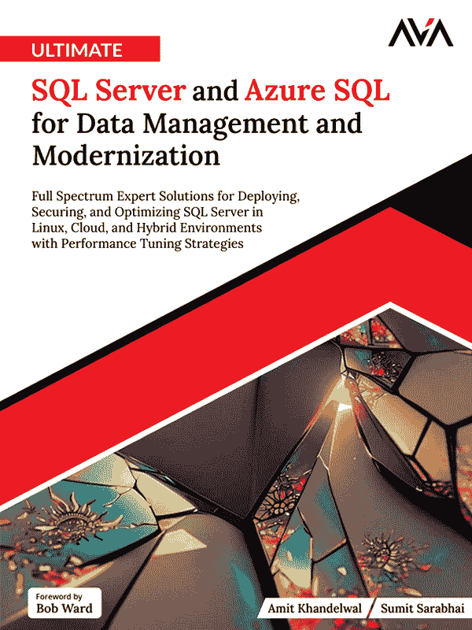


## 在 Linux、云端和混合环境中部署、安全及优化 SQL Server 全方位专家解决方案，及性能调优策略


[www.orangeava.com](http://www.orangeava.com)

# 献辞

献给我深爱的父母，感谢你们在我旅程中无不移的指导与支持
*Shri Suresh Chand Khandelwal*
*Smt. Shashi Khandelwal*
以及
*我美丽的妻子 Swati，她的爱与伴侣是我最大的力量*
*我可爱的女儿 Shivi 和 Praavi，你们是我的骄傲与喜悦*

*- Amit Khandelwal*

献给我深爱的母亲 Smt. Sadhana Sarabhai，她无不移的爱与指导一直是我不断的力量源泉
感谢我可爱的妻子 Kritika，感谢她无尽的支持与陪伴
还有我的孩子们 Krivi 和 Krishiv，是你们的快乐和好奇心每天都带给我灵感

*- Sumit Sarabhai*

# 前言
Bob Ward 著述
（微软首席架构师）

在微软工作了 30 多年，专注于 SQL 能力从本地到云端的演进，我一直很喜欢读到一本涵盖 SQL Server “核心”内容的书——无论它是在 Windows Server、Linux 系统、Kubernetes 集群，还是像 Azure 这样的公云上。这本书由微软的两位 SQL 专家 Amit 和 Sumit 编写，正是如此。标题中的“数据管理与现代化”字样特别有吸引力，因为你将在书中到处发现这一主题。

我非常喜欢这本书的结构。它首先教授 SQL Server 引擎的基础和核心概念，包括关键内部概念以及对 SQL Server 2022 的精良介绍。有了这些知识，书随后引导读者理解从本地到云端的各种部署选项，包括如何使用 `Azure Arc` 连接到云端。Amit 和 Sumit 对 Linux、容器和 Kubernetes 拥有深厚的知识，这为你提供了一个学习如何在这些现代平台环境中部署 SQL Server 的机会。

当我阅读书的核心章节时，我对我已经学过的跨部署选项的 SQL Server 安全性、高可用性和灾难恢复有了非常深入的理解。我非常喜欢我能够通过大量的示例来完善知识体系，并学习如何确保我的数据对于我可能有的任何业务需求都是安全且可用的。

我的需求之一可能是迁移到云端或升级到 SQL Server 的新版本。这本书为所有可用选项提供了指导，包括如何规划迁移以及实现整个端到端成功所需的工具。凭借了这些知识，本书在配置、安全、性能调优和监控方面提供的最佳实践和现代化技术表现得非常出色。

在整书中，我觉得我可以以一种高度组织化的方式进行学习，同时通过澄清细节的可视化和示例深入探索。你可以看出，作者将与微软产品团队合作积累的专业知识倾注到了书的每一章。我总是喜欢看到对自己职业生涯中使用过的产品的热情，这本书做到了这一切以及更多。我希望你们阅读它的感受像我一样喜欢。

# 作者简介

`Amit Khandelwal` 是微软的一位首席产品经理，拥有 155 多年的经验。他在 Linux 上 SQL Server 的开发和演进中发挥了关键作用，为微软的跨平台解决方案做出了重大贡献。Amit 从实习生开始，曾担任过支持工程师、技术主管、支持升级工程师和资深现场工程师等职位，为具有 SQL Server 实施和解决方案的企业客户提供关键支持并解决复杂的技术问题。

Amit 是一位精通 AI 和 SQL Server 的技术专家，扩展了 SQL Server 在不同平台上的影响力。他的专业知识驱动了产品策略和成功的部署。作为行业会议的频繁演讲者，Amit 分享了关于技术趋势的见解。他的演讲包括 DevDays Asia (台北)、SQL BITS (伦敦)、PASS 数据社区大会 (西雅图)、Red Hat Summit、SUSECON、微软内部活动、Bangalore 用户小组、Data Exposed 和 DataMinds。

`Sumit Sarabhai` 是一位在微软拥有超过 17 年经验的技术专家，专注于 SQL Server 及其演进技术。他的专业知识涵盖了 SQL 产品工程、咨询、预售、服务和技术支持等多个领域。Sumit 在云解决方案架构、实施、容量规划、风险评估和迁移策略方面拥有深厚的造诣。

多年来，Sumit 在指导客户工作负载现代化、容量规划以及成功迁移到 Azure 云和数据平台方面发挥了关键作用。他在风险评估和迁移策略方面的专业知识确保了平稳过渡和优化的云解决方案，其深的技术知识和解决问题的能力深受认可。

目前，Sumit 担任高级软件工程师，负责 SQL Server Python 驱动程序的开发和维护。他的专业知识确保了 SQL Server 与 Python 应用程序之间高效的数据库通信，帮助开发者构建数据驱动的解决方案。


他的教育背景拥有来自 BITS-Pilani 的计算机科学 `M.Tech` 学位以及 `GNIT` 的 `B.Tech` 学位。目前，Ramesh 在 Moback Technologies 担任工程经理。他的专长是全栈开发，曾广泛与基于产品的公司合作，使用 `Asp.net`、`.net core`、`NodeJS` 以及流行的 JavaScript 框架（如 `Angular` 和 `React）的项目。

Kumar 的领导力不仅限于管理。他通过开发功能、进行代码审查和解决技术障碍来积极贡献开发。他的技能涵盖了 `C#`、`Asp.net Core`、`GIT` 和 `SQL Server` 等后端技术，以及 `JQuery`、`Angular` 和 `React` 等前端技术。

作为新技术的敏锐采用者，他拥有 `TFS`、`Git` 和 `Azure DevOps` 等 DevOps 工具的实战经验。作为其卓越资历的一部分，Kumar 拥有丰富的 `Agile` 项目经验，能够准时交付高质量的产品。此外，他还探索了 `Azure` 和 `AWS` 等多种云平台。

# 致谢

我由衷感谢我的整个家人——我的父母和妻子，在我平衡工作和写作期间，他们承担了家务责任。

我同样非常感谢我的兄弟 `Vineet Khandelwal` 和他的家人，在那些密集的写作期间照顾孩子们。我的侄女 `Krishvi` 以她那富有感染力的微笑和无尽的快乐，也提供了无价的支持。

此外，我想对 `Microsoft` 表示感谢，感谢他们在过去 15 年对我职业发展的支持以及对 `SQL Server` 贡献的支持。特别感谢我的经理 `Tejas Shah`，以及我的同事、朋友和合作伙伴——例如来自 `DH2i` 的 `OJ Ngo`——他们严谨地审查了这些章节。他们的共同支持对于这本书的完成至关重要。

最后，我非常感谢 `AVA` 团队。他们的协作努力将分散的章节转变为了一本连贯的书。没有了他们，这项事业将依然是一个无法逾越的挑战。

***- Amit Khandelwal***

首先，我想向我的家人表达最深切的谢意。感谢我的母亲，她教会了我坚韧和努力的价值观，这些价值观塑造了今天的我。感谢我的妻子，感谢你坚定不移的支持、理解和耐心，特别是在我投入大量时间写这本书期间。我的兄弟 `Shivani` 和 `Rohit` 提供了宝贵的指导和灵感。

我也深感谢我的朋友、同事和导师提供的宝贵反馈和周全的建议。他们的智慧和支持对我个人和职业的成长至关重要。

最后，我深感谢 `AVA` 团队。他们的协作精神和奉献将各个章节变成了一本连贯、精良的书。没有他们不懈的努力，这项事业将是一个巨大的挑战。感谢你们让这一切成为可能。

感谢大家参与这段旅程。

***- Sumit Sarabhai***


请点击链接或扫描二维码以下载本书的***代码包和图片***：

 

代码包和图片也托管在


[`rebrand.ly/5bea4rt`](https://rebrand.ly/5bea4rt)


如果代码有更新，它将在现有的 GitHub 仓库中更新。

# 勘误表 (Errata)

我们对 **Orange Education Pvt Ltd** 的工作感到非常自豪，并遵循最佳实践以确保内容的准确性，为订阅者提供沉浸式的阅读体验。我们的读者是我们的镜子，我们利用他们的反馈来反思并改进出版过程中可能出现的人为错误。为了让我们保持质量并帮助我们联系任何因不可预见的错误而遇到困难的读者，请通过以下邮箱与我们联系：

**errata@orangeava.com**

非常感谢您的支持、建议和反馈。

# 你知道吗

你知道 Orange Education Pvt Ltd 为每本出版的书都提供电子书版本，并提供 PDF 和 ePub 文件吗？你可以在 [www.orangeava.com](http://www.orangeava.com) 升级到电子书版本，作为纸质书客户，您有权获得电子书副本的折扣。请通过 **info@orangeava.com** 与我们联系获取更多信息。

在 [www.orangeava.com](http://www.orangeava.com)，您还可以阅读免费的技术文章集，订阅一系列免费新闻邮件，并获得 AVA™ 书籍和电子书的专属折扣和优惠。

#盗版 (PIRACY)

如果您在互联网上发现我们作品的任何形式的非法拷贝，如果您能提供地址或网站名称，我们将不胜感激。请通过 info@orangeava.com 联系我们并提供材料链接。

# 您有与我们合作写作吗？

如果您有擅长的领域，并且对编写或为书籍贡献感兴趣，请向 business@orangeava.com 写邮件给我们。我们正致力于帮助开发者和技术专业人士洞察全球范围内的技术进步和创新，并建立一个相信“知识通过与他人分享和学习获取效果最好”的社区。请与我们联系，了解我们读者的需求以及您如何成为这场教育改革的一部分。我们还欢迎技术专家的想法，并帮助他们为自己的领域构建学习和开发内容。

# 评论 (REVIEWS)

请留下您的评价。在您阅读并使用这本书后，为什么不在购买它的网站上留评价呢？潜在读者可以查看并参考您的公正意见来做出购买决策。Orange Education 非常想知道您对我们产品的看法，我们的作者也可以从您的反馈中学习。谢谢！

更多关于 Orange Education 的信息，请访问 [www.orangeava.com](http://www.orangeava.com)。

## 引言

本介绍章节帮助您理解 SQL Server 的基础，因为了解核心 SQL Server 数据库引擎可以让您掌握基础知识。相同的 SQL Server 引擎运行所有的 SQL 产品，例如 Azure SQL Database、Azure SQL Managed Instance、Azure SQL Server Virtual Machines、Azure SQL edge 以及 Linux 上的 SQL Server，如图 1.1 所示。因此，理解核心 SQL Server 数据库引擎的基础将有助于您学习其他 SQL 系列产品。

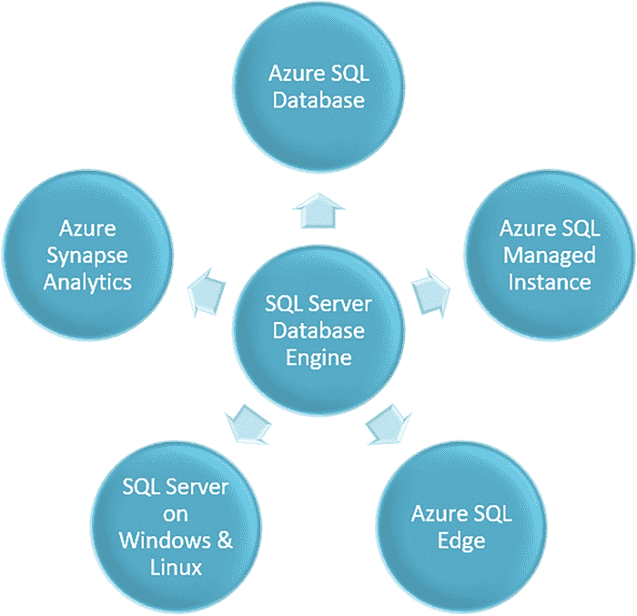

**图 1.1：** SQL Server 数据库引擎运行所有 SQL 产品

*   理解 SQL Server
*   SQL Server 内部
    *   数据库、表
    *   数据库数据和日志文件
    *   索引
    *   备份与恢复
*   SQL Server 2022 简介

Microsoft SQL Server 是关系型数据库管理系统 (RDBMS)，像每个 RDBMS 数据库一样，它以表格格式存储数据。每个 SQL Server 进程都有一个实例，您可以在任务管理器中找到。您可以在 Windows 上拥有多个 SQL Server 实例，每个实例都有自己的进程。在安装 SQL Server 时，您可以选择命名实例 (named instance) 或默认实例 (default instance)。默认实例的名称与主机名相同，而命名实例具有您指定的名称，显示为 `hostname\Name`。例如，在图 1.2 中，我们安装了两个 SQL Server 命名实例：`mypc\SQLINSTANCE1` 和 `mypc\INSTANCEB`。其中 `mypc` 是安装这两个实例的主机名。

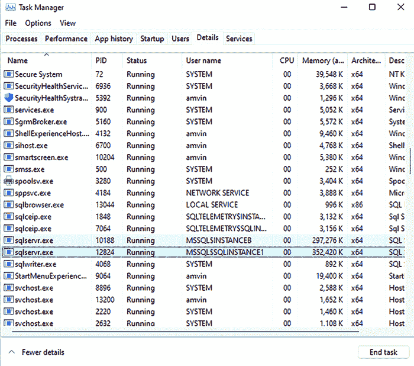

**图 1.2：** Windows 中的 SQL Server 进程列表

在 Windows 机器上您可以拥有多个 SQL Server 实例，而在 Linux 部署中，您只能安装一个 SQL Server 实例（默认实例。要在 Linux 上安装多个 SQL Server 实例，必须使用容器。我们将在后面的章节中学习更多关于 Linux 版 SQL Server。

您可以在每个 SQL 实例下创建许多登录 (Logins)、凭据 (Credentials)、链接服务器 (Linked servers)、端点 (Endpoints)、作业 (Jobs) 以及其他实例对象。同样，每个数据库都是架构 (schemas)、表、用户和其他数据库对象的集合。层级结构如图 1.3 所示参考。

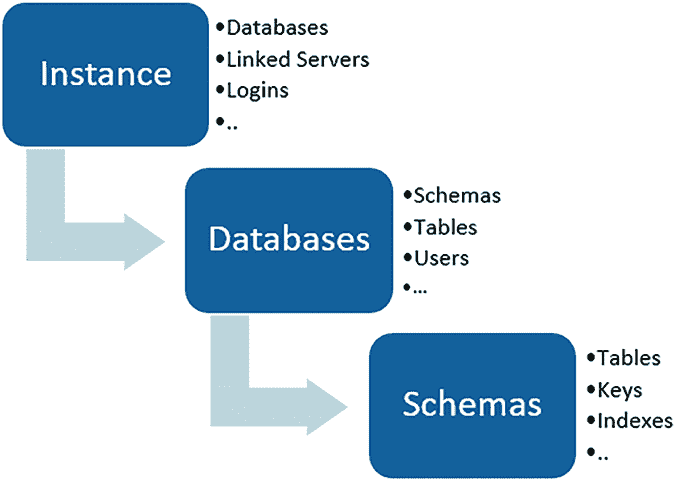

使用客户端工具，例如 SQL Server Management Studio (SSMS，微软学习 [`learn.microsoft.com/en-us/sql/ssms/sql-server-management-studio-ssms?view=sql-server-16`](https://learn.microsoft.com/en-us/sql/ssms/sql-server-management-studio-ssms?view=sql-server-16)) 或 Azure Data Studio (ADS，什么是 Azure Data Studio，微软学习 [`learn.microsoft.com/en-us/azure-data-studio/what-is-azure-data-studio`](https://learn.microsoft.com/en-us/azure-data-studio/what-is-azure-data-studio))，您可以连接到运行在 Windows 或 Linux 上的 SQL Server 实例进行管理。

SSMS 中实例图标旁的企鹅图标表示基于 Linux 的 SQL Server 实例，而普通的数据库图标表示基于 Windows 的实例。这可以帮助您快速识别连接的 SQL Server 实例的操作系统。示例参见图 1.4。

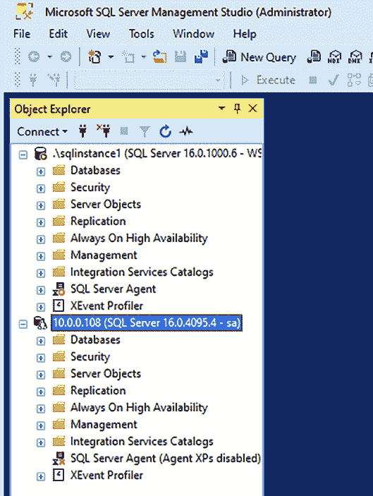

**图 1.4：** 使用 SSMS 连接 SQL Server

Azure Data Studio 是一种工作在 Windows、macOS 或 Linux 上的数据管理客户端工具。它会显示连接的数据库的操作系统和版本详情，如图 1.5 所示。它还拥有许多扩展来支持其他数据库，例如云端或本地的 MySQL、PostgreSQL 等。

**图 1.5：** 使用 ADS 连接 SQL Server

SSMS 是 SQL Server 管理运维的首选工具，但当您需要连接不同类型的数据库（包括 SQL Server）时，可以使用 ADS。


为了熟悉 SQL Server 和这些工具，建议按照此处提供的说明在 Windows 上安装 `SQL Server 2022 Developer` 版本（免费版）：[SQL Server 安装指南 - SQL Server | Microsoft Learn](https://learn.microsoft.com/en-us/sql/database-engine/install-windows/install-sql-server?view=sql-server-ver16)。如果你更倾向于 Linux，可以按照此处记录的说明，在 2 分钟内在你选择的发行版上完成 `SQL Server 2022` 的安装：Linux 上 SQL Server 安装指南 - SQL Server | ()所示。数据文件存储数据，日志文件用于记录日志以帮助恢复数据库。

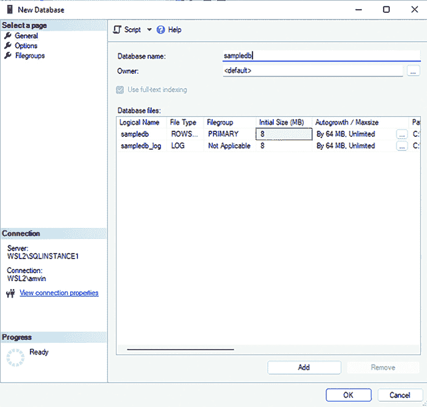

**图 1.6:** SQL Server 数据库属性

图 1.7 显示了通过 `SSMS` 连接到实例时数据库的结构外观。

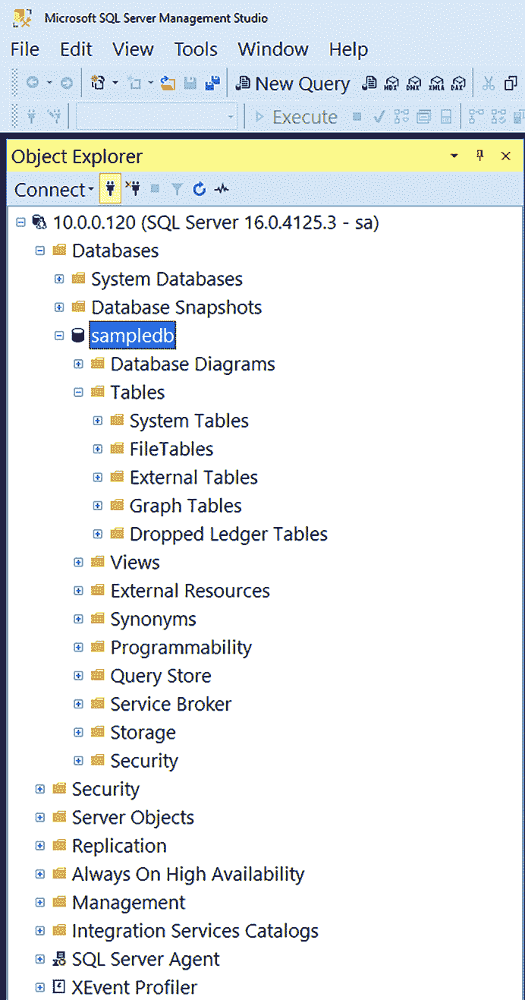

**图 1.7:** 在 SSMS 对象资源管理器中看到的 SQL Server 数据库

你可以为单个数据库创建多个数据和日志文件。虽然建议不要为一个数据库创建多个日志文件，但你完全并且应该拥有多个数据文件。每个数据文件都关联到一个 `filegroup`；`filegroup` 是数据文件的一种逻辑分组方式，它们通过将表和索引分区到多个数据文件中，帮助你将数据分摊在多个磁盘上，从而协助查询性能和管理任务（如备份和还原选项）。让我们通过实际操作来进一步理解这一点：

在此处的创建数据库示例脚本中：

1.  我们正在创建一个名为 `sampledb` 的新数据库，包含三个数据文件：`sampledb.mdf`、`sampledb1.ndf` 和 `sampledb2.ndf`。
2.  同时正在创建两个新的 `filegroups`：`Primary` 和 `Secondary`。
3.  主 `filegroup` 拥有 `sampledb.mdf` 数据文件，二级 `filegroup` 拥有另外两个 `sampledb1.ndf` 和 `sampledb2.ndf` 文件。
4.  我们还将二级 `filegroup` 设置为默认文件组，因此每当在 `sampledb` 数据库内部创建对象时，它都会创建在属于二级 `filegroup` 的文件中。
5.  所有属于 `secondary filegroup` 的数据文件都在 `D` 盘上（机器上的另一块物理磁盘），而属于 `primary filegroup` 的数据文件在默认 `C` 盘上，确保数据库 I/O 分布在多个磁盘上。
6.  日志文件放置在 `E` 盘上，它不属于任何 `filegroup`。`E` 盘是一个独立的物理磁盘。这确保了数据 I/O 与日志 I/O 分离。
7.  你为数据库创建的每个文件都有逻辑名称和物理名称。逻辑名称是在 `T-SQL` 命令中用于引用操作系统物理名称的名称。在下面的脚本脚本，`sampledb1` 是 `sampledb1.ndf` 的逻辑文件名，而后者是操作系统上的物理文件。

```sql
CREATE DATABASE [sampledb]
CONTAINMENT = NONE
ON PRIMARY
( NAME = N’sampledb’, FILENAME = N’C:\Program Files\Microsoft SQL Server\MSSQL16.SQLINSTANCE1\MSSQL\DATA\sampledb.mdf’, SIZE = 8192KB, FILEGROWTH = 65536KB ),
FILEGROUP [secondary]
( NAME = N’sampledb1’, FILENAME = N’D:\sqldata\sampledb1.ndf’, SIZE = 8192KB, FILEGROWTH = 65536KB ),
( NAME = N’sampledb2’, FILENAME = N’D:\sqldata\sampledb2.ndf’, SIZE = 8192KB, FILEGROWTH = 65536KB )
LOG ON
( NAME = N’sampledb_log’, FILENAME = N’E:\sqllogs\sampledb_log.ldf’, SIZE = 8192KB, FILEGROWTH = 65536KB )
WITH LEDGER = OFF
```

```sql
USE [sampledb]
GO
IF NOT EXISTS (SELECT name FROM sys.filegroups WHERE is_default=1) ALTER DATABASE [sampledb] MODIFY FILEGROUP [secondary] DEFAULT
GO
```


因此，使用 GAM 和 SGAM 分配映射可以让 SQL Server 轻松识别包含一个空闲页的混合区（extent），或识别分配给对象的均匀区。虽然这在区级别很有帮助，但还有一种名为页空空间（PFS）的元数据页。在区分配给对象后，数据库引擎使用 PFS 页来记录该区中哪些页已分配或已空闲。这有助于 SQL 引擎为插入新行或索引键值分配所需的新页。

当你查询系统动态管理视图（系统创建的对象，你可以引用它们来监控、管理或调整 SQL Server 性能）时，你可以用于用于查询和了解更多关于页和区的 DMV 有：

* `sys.database_files`
* `sys.dm_db_file_space_usage`

这里是一个示例，展示了你如何使用它们：

```sql

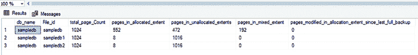

**图 1.9:** SQL Server 页详情

```sql
select file_name(file_id) as filename, size as size_in_pages, (size*8) as size_in_MB from sys.database_files where type = 0
```

**图 1.10:** SQL Server 数据库大小（MB）

要了解更多关于页和区的架构，建议参考微软官方文档：页和区架构指南 - SQL Server | Microsoft Learn (https://learn.microsoft.com/en-us/sql/relational-databases/pages-and-extents-architecture-guide?view=sql-server-ver16)。

SQL Server 日志文件是数据库恢复到一致状态所需的必需组件。事务日志记录了每个事务产生的所有事务和修改。事务日志是一串日志记录。每个日志记录都可以通过唯一的日志序列号（LSN）来标识。当前日志记录的 LSN 总是大于上一个日志记录。因此，LSN 遵循顺序序列。关于事务日志的通用建议如下：

* 你应该尝试每个数据库只保留一个日志文件，与数据文件不同，数据文件建议有多个。
* 为了获得更好的 I/O 吞吐量，请务必将数据库的日志文件创建在与数据文件不同的驱动器上，因为日志文件的 I/O 模式与数据文件完全不同。
* 尝试预先设置日志文件的大小到你认为它可能增长到的最大值，以避免在生产时间内发生不必要的日志文件增长。

读完以下章节后，你将对上述建议有更好的的理解。

Microsoft SQL Server 使用预写日志（WAL）技术来确保数据库在重启后具有持久性和一致性。WAL 协议保证在将相关的日志记录写入磁盘之前，没有任何数据修改被写入磁盘。当你对数据库进行更改时（例如创建表、索引或插入/更新行），如果包含该行的页不在缓冲区池（也称为 buffer pool）中，则将其从磁盘获取到内存（缓存）的一部分，称为缓冲区缓存。一旦获取到缓冲区池中，该页会被挂载（不是锁定）并被修改；此时该页被称为脏页。

想象这样一个场景：数据库上正在进行大量修改，将多个页标记为脏页，这些修改的日志记录已经刷新到日志文件中，且数据页正在刷新中，此时系统宕机了，导致数据缓冲区未完全刷新。当数据库重启并执行恢复时，它现在可以引用日志文件来识别活动事务，然后如果这些事务已提交，则重做（向前回滚）这些事务以确保更改持久化；并撤销（回滚）未提交的事务。这确保了数据库在重启前和重启后都是一致的。

让我们让我们详细查看事务日志及其物理架构。物理 SQL Server 日志文件分为若干虚拟日志文件（VLF），如图 1.11 所示，这是根据上一节共享的 T-SQL 脚本创建的示例数据库 sample db。虚拟日志文件的大小由 SQL Server 在日志文件创建或扩展时根据自动增长设置动态决定。SQL Server 数据库引擎尝试保持 VLF 尽可能少。

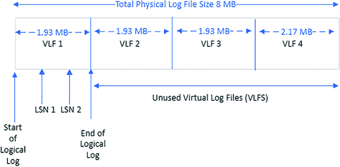

**图 1.11:** 事务日志

你也可以使用 DMV 查询：`sys.dm_db_log_info`：

```

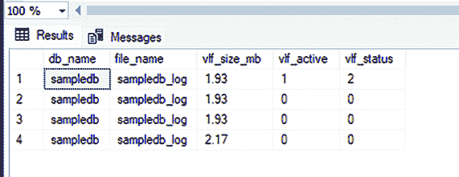

**图 1.12:** 查询事务日志

共有 4 个 VLF，每个 VLF 的大小在表中显示。你也可以看到只有第一个 VLF 是激活的，其余 VLF 是未使用的，因为逻辑日志在文件末尾结束。现在，当数据库发生修改时，你会注意到逻辑日志开始增加，VLF 的状态从未激活变为激活，如下面的输出所示：

```sql
select db_name(database_id) as db_name, file_name(file_id) as file_name, vlf_size_mb, vlf_active, vlf_status from sys.dm_db_log_info
```

**图 1.13:** 查询事务日志

如你所示，所有四个 VLF 现在都是激活的，这意味着整个日志文件都在使用中。我们现在运行一个检查点，导致日志缓存和相应的缓冲区缓存刷新，从而在无需增长的情况下截断日志文件。这里是 `sys.dm_db_log_info` 的输出，你可以看到 VLF 1、2 和 3 现在处于未激活状态，最后一个 VLF 是唯一处于状态的 VLF。

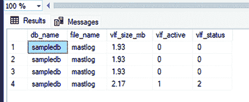

**图 1.14:** 查询事务日志

文件架构如图 1.15 所示，在日志截断后，前三个 VLF 被标记为未激活。注意事务日志文件并没有增长，而是如绿色线条所示绕回（wrap around）并将第一个 VLF 标记为未激活，意味着可以未使用。此外，为了方便理解，图中显示了最后一个检查点、VLF 的起点和最小 LSN 是相同的，但在实际环境中，最小 LSN 可能会落后于检查点 LSN，因为该事务在检查点发生时尚未完成。

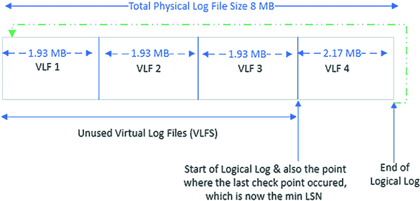

**图 1.15:** 事务日志逻辑架构


日志截断是将一个 `VLF` 标记为非活动的过程，这通知 SQL Server 可以将其用于记录，因为之前在相应 `VLF` 上执行的所有更改已成功捕获到数据库中，并且可以一致地恢复。日志截断确保日志文件最终不会占用所有的磁盘空间，并提供了重用虚拟日志文件的能力。此外，请记住 `VLF` 不可能是部分活动或部分非活动的。如果有一个日志记录仍然处于活动状态，则整个 `VLF` 都被标记为活动。

日志截断会在以下事件后自动发生：

- 当数据库配置为简单恢复模式时，检查点（checkpoint）日志截断后。
- 当数据库配置为完整恢复模式时，在日志备份完成且自上次备份以来发生检查点后，将发生截断。

```
select name as db_name, log_reuse_wait, log_reuse_wait_desc from sys.databases sd where database_id= db_id(sd.name)
```

此查询应该让你知道 `log_reuse` 未发生的原因。几个常见原因包括：日志备份、活动事务和复制。要查看完整列表，请参考微软官方文档并参考以下列：`log_reuse_wait_desc sys.databases` (Transact-SQL) - SQL Server | Microsoft Learn ([`learn.microsoft.com/en-us/sql/relational-databases/system-catalog-views/sys-databases-transact-sql?view=sql-server-ver16`](https://learn.microsoft.com/en-us/sql/relational-databases/system-catalog-views/sys-databases-transact-sql?view=sql-server-ver16))

最后，谈到数据文件时，我们提到了数据页和扩展区（extents）。数据页的大小通常为 8KB，扩展区是 8 个页的集合，因此一个扩展区的大小为 64 KB。同样，日志块由日志记录组成。日志记录本身的大小异，但始终是 512 字节的整数倍，这是 SQL Server 支持的最小扇区大小。日志块的最大大小为 60 KB。因此，正如你所理解的，日志刷新（flush）的大小很小且大部分是顺序 I/O。要了解更多事务日志及其架构，请阅读此处微软官方文档：SQL Server 事务日志架构和管理指南 - SQL Server | Microsoft Learn ([`learn.microsoft.com/en-us/sql/relational-databases/sql-server-transaction-log-architecture-and-management-guide?view=sql-server-ver16`](https://learn.microsoft.com/en-us/sql/relational-databases/sql-server-transaction-log-architecture-and-management-guide?view=sql-server-ver16))

当你连接到 SQL Server 实例时，你会发现有几个系统对象，例如系统数据库、表、视图、登录名和其他预创建的对象。你可以使用以下查询列出命名为 `sys` 或 `INFORMATION_SCHEMA` 的模式中的所有系统对象：

```
select * from sys.system_objects
```

系统对象存储元数据，即关于数据的数据。这对于 SQL Server 的功能至关重要。这些对象大部分物理存储在资源数据库（resource database）中，它是系统数据库之一。所有这些系统对象逻辑上出现在每个数据库（包括用户数据库）的 `sys` 模式中。这些系统对象有助于 SQL Server 的运行、监控和管理。

让我们先看看 Windows 或 Linux 上安装 SQL Server 后默认创建的系统数据库。共有 5 个系统数据库，当你连接到 SQL Server 实例时，可以查看 5 个中的 4 个，如图 1.16 所示。对于 Azure SQL Database 和弹性池（elastic pools），你只会看到 master 和 `tempdb` 数据库。对于 Azure SQL 托管实例和 Azure SQL Server VM，适用于所有系统数据库。

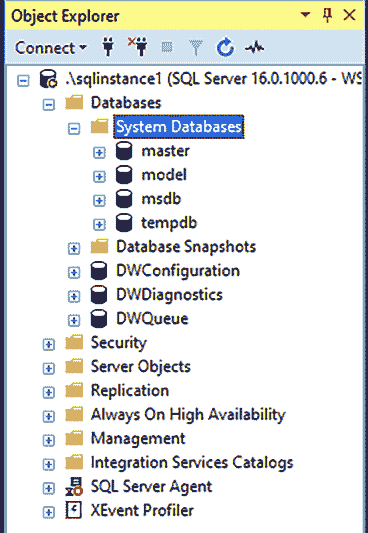

**图 1.16:** 从 SSMS 查看系统数据库
- **Model 数据库 (模型数据库)**：此数据库用作在实例上创建其他数据库的模板。大多数数据库选项（如恢复模式）以及 model 数据库的其他内容都会复制到创建的新数据库中。
- **Msdb 数据库**：此系统数据库专门供 SQL Server Agent 使用，用于调度、跟踪和监控配置的各种作业和警报。它包含系统对象，用于跟踪备份恢复历史、Agent 作业运行历史、dbmail 以及其他由 SQL Server 提供的功能。
- **Tempdb 数据库 (临时数据库)**：这是所有连接到 SQL Server 实例的用户可用的全局资源。此数据库仅用于存储临时对象，因此每当重启 SQL Server 时，`tempdb` 都会被重新创建。重启 SQL Server 后，`tempdb` 中的所有之前的数据将丢失。你不应该使用此数据库创建你打算在 SQL Server 重启后持久的对象。

- `sys.dm_db_file_space_usage`
- `sys.dm_db_session_space_usage`

示例查询请参考：tempdb 数据库 - SQL Server | Microsoft Learn ([`learn.microsoft.com/en-us/sql/relational-databases/databases/tempdb-database?view=sql-server-ver16`](https://learn.microsoft.com/en-us/sql/relational-databases/databases/tempdb-database?view=sql-server-ver16))

由于这是一个全局单数据库并跨越整个 SQL 实例使用，为了避免此数据库出现性能瓶颈，发布了关于容量规划和优化 `tempdb` 性能的建议和指南。事实上，在 SQL Server 发布中，`tempdb` 经历了多次性能改进。一些重大新功能包括在安装 SQL Server 时设置 `tempdb`，以及 SQL Server 2022 中内存优化的 `tempdb` 元数据，此外还有实现更好的系统页并发性的改进。

- **Resource Database (资源数据库)**：这是一个只读数据库，包含了随 SQL Serverset 的所有系统对象。当你连接到 SQL Server 实例时，无法像其他数据库那样查看它。但是，所有系统对象物理上持久化在此数据库中，所有这些对象出现在创建的每个数据库的 `sys` 模式中。


你可以在错误日志中验证：“Starting up database `mssqlsystemresource`”。Windows 上的 SQL Server 数据库物理文件位于：`<drive>:\Program Files\Microsoft SQL Server\MSSQL<version>.<instance_name>\MSSQL\Binn\`；对于 Linux 上的 SQL Server，它包含位于 `/opt/mssql/lib` 的 `sqlserver.sfp` 文件中。建议并推荐不要将这些文件移动到其他位置，因为每当 SQL Server 升级到新版本时，系统都会通过在相同位置复制新的资源数据库文件来更新系统对象，这使得升级过程变得简单。早些时候必须删除并重建系统对象，这是一项繁琐的任务。

你已经学习了如何安装 SQL Server 和客户端工具、连接到实例、创建数据库，以及查看系统数据库和其他系统对象。现在，让我们学习在 SQL Server 中可以创建用于存储数据的各种类型的表，以及如何优化对存储数据的检索。

在 SQL Server 中，当你展开数据库下的“表”选项时，你会看到如图 1.17 所示，在处理 SQL Server 2022 版本时可以创建的六种不同类型的表。

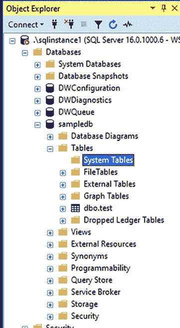

**图 1.17:** 从 SSMS 看到的不同类型的表

*   **系统表 (System Tables)**：我们已经知道系统表存储了服务器的配置并包含元数据。系统表内部的数据系统视图可用，因此用户无法对其更新或查询。

*   **文件表 (FileTables)**：SQL Server 通常关联处理结构化数据，但它也可以用于处理非结构化数据。Filestream 是 SQL Server 中的此类功能，它允许应用程序在文件系统中存储非结构化数据（如图像、文档和视频），同时在非结构化数据与相应的结构化数据之间提供事务一致性。

    当你启用 Filestream 时，可以创建文件表，让应用程序集成存储和数据管理组件，并提供对非结构化数据和元数据的全文及语义搜索等功能。截至本书编写时，此功能仅支持 Windows 上的 SQL Server，不支持部署在 Linux 上的 SQL Server 实例。

    要了解更多关于 filestream 的信息，请参阅 [FILESTREAM (SQL Server) - SQL Server | Microsoft Learn](https://learn.microsoft.com/en-us/sql/relational-databases/blob/filestream-sql-server?view=sql-server-ver16)

*   **外部表 (External Tables)**：这些表允许你使用 SQL Server 访问来自其他数据库或存储（例如 Oracle、Teradata、Azure Data Lake Storage、S3 对象存储或 Azure Blob 存储）。这被称为数据虚拟化，你可以通过 Polybase 功能启用。它适用于 Windows 和 Linux 上的 SQL Server。

*   **图表 (Graph Tables)**：你还可以为 SQL Server 启用图数据库功能，允许你以图的格式建模和查询数据。在 SQL Server 中处理图，你可以创建节点表和边表，然后使用基本的 T-SQL 查询语法和 `MATCH` 子句，对图进行模式匹配和多跳导航。这些也支持 Windows 和 Linux 上的 SQL Server。

    要了解更多关于图以及如何在 SQL Server 中开始使用它们，请参阅：[SQL Graph Architecture - SQL Server | Microsoft Learn](https://learn.microsoft.com/en-us/sql/relational-databases/graphs/sql-graph-architecture?view=sql-server-ver16)

*   **用户表 (User Tables)**：这些是你使用 `create table` T-SQL 语法创建的普通用户表。它们的数据在逻辑上以行列的形式组织。插入此表的每行都是唯一记录，每列都是记录中的一个字段。SQL Server 还提供了让你为表以及表中的每个列分配属性的能力，用以控制允许的数据。这些被称为约束。为了高效检索数据，SQL Server 允许你在这些表上创建索引和统计信息，帮助你快速高效地从表中查找或扫描数据。

    你还可以压缩存储在表中的数据以优化存储。为了提高大型表的可管理性，你还可以在表上创建称为分区表的表，它允许你跨多个文件组对数据进行水平分区。

*   **列存储 (Columnstore)**：通常，用户表中的数据以行格式存储，但如有需要，你也可以通过 `columnstore` 索引将存储更改为列格式，从而以列格式存储数据，为分析工作负载提供更好的性能。带有 `columnstore` 索引的表被称为 `columnstores`。

    `Columnstores` 通常优先用于数据分析或数据仓库工作负载。要了解更多关于 `columnstores` 的信息，请参考：[Columnstore indexes: Overview - SQL Server | Microsoft Learn](https://learn.microsoft.com/en-us/sql/relational-databases/indexes/columnstore-indexes-overview?view=sql-server-ver16)

    但事务日志与磁盘表使用的日志相同。在恢复期间，使用事务日志和检查点文件来恢复内存优化表。

    当你需要 OLTP 工作负载具有高性能时，通常会使用内存优化表，这对于处理大量并发插入也是所需的。在此阅读更多关于内存优化表的信息：[Introduction to Memory-Optimized Tables - SQL Server | Microsoft Learn](https://learn.microsoft.com/en-us/sql/relational-databases/in-memory-oltp/introduction-to-memory-optimized-tables?view=sql-server-ver16)


- **已删除的账本表（Dropped Ledger Tables）：** 这些是在您为特定表启用新的 SQL Server 2022 账本功能后删除的表。当启用账本功能后删除表，它们在逻辑上被删除并从架构中移除，但在物理上表会被重命名并显示在已删除的账本表部分。要了解更多关于账本功能的信息，请参阅：账本概述 - SQL Server | Microsoft Learn ([`learn.microsoft.com/en-us/sql/relational-databases/security/ledger/ledger-overview?view=sql-server-ver16&preserve-view=true`](https://learn.microsoft.com/en-us/sql/relational-databases/security/ledger/ledger-overview?view=sql-server-ver16&preserve-view=true)) )

上一节侧重于表以及如何根据存储格式区分表。在本节中，我们的重点是索引。图 1.18 显示了根据表的主要存储类型在 SQL Server 中可以创建的各种索引。

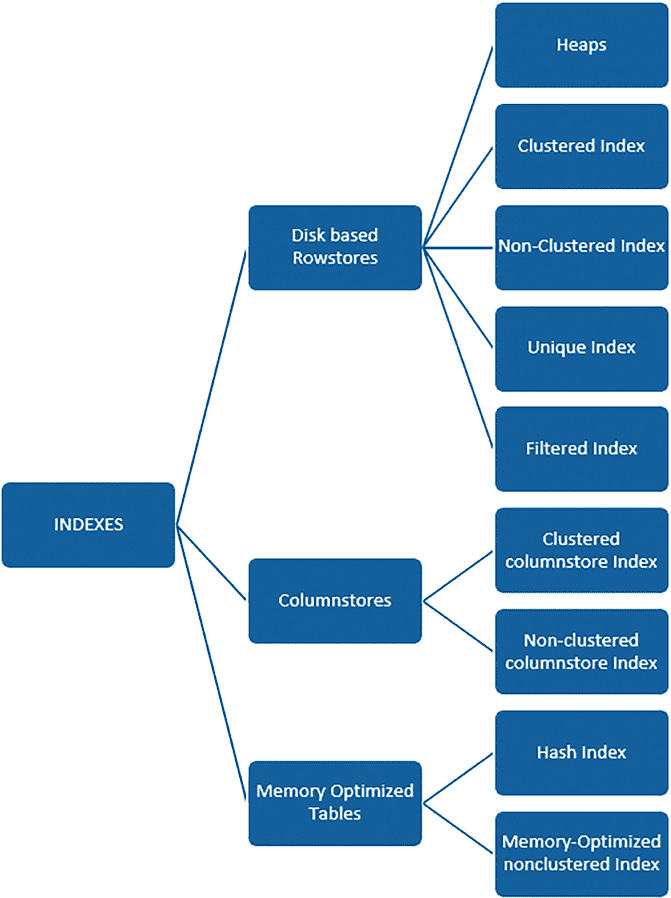

**图 1.18：** SQL Server 中不同类型的索引

在查看这些索引之前，让我们先了解它们是什么以及为什么需要它们。

表为我们存储数据，但在您构建数据层时，仅仅存储数据是不够的；您还需要能够快速、高效地从表中检索数据，以满足应用程序的功能。这就是索引派上用场的地方。它们有助于加速从表中检索数据（行或列）的数据结构。它们通过高效地查找应用程序所需的表中数据（行或列）来帮助减少磁盘 I/O。

当您执行如下 T-SQL 查询时：
```sql
select product_name, product_quantity, customer_name from sales.orders where order_id=7
```

SQL Server 查询优化器会评估快速高效地检索这些数据的方法。优化器拥有的选项取决于表结构以及任何索引的存在。例如，如果表在 `order_id` 上有聚集索引，那么它可以快速地遍历索引并高效地查找 `order_id 7` 并检索所需的数据。如果表不包含任何索引，则将执行表扫描，这意味着读取表中的所有行或大部分行，然后我们提取符合查询条件的数据。通常，与索引查找（seek）或扫描（scan）相比，表扫描消耗更多的时间和资源。

因此，在处理表时，确保创建了正确的索引和表结构至关重要，这样您就可以从 SQL Server 中获得最佳性能。

现在，您已经理解了查询优化器是如何工作的，以及索引如何提供帮助，让我们来看看各种索引，从基于磁盘的行存储表开始。

- **堆（Heap）：** 在指定任何顺序的情况下存储的数据称为堆。没有聚集索引的表就是堆。您可以在堆上创建非聚集索引。数据通常按照行插入表的顺序存储。

  当您创建临时表时，建议使用堆，这是一种临时持有表，作为从另一个数据源插入的一部分来获取数据。由于在插入过程中不强制排序，因此它们速度更快。堆用于大多数情况下扫描的较小表，且您不会运行从表中查找特定行的查询。

  图 1.19 显示了聚集叶级如何包含数据本身，以及当我想搜索 `order_id 7` 时索引树的遍历是如何发生的。SQL Server 从根节点开始，因为 7 小于 10，它立即找到键=7 的分支节点页，进而指向 order id 为 7 的叶节点层的指针，然后在叶节点层，我们获得了与键 `(order_id)=7` 关联的数据。

  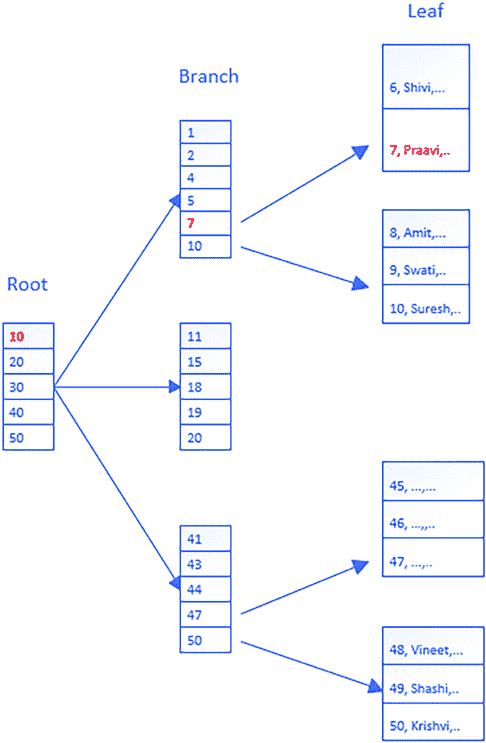

  **图 1.19：** B-树结构

  由于我们使用的是 B+ 树结构，叶节点是一个双向链表，使得叶节点之间的遍历变得更加容易。当已经在具有非聚集索引的堆上创建聚集索引时，作为创建聚集索引的一部分，所有非聚集索引也应该重新构建，以包含聚集索引键值，而不是行标识符 (RID)。通常首选先构建聚集索引然后构建非聚集索引。建议您阅读聚集索引 T-SQL 语法以获取更多信息：创建聚集索引 - SQL Server | Microsoft Learn ([`learn.microsoft.com/en-us/sql/relational-databases/indexes/create-clustered-indexes?view=sql-server-ver16`](https://learn.microsoft.com/en-us/sql/relational-databases/indexes/create-clustered-indexes?view=sql-server-ver16)) )

- **非聚集索引（Non-clustered Index）：** 非聚集索引像聚集索引一样使用 B+ 树。它与数据行具有独立的结构。但与聚集索引不同，非聚集索引包含键值，且键值在叶节点层有一个指向数据行的行定位符。如果非聚集索引是在堆上创建的，则该行定位符指向匹配键值的行；对于聚集表，行定位符是聚集键。然后执行聚集索引扫描以到达数据。因此，如您所注意，非聚集索引需要额外的查找来从聚集索引检索数据。

  通过非聚集索引，您还可以在非聚集索引的叶层添加非键列，这有助于您执行全覆盖查询。当您将非键列添加到非聚集索引的叶层时，它们被称为包含列（included columns）。请参考 T-SQL 语法学习如何创建非聚集索引。创建非聚集索引 - SQL Server | Microsoft Learn ([`learn.microsoft.com/en-us/sql/relational-databases/indexes/create-nonclustered-indexes?view=sql-server-ver16`](https://learn.microsoft.com/en-us/sql/relational-databases/indexes/create-nonclustered-indexes?view=sql-server-ver16)) )

- **唯一索引（Unique Index）：** 您可以在 SQL Server 中使用约束来对表执行规则。例如，您可能希望确保某些列具有唯一值并避免插入重复值。您可以通过创建唯一约束在表上执行此操作。当您创建唯一约束时，它允许列/列中仅出现一次空值。SQL Server 通过默认创建一个唯一的非聚集索引来在表上执行此约束。有关创建的语法，请参阅：唯一索引 - SQL Server | Microsoft Learn ([`learn.microsoft.com/en-us/sql/relational-databases/indexes/create-unique-indexes?view=sql-server-ver16`](https://learn.microsoft.com/en-us/sql/relational-databases/indexes/create-unique-indexes?view=sql-server-ver16)) )


### 过滤索引 (Filtered Index)
这是一个非聚集索引，它仅在表的部分行上创建索引结构。在创建此非聚集索引时，你基本上定义了一个谓词，索引会在满足该谓词的数据上创建。当你的表经常针对某个定义明确的数据子集进行查询时，这种类型的索引非常有益。例如，你可能有一张包含二十二十数据的数据的，但大多数情况下，你的应用程序只查询 2021 年之后收到的订单。对于这种场景，你可以在表上创建一个针对 2021 年之后数据的过滤索引。这样，索引结构更小，更便于维护，并节省了存储空间，因为你只为 2021 年之后的数据创建索引结构，而不是为之前的 20 年创建。关于创建 T-SQL 的语法，请参考：创建过滤索引 - SQL Server | Microsoft Learn ([`learn.microsoft.com/en-us/sql/relational-databases/indexes/create-filtered-indexes?view=sql-server-ver16`](https://learn.microsoft.com/en-us/sql/relational-databases/indexes/create-filtered-indexes?view=sql-server-ver16))

### 列存储表 (Columnstore Tables)
SQL Server 允许你以行格式存储数据（行格式通常优于在线事务处理（OLTP）工作负载），或以列格式存储（列优于数据仓库或在线分析处理（OLAP）类型的工作负载）。列存储还提供了额外的好处，与原始数据大小相比，数据压缩率可以高达 10 倍。如果你想让表以列格式保存数据，则需要创建一个聚集列存储索引 (`CCI`）。

#### 聚集列存储索引 (Clustered Columnstore Index, CCI)
一旦你在表上创建了 `CCI`，整个表的物理存储从行存储转换为列存储的过程就开始了。当创建 `CCI` 时，行会被分组到行组（Rowgroups）中，每个行组最多包含 1,048,576 行（约 100 万行）。这些行组被压缩并以列格式物理存储。为了让行组关闭并准备好进行压缩，它们必须至少包含 102400 行（约 10 万行）。这确保了在转换为列存储时碎片最少。

但是，如果一个行组没有约 10 万行，则该行组将保持打开状态并在磁盘上以行存储格式存在，称为增量行组（delta rowgroups）。只有当达到 10 万或最大 100 万行的阈值时，行组才会转换到关闭状态并进行压缩。这在后台通过元组移动线程（tuple-mover thread）完成。

跨表的增量行组集合被称为增量存储（deltastore）。请记住，这些增量存储具有行存储格式的数据，并使用基于 B 树的聚集索引，该索引供列存储索引使用。因此，当针对列存储表运行查询时，查询优化器会将列存储格式数据的结果与来自增量存储的结果相结合。


通过 `NCCI`，你可以创建过滤索引来选择表的哪些部分存储在列存储中，哪些部分存储在行存储中。你还可以使用压缩延迟（compression delay）选项来决定何时将表切换到列存储。

要 l 更多关于列存储索引的信息，请阅读：列存储索引：概述 - SQL Server | Microsoft Learn ([`learn.microsoft.com/en-us/sql/relational-databases/indexes/columnstore-indexes-overview?view=sql-server-ver16`](https://learn.microsoft.com/en-us/sql/relational-databases/indexes/columnstore-indexes-overview?view=sql-server-ver16))

### 内存优化表 (Memory Optimized Tables)
内存优化表的主要存储是主内存，也就是说，当这些表上运行事务时，行会被读取并写入主内存而不是磁盘。如果你创建了被设置为具有持久性（durable）的内存优化表，那么在磁盘上会维护一份表数据的副本，仅用于持久性。事务是针对内存中的表处理的。

由于表在内存中，因此磁盘上没有数据页或范围（extents）。所有数据行都在内存中，是索引将内存中的行连接在一起。因此，内存优化表至少有一个索引是核心的且是强制要求的。你可以在内存优化表上创建两种类型的索引；它们是哈希索引（Hash）和内存优化表。

#### 哈希索引 (Hash Index)
哈希索引也是一种内存中的结构；它是一个指针数组，数组中的每个元素称为桶（bucket）。桶的大小为 8 字节，用于存储如图 1.20 所示的链表的内存地址。该图取自官方文档，可以访问：SQL Server 和 Azure SQL 索引架构和设计指南 - SQL Server | Microsoft Learn ([`learn.microsoft.com/en-us/sql/relational-databases/sql-index-design-guide?view=sql-server-ver16#hash-index-architecture`](https://learn.microsoft.com/en-us/sql/relational-databases/sql-index-design-guide?view=sql-server-ver16))


图：带有桶的哈希索引

函数 `F(x)`（其中 `x` 是创建哈希索引的键值）用于生成键值的哈希值，然后根据生成的哈希值，将其分配到哈希索引中的一个桶中，该桶存储指向内存数据的指针。如果一个或多个键具有相同的哈希值，则每个表数据项指向链表中的下一个项，所有项都链到当前哈希或桶。如果两个索引键映射到同一个哈希桶，被称为哈希冲突（hash collision）。表行链表越长，查询性能越差。因此，当你选择在内存优化表上创建哈希索引时，尽量选择表中具有唯一值的列。在表上创建哈希索引时，你需要提供桶的数量；你指定的数字会被 SQL Server 数据库引擎向上舍入到 2 的幂，并创建相应的哈希桶。

如果你创建了太哈希桶，就会浪费内存，而且可能并不是所有的桶都会被利用。记住，每个哈希桶的大小为 8 KB！如果你选择的数字太小，就会导致更多的哈希冲突，从而影响查询性能。通常建议创建桶的数量在索引键不同值数的 1 到 2 倍之间。高估桶的数量总是比低估要好。


- **内存优化型非聚集索引**：这也被称为范围索引（Range index）。如果你不确定为哈希索引创建多少个桶（buckets），或者工作负载包含通常搜索键值范围的查询，那么你可以选择创建范围索引。该索引使用了 `Bw-Tree` 结构，该结构在微软发布的白皮书中有描述：`bw-tree-icde2013-camera-ready.dvi` (microsoft.com) ([`www.microsoft.com/en-us/research/wp-content/uploads/2016/02/bw-tree-icde2013-final.pdf`](https://www.microsoft.com/en-us/research/wp-content/uploads/2016/02/bw-tree-icde2013-final.pdf))

通常情况下，`Bw-Tree` 类似于我们之前看过的用于非聚集索引的 `B-tree`。每个索引页包含一组有序的键值和指针。指针指向较低的索引页或叶节点级的数据行。如果多个数据行具有相同的键值，那么就像哈希索引一样，多个数据行会被链接在一起。

在 `Bw-Tree` 中有一个页映射表，它拥有映射到索引页的地址，然后通过索引页遍历到页的叶节点，叶节点最终包含键值以及内存中数据行的地址。此图 1.21 来自微软的一份白皮书 [`download.microsoft.com/download/8/3/6/8360731A-A27C-4684-BC88-FC7B5849A133/SQL_Server_2016_In_Memory_OLTP_White_Paper.pdf`](https://download.microsoft.com/download/8/3/6/8360731A-A27C-4684-BC88-FC7B5849A133/SQL_Server_2016_In_Memory_OLTP_White_Paper.pdf)，该文档解释了内存内存表和索引结构；我们将其用于快速参考，如果你想了解更多信息，请阅读该白皮书。

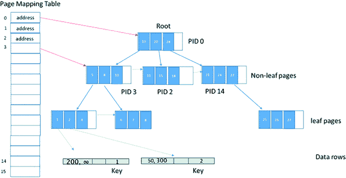

**图 1.21：** BW-Tree 结构

在我们讨论过的这些索引之外，还有其他索引，例如全文索引、XML 和空间索引，它们分别是用于对字符字符串进行复杂的单词搜索、XML 数据类型列或几何数据类型的特殊索引。

如果你打算学习更多关于此的内容，我们建议参考：索引 - SQL Server | Microsoft Learn ([`learn.microsoft.com/en-us/sql/relational-databases/indexes/indexes?view=sql-server-ver16#available-index-types`](https://learn.microsoft.com/en-us/sql/relational-databases/indexes/indexes?view=sql-server-ver16#available-index-types)) 获取详情。

业务连续性是任何数据库设计的关键方面之一。备份和恢复是你工具箱中实现业务连续性计划的一个重要工具。我们专门有一个章节介绍业务连续性，旨在帮助你理解整个 SQL 产品套件中的各种选项，你可以依靠这些选项来保护你的数据。

你必须计划、创建并重要的是测试你的备份恢复策略，以确保你准备好避免并最小化任何灾难性的数据丢失。当你测试备份恢复策略时，测试用例应该涵盖各种情况，从页恢复到从介质故障中恢复，再到跨数据中心的整个数据资产恢复。

在本节中，我们将探索不同类型的备份以及通过这些备份启用的恢复场景。一旦数据库恢复，下一步是数据库的重建，这是一个将数据库带到在线状态的过程，该状态与数据库发生故障或损坏之前的状态一致。

在查看备份和恢复类型之前，我们必须理解备份和恢复操作是在数据库的恢复模型上下进行的。恢复模型是数据库的一个设置，影响数据库的以下方面：

- 它决定了事务如何在事务日志中记录
- 它根据所选的恢复模型启用或禁用事务日志备份。
- 它支持不同类型的恢复操作。

有三种恢复模型：完全（full）、简单（simple）和大量日志记录（bulk-logged）。如果你在创建数据库时不选择恢复模型，它将默认使用完全恢复模型。这是因为数据库继承了模型系统数据库的设置，而该系统数据库默认设置为完全恢复模式。

- **简单**：当你将数据库设置为简单恢复模型时，所有事务都会被记录，但不允许日志备份，因为如前面的章节所述，日志在检查点之后会被截断。由于自最近一次备份以来的更改没有受到保护，如果发生崩溃，你必须重做这些事务。如果你想避免事务日志管理并简化备份和恢复，简单恢复模型是你的选择，前提是业务即使发生数据丢失也能平畅运行，或者可以重做不属于备份的事务。

- **完全**：在完全恢复模型中，所有事务都会被完全记录，日志截断只在你执行日志备份时发生。因此，允许日志备份，使你具备恢复到任何时间点的能力。

- **大量日志记录**：这更多是对完全恢复模型的补充。在完全恢复模型中，所有事务都被完全记录，但如果你发生了大量插入，你可以将数据库切换到大量日志记录模型，以确保事务被最化记录。不支持时间点恢复。

有关恢复模型的更多详情，请阅读恢复模型 (SQL Server) - SQL Server | Microsoft Learn ([`learn.microsoft.com/en-us/sql/relational-databases/backup-restore/recovery-models-sql-server?view=sql-server-ver16`](https://learn.microsoft.com/en-us/sql/relational-databases/backup-restore/recovery-models-sql-server?view=sql-server-ver16))

图 1.22 总结了不同类型的备份和恢复。并不是所有类型都适用于所有数据库；如前所述，备份和恢复取决于恢复模型和所使用的 SQL Server 版本。

SQL Server 中可以进行三种备份：

- 数据库备份（全量）
- 日志备份
- 差异备份

## 数据库备份

当你运行备份时，你通常会指定要备份的对象，可以是数据库、文件组、日志，并且你还会指定备份介质，即备份文件将创建的位置。介质可以是本地驱动器、网络驱动器、云存储（如备份到 Azure 存储），或其他任何基于 S3 的对象存储。

```
Backup Database <db_name> to disk = '/var/opt/mssql/log/backup/db.bak'
```


在这里，我们使用了 `.bak`，但你可以选择你喜欢的扩展名。为了方便引用，通用标准是：数据库备份使用 `.bak`，事务日志备份使用 `.trn`，差异备份使用 `.diff`。再次强调，这并不是一条规则，而是大家普遍遵循的惯做法。请注意，此处显示的示例是基于 Linux 的 SQL Server 部署，目标路径也可以是 Windows 路径。

在进行数据库备份时，你也可以指定特定的文件组/文件进行备份，这也被称为文件备份（file backup）。你指定的文件组可以是 `readwrite`（读写）或 `readonly`（只读）。你指定的文件组将是备份的内容，T-SQL 语法示例所示：

```sql

同样，你也可以对数据库进行部分备份，默认情况下，它只备份主文件组和数据库所有的 `readwrite` 文件组。你也可以备份 `readonly` 文件组，但你必须指定想要备份的 `readonly` 文件组名称。

```sql
Backup Database <db_name> READ_WRITE_FILEGROUPS, <optional read_only filegroups> to disk = `/var/opt/mssql/log/backup/dbfilename.bak’
```

全数据库备份复制整个数据库，因此随着数据库增长，它们耗时更长且需要更多空间。因此，你应该根据数据库的恢复模型（应为全量 full 或大日志 bulk-logged），结合使用全量备份、部分备份、文件组备份、差异备份和日志备份。

在运行备份时，你还可以指定各种其他参数来提高速度并缩小备份大小，例如最大传输大小、块大小、压缩、加密等。有关完整列表，请参：[BACKUP (Transact-SQL) - SQL Server | Microsoft Learn](https://learn.microsoft.com/en-us/sql/t-sql/statements/backup-transact-sql?view=sql-server-ver16) 

## 日志备份 (Log Backups)

日志备份允许你对事务日志进行备份，并捕获自上次日志或全量备份以来的所有更改。至少在创建日志备份之前，你必须至少有一个全量备份。

例如，如果你已经执行了全量备份并随后进行了日志备份，那么该日志备份将捕获之前的全量备份未捕获的所有事务。如前所述，日志备份仅支持全量（full）和大日志（bulk-logged）恢复模型。

```sql
Backup log <db_name> to disk = `/var/opt/mssql/db_name.trn’
```

如果由于任何原因导致事务日志损坏，自上次有效备份以来执行的工作将丢失，因此请记住将你的日志文件放在具有容错能力的存储设备上。

同样，如果数据库损坏或你正在恢复数据库的过程中，建议创建一个尾部日志备份（tail log backup），它可以捕获任何尚未备份的日志记录。尾部日志备份可以在以下场景下进行：

*   数据库处于在线状态，且你计划对数据库执行恢复操作，你可以使用 `norecovery` 进行尾部日志备份，例如：

    ```sql
    Backup log db_name to disk= `/var/opt/mssql/tail.trn’ with norecovery
    ```

    ```sql
    Backup log db_name to disk= `/var/opt/mssql/tail.trn’ with no_truncate
    ```

*   如果数据库损坏，你也可以尝试使用 `continue_after_error` 选项进行尾部日志备份，例如：

    ```sql
    Backup log db_name to disk= `/var/opt/mssql/tail.trn’ with continue_after_error
    ```

有关日志备份语法的详细信息，请参阅：[Transaction log backups - SQL Server | Microsoft Learn](https://learn.microsoft.com/en-us/relational-databases/backup-restore/transaction-log-backups-sql-server?view=sql-server-ver16) 

数据备份捕获自其基础备份（base backup）以来的更改。该基础备份可以是最后的全量备份或部分备份。因此，只有在之前执行过全量备份、部分备份或文件组备份后，才能进行差异备份。请记住，差异备份仅包含自上次基础备份以来的差异数据。

差异备份与全量备份相比，通常完成得更快，因此用作基础备份的补充。通常，备份策略包括每周一次或每周两次的全量备份，随后是更频繁的差异备份以捕获更改，最后是每隔几分钟一次的日志备份以备份事务日志。要了解更多信息，请参考：[Differential Backups (SQL Server) - SQL Server | Microsoft Learn](https://learn.microsoft.com/en-us/relational-databases/backup-restore/differential-backups-sql-server?view=sql-server-ver16) 

## 仅拷贝备份 (Copy-only backups)

当你执行备份时，它会改变后续备份的方式。但有时，你需要能够执行一个不影响后续备份的一次性备份，例如你想要获取当前数据库并恢复进行测试的场景。你可以执行仅拷贝的全量备份或日志备份。请记住，当数据库处于全量或大日志恢复模型时，仅拷贝备份的事务日志不会像普通备份那样被截断。执行仅拷贝备份的 T-SQL 示例如下：

```sql
Backup database <db_name> to disk = `/var/opt/mssql/db.bak’ with copy_only
```

带有 `copy_only` 命令的日志备份如下：

```sql
Backup log <db_name> to disk = `/var/opt/mssql/db.trn’ with copy_only
```

最后，备份的时间间隔和类型完全取决于组织设定的恢复点目标（RPO）和恢复时间间隔。我们将在本书的业务连续性章节中详细讨论这些内容。

## 恢复 (Restores)

在恢复过程中，你可以使用多个备份文件来恢复数据库，例如一个全量备份、一个差异备份和几个事务日志备份。如果你打算恢复整个数据库，并假设恢复模型设置为全量，通常遵循以下步骤：

*   对当前数据库启动尾部日志备份；这确保你捕获了任何现有备份文件中未备份的最新更改。

*   然后你使用 `norecovery` 选项恢复全量数据库备份，这允许你恢复拥有的任何其他备份文件。

*   然后你恢复差异备份以及包括步骤 1 中取的尾部日志备份在内的所有日志备份，对于恢复的最后一个备份文件，你启用恢复选项以确保数据库无问题地上线。

如图 1.22 所示，你可以执行各种恢复，列举几种：


## 数据库恢复操作

`complete database restore`（完全数据库恢复）恢复整个数据库，从还原完整数据库备份开始，随后是还原可用的其他数据库备份，这些可能是差异备份或日志备份。在整个操作期间，数据库处于离线状态，只有在恢复成功后才会联机。请在此处参考 T-SQL 语法示例：[完全数据库恢复（完整恢复模式）- SQL Server |  Microsoft Learn ([`learn.microsoft.com/en-us/sql/relational-databases/backup-restore/complete-database-restores-full-recovery-model?view=sql-server-ver16)`](https://learn.microsoft.com/en-us/sql/relational-databases/backup-restore/complete-database-restores-full-recovery-model?view=sql-server-ver16))

```sql
Restore database <db_name> from disk = ‘C:\backups\db.bak’ with recovery
```

如果你有更多备份需要恢复，你应该使用 `norecovery` 选项而不是 `recovery` 选项。这将使数据库保持在恢复状态，直到你应用最后一个备份并将数据库恢复联机。

`file restore`（文件恢复）在多文件组数据库中恢复单个文件或文件组。如果数据库是联机状态，可以在联机或离线模式下执行文件恢复，但对于你打算还原的文件，该文件所属的文件组将保持离线状态。

```sql
Restore database <db_name> file=<file_name> from disk = <backup file> with norecovery
```
随后进行尾部日志备份还原。

`page restore`（页面恢复）仅在完整或大量日志恢复模式下可用。你可以在联机模式下执行页面恢复。更多信息请参考：还原页面 (SQL Server) - SQL Server | Microsoft Learn ([`learn.microsoft.com/en-us/sql/relational-databases/backup-restore/restore-pages-sql-server?view=sql-server-ver16)`](https://learn.microsoft.com/en-us/sql/relational-databases/backup-restore/restore-pages-sql-server?view=sql-server-ver16)) 提供的 T-SQL 示例：

```sql
Restore database <db_name> page= <file_id:page_id> from disk = <backup file> with norecovery
```
随后进行带有 recovery 选项的日志备份还原。

`piecemeal restore operation`（部分恢复操作）分阶段恢复数据库，从主文件组和次文件组开始。这通常用于你有多文件组数据库备份的情况。使用 `partial` 选项指定语法，如下：
Restore database <db_name> read_write_filegroups from disk = <backup file> with partial, recovery
```

由于你已经恢复了数据库，它现在是联机状态，但无法访问那些尚未恢复的文件，例如 `read_only`（只读）文件组。你随后可以使用之前提供的文件恢复语法来还原任何 `read_only` 文件组。你需要使用 `recovery` 选项。详情请参考：[部分恢复 (SQL Server) - SQL Server | Microsoft Learn ([`learn.microsoft.com/en-us/sql/relational-databases/backup-restore/piecemeal-restores-sql-server?view=sql-server-ver16)`](https://learn.microsoft.com/en-us/sql/relational-databases/backup-restore/piecemeal-restores-sql-server?view=sql-server-ver16))

`transaction log restore`（事务日志恢复）仅适用于完整或大量日志恢复模式的数据库。事务日志恢复让你具备执行时间点点恢复的能力，因为你可以达到所需的恢复点。此处分享了语法；详情请参考：应用事务日志备份 (SQL Server) - SQL Server | Microsoft Learn ([`learn.microsoft.com/en-us/sql/relational-databases/backup-restore/apply-transaction-log-backups-sql-server?view=sql-server-ver16)`](https://learn.microsoft.com/en-us/sql/relational-databases/backup-restore/apply-transaction-log-backups-sql-server?view=sql-server-ver16))

```sql
Restore log <db_name> from disk =<transaction log backup file> with norecovery
```

一旦你达到了想要还原的最后一个日志文件备份，请运行带有 `recovery` 选项的相同命令将数据库恢复联机。

## SQL Server 2022 简介

在编写此本书时，SQL Server 2022 是最新的版本，也是迄为止针对 Azure 的最佳 SQL 版本。如果你想创建一个可以在任何平台运行的混合环境，无论是本地还是云端、虚拟机还是容器，那么 SQL Server 2022 都是你的选择。

要查看 SQL Server 2022 的所有新功能，可以检查介绍 SQL Server 2022 所有特性的官方文档。链接如下：[`learn.microsoft.com/en-us/sql/relational-databases/backup-restore/what-s-new-in-sql-server-2022?view=sql-server-ver16`](https://learn.microsoft.com/en-us/sql/relational-databases/backup-restore/what-s-new-in-sql-server-2022?view=sql-server-ver16) 

## 分析

根据我的理解，Microsoft SQL Server 2022 关注五个核心支柱，图 1.23 显示了每个支柱下最具吸引力的功能。图中没有显示所有新功能，而是最重要的。让我们查看这些支柱及其对应的功能，其中某些功能处于预览阶段。

**图 1.23:** SQL Server 2022，列出的最新功能

### 用于 SQL Server 2022 的 Azure Synapse

通过 SQL Server 2022，你还可以几乎实时地将操作数据从 SQL Server 2022 复制到 Azure Synapse Analytics 专用 SQL 池，对操作数据的影响极小且无需 ETL 任务。SQL Server 2022 允许你轻松创建连接 SQL Server 2022 和 Azure Synapse Analytics SQL 池的链接连接。创建链接时，选择向 Azure Synapse 专用 SQL 池发送数据的源数据库。根据需要选择或取消表。需要记住的关键点是，当激活链接时，它会从源数据库传输全量初始加载，然后使用 SQL Server 2022 的更改馈功能继续传输增量更改，该功能通过读取事务日志来查找最新更改并发送到 Synapse。


你可以停止或暂停链接，但它们之间存在区别。当你停止链接并重新启动时，完整的初始加载将再次进行传输；但当你暂停并重新启动时，仅会传输链接暂停期间未传输的增量更改。为了将更改从源传输到目标 `Azure Synapse dedicated SQL pool`，设置有一个名为“落陆区”（landing zone）的临时阶段，数据从 `SQL Server 2022` 移动到落陆区，然后从落陆区移动到 `Azure Synapse dedicated SQL pool`。你需要一个 `Azure data lake storage Gen2` 账户来创建落陆区。

此功能适用于你需要对操作性数据进行近实时分析，且对事务性工作负载影响较小的场景。如果你的组织允许在 `Azure` 等安全云环境中存储数据，你就可以使用此功能。通过简单的点击和设置，你就可以为分析工作负载访问一个完整且先进的分析平台。

要了解更多如何为 `SQL Server 2022` 配置 `Azure Synapse Link`，请参考：[为 SQL Server 2022 创建 Azure Synapse Link - Azure Synapse Analytics | Microsoft Learn](https://learn.microsoft.com/en-us/azure/synapse-analytics/synapse-link/connect-synapse-link-sql-server-2022)。

## 对象存储集成

`Polybase` 集成使你能够使用 `T-SQL` 轻松地向这些基于 S3 的对象存储中读取或写入数据，并将 `SQL Server` 外部的数据视为通过创建凭据进行访问的外部表。对象存储集成支持 Linux 和 Windows 上的 `SQL Server`。唯一的区别是 Windows 上的 `SQL Server` 同时支持基本身份验证（Basic authentication）和透传身份验证（Pass-through authentication），但在编写本书时，Linux 上的 `SQL Server` 仅支持基本身份验证。

你可以阅读一篇博客文章，了解如何在 Kubernetes 上的 `SQL Server` 容器中使用 S3 对象存储进行备份恢复以及数据湖虚拟化：[带有 S3 兼容对象存储的 Kubernetes SQL Server 容器 - 入门 - Microsoft Community Hub](https://techcommunity.microsoft.com/t5/sql-server-blog/sql-server-containers-on-kubernetes-with-s3-compatible-object/ba-p/3717003)。

## 安全

### SQL Server 的 Microsoft Entra 身份验证

`SQL Server 2022` 引入了带有 `Microsoft Entra ID`（以前称为 Azure Active Directory）的新身份验证方法。`Microsoft Entra ID` 是 `Azure` 的云端身份和访问管理服务。你可以将本地的 `Windows Server Active Directory` 与 `Azure` 上的 `Microsoft Entra ID` 联邦，从而提供一个中央库来管理跨部署的访问。

`Microsoft Entra Authentication` 被 `Azure SQL Databases`、`Azure SQL Server 托管实例`、`Azure` 虚拟机上的 `SQL Server` 以及 `Azure Synapse analytics` 支持。现在，如果你在 `Azure` 之外托管 `SQL Server 2022`，你也可以使用 `Microsoft Entra Authentication` 来身份验证 `SQL Server`。它基于 `OAuth 2.0` 授权框架。

要启用 `Microsoft Entra Authentication`，你需要使用 `Azure Arc` 将非 Azure 的 `SQL Server 2022` 实例连接到 `Azure`。一旦 `Azure Arc` 启用了 `SQL Server`，你就可以开启 `Microsoft Entra Authentication` 功能。`Microsoft Entra ID` 支持多种身份验证方法，如下：

- **集成模式**：当你将 `Windows Server Active Directory` 与 `Microsoft Entra ID` 联邦时使用，允许 `Microsoft Entra ID` 处理访问控制。因此，当使用 `Windows credentials` 时，用户将针对 `Active Directory` 进行身份验证，成功后，将从 `Microsoft Entra ID` 获取身份验证令牌并返回给 `SQLServer`。
- **带多因素身份验证的通用模式**：在此，你使用多因素身份验证进行身份验证。它主要用于使用 `SQL Server Management Studio` (`SSMS`) 等工具对 `SQL Server` 进行标准的交互式身份验证。
- **服务主体**：使用 `service principal identity` 的 `client ID` 和 `secret` 连接到 `SQL Server`，通常创建在你想通过应用程序、作业或自动化工具登录 `SQL Server` 的场景中。
- **托管身份**：特殊类型的服务主体，其工作原理与之类似。你有两种类型的托管身份：系统分配（system-assigned）和用户分配（user-assigned）。
- **访问令牌**：你使用访问令牌进行身份验证，通常用于 `sqlcmd` 等非 GUI 客户端。

更多信息，请参考：[SQL Server 的 Microsoft Entra 身份验证概述 - SQL Server | Microsoft Learn](https://learn.microsoft.com/en-us/sql/relational-databases/security/authentication-access/azure-ad-authentication-sql-server-overview?view=sql-server-16)。

### Microsoft Purview 集成

`Microsoft Purview` 是一种基于 `Azure` 的服务，帮助你治理、保护和管理跨组织的数据。通过 `SQL Server 2022`，你现在可以通过 `Azure Arc` 将 `SQL Servers` 连接到 `Azure`，从而在非 Azure 环境的 `SQL Server 2022` 实例上利用基于 `Azure` 的 `Microsoft purview`。我们将在书后的“SQL 领域”章节中详细讨论 `Azure Arc`。

使用针对 `SQL Server 2022` 的 `Microsoft Purview`，你可以提取实例、数据库、架构、带列名的表和视图等元数据；你可以对跨数据库和实例的数据进行分类和标记。你可以定期运行扫描，以确保始终查看最新的分类和标记数据。

### Ledger

如果你希望为你的 `SQL Server` 引入区块链功能，通过提供篡改检测能力来保护数据库中存储数据的完整性（即使是对于数据库管理员等高权限用户），从而确保满足你的审计需求，那么 `Ledger` 就是你应该为 `SQL Server 2022` 开启的功能。这些功能对应用程序是透明的，且更改仅在数据库端发生。


当数据库启用账本功能时，所有由事务修改的行都由一个根哈希或数据库摘要表示，该摘要是使用 `SHA-256` 算法通过 Merkle 数据结构生成的。数据库处理的所有事务也会被哈希形成一个区块。最后，该区块通过当前区块的根哈希进行 `SHA-256` 哈希处理，并将上一个区块的根哈希作为输入，从而形成一个区块链。这些数据库摘要可以保存在 SQL Server 外部的存储设备上，例如配置了不可变策略的 Azure 块存储或 Azure 机密账本。通过将摘要中的哈希值与数据库中计算出的哈希进行比较，可以验证数据库的完整性，以确保其防篡改。

你可以通过两种形式为表启用账本功能：

*   可更新账本表（Updateable ledger tables），允许你更新和删除表中的行。它基本上是启用了系统版本表（system-versioned tables），用于存储账本表中被更新或删除的每行的之前的版本。这些历史表会自动创建。
*   仅追加账本表（Append-only ledger tables），仅允许向表插入数据。由于这些是仅插入表，因此没有历史表，因为没有需要捕获的历史。

# 可用性

## 到 Azure 托管实例的链接：

如果你希望将数据资产实现现代化并跨越到云端和本地，那么这就是你可以在 SQL Server 2022 中启用的功能之一。当你从本地 SQL Server 2022 到 Azure SQL 托管实例（`Azure SQL MI`）创建 `Link` 时，你可以将数据从 SQL Server 2022 近实时地复制到 Azure SQL MI。你可以将此作为灾难恢复功能，同时，你的只读查询可以重定向到 Azure SQL MI 以平衡负载。

该链接使用分布式可用性组（Distributed Availability Group，`DAG`），我们将在 `Chapter 5, Business Continuity Strategies for SQL Offering` 中详细介绍此功能。你也可以将此 `Link` 创建为旧版本 SQL Server（2016 和 2019）与 Azure SQL MI 之间的单向链接。但是，一旦你作为灾难恢复的一部分而执行了手动故障转移，你就无法返回之前的 SQL Server 主节点，因为该操作不受支持。但是，通过 SQL Server 2022，你可以随时在 Azure SQL MI 之间进行故障转移回滚。基本上，到 Azure SQL MI 的链接可以用于迁移到 Azure，通过将只读工作负载卸载到 Azure SQL MI 来平衡当前本地和 Azure SQL MI 之间的负载，或作为灾难恢复站点。

你可以在此处学习更多关于此特性的信息：托管实例链接功能概述 - Azure SQL 托管实例 | Microsoft Learn )

## 包含式可用性组：

根据我的经验，与多个客户合作时，可用性组被请求最多的功能之一是将系统数据库对象（如登录和作业）移动到备实例，这样在数据库发生故障转移时，登录和作业也会存在于备实例上，而不需要在发生故障转移时手动干预来同步这些内容。

我们将在 `Chapter 5, Business Continuity Strategies for SQL Offering` 中讨论包含式可用性组。如果你想读到更多关于此特性的内容，请参考：什么是包含式可用性组？ - SQL Server Always On | Microsoft Learn )

## 智能查询处理：

智能查询处理（Intelligent Query Processing，`IQP`）是一系列旨在以最少的实施工作提高查询和现有工作负载性能的功能，因为它依赖于 `Query store`（查询存储）。`Query Store` 是一个数据库级功能，启用后它会收集并存储作为工作负载一部分运行的某些查询的执行计划、统计信息和其他运行时详细信息。IQP 使用 `query store` 收集的这些数据来提高查询性能，而无需人工干预。

IQP 首次引入 SQL Server 2017 中，从那以后每个版本都添加了功能以进一步改进这套 set。SQL Server 2022 通过添加多个功能继续了这一工作，对我最感兴趣的功能是：

*   备用副本上的查询存储：此功能现在允许在备用副本上启用查询存储，并且副本现在可以接收此前仅在主副本上提供的查询信息。本质上，主备用副本之间共享一个查询存储。
*   参数敏感计划优化：你是否听过或遇到过运行良好几天几周的存储过程突然变差的情况？这就是著名的参数嗅探问题，即缓存的参数计划对于所有参数值都不是最优的。这就是此功能的用武之地了，启用后，它会自动为单个语句启用多个活动缓存计划，从而确保根据参数值选择正确的缓存计划。

要了解更多关于所有 IQP 功能的信息，请阅读本文：智能查询处理 - SQL Server | Microsoft Learn )

# T-SQL 语言增强

SQL Server 2022 通过扩展系统函数了现有 T-SQL 功能，使 T-SQL 开发者能够执行更多操作，而无需学习不同的语言。一些示例包括新增的函数，使得处理 JSON 数据和时间序列数据变得更加简单。

*   `JSON_OBJECT()`：从零多个表达式构造 JSON 对象文本。
*   `JSON_ARRAY()`：从零多个表达式构造 JSON 数组文本。
*   `JSON_PATH_EXISTS`：测试指定的 SQL/JSON 路径是否存在于输入的 JSON 字符串。

新增的时间序列函数 `Data_bucket()` `` `generate_series()` `` `first_value()` `` `last_value()` 提供存储和分析随时间变化的数据的能力，使用了时间窗口、聚合和过滤功能。


要了解 T-SQL 语言的所有最新增强功能，请访问微软官方文档 [SQL Server 2022 新功能 - SQL Server | Microsoft Learn](https://learn.microsoft.com/en-us/sql/sql-server/what-s-new-in-sql-server-2022?view=sql-server-ver16#language)，该文档总结了所有这些特性。

## 结论

在下一章中，我们将探索各种 SQL 方案，并指导你完成选择最符合需求的 SQL 选项的决策过程。

## 附加资源

*   `SQL Server Management Studio` (`SSMS`), `SQL Server Management Studio` (`SSMS`, Microsoft Learn ([https://learn.microsoft.com/en-us/sql/ssms/sql-server-management-studio-ssms?view=sql-server-ver16)))

*   `What is Azure Data Studio` - `Azure Data Studio`, Microsoft Learn, ([https://learn.microsoft.com/en-us/azure-data-studio/what-is-azure-data-studio)))

*   `SQL Server installation guide` - `SQL Server` | Microsoft Learn ([https://learn.microsoft.com/en-us/sql/database-engine/install-windows/install-sql-server?view=sql-server-ver16)).

*   `Installation guidance for SQL Server on Linux` - `SQL Server` | Microsoft Learn ([https://learn.microsoft.com/en-us/sql/linux/sql-server-linux-setup?view=sql-server-ver16)))

*   `Pages and Extents Architecture Guide` - `SQL Server` | Microsoft Learn ([https://learn.microsoft.com/en-us/sql/relational-databases/pages-and-extents-architecture-guide?view=sql-server-ver16)))

*   `SQL Server transaction log architecture and management guide` - `SQL Server` | Microsoft Learn ([https://learn.microsoft.com/en-us/sql/relational-databases/sql-server-transaction-log-architecture-and-management-guide?view=sql-server-ver16)))

*   `tempdb` database - `SQL Server` | Microsoft Learn ([https://learn.microsoft.com/en-us/sql/relational-databases/databases/tempdb-database?view=sql-server-ver16#monitoring-tempdb-use)))

*   `FILESTREAM` (SQL Server) - `SQL Server` | Microsoft Learn ([https://learn.microsoft.com/en-us/sql/relational-databases/blob/filestream-sql-server?view=sql-server-ver16)))

*   `Introducing data virtualization with PolyBase` - `SQL Server` | Microsoft Learn ([https://learn.microsoft.com/en-us/sql/relational-databases/polybase/polybase-guide?view=sql-server-ver16)))


# SQL Server 备份与恢复资源

* [恢复模型 (SQL Server)] - SQL Server | Microsoft Learn ([`learn.microsoft.com/en-us/sql/relational-databases/backup-restore/recovery-models-sql-server?view=sql-server-ver16)`](https://learn.microsoft.com/en-us/sql/relational-databases/backup-restore/recovery-models-sql-server?view=sql-server-ver16))
* [差异备份 (SQL Server)] - SQL Server | Microsoft Learn ([`learn.microsoft.com/en-us/sql/relational-databases/backup-restore/differential-backups-sql-server?view=sql-server-ver16)`](https://learn.microsoft.com/en-us/sql/relational-databases/backup-restore/differential-backups-sql-server?view=sql-server-ver16))
* [完整数据库恢复 (完整恢复模型) - SQL Server | Microsoft Learn ([`learn.microsoft.com/en-us/sql/relational-databases/backup-restore/complete-database-restores-full-recovery-model?view=sql-server-ver16)`](https://learn.microsoft.com/en-us/sql/relational-databases/backup-restore/complete-database-restores-full-recovery-model?view=sql-server-ver16))
* [文件恢复 (完整恢复模型) - SQL Server | Microsoft Learn ([`learn.microsoft.com/en-us/sql/relational-databases/backup-restore/file-restores-full-recovery-model?view=sql-server-ver16)`](https://learn.microsoft.com/en-us/sql/relational-databases/backup-restore/file-restores-full-recovery-model?view=sql-server-ver16))
* [恢复页 (SQL Server) - SQL Server | Microsoft Learn ([`learn.microsoft.com/en-us/sql/relational-databases/backup-restore/restore-pages-sql-server?view=sql-server-ver16)`](https://learn.microsoft.com/en-us/sql/relational-databases/backup-restore/restore-pages-sql-server?view=sql-server-ver16))
* [部分恢复 (SQL Server) - SQL Server | Microsoft Learn ([`learn.microsoft.com/en-us/sql/relational-databases/backup-restore/piecemeal-restores-sql-server?view=sql-server-ver16)`](https://learn.microsoft.com/en-us/sql/relational-databases/backup-restore/piecemeal-restores-sql-server?view=sql-server-ver16))
* [应用事务日志备份 (SQL Server) - SQL Server | Microsoft Learn ([`learn.microsoft.com/en-us/sql/relational-databases/backup-restore/apply-transaction-log-backups-sql-server?view=sql-server-ver16)`](https://learn.microsoft.com/en-us/sql/relational-databases/backup-restore/apply-transaction-log-backups-sql-server?view=sql-server-ver16))
* [SQL Server 2022 新特性 - SQL Server | Microsoft Learn ([`learn.microsoft.com/en-us/sql/sql-server/what-s-new-in-sql-server-2022?view=sql-server-ver16&preserve-view=true)`](https://learn.microsoft.com/en-us/sql/sql-server/what-s-new-in-sql-server-2022?view=sql-server-ver16&preserve-view=true))
* 为 SQL Server 2022 创建 Azure Synapse Link - Azure Synapse Analytics | Microsoft Learn ([`learn.microsoft.com/en-us/azure/synapse-analytics/synapse-link/connect-synapse-link-sql-server-2022)`](https://learn.microsoft.com/en-us/azure/synapse-analytics/synapse-link/connect-synapse-link-sql-server-2022))
* 在 Kubernetes 上使用兼容 S3 的对象存储运行 SQL Server 容器 - 入门 - Microsoft Community Hub ([`techcommunity.microsoft.com/t5/sql-server-blog/sql-server-containers-on-kubernetes-with-s3-compatible-object/ba-p/3717003)`](https://techcommunity.microsoft.com/t5/sql-server-blog/sql-server-containers-on-kubernetes-with-s3-compatible-object/ba-p/3717003))

# 第 2 章：SQL 领域 – 第一部分

## 引言

“SQL 领域”主题被分为两个章节，因为我们需要深入探讨每个 SQL 生态选项以及何时使用它们，本章将侧重于整体 SQL。

## 结构

本章涵盖了以下主题：

* SQL 生态
* 工作负载类型
* 数据层的大小、卷和扩展性
* 现代云应用与传统应用程序的数据层选择
* SQL Server
* 使用 Azure Arc 的混合部署

# 结构化数据、非结构化数据与半结构化数据


作为一名数据库架构师，你应该向应用程序架构团队提出的首要问题是：

应用程序将在数据层存储什么类型的数据？

这些是结构化、非结构化、半结构化数据，还是三者的混合？

| 数据类型 | 特性 | 示例 |
| :--- | :--- | :--- |
| 结构化数据 | 预定义的结构和组织化的格式；易于搜索；存储在 `SQL Server` 等关系型数据库中 | 销售额、产品、客户名称 |
| 非结构化数据 | 无预定义的结构或格式；多种类型数据的集合 | 视频文件、文档、图像 |
| 半结构化数据 | 结构化与非结构化数据的混合；具有某些一致的特征；不像结构化数据那样固定 | JSON, XML |

**表 2.1:** `DataTypes` 类型

*   `FILESTREAM`: 此功能允许你直接在文件系统中存储和管理非结构化数据（如文档、图像和视频），同时保持与数据库中结构化数据的事务一致性。更多细节，请参阅关于 `FILESTREAM` 的微软官方文档。
*   `Graph`: 该功能于 `SQL Server` 2017 ，允许你以图的格式建模和查询数据，这对于表示复杂关系和层次级数据特别有用。你可以定义节点和边等组件，并使用 `T-SQL` 匹配函数查找不同表之间的模式和关系。
*   `JSON` 和 `XML` 支持:
    *   `XML`: `SQL Server` 包含 `XML` 数据类型，允许你使用 `XPath` 表达式存储、查询和操作 `XML` 数据。你还可以对 `XML` 数据创建索引以提高性能。
    *   `JSON`: 虽然 `SQL Server` 没有原生的 JSON 数据类型，但你可以将 `JSON` 存储为 `NVARCHAR` 或 `VARCHAR`。`T-SQL` 函数如 `JSON_VALUE`、`JSON_QUERY()` 等可以帮助你解析、查询和操作 `JSON` 数据。

## 工作负载类型

一旦确定了数据类型，接下来的讨论将关于工作负载类型。对于关系型数据库，通常有三种类型的工作负载：

*   `OLTP (在线事务处理)`: 这种工作负载的主要特征是大量由插入、更新和删除组成的简单事务。这些事务可能是写密集型或读密集型的。此类类型工作负载的另一个常见要求是需要多用户访问同一份数据，这通常通过 `Isolation levels`（隔离级别）进行控制。
    例如，考虑像 `Amazon/Flipkart` 这样的电子商务网站。每当客户下单、更新购物车或删除项目时，这些操作都会被作为 `OLTP` 事务处理。系统需要同时处理大量此类事务，同时确保每个用户的数据保持一致性并与他人隔离。
*   `OLAP (在线分析处理)`: 该系统最适合通过处理涉及大型数据集聚合和连接的大量量数据，来执行分析并提供业务智能。此类系统的典型用例是报告和业务智能。这些通常是重度读取和基于聚合的工作负载。

# 数据层的大小、容量与可扩展性

最初两个问题旨在引导你根据需求做出最佳数据库系统选择。在确认选择 `SQL Server` 作为选定的数据库系统后，后续步骤应帮助你从之前看到的系列部署选项中解决部署方案。你首先可能想要确定部署方式是本地（On-premises）、云端还是混合（Hybrid）。

在此阶段，评估数据规模至关重要，不仅要考虑其当前的规模，还要与应用程序团队进行必要的讨论。此外，通过检查过去部署的类似环境来执行趋势分析，以确定未来几年的预期增长率。这种全面的方法确保了构建出一个既符合当前应用程序需求又满足未来需求的可扩展环境。

深入了解应用程序处理所需的预期数据生成率非常重要，并将其与业务对数据存储和检索的期望保持一致。同时，就数据库崩溃或故障而言，讨论所需的恢复点目标 (`RPO`) 和恢复时间目标 (`RTO`) 也是至关重要的。这种整体评估为决定 `SQL Server` 的合适托管位置奠定了基础。


如果您正在开发一个侧重于多区域可用性和功能的新云原生应用程序，那么像 Azure SQL Database 这样的全托管数据库服务可能是最佳选择。然而，如果您正在处理一个最初设计为本地部署的现有应用程序，并且正处于其现代化过程中，那么混合云（Hybrid Cloud）方案或 Azure SQL Server 虚拟机可能更合适。在这种情况下，“平移迁移”（lift and shift）类型的迁移可能比过渡到全托管数据库服务更合适。这一决策取决于您的应用程序的具体需求和性质。

最后，另一个需要关注的点是预算和技能组的考虑。

当我们讨论预算时，必须同时考虑资本支出（CapEx）和运营支出（OpEx）。中小企业通常旨在以最小的预付费用启动运营，避免建立和维护数据中心的成本，以及招聘和留住熟练专业人员进行数据库系统配置和维护的费用。在这种情况下，云端部署通常是最佳选择。

相反，已经建立起多区域数据中心并拥有稳健本地基础设施的大型企业可能会发现本地部署更合适。这些企业通常寻求对数据库环境进行完全的控制和管理，并愿意投入必要的资源来维护其基础设施。

云端部署与本地部署之间的选择应与组织的预算限制，以及有效管理和操作所选数据库解决方案所需的技能可用性保持一致。

当我们谈论预算时，我们需要同时考虑 CapEx 和 Opex。中小企业倾向于以最小的数据中心支出、聘用和维护熟练专业人员来配置和维护数据库系统来启动，因此对他们来说，云端部署是最佳选择。同时，对于已经建立并运行多区域数据中心的大型企业来说，本地部署可能更合适，因为他们寻求对环境的完全控制和管理。

## SQL Server（本地）

在我们研究和学习 Azure SQL 选项以及如何开始使用之前，让我们先考虑使用 SQL Server 2022 的本地部署选项。在编写此书时，SQL Server 2022 是 SQL Server 可用的最新版本，因此，我们将重点关注 SQL Server 2022 而不是之前的版本。

## Windows 版 SQL Server 2022

SQL Server 2022 与 Windows 10 兼容，使其成为客户端操作系统的理想选择；与 Windows Server 2016 及更高版本兼容，使其适用于基于服务器的操作系统。要阅读更多关于硬件和软件要求的信息，请参考官方文档 SQL Server 2022: Hardware & software requirements - SQL Server | Microsoft Learn（ [`learn.microsoft.com/en-us/sql/sql-server/install/hardware-and-software-requirements-for-installing-sql-server-2022?view=sql-server-ver16`](https://learn.microsoft.com/en-us/sql/sql-server/install/hardware-and-software-requirements-for-installing-sql-server-2022?view=sql-server-ver16) 该文档会定期更新。

当我们查看 Windows 上 SQL Server 的安装体验和选项时，你有传统的基于向导、命令行提示符和 Sysprep（系统准备）安装方法。通常，如果您在单台新机器上安装 SQL Server 或创建故障转移群集实例，您通常会运行基于向导的安装。可以使用位于 SQL Server 安装介质中的 `setup.exe` 来调用 SQL Server 的安装；这被称为基于命令行提示符的安装。您有多个配合 `setup.exe` 命令使用的设置参数，根据您的需求安装 SQL Server。如果您倾向于自动化安装，则选择基于命令行提示符的安装。

现在您可能会问，Sysprep 有什么用途？Sysprep 或系统准备是一种安装选项，通常用于您想在多个目标系统上安装 SQL Server，且在每个目标系统上可以有多个实例的情况。

基于 Sysprep 的安装分两个步骤运行：

1. 准备镜像（Prepare Image）
2. 完成镜像（Complete Image）

在准备镜像阶段，您只需放置并安装二进制文件，而不配置 SQL Server，这意味着您无需为任何 SQL 服务（如 SQL Server 或 SQL Agent）设置启动账户，而您通常在通过任何其他方式进行安装时会配置这些账户。因此，您通过安装二进制文件来准备机器，并在以后某个时间点完成安装。

将设置分为安装和配置两个阶段的好处是，让您能够准备多个安装了基础 SQL Server 二进制文件的系统，然后允许不同的用户根据他们的需求配置 SQL Server。例如，假设您的公司有多个项目，对于每个项目，需求都在 Windows Server 2022 操作系统上安装 SQL Server 2022，但每个项目的启动账户、计算机和网络特定设置是不同的；在这种情况下，您有两种方案为每个项目配置 SQL Server：

1. 在每个机器上使用安装向导运行 SQL Server 2022 安装，或使用 `setup.exe` 自动化所有操作，这又需要您创建脚本。

2. 创建 Windows Server 2022 的镜像（使用 Windows Sysprep），其中包含未配置的 SQL Server 实例，然后将此镜像部署到多个系统，并要求每个项目负责人运行 Windows Server 2022 的完整配置，随后针对每个运行的实例完成 SQL Server 配置。

希望这个示例帮助您理解 Sysprep 选项的用例。要了解更多信息，请参考微软官方文档：Considerations for installing SQL Server using SysPrep - SQL Server | Microsoft Learn（ [`learn.microsoft.com/en-us/sql/database-engine/install-windows/considerations-for-installing-sql-server-using-sysprep?view=sql-server-ver16`](https://learn.microsoft.com/en-us/sql/database-engine/install-windows/considerations-for-installing-sql-server-using-sysprep?view=sql-server-ver16) ）

让我们谈谈您在安装 SQL Server 2022 时会注意到的一种极佳的新体验。如果您选择使用标准的基于向导安装，您将立即注意到第一个屏幕，它为您提供了一个额外的许可选择，即“随用随付”（pay-as-you-go，也写为 payg）许可，适用于连接到图 2.2 所示 Azure 的 SQL Server 本地部署](#c02.xhtml_fig2_2）。

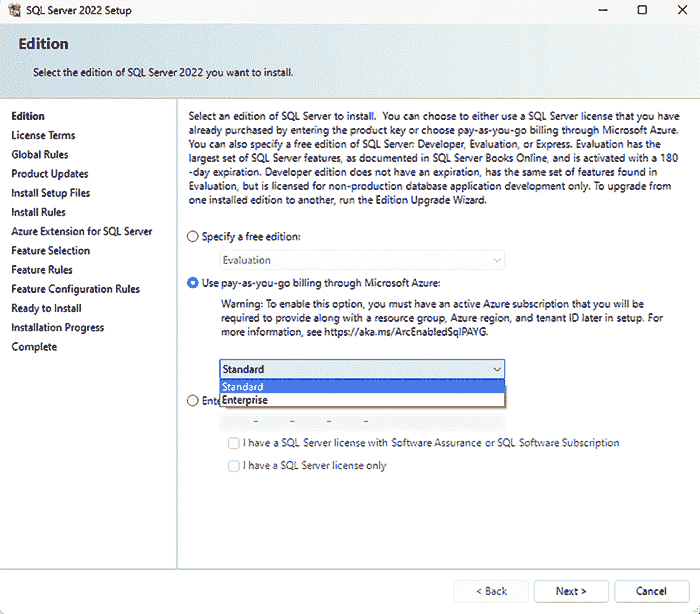

**图 2.2:** SQL Server 2022 安装中的新 PAYG 选项


当您选择此选项时，您可以选择在 `PAYG`（按需付费）模式下部署 SQL Server 企业版或标准版。这可以为您提供以下优势：

*   基于消耗的许可模式，这是云端部署的典型特征，但现在也可以用于本地部署。
*   它还帮助您提高许可的成本效率，因为它消除了本地部署中需要预付全额许可的限制，只需为实际消耗的部分付费。
*   为跨跨 Azure、非 Azure 云以及本地部署的完整 SQL Server 部署提供一致的计费。

SQL Server 的每小时费用基于 SQL Server 版本以及任何给定时间托管服务器的最大尺寸。定价表可以在 Microsoft 官方定价文档中查阅：SQL Server 2022—Pricing | Microsoft ( [`www.microsoft.com/en-us/sql-server/sql-server-2022-pricing#xb2d83f5b43b54756abeb7c2d6b7c5322`](https://www.microsoft.com/en-us/sql-server/sql-server-2022-pricing#xb2d83f5b43b54756abeb7c2d6b7c5322) )。快速参考的定价显示在 `表 2.2` 中。此处显示的定价为编写本书时的价格。请注意，定价可能会随时间而变化。

| 版本 | 每月率（美元） | 每小时率 |
| :--- | :--- | :--- |
| 标准版每核心 | $73 | $0.100 |
| 企业版每核心 | $274 | $0.375 |

在本地或任何地方对 SQL Server 使用按需付费（`PAYG`）许可的能力是通过启用 Azure Arc 的 SQL Server 代理实现的。SQL Server 2022 安装向导还提供了一个额外界面，允许安装 `Azure Extension for SQL Server`。此扩展允许您通过启用了 Azure Arc 的 SQL Server 将 SQL Server 实例连接到 Azure。如 `图 2.3` 所示的界面要求您提供 `Azure Login` 详细信息、`Subscription ID`、Azure 订阅的租户 ID，以及资源组名称和您希望将这些资源添加并显示在 Azure 门户 Azure Arc 格下的区域。如果您没有 Azure 订阅，则无法使用按需付费计费模式。

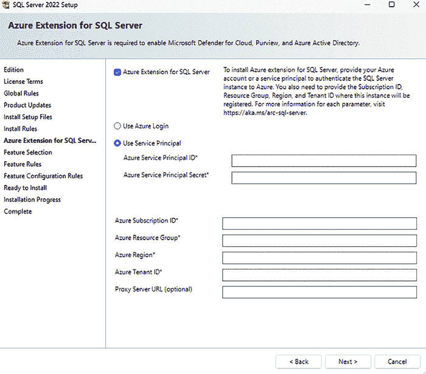

**图 2.3：** 使用 SQL Server 2022 设置安装 Azure 扩展

这很好地引出了 Azure Arc 以及它如何帮助您创建真正的混合环境。

# 启用 Azure Arc 的 SQL Server - 混合推进器 (#toc.xhtml_s28a)

今天，许多企业的 IT 基础设施已经多样化，拥有少量本地部署以及跨多个云环境的少量服务器，这些环境可能混合了一个或多个云提供商（如 Microsoft Azure）。现在，有了这种复杂的部署，公司对于以集中且统一的方式管理和治理其基础设施变得非常困难。这正是 Azure Arc 的用用场，它实现了一种集中且统一的方式：

*   管理跨非 Azure 和本地环境部署的所有资源，如服务器、Kubernetes 集群等，所有通过 Azure Resource Manager 在单一面板中进行管理。
为了让部署在非 Azure 或本地的虚拟机等资源通过 Azure Arc 进行管理和治理，您需要安装 Azure 连接机器代理（Azure-connected machine agent）。该代理运行在您的本地或非 Azure 机器上并连接到 Microsoft Azure。正如您可以想象的，该代理作为服务在您的上运行。它由多个逻辑组件组成，如 `图 2.4` 所示，这些组件可以在 Microsoft 官方文档页面上找到并查阅：Azure 连接机器代理概览 - Azure Arc | Microsoft Learn ( [`learn.microsoft.com/en-us/azure/azure-arc/servers/agent-overview`](https://learn.microsoft.com/en-us/azure/azure-arc/servers/agent-overview) )

*   混合实例元数据服务 (HIMDS)，负责管理到 Azure 的连接以及已连接机器的 Azure 身份。
*   客户配置代理（Guest configuration agent）有助于评估机器是否符合所需的策略以帮助执行合规性。

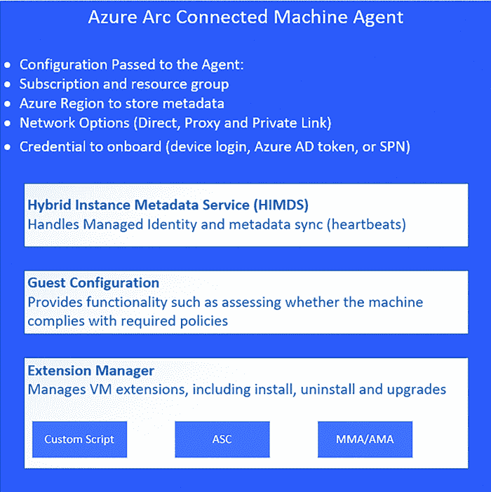

**图 2.4：** Azure 连接机器代理组件

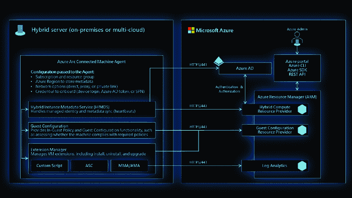

**图 2.5：** Azure 连接机器代理组件

让我们快速演示一下开始使用 Azure Arc 是多么简单。接下来的 `图 2.6` 是 Azure Arc 门户界面的快照。

**图 2.6：** 门户中的 Azure Arc 启动页

注意，不同的基础设施（如 Kubernetes、Azure Stack 等）都可以入载到 Azure。

# 启用 Azure Arc 的服务器 (#toc.xhtml_s29a)

今天，不同的基础设施（如 Kubernetes、Azure Stack 等）都可以入载到 Azure。启用 Azure Arc 的服务器展示了连接和管理是多么简单。

注意，不同的基础设施（如 Kubernetes、Azure Stack 等）都可以入载到 Azure。启用 Azure Arc 的服务器展示了连接和管理是多么简单。

## 启用 Azure Arc 的服务器展示了连接和管理是多么简单。

启用 Azure Arc 的服务器展示了连接和管理是多么简单。

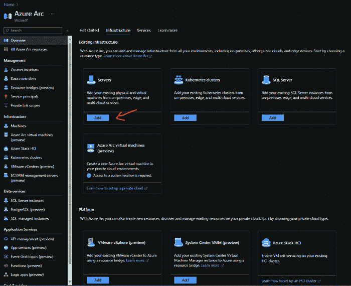

**图 2.7**

一旦提供了所需的详细信息，下载名为 `OnboardingScript.sh` 的脚本并在要使用 Azure Arc 连接和连接的服务器上运行它。让我们看看这个 bash 脚本包含什么；如果使用 Linux 作为操作系统，则它会提供 bash 脚本 (.sh)；如果是 Windows，则它会提供 PowerShell 脚本 (.ps1)。

```bash
## OnboardingScript
export subscriptionId="5b65fxxx-xxxx-xxxx-xxxxxxxx58"
export resourceGroup="azurearc_test"
export tenantId="9137xxxx-xxxx-xxxx-xxxxxxxx7c"
export location="centralindia"
export authType="token"

## 下载安装包
output=$(wget https://aka.ms/azcmagent -O ~/install_linux_azcm.sh 2>&1)
if [ $? -ne 0 ]; then
  wget -qO- --method=PUT --body-data="{\"subscriptionId\":\"$subscriptionId\",\"resourceGroup\":\"$resourceGroup\",\"tenantId\":\"$tenantId\",\"location\":\"$location\",\"correlationId\":\"$correlationId\",\"authType\":\"$authType\",\"operation\":\"onboarding\",\"messageType\":\"DownloadScriptFailed\",\"message\":\"$output\"}" "https://gbl.his.arc.azure.com/log" &> /dev/null || true;
fi

echo "$output"

## 安装混合代理
bash ~/install_linux_azcm.sh

## 执行连接命令
sudo azcmagent connect --resource-group "$resourceGroup" --tenant-id "$tenantId" --location "$location" --subscription-id "$subscriptionId" --cloud "$cloud" --automanage-profile "/providers/Microsoft.Automanage/bestPractices/AzureBestPracticesDevTest" --correlation-id "$correlationId"


在这里，出于安全考虑，`subscriptionId` 和 `tenantId` 都经过了模糊处理，但正如你在脚本所示，它根据我们使用的 Azure 账户设置了订阅 ID 和租户 ID 等详细信息，而我们希望使用 Microsoft Azure 管理本地或非 Azure 资源。

其他详细信息（如位置和资源组名称）将基于上一步提供的信息。机器将使用一次性令牌进行身份验证。机器将通过一次性令牌进行身份验证。

然后脚本将下载脚本 AzureConnectedMachinAgent (`azcmagent.sh`)，这有助于安装代理程序。一旦安装了代理程序，我们就运行 `azcmagent connect` 命令将当前服务器连接到 Azure Arc，我们需要提供订阅 ID、租户 ID、资源组等详细信息。

当我们在本地机器上运行此操作时，界面看起来如下所示。

```bash
amvin@linuxtestvm:~$ sudo azcmagent connect --resource-group “azurearc_test” --tenant-id “9137xxxx-xxxx-xxxx-xxx-xxxxxxxxxx7c “ --location “centralindia” --subscription-id “5b65fxxx-xxxx-xxxx-xxxx-xxxxxxxxxx58” --cloud “AzureCloud” --automanage-profile “/providers/Microsoft.Automanage/bestPractices/AzureBestPracticesDevTest” --correlation-id “2fabxxxx - xxxx - xxxx - xxxx - xxxxxxxxba38”

INFO Connecting machine to Azure… This might take a few minutes.
20% [==>              ]
30% [===>             ]
INFO Creating resource in Azure…             Correlation ID=2fabxxxx - xxxx - xxxx - xxxx - xxxxxxxxba38 Resource ID=/subscriptions/5b65fxxx-xxxx-xxxx-xxxx-xxxxxxxxxx58/resourceGroups/azurearc_test/providers/Microsoft.HybridCompute/machines/linuxtestvm
60% [========>      ]
80% [===========>  ]
..
…
…
INFO Connected machine to Azure
INFO Machine overview page: https://portal.azure.com/#@9137……..
```

完成后，你现在可以在 Azure 门户中通过 Azure Arc 节点看到本地虚拟机，如图 2.10 所示。

**图 2.10：** Azure Arc 门户，显示启用 Azure Arc 的服务器。

此外，你可以看到服务器的关键详细信息，如操作系统、型号和制造商详情，如图 2.11 所示。

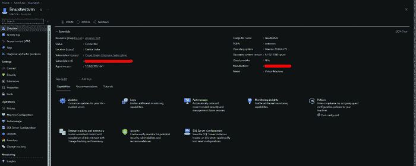

**图 2.11：** Azure Arc 门户，显示服务器详情。

Azure Arc 免费为你提供以下控制面功能，详细信息请参阅 Microsoft 官方文档：Azure Arc 概述 - Azure Arc | Microsoft Learn ([`learn.microsoft.com/en-us/azure/azure-arc/overview`](https://learn.microsoft.com/en-us/azure/azure-arc/overview))

*   通过 Azure 管理组和标签进行资源组织
*   通过 Azure Resource Graph 进行搜索和索引
*   通过 Azure 基于角色的访问控制 (RBAC) 实现访问和安全
*   通过模板和扩展实现环境和自动化
有关应如何规划和设置环境的详情，请参阅 Microsoft 官方文档：规划并部署启用 Azure Arc 的服务器 - Azure Arc | Microsoft Learn ([`learn.microsoft.com/en-us/azure/azure-arc/servers/plan-at-scale-deployment`](https://learn.microsoft.com/en-us/azure/azure-arc/servers/plan-at-scale-deployment))

# 支持 Azure Arc 的 SQL Server (#toc.xhtml_s30a)

现在，让我们了解启用 Azure Arc 的 SQL Server。如所示，启用 Azure Arc 的 SQL Server 将 Azure 服务扩展到托管在本地和/或非 Azure 云环境中的 SQL Server 实例，从而实现了集化的 SQL Server 管理。它还帮助启用其他一些功能，例如：

*   SQL Server 的按需付费模式
*   Microsoft Defender for Cloud
*   扩展安全更新
*   Microsoft Entra ID 身份验证（以前称为 Azure Active Directory (AAD) 身份验证）
*   最佳实践评估
*   自动备份和补丁

你可以在本地或非 Azure 云上拥有 SQL Server 2012，启用 Azure Arc 的 SQL Server 将 Azure 服务扩展到 SQL Server 实例，从而实现集化的 SQL Server 管理。它还帮助启用其他一些功能，例如：
*   Microsoft Defender for Cloud
*   扩展安全更新
*   Microsoft Entra ID 身份验证（以前称为 Azure Active Directory (AAD) 身份验证）
*   最佳实践评估
*   自动备份和补丁

你可以在本地或非 Azure 云上拥有 SQL Server 2012，启用 Azure Arc 的 SQL Server 将 Azure 服务扩展到 SQL Server 实例，从而实现集化的 SQL Server 管理。它还帮助启用其他一些功能，例如：

*   SQL Server 的按需付费模式
*   Microsoft Defender for Cloud
*   扩展安全更新
*   Microsoft Entra ID 身份验证（以前称为 Azure Active Directory (AAD) 身份验证）
*   最佳实践评估
*   自动备份和补丁

*   SQL Server 的按需付费模式
*   Microsoft Defender for Cloud
*   扩展安全更新
*   Microsoft Entra ID 身份验证（以前称为 Azure Active Directory (AAD) 身份验证）
*   最佳实践评估
*   自动备份和补丁

你可以在本地或非 Azure 云上拥有 SQL Server 2012，启用 Azure Arc 的 SQL Server 将 Azure 服务扩展到 SQL Server 实例，从而实现集化的 SQL Server 管理。它还帮助启用其他一些功能，例如：

*   SQL Server 的按需付费模式
*   Microsoft Defender for Cloud
*   扩展安全更新
*   Microsoft Entra ID 身份验证（以前称为 Azure Active Directory (AAD) 身份验证）

你可以在本地或非 Azure 云上拥有 SQL Server 2012，启用 Azure Arc 的 SQL Server 将 Azure 服务扩展到 SQL Server 实例，从而实现集化的 SQL Server 管理。它还帮助启用其他一些功能。


随后，按照你之前的操作提供详细信息，即你希望将此资源列在 Azure 中的资源组，以及操作系统详情，这样就可以提供特定的脚本，如图 2.17 所示。

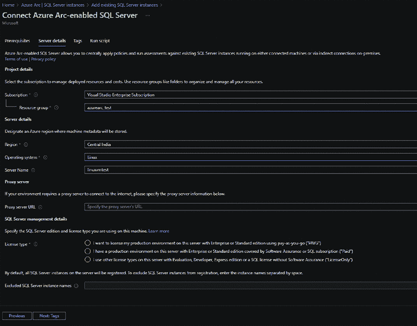 

**图 2.17：提供连接到 Azure Arc 的 SQL Server 详细信息

现在可以选择下载脚本。要获取完整代码，可以参考 GitHub 仓库：[`github.com/ava-orange-education/SQL-Server-Unveiled---Path-to-Data-Excellence/tree/main/Chapter%202`](https://github.com/ava-orange-education/SQL-Server-Unveiled---Path-to-Data-Excellence/tree/main/Chapter%202)。以下是该脚本的功能摘要：

1. 安装 `Az CLI` 客户端。
4. 最后，安装 SQL Server 的 Azure 扩展。

一旦你在主机上运行脚本并完成，你就可以在 Azure Arc 中看到你的 SQL Server，并且你的 SQL Server 变成了启用了 Azure Arc 的 SQL Server。

```
amvin@linuxvmtest:~$ sudo bash ./RegisterSqlServerArc.sh
Do you wish to install the Azure CLI? (y/N) yes
Installing Azure CLI
..
..
Installing Azure extension for SQL Server. This may take 5+ minutes.
Command group ‘config’ is experimental and under development. Reference and support levels: https://aka.ms/CLI_refstatus
WARNING: The command requires the extension connectedmachine. It will be installed first.
WARNING: The installed extension ‘connectedmachine’ is in preview.
```

图 2.18 显示了启用了 Azure Arc 的 SQL Server 实例。

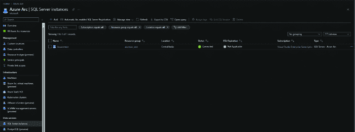 

**图 2.18：门户网站显示启用了 Azure Arc 的 SQL Server 实例

此外，图 2.19 显示了启用 Azure Arc 的 SQL Server 实例的可见详情。

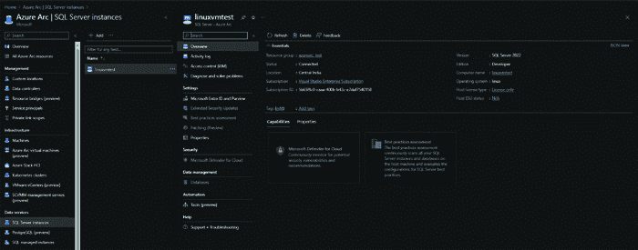 

**图 2.19：Linux 实例上启用了 Azure Arc 的 SQL Server 详情。**

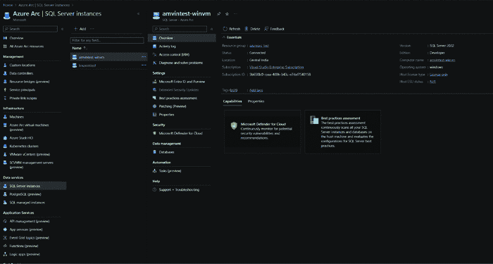 

**图 2.20：Linux 实例上启用了 Azure Arc 的 SQL Server 详情。**

如果你选择更改 Linux 上 SQL Server 的许可证类型，可以通过点击许可证类型选项并选择 `Pay-as-you-go` 选项来实现，如图 2.21 所示。

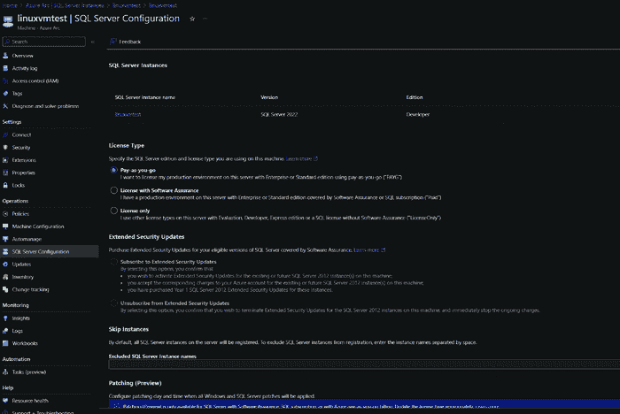 

**图 2.21：启用了 Azure Arc 的 SQL Server 可用的许可证类型**

一旦你在更改许可证类型并设置为 `Pay-as-you-go` 的上一个页面上点击保存按钮，此设置就会出现在门户网站中，如此处图 2.22 所示。

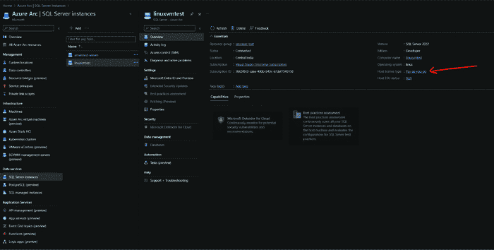 

# Azure Arc 启用数据服务](#toc.xhtml_s31a)

Azure Arc 允许你将本地和非 Azure 云资源连接到 Azure。这让你能够获得 Azure 的某些优势，例如安全性、可扩展性和可管理性。

但如果你想在非 Azure 资源上运行 Azure 特有的数据服务呢？例如，如果你想运行 Azure SQL 托管（这是一种完全托管、更新的平台即服务，提供了最广泛的 SQL Server 兼容性）怎么办？

Azure Arc 启用数据服务这一切成为可能。这些服务由 Microsoft 管理，但部署在你选择的 Azure 之外的环境中。这让你能够灵活地在需要的地方运行 Azure 数据服务，而无需自行管理它们。

截至本文编写时，可用以下两种 Azure 数据服务：

*   Azure SQL 托管实例
*   Azure Arc 启用 PostgreSQL（预览版）

本书专注于 SQL Server；因此我们将查看 Azure Arc 启用的 SQL 托管实例。我们首先讨论如何将 Azure SQL 托管实例从 Azure 之外带到你选择的部署环境中。然后，我们将查看如何开始使用 Azure Arc 启用 SQL 托管实例。

但如果你想在非 Azure 资源上运行 Azure 特有的数据服务呢？例如，如果你想运行 Azure SQL 托管（这是一种完全托管、更新的平台即服务，提供了最广泛的 SQL Server 兼容性）怎么办？

Azure Arc 启用数据服务这一切成为可能。这些服务由 Microsoft 管理，但部署在你选择的 Azure 之外的环境中。这让你能够灵活地在需要的地方运行 Azure 数据服务，而无需自行管理它们。

截至本文编写时，可用以下两种 Azure 数据服务：

*   Azure SQL 托管实例
*   Azure Arc 启用 PostgreSQL（预览版）

本书专注于 SQL Server；因此我们将查看 Azure Arc 启用的 SQL 托管实例。我们首先讨论如何将 Azure SQL 托管实例从 Azure 之外带到你选择的部署环境中。然后，我们将查看如何开始使用 Azure Arc 启用 SQL 托管实例。

图 2.23 是来自 Microsoft 官方文档的架构图，Azure Arc 启用数据服务的快速架构指南 (microsoft.com) ( [`azure.microsoft.com/en-in/resources/how-to-guide-on-data-services-anywhere/`](https://azure.microsoft.com/en-in/resources/how-to-guide-on-data-services-anywhere/) ) 可以帮助解释这在 Azure 之外如何工作。

**图 2.23：Azure Arc 启用数据服务架构**


此命令使用 Windows 包管理器 (`winget`) 安装 Azure CLI。安装完成后，我们可以运行以下命令来验证安装：

```bash
az --version
```

此命令将显示已安装的 Azure CLI 版本；图 2.24 在此处显示了一个示例。

**图 2.24:** `az --version` 示例输出

1. 现在，让我们来安装 `kubectl`，它是连接和操作 Kubernetes 所需客户端。我们可以使用以下命令在同一个 Windows 客户端上安装 `kubectl`：
```bash
winget install -e --id Kubernetes.kubectl
```

2. 现在是时候创建 Kubernetes 集群了，你可以使用 `az cli` 创建 Kubernetes 集群。以下是创建托管型 Azure Kubernetes 集群的步骤：

    1. 登录 Azure（如果尚未登录）：
    ```bash
    az login
    ```

    az aks create --resource-group azurearc_test --name testk8samvin --node-count 2 --generate-ssh-keys --node-vm-size Standard_D4ads_v5
    ```
    你需要根据需求提供资源组、集群名称、节点数量和 `node-vm-size`。

    3. Kubernetes 集群创建完成后，使用以下命令连接到集群：
    ```bash
    az aks get-credentials --resource-group azurearc_test --name testk8samvin
    ```
    连接后，你可以运行通用 `kubectl` 命令（如 `kubectl get nodes` 和 `kubectl get all`）来验证连接情况。图 2.25 显示了相应的示例。

    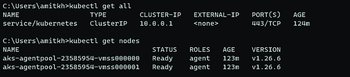

    **图 2.25:** 显示 kub 集群资源和节点的 `kubectl` 命令

```text
Microsoft.Kubernetes
Microsoft.kubernetesConfiguration
```

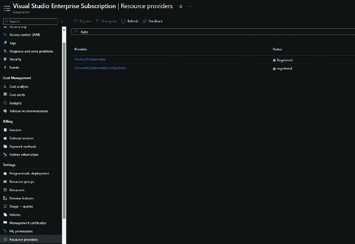

**图 2.26:** 为 Azure 订阅注册的资源提供程序列表

4. 现在是将之前创建的 Azure Kubernetes 服务集群连接到 Azure Arc 的；要完成此任务，请运行下面的命令：
```bash
az connectedk8s connect --resource-group azurearc_test --name testk8samvin
```
一旦成功，你会注意到创建了一个同名为 `Kubernetes cluster` 的影子对象（shadow object），这是 Azure Arc 启用集群的表示，如图 2.27 所示。

    **图 2.27:** 门户中 Kubernetes 集群的影子对象

    如你所见，门户中创建了一个代表 Azure Kubernetes 服务集群 `testk8s` 的对象，然后是同名为 `testk8s` 的对象，但其资源类型为 Kubernetes-Azure Arc。你还可以在 Azure Arc 选项卡上看到作为 Kubernetes 集群列出的 `testk8s`，如图 2.28 所示。

    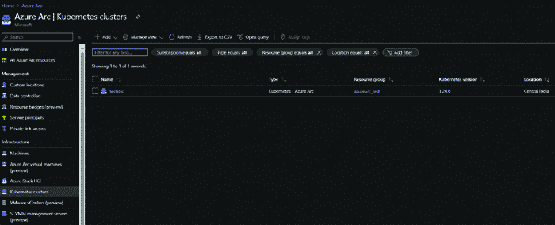

    **图 2.28:** 门户中显示 testk8s 集群的 Azure Arc 界面

当 Kubernetes 集群成功连接到 Azure Arc 后，当你运行 `kubectl` 命令列出命名空间时，你会发现 Kubernetes 集群中创建了两个新的命名空间 `azure-arc` 和 `azure-arc-release`，它们在集群上运行并帮助连接 Kubernetes 集群到 Azure。如果没有创建这些命名空间，说明 Kubernetes 集群连接到 Azure 时出现了问题，如果缺少这些命名空间，你可能需要返回重做步骤。

```bash
C:\Users\amitkh>kubectl get namespaces

azure-arc-release  Active   126m
calico-system      Active   144m
default            Active   145m
kube-node-lease    Active   145m
kube-public        Active   145m
kube-system        Active   145m
```

5. 我们已经完成了将集群连接到 Azure 的任务；下一步是创建 Kubernetes 集群。图 2.29。

    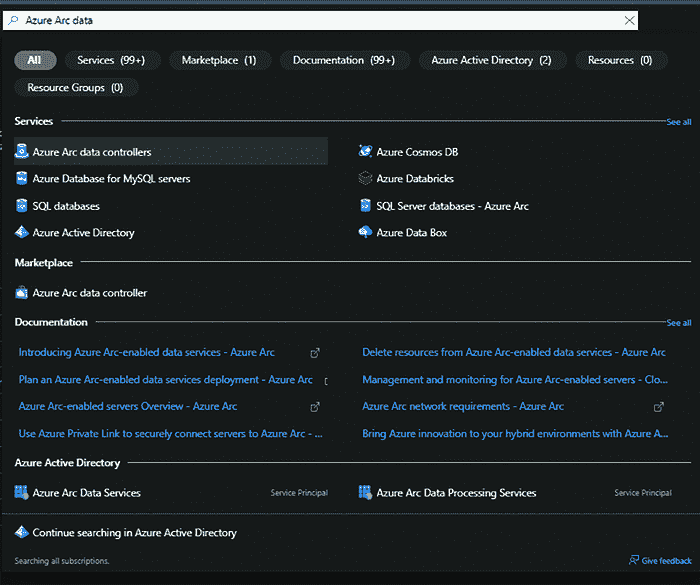

    **图 2.29:** `kubectl get namespaces`

    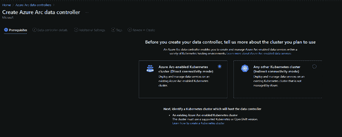

    **图 2.30:** `kubectl get namespaces`

    你只有一个 `dcsqlmi`。图 2.31。

    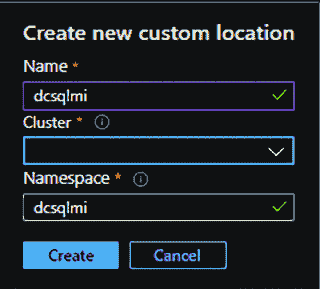

    **图 2.31:** `kubectl get namespaces`

    在 Kubernetes 集群中，你需要选择。图 2.32。

    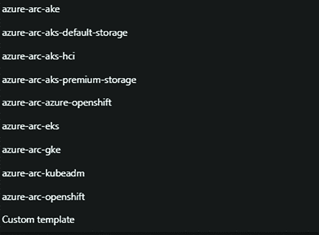

    然后我们将提供。图 2.33。

    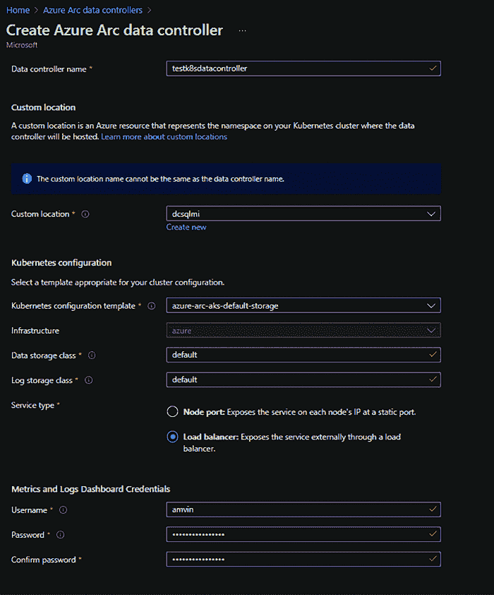

    **图 2.33:** `kubectl get namespaces`

    一旦数据控制程序在门户中部署成功，你可以验证新命名空间的名称是否为 `dcsqlmi`。你应该在 Kubernetes 集群上看到它的创建，并可以使用相同的 `kubectl` 命令列出该命名空间：

```bash
C:\Users\amitkh>kubectl get namespaces

NAME               STATUS   AGE
azure-arc         Active   5m55s
azure-arc-release  Active   8m48s
default            Active   15m
kube-node-lease    Active   15m
kube-public        Active   15m
kube-system        Active   15m
tigera-operator    Active   15m
```


一旦你确认了命名空间已创建，就必须检查数据控制器（data controller）的状态。在继续之前，你需要确保状态显示为已就绪，以验证数据控制器的状态。运行下面的 `kubectl` 命令，最初，数据控制器的状态将是 `DeployingController`，如图图 2.34

**图 2.34:** 数据控制器状态仍显示为部署中

```
kubectl describe datacontroller -n dcsqlmi
..
..
Status:
Azure:
Upload Status:
Logs:
Last Upload Time:  0001-01-01T00:00:00Z
Message:
Metrics:
Last Upload Time:  0001-01-01T00:00:00Z
Message:
Message:
Last Update Time:         2023-09-12T14:56:05.134372Z
Observed Generation:     1
Running Version:         v1.22.0_2023-08-08
State:                Ready
Events:
Type    Reason            Age    From            Message
----    ------            ----     ----            -------
Normal  Initializing       5m44s  datacontroller  Initiating Data Controller
Normal  DeployingController  5m44s  datacontroller  Initiating control plane deployment
Normal  Creating           4m     datacontroller  Preparing for DataController dcsqlmi/testk8sdatacontroller.
Normal  Ready               4s     datacontroller  DataController dcsqlmi/testk8sdatacontroller is ready
```

**图 2.35:** 数据控制器状态现在处于就绪状态

6. 一旦数据控制器部署完毕并在 Kubernetes 集群中创建的命名空间显示为就绪状态，你现在就可以安装你选择的 Azure 数据服务了。对于本次演示，我们将部署启用 Azure Arc 的 SQL 托管实例。执行此操作，请在 Azure 门户上搜索托管实例，然后选择 `SQL managed instances -Azure Arc` 选项，如图图 2.36

**图 2.36:** 通过门户创建 SQL 托管实例。

创建一个新的 SQL MI 实例并提供以下详细信息：

1. 请确保在创建和将 Kubernetes 集群加入 Azure 时，选择了与之前步骤相同的资源组。在这种情况下，请使用 `azurearc_test`。
2. 自定义位置（custom location）是你用于在 Kubernetes 集群创建数据控制器时使用的命名空间。在本次演示中，自定义位置的值为 `dcsqlmi`。
3. 你可以根据需求配置计算和存储。当你点击 `configure compute+storage` 选项时，你还可以按照如下所示选择 SQL Server 许可。计算和存储值取决于你选择的 Kubernetes 集群的大小。

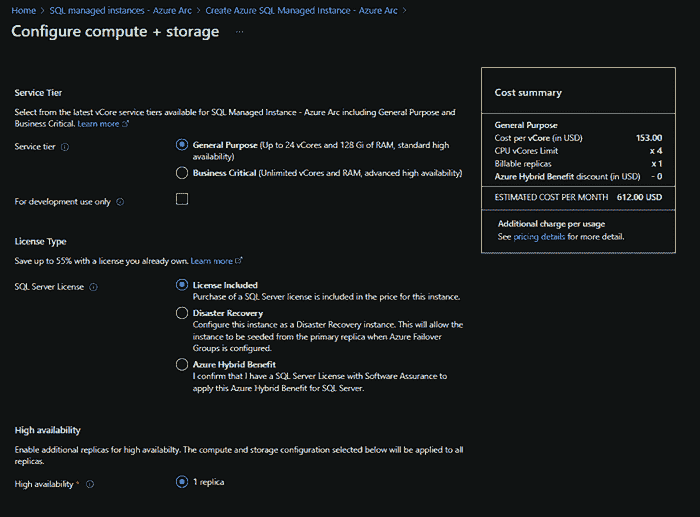

选择你打算分配给 Azure 托管实例的高可用性选项和资源限制，如图图 2.38

**图 2.38:** Azure 托管实例的高可用性和资源限制。

4. 最后，你需要将服务类型提供为负载均衡器，以便在 Kubernetes 集群外部连接到 SQL MI，并为将创建的 SQL 用户提供管理员详细信息，你可以通过该用户首次登录 SQL MI。详细信息请请参阅图 2.39。

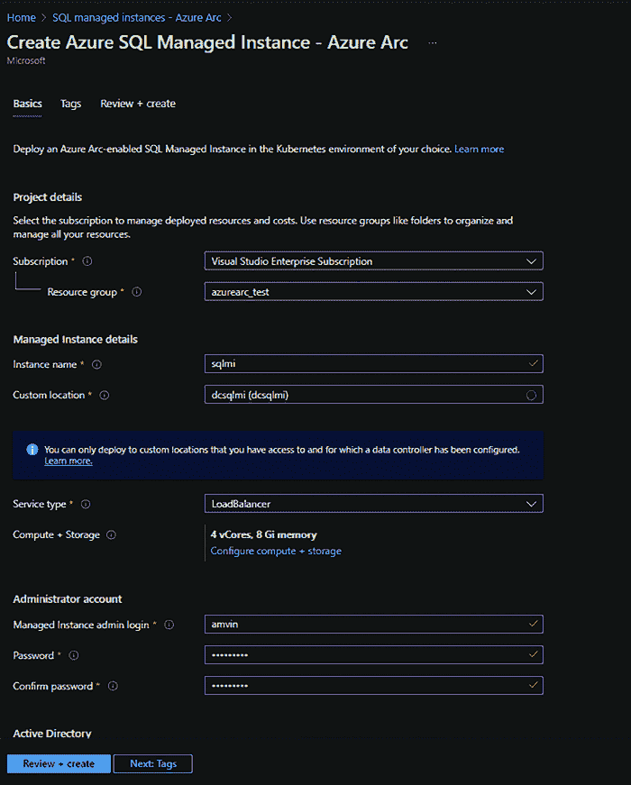

**图 2.39:** 设置负载均衡器以连接到 Azure SQL MI

准备好后，点击 `Review+create` 按钮，启用 Azure Arc 的托管实例部署将开始。一旦完成，你应该会在门户中看到一条消息，如图图 2.40 所示。

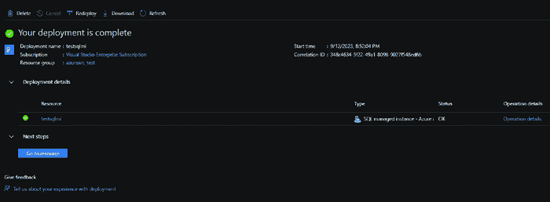

在连接到 Kubernetes 集群上的 SQL 托管实例之前，你需要确保部署已就绪。你可以运行下面的 `kubectl` 命令来检查此处所示的 `dcsqlmi` 命名空间下 `sqlmi` 资源的状态。

```
kubectl describe sqlmi -n dcsqlmi
Name:    testsqlmi
Namespace:   dcsqlmi
Labels:      management.azure.com/resourceProvider=AzureArcData
..
..
Events:
Type    Reason            Age    From            Message
----    ------            ----     ----            -------
Normal  Creating       5m25s  datacontroller  Preparing for SqlManagedInstance dcsqlmi/testsqlmi.
Normal  Creating       5m20s  datacontroller  Creating StatefulSet testsqlmi in SqlManagedInstance testsqlmi
Normal  Ready           9s     datacontroller  StatefulSet testsqlmi-ha in SqlManagedInstance testsqlmi is ready
```

要获取 SQL MI 的连接详细信息和状态，请运行给定的命令，从下面的输出可以看到名为 `testsqlmi` 的 SQL MI 实例状态已就绪，这意味着我们现在可以使用 IP 地址 `4.157.65.71` 连接到实例。

```
C:\Users\amitkh>kubectl get sqlmi -n dcsqlmi
NAME        STATUS  REPLICAS  PRIMARY-ENDPOINT  DESIRED-VERSION  RUNNING-VERSION    AGE
testsqlmi    Ready   1         4.157.65.71,1433                v1.22.0_2023-08-08  6m1s
```

你可以使用选择的 SQL Server 工具（如 SQL Server Management Studio (SSMS) 或 Azure Data Studio (ADS)）连接到启用 Azure Arc 的托管实例，并像通常处理部署在本地的 SQL 实例一样对其操作。如图图 2.41 所示，我们正在使用 SSMS 工具以及在之前的步骤创建 Azure SQL MI 时创建的账户 amit：

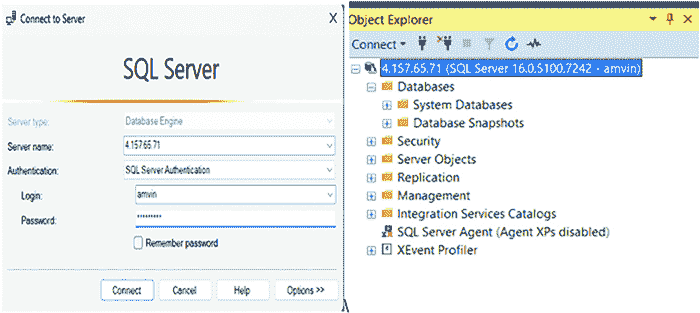

Azure Arc 章节到此结束。我们看到了如何使用不同类型的 Azure Arc（例如启用 Azure Arc 的服务器、启用 Azure Arc 的 Kubernetes 集群、启用 Azure Arc 的 SQL Server 以及启用 Azure Arc 的数据服务）来创建一个真正的混合环境。在混合环境中，你选择并管理部署的位置和硬件，但你可以通过 Azure 中的单一视图对它们进行管理。你还可以在 Azure 之外根据你选择的部署运行选择的 Azure 数据服务。

## 结论

我们查看了整个 SQL 生态系统以及各种部署选项。我们理解了结构化和非结构化数据等关键概念，以及 OLTP 与 OLAP 与 HTAP 等负载。然后我们查看了 SQL 本地部署选项。最后我们查看了 Azure Arc 选项，这些选项帮助你实现跨本地和云基础设施的真正混合部署。


在下一章中，我们将介绍 SQL 生态系统的其他部署选项，包括 Linux 上的 SQL Server、容器以及 Azure SQL。

## 更多资源
*   [SQL Server 2022：硬件和软件要求 - SQL Server | Microsoft Learn ([`learn.microsoft.com/en-us/sql/sql-server/install/hardware-and-software-requirements-for-installing-sql-server-2022?view=sql-server-ver16)`](https://learn.microsoft.com/en-us/sql/sql-server/install/hardware-and-software-requirements-for-installing-sql-server-2022?view=sql-server-ver16) )
*   [使用 SysPrep 安装 SQL Server 的考虑因素 - SQL Server | Microsoft Learn ([`learn.microsoft.com/en-us/sql/database-engine/install-windows/considerations-for-installing-sql-server-using-sysprep?view=sql-server-ver16)`](https://learn.microsoft.com/en-us/sql/database-engine/install-windows/considerations-for-installing-sql-server-using-sysprep?view=sql-server-ver16) )
*   [SQL Server 2022—定价 | Microsoft ([`www.microsoft.com/en-us/sql-server/sql-server-2022-pricing#xb2d83f5b43b54756abeb7c2d6b7c5322)`](https://www.microsoft.com/en-us/sql-server/sql-server-2022-pricing#xb2d83f5b43b54756abeb7c2d6b7c5322) )
*   [Azure 连接机器代理的概述 - Azure Arc | Microsoft Learn ([`learn.microsoft.com/en-us/azure/azure-arc/servers/agent-overview)`](https://learn.microsoft.com/en-us/azure/azure-arc/servers/agent-overview) )
*   [Azure Arc 概述 - Azure Arc | Microsoft Learn ([`learn.microsoft.com/en-us/azure/azure-arc/overview)`](https://learn.microsoft.com/en-us/azure/azure-arc/overview) )
*   [计划和部署 Azure Arc 启用服务器 - Azure Arc | Microsoft Learn ([`learn.microsoft.com/en-us/azure/azure-arc/servers/plan-at-scale-deployment)`](https://learn.microsoft.com/en-us/azure/azure-arc/servers/plan-at-scale-deployment) )
*   [Azure Arc 启用 SQL Server - SQL Server | Microsoft Learn ([`learn.microsoft.com/en-us/sql/sql-server/azure-arc/overview?view=sql-server-ver16)`](https://learn.microsoft.com/en-us/sql/sql-server/azure-arc/overview?view=sql-server-ver16) )
*   [Azure Arc 启用数据的快速架构指南 (microsoft.com) ([`azure.microsoft.com/en-in/resources/how-to-guide-on-azure-data-services-anywhere/)`](https://azure.microsoft.com/en-in/resources/how-to-guide-on-azure-data-services-anywhere/) )

## 第 3 章：SQL 领域 - 部门部分

## 引言

在本章中，我们将继续讨论 SQL 的不同领域，并将注意力转向 Linux 上的 SQL Server。我们将查看其架构，并尝试回答几个长久存在的问题：
*   我们是否可以使用与处理 Windows 版 SQL Server 相同的工具来处理 Linux 上的 SQL Server？

## 结构

在本章中，我们将涵盖以下主题：

*   Linux 上的 SQL Server 架构
*   开始使用 Linux 上的 SQL Server
*   开始使用 SQL Server 容器并在 Kubernetes 集群上部署
*   理解 Azure SQL 家族，从 SQL Server Azure 虚拟机开始
*   Azure SQL 数据库
*   Azure SQL 实例
*   Azure SQL Edge 基础

在本节中，当我们谈到 Linux 上的 SQL Server 时，指的是在 Linux 服务器（包括虚拟机）上的 SQL Server 部署以及 SQL Server 容器。此外，需要提到，Linux 上的 SQL Server 或基于容器的部署完全支持生产工作负载。我们已经看到并在某些情况下帮助了许多银行、金融、能源、制造业、ISV 以及其他领域的企业在 Linux 上的 SQL Server 和容器上运行关键的生产工作负载。

SQL Server 对 Linux 的支持始于 2017 版的发布。随着 SQL Server 2022 的发布，支持扩展到了最新的发行版，例如 Red Hat Linux 和 Ubuntu 20.04。2023 年 8 月 11 日，我们宣布了适用于 Red Hat Linux 9 和 Ubuntu 22.04 的 SQL Server 2022 预览版。该预览版允许您在启用 SELinux 时选择将 SQL Server 作为受限应用程序运行。您也可以通过跳过 `mssql-server-selinux` 包并仅安装 `mssql-server`（就像您在之前的 Red Hat Linux 版本执行的那样），继续将 SQL Server 作为不受限应用程序运行。

要了解更多关于 SELinux 的信息，可以参考：
[`access.redhat.com/documentation/en-us/red_hat_linux/9/html/using_selinux/getting-started`](https://access.redhat.com/documentation/en-us/red_hat_linux/9/html/using_selinux/getting-started)

### Linux 上的 SQL Server - 架构

如果你好奇 SQL Server 是如何实现在 Linux 上运行的（在仅支持 Windows 操作系统的漫长历史之后），那么强烈建议您阅读完整的博客：[`cloudblogs.microsoft.com/sqlserver/2016/12/16/sql-server-on-linux-how-introduction/`](https://cloudblogs.microsoft.com/sqlserver/2016/12/16/sql-server-on-linux-how-introduction/)，该博客发布于 2016 年 12 月 16 日，当时 SQL Server 2017 正处于预览阶段。

以下是该博客的摘要，解释了 Linux 上的 SQL Server 工作原理。为了支持 Linux 上的 SQL Server，最重要的任务是抽象 SQL Server 对 Windows 的依赖。SQL Server 依赖于各种库及其函数。Windows 开发中常用的语义基本上分为三类，对于 SQL Server 也是如此：

*   Win32

那么，我们是如何将 SQL Server 从 Windows 中抽象出来的呢？开发了 SQL 平台抽象层 (`SQL PAL`)。SQL PAL 层是 SQL Server OS (`SOS`) 和用户态库操作系统的合并。

SQL OS (`SOS`) 引入于 SQL Server 2005，它提供了一套集中的底层管理和诊断功能，并通过非抢占式运行并让 SQL Server 自行管理资源，减少了调度执行时涉及的系统调用。你可以在此处阅读更多关于 SOS 的信息：[`learn.microsoft.com/en-us/archive/blogs/slavao/platform-layer-for-sql-server#sqlos-architecture`](https://learn.microsoft.com/en-us/archive/blogs/slavao/platform-layer-for-sql-server#sqlos-architecture)


用户态库操作系统（`LibOS`）是一个运行中的 Windows 库，它实现了 1500 多个 Windows ABI（应用程序二进制接口）的子集，这意味着只需要大约 45-50 个与内存管理、主机同步和 I/O（网络和磁盘）相关的 ABI 即可与主机进行交互。此外，它还提供了托管其他 Windows 组件的能力，如 `CLR`、`MXSML` 以及 SQL 套件依赖的其他 API。

因此，SQL Server OS（`SOS`）与 `LibOS` 的结合产生了 SQL PAL，图 3.1 所示所示架构引用自上述博客。

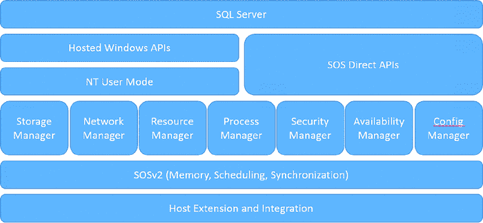

该架构的关键要点包括：

* 你拥有一组 `SOS` 直接 API，它们不通过 `NTUM`（NT 用户态 API 或 Win32）或像 `MSXML` 或 `MSDTC` 这样的托管的 Windows API。
* 对于无法由 `SOS` 直接 API 提供的代码，将通过托管的 Windows API 或 `NTUM` 进行路由。
* 但所有如存储、网络或资源管理的子系统都将基于 `SOS`，并在 `SOS` 直接代码与访问 `NTUM` API 的代码之间共享。
* 尽管这看起来有很多层级，但并没有真正的边界，因为大部分的资源管理都是在 SQL PAL 内部完成。

你可能会问 Linux 上的 SQL Server 进程是什么样子的（参考图 3.2），该图显示了运行时地址空间的样子，你可以从之前提到的博客文章了解更多关于此图表的信息。

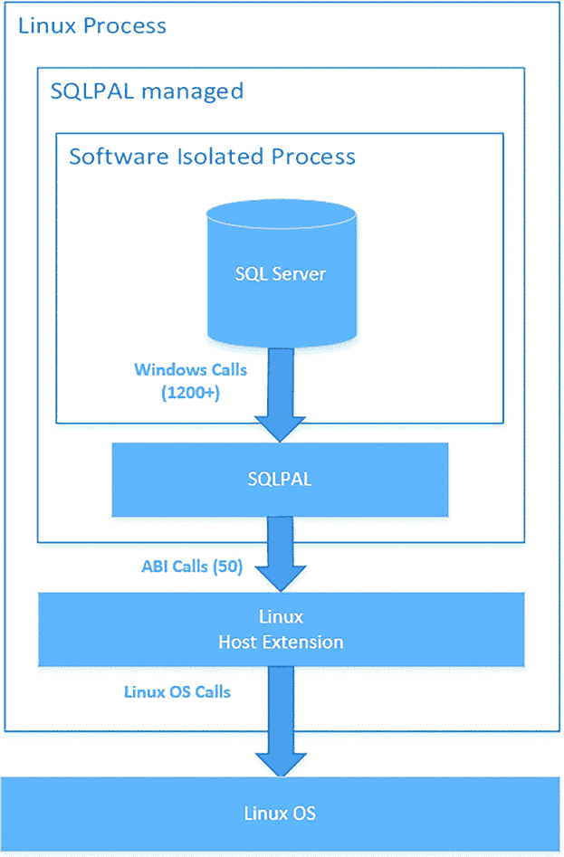

**图 3.2：** SQL Server Linux 进程

1. 进程一旦启动就会加载主机扩展，它是一个原生 Linux 应用程序。

现在我们已经了解了 Linux 上的 SQL Server 是如何工作的，让我们探索在何处以及如何获取基于 Linux 的 SQL Server 包。

# Linux 上 SQL Server 及用于生产工作负载的容器打包与可用性 (#toc.xhtml_s38a)

SQL Server Linux 软件包发布在 `packages.microsoft.com` 仓库 ([`packages.microsoft.com/`](https://packages.microsoft.com/))。这些包根据发行版进行安排。你可以在仓库相应的文件夹中找到 Red Hat Enterprise Linux (RHEL)、SUSE Linux Enterprise Server (SLES) 和 Ubuntu 的 SQL Server 软件包，如图 3.3 所示。

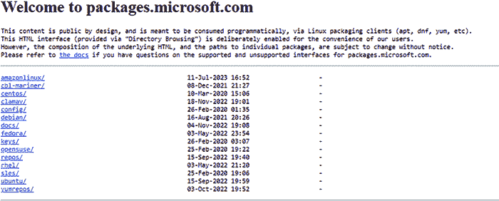

**图 3.3：** SQL Server 软件包仓库

SQL Server 容器镜像发布在微软容器注册表（Microsoft Container Registry），可在以下目录可用：

* **微软内部制品注册表**：[`mcr.microsoft.com/en-us/catalog?search=sql%20server`](https://mcr.microsoft.com/en-us/catalog?search=sql%20server) 包含基于 RHEL 和 Ubuntu 的 SQL Server 容器镜像，如图 3.4 所示。

**图 3.4：** 包含 SQL Server 容器镜像目录的微软制品注册表

* **在 Docker Hub 上**：[`hub.docker.com/_/microsoft-mssql-server`](https://hub.docker.com/_/microsoft-mssql-server)。这仅列出了基于 Ubuntu 的 SQL Server 容器镜像。
* **Red Hat 生态系统目录**：`mssql/rhel/server` - 认证容器镜像 - Red Hat 生态系统目录。基于 Red Hat UBI 镜像的 SQL Server 容器镜像。

你可以使用任何目录开始用于生产工作负载的 SQL Server 容器。所有这些目录都有相同的 SQL Server 镜像，每当为 SQL Server 发布累积更新（`CU`）时，这些镜像就会更新。Linux 上 SQL Server 的 `CU` 周期与 Windows 上 SQL Server 相同。这意味着每当 Windows 版 SQL Server 发布 `CU` 时，Linux 版 SQL Server 也会发布 `CU`。新的基于 `CU` 的 SQL 容器镜像会在微软容器注册表中发布，涵盖基于 Red Hat UBI 的镜像和基于 Ubuntu 的镜像。随后，所有之前的目录都会更新以反映新 `CU` 的标签。

# 在 Linux 和容器上开始使用 SQL Server (#toc.xhtml_s39a)

为了了解打包方式以及你如何在两种服务器（包括虚拟机和容器）上开始在 Linux 上使用 SQL Server，让我们一起完成一个实上手实验。如果你以前在 Windows 上安装过 SQL Server，你将非常赞赏 Linux 上 SQL Server 安装的简易性和缩短的时间。

对于这个上手实验，你只需要一个前提条件，即：


## SQL Server 安装

在 Red Hat Linux 上安装 SQL Server 和工具是一个简单的五个步骤过程，其中包含了 SQL Server 的配置。

### 第 1 步

下载所需的仓库配置文件，这些文件包含了安装 SQL Server 和工具的详细信息。命令如下：

```bash
sudo curl -o /etc/yum.repos.d/mssql-server.repo https://packages.microsoft.com/config/rhel/8/mssql-server-2022.repo
```

```bash
Sudo su
```

现在使用以下命令下载 SQL 工具的仓库：

```bash
curl https://packages.microsoft.com/config/rhel/8/prod.repo > /etc/yum.repos.d/mssql-release.repo
```

使用命令 `exit` 退出超级用户模式。

### 第 2 步

```bash
## 下面的命令安装 SQL Server 软件包。
## 对于特定软件包，你可以修改命令为 sudo yum install -y mssql-server-<versions_numbers>.x86_64
# ：
## 如果你打算安装 SQL Server 2022 CU 3 而不是最新的 SQL 2022 CU 7，请将你的安装命令更改为 sudo yum install mssql-server-16.0.4025.1-13.x86_64

sudo yum install -y mssql-server
sudo yum install -y mssql-tools18
```

### 第 3 步

一旦安装成功，你就可以使用 `mssql-conf` 工具配置 SQL Server。使用该工具，你可以选择 SQL Server 版本、设置 `sa` 登录密码，并接受 SQL Server 安装和使用所需的 EULA（最终用户许可协议）。
sudo /opt/mssql/bin/mssql-conf setup
```

### 第 4 步

打开所需的防火墙端口以允许连接到 SQL Server 端口。在我们的案例中，没有更改默认端口：

```bash
sudo firewall-cmd --zone=public --add-port=1433/tcp --permanent
sudo firewall-cmd –reload
```

### 第 5 步

```bash
systemctl status mssql-server
```

是在 Linux 虚拟机上运行此整个设置时的外观。参考图 3.7 (a) 和图 3.7 (b) 显示了 Linux 虚拟机上安装 SQL Server 的界面：

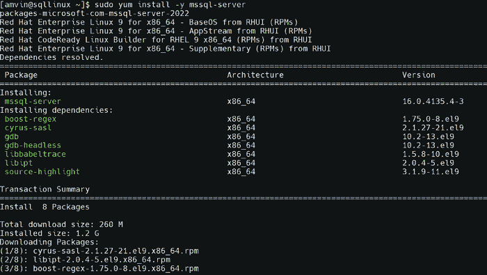

**图 3.7 (a)：** SQL Server 安装的部分截图

在图 3.7 (b) 中，你会注意到设置界面在完成二进制文件安装后，建议你运行 SQL Server 的配置。

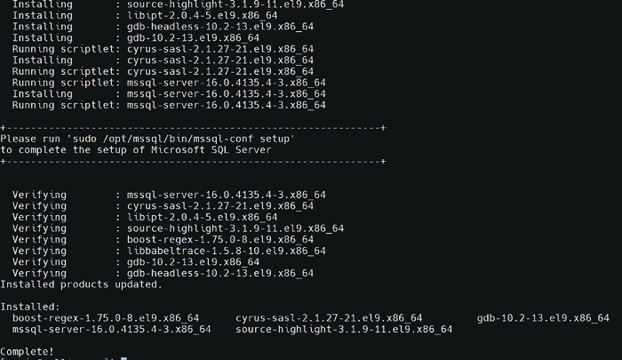

一旦 SQL Server 安装完成，建议继续配置。在此步骤中，你将选择所需的 SQL Server 版本，接受最终用户许可协议 (EULA)，并设置 SA 账户密码，该密码将在配置完成且服务启动后用于连接到 SQL Server。图 3.7 (c) 提供了这些过程概述。

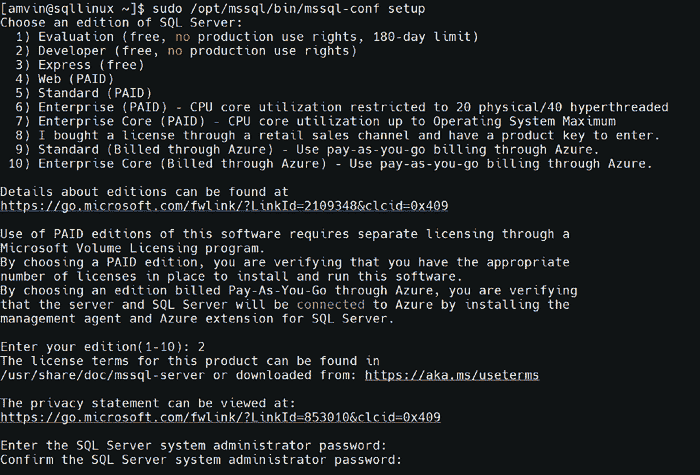

**图 3.7 (c)：** 使用 mssql-conf setup 配置 SQL Server 实例

可以使用 SQL Server Management Studio (SSMS) 或 Azure Data Studio (ADS) 连接到 Linux 实例上的 SQL Server，其工作方式与在 Windows 上操作 SQL Server 相同。图 3.7 (d) 显示了 SSMS 连接到 Linux 实例上 SQL Server 的插图。

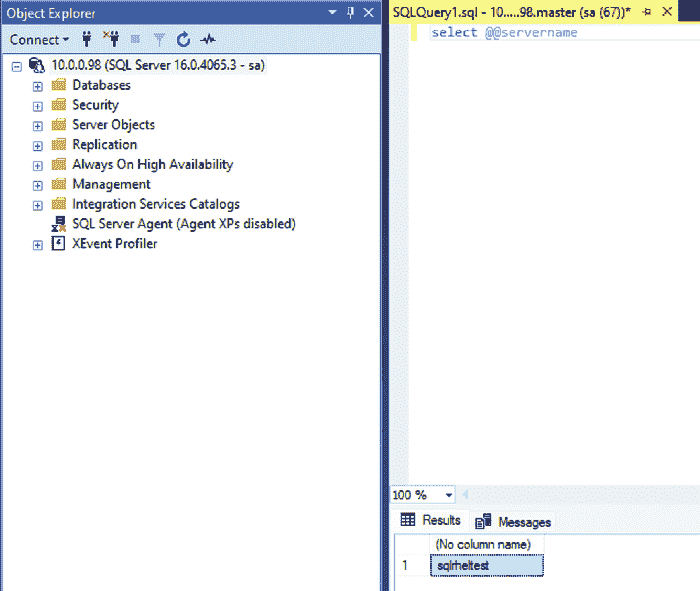

**图 3.7 (d)：** 使用 SSMS 连接到 Linux 实例上的 SQL Server

## 使用 Ansible 在多个目标上安装 SQL Server

```bash
sudo yum install ansible-collection-microsoft-sql
```

基于 Ansible 的安装工作方式是：你有一个中心控制节点，该节点为所有目标配置了无密码 ssh 访问，如图 3.8 所示。这些是你想要安装 SQL Server 的目标服务器。你需要安装 Ansible 核心。控制节点拥有上述目标服务器。

```bash
ansible-playbook -u root playbook.yaml
```


**图 3.8：** 基于 Ansible 的控制节点

## SQL Server 容器入门

正如本章之前讨论的，SQL Server 容器镜像基于两种不同的基础镜像，它们分别是：

*   基于 Ubuntu 镜像的 SQL Server 容器镜像
*   基于 RHEL 镜像的 SQL Server 容器镜像


也支持自定义 SQL Server 容器镜像。这里有一个 docker 文件的示例，位于：`mssql-docker/linux/preview/SLES at master · microsoft/mssql-docker (github.com)` ( [`github.com/microsoft/mssql-docker/tree/master/linux/preview/SLES`](https://github.com/microsoft/mssql-docker/tree/master/linux/preview/SLES) )，该文件可用于创建基于 SUSE Enterprise Linux 的 SQL Server 容器镜像。

## 注意：此镜像需要活跃的 SLES15 订阅才能构建。

## 假设
1. `使用与底层构建主机匹配的版本`
2. `确保已注册以访问所需的仓库`然后利用 `container-suseconnect-zypp`
例如 `zypper ref`
仓库 ‘SLE-Module-Containers12-Pool’ 已是最新。
仓库 ‘SLE-Module-Containers12-Updates’ 已是最新。
仓库 ‘SLES12-SP5-Pool’ 已是最新。
仓库 ‘SLES12-SP5-Updates’ 已是最新。
所有仓库已刷新。
3. `通过合并命令来减少层数`

```
FROM registry.suse.com/suse/sle15:15.3
ENV ADDITIONAL_MODULES=sle-module-legacy
## rpm 导入需要 curl
libcap-progs curl && \
rpm --import https://packages.microsoft.com/keys/microsoft.asc && \
zypper rm --no-confirm --clean-deps curl
## 考虑合并两个 RUN 以节省约 40mb，代价是缓存会增加签名密钥
## 添加 mssql-server 仓库
RUN zypper addrepo --no-check https://packages.microsoft.com/config/sles/15/mssql-server-2019.repo && \
zypper refresh packages-microsoft-com-mssql-server-2019 && \
## 安装 mssql-server
zypper install --no-confirm --auto-agree-with-licenses --no-recommends mssql-server && \
## 添加 mssql-tools 仓库
zypper addrepo --check https://packages.microsoft.com/config/sles/15/prod.repo && \
zypper refresh packages-microsoft-com-prod && \
## 安装 mssql-tools（考虑移除以减小体积）Microsoft 已维护了独立的 mssql-tools 镜像
## SQL Server 安装后，会创建 mssql 用户/组
#因此为 mssql 文件夹设置正确的权限
mkdir -p -m 770 /var/opt/mssql && \
chown -R mssql /var/opt/mssql && \
## 授予 sql 非 root 用户连接 <1024 端口的权限
setcap ‘cap_net_bind_service+ep’ /opt/mssql/bin/sqlservr && \
## 允许非 root 进程转储
setcap ‘cap_sys_ptrace+ep’ /opt/mssql/bin/paldumper && \
setcap ‘cap_sys_ptrace+ep’ /usr/bin/gdb && \
## ldconfig 文件，因为 setcap 会导致操作系统移除 LD_LIBRARY_PATH
## 以及其他控制动态链接的环境变量
mkdir -p /etc/ld.so.conf.d && \
touch /etc/ld.so.conf.d/mssql.conf && \
echo -e “# mssql libs\n/opt/mssql/lib” >> /etc/ld.so.conf.d/mssql.conf && \
USER mssql
CMD [“/opt/mssql/bin/sqlservr”]
```

同样，你还可以添加其他 SQL Server 组件，如 Agent、全文搜索、Polybase 等，并创建自定义的 SQL Server 镜像。欲更多示例，可以参考 GitHub 上的官方 Microsoft mssql-docker 仓库：`mssql-docker/linux/preview/examples at master · microsoft/mssql-docker (github.com)` ( [`github.com/microsoft/mssql-docker/tree/master/linux/preview/examples`](https://github.com/microsoft/mssql-docker/tree/master/linux/preview/examples) )。

开始使用容器镜像非常，只需在独立主机上安装 `docker` 引擎 1.8+ 或任何其他运行时，然后从 Microsoft 容器仓库拉取容器镜像，最后使用该镜像运行容器。这里有一个快速示例可以帮助你理解。

```
docker pull mcr.microsoft.com/mssql-server:latest
```

```bash
docker run -e "ACCEPT_EULA=Y" -e "MSSQL_SA_PASSWORD=YourStrongPassword123" -p 1433:1433 --name sqlserver mcr.microsoft.com/mssql-server:latest


```yaml
metadata:
  labels:
    app: mssql
spec:
  securityContext:
    fsGroup: 10001
  containers:
    - name: mssql
      image: mcr.microsoft.com/mssql/server:2022-latest
      ports:
        - containerPort: 1433
        - name: ACCEPT_EULA
          value: "Y"
        - name: MSSQL_ENABLE_HADR
          value: "1"
        - name: MSSQL_AGENT_ENABLED
          value: "1"
        - name: MSSQL_SA_PASSWORD
          valueFrom:
            secretKeyRef:
              name: mssql
              key: MSSQL_SA_PASSWORD
      volumeMounts:
        - name: mssql
          mountPath: "/var/opt/mssql"
        name: mssql
      spec:
        accessModes:
          - ReadWriteOnce
        resources:
          requests:
            storage: 8Gi
```
---
```yaml
apiVersion: v1
kind: Service
metadata:
  name: mssql-0
  selector:
    statefulset.kubernetes.io/pod-name: mssql-0
  ports:
    - protocol: TCP
      port: 1433
      targetPort: 1433
      name: tcpsql
```

一旦你保存了 `sqldeploy.yaml` 文件，你就可以使用以下命令运行脚本：

```bash
kubectl apply -f "D:\PM Stuff\k8s setup\Statefulset-deployment\ sqldeploy.yaml"
```

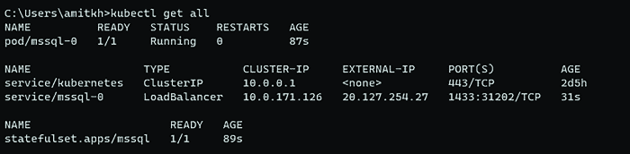

**图 3.10：** 在 Kubernetes 上查看 SQL Server 容器部署

你可以使用 SSMS 工具进行连接并查询 SQL Server 实例，如图 3.11 所示。

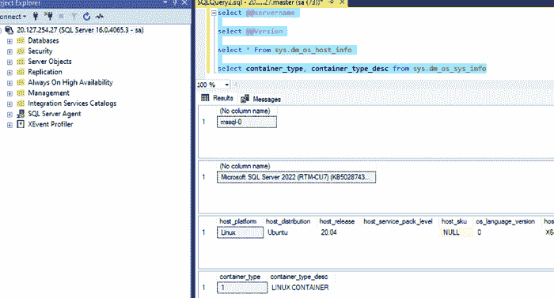

**图 3.11：** 通过 SSMS 连接到 SQL Server 容器

## Azure SQL

在本章的上一节中，我们查看了在缩小范围并选择最适合你的 SQL 服务之前，你应该考虑的几个不同点。一旦你决定使用云端 SQL 服务，让我们来讨论 Azure SQL 家族提供的各种选项。


**图 3.12：** Azure SQL 家族

图 3.13 是来自微软官方文档的图表：什么是 Azure SQL？ - Azure SQL | Microsoft Learn ([`learn.microsoft.com/en-us/azure/azure-sql/azure-sql-iaas-vs-paas-what-is-overview?view=azuresql)`](https://learn.microsoft.com/en-us/azure/azure-sql/azure-sql-iaas-vs-paas-what-is-overview?view=azuresql))。该图非常有参考价值，因为它帮助解释了每种服务（包括本地部署）的成本与你对基础设施的可管理程度之间的关系。


**图 3.13：** 各 Azure SQL 服务的成本与管理对比

现在，让我们看看每个 Azure SQL 服务，并了解你如何开始使用它们，从 Azure 虚拟机上的 SQL Server 开始。

### Azure 虚拟机上的 SQL Server

Azure 虚拟机上的 SQL Server 赋予了你几乎完全的 SQL Server 管理自由，并消除了在数据中心或本地部署时，本可能需要管理和维护所需硬件的烦恼。

你可以选择在运行 Windows 或 Linux 发行版的 Azure 虚拟机上部署 SQL Server。正如你现在所知，对于 Linux，你可以选择红帽企业 Linux (RHEL)、SUSE 企业级 Linux (SLES) 或基于 Ubuntu 的发行版。SQL Server Azure 虚拟可用许可模式有三种：

- 按需付费模式（pay-as-you-go）意味着运行 Azure VM 的每秒成本包含了 SQL Server 和操作系统的许可费用。
- Azure 混合用益 (AHB)：这允许你使用自有的 SQL Server 许可。
- HA/DR 许可类型用于免费的恢复实例。

有关许可的更多选项，请参考官方文档：[`learn.microsoft.com/en-us/azure/azure-sql/azure-sql-iaas-vs-paas-what-is-overview?view=azuresql`](https://learn.microsoft.com/en-us/azure/azure-sql/azure-sql-iaas-vs-paas-what-is-overview?view=azuresql)


**图 3.14：** Windows 虚拟机上的 SQL Server 设置

注意：在创建基于 Linux 的 Azure 虚拟机时，没有此 SQL Server 设置项。

## SQL IaaS 扩展

自动补丁、自动备份、Azure 密钥库集成、Azure 更新管理器集成以及更改许可类型等功能，是通过安装在 Azure 虚拟机上的 SQL IaaS 代理来实现的。SQL IaaS 扩展也适用于基于 Linux 的 Azure 虚拟机，但仅支持 Ubuntu 发行版（非 Ubuntu pro）。

SQL Server IaaS 扩展与我们在书的早期部分提到的 Azure Arc 代理不同。Azure Arc 代理安装在 Azure 外部的资源上，而 SQL Server IaaS 代理安装在位于 Azure 内部的资源上。

此外，基于 Linux 的 Azure 虚拟机上的 SQL IaaS 代理支持轻量模式，该模式仅支持许可管理和版本管理功能。你也可以通过 Azure 门户使用 Azure 更新管理器管理基于 Linux 的 Azure 虚拟机上的 SQL Server。要为基于 Ubuntu 的 Azure 虚拟机启用 SQL IaaS 扩展，你需要运行以下命令：
## 将 SQL IaaS 扩展注册到你的订阅中
az provider register --namespace Microsoft.SqlVirtualMachine
```

```bash
## 在轻量模式下注册已安装的企业版或标准版虚拟机
```


```bash
az sql vm create --name <vm_name> --resource-group <resource_group_name> --location <vm_location> --license-type <license_type>
```


**图 3.15：** 基于 Linux 的 Azure VM 部署中 SQL Server 的 IaaS 扩展

如果你是通过门户从 Azure 市场映像映像创建基于 Windows 的 Azure SQL VM，那么在创建 VM 本身期间扩展程序会自动注册。如果你选择在 Azure 虚拟机上手动安装 SQL Server，则你必须手动向 SQL IaaS 代理扩展程序注册你的 SQL Server CM。此外，如果你为 Windows VM 上的 SQL Server 2016 或更高版本的 Azure SQL 运行了 CEIP 服务，则该 VM 将自动注册到 SQL IaaS 代理扩展程序。这一切仅适用于基于 Windows 的 Azure VM 上的 SQL Server。

图 3.16 显示了基于 Windows 的 Azure VM 上的一个 SQL 服务器已在门户中注册扩展。我们可以在 SQL 虚拟机资源下看到该 VM。注意，对于基于 Windows 的 Azure VM 上的 SQL Server，SQL IaaS 扩展提供了更多选项，如存储配置、备份、SQL 最佳实践评估等。


**图 3.16：** 基于 Windows 的 Azure VM 部署中 SQL Server 的 IaaS 扩展

手动注册 SQL IaaS 扩展代理的步骤与 Linux 相同。首先，使用以下命令在订阅未注册的情况下，先注册资源提供程序 `Microsoft.SqlVirtualMachine`：
## 将 SQL IaaS 代理扩展程序注册到你的订阅
Register-AzResourceProvider -ProviderNamespace Microsoft.SqlVirtualMachine
```

然后使用命令手动注册扩展程序：

```bash
## 获取现有的计算 VM
$vm = Get-AzVM -Name <vm_name> -ResourceGroupName <resource_group_name>
New-AzSqlVM -Name $vm.Name -ResourceGroupName $vm.ResourceGroupName -Location $vm.Location -LicenseType <license_type>
```

在接下来的章节中，我们将详细介绍部署 SQL Server VM 和设置业务连续性时应遵循的最佳实践。

Azure SQL Database 是微软提供的完全托管平台即服务（PaaS）数据库服务。它运行常青版本的 SQL Server，这意味着它运行最新稳定版本的 SQL Server 数据库引擎和经过补丁的操作系统，并提供 99.99% 的可用性。

如果你正在开发一种新的云端现代应用程序，需要关系数据和非关系数据结构支持（如 JSON、XML 和图形），那么你可以选择 Azure SQL DB。它拥有为你的应用程序提供数据层的引擎。

当你创建 Azure SQL DB 时，创建的不是 SQL Server 实例，而是你一个可以连接的数据库。Azure SQL DB 提供两种购买模型可用，它们是：

*   基于 vCore 的购买模型，允许你选择 vCore（虚拟核心）的数量、内存和存储（包括存储速度）。使用此模型，你可以启用 SQL Server 的 Azure 混合权益，像你使用 Azure SQL VM 那样使用现有的 SQL Server 许可。
    *   基于 vCore 的购买有三个层，它们分别是：
        *   通用（General Purpose）：面向预算的选项，提供平衡的计算和存储选项。
        *   业务关键（Business Critical）：为具有高事务率和低 I/O 延迟要求的 OLTP 设计。
        *   超大规模（Hyperscale）：该模型提供独立扩展的计算和存储资源。通常建议大多数旨在运行生产负载的业务负载。

*   另一个简单的许可选项是基于数据库事务单元 (DTU) 的购买模型，它提供了计算、内存和 I/O 资源的混合。这种许可模型也是基于分级的，只有两个层级：
        *   标准（Standard）：为大多数常见负载设计。面向预算的平衡计算和存储选项。
如果你选择基于 vCore 的购买模型，你还可以获得选择计算层的选项。有两种计算层可用，它们分别是：

*   预留计算层（Provisioned compute tier）：提供特定数量的资源，这些资源独立于负载活动连续配置，并按预留计算的固定价格付费。
*   无服务器计算层（Serverless compute tier）：根据负载活动自动扩展计算资源，并按秒使用的计算量计费。

这里有一个让你上手 Azure SQL DB 的演示。第一步是登录 Azure 门户并搜索 SQL DB，这会将带你进入创建 SQL 数据库的面板，如图 3.17 所示：


**图 3.17：从 Azure 门户创建 Azure SQL Database**

1.  如果是创建 Azure DB，必须首次创建一个逻辑服务器，点击服务器的 `create new` 选项。这将打开一个如图 3.18 所示的面板：

    

2.  现在在创建数据库面板中选择 DTU 与 vCore 之间的许可模型，在 `compute+storage` 选择下点击 `configure database` 选项。你会看到两个部分，基于 DTU 或 vCore 的，然后如图 3.19 所示的层级：

    

    **图 3.19：Azure SQL 许可选项**

    当你选择 vCore 选项时，可以配置 cores 的数量、数据库最大尺寸和计算层，如图 3.20 所示：

    

    **图 3.20：Azure SQL 数据库 vCore 选项计算层**

    当你选择 DTU 模型时，这些选项都不可用，如图 3.21 所示：

    **图 3.21：基于 DTU 模型的 Azure SQL 数据库选项**

3.  你可以继续按照门户中的说明创建 SQL DB，包括数据库排序规则、连接信息、账本配置、始终加密选项等更多内容，当 SQL DB 创建完成后，它将显示在 Azure 门户的 SQL 数据库面板下，如图 3.22 所示：

    

    **图 3.22：Azure 门户中显示的 Azure SQL Database**

    你可以使用 SSMS 和 ADS 等工具连接到 Azure SQL DB。图 3.23 是该内容的截图。在连接之前，你需要确保为逻辑服务器设置了公共访问，并将客户端 IP 添加到允许列表中：

    

    **图 3.23：使用 SSMS 连接到 Azure SQL DB**


Azure SQL DB 提供了一种平台即服务（PaaS）的数据库，但如果你希望获得作为服务的整个 SQL Server 实例，那么 Azure SQL Managed Instance（托管实例）是你应该选择的云产品。它是一个完全托管的平台，具有与 Azure SQL DB 相同的 99.99% 可用性。此外，它与最新的 SQL Server 企业版几乎 100% 兼容。如果你希望以低迁移成本从本地或 IaaS 迁移大量到完全托管的 PaaS 云环境，那么这就是你的理想平台，因为你可以简单地将数据库通过“平移”（lift and shift）到云。

Azure SQL Managed Instance 带有原生虚拟网络实现，以解决现有 SQL Server 客户常见的安全顾虑。它提供了原生的虚拟网络实现，并通过 Azure ExpressRoute 或 VPN 网关提供与本地环境的连接，为环境提供了所需的安全隔离。

Azure SQL Managed Instance 基于 vCore 的购买模型是唯一的可用购买模型。在 vCore 购买模型下，你可以选择各种硬件配置。这包括标准系列、高级系列以及高级内存优化系列，如图 3.24 所示。


**图 3.24：** Azure SQL MI 的不同服务层和计算硬件选项

你可以像下方的门户窗格所示创建 Azure SQL Managed Instance：


**图 3.25：** 在 Azure 门户中创建 Azure SQL Managed Instance 时提供的各种选项

它为你提供了设置排序规则、身份验证方法、加密选项等功能，与 Azure SQL DB 类似。一旦实例创建，如果你打算从本地环境连接到它，则需要将本地应用程序连接到 SQL 托管实例的 Vnet 本地节点。这需要在应用程序与 SQL 托管实例虚拟网络之间建立对点连接。

## Azure SQL Edge

Azure SQL Edge 是一种针对 IoT 和 IoT 边缘应用优化的关系型数据库引擎。它提供流、处理和分析关系型及非关系数据的能力（如 JSON、XML 和时间序列数据），因此使其成为各种现代 IoT 应用的正确选择。

它支持两种部署模式，包括：


对于 Azure SQL Edge，你只有两个版本可用，它们分别是：

*   **Azure SQL edge developer：** 仅限开发的 SKU，限制为 4 核和 32 GB 内存。
*   **Azure SQL edge：** 生产级 SKU，每个 SQL edge 容器限制为 8 核和 64 GB 内存。

在本书中，我们不会关注 Azure SQL edge，因为它侧重于用于非 IoT 场景的全功能 SQL Server 部署，特别是针对运行 OLTP、OLAP 和 HTAP 工作负载的生产级负载。

如果你想了解更多关于 Azure SQL Edge 以及如何开始，请参考 Microsoft 官方文档：[`learn.microsoft.com/en-us/azure/azure-sql-edge/`](https://learn.microsoft.com/en-us/azure/azure-sql-edge/)。

## 结论

在本章中，我们学习了如何在 Linux 上开始使用 SQL Server，并讨论了 Linux 上 SQL Server 的通用架构，其中包含了 Linux SQL Server 进程详情。

此后，我们将注意力集中在独立环境和 Kubernetes 环境中开始使用 SQL Server 容器上，在此处我们也查看了 SQL Server 容器演示的部署。

最后，我们讨论了 Azure SQL 家族，包括对 Azure 虚拟机上的 SQL Server、SQL IaaS 扩展及其优势、Azure SQL 数据库、Azure SQL 托管实例以及 Azure SQL edge 的讨论。对于这些主题的大多数，我们涵盖了部署和许可选项，希望这能帮助你选择最符合你要求的 SQL 产品。

在下一章中，我们将探索 SQL Server 安全的各个方面，涵盖身份验证与授权、加密、密钥管理、数据数据传输安全、威胁检测与响应等主题。

## 附加资源

*   开始使用 SELinux ([`access.redhat.com/documentation/en-us/red_hat_enterprise_linux/9/html/using_selinux/getting-started-with-selinux_using-selinux`](https://access.redhat.com/documentation/en-us/red_hat_enterprise_linux/9/html/using_selinux/getting-started-with-selinux_using-selinux))
*   Linux 版 SQL Server - 介绍 ([`cloudblogs.microsoft.com/sqlserver/2016/12/16/sql-server-on-linux-how-introduction`](https://cloudblogs.microsoft.com/sqlserver/2016/12/16/sql-server-on-linux-how-introduction))
*   SQL Server PAL - ([`learn.microsoft.com/en-us/archive/blogs/slavao/platform-layer-for-sql-server#sqlos-architecture`](https://learn.microsoft.com/en-us/archive/blogs/slavao/platform-layer-for-sql-server#sqlos-architecture))


# 第 4 章：SQL Server 与安全并肩作战

## 引言
在当今的数字格局中，数据安全至关重要。随着网络威胁日益复杂，组织实施稳健的安全措施以保护其敏感信息变得至关重要。SQL Server 作为领先的关系型数据库管理系统，提供了一系列功能和工具来增强安全性并保护宝贵的数据资产。在本章中，我们将深入探讨 SQL Server 安全的各个方面，涵盖身份验证与授权、加密、密钥管理、数据传输安全、威胁检测与响应、行级安全以及最佳实践。

通过掌握本章讨论的概念和技术，读者将全面理解如何加固其 SQL Server 环境以抵御潜在的安全漏洞。你将学习如何有效地对用户进行身份验证和授权、实施加密以保护静态和传输中的数据、安全地管理加密密钥、增强传输过程的数据保护、高效地检测并响应安全威胁、执行行级安全以控制对数据库中特定行的访问，并遵循最佳实践以确保最佳的安全态势。

## 结构
在本章中，我们将涵盖以下主题：
*   SQL Server 安全功能的演变与当前趋势
*   身份验证与授权
*   SQL Server 加密
*   SQL Server 中的密钥管理
*   SQL Server 和 Azure SQL 数据库的安全最佳实践

## SQL Server 安全功能的演变
多年，SQL Server 的安全性经历了显著的演变，以适应不断变化的数据威胁和漏洞格局。随着组织日益依赖数据库来存储和管理敏感信息，SQL Server 不断增强其安全库，为数据资产提供稳健的保护。这种从基础安全措施到复杂的多层防御的历程，反映了微软应对数据安全领域不断变化的挑战的承诺。

### 早期阶段：SQL Server 2000 到 2008
在早期，SQL Server 侧重于基础的安全措施，主要集中在身份验证和基本的访问控制。

*   SQL Server 2000 引入了`Windows 身份验证`与`SQL Server 身份验证`之间的区别，为用户身份验证提供了灵活性。然而，当时的重点在于保护数据库引擎本身，对全面的安全策略规定有限。
*   随着 SQL Server 2005 的发布，由于`SQL Server Management Studio`（`SSMS`）和增强安全模型的引入，发生了关键转变。基于角色的安全性变得更加稳健，允许管理员更细粒地定义和管理权限。这为更成熟的安全基础设施奠定了基础。

SQL Server 2008 继续延续这一轨迹，完善了加密能力并引入了审计功能。`透明数据加密`（`TDE`）问世，提供了一种加密整个数据库简单方法，增强了静态数据的安全性。

### 2010 年代的进步：SQL Server 2012 到 2022
*   SQL Server 2016 引入了`Always Encrypted`（始终加密），这是一项突破性功能，它允许敏感数据在处理过程中也保持加密状态，降低了与内部威胁相关的风险。此外还添加了`动态数据掩敏`，根据用户角色实时限制敏感数据的暴露。
*   2017 版本的发布带来了`Linux 版 SQL Server`的进步，将安全功能扩展到更广泛的平台。此外，它继续精炼现有功能，确保在不同环境中保持一致的安全态势。
*   在 SQL Server 2019 中，微软通过引入`安全飞区`（Secure Enclaves）拥抱了`机密计算`的原则。这项创新技术允许敏感数据在数据库内部的隔离安全区域中进行处理，防止即使特权访问威胁。
*   SQL Server 2022 引入了关键的安全增强，包括支持用于简化用户访问的`Azure Active Directory 身份验证`、支持`安全飞区`的`Always Encrypted`以实现安全且复杂的查询，以及使用 `PFX` 格式备份和恢复证书以简化证书管理。默认加密机制已得到改进以应对不断变化的威胁，而虚拟机监控安全和针对固件攻击的措施提供了额外的保护层。增强的`服务器消息块`（`SMB`）功能（支持基于 QUIC 的 `SMB` 和东西向加密）为更高效、安全的数据传输做了贡献。

总而言之，这些更新增强了 SQL Server 的安全态势，反映了微软致力于提供稳健安全的数据库平台以抵御当代威胁的承诺。

### 当前趋势：云集成及未来
当前时代 SQL Server 与云平台紧密集成，使组织能够利用高级安全服务。`Azure Active Directory`身份验证和云原生安全功能已成为 SQL Server 安全生态系统中不可或缺的一部分。此外，`威胁检测`和`高级威胁保护`的采用进一步证明了微软对主动安全措施的承诺。

结论，SQL Server 安全功能的演变反映了数字时代数据安全更广泛的演变。从基础措施到复杂的加密和云原生安全，SQL Server 断适应，为组织提供了应对不断变化的网络威胁格局的稳健防御。随着 SQL Server 生态系统的演进，其确保数据安全的承诺也将不断发展，使其成为数据保护之旅中的关键参与者。

## 身份与内容——身份验证与授权
进入数据库安全领域始于理解身份验证和授权的角色。身份验证机制验证寻求访问 SQL Server 环境的用户身份。一旦通过身份验证，授权过程将决定授予数据库系统内个人或实体的访问级别和权限。
**身份验证**是验证尝试访问 SQL Server 实例的用户或应用程序身份的过程。它确保只有授权的实体才能连接到数据库。SQL Server 支持多种身份验证方法，每种方法都有其特性。


`Windows Authentication` 依赖 Windows 操作系统进行用户身份验证。用户使用其 Windows 凭据（用户名和密码）登录。对于与 SQL Server 属于同一个 Windows 域的用户，它提供了无缝体验。使用 Windows 身份验证的主要优势是它提供了强大的安全性，利用了 Windows 的安全功能。它还支持单点登录 (SSO)，用户无需输入单独的凭据。使用 Windows 身份验证时有一些需要记住的重要考虑，包括需要 Windows 域环境，并且它不支持非 Windows 客户端。


**图 4.1:** Windows 身份验证

## SQL Server 身份验证（混合模式）


**图 4.2:** SQL 身份验证

## Microsoft Entra 身份验证

`Microsoft Entra ID`（以前也称为 Azure Active Directory）是 Azure 的云端身份和访问管理服务。Microsoft Entra ID 与 Active Directory 类似，它提供用于管理组织资源访问的集中存储库。身份是 Microsoft Entra ID 中的对象，代表用户、组或应用程序。可以通过基于角色的访问控制分配权限，并用于 Azure 资源的身份验证。Microsoft Entra 身份验证支持以下内容：

* Azure SQL Database
* Azure SQL Managed Instance
* Windows Azure VM 上的 SQL Server 2022
* Azure Synapse Analytics
* 带有支持的 Windows 或 Linux 操作系统系统的 SQL Server 2022

**图 4.3:** Microsoft Entra 身份验证

当您的 Windows Server Active Directory 与 Microsoft Entra ID 联合时，用户可以使用其 Windows 凭据对 SQL Server 进行身份验证。这种身份验证可以作为 Windows 登录或 Microsoft Entra 登录发生。然而，重要重要的是 `Microsoft Entra ID` 并不完全支持 Windows Server Active Directory 中提供的所有功能。例如，服务账户或复杂的网络森林架构等功能与 Microsoft Entra ID 不完全兼容。另一方面，Microsoft Entra ID 提供了额外功能，例如`多因素身份验证`，这些功能在传统的 Active Directory 中是不用的。

通过利用 Microsoft Entra 身份验证，您获得了 `集中管理` 数据库用户和其他 Microsoft 服务身份的能力。这种集中身份管理为处理数据库用户管理提供了方便的方法，并简化了跨服务的权限管理。益处包括：

* Microsoft Entra 为传统的 SQL Server 身份验证方法提供了替代方案。
* 它有助于防止用户身份在多个服务器上扩散。
* Microsoft Entra 允许集中密码轮换，增强安全性。
* 客户可以使用 Microsoft Entra 组管理数据库权限。
* 通过启用集成 Windows 身份验证和其他支持的方法，Microsoft Entra 消除了对存储密码的需求。
* Microsoft Entra 身份验证使用包含数据库用户在数据库级别进行身份验证。
* Microsoft Entra ID 支持连接到 SQL Database 和 SQL Managed Instance 的应用程序基于令牌的身份验证。
* SQL Server Management Studio 支持使用多因素身份验证通过 Microsoft Entra 连接，通过在登录期间需要多种形式的验证来增强安全性。用户有一系列方便的选择，例如电话、短信、带有 PIN 码智能卡或移动应用通知。这种分层方法显著增强了身份验证过程，保护了敏感帐户和数据。

* 只有 Microsoft Entra ID 的云端组件（包括 SQL Database、SQL Managed Instance、Windows Azure VM 上的 SQL 以及 Azure Synapse）被认为支持 Microsoft Entra 原生用户密码。
* 要启用 Windows 单点登录凭据（或用于 Windows 凭据的用户/密码），请利用来自用于透传和密码哈希认证的完美单点登录的联合或托管域的 Microsoft Entra 凭据。
* 需要与 ADFS 通信以支持联合身份验证（或用于 Windows 凭据的用户/密码）。


**图 4.4:** 使用 ADFS 基础设施的联合身份验证示例（或用于 Windows 凭据的用户/密码）

**注意 ¹ :** 对于 Azure SQL、Azure VM 和 SQL Server 2022，Microsoft Entra 身份验证仅支持源自 Microsoft Entra ID 的访问令牌，不支持第三方访问令牌。Microsoft Entra ID 也不将 Microsoft Entra ID 查询重定向到第三方端点。这适用于所有 SQL 平台和支持 Microsoft Entra 身份验证的所有操作系统。

¹ *[`learn.microsoft.com/en-us/azure/azure-sql/database/authentication-aad-overview?view=azuresql&viewFallbackFrom=azuresql%2F`](https://learn.microsoft.com/en-us/azure/azure-sql/database/authentication-aad-overview?view=azuresql&viewFallbackFrom=azuresql%2F)*

## 授权与访问控制

### 基于角色的安全性

在 SQL Server 2022 和 Azure SQL Database 中，基于角色的安全性仍然访问控制的基础元素。角色允许对用户和权限进行逻辑分组，简化了访问权限的管理。随着 SQL Server 2022 的进步，基于角色的安全性变得更加健壮，允许管理员创建针对特定组织需求的自定义角色。Azure SQL Database 作为一种云端服务，与 Azure Active Directory 无缝集成，通过 Azure AD 身份验证模型提供了增强的基于角色访问控制。这种集成促进了跨 Azure 生态系统的高效管理和访问控制。


考虑一个具有多种用户角色的电子商务平台，例如`“客户”、“销售代表”`和`“管理员”`。每个角色都应该根据其职责拥有特定的访问权限。在`SQL Server 2022`或`Azure SQL Database`中，管理员会创建角色并分配权限。`销售代表`角色可能拥有查看和更新客户订单的权限，而`管理员`角色则拥有更广泛的权限，用于管理产品、客户数据和系统配置。然后将用户分配到这些角色，以确保每个用户都有与其在组织中的角色相匹配的访问权限。

```sql
-- Role Creation
CREATE ROLE SalesRepresentative;
-- Assign Permissions to Roles
GRANT SELECT, UPDATE ON Orders TO SalesRepresentative;
GRANT SELECT, UPDATE, INSERT, DELETE ON Products, Customers TO Administrator;

-- User Assignment to Roles
EXEC sp_addrolemember ‘SalesRepresentative’, ‘JohnDoe’;
EXEC sp_addrolemember ‘Administrator’, ‘JaneAdmin’;
```

### 通过权限实现细粒度访问控制

`SQL Server 2022`继续通过权限提供细粒度的访问控制机制。数据库管理员可以精确定义用户或角色在数据库级别和对象级别上允许执行的操作。在`Azure SQL Database`中，这种细粒度控制扩展到服务器和数据库资源，确保访问严格符合组织安全策略。此外，`SQL Server 2022`的进步引入了更复杂的权限集，允许对特定数据操作进行细致的控制。这种细粒度访问控制对于旨在维护安全且合规的数据库环境的组织至关重要。

在医疗数据库中，控制对敏感患者记录的访问是关重要的。不同的用户可能根据其角色需要不同层级的访问权限，以确保符合隐私法规。使用`SQL Server 2022`或`Azure SQL Database`，管理员可以向敏感表上的用户授予特定权限。例如，只有拥有`医生`角色的医疗人员可能拥有查看患者诊断详情的权限，而拥有`“职员”`角色的行政人员可能只能访问非敏感的患者信息。
-- Grant Permissions on Patient Records
GRANT SELECT (NonSensitiveData) ON Patients TO Clerk;
GRANT SELECT (DiagnosisDetails) ON Patients TO Doctor;
```

### 引入动态数据掩码以增强授权

动态数据掩码（`DDM`）是`SQL Server 2022`和`Azure SQL Database`中引入的增强授权的重要功能。`DDM`允许管理员在敏感数据上定义掩码规则，确保未经授权的用户只能看到信息的掩码或模糊版本。此功能在某些场景下特别有用，某些用户（如客户支持代表或第三方应用程序）访问特定数据但不暴露完整的敏感细节。`DDM`通过根据用户角色和权限动态掩盖数据增加了一个额外的安全层，最大限度地减少了意外暴露的风险。

在客户支持场景中，代理可能需要访问客户数据以提供帮助，但信用卡号等敏感信息应该被掩码，以符合数据保护法规。在`SQL Server 2022`或`Azure SQL Database`中，可以应用动态数据掩码来掩盖敏感列。例如，掩盖`“信用卡号”`列可以确保只有授权的用户（如管理员）才能查看完整的信用卡信息，而客户支持代理只能看到最后四位。

```sql
-- Apply Dynamic Data Masking
ALTER TABLE Customers

当正确执行时，该语句将掩盖`CreditCardNumber`列，使得只有最后 4 位可见，其余部分被替换为“XXXX-XXXX-XXXX-”。例如，像`1234-5678-9012-3456`这样的信用卡号对于没有相应权限查看完整数据的用户将显示为`XXXX-XXXX-XXXX-3456`。

### 行级安全

行级安全（`RLS`）是`SQL Server`和`Azure SQL Database`中的一项功能，允许你根据执行查询的用户特征来控制对数据库表中的行的访问。通过`RLS`，你可以定义安全谓词来确定用户可以访问哪些行，确保用户只能查看和修改他们被授权访问的数据。`RLS`提供了细粒度的访问控制级别，增强了多队列应用程序以及不同用户具有不同数据访问权限的场景下的数据安全性。

#### 行级安全的核心组件：

- **安全谓词 (Security Predicate)**：应用于表的过滤谓词，决定了哪些行对用户是可见。它是根据用户属性（如用户 ID 或角色）定义的。
- **内联表值函数 (Inline Table-Valued Function (TVF))**：返回根据安全谓词过滤行的表的用户定义函数。该函数在 RLS 策略中被引用。
- **安全策略 (Security Policy)**：一组规则和过滤器，指定如何将`RLS`应用于表。使用`CREATE SECURITY POLICY`语句创建安全策略。

#### 行级安全的用例场景：

   ```sql
   -- Example:为多租户场景创建安全策略
   CREATE SECURITY POLICY TenantAccessPolicy
   ADD FILTER PREDICATE dbo.fn_TenantPredicate(TenantID)
   ON YourTable;
   ```

2. **数据敏感性**：人力资源数据库包含敏感信息，人力资源人员应只能看到与其部门相关的数据。`RLS`被应用于与部门相关的表。安全策略根据用户的部门过滤行，确保每个人力资源人员只能访问其部门的数据。

   ```sql
   -- Example:为部门创建安全策略
   CREATE SECURITY POLICY HRDepartmentPolicy
   ADD FILTER PREDICATE dbo.fn_HRDepartmentPredicate(DepartmentID)

3. **符合隐私法规**：应用程序处理客户数据，法律要求确保只有授权人员才能访问特定的客户信息。`RLS`被应用于包含客户数据的表。安全策略根据用户的角色和权限过滤行，以符合隐私法规。

   ```sql
   -- Example:为客户数据创建安全策略
   CREATE SECURITY POLICY CustomerDataPolicy
   ADD FILTER PREDICATE dbo.fn_CustomerDataPredicate(UserRole)
   ON CustomerInformation WITH (STATE ON);
   ```

#### 实现行级安全的步骤：

1. **创建安全谓词函数**：定义一个根据用户属性返回谓词的函数。该函数用于安全策略。

   CREATE FUNCTION dbo.fn_TenantAccessPredicate(@TenantID INT) RETURNS TABLE
   WITH SCHEMABINDING AS
   RETURN SELECT 1 AS access_result WHERE USER_NAME() = @TenantID;
   ```

2. **创建安全策略**：使用`CREATE SECURITY POLICY`语句为特定表定义安全策略。

   ```sql
   -- Example:创建安全策略
   CREATE SECURITY POLICY TenantAccessPolicy
   ```


```sql
ADD FILTER PREDICATE dbo.fn_TenantAccessPredicate(TenantID)
ON dbo.YourTable WITH (STATE = ON);
```

3. **测试安全策略：** 通过使用不同的用户角色和属性进行测试，确保安全策略按预期运行。

```sql
-- Example: Testing the security policy
EXECUTE AS USER = `<TestUser>’;
SELECT * FROM dbo.YourTable; REVERT;
```

4. **管理安全策略：** 使用 `ALTER SECURITY POLICY` 和 `DROP SECURITY POLICY` 语句根据需要修改或删除安全策略。
-- Example: Altering a security policy
ALTER SECURITY POLICY TenantAccessPolicy
ADD FILTER PREDICATE dbo.fn_NewPredicate(TenantID)
ON dbo.YourTable WITH (STATE = ON);
```

### 行级安全性的注意事项与最佳实践：

- **性能影响：** 仔细设计安全谓词以最大限度地减少对性能的影响。对谓词中使用的列建立索引可以提高查询性能。
- **安全策略粒度：** 在适当的粒度级别上定义安全策略。过多的策略可能会影响性能，而策略过少则可能损害安全性。
- **测试与审计：** 彻底测试安全策略以确保其按预期工作。定期审计和审查策略，以适应不断的安全需求。
- **动态数据掩码 (DDM) 集成：** 考虑将 RLS 与动态数据掩码结合以提供额外保护，确保未经授权的用户即使在查询结果中也看不到敏感数据。

行级安全性为 SQL Server 和 Azure SQL Database 了一种了一种用于细粒度访问控制的强大机制。通过根据用户属性定义安全策略，组织可以实施数据访问限制，满足合规性并增强整体数据安全。

在数据安全变化的格局中，加密是保护敏感信息的关键机制。SQL Server 2022 和 Azure SQL Database 提供了稳健的加密选项，确保数据的机密性和完整性。加密将明文数据转换为密文，使其在没有相应解密密钥的情况下无法读取。数据加密对于保护静态和传输中的敏感信息免受未经授权的访问的基础。在 SQL Server 2022 和 Azure SQL Database 中，加密可以防止潜在威胁，如未经授权的数据库访问、物理存储介质被盗以及传输过程中的数据截获。加密不仅是一种最佳实践，而且通常是数据保护法规的要求。

# 透明数据加密 (TDE)

`Transparent Data Encryption (TDE)` 是 SQL Server 2022 和 Azure SQL Database 中可用的一项关键安全功能。TDE 在文件级别运行，对整个数据库（包括数据文件、日志文件和备份）进行加密，对应用程序和用户是透明。TDE 的目标是保护静态数据，确保即使物理介质被破坏，在没有相应解密密钥的情况下，数据仍然保持加密状态且无法访问。

当为数据库启用 TDE 时，SQL Server 2022 和 Azure SQL Database 使用数据库加密密钥 (`DEK`) 对实际数据进行加密。该 `DEK` 然后由证书、非对称密钥或硬件安全模块 (`HSM`) 保护。当授权的用户、应用程序或服务访问数据库时，被加密的数据库会在内存中进行解密。

### 保护静态敏感数据
当数据库存储个人标识符、财务数据或知识产权等敏感信息时，TDE 特别有用。通过加密整个数据库，TDE 降低了数据存储在磁盘上时遭受未经授权访问的风险。

### 满足合规要求
许多合规标准和法规要求组织加密静态敏感数据。TDE 帮助满足这些要求，提供了全面且透明的加密解决方案。
TDE 将其保护扩展到备份文件。当创建数据库备份时，备份文件也会被加密。这确保了即使备份文件丢失或落入他人手中，数据仍然是安全的。

### 性能影响
虽然 TDE 提供了稳健的安全，但由于加密和解密过程可能会引入一些性能开销。组织应评估其特定工作负载的影响。

### 密钥管理
适当的密钥管理对于 TDE 至关重要。定期备份并保护数据库加密密钥，并考虑使用硬件安全模块 (`HSMs`) 来增强密钥保护。

### 迁移注意事项
在迁移已启用 TDE 的数据库时，确保目标环境支持 TDE，并传输必要的密钥和证书。从一个 SQL Server 实例迁移到另一个实例启用了 `Transparent Data Encryption (TDE)` 的数据库需要遵循以下步骤：

1. **备份证书和私钥：**
   在迁移之前，从源 SQL Server 备份 TDE 证书及其关联的私钥。
   使用以下 T-SQL 命令创建备份：
   WITH PRIVATE KEY (FILE = ‘C:\Backup\MyTDECertPrivateKey.bak’, ENCRYPTION BY PASSWORD = ‘StrongPassword’);
   ```

2. **传输证书和私钥：**
   将证书备份文件（`MyTDECert.bak` 和 `MyTDECertPrivateKey.bak`）安全地传输到目标 SQL Server。

3. **在目标服务器上恢复证书和私钥：**
   在目标 SQL Server 上，使用以下 T-SQL 命令恢复证书和私钥：
   ```sql
   CREATE CERTIFICATE MyTDECert
   FROM FILE = ‘C:\Backup\MyTDECert.bak’
   WITH PRIVATE KEY (FILE = ‘C:\Backup\MyTDECertPrivateKey.bak’, DECRYPTION BY PASSWORD = ‘StrongPassword’);
   ```

   ```sql
   ALTER DATABASE MyDatabase SET ENCRYPTION ON;
   ```

5. **验证 TDE 状态：**
   确认目标数据库上的 TDE 已激活：
   ```sql
   SELECT name, is_encrypted FROM sys.databases WHERE name = ‘MyDatabase’;
   ```

6. **备份并恢复数据库：**
   对源数据库进行全备并恢复到目标 SQL Server。
   恢复的数据库将保留 TDE 加密。

默认情况下，透明数据加密 (TDE) 适用于所有新部署的 Azure SQL 数据库。然而，对于 Azure SQL Database 中的旧数据库，需要手动激活 TDE。TDE 通过页级别执行实时 I/O 加密和解密来工作。当数据被读取到内存时，每个页都会解密，而在写入磁盘之前，它会被加密。整个数据库存储通过对称密钥加密进行保护，该密钥被称为数据库加密密钥 (`DEK`)。在数据库启动时，加密的 DEK 会被解密并用于 SQL Server 数据库进程中的解密和重新加密。TDE 保护器保护 `DEK`。它可以是托管证书（用于服务管理的透明数据加密），也可以是存储在 Azure Key Vault 中的非对称密钥（用于客户管理的透明数据加密）。

 

**图 4.5:** TDE on Azure SQL Database


对于 Azure SQL Database，透明数据加密（TDE）保护程序在服务器级别配置，并由与该服务器关联的所有数据库继承。在 Azure 中，TDE 默认使用内置的服务器证书来保护数据库密钥 (`DEK`)。以下是关于 Azure 中 TDE 的一些关键点：

- 内置的服务器证书对于每个服务器都是唯一的，并采用 AES 256 加密算法。
- 在地理复制关系中，主数据库和地理辅助数据库都使用主数据库的父服务器密钥进行保护。

然而，还有另一种方法称为客户托管 TDE（也称为自带密钥，即 Bring Your Own Key (BYOK)）。在这种情况下：

- 负责加密 `DEK` 的 `TDE Protector` 是由客户管理的非对称密钥。
- 该密钥存储在客户拥有并托管的 `Azure Key Vault` 中，确保它永远不会离开密钥库。

SQL Server 2022 和 Azure SQL Database 中的透明数据加密是一个强大的安全功能，可以在不需要对应用层进行重大更改的情况下保护静态数据。它对于合规性强制加密的场景，或者组织需要额外的防御层防止未经授权访问存储数据的场景特别有价值。

## Always Encrypted（始终加密）

Always Encrypted 是 SQL Server 和 Azure SQL Database 中的一项功能，通过确保敏感数据在静态和传输过程中保持加密状态，为敏感数据提供额外的安全层。与其他加密方法不同，Always Encrypted 允许在客户端对数据进行加密解密，确保数据库引擎永远不会看到明文数据。这种客户端加密解密是在应用程序内部执行的，增强了敏感数据的安全性。

## Always Encrypted 的核心组件

- **加密类型：**
    - 确定性加密：确保相同的明文值始终加密为相同的密文，允许进行等值搜索和连接。
    - 随机加密：每次为相同的明文生成不同的密文，提供更强的安全性，但限制了搜索能力。

## Always Encrypted 的使用场景

### 1. 安全存储信用卡信息
- **场景：** 一种金融应用程序需要安全地存储信用卡信息。使用 Always Encrypted 加密数据库中的信用卡号，确保即使对数据库有未经授权的访问，敏感信息仍然保持机密。
- **实现：** 使用确定性加密类型的 Always Encrypted 加密 `CreditCardNumber` 列。应用程序使用存储在 `Azure Key Vault` 中的列加密密钥 (`CEK`) 对数据进行加密和解密。

```sql
-- 示例：创建加密列
ALTER TABLE Customers
ADD CreditCardNumber_encrypted varbinary(256)
```

### 2. 保护个人身份信息 (PII)
- **场景：** 应用程序存储个人身份信息 (PII)，例如姓名和地址。使用 Always Encrypted 加密这些列，确保即使数据库被攻破，敏感信息也会受到保护。
- **实现：** 使用确定性或随机加密 Always Encrypted 加密 `FirstName` 和 `LastName` 等 PII 列。应用程序管理加密密钥并执行必要的加密解密操作。

```sql
-- 示例：使用随机加密创建加密列
ALTER TABLE Customers
ADD FirstName_encrypted varbinary(256)
ENCRYPTED WITH (COLUMN_ENCRYPTION_KEY = CEK_Auto1, ENCRYPTION_TYPE = Randomized,
ALGORITHM = ‘AEAD_AES_256_CBC_HMAC_SHA_256’);
```

- **实现：** 应用程序使用 Always Encrypted 加密敏感列。第三方管理员即使有访问数据库的权限，只能看到加密数据。客户端应用程序处理加密和解密过程。

```sql
-- 示例：使用确定性加密创建加密列
ALTER TABLE Employees
ADD Salary_encrypted varbinary(256)
ENCRYPTED WITH (COLUMN_ENCRYPTION_KEY = CEK_Auto1, ENCRYPTION_TYPE = Deterministic,
ALGORITHM = ‘AEAD_AES_256_CBC_HMAC_SHA_256’);
```

## 实现 Always Encrypted 的步骤

1. **创建列主密钥 (CMK):** 列主密钥 (`CMK`) 是保护密钥的密钥，用于加密一个或多个列加密密钥 (`CEKs`)。`CMK` 存储在信任的密钥存储器（如 `Azure Key Vault`）中，以确保其安全性。
```sql
WITH (
KEY_STORE_PROVIDER_NAME = ‘AZURE_KEY_VAULT’,
KEY_PATH = ‘https://<your-key-vault-name>.vault.azure.net/keys/YourCMKName/YourKVersion’
);
```

2. **创建列加密密钥 (CEK):** 列加密密钥 (`CEK`) 用于加密列中的实际数据。`CEK` 使用 `CMK` 进行加密。
```sql
-- 创建列加密密钥
CREATE COLUMN ENCRYPTION KEY CEK_Auto1
WITH (
COLUMN_MASTER_KEY = CEK_Auto1, ALGORITHM = ‘RSA_OAEP’,
ENCRYPTED_VALUE = <YourEncryptedCEK>
);
3. **加密表中的列:** 此步骤涉及更改表结构以添加加密列。列使用上一步创建的 `CEK` 进行加密。
```sql
-- 添加加密列
ALTER TABLE YourTable
ADD YourEncryptedColumn varbinary(256)
ENCRYPTED WITH (COLUMN_ENCRYPTION_KEY = CEK_Auto1, ENCRYPTION_TYPE = Deterministic,
ALGORITHM = ‘AEAD_AES_256_CBC_HMAC_SHA_256’);
```

4. **在应用程序中管理密钥:** 应用程序需要处理加密解密。这通常涉及使用数据库系统提供的库或 API。
```csharp
// C# 示例：使用 ADO.NET 对数据进行加密解密
using (SqlCommand cmd = new SqlCommand("SELECT YourEncryptedColumn FROM YourTable”, connection))
{
        while (reader.Read())
        {
            // 解密数据
            var decryptedValue = reader.GetSqlBinary(0).Value;
            // 对 decryptedValue 执行操作
        }
    }
}
```


`Column-Level Encryption`（列级加密）是 SQL Server 的安全功能，允许你选择性加密包含敏感信息的特定列。与加密整个数据库的 `透明数据加密 (TDE)` 不同，`列级加密` 提供了一种更细粒度的方法，允许你选择加密哪些列以及哪些列保持不加密。

### 核心组件
- **列加密密钥 (CEK):** 此密钥用于加密目标列中的实际数据。每个需要加密的列都有其自己的 `CEK`。
- **证书或非对称密钥：** `CEK` 随后使用证书或非对称密钥进行加密，提供额外的安全保护。

### 加密过程
- 当在加密列中插入或更新数据时，SQL Server 使用 `CEK` 对数据进行加密。
- 随后使用证书或非对称密钥加密 `CEK`，并将此加密后的 `CEK` 与加密后的数据一起存储在数据库中。
- 在检索期间，使用证书或非对称密钥解密加密的 `CEK`，然后使用 `CEK` 解密实际数据。

### 敏感信息的选择性保护
想象一个人力资源数据库，其中“Salary”（工资）列包含敏感的工资信息。通过对“Salary”列应用`列级加密`，你可以确保只有拥有必要解密密钥的授权用户才能访问这些敏感数据。

CREATE COLUMN ENCRYPTION KEY Salary_CEK
WITH VALUES (
COLUMN_MASTER_KEY = Salary_CMK,
ALGORITHM = ‘RSA_OAEP’,
ENCRYPTED_VALUE = 0x01700000016C0…);
-- 修改 Salary 列以使用加密
ALTER TABLE Employee
ALTER COLUMN Salary ADD ENCRYPTED WITH (COLUMN_ENCRYPTION_KEY = Salary_CEK);
```

加密之前，列数据看起来如下所示：

**图 4.6：** 加密前的表数据

**图 4.7：** 加密后的表数据

### 符合数据保护法规
在存储信用卡信息的财务应用程序中，符合数据保护法规至关重要。通过对“CreditCardNumber”（信用卡号）列应用`列级加密`，你可以符合 PCI DSS 等法规，确保只有授权实体才能访问和解密信用卡信息。

```sql
-- 创建列加密密钥
CREATE COLUMN ENCRYPTION KEY CreditCard_CEK
WITH VALUES (
COLUMN_MASTER_KEY = CreditCard_CMK,
ALGORITHM = ‘RSA_OAEP’,
ENCRYPTED_VALUE = 0x01700000016C0…);
-- 修改 CreditCardNumber 列以使用加密
ALTER TABLE Customers

### 平衡安全与性能
在并非所有列都需要相同级别保护的情况下，`列级加密`允许你选择性地仅加密最敏感的列。这有助于在不引入不必要的开销的情况下平衡安全需求。考虑一个客户数据库，其中“Address”（地址）列包含非敏感信息，而“SocialSecurityNumber”（社会安全号码）列包含高度敏感的数据。通过仅对“SocialSecurityNumber”列应用`列级加密`，你可以在最需要的地方优化安全措施。

```sql
-- 创建列加密密钥
CREATE COLUMN ENCRYPTION KEY SSN_CEK
WITH VALUES (
COLUMN_MASTER_KEY = SSN_CMK,
ALGORITHM = ‘RSA_OAEP’,
ENCRYPTED_VALUE = 0x01700000016C0…);
-- 修改 SocialSecurityNumber 列以使用加密
ALTER TABLE Employees
ALTER COLUMN SocialSecurityNumber ADD ENCRYPTED WITH (COLUMN_ENCRYPTION_KEY = SSN_CEK);
SQL Server 中的`列级加密`提供了一种灵活且针对目标的方法，用于保护特定列中的敏感数据。通过理解其工作原理并识别相关的用例，组织可以实施符合特定需求和合规标准的自定义安全策略。

# SQL Server 中的密钥管理：概述与硬件安全模块 (HSM) 的集成

密钥管理是维护 SQL Server 中加密数据安全关键方面。它涉及用于各种加密功能的密钥的创建、存储、保护和轮换。适当的密钥管理确保只有授权实体才能访问和解密受保护的数据。

### 密钥类型
- **列加密密钥 (CEK):** 用于`列级加密`，加密特定列中的实际数据。
- **数据库加密密钥 (DEK):** 用于`透明数据加密 (TDE)`，加密静态的整个数据库。
- **主密钥 (Master Key):** 保护其他密钥，通常用于加密 `DEKs` 或 `CEKs`。

### 密钥管理任务
- **生成：** 使用安全算法创建强大的随机密钥。
- **存储：** 防止密钥免受未经授权的访问。将其存储在安全位置，例如密钥库或硬件安全模块 (HSM)。

## 集成硬件安全模块 (HSM) 以增强密钥保护

硬件安全模块 (HSMs) 是旨在为密钥管理提供安全环境的物理设备。它们提供了针对物理和逻辑攻击的更强保护，使其成为具有高安全需求机构的稳健选择。

### HSM 集成如何工作
- HSM 在硬件设备内安全地存储和管理加密密钥。
- SQL Server 在配置使用 HSM 时，会将密钥操作外交给 HSM。
- 密钥操作（如加密和解密）在 HSM 内部执行，提供了额外的保护层。

### 用例与场景
- **财务交易：** 在处理高价值交易的财务应用程序中，HSM 集成确保用于保护交易数据的密钥在防篡环境中进行存储和处理。这有助于保护敏感财务信息。
- **医疗数据：** 包含患者记录的医疗数据库通常需要高安全性。HSM 为密钥管理提供了安全执行区，确保患者数据的机密性并符合监管标准。
- **政府机构：** 存储机密或敏感信息的政府数据库可以从 HSM 集中受益。HSM 的物理安全措施增加了防止篡改或盗取的额外保护。
- **获取 HSM：** 从可靠供应商处购买 HSM，确保其符合组织的安全和合规要求。
- **安装 HSM 软件：** 按照供应商说明在 SQL 服务器上安装并配置 HSM 软件。
- **配置 SQL Server 使用 HSM：** 在 SQL Server 中通过指定 HSM 提供程序和连接详细信息来配置集成。
- **在 HSM 中生成密钥：** 使用 HSM 生成并存储加密密钥。SQL Server 将与 HSM 进行密钥相关操作的交互。
- **更新密钥管理流程：** 调整密钥管理流程以利用 HSM 功能，确保密钥的生成、存储和轮换符合 HSM 最佳实践。

```sql
-- 创建由 HSM 保护的数据库加密密钥 (DEK)
CREATE DATABASE ENCRYPTION KEY
WITH ALGORITHM = AES_256
ENCRYPTION BY SERVER
HSM(‘HSM_Provider_Name’);
```


```sql
-- 创建受 HSM 保护的列加密密钥 (CEK)

CREATE COLUMN ENCRYPTION KEY
WITH VALUES (
COLUMN_MASTER_KEY = ColumnMasterKey_Name,
ALGORITHM = ‘RSA_OAEP’,
ENCRYPTED_VALUE = 0x01700000016C0…
)
ENCRYPTION BY SERVER
HSM(‘HSM_Provider_Name’);
```

# 传输传输中的数据安全 - SQL Server 中的连接安全

当数据在网络中传输时，确保其机性和完整性至关重要。网络协议加密构成了防止潜在拦截或篡改的关键屏障，增强了 SQL Server 环境中数据传输的安全性。

## 网络协议加密：

在传输传输中加密数据对于保护敏感信息在客户端与 SQL Server 之间的传输至关重要。SQL Server 提供了使用 `SSL/TLS` 等行业标准协议加密通信的能力。

### 通信 SSL/TLS 加密简介：

`SSL`（安全套接层）及其继者 `TLS`（传输层安全）是提供在计算机网络上安全通信的加密协议。它们通过加密客户端与服务器之间交换的数据来建立安全连接，防止窃听和篡改。

#### 用例与场景：
*   **远程访问：** 当远程访问 SQL Server 时（例如从运行在用户设备上的客户端应用程序进行访问），加密连接变得至关重要。这在通信跨越公共网络的云端或混合环境中尤为相关。

## 配置 SQL Server 使用加密连接：

1. **在 SQL Server 配置中启用 SSL/TLS：**

    1.  在 SQL Server 配置管理器中，导航到 SQL Server 网络 `配置` > `对于[实例名称] 的协议` > `右键点击` > `属性`
    2.  启用`“强制加密”`选项，确保 SQL Server 对所有连接使用 `SSL/TLS`。

**图 4.8：** 在 SQL Server 配置中启用 SSL/TLS

2. **获取并安装 SSL/TLS 证书：**

    1.  从信任的证书颁发机构 (`CA`) 获取 `SSL/TLS` 证书，或生成自签名证书进行测试。
3. **更新 SQL Server 连接字符串：**

    1.  修改客户端应用程序中的连接字符串，包含`“Encrypt=True”`或`“TrustServerCertificate=True”`以强制加密连接。

```sql
Data Source=mySqlServer;Initial Catalog=myDatabase; User Id=myUsername; Password=myPassword; Encrypt=True;
```

## 连接安全最佳实践：

*   **防火墙和 IP 过滤：**
    *   **用例：** 实现防火墙和 IP 过滤有助于控制哪些计算机或网络可以连接到 SQL Server。这对于限制访问至受信任的实体至关重要，可以减少攻击面。
    *   **场景：** 在公司网络中，SQL Server 托管在专用服务器上。配置防火墙仅允许来自内部应用程序相关特定 IP 范围的连接，确保外部实体无法访问数据库。

EXEC sp_configure ‘show advanced options’, 1;
RECONFIGURE;
EXEC sp_configure ‘ip filter allowed level’, 1;
RECONFIGURE;
```

*   **传输中数据的加密：**
    *   **用例：** 当敏感信息（如信用卡详情或医疗记录）通过网络传输时，对传输中数据进行加密是必要的。这可以防止拦截和未经授权的访问。
    *   **场景：** 在电子商务应用程序中，客户交易涉及敏感财务数据的传输。实施 `SSL/TLS` 加密确保了数据在与 SQL Server 通信期间的机密性。

```sql
-- 在 SQL Server 中强制 SSL/TLS
ALTER ENDPOINT [TSQL Default TCP]
FOR DATA_MIRRORING (ENCRYPTION = REQUIRED ALGORITHM AES)
*   **定期安全审计：**
    *   **用例：** 定期安全审计有助于识别并解决网络基础设施和 SQL Server 配置中的潜在漏洞。
    *   **场景：** 每季度进行安全审计，以评估防火墙规则、加密协议和整体网络安全的有效性，确保对不断演变的威胁提供持续保护。

```sql
-- 示例：检查是否强制执行 SSL/TLS
SELECT name, protocol_desc, is_encryption_enabled
FROM sys.dm_exec_connections
WHERE session_id = @@SPID;
```

## 安全网络基础设施的建议：

*   **保持软件和证书更新：** 定期更新 SQL Server 和操作系统。确保 `SSL/TLS` 证书是最新的，以应对漏洞并维护安全性。
*   **实施基于角色的访问控制：** 通过仅授予用户和应用程序完成其任务所需的权限，强制执行最小权限原则。
*   **教育用户和管理员：** 提供培训和意识计划，教育用户和管理员有关安全网络通信的最佳实践和潜在安全威胁。


Azure SQL Database 质生地强制对连接进行加密，用户不需要显式进行配置。然而，确保您的客户端应用程序已配置为使用加密至关重要。

## 连接字符串配置

在您的客户端应用程序连接字符串中，包含 `“Encrypt=True”` 以强制加密。

```
Data Source=mySqlServer.database.windows.net;Initial Catalog=myDatabase;User Id=myUsername;Password=myPassword;Encrypt=True;
## Azure SQL Database 网络安全最佳实践

### 防火墙和 IP 过滤
- **用例：** 配置 Azure SQL Database 防火墙规则和 IP 过滤有助于控制哪些 IP 地址连接到数据库。
- **场景：** 在托管于 Azure 的多层应用程序架构中，您可以定义防火墙规则，仅允许来自应用程序所在的虚拟网络的连接。这会将数据库访问限制在受信任的网段内。

```sql
-- 示例:配置防火墙规则
EXEC sp_set_firewall_rule N’Allow Application Network’, ‘0.0.0.0’, ‘255.255.255.255’;
```

### VNet 服务端点
- **用例：** 通过配置虚拟网络 (VNet) 服务点，您可以仅允许来自特定 VNet 的流量，进一步增强安全性。
- **场景：** 在您的应用程序和 Azure SQL Database 都在 VNet 内的场景下，配置 VNet 服务点可确保通信保持在受信任的 Azure 网络基础设施内部。
-- 示例:配置 VNet 服务端点
ALTER DATABASE ScopedDB
ADD VNET_SERVICE_ENDPOINT (service_endpoint_value = ‘Microsoft.Sql’, subnet_id = ‘<subnet_id>’);
```

### Private Link（专用链接）
- **用例：** Azure SQL Database 的 Private Link 允许您通过 Azure 骨干网络安全地访问数据库，避免暴露在公共网上。
- **场景：** 在数据库包含敏感信息的场景下，配置 Private Link 可确保传输中的数据保持在 Azure 网络内部，减少对潜在威胁的暴露。

```sql
-- 示例:配置 Private Link
CREATE PRIVATE ENDPOINT [mySqlServer]
FROM SERVICE LINKED_SERVICE ([mySqlServer]) TO ( ‘Sql’, ‘East US’ );
```
- **用例：** 利用 Azure SQL Database 的威胁检测和审核功能，实时监控并响应潜在的安全威胁。
- **场景：** 实现威胁检测允许您接收针对可疑活动的警报，为防止潜在攻击提供主动的安全措施。

这种主动方法使数据库管理员能够迅速采取行动，缓解潜在的安全风险。

```sql
-- 示例:启用威胁检测
ALTER DATABASE ScopedDB
SET THREAT_DETECTION_POLICY = (NAME = ‘Default’, EMAIL_ACCOUNTS = ‘<your_email>@example.com’);
```

### 定期监控与日志
- **用例：** 定期监控 Azure SQL Database 日志和指标，识别并响应任何异常活动。
- **场景：** 设置 Azure Monitor 和 Azure Security Center 来分析日志和指标，帮助您了解您的 Azure SQL Database 的安全状态。

- **定期审查和更新安全策略：** 定期审查并更新防火墙规则、VNet 配置和 Private Link 设置，以适应不断变化的安全需求。
- **实施即时访问 (Just-In-Time Access)：** 为了增强安全性，考虑实施即时访问策略，限制在需要时对数据库进行访问。
- **关注 Azure 安全更新：** 关注 Azure 安全更新和最佳实践，纳入最新的安全功能和建议。

# SQL Server 和 Azure SQL Database 中的威胁检测与响应

在不断演的网络安全格局中，主动的威胁检测和快速响应能力对于保护 SQL Server 和 Azure SQL Database 环境至关重要。在深入特定策略之前，了解威胁检测和响应的概述可以对其中涉及的重要性和方法论建立基础性的理解。

## 威胁检测与响应概述

威胁检测与响应是 SQL Server 和 Azure SQL Database 中的一项安全功能，帮助组织识别并响应潜在的安全威胁和可疑活动。它涉及对数据库活动进行持续监控，并在检测到异常行为时生成警报或通知。这种主动的方法使数据库管理员能够迅速采取行动，缓解潜在的安全风险。

### 用例与场景
- **用例：** 一个通常在正常工作时间内访问数据库的用户账户，突然在半夜发起了交易。
- **场景：** SQL Server 或 Azure SQL Database 中的威胁检测识别出这种异常的访问模式并触发警报。数据库管理员收到通知并调查该活动。结果发现该账户已被劫持，攻击者正试图外泄数据。管理员立即采取行动，撤销被劫持账户的访问权限，并加强了安全措施。

#### 未授权的访问尝试
- **用例：** 在短时间内检测到多次失败的登录尝试，表明可能存在破解攻击。
- **场景：** SQL Server 或 Azure SQL Database 中的威胁检测针对重复登录失败发出警报。管理员调查未授权访问尝试的来源，并识别出一个尝试获取未经访问的外部 IP 地址。管理员采取了措施，例如临时锁定受影响账户、实施更强的身份验证并更新防火墙规则以阻止可疑 IP 地址。

#### 异常数据访问模式
- **用例：** 一名通常访问部门内客户记录的员工突然开始查询敏感的财务数据。
- **场景：** Azure SQL Database 中的威胁检测识别出这种偏离通常访问模式的情况并触发警报。管理员收到通知并调查了情况。发现用户的凭据被劫持，导致了未经授权的访问。管理员采取了纠正措施，例如禁用被劫持账户、重置密码并强化访问控制。

#### SQL 注入尝试
- **用例：** 攻击者试图通过注入恶意 SQL 查询来利用 Web 中的漏洞。
- **场景：** SQL Server 或 Azure SQL Database 中的威胁检测检测到大量可疑查询，表明可能存在 SQL 注入攻击。管理员收到警报并立即采取行动保护应用程序、验证并清理用户输入，以及更新安全措施。这种主动响应防止了 SQL 注入漏洞被成功利用。
- **用例：** 内部威胁试图通过运行大规模查询导出信息来外泄敏感数据。
- **场景：** SQL Server 或 Azure SQL Database 中的威胁检测识别出指示潜在数据外泄尝试的异常数据访问模式。管理员收到警报，调查发现一名不满的员工试图复制敏感客户信息。管理员进行了干预，撤销了员工的访问权限，并实施了额外的监控以防止进一步的未经授权数据访问。


## SQL Server 中的威胁检测配置

```sql
-- Enable Advanced Threat Protection (ATP)
EXEC sp_configure ‘show advanced options’, 1;
RECONFIGURE;
EXEC sp_configure ‘advanced threat protection’, 1;
EXEC sp_configure ‘advanced threat protection’, 1;
RECONFIGURE;
```

## Azure SQL Database 中的威胁检测配置

```sql
-- Enable Threat Detection
ALTER DATABASE [YourDatabase]
SET THREAT_DETECTION_POLICY = (NAME = ‘Default’, EMAIL_ACCOUNTS = ‘<your_email>@example.com’);
-- Configure Threat Detection Policies
ALTER DATABASE [YourDatabase]
SET THREAT_DETECTION_POLICY = (NAME = ‘CustomPolicy’, …)
```

在 SQL Server 中，威胁检测是高级威胁保护 (ATP) 功能的一部分。它包括：

* **漏洞评估：** 定期进行评估以识别数据库中潜在的漏洞和安全问题。
* **高级威胁保护：** 监控数据库活动，检测异常模式和潜在的安全威胁。
* **动态数据掩码：** 根据用户角色和权限动态掩码敏感数据以保护数据。
* **透明数据加密：** 对静态数据进行加密，确保即使发生未经授权的访问，数据仍然保持加密状态。

## 在 Azure SQL Database 中的实现

在 Azure SQL Database 中，威胁检测是一个内置功能，也是 Azure Security Center 的一部分。关键组件包括：

* **威胁检测策略：** 可配置的策略允许管理员定义触发警告的条件，例如多次登录失败或数据访问异常。
* **警报和通知：** 当识别出疑活动时，威胁检测会生成警报和通知。这些警报可以通过电子邮件发送，或与 Azure Monitor 集成以便集中视图。
* **事件响应：** 威胁检测为响应安全事件提供建议和指导。它协助管理员采取适当行动降低风险。
* **与 Azure Active Directory 集成：** 利用 Azure Active Directory 身份进行身份验证和访问控制，增强安全性并确保用户验证准确。

## 威胁检测与响应的最佳实践

* **定期审查警报：** 数据库管理员应定期审查威胁检测警报，以便及时识别并响应潜在的安全事件。
* **精调策略：** 根据组织特定的安全需求和正常行为模式自定义威胁检测策略。
* **与安全团队协作：** 与更广泛的 IT 安全团队合作，共享威胁情报，并协调应对可能跨越多个系统或服务的潜在威胁。
* **持续监控：** 实施持续监控实践，确保威胁检测和响应机制保持更新，并能够应对不断演的安全威胁。

通过利用 SQL Server 和 Azure SQL Database 中的威胁检测和响应能力，组织可以增强其安全态，迅速响应潜在威胁，并减轻安全事件的影响。这些功能对于维护数据库环境中数据的完整性、机密性和可用性起着至关作用。

以下是 SQL Server 2022 和 Azure SQL Database 安全的最佳实践和建议：

| 最佳实践 | SQL Server 2022 | Azure SQL Database |
| :--- | :--- | :--- |
| 身份验证与授权 | * 利用 Azure Active Directory 身份验证增强安全性。<br>* 采用强密码策略并考虑多因素身份验证。<br>* 对用户角色和权限实施最小权限原则。 | * 利用 Azure AD 身份验证改进身份管理。<br>* 连接到其他 Azure 服务时，为 Azure 资源使用托管身份。<br>* 通过授予最少必要的权限实施最小权限原则。 |
| 加密与数据保护 | * 探索带有安全执行区的 Always Encrypted 以增强数据保护。<br>* 使用透明数据加密 (TDE) 对静态数据进行加密。<br>* 实施列加密对敏感数据进行选择性保护。 | * `利用 TDE 对静态数据进行自动加密。`<br>* `利用 Always Encrypted 对敏感数据进行客户端加密。`<br>* `探索动态数据掩码以控制敏感信息的暴露。` |
| 网络安全 | 为网络协议启用 SSL/TLS 加密以保护传输中的数据。<br>* 实施 IP 过滤和防火墙以控制访问。<br>* 定期审核和审查网络安全配置。 | * `使用 Private Link 安全访问 Azure SQL Database。`<br>* `配置防火墙规则和 VNet 服务端点以控制访问。`<br>* `定期监控威胁检测警报以发现潜在的网络威胁。` |
| 补丁与更新 | 定期应用累计更新 (Cumulative Updates) 和安全更新。<br>* 在“检查更新”功能下启用 SQL Server 更新实现自动更新。 | * `Azure SQL Database 由 Microsoft 管理，确保自动更新和补丁。`<br>* `监控服务健康公告以获取任何所需的额外操作。` |
| 审计与监控 | 实施 SQL Server 审计以跟踪并记录数据库活动。<br>* 使用扩展事件 (Extended Events) 进行细粒度监控和诊断。 | `启用 Azure SQL 审计以获取全面的审计日志。`<br>* `利用 Azure Monitor 和 Azure Security Center 进行集中监控。` |
| 定期安全审计 | 定期进行安全审计以识别漏洞。<br>* 审查 SQL Server 错误日志和事件日志中的潜在问题。 | `利用 Azure Security Center 进行持续安全监控。`<br>* `定期审查 Azure SQL Database 威胁检测警报。` |
| 基于角色的访问控制 (RBAC) | 实施 RBAC 以控制服务器和数据库级别的访问。<br>* 定期审查并更新角色分配。 | `利用 Azure 中的 RBAC 控制对 Azure SQL Database 的访问。`<br>* `为 Azure 资源使用托管身份和角色分配。` |

**表 4.1：** SQL Server 2022 和 Azure SQL Database 安全的最佳实践和建议

维护安全的 Azure SQL Database 环境的建议

* **持续监控 Azure Security Center：** 定期审查 Azure Security Center 的建议并实施建议的安全增强措施。
* **启用高级威胁保护 (ATP)：** 为 Azure SQL Database 激活 ATP 以检测并响应潜在的安全威胁。
* **利用 Azure 策略和蓝图：** 使用 Azure 策略和蓝图强制安全控制和合规标准。
* **实施即时访问 (JIT Access)：** 使用 Azure 即时虚拟机访问，在不需要时限制对 Azure SQL Database 的访问。
* **利用 Azure Key Vault 管理密钥：** 在 Azure Key Vault 中安全地存储和管理加密密钥，以增强密钥保护。


本章概述了 SQL Server 和 Azure SQL Database 的安全考虑因素，强调了采用多维度方法来保护数据并确保数据库环境完整性和机密性的重要性。SQL Server 和 Azure SQL Database 环境的保护需要全面的方法，涉及各种安全措施以有效降低风险。身份验证和授权机制（例如 `Azure Active Directory Authentication`）确保只有经过授权的用户才能访问数据库，而 `Always Encrypted` 等功能通过对静态存储和传输中的敏感数据进行加密，提供了额外的安全层。

连接安全措施（包括网络协议的加密和 `SSL/TLS` 配置）可以保护传输中的数据，而防火墙和 `IP filtering` 等稳健的网络安全实践可以防止未经授权的访问。行级安全允许对数据访问进行精粒度控制，非常适用于多租户应用程序和符合隐私法规的场景。威胁检测和响应功能在实时识别和缓解安全威胁方面起着关重要的作用，帮助组织领先于潜在的泄露。最佳实践（包括定期安全审计、基于角色的访问控制和持续培训）对于维护安全环境至关重要。

在不断演变的网络安全领域，持续学习是关键。利用 `Microsoft Learn` 和 `Azure documentation` 等资源，并积极参与安全社区，可以确保组织跟上新兴威胁和最佳实践。通过实施这些策略，组织可以有效保护其数据资产，并维护数据库环境的完整性和机密性。

下一章将讨论 SQL 产品的业务连续性策略，涉及实施定期备份、灾难恢复计划和高可用解决方案等措施，以减少停机时间并确保对关键数据的无中断访问，从而减轻潜在中断的影响并维持 SQL 环境的运营弹性。

# 第 5 章：SQL 产品的业务连续性策略

## 引言

在数据资产架构设计中，设计的关键方面之一是针对计划内维护、可能导致数据资产崩溃的故障或可能导致整个数据中心崩溃的灾难业务连续性策略。设计应包含如何有效处理这些情况的计划，并最大限地减少关键应用程序的停机时间。

在本章中，我们将学习 `SQL Server` 在 Windows、`Linux` 和容器上提供的常用业务连续性策略。在本章的后续章节中，我们将详细讨论在 `Linux` 和容器上运行 `SQL Server` 时业务连续性策略是如何运作的，以及强大的基于合作伙伴的 `Linux` 生态系统如何支持这些高可用策略。

## 结构

在本章中，我们将涵盖以下主题：

*   恢复点目标 (RPO) 与 恢复时间目标 (RTO)
*   高可用性对比 灾难恢复
*   SQL Server 的业务连续性策略
*   Azure SQL 的业务连续性策略

## 恢复点目标对比 恢复时间目标

在几乎每一个高可用和灾难恢复（`HA/DR`）讨论中，你会听到的常用术语之一就是恢复点目标 (`RPO`) 和恢复时间目标 (`RTO`)。通常，`RPO` 和 `RTO` 由组织根据应用程序、系统和数据架构师等不同团队的建议决定。现在，让我们先理解这些术语，然后看看不同的 `HA/DR` 策略。

**恢复点目标：** 它基本上是一个指标，帮助你识别组织按时间衡量的数据损失容忍限度，从而帮助你对备份策略做出决策。

这里有一个例子：如果你的组织在发生灾难时愿意承受高达 15 分钟的数据丢失。那么，作为备份策略的一部分，你将计划每 15 分钟进行一次完整备份和日志备份，这样你的 `RPO` 就是 15 分钟，因为通过这种策略，你确保了组织丢失的数据不会超过 15 分钟，前提是你拥有所有完整的备份文件来执行恢复。


**图 5.1：** 恢复点目标

如图 5.1 所示，日志备份安排为每 15 分钟执行一次，在上午 10 点发生了一次日志备份，不幸的是，在上午 10:14 系统崩溃了，除了备份之外，没有其他业务连续性策略，因此你最终丢失了 14 分钟的数据，即从上午 10 点到上午 10:14 点的数据（因为这些数据没有在先前的任何备份中被备份），但这仍然落在 15 分钟的 `RPO` 范围内，因此对你的组织来说是可以接受的。

**恢复时间目标：** 该指标关注系统在出现问题后可以保持离机多久而不会对业务产生灾难性影响。换句话说，重要的是在崩溃或停机发生后，在业务受到严重影响之前，系统恢复上线并恢复功能所需的时间。

给你举个例子，如果你的组织决定 `RTO` 为 30 分钟，这意味着一旦系统发生停机或崩溃，整个系统应该在从离机开始后的 30 分钟内恢复上线。因为在 30 分钟后将系统恢复回线的任何延迟都会对业务产生重大影响，这对于组织来说是不可接受的。这里有一个时间线示例来解释这种情景。


**图 5.2：** 恢复时间目标

如图 5.2 所示，系统在上午 10:14 崩溃，上午 10:15 和 10:30 没有发生备份，因为系统当时处于离线状态。系统在上午 10:34 重新上线并运行，这意味着从上午 10:14 到 10:34 的总停机时间约为 20 分钟，由于决定的 `RTO` 是 30 分钟，因此这对于业务来说是可接受的停机时间，因为系统在 30 分钟内恢复了运行。

## 高可用性对比 灾难恢复

现在你已经理解了恢复点目标 (`RPO`) 和恢复时间目标 (`RTO`)，是时候看看两个常用的业务连续性策略的术语了，即高可用性 (`HA`) 和灾难恢复 (`DR`)。在与客户和合作伙伴的讨论中，这两个概念经常一起使用，有时用得不当。处理这些相关又有区别的概念是非常重要的。

高可用性 (`HA`) 正如其名，核心是确保系统是高可用的；换句话说，我们如何避免或防止停机？而灾难恢复 (`DR`) 则侧重于从重大停机中恢复的计划。


高可用性（HA）和灾难恢复（DR）是任何业务设计和架构中的关键方面，旨在确保在发生停机、崩溃或如火灾、地震或其他可能导致整个数据中心崩溃的灾难性事件时，业务能够继续运行。此外，HA/DR 的考虑不仅应适用于数据库，还应涵盖系统和应用层面，以确保整个 IT 基础设施的韧性永不受损害，并在发生问题期间保持功能正常，且能够在要求的 RTO 和 RPO 规范内恢复上线。

# SQL Server 业务连续性策略](#toc.xhtml_s73a)

在节一节中，我们学习了 HA/DR、RTO 和 RPO 的通用概念。现在是时候查看 SQL Server 提供的不同功能了，以便将 HA/DR 作为您业务连续性策略的一部分。在本节中，我们将重点关注所有可用的 HA/DR 特性，以及在何时需要实现这些功能或这些功能的组合。与之前的章节一样，本章也为 Linux 和容器上的 SQL Server 准备了专门的章节，以确保您能够根据选择的 SQL Server 部署方案，选择并部署相应的 HA/DR 技术。

让我们从 SQL Server 提供的 HA/DR 特性开始：

*   日志传输 (Log shipping)
*   Always On 故障转移集群实例 (Always On FCI)
*   Always On 可用组 (Always On AG)

在列表中，如你所看到的，我们没有提到镜像（Mirroring）技术，因为微软发布 SQL Server 2012 时已弃用了该功能，取而引入了 Always On 可用组，后者相比镜像具有更好的特性。

# 日志传输](#toc.xhtml_s74a)

这是最简单的功能之一，它基于原生 SQL Server 备份（如全备和事务日志备份）提供了高可用性（HA）和高效的灾难恢复（DR）。它没有自动故障转移的概念，因此不建议作为生产工作负载的 HA 解决方案，因为故障转移需要手动干预。此外，这通常建议作为跨数据中心的高性价比 DR 方案，因为您可以通过网络传输日志，而无需维护或设置磁盘延迟或其他帮助保持数据中心存储同步的工具和能力。该功能提供了一种防止大范围损坏的稳健保护机制。如果主服务器遇到损坏，日志传输提供了一个窗口，可以停止备用服务器上的日志还原，从而从这些备用服务器进行数据恢复。

日志传输顾其实名，是将日志从一个服务器传输到另一个服务器。日志传输基本上涉及以下三个步骤：

1.  在主服务器上备份事务日志。
2.  将事务日志备份拷贝到备用 SQL Server。
3.  在备用服务器上恢复拷贝的事务日志备份。


**图 5.3：** 日志传输演示

如 `图 5.3]` 所示，设置日志传输只需要两个或多个 SQL Server 实例、一个根据设置的频率配置备份的 SQL Server 数据库，然后将这些备份从备份位置拷贝到目标位置；一旦拷贝完成，您就在备用 SQL Server 实例上恢复这些备份，从而创建 SQL Server 备用数据库。

如你可能注意到的，你可以拥有多个备用，因此可以在同一个数据中心设置一个备用，并作为 DR 策略的一部分，在跨数据中心设置另一个备用。此外，这是一个数据库级的 HA/DR 解决方案，因此您不需要传输登录名、用户以及可能用于应用程序从旧主成功故障转移到新主所需的其他实例特定详细信息。

您可以自定义还原频率，这使您能够修复由于无意人为错误（例如在主服务器上运行未带 where 子句的更新）而引起的问题。如果您在生产环境中遇到此类情况，可以：

*   停止备用服务器上日志备份的还原。
*   在手动将角色从备用切换为主主后，临时将应用程序连接到备用服务器。
*   一旦您修复了旧主服务器上的问题，可以将应用程序切回旧主，并将当前主服务器的角色从主切回为备用。

这让您能够在修复主服务器问题的同时，确保应用程序的停机时间极短。停机时间将主要是手动将一个备用 SQL Server 实例的角色从备用切换为主主所需的时间。在设计生产工作负载的业务连续性策略时，建议将日志传输与其他 HA/DR 特性结合使用，而不要仅依赖此项功能。

日志传输兼容于 Linux 和 Windows 平台上的 SQL Server。使用 SQL Server Management Studio (SSMS) 设置数据库日志传输，请遵循以下步骤。

1.  连接到主 SQL Server，右键点击您想要启用日志传输的数据库。`图 5.4]` 显示了打开的示例页面。


**图 5.4：** SSMS 中的日志传输设置界面

2.  如你所示，这是一个简单的界面。只要勾选`启用此数据库作为日志传输配置的主数据库`，您就可以如 `图 5.5]` 所示配置备份设置。您必须提供备份目标，并提供主服务器上创建的备份作业名称。您还可以配置文件的删除选项。


**图 5.5：** SSMS 中的日志传输备份设置

3.  现在，您配置备用详细信息，如 `图 5.6]` 所示，在此初始化备份作业。


**图 5.6：** SSMS 中的日志传输备用数据库设置

4.  随后，您配置创建在备用服务器上的拷贝作业，如 `图 5.7]` 所示。


**图 5.7：** SSMS 中的日志传输备用目标文件夹设置

5.  最后，您配置同样创建在备用服务器上的还原作业。在还原过程中，如你所示，如 `图 5.8]` 所示，您有两个选项可以选择。根据您的需求，可以选择任任一选项：

    *   **非还原模式 (No Recovery Mode)：** 备用上的数据库处于不可用状态。
    *   **备机模式 (Stand By Mode)：** 数据库可用于只读查询并供用户访问。在还原发生时，此数据库不可用，在此之外，它可以用于只读查询的访问。


**图 5.8：** SSMS 中的日志传输备用还原作业设置

6.  配置完成后，您将看到主服务器和备用服务器上创建的作业，如 `图 5.9]` 所示。左侧是主服务器上的作业列表，右侧是备用服务器上的作业列表。


**图 5.9：** 列出主、备用服务器上创建的日志传输相关作业。

# SQL Server 中的 Always On](#toc.xhtml_s75a)

在深入研究 Always On 故障转移集群主题之前，需要明确的是 Always On 是一个涵盖两个高可用性/灾难恢复（HA/DR）特性的综合术语：

*   Always On 可用组 (AG)


# 始终可用故障转移集群实例 (FCI)

SQL Server 2012 引入的 Always On（始终可用）不仅仅是可用性组（`AG`）功能的另一个名称。这种区别至关重要，因为 Always On 和 `AG` 这两个术语经常被混用，这是不正确的。可用性组功能也是随 SQL Server 2012 发布的一项新的高可用/灾难恢复功能。因此，理解这些术语之间的区别对于准确的沟通和实现至关重要。

Always On `AG` 和 Always On FCI 都适用于 Windows 和 Linux 平台上的 SQL Server。对于 SQL Server 容器，仅支持生产工作负载的 Always On 可用组。对于部署在基于 Linux 发行版的容器上的 SQL Server，目前不支持 Always On 故障转移集群实例。

让我们了解 SQL Server 部署在 Windows 与 Linux 上时的集群堆栈及其差异。讨论此主题的主要原因是许多客户频繁询问 Linux 版 SQL Server 是否存在多种集群技术。本节旨在对该问题提供全面的回答。

为了尝试回答这个问题，让我们对比 Linux 版 SQL Server 与 Windows 版 SQL Server 的集群堆栈。这绝不是技术架构的拆解，而是一个简单的图，有助于理解在各种平台上部署 SQL Server 时的主要组件以及它们如何相互比较。


**图 5.10：** Windows 与 Linux 上 SQL Server 的集群堆栈比较

如图 5.10 所示，当你在 Windows 上部署 SQL Server 时，你可以选择集群堆栈为 Windows 服务器故障转移集群（`WSFC`）[`learn.microsoft.com/en-us/sql/sql-server/failover-clusters/windows/windows-server-failover-clustering-wsfc-with-sql-server?view=sql-server-ver16`](https://learn.microsoft.com/en-us/sql/sql-server/failover-clusters/windows/windows-server-failover-clustering-wsfc-with-sql-server?view=sql-server-ver16)，也可以选择由 `DH2i DxEnteprise` 提供的另一个集群堆栈[`dh2i.com/dxenterprise-high-availability/`](https://dh2i.com/dxenterprise-high-availability/)。这远不是 Windows 上 SQL Server 支持的所有其他集群堆栈的完整列表。这绝不是 Windows 上 SQL Server 支持的集群堆栈的完整列表；这里列出的几个仅供说明。

现在，当你在 `WSFC` 集群上部署 SQL Server 时，它使用 `Resource.dll`，这是一个独立的可执行文件，其中包含特定代码以帮助管理集群内的 SQL Server 资源。它基本上为 `WSFC` 提供了如启动、停止和监控 SQL Server 资源的功能。因此，资源 dll 充当 SQL Server 和 `WSFC` 之间的桥梁，确保 `WSFC` 能够编排和管理集群内部的 SQL Server 资源。

将其与 Linux 集群堆栈比较时，你会发现没有 `WSFC` 这一集群技术选项。这是因为 `WSFC` 仅支持 Windows 而不支持 Linux。但在 Linux 上，你拥有整个的集群技术生态系统，例如 `DH2i DxEnteprise`[`dh2i.com/dxenterprise-high-availability/`](https://dh2i.com/dxenterprise-high-availability/)、`HPE Serviceguard`[`www.hpe.com/psnow/doc/c04154488.pdf?jumpid=in_lit-psnow-getpdf`](https://www.hpe.com/psnow/doc/c04154488.pdf?jumpid=in_lit-psnow-getpdf))、`Pacemaker`[`clusterlabs.org/doc/`](https://clusterlabs.org/doc/)] 以及更多。如今的 Linux 版 SQL Server 支持上述所有集群技术。这基本上赋予了你（作为客户或用户）的一项优势，即可以在你选择的集群技术上部署 SQL Server。

当你选择将 `Pacemaker` 部署集群技术来部署 SQL Server 时，你现在不再使用 `resource.dll`（`WSFC`），而是有了 `mssql-server-ha` 代理，它提供了与 `resource.dll` 类似的功能，如启动、停止、监控和验证。代码也可以在 GitHub 上找到：[`github.com/microsoft/mssql-server-ha`](https://github.com/microsoft/mssql-server-ha)

但其他集群技术（如 `DH2i DxEnterprise` 和 `HPE Serviceguard`）并不依赖 `resource.dll` 或 `mssql-server-ha`。它们直接与 SQL Server 通信，并作为任何 Always On 功能的集群资源进行管理。

在本书编写，对于部署为容器的 SQL Server，唯一支持的 Always On 功能是可用性组（`AGs`），使用的集群堆栈是来自 `DH2i` 的 `DxEnterprise`。我们将在章的后续部分学习更多关于 Kubernetes 和非 Kubernetes 环境下 SQL Server 容器的 `AGs`。

# 始终可用故障转移实例 (FCI)

始终可用故障转移实例是一种可靠且经过时间验证的高可用功能，提供实例级别的高可用。因此，当发生故障转移时，不仅数据库会故障转移，其他实例级对象（如登录、系统数据库、端点和证书）也会发生故障转移；基本上，整个实例现在新节点上可用。

以下是在 Windows 服务器故障转移集群（`WSFC`）上部署 SQL Server Always on FCI 的基本步骤：

1. 创建并配置 Windows 服务器故障转移集群（`WSFC`），并包含你打算用于 SQL Server FCI 的节点和存储。有关创建 `WSFC` 的详细步骤，请参考此处的官方文档：创建故障转移集群[`learn.microsoft.com/en-us/windows-server/failover-clustering/create-failover-cluster`](https://learn.microsoft.com/en-us/windows-server/failover-clustering/create-failover-cluster))

2. 接下来，运行 SQL Server 安装程序在集群节点之一上部署 SQL Server 故障转移。你需要提供集群磁盘、虚拟网络名称和 IP 地址。详细信息请参考官方文档：创建新的故障转移实例 - SQL Server 始终可用[`learn.microsoft.com/en-us/sql/sql-server/failover-clusters/install/create-a-new-sql-server-failover-cluster-setup?view=sql-server-ver16`](https://learn.microsoft.com/en-us/sql/sql-server/failover-clusters/install/create-a-new-sql-server-failover-cluster-setup?view=sql-server-ver16))

3. 一旦在上一步中于 `WSFC` 内创建了资源组，现在就可以按照此处的步骤向现有的 SQL Server 集群添加节点：[`learn.microsoft.com/en-us/sql/sql-server/failover-clusters/install/add-or-remove-nodes-in-a-sql-server-failover-cluster-setup?view=sql-server-ver16#`](https://learn.microsoft.com/en-us/sql/sql-server/failover-clusters/install/add-or-remove-nodes-in-a-sql-server-failover-cluster-setup?view=sql-server-ver16)

*图 5.11* 显示了 SQL Server 故障转移实例的基本表示。


**图 5.11：** 共享存储的 SQL Server 故障转移集群实例

三个三个独立的 SQL Server 实例运行着不同但相同的软件配置，包括相同的操作系统和 SQL Server 版本。由于这些 SQL Server 实例以集群配置运行，因此 SQL Server 实例由 `WSFC` 管理，从而不会自动启动。


尽管你看到三个独立的 SQL Server 实例，但它们并没有自己的存储器，而是使用共享存储（也称为集群存储），该存储在 SQL Server 安装期间被配置为使用。这种配置确保了在发生故障转移时，故障转移集群实例 (`FCI`) 内的所有节点都能对实例数据保持一致的视图。

SQL Server 的 Windows Server 故障转移集群内部的资源组包含了运行 SQL Server `FCI` 所需的极少资源。这些资源包括：

* `虚拟网络名称 (VNN)`：一个向客户端应用程序标识 `FCI` 的 DNS 节点。
* `虚拟 IP 地址`：分配给 `VNN` 并指向集群中当前主节点的节点的 IP 地址。
* `SQL Server`：托管数据库并提供数据访问的 `SQL Server` 服务。
* `SQL Server Agent`：运行计划作业和任务的 `SQL Server Agent` 服务。
* `集群磁盘`：存储 SQL Server 数据库文件、日志文件和其他文件的物理磁盘。

一次只有一个节点可以作为主节点，由它拥有并控制这些资源。`WSFC` 服务将这些资源作为一个组进行管理，并在发生故障转移时将它们整体移动到另一个节点。资源还具有依赖关系，决定了它们上线或离线的顺序。这些依赖关系对于确保 SQL Server 实例的可用性至关重要。

* `SQL Server agent` 资源依赖于 `SQL Server` 资源，这意味着 `SQL Server Agent` 服务将在 `SQL Server` 服务启动后启动。
* `SQL Server` 资源依赖于 `SQL Server` 虚拟网络名称 (`VNN`) 和 `SQL Server` 集群磁盘，这意味着在 `SQL Server` 之前，磁盘和 `SQL Server` `VNN` 必须处于在线状态。
* `SQL Server` 虚拟网络名称反过来依赖 `SQL Server` IP 地址资源。

SQL Server `FCI` 使用 `VNN` 和 IP 地址来简化客户端连接。`VNN` 是一个向客户端应用程序标识 `FCI` 的 DNS 名称。它与指向集群中当前主节点的虚拟 IP 地址关联。`VNN` 和虚拟 IP 注册在活动目录（Active Directory）中，这样客户端就可以在不知道实际节点名称的情况下连接到它们。这样一来，客户端在故障转移后无需更改连接字符串，因为 `VNN` 和虚拟 IP 保持不变。

故障转移是在发生故障或维护时将 SQL Server 实例从一个节点切换到另一个节点的过程。主要有两种类型的故障转移：

* `自动`：当集群检测到当前节点无法工作时，会自动将 SQL Server 实例移动到另一个节点。这可以减少停机时间和数据丢失。
* `手动`：由发起故障转移的管理员执行执行，以便在当前节点上执行某些任务或出于测试目的。这为管理员提供了更多的控制权和灵活性。

在故障转移期间，资源将根据前述设置的依赖关系在一个节点上离线，并在另一个节点上上线。图 5.12 显示了故障转移后的集群，此时节点 B 成为主，`VNN` 和 IP 地址指向节点 B。这确保了应用程序在故障转移后无需更改连接字符串即可继续工作。


**图 5.12:** 故障转移后的 SQL Server 故障转移集群实例，节点 B 为新主节点

### Linux 版 SQL Server 特定实现：

现在我们已经了解了在 Windows Server 故障转移集群 (`WSFC`) 上部署 SQL Server `FCI` 时使用的集群栈，让我们仔细查看此堆栈在 Linux 环境下部署 SQL Server `FCI` 时有何不同。

Linux 生态系统中有几种不同的集群栈可用于部署 SQL Server `FCI`。支持的集群栈有：

* `DH2i DxEnterprise`：有关如何在 `DxEnterprise` 集群栈上开始实现 FCI 的详细信息，请参考来自 DH2i 的此官方文档：HA Instances for Linux | DH2i Support Portal ([https://support.dh2i.com/docs/guides/dxenterprise/sql_server/mssql-ha-instances-linux-qsg/])
* `HPE Serviceguard`：有关如何将 `HPE Serviceguard` 作为集群栈部署 SQL Server `FCI` 的说明，请参考 HPE 的官方文档：Workload for Microsoft SQL Server Always on Failover Instance | HPE Serviceguard Solutions for Microsoft SQL Server for Linux User Guide ([https://support.hpe.com/hpesc/public/docDisplay?docId=sd00001058en_us&page=GUID-8D884043-5D3B-4F24-94C8-24DC4208EDCD.html])
* `Pacemaker`：有关在 `pacemaker` 上实现 SQL Server `FCI` 的详细信息，请参考微软提供的官方文档：Configure Failover Clustered Instance for SQL on Linux ([https://learn.microsoft.com/en-us/sql/linux/sql-server-linux-configure-failover-clustered-instance])

每个集群栈支持特定的发行版。例如，表 5.1 显示了集群栈支持的发行版：

| 集群栈 | Red Hat Enterprise Linux (RHEL) | SLES (SUSE Linux Enterprise) | Ubuntu | Windows |
| :--- | :--- | :--- | :--- | :--- |
| DH2i Enterprise | ✓ | ✓ | ✓ | ✓ |
| HPE Serviceguard | ✓ | ✓ | | |
| Pacemaker | ✓ | ✓ | ✓ | |

**表 5.1:** Linux 版 SQL Server 各集群栈支持的发行版


- **资源代理程序 (Resource Agents):** 这些是帮助于管理资源的脚本。例如，在 SQL Server 的情况下，资源代理程序是 `mssql-server-ha`，而资源是一个 SQL Server 实例。
- **集群工具 (Cluster tools):** 这些是帮助您与集群进行交互、管理和配置的工具。示例包括 `pcs` 和 `crmsh`。

*图 5.13* 描述了部署在 Pacemaker 集群栈上的 SQL Server FCI 的基本架构栈，其中包含了上述每个组件。


**图 5.13:** 使用共享存储的集群的 Linux 版 SQL Server (FCI)

对于 Linux 版 SQL Server，共享存储选项包括 iSCSI、网络文件系统 (NFS) 和服务器消息块 (SMB)。如果您希望为集群配置多区域、多数据中心的节点，那么您需要一种外部的存储复制方法，以确保在多数据中心、多位置之间共享相同的存储。

您可以根据所选择的发行版下载集群栈——在这种情况下，即 Pacemaker 和 corosync 所需的包。例如对于红帽企业 Linux (RHEL)，您需要启用高可用性存储库，然后下载 Pacemaker 软件包，如 Pacemaker、`pcs` 等。

一旦您安装并配置了集群栈，就可以继续从微软存储库安装 SQL Server 资源代理程序 `mssql-server-ha`。

现在就绪了；您可以开始配置了。正如微软官方文档中所述：为 Linux 上的 SQL Server 配置 RHEL FCI - SQL Server | Microsoft Learn ([`learn.microsoft.com/en-us/sql/linux/sql-server-linux-shared-disk-cluster-red-hat-7-configure?view=sql-server-ver16`](https://learn.microsoft.com/en-us/sql/linux/sql-server-linux-shared-disk-cluster-red-hat-7-configure?view=sql-server-ver16)) 中，在 Pacemaker 上创建 SQL Server FCI 的基本步骤包括：

- 在每个集群节点上安装并配置 SQL Server；这涉及在每个节点上安装 SQL Server 独立实例。此外，创建一个供 pacemaker 使用以连接到每个 SQL Server 实例的登录。
- 配置共享存储并将数据库文件移动到共享存储，以确保每个 SQL Server 实例查看的相同数据。
- 在每个集群节点上安装并配置 Pacemaker，并安装 SQL Server 资源代理程序 `mssql-server-ha`。
- 创建集群资源，包括：
    - **SQL Server 资源名称**: 集群 SQL Server 资源的名称；这应该与在 DNS 中预先创建的通用名称相同。
    - **浮动 IP 资源名称**: 虚拟 IP 地址资源的名称。
    - IP 地址: 客户端用于连接到 SQL Server 集群实例的 IP 地址。同样，即在 DNS 中添加的相同 IP 地址。
    - **文件系统资源名称:** 文件系统资源的名称，其包含代表共享路径的设备以及挂载到共享路径作为节点公共存储的本地路径，以及文件共享类型（NFS, iSCSI, SMB）。
- 最后，创建隔离代理程序 (fencing agent)。隔离代理程序用于在节点运行不正常（例如无响应、损坏或受损攻击）时将其隔离。这是为了确保集群的一致性和可靠性。有不同的方法来隔离节点，例如重启、关机或断开连接。例如，Azure 为 RHEL 隔离代理程序称为：`fence-agents-azure-arm`。

希望现在您已经了解了 Windows Server 故障转移集群 (WSFC) 和基于 Linux 的外部集群（如 Pacemaker）上的 SQL Server FCI 部署。

SQL Server FCI 提供了服务器级保护，这意味着实例级对象和设置（如登录、作业、链接服务器等）在故障转移期间也会被保留。存储成本较低，因为节点之间使用了相同的共享存储，且该实现是一个简单的 HA/DR 解决方案。然而，SQL Server FCI 的一个主要缺点是对共享存储的依赖可能变成一个漏洞，充当潜在的单点故障，除非采用额外的存储备份解决方案来增加总成本。此外，在多个位置或数据中心之间部署 SQL Server FCI 时，使用复制技术共享存储的成本可能非常高。因此，建议使用其他 HA/DR 特性，例如带有 Always On 故障转移集群实例的 Always On 可用性组，以避免对共享存储的依赖并创建一个跨多个站点的高成本效益 HA/DR 解决方案。

# Always On 可用性组 (AG](#toc.xhtml_s77a)

让我们进入 Always On 套件中的另一个功能，可用性组 (AGs)。该技术在数据库级别提供高可用性和/或灾难恢复。Always On 可用性组首次在 SQL Server 2012 中引入；在此版本之前，SQL Server 提供数据库可用性的另一种选项称为数据库镜像 (Database Mirroring)。如果您对学习更多数据库镜像感兴趣，可以参考微软关于数据库镜像的官方文档，位于：SQL Server 数据库镜像 ([`learn.microsoft.com/en-us/sql/database-engine/database-mirroring/database-mirroring-sql-server?view=sql-server-ver16`](https://learn.microsoft.com/en-us/sql/database-engine/database-mirroring/database-mirroring-sql-server?view=sql-server-ver16))

请注意，数据库镜像是一个被淘汰的功能，将在未来的 SQL Server 版本中被删除。因此，您不应再部署数据库镜像，而应该使用 Always On 可用性组，它是数据库镜像的更好替代方案。

在可用性组中，数据库或一组数据库可以从一个 SQL Server 实例故障转移到另一个 SQL Server 实例。与 SQL Server 故障转移集群 (FCI) 不同，可用性组 (AGs) 中没有共享存储；相反，每个 SQL Server 实例都有自己的存储和数据库集，对于属于可用性组的数据库可能完全不同。

如果数据库是可用性组的一部分，那么它只能在一个被称为主副本的 SQL Server 实例上可写，而其他实例将持有与主副本同步的数据库副本。

让我们理解一下术语和架构。

- **可用性组 (AG):** 这是一个包含单个数据库或一组可共同故障转移到另一个 SQL Server 实例的容器。在*图 5.14*，`AG1` 是可用性组的示例。请注意，由于 `DB1`、`DB2` 和 `DB3` 都是同一个 AG (`AG1`) 的一部分，它们只能作为一个整体移动；也就是说，您无法出现 `DB1` 在节点 A 上是主，而另外两个数据库 `DB2` 和 `DB3` 在另一个节点上是主的情况。由于它们属于同一个 AG，它们会一起故障转移和回滚。
- **可用性数据库 (Availability Database):** 作为 AG 的一部分且仅在一个 SQL Server 实例上保持可读写的数据库被称为可用性数据库。在*图 5.14*中，数据库 `DB1`、`DB2` 和 `DB3` 都是可用性组的一部分，被称为可用性数据库。


- **主数据库 (Primary database)**：允许读取和的可用性数据库。在`图 5.14]`中，三个数据库（`DB1`、`DB2` 和 `DB3`）允许读写查询的节点 `A`被称为主数据库。
- **从数据库 (Secondary Database)**：仅允许读取查询的可用性数据库。在`图 5.14]`中，节点 `B` 和 `C` 上的数据库 `DB1`、`DB2` 和 `DB3`是从数据库。
- **副本 (Replicas)**：运行在参与可用性组主机上的任何 SQL Server 实例称为副本。在`图 5.14]`中，节点 `A`、`B` 和 `C` 被称为副本，因为这些节点每个都托管了自己的 SQL Server 实例。
- **主副本 (Primary Replica)**：托管主数据库的 SQL Server 实例（副本），从而允许对可用性数据库进行读写查询。它还将将每个主数据库的事务日志记录发送到每个从副本。在`图 5.14]`中，运行在节点 `A` 上的 SQL Server 实例为主副本。
- **从副本 (Secondary Replica)**：托管从数据库的 SQL Server 实例或实例，并作为潜在的故障转移目标。可选配置从数据库允许只读查询，或运行备份作业在从上创建可用性数据库的备份，从而减少主节点的负载。在`图 5.14]`中，节点 `B` 和节点 `C` 上的 SQL Server 实例被称为从副本。
- **可用性组监听器 (Availability Group Listener)**：与 IP 地址关联的常用服务器名称，用于将传入的连接路由到主副本或只读从副本。这类似于故障转移集群实例 (FCI) 中的虚拟服务器名称。在`图 5.14]`中，`AG1` 监听器是可用性组监听器，正如你所看到的，它将读写查询路由到节点 `A`，并将所有只读查询路由到节点 `B`。


**图 5.14：** 可用性组监听器连接到在节点 `A` 上为主副本的 `AG1`

在`图 5.14]`中，主副本是节点 `A`，这就是为什么可用性数据库 `DB1`、`DB2` 和 `DB3` 被标绿色，表示这些数据库已在线并可用于读写查询。在两个从副本节点 `B` 和节点 `C` 上，可用性数据库分别用黄色和蓝色表示。节点 `B` 设置为同步模式，节点 `C` 设置为异步模式。

### 可用性模式 (Availability Modes)

在配置始终可用可用性组时可选的三种可用性模式如`图 5.15]`所示。


**图 5.15：** SQL Server 可用性组支持的可用性模式

**同步模式 (Synchronous Mode)**：在此模式下，对于主副本上发生的每个事务，主副本都会等待所有同步提交副本确认提交，这意味着它会等待日志硬化（日志刷新，SQL Server 中将日志写入从日志缓冲区推送到磁盘的过程）首先在所有所有配置为同步模式的从副本上发生，然后最后由主副本进行提交并向应用程序确认。

这样做是为了确保可用性数据库始终更新并与主保持同步。这会带来事务延迟的额外代价。这种模式通常用于你希望将数据库配置为高可用性模式的情况，这样如果主节点发生故障，同步的从节点可以立即提升为新的主节点，为应用程序提供最短的停机时间。

当从副本上的数据库状态与主副本同步时，其状态被设置为 `SYNCHRONIZED`（已同步）状态。如`图 5.16]`所示，从副本 `MSSQL-SYNC-1` 的可用性模式设置为同步，数据库状态为已同步。

**异步模式 (Asynchronous mode)**：在这种情况下，主副本在提交事务时无需等待配置为异步的副本的确认。因此，在这种情况下，主副本不会等待日志在异步从副本上硬化。因此，这种情况下没有事务延迟，因为主副本不需要等待异步从副本，但异步从副本可能会滞后于主数据库，导致可能发生数据丢失。

异步从副本上的数据库状态始终处于 `SYNCHRONIZING`（同步中）状态。在`图 5.16]`中，`MSSQL-SYNC-2` 是异步从副本，数据库处于 `SYNCHRONIZING` 状态。

你通常将异步从副本用于灾难恢复场景，而不是高可用。


**图 5.16：** 可用性组仪表板

**仅配置模式 (Configuration Only Mode)**：此模式仅在你部署不使用 Windows 服务器故障转移集群 (WSFC) 作为集群栈的可用性组，且你运行的是 SQL Server 2017 CU 及更高版本时可用。配置为仅配置的副本不托管可用性数据库，仅包含可用性组的元数据。这对于形成节点和支持自动故障转移是必需的。任何版本的 SQL Server 都可以创建仅配置副本。我们将在本章节后续详细讨论。

### 理解可用性组中的故障转移

现在你知道在故障转移集群实例 (FCI) 中，故障转移基本上意味着 SQL Server 实例在一个节点上或离线然后在另一个节点上线，但在可用性组的上下文中，故障转移是指一个节点成为可用性数据库的主副本，从而允许读写查询，而另一个节点成为从副本并可选允许只读查询。

在故障转移过程中，新的主副本将可用性数据库上线并作为主，而原主副本在可用时作为从副本加入可用性组。原主数据库变为从数据库，数据同步恢复。

请注意，故障转移可能由数据库级别的问题触发，例如由于数据文件丢失、删除数据库、事务日志损坏或数据库未在线。在配置可用性组时，通过检查数据库级健康检测选项可以启用此功能，如`图 5.17]`所示。你需要谨慎对待此选项。如果你选择了它且你的可用性组包含多个数据库，即使只有一个数据库离线，也会触发自动故障转移。这将导致可用性组中所有其他数据库的停机。

如果你不选择数据库级健康检测，则数据库问题不会触发故障转移，只有 SQL Server 实例级的问题会触发故障转移。


**图 5.17：** 开启数据库级健康检测


正如术语含义所示，手动故障转移是通过执行故障转移命令启动的，这允许同步的从副本承担主角色，从而确保数据保护。数据保护通过确认主副本和目标从副本均在同步提交（synchronous-commit）模式下运行，且从副本（潜在的新主副本）已经完成同步来保证。一旦原始主副本恢复在线，它将作为从副本重新加入可用性组，并与新的主副本进行同步。

## 自动故障转移（无数据丢失）

在这种场景下，故障转移会自动发生，提示同步的从副本接管主角色，并确保数据受到保护。一旦原始主副本恢复在线，它将切换到从副本角色。要发生自动故障转移，需要满足两个特定条件：

*   主副本和目标从副本必须在同步提交模式下运行，且故障转移模式设置为自动。
*   从副本应已经完成同步，拥有 `WSFC` 仲节点（quorum），并符合可用性组灵活故障转移策略概述的条件。有关灵活故障转移策略的深入解释，请参阅微软官方文档：[`learn.microsoft.com/en-us/sql/database-engine/availability-groups/windows/configure-flexible-automatic-failover-policy?view=sql-server-ver16`](https://learn.microsoft.com/en-us/sql/database-engine/availability-groups/windows/configure-flexible-automatic-failover-policy?view=sql-server-ver16)。可用性组的灵活故障转移策略由指定的故障条件级别和健康检查超时阈值决定。当检测到可用性组超过其故障条件级别或健康检查超时阈值时，可用性组的资源 DLL 将此此通信给 Windows 服务器故障转移集群 (`WSFC`) 集群。随后，`WSFC` 集群将触发向从副本的自动故障转移。

你可能会问，什么是健康检查超时阈值和故障条件级别？如上述微软官方文章所述，为了方便参考如下：

### 健康检查超时阈值：

“可用性组的 `WSFC` 资源 DLL 通过调用托管 `primary replica` 的 SQL Server 实例上的 `sp_server_diagnostics` 存储过程对主副本执行 `health check`（健康检查）。`sp_server_diagnostics` 返回结果的间隔等于可用性组健康检查超时阈值的 1/3。默认的健康检查超时阈值为 30 秒，这导致 `sp_server_diagnostics` 以 10 秒的间隔返回。如果 `sp_server_diagnostics` 运行缓慢或未返回信息，资源 DLL 将等待整个健康检查超时阈值的间隔，然后才判断主副本无响应。如果主副本无响应，在当前支持的情况下，将启动自动故障转移。”

### 故障条件级别：

`sp_server_diagnostics` 返回的诊断数据和健康信息是否需要自动故障转移，取决于可用性组的故障条件级别。故障条件级别指定了哪些故障条件会触发自动故障转移。共有五个故障条件级别，范围从最少限制的（一级）到最严格的（五级）。给定的级别包含了限制较少的低级级别。因此，最严格的五级包含了四个限制较松的条件，依此类推。

下图 图 5.18 描述了与每个级别对应的故障条件。


**图 5.18：** SQL Server 中不同的故障转移级别

## 手动故障转移（可能导致数据丢失）

这是异步提交模式下唯一的故障转移选项，这意味着当目标从副本未与主副本处于同步同步状态时，这种故障转移是可能的。这也被称为强制故障转移模式。它基本上是一个灾难恢复选项。每当发生此类故障转移时，存在数据丢失的可能性，因为新主与旧主没有完全同步。

## 可用组集群类型以及从 SQL Server 2017 开始对 Linux 的支持

在 SQL Server 2017 之前，可用性组需要 Windows 服务器故障转移集群 (`WSFC`)。从 SQL Server 2017 开始，可用性组也可以用于 Linux 发行版。这是由于对可用性组的新功能和增强，包括：

*   **集群类型：** 在配置 SQL Server 可用性组时，有三种集群类型可选，它们分别是：
    *   `WSFC`（仅在 Windows 集群上部署 AG 时可以使用）。
    *   `External`（用于在基于 Linux 的集群堆栈上部署 AG）。
    *   `None`（用于你打算为读写扩展配置部署 AG）。

如 图 5.19 所示，该图引用自关于 Linux 版 SQL Server 可用组概述的微软官方文档：[`learn.microsoft.com/en-us/sql/linux/sql-server-linux-business-continuity-dr?view=sql-server-ver16`](https://learn.microsoft.com/en-us/sql/linux/sql-server-linux-business-continuity-dr?view=sql-server-ver16)


**图 5.19：** SQL Server 支持的不同集群类型

为了支持非 Windows 集群，增加了一个集群类型选项 `External`。`External` 集群支持基于 Linux 的集群，如 `HPE Serviceguard`、`DH2Enterprise` 和 `Pacemaker`。还引入了名为 `None` 的新集群类型，用于在没有集群的情况下设置可用性组。

*   Required_secondaries_to_commit：可用性组中的此设置表示与主副本同步的从副本数量。它控制了当相应数量的从副本离线或在线时，主副本的可用性。

    在 SQL Server 2017 及更高版本中，可以使用 `REQUIRED_SYNCHRONIZED_SECONDARIES_TO_COMMIT` 管理同步副本。该功能运行如下：

    *   有三个潜在值：0、1 和 2。
    *   这些值决定了必须同步的从副本数量，影响数据丢失的可能性、可用性组（AG）的可用性和故障转移过程。

对于 Windows 服务器故障转移集群 (`WSFC`) 和 `None` 类型，默认设置为 0 但可以手动调整为 1 或 2。相比之下，对于 `External` 类型，集群机制通常设置此值，尽管也可以手动覆盖。例如，对于三个同步副本，默认值将设置为 1。AG 部署模式文档展示了不同的配置以及这些设置如何影响这些特定配置。

下面的说明提供了一个快速参考，以理解在这些配置中主副本的可用性是如何工作的。*三同步副本：*


**图 5.20：** Linux 版 SQL Server 的三同步副本配置

**双同步副本：**


**图 5.21:** Linux 上 SQL Server 的两个同步副本配置

### 两个同步副本和一个仅配置副本配置：


**图 5.22:** Linux 上 SQL Server 的两个同步副本和一个仅配置副本的配置

### Linux 上 SQL Server 部署的仅配置副本以及对仲裁（quorum）的需求

让我们借此机会进一步讨论一下“仅配置副本”（configuration-only replica）。仅配置副本是仅在 Linux 上 SQL Server 的可用性组部署中才可能采用的模式。对于基于 Windows 的 Always On 可用性组部署，你不需要仅配置的副本，因为在 `WSFC` 的情况下，仅需两个副本和一个由集群形成的仲裁（quorum）即可实现自动故障转移。对于 Linux 上的可用性组 (`AG`)，仲裁过程在 SQL Server 内部管理，所有相关的元数据都存储在那里。这就是仅配置副本的作用，它在这种背景下至关重要。

如前所述，仅配置的副本在主数据库中保留 `AG` 配置，类似于 `AG` 设置中的其他副本。然而，关键区别在于，仅配置副本不涉及 `AG` 中的任何用户数据库。

为了在部署在 Linux 上 SQL Server 上的可用性组 (`AGs`) 中发生自动故障转移，必须满足以下条件之一：

* 应该有三个同步副本，这是 SQL Server 企业版独有的选项，或
* 应该有两个副本（一个主副本和一个从备副本）以及一个仅配置副本。

这确保了自动故障转移事件期间有必要的机制来保证无缝切换。

* **只读扩展性可用性组：** 当你将集群类型设置为 `None` 并在 Windows 或 Linux 上配置可用性组时，此 `AG` 并不提供高可用性，而仅提供只读扩展路由以及在丢失或不丢失数据进行手动故障转移的选项。当你想要将只读查询从主副本重定向到从备副本时，可以使用这种形式的 `AG` 部署。从而，帮助你减少主副本的负载。

最后，总结一下，在 Windows 和 Linux 集群栈上配置和管理可用性组时，有几个需要注意的密钥区别：

* 当你寻求在基于 Linux 的集群栈上使用可用性组时，你需要将集群类型设置为 `external`。
* 由于 Linux 和 Windows 服务器在底层集群管理上的差异，Linux 上可用性组 (`AGs`) 的所有故障转移（无论手动还是自动）都是通过集群管理工具进行的。相反，对于基于 Windows 的集群，手动故障转移必须通过 SQL Server 执行，而集群栈负责自动故障转移。为了让 Linux 上 SQL Server 部署的可用性组能够自动故障转移工作，你至少需要三个同步副本，或者两个同步副本加一个仅配置副本。
* 最后，每个监听器使用的通用名称在 Linux 上定义在 `DNS` 中，而不是集群中，这与 Windows 不同，Windows 的名称定义在集群内部。

### 在 Windows 上配置 Always On 可用性组

部署在 Windows 上的 SQL Server `AGs` 自 SQL Server 2012 起可用；详细步骤，请参考微软官方文档，该文档讨论了如何为 Windows 上的 SQL Server 配置 Always On 可用性组。`https://learn.microsoft.com/en-us/sql/database-engine/availability-groups/windows/use-the-availability-group-wizard-sql-server-management-studio?view=sql-server-ver16` (https://learn.microsoft.com/en-us/sql/database-engine/availability-groups/windows/use-the-availability-group-wizard-sql-server-management-studio?view=sql-server-ver16)

### 在 Linux 上配置 Always On 可用性组

本节重点在于如何开始使用 Linux 上 SQL Server 的可用性组。在书中，`AGs` 支持以下 Linux 集群栈；并没有原生的集群栈，这意味着不像 Windows 集群，没有为 SQL Server 提供原生集群栈。因此，对于所有这些集群栈，SQL Server 和可用性组组件由微软支持，而所有的集群栈、管理和仲裁组件则由提供集群栈的公司支持。

* DH2i DxEnterprise
* HPE Serviceguard
* Pacemaker

这些 Linux 集群栈中的每一个都支持特定操作系统和特定 SQL Server 的 `AGs`。因此，根据你的需求，可以选择最适合你需求的集群栈。例如，如果你希望在环境中的跨容器、Linux 和 Windows 操作系统部署 SQL Server，那么你可能会选择 `DH2i DxEnterprise`，因为它让你能够在任何操作系统和任何 SQL Server 部署上部署 `AG` 的灵活性。

同样，如果你已经在使用 HPE Serviceguard 作为其他特定数据库负载（如 SAP Hana）的高可用性解决方案，那么你可能希望继续将 HPE Serviceguard 作为 SQL Server 的 HA 解决方案。

*图 5.23* 总结了不同的 Linux 集群栈、支持的 SQL Server 部署环境以及支持的操作系统。


**图 5.23:** Linux 上 SQL Server 跨部署支持常用的集群栈

* 在 Pacemaker 或 HPE Serviceguard (`SGLX`) 上部署具有三个副本的 SQL Server 可用性组应采取以下通用步骤，假设三个虚拟机 (`VMs`) 已可用。在所有 `VMs` 上安装并配置 Linux 版 SQL Server。
* 现在在 `VMs` 上配置并创建可用性组；这涉及启用 Always On 可用性组、在所有 `VMs` 上创建证书和端点、创建可用性组，然后将节点加入可用性组。对于 Linux 版 SQL Server，Always On 端点通过证书进行身份验证；在本书编写时，不支持基于 Windows 验证的端点。
* 安装并配置集群，根据你的选择可以是 Pacemaker 或 HPE Serviceguard。
* 最后，在集群栈内部创建 `AG` 特定的资源和约束。

对于 Pacemaker 集群，为了让一切变得简单且自动化，有一个 Ansible 脚本可以执行所有上述步骤，而无需任何手动干预。详情请遵循本书的 Github 第 5 章 仓库中的步骤：`SQL-Server-Unveiled-Path-to-Data-Excellence/chapter 5` at `main` · `ava-orange-education/SQL-Server-Unveiled-Path-to-Data-Excellence` (github.com) [`github.com/ava-orange-education/SQL-Server-Unveiled-Path-to-Data-Excellence/blob/main/chapter%25`](https://github.com/ava-orange-education/SQL-Server-Unveiled-Path-to-Data-Excellence/blob/main/chapter%25)

一旦部署完成，你现在可以从 SSMS 查看 Pacemaker 集群状态和 `AG` 状态，如 *图 5.24* 所示。


**图 5.24:** SSMS 中的 Always On 板显示已配置的 `ag_test1`。

同样，你也可以使用此处共享的 Ansible 脚本在 Linux 上部署基于 HPE Serviceguard 的 SQL Server 可用性组：`serviceguard/ansible-sglx` at `Stable-v1.2` · `HewlettPackard/serviceguard` (github.com) ([`github.com/HewlettPackard/serviceguard/tree/Stable-v1.2/ansible-sglx`](https://github.com/HewlettPackard/serviceguard/tree/Stable-v1.2/ansible-sglx))

因此，使用 Ansible 可以使你的部署自动化且可扩展。


## 部署在 Kubernetes 上的 SQL Server 容器可用性组。

你也可以将可用性组作为适用于 Kubernetes 上的 SQL Server 容器的高可用功能，该功能支持生产工作负载。

当你在 Kubernetes 上运行 SQL Server 容器时（如图 5.24](https://learn.microsoft.com/en-us/sql/linux/sql-server-linux-kubernetes-best-practices-statefulsets?view=sql-server-ver16)。

我们将在本书的后续章节中详细讨论这一点，并将专门介绍 SQL Server 的最佳实践。


**图 5.25：** 部署在 Kubernetes 集群上的 SQL Server 容器

在编写本书时，唯一适用于跨 Kubernetes 集群的 SQL Server 容器的集群堆栈是 DH2i DxEnterprise。你可以按照 Microsoft 官方文档列出的步骤为 Kubernetes 上的 SQL Server 容器设置可用性组：[使用 DH2i DxEnterprise 在 Kubernetes 上部署可用性组 - SQL Server | Microsoft Learn](https://learn.microsoft.com/en-us/sql/linux/tutorial-sql-server-containers-kubernetes-dh2i?view=sql-server-ver16&tabs=sidecar)](https://learn.microsoft.com/en-us/sql/linux/tutorial-sql-server-containers-kubernetes-dh2i?view=sql-server-ver16&tabs=sidecar)。正如你可能注意到的，有两种部署方式，它们是：

*   **Sidecar 容器部署**：这是一个简单的选项，在脚本内部你将 SQL Server 部署为主容器，而对于高可用集群堆栈，你将 DH2i 特有的包作为提供 HA 堆栈的侧容器部署。建议使用这种方法，因为你可以独立更新 DH2i 软件包中的 SQL Server，而无需重新创建镜像。
*   **自定义容器部署**：在这种模式下，你最终创建并部署一个自定义容器镜像，该镜像反过来部署 SQL Server 实例和 DH2i 包。如果你打算共享镜像，则需要将此自定义容器镜像上传到中央容器注册表。因此，这种方法需要大量的维护和配置。

一旦按照 Microsoft 官方文档描述的步骤成功配置了可用性组，你可以使用 SQL Server Management Studio (SSMS) 中提供的 AG 仪表板查看 AG 状态，如图 5.26 所示。请注意，三个实例都是不同的 SQL Server pod，每个 pod 在同一个 Kubernetes 集群中运行一个 SQL Server 实例。

在这种情况下，运行的 Kubernetes 集群是 Azure Kubernetes Service (AKS) 上的集群，一旦查看 pod，你将看到三个 pod 正在运行，如图 5.26 所示。


**图 5.26：** SSMS 中的 Always On 可用性组仪表板，显示作为 AG 副本部分的 SQL Pod

你也可以运行 `kubectl` 命令来查看 pod 及其状态以及与它们相关的不同和服务和端口，命令为：`kubectl get all`，如图 5.27 所示。


**图 5.27：** 显示 SQL Pod 和服务的 kubectl 输出

## 用于高可用性的跨平台可用性组部署：

因为 SQL Server 支持多个操作系统和部署模式，例如 Windows 上的 SQL Server、Linux 上的 SQL Server 或跨 Kubernetes 平台部署的 SQL Server 容器。你还有能力在运行在不同平台上的副本之间配置 AG，如图 5.28 所示。


**图 5.28：** 跨平台可用性组设置

你可以通过两种方式跨平台部署 SQL Server 的 Always On 可用性组：

*   **AG 的只读扩展模式部署**：主要用于将只读工作负载从主节点移出并分配到只读副本。或者你也可以使用此模式规划并执行从一个 SQL Server 部署到另一个 SQL Server 部署的迁移。要启用此模式，你需要将集群类型设置为 `None`，然后跨不同的 SQL Server 部署配置可用性组。有关配置此所需步骤的详细信息，请参考此处列出的 Microsoft 官方文档：[使用 DH2i DxEnterprise 在 Kubernetes 上部署可用性组 - SQL Server | Microsoft Learn](https://learn.microsoft.com/en-us/sql/linux/tutorial-sql-server-containers-kubernetes-dh2i?view=sql-server-ver16&tabs=sidecar)](https://learn.microsoft.com/en-us/sql/linux/tutorial-sql-server-containers-kubernetes-dh2i?view=sql-server-ver16&tabs=sidecar)。
*   **高可用和灾难恢复模式**：这是通用用例，你可以让 SQL Server 副本运行在三个不同的部署中，例如一个副本运行 Windows 上的 SQL Server，另一个副本运行 Linux 上的 SQL Server，第三个运行在容器上，并有一个支持可用性自动故障转移的可用性组。这可以使用 DH2i 集群堆栈实现，这是一个官方文档记录的完全支持方案：[在 Windows 和 Linux 上配置 SQL Server Always On 可用性组 - SQL Server | Microsoft Learn](https://learn.microsoft.com/en-us/sql/linux/sql-server-linux-availability-group-cross-platform?view=sql-server-ver16)](https://learn.microsoft.com/en-us/sql/linux/sql-server-linux-availability-group-cross-platform?view=sql-server-ver16)。要在跨平台配置高可用模式下的 AG，请参考 DH2i 的官方文档：混合操作系统的可用性组 | DH2i 支持门户](https://support.dh2i.com/docs/guides/dxenterprise/sql_server/mssql-ag-mixed-os-qsg/](https://support.dh2i.com/docs/guides/dxenterprise/sql_server/mssql-ag-mixed-os-qsg/)。

## 分布式可用性组：

希望到这里你已经熟悉了如何为 Windows、Linux 或部署在 Kubernetes 上的 SQL Server 配置 Always On 可用性组。你还理解了部署 AG 故障切换、集群类型和不同副本类型的概念。所有这些配置都集中在高可用性、跨副本的可读扩展或两者上。但我们还没有讨论如何使用可用性组来实现灾难恢复，而分布式可用性组（DAG）基本上用于实现三种主要场景，它们是：

*   跨站点配置的灾难恢复。
*   向新硬件或配置的迁移，这可能包括更改底层操作系统。


*   在跨越多个可用区的单个可用性组中，将可读副本的数量增加到八个。

现在，在我们查看这些场景之前，理解分布式可用性组（`DAGs`）的基本原理非常重要。`DAG` 是一种特殊的可用性组，它跨越两个独立的可用性组。参与 `DAG` 的 `AGs` 可以位于不同的地理位置，并且运行不同的操作系统。

`DAGs` 的另一个重要方面是，它不配置任何需要集群堆（cluster stack）的内容。换句话说，不支持也不可能自动故障转移。维护 `DAG` 所需的所有元数据都存储在 SQL Server 中。

为了进一步理解这一点，让我们查看`图 5.29`，如此处微软官方文档所示：[什么是分布式可用性组 - SQL Server Always On | Microsoft Learn](https://learn.microsoft.com/en-us/sql/database-engine/availability-groups/windows/distributed-availability-groups?view=sql-server-ver16)


**图 5.29：** 分布式可用性组

如`图 5.29`所示，你基本上拥有可能运行在不同城市数据中心的 Windows Server 故障转移集群（`WSFC`）。因此，这可以是多个地理位置的数据中心。以下是理解 `DAGs`的关键点：

*   你有两个可用性组 `AG1` 和 `AG2`，它们运行在各自的集群栈上，该栈可以是基于 Windows 的 `WSFC` 栈，也可以是如 `Pacemaker` 的 Linux 集群栈。

*   这两个 `AG`（`AG1` 和 `AG2`）中的可用性数据库是同一个数据库或多个数据库。

*   `AG1` 是该 `DAG` 中的主 `AG`。对于发生在 `AG1` 主副本上的每个事务，它会将这些事务发送到 `AG1` 的备用副本，并发送到 `AG2` 的主副本。此 `AG2` 的主副本也被称为转发器（forwarder）。你不能在转发器上运行读写查询；转发器只能用于只读查询，因为它始终尝试与 `AG1` 的主保持同步。

*   转发器随后获取这些事务并将它们发送到自己的备用副本。

*   根据你为备用副本设置的同步或异步模式，`AG1` 的主会相应将事务发送到其所属 `AG` 的备用副本，以及作为 `DAG` 一的另一个 `AG` 的转发器。

*   `DAGs` 支持手动故障转移，如果需要，你可以让 `AG2` 主副本接受读写查询，然后 `AG1` 的主副本变为转发器，并被赋予维护其备用副本更新的责任。

因此，`DAGs` 也被称为“可用性组的可用性组”。欲需有关如何在不同场景下配置此项的更多信息，建议参阅此处的微软官方文档：[什么是分布式可用性组 - SQL Server Always On | Microsoft Learn](https://learn.microsoft.com/en-us/sql/database-engine/availability-groups/windows/distributed-availability-groups?view=sql-server-ver16)

### SQL Server 2022 AG 的新功能

随着 SQL Server 2022 的发布，可用性组引入了一个最受关注的功能，即不仅可以复制用户数据库，还可以随数据库复制用户、登录、SQL Agent 作业以及其他实例级上下文等元数据对象。此功能以包含可用性组（Contained Availability Group, `CAG`）的引入。

请记住，这种包含可用性组功能与 SQL Server 2012 引入的包含数据库（contained databases）完全不同。包含数据库的大部分元数据、设置和配置都包含在内部，而不是 master 数据库或实例级别中。基本上，通过包含数据库，你可以避免孤立登录（orphaned logins），因为登录详细也会随数据库移动。此外，用户验证可以由数据库执行，而不依赖于实例。欲了解更多关于包含数据库的信息，请参阅此微软官方文档：[包含数据库 - SQL Server | Microsoft Learn](https://learn.microsoft.com/en-us/sql/relational-databases/databases/contained-databases?view=sql-server-ver16)

包含可用性组基本上支持：

*   在可用性组级别级外管理元数据对象（用户、登录、权限、SQL Agent 作业等）。
*   可用性组内部的专用包含系统数据库。

通常，元数据（如用户、登录和 SQL Agent 作业）所有信息都存储在系统数据库中，如 `master` 和 `msdb`。使用用户数据库存储用户数据的应用程序也需要这些元数据以确保能够连接并与数据库协作。这基本上被称为应用程序上下文。每个应用程序都有其应用程序上下文，当发生用户数据库故障转移时，此应用程序上下文必须手动管理。这就是包含可用性组的优势，它将 `master` 和 `msdb` 数据库的相关部分包含在 AG 中。

你可以使用 SSMS “新建可用性组”向导创建包含可用性组，如`图 5.30`所示，并勾选包含选项。


**图 5.30：** 在 SSMS 中设置包含可用性组

以下是用于外部集群创建包含可用性组的 T-SQL 脚本。记住，在运行此命令之前，你需要在所有副本上创建证书和 AG 端点。

```sql
CREATE AVAILABILITY GROUP CAGTest
WITH (CONTAINED, CLUSTER_TYPE = EXTERNAL)
FOR DATABASE cagtest REPLICA ON
N'mssql-sync-0'
WITH (
ENDPOINT_URL = N'tcp://10.224.0.75:5022',
AVAILABILITY_MODE = SYNCHRONOUS_COMMIT,
FAILOVER_MODE = EXTERNAL,
SEEDING_MODE = AUTOMATIC
),
N'mssql-sync-1'
WITH (
ENDPOINT_URL = N'tcp://10.224.0.29:5022',
AVAILABILITY_MODE = SYNCHRONOUS_COMMIT,
FAILOVER_MODE = EXTERNAL,
SEEDING_MODE = AUTOMATIC
),
N'mssql-sync-2'
WITH (
ENDPOINT_URL = N'tcp://10.224.1.62:5022',
AVAILABILITY_MODE = SYNCHRONOUS_COMMIT,
FAILOVER_MODE = EXTERNAL,
SEEDING_MODE = AUTOMATIC
);
```

你可以像处理任何普通 AG 一样正常加入其他副本。这些 T-SQL 命令需要在打算加入包含 AG 的所有副本上运行。

```sql
ALTER AVAILABILITY GROUP CAGtest JOIN WITH (CLUSTER_TYPE = EXTERNAL);

ALTER AVAILABILITY GROUP CAGtest GRANT CREATE ANY DATABASE;
```


一旦你成功创建了包含型 AG，AG 仪表板的显示将如图 5.31 所示。AG1 是环境中的标准可用性组 (AG)，仅包含可用性数据库“test”。此外，三个可用性数据库被组合到一个包含型可用性组 (CAG)，称为 CAGTest。这些数据库包括一个名为 `“cagtest”` 的用户数据库以及两个名为 `CAGTest_master` 和 `CAGTest_msdb` 的系统数据库。


**图 5.31:** SSMS 中的 Always On 可用性组仪表板

关于包含型可用性组，你需要了解以下几个重要方面。

*   每个包含型可用性组都有自己的 master 和 msdb 系统数据库，命名为包含型可用性组 `name_master` 和包含型可用性组 `name_msdb`。如图 5.31 所示，包含型可用性组的名称为 CAGTest，该 CAG 的 master 和 msdb 数据库为 `CAGTest_master` 和 `CAGTest_msdb`。

*   访问包含型可用性组环境的唯一方法是连接到包含型可用性组监听器，或者连接到包含型可用性组中的数据库。当你连接到包含型可用性组时，`CAGTest_master` 成为 master`CAGTest_msdb` 成为 msdb 数据库，如图 5.32 所示。在连接到包含型可用性组数据库时使用 `USE CAGTest_master` 命令和 `SELECT DB_NAME()` 函数，数据库名称显示为 master。


**图 5.32:** 在包含型 AG 中显示 CAGTest_master 为主数据库的查询

*   默认情况下，当你创建包含型可用性组时，主副本上的所有用户和登录名都不会复制到包含型可用性组 master 数据库；只有属于 sysadmin 的登录名会被添加。

只有在包含型可用性组的上下文中创建登录名和用户，这些登录名和用户才会在其他副本上创建，如图 5.33 和图 5.34 所示。图 5.33 代表主副本的数据，我们在其中创建了名为 `caglogin` 的登录名。


**图 5.33:** 来自主副本的数据

*   图 5.34 代表备副本的数据，你可以在其中看到创建的登录名 caglogin。


**图 5.34:** 创建新登录名的备副本数据

欲需更多信息，请参考 Microsoft 官方文档：什么是包含型可用性组？- SQL Server Always On | Microsoft Learn ([`learn.microsoft.com/en-us/sql/database-engine/availability-groups/windows/contained-availability-groups-overview?view=sql-server-ver16`](https://learn.microsoft.com/en-us/sql/database-engine/availability-groups/windows/contained-availability-groups-overview?view=sql-server-ver16))

该文档还描述了某些不支持包含型可用性组的功能。

# Azure SQL 业务连续性策略 (#toc.xhtml_s78a)

在之前的所有章节中，我们已经学习了大多数常用高可用性和灾难恢复功能的基础。在本节中，我们将查看 Azure SQL 家族中的所有产品是如何面向终端用户和客户的。

# Azure SQL DB 和 Azure SQL 托管实例 (MI) (#toc.xhtml_s79a)

如你所知，Azure SQL DB 和 Azure SQL Managed Instance (MI) 都是 SQL Server 数据库引擎的 PaaS 产品，因此对于升级、补丁、备份和监控等功能不需要用户过多参与即可完成。同样，云环境中发生的任何破坏性事件都可以由 Azure SQL DB 和 Azure SQL MI 处理，使你的应用程序能够以最短的停机时间继续运行。

尽管如此，对于这些 PaaS 服务，你仍然需要为这些服务无法独立处理的情况规划业务连续性。以下列表包含了此类需要用户干预以创建业务连续性策略的示例。这并不是详尽列表，只是提到了一些项目，帮助你理解为什么即使在云端运行 Azure SQL DB 和 SQL MI 等 PaaS 服务，也需要制定业务连续性策略。

*   由人为错误导致的用户错误。例如意外删除表或更新表中的所有行。
*   导致删除、丢弃或更新表的恶意攻击。
*   可能导致该地理区域整个数据中心临时故障的自然灾害。
*   导致临时故障的升级或维护错误。

现在，为了应对此类场景，Azure SQL DB 和 Azure SQL MI 都提供了以下常用功能，作为用户，你可以根据需要选择性启用这些功能：

*   内置自动备份和点还原
*   恢复已删除的数据库
*   长期备份
*   Azure SQL DB 的活动异地复制或 Azure MI 的 Managed Instance Link
*   自动故障转移组

让我们简要查看这些每个功能，以便你拥有构建业务连续性策略所需的信息。

# 内置自动备份和时间点还原 (#toc.xhtml_s80a)

备份和恢复是任何业务连续性和灾难恢复策略的重要部分，因为这些基础要素可以保护你的数据免受损坏或意外删除的影响。

默认情况下，Azure SQL DB 和 Azure SQL MI 都会每周创建完整备份，每 12 或 24 小时创建一次差异备份，每 10 分钟创建一次日志备份。日志备份的频率取决于计算规模和数据库活动。你还可以启用长期保留（[`learn.microsoft.com/en-us/azure/sql/database/long-term-retention-overview?view=azuresql`](https://learn.microsoft.com/en-us/azure/sql/database/long-term-retention-overview?view=azuresql））在自动备份提供的 1-35 天之外保留数据库备份。你还可以启用本地、区域冗余或异地冗余存储以提供额外保障。欲了解更多关于如何配置备份以及如何根据你的 RPO 和 RTO 要求进行还原，请阅读此 Microsoft 官方文档：自动异地冗余备份 - Azure SQL Database | Microsoft Learn ([https://learn.microsoft.com/en-us/azure/azure-sql/database/automated-backups-overview?view=azuresql](https://learn.microsoft.com/en-us/azure/azure-sql/database/automated-backups-overview?view=azuresql))

# 恢复已删除的数据库 (#toc.xhtml_s81a)

Azure SQL DB 和 Azure SQL MI 还提供了通过异地还原（Geo-Restore）从同一逻辑服务器或跨地理的不同逻辑服务器上的自动备份进行还原的能力。

异地还原基本上使用异地复制备份作为源，因此让你能够在任何 Azure 区域的任何逻辑服务器上恢复数据库。请注意，当备份启动并随后复制到另一个区域的 Azure 存储中时，存在固有的时间延迟。因此，恢复的数据库可能比原始数据库滞后达一小时。


您可以使用 `Geo-restores` 作为灾难恢复解决方案。其 `RPO` 高达 1 小时，估计的 `RTO` 高达 12 小时。此外，目标区域的容量无法保证，因为当数据中心故障时，需求可能会增加，从而触发 `Geo-restores` 访问其他区域。因此，您应该将此方案作为非业务关键型应用以及小型数据库的灾难恢复。

对于业务关键应用，请使用 `auto-failover groups`，因为该功能提供了更低的 `RPO` 和 `RTO` 目标，且容量始终有保障。有关更多信息，请参阅：从备份还原数据库 - Azure SQL Database | Microsoft Learn ( [`learn.microsoft.com/en-us/azure/azure-sql/database/recovery-using-backups?view=azuresql&tabs=azure-portal#deleted-database-restore`](https://learn.microsoft.com/en-us/azure/azure-sql/database/recovery-using-backups?view=azuresql&tabs=azure-portal#deleted-database-restore) )

# Azure SQL DB 的活动地理复制 (Active Geo-Replication)

此功能允许您为主主数据库创建一个持续同步且可读的备级数据库。可以将其等同于您为本地部署的 SQL Server 编写配置的可用性组（availability groups）。但在这里，您只需通过 `Azure portal` 几几次即可启用 `Active Geo-Replication`。要查看具体步骤，请参阅 Microsoft 官方文档，其中对此有详细的解释：教程：门户中的地理复制与故障转移转移 - Azure SQL Database | Microsoft Learn ( [`learn.microsoft.com/en-us/azure/azure-sql/database/active-geo-replication-configure-portal?view=azuresql&tabs=portal`](https://learn.microsoft.com/en-us/azure/azure-sql/database/active-geo-replication-configure-portal?view=azuresql&tabs=portal) )

您还可以使用 `Powershell` 或 `Azure CLI` 以编程方式启用此程序，步骤可以在上述引用的文章找到。

使用 `Active Geo-Replication`，您可以配置自动异步复制、`可读的地理备用副本` 以及多个可读的地理备用副本，这些都与可用性组部署非常相似。因此，除了灾难恢复解决方案外，您还可以将此功能用于数据库迁移（以最小停机时间从一个服务器迁移到另一个服务器），并用于应用程序升级（创建一个额外的备副本作为升级期间的回滚副本）。

有关此功能配置的更多信息，请参阅 Microsoft 的此文档：活动地理复制 - Azure SQL Database | Microsoft Learn ( [`learn.microsoft.com/en-us/azure/azure-sql/database/active-geo-replication-overview?view=azuresql`](https://learn.microsoft.com/en-us/azure/azure-sql/database/active-geo-replication-overview?view=azuresql) )

## Azure SQL DB 和 Azure SQL 托管实例 (MI) 的自动故障转移组 (Auto-Failover Groups)

Azure SQL Database 中的 `auto-failover group` 可以包含一个或多个数据库，通常由同一个应用程序使用。将其理解为具有多个可用数据库的可用性组。当您带有 `automatic failover policy` 启用 `auto failover group` 时，影响组中一个或多个数据库的故障将导致自动的地理故障转移。

`Auto-failover group` 必须在主服务器上配置，并将其连接到不同 Azure 区域的备服务器。以下是来自 Microsoft 官方文档的图表：自动故障转移组概述与最佳实践 - Azure SQL Database | Microsoft Learn ( [`learn.microsoft.com/en-us/azure/azure-sql/database/failover-group-sql-db?view=azuresql&tabs=azure-powershell#failover-group-architecture`](https://learn.microsoft.com/en-us/azure/azure-sql/database/failover-group-sql-db?view=azuresql&tabs=azure-powershell#failover-group-architecture) )


**图 5.35:** Azure SQL DB 的自动故障转移组

如您可能注意到的，`Auto-failover group` 基本上是 `active geo-replication` 功能之上的声明式抽象，简化了大规模地理复制数据库的管理和部署。

Azure SQL MI 同样提供相同的架构，并在 Microsoft 官方文档所示的 图 5.36 中显示，它管理的是整个实例而不是一组数据库：

自动故障转移组概述与最佳实践 - Azure SQL 托管实例 | Microsoft Learn ( [`learn.microsoft.com/en-us/azure/azure-sql/managed-instance/failover-group-sql-mi?view=azuresql&tabs=azure-powershell`](https://learn.microsoft.com/en-us/azure/azure-sql/managed-instance/failover-group-sql-mi?view=azuresql&tabs=azure-powershell) )


**图 5.36:** Azure SQL MI 的自动故障转移组

强烈建议您在为 Azure SQL DB 和 Azure SQL MI 部署创建业务连续性策略时，请参考官方文档，以了解目标 `RPO`、`RTO` 要求、最佳实践以及 HA/DR 要求的清单。您可以从 Microsoft 的这 官方文档开始：Azure SQL Database 高可用性与灾难恢复 - Azure SQL Database | Microsoft Learn ( [`learn.microsoft.com/en-us/azure/azure-sql/database/high-availability-disaster-recovery-checklist?view=azuresql`](https://learn.microsoft.com/en-us/azure/azure-sql/database/high-availability-disaster-recovery-checklist?view=azuresql) )

在此之后，您可以创建自己的业务连续性计划。

## Azure SQL VM

Azure SQL 虚拟机 (`VM`) 部署的业务连续性计划支持之前学习的所有高可用灾难恢复 (`HADR`) 功能，适用于纯云和/或混合方案。在纯云方案中，整个 `HADR` 功能运行在 Azure 中。在混合方案中，部分解决方案运行在 Azure 中，部分运行在组织的本地。

这允许您根据预算和业务需求部分或完全在云端运行。由于 `Azure SQL VM` 更多是 IaaS 解决方案，配置 `HADR` 功能的责任完全由用户所有。

*   `Azure SQL VM` 支持之前学习的所有 `HADR` 功能
*   `Always On 可用性组`
*   `Always On 故障转移集群实例 (FCIs)`
*   `日志传送 (Log Shipping)`
*   `使用 Azure Blob 存储的 SQL Server 备份与恢复`

要了解更多关于如何使用这些 `HADR` 选项部署纯 Azure 或混合方案的信息，请参考有关此主题的 Microsoft 文档：高可用、灾难恢复、业务连续性 - Azure 上的 SQL Server | Microsoft Learn ( [`learn.microsoft.com/en-us/azure/azure-sql/virtual-machines/windows/business-continuity-high-availability-disaster-recovery-hadr-overview?view=azuresql`](https://learn.microsoft.com/en-us/azure/azure-sql/virtual-machines/windows/business-continuity-high-availability-disaster-recovery-hadr-overview?view=azuresql) )

通过这些，您可以创建自己的业务连续性计划。

## 总结

到此，本章已结束。您已经学习了 SQL Server 中不同的 `HADR` 功能，以及 Azure SQL 家族中提供的选项。


总之，我们探索了对 `SQL Server` 业务连续性策略至关重要的系列主题。这包括对 `log shipping`、`Always On availability groups` 以及 `Failover Clustered Instances`（故障转移集群机实例）等基础概念的介绍，这些概念适用于 `SQL Server` 的 Windows 和 Linux 版本。此外，我们深入分析了 `SQL Server` 在 Linux 和 Windows 上的集群对比，突出了它们各自的异同点。在这些核心原则的基础上，我们将知识扩展到 `SQL Azure` 生态系统中使用的各种高可用性/灾难恢复（HA/DR）策略，完成了对该主题的全面学习。

前面的章节提供了各种 `SQL` 解决方案及其各自高可用性的见解。如果您正在考虑数据库迁移，接下来的章节将作为指南，简化并加速您的迁移过程。它将集中于迁移的战略规划和实施。

## 额外资源

- Windows Server 故障转移集群 (`WSFC`) ([`learn.microsoft.com/en-us/sql/sql-server/failover-clusters/windows/windows-server-failover-clustering-wsfc-with-sql-server?view=sql-server-ver16`](https://learn.microsoft.com/en-us/sql/sql-server/failover-clusters/windows/windows-server-failover-clustering-wsfc-with-sql-server?view=sql-server-ver16))
- DH2i DxEnteprise ([`dh2i.com/dxenterprise-high-availability/`](https://dh2i.com/dxenterprise-high-availability/))
- HPE Serviceguard ([`www.hpe.com/psnow/doc/c04154488.pdf?jumpid=in_lit-psnow-getpdf`](https://www.hpe.com/psnow/doc/c04154488.pdf?jumpid=in_lit-psnow-getpdf))
- Pacemaker ([`clusterlabs.org/doc/`](https://clusterlabs.org/doc/))
- `mssql-server-ha` ([`github.com/microsoft/mssql-server-ha`](https://github.com/microsoft/mssql-server-ha))
- 创建故障转移集群 | Microsoft Learn ([`learn.microsoft.com/en-us/windows-server/failover-clustering/create-failover-cluster`](https://learn.microsoft.com/en-us/windows-server/failover-clustering/create-failover-cluster))
- 创建新的故障转移集群实例 - SQL Server Always On | Microsoft Learn ([`learn.microsoft.com/en-us/sql/sql-server/failover-clusters/install/create-a-new-sql-server-failover-cluster-setup?view=sql-server-ver16`](https://learn.microsoft.com/en-us/sql/sql-server/failover-clusters/install/create-a-new-sql-server-failover-cluster-setup?view=sql-server-ver16))
- 在 SQL Server 故障转移集群设置中添加或删除节点 ([`learn.microsoft.com/en-us/sql/sql-server/failover-clusters/install/add-or-remove-nodes-in-a-sql-server-failover-cluster-setup?view=sql-server-ver16#`](https://learn.microsoft.com/en-us/sql/sql-server/failover-clusters/install/add-or-remove-nodes-in-a-sql-server-failover-cluster-setup?view=sql-server-ver16#))
- DH2i: Linux 上的 HA 实例 | DH2i 支持门户 ([`support.dh2i.com/docs/guides/dxenterprise/sql_server/mssql-ha-instances-linux-qsg/`](https://support.dh2i.com/docs/guides/dxenterprise/sql_server/mssql-ha-instances-linux-qsg/))
- Microsoft SQL Server Always on 故障转移实例工作负载 | Linux 版 Microsoft SQL Server HPE Serviceguard 用户指南 ([`support.hpe.com/hpesc/public/docDisplay?docId=sd00001058en_us&page=GUID-8D884043-5D3B-4F24-94C8-24DC4208EDCD.html`](https://support.hpe.com/hpesc/public/docDisplay?docId=sd00001058en_us&page=GUID-8D884043-5D3B-4F24-94C8-24DC4208EDCD.html))
- 为 Linux 上的 SQL 配置故障转移集群实例 ([`learn.microsoft.com/en-us/sql/linux/sql-server-linux-shared-disk-cluster-configure?view=sql-server-ver16&tabs=iscsi`](https://learn.microsoft.com/en-us/sql/linux/sql-server-linux-shared-disk-cluster-configure?view=sql-server-ver16&tabs=iscsi))
- ClusterLabs 1. 简介 — 从零开始构建集群 - clusterlabs.org ([`clusterlabs.org/pacemaker/doc/`](https://clusterlabs.org/pacemaker/doc/))
- 为 Linux 上的 `SQL` 配置 `Failover Clustered Instance` ([`learn.microsoft.com/en-us/sql/linux/sql-server-linux-shared-disk-cluster-configure?view=sql-server-ver16&tabs=iscsi`](https://learn.microsoft.com/en-us/sql/linux/sql-server-linux-shared-disk-cluster-configure?view=sql-server-ver16&tabs=iscsi))
- `ClusterLabs` 1. 简介 — 从零开始构建集群 ([`clusterlabs.org/pacemaker/doc/`](https://clusterlabs.org/pacemaker/doc/))
- 为 `Linux` 上的 `SQL` 配置 `Failover Clustered Instance` ([`learn.microsoft.com/en-us/sql/linux/sql-server-linux-shared-disk-cluster-configure?view=sql-server-ver16&tabs=iscsi`](https://learn.microsoft.com/en-us/sql/linux/sql-server-linux-shared-disk-cluster-configure?view=sql-server-ver16&tabs=iscsi))
- `RHEL` 版 `SQL Server` - Microsoft Learn ([`learn.microsoft.com/en-us/sql/linux/sql-server-linux-shared-disk-cluster-configure?view=sql-server-ver16&tabs=iscsi`](https://learn.microsoft.com/en-us/sql/linux/sql-server-linux-shared-disk-cluster-configure?view=sql-server-ver16&tabs=iscsi))
- `SQL Server` 高可用性 - Microsoft Learn ([`learn.microsoft.com/en-us/sql/linux/sql-server-linux-shared-disk-cluster-configure?view=sql-server-ver16&tabs=iscsi`](https://learn.microsoft.com/en-us/sql/linux/sql-server-linux-shared-disk-cluster-configure?view=sql-server-ver16&tabs=iscsi))
- `SQL Server` 业务连续性 - Microsoft Learn ([`learn.microsoft.com/en-us/sql/linux/sql-server-linux-shared-disk-cluster-configure?view=sql-server-ver16&tabs=iscsi`](https://learn.microsoft.com/en-us/sql/linux/sql-server-linux-shared-disk-cluster-configure?view=sql-server-ver16&tabs=iscsi))
- `SQL Server` 高可用性 - Microsoft Learn ([`learn.microsoft.com/en-us/sql/linux/sql-server-linux-shared-disk-cluster-configure?view=sql-server-ver16&tabs=iscsi`](https://learn.microsoft.com/en-us/sql/linux/sql-server-linux-shared-disk-cluster-configure?view=sql-server-ver16&tabs=iscsi))


*   [配置围栏代理](https://learn.microsoft.com/en-us/azure/azure-sql/virtual-machines/linux/rhel-high-availability-fencing-tutorial?view=azuresql#configure-the-fencing-agent) )

*   `mssql/README.md` at master linux-system-roles/mssql (github.com) ( [`github.com/linux-system-roles/mssql/blob/master/README.md#mssql_pre_input_sql_file-and-mssql_post_input_sql_file) )

*   `mssql/README.md` at master linux-system-roles/mssql (github.com) ( [https://github.com/linux-system-roles/mssql/blob/master/README.md#microsoft-sql-server) )

*   `serviceguard/ansible-sglx` at Stable-v1.2 · HewlettPackard/serviceguard (github.com) ( [https://github.com/HewlettPackard/serviceguard/tree/Stable-v1.2/ansible-sglx) )

*   [在 Kubernetes 上使用 StatefulSets 部署 SQL Server 容器 - SQL Server | Microsoft Learn`](https://learn.microsoft.com/en-us/sql/linux/sql-server-linux-kubernetes-best-practices-statefulsets?view=sql-server-ver16) )

*   [在 Kubernetes 上使用 DH2i DxEnterprise 部署可用性组 - SQL Server | Microsoft Learn](https://learn.microsoft.com/en-us/sql/linux/tutorial-sql-server-containers-kubernetes-dh2i?view=sql-server-ver16&tabs=sidecar) )

*   [在 Windows 和 Linux 上配置 SQL Server Always On 可用性组 - SQL Server | Microsoft Learn](https://learn.microsoft.com/en-us/sql/linux/sql-server-linux-availability-group-cross-platform?view=sql-server-ver16) )

*   [混合操作系统的可用性组 | DH2i 支持门户](https://support.dh2i.com/docs/guides/dxenterprise/sql_server/mssql-ag-mixed-os-qsg/) )

*   [什么是分布式可用性组 - SQL Server Always On | Microsoft Learn](https://learn.microsoft.com/en-us/sql/database-engine/availability-groups/windows/distributed-availability-groups?view=sql-server-ver16) )

*   [包含数据库 - SQL Server | Microsoft Learn](https://learn.microsoft.com/en-us/sql/relational-databases/databases/contained-databases?view=sql-server-ver16) )

*   [长期备份保留](https://learn.microsoft.com/en-us/azure/azure-sql/database/long-term-retention-overview?view=azuresql) )

*   [自动地理冗余备份 - Azure SQL 数据库 | Microsoft Learn](https://learn.microsoft.com/en-us/azure/azure-sql/database/automated-backups-overview?view=azuresql) )

*   [从备份恢复数据库 - Azure SQL 数据库 | Microsoft Learn](https://learn.microsoft.com/en-us/azure/azure-sql/database/recovery-using-backups?view=azuresql&tabs=azure-portal#deleted-database-restore) )

# 第 6 章：加速 SQL Server 现代化

## 引言

在当今快速演变的数据版图中，企业日益依赖其数据基础设施来驱动创新、做出明智决策并获得竞争优势。SQL Server 2022 和 Azure SQL 产品代表了数据管理领域的一个重要里程碑，它们提供了一系列广泛的现代化功能和增强，使组织能够充分利用其数据的潜力。数据资产现代化是一项战略性举措，能够在确保可扩展性、安全性和成本效益的同时，赋能组织挖掘数据的全部潜力。尽管对于大多数组织来说，问题仍然是：现在是现代化的合适时机吗？嗯，这个问题的答案是多方面的，但它确实为利益相关者提出了几个需要考虑的问题：

*   我们需要通过现代化来降低成本吗？
*   我们需要通过现代化来保持合规性吗？
*   我们需要保持供应商支持完整；我们应该进行现代化吗？
*   作为独立软件供应商（ISV），是否应该更新以为客户提供更多选择和功能？
*   我们是否应该将应用程序现代化周期与数据现代化周期分开？

数据资产现代化过程中最重要的步骤之一，是根据组织需求量身定制策略来迁移数据库和应用程序。在数据库现代化方面，无论您是从本地 SQL Server 迁移到 Azure SQL、在 SQL Server 家族内部升级、进行异构迁移（例如从 Oracle 迁移到 SQL 家族），还是采用混合场景，每种场景都代表了独特的挑战，必须采用相关策略以确保迁移工作的成功。

## 

在本章中，我们将涵盖以下主题：

*   数据库迁移
*   数据库迁移的重要性
*   迁移模式
*   迁移流程
*   将 SQL Server 升级到 SQL Server 2022
*   云数据库的优势
*   迁移阶段
*   数据库迁移
*   异构数据库迁移


数据库迁移是将数据库从一个环境或系统移动到另一个的过程。这可能涉及更改数据库软件、迁移新硬件或将数据库传输到云环境。数据库迁移可能非常复杂，并可能涉及数据库结构、数据类型以及数据访问或使用方式的变化。

# 数据库迁移的类型

*   **平台迁移**：将数据库从一个数据库管理系统（DBMS）移动到另一个（例如，从 `Oracle` 迁移到 `Microsoft SQL Server`）。这通常涉及数据库模式、`SQL` 查询和应用程序代码的重大更改，以适应系统之间的差异。
*   **硬件迁移**：将数据库从一个物理服务器或存储系统传输到另一个。这可能是由于硬件升级、服务器整合或迁移到更强大的基础设施而变得必要的。
*   **云迁移**：将数据库从本地服务器移动到云环境。这可以包括迁移到云端 `DBMS`（例如，`Azure SQL Database`）或简单地在云基础设施上托管现有的 `DBMS`。
*   **版本升级**：将 `DBMS` 升级到新版本可能涉及数据库功能、性能优化和兼容性考虑的变更。
*   **架构迁移**：涉及数据库架构的更改，例如添加、修改或删除表、列、索引或关系。架构迁移通常是更广泛的应用升级或重构工作的一部分。

数据库迁移是一项关键任务，需要仔细的计划、执行和测试以确保成功。无论是升级硬件、迁移到云端还是切换 `DBMS` 平台，理解数据库迁移的复杂性对于降低风险和实现预期结果都至关重要。

## 数据库迁移的重要性

数据库迁移是 IT 系统和基础设施生命周期中的重要过程。数据库迁移的重要性可以通过几个关键因素来突出：

### 提高性能和可扩展性
*   **优化**：迁移到更现代或强大的数据库平台可以显著提高系统性能。这包括更快的查询处理、改进的数据检索速度以及处理更大数据集的能力。
*   **可扩展性**：数据库迁移允许企业扩展其数据库基础设施以满足日益的需求，无论是通过升级硬件、迁移到云环境还是采用更具扩展性的 `DBMS`。

### 成本效益
*   **降低成本**：迁移到云端或更具效益的数据库可以减少对昂贵的本地硬件和维护的需求，降低运营费用。
*   **节省许可**：切换到不同的 `DBMS` 可以节省软件许可成本，特别是在迁移到开源或订阅制模型时。

### 访问高级功能
*   **新能力**：较新的数据库平台通常带有高级功能，例如改进的数据分析、机器学习集成和增强的安全协议。**
*   **更好的集成**：迁移到现代数据库平台可以促进与其它技术和应用程序的良好集成，从而实现更高效的工作流和数据共享。

### 增强安全性与合规性
*   **提高安全性**：迁移提供了升级到具有更好安全功能的数据库系统的机会，例如加密、访问控制和审计日志。
*   **监管合规性**：遵守新的或不断演变的监管要求可能需要进行数据库迁移，以确保符合 `GDPR`、`HIPAA` 或 `PCI-DSS` 等标准。

### 整合与中心化
*   **简化**：将多个数据库整合到单一的中心化系统中可以简化数据管理，减少冗余并提高数据一致性。
*   **更易维护**：中心化的数据库更容易管理和维护，减少了更新、备份和灾难恢复工作的复杂性。

### 业务连续性和灾难恢复
*   **增强的恢复选项**：迁移到具有更好灾难恢复功能的平台（如自动备份、复制和故障转移能力）可以提高业务连续性。
*   **最小化停机时间**：通过迁移到更具韧性的基础设施或环境，数据库迁移有助于降低停机风险。

### 基础设施的未来化
*   **保持现状**：随着技术的演进，旧的数据库系统可能会过时或不再受支持。迁移确保组织处于一个活跃维护和更新的平台上。
*   **适应性**：迁移到灵活且适应性强的数据库系统为组织应对未来的技术变化做好准备，使其更容易采用新的创新和趋势。

### 增强用户体验
*   **提高应用性能**：更快、更可靠的数据库通过提供更快速的数据访问和减少应用程序延迟来提升整体用户体验。
*   **新功能**：迁移可以启用应用程序中的新功能，为用户提供更多特性和能力。

### 支持数字化转型
*   **赋能创新**：随着企业经历数字化转型，数据库迁移对于支持新的数字计划往往是必要的，例如大数据分析、人工智能和 `IoT`。
*   **现代化**：迁移到现代数据库平台符合 IT 基础设施现代化的广泛努力，并支持创新的业务模式。

### 战略性业务目标
*   **全球扩张**：在全球扩张的组织可能需要迁移数据库以支持多个地理区域、遵守当地法规，并为全球用户提供更好的性能。
*   **合并与收购**：在合并与收购期间通常需要数据库迁移以整合系统并统一合并实体之间的数据。

### 减少技术债
*   **消除旧系统**：从过时且低效的数据库迁移可以减少技术债，降低系统失败风险，并提高长期可维护性。
*   **简化架构**：通过迁移到更精简、现代的数据库系统，组织可以简化整体 IT 架构，使其更容易管理和演进。

对于寻求提高性能、降低成本、增强安全性并在快速演变的技术领域保持竞争的组织来说，数据库迁移至关重要。它不仅确保数据库基础设施符合当前的业务需求，还为组织应对未来的增长和挑战做好准备。

## 迁移模式

当然，数据资产的现代化涉及多种活动，如应用程序代码迁移、架构重构、应用程序与数据库之间的兼容性检查、引入新驱动程序等。在此主题下，迁移策略分为四种模式：重新托管（rehost）、重构（refactor）、重构（rearchitect）或重新构建（rebuild）。不同的组织根据各种业务驱动因素和迁移目标采取不同的策略。组织可能会采用许多模式；例如，非关键应用将重新托管，而高度复杂且业务关键的应用程序则需要重构。让我们详细查看这些模式，这些模式适用于本地和 `Azure` 云平台：

| **模式** | **这意味着什么？** | **适用性** |


## 迁移模式

| 模式 |  | 用用场景 |
| :--- | :--- | :--- |
| 重新托管 (Rehost) | 这是一种“重抱加移”式的迁移，不需要更改代码。它可以用于快速迁移现有应用程序。应用程序将原样迁移，不涉及与代码更改相关的风险和成本。这通常用于数据库从本地 `SQL Server` 迁移到 SQL 家族的最新版本的场景，例如将其迁移到本地的 `SQL Server 2022` 或 `Azure IaaS`。 | - 需要快速迁移应用程序和数据库。<br>- 需要最少或无需更改代码。<br>- 所选平台为基础设施即服务 (IaaS) 或本地虚拟机。 |
| 重构 (Refactor) | 重构通常被视为一种“重新包装”的形式，涉及对应用程序和数据库进行极小的调整，使其能够连接到 Azure 平台服务 (PaaS) 或基础设施即服务 (IaaS) 产品。例如，关系型和非关系型数据库可以进行重构以迁移到 `Azure VM` 上的 `SQL Server 2022`、`Azure SQL Managed Instance`、`Azure Database for MySQL`、`Azure Database for PostgreSQL` 或 `Azure Cosmos DB`。 | - 将应用程序和数据库快速迁移到目标平台。<br>- 应用程序无需重大修改。<br>- 迁移后利用 Azure 基础设施即服务 (IaaS) 的同时，应用程序具备扩展性功能。<br>- `SQL Server` 数据库可以迁移到 `Azure SQL Managed Instance` (PaaS 产品)。 |
| 重架构 (Rearchitect) | 重架构意味着对应用程序和数据库进行修改并整合更改，以优化架构的云端扩展性。例如，可以将单体应用程序分组为协同工作且易于扩展的微服务。您还可以将关系型和非关系型数据库重构为完全托管的数据库解决方案，例如 `Azure SQL Database`、`SQL Managed Instance`、`Azure Database for MySQL`、`Azure Database for PostgreSQL` 和 `Azure Cosmos DB`。 | 应用程序需要重大修改以引入新功能或为了在云平台上高效运行。<br>- 利用现有应用程序投资、有扩展性需求、结合 DevOps 实践，并尽可能减少对虚拟机或硬件的使用。<br>- 将异构数据库迁移到 `SQL Server` 或 Azure 数据服务产品。 |
| 重建 (Rebuild) | 重建更进一步，从头开始重建应用程序和数据库。这主要发生在非 SQL 数据库迁移到 SQL 平台时，当应用程序设计为与云平台协作时。这些应用程序被称为 `云原生` 应用程序。例如，您可以选择使用 `Azure Functions`、`AI`、`Azure SQL Database` 等云原生技术开发新应用程序。 | - 要求快速开发，且现有应用程序的功能和寿命有限。<br>- 组织通过使用云技术构建新应用程序来实现核心业务 (LOB) 的数字化转型以实现快速创新。<br>- 将异构数据库迁移到 `SQL Server` 或 Azure 数据服务产品。 |

**表 6.1:** 迁移模式

很多时候，现代化和迁移被互换使用；然而，迁移是现代化工作中的子集或步骤之一。`SQL Server` 中的迁移涉及将数据从一个 `SQL Server` 实例移动到另一个实例或 `Azure SQL` 产品。这可能是出于各种原因，例如升级到新版本、移动到不同的硬件或迁移到云端。而现代化涉及使用较新的计算方法和框架、硬件或云原生技术来更新现有应用程序。这既可以在本地环境中使用新的技术或平台栈实现，也可以通过使用带有额外优势的 `Azure SQL` 等 PaaS 服务来实现。在本章的其余部分，我们将特别关注同构和异构数据库到 SQL 平台的迁移，包括本地和 Azure 云数据服务。

## 迁移流程

迁移流程是一系列您需要遵循的步骤，以便将数据和应用程序从一个环境移动到另一个环境（例如从本地移动到云端）。迁移流程可能会根据迁移项目的复杂性、规模和范围而异，但它通常由五个大阶段组成：发现、评估、迁移、切换和优化。


**图 6.1:** 迁移流程

## 迁移前阶段

- **发现 (Discover)**：在此阶段，必须努力识别并盘点需要迁移的资产，例如服务器、数据库、应用程序和依赖项。此阶段有助于理解源环境的现状以及迁移需求。
- **评估 (Assess)**：在此阶段，对迁移资产的可行性、成本和收益进行分析。然后评估不同的迁移策略，例如重抱加移、重抱加优化、重架构或重建。此外，此时必须评估可能影响迁移过程或结果的潜在问题或风险。此阶段有助于规划和优先考虑迁移活动，并为迁移场景选择最佳迁移工具。

## 迁移阶段

- **迁移 (Migration)**：在此阶段，借助所选迁移工具执行迁移计划，以复制、传输和验证数据。监控和排除迁移故障是一项重要活动，以确保其运行顺利成功。此阶段有助于以最小的停时间和中断移动数据资产。

## 迁移后阶段

- **切换 (Cutover)**：在此阶段，将生产流量从源环境切换到目标环境。执行最终检查并进行连接测试，以验证一切运行符合预期。必须考虑一些额外的步骤，例如更新 DNS 记录、防火墙规则和指向新环境的连接字符串。
- **优化 (Optimize)**：在此阶段，在迁移完成后对目标环境进行微调。针对性能、可用性、安全成本对目标环境资源进行优化。所有治理、管理和操作的最佳实践都应包含在该阶段中。此阶段有助于最大迁移到新环境的价值和收益。

# 升级 SQL Server 到 SQL Server 2022

在深入升级之前，我们必须理解升级和迁移之间的区别。升级发生在相同的产品族内部，从旧版本到产品的最新版本。升级通常是一个直接的过程，由软件供应商提供工具。例如，将 `SQL Server 2017` 移动到 `SQL 2019` 是一个升级过程。而迁移是更改平台（软件或硬件）的过程。例如，从 `Windows` 到 `Linux` 或从物理服务器迁移到虚拟机。

升级分为三类：原地升级、并行升级和滚动升级。这些类别之间的区别见[表 6.2]。

`SQL Server 2022` 为旧版 `SQL Server` 实例提供了多种升级路径。Microsoft 支持将 `SQL Server 2012`、`SQL Server 2014`、`SQL Server 2016`、`SQL Server 2017` 或 `SQL Server 2019` 直接升级到 `SQL Server 2022`。对于 `SQL Server 2008` 和 `R2`，组织必须计划并行升级或迁移到 `SQL Server 2022`，因为它们与支持的主流操作系统之间没有共同交集。

| **方面** | 原地升级 | 并行升级 | 滚动升级 |
| :--- | :--- | :--- | :--- |


| 定义 | 在现有硬件上将当前的 SQL Server 实例替换为新版本。 | 在相同硬件或新硬件上安装新版本的 SQL Server 实例，同时保持旧实例完好。 | 按顺序升级多个 SQL Server 实例，可以使用原地升级或侧边升级。 |
| 对现有系统的影响 | 直接修改现有的 SQL Server 实例。 | 保持现有的 SQL Server 实例完好。 | 顺序升级每个 SQL Server 实例，可能涉及原地升级或侧边升级。 |
| 硬件要求 | 不需要新硬件；使用现有硬件。 | 可能需要新硬件，特别是当迁移到新服务器时。 | 可能作为整个升级过程的一部分涉及硬件升级。 |
| 停机时间 | 通常需要更多停机时间，因为现有实例正在进行升级。 | 由于新实例在切换前已单独配置，因此最大限度地减少停机时间。 |可以通过一次升级一个实例来管理并尽量减少停机时间。 |
| 可逆性 | 升级后很难回到之前的版本。 | 由于旧实例仍然完好，因此更容易回滚。 | 取决于每个实例使用的升级方法（原地或侧边）。 |
| 复杂性 | 过程较简单，但由于直接修改现有环境，风险较高。 | 管理两个实例较为复杂但更安全。 | 由于管理多个实例并可能涉及多种方法，较为复杂。 |
| 使用场景 | 适用于可以接受停机时间的小环境。 | 适用于迁移到新硬件、操作系统或需要降低风险的情况。 | 适用于具有多个实例的大环境，或减少中断至关重要的场景。 |

**表 6.2：** SQL Server 升级分类

本节介绍了升级 SQL Server 数据库引擎涉及的各种步骤。

## 迁移准备

为了给迁移做准备，需要在可以访问要升级 SQL Server 实例的任何机器或虚拟机上安装以下工具：

*   MAP Toolkit 的最新版本：
    [`www.microsoft.com/en-us/download/details.aspx?id=7826`](https://www.microsoft.com/en-us/download/details.aspx?id=7826)
    `MAP Toolkit` 用于多产品评估和规划。它使用无代理数据收集技术评估网络环境，以收集清单和性能信息。然后提供评估报告，帮助组织进行 IT 基础设施规划。

*   Data Migration Assistant 的最新版本：
    [`www.microsoft.com/en-us/download/details.aspx?id=53595`](https://www.microsoft.com/en-us/download/details.aspx?id=53595)
    `Data Migration Assistant` (`DMA`) 通过检测可能在升级到新版本的 `SQL Server` 或 `Azure SQL Database` 后影响数据库功能的兼容性问题，来帮助迁移到现代数据平台。`DMA` 是一个强大的工具，允许从源 `SQL Server` 向目标 `SQL Server` 平台迁移架构、数据和未包含对象。

*   Database Experimentation Assistant 的最新版本：
    [`www.microsoft.com/en-us/download/details.aspx?id=54090`](https://www.microsoft.com/en-us/download/details.aspx?id=54090)
    `Database Experimentation Assistant` (`DEA`) 是用于 `SQL Server` 升级的实验解决方案。`DEA` 可以帮助你针对特定工作负载评估目标版本的 `SQL Server`。从早期版本的 `SQL Server`（从 2005 开始）升级到较新版本 `SQL Server` 的客户可以使用该工具提供的分析指标。

## 迁移前阶段

在此阶段，你必须确认源 `SQL Server` 实例支持迁移到 `SQL Server 2022`，并且你已经处理了任何前提条件。在此阶段，将对要迁移的数据库进行清单。随后是对数据库进行潜在迁移问题或障碍的评估，并解决发现的问题。

### 发现 (Discover)

发现阶段有助于汇总有关现有 `SQL Server` 实例正在使用的功能的所有数据源和详细信息。它让你更好地了解并帮助规划迁移。发现阶段扫描网络以识别所有 `SQL Server` 实例及其版本和使用的功能。`MAP Toolkit` 有助于创建 SQL 实例清单。

以下是使用 `MAP Tool Kit` 的层级步骤：

1. 下载 `MAP Toolkit` 并安装它。
2. 运行 `MAP Toolkit`。
    1. 打开 `MAP Toolkit`，然后在左侧面板中选择 `Database`。
       
       **图 6.2：** MAP Tool Kit
    2. 选择 `Create/Select database`。
       
       **图 6.3：** MAP Tool Kit 概述
    3. 现在，通过选择 `Create an inventory database` 并输入数据库名称、概要描述，然后选择 `OK` 创建清单数据库。
       
       **图 6.4：** MAP Tool Kit 连接设置
    4. 选择 `Collect inventory data` 继续：
       
       **图 6.5：** MAP Tool Kit SQL Server 发现
    5. 在 `Inventory and Assessment Wizard` 中，选择 `SQL Server` 和 `SQL Server with Database Details`，然后选择 `Next`。
       
       **图 6.6：** MAP Tool Kit 清单
    6. 选择搜索托管 SQL Server 实例机器的方法，然后选择 `Next`。
       
       **图 6.7：** MAP Tool Kit SQL Server 发现
    7. 接下来，为 SQL Server 输入凭据或创建新凭据，然后选择 `Next`。
       
       **图 6.8：** MAP Tool Kit 输入
    8. 设置凭据顺序，然后选择 `Next`。
       
       **图 6.9：** MAP Tool Kit 排序
    9. 设置凭据后，选择 `Save`，然后点击 `Next`。
       
       **图 6.10：** MAP Tool Kit 计算机
    10. 现在，你需要验证选择 `Summary`，然后点击 `Finish`。
        
        **图 6.11：** MAP Tool Kit 摘要
    11. 几分钟后（取决于数据库数量），`Data Collection` 摘要报告将发布。
        
        **图 6.12：** MAP Tool Kit 收集
12. 点击 `Close`。出现主窗口，显示到目前完成的数据库发现摘要。
    13. 报告生成和数据收集。
        1. 在工具的右上角会出现 `Options` 页面，可以使用它生成有关 SQL Server 评估和数据库详细信息的报告。
           
           **图 6.13：** MAP Tool Kit 选项
        2. 逐一选择两个选项以生成报告。
           
           **图 6.14：** MAP Tool Kit 状态

**评估与转换 (Assess and Convert)**


迁移旅程的下一步工作是对对本地 SQL Server 实例进行评估。数据迁移助手 (`DMA`) 是在升级 SQL Server 实例之前评估源数据库的可用工具之一。

要使用 `DMA` 创建评估，请完成以下步骤。

1. 下载 `DMA` 工具，然后进行安装。

2. 创建一个 `New Assessment`（新建评估）项目。

   选择 `New (+)` 图标，在项目类型下选择 `Assessment`（评估），并指定项目名称。然后将 `SQL Server` 同时选择为源和目标，然后点击 `Create`（创建）。

   

   图 6.15: DMA 落地页

3. 接下来，选择计划迁移到并据此执行评估的目标 SQL Server 版本。在这种情况下，它必须是 Windows 版 SQL Server 2022。之后，将评估报告类型选择为 `Compatibility Issues`（兼容性问题），然后选择 `Next`（下一步）。

   

   图 6.16: DMA 目标选择和报告类型

4. 在 `Connect to a server blade`（连接服务器选项格）中，指定源 SQL Server 名称，指定身份验证类型和连接属性，然后点击 `Connect`（连接）。

   

   图 6.17: DMA 连接服务器选项格

5. 在 `Add Source`（添加源）选项格中，选择源 SQL Server 实例和要评估的数据库，然后点击 `Add`（添加）。

   

   图 6.18: DMA 添加源选项格

6. 现在，点击 `Start Assessment`（开始评估）。

   数据库的评估需要一些时间来交付结果。评估持续时间取决于用于评估的数据库数量以及每个数据库的大小。

7. 要查看报告，选择数据库并展开 `Compatibility issues`（兼容性问题）：

   

   图 6.19: DMA 报告选项格

一旦问题可以供审查，请对 `Breaking changes, Behavior changes`（破坏性更改、行为更改）和 `Deprecated features`（已弃功能）下标识的每个问题分析受影响的对象及其详细信息。

功能建议涵盖了各种功能，如透明数据加密 (`TDE`)、动态数据掩码 (`DDM`)、内存内 OLTP 和列存储以及始终加密 (`AE`)。在完成所有数据库评估后，`Export report`（导出报告）选项将允许您将结果导出到 `JSON` 或 `CSV` 文件以便分析数据。

### 可选 A/B 测试

此步骤被认为是可选的，完成迁移并非所必需。但在我们与多位对关键任务应用程序查询性能敏感的客户客户进行合作期间，我们强烈建议使用此工具并在目标 SQL Server 实例上评估性能。这帮助他们缓解了在成功迁移后可能出现的任何潜在问题。

1. 下载 `D`（可能是 Data Extension Assistant，数据扩展助手），然后进行安装。

2. 在源 SQL Server 数据库上运行跟踪捕获（trace capture）。

   1. 在左侧导航树上，选择相机图标并进入 `All Captures`（所有捕获）。

      

      图 6.20: DEA 捕获跟踪选项格

   2. 要开始新捕获，选择 `New Capture`（新建捕获）。

   3. 要配置捕获，指定跟踪名称、持续时间、目标 SQL Server 实例名称、数据库名称，以及在运行 SQL Server 的计算机上存储跟踪文件的共享位置。

      

      图 6.21: DEA 捕获和连接详情选项格

   4. 选择 `Start`（开始）开始跟踪捕获。

3. 运行跟踪回放（trace replay）。

   1. 在左侧导航树上，选择播放图标进入 `All Replays`（所有回放）。

      

      图 6.22: DEA 回放跟踪选项格

   2. 要开始新回放，选择 `New Replay`（新建回放）。

   3. 要配置回放，指定回放名称、控制器机器名称、控制器上源跟踪文件的路径、SQL Server 实例名称，以及在运行 SQL Server 的计算机上存储目标跟踪文件的路径。

   4. 选择 `Start`（开始）开始回放您的捕获。

4. 创建新的分析报告（Analysis Report）。

   1. 在左侧导航树上，选择检查清单图标进入 `Analysis Reports`（分析报告）。

      

      图 6.23: DEA 分析跟踪选项格

   2. 连接到将要存储报告数据库的 SQL Server。

      您将看到服务器上所有报告的列表。

   3. 选择 `New Report`（新建报告）。

   4. 要配置报告，指定报告名称以及源和目标 SQL Server 实例的跟踪路径。

      

      图 6.24: DEA 目标信息选项格

5. 审查分析报告。

   1. 在报告的第一页上，显示运行实验的目标版本和生成信息。阈值（Threshold）允许您调整 A/B 测试的敏感性或容忍度。注意：默认情况下，阈值设置为 5%；任何 >= 5% 的性能提升都被归类为“改进”。

   2. 选择饼图的各个部分以查看详细指标。在性能类别的详细页上，您将看到该类别下的查询列表。

      

      图 6.25: DEA 报告选项格

   3. 选择单个查询以获取性能摘要统计、错误信息和查询计划。

      

      图 6.26: DEA 摘要统计选项格

## 迁移阶段

在迁移旅程的这一阶段，所有先决条件已就绪，与准备阶段相关的任务已完成。根据您选择的升级类型，有一些需要考虑的方面：

### 原地升级

- 保留所有数据库（包括系统数据库）的完整备份、差异备份和事务日志备份。
- 对于启用了 TDE 的数据库，您必须确保将用于 TDE 的主密钥和证书备份到安全位置。这两个步骤是必要的，以防原地升级由于任何原因中途失败，您可以通过重建系统并恢复数据库备份返回原始状态。

SQL Server 安装程序提供了一个统一的功能树，用于将 SQL Server 组件原地升级到最新版本。虽然书中未涵盖原地升级的步骤，但需要注意的是，旧版本的 SQL Server 将被覆盖且不再在您的计算机上可用。

### 并行升级

- 在并行升级中，必须将数据和架构迁移到新环境。

### 迁移数据和架构

嗯，这一步骤可以使用多种策略来共同迁移架构和数据、仅迁移架构或仅迁移数据。这取决于数据库的大小、组织可以的停机时间、数据库的复杂性、基础设施需求等。但最重要的是，这取决于工具的选择。微软和第三方提供了大量的工具和技术，但我们将只讨论由微软发布或开箱即用、且与迁移活动最相关的工具和技术。

- 备份与恢复


此方法涉及从源 `SQL Server` 进行全量备份、差异备份（虽然并非必须）以及所有的事务日志备份，并将它们恢复到新安装的 `SQL Server 2022` 上。

* **优点**：简单直观。保留了整个数据库，包括架构、数据和对象。
* **缺点**：只要所有事务日志备份都完整且正在恢复，在恢复过程或切换期间将会产生短暂的停机。在缺少事务日志备份的情况下，停机时间将非常长，且持续整个全量备份和恢复过程。另一个需要的点是，源和目标 `SQL Server` 版本必须兼容。

## 数据库分离与挂载 (Detach and Attach)

在此方法中，从源 `SQL Server` 卸载数据库，将数据库文件移动或复制到目标服务器，然后将数据库挂载到 `SQL Server 2022`。

* **优点**：保留了整个数据库。
* **缺点**：需要源和目标 `SQL Server` 版本之间的兼容性。涉及手动操作步骤。从分离操作开始到数据库挂载，期间将产生停机时间。如果数据库非常大，文件复制操作将消耗时间并增加停机时间。

## 数据导出/导入 (BCP, SSIS 或 导入导出向导)

此方法使用 `批量拷贝程序 (BCP)`、`SQL Server 集服务 (SSIS)` 或 `SQL Server 导入导出向导` 等工具从源 `SQL Server` 导出数据，并将其导入 `SQL Server 2022`。

* **优点**：允许在迁移过程中进行数据转换。适用于复杂的数据迁移场景。
* **缺点**：架构迁移和数据转换处理需要额外的工作。此方法对于大型数据库并非理想。

## 日志传输 (Log Shipping)

日志传输涉及将事务日志从源 `SQL Server` 传输到目标 `SQL Server` 并应用它们以保持数据库同步。这种方法与我们之前讨论的备份恢复方法相似，涉及全量备份和事务日志备份，但通过内置功能实现了自动化。

* **优点**：近实时数据复制，切换期间停机时间极短。
* **缺点**：设置简单，通常用于高可用和灾难恢复场景。故障转移需要人工参与。

## Always On 可用性组 (Always On Availability Groups)

Always On 可用性组是运行在两个不同机器上的两个 `SQL Server` 之间通过 `Windows 故障转移集群` 实现的高可用灾恢复解决方案。

* **优点**：近实时数据复制，切换期间停机时间极短。故障转移功能非常简单，只需要极少的人工操作，并且可以进行受控的计划切换。此方法是迁移大型数据库的最佳方法之一。可以并行复制多个数据库，节省时间和精力。
* **缺点**：Always On 的设置有点复杂，因为它要求目标 `SQL Server` 成为 `Windows 故障转移集群` 的，并在数据复制之前需要许多其他前提条件。

## 数据迁移助手 (Data Migration Assistant)

正如我们之前讨论的，`DMA` 是评估数据库与 `SQL Server 2022` 性问题的强大工具。然而，`DMA` 也支持架构和数据迁移，允许你将数据库架构对象（表、视图、存储过程）和数据移动到 `SQL Server 2022`。

* **优点**：易于设置和使用，可以并行迁移多个数据库。
* **缺点**：使用 `DMA` 迁移非常大的数据库可能会变得复杂且耗时，即使支持并行数据迁移也是如此。

根据你的迁移需求，无论选择这些种工具和技术，你可能需要采取额外的步骤，例如迁移登录帐户、更新连接字符串或重新配置应用程序端点。

需要注意的是，上述工具和技术并非迁移数据和架构到目标 `SQL Server 2022` 的完整列表。然而，这些是使用最广泛且被证明最好的方法。

# 迈向云 (Flying Off to Cloud)

`Azure SQL` 是一系列 SQL 数据库服务，它是全托管、安全且智能的。`Azure` 为从边缘到云端的 SQL 最广泛的部署选项。你可以在 `Azure 虚拟机` 上的 `SQL Server` 上重新托管 SQL 工作负载，使用 `Azure SQL 托管实例` 使现有应用程序现代化，并使用 `Azure SQL Database` 和 `Azure SQL Edge` 支持现代云原生应用程序。`Azure SQL` 基于相同的 `SQL Server` 引擎构建，因此你可以轻松迁移应用程序，并继续使用你最熟悉的工具、语言和资源。`Azure SQL` 内部的服务支持多种场景，如图 6.27 所示：

* **Azure 虚拟机上的 SQL Server**
    轻松地平移并维护你的 SQL 工作负载，保持 100% 的 `SQL Server` 兼容性和操作系统级别的访问。这种类型的 `Azure SQL` 允许完全的控制和自定义，包括 OS 访问。
* **Azure SQL 数据库**
    此托管服务支持现代云原生应用程序。开发原生云应用的最佳选项是它能够同时提供高弹性和灵活性。开发者可以选择不同的计算层，例如具有更大弹性的 `Serverless`（无服务器）层或具有高度可扩展存储和计算资源的 `Hyperscale` 层。
* **Azure SQL 托管实例**
    使用智能的全托管服务大规模地使你现有的 `SQL Server` 应用程序现代化。`Azure SQL Managed Instance` 是使现有 `SQL Server` 应用程序现代化的正确 `PaaS` 目标，提供了近 95% 的所有 `SQL Server` 功能（包括实例级功能），同时减少了服务器和数据库管理的成本。

## Azure 虚拟机上的 SQL Server 的优势

`Azure 虚拟机上的 SQL Server` 节省了资金并在无额外费用的情况下简化了安全和高可用的管理。组织迁移到 `Azure 虚拟机上的 SQL Server` 后获得的一些主要优势是：

* **更低的总拥有成本 (TCO)**：通过灵活的定价选项、针对活动 `软件保障` 客户的 `Azure 混合优势`、`Azure 预留`（通过承诺多个产品一年或三年计划来节省资金）、通过预付或按月支付实现预算预测、免费的扩展安全支持等。
* **简单且熟悉的 SQL Server**：通过将现有技能、工具和框架无缝整合到云端。
* **强大的性能**：根据微软委托并于 2023 年 1 月由 GigaOm 进行的一项研究，基于性能比，`Azure 虚拟机上的 SQL Server` 实现业务关键任务的性能比 `AWS EC2` 快高达 57%，成本低高达 54%。这是在使用 `Azure 混合优势` 并承诺三年的情况下实现的。


- **稳健且简单的 HA/DR：** 运行在 `Azure Virtual Machine` 上的 `SQL Server` 提供了端到端的可用性组部署体验，使设置 HA/DR 变得而易举。
- **内置安全性和可管理性：** 它确保了自动的安全更新和简化的存储配置管理。高级威胁保护、漏洞评估、数据发现与分类、`Azure key vault` 集成，以及针对 `SQL Server 2022` 的 `Azure AAD` 验证是企业期待的一些功能。
- **具有 100% SQL Server 兼容性的简单迁移：** 它允许组织轻松将 SQL Server 迁移到云端，并享受多功能且强大的虚拟机。

## Azure SQL Database 的优势

`Azure SQL Database` 通过领先的性能、可用性和安全性帮助加速创新。通过与 `Microsoft Intelligent Data Platform` 集成，`Azure SQL Database` 能够实现更高的成本节省。组织在迁移到 `Azure SQL Database` 后获得的一些主要优势包括：

- **简化的开发体验：** 允许在流行的平台上构建应用程序，支持最广泛使用的语言，高效地满足当今具有多模态能力的严苛应用需求，并使用全保真的 `SQL Database emulator` 进行本地测试和全球部署。
- **通过 Azure Synapse Link for SQL 实现近实时洞察：** 使对业务负载的影响降至最低，减少无需管理的 ETL 任务复杂性，并对您的业务数据提供近实时的洞察。
- **全托管且高效益：** `Azure SQL Database` 通过 `Azure SQL Database serverless` 根据工作负载需求自动扩展计算，通过 `Azure SQL Database elastic` 降低成本和管理复杂性，并通过自适应技术进行池化并确保最佳查询性能。
- **降低总拥有成本：** `Azure Hybrid Benefit`（Azure 混合权益）是一项许可优势，有助于大幅降低在云端运行工作负载的成本。它通过允许您在 `Azure` 上使用已启用 `Software Assurance` 的本地 `SQL Server` 许可证来实现。。您可以通过预承诺全托管的 `Azure data services` 进一步减少支出。可以使用预留定价预付或按月支付，且无额外费用。
- **快速的可扩展性和灵活的性能：** `Azure SQL Database` 允许根据需要增长存储，通过 `Azure SQL Database Hyperscale` 几乎瞬间备份数据并在几分钟内恢复，通过 `In-memory OLTP` 降低延迟，并根据您的特定需求通过灵活资源模型优化计算和存储。

## Azure SQL Managed Instance 的优势

`Azure SQL Managed Instance` 是 `Azure SQL service portfolio` 的组成部分，它是一种智能、可扩展的云数据库服务，结合了最广泛的 `SQL Server engine` 兼容性与全托管平台即服务（PaaS）的所有优势。虽然上述 `Azure SQL Database` 的大部分优势也适用于 `Azure SQL Managed Instance`，但组织在迁移到 `Azure SQL Managed Instance` 后获得的一些额外优势包括：

- **始终使用最新的 SQL 功能：** `Azure SQL Managed Instance` 基于 `SQL Server engine`，始终保持最新的 SQL 特性和功能。您再也不需要担心更新、升级或支持结束。
- **体验与 SQL Server 实例级兼容性：** `Azure SQL Managed Instance` 提供了 `SQL Server` 实例级兼容性，并让您可以使用已有的熟悉的 `SQL tools` 和资源的技能与经验。
- **完全隔离和安全的数据：** `Azure SQL Managed Instance` 提供原生虚拟网络支持，确保工作负载完全保留在安全的虚拟网络中。这允许您在享受公共云优势的同时，与公共互联网保持隔离。
- **使用托管服务更高效运行：** `Azure SQL Managed Instance` 代表您执行耗时任务，具有内置高可用性和灾备恢复、自动备份和点还原，以及用于身份管理的 `Azure Active Directory` 等功能。

## 数据库迁移

数据库迁移是将数据库从一个平台移动到另一个平台的过程。平台可能存在于环境中，也可能在云端。迁移过程可能涉及移动整个数据库或其架构和数据。可能涉及数据库迁移的场景有：

- **平台迁移：** 这可能是数据库从一个 `RDBMS` 移动到另一个的移动。例如，从 `Oracle` 迁移到 `Microsoft SQL Server`。
- **数据库升级：** 这涉及将旧版本的数据库系统升级到相同数据库系统的新版本。例如，从 `SQL Server 2016` 迁移到 `SQL Server 2022`。
- **云端现代化：** 这主要是从本地数据库环境向云数据库服务的迁移，例如从本地 `SQL Server 2019` 迁移到 `Azure SQL Database`。
- **基础设施迁移：** 在这种情况下，数据库作为更广泛基础设施更改的一部分，从一个物理数据中心迁移到另一个。
- **数据库合并：** 这项工作涉及将多个数据库合并到一个数据库中，并需要将多个数据库的数据移动到数据仓库以进行更好的分析。

具体针对 `SQL Server` 迁移场景的数据库迁移工具，市场上有几个由 `Microsoft` 发布的优秀工具。尽管市场上还有许多优秀的第三方工具，但我们仅讨论由 `Microsoft` 发布的工具。讨论将重点关注 `Azure Databases SQL Customer Success Engineering team`，该团队是 `Microsoft` `Azure SQL Engineering division` 的一部分。该团队主要与战略客户合作，以满足他们在同构（SQL–SQL 族）和异构（非 SQL 到 SQL 族或非 SQL 到非 SQL）源和目标对的现代化和迁移方面的需求。该团队编写了许多以白皮书、博客、代码产物和工具形式存在的知识产权（IP），以消除客户迁移过程中的障碍。

在**迁移流程图**部分中，我们讨论了发现、评估和迁移阶段，这些阶段对于任何数据库迁移场景都是至关重要的。对于 `SQL Server` 实例升级场景，我们讨论了用于发现的 `MAP Toolkit`、用于数据库评估的 `Data Migration Assistant` 以及其他用于数据库迁移的开箱可用工具。云迁移场景的技术和工具是不同的，在接下来的几节中，我们将讨论针对从 `SQL Server` 到 `Azure SQL IaaS` 以及基于 SQL 的 PaaS 产品（即 `Azure SQL Database` 和 `Azure SQL Managed Instance`）应使用哪些工具进行发现、评估和数据迁移。

## 发现阶段

### Azure Migrate

`Azure Migrate` 服务是一种用于大规模发现和评估本地服务器、基础设施、应用程序和数据迁移到 `Azure` 的优秀工具。`Azure Migrate` 提供迁移服务器、数据库和应用程序的能力。这是所有与评估和迁移场景相关的活动的中心。从 `SQL Server` 的角度来看，`Azure Migrate` 帮助跨数据中心发现 `SQL Servers` 并评估应用程序依赖。它默认理解 `SQL Servers` 实例迁移到 `SQL Server Azure VM`、`Azure SQL database` 和 `Azure SQL Managed Instance` 的就绪性，并获取建议，例如的 `Azure SQL 部署选项` 以及符合工作负载性能要求的正确 SKU。


Azure Migrate 广泛应用于以下场景：

*   SQL Server 数据资产的评估与发现。
*   获取 Azure SQL Database 和 Azure SQL Managed Instance 的部署建议、目标规模配置以及每月估算费用。
*   将整个数据资产迁移（Lift and shift）到 Azure VM 上的 SQL Server。

如前所述，`Azure Migrate` 是一个中心化枢纽，包含了多个用于各种迁移相关活动的不同工具。以下是一些对于迁移各个阶段至关重要的工具：

| 工具 | 评估与迁移 | 详细信息 |
| :--- | :--- | :--- |
| `Azure Migrate: Discovery and assessment` | 发现并评估 SQL Server | 识别并评估运行在物理服务器、Hyper-V 和 VMware 上的本地服务器。 |
| `Migration and modernization` | 迁移服务器 | 将 VMware VM、Hyper-V VM、物理服务器、其他虚拟化服务器以及公云 VM 迁移到 Azure。 |
| `Data Migration Assistant` | 评估 SQL Server 数据库以迁移到 Azure SQL Database、Azure SQL Managed Instance 或运行 SQL Server 的 Azure VM。 | `Data Migration Assistant` 是一个用于评估 `SQL Servers` 的独立工具。它可以帮助识别可能阻碍迁移的潜在问题，检测不支持的特性，突出迁移后可能有益的新功能，并确定数据库迁移的最优路径。 |

**表 6.3：** Azure Migrate 工具

人们可能会争论 `Azure Migrate` 和 `MAP` 工具包之间有何不同。虽然 `Azure Migrate` 发现和评估工具提供了评估，帮助准备迁移就绪性并对迁移到 Azure 的负载进行评估，但 `Microsoft Assessment and Planning (MAP) Toolkit` 则帮助处理如新版本 Windows 和 Windows Server 操作系统的迁移规划等任务。对于这些场景，微软建议继续使用 `MAP` 工具包。

需要理解的是，发现和评估工具使用了一个轻量级的 `Azure Migrate` 设备，该设备需要在本地部署。该设备可以运行在 `VM` 上，也可以使用下载的模板轻松安装在物理服务器上。该设备具备发现服务器的能力，并持续向 `Azure Migrate` 发送元数据和性能数据。它不涉及代理，这意味着被发现的服务器上无需安装任何内容。在设备发现完成后，对发现的服务器进行分组，并针对每个组运行评估。

## 评估阶段

数据库的评估阶段涉及评估和衡量 `SQL Servers` 迁移到 `Azure SQL` 的就绪性。它包括发现和评估 `SQL Server` 实例和数据库、确定准备好迁移的负载、识别兼容性问题以及评估迁移风险。

### Azure Migrate

之前，我们讨论过 `Azure Migrate` 是迁移发现阶段的一个极佳工具；然而，它对 `SQL Server` 数据库的评估也有帮助。在迁移之前，对数据库运行评估是一个良好的做法，以识别迁移障碍（如果有的话）。要执行评估，适用于环境（无论是 `VMware`、`Hyper-V` 还是物理设置）都需要 `Azure Migrate` 设备。该设备识别并发现本地服务器，并将元数据和性能数据发送到 `Azure Migrate`。这些评估是基于性能的评估，这意味着这些评估基于从目标服务器收集的性能数据。理想情况下，在开始发现到创建评估之间，必须至少有一个一天的等待期，这有助于更有信心地收集性能数据。

从源 `SQL Server` 实例中收集和计算性能数据涉及多个步骤和复杂的算法：

1. 设备每隔 30 秒收集一个实时样本数据点。
2. 然后，将收集的样本数据点在 10 分钟窗口内进行聚合。为了创建样本数据点，设备从所有样本中选择峰值。它向 `Azure` 发送每个计数器的 `max`、`mean` 和 `variance`。
3. `Azure Migrate` 持续存储过去一个月内所有的 10 分钟数据点。
4. 当创建评估时，`Azure Migrate` 会识别出用于规模调整（rightsizing）的适当数据点。识别基于性能历史的百分位数和百分位利用。
    1. 例如，如果性能历史为一周，且百分位利用率为第 95 百位数，评估会对过去一周的 10 分钟样本点进行排序。它按升序排列，并选取第 95 百位数值进行规模调整。
    2. 第 95 百位数值确保你忽略了任何异常值（如果你选择第 99 百位数，这些异常值可能会被包含）。
    3. 如果你想选择该期间的峰值使用量且不想错过任何异常值，请为百分位利用率选择第 99 百位数。
5. 将此值乘以舒适因子（comfort factor），以获得设备收集的这些指标的有效性能利用数据：
    1. `CPU utilization (%)`
    2. `Memory utilization (%)`
    3. `Read IO/s` 和 `Write IO/s`（数据和日志文件）
    4. `Read MB/s` 和 `Write MB/s`（吞吐量）
    5. `Latency of IO operations`

`Azure Migrate` 会检查与 `SQL Server on Azure VM`、`Azure SQL Database` 和 `Azure SQL Managed Instance` 的功能兼容性。评估查找正在使用的功能（如 `SQL Agent jobs`、链接服务器等）以及表、视图、触发器、存储过程等以识别兼容性问题。如果没有发现兼容性问题，该实例将被标记为目标部署类型（`SQL Server on Azure VM`、`Azure SQL Database` 或 `Azure SQL Managed Instance`）的 `Ready`。根据弃用或不支持的特性或迁移障碍等，你可能还会遇到其他状态，例如带有 `warning` 详细信息的 `Ready`、`Ready with conditions` 等。如果评估找不到源 `SQL Server` 配置符合任何 Azure 基础部署选项所需的配置和性能特性，则它将被标记为 `Not Ready`。

`Azure Migrate` 还提供了另一项对于迁移场景重要的信息：SKU 建议，即通过评估性能来确定特定的服务层级和 Azure SQL 配置（SKU 大小）。

总之，`Azure Migrate` 可以被视为 `SQL Server` 实例迁移到 Azure SQL 的发现和评估的一站式解决方案。

## Azure SQL Migration extension for Azure Data Studio

`Azure SQL Migration extension for Azure Data Studio` 是微软开发的最新工具，用于评估数据库需求、获取 Azure 资源的合适的 SKU 建议以及将 SQL Server 数据库迁移到 Azure。早先存在许多独立的工具，如 `DMA`、SKU 建议工具和数据迁移工具，客户单独使用这些工具非常繁琐。几年前，决定简化客户的整个迁移体验。人们意识到客户的首要触点是评估数据库，然后是识别选择哪个 SKU，最后是数据迁移。因此，有意识地决定开发一种新工具，将其作为名为 `Azure Data Studio` 的下一代工具的轻量级扩展发布。以下是 `Azure SQL Migration extension for Azure Data Studio` 的主要优势：


- **端到端迁移体验**：该扩展提供了迁移就绪评估和 SKU 推荐的端到端体验。SKU 推荐是通过收集源 SQL Server 实例的性能数据来实现的。
- **SKU 推荐引擎**：该引擎从本地 SQL Server 实例收集性能数据，然后根据您选择的 Azure SQL 目标生成尺寸合适的 SKU 建议。这与我们在 Azure Migrate 章节中讨论的内容类似。

在 Azure Data Studio 中使用 Azure SQL 迁移扩展的一个重要因素是，它能够针对有多个需要进行 Azure 就绪评估的场景，进行规模化评估。整个过程可以使用基于 Powershell 的脚本（`Az.DataMigration` 模块）、CLI 扩展（`az datamigration`）或 Data Migration Assistant 命令行界面来实现。

### 使用 Powershell 进行大规模评估

使用 `Az.DataMigration` 模块中的 `Get-AzDataMigrationAssessment` get 可以对多个 SQL Server 实例进行评估。

`Get-AzDataMigrationAssessment` get 需要以下参数来执行：

- `ConnectionString`：要运行评估的 SQL Server 的连接字符串。您也可以提供多个连接字符串来对多个 SQL Server 运行评估。
- `OutputFolder`：希望存储评估报告的输出文件夹路径。如果提供此参数，则将使用取决于操作系统平台的默认输出文件夹。
- `Overwrite`：这是一个开关参数，启用后可以覆盖输出文件夹中的现有报告。目前，启用此参数是保存评估报告的唯一方法。

以下是评估单个 SQL Server 的脚本：

```
Get-AzDataMigrationAssessment -ConnectionString “Data Source=LabServer.database.net;Initial Catalog=master;Integrated Security=True” -OutputFolder “C:\Output” -Overwrite
```

要对多个服务器进行规模化评估，需要一个配置文件，该文件可以传递给 `Get-AzDataMigrationAssessment` cmdlet。

配置文件的结构如下：

```json
{
“action”: “Assess”,
“outputFolder”: “C:\\Output”,
“overwrite”: “True”,
“sqlConnectionStrings”: [
“Data Source=LabServer1.database.net;Initial Catalog=master;Integrated Security=True;”,
“Data Source=LabServer2.database.net;Initial Catalog=master;Integrated Security=True;”
]
}
```

可以通过以下方式将配置文件传递给 cmdlet：

```
Get-AzDataMigrationAssessment -ConfigFilePath “C:\Users\user\document\config.json”
```

以下是评估报告结构的简单示例。

```json
{
“Status”: “”,
“AssessmentId”: “”,
“Servers”: [
{
“ServerAssessments”: [],
“TargetReadinesses”: {
“AzureSqlDatabase”: {},
“AzureSqlManagedInstance”: {}
},
“Properties”: {},
“Errors”: [],
“Status”: “Completed”,
“Databases”: [
{
“DatabaseAssessments”: [
{
“ServerName”: “”,
“DatabaseName”: “”,
“DatabaseRestoreFails”: false,
“FeatureId”: “”,
“IssueCategory”: “Warning”,
“ImpactedObjects”: [],
“MoreInformation”: “”,
“RuleMetadata”: {},
“RuleScope”: “Database”,
“AppliesToMigrationTargetPlatform”: “AzureSqlManagedInstance”,
“Timestamp”: “”
}
],

“Targetinesses”: {
“AzureSqlDatabase”: {},
“AzureSqlManagedInstance”: {}
},
“Properties”: {},
“Errors”: [],
“Status”: “Completed”,
“FeatureDiscoveryTimeElapse”: “”
}
]
}
}],
“Errors”: [],
“StartedOn”: “”,
“EndedOn”: “”
}
```

#### json 报告中的几个重要属性：

- `$.ServerAssessment`：包含服务器级别的评估报告。
- `$.TargetReadiness.AzureSqlManagedInstance`：包含准备好迁移到 SQL 实例的数据库列表。
- `$.TargetReadiness.AzureSqlDatabase`：包含准备好迁移到 SQL 的数据库列表。
- `$.Database`：包含数据库级别的评估报告。
- `$.Database.DatabaseAssessment`：存储在数据库评估期间发现的各种问题列表。
- `$.Database.DatabaseAssessment.IssueCategory`：告知给定问题属于哪个类别。它可以接受 Warning（警告）和 Error（错误）等值。
- `$.Database.DatabaseAssessment.DatabaseRestoreFails`：告知恢复备份操作是否会失败。在许多情况下，只要问题没有导致恢复失败，具有 `IssueCategory` 为“Error”的故障数据库也可以迁移到 SQL 目标。
- `$.Database.DatabaseAssessment.RuleMetadata`：包含有关该问题的额外信息。
- `$.Database.TargetReadinesses`：包含给定数据库是否准备好迁移到不同 SQL 目标（如实例和数据库）的详情。
- `$.Errors`：如果评估因任何错误失败，错误属性将存储该错误。

## 迁移阶段

迁移阶段涉及从源到目的的积极数据传输。有多种种工具可以执行迁移活动。

### 数据迁移工具

在上一节中，我们讨论了用于 Azure Data Studio 的 Azure SQL 迁移扩展，它是评估和 SKU 推荐的佳工具。在这里，让我们简要讨论一下微软开发和管理的典型迁移工具，微软工程团队致力于通过新功能和错误修复来不断增强这些工具。其中某些工具用于将 SQL Server 迁移到 Azure IaaS 和 SQL Database，而另一些仅用于将 SQL Server 迁移到 Azure Managed Instance。

**用于 Azure Data Studio 的 Azure SQL 迁移扩展**

在上一节中，我们讨论了用于 Azure Data Studio 的 Azure SQL 迁移扩展，它是评估和 SKU 推荐的佳工具。该工具可以用于规模化评估。然而，它也是规模化数据迁移的强大工具，并且可以自动化。除了评估和 SKU 推荐相关的优势外，该工具的基本优势如下：

- 该工具由 Azure 迁移服务驱动，该服务协调数据移动活动以提供无缝的迁移体验。
- 该工具支持在线和离线数据迁移。在线迁移是指停机时间最短的迁移，而离线迁移是指在迁移期间持续停机的迁移。
- 数据移动基于备份恢复机制和数据的逻辑复制（逐行复制）。因此，该工具需要自托管集成运行时来访问和复制备份文件，并允许从本地环境到 Azure。此自托管运行时将作为本地环境与 Azure 生态系统之间的桥梁，高效地将数据复制到 Azure。
- 该工具还为迁移透明数据加密（TDE）数据库以及 SQL/Windows 登录到 Azure SQL 安全的用户体验。
- 该工具适用于 Azure 上所有的 SQL 目标，例如 Azure 虚拟机上的 SQL Server、Azure SQL Database 和 Azure Managed Instance。

以下是 Azure SQL 迁移扩展可以操作的迁移模式：

| **迁移场景** | **迁移模式** |
| :--- | :--- |
| SQL Server 迁移到 Azure 虚拟机上的 SQL Server | 在线/离线 |
| SQL Server 迁移到 Azure SQL Managed Instance | 在线/离线 |
| SQL Server 迁移到 Azure SQL Database | 离线 |


表 6.4: Azure Migrate 迁移模式

在这里，让我们简要讨论在线和离线模式的各种迁移场景。虽然我们不会详细介绍这些场景，但将涵盖这些场景的一些重要方面。

从高层次来看，SQL Server 迁移到 Azure 虚拟机上的 SQL Server 以及 SQL Server 迁移到 Azure SQL 托管实例的在线和离线模式迁移场景是相似的。

## 迁移场景：SQL Server 迁移到 Azure 虚拟机上的 SQL Server 以及 SQL Server 迁移到 Azure SQL 托管实例

### 模式：在线

在在线迁移模式下，源 SQL Server 数据库可以供应用程序进行读写操作，同时数据库备份会持续还原到 Azure 虚拟机上的目标 SQL Server 上。应用程序的停机时间仅限于迁移结束时的切换持续时间。

*   适用于 SQL Server 2016 及以上版本的迁移。
*   此方法使用 `Azure Database Migration Service`（`DMS`）和自托管集成运行时（self-hosted integration runtime）来访问并迁移数据库备份。
*   此方法使用 `SQL Server` 原生备份（包括全备份和事务日志备份）来实现最小停机时间。
*   它本身不获取数据库备份，也不会启动任何数据库备份。但是，该服务使用现有的数据库备份文件进行迁移，这些文件可能已经作为灾难恢复计划的一部分存在。
*   您可以将数据库备份文件保留在 SMB 网络共享中，在这种情况下，您必须创建一个 `Azure storage account`，以允许 `DMS` 服务上传数据库备份文件。
*   如果数据库备份文件已复制到 `Azure storage account` 中，则在迁移过程中不需要自托管集成运行时。
*   `Azure Storage Account` 必须创建在与 `Azure Database Migration Service` 实例相同的区域内。
*   建议在迁移大型备份时使用压缩备份，以减少时间和网络带宽占用。

一旦数据库在 `Azure VM` 上的目标 `SQL Server` 实例上还原，连接到该数据库的应用程序将需要停机，且切换时机需要与业务或应用程序利益相关者进行仔细计划。

### 切换过程：

1.  停止应用程序运行，并确保源数据库的所有入站事务都已停止。
2.  通过更改连接字符串中的配置，将应用程序指向 `Azure Virtual Machines` 上的目标 `SQL Server` 数据库。
3.  在指定的备份位置（网络共享或 `Azure storage account`）中对源数据库进行尾端日志备份。
4.  此时，源数据库必须处于只读模式。
5.  确保在 `Azure Data Studio` 的 `Azure SQL Migration extension` 监控详情页中，所有数据库备份的状态显示为 `Restored`（已还原）。
6.  在监控详情页中选择 `Complete cutover`（完成切换）。
7.  在切换过程进行期间，迁移状态从 `In-Progress` 变为 `Completing`。
8.  一旦切换完成，迁移状态变为 `Succeeded`（成功）。

## 迁移场景：SQL Server 迁移到 Azure 虚拟机上的 SQL Server 及 SQL Server 迁移到 Azure SQL 托管实例

### 模式：离线

`SQL Server` 迁移到 Azure 虚拟机上的 `SQL Server` 的离线模式与在线模式的工作相同。但是，必须考虑以下几个变化：

*   在离线迁移模式下，应用程序与 `SQL Server` 数据库完全断开，在数据库备份文件还原到 `Azure Virtual Machines` 上的目标 `SQL Server` 实例期间，数据库上不能有任何写入活动。
*   在所有数据库备份还原到 `Azure Virtual Machines` 上的 `SQL Server` 实例后，`DMS` 会启动自动迁移切换。此时，迁移状态从 `In-Progress` 变为 `Succeeded`。

### 迁移场景：SQL Server 迁移到 Azure SQL Database

### 模式：离线

将数据从 `SQL Server` 迁移到 `Azure SQL Database` 尚不支持在线模式。微软正在积极努力支持在线迁移模式，但在发布之前还需要一段时间。在使用在使用适用于 `Azure Data Studio` 的 `Azure SQL Migration extension` 将 `SQL Server` 数据库迁移到 `Azure SQL Database` 之前，有以下几点考虑因素：

*   此方法不使用数据库备份和还原机制来迁移数据库。
*   离线迁移利用 `Azure Data Factory`（`ADF`）流水线进行数据移动，因此遵循 `ADF` 的限制。在创建数据库迁移服务时，会创建一个相应的 `ADF` 服务。
*   迁移数据的根本机制称为逻辑数据移动，即使用 `ADF` 逐行复制数据。
*   虽然该过程使用了 `ADF`，但在设置 `Azure Database Migration Service`（`DMS`）时需要自托管集成运行时。
*   由于这是逻辑数据移动，必须将从源到目标的数据库架构复制到目标数据库。这可以通过使用 `Azure Data Studio` 中的 `SQL Server dacpac extension` 或 `SQL Database Projects extension` 完成。
*   安装自托管运行时的机器将为迁移提供计算，这意味着该机器应能够处理数据复制过程的 CPU 和内存负载。
*   迁移速度取决于目标 `Azure SQL Database SKU` 以及自托管集成运行时主机的规格。

### Azure Migrate

如前述节所示，`Azure Migrate` 是一个用于端到端 `SQL Server` 迁移场景的综合工具。包括发现、评估和迁移。从迁移的角度来看，`Azure Migrate` 枢包含以下两个工具：

*   Data Migration Assistant (`DMA`)
*   Azure Database Migration Service (`DMS`)

虽然 `DMA` 在迁移小规模数据库（从数量和大小来看）方面是一个很棒的工具，但在迁移大型数据库（例如大小大于 10 TB）或大量数据库时，表现并不理想。此外，`DMA` 不支持将数据库迁移到 `Azure SQL Managed Instance`，对于这种情况，其他工具如适用于 `Azure Data Studio` 的 `Azure SQL Migration extension` 是更好的选择。

`Azure DMS` 作为独立服务无法实现高效迁移；但如上一节所述，适用于 `Azure Data Studio` 的 `Azure SQL Migration extension` 在后台使用 `DMS`，并在提供端到端迁移体验方面非常高效。

### Data Migration Assistant

虽然 Data Migration Assistant (`DMA`) 有助于评估存在兼容性问题的数据库，它还为目标 `SQL Server` 或 `Azure SQL` 产品提供了可靠性和性能建议。在数据库迁移方面，`DMA` 帮助将数据库架构、数据和包含对象从源移动到目标 `SQL Server`。如早期所述，`DMA` 不应用于大数据迁移或到 `Azure SQL Managed Instance` 的数据库迁移。

## 异构迁移

在数据库迁移方面，我们分为同构迁移和异构迁移。在同构迁移中，将数据库引擎迁移到相同的数据库引擎或不同的版本。例如，`SQL Server 2016` 迁移到 `SQL Server 2022`，或 `SQL Server 2022` 迁移到 `Azure SQL Database`。而异构数据库迁移是将数据库从一种数据库引擎迁移到另一个引擎的过程。例如，将数据库从 `Oracle 12c` 迁移到 `Azure SQL Database` 被视为异构迁移。与同构迁移不同，此过程通常涉及两个步骤：

1.  转换源数据库架构和代码以匹配目标数据库。


## 2. 从源数据库迁移到目标数据库，这有时涉及为了匹配目标架构进行的数据转换。

必须指出，由于源数据库和目标数据库之间存在架构、数据类型、特性、功能以及数据库代码的差异，异构迁移可能会变得复杂。然而，诸如 `SQL Server Migration Assistant` (`SSMA`) 等工具通过处理数据类型转换并提供自动化架构转换功能，帮助简化迁移过程。

目前，`SSMA` 允许从 `Access`、`DB2`、`MySQL`、`Oracle` 和 `SAP ASE` 迁移到 `SQL Server 2012` 及更高版本、`Azure SQL Database`、`Azure SQL Managed Instance` 以及 `Azure Synapse Analytics`（仅限 `Oracle`）。可以从微软网站分别下载针对这些源的 `SSMA`。到目前为止，根据我们的经验，我们看到大多数异构迁移发生在从 `Oracle` 和 `IBM DB2\IBM Mainframe` 到基于 SQL 的数据库引擎上。

观察行业趋势和迁移模式，从 `Oracle` 到 `SQL` 的迁移具有巨大潜力。为了抓住早期机会，微软推出了多种不同的工具和功能，以支持客户获得无缝的迁移体验。其中一种工具是 `Database Migration Assessment for Oracle extension`。目前，该工具处于预览阶段，可能在未来几个月内正式发布（GA）。`Azure Data Studio` 中的 `Database Migration Assessment for Oracle extension` 帮助为 `Azure SQL` 和 `Azure Database for PostgreSQL` 目标评估 `Oracle` 工作负载。该扩展程序为 `Azure SQL` 或 `PostgreSQL` 目标提供合适的尺寸建议，并提示迁移的复杂度。

## 异构迁移资产

以下是一些高质量迁移资产列表，这些资产是由 Azure Databases SQL 客户成功工程部门为支持真实的迁移项目而开发的。

| 标题 | 描述 |
| :--- | :--- |
| 数据负载评估模型和工具 | 该工具提供一键计算和报告生成，通过提供自动化且统一的目标平台决策过程，帮助大规模资产评估。它为特定的工作负载建议“最合适”的目标平台、云就绪性以及应用程序或数据库的修复水平。 |
| Oracle 清点脚本 get | 一组运行在 `Oracle` 系统表上的脚本，并按架构类型、对象类型和状态提供对象计数。它对每个架构中的原始数据进行粗略估计，并提供每个架构中表的尺寸，结果存储在 `CSV` 格式中。 |
| 自动化 SSMA Oracle 评估收集与合并 | 此自动化工具使用 `.csv` 文件作为输入（项目文件夹中的 `sources.csv`），生成在控制台模式下运行 `SSMA` 评估所需的 `xml` 文件。客户根据现有 `Oracle` 实例的清单来收集 `source.csv`。 |
| Oracle 到 SQL DB 数据库比较工具 | `SSMA` for `Oracle` Tester 是自动验证数据库对象转换和数据迁移的推荐工具，它是 `Database Compare` 功能的超集。如果您正在寻找替代的数据验证方案，可以使用 `Database Compare` 工具对所有或选定的表、行和列进行细到行级或列级的数据比较。 |

**表 6.5:** 异构迁移资产

## 结论

组织面临着各种迫使其数据资产现代化的驱动因素。这些驱动因素包括提高性能、可扩展性、安全性和成本效益的需求。根据具体的业务目标，组织选择不同的迁移模式。重托管（重新迁移，Lift and Shift）涉及以最少的更改将现有应用程序和数据库移动到 Azure。这是一种快速迁移的方法，但没有充分利用云原生功能。重构（重架构，Rearchitecting）需要修改应用程序以充分利用云服务。这可能涉及重构代码、使用平台即服务 (`PaaS`) 产品以及针对可扩展性进行优化。最后，重建（绿地开发，Greenfield Development）涉及在 Azure 中从头构建新应用程序，利用云原生能力。

将 `SQL Server` 实例升级到 `SQL Server 2022` 有多种选择。这些包括原地升级（最小化中断）、并排升级（并行环境）和滚动升级（逐渐过渡）。`SQL Server` 升级的关键工具包括 `MAP Toolkit`（用于发现和评估）、`Data Migration Assistant` (`DMA`，用于兼容性评估和迁移）以及 `Database Experimentation Assistant`（用于评估目标 `SQL Server` 版本）。迁移期间，组织可以选择各种技术，如备份和还原、数据库分离/挂载、数据导出/导入（`BCP`、`SSIS` 或导入/导出向导）、日志传输 (`Log Shipping`) 和 Always On 可用性组。Azure 为 `SQL` 工作负载提供不同的服务，包括 Azure 虚拟机上的 `SQL Server` (`IaaS`)、`Azure SQL Database` (`PaaS`) 和 `Azure SQL Managed Instance` (`PaaS`)。每个服务都提供独特的优势。此外，数据迁移过程涉及移动整个数据库或单独移动其架构和数据。`Azure Migrate` 等工具有助于发现和评估本地资源，而 `Azure Data Studio` 中的 `Azure SQL Migration extension` 则协助将 `SQL Server` 数据库迁移到 Azure。迁移场景包括从 `SQL Server` 移动到 `Azure SQL Virtual Machine`、`Azure SQL Database` 或 `Azure SQL Managed Instance`，可以选择在线或离线模式。最后，异构迁移允许使用适当工具将从一个引擎（例如 `Oracle`、`MySQL`）迁移到 `SQL Server`。

在下一章中，我们将讨论如何遵循最佳实践来实现 SQL 之卓越，这些实践包括优化查询性能、增强代码可读性以及降低 SQL 注入攻击等风险。无论您是资深数据库开发者还是初级 `SQL` 爱好者，采用这些实践都能显著简化您的工作流并提高代码质量。

## 参考

*   [`www.microsoft.com/download/details.aspx?id=103130`](https://www.microsoft.com/download/details.aspx?id=103130)
*   [`www.microsoft.com/download/details.aspx?id=103121`](https://www.microsoft.com/download/details.aspx?id=103121)
*   [`www.microsoft.com/download/details.aspx?id=103120`](https://www.microsoft.com/download/details.aspx?id=103120)
*   [`www.microsoft.com/download/details.aspx?id=103016`](https://www.microsoft.com/download/details.aspx?id=103016)


建立和维护优化的 SQL Server 环境需要一种细致的方法，涵盖了从安装到持续的安全和性能考量的各个方面。基础性步骤（通常被称为“第 1 天”）涉及 SQL Server 的安装和配置。这一阶段是动态的，能够适应诸如本地、Azure、Linux 或容器化环境在内的多种部署场景。成功的配置取决于平台多样性等因素，确保 SQL Server 版本、操作系统和硬件之间的兼容性。根据工作负载需求进行充分的资源规划（包括 CPU、内存和存储分配），为构建稳定的环境奠定了基础。

安全性是 SQL Server 管理不可或缺的一部分，需要对最佳实践进行细致关注。安全评估和漏洞管理工具的格局随着网络威胁的动态变化而演变。定期的漏洞扫描、合规性检查以及遵循行业最佳实践有助于建立主动的安全态势，降低潜在风险。

随着 SQL Server 越来越多地部署在 Azure，性能优化策略必须适应云环境。动态资源缩放变得至关重要，利用 Azure SQL Database 的弹性池或虚拟机缩放根据工作负载需求调整资源。通过 `SQL Server Query Store` 或 `Query Performance Insight` 等工具进行高效的查询优化，可以提高数据库性能并减少资源消耗。策略性的索引实践进一步有助于简化查询执行。与 Azure Monitor 的集成提供了性能指标的实时可视化，能够主动解决问题并确保系统以最佳状态运行。

在安全与性能这一复杂的“舞蹈”中，SQL Server 管理员还必须考虑不断变化的威胁格局。Azure 的威胁检测功能提供了额外的防御层，使系统能够主动识别并响应潜在的安全威胁。通过拥抱威胁情报并利用行为分析，管理员可以领先于新兴风险。

## 结构

在本章中，我们将涵盖以下主题：

* 设置 SQL Server 实例配置
* SQL Server 数据库配置最佳实践
* 高效实现 SQL Server 安全
* 查询性能优化
* 高效管理资源利用
* 主动性能监控

# 第 1 天：SQL Server 配置

当我们开始配置 SQL Server 环境时，“第 1 天”为建立关键设置、安全措施和性能优化奠定了舞台。

## 实例配置

在安装 `SQL Server 2022` 之后，第 1 天的基础性步骤标志着配置过程中的一个关键阶段。以安装为基石，重点转向调整环境以满足特定需求并与优化性能标准对齐。这涉及处理多种部署场景，包括本地设置、Azure 云、Linux 环境或容器化平台。充分考虑平台兼容性、版本对齐和高可用性配置等因素。充分的资源规划（包括针对预期工作负载定制的 CPU、内存和存储分配）为构建韧性系统奠定了基础。这一基础配置确保了 `SQL Server 2022` 不仅仅被安装，而且经过精调以提供最佳性能，为构建健壮且适应良好的数据库环境铺平道路。

以下是提高 SQL Server 实例性能的一些通用考虑和最佳实践。

### 最大并行度

SQL Server 中的“最大并行度”（`MAXDOP`）服务器配置选项决定了执行单个查询时可以使用的最大线程数。恰当配置 `MAXDOP` 对于优化性能至关重要。分析您的工作负载以理解查询的性质和并行需求。某些查询受益于并行执行，而另一些则可能不会。虽然将 `MAXDOP` 设置为 0 允许 SQL Server 利用所有可用处理器（最多 64 个），但在几乎所有场景下都不建议这样做。对于大多数系统，将 `MAXDOP` 设置为 8 通常是恰当的。这允许 SQL Server 根据工作负载和系统资源动态确定并行度。

从 `SQL Server 2016` 开始，在服务启动期间，如果数据库引擎检测到每个 NUMA 节点或插槽超过八个物理核心，默认会自动创建软-NUMA 节点。数据库引擎将来自同一物理核心的逻辑处理器放入不同的软-NUMA 节点。下表是关于将并行查询的所有工作线程保持在同一个软-NUMA 节点中的建议。这将提高查询性能以及工作负载在 NUMA 节点之间的工作线程分布。微软发布了根据某些服务器配置配置最大并行度的指南。下表总结了这些指南：

| 服务器配置 | 处理器数量 | 指南 |
| :--- | :--- | :--- |
| 具有单个 NUMA 节点的服务器 | 逻辑处理器少于或等于八个 | 将 `MAXDOP` 保持在或低于逻辑处理器数量 |
| 具有单个 NUMA 节点的服务器 | 逻辑处理器大于八个 | 将 `MAXDOP` 保持为 8 |
| 具有多个 NUMA 节点的服务器 | 每个 NUMA 节点的逻辑处理器少于或等于 16 个 | 将 `MAXDOP` 保持在或低于每个 NUMA 节点的逻辑处理器数量 |
| 具有多个 NUMA 节点的服务器 | 每个 NUMA 节点的逻辑处理器大于 16 个 | 将 `MAXDOP` 保持为每个 NUMA 节点逻辑处理器数量的一半，最大值为 16 |

**表 7.1：** 并行度指南

虽然将 `MAXDOP` 设置为 1 对某些工作负载有利，但通常不建议在服务器级别进行全局设置。这可能会限制可并行查询的性能。利用查询提示（query hints）在查询级别设置 `MAXDOP`。这允许您为特定查询覆盖服务器级设置，提供更细粒度的控制。首先在受控的测试环境中实施 `MAXDOP` 的更改。监控性能指标和查询执行时间，以确保更改产生了效果而没有产生负面影响。

### 针对即时工作负载优化

`SQL Server 2022` 中的“针对即时工作负载优化”选项用于减少单次使用的即时批处理及其相关的内存占用。启用后，在首次执行即时批处理时存储一个内存占用较小的编译计划存根（compiled plan stub）。与完整编译计划的大小相比，计划存根的内存占用较低。在批处理的首次编译期间，编译计划存根存储在缓存中。在批处理的后续编译或执行中，编译计划存根将被移除并替换为完整的编译计划。

### 最大服务器内存

在配置最大服务器内存之前，要清楚服务器上可用的总物理内存。这些信息对于做出内存分配决策至关重要。为操作系统和其他系统级进程保留部分总系统内存，确保操作系统有足够的资源高效运行。


考虑服务器上运行的其他应用程序和服务，因为它们同样会有内存需求。最后，为 SQL Server 分配适当的内存份额，并同时考虑到整个系统的需求。理想情况下，必须将服务器最大内存设置为总物理内存的 80-90%。请避免将 `max server memory` 设置为极高值，因为这会导致与操作系统产生资源竞争。相反，应设置一个合理的限制，允许 SQL Server 以最佳性能运行，而不会导致操作系统饥饿。如果服务器托管了多个 SQL Server 实例，请为每个实例仔细分配内存以防止竞争。所有实例的 `max server memory` 设置之和不应超过可用物理内存。

### 在内存中锁定页面

基于 Windows 的应用程序可以使用 Windows 体系窗口扩展 (AWE) API 在进程地址空间内分配并映射物理内存。

`LPIM`（在内存中锁定页面）Windows 策略控制哪些帐户可以访问此 API，确保数据保留在物理内存中，防止其被交换到磁盘上的虚拟内存。使用 `AWE` 分配的内会在应用程序显式释放或终止之前将一直保持锁定状态。在 64 位 SQL Server 的上下文中，使用 `AWE` API 进行内存管理通常被称为“锁定页面”。启用此选项可以帮助在内存分页到磁盘期间保持服务器的响应能力。“在内存中锁定页面”选项在 SQL Server 标准版及更高版本中可用，前提是运行 `sqlservr.exe` 的帐户已授予 Windows “在内存中锁定页面” (`LPIM`) 用户权限。

## 数据库配置

配置 SQL Server 数据库是确保优化性能、安全可扩展性的关键步骤。让我们深入研究设置和调优这些数据库的关键方面。

## 数据库和日志文件

数据库和日志文件的放置和布局对决定查询性能起着关键作用。将数据库文件分布在多个磁盘上，以平衡 I/O 操作并增强性能。将数据和日志文件放在不同的磁盘上，以防止在同一磁盘上同时进行读写操作。启用 `Instant File Initialization` 以加速为数据库文件分配空间。为数据库文件设置适当的 `autogrowth` 设置，以避免频繁且必要的增长操作。优先使用固定大小的 `autogrowth` 而不是百分比，以防止过度碎片。

## 备份和恢复策略

实施定期数据库备份和恢复策略，以确保数据的恢复性并符合业务的 RTO 和 RPO 。SQL Server 备份和恢复策略的一些最佳实践包括：

*   **定期备份**：安排全备、差异备份和事务日志备份，以尽量减少数据丢失。全备应每周一次，差异备份每天一次，事务日志备份频繁进行（例如每 15 分钟一次）。
*   **备份验证**：通过恢复备份定期测试，以确保数据完整性并验证恢复过程按预期运行。
*   **异地存储**：将备份安全地存储在异地或使用云存储防止物理灾难。
*   **备份加密**：加密备份以保护敏感数据，特别是在存储在异地或云端时。
*   **压缩**：利用备份压缩减少存储需求并提高备份性能。
*   **自动告警**：为备份作业失败配置告警，以确保及时解决。
*   **保留策略**：实施自动删除旧备份的策略，释放空间并减少杂乱。
*   **点恢复**：确保频繁进行事务日志备份，以便在需要时支持点恢复。

## 数据库兼容性级别

当微软发布新版本的 SQL Server 时，他们通常会将最新功能专门引入运行在最新兼容性级别下的数据库。例如，SQL Server 2022 的参数敏感计划优化 (`PSPO`) 仅适用于 SQL Server 2022 兼容性级别的数据库。如果您正将数据库从旧版 SQL Server 迁移到 SQL Server 2022 并希望保持一致的行为，建议保持当前的兼容性级别。例如，如果您的数据库目前处于 SQL Server 2016 兼容性级别，可以将其移动到 2022 服务器，同时将兼容性级别保持在 `2016`。用户应该注意到极小的差异。然而，重要的是理解 SQL Server 内部的某些更改（无论兼容性级别如何）都可能影响行为。如果微软弃用并删除了某个功能，即使在旧的兼容性级别中也无法使用。

如果您需要某个特定兼容性级别才提供的特定功能，那么调整兼容性级别是必要的。但是，如果您对当前性能满意，最好避免更改它。为什么呢？更改兼容性级别有时会导致性能下降而不是提高。虽然某些情况下它可以显著增强性能，但任何更改都会引入风险因素。因此，在已经满意的情况下修改兼容性级别可能是危险的。

从 SQL Server 2019 迁移到 2022 时，调整数据库的兼容性级别会以多种方式影响性能：

*   **基数估计反馈**：此功能可以更改查询的估计行数。根据实际执行反馈，它可能会提高或降低查询计划的准确性。
*   **并行度反馈**：减少与不良并行性相关的开销。注意，大多数并行是有益的，但此功能有助于优化它。
*   **参数敏感计划优化**：允许为同一个查询缓存多个查询计划。增强计划重用和性能。

记住，每个 SQL Server 版本在新的兼容性级别下启用不同的功能。在更改兼容性级别之前，请检查新级别特定的新增功能。这可以作为决策的价值价值起点。

## 索引维护

使用 `sys.dm_db_index_physical_stats` 等工具定期评估索引的碎片程度。重建碎片化严重的索引（>30% 碎片）并重新组织碎片化中中的索引。为索引维护任务实施定期计划以确保最佳性能。考虑在非峰期运行维护任务，以减少对生产环境的影响。利用智能维护计划或脚本动态分析碎片程度并选择性地执行操作。利用考虑表大小、碎片程度和可用维护窗口的算法。利用企业版中的在线索引重建功能以减少维护期间的停机时间。注意在线索引重建可能会消耗额外的系统资源。根据碎片程度和数据修改速率调整填充因子（fill factor）。较低的填充因子可以减少碎片但会增加存储需求。

对于分区表，重点维护单个分区而不是整个表。仅重建或重新组织受数据修改影响的分区。评估每个索引的必要性并避免过度索引，因为这会影响写入性能并增加存储需求。删除冗余或未使用的索引以简化维护并提高整体系统效率。使用脚本或第三方工具自动化索引维护过程。自动化任务可确保一致性并减少人为错误的概率。


对于小表，请仔细考虑索引的需求，因为维护索引的开销可能会超过其带来的收益。聚簇索引对小表的影响尤为显著，因此要谨慎评估其价值。定期监控索引维护对系统资源（如 CPU、内存和 I/O）的影响。相应调整维护计划，以最大地减少对其他关键操作的干扰。

### 分区

对大表实施分区以提高可管理性和查询性能。将分区与应用程序的查询模式对齐以获得最佳结果。选择一个与您的查询模式匹配且便于高效检索数据的分区键。使用经常在 `WHERE` 子句中使用的且具有高基数的列。对于时间序列数据，考虑使用日期列作为分区键。显示出范围值的数值列也是很好的选择。将分区与文件组（filegroups）对齐，以便将数据和 I/O 操作均匀分布在多个磁盘上。将每个文件组分配到单独物理磁盘或存储设备上以获得更好的性能。如果可能，使用递增键（如标识列）作为分区键的一部分，这有助于高效地向最新分区添加新行。保持分区级统计信息的实时更新，以确保查询优化器做出明智的决策。使用带有 `FULLSCAN` 选项的 `UPDATE STATISTICS` 命令。对分区实施数据压缩以减少存储需求并增强 I/O 性能。根据工作负载选择合适的压缩类型（`ROW` 或 `PAGE` 压缩）。

定期监控分区的健康状况和性能。安排维护任务，根据碎片程度对分区进行索引重建或重组。使用分区切换（partition switching）在分区之间高效地移动数据。这对于数据归档或清理特别有用。最佳的分区数量取决于数据集的大小和查询的特征。尝试不同的分区策略并衡量它们对查询性能的影响。利用分区视图简化跨分区表的查询和报告。视图可以在底层表进行分区的同时，提供数据的统一视角。将索引与分区策略对齐，以最大化其有效性。分区表通常受益于每个分区上的本地索引。对于仅访问特定分区的查询，使用与分区键对齐的过滤索引。这可以显著提高查询性能。随着数据的增长和查询模式的变化，请定期审查并调整您的分区策略。

### 审核与监控

利用 `SSMS` 中的内置报告快速获取性能、索引使用和资源利用情况的洞察。利用报告识别性能瓶颈和改进区域。为您的 SQL Server 实例建立性能基准。定期将当前性能指标与既有基准进行比较，以识别偏差和潜在问题。

为关键事件定义并设置警报，例如高 CPU 使用率、磁盘空间不足或过度阻塞。利用 `SQL Server Agent` 管理并触发警报。定期查看查询执行计划以识别低效查询。使用 SQL Server Management Studio (`SSMS`) 或第三方监控解决方案。利用 `DMVs` 获取 SQL Server 性能的实时洞察。查询 `DMVs` 以识别长时间运行的查询、阻塞进程和资源利用情况。跟踪并分析等待统计以识别性能瓶颈。解决影响系统性能的最频繁且影响最大的等待类型。实施计划任务以更新表和索引的统计信息。这确保查询优化器根据最新信息做出准确决策。

为常规维护任务调度 `SQL Server Agent` 作，例如备份、索引维护和数据库完整性检查。监控这些作业的状态以确保它们成功运行。使用跟踪标志（trace flags）或扩展事件（Extended Events）启用死锁信息的捕。

分析死锁图以识别并解决冲突。定期查看 SQL Server 错误日志，检查警告、错误和信息消息。

# 安全最佳实践

保护 SQL Server 2022 安全对于保护敏感数据和防止潜在安全威胁至关重要。分层安全方法通过在不同安全级别上采用各种安全功能，提供了深度防御策略。SQL Server 2016 引入的安全功能在随后的发布中得到了进一步增强，加强了对安全威胁的防护并确保了数据库应用程序的安全。

此外，Azure 符合行业法规和标准，允许您在虚拟机中运行 SQL Server 时创建合规解决方案。

### 列级安全

组织通常需要增强列级数据保护，特别是在处理 SQL Server 数据库中的敏感信息时。这些敏感列可能包括个人数据，如社会安全号码、手机号码、姓名、财务账户细节和其他机密信息。此处讨论的技术和特征以最小的影响且无需大幅修改应用程序代码改进了列级保护。

考虑实施 `Always Encrypted` 以确保静态数据和传输中的数据安全。加密数据仅在应用程序客户端级别通过客户端库保持解密。在随机加密和确定性加密之间选择时，在可行的情况下优先考虑随机加密。此外，在涉及随机加密的场景中，利用具有安全飞区（secure enclaves）的 `Always Encrypted` 可以增强比较操作（如 `BETWEEN, IN, LIKE, DISTINCT` 和 `Joins`）的性能。

当 `Always Encrypted` 不可行时，考虑采用动态数据掩码（`DDM`）在列级掩盖数据。注意，`DDM` 和 `Always Encrypted` 不兼容。只要可行，优先使用 `Always Encrypted` 而非动态数据掩码。

您还可以为表、视图或表值函数分配列级权限。请以下几点：

*   在列上只能授予 `SELECT`、`REFERENCES` 和 `UPDATE` 权限。
*   表级 `DENY` 不会覆盖列级的 `GRANT`。

### 行级保护

行级安全 (`RLS`) 允许您根据用户执行上下文控制对数据库表中的行的访问。通过 `RLS`，用户只能查看与其相关的记录，在不进行主要应用程序修改的情况下提供“记录级”安全性。

底层的业务逻辑位于表值函数中，由安全策略控制，该策略启用或禁用 `RLS` 功能。该策略还管理与运行 `RLS` 的表相关的 `FILTER` 和 `BLOCK` 谓词。要限制特定用户返回的记录，请利用行级安全。此外，对于共享相同 SQL Server 用户帐户的中间层应用程序用户，考虑使用 `SESSION_CONTEXT` (T-SQL)。

**注意：** 将行级安全 (`RLS`) 与 `Always Encrypted` 或动态数据掩码 (`DDM`) 结合使用，以最大化提高组织的安全态势。

### 文件级加密


透明数据加密 (TDE) 通过对数据库文件应用静态加密（encryption-at-rest）来确保文件级的数据安全。TDE 防止对这些文件（包括数据库备份和 tempdb 文件）的未经授权访问，除非使用相应的证书进行解密。如果没有 TDE，攻击者可能会从物理介质（如驱动器或备份带）恢复或挂载数据库以访问其内容。TDE 与 SQL Server 其他安全功能无缝集成。它为数据和日志文件提供实时 I/O 加密解密。TDE 依赖于存储在用户数据库中的数据库加密密钥 (`DEK`)，该密钥也可以由主数据库中受主密钥保护的证书。考虑使用 TDE 来保护静态数据、备份和 tempdb。

# 标识与身份验证

SQL Server 提供两种身份验证模式：Windows 身份验证模式和“SQL Server 和 Windows 身份验证模式”（混合模式）。

登录（Logins）与数据库用户是不同的。首先将登录名或 Windows 组分别映射到数据库用户或角色。然后，授予用户、服务器角色和/或数据库角色访问数据库对象的权限。

SQL Server 支持以下登录类型：

* **本地 Windows 用户帐户或 Active Directory 域帐户**：SQL Server 利用 Windows 对用户帐户进行身份验证。
* **Windows 组**：向 Windows 组分配访问将授予该组内所有 Windows 用户登录的权限。相反，从组中移除用户将导致撤销其关联权限。组成员身份是推荐的方法。
* **SQL Server 登录**：在 `master` 数据库中，SQL Server 同时存储用户名和哈希密码。
* *包含数据库用户* 在数据库级别对 SQL Server 连接进行身份验证。包含数据库与其他数据库以及托管该的 SQL Server 实例（包括 `master` 数据库）隔离。包含数据库用户可以使用 Windows 和 SQL Server 身份验证。

实施以下建议和最佳实践可以增强标识和身份验证的安全：

* **基于角色的最小权限安全**：
    * 利用基于角色的最小权限策略来增强安全管理。
    * 将 Active Directory (AD) 用户置于 AD 组中，这些组应对应 SQL Server 角色。授予这些角色应用程序所需的最小权限。
* **Azure RBAC 控制**：
    * 在 Azure 中，采用基于角色的访问控制 (RBAC) 实施最小权限安全。
* **Active Directory 与 SQL Server 身份验证**：
    * 在可行的情况下，优先使用 Active Directory 而非 SQL Server 身份验证。
    * 避免在应用程序或数据库级别存储安全性。
* **用户生命周期管理**：
    * 用户离开组织时及时禁用帐户。
    * 在角色变更或离职时轻松从组中移除用户。组安全是一项推荐做法。
* **多因素身份验证 (MFA)**：
    * 对具有机器级访问的帐户（包括 RDP 登录）实施 MFA。
    * MFA 可缓解与单因子密码验证相关的凭据泄露风险。
* **强密码策略**：
    * 强制执行不易猜解的复杂密码。
    * 定期更新密码并遵循 Active Directory 策略。
* **组托管服务帐户 (gMSA)**：
    * gMSA 提供自动密码管理、简化的服务主体 (SPN) 处理以及将管理权委托给其他管理员。

关于 gMSA 的关键点如下：

* Windows 操作系统管理 gMSA 帐户的密码，消除了手动管理。
* gMSA 在不重启服务的情况下更新帐户密码。
* 它减少了管理开销并增强了职责分离。

**其他安全考虑：**

* 限制 DBA AD 帐户的权限，限制其对虚拟机、操作系统登录、错误日志和应用程序安装的访问。
* 不要让 DBA 成为 sysadmin 成员，而是授予 `CONTROL SERVER` 权限。与 sysadmin 不同，`CONTROL SERVER` 尊重 `DENY` 设置。

# 数据血缘与完整性

维护数据更改的历史记录有多个优势，包括处理意外修改、审核应用程序更改以及恢复未经授权的数据篡改。为了实现这一点，请考虑使用时间表（temporal tables）。这些表随时间推保留记录版本，允许您查看数据在其整个生命周期内的状态，并为应用程序的数据提供历史视角。

# SQL 威胁

SQL 数据库的常见威胁涵盖了一系列可能损害数据机密性、完整性和可用性的风险。这些威胁包括 SQL 注入攻击、侧信道攻击和其他恶意软件威胁。

**SQL 注入**：

SQL 注入是一种常见的攻击向量，其中恶意代码被注入到输入字符串中，然后传递给 SQL Server 执行。攻击者操纵输入参数以包含额外的 SQL 命令，可能导致未经授权的访问、数据泄露，甚至对数据库进行完全控制。为了缓解此威胁，请始终使用参数化查询或准备语句，以确保用户输入经过适当过滤且不会直接执行 SQL 命令。

**侧信道攻击**：

侧信道攻击利用系统或应用程序执行期间泄露的信息。这些攻击并不直接针对软件，而是利用无预之外的副作用。例如计时攻击，攻击者通过观察系统响应不同输入所需的时间，从而揭示敏感信息。为了防御侧信道攻击，请确保响应时间的一致性并避免通过时间差异泄露任何信息。

**恶意软件与未经授权的访问**：

恶意软件可以渗透 SQL Server 环境，损害数据的完整性、机密性和可用性。当攻击者在没有适当身份验证的情况下进入 SQL Server 实例或数据库时，就会发生未经授权的访问。实施稳健的访问控制，定期更新安全补丁，并使用入侵检测系统来检测和防止未经授权的访问。

**降低 SQL 注入风险**：

为了降低 SQL 注入的风险，请考虑以下预防：

* 检查任何构建 SQL 语句的 SQL 过程，以识别潜在的注入漏洞。
* 使用参数化构建动态生成的 SQL 语句，以防止注入攻击。
* 开发人员和安全管理员应彻底审查涉及 `EXECUTE`、`EXEC` 或 `sp_executesql` 的代码。
* 由于相关风险，避免使用 `xp_cmdshell`。考虑 SQLCLR 等替代方案。
* 禁止使用某些输入字符：
    * `;` 查询分隔符
    * `‘` 字符数据字符串分隔符
    * `--` 单行注释分隔符
    * `/* … */` 注释分隔符
* 确保错误输出不会无意中向潜在攻击者泄露敏感信息。

**降低侧信道风险**：

为了缓解侧信道攻击的风险，请遵循以下预防措施：

* 为应用程序和操作系统应用最新的补丁。
* 定期更新混合环境中本地部署硬件的固件。
* 在 Azure 中，为高度敏感的工作负载增强保护：
    * 使用隔离的虚拟机。
    * 选择专用主机。
    * 考虑机密计算（例如 DC 系列或使用第 3 代 AMD EPYC 处理器的虚拟机）。

# 基础设施威胁


SQL 环境中的基础设施威胁涵盖了支持 `SQL Server` 部署的底层系统和网络基础设施的风险。这些威胁包括服务器硬件、操作系统、网络配置以及云基础设施中的漏洞。

### 暴力破解访问
* 攻击者反复尝试使用不同账户的各种密码进行身份验证，直到找到正确的密码为止。
* 这种方法依赖于纯粹的坚持和自动化工具。

### 密码破解 / 密码喷洒
* 在密码破解中，攻击者使用一个精心设计的密码针对所有已知的账户进行尝试。
* 如果初始尝试失败（`password spray` 攻击），他们会尝试不同的密码，并且通常会在尝试之间进行等待以避免被检测。

### 勒索软件攻击
* 勒索软件加密数据和文件，使其无法访问。
* 攻击者要求支付费用（通常是加密货币）以换取解密密钥。
* 常见的入口点包括恶意邮件附件或针对软件漏洞的漏洞利用工具包。

### 最小化勒索软件风险
勒索软件对 `SQL Server` 环境构成巨大威胁，针对数据库进行加密或勒索。攻击者利用 SQL 基础设施中的漏洞或通过网络钓鱼攻击获取访问。一旦进入，他们就会加密数据库文件并要求解密费用。勒索软件可能导致数据丢失、财务损失和运营中断。缓解措施包括定期备份、强身份验证、补丁管理和安全意识培训。

为了降低勒索软件风险，请考虑以下预防措施：
* **处理 RDP 和 SSH 漏洞：**
    * 密切关注远程桌面协议（`RDP`）和安全壳（`SSH`）漏洞。
    * 实施安全措施以防止未经授权的访问。
* **防火墙和端口锁定：**
    * 使用防火墙限制网络流量并锁定不必要的端口。
    * 定期更新操作系统和应用程序的安全更新。
* **组托管服务账户 (gMSA)：**
    * 利用 `gMSA` 提高安全性并简化管理。
* **虚拟机访问控制：**
    * 根据角色和职责限制对虚拟机的访问。
    * 实施即时（`JIT`）访问并使用 `Azure Bastion` 进行安全的远程访问。
* **表面攻击面安全：**
    * 避免在本地机器上安装不必要的工具（例如，`sysinternals`、`SSMS`）。
    * 在启用 Windows 特性、角色和服务时要选择性。
* **定期备份：**
    * 安排定期全量备份并对其进行单独存储。
    * 确保备份文件无法从常用的管理员账户访问，以防止意外删除。

# 查询优化

查询优化对于提高 `SQL Server` 数据库的性能和效率至关重要。查询优化直接影响 `SQL Server` 数据库的响应时间和资源利用率。通过提高单个查询的效率，可以增强数据库系统的整体性能，从而带来多利益，如增强扩展性、提高稳定性和降低运营成本。这里草拟了 `SQL Server 2022` 上的一些查询优化技术：

* **明智使用索引**：为 `WHERE`、`JOIN` 和 `ORDER BY` 子句中频繁使用的列识别并创建适当索引。避免过度索引，因为这会导致增加数据修改和索引维护的开销。
* **理解查询执行计划**：使用 `SQL Server Management Studio` (`SSMS`) 或 `SQL Server Extended Events` 等工具分析查询执行计划。理解 `SQL Server` 如何执行查询，并根据所选的执行计划进行优化。
* **定期更新统计信息**：保持统计信息更新以帮助查询优化器做出明智决策。使用 `UPDATE STATISTICS` 命令或在数据库级别启用 `AUTO_UPDATE_STATISTICS` 选项。
* **避免表扫描**：通过确保索引覆盖查询谓词和连接条件来尽量减少表扫描。使用覆盖索引来包含查询所需的所有列，以避免访问基表（堆或聚簇索引）。
* **查询参数化**：尝试使用参数化查询以促进计划重用并防止 SQL 注入攻击。参数化查询有助于 `SQL Server` 生成更高效的执行计划。
* **避免使用 SELECT \***：在 `SELECT` 查询中仅检索必要的列，而不是使用 `SELECT *`。仅选择所需的列可以减少数据传输开销并提高查询性能。
* **优化连接**：根据表之间的关系使用适当的连接类型（例如，`INNER JOIN`、`LEFT JOIN`）。确保连接列已索引以获得最佳性能。
* **限制结果集**：使用 `TOP` 子句或 `ROW_NUMBER()` 函数限制查询返回的行数。避免检索不必要的数据以提高查询性能。
* **避免嵌套查询和游标**：尽可能将嵌套查询和游标重写为基于集合的操作。基于集合的操作通常比迭代处理更高效。
* **考虑表分区**：对大表实施表分区以提高可管理性和查询性能。将分区与查询模式和索引策略对齐以获得最佳结果。
* **使用临时表或表变量**：对于具有多个连接和计算的复杂查询，考虑使用临时表或表变量。临时表可以降低查询复杂度并提高可读性。
* **监控和分析查询性能**：使用 `SQL Server Profiler`、扩展事件或动态管理视图 (`DMVs`) 监控查询性能。识别执行缓慢的查询并根据资源使用和执行时间对其进行优化。
* **在 WHERE 子句中使用函数**：尽量减少 `WHERE` 子句中标量函数的使用，因为可能会阻止索引的使用。考虑重写查询以避免函数，或为频繁的计算创建计算列。
* **使用查询存储**：启用 `Query Store` 以跟踪随时间变化的查询性能并识别退化。分析查询执行统计数据和计划更改以优化查询性能。
* **定期审查和重构查询**：定期审查查询以识别优化机会。重构复杂或低效的查询以简化逻辑并提高性能。

# 高效资源利用

`SQL Server` 中高效的资源利用对数据库环境的整体性能、扩展性和稳定性有深远影响。它还会影响成本、数据库系统和应用程序的可靠性、更好的用户体验，并促进组织的增长和创新。在资源利用方面，`SQL Server` 的三个最重要的方面是 `CPU`、内存和 `IO`，必须良好维护它们以获得环境的最佳性能。实现这三个参数的高效资源利用的一些最佳实践如下：

## CPU 利用
通过定期更新统计信息、添加缺失索引和优化高 CPU 消耗，可以实现 `SQL Server` 上高效的 CPU 利用。`Performance Monitor` 和 `SQL Server` `DMVs` 等监控工具对于识别效率低下至关重要。在 CPU 之间平衡负载并在必要时考虑硬件升级也有助于维护最佳性能。


- **优化查询**：通过索引优化、查询重写以及减少不必要的计算（如 `Order By` 子句）等技术，识别并优化消耗 CPU 资源的查询。
- **并行性设置**：根据服务器硬件和工作负载特征合理配置最大并行度数 (`MAXDOP`)，以防止过度的并行查询执行和 CPU 竞争。
- **资源生成器**：利用 `Resource Governor` 在不同的工作负载或用户之间分配 CPU 资源，确保公平分配并防止资源竞争。
- **查询超时设置**：实施查询超时设置，防止长时间运行的查询独占 CPU 资源并影响整体系统性能。

# 内存利用率

在 SQL Server 上高效利用内存涉及：设置最大服务器内存限制以防止过度消耗、调优缓冲池以缓存频繁访问的数据，以及管理计划缓存以优化查询性能。此外，为 `SQL Server` 服务账户启用“锁定内存中的页”（`LPIM`）权限可以防止内存被交换到磁盘，从而确保性能一致性。

- **设置最大服务器内存**：配置最大服务器内存以防止 SQL Server 消耗过系统内存，这可能导致内存压力和性能下降。分配 80% 的内存给 SQL Server，为操作系统和其他应用程序留出 20%。
- **缓冲池管理**：监控并调优缓冲池，在内存中高效缓存频繁访问的数据，减少对昂贵的磁盘 I/O 操作的需求。
- **计划缓存管理**：监控并管理计划缓存以防止缓存膨胀并优化计划重用，提高查询性能并减轻内存压力。
- **锁定内存中的页**：考虑为 SQL Server 服务账户启用“锁定内存中的页”（`LPIM`）权限，防止内存被操作系统分页，确保性能稳定。

# I/O 利用率

在 SQL Server 上高效利用 I/O 涉及将数据库文件分布在多个磁盘上、为关键工作负载使用 SSD、对表和索引进行分区以及优化 `TempDB`。定期磁盘碎片、监控磁盘队列长度和高效的备份策略也同样重要。

- **存储配置**：通过将数据库文件分布在多个磁盘或存储阵列上优化存储配置，平衡 I/O 工作负载并减少竞争。
- **为性能关键工作负载使用 SSD**：使用固态硬盘 (`SSDs`) 进行存储以提高 I/O 性能，特别是对于高吞吐量和低延迟的工作负载。
- **分区表和索引**：实施表和索引分区，将 I/O 工作负载分散到多个文件或文件组上，提高大型数据集的可管理性和性能。
- **定期磁盘碎片**：安排定期磁盘碎片整理以优化磁盘布局并减少碎片，提高 I/O 性能并延长磁盘寿命。
- **监控磁盘队列长度**：监控磁盘队列长度以识别 I/O 瓶颈，并相应调整存储配置或工作负载分布以缓解竞争。
- **TempDB 优化**：通过分配专用数据文件、正确设置大小并将其放在快速存储上来合理配置 `TempDB`，优化 I/O 性能。
- **备份与恢复策略**：实施高效的备份和恢复策略，尽可能减少备份和恢复操作期间对 I/O 的影响，确保数据的可用性和完整性。

# 主动性能监控

主动性能监控对于维持最佳性能、在问题影响用户之前识别潜在问题以及确保 SQL Server 2022 的顺利运行至关重要。以下是主动性能监控的指南：

## 建立基准

首先为 CPU 使用率、内存使用率、磁盘 I/O 和查询执行时间等关键指标建立性能基准。基准为识别性能指标的偏差和趋势提供了参考。

- **CPU 使用率**：使用性能监视器 (`PerfMon`) 跟踪 `% Processor Time`。
    - **示例**：高峰期间的 CPU 使用基准可能为 30%。
- **内存使用率**：在 `PerfMon` 中监控 `Available MBytes`。
    - **示例**：可用内存基准可能是 2 GB。
- **磁盘 I/O**：在 `PerfMon` 中跟踪 `Disk Reads/sec` 和 `Disk Writes/sec`。
    - **示例**：磁盘读/写基准可能是每秒 1000 次读取和 800 次写入。
- **查询执行时间**：使用 `SQL Server Profiler` 捕获查询持续时间。
    - **示例**：查询执行时间基准可能是 200 ms。

## 监控关键性能指标 (KPIs)

持续监控 CPU 利用率、内存使用率、磁盘 I/O 延迟和等待统计等关键 KPI。利用内置的性能监控工具，如 SQL Server Management Studio (`SSMS`)、性能监视器 (`PerfMon`) 或第三方监控解决方案。

- **CPU 利用率**：使用 SQL Server Management Studio (`SSMS`) 或 `PerfMon`。
    - **示例**：当前 CPU 利用比认为 45%。
- **内存使用率**：使用 `SSMS` 或 `PerfMon` 进行监控。
    - **示例**：当前内存使用率为 75%。
- **磁盘 I/O 延迟**：使用 `PerfMon` 跟踪 `Avg. Disk sec/Read` 和 `Avg. Disk sec/Write`。
    - **示例**：当前磁盘读取延迟为 10 ms。
- **等待统计**：查询 `sys.dm_os_wait_stats` 等 DMV。
    - **示例**：高 `PAGEIOLATCH_SH` 等待时间表示存在 I/O 瓶颈。

## 使用动态管理视图 (DMVs)

利用 DMVs 获取 SQL Server 性能的实时洞察。查询 DMVs 以监控查询执行统计、等待时间和资源利用情况。

- **查询执行统计**：查询 `sys.dm_exec_query_stats`。
    - **示例**：识别高 `total_worker_time` 的查询。
- **等待时间**：查询 `sys.dm_os_wait_stats`。
    - **示例**：高 `CXPACKET` 等待表示并行问题。
- **资源利用率**：查询 `sys.dm_os_sys_memory`。
    - **示例**：检查 `available_physical_memory_kb`。

## 监控执行计划

定期查看执行计划以识别低效查询和潜在性能瓶颈。寻找缺失或低效的索引、过度表扫描以及高 CPU 或 I/O 使用。

- **执行计划**：使用 `SSMS` 查看执行计划。
    - **示例**：识别缺失索引或表扫描。
- **低效查询**：使用 `sys.dm_exec_query_stats` 和 `sys.dm_exec_sql_text`。
    - **示例**：查询的高 `total_logical_reads`。

## 设置警报

为关键性能指标（如 CPU 使用率、内存压力和磁盘延迟）定义警报阈值。当性能指标超过预定义的阈值时，配置警报以通知管理员。

- **警报 阈值**：使用 SQL Server Agent 配置警报。
    - **示例**：CPU 使用率超过 80% 时触发警报。
- **通知**：配置电子邮件或短信通知。
    - **示例**：磁盘延迟超过 15 ms 时通知 DBA。

## 分析历史数据

分析历史性能数据以识别长期趋势和模式。寻找反复出现的问题、季节性变化或随时间推移的性能下降。

- **历史数据**：使用 SQL Server Data Collector 或第三方工具。
    - **示例**：分析过去一个 CPU 使用趋势。
- **反复问题**：识别性能数据中的模式。
    - **示例**：月末处理期间负载增加。

- **监控 TempDB 使用情况**


监控 TempDB 的使用和竞争，因为 TempDB 是性能瓶颈的常见源。关注 TempDB 空间使用情况、分配页竞争以及闩锁竞争（latch contention）。

* **TempDB 空间使用情况**：查询 `sys.dm_db_file_space_usage`。
    * **示例**：监控 `unallocated_extent_page_count`。
* **竞争**：查询 `sys.dm_exec_requests` 获取闩锁等待。
    * **示例**：高 `PAGELATCH_UP` 等待表示竞争。

## 跟踪锁定和阻塞

监控锁定和阻塞活动以识别竞争和并发问题。使用 SQL Server Profiler、扩展事件（Extended Events）或动态管理视图（DMVs）来捕获并分析锁定阻塞事件。

* **锁定和阻塞**：使用 SQL Server Profiler 或扩展事件。
    * **示例**：捕获 `Lock:Deadlock` 事件。
* **分析事件**：查询 `sys.dm_tran_locks` 和 `sys.dm_exec_requests`。
    * **示例**：识别阻塞会话。

## 审查错误日志和事件日志

定期检查 SQL Server 错误日志和 Windows 事件日志，查找与性能问题相关的警告、错误和信息。调查并解决日志中指示的问题，防止对性能产生进一步影响。

## 执行定期健康检查

对 SQL Server 实例进行定期健康检查，以确保配置是最优并遵循最佳实践。检查服务器设置、数据库配置和硬件资源，寻找潜在的性能瓶颈。

* **健康检查**：使用 SQL Server 最佳实践分析器 (BPA)。
    * **示例**：检查配置问题，如最大并行度。
* **审查配置**：定期检查服务器和数据库设置。
    * **示例**：确保适当设置了最大服务器内存（max server memory）。

## 自动化监控任务

使用 PowerShell 脚本、SQL Server Agent 作业或第三方监控工具自动化性能监控任务。调度定期检查和报告，以确保持续监控并及时发现性能问题。

* **PowerShell 脚本**：使用 PowerShell 自动化监控。
    * **示例**：检查磁盘空间并发送电子邮件警的脚本。
* **SQL Server Agent 作业**：调度定期监控作业。
    * **示例**：每天捕获并记录等待统计信息的作业。

通过实施主动的性能监控实践，组织可以在问题影响用户之前识别并解决性能问题，优化 SQL Server 性能，并确保数据库环境高效运行。定期的监控、分析和调整对于维持峰性能和可靠性至关重要。

## 结论

本章介绍了如何在不同的部署场景下（如本地、Azure、Linux 或容器）安装和配置 SQL Server 2022，以及如何优化资源分配、高可用性和安全设置。章节还涵盖了增强 SQL Server 性能的各种策略，特别是在 Azure 云环境中，例如动态资源缩放、查询优化、索引和 Azure Monitor 集成。它还强调了实例级和数据库级配置的重要性，以及错误的配置如何影响 SQL Server 的整体稳定性和性能。

文中讨论了 SQL Server 管理的各种安全方面，例如身份验证模式、加密、审核、漏洞评估和威胁检测，并为实施稳健的安全策略提供了建议。本章阐述了如何使用透明数据加密 (TDE) 对数据库文件、备份文件和 tempdb 文件进行静态数据加密，以及如何管理加密密钥和证书。它提供了如何管理 SQL Server 身份和身份验证的指南，例如使用 Windows 身份验证模式、基于角色的访问控制、多因素身份验证、组管理服务帐户和最小权限原则。

为了延续本章的势头，在接下来的章节中必须讨论 SQL Server 的性能调优、优化和监控。有效的监控确保 SQL Server 的健康状况、资源利用率和查询性能。同时，性能调优涉及查询、索引、内存管理和 I/O 子系统的优化。定期的维护任务有助于获得最佳数据库性能。下一章将讨论如何以高效且最有效的方式管理所有这些方面。

# 第 8 章

## 监控、性能调优与优化

## 引言

监控你的数据资产对于数据库管理员、开发者或工程师来说至关重要。它允许你对向上扩展、水平扩展或向下扩展做出明智决策，并让你对数据层可能出现的任何问题保持警觉。此外，对数据层进行调优以获得最佳性能，对于确保应用程序能够有效地访问和处理数据非常重要。本章将探索在 SQL 领域实现这些目标的重要技巧。

## 结构

我们在本章中涵盖的主题有：

* 在 Windows、Linux、容器以及跨 Azure SQL 监控 SQL Server
* 学习解决 SQL Server 问题的细微艺术
* 开启 SQL Server 自愈能力
* 在 Azure 上优化 SQL Server

### 监控

一个设计良好且仔细实施的监控解决方案对于维护健康且功能数据库基础设施至关重要。它让系统和数据库所有者了解基础设施的状态，并提供能够实现有效决策的准确信息。约 60% 的监控需求在所有客户中是通用的，而其余 40% 则需要定制以满足特定需求。这些需求取决于业务领域和应用要求。

例如，某些客户优先监控必须在特定时间范围内运行的特定报告和功能。对于另一些来说，确保数据库跨地理区域的高可用比性能更重要。而对于某些人来说，跨地理区域的高可用性和性能对于其应用程序运行都至关重要。

为你的环境选择合适的监控工具时，你有几个选项可以考虑：商业产品、自定义构建解决方案或开源解决方案。无论你选择哪条路径，这里有一些需要权衡的关键因素，以确保你的决策是有充分依据的。

* **了解你的数据基础设施**：在制定建立或增强现有监控基础设施的策略时，意识到你当前的数据基础设施并预测未来需求至关重要。例如，考虑以下内容：

    * 目前，你的 SQL Server 实例可能分布在不同地区的本地数据中心。然而，作为数据基础设施现代化的一部分，你可能考虑将这些 SQL Server 实例扩展到云基础设施。在这种背景下，你可以选择 Azure SQL Database、Azure SQL Managed Instance、Azure 上的 SQL Server 或非 Azure 云环境中的 SQL Server 实例。
    * 此外，你可能考虑在各种平台上部署 SQL Server，包括 Linux、Windows、容器或基于 Kubernetes 的环境上的 SQL。
    * 在你的环境中，你可能会遇到多种数据库平台，例如 Microsoft SQL Server、MySQL、PGSQL 或 Oracle。因此，在选择监控解决方案时，确保它能够监控大多数此类数据库平台。


因此，选择一个能够在大多数此类场景中有效运行的解决方案至关重要。这可以确保你避免从不同来源收集监控数据的复杂性。

- **性能**：一个灵活且可扩展的监控解决方案可能会产生大量的数据量，需要进行仔细的管理和分析。因此，性能优化成为设计的关键方面。请确保为监控平台分配足够的资源（如 CPU、内存和 I/O），并优先考虑扩展性。
- **冗余**：为了实现一个成功的监控平台，避免单点故障至关重要。因此，请优先考虑整个平台的高可用性和灾备恢复。这确保了如果解决方案在某个区域不可用，有一个备用区域可以在可接受的时间范围内提供监控信息。
- **新目标的快速入入**：你的数据基础设施是动态的，随着时间的推移，你将引入新的 `SQL Server` 实例并淘汰旧服务器。因此，你的监控解决方案应该具有适应性，便于新目标的接入和下线，从而实现无缝的数据采集调整。
- **数据收集、保留与访问控制**：请记住，监控基础设施会积累大量数据。因此，建立流程并利用技术来管理和控制从每台服务器收集的数据至关重要。确定数据在系统内保留的时间。此外，实施控制以指定组织内的哪些人员可以访问数据、仪表板和报告。
- **告警选项**：一个健壮的监控基础设施还应该具备在触发特定条件时发送告警的能力。为了实现这一点，你需要定义良好的流程和系统，以识别应该接收这些告警的人员。通知可以通过电子邮件、电话或移动设备消息发送。

虽然我们已经涵盖了选择监控解决方案的关键考虑因素，但这里有一个适用于 `SQL Server` 的监控解决方案，它符合许多讨论过的点。这是一个配置你自定义监控解决方案的示例。该解决方案中使用的关键组件是 `Telegraf`、`InfluxDB` 和 `Grafana`。整个解决方案是基于容器的，因此提供了根据需求进行部署和扩展的灵活性。

`Telegraf` 是一个开源代理，用于与 `SQL Server` 实例建立连接以收集数据。它通常用于指标的收集和报告，能够监控各种来源，包括系统、应用程序和自定义指标。由于支持三个百多个插件，`Telegraf` 可以从不同的来源收集数据并写入不同的目标。有关详细信息，请参考 GitHub 上的 `Telegraf` 存储库。在给定的场景中，`Telegraf` 的输入插件负责从 `SQL Server` 收集数据，而输出插件负责将这些数据写入 `InfluxDB`。

`InfluxDB` 是一种专门的开源数据库，为高效处理和检索时序数据而设计，确保了高可用性和速度。它特别适合随时间定期记录数据，使其成为监控变化、趋势和模式分析的理想选择。更多详细信息，你可以检查 GitHub 上的 `InfluxData` 存储库。

通过 `Telegraf` 收集数据并存储在时序数据库 `InfluxDB` 中，下一步是使用一个平台进行仪表板创建和数据可视化。`Grafana` 在我们的示例监控解决方案中实现了此目的。它能够查询、可视化、告警和探索包括 `InfluxDB` 在内的各种来源的数据。在此例中，用户将利用 `Grafana` 查看仪表板并可视化收集的数据。`Grafana` 也是一个开源平台。


**图 8.1：** 适用于本地和 Azure SQL 部署的 SQL Server 示例监控工具。

在 `图 8.1` 中，我们观察到该解决方案便于从不同的 `SQL Server` 目标收集数据。这些目标了部署在本地或 `Azure SQL` 系列中的 `SQL Servers`。此外，该工具将其监控能力扩展到运行在 Windows、Linux 或容器上的 `SQL Server` 实例——无论它们是部署在本地、Kubernetes、虚拟机还是云端。

对于本次演示，我们将使用一个托管所有三个容器的单个虚拟机。然而，取决于你监控的实例数量和收集的数据量，你可以选择将这些容器分布在多个虚拟机上。

正如你可能已经遵循的那样，我们利用容器和虚拟机，是因为它们有助于敏捷的资源扩展——特别是 CPU 和内存。这种灵活性允许我们根据特定需求轻松调整扩展。此外，用于演示的监控服务器是一个基于 Ubuntu 的虚拟机。你可以在选择的发行版上运行它。

### 前提条件

在开始部署示例监控解决方案之前，让我们设置该解决方案所需的先决条件。

1. 对于本次演示，将使用基于 Ubuntu 的 Azure 虚拟机建立基于 Ubuntu 的服务器。容器可以在任何所需的发行版上运行。
2. 然后我们安装 `docker` 并为所有打算部署的容器创建一个通用的 `Docker` 网络。
3. `InfluxDB`、`Grafana` 和 `Telegraf` 容器在此演示中都部署在节点节点。

一旦你部署并准备好虚拟机，请登录虚拟机并运行以下命令创建通用的 `Docker` 网络：

你可以将网络名称从 `influxdb-telegraf-net` 更改为任何你喜欢的。

```bash
docker network create --driver bridgedbdb-telegraf-net
```

你可以使用以下命令列出网络，你应该能看到上一步中创建的新网络。

```bash
docker network ls
```

现在，在目标 `SQL Servers` 上，对于你打算监控的 `SQL Server` 实例，你需要通过创建登录名并授予足够的权限来准备被监控的实例，以帮助查询动态管理视图（DMVs）和其他系统函数。对于此演示，我们在目标 SQL Server 实例上创建的登录名为 `telegraf`。

```sql
#你需要在要监控的所有 SQL Server 实例上运行这些命令
USE master;
CREATE LOGIN telegraf WITH PASSWORD = N'StrongPassword1!', CHECK_POLICY = ON;
GO
GRANT VIEW SERVER STATE TO telegraf;
GO
GRANT VIEW ANY DEFINITION TO telegraf;
GO
```

让我们使用以下命令部署容器：

```bash
#部署 telegraf 容器，运行以下命令：
# 其中：/home/amvin/monitor/sqltelegraf/telegraf.conf 是放置在我主机上的 telegraf 配置文件，请根据你的环境更新路径。
# 请确保在你环境中创建的 telegraf.conf 文件中更改目标 SQL Server 实例的 IP 地址和端口号。
docker run -d --name=telegraf -v /home/amvin/monitor/sqltelegraf/telegraf.conf:/etc/telegraf/telegraf.conf --net=influxdb-telegraf-net telegraf

```

```bash
#部署 Influx DB 容器。
# 其中：/home/amvin/monitor/data/influx 是主机上挂载到容器内部的文件夹，你可以在任何位置创建此文件夹。
# 请确保设置了正确的权限，以便容器向该文件夹写入文件。
```


```bash
docker run --detach --net=influxdb-telegraf-net -v /home/amvin/monitor/data/influx:/var/lib/influxdb:rw --hostname influxdb --restart=always -p 8086:8086 --name influxdb influxdb:1.8
```

# 最后部署基于 Grafana 的容器：

```bash
docker run --detach -p 3001:3000 --net=influxdb-telegraf-net --restart=always -v /home/amvin/monitor/data/grafana:/var/lib/grafana -e "GF_INSTALL_PLUGINS=grafana-piechart-panel,savantly-heatmap-panel" --name grafana grafana/grafana:8.1.1
```

# 其中：`/home/amvin/monitor/data/grafana` 是主机上的一个文件夹，我们将其挂载到容器内部，可以在任何位置创建此文件夹。

# 请确保你设置了正确的权限，以便能够向文件夹内写入文件。

# `grafana-azure-monitor-datasource` 已经包含在 Grafana 中，因此将其从安装插件列表中移除。

正如我们之前讨论过的那样，每个监控解决方案都应该有一个数据保留策略，我们的解决方案也提供了这种功能。现在让我们在 InfluxDB 上设置保留策略。在演示中，我们将其设置为 30 天；你可以根据组织的需要对其进行更改。

# 我们将登录 InfluxDB 容器以创建一个名为 `telegraf` 的数据库，用于存储数据，然后我们按照如下方式设置保留策略：

```bash
sudo docker exec -it influxdb bash
```

# 然后在容器内运行以下命令

```influx
influx
create database telegraf;
use telegraf;
show retention policies;
create retention policy retain30days on telegraf duration 30d replication 1 default;
quit
```

现在是时候设置 Grafana 并创建一个显示由 `telegraf` 收集并由 InfluxDB 存储的数据仪表板。

*   访问你的 Grafana 实例：`http://[GRAFANA_IP_ADDRESS_OR_SERVERNAME]:3000`
*   第一次登录 Grafana 时，用户名和密码均设置为：`admin`。此外，请查看入门指南) Grafana 文档。
*   为 InfluxDB 添加数据源。详细说明见 grafana 数据源文档（[`grafana.com/docs/grafana/latest/datasources/influxdb/`](https://grafana.com/docs/grafana/latest/datasources/influxdb/))
    *   **Type**：`InfluxDB`
    *   **Name**：`InfluxDB`（这也是默认值）
    *   **URL**：`http://[INFLUXDB_HOSTNAME_OR_IP_ADDRESS]:8086.`（如果 Grafana 和 InfluxDB 在同一台机器上，默认的 `http://localhost:8086` 即可；请确保在字段中显式输入此 URL。）
    *   **Database**：`telegraf`
    *   点击`“Save & Test.”`。你应该会看到消息`“Data source is working.”`。
*   从此处的仓库下载 Grafana 仪表板 JSON 定义：[`github.com/microsoft/mssql-docker/blob/master/linux/monitor/dashboard/dashboard.json`](https://github.com/microsoft/mssql-docker/blob/master/linux/monitor/dashboard/dashboard.json)。然后，将它们导入 Grafana。你可以参考该链接进行导入：[`grafana.com/docs/grafana/latest/dashboards/build-dashboards/import-dashboards/#importing-a-dashboard`](https://grafana.com/docs/grafana/latest/dashboards/build-dashboards/import-dashboards/#importing-a-dashboard)

你已经准备好了，图 8.2 显示了仪表板应该后的样子。你可以根据需要随时修改图表。就是这些，希望对你有所帮助。整个代码可以在书籍的 GitHub 仓库中找到，供快速参考：[SQL-Server-Unveiled---Path-to-Data-Excellence/Chapter 8 at main · ava-orange-education/SQL-Server-Unveiled---Path-to-Data-Excellence (github.com)](https://github.com/ava-orange-education/SQL-Server-Unveiled---Path-to-Data-Excellence/blob/main/Chapter%208)


死锁数量的增加可能需要审查并优化事务隔离级别或重新设计查询。

### 等待统计指标

`wait_statistics` : 提供了有关数据库所经历的资源等待类型的洞察。识别并处理等待类型可以提高整体性能。如果你观察到与存储相关的高等待时间，可能表明 I/O 瓶颈。请优化查询或考虑改进存储性能。

### 自动调优指标

`automatic_tuning_successful_actions` : 表示数据库引擎执行成功的自动调优操作次数，例如创建或删除索引。如果你看到成功操作数量很高，说明自动调优正在积极优化你的数据库以获得更好的性能。

### Azure SQL Database Advisor 指标

`advisor_recommendations_count` : 显示 Azure SQL Database Advisor 提供的建议数量。建议涵盖性能、安全和最佳实践。定期查看建议的数量和类型，以实施最佳实践并优化你的数据库性能。

这些只是 Azure Portal 中为 Azure SQL Database 提供的许多指标的示例。定期监控这些指标并对异常或性能瓶颈做出响应，对于维护健康且高性能的数据库环境至关重要。根据从这些指标中获得的洞察调整资源配置、优化查询并遵循最佳实践，将对你的 SQL 数据库部署的成功做出贡献。

# Azure Monitor

你可以使用 Azure Monitor 创建自定义仪表板并根据特定的性能指标设置警报。这允许你主动处理潜在问题。Azure Monitor 是一个全面的监控解决方案，允许你收集、分析并处理来自 Azure 资源的遥测数据。它包含指标（Metrics）、日志（Logs）、Application Insights 和警报（Alerts）等功能。以下是使用 Azure Monitor 管理 Azure SQL Database 的详细说明：

### 创建自定义仪表板

Azure Monitor 允许你创建自定义仪表板，以可视化并监控 Azure SQL Database 的特定指标。这些仪表板可以定制，以显示与监控需求最相关的信息。


图 8.4：Azure 监控下的指标视图

**示例：为 Azure SQL Database 指标创建自定义仪表板：**

1. 导航到 Azure Portal。
2. 在左侧边栏中，点击 `Monitor`。
3. 在 `Monitoring solutions` 下，选择 `Metrics`（指标）。
4. 选择你的 Azure SQL Database 作为资源。
5. 选择特定指标，例如 CPU 百比、DTU 消耗和存储指标。
6. 点击 `Add to dashboard` 创建新仪表板或添加到现有仪表板中。

### 设置警报

Azure Monitor 允许你根据 Azure SQL Database 指标中的特定条件、阈值或异常配置警报。这帮助你在满足预定义条件时接收通知，从而主动地处理潜在问题。

**示例：为高 CPU 使用率设置警报：**

1. 在 Azure Portal 中，进入 `Monitor` 并选择你的 Azure SQL Database。
2. 在 `Settings` 下，选择 `Alerts`（警报）。
3. 点击 `New alert rule`（新建警报规则）。
4. 通过选择目标资源、条件（例如 CPU 百分比 > 90%）和阈值来配置警报规则。
5. 指定操作组（action group）以定义接收警报通知员。
6. 保存警报规则。

### 查看指标和日志

Azure Monitor 为你的 Azure SQL Database 提供了指标和日志的统一视图。你可以利用这些指标和日志探索历史、分析趋势并排除故障。

**示例：使用日志分析查询性能：**

1. 导航到 Azure Portal 并选择你的 Azure SQL Database。
2. 在 `Settings` 下，选择 `Logs` 以访问 Azure Monitor 日志。
3. 运行查询以分析与查询性能、死锁或其他诊断相关的日志。
4. 使用 Kusto 查询语言 (KQL) 过滤和聚合数据以进行深层分析。

### Application Insights 集成

Azure Monitor 与 Application Insights 集成，为你的应用程序和数据库提供端到端监控。此集成允许你关联应用程序和数据库的性能数据，从而获得全局。

**示例：关联应用程序和数据库性能：**

1. 为你的应用程序启用 Application Insights。
2. 在 Azure Portal 中，导航到 `Application Insights` 并选择你的应用程序。
3. 探索 `Performance` 选项卡，在一个处查看应用程序和数据库的性能指标。
4. 识别应用程序事件与数据库查询之间的相关性。

### Azure Advisor 集成

Azure Monitor 与 Azure Advisor 集成，Azure Advisor 为提高资源的性能、安全和可靠性提供智能建议。

**示例：实施 Azure Advisor 建议：**

1. 在 Azure Portal 中，进入 `Advisor`。
2. 审查与你的 Azure SQL Database 相关的建议。
3. 实施建议的操作，例如优化查询、调整资源配置或应用安全最佳实践。

总结来说，Azure Monitor 让你能够定制监控策略、视觉化相关指标、设置主动警报并整合来自各种来源的洞察。通过利用自定义仪表板、警报机制以及与其他 Azure 服务的集成，你可以有效地监控和优化 Azure SQL Database 的性能。根据不断变化的需求定期审查和调整这些配置，可确保以主动的方法管理数据库资源。

# 查询性能分析

查询性能洞察（Query Performance Insight）为单个数据库和池数据库提供智能查询分析。它有助于识别负载中消耗资源最多和运行时间最长的查询，允许你优化性能并高效利用你付费的资源。

### 查询性能分析 (QPI)

查询性能分析 (QPI) 是 Azure SQL Database 中的的一项功能，旨在帮助用户识别和优化性能不良的查询。它提供了有关单个查询资源消耗的详细洞察，允许进行针对性的优化工作。


图 8.5：查询性能分析

来源：`https://learn.microsoft.com/en-us/azure/azure-sql/database/query-performance-insight-use?view=azuresql`

QPI 可以通过 Azure SQL Database 的 Azure Portal 。导航到 Azure Portal 中的 Azure SQL Database 实例。在 `Intelligent Performance` 下，进入 `Query Performance Insight`。QPI 提供了指定时间段内顶部资源消耗查询的图形化表示。它提供了每个查询的 CPU 使用率、持续时间和执行次数的信息。消耗大量资源（CPU 或持续时间）的查询会被突出显示。可以根据不同的指标对查询进行排序，以识别资源密集型查询。


QPI 允许用户选择特定的时间范围进行分析，帮助用户关注最近或历史的查询性能。可以通过调整时间范围来识别趋势或发现特定的查询性能不佳的事件。在 `QPI` 界面中点击特定查询，将显示该查询的详细页面。详细页面提供了资源消耗随时间变化的细分情况、执行计划以及其他统计数据。

QPI 不仅突出了性能不佳的查询，还提供了优化建议。建议可能包括创建或修改索引、重写查询或其他增强性能的操作。

QPI 维护查询性能历史，允许跟踪随时间的变化。历史数据有助于理解数据库架构、索引或查询模式更改产生的影响。QPI 与 `Azure SQL Database` 中的另一个功能 `Query Store` 无缝衔接。`Query Store` 捕获查询计划和性能指标，为查询分析提供额外的上下文。QPI 通过允许用户在性能问题影响整体数据库性能之前解决它们，从而促进了主动查询优化的方法。

### 示例场景

假设你观察到在特定时间范围内 CPU 使用率出现峰值激增。通过访问 `QPI` 并分析该期间内资源消耗最高的查询，你发现了一个导致 CPU 利用率增加的优化不佳查询。`QPI` 不仅突出了该查询，还提供了优化建议，例如创建索引。实施建议的优化将显著降低 CPU 使用率并整体提升数据库性能。


**图 8.6:** 查询性能洞察 - CPU 使用率指标

**来源:** [`learn.microsoft.com/en-us/azure/azure-sql/database/high-cpu-diagnose-troubleshoot?view=azuresql`](https://learn.microsoft.com/en-us/azure/azure-sql/database/high-cpu-diagnose-troubleshoot?view=azuresql)

总之，查询性能洞察（Query Performance Insight）是 `Azure SQL Database` 生态系统中非常有价值的工具，使用户能够识别、分析并优化性能不佳的查询，从而获得更好的数据库性能。定期将 `QPI` 作为性能监控策略的一部分，可以确保查询优化和资源管理的主动性。

- **Query Store**: `Query Store` 允许你随时间捕获查询执行统计数据和执行计划，便于性能分析和故障排除。`Query Performance Insight` 依赖于 `Query Store` 捕获的数据。如果数据库在特定期间没有活动，或者 `Query Store` 未激活，则 `Query Performance Insight` 中的图表在该时间范围内将显示为空。

`Query Store` 捕获的信息此类已执行的查询、执行计划、运行时统计数据和等待统计。历史数据存储在数据库中，允许进行趋势分析和性能故障排除。它为每个查询提供诸如 `execution count`、`CPU time`、`logical and physical reads` 以及 `duration` 等指标。这些指标有助于识别资源密集型查询，并理解它们对数据库的影响。通过比较不同时间段的查询性能，识别性能退化变得非常容易。可以根据资源消耗或执行时间快速识别性能退化的查询。`Query Store` 还允许为查询强制执行特定的执行计划。当确定了一个性能良好的执行计划且 DBA 想要确保其被一致使用时，这将非常有益。

在 `Azure SQL Database` 中，`Query Store` 与 `Automatic Tuning`（自动调优）集成。该功能可以根据 `Query Store` 收集的数据自动应用改进性能的操作，例如创建或删除索引。存储在 `Query Store` 中的历史数据对于分析查询随时间变化的性能非常有价值。DBA 可以轻松识别趋势，理解工作负载的变化，并将性能问题与特定查询相关起来。在 `SSMS` 中，`Query Store` 提供了有关资源消耗最高查询的报告和洞察，使优化工作优先排序。用户可以关注对数据库性能影响最大的查询，甚至可以比较特定查询在不同时间间隔的执行计划。这对于理解查询计划的变化及其对性能的影响很有用。

下图描述了借助 `SSMS` 中的 `Query Store` 仪表板，数据库在过去一个月内的性能统计数据，如 `Duration`、`Execution Time`、`CPU Time` 和 `Logical Reads`。


**图 8.7:** Query Store - 历史 CPU 利用率

**来源:** [`learn.microsoft.com/en-us/azure/azure-sql/database/high-cpu-diagnose-troubleshoot?view=azuresql`](https://learn.microsoft.com/en-us/azure/azure-sql/database/high-cpu-diagnose-troubleshoot?view=azuresql)

### 自动调优

`Automatic Tuning` 是 `Azure SQL Database` 中的一项功能，它利用人工智能和机器学习来优化数据库的性能。它根据历史性能数据和查询工作负载自动实施增强性能的操作，例如创建或删除索引。

`Automatic Tuning` 在 `Azure SQL Database` 中默认启用，并可以针对单个数据库进行配置。你可以通过 `Azure Portal` 或使用 Transact-SQL 命令启用或禁用 `Automatic Tuning`。`Automatic Tuning` 持续监控数据库性能并生成性能建议。这些建议基于历史执行计划、索引使用情况和其他相关指标。`Automatic Tuning` 目前支持两种类型的操作：创建和删除索引。当启用状态时，它可以自动创建缺失的索引以提高查询性能，或删除未被使用的冗余索引。

`Automatic Tuning` 建议与 `Azure SQL Database Performance Dashboard` 集成。仪表板提供了已执行的调优操作及其对数据库性能影响的概述。

当 `Automatic Tuning` 应用操作时，它会生成警报以通知管理员对数据库所做的更改。警报包含有关执行的操作、受影响的索引以及所实现的性能改进的信息。虽然 `Automatic Tuning` 设计为自动运行，但数据库管理员可以手动覆盖其决策。如果需要，管理员可以查看建议、选择不应用这些建议或实施替代方案。

`Automatic Tuning` 操作会被记录，并可以通过 `Azure Portal` 或 Transact-SQL 进行查看。数据库管理员可以分析调优操作对查询性能的影响，并相应调整策略。`Automatic Tuning` 包含回滚机制，以防调优操作影响性能。如果检测到性能退化，`Automatic Tuning` 可以将更改还原到之前的状态。

`Automatic Tuning` 补充了传统的数据库优化实践，但不能替代仔细数据库设计和查询优化。建议定期查看并理解 `Automatic Tuning` 执行的调优操作，以确保它们符合你的性能目标。现在让我们来看一些利用 `Automatic Tuning` 功能的用例。

#### 用例 1：通过创建索引提高查询性能

**场景：** 数据库工作负载随时间变化，一个频繁执行的查询缺少必要的索引，导致性能不佳。

- **自动调优操作：** `Automatic Tuning` 识别缺失的索引并自动创建它以提高查询性能。


-   **结果：** 查询现在受益于新创建的索引，缩短了查询执行时间并提升了整体数据库性能。

## 用例 2：为了优化资源而删除索引

**场景：** 曾经有用的索引不再被查询使用，导致不必要的存储消耗和维护开销。

- **自动调优操作：** 自动调优检测到未使用索引并自动将其删除，以优化资源利用。
- **结果：** 回收了存储空间，由于消除了不必要的开销，数据库维护操作变得更加高效。

下图显示了自动调优设置，其中 `Force Plan` 选项开启，`Create Index` 选项关闭，`Drop Index` 选项设置为开启。


**图 8.8：** 自动调优面板

概之，Azure SQL Database 中的自动调优根据历史数据和工作负载模式自动执行性能优化操作。它增强了数据库性能管理的适应性和效率，确保您的数据库不断进化以满足不断变化负载的需求。定期对自动调优操作进行监控和分析，有助于主动进行性能调优和优化。

## 性能建议

Azure SQL Database 性能建议（Performance Recommendations）是一项功能，提供了智能见解和建议，以提高您的 Azure SQL Database 的性能、安全可靠性。这些建议基于对历史性能数据、使用模式和最佳实践的分析。以下是 Azure SQL Database 性能建议的详细说明：

Azure SQL Database 性能建议涵盖了性能、安全和最佳实践等多个领域。建议类别的示例包括索引、查询优化、安全配置和数据库设计。每项建议都提供了有关建议操作的详细信息、潜在影响以及实施建议的步骤。用户可以查看这些信息以做出应用建议的明决策。性能建议包含了对实施建议操作的潜在影响的分析。这有助于用户评估与每项建议相关的收益和权衡。

许多建议与 Azure SQL Database 的最佳实践一致。实施这些建议可确保您的数据库遵循性能和安全的行业标准。性能建议为优化数据库性能和在问题影响应用程序之前解决潜在问题提供了主动指导。性能建议是动态的，可能会根据工作负载模式和数据库环境的变化而改变。定期监控和审查建议可确保您的数据库持续从优化建议中受益。

以下是利用性能建议功能的一些场景：

### 场景 1：索引建议

- **场景：** 频繁执行的查询缺少必要的索引，导致性能不佳。
- **建议：** 性能建议建议创建一个特定索引以增强查询性能。
- **结果：** 实施建议的索引改进了查询的执行时间，从而提升了整体数据库性能。

### 场景 2：查询优化建议

- **场景：** 复杂查询出现高 CPU 使用率和执行缓慢的问题。
- **建议：** 性能建议建议重写查询或添加缺失的连接以进行优化。
- **结果：** 实施查询优化建议减少了资源消耗并提高了了查询性能。

下图显示了示例数据库的性能建议：


**图 8.9：** 性能建议面板

**来源：** [`learn.microsoft.com/en-us/azure/azure-sql/database/database-advisor-find-recommendations-portal?view=azuresql`](https://learn.microsoft.com/en-us/azure/azure-sql/database/database-advisor-find-recommendations-portal?view=azuresql)

概之，Azure SQL Database 性能建议为优化数据库性能、安全和遵循最佳实践提供了宝贵的见解和指导。定期审查和实施这些建议有助于主动管理和提高您的 Azure SQL Database 健康状况。

# 警报和通知

Azure SQL Database 提供了强大的警报和通知功能，帮助您主动监控并响应关键事件和状态。可以根据特定的性能指标、资源使用和其他标准配置警报。

警报规则允许您在特定指标超出预期范围时接收通知。您可以根据需求自定义警报规则的范围。例如，可以将范围设置为监控单个指标或多个指标：

-   单个数据库
-   一个弹性池（elastic pool）
-   资源组中的所有数据库或弹性池
-   Azure 区域内某个订阅中的所有数据库或弹性池
-   所有区域内某个订阅中的所有数据库或弹性池


警报规则定期评估指定回溯期内聚合的指标值，并将其与预定义的阈值进行比较。您可以灵活地配置阈值值、评估频率和回溯期的持续时间。

当触发警报规则时，您将根据在关联的操作组中指定的偏好接收通知。这些偏好可以包括电子邮件通知、短信、语音警报或其他自定义操作，如 webhooks、自动化运行脚本（automation runbooks）和逻辑应用。此外，您还可以将警报与支持的 IT 服务管理工具无缝集成。

指标的选择以及警报规则最有效的阈值可能会根据 Azure SQL Database 中多样化的客户负载而显著不同。表格中建议的警报作为基础，帮助您为 Azure SQL Database 资源构建理想的警报设置。然而，您的特定配置可能与此示例不同。您可能会根据独特需求调整阈值、评估频率或回溯期。此外，考虑为不同的应用程序和环境创建额外的警报或定制化警报规则配置。


**图 8.10：** 警报规则配置

**来源：** [`learn.microsoft.com/en-us/azure/azure-sql/database/monitoring-metrics-alerts?view=azuresql-db`](https://learn.microsoft.com/en-us/azure/azure-sql/database/monitoring-metrics-alerts?view=azuresql-db)

依赖动态阈值的警报规则旨在识别值得关注的异常指标模式。这些规则在收集足够的历史数据以建立典型模式之前保持非活动状态。

# Azure SQL Database 审计

Azure SQL Database 审计是一项帮助您维护合规性、监控数据库活动和调查安全事件的功能。它允许捕获各种数据库事件的审计日志，提供用户和应用程序活动的详细记录。可以通过 Azure 门户、PowerShell 或 Azure CLI 为 Azure SQL Database 启用审计。审计设置包括用于审计日志的存储账户以及要审核的事件。

- **成功和失败登录：** 捕获有关访问数据库的信息。


* **查询执行：** 记录执行的查询详细信息，有助于故障排除和性能分析。
* **数据库修改：** 跟踪数据库架构、表和数据的更改。


**图 8.11：** Azure SQL 审计

审计事件存储在 Azure Storage（Azure Blob Storage 或 Azure Table Storage）中，用户在配置审计时需要指定存储账户。此外，还需要定义审计日志的保留期限，指定日志在存储中保留多长时间。这有助于满足合规要求并维护历史记录。

Azure SQL Database 审计允许根据特定标准过滤审计事件。用户可以选择针对特定用户、IP 地址或特定类型 SQL 命令进行事件审计。一旦启用审计，就可以查询审计日志以检索特定事件的信息。可以使用 Azure Monitor Logs、Azure Storage Explorer 或与 Azure Storage 兼容的其他工具来存储并直接查询日志。

审计最重要的功能之一是根据特定的审计事件设置警报，当发生可疑活动时可以通知。例如，当用户尝试未经授权的访问或检测到关键数据修改时，接收警报。

让我们通过一些场景来理解这一点：

### 场景 1：未经授权的访问尝试
* **事件：** 用户尝试使用无效凭据登录。
* **审计事件：** 捕获到一个失败的登录事件。
* **操作：** 触发警报，通知管理员存在未经授权的访问尝试。
* **结果：** 安全团队进行调查并采取必要措施确保数据库安全。

### 场景 2：数据修改异常
* **事件：** 在关键数据库表中检测到意料之外的变化。
* **审计事件：** 捕获到一个数据库修改事件。
* **操作：** 触发警报，信号着可能发生的安全事件。
* **结果：** 审计日志提供了有关负责更改的用户和查询的详细信息，有助于调查和修复过程。

### 场景 3：合规性报告
* **事件：** 出审计目的需要定期的合规性报告。
* **审计事件：** 各种审计事件，包括登录、查询和修改。
* **操作：** 从审计日志中生成合规报告。
* **结果：** 组织可以通过提供数据库活动的详细报告，证明其遵守了法规要求。

Azure SQL Database 审计与 Azure Security Center 集成，提供了额外的安全洞察和建议。

总结，Azure SQL Database 审计是维护安全性、合规性和问责制的关键功能。它提供了对数据库活动的详细洞察，使组织能够检测并响应安全事件，并确保他们满足监管性要求。

# 故障排除的艺术：SQL Server

尽管我们希望有一个完美无缺的软件世界，但我们当前环境的现实包含了错误、异常和断言。学习如何处理这些问题是关重要的。

因此，获取故障排除问题的技能很重要，以确保你在需要时能够介入并解决这些关键问题。在本节中，我们将探索与 SQL Server 相关的多种场景的常见故障排除技术。

# 安装问题

在本地设置 SQL Server 时，你可能会偶尔遇到安装和配置问题。然而，在 Azure 等云环境中，SQL 通常作为服务提供——允许你像使用任何其他数据库一样使用它，而无需手动管理。例如，Azure SQL Database 就体现了这种无缝体验。

但是，有一个例外：基础设施即服务 (IaaS) 场景，在这种情况下你在自己管理的虚拟机上部署 SQL Server。你可以选择先部署虚拟机然后再安装 SQL Server，来手动安装 SQL Server。在这种情况下，你有时可能会注意到安装和配置问题。

为了避免此类挑战，请考虑部署 Azure Marketplace 中提供的预装 SQL Server 镜像。这些镜像简化了设置过程。以下是目前 Azure Marketplace 上提供的的一些预装 SQL Server 镜像示例。

* **Windows Server 2022 上的 SQL Server 2022**: [`azuremarketplace.microsoft.com/en-us/marketplace/apps/microsoftsqlserver.sql2022-ws2022?tab=Overview`](https://azuremarketplace.microsoft.com/en-us/marketplace/apps/microsoftsqlserver.sql2022-ws2022?tab=Overview)
* **带有 24x7 支持的 Ubuntu Pro 20.04 LTS 版 SQL 2022**: [`azuremarketplace.microsoft.com/en-us/marketplace/apps/microsoftsqlserver.sql2022-ubuntupro2004?tab=Overview`](https://azuremarketplace.microsoft.com/en-us/marketplace/apps/microsoftsqlserver.sql2022-ubuntupro2004?tab=Overview)
* **RHEL HA-8.6 上的 SQL Server 2022**: [`azuremarketplace.microsoft.com/en-us/marketplace/apps/microsoftsqlserver.sql2022-rhel8?tab=Overview`](https://azuremarketplace.microsoft.com/en-us/marketplace/apps/microsoftsqlserver.sql2022-rhel8?tab=Overview)
* **SUSE Linux Enterprise Server 15 上的 SQL Server 2022**: [`azuremarketplace.microsoft.com/en-us/marketplace/apps/microsoftsqlserver.sql2022-sles15?tab=Overview`](https://azuremarketplace.microsoft.com/en-us/marketplace/apps/microsoftsqlserver.sql2022-sles15?tab=Overview)

请记住，这些镜像的可用性可能会随时间变化，因此请始终检查 Azure Marketplace 获取最新选项！

为了解决安装问题，了解安装日志的位置至关重要。这些日志提供了失败原因的洞察。根据我的经验，安装问题通常源于环境因素。常见的故障包括服务器安装权限不足、在之前失败过的机器上尝试安装，或者运行缺少最新补丁的旧系统。

通过分析安装日志，你可以确定故障的具体原因，避免通过尝试法来解决问题。请记住，这些日志的位置和安装过程取决于安装 SQL Server 的操作系统。


根据从摘要中获取的信息，你可以进一步深入研究 `details.txt` 文件。该日志按时间顺序记录了执行细节，让你能够精确理解哪些操作失败了。若要进一步调查，请考虑将这些文件与 Windows 提供的应用程序和基于事件的系统日志一起查看。你可以使用`Event Viewer`事件查看器）访问这些日志，如图图 8.13

 

**图 8.13：** 在 Windows 事件查看器中看到的基于事件的应用程序日志

在 Linux 或容器环境中安装 SQL Server 时，你找不到像熟悉的 `summary` 和 `detail.txt` 这样的安装日志。相反，这些环境依赖于基于包的日志。让我们探索可以在哪里找到这些日志：

1.  Red Hat (RHEL) 镜像：
    1. 查看 `/var/log` 目录。
    2. 具体来说，你将在 `/var/log/dnf.log` 找到安装日志。

2.  SUSE (SLES) 分发版：
    1. 导航到 `/var/log`。
    2. 在那里，你将在 `/var/log/zypper.log` 发现安装日志。

3.  Canonical (Ubuntu) 分发版：
    1. 进入 `/var/log`。
    2. 安装日志位于 `/var/log/dpkg.log`。

要分析这些日志，请将其与 Linux 环境中提供的系统日志进行交叉引用。这些系统日志通常位于 `/var/log/` 下的“messages”文件中。查看日志时，请注意“mssql”包。你可以使用 `grep` 函数在这些日志中搜索 mssql。

在 Linux 上安装 SQL Server 很少遇到问题，因此可能不需要深入研究这些文件。

# 配置问题 (#toc.xhtml_s144a)

为了成功部署 SQL Server，必须安装并配置 SQL Server。一旦安装了 SQL Server 相关的包，下一步就是配置。这包括此类任务，如为各种 SQL Server 服务（如 SQL Server Agent 或浏览器服务）设置启动帐户。它还涉及配置 `tempdb`（如果你更改了其默认位置，则数据库和日志文件的位置）、配置 SQL Server 实例的 SKU 等步骤。

如果你遇到配置问题并需要进行故障排除，请考虑检查位于以下路径的数据存储文件夹：`%programfiles%\Microsoft SQL Server\nn\Setup Bootstrap\Log`。该文件夹包含按正在配置的包组织的各个配置步骤日志。对于诊断配置错误具有极高的价值。

对于 Linux 和容器上的 SQL Server，配置是通过命令 `sudo /opt/mssql/bin/mssql-conf setup` 处理的。请在完成 SQL Server 安装后立即执行此命令。它允许允许你配置版本 (SKU)、设置 `sa` 账户密码，并接受或拒绝显示的任何最终用户许可协议 (EULA)。

要自定义和修改你的 SQL Server 部署的配置，你有多种选择。要查看这些选项的完整列表，请执行以下命令：

`sudo /opt/mssql/bin/mssql-conf --help`。你可以在图 8.14 中找到此示例。

 

**图 8.14：** 在 Linux 部署的 SQL Server 中使用 `mssql-conf` 提供的各种配置选项

对于基于 Linux 的发行版的 SQL Server，配置日志 `mssql-conf.log` 在 `/var/opt/mssql/log/mssql-conf/` 发生故障时创建。通常，运行以配置 SQL Server 的配置脚本位于 `/opt/mssql/lib/mssql-conf/`，当发生故障时，命令行提示符会显示问题所在，如图图 8.15 所示，其中缺少了 `checkinstall.sh`。

 

**图 8.15：** Linux 部署的 SQL Server 配置错误示例

# 通用故障排除 (#toc.xhtml_s145a)

在 SQL Server 领域，各种场景和功能偶尔会导致问题。在本节中，我们将探索可以帮助你处理这些情况的通用故障排除技术。根据经验，这里列出了最常见的 SQL Server 相关问题：

*   排除连接问题，包括登录失败和连接超时。
*   处理与高可用性、灾难恢复、复制、SQL Server 多服务器代理和其他功能相关的任务。
*   解决 Linux 上 SQL Server 的 Active Directory (AD) 认证问题。

当遇到这些任何场景时，建议执行以下步骤：

1.  **从错误消息开始**：注意错误消息。例如，在登录失败的情况下，消息可能类似于图 8.16 所示。

 

**图 8.16：** 登录失败通用错误消息

虽然理解通用问题至关重要，但它并不总是能揭示具体原因。有时出于安全考虑，完整的错误消息是故意隐藏的。考虑恶意尝试登录你的 SQL 实例的情况。如果错误消息明确指出登录名 `sa` 不存在或密码错误，将无意中引导恶意用户纠正之前的尝试并重试。通过保持错误消息通用化，维护了额外的安全层。

记住，并非所有错误消息都是通用的。虽然某些特定消息属于通用类别，但如图图 8.17 所示，其他提供了问题的精确细节，并引导你完成解决所需的步骤。

 

**图 8.17：** 带有精确问题解决步骤的错误消息

2.  **与 SQL Server 错误日志交叉引用问题**：记录问题发生的时间戳。日志记录了 SQL Server 执行的大部分操作，并为故障排除提供关键细节。

    1. 对于 Windows  SQL Server，错误日志文件（包括 `errorlog.n` 文件）通常位于`%Program Files%\Microsoft SQL Server\MSSQL.n\MSSQL\LOG\`，其中 `errorlog` 文件是最新的。
    2. 对于 Linux 上的 SQL Server，错误日志位于 `/var/opt/mssql/log/`。

在登录失败的示例中，当我们检查错误日志并观察与登录失败消息对应的时间戳时，会遇到以下细节。这些细节精确指示了登录失败的原因，使我们能够采取纠正措施并有效解决问题。

```
2024-02-26 13:19:59.920 Logon Error: 18456, Severity: 14, State: 8.
2024-02-26 13:19:59.920 Logon Login failed for user ‘sa’. Reason: Password did not match that for the login provided. [CLIENT: 10.0.0.4]
```


### 3. 从系统目录视图、动态管理视图 (DMVs) 和动态管理函数 (DMFs) 中查询并关联信息：如果你无法从错误消息和日志中找到相关信息，下一步是探索动态管理视图 (DMVs) 和系统目录视图。这些视图在排查 SQL Server 特定功能的问题时特别有用。例如：

- **可用可用性组 (Always On Availability Groups)：** 如果你遇到同步问题等问题，`DMVs` 可以提供见解。
- **针对事务日志管理：** 故障排除与日志相关的问题受益于查询相关的 `DMVs`。
- **针对内存优化或列存储索引性能：** 要比较行组与列存储的行数，`DMVs` 是无价之的。

有关完整列表请参考 Microsoft 官方文档 ([`learn.microsoft.com/en-us/sql/relational-databases/system-dynamic-management-views/system-dynamic-management-views?view=sql-server-ver16`](https://learn.microsoft.com/en-us/sql/relational-databases/system-dynamic-management-views/system-dynamic-management-views?view=sql-server-ver16))。然后，查询与你正在排除故障相关的特定 `DMVs`。

### 4. 最后，查询系统日志并收集诊断数据：如果上述步骤都没有导致解决方案。那么你将需要对多个日志进行关联和交叉引用，重点关注共同点：问题的时间戳。你可以执行以下操作：

- **系统日志：** 参考 Windows 中的事件查看器日志和 Linux 发行版的消息日志。这些日志通常包含宝价值的线索。
- **收集额外数据：** 在重现问题时，收集诸如 `Xevents` ([`learn.microsoft.com/en-us/sql/relational-databases/extended-events/extended-events?view=sql-server-ver16`](https://learn.microsoft.com/en-us/sql/relational-databases/extended-events/extended-events?view=sql-server-ver16)) 和 Profiler 追踪数据。检查这些收集到的数据以理解问题发生的原因。
- **对比成功数据与错误数据：** 将成功事件期间收集的数据与同一事件期间错误期间的数据进行比较，有助于确定位具体的问题区域。

记住，在排除复杂问题的故障时，坚持和彻底分析是关键。

# 排除性能相关问题

如果你曾担任过数据库管理员、开发人员或数据库工程师，你可能遇到过这些熟悉的陈述：

- “我的查询运行很慢。”
- “服务器整体运行非常缓慢。”
- “我所有的查询都需要很长时间才能完成。”

这些问题在调查数据库性能问题时经常出现。无论是你自己提出的还是从他人那里接收，解决慢查询都是数据库维护领域的一项任务。

在本节中，我们将探索解决 SQL Server 中遇到的性能问题的有效策略。坦率地说，解决 SQL Server 内部性能问题是容易的。得益于诸如智能查询处理 (IQP) 等最新增强，识别和解决这些问题已变得相对简单。与之前的章节通过错误消息引导故障排除不同，性能问题通常缺乏此类直接线索。

如果不采用方法地处理，应对性能问题可能会变得无从心。本质上，你正在检查服务器或查询的当前状态，这可能不符合你的预期。因此，你可能会发现数据库服务器没有按照预期执行查询。

图 8.18 所示的流程图应该帮助你开始排除性能问题的故障。让我们一起遍历：


**图 8.18：** 性能排除流程图

所以，你问自己的第一个问题是：

“SQL Server 整体慢吗？”

如果答案肯定的，你的目标是识别缓慢背后的原因。记住，这些问题可能单独发生或结合发生，并且可能有其他未列出的因素导致缓慢。

这里的目标是引导你从哪里开始寻找以及收集什么数据。

- **阻塞 (Blocking)：**
    - 在任何基于锁的并发关系型数据库管理系统 (RDBMS) 中，阻塞都是自然现象。
    - 当一个会话持有特定资源的锁而另一个会话尝试获取冲突锁时就会发生阻塞。
    - 关键因素是这种阻塞的频率和持续，因为它可以显著影响性能。
    - **解决此问题：**
        - 从动态管理视图 (`DMVs`) 中收集相关数据，如 `sys.dm_exec_sessions`、扩展事件和 profiler 追踪。
        - 识别头阻塞者(s) 并分析导致长时间阻塞的查询或查询。

- **I/O 节流 (I/O Throttling)：**
    - 为了从 SQL Server 获取优化性能，确保后端使用的 I/O 存储能够处理数据库工作负载。
    - 如果在查看 `sys.dm_exec_sessions` 和 `sys.dm_exec_requests` 等 `DMVs` 时遇到多个查询的 I/O 相关等待类型，如 `PAGEIOLATCH (EX/SH/UP), WRITELOG, AYSNC_IO_COMPLETION, IO_COMPLETION` 或 `BACKUP_IO`，这指向 I/O 相关问题。
    - 此外，注意错误日志中的 833 消息：“SQL Server 在文件 % 上遇到 XX 次 I/O 请求完成时间超过 15 秒”。这些消息也指向 I/O 节流。
    - **故障排除的数据收集：**
        - 你可以收集并检查 perfmon 计数器，例如 disk/sec、disk read/sec 和 disk write/sec。分析这些计数器以确定是 SQL Server 进程驱动了 I/O，还是服务器上的其他进程导致了 I/O。对于 Linux 环境，你可以使用以下工具监控磁盘：
            - `iostat`: [`www.man7.org/linux/man-pages/man1/iostat.1`](https://www.man7.org/linux/man-pages/man1/iostat.1)
            - `iotop`: [`man7.org/linux/man-pages/man8/iotop.8`](https://man7.org/linux/man-pages/man8/iotop.8)
            - `sar`: [`man7.org/linux/man-pages/man1/sar.1`](https://man7.org/linux/man-pages/man1/sar.1)

- **内存压力（系统内存不足运行）：**
    - 关系型数据库系统的优化查询执行依赖于有足够的内存。
    - 当你的服务器在内存不足的情况下运行时，你会在服务器层发现缓慢。
    - **内存不足的常见指标**
        - 关注以下迹象：
            - SQL Server 错误日志中的内存相关错误，例如：
                - 无法为查询执行分配足够的内存。
                - 无法为锁分配内存。
                - 无法在缓冲区池中分配页面等。
                - 发生 SQL Server 内存溢出 (OOM) 转储。
            - 内存相关等待，包括：
                - `MEMORY_ALLOCATION_EXT`
                - `RESOURCE_SEMAPHORE_*`
        - 为了确定内存问题是外部的（由同一服务器上的其他应用程序消耗内存）还是内部的（由于 SQL Server 内存管理），
            - 收集并检查 perfmon 计数器，如：
                - `Memory`: Available MBytes
                - `Process`: Working Set
                - `Process`: Private Bytes
                - `SQL Server`:Memory Manager: (所有计数器)
                - `SQL Server`:Buffer Manager: (所有计数器)


-   参考内存相关的 DMVs 并查看 `DBCC MemoryStatus` 输出，该输出提供了不同内存管理器的整体内存使用情况。

## 高 CPU 情况

-   CPU 是服务器的关键资源，会影响整体性能。
- 当出现以下情况时，CPU 使用率较高：
    - 任务管理器持续显示 CPU 利用率高于 100%。
    - 或者在 SQL Server 端，你观察到许多等待类型为 `SOS_SCHEDULER_YIELD` 的查询存在高等待。
-   要解决此问题：
    - 确定 CPU 是被 SQL Server 还是服务器上的其他应用程序消耗。
    - 收集并审查 `perfmon` 计数器，例如：
        - `Process/%User Time`
        - `Process/% Privileged Time`
    - 如果 SQL Server 进程确实消耗了 CPU，请使用 `sys.dm_os_schedulers` 和 `sys.dm_exec_requests` 等 DMV 进行进一步调查。

如果服务器整体运行并不缓慢，但特定查询执行很缓慢，你必须确定该查询是“等待者”（waiter）还是“运行者”（runner）。以下是分析方法：

### 检查以下 DMV
- `sys.dm_exec_requests`（用于当前运行的查询）
- `sys.dm_exec_query_stats`（用于过去的查询执行情况）

### 关注三个特定列：
- 运行时间 (Elapsed time) ms
- CPU 时间 (CPU time) ms
- 读取量 (Reads (logical))

### 解释结果：
- 如果 CPU 时间接近或高于运行时间，则将该查询视为“运行者”。
- 如果运行时间显著超过 CPU 时间，则它属于“等待者”查询。

如果一个查询被识别为“等待者”（如 *图 8.18* 中的流程图所示），下一步是检查与其相关的等待类型并进行相应的处理。

如果一个查询被归类为“运行者”但仍然表现缓慢，有两个潜在原因需要考虑：

#### 编译时间过长

在 SQL Server 中执行查询时，它会经历编译阶段。在编译期间：
- 解析查询以识别所有涉及的必要对象。
- 考虑备选执行计划。
- 选择最优化的计划进行查询执行。

如果查询需要很长时间来编译，SQL Server 在确定其认为最高效的计划之前，会评估多个执行计划。

**要识别长编译时间：**
- 检查 XML 计划，它会揭示如 `Compile Time` 和 `Compile CPU` 等细节。
- 如果你可以随意执行查询，请启用 `set statistics time on` 并观察解析和编译时间指标（如 *图 8.19* 所示）。


**图 8.19：**启用 Statistics time 以查看查询执行时编译时间与执行时间的对比

要解决查询编译时间过长的问题，请考虑以下步骤：
- **保持 SQL Server 更新：**
    - 确保运行了 SQL Server 的最新更新，以避免与编译相关的已知问题。
- **优化查询结构：**
    - 长编译通常发生在包含许多 `IN` 或 `OR` 子句的查询中。
    - 考虑使用表和连接代替复杂的 `IN` 或 `OR` 条件。
    - 目标是将单个查询中的连接数保持在 100 以下，因为过多的连接会导致编译时间延长。
- **更新统计信息：**
    - 定期为查询涉及的对象更新统计信息。
    - 过时的统计信息会导致 SQL Server 选择次优执行计划。
- **强制参数化：**
    - 探索对此类查询使用 `force parameterization` 选项。
    - 这有助于避免不必要的编译。

#### 执行长时间查询

如果查询执行消耗了大部分时间，请检查执行计划以识别导致延迟的特定运算符或运算符集。以下是步骤：
- **审查执行计划：**
    - 检查执行计划以找出产生最显著时间开销的运算符。
    - 识别瓶颈，例如昂贵的连接、排序或扫描。
- **索引优化：**
    - 关注与耗时运算符相关的对象（表或视图）。
    - 考虑在这些对象上创建索引以提高查询性能。
    - 索引可以提高数据检索效率并缩短执行时间。
- **修改查询或提供统计信息：**
    - 根据执行计划分析：
        - 如果可能，修改查询（例如，重写复杂连接、优化子查询）。
        - 确保统计信息是最新的以获得准确的基数估计。
        - 为 SQL Server 提供足够的信息以选择优化的查询计划。

在我们探索了各种场景和故障排除方法之后这里有一个方便的工具列表，专门用于在性能调查期间收集和分析数据。

1. **PSSDIAG：** 强大的工具之一，可帮助你在问题发生期间收集数据。
    - **数据源：** 它原生收集来自以下的数据：
        - 性能监视器日志
        - SQL Profiler 跟踪程序 (traces)
        - SQL Server 阻塞脚本输出
        - Windows 事件日志
        - `SQLDIAG` 输出
    - **自定义：** 你可以启用或禁用特定的日志类型并调整采样间隔。
    - **平台兼容性：** `PSSDIAG` 适用于 Windows 和 Linux 环境下的 SQL Server。

2. **SQL Log Scout：** 全面的数据收集工具
    - **概述：**
        - SQL Log Scout 是一种为 SQL Server 系统设计的多功能数据收集实用。
        - 它允许你根据特定场景收集诊断日志。支持的场景包括：
            - GeneralPerf（常规性能）
            - DetailedPerf（详细性能）
            - Replication（复制）
            - AlwaysOn（可用性）
            - NetworkTrace（网络跟踪）
            - Memory（内存）等
    - **自定义数据收集：**
        - 根据你面临的问题，为相关场景配置 SQL Log Scout。
        - 从各种源收集数据：
            - 操作系统 (OS)：收集操作系统相关信息。
            - 性能监视器 (`perfmon`) 计数器：监控系统性能。
            - SQL Server `DMVs`：从动态管理视图中提取见解。
    SQL Log Scout 简化了数据收集，有助于故障排除和性能分析。

3. **SQLNexus：** 直到我们探索了各种数据收集工具。SQL Nexus 是确定 SQL Server 性能问题根源的强大工具。原因如下：
    - **数据加载与分析：**
        - SQL Nexus 允许你从各种源加载收集的数据，如 `pssdiag` 和 `SQL LogScout`。
        - 它提供了强大的分析功能来分解数据并识别性能瓶颈。
    - **图形化见解：**
        - SQL Nexus 不仅仅限于原始数据。
        - 它生成图表和可视化以便快速参考和深度分析。
        - 这些视觉化表示帮助你理解趋势、异常和影响性能的关键区域。


总之，本章深入探讨了 SQL Server 监控、性能调优和优化的复杂世界，强调了其在不同平台和环境中的应用，特别关注了 Azure SQL Database。从 Windows 到 Linux、容器以及 Azure SQL，本章提供了系列宝贵的见解，涵盖了从基础提示和技巧到高级技术的各种内容。通过引入利用 `Telegraf`、`InfluxDB` 和 `Grafana` 的示例监控解决方案，读者掌握了实用的工具来有效监控 SQL Server 实例。此外，本章还穿了错误处理迷宫，展示了如何使用错误消息、日志和 `DMVs` 熟练管理错误、异常和断言。

在 `Azure SQL Database` 领域，本章阐明了由人工智能和机器学习驱动的自动调优和性能建议等突破性功能。通过具体的案例，读者更深入地理解这些这些技术如何优化数据库性能并强化安全措施。此外，本章还提供了关于如何利用 `query performance insight` 和 `query store` 来识别并优化性能不佳查询的全面指南，并结合 `Azure monitor` 和告警的见解，实现了无缝的仪表板创建和异常检测。

最后，本章强调了 `Azure SQL Database` 中审计的重要性，揭示了其在确保合规性、监控数据库活动以及有效响应安全事件方面的关键作用。凭借这些见解和技术，读者将能够有信心且高效地应对 SQL Server 复杂的领域格局。

## 额外资源

* 开始使用 Grafana ( [https://grafana.com/docs/grafana/latest/getting-started/get-started-grafana-prometheus/] )
* InfluxDB - ( [https://grafana.com/docs/grafana/latest/datasources/influxdb/] )
* 导入仪表板 - ( [https://grafana.com/docs/grafana/latest/dashboards/build-dashboards/import-dashboards/#importing-a-dashboard] )
* 监控概述 - ( [https://learn.microsoft.com/en-us/azure/azure-sql/database/monitor-tune-overview?view=azuresql] )
* 查询性能分析 - ( [https://learn.microsoft.com/en-us/azure/azure-sql/database/query-performance-insight-use?view=azuresql] )
* 高 CPU 诊断 - ( [https://learn.microsoft.com/en-us/azure/azure-sql/database/high-cpu-diagnose-troubleshoot?view=azuresql] )
* 数据库顾问 - ( [https://learn.microsoft.com/en-us/azure/azure-sql/database/database-advisor-find-recommendations-portal?view=azuresql] )
* 监控指标 - ( [https://learn.microsoft.com/en-us/azure/azure-sql/database/monitoring-metrics-alerts?view=azuresql-db] )
* Windows Server 2022 上的 SQL Server 2022 - ( [https://azuremarketplace.microsoft.com/en-us/marketplace/apps/microsoftsqlserver.sql2022-ws2022?tab=Overview] )
* Ubuntu Pro 20.04 LTS 带 24x7 支持的 SQL 2022 - ( [https://azuremarketplace.microsoft.com/en-us/marketplace/apps/microsoftsqlserver.sql2022-ubuntupro2004?tab=Overview] )
* RHEL HA-8.6 上的 SQL Server 2022 - ( [https://azuremarketplace.microsoft.com/en-us/marketplace/apps/microsoftsqlserver.sql2022-rhel8?tab=Overview] )
* SUSE Linux Enterprise Server 15 上的 SQL Server 2022 - ( [https://azuremarketplace.microsoft.com/en-us/marketplace/apps/microsoftsqlserver.sql2022-sles15?tab=Overview] )
* 查看和读取 SQL Server 安装 - ( [https://learn.microsoft.com/en-us/sql/database-engine/install-windows/and-read-sql-server-setup-files?view=sql-server-ver16] )
* 系统动态视图 - ( [https://learn.microsoft.com/en-us/sql/relational-databases/system-management-views/system-management-views?view=sql-server-ver16] )
* 扩展事件 - ( [https://learn.microsoft.com/en-us/sql/relational-databases/extended-events/extended-events?view=sql-server-ver16] )
* iostat - ( [https://www.man7.org/linux/man-pages/man1/iostat.1] )
* iotop - ( [https://www.man7.org/linux/man-pages/man8/iotop.8] )
* sar - ( [https://www.man7.org/linux/man-pages/man1/sar.1] )

# 索引

* AG，模式
* 异步 187
* 同步 187
* AG，术语 185
* 始终加密 (Always Encrypted) 143
* 始终加密，实施步骤 145, 146
* 始终加密，密钥组件
* 列加密密钥 (CEK) 143
* 列主密钥 (CMK) 143
* 始终加密，场景
* 数据库管理，外包 144
* 个人身份信息 (PII) 144
* 安全地存储 144
* 评估阶段 252
* 身份验证 131
* 身份验证，类别
* Microsoft Entra 身份验证 132, 133
* SQL Server 身份验证 132
* 自动调优 303, 304
* 自动调优，场景 306, 307
* 自动调优，用例 304, 305
* 可用组 (AG) 184
* Azure Arc 55 - 57
* Azure Arc，关键点
* 数据服务，优化 71 - 81
* 启用服务器 58 - 62
* SQL Server，配置 63 - 70
* Azure Data Studio 4
* Azure Migrate 250
* Azure Migrate，场景 251
* Azure Migrate，工具 251
* Azure 安全中心，组件
* 活动目录，集成 159
* 告警，通知 159
* 事件，响应 159
* 威胁检测，策略 159


## Azure SQL
Azure SQL 110, 111

## Azure SQL Database
Azure SQL Database 116, 117

Azure SQL Database, 优势 248, 249

Azure SQL Database, 组件
* 审计 309, 310
* Azure Monitor 297 - 299
* Azure Portal 294 - 296
* 通知, 告警 307 - 309
* 查询性能, 洞察 300 - 303

Azure SQL Database, 步骤 119 - 122

## Azure SQL Edge
Azure SQL Edge 125

Azure SQL Edge, 模型 125

## Azure SQL Instance
Azure SQL Instance, 管理 122 - 125

## Azure SQL Managed Instance
Azure SQL Managed Instance, 优势 249

Azure SQL MI 210

## Azure SQL Migration
Azure SQL Migration 253

Azure SQL Migration, 架构 254, 255

Azure SQL Migration, 优势
* 端到端, 迁移 254
* SKU, 建议 254

Azure SQL MI, 关键点
* 活动区域复制 212
* 自动故障转移组 212 - 214
* 内置, 备份 211
* 数据库, 恢复 211

## Azure SQL VM
Azure SQL VM 214, 215

## Azure Virtual Machines
Azure Virtual Machines, 优势
* HA/DR, 强大的 248
* 较低的 TCO 247
* 性能 248
* 安全, 可管理性 248

## SQL Server
SQL Server 248

SQL Server, 兼容性 248

## Azure VMs
Azure VMs 112 - 114

Azure VMs, 类型 112

# B
## Backups
备份 29

备份, 类型
* 仅复制备份 32
* 数据库备份 30, 31
* 差异备份 32
* 日志备份 31

# C
## Column-Level Encryption
列级加密 146

列级加密, 组件
* 非对称密钥 146
* CEK 146

列级加密, 过程 146

## Columnstore Tables
列存储表 25

列存储表, 类型
* 聚类列存储索引 (CCI) 25
* 哈希索引 26
* 非聚类列存储索引 (NCCI) 25
* 优化非聚类索引 27

# D
## DAGs
DAGs, 关键点 203, 204

## Database Migration
数据库迁移 220

数据库迁移, 因素
* 业务连续性 222
* 业务目标 223
* 整合 222
* 成本 221
* 数字化转型支持 222
* 未来性 222
* 性能可扩展性 221
* 安全合规性 222
* 用户体验增强 222

数据库迁移, 场景
* 云端现代化 250
* 数据库升级 250
* 基础架构迁移 250
* 平台迁移 249

数据库迁移, 类型
* 云端 220
* 硬件 220
* 平台 220
* 架构 221
* 版本升级 221

## Data Encryption
Data_bucket() 42

数据加密 140

数据加密, 类型
* 始终加密 143
* 列级加密 146
* 透明数据加密 (TDE) 140
* 分布式可用性组 (DAGs) 202, 203
* 动态数据掩码 (DDM) 136, 137

# E
extent 10

extent, 类型
* 混合 10
* 统一 10

# F
## Failover Cluster Instances (FCI)
故障转移集群实例 (FCI) 177

FCI, 方面
* 集群工具 182
* corosync 181
* pacemaker 181
* 资源代理 182

FCI, 依赖关系 179

FCI, 资源
* 集群磁盘 179
* SQL Server 179
* SQL Server 代理 179
* 虚拟 IP 地址 178
* 虚拟网络名称 (VNN) 178

FCI, 步骤 177, 178

FCI, 类型
* 自动 179
* 手动 179

first_value() 42

# H
## HA/DR, 特性
* 故障转移集群实例 (FCI) 177
* 日志传输 167 - 173
* SQL Server 175, 176

## Hardware Security Modules (HSMs)
硬件安全模块 (HSMs) 149

异构迁移 261

HSMs, 集成步骤 150

HSMs, 过程 149

HSMs, 场景
* 金融 149
* 政府 150
* 医疗 149

# I
## Indexes, 类型
* 聚类 22, 23
* 过滤 24
* 堆 22
* 非聚类 24

Intelligent 查询处理 (IQP) 42

## Key Management
密钥管理 148

Key Management, 任务
* 访问 149
* 控制 149
* 生成 149
* 轮换 149
* 存储 149

Key Management, 类型
* CEK 149
* DEK 149
* 主密钥 149

# L
last_value() 42

# M
## Microsoft Entra
Microsoft Entra 身份 132, 133

Microsoft Entra 优势 133, 134

Microsoft Entra 场景 134, 135

Microsoft Entra, 方法
* 默认 38
* 身份管理 38
* 集成 38
* 多因素身份验证 38
* 服务主体 38
* 令牌访问 38
* 用户名密码 38

Microsoft Purview 38

# Migration
迁移模式 223

迁移阶段 224

迁移阶段, 方面
* 可用性组 225
* 数据库脱离 225
* 数据导出 225

数据迁移助手 246

原地升级 244

日志传输 245

备份恢复 244

并存升级 244

## Migration Process Flow
迁移流程 225

迁移流程,阶段 226

迁移后阶段 226, 227

迁移前阶段 226

# Monitoring
监控 287, 288

监控, 因素
告警 289
数据收集 289
数据基础数据 288


# 冗余 288
# 目标，入入 289

## P
## 迁移前阶段 229 - 234

## R
## 恢复 33, 34
## RLS, 最佳实践 139
### RLS, 关键组件
- 安全，策略 137
- 安全，谓词 137
- TVF 137
### RLS, 场景
- 数据，敏感性 138
- 多租户，应用程序 137
- 隐私，法规 138
### RLS, 步骤 138
## 行级安全 (RLS) 137
- `ROW_NUMBER()` 279
## RPO/HA, 比较 166, 167
## RPO/RTO, 比较 165, 166

## S
## 侧信攻击 276
## SQL 生态系统 46, 47
## SQL IaaS 代理扩展 114 - 116
## SQL 注入 276
## SQL OS (SOS) 90
## SQL Server 2 - 5
## SQL Server 2022 35
### SQL Server 2022, 最佳实践
- 列级，安全 272, 273
- 数据血缘，完整性 275
- 文件级，加密 273
- 身份，身份验证 274, 275
### 行级保护 (RLS) 273
## SQL Server 2022, 配置 51 - 54
### SQL Server 2022, 特性
- 分析 36, 37
- 可用性 40
- 安全 37
## T-SQL 语言，增强 41
## SQL Server Ansible, 使用 100 - 102
## SQL Server, 目录 92, 93
## SQL Server 容器，配置 102 - 105
## SQL Server, 核心概念
- 备份/恢复 28, 29
- 索引 21, 22
- SQL Server 数据库 5 - 11
- 系统对象 15
- 事务日志架构 11 - 15
- 用户对象 18
### SQL Server 数据库，类型
- Master 16
- Model 16
- Msdb 16
- Resource 17
- Tempdb 17
## SQL Server, 演进过程 129, 130
## SQL Server, 特性
- FILESTREAM 48
- Graph 48
- JSON 48
- XML 48
## SQL Server, 安装步骤 97 - 100
## SQL Server, 问题
- 配置问题 314
- 通用故障排除 315
- 安装问题 311, 313
- 性能问题 318, 324
## SQL Server Linux 包 92
## SQL Server, 阶段
- 数据库配置 268, 269
- 实例配置 266, 268
## SQL Server, 策略
- 告警自动化 269
- 备份加密 269
- 备份验证 269
- 压缩 269
- 异地存储 269
- 点级恢复 269
- 定期备份 269
- 留存策略 269
## SQL Server, 表
- 列存储 20
- 已删除的账本 20
- 外部 19
- 文件 18, 19
- 图形 19
- 内存优化 20
- 系统 18
- 用户 19
## SQL Server, 类型
- 全局分配映射 (GAM) 10
- 共享全局分配映射 (SGAM) 10
## SQL Server 与 Linux, 优化 89 - 92
## SQL, 威胁
- CPU 利用 280
- 高效资源利用 280
- 基础设施威胁优化 277
- I/O 利用 281
- 内存利用 281
- 主动性能监控 282 - 285
- 查询优化 279
## SQL 与 Kubernetes, 部署 106 - 109
## SSL, 最佳实践 152
## SSL, 配置 151
## SSL, 场景
- 远程访问 151
- 敏感数据传输 151
## SSL (安全套接层) 151

## T
## TDE, 概念
- 备份文件安全 140
- 密钥管理 140
- 迁移考虑 141
- 性能影响 140
- 合规性要求 140
- 敏感数据保护 140
## TDE, 关键点 142
## TDE, 场景 143
## TDE, 步骤 141
## 威胁检测 156
## 威胁检测, 最佳实践 159
### 威胁检测, 场景
- 异常数据访问 157
- 异常活动 157
- 数据泄露 158
- SQL 注入尝试 157
- 未经授权访问 157
## TLS, 最佳实践 155, 156
## TLS, 场景
- 数据传输 154
- 混合环境 154
## TLS (传输层安全) 154
## 透明数据加密 (TDE) 140

## W
## 工作负载，类型
- HTAP 49
- OLAP 49
- OLTP 48, 49

