# 专业人士的终极 UI/UX 设计


## Dedicated To

*My Sister, Harjit Kaur*

*and*

*My Daughter, Evleen Kaur*

*Your Support and Love Inspire Every Page of This Book*

## 关于作者

Sharanpreet Kaur 在创建用户友好、直观的数字体验方面拥有超过 14 年的经验，是一位成就卓著的 UI/UX 设计师。她以扎实的技术基础开启职业生涯，获得 GNDU 大学信息技术理学学士学位，后辅以 MBA 学位以及伦敦大学用户体验设计专业深造。这种技术专长与战略理解的独特融合，使她具备在用户体验设计复杂世界中导航和创新的技能。

在整个职业生涯中，Sharanpreet 有机会为产品导向和服务型 IT 公司工作，获得了广泛的专业知识和对各种设计问题与方法的见解。她的多元化作品集包括管理面板、Android 和 iOS 应用、网站等，展示了她在不同数字平台上的多才多艺。她的专长在于 UX 设计，在理解用户行为并将洞察转化为简洁、有意义的体验方面表现出色。

Sharanpreet 在设计方法中结合逻辑与同理心，专注于用户的需求及其与技术的互动。她相信优秀的设计可以让数字产品易于使用且令人愉悦。通过将技术技能与以人为本的设计相结合，她旨在创造既实用又具有视觉吸引力的解决方案。

在专业生活之外，Sharanpreet 也是艺术家，她将对创造力的热爱带入 UI/UX 设计师的工作中。她热衷于紧跟最新的设计趋势和工具，不断推动自己学习更多。她擅长素描的才能使她具有独特的优势，能够将想法变为现实，从一开始就可视化概念。这种艺术与设计的融合帮助她创造出既具有视觉吸引力又用户友好的解决方案。

本书汇集了 Sharanpreet 的经验和热情，指导设计师应对该领域的挑战，涵盖从基本概念到


advanced techniques. She hopes her insights will inspire a new generation of designers to not only create, but innovate and make a lasting impact in the digital world.

## 关于技术审校

**Sidharth Khurana** 是一位总部位于印度新德里的高级 UX 设计师，热衷于打造以用户为中心、以数据驱动的体验并产生影响。多年来，他参与了多样化的项目——从构建设计系统和打造端到端的用户旅程，到为云安全、教育和加密货币交易平台设计沉浸式体验。他擅长运用讲故事的方式，通过直观且视觉吸引力的界面让复杂概念栩栩如生。目前，他在 Averlon Inc. 领导设计项目，确保为用户交付连贯且富有影响力的体验。

## 致谢

我衷心感谢所有在创作这本 UI/UX 设计书籍过程中给予我支持和鼓励的人们。首先，我由衷感谢我的家人，他们在这段旅程中给予我坚定不移的支持和耐心。他们的鼓励和理解让我有时间和空间专注于写作和研究。

我也非常感激曾有幸工作和学习过的组织。这些经历为我提供了宝贵的 UI/UX 设计见解，促进了我的成长并塑造了我对创造有效且以用户为中心的设计的看法。

此外，我谨向我的出版商表示诚挚的感谢，他们相信这个项目并在出版过程中给予指导。他们对细节的关注、对质量的承诺以及专业知识对这本书的诞生至关重要。每个人对我的工作的贡献都已体现，我由衷感谢一路以来收到的所有支持。

## 前言

在数字时代，体验往往重于一切，良好 UI/UX 设计的重要性不言而喻。本书弥合了初学者与希望提升现有技能者之间的知识差距，适合有志于此的设计师和资深专业人士。在十个章节中，我们拆解了支撑直观、富有影响力设计的核心理念、模式和方法论。

每一章都深入探讨 UI/UX 设计的独特方面——从基础概念到高级实践。每个理念都通过真实案例赋予生命，展示理论如何转化为可行的设计解决方案。我们将涵盖信息架构、用户心理学以及打造无缝体验的技艺等重要主题。此外，我们还强调适用于不同技能水平的工具、实用建议和最佳实践。

以下是本书涵盖的关键见解和技能概览：

Chapter 1. The Design Thinking Process: 本章介绍 UI/UX 以及设计流程——一种包含研究、头脑风暴、原型制作、测试和实施等阶段的问题解决方式。该框架帮助设计师理解用户、提出创新概念、完善解决方案并交付惠及用户和企业的产品。

Chapter 2. Fundamentals of UX Design: 本章涵盖 UX 设计的基础，重点关注情境、内容、沟通和社区如何塑造数字体验。我们将解决应用这些要素的挑战，并了解 UX 设计师用于创造性解决设计问题的七步法。

Chapter 3. Research and Analysis for UX Design: 本章介绍 UX 研究方法，将帮助你从设定目标到收集、评估和使用用户洞察。你将学习定性和定量方法，如访谈和分析，以指导以用户为中心、富有影响力的设计决策。

# Chapter 4. The Art of UX Mapping:

本章讨论 UX 映射的基础，包括如何使用同理心地图、旅程地图和用户角色更好地理解用户互动，以及提高映射清晰度和有效性的工具。

# Chapter 5. Mastering Information Architecture and Sitemaps:

本章介绍网站地图和信息架构，这两者是创建用户友好网站的两个关键组成部分。除了探索 IA 系统和了解组织和清晰度等 IA 概念外，你还将发现网站地图如何促进高效的网站规划。

# Chapter 6. The Power of Wireframes and Prototypes:

本章通过实际案例强调线框图在结构化设计想法方面的价值。此外，你将探索原型并发现交互元素如何让线框图栩栩如生。你将了解创建和测试原型和线框图的最佳工具。

# Chapter 7. Visual Design and UI Patterns:

本章介绍视觉层次结构这一聚焦用户注意力和设计用户友好界面的关键概念。你将审视 UI 设计模式，即行业针对常见问题的标准解决方案，并找到顶级 UI 模式库以简化你的设计流程。

# Chapter 8. The Power of Mockups:

本章介绍 UI 设计中模型的作用、创建模型的关键工具，以及微文案和微交互的重要性。我们将探讨 AI 如何影响 UI 设计，突出其优势和劣势。

# Chapter 9. Responsive Web Design:

本章介绍响应式网页设计的基础，如媒体查询、弹性网格和响应式图片。我们还将介绍响应式设计与自适应设计的区别，并强调移动优先方法。

# Chapter 10. Mastering in Design Handoff:

本章介绍设计交接流程，即 UX 设计师向开发人员交付资产和文档。你将了解设计师和开发人员之间高效的合作和沟通如何确保从设计到开发的无缝过渡。


# 第11章. UI/UX 设计师面试准备：

本节最后部分提供了如何向潜在雇主有效展示设计技能、准备常见面试问题的建议，以及创建引人入胜的作品集。

无论你的目标是什么——是开启新职业还是磨练技能，本书都将带你踏上一段以用户为中心的设计之旅。到本章结束时，你不仅会知道如何创建美观且实用的界面，而且还会知道为什么企业和用户都认为它们很重要。欢迎来到塑造数字体验未来的工具箱——让我们一起创造非凡之作。

## 彩色图片

请按照链接或扫描二维码下载本书的 *Images*：

你可以在我们的官方 Github 仓库找到我们书籍的代码包。前往以下链接和二维码以探索更多：

[https://github.com/orgs/ava-orange-education/repositories](https://github.com/orgs/ava-orange-education/repositories)


请按照链接下载本书的彩色图片：

[https://rebrand.ly/a1214d](https://rebrand.ly/a1214d)


如果代码有更新，将会在现有的 GitHub 仓库上更新。

## 勘误

我们在 **Orange Education Pvt Ltd** 的工作上引以为傲，并遵循最佳实践以确保内容的准确性，为订阅者提供愉悦的阅读体验。我们的读者是我们的一面镜子，我们利用他们的反馈来反思和改进出版过程中可能出现的人为错误。为让我们保持质量并帮助联系可能因任何意外错误而遇到困难的读者，请写信至：
[errata@orangeava.com](errata@orangeava.com)
我们非常感谢您的支持、建议和反馈。

## 你知道吗

你知道 Orange Education Pvt Ltd 为每本出版的书籍提供电子书版本，附带 PDF 和 ePub 文件吗？你可以在 www.orangeava.com 升级到电子书版本，并且作为印刷书籍客户，你有权享受电子书的折扣。欲了解更多详情，请联系我们：info@orangeava.com。

在 www.orangeava.com ，你还可以阅读一系列免费技术文章，订阅多种免费通讯，并获得 AVA® 书籍和电子书的独家折扣和优惠。

## 盗版

如果你在互联网上发现我们作品的任何非法副本，我们将非常感激你提供位置地址或网站名称。请联系我们 info@orangeava.com 并附上材料的链接。

## 你有兴趣与我们合作撰写书籍吗？

如果你在某个主题上有专业知识，并且有兴趣撰写或为一本书做出贡献，请写信至 business@orangeava.com 。我们正在踏上一段旅程，帮助开发者和技术专业人士了解全球正在发生的当前技术进步和创新，并建立一个相信知识最好通过分享和相互学习获得的社区。请联系我们了解我们的受众需求以及你如何参与这场教育改革。我们也欢迎技术专家的想法，并帮助他们为其领域构建学习和发展内容。

## 评价

请留下评价。读完并使用本书后，为什么不在你购买的网站上留下评价呢？潜在读者可以查看并使用你的公正意见来做出购买决定。我们

Orange Education 非常希望了解你对我们产品的看法，我们的作者也可以从你的反馈中学习。谢谢！
有关 Orange Education 的更多信息，请访问 [www.orangeava.com](http://www.orangeava.com)。


## 第一章

## 设计思维流程

## 引言

欢迎来到用户体验（UX）和用户界面（UI）设计的世界！本章将带你穿越 UX 和 UI 的历史之旅，帮助你了解设计多年来是如何演变的。我们将深入探讨 UX 和 UI 的真正含义，以及它们为何对于创造人们喜爱的产品至关重要。我们将探索引人入胜的设计思维流程——一种帮助设计师创造创新解决方案的强大方法。你将了解其重要性以及它如何改变你解决问题的方式。

接下来，我们将看看大型品牌是如何利用设计思维取得成功的。这些真实案例将向你展示深思熟虑的设计所带来的影响，并激励你在自己的工作中应用这些原则。为了让内容更具实践性，我们将讨论工作坊，以及它们如何帮助你在协作环境中练习设计思维。

在章节末尾，我们将提供设计思维必备工具的快速指南。这些工具将为你配备实用的技巧，以提升你的设计项目。

## 结构

在本章中，我们将讨论以下主题：

- UI 和 UX 的历史
- 理解 UX 和 UI 设计
- 设计思维流程
- 设计思维的重要性
- 设计思维的五个阶段
  - 共情
  - 定义
  - 构思/设计
  - 原型
  - 测试
- 迭代且非线性的流程
- 大型品牌的成功设计思维案例
- 工作坊
- 设计思维的未来
- 设计思维工具：快速指南
- 免费的设计思维资源

## UI 和 UX 的历史

**用户体验（UX）** 和 **用户界面（UI）** 设计经历了一段有趣的旅程，塑造了我们多年来使用技术的方式。计算机刚被引入时，与之交互是相当困难的。要使其运行，需要大量的技术知识。然而，在 1970 年代，图形用户界面（GUI）被引入。这大大简化了事情。它们通过引入窗口、图标、菜单和指针（WIMP）等功能使计算机更易于使用。

随着时间的推移，GUI 随着计算机一起普及。当互联网在 1990 年代开始流行时，设计师必须考虑如何创建用户友好的网站。网站过去相当简单，主要由文本组成。然而，它们迅速改进，增加了更多图像和用户互动的方式。

然后，在 2000 年代，智能手机出现了。突然之间，人们开始触摸小屏幕来完成操作。这意味着设计师必须考虑如何使事物更适合手指操作，并在小屏幕上良好运行。2007 年苹果 iPhone 的发布，其用户友好的触摸屏和大量有趣的应用程序，彻底改变了整个体验。

应用程序和社交媒体在 2000 年代后期获得了流行。


设计师开始尝试不同的外观。有些人追求简洁、干净的风格，而另一些人则让事物看起来像真实的物品。这两种风格都得以保留，并在时间中不断演变。

如今，UX 和 UI 设计的主要关注点是让事物在视觉上具有吸引力且易于使用。设计师通过考虑用户的需求和期望，确保网站和应用程序对所有用户都能正常运行。此外，随着语音界面和增强现实（AR）等新技术的出现，设计师也在不断创造新的方法，让事物变得有趣且易于我们使用。

## 理解 UX 和 UI 设计

用户体验设计（UX Design）就是要打造人们觉得使用起来简单有趣的产品，并在过程中确保他们的感受得到考虑。它不仅仅是让软件易于使用；还包括与产品其他部分创造良好的体验，比如它的广告方式、包装方式以及购买后提供的帮助。最重要的是解决问题和满足需求，因为没有人愿意使用对他们没有任何帮助的东西。

简单来说，UX 设计涉及的远不止为屏幕创建内容。

用户界面设计（UI design）是你在使用应用程序或网站时所看到并与之交互的部分。它关乎事物看起来如何、如何使用，以及在你操作时如何响应。

如果你正在寻找租房，可以考虑使用手机上的应用程序。你输入的信息、按下的按钮以及屏幕上显示的内容都是用户界面的组成部分。

## 了解 UX 与 UI 的区别

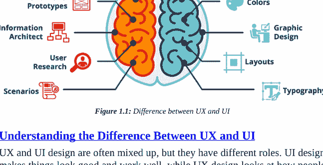

图 1.1：UX 与 UI 的区别

### 理解 UX 与 UI 之间的区别

UX 和 UI 设计经常被混淆，但它们有不同的角色。UI 设计让事物看起来好且工作良好，而 UX 设计则关注人们如何使用事物。

那么，区别是什么？

UX 设计涉及理解我们如何使用某物，而 UI 设计则是关于使其在视觉上具有吸引力且功能完善。

简单来说，UX 确保产品是有用的，而 UI 确保它易于使用。UX 专业人员检测问题并提供答案，以及创建用户将如何使用产品的蓝图和模型。随后，UI 设计师利用这些蓝图创建产品的最终外观和感觉。UI 专注于细节元素，而 UX 考虑整体大局。

但有时很难区分它们。UX 设计师也可能从事 UI 设计的工作，反之亦然。最终，UI 和 UX 相互依存。如果没有他们的协作，产品的质量不会像现在这样好！

虽然 UI 和 UX 设计师有一些共同的职责，但他们并非可以互换。他们的技能相互补充，共同协作打造产品。UI 设计师专注于外观和功能，而 UX 设计师研究用户交互。他们将各自的专业知识整合在一起，共同促进产品的整体成功。每个岗位的主要职责如下：

### UX 设计师的职责

- 提升用户满意度
- 改善可用性、可访问性和交互的愉悦感
- 理解用户的需求和行为

### UI 设计师的职责

- 专注于产品的视觉方面
- 确保其在视觉上具有吸引力
- 确保其易于直观使用

现在你已经了解了 UI 和 UX 以及设计师的工作，让我们看看它们如何融入设计思维过程。我们将观察它们如何协同工作，从最初的想法到最终产品，创造出网站或应用程序等事物。通过理解他们的团队合作、解决问题以及不断尝试不同方法直到成功，你将看到 UI 和 UX 如何确保最终产品易于使用且对人们有帮助。

## 设计思维过程

所有产品设计师、服务设计师、企业家、教育工作者、医疗专业人员、社会创新者和商业领袖都使用设计思维过程，以创造性、以人为本和协作的方式解决问题。设计思维是一种以人为先的解决问题方式，涉及反复尝试想法。它关乎理解人们的需求、提出大量想法并测试它们以查看哪种效果最好。

## 这是如何运作的

首先，我们真正倾听人们的声音，以了解他们正在经历什么，并且


他们需要什么。这有助于我们准确找出问题所在。一旦知道了问题，我们就会集思广益，想出各种不同的想法，即使有些想法看起来有点天马行空。在这个阶段，我们不会对任何想法做出评判。

接下来，我们会制作一些简单的模型，称为原型。这些原型帮助我们了解哪些想法可能奏效，哪些可能行不通。

我们会把原型展示给我们想要帮助的人，并询问他们的看法。他们的反馈有助于我们改进想法。

然后，我们利用反馈进一步完善想法。这可能意味着做出改变，或者尝试全新的想法。最后，我们把最好的想法变成人们可以使用的真实产品。

在整个过程中，我们保持好奇心，尝试新事物，并理解有些想法行不通也没关系。我们把问题视为产生更新、更好想法的机会。

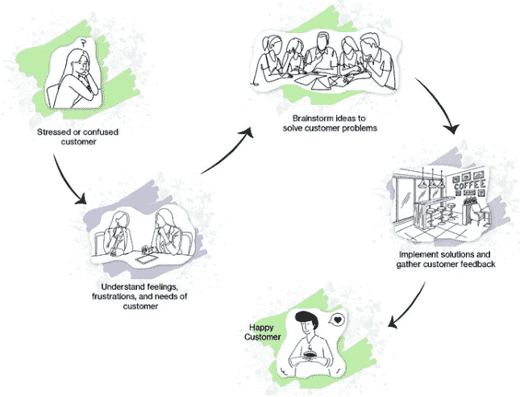

*图1.2：展示设计思维工作原理的图片*

## 好吧，让我们想象一个简单的例子来理解这个概念：

想象一下你所在城镇里最喜欢的咖啡店或繁忙的咖啡馆，那里总是排着长队。现在你的任务是改善在繁忙咖啡店排队等候的顾客的体验。

以下是如何运用设计思维来做到这一点：

首先，观察顾客排队等候的过程。与他们交谈，了解他们在等候时的感受、不满和需求。也许他们感到无聊、不耐烦、焦虑或困惑，因为可供选择的选项太多了。

当你掌握了所有信息后，集思广益，想出让等候时间变得愉快而高效的点子。也许可以尝试在屏幕上提供数字拼图，或者提供咖啡配料的相关信息，以教育和吸引顾客。

接下来，开始主要任务，为这些想法创建一个简单的原型。你可以使用带有拼图游戏的平板电脑，或者在墙壁或柱子上张贴一些内容丰富且有创意的咖啡海报。然后在顾客中进行测试。观察顾客的反应，收集他们的反馈，了解他们喜欢什么以及哪些地方可以改进。

完成主要任务后，根据反馈改进你的想法。也许顾客更喜欢了解咖啡配料以及他们最爱的口味是如何制成的，但觉得拼图游戏太难了，因为需要集中注意力。

最后，一切都完成后，推出改进后的原型，落实顾客建议的改动。太棒了！凭借设计思维，你成功让顾客在咖啡店的等候体验变得更加有趣和愉快。

## 设计思维的重要性

用户测试是设计思维过程中至关重要的一环，因为它能帮助设计师了解真实用户如何与他们的产品或解决方案互动。以下说明为什么进行用户测试如此重要：

- **验证假设**：用户测试让设计师能够验证他们对用户需求、偏好和行为的假设是否准确。通过观察用户与原型互动，设计师可以确认或挑战他们最初的构想，确保最终产品满足用户的真实需求。

- **发现痛点**：用户测试有助于揭示用户在使用产品时可能遇到的可用性问题或痛点。通过观察用户行为并收集反馈，设计师可以识别需要改进的地方，并相应地优化用户体验。

- **获取洞察**：用户测试提供了关于用户在与产品互动时如何思考、感受和行动的宝贵见解。这些洞察可以为设计决策提供依据，帮助设计师创建更直观、更用户友好的解决方案。

- **迭代改进**：通过反复测试和改进，设计师可以根据用户的反馈持续完善产品。通过将用户洞察融入设计过程，设计师可以创建对用户来说更有效、更高效、更令人满意的解决方案。

- **建立同理心**：用户测试让设计师与用户及其体验直接接触，从而培养同理心。通过理解用户的视角、挑战和动机，设计师可以更深入地体会他们的需求，并设计出真正引起共鸣的解决方案。

总而言之，设计思维之所以重要，是因为它能帮助组织创造真正惠及用户的创新解决方案，促进团队合作和创造力，降低失败的可能性，并建立持续学习和发展文化。通过运用设计思维，组织可以推动重大变革，为消费者创造价值，让他们满意，并在快速变化的市场中保持领先。

## 设计思维过程的五个阶段

**在深入探讨五个阶段之前，让我们先追溯设计思维过程的起源。**

设计和创新领域正是设计思维方法的发源地


它开始成形。尽管其确切起源尚不明确，但在二十世纪，它因斯坦福大学的 D-school 以及 IDEO 等设计公司的努力而变得流行。但其思想基于多种学科，例如商业、心理学、工程学和建筑学。对更具创新性和以人为本的解决问题方法的需求，尤其是在复杂和不确定的情况下，推动了设计思维的兴起。

设计思维流程有很多版本，但它们都共享基本原则：首先了解你的用户，专注于解决他们的问题，并不断完善解决方案。

在本章中，我们将引导你了解设计思维流程最常见的五个阶段，并提供可操作的步骤，帮助你实施自己的设计思维方法。

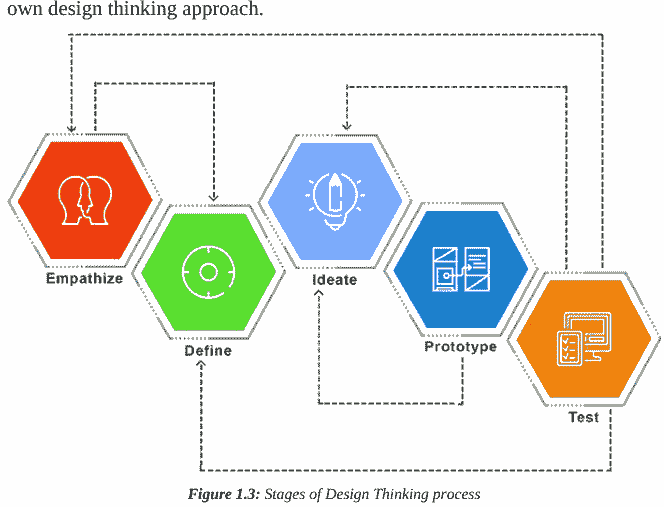

图 1.3：设计思维流程阶段

设计思维流程的五个主要组成部分是：

- 1. Empathize
- 2. Define
- 3. Ideate
- 4. Prototype
- 5. Test

在讨论设计思维的五个步骤时，至关重要的是要理解它并不是一条直线。虽然我们以顺序步骤来描述它，但它实际上是一个高度迭代的循环。在每个阶段，你都会发现新的见解，这可能会促使你重新审视之前的阶段。

## 1. Empathize

同理心是设计思维流程的第一步。了解用户及其需求对于创造人们真正想要的产品和服务至关重要。这包括了解他们对你正在设计的产品期望，以及他们在此情境下面临的困难。

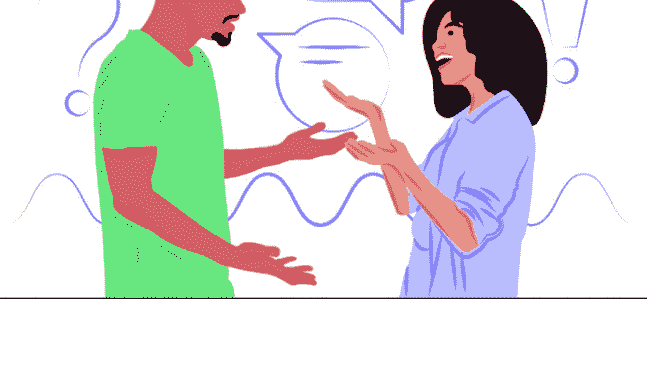

图 1.4：理解用户

在同理心阶段，你将完全沉浸在实际用户（或目标受众代表）的现实中。这可能包括与他们进行访谈，观察他们如何使用现有物品，并密切关注他们的面部表情和肢体语言。

在此阶段，设计师启动不同的研究方法，创建用户画像和同理心地图，分析用户旅程，并进行类似的任务。你将在后续章节中了解所有这些方法。这些努力专注于确定并说明更广泛用户群体的需求，特别是那些具有共同特征或挑战的用户群体。

同理心阶段是设计思维流程的第一步，建议你放下先入为主的观念。通过亲身经历，你可以创造真正满足消费者需求的解决方案。这就是设计思维的精髓！

## 2. Define

在设计思维的第二步，你开始弄清用户面临的具体问题。首先，你收集在第一步中了解到的有关用户需求和挑战的所有信息。

即使你在第一步中发现了许多问题，直到现在它们也尚未明确定义。没有清晰的问题陈述，很难专注于寻找解决方案。因此，在此步骤中，你专注于根据从用户那里学到的内容，对问题做出明确的陈述。

从技术角度来说，问题陈述是对设计团队旨在解决或利用的挑战或机会的清晰而具体的表述。

问题陈述是对需要通过设计流程解决的问题或挑战的简明描述。从技术角度来说，它是事物现在的状态（问题）与我们希望它们成为的状态（目标）之间的差异。

你只需描述最常见需要解决的问题。

遵循设计思维的理念，问题陈述始终以用户为中心。问题陈述应基于用户需要，而不仅仅是企业想要的。

### 例如，考虑一个问题陈述：

作为业务目标：
通过让用户更容易找到和购买产品来提高在线销售额。

从用户的角度来看：
我们如何让客户在线上更容易找到和购买他们想要的东西？

到本步骤结束时，你将拥有一个清晰的问题陈述来指导剩余的设计流程。此陈述有助于你提出创造性想法并找到真正帮助用户的解决方案。

### 问题随之而来：我们如何有效地实现这一目标？

当你从事一个项目时，你可能需要以不同的方式解释问题或你所思考的内容。因此，问题陈述可以采用任何格式，但无论你如何表述，其主要思想都是帮助设计团队找到可行的解决方案。


## Who?

谁有这个问题？

## Developing a problem statement based on user-centric perspective

## 基于以用户为中心的视角制定问题陈述

## What?

问题是什么？

## Where?

问题在哪里？

## Why?

为什么要解决它很重要？

Figure 1.5: Problem statement template

Figure 1.5：问题陈述模板

Let us continue with the same example of your favorite coffee shop. Picture your favorite coffee place or busy cafe in your town where there’s always a line.

让我们继续以你最喜欢的咖啡店为例。想象一下你所在城镇里最喜欢的咖啡店或繁忙的咖啡馆，那里总是排着长队。

Here are some examples of how you could explain the problem or point of view:

以下是一些解释问题或观点的示例：

## User’s Perspective Problem Statement:

## 用户视角问题陈述：

Waiting in line at the busy coffee shop is often frustrating and time-consuming for customers, leading to decreased satisfaction with their overall experience.

在繁忙的咖啡店排队对顾客来说常常令人沮丧且耗时，导致他们对整体体验的满意度下降。

## User Research Perspective Problem Statement:

## 用户研究视角问题陈述：

Through user research, it’s evident that customers waiting in line at the busy coffee shop express dissatisfaction due to long wait times, lack of clear communication about wait times, discomfort in the waiting area, and limited access to information about menu items or specials.

通过用户研究，很明显，排队等待的顾客对繁忙的咖啡店表示不满，原因是等待时间长、关于等待时间的沟通不清晰、等候区不舒适，以及无法获取有关菜单项目或特价信息的渠道有限。

## *Four Ws Problem Statement:*

## *四要素问题陈述：*

+   Who: Customers at the busy coffee shop.
+   Who：繁忙咖啡店的顾客。
+   What: Waiting in line.
+   What：排队等待。
+   Where: At the coffee shop.
+   Where：在咖啡店。
+   Why: To enhance the waiting experience and overall satisfaction for customers.
+   Why：提升顾客的等待体验和整体满意度。

These statements all tackle the same problem but approach it from slightly different angles. The common thread among them is the emphasis on understanding the user, their needs, and the underlying reasons behind those needs. How you articulate and structure the problem statement ultimately depends on how you want to convey the issue and frame it within the context of the user experience.

这些陈述都针对同一个问题，但从略有不同的角度切入。它们的共同点在于强调理解用户、他们的需求以及这些需求背后的根本原因。你如何表述和结构化问题陈述，最终取决于你希望如何传达问题并将其置于用户体验的背景中。

## 3. Ideate

## 3. 头脑风暴

This step involves coming up with a ton of different ideas for tackling the difficulties you have identified after getting to know your people well and learning about their main concerns. There are no hard and fast rules when it comes to brainstorming ideas. The goal is to generate as many creative and outrageous ideas as you can, without considering their viability. But don’t forget to remain focused on your problem statement.

此步骤涉及在充分了解你的用户并了解他们的主要关注点后，为解决已识别的困难而提出大量不同的想法。头脑风暴没有硬性规定。目标是在不考虑其可行性的情况下，尽可能产生大量富有创意甚至离谱的想法。但不要忘记始终聚焦于你的问题陈述。

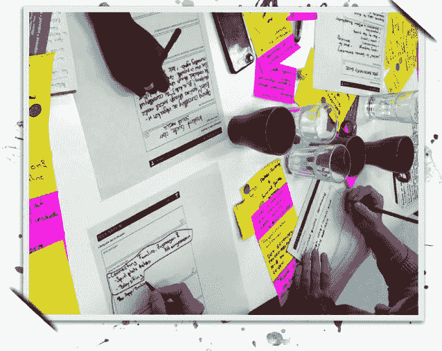

*Figure 1.6: Brainstorming ideas*

*Figure 1.6：头脑风暴创意*

It is crucial to remember that at this stage, the focus is on generating a large number of ideas, prioritizing quantity over quality. It is important not to rush into judgment, allowing everyone to feel at ease sharing their ideas. If someone questions the viability of an idea, they should be ready to provide a solid explanation for their viewpoint. This approach fosters an open and collaborative environment where diverse perspectives can contribute to the ideation process.

必须记住，在此阶段，重点是产生大量想法，优先考虑数量而非质量。重要的是不要急于评判，让每个人都能安心分享自己的想法。如果有人质疑某个想法的可行性，他们应该准备好为自己的观点提供充分的解释。这种方法营造了一个开放且协作的环境，让多元化的观点都能为头脑风暴过程做出贡献。

During ideation sessions, it is important to set a time slot of 30-40 minutes and involve the entire design team. If possible, choose a suitable environment; although it may seem insignificant, the location where you conduct your ideation session can greatly influence the outcome. Moreover, it’s beneficial to consider and involve other stakeholders. Having stakeholders present can help eliminate completely impractical ideas before moving to the prototyping stage.

在头脑风暴会议期间，重要的是安排 30-40 分钟的时间段并让整个设计团队参与。如果可能，选择合适的环境；尽管这似乎微不足道，但进行头脑风暴会议的地点会极大地影响结果。此外，考虑并让其他利益相关者参与是有益的。利益相关者的在场可以帮助在进入原型阶段之前剔除完全不切实际的想法。

During this part of the Design Thinking process, your problem statement will be like your map, showing you where to go. You will keep working on it until you have a few main ideas to move forward with. These ideas will be transformed into prototypes, which you’ll try out with real users to see how well they work.

在设计思维过程的这一部分，你的问题陈述就像你的地图，指引你前进的方向。你将不断完善它，直到产生几个主要想法以便推进。这些想法将被转化为原型，你将与真实用户一起测试，看看效果如何。

## Popular Ideation Methods

## 流行头脑风暴方法

Now that you have set up everything for your ideation session, there is one final step: deciding which ideation techniques to employ.

现在你已经为头脑风暴会议做好了所有准备，还有最后一步：决定采用哪些头脑风暴技巧。

Here are a few popular ideation methods frequently utilized by designers:

以下是设计师经常使用的几种流行头脑风暴方法：

- **Brainstorming:** A group activity where participants freely generate ideas without criticism, aiming for quantity over quality.
- **头脑风暴：**一种团体活动，参与者在没有批评的情况下自由产生想法，目标是数量重于质量。
- **Mind Mapping:** A visual technique where ideas are organized hierarchically around a central concept, allowing for exploration of connections and associations. In other words, drawing a diagram to show how different ideas are connected.
- **思维导图：**一种可视化技巧，将想法围绕一个中心概念进行层级组织，从而探索联系和关联。换句话说，绘制图表以显示不同想法之间的联系。
- **SCAMPER:** An acronym that stands for Substitute, Combine, Adapt, Modify, Put to another use, Eliminate, and Reverse, which prompts participants to explore different ways to innovate existing ideas or products. In simple terms, asking questions to think about how you can change or improve something.
- **SCAMPER：**是一个首字母缩写词，代表替代、组合、改编、修改、另作他用、消除和反转，促使参与者探索创新现有想法或产品的不同方式。简单来说，就是提出问题来思考如何改变或改进某物。
- **Worst Possible Idea:** Encourages participants to deliberately generate the worst possible solutions to a problem, which can sometimes lead to unexpected and innovative ideas.
- **最糟糕的想法：**鼓励参与者故意为问题生成最糟糕的解决方案，有时这会带来出乎意料且富有创意的想法。
- **Six Thinking Hats:** Developed by Edward de Bono, this method involves assigning different “hats” to participants, each representing a different perspective (for example, logical thinking, creativity, emotions) to explore a problem from multiple angles.
- **六顶思考帽：**由爱德华·德·波诺提出，该方法为参与者分配不同的“帽子”，每顶帽子代表不同的视角，例如逻辑思考、创造力、情感，以从多个角度探索问题。
- **Rapid Prototyping:** Quickly creating rough, low-fidelity prototypes of ideas to test and iterate upon, allowing for rapid experimentation and refinement to see what works.
- **快速原型制作：**快速创建粗糙的低保真原型来测试和迭代想法，从而实现快速实验和改进，看看什么有效。


这些只是设计思维过程中使用的头脑风暴方法的几个例子，每种方法都提供了一种独特的激发创造力和产生创新解决方案的方法。

## 4. 原型

在流程的第四步中，你的主要重点是决定什么最重要，然后创建原型。原型制作意味着将你在头脑风暴期间想出的一些最佳想法变成你可以触摸和看到的真实事物。这很重要，因为它允许设计团队以更具体的方式向客户和其他人展示产品可能是什么样子，这有助于收集详细且有用的反馈。

想象一下，你在第 3 步进行了一次非常富有成效的头脑风暴会议，并想出了许多不同的解决主要问题的方法。但你不能为每一个想法都制作原型，所以你必须选择哪些想法是最重要的来测试。

为了帮助你决定，你可以使用优先级网格。这涉及手动评估每个想法，将它们写在便签上，然后根据其用户价值和可行性将它们放置在网格上。最好的想法是那些对用户最有价值并且也易于付诸行动的想法。这一过程帮助你专注于具有最高成功潜力的想法。

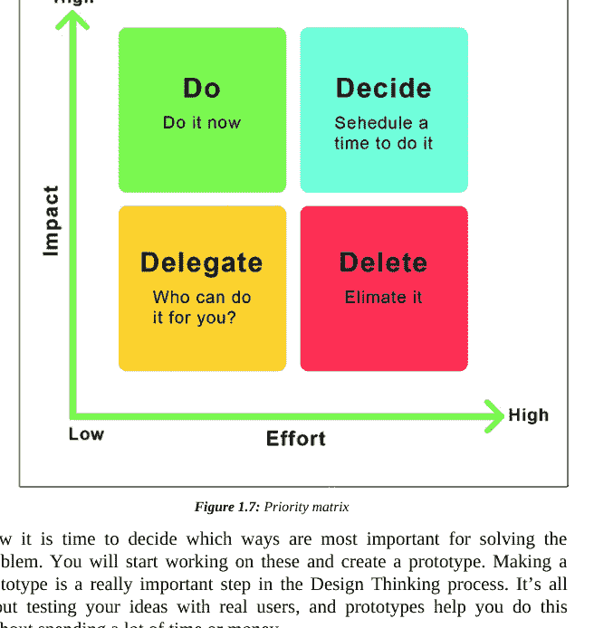

图 1.7：优先级矩阵

现在是决定哪些方式对解决问题最重要的时候了。你将开始着手这些工作并创建原型。制作原型是设计思维过程中的一个非常重要的步骤。关键在于用真实用户测试你的想法，而原型可以帮助你做到这一点，而无需花费大量时间和金钱。

## 原型可以帮助你在几种不同的方面：

- 它们让你看到用户将如何使用你的产品以及对你的产品做出什么反应。观察人们与产品早期版本互动，可以看出它在现实世界中是否真的可行。
- 它们帮助你在为时已晚之前发现产品在功能或外观上的任何问题。如果某件事行不通，及早发现会更好。原型可以帮助你在花费太多时间和金钱之前发现任何薄弱环节或问题。
- 它们帮助你对设计做出明智的决定。如果你不确定网页或应用中的图标应该放在哪里，或者你的网站的最佳设计是什么，你可以尝试使用原型制作几个不同的版本，看看人们最喜欢哪一个。

即使你已经做了很多关于用户想要什么的研究，在你亲眼看到产品之前，真正理解产品仍然可能很困难。原型让你可以不断更改和改进你的产品，直到它准备好面向公众发布。

## 制作原型的不同方法

原型制作是将你的想法变成你可以看、可以触摸并可以测试的真实事物的途径。有不同的原型制作方法，每种方法都有其自身的优势。让我们深入了解一些有趣且易于理解的原型方法：

- **纸质原型：**想象一下——你把应用或网站的屏幕画在纸上，然后像翻书一样翻阅。就像你的项目的分镜脚本一样。想测试你的想法是否可行吗？只要翻阅看看就行！
- **奥兹国巫师：**不，我们不是在说那部电影。在这种方法中，你创建一个产品的假版本。就像在演戏一样！你模拟产品在幕后如何运作，而用户与之互动，从而为你提供宝贵的见解。
- **角色扮演：**是时候进入角色了！通过角色扮演，团队成员假装成用户并与原型互动。就像玩假装游戏一样，但它能帮助你了解用户可能会如何真正使用你的产品。
- **数字原型：**把它想象成你最终产品的预览。使用软件，你创建想法的数字版本。就像构建一个迷你版本的应用程序或网站，人们可以点击


through and explore.

- **原型应用：** 听说过 Figma 或 InVision 这类原型工具吗？它们就像虚拟游乐场，你可以在这里构建产品的交互模型。只需拖拽元素来设计你的原型——无需编码！

- **3D 打印：** 想象一下用一台神奇的打印机把你的想法变成现实！借助 3D 打印，你可以制作产品的实体模型。这就像雕塑，但属于数字时代。

每一种方法都像你创意工具箱中的不同工具。无论你是在纸上[content]

through and explore.

- **原型应用：** 听说过 Figma 或 InVision 这类原型工具吗？它们就像虚拟游乐场，你可以在这里构建产品的交互模型。只需拖拽元素来设计你的原型——无需编码！

- **3D 打印：** 想象一下用一台神奇的打印机把你的想法变成现实！借助 3D 打印，你可以制作产品的实体模型。这就像雕塑，但属于数字时代。

每一种方法都像你创意工具箱中的不同工具。无论你是在纸上涂鸦还是在数字应用中点击，制作原型都能帮助你一步步将想法变为现实！

## 5. 测试

这个阶段就像把你的设计放在显微镜下。它帮助设计师发现设计中的任何问题，并找出用户可能仍在挣扎的领域。有时候，即使设计在设计师或客户眼中看起来完美无缺，对实际使用者来说仍可能存在大问题。

现在，你即将到达设计思维过程的最后一步。是时候用真实用户来测试你的原型，收集反馈，并看看它表现如何了。这一步与第一步类似，在第一步中你专注于理解用户的需求和感受。

在测试期间，你会观察目标用户，或代表他们的人，如何尝试使用你的原型。你也会询问他们对体验的想法和感受。这有助于你了解用户对设计的真实感受，以及设计可能需要改进的地方。

## 用户测试方法

在设计思维过程的第五阶段，即用真实用户测试你的想法时，有几种常见的方法来收集反馈。以下是其中几种，用简单的语言解释：

- **观察性测试**：这种方法涉及观察用户与原型互动的情况。你可能会观察他们的面部表情、肢体语言和行为，以了解他们在使用产品时的感受和想法。

- **访谈**：访谈允许你与用户直接对话，了解他们对原型的体验。你可以提问以获得更详细的见解，了解他们喜欢什么、不喜欢什么，以及遇到的任何问题。

- **调查**：调查是收集大量用户反馈的一种方式。你可以创建包含多选题或开放式问题的问卷，以收集用户体验和偏好数据。

- **可用性测试**：可用性测试关注用户使用原型完成特定任务的难易程度。你可能会要求用户完成某些操作并观察他们如何在产品中导航。

- **原型演练**：在原型演练中，你引导用户浏览你的原型，解释其工作原理以及每个功能的作用。这种方法让你看到用户如何与原型的不同部分互动，以及他们可能卡住的地方。

- **A/B 测试**：A/B 测试涉及创建两个具有细微差异的原型版本并让不同用户组进行测试。这让你可以比较哪个版本表现更好，并就保留或更改哪些设计元素做出明智决策。

这些只是设计思维过程中使用的用户测试方法的几个例子。每种方法都能提供独特的见解，了解用户如何与原型互动，帮助你根据真实用户反馈来完善和改进设计。

## 迭代和非线性过程

设计思维确实是一个非线性过程，这意味着它并不严格遵循从开始到结束的逐步进展。相反，它是一种灵活的方法，允许在各个阶段进行迭代、探索和完善（请参阅 *Figure 1.3* 以了解该动态过程的视觉表示）。

**让我们用一个简单的类比来深入了解设计思维：烘焙蛋糕。**


想象你正在为朋友的生日烤蛋糕。现在，设计思维就像以一种非常有趣和富有创意的方式烤那个蛋糕！

+   1. **了解朋友的口味**：在你开始烘焙之前，你想知道朋友喜欢什么口味。也许他们爱巧克力，或者更喜欢水果味。所以，你会和他们聊天，了解他们会喜欢什么。
+   2. **规划你的蛋糕**：掌握这些信息后，你开始规划蛋糕。你思考层次、奶油霜以及任何装饰。但这里变得有趣了：你不会只坚持一个计划，而是记下几个想法。也许是层层叠叠的巧克力蛋糕，或是水果海绵蛋糕。
+   3. **混合和品尝：** 现在，是时候混合面糊了。在混合过程中，你会边尝边调。也许你意识到它需要多一点甜味，或加一点盐来平衡味道。所以，你在过程中进行调整，就像设计思维允许你调整和完善你的想法一样。
+   4. **装饰和测试：** 蛋糕烤好并冷却后，就是装饰的时候了。你尝试不同的奶油霜设计，也许在上面加一些糖屑或水果。然后，你请朋友品尝。他们可能就这样喜欢它，或者他们可能会建议改变，比如加更多奶油霜或减少糖分。
+   5. **最后润色和呈现：** 根据他们的反馈，你做出最后的润色。也许你在上面加一个生日蜡烛，或用奶油霜写上一条甜蜜的信息。然后，你把蛋糕呈给朋友，他们对它美味又漂亮的样子感到非常兴奋。

你看，设计思维就像烤那个蛋糕。它不是一个僵化的逐步过程，你从头到尾遵循食谱。相反，它是灵活和富有创造性的，允许你在沿途进行实验、迭代和调整，直到你想出真正特别且符合朋友口味的东西。

## 大品牌的 设计思维 成功案例

此时，你可能会感到有点不知所措，想知道面对所有这些关于设计思维的信息怎么办？不用担心！让我们通过一些真实的例子让它变得更令人兴奋，以提供更清晰的画面。深入了解那些大品牌如何利用这种很棒的方法论彻底改变了他们的商业模式的故事。

### UberEats

UberEats 是 Uber 家族的一部分，是如何跳出思维定式就能改变外卖游戏的典范。他们真正通过以客户为先而脱颖而出。

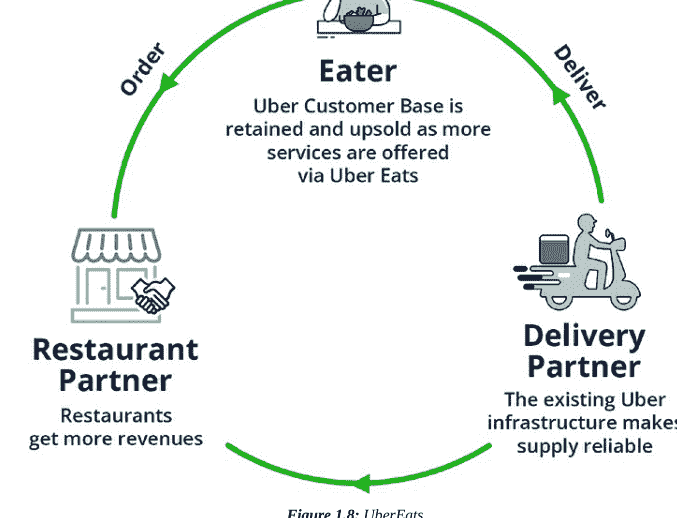

*Figure 1.8: UberEats*

他们的核心想法？他们专注于让人们轻松找到并享受他们最喜欢的餐食。尽管智能手机相对较新，但人们已经烹饪和售卖食物很久了。UberEats 将这一古老传统与新技术结合起来，让点餐变得更方便。

让我们看看他们是如何做到的以及取得了什么成就。

+   1. **共情**：首先，他们深入挖掘了客户和餐厅的需求。他们不仅仅坐在办公室里；他们走上街头，与送餐合作伙伴、厨师以及像你一样热爱美食的普通客户聊天。他们会定期派遣设计师前往 UberEats 运营的不同城市，以真正了解当地的美食场景。他们研究食物是如何运输和送达的，并与送餐合作伙伴、餐厅工作人员和客户交谈。这帮助他们了解人们在点餐时面临的问题，以及餐厅如何难以有效地触达客户。他们做了大量研究并密切观察，以尽可能多地学习。
+   2. **定义**：在了解人们的问题后，UberEats 弄清了他们想要解决的主要问题：传统的外卖方式对客户和餐厅来说都很不方便且效率低下。一旦他们对问题有了清晰的认识，他们就着手解决它。他们将重点缩小到目标，并决定创建一个平台，让每个人都能更轻松地订购和送达食物。
+   3. **头脑风暴**：然后是头脑风暴阶段。UberEats 想出了巧妙的点子来解决它。他们考虑制作一个客户易于使用的应用程序。该应用程序将让你查看菜单、快速点餐并实时跟踪你的配送。此外，他们希望确保送货迅速且无麻烦。
+   4. **原型**：在投入开发并制作 UberEats 应用的最终版本之前，团队制作了样本版本来尝试他们的想法。他们构建了应用可能的外观模型，并与人们一起测试，看看什么有效什么无效。他们希望在发布前确保一切都恰到好处。这帮助他们在应用完成前做出更改和改进。
+   5. **测试**：UberEats 在某些城市启动了试运行计划，以了解他们的平台在现实生活中效果如何。他们密切关注用户说了什么、做了什么，以查看他们的解决方案是否有效。这一测试阶段为他们提供了有关什么做得好、什么


需要做出改变。

那么，这样做有回报吗？UberEats 迅速风靡，得益于其流畅的应用和闪电般的配送。顾客喜欢下单的便利，餐厅也看到生意蒸蒸日上。

## 迭代 – 迭代 - 迭代：

他们没有止步于此。他们不断倾听用户的意见并做出细微调整，以让设计更加出色。他们甚至邀请配送员、厨师和顾客直接到办公室，畅谈他们的 UberEATS 经历。

由于在办公室内很难真实还原实际场景，他们尽快到现实世界中验证自己的想法。设计师们仔细观察，一旦发现机会就进行调整以让事情变得更好。通过不断改进和提出新想法，Uber Eats 不仅撼动了食品配送市场，还彻底改变了它。

## 成就

通过遵循设计思维的原则，Uber Eats 取得了几个重要成果：

- **速度至关重要：** UberEats 就像一个巨大的市场，需要很多人快速汇聚才能良好运转。配送伙伴和餐厅需要大量订单来盈利，顾客则希望有丰富的就餐选择和快速的配送。因此，UberEats 需要快速行动，以便迅速扩大客户群。通过快速做出调整，他们能保持进展，并确保设计臻于完美。

- **更好的用户体验：** UberEats 打造了一个极其易用的平台。现在，你只需在手机上轻点几下，就能从最喜欢的餐厅点餐。

- **更快的配送：** UberEats 利用智能技术让配送系统运转得更好。这意味着你不必为餐食等待太久，餐厅也能服务更多顾客。

- **改变行业格局：** UberEats 在食品配送领域掀起了波澜。他们挑战了传统做法，引入了全新理念，从而改变了整个行业的运作方式。

## Airbnb

Airbnb 是一个全球性的在线市场，将旅行者与独特的住宿和体验连接起来。它成立于 2008 年，提供了一个平台，让房东可以列出自己的房屋、公寓，甚至只是一个空房间供客人预订。旅行者可以探索从舒适小屋到豪华别墅的各种住宿选择，并沉浸在当地文化中。凭借用户友好的网站和应用程序，Airbnb 彻底改变了人们的旅行方式，为传统酒店提供了更加个性化和真实的替代选择。它通过让房东分享自己的空间和故事来营造社区感，在全球打造令人难忘且丰富多彩的旅行体验。

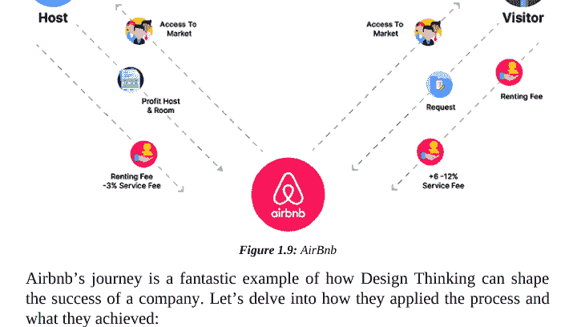

图 1.9：Airbnb

Airbnb 的历程是设计思维如何塑造公司成功的绝佳范例。让我们深入了解他们是怎样应用这一流程的，以及取得了哪些成果：

1. **同理心：** Airbnb 首先理解房东和游客双方的痛点和需求。他们意识到旅行者追求独特而真实的体验，而房东则希望找到赚取额外收入的方法。因此，他们全身心投入旅行体验，在世界各地的住所中留宿，以了解双方的看重之处。

2. **定义问题：** 基于同理心阶段的工作，Airbnb 明确了他们想要解决的核心问题：传统住宿中缺乏有意义的连接和真实体验。他们将关注点缩小到创建一个平台，将旅行者与独特的住宿和当地房东连接起来。

3. **构思：** 在对问题有了清晰理解后，Airbnb 集思广益，提出了创新的解决方案。他们构思了一个用户友好的网站和应用界面，让房东能够轻松地列出自己的空间，游客能够无缝地发现并预订住宿。他们还探索了如何促进房东与游客之间的信任和沟通。

4. **原型制作：** 在全面开发 Airbnb 平台之前，团队创建了原型来测试他们的想法。他们构建了网站和应用界面的模型，并进行了可用性测试，以收集潜在用户的反馈。这个迭代过程让他们能够尽早优化设计，并发现需要改进的地方。

5. **测试：** Airbnb 在选定的城市启动了试点项目，在真实环境中测试其平台。他们密切监控用户反馈和行为，以评估解决方案的有效性。这一测试阶段提供了宝贵的洞察，让他们知道哪些方面运作良好，哪些方面需要调整。

6. **迭代 – 迭代 - 迭代：** 根据测试阶段的反馈，Airbnb 对平台进行了迭代，做出改进和增强，以进一步提升用户体验。他们微调了功能，加强了信任与安全措施，并扩展了服务内容，以满足房东和游客不断变化的需求。

## 成就

通过遵循设计思维的原则，Airbnb 取得了多项成就。


显著成果：

- **颠覆性创新：** Airbnb 通过提供传统住宿的独特替代方案颠覆了传统酒店业。他们挑战了酒店的主导地位，并为旅行者体验目的地引入了一种新方式。
- **社区建设：** Airbnb 在房东和客人之间培养了社区感，创造了有意义的联系和文化交流。他们赋予房东分享当地知识和好客之道的权力，而客人则获得了接触真实体验和了解当地生活的机会。
- **全球扩张：** Airbnb 的平台迅速在全球范围内扩张，使旅行者能够在全球各地的目的地获得多样化的住宿选择。他们通过让旅行对各行各业的人来说更易于获取和负担得起，从而实现了旅行的民主化。

总体而言，Airbnb 的成功故事 exemplifies 如何设计思维可以推动创新，培养有意义的联系，并通过以创造性和影响力的方式满足用户的需求和愿望来颠覆行业。

## Workshop

## 解决 7—12 岁儿童的礼物难题

为 7 至 12 岁的儿童挑选礼物，对父母来说是一个常见挑战：在实用性、教育价值和趣味性之间找到平衡。这个年龄段正处于关键的发展阶段，他们渴望学习、探索和玩乐。父母希望挑选的礼物不仅能娱乐，还能促进孩子的成长和发展。然而，面对市场上琳琅满目的玩具和产品，要找到样样俱全的东西可能会让人不知所措。

父母通常会寻找能够激发好奇心、鼓励创造力并以有趣的方式促进学习的礼物。教育游戏、科学套件、美术用品和互动书籍都是热门选择。挑战在于挑选一份能吸引孩子兴趣，同时提供教育价值和娱乐性的礼物。

设计思维在为 7 至 12 岁儿童挑选礼物时可以是一种宝贵的方法。这个年龄段的人群多样，兴趣、偏好和发展阶段各不相同。

## 以下是你如何将设计思维应用于此场景的方法：

### 共情

- 想想这个年龄段的孩子真正喜欢做什么。他们喜欢画画、打运动，还是也许探索科学？
- 真的很有帮助去公园外面和这个年龄段的孩子在现实生活中交谈。你也可以问问你家人或朋友圈里的孩子。把所有细节写在纸上，包括他们的名字、年龄和他们喜欢做什么。
- 想象一下，对父母或送礼者来说挑选完美礼物有多难。他们可能不知道孩子现在喜欢什么，或者想要一份既有趣又有教育意义的东西。
- 写下所有能展示这个年龄段不同类型孩子的信息。比如那个喜欢运动的、艺术家、或科学爱好者。这有助于了解每种类型的孩子可能喜欢什么礼物！

### 定义

从我们在共情阶段对人们的了解中，我们可以创建人物角色（ *人物角色是一个虚构的角色，代表具有相似特征、需求和行为的真实用户群体* ）。我们将在后续章节详细介绍如何创建人物角色。这些人物角色帮助我们了解是什么激励他们，他们面临什么挑战，他们的目标，以及是什么造就了他们。

根据你的理解，定义一份成功礼物的标准。这可能包括：

- 教育价值
- 娱乐性
- 适合年龄
- 耐用性
- 创造力和想象力的潜力

### 供你参考，以下是人物角色的详细信息：Lily the Artistic Explorer

Name : Lily
Age : 10 years old
Interests : Art, drawing, painting
Personality Traits:
Creative : Lily is constantly doodling and experimenting with colors and shapes.
Curious : She loves exploring new art techniques and materials.
Patient : When working on her art, Lily can spend hours focused on perfecting her creations.
Favorite Activities:
Drawing in her sketchbook
Spends most afternoons playing at the local park with friends
Enjoys playing the guitar on occasion
Goals:
To improve her artistic skills and try new techniques
Dreams of becoming a professional artist one day
Challenges:
Doesn’t always have enough art stuff and wants time every day to do art
Sometimes finds it hard to do homework after playing outside for a long time
Wanting feedback and encouragement for her artwork
Insights:
Lily is a 10-year-old artist who is deeply passionate about art. She enjoys experimenting with various mediums and techniques to create unique pieces. However, she faces challenges such as limited access to art supplies and occasional difficulties finding inspiration. Lily seeks encouragement and opportunities to learn and improve her skills.

从这一步，你将收集关于孩子们的所有有趣信息，并制作一个小小的人物角色，告诉我们她喜欢什么，是什么让她动起来，她的梦想等等。

基于此，我们可以创建一个好的问题陈述。

### 示例问题陈述：

### 用户研究视角问题陈述：

我们需要一份适合 9–12 岁儿童的礼物，它能吸引人、有教育意义，并与他们对探索的兴趣相符。


## 构思

构思阶段，我们利用之前收集的信息和用户画像，为用户想出大量新点子。

进行头脑风暴，构思符合既定标准的礼物创意。鼓励发挥创造力，跳出普通玩具的思维局限。

思考一系列选项，例如：

-   科学实验套装
-   教育类游戏或拼图
-   美术和手工材料
-   拼搭套装，如乐高或机器人套件
-   书籍或教育订阅服务
-   户外探索套装（例如双筒望远镜、昆虫捕捉套装）
-   任何乐器

思考每个创意如何满足孩子的兴趣，并在学习和娱乐方面提供价值。每个解决方案都可能是完美的，即使乍一看并非如此。因此，在继续之前，明智的做法是把所有想法都记下来。

## 原型制作

从你最好的礼物创意中选择一个或多个，制作原型或概念方案。

这可以是教育类游戏的数字模型、科学实验套件的材料清单、系列丛书的介绍，也可以是纸上绘制的创意草图。包括如何呈现礼物、需要哪些额外材料，以及如何吸引孩子参与等细节。

接下来进入我们的研究环节：

根据我们收集的信息，为莉莉策划一份礼物。我们可以送她一套美术与手工材料套装，或者送她一把具备高级功能的吉他。

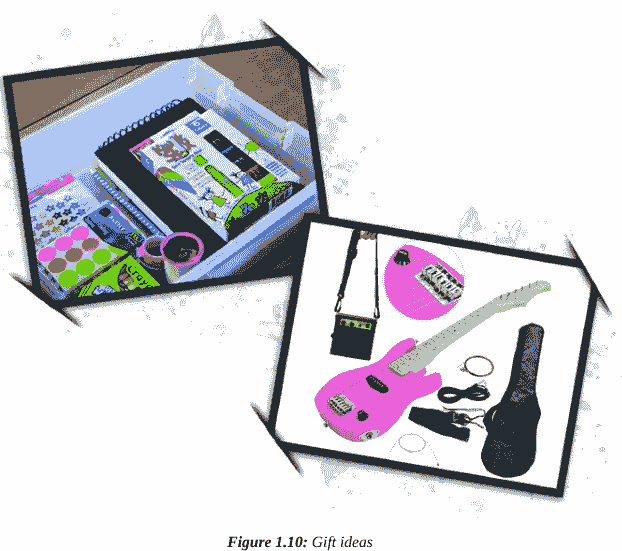

图 1.10：礼物创意

## 测试

利用反馈来优化你的选择，并做出必要的调整。

我们根据莉莉的兴趣挑选了我们认为她会喜欢的最佳礼物，但结果却并非如此。这就是为什么测试和反馈阶段至关重要——它能让我们直接听到莉莉自己说喜欢什么。一个对某人来说看似完美的方案（比如在办公室里效果很好的东西）可能并不是对方真正想要的。为了弥合预期与现实之间的差距，需要直接从莉莉或最终用户那里获取反馈。

来自莉莉的反馈：

莉莉喜欢美术用品，但她已经有很多基础工具了，比如蜡笔、素描本和文具。不过，她非常喜欢贴纸，因为她可以在未来的项目和绘画创意中使用它们。

至于吉他，她虽然喜欢，但只是偶尔弹奏，对高级功能并不熟悉。所以，这两件礼物都是不错的选择，但莉莉无法充分发挥它们的作用。

这就像玩一幅缺了几块拼图的拼图——几乎完成了，但又不完整。为了确保莉莉能最大限度地利用这份礼物，我们需要找到她真正会使用并完全享受的东西。这说明直接听取莉莉的反馈、更好地了解她的偏好和需求是多么重要。

## 迭代——迭代——再迭代

完成第 5 步并不意味着整个流程就此结束。有时，你可能会发现有必要回到第 3 步去构思更多想法，或者回到第 4 步去制作不同的解决方案。关键在于保持灵活，并愿意在需要时重新审视之前的阶段，以找到最佳结果。

现在，我们有了反馈，让我们利用它来优化选择，并做出必要的调整。我们将重新回到构思阶段，快速修改我们的原型。

针对莉莉的情况，送她乐器不是最佳选择。相反，我们可以让她的美术套装更完善。我们可以添加颜料、一本学习新绘画技巧的书，或者一些可以配合她现有美术用品使用的手工活动。

此外，附上指导说明或创意项目点子，例如绘画挑战或 DIY 手工，可以进一步提升她的体验。这些提示可以激发她的想象力，鼓励她探索新的艺术技巧。

通过关注莉莉热爱和喜爱的事物，我们可以创造一份能激发她创造力并带来快乐的礼物。这就是设计思维的神奇之处——确保我们的想法符合我们所设计对象的真实需求。

以下是一些符合设计思维方法的具体礼物创意：

## 美术与手工套装：


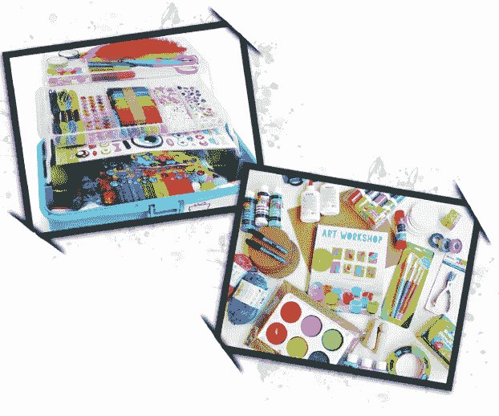

图 1.11：反馈后的礼物创意

万岁！你已经到达设计思维流程的终点线……还是没有？

设计思维并不是一次性的事情——它是一段不断演进的旅程。它就像一场永无止境的冒险，因为这个过程是流动的，并且会不断循环往复。

来听听重点：你是在为有真实需求的真实人群设计，而不是为完美世界里的机器人设计。你的用户总会有挑战，而你也总需要找到帮助他们的方法。这就是为什么我们建议你将用户研究、问题解决、创意头脑风暴、挑选解决方案和测试的循环融入你的设计常规中。这样，你就能始终与用户需求保持一致，并随着时间的推移不断改进你的设计。

以下是一些与设计思维方法相契合的其他具体礼物创意：

- **科学实验套件：**
  - 制作一套包含材料和说明的套件，用于有趣且富有教育意义的实验。
  - 包含试管、放大镜、安全护目镜和实验手册等物品。
  - 强调动手学习和对科学概念的探索。

- **教育类桌游：**
  - 选择一款将乐趣与学习相结合的桌游，例如基于数学的游戏、地理问答或策略游戏。
  - 寻找能够鼓励批判性思维、问题解决和团队合作的游戏。

- **编程或机器人套件：**
  - 选择一套适合初学者的编程套件或机器人套装，以有趣的方式介绍编程概念。
  - 寻找附带易于遵循的说明且能够制作项目（例如搭建简单机器人或编写游戏）的套件。

## 其他考虑

以下是一些额外的考虑因素：

- **年龄适宜性：** 确保礼物适合孩子的年龄和发育阶段。
- **安全性：** 考虑礼物的安全方面，例如无毒材料和适合年龄的复杂程度。
- **长期参与度：** 目标是提供持续参与和学习机会的礼物。
- **包容性：** 考虑多样化的兴趣和偏好，以确保礼物对所有孩子都具有包容性。

通过遵循这些步骤，学生或送礼者可以用周到且以用户为中心的心态来选择 7 至 12 岁儿童的礼物，确保所选礼物不仅有趣，而且富有启发性并符合孩子兴趣。

## 设计思维的未来

设计思维流程的未来看起来光明而令人兴奋，其原则在解决复杂问题和推动各行业创新方面变得愈发重要。以下是我们可以期待的内容：

- **以人为本的解决方案：** 设计思维将继续关注人们的需求、情感和体验。随着技术的进步，创造能与用户在个人层面产生共鸣的产品和服务将变得更加重要。这意味着以同理心和理解力进行设计，以创造有意义且影响深远的解决方案。

- **协作与多样性：** 设计思维在协作和多元视角中蓬勃发展。未来，我们将看到更多跨学科团队共同工作，带来各种技能和背景。这种多样性激发创造力，并带来更具创新性的想法。

- **人工智能与数字化转型：** 人工智能和机器学习将极大地改善设计流程，提供数据洞察、自动化任务并预测趋势。设计师将利用人工智能更好地理解用户需求并创造个性化体验。随着数字技术的发展，设计思维将适应以创造流畅且用户友好的数字体验、解决隐私和安全问题，并通过人工智能增强用户互动。

- **可持续性与社会影响：** 设计思维将在应对气候变化和社会不平等等全球挑战中发挥关键作用。将更强调创造可持续解决方案，以最小化环境影响并促进社会公平。企业将把社会责任融入其设计流程，旨在为世界带来积极改变。

- **敏捷性、迭代与数据利用：** 设计思维的未来


将以敏捷性和对数据的强依赖为特征。公司将采用快速原型设计和迭代测试，以便根据用户反馈迅速调整。这种灵活的方法，结合利用大数据和分析，将使设计师能够通过理解用户行为和偏好做出明智的决策。持续的反馈循环将在设计过程中建立，以收集用户输入，确保设计能够根据真实的用户体验不断完善和改进。

- **全面整合与采纳：** 设计思维将成为跨学科教育的标准组成部分，从商业和工程到医疗保健和教育。更多组织将采纳设计思维方法论，不仅在产品设计中，也在战略、领导力和组织文化中。
- **设计教育演进：** 随着设计思维变得更加普及，教育将不仅关注技术技能，还将关注同理心、沟通和协作等软技能。通过在线课程、工作坊和专业发展进行持续学习，对于设计师保持对新工具、技术和方法论的了解至关重要。
- **虚拟现实和增强现实：** 随着 VR 和 AR 技术成熟，设计思维将探索创建沉浸式和交互式体验的新可能性。从虚拟产品原型到医疗保健和教育中的增强现实应用，这些技术将为创新设计开辟新的前沿。

本质上，设计思维的未来是关于将人置于创新的中心，拥抱多样性，负责任地利用技术，并在社会中推动积极变革。这是一个创造力、同理心和协作引领产生真正改变世界的解决方案的未来。

## 设计思维工具：快速指南

设计思维过程有各种各样的工具，其中一些是免费的，而另一些则需要付费或会员资格。想象一个装满软件、方法和技术的工具箱，它们激发创新并以人性化的方式解决复杂问题。这些就是设计思维工具，问题解决的魔杖，将用户置于最前沿。

在这个设计思维的世界里，一切都关乎同理心、创造力和团队合作。想象一下创建用户画像，绘制用户旅程，深入研究同理心地图，并释放头脑风暴和原型制作的力量。这些工具不仅仅是小玩意；它们是团队深入挖掘、理解用户需求并打造真正产生差异的解决方案的催化剂。

### 创建用户画像

当你创建用户画像时，你基本上是在为你的产品或服务发明代表不同类型用户的角色。这些用户画像帮助你理解你为谁设计，他们需要什么，以及他们可能会如何使用你所创造的东西。这就像创建一群角色来指导你的设计决策。

### 用户映射

用户映射就像为你的用户旅程创建一张路线图。你在绘制他们与你的产品或服务互动时所采取的每一步。这有助于你识别痛点、愉悦点以及改进机会。这有点像跟随你的用户进行寻宝，以发现他们真正想要的东西。

### 同理心地图

同理心地图是帮助你走进用户鞋子的工具。它们就像通往他们内心和心灵的窗口，展示他们的感受、想法和行为。通过填写同理心地图，你可以深入了解是什么驱动你的用户，从而能够怀着同理心和理解进行设计。

### 头脑风暴

头脑风暴就是让你的想法自由奔放。这是一个创意环节，你和你的团队尽可能多地提出想法，无论它们乍看之下多么疯狂或不切实际。这就像一场头脑风暴风暴，创造力的闪电可能带来突破性的解决方案。


我们将在接下来的章节中深入探讨这些技术。

把设计思维工具想象成团队打开问题的秘密酱料，通过用户的眼睛看问题，并创造出不仅有效而且有意义的解决方案。它是创新世界中成功的终极配方。

## 设计思维工具的益处

设计思维工具就像问题解决的超级英雄工具腰带！它们是让创意过程更令人兴奋、更有效的秘密酱料。想象一下拥有一根魔杖，激发你的创造力，让想法前所未有地流淌。这些工具还能帮助你更好地理解他人，就像一副特殊的眼镜，让你透过他们的眼睛看世界。当团队中的每个人都使用这些工具时，就像为协作解锁了超能力。想法相互碰撞、被打磨，并在共同努力下变成真正令人惊叹的东西。

但这还不是全部。设计思维工具还能让你测试和改进想法。就像拥有一颗水晶球，能在你甚至还没制作之前就看到未来，知道某件事是否可行。你可以制作原型、试用它们，并根据真实反馈让事物变得更好。它们也不仅适用于小型项目；这些工具可以通过将其分解为可管理的部分来解决大而复杂的难题。

使用在线设计思维工具可以帮助组织你的想法并为创新产品开发规划路径。因此，把设计思维工具想象成你在创造令人赞叹之物冒险旅程中的得力助手！

## 免费设计思维资源

免费的设计思维工具包存在吗？即使它们可能不提供付费版本的所有功能，使用零成本的设计工具对于小型团队或希望在做出承诺前先探索软件的人来说也是理想的。

以下是一些可用于创建用户画像、用户映射、同理心地图以及为设计思维流程促进头脑风暴的免费工具：

- **Canva：** Canva 提供用于创建用户画像的模板。你可以自定义这些模板以代表不同的用户类型、他们的需求和偏好。
- **Miro：** Miro 是一款多功能的在线白板工具，非常适合用户映射和同理心地图。你可以创建虚拟白板、添加便利贴，并与团队实时协作。
- **Empathy Map Template：** 这是一个简单且免费的在线模板，你可以打印出来或数字使用。它引导你了解用户看到、听到、思考和感受的内容。
- **MindMeister：** MindMeister 是一款免费的思维导图工具，非常适合头脑风暴会议。你可以协作创建思维导图、记下想法并将其组织成类别。

这些工具可以成为你设计思维流程的绝佳起点，为理解用户和产生创新想法提供基础。

## 结论

当我们到达本章的结尾时，我们已经探索了一种创建以用户为中心体验的强大方法。设计思维不仅仅是一系列步骤；它是一种把用户放在首位的思维方式。我们已经看到同理心用户、产生创意想法、制作解决方案原型并对其进行测试以改进的重要性。这一过程不仅适用于设计师——它适用于任何想要创建真正满足用户需求的产品和服务的人。

那么，收获是什么？让我们记住始终从理解用户视角开始。通过对他们产生同理心，我们可以发掘出推动设计决策的宝贵洞察。然后，让我们拥抱头脑风暴中的创造力，跳出思维定式，提出创新解决方案。原型制作帮助我们快速将这些想法变为现实并与用户一起测试以获取反馈。这种迭代过程确保我们能根据真实世界的洞察不断完善和改进设计。

展望未来，让我们保持好奇、开放思想，并渴望从用户那里学习。设计思维不仅仅是一个流程；它是一种可以改变


the way we approach design. So, as we close this chapter, let us continue our journey with enthusiasm, empathy, and a commitment to creating user-centric designs that make a difference. The next chapter is a guide that explores the details of UX design, including different strategies, problems designers face, and new ideas.

## Key Terms

- **User Experience (UX) Design:** The process of creating products that are easy and enjoyable for people to use, considering their needs and emotions throughout the design process.
- **User Interface (UI) Design:** The visual and interactive aspects of a product, focusing on how it looks, how users interact with it, and how it responds to their actions.
- **Graphical User Interface (GUI):** A visual way of interacting with computers, introduced in the 1970s, featuring elements like windows, icons, menus, and pointers (WIMP).
- **Usability:** The ease with which users can interact with a product to achieve their goals effectively and efficiently.
- **Accessibility:** The extent to which a product can be used by individuals with diverse abilities and characteristics, including those with disabilities.
- **Design Thinking:** A problem-solving approach that prioritizes human needs and involves iterative ideation, prototyping, and testing to create innovative solutions.
- **Empathy:** The ability to understand and share the feelings and experiences of others, crucial for designing solutions that truly meet user needs.
- **Prototype:** A preliminary version of a product or solution used for testing and validation purposes, ranging from low-fidelity sketches to interactive digital models.
- **User Testing:** A method of gathering feedback from real users to evaluate the usability, effectiveness, and satisfaction of a prototype or product.
- **Problem Statement:** A concise description of the challenge or opportunity that a design team aims to solve or leverage through the design process, providing focus and direction for ideation and solution development.
- **Iterative:** A process characterized by repetition and refinement, where ideas, designs, or solutions are continuously improved through cycles of testing and feedback.
- **Creative Problem-Solving:** A method of addressing challenges or opportunities by generating innovative ideas and exploring unconventional solutions, often associated with design to changing circumstances or feedback, a critical skill in non-linear processes like design thinking.
- **Digital Transformation:** The integration of digital technologies into all aspects of business operations, leading to fundamental changes in how organizations operate and deliver value to customers.
- **Agility:** The ability to respond quickly and effectively to changing circumstances or opportunities, often associated with iterative and adaptive approaches to problem-solving.
- **Virtual Reality (VR) and Augmented Reality (AR):** Technologies that create immersive, computer-generated environments (VR) or enhance real-world environments with digital elements (AR), offering new possibilities for design and user experience.
- **Brainstorming:** A creative technique for generating a large number of ideas or solutions through open and spontaneous discussion within a group.
- **User Mapping:** The process of creating visual representations of users’ interactions with a product or service, often used to identify opportunities for improvement and innovation.
- **Persona:** A fictional representation of a target user group, based on demographic, psychographic, and behavioral characteristics, used to guide design decisions and strategies.

- Roles of UX Designers
- User-Centered Design
- Benefits of User Centered Design
- User-Centered Design Process
- User-Centered Design versus Design Thinking
- Factors that Influence User Experience

## User Experience (UX)

User Experience — how people interact with a product or service. In other words, every little tap, click, or swipe as you use an app or a website. But it is not just how it looks; it is also about how it feels and how easy it is to use.

UX Design — the behind-the-scenes magic that makes using something smooth and enjoyable. Designers plan everything to the smallest details so that the use of a product is as seamless as can be. What is the goal for them? To give users an experience that feels natural, efficient, and relevant.

This sounds awesome, but how does one become a UX designer, and what exactly do they do? They do this by utterly effectively understanding the individuals who will use their product. They think about what the user requires, desires, and becomes irritated with. It’s not only the user; they consider what the company desires to achieve as well.


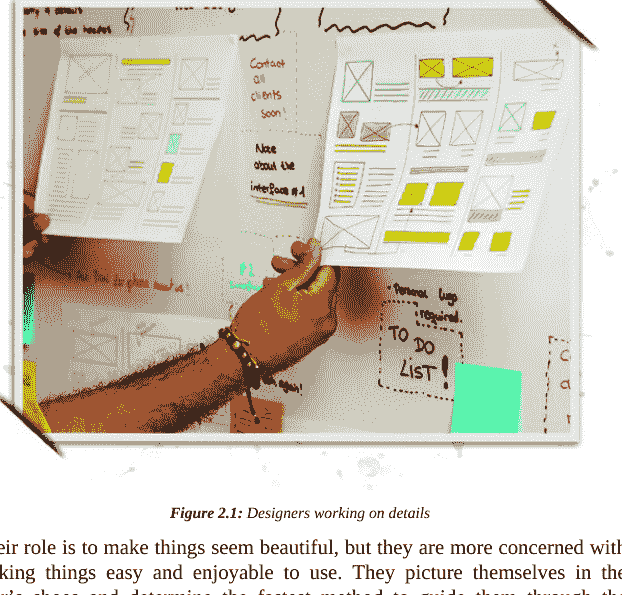

图 2.1：设计师正在精心打磨细节

他们的职责是让事物看起来美观，但他们更关注的是让事物易于使用且令人愉悦。他们设身处地站在用户的角度，确定引导用户使用产品的最快方式。从开始到结束，整个过程让人感觉像是一场胜利。

> 没有产品是一座孤岛。产品不仅仅是产品本身，它是一系列连贯、集成的体验。请全面思考产品或服务的所有阶段——从最初意图到最终反思，从首次使用到帮助、服务与维护。让这些阶段无缝协同工作。
> 
> — 唐·诺曼，“用户体验”一词的创造者

## UX 背后的故事

回想一下你上次使用的应用或网站。你可能觉得它有些令人困惑，或者它非常易于浏览。这正是用户体验（UX）发挥作用之处。

当技术刚开始腾飞时，我们开始看到各种令人惊叹的设备和网站，人们逐渐认识到：可用性与外观同样重要。

因此，专家们开始研究人们如何使用技术。他们考察了诸多因素，如按钮的理想摆放位置、能带来愉悦感的颜色，甚至页面加载的速度。就这样，UX 诞生了！

如今，企业高度重视用户体验（UX），因为他们希望我们乐于使用他们的产品。他们希望我们享受浏览应用的乐趣，或能在网站上快速找到所需信息。这就是你会经常听到“UX 设计师”的原因——他们负责确保我们的技术交互顺畅高效。

## UX 设计的重要性

回想一下 2010 年左右一切开始数字化的时候。那时，简化用户操作变得至关重要。后来新冠疫情来袭，向我们展示了数字医疗的巨大潜力。这并不仅仅是花哨的小工具；而是要让技术真正服务于人。这场疫情或许正是我们需要的强大推动力，促使我们用计算机解决全球健康问题。

你是否曾迷失在网站的“兔子洞”里，不知不觉点击浏览数小时？或者在某个设计糟糕的网站上，连该点哪儿都搞不清楚？这些都与用户体验设计息息相关。因此，与其沮丧地挠头，不如让我们深入探讨如何通过以用户为中心的设计来让产品脱颖而出，以及为什么 UX 设计对用户留存和业务成功至关重要。

让我们来看几个证明 UX 重要性的关键点：

- **满足用户需求：** 想象一下，你使用的应用或访问的网站似乎每次都像是专门为你定制的。有效的 UX 恰恰能做到这一点。它就像一位在线私人助理，确切了解你的需求，并让你轻松获取所需内容。当用户感到自己的需求得到满足时，他们会更加满意，更愿意购买（转化），也更愿意再次回来（留存）。

- **创造积极体验：** 想想你偏爱的产品或品牌，你很可能会因为它带给你的感受而喜爱它，而不仅仅是因为它提供的功能。优秀的用户体验设计就是要让人感觉良好。这就像一次愉快顺畅的旅程，而非颠簸坎坷的旅途。出色的用户体验会增加用户留下来并成为品牌忠实拥护者的可能性。

- **建立关系：** 你是否曾觉得某个企业真正懂你？这正是他们绘制的客户旅程地图所带来的效果。为你的产品或网站创建用户体验（UX）路线图，与绘制这样一幅地图如出一辙。它关乎建立忠诚与信任，而不仅仅是促成销售。当用户感到自己被珍视和理解时，他们更愿意长久相伴。

- **降低成本：** 开展营销活动、频繁更新功能、修复错误，这些都可能成本高昂。然而，有效的 UX 能够降低这些开支。通过打造一个易于使用、易于理解的产品，你将来会节省大量时间和金钱。此外，满意的客户更有可能把你推荐给他人，从而为你省下不少广告费用。

- **提高投资回报率（ROI）：** 提高投资回报率就像让你的钱发挥更大的价值。当你优先考虑卓越的用户体验时，你实际上是在投资用户的愉悦与满足。而且，满意的客户更有可能购买商品、将你的产品推荐给朋友，并在长期内持续光顾。因此，你最终会从投资中收获更丰厚的回报。

- **留下深刻印象：** 很多时候，我们不必重新发明轮子，而是要改进自己已经拥有的轮子。以用户为中心的设计正是个中关键。通过优先考虑用户并真正了解他们的需求，你可以将一个普通的想法变成令人惊艳的杰作。这就像给老房子刷上一层新漆；虽然并不是全新的，但看起来确实焕然一新。


**提供直觉体验：** 你是否曾经使用过一款应用或网站，感觉它立刻就适合你？那是因为它是为你量身打造的。让事物变得直观是优秀用户体验设计的基石，能让人们轻松地完成任务，无需过多思考。这就像驾驶一辆所有开关和按钮都各就各位的汽车一样。当使用起来舒适且熟悉时，用户更有可能留下来。

用户体验本质上是为了提高产品对用户的可用性，而不仅仅是让它们看起来美观。如果做得好，每个人都能从中受益。

## 用户体验设计的 4C 原则

在本节中，我们将深入探讨 UX 设计领域的 4C 原则。这些功能类似于创造卓越用户体验所需的构建要素。可以把它们想象成你打造理想网站或应用时，常用配方中的秘密成分。

作为 UX 设计师，我们的首要目标是打造用户友好的界面、引人入胜的交互和吸引眼球的布局，从而提升用户体验。在设计过程的早期阶段，牢记一些重要的设计概念至关重要。这就是用户体验设计中的 4C 原则发挥作用的地方：

- 一致性
- 连续性
- 语境
- 互补性

让我们逐一探讨这 4C 原则。

## 一致性

就像你最爱歌曲的稳定节拍，或是日常作息中可靠的节奏，一致性在 UI/UX 设计中非常重要。它归结为确保网站或应用在整体上保持一致的行为、感受和外观。如果一个按钮每次点击时行为都不同，那将会是一片混乱。当一切保持一致且熟悉时，用户会感到体验更加愉悦和直观。

### 示例

让我们以 Instagram 这样的社交应用为例。无论你身处应用的哪个页面，底部的导航栏、右上角的个人资料图标以及中间的动态流都保持相同的布局。用户在探索应用的各种功能和区域时，会因这种一致性而受益，感到轻松和自信。

一致性不仅关乎外观，还影响功能。例如，如果点击照片总是全屏打开，用户就能轻松浏览并迅速知道会发生什么。同样地，只要按钮在整个应用中的外观和功能保持一致，用户就能毫不犹豫地进行操作。

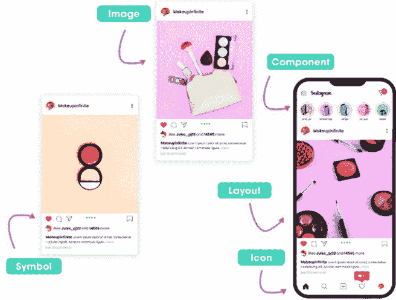

图 2.2：Instagram 应用的一致性

简而言之，一致的 UI/UX 设计能改善用户体验，并增加用户对产品的信任。它创造出无缝、可靠且精致的体验，如同欣赏一场精彩的音乐演出。当设计保持一致性时，用户能更轻松地浏览和享受数字产品。

## 设计一致性的力量

网页开发公司可以从用户体验中一致的设计元素中受益匪浅。它们通过营造可靠舒适的氛围来提升用户体验。想象一下走进你常去的咖啡店，你无需思考就能找到一切。

- 一致的设计元素就像为用户充当“语言翻译器”，当用户反复遇到相同的模式和视觉信号时，他们就能轻松、无缝地进行导航。一切都让他们感到舒适自然，无需停下来思考摸索。因此，他们的心智负担会减少，从而能专注于预期的任务，而不是被复杂的设计所困扰。
- 一致性还能培养信任和信心。如果你最亲密的朋友每次出现都换一个新发型，你可能会开始怀疑自己是否还能依赖他们！设计也是如此；当元素的外观和功能保持一致时，用户就会感到放心。
- 苹果、谷歌和 Meta（原 Facebook）等知名公司深谙一致性的价值。想想你的 iPhone 多么易用和直观，或者谷歌的应用似乎都使用同一种设计语言。这一切都是为了塑造强大的品牌形象，并为用户营造一个亲切的环境。这些企业证明，一致性改变了用户理解和品牌认知的格局——它不仅仅是“锦上添花”。

## 连续性

就 UI/UX 设计而言，连续性就像一段没有任何停顿或障碍的顺畅旅程。确保访问者能够轻松地在……之间导航


在网站或应用程序的各个部分之间浏览时不会感到困惑或迷失方向，这才是关键。如果你正在阅读一本书，每翻一页文字和图片的颜色和排列都突然改变，你会觉得很惊讶，对吧？在数字世界中，连续性防止了这种情况的发生。

## 示例

以亚马逊这样的电商应用为例。连续性确保了当你在笔记本电脑上浏览产品，然后切换到手机完成交易时，你的搜索历史、偏好设置和购物车都能轻松转移。因此，你不必从头开始，也不用浪费时间去寻找已经找到的商品。

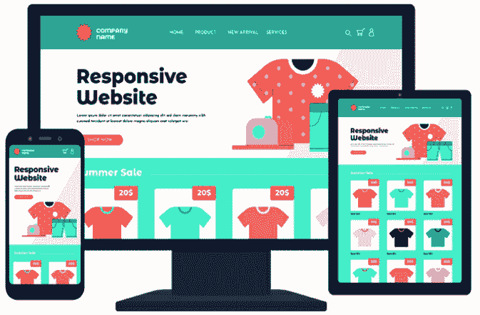

图 2.3：数据在各种设备之间无缝传输

**另一个例子**是在 YouTube 上观看视频。连续性保证了如果你在电脑上暂停视频，然后在手机上打开 YouTube 应用，你可以从离开的地方继续观看。这消除了寻找视频或滚动查找位置的需要。

从本质上讲，UI/UX 设计中的统一性保证了无论使用什么平台或设备，用户体验都保持一致。用户无需重复执行任务或自行查找信息。得益于连续性，数字世界的移动是无缝且愉悦的；就像随着精心编排的舞蹈而跳舞一样。

## 连续性的力量

在 UX 设计中使用连续性有几个优势，它们极大地改善了用户体验。连续性使网站或应用在各部分之间的过渡变得流畅无缝，为消费者提供一致且易于使用的体验。由于其流畅的流程，用户可以与产品的功能进行交互，更轻松地浏览，并以最少的困难实现其目标。正因如此，用户更有可能对体验感到满意和投入，从而提高用户忠诚度和留存率。

- 增强用户参与度和留存率是连续性的主要好处之一。当用户能够轻松无缝地在平台、设备或任务之间切换时，他们更有可能更长时间地坚持使用产品。通过鼓励客户尝试不同的功能和功能，连续性有助于用户更频繁地与产品互动，并随着时间的推移与之建立更牢固的联系。

- 连续性提高了用户交互效率。通过消除用户在切换触点时重复操作或重新输入信息的需要，连续性简化了用户旅程并降低了不必要的摩擦。这种效率不仅节省了用户的时间和精力，还通过提供更轻松、无忧的体验来提高他们对产品的整体满意度。

- 连续性对于建立对品牌或产品的信心和信任至关重要。当用户在各种渠道和交互中始终如一地体验到同样的事物时，他们会感到安心，并增强对产品可靠性的信心。当用户可以依靠流畅一致的体验时，他们更有可能将产品视为可靠和值得信赖的，这随着时间的推移可以增强品牌忠诚度和倡导。

简而言之，一致的 UX 设计对于积极持久的用户体验是必要的。连续性确保了在多个触点和交互中保持连贯性和一致性，从而最大化 UX 设计的有效性，并有助于产品或服务的整体成功。

## 上下文

上下文是用户交互意义的重要因素。用户需要与他们的活动相关且引人入胜的信息才能获得积极的体验。在此上下文中，内容是指文本、图像、视频和可点击元素。归根结底，这一切都取决于为消费者提供准确的信息，在他们身上唤起情感，并帮助他们实现目标。

你是否留下，很大程度上可能受到你所看到的内容的影响。当设计精良时，它可以吸引你的兴趣，诱使你在网站或应用上停留更长时间，并鼓励你回来。然而，如果它杂乱无章或毫无意义，它可能会让你感到恼火，并让你想要离开。网站或应用的质量和相关性会影响用户对其的看法以及他们对它的享受程度。


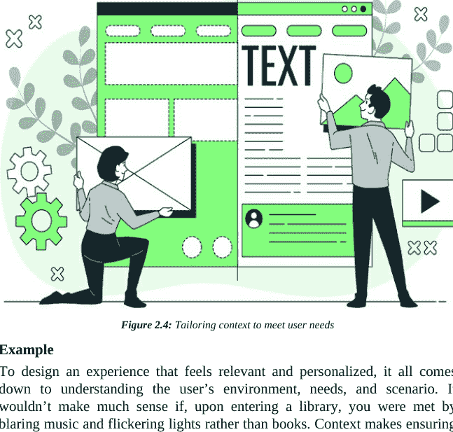

Figure 2.4: Tailoring context to meet user needs

## Example

要设计一种相关且个性化的体验，关键在于理解用户的环境、需求和场景。如果进入图书馆后迎接你的不是书籍而是震耳欲聋的音乐和闪烁的灯光，那就毫无意义。上下文确保应用程序或网站的设计与用户的环境相融合，从而促进理解和交互。

**另一个例子**是像 UberEats 这样的外卖应用。在这里，用户的地理位置、一天中的时间和他们的偏好都被视为上下文的一部分。当用户打开应用时，客户希望看到附近正在营业的餐馆，并提供符合其饮食要求的菜系。软件通过根据用户的上下文显示适当的选项，帮助用户更轻松地识别和订购食物。

简单来说，上下文就是了解人们需要什么并修改设计，为他们提供更量身定制和直观的体验。通过考虑用户偏好、时间、地点等变量，设计师可以创造出感觉独特和定制的体验。结果用户会更快乐、更投入。就像享用一顿完全符合你心意的餐点一样，深思熟虑的设计会让用户感到被重视和被理解。

## Power of Context

在 UX 设计的 4C 框架中，上下文提供了众多优势，大大改善了用户体验。

- 其主要好处之一是能够提高用户交互的相关性和意义。设计师可以通过考虑用户访问时的上下文，根据用户的独特需求和偏好定制网站或应用的功能和信息。例如，根据用户当前位置提供个性化预报的天气应用，比通用预报提供的信息更相关，从而增强和个性化用户体验。
- 上下文对于引导用户旅程并帮助他们有效实现目标至关重要。通过了解用户与产品交互的环境，设计师能更好地预测用户的需求并提供建议或相关信息以提供帮助。例如，电子商务网站根据用户的浏览历史或过往购买记录进行产品推荐，利用了上下文来改善购物体验并提高转化率。
- 通过营造感觉为每个用户量身定制和定制的体验，上下文有助于提高用户忠诚度和留存率。当用户发现功能和内容与他们的兴趣和偏好一致时，他们更倾向于坚持使用产品并日后再次光临。这改善了客户满意度，同时也加强了用户与平台或品牌之间的联系。

上下文使用户交互更高效、有意义且更具针对性，从而提高了 UX 设计的整体有效性。设计师可以通过考虑用户访问产品的上下文并相应地定制体验，创造出对消费者更有价值、更具吸引力和更具回报的体验，最终带来更高的留存率和忠诚度。

## Complementary

UI/UX 设计中的互补元素是功能组合，当结合在一起时会产生美味且平衡的餐食。关键在于确保设计的各个元素协同工作，以提升整体用户体验。如果你在装饰房间时，房间里的每件家具都与其他东西冲突，那看起来就不会很友好，你明白我的意思吗？为了使网站或应用程序具有凝聚力和视觉吸引力，每个元素必须与其他元素配合良好。我们称之为互补设计。

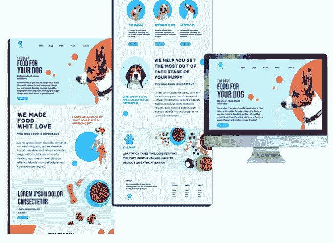


- **更高的可记忆性：** 用户更有可能记住组织良好且协调统一的设计。当设计的许多组件和谐地协同运作时，客户更有可能回忆起使用产品的体验，并在日后再次回来。
- **更强的品牌识别：** 通过突出品牌的价值和身份，互补性设计有助于将产品与竞争对手区分开来。颜色、字体和图像的持续使用创造了一种统一的品牌形象，与消费者产生共鸣，并逐渐培养信任和忠诚度。
- **更高的用户愉悦度：** 互补性设计最终会带来更高的用户愉悦度。当客户获得视觉愉悦且全面完善的体验时，他们更有可能高度评价产品并向他人推荐。这提高了客户满意度，并鼓励了良好的口碑推荐。

总之，用户体验设计的四个 C——互补性设计、可理解性、可记忆性、品牌识别和用户满足感——都能提高参与度、理解力和用户满意度，进而提升产品或服务的整体成功率。

## 4C 总结

总之，用户体验深受一致性、连续性、情境性和互补性这些基本理念的影响——它们通常被称为 UI/UX 设计的 4C。设计师通过优先考虑这些概念，可以创造出具有吸引力且用户友好的界面，从而带来成功的业务成果。

设计师在将这些概念融入设计方法时，应牢记目标受众的特殊需求和偏好。要在创建成功满足用户需求的数字体验方面保持卓越，需要跟上行业趋势和最佳实践，而用户体验设计领域的行业趋势和最佳实践在不断发展变化。

从本质上讲，通过紧跟行业创新并采用 4C，设计师可以自信地驾驭 UI/UX 设计不断变化的领域。这最终将带来令人愉悦和满意的用户体验。

## 实施 4C 的挑战

由于多种原因，将 4C 应用于 UI/UX 设计可能具有挑战性。要保持设计的所有元素（如布局、颜色和字体）的一致性可能很困难。另一个挑战是确保用户在沟通和导航过程中的每一步都知道该做什么。

此外，通过流畅的任务转换和快速的信息获取为客户提供便利，需要周密的规划和执行。

实施 4C 很困难，因为它需要理解用户的需求和偏好，而且创建与整体设计保持一致的相关且引人入胜的内容可能很困难。克服这些挑战通常需要创造力、对细节一丝不苟的关注，以及对用户行为和设计原理的深刻理解。

## C-P-S 假设

你是否曾在试图解决问题时遇到过障碍？这是不满的一个常见来源，尤其是在商业领域。有时，标准的问题解决方法就是不起作用。即使你面临的障碍看似无法逾越，你仍然需要找到前进的道路。在此时，有必要进行创造性和非常规的思考，以正面解决问题。

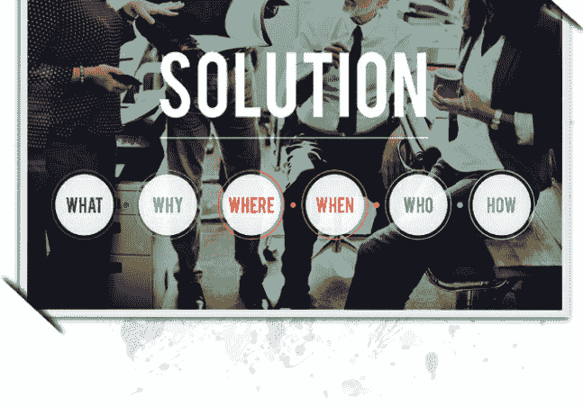

图 2.6：探索针对挑战性问题的多样化解决方案

所谓 CPS，是指通过将创造性问题解决（CPS）应用于 x（正在处理的特定问题或挑战）并提出独特解决方案的系统性过程。从根本上说，CPS 包括确定问题、产生原创想法、评估可能的解决方案，并将最佳方案付诸实践。该过程的第一步是准确定义手头的问题，理解其根本原因，并确定预期的结果。接下来，个人或团队不会受到限制或批评，而是通过头脑风暴会议或其他创造性过程产生各种各样的想法。在收集到各种各样的想法之后，每个解决方案都会根据实用性、有效性和可行性等标准进行评估。借助这种审查，可以确定最有前景的概念，随后将其转化为可行的方案。

最后，为了妥善解决问题，选定的解决方案随后被……


付诸实践、评估并按需改进。CPS 可用于各种场景，包括商业、技术、人际交往和个人问题。它能够提升创造力、创新能力和高效的问题解决技巧。

## 七步法

尽管创造力作为一种问题解决技巧已有数十年历史，但直到西德尼·帕内斯（Sidney Parnes）和亚历克斯·奥斯本（Alex Osborn）才将其正式化为创造性问题解决（CPS）。这一由推广头脑风暴的奥斯本和帕内斯共同提出的创造性问题解决过程（CPSP），自20世纪50年代以来，一直在纽约布法罗学院（Buffalo College）的国际创造力研究中心教授。

尽管起源如此，CPS 已经演变成多种方法，每种都有各自的技巧和策略。然而，CPS 的核心通常包含七个简单而有效的流程，具体步骤如下：

- 1. 识别问题
- 2. 研究问题
- 3. 提出创造性挑战
- 4. 探索想法
- 5. 评估想法
- 6. 制定行动计划
- 7. 采取行动

### 1. 识别问题

找出问题的根源，就像侦探寻找线索来解开谜团一样。在尝试解决问题之前，必须首先识别问题的真正本质。设想你正在修理厨房漏水的龙头。你最初可能会认为问题只是水龙头在漏水。然而，仔细检查后，你会发现漏水可能是多种潜在问题造成的，例如管道松动或垫圈老旧。

你需要向自己，或者也许是朋友或家人，提出一些问题，以追根究底并确定根本原因。从一些简单的问题入手，例如“问题出在哪里？”或“我想要达到什么目的？”是一个好的开始。接着，通过提出“是什么导致了这个问题？”或“为什么会这样？”等问题进一步深入。反复询问“还有别的原因吗？”或“还有别的什么吗？”来探究多种观点和方面。

其他需要考虑的问题包括：“我真正想要完成什么？”以及“我面临哪些障碍？”思考你的长期目标，以及解决这个问题将如何有助于实现这些目标。你还可以考虑其他人（例如朋友或同事）在解决类似问题时采用的方法和途径。

如果你花时间仔细评估情况并提出相关问题，你将能更清晰地理解手头的问题。就像侦探拼凑线索一样，你会更善于找到能够解决根本问题并产生积极结果的方案。

### 2. 研究问题

在创造性问题解决中，调查挑战就像去异国他乡寻找失落的宝藏。你首先要尽可能多地了解这个问题。这可能包括阅读书籍或文章、与遇到类似问题的人交流，甚至进行实验以更好地理解情况。假设你想找出花园里植物生长不良的原因。你可以研究许多影响植物生长的因素，例如水分含量、光照和土壤质量。

收集到足够的数据后，你开始对其进行分析，以发现趋势或规律。这有助于你理解问题的根本原因。例如，如果土壤非常干燥，或者植物得不到充足的阳光，你可能会注意到它们在枯萎。

### 3. 提出创造性挑战

当你收集到所有必要信息后，就该把问题转化为一个提问。这个提问应该直截了当，直击问题的核心。同时，它还应该具有灵活性，允许提出广泛的建议和想法，而不设定任何僵化的评估标准。

举例来说，假设你在寻找减少城市交通拥堵的策略。你可以提出一个更聚焦的挑战性问题，例如“我们如何鼓励更多人在高峰时段使用公共交通？”而不是像“我们如何解决交通问题？”这样宽泛的问题。这是一个清晰、有针对性的问题，能够容纳各种想法和思路，从而促进创造力。

### 4. 探索想法

选择一个创造性任务，然后留出一些安静的时间，想出至少三十个想法，无论它们是否能直接解决挑战。你可以独自进行这场探索，也可以邀请家人或朋友一起参与头脑风暴。

无论你选择哪种策略，都要把你的想法写在纸上。无论你是在电脑上打字、列成清单，还是绘制思维导图，最关键的是遵循一些基本准则，而不是选择特定的方法。

首先，记下你脑海中闪现的任何想法，无论它多么离谱或古怪。忽略你内心的评判之音，把所有想说的话都写下来，因为它有时会阻碍我们的创造力。在与他人进行头脑风暴时，友善和鼓励他人的想法至关重要。否定会扼杀原创性，因此要保持乐观和开放的态度。如果你独自进行头脑风暴，要推动自己产生超过三十个想法。在小组讨论中，为了保持节奏，可以考虑设定二十到三十分钟的时间限制。之后，汇总所有建议，并询问是否还有人补充。

记住，你不一定非要在工作场所才能进行头脑风暴。为了获得新想法，试着改变一下环境。也许可以出去散散步，让思绪自由驰骋，或者在家里、花园、你最喜欢的餐厅里找一个安静的地方，等等。

收到你的挑战性问题后，是时候开始思考答案了。永远不要忘记，目标是提出尽可能多的想法

你可以在此时不考虑它们是否可行或实用。你可以通过让问题保持开放且没有评估标准来鼓励问题解决过程中的更大创造性和独创性。

当你尝试各种概念和可能性时，你会开始注意到模式的出现以及可能的解决方案的成形。秘诀在于保持开放的心态，并欢迎你遇到的各种观点。通过创建挑战性问题并探究富有创意的答案，你将很好地找到解决即使是最困难情况的新颖方案。

## 5. 评估想法

探索概念就像踏上一段精神之旅。第一步是头脑风暴，在此过程中你让创造力自由发挥，并写下所有想到的想法，无论多么荒谬。这很重要，因为最出色的想法往往隐藏在那些最初看起来有点奇怪的想法之下。在你记下一些想法后，休息一下。从你的想法中稍作休息可能会帮助你的大脑放松和充电，就像在艰苦的散步中停下来休息一样。

休息后，就该整理你的想法了。你可能会发现有些想法相似或可以结合起来形成更好的想法。这就像把拼图碎片拼在一起形成更大的画面。

接下来，你需要评估你的想法。取决于你在做什么以及哪些想法脱颖而出，你可能准备开始付诸行动。但有时，想法需要更多的工作。这时 SWOT 分析就派上用场了。SWOT 代表优势、劣势、机会和威胁。你将审视每个想法并思考它的优点、可能需要改进的地方、它可能带来的机会以及它可能面临的挑战。

在你对想法进行了思考后，你可以开始实施它们。你可能会决定将几个想法结合起来创造出更伟大的东西，或者你可能只想专注于其中一个。这就像选择你在冒险中要走的路线。记住，探索想法需要创新和开放的心态。所以，不要害怕冒险并发挥你的想象力！

## 6. 制定行动计划

为你的最终问题解决想法制定行动计划，利用创造性问题解决（CPS）方法意味着采取系统的方法将概念转化为可行的行动。将头脑风暴会议中最有前景的概念转化为详细行动计划是下一步。

第一步是将每个概念分解为不同的工作和活动。思考需要完成的任务、负责每项任务的人员以及所需的材料。为了确保解决方案的每个方面都得到覆盖，这一阶段需要精心规划和谨慎处理。

之后，为你的行动计划设定具体的目标和指标至关重要。定义成功并设定可量化的目标，以便你可以监控你的进展。在实施阶段，设定清晰、可实现的目标将使你的团队保持动力和专注。

在制定行动计划时，请考虑实施时间表。为每项任务设定截止日期并将其分解为更小、更可行的部分。这将帮助你保持在轨道上并确保你朝着目标取得进展。

在行动计划阶段，沟通至关重要。确保所有相关方都了解各自的角色和职责以及计划的总体目标。定期的沟通将使整个实施过程中保持信息畅通和步调一致变得更容易。

通过遵循这些步骤并应用创造性问题解决的原则，你可以制定一个强大的行动计划，将你的想法转化为针对手头问题的切实解决方案。

## 7. 采取行动

执行计划意味着逐步将你的想法付诸实践。一开始就分配职责给团队成员，确保每个人都知道什么时候需要做什么。接下来，遵守你制定的时间表，按时完成任务以保持进展。检查

经常检查你的进度，并做出必要的调整。有效沟通对于让每个人了解情况、促进团队合作至关重要。达到目标后要奖励自己，以保持动力。永远不要忘记保持灵活性，并准备好应对意外情况而调整计划。适应性和灵活性是解决问题的关键特质；如果你愿意根据批评和结果调整策略，成功的机会就会增加。通过持续行动并保持对目标的专注，你可以将想法变为现实，并找到当前问题的解决方案。

## 设计师使用创造性问题解决法（CPS）的目的

设计师之所以使用创造性问题解决法（CPS），是因为它提供了一种以创造性且高效的方式解决问题的系统化方法。CPS 促使我们创造性地思考，开发广泛的概念，并考虑多种观点。通过运用想象力，CPS 帮助我们找到那些可能不是显而易见的原创答案。此外，CPS 还强调合作与团队协作，营造一种尊重每个人意见的包容氛围。当我们使用这一策略将复杂问题分解为更小、更易于管理的步骤时，解决起来就会更加容易。最终，CPS 赋予我们以韧性、创造力和信心面对问题的能力，从而产生更好的结果。

## 创造性问题解决法（CPS）与设计思维流程的比较

你在前一章学习了设计流程的各阶段。这与你现在正在学习的 CPS 可能有一些相似之处。在该领域中，UI/UX 设计流程与创造性问题解决法（CPS）之间存在着明显的平行关系。

|  | 创造性问题解决法（CPS） | 设计思维 |
|---|---|---|
| 侧重点 | 在 UI/UX 中，创造性问题解决法（CPS）以提出创造性解决方案为重点来处理设计问题。它通过鼓励设计师跳出固有思维模式、探索新颖概念并考虑多种观点，推动他们克服可用性问题并满足用户需求。对反馈持开放态度。UI/UX 设计通常是一个迭代过程，涉及多轮测试和改进，以确保最终产品成功满足用户的需求和目标。 | 在 UI/UX 中，设计流程通常遵循更正式的框架，其阶段分明，包括构思、研究、原型设计、测试和 |
| 总结 | 总而言之，UI/UX 中的 CPS 强调创造力和创新的问题解决技巧，而 UI/UX 的设计流程则遵循结构化的框架，具有明确的研究、构思、原型设计、测试和实施阶段。这两种方法都旨在创建以用户为中心的设计，但在对创造力的强调以及所使用的具体方法论上有所不同。 |  |

表 2.1：创造性问题解决法（CPS）与设计思维流程之间的差异

## UX 设计师简介

用户体验（UX）设计师，通常被称为数字架构师，负责创建网站和移动应用程序的用户界面与功能。他们的作用类似于应用或网站的问题解决方案！想象一下，你用新的个人理财或预算软件跟踪日常开支。用户体验设计师会确保应用程序直观易用，按钮放置得当，跟踪支出的说明清晰明确。他们会考虑你如何浏览应用，确保你不会感到困惑或烦躁。为了帮助用户更有效地管理财务，他们通常会提供预算管理、交易分类、财务洞察和支出监控等工具。

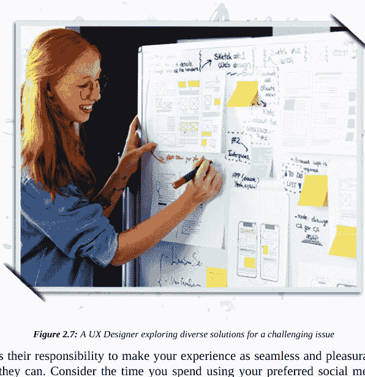

图 2.7：UX 设计师为具有挑战性的问题探索多种解决方案

让用户体验尽可能流畅愉快是他们的责任。想想你花在使用最喜欢的社交媒体应用上的时间。一切看起来都那么显而易见，是不是？这是因为 UX 设计。你能轻松找到正在寻找的内容，按钮也都在你预料的位置。这一切都归功于一位熟练的 UX 设计师。UX 设计师除了关注外观美观之外，也关注功能正常。

简而言之，UX 设计师的职责是打造既高效又易用的数字体验。无论你是网购、使用应用还是访问网站，让生活更轻松、更有趣都是 UX 设计的主要目标。UX 设计师通过运用设计思维和创造性问题解决法（CPS）来创造用户喜欢使用的数字产品。这需要把自己想象成用户，并以他们的

requirements and preferences in mind. And for that reason, in the modern digital environment, user experience designers are crucial. They could be employed by any number of digitally focused businesses, from small start-ups to major tech organizations.

## Roles of UX designers

Depending on their particular responsibilities and areas of expertise, UX designers might hold a variety of roles or titles within the industry. Some typical UX designer types and their roles are as follows:

- **UX Designer:** This is the collective name for a person who creates a product or service’s entire user experience. To guarantee a user-friendly design, they concentrate on comprehending user needs, performing research, generating wireframes and prototypes, and working with other team members.
- **UI Designer:** User Interface, or UI, designers work on creating a product or service’s visual components, like buttons, menus, and images. Their tight collaboration with UX designers guarantees that the interface is intuitive to use and aesthetically pleasing.
- **Interaction Designer:** This professional focuses on creating interactive features for products and services, including micro interactions, animations, and transitions. Their main goal is to develop user interactions that are both intuitive and captivating, thereby improving the user experience.
- **Information Architect:** To facilitate users’ finding of necessary information within a product or service, information architects organize and structure information. To assist users in navigating complicated information environments, they create taxonomies, site maps, and navigation tools.
- **User Researchers:** It is the duty of user researchers to carry out investigations to comprehend the requirements, habits, and preferences of users. They gather information for the design process using a range of research techniques, including surveys, usability testing, and interviews.
- **UX Writer:** UX writers are responsible for creating written content for products and services, including error warnings, user interface text, and onboarding guidelines. They guarantee that the text is understandable, succinct, and easy to use, which enhances the user experience in general.

These are only a handful of the various positions and designations that UX designers may hold. In reality, the precise roles and designations could change based on the project’s nature and the organization involved.

## User-Centered Design

The core idea behind User-Centered Design, or UCD, is creating digital goods with actual users in mind. It places people at the center of the process rather than attempting to infer what they want. To ensure the product fulfils their needs, this entails having direct conversations with users at important junctures. Every customer interaction with a website is like a tiny, meaningful moment. According to UCD, we should carefully examine each of these situations to make sure the user has a seamless and pleasurable experience.

There are four important things to keep in mind with UCD:

- **Visibility:** When users first arrive on your website, can they quickly figure out what it’s all about and how to use it?
- **Accessibility:** Is your website easy for users to access? Can they find what they’re looking for without any trouble? Important action buttons, navigation menus, and search options should be easy to find.
- **Legibility:** Can users read the text on your site easily? It is important that the words are clear and easy to understand.
- **Language:** Is the language on your site easy for users to understand? It is best to avoid using complicated words or phrases that might confuse them. Keep it simple and straightforward.

## User-Centered Design Examples

Consider the well-known e-commerce site Amazon to gain a thorough understanding of user-centered design, or UCD.

- **Comprehending User Needs:** Prioritizing user needs and wants when conducting online shopping is how Amazon starts. They carry out


research to discover the inclinations, purchasing patterns, and problems of people.

- **User-Friendly Interface:** Users can easily find what they’re looking for on Amazon’s website thanks to its simple, user-friendly interface. The search box is easily accessible at the top of the page, enabling customers to look up products with ease. Navigating between departments is made easy for users with the navigation menu’s obvious category organization.
- **Personalization:** To enhance the user experience, Amazon leverages information from previous purchases and browsing habits. By offering personalized product recommendations based on each user’s interests and preferences, they facilitate the process of discovering new things that they may find appealing.
- **Reviews and Ratings:** Product ratings and reviews are available on Amazon to assist customers in making well-informed selections. Before making a purchase, users can read what other people think about a product, which increases their confidence and sense of trust.
- **Convenience:** To make users’ purchasing experiences as easy as possible, Amazon provides options like one-click ordering and quick shipping. They guarantee a hassle-free buying experience by offering a range of payment choices and simple returns.
- **Continuous Improvement:** Amazon regularly requests user feedback and modifies the website in response to their comments. To enhance the user experience and keep ahead of the competition, they test and refine new features frequently.

Because it gives consumers’ wants and preferences first priority throughout the whole design process, Amazon is a shining example of user-centered design. Every feature of the website, from the user-friendly layout to the tailored suggestions, is intended to make shopping easy and fun for visitors.

To delve deeper into the concepts of user-centered design (UCD), let us examine an additional example using the well-known fitness software MyFitnessPal.

- **Recognizing User Objectives:** MyFitnessPal starts by determining users’ fitness objectives, such as increasing muscle mass, decreasing body weight, or enhancing general health. They collect data regarding users’ dietary choices, exercise routines, and present fitness levels.
- **Personalized Experience:** Depending on each user’s unique tastes and goals, MyFitnessPal offers a personalized experience. Users of the app can specify particular objectives, including calorie intake or macronutrient targets, and the app offers advice and recommendations to assist them reach these objectives.
- **User-Friendly Interface:** MyFitnessPal’s user-friendly interface makes it simple for users to log their food intake, exercise routine, and goal progress. With just a few touches, users can register their meals and workouts using the app’s fitness tracker and food journal, which provide a summary of daily goals and progress.
- **Food Database:** MyFitnessPal’s extensive food and recipe database makes it simple for users to keep track of their caloric intake and nutritional values. The app automatically computes calorie counts and macronutrient breakdowns, and users can easily register their meals by searching for specific foods or scanning barcodes.
- **Community Support:** MyFitnessPal has a built-in community feature that allows users to connect with others who share similar goals and interests. Users can join groups, participate in challenges, and share their progress with friends for added motivation and support.
- **Feedback and Progress Tracking:** To assist users in staying on track towards their objectives, MyFitnessPal offers feedback and progress tracking features. Viewing their progress over time, tracking weight and body measurement changes, and getting insights and recommendations based on their eating and activity habits are all available to users.

MyFitnessPal prioritizes the requirements and objectives of its users throughout the design process, making it a great example of user-centered design overall. Every feature of the app, including straightforward monitoring tools, community support, and personalized goal setting, is made to make it easier and more fun for users to reach their fitness objectives.

## Benefits of User Centered Design


众多以用户为中心的设计（UCD）优势使其既实用又引人入胜。以下是 UCD 如此具有革命性的几个原因：

- **改善用户体验：** UCD 在整个设计过程中优先考虑用户的需求、偏好和行为，确保产品和服务能够量身定制以满足他们的需求。用户因此拥有直观、愉悦、最终更令人满意的体验。
- **提升用户满意度：** UCD 通过把用户需求放在首位，打造出能与客户更深层次产生共鸣的产品和服务。当用户认为产品是专门为他们打造时，他们更有可能对体验感到满意并对企业产生忠诚度。
- **更好的可用性：** UCD 专注于创建易于使用和导航的产品，从而降低用户的学习曲线并减少挫败感。这导致更高的采用率、更强的参与度，最终为个人和企业带来更好的成果。
- **改善问题解决：** UCD 促进了对用户需求和困难的更深入理解，从而实现更具创造性和效率的问题解决。通过培养对用户的同理心并从他们的视角观察环境，设计师可能会发现原本可能被忽视的机会和见解。
- **降低风险：** UCD 通过将用户纳入设计过程，帮助降低开发出与目标市场脱节的产品风险。设计师可以通过频繁地与真实用户测试概念和原型，在问题变得昂贵之前发现并修复它们。
- **提高效率：** 尽管看似矛盾，但在设计过程中让用户参与最终可以节省时间和资源。通过在早期评估想法和概念，设计师可以将精力集中在真正重要的事情上，避免在无法满足用户需求的功能上浪费时间和资源。

本质上，以用户为中心的设计的目标是创造真正能在有意义的层面上吸引用户的体验，而不仅仅是生产产品。通过优先考虑用户的需求和愿望，设计师可以释放无限可能，并创造出令人兴奋、赋能和愉悦的解决方案。

## 以用户为中心的设计流程

以用户为中心的设计（UCD）流程的目标是开发满足用户需求和期望的产品和服务。它涉及进行研究以了解用户的目标、动机和行为，并将这些知识应用于设计过程的每个步骤。以下是关键步骤的简要概述：

1. Research
2. Align
3. Build
4. Test
5. Iterate

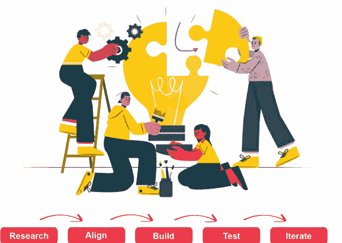

Research Align Build Test Iterate

*Figure 2.8: User-centered design steps*

1. **Research:** 这个初始阶段涉及尽可能多地了解用户、他们的需求、偏好和行为。归根结底就是要了解你的客户以及他们对你的产品或服务的需求。
2. **Align:** 在进行研究后，至关重要的是将研究结果与项目的目标和目的相匹配。通过这一步，可以确保设计过程始终集中于满足用户需求并产生预期结果。
3. **Build:** 基于研究结果和一致的目标，设计师开始开发产品或服务的原型或 mockup。在此阶段，概念被转化为可以检查和评估的具体表现形式。
4. **Test:** 为了获得关于可用性、功能性和整体满意度的反馈，原型会与真实用户进行测试。在设计定稿之前，测试有助于发现任何可用性缺陷或需要改进的领域。
5. **Iterate:** 设计师根据测试过程中获得的反馈改进和修改原型。在此迭代过程中利用用户反馈有助于完善设计，并确保其成功满足消费者的需求和期望。

以用户为中心的设计流程通过研究、对齐、构建、测试和迭代这些步骤，确保最终的产品或服务基于用户洞察，与项目目标保持一致，并经过持续完善以提供理想的用户体验。

## 以用户为中心的设计与设计思维流程

将用户需求和体验放在首位是设计思维和以用户为中心的设计（UCD）两者中的关键组成部分。虽然它们相似，但两者之间也存在很大差异。

|  | User-Centered Design | The Design Thinking |
| --- | --- | --- |
| **Focus** | 理解并在整个设计过程中解决用户需求、偏好和行为是以用户为中心的设计（UCD）的主要目标。它强烈强调用户满意度、功能性和可用性。 | 相反，设计思维遵循更全面的策略，强调识别问题的根本原因并创造创新解决方案。它提倡实验、同理心和创造力。 |
| **Process** | UCD 通常遵循一套固定的流程，包括研究、设计、原型制作、测试、实施等阶段。它经常应用于数字产品和服务的创建。 | 设计思维更灵活、迭代，强调好奇心、实验和持续学习的态度。它通常涉及定义、同理心、头脑风暴、原型制作和测试等阶段；然而，这些阶段并不总是顺序进行，可以根据需要重复。 |


| 范围 | UCD 主要专注于创建满足消费者需求的商品和服务。它经常被应用于产品设计、人机交互（HCI）和用户体验（UX）设计等学科。 | 超越产品设计，设计思维具有更广泛的应用，可以用来解决各种问题，例如组织变革、社会创新和商业战略。 |
|---|---|---|
| 工具和技术 | 为了理解用户需求并评估设计方案，UCD 通常使用诸如人物角色、线框图、可用性测试和用户研究等工具和技术。 | 为了促进创造力、合作和发明，设计思维采用多种工具和方法，包括同理心地图、头脑风暴会议、原型制作和讲故事。 |
| 总结 | 总之，虽然 UCD 和设计思维都旨在提供满足用户需求的解决方案，但它们在解决问题的方法上各不相同，并在设计过程的不同阶段有所侧重。UCD 贯穿始终地专注于理解和满足用户需求，而设计思维则采用更全面的策略，强调实验、同理心和创造力以产生新颖的解决方案。 |

表 2.2：用户中心设计与设计思维过程的差异

## 影响用户体验的因素

如今，小型企业和大型公司都需要优先考虑优秀的设计和用户体验。在推出新产品或改进现有产品时，用户体验设计（UX）至关重要。

那么设计师应该注意什么才能确保用户满意呢？彼得·莫维尔是一位知名 UX 设计师，他撰写了畅销书并为大公司提供咨询，他已确定了优秀用户体验的七个基本要素。他通过排列这七个要素创建的“用户体验蜂巢”，在设计界获得了很大关注。把这些要素想象成蜂巢的单个单元；它们汇聚在一起形成一个令人愉悦且令人满意的整体。

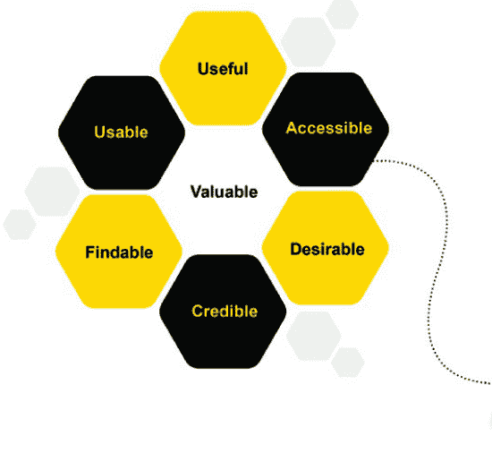

*图 2.9：彼得·莫维尔的 7 个 UX 蜂巢要素*

这 7 个因素帮助我们理解什么构成良好的用户体验以及如何创建人们会喜欢的产品。这些因素是：

- 有用的
- 可用的
- 可找到的
- 可信的
- 可欲的
- 可访问的
- 有价值的

因此，下次你在进行项目时，想想用户体验蜂巢，做出一些甜蜜的东西！

## 有用的

确保产品有益是创建人们喜欢使用的产品中最关键的因素。如果它不能满足他们的需求或提供解决他们困难的答案，那几乎没什么用处。但如果它满足了他们的需求，他们就会使用它。这就像问自己，“如果没人玩，制作玩具的意义何在？”为了创建人们会继续使用的产品，它们必须非常有益。

根据理查德·科赫（英国作家，商业事务专家）的说法，有五种基本方法可以改善你的产品的用户体验。

- 改变性能
- 提高质量
- 在不影响易用性的情况下增加新功能
- 提供更广泛的产品范围
- 个性化

如果某物真正有用并给人留下积极印象，人们更有可能想要继续使用它。此外，当你随着时间的推移对其进行改进——例如，通过提速或修复故障——用户会变得更加习惯它。

如果它让人们高兴或让他们发笑，那么即使它没有实际价值，比如无用的玩具，也仍然很棒。

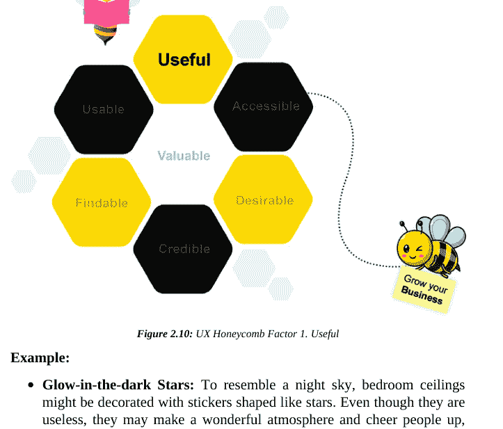

图 2.10：UX 蜂巢要素 1. 有用的

### 示例：

- **发光星星：** 卧室天花板可以用星形贴纸装饰，以模仿夜空。尽管它们是无用的，但它们可能会营造出美好的氛围并使人振奋，尤其是孩子们。
- **桌面玩具：** 在办公室环境中，磁性雕塑（可重新排列成各种配置的小金属件）或牛顿摆（展示动量和能量守恒的一系列摆动球）等物品可以是有趣的并成为谈资。

每当你对设计决策犹豫不决时，只需问自己，“我为什么要这样做？”以这种方式，你可以确保你的设计与你对产品的目标保持一致。


## 可用性

简单来说，可用性是指衡量一件东西有多容易使用。可使用性是用户体验设计的基本原则，因为没有它，就无法构建提供令人满意用户体验的产品。良好的可用性产品高效、易于使用，并且不会给用户带来不必要的障碍或复杂性。

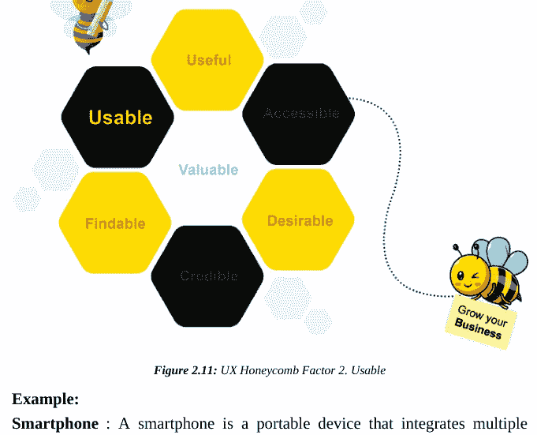

图 2.11：UX 蜂巢要素 2. 可用性

### 示例：

智能手机：智能手机是一种便携设备，集成了多种功能，包括短信、通话、网页浏览、拍照和安装程序。凭借触摸屏、简化的菜单以及让用户快速探索和获取信息的应用程序界面，它被设计为直观且简单易用。此外，为了确保它们在随时间推移仍保持功能性和相关性，手机经常会收到提升性能、增强安全性和引入新功能的升级

无用的产品是指由于某种原因——例如功能不足、用户界面不清晰或频繁出错——无法实现其目标或提供积极用户体验的产品。

### 示例：

不可用产品的示例可能是一个虚拟助手，它经常误解用户指令，并且难以执行简单的任务。即使承认其旨在提供帮助和便利，其不足的识别和执行能力也会使其令人沮丧且不切实际地使用。

## 可发现性

可发现性原则需要一个搜索系统、信息结构和用户友好的导航。可发现的产品是易于在线和离线发现的产品。用户应能轻松找到产品本身或他们正在寻找的材料。由于可发现性不佳，用户可能会感到沮丧并放弃产品。

图 2.12：UX 蜂巢要素 3. 可发现性

### 示例：

可发现性是影响用户体验的关键组成部分，它影响用户在数字界面中查找所需材料有多容易。想象一个专门从事时尚服装的电子商务平台。用户访问该网站的目的就是为了购买一件白色连衣裙参加即将到来的活动。从访客到达主页的那一刻起，该网站强大的可发现性功能就开始发挥作用。

每个页面顶部都清晰可见的搜索框邀请访客输入他们的查询。我们的用户通过在该搜索窗口中输入“white dress”来发起搜索。网站立即生成一份相关结果列表，其中包括各种正在销售的白色连衣裙。用户可以通过搜索结果页面上提供的筛选工具轻松细化搜索。用户可以通过使用

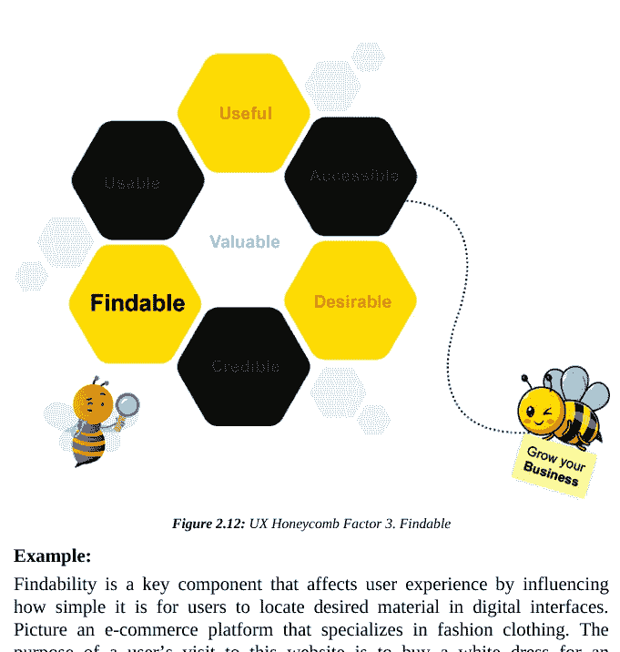

诸如尺寸、价格范围和品牌等参数有效地减少可能性。当用户选择一件连衣裙以便更仔细地查看时，面包屑导航有助于他们保持上下文并使其能够轻松返回到之前的搜索结果。
自动完成功能提供对常用搜索词的即时洞察，同时用户正在操作搜索字段，使用户能够轻松缩小搜索范围。
在这个全面的示例中，电子商务平台强大的可发现性功能不仅使用户更容易找到一件白色连衣裙，而且还大大提高了他们的满意度以及成功购买的机会。

## 可信度

产品的可信度是信任的基础。在当今数字时代，用户在各行各业拥有无穷无尽的选择，因此企业必须确立自己作为可靠供应商的地位。如果产品或服务达不到预期，客户通常会在几次尝试后就离开。缺乏信任会使提供良好的用户体验变得困难。可信度为用户交互建立了氛围，就像第一印象一样。即使产品并不完美，如果用户认为开发者可靠且诚实，他们仍会喜欢使用该产品。


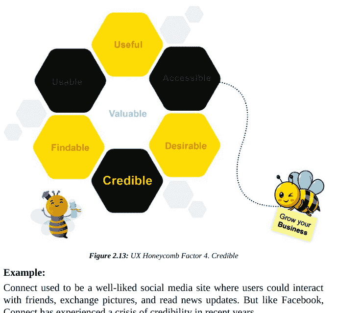

Figure 2.13: UX Honeycomb Factor 4. Credible

## Example:

Connect 曾经是一个备受欢迎的社交媒体网站，用户可以在上面与朋友互动、交换图片并阅读新闻更新。但与 Facebook 一样，Connect 在近年经历了信誉危机。

Connect 的可信度因用户数据被不当处理的指控而受损。尽管首席执行官马克·扎克伯格在国会作证，公众仍然不信任 Connect。消费者担心隐私以及平台对其个人信息的安全性。

这个例子展示了可信度对于维护用户信心和忠诚度的重要性。如果一个平台无法维护其声誉，用户可能会对其保护隐私和数据的安全能力失去信心，从而降低用户信任度和使用率。

## Desirable

影响用户体验（UX）的主要要素之一是渴望度。它描述了产品或服务对客户有多么诱人和 desirable。满足用户视觉、情感和文化需求的产品或服务被认为具有渴望度。它包括用户参与度、情感共鸣、品牌认知和美学等要素。渴望度本质上关注于引发积极的情感反应并加强客户与产品或服务之间的联系，从而改善整体客户体验。

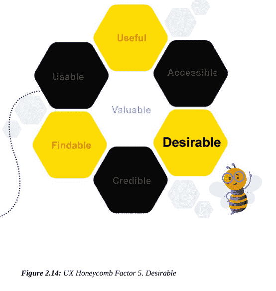

Figure 2.14: UX Honeycomb Factor 5. Desirable

### Example:

让我们探索一个渴望度良好的产品的好例子。想象一款全新的智能手机型号，具有直观的用户界面、纤薄的机身和绚丽的色彩。它拥有强大的摄像头、精美的显示屏以及面部识别等尖端功能。除了实用性之外，用户迫不及待想要使用这款智能手机，因为它外观时尚而精致。由于其质量和可靠性的声誉，许多人认为该品牌是一款必备设备，这也增强了其吸引力。

### Example:

让我们更深入地探讨一个缺乏渴望度的产品的例子。现在，想象另一款智能手机型号，具有过时的操作系统、笨拙的设计和较小的应用商店。其不吸引人的外观和平庸的性能使得消费者难以产生兴趣或想象力。尽管其功能与市场上其他智能手机相当，但由于其丑陋的设计和较差的用户体验，这款智能手机难以吸引用户。即使更具视觉吸引力且更易用的选择价格稍高，用户仍可能选择它们。

最终，渴望度是关于引发积极的情感反应并加强客户与产品或服务之间的联系，从而改善整体用户体验并提高客户满意度。

## Accessible

使某物对每个人都易于使用，无论是否有障碍，这就是可访问性的定义。一些企业认为只有一小部分人有残疾，因此不认为这值得付出努力。世界卫生组织估计，地球上 15% 的人患有残疾。这意味着超过一百万人受到影响。因此，在设计事物时考虑可访问性是有意义的。当产品具有可访问性时，表示任何人都可以毫无问题地使用它，无论其限制如何。可访问性不仅使残疾人士受益，而且还改善并简化了所有用户的生活。

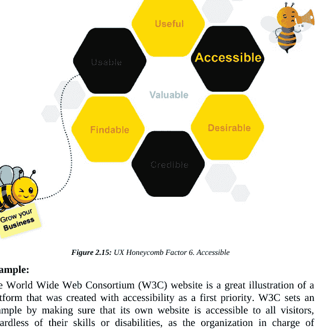

Figure 2.15: UX Honeycomb Factor 6. Accessible

### Example:

万维网联盟（W3C）网站是优先考虑可访问性而创建的平台的绝佳例证。作为负责制定全球网络标准的组织，W3C 通过确保其自己的网站对所有访客，无论其技能或残疾状况如何，都可访问，从而树立了榜样。W3C 网站的每个方面，从设计到操作，都经过深思熟虑，以提供满足各种需求的友好用户体验。

W3C 网站使用结构化 HTML 标记，为内容提供清晰的结构和含义，这是其主要特点之一。由于其语义框架，借助屏幕阅读器等辅助技术，残疾用户可以准确地访问和理解内容。


视觉组件也包含在可访问性类别中。由于 W3C 网站使用了高对比度颜色，并且文本与背景元素之间提供了足够的颜色对比，因此视力受损或色盲用户会更容易阅读和识别网站上的内容。为了进一步确保视力低下或盲视用户能够理解视觉元素的上下文和目的，网站为每张图片都提供了信息丰富的替代文本。

W3C 网站上的表单是在考虑可访问性功能的情况下开发的，例如适当的标签、输入字段的说明以及易于理解的错误信息。这些功能保证了用户能够正确地与网站上的表单进行交互并提交表单，即使是依赖语音输入设备或屏幕阅读器的用户也是如此。此外，网站的自适应设计保证了它能够轻松地适应各种屏幕尺寸和设备，在平板电脑、智能手机和台式电脑上提供一致的用户体验。

## 价值

最终，产品必须产生影响。除了满足制造该产品的公司需求之外，还必须为用户提供真正的价值。价值取决于产品在相对于其成本的情况下提供优势或解决问题的好坏程度。当产品相对于其成本提供显著的优势时，其价值就会提升并吸引客户。

作为设计师，你有责任平衡所有元素，为用户提供尽可能最佳的体验。用户可能对产品的不同功能赋予不同的价值；对于某些人来说，最重要的因素是他们想要它的程度，而对于其他人来说，可访问性是最重要的因素。这意味着价值并不是单一实体，而是用户体验中所有不同组成部分汇聚而成的结果。

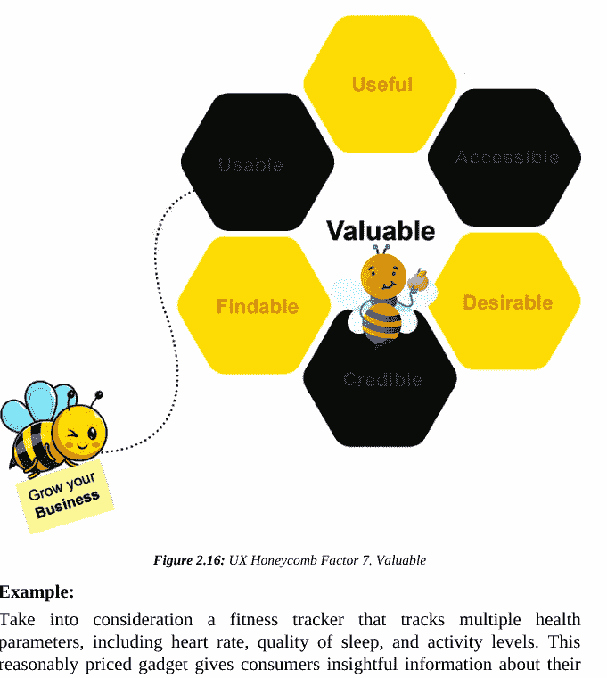

图 2.16：UX 蜂巢因素 7。价值

### 示例：

考虑一款健身追踪器，它可以追踪多种健康参数，包括心率、睡眠质量和活动水平。这款价格合理的设备为消费者提供了有关其整体健身和健康改善的宝贵信息。通过监测他们的睡眠和日常活动习惯，用户能够找出需要改进的领域，并做出明智的决定以过上更健康的生活方式。健身追踪器的价值在于其能够使用户掌控自己的健康和福祉，最终带来更好的健身效果。正因为如此，关心健康的人会被这款产品所吸引，因为它很好地帮助他们实现了健身目标。

简单来说，价值在我们选择购买什么时起着关键作用。假设我们有这样一种情况：低成本的产品解决了重大问题，而高价产品只解决了小问题。而在第二种情况下，产品吸引力因价值与成本之间的差距而减弱，在前一种情况下，这两个因素的契合度则带来了极具吸引力的提案。

## 总结

根据用户偏好和内容，每个产品和解决方案都可能发生变化，但只要遵循 UX 蜂巢原则，你就可以确保所开发的解决方案对所有用户都令人愉悦。这个概念涉及了一些设计师我们需要关注的重要主题。

## 结论

随着本章的结束，很明显，用户体验（UX）设计不仅对数字产品和服务至关重要，对任何类型的体验，无论是否数字化，都至关重要。UX 设计的重要性怎么强调都不为过，因为它直接影响用户参与度、满意度，并最终影响商业成果。上下文、内容、沟通和社区是 UX 设计的四大支柱，它们作为构建有意义用户体验的框架。

在 UX 设计中实施 4C 面临着各种挑战，从平衡技术限制与组织目标到理解用户需求。七步法和 CPS 假设等框架强调以用户为中心的设计和迭代问题解决。UX 设计师凭借其在同理心、创造力、研究和技术专长方面的技能，在创造与用户产生深刻共鸣的产品方面发挥着关键作用。虽然设计思维和以用户为中心的设计目标相同，但在关注点和实施方式上有所不同，但它们相互补充。 通过解决七个要素，UX 设计师促进了长期的参与和忠诚度。因此，UX 设计将人类心理学、技术和创造力融合在一起，打造令人愉悦的数字体验。


在下一章中，我们将探讨 UX 研究、其在理解用户需求和行为方面的关键作用，并考察流行的以用户为中心的研究方法，这些方法为有效的设计决策提供依据，确保创造出直观且引人入胜的用户体验。

## 关键术语

- **UX 设计：** 设计数字产品或服务的过程，重点是通过确保易用性、效率和相关性来提升用户体验。
- **一致性：** UX 设计中的基本原则，涉及在整个数字产品或服务中保持元素在外观、行为和功能上的统一性。
- **连续性：** 用户在数字产品或服务的不同部分或平台之间交互的无缝流动，确保一致且不间断的用户体验。
- **上下文：** 考虑周围情况、环境和用户偏好，以定制数字产品或服务的设计，从而获得更个性化和相关的体验。
- **互补设计：** 在数字产品或服务中对各种设计元素进行和谐整合，以创造连贯且视觉上吸引人的体验，从而增强用户参与度和满意度。
- **创造性问题解决（CPS）：** 一种结构化的问题解决流程，涉及定义问题、产生想法、评估解决方案并实施最佳方案。
- **七步法：** 一种问题解决思路，包括七个关键阶段：问题识别、研究、制定创造性挑战、探索想法、评估想法、制定行动计划和采取行动。
- **研究问题：** 问题解决的阶段，涉及收集信息和分析数据，以深入了解问题的根本原因。
- **制定创造性挑战：** 将问题定义为一个鼓励创造性并允许广泛解决方案的问题。
- **制定行动计划：** 创建实施所选解决方案的详细计划，包括任务、目标、截止日期和沟通策略。
- **SWOT 分析：** 一种分析方法，检查特定想法或解决方案相关的优势、劣势、机会和威胁。
- **用户体验（UX）设计师：** 负责创建直观、高效且让用户愉悦的数字体验的专业人员。
- **UI 设计师：** 专注于创建数字产品的视觉元素的设计师，确保美观且用户友好的界面。
- **交互设计师：** 专注于为数字产品创建交互功能的专业设计师，旨在改善用户参与度和体验。
- **信息架构师：** 负责在数字产品内组织和结构化信息以促进用户导航和理解的设计师。
- **用户研究员：** 负责开展研究以了解用户需求、偏好和行为，并为设计流程提供洞察的专业人员。
- **UX 撰写者：** 负责为数字产品创建清晰、简洁且用户友好的文本，从而提升整体用户体验的撰写者。
- **以用户为中心的设计（UCD）：** 一种设计方法，在产品开发过程中始终优先考虑用户的需求和偏好。
- **可见性：** 网站或数字产品的基本元素在用户到达时是否立即显而易见且易于理解的程度。
- **可访问性：** 用户访问和导航网站或数字产品的便捷程度，包括查找必要信息和执行所需操作。
- **可读性：** 网站或数字产品上文本的清晰度和可读性，确保用户能够轻松理解所呈现的信息。
- **个性化：** 根据个人用户的特定需求和偏好定制产品或服务。
- **用户友好界面：** 设计为直观且易于用户导航的界面，使其能够以最少的努力与系统或产品进行交互。
- **设计思维：** 一种强调同理心、实验和创造力以开发创新解决方案的问题解决思路。
- **可用性：** 用户与产品或服务交互以有效高效地实现其目标的便捷程度。
- **可发现性：** 用户在产品或服务内定位所需信息或功能的便捷程度。
- **可信度：** 产品或服务的可信度和可靠性，通常受声誉和用户反馈等因素影响。
- **可欲性：** 产品或服务的吸引力和美感，通常受美学和情感共鸣等因素影响


## 第三章
## UX 设计的研究与分析

## 引言

欢迎来到 UX 研究的世界，在这里我们将通过各种调查技术深入了解用户行为、需求和动机。在本章中，我们将探讨 UX 研究的本质，这是一个至关重要的流程，有助于设计出真正与用户产生共鸣的产品和体验。

我们将首先向您介绍 UX 研究流程，这是一种结构化的方法，指导我们从确定研究目标到收集和分析数据，最后将洞察应用于设计改进。这个流程是创建以用户为中心的产品的基础，这些产品既有效又令人愉悦。

接下来，我们将深入探讨不同的 UX 研究方法，每种方法都有其独特的优势和应用。无论是进行访谈以获取定性洞察，还是利用分析数据获取定量数据，我们都将向您展示如何有效实施每种方法。您将学习何时使用调查、可用性测试、A/B 测试、树状测试和五秒测试等，以及如何从每种方法中收集最有价值的信息。

## 结构

在本章中，我们将讨论以下主题：

- UX 研究简介
- UX 研究流程
- UX 研究方法
- 用户访谈
- 焦点小组
- 调查
- 卡片分类（开放/混合）
- 卡片分类（封闭）
- 日记研究
- 可用性研究
- 实地研究
- 树状测试
- 眼动追踪
- A/B 测试
- 五秒测试
- UX 研究工具
- 真实世界的 UX 研究案例研究

### UX 研究简介

对于设计师而言，UX 研究至关重要。研究是在设计任何事物之前收集知识的第一步。如果不了解用户，就很难设计出真正打动用户的东西。UX 研究流程的功能类似于解决问题的路线图。确定最适合您项目的合适研究方法的第一步是提问：

- 用户希望实现什么目标？
- 他们有什么目标？
- 他们想要完成什么？

您的用户研究应阐明这些问题，并帮助您开发出能够成功满足用户需求的设计。

### UX 研究的目标

了解您的用户并获得背景和观点可以帮助您做出明智的决策并创建以用户为中心的产品。这就是 UX 研究的目标：创建和发布能够有效解决用户需求的产品，因为这些产品才会变得流行。

假设您正在努力开发理想的产品，即为客户日常活动打造的超级英雄披风。然而，在开始缝制之前，您必须熟悉超级英雄的观点、能力和敌人。

这就是 UX 研究派上用场的地方！归根结底，这一切都与深入参与消费者的生活并了解他们的愿望、困难和欲望有关。与他们交谈、观察他们的工作并窥探他们的世界，让您获得宝贵的知识，这些知识指导了设计过程的每一步。

UX 研究是一个持续的过程，就像一位忠实的朋友，在产品发布后仍会支持您。图形中的循环流程说明了测试可以在任何阶段进行，确保您的产品通过适应不断变化的需求并在整个生命周期中提供新见解，始终保持用户喜爱。

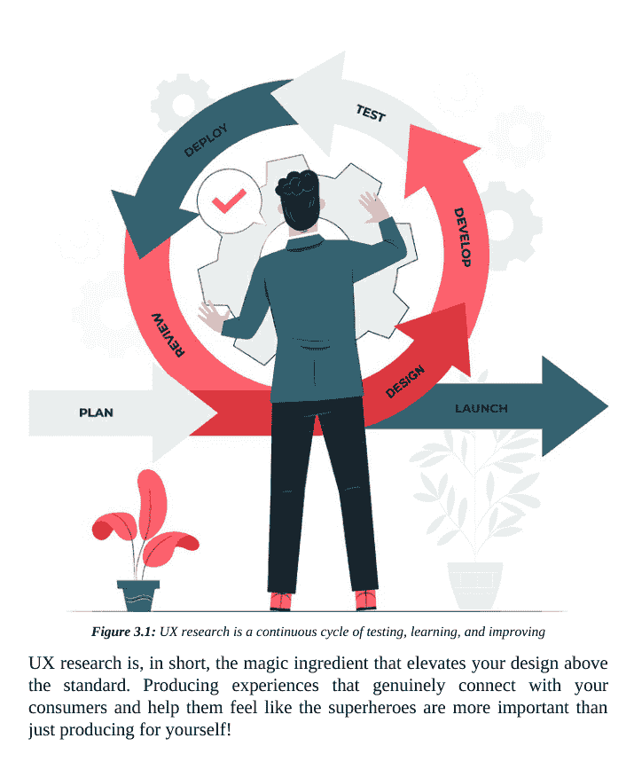

图 3.1：UX 研究是测试、学习和改进的持续循环

简而言之，UX 研究是让您的设计超越标准的神奇成分。创造真正与消费者产生联系并让他们感觉像超级英雄的体验，比仅仅为自己生产更重要！

## UX 研究的重要性

想象一下，如果使用您产品的人都立刻爱上它、告诉朋友并迫不及待地再次使用它。虽然这似乎是一个


dream, it is achievable! To make a product users will adore, you need their input throughout the process. It is like baking a cake — you need everyone’s help to get it just right. By engaging with users and listening to their needs, you can create something they truly enjoy. Success is not just about meeting targets; it’s about making people happy. Just as you would ask kids what they want in a playground, UX research helps ensure your product meets user expectations.

Some key reasons highlighting the importance of UX research are as follows:

- 1. **Understanding People:** UX research aids in our comprehension of the target market for our good or service. UX research helps us understand the preferences, wants, and behaviors of the people who will use our websites, apps, or any other product, in the same way that interviewing the kids helps you figure out what they like to do on the playground.
- 2. **Improving Design:** You may create better designs when you are aware of what appeals to and bothers individuals. Assume that a majority of children prefer climbing walls than swings. If your research has shown you this, you should build more climbing walls in your playground. In a similar vein, UX research directs us toward creating goods, apps, and websites that users find simple and fun to use.
- 3. **Solving Problems:** Occasionally, users may experience difficulties with particular features of a product. Perhaps an app’s buttons are too small, or the slide is too steep. UX research helps in the early detection of these issues so that they can be resolved before they become major problems. Finding an issue with the swing beforehand prevents injuries to others!
- 4. **Saving Time and Money:** Just picture spending a lot of money on a massive playground only to discover afterwards that the neighborhood kids don’t enjoy it. Both money and time are wasted on that. These kinds of errors are prevented by UX research. By knowing what consumers want up front, we can save money on expensive redesigns down the road.
- 5. **Creating Happy Users:** The ultimate objective of every good or service is to bring happiness to its users. UX research makes sure that the things we produce are in line with people’s needs and desires. Users are more inclined to stick with and recommend our creations to their friends when they find pleasure in utilizing them. It is similar to having children who eagerly anticipate returning to your playground each day!

Thus, UX research is similar to possessing a magic ingredient that enhances, enriches, and increases the utility of whatever we do for its users, addressing their needs, desires, and requirements. The main goal is to ensure everyone enjoys themselves on the technological playground!

## Benefits of UX Research

In the fast-paced digital landscape of today, UX research acts as a guiding light, illuminating the desires and needs of consumers. By shedding light on these insights, it not only empowers the product and the company behind it but also enhances the experience for the end-users.

- **Product Benefits:** UX research uncovers how, when, and why people use a product, helping identify key issues and effective solutions.
- **Business Benefits:** UX research speeds up development, reduces costly redesigns, and boosts customer satisfaction by integrating user needs early.
- **User Benefits:** UX research provides direct feedback from users, ensuring their opinions are recognized and considered by the business.

## UX Research Process

In this chapter, we have created a guide for anyone, from experienced UX researchers to newcomers. Research is crucial for great UX design and development. A systematic approach ensures each design version improves with valuable data, but flexibility is key. There’s no one-size-fits-all method—effective UX research adapts to your team’s, users’, and business’s needs. This guide outlines how to build a strong UX research process in seven steps, based on lean UX principles of user feedback, testing, and continuous improvement. Remember, UX research is an ongoing cycle, with insights and feedback shaping the design and development process continuously.

### 1. Setting Clear Research Goals

Establishing clear goals and objectives marks the initial and most crucial step


在任何用户研究活动中都不可或缺。没有它们，你本质上是在盲目地进行过程，这不利于有效的用户研究。

为了明确你的研究目标，请考虑以下问题：

| 问题 | 解释 |
|---|---|
| **我希望发现什么信息？** | 这个基本问题作为基石，最终会演变成具体、可操作且实用的研究问题。 |
| **存在哪些知识空白？** | 早期识别这些空白和局限性使你能够主动解决它们。 |
| **这如何与公司目标保持一致？** | 熟悉你组织的商业模式和关键绩效指标有助于确保你的研究工作与更广泛的公司目标保持一致。 |
| **我处于产品开发的哪个阶段？** | 你的研究目标会根据你处于发现阶段、验证和测试阶段、产品发布阶段，还是持续反馈收集阶段而有所不同。 |
| **这项研究将为哪些决策提供信息？** | 了解利益相关者将如何利用从研究中获得的洞察对于塑造你的方法至关重要。 |
| **我期望这项研究产生什么结果？** | 设想期望的结果可以明确你的研究工作的成功标准。 |

*表 3.1：定义研究目标时需要考虑的问题*

## 进行利益相关者访谈

进行利益相关者访谈对于任何研究项目都是必不可少的。利益相关者，包括团队成员、经理和客户，提供宝贵的见解来塑造项目并确保一致性。从确定你的利益相关者开始，安排访谈，准备问题，并设定明确的目标。

使用开放式和封闭式问题的混合方式来收集全面数据。以下是一个简洁的访谈指南：

- 1. **介绍：**介绍你自己并说明访谈的目的。
- 2. **项目重要性：**询问项目的意义和期望成果。
- 3. **成功标准：**定义成功及其在更广泛的业务中的契合度

人们所说与所做之间的差距，以及混合定性和定量数据可以更深入地了解用户偏好和趋势。

## 3. 制定战略性用户研究计划

在确定你的研究问题和 UX 分析方法后，制定你的研究计划以与客户互动并了解他们的需求。交互设计基金会建议从一份简洁的一页计划开始，可根据需要进行调整。

以下是一页研究计划模板：

- **标题：**为便于参考，明确命名你的项目。
- **作者：**列出负责人员及其联系方式，以及可以接收反馈的其他人员。
- **利益相关者：**包括参与研究以及接收研究结果的所有人员的详细信息和联系方式。
- **日期：**注明开始日期和任何修订日期以供更新。
- **项目背景：**提供研究动机和相关背景的简要总结。
- **主要目标：**用一句话清晰地说明你研究的首要目标。
- **研究问题：**概述需要回答的关键问题，指导你的方法和分析重点。
- **研究方法：**描述定性和定量方法，明确研究将是主持还是非主持，以及预计持续时间。
- **参与者信息：**定义你的目标受众，包括人口统计特征和所需参与者数量。
- **时间表：**制定包含研究日期和里程碑的时间线以跟踪进度。
- **预算：**概述用于研究不同方面的财务资源和分配情况。
- **支持信息：**包括可能影响研究项目或结果的任何额外数据。


# 示例

| 用户研究计划：提升移动银行体验 |  |
|---|---|
| 标题 | 提升移动银行体验 |
| 作者 | Sharanpreet Kaur，UX 研究员 |
| 利益相关者信息 | 项目经理：Sarah Johnson<br>设计负责人：Sharanpreet Kaur<br>开发团队：UI/UX 开发人员，移动应用开发人员<br>市场团队：Jane Williams<br>客户支持：Emily Clark |
| 日期 | 2024年5月1日 |
| 项目背景 | 随着向数字银行的转变日益加剧，我们的移动银行应用已成为客户的关键触点。然而，最近的反馈表明，用户在使用某些功能和导航元素时遇到挑战。本研究旨在识别痛点、偏好和改进机会，以提升整体移动银行体验。 |
| 主要目标 | 识别需要改进的关键领域，并优化移动银行应用，以满足用户不断变化的需求和期望。 |
| 研究问题 | 用户在导航移动银行应用时遇到的主要挑战是什么？<br>用户认为哪些功能最有价值，哪些功能又繁琐或不必要？<br>用户如何看待移动银行应用的安全性和可靠性？<br>如何改进以简化账户管理和交易流程？<br>用户希望在移动银行应用中增加哪些额外功能或服务？ |
| 研究方法 | 用户访谈 2. 可用性测试 3. 调查 4. 竞品分析 |
| 参与者信息 | **人口统计学：** 不同年龄段（18-65+），多元社会经济背景<br>**银行经验：** 从新手到经验丰富的用户<br>**移动设备：** Android 和 iOS 用户<br>**地理位置：** 全国代表性 |
| 时间安排 | **第1-2周：** 准备访谈脚本和可用性测试场景<br>**第3-4周：** 进行用户访谈和可用性测试会话<br>**第5周：** 向样本用户分发调查问卷<br>**第6周：** 分析研究结果并进行竞品分析<br>**第7周：** 编译研究报告并准备演示<br>**第8周：** 向利益相关者展示研究结果并讨论可执行步骤 |
| 支持信息 | 可访问移动银行应用分析<br>用于参与者激励和研究工具/软件的预算 |
| 预算 | 参与者激励：$2000<br>研究工具/软件：$1000<br>总预算：$3000 |

表 3.2：用户研究计划示例

## 4. 招募参与者

将此步骤视为邀请他人一起踏上激动人心的旅程的方式。将使用您产品的个人最能代表您的目标市场。您可以联系现有用户，或通过社交媒体、互联网平台或其他方式招募他们。

提出关于特定产品页面或功能的有针对性问题，以及关于客户体验和需求的开放式询问，以吸引他们的参与。

明确定义您希望招募的人群。想象一个能够提供您所需精确、有用和实用的见解的理想个人。为确保您找到研究所需的理想志愿者，请列出要求。

### 设计筛选调查

想象筛选调查就像您研究的守门员——它帮助您决定谁可以进入，谁不可以。假设您正在寻找过去4个月内购买过酱油的人。现在，您不能直接问，“嘿，最近买过酱油吗？” 那样太容易了，对吧？

相反，您需要变得更狡猾一些。提供一堆 pantry 物品，让人们选择他们在过去4个月内购买过哪些。狡猾吧？它可能看起来像这样：

过去4个月内您购买了以下哪些好东西？

-  balsamic vinegar - Nope.
-  Soy sauce - Ding ding! You are in!
-  Fish sauce - Not quite.
-  Olive oil - Uh-uh, not this time.
-  Canola oil - Nope.
-  None of the above - Swing and a miss!

看到了吗？通过巧妙设计问题，您可以在不透露答案的情况下筛选出酱油爱好者。

### 为您的受众寻找理想奖励

现在您已经确定了目标参与者，请考虑哪种类型的奖励是对他们参与的公平补偿。参与者通常更喜欢现金或礼品卡等激励措施。合适的激励取决于您研究的需要、参与者的特征以及您可用的预算。然而，吸引参与者可能具有挑战性。

## 5. 探索研究机会

是时候踏上您的研究之旅了！无论您是进行调查、访谈还是观察用户互动，这一阶段对于收集有价值的数据至关重要。您可以询问网站的易用性或最有益的功能。

以下是进行有主持人参与的用户研究的必备技巧：

- **建立真诚的联系：** 表现出同理心，以温暖和尊重对待参与者。
- **拥抱沉默：** 让参与者按自己的节奏反思并提供见解。观察他们的行为和非语言线索。
- **提供背景：** 管理对研究结果的期望，但避免分享您的假设以防止偏见。
- **做详尽的笔记：** 让同事做笔记或使用转录工具捕捉关键见解，让您能够全神贯注。

请记住尽早开始研究并频繁进行，以确保您的解决方案满足实际用户需求。

## 6. 分析和整合结果


一旦你从研究之旅归来，就该整理并筛选你所收集到的所有信息了。寻找共同主题和重要的洞察，帮助你更好地理解用户。这就是你在数据中发现真正宝藏的地方。

你如何分析数据取决于你如何收集数据。定量数据分析意味着查看数字以寻找趋势。定性数据分析则更侧重于理解用户在说什么。整齐地组织你的数据，重点关注用户感到挫败的地方。发现任何反复出现的问题，并在需要时提出更多问题。一旦你弄清楚用户需要什么以及他们面临的问题是什么，就该利用这些洞察来改进你的产品了。

创建易于理解的用户体验报告和故事。并且不要忘记与组织中的每个人分享重要发现。这样，每个人都可以利用研究做出更好的决策。

## 7. 分享你的研究成果

与团队或公司分享你的研究成果，就像讲述你旅行的故事一样。它帮助每个人从用户的角度看待事物，并决定接下来对产品做什么。但你可能会想：该怎么做？向利益相关者传达用户研究结果的最佳方式是什么？

好吧，并不是只有一种方法。与撰写正式报告的学术研究人员不同，UX 研究人员有很多选择。你可以通过以下方式分享你的发现：

- 书面报告或摘要（我们在 User Interviews 使用了一个 UX 研究摘要模板）
- 幻灯片（我们还有另一个模板给你！）你可以在会议上展示，或作为视频录制或幻灯片演示
- 互动工作坊
- Slack 上的电子邮件或消息
- 公司 wiki 上的文章
- 快速研究更新
- 案例研究

## 迭代和改进

将 UX 研究的方法论融入你的设计理念。UX 研究是一个持续的过程，不应在设计和开发进行后就放弃。请记住，UX 研究是一项持续的努力。回到家后，组织另一次旅行，继续获取反馈并开发你的产品。优秀的用户体验大多是学习、改进，然后再学习这一循环的结果。高度重视优秀的 UX 研究将提升你的设计文化，增加转化率，并保持用户快乐且参与其中。

好了：这就是 UX 研究方法论的基础概述！

## UX 研究方法

现在你的目标和研究框架已经确定，是时候进入令人兴奋的部分了：选择最能推动项目目标并产生必要洞察的研究方法。本节将带你了解最常用的研究方法，并帮助你为你的目的选择最合适的一种。

每种研究技术都属于以下其中一组，每组都有特定的目标和目的：

- 定性与定量
- 行为与态度
- 生成式与评估式

| 定性与定量 | 行为与态度 | 生成式与评估式 |
|---|---|---|
| 可以定量测量的信息并提供统计和数值洞察被称为定量数据。另一方面，非数值洞察和描述性数据构成定性数据，它提供了对潜在模式、行为、 | 行为数据追踪消费者在使用产品、完成任务或解决问题时采取的活动。另一方面，态度数据记录用户的想法、观点和信念，并为他们的动机和信仰提供窗口。 | 生成式研究的目的是产生有利于用户的新概念和解决方案。评估式研究则旨在确定消费者对现有解决方案的反应和感知，以便评估其有效性并找出需要改进的领域。 |


# 表 3.3：UX 研究方法分类

## 定性与定量

**定性** 方法更深入地探究用户需求和行为，突出其行为背后的原因。团队可以通过这种方法了解用户为何以某种方式行动。定性研究提供对以下问题的答案：

- 为什么？
- 如何？
- 如何解决？

相反，**定量** 方法专注于收集和分析数值数据以识别趋势和模式。它们通过量化用户行为、偏好和态度来提供统计洞察和结论。

定量研究提供对以下问题的解决方案：

- 多少？
- 数量是多少？
- 多频繁？

结合这些技术，团队可以全面了解其用户，从而产生更高效、以用户为中心[content]

# 表 3.3：UX 研究方法分类

## 定性与定量

**定性** 方法更深入地探究用户需求和行为，突出其行为背后的原因。团队可以通过这种方法了解用户为何以某种方式行动。定性研究提供对以下问题的答案：

- 为什么？
- 如何？
- 如何解决？

相反，**定量** 方法专注于收集和分析数值数据以识别趋势和模式。它们通过量化用户行为、偏好和态度来提供统计洞察和结论。

定量研究提供对以下问题的解决方案：

- 多少？
- 数量是多少？
- 多频繁？

结合这些技术，团队可以全面了解其用户，从而产生更高效、以用户为中心的产品解决方案。

## 行为与态度

与其关注人们说了什么，他们会做什么或正在做什么，**行为** 研究旨在考察用户实际做了什么。为了更好地理解用户行为，这类研究经常依赖观察技术，如热力图、眼动追踪和可用性测试。

行为研究可以帮助你解决以下问题：

- 这个新功能的用户界面是什么？
- 用户完成一个工作流程平均需要多长时间？
- 哪个 CTA 的转化率更高？
- 用户界面是否可导航？

**态度** 研究的目标是理解用户的态度、感知和信念。它探索用户选择和行为的“为什么”。它通常涉及通过调查或访谈询问消费者对产品或服务的看法、偏好和感受。它本质上是主观的，旨在传达观众的感受和观点。

你可以得到以下问题的答案：

- 人们对这个功能有什么看法？态度研究的用途是什么？
- 个人声称想要什么？
- 人们目前遇到什么样的问题？
- 他们的心智模型是什么？

## 生成式与评估式

**生成式** 研究的主要目标是产生新的想法、概念和洞察以支持设计过程。为了激发创造力并指导用户中心解决方案的创建，你可以与用户群体进行共同设计工作坊、卡片分类和头脑风暴会议。

通过使用发现方法，你可以得到以下问题的答案：

- 我们的用户是谁？
- 他们有什么问题？
- 他们如何推理？
- 这个解决方案真的有必要吗？
- 我们应该构建什么？

评估现有设计或原型的可用性、有效性和整体质量是**评估式** 研究的主要目标。在你为想法创建原型后，就是评估其优缺点的时机。通过 A/B 测试，你可以比较一个功能或产品设计的多个迭代，以确保你的 UX 设计满足客户期望。

评估技术帮助你解决以下问题：

- 用户更喜欢哪种设计？
- 这个界面易于使用吗？
- 这一功能是否按计划运行？
- 我们是否在构建正确的事情？
- 是否有更好的方法？

所有研究方法都是定量或定性的。以下是快速概览：

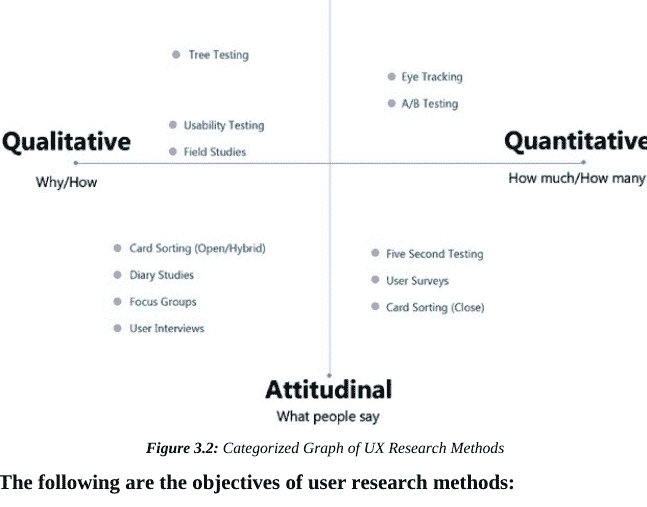

图 3.2：UX 研究方法分类图

## 以下是用户研究方法的目标：

- 识别关键困难、障碍和问题

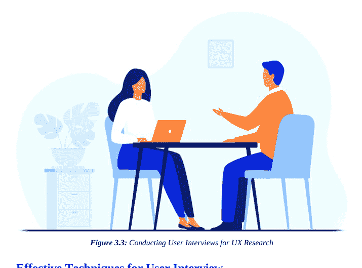

图 3.3：为 UX 研究进行用户访谈

## 用户访谈的有效技巧

通过进行用户访谈，可以深入了解用户需求、习惯和动机。以下是在访谈中取得成功的详细指南：

- 1. 确立你的目标
- 2. 列出你希望解决的主题和问题
- 3. 选择正确的参与者
- 4. 准备访谈空间
- 5. 选择记录方式，如书面笔记、视频、录音机等。
- 6. 至少进行一次访谈试运行。
- 7. 进行访谈
- 8. 检查信息


9. 回顾访谈得出的主要结论。

成功的用户访谈依赖于几个关键做法：保持中立以避免偏见，并表现出真诚的兴趣和同理心以建立信任。强调没有对错答案，以创造一个舒适的环境来获取诚实的反馈。追求自然的对话流，而不是僵化的问答格式，这有助于参与者放松并提供更丰富、更详细的见解。通过遵循这些做法，你将收集到有关用户体验的宝贵信息，从而能够创建更能满足其需求和期望的产品。

## 用户访谈的缺点

用户访谈是洞察的宝库，但也伴随着一些挑战。它们通常耗时且昂贵，需要细致的规划和经验丰富的访谈者。收集到的数据可能具有主观性，可能受到访谈者偏见或引导性问题的左右。参与者也可能会给出他们认为被期望的答案，而不是真实的观点。此外，访谈中的样本量较小，使得很难将研究结果推广到更广泛的受众。分析定性数据绝非易事——它复杂、劳动密集，且从各种个人回应中提取清晰、可操作的见解可能很棘手。尽管存在这些障碍，但如果做得正确，用户访谈可以提供对用户行为和需求的宝贵、深入的理解。

## 焦点小组

焦点小组是一种定性研究技术，其中一小群人——通常少于十人——被研究以获取他们态度和观点的洞察。这种方法往往是非正式的，并且能快速提供大量信息。焦点小组对于了解用户偏好、痛点以及产品的潜在用途非常有用。

## 举行焦点小组的有效时机

最好在你仍在完善产品或服务创意时采用焦点小组。它们有助于产生想法、获得初步反馈并探究消费者偏好。早期阶段的焦点小组是有益的，因为它们允许以低成本进行重大改进。

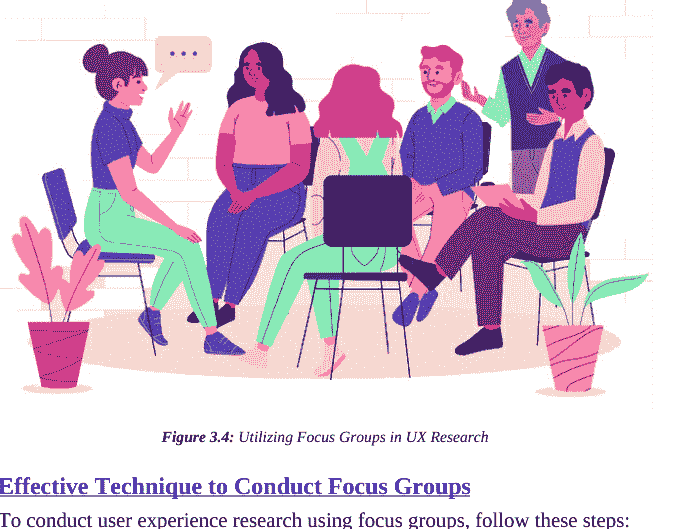

图 3.4：用户体验研究中利用焦点小组

## 开展焦点小组的有效技巧

要使用焦点小组进行用户体验研究，请遵循以下步骤：

- 1. 制定一个计划，留出招募、测试、分析和整合结果的时间。
- 2. 召集你的团队并分配角色：主持人、记录员和讨论负责人。
- 3. 确定研究的范围：你将问哪些问题？你希望多深入地探索答案？这将指导参与人数和小组数量。
- 4. 制定包含 3-5 个主题的讨论指南。
- 5. 招募潜在或现有用户，他们可以提供有价值的反馈。
- 6. 运行焦点小组会议并做笔记。
- 7. 分析数据并准备报告。

遵循这些指导原则将使你轻松最大化用户小组的有效性。首先，提出精确、开放式的问题，使其与研究对象相关，以便获得全面和细致的回应。其次，为确保每个问题都得到充分探讨，将 90 分钟的会议中讨论的主题数量限制在三到五个。最后，纳入三到六人，以创造一个 lively 且富有刺激性的环境，同时平衡不同观点和积极参与。

## 焦点小组的缺点

尽管有优势，焦点小组也可能存在缺点。强势的人可能会掩盖更安静的声音，从而扭曲讨论并产生有偏见的结论。人们可能因群体动态而感到压力，被迫表达真实想法而不是迎合普遍意见。此外，设置焦点小组可能昂贵且耗时。主持人的存在可能会无意中影响回复，且受控的环境可能无法完全反映现实世界的行为。最后，由于焦点小组本质上是定性的，结果可能在统计上没有代表性，这将限制其广泛适用性。

## 调查

调查是探索定性和定量用户研究的灵活且必要的工具。它们提供了人们对不同物品的需求和需要的洞察。调查是一个宽泛的概念，包含各种问题类型。本质上，调查由一组问题组成，可分为两类：

- **封闭式问题：** 这些问题要么提供预定的多项选择选项列表，要么只需回答“是”或“否”。它们非常适合收集相关


information and seeing trends among users. Closed-ended questions yield readily quantifiable, graphical, and analytical data.

- **开放式问题：** 这些提问允许参与者提供自由形式的、自己用词的答案。开放式问题产生定性数据，可深入、全面地洞察用户 的想法和体验。

## 为了让调查有效，请牢记以下建议：

- **清晰性：** 确保问题清晰简洁，避免使用复杂术语。
- **中立性：** 避免引导性问题，以获得公正、诚实的答案。
- **多样性：** 同时使用封闭式和开放式问题，以获得全面的洞察。
- **尊重：** 尊重参与者，避免侵入性问题，并向他们保证其信息是私密的。

此外，选择一个广泛且多样化的参与者群体，以确保结果准确反映您的用户群体并具有统计相关性。

## 进行调查的有效时机

调查可以在不同时间用于不同的目的，具体取决于您的研究目标，这使其成为产品开发过程各个阶段的灵活工具。调查是收集早期数据并在概念化阶段发现模式、趋势或潜在用户群体的绝佳方式。调查可以在产品发布后或在迭代设计周期中使用，以收集有关功能使用方式、用户满意度以及可以改进之处的反馈。

可以通过调查有效地衡量大规模用户情绪。由于其适应性，您可以将它们放置在特定页面上，这使得在适当的时候提出问题变得简单。例如，您可以在“感谢”页面上放置调查，以获取最近完成购买的客户的反馈。这将为您提供快速且有用的数据。

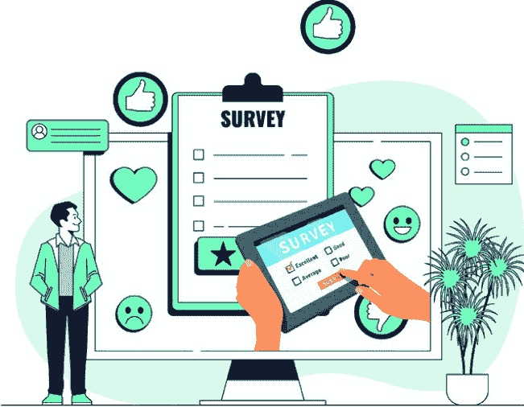

*Figure 3.5: Implementing Surveys in UX Research*

## 进行调查的有效技巧

如今的调查通常在线进行，数据由调查工具自动收集和分析。这些信息有助于为未来的 UX 研究提供信息并改进您的产品。为了优化在线调查，请保持简洁，专注于必要的问题，尤其是在参与者未获得激励时。这尊重了他们的时间并提高了完成率和数据准确性。通过使用简洁的语言确保清晰度，以防止混淆并保证可靠的响应。通过结合多项选择和开放式问题来保持参与者的参与度，在保持兴趣高涨的同时获得定量和定性数据。这些做法共同促进了在线调查的有效性和成功。

## 进行在线调查涉及几个关键步骤：

1. **确定目标和目标：** 定义您希望通过调查实现的目标。
2. **创建调查问题：** 制定与您的目标一致的问题。
3. **选择调查工具：** 选择在线调查平台，如 SurveyMonkey 或 Qualtrics。
4. **招募参与者：** 寻找并邀请人们参与您的调查。
5. **进行调查：** 分发调查并收集回复。
6. **分析和报告：** 检查收集到的数据并报告研究结果。

通过遵循这些步骤和最佳实践，您可以创建有效且引人入胜的在线调查，从而提供有价值的见解。

## 调查的缺点

不幸的是，这种方法也存在问题。用户往往言行不一，这可能导致错误的结论。此外，问题表述不佳可能会对用户的回答产生不利影响。长度也可能是一个问题，因为许多人认为冗长的调查很烦人。因此，设计简短的调查以提高用户完成率并参与持续的研究项目至关重要。

## 卡片分类

卡片分类就像一个创造性的拼图，帮助设计师在数字世界中构建用户友好的结构。它不仅仅是组织信息；它也是一个头脑风暴工具，用户可以在其中贡献想法和命名风格。参与者会收到一套代表各种类别或概念的卡片。他们的任务是什么？根据自己的逻辑和理解将它们分组，从而揭示用户视角的独特见解。

## 卡片分类主要有三种类型：


- **开放式卡片分类**：在这种类型中，参与者将主题归入逻辑类别，并自行命名这些分组。除了鼓励创新外，这种方法还能揭示人们对信息架构感知的新视角。
- **混合式卡片分类**：在这种类型中，参与者可以在使用预设类别的基础上开发新类别。该方法兼顾预设组织框架和用户生成概念，在结构与灵活性之间取得平衡。
- **封闭式卡片分类**：在这种类型中，参与者会得到预定的类别，并负责将内容组织到这些分组中。通过衡量用户将项目匹配到既定类别的效率，该方法可以评估预定义结构是否符合用户的心智模型。

根据你想要达到的目标，你可以选择不同的卡片分类方式：

- **有主持人或无主持人**：研究人员可以主持会话（有主持人），或者用户自己完成（无主持人）。
- **纸质或数字**：你可以将主题写在纸质卡片上，或输入到计算机程序中。

这种研究方法能极大地帮助网站或应用的信息架构变得对用户友好且相关。

## 进行卡片分类的有效时机

如果你希望进一步了解用户如何组织和理解信息，卡片分类是首选技术。想象一下你正在想命名点子或解读命名约定。或者你可能在协调用户对网站导航方式的期望。也许你在思考如何在全新网站上安排内容的最佳方式，或改进现有网站的布局。在这些场景中，卡片分类都被证明是一个值得信赖的伙伴。

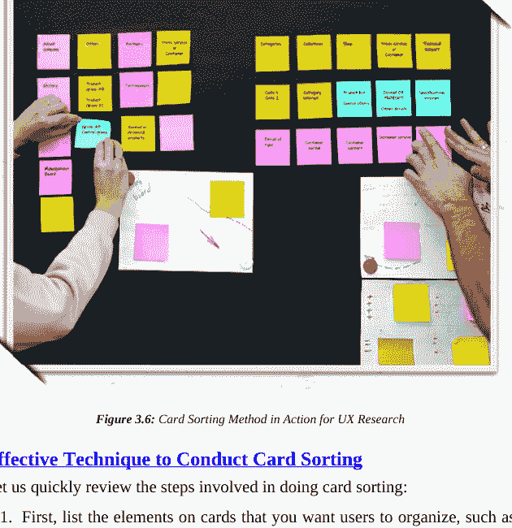

图 3.6：用于用户体验研究的卡片分类法实际操作

## 进行卡片分类的有效技巧

让我们快速回顾一下进行卡片分类所涉及的步骤：

- 1. 首先，在卡片上列出你希望用户组织的元素，例如网站或应用的各个部分。对于面对面会话，这些可以是实体卡片；对于在线卡片分类，则可以是数字卡片。
- 2. 之后，请参与者根据自己的感受将卡片分组。如果是开放式卡片分类，参与者会自行命名分组。如果是封闭式，参与者会将卡片排列到你预先设定的类别中。
- 3. 为了深入了解参与者的心智模型，观察他们如何排列你提供的卡片。这些发现随后可用于

创建人们会立即感到直观的信息架构。

无论你是新建网站还是改造现有网站，遵循这些最佳实践将帮助你最大化卡片分类会话的有效性，并获得可靠、可执行的洞察：

- 1. 保持卡片数量可控。
- 2. 谨慎选择和排列卡片名称。
- 3. 避免混合子类别和父类别。
- 4. 仔细选择你的卡片分类方法。
- 5. 随机化卡片顺序。
- 6. 招募合适的参与者。

这就是进行卡片分类的方法，但还有许多其他事项需要考虑，例如选择最佳卡片分类技术、招募合适的参与者，以及正确分析研究结果。

## 卡片分类的缺点

与任何研究方法一样，卡片分类有其优点和缺点。卡片分类的一些缺点包括：

无主持人卡片分类可能不会产生非常深刻的洞察结果。分析卡片分类的结果可能很耗时，尤其是纸质卡片分类。

卡片分类没有考虑手头的任务或更大的背景。例如，在商店的语境中，我们可能会将西红柿归类为“水果”，但它们实际上可能属于“蔬菜区”。

## 日记研究

通过持续记录自己在一段时间内的想法、感受和行为，日记研究的参与者成为自己生活的叙述者——这是一种迷人的研究工具。借助这种方法，研究人员可以窥见自然环境中的长期体验和行为。参与者可能会揭示他们的日常习惯以及与商品和


通过每日记录或在特定事件发生时记录细节来服务。所得数据是识别趋势、揭示问题以及确定需要改进领域的宝库。

## 开展日记研究的有效时机

日记研究对于深入了解长期行为和体验非常有价值。它们使参与者能够在较长时间内记录自己的行动、想法和感受，提供用户交互的全面视图，并捕捉短期方法可能忽略的变化。日记研究非常适合考察现实世界情境，能够实时记录日常环境中的体验，提供用户如何与产品或服务互动的真实洞见。

这些研究在观察罕见或间歇性事件时尤其有效，例如某些健康问题或产品使用频率较低的情况。日记研究通过在这些事件发生时记录深入、实时的描述，避免依赖参与者的回忆。通过详细的叙述和个人见解，这种方法产生丰富的定性数据，揭示潜在的动机和感受。这种丰富的数据对于开发用户画像、指导设计选择以及确定需要改进的产品和服务领域至关重要。


*图 3.7：参与者记录他们的日常互动和体验*

## 开展日记研究的有效技巧

请按照以下步骤使用日记研究进行用户体验研究：

- 1. **明确目标：** 清晰地概述研究目标。了解你想要调查的具体行为、体验或事件。
- 2. **招募参与者：** 选择能代表目标受众的参与者。确保他们愿意且能够承诺完成整个研究周期。
- 3. **设计日记：** 创建供参与者遵循的结构化格式，包括与研究目标一致的提示和问题。确保其用户友好且易于访问，无论是数字形式还是纸质形式。
- 4. **提供说明：** 清楚解释参与者应如何以及何时进行记录。就所需详细程度以及他们应记录的事件或体验类型提供指导。
- 5. **试点测试：** 与一小群人进行试点研究，以发现日记格式或说明中的任何问题。根据反馈进行必要的调整。
- 6. **监控进度：** 与参与者保持定期联系，确保他们持续完成记录。提供支持并回答他们可能有的任何问题。
- 7. **收集和分析数据：** 在研究期结束时收集日记。分析记录中的模式、主题和与研究目标一致的洞见。
- 8. **报告结果：** 总结关键洞见，并辅以日记中的引述和示例。利用这些数据为设计决策或改进提供依据。

根据研究的目标和性质，作为用户体验研究工具的日记研究可有不同的时长。日记研究通常持续几天到几个月不等。它们通常持续一到四周，以便有足够的时间记录用户行为和体验中的重要模式与洞见。

## 日记研究的缺点

研究人员应意识到与日记研究相关的各种挑战。一个主要问题是参与者负担，因为长期记日记可能导致疲劳，以及记录仓促或不完整，从而影响数据的准确性。

主观性和偏差也是值得关注的问题，因为记录基于参与者的观点和解读，这可能会使洞见产生偏差。当参与者事后而非实时填写记录时，可能会出现回忆偏差，进一步影响准确性。

随着时间的推移，参与者的参与度可能会下降，从而降低所收集数据的数量和质量。分析日记记录是复杂且耗时的，需要熟练的研究人员来识别重要模式。


隐私问题可能会出现，特别是在敏感话题上，导致数据不够详细。此外，数字日记的技术问题可能会干扰数据收集和参与者的配合。

## 可用性测试

可用性测试是用户体验研究的关键部分，涉及来自目标受众的真实用户，以评估网站或应用程序是否准备好发布。它衡量用户完成常见任务的难易程度，提供整体用户体验的清晰图景。这种方法有助于在产品正式发布之前发现可用性问题并确定需要改进的领域。

可用性测试通常包含三个组成部分：主持人（主持测试并记录数据的用户体验研究员）、参与者（执行模拟现实生活使用的任务）以及任务本身。

可用性测试的好处包括通过收集真实用户数据来减少假设，从而揭示产品是否有效。

可用性测试有多种形式，包括：

- 1. **主持式可用性测试：** 由研究员实时引导和观察参与者，可以面对面或通过视频会议进行。
- 2. **非主持式可用性测试：** 参与者在没有研究员指导的情况下独立完成任务，交互过程由软件记录，通常在远程进行。
- 3. **远程可用性测试：** 参与者在自己的环境中测试产品，可选择主持式或非主持式会话。
- 4. **线下可用性测试：** 在实验室环境中进行，研究员在场观察并记录。
- 5. **探索性可用性测试：** 早期阶段的测试，用于收集关于用户需求和行为的反馈。
- 6. **评估性可用性测试：** 在开发过程的后期评估产品的有效性和效率。
- 7. **比较性可用性测试：** 对多种设计方案进行比较，以确定哪种设计能提供更好的用户体验。

这些方法为研究用户交互提供了宝贵的见解，有助于提高产品的可用性和用户满意度。

## 进行可用性测试的适当时机

可用性测试在产品生命周期的每个阶段都很有益。如前所述，这种技术可以减少假设，并且可以应用于现有网站或早期网站设计，甚至基本的网站原型。你应该在设计过程中尽早并定期进行可用性测试，以帮助指导设计选择。可以使用以下指南来确定何时适合进行可用性测试：

- 开始任何设计工作之前
- 一旦你准备好原型或线框图
- 产品发布之前
- 发布后，经常性地进行

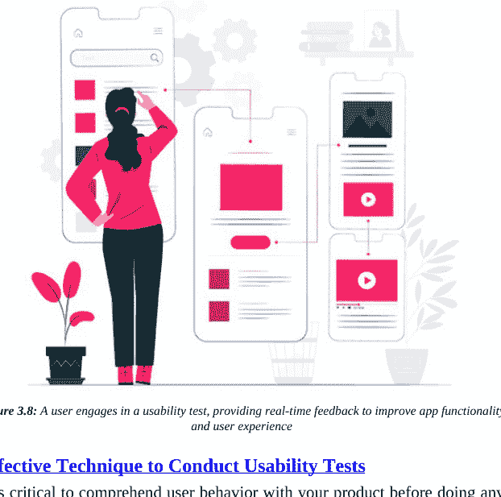

*图 3.8：用户参与可用性测试，提供实时反馈以改进应用功能和用户体验*

## 进行可用性测试的有效技巧

在进行任何可用性测试之前，理解用户如何使用你的产品至关重要。通过观察他们的行为并获取反馈，你可以改善整体用户体验并找出需要改进的地方。以下是执行可用性测试的简要指南：

- 1. **定义目标：** 明确说明你想了解产品可用性哪些方面。
- 2. **招募参与者：** 找到能够代表目标用户的人群。
- 3. **创建任务：** 设计现实场景供参与者完成。
- 4. **准备材料：** 设置用于测试的原型或网站。
- 5. **主持会话：** 在观察参与者操作的同时，引导他们完成任务。
- 6. **收集数据：** 记录参与者的言行。
- 7. **分析结果：** 寻找参与者行为中的模式和问题。
- 8. **报告发现：** 总结关键见解并提出改进建议。
- 9. **实施更改：** 利用反馈使产品更加用户友好。
- 10. **如有必要重复：** 进行额外测试以确认改进效果。

熟练掌握可用性测试方法可确保你的产品完全满足用户需求，提供流畅愉悦的体验。通过选择合适的可用性测试类型，你可以揭示重要见解并做出明智决策，从而改进设计。

## 可用性测试的缺点

尽管可用性测试是发现用户体验（UX）问题的绝佳工具，但它也有自身的局限性。其中一个限制是测试环境或主持人可能带来的偏差。由于人为环境，参与者可能会改变自己的行为，从而产生不可靠的结果。此外，进行可用性测试可能是一个费力且资源密集的过程，需要仔细准备、筛选参与者和进行评估。另外，可能会错过特定的用户群体或使用情境，导致我们对产品可用性的理解只停留在部分层面。此外，可用性测试通常关注可观察到的行为，这可能无法准确反映用户的主观动机或感受。最后，评估可用性研究的结果需要经验，并非所有见解都能立即用于改进设计。

## 实地研究

与实验室或办公室环境不同，用户体验研究中的实地研究涉及在用户的自然环境中观察他们。这种方法揭示了真实的


客户需求和行为并为设计团队提供产品在真实世界情境中如何被使用的洞察。通过沉浸在用户的环境中，研究人员可以发现（例如突发中断或连接问题）在受控环境中可能不会出现的问题。通过捕捉常规产品使用的上下文和细微差别，实地研究帮助设计师开发更能满足消费者实际需求并整体提升用户体验的解决方案。

## 实地研究揭示：

- 人们实际如何使用他们的产品。
- 产品在真实世界场景中使用的上下文。
- 问题包括多任务处理、计划外中断以及实验室环境中可能不会出现的 Wi-Fi 缺失。

最终，实地研究涉及深入真实世界，以了解产品在用户日常生活中的表现。

## 进行实地研究的最佳时机

在项目的不同阶段，UX 研究中的实地研究都很重要。在发现阶段尤其有用，可帮助设定方向并了解用户如何与产品互动。此外，在可用性测试阶段，当原型可用时，实地研究至关重要，因为它们有助于评估解决方案的有效性，并在真实世界情境中验证设计假设。因此，实地研究既用于项目开始时指导初始决策，也用于后期确保解决方案在实际情境中满足用户需求和行为。

简单来说，我们可以说进行实地研究的最佳时间是在项目开始时和可用性测试期间。在开始时，它们有助于了解用户需求和上下文，指导项目的初始方向。后来，在可用性测试期间，实地研究评估原型并验证设计，确保它们满足用户需求并在真实世界情境中有效运作。

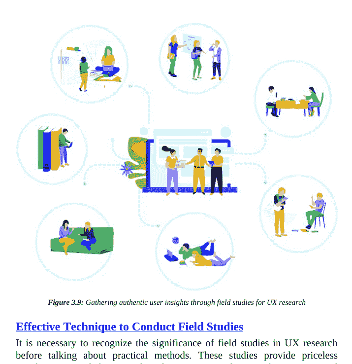

图 3.9：通过实地研究为 UX 研究收集真实用户洞察

## 进行实地研究的有效技术

在讨论实际方法之前，有必要认识到实地研究在 UX 研究中的重要性。这些研究提供了关于用户行为和产品互动的宝贵洞察，因为它们是在不同项目阶段开展的。

- 1. **确定你的学习目标**：明确你希望在真实环境中发现关于用户互动和体验的内容。
- 2. **选择地点**：确定客户必然会与你的产品互动的合适实地场所。
- 3. **选择参与者**：寻找愿意在自然环境中被观察并且代表你的目标受众的用户。
- 4. **计划观察**：选择你希望观察的用户行为方面并制定系统的观察计划。
- 5. **观察并做笔记**：前往实地场所观察参与者如何使用你的产品或服务。详细记录他们的行为、举止以及遇到的任何困难。
- 6. **提问后续问题**：与参与者进行简短对话，以了解更多关于他们的背景和驱动因素。
- 7. **分析发现**：回顾你的笔记和访谈记录，以发现趋势、主题以及可能需要改进的领域。
- 8. **报告洞察**：提供实地研究的主要结论和发现的总结，并附上根据用户反馈改进设计的建议。
- 9. **迭代和实施**：根据实地研究的观察调整你的产品或服务设计。根据客户反馈做出必要的调整和改进。
- 10. **根据需要重复**：随着项目的进展，开展更多实地研究以确认设计选择并确保其与用户需求和行为保持一致。

## 实地研究的缺点

在 UX 研究中，实地研究有不同的缺点。最初，研究人员在无意中影响参与者行为或以有偏见的方式解释观察结果时，主观性可能会受到损害。此外，完成这些研究需要投入大量时间和精力以及资源。另一个挑战是找到愿意在自然环境中被观察的受试者。此外，由于人们的行为在被观察时可能会改变，实地研究可能无法始终获得完全代表目标用户群的样本。外部因素也在实地环境中引入了不可预测性。很难分析这些研究中的定性数据；为了获得有用的洞察，需要对大量数据进行彻底审查。最后，一些用户


demographics or research objectives may make field investigations impossible or immoral. However, when carried out carefully, they continue to be vital for studying user behaviors and improving.

## Tree Testing

Tree testing is a method to determine how findable your website menu items are. In tree testing, participants are presented with a simplified text version of the website’s or app’s hierarchy (often represented as a tree diagram) and are asked to find specific items or complete tasks by navigating through the structure. This method helps identify navigation issues such as confusing labeling, unclear hierarchy, or dead ends.

## Effective Timing to Conduct Tree Testing

Tree testing is a crucial UX research method used during the design and development process to refine navigation and verify information architecture. It helps ensure that the structure of your site meets user needs and prevents navigation problems.

Another important component of website content organization is card sorting. Although these techniques are comparable to tree testing, they take distinct approaches to the issue and are applied at different phases of the investigation. Together, they work best: tree testing assesses how well users can navigate the suggested structure, while card sorting defines and tests new website architecture.

Tree testing is very useful when evaluating various information architecture models. You can decide which version of the structure to employ based on data, by determining which one facilitates better job completion and user navigation.

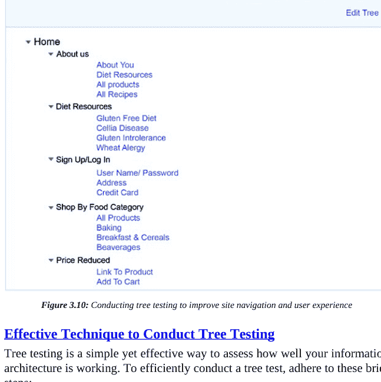

Figure 3.10: Conducting tree testing to improve site navigation and user experience

## Effective Technique to Conduct Tree Testing

Tree testing is a simple yet effective way to assess how well your information architecture is working. To efficiently conduct a tree test, adhere to these brief steps:

- 1. **Define Objectives**: Determine what you hope to discover from the tree test (for example, user preferences, navigational problems).
- 2. **Build a Tree Structure**: Without using any visual design components, describe the application’s or website’s hierarchical structure.
- 3. **Develop activities**: Using the tree structure, create realistic activities that users must accomplish, such as “Find the contact information.”
- 4. **Select Participants**: To take part in the test, select a representative sample of users from your intended audience.
- 5. **Select a Tree Testing Tool**: To set up and carry out your tree testing, use a tool like Treejack from Optimal Workshop or a comparable platform.
- 6. **Conduct the Test**: Using the tree structure, have participants complete the activities to conduct the test. Assure them that there are no visual clues and that the structure is the only thing to pay attention to.
- 7. **Analyze Results**: Examine participant pathways, success rates, and any areas of ambiguity or challenge.
- 8. **Make Adjustments**: Modify the information architecture to solve any issues found in light of the findings.
- 9. **Retest if Necessary**: After making modifications, run additional tests to make sure the original problems have been fixed.

## Downsides of Tree Testing

Despite its value, tree testing has a number of disadvantages. The absence of visual context is one of its main drawbacks. Tree testing does not take into consideration the way that visual design components, such as navigation menus and icons, affect user behavior because it assesses the organization of information in a text-only format. This may result in differences between the output of tree testing and real-world user interactions on a website or application.

Tree testing has another disadvantage in that it ignores other important UX elements like content quality, layout, and general usability in favor of concentrating only on navigation and information architecture. Furthermore, it might not adequately convey the complex nature of user journeys, particularly in the case of dynamic or irregular navigation on websites or applications.

Finally, it can be difficult to comprehend the results of tree testing. Even if the data shows where customers run into problems, it might not necessarily explain why these problems arise. To obtain a thorough grasp of user behavior, this frequently calls for the use of additional research techniques like usability testing or user interviews.


## 眼动追踪

一种称为眼动追踪的定性研究技术，通过追踪用户的视线来确定并记录他们在页面上注视的位置。它使用摄像头和传感器。这些设备追踪眼睛的位置和运动。眼睛会通过设备暴露在红外光下。瞳孔和角膜都会反射这束光。

这些反射通过眼动追踪传感器被记录下来。算法随后会检查这些信息。它们确定个人的视点。人们的视点表示他们在屏幕上或周围环境中关注的位置。这种技术有助于我们理解个人如何感知和解读数据。

它以热力图和扫视路径的形式产生数据。

- **热力图：** 热力图是图形工具，用于显示用户在网页上更注意的区域。红色区域代表更长的专注时间，而蓝色区域反映观看的持续时间。这有助于识别哪些网站部分经常被访问，哪些被忽略，从而指导布局和设计更改，以改善用户体验。
- **扫视路径：** 扫视路径直观地显示眼睛如何在网页上的兴趣点之间移动。红色圆圈标记关注区域，线条追踪眼睛的移动轨迹。这些数据帮助设计师了解用户如何浏览内容，揭示关注模式，并指导设计更改以改善用户体验和内容布局。

## 进行眼动追踪的有效时机

由于眼动追踪是一种专门的研究工具，并非所有项目都适合使用。尽管如此，在优化关键页面时，认识以下三个基本要素很有帮助，列示如下：

- **盲点：** 它提供有关人们忽略的网站区域的信息，可用于改善视觉层次结构。
- **绊脚石：** 它指示令人困惑的地方，即人们反复阅读同一段落。
- **阅读模式：** 这有助于通过显示用户如何与各种项目交互来优化可读性。例如，眼动追踪显示用户经常回到表格顶部重新阅读表头，这表明表格必须足够小以便于查看。

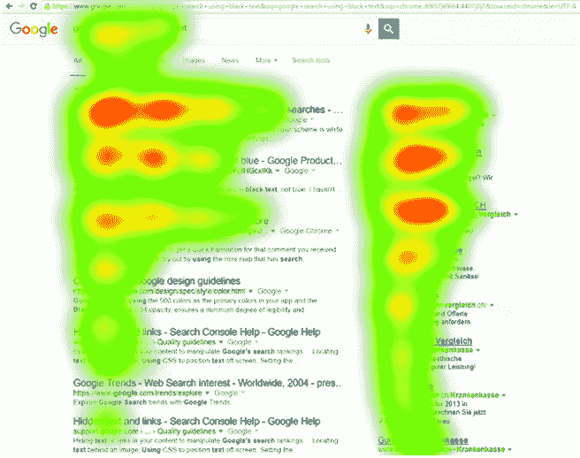

*图 3.11：眼动追踪测试正在进行中，揭示用户关注区域*

### 进行眼动追踪的有效技术

进行眼动追踪测试涉及以下快速步骤：

1. **定义目标：** 确定你希望从眼动追踪测试中发现什么（例如，导航问题和用户注意力）。
2. **选择参与者：** 为保证相关结果，选择代表目标受众的样本。
3. **设置设备：** 确保眼动追踪软件和硬件已准确配置。
4. **构建测试：** 为参与者分配可复制其与产品或页面常见用户交互的任务。
5. **执行测试：** 当参与者完成任务时，眼动追踪系统收集他们的注视模式和眼动。
6. **分析数据：** 检查注视图、扫视路径和热力图，以找到阅读模式、盲点和绊脚石位置。
7. **报告结果：** 总结洞察并根据收集的数据推荐更改，以改善用户体验。

## 眼动追踪的缺点

尽管富有洞察力，眼动追踪并非没有局限性。首先，它并不总是能够判断用户是否真的注意到他们所看的一切。用户可能快速扫视屏幕的某个区域而不意识到其重要性。这意味着仅靠眼动追踪无法确保用户对特定功能的认知。

此外，眼动追踪并不能揭示用户注视习惯背后的动机。它不会解释用户为何注视特定元素，即使它显示了他们注视的位置和时长。需要调查和其他补充工具来理解用户的动机和思维。

并非每个用户都适合眼动追踪。小瞳孔、隐形眼镜、眼镜和快速眼动等因素会妨碍准确追踪。因此，它可能不适合某些人，这限制了其对各种用户群体的使用。

## A/B 测试

在选择可能影响用户交互或整体体验的两种设计方面时，UX 设计师经常面临挑战。这就是 A/B 测试派上用场的地方。这种方法允许 UX 设计师在不完全依赖理论知识或直觉的情况下测试用户对各种设计方面的反应。A/B 测试的想法，有时也称为拆分测试，相当简单：你制作两个或多个版本的某物，


允许用户与它们交互，并追踪它们在现实世界中的使用情况。为了让你能够比较 A 和 B 的性能，每个版本都会展示给目标受众中的不同细分群体。

## 这里有一个 A/B 测试的例子：

一家运营在线新闻平台的公司希望增加新闻通讯的订阅数量。他们创建了两种不同的订阅表单来测试哪一种能吸引更多订阅者。版本 A，即当前表单，采用简洁的布局，仅有一个用于用户电子邮件地址的字段。版本 B，即新表单，采用更具视觉吸引力的设计，标题突出了订阅的好处，并包含用户的姓名和电子邮件地址字段。

平台的访客被随机分为两组：一半看到版本 A，另一半看到版本 B。测试运行一个月，在此期间，公司追踪每个版本产生的订阅数量。

月底，结果显示版本 B 的订阅率比版本 A 高出 20%。增强的设计和新增的字段似乎说服了更多用户认识到新闻通讯的价值。基于这些发现，公司决定采用版本 B 作为其标准的订阅表单，通过此次 A/B 测试流程成功提高了新闻通讯订阅量。

## 进行 A/B 测试的有效时机

当你需要对网站、应用或营销工作的修改做出数据驱动的判断时，A/B 测试效果最佳。它用于比较元素的两个迭代，以确定哪一个在实现特定目标方面效果更好，例如提高用户参与度、转化率或点击率。这种方法在你考虑的修改可能对用户行为或业务结果产生重大影响时尤其有用。例如，进行 A/B 测试非常适合测试号召性用语按钮、标题、页面布局或电子邮件主题行的变体。通过进行受控实验并评估结果，你可以降低风险，找到最佳的设计或内容选项，并根据实际用户互动改善用户体验。

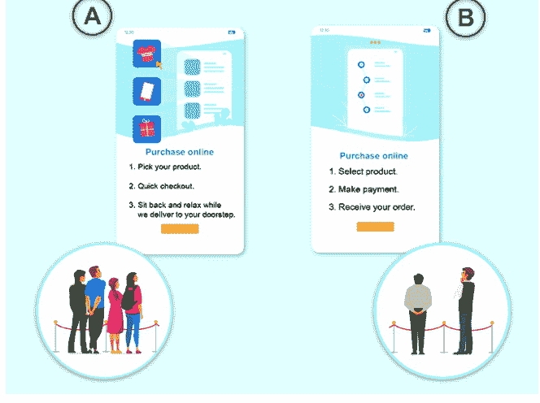

图 3.12：使用 A/B 测试比较设计以获得更好的用户洞察

## 进行 A/B 测试的有效技术

A/B 测试的有效性来源于其构思和实施。A/B 测试的设置、运行和分析方式会显著影响你得出的结论。

那么，让我们学习如何进行 A/B 测试：

- 1. **设定目标：** 确定你希望改进的网站方面，包括用户参与度、点击率或转化率。
- 2. **创建变体：** 创建你想要测试的元素两个迭代（版本 A 和版本 B）。
- 3. **划分受众：** 随机将受众分配到两个组，并向每个组展示一个版本。
- 4. **启动测试：** 同时向相应组展示变体并记录它们之间的互动。
- 5. **分析结果：** 检查两个版本相对于你预先设定的目标的表现如何。
- 6. **实施最佳版本：** 根据收集到的信息，使用表现更优的版本。

## A/B 测试工具：

- **Google Optimize：** 用于 A/B 测试和个性化网站体验的免费工具。
- **Optimizely：** 用于实验的综合平台，包括 A/B 测试和多变量测试。
- **VWO（Visual Website Optimizer）：** 用于 A/B 测试和拆分 URL 测试以优化用户体验的工具。
- **Unbounce：** 具有 A/B 测试功能的落地页构建器，可提高转化率。
- **Adobe Target：** Adobe Experience Cloud 工具，提供先进的 A/B 测试和个性化功能。

## A/B 测试的缺点

尽管 A/B 测试在改善用户体验方面很受欢迎，但它也有自身的缺点和挑战需要考虑。

- **范围有限：** 由于 A/B 测试通常一次只评估一个变量，因此对用户行为的理解可能更狭窄。这意味着它可能会错过重要信息，因为没有考虑到页面上各种项目之间的相互作用或整体用户体验。
- **时间和流量要求：** 为了获得具有统计学意义的结果，有效的 A/B 测试需要大量的时间和流量。对于较小的网站或流量较少的网站而言，收集足够数据以做出明智结论可能需要一段时间，这会显著减缓优化进程。


## 五秒测试

在实践中，五秒测试是一种流行的可用性研究技术。在我们快节奏的社会中，人们的注意力持续时间越来越短，要保持他们的兴趣，每一秒都至关重要。如果你的目标是提供出色的用户体验，那么你可能听说过五秒测试。该流程是让目标受众中的一名成员观看你的设计预览五秒钟，无论是网站还是应用。之后，隐藏图像并向参与者询问几个问题。目标是了解他们的第一印象是否符合你的预期。他们是否理解了关键点？他们能否记起品牌名称？通过这种方法，无需进行大量可用性测试，你就能快速评估产品的影响力。

然而，五秒规则并非无条件适用。你的设计复杂度与研究目标可能会要求你调整这一时间范围。五秒评估的主要目标是在一个有限的观看时间窗口内评估用户的第一印象。

## 开展五秒测试的有效时机

五秒测试是一种在设计和开发的不同阶段都行之有效的 UX 研究方法。它特别适合用于完善主页的首屏区域或任何其他重要页面。这种方法可以帮助你判断标题和介绍是否清晰易懂；如果不清晰，那么也许是时候重新考虑你的设计了。

五秒测试也非常适合快速评估特定活动的落地页和营销信息的效果。它同样适用于规划对现有产品的全面重新设计，因为通过比较产品的新旧版本，可以轻松识别出需要大幅修改的地方。

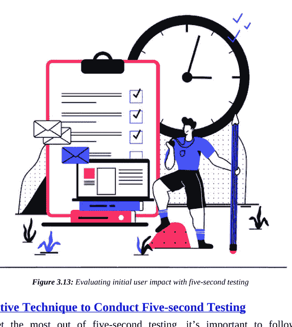

图 3.13：通过五秒测试评估用户的初始影响

## 进行五秒测试的有效技巧

要充分利用五秒测试，遵循结构化的方法非常重要。以下是一些有效的技巧，以确保你的测试能获得有价值的洞察：

- 1. **确定目标并准备材料：** 设定目标并收集设计稿。
- 2. **上传设计并设置测试：** 使用工具上传设计并配置测试。
- 3. **创建问题：** 为参与者制定清晰的问题。
- 4. **招募并测试：** 找到参与者，展示设计 5 秒，然后提问。
- 5. 分析结果：查看反馈并得出结论。

## 五秒测试中需要考虑的关键问题

五秒测试问题的设计应围绕你想要评估的具体目标来收集信息。根据研究目的的不同，这些问题可以分为多种类型。

### 识别测试问题

- 你记得看到了哪些具体的组件、短语或视觉元素？
- 你记得任何特定的文本或标题吗？
- 你首先想到的组件是什么？

### 理解测试问题

- 你认为这个页面的主要目标是什么？
- 基于设计，你能解释这家公司是做什么的吗？
- 在你看来，它传达的要点是什么？

### 重组测试问题

- 你还记得看到了哪些细节、短语或视觉元素？
- 你能想起某个特定的段落或标题吗？
- 你能记住哪些部分？

### 完成度测试问题

- 在你看来，这个页面的主要目标是什么？
- 你能根据设计解释这家公司所从事的工作吗？
- 在你看来，它要传达的主要信息是什么？

### 品牌测试问题

- 公司名称或品牌是否可见？如果可见，你记得它吗？
- 你能识别出任何标识或品牌符号吗？
- 基于设计，你认为该品牌想传达的主要信息是什么？
- 你认为这家公司销售什么产品？

### 参与度测试问题

- 设计是否意图让你点击、注册或购买？
- 是否有任何特别的事物引起了你的兴趣或促使你继续阅读？
- 是否有任何激励措施、折扣或优惠？你还记得吗？

## 五秒测试的缺点

尽管五秒测试是一种快速、高效的获取用户初步想法的方法，但它也有局限性。由于其简单性，它可能无法对整个用户体验进行深入分析。由于它关注的是对设计的短暂曝光，因此可能会忽略随着时间推移而产生的更深层次的参与和微妙的交互。此外，由于时间很短，测试可能无法完全捕捉用户反应的每一个方面，尤其是对于复杂的设计或需要用户更长时间参与的任务。五秒测试是确定初始印象的好方法，但它可能不足以捕捉用户行为和偏好的每个方面。为了更全面地了解用户体验，最好将五秒测试与能够进行更深入调查的其他研究技术结合起来。

## 快速指南——方法分类

了解各种研究方法的类别对于选择合适的方法来收集用户洞察至关重要。下表根据常见 UX 研究方法是定性、定量、生成性、评估性、行为性还是态度性，对这些方法进行了分类。这有助于为特定的研究目标确定最合适的方法。

| 方法 | 定性 | 定量 | 生成性 | 评估性 | 行为性 | 态度性 |
|---|---|---|---|---|---|---|
| 用户访谈 | 是 |  | 是 |  |  | 是 |


|  |  |  |  |  |  |  |
|---|---|---|---|---|---|---|
| 焦点小组 | Yes |  | Yes |  |  | Yes |
| 调查问卷 |  | Yes |  | Yes |  | Yes |
| 卡片分类（开放/混合） | Yes |  | Yes |  |  | Yes |
| 卡片分类（封闭） |  | Yes |  | Yes |  | Yes |
| 日记研究 | Yes |  | Yes | Yes | Yes | Yes |
| 可用性研究 | Yes |  |  | Yes | Yes |  |
| 实地研究 | Yes |  | Yes |  | Yes |  |
| 树状测试 | Yes | Yes |  | Yes |  |  |
| 眼动追踪 |  | Yes |  | Yes | Yes |  |
| A/B 测试 |  | Yes |  | Yes | Yes |  |
| 五秒测试 | Yes | Yes |  | Yes |  |  |

*表 3.4：研究方法及其分类*

## UX 研究工具

在 UX 研究领域，选择合适的工具进行每种研究方法对于获取相关数据和提升用户体验至关重要。不同的研究方法需要特定的工具来高效地收集和处理数据。沟通工具对于与人们进行深入访谈和焦点小组至关重要。调查中使用的结构化问卷产生定量数据，而卡片分类有助于信息架构的组织。可用性测试评估设计的可用性，而日记研究记录长期用户交互和体验。树状测试评估网站导航的可用性，而实地研究则在自然环境中监控用户行为。眼动追踪揭示用户注视的位置，A/B 测试比较两种设计版本以确定表现更好的版本，而五秒测试则衡量用户的初始印象。下表概述了各种研究方法以及最适合每种方法的工具，帮助研究人员为其 UX 研究选择合适的资源。这些工具提供了各种功能来有效开展每种类型的研究，无论是通过访谈收集定性见解，还是通过 A/B 测试量化用户行为。

| 研究方法 | 工具 |
|---|---|
| 访谈 | Zoom, Skype, Google Meet, Microsoft Teams |
| 焦点小组 | Zoom, Microsoft Teams, Webex, Qualtrics |
| 调查问卷 | SurveyMonkey, Google Forms, Typeform, Qualtrics |
| 卡片分类 | Optimal Workshop, UsabilityHub, Trello |
| 日记研究 | DScout, ExperienceFellow, Ethnio |
| 可用性测试 | UserTesting, UsabilityHub, Optimal Workshop, Lookback |
| 实地研究 | DScout, Ethnio, ExperienceFellow |
| 树状测试 | Optimal Workshop, Treejack |
| 眼动追踪 | Tobii Pro, EyeQuant, LookTracker |
| A/B 测试 | Google Optimize, Optimizely, VWO (Visual Website Optimizer) |
| 五秒测试 | UsabilityHub, Lookback, Optimal Workshop |

表 3.5：研究方法概述及对应工具

该表清晰地概述了研究方法以及通常用于每种方法的对应工具。

## 真实世界的 UX 研究案例研究

真实世界的 UX 研究案例研究展示了公司如何解决实际问题以改善用户体验。这些示例突出了多样化的研究方法，以及理解用户行为和需求如何带来更好的产品设计和更高的客户满意度。

### Google Search 的移动优化

挑战是改善移动设备上的搜索可用性。
Google 希望确保用户在移动设备上进行网络搜索时速度快且无缝，因为越来越多的人使用这些设备进行此目的。他们必须找出任何问题并理解人们如何在手机上使用 Google Search。

### 目标：

- 使 Google Search 在移动设备上易于使用。
- 确保用户可以快速找到相关的搜索结果。
- 提升移动用户参与度和满意度。

### 使用的 UX 研究方法

### 眼动追踪研究：

- **描述**：该方法使用了眼动追踪技术来追踪用户在移动搜索结果上的移动和交互。
- **结果：** 提供了搜索结果视觉层级和用户关注区域的见解。突出了获得最多关注的组件以及用户遇到问题或感到困惑的区域。

### 远程可用性测试：

- **描述**：与参与者使用其个人移动设备进行了面对面可用性测试。研究人员使用屏幕共享软件进行观察并收集反馈。
- **结果：** 突出了消费者在现实世界中遇到的问题，包括导航困难、加载缓慢以及在小屏幕上阅读的问题。

### 情境访谈：

- **描述：** 研究人员在人们在其自然环境中使用移动设备进行搜索时观察他们。这提供了有关用户典型搜索环境背景信息。
- **结果**：确定了环境因素，如照明、干扰以及在需要快速信息检索的移动使用情况下的需求，对移动搜索使用产生影响。

### A/B 测试：


- **描述** : 用户测试了移动搜索体验的许多迭代，以查看哪些设计组件改善了可用性和参与度。
- **结果** : 协助选择最佳的交互组件、字体大小和布局。这使 Google 能够根据实际用户偏好和交互调整用户界面。

## 调查和反馈：

- **描述** : 向移动用户部署调查，以收集他们对搜索体验、偏好和痛点的定性反馈。
- **结果** : 提供了用户关于他们喜欢、讨厌以及希望改进的内容的直接输入。确定了指导设计决策的常见主题和问题。

## 实施的关键更改

- 1. **简洁且响应式的设计：**
  a. 开发了一个更简单、更直观的用户界面，可动态调整以适应各种屏幕尺寸。
  b. 确保可见且易于获取的主要导航按钮和搜索栏是重要方面之一。
- 2. **最佳加载时间：**
  a. 通过加快移动设备上页面和搜索结果的加载速度，整体提升了用户体验。
  b. 通过使用优化图片尺寸和懒加载等策略减少了加载时间。
- 3. **改进交互和可读性：**
  a. 修改按钮宽度、间距和文字大小，使其在较小的屏幕上更易于阅读和使用。
  b. 改进触控目标以提高用户愉悦感和无错误交互。
- 4. **更好的结果呈现和相关性：**
  a. 增强算法以优先考虑移动友好内容，并为移动用户提供更相关、量身定制的结果。
  b. 改进精选内容和搜索摘要的呈现方式，以提供简洁易懂的信息。

## 5. 语音搜索集成：

  a. 改进语音搜索功能，以适应偏好免提通信的移动用户。
  b. 确保语音搜索结果在移动设备上的呈现方式专为快速消费而设计。

## 6. 保持视觉和功能一致性：

  a. 确保各种移动平台和设备使用相同的视觉语言和功能。
  b. 确保在设备之间切换的消费者从移动到桌面体验的过渡顺畅。

## 结果

优化工作带来了显著改善的移动搜索体验。用户报告加载时间更快、导航更轻松、搜索结果更相关。增强的可读性和交互设计有助于提高用户满意度和更长的参与时间。Google 的移动搜索使用量增加，整体性能指标也更好，证明了 UX 研究和设计改进的成功。

## 亚马逊结账流程改进

挑战是降低结账过程中的购物车放弃率。

作为全球最大的在线零售商之一，亚马逊在购物车放弃方面存在严重问题。当客户将商品添加到购物车但在完成交易前离开网站时，就会发生这种情况。较高的购物车放弃率可能导致收入大幅损失，并表明结账流程中存在摩擦。

## 目标：

- 第一个目标是识别并消除导致客户放弃购物车的障碍。
- 第二个是简化结账流程，使其更易于使用。
- 提高转化率和整体用户满意度。

## 使用的 UX 研究方法

## 可用性测试：

- **描述** : 让真实用户完成结账流程，研究人员观察并记录交互。
- **结果** : 突出了消费者遇到困难或挫折的特定区域，例如输入送货信息有困难、付款方式不明确以及意外的运费。

## 用户调查：

- **描述** : 调查的目的是从购物车空置的用户那里获得第一手反馈，了解他们未完成购买的原因。
- **结果** : 收集的信息显示出反复出现的问题，例如缺少访客结账选项、安全问题以及缺乏首选付款方式。

## A/B 测试：

- **描述** : 通过对用户细分群体评估各种迭代，比较哪个结账流程版本能带来更高的完成率。
- **结果** : 使亚马逊能够确定哪些修改，包括简化设计和更清晰的进度标记，将最有益。

## 分析回顾：

- **描述** : 跟踪客户通过结账漏斗的行为


通过分析网络分析数据并识别特定的流失点。

- **结果**：指出了客户最容易在购物车中放弃的特定阶段，从而指导了有针对性的改进。

## 实施的关键变更

1. **简化导航：**
   a. 将结账流程从多个页面转换为单页，节省了步骤数量。
   b. 添加了清晰的进度指示器，让用户知道还剩下多少步骤。

2. **改进支付方式：**
   a. 增加了更多支付选择，例如分期付款和数字钱包。
   b. 增强了支付流程的安全性和清晰度，以培养用户信心。

3. **明确的配送详情：**
   a. 在用户付款前就提前展示运费和预计到达时间。
   b. 提供了多种配送选择，例如普通和加急配送。

4. **访客结账选项：**
   a. 为不希望注册账户的人引入了访客结账选项，以降低交易的门槛。

5. **增强移动体验：**
   a. 确保结账流程完全适合移动设备，为出行中的用户提供流畅的体验。

## 结果

这些改进导致购物车放弃率显著下降，成功完成的交易数量上升。客户表示结账流程更容易理解且更无缝，这提高了他们的满意度和对平台的忠诚度。通过消除妨碍交易的障碍，加速的结账流程改善了客户体验并增强了亚马逊的收入增长。

## 结论

在本章中，我们探讨了各种 UX 研究方法和其应用。我们在本章中查看了多种 UX 研究技术及其用途。我们发现，为了更好地理解用户行为并改善用户体验，不同的项目和场景需要不同的方法论。当我们将适当的方法应用于正确的项目时，我们可以获得重要的信息来指导我们的设计决策。

例如，可用性测试揭示了客户认为产品难以使用的领域，而调查和访谈则提供第一手的用户反馈，A/B 测试使我们能够比较多个设计迭代并确定哪一个效果最好。选择适合特定工作的正确方法至关重要，因为每种方法都有其优势，并在不同情况下适用。

我们还探索了许多 UX 研究领域和技术。如果我们知道如何使用它们并理解它们的各种类别，例如定量与定性工具，我们就可以充分利用这些工具。随着本章的结束，很明显，掌握 UX 研究方法和工具是创建用户友好产品的关键。通过仔细实施这些技术，我们可以创造真正满足用户需求和期望的体验。

在下一章中，我们将深入了解 UX 中的用户映射。我们将获得如何绘制客户旅程、构建用户角色以及处理用户故事的知识。这些方法将支持我们更好地理解和代表用户体验的努力。

## 关键术语

- **态度研究**：研究方法，探索用户对产品或服务的感受、想法和认知，通常涉及调查和访谈。
- **行为研究**：研究方法，观察和分析用户与产品交互的行为，通常使用热图和用户录制等工具。
- **竞争对手分析**：评估竞争对手产品的优势和劣势，以获得改进自身产品的见解。
- **精益 UX 设计**：一种设计方法，专注于用户反馈、测试和迭代改进，以高效创建以用户为中心的产品。
- **定量数据**：可测量并进行统计分析的数值数据，通常用于识别用户行为中的模式和趋势。
- **定性数据**：描述性数据，提供用户体验、感受和动机的见解，通常通过访谈和观察收集。
- **筛选调查**：初步调查，用于根据特定标准筛选和选择适合研究研究的参与者。
- **利益相关者访谈**：与对研究结果有既得利益的个人进行的对话，以收集见解并协调项目目标。
- **用户研究计划**：概述用户研究项目的目标、方法和管理的文件，确保结构化和高效的方法。
- **UX 研究**：通过各种研究方法了解用户行为、需求和动机以指导以用户为中心的产品设计的过程。
- **UX 研究方法论**：在 UX 研究中用于收集和分析用户数据的不同方法和技术，包括定性和定量方法。
- **关键绩效指标 (KPI)**：用于评估产品或项目在实现特定业务目标方面的成功程度的指标。
- **主持研究**：在积极参与下进行的研究


of a facilitator or moderator to guide participants and ensure data collection aligns with research goals.

- **非主持研究**：在没有主持人的情况下进行的研究，让参与者独立完成任务，常用于收集大规模数据。
- **态度数据**：记录用户想法、观点和信念的数据，为其动机和态度提供洞察。
- **行为数据**：追踪用户在使用产品、完成任务或解决问题时所采取行动的数据，为实际用户行为提供洞察。
- **卡片分类**：一种 UX 研究技术，用于了解用户如何对信息进行分类，帮助设计直观的导航结构。
- **混合卡片分类**：一种卡片分类类型，参与者可以在使用预设类别的同时创建新类别。
- **开放式卡片分类**：一种卡片分类类型，参与者将主题分组为逻辑类别并自行命名这些组，揭示出对信息架构的独特视角。
- **焦点小组**：一种定性研究技术，由一小群人讨论其态度、观点和经验，可快速且详细地洞察用户偏好和产品的潜在用途。
- **调查**：结构化问卷，用于收集定性和定量数据，可适应产品开发过程的各个阶段。
- **日记研究**：一种研究方法，参与者持续记录其随时间的想法、感受和行为，为长期用户体验和行为提供洞察。
- **A/B 测试**：一种比较两种设计版本的方法，以确定哪种在用户交互或实现特定目标方面表现更好。它涉及向不同用户组展示不同版本并分析其交互，以做出数据驱动的决策。
- **眼动追踪**：一种定性研究技术，使用摄像机和传感器追踪并记录用户在页面上注视的位置，产生热图和扫视路径等形式的数据，以了解用户注意力和导航情况。

- **实地研究**：一种研究方法，涉及在用户自然环境中观察用户以了解真实行为和需求，揭示真实世界的使用场景和情境挑战。
- **五秒测试**：一种快速可用性测试技术，用户查看设计五秒钟后回答问题以评估其初步印象，有助于评估关键信息和视觉吸引力的有效性。
- **可用性测试**：UX 研究的重要组成部分，涉及让真实用户测试网站或应用以衡量完成常见任务的难易程度，识别可用性问题和改进领域。
- **面对面可用性测试**：一种可用性测试方法，研究人员在受控的实验室环境中观察并记录参与者完成任务，允许直接互动和观察。
- **主持可用性测试**：一种可用性测试方法，研究人员引导参与者完成任务，观察其行为并实时提问，可在现场或通过远程视频会议进行。
- **远程可用性测试**：一种可用性测试方法，参与者在正常环境中执行任务，可以是有主持人（有引导者）或无主持人（无引导者），使用软件捕获交互和反馈。
- **树状测试**：一种评估网站菜单项可查找性的方法，让参与者导航网站层级的简化文本版本以完成任务，识别诸如标签不清或死胡同等导航问题。
- **热图**：眼动追踪中使用的可视化表示，显示用户在网页上集中注意力的区域，颜色表示专注时长（红色为较长时间，蓝色为较短时间）。
- **扫视路径**：眼动追踪中使用的可视化表示，用于显示


网页上兴趣点之间眼球的移动，红色圆圈标记关注区域，线条追踪眼睛的移动轨迹。

- **Facilitator**：在可用性测试中，一名运行测试会话、记录数据并向参与者提供指导的 UX 研究员。

# Chapter 4
## 用户体验映射的艺术

## Introduction

探索用户体验映射的动态领域！在本章中，我们将介绍用户体验映射的基础知识，它是理解和改善用户与产品和服务互动的重要工具。为了建立理解的坚实基础，我们从 UX 映射的基础开始。之后，我们将深入探讨用户角色的概念，它使我们能够识别并与目标市场产生共鸣。

我们还将查看其他类型的 UX 地图，例如同理心地图和客户旅程地图，每一种在描绘用户体验和感受方面都有特殊功能。我们还将介绍可用于制作这些地图的有效工具，这将使流程更高效、更具信息量。

## Structure

在本章中，我们将讨论以下主题：

- Introduction to UX Mapping
- Importance of UX Mapping
- Create a User Experience Map
- User Persona
- Key Components of a User Persona
- Types of User Experience Mapping
- Customer Journey Maps
- Empathy Maps
- Experience Maps
- Service Blueprints
- Best Tools for User Experience Mapping

## Introduction to UX Mapping

用户体验映射是了解消费者需求、愿望和担忧的绝佳方法。尽管许多企业擅长收集消费者信息，但这并不能完全捕捉到他们的抱怨和体验。用户体验地图是企业讲故事的最佳工具之一，它能有效地讲述一个故事。

简单来说，UX 映射是告知团队和利益相关者您的发现和见解的最佳方法之一。它有助于弥合您创建的产品与用户或客户需求之间的差距。在开始任何建设或设计工作之前，获得全貌至关重要。

地图是优秀的资源，可用于：

- 保持视角并专注于核心思想
- 从问题识别过渡到解决方案发现
- 识别差距和问题
- 将我们所有的发现和见解放在一个地方。召集团队和利益相关者围绕手头的问题。

体验地图展示了消费者使用产品或服务时所走的路径。它还强调了公司体验与其客户之间的联系。通过从客户的角度审视体验，企业可以识别战略机会、理解客户痛点并开发创新解决方案。

## Importance of UX Mapping

用户体验映射的主要目标是获得对消费者使用产品时的体验的实用理解。鼓励客户更有效地使用您的产品并拥有无缝的整体体验是最终目标。

客户体验地图提供了人类行为在多个阶段的广泛概述。这些阶段包括各种设计流程、用户必须执行的操作、每个操作背后的原因以及与结果相关的感受。这通常会导致对用户对产品体验的透彻理解。

**体验映射可能在以下方面有益：**

- 提供完整的客户旅程全景视角。
- 召集团队解决特定的消费者障碍，以便识别关键的客户旅程模式以及进一步开发将产生最大影响的领域。
- 通过识别关键流程和决策点，减少不利的客户体验，并更快地提高客户转化率。
- 通过了解客户如何经历例如采购周期的每个阶段，并确保所有相关信息对所有各方提供和可访问，从而提高客户保留率。
- 使公司能够专注于通过特定渠道的单一客户旅程。
- 了解正确的指标有助于我们看到客户成功或流失的地方，以便我们可以找到让他们回来的方法。
- 使公司能够按重要性顺序排列其客户体验计划中的步骤。
- 突出不同部门和渠道之间的差距。

### Fundamentals of UX Mapping
https://example.com

UX 映射的基础涉及创建用户与产品或服务体验的视觉故事。它首先要了解用户是谁以及他们需要什么。接下来，它逐步跟踪他们的旅程，突出关键操作、感受和痛点。这张地图帮助团队看到用户遇到问题的地方并找到改进机会。这是一种强大的方式，使每个人在同一目标上保持一致，并做出更好的设计和业务决策。从本质上讲，UX 映射将用户体验转化为清晰、可操作的见解。

UX 地图有各种形式，但每种都应包含一个观点，


scope, and focus.


# Scope

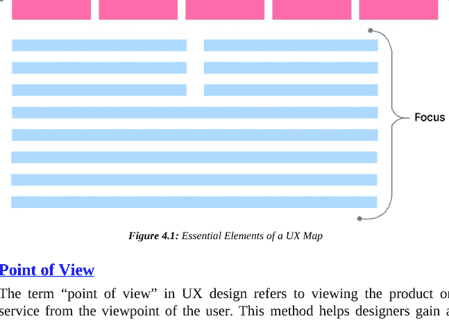

# Focus

Figure 4.1: Essential Elements of a UX Map

# Point of View

在 UX 设计中，“观点”一词指的是从用户的角度来看待产品或服务。这种方法有助于设计师全面了解客户的需求、目标和潜在的挫败感。设计师通过设身处地为用户着想，可以制定出更高效、以用户为中心的解决方案，直接解决用户的痛点。例如，设计师会考虑用户在浏览、挑选和购买产品时的感受——如兴奋、困惑或沮丧。通过采用以同理心为驱动的设计方法，可以产生更直观、更令人满意的用户体验。

为了对业务目标和计划有清晰的认识，务必让利益相关者参与到构建观点的过程中。

# Think on these important queries:

- What is the organization’s mission and direction?
- Which markets and subsets are we focusing on?
- What are the strategic and business goals?
- What knowledge gaps need filling?

## Scope

范围规定了 UX 映射程序的参数。它描述了用户体验中将包含的元素以及不会包含的元素。这使得映射练习更具可行性和聚焦性。为了确定范围，必须识别旅程的起点和终点、所需的细节程度以及涉及的渠道。例如，如果目标是改善在线购买体验，范围可能涵盖从访问网站到成功完成购买的整个过程，重点关注桌面交互，并排除移动应用体验。

## Focus

UX 映射的重点是确定用户旅程中需要关注的关键要素。它涉及识别对用户整体体验至关重要的特定任务、交互或痛点。通过集中注意力，设计师可以深入挖掘最关键的领域并制定量身定制的解决方案。例如，如果客户反馈表明结账流程存在问题，则应重点描述和完善选择产品、提供付款信息和完成交易的过程。这种聚焦的策略确保最重要的问题首先得到解决。

## Structure

一旦你选择了视角和焦点，选择合适的体验地图结构就至关重要。两种常见结构是 chronological 和 hierarchical，它们在不同的实际场景中都很有效。

- **Chronological**: 这种结构以基于时间的时间顺序突出用户旅程的每一步，从开始到结束。当用户体验涉及清晰的进展时效果最佳，例如从主页到购买的在线购物流程。通过可视化每个阶段的关键交互、情感高峰和痛点，设计师可以识别改进领域。这种方法在跟踪时间敏感或分步骤的流程时尤其有用。
- **Hierarchical**: 这种结构按重要性和依赖级别组织任务和交互，将复杂流程分解为可管理的部分。它非常适合多个任务共同促成更大目标的场景，例如将“查看产品详情”、“浏览分类”和“结账”等任务归类到“购买产品”这一主要目标下。层级结构有助于明确任务优先级和工作流程，使其在理解任务依赖性对改善用户体验至关重要的多步骤流程中非常有效。

# Selecting the Format

在选择格式时，应考虑将使用该图表信息作为主要来源的人或实体。通过定义制图过程的目标、我们希望解决的问题以及知识空白来组织工作。最后，确定地图的用途以及我们希望取得的结果。我们应该关注特定问题还是系统整体的概览？我们是否需要不止一张地图来描绘体验的过去、现在和未来状态？

# Create a User Experience Map

创建 UX 地图对于理解和改进用户对产品或服务的体验至关重要。UX 地图直观地概述了用户在旅程中采取的步骤、他们的交互以及他们的情绪。通过映射这种体验，你可以识别痛点，了解用户需求，并发现改进机会。这一过程使团队和利益相关者保持一致，确保每个人都在同一页面上并朝着更好的用户体验努力。


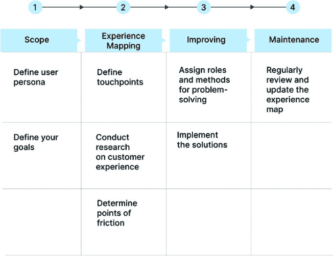

*Figure 4.2: The process of creating an experience map*

*图 4.2：创建体验地图的过程*

This overview highlights the key steps needed to create an effective user experience map:

本概述强调了创建有效的用户体验地图所需的关键步骤：

- 1. Develop a persona
- 1. 开发用户画像
- 2. Perform user research
- 2. 进行用户研究
- 3. Define the journey stages
- 3. 定义旅程阶段
- 4. Define customer interactions
- 4. 定义客户互动
- 5. Pinpoint friction points
- 5.  pinpoint 摩擦点
- 6. Resolve issues
- 6. 解决問題

## Step 1: Developing a Persona

## 第 1 步：开发用户画像

Personas are made-up characters that are based on research and are meant to represent various user types that could utilize your site, product, or service in a similar way. They support your understanding of user objectives, experiences, behaviors, and needs. In order to understand your target users’ needs and develop empathy for them, UX designers begin by performing user research. Based on this research, personas are created that represent the needs, objectives, and behavioral patterns of the target audience.

用户画像是基于研究而创建的虚构角色，旨在代表可能以相似方式使用你的网站、产品或服务的各种用户类型。它们有助于你理解用户目标、体验、行为和需求。为了理解目标用户的需求并对他们产生共鸣，UX 设计师首先进行用户研究。基于此研究，会创建代表目标受众需求、目标和行为模式的用户画像。

By clarifying issues and demonstrating how they affect people’s lives, personas assist companies in connecting with clients in a more strategic manner, which is advantageous to all parties involved. Personas are frequently developed in the Define phase of design thinking when designers combine the findings from the Empathize phase. This facilitates transitioning to the ideation stage.

通过阐明问题并展示它们如何影响人们的生活，用户画像帮助公司以更具战略性的方式与客户建立联系，这对所有相关方都有利。用户画像通常在设计思维的定义阶段开发，此时设计师将共情阶段的发现结合起来。这有助于过渡到构思阶段。

## Step 2: Performing User Research

## 第 2 步：进行用户研究

The next step involves directly engaging with users to gather insights. An accurate user experience map cannot rely on guesses and assumptions; it must be founded on real-time data collected through surveys, interviews, and observations from actual users. This approach allows for the development of solutions tailored to users’ needs.

下一步涉及直接与用户互动以收集洞察。准确的用户体验地图不能依赖猜测和假设；它必须建立在通过调查、访谈和对实际用户的观察收集的实时数据之上。这种方法可以开发出针对用户需求的解决方案。

In the previous chapter, you already learned about different research methods. Choose the research method that suits your requirements — methods such as interviews, surveys, focus groups, and usability testing are essential for obtaining precise and relevant data on user interactions with a product or service. While you might need to incentivize participation, many users are willing to contribute if they see their feedback will lead to improvements for others.

在上一章中，你已经了解了不同的研究方法。选择适合你需求的研究方法——访谈、调查、焦点小组和可用性测试等方法对于获取有关用户与产品或服务互动的精确和相关数据至关重要。虽然你可能需要激励参与，但许多用户如果看到他们的反馈将导致对他人的改进，就会愿意贡献。

Try to determine the following for each stage of the journey:

尝试为旅程的每个阶段确定以下内容：

- What were their objectives, and what did they hope to accomplish?
- 他们的目标是什么，他们希望完成什么？
- What kind of approach did they expect?
- 他们期望采用什么样的方法？
- The account of the customer’s encounter with your product or service from start to finish (in their own words).
- 客户从开始到结束与你的产品或服务相遇的描述（用他们自己的话）。
- The individual’s emotional state and any pain points they felt when interacting with the various stages or touchpoints, along with the reason behind them.
- 个体在与各个阶段或接触点互动时的情绪状态以及他们感受到的任何痛点，以及背后的原因。
- Additional ideas they had at the time.
- 他们当时提出的额外想法。
- The amount of time needed to complete each stage of interacting with the product.
- 完成与产品互动的每个阶段所需的时间。

## Step 3: Define the Journey Stages

## 第 3 步：定义旅程阶段

User experience maps are organized into stages or phases and have a structured format. Every stage of the journey has a specific objective the user wishes to accomplish. These stages demonstrate how, when, and where customers find your product, become aware of its advantages and features, decide to buy it over opponents, and finish the buying process. This facilitates targeted enhancements to improve the entire experience by helping designers and stakeholders understand the users’ interactions and decisions at each level.

用户体验地图按阶段或阶段组织，具有结构化格式。旅程的每个阶段都有用户希望实现的具体目标。这些阶段展示了客户如何、何时以及在哪里找到你的产品，了解其优势和功能，决定在竞争对手中购买它，并完成购买过程。这通过帮助设计师和利益相关者了解用户在每个层面的互动和决策，从而促进有针对性的改进以提升整体体验。

Once your persona has been developed, determine the customer journey phases. Find out the steps involved in selecting and purchasing your goods or services. List the steps your consumer goes through in a nutshell, based on their persona. Specify how, when, and where customers will learn about your business, investigate your goods or services, pick you over competitors, make a purchase, and keep in touch. With a comprehensive image of the user experience provided by this thorough mapping, you can identify areas for optimization and ensure your consumers have a positive and seamless experience.

一旦你的用户画像开发完成，就确定客户旅程阶段。了解选择和购买你的商品或服务所涉及的步骤。简要列出消费者基于其用户画像所经历的步骤。说明客户将如何、何时以及在哪里了解你的业务、调查你的商品或服务、选择你而不是竞争对手、进行购买并保持联系。通过这种彻底的映射提供的用户体验的全面图景，你可以识别优化领域并确保你的消费者拥有积极且无缝的体验。

## Step 4: Define Customer Interactions

## 第 4 步：定义客户互动

Customer interactions refer to all points where a customer engages with your product or service during their journey. These interactions include every instance of contact, whether through digital platforms, physical touchpoints, or human interactions.

客户互动是指客户在其旅程中与你的产品或服务互动的所有点。这些互动包括每次接触，无论是通过数字平台、物理接触点还是人际互动。


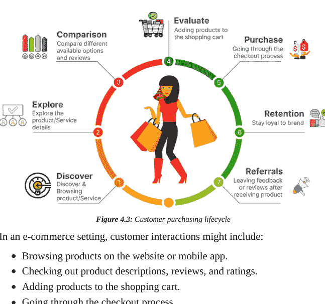

图 4.3：客户购买生命周期

在电子商务环境中，客户互动可能包括：

- 在网站或移动应用上浏览产品。
- 查看产品描述、评论和评分。
- 将产品添加到购物车。
- 完成结账流程。
- 收到订单确认邮件或短信通知。
- 监控订单的配送状态。
- 产品收到后留下反馈或评论。

虽然这个列表看起来很长，但它只是触点的冰山一角！每一次互动都为客户提供了与产品互动并做出影响整体体验的决策的机会。理解并优化这些触点对于企业确保无缝且令人满意的客户旅程至关重要。

## 第 5 步： pinpoint 摩擦点

在你定义了人物角色并理解了他们的目标之后，下一步就是寻找摩擦点。最好的实现方式是共同合作并利用之前研究的数据。提升用户旅程需要在用户体验地图中识别摩擦点。这意味着要找出消费者遇到困难、烦恼或效率低下之处。开始时可通过问卷调查、访谈、可用性评估以及与客户服务的沟通来获取用户反馈。从用户个人经历中深入了解消费者的问题，对于改进至关重要。

研究用户行为也至关重要。通过观察用户如何浏览和与产品互动、任务完成频率以及错误发生的位置，可以识别可用性问题。会话时长、跳出率和转化率等指标可用于提供关于用户挑战的定量信息。

通过绘制从初始认知到购买后互动的每一步来可视化用户旅程，有助于识别用户可能遇到摩擦的地方。与来自营销、销售和客户支持等不同领域的利益相关者进行协作，有助于增强对潜在问题的理解。通过根据重要性和严重程度对这些摩擦点进行排序，企业可以优先解决最紧迫的问题，从而优化客户体验。这种主动策略在提高消费者满意度的同时，也促进了长期忠诚度和留存。

## 第 6 步：解决问题

在创建用户体验地图的“解决问题”阶段，主要目标是解决在整个映射过程中识别出的挑战和摩擦点。此阶段对于确保最终用户体验得到优化并与用户需求和业务目标保持一致至关重要。

根据问题对整体用户体验和业务目标的影响进行优先级排序至关重要。通过关注最关键的问题，团队可以有效分配资源并及时解决最紧迫的关切。这涉及产生想法并考虑各种解决已识别问题的方法。一旦确定了潜在解决方案，团队就会开发原型，以可视化拟议的更改将如何解决这些问题。

通过彻底解决已识别的问题，团队可以创造一个让用户愉悦并推动产品或服务长期成功的用户体验。

## 用户画像

在本节中，你将深入了解用户画像。

用户画像就像在故事中创造一个角色，但不是为书籍，而是为设计产品或服务。它就像为你的典型客户画像——你为他们取名字、设定年龄、爱好和目标。这让他们感觉真实，帮助设计师理解他们需要什么和想要什么。创建画像有助于团队打造人们会喜爱的产品，因为它们是根据人们的愿望和需求量身定制的，就像为你量身定制的完美服装一样！


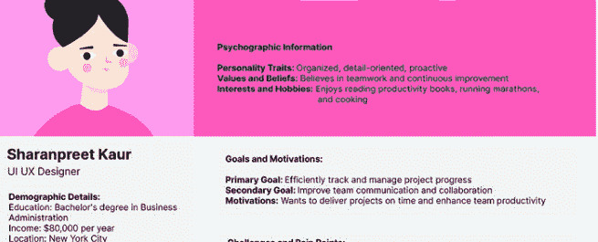

## 沙兰普雷特·考尔

UI UX 设计师

用户基本资料：
- 教育背景：工商管理学士学位
- 年收入：80,000 美元
- 所在地：纽约市

## 个人简介

Lorem Ipsum 是印刷和排版行业中的占位文本。自 16 世纪以来，Lorem Ipsum 一直是行业标准的虚拟文本，当时一位不知名的印刷工将一版铅字打乱，制成了一本字体样本册。

## 引述

> “Lorem Ipsum 是印刷和排版行业中的占位文本。”

## 心理特征信息

- 个性特征：有条理、注重细节、积极主动
- 价值观和信念：相信团队合作和持续改进
- 兴趣和爱好：喜欢阅读效率类书籍、跑马拉松和烹饪

## 目标与动机：

- 首要目标：高效跟踪和管理项目进度
- 次要目标：改善团队沟通与协作
- 动机：希望按时交付项目并提升团队生产力

## 挑战与痛点：

- 挑战：同时管理多个项目并应对沟通不畅的问题。
- 痛点：对当前过于复杂且缺乏集成能力的项目管理工具感到沮丧。

## 使用场景：

- 用例：在新的软件开发项目周期中，使用项目管理工具分配任务并监控进度。
- 使用环境：主要在工作时间在办公桌前使用该工具，也会在通勤时通过手机查看更新。

## 行为模式：

- 日常安排：一天从查看项目状态开始，举行每日站会，下午用于战略规划和客户沟通。
- 技术使用：使用笔记本电脑和智能手机，偏好基于云端的项目管理工具

图 4.4：人物画像示例

## 创建人物画像的好处

无论你是在开发智能手机应用，还是构建移动端适配的网站，了解你的用户都是至关重要的。你需要一个清晰且具体的问题陈述，以便有效解决用户的真实挑战。这时，创建人物画像就应运而生了。

人物画像通过回答以下关键问题，帮助你精准定位目标市场：

- 谁是我理想的客户？
- 我的用户目前表现出哪些行为模式？
- 我的用户有哪些目标和需求？
- 在这种情况下，人们会遇到哪些问题和困扰？

通过塑造一个详细的人物角色，你可以深入了解你的用户以及他们对产品的期望。凭借这些信息，你可以调整设计和功能，以满足他们的特定需求和偏好。创建人物画像之所以重要，是因为它能帮助你更好地理解用户。以下是其强大之处：

- **增强同理心**：人物画像帮助你和你的团队站在用户的角度，理解他们的挣扎与渴望。这种同理心会带来更友好的设计。
- **明确方向**：有了人物画像，你的设计决策将基于真实的用户数据，而非凭空猜测。这种清晰性有助于避免代价高昂的错误，并让项目保持在正轨上。
- **促进沟通**：人物画像是团队共通的“语言”，确保从设计师到营销人员，每个人都能理解目标受众是谁以及他们需要什么。
- **提升用户参与度**：当你的产品在个人层面引起用户共鸣时，他们更愿意与之互动，从而提高满意度和忠诚度。

简而言之，创建人物画像能够将抽象的用户数据转化为可感知、可操作的洞察，从而推动更好的设计，并与受众建立更牢固的联系。

## 创建人物画像的工具

- **Xtensio**：创建人物画像
- **HubSpot**：Make My Persona
- **Canva**：人物画像模板

你也可以从 **Miro** 下载人物画像模板以供离线使用。这些工具和模板让你能够轻松地为设计项目创建详细且具有视觉吸引力的人物画像。

## 用户人物画像的类型

莱娜·尼尔森（Lene Nielsen）是研究人物画像的博士和专家，她概述了在设计中最大化人物画像价值的四个关键视角。这些视角有助于创建更有效、更真实的人物画像。这些


categories focus on different aspects of user needs and behaviors.

## Goal-Directed Personas

Goal-directed personas center on the objectives that customers have in mind when using a good or service. The goal of these systems is to comprehend and rank the user’s objectives, driving forces, and essential tasks. This strategy guarantees that the product is customized to help consumers in successfully achieving their goals.

### Key Elements:

The key elements of goal-directed personas are user goals. These comprise life goals, which are more general, individual aspirations that may have an impact on how users use the product, secondary goals, which encourage or supplement primary goals, and primary goals, which are the major objectives users want to accomplish with the product. Detailed task breakdowns and usage scenarios that illustrate how consumers engage with the product are also important aspects of behavior patterns.

Goal-directed personas heavily rely on motivations. Extrinsic motivations are outside forces that affect user behavior, such as rewards or recognition, whereas intrinsic motivations are internal wants that push users towards their objectives, such as skill improvement or satisfaction. Comprehending these incentives facilitates the creation of features that effectively appeal to users. Additionally, designers can successfully address these concerns by identifying pain spots, which are the difficulties and frustrations users face.

### Creating Goal-Directed Personas:

The process of developing goal-directed personas starts with extensive user research, which includes questionnaires, interviews, and in-person observations to learn in-depth details about the objectives and habits of users. Common themes and patterns are found through the analysis of both quantitative and qualitative data. Following the synthesis of this data, significant insights are extracted by categorizing individuals into unique personas based on shared goals and behaviors. To make each persona more relatable, they are given names and backstories along with concise descriptions of their motives, behavior patterns, primary, secondary, and life goals.

### Benefits:

Goal-directed personas have a number of advantages. As a result, goods better satisfy the requirements and expectations of users, as it promotes a user-centered design approach. By creating intuitive and effective interfaces, this comprehension of activities and challenges enhances usability. Goal-directed personas assist in minimizing needless complexity by prioritizing elements that directly help users achieve their objectives. In the end, goal-directed persona goods are more likely to satisfy users, increasing user engagement and loyalty.

### Example:

Consider creating a tool for project management. An example of a goal-oriented persona would be “Sharan, a project manager.” Her main objective is to effectively monitor the status of projects. Life goals could comprise advancing one’s profession through project completion success, while secondary goals might involve managing deadlines and team communication effectively. With an understanding of Sharan’s aims, the solution may be created with functionalities like an all-inclusive dashboard, smooth communications, and automated deadline reminders, all of which will assist her effectively accomplish her major and secondary goals.

In conclusion, goal-directed personas are an effective tool for user-centered design because they support the development of products that are in line with user goals, improving usability and user happiness.

## Role-Based Personas

Role-based personas concentrate on the distinct roles that users assume in their personal and professional life and how these roles affect how they engage with a service or product. These personas are designed to help ensure that the product meets the specific requirements and workflows of various user types by helping to comprehend the duties, responsibilities, and context associated with each job.

### Key Elements:

The first step involves defining a user’s role, including their responsibilities


和目标都受其环境塑造。理解行为模式、互动和日常习惯有助于设计与用户习惯相符的界面，从而提升产品的效率和直观性。此外，考虑协作动态还能洞察与同事、客户或家庭成员沟通的需求，增强必要的协调要素。

## 创建基于角色的人物画像：

创建基于角色的人物画像始于通过访谈、任务跟随和分析等方法深入研究用户的各种角色。综合这些数据可突出处于相似职位用户的相似点和差异点。随后为每个画像赋予姓名、背景故事和详细的职位描述，并纳入常见任务和职责。加入具体场景有助于识别痛点和改进空间，确保产品与用户的职业或个人目标保持一致，例如实现生产力目标或保持工作与生活平衡。这种方法增强了同理心，并能定制满足用户特定需求和挑战的解决方案。

## 益处：

基于角色的人物画像显著提升了设计流程，确保产品满足不同用户类型的独特需求，从而带来更相关、更有效的解决方案。聚焦于特定角色使设计师能够创建支持用户实际工作流程的功能和界面，提升生产力和满意度。基于每个角色的关键功能优先进行开发也能简化流程。此外，基于角色的人物画像改善了团队沟通与协作，为决策者提供了对用户需求和身份的共同理解。这种以用户为中心的方法提升了采用率，并通过确保产品与目标受众高度契合来促进积极的用户体验。

## 示例：

> 设想为客户关系管理（CRM）创建一个应用程序。基于角色的一个例子可以是“John，一名销售经理。” John 的职责包括监督销售团队、监控销售目标并维护客户关系。他与员工协调、审查

产品，打造具有独特特质和背景的详细人物画像。在现实与创造性之间取得平衡可确保人物画像既真实又富有想象力。每个画像应包含具体场景，描绘他们可能如何与产品互动，解决挑战并实现目标。这种方法鼓励设计师通过关注假设性的动机和痛点来探索创新和解决方案。团队成员之间的协作至关重要，通过研讨会和头脑风暴促进全面的设计方法和多元视角。

## 益处：

在设计过程中使用虚构人物可激发创造力，鼓励设计师跳出思维定式并考虑非传统客户需求和行为。这种方法可带来传统数据驱动人物画像可能忽略的创新设计解决方案。

虚构人物通过探索广泛的假设场景来确保产品的稳健性和适应性，识别潜在用例和边缘情况。通过使设计师能够共情多元的消费者视角，这些人物画像促进了包容性和以用户为中心的设计。

此外，在产品开发早期阶段真实用户数据有限时，虚构人物尤其有用。它们为在投入大量资源进行深入研究和开发之前探索想法和测试概念提供了灵活的框架。

## 示例：

考虑创建一个全新的社交媒体应用程序。虚构人物的一个例子是“Emma，一名35岁的自由职业平面设计师。” Emma 使用社交媒体与艺术家和其他潜在客户互动。她喜欢参加艺术活动并生活在大城市。背景突出了对一个促进专业网络和创意协作的平台的需求。它还详细描述了她从企业就业到自由职业的转变。设计师可以通过想象 Emma 的


与应用程序的交互。通过想象她的痛点，例如管理客户沟通或寻找值得信赖的同事，可以确定创新和改进的关键领域。

总而言之，虚构角色是设计阶段培养原创性和创造力的有效工具。通过构建复杂而富有想象力的用户场景，它们帮助设计师探索各种观点、预测广泛的用户体验，并创造出更具创新性和包容性的产品。

## 引人入胜的人物角色

丰富的故事和个人经历常常被融入那些真实可信、深度刻画的角色创作中。这些人物角色的目的是促进用户与设计团队之间的同理心和更深层次的情感联系。通过加深对目标受众的理解，这些引人入胜的人物角色有助于使产品开发过程保持以用户为中心，并扎根于真实的人类体验。

## 关键要素：

创建引人入胜的人物角色始于精心编织一个引人入胜的故事，为角色注入生命。这涉及设计诸如虚构姓名、年龄、职业和背景故事等细节，使其与角色的个性和生活方式产生共鸣。除了人口统计信息外，叙事还深入探讨他们的目标、恐惧、兴趣和个人经历，使人物角色生动而难忘。

将人物角色的周围环境情境化至关重要。这包括他们的物理环境、社会关系和技术配置。理解这些元素有助于设计师预测外部因素如何影响人物角色的行为和需求。

人物角色参与度的核心在于其动机和目标，这些应清晰并代表他们的个人与职业抱负。这种理解使设计师能够创建与人物角色基本需求和愿望紧密契合的特性和功能。

## 创建引人入胜的人物角色：

创建引人注目的角色需要广泛的研究和创造性的叙事。首先通过用户访谈、调查和人种志研究收集数据，以了解真实的用户体验。从这些综合数据中，识别出反复出现的主题和洞察，以构思人物角色的故事。

为确保可靠性，每个人物角色都应包含丰富的详细信息。这涉及创建一段探索其过去经历、现状和未来目标的叙事。融入引言和客户的直接评论能增加深度和真实性，提升人物角色的可信度和吸引力。

视觉元素在使人物角色栩栩如生方面发挥着关键作用。包含图片、情绪板和其他视觉辅助工具能使角色更容易被识别和亲近。视觉叙事帮助团队更好地理解人物角色的世界和经历，丰富整体叙事。

## 益处：

引人入胜的人物角色为设计过程带来诸多益处。它们促进用户与设计团队之间强烈的情感联系，培养同理心，并基于真实体验而非抽象数据加深对用户需求的理解。这种情感参与确保设计决策立足于人类洞察。

此外，引人入胜的人物角色使团队围绕对目标受众的共同理解而团结一致。这种一致性确保设计师、工程师和营销人员有效协作，创造出真正满足客户需求的产品。

此外，这些人物角色还通过为讨论用户需求、提出创意和做出明智的设计选择提供共同参考点，来改善团队协作和沟通。这种共同理解带来更具凝聚力和以用户为中心的设计解决方案。

## 示例：

假设正在开发一款运动健康应用程序。想象“杰克，28岁的营销专业人士”作为你的用户角色。杰克在健身热情与繁忙工作之间取得平衡，他是一位热衷的跑步者。他的旅程从


相似之处和差异。

## 相似之处：

- **目的**
  - 所有用户画像都旨在代表目标受众的一个细分群体，以指导营销、产品开发和用户体验设计。
  - 它们帮助团队理解并共情受众，确保策略和解决方案以用户为中心。
- **要素**
  - 所有用户画像通常都包括人口统计信息（年龄、性别、职业等）、心理特征（目标、价值观、兴趣）和行为特征（购买习惯、使用模式）。
  - 它们解决目标受众面临的痛点和挑战，以帮助提高满意度和参与度。
- **益处**
  - 增强有针对性的营销和沟通工作。
  - 指导产品开发以更好地满足用户需求。
  - 通过理解偏好和期望来改善客户服务。
  - 通过专注于高影响力策略来高效分配资源。

## 差异：

- **买家画像**
  - **关注点**：代表营销和销售目的的理想客户。
  - **关键要素**：人口统计、心理特征、购买行为、消费习惯、品牌忠诚度、痛点和偏好的沟通渠道。
  - **示例**：“*精通技术的蒂姆*”重视创新和效率，偏好在线购物，并且忠于高科技品牌。

- **客户画像**
  - **关注点**：代表现有客户以增强持续的客户关系和满意度。
  - **关键要素**：与买家画像类似，但更侧重于现有客户的体验、挑战以及与品牌的互动。
  - **示例**：“*注重生态的艾玛*”重视可持续性，偏好环保产品，并且在寻找真正绿色产品方面面临挑战。

- **用户画像**
  - **关注点**：代表终端用户以指导产品和服务设计，获得更好的用户体验。
  - **关键要素**：人口统计、心理特征、行为特征、痛点、技术使用。
  - **示例**：“自由职业者菲奥娜”重视创造力和效率，使用图形设计软件，并寻求简化工作流程的工具。

- **原型画像**
  - **关注点**：一种基于假设的初始画像，用于设计过程早期以统一团队理解并指导初步决策。
  - **关键要素**：基于内部团队洞察的假设人口统计、心理特征、行为特征、痛点、技术使用。
  - **示例**：“初创公司山姆”被假设为一名重视创新和效率的软件开发人员，面临时间管理和跟上技术更新的挑战。

虽然四种画像都旨在代表和理解受众的不同细分群体，但它们在营销、产品开发和用户体验设计中发挥着不同的作用。买家画像和客户画像分别侧重于营销和现有客户。用户画像强调终端用户的需求以实现更好的设计，而原型画像则为早期项目提供快速、基于假设的起点。通过利用这些画像，企业可以创建更有效的策略、产品和服务，与目标受众产生共鸣。

注意：

这些类别服务于不同的战略目的：第一组（目标导向、基于角色、虚构、引人入胜）是关于理解画像的方法，而第二组（买家、客户、用户和原型）则指定了所代表的用户类型。

## 用户画像的关键组成部分

创建用户画像的过程是汇编和整理有关目标受众的具体数据。以下是任何用户画像都应具备的基本组成部分的总结：

### 个人信息

- **姓名**
  不要使用“学徒”、“建造者”或“单身妈妈”等术语，而是为你的画像取一个真实的名字，如 Emily、James、Jessica 或 Daniel，这有助于员工更容易地与画像产生联系并在对话中讨论他们。避免使用名人名字以保持对画像特征的关注。
- **个人资料照片**
  照片是每个画像的核心。避免使用“女人用笔记本电脑打字”或“男人握手”之类的通用库存图片——这些不会唤起任何真实的联系。照片应感觉真实且易于产生共鸣。选择一张能提供画像性格洞察的肖像，可能是来自你的研究之旅。
- **人口统计**
  包括年龄、性别、职业、教育、收入和地点等详细信息。例如，健身应用可能需要有关锻炼习惯和饮食偏好的信息，而预算应用可能侧重于


收入来源与支出模式。

## 背景

用户角色的“背景”部分全面概述了该角色的背景和情况。它包含如下重要信息：

- **个人经历：** 教育背景和职业发展的概要。
- **当前状况：** 关于居住安排、家庭情况和职业角色的详细信息。
- **日常作息：** 说明他们可能在何时以及如何使用你产品的常规日常任务。

## 目标与需求

用户角色的“目标与需求”部分重点关注该角色的目标以及他们实现这些目标所需的资源。本节中的主要和次要目标有助于清晰理解用户的优先事项和动机。

- **主要目标：** 这些是驱动他们与你的产品互动的主要目标。例如，项目经理Sharan可能致力于有效监控和管理项目。
- **次要目标：** 这些是支持主要目标的附加目标。对于Sharan来说，改善团队协作和沟通可以是次要目标。
- **需求：** 这些是为实现其目标所需的具体特性、功能或资源。Sharan可能需要仪表盘定制或用户友好的界面。

了解这些目标和需求可确保产品能够满足用户的期望，并提供有价值的、以用户为中心的体验。通过关注用户的目标和需求，设计师能够确定功能优先级，并产出能成功解决真实用户问题的解决方案。

## 行为模式

设计以用户为中心的体验并提高整体参与度需要理解行为模式。一些关键模式如下：

- **技术熟练度：** 表明该角色对技术的舒适度和专业程度。
- **使用模式：** 涵盖设备偏好、使用频率、时长以及使用产品的场景。

设计师通过理解使用模式和技术熟练度，可以开发符合该角色日常习惯和技术能力的产品，从而改善用户体验。

## 痛点与挑战

术语“痛点与挑战”描述了角色在日常或使用产品时面临的特定问题和障碍。

### 发现痛点：

- **当前不满：** 造成挫败感的问题，例如让项目经理Sharan工作速度变慢的复杂工具。
- **未满足的需求：** 当前解决方案未能完全解决的问题，例如Sharan需要更好的工具集成。
- **效率低下：** 耗时的流程，例如缺少集中式仪表盘，使Sharan难以跟踪团队进展。

### 理解挑战：

- **外部障碍：** 超出角色控制的因素，例如预算限制使Sharan无法获得必要的软件。
- **内部障碍：** 个人限制或技能差距，例如Sharan对新技术感到不知所措。
- **情境问题：** 情境性挑战，例如Sharan远程工作时的沟通障碍。

## 动机

动机驱动用户与产品或服务的互动，理解这些动机有助于创造出能与用户产生共鸣的设计。

### 内在动机：

- **个人目标：** 例如提升技能或实现目标的抱负，比如Sharan希望有效管理团队并看到项目成功。
- **情感驱动因素：** 例如想要获得成就感或减轻压力的情感，促使Sharan使用项目管理工具，以便更好地掌控局面，减少对任务的焦虑。

### 外在动机：

- **外部奖励：** 如晋升或认可等实际利益，激励Sharan在项目管理中表现出色。
- **社会影响：** 同伴压力或融入感，促使Sharan采用同事使用的新工具。

理解这些动机有助于设计师创建满足用户需求并增强用户体验的产品。

## 引述

在角色中加入直接引述，通过捕捉他们的情感和想法来增加深度和真实感。简而言之，这部分应包含一到两句能洞察该角色感受和个性的引述。

## 场景

场景是让角色变得生动的详细故事，展示他们在真实情境中如何使用产品。通过沉浸在这些故事中，你能更好地理解用户，并创造出满足他们需求和目标的产品。每个场景都提供新的见解，帮助你设计优化用户与产品互动方式的解决方案。

### 场景通常涵盖：

- **使用情境：** 角色在何时何地使用产品，例如


沙拉在通勤时用手机查看更新。

- **任务：** 角色采取的具体行动，例如分配任务和跟踪项目。
- **目标：** 角色希望实现的目标，例如确保项目按时完成。
- **挑战：** 诸如界面复杂难用之类的问题，会拖慢工作流程。
- **成果：** 满足角色目标的成功结果，例如高效的团队协作。

使用场景有助于预测用户需求、解决实际问题，并创造能够无缝融入用户日常生活的产品。

一个完善的角色画像能让你的团队理解目标用户的需求和行为，提供超出预期的解决方案，并培养同理心。这能确保你的产品开发始终以用户为中心，提升整体满意度和体验。

## 角色画像示例

**姓名：** 沙拉普里特
**基本信息：**
  **年龄：** 35岁
  **性别：** 女
  **职业：** 一家中型科技公司的项目经理
**人口统计详情：**
  **教育水平：** 工商管理学士学位
  **收入：** 年薪8万美元
  **所在地：** 纽约市
**心理特征信息：**
  **性格特征：** 有条理、注重细节、积极主动。
  **价值观与信念：** 信奉团队合作和持续改进。
  **兴趣与爱好：** 喜欢阅读效率类书籍、跑马拉松和烹饪。
**目标与动机：**
  **主要目标：** 高效地跟踪和管理项目进度。
  **次要目标：** 改善团队沟通与协作。
  **动机：** 希望按时交付项目并提升团队生产力。
**挑战与痛点：**

挑战：同时管理多个项目，并应对沟通不畅的问题。
痛点：对当前过于复杂且缺乏集成性的项目管理工具感到失望。
行为模式：
日常安排：以查看项目状态开始一天的工作，举行每日站立会议，下午用于战略规划和客户沟通。
技术使用：使用笔记本电脑和智能手机，偏好基于云端的项目管理工具。
引言与轶事：
直接引言：“我需要一个既简单易用，又足够强大以处理复杂项目的工具。”
轶事：曾因团队内部沟通失误而错过一个关键项目截止日期，这凸显了对更好协作工具的需求。
场景：
使用场景：在一个新的软件开发项目中使用项目管理工具来分配任务和监控进度。
使用环境：主要在工作时间于办公桌前使用该工具，但通勤时也会在手机上查看更新。
总之，用户角色是全面的档案，概括了用户是谁、他们希望达成什么目标以及他们面临的挑战。通过理解这些主要组成部分，设计师可以创造出更符合用户需求和偏好的产品。

## 用户体验映射的类型

设计在很大程度上依赖于用户体验（UX）映射，它以可视化的方式呈现用户与产品或服务的路径和互动。这种方法帮助团队更好地理解用户的需求、问题和动机，从而促进以用户为中心的解决方案的诞生。UX 映射通过将复杂数据提炼为易于理解的形式，促进了利益相关者之间的协作和决策。不同的 UX 映射方法论处理用户体验的不同方面，提供有价值的见解，推动设计的改进和调整。

## UX 映射的类型：

- 客户旅程地图
- 同理心地图
- 体验地图
- 服务蓝图

让我们逐一详细探讨每种类型：

## 客户旅程地图

“用户旅程地图”和“UX 旅程地图”通常与“客户旅程地图”互换使用，因为它们通常都涉及网站用户（往往也是客户）的体验。客户旅程地图，也称为用户旅程地图，以可视化方式呈现客户与您的业务随时间推移的互动，从最初认知到重复购买。它有助于可视化客户在每一个接触点的旅程，并确定需要改进的领域，以提升整体体验。

想象一下，一位客户可能首先注意到一家在线玩具店的广告，从而开始他们的产品发现之旅。他们会经历考虑产品选项、阅读评论、购买和收货等阶段。这段旅程突显了他们的欲望、感受和互动，揭示了改进的机会，例如提升网站速度以实现更顺畅的交易和更高的满意度。

## 客户旅程地图的重要性

通过使用用户旅程地图，设计师可以站在客户的角度审视产品，它带来了诸多好处，例如：

- 通过关注用户的目标、感受、想法和障碍来增强同理心。
- 为利益相关者和团队成员提供参考基准，确保在项目开发过程中大家达成共识。
- 映射用户互动和情绪，以发现设计机会或弱点，从而做出更好的设计决策。
- 有助于及早发现问题，为更明智的决策提供信息，并提高客户留存率。
- 通过识别用户觉得容易使用和难以使用的部分，指导改进工作。
- 促进统一协议的制定、员工培训，以及


identify their problem and offers potential solutions. The goal here is to understand the customer’s problem, not to push for a sale.

In the awareness stage, you can use page views and click data to discover which web pages and blog posts attract customers as they start to recognize their need for a solution. By analyzing this data, brands can better tailor their content to address the specific problems customers are looking to solve, guiding them gently toward the next stage of their journey.

## 2. **Consideration**

Customers who are in the consideration stage have done their homework and are well-aware of the issues they face. When they realize they need a good or service, they start evaluating various brands and deals. Now is the time for brands to shine by offering persuasive marketing material that assists consumers in weighing their options and, in the end, selecting a good or service.

Here, assisting clients in navigating the overcrowded market will enable them to make more informed purchasing decisions. Businesses can assist consumers in understanding why their product is the greatest option by emphasizing special features, advantages, and client testimonials. The main goals of this stage are to support inquiry and increase trust in the decision-making process.

## 3. **Decision Stage**

In the decision stage, customers are ready to buy — they have found the solution to their problem. For brands, this is the critical moment to provide a seamless purchase experience. The shopping process should be straightforward and hassle-free, ensuring customers can complete their purchase with ease.

At this stage, the key is to remove any hurdles. Do not overwhelm customers with more information or product details. Focus on a smooth, user-friendly checkout process to ensure a flawless purchase experience. This is where simplicity and efficiency can make all the difference, helping customers confidently complete their transactions.

## 4. **Retention Stage**

In the retention stage, customers have made their purchase and are now deciding whether to stick with the brand or switch to another provider. This is a crucial phase where brands can solidify loyalty by delivering an outstanding onboarding experience and exceptional ongoing customer service.

To keep customers from churning, it is essential to make them feel valued and supported. During this stage, gathering feedback through customer surveys and questionnaires is vital. This solicited data helps refine and improve the overall customer experience and the customer journey map, ensuring customers remain satisfied and loyal to your brand.

## 5. Loyalty Stage

In the loyalty stage, customers not only remain with a company but also actively promote it to their family, friends, and colleagues. Also known as the advocacy stage, this is where customers become true brand champions.

During this phase, brands should focus on delivering an outstanding end-to-end customer experience. This includes everything from your website content and sales representatives to your social media presence and product’s user experience.

The key to cultivating loyalty is ensuring customers succeed with your product. When they see great results, they are more likely to recommend your brand to others. Additionally, loyal customers are often willing to provide valuable feedback and insights, enriching your customer journey mapping strategy and helping you refine the overall experience.

## Key Elements of Customer Journey Map

To properly describe how customers interact with your brand, a strong customer journey map must include a number of crucial elements. The following are the main elements that are usually present in a customer journey map.

### Point of View:

In a customer journey map, selecting the Main Character or Hero, known as the persona, is crucial. This persona, whether an athlete or coach in a sports product, shapes the map’s narrative and insights. Maintaining a single perspective per map ensures clarity and a deeper understanding of the persona’s needs and experiences.

### Scenario:

A scenario in a customer journey map depicts a customer’s interaction with a brand or product. For example, Emma discovers an online clothing store ad, browses items, faces checkout frustrations, completes her purchase, and receives her order. This scenario highlights Emma’s needs, challenges, and emotions, providing insights to enhance her overall experience and inform future product developments.

### Actions, Mindsets, and Emotions:

Customer actions such as browsing or purchasing are key in a customer journey map. Mindsets reveal their thoughts and motivations, like deciding to buy or seek information. Emotions capture feelings — whether happy, frustrated, or excited — throughout the journey. Together, these elements provide a comprehensive view of the customer’s experience, emphasizing their actions, thoughts, and feelings. Qualitative research supports these insights, helping brands identify issues and opportunities to improve the overall customer experience.

### Touchpoints and Channels:

Touchpoints in a customer journey map are interactions like visiting a website, contacting customer service, or receiving a product. Channels are the platforms such as email, social media, stores, or phone calls, that enable these interactions. Recognizing these touchpoints and channels helps brands understand customer engagement patterns, ensuring consistent communication and enhancing overall satisfaction.

### Insights and Ownership:

Insights in a customer journey map are key findings from studying customer interactions, behaviors, and feedback, guiding improvements in the customer experience. Ownership assigns responsibility for managing each touchpoint, fostering accountability and teamwork to ensure a smooth customer journey. Without clear ownership, there is no authority to drive change or


对结果负责。

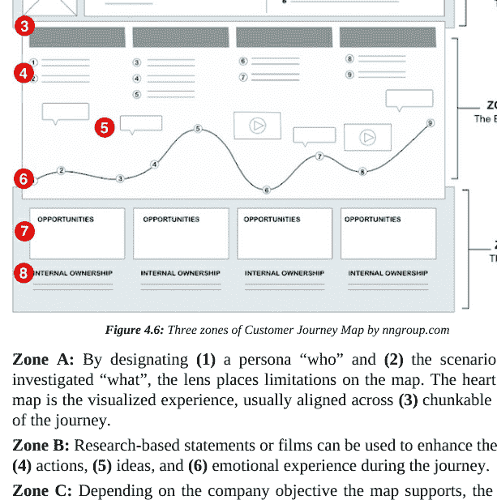

图 4.6：nngroup.com 的客户旅程地图三个区域

区域 A：通过指定 (1) 人物角色“谁”和 (2) 待调查的场景“什么”，镜头对地图施加了限制。地图的核心是可视化的体验，通常沿着 (3) 可分块的旅程阶段排列。

区域 B：基于研究的陈述或影片可用于增强用户在旅程中的 (4) 行为、(5) 想法和 (6) 情感体验。

区域 C：根据公司目标地图所支持的内容，输出应有所不同，但可能包括对发现的洞察和痛点的描述，以及今后要关注的 (7) 机会，以及 (8) 内部责任归属。

## 创建客户旅程地图

为了确保无缝且令人满意的客户体验，客户旅程地图有助于识别接触点、痛点和改进机会。以下是创建有效客户旅程地图的七个基本步骤：

- 1. 明确定义地图的目标。
- 2. 描述你的用户角色并设定其目标。
- 3. 突出你的目标客户角色。
- 4. 列出每一个接触点。
- 5. 评估你现在拥有的资源以及你将需要的资源。
- 6. 自己进行一次客户旅程。
- 7. 检查你的发现。

在执行第一步之前，利用客户旅程地图模板。

### 使用客户旅程地图模板

免费的在线客户旅程地图模板提供现成的结构，可节省时间和精力。您可以从可编辑的 PDF 或文档格式中选择，部分还附带分步说明，以便快速创建适合您业务目标的地图。这些模板简化了流程，使设计、销售、营销和客户支持团队能够更专注于分析客户体验并实施改进。

### 1. 明确定义地图的目标

需要考虑的关键问题：在着手创建客户旅程地图之前，请自问：我为什么要做这件事？这个问题有助于澄清你的目的。确定地图的目标并确定你的角色将是谁。决定要在旅程中包含哪些场景。确保你的问题和目标与公司整体目标和愿景保持一致。

创建买家角色是一个很好的起点。你将有大量材料和许多不同的可能性可供查看。基于此研究，创建目标客户的详细资料，以有效指导你的映射过程。

### 2. 描述你的用户角色并设定其目标

接下来，通过彻底的研究收集客户旅程分析。分析型策略师收集和分析数据以识别接触点和痛点，确保地图与业务目标保持一致。共情设计师专注于客户情绪和体验，创建用户友好的地图。愿景型领导者定义整体愿景，确保地图反映公司价值观并激励团队。

你对客户及其需求了解得越多，你的旅程地图就越好。协作型协调员将不同领域的团队聚集在一起，以获得各种见解和完整视图，帮助识别客户可能流失的地方。收集现有和潜在客户的反馈，这些客户已与你的公司互动，以使旅程地图更有效。

### 3. 突出你的目标客户角色

突出你的目标客户角色意味着选择最有可能与你的品牌互动的个人的详细资料。确定一个常见的客户并跟随他们的旅程，当他们首次与你的业务互动时。不要忽视任何数据，即使它似乎与你的目标无关。最好将所有见解记录在安全的地方，以便日后回顾和利用。这种彻底的方法确保你了解客户的体验，并能根据真实互动改进你的策略。

### 4. 列出每一个接触点

接触点是客户与你的品牌互动的关键，对绘制其旅程和识别改进领域至关重要。列出所有当前和潜在的接触点，以深入了解客户行为，无论是线上（网站、社交媒体、电子邮件）还是线下（商店访问、客户服务电话）。这一步对于全面绘制客户旅程至关重要，涵盖所有品牌互动，而不仅仅是数字平台和营销材料。

**示例：**

想象你经营一家在线服装店。通过你的研究，你识别出


几个接触点。

- **广告互动：** 客户在社交媒体上看到广告。
- **网站访问：** 他们点击广告并访问您的网站。
- **产品浏览：** 他们浏览不同的产品。
- **客户评价：** 他们阅读客户评价。
- **加入购物车：** 他们将商品加入购物车。
- **结账：** 他们进行结账流程。
- **订单确认：** 他们收到订单确认邮件。
- **发货更新：** 他们收到发货更新。
- **配送：** 他们收到订单。
- **购买后：** 他们留下评价或在出现问题时联系客户支持。

分析接触点可以揭示改进机会。例如，高购物车放弃率表明结账流程复杂——简化可以帮助。如果售后配送支持咨询很常见，可能表明产品或配送问题需要解决，以获得更好的客户体验。

## 客户行为：

旅程地图追踪客户与贵组织每一次互动时的行为，从研究和客户服务联系到购买和反馈。使用交易数据、网站分析、调查和访谈等工具来监控这些行为，了解偏好和痛点。CRM 软件、消费者反馈平台和 Google Analytics 等工具对于获得这些洞察至关重要。简化流程，尽管看起来有风险，但通常可以通过减少不必要的步骤来提高转化率，让客户更容易完成交易。这些数据对于提升整体客户体验至关重要。

## 客户情感和动机：

在绘制客户旅程时，情感和动机引导您了解他们的体验——对产品的兴奋、对顺畅交易的满意，或对结账问题的沮丧，都揭示了什么有效以及什么需要改进。了解寻求价值、可靠服务或便利性等动机可以解释他们的决策。通过访谈、调查和反馈收集洞察，以创建与积极和具有挑战性的体验都产生共鸣的旅程。通过强调情感和动机，您可以将基础地图转变为引人入胜的故事，设计令人难忘的体验，从而增强客户忠诚度和满意度。

## 客户障碍和痛点

把客户旅程地图想象成一张宝藏地图，但与黄金不同，您是在寻找改善客户体验的洞察。在这条路径上，障碍和痛点是客户遇到的棘手陷阱和隐藏的坑。

- **障碍**是阻碍他们前进的绊脚石，例如网站令人困惑或等待帮助时间过长。
- **痛点**是他们感到沮丧的地方，例如订单混乱或说明不清。

通过调查和反馈找到这些问题，以了解客户经历了什么。通过解决这些问题，您可以将艰难的旅程转变为美好的体验，确保客户在与品牌的每一步都感到愉快。

## 示例：

让我们绘制在线购物者 Emma 的旅程，并确定她的障碍和痛点。

阶段：产品研究

**障碍：** Emma 在网站上难以找到详细的商品信息。

**痛点：** 因描述模糊且缺乏客户评价而感到沮丧。

阶段：加入购物车

**障碍：** 网站加载缓慢导致延迟。

**痛点：** 因重复页面重新加载而感到烦躁，导致对继续产生疑虑。

阶段：结账流程

**障碍：** 结账流程要求创建账户，增加了额外步骤。

**痛点：** 因填写冗长的表格而感到恼火，并可能因麻烦而放弃。

**阶段：** 付款

**障碍：** 付款方式有限，不包括她偏好的方式。

**痛点：** 因无法使用她最喜欢的付款方式而感到失望，并可能流失。

**阶段：** 购买后

**障碍：** 缺乏关于发货状态的清晰沟通。

**痛点：** 因不知道订单何时到达而感到焦虑。

**阶段：** 客户支持

**障碍：** 联系客户服务时等待时间长。

**痛点：** 因无法及时获得问题的帮助而感到沮丧。

企业可以通过解决这些挑战和痛点，专注于提高网站速度、提供更详尽的产品信息、简化结账流程、提供多种付款替代方案、改善发货沟通以及加快客户关怀回复。通过解决这些问题，Emma 的旅程变得更加顺畅和愉快。

## 5. 评估您现在拥有的资源以及您将需要的资源

评估您现有的资源是创建有效的客户旅程地图所必需的。列出可以协助此项目的信息、资源和团队人员。需要网站分析和客户反馈。确定您的团队在设计、消费者研究和数据分析方面的能力。确定需要更多资源或知识的差距，并采取适当措施，例如购买新软件或雇用 UX 专业人员。通过估算您的资源需求，您可以确保获得所需的帮助来开发精确且信息丰富的客户


journey map that will improve the customer experience.

## 6. 亲自体验客户旅程

亲自体验客户旅程以真正了解他们的体验。把自己当作消费者，使用你的网站进行浏览、购买和寻求帮助。任何烦恼、困惑或延迟都应记录下来。通过将用户体验放在首位，这种实践方法揭示了需要改进的领域。如果你站在他们的立场上，你将更深入地了解客户的问题和期望。通过这种体验直接识别可能性和痛点的能力，对于确保你的客户旅程图反映真实的洞察并带来更有用的改进是无价的。

## 7. 检查你的发现

完成客户旅程图只是第一步。你现在必须评估结果。这其中包括找到客户与你的品牌互动的重要阶段和触点。检查消费者行为中的趋势、模式和痛点。使用数据驱动的更改来优先排序和验证你的发现。找到方法来改善客户体验可以增加倡导、忠诚度和满意度。分析有助于实现这一点。确保你遵守原始计划，以免打扰那些可能会决定不再回来查看所有计划升级的客户。

## 8. 随着时间的推移更新你的地图

定期更新你的地图是一个很好的改进。它可以帮助你找到差距和机会，使客户旅程更顺畅。它还让你解决不那么紧急的问题并处理你为未来工作所标记的要点。

## 客户旅程地图示例

客户旅程地图说明了客户与产品或服务互动的步骤和互动。它提供了对客户需求和行为的宝贵见解，帮助企业改进触点并提高整体满意度。以下是一个示例：

| Phases | Awareness | Website Search | Ordering | Order Receiving and Consuming | Sharing and Reviews |
|---|---|---|---|---|---|
| **Actions**<br>What is the customer’s action? What do they do? | [Your info here] | [Your info here] | [Your info here] | [Your info here] | [Your info here] |
| **Thoughts**<br>What is the customer thinking or feeling? | [Your info here] | [Your info here] | [Your info here] | [Your info here] | [Your info here] |
| **Channels**<br>What is the customer’s touchpoint with the business? | [Your info here] | [Your info here] | [Your info here] | [Your info here] | [Your info here] |
| **Feelings**<br>What do they want to change about this step? | [Your info here] | [Your info here] | [Your info here] | [Your info here] | [Your info here] |
| **Opportunities**<br>How and/or why will we make this change? | [Your info here] | [Your info here] | [Your info here] | [Your info here] | [Your info here] |

*Figure 4.7: Example of Customer Journey Map template*

## Empathy Maps

仅仅通过同理心映射来个性化设计过程是不够的。相反，它寻求反映具有相似需求和兴趣的更大群体消费者。有时把自己置于你不常互动的人的位置会很困难。你可以通过使用同理心映射来更多地了解这些人对你的问题、服务或产品真正的想法和感受。

考虑你将与一家公司或品牌合作创建一个名为“兽医定位器”或“宠物诊所查找器”的应用程序。第一步是确定你的目标市场。考虑各年龄段的工薪阶层人士、最近的移民或最近搬到城市的人。想象一下56岁的Olivia独自与她的猫Milli一起生活，正在寻找当地和互联网宠物服务。你的团队想象Olivia的日常活动，她在创建为她服务的应用程序时遇到的技术障碍。虽然Olivia是一个角色，但许多其他人可以与她的需求产生共鸣。你的团队可以通过同理心映射将自己置于她的立场，从而把握Olivia和许多其他用户的共同需求和偏好。

要创建同理心地图，你需要一些绘图工具，如便利贴和笔，或者你可以使用带有同理心地图模板的软件。在开始之前选择你将要映射的人物角色，并确保团队中的每个人都了解它。选择一个基于你研究中的真实数据的人物角色并为其命名。

### Empathy Maps 的结构

同理心地图最初由 **Dave Gray**（XPLANE 的创始人）创建，并在敏捷社区中获得了很大的人气。原始的同理心地图分为四个象限：Thoughts、Feelings、Actions 和 Observations。每个象限捕捉客户体验的不同方面：

- **Thoughts:** What the customer says
- **Feelings:** What the customer thinks
- **Actions:** What the customer does
- **Observations:** What the customer feels

这种结构帮助你全面了解客户的体验。

**修订版包含七个部分——用户位于中间。**


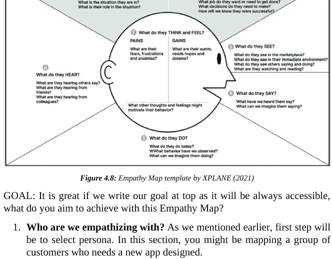

Figure 4.8: Empathy Map template by XPLANE (2021)

GOAL: It is great if we write our goal at top as it will be always accessible, what do you aim to achieve with this Empathy Map?

+   1. **Who are we empathizing with?** As we mentioned earlier, first step will be to select persona. In this section, you might be mapping a group of customers who needs a new app designed.
+   2. **What do they need to do?** In this section, mention the type of change that they need or want.
+   3. **What do they see?** This section covers, what is available to them in the marketplace, in their surroundings, or in their daily life.
+   4. **What do they say?** This section contains what major points and quotes are being made by the user?
+   5. **What do they do?** It should reflect what actions and behavior did you notice? How customers actually use the product?
+   6. **What do they hear?** This could come from websites, news, coworkers, friends, and more.
7. **What do they think and feel?** This section mostly covers what feelings could the user experience? And what do they think? What are their beliefs? What are they worried or happy about?

In order to make a clear separation between observable and inferred phenomena, “thoughts” and “feelings” were combined into the core portion of Empathy Maps after they were updated from four to seven sections. Add a list of “gains” and “pains” to better understand your user or character.

## Importance of Empathy Maps

In order to better understand users, empathy maps can be utilized both at the beginning of the design process and throughout the prototype-validation phase, when users are seen utilizing the proposed service.

Empathy maps has its own benefits, including:

- It lets you pay attention to specific details while watching people
- Information from practical insights that can be obtained is rapidly visualized.
- It can be applied at various stages of the design process, such as the outset or prototyping.

## Creating Empathy Maps

Now you have a template or you can use a whiteboard to draw these 7 sections. It is easy and convenient to add sticky notes for your points. But how do we fill in all the sections? What data is relevant to each section?

Here is a simple approach: When exploring our audience, asking some thought-provoking questions really helps.

When thinking about what people hear, we might ask:

- What do leaders want to tell this person?
- Who is trying to influence this person? (Maybe publications, forums, and so on.)
- What messages is this person hearing from said influences?
- What is the biggest priority on this person’s agenda?
- What do they spend most of their time doing?
- What do they WANT to spend their time doing?

When considering what others see , we might ask:

- How is their world changing?
- What market trends affect this person’s role?
- What do the optics within the company tell them?

When considering what others say , we may ask:

- What types of things do they tell people?
- What is the essential message they convey to their peers/teams?
- What do they convey as aspirations or optimism?

When we think about what our audience is thinking and feeling , we aim to understand how they make decisions and what their pains or gains might be. We want to know their fears and hopes. What concerns them? What makes them feel optimistic? At this stage, we review what we’ve noted in other sections of the map. Do any insights help us understand their pains or gains better?

At this point, we might inquire about the following:

- Why do they not sleep at night?
- What are they looking forward to?
- What would be the one thing they could change about their work if they could?
- What would they be doing most of the time in an ideal world?

By following this structure, empathy maps allow you to gain an understanding of your people. They also share this understanding with your team and stakeholders, ensuring that everyone understands what users want and need. This allows you to focus on the proper things. They encourage open-mindedness and avoid judgement, which makes it simpler to develop empathy and make user-centered decisions.


## 同理心地图与用户画像

尽管它们在表面上看起来相似，但两者其实截然不同。以下几点值得考虑：

- 用户画像提供了对用户群体更全面、更深入的洞察，而同理心地图则聚焦于用户当前的想法和感受。
- 用户画像用于代表不同的用户群体，并为特定的设计决策提供指导；同理心地图则更关注理解情绪和观点。
- 用户画像需要更深入的研究和数据收集，而同理心地图可以更快速、更灵活地创建。

总之，在理解消费者需求并培养同理心方面，用户画像和同理心地图无法相互替代。

## 体验地图

体验地图是一种可视化普通人为达成某个目标所经历的整体路径的有效技术。用户旅程地图是针对单一公司及其客户定制的，而体验地图的焦点则更为广泛，它试图理解普遍的人类行为，而不是专注于任何特定的目标市场或产品。在受众定义不清晰的情况下，这种方法尤其有用。

简而言之，体验地图是一个流程图，展示典型用户从开始到结束所采取的行动。值得注意的是，这个用户不属于任何特定类别，也不会偏好任何特定的商品或服务。相反，该地图描绘的是众多人在类似情境中可能走过的共同路径。

**示例：**

考虑预订假期的过程。体验地图会显示需要采取的一般步骤，比如查找目的地、比较费用、预订航班和酒店、组织活动，以及最终出发旅行。这张地图强调任何人在组织假期时都可能经历的典型决策和体验，而不是关注某家特定的航空公司或旅行社。

体验地图在试图从宏观视角理解一个过程时非常有用。它有助于定位在各种环境中都适用的常见问题和可改进之处。这意味着它可以用于了解不同情境下的人类行为，而不受特定公司或行业需求的限制。

| 阶段 | 研究 | 比较 | 预订 | 规划 | 出行 |
|---|---|---|---|---|---|
| 行动 | 在线搜索 | 阅读评价 | 预订 | 制定行程 | 打包 |
| 想法 | 我在哪里可以找到最优惠的价格？ | 这个目的地安全吗？ | 什么最合适？ | 有哪些活动可选？ | 我打包好所有东西了吗？ |
| 感受 | 兴奋 | 担忧 | 放心 | 期待 | 兴奋 |

图 4.9：预订假期的体验地图示例

体验地图与用户旅程地图非常相似，也分为四个基本组成部分：

- 阶段
- 行动
- 想法
- 感受/心态

然而，关键区别在于体验地图不受任何特定类型的用户、服务或产品的限制。它是一种捕捉普遍用户行为整体轮廓的工具，因此在没有明确定义目标受众时极为有用。

## 体验地图的优势

- **理解普遍人类行为**
  - 无论针对何种特定服务或产品，体验地图都有助于识别适用于广大用户的常见模式和行为。
- **建立基线理解**
  - 由于体验地图提供了不受特定环境约束的事件基础知识，因此可适用于多种场景。

## 体验地图示例

假设你想了解预订假期的总体流程。一张体验地图会勾勒出大致阶段，例如：

- **阶段：** 研究目的地、比较价格、预订、规划活动以及出行。
- **行动：** 在线搜索、阅读评价、预订、制定行程和打包。
- **想法：** “我在哪里可以找到最优惠的价格？”“这个目的地安全吗？”“有哪些活动可选？”
- **感受与心态：** 对潜在目的地的兴奋、对预算的压力、对旅行的期待。

体验地图捕捉了假日规划的典型旅程，并将过程分为四个类别，有助于识别常见的障碍和改进机会。因此，它是评估用户总体行为和提升用户体验的有用工具。


## 服务蓝图

在某些情况下，单一类型的 UX 地图无法充分描绘客户与服务互动的每一个细节。不同类型的 UX 地图可以组合使用以获得完整的视图。例如，客户旅程地图在展示用户视角方面非常出色，但在披露业务相关信息的能力上有限。在这种情况下，服务蓝图地图就变得有用。

服务蓝图地图为公司幕后活动提供了全面的视图。这些图表可视化并分析客户与服务提供者之间的互动，以及支持这些互动的内部流程。它们说明了不同部门、员工和流程如何共同构成整体用户体验。这种地图对于具有复杂服务产品的庞大组织尤其有用。

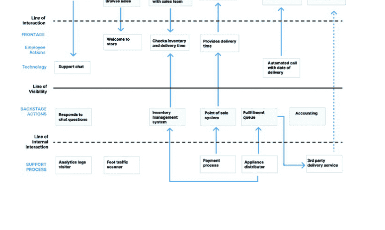

*图 4.10：nngroup.com 提供的家电零售商服务蓝图示例*

## 示例：

客户旅程地图概述了购物者在线或在店内寻找和购买产品的过程，重点关注他们的体验。它不涵盖库存管理或客户服务处理等内部运营。

对于这些内部流程，则使用服务蓝图地图。它详细说明了订单如何处理、库存如何更新以及员工如何被通知。这种双重方法有助于识别低效率和改进领域，确保客户和员工都能获得更顺畅的体验。

简而言之，使用客户旅程地图和服务蓝图地图等 UX 地图可以全面了解内部流程和用户体验，从而实现更好的服务交付改进。

## 服务蓝图的关键组成部分

服务蓝图是突出客户体验、详细说明服务流程并识别改进领域的必备工具。它们为服务交付中面向客户和幕后运营提供了全面的概述。

关键组成部分包括：

- **客户行动：** 客户在使用服务时采取的步骤，例如预订餐桌或下订单。
- **前台（可见）互动：** 客户与员工之间的直接互动，例如餐厅服务员点餐。
- **后台（不可见）互动：** 客户看不到的运营，例如厨师准备餐食。
- **支持流程：** 服务交付所必需的内部程序，例如员工排班和库存管理。
- **有形证据：** 客户与之互动的有形元素，例如餐厅布局、菜单和收据。

## 服务蓝图的益处

以下是服务蓝图的某些益处：

- **全面视图：** 提供整个服务流程的完整概述，突出内部运营和客户互动。
- **改进机会：** 识别流程改进领域，以提升服务质量和运营效率。
- **员工培训：** 对于教育员工并确保他们在有效提供服务方面对其角色的清晰度至关重要。
- **客户洞察：** 提供有关客户互动的宝贵信息，有助于更好地理解和满足客户需求。

## 示例

以酒店入住流程为例说明服务蓝图：

1. **客户行动：** 到达酒店、提供身份证明、领取房卡。
2. **前台互动：** 前台接待员迎接客人、核对预订并交出房卡。
3. **后台互动：** 前台接待员访问预订系统，与客房服务沟通以确保房间已准备就绪。
4. **支持流程：** 客房服务人员准备房间，维护团队确保房间设施正常运作。
5. **有形证据：** 预订确认邮件、酒店大堂、房卡、房间内的欢迎手册。

总之，服务蓝图是评估和改进服务提供有效的工具。它们通过概述每一步和互动，帮助企业提高生产力、改善客户体验，并确保所有内部流程与服务目标保持一致。

## 最佳用户体验映射工具

用户体验映射工具是一种旨在帮助可视化和分析用户与产品或服务互动的各个方面的软件程序。这些工具有助于创建各种地图，包括体验地图、同理心地图、服务蓝图和客户旅程


maps (CJMs)。以下是每种 UX 地图常用的工具：

## Customer Journey Maps (CJMs)

客户旅程地图展示了客户所采取的步骤，强调了他们在与产品或服务互动时的需求、问题和感受。

**Tools:**
- **Smaply:** 专注于旅程映射和用户画像创建，使可视化客户旅程变得简单。
- **UXPressia:** 提供用于创建详细的客户旅程地图、用户画像和影响地图的模板。
- **Canvanizer:** 提供各种画布模板，包括客户旅程地图，用于协作头脑风暴。

## Empathy Maps

团队可以通过使用同理心地图来深入了解用户的动机和挑战，从而更好地理解他们的感受、想法和行为。

**Tools:**
- **Mural:** 一个用于视觉协作的数字工作区，包含同理心地图模板。
- **Stormboard:** 提供同理心映射模板，允许团队实时头脑风暴和协作。
- **Canvanizer:** 也支持同理心映射，提供预设计模板便于使用。

## Experience Maps

体验地图对用户遭遇提供了更广阔的视角，经常跨越多个情境和时期，以理解用户的整体行为。

**Tools:**
- **Miro:** 一个多功能的在线协作白板，通过其多种模板和工具支持体验映射。
- **Lucidchart:** 一个图表工具，可轻松创建详细的体验地图。
- **Adobe XD:** 一个设计工具，可用于创建交互式且视觉上吸引人的体验地图。

## Service Blueprints

服务蓝图突出了前端和后端运营，并提供了有关支持客户体验的内部程序和交互的详细信息。

**Tools:**
- **ServiceDesignTools:** 提供专门用于创建服务蓝图的模板和资源。
- **Smaply:** 也适用于服务蓝图，提供结构化方式来绘制面向客户和内部流程。
- **Touchpoint Dashboard:** 有助于可视化服务设计流程和交互，使识别痛点和改进点变得更容易。

许多提到的工具提供免费版本或试用，但大多数都有付费计划，可解锁高级功能。虽然免费版本通常功能有限，但这些工具对于节省时间和精力非常宝贵，使设计师无需从零开始。然而，完全可以使用 Word、Excel 或甚至白板作为起点来创建自己的地图。随着经验的积累和对益处的认识，你可能会决定投资付费版本以获得增强功能。

## Conclusion

我们在本章中探索了用户体验 (UX) 映射这一迷人的领域。我们首先回顾了 UX 映射的基础，并强调了理解用户互动的重要性。接下来，我们研究了用户画像——识别目标受众特征和需求的关键工具。

我们讨论了各种 UX 地图类型，例如帮助我们理解消费者感受和想法的同理心地图，以及展示用户与产品或服务互动时所经历阶段的客户旅程地图。我们还研究了许多有助于使这些地图更具洞察力和效率的技术，使设计师能够专注于改善用户体验。

在掌握这些概念后，你现在拥有了评估和增强用户体验的强大工具包。这些信息对于创建有效满足客户需求并对他们产生真正影响的产品和服务至关重要。

我们将在下一章深入探讨信息架构和网站地图。我们将研究如何安排和结构化信息，以便消费者能够轻松访问和理解。准备好发现如何开发易于使用的导航系统并提升整体用户体验吧。

## Key Terms
- UX Mapping: 用户体验的视觉化呈现，展示用户与产品或服务的互动，用于识别痛点和改进机会。
- Point of View: 用户或设计师看待问题的视角，考虑他们的需求、目标和挑战。
- Scope: 项目的范围和边界，定义用户体验设计中将包含的内容和将排除的内容。
- Chronological Structure: 一种组织方法，按事件发生的时间顺序排列信息或事件。
- Hierarchical Structure: 一种组织方法，按重要程度从高到低对信息进行分级排列。
- User Research: 通过观察技术、任务分析和其它反馈方法来理解用户行为、需求和动机的过程。
- Customer Interactions: 客户与品牌、产品或服务互动的各种方式，包括面对面、在线以及通过客户服务。


- **外在动机：** 影响用户行为的外部因素，例如奖励、认可或避免负面结果。
- **客户旅程地图：** 对客户随时间与产品或服务互动的体验的视觉呈现，突出关键触点和情感状态。
- **触点：** 客户与品牌、产品或服务互动的具体时刻或互动，对于理解用户体验至关重要。
- **共情地图：** 一种用于深入了解用户的工具，通过捕捉用户所说、所想、所做和所感来促进设计团队的共情。
- **体验地图：** 详细图表，概述用户在不同阶段和触点中的体验，提供对其旅程的洞察并识别改进机会。
- **服务蓝图：** 服务的详细视觉呈现，展示不同服务组件之间的关系，包括人员、道具和流程。
- **前台：** 服务中可见的部分，用户在此直接与服务及其员工互动，影响其即时体验。
- **后台：** 支持前台互动的幕后活动和流程，对于提供整体服务体验至关重要。

# 第5章
## 精通信息架构和网站地图

### 引言

本章将涵盖与网站地图和信息架构（IA）相关的[content]

- **外在动机：** 影响用户行为的外部因素，例如奖励、认可或避免负面结果。
- **客户旅程地图：** 对客户随时间与产品或服务互动的体验的视觉呈现，突出关键触点和情感状态。
- **触点：** 客户与品牌、产品或服务互动的具体时刻或互动，对于理解用户体验至关重要。
- **共情地图：** 一种用于深入了解用户的工具，通过捕捉用户所说、所想、所做和所感来促进设计团队的共情。
- **体验地图：** 详细图表，概述用户在不同阶段和触点中的体验，提供对其旅程的洞察并识别改进机会。
- **服务蓝图：** 服务的详细视觉呈现，展示不同服务组件之间的关系，包括人员、道具和流程。
- **前台：** 服务中可见的部分，用户在此直接与服务及其员工互动，影响其即时体验。
- **后台：** 支持前台互动的幕后活动和流程，对于提供整体服务体验至关重要。

## CHAPTER 5
## Mastering Information Architecture and Sitemaps

### Introduction

本章将涵盖与网站地图和信息架构（IA）相关的[content]

- **外在动机：** 影响用户行为的外部因素，例如奖励、认可或避免负面结果。
- **客户旅程地图：** 对客户随时间与产品或服务互动的体验的视觉呈现，突出关键触点和情感状态。
- **触点：** 客户与品牌、产品或服务互动的具体时刻或互动，对于理解用户体验至关重要。
- **共情地图：** 一种用于深入了解用户的工具，通过捕捉用户所说、所想、所做和所感来促进设计团队的共情。
- **体验地图：** 详细图表，概述用户在不同阶段和触点中的体验，提供对其旅程的洞察并识别改进机会。
- **服务蓝图：** 服务的详细视觉呈现，展示不同服务组件之间的关系，包括人员、道具和流程。
- **前台：** 服务中可见的部分，用户在此直接与服务及其员工互动，影响其即时体验。
- **后台：** 支持前台互动的幕后活动和流程，对于提供整体服务体验至关重要。

## CHAPTER 5
## Mastering Information Architecture and Sitemaps

### Introduction

This chapter will cover important topics related to sitemaps and information architecture (IA), which are essential for building user-friendly websites. Information architecture is the process of organizing and arranging content so that it is easier for users to find and navigate. We will explore the fundamental ideas behind successful IA, with a focus on organization, clarity, and user-centric design.

You will come across a number of IA systems that offer logical frameworks for classifying and labeling data. A visual representation of a website’s structure is provided by sitemaps, which are crucial tools for web development that facilitate planning and communication. We will examine several sitemap formats, including as XML for search engines and graphic sitemaps for stakeholders, and practical ways to generate them.

Comprehending these ideas gives you the ability to create user-friendly websites that are easy for people to navigate and find information on. Let us embark on a journey to master the art of information architecture and sitemapping for optimal web design!

### Structure

In this chapter, we will discuss the following topics:

- Introduction to Information Architecture
- The History of IA
- Importance of Information Architecture
- Information Architecture Principles
- Information Architecture Systems
- IA versus UX
- Creating Information Architecture for Your Website
- Information Architecture Tools
- Introduction to Sitemaps
- Importance of Sitemap
- Types of Sitemaps
- How to Create a Sitemap
- Information Architecture versus Sitemap

### Introduction to Information Architecture

Picture yourself going to a big, unknown theme park for the first time. There are a tonne of rides, shows, restaurants, and attractions at the park, but if you didn’t have any direction, you would be lost and wouldn’t know where to begin or where to look for your favourite ride. This is where an effective signage and park map system come in to help you traverse the intricate surroundings.

Effective theme park maps provide answers to three key questions:

- Where am I? (In what area of the park am I currently located?)
- What’s here? (What rides, attractions, or amenities are in this area?)
- Where else can I go? (What other locations, rides, or sights can I see from this point on?)

For digital environments, information architecture, or IA, is comparable to a theme park map. It makes data easier to access and understand by labeling and organizing it in an intuitive manner. The map in the theme park example shows you where you are (Adventureland, Fantasyland, Tomorrowland), what you can find here (certain rides, eateries, restrooms), and where you can go in the future (more themed sections, exits, first aid stations). In a similar vein, an intuitive interface (IA) that is well-designed for a website or application helps users navigate its content and locate the features or information they require.

### Understanding Information Architecture


网站组织过程旨在让访客能够轻松浏览和理解，这被称为信息架构。这需要对所有相关信息进行逻辑且透明的安排。在信息架构中，一致性至关重要，可以通过在所有页面上标准化标签来实现，包括按钮、菜单和链接的标签。

信息架构将设计的三大支柱——内容、情境和用户——统一起来。这些组件需要协同工作，信息架构才能成功。

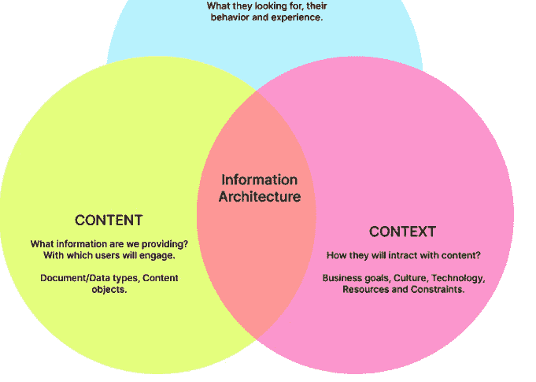

图 5.1：信息架构基础

在构建材料以确保用户能够理解时，用户的情境和需求应是你的两大主要考虑因素。

人们与你的材料互动的环境被称为情境。为此，请根据链接、层级和分类来安排内容。要把握情境，请考虑用户在何处、何时、为何以及如何找到和与你的材料互动。

接下来，将你的材料与用户的期望、需求、目标和行为相匹配。这被称为“智能标签”，其中你所创建的关系、层级和类别通过文字来表示和分类。为了有效地做到这一点，你必须了解用户的特征、你的内容为他们提供的益处，以及他们如何利用它。

这些组件协同工作，提供一个流畅的导航系统，使用户能够轻松找到所需内容，而不会迷路或感到信息过载。

## 示例

假设你正在组织一次穿越一个庞大且陌生的国家的公路旅行。你精心规划行程，以确保你不会迷路或错过任何必看景点。你计划好在哪里用餐、在哪里加油、以及哪些美景不可错过。每一个选择都是以你的旅程为出发点，以确保旅途顺利并让你享受其中。

对于网站和应用程序来说，信息架构有效地执行此功能。它类似于绘制数字地形，确保每条数据和路线都逻辑地定位。从每个页面上显示的信息到各部分之间的流畅过渡，你的数字环境中的一切都是为一个目标而创建的：尽可能让人们轻松找到他们正在搜索的内容。

## 信息架构的历史

信息架构的故事始于 1970 年代，比互联网成为家家户户必备品早得多。当时主导这一领域的是图书馆员和档案员，他们是整理图书馆和档案中庞大资料的专家。他们的努力为今天所知的信息架构奠定了基础。

然而，信息架构的起源还要追溯得更远。人类一直以逻辑的方式整理事实和信息，确保互动和沟通具有目的性。当信息杂乱无章时，信息就会丢失，机会也会错过。这种对结构与秩序的内在需求，是现代信息架构的种子。

让我们回到 1960 年代。IBM 在 1964 年发表的开创性研究论文《IBM System/360 的架构》将计算中的“架构”定义为数据流和控制的概念性组织和功能行为。这是首次正式承认一致信息结构必要性的表述之一。仅仅几年后，在 1970 年，施乐帕洛阿尔托研究中心的研究人员通过开发支持“信息架构”的技术，为如今所知的 信息架构 奠定了概念基础。

让我们从建筑师和平面设计师理查德·索尔·沃曼 说起，他在 1970 年代首次使用了“信息架构”这一短语。沃曼观察到建筑架构与数字空间组织需求之间的相似之处。他最初对“信息设计”的讨论以及设计师所需的能力，后来催生了“信息架构”这一概念，该概念成为他一部重要著作的标题。

随着 1990 年代互联网的爆发，信息架构变得至关重要。常被称为信息架构之父的 Lou Rosenfeld 和 Peter Morville 在 1998 年出版了《极地熊之书》，即《世界广域网的信息架构》。这部开创性著作为信息架构提供了框架，并定义了塑造行业多年的价值观和流程。

自 1980 年代中期以来，信息架构（IA）已大幅发展。起初它相当松散和开放，但此后已发展成为一个具有明确流程的领域。如今，信息架构在用户体验（UX）设计中发挥着重要作用，从移动应用程序界面到网站导航都由其组织。它不断变化以跟上技术发展和信息使用模式的新趋势。当你使用应用程序、浏览数字图书馆或浏览网站时，信息架构在后台运行，以确保你能够快速轻松地找到所需内容。

将信息架构置于设计的中心将使现代和未来的世界受益。只要


Technology does. It will continue to be a crucial component of our interactions with the abundance of information around us, facilitating easy and intuitive digital travel.

## Importance of Information Architecture

Picture yourself in a disorganized library with all the files and books scattered around. You would think it would be time-consuming and frustrating to find the book you wanted. If there is no clear hierarchy, the same thing occurs in the digital realm. Information architecture, or IA, is useful in this situation.

- **Improving the User Interface:** Users can locate what they are looking for with ease on a well-organized website or app. Similar to how aisles are indicated by signs in a well-organized store, effective information architecture facilitates consumers’ easy navigation of content. Because of their excellent experience, visitors are more inclined to visit the website again and refer others to it.
- **Enhances Accessibility:** IA makes sure that all users, including those with impairments, can access the content. It makes the content easier to find and comprehend for all users, regardless of ability, by employing clear labels and logical information organization.
- **Increases Productivity:** Effective IA can help firms save money and time. Workers can complete tasks more quickly and with less annoyance when they can easily locate the information they require. This effectiveness may result in increased output and a more positive work environment.
- **Encourages SEO:** Search engines can better comprehend your site’s structure and content if your IA is coherent and clear. By doing this, you may raise your website’s search engine rating and facilitate potential clients’ discovery of you. Enhanced visibility has the potential to result in higher traffic and more business.
- **Facilitates Content Management:** Managing content can get harder as websites get bigger. A solid information architecture foundation facilitates the addition, updating, and removal of content without causing disruption. It guarantees that, despite its evolution, the website will always be organized and user-friendly.
- **Lessens Clutter and Redundancy:** IA helps prevent clutter and duplication by efficiently organizing content. It guarantees that every item of information has a designated spot, making the website easier to navigate and cleaner overall.
- **Improves the Overall Design:** A website or app visual design is enhanced by effective IA. An aesthetically beautiful and harmonious user experience is produced by well-organized content, which lets the design take center stage. It resembles having a well-organized space where everything has a designated spot.

To put it briefly, information architecture is similar to a building’s blueprint. It guarantees that everything is conveniently located, easy to find, and enjoyable to use. Good user experience (UX) design is essential for producing a satisfying, productive, and successful user experience on any digital platform, be it a website, an app, or another.

## Information Architecture Principles

With over 20 years of experience under his belt, Brown crafted eight key principles to guide designers in making smart decisions when developing their build strategies. His mission was to create a set of “guidelines rooted in universal truths that define what makes any information architecture truly effective.” When an information architect or designer masters these principles, they can easily tackle even the most complex IA challenges and design user-friendly websites.

Here is a detailed explanation of each principle of information architecture:

### Principle of Objects

According to the Principle of Objects, content needs to be viewed as dynamic entities with distinct behaviors, lifecycles, and properties. Every book, for instance, is more than just a static item in a digital library catalogue. It contains metadata with the following: title, author, and genre; availability status (checked out or available); and user-generated content with reservations and reviews. This perspective on content helps designers build more


响应式和交互式系统，能够更好地表现真实世界中材料的复杂性，并帮助用户定位、理解所需信息及与之交互。

## 选择原则

为了不让消费者不知所措，选择原则强调为他们提供简洁、可管理的选项列表。这些选项必须适合手头的特定任务。如果选项太多，用户可能会感到沮丧和犹豫不决。电子商务网站可能不会提供数十种筛选器，而是将产品筛选选项限制为最重要的几个，包括尺寸、颜色和价格范围。这种有针对性的策略帮助用户快速找到所需内容，同时不会被过多选项淹没，从而提升了整体购买体验。

这些选项应与特定任务相关。如下图所示，网站显示电子邮件订阅表单弹窗只应为用户提供三个选择：订阅、不订阅或关闭弹窗。这简化了用户的决策过程，使他们的体验更直接、更愉快。

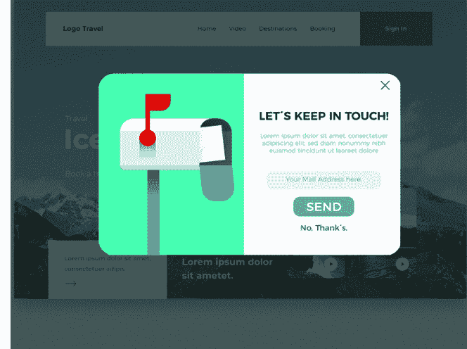

图 5.2：弹窗示例，展示特定任务并提供极少量选项

## 信息揭示原则

信息揭示原则的目标是向消费者提供足够的信息，帮助他们理解接下来的内容，而不过度。随着消费者深入探索，信息会逐步呈现，使他们能够做出明智的决定。

**例如，** 在线课程平台可能会为每门课程提供简介、讲师简介和一些关键亮点。用户快速浏览后，可以选择是否通过阅读学生评价或查看完整教学大纲来进一步了解。当信息逐步呈现时，用户被轻松地引导浏览内容，感受到更低的认知压力，整体体验也更好。

### 在线课程平台 - udemy

### 使用 Web 开发构建网站和应用程序

Web 开发世界的广度和互联网本身一样宽广。我们许多社交和职业生活都在互联网上展开，这催生了旨在创建、管理和调试我们日益依赖的网站和应用程序的新行业。

探索 Web 开发

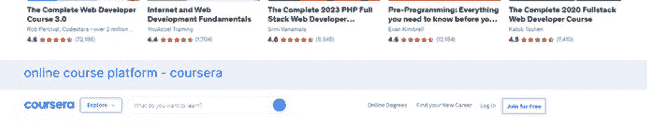

### 在线课程平台 - coursera

### 最受欢迎的证书

专项课程与专业证书

探索我们最受欢迎的项目，为热门职业做好准备：

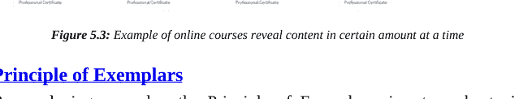

图 5.3：在线课程示例，每次按一定数量展示内容

## 示例原则

示例原则通过使用示例，使主题类别更容易理解。即使未完全理解每个类别的名称，当提供了各种内容类型的视觉示例时，用户也能更好地理解和浏览网站或应用。这种方法使用户更容易、更快地找到他们想要的内容，从而大大改善用户体验。

### 例如

一个食谱网站可能会将菜肴分组为“健康选择”或“快手餐”等标题。除了文字之外，网站还可以在这些标签旁边显示简单炒菜或清爽沙拉的图片。借助这些视觉提示，用户可以快速理解每个类别中包含的食谱类型，从而更好地找到所需内容。网站通过视觉示例来简化并减少不确定性，使体验更愉快、更直观。

## 前门原则

前门原则强调，并非所有用户都会从首页进入你的网站。因此，在设计网站时必须理解用户可能从任何页面进入。确保每个页面都提供上下文、导航选项和关键信息，以便访问者始终知道他们身在何处以及下一步可以采取哪些步骤。

**例如，** 想象一个用户搜索某篇特定博客文章，并直接到达该文章的页面。如果该页面包含清晰的站点菜单、面包屑导航和相关内容链接，用户就能轻松导航到网站的其他部分，而不会感到迷失。通过在所有页面提供一致的导航辅助和关键信息，无论用户从哪个入口进入，都能无缝地探索你的网站。这种方法通过让导航变得直观来提升用户体验，并确保所有访问者都能轻松找到方向。

## 多重分类原则

多重分类原则的一部分是为消费者提供搜索和浏览网站内容的多种选择。虽然顶级菜单和搜索栏是标准方法，但对于希望通过层级结构浏览或研究的用户来说，提供替代路径至关重要。这能保证信息架构满足不同用户的需求和偏好。

**例如，** 为了改善用户体验，教学网站可以包含多种分类选项。内容可以按年级（例如，小学或高中）、学科（例如，数学或科学）或资源类型（例如，工作表、视频或文章）进行搜索。这种多层面的方法使网站更加用户友好和易访问，让访客能够以适合其浏览习惯的方式找到所需信息。通过允许多种导航方式，你可以创造一个更具适应性和用户友好性的环境。


模式。

### 1. 聚焦导航原则

正如聚焦导航原则所强调的，整个网站导航菜单和辅助工具的连贯性与相关性至关重要。确保菜单上的所有内容一致且相关；不要混入可能让用户困惑的不相关主题。例如，不要在与产品类别相关的菜单中列出其他服务。同样，如果菜单用于导航，则要去除任何营销或功能组件。

**例如**，电子商务网站的产品菜单应只包含“电子产品”“服装”和“家居用品”等类别。“客户支持”和“特别优惠”等无关元素不应出现在其中。通过有针对性的导航帮助用户快速、简单地找到他们想要的内容，可以提升用户在网站上的体验。一致且相关的菜单使导航变得简单易用，从而降低用户不满的风险。

亚马逊是电商网站保持导航有序的绝佳例子。它在主菜单中展示所有产品类别，同时在页脚区域放置客户支持和其他服务。

图 5.4：亚马逊井然有序的导航菜单

### 2. 增长原则

增长原则的主要目标是创建一个易于容纳新内容而无需完全重做的框架。网站的整体布局，包括导航和搜索功能，应可轻松扩展以满足未来需求。无论随时间添加何种内容，该策略都能保证网站可持续增长。

例如，新闻网站一开始可能只有“世界”“科技”和“体育”等少数主要类别。网站应能通过添加“健康”“娱乐”或“环境”等新板块来扩展，同时轻松保持现有设计不变。如果从一开始就规划好扩展，网站可以轻松添加新的内容领域并持续变化。即使网站不断增长，消费者也始终能享受一致

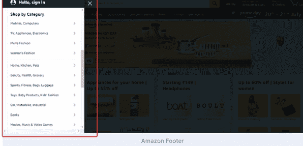


且井然有序的体验，这得益于其可扩展性。

遵循这些原则，设计师可以创建直观、用户友好且能随时间演进的信息架构。

## 信息架构系统

理解用户是信息架构师的首要职责。为了让信息更易于使用和查找，他们使用信息架构系统来识别、组织和构建数据。架构师通过了解用户的目标、目的和信息搜索方式来设计满足用户需求的系统。这要求熟悉四个关键领域：搜索：如何设置搜索功能；组织：如何安排内容；标注：如何为内容标注；导航：如何创建导航。每个组件都经过精心设计，让用户更容易找到所需内容。

- **搜索系统：** 用户可以通过信息架构（IA）的搜索机制输入关键词或短语来查找信息。当搜索系统运行良好时，用户能够快速轻松地找到所需内容。同时，它还会考虑如何使搜索结果更易于理解。高级搜索引擎的用户还可以通过过滤和排序选项来细化搜索，精确定位他们要查找的内容。信息架构师通过创建用户友好的搜索系统，确保用户能快速找到所需信息。

- **组织系统：**
  - **层级结构**：信息被分组为广泛的类别，再分支为更聚焦的子类别，形成类似树的结构。例如，在线商店可能有一个名为“服装”的主要类别，再细分为“男装”“女装”等。
  - **顺序结构**：信息以特定顺序呈现，引导用户完成一个有组织的过程。这在多步骤表单或教程中很常见。
  - **矩阵结构**：用户可以通过多种方式查看内容，


including popularity, date, and price.

- **标签系统：** 标签为用户提供上下文并指引他们获取更多信息。网站要想有效地与受众沟通，标签必须易于理解、熟悉且清晰。

作为一个**示例**，假设一位客户访问在线零售商的首页以查看其运输和退货政策。信息架构师可能会选择将主菜单的一个部分指定为“客户服务”，而不是在首页堆砌这些信息。借助这种众所周知的标签，用户可以更快地找到必要的政策和支持选项。

- **导航系统：** 在网站上，导航帮助用户找到特定信息。它由各种组件组成，这些组件结合起来为访客创建可识别的模式。信息架构师现在创建人们浏览网站时将采取的路径，并指定页面之间如何相互连接。

- Global Navigation: 可从每个页面访问的主要导航菜单，通向网站的关键部分。
- Local Navigation: 区域特定菜单，将观众引导至特定部分或页面内的相关内容。
- Contextual Navigation: 位于内容内部，指向相关信息或资源的指针。

## Example

考虑一个度假网站 "Tripadvisor"，它通过 IA 系统改善 UX。内容可按“Travel Guides”、“Hotel Reservations”、“Flight Booking”和“Destinations”在组织系统下进行分类。导航系统具有全局菜单，方便访问不同部分，每个类别都清晰标注。此外，强大的搜索引擎使用户能够快速找到特定地点或旅行建议。这种全面的 IA 系统确保客户可以轻松浏览网站，获取相关信息，并为其旅行预订。

将塑造你的 IA 决策。

## 2. 创建类别并为内容标注

在你的网站上高效组织信息的第一步是列出你当前拥有或打算添加的所有文章、产品页面和视频。详尽的清单有助于开发一个连贯的框架。将你的信息分类到观众易于理解的类别中。例如，科技博客将包括标有“Gadgets”、“Software”、“Reviews”和“Tutorials”的部分。

使用用户研究的结果对内容进行排序和优先级划分。思考人们直觉上如何排列信息。例如，如果你的烹饪网站有大量早餐、午餐和晚餐的食谱，你可能会将它们归类在“Meals”标题下。

尝试使用信息架构师使用的一些程序。应用树测试和卡片分类策略来帮助你组织内容。

**Card Sorting：** 为了了解消费者如何将各种产品分类到不同组中，我们采用了一种称为卡片分类的参与式设计流程。他们被要求将印有术语、功能或概念的卡片归类。

**Tree Testing：** 在树测试的帮助下，你可以观察用户对标签和导航的反应。此过程将向你展示你的网站在查找信息方面的用户友好程度。

之后，将这些类别分组。查看竞争对手网站，看看他们如何组织其内容。选择采用他们哪些策略以及哪些需要调整。在此过程中，你可能会遇到不完全符合任何一个类别的内容。这种内容有时会落入多个类别或不属于任何现有组。为了保持连贯的结构，评估并决定如何处理此类内容。

定期审查和更新你的内容组织对于保持网站对受众友好且相关至关重要。

## 3. 创建层级，开发导航和站点地图


在开始在网站上组织材料之前，先建立一个明确的层级结构。将其视为为房屋奠定基础。主分类类似于房屋的主要房间，必须在进入子分类（类似于主房间内部更具体的区域）之前选定。有了这种结构，用户将更容易浏览你的信息，形成逻辑流畅的体验。

在建立层级结构之后，下一步是创建一个用户友好的导航机制。将其视为在整个家中创建通道和标识，以便客人轻松找到方向。该系统具有搜索功能、菜单和链接，全部旨在帮助用户轻松浏览你的网站。关键是要保持简单直观，这样用户就不会感到迷失或不知所措。

下一个重要问题是：现在你的分组和内容已经设置好，用户将如何访问这些内容？你必须先定义你的信息架构（IA），然后才能创建站点地图和导航。IA可以与你房屋的蓝图相比较，它提供了布局，但并不总是对客人可见。但由于它构成了你网站的基础，因此至关重要。IA可以使用电子表格和图表进行图形化表示，这些也称为站点地图。

对内容进行排序、标记并将其组织成图表的过程就是创建站点地图。这与绘制房屋中所有房间和区域的位置相同。在你拥有站点地图后，就可以开发导航元素。这些类似于你房屋的门、走廊和标识。它们包括页脚以及本地导航元素，如筛选器和面包屑，以及全局导航菜单。为了让人们轻松探索你的网站，这些组件需要有意义地相互连接。

通过遵循这些步骤，你可以创建一个用户友好且井然有序的网站。就像一座设计良好的房屋一样，访问你网站的访客会感到宾至如归，并能够轻松找到所需内容。

## 关于导航的附加细节

在为你的网站创建导航结构以满足受众需求时，请考虑以下想法：

### 导航模型：

- **单页模型：** 非常适合信息丰富的网站，所有内容都可以通过滚动单页访问。
- **扁平模型：** 确保每个页面距离主页只有几次点击，适用于拥有少量分类的小型到中型网站。
- **层级模型：** 内容在这些庞大而复杂的网站上按主分类和子分类排列。

### 导航类型：

- **主导航：** 主要菜单，通常位于页面顶部，引导访客进入你网站最重要的区域。
- **次要导航：** 额外的菜单，通常位于侧边栏或页脚，提供对不太重要元素的访问。
- **隐藏导航：** 菜单如下拉菜单、汉堡菜单和弹出菜单，最初不可见，仅在操作时显示，被称为隐藏导航。

## 4. 用户测试和迭代

通过让实际用户测试来验证你的 IA。进行可用性测试以确定用户是否能毫不费力地找到所需内容。收集反馈并做出必要的调整。尽早且频繁地测试至关重要。

对此你有几个选择。你可以对初始用户组进行额外测试，以评估你最终网站的标签和分类。或者，你可以组建一个新的非正式小组进行可用性测试。

**树状测试**和**封闭式卡片分类**是其他选择，它们是在设计网站结构时不可或缺的工具，各自提供独特优势以确保用户友好的体验。

想象你在建造一个图书馆。**树状测试**可以帮助你了解访客是否能轻松找到方向。它告诉你部分名称是否合理，是否清楚地传达了其包含的内容，以及每个标题是否独特。通过引导用户浏览你网站的简化版本，你可以确定你的内容是否以对他们有意义的方式组织。


categories. 这就像要求你的图书馆访客把书籍归类到标有标签的书架上。这一过程揭示了分类名称是否准确描述了内容，以及用户是否能轻松区分标题。它还确保组织以用户为中心，反映了人们在脑海中自然归类信息的方式。

通过结合树状测试和封闭式卡片分类，你可以创建一个直观且易于导航的网站结构。这两种方法都能确保分类名称清晰、内容分类正确、信息易于查找，让你的网站像一个井井有条的图书馆一样受欢迎且易于访问。

## 5. 记录一切

清晰地记录一切是开发成功的信息架构（IA）的关键第一步。先制作线框图或站点地图，以便以图形方式呈现你的 IA。将其视为你网站的蓝图，就像建筑的建筑设计一样。站点地图说明了网站各个页面和组件之间的关系。对于设计师和开发者来说，这种视觉描述非常有帮助，因为它让他们清楚地了解网站的布局。它保证了所有项目参与者都了解各个网站部分之间的联系，并且保持一致。线框图更进一步，为每个页面提供基本布局，包括导航、内容和行动号召的放置。这种文档保证了结构的一致性，减少了混淆，并加快了设计和开发流程。

## 6. 保持灵活

有效的 IA 创建是一个持续的过程，而非一次性事件。准备好随着内容扩展和用户需求变化而不断更新和改进你的 IA。持续保持适应性对于保持网站用户友好性是必要的。定期审查你的 IA，以发现可能需要修改的地方。这可能是由于可用性测试结果、新增内容或用户行为变化所致。通过保持灵活并做出必要的调整，你可以确保网站保持用户友好和直观。这种持续改进有助于你的网站保持最新，并更好地满足消费者不断变化的需求。

这些程序将帮助你构建强大的界面架构（IA），从而改善网站的可用性和导航。祝你结构成功！

## 信息架构工具

信息架构（IA）工具对于开发和构建应用程序和网页至关重要。它们有助于为用户创建逻辑内容排列，并帮助创建直观的导航系统。以下是一些流行的免费信息架构工具：

- **Diagrams.net:** Diagrams.net（以前称为 Draw.io）可用于制作流程图、站点地图和图表。它基于网络，并提供各种模板来说明概念，例如 IA。
- **MindMup:** 一个免费的思维导图应用程序，便于组织想法和头脑风暴。它有助于说明各个 IA 组件之间的联系和层级结构。
- **Pencil Project:** 一个免费的开源 GUI 原型工具，可让你制作线框图、图表和 UI 原型。它易于使用并满足各种 IA 设计图表需求。
- **XMind:** XMind 是另一个免费的头脑风暴和思维导图工具，便于组织想法。它通过可视化层级和联系来帮助信息结构和 IA 规划。
- **FigJam:** FigJam 的主要目的是作为团队头脑风暴和构思的协作白板工具。然而，它可以通过让用户生成站点地图、流程图和用户旅程来促进信息架构任务。由于其用户友好的界面和实时协作功能，它是可视化复杂信息结构的实用工具。
- **Miro:** Miro 是另一个用于创造力和团队合作的协作白板工具。它除了


其主要功能是实现头脑风暴会议。借助思维导图、线框图和用户可以开发的图表，可以对信息进行组织和可视化。其适应性使其成为高效组织信息的宝贵工具。

这些工具是设计师和开发人员的经济实惠替代方案，因为它们包含了开发和改进信息架构所需的所有必要功能。

## 网站地图简介

想象一下，你刚刚开了一家书店，里面摆满了令人难以置信的书籍的层层书架。你希望顾客能够轻松找到完美的书籍并享受购物体验，对吧？但如果商店没有组织好，没有任何标识或分区，顾客会因沮丧而离开。对于你的网站来说也一样。没有网站地图的网站会让你的访客和搜索引擎漫无目的地游荡。

你创建了一个网站来与客户建立联系并推动销售。然而，随着网站变得越来越大、越来越复杂，搜索引擎在浏览大量可用内容时可能会遇到困难。这意味着即使是最有价值的内容也可能被埋没，使得搜索引擎和访客都难以找到它。

网站地图登场，它是你网站组织中默默无闻的英雄。网站地图就像你书店的详细地图，突出了关键部分和必读书籍。它确保搜索引擎和访客能够快速轻松地找到你最重要的页面，从而提升他们的体验并提高你网站的性能。

创建网站地图是你优化网站的下一个关键步骤，确保你所有精彩的内容都能得到应有的关注。

## 网站地图在网络架构中的技术作用

网站地图是网站上所有 URL 的列表，以及每个 URL 的元数据（例如其相对相关性和上次更新的日期）。它通过帮助搜索引擎更有效地抓取和理解网站结构，确保所有重要页面都被索引并可访问。

## 网站地图的重要性

网站地图在几种情况下非常有用。

例如，Google 通常使用链接来查找在线页面。为了帮助 Google 找到你的页面，如果你的网站是新的或没有太多外部反向链接的网站，你必须创建一个网站地图。

此外，对于 Google 找到你多百万页的电子商务网站上的每个页面，需要完美的内部链接和大量的外部链接。在这些情况下，网站地图至关重要，因为它保证搜索引擎可以访问你的所有信息。

网站地图对于优化你的网站至关重要，原因如下：

- **增强 SEO 和搜索引擎抓取：** 网站地图为搜索引擎提供了你网站的路线图，确保所有关键页面都被找到并编入索引。通过帮助搜索引擎理解你网站的架构和内容，这提高了你网站的搜索引擎排名。
- **增强用户体验：** 结构良好的网站地图便于用户浏览你的网站，使他们能够快速获得所需的信息。
- **管理大型和复杂的网站：** 对于拥有大量页面的网站来说，网站地图是必要的。它便于搜索引擎高效地导航和索引你的信息，而仅靠传统抓取则可能很困难。

## 网站地图的类型

网站地图主要有两种类型：HTML 和 XML。网页使用两种语言编码：XML（可扩展标记语言）和 HTML（超文本标记语言）。每种类型在你的网站上都有独特的功能。我们还将详细介绍另外几种网站地图类型。

## HTML 网站地图

HTML 网站地图的主要目的是帮助网站用户。该网站专注于通过系统地列出和分类指向网站上每个其他页面的链接来改善人们的导航，而非搜索引擎。通过使用 CSS 改善其外观，可以使 HTML 网站地图更具美观性和功能性。

HTML 网站地图的主要目标是使访客更容易找到他们感兴趣的特定页面或内容，减少搜索时间并提高用户互动。通过确保用户可以轻松访问相关数据，此功能不仅增强了整体用户体验，还有助于提高你网站的 SEO 评级。简单来说，HTML 网站地图是改善用户体验并提高网站在搜索引擎排名中表现的有用工具。

HTML 网站地图具有层次结构，使其类似于传统的索引卡或目录。它们使用户更容易探索和查找网站上的信息，尤其是在结构复杂或内容众多的网站上。通过按字母顺序或按类别对链接进行排序，HTML 网站地图可以通过提供你网站内容和结构的简明摘要来增强用户体验。


*Figure 5.6: Explore the HTML Sitemap of Firstcry Shopping Website*

**Example:** 设想 Firstcry Shopping 网站，提供丰富的婴儿用品、育儿指导和实用工具。链接可以按类别排列，如 **“Baby Diapering,” “Feeding and Nursing,” “Baby and Kids Clothing,”** 等等，在 HTML 网站地图中。每个区域都会包含相关页面的链接，帮助用户快速找到所需内容，而无需浏览多个页面。

从本质上讲，HTML 网站地图通过提供易于导航的网站内容路线图来改善可用性，让用户更满意。

## [XML Sitemap](#)

一种专门用 XML（可扩展标记语言）准备的文件，称为 XML 网站地图，有助于搜索引擎有效地抓取和索引网站内容。与为人类访客制作的 HTML 网站地图不同，XML 网站地图是专门为搜索引擎遍历和索引网站网页而制作的。因为它们是保存在网站根目录中的 XML 文件，所以对网站用户是隐藏的。它们提供有关网站上 URL 的全面详细信息，包括最后更新时间、更改频率以及相对于页面上其他 URL 的重要性等元数据。

由于 XML 网站地图可确保搜索引擎能够识别和索引所有相关站点——包括那些可能难以通过常规抓取找到的站点，例如内部链接较少或动态生成的内容的页面——因此它们对搜索引擎优化至关重要。网站管理员可以通过将 XML 网站地图上传到搜索引擎，例如 Google，来提高其网站内容的可见性。

例如，考虑一个拥有大量文章、标签和分类的在线新闻网站。每个文章、分类和标签页面的 URL 都会列在 XML 网站地图中，并附带标识每个项目的最新更改日期的信息。通过这样做，搜索引擎能够更好地理解网站的结构，并优先索引最近添加或更新的信息。


Figure 5.7: Example of XML Sitemap

总之，XML 网站地图充当搜索引擎的详细手册，确保网站的所有重要页面都被找到并正确索引，从而提高网站在搜索结果中的可见性。

## Video Sitemap

一种特定类型的 XML 网站地图，称为视频网站地图，为搜索引擎提供有关您网站上视频的元数据。该元数据包括视频的标题、描述、时长、位置（URL）、缩略图 URL 和发布日期。视频网站地图通过提供这些全面信息来增强视频的可发现性和索引性，帮助搜索引擎理解您影片的内容和上下文。

对于主要使用视频内容、例如媒体网站、教育平台或在线课程的网站而言，视频网站地图至关重要。它们可确保视频得到正确索引，从而提高其在视频搜索结果中出现的可能性，并改善网站整体的 SEO。视频内容的正确索引可以带来更高的可见性和来自搜索引擎的更多流量。

**Example:** 考虑一个拥有大量食谱视频的烹饪网站。每个视频都展示一个新食谱并提供详细说明。该网站将拥有一个视频网站地图，其中包含每个视频的 URL 以及元数据，例如标题（“How to Make Chocolate Cake”）、描述（“A step-by-step guide to baking a delicious chocolate cake”）、时长（5 分钟）和缩略图 URL（指向视频缩略图图像的链接）。通过向搜索引擎提供这些数据，他们可以更全面地理解和索引视频内容，从而使观众在搜索相关食谱时更容易找到这些电影。

下面的 **example** 演示了一个带有视频扩展的标准网站地图。它在单个 `<url>` 标签内嵌套了两个视频条目。第一个 `<video>` 条目包含 Google 可以使用的所有标签，而第二个条目仅包含必要的标签。

```
<?xml version="1.0" encoding="UTF-8"?>
<urlset xmlns="http://www.sitemaps.org/schemas/sitemap/0.9"
    xmlns:video="http://www.google.com/schemas/sitemap-video/1.1">
    <url>
        <loc>https://www.example.com/videos/some_video_landing_page.html</loc>
        <video:video>
            <video:thumbnail_loc>https://www.example.com/thumbs/123.jpg</video:thumbnail_loc>
            <video:title>Grilling steaks for summer</video:title>
            <video:description>
                Alkis shows you how to get perfectly done steaks every time
            </video:description>
            <video:content_loc>
                http://streamserver.example.com/video123.mp4
            </video:content_loc>
            <video:player_loc>
                https://www.example.com/videoplayer.php?video=123
            </video:player_loc>
            <video:duration>600</video:duration>
            <video:expiration_date>2021-11-05T19:20:30+08:00</video:expiration_date>
```


```
<video:rating>4.2</video:rating>
<video:view_count>12345</video:view_count>
<video:publication_date>2007-11-05T19:20:30+08:00</video:publication_date>
<video:family_friendly>yes</video:family_friendly>
<video:restriction relationship="allow">IE GB US CA</video:restriction>
<video:price currency="EUR">1.99</video:price>
<video:requires_subscription>yes</video:requires_subscription>
<video:uploader info="https://www.example.com/users/grillymcgrillerson">GrillyMcGrillerson</video:uploader>
<video:live>no</video:live>
</video:video>
<video:video>
<video:thumbnail_loc>https://www.example.com/thumbs/345.jpg</video:thumbnail_loc>
<video:title>Grilling steaks for winter</video:title>
<video:description>
In the freezing cold, Roman shows you how to get perfectly done steaks every time.
</video:description>
<video:content_loc>http://streamserver.example.com/video345.mp4</video:content_loc>
<video:player_loc>https://www.example.com/videoplayer.php?video=...</video:player_loc>
</video:video>
</url>
</urlset>
```

In summary, a video sitemap is a crucial tool for enhancing a website’s video content discoverability and SEO since it makes sure that videos are correctly indexed and easier for viewers to access through search engine results.

## Image Sitemap

A specific kind of XML sitemap called an image sitemap aids in the discovery and indexing of images on your website by search engines. Image sitemaps include more information about the images on those pages, such as the image URL, title, caption, license, and other pertinent details, in addition to the URLs of the web pages that they link to. By providing more context and information, the upgraded data increases the likelihood that the photographs will show up in image search results.

Websites that primarily rely on visual material, including e-commerce sites, blogs with rich media, and photographic portfolios, can benefit greatly from image sitemaps. Webmasters can make sure that their photographs are indexed by search engines, improving their visibility and bringing more visitors to the website, by putting all pertinent images in the sitemap.

**Example:** Think of an online art gallery that features a variety of artworks, for instance. There are excellent photos, descriptions, and artist details available for each piece of art. For this website, an image sitemap would include the picture URLs as well as metadata like the title (“Starry Night by Vincent van Gogh”), the caption (“A famous painting by Vincent van Gogh”), and the type of license (public domain or copyrighted). By doing this, search engines are better able to index the photographs and increase the likelihood that users searching for similar artwork will find it in the results of their image searches.

To sum up, an image sitemap is an essential tool for enhancing a website’s image discoverability and indexing. By making sure search engines can appropriately decipher and rank the visual information, it improves the overall SEO of the website and increases the amount of organic traffic that comes from picture searches.

## News Sitemap

An XML sitemap created especially for websites that post news material is known as a news sitemap. It facilitates the swift and effective discovery and indexing of news stories by search engines, especially Google News. By including metadata such as the article title, publisher name, keywords, and publication date, news sitemaps guarantee that consumers looking for news material can quickly find the most recent and pertinent news pieces.

For news websites, news sitemaps are critical because they allow new items to be quickly indexed, which is necessary for timely news distribution. Webmasters can guarantee that their content appears in search results as quickly as possible and hence increase traffic and reading by providing the most recent items in the sitemap.

**Example:** An online news portal that covers everything from sports to politics. Each news article that has been published in the last 48 hours would have a URL on this site’s news sitemap, along with metadata like the title (“Election Results 2024”), the publication date (“2024-07-15”), and keywords (“election, 2024, results”). This facilitates the speedy discovery and indexing of the new articles by search engines, giving readers looking for the most recent election updates access to them.

In conclusion, news sites need a news sitemap to make sure that fresh content is quickly indexed and available to anyone looking for up-to-date information. It raises the site’s organic traffic count, increases search engine ranking, and makes news material more visible.

## Mobile Sitemap

A mobile sitemap is a unique type of XML sitemap created to help search engines find and index material on a website that is tailored for mobile devices. Websites must be responsive to users across several platforms, including smartphones and tablets, as mobile internet usage surges. The visibility and ranking of mobile-optimized pages are enhanced by a mobile sitemap, which aids search engines in identifying and prioritizing information designed for mobile users.

Websites with discrete mobile-friendly pages or independent mobile versions benefit most from mobile sitemaps. The URLs of mobile-specific pages are included in these sitemaps, along with pertinent metadata like the page’s priority in relation to other URLs on the website and the date of its last modification. A mobile sitemap makes sure search engines can appropriately index and present the right material to mobile consumers by giving them this information.

**Example:** An online retailer with a mobile-specific website. All mobile-optimized pages, including product listings, category pages, and checkout pages, would have their URLs listed in a mobile sitemap. To aid search engines in comprehending the organization and significance of these sites, metadata is included with each entry in the sitemap. By doing this, search engines can swiftly lead consumers to the mobile-friendly version of the


当他们在移动设备上进行产品搜索时，网站可以改善用户体验，并可能提高转化率。

总而言之，如果网站拥有专门为移动设备定制的内容，那么移动站点地图就是必不可少的。它通过帮助搜索引擎有效索引和优先处理针对移动设备优化的页面，确保移动用户获得流畅直观的浏览体验。

## 创建站点地图

构建站点地图主要有两种方式：手动生成或使用站点地图生成器。虽然手动生成站点地图可能需要一些时间，但它需要以有条理的方式详细列出网站上的每个页面，让你完全掌控内容。作为替代方案，你可以使用站点地图生成器来自动化这一过程，它会自动扫描你的网站并为你创建站点地图。这种方法能保证准确性并节省时间，尤其是对于较大的网站。这两种策略各有优势，请选择最适合你需求和资源的方案。

### 手动创建站点地图

手动生成站点地图需要你对 HTML 和 XML 有中级到高级的理解。手工构建 XML 站点地图需要大量编码，并且你必须将其提交到 Google Search Console 以便被索引。

如果你希望搜索引擎快速索引你的网站，只需五个简单步骤即可创建站点地图。

### 步骤 1：检查页面结构

如果你有一个内容精彩且设计精美的网站，却注意到它没有得到搜索引擎的太多关注，那么是时候调查原因了。首先检查你网站的结构。问问自己：“这些链接都通向哪里？”就像每位访问者那样，从主页开始。然后，沿着链接追踪到其他页面，以了解导航流程。这里有一个简单明了的例子。


*图 5.8：站点地图模板示例*

你会注意到，某些页面藏得很深，需要点击五六次才能到达，这使得搜索引擎难以找到并给这些页面排名。为了提高网站在搜索引擎排名中的表现，你应该确保任何页面都能从主页在三次点击内访问到。

把你的网站想象成一棵大树。主页是坚固的树干，从树干分出最重要的页面，确保它们只需一次点击即可到达。每个主分支又通向较小的分支，这些分支也只需再点击一次即可到达。这样，你就创建了一个清晰且逻辑清晰的层级结构。

通过将内容按层级划分优先级并确保每个页面易于访问，你可以让网站对用户和搜索引擎都更加友好。

请记住，在设计网站时，要确保任何页面都能在三次点击内访问到。

请参阅*图 5.8*以更好地理解：

如图所示，“我们的产品”页面位于**顶级**，并链接到**二级**类别：按类别、按关注点、按肤质、按关键成分。这些类别中的每一个再链接到多个**三级**页面，这些页面以黄色方框显示。

“我们的产品”页面至关重要，因此它位于顶级导航中。将黄色链接的页面与蓝色顶级内容放在同一优先级上是不合逻辑的，这就是为什么它们被归类为三级内容。

### 步骤 2：优化 URL

在确定了每个页面的重要性并适当地组织好网站之后，就可以开始创建你的 URL 了。

假设你将使用 HTML 或 XML 标签来格式化每个 URL。如果你曾经尝试过 HTML 编码，这项工作对你来说应该相当简单。但别担心，即使你从未做过——这也是完全可行的。首先，需要一个文本编辑器来创建 XML 文件。你可以使用像 Sublime Text 或记事本之类的程序。

你打开文本编辑器，坐下来，开始为每个 URL 添加必要的代码。你需要提供以下细节：

- 页面的位置
- 上次更改的日期
- 更改频率
- 页面的优先级

在操作过程中，你为 URL 编写的代码可能类似于下面这样：

```xml
<url>
  <loc>https://www.examplesite.com/page1</loc>
  <lastmod>2019-01-10</lastmod>
  <changefreq>weekly</changefreq>
  <priority>0.8</priority>
</url>
```


你仔细检查每个URL，确保每个方面都正确编码。随着时间的推移，这种细致的工作会提升你网站的性能。慢慢来，确保所有事情都正确完成。

## 第三步：确保代码准确性

无论你手工编码多么频繁，任何人都会犯人为错误。然而，对于你的网站地图来说，任何编码错误都是绝对不能容忍的。

幸运的是，有一些程序可以检查你的代码错误并确保语法正确。在这里，互联网应用程序可以成为你最好的伙伴。你只需在Google中输入“网站地图验证”，就会找到大量结果。

想象一下，你编写了一段漂亮的代码，但糟糕的是，你忘了包含分号或起始标签。别担心！那个可靠的验证工具会像超级英雄一样行动，立即识别错误并帮助你轻松修复。

## 第四步：将网站地图集成到根目录

首先，进入你网站的根文件夹，并将你的网站地图文件上传到那里。这类似于为搜索引擎提供一张易于遵循的网站路线图。

包含网站地图可确保每个页面都可访问，并改善网站的结构。许多网站都采用这种常见做法，即简单地在任何URL后添加“/sitemap/”，如下例所示：

**例如，在Apple网站上查看：**

https://www.apple.com/sitemap/

想要深入了解？

只需在任何网站的URL后添加“/sitemap.xml”，即可查看其底层代码，就像在HubSpot网站上一样。

图5.9：显示HubSpot网站的sitemap.xml代码示例

你还可以将其作为“Sitemap”标签集成到页脚导航中，以便快速访问。花点时间观察每个部分的逻辑结构和层次。

## 第五步：提交你的网站地图

你的网站地图的旅程并未就此结束——一旦配置好并包含在网站文件中，就该将其提交给搜索引擎了。你应该按以下步骤操作：

1. 访问Google Search Console。
2. 找到“Crawl”部分并点击“Sitemaps”。
3. 在右上角找到“Add/Test Sitemap”按钮。
4. 在提交之前，你可以测试你的网站地图，确保没有错误。
5. 一旦没有错误，点击“Submit”。

就这样！剩下的交给Google处理。你的网站将被其系统索引，这将提高你的SEO排名，并让用户更容易找到你的页面。

## 使用网站地图生成器生成网站地图

尽管遵循这五个步骤非常简单，但有些人可能对手动修改网站代码感到担心。好消息是，你不需要懂编码就能创建网站地图，因为还有大量其他选项可用。使用这些网站地图生成器，创建网站地图的过程变得快速、简单且极其准确。

如果你使用WordPress，许多知名的SEO插件都内置了XML网站地图功能，从而将过程简化为几次点击。这意味着你可以少关注技术细节，多关注引导你的网站走向成功。

一些其他选项包括：

- **Yoast SEO：** 一个全面的WordPress网站SEO插件。
- **The SEO Framework：** 另一个WordPress SEO插件，专注于简洁性和性能。
- **Jetpack：** 一个多功能的WordPress插件，包括站点管理工具、安全功能和性能增强。
- **All in One SEO Plugin：** 一个受欢迎的WordPress插件，提供强大的SEO工具和优化功能。
- **Slickplan：** 一个用于创建网站地图和可视化规划网站结构的工具。

除了上面列出的工具外，互联网上还有大量其他创建网站地图的选项，每个都有独特的功能集，以满足各种需求和个人喜好。

总之，无论网站多么简单或复杂，网站地图都是必不可少的。HTML和XML格式的网站地图对于提高搜索引擎排名都至关重要。XML网站地图有助于更快

indexing by helping search engines understand the structure and content of your website. HTML sitemaps, on the other hand, improve user experience through easier navigation and longer visitor engagement.
If improving the SEO of your website is something you want to do, adding a sitemap is a great place to start.

## Information Architecture versus Sitemap

Effective UX design requires an understanding of the distinctions between information architecture (IA) and sitemaps. Despite their similarities, they have varied functions and effects on the user experience. We will talk about how and why they differ from one another in this section. The following are some typical distinctions between an IA and a sitemap:

|  | Information Architecture (IA) | Sitemap |
|---|---|---|
| Scope and Detail | A comprehensive structure focusing on content organization, relationships, and user pathways. | A sitemap is basically a list of web pages of the website offering a bird’s-eye view of the content and its flow. |
| Purpose and Use | Guides overall design, navigation, and content strategy to enhance usability. | Visualizes website structure for stakeholders, aiding communication and decision-making. |
| Adaptability | Evolves based on user research but maintains stability in key aspects like taxonomy. | Flexible and easily updated to reflect changes in website structure. |
| Stakeholder Communication | Complex and detailed, requiring thorough explanation for stakeholders. | Simplified and clear, facilitating efficient communication and faster decision-making. |
| Impact on User Experience | Directly enhances user experience by ensuring intuitive navigation and content findability. | Aids development process with limited direct impact on user interaction. |

Table 5.2: Difference between Information Architecture and Sitemap

## Conclusion

The principles of information architecture (IA) and its vital function in structuring website content for a smooth user experience were covered in this chapter. We discussed the fundamental IA systems and principles that serve as the framework for efficient information structure. We also looked at guide users to relevant information, enhancing navigation and usability.

- **Hierarchical:** Arranges information into broad categories and subcategories, resembling a tree structure.
- **Sequential:** Presents information in a step-by-step order, common in processes like forms or tutorials.
- **Search Systems:** Mechanisms that allow users to find information by entering keywords or phrases, with options for refining results to locate specific content efficiently.
- **Sitemap:** A structured list of all URLs on a website, along with metadata about each URL, such as relevance and last update date. It helps search engines crawl and index the site more effectively.
- **Metadata:** Additional information about each URL in a sitemap, including its relevance and the date it was last updated, which assists search engines in understanding the site’s content.
- **Search Engine Crawling:** The process by which search engines systematically browse and index a website’s content to include it in search results.
- **Internal Linking:** Links that connect different pages within the same website, aiding in navigation and indexing.
- **External Links:** Links from other websites pointing to your site, which can help improve search engine visibility and traffic.
- **Large and Complex Sites:** Websites with many pages and sections, where a sitemap is essential for efficient navigation and indexing by search engines.
- **HTML (Hypertext Markup Language):** The standard markup language used to create and structure content on the web, defining elements such as headings, paragraphs, and links.
- **CSS (Cascading Style Sheets):** A stylesheet language used to control the presentation and layout of HTML elements on a webpage, including colors, fonts, and spacing.
- **XML (eXtensible Markup Language):** A markup language designed to store and transport data, used in sitemaps to describe the structure and hierarchy of web content.


- **WordPress：** 一种流行的内容管理系统（CMS），允许用户通过用户友好的界面和可自定义的功能创建、管理和发布网站和博客。
- **网站管理员：** 负责管理和维护网站的个人，包括其内容、性能和技术方面。
- **搜索引擎：** 在线工具（如 Google、Bing 或 Yahoo），根据用户查询对网络内容进行索引和检索，帮助用户在互联网上找到相关信息。
- **可发现性：** 内容或网站被用户和搜索引擎找到的难易程度，通常通过有效的 SEO 实践和网站地图得到增强。
- **首页：** 网站的主要或介绍性页面，通常作为导航和访问其他页面的中心枢纽。
- **网站地图验证：** 检查网站地图以确保其格式正确、包含有效 URL 且无错误的过程，以确保搜索引擎能够正确索引。
- **插件：** 软件附加组件，可扩展网站或内容管理系统的功能，例如添加 SEO、社交分享或增强安全性的功能。

# 第 6 章

## 线框图和原型的重要性

## 引言

欢迎来到线框图和原型的创意世界！在本章中，我们将探讨线框图如何帮助您勾画数字产品的结构和功能。您将发现线框图在设计过程中的重要性，并能够看到许多展示其应用的示例。线框图为您精确规划和安排思路奠定了基础。

接下来，我们将深入探讨原型，原型通过交互元素让您的线框图栩栩如生。我们将介绍各种类型的原型，以及使用它们如何有利于测试和改进您的设计概念。为了了解用户将如何与您的设计交互，并在最终生产之前做出必要的更改，原型至关重要。

最后，我们将向您介绍创建线框图和原型的最佳工具和软件。到本章结束时，您将具备将设计创意高效、创造性地转变为引人入胜的交互式体验的知识。

## 结构

在本章中，我们将讨论以下主题：

- 线框图简介
- 线框图的重要性
- 线框图的类型
- 桌面与移动线框图
- 线框图的益处
- 创建线框图的步骤
- 创建线框图的最佳工具
- 原型简介
- 原型制作的重要性
- 原型制作的益处
- 原型制作的类型
- 创建原型的最佳工具
- 线框图与原型制作的比较

## 线框图简介

假设您正在建造一栋房子。在粉刷墙壁或放置砖块之前，需要一份蓝图。有了这份蓝图，房主、建筑商和建筑师都可以清楚地看到每个房间、门和窗的位置在哪里。在设计世界中，线框图发挥着类似的作用。

过去，一些设计师认为线框图是不必要的，认为它们耗时且无生产力。然而，情况已经改变。借助现代工具，设计师可以快速为简单的线框图添加交互性，从而创建动态的低保真原型。由于这些原型使最终产品的功能更容易看到，线框图比静态草图有用得多。


图 6.1：由 Freepik 设计的线框图的基本结构

线框图就像网页或应用的粗稿。它显示了基本布局、结构和信息流，而没有任何设计细节。可以把它想象成简单的块状布局，文本用线条表示，图像用“ X ”标记表示。这有助于大家在开发人员开始构建实际产品之前就先就元素放置达成一致。

无论是手绘还是数字创建，线框图对于 UX 设计师都至关重要。它们确保每个人都理解计划，为成功项目奠定坚实基础。

## 线框图的重要性

在进行任何设计或编码之前，线框图充当视觉参考，帮助利益相关者、开发人员和设计师理解功能和布局。它们确保各方达成一致，这促进了更


effective project development and clearer communication.
Wireframes fulfill the following essential purposes:

- **User-Focused Screen Planning:** Wireframes are vital for planning screens with a user-centered approach. They help designers map out the layout of apps and websites, logically arranging content and features without worrying about visual design details. This clear and accessible structure allows designers to gather early feedback from users and involve stakeholders in discussions. Using placeholders, designers can ask users what they expect to see, making sure the final product is intuitive and easy to use.
- **Clarifying Features and Navigation:** Wireframes help clarify features and navigation by providing a basic outline of the app or website. They avoid going into the specifics of visual design and instead concentrate on how things are arranged and how people will interact with them. This frees up designers to focus on usefulness, making sure every element is accessible and arranged properly. Wireframes illustrate how users will navigate the interface by outlining the user flow and navigation patterns. This early emphasis on functionality guarantees that the finished product is intuitive and user-friendly while also assisting in the identification of possible problems.
- **Quick and Cost-Effective Iteration:** Wireframes are crucial for the iterative design process because they are quick and inexpensive to create. All you need is a pen and paper to sketch a wireframe quickly and for free, or you can use various tools to create a digital wireframe in just minutes. They allow designers to experiment with different layouts and functionalities without investing significant time or resources. This flexibility enables rapid iterations based on feedback from users and stakeholders, ensuring the design evolves to meet user needs effectively. By refining wireframes early and often, designers can identify and address potential issues before moving to more detailed design stages, saving time and reducing costs. This approach helps create a more user-friendly final product while maintaining efficiency in the design process.

## Types of Wireframes

In the early stages of design, many designers start with sketching wireframes on paper. It’s a fast and simple method that gets ideas flowing, but it has its drawbacks—sharing these sketches with a team and referring back to them frequently can be cumbersome. Additionally, paper wireframes are usually thrown away after their initial use.

To extend the life and usefulness of these paper sketches, designers can turn them into paper prototypes for usability testing. Some digital tools even allow these paper sketches to be transformed into collaborative digital formats, making them easier to share and refine.

There are three main types of wireframes: low-fidelity, mid-fidelity, and high-fidelity. Each serves a different purpose and adds unique value to the design process. Let’s dive into the specifics of each type.

## Low-Fidelity Wireframes

Low-fidelity wireframes are basic, rough sketches that outline the core layout and functionality of a webpage or app. They are particularly useful in the early stages of design when experimenting with different ideas and visualizing multiple concepts. These wireframes emphasize structure over visual details, using simple shapes, lines, and placeholder text to depict content and elements without precise grid or pixel accuracy. Created quickly and affordably, they are perfect for early-stage brainstorming and can even be sketched on the fly during meetings with stakeholders or clients.


Figure 6.2: Example of a Low-Fidelity Wireframe

The preceding figure displays the wireframe design of the mobile application. In a low-fidelity wireframe, the header, search bar, product pictures, and descriptions may all be represented by straightforward, rough blocks and lines. This helps you see the layout and user flow and prevents you from becoming bogged down in the specifics of the design.

## Mid-Fidelity Wireframes

Mid-fidelity wireframes, often referred to as grayscale wireframes as well, use different tones of gray in place of full-color or high-resolution pictures, offering a thorough overview of the structure of a website or app. These wireframes are simpler and more basic than low-fidelity versions, but they


缺乏高保真线框图的精细程度，后者是完全打磨和完善的。中保真线框图由设计师用来清晰地说明视觉层次和布局，这有助于传达各种元素的意义，而不会出现完整设计元素的视觉杂乱。这些线框图通常使用 Sketch 或 Balsamiq 等程序制作，可保证对拟议设计的平衡且易于理解的描述。


Figure 6.3: Example of Mid-Fidelity Wireframe

前面的图显示了移动应用程序的线框设计。诸如标题、搜索栏、产品图片和描述等元素在中保真线框中以更大的深度显示。您可能会看到精细的框、图标和一些真实内容，而不仅仅是粗糙的块和线条。这种

方法在复杂性和简洁性之间取得了平衡，使人们更容易看到布局和用户流程，而不会因复杂的设计功能而负担过重。

## High-Fidelity Wireframes

高保真线框图是对网站或应用程序布局的详细且呈现良好的表示，与最终产品非常接近。与低保真和中保真版本相比，高保真线框图具有精确的间距、完整的配色方案、字体、图形和图标。它们为利益相关者提供用户界面的真实图景，使他们能够了解最终产品将如何看起来和运作。

在设计过程的后期，这些线框图经常被用来帮助开发团队、收集全面的反馈并进行可用性测试。它们提供了视觉层次、交互流程和用户体验的清晰描述，确保所有设计元素都能准确传达并与项目目标保持一致。


*Figure 6.4: Example of a High-Fidelity Wireframe*

前面的图显示了移动应用程序的线框设计。诸如标题、搜索栏、产品照片和描述等元素在高保真线框中以正确的图标、星级评分、详细的图像图标和定义的边距显示。这种方法通过实现对布局、设计组件和用户流程的全面可视化，提供了一个几乎完成的、与最终结果非常相似的外观。

## Desktop versus Mobile Wireframes

用户不再只从家用电脑访问网站。随着手机和平板电脑变得非常流行，UX 设计师需要了解人们如何、在哪里以及为什么使用这些设备，以及在这些设备的限制范围内什么效果最好。在为桌面和移动应用程序设计线框图时，重要的是要考虑尺寸、行为和交互，因为这些方面极大地影响用户体验。以下是设计桌面和移动应用程序时需要牢记的一些关键考虑因素：

|  | **Desktop** | **Mobile** |
|---|---|---|
| **Size** | 较大的屏幕有助于桌面线框图容纳更多内容和复杂布局。设计师可以使用更大的图表、复杂的导航菜单和多列布局。 | 移动线框图需要简化的布局，必须考虑较小的屏幕。为了确保在小屏幕上的可读性和可用性，内容应优先考虑、垂直堆叠，并且按钮和简单导航的触控目标更大。 |
| **Behavior** | 在桌面上，用户期望一次可见更多功能和更多交互。广泛的工具栏、广泛的下拉菜单和悬停效果都很常见。用户通常使用鼠标或触控板进行准确输入。 | 触摸交互是移动行为的主要焦点。设计元素需要用于手指点击和滑动，考虑基于手势的导航。由于移动消费者经常在旅途中并且需要更专业、任务特定的功能，因此设计必须快速且易于使用。 |
| **Interaction** | 桌面可以进行拖放、右键单击可访问的上下文菜单和多窗口多任务等复杂操作。使用键盘快捷键提高效率也很常见。 | 触摸动作如捏合、滑动和点击应用于轻松自然的移动交互。设计师需要优先考虑关键功能并考虑单屏界面的限制。此外，移动设计中经常融入设备特定元素，如 GPS、摄像头和加速度计。 |

*Table 6.1: Key Factors Shaping User Experience in Desktop versus Mobile Wireframes*

通过了解这些考虑因素，设计师可以创建线框图，在桌面和移动平台上提供优化且无缝的用户体验。

## Benefits of Wireframing


线框图是设计网站或应用程序的重要工具。它们就像蓝图，帮助设计师和利益相关者看到并就布局和结构达成一致。以下是使用线框图的优点：

- **可视化网站架构**

站点地图可能很大或很复杂，但项目的视觉设计阶段始于它从站点地图过渡到线框图时。网站的导航、主页面和子页面组织，以及用户沿着转化路径的流程，都通过线框图被转化为有形的视觉表示。此阶段提供了成品的清晰描述，强调其主要特性和设计组件。线框图基本上充当全面的项目路线图，提供一个有组织的框架，指导设计和开发阶段，并确保所有重要细节都能得到准备和高效传达。


*Figure 6.5: Wireframe Example: Visualizing the Site’s Navigation Structure*

在前面的图中，主导航显示在标志旁边并带有图标。这是页面左上角的主菜单，显示最重要的部分。

次要导航是一个较小的菜单，可能出现在顶部右侧或特定页面内，提供指向相关部分或子页面的链接。

有时，标记为“更多”的菜单项在点击时会显示其他选项或页面。
在站点地图上，这些不同的导航元素可能看起来令人困惑，因为很难看出它们如何组合在一起。然而，线框图通过直观地组织导航在实际网站上将如何显示和工作，使其更清晰。它显示了主菜单和次要菜单将如何排列，以及用户如何在“更多”下访问额外选项，使复杂的导航更容易理解和使用。

## 网站功能的详细概述

假设你正在与客户合作一个网站项目，而他们不知道“弹出窗口”、“产品筛选”或“Google 地图集成”是什么意思。你开始为该项目开发线框图以弥合这一差距。你的视觉讲故事工具将是这些线框图，它们使每个功能将在页面上的位置以及其如何工作变得明显。


### Figure 6.6: Wireframe Example Showing Website Features as Filters and Popup

当你带他们浏览线框图时，客户可以清楚地看到产品筛选将如何促进更好的搜索，以及弹出窗口将如何显示信息以吸引注意力。除了确保最终产品有趣且用户友好之外，这种视觉方法还有助于他们更好地理解设计。通过明确定义每个项目的功能和位置，你可以创建一个满足用户需求和期望的网站。

- **确保可扩展性和易于更新**

考虑一个管理新闻网站的客户，计划在未来一年内从每天五篇文章增长到每天五十篇文章。你制作了一个线框图，展示网站将如何处理额外的内容以应对这种增长。为了保持网站的组织性和可用性，线框图显示了一个可扩展的布局，具有用于标题、特色文章和类别的可移动部件。一个简单的例子是为未来组织多个项目而添加新类别或创建多个子类别。

当你带他们浏览线框图时，客户可以看到网站将如何轻松处理增加的材料量，而不会牺牲外观或功能。这种策略强调了可扩展性和易于更新的价值，让客户安心地知道他们的网站可以有效应对未来的增长。

- **节省时间和金钱**

考虑一个零售商正在创建全新的在线商店的案例。为了确保流程顺畅，网页团队和客户正在共同合作。他们在项目早期制作详细的线框图，以展示网站的功能和结构。

他们在此时讨论是否要创建新表单还是集成来自第三方应用程序表单的现有表单。他们还绘制了用户的转化路径，并决定谁将负责每个组件。这种共同理解确保所有各方都同意项目的目标和功能。

团队通过提前解决这些问题并避免事后进行重大调整来节省时间和资源。通过简化


开发流程并实现高效的资源分配，这种主动策略最终节省了时间和金钱。

- **高效的开发流程**

想象一家公司正在开发一款用于管理个人财务的新应用。设计团队制作了详尽的线框图，展示了应用的功能和布局。开发人员可以遵循这些线框图提供的清晰蓝图。

这些线框图帮助开发人员在开发阶段开始时准确理解每个屏幕应该是什么样子以及如何工作。通过按照线框图构建应用，他们能够防止混淆和返工。由于设计从一开始就得到了很好的规范，应用得以更快、更正确地开发，并且从设计到开发的过渡很顺利。

## 创建线框图的步骤

创建线框图的方法简单易行。它通常从一个基本的草图开始；绘画天赋不是必需的。从一个基本的草图开始，明白它不必完美。你勾画出应用程序元素的总体布局，例如内容部分和导航栏。随着你的草图绘制，你可以看到消费者将如何与应用的每个部分进行交互。我们目前只关注一个线框图，尽管这种方法最终需要为整个项目制作多个线框图。这个第一个线框图是一个很好的练习工具，将帮助你构建你的想法并创建一个干净的布局。你意识到线框图更多是关于规划而不是艺术能力。通过这种简单而有效的方法，你对自己设计用户友好界面的能力充满信心。

## 创建图像

线框图中显示的图像通常以框或矩形显示，经常用图像图标或“X”标记其位置。设计师可以使用真实照片，但它们保持简单和不杂乱，以最大限度地减少干扰。为了正确传达设计中图像的放置和比例，这种方法不包含任何视觉内容。这种方法有效地传达了图像将在何处以及在设计中的大小，而不添加视觉内容。

## 创建文本

在线框图中显示文本时，考虑几个因素至关重要。首先，指定元素的任何字符限制或预期文本长度，有助于可视化文本应占用的空间。使用占位符文本来显示内容将做什么，例如“介绍段落，4-5 行”，或使用真实内容示例。避免使用“Lorem Ipsum”，因为它缺乏上下文并且不能准确代表真实内容。最后，任何带有链接的文本都应加下划线，标题的字体大小可以稍大一些。

## 颜色

出于多种原因，在线框图时最好避免使用颜色。保持灰色。它有助于避免从内容放置等关键组件上分散注意力，并有助于保持对建立布局和功能的主要目标的关注。过早引入颜色可能会导致利益相关者更关注美观而不是实用性，从而使布局讨论变得混乱。通过优先考虑实用性而不是美观，设计师确保线框图有效地传达用户体验和交互，而不会出现颜色误解的可能性。这种方法在整个设计过程中保持效率和关注度。


图 6.7：线框图的各种输入格式类型

前面的图示说明了如何在线框图中呈现不同类型的內容，包括图像、文本、图标、下拉菜单等。有了这个视觉指南，你现在清楚地了解如何设计每个部分。是时候继续创建实际的线框图了。为了有效地做到这一点，我们需要遵循一系列结构化步骤。

- 1. 识别元素并起草草图

列出页面上必须包含的每个元素，包括文本、标题、照片、标志和导航栏。尽量做到尽可能彻底；额外内容以后总可以添加。之后至少绘制一个简单的低保真线框图。使用钢笔或铅笔手工绘制通常比使用任何数字软件创建更快、更灵活。尝试多种布局以确定哪个是最好的用户友好设计，并制作多个草图来探索其他概念。


## 2. 细化线框图

选择你最满意的草图并将其转化为精致、深入的版本的过程就是细化线框图。它应该足够整洁和精致，可以向利益相关者或潜在用户展示以获取他们的反馈。使用中保真或高保真线框图以确保清晰度和细节。为了开发这个更高级的版本，使用 Balsamiq、Adobe Photoshop 或 Figma 等设计工具，这些工具能够实现准确的修改和良好的视觉呈现。其目的是创建一个能够清晰传达设计和功能性的线框图，以便其他人可以提供富有洞察力、有帮助的反馈。这种反馈对于进一步细化和迭代设计至关重要，确保其满足用户需求和项目目标。

## 3. 收集并迭代反馈

在展示完成的线框图后，向利益相关者或未来用户征求意见。利益相关者可能是你的客户、业务合作伙伴、上级或将使用最终产品的用户。根据反馈对线框图进行必要的调整。根据你的需求，在修改后可以从同一组或不同参与者处获取进一步的反馈。继续这一反馈-迭代循环，直到设计足够好并且持续获得良好评价。

## 创建线框图的最佳工具

选择合适的线框图工具对设计流程至关重要。记住，你也可以始终使用笔和纸！以下是一些流行的免费和付费创建线框图选项的详细介绍：

### 创建线框图的免费工具：

### Figma

- **Features:** Figma 为协作设计提供免费计划，具有全面的功能，包括线框图、原型制作和设计系统。当用户可以与团队成员实时协作时，共享和迭代设计变得简单。
- **Pros:** 大型社区资源，实时协作，基于云。
- **Cons:** 免费计划上编辑和文件存储受限。

### Wireframe.cc

- **Features:** Wireframe.cc 提供简洁的 UI，用于快速轻松地构建线框图。它使用简单工具并专注于创建基础线框图。
- **Pros:** 基于浏览器，学习曲线低，使用简单。
- **Cons:** 没有复杂的原型制作或设计选择，功能有限。

### Pencil Project

- **Features:** Pencil Project 是一个开源应用程序，可用于制作线框图、模型和原型。它内置了多种连接器和表单。
- **Pros:** 免费且开源，丰富的形状库。
- **Cons:** 与更新的工具相比，界面可能感觉陈旧且不够用户友好。

### MockFlow

- **Features:** 用户可以使用 MockFlow 的免费基础计划通过拖放界面设计线框图和模型。还包括站点地图和 UI 流程设计工具。
- **Pros:** 易于集成的套件满足各种设计需求，易于使用。
- **Cons:** 免费计划功能有限，协作功能受限。

### 创建线框图的付费工具：

### Adobe XD

- **Features:** Adobe XD 是一款完整的设计工具，包含原型制作、线框图、高保真设计和协作功能。它与 Adobe 其他 Creative Cloud 产品具有良好的集成。
- **Pros:** 插件众多，与 Adobe 产品界面流畅，功能强大。
- **Cons:** 价格取决于订阅；对于基础线框图可能过高。

### Balsamiq

- **Features:** Balsamiq 专长于制作模仿手绘草图的低保真线框图。其目的是避免陷入设计元素，而专注于结构和内容。
- **Pros:** 鼓励专注于功能，易于使用，界面直观。
- **Cons:** 对个人用户来说价格昂贵，且仅限于低保真设计。

### Sketch

- **Features:** Sketch 是 Mac 用户中备受欢迎的设计工具，具有丰富的线框图、UI 设计和原型制作功能集。它拥有强大的插件和集成生态系统。
- **Pros:** Mac 原生性能，庞大的插件生态系统，高保真设计出色。
- **Cons:** 仅在 Mac 上可用；升级和协作功能需要会员。

### InVision

- **Features:** InVision 提供协作、原型制作和线框图工具。其功能包括交互式模型、设计移交和用户测试能力。
- **Pros:** 实时更新，广泛的设计和协作功能，以及用户测试。


- **缺点**：它可能很昂贵，而且一些用户发现基础的线框图绘制不太直观。

每种工具都有各自的优势，适用于从基础线框图到详细的交互式原型等不同需求。你可以根据自己的需求、预算和工作方式来选择。

## 原型简介

设计师以原型启动新产品，原型对于测试和完善想法至关重要。原型是产品的早期版本，用于展示其外观和工作方式。你可以将原型视为产品的早期草稿或模型。如果你正在创建新设备或应用，应先制作一个展示其功能和外观的简单版本，而不是直接跳到最终产品。这个原型可以简单到一幅草图，也可以复杂到交互式数字模型。

原型有助于你了解设计将如何运作，以及用户将如何体验它。它让你在最终版本制作之前测试各种功能，找出有效之处，并修正无效之处。通过向用户展示这些原型并收集反馈，你可以更深入地了解他们的需求和偏好。这样，你就能确保最终产品高效且易于使用。


图 6.8：连接移动应用屏幕，获得流畅的原型体验；由 Freepik 设计

设计思维方法在很大程度上依赖于原型设计，尤其是在测试的最后阶段。你开发出一个近乎可用的模型（即原型），然后与重要的利益相关者和潜在消费者一起测试，看它是否满足他们的需求。

原型之所以必不可少，是因为它们能及早发现问题，节省成本和时间。它们还能确保每个人了解项目，并加强团队成员之间以及与利益相关者的沟通。简而言之，原型是设计过程中帮助将概念转化为经过测试的现实的必备工具。

简单的故事板和草图、直白的纸质模型，甚至模拟服务的角色扮演情境，都可以被视为原型。尽管形式各异，所有原型都共享四个主要特性：

- **表现方式：** 指原型所采用的形式，例如纸面、移动设备或电脑屏幕。
- **精确度：** 指原型的细节程度，从粗糙简单（低保真）到非常详细精良（高保真）。
- **交互性：** 描述用户测试时如何与原型互动，是只能观看、部分交互，还是完全使用其功能。
- **演进：** 指原型的生命周期，在快速原型设计过程中，测试版本会被新的迭代快速取代。

原型让你能够迭代测试产品的各个部分，获得洞察，并进行必要的修改，从而帮助你达成最终设计。因此，你的原型设计之旅仍在继续，每一步都让你更接近最终目标。

## 原型设计的重要性

UX 设计需要在最终投产之前进行原型设计，以测试和完善用户交互与体验。通过迭代测试和反馈，确保产品满足用户的需求和期望。

以下是原型之所以重要的几个关键原因。

- **早期问题发现：** 在发布新应用或对现有应用进行任何更改之前，你必须先获得利益相关者的同意。在利益相关者批准设计之前，原型是帮助他们看到最终产品的绝佳方式。在将设计交给开发团队之前，这也是收集他们意见并进行必要调整的好方法。通过尽早识别可能的可用性问题和设计缺陷，原型设计使设计师能够在问题变得代价更高、耗时更长之前加以解决。
- **以用户为中心的设计：** 为了确保设计以用户为中心，原型设计至关重要。早期用户测试使设计师能够了解用户的偏好和需求，从而带来更直观且


用户友好的最终产品。

- **沟通工具：** 对于设计师、开发者和利益相关者来说，原型是一种有用的沟通手段。团队可以利用它来传达设计概念、预览最终产品，并提供反馈，使产品更好地满足企业目标。

- **知情决策：** 原型制作提供了有见地的用户信息和反馈，可以指导开发过程并影响设计选择。这确保决策不是基于假设，而是基于真实的用户互动和偏好。

- **迭代改进：** 原型制作使持续的测试、反馈和改进成为可能，从而促进迭代设计流程。通过这种迭代流程产生的最终设计更加精炼和实用。在应用构建之前，UX 团队可以利用原型这一迭代流程调整设计并发现未来的障碍。

原型是 UX 设计的关键工具，有助于将想法可视化、测试和完善，最终带来更好的用户体验和更成功的产品。

## 原型制作的益处

原型制作带来了一些关键优势，大大增强了设计和开发流程。以下是一些主要益处：

- **降低风险：** 经过完整原型流程的项目比未经过的项目风险更低。这是因为项目资源、进度和预算都直接受到原型制作的影响。通过及早发现潜在问题并采取行动加以解决，原型制作降低了开发过程中昂贵返工和修改的可能性。通过原型制作，可以预测开发所需的时间和资源。

- **成本效益：** 原型制作是一种经济实惠的方式，可以在不投入大量开发资源的情况下尝试各种设计概念。它有助于在广泛开发之前确定最佳方案。在项目内各项任务开始之前，应制作多个原型。这一基本概念可以用低保真原型清晰传达，类似于一套简单的草图。然而，在与焦点小组进行可用性测试时，高保真原型，如交互式数字模型，是收集深入反馈的更优选择。

让我们探索最有效的原型制作方法：

- Low-Fidelity Prototyping
- High-Fidelity Prototyping

## 低保真原型制作

低保真原型的目的是通过简化的基本表现形式来展示用户流程和产品的整体结构。这些原型通常使用线框图，即简单的图表，展示应用程序或网站应如何布局和导航。它们支持 UX 研究团队理解产品的资讯架构，并可视化信息应如何向用户呈现。

在项目刚刚起步时，这些原型非常有帮助。得益于其简洁性，团队可以快速勾画概念，而不会陷入细节。这有助于探索多种想法并根据反馈快速迭代。低保真原型可以快速、轻松、经济地制作，这使其对在压力下工作或资源有限的团队非常有用。

不过，低保真原型也存在一些缺点。由于缺乏交互性，用户无法正确体验最终产品的工作方式。此外，由于其简化的视觉风格，无法传达最终产品的美观性。结果，利益相关者可能更难理解最终的外观和感觉。

尽管存在这些缺点，低保真原型因其优势仍是设计早期阶段的关键工具。它们让团队能够专注于产品的核心组织和流程，为未来开发奠定基础，并能快速响应用户反馈。

以下是一些低保真原型的例子：


-   草图
-   纸质原型
-   可点击原型

## 草图

草图或其他低保真原型是产品设计的简单初步描述。通常为手绘，它强调的是总体构思和结构，而非具体设计细节。可以将其视为一份粗略草稿，便于快速且低成本地实现概念可视化。

设想你正在创建一个新网站。你可能会为底部、主文本区域、页眉和导航菜单勾画轮廓。这些快速草图在细节上节省了大量时间，同时能有效地将你的想法传达给利益相关者和团队成员。他们随时准备提供改进建议和批评意见。

草图和其他低保真原型之所以有用，是因为它们有助于快速迭代。在进入更复杂、更耗时的阶段之前，你可以根据反馈快速修改和完善自己的想法。

## 纸质原型

低保真纸质原型是产品设计的简单早期版本，使用纸张和笔等基本材料制作。尽管数字 UX 设计领域已经高度科技化，钢笔和纸张仍然是快速低保真原型制作的首选工具。这种方法最简单、最快捷，通过在纸上或白板上手绘“屏幕”来表示数字产品。纸质原型制作涉及勾勒概念和用户流程，以实现设计的可视化。


图 6.9：设计师与团队讨论纸质原型

设想你正在创建一个新网站。你可以用一张张纸来描绘多个网页，用方框表示图片，用线条表示文本，用箭头指示页面之间的导航流向。为了模拟用户流程，这些纸质屏幕可以排列在桌子或白板上。通过引导用户进行浏览，你可以获得关于网站设计和操作的反馈。

纸质原型缺乏功能性，因此保真度较低。正因如此，设计师很少在本部门之外分发纸质原型。尽管存在这一限制，纸质原型制作仍然是 UX 设计初始阶段的重要步骤。它鼓励团队合作，让设计师能够低成本地测试大量概念。信息架构映射和用户流程可视化是纸质原型制作的主要目标。

这些原型有利于快速迭代，可根据反馈快速调整，并有助于在设计进入更精细、更昂贵的开发阶段之前对其进行完善。

### 可点击原型

低保真可点击原型是产品的基本交互模型，允许用户点击各个区域在屏幕或页面之间切换。构建这些原型使用基础工具和软件，它们更关注整体结构和流程，而非精致的设计细节。在设计阶段早期，它们帮助设计师测试和改进用户体验旅程。

设想你正在创建一个全新的电子商务网站。可以使用线框软件制作低保真可点击原型。每个页面（包括主页、产品列表和结账页）都用带有文本和图片占位符的简单灰度布局来表示。通过使用可点击热区连接这些页面，创建一种互动体验，用户即可点击浏览整个购买流程。

低保真可点击原型有助于快速且低成本地评估用户流程和导航。它们能快速提供关于可用性问题和需要改进之处的见解。在投入资金进行高保真设计和大量开发之前，这些原型通过聚焦核心功能和结构，帮助确保流畅、简单的用户体验。

## 低保真原型制作的优势

低保真原型具有多项关键优势，使其成为设计早期阶段的宝贵工具：

-   **快速迭代**：低保真原型可以快速简便地制作。这使设计师能够快速迭代概念，并根据反馈进行修改和改进，从而节省大量时间和金钱。
-   **成本效益高：**制作低保真原型所需的材料和工具很少。更基础的数字线框、纸质模型或


一个简单的草图比更为复杂的原型或成品成本更低。

- **鼓励创新：** 低保真原型制作简单且能激发创新。设计师可以自由探索和头脑风暴，而不受技术实现问题或高细节设计要求的限制。
- **促进早期用户测试：** 低保真原型允许早期用户测试和反馈。在进入更复杂的阶段之前，设计师可以及早发现可用性问题、理解用户需求，并通过让用户参与早期阶段做出必要的改进。
- **改善沟通：** 这些原型是增强沟通的重要手段。它们通过帮助设计师有效地向客户、团队成员和利益相关者传达其概念，确保每个人都知道项目的主要思想和方向。
- **降低风险：** 低保真原型有助于在设计过程早期发现潜在问题，从而降低风险。设计师能够在问题变得昂贵且耗时之前加以解决。
- **促进团队合作：** 低保真原型制作促进参与者之间的团队合作。通过允许每个人在开放、迭代的氛围中分享想法和提供意见，可以产生更好的整体设计解决方案。
- **关注功能性：** 低保真原型由于不包含复杂的设计细节，帮助团队专注于基本功能和用户体验。这确保了在融入美学元素之前，产品的基础要素是健全的。

低保真原型是设计过程中的一个重要工具，它有几个好处，使其更容易生产出高质量、成本效益高、以用户需求为中心的产品。

## 低保真原型的缺点

虽然低保真原型制作有很多优点，但它也有明显的缺点。

- **交互性有限：** 由于低保真原型有时缺乏交互功能，用户可能难以真实了解最终产品将如何工作。因此，关于用户反馈的精确度可能会降低。
- **可视化不足：** 低保真原型可能无法准确捕捉最终产品的外观和感觉，因为它简单且缺乏复杂的设计细节。因此，客户和利益相关者可能难以完全理解设计目标。
- **可能产生误解：** 由于低保真原型过于简单，有时会导致团队成员或利益相关者误解最终产品的功能和设计。重要细节可能会被忽略或误解。
- **用户反馈有限：** 由于低保真原型可能无法完全呈现最终产品的交互和视觉元素，用户可能难以就这些原型提供有意义的反馈。在进行用户测试时，这可能会产生较不深刻的见解。
- **对开发人员而言细节不足：** 低保真原型可能无法提供开发人员理解项目技术规范所需的全部信息。这可能导致开发过程中的遗漏以及后续需要额外解释。
- **生命周期短：** 随着设计过程推进到更高质量的阶段，这些原型通常会被迅速丢弃。随着越来越复杂的原型被制作出来，这可能导致重复工作和感觉工作被浪费。

低保真原型制作有一些好处，但也有一些可能影响设计过程的缺点。要就何时以及如何有效使用低保真原型做出明智的决定，就需要理解这些缺点。

## 高保真原型制作

高保真数字原型是复杂的、精细的模型，与最终结果非常相似。通过使用这些原型对设计和用户流程进行全面测试和验证，UX 团队可以确保用户体验的每个部分都得到优化。

高保真原型比低保真原型能提供更准确的最终产品表示。它们提供了更真实的用户体验，因为它们具有美感，并且通常包含高级功能。UX 团队在充分掌握用户和利益相关者的需求后，继续开发高保真原型。这一阶段对于测试复杂的用户流程和做最后时刻的更改至关重要。

[图 6.8](#) 展示了一个高保真原型的示例。它包含具有所有必要元素的完整设计屏幕，演示了屏幕如何链接在一起以创建无缝的用户流程。

常见的高保真原型类型包括：

- 交互式原型
- 数字原型
- 编码原型

高保真原型设计是设计过程中的关键步骤，它帮助团队完善其概念，确保最终产品既满足用户期望，又实现业务目标。让我们仔细看看这三种类型：

- **交互式原型**

  高保真交互式原型是一种复杂且动态的产品版本，在外观和功能上都与最终设计高度相似。这些原型包含真实图片、排版以及按钮、菜单和动画等交互组件，并使用先进的原型设计工具和软件制作。由于它们提供了逼真的用户体验，设计师可以借助它们测试和改进产品的每个部分。

  一个电子商务网站就是一个典型的例子。A


comprehensive layout comprising photographs, product descriptions, and functional navigation would be present in the high-fidelity prototype. Customers could browse the complete selection, put products in their cart, and check out. This enables designers to find any problems and fix them before the development process starts.

Interactive prototypes with high fidelity are valuable because they provide a realistic experience. Ensuring that the finished product fulfills user expectations and corporate goals, they support the validation of design decisions. These prototypes lessen the possibility of expensive revisions later in the development process by offering a comprehensive and dynamic representation.

## Digital Prototypes

A refined and comprehensive version of a product that functions and appears like the final version is called a high-fidelity digital prototype. These prototypes, which are made with sophisticated design software, have correct interactions, realistic graphics, and frequently intricate animations. They are perfect for extensive testing and feedback since they provide a near-exact representation of the user experience.

An example could be a website redesign. The website’s actual colors, typefaces, and layout would be displayed in the high-fidelity digital prototype. Visitors could use interactive elements like sliders and search bars in addition to navigating the website and completing forms. Before a website is fully developed, designers can evaluate its overall feel and usability with the aid of this level of detail.

Because they offer a realistic glimpse of the finished product, high-fidelity digital prototypes are essential for designers to adjust the user experience and fix any problems before real development starts. This ensures that the final product effectively satisfies user wants and corporate objectives.

## Coded Prototypes

For instance, a coded prototype for a new e-commerce website would utilize HTML to organize the pages, CSS to apply styling, including color and font choices, and JavaScript to include interactive features like picture sliders or drop-down menus. The prototype allows users to

engage with the site in a manner that closely resembles the final version, including adding items to a shopping cart and completing the checkout procedure.

Coded prototypes are useful because they offer an accurate and useful depiction of the finished product. This ensures a more seamless transition from prototype to final product by enabling designers and developers to test interactions, evaluate user flows, and make improvements based on actual performance data.

## Advantages of High-Fidelity Prototyping

Several significant advantages of high-fidelity prototyping improve the process of design and development. Some of them are as follows:

- **Realistic User Experience:** In terms of functionality and design, high-fidelity prototypes closely match the final product. Users are given a genuine impression of the final product’s appearance and functionality, thanks to this realism, which encourages more accurate and insightful feedback.
- **Detailed Feedback:** High-fidelity prototypes enable users to offer comprehensive input on both functioning and aesthetics since they have interactive features and realistic graphics. This aids in locating and resolving particular problems early in the design process.
- **Improved Stakeholder Communication:** High-fidelity prototypes help team members, clients, and stakeholders understand design concepts. The thorough depiction lowers misconceptions and aligns expectations by assisting all parties in grasping the product vision.
- **Refined Usability Testing:** High-fidelity prototypes allow for in-depth usability testing because of their realistic designs and interactive features. This guarantees that intricate features and interactions function as expected and aids in evaluating how consumers engage with the product.
- **Reduced Risk of Misalignment:** High-fidelity prototypes reduce the possibility of miscommunication between the design team and stakeholders by offering a near-final product approximation. This


确保最终产品更接近原始目标和规格。

- **精确的技术规格：** 高保真原型中经常包含详细规格和交互，可用于生成精确的技术文档。这使得设计更容易被开发者理解和应用。
- **增强的设计验证：** 这些原型可以更有信心地确认设计选择。在进行大规模开发之前，它们有助于确保用户流程、交互和设计方面高效且满足用户需求。
- **改善用户参与度：** 因为高保真原型看起来精致且逼真，用户更倾向于与之交互并提供有见地的评论。这种互动可能会产生有价值的信息，有助于打磨和提升最终作品。

高保真原型制作是在全面开发之前测试和微调设计的强大工具，因为它提供了诸多益处，例如逼真的用户体验、详尽的反馈和增强的沟通。

## 高保真原型的缺点

高保真原型提供了对最终产品的全面而准确的展示，但也带来了一些困难：

- **高成本：** 生产高保真原型需要大量资金投入用于软件、设计工具，并经常需要专业知识。与更简单的原型技术相比，这可能会更昂贵，特别是如果需要多次迭代。
- **耗时：** 创建具有逼真图形和交互的复杂原型需要大量工作。这可能会延迟设计流程，推迟评论和修改，而这些修改如果使用低保真技术可以更快完成。
- **过度强调细节：** 高保真原型有可能通过过度关注视觉设计和细节，而使人们忽视在设计阶段更早应解决的重要功能缺陷或用户体验问题。
- **误导性反馈的风险：** 因为高保真原型与最终产品如此相似，客户可能会给出更侧重于设计美观性而非其可用性或功能性的反馈。这可能导致反馈优先考虑美学，而非重要的用户体验问题。
- **灵活性有限：** 对高保真原型进行调整可能更困难且耗时。调整通常需要重新制作复杂细节，这与低保真原型提供的灵活性相比可能很费力。
- **范围蔓延：** 由于高保真原型非常详细，可能会根据原型看起来有多逼真而提出更多功能或修改。这可能导致成本增加和进度延长。
- **资源密集：** 高保真原型需要大量资源投入，例如经验丰富的开发人员和设计师。这可能会给项目预算和资源带来压力，尤其是在小型团队或初创公司中。

高保真原型虽然提供了最终产品的逼真样本，但也有诸多缺点，例如高昂的价格、时间需求以及可能过度强调视觉方面。高效的设计和开发需要在这些变量与项目需求之间取得平衡。

## 创建原型的最佳工具

根据你想要构建的原型类型——例如低保真线框图、高保真设计或交互式原型——可能需要使用一系列技术。以下是一些顶级工具，按其功能分类：

### 低保真原型制作和线框图

- **Balsamiq：** 非常适合快速创建简单线框图。
- **Sketch：** 广泛用于线框图制作，专注于 UI/UX 设计。


| 方面 | 线框图 | 原型 |
|---|---|---|
| 定义 | 元素的布局和排列 | 用户体验。类似于构建想法的功能模型，以观察其在实际情况中的表现 |
| 性质 | 本质上线框图是静态的 | 本质上原型是交互式的 |
| 细节程度 | 低保真度突出设计内部不同元素的排列和定位方式 | 可以是高保真的（精炼、详细，与成品非常相似），也可以是低保真的（简单、基础） |
| 视觉效果 | 典型的线框图是简单、单色的设计，没有颜色、图像和复杂的风格特征。它们专注于基本框架，而不关注细节修饰 | 原型中使用了多种视觉元素，包括颜色、照片、字体和复杂的设计。这些组件能更准确地描绘成品的观感和体验 |
| 关注点 | 特别强调整体设计和内容的结构组织，确保一切安排得当，信息架构合理 | 通过关注用户体验（包括视觉设计和交互方面），确保成品不仅功能完善，而且美观且用户友好 |
| 成本 | 线框图是一种经济实惠的设计技术，可用于快速、低成本地开发基本的结构布局 | 根据设计中包含的复杂性和交互程度，制作原型的成本差异很大，从适中到高昂不等 |
| 时间投入 | 由于线框图的主要目标是快速勾勒设计的基本构成和组织，因此制作线框图所需时间相对较短 | 原型由于细节和交互程度更高，比线框图更复杂，因此需要更多时间构建 |
| 工具 | 像 Balsamiq、Sketch 和 Adobe XD 这类工具具有专门用于帮助开发基本结构布局和元素放置的功能，是快速绘制线框图项目的良好资源 | 为了创建更精致、更实用的模型，原型制作需要更复杂的工具，如 InVision、Figma 和 Adobe XD。这些工具为添加详细的设计元素和交互性提供了丰富的选项 |
| 其他主要区别 | 设计阶段中的步骤：一旦基本布局最终确定，原型将在之后构建。线框图的创建处于设计阶段的早期。复杂性：原型需要更多 |  |

表6.2：线框图与原型之间的主要区别

## 结论

总而言之，本章引导你了解了开发原型和线框图的关键阶段，这些是设计过程中的重要环节。我们考察了各种类型的线框图，从粗略的草图到复杂的设计，并理解了它们在描述项目组织与流程方面的重要性。然后，我们研究了各种形式的原型——静态的、交互式的以及可编码的——每种形式在用户测试和获取反馈方面都有特定的功能。

我们还讨论了多种专门为这些工作设计的程序和技术。每种工具都有特殊的能力来帮助你实现想法，从用于高保真原型设计的 Adobe XD 和 Figma，到用于线框图的 Balsamiq 和 Sketch。通过熟练掌握这些工具并理解其用途，你可以有效地弥合概念与最终成果之间的差距，确保更流畅、更直观的用户体验。

在下一章中，我们将探讨视觉层次的重要性，这是设计师创作出有趣且用户友好的界面所必需的核心要素。我们将研究 UI 模式，并了解它们对用户体验的重要意义。学完本章后，你将掌握大量关于如何创建视觉上引人注目的设计、轻松引导用户浏览你的数字作品的知识。

## 关键术语

- **线框图：** 展示网站或应用布局与导航的基本图示。


- **低保真：** 简单、基础的原型，用于测试和探索早期设计概念。
- **高保真：** 详细、精致的原型，与最终产品非常相似。
- **蓝图：** 设计项目的详细计划或大纲。
- **草图：** 设计概念的粗略、手绘表现形式。
- **以用户为中心：** 设计方法优先考虑终端用户的需求和偏好。
- **占位符：** 临时内容或元素，标示最终内容将放置的位置。
- **视觉层次：** 设计元素的排列方式，用于引导观众的注意力和理解。
- **可用性测试：** 真实用户测试产品的过程，以识别问题并提供反馈。
- **交互：** 用户与产品互动的方式，例如点击、轻触或滑动。
- **交互流程：** 用户在产品内完成任务所采取的步骤序列。
- **可扩展性：** 产品在增加使用量或增长时仍能保持性能的能力。
- **原型：** 产品的一个早期版本，提供对设计结构、用户体验和整体概念的洞察，允许对各种功能进行测试和改进。
- **模型：** 用于测试和完善设计概念的产品原型或早期模型。
- **设计思维：** 一种设计方法论，在测试的后期阶段高度依赖原型制作，以确保最终产品满足用户需求。
- **表现形式：** 原型所呈现的形式，例如纸上、移动设备或计算机屏幕上。
- **精确度：** 原型中的细节程度，从粗糙简单（低保真）到非常详细和精致（高保真）。
- **交互性：** 用户在测试期间可以与原型互动的程度，无论他们只能查看、部分互动还是完全使用其功能。
- **演进：** 原型的生命周期，其中测试版本可通过快速原型制作迅速被新迭代取代。
- **低保真原型制作：** 简化的表现形式，展示用户流程和产品的整体结构，通常使用线框图。在设计早期阶段用于快速迭代和反馈，非常有用。
- **高保真原型制作：** 用于在可用性测试期间收集深入反馈的详细、交互式数字模型。
- **早期问题检测：** 在原型制作过程中尽早识别可用性问题和设计缺陷，以便在问题变得更昂贵和耗时之前解决。
- **沟通工具：** 原型用于传达设计概念并收集设计师、开发人员和利益相关者的意见。
- **知情决策：** 利用原型制作的洞察和用户反馈来指导开发过程并影响设计选择。
- **迭代改进：** 对原型进行持续测试、反馈和完善，以生产出更具功能性和更精致的最终设计。
- **成本效益：** 通过原型制作以较少投入实验各种设计概念的能力，降低昂贵返工和重做的风险。
- **评估技术可行性：** 使用原型来确定哪些功能难以实现，并揭示意外的财务、技术或实际限制。
- **改进可视化：** 通过提供一种切实探索设计概念的方式，增强思想的传达并获得利益相关者的支持。
- **功能验证：** 使用原型通过确认其可行性和有效性来优先考虑对用户价值最大的功能。
- **完整版本：** 设计或产品的详细完整版本，包含最终版本中预期的所有功能、功能和设计元素。
- **逼真图形：** 视觉元素与真实生活的外观和细节非常接近，提供更逼真、更准确的最终产品表现。


# 第7章
## 视觉设计与UI模式

## 引言

欢迎学习本章关于用户界面（UI）设计关键方面的内容。我们将首先深入探讨视觉层次的概念，这对于引导用户的注意力以及设计用户友好的界面至关重要。通过了解如何在视觉上对元素进行优先级排序，设计师可以创造出有趣且用户友好的体验。接着，我们将研究UI设计模式，这些是解决典型设计问题的行业标准方法，能够提高可用性和用户满意度。我们还将介绍最优秀的UI模式库，这些资源提供了预制元素和设计思路，帮助你加快设计流程。最后，我们将探讨暗色UI设计模式，审视这些策略如何影响用户行为，并讨论道德设计的重要性。学完本章后，你将全面理解这些基础UI概念及其对用户体验的影响。

## 章节结构

在本章中，我们将讨论以下主题：

- 视觉层次：设计师指南
- 视觉层次的重要性
- 视觉层次的关键要素
- 用户界面（UI）设计模式
- UI设计模式的重要性
- 常用的UI设计模式
- 如何实现UI设计模式
- 顶级UI模式库
- 移动应用的UI设计模式
- 顶级移动UI模式库
- 暗色UI设计模式

## 视觉层次：设计师指南

想象你是一位正在创作杰作的艺术家，但与画笔和画布不同，你使用的工具是文字、图像和按钮。你的目标是引导观众的目光在作品上游走，讲述一个故事并突出最重要的部分。这种技巧被称为视觉层次，它就像一张地图，让你了解人们是如何自然地观看事物的。

回想一下你上次走进博物馆，看到一幅令人叹为观止的画作时的情景。什么最先吸引了你的目光？也许是大胆的色彩、一个引人注目的形象，或是画面中明亮的光线。艺术家们运用这些技巧来确保你注意到他们作品中最重要的部分。网页设计师也做着同样的事情，只不过是在网站上。

假设你正在构建一个网站。顶部有一个醒目的大标题（这就是你的主视觉区），还有一个明亮吸睛的按钮，邀请访客注册或购买东西（即你的行动号召），再加上一个让人一眼就知道来对地方的标志性Logo。这些元素并非偶然地脱颖而出，而是经过精心布置来吸引你的注意力，就像在博物馆里那样。

这一策略至关重要，因为它符合我们大脑处理信息的方式。我们天生会先注意到更大、更醒目、更亮的元素。理解了这一点，你就能确保访客看到你希望他们看到的内容，按照你设定的顺序引导他们在网站中浏览。

所以，下次创建网页时，把自己想象成一位艺术家。利用视觉层次来突出设计中的关键部分，你将打造出一个美观而高效的网站，既能吸引注意力，又能引导访客准确前往你希望他们去的地方。

### 定义

视觉层次是一种设计原则，通过排列页面上的元素来引导观看者的注意力。通过运用大小、颜色、对比度和位置，设计师确保最重要的元素最先凸显出来，这有助于用户进一步理解内容。这种视觉流旨在逐步引导你的注意力。

再来看另一个例子。这是一个基本的主页，只有文字、按钮和标题，没有任何图形元素。


图7.2：视觉层次的着陆页示例

尽管页面十分简洁，但它通过字体大小和字重营造出视觉层次，有效地吸引了浏览者。大而粗的文字立即抓住你的目光，接着是两个按钮选项。通过应用这些基本设计原则，网站确保了关键元素得以突出。这种方法至关重要，因为它能迅速抓住访客的注意力，并鼓励他们在页面上停留更长时间。

## 视觉层次的重要性

在设计领域，视觉层次至关重要，因为它引导观看者的


attention, facilitating navigation and information comprehension. There are multiple essential factors that highlight the significance of visual hierarchy in design:

## Guides User Attention

- **Prioritization**: Visual hierarchy ensures that the most crucial elements stand out by drawing users’ attention to them first. Emphasizing vital aspects, like headlines, call-to-action buttons, or important messaging, makes it easier for readers to quickly comprehend the most relevant information without becoming overwhelmed. This prioritization makes the content simpler to read and understand.
- **Flow**: The information is presented in an intelligible and logical arrangement, allowing the user’s eye to follow its natural flow.

## Improves User Experience

- **Ease of Navigation**: A well-organized website or application helps customers locate what they need fast and execute tasks with ease, which improves their overall experience.
- **Readability**: Text is easier to read and comprehend when headings, subheadings, and body text are clearly distinguished from one another.

## Enhances Engagement

- **Attention-Grabbing**: Visual hierarchy facilitates rapid material scanning by arranging text and graphics in a clear, logical manner that enhances readability. In order to assist consumers understand and retain information, it draws attention to crucial components such as headlines, calls to action (CTAs), and critical messaging.
- **Interaction**: Promoting interaction with the most crucial components makes it more likely that users will perform the intended actions, like pressing a button or completing a form.

## Increases Conversion Rates

- **Strategic Placement**: By strategically placing calls to action (CTAs) and critical information where users are most likely to notice them, you can increase conversion rates by encouraging users to take the required action.
- **User Journey**: Leading users through a carefully considered journey enhances the likelihood that they will accomplish particular objectives, like buying something or subscribing to a newsletter.

## Conveys Brand Message Effectively

- **Consistency**: By guaranteeing that the design is in line with the company’s message and values, a well-executed visual hierarchy strengthens the brand identity.
- **Clarity**: It ensures that users comprehend the purpose and objectives of the material by helping to communicate the intended message in an unambiguous and clear manner.

## Reduces Cognitive Load

- **Simplification**: By organizing content in a structured manner, visual hierarchy reduces the cognitive load on users, making it easier for them to process information.
- **Focus**: By allowing users to concentrate on a single aspect at a time without becoming sidetracked by unimportant information, they can browse more effectively.

## Builds Trust and Credibility

- **Professionalism**: A website or brand might appear more credible and professional when it has a well-organized design and a distinct visual hierarchy.
- **Reliability**: Because it demonstrates attention to detail and user-centric design, users are more inclined to trust and interact with a website that is simple to use and comprehend.

To sum up, visual hierarchy is a basic design principle that guarantees content is presented in an efficient and well-organized way. A design project’s ability to effectively communicate messages, direct users’ attention, improve user experience, increase engagement, boost conversions, lessen cognitive load, and foster trust is greatly dependent on the visual hierarchy employed.

## Key Elements of Visual Hierarchy

You can use a variety of design techniques on your website to draw users in and focus their attention in the desired direction. Although you do not have to apply each of these strategies, being aware of them can enable you to make more deliberate and sensible design decisions. Let us look at the key strategies that will help you accomplish this.

### Reading Patterns

When a page or screen has a strong visual hierarchy, visitors are guided to its functionality and provided with appropriate visual signals. Users react to interfaces milliseconds faster than other types of websites, making snap decisions about whether to stay or go. Z pattern and F pattern are the two main reading layouts. These carefully arrange material to create a coherent narrative that makes sense to visitors, thereby supporting their natural reading tendencies, which are typically left to right for most people in western countries.

**Z-Pattern Layout**

This well-liked design idea in visual hierarchy mimics how our eyes naturally scan information. Envision a path that is Z-shaped. It begins at the top left, travels horizontally to the right, then descends diagonally to the left, and ends with one more horizontal sweep heading to the right. People usually read from left to right and top to bottom, which is reflected in this pattern.


*Figure 7.3: Example of Z-pattern layout*

实际上，Z 形模式在印刷和数字设计中经常被使用，以一致地引导观众的注意力。例如，网站首页左上角的标志或标题可能会首先吸引访客。眼睛在水平移动时可能会遇到导航栏或主图像。通过对角线向下移动，可以到达重要的促销信息或行动号召（CTA）按钮。最后，补充的 CTA 或更多信息通常会显示在底部的水平线上。

这种布局非常适合制作干净、有条理的设计，使人们易于理解和参与重要组件。它确保关键信息被放置在人们可能查看的位置，从而增强可用性和参与度。

## F-Pattern Layout

基于人们通常阅读和扫描文本密集型内容的方式，设计师创建了 F 形模式布局。这种设计模仿字母“F”，代表人们从上到下、从左到右扫描的自然倾向。F 形模式中有两条水平笔画和一条垂直笔画。


F-pattern layout

Figure 7.4: Example of F-pattern layout

在实际使用 F 形模式时，用户通常先阅读顶部的水平线，其中经常包含标题或重要信息。他们继续向下浏览页面时，会扫描一条位于顶部下方一点的另一条水平线；该线可能包含副标题或关键信息。最后，访客通常通过沿文章左侧垂直扫描来寻找更多信息或导航选项。

例如，在新闻网站上，F 形模式可以这样使用：顶部的水平线包含一个大标题或重要新闻。第二个水平线中可能出现其他文章的简短摘要或副标题。左侧的垂直笔画中可能包含一个带有更多文章或链接的侧边栏。由于这种布局使访客能够快速找到并理解最重要的内容，因此非常适合文本密集的页面，在这些页面中需要立即获取重要信息。

## Size and Scale

大小和比例是视觉层次的重要组成部分，会极大地影响用户与设计的互动。较大的元素通常会吸引更多的注意力，而较小的功能通常被视为不太重要。设计师可以通过仔细调整各个组件的大小和比例来引导用户的注意力，并确保最重要的信息得到突出显示。

想象你正在穿过一座充满高楼大厦和温馨小店的繁华城市。当你行走时，你的眼睛会自然地先被最高的大楼吸引，因为它们的大小——它们脱颖而出并主导视野。这与视觉层次的工作方式类似，使用大小来吸引你的注意力。

现在想想夹在大楼之间的那些小商店。它们起初可能不会那么引人注目，但它们仍然很迷人，并且有很多有趣的东西可以提供。在设计中，这些较小的元素同样重要。它们提供额外的细节和背景，使整个体验变得更好。

网站也遵循同样的规则。例如，更大的文字和图形更常被注意到，并且可以显著提高点击率。大型引人注目的图片、突出的行动号召按钮和粗体的标题会引导用户的注意力并促进互动。尽管它们在视觉上不那么突出，但较小的文字和图像只提供上下文和深度，完成用户浏览材料的旅程。


Figure 7.5: Visual impact of large elements in design

作为设计师，你有权像建筑师规划大都市一样组织这些组件。你可以通过仔细改变不同组件的比例和大小，将用户的注意力精确地引导到你想要的位置。当大小和比例被明智使用时，最重要的信息会被看到和理解，从而创造出视觉上令人愉悦且和谐的设计环境。这可以通过一个立即吸引注意力的巨大标题来实现，也可以通过提供深度的微妙细节来实现。这种战略性安排可以提高你网站的用户参与度和转化率。

## Optimizing Design with Size and Scale

在设计中利用比例和大小可以帮助建立清晰的视觉层次并突出关键组件：


- **优先处理关键元素：** 为了确保标题、关键图片和行动号召按钮首先获得观看者的注意，请为这些元素使用更大的尺寸。
- **保持平衡：** 避免使用过大的元素让用户不堪重负。较大的部分应与较小的细节相平衡，以形成令人愉悦的布局。
- **运用对比：** 将较大的元素与较小的元素搭配，以形成强烈对比并突出设计中最重要的组成部分。
- **保持尺寸一致：** 为了保持统一的外观和感觉，请在相似元素之间遵循一致的大小层级（例如，让所有标题大小一致）。
- **响应式缩放：** 为了保持可读性和重点，请确保文本和图片大小具有响应性，并能在各种屏幕尺寸下良好工作。

## 色彩与对比度

对于任何网站设计而言，色彩都至关重要。大多数情况下，你会选择一套配色方案，并将其应用到整个网站，确保色调相互协调，并与你的整体风格保持一致。即使你只使用黑白两色，你的配色方案也会极大地影响人们对你网站的看法。鲜艳、高对比度的颜色比柔和的色调更突出，给人的印象是它们更重要。策略性地使用色彩可以吸引人们对重要细节的注意，并引导观看者的视线。但你不应仅凭自己认为好看来决定颜色选择。选择彼此之间具有令人愉悦对比度的颜色，可以帮助你充分利用调色板。通过这种方式，你可以突出网站上的关键元素。

想象自己是一位画家，正在为一件新艺术作品准备画布。你对颜色的选择将奠定作品的整体基调和氛围。类似地，色彩是网页设计中影响用户如何看待网站的关键组成部分。

将你的网站想象成那面未粉刷的墙壁。你选择的配色方案不仅要赏心悦目，还要与网站的整体设计相得益彰。这些色调就像赋予设计生命的笔触。即使你的调色板简单如黑白，你使用颜色的方式也会极大地影响用户的感知。

想象自己漫步在繁忙的市场中。首先吸引你注意的是那些颜色差异最醒目的摊位。鲜艳色彩与柔和背景之间的对比凸显了这些色调的重要性。你可以在网站上运用这种方法，将用户的注意力吸引到重要的地方，并强调重要信息。


图 7.6：色彩对比通过鲜艳的设计增强用户专注度

但选择颜色不仅仅关乎观感。你为设计选择的颜色之间必须具有良好的对比度，才能真正有效。这一深思熟虑的决定能确保关键组件像最显眼的市场摊位一样脱颖而出。

通过精心选择并使用高对比度颜色，你可以轻松引导访客浏览网站，确保他们注意到重要细节并理解要点。

## 利用色彩与对比度优化设计

通过巧妙运用色彩和对比度来突出重要组件，可以在你的设计中创造出赏心悦目的体验。以下建议将帮助你在设计中充分利用色彩和对比度：

- **在重要元素上使用大胆的颜色：** 为了使行动号召按钮和标题脱颖而出，请为这些元素使用明亮或对比鲜明的颜色。
- **创造可读性对比：** 通过提供足够的文本与背景色对比，确保你的内容易于阅读和访问。
- **限制调色板颜色数量：** 为保持视觉和谐并避免让用户感到压迫，请在统一的配色方案中限制冲突颜色的数量。
- **使用强调色进行突出：** 使用强调色将用户的注意力引向最重要的内容或交互组件。
- **利用色彩一致性：** 在整个网站中一致地使用颜色，以强调每个功能或类别的重要性，并建立清晰的视觉层级。
- **利用色彩心理学：** 考虑颜色如何影响情绪和用户行为。例如，使用暖色来暗示紧迫感。

## 留白

网页上元素之间和周围的空白区域被称为留白，或负空间。通过消除杂乱，留白提高了可读性和视觉平衡，便于用户更轻松地吸收信息，并帮助用户专注于重要文本。


想象走进一间布置精美的艺术画廊。每幅画作都留有充足的周围空间，让你能够欣赏其细节，而不会因周围的杂乱而感到不知所措。这种开放的空间，或“负空间”，有助于你专注于艺术作品并吸收其精髓。

空白在网页设计中发挥着同样的作用。它类似于为网站上的每个元素提供一个专属的画廊空间。当周围有足够空间时，用户更容易注意到并与关键项目互动，包括按钮、照片和标题。

想想一个塞满太多产品和广告的电商网站。杂乱的布局会使用户难以找到他们想要的东西，就像拥挤的画廊会削弱观赏艺术的乐趣一样。通过有效使用空白，你可以让每个元素清晰突出，引导访客的注意力，帮助他们专注于最重要的内容。

例如，亚马逊有效地使用空白来避免杂乱的外观。通过对产品列表、搜索栏和筛选器进行战略性间隔，他们确保每个元素都突出且易于聚焦。通过有效使用空白，用户可以更快地找到他们正在寻找的内容，并且不会感到不知所措。由于每个列表周围都有充足的区域，用户可以轻松浏览细节并比较产品。这种深思熟虑的布局改善了整体用户体验和导航，使网站在购买时更高效、更易于使用。


图 7.7：利用空白的力量突出主要产品

在元素周围留出足够的空白可以提高可读性，并在任何类型的网站上营造出视觉上令人愉悦、平衡的设计。这种深思熟虑的布局使用户更容易进行网站导航，并在无干扰的情况下吸收内容。

## 使用空白优化设计

在设计中添加空白将极大地提高注意力和清晰度，使你的内容更易于阅读且更具吸引力。以下是利用空白布局的一些基本要点：

- 优先考虑关键元素：为关键元素周围留出充足的空白，使其脱颖而出并吸引注意力。
- 分区：利用空白清晰划分网站的各个部分，以便读者更轻松地导航和理解材料。
- **提高可读性：** 在文本块周围添加更多空白，使其更易于阅读且视觉上不那么杂乱。
- **建立视觉平衡：** 在不同元素之间保持健康的空白量，以产生统一且井然有序的设计。
- **专注于重要步骤：** 在号召性用语按钮和重要信息周围提供额外的空白，以吸引访客的注意力并促进参与。
- **简化布局：** 使用空白为每个元素提供特定区域，使你的设计不那么杂乱。这将使你的布局更具美感且更易于使用。

## 排版

在视觉层级中，排版是指有意使用字体样式、大小和粗细来结构化并突出材料、引导观众的注意力并定义页面上各个部分的相对重要性。

想象你正在浏览一个按样式和大小排列书籍的图书馆。你的眼睛会被书架上醒目展示的最大、最精美的书籍所吸引。随着你走近，由较小、更易读的书籍以系统顺序排列，你的眼睛会被引导穿过整个收藏。这种排列方式模仿了排版在网页设计中的功能。

网页上的排版与这个井然有序的图书馆类似。通过使用不同的字体样式、大小和粗细，创造了视觉层级，使用户能够更快地浏览和理解文本。例如，一个大号、粗体的标题会立即吸引读者的目光，而正文和子标题的设计则是为了强调而非削弱主要主题。


图 7.8：内容丰富且排版清晰引人入胜的网站

选择正确的字体至关重要。易于阅读的可读字体可确保读者能够快速吸收信息，而装饰性或过于复杂的字体可能会使内容难以理解。就像藏书丰富的图书馆提升了阅读体验一样，设计良好的字体通过强调重要内容并保证阅读的轻松性来提升用户体验。

## 用排版优化设计

用有效的排版增强设计是创建清晰视觉层级的关键。以下是确保排版既富有创意又易于阅读的一些技巧：

- 创建清晰的层级：使用不同的字体大小和粗细来区分标题、副标题和正文，以便清晰地区分各部分，帮助用户快速把握结构和内容的重要性。例如，Reddit.com（图 7.8）通过清晰、引人入胜的排版有效地组织了其庞大的信息，使导航变得简单直观。
- **选择可读的字体：** 确保您选择的字体在各种设备上都能轻松阅读。为了使作品具有可读性和可访问性，请将清晰度置于风格之上。
- **有效使用对比：** 对重要元素使用对比的字体粗细和颜色以创造醒目的视觉效果。强烈的对比吸引读者的注意力，使关键材料脱颖而出。
- **最小化字体变化：** 为保持一致性，请坚持使用少量字体家族。过多的字体变化可能会分散内容的注意力并造成视觉混乱。
- **使用层级缩放：** 调整字体大小以建立明确的层级。通过使用较大字体用于主要标题、中等字体用于副标题、较小字体用于正文，用户可以轻松浏览信息。
- **使用视觉平衡：** 确保文本块对齐和间距适当。适当的间距和对齐不仅提高了可读性，还产生了平衡、视觉上美观的布局。
- **强调重要信息：** 通过使用大胆或斜体的创新排版功能，使号召性用语或基本事实脱颖而出，同时不会让读者感到不知所措。

## 一致性

就视觉层级而言，一致性和对齐是指设计元素的规律性和系统性放置，确保逻辑性和用户友好的结构。

将创建网站想象成组织一个社区。街道（或布局）精确对齐，每个房屋（或网页元素）都具有相同的风格。这使得访客能够轻松地四处导航。

在线设计中的一致性类似于确保所有房屋具有相同的风格，具有一致的字体、颜色和页面空间。这种统一性使用户感到更舒适，并了解在浏览您的网站时可以期待什么。

对齐为客人提供了一条清晰的路径，就像保持所有房屋排成一排一样。通过正确对齐文本、照片和按钮，用户的视线能够轻松地从页面一个区域引导到另一个区域，从而使网站易于导航。

一致性和对齐共同作用使您的网站在视觉上具有吸引力且用户友好，使用户能够轻松找到所需内容，就像在一个规划良好的社区中一样。

## 优化一致性和对齐

建立一致且对齐的视觉层级对于网站用户友好且结构良好至关重要。通过保持设计组件的一致性和对齐，您可以顺利地引导消费者浏览您的信息。以下是一些帮助您做到这一点的指针：

- 使用网格系统：使用网格系统以确保所有部分正确对齐。因此，内容以清晰、可导航的方式排列给用户。
- 保持字体和颜色的一致性：确保您在整个网站中选择的字体和颜色相同。这使得用户更容易浏览您的网站并发现模式。
- 统一对齐元素：确保按钮、文本和图像在整个页面上都放置相等。正确完成的对齐会产生视觉流动，有效地集中用户的注意力。
- 建立重复的设计模式：使用相似的设计模式，例如按钮设计和标题格式，以在多个页面上建立可识别的用户体验。
- 均匀分布元素空间：保持项目之间的恒定距离。这保持了整洁，并保证了平衡良好的布局，从而提高了可读性和美观性。


## 布局

在视觉层次中，布局是指页面上元素的排列与组织，其目标是引导观看者的视线合理而有目的地移动，并首先强调最重要的内容。

假设你正在开设一家全新的商店。你希望顾客一进门就知道在哪里找到最优惠的商品、收银台以及任何独家商品。要做到这一点，你必须精心布置店面，将焦点放在与视线齐平的位置，并为顾客设计清晰的行走路线。

在网页设计中，布局也有类似的作用。它就像布置你的店铺，让顾客能快速找到所需。与店内的主打商品一样，最重要的元素——如标题或行动号召按钮——被放置在显眼位置。辅助材料（如文本块或图片）的排列，会自然引导用户的视线从一个点移到下一个点，确保他们不会错过任何关键内容。

精心设计的布局不仅赏心悦目，还能在战略上提升用户体验。这就像设计一种完美的购物体验，顾客可以轻松穿梭于各个区域，一切物品都各归其位。经过精心布局，用户无需明确指引便知道该去哪里，使在线导航如同浏览一家布置整洁的商店一样愉快。

## 风格与纹理

使用各种视觉效果（如纹理、图案或阴影）来增加深度并突出关键元素，从而提升整体设计。这在视觉层次中被称为风格与纹理。

想象一下布置一个空间。为了吸引人们对特定区域的注意，可以使用带图案的靠垫、纹理地毯和引人注目的灯具。这些元素会引导人们首先注意你想让他们注意的房间区域，同时为空间增添更多深度和个性。

### 图 7.9：使用纹理背景和 z-index 分层样式营造景深的网站

# GFCA 足球卡正式发布！

成为会员 →

# 新闻

# 新闻稿

阿雅克肖加泽莱克足球俱乐部新闻稿

# 日程

周一 训练
周二 训练
周三 训练
周四 休息
周五 训练
日程 10/21 至 10/27

# 周日比赛结果

周日比赛结果

例如，一个行动号召按钮可以通过在后方投射柔和阴影而从页面中脱颖而出，就像一盏别致的灯吸引人们对空间的注意一样。类似地，你可以使用图案背景来区分不同的内容区域，让用户更轻松地浏览网站。

通过精心改变风格和纹理，你可以为网站增添层层视觉趣味，并引导访问者的注意力，如同在精心装饰的房间里引导客人的视线一样。

## 使用 Z-Index 增加深度

创造深度的另一个重要工具是 z-index 属性，它控制网页上元素的层叠顺序。通过为重要的组件（如浮动按钮或横幅）分配更高的 z-index 值，你可以确保它们显示在其他元素之上，从而有效地吸引用户的注意力。正如房间中分层的纹理可以增加立体感一样，在网页设计中有策略地使用 z-index，可以通过增加焦点层次来创造引人入胜的视觉体验。

## 打造有力的视觉层次

为了确保读者被引导浏览你的内容并关注最重要的部分，你必须建立强大的视觉层次。借助上述基本组件，你可以通过以下技巧创建高效的视觉层次：

- **优先处理内容：** 确定页面上哪些组件最重要，然后使用大小、颜色或位置使其突出。
- **运用对比：** 使用对比鲜明的颜色、字体和样式来突出重要部分并产生视觉区分。
- **使用一致的对齐：** 通过清晰对齐元素，提供简洁有序的结构，自然引导用户的注意力在材料间移动。
- **适当缩放元素：** 使用大小和比例突出关键文本或图像，确保它们在视觉领域中占主导地位。
- **有效利用留白：** 防止杂乱，并让每一


元素脱颖而出，为重要组件周围留出充足的空间。

- **使用视觉提示：** 通过箭头、线条或粗体文本等功能，将用户的注意力引导至关键位置或任务。
- **创建清晰路径：** 以一种引导用户从一个信息到下一个信息的方式排列内容，遵循逻辑顺序。

## 用户界面（UI）设计模式

UI 设计模式为频繁的设计问题提供了经过验证的答案，就像设计师工具箱中不可或缺的工具一样。将它们视为预制模型或指南，它们有助于设计师制作清晰且功能性的用户界面。这些模式是灵活的框架，可以根据特定项目独特的需要和设计偏好进行调整；它们并非僵化的。

正如厨师使用基本烹饪技巧来制作各种菜肴一样，设计师使用 UI 模式来构建不同的界面。这些模式的美妙之处在于其熟悉性——用户在网站和应用中经常遇到它们。这种熟悉性降低了学习曲线，使用户能够快速掌握如何与新界面交互，因为设计元素是可以识别的。

例如，考虑“汉堡菜单”模式——一个带有三条水平线的简单图标。人们习惯于这个图标，并本能地知道它代表一个隐藏菜单，点击它会显示更多选项。设计师可以通过使用这种常见模式，利用用户的既有知识，使 UI 更直观。

不过，必须牢记，并没有一种适用于所有人的单一 UI 模式。每个设计都必须根据其应用的具体情况进行修改。例如，汉堡菜单对于拥有大量屏幕空间的桌面网站可能不是最佳选择，即使它对移动应用非常有效。

考虑组装三明治来感受这一点。无论你选择哪种三明治——火鸡俱乐部、BLT 或烤奶酪——它始终具有相同的结构：美味的东西夹在两片面包之间。三明治可以有所不同

使协作变得更容易，并有助于保持设计概念的完整性。

这些模式不仅对设计师有帮助，而且对于保持客户满意度也是必要的。因为许多网站和应用都采用了众所周知的 UI 设计模式，所以它们感觉自然且易于使用。考虑使用一个购物网站，而产品页面上没有“添加到购物车”按钮。没有这个常见组件，消费者可能会感到沮丧，并可能完全放弃该网站，因为他们不清楚如何进行交易。当用户习惯于看到某些模式时，偏离它们会破坏他们的体验并导致转化损失。

设计师通过使用众所周知的用户界面模式来减少用户的认知负荷，这有助于界面感觉直观和自然。正是这种熟悉感使用户保持兴趣并继续信任产品。

除这些好处外，UI 设计模式还因以下原因而必不可少：

- **跨界面的一致性**
  可以通过使用 UI 设计模式来保持应用程序或网站各个部分之间的一致性。用户自然了解如何与常见功能（如按钮、表单和导航菜单）交互。由于一致性防止用户每次都要重新学习如何使用界面的每个部分，因此用户将拥有更流畅和愉快的体验。
- **改善可用性**
  由于其已证实能够解决常见设计问题，因此设计模式是提高可用性的有用工具。例如，用户可以轻松快速地找到所需内容，使用设计良好的搜索栏模式。设计师可以使用这些模式制作简单易用且直观的界面，从而降低用户挫败感的风险。
- **设计流程效率**
  对于设计师而言，UI 设计模式节省了时间和精力。设计师可以专注于定制和完善设计以满足特定需求


next. 你只需简单点击继续，这将简化流程并减少你体验中的挫败感。

界面内的主要操作按钮充当有用的顾问，促进高效且轻松的任务完成。

## Forgiving Format: Flexibility in Data Entry

想象一下你正在填写一个网络表单，例如提供你的电话号码或出生日期。你在输入电话号码时偶尔会省略或添加破折号。或者也许你以“MM/DD/YY”格式书写日期，而其他人则写“DD/MM/YYYY”。一种能够识别并庆祝这些差异的设计模式就是宽容格式。

借助这种模式，你可以用不同的格式输入数据，而系统不会对此挑剔。它就像一个贴心的表单向你保证，它理解你的意思。通过接受各种输入，宽容格式简化了输入信用卡号码或提供送货地址等任务。

例如，在线商店的结账表单可能能够区分你的地址“123 Main St.”和“123 Main Street”。它可能也会接受你的电话号码，即使你输入为“123-456-7890”或“1234567890”。这种灵活性有助于防止令人烦恼的错误，从而让你停滞不前。

设计师通过使用宽容格式，确保用户能够以对他们来说自然的方式输入信息，从而使用户体验更加顺畅愉悦。感觉上是表单在适应你，而不是反过来！

## Steps Left: Guiding You Through the Process

你是否曾经在线上开始某件事并想知道还剩下多少工作？为了帮助你准确了解自己在多步骤流程中的位置以及剩余的工作量，Steps Left 模式非常有用。

这种模式代表你的进度，就像一张路线图。例如，当你为一项新服务注册时，你可能会注意到页面顶部的进度条在你完成每一步时稳步填满。或者，你可能会看到编号的阶段，例如“第 2 步，共 5 步”，这表明你快完成了。

不仅要完成一个程序，感到掌控一切并知道下一步是什么也很重要。想象一下你正在从一次网络购物马拉松中结账。当你意识到完成订单只剩下两个步骤时，感觉是可管理的，这会激励你完成它。

还有其他方法可以应用这种模式：你可以使用随着进行而填满的进度条、每完成一步就出现的复选标记，甚至只是简单的数字来表示还剩下多少步骤。

Steps Left 模式在你填写冗长的表单、进行入职流程或进行购买时，让你保持知情和积极，从而使你更容易坚持计划并完成你开始的任务。

## Breadcrumbs: Your Navigation Trail

想象一下你正在穿越一片森林，并为了帮助返回导航而放置了一串标记。对于网站和应用程序来说，面包屑执行同样的功能，通过创建可点击的轨迹来指示你去过哪里，以便你可以快速返回并导航到其他部分。

例如，如果你正在网上购买时查看某款特定智能手机，你可能会看到一条面包屑轨迹，看起来像“Home > Electronics > Smartphones > XYZ Model”。借助这条轨迹，你可以通过点击“Electronics”或“Home”来轻松导航到其他部分，而无需从产品页面重新开始。

对于大型网站或应用程序，例如电子商务网站、拥有大量条目的博客或具有广泛类别的网站，面包屑的使用非常有益。它们使用户能够在各个区域之间移动、保持井然有序，并在信息的海洋中保持漂浮。

简单来说，面包屑充当一个有用的指南，使探索变得更容易，而不会迷路。


## 渐进式披露：逐步呈现

想象你走进一家图书馆。你只拿到此刻需要的书籍，而不是整个馆藏。渐进式披露的概念就是避免让你感到不知所措，通过按需逐步提供信息或选项。这种模式提供逐步的说明，就像一本有用的手册一样。

例如，当你首次创建新账户时，你可能只会看到必填字段——你的姓名和电子邮件地址。偏好设置和安全设置是其他选项的例子，这些选项可能在填写完这些信息后才会显示。这样，你就不会一次性被信息淹没。

在线阅读一篇冗长的文章是另一个例子。你可能只会看到前几段；如果你感兴趣，可以点击“阅读更多”按钮来阅读剩余内容。或者，额外的选项可能隐藏在设置菜单的展开区域内，保持一切整洁简单，直到你准备深入了解。

渐进式披露在任何给定时间只向你展示你所需的信息，这有助于你保持专注。无论你是在填写长表单、调整设置，还是在应用中尝试新功能，它都能让困难的活动感觉更易完成。

简而言之，它就像逐渐打开一份礼物——只揭示足够的内容来保持你的兴趣，而不会一次性提供太多信息。

## 延迟注册：先试后买

想象你走进一家商店，不必注册会员就能浏览和试穿衣服。网站的工作方式也类似，延迟注册允许你在不必立即注册或建立账户的情况下浏览和使用应用的功能。

例如，你可能会访问一个用于流媒体播放电影的新应用。无需被迫立即注册，你可以观看几个预告片或浏览内容库。这样，你可以在决定注册完整账户之前先体验一下有什么内容。

另一个例子是允许你浏览商品甚至将其加入购物车而无需注册账户的电子商务网站。在提供你的电子邮件地址和密码之前，你可以决定是否喜欢该网站及其提供的服务。

延迟注册的好处在于，它允许消费者在提供个人信息之前探索平台并确定是否符合其需求。对平台而言，这能保持用户兴趣，降低用户在未注册的情况下离开的可能性，甚至可能导致总注册数量的增加。

简而言之，延迟注册就像为用户提供预览和探索的机会，然后再做出承诺。

## 悬停控制：悬停预览

想象你在派对上，不得不凑近才能听到朋友的秘密。类似地，悬停控制在网上也是如此。当你将鼠标悬停在某个对象上时，它会显示出原本不可见的选项或其他细节。

例如，你可能在图片库中看到多个缩略图。当你将鼠标悬停在其中一个上时，可能会出现更大的预览或描述，在不占用主屏幕空间的情况下为你提供更多上下文。

另一个例子是网站上的导航菜单。当你将鼠标悬停在菜单项上时，可能会出现子菜单或更多链接，便于导航，而不会一次性让屏幕因信息过多而感到混乱。

或者，将鼠标悬停在数据点上可能会弹出一个工具提示，提供更详细的信息，如确切数字或趋势，而不会一次性让你被数据淹没。通过仅在必要时显示额外信息，悬停控制保持主界面清晰简洁，同时增强交互的可用性和吸引力。它就像一个交互式、有用的功能，在需要时出现！

## 订阅计划：选择完美匹配

把订阅计划想象成餐厅的菜单。就像菜单以不同的价格提供不同的菜肴一样，订阅计划提供不同级别、价格和功能的服务或内容访问选项。


例如，想象你正在为一个流媒体服务注册。你可能会看到以下选项：

- **基础套餐：** $5/月，节目有限，且无高清。
- **标准套餐：** $10/月，节目更多，且为高清画质。
- **高级套餐：** $15/月，所有节目、电影和 4K 画质。

你可以通过从每个套餐提供的各种优势和功能中进行选择，来挑选最符合你需求和预算的套餐。

另一个**示例**可能是某款软件工具提供的：

- **免费试用：** 短期内功能有限。
- **专业版套餐：** $20/月，配备高级功能。
- **企业版套餐：** 定制价格，包含全部功能和高级支持。

通过让消费者同时评估选项，这种模式使他们更容易为自己的需求和预算选择最佳方案。

简而言之，订阅套餐就像是一个选项菜单，让客户能够选择最适合自己需求的那一个。

## 排行榜：看看谁名列前茅

想象一下你在一场体育赛事中，面前有一个大型记分牌展示着最佳运动员或队伍。对于应用和游戏来说，排行榜实现了同样的功能，通过根据特定分数或成就显示顶尖玩家的列表。

例如，你可以在手机游戏中遇到排行榜，其中得分最高的玩家会排在最前面。你可以查看谁处于领先地位，以及你的分数与之相比如何。这种设置通过让你看到自己与他人的比较情况，鼓励你提高分数。

另一个**示例**是在社交媒体平台上，用户可以获得徽章或积分。排行榜可能会显示顶级贡献者或最受欢迎帖子的用户名和个人资料图片。用户因此会被鼓励更积极地参与社区。

排行榜可以像名字和分数一样简单，也可以更复杂，包含图片、徽章和更多统计数据。通过为用户提供一个目标和竞争优势，它们增加了互动的趣味性。

排行榜本质上类似于一个奖杯柜，你可以在其中看到谁在获胜，并受到激励去攀登更高的排名。

## 无限滚动：继续滚动

当你阅读一本书时，想象一下你不需要翻页；相反，故事在你阅读时逐渐展开。网站的无限滚动概念也一样：当你向下滚动时，更多内容会自动加载，省去了点击查看更多页面的麻烦。

例如，当你滚动到现有帖子的底部时，社交媒体信息流会自动显示新的帖子，让你能够不间断地浏览。这提高了浏览的便捷性和趣味性。

## 模态窗口：专注的弹出框

模态窗口可以比作需要打开才能继续其他任务的引人注目的弹出框或惊喜礼物盒。这些是聚焦于特定任务或消息的小窗口，会显示在主屏幕之上。

例如，当你在网站上点击“注册”时，可能会出现一个模态窗口，要求你提供信息，以便在不离开当前页面的情况下完成注册流程。它减少了干扰，有助于保持任务专注。

## 卡片布局：有序的区块

想象一下你用便利贴在公告板上整理笔记。每张便签都相当于一个简短的信息块。卡片布局使用类似的区块，以整洁有序的方式呈现内容。

例如，在线商店可能会使用卡片来展示不同的产品，每张卡片包含图片、价格和简短描述。这使得浏览商品并快速找到所需物品变得容易。

## 搜索自动完成：即时建议

想象你向朋友征求建议，他们会立即为你提供各种选项。搜索自动完成的工作方式类似，通过在你在搜索框中输入时提供选项，帮助你更快找到所需内容。

例如，为了节省你的时间并引导你找到相关结果，搜索引擎可能会在你开始输入查询时自动补全你的查询或推荐热门搜索。

## 固定导航：触手可及

想象你参加一个大型会议，你可以随时随身携带活动地图。当你通过网站或应用导航时，固定导航会让最相关的导航选项始终可见于屏幕上。

例如，一篇长篇博客文章可能在页面侧边或顶部有一个固定菜单，其中包含指向各个部分的链接。这使得无需滚动回顶部即可轻松跳转到内容其他部分。这些模式使界面更具吸引力和直观性，从而有助于实现无缝、用户友好的体验。

## 实现 UI 设计模式

有效使用 UI（用户界面）设计模式需要了解它们为何被使用、为你的需求选择最佳模式，以及以提升用户体验的方式将其付诸实践。以下是如何使用 UI 设计模式的指南：

- 1. **定义问题**
  
  有效使用 UI 设计模式的第一步是确定用户界面需要解决的确切问题或需求。这涉及弄清人们的需求，例如一种轻松查找信息的方式，这可能会引导你应用搜索模式。此外，检查用户行为、反馈和数据对于了解他们遇到的困难并帮助你选择最佳设计模式至关重要。

- 2. **选择正确的模式**


a. **导航模式**：使用菜单和面包屑来组织和访问材料。

b. **输入模式：** 这些用于表单和滑块中收集用户输入。

c. **反馈模式：** 使用反馈模式（如进度条和通知）为消费者提供反馈。

d. **内容结构化模式**：使用卡片和网格以有意义的方式组织内容。

## 3. 保持一致性和可用性

a. 验证该模式在你的产品中始终一致，并且与你的整体设计语言契合良好。

b. 考虑可访问性指南，以确保该模式对所有用户都有效，包括残障人士。

## 4. 实现该模式

通过将其与你喜欢的设计软件（如 Adobe XD、Sketch 或 Figma）结合，将模式应用到你的设计中。自定义模式以符合你的品牌并满足用户需求，但要小心不要偏离标准太多，以免让用户感到困惑。

## 5. 测试和迭代

在模式付诸实践后应进行可用性测试，以确保它解决了手头的问题而不引发新的问题。获取用户反馈并准备好根据获得的知识做出设计更改。

## 6. 保持更新

随着时间的推移，UI 设计模式会发生变化。及时了解 UI/UX 设计中的最新趋势和推荐程序。

## 示例场景

**表单设计模式**在创建登录页面时可能很有用，以便用户可以轻松导航。这可能包括：

- **输入字段：** 密码和用户名字段具有清晰的标签。

专为企业应用设计的模式由 Ant Design 提供，这是一款面向企业级产品的设计解决方案。

- **网站：** https://ant.design

## Foundation

- **描述：** Foundation 是一个响应式前端框架，专注于灵活性，提供易于为任何项目定制的 UI 组件和模式。

- **网站：** https://get.foundation

## Carbon Design System

- **描述：** IBM 设计的 Carbon Design System 是一个完整的设计系统，包含面向企业应用的模式、设计规则和用户界面组件库。

- **网站：** https://carbon.designsystem.com

## Semantic UI

- **描述：** Semantic UI 是一个前端框架，它利用自然语言概念来生成响应且可适应的 UI 元素。

- **网站：** https://semantic-ui.com

## Fluent UI

- **描述：** Microsoft 的 Fluent UI 提供了一系列基于 React 的组件和设计原则，用于构建标准化且易于导航的在线体验，尤其适用于企业应用。

- **网站：** https://developer.microsoft.com/en-us/fluentui

这些库为设计和开发用户界面提供了坚实的基础，无论你是在构建小型网站还是大型企业级应用。

## UI Design Patterns for Mobile Apps

人们花在与智能手机互动上的时间占了一天的大部分时间，其中近 90% 的时间用于使用应用。这些应用在日常生活中变得至关重要，帮助完成任务和社交联系。在这个数字世界中，应用设计变得至关重要。引人入胜且用户友好的应用吸引了更多用户，而令人困惑的应用则将他们推开。


Figure 7.11: Example of Mobile UI Design Pattern

随着技术的进步，打造强大的移动用户界面（UI）变得更加关键。像专家工匠一样，设计师们理解 UI 模式，即经过验证的设计方法，在创建美观且用户友好的应用中的价值。此外，他们还发现提供预制设计元素的 UI 库在加速设计过程的同时不会牺牲质量方面非常有帮助。设计师能够选择


and alter templates to match the brand’s identity thanks to these resources.
然而，设计师们明白，他们的应用程序需要的不仅仅是好看的外观。为了开发出既直观又令人愉悦的用户体验，每一个设计元素，包括颜色、图标、字体和标志，都需要协同工作。由于设计师对这些方面的精心挑选和应用，移动应用设计蓬勃发展，用户体验也得到了改善，这使得用户在应用中导航变得轻松。

以下是移动应用 UI 模式的一些关键方面：

## Navigation Patterns

在移动应用设计中使用导航模式至关重要，因为它们通过引导用户在应用中浏览来促进用户访问不同的功能和信息。汉堡菜单、底部导航栏和标签栏是三种流行的导航设计，各有不同的功能。

- **Hamburger Menu**
  汉堡菜单通常位于应用程序的上角，是一个被广泛使用的导航模式，其特征是一个由三条水平线组成的图标。点击该符号可以打开一个隐藏菜单，其中包含各种应用部分或选项。汉堡菜单的主要好处是它节省了屏幕空间，保持了清晰简洁的用户界面。例如，在 Facebook 移动应用中，汉堡菜单图标会打开一个侧边菜单，其中包含个人资料设置、已保存项目和应用设置等选项。
- **Bottom Navigation Bar**
  底部导航栏由屏幕底部的图标行组成，每个图标代表一个不同的程序部分。例如，Instagram 应用的底部导航栏使用户可以轻松地在个人资料、视频、购物、搜索和主页信息流之间切换。这种方法非常用户友好，因为它确保了重要功能始终可访问。
- **Tab Bar**
  标签栏通常位于屏幕顶部，其功能与底部导航栏类似，因为它使用户能够在不同的视角或内容类型之间移动。经常对内容进行分类的应用经常采用这种策略。例如，Gmail 应用中的标签栏允许用户在主邮件、社交和促销邮件类别之间导航。标签栏提供了一种简单直观的方式在各部分之间切换，而不会过于复杂。

## Content Display Patterns

在移动 UI 设计中，内容展示模式对于安排内容至关重要，以便用户可以轻松地消费和参与其中。列表和卡片布局是两种流行的模式，各有不同的功能。

- **Card Layout**
  在灵活的卡片布局模式中，内容以独立的卡片状容器显示。每个卡片通常包含一个内容单元，例如图像、文本或两者兼有。信息以美观的方式组织，使其更容易消化。例如，在 Pinterest 应用中，每个 Pin 都显示在其自己的卡片中。这种方法不仅使内容得到妥善组织，而且还使用户能够一次专注于一个信息，从而增强了浏览体验。
- **Lists**
  列表是一种简单的模式，以垂直排列的方式显示项目并允许滚动浏览。对于显示相关对象的组，例如联系人、消息或产品列表，这种设计非常理想。例如，在 WhatsApp 应用中，聊天对话以列表格式显示，使用户可以轻松滚动并选择他们想要继续的对话。列表对于快速以易于导航的格式让访客浏览大量相关数据非常有用。

## Input Patterns

就移动 UI 设计而言，输入模式至关重要，因为它们决定了用户如何与应用程序交互，特别是输入数据或执行重要操作时。浮动操作按钮（FAB）和表单是两种流行的输入模式。

- **Forms**
  专门为人类交互而设计的结构化输入区域称为表单。移动设备的表单具有直观的布局、较大且易于点击的字段以及清晰的标签。它们针对触摸输入进行了优化。这种设计将使用户输入数据尽可能轻松。例如，Google 注册表单的大文本字段和简单的说明使用户可以轻松地在小屏幕上输入他们的信息，包括姓名、电子邮件地址和密码。
- **Floating Action Button (FAB)**
  浮动操作按钮（FAB）是一种通常悬浮在内容上方并位于屏幕右下角的圆形按钮。它提供对应用主要功能的即时访问，例如添加新项目和发送消息。例如，Gmail 应用中的 FAB 允许用户从应用中的任何位置快速开始撰写新电子邮件。FAB 是一种非常有用的工具，用于突出显示应用中最重要的活动，同时保持清晰简洁的用户体验。

## Feedback Patterns

在移动 UI 设计中，反馈模式至关重要，因为它们让用户了解其活动的进展情况。Toast 消息和进度指示器是两种典型的反馈样式。

- **Progress Indicators**
  视觉提示告诉用户正在进行任务的状态，例如加载或处理数据，这些提示称为进度指示器。这些提示的例子包括条形、旋转器和百分比显示。作为例证，Google Drive 上的进度条指示文件已上传的量，告知用户并在等待时缓解他们的焦虑。
- **Toast Messages**
  短暂的提醒称为 Toast 消息，会立即在底部显示


screen. 通过告知用户消息已发送或验证保存是否成功，它们为用户已采取的活动提供反馈。

## 交互模式

交互模式促进自然的动作，从而提高用户参与度。

- **滑动手势**  
  它允许用户在项目上向左或向右滑动以执行活动。例如，在 iOS 邮件应用中向左滑动一封电子邮件会显示归档或删除的选项，从而简化用户交互。
- **下拉刷新**  
  这是一种手势，用户从列表顶部向下滑动以刷新内容。这种模式在 Twitter 等应用中经常出现，用户可以向下滑动以快速刷新其信息流并始终查看最新发展。

## 上手引导模式

逐步说明向新用户介绍应用功能的称为**引导流程和教程**。为了促进学习，它们经常结合使用工具提示、动画和交互式演示。例如，教程通过引导用户在首次启动程序时选择语言并开始课程的基础知识，帮助用户快速高效地熟悉 Duolingo 应用。

设计移动应用需要使用 UI 模式，因为它们为消费者提供可识别的体验，从而降低学习曲线并提高可用性。通过利用这些模式，设计师可以创建直观、高效且视觉上吸引人的移动应用，以满足用户期望和业务目标。

## 顶级移动 UI 模式库

以下是一些流行的移动 UI 模式库，可帮助设计师创建用户友好且视觉上吸引人的界面：

### Google 的 Material Design

Google 的 Material Design 为创建 Android 及其他平台的应用提供了详尽的说明和 UI 模式。它拥有按钮、导航模式和动画等元素，是移动 UI 设计的首选资源。

### Apple 的 Human Interface Guidelines (HIG)

Apple 的 HIG 提供了 iOS 应用设计的全面 UI 模式和指南。它涵盖了手势、控件和导航等各种主题，以帮助设计师为 Apple 产品制作合乎逻辑且美观的用户界面。

### Ant Design Mobile

Ant Design Mobile 是一个专用于移动 Web 和应用界面的 UI 模式集合。它提供大量可修改的元素和设计，在制作易于使用且具有时尚现代外观的界面时特别有帮助。

### Ionic Framework

Ionic 提供了一系列 UI 元素，专门用于使用 Web 技术创建精美的移动应用。它附带多个现成的 UI 模式，具有适应性和跨平台兼容性。

### Flutter 的 Widget Catalog

Google 的 Flutter 提供了一个广泛的 widget 目录，可作为 UI 模式库。它拥有大量可自定义的 widget 可用于移动应用设计，是跨平台开发的有效工具。

这些库为创建适用于各种平台的视觉震撼、用户友好的移动应用提供了丰富的资源。

## 深色 UI 设计模式

探索深色 UI 设计模式的世界！深色 UI 设计模式，通常称为**暗黑模式**，是网站和应用中使用的狡猾技巧，迫使用户做出他们可能不想要的选择。虽然好的设计旨在改善你的体验并建立信任，但暗黑模式的设计是为了让公司受益，通常以你的利益为代价。

以下是一些常见示例：

- **诱饵与替换 Trick**

  想象一下，你按下按钮，期望它执行某项任务，但发生了完全出乎意料的事情。例如，你可能会点击“下载”按钮希望下载文件，但它可能会安装不需要的软件或将你发送到注册页面。这种设计模式通过隐藏你认为简单的活动的真正目的来误导你。

- **蟑螂旅馆**

  蟑螂旅馆设计模式指的是进入某事物很容易，例如订阅服务，但退出却令人沮丧地困难。企业通常只需几次点击即可轻松注册，但在你想要取消时事情变得复杂。取消订阅选项可能隐藏在复杂的一系列选项中，或者你必须遵循几个令人困惑的步骤才能取消你的账户。这种策略旨在让客户比预期更长时间地使用服务，以便企业获利而客户受损。

- **强制连续**

  强制连续是一种设计策略，用户注册免费试用，但在试用期结束时如果没有明确提醒或简单取消方式，就会<|start|>自动收费。

  让我们说你决定试用一项服务并注册免费试用。如果你在试用期结束前忘记取消，该服务将立即开始向你收费，而不会再另行通知你。这种策略利用了用户的健忘性，通常隐藏取消选项或使其难以找到。其目标是让用户在试用期后继续付款，即使他们本无此意。

- **隐藏费用**

  隐藏费用发生在你准备购买时，但


结账最后一步突然出现额外费用，例如意外的运费或税费。这些额外支出要到交易即将完成时才会被揭示。

例如，在选择产品并结账后，你可能会在最后一刻发现，由于额外费用，所需支付的总金额远高于之前显示的金额。这种策略通过不提前披露全部成本来欺骗消费者，这可能会导致失望和恼怒，因为如果你事先知道全部费用，就可能会三思而后行。

## 确认羞辱

确认羞辱是一种让用户因说“不”而感到内疚，从而迫使用户做出决定的策略。

例如，当提示你订阅新闻通讯时，一个弹出窗口可能会为你提供订阅的“是”按钮，以及写着“不，我宁愿保持无知”的“否”按钮。这种措辞会让你觉得不订阅是不负责任的表现，或是错失良机。

另一个例子可能是加入忠诚度计划的选项，其拒绝按钮的标签为“不，我不想省钱”。这种措辞被设计用来通过让用户因选择退出而产生内疚或羞耻感，从而说服用户接受某项内容。

## 偷偷加入购物车

一种在未告知你的情况下将更多物品添加到购物车的狡猾方式被称为“偷偷加入购物车”。

例如，当你在线选择产品购买时，网站可能会自动添加延长保修的额外费用或向慈善机构的小额捐赠，而全程未通知你。我们希望你不会在结账时注意到这些额外商品。通过巧妙地加入这些附加项，希望能增加销售额或捐赠额，并让客户更愿意为他们原本不打算购买的商品付费。

## 隐私扎克化

“隐私扎克化”一词是为了纪念马克·扎克伯格而创造的，指误导用户分享超出其计划的更多个人信息的手法。

例如，某些社交网络平台的默认设置可能在你首次创建账户时将你的帖子和个人资料对所有人公开可见。用户通常需要深入复杂的菜单或隐藏的隐私设置才能调整其可见性偏好。这种设计使得用户默认很容易无意中暴露其个人数据，同时使更改这些设置的过程变得模糊不清。因此，由于系统配置优先考虑可见性和广泛访问而非个人隐私，用户最终披露的信息比他们原本计划的要多。

## 误导

误导涉及将用户的注意力引导至不太重要的方面，从而使其远离关键信息。

例如，一个电子商务网站可能会醒目地展示一个鲜艳、引人注目的按钮，上面写着“立即领取折扣！”而拒绝该优惠的选项则隐藏在小而低调的文字中，并标注为“不，谢谢”。通过将用户的注意力引导至更有吸引力的选项，这种策略增加了他们在未仔细考虑其他选项的情况下点击的可能性。通过突出诱人的优惠并淡化替代方案，设计操纵了用户行为并增加了将其转化为期望行动的几率。

暗模式通常通过利用心理概念和用户的本能行为，导致用户产生恼怒、后悔或财务损失。虽然这些模式可能帮助企业实现提高销售额或订阅量的短期目标，但从长远来看，它们会损害品牌的声誉和消费者的信任。

## 结论

在本章中，我们研究了用户界面（UI）设计的主要要素。我们首先研究了视觉层次在引导用户注意力和建立用户友好导航中的作用。通过排列突出重要细节的元素，视觉层次增强了用户体验。

接下来，我们研究了 UI 设计模式，并了解了它们如何提高可用性并解决常见的设计问题。为了加快你的设计流程，我们研究了最佳的 UI 模式库，它们提供预先设计的元素和灵感。

最后，我们讨论了暗 UI 设计模式和道德设计的重要性，以及它们如何影响用户行为。综合起来，这些概念为 UI 设计提供了坚实的基础，在功能性、用户体验和道德标准之间取得平衡，使你能够开发出更尊重且更高效的数字界面。

在下一章中，我们将深入探讨基本主题，包括原型、其各种类型以及创建过程。我们还将回顾制作有效原型的最佳可用工具。此外，我们将探讨人工智能对 UI 设计的影响，评估人工智能工具如何重塑设计格局以及它们对创造过程的影响。

## 关键术语

- **视觉层次：** 以暗示重要性的方式排列或呈现元素，通常通过色彩对比、大小和位置来实现。
- **优先级排序：** 确定设计中任务或元素的优先顺序的过程，确保最关键的方面首先得到解决，以优化用户体验和功能性。
- **用户旅程：** 用户与产品或服务交互时所走的路径，从初始参与到最终行动，涵盖其交互过程中的所有接触点和体验。
- **一致性：** 在产品中对设计元素，如字体、颜色和布局进行统一应用，以创造连贯的用户体验，提高可用性和用户信任。
- **侧边栏：** 网页或应用程序界面上的垂直或水平面板，其中包含导航链接、工具或附加内容，


providing quick access to important features.

- **点击率 (CTR)：** 一个衡量指标，表示点击特定链接或号召性用语的用户占查看该链接或号召性用语的总用户数的百分比，反映了参与度和有效性。
- **交互：** 用户与数字界面互动的方式，包括点击、滑动和其他输入，共同定义了整体用户体验以及设计满足用户需求的有效程度。
- **配色方案：** 网站中一致使用的颜色选择，用于创造统一的视觉外观并体现整体风格。
- **鲜艳色彩：** 明亮而强烈的颜色，能吸引注意力并传达重要性或紧迫感。
- **柔和色调：** 更为低调、强度较低的颜色，可能融入背景或显得不那么突出。
- **调色板：** 设计中使用的颜色范围。有效使用调色板涉及选择搭配良好且提供适当对比度的颜色。
- **背景色：** 设计或界面中的背景颜色，设定整体氛围并提供基础，确保其他元素如文字或图像能有效突出。
- **强调色：** 设计中用于突出关键元素或操作的高亮颜色，如按钮或链接，创造对比并增强界面内的视觉层次。
- **排版：** 使书面语言易于阅读、清晰且视觉上美观的艺术和技术，通常涉及字体样式、大小和粗细的选择。
- **易读字体：** 在不同设备和屏幕尺寸上都易于阅读的字体，确保内容的清晰度和可访问性。
- **字体族：** 共享共同设计特征的一组相关字体，通常用于在设计中保持视觉一致性。
- **视觉平衡：** 页面上文字和其他元素的排列方式，美观且易于导航，通常通过适当的对齐和间距实现。

- **网格系统：** 设计中用于结构化内容的垂直和水平线相交的框架，确保对齐、一致性和平衡的布局。
- **视觉提示：** 引导用户注意、指示操作或提供反馈的设计元素，如箭头、颜色或图标，以改善界面内的导航和交互。
- **UI 设计模式：** 用户界面中常见设计问题的预定义、可复用解决方案。它们作为指南，帮助设计师创建功能性、用户友好的界面。
- **汉堡菜单：** 由三个水平线组成的图标表示的 UI 设计模式，通常用于在移动应用和某些网站中隐藏和显示导航菜单。
- **直观设计：** 一种设计方法，界面易于使用和理解，通常因为它利用了熟悉的模式和用户期望。
- **定制化：** 修改 UI 模式以适应项目特定需求、品牌或偏好的过程，确保设计满足独特要求。
- **一致性：** 在界面不同部分保持设计元素统一性的做法，有助于用户更轻松地导航和理解系统。
- **框架：** 构建界面的基础结构或一套指南，为设计师提供创建变体的同时保持核心可用性原则的基础。
- **学习曲线：** 用户理解如何与新界面交互所需的时间和精力。熟悉的 UI 模式有助于最小化此曲线。
- **功能性：** UI 元素的实际用途和目的，确保设计不仅外观良好，而且能有效执行其预期任务。
- **适应性：** UI 模式能够根据不同平台、设备或用户需求进行调整和修改，同时仍保持一致的


+   连贯设计。
- **效率：** 用户使用界面完成任务的难易程度和速度，通常通过精心设计的 UI 模式得以增强。
- **内容展示模式：** 用于以便于用户消费和参与的方式排列内容的设计方法。
- **Toast 消息：** 简短、无干扰的通知，会暂时出现在屏幕上，通常在底部，用于告知用户某个操作的执行结果，例如确认保存或删除。
- **引导流程：** 应用内的分步指南或教程，帮助新用户了解如何有效导航和使用关键功能，通常使用动画或工具提示。
- **浮动操作按钮 (FAB)：** 一个醒目的圆形按钮，提供快速访问应用主要操作的功能，通常位于右下角。
- **多步骤流程：** 必须按特定顺序完成的一系列操作或阶段，以实现最终结果。在 UI/UX 设计中，这通常指需要用户经过多个步骤的任务，例如填写表单或完成在线购买。
- **进度条：** 界面中用于显示任务或流程完成状态的视觉指示器。它帮助用户了解任务已完成多少以及还有多少未完成，通过设定明确的预期来改善整体用户体验。
- **模态窗口：** 一种弹出窗口类型，会显示在主要内容之上以引起对特定操作或信息的注意。模态窗口通常要求用户先与其交互后才能返回主界面，常用于警报、表单或确认对话框。
- **预制元素：** 可在设计或应用程序的不同部分重复使用的预设计组件或素材。这些元素有助于保持一致性并减少创建用户界面的所需时间，通常可在设计系统或 UI 工具包中找到。

# 第 8 章

## 原型的力量

## 引言

在吸引用户注意方面，有效的用户界面 (UI) 设计比以往任何时候都更重要。本章深入探讨原型在 UI 设计中的关键作用，探索各种类型的原型以及创建它们的过程。我们还将重点介绍制作精美 UI 原型的最佳工具。除了视觉效果之外，我们还将审视微文案和微交互的重要性，这些细节在提升用户体验方面发挥着关键作用。最后，我们将探讨 AI 对 UI 设计的不断演变的影响，讨论 AI 工具在创意过程中的利弊。这些组件是现代以用户为中心设计的基础。

## 结构

在本章中，我们将讨论以下主题：

- 原型简介
- 原型的目的
- 原型的要素
- 原型的类型
- 创建原型
- 创建 UI 原型的最佳工具
- 设计 UI 原型的技巧
- 微文案
- 微交互
- 创建无缝交互的技术
- 推动 UI/UX 成功的微交互
- AI 对 UI 设计的影响
- UI 设计的 AI 工具

### 原型简介

UI 原型是 UI 设计的点睛之笔。我们已经了解了线框图，它提供了基本轮廓，原型则更进一步。它们加入了所有视觉元素——如字体、颜色和标志——使设计栩栩如生。原型提供了最终设计的逼真预览，展示了它实际的外观，而线框图则类似于带有箭头和方框的简单草图。

想象一下，你正在计划一个盛大的生日派对。从蛋糕到装饰再到座位安排，甚至音乐选择，所有事情都在你的脑海中进行了规划。然而，你希望在开始之前确保一切完美，因此你起草了一份详尽的计划。

现在你选择将其画出来，而不是仅仅写下笔记。你画出桌子，标明每个桌子的确切位置、中心装饰的设计以及蛋糕展示的位置。你还可以指定想要悬挂的灯光类型和气球的颜色。这种精细的布局与设计中所谓的原型非常相似。

在设计世界中——无论是网站、应用、产品还是室内空间——原型都是最终产品外观的视觉表现。这个完全开发的版本包含了所有关键功能，并超越了基本轮廓或粗略的草图。

让我们以你正在为咖啡点单创建一款创新移动应用的场景为例。在开始构建之前，你会制作该应用的原型。这个原型将描绘应用主屏幕的外观，包括用户按下以下订单的按钮、菜单选项、咖啡杯的照片以及顶部的标志。原型也可以为其他屏幕制作，例如用户个人资料页或结账流程。

原型的主要功能是以易于理解的形式可视化概念。在任何实际建设开始之前，它使所有相关方——设计师、客户、开发人员和利益相关者——都能清楚地看到最终结果的确切样子。这样，可以在早期获得反馈，并在不浪费时间和金钱的情况下进行调整。


图 8.1：简洁时尚的网站模型设计

线框图或原型与模型之间的主要区别在于前者的细节程度。与蓝图类似，线框图更关注结构和布局，而不是颜色、字体或图像的具体细节。交互式原型则模拟最终产品的功能。介于两者之间的是模型，它细节丰富，但不像成品那样具备交互性。尽管你无法点击或与之交互，但它们能反映产品的外观。

因此，如果你在设计那款咖啡点单应用，你的模型将是一幅渲染精美的图片，精确展示应用各屏幕的布局，直至最后一个视觉元素。在实际产品制作完成之前，它让所有人预览最终产品的样子，如同提前窥见它的全貌。

简而言之，模型是设计过程中必不可少的工具。它们有助于弥合想法与现实之间的鸿沟，确保每个人都达成共识，并让最终成果完全符合预期。

## 模型的目的

出于多种原因，模型是设计过程中至关重要的一部分。最常见的原因包括：

- **直观展示最终产品**
  通过清晰简洁地呈现最终产品的外观，模型帮助利益相关者理解设计概念。早期设计可视化能让各方协调一致理解，并推动项目朝正确方向发展。

- **收集反馈**
  模型是获取利益相关者对产品或服务设计反馈的有效方式。这种早期输入使设计者能在开发流程早期做出调整，从而产出更精致的最终产品。

- **节省时间、资金和资源**
  通过在早期设计阶段发现潜在问题，模型有助于节省时间和资金。设计者通过尽早识别和解决设计问题，可以减少后续返工需求，确保项目保持在预算和进度之内。

- **确保一致性**
  模型确保设计的所有方面（包括布局、颜色和字体）在整个最终产品中保持一致。保持一致对于创造无缝的用户体验至关重要。

- **模型带来的清晰与精确**
  模型通过提供清晰、详细的最终产品呈现，增强沟通并指导开发。它们帮助非设计人员（如客户和利益相关者）轻松理解和讨论设计构想，同时为开发人员提供精确的蓝图，确保产品按照设计规范构建。

- **探索设计变体**
  模型是一种有用的工具，供设计者试验各种设计方案（如配色方案或布局），然后并排比较以确定哪种效果最佳。

## 模型的要素

这些基本组件赋予模型对最终设计的高保真、全面呈现。了解这些元素有助于更轻松地创建能准确体现最终产品外观的模型。以下是核心要素的分解说明：

- **内容布局与结构**
  模型的布局和结构对于产出平衡且实用的设计至关重要。栅格系统确保各元素对齐一致，增强了设计的秩序感和美观度。页眉、页脚、侧边栏和导航菜单的精心安排体现了内容的层级结构，也有助于用户轻松浏览。与仅使用基本方框和线条的线框图相比，模型包含真实内容，例如照片、UI 元素和文本。模型经常采用 F 型或 Z 型等模式，以便在屏幕限制内对元素进行优先级排序和适配。包含真实或占位文本，并结合清晰的视觉层级和内容组织，创建内容排列方式的真实预览，强调最重要的细节并改善整体用户体验。

- **排版**
  设计要具有某种基调并保持可读性，排版至关重要。模型中显示相同的字体——连同它们的粗细、样式和大小——以代表它们在最终项目中的样子。标题、段落、标签和按钮是文本定位的示例，用于展示内容将如何呈现和排列。这种对排版的细致关注真实地预览了文本将如何提升整体视觉体验，确保


that the design communicates effectively and clearly.

- **Color Scheme**  
  A mockup’s color scheme displays the chosen palette’s primary, secondary, and accent hues. To create a unified effect, these colors are used consistently in all parts of the design, from buttons to backdrops. The mockup also shows how colors interact with one another, showing how buttons change color when hovered over or how text contrasts with different background tones. This visual gives a realistic preview of how the final product will look, making sure that the color choices enhance readability and usability.

- **Images and Icons**  
  Mockups include icons and pictures as they will appear in the final design, although in a less polished version. Product photographs, graphics, and background visuals are examples of high-resolution images that are meticulously cropped and arranged to blend smoothly into the layout. Despite their modest size, icons are important to the design. Their style, size, and placement are all displayed in the mockup to make sure they complement and align with the overall design. This focus on detail reflects how these components will work together to produce a polished and seamless visual experience.

- **Interactive Elements**  
  Even though the mockup is not interactive, interactive components like buttons, forms, and links are visually represented in them. These components are made to stand out and point users in the direction of important tasks. A mockup typically incorporates feedback and hover state visual signals, although it is not as interactive as a prototype. For example, it shows how a form field might glow when selected or how buttons could change color when hovered over. This enhances design clarity and helps demonstrate how interactive features will function in the final product.

- **Spacing and Margins**  
  In a mockup, margins and spacing are essential to keeping the design neat and tidy. They guarantee that components are arranged appropriately, creating an airy and uncluttered style. Sufficient margins and padding increase readability and user experience. Furthermore, by providing items with adequate breathing area, the deliberate use of whitespace balances the design, improving its overall visual appeal and preventing the layout from feeling crowded.

- **Branding and User Flow**  
  Branding components, such as the logo, are positioned and sized correctly in a mockup to preserve brand integrity. In order to maintain consistency throughout, the design also complies with brand guidelines for tone, color, font, and imagery. Furthermore, by displaying the screen order and the way consumers will interact with the product, mockups help to show the user flow. This provides a clear image of the entire user experience and interaction by making it easier to see how various design elements work together, such as when switching from the homepage to a product page.

Designers can produce polished mockups that function as precise blueprints for the finished product by understanding these components. Making sure that every element is taken into account to facilitate a seamless transfer from design to development is the essence of a mockup’s anatomy.

## Types of Mockups

### Static Mockups

Detailed, static mockups are static graphic depictions of a user interface. They display every visual component—fonts, colors, photos, and arrangement—but they omit any functional features like buttons or links.

### Use Case

Before developing an interactive prototype or going on to development, static mockups are a great way to get feedback on a design’s visual elements. For example, a static mockup helps a client concentrate on the appearance and


feel of a new website design without being distracted by interactive elements.

## Interactive Mockups

Some functionality is included in interactive mockups, enabling users to press buttons, switch between displays, and observe simple transitions. These provide a more accurate representation of the real user experience than static mockups, providing a clearer idea of how the finished product will operate.

### Use Case

Interactive mockups are useful for collecting in-depth client input and usability testing. An interactive mockup, for instance, lets users test out the fundamental navigation and transitions of an app before it is fully developed, which can help find any usability problems.

## Low-Fidelity Mockups

Low-fidelity mockups are straightforward, rough drawings of a concept that prioritize hierarchy and structure above finely detailed imagery. Frequently, they employ simple shapes, placeholder text, and muted colors to illustrate the overall arrangement of components on the screen.

### Use Case

In order to generate ideas and decide on the general layout early in the design process, low-fidelity mockups are perfect. For example, a low-fidelity mockup lets designers quickly experiment with numerous layouts when designing a new website without having to worry about the finer aspects like fonts or colors.

## High-Fidelity Mockups

Finely detailed designs that closely resemble the finished product are called high-fidelity mockups. They provide a realistic preview of the final product with their accurate use of fonts, colors, graphics, and spacing.

### Use Case

Later in the design process, high-fidelity mockups are usually utilized to confirm decisions and coordinate with stakeholders. For example, using a high-fidelity mockup before developing a new app design to offer it to a client helps guarantee that everyone agrees on the visual aspects.

## Responsive Mockups

Mockups that are responsive show how a design changes to fit different screen sizes and devices, such as tablets, smartphones, and desktop computers. They display various designs and layouts that are adjusted for various screen sizes and orientations.

### Use Case

For multi-platform designs, responsive mockups are crucial since they guarantee a unified and useful user experience across all platforms. When designing a website, for example, a responsive mockup makes it easier to see how the site will function and look on a smartphone as opposed to a desktop, enabling designers to make the required changes before development.

In the UI design process, each kind of mockup has a distinct function that aids in ideation, feedback gathering, and ensuring that the finished product fulfils the intended vision.

## Creating Mockups

Mockups are a crucial part of the design process since they aid in the visualization and refinement of a product prior to development. Here is a step-by-step guide on making mockups with an example.

- 1. **Define the Project Requirements**
  
  A thorough grasp of the project’s objectives, the target audience, and the technical needs are all necessary for defining project requirements. This step guarantees that all parties involved are in agreement regarding the goals of the project, user needs, and technical limitations, allowing for a focused and organized approach to the project’s development.
  
  **Example:** For a new mobile app, gather requirements such as the app’s purpose, user demographics, and platform specifications (iOS or Android).
  
- 2. **Research and Gather Inspiration**
  
  Studying UI patterns, looking at comparable goods, and compiling ideas to guide your design are all part of the research and inspiration process. This process makes sure your design is innovative and aligned with industry standards.

  **Example:** Look at successful mobile apps in the same category to explore and learn about popular design trends and features.

- 3. **Sketch Initial Ideas**

  Making rough sketches of your earliest concepts allows you to experiment with different design layouts and frameworks. In this step, you can play around with different element arrangements without getting caught down in the specifics. Before going on to more refined versions, it helps in visualizing the design’s overall organization and flow.

  **Example:** Make basic wireframes of the app’s primary screens, including the product pages, navigation menu, and homepage.

- 4. **Create Low-Fidelity Mockups**

  Creating low-fidelity mockups involves transforming your initial sketches into basic digital designs using design tools. These mockups focus on the overall layout and structure, using simple shapes and placeholder text to represent various elements. The goal is to establish a clear visual hierarchy and design flow without delving into finer details like color, typography, or imagery. This step allows for easy adjustments and helps communicate the general concept to stakeholders before moving on to more detailed designs.

  **Example:** Create a basic version of the application using a tool like Figma or Sketch, indicating the positions of the buttons, graphics, and text.

- 5. **Review and Gather Feedback**

  Sharing your low-fidelity mockups with stakeholders or team members in order to get their views is part of the review and feedback process. Instead of concentrating on fine-tuning design details at this point, the evaluation process now focuses on the general layout, user flow, and functionality. Before going on to higher-fidelity versions, this collaboration process makes sure that the design complies with project

目标与用户期望，以允许进行任何必要的修改。

**示例：**向你的团队展示原型图，讨论重要功能的位置以及用户如何与应用交互。

## 6. 优化并创建高保真原型图

收集反馈以改进设计，并创建贴近最终产品的详细版本，是优化工作并转向高保真原型图的关键步骤。为了确保设计精良并为后续开发做好准备，此步骤涉及整合精确的UI元素、图形、排版和配色方案。

**示例：**使用精确的字体、品牌颜色和真实内容，创建一个看起来像最终产品的精致应用版本。

## 7. 创建响应式版本（如需要）

设计能够适应不同屏幕尺寸的原型是创建响应式版本的必要步骤，这能保证产品在各种设备上正常运行。通过适当调整布局和元素，这一阶段对于确保一致的用户体验至关重要，无论用户使用智能手机、平板电脑还是其他设备查看设计。

**示例：**为桌面端和移动端屏幕开发应用示例版本，确保设计能流畅地适应不同屏幕尺寸。

## 8. 最终审查与调整

向利益相关者展示高保真原型图供其最终批准，并借此机会讨论并做出任何必要的设计决策。收集更多反馈，对设计进行必要修改，以确保满足所有要求。

**示例：**向客户展示应用原型，逐一演示每个界面，并根据他们的意见进行必要的设计修改，例如调整配色方案或导航。

## 9. 为开发做好准备

整理并完善设计文件，确保其为开发团队做好准备，是为开发做准备的一部分。此步骤需要制作全面的文档，包括组件规格、样式指南和注释，以保证开发人员理解设计特性和适当的实现方法。

**示例：**完成原型图后，将其导出为所需格式（如PNG、JPG，或直接从设计应用中导出），并向开发人员提供有关设计规格的详细说明。

## 实际案例

这个例子遵循设计思维过程的各个阶段，反映了我们在前几章中讨论过的详细步骤。最后阶段涉及使用设计工具创建高分辨率原型图，确保每个元素都经过打磨并可供开发。

想象你正在设计一个电商应用。你首先定义应用的目的——允许用户浏览和购买产品。在研究类似应用后，你画出初步想法，并创建低保真原型图，重点关注产品列表和结账等关键界面。经过团队评审后，你将设计优化为高保真原型图，加入真实图片、品牌颜色和排版。然后你为智能手机和平板电脑创建响应式版本。最后，你向客户展示原型图，收集最终反馈，进行调整，并准备好开发文件。这个过程确保每个细节都经过精心打造，并与应用的目标保持一致。

## 创建UI原型图的最佳工具

为了在开发之前可视化和优化概念，制作高质量的用户界面原型图是设计过程中至关重要的一步。拥有合适的工具可以帮助简化和提高用户界面设计过程的效率。下面列出了能够实现你设计概念的优秀UI原型图制作的最佳资源：

### Figma

**协作设计利器**

想象一款设计工具，它不仅让你能够创建吸引人的原型图，还能让团队中的每个成员参与其中，无论他们身在何处。那就是Figma。借助其功能，你和你的团队可以实时协作设计；无需通过电子邮件交换文件。它就像一个不断更新的在线白板。此外，Figma凭借其友好的用户界面、强大的矢量工具和丰富的插件库，成为那些希望以精准和风格实现概念的设计师的首选工具。


图8.2：UI设计工具 - Figma

价格：基础功能免费；提供高级计划以增强功能。

### 优势

-   实时协作：无论团队成员身在何处，都能同时进行协作。


- 跨平台灵活性：由于其基于网络的架构，Figma 与各种操作系统兼容。

### 缺点

- 互联网依赖性：为了获得最佳效果，需要可靠的互联网连接。
- 有限的离线功能：虽然有一些离线功能，但不如其他竞争对手那样全面。

## Adobe XD

全方位的设计和原型制作工具

UI 设计工具的瑞士军刀是 Adobe XD。有了 Adobe XD，你可以从基本的线框图到交互式原型，一切都能创建。由于其与其他 Adobe Creative Cloud 工具的顺畅交互，你可以通过从 Illustrator 或 Photoshop 导入元素来快速开始设计。XD 中革命性的响应式调整大小功能让你能够无缝地将设计适配到任何屏幕尺寸。此外，由于其语音原型制作和自动动画功能，你可以设计出与最终产品一样逼真的体验。


图 8.3：UI 设计工具 – Adobe XD

价格：付费；不过，提供了一个功能有限的入门计划供免费使用。

### 优点

- 与其他 Adobe Creative Cloud 应用，如 Photoshop 和 Illustrator，完美集成，提供无缝的用户体验。
- 响应式调整大小：此功能通过自动调整设计以适应各种屏幕尺寸来节省时间。

### 缺点

- 受限的插件环境：尽管有所增长，但插件库不如一些其他程序那么大。
- Windows 性能：尽管可在 Windows 上使用，但性能有时落后于 macOS 版本的现象经常被观察到。

## Sketch

具有创意[content]

- 跨平台灵活性：由于其基于网络的架构，Figma 与各种操作系统兼容。

### 缺点

- 互联网依赖性：为了获得最佳效果，需要可靠的互联网连接。
- 有限的离线功能：虽然有一些离线功能，但不如其他竞争对手那样全面。

## Adobe XD

全方位的设计和原型制作工具

UI 设计工具的瑞士军刀是 Adobe XD。有了 Adobe XD，你可以从基本的线框图到交互式原型，一切都能创建。由于其与其他 Adobe Creative Cloud 工具的顺畅交互，你可以通过从 Illustrator 或 Photoshop 导入元素来快速开始设计。XD 中革命性的响应式调整大小功能让你能够无缝地将设计适配到任何屏幕尺寸。此外，由于其语音原型制作和自动动画功能，你可以设计出与最终产品一样逼真的体验。


图 8.3：UI 设计工具 – Adobe XD

价格：付费；不过，提供了一个功能有限的入门计划供免费使用。

### 优点

- 与其他 Adobe Creative Cloud 应用，如 Photoshop 和 Illustrator，完美集成，提供无缝的用户体验。
- 响应式调整大小：此功能通过自动调整设计以适应各种屏幕尺寸来节省时间。

### 缺点

- 受限的插件环境：尽管有所增长，但插件库不如一些其他程序那么大。
- Windows 性能：尽管可在 Windows 上使用，但性能有时落后于 macOS 版本的现象经常被观察到。

## Sketch

具有创意边缘的行业标准

Sketch 有充分的理由长期以来一直是 UI 设计师的最爱工具。它主要为界面设计而设计，提供清晰、用户友好的工作区，非常适合创建复杂的 mockup。你可以通过 Sketch 强大的符号工具创建可重用的组件，从而确保设计的一致性。此外，由于其庞大的插件生态系统，你可以自定义 Sketch 的功能以适应你的工作流程。Sketch 是一款灵活的工具，非常适合网页、移动和桌面设计，因此大大小小的企业设计师都依赖它。


图 8.4：UI 设计工具 - Sketch

价格：付费，需要年度订阅或一次性购买。

### 优点

- 强大的符号功能：支持可重用组件，使你的设计保持一致。
- 大型插件库：大量插件可个性化你的工作流程并增强其功能。

### 缺点

- 仅限 macOS：仅在 macOS 上可用，因此不包括 Windows 用户。
- 缺乏内置原型制作：Sketch 是优秀的设计工具，但对于更复杂的原型制作，你需要使用外部工具。

## InVision Studio

动态设计大师

如果你想为你的 mockup 添加一些（或大量）动态效果，InVision Studio 可能成为你的新好朋友。借助该工具的先进动画功能，你可以制作感觉逼真且过渡流畅的交互式原型，将 UI 设计提升到新水平。InVision Studio 中的基于时间线的动画让你能够精确控制每一个动作，从而轻松制作复杂、深思熟虑的设计。此外，由于它是 InVision 套件的一部分，分享你的作品给利益相关者并收集反馈可以在一个顺畅、集成的流程中完成。


图 8.5：UI 设计工具 - InVision

价格：提供付费计划以获得更广泛的选项；功能有限时免费。

### 优点

- 先进的动画工具：制作复杂、流畅的过渡，为你的 mockup 注入生命。
- 集成工作流程：借助此 InVision 套件功能，可轻松在一个位置分享设计并收集反馈。

### 缺点

- 陡峭的学习曲线：由于其复杂性，学习如何使用高级动画工具可能需要一些时间。
- 资源密集型：可能会给你的系统带来很大压力，尤其


处理大型任务时。

## Axure RP

## 适用于复杂交互的终极工具

当你的项目对界面要求不仅仅是好看时，Axure RP 就能发挥其优势。使用此应用程序，你可以轻松创建实用的原型，超越简单的用户界面 mockup。你可以创建动态内容、条件逻辑以及与 Axure 相似于成品行为的交互。它就像在你的设计工具包中拥有开发者的专业知识。Axure 强大的文档工具也有助于你向开发者传达设计决策，确保你的愿景得以完全实现。


图 8.6：UI 设计工具 – Axure RP

费用：付费；提供免费试用。

## 优点

- 高级交互性：创建具有动态内容、条件逻辑和复杂交互的精细原型。
- 强大的文档：为了确保无缝交接，为开发者提供全面文档非常简单。

## 缺点

- 更陡峭的学习曲线：由于其复杂的特性，新手可能会觉得使用起来令人不知所措。
- 成本更高：作为市场上最昂贵的科技之一，小型团队可能更难使用。

无论是 Sketch 的精准度、InVision Studio 的动效专业、Figma 的协作奇迹、Axure RP 的交互能力，还是 Adobe XD 的多样性，每一种顶级工具都有其特别之处。取决于你的需求，其中一种工具无疑将成为你下一个设计工作的理想选择。

## UI Mockup 设计技巧

创建 UI mockup 是将概念转变为有形界面的重要一步。它架起了线框图与最终设计之间的桥梁，让你看到产品将如何呈现和运作。即使设计已成定局，制作良好的 UI mockup 也可能很困难。为确保你的 mockup 正确表达你的想法，请遵循基本的设计原则，以提高清晰度、可使用性和视觉吸引力。

- 1. **观察的艺术**

在开始新设计之前，通过研究你所在行业中的成功作品来练习观察技能。与其复制，目标是分析良好技巧并发现什么能引起用户共鸣。通过分析趋势和成功技巧，你可以了解什么能吸引目标受众并避免常见陷阱，确保你的设计脱颖而出，同时仍与当前用户偏好保持一致。

- 2. **少即是多**

在设计 mockup 时，简洁至关重要。避免在设计中堆砌太多元素或花哨功能。虽然复杂的设计可能引人注目，但应专注于功能和用户可访问性。有效利用空白来突出关键组件，包括行动号召，并保持布局简洁易读。与其用杂乱的设计或分散注意力的字体让用户不知所措，不如追求一种平衡的设计来提升可用性。

### 3. 调整视觉设计

为了提供包容性的体验，你必须确保视觉设计是可访问的。为使你的网站或应用对残障人士可访问，对颜色、字体和元素大小做出必要的调整。例如，当元素按比例缩放时文本更易于阅读，使用高对比度颜色有助于视力障碍人士。这些改进不仅提升了残障人士的用户体验，也提升了所有用户的体验，并使你的设计更高效、更易用。将可访问性作为首要任务可确保你的设计满足多样化需求并触达更广泛的受众。

### 4. UI 套件和组件库

UI 套件和组件库通过提供预设计的按钮、表单和图标等元素，大大加快了设计流程。这些材料尤其有帮助，因为它们为经常测试和完善设计的团队提供了一个一致的基础。通过使用成熟的设计框架，如 Material Design 或 Bootstrap，设计师可以将注意力集中在创新上，而不必在一致性和效率方面重新发明轮子。

### 5. 信任常见模式

即使创新是必要的，融入众所周知的设计模式对于用户舒适度和效率也至关重要。因为他们习惯了这些常见元素，如果你遵循既定的界面模式，访客会很容易浏览你的网站或应用。过度偏离这些被广泛接受的规范可能会导致用户沮丧和困惑，甚至可能使他们离开。通过在新颖性和熟悉性之间取得平衡，可以实现流畅且简单的用户体验。


## 6. 使用 AI 加速 UI 模型设计

通过使用 AI 自动化你的 UI 模型创建流程，节省大量时间和资源。AI 解决方案可以通过自动化繁琐的操作、建议设计改进以及快速生成布局来提高整体生产力。这让你有更多时间专注于策略和创意。

## 以下是设计阶段展开的快照：

- UI 草图：在生成并分析多个想法后，设计师会挑选最有前景的方案。
- 线框图：此过程的主要目标是概述重要功能、组织信息并规划系统的结构。
- 模型图：这些是对设计最终呈现效果的深入说明。
- 原型：原型表明最终产品的工作方式并为设计增加交互性。

在之前的章节中，我们探讨了 UI/UX 设计流程中所需的关键技能，例如线框图制作、原型设计和草图绘制——这些是塑造和完善设计概念的基础工具。本章重点关注模型图在设计流程中的作用，强调其在从线框图过渡到最终产品时的重要性，通过提供详细的视觉表现。理解模型图使设计师能够在开发之前完善用户界面，确保最终结果连贯且直观。这些步骤帮助 UI 设计师在寻求利益相关者批准之前高效地测试、迭代和改进设计，有利于新设计和界面更新。

## 微文案

想象你在没有地图的情况下穿越一座复杂的城市，突然，小小的路标出现了，指引你走向正确的方向。在数字世界中，微文案就起到这个作用。可以在网站和应用上找到的微小但强大的信息，例如按钮、标签和有用的建议，可以指引你走向正确的方向。乍一看，这些文字与整体应用设计相比可能显得微不足道。令人惊讶的是，这些看似微不足道的文字段落会对转化产生重大影响。

有效的 UX 微文案应简单、清晰、易于理解。它应与整体设计无缝融合，匹配品牌的语言和语气。微文案旨在解决用户需求、提供解决方案并建立共鸣。例如，一个友好的“忘记密码？”链接不仅帮助用户导航，还让他们确信帮助随时可用，使体验感觉更具支持性和个性化。


图 8.7：微文案示例。使用简单词语引导用户

上图展示了 Slack 如何有效地使用微文案来引导用户采取正确操作。此外，蓝色的着陆页设计在操作按钮下方有一条细微的线条，为用户创造了一个简单而诱人的起点。

在设计出色的用户体验时需要考虑众多因素——例如流程、内容和配色方案——有时会让人感到不知所措。但经常是，最小的元素——比如微文案——会对整个体验产生重大影响。

## 微文案的重要性

在用户体验设计中，微文案至关重要，因为它指导用户、改善交互并与品牌建立关系。但仅仅因为微文案很小，并不意味着它很容易设计。创建优秀的微文案时，有许多因素需要考虑。

以下是其重要原因以及一些示例：

- **指导用户操作**
  微文案提供简洁的说明或提示，帮助用户完成各种任务。
  
  **例如**，网站上的“免费注册”按钮让消费者立即清楚预期内容，从而更容易采取行动而不感到困惑。表单字段中写着“输入您的电子邮件地址”也是另一个例子，帮助用户准确了解需要什么信息。
  
- **减少摩擦和困惑**
  良好的微文案通过澄清所有令人困惑的点来减少用户挫败感。
  
  **例如**，一条指示错误的通知，例如 _“哎呀！我们无法完成您的付款”_。比笼统的 _“错误”_ 更有帮助的信息是 _“请检查您的卡片信息并重试。”_ 通过告知用户出了什么问题以及如何修复，它降低了用户流失的可能性。
  
- **建立信任和共鸣**
  微文案可以建立用户与品牌之间的共鸣和信任。
  
  **例如**，一条友好的确认信息例如 _“一切就绪！”_ 信息 _“您的订单将很快发货”_ 确保用户


their action was accomplished. This type of encouraging language makes consumers feel at ease and valued.

- **Enhances Brand Voice**
Microcopy enhances the brand’s personality and voice.
**For example**, an enjoyable message such as “You’re almost there!” or “Just one more step to complete your profile” on a social networking platform conveys a casual, welcoming tone that is consistent with the brand’s identity, making conversations more personal.

- **Encourages User Engagement**
Well-crafted microcopy can increase engagement by making interactions more appealing.
**For example**, on a cooking app, a call-to-action button that reads “Discover Your New Favorite Recipe” encourage users to explore content rather than a generic “Click Here”.

- **Provides Reassurance**
Microcopy is frequently used to calm users in delicate situations.
**For example**, messages like “We have received your feedback and appreciate your input” following a survey submission tells users that their thoughts are valued and will be taken into account.

Microcopy is important because it guides people, minimizes uncertainty, fosters trust, expresses the brand’s personality, promotes engagement, and provides comfort. Its smart implementation improves the overall user experience and encourages more positive interactions with the interface.

## Microcopy’s Impact on User Engagement

Microcopy plays an important role in increasing user engagement by changing interactions into more intuitive and engaging experiences. Here are some interesting examples:

- **Makes Actions Clear and Inviting**
Microcopy transforms unclear buttons and prompts into direct, compelling calls to action. Instead of a standard “Submit” button, adding “Send Your Feedback” makes it more visible and appealing, encouraging people to submit their ideas. This clarity and attractiveness can dramatically boost the likelihood of user interaction.

- **Adds a Personal Touch**
Personalized microcopy can help users feel more connected. For example, a message like “Welcome back, [User Name]!” “Are you ready to continue where you left off?” gives a personal touch that helps consumers feel cherished and engaged, as opposed to just another face in the crowd.

- **Creates a Sense of Progress**
Microcopy allows consumers to track their progress, making them more likely to stay interested. For example, progress indicators with friendly messaging such as “You’re halfway there!” can keep users engaged when navigating long processes or forms, encouraging them to finish the activity.

- **Encourages Exploration and Discovery**
Microcopy may spark consumers’ interest and encourage them to investigate further. For example, a cheerful prompt like “See What’s New!” or “Explore Our Latest Features” encourages users to delve further into content or functionality they might not have noticed otherwise.

- **Provides Instant Feedback and Reassurance**
Microcopy provides immediate feedback, which can reassure people and keep them interested. For example, following a successful action, send a message like “Great job!” “Your changes have been saved” immediately reassures users that their activity was effective, lowering worry and keeping them engaged with the platform.

- **Fosters a Conversational Tone**
Using genuine, conversational microcopy can make interactions more engaging. For instance, a warm “Need assistance?” followed by “Click here, and we’ll help you right away” creates a friendly tone that encourages users to ask for help without feeling frustrated or overwhelmed.

- **Encourages Positive Behavior**
Microcopy can subtly direct users towards desirable behaviors. For example, a subtle reminder like “Don’t miss out—subscribe now for exclusive updates” can encourage users to do a positive action, such as subscribing to a newsletter, by emphasizing the advantages.

Microcopy improves user engagement by making interactions more explicit, personalized, and entertaining. It helps customers navigate their journey, keeps them engaged, and builds a stronger relationship with the brand, resulting in a more engaging and fulfilling experience.

## Microinteractions

Let us explore this concept through an example of how someone uses it in their daily routine.

In a bustling digital city, Mia, a busy professional, navigated her day with the usual stream of tasks and notifications. Her phone buzzed gently, a subtle vibration that didn’t jar her focus but quietly nudged her attention. She glanced at the screen—an important message from her team. With a swift tap, the notification expanded, revealing the full text, while a smooth animation guided her eyes.

Later that afternoon, Mia found herself adjusting the volume on her tablet as she prepared for a virtual meeting. As she slid her finger along the volume bar, a soft sound echoed, confirming each adjustment. The device responded instantly, and the process felt natural, almost effortless.

In between meetings, Mia took a brief break, scrolling through her social media feed. She double-tapped a post she liked, and a small heart appeared, pulsing softly before settling in place. The moment was brief, but it brought a smile to her face.

Throughout her day, these interactions unfolded seamlessly, almost unnoticed. Yet, each tiny motion, each swift response, added to her experience. The slide of a menu as she explored an app, the smooth glide of a card off the screen as she dismissed a notification—these were the invisible threads weaving through her digital life, making every interaction feel fluid and intuitive.


这让她的数字日常变得不仅仅是一系列任务。它让她感到与之相连、掌控自如，最重要的是，每一次互动都充满愉悦。

## 微交互的益处

微交互是微小却有效的组件，能提升数字产品中的用户体验。这些细微元素，例如按钮被点击时改变颜色，或是逐渐出现的通知，让互动感觉更即时、更自然。它们在引导用户浏览应用、验证用户操作以及减少错误方面发挥着重要作用。除了实用性之外，微交互还提供了一层精致感和个性，让界面不仅易用，而且令人愉悦。通过专注于这些细微之处，设计师可以创造出既引人入胜又具有情感共鸣的体验。

以下是微交互的一些益处：

- 创造更流畅、更愉悦的用户体验。
- 提供快速反馈以确认用户操作。
- 通过简单流畅的应用导航提升可用性。
- 鼓励用户通过响应通知和分享内容来与应用互动。
- 降低用户出错的可能性。
- 增加有趣和互动的元素以吸引用户注意力。
- 确保界面元素具有明确的目的。
- 通过独特的动画和音效展现品牌身份。
- 为消费者提供清晰的视觉线索和流畅的过渡。
- 提供精致、专业的界面。
- 增强参与度和情感连接。

## 创建无缝互动的技术

以下是创建无缝互动的一些有效技术：

- 清晰简洁的反馈

清晰简洁的反馈确保消费者了解其活动的結果。例如，当用户点击“提交”按钮时，临时的颜色变化或加载转圈会传达操作正在处理中。这种快速的视觉回应让用户确信系统正在处理其请求，消除了不确定性并改善了整体体验。

- 渐进式披露

将复杂流程分解为更小、更易管理的步骤，可以提高用户的认知能力同时降低认知压力。这种技术一次一步地引导消费者完成互动，使整个过程更直接。

- 情境线索

设计师可以通过在适当时机提供相关信息来改善用户体验。

例如，当用户将鼠标悬停在未知图标上时，工具提示或微文案可能会出现，描述其用途。这种及时的帮助使用户能够更自信地浏览界面，并在不产生混淆的情况下理解各种项目的含义。

- 无缝过渡

屏幕或状态之间的过渡应流畅自然。

例如，在从主页移动到产品页时，流畅的动画提供了连续感，帮助消费者保持其思维流畅。这种平滑的过渡加强了界面各部分之间的联系，使整体体验更直观、更统一。

有效的微交互依赖于对用户行为和偏好的深刻理解。通过专注于清晰度、情境和流畅的过渡，设计师可以提升用户体验，将简单的互动转变为令人难忘且引人入胜的时刻，即使用户离开界面后仍能留下印象。

## 推动 UI/UX 成功 的微交互

执行良好的微交互对 UI/UX 设计有明显影响。

探索真实案例和案例研究使我们能够了解支撑其成功实施的策略，提供实用经验，说明这些微小但强大的互动如何显著改善整体用户体验。

### Spotify 的播放按钮

Spotify，这家流行的音乐流媒体网站，已成功将微交互融入其 UI/UX 设计中，特别是播放按钮功能。用户只需点击外部网站或社交媒体帖子上的播放按钮即可立即开始播放音乐。这种简单而有效的微交互提高了用户参与度，并提供流畅、无复杂性的音乐体验，让用户无需任何额外步骤即可直接进入聆听。这种无缝连接展示了精心设计的微交互如何简化操作，同时改善整体用户体验。

### Instagram 的爱心动画

Instagram，这家流行的社交媒体网络，有效地运用微交互来提升用户满意度并引发积极感受。当用户双击帖子时，爱心动画会显示，提供即时反馈并创造一种连接感。这种简单而有影响力的互动已成为 Instagram 用户参与度的标志性功能，极大地促进了该平台作为视觉吸引力社交网络的流行。爱心动画不仅改善了用户体验，还突出了平台建立有意义的视觉互动的重点。

### Uber 的叫车请求按钮

Uber，这家流行的拼车服务，采用微交互来改善用户体验并简化叫车请求流程。当用户点击“请求叫车”按钮时，加载动画会显示其请求正在被处理。这种短暂但重要的微交互通过提供安心感并增强对平台稳定性的信任来减少用户焦虑，使整体体验更流畅、更自信。通过关注这些细微之处


事情，Uber 改善了用户体验，让消费者在整个交易过程中感到安全和知情。

## 下拉刷新

考虑在手机上使用新闻应用。当内容变得过时时，你可以通过下拉屏幕来刷新它。在此过程中，会显示一个小动画，例如旋转图标或弹跳的刷新指示器，表示正在加载新内容。这种微交互不仅在视觉上显示刷新正在进行中，而且还能让你了解请求的最新状态。它通过显示应用的当前内容更新，将一个简单的任务转变为有趣的体验。

这些例子——Spotify 的播放按钮、Instagram 的心形动画和 Uber 的行程请求按钮——展示了微交互在创造出色的 UI/UX 设计中的重要性。这些经过精心设计的微小交互在提升可用性的同时，也打造出令人难忘且能引起情感共鸣的用户体验。通过关注这些细节，设计师可以提升产品的功能性和吸引力，确保每次交互都直观且令人满意。最终，这些微交互不仅仅是细微的点缀；它们在当今竞争激烈的数字环境中建立用户信任、参与度和长期忠诚度方面发挥着至关重要的作用。

## AI 对 UI 设计的影响

人工智能（AI）正在彻底改变 UI 设计，它为打造更高效、更直观和更个性化的用户体验提供了全新方法。AI 使设计师能够为特定用户定制用户界面，根据上下文、用户行为和偏好改变组件。例如，AI 可能会分析用户的先前交互，以推荐最适合他们的功能或内容，从而提高用户满意度和参与度。

AI 还可以创建智能、响应式的界面，能够预测用户需求。例如，集成到应用和网站中的 AI 驱动聊天机器人，可以在无需复杂导航的情况下为用户提供即时支持和任务指导。这些聊天机器人通过不断根据用户交互优化其响应，提供更无缝、更有效的体验。

AI 可以自动化耗时的设计任务，如布局调整和 A/B 测试，让设计师能更专注于创造力和创新。由 AI 驱动的工具，例如 Adobe Sensei，会分析用户偏好和设计趋势，帮助设计师做出以数据为依据的决策，从而改善可用性和视觉吸引力。

简单来说，人工智能（AI）是一项改变游戏规则的技术，它使创建动态、以用户为中心的体验成为可能，这些体验会实时变化，通过使其更具响应性、更具吸引力并根据每个用户的需求进行定制，从而改善界面。

## UI 设计的 AI 工具

有许多 AI 工具可帮助 UI 设计师简化日常任务。以下是当今使用的一些热门工具：

### Khroma

Khroma 是一款 AI 驱动的应用，旨在帮助设计师快速有效地确定理想的颜色组合。Khroma 的出色之处在于它可以适应你偏好的配色方案。初次使用时，Khroma 会让你从一系列备选方案中挑选出 50 种你最喜欢的颜色。之后，AI 会根据你的偏好生成无限数量的配色方案。

Khroma 对于寻求灵感或在选择颜色时遇到困难的设计师尤其有帮助。凭借其多种显示选项，包括渐变、自定义文本和图像预览，你可以看到颜色在各种情况下是如何融合的。这使得很容易想象你选择的配色方案在实际项目中会是什么样子。

Khroma 的出色可访问性和易用性使其成为新手和经验丰富的设计师都不可或缺的工具，这也是该软件的另一个有趣之处。Khroma 简化了选择和谐配色方案的过程，为你设计网站、应用或品牌项目时节省了时间和精力。


## 选择 50 种颜色

这些颜色将用于训练个性化为你的配色生成算法。为了获得最佳效果，请选择多种不同的色相、明度和饱和度。祝你挑选愉快！

注意：此处你的数据将保存在 localStorage 中，该存储仅在此浏览器此设备上可访问。你可以稍后下载/传输你的数据。

从其他设备获取数据？导入它

## 为什么这么多？

是的，50 听起来很多，但数量确保 Khroma 不会错误地认为你不喜欢你实际喜欢的颜色。种类越广泛，你能获得的组合可能性就越多。


图 8.8：Khroma 是一款面向设计师的 AI 驱动配色方案生成工具

## Uizard

即使没有设计知识的人也能借助 Uizard 这一 AI 驱动的设计工具，快速轻松地创建网站和应用程序等数字产品。Uizard 将草图转化为数字设计的能力是其最佳优势之一。你的想法可以写下来、拍照并上传到 Uizard。随后你的粗糙绘图将被 AI 转化为精炼的线框图甚至完全可用的原型。

Uizard 的用户友好型拖放界面是另一个重要功能，让用户无需任何编程经验即可修改设计。Uizard 提供大量模板和组件选择，使创建外观精美的设计变得容易。对于需要快速制作和完善设计的初创公司、小型企业和团队来说，此工具非常有用。

团队可以在 Uizard 的协作支持下实时在同一项目上协作。这有助于快速创建更改、反馈和想法共享。借助 Uizard，团队可以通过简化设计流程，更快更有效地实现他们的想法。Uizard 为设计师、开发者和企业家提供了一个易于使用的解决方案，让他们的想法变为现实。


图 8.9：AI 驱动的 UI 设计工具

## Adobe Firefly

Adobe Firefly 是一个促进设计和创造力的 AI 工具。只需输入任何内容即可生成照片、文本效果，甚至 3D 模型。它是 Adobe Creative Cloud 的一个功能。这使其非常适合快速将概念转化为视觉素材，即使没有设计知识也是如此。

Firefly 是为各种用途生成原创且优质图像的绝佳工具，包括艺术项目和营销材料。

此外，它还提供许多自定义选项，让你可以调整结果以适应你的风格。Firefly 对于初学者和资深设计师来说都是一个有用的工具，因为它加快了构思和概念开发过程，同时激发了新的想法。


*图 8.10：Firefly 使用 AI 根据文本提示创建图像、文本效果和内容*

## Visily

Visily 是一款 AI 驱动的设计工具，可简化网站和应用的线框图和原型制作。对于希望快速可视化想法的团队和非设计师来说，它是理想的选择。得益于其用户友好的拖放界面，你无需任何设计知识即可生成详细的 mockup。

Visily 将手绘概念转化为数字图形的能力是其最佳品质之一。Visily 只需几次鼠标点击即可将草图转化为专业线框图。它还通过提供预设计组件和模板使设计定制变得简单。Visily 通过简化设计流程，是小型团队和初创公司的绝佳工具。


图 8.11：基于网络的 AI 驱动线框图和设计工具

## 其他强大的 AI 工具，正在节省设计师的精力

AI 工具彻底改变了 UI 设计，提供创新解决方案，简化工作流程并增强创造力。以下是一些可提升你的设计流程的其他可用工具列表。

- **Canva 的 AI 驱动 Magic Resize 工具：** 此功能可让设计师自动为各种平台调整设计尺寸，从而节省设计师的时间并确保跨多种格式的一致性。
- **Remove.bg：** 此工具利用人工智能（AI）快速


消除照片中的背景，为设计师节省时间，使其在创建精美的视觉效果时无需费力地手工去除背景。

- **Microsoft 的 Sketch2Code：** 该 AI 工具将手绘草图翻译成 HTML 代码，使设计师能够快速迭代，在无需从头开始手动编码的情况下看到自己的想法。
- **Coolors.co：** Coolors.co 是一款 AI 驱动的配色方案生成器，可帮助设计师快速创建美观的配色方案。它确保设计的色彩选择在美观和一致性方面都令人满意，同时通过一键提供多种色彩变化来节省时间。

借助这些技术，设计师可以专注于工作的最具创造性的方面，同时简化工作流程并降低手工劳动。

## AI 取代 UI 设计师的潜力

AI 能否完全取代 UI 设计师，还是它缺乏创新设计所需的创造力和同理心？这是每个人都会想到的问题。

UX 讲究深思熟虑的创造力，而 AI 则以逻辑为基础。设计卓越的用户体验（UX）需要想象力、同理心以及对人类需求的深刻理解。相比之下，人工智能（AI）通过处理数据、遵循规则和应用逻辑来运作。从本质上讲，UX 是关于打造与人们在情感层面上产生共鸣的解决方案，关注他们的需求和感受。而 AI 则坚持其编程指令，缺乏像人类一样思考、感受或创新的能力。

## 示例

在一个繁忙的设计工作室里，你正全神贯注地为一款新应用创建用户旅程。你的目标是设计一种与用户在情感上产生共鸣的体验，考虑每一个细节，如色彩选择和按钮放置。此过程需要创造力、同理心以及对人类行为的理解，这些对于创造出色的用户体验（UX）至关重要。

与此同时，同一工作室中的一个 AI 算法正在高效处理涉及处理大量数据和遵循逻辑规则的任务。AI 在重复性任务方面表现出色，例如回答常见的客户查询，从而节省时间并简化流程。然而，AI 在更复杂、以人为中心的问题上会遇到困难。它无法产生共鸣、创新或创造性思考。

你认识到这种区别。虽然 AI 在例行任务方面表现出色，但它缺乏生成原创想法或创造情感化体验的能力。作为一名 UX 设计师，你的角色不仅仅是遵循规则；它是关于想象新的可能性并打造既实用又令人愉悦的体验。你欣赏 AI 在逻辑任务方面的辅助作用，但你知道正是你的创造力和同理心让设计真正非凡。

AI 可以协助 UI 设计师，但无法完全取代他们。AI 工具可以自动化重复性任务、建议设计元素并简化工作流程，使设计过程更快、更高效。然而，UI 设计涉及创造力、同理心和理解人类行为，这些是 AI 所缺乏的技能。设计师利用这些能力打造直观且视觉上吸引人的界面，以满足特定用户的需求。虽然 AI 可以增强设计师的工作，但 UI 设计中创造性和以人为中心的方面是不可替代的。因此，AI 是设计师的强大工具，但它无法完全取代设计中的人文关怀。

## 结论

总而言之，模型图是 UI 设计的重要组成部分，因为它们提供了数字界面的物理描述。了解从高保真原型到低保真草图等各种类型的模型图，有助于设计师为项目的每个阶段选择最佳策略。 使用最佳工具并熟练掌握模型图的创建可以大大提高设计工作的效率和质量。正如我们所见，AI 对 UI 设计产生了重大影响，新的 AI 工具正在彻底改变设计师开发和实施其概念的方式。采用这些创新可以带来更具创造性和以用户为中心的解决方案。

下一章将探讨响应式网页设计（RWD），这是一种开发灵活网站以提供一致


user experience on a range of screens and devices. We will go over the fundamentals of RWD, including flexible images, fluid grids, and media queries, which let webpages adapt dynamically to various viewing situations. We will also go over typical problems faced by designers and how to solve them, as well as best practices for creating responsive design. Understanding RWD is essential for ensuring your website remains user-friendly and visually appealing, regardless of how it is accessed.

## Key Terms

- **Blueprints:** Detailed plans or designs used as a guide for constructing or developing a project.
- **Mockup:** A visual representation of a design, often used to showcase the layout, structure, and appearance before final development.
- **Resolution:** The clarity and detail of an image or display, measured in pixels.
- **UI Elements:** The individual components that make up a user interface, such as buttons, menus, and icons.
- **Visual Hierarchy:** The arrangement or presentation of elements in a way that suggests importance, often achieved through color contrast, size, and placement.
- **Typography:** The art and technique of arranging type, including font selection, size, spacing, and alignment.
- **Interactive Components:** UI elements that respond to user actions, such as buttons, sliders, and forms.
- **Anatomy:** The structure and components that make up a design or system.
- **Static Mockups:** Non-interactive visual representations of a design, used to demonstrate layout and style.
- **Interactive Mockups:** Mockups that simulate user interactions, allowing for a closer approximation of the final product’s behavior.
- **Usability:** The ease with which a user can navigate and interact with a system or interface.
- **Responsive Mockups:** Designs that adapt to different screen sizes and orientations, ensuring usability across devices.
- **Orientations:** The direction in which a screen or design is viewed, such as portrait or landscape.
- **iOS:** Apple’s mobile operating system, used on devices like iPhones and iPads.
- **Android:** Google’s mobile operating system, used on a wide range of smartphones and tablets.
- **Style Guides:** Documents that outline the design standards, including color schemes, typography, and UI elements, to ensure consistency.
- **Annotations:** Notes or comments added to a design, providing explanations or instructions for developers and stakeholders.
- **Vector:** A type of graphic that uses mathematical equations to create images, allowing for scalability without loss of quality.
- **Plugin Library:** A collection of software add-ons that extend the functionality of a main program or application.
- **Dynamic Content:** Content that changes or updates automatically based on user interaction or other variables.
- **Interactivity:** The degree to which a user can interact with a design, often involving real-time feedback or actions.
- **Handoff:** The process of transferring design files and specifications from designers to developers for implementation.
- **Frameworks:** Pre-built structures or systems that provide a foundation for developing applications or websites.
- **Microcopy:** Brief, targeted text that guides users through an interface, such as button labels, error messages, or tooltips.
- **Slack:** A communication platform often used by teams for collaboration and project management.
- **Empathy:** The ability to understand and share the feelings of users, crucial in designing user-centered experiences.
- **Microinteractions:** Small, subtle animations or feedback in a design that enhance the user experience.
- **Progressive:** A design approach that emphasizes gradual enhancement and improvement, particularly in terms of user experience.
- **Artificial Intelligence (AI):** The simulation of human intelligence by machines, enabling them to perform tasks that typically require human intelligence.
- **Data-Driven Decisions:** Decision-making processes that are guided by data analysis and interpretation.
- **3D Models:** Digital representations of objects in three dimensions, used in design, gaming, and simulations.
- **Templates:** Pre-designed layouts or structures that serve as a starting point for creating new designs or documents.
- **Algorithm:** A set of rules or steps used to solve problems or perform tasks, often implemented in software.


# 第9章 响应式网页设计

### 引言

响应式网页设计，或称 RWD，已成为网页开发中的标准流程，以确保网站在各种屏幕和设备上都能提供最佳的浏览体验。本章深入探讨 RWD 的基本理念，分析其核心组成部分，包括媒体查询、响应式图片和弹性网格。我们还将探讨响应式与自适应网页设计，学习它们的区别以及何时使用各自的方法。本章还将强调移动优先设计的重要性，这是一种考虑用户行为模式并在扩展到更大设备之前优先考虑移动体验的方法。

### 结构

在本章中，我们将讨论以下主题：

- 响应式网页设计 (RWD)
- 响应式设计的兴起
- 自适应网页设计
- 自适应设计与响应式设计
- 响应式设计的重要性
- 响应式网页设计的基础构建块
- 移动优先设计
- 将移动优先与响应式设计相结合

### 响应式网页设计 (RWD)

开发能够自动适应各种屏幕尺寸的网站——无论是在桌面、笔记本、平板还是智能手机上查看——被称为响应式网页设计。如今，网站不仅要在电脑上看起来不错，因为越来越多的人通过移动设备访问互联网。今天，大多数客户要求网站能够响应移动设备。设计师还必须考虑各种平板尺寸以及市场上当今众多的智能手机型号。

有了响应式设计，你的网站将在所有设备上完美运行并看起来很棒。因此，用户拥有更好的整体体验，这可以提高转化率和参与度。因此，企业可以通过增强的网站功能实现扩张。在当今的数字世界中，响应式网页设计是任何希望在线取得成功的人必备的条件。

### 理解响应式网页设计

响应式网页设计的目的是创建能够自动改变布局以适应不同屏幕尺寸的网站，无论是电脑、平板还是手机。与为每种设备创建不同版本不同，布局会根据平台、方向和屏幕尺寸进行调整。CSS 媒体查询、流式布局和弹性网格被用来实现这一点。

想象一下水在响应式设计中的行为——它可以适应以填满每一寸空间。在笔记本上，网站打开时一切都按理想顺序排列。在你的手机上，网站看起来完全一样，但已被缩小以适应较小的屏幕。

**例如**，像 Amazon 或 Airbnb 这样的网站使用响应式设计。网站能够无缝地适应桌面和智能手机平台上的屏幕，提供一致的用户体验。

### 响应式设计的兴起

让我们回到 1990 年代，那时网站仅限于电脑屏幕，互联网仍处于起步阶段。当时，人们甚至没有想过用手机进行网页浏览——它们仅用于打电话。自然地，多年来，网页设计师专注于创建在大型桌面屏幕上功能有效且外观良好的网站。

然后发生了真正改变。到 2016 年，全球 50% 的网络流量都归因于移动设备。个人使用智能手机、平板电脑和其他移动设备而不是仅使用 PC 来浏览互联网。这意味着你现在可以在公交车上、排队时或吃午饭时浏览网站。移动设备开始取代电脑用于日常浏览。

由于这种变化，传统上仅限于桌面屏幕的网页设计方法变得过时。许多公司因缓慢适应和以桌面为中心的网站而失去了潜在客户和移动用户。

正是在这一点上，响应式网页设计使得网站能够自动适应任何屏幕尺寸。然而，还有另一种选择：自适应网页设计，它以不同的方式来满足不同设备的需求。

### 自适应网页设计

与响应式设计不同，自适应网页设计 (AWD) 为网站创建多个版本，每个版本都针对特定的屏幕尺寸或设备进行优化。与动态调整的单一布局不同，AWD 使用预先设计的布局，根据所使用的设备进行投放。这使得高度优化、特定于设备的体验成为可能。

苹果的网站就是一个典型例子。当你在 iPhone 上访问时，你会看到适合移动浏览的布局，而在 PC 上访问时，你会看到针对更大显示器优化的另一个布局。为了获得更流畅、更个性化的浏览体验，网站会检测你的设备并发送最适合你屏幕尺寸的版本。


## 自适应设计
## 响应式设计


图9.1：自适应设计与响应式设计

以下是对自适应网页设计的详细说明以及几个示例：

### 针对特定设备的布局

自适应设计的第一步是为各种屏幕尺寸开发许多独特的布局。设计师通常会为以下设备设计六种主要布局：

- 紧凑型智能手机（320像素宽）
- 大屏智能手机（480像素宽）
- 600像素宽的平板电脑
- 大屏平板电脑（宽度：768像素）
- 计算机（1024像素宽）
- 宽度至少1200像素的台式机

服务器在用户访问网站时识别其使用的设备类型，并提供相应的布局。与响应式设计根据任意屏幕尺寸灵活调整不同，自适应设计为每种设备预设了布局。

### 示例：

像 **亚马逊** 这样的网站就是自适应网页设计（AWD）的一个例子。无论你是通过台式机、平板电脑还是智能手机访问亚马逊，该网站都会根据设备提供多种布局。

- **在智能手机上**，网站会显得更紧凑，按钮更大、浏览更方便，整体内容更少，以适应较小的屏幕。
- **在平板电脑上**，设计会针对中等尺寸屏幕进行调整，在保持触控灵敏度的同时为内容提供更大空间。
- **在台式机上**，用户会看到完整布局，充分利用更宽的屏幕，提供更复杂的导航和更详尽的产品列表。

通过使用自适应设计预先设计这些版本，亚马逊确保流畅运行和更简便的浏览体验，为每种设备提供优化的用户体验。

### 更快的加载速度

使用自适应网页设计（AWD）可以实现更快的加载时间，因为它为每种设备提供量身定制的布局。基于设备识别，AWD 加载预先设计的布局，而不是动态缩放项目来匹配屏幕。通过这种方法，用户看到的是针对其设备优化的网站，而无需处理额外加载的无用内容。

### 示例：

以苹果公司的网站为例，来说明灵活设计。该网站通过使用针对较小屏幕优化的功能和图片，在移动设备上运行迅速。另一方面，面向更大屏幕的高清视觉内容、视频和动画则会在台式机上展示给用户。苹果通过为每种设备提供不同的布局，确保每个人都能获得更快的加载时间和更无缝的浏览体验。

### 针对特定功能进行优化

自适应设计使开发者能够满足每种设备类型的特定需求。例如，手机具有触摸屏和较小的显示屏，通常以竖屏模式使用，而台式机则具备更大的屏幕和更强的处理能力。AWD 根据这些差异定制用户体验，并基于设备能力优化性能。

### 示例：

Netflix 在其平台上有效地展示了自适应设计。在台式机上，Netflix 会呈现宽幅的电影分类视图，并带有悬停效果、大缩略图和键盘导航。相反，在移动设备上，设计会调整以提供更大的触控友好控件和更简洁的界面，方便用户滑动浏览内容。移动版本还通过加载较低分辨率的图片和较小的视频来节省数据，从而提升性能。

### 对旧系统更友好

需要兼容旧浏览器或旧设备的网站可以极大受益于自适应设计。借助 AWD，开发者可以专门为那些可能无法支持 HTML5 或 CSS3 等较新 Web 技术的旧电脑创建布局。这种方法能确保网站在多种设备上保持功能和可访问性，同时不损害用户体验。

### 示例：

NASA 的网站和其他政府网站采用自适应设计，以适应用户使用旧技术的情况。对于使用旧浏览器的用户，NASA 可能会提供网站的简化版本，去除交互组件和新设计元素。这一策略既保证了所有用户都能获取关键信息，又为使用较新设备的用户提供丰富、现代化的体验。


## 更精细的内容呈现控制

借助自适应网页设计，设计师可以更精确地控制内容在各种设备上的显示方式。这对于希望为客户提供个性化体验的公司来说尤其有益。桌面用户可以获得更深入、更具吸引力的内容，而移动用户可能只需要简单的导航和联系信息。

**示例：**

BBC 是自适应设计的典型范例，其信息针对不同设备进行了定制。BBC 网站可在移动设备上提供可滚动的最新新闻 feed、更大的文字以及便捷的视频材料访问。用户在桌面电脑上会看到更长的文章、改进的导航和更深入的新闻板块。通过这种策略，可以确保所有类型的用户都能获得对其设备最有趣、最相关的材料。

## 固定布局以确保可预测性

自适应设计为开发者提供了一个可预测的框架。由于每个布局都是预先定义的，设计师可以准确预测内容在各种平台上的显示效果。这种一致性使测试变得更容易，并保证在所有平台上都能获得优化良好的体验。

**示例：**

Target 的网站是灵活设计实际应用的绝佳例证。用户在电脑上可以看到带有筛选器和清晰高清照片的复杂产品网格。当在移动设备上查看时，设计会转变为更简单的网格，按钮更大，结账流程更快。无论使用何种设备，网站的每个版本都经过精心设计，以提供可靠且一致的购物体验。

## 自适应设计与响应式设计

在设计网站时，选择合适的方法以确保在不同设备上获得无缝的用户体验至关重要。两种流行的方法是自适应设计和响应式设计，各自具有其优势和适用场景。以下是自适应设计与响应式设计的比较。

**自适应设计**根据特定的屏幕尺寸提供不同的固定布局。它提供更大的控制力，并且可以针对每个设备的性能和用户体验进行优化。然而，创建和维护多个布局需要更多的工作。

**响应式设计**使用灵活的布局，可自动调整到任何屏幕尺寸。由于只有一个设计，因此维护起来更简单，但可能并不总是能为每个设备提供精确的定制。

根据项目的具体需求，任何一种方法都可以改善用户体验。响应式设计提供了一个无缝的一站式解决方案，可以在更少的工作量下管理各种屏幕尺寸，而自适应设计则非常适合对各种设备进行精细控制。

## 何时使用自适应网页设计

自适应在线设计（AWD）是一种强大的技术，适用于某些类型的在线项目，因为它在特定情况下效果特别好。以下是考虑使用 AWD 的时机：

- **重新设计现有网站**
  如果您的网站目前不适合移动设备或尚未针对各种屏幕宽度进行优化，自适应设计是一个不错的选择。通过 AWD，您可以在保留当前网站基本框架的同时，为移动设备、平板电脑和其他设备添加新布局，从而避免每次都从头开始。与全面改造相比，这一转变更简单、更经济。
  例如，即使您当前的网站在桌面上运行良好，但在智能手机上看起来很奇怪，自适应设计也能让您开发网站的移动专用版本，而不会改变桌面布局。对于希望在不从头开始的情况下改变在线形象的企业来说，这种方法效果很好。

- **为不同设备创建多个视口**
  自适应设计能够根据设备屏幕大小支持各种布局是其优势之一。借助这种灵活性，您现在可以选择要支持多少个视口（布局）。


虽然通常习惯为六种标准屏幕尺寸进行设计（小尺寸平板为600px，大尺寸平板为768px，笔记本电脑为1024px，桌面显示器为1200px），但你可以根据品牌需求和财务限制，使用尽可能多的视口。

对于需要在各种平台上精确控制内容呈现效果的公司来说，这种灵活性非常理想。例如，为了提升用户体验和转化率，电商网站可能会在移动端上优先采用与桌面端不同的产品展示方式或结账流程。

- **聚焦特定设备**

    如果你的大多数受众使用特定设备或平台，自适应设计可以让你集中精力为这些用户提供尽可能好的体验。例如，与其构建一个完全灵活的响应式网站，你可以根据数据，针对少数关键屏幕尺寸进行设计，从而满足占网站访客大部分的移动流量群体。通过这种方法，你可以为受众在最主要的设备上提供高度个性化的体验。

    例如，社交网络应用可能更侧重于移动端显示，而面向商务专业人士的网站则可能优先考虑平板和桌面设计，因为这些是他们的受众最常使用的平台。

- **渐进式设计升级**

    先创建较低分辨率的视口（如手机），再逐步扩展到更大的屏幕，是自适应设计的理想策略。这样一来，设计便不再受内容限制的束缚，并优先服务于小屏设备用户——在当今移动端使用如此普及的情况下，这一点至关重要。

    你可以先以移动端为优先进行设计，打造出在移动设备上表现良好的体验，然后再针对更大的屏幕进行优化。由于移动端是限制最多的环境，这一策略也使测试和开发变得更加容易。

- **更优的性能优化**

    当需要根据设备的具体性能进行优化时，自适应设计便派上了用场。AWD（自适应网页设计）提供了针对不同设备预先设计好的布局，从而能够更好地控制加载时间、数据使用量和整体性能。例如，为了提供更快的加载速度和流畅的用户体验，移动端版本可以采用更简洁的动画和更低分辨率的图形，而桌面端版本则可以包含更丰富的媒体和更高级的功能。

- **保持品牌一致性**

    通过为每种屏幕尺寸创建独特的设计，自适应设计使得在各种设备上保持一致品牌形象成为可能。通过精确控制字体、标志和图像等品牌元素的呈现方式，你可以确保在保持企业独特性的同时，提供最佳用户体验。

    例如，一家高度重视美学的高端公司，可以选择自适应设计，在所有平台上打造出精致优雅的体验，为桌面端和移动端用户提供同样出色的美感。

在更新现有网站、针对特定设备进行设计，或为不同屏幕尺寸创建独特布局时，自适应网页设计（AWD）是最佳选择。与响应式设计相比，它通过专注于特定设备，为设计师提供了更强的控制和灵活性。AWD非常适合更新过时的网站、保持品牌一致性以及提升性能。对于希望在无需完全自适应设计的情况下，针对不同设备采取定制化策略的企业来说，这是一个明智的选择。

## 何时使用响应式网页设计

响应式网页设计（RWD）最适合在从零开始构建网站，或需要一套适用于所有设备的灵活方案时使用。以下情况需要使用响应式设计：

- **构建新网站**


从零开始构建网站时，响应式设计效果极佳。其灵活的布局可适配各种屏幕尺寸，无需为同一网站构建多个独立版本。设计布局会动态调整，以适应台式机、平板电脑和手机等多种屏幕尺寸。因此，对于新建的网站来说，这是一个明智的选择，因为适应性和灵活性至关重要。

例如，在搭建电子商务网站时，响应式设计可确保台式机和移动设备用户获得流畅的购物体验。由于布局能适应各种屏幕尺寸，因此不再需要为每种设备进行单独设计。

- **更轻松的开发和维护**

  与自适应设计相比，响应式网页设计（RWD）更容易创建和维护。由于RWD依赖单一布局，利用CSS媒体查询自动调整大小以适应多种屏幕尺寸，因此开发人员只需维护网站的一个版本。对于资源有限的企业来说，这尤其有帮助，因为它减少了更新或修正多个版本所需的时间和精力。

  得益于WordPress、Drupal和Joomla等内容管理系统（CMS），制作响应式网站变得更加简单。由于许多主题和模板本身已支持响应式设计，设计人员在使用现成方案时无需从头开始。凭借其易用性，RWD正逐渐成为新网页项目的流行选择。

- **面向未来的网站**

  使用响应式设计时，您无需为市场上推出的每一种新设备或屏幕尺寸创建设计。凭借其灵活且自适应的布局，它可以兼容多种设备，从智能手机、平板电脑到电视，甚至可折叠手机等新颖形态。因此，RWD是一种面向未来的解决方案，能确保您的网站在多年后才问世的设备上依然美观。

  例如，您的灵活网站将为每一款新流行的、具有不同屏幕分辨率的平板电脑或可穿戴设备做好准备。这意味着，每当设备资源更紧张时，您都无需重新设计网站。

## 何时自适应设计不太适用

虽然自适应设计可能有助于对现有网站进行更新，但在创建全新网站时，它并不是理想的选择。如果您想创建一个没有过时网站结构的新式现代网站，响应式设计是最佳选择。它简化了流程，提供了更大的灵活性，并且无需定期更新即可轻松适应新设备。另一方面，自适应设计需要开发多种布局，这可能更昂贵、更耗时，尤其是对于新网站而言。

创建新网站时，响应式网页设计是最佳选择，尤其是当您想要一种通用、面向未来且能在多种设备上运行的解决方案时。它能确保设备间的一致性，更易于管理，有利于SEO，并顺应移动流量日益增长的趋势。尽管它可能无法提供如自适应设计那样的设备特定灵活度，但当前大多数网站都更喜欢这种更经济、更灵活的方法。

## 响应式设计的重要性

在当今的数字世界中，用户通过各种屏幕尺寸不同的设备访问网站，因此响应式网页设计至关重要。以下是其重要性的详细说明：

- **更广泛的覆盖面：** 确保您的网站在台式机和移动设备上均可运行和访问，从而触达更广泛的受众。
- **成本效益：** 无需制作网站的多个版本，从而降低开发和维护费用。
- **更好的用户体验：** 提供更快的加载时间和灵活的布局，带来无缝的浏览体验。
- **SEO优势：** 提升搜索引擎排名，因为Google会奖励加载快且移动友好的网站。
- **面向未来：** 这一特性通过适应新的屏幕尺寸和设备，确保您的网站在未来仍保持相关性。


## 响应式网页设计的构建模块

在本节中，我们将探讨响应式网页设计背后的核心原则，深入研究使其有效的关键组件。从灵活的网格和布局到媒体查询和响应式图像，我们将分解每个构建模块，这些模块有助于在各种设备和屏幕尺寸上创建无缝、适应性的用户体验。

## CSS 和 HTML

HTML（超文本标记语言）提供网页的结构和内容，定义标题、段落和图像等元素。CSS（层叠样式表）用于控制这些元素的视觉呈现，包括布局、颜色、字体和间距，从而实现更具视觉吸引力、响应式的设计。

## 完整网页界面


图 9.2：HTML 和 CSS

### HTML

任何网页都由 HTML 结构化，它能有效组织其内容。语义化 HTML 元素如 <header>、<nav>、<main> 和 <footer> 用于在响应式设计中指定不同的区域。这些组件支持灵活的布局以及可访问性。结构良好的 HTML 更易于应用响应式 CSS，从而保证信息在各种设备上正确显示。

### CSS

HTML 元素的外观由 CSS（层叠样式表）处理。CSS 调整响应式设计的布局和样式以适应各种屏幕尺寸、设备和方向。例如，CSS 可将桌面上多列的布局在移动设备上改为单列布局。流体网格、媒体查询和自适应图片是重要策略。像 `@media (max-width: 768px) {.container { width: 90%; } }` 这样的 CSS 规则会根据屏幕尺寸修改容器的宽度，确保设计在大屏和小屏上都美观。

### 媒体查询

借助 CSS 功能媒体查询，您可以根据设备的屏幕宽度、高度或方向应用不同的样式。通过使开发人员能够为不同设备指定不同的样式指南，它们有助于创建响应式设计。这保证信息能很好地适应各种屏幕尺寸和格式，在 PC、平板电脑和移动设备上提供最佳用户体验。媒体查询通过允许为任何设备调整布局和样式，为网页设计提供灵活性和易用性。

### 大型桌面屏幕

@media screen and (min-width: 1400px)
{...}

### 平板电脑和 iPad

@media screen and
(min-width: 780px) and
(max-width: 1023px)
{...}

### 笔记本电脑

@media screen and
(min-width: 1024px) and
(max-width: 1399px)
{...}

### 移动设备

@media screen and
(max-width: 767px)
{...}


图 9.3：大型屏幕、桌面电脑、平板电脑和智能手机的媒体查询

### 示例：

以下是用于创建响应式布局的媒体查询代码示例。

```
/* Styles for devices with a screen width of at least 768px */
@media screen and (min-width: 768px) {
  .container {
    width: 75%;
    padding: 20px;
  }
}

/* Styles for devices with a screen width up to 767px */
@media screen and (max-width: 767px) {
  .container {
    width: 95%;
    padding: 10px;
  }
}
```

在此示例中，.container 类在宽度大于 768px 的屏幕上将具有 75% 的宽度和

额外的内边距，而在较窄的屏幕上，宽度会减小到 95%，内边距更少。这种方法可确保布局在从桌面到移动电话的各种设备上保持有效且具有视觉吸引力。

在这种情况下，`.container` 类在大于 768px 的设备上将具有 75% 的宽度和额外的内边距，而在小于 768px 的显示屏上宽度为 95% 且内边距更少。这种方法可保证布局在智能手机和台式电脑等各种平台上继续保持功能性和美观性。

## 流体网格布局

使用流体网格布局时，由于使用相对单位（如百分比）而不是固定单位（如像素），项目可以按比例缩放以适应屏幕或容器的大小。与可能导致布局问题或在较小的显示屏上需要用户水平滚动的固定网格不同，此方法可确保布局轻松适应不同的设备尺寸。流体网格提供更多灵活性，可动态调整内容大小，以保持设计在包括计算机和移动电话在内的各种平台上可访问且可适应。这使设计更具响应性和用户友好性。


Figure 9.4: 流体布局示例

## Example:

以下是流体网格布局的一些代码示例：

```
.container {
  width: 100%;
  max-width: 1200px;
  margin: 0 auto;
}
.column {
  float: left;
  width: 50%; /* Each column takes up half of the container’s width */
  padding: 10px;
}
```

这里，.column 类使用宽度为 50%，意味着它将占据 .container 宽度的一半，而与容器的整体宽度无关。这种自适应性保证了列在较小的屏幕上能够适当缩小并保持平衡的布局，而无需固定尺寸。

## Flexbox Layout

创建了一个名为 Flexbox 的 CSS 模块来帮助响应式和灵活的布局设计。它允许项目根据可用空间自动调整大小并在容器内重新定位。Flexbox 通过有效地对齐和分配元素之间的空间，消除了对浮动和手动定位的需求，从而简化了布局设计。正因如此，它是创建复杂、响应式布局的完美工具，这些布局在各种屏幕和设备上都能完美运行。


Figure 9.5: Flexbox 容器的独特属性

### Example:

以下是 Flexbox 布局的代码示例：

```
```css
.container {
  display: flex;
  flex-wrap: wrap;
}

.item {
  flex: 1 1 200px; /* Grow, shrink, and base size */
  margin: 10px;
}
```
```

在此示例中，通过在 **.container** 上使用 **display: flex** 激活了 Flexbox 布局。** .item** 元素是灵活的，**flex: 1 1 200px** 表示它们将从 200px 的基础宽度开始扩展和收缩以填充可用空间。由于这种样式会自动调整项目以适应不同的屏幕尺寸，而无需复杂的计算，因此更简单地创建响应式设计。

## Responsive Images

响应式图像会根据可用屏幕区域和其容器改变大小。这避免了溢出或像素化等问题，并保证照片在各种尺寸的设备上都能正确显示。通过采用诸如使用响应式图像格式和设置有限宽度的策略，可以保持性能和视觉质量。


Figure 9.6: 响应式图像示例

### Example:

以下是响应式图像的代码示例：

```
img {
  max-width: 100%;
  height: auto; /* Maintain aspect ratio */
}
```

通过设置 max-width: 100% 和 height: auto，可以使图像按比例缩小以适应容器，而不会丢失宽高比。这种方法确保图像保持在其容器的宽度之内，并根据不同的屏幕尺寸和分辨率进行调整，而不会出现任何问题。

## Responsive Typography

从巨大的电脑到较小的智能手机，响应式排版通过根据屏幕尺寸或视口宽度调整字体大小和行距，确保在所有平台上都具有可读性和视觉吸引力。当使用 em 或 rem 等相对单位时，文本会按比例缩放，保持一致的设计。可以通过使用媒体查询来应用指定的字体大小，从而在屏幕宽度范围内保持适当的文本大小和间距，从而改善用户体验。这种方法保证了无论设备或屏幕尺寸如何，内容始终可读且可用。

### Example:

以下是实现响应式排版的代码片段。

```
body {
  font-size: 16px; /* Base font size */
}
@media (max-width: 768px) {
  body {
    font-size: 14px; /* Smaller font size for smaller screens */
  }
}
```

对于更大的显示器，这里将基础字体大小设置为 16px。对于宽度为 768px 或更小的显示器，字体大小为 14px。这确保了内容在各种设备上保持可读且缩放适当，从而改善了整体用户体验。

## Adaptive Layouts

自适应布局会根据所使用的设备更改其内容和结构。与动态变化的响应式布局不同，自适应布局使用预先建立的断点在不同的固定设计之间转换。通过使用这种方法，可以保证布局针对特定屏幕尺寸进行定制，在任何设备上都能提供最佳体验。自适应布局通过强调重要断点，为内容提供独特的视觉效果。这使得信息在从台式机到智能手机的各种平台上都易于访问和交互。


图 9.7：响应式图片示例

## 示例：

以下是创建自适应布局的代码片段：

```
.nav-menu {
  display: none; /* Hide menu by default */
}
@media (min-width: 768px) {
  .nav-menu {
    display: block; /* Show menu on larger screens */
  }
}
```

在此示例中，`.nav-menu` 在较大屏幕上可见，而在小于 768 像素的屏幕上隐藏。通过采用自适应策略，您可以根据设备尺寸提供不同的导航选项，从而提升各种用户场景下的可用性和可访问性。

适用于桌面和大屏幕的详细菜单

适用于平板、iPad 和移动屏幕的汉堡菜单图标

## 移动优先设计

移动优先设计策略是一种响应式网页设计方法，强调优先为移动设备创建网站，而平板和桌面等较大屏幕则稍后处理。该方法的基本理念是从最小的屏幕尺寸开始，逐步向上设计，确保移动设备能够优先访问和使用最重要的功能和内容。

## 移动优先设计的关键方面

- **优先处理核心内容**：首先，构建一个精简版网站，突出其主要功能和关键内容。这能确保快速高效的体验，专注于移动用户最关心的事情，而这些用户通常处于多任务处理或外出状态。
- **渐进增强**：移动版本完成后，逐步添加功能，并为更大的屏幕优化设计。该技术创建了一个可在所有平台上良好运行的坚实基础，并允许你随着屏幕尺寸增大而加入更复杂的设计和功能。
- **性能优化**：性能优化是移动优先设计的关键组成部分，因为移动设备通常网络连接较慢，处理能力较弱。通过从移动端设计开始，你可以确保网站能在所有设备上快速高效地加载。
- **改善用户体验**：通过优先考虑移动端设计，你能满足最大且增长最快的互联网用户群体的需求。这种方法通常能在每一台设备上带来更友好、更直观的体验。
- **CSS 媒体查询**：移动优先设计中使用媒体查询根据屏幕尺寸应用样式。通过从移动端样式开始，并使用 `@media (min-width:...)` 为大屏幕添加样式，你的设计会随着屏幕尺寸的增大而无缝调整。

**示例：**

本部分概述移动优先设计的原则及其实现方式。

```
/* Mobile-first styles */
body {
  font-size: 14px;
}
.header {
  display: block;
}
.nav-menu {
  display: none;
}
/* Tablet and larger screens */
@media (min-width: 768px) {
  body {
    font-size: 16px;
  }
  .nav-menu {
    display: block;
  }
}
/* Desktop and larger screens */
@media (min-width: 1024px) {
  .header {
    display: flex;
  }
}
```

此示例中的基础样式是为移动设备设计的。当屏幕宽度增大时，会应用额外的样式，以调整适用于平板和桌面的功能与布局。这种方法确保了核心功能为移动用户量身定制，同时也在更大的屏幕上提供更好的观看体验。

## 将移动优先设计与响应式设计相结合

响应式网页设计（RWD）与移动优先设计密切相关，两者都专注于在不同设备和屏幕尺寸下提供良好的用户体验。然而，它们为实现这一目标采用了不同的策略。

**关键联系：**

|  | 移动优先设计 | 响应式网页设计 |
|---|---|---|
| 设计理念 | 强调首先为小屏幕进行设计，然后再扩展到更大的屏幕。其计划是逐步改进平板和桌面的设计，同时优先考虑对较小设备最重要的功能和信息。 | 侧重于使用弹性网格、图形和媒体查询来创建灵活多变且在任何屏幕上都能良好运行的布局。它确保布局能根据各种屏幕尺寸进行调整和变化。 |
| 实现技术 | 通常采用移动优先策略，先使用 CSS 媒体查询为较小的屏幕应用样式，然后使用 `@media (min-width:...)` 为大屏幕添加样式。 | 通过使用媒体查询、响应式图片和弹性网格，创建一种能灵活变化以适应不同设备的设计。它可以采用桌面优先或移动优先的方式实现，尽管后者越来越常见。 |
| 性能优化 | 通常会立即考虑性能问题，因为移动设备经常连接较慢且计算能力较弱。由此产生的设计更精简、更高效。 | 同样包含速度优化，但这是通过确保所有组件（包括脚本和图片）在各个平台上得到有效维护来实现的。 |
| 用户体验 | 这两种方法的目标都是确保内容在各种设备上具有响应性且用户友好。响应式网页设计确保内容在所有屏幕尺寸下流畅呈现，而移动优先设计则优先考虑移动用户，这些用户通常连接较慢且屏幕较小。 |  |

表 9.1：移动优先设计与响应式网页设计之间的关键关系

## 它们如何协同工作的示例

遵循移动优先设计准则的网站，可能会从一种简单的布局开始，突出移动用户需要看到的内容。弹性网格和媒体查询是响应式网页设计策略的两个示例，你可以使用它们来调整布局，并在扩展到更大显示器时添加更多功能。这些策略共同保证了网站在包括电脑和智能手机在内的所有平台上都能正常运行并呈现良好效果。

## 平衡移动优先设计与响应式设计以实现自适应组件


根据具体组件选择移动优先（Mobile-First）或响应式设计（Responsive Design）方法，能够创造更具适应性、更以用户为中心的体验。移动优先优先考虑较小屏幕上的核心元素，而响应式设计则在不同设备上动态调整布局。

**例如**，响应式导航栏可以从桌面端的全横向菜单，自适应为移动端的可折叠“汉堡”菜单，确保不同屏幕尺寸下操作流畅。

## 结论

响应式网页设计（RWD）已成为一种基础实践，用于创建能够在各种设备和屏幕尺寸间平滑适应的网站。通过理解弹性网格、媒体查询、响应式图像等关键元素，设计师可以确保一致的用户体验。此外，自适应网页设计（Adaptive Web Design）与响应式网页设计之间的区别，也凸显了设计方法随项目需求而变的灵活性。最后，随着移动用户的增长，移动优先设计（Mobile-First Design）策略已被证明是关键要素，它优先关注较小屏幕，确保无缝扩展性。这些概念共同构成了高效且面向未来的网页设计之基。

如何掌握设计交接（Design Handoff）这一连接开发人员与设计师的关键环节，将在下一章中讲解。通过了解高效的协作策略、工具和最佳实践，你可以轻松地将设计想法转化为功能完善的产品，从而确保产品在实现过程中的准确性和效率。

## 关键术语

- **响应式网页设计：** 一种网站设计方法，网站能自动适应各种屏幕尺寸，确保跨设备的无缝用户体验。
- **自适应网页设计：** 另一种网页设计方法，它针对特定屏幕尺寸创建不同布局，而非像响应式设计那样自动调整。
- **桌面端导向网站：** 最初为大型桌面屏幕设计的网站，随着移动浏览的增加，这类网站的有效性下降，导致适应缓慢的企业错失机遇。
- **设计理念：** 一种强调先为小屏幕进行设计、再扩展到大屏幕的原则，同时优先考虑移动设备的关键功能。
- **实现技术：** 在移动优先策略中使用CSS媒体查询，先为小屏幕应用样式，再逐步添加大屏幕样式。诸如弹性网格、响应式图像等技术可实现不同设备间的流畅变化。
- **性能优化：** 考虑到移动设备连接较慢、计算能力较低，通过简化设计复杂度来确保移动端快速性能。响应式设计还包括跨平台优化图像、脚本和元素。
- **用户体验：** 移动优先和响应式网页设计都能确保内容在任何设备上均可访问且用户友好。移动优先优先照顾网络较慢的用户，响应式设计则让内容流畅适应多种屏幕尺寸。
- **移动优先设计：** 一种先为移动用户提供简洁布局、随着屏幕尺寸增大逐步增加复杂度的网页设计方法。
- **竖屏模式：** 一种高度大于宽度的屏幕方向，常见于移动设备。
- **个性化体验：** 基于个人偏好、行为或人口统计特征定制的用户体验，能够提升用户参与度和满意度。
- **框架：** 预构建的结构或平台（如Bootstrap或React），通过提供可重用组件和工具来简化网页开发。
- **电商网站：** 支持在线买卖产品或服务的网站，通常包含支付处理和客户支持功能。
- **预设计布局：** 现成的网页设计模板，可直接用于


定制以满足特定需求，加快设计过程。

- **灵活布局：**一种能够动态调整以适应不同屏幕尺寸和设备的网页布局，确保响应式用户体验。
- **SEO（搜索引擎优化）：**用于提升网站在搜索引擎中可见度的技术，从而增加流量和排名。
- **移动优先索引：**一种 Google 索引方法，优先考虑网站移动版本的排名和索引，反映了移动网络流量的日益主导地位。
- **HTML（超文本标记语言）：**用于在网页上构建和格式化内容的基础编码语言。
- **CSS（层叠样式表）：**一种样式表语言，用于控制网站的视觉外观，包括布局、颜色和字体。
- **媒体查询：**一种 CSS 技术，根据设备特性（如屏幕尺寸）应用不同样式，确保响应式设计。

# 第10章

### 掌握设计交接

### 简介

本章探讨设计交接的关键过程，在此过程中，UX 设计师向开发团队提供数字资产和全面的文档，以帮助实现产品愿景的开发。除了文件传输之外，顺畅的交接还要求开发人员与设计师之间进行密切的协调和沟通。这种合作关系确保设计得到准确执行，提升用户体验，并使项目顺利完成。为了有效完成这一关键阶段，设计师与开发人员之间需要建立紧密的工作联系。

### 结构

在本章中，我们将讨论以下主题：

- 理解设计交接
- 协作在设计交接中的作用
- 促进更好协作的策略
- 设计交接检查清单
- 有效设计交接的技巧

### 理解设计交接

一旦 UX 设计师完成设计，他们就会创建一份包含开发团队所需的所有要求和数字资源的综合文档。设计交接流程对于将概念转化为可工作的产品至关重要。尽管看起来简单，但成功的交接需要仔细考虑。此时，沟通不畅可能会导致开发过程中出现严重问题。一个常见的问题是错误地认为设计一旦完成，责任就完全转移到开发人员身上。设计师与开发人员之间的强有力合作是良好交接的第一步，因为它保证了透明的沟通和无缝的过渡。

### 示例：

假设一位 UX 设计师最近完成了一个移动应用的用户界面。该设计师会创建一份包含所有设计元素的文档，包括字体、配色方案、按钮样式和间距。在设计交接过程中，这份文档会交给开发团队。

然而，如果设计师没有提供关于特定动画应如何运行的明确说明，或者没有包含响应式设计的细节，开发人员可能会误解或忽略某些功能。例如，如果设计师本意是让按钮有悬停效果，但文档中没有充分说明，开发人员可能会采用另一种交互方式，从而对用户体验产生负面影响。

这说明交接过程中的误解会导致输出不一致。设计师与开发人员之间的密切合作是无缝交接的必要条件；他们必须一起评估设计，以确保所有细节都被理解，并且产品按照计划构建。通过清晰的沟通和团队协作，可以避免错误，并确保设计目标的成功实现。

### 协作在设计交接中的作用

任何产品的成功和无缝的设计交接都依赖于协作。当开发人员和设计师密切合作时，两个团队都能清楚了解项目的需求、技术限制和目标。有效的沟通确保了从设计到开发的无缝转移，也有助于避免误解。至关重要的是，设计师必须在整个开发过程中持续参与，以保证其愿景得到恰当实现。通过保持开放的反馈循环，两个团队可以及早解决问题、做出调整，并确保最终产品遵循原始计划，同时为持续改进留出机会。


## 更好的协作策略

在深入了解设计交接的细节之前，首先回顾协作概念至关重要。由于每个项目都不同，这些指南应根据团队的具体需求和目标进行修改。有效的团队合作促进了更好的沟通，有助于避免误解，并确保更顺畅、更高效的工作流程。团队合作是优化交接流程的关键，这有助于创造性地解决问题，并确保工程师和设计师之间保持一致。这种方法在保持未来修改灵活性的同时，仍能[content]

## 更好的协作策略

在深入了解设计交接的细节之前，首先回顾协作概念至关重要。由于每个项目都不同，这些指南应根据团队的具体需求和目标进行修改。有效的团队合作促进了更好的沟通，有助于避免误解，并确保更顺畅、更高效的工作流程。团队合作是优化交接流程的关键，这有助于创造性地解决问题，并确保工程师和设计师之间保持一致。这种方法在保持未来修改灵活性的同时，仍能产生遵循原始设计理念的最终成果，并减少错误、明确期望。

### 以开发者为中心的設計

以开发者为中心的設計的主要目标是制作既美观又对开发者技术上可实现的设计。必须考虑到开发者的需求，因为他们依赖你的设计、线框图和文档将概念转化为可运行的代码。这意味着要提出诸如“哪种文件格式最适用？”和“设计说明应详细到什么程度？”等问题。例如，UX 设计师可以提供可缩放的资源和清晰的指南以避免混淆。通过理解技术限制并改善沟通，交接流程变得更快，从而实现更顺畅的协作和更好的最终产品。

### 拥抱灵活性和适应性

尽管总体流程相同，但每个项目都是不同的。类似于制作蛋糕，结果可能会因原料、烤箱温度甚至烘焙者的态度而有所不同。正因如此，设计师需要考虑潜在障碍并相应地调整策略。使用过去曾取得成功结果的相同文档风格是一种容易陷入的陷阱。

然而，没有两个项目是相同的，就像没有两个蛋糕是相同的。过去文档中有效的方法可能不适用于当前文档。为了创建满足项目需求的设计交接文档，灵活性至关重要。此外，请记住不同的开发者工作方式各异，有些人在紧密协作中表现最佳，而有些人则更适合独立工作。适应这些差异可确保更顺畅的协作和更好的项目成果。

### 设计在交接后仍在继续

当设计师将设计移交给开发者时，他们的工作并未结束。这就是所谓的“设计在交接后仍在继续”。你的计划由开发者付诸实践，然而在执行过程中，调整、反馈循环和技术限制经常出现。通过保持参与，你可以确保最终产品与你的原始设想相符。

例如，你可能会更改某些组件或共同努力克服 unforeseen 困难。设计和开发持续协作以改进产品并确保其对消费者有效运行。这凸显了设计是一个持续的过程。

## 设计交接清单

设计交接清单是设计师应使用的重要工具，以确保开发者拥有从设计到开发无缝过渡所需的所有材料和数据。以下是详细说明设计交接清单必备组成部分的指南：

### 设计文件

确保所有设计文件都已正确整理且开发者可以轻松访问。这包括最终成品以及展示设计演进过程的任何修订版本。

- 以 Adobe XD、Sketch 或 Figma 格式交付最终设计文件。
- 为展示迭代，提供任何相关的设计修订。

### Figma Dev Mode：简化开发者设计交接

通过为开发者提供直接访问设计文件中重要规范的方式，Figma 的 Dev Mode 简化了设计交接流程。此模式使开发者能够轻松


检查测量值、样式、颜色、排版以及组件信息。Dev Mode 还会为 CSS、Swift 和 Android 生成代码片段，帮助开发者更高效地复制精确的设计。Dev Mode 通过确保设计细节的一致、透明的沟通，促进设计师和开发者之间无缝的协作，从而最终加快开发流程并提升最终产品的质量。

## 文档

良好的设计交接依赖于详尽的文档。确保开发者拥有精确的实施说明，包括功能和美观应如何实现。

- 提供设计规范，如内边距、尺寸和间距。
- 提供风格手册，涵盖组件使用、排版和配色方案。
- 为说明用户导航，分享旅程地图或用户流程图。

## 交互式原型

为了传达你的设计在实践中应如何运作，交互式原型至关重要。它们为开发者提供了用户将如何与各种组件交互的清晰画面。

- 展示用户交互和组件活动。
- 强调过渡动画，以提供无缝的用户体验。

## 资源

确保开发者能够访问所有必要的资源以实现无缝实施。这包括照片、图标和图形的正确格式。

- 提供 SVG、PNG 及其他格式的资源。
- 创建共享文件夹或下载链接以便便捷访问。

## 设计系统或风格指南

为了保持一致性，如果你有设计系统，请与开发者分享。它应包含关于组件使用的明确规则。

- 给出组件的应做和不应做事项。
- 交换关于可复用部件的信息以实现更高效的开发。

## 反馈和修订

为了在设计过程中让所有人保持知情，务必记录所有评论和更改。这使得需要更改的内容以及需要开发者参与的地方更加清晰。

- 列出设计评审的任何结论以及即将进行的更改。
- 指出需要开发者输入的区域。

## 功能和特性

为了帮助开发者，清晰定义你设计的主要功能和特性。这确保他们了解事物应如何运作。

- 解释组件在各种状态下的行为方式（如悬停、激活等）。
- 强调最终产品所需的任何 API 或集成。

## 技术规范

为了防止实施过程中出现意外，确保开发者知晓所有技术规范。这使得你的设计更有可能在所有平台上按预期运行。

- 提供支持的浏览器和设备的兼容性列表。
- 提出开发者应注意的任何性能限制或问题。

## 联系信息

确保在开发期间开发者可以联系到正确的联系人。分享关键团队成员的信息，以便他们在需要时能快速获得帮助。

- 在项目开发期间让设计师能够被联系以解答询问。
- 创建利益相关者名单以便了解问题或进展。

## 项目时间线

为了保持开发的推进，务必包含一个清晰的项目时间线，标识重要里程碑。

- 提供开发各个阶段的重要日期。
- 分发任何评审会议或反馈循环的日期。

通过使用此清单，你可以最大限度地减少开发过程中误解和低效的可能性，确保设计师和开发者保持同步，并拥有成功交接所需的一切。

## 有效设计交接的技巧

高效的设计交接对于开发者和设计师之间富有成效的工作关系至关重要。团队可以通过遵循最佳实践，保证从设计到开发的更顺畅过渡，并最终获得更好的最终产品。

以下是一些改进设计交接的提示：

- **及早让开发者参与**
  在设计过程中及早让开发者参与可以促进更顺畅的协作并降低后期技术障碍的可能性。你可以通过在对话早期就征求他们对技术限制的重要意见，确保你的概念是可实现的。
  例如，如果开发者指出限制，复杂的动画可以尽早简化，避免后期额外工作。通过共同合作


为了使设计目标与可行方案保持一致、减少延误并改善团队协作。

## 提供清晰详细的文档

确保你交付的设计文档条理清晰且全面。文档应涵盖重要的设计组件，包括配色方案、排版、间距和组件细节。为避免混淆，应将文字说明与视觉辅助材料相结合。

例如，在按钮功能上添加注释可以让开发者更精确地实现设计。完整的文档能加速开发，减少频繁确认的需求，并保证最终产品符合原始构想。

## 提供交互式原型

为开发者提供交互式原型，而不仅仅是静态设计。通过使用 Figma 或 InVision 等工具，开发者可以看到元素的行为方式，从而更容易理解用户流程和动画。

例如，展示悬停效果或过渡效果的原型能够更清晰地呈现期望的用户体验，以防误解，并确保最终产品满足设计的功能要求。

## 强调设计一致性

使用统一的组件、网格系统和模式来保持项目设计结构的一致。这样开发者就能在不干扰视觉流程的情况下实现设计。通过遵循设计系统或样式指南，开发者可以确保自己拥有清晰的参考，从而降低偏差的可能性。一致性不仅能提高编码效率，还能保证最终结果符合整体设计理念。

## 建立持续反馈循环

交接后，保持沟通，讨论设计师和开发者之间可能出现的任何问题或困难。开发阶段可能会突出需要对设计进行澄清或修改的地方。

例如，定期检查或协作会议使两个团队都能确保设计顺利推进、及时做出必要调整，并在项目接近完成时避免重大问题。这种持续反馈保证了流程更加顺畅，并避免出现偏差。

- **保持灵活的心态**

  在开发过程中出现意外问题或技术限制时，设计师应准备好进行调整。在某些技术要求下，可能需要更改部分设计组件。

  例如，与开发者协调调整动画或布局，同时保留整体设计目标，这一点至关重要。这种适应性既能确保设计目标不被干扰地实现，又能营造协作氛围。

- **使用协作设计工具**

  利用 Figma、Zeplin 或 Sketch 等工具来促进设计交接。这些平台让开发者可以直接检查元素、查看规格，并实时了解任何设计变更。

  例如，整理好所有设计材料和规格，可以让开发者更快地找到所需内容，从而减少混乱，确保更顺畅的工作流程，并减少开发过程中的错误。

## 结论

掌握设计交接流程对于成功执行项目至关重要。通过理解设计交接的复杂性、促进设计师与开发者之间的协作，并实施有效的策略和检查清单，团队可以显著提升工作流程。强调清晰的沟通和共同责任，可确保双方在整个开发过程中保持一致。最终，采用这些做法能使设计到实现的过渡更加顺畅，产出更高质量、满足用户需求和期望的产品。一次执行良好的设计交接不仅是一个流程，更是协作成功的基础。

在下一节中，我们将探讨如何有效展示你作为 UI/UX 设计师的技能。你将学会应对常见的面试问题、展示你的作品集，并深入了解行业趋势和最佳实践。本指南将帮助你自信地应对求职面试，并获得理想的职位。

## 关键术语

- **响应式网页设计：** 一种网页设计方法，网站可自动适应各种屏幕尺寸，确保跨设备的无缝用户体验。
- **协作：** 设计师与开发者之间的紧密合作，确保双方团队理解项目需求、技术限制和目标，从而实现更顺畅的沟通并减少误解。
- **无缝设计交接：** 将设计元素从设计团队顺利转移给开发团队，确保设计在保持原始愿景的同时得到正确实现。
- **反馈循环：** 在设计阶段，设计师与开发者之间持续沟通，以解决问题、做出调整，并确保最终产品符合原始设计愿景。
- **技术限制：** 技术或编码框架带来的限制，可能需要在开发过程中调整设计以确保功能正常。
- **持续改进：** 设计是一个不断演变的过程，允许在开发期间及之后进行调整和增强，以更好地满足用户需求和项目目标。
- **技术规格：** 详细的需求说明，概述设计应如何在不同的平台上运行，帮助开发者确保实现过程中的兼容性。


- **兼容性列表：** 一个记录了设计 intended 支持的浏览器和设备的列表，确保设计在各种平台上都能正确运行。
- **性能限制：** 可能影响产品速度或效率的限制或问题，开发人员在实现过程中必须解决，以确保最佳性能。
- **APIs（应用程序编程接口）：** 允许不同软件系统相互通信的工具，通常需要为最终产品添加高级功能。
- **集成：** 将不同的软件系统或工具连接起来，使其在最终产品中协同工作的过程。
- **里程碑：** 项目时间线中的关键阶段或截止日期，标志着重要的进展点。里程碑有助于跟踪关键任务的完成情况，并确保项目按计划进行。
- **组件：** 设计的可重用构建块，如按钮、输入字段或图标，可在项目中保持一致性。组件对于创建连贯高效的设计系统至关重要。

# 第11章：UI/UX 设计师面试准备

### 引言

发现 ace 你的第一份 UI/UX 设计师工作面试的必备技巧和策略。学习如何有效展示你的技能，应对常见的面试问题，并突出你的作品集。深入了解行业趋势和最佳实践，以给潜在雇主留下深刻印象。凭借本指南，你将做好充分准备，自信地应对 UI/UX 设计师工作面试，获得理想的职位。

### 结构

在本节中，我们将讨论以下主题：

- 面试准备
- 准备和打磨你的作品集
- 练习常见面试问题
- 精通设计挑战和软技能
- 精通 UI/UX 设计原则
- 跟上行业趋势
- UI/UX 设计的未来趋势

### 面试准备

准备 UI/UX 设计师面试不仅仅是拥有一个设计精良的作品集。你必须表现出对设计理念的扎实理解，证明你能够解决实际困难，并确保你的能力与企业的目标保持一致，这样才能脱颖而出。从应对设计问题到展示你的作品集，本指南提供了必备的建议和技巧来帮助你成功。无论是展示你的创意过程还是处理典型的面试问题，你都将准备好留下难忘的印象并获得理想的工作。

本详尽的指南包含所有必要的指针和技巧，帮助你赢得 UI/UX 面试。

### 准备和打磨你的作品集

想象一下你在面试房间坐着，招聘人员打开你的作品集。此时，你的作品集讲述的不仅是你的作品样本，更是你作为设计师的个性。从最初的想法到产生影响的成品设计，每个项目都讲述了一个旅程。你的作品集是你最重要的资产，它不仅应突出你最好的作品，还应展示你的多才多艺以及承担各种任务的能力。

#### 示例

通过在你的作品集中加入案例研究来展示这一点，并以讲述项目完整故事的结构呈现。从一张引人注目的封面图片开始，代表最终设计，然后将项目分解为各个部分：问题陈述、研究洞察、设计迭代和最终成果。每个部分都应配有视觉素材和简短的标题，以解释你的决策和思考过程。这种叙事格式，包含真实世界的挑战和解决方案，让招聘人员能够快速了解你的方法、适应能力以及你作为设计师带来的价值。

#### 如何打造出色的作品集

将你的作品集视为一个独立的设计挑战。就像你会处理的任何产品一样，它必须井然有序、易于理解且使用方便。一个结构良好的作品集将向招聘人员展示你创造性思考、解决问题以及引导他们了解你的工作的能力。

- **结构清晰**
  在每个项目的开头给出问题的快速概述、困难和用户。之后，介绍你的流程，重点介绍用户流程、线框图和研究。最后提供最终解决方案，展示你的努力如何解决了问题。
- **展示你的流程**


你的设计历程是招聘人员想要看到的。谈谈你的想法、困难、迭代和批评。为了展示你是如何改进设计的，请包含线框图、草图和之前的迭代版本。

- **Make it Visual**：保持你的作品集简洁却引人注目。为了让你的设计和解释脱颖而出，使用清晰的字体、高质量的照片和简洁的布局。通过避免杂乱来保持你的文字可读性。

确保你的作品集可以在线访问。确保招聘人员能够快速浏览你的作品的关键在于拥有一个设计精良、导航易用的网站。请记住，你的作品集是一个叙述，展示了你的成长、创造力和解决问题的能力，而不仅仅是对你作品的静态展示。每个项目都应是一个章节，展示你如何解决设计问题、协作以及产生有意义的结果。

## Practicing Common Interview Questions

准备行为和情境问题与在面试过程中解决设计难题和回顾你的作品集一样至关重要。这些问题通常关注你的设计方法、团队合作动态、你如何处理建设性批评，以及具体的技术能力。

根据组织的规模，你的面试可能是由一 panel 的团队成员主导，也可能只是由一位招聘经理进行。你很可能会遇到的第一个问题是经典的破冰问题：

**“Can you tell us about yourself?”**

虽然这个问题看起来很基础和友好，但它实际上是你给人留下良好第一印象的最佳机会。创建一个简洁的叙述，强调你对 UX 设计的热情、相关的经验，以及你今天来到这里的动机，而不是简单地复述你的简历。

**Tip:** *提醒自己你是如何爱上 UX 的，是什么让你从竞争对手中脱颖而出，以及这些如何与你申请的职位相关。*

用积极的评论来结束你的介绍，例如“我很高兴能展示我的背景和对 UX 的见解如何成为贵团队宝贵的资产。”

接下来，你肯定会遇到的核心问题是：

**“Can you take us through your design process?”**

或

**“What methods do you follow in your workflow?”**

这让你可以解释你的方法论，并展示你如何使用自己的方法和技术将设计问题转化为解决方案。准备好解释你的流程及其背后的原因！

请记住，不同的设计师和团队的 UX 和 UI 流程可能大不相同。面试官对你的批判性思维和应对设计难题的方法感兴趣。首先描述你的流程以及每个阶段的重要性。接下来，通过使用来自你的案例研究的真实示例来让你的流程栩栩如生，说明你的流程如何带来成功的结果。这展示了你的能力并突出了你对设计的细致方法。

## Preparing for a Series of Questions

通过快速的在线搜索，可以找到许多针对 UX 和 UI 职责的常见问题和建议答案。以下是 UI/UX 设计师常见面试问题的列表，按类别整理以便更容易参考：

### General Questions

1. What inspired you to pursue a career in UI/UX design?
2. How do you stay updated with industry trends and design tools?

### Design Process

1. Describe your design process from research to final implementation.
2. How do you approach user research, and what methods do you use?
3. Can you explain the difference between UX and UI design?

### Tools and Technologies

1. What design tools do you prefer and why? (for example, Sketch, Figma, and Adobe XD)
2. How do you manage version control and collaborate with developers?

### Problem Solving

1. Describe a challenging design problem you faced and how you solved it.
2. How do you prioritize user needs when designing a product?

### Portfolio and Projects

1. Can you walk us through a project in your portfolio? What was your role?
2. What metrics do you use to measure the success of your designs?

### Collaboration and Communication

1. How do you handle feedback from stakeholders or team members?
2. Describe a time when you had to advocate for a design decision. How did you approach it?

### User Experience Focus

1. How do you ensure your designs are accessible and inclusive?
2. What techniques do you use to create user personas?

### Trends and Future

1. What emerging trends in UI/UX design are you most excited about?
2. How do you envision the future of UI/UX design?

### Behavioral Questions

1. Describe a time when you failed on a project. What did you learn from it?
2. How do you handle tight deadlines and multiple projects?

你将感到更加自信和准备好进行有意义的讨论


在面试期间，如果你提前准备好答案并预期这些类型的问题。

## Preparation Strategy

为了让情境类提问保持聚焦和清晰，请使用 STAR 方法（Situation, Task, Action, and Result）。如果你的回答详细且有来自以往工作经验的例子作为支撑，你的回答会更强，也能更有效地展示你的能力。

## Mastering Design Challenges and Soft Skills

在很多 UI/UX 面试中，你会被要求解决一个问题或作为设计挑战的一部分创建某个功能。这是面试过程中的关键一步，因为它展示了你在压力下解决问题的能力。

以下建议将帮助你应对设计挑战：

- **Understand the Problem:** 慢慢思考解决方案。提问有助于明确挑战。认识用户、他们的目标以及任何限制。
- **Describe Your Procedure:** 在起草线框图或草图时，大声谈论你的想法。雇主想要了解的不仅是最终设计，还有你是如何得出解决方案的。
- **Focus on the User:** 在解决问题时，牢记用户的需求。
- **Display Your Work:** 无论你使用数字 mockup 还是草图，都要确保回顾你的选择并提供理由。
- **Be Receptive to Criticism:** 在挑战过程中，你可能会收到批评。展示你能够很好地接受建设性批评并据此修改设计。

雇主重视技术设计才能，但他们也寻求展示团队合作的软素质。UI/UX 设计师必须能够沟通、协作和适应，因为他们经常直接与开发人员、产品经理和利益相关者合作。

以下是一些需要突出的关键软技能：

- **Collaboration:** 描述你如何与跨职能团队共同制定设计方案。
- **Adaptability:** 举例说明你如何应对截止日期压力或不断变化的需求。
- **Problem-Solving:** 展示你批判性思考和以用户为中心解决问题的能力。
- **Communication:** 强调你向不参与设计流程的利益相关者传达设计概念和反馈的能力。

这种方法不仅展示了你的设计熟练程度，还展示了你与他人互动的能力，这在任何团队环境中都是必不可少的。

## Mastering UI/UX Design Principles

做出明智的设计选择需要对 UI/UX 设计原则有坚实的理解。在面试期间，准备好讨论设计系统、可访问性和可用性等关键主题。能够自信地解释你的设计决策至关重要，因为面试官经常提问以测试你对以用户为中心的设计的了解。

充分利用你从本书中学到的所有知识以及你的整体学习历程。你的经验不仅能帮助你提供有见地的答案，还能表明你致力于开发有意义的用户体验。向他们证明你了解设计的复杂性以及它如何影响真实用户。

## Staying Up-to-Date with Industry Trends

UI/UX 设计领域一直在不断变化。保持对最新工具、技术和趋势的了解将有助于你在面试中并提升你的设计能力。雇主重视表现出终身学习渴望的候选人。

以下是一些保持更新的方法：

- Follow design influencers and read blogs on sites like Behance, Dribbble, and Medium. Networking on LinkedIn is also a great way to stay connected and informed.
- Take part in online communities such as Reddit’s design threads or UX Stack Exchange.
- To maintain your abilities, take part in online courses, webinars, or seminars.

## Be Confident and Authentic

最后，永远不要忘记做你自己。找到良好的文化契合度在面试中与你的技术能力同等重要。相信你的技能，但也要真诚。不要害怕承认如果你不知道某件事——展示你渴望学习的态度。

## Future Trends in UI/UX Design

UI/UX 设计的未来发展将强调沉浸式技术，如虚拟现实（VR）和增强现实（AR），以及个性化和 AI 集成。能够根据用户活动实时变化的超个性化用户体验正变得越来越受欢迎。自动化和 AI 驱动的设计工具加快了流程，而语音和手势界面也越来越受欢迎。此外，可访问性变得越来越重要，确保为所有用户提供包容性设计。此外，动效设计和微交互不断提升用户参与度，使界面更具响应性和动态性。对可持续性的日益重视也在影响 UI/UX，推广环保的数字产品设计解决方案。

## Final Thoughts

获得你梦想的 UI/UX 设计工作不仅仅是运气——它是将你的技能、沟通能力和作品集融合为一个强大的整体。想象一下你走进面试房间，手握对公司的深入了解，自信地回答问题，并准备展示你的解决问题天才。有了准备，你已经领先一步。遵循这些技巧，碾压你的面试并获得你梦想的职位！


随着本书的结束，我们希望它提升了你对 UI/UX 设计的热情，并为你成长配备了工具。但旅程并未止步于此——继续探索、实验，并在你的项目中应用这些见解。

**继续创作！**

## 索引

## 符号

- <footer> 327
- <header> 327
- <main> 327
- <nav> 327
- <url> 196
- <video> 196
- 4 Cs 39
- 4 Cs, concepts
  - Complementary 45, 46
  - Consistency 39, 40
  - Context 43, 44
  - Continuity 41, 42
- 4 Cs, implementing 47
- 4 Cs, wrap-up 47

## A

- A/B Testing 109
- A/B Testing, challenges
  - limit scope 111
  - time/traffic, requirements 111
- A/B Testing, methods
  - Effective Technique 110
  - Effective Timing 110
- A/B Testing, steps
  - audience, dividing 111
  - best version, implementing 111
  - hit, testing 111
  - objective, setup 111
  - results, analyzing 111
  - variations, creating 111
- A/B Testing, tools
  - Adobe Target 111
  - Google Optimize 111
  - Optimizely 111
- Unbounce 111
- VWO 111
- Adaptive Web Design (AWD) 318
- Adobe Firefly 309
- AI, impact 307
- AirBnb 20
- AirBnb, achievement 22
- AirBnb, fundamentals
  - defining 21
- Empathize 21
- Ideate 21
- Iterate 22
- Prototype 21
- Test 21
- AI, tools
- Adobe Firefly 309
- Khroma 307, 308
- Uizard 308, 309
- Visily 310
- Amazon’s Checkout 119
- Amazon’s Checkout, key implementing 120
- Amazon’s Checkout, methods 120
- Amazon’s Checkout, outcomes 121
- AWD, aspects
  - content presentation 321
  - Device-Specific Layouts 319
  - Faster Load Times 319, 320
  - fixed layouts, predictability 321
  - legacy systems 320
  - Specific Feature, optimizing 320
- AWD, circumstances
  - brand consistency 323
  - devices, focusing 322
  - gradual design, upgrading 323
  - performance, optimizing 323
  - viewports, creating 322
  - website, redesigning 322
- AWD/RWD, comparing 321

## C

- Card Sorting 94
- Card Sorting, challenges 96
- Card Sorting, methods
  - Effective Technique 96
  - Effective Timing 95
- Card Sorting, types
  - closed card 95
  - hybrid card 95
  - open card 94
- Card Sorting, ways
  - Moderate/Unmoderate 95
  - Paper, configuring 95
- CJMs, elements
  - mindsets/emotions 152
  - ownership, insights 153
  - point of view 152
  - scenarios 152
  - Touchpoints 152
- CJMs, importance 149, 150
- CJMs, stage
  - awareness 150
  - consideration 151
  - decision stage 151
  - loyalty 151
  - retention 151
- CJMs, steps
  - customer journey, improving 158
  - examine, finding 158
  - map over time, updating 158
  - map's goals, defining 154
  - objectives, personalities 154
  - personas, highlights 155
  - resources, accessing 158
  - Touchpoint 155 - 157
- CJMs, tools
  - Canvanizer 168
  - sMaply 168
  - UXPressia 168
- Complementary, advantages
  - brand identity 46
  - engagement, improving 46
  - greater, memorability 46
  - user, experience 46
  - user happiness 46
- CPS, purpose 53
- CPS, step
  - Action Plan, draw up 52
  - action, taking 52
  - formulate, challenge 50
  - ideas, exploring 50, 51
  - problem, identifying 49
  - problem, researching 50
- Creative Problem Solving (CPS) 47, 48
- Customer Journey Maps (CJMs) 149

## D

- Dark UI Design Patterns 276
- Dark UI Design Patterns, key points
  - Bait, trick 276
  - Confirmshaming 277
  - forced continuity 276
  - misdirection 277, 278
  - privacy, zuckering 277
  - roach motel 276
  - sneak, basket 277
- Design Handoff 340, 341
- Design Handoff, checklist
  - assets 344
  - contact, information 345
  - design files 343
  - Design System 344
  - documentation 343
  - feedback, revisions 344
  - functionality, features 344
  - project, timeline 345
  - prototypes, interactive 343
  - technical, specifications 344
- Design Handoff, roles 341
- Design Handoff, strategies
  - continues beyond 342
  - developers mind, designing 342
  - embrace, flexibility 342
- Design Handoff, tips
  - Continuous Feedback, loop 346
  - Design Tools, collaborative 347
  - developers, involve 345
  - documentation, detail 346
  - Emphasize Design, consistency 346
  - mindset, flexibility 346
  - prototypes, interactive 346
- Design Thinking 4
- Design Thinking, benefits 31
- Design Thinking, components
  - Define 9 - 12
  - Empathize 8, 9
  - Ideate 12
  - Prototype 14
  - Test 16
- Design Thinking, considerations
  - age, appropriateness 28
  - inclusivity 29
  - long-term, engaging 28
  - safety 28
- Design Thinking/CPS, comparing 53
- Design Thinking, importance
  - assumptions, validating 6
  - Empathy, building 7
  - insights, gaining 6
  - iterative, improving 6
  - pain points, identifying 6
- Design Thinking, industries
  - Agility/Iteration, utilizing 29
  - AI Digital, transformation 29
  - augmented, reality 30
  - comprehensive, integrating 30
  - Design Education, evolution 30
  - diversity, collaboration 29
  - Human-Centered, solutions 29
  - social, impact 29
- Design Thinking, key points
  - Brainstorming 31
  - Empathy Maps 31


+   人物画像 [30](#30)
+     用户，映射 [31](#31)
+   设计思维，方法论
+     AirBnB [20](#20)
+     UberEats [18](#18)
+   设计思维，方法
+     头脑风暴 [13](#13)
+     思维，映射 [13](#13)
+     快速，原型制作 [13](#13)
+     SCAMPER [13](#13)
+     六顶思考帽 [13](#13)
+     最糟糕的点子 [13](#13)
+   设计思维，工具
+     Canva [32](#32)
+     共情地图，模板 [32](#32)
+     MindMeister [32](#32)
+     Miro [32](#32)
+   设计思维/UCD，对比 [60](#60)
+   设计思维，工作流程 [5](#5)，[6](#6)
+   日记研究 [97](#97)
+   日记研究，挑战 [98](#98)
+   日记研究，方法
+     有效技巧 [98](#98)
+     有效时机 [97](#97)
+   日记研究，步骤
+     数据，分析 [98](#98)
+     格式，结构 [98](#98)
+     指导，提供 [98](#98)
+     监控，进展 [98](#98)
+     目标，定义 [98](#98)
+     试点测试 [98](#98)
+     招募，参与者 [98](#98)
+     报告，发现 [98](#98)

## E

+   共情地图 [159](#159)
+   共情地图，方面
+     行为 [160](#160)
+     感受 [160](#160)
+     观察 [160](#160)
+   想法 160
+   共情地图，益处 161
+   共情地图，目标 161
+   共情地图，重要性 161
+   共情地图，优化 161，162
+   共情地图/人物画像，对比 163
+   共情地图，结构 160
+   共情地图，工具
+     Canvanizer 169
+     Mural 168
+     Stormboard 169
+   吸引人的人物画像
+     关于 140
+     益处 141
+     关键要素 140
+     结构 140
+   体验地图 163
+   体验地图，益处 165
+   体验地图，组件 164
+   体验地图，概念
+     行为 165
+     心态，感受 165
+     阶段 165
+     想法 165
+   体验地图，工具
+     Adobe XD 169
+     Lucidchart 169
+     Miro 169
+   眼动追踪 106
+   眼动追踪，元素
+     盲点 107
+       阅读，模式 107
+       绊倒 107
+   眼动追踪，基础
+     热力图 107
+     扫视路径 107
+   眼动追踪，局限性 109
+   眼动追踪，方法
+     有效技巧 108
+     有效时机 107
+   眼动追踪，步骤
+     数据，分析 108
+     设备，设置 108
+     目标，定义 108
+     参与者，选择 108
+     报告，发现 109
+     测试，构建 108
+     测试，执行 108

## F

+   虚构人物画像
+     关于 138
+     益处 139
+     关键要素 138
+     结构 139
+   实地研究 101
+   实地研究，挑战 104
+   实地研究，方法
+     有效技巧 103
+     有效时机 102
+   实地研究，阶段
+     跟进，问题 104
+     洞察，报告 104
+     迭代，实现 104
+     学习目标，识别 103
+     地点，选择 103
+     参与者 103
+     计划，观察 103
+     项目，开发 104
+     做笔记，观察 103
+     转录，分析 104
+   五秒测试 112
+   五秒测试，挑战 114
+   五秒测试，关键问题 113，114
+   五秒测试，方法
+     有效技巧 113
+     有效时机 112
+   五秒测试，步骤
+     目标，定义 113
+     问题，创建 113
+     招募，测试 113
+     结果，分析 [113]
+     测试，设置 [113]
+   焦点小组 [90]
+   焦点小组，优势 [92]
+   焦点小组，类型
+     有效技巧 [91]
+     有效时机 [90]

## G

+   礼物困境，场景
+     共情 [23]
+     头脑风暴 [25]
+     迭代–迭代 [27, 28]
+     原型 [25]
+     阶段，定义 [23, 24]
+     测试 [26]
+   以目标为导向的人物画像
+     关于 [136](#136)
+     益处 [136, 137](#136)
+     关键要素 [136](#136)
+     结构 [136](#136)

## H

+   高保真原型 [231]
+   高保真原型，优势
+     设计验证，增强 [233](#233)
+     细节，反馈 [233](#233)
+     精确，规范 [233](#233)
+     真实用户，体验 [233](#233)
+     风险，不一致 [233](#233)
+     利益相关者，沟通 [233](#233)
+     可用性，测试 [233](#233)
+     用户参与度，提升 [233](#233)
+   高保真原型，劣势
+     细节，过分强调 [234](#234)
+     高成本 [234](#234)
+     限制，灵活性 [234](#234)
+     误导，反馈 [234](#234)
+     资源，密集 [234](#234)


- 范围蔓延 [234]
- 时间消耗 [234]
- 高保真原型，类型
- 编码原型 [232]
- 数字原型 [232]
- 交互原型 [231]

## I

- 信息架构，架构 [174–176]
- 信息架构，基础
  - 文档，全部 [189]
  - 目标，定义 [186]
  - 层级，导航 [187, 188]
  - 标签/内容，优化 [187]
  - 保持，灵活性 [190]
  - 用户测试，迭代 [189]
- 信息架构，历史 [176, 177]
- 信息架构，重要性
  - 可用性，增强 [177]
  - 内容，管理 [177]
  - 减少混乱，冗余 [178]
  - 整体设计，改善 [178]
  - 生产力，增加 [177]
  - SEO，鼓励 [177]
  - 用户界面，改善 [177]
- 信息架构，原则
  - 选择 [178]
  - 披露 [179]
  - 示例 [180]
  - 前门 [181]
  - 多重分类 [181, 182]
  - 对象 [178]
- 信息架构，系统
  - 标签 [183]
  - 导航 [184]
  - 组织 [183]
  - 搜索 [183]
- 信息架构，工具
  - Diagram.net [190]
  - FigJam [190]
  - MindMup [190]
  - Mirp [191]
  - Pencil Project [190]
  - XMind [190]

信息架构/用户体验，比较 [185]

信息架构 [174]

Instagram [306]

## K

Khroma [307]

## L

低保真原型 [226]

低保真原型，优势
- 沟通，改善 [229]
- 成本效益 [229]
- 鼓励，创造力 [229]
- 专注，功能性 [230]
- 促进，团队合作 [230]
- 快速，迭代 [229]
- 风险，降低 [229]
- 用户测试，促进 [229]

低保真原型，劣势
- 细节，不足 [230]
- 可视化，不充分 [230]
- 限制，交互性 [230]
- 潜在，误解 [230]
- 生命周期，短 [230]
- 用户，反馈 [230]

低保真原型，类型
- 点击式原型 [228]
- 纸质原型 [227, 228]
- 草图 [227]

## M

移动优先设计，关键方面
- CSS 媒体，查询 [335]
- 渐进，增强 [335]
- 性能，优化 [335]
- 优先，核心内容 [335]
- 用户体验，改善 [335]

移动优先设计/响应式网页设计，关键策略 [336, 337]

微文案 [299, 300]

微文案，影响
- 行动，邀请 [302]
- 行为，鼓励 [303]
- 鼓励，探索 [302]
- 反馈， reassurance [302]
- 个性化触感 [302]
- 进展感 [302]
- 语气，对话 [303]

微文案，重要性
- 品牌声音，增强 [301]
- 共情信任，建立 [301]
- 摩擦困惑，减少 [301]
- reassurance [301]
- 用户行动，引导 [301]
- 用户参与，鼓励 [301]

微交互
- 关于 [303]
- 益处 [304]
- Instagram [306]
- 下拉刷新，防止 [306]
- 无缝界面 [304, 305]
- Spotify 的，配置 [305]
- UI/UX，优化 [305]

移动优先设计 [334, 335]

移动 UI 模式，库
- Ant Design Mobile [275]
- Google Flutter [275]
- Google Material Design [275]
- 人机交互指南 [275]
- Ionic [275]

模型 [283, 284]

模型，分解
- 颜色，方案 [286]
- 内容布局 [285, 286]
- 元素，交互 [286]
- 图像，图标 [286]
- 边距，间距 [287]
- 排版 [286]
- 用户流程，品牌 [287]

模型，阶段
- 模型 [298]
- 原型 [299]
- UI，草图 [298]
- 线框图 [298]

模型，目的
- 一致性，确保 [285]
- 设计变体，探索 [285]
- 反馈，收集 [285]
- 精确，清晰 [285]
- 产品，可视化 [285]
- 时间/金钱，资源 [285]

模型，步骤 [289 - 291]

模型，技巧 [297, 298]

模型，工具
- Adobe XD [293]
- Axure RP [296, 297]
- Figma [292]
- InVision Studio [295]
- Sketch [294]

模型，类型
- 高保真 [288]
- 交互 [288]
- 低保真 [288]
- 响应式 [289]
- 静态 [287]

## N

非线性流程 [17]

非线性流程，方式
- 蛋糕，规划 [17]
- 装饰 [17]
- 最后润色，展示 [18]
- 朋友品尝 [17]
- 混合，测试 [17]

## P

作品集，能力
- 展示，流程 [350]
- 结构，清晰 [350]
- 视觉，呈现 [351]

作品集，打磨 [350]

原型 [14]

原型，方法
- 3D，打印 [16]
- 应用 [15]
- 数字 [15]
- Oz 巫师 [15]
- 纸质原型 [15]
- 角色扮演 [15]

原型 [222, 223]

原型，益处
- 成本效益 [225]
- 开发，简化 [225]
- 功能，验证 [225]
- 风险，降低 [225]
- 技术可行性，评估 [225]
- 可视化，改善 [225]

原型，关键原因
- 沟通，工具 [224]
- 决策制定 [224]
- 迭代，改善 [224]
- 问题，检测 [224]
- 以用户为中心，设计 [224]

原型，品质
- 进化 [224]
- 交互性 [223]
- 精确性 [223]
- 表现力 [223]

原型，工具 [235]

原型，类型
- 高保真原型 [231]
- 低保真原型 [226]

原型/线框图，比较 [235]

原型，方式 [15]

## R


响应式网页设计 (RWD) 316, 317
基于角色的人物画像
  关于 137
  优势 138
  关键要素 137
  结构 137
RWD，分解
  更广泛的覆盖 326
  成本效益 326
  未来保障 326
  SEO，优势 326
  用户体验 326
RWD，演进 317, 318
RWD，重要性 326
RWD，关键要点
  自适应，布局 333, 334
  CSS 327
  flexbox，布局 330, 331
  流式网格，布局 329, 330
  HTML 327
  图像，响应式 332
  媒体查询 328, 329
  排版，响应式 332, 333
RWD，适用场景
  成本效益 325
  开发，维护 324
  未来保障 324
  较少，适用 326
  移动使用，增长 325
  SEO，优势 325
  网站，设计 324
RWD，结构 317

S
服务蓝图 165
服务蓝图，优势
  全面，视图 167
  客户，洞察 167
  改进，机会 167
  员工，培训 167
服务蓝图，关键组成部分
后台，交互 167
客户行为 167
前台，交互 167
有形，证据 167
支持，流程 167
服务蓝图，工具
ServiceDesignTools 169
smaply 169
Touchpoint 169
站点地图 191
站点地图/信息架构，对比 204
站点地图，重要性 192
站点地图，原因 192
站点地图，步骤
代码准确性，确保 201
页面结构，审阅 199, 200
Root，集成 202
提交 203
URLs，优化 201
站点地图，类型
HTML 192 - 194
图像 197, 198
移动 198
新闻 198
视频 195 - 197
XML 194
利益相关者，进行 79
利益相关者，指南
影响，评估 79
顾虑，挑战 79
洞察 79
访谈 79
项目，重要性 79
问题，反馈 79
角色，职责 79
成功，标准 79
调查 92
调查，类别
封闭式，问题 92
开放式，问题 92
调查，挑战 94
调查，基础
+   有效技巧 93, 94
+   有效时机 93
调查，关键要点
+   清晰 92
+   中立 92
+   尊重 92
+   多样性 92
# T
树测试 104
树测试，缺点 106
树测试，方法
+   有效技巧 105
+   有效时机 104
树测试，步骤
+   活动，开发 106
+   调整，做出 106
+   进行，测试 106
+   目标，定义 105
+   参与者，选择 106
+   结果，分析 106
+   重新测试，必要 106
+   结构，构建 105
+   工具，选择 106
# U
Uber 306
UberEats 19
UberEats，成就 20
UberEats，概念
+   共情 19
+   构思 19
+   不便 19
+   原型 19
+   测试 19
UCD，优势 58
UCD，概念
社区，支持 58
体验，个性化 57
反馈，追踪 58
食物，数据库 57
用户友好，界面 57
用户目标，识别 57
UCD，基础
持续，改进 57
便利性 57
个性化 57
评论，评分 57
用户，理解 56
用户友好，界面 56
UCD，要点
可访问性 56
语言 56
可读性 56
可见性 56
UCD，流程
对齐 60
构建 60
迭代 60
研究 60
测试 60
UI 设计 AI，工具 311, 312
UI 设计模式 259
UI 设计模式，指南
正确模式，选择 268
问题，定义 268
心智，可用性 268
模式，实现 268
保持，更新 268
测试，迭代 268
UI 设计模式，重要性 260
UI 设计模式，关键方面
内容展示模式 272
反馈模式 273
输入模式 273
交互模式 274
导航模式 272
引导模式 274
UI 设计模式，关键要点
操作按钮 262
面包屑 263
卡片布局 267
渐进式披露 264
宽容，格式 262
无限滚动 266
即时，建议 267
延迟，注册 264
排行榜 266
模态窗口 267
预览 265
粘性，导航 267
订阅计划 265
流程，通过 263
UI 设计模式，库
Ant Design 269
Bootstrap 269
Carbon Design System 270
Fluent UI 270
Foundation 270
Material Design 269
Semantic UI 270
UI 设计模式，原因
跨界面，一致性 261
跨平台，适应性 261
设计流程，效率 261
学习曲线，降低 261
可用性，改进 261
UI/UX 2
UI/UX 设计，未来趋势 355
UI/UX 设计，原则
自信，真实 355
行业趋势 354
UI/UX，历史 2
UI/UX 面试，挑战
批评 354
展示，作品 353
问题，识别 353
程序 353
用户，关注 353


UI/UX 面试、技能
  适应性 354
  协作 354
  沟通 354
  问题解决 354
UI/UX，关键区别 3, 4
Uizard 308
可用性测试 99
可用性测试，形式
  评估 99
  比较 99
  探索性 99
  面对面 99
  有主持 99
  远程 99
  无主持 99
可用性测试，局限性 101
可用性测试，方法
  有效技巧 100, 101
  有效时机 100
以用户为中心的设计（UCD）56
用户体验设计（UX 设计）3
用户体验（UX）36
用户界面设计（UI 设计）3
用户访谈 88
用户访谈，概念
  缺点 90
  有效技巧 89
  有效时机 89
用户画像 134
用户利益 134
用户画像，特征
  增强共情 135
  明确方向 135
  促进沟通 135
  吸引用户 135
用户画像，基础
  背景 144
  行为模式 145
  理解目标 144
  信息对话 144
  动机 146
  痛点与挑战 145
  引述 146
  场景 146
  用户画像，工具
    Canva 135
    HubSpot 135
    Xtensio 135
  用户画像，类型
    参与型画像 140
    虚构型画像 138
    目标导向型画像 136
    基于角色的画像 137
  用户测试，方法
    A/B 测试 17
    访谈 16
    观察法 16
    原型测试 17
    调查 16
    可用性测试 16
  UX 设计 36, 37
  UX 设计，架构 37
  UX 设计师 54, 55
  UX 设计师，角色
    信息架构师 55
    交互设计师 55
    UI 设计师 55
    用户研究员 55
    UX 设计师 55
  UX 文案 56
  UX 设计，重要性 37
  UX 设计，关键点
    降低成本 38
    留下印象 38
    提供直观体验 38
    积极体验 38
    建立关系 38
    提升 ROI 38
    满足用户需求 38
  UX，因素
    可访问性 68, 69
    可信度 66, 67
    吸引力 67, 68
    可发现性 65, 66
    可用性 64, 65
    有用性 62, 63
    价值性 70, 71
    总结 71
  UX 映射
    关于 126
    重点 128
    选择格式 129
    基础 127
    重要性 126, 127
    视角 128
    范围 128
    结构 129
  UX 映射，场景
    按时间顺序 129
    按层级 129
  UX 映射，步骤
    与客户互动 132
    解决问题 133
    旅程阶段 131
    开发画像 130
    查明摩擦点 133
    执行用户研究 131
  UX 映射，工具
    客户旅程地图（CJMs）168
    同理心地图 168
    体验地图 169
    服务蓝图 169
  UX 映射，类型
    客户旅程地图 149
    同理心地图 159
    体验地图 163
    服务蓝图 165
  UX 研究 75
  UX 研究，益处 77
  UX 研究，案例研究
    眼动追踪 117
    实施关键变更 118, 119
    优化移动端 117
  UX 研究，目标 75, 76
  UX 研究，关键原因
    改进设计 77
    创造满意用户 77
    解决问题 77
    理解目标 77
    节省时间/金钱 77
  UX 研究，方法
    行为/态度 86
    生成性/评估性 87, 88
    定性/定量 86
  UX 研究，流程
    探索机会 83
    招募参与者 82, 83
    研究结果 84
    设定研究目标 78
    选择研究方法 79, 80
    整合结果 84
    准备用户研究 80
  UX 研究，工具 116

V
Visily 310
视觉层级 241 - 243
视觉层级，组成部分
  一致性 255, 256
  对比色 249 - 251
  布局 256
  纹理/风格 257, 258
  字体排印 253 - 255
  留白 251 - 253
视觉层级，因素
  传达品牌信息 244
  减少认知负担 244
  提高转化率 244
  建立可信度与信任 245
  提升参与度 244
引导用户注意力 243
改善用户体验 244


视觉层次，策略
- F-Pattern [246](#246), [247](#247)
- 阅读模式 [245](#245)
- 大小，缩放 [247](#247)-[249](#249)
- Z-Pattern [245](#245), [246](#246)

视觉层次，提示
- 清晰路径，创建 [259](#259)
- 一致对齐 [258](#258)
- 对比，使用 [258](#258)
- 元素，适当使用 [258](#258)
- 优先，内容 [258](#258)
- 视觉线索，使用 [258](#258)
- 留白 [258](#258)

# W

线框图 [209](#209), [210](#210)
线框图，优势 [215](#215)-[217](#217)
线框图 桌面/移动，对比 [214](#214)
线框图，重要性 [210](#210)
线框图，关键点
    颜色，建立 [218](#218)
    图像，创建 [218](#218)
    文本，创建 [218](#218)
线框图，目的
    成本效益，迭代 [210](#210)
    功能，澄清 [210](#210)
    以用户为中心的屏幕，规划 [210](#210)
线框图，步骤
    草图草案，识别 [219](#219)
    迭代，反馈 [220](#220)
    精炼 [219](#219)
线框图，工具
    Adobe XD [221](#221)
    Balsamiq [221](#221)
    Figma [220](#220)
    InVision [222](#222)
    MockFlow [221](#221)
    Pencil Project [220](#220)
    Sketch [221](#221)
    Wireframe.cc [220](#220)

线框图，类型
  高保真线框图 213, 214
  低保真线框图 211, 212
  中保真线框图 212
万维网联盟 (W3C) 69

