# 一位普通公爵夫人

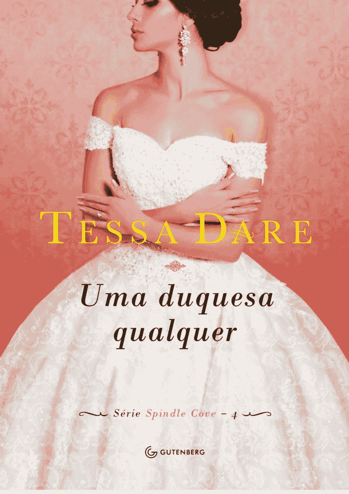

Para bibliotecárias e livreiros em todo o mundo que, com livros, constroem abrigos para almas sensíveis.

Griff abriu os olhos lentamente. Uma pontada lancinante de dor mostrou que tinha cometido um grave erro. Rapidamente fechou-os de novo e pôs a mão sobre o rosto, gemendo. Algo de muito errado tinha acontecido.

Ele precisava se barbear. Precisava de um banho. Talvez precisasse até vomitar. Mas suas tentativas de se lembrar de alguma coisa da noite passada resultaram em outra pontada de agonia.

Ele tentou ignorar a dor latejante nas têmporas e se concentrou naquela espécie de colchão macio debaixo de suas costas. Aquela não era a cama dele. Talvez nem mesmo fosse uma cama... Seria uma sensação provocada por seu enjoo ou a droga daquela coisa estava se mexendo?

– Griff – a voz chegou até ele através de uma névoa espessa e pastosa. Estava abafada, mas com certeza era feminina.

*Pelas barbas do profeta, Halford. Da próxima vez que decidir se deitar com uma mulher depois de meses de seca, pelo menos fique sóbrio o bastante para se lembrar do que aconteceu.* Ele xingou a própria estupidez. A duração épica de seu celibato foi, sem dúvida, a razão pela qual se deixou seduzir por... quem quer que ela fosse. Griff não fazia ideia de qual era o nome ou de como era o rosto dela. Só tinha a vaga impressão de uma presença feminina por perto. Ele sentiu o aroma de um perfume indefinido do ar, do tipo que parecia ser caro. Droga. Ele precisaria de joias para sair daquela situação, sem dúvida.

Algo pontudo o atingiu do lado do corpo.

– Acorde.

Ele conhecia aquela voz? Mantendo uma das mãos sobre os olhos, ele tateou com a outra. Pegou um punhado de seda pesada e deslizou os dedos para baixo, até fechá-los em torno de uma meia sobre um tornozelo. Suspirando um pedido indefinido de desculpa, deslizou o polegar para cima e para baixo.

Um guincho de indignação feminina lhe chegou aos ouvidos, e um objeto inflexível atingiu sua cabeça, com força. À dor latejante no crânio, agora ele podia acrescentar um zunido.

– Griffin Eliot York! Sério!

*Maldição.* Sem se importar com a enxaqueca ou com a luz do sol, ele se endireitou de súbito, batendo a cabeça de novo, desta vez no teto baixo. Piscando, confirmou a verdade inconcebível: ele não estava em seu quarto. Nem em qualquer outro quarto, mas

– Sussex。
Sussex。英格兰为数不多的他没有持有任何财产的郡之一。
– 这么紧急的任务目的是什么？
– 我们要去见你的未婚妻。——母亲嘴角弯起一抹笑意。
Griff 盯着母亲。过了很久，他才能够说出一段连贯的话。
– 你是个狡猾、邪恶且闲得发慌的女人。
– 而你就是 Halford 的第八代公爵——她反驳道。——我知道这对你来说没什么意义。牛津的耻辱、赌博、无目的的放荡岁月……你似乎决心只成为 Halford 显赫血脉中一个不幸的污点。至少，你需要在我还健康能塑造下一代的时候开始下一代。你有责任……
– 延续血脉。——他闭上眼睛，捏着鼻梁。——我被这么说过。一次又一次。
– 你快 35 岁了，Griff。
– 是。让我老到再也不能被叫做“Griff”的年纪。
– 最重要的是我 58 岁了。在我衰退之前，我需要孙子。不能让家族两代人同时变得糊涂。
– 你的衰退？——他笑了。——告诉我，母亲，我该怎么做才能加速这个过程？除了给你一推之外？
– 敢说！——她挑起眉毛，觉得好笑。
Griff 叹了口气。他的母亲就是……他的母亲。英格兰没有第二个像她这样的女人，也最好让世上其他人都感谢上帝把模具扔掉了。就像她热爱佩戴的珠宝一样，Judith York 是外在的精致与内在的烈火的强大混合体。
一年中大部分时间，他们过着完全分开的生活，只在伦敦社交季的几个月里住在同一栋房子里。显然，这也太多了。
– 我很有耐心——她说。——现在我绝望了。你需要结婚，而且必须尽快。我试着为你物色英格兰最优秀、最美丽的年轻女子。我找到了，但你都无视了。最终我意识到，答案不在质量，而在数量。
– 数量？你要把我带到某个自由恋爱的乌托邦社区，在那里男人可以拥有任意多的女人？
– 别胡说。
– 我只是抱有希望。
– 你真可怕。——她的嘴唇抿成一副鄙夷的样子。
– 谢谢。我为此努力。
– 这让我经常感到遗憾。如果你能把同样的努力用在……别的什么事上。
Griff 闭上眼睛。如果还有比“你什么时候结婚？”更无聊、更重复的对话，那就是“你是个大大的失望”。只有他的家族才会把管理庞大财富、六处产业、数百名雇员和数千名佃农的成功视为“令人失望”。按大多数标准来说很了不起。但在 Halford 家族里，这还不够。除非一个男人改革议会或为巴塔哥尼亚发现一条新的贸易路线，否则他算不了什么。

他再次望向窗外。马车似乎正在驶入一个小村庄。他打开窗户，发现自己能闻到海的气味。一种清新的海洋气息，咸咸的，混杂着田野植物的芳香。

– 这是个可爱的地方——母亲说。——很干净、很安静。我明白为什么它在年轻女子中如此受欢迎。

马车停在村子中心，靠近一片宽敞宜人的草坪，草坪环绕着一座宏伟的中世纪教堂。他从窗户探头，四处张望。这个地方太小，不可能是布莱顿或……

– 等一下……——一种不祥的怀疑在他脑中形成。她不可能……她不会……

穿着制服的仆人打开了马车门。

– 早安，殿下。我们到了 Spindle Cove。

– 哦，糟糕。

当那辆优雅的马车颠簸着驶过街道时，Pauline 并没有在意。许多精致的马车都走这条路，把一个又一个访客带到村里。人们说，在 Spindle Cove 度过一个季节，就是任何出身良好的小姐恢复自信心所需要的一切。但 Pauline 并不是出身良好的小姐，她的问题更实际。比如她踩进了一滩泥水，把泥浆溅到了裙摆上。而她的妹妹今天早上已经哭了第二次。

– 那个清单——Daniela 说。——不在这里。

该死。Pauline 知道她没时间回农场。几分钟后她就得在酒馆。周六，是 Spindle Cove 女人们每周聚会的日子，茶馆和酒馆 Touro & Flor 会最拥挤。Fosbury 先生是个公平的老板，但他会从工资里扣除迟到，而她父亲会注意到。

Daniela 焦急地翻找着口袋，眼眶含着泪。

– 不在这里，不在这里。
– 没关系。我都记得。——抖掉裙子上泥水滴，Pauline 凭记忆列出物品：——干醋栗、毛线团、一点海绵。哦，还有明矾粉。妈妈需要做果酱。

当她们走进 Bright 的杂货铺时，发现店里人满为患。游客们正在为每周聚会做准备，本地居民也在购物。像 Whittlecombe 太太这样的居民，一位年迈的寡妇，每周只从她那破旧的农舍出来一次，去买糖果和“药用”葡萄酒。Pauline 和 Daniela 挤过顾客进入商店时，那位女士对她们嗤之以鼻。

保琳在柜台对面辨认出两颗非常金黄的脑袋。莎莉·布赖特正忙着招呼顾客，而她年幼的弟弟鲁弗斯则进进出出仓库。幸运的是，保琳和丹妮埃拉从小就是布赖特一家人的朋友，所以她们不必在店里排队等候。

——把鸡蛋放一边——保琳对妹妹说。——我去仓库拿海绵和线团。你拿两份醋栗和一份明矾。

丹妮埃拉小心地把一篮红鸡蛋放在柜台上，然后走到一排酒桶前。她的嘴唇在动，寻找其中一个桶上的 GROSELHAS 标签。然后她皱着眉头，专心地把两份量倒进一张棕色纸锥里。

看到妹妹正在完成任务后，保琳在仓库里取了其他所需物品。回来时，丹妮埃拉正手握着商品等着她。

——明矾放多了……——保琳检查着说。——本该只有一份量。
——啊。啊，不。
——没事——她用平静的声音说。——很容易修好。把多余的放回去。

保琳希望妹妹没注意到惠特尔科姆太太嘲弄的表情。

——我不知道我还要不要在这家店买东西——老太太说——居然允许一群傻乎乎的女孩站在柜台后面。

莎莉·布赖特对那女人露出了讽刺的笑容。
——只要您告诉我们什么时候可以停止为您备货鸦片酊，惠特尔科姆太太。

——那只是强身健体的补品。
——当然是——莎莉冷淡地说。

保琳走到账本前登记她的购买。她喜欢这一部分，慢慢翻页，细细端详莎莉的笔记和计算。有一天她也会拥有自己的商店，管理自己的账本。这是一个她从未告诉任何人，甚至连她最好的朋友都不知道的梦想，只是在农场和酒馆的工作压得她肩膀发沉时，她对自己反复许下的承诺……总有一天。

保琳找到了正确的页面。在拿到鸡蛋的信用后，其余的购买只欠六便士。太好了。

砰。 她吓了一跳，迅速抬起头。
——我的天，姑娘！你在干什么？——惠特尔科姆太太又拍了拍柜台。

——我……我我正在退回明矾——丹妮埃拉结巴道。
——这这不是明明矾——女人嘲笑着丹妮埃拉的说话方式。——这是糖。

哦，糟了。保琳皱起眉头，她知道自己本该亲自去做，但她多么希望妹妹能向那个老巫婆证明自己是能行的……现在老巫婆得意地笑了起来。而困惑的丹妮埃拉笑了笑，试图跟着一起笑。

保琳为妹妹感到一阵心疼。她们只相差一岁，但理解却如此之深！丹妮埃拉比其他人更难做到的所有事情中——发音以辅音结尾的词、减去十以上的数字——残忍似乎是她最难以理解的概念。对她们父亲阿莫斯·辛姆斯的家庭来说，这是一种仁慈。

——不是精制糖——鲁弗斯·布赖特叹息道。
莎莉给了他一巴掌。
——我刚打开桶——他道歉着揉着耳朵。——里面几乎满了。
——好吧，现在全坏了——惠特尔科姆太太坚定地说。
——我会付糖钱——保琳说，同时她感到一阵恶心，仿佛吞下了三公斤的糖。精制白糖非常昂贵。
——你不必这样——莎莉低声说。——我们几乎就是姐妹。如果我哥哥埃罗尔有点脑子，我们本该是真正的姐妹。

保琳摇了摇头。她多年前就停止了对埃罗尔·布赖特的幻想，分开后也不想欠他什么。
——我会付——她坚持道。——是我犯的错。我本该自己做的，但我赶时间。

而现在她要迟到去 Touro & Flor 工作了。那天越来越糟。
莎莉看起来很为难，在记账和帮助朋友之间犹豫不决。

角落里，丹妮埃拉终于意识到了自己错误的后果。
——我放回去——她说，从糖桶里取出材料倒进明矾桶里，用她的眼泪把一切都弄湿了。——我可以修好。
——没事，亲爱的。——保琳走近她，温柔地从妹妹手中取走量杯。——可以收账了——她坚定地对莎莉说。——我想我在账本里还有一些信用。

她不仅仅是觉得有信用。她知道她有。辛姆斯家账目之后的几页里，有一个简短的条目，只标注为 PAULINE，显示余额正好是两英镑、四先令、八便士。多年来，她攒下并省下了每一枚能省的硬币，托付给莎莉的账本保管。那是像她这样酒馆服务员能拥有的最接近银行账户的东西。保琳一直在为自己和妹妹攒钱，为某一天……

——可以收账了——她坚持道。
在莎莉的羽毛笔几下涂写后，几乎所有的钱都消失了。只剩下十一先令八便士。
——我没收明矾的钱——莎莉低声说。
——谢谢。——这其实帮不了多少，但总算有点。——鲁弗斯，你能陪我妹妹回家吗？我上班要迟到了，她也很伤心。

太晚了。她怒不可遏地把桶里的东西全倒了出来。商店被一片白色的爆炸覆盖，惠特尔科姆太太正好被困在糖尘风暴的中心，咳嗽着、咒骂着，淹没在一片产品云雾中。当尘埃落定，她看起来就像罗得的妻子，但变成的不是盐做的雕像，而是糖做的雕像。

保琳涌上的那股神罚般的报复快感，几乎值回她辛苦赚来的所有钱。几乎。她把空桶扔到地上。
– 哦，天哪。我真蠢。

格里夫看着母亲，母亲嘴唇上仍挂着那副自鸣得意的笑容。这次她是真的过分了。这不仅仅是干涉，而是近乎邪恶。
纺车湾，剩女之城。他从未去过这个地方，但对它的名声却很熟悉。就是在这个海滨小村，剩女们刺绣，而肺结核患者前来求医。

在仆人的搀扶下，公爵夫人从马车上下来。
– 这个地方挤满了年轻的、出身良好的未婚女子。
她朝一家客栈的方向挥了挥手。一块牌子挂在入口上方，上面写着 QUEEN’S RUBY。
格里夫睁大眼睛看着绿色的百叶窗和窗台上盛开的天竺葵花盆。他宁愿去和鲨鱼共泳。他转身朝相反的方向走去。
– 你去哪儿？——母亲追在他后面问道。
– 那儿。——他用下巴指了指广场另一边的一家酒馆。目光落在那扇红门上的招牌上，他读出了名字，公牛与花。——我要去喝一杯啤酒，吃点东西。
– 那我呢？
格里夫夸张地一挥手。
– 请便。在旅馆开一间套房吧。享受一下健康的海风。我会让马车在几周后接你。——他压低声音补充道：——或者几年后。

仆人跟在他们身后，保持着体面的距离，手里撑着一把遮阳伞，为公爵夫人遮挡阳光。
– 绝对不行！——她说。——你今天就要选一个新娘。
– 你不明白被送到这个村子的会是什么样的姑娘？那些嫁不出去的！
– 正是如此。太完美了。没有一个会拒绝你。
母亲的话让格里夫停下脚步，转身直视她。
– 拒绝我？
出于显而易见的原因，他一直避免和母亲讨论自己的风流韵事。但他这几个月保持独身的原因，与被女人拒绝毫无关系。有很多女人——漂亮的、精致的、感性的——只要他愿意，就会张开双臂欢迎他上床。格里夫很想这么说，但一个男人不能对母亲说这些话。

不过，她似乎并不需要他解释沉默的意思。
– 我说的是肉体之外的事，而是你作为丈夫的潜力。你的名声实在不怎么样。——她从他袖子上刮掉一些东西。——还有年龄的问题。
– 年龄有什么问题？——格里夫今年34岁。按他的计算，他的阴茎至少还能再好好运作三十年。
– 当然，你的外表不错——她继续说。——但有比你更英俊的男人。
– 你确定你是我的母亲吗？
她转身继续往前走。
– 事实是，社会上的大多数淑女都已经放弃把你当作潜在丈夫了。一个满是绝望剩女的村庄正是我们需要的。你得承认，这个地方对你那个狡猾的朋友佩恩勋爵很有效。
天哪。原来这就是原因。那个混蛋科林·桑德赫斯特和他那位四眼书虫妻子该死。去年，他那位老赌友被困在那个海滨村庄，囊中羞涩，最终带着一个女知识分子私奔了。那对夫妇甚至还在前往苏格兰的路上，途经了格里夫的乡村别墅温瑟特庄园。但他们的处境完全不同。格里夫既不缺钱，也不缺陪伴。婚姻根本就不是他的命运。
母亲严肃地看着他。
– 你是在等爱情吗？
– 什么？
– 这是个简单的问题。你这么多年一直避免结婚，是因为你在等着坠入爱河吗？
她说这很简单，但答案并不简单。
他本可以把她带进酒馆，要几大杯酒，用一两个小时把一切解释清楚。解释他不会在下一个季度结婚，也不会在任何时候结婚。她唯一的儿子不仅会成为显赫的哈佛德家族的污点，更会是这条血脉的终结，她如此珍视的家族遗产注定湮没无闻。她对孙辈的希望也会落空。
但他做不到。即使在她如此令人恼火的这一天。继续做一个放荡却尚可挽救的浪子，总比伤透母亲的心要好。
– 不——他诚实地回答。——我没有在等爱情。
– 这样就方便多了。我们可以在一个上午就把事情解决了。别担心去寻找英格兰最精致的美女。你可以找任何一个女孩——我会亲自把她打磨好。谁比现任哈佛德公爵夫人更适合培养未来的哈佛德公爵夫人呢？

他们来到了酒馆入口，母亲看着门把手。仆人上前为她打开门。
– 哦，看——她进门时说。——真幸运。她们在这儿。

格里夫看了一眼。场面比他所能想象的还要令人厌恶。那个地方与其说像一间“酒馆”，倒不如说是一间茶室。年轻姑娘们挤满了整个店铺，围坐在桌旁，眉头紧锁、神情专注。她们似乎正忙着做一件如今被当作女性“才艺”的荒谬差事。看起来是纸制装饰品。而且她们用的竟然不是新纸，而是满足于从书里撕下书页，为茶壶和茶盘制作那些古怪的装饰。

他看了看最近的一摞书：其中一本的书名是《沃辛顿太太给年轻人的智慧》。真可怕。

这正是他多年来一直回避的一切。一屋子年轻、未婚、毫无魅力的女人，而他理应从中找到一位合适的未婚妻。

被女伴捅了一下，一个年轻姑娘站起身来，行了个屈膝礼。
——夫人，有什么可以帮您的吗？
——是“公爵夫人”。
——夫人？那姑娘皱起眉头。
——我是哈尔福德公爵夫人。你应该称呼我为“公爵夫人”。
——啊，明白了。——她的女伴捂住嘴压抑着紧张的笑声，而那位浅发姑娘重新试了一次：——公爵夫人，有什么可以帮您的吗？
——站直了，姑娘。好让我儿子看见你。——她转过头，打量大厅其余的人。——你们所有人，站起来，拿出你们最好的姿态！

当椅子腿刮擦地板时，格里夫感到一阵剧痛刺入颅骨。姑娘们一个接一个顺从地站了起来。

他注意到有人脸上有痘痕，有人牙齿歪斜。但没有一个人是难看的。有些人只是……纤弱。另一些人被太阳晒得黝黑，这很不雅。

“嗯，”公爵夫人迈开大步走到大厅中央，“都是未曾雕琢的宝石。有些情况下，粗糙得很。但她们都出身好人家，所以稍加打磨……”她转向儿子，“你可以选了，哈尔福德。挑任何一位你喜欢的姑娘，我会把她打造成公爵夫人。”

大厅里所有人都张大了嘴巴。除了格里夫。他揉着突突直跳的太阳穴，开始构思一段简短的讲话。小姐们，我恳求你们。别理会这个疯妇。她已经日薄西山，老糊涂了。

但随即他想……一走了之对母亲来说，是太仁慈了。合适的惩罚显然恰恰相反：照母亲的话去做。

——你声称你能把这里的任何一个姑娘变成公爵夫人？
——我当然能，母亲肯定地说。
——谁会来评判你是否成功？
——当然是上流社会。——她挑起一道眉毛。——挑一位你喜欢的姑娘吧，到下个伦敦社交季结束，她都将备受赞誉。
——你是说，被伦敦赞誉？——他发出一声含义不明的笑。

格里夫再次扫视酒馆，心里盘算着宣布自己疯了，并且瞬间爱上了这里那个最羞怯、最笨拙、最粗野的野丫头，好看着母亲语无伦次、陷入绝望。

然而，从姑娘们交换的打趣眼神中，格里夫感到，这间屋子里蕴含的勇气与才智，比他第一印象所感受到的要多得多。那些女人并不愚蠢。而且，尽管她们每个人都有缺点和不完美之处——谁没有呢？——却没有一个人不适宜到令人震惊、无可救药的地步。

该死。他多想给这位爱管闲事的母亲一个教训。但就眼前的情形来看，他想，也许最好只是低声说句道歉，然后把公爵夫人拖回马车，回家途中把她丢在贝德兰姆疯人院。

就在这时，随着铰链的吱呀声和后门的一记砰响……他的救星到了。

她跌跌撞撞地从酒馆后门进来，气喘吁吁，满脸通红。靴子和裙摆溅满了吓人的泥巴，其余地方则覆盖着某种奇怪的白粉。

一条服务生的围裙挂在她脖子上，有些松垮。当她抓起系带在腰间系紧时，勒紧的绳结显露出一副瘦削的身材，几乎像个男孩。她说不上是一把吉他，倒更像一支巴松管。

“已经过十点了，波琳。”厨房里传来一个男人的声音。

“对不起，福斯伯里先生，”她回答，“我不会再迟到了。”

她的咬字和口音不仅带着几分教养和乡下的味道——还很古怪。当她转过身来，格里夫明白了原因：她说话时嘴里叼着一根发卡，像叼着雪茄一样。

迟到的女招待拿起另一根发卡，当她那双聪慧的绿眼睛对上格里夫的目光时，她正要把那根发卡插进高高盘起的头发里，却一下僵住了。

天哪，那头头发。他听女人们描述过自己的发型，说是“发髻”或“辫子”。但他眼前这东西只能叫作“鸟窝”。格里夫确信自己看到里面有草叶和几截稻草。

很明显，她本希望悄无声息地进来。可恰恰相反，她忽然成了全场的焦点。沾在她身上那层神秘的白粉……捕捉着光线，闪闪发亮。格里夫无法移开目光。

当那个气喘吁吁的姑娘的目光在格里夫、他的母亲以及占据大厅的其他姑娘之间来回扫视时，她未完成的发型散架了。几缕散发滑落到她的肩上，向重力或屈辱投降。又或者，两者都有。

换作别的女招待，这时候准会低下头，逃出大厅，等着老板的怒火。无疑还会泪流满面、抽抽噎噎。但看那样子，这个姑娘不会这样做。她似乎傲气到足以不顾礼节，也不顾理智。

她随手把头发甩到一边，让白兰地色的发缕均匀散开，然后转过脸，往旁边吐出最后一根发夹。

“该死，”他听到她低声咕哝。

突然，格里夫发觉自己正忍着一个微笑。她很完美。粗鲁、没受过教育、完全不优雅。可漂亮得有点过分了。一个更不起眼的姑娘更适合他的目的。但即便她生得美貌，她也只能凑合用了。

“她，”他宣布，“我要她。”

## 第二章

又是一个女孩的王子来了。当波琳匆匆走进来，一眼看到门前那位衣着讲究的绅士时，心里冒出的第一个念头就是这个。在那个村子里，她不时看到这种情形。年轻的贵族小姐们因各种最古怪的理由躲到斯平德尔湾来。她们要么是竖琴弹得不够风雅，要么是眼睛的颜色在当季宫廷里不时兴了。然后——让所有人都大吃一惊，只有波琳不觉得意外——某位英俊的伯爵、子爵或者军官会出现，娶走她们。那些人从来不正眼看一下酒馆的女招待。

那么，这位绅士要寻访的是哪家小姐呢？不管是谁，往后一辈子都不用愁了。那个男人外表的一切——从象牙纽扣到完美无瑕的皮手套——都在像吹响喇叭一样昭示着他的富有。如果说他的衣服在叫喊“财富”，那么衣服里面的一切则宣告着权力。绅士们是很容易变得绵软、肚腩凸起的，但他不是。定制的深绿色外套勾勒出宽阔的肩膀和结实的手臂。他的脸也很硬朗。鼻子的轮廓大胆，下颌棱角分明，嘴唇透着自信。他的五官没有一处算得上漂亮，但组合在一起，便有一种不可否认的男性魅力。

总之，这个男人不难看。但即便他难看，波琳也移不开视线，因为他同样直盯着她。他注视她的方式——仿佛她就是他从没想过要问的种种问题的答案——令她的心跳得比被囚禁的野兔还要急。

“她，”他宣布，“我要她。”
“你不能选她，”一个年长些的女人答道，明显带着恼怒，“她是女招待。”

波琳瞥了那女人一眼，将她归为一位头发花白、身材矮小却极其自负的太太。她的脊背挺得笔直，这倒正好撑起她脖子上一大串多得不成体统的珠宝。

“她是个姑娘，”男人平静地说，目光仍停留在波琳身上，“她是个姑娘，而且就在这间屋子里。你说过我可以挑这屋里任何一个姑娘。”
“我说这话的时候，她并不在屋里。”
“可现在她在了。现在我已看见了她，眼里就再也容不下别人了。她很完美。”

完美？波琳向窗外望去，盼着一头猪从窗口飞进来。一头弹着里拉琴、说着威尔士语的猪。

那位绅士穿过大厅，自信从容地向她走来。他每走近一步，那沉重而有节奏的步伐都令她更加意识到自己乱蓬蓬的、沾着糖粉的头发，以及沾满泥巴的裙摆。波琳试图借他身上那些不够完美的凡人迹象让自己镇定下来。近看时，能看出他胡茬未刮，眼睛发红——不知是缺觉还是喝多了，或许两者兼有。

波琳慢慢地吸了一口气。他的衣服上带着一种若有若无的男性麝香古龙水味。那气味将她包裹，让她身体隐秘低处泛起阵阵暖意。

“告诉我你的名字。”他说，声音低沉，而且……显然带着磁性。她感觉大厅里每个人都朝他的方向倾过身子，想听清他的话。
“我叫波琳，先生。波琳·西姆斯。”
“你的年龄。”
“二十三。”
“你成婚或订婚了吗？”
“没有，先生。”她咽下一声因惊愕而起的笑，“我没有。”
“很好。”他偏了偏头，“我是格里芬·艾略特·约克，哈福德八世公爵。”
一位公爵？
“哦，天哪。”她喃喃道。
“事实上，西姆斯，你该说‘大人’。”
她垂下目光，看着脚下的地板，行了一个歪歪斜斜的屈膝礼。
“大人。”
他做了个不必多礼的手势，接着说道：
“我母亲对我的单身状况越来越不耐烦。她嘱咐我挑这屋里任何一位女人，并保证能把她培养成一位公爵夫人。我挑中了你。
“我？”
“是的。你很完美。”

完美。又来了这个词。波琳的脑子一时无法同时消化这一切。她得把这些信息拆成一小块一小块。那个极其迷人、自信满满、带着香气的男人，是哈福德八世公爵。在满屋子的女人中间，他挑中了那个女招待——她自己——做他未来的公爵夫人。你很完美。
一阵战栗从波琳的后颈蹿到脚底，让她透不过气。要么是整个世界颠倒了过来，要么是在熬过二十三年不够好的日子之后……在一个男人眼里……在那个公爵眼里……她竟然完美无缺。
公爵夫人冷冷地看了儿子一眼。
“不肖子。你活着就是为了跟我作对。”

– 我不知道你在说什么——他平静地回答道。——我正做你让我做的事。
– 说实话！
– 我就是在说实话。我挑了一个女孩。看，她就在这里。——公爵做了一个手势，从保琳凌乱的头发一直到她沾满泥的鞋子，把她从头到脚都羞辱了一遍。——继续吧。把她变成公爵夫人。
于是保琳明白了一切。在他眼里，她是完美的。完美的丑陋。完美的不优雅。完美的不适合做公爵夫人。而把她当作例子，公爵打算给那个多管闲事的母亲上一课。他真聪明。除了冒犯和难以忍受之外。
都是你的错，保琳。短暂而疯狂的一瞬间，你犯傻了。
她不再觉得他有吸引力了。但他还是闻起来很好，见鬼。
大厅里陷入了一片无人敢打断的沉默。就像所有人都在观看着某项锦标赛的决定性对局，而公爵刚刚拿下了一个关键分。所有人的头都转向了公爵夫人，等待她的下一步。但她没有丝毫退缩的打算。
– 很好，那么。让我们去和女孩的父母谈谈。
大胆的一招，保琳想。母亲再得两分。
– 我很乐意。——哈福德挺了挺外套。——但我必须立刻返回伦敦，而且我确信辛姆斯不能丢下工作。
– 我当然可以——保琳说。
公爵和母亲都转向她，显然对她敢打断他们感到恼怒。即使她是谈话的主题。
– 我随时都可以丢下工作。——她抱起双臂。——况且，我根本不需要工作，对吧？如果我要成为公爵夫人了的话。
公爵惊愕地看着她。很明显他没料到这种反应。他应该以为她会开始结巴、抗议，然后脸红着逃回厨房。真倒霉。格里夫挑错了女孩。
她当然知道公爵打算挑一个“错误的女孩”，但他真的挑对了“错误的女孩”。保琳和任何人一样喜欢笑，但她今天已经损失太多，不能再放弃最后一点自尊了。
– 福斯伯里先生——她朝厨房的方向说话，同时解开围裙的带子。——我走了。我想今天不会回来了。我要带这位公爵去我家，让他来向我求婚。
这让福斯伯里从厨房里冒了出来，脸上满是惊讶的表情，同时用围裙擦着沾满面粉的手。
保琳朝他眨了眨眼以示安慰，然后转身对公爵夫人露出一个大大的笑容。
– 那么，殿下，我们走吧？——她夸张地轻笑了一声。——哦，对不起。你是希望我叫你“妈妈”吗？

大厅里传来一阵压抑的笑声。公爵夫人脸上那种贵族式的尴尬表情极其令人满意。不管那位公爵和他母亲在玩什么冷酷而固执的游戏，他们刚刚在保琳这里遇到了第三位玩家。而且：保琳会赢。

她翻了个白眼看向公爵，毫不避讳地打量他。这没什么问题，这男人确实是个漂亮的男性标本，从宽阔的肩膀到雕塑般的大腿。如果他可以审视她，为什么她不能也这么做？——我的天——她把乡下口音加重，歪着头欣赏他那贵族般的臀部曲线。——新婚之夜我会和你玩得很开心。

他的眼睛闪了一下，虽然很短暂，但足以让她内心一紧。挑衅一位公爵会是可判绞刑的罪行吗？他肯定有手段和权力让她为此后悔。但当斯平德尔科夫的所有年轻女孩都爆发出一阵大笑时，保琳知道一切都会好起来。她不是斯平德尔科夫的圈子里的人，她是个女仆，不是来度假的贵族小姐。尽管如此，其他人会站在她这边。

夏洛特·海伍德小姐站起来为她辩护：——殿下们，我们很荣幸能接待你们的到访，但今天我们不能没有保琳。

– 那么我们有冲突了——公爵说——因为我不打算离开她。

他话语中阴郁的决心让保琳感到一种奇怪的感觉。他打算继续这场闹剧吗？固执似乎在公爵家族中和她那双绿眼睛里一样普遍。

公爵夫人朝门口点了点头。——很好。那么。马车在等着。

就这样，酒馆服务员、农夫的女儿保琳·辛姆斯带着一位公爵和他的母亲去家里喝茶。嗯，为什么不呢？如果那些贵族想在整个斯平德尔科夫面前羞辱她，那么让他们牺牲一点自己的骄傲也是公平的。她迫不及待想看看公爵夫人看到他们停在她家那间简陋的房子前时会是什么表情。让他们知道普通人是怎么生活的——坐在粗糙的凳子上，喝着裂纹茶杯里的茶——会很有好处。她和萨莉·布赖特会用这件事笑一辈子。

吩咐完车夫后，保琳加入了他们两人进入马车。她抚摸着小牛皮座椅，惊叹不已。她从没摸过这么柔软的真小牛皮。

她确信她这个阶层的人从未像乘客一样坐过这种车。 judging by 公爵和公爵夫人紧抿的嘴唇，两人都对和一个满身糖粉、脚上沾泥的酒馆女服务员同行并不满意。而这只让保琳更加坚定；她要从这段经历中榨出最后一点乐趣。

在前往农场的十分钟车程中，她通过不合体统的行为玩得很开心。她跳上座位，试探着弹簧；玩弄窗户的锁扣，一连十几次上下推拉玻璃。

– 你父亲做什么的，辛姆斯小姐？ – 公爵夫人问道。
除了大喊、大骂、暴怒和威胁之外？
– 他是农夫，殿下。
– 一个佃农？
– 不是，他拥有土地。大约十公顷。

显然，十公顷对于一个拥有土地的贵族来说算不了什么，更不用说一位公爵了。哈福德很可能拥有其一千倍。

当马车驶出村庄时，他们经过了威利特家的田地。威利特先生大儿子正在啤酒花种植园干活。波琳第13次放下车窗，把手臂伸出去，欢快地挥手。然后她把拇指和食指放在嘴里，吹了个响亮的口哨。
– 杰里！ – 她喊道。 – 杰拉尔德·威利特，看！是我，波琳！我要成为一位公爵夫人，杰尔！

当她在马车里平静下来时，看见公爵和母亲交换了一个眼神。她把手肘支在窗上，用手捂住嘴笑了。

快到家时，波琳敲了敲马车顶提醒车夫，当马车停下时，她伸手去抓车门把手。
– 不。 – 公爵夫人用手杖末端钩状的伞柄抓住她的手腕。 – 我们有人来做这事。
波琳僵住了，惊愕不已。她就是做这种事的人之一，还是老太太忘了？

公爵拨开了那把伞。
– 天哪，妈。她又不是一只走失的羊。
– 你选了她，还告诉我要把这个年轻女子培养成公爵夫人。课程已经开始了。

波琳耸了耸肩。既然那女人坚持，她可以等着，让仆人开门，放下踏板，用他那双白手套扶她下车。

公爵夫人下车后，儿子随后，波琳做了一个夸张的屈膝礼。
– 欢迎来到我们这座卑微的家，殿下们。
她打开大门，领着他们穿过院子。就在这时，鹅追了上来，嘎嘎叫着拍打翅膀。没人能说服梅杰尔他不是比公爵更尊贵。公爵夫人试图用眼神冻住那只鸟，但很快就改用伞作为防卫武器。
– 够了，梅杰尔！ – 波琳拍了拍手，把客人领进屋。 – 这边走，殿下们。别拘束。我们的家就是你们的家。现在我们都是一家人了。

门楣很低，公爵很高。他必须弯腰才能不撞到头。他在门槛前停下。片刻间，波琳以为公爵会掉头回到马车，前往伦敦。但没有。他优雅地弯下腰，穿过了入口。

看到那位傲慢的公爵 literally 为进入她家而弯腰，她忍不住笑了。

进入屋内后，客人扫视着这间小而简陋的住宅。只看一眼就能判断整个地方。房子只有大约十二步长。一座石砌壁炉，几个橱柜，桌子和椅子。褪色的窗帘在两扇正门窗前飘动。侧墙上，一扇门通向唯一的卧室。一架楼梯通向阁楼，那里是波琳和丹妮埃拉睡觉的地方。

后门通向户外区域，家人就在那里洗漱。最近的水渍表明有人在午饭后洗过澡。

– 妈妈 – 波琳唱道 – 来看看我从托罗与弗洛尔带回来的客人。第9代哈尔斯通公爵和他的母亲。

– 哈福德 – 公爵夫人纠正道。 – 我儿子是第8代哈福德公爵。他还是威斯特莫尔侯爵、赖丁汉姆伯爵、新索普子爵和哈特福德-昂-特伦特男爵。

– 哦。好的。我想我也应该学会说这一长串名字，对吧？毕竟以后那也是我的名字了。 – 她对公爵露出了灿烂的笑容。 – 我喜欢这个。

他的嘴唇微微颤动。是恼怒还是娱乐，她不敢猜。

– 你们不坐吗？ – 波琳问公爵夫人。

– 我不。

– 如果你需要上厕所 – 她悄声说 – 就从那扇门出去，绕过木柴堆，向左转，到猪圈那边。

– 波琳？ – 她母亲从后门进来，正在用毛巾擦手。

– 妈，你在这儿！爸爸回田里了吗？

– 没有 – 埃莫斯·辛姆斯说，他从母亲刚出来的那扇门出现。 – 他没回去。还没。

波琳屏住呼吸，看着父亲先打量公爵，然后又打量公爵夫人。最后，他把威胁的目光转向波琳。她背脊中间突然一阵发麻。她一定会为这场玩笑付出代价。

– 这是什么意思？ – 父亲问道。

波琳向客人伸出手臂。

– 爸，我向你介绍殿下，第8代哈福德公爵，以及他的母亲。至于他们为什么来这里…… – 她转向公爵。 – 我让殿下来解释。

啊，太好了。这个女孩想让他来解释。

格里夫叹了口气，抚了抚头发。他找不到一个令人满意的解释。他完全不知道自己为什么会出现在这个破屋子里。

有一件尖锐的东西顶着他的腰，推着他向前。那该死的伞又来了！啊，对了。他想起来了。他来这里是有原因的，而且

Própria Razão precisava de uma lição decisiva sobre como cuidar da própria vida. Ele arrancou a sombrinha das mãos da duquesa e a ofereceu à mãe de Pauline.
– Por favor, aceite este presente como nosso reconhecimento pela sua hospitalidade.
A Sra. Simms era uma mulher pequena, de ombros curvados. Ela parecia tão desvanecida e amarrotada quanto o pano de prato em suas mãos avermelhadas. A mulher olhou para a sombrinha fechada, parecendo estupefata com o cabo de marfim.
– Eu insisto. – Ele levantou o objeto, que a Sra. Simms pegou, relutante.
– É m-muito gentileza, Vossa Graça.
– Nunca faça visitas de mãos abanando. Minha mãe me ensinou isso. – Ele deu uma olhada para a duquesa. – Mãe, sente-se.
Ela fungou.
– Eu acho que...
– Aqui. – Ele enganchou o pé em um banco rústico e o puxou de sob a mesa. As pernas do móvel arranharam o chão de terra coberto de palha. – Sente-se aqui. Você é uma visita nesta casa.
Ela sentou, arrumando as volumosas saias ao seu redor. Mas não pareceu muito satisfeita com isso.
Pelo próximo minuto, Griff aprendeu como era a sensação de ser um animal em exposição, com a família Simms reunida os observando de boca aberta.
– Sra. Simms – ele disse, afinal –, talvez possa fazer a gentileza de nos oferecer uma bebida. Eu preciso dar uma palavrinha com seu marido.
Com evidente alívio por ser dispensada, a Sra. Simms arrastou a filha para a cozinha.
Griff afastou uma cadeira de vime da mesa e sentou. Ao se sentar na outra cadeira, o fazendeiro corpulento semicerrou os olhos.
– O que eu posso fazer por Vossa Graça?
– Diz respeito à sua filha.
– Eu sabia – Amos Simms grunhiu. – O que essa garota fez agora?
– Não é algo que ela tenha feito. É o que a minha mãe gostaria que ela fizesse.
Simms deu um olhar astuto para a duquesa.
– Sua Graça está precisando de uma copeira, então?
– Não. Minha mãe gostaria de ter uma nora. Ela acredita que eu preciso de uma esposa, e afirma que pode transformar sua garota – ele acenou na direção da cozinha – em duquesa.
O fazendeiro ficou em silêncio por um instante. Então o rosto dele se abriu em um sorriso com falhas entre os dentes. Ele riu de um modo baixo e seboso.
– Pauline – ele disse. – Uma duquesa.
– Espero que não se ofenda, Sr. Simms, se eu admitir que tenho dúvidas quanto ao sucesso dessa empreitada.
– Uma duquesa... – O fazendeiro meneou a cabeça e continuou rindo.
O tom grosseiro e sinistro da risada daquele homem fez Griff se remexer na cadeira. Claro que essa era uma ideia absurda, mas, ainda assim, um pai não deveria defender sua própria filha?

– Eis minha oferta. – Griff pigarreou. – O homem tem apenas uma mãe, e eu decidi fazer a vontade da minha. E se eu levasse sua filha para Londres? Lá, minha mãe faria o possível para transformá-la de atendente de taverna a uma lady refinada e pronta para ser a esposa de um duque.

Simms riu de novo.

– É claro que, na possibilidade muito mais provável de tudo isso dar errado, nós lhe devolveremos sua filha. No mínimo ela voltaria para casa com alguns vestidos novos e tendo conhecido as coisas boas da vida.

– Minha filha não precisa de vestidos novos. Nem das coisas boas da sua vida.

Então a filha em questão voltou para pôr a mesa. A louça que colocou diante de Griff era, possivelmente, a xícara mais feia que ele já tinha visto – uma peça de porcelana mal pintada, sem dúvida feita em alguma fábrica de segunda linha e passada por muitos donos. Mas antes de soltar o pires, ela o girou para que a flor patética na xícara ficasse de frente para ele, e o lascado do pires ficasse escondido.

O significado do gesto não passou despercebido por Griff. Ela era orgulhosa, sem dúvida. Também tinha a língua afiada e era ousada o bastante para enredar um duque e sua mãe-dragão. Nenhuma dessas características eram qualidades desejáveis em uma atendente, muito menos em uma nova noiva. Mas eram qualidades que Griff apreciava em geral, e ele começava a admirar esta Pauline Simms. Só um pouco, e só para si mesmo. Durante os poucos minutos na cozinha, ela tinha prendido o cabelo. Sua figura continuava sendo pouco notável, mas agora ele podia ver que ela era mais do que apenas um pouco bonita; ela tinha as maçãs do rosto altas, o nariz delicado e olhos puxados nos cantos, como os de um gato. Bem atraente, na verdade, de um modo rústico e rural. Todos os agricultores deviam ser loucos por ela.

> Você jurou não se envolver com mulheres, uma voz o lembrou.

Bem, esse juramento precisava ser bem analisado. Ele tinha jurado não se envolver com mulheres. Isso não significava que iria arrancar os próprios olhos. Um pouco de admiração descomprometida nunca fez mal a ninguém – e ele desconfiava que poderia fazer certo bem àquela mulher em especial.

– Se você está decidido, nós podemos conversar – Simms disse e coçou o queixo. – Mas não posso deixar que leve-a embora assim, de qualquer jeito.

Ótimo, Griff pensou. Nenhum pai bom da cabeça deveria deixar uma filha bonita e inteligente ir embora assim, com tanta facilidade.

– Venha cá, Pauline – o fazendeiro ergueu a voz.

Ela obedeceu, a boca formando uma linha tensa.

– Veja as mãos dela – Simms disse, pegando a filha pelo pulso e apresentando a mão e o antebraço dela para serem inspecionados por Griff.

Os dedos dela eram esguios e graciosos, mas a palma mostrava calos e cicatrizes provocados pelo trabalho servil – um trabalho mais vigoroso do que servir chá a solteironas. Sem dúvida ela também ajudava no trabalho da fazenda.

Simms sacudiu o pulso da filha, fazendo-a abanar a mão para cima e para baixo.

– Ninguém tem a mão tão pequena, nem um braço tão fino. – Ele fez um círculo com o polegar e o indicador, circundando com facilidade o punho delgado da filha. – Tenho

一匹快要临产的母马。农场里再也没有人能把手伸进去并在必要时把小马拽出来。

农夫把手指形成的圆圈沿着保琳的胳膊滑到肘部，直至肘部，用视觉演示了他的女儿这双纤细的手臂将要探索的马匹深处。

格里夫开始觉得没吃早餐似乎是一种恩赐。

– 看这个 – 辛姆斯说。 – 她能摸到子宫。

– 爸！ – 保琳把胳膊抽了回来。

– 这可是值点钱 – 她父亲说。 – 我不能让她就这么走人而不给点补偿。预付的。

不可思议。辛姆斯先生是个农夫。确实穷，但不至于可怜。他拥有十公顷地。他的房子简陋，但安全。那屋檐下没有人挨饿。然后一个高贵的陌生人走进这间屋子，他竟然实质上是在出卖女儿？

那女孩的安全怎么办？她的名声怎么办？格里夫不是那种会买个处女来破处的贵族，但辛姆斯先生不可能知道这一点。这正是任何一个体面的父亲——该死，任何一个真正的父亲——至少会要求某种安全保障的时候。如果之前不把格里夫和他那封建的提议一起赶进地狱的第五层的话。但不是辛姆斯先生。这让格里夫意识到他是个可怕的父亲，更糟糕的人。农夫根本一点也不关心女儿的健康或名声。不，他只想要母马产下后他工作的一笔预付补偿。

– 这就是你唯一的反对意见吗？ – 他问道，给农夫一个将功补过的机会。

– 当然不是。 – 辛姆斯先生皱起了眉头。

感谢上帝。

– 还有她带回家的薪水 – 那人继续说。 – 我也需要这笔钱。

– 她的薪水。

格里夫突然很想打点东西。打一件粗糙的衬衫、泥泞的靴子、贪婪的笑容的东西。就这样。他的母亲必须另找时间另找方式来吸取教训。格里夫需要离开。如果这场谈话不在此刻结束，就会变得糟糕。

他利用某种祖传的公爵般的镇定储备站了起来。

– 我认为这个计划考虑得并不周到。她成功进入伦敦社会的机会微乎其微，而对她来说风险太大了。 – 他走向屋门，只停下来抓住母亲的肘部把她扶起来。 – 如果您不介意，我和我母亲就...

– 五镑 – 农夫说。

– 抱歉？

– 我让她走，五镑。

格里夫只能盯着他看。

– 天哪，先生 – 他终于说。 – 你是认真的吗？

– 好吧。 – 辛姆斯扭了扭脖子。 – 你可以把她留下，四镑八先令。但一枚硬币也不能少。
*该死。* 格里夫用手抹了抹脸。现在看起来他像是在讨价还价女孩的价格，决心以尽可能低的价格毁掉她。
– 多么划算的交易 – 公爵夫人话里满是讽刺。 – 我不相信你能找到更经济的选择。
– 希望你满意 – 格里夫说。
公爵夫人挑起眉毛，把责备转向了他。
– 你满意吗？
不。他不满意，他觉得自己是个十足的混蛋。他曾以为自己很聪明，在一群老处女中挑中了这位女仆。然后他闯进她家，逼她亲眼看着她父亲把她的健康和幸福标价为四镑八先令。即便对格里夫来说，这也太低了。
辛姆斯小姐又出现了，手里端着茶壶走向桌子。他们的目光相遇，她的眼神告诉了他某种大胆而无名的东西，带着绿色色调。在某片原始未知的森林深处，有一种这种颜色的藤蔓在等待被发现。而这女孩本性中有些东西，是比那个地方好太多的东西。
然后格里夫目睹了一连串发人深省的事件。屋后传来一阵声响。低声咒骂着，保琳·辛姆斯踩空了，滚烫的茶泼在了泥地上。
– 保琳，我不是告诉过你…… – 农夫举起手，威胁地。
站在四步之外，保琳——那个敢于面对公爵的女孩——缩了缩身子。
格里夫看够了。
– 母亲，去马车上。 – 他用一个克制的动作打断了她的反对，然后转向女孩。 – 辛姆斯小姐，外面单独说几句话。

## 第三章

保琳跟着他走过前门，两人继续走到房子的一侧——南侧，那里没有窗户，家人就无法偷看他们。公爵夫人也从马车上看不到这个角落。只剩下他们两个人，独自面对一棵花期迟到的苹果树，还有那荒唐的局面。

保琳希望他们能好好笑一场，然后各自散去。傍晚的任务快要开始了，她一天已经受够了公爵。

看起来他也累了。他在院子里迈着大步来回踱着。

——我做出了决定。——他扯下一根挂在苹果树上的枯枝，用它敲打着篱笆。——西姆斯，你今天下午要跟我去伦敦。

她顿时没了气息。

——但……但为什么？什么原因？

——当然是公爵夫人培训。

——但你真的不想娶我吧。

他突然停下。

——我当然没打算娶你。

好吧，她为这点终于说清楚而感到高兴。

——让我们把事情说清楚——他说。——我可以穿着华服，拥有一辆华丽的马车，像一场飓风一样闯入你的生活。对未经训练的目光来说，也许甚至是一场浪漫的飓风。但这不是童话故事，任何认识我的人都可以告诉你……我不是王子。

——恕我直言，殿下——她笑了一点——我并没有抱有相反的期望。我很久以前就不再相信童话故事了。

——我怀疑你太实际，不适合这种事。

她同意。

——我准备为自己想要的生活中的东西而努力工作。——不幸的是，她一年辛苦工作的成果都散落在她的头发和裙子上。

——很好。因为我给你提供的是一个工作。我打算聘请你作为我母亲的一种陪伴女官。来伦敦，接受她的“公爵夫人培训”，并证明自己是彻底的灾难。这应该不会需要你付出太多努力。

保琳张了张嘴，却没有发出任何声音。

——作为交换你的工作，我会给你一千英镑。——他用苹果树枝指向房子。——你再也不用依靠那个男人了。

一千英镑。

——殿下，我……——她甚至不知道该说什么，是称那提议为无法忍受、荒谬还是梦想成真。‘不可能’是最好的词。

——但我不能……不能。

他走近了。太阳在他棕色的眼睛里投下琥珀色的斑点。

——你可以，也会去。我会让这事发生。

她转身看向房子，对他那专横的态度和那股难以抗拒的吸引力感到沮丧。他的气味如此可靠。

——别担心衣服和你的东西——他说。——把一切都留在这里。你会得到全新的东西。

——殿下……

他用树枝敲了敲自己的靴子。

——别装犹豫。是什么把你留在这里？为老处女们端茶的工作？农场的工作和在冰冷阁楼里睡觉的地方？一个被残暴对待、急于用五英镑把你卖掉的父亲？

她咬紧牙关。

——五英镑对我们这样的人来说也不算少。

而且即使这不是一笔大数目，五英镑也比她父亲认为女人的价值——“完全一文不值”——要多。

“不管怎样——他说——五英镑远比一千英镑少。就算是一个没受过教育的农家女孩，也会算这笔账。”

保琳摇了摇头。不可思议。她以为公爵已经用尽了侮辱她或贬低她的方式，他却又想出新的侮辱。

——我母亲有太多空闲时间——他说。——她需要一个跟她去购物、训练发音的保护人。我需要她分心，别再充当媒婆。这是个简单的解决方案。

——简单？你要把我带到你家……给我买全新的东西……付给我一千英镑。这一切只是为了治好你母亲干涉的癖好？

他耸了耸肩表示确认。

——我不会称之为简单，殿下。这要容易得多，直接告诉她你不想结婚，不是吗？

——我觉得你喜欢为难人。——他眯起眼睛。——这让你成为这份工作的理想人选。

保琳对如何回应这番话感到矛盾。难得的是，她对某件事来说是理想的。不幸的是，她是一个理想的麻烦制造者。

尽管如此，他的提议以一种扭曲的方式诱惑着她。第一次，她在试图做好某件事时不会失败。她会在做坏事上成功。保琳不会再听到“你尽力了”——公爵并不希望她在任何事上做得好。

——这一切都不重要——她最终说。——我不能离开斯宾德尔科夫。

“我这是在给你提供终身的经济保障。作为交换，我只要求你忍受几周的无礼。把它看作是你作为务实女性书写童话故事的机会吧。坐上我华丽的马车去伦敦。买漂亮的新衣服。一点也不要改变。不要爱上我。最后，我们分道扬镳，你将永远生活安逸。——他看了看马车。——只需要说愿意，西姆斯小姐。我们得出发了。

要怎样才能说服他呢？她提高了声音，尽可能一字一顿地说，像一个没受过教育的乡下姑娘：
——我。不。能。去。
他也提高了声音：
——可我不能没有你就离开。

世界突然变得非常安静。公爵一动不动。要不是他肩头落着一朵苹果花，微风拂动他微卷的棕色发丝，她真会以为他是一座雕像。在他们上方的某个地方，一只小鸟啁啾着，呼唤伴侣。
——为什么不行？——她咽了口唾沫。
——我不知道。

公爵偏过头，带着新的专注凝视着她。波琳努力不脸红，也不动弹，而他缓慢而从容的脚步让她近在咫尺。近到她能看清他下颌上每一根胡茬。那些胡茬比头发颜色浅——在那种光线下几乎是红棕色的。
——你身上有些东西。——他没戴手套的手伸向波琳的头发，轻轻拉动。一阵水晶雨洒落在地。——有些……遍布你全身。

天哪。他在碰她……没有经过允许，也没有任何合乎逻辑的理由。这本该令人震惊，但最惊人的是这一切显得如此自然。简单而不费力气，仿佛他每天都做这种事。
波琳想，她不会介意每天都被这样触碰。仿佛在她日常生活的坚硬外壳下，藏着某种珍贵而易碎的东西，等待着被发现。

他掸掉她肩上更多的白粉。
——这是什么？你身上全是这东西。
——是糖。——她的回答轻如耳语。
他把拇指送到嘴边，心不在焉地尝了尝。嘴唇因这令人不快的惊喜而扭曲。
——糖里掺了明矾。——她补充道。
——很奇怪，但很配你。——他再次向她伸出手，这次用指背轻轻靠近。

她意识到自己正向前倾身，追寻着他的触碰。
——波琳？——一个熟悉的声音打断了他们。——波琳，这个男人是谁？
她猛地向后一跳，转过身，看见丹妮拉从屋子墙后探出头来。内心挣扎片刻后，波琳招手示意妹妹过来。没有比让他亲眼看到更简单的方式，来解释她拒绝的理由了。

——公爵大人，请允许我向您介绍我的妹妹，丹妮拉。——她转向妹妹。——丹妮拉，我们的访客是位公爵。也就是说，你要行屈膝礼，称呼他为‘公爵大人’。

——午安，公爵大人。——她说，行了一个屈膝礼。

那些话说得含混不清，几乎让人听不懂，丹妮拉一紧张就会这样。她在陌生人面前舌头不大灵光。

——公爵正要离开。

——再见，公爵大人。——丹妮拉又行了一个屈膝礼。

波琳用警觉的目光注视着他，等待着。他那个阶层的人会把有问题的亲戚送进收容所，或者花钱请人在阁楼照料他们——只要能藏起来就好。然而，他应该能看出来。每个人认识丹妮拉之后不久都会看出来。

那种熟悉的愤怒在她心中迅速升腾而起，带着防御性——这是多年来忍受侮辱和轻慢后形成的反应。她下意识地攥紧了拳头。

他大概不会破口骂人。迟钝、白痴、傻瓜、呆子。这些词与公爵的身份不符，不是吗？但他总会有些反应。人们总是如此。即使是善意的人也会找到某种方式冒犯丹妮拉，把她当作小动物或婴儿，而不是一个成年女人。

最可能的结局是，公爵厌恶地撇撇嘴，或者移开目光，假装她不存在。也许他会做个鬼脸或打个寒战，这会给波琳足够的愤怒，从而能够把他赶走。

但他什么也没做。他用一种毫不做作、极其平常的语气说：

——丹妮拉小姐，幸会。

接着，波琳看着公爵——天哪，一个该死的*公爵*——将妹妹的手举到唇边，亲吻了那只手。

愿上帝助她，但就在那一瞬间，波琳爱上了那个男人。哪怕没有那一千英镑的承诺，他也能用一个先令买走她的灵魂。

她闭上眼睛片刻，在心底搜寻任何可以不喜欢他的理由。最愚蠢、最小心眼的一个理由来到嘴边：

——你没亲吻*我的*手。

——当然没有。——他看着那只手。——我知道你把它放在哪里了。

波琳想起父亲做过的“示范”，脸一下子红了。

——我想，她就是你犹豫的原因。——他评论道。

波琳表示同意。

——我不能丢下我妹妹，她也不能离开家。

沉默思考片刻后，他转身面对那姑娘。

——丹妮拉小姐，我想带你的姐姐去伦敦。

Daniela脸色苍白。她的下巴开始颤抖。眼泪几乎要掉下来。
– 我会把她带回来 – 他说。 – 你有我的承诺。而一位公爵从不违背自己的承诺。
Pauline挑起眉头，满脸怀疑。
他耸了耸肩，承认自己说法的不可信。
– 好吧，这位公爵尤其不会失信。
– 不！ – 姐姐抱得她那么紧，Pauline踉跄了一下。 – 别去。我不想让你去。
她感到心脏紧缩得生疼。她们从未分开过，哪怕一夜。对公爵来说可能只是暂时的，对Daniela而言却像永恒。她会在分离的每一瞬间都感到被抛弃、糟糕透顶。但在痛苦结束之后……一千英镑。
她们可以用一千英镑做任何事。逃离父亲只是开始。她们可以拥有属于自己的房子。养鸡养鹅，偶尔雇个男人做重活。只要谨慎，单靠利息就足以让她们吃饱穿暖。
而她可以开她的店。她的店。她想到这件事时觉得自己很傻。她甚至可以把它叫做Pauline的独角兽商铺，以它实现的可能性命名。这一直是个遥远的梦想。但有了这一千英镑，这一天也许很快就会到来。
– 为了上帝的缘故 – 公爵的声音打断了她的遐想。 – 你又来了。
Major，那只老好斗的鹅，又一次找到了她们，丝毫没浪费时间就表明公爵不受欢迎。那只鸟把脖子伸到最长，挺起胸膛，摆出战斗姿态。然后低下头攻击公爵的靴子。
Halford用苹果树枝一个快速的挥击把鹅拨开。他把树枝钝的那端抵在愤怒的鸟胸前，保持距离。
– 这只动物被一个患胃病的哥萨克的灵魂附身了。
– Major不喜欢你 – Pauline说。 – 他很聪明。
Major短暂一飞就挣脱了，然后他们又开始决斗，公爵对战鹅。
Halford脚步轻盈，一腿在前一腿在后，挥舞树枝就像花剑一样。
– 有翅膀的威胁。我要吃你的肝。
Major也发出了自己的侮辱。对人类耳朵来说难以理解，但依然咄咄逼人。
在Pauline身旁，Daniela停止了哭泣，开始笑了起来。Pauline胸口的紧绷感减轻了。
– Daniela – 她说。 – 请把Major赶到鸡舍去。然后回来这里。
姐姐张开双臂，把鹅赶向房子后方。当Daniela再也听不见她们说话时，Pauline交叉双臂，直视着公爵。

– 如果我同意…… – 她希望自己的声音不要颤抖。 – 如果我跟你走，你能在一周内把我带回来吗？
– 一周？ – 他把树枝扔到一边。 – 这不可接受。
– 这是我唯一能同意的方式。必须是一周。我们每周六都有一种仪式，我和Daniela。她会明白的，如果我承诺在下个星期六回来。她会知道我不是永远离开。 – 当他犹豫时，Pauline坚持道。 – 我可以向你保证，我能在周内证明自己是多么灾难性的。
– 哦，我对此毫不怀疑。 – 他停下来思考。 – 那就一周吧。但我们必须立刻出发。
– 在我跟我姐姐道别之后。
她转身回头看。Daniela已经从鸡舍回来了。
– 我需要一个便士 – Pauline说。 – 快点，给我一个便士。
他把手伸进口袋，掏出一枚硬币，放在她伸出的手上。
– 这不是便士 – 她检查硬币时说。 – 这是一枚主权金币。
– 我没有更小的。
– 公爵和他的问题。我马上回来。 – Pauline翻了个白眼。
Pauline把姐姐拉到一边，挺直了背。阻止Daniela崩溃的唯一办法就是自己保持坚定。她的决定不能有任何犹豫。她必须像一直以来那样为两人坚强。
– 这是这周鸡蛋的钱。 – 她打开Daniela的手，把硬币放进去，在她注意到颜色不同之前就把她的手指合上。 – 我要你立刻上楼去，把硬币放在茶罐里。明天，把它放在教堂的奉献篮里。
Daniela同意了。
– 现在我要跟公爵走 – Pauline告诉她。 – 去伦敦。
– 不。
– 是的。但只一周。
– 别去。别去。 – 眼泪从Daniela红润的脸上流下。
别这样哭，我求你了。我受不了。
Pauline几乎要放弃了。为了分散注意力，她想着姐姐手里紧握的金币，并想象着一千枚这样的硬币，整齐地堆成漂亮的行列。十乘十乘十……如果她能向Daniela解释这对她们意味着什么，以及这将如何改善她们今后的生活就好了。但姐姐承受不了再听到任何变化，她需要例行和安宁。熟悉的任务会让她熬过那一周。
– 我下个星期六回来给你鸡蛋的钱。我保证。但你必须配得上这枚便士。在我不在的时候，你必须努力工作。你不能躺在床上哭，听见了吗？每天收鸡蛋。帮妈妈做厨房和家务。当一周结束时，我会回来。我会在下个星期天跟你一起坐在教堂里。 – 她握住Daniela圆圆的脸。 – 而且我再也不会离开你。
她紧紧拥抱着抽泣的姐姐，在她脸上亲吻了一下。

– 现在进来。
– 不。别这样。
再延长那种痛苦也无济于事。分离不会变得更容易。波琳松开妹妹，退后几步。丹妮拉的啜泣声一路追随着她，直到她穿过大门，走上那条等着公爵那辆华丽马车的小径。
– 波琳？ – 母亲的声音从房子门口传来，叫着她。
– 我一周后就回家，母亲。 – 她没敢回头。

当她准备登上马车时，腿突然一软。公爵向她伸出手，那只手没有戴手套。当那些有力的手指握住她的手时，一阵颤栗传遍她的全身。
– 你还好吗？ – 他问道，另一只手扶在她脊背底端，稳稳地托住她。

波琳深吸一口气。哈尔福德那坚定的触碰让她想要融化在他怀里，寻求慰藉。她压下了这份诱惑。
– 我很好 – 她答道。
– 如果你需要多一点时间……
– 不需要。
– 你不想和她谈谈吗？ – 他问道。

不。不，那只会让一切更糟。
解释也没用。就算他觉得波琳又冷漠又麻木，那又怎样？她不需要他的认可。她做这一切只是为了钱。
– 我妹妹总是哭，但她比看起来要坚强。 – 她松开他的手，自己登上车阶。 – 我也是。

要让格里夫印象深刻并不容易。他曾许多个下午待在宫廷里，看着军人和达官显贵们因效忠王室而获授绶带、十字勋章、头衔等等。有些人也许配得上这些荣誉；很多人则不。到那时，那些装腔作势和繁文缛节早已让他麻木，天知道他自己也不是个崇尚英雄气概的人。但他愿意相信，自己看到勇气时能认得出来。

格里夫知道，那一刻他见证了一个真正的勇敢之举。那姑娘是钢铁做的，他刚才在掌心里就感觉到了。这很好，因为如果她接下来要和哈尔福德公爵夫人待在一起，波琳·西姆斯就必须坚强。
– 你有一周时间 – 他在马车里坐定时对母亲说。
– 一周？ – 她双颊上浮起两块红晕，与脖子上的红宝石相映生辉。
– 一周。西姆斯一家离开她不能超过这么久。
– 我不可能在一周内做到这件事。
– 如果我们的神圣造物主能在六天内造出大地、天空和万物，我相信你也能把波琳变成一位公爵夫人。

她愤懑地哼了一声。

– 你很清楚我不是……
– 等等。那句话你留着。 – 格里夫伸手探进外套的内袋。什么都没摸到，他轻轻咒骂了一句，又在马甲口袋里翻找。
– 你在找什么？ – 母亲问。
– 铅笔和一张纸。你刚才想说你不是上帝，或者诸如此类的话。我要把原话、日期和时间都记下来。然后做一块刻字的纪念匾，挂在哈尔福德庄园的每一个房间里。

她把嘴唇抿成一条细线。

– 你说过，你能把任何一个女人变成伦敦最令人渴望的人。如果你能在一周内办到，让西姆斯小姐也这样，我就娶她。 – 他伸出一根手指指着母亲。 – 但如果这件事失败了，你就永远别再拿“婚姻”来烦我。不是这个社交季，不是这十年，也不是这辈子。

她默默用目光向他射去。格里夫笑了，因为他知道自己把母亲堵进了死角。他靠回座位上，跷起二郎腿，一条胳膊搭在靠背上。
– 如果你觉得这些条件不可接受，我现在就可以叫马车掉头回去。

她没有反对，他也没有让马车掉头。旅程继续，格里夫假装睡着了，母亲则长篇大论地讲述着家族的光辉历史。那是一串冗长的英雄、立法者、探险家、智者的名录……从十字军东征的远祖，一直讲到他那已故的伟大外交官父亲。

当公爵夫人的叙述快讲到那个放荡的格里夫让她何等失望的部分时，他们停下来在汤布里奇附近换马、用晚餐。谢天谢地。
– 这家 – 母亲在下车时向她新照拂的姑娘介绍道 – 是英格兰最好的客栈之一。它的私人宴会厅无可比拟。

西姆斯小姐走进店里时做了个滑稽的鬼脸。
– 依我看，公牛与花倒是更配得起我的钱。肯定更温馨。
– 公爵夫人不会找一家温馨的客栈 – 他母亲评价道。 – 公爵夫人无论何时何地都受欢迎。她相信店家会让闲杂人等离得远远的。
– 真的？ – 当他们被领进宴会厅时，西姆斯小姐转向那个面无表情的侍者。 – 是这样吗？

侍者在椅子里坐下，目光直勾勾地盯着对面的墙壁。她向这个毫无表情的侍者抛去一个好笑的眼神，然后在他眼前挥了挥手。
– 喂！有人在吗？

那人像木雕一样一动不动，直到她放弃，坐了下来。

格里夫也坐了下来，用目光召来侍者，向他点了一桌子菜。他饿坏了。

“该死。”西姆斯小姐叹了口气，把胳膊肘支在桌上，手撑着下巴。“我饿坏了。”

公爵夫人敲了敲桌面。

“又怎么了？”年轻女子问道。

“第一，把胳膊肘从桌上拿开。”

西姆斯小姐照做了，她把胳膊肘抬到桌面上方一厘米处。

“第二，说话注意些。淑女从不说粗俗亵渎的字眼。你必须彻底把那个词从嘴边去掉。”

“哪个词？”

“你知道我说的是哪个。”

“嗯……”西姆斯小姐故作深沉地想了想，把一根手指放在唇边，望着天花板。“我饿坏了？”

“不是。”

“那我就糊涂了，”她说，“我不记得自己还说过别的话。我只是个单纯的乡下姑娘，被这家富丽堂皇却又透着疏离的餐厅深深震慑。大人您不说清楚，我怎么会知道哪个词不该说呢？”

沉默蔓延了片刻，所有人都等着看公爵夫人会不会被引得说出一句像“该死”这样平常的粗话。

格里夫往椅背上一靠，乐呵呵地等着看接下来会发生什么。他不记得哪次家宴上还有过这么有趣的时候。

他母亲正需要个人来管束。她吓不住他，而哈尔福德府的仆人们训练有素，又太过坚忍克制。他曾动过给母亲弄只顽皮小狗的念头，但现在这样好得多，因为西姆斯小姐不会在地毯上撒尿。

也许等这一周结束，他会再给母亲雇一位无礼的陪伴。但下次他会挑一个不那么漂亮的。

这姑娘浑身发光。见鬼，真是闪闪发光。格里夫忍不住盯着她看。在马车里颠簸了几个小时，也没能抖落她身上那层亮晶晶的糖晶，他的目光总是不由自主地去寻找它们。它们就像闪亮的沙粒，缝在她的发间，粘在她的肌肤上，甚至落在她的睫毛上。

最糟糕的是，一小颗糖晶正好停在她的嘴角。那颗糖晶所要求的注意力，早已从最初的微微分神变成了一种让人抓狂的存在。他心想，这顿晚饭吃到某个时候，西姆斯小姐显然会用舌尖把它卷走，让它消失。否则，格里夫就要忍不住探身过去，亲手解决这事了。

“西姆斯小姐，”他母亲说，“如果你以为能骗我重复你的那些粗话，那你可就大错特错了。我只要说明一点就够了：俚语、亵渎的话和咒骂，在淑女的词典里没有立足之地，公爵夫人更是如此。”

“哦，我懂了。那大人您从不骂人喽？”

“当然不。”

“像‘该死’……‘我靠’……‘见鬼’……‘妈的’……‘活见鬼’……”她平静地念着这些词，故意一字一顿地品味。“这些话难道不会从一位公爵夫人的嘴里说出来？”

“不会。”

“从来没有？”

“从来没有。”

西姆斯小姐蹙起眉头，若有所思。

“要是公爵夫人踩到钉子呢？要是来一阵狂风掀掉大人您的假发呢？就算那样也不骂？”

“就算一个无礼的乡下丫头惹得公爵夫人火气越来越大，也不骂，”她平静地回答，“公爵夫人有很多法子回避咒骂和发泄怒气。哪怕烦到极点，她也会把一切‘喷涌’都压下去。”

“哎呀，”西姆斯小姐睁大眼睛说，“我希望公爵们不必遵守同样的规矩。一个男人要是总把自己的‘喷涌’压着不放，对身体可不好。”她总结道，一脸促狭。

刹时间，格里夫违反了不把胳膊肘放上桌的规矩，用手掌捂住嘴，把一声大笑闷回去，又假装咳嗽来掩饰。反应如此猛烈，连他自己都吓了一跳。他不记得自己上次笑得这么痛快、连肋骨都发疼是什么时候了。至于说到这件事，他也不记得自己上次像现在这样，恨不得探过身去，吻住一张丰润又灵巧的嘴，是什么时候了。他已经好几个月都在压抑……一切了。

“大人，让它出来吧，您会好受些的。”她望着他，神情是假装的关切，嘴角带着一丝羞怯的会心微笑。

哦，他喜欢那个姑娘。他非常喜欢她。这一点让他甚为不安。

## 第四章

该死。差一点。她差点就笑出声来了。

公爵雇了酒馆女服务员来挑衅他的母亲，但在这几分钟里，保琳似乎对挑衅他本人更感兴趣了。

尽管他摆出一副“无所谓”的姿态，看起来他似乎在意着什么。自从他们离开斯平德尔科夫以来，几小时过去了，一团忧郁的云似乎在他周围形成。保琳想把它驱散，不是出于慈善，而是因为哈福德的不幸让她非常意识到自己的悲伤。

保琳已经非常想家了。她想象丹妮拉是否已经停止哭泣，以及她是否能在阁楼里独自入睡……也许在父亲睡着后，她们的母亲会上去安抚她，带着一盘布丁给女儿。

她对自己说会是这样，这让她感到安慰。当她带着独立和富有回家时，她的妹妹每晚都可以吃一大碗布丁。说到食物……在她面前的桌子上，客栈的侍者端上了一顿真正的盛宴。保琳的肚子咕咕叫了一声。一整天她几乎没吃东西，从未有人给她上过这样的餐食。

——辛姆斯小姐——公爵夫人说。——告诉我你在桌子上看到了什么菜。

保琳怀疑地看着那位女士，想知道对方心里在打什么主意。摆在她面前的餐食由各种菜肴组成，但没有一道是异国的。保琳很容易就能说出它们的名字。

——火腿——她回答道。——肉和约克郡布丁。烤鸡。豌豆、烤土豆和一种汤……

公爵夫人重重地拍了桌子。

——错了。全部都错了。

——全部？——保琳睁大眼睛看着眼前无可置疑呈火腿形状的东西。如果那不是火腿，那会是什么？

——那是火腿，辛姆斯小姐——公爵夫人强调了‘pr’的音。——火腿，不是“pesunto”。约克郡布丁，不是“pudinhe”。烤鸡，不是“frangu assadu”。晚饭后我会给你做发音练习。对松弛嘴唇和舌头很有用。

嗯，这听起来……绝对可怕。此时此刻，保琳更感兴趣的是用嘴唇和舌头来吃饭。她伸手去拿插在火腿上的刀，用它把托盘拉近。

——我现在又做了什么？——保琳问道。——我什么也没说。

——是你的行为！——公爵夫人回答道，瞥了一眼火腿。——公爵夫人是不会自取食物的，辛姆斯小姐。

——好的。——保琳转向侍者。——你，麻烦……公爵夫人哈福德的母亲又狠狠地瞪了她一眼。

——公爵夫人也不会要求别人为她服务。

保琳绝望地看着空盘子。

——那么请问，公爵夫人要怎么吃饭？

——看。

保琳抬起头，看着。

——你是在认真看着我吗？——公爵夫人问道。

——是的，殿下。

——我只会做一次。公爵夫人从不重复，明白吗？

到这时，保琳确信自己的脑袋比那碗盖着的汤还要热。公爵夫人看起来就像《沃辛顿夫人给年轻女士的智慧》会说话的版本。保琳开始明白为什么那些来到斯平德尔科夫度海滨季节的姑娘们会逃跑。

——我看着呢——她说。

公爵夫人瞥了侍候他们的仆人一眼——至少看起来是这样——然后她几乎不可察觉地微微低头，朝食物的方向示意。

侍者们开始行动起来，开始把食物盛到他们的盘子里。

——谢天谢地——保琳低声嘟囔。

——谢谢你，辛姆斯——公爵回答道，拿起切肉刀。然后转向保琳。——我想我们可以把你的表情当作我们的感恩祷告。

——仆人负责上蔬菜、汤、鱼和所有其他菜肴——公爵夫人解释道。——在桌上的绅士负责切肉。

仿佛为了示范，公爵把一块厚厚的粉红色火腿片放到保琳的盘子里。

——考虑到你之前的职业——公爵夫人说——我以为小姐你已经知道这一切了。

——斯平德尔科夫的礼仪并不严格——保琳说。——而且桌上只有女人。如果她们指望有绅士来服侍她们，就会饿死。

——我看我们前面还有很多工作要做。那你的才艺呢？你会唱歌吗，辛姆斯小姐？

——不会。

——会弹乐器吗？

——不会。

——会说外语吗？会画画、绘画、刺绣或做任何配得上贵妇人的东西吗？

– Receio que não, Vossa Graça. Sou completamente errada para a posição de duquesa.
– Ela deu um sorriso maroto para Halford.
Mas em vez de corresponder com um sorriso, ele a olhou com uma expressão fria de desaprovação. Pauline não entendeu aquele olhar, que a perturbou.
– Srta. Simms – a duquesa continuou –, não existe uma combinação mágica de qualidades que compõem uma duquesa bem-sucedida. Beleza é útil, mas não essencial. Inteligência também é desejável. Note que eu disse inteligência, não esperteza. Esperteza é como rouge; usado em demasia faz a mulher parecer comum e desesperada. Inteligência é saber como aplicá-lo.
O duque se reclinou na cadeira. Ele parecia ter abandonado a refeição para encarar Pauline com aquele olhar intenso.
Ela pegou uma garfada de batatas, obscena de tão grande, e a enfiou na boca. Não conseguia entender a razão do mau humor repentino dele. Não foi exatamente para isso que ele a contratou? Ele queria que Pauline tivesse maus modos, não?
– Por fim – a duquesa continuou –, a qualidade mais importante que uma Duquesa de Halford precisa ter é esta: fleuma.
– Fleuma? – Pauline ecoou, engolindo a comida. – É proibido falar de fome na mesa, mas podemos falar de fleuma? – Ela cutucou um pedaço de presunto. – Se é fleuma que você quer, posso lhe dar. Aprendi a cuspir com os garotos da fazenda. O truque é começar no fundo da garganta e...
A duquesa se deteve bem quando estava para colocar uma colher de sopa de aspargos na boca. Ela olhou para o caldo grosso e esverdeado, então largou a colher.
– Não é nada disso, Srta. Simms. Fleuma é autoconfiança. Serenidade. Impassibilidade. A capacidade de manter a calma, não importa o que aconteça. Nunca subestime o poder da fleuma.
Ah, então ela estava falando do modo como ela e o duque se encararam à tarde na Touro & Flor – nenhum dos dois queria mostrar fraqueza. O modo como eles inspecionaram a casa na fazenda com apenas um olhar, assimilando todo o ambiente sem nem virar a cabeça.
A duquesa cortou sua carne com movimentos delicados.
– Desconfio que fleuma será nosso maior desafio.
– Acho que você tem razão nisso.
Sempre que alguém magoava Daniela – ou qualquer pessoa que ela amasse –, Pauline sentia aquela vinha espinhosa de raiva crescer em seu peito. Ela não acreditava que algum dia conseguiria suprimir essa reação, nem queria tentar.
– De que serve título e riqueza – ela perguntou –, se a pessoa não pode nem ser dona de suas emoções? Os aristocratas não podem sentir nada?
– Oh, nós podemos sentir – a duquesa respondeu. – Mas não podemos dar a impressão de que somos dominados por nossos sentimentos.
– Entendo. Seria intoleravelmente comum ficarmos sentados aqui, discutindo abertamente nossas emoções sobre, sei lá, amor e casamento.
– É claro.
– É muito mais refinado sequestrar o filho e então instigar uma farsa, durante uma semana, com uma atendente de taverna. É isso?

Ela tinha certeza de que o duque iria sorrir disso, mas não. O olhar dele agora queimava na pele dela, como a luz do sol através de uma lente.

– Não sei se gosto de fleuma. – Ela pegou outro bocado de comida, para falar, de propósito, com a boca cheia. – Na verdade, tenho certeza de que não gosto.

– Pela última vez, Srta. Simms, isso não é um prato à mesa, que pode ser aceito ou recusado. Se você vai aprender a ser uma duquesa, fleuma é uma exigência.

– Então veremos quem desiste primeiro.

– Eu nunca desisto. Uma duquesa tem gente para desistir por ela.

Pauline meneou a cabeça. Aquela semana seria um desafio, mas divertido, pelo menos. A duquesa tinha um senso de humor. Contudo, a mulher subestimava Pauline se achava que conseguiria intimidiá-la.

Oh, ela sabia que o orgulho era forte entre os Halford. Na carruagem tinha ouvido sobre a ascendência da família. Extensivamente. Sem dúvida, uma duquesa nascida de gerações de riqueza, casada com uma linhagem ainda mais nobre, acreditaria ser indômita. Mas Pauline tinha conquistado sua teimosia lutando duro por ela a cada dia. Ao fim daquela semana estava a perspectiva de uma vida nova, independente. Ela não seria desviada desse objetivo. Nem mesmo por uma duquesa. Fosse no inferno ou na alta sociedade, ela ganharia aquelas mil libras.

Por fim, eles acabaram se dedicando ao jantar. Quando terminaram, os criados removeram os pratos salgados da mesa e os substituíram por uma variedade de frutas e queijos. Uvas, ameixas, nectarinas. Pauline viu uma sobremesa que lhe deu água na boca: camadas de framboesas, pão de ló, creme batido, tudo visível na travessa de vidro. E então, completando aquela abundância avassaladora de doces, o criado pôs diante dela uma escultura de manjar branco. O fôlego abandonou seu corpo, deixando-a apenas com uma dor aguda.

Oh, Danny. A onda de saudades de casa a invadiu com uma força tão violenta que ela não aguentou mais, nem por mais um momento. Ela afastou a cadeira da mesa e saiu dali, correndo na direção das escadas.

Aquilo foi um erro. Ela precisava ir embora. Precisava ir para casa. Quantos quilômetros eles tinham viajado? Vinte e cinco? Trinta? Ela estava de barriga cheia e o tempo estava bom. Se começasse agora, chegaria em casa andando ao raiar do dia.

– Srta. Simms? – a voz do duque ecoou no poço da escada, detendo-a no patamar. – Está se sentindo mal?

– Não – ela disse, enxugando apressadamente os olhos antes de se virar para ele. – Não, estou bem. Perdoe-me por sair da mesa daquele jeito.

Passos lentos o conduziram escada abaixo.

– Não precisa se desculpar. Foi o ponto máximo de uma exibição perfeita de mau comportamento. Parabéns. Mas minha mãe ficou preocupada com sua saúde.

– Estou bem, mesmo. Foi só o manjar.

– O manjar? – Ele franziu a testa. – Eu acho essa coisa nojenta, mas nunca me fez derramar lágrimas.

她心里那个疯狂的声音坚持着 Pauline 必须把嘴唇保持得非常、非常地不动……因为那个男人正要去亲吻它们。

Pauline 被亲吻过一两次。她知道男人的脸在准备亲吻时会变成什么样。嘴角周围的小细纹消失了，头微微向一侧倾斜。眼睑变得沉重，低垂到足以露出浓密的睫毛。

他的目光专注而强烈地落在她的嘴唇上，并靠近过来。这就是她需要做点什么的时刻。闭上眼睛，如果她想被亲吻。或者快速后退一步，如果她不想。

她不应该想要。她讨厌去想那些花心的公爵会从酒馆里工作的女孩身上期待怎样的放荡，她也不想留下错误的印象。但她已经很久没有被亲吻过了，而且更久没有听到像他刚才说的那样温柔的话语。

最后，她选择了一种模棱两可的态度，完全一动不动。而他没有亲吻她。

Halford 移开了手，从 Pauline 身边走过，继续大步走下楼梯。

- Simms，给我向我母亲问好。
- 但是你要去哪里？
- 我要骑马先行，去伦敦——他边走边回头说。——今晚。

Griff 在客栈的马厩里弄到了一匹年轻的马。那匹马比不上他在家里那匹血统纯正的栗色马，但看起来强壮而焦躁，准备好进行一场艰苦的田野骑行。它可以用。

月亮在天空中高高升起，圆润明亮，准备照亮他的旅程。Griff 跨上马鞍，忽略了借来的马具的精致和外套在肩膀上紧绷的感觉。那不会是他骑过的最舒适的几公里，但今晚舒适并不是他的优先事项。

他需要远离。一件非常私密的事情刚刚在客栈的楼梯上发生。一件私密的、温暖的、甜蜜的、挑逗的和脆弱的事情。她的嘴唇如此柔软，颜色像成熟的覆盆子。她舔过的地方还闪着光。颤抖着情绪。他本可以亲吻它们。他想亲吻它们，比想继续呼吸还要强烈。

天哪。魔鬼。他以为自己已经戒掉了这个。几个月来他一直忽视着城里所有女人的邀请和暗示。一个机灵的酒馆女服务员，满身泥泞，沾满糖渍，穿着廉价又无趣的裙子，不可能成为他的彻底毁灭。

当他让马进入轻快的慢跑时，他意识到自己并没有为余生过上新、没那么好、只是稍微没那么有趣的 Griffin Eliot York 这种生活制定出一个很好的策略。过去几个月里他太沉浸在其他情绪中，以至于没有感受到任何感官上的匮乏。他感受到的适度感觉都被身体锻炼和一次毫无热情的自慰所主导。

分析一下情况，似乎很荒谬地相信他——他！——能终身保持独身。他应该知道这一天会到来，当他被忽视的阴茎抬起头来，感兴趣地挥手说“嘿，你，还记得我吗？”。而他的运气就是这一天是今天。

Pauline Simms 身上有些东西让他着迷。她在为自己卑微的出身感到骄傲时如此具有挑战性，但同时又需要认可。

那是一个商业安排，Griff 努力提醒自己。他雇佣这个女孩是为了让他的母亲发疯，而不是为了让自己着迷。她的机智和那双活泼的猫眼不应该成为诱惑。它们是她在工作中需要使用的技能组合的一部分。就像石匠需要肌肉、计算能力和稳健的手一样。

想到雇员帮助他把思绪引向世俗的任务。他需要通知他家里的仆人们公爵夫人正带一个客人来。幸运的是，管家 Thomas 太太令人恐惧地高效。几句话，一切都会在 Simms 小姐到来之前准备好：房间、女仆、餐食、洗澡。

上帝，是的。这个女孩需要洗个澡。一个真正的澡。不是为了洗掉所有那甜腻的光泽而进行的快速冲洗。而是一个足够热的澡，能软化她手上的老茧，让那头美丽的白兰地色头发焕发生机。用一块新香皂搓洗，用厚实柔软的毛巾包裹她纤细发亮的身体。

他脑海中浮现的画面如此生动，对每一块肥皂覆盖的皮肤纹理的细节都如此丰富……以至于他不得不让马在路中间停下来恢复过来。

马蹄沉重的敲击声停止了，但他的肋骨却感受到脉搏的猛烈敲击。为什么是她？为什么是现在？

正如他过去几个月向黑暗抛出的所有为什么一样，没有答案。只有一件事变得清晰：这行不通。也许他今晚能跑在诱惑前面，但到了早上，诱惑就会住在他屋檐下。

rangido das dobradiças, e Griff andou até a terceira fileira de túmulos, até encontrar uma sepultura simples.

Griff permaneceu ali por vários minutos, calado e imóvel, antes de se agachar para depositar o buquê simples diante da cruz de calcário.

Quando tentou se levantar, não conseguiu. A tristeza o agarrou com uma dor selvagem e incapacitante. Como se uma broca perfurasse seu coração. Aquilo o esvaziou, deixando-o com um buraco dolorido no peito... que, ele sabia, jamais poderia ser preenchido. Isso é o que acontece quando se cede aos desejos.

Depois de longos minutos, ele conseguiu respirar novamente. Antes de se levantar para partir, beijou a ponta dos dedos, que em seguida apertou contra a pedra fria e áspera. Pronto. Tentação dominada.

## Capítulo cinco

– Srta. Simms – a duquesa disse. – Seu nariz vai abrir um buraco no vidro da janela. Duquesas não ficam boquiabertas.

Com a repreensão, Pauline se acomodou no assento da carruagem. Depois de viajar a noite toda, elas chegaram à movimentada periferia de Londres no início da tarde, e precisaram de mais três horas para atravessar as ruas e pontes congestionadas e chegar à Casa Halford. Ela ficou de nariz grudado na janela do veículo o tempo todo, admirando, de olhos arregalados, o cenário urbano. Tanto vidro. Tantos tijolos. Tanta sujeira. E tanta, tanta gente.

A carruagem entrou em uma região de casas mais refinadas, muitas das quais ficavam de frente para praças arborizadas com cercas-vivas aparadas com esmero. Elas deviam estar se aproximando da casa do duque.

Pauline já tinha estado em casas elegantes antes. Bem, pelo menos em uma casa refinada; Summerfield, a residência de Sir Lewis Finch. A governanta de Sir Lewis às vezes contratava empregadas adicionais para arrumar a casa no Natal ou na Páscoa. Summerfield era uma mansão grandiosa, com diversas alas e cheia de curiosidades de todos os tipos. Cada uma daquelas bugigangas empoeiradas era inestimável – pelo menos, as garotas contratadas deviam manuseá-las como se fossem tesouros.

Quando a carruagem parou diante da Casa Halford, Pauline estava convencida de que nada ali seria novidade. Bem... ela estava errada. Nada em sua vida, seus sonhos ou contos de fadas tinha preparado para aquilo. E ela não tinha ideia de como faria para não ficar boquiaberta.

Para começar, a casa era imensa. Quatro andares e extensa o bastante para que alguém que quisesse vê-la por inteiro tivesse que ficar do outro lado da praça. Perto como estava, ao descer da carruagem, Pauline teve que inclinar a cabeça até quase tocar nas costas. Ela sentiu seu maxilar afrouxar, era impossível não ficar boquiaberta.

Então, com o sol se pondo por trás do horizonte irregular da cidade, ainda riu por um último momento, espalhando seu brilho pela praça. Os raios cor-de-âmbar desceram diretamente sobre a Casa Halford, parecendo coroá-la. Os vidros de cada janela cintilaram como a faceta de um diamante, e a fachada de granito branco pareceu banhada em ouro.

Pauline ficou assombrada, então a porta foi aberta e ela ficou mais estarcida ainda. Ela seguiu a duquesa por um corredor de oito criados uniformizados. Depois que cruzaram a soleira, havia mais criados em posição no hall de entrada. Cozinheira, governanta, criadas, copeiras, camareira.

O interior da casa era igualmente impressionante. Pinturas em cada espaço disponível das paredes, relógios requintados badalando as boas-vindas, estofamento suntuoso em qualquer lugar que uma pessoa pudesse pensar em se sentar. Era realmente demais para assimilar tudo com os olhos, mas ela não precisava. Pauline podia sentir a elegância daquela casa na sola dos seus pés. O piso de madeira era lixado e encerado com maestria, e os carpetes... ah, os carpetes eram tão espessos e macios que faziam seus passos suspirar de gratidão.

Pauline foi apresentada à governanta, Sra. Thomas – uma mulher que, em qualquer outra circunstância, teria lhe dado um balde e um escovão, mandando-a esfregar o chão. Mas hoje ela recebia Pauline como hóspede. Até mesmo fez uma mesura.

– Deixe-me lhe mostrar seu quarto, Srta. Simms.

Enquanto seguia a governanta, Pauline desejou deixar uma trilha de migalhas de pão, porque nunca encontraria o caminho de volta sozinha. Direto, a partir da entrada, subir a escada, à direita no alto, fazer a curva para chegar ao segundo lance da escada mais estreito; então à esquerda no corredor com lambris – o com papel de parede com padrão verde... ou seria azul? Seria mais fácil à luz do dia.

Ela contou as portas ao passar. Uma, duas, três... Quando a governanta parou diante da quarta porta, tudo era um grande borrão. O quarto estava escuro e ela ficou grata por permanecer dessa forma.

Pauline aceitou ajuda para se despir, ficando de roupa íntima para limpar a poeira da viagem de seu corpo. Em seguida, subiu na cama mais macia e quente em que já tinha se deitado. Enquanto fechava os olhos e esticava as pernas para as profundezas calorosas das cobertas, teve a vaga noção de que alguém esteve ali com carvão em um aquecedor de cama momentos antes de ela entrar. Que serviço excelente. E, pela primeira vez na vida, Pauline o estava recebendo. Teria sido tolice tentar fazer aquilo parecer real, então ela caiu de bom gosto no mundo dos sonhos.

Durante várias horas ela não soube de mais nada.

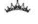

Ela acordou na escuridão e percebeu que não conseguiria voltar a dormir. Deveria estar se sentindo exausta... E estava, na verdade. Suas juntas doíam devido às longas horas na carruagem, ainda que a suspensão do veículo fosse macia, e a cabeça dela estava sobrecarregada de tentar abarcar tantos conceitos incríveis. Mas ela simplesmente não conseguiu dormir.

Estava na casa de um duque. Mas é claro que um duque não a chamava de casa, certo? Casa era uma palavra muito comum e humilde. Ele devia chamá-la de “residência”. No campo, era uma “propriedade”. Mansão Sei Lá o Quê, Castelo Faz-de-conta.

Ela puxou um canto da tapeçaria pesada que cobria o dossel e espiou o quarto escuro. Felizmente, a lua estava quase cheia, e o brilho leitoso que entrava pelas janelas (eram três janelas em um quarto só!) fornecia luz suficiente para que ela pudesse ver o quarto que sua exaustão, antes, a tinha impedido de explorar. Conseguiu enxergar até o pé da cama e o banco forrado encostado nela, e o carpete macio e bordado, seus vermelhos e dourados orientais suavizados pela noite. O padrão de lótus parecia se estender por

quilômetros. Se forçasse a vista, conseguia ver a ponta da penteadeira e perceber, pendurado na parede, o espelho de corpo inteiro reluzente, com moldura dourada. Este se apoiava em dois querubins esculpidos em mármore. Querubins levados, era evidente que eles nunca dormiam.

Pauline deu um assobio curto e abafado, que ecoou no teto artesoadо. Nossa, o quarto era como uma caverna. Aquele único quarto podia engolir a casa inteira de sua família, e aquele era um quarto de hóspedes, ela acreditava que nem devia ser o melhor. Como deviam ser os outros aposentos?

Em uma mesa lateral, ela avistou um serviço de chá, deixado ali para quando ela chegasse. Pauline imaginou que deveria ter pedido que o retirassem, mas naquele momento ficou feliz por não ter feito isso. Um gole de chá frio com limão talvez acalmasse seus nervos. Ela soltou a colcha e a enrolou nos ombros antes de descer da cama.

> — Upa!

A descida foi longa. Ela aterrissou com um baque, enrolando-se na colcha e caindo no chão. Mas não se machucou, até o carpete dali era mais macio do que o colchão de sua casa.

Achando graça, arregalou os olhos para a escadinha no pé da cama. Pauline se esqueceu de ter subido por ali. Imagine só, uma escada para subir na cama. A cama do duque devia ter tantos colchões de plumas que, provavelmente, devia precisar de seis a oito degraus. Ao deitar, era provável que ele mergulhasse em lençóis de cetim e travesseiros de penas, envolto em uma camisola de veludo púrpura. Essa ideia a fez rir.

Uma imagem surgiu na mente dela, vívida como a luz do dia e real demais. O Duque de Halford, com seus membros masculinos espalhados por uma cama larga. Nada de veludo. Nada de escadinha para subir na cama. Nada de colchão de penas ultramacio. Apenas o cabelo castanho desgrenhado, os bíceps contraídos ao redor de um travesseiro, e lençóis brancos e macios, luminosos à luz do luar, enrolados ao redor dos quadris. Ou talvez um pouco mais baixo, abraçando a curva de um traseiro firme e musculoso.

Ela tentou afastar aquela imagem, mas não teve sorte. Isso encerrava o assunto. Com ou sem chá frio, ela não conseguiria voltar a dormir.

Pauline se levantou do chão, apertou a colcha ao redor dos ombros e se aventurou no corredor.

Estava mais escuro ali. Pauline ficou parada por um momento, tentando lembrar da sequência de curvas feita pela governanta. Ela bem que tentou prestar atenção, mas estava tão exausta e impressionada... Para não mencionar seu assombro diante das fileiras de retratos antigos, que em alguns locais se acumulavam em colunas de três quadros. Tantas dezenas de ancestrais ilustres. As garotas de Spindle Cove diriam que, com certeza, aquele lugar estaria lotado de fantasmas.

Em algum lugar acima dela, madeira rangeu. Uma corrente de ar frio passou por seu pescoço, e Pauline engoliu em seco. Esquerda. Ela teve certeza de que elas tinham vindo da esquerda. Avançou lentamente nessa direção, mantendo uma mão estendida para apoiar os dedos na parede. A cada doze passos, a ponta de seus dedos caía da parede para a reentrância de madeira de uma porta. Uma, duas, três... ela contou seis antes de parar. Já deveria ter chegado à escadaria.

Um clarão repentino a congelou onde estava. Congelou seu coração, também. Que Duque de Halford fantasmagórico do passado era aquele? Abaixando-se, ela ergueu a mão para proteger os olhos da chama ofuscante e semicerrou os olhos, espiando por entre os dedos entreabertos.
– Simms?
Ela encontrou o 8º – e único vivo – Duque de Halford assombrando a própria casa. Ele trazia uma lamparina em uma das mãos. Com a outra, fechou uma porta, e Pauline ouviu uma chave girar na fechadura.
– O que você está fazendo? – ele quis saber, guardando a chave no bolso.
O tom raivoso dele a surpreendeu.
– Boa noite também, Vossa Graça. Minha viagem até Londres foi ótima, obrigada.
Mas ele não quis saber de brincadeiras.
– Por que você está xeretando meus aposentos particulares?
– Eu não sabia que estes eram seus aposentos particulares. E não estava xeretando. Eu virei no lugar errado, só isso. Vou voltar por onde vim. – Ela se virou para ir embora.
Ele a pegou pelo braço, fazendo-a se virar para encará-lo.
– Foi minha mãe que mandou você fazer isso?
Pauline nem soube como responder. Mandou-a fazer o quê? Dormir? Virar no lugar errado em uma casa imensa e escura?
– Você está tentando roubar alguma coisa? Responda com uma palavra.
– Não. – Ela endireitou as costas.
– Então é melhor se explicar. Você está de pé quando deveria estar dormindo, em um corredor que não tem motivo para visitar. – Ele levantou a lamparina e a examinou. – E você está com uma expressão de culpa no rosto.
– Bem, você tem uma expressão de arrogância e engano no seu.
Isso não era bem verdade. A lamparina iluminava as superfícies bem marcadas do rosto dele e jogava sombras de cansaço sob seus olhos. O castanho de suas íris estava dominado por um preto frio e vazio. Ele não tinha nada de arrogante, não naquele instante.
O que quer que ele estivesse fazendo naquele quarto trancado, era particular. Ela o tinha surpreendido em um momento de fragilidade. E como um homem grande e forte como ele não podia admitir que tinha seus momentos de fragilidade, ele a faria se contorcer e gemer.
Pauline suspirou.
– Duques e seus problemas.
– Não gosto da sua impertinência, Simms.
– Ah, mesmo?
Halford a puxou para perto e ela sentiu o coração disparar. Seu pé descalço roçou o dele. O choque do contato viajou por todo o corpo dela.
– Minha impertinência é o motivo de eu estar aqui, lembra? Foi por causa dela que você me escolheu em um salão repleto de mulheres bem-nascidas. Porque eu sou

完全错误。你永远都不想要在女人身上的东西。
他把目光从她身上滑过。
– 我不会这么说。

他喉结被迫的动作吸引了 Pauline 的注意，把她的视线拉向下方，拉向他脖颈底部那条轮廓分明的凹陷。

她肺部选择在此时罢工。她屏住呼吸太久了，以至于有点头晕。
– 如果你想，明天就可以把我送回家。但你会发现我什么都没偷。我不是来偷东西的。就算我有这个念头——而我没有——我也聪明到不会在来这里的第一晚就尝试。我见过你的管家。我确信她有一份每件抽屉、每个衣柜里有什么东西的清单，并且定期盘点一切。如果我想偷东西，我会等到最后时刻再做。如果你不想因为诚实而给我信用，至少因为聪明给我一点信用。

– 在我听到真相之前，我不会给你任何信用。
– 我已经说了真相。——她把被子更紧地裹在肩膀上。——我睡不着。我想去图书馆...
– 图书馆——他打断她，替她把这个词说完。讽刺从他的声音里溅出来。——真的？你希望我相信这个？你是在找图书馆。

为什么他看起来如此难以置信？
– 是的——她回答道。但到那时，她只想回到房间结束这场审问。她的失眠只能被治愈了。那个人太让人疲惫了。
– 很好。——他的手捏住 Pauline 的胳膊，边走边把她领过走廊。——既然你是在找图书馆，那我就亲自带你去。

事情的发展并不像 Griff 计划的那样。他以为自己对诱惑有免疫力。但他没料到诱惑会化作实体，在午夜过后出现在他房间旁的黑暗走廊里。头发又散开了，裹着床单，仿佛刚做完性爱，溜进他的私人居所，在灯笼光下比午后阳光下更诱人。

当然这只能是阴影的把戏。她的睫毛不可能有他大拇指指甲那么长。这不可能。或许她的睫毛会随着她说的每个谎言而增长。真的？图书馆？在她能编造的所有拙劣借口里。

Griff 让她裹着那条被子在走廊里快步走，然后领她下楼拐弯。当他们到达正确的门前时，他把它猛地推开，制造戏剧效果。
– 这就是图书馆。——他把灯笼递给她。
她瞪大眼睛走进房间，用灯光照亮前路。

– 挑你想看的书——他说。——我等着。
她站在房间中央，慢慢转身。无疑很震惊。即使他也必须承认，这是一份令人印象深刻的收藏。想想看，它是由十几代人收集起来的。房间有两层楼高，呈六边形，这是第五代公爵的任性。他是个业余建筑师，也是博物学家和其他伟大的东西。其中一个六边形的边是入口，但其余五面从地板到高耸的天花板都摆满了书架。
– 去吧——他坚持道。
– 我真的可以碰它们吗？——她低声说。
– 当然可以。有人得这么做。
然而，她仍然裹着那条扭曲的被子，脸转向横梁。
– 我甚至不知道从哪里开始。
– 你喜欢什么类型的书？——他问道，毫不掩饰声音里的自负。——你是哲学的大读者？历史？科学？
– 我主要喜欢诗歌。但我没有自负到认为自己是个大读者，殿下。
好了。她就这么轻易承认了。
– 尽管如此，你声称自己在找图书馆——他说，双臂交叉。
– 是的。我想看看这些书，而不是读。我希望能看看你的收藏。也许列个清单。
最终，她冒险向前，手指抚过一本薄薄的皮面书的书脊。她甚至没把它从书架上取下，只是触碰了一下——小心翼翼，仿佛书会在一朵云中消失。
– 你知道它们是怎么整理的吗？
– 实际上，不知道。我怀疑大概是按主题。我祖父发明了一套分类系统并做了目录，但我从没费心去理解它。我不常使用图书馆。
她举起灯笼转向他，瞪大眼睛，不敢相信。
– 你是说你住在这栋房子里，有这么多书——她用拿灯笼的手大幅挥了一下——却从不读书？
他耸耸肩，假装不在乎她触及的敏感点。
– 我让我的祖先蒙羞。我很清楚这一点。
– 毕竟一本书要多少钱？
他放弃了试图在她的问题之间建立联系。太晚了。
– 我想这要取决于很多因素。书的性质、装帧的质量。小说可以一两枚克朗买到，而一套关于罗马历史的九卷本...
她挥挥手， dismiss 了他的解释。
– 我想我不想读关于罗马历史的东西。
– 罗马人没你想的那么无聊。——历史课是他在学习中为数不多的喜欢的东西之一。

– Peças de teatro – ele respondeu, sem nenhum motivo especial, apenas para se livrar da pergunta.

– Oh, peças. Seria bom ter algumas na biblioteca. As moças de Spindle Cove gostam de encenar peças. – Mantendo a colcha ao redor dos ombros com a mão, ela usou a outra para empurrar a escada até outro conjunto de prateleiras. – Você vai ao teatro com frequência?

– Ultimamente, não.

– Mas ia no passado, então. – Um interesse genuíno aqueceu a voz dela. – Por que parou de ir? Faz quanto tempo?

A mão dele apertou um parafuso que ele estava soltando do relógio. Ninguém o questionou sobre isso, nem mesmo sua mãe. Primeiro, ele ficou surpreso, como se lhe jogassem um balde de água fria no rosto, mas depois que a afronta inicial passou, ele se sentiu estranhamente aliviado. Quase grato.

Os amigos de Griff, seus colegas e os outros aristocratas do clube... todos deviam ter notado sua ausência da sociedade no ano passado. Mas ainda que tivessem se questionado quanto aos motivos e especulado entre eles, ninguém tinha lhe perguntado o porquê. Griff não sabia se lhes faltava coragem ou interesse.

Pauline Simms teve a coragem. E interesse, ao que parecia. A pergunta inocente dela aqueceu um lugar, dentro dele, que há muito havia esfriado.

Por um instante ele se sentiu tentado a responder, mas logo afastou a ideia. Um homem com a riqueza e a posição social dele nunca poderia falar de suas tribulações pessoais para uma atendente de taverna sem parecer um completo ridículo. A Srta. Simms tinha sido criada na pobreza, com uma irmã simplória para proteger e um pai violento do qual não podia fugir. Apesar de tudo, ela manteve o orgulho e um senso de humor afiado. Uma garota assim deveria ficar com pena dele, porque o duque perdeu a temporada de primavera no Teatro Real, quando ela nunca foi ao teatro nem por uma única noite?

Pauline debocharia dele por suas lamúrias, e faria muito bem. Griff até podia ouvi-la: Duques e seus problemas.

Ele começou a soltar outro parafusinho da tampa de trás do relógio.

– Não entendo por que isso seria da sua...

– Da minha conta – ela completou por ele. – Eu sei. Você tem razão. Não é da minha conta, mas não pude deixar de perguntar. É muito estranho, Vossa Graça. Mesmo em meio a todos esses volumes velhos e mofados da biblioteca... eu acho que você é o livro mais difícil de ler desta sala. Assim que acho que consegui entendê-lo, você me deixa confusa outra vez.

– Simms, eu sou um homem. Não sou tão complicado.

Ele colocou o relógio de lado, com a intenção de pôr fim àquele interlúdio literário e mandá-la de volta ao quarto. Mas ao erguer os olhos, ele a viu. Por completo. E ele perdeu a voz.

Ela estava empoleirada no segundo degrau mais alto da escada. A colcha tinha escorregado e se transformado em uma nuvem macia no chão. Pauline Simms flutuava acima dela – um filete de mulher, coberta pela camisola de algodão mais fina que ele já tinha visto. Aquela coisa já tinha sido usada, lavada e remendada tantas vezes, que parecia um rendado de teias de aranha, não um tecido de verdade. E quando ela colocou o corpo na frente da lamparina... A camisola ficou transparente por completo.

Griff podia ver tudo. Ela não parecia em nada com um garoto. Não, ela era uma mulher. Os seios pequenos e redondos como maçãs eram encimados por mamilos escuros. A barriga era lisa. Quando ela se pendurou na escada, esticando-se na ponta dos pés para alcançar outro livro, a curva da silhueta dela foi para ele como uma canção conhecida. O pé em arco, a panturrilha esguia, a coxa suavemente mais grossa... e um traseiro redondo, palpável.

O corpo dela não era uma figura curvilínea como as de Rubens. Nenhum artista a pintaria descansando sobre lençóis brancos. Havia algo de selvagem e fundamental nela, que inspiraria artistas a retratar uma ninfa ou dríade dançando. Ela possuía um corpo que sempre mostraria suas melhores qualidades em movimento. E nu. Que ótimo. Agora a imaginação dele se agitava com pensamentos de Pauline Simms nua e em movimento.

Ela se virou na escada, encarando-o.

*Olhos*, ele disse para si mesmo. *Concentre-se nos olhos.* Ela tinha olhos lindos, com aquele tom surpreendente de verde-folha e os cílios inacreditáveis de tão compridos. Griff não podia deixar seu olhar vaguear para nenhuma outra parte. Não para os seios empinados, nem para o provocante triângulo escuro aninhado entre as coxas.

*Maldição.* Griff era um homem, como tinha acabado de dizer para ela. Não era complicado. A reação em seu baixo-ventre era pura, simples, com mais de dez centímetros extras de honestidade. Estava claro que ela não tinha noção de sua aparência. Não podia ter. Do contrário, ela pularia daquela escada no mesmo instante e se cobriria.

– Onde estão os romances? – ela perguntou, tranquila, apoiando o cotovelo no degrau mais próximo.

Um pensamento insidioso ocorreu a ele. Se ela não sabia por que Griff a encarava, ele podia ficar olhando pelo tempo que quisesse. Podia observar todos os detalhes dela e guardar visões suficientes para alimentar suas fantasias por meses.

– Acho que os romances estão ali – ele respondeu, brusco, apontando para a parede em questão. Então ele colocou o relógio desmontado à frente dos olhos, como um escudo, bloqueando-a. Atrás do mecanismo, ele ergueu os olhos na direção do teto. Era melhor que alguém lá em cima acrescentasse um ponto na sua caderneta de boas ações, talvez agora o total de sua vida somasse cinco ou seis.

– Você tem algum favorito para me recomendar? – ela perguntou.

– Não. – Ele suspirou com impaciência. Griff desejou que ela parasse de ser tão amigável, enquanto ele se esforçava para parar de despi-la mentalmente. Na cabeça dele, ela estava a dois botões de ficar arruinada por completo.

– Eu também não leio muitos romances – ela disse. – Os poucos que tentei pareceram florestas para mim... eu sempre me perdia. Prefiro poesia, quando consigo encontrá-las. Pequenos buquês de belas palavras, fáceis de entender e manter consigo. Tivemos uma mulher em Spindle Cove, certo verão, que se achava uma poetisa. Os poemas dela eram

– Oh, Vossa Graça. Você é brilhante.
Griff se recostou na cadeira, espantado. Nunca, em toda sua vida, alguém tinha dito isso para ele. A não ser em uma cama.
– Em que sou tão brilhante, afinal?
– Uma biblioteca circulante cheia de livros obscenos. É disso mesmo que eu preciso! Quero dizer, nem todo livro deve ser obrigatoriamente escandaloso, mas muitos deles devem ser. Em casa, as moças podem ter todos os livros decorosos que quiserem, não é? Elas vão a Spindle Cove para quebrar as regras.

Griff lembrou das moças naquela taverna, arrancando, alegres, páginas de um livro de etiqueta, com as quais faziam adornos para bandejas de chá. Sim, dava para imaginar que romances tórridos e panfletos radicais pudessem fazer sucesso em um lugar desses.

E por fazer uma sugestão impensada, agora ele seria responsável por induzir à perdição toda uma vila de solteironas. Aquilo com certeza representava um ponto alto ou baixo em sua vida. Exatamente qual, ele não estava certo.
– Onde estão os obscenos? – Ela inclinou a cabeça para trás, espiando nos recantos mais inacessíveis da sala. – Imagino que estejam em uma prateleira alta. Ou você tem um armário trancado em algum lugar?

Ele riu.
– Se minha biblioteca tivesse uma seção secreta constituída de livros inadequados para jovens damas, você não poderia esperar que eu lhe dissesse onde está.
– Por que não? Eu não sou uma lady. Nem sou tão inocente.
Não diga isso.
– Está muito tarde, Simms.
– Muito cedo, na verdade.
– Basta dizer que está muito escuro. E você não está muito vestida, e estamos a sós. – Se, além disso, os dois começassem uma busca por literatura erótica...? Aquela camisola fina dela não sobreviveria por muito tempo. – Não tenho impulsos nobres, lembra?
Ela ficou corada.

– Pode me ajudar a fazer uma lista, pelo menos?
Ele tamborilou os dedos na escrivaninha.
– Moll Flanders, Fanny Hill, O monge, uma boa tradução de l’École des Filles. Esses já são um bom começo.
– Pronto – ela disse e fechou os olhos.
– Você não quer anotar?
– Não preciso. Tenho uma boa memória.

Ela se inclinou bastante para um dos lados enquanto vasculhava a prateleira, parecendo flutuar acima dele. A sombra nua da silhueta dela quase deixou Griff ofegante. Sim, ele já tinha lido sua quota de livros obscenos, e nenhum deles o afetou tanto. Ele ficou duro como a mesa de mogno.
– Arrá! Aqui está um que vou levar para cama comigo. – Ela tirou um livro da prateleira. – Métodos de contabilidade e escrituração.
– Esse deve ser bom para lhe dar sono. – Ele riu. – Mas é uma boa ideia. Mantenha excelentes registros escritos, ainda que você tenha boa memória. Não aceite crédito. Se

for emprestar, sempre exija um depósito. Poucos se comparam à aristocracia quando se trata de fugir de suas obrigações financeiras.
Ela lançou um olhar desconfiado para ele.
– Você não foge das suas dívidas, foge?
– Pelo que eu soube, sou o quarto homem mais rico da Inglaterra. Nunca precisei fugir.
– Oh. Ótimo. – Ela aproximou o manual de contabilidade e inclinou a cabeça, inspirando fundo. Quando Simms notou o olhar dele, pareceu envergonhada. – Eu gosto do cheiro dos livros. Isso é estranho?
– Sim. Um pouco.
Mas ele achou cativante, também. De um modo estranho. Aquilo tinha ido além de uma conversa noturna na biblioteca, transformando-se em algo no limite do flerte, talvez até mesmo em um tipo incomum de amizade – marcada por uma violenta atração carnal da parte dele.
Seja o que houvesse entre eles... precisava terminar ali mesmo, naquele instante. Ele pôs o relógio desmontado de lado e se levantou da cadeira, confiante de que as sombras esconderiam sua excitação.
– Está na sua hora de dormir, Simms. Está tarde e tenho certeza de que minha mãe planejou uma programação repleta de exercícios inúteis para amanhã.
– Não se preocupe. Estou preparada para ser uma catástrofe.
– Ótimo.
Ela apagou a lamparina e desceu dois degraus.
– Só para provar, não vou nem mesmo fazer uma mesura ao sair desta sala.
– É um começo excelente. Mas se quiser chocar de verdade, pode começar a me chamar de Griff.
– Mesmo? – Ela se virou para ele.
Ele estremeceu. Um erro de cálculo da parte dele. Griff sugeriu aquilo como um toque de falta de educação, mas a expressão lisonjeada dela o lembrou de que esse tipo de intimidade poderia se mostrar perigoso. Por falar em perigo...
– Cuidado – ele a alertou. – O último degrau é bem...
Ela soltou uma exclamação e se desequilibrou.
– Oh, saco.

## 第六章

时间放慢了。短短一瞬间，格里夫看到了事故会如何发生。她的脚趾会从最后一级台阶滑脱。她会让书掉落，绝望地用手一挥，也许会用指尖擦到楼梯扶手。但她真的抓不住，惯性会让她继续下去，然后她会面朝下摔在地上。

跌落的高度不到一米，而且毫无疑问她会活下来，完整无伤。但当他得出这个结论时，他的身体已经在动了。

他把一只手放在沙发背上，流畅地一跃越过了家具。克服了这个障碍后，他敏捷地跳过了长沙发。张开双臂，格里夫滑行着停在了楼梯前。及时阻止了保琳的坠落，她整个人撞进了他的胸膛。格里夫把她抱在怀里。然后——尽管她没事——他却无法放开她。

——我的天！——她叹息着，赞叹着格里夫刚刚完成的距离。——那可真是一项了不起的运动壮举。

——没什么。

当然，这是唯一可能的男性回答。事实上，他怀疑自己在从沙发上跳跃到长沙发上跳跃的过程中拉伤了某个肌肉……但之后他再担心这疼痛。其他感觉需要他立即关注。

好上帝。仅仅观察她的身形已是一种享受，但这与触摸她的激动相比只是苍白的影子。她的乳头像她主人的个性一样坚定，通过睡衣薄薄的布料顶着格里夫。它们要求他的注意。更甚者：它们要求尊重。见鬼，他会去崇拜它们。

——可不像“没什么”。——她的双臂环住了格里夫的脖子。——你气喘吁吁。

——你也是——他观察道。

——是真的。——她给了他一个如此甜美又羞怯的微笑，仿佛属于另一个女孩。——你的反应速度非常令人印象深刻。

这观察真是恩赐。在那种情况下，格里夫通常会用“你没概念”或“这是多年练习的结果，亲爱的”之类的暧昧话回应。但他说不出任何一句陈旧的撩人暗示。然后，一个荒唐的念头冒了出来；他一生中浪费在运动和休闲上的时光，练习击剑或拳击，本可以用来创造遗产，却为这一特殊时刻做了准备。为这个特殊的女孩，她需要格里夫阻止她的坠落。

——我无法看着你受伤——他说，却什么都不明白。

——我以为你没有高尚的冲动。

——相信我——他直视她的眼睛说，没有任何情欲或讽刺——我没有。

如果他有一点点体面，早在几分钟前就该放开她了。像他这样恶作剧的人，格里夫喜欢她挂在他脖子上的样子。仿佛他们周围的世界是一片辽阔寒冷的荒漠，而他的体温是她唯一的生存机会。那一刻，他很容易相信，辛姆斯需要他。需要他的触碰，他的嘴，他的热气。需要他发烧般赤裸的肌肤覆盖在她全身。

不可思议的是，杂技般的扭动和男性欲望能创造出什么。他几乎说服自己，亲吻她甜美多汁的嘴唇是高尚之举。几乎。但并不完全。

——我现在要放开你了——他说。

她同意了。然后她把嘴唇贴上了他的。带着千般祝福与诅咒……女孩吻了他。

那个吻像海浪一样拍打在他身上。他的感官像闸门一样打开。她的嘴唇如此柔软。尝起来像覆盆子。她闻起来像晒干的棉布。她皮肤在他惊愕仍睁开的眼睛里，像一团丰盈的粉红色奶油。

即使吻结束后，那份甜蜜的震惊仍在格里夫的每一根神经中回响。原始的冲动回荡。

更多。再来一次。现在。欲望对他来说是老朋友。心跳加速，她的味道在他舌尖，腹部下部的突然充盈……他对这些感觉都非常熟悉。但在这场情感风暴中，还有别的。心脏部位深沉而持续的鼓点。她，器官低语道。我要她。这部分是新奇而可怕的。猛地，他把她扶起站稳。然后转身到另一边，擦着嘴。

——这他妈是什么？

——我想殿下在这方面应该更有经验……但我想这是一个吻。

——这不该发生。——他用手拨了拨头发。

——不，不。很好……很好。

——你管这叫好？——他转身面对她。

——不。好，不算。更像是“及时”。——她咽了口唾沫。——你不能否认我们之间有紧张感在增长。我想吻也许能帮上忙。

——帮忙……——他盯着她，不敢相信自己听到的。

——好吧，现在结束了，就像你看到的。——她转向一侧耸了耸肩。——结束了。很明显这没什么特别。我们不必担心任何吸引力。

没什么特别的？不用担心任何吸引力？
她竟能如此打击他的自尊心，真是不可思议。Griff想给她一把拆信刀，告诉她继续把他掏空。
她弯腰去捡掉落的书，把书紧紧抱在胸前，准备离开。
– 晚安，殿下。
*放过她*，他对自己说。*让她走。*
– 你不能只凭这个吻来判断。 – 他向前迈了一步，抛弃了逻辑和常识，彻底沉溺于愚蠢之中。
– 不能吗？ – 她问道。
– 不能。这个不是真正的吻。更像是嘴唇的碰撞。如果我真的吻你，Simms，你才有理由担心。
– 我会有？

他慢慢向她靠近，用低沉而性感的声音说：
– 会的。真正的吻会撩动你最私密的地方。会让你整夜在床上辗转反侧。焦躁不安，难受，带着…… – 他停顿了一下，寻找勃起的女性对应词。 – 心悸。
她挑起眉毛，觉得好笑，脸颊上出现了酒窝。
– 心悸？
– 是的 – 他斩钉截铁地说。 – 心悸。
Simms忍不住笑出了声。

天哪。这不是发生在他身上的事。不是这种对话。*心悸？* 多蠢的词。但现在他已经陷进去了，无法收回。
他想起在那间屋子里他是谁是公爵。她只是一个酒馆女招待。是时候让他们俩都记起这一点。

只是她不仅仅*只是*一个酒馆女招待，她是一个有野心的女招待，对生意有敏锐的嗅觉，对诗歌有令人害怕的好品味，还有……诱人的曲线，让他的手都疼得想去探索。
她美味极了。成熟得像覆盆子。*她*，脑海里又响起那个低语。*住手*，Griff回应道。
– 心悸 – 她重复道。
他点头同意。Griff根本不在乎她是否在嘲笑他。他希望Simms多重复几次这个词，因为每一次重复都带来她舌头的色情画面，让他发狂。

她咬着嘴唇，沉思着。
– 我想我从未体验过心悸，殿下。也许那是上层阶级女性的专属。我没有那种纤细的女性气质。
– 这是胡说。 – 他把手滑到Simms的后颈，手指穿进她丝滑的头发。然后把她拉进一个吻。

啊。所以这就是心悸。
而那，Pauline推断道，就是他对真正之吻的想法。一个充满热情和决心的拥抱，完全由他掌控。Halford控制着她的脖子角度和身体的亲近程度——以及他那缓慢而令人发狂的舌头，滑过她的唇瓣，来回游移。
他以无情的力度吻她，仿佛在施加她应得的惩罚。二十下鞭打，用强劲而性感的舌头。殊不知，这正是她想要的，正是她用全身每一根骨头和肌肉渴望的。
是的，谢谢。我还要一个。

Pauline吻他之后的那些短暂时刻，是她一生中最痛苦的时刻。他似乎如此震惊和不安。她也不知道自己当时在想什么，只知道自己很感激他为她这个女招待打开了那座庞大而无价的图书馆。为他倾听了她最隐秘的梦想而不嘲笑——并且还通过给她那个天才而淫秽的点子来完善它们。

他不可能知道。这对她意味着什么。
而他仍然做出了大胆而英雄的举动，阻止她摔倒。
当Pauline近距离看到公爵时，他眼中的光芒让她冒出一个奇怪的念头：这几乎肯定不是他第一次在走廊里游荡，彻夜未眠，孤身一人。还觉得他对她的出现并没有表现得那么不安，以及他可能正需要一个吻……也需要一点救赎。

当然，在承认这种事之前，他会赤脚走在钉床上。她本该料到他会这样反应。所有男人都有自尊心，而公爵是最糟糕的。“承认软弱”大概和“挠痒痒比赛”和“捉鼻涕虫”一样，是他最不喜欢的活动之一。

于是他就这样反应了。一个受控的、支配的、占有欲强的吻。而Pauline一点也不在乎。
他紧紧抱着她，一只手抓着她睡衣的布料，另一只手在她头发里打转。后来她得花很长时间梳头发，胳膊都会疼，但每一次梳头都值得。流经她头皮的感觉在愉悦与疼痛之间徘徊，令人上瘾。
他的胸膛是坚实温暖的墙壁，点燃了她，让她的乳尖变得坚硬而渴望。除了几层薄薄的布料，两人的身体几乎没有隔阂，但她仍然觉得不够亲近。Pauline在他身上摩擦，希望能缓解她的煎熬。快感流向她的私处。
当她把手臂环过他的背时，Halford低吼了一声，鼓励着她。那深沉而震颤的声音在她体内回荡，像诱惑的嗡鸣一样停留在她大腿之间。她更紧地贴了上去。
– 就这样…… – 他在她唇边低语。 – 就这样……对了。

确实如此。他们契合的方式看起来如此、如此正确。不再只是他吻她，两人都在接吻，享受着、给予安慰、品尝着彼此的滋味。

他的嘴唇在她唇上变得更加柔软，动作变得慵懒、戏谑。舌尖缠绕在一场缓慢而感性的舞蹈中。保琳抓住了他衬衫的布料，布料因贴着皮肤而发烫，并将手指滑过他的胸膛。如此柔韧，底下却蕴藏着如此强大的力量。一股野性的好奇心涌上心头。她想知道关于他的所有事情。身体会像脸一样晒成古铜色，还是像雕刻的大理石般白皙？胸口有毛发还是光滑？是什么驱使着他那颗心如此凶猛地鼓动？

保琳对自己说就此打住这些疑问，努力遏制住想象力，以免它继续向下探向那具身体。但他似乎没有这种顾虑。他大胆、探索性的手向下移，沿着她的脊柱滑下。一阵愉悦的战栗随之而来，顺着脊椎滑落。当他来到她的臀部时，哈佛的手触到了一处她自己都不知道存在的曲线，并以一种占有欲十足的紧握将它据为己有。保琳品味着他满足的呻吟。太美妙了。她习惯把自己的身体想成一堆尖角和棱线，但他却让她感到柔软。

她从未在生命中如此感受过。如此被渴望，如此被需要，而这一切来自一个本不该需要任何东西的男人。

当他终于结束这个吻时，她的嘴唇变得肿胀、疼痛。嘴角被他的胡渣划伤，保琳用舌尖舔去那里以缓解疼痛。她会感受到这个吻几个小时。也许几年。
——西姆斯。我做错了。——他发出一声不规律的叹息。
她轻笑了一下。
——如果这算做错，我都不知道自己能否承受做对的样子。
——不，不。我说做错是指作为你的雇主。我不希望你以为我有骚扰女佣的习惯。——他侧过身，抚过棕色的头发。——我并不缺乏伴侣。我从不需要…
——自甘堕落？——她受伤地弯腰去捡掉落的床罩。——如果你想温柔地解雇我，你没成功。

为什么男人总要把一切都搞砸？答案很简单，她想：因为女人，愚蠢的女人，给了他们这个机会。
——听着。我只是想说这不会再发生了。我很抱歉。
——你为吻了我而抱歉？还是为这不会再发生而抱歉？
他靠近她，把床罩整理好盖在她身上。
——两样都抱歉。

在摇曳的烛光下，他的脸又浮现出那种惊恐而孤独的神情。如果他真的不缺乏伴侣——而在那个吻之后她相信这一点——为什么他今晚不去取悦一个情妇，不去与一个寡妇寻欢作乐，或不去诱惑一个处女？

对于一个没有结婚欲望的男人来说，他并没有好好享受自己的自由。

——只是一个吻。——她从写字台上拿起一根点燃的蜡烛。——一个吻或两个吻算什么？这算不了什么。
他转向她，凝视着她。
——你听见自己说了什么吗？
——什么？
——你说“算不了什么”，而不是“没什么”。
——我没说。——保琳张大了嘴。——我的天。我真的说了。“算不了什么”。——她试了几个词：——书。牛奶。热。
——我们就…——公爵抬起手。——…到此为止吧。
保琳用手捂住嘴笑了起来。
——哦，不。这只能怪你。你母亲说一切都在于放松舌头和嘴唇。
他阴沉地盯着她。
——别担心，殿下。怎么发音都无所谓。算不了什么，真的。只是一个吻。
说谎者，她的心跳了一下。远不止如此。
——我以前被吻过——她继续说。说谎者，说谎者。你从未被这样吻过。——我知道这没什么大不了的。不是什么值得担心的事——她总结道。
说谎者，骗子，无耻之徒。
——你说得对——他同意。——我们都有自己的目标。你要开一家淫秽书店，我得继续过我放荡不羁、摆脱婚姻束缚的生活。这周唯一会出错的方式就是我们俩订婚，走向婚姻，而上帝知道那不会发生。
他关上门，转身面对她。他们的目光在烛火上方那片金黄温暖的空间里相遇。
保琳勉强挤出一声笑。那笑声尖锐、疯狂又可笑，她希望能怪罪给别人。
——啊，天哪。别这么激动，格里夫。这个吻也没那么好。
于是她飞快地跑上楼梯，试图甩掉胸口不断指控的声音。
说谎者，说谎者，说谎者，说谎者。

## 第七章

第二天上午，波琳列出了一长串公爵夫人不会做的事情。公爵夫人不会骂人，不会吐口水，也不会自己在桌边上菜；她们不会以任何意义上的弯腰，也不会在公众场合谈论自己的内脏器官。但从积极的一面来看，公爵夫人不用帮忙做家务。她们不用从井里打水，不喂鸡，不挤牛奶，也不用在院子里追一只跑掉的小猪。公爵夫人既不自己做早餐，也不给别人做早餐。这部分很棒。

而当哈尔福德公爵夫人闯进她的房间时，波琳又在清单上加了一项：公爵夫人不会敲门。

她吓了一跳，在起身下床前把会计手册塞到了枕头底下。她不想解释那本书是怎么到她手里的。即使她已经花了过去两个小时在脑海里重温那一幕。哦，那个吻。她的嘴唇仍在发麻。

——我很高兴看到你醒着，公爵夫人说，尽管这么早。

这么早？

——现在都快 11 点了。我已经醒了几个世纪了。——她一生中从未在早上 6 点之后睡觉。她转头望向窗外。——大半天都过去了。

——你习惯了乡下的时间。我们城里用的是不同的安排。起床时间从中午开始。午餐可能在 15 点进行。夜晚要到 21 点才开始。而午夜的晚宴是必须的。

——如果您是说……——波琳每天在黎明时分准时醒来。早晨将是她的阅读时间。也许等她读完会计书后，可以去图书馆做几次访问。

一些样品。我会叫弗勒来，我们去给她穿衣。
——太好了，殿下。
波琳的热情落在了地毯上。昨晚脱衣服才开始两分钟，她就意识到自己和弗勒合不来。或者更确切地说，弗勒和她合不来。
那位女仆有着金色的头发和矢车菊般的蓝眼睛，像一片雪花一样飘进了房间。完美、明亮而冰冷。
——哼！——弗勒惊呼道。这是一个非常法式的声音，似乎对波琳的脸、头发、衣服或个性都不太赞赏。
哈尔福德家的车夫和仆人都在斯宾德尔科夫目睹了一切，波琳知道八卦是如何迅速从一个雇员传到另一个雇员的。到现在大家都知道她只是一个农场女孩，不配得到一位贵妇的女仆的关注。当然，仆人们会因为她带来的额外工作而对她感到不满。
弗勒打开了一系列箱子，从中取出几件内衣和三件几乎一模一样的连衣裙。
——都是白色的，——波琳说。
——当然是白色的，——公爵夫人回答。
她一生中从未穿过白色的连衣裙。也许连在她自己的洗礼上都没有。白色是贵妇人的颜色，因为只有她们才能保持一件白裙子的干净。如果她在家愚蠢地给自己缝一件浅色的裙子，那件衣服在洗三次后就会变成灰色。除了围裙和袜子，她拥有的所有东西都是棕色或深蓝色。
不再如此了。首先她被一件雪白的内衣裹住，然后被一件紧身胸衣几乎勒死。公爵夫人挑了那件最简单的连衣裙：一件高腰的晨装，层层叠叠的透明缎纱。弗勒把它举过波琳的头。轻盈的布料像云一样落下，将她包裹在一片空灵的美中。她看着自己的胳膊，与那件无瑕的缎纱相比显得如此晒黑和雀斑点点。公爵夫人从上到下打量着波琳。
——好在肩膀上合身。你身材苗条真好。
苗条？波琳觉得那是对她身材的一种慷慨的说法。公爵夫人夸奖了她。
在摆弄了几分钟连衣裙松垮的腰部后，弗勒拿起一条碧玉绿的腰带，绕过波琳的腰部，系得很紧，并在后面打了个蝴蝶结。
——哼。——这次，弗勒似乎很满意。
——是的，好多了，——公爵夫人同意道。——我们能为她的头发做什么呢？
弗勒的意见似乎是：没什么。
波琳的头发被梳好，挽成一个简单的发髻后，她盯着梳妆台镜子里那个不熟悉的倒影。没有一根头发在乱，没有一处污渍在她连衣裙的蕾丝上。

公爵夫人用几句法语打发了弗勒，随后看向镜子中保琳的倒影。
– 我要做一件我从未做过的事。我要和你谈谈我的儿子。
保琳张大了嘴巴，但即使她知道该说什么，公爵夫人的表情也让她无法说出任何话。
– 我知道，我知道。但我不能和我的同辈谈论这些事，也永远不会相信仆人们。我对格里夫越来越绝望，而我没有人可以倾诉。
格里夫？
– 他从去年秋天起就变了。我在他在伦敦的那天就注意到了。我的儿子小时候是个小混蛋。长大后变成了一个放荡的年轻人，总是和朋友打牌，或在我们温特塞特庄园举办荒唐的派对。而且他身边总是围绕着女人。
毫无疑问，保琳想。昨晚她就是其中之一吗？
– 但去年一切都变了。他甚至没在冬天开放温特塞特。他待在城里。为什么，我完全无法想象。他不去俱乐部，不看演出，对朋友或上流社会也不感兴趣。而且他还有一间上锁的房间。
– 一间上锁的房间，殿下？
保琳努力不让自己对这个话题的兴趣暴露出来。发生了图书馆的事之后，她几乎忘了昨晚在走廊里撞见他。他确实像一个有事隐瞒的男人。
他也像一个渴望关爱和安慰的男人那样接吻。但她不会把这件事告诉公爵夫人。
– 一间上锁的房间——公爵夫人确认道。——他在自己的私人房间里有一间房间，日夜上锁。只有他有钥匙。他甚至不让女仆进去打扫。真是……变态。谁知道他在里面藏着什么？
– 我希望不是一堆切下来的头。也许他到乡下去猎杀那些无礼的酒馆女招待，而我将是第十一个。
公爵夫人嗤笑了一声。
– 你不是第十一个。你将是格里夫的第一位，也是唯一的未婚妻。
– 但我是个平民。
– 哈福德家族的血统足够强健，可以承受我儿子的放荡。甚至可以承受一个平民成为公爵夫人。但如果没有男性继承人，一切都会就此终结。
– 但公爵还有几十年的时间生孩子。你真的不相信他会和我结婚。
– 他必须结婚。我不能等几十年。你不明白。——公爵夫人停顿了一下。——我希望不会走到这一步，但现在我明白我别无选择。
那女人把一只手伸进口袋，又拿出来，手里握着一件小小的毛茸茸的东西。
– 好了——她宣布道。——你看这个。

保琳看着那个东西。一件用黄色羊毛织成的、没有明确用途的东西。部分看起来像一顶帽子，另一部分像一只手套。但没有一部分织得像样。
– 这是什么？——保琳问道。
– 这是恐怖！这就是它。我甚至不知道这是怎么发生的。我从14岁时就没做过这种事了。那时候也只是刺绣和钩针。从来没有织针。但在过去几个月里的每个晚上，我坐下来本想读书或写信，三小时后，我的膝上就会出现一件畸形毛茸茸的东西。

保琳忍不住笑出了声。
– 继续笑吧。很可笑。——公爵夫人拿起那件织物在手里翻来覆去。——这是给两头蛇的帽子？还是给三个关节炎手指的手套？我也不知道，而这东西是我织的。太丢人了。我当然不能让仆人看见。我得把它藏在帽盒里，然后每周二带到弃婴医院去。

保琳听到这话大笑起来。
– 一生优雅、掌控和珠宝，竟沦落到这个地步。——她举起那只扭曲的手套，在保琳面前晃了晃。——这个！荒唐至极。
– 也许殿下应该去看医生。
– 我不需要粉末或补药，辛姆斯小姐。——公爵夫人瘫进一把椅子里，把羊毛线团紧紧抱在胸前。她的声音变得柔和。——我需要孙子！可爱淘气的婴儿来吸收我体内日益增长的这份爱。我渴望孙子，如果他们不来，我不知道我会怎样。一天早上弗勒来叫我起床，会发现我被一条长达数米的围巾勒死了。什么结局！

保琳从公爵夫人手中拿过毛衣，仔细端详。
– 有些地方其实不算太差。如果您愿意，我可以教您正确织袖口的方法。
公爵夫人从保琳手中夺过那件东西，塞进口袋。
– 稍后再接受你的织毛衣课。这周你将跟我学习如何做一个公爵夫人。
– 但，殿下您不明白。我甚至……

保琳闭上了嘴。她差点脱口而出，*我甚至不想嫁给他。*

但有什么阻止她说出口。她决定是出于想保护公爵夫人的感受。没有哪个母亲喜欢自己的儿子被糟蹋，而一个酒馆女招待拒绝嫁给一位公爵的机会是无法解释的。

无论如何，也不需要解释。那个公爵根本不会娶她。
– 他在付我钱——她最终说出了口。保琳觉得不公平让可怜的女人抱有希望。毕竟，哈福德并没有让她发誓保密。——他正在付我

pagando para ser uma catástrofe. Para frustrar todas as suas tentativas de me refinar.
A duquesa bufou com delicadeza.
– Foi isso o que ele lhe disse porque é isso o que ele está dizendo para si mesmo. Griff não consegue admitir que está fascinado por você. E você também é orgulhosa. Se eu a acusasse de já estar apaixonada por ele, você também negaria.
– Eu... eu nego mesmo! Porque não é verdade!
Enquanto falava, Pauline sentiu o coração martelar no peito. Mentiroso, mentiroso, mentiroso. Ela estava apaixonada. Estúpida e impossivelmente apaixonada por cada coisinha a respeito do duque. Não, não do duque, do homem. Pelo modo como ele a ouvia com interesse genuíno, como impediu que ela caísse, e como a beijou com tanta paixão. O cheiro delicioso e viciante dele. Naquela manhã mesmo, Pauline fantasiou roubar da lavanderia a camisa suja dele para que pudesse escondê-la debaixo do travesseiro.
Oh, Deus! Isso era terrível. Ela sentia até mesmo palpitações.
Fleur voltou para o quarto com uma bandeja forrada de veludo, que colocou sobre a penteadeira.
Pauline ficou boquiaberta. A bandeja estava coberta de joias de todas as formas e cores, reluzentes em todos os tipos de arranjos: colares, pulseiras, brincos, anéis. Mas não eram de todos os tamanhos. Não, cada gema era uniforme e assustadoramente imensa.
– Isso é tudo – a duquesa disse, dispensando Fleur mais uma vez.
Ela se voltou para a bandeja de joias.
– Pérolas, não. Hoje, não – ela murmurou, empurrando de lado um cordão de esferas iridescentes do mesmo tamanho. – Topázio seria errado. E vão ser necessários alguns anos antes que você possa usar diamantes ou rubis.
Diamantes ou rubis? Aquela mulher iludida falava como se um dia todas essas joias fossem ser dela. Pauline não sabia como convencer a duquesa da verdade.
– Vossa Graça não me ouviu? – ela perguntou com um sussurro alto. – Gri... quero dizer, o duque está me pagando para fracassar. Ele só quer dar uma lição na senhora, para que nunca mais queira obrigá-lo se casar.
A mulher colocou as mãos nos ombros de Pauline. Seus olhares se encontraram no espelho.
– Quanto ele lhe prometeu?
– Mil libras.
A duquesa não pareceu impressionada. Ela colocou as mãos no rosto de Pauline e puxou para cima, alongando a coluna dela até a moça ficar ereta como uma vara.
– Pronto. Com a postura correta, você possui um pescoço maravilhoso para joias. – Ela inclinou a cabeça de Pauline para um lado e para outro. – Nunca deixe que lhe mandem usar esmeraldas só porque seus olhos são verdes. Isso é ideia de gente sem imaginação. Pensando só na cor, seus olhos são mais parecidos com peridoto. Mas peridoto sempre me parece lamentavelmente burguês.
– Não é comum alguém me dar conselhos sobre joias, Vossa Graça – Pauline disse, a voz abafada pelas mãos da duquesa emoldurando seu rosto. – Esta é a primeira vez.

A duquesa a soltou, virou-se e pegou um colar de pedras roxo-claro e filigrana de ouro na bandeja forrada de veludo.
– Esta é sua pedra: ametista – ela disse enquanto arrumava a joia no pescoço de Pauline. – Rara, majestosa, mas delicada o bastante para uma mulher jovem.
Enquanto as pedras se moldavam às saliências e reentrâncias de sua clavícula, Pauline fitou o espelho, fascinada. A duquesa estava certa – a cor da ametista ficava bem nela. O tom de violeta destacava os dourados de seu cabelo e lançava uma sombra rosada nas faces. Mas podia ser que o rosado viesse de sua agitação. Ela mal podia acreditar que algo assim estivesse tocando sua pele.
– Então meu filho lhe ofereceu mil libras – a duquesa disse. – Este colar, apenas, vale dez vezes isso.
Santa... Dez. Mil. Libras. Dez vezes mil libras. O número um seguido de quatro zeros. Pendurado no pescoço dela.
De repente, ela se sentiu tomada por um medo irracional e poderoso. O terror era tanto que ela não conseguia se mexer nem respirar. Se ela ousasse sequer mover a cabeça para um lado, a corrente podia se quebrar e toda aquela coisa inestimável cairia em uma fenda do assoalho – e nunca mais seria encontrada.
– Tenha em vista o prêmio maior, minha garota – a duquesa disse.
Pauline não pôde evitar de encarar a mulher grisalha pelo espelho. Estranho. Até então ela não pensava que a duquesa fosse louca.
– Vossa Graça, isso não vai dar certo. – Ela apontou para seu próprio reflexo. – Eu não sou o que ele quer, muito menos o que precisa. Ele é o 8º Duque de Halford, e eu uma atendente de taverna. Completamente errada. Só me escute falando. Olhe para mim.
– Não sou eu que preciso olhar para você. – A duquesa removeu o colar de ametista e o recolocou na bandeja, então gesticulou para Pauline levantar. – Venha. Nós vamos fazer uma experiência.
Estupefata, Pauline levantou da cadeira e a seguiu. Elas desceram até o térreo e a duquesa a conduziu até um salão grande e aberto. Quando entraram no aposento, ela se virou para Pauline e pôs um dedo sobre os lábios, pedindo silêncio.
Os tapetes tinham sido enrolados para as laterais do salão, e logo Pauline viu por quê. O aposento não era mais um salão de festas, mas uma espécie de ginásio.
Bem no centro, o duque e um oponente mascarado se enfrentavam. Os dois homens vestiam calças estofadas e apertadas na coxa, um colete estofado e uma camisa branca aberta. Os dois empunhavam uma espada esguia e brilhante. Nenhum dos dois notou que elas entravam.
– En garde – disse o homem mascarado.
A resposta foi um clangor de espadas.
Pauline observou os dois espadachins trocar golpes e fintas. A admiração a deixou sem fala.
Enquanto o oponente usava um capacete com uma trama metálica para proteger o rosto, as feições do duque estavam visíveis. Ela podia admirar cada ruga de concentração, cada gota de suor na testa dele. O esforço fez com que o cabelo dele grudasse na cabeça, em cachos castanhos, e com que a camisa colasse no tronco.

肌肉透过白色的湿润布料显现出来，这让他看起来像一尊大理石雕像活了过来。手臂、肩膀、腿、臀部……他的身材全都漂亮。

戴面具的对手向公爵的躯干刺出一剑，但他却以灵活的剑刃动作巧妙地躲开并进行反击。他们的突刺和刺击带着舞蹈般的优雅，蕴含着致命的力量。

两人对决时，墙壁回荡着令人震撼的声音——钢铁划破空气，以及剑刃相互碰撞的脆响。最令人激动的是，强壮男人们因体力消耗而发出的呻吟。整个空间都因阳刚之气而颤动。

如果保琳自从那个吻起就一直心悸，这场景让这种感觉变得更加深沉。波动？震颤？她宁愿不给它起名字。

在房间中央，两人锁住了剑。闪亮的剑尖距离哈佛德的脸只有几厘米，而与对手不同，他没有戴金属面具来保护自己。剑刃的一次突然动作就可能划伤他或致盲他。

_小心_，她几乎想喊出来。但公爵夫人把手放在保琳的手臂上，制止了她。

终于，随着一声原始的咆哮，两人分开；各自后退了几步。擦拭着额头的汗水时，公爵转头，短暂地朝女人们的方向看了一眼。就这么一瞬间。他看见她了。

即使在礼堂的另一边，保琳也感受到了他目光与自己相撞的那一刻。强烈的热度让她的皮肤发麻。

哈佛德一定感受到了比麻木更强烈的东西，因为当他就那样僵在原地时，对手的剑刃划伤了他的手臂。一道红色的血线迅速染红了他的衬衫。

– 哦！ – 保琳双手捂住嘴，惊恐不已。

公爵夫人则发出了一声满意的声音。

– 我想这次体验很成功。

格里夫痛苦地呻吟着，让剑掉落，用空闲的手按住伤口。
– 该死，德尔。

– 不关我的事。你为什么不防御了？ – 朋友把护面推开，环视大厅。当他找到辛姆斯小姐时，他露出了一个大大的笑容。 – 你好……我现在看到了。

你好。保琳行了个屈膝礼，格里夫快速向她挥了挥手。他不应该这么惊讶，但自从昨晚在图书馆见过她后就没再见过她，当时他们花了很长时间聊天。然后拥抱。然后他们像被关在各自牢房里十年、明天清晨就要被绞死的恋人一样接吻。

好上帝。好上帝。

他今天就打算去找她，进行一次简短而专业的谈话，把事情理清，确保那样的事不会再发生。但谈话不应该以这种方式进行。两人应该独处，但要安全。当他经过数小时的激烈击剑练习后精疲力尽，根本无法再想起欲望时，而她又不像现在这样……这样。

你还好吗？，她用嘴型说。

不。不，他不好。格里夫感到心碎。

就昨天，她还用她不当的行为和那些闪亮的糖晶把他的头转晕了。现在她并不闪亮；辛姆斯小姐穿着一件如此半透明纯净的白色连衣裙，她那古铜色的皮肤热度透过裙子发光。她熠熠生辉。

格里夫一直很喜欢这种感觉：一个女人对他产生的自然效果。以前他就靠这些自然、本能的吸引时刻生活。当一个天堂般的女性气质来源进入环境时，他的内在节拍就会重新校准。那是从他内心的混乱到客观决心的崇高转变。区别在于我的天啊，现在怎么办？和……她。我要她。

该死。他想要她。从第一眼起就想要。格里夫在这一刻明白了这一点，当他内心某个麻木的部分开始重新苏醒时。但这可能是最糟糕的时机，她也是最不可能的女人。无论辛姆斯对他有什么影响，格里夫必须确保，绝对确保，礼堂里没有人——无论是他的母亲、他的朋友，还是保琳·辛姆斯——能察觉到。好吧，除了流血之外。

他侧过身，用剑刃从衬衫上割下一条布，用来包扎伤口。

——夫人。——德尔向前伸出一只脚，向公爵夫人深深鞠躬。

——德尔拉克勋爵——她微微点头回应。

——夫人能否行个方便，把您这位美丽的友人介绍给我？

别开始，格里夫默默恳求。别在她面前。

他和德尔为了争抢战利品而决斗的历史由来已久。在年少轻狂的时候，他们甚至把这变成一场竞争，还设有赌注和一套复杂的计分系统。格里夫早已把这一切抛诸脑后，但德尔拉克就不好说了。也许他还在计算自己的分数。

——这位是我的客人——公爵夫人说。——西姆斯小姐，来自萨塞克斯。

——萨塞克斯的西姆斯小姐——德尔说。——认识您真是三生有幸。我是德尔拉克勋爵，哪儿不受欢迎我就待哪儿。——他拉起波琳的手，吻了一下。

她朝格里夫挑了挑眉，仿佛他能听见她在挑衅：你没有亲吻我的手。

但我救了你，免得你摔个嘴啃泥，他也用挑眉毛的动作回应。

片刻之间，他们开始相视而笑。然后两个人仿佛都想起了那次搭救之后的亲吻……更别提当着旁人的面用眉目传情这种隐含的亲密了。

她的脖子红了。格里夫看向一旁。

——别理他，西姆斯小姐——德尔拉克说。——我俩都是经验丰富的剑客。伦敦顶尖的。必须如此。

——为什么？——她问道。

——因为我们是最大的浪荡子。——德尔朝她眨眨眼。——剑术精湛的名声是避免被人挑战决斗的最佳防御。无论一个男人多么暴怒，都不会把武器的选择权交到我们手里。——他把练习用的剑放在一旁。——您来伦敦很久了吗，西姆斯小姐？

——我昨天刚到，勋爵。

——西姆斯小姐的父母无法将她介绍进社交界——公爵夫人插话。

——所以我主动提出帮这姑娘在城里磨练磨练。

——从哈尔福德手臂上的伤口来看，我得说这开端相当不错——德尔拉克说。他又压低声音对公爵夫人说：——我知道夫人在盘算什么。既然我发过血誓要保护他免于一切婚姻陷阱，本该反对。但夫人，这回破个例，我觉得我们可以结盟。无可否认，他整个社交季表现得像个修士。只是没那么有趣。

——我听到了——格里夫说。

德尔没理他，继续以推心置腹的语气对公爵夫人说。

——当然我们并非完全一致。您是母亲，想看他结婚。作为朋友，我的目标不同。我只要能看到他……

——德尔——格里夫警告道。

——……走出家门——德尔拉克说完，手按胸口，一脸无辜。——看到他走出家门。你以为我打算说什么？你心思真肮脏，哈尔福德。病态。

格里夫恼怒地挥了一下剑，无声地威胁，试探着受伤的手臂。有这样的朋友……

——太好了。——德尔拉克击掌。——西姆斯小姐需要被介绍进城里。而哈尔福德需要活动活动……

——德尔。

——……他的腿。——德尔拉克举起双手，装出无辜的样子。——很明显，我们今晚都得去博费瑟斯通家的舞会。

——我敢肯定这句话我这辈子只会说一次……——公爵夫人叹了口气，补充道：——德尔拉克，你的建议好极了。

——这建议糟透了——格里夫嘟囔道。

——那就晚上见。——德尔拉克收拾好自己的东西，匆匆行了个礼。——我得走了。喝茶前我得去烦三个人，不然这一天就像白过了。——走到门口时，他冲格里夫点了点手指。——回头你会为此感谢我的。

哦，我会为此掏出你的肠子。

——但我刚到——波琳说。——我没什么可穿的。

——姑娘——公爵夫人挑了挑眉——，你也太不相信我了。

格里夫了解母亲。他知道她有了目标时是什么做派。但就算她能设法让西姆斯小姐看起来像个体面的年轻淑女，也没法修正那姑娘的口音、举止、糟糕透顶的礼节和完全缺乏教养的样子。不可能在一天之内。

他并不担心。不太担心。

几个小时之后，波琳明白了为什么公爵能为母亲一周的消遣花掉一千英镑，还觉得物有所值。公爵夫人一个下午就能花掉这个数目。两倍。

首先，她们去拜访了女装裁缝——一位上了年纪、裹着头巾的夫人，她看起来更适合占卜算命而不是缝纫。她用画着浓妆的夸张眼睛打量着波琳。

——哦，夫人——那个女人用绝望的语气说。——您给我带来了什么？

——她需要一个星期的衣橱——公爵夫人回答。——今天用带修改的样衣就行，但明天开始我们要更好的。晨间裙、外出裙和晚装裙。周五要一件舞会礼服。而且她必须惊艳绝伦。无可比拟。

– Arrebatadora? Isto? – A modista estalou a língua. – Está pedindo demais.
A duquesa arqueou a sobrancelha e olhou severamente para a mulher.
– Eu não estou pedindo.
A sala congelou com um silêncio tenso.
Finalmente, a modista bateu as mãos e uma horda de assistentes se aproximou.

Pauline bancou o espantalho durante horas, parada de braços abertos enquanto costureiras fugazes a circundavam. Elas mediram cada centímetro de seu corpo com fitas, dos punhos aos tornozelos, e a cobriram com amostras de tecidos cintilantes.

Depois que as costureiras terminaram de picá-la com alfinetes, elas foram para a loja de tecidos, quando Pauline aprendeu quantos eram os tons de rosa: dezenas. A duquesa se debruçou sobre uma bobina após outra de cetim em tons de coral, rosa, framboesa, e um desagradável e flamejante que Pauline só conseguia descrever como “assadura”. A duquesa comprou vários cortes de tecido e mandou entregar na modista.

Então elas foram ao armarinho. Depois à chapeleira e à luvista. Quando Pauline já tinha experimentado uma dúzia de pares de sapatos que lhe apertavam os dedos, chegou à uma conclusão: ter a aparência elegante e bem-cuidada exigia uma quantidade ridícula de trabalho.

Enquanto a duquesa orientava os criados em seus esforços para prender catorze pacotes e caixas de chapéu no alto da carruagem, Pauline voltou sua atenção para uma loja ao lado. Uma agitação feliz cresceu em seu peito. Era uma livraria.

Ela espiou através da treliça de losangos de vidros, absorvendo avidamente cada detalhe e gravando-o na memória. Na vitrine, o livreiro tinha feito uma exposição de títulos geográficos – em sua maioria, memórias de viagem de cavaleiros ricos. No centro jazia um atlas, aberto em um mapa colorido do mar Mediterrâneo. Notou o modo cuidadoso com que os volumes ainda não encadernados estavam arrumados nas prateleiras. Era impossível de identificar os títulos daquela distância. Estariam organizados alfabeticamente por título ou autor? Ou agrupados por assunto, talvez? Talvez estivessem organizados por meio de um método diferente.

Pauline lançou um olhar para a duquesa. Ela estava, ainda, ocupada com os pacotes.
– Não, não – ela dizia ao criado. – Esse tem que ir por cima. Não me importa que seja o maior. Ele não pode ser esmagado.

Uma dupla de senhoras saiu da livraria, virando-se para caminhar na outra direção. Pauline espiou pela vitrine outra vez. Ela não viu nenhum outro cliente na loja. Depois de escrever algumas linhas em um livro-caixa, o livreiro desapareceu por uma porta nos fundos.

A curiosidade de Pauline foi maior do que seu bom senso. Enquanto a duquesa cuidava dos pacotes, Pauline abriu a porta da livraria e entrou. Ela só ficaria por um momento.

Oh, mas poderia ter permanecido por semanas. O cheiro mais magnífico a alcançou quando entrou. Tinta, cola, couro e papel novo – tudo combinado com a quantidade certa de mofo. Era a mistura perfeita de conhecido e novo, como a sensação reconfortante de entrar na cozinha perfumada de temperos do Sr. Fosbury na época de Natal.

Além da vitrine, ela viu o balcão da livraria, com uma série de títulos identificadas como NOVAS EDIÇÕES. Amostras de vários tipos de encadernação em couro estavam expostas para a escolha dos clientes – preto, verde, vermelho, azul-escuro e um pedaço de couro de vitelo claro, tão lindo quanto inviável.
Ela caminhou até a prateleira e tocou na lombada de um volume. Um livro de poesia.
Pauline não tinha muito em comum com as aristocratas que visitavam Spindle Cove. Mas ela compartilhava do amor que elas tinham pela palavra impressa. Parecia que qualquer jovem com problemas para encontrar seu lugar na vida – fosse uma lady ou uma criada – podia encontrar um lar mais feliz nas páginas de um livro.
– Quem está aí?
O livreiro entrou pela porta dos fundos. Quando seu olhar afiado encontrou Pauline, ela tirou a mão do livro de poesia, cobrindo os dedos com a outra mão, como se os tivesse queimado. O homem a mediu, desconfiado.
– O que você quer, garota? Se está vendendo bolos ou laranjas, entre pela porta de serviço.
– Não, eu... Eu não tô vendendo nada. – A indelicadeza do sotaque dela ofendeu seus próprios ouvidos. Não importava o vestido novo, ela se entregou no mesmo instante. – Não estou vendendo nada – ela repetiu, preocupando-se em falar as palavras corretamente. – Só queria dar uma olhada nos livros.
O livreiro bufou.
– Se está procurando romances repugnantes, vai encontrá-los mais adiante, no Leadenhall. Não permito que garotas fiquem sujando meus livros.
– Estou acompanhando a Duquesa de Halford. Ela está à minha espera lá fora.
– Ah, é mesmo? – O homem riu. – Imagino que a Rainha de Sabá tinha outros planos para hoje. Agora saia ou vou expulsá-la com a vassoura. Este lugar não é para você.
Ela não conseguiu se mexer. As palavras dele a lançaram em uma lembrança antiga e dolorosa. Um livro arrancado de suas mãos rígidas. A dor que parecia partir sua cabeça ao meio. Palavras rígidas e o zumbido nos ouvidos. Isso não é para você, garota.
Ela quis revidar, enfrentar o livreiro. Mas como? Pauline não tinha nada. Nenhuma moeda para gastar. Nem sotaque instruído ou conhecimento para provar que as suposições dele estavam erradas.
Ela foi acometida por uma tentação poderosa, infantil, de jogar um livro no homem, mas isso seria menos dramático que o açúcar, e seria uma ofensa ao livro.
Então ela apenas virou e saiu, as faces queimando e os dedos tremendo.
Algum dia, ela prometeu a si mesma, serei dona da minha própria loja, repleta de livros adoráveis. E será um lar para mim e Daniela, e para qualquer um que precisar. Ninguém será colocado para fora.
Na rua, a carruagem Halford parecia um bolo de quatro camadas, com caixas e pacotes amarrados sobre todas as superfícies disponíveis. Dentro da carruagem, a duquesa acenou para ela.
– Venha, Srta. Simms.
Pauline obedeceu. Ela aprendeu uma coisa em sua rápida pesquisa na livraria. Tendo visto os preços nas plaquetas, ficou sabendo uma coisa... Mil libras podiam comprar um

一堆书。
是时候把所有关于接吻、心跳和闹鬼公爵的念头都抛到一边了。她是被雇来当一个灾难的，不能失败。

四层衬裙。波琳从未梦想过一个女人能穿四层衬裙。尤其是同时穿上全部。
看着镜子里的倒影，她决定更准确的说法是衬裙在穿她。她的象牙色裙摆让她变得如此庞大，她不知道自己能否通过门洞。她想如果今晚能不撞到狗或小孩就已经很幸运了。真主保佑她如果需要小解。

当弗勒为她的头发做最后的修饰时，波琳忧郁地盯着一杯茶。那将是一个漫长而口渴的夜晚。
——仔细听我说——公爵夫人说道。——今晚有很多事情在赌注上。
波琳点头同意。
——如果你想赢得社会的钦佩，每个人都必须看见你。不要躲在角落或棕榈盆栽后面。
提醒：做棕榈盆栽最好的朋友。
——但虽然被看见是必不可少的，被听见就没那么重要了。和女士们交谈，但不要太多。对绅士们也一样，但要加倍。
哪一部分？交谈，还是不要太多？
——今晚，你将出现在伦敦上流社会的精英面前。让他们把你看作一个带着几分清新的年轻女子。一朵半透明的花瓣，笼罩在神秘之中。人们会爱说自己认识你，但实际上并没有。明白我的意思吗？
啊，是的。完全明白。

在走廊里，她放慢了脚步。波琳不习惯穿这么重的裙子，也不习惯穿高跟鞋。她的走路方式像一匹刚出生的小马，腿软绵绵。也许是一匹刚出生的、喝了白兰地的醉马。
当她接近楼梯时，鞋跟勾住了地毯边缘，差点把她摔倒。波琳扶住一个边柜，饱受了好几秒的纯粹痛苦之苦，而一只瓷牧羊女在前后摇晃，决定自己到底会不会掉下来。
——辛姆斯小姐。——在前面几步远处，公爵夫人转身面对她。——忘了怎么走了吗？
——我会走路——她对着那只微笑的牧羊女咕哝道。——只是我不知道穿着这一切该怎么走。
——首先，挺直身子。

波琳照做了，虽然她很想把那双邪恶的鞋子踢飞，然后回自己的房间。
——别想你的脚。想象你的肚脐上系着一根绳子——公爵夫人建议道。——现在让它把你往前拉。
不可思议。虽然公爵夫人的建议听起来简单，但奏效了。当波琳集中注意力在身体中间时，其他部位都自然归位了。她的脚一个接一个地移动，肩膀自然挺直。她感觉自己更高了，更自信了。像在飘浮。
当她们接近楼梯间时，她感到胃里一紧。她的脑海里浮现出一个画面——毫无疑问是最愚蠢的幻想——公爵正站在楼梯脚下，等着她们。等着波琳。
哦，她多希望他真的在那里。希望他抬起脸看见她，然后目不转睛地看着她，着迷地缓缓走下那二十四个台阶，就像丝绸般的薄雾。当她到达最后一阶时，他会握住她的手，用那双强壮而充满激情的嘴唇亲吻她。然后他会低声说出一个词，恭敬而克制：完美。
这是一个荒谬而完全不切实际的幻想。她却如此渴望它成真，以至于几乎无法呼吸。在早些时候与书商的会面之后，她确实很需要一剂自信的注射。
波琳来到了楼梯顶端。公爵不在下面。因此，他没有看到波琳滚下那两打台阶，而当她最终猛地着陆时，并没有接吻也没有问候。
她们不得不挤在马车里，带着那巨大的裙摆，足足等了十分钟，才等到他终于加入她们。
——坦白说，格里夫——公爵夫人说道。
但他没有道歉。
——我需要写完一封信。
他瞥了波琳一眼，然后把脸转向一边。就这样，关于用她灿烂的美貌把他迷住的幻想结束了。在马车黑暗的内部，头发被紧紧拉起，周围缠绕着所有那些衬裙，她很可能看起来像一只淹死在蛋白酥皮盘里的老鼠。
离开哈福德府两分钟后，马车又停了。
——到了——公爵夫人宣布。
——真的？！——波琳惊呼。——我们完全可以走路来的。
公爵夫人只是给了她一个眼神，波琳不需要翻译。公爵夫人是不走路的。
从马车里出来后，三人加入了在豪宅门口等候的一小群衣着整齐的人群。
——发生了什么事？——她对公爵低声说，尽量不去看那群优雅的人。——为什么我们在这里停下？
——是交通堵塞。我们都在等管家宣布我们。
——他会用我的名字宣布我吗？

– Claro – respondeu o duque.
– Mas... há vários anos que sirvo aristocratas em Spindle Cove. Todas me conhecem pelo nome. E se alguma delas estiver aqui, esta noite?
– Simms é um nome comum. E Sussex é um lugar grande.
– Elas têm olhos, além de orelhas. E se alguém me reconhecer?
– Então a verdade virá à tona, o jogo ficará mais interessante e todos vamos rir às custas da minha mãe. – Ele endireitou o casaco. – Mas, falando sério, do modo que você está hoje? Ninguém irá reconhecê-la.

Ele a mediu com um olhar demorado e possessivo. E, pela primeira vez nessa noite, Pauline pôde ver Halford bem iluminado e sem pressa.

Minha nossa. Fazia três dias que eles se conheciam. Podia mesmo ser essa a primeira vez que ela o via recém-banhado, barbeado e bem-vestido?

Parecia que sim. Se pudesse pensar que esses cuidados básicos não poderiam melhorar muito a atração masculina que ele exercia... mas melhorou. E como. O casaco preto e as calças creme ajustavam-se no corpo dele como uma segunda pele, abraçando cada contorno de seus ombros largos e suas coxas musculosas. Os pequenos toques de elegância – o rosto bem-barbeado, o cabelo penteado e a gravata ornamental – serviam para enfatizar a força bruta que jazia por baixo de tanto refinamento.

Ele estava mais lindo do que nunca. E o cheiro dele... Oh, ele tinha o aroma de um cheiro excitante e febril. Quando Halford se aproximou, ela inspirou. Aquela colônia almiscarada inebriante – o criado pessoal dele devia usá-la nas camisas, ao passá-las –, estava misturada com aromas de sabão e pele limpa de homem.

O que mais a abalou foi o brilho de fome no olhar dele enquanto a admirava. Como se fosse uma fera medindo sua presa. Avaliando o ponto mais macio para cravar seus dentes.

*Será que ele havia se alimentado hoje?*, ela se perguntou, de modo repentino e absurdo. Mas ela se deteve antes de fazer a pergunta a ele. Parecia uma pergunta zelosa demais para se fazer, e ela não estava ali para zelar por ele. Não importa o quão tentador fosse. *Lembre-se disso, Pauline.*

– Como está seu braço? – ela arriscou sussurrar. Ela não pôde evitar de se preocupar um pouco.
– Está bem. Não foi nada.
– Mas eu o vi sangrar.

Ele dispensou a preocupação dela com um gesto rápido da mão.
– Não se preocupe com meu braço, Simms. Precisamos conversar sobre seus seios.
O rosto dela ficou quente como brasa. Pauline olhou ao redor para ver se ninguém tinha ouvido.

– Eles parecem ter inchado e dobrado de tamanho. – Ele os avaliou descaradamente. – Eu deveria chamar um médico. Isso não pode ser saudável.
Pauline corou novamente.
– Você sabe muito bem que isso é efeito do espartilho. Minha saúde é perfeita.
A não ser por aquelas palpitações desagradáveis no peito. E pela dificuldade repentina de respirar na presença dele.

Halford estalou a língua.
– É melhor que sua conduta seja deplorável.
Isso não seria difícil.
Quando eles, enfim, entraram na casa, um criado lhes ofereceu uma bandeja com cálices de ratafia. Pauline voltou atrás em sua decisão de não ingerir líquidos nessa noite. Ela aceitou um cálice e tomou um longo gole.

Aquilo desceu como um chute nas costelas. Alguém tinha batizado aquela bebida com muito álcool.
– Maldição! – ela exclamou, engasgada com o gosto que ficou na boca.
O ambiente ficou silencioso. Em todo o hall, pessoas vestidas com elegância se viraram para encarar Pauline.

– Tem razão, Srta. Simms – a duquesa interveio, virando o rosto para a grande pintura de uma embarcação na parede oposta. – Mármore. Essas colunas são feitas de mármore.
Aos poucos a conversa voltou ao normal, mas Pauline não acreditou que a duquesa tivesse enganado alguém.

Uma senhora bem-vestida de meia-idade se aproximou, ladeada por duas cópias mais jovens de si, suas filhas, era óbvio. As três mulheres fitaram o duque com interesse antes de encararem Pauline.
– Vossas Graças – a mãe cumprimentou. – Que prazer vê-los aqui esta noite. Por favor, quem é sua encantadora amiga?

– Srta. Simms – a duquesa respondeu –, estas são Lady Eugenia Harrowes e filhas.
– Encantada. – Pauline fez uma mesura. – Lady Harrowes. Srtas. Harrowes.
Apenas umas poucas palavras e ela se entregou. As duas jovens elegantes deram risinhos por trás de seus leques. Se as duas riam na sua cara, Pauline só podia imaginar o que falariam depois.

– De onde você é, Srta. Simms? – a mãe perguntou.
– Sussex, minha lady.
– E quem é sua família?
– O pai dela é proprietário de terras – a duquesa interveio. – Os pais não podiam acompanhá-la a Londres, então eu a convidei para uma visita.
– Oh, Vossa Graça. – Lady Harrowes torceu a boca para Pauline. – Seu coração é tão grande.

Ela e as filhas se afastaram em uma onda de risadinhas, fazendo Pauline se sentir imersa em seu escárnio.
– Harrowes, garota – a duquesa a repreendeu, puxando-a de lado. – O nome da família dela é Harrowes.
– O que foi que eu disse? – Pauline perguntou, franzindo o nariz.
– Lady Horrores.
– Oh. – Estremecendo, ela procurou Lady Harrowes na multidão. A julgar pela boca retorcida da mulher e pelo olhar arrogante que deu em sua direção, Pauline ficou em dúvida se Horrores não lhe era mais adequado.

– Não, não – o duque disse. – Para mim, soou mais como Lady Hors-D’oeuvre. De qualquer modo, Horrores combinou com ela. A família toda é vil, e já estava na hora de

有人对她们说这话。——他从保琳手中接过酒杯，一饮而尽。——我看今晚要好好玩了。

他从她的失态中明显获得的乐趣，并没有让她感到应有的满足。保琳试图忽视自己受伤的自尊。取悦雇主是好的。这是她同意的——那个务实女孩的童话。没有魔法的转变。没有惊心动魄的浪漫。只有辛苦、做得漂亮的工作，以及作为回报的梦想中的店铺。那么她为什么还在期待更多呢？也许拉塔菲亚酒让她的脑子迟钝了。

当他们继续往前走，她看到那间优雅的舞厅时，保琳的不安只增不减。天花板由许多柱子支撑——巨大的白色石柱高耸数米。她从未见过同一地方燃烧着这么多蜡烛。
——我还没准备好——她嘟囔道。
——当然没准备好——他说。——这正是你在这里的原因。
他伸出手臂，保琳把戴着手套的手放在他的肘弯处。然后管家从楼梯上方宣布了他们一行人。
——哈佛德公爵殿下。哈佛德公爵夫人殿下。来自萨塞克斯的辛姆斯小姐。
舞厅里挤满的人都朝他们转过身来。保琳在走下短短的楼梯时，感到无数好奇的目光落在自己身上。
——接下来会发生什么？——她透过勉强的笑容低声说。
——我们要绕着大厅走一圈——他回答道。——然后今晚剩下的时间我们会分开。你会和我母亲在一起。
——你会在哪里？
——到处都是。
当他们绕完大厅时，她闭上眼睛一瞬间，想着用漂亮的新书填满药剂师的那些书架，和丹妮拉一起分享布丁盘，以及数一数公爵会给她的那一千英镑。
分心之下，她没有注意到地上的那条融化的蜡烛痕。她的脚突然一滑。
糟糕，糟糕，糟糕。
公爵握紧她的手臂，把她拉近并扶住她。可以看出他是下意识做出的动作。又是那种快速的反应。
她稳住身形，他们停在了波特酒碗旁。公爵夫人走开，和一位头戴缀有鸵鸟羽毛头巾的女人交谈。她做了个手势让保琳跟上。
——殿下——她对格里夫低声说。——你现在需要松开我的手臂。
——不能。
——你现在不用装绅士。是的，面对这么多陌生人很可怕，我确信今晚剩下的时间会是一堂羞辱课，但你就是为了这个才雇我这一周的。让我去工作。
——我……做不到——他说着，演示般地往后退了几厘米，直到他们之间的一点张力又把他拉了回来。——我的扣子卡住了。

保琳试图远离他，却遇到了同样的阻力。一边看着好奇的人群，她盯着他袖子卡住她侧身的地方。
——啊，不。
礼服是匆忙改好的，裁缝一定在缝线上留了个缝隙。当他几分钟前帮她时，外套袖口的扣子勾住了那根松线。完全缠住了，看不出线绕了多少圈。
——我会松开的——他平静地说，把一只空杯子放到她空着的手里，并为她斟满波特酒，只是为了让他们俩都有事可做。——别担心。我把不和女人纠缠的艺术变成了职业。
他又试了一次，用空着的手抓住袖子，猛地一拽。他没能挣脱，但保琳听到了缝线撕裂的可怕声响。她的波特酒从银杯里洒出，回到了碗里。
——别这样！——她抓住他的手臂，让他停住。——你会扯坏缝线的。我的裙子会散开。
不。他不会这么做。
保琳扫视着舞厅。他们两人手臂相连，低声交谈，在那里站了整整一分钟。人们开始注意到了。所有人都看着他们，尤其是女人。有些人似乎很嫉妒，好像希望自己是和格里夫手臂相连的那个人。但另一些人则带着占有欲的表情，好像已经睡过他的床。
保琳确信无论这些女人属于哪一类，她们都巴不得看到她被羞辱。而虽然她知道这就是今晚的目的，但这会是……
——你不会这么做——她说。
——我不会——他确认道。——当我脱掉一个女人的裙子时，我更喜欢和她独处。——他朝舞厅另一侧的一组门点头。——我们去花园把这事解决了。
手臂紧扣着保琳的手，他开始把她带回他们刚刚穿过的舞厅。然而，这次他们没能顺利前进。其他宾客拦住了他们，叫住公爵聊一两句话。或者三四五句。
保琳只用单音节的回答和羞怯的礼貌微笑应付，不想延长谈话。最让人抓狂的是，她越少说话或互动，女士们和绅士们的反应就越是赞赏。
——你得停下来——格里夫说，把她从两个喋喋不休的姐妹身边拉开。
——停下什么？
——停下你的矜持。
——我只是想简短一点——她回答。
——是的，但问题就在这里。对付那些自命不凡的人，没有什么比沉默更有效。这给了人们谈论自己的空间。
——哈佛德！——一个满脸通红的绅士突然出现，拦住了他们。

天哪。怎么可能他们走得这么少？花园的门看起来仍然在二十米外。
那个人用力摇着格里夫空闲的手。
– 我有几个世纪没见你了，你这混蛋。谣言说你终于屈服于梅毒了。 – 他冲保琳露出了满口的牙齿笑容。 – 这位是谁？
– 辛姆斯小姐，来自萨塞克斯。她作为我母亲的客人来伦敦。辛姆斯小姐，这位是弗雷德里克·马丁先生。
那位绅士鞠了一躬，随后冲格里夫眨了眨眼。
– 你对她占有欲很强，不是吗？
– 她刚到伦敦，还在适应中。
角落里，小型管弦乐队奏响了华尔兹的前几个和弦。
– 当然，我可以允许你把她抢去跳一支舞。 – 马丁伸出戴着白手套的手并弯腰。 – 辛姆斯小姐，请赐予我这个荣幸？
恐慌攫住了保琳的胸口。
– 哦，我不能。
– 哈福德不在意。当涉及到女人时，他总是慷慨的。
保琳不太明白那个人这句话想表达什么，但她不喜欢听到这句话。
– 她不会跟你跳舞。 – 公爵大声叹了口气。他似乎不敢相信自己即将说出的话。 – 她答应了这支舞给我。
说着，他把她从弗雷德里克·马丁先生身边拉开，拖着她走向舞池。
保琳努力不让恐惧表现在脸上。
– 什么？等等。我甚至都不会…
– 只要跟着我。这是我们逃脱的唯一办法。
他们在舞厅里旋转着华尔兹。由于他的袖子被卡在她的连衣裙上，格里夫不得不把手臂保持在一个让他看起来像鸡翅膀的角度。没有手放在她的背上，他无法正确地领舞。保琳只好在舞池里踮着脚尖，用小碎步跟着他。
终于，他们来到了花园的门前。
– 我从没见过有人这样跳华尔兹 – 一位老妇人评论道。
– 这是匈牙利变奏，夫人。 – 他为保琳打开了门。 – 维也纳的最新潮流。
当他们来到花园时，保琳忍不住笑了起来。
– 你反应很快，我得承认。
– 现在，给我自由 – 他说。 – 放开我。
– 你说话好像是我的错。是你的扣子。而且只扣上是因为你太过保护了。要是你让我踉跄一下，我们早就能回家了。
她把空闲的手放在两人之间，但很快意识到如果不脱掉手套，她根本无法好好检查情况。
– 我的手套 – 她向他伸出手。 – 帮我脱下来。

他先解开了系在她手肘上的丝带，然后开始解开从手肘延伸到手腕的一排小扣子。那天晚上初时，法国女仆弗勒尔花了十分钟的专注才把它们扣好。

他十秒钟就解开了。
– 有什么告诉我你以前做过这事 – 保琳评论道，挑起眉毛。
– 一两次。
她想，或许是一千次。
他握住她的手腕，把她的手举到嘴边，用牙齿咬住手套的中指。然后他慢慢地拉下来。
这个动作很感性，甚至令人着迷。当她终于空出手来时，保琳不知道该怎么处理它。
– 哦。这。 – 她把手放在两人之间，探索他扣子所在处与她胸衣接缝的位置。触摸之下，情况似乎令人绝望。保琳试图进行视觉评估的尝试被她人造隆起的胸部阻碍，视线被遮挡。
– 如果不是这件可笑的束胸，我就能看得更清楚了 – 她说。
– 我也很擅长脱束胸。
保琳给了他一个责备的眼神，但他没看见。格里夫太忙于用他灼热的眼神盯着她的乳房。
– 咳咳 – 她清了清嗓子。
– 对不起。我是男人。这种东西会分散我们的注意力。
她脸红了，感到满意，尽管她努力不让自己这么觉得。男人很容易分心，但很少是保琳让他们分心。
– 还好我还有点专注力 – 她说。 – 你需要脱掉外套。这样你就有两只空闲的手了。如果这样我们还是解不开扣子，我可以在这里等你去拿剪刀或小刀。
– 我就知道能指望你的聪明。
他试图把手臂从外套袖子里抽出来，但没有成功。袖子很紧，而他的手臂也不瘦。
– 我需要我的男仆来做这事。
– 让我来帮你。我毕竟是个女仆。
– 抓住我的手腕。 – 他向她伸出手。
她照做了，他们开始了今晚的第二支荒唐舞蹈：公爵摇晃着手臂，而她试图抓住袖子——同时担心他的另一只手腕会松开并毁掉她的胸衣。每当他拉动手臂时，也会把保琳往前带。他们在小而无用的小圈子里打转。如果他们的第一支华尔兹是匈牙利变奏，这支一定来自月球。
– 我应该换个没那么精确的裁缝 – 他咕哝道。
– 我可以从另一边试着解开。

转身尽可能面对他，保琳把手从翻领下滑了进去，穿过马甲的丝绸前襟，感受着下面结实有力的肌肉。她的心脏一颤，当她碰到似乎很像乳头的东西时，但她毫不畏惧地继续向上，举起手到他的肩膀，试图把他的外套从他身上解开。

——把胳膊抬高一点。
他缩了一下，像是被挠痒了。
——别动——她说。——我在这方面很擅长，记得吗？——转动手臂并拨弄手指，她得以更深入。——没人能把手伸得比我更深。
——天哪，辛姆斯。我的胳膊不是小牛犊，要被接生。
——我快到了。——她把手指滑过肩头的褶皱，又往袖口下探了一点。
——辛姆斯。

她抬起眼睛。他们相距只有几厘米。他的嘴唇离她非常、非常近。

不由自主地，她收紧了手指，把指甲扎进他的二头肌。哈弗德颤了一下。

——哦——她倒吸一口气，满脸愕然。——对不起。我忘了你的伤口。
——不是我的胳膊的问题，辛姆斯，而是全部。我们俩独自在花园里，而舞会正在进行。我没法不盯着你的胸部看，而你的手正……在侵犯我的外套。是时候面对现实了。关于避免牵扯的尝试，这招不管用了。真的不管用。
——但……但会更糟的。
——我看不出怎么会更糟。

她也不知道是什么让她说了接下来的话。它们只是从她唇边跳了出来：
——你本可以吻我。

她拨弄着被困在他袖子深处的双手。那对贴着他胸口的乳房像在跳小舞一样颤动。
格里夫深吸一口气。他必须尽快掌控局面，否则就会彻底失去理智。
——听着，辛姆斯。我们冷静一下。
他向下方发去一个意念：这也适用于你。
——首先，把你的手从我的袖子里拿出来。
她照做了，他则承受着同样的折磨，只是反过来了，当她把手指从他肩膀和胸口拖过时。但做完之后，他能后退一步，在他们之间拉开一点距离，这样他们就只在一点上纠缠在一起。
他朝附近的一张长椅点点头。
——现在坐下，给我一会儿时间，我来解决这个问题。
他脱下自己的手套，开始探查他袖子与她胸衣之间的连接。格里夫找到了他的纽扣卡住的地方。到这时，那东西已经缠绕了好几圈。他左右转动纽扣，寻找松动的余地，抵制着想去拉扯的冲动。急躁只会让一切更糟。这是一项需要耐心的工作。耐心和定力。
上帝，她对他做了什么。酒红色头发让格里夫渴望来一杯酒。他深吸一口气。那是个错误。她闻起来像法国香皂、米粉和新棉布。这让他迫切地想品尝她赤裸的肌肤。用舌尖描摹她脖颈柔嫩的斜面，直到肩头优雅的弧线。然后向下……向下，再向下。
——我今晚计划了十二种搞砸的方式——她低声说。——我都仔细想过了。
——会是什么……？
——一开始就吃得比淑女该吃的更多。绅士们讨厌淑女满足自己的欲望。
——我们讨厌？——这对格里夫来说是个新消息。
——当然讨厌。——她投给他一个难以置信的眼神。——然后，我会发表很多意见，关于一切。淑女从不表达自己的意见。
——这不可能由我母亲教的。那女人从来没有一个不急着和所有人分享的意见。
——我不是从你母亲那里学的。我是在一本书上读到的。——她的声音变得做作。——“除了胡子，绅士们认为淑女身上几乎没有比政治观点更不吸引人的东西了。”好吧，我长不出胡子，但我准备就谷物法发表六条大逆不道的评论。
——谷物法？——他忍不住笑了起来。
——你不觉得这很不方便吗？
——我觉得你严重高估了，当面对这样的景象时，男人还能讨论谷物法的能力。

他让视线落在她的胸口，那个地方整夜都在让他想要欣赏。两座柔软而明亮的山丘被压在她领口的边缘，像两个枕头。他的注意力在两者之间来回切换。
– 没事 – 她带着调皮的低语说。 – 我也停不下来一直盯着它们看。这个束胸衣简直是工程上的壮举。
– 我觉得这是巫术。
– 你说得对，这就是幻觉。看。 – 她抓起他的手，带到胸前。Griff僵住了，感到欲望在他体内爆发。
– 束胸衣里塞了棉花 – 她说。 – 你感觉到了吗？
她把手放在他的手上，把它塑形在那团布料和柔软的皮肤周围。
– 嗯。 – 他咽了口唾沫。 – 我感觉到了。
他也能感觉到她。温暖、柔韧、诱人。
– 你看？这不是真的。对我来说又是一个缺点。 – 她又用了那种奇怪的语气： – “一个使用手段来吸引绅士注意的淑女永远得不到他的钦佩。”
他极不情愿地把手从她的胸部移开。
– 相信我，就在这一刻，我真希望你能减少我的钦佩。现在，我的钦佩正……很大。
她直视他的眼睛深处，然后说：
– 我不是处女。
该死。他的勃起随之达到顶峰，速度堪比剑客。仔细想想，他也不确定自己能否以同样的速度拔出一把真正的剑。如果他穿着金属开裆裤，他的性器会撞上去发出一声清脆的响声。
– 这没帮上忙 – 他说。 – 你怎么会觉得这能帮上忙？我也不是处女。
– 我没想过你会是，但……
– 但什么都没有。我本希望听到的是：“我有一种恶心的皮肤病”，或者“我高潮时会像猫头鹰一样咕咕叫”。这些才算是阻碍。说实话，我不确定第二个例子够不够强，事实上，好奇心可能会战胜恐惧。
– 但是贵族们不想要一个失去贞洁的女人。沃辛顿夫人说的很清楚。
– 这位信息极其错误的家伙是谁？你老在引用的沃辛顿夫人——谁？
– 她写了一本礼仪书。你没听说过？《沃辛顿夫人给年轻人的智慧》。就是读这本书，我才知道一个年轻淑女可以做什么，不能做什么。
– 我母亲给你这本书的？ – 这个标题听起来有点熟悉，但他不相信这样的书会出现在他的书库里。
– 不，不。好几年我都在读它。斯宾德尔科夫到处都是它的副本。芬奇小姐，现在是赖克利夫夫人，想把所有副本都撤出流通。我们村里有成百上千本，到处堆着。

Griff皱着眉，回忆起第一次到村里的那个下午。
– 对。我想起来了。那本书堆成堆。姑娘们正在撕下书页来装饰茶盘。
她点头同意。
– 她们试图给这本书找到用处。书页曾被用来做民兵的火药筒，但战争结束后，她们开始用它来装饰托盘。
Griff不明白其中的逻辑，但不想打断她。
– 不管怎样 – 她继续说 – ，几年前我从酒馆里拿了一本带回家。我知道没人会想念它，而且我从来没有过一本书。我需要弄清楚是什么让那些淑女如此生气。至少这本书有一半确实是胡说八道，我同意。但剩下的只是实用建议。橙花水配方。如何写派对邀请函和缝制自己的丝手套。社交晚宴时的谈话建议。读这本书就像透过窗户窥探一个不同的世界，直到…… – 她低下了眼 – ……直到我父亲把它从我手里夺走。
– 你父亲？
– 他找到了那本书。我正盯着封面看。我的父亲识字不多，你知道。但即便如此，他还是盯着标题看了很久。他不需要读那些字就能明白那意味着什么：我想要更多。
她伸出手，从低矮的树枝上扯下一片叶子，在指间卷着。
– 我的一生里，他从没隐瞒过我是个让他失望的人。他想要一个儿子来帮忙农场，从没掩饰过他觉得我无用。但当他找到那本书时……第一次，他意识到我可能对他给我的人生并不快乐。啊，这让他非常生气。
Griff也开始变得愤怒。不是对她。永远不会对她。
– 他对你做了什么？ – Griff问道。
她犹豫了。
– 你可以告诉我。
– 他拿走了那本书。 – 保琳看着她指尖的树叶。 – 然后说，“这不适合你，丫头”。然后他用那本书打我的脸……
我要杀了他。这个念头在他脑中成形，比他的思维更快。他开始构思复杂的幻想：如何牵出一匹马，拔出一把剑，然后骑到萨塞克斯去和阿莫斯·辛姆斯来一次很短的会面。会面将以“你这只老鼠脸的混蛋”开始，以鲜血结束。
Griff计算了旅程需要多长时间，到达时会有多少白昼。并思考自己是否会允许那个人哀求怜悯，还是直接……
– 我当时19岁 – 她说。
他闭上眼睛，深吸一口气，强迫自己抛弃对那个该被毁灭的遥远恶棍的想法。他应该集中在

mulher que precisava dele ali, naquele momento。
– Dezenove – ela repetiu。 – Uma mulher feita。 Eu ajudava com a fazenda e ganhava um salário para a família。 E ele me bateu no rosto como se eu fosse uma criança, só por querer evoluir。 Aprender。 – Ela deixou a folha cair no chão。 – Então ele jogou o livro na lareira。

Griff soltou uma imprecação e deslizou pelo banco para mais perto dela。 Ele tinha desistido de soltar o botão。 Não dava a mínima para as pessoas na festa, para o que poderiam pensar ou concluir。 No momento, seu único objetivo, nesse jardim – na vida, talvez – era protegê-la。 E fazer com que ela se sentisse segura, o que, ele desconfiava, seria uma tarefa mais difícil。 Pessoas demais tinham decepcionado Pauline nesse sentido。

– Mas não teve importância。 – Ela levantou o queixo, corajosa。 – Eu consegui outro exemplar。 Dessa vez, eu o escondi em outro lugar。 Quando esse livro desapareceu, arrumei outro。 E depois outro e mais outro。 Até que encontrei um modo de vencê-lo de uma vez por todas。
– Como?
Um sorriso curvou os lábios dela。
– Eu decorei o texto。 Página por página, de uma ponta à outra。 Guardei a coisa toda na memória。 Ele não pode arrancar isso de mim, pode?

Com a ponta do dedo, ele virou o rosto dela para si。 Os olhos de Pauline brilhavam com o reflexo das tochas。 Ela era linda e corajosa。
Griff ficou assombrado com o louco caleidoscópio de emoções que Pauline inspirava nele。 Violência, admiração, desejo ardente。 A ternura que preencheu o coração dele era quase grande demais。 Nenhuma mulher jamais fez com que ele sentisse essas coisas。 Não todas de uma vez。

Ele aninhou o queixo dela em sua mão e acariciou a face linda que tinha recebido tratamento tão abominável。
– Você nunca mais vai voltar para esse homem。
– Não, não vou – ela disse。 – Vou ter minha própria biblioteca circulante, abastecida com todos os livros que uma dama recatada nunca deveria ler。 – Ela deu uma olhada para a casa。 – Assim que eu conseguir voltar para esse salão de festas e fazer por merecer。

Ele estudou o perfil delicado dela, espantado com a força e a determinação gravadas ali。 Pauline não devia saber como era impressionante。 Talvez... Oh, droga。 Talvez ele devesse dizer para ela。 Abraçá-la, fazê-la olhar para ele e contar a verdade:
Você é linda。 Inteligente。 Está me virando do avesso e não gosto disso。 Não quero gostar de você。 Já sofri demais com mulheres que invadiram meu coração e depois de uma semana me abandonaram。 Mas se eu não disser essas palavras agora mesmo, serei o mais baixo dos seres。 Então aqui vai: você é extraordinária。

– Seu alfinete – ela disse。
– O quê? – A mente dele deu cambalhotas。 Foi como se cavalos selvagens estivessem arrastando seus pensamentos para Patetaburgo, na Estupidolândia e, de repente, parassem bem diante de um precipício assustador。

– Seu alfinete。 – Ela fitou, esperançosa, o diamante preso na gravata dele。 – É a solução。 Nós podemos usá-lo para cortar os fios。
Certo。 Ela era inteligente demais para seu próprio bem。 Os dedos dela voaram para a gravata dele e começaram a puxar o diamante。
– Como se solta isto?
– Tem um fecho。 – Ele enfiou os dedos nas dobras de tecido para encontrá-lo。 – Aqui。 Eu seguro a parte de baixo e você o gira。
Ela segurou a cabeça do alfinete com a ponta dos dedos e começou a soltá-la。
– Cuidado agora – ele disse。 – Vá devagar。
Do modo como aquela semana estava indo, não seria de admirar se ela soltasse o alfinete, escorregasse para frente no banco e enterrasse a ponta afiada em uma das artérias vitais dele。
– Está quase solto – ela disse。
Ele adorou o modo como as sobrancelhas delicadas de Pauline se moviam com a concentração, ou como o lábio inferior dela se dobrava sob os dentes。 Ah, aquilo era mau。 Finalmente, o alfinete dourado se soltou。
– Arrá! – Ela o segurou diante dos olhos, que brilharam de triunfo, como se ela tivesse soltado a espada da pedra ou como se aquilo fosse a chave para a caverna de Aladdin。 O sorriso dela poderia ter iluminado a noite。 – Nós conseguimos!
Ele não teve sorte。 Ela errou as artérias vitais de Griff, mas enterrou aquela coisa no coração dele。
– Pronto – ela disse, soltando o botão。 – Nosso acordo está salvo。 Estamos livres um do outro。
– Não estou certo disso。

Ele a puxou para perto e tomou sua boca em um beijo。 Griff se perdeu nela, certificando-se de que o gosto de sua boca continuava o mesmo, apesar da roupa nova e elegante; que embora as curvas do corpo dela pudessem ser apertadas e moldadas para exibição pública, ele sabia como elas eram: macias, quentes, fortes e cheias de vida。 Ele a beijou, faminto, implacável, provando o sabor natural de framboesas maduras dos lábios dela, que ainda carregavam um toque inebriante de licor。 Ele foi mais longe e mais rápido do que qualquer homem decente iria, porque esperava que, a qualquer momento, ela o afastasse。 Mas não, Pauline apenas correspondeu ao beijo, trazendo-o para mais perto com uma inclinação da cabeça e um suspiro suave, etéreo。 Tão generosa, tão dolorosamente delicada。
Quando ele se curvou para lhe beijar o pescoço, os dedos dela mergulharam em seu cabelo, enviando descargas de prazer pela coluna dele。 Encorajado, ele desceu a mão para apalpar o seio, mas apalpou um punhado de enchimento de algodão。
– Maldito espartilho – ele grunhiu。
– Pensei que você gostasse do espartilho。
– Eu gosto disto。 – Ele deslizou um dedo por baixo do decote dela。 – Eu gosto de você。
Ela suspirou enquanto ele descia mais os dedos, desenhando a curva do seio redondo。 Griff encontrou o bico teso do mamilo dela e o acariciou para um lado e para outro。

当他再次寻找 Pauline 的嘴唇时，她那羞怯的舌尖轻扫让他彻底震颤。她又抚摸了他一次，再一次。仿佛正用甜蜜的慢笔触为他作画。

一股低沉而野性的欲望咆哮在他胸中滋长。Griff 想把手伸进那件令人不适的布料下，探索她丝滑的肌肤。感受赤裸的身体贴着自己。让她发出她从未体验过的愉悦之声。

他想要……更多。数小时、数日、数夜的这样；没有任何一刻的孤独。但他知道这行不通。他生命中最孤独的时刻之一，就是裹着某个人度过的。也许她并非完全无辜，但这并不重要。他拒绝把那颗甜美而坚定的灵魂拖入堕落。Griff 打断了这个吻，退开了。

– Griff...
– 我不该这么做。 – 他把手从胸衣上移开，在她唇上轻啄了一下。 – 我知道我们已经说好这…… – 他微微低头，又吻了她，停留片刻 – ……不该再发生了。因为这是一个坏主意……这个。

他给了她一个最后的短吻。

她依旧闭着眼睛。那长长的睫毛像扇子一样覆在脸颊上。

– 到底是什么事我们没做呢？也许你可以再示范一次。

天上的天使啊。他想在她全身上下示范数小时。这就是问题所在。他在她鼻尖吻了一下。

– 这个。

Pauline 睁开了眼睛，她那明亮的绿色眼眸让他心碎。

– 你是个残酷的挑逗者 – 她说。
– 你是个伶牙俐齿的小姑娘。
– 好吧。 – 她笑了耸耸肩，很满意。 – 这就是你想要的。

是的。该死，就是这样。似乎在多年诱惑伦敦所有精明老练的女人之后，一个伶牙俐齿的酒馆女服务员正是他想要的。但 Griff 在那一刻对自己发誓……他永远不会得到那个女人。

## 第十一章

– 昨晚简直完美！

公爵夫人将一缕精确的蜂蜜螺旋倒在她的黄油烤面包上。Pauline 瞬间想过，阁下是否特意挑选了她颈间佩戴的黄水晶吊坠来搭配早餐。但她把这个问题搁置了，最好一次解决一个谜题。

– 完美？ – 她重复道。 – 昨晚？但糟透了！我糟透了！

– 孩子，我们不能和结果争论。 – 她手掌拂过一盘银托盘上满满的封好信封。 – 邀请函已经来了这么多。

– 这完全说不通……

– 很有道理。想想宝石。有些宝石因其独特的切割和打磨而被珍视，有些即使满是瑕疵也被收藏家觊觎，只因它们太稀有。

– 但我一点也不稀有 – Pauline 抗议道。 – 我正好相反。我很普通。

公爵夫人对着她的烤面包不满地哼了一声。

– 他和你跳舞了。

– 整整十秒。也许十五秒。

– 已经足够了。你不懂，我的儿子从不跳舞。他已经多年没和一个单身姑娘跳舞了，目的就是为了避免流言。

– 但…… – Pauline 叹了口气。 – 他只是为了摆脱那个讨厌的朋友才和我跳舞。

– 你们两个消失在花园里，回来时他的领带已经凌乱了。

– 我们得把他的领针取下来。公爵的纽扣卡在我的缝线上了，他解不开。

– 哦，我知道他解不开。 – 公爵夫人从信封堆下抽出一张折好的报纸。 – 就像《八卦》上报道的那样：“Halford 公爵，终于被缚住”。

*啊，不。* Pauline 皱缩着身子读着报纸上的八卦专栏。正如公爵夫人所说，里面满是对公爵和“神秘的 Simms 小姐”的猜测。

Pauline 对自己这突如其来的名声提不起劲来，因为她正为任何一个像她这样的普通女孩最大的恐惧而焦虑：丢掉工作。

如果公爵夫人对昨晚的结果感到高兴，保琳就知道公爵不会如此。

他不能怪她那份八卦小报，对吧？如果那一晚没有以羞辱收场，责任全在他。就是他把她扶住，当保琳滑倒时缠进了她的裙子里。就是他和她跳舞，领着她来到花园。就是他吻了她。并且那样温柔地触碰了她。

公爵夫人把报纸扔到一边。

- 我们取得了出色的进展，但前方仍有很长的路要走。而且你把胳膊肘放在桌子上了。

保琳不情愿地收回了胳膊。

- 今天早上的目标是才艺。

- 才艺？

- 下一次你参加社交活动时，会待上一个多小时。就像所有在场的年轻人一样，你可能会被叫上去表演。

- 表演？——保琳笑了。

哦，那可真是个笑话。她对自己能否偶然在公爵夫人训练中取得成功的那份担忧，瞬间就融化了——就像黄油抹在她那片热气腾腾、均匀烤到完美的棕色吐司上一样。那房子里可没有烤焦的面包。

- 您打算只用一个早晨就把我变成一个有才艺的女人？这不可能。

- 我打算找到你天生就已拥有的才艺。一定存在的。

保琳停下了正送到嘴边的吐司。

- 殿下...

她把吐司放下，突然感到不自在。公爵夫人认为她拥有一个隐藏的才艺。她，保琳·西姆斯。这很奇怪——同时也令人惊奇——能有一个人相信她，哪怕只是一点点。

虽然斯宾德尔科夫充满了不拘一格的女性，但没有人抽出时间来了解保琳。她自己的母亲只是一个悲伤、战败的女人影子。她从未在生命中拥有过像公爵夫人这样的人——一个强大的女性存在，她不仅相信她可以成为农夫的妻子或酒馆服务员之外的什么人，而且要求她去尝试。

然而，她越是珍惜公爵夫人表现出的信任，保琳就越担心那一周会如何结束。她讨厌看到这位女人的梦想被粉碎。

- 请相信我说的话——，保琳开始说——，我和公爵之间绝不会有任何婚姻上的事，甚至连一点点都不会。只是……不会发生。尽管如此，殿下，我开始喜欢您，您在很多时候对我很仁慈，我知道您在那层冷漠之下有一颗善良的心。我不想让您抱有过高的期望，只为让您的计划毁于一旦。

作为回应，公爵夫人只是给了她一个小小的微笑。她拿起一勺开始敲打放在搪瓷托架上的鸡蛋。蛋壳光滑的表面上出现了一张细腻的裂纹网。

笃，笃，笃。

保琳拿起自己的勺子，用力而干脆地敲了她的鸡蛋。她不知道该怎样才能让公爵夫人听见她。

– 殿下需要认真对待我。我正试图告诉您放弃让孙子诞生的希望——至少不是由我所生——而您却悠闲地吃着煮鸡蛋。您是不是听力下降了？

– 绝不会。我听得一清二楚。

– 可您在笑。

– 我在笑是因为你说了“过高的期望”和“计划毁于一旦”。不是“gandes”也不是“planus”。

保琳用手捂住嘴，震惊不已。该死。公爵夫人是对的。她说对了。她怎么了？

保琳知道这个问题的答案。格里夫让她这样。公爵吻她时，她的头会晕眩，膝盖会融化……而她的发音也会变好。舌头也跟着松了。

– 该死——她在手心里低声嘟囔。

公爵夫人轻轻叹了口气，示意女仆再添点茶。

– 但你的“ãos”还得再练练。

格里夫被……9点30分的敲门声吵醒。比平时早了好几个小时。他一直是那种晚上感觉更好的人，过去一年里他更像个真正的吸血鬼。经常在他上床时太阳正升起，而醒来时已是中午以后。但昨晚的惨败已经清楚表明，他不能再在母亲的阴谋中睡过一天。昨晚怎么会搞砸成这样？

一切都始于那件礼服。那件该死的、无辜的、半透明而迷人的白裙。她让他转过头，之后整天都是一个错误接一个错误。

如果他没有因为戴尔分心而受伤，就不会同意去舞会。如果他没有受伤，就永远不会去舞会。如果他们没去舞会，他就不会在那个黑暗而芬芳的花园里和她在一起，手指滑过诱人的曲线，沉思着浪漫的疯狂行为。

他听到一段模糊的旋律，朝音乐室的方向走去。走进房间时，他没有看到任何人，但屋里的每件乐器——从竖琴到大键琴——都已揭去罩布、掸过灰尘，而且有人弹奏过。

仆人们去哪儿了？他们为什么不在收拾这些房间？

他继续听着那段奇怪而又缓慢的旋律，仿佛一只醉醺醺的音乐盒，正绕着致命的螺旋往下坠落。音乐声停下，紧接着是一阵热烈的掌声。

– 太棒了，西姆斯小姐 – 他听到有人说。

– 能为我们再弹一首吗？ – 另一个人说。

旋律再次响起。格里夫放轻脚步，缓慢地循声走到餐厅门口。他把门推开一条缝。

房间另一头，他看见了波琳·西姆斯。她站在桌前，面前排列着大约十五只水杯，每只杯中的水量都不一样。波琳用两把叉子敲击水杯。格里夫分辨不出那是腌菜叉还是牡蛎叉。于是他认定，这种对叉子荒唐的在意，正是自己算不上一个早起之人的原因。总之，她用那两把叉子奏出了一段活泼的旋律，仿佛每个音符都是一首曲子的一部分。

难怪整栋房子会一团糟。哈福德家的仆人们全聚在她身旁，观看表演，欣喜若狂地等着水杯发出每一个音符。没有一个人注意到站在门口的格里夫。

音乐只是这场演出的一部分。波琳一边演奏，一边做出各种滑稽的鬼脸。她时而露出细腻专注的神情，时而又因为弹错音符而做出令人忍俊不禁的夸张表情。一缕头发散落下来，垂在额前，她轻轻一吹，把它吹开，却丝毫不打乱节奏。

她非常卖力 – 太过卖力，完全投入 – 来呈现这场演出。这很荒唐，很可笑，却又无比迷人。

房间里的每个人都着了迷，格里夫也不敢说自己能对波琳的魔法免疫。她此刻美极了。

最后一个音符落下，所有仆人都鼓起掌来。

– 那是亨德尔的曲子，我的姑娘 – 他母亲说道，脸上洋溢着满意的光彩。 – 你是怎么学会这首曲子的？

– 听村里教音乐的老师弹的 – 她耸耸肩。 – 钢琴课是在“公牛与花”上的。

– 这是天生的乐感 – 公爵夫人说。 – 只要多加练习，你就能把这本事用到任何真正的乐器上。

– 是吗？可是，夫人，没有时间练…… – 她的声音渐渐低下去，因为她抬起脸，看见了站在门道里的格里夫。

两人的目光交汇。在与波琳对视的同时，他感觉到房间里其他人都朝自己转过身来。格里夫知道自己只有一瞬间可以做出决定：要么他就这样被逮到正盯着西姆斯小姐看，在母亲和所有仆人面前暴露出自己是一个被迷得神魂颠倒、充满渴望的傻瓜；要么就做出自己最擅长的事——把情绪藏在一副自负而漠然的面具后面。

事实上，这根本算不上选择。他决定要装成一个混账。格里夫开始慢条斯理、装模作样地鼓掌。他鼓了很久，久到房间早已安静下来，久到她那羞涩而动人的笑容早已消失。他让最后一声掌声在寂静的房间里回响。

– 这……真是……绝了，西姆斯 – 他拿出最厌烦的语气，带着高人一等的神情说道。 – 你必定会在那帮初入社交界的小姐们当中脱颖而出。

她低下头，显得很窘迫。

– 这只是在酒馆学来的老把戏。有些晚上客人不多。公爵夫人问起我的音乐才能，就是这样。

– 那你还会用啤酒杯耍杂技吗？能把餐巾折成仙鹤吗？

– 我……不会。 – 她把手里的两把小叉子放到桌上。

– 那真是可惜。

– 失陪了。 – 她低声说着，从餐厅另一扇门跑了出去。

格里夫凝视着她离开后留下的空处。他没想到波琳会如此难过。她不是想当个失败者吗？

她走后，在场所有仆人都转过头来看着他。那些眼神里几乎要射出愤怒的火花。

– 怎么了？ – 他问。

希格斯清了清嗓子，这是一种微妙的责备。

天哪。他失去了仆人们的忠诚。就这么轻易地失去了。

– 说真的 – 格里夫说。刚才他还靠着门框，这时站直了身体，摆出公爵的架势。 – 说真的，我当你们的主人已经有多年了。有些人跟了我几十年。每年加薪、圣诞礼物、休息日。如今西姆斯小姐拿小叉子敲几个杯子，你们就全站在她那边了？

沉默。

– 你们这些仆人，别站在这里发呆，去……干活吧。

一队愁眉苦脸的男女仆人从他身边鱼贯而出，离开房间，只留下他和母亲。

公爵夫人张嘴想说话，他却举起手掌，示意她住口。

– 让我来说 – 他说。格里夫是公爵，独自掌管六处庄园、一笔庞大的家族财富，还有这座房子。他打算宣示这份权威。

– 我不知道你今早还为西姆斯安排了什么节目，但我要参加。别再搞这种秘密购物的把戏了，还想用新裙子和水杯奏鸣曲给我惊喜。我说清楚了吗？

– 是的。 – 她扬起下巴。

– 很好。 – 他拍了拍手。 – 那么现在音乐已经结束，今天还有什么安排？不管是什么，我都跟你们一起去。再去购物？上礼仪课？还是想法子让这姑娘接受艺术或文化熏陶？

– 慈善。 – 她说。

– Caridade?
– Sim. Terça-feira nós vamos ao Hospital dos Abandonados, que eu visito todas as semanas.
O Hospital dos Abandonados. Griff sentiu um peso no estômago. De todos os lugares, ele não tinha desejo nenhum de passar o dia em um orfanato.
– Você só tem uma semana com Simms. Por que não falta esta terça-feira?
– Porque isso é parte essencial dos deveres de qualquer duquesa; caridade para com os desafortunados. – Ela franzia a testa. – É parte essencial dos deveres de um duque, também.
Então ele notou aonde a mãe ia com aquilo e não gostou.
– Pensando bem – ele disse –, não posso ir.
– Oh. Por que não?
– Tenho um compromisso urgente. Acabei de lembrar.
Ela apertou os olhos.
– Um compromisso urgente com quem?
– Com... – Ele fez um gesto indeterminado no ar. – Alguém que precisa me ver. Com urgência. O administrador da propriedade.
– Ele fica em Cumberland.
– Eu quis dizer o advogado da família. – Ele olhou para a mãe de cima para baixo. – Decidi diminuir sua mesada quinzenal.
Ela bufou.
– Muito bem, então. Você pode discutir o assunto com ele hoje. O escritório fica em Bloomsbury, bem em frente ao Hospital dos Abandonados.
Griff suspirou. Droga.

Pauline ficou assombrada. Parecia que, em Londres, os órfãos viviam em esplendor palaciano.

O Hospital dos Abandonados era um edifício grande e majestoso em Bloomsbury, rodeado por pátios arborizados, com acesso através de um portão formidável. Dentro do prédio, os corredores e salões eram decorados suntuosamente com pinturas e detalhes esculpidos.

Enquanto caminhavam até o centro do salão principal, Pauline sentiu cãibra no pescoço, de tanto olhar para cima, na direção das obras de arte. Mas qualquer dor no pescoço era preferível à indiferença de Griff.

Ela não conseguia nem olhar para ele. Não depois daquela humilhação na sala de jantar. Não era como se ela se orgulhasse de extrair notas musicais do cristal, mas houve tanta malícia naquelas palmas lentas e presunçosas. Ela esperava que ele se mostrasse contrariado depois da noite passada, mas não estava preparada para crueldade. Homens. Criaturas tão caprichosas.

Ela devia ter aprendido a lição com Errol Bright. Sempre que eles conseguiam escapar por uma hora ou duas para ficarem juntos, o rapaz era carinhoso e cheio de promessas apaixonadas. Mas quando se cruzavam na vila, ele a tratava como a mesma Pauline de sempre. Primeiro ela se convenceu de que isso era romântico – eles tinham uma paixão secreta e ninguém podia saber. Enfim, ela percebeu a verdade dolorosa. Os momentos carinhosos de Errol eram apenas isso: momentos. Na verdade, ele nunca quis mais do que esses momentos de diversão. E agora ela tinha cometido o mesmo erro com Griff.

Na noite passada ele a fez se sentir linda e desejada, mas nessa manhã fez com que se sentisse insignificante e estúpida. Sem dúvida ela faria bem em seguir o conselho da duquesa: encontrar sua fleuma e se recusar a sentir qualquer coisa.

Mas Pauline não era assim. E se ela se perdesse de si mesma nessa semana, não teria mais nada.

Enquanto andavam pelo Hospital dos Abandonados, a duquesa declamava um monólogo contínuo:

> — Esta instituição foi fundada no século passado por Sir Thomas Coram e vários dos homens mais importantes de Londres; nobres, comerciantes, artistas cujo trabalho você pode ver exposto. O quinto Duque de Halford era um dos mantenedores originais, e cada um de seus sucessores continuou a tradição.

Pauline não acreditou que o atual Duque de Halford desse importância para aquilo. Ele estava tão ansioso para ir embora daquele lugar, que Pauline e a duquesa praticamente corriam para acompanhar as longas passadas dele. Pauline não entendia por que ele tinha ido com elas, se preferia não estar ali.

Depois que passaram pelas salas públicas e chegaram à residência propriamente dita, a decoração do edifício tornou-se muito mais austera. Ficou óbvio que o esplendor palaciano era para exibição e não para benefício dos abandonados.

Eles passaram por um grande jardim com centenas de crianças. Todos meninos, vestindo uniformes marrons idênticos, e dispostos, bem-comportados, em filas.

– São tantos – Pauline murmurou.
A duquesa concordou.

– E esses são apenas os garotos em idade escolar. Na outra ala há um número semelhante de meninas. E centenas de crianças mais novas estão espalhadas por toda a periferia. Elas são aceitas bebês, quando as mães as deixam, e ficam conosco até encontrarmos famílias adotivas para elas. Depois voltam para nós, quando chegam à idade escolar.

– E então são retiradas dessas famílias também? Isso parece uma crueldade dupla, perderem não só a mãe que os trouxe ao mundo, mas também a única mãe que conheceram.

– Mesmo assim, estão em melhor situação que muitos – a duquesa disse. – As necessidades básicas deles são atendidas, e ainda recebem educação. Quando têm idade suficiente, recebem ajuda para encontrar empregos no comércio ou em serviços. Nossa própria Margaret, que é copeira na Casa Halford, foi criada aqui, bem como vários cavalariços e jardineiros da propriedade em Cumberland.

– É muita bondade sua pensar neles.
– Nós temos um dever, Srta. Simms. Para pessoas privilegiadas como nós, não basta ter boas intenções, é preciso fazer o bem.

Essas palavras atingiram um ponto sensível de Pauline. Por toda sua vida sonhou em melhorar a vida dela e de sua irmã. Até aquele momento ela não tinha conseguido isso, mas a Duquesa de Halford possuía poder, convicção e recursos para fazer o bem para inúmeras pessoas necessitadas. Isso ia muito além de colocar moedas na caixa da igreja.

De repente, o duque parou de andar.
– O que esse órfão infeliz está usando?

Ele acenou com o queixo para um banco no corredor. Nele estava uma criança, um garoto de talvez 8 ou 9 anos. Ele vestia o mesmo uniforme marrom que os outros órfãos, mas trazia na cabeça um objeto disforme, tricô tecido com o tom mais infeliz de verde.

Para Pauline, aquele desastre de lã parecia uma manga arrancada, mas o garoto tinha enfiado a coisa na cabeça. O objeto, que tinha um tom de verde apodrecido, a envolvia com um abraço torto, cobrindo a sobrancelha e a orelha de um lado, e ficando bem acima da têmpora do outro.

Pauline segurou o riso. Aquilo só podia ser obra da duquesa.

– O que é isso? – o duque insistiu.
– Acredito que seja um gorro – Pauline sugeriu.
– É uma aberração. – O duque se aproximou do menino. – Você aí, rapaz. Dê o gorro para mim.

男孩在他面前缩成一团，一只手抬到头上，另一只手护住脸。很可能他经常摆出这种防御姿势。保琳注意到他是个小男孩。脸色苍白、瘦弱，左脸颊有一块褪色的淤青。毫无疑问，他常被年纪大的男孩打。
——你不想给我这个？没关系。——哈佛德摘下他那顶有檐的软呢帽递过去。——拿去。
——什、什么？——男孩结巴道。
——我给你一个公平的交换。我这顶漂亮的新帽子，换你的……你的东西。
男孩困惑地取下自己织的毛线帽，两人完成了交换。
——去吧——公爵在男孩拿到帽子后说道。——可以戴上。
男孩照做，把公爵的帽子戴在头上。那东西一直垂到耳朵，但他把帽子往后推，踮起脚尖凑到附近窗户的玻璃前，总算能照到自己的倒影。
可能因为他正踮脚伸长身子，但……保琳敢发誓，男孩似乎一下子高了十厘米。她感到心脏一阵危险的刺痛。
——你叫什么名字？——公爵问道。
——休伯特。休伯特·特拉平。
——就是在这里给你取的这个名字吗？
男孩忧郁地点了点头。
——好吧，至少这顶帽子很适合你——公爵说。他把那件绿色的毛线东西揉成一团。——抬起头吧。我知道你被遗弃了，但事情肯定没糟糕到这种地步。
公爵夫人有些不耐烦地清了清嗓子，一行人继续沿着走廊走下去。
走着的时候，保琳忍不住偷看公爵。对他的不满是如此短暂。只要哈佛德稍有体面，她的愤怒就开始消退。
保琳把手握成拳。于是他给一个孤儿一顶帽子。那又怎样？他拥有几十顶帽子，还能再买几十顶。乱撒钱并不能让他成为好人，只说明他有钱。一个有钱的、长相英俊、身材强壮的男人。没有帽子遮住他柔软的棕色头发。
他快速瞥了保琳一眼。
——你不戴吗？——她问道，朝他手里的那顶“毛线帽”歪了歪头。——这是公平的交换。
——很可能里面全是虱子——他说着皱了皱鼻子。
——不可能——公爵夫人抗议道。——这家机构有严格的清洁标准。
——这里的标准很低——他嘟囔道。——这不可接受。我知道他们没钱，是些一无所有的可怜孩子，但他们需要被允许保有尊严。
保琳的胃一紧，她看着公爵夫人，心里清楚对方腋下夹着的包裹里，大概率装满了像那样的毛线畸形物——全都变形且无用。但每一件都是希望和母爱的产物。
格里夫的侮辱可能并非有意，但肯定会伤到母亲。那道伤很深。
公爵夫人高贵而挺拔的苹果肌上浮现出淡淡的红晕，但这就是她唯一的反应。
——我们不是来抱怨被遗弃者的审美观。今天我们来这里是为了检查育婴室。跟上。

育婴室？听到这话，格里夫犹豫了。
——不。
——什么？——母亲转身看他。
——我说不。一个男人必须划出一些界限，而我的界限就在这一层楼的尽头。——他朝脚下瓷砖一指。——在育婴室门口之前。
——殿下不喜欢婴儿吗？——辛姆斯小姐问道。
——不太喜欢。吵闹又臭的东西，就我有限的经验而言。我想我今天已经参观够了这些设施。
——我们几乎把这一翼都转完了——公爵夫人说。——如果你打算离开，走育婴室会更快。
——我很清楚你在做什么。——他用严厉的眼神盯着母亲。——你打算把我带进那间屋子，把一个吵闹黏人的小东西塞进我怀里，因为你相信这段经历会让我激动得想要生出自己的吵闹黏人小东西。也许这种伎俩对某些男人有效，但我可以告诉你，对我无效。——他开始往回走。——我会去马车上等。
——等等。——保琳朝公爵夫人快速行了个屈膝礼，然后加入他。——我也去。我早上打了几个喷嚏，不想把感冒传染给婴儿。
——辛姆斯，你应该留下来陪我母亲。
——你也是。——她并排跟在他身旁走过走廊，她每走三步他才走两步。——你不喜欢待在这里，对吧？
——不，不喜欢。
——你本可以更友善一点。——她摇了摇头。——我开始理解公爵夫人的挫败感，并且站在她那边了。
——我家自创办以来一直资助这家机构。我没有打算中断这个传统。
——但你可以做得更多。
——很好。我会额外捐一笔钱用于购买秋季衣物。——他晃了晃手里的毛线帽。——我们不能让这种事发生。

– 不用这么冒犯，知道吗。 – 她拿走了他的帽子。 – 很丑，肯定。 但也明显是出于爱做的。
– 出于爱做的？ 这？ 这是出于无能做的，如果不是出于恶意的话。
– 你不懂…… – 她叹了口气。 – 你没明白我，也没明白你妈妈。 当我说你可以做得更多时，我不是指钱。 你可以捐出你的时间和你的关注。
他摇了摇头。
– 这里的医生和管理员只要我不断的捐款。
– 他们似乎对你母亲的参与很满意。 她定期来访，还带来……东西。
当他们往主厅方向走回去时，路过了一间空房间。 Pauline 注意到角落里缩着一张熟悉的脸。
– Hubert – 公爵说。 – 又是你？
男孩向他们走来，悲伤地，没有戴帽子。
– 你漂亮的新帽子怎么了？ – Pauline 问。 但男孩嘴唇上的新伤口显示出了发生了什么。 – 是个年纪更大的男孩抢走了，对吧？
男孩点了点头。
她把 Griff 拉到一边，低声对他说。
– Griff，这就是我在说的。 你可以帮他一把。
他摊开空空的手。
– 我没有别的帽子。
– 不，不。 刚才你就给这个男孩留下了深刻印象，这跟帽子没关系。 你跟他说话，把他当成一个值得的东西。 现在跟他聊聊。 给点男人该给的建议，或者教他打架。 这对你也有好处。 有时感到自己有用是件好事。
Griff 焦虑地看了看出口。
– Simms，你似乎忘了你是我的女佣。 我雇你来分散我母亲的注意力，不是来给我建议的。
– 很好。 就当是赠品。
天哪。 她的无礼简直没有底线？
– 你是个有权势的男人 – 她继续说。 – 而且不只是因为你的钱或你的头衔。 你有能力让人们感到被重视，只要你不是在试图让他们觉得自己一文不值。
她不懂。 他想帮助那个男孩，真的想，但现在他无力提供任何鼓励。 那地方扰乱了他的内脏。 所有那些幼小的脚步都在践踏他的心……
– 对不起 – 他粗声说。 – 我没时间。
砰。 那一拳似乎是从无处而来，尽管理智上 Griff 知道它应该来自她右臂的末端。 然而，击中的位置毫无疑问 – 正中他的胃。
Griff 后退一步，失去平衡。

– Hubert – 她说，从未把视线从 Griff 身上移开 – 既然殿下没时间，我就亲自给他上打斗课。
– Simms，你没在说正经话吧。
– 哦，我是认真的。 – 她用牙齿脱下手套，扔到一边。 然后，她开始绕着他转，拳头举起，挑衅着他。 – 怎么？ 不还手？
– 你很清楚我不能伤害一个女人。
– 哦，请吧。 你完全有能力伤害一个女人。 我想你在这方面是专家。 – Pauline 假装往他肋骨上打了一拳，然后退开。
很明显她对他生气的原因跟帽子和被遗弃的孩子无关。 Griff 很乐意让她稍后再揍他，但他不接受此刻在这里进行这场争论。
– 对我来说，够了。 – 他举起双手。
– 啊，不，当然不。 – 她挡在他面前，堵住了他唯一的逃跑路线。 – 如果你没勇气挥拳，我知道你能找到其他办法。 怎么不骂我？ 侮辱我的出身？ 哦，我知道了。 也许可以从那缓慢、恶心的鼓掌开始。
– 这就是问题？ – 他眯起眼睛看她。 – 你因为我没为你那场用水杯的小音乐会鼓掌而生气？
– 不是 – 她辩解地说。 然后又想了想。 – 部分是。 你今早故意伤害了我。
– 我们有协议，Simms。 你同意做一个失败者。 我付给你很多钱来做这件事。 我以为这就是你想要的。
– 是，但……
– 如果我们合同的条款不再令你满意，我可以把你送回萨塞克斯。
– 我接受了来自社会的一周嘲弄。 不是来自你。
– 很好。 就当是赠品 – 他说。
– 哦，你这个…… – 她咕哝着，挥出一记新拳。
这次他准备好了。 Griff 用手抓住她的拳头，覆盖住那小小的拳头，牢牢握住。
– 我昨晚都告诉你了。 – 她低声说的话里带着刺。
– 我的梦想，我的秘密。 全部。 而今早你把我当成一无所有。
– 你想要什么，Simms？ – 他低声问。 – 你想听什么？ 我必须说你跟任何一个受过良好教养的贵妇一样？
– 当然不是。 我不想跟那些可怕的哈罗小姐们，或任何那种类型的人有一点相似。
– 啊。 – 他慢慢地点头。 – 我明白了。 你不想听自己跟她们一样，你想听自己比她们更好。
她没有回答。
– 我必须认为你的水杯音乐会比任何意大利咏叹调都更迷人。 宣称你粗犷的乡下举止是

我罪恶缠身的阴云生活。——他笑了。——还有什么？也许你希望听到你的纯洁是最稀有、最醉人的香水。你的头发闻起来像青草，你的眼睛像无云天空的圆盘，天哪，你让我感觉到一些东西。一些我多年没有感觉到，或者从未感觉到的东西。——他做作地把空着的那只手按在胸口。——我心中这种奇怪的悸动是什么？会不会是……爱？

保罗琳盯着他背心的纽扣，不敢直视他。

在格里夫脑海的某个角落，一丝残存的理智在尖叫：他正在当混蛋，把一切都搞砸了。但此刻他不是在按逻辑行事。格里夫被两种冲动撕扯着：一种是把她从保罗琳不停戳弄的那道伤口边推开，另一种是把她拉近、完全占有的不可能实现的渴望。

最重要的是，他得离开那个地方，免得被悲伤弄瞎了眼睛、弄疯了心。

——我雇用你是另有原因的，西姆斯。我不是在找一个没有沾染城市恶习的姑娘，来教我爱是什么、给我一个人生目标。如果你要找的是某位欣赏你生机勃勃的灵魂的幸运绅士……也许你能在伦敦找到那么一个，但那人不会是我。

——多动听的演说……——她低声说着，靠近了一些。——要不是昨晚你吻我的那种方式，我几乎就要信了。

她的愤怒滚烫而真实。令人兴奋。

——哦，西姆斯。你以为我是不中用到了什么地步的浪荡子？我吻过许多女人，对她们一点好感也没有。

嗯。我相信我从没见过这种绿色的眼睛。那是他凝视着她的眼睛时，最后一个清晰的念头。紧接着，保罗琳的左拳砸中了他的脸，他的世界炸开了痛苦的红烟花。他踉跄着后退几步，脑壳像钟一样嗡嗡作响。好吧，这是他活该。等他视线重新聚焦时，格里夫看见她正在对男孩说话。

——这是你的第一课，休伯特。——她蹲在那个瞪圆了眼睛的男孩面前。——别想什么公平较量。生活不公平，尤其是在这种地方。要是有机会，就抓住它。对恶霸用不着客气。

——我在农场长大，你知道吗。——她继续说。——那是个又小又穷的地方。照料鸡群一直是 我的差事。刚孵出来的小鸡是世界上最可爱、最柔软、看起来最无辜的生命。但它们是些野性十足的小东西。只要觉得哪个兄弟姐妹显得软弱，就会用嘴去啄死它们。

听着她的话，格里夫感到自己的心防在一点点放低。

——在这种地方也一样。——她继续说。——啄击是从下往上的。大的欺负小的，小的就要找更小的来欺负，就这样一路下去。这是小鸡的天性，也是孩子的天性。别做梦以为这会改变。你不可能打倒每一个恶霸，世上所有的祈祷和耐心也说服不了他们改变。抬起头，守好你自己的东西。你的食物，你的教育。别人给你什么，都别浪费。面包是进了你肚子里的，而你学到的一切，可以收在这里。——她用指尖点了点他的太阳穴。——全都收好，因为一旦放进你脑子里，就是你的了。谁也没法从你手里抢走。学校的恶霸不行，不怀好意的老师也不行……

——暴力的父亲也不行，格里夫默默补了一句。他想象她一缕头发垂在被打过的脸颊旁，在农场一件事和另一件事之间，偷偷背诵礼仪和诗歌的段落。翻来覆去地读同一行字，直到它们被装好、藏在她身体里，谁也偷不走。

——哪怕是公爵也不行。——她结束道。

休伯特看着她的丝绸裙子，上面有一个大大的蝴蝶结。

——您吗，夫人？在农场里养过鸡？

——养过。小时候，我还挨过我那一份的揍。但我守住了属于我的东西，就像我告诉你的那样。我就是这样走到这里的。如果现在你就觉得我很了不起……——她站起来，拍了拍男孩的肩膀。——下周来看我。到时候我会比现在更富有。

她狠狠瞪了格里夫一眼，走出了房间。

他跟在后面，因为……浑身上下都在疼，脚步有点跛。我的天，这个女人到底在对他做什么？他追着她的短促步伐穿过走廊，在大楼入口处赶上了她。

——听好——他在楼梯顶上抓住她的手臂，开口道。——今天早上，我没想当那只野小鸡，也不是那只啄人的恶霸，或者不管你还拿什么比喻了我。

——请别道歉。不然我会觉得必须为自己揍你而道歉，可我不想为这件事道歉。一点也不想。

——我不是在道歉，只是在解释。我没打算伤害你的感情，西姆斯。可如果你的感情当真如此脆弱，就不该让我靠近它。我已经告诉过你，我不是一个王子。

她挺直双肩，显然做了什么决定。

——你说得对，我被警告过了。我不该在乎你怎么想。

不，等等，他恨不得收回自己的话。我收回刚才说的。你应该在乎。拜托，请在乎我怎么想。

因为他能在她脸上看出来，仿佛毫不在意似的，保罗琳已经决定她不需要他。她会照她刚刚给休伯特的建议去做：做完这一周的工钱，领走那一千英镑，然后永远不再想他。

格里夫想要她想他。不只是这一星期，而是永远。他之前是多么混账，用那些她可能想听的奉承话来引诱她。于是格里夫看清了自己。真正渴望得到认可的人是他。他希望保罗琳在这周结束后很长时间里都还记得他，记得那个把她带到伦敦、改变了她一生的迷人又值得称颂的公爵。就算家族的声望上又添了别的失望，只要知道在苏塞克斯的某个偏远角落有一位女书商崇拜着他，格里夫就能得到安慰——她相信他在那傲慢和罪孽之下，藏着一颗纯洁、骑士般、金子般的心，至少也是银子般的心。

她本该是他做过唯一一件好事。而此刻，波琳看着格里夫，仿佛他是一只虫子。

“你说得完全对，”他们走出前门时她说道，在路中间停下了脚步。“当然是这样。我真傻，竟希望你喜欢我、认可我。首先，如果你认可我身上的什么东西，你就不会雇用我了。”

“那不是真的。”

现在两人已离开孤儿院，他终于又能呼吸了。周围有太多人，让他无法做自己真正想做的事——把她拉进怀里，用一个或许能安慰彼此的拥抱。他只好退而求其次，替她理了理衣袖。

“你不明白，西姆斯。”

“哦，我明白得很，”她说着，看着他的手落在她袖口上。“你有善良而慷慨的本能，但它们全被那层贵族式的冷漠给闷住了。你被憋得透不过气，以至于害怕喜欢任何东西。或者至少，害怕表现出来。”

这时开始下雨了。沉重而冰冷的雨滴砸在人行道上，发出清晰可闻的声响。转眼间，湿气就把衣服贴在她的背上，几缕头发粘在她脸上，让她看起来又小又孤独。

“西姆斯……”

她避开了他的触碰。

“怎么了，格里夫？什么？你现在有什么话要对我说吗？在一条熙熙攘攘的大街上，周围全是人……而不是在昏暗的花园里，也不是在锁上的房间里？”

“我……”他咬紧牙关。“好吧。我喜欢你。”

“你‘喜欢’我。”

“喜欢。事实上，我对你的喜欢远超过我应有的程度。而我喜欢你，恰恰因为你浑身都是错。”

她盯着他，抿着那对诱人的覆盆子色嘴唇。距离他吻她已经过去了太久太久。他咒骂了一声。

“我没说清楚。我不习惯做这种表白。但我们可以休战吗？找个地方让我们……”

还没等他说完，一个穿着深色无形斗篷的女人跑到格里夫面前。她就像一只不知从哪儿冒出来的乌鸦。

“求求您，老爷。我……我实在不……”她胸腔深处发出一声抽泣。“求求您。”

她又以同样快的速度跑开了，格里夫花了好一会儿才反应过来，她留下了什么东西……一个婴儿。蜷在他怀里。哦，天哪。

蓝灰色的眼睛，乱动的小手指。看不出鼻子也看不出脖子，只有层层褶皱，从头到脚趾都是。基督啊，为什么所有婴儿都长得这么像？

“哦，我的天，”波琳说。“那可怜的女人。”

“为什么……”他把孩子稍微抱远了些。他的双臂因震惊而僵硬。“她在哪儿？她去哪了？”

“不知道。她应该是想把孩子放下。大概是害怕进去吧。”

格里夫用目光扫过周围熙攘的人群，傻乎乎地盼着有一闪深色毛呢能从这片穿深色毛呢的人海中冒出来。她很可能就在附近，此刻正看着他——这个僵硬无用的贵族，她把自己的孩子托付给了他——同时感到悔意渐生。

那孩子知道自己遭了什么不好的事。她冲着格里夫嚎啕大哭，小脸皱成一团通红，愤怒地挥舞着握紧的拳头。雨滴溅在她的脸和毯子上。她张大嘴巴，嘴唇几乎看不见，没有牙的牙龈和小小的舌头因为愤怒而鲜红。

你是个该死的公爵，那婴儿仿佛在冲他喊。一米八的身高，八十公斤。做点什么，你这个没用的东西。想办法解决！

“我们该怎么办？”波琳问道。

“我……”

格里夫不知道。他打心底想——尽管那颗心只是一副空壳——安抚孩子的情绪。但他做不到。他就是做不到。

他把婴儿交到波琳怀里，咕哝了几句道歉的话——那些话他后来完全不记得——转身走进了雨中。

“殿下！格里夫，等等！”

他也许可以无视她的呼喊，但孩子的哭声压过了街市的喧闹，压过了雨点的扫射。那无言控诉的嘶喊一路跟着他，直到街角。

如影随形，纠缠了他好几公里。

## 第十三章

第二天清晨，波琳很早就醒了，天还没亮。她用睡袍裹住身体，点燃一根蜡烛，下楼走进图书馆。

她没有找到那个让她忧心忡忡、一夜梦境不安的男人。但她发现了几乎同样有趣的东西——那些淫书。

她从书架上取下一卷，点燃壁炉，安顿下来。

大约一个小时后，她正沉浸在一场香艳幽会中——一个送奶女工的情人把手伸进她的裙下，一路向上，坚定不移——这时图书馆的门带着一股冷风打开了。

她吃了一惊，抬起头。注意力猛地从故事里抽离，像一页纸被撕了下来。情欲的残片仍然粘在她身上。波琳脸红得厉害，甚至担心自己的脸在发光。

还好闯入者不是仆人，也不是公爵夫人。只是格里夫。但她不能称他为“只是格里夫”。他永远不会“只是”什么。闯入者是格里夫，那个改变她生活、搅乱她心绪、又经常让她发疯的男人。

她不知道，在经历了前一天那么多事之后，他们之间究竟算什么。

他向她投来一个阴郁而短暂的目光。波琳看不出他是高兴见到她，还是正好相反。
——你，这个时候就醒了？——他说。

她用一根手指夹在书中间合上书，标着页码。
——我每天早上都醒得很早。说到底，我是个乡下姑娘。好像过了五点就睡不着。

他脱下外套，挂在椅背上时，她认出那是她上次见他时穿的那件外套。他脸上胡子拉碴，依然没戴帽子，看上去就像上次把她丢在弃婴医院大门口、怀里抱着一个嚎啕大哭的婴儿时一样沮丧。不管他夜里做了什么，那件事都没让他精神起来。

——你才刚到？——她问道，希望自己别显得太有控制欲，或者……嗯，太像妻子。
他点了点头。
这正是他们之间差异的绝妙写照。这一刻对她来说是清晨苏醒，对他却是深夜迟归。两个人简直是白昼与黑夜。

但就算是白昼与黑夜，也会在某个时刻相遇。
——你去哪儿了？——她问。
他的回答是一声缓慢而疲惫的叹息。
——西姆斯，老实说，我自己也不知道。
——哦。——她咽了口唾沫。——嗯，我很高兴你现在在这里。

他什么也没说，穿过房间走到书桌前，卷起敞着扣子的袖子，点燃两支蜡烛。然后坐下，看着昨晚留在这里的坏掉的表芯。好像只要看得够久，齿轮就会重新运转起来，甚至能让时光倒流。

——希望你的夜晚比我的更热闹。——她平静地说。
——晚饭后，你母亲让我读《圣经》来改善发音。她让我只读那些带R的词。国王、以色列、拉结。无聊透顶。——她拿起手中的书，翻到刚才那页。——现在找到了这些淫书，练习可有趣多了。硬如花岗岩。肉体的交欢。

即便如此，也没能让他露出一丝笑容。波琳把书放到一边，蜷在椅子上，下巴抵着膝盖，隔着昏暗的微光望着他。

有什么事情非常、非常不对劲。用一个词来说（这个词中间有两个r，顺带一提——她现在仿佛只想着这个词），他糟透了。而且看起来像被什么缠住了；甚至比第一夜更甚。

她隐约觉得他需要一个拥抱。
但她不知道该怎么抱他。尝试似乎不太明智，理由有好几个。不过，她有一件能为他做的事——一项经年累月练出来的本事。

她从椅子上站起来，走到房间角落的吧台，给他倒了一杯酒。
——多年前我开始在小酒馆做事时，福斯伯里先生说我话太多。 ——她看着琥珀色的酒液注满杯子，盖上瓶塞，压低嗓音学老板说话：——“波琳，”他对我说，“你得学会分辨，进门的男人是想聊天，还是只求不被打扰。”

她缓慢而小心地穿过地毯，把杯子放在桌上，离格里夫的手肘只有几厘米。他没有看酒，也没有看她，只是揉了揉疲惫的脸，盯着那只坏钟。仿佛盯得够久，就能让机芯再次运转，也许还能让时间倒流。

——我听进了他的劝告。——她继续说。——我学会了说话时小心翼翼。可我也发现福斯伯里先生有一件事说错了。有些男人想聊天，有些男人不想。——她鼓起勇气，把手搭在格里夫肩上。——但他们中没有一个人想独自待着。

他深深吸了一口气。那结实的肩膀，隔着棉布衬衫，在她手下一上一下。
波琳默默数到五，以她紧绷的神经所能容忍的最慢速度。毫无反应。那好吧。她已经给过他机会了。她摇了摇头，收回了……

mão e se virou。
– Vou deixá-lo a sós, então。
– Não。
A ordem áspera a congelou onde estava。Ele virou a cadeira para que ficassem de frente um para o outro, estendeu os braços para pegá-la pela cintura e a puxou para perto, entre suas pernas abertas。
Então ele se inclinou para frente, lenta e inexoravelmente, até sua testa encontrar a barriga dela。
– Não – ele disse junto ao umbigo dela。– Não me deixe。
Tomada por uma emoção inefável, ela passou os dedos pelo grosso cabelo castanho dele。
– Não vou。
– Eu sinto muito。
– Eu... eu sei。
Eles permaneceram assim por um longo tempo。Encostados。Respirando。Aquecendo um ao outro no escuro。A gratidão tomou o coração dela。Até então Pauline não tinha percebido como esteve preocupada com ele。Não até esse momento, em que ele estava seguro em casa... com ela。
– Como ela está? – Griff murmurou。
Algo lhe disse que ele não se referia à duquesa。
– A criança?
Ela sentiu o movimento de confirmação em sua barriga。
– O bebê é um menino。E está bem。Eu o levei para as cuidadoras。Elas o vestiram com roupas limpas e encheram a barriguinha dele com leite。Ele já deve estar batizado a esta altura, imagino。
– Espero que tenha se dado melhor que o Hubert nessa questão de nome。
Ela sorriu e acariciou de novo o cabelo dele。
– Eu não deveria ter deixado você。– Ele suspirou alto。– Eu só...
– Não seja tão duro consigo mesmo。É óbvio que aquele lugar o deixa nervoso。Muitos homens grandes e fortes já entraram em pânico por causa de uma criança chorona。
Ele levantou a cabeça e deu um olhar inquisitivo para ela。
E o cérebro tolo, de menininha, de Pauline escolheu esse momento para decidir que ele era o homem mais lindo que já tinha visto。Talvez porque ele fosse o único homem a já ter olhado dessa forma para ela。Segurando-a com aqueles braços fortes, esculpidos, enquanto a derretia com aquele olhar quente。
– Podemos voltar à conversa de antes de tudo isso? – ela sussurrou。– Nós estávamos parados junto ao portão。Você dizia o quanto gostava de mim e pediu uma trégua。E eu...
Ela tocou de leve o rosto dele。– Eu estava para me desculpar por isto。
– Não precisa。Eu mereci os socos e merecia mais。Durante a maior parte da minha vida eu fui um cretino de primeira。Nesse último ano tenho tentado ser menos, mas acredito que não consegui。Só fui promovido de primeiro-cretino para canalha-de-esquadra。

– Não sei se concordo。– Ela arrumou uma mecha desgrenhada do cabelo dele。– Você teve seus bons momentos essa semana。Evitou que eu caísse não uma, mas duas vezes。Você foi perfeito com a minha irmã。E desconfio de que, quando me ofereceu este emprego, você pensou que estava fazendo isso para me salvar。

Agora ela já não tinha tanta certeza。Agora se perguntava se não estaria ali para salvá-lo。

– De qualquer modo – ele disse –, eu lhe devo desculpas por tudo que aconteceu hoje。Incluindo as taças de água。
– Não foi nada de mais, mesmo。– Ela riu um pouco。– Só um truque bobo de taverna。
– Eu também sei alguns truques constrangedores de festa。
– Sabe?
– Ah, sim。– Ele a soltou e se reclinou na cadeira。– Eu sei dar prazer a duas mulheres com minhas mãos amarradas às costas。De olhos vendados。
– Exibido!
– Se eu estivesse me exibindo, isso significaria que eu tenho orgulho disso。Não estou me exibindo。

Oh, Deus。A expressão no rosto dele deixou claro para Pauline que ele não estava mesmo。As imagens que surgiram na cabeça de Pauline a deixaram um pouco nauseada。E muito, muito curiosa。
– Eu encontrei os livros obscenos – ela disse。– E tenho perguntas。
– Oh, Senhor。– Ele esfregou o rosto com as duas mãos。– Não, Simms。Não。
– Mas você é a única pessoa que eu tenho para perguntar。E me deve, pelas taças de água。
– Muito bem。– Ele deixou as mãos caírem。– Você tem perguntas? Aqui estão algumas respostas: “sim”, “não” e “somente com muita lubrificação”。Aplique-as às suas perguntas como quiser。

Ela estendeu o braço e deu um tapa de brincadeira no ombro dele。
– É que o livro faz tudo parecer tão ridículo。Toda essa pulsação e o latejar divino; e o êxtase sem paralelo com a fundição cataclísmica de duas almas em uma。
– Fundição cataclísmica? Qual livro diz isso?
– Deixe a fundição para lá – ela disse。– Mas todo o resto。A parte do êxtase sem paralelo。Isso... deve mesmo ser assim?

Ele suspirou。
– Essa pergunta, em especial, é mais bem respondida pela experiência。
– Mas eu tive experiência。– Pauline se encolheu。– Um pouco。E não foi nada disso。Nenhum êxtase。Nem mesmo palpitações。É por isso que eu pergunto se os livros estão mentindo, ou... ou se eu sou o problema。
– Simms。– Ele se levantou da cadeira e a fitou nos olhos。
Pauline precisou de muita determinação para não desviar o olhar, mas a expressão dele deixava claro que não responderia se ela não o encarasse。Então ela deixou a borda da escrivaninha, ficou de frente para ele e o fitou。

Então esperou, ansiosa。
– O problema não é você – ele disse。

在格里夫的脑海里，警钟响个不停。他不该进行这场谈话。见鬼，他甚至不该独自和她在一起。但这是一个他需要有人陪伴的时刻。上帝作证，她需要听到那个答案。

– 问题不在你身上 – 他重复道。
– 那书本*夸大其词*了 – 她说。
– 我不是这个意思。
– 我很困惑。 – 她皱起了鼻子。

– 没有简单的答案。会是神圣的狂喜吗？会。会是忧郁的考验吗？也会。就像一场对话。与错误的人交谈*可能显得*生硬、肤浅。无聊透顶。但有时你会遇到一个能让讨论流畅的人。你们的想法永不枯竭。坦诚不会让人尴尬。你们会让彼此和自己都感到惊讶。

– 但要怎么在……不用和整座城市的人交谈的情况下找到那个人呢？
格里夫干笑了一声。

– 好问题。要是找到了答案，就把它装瓶卖掉。你会拥有英格兰最成功的商店。我自己也会成为你的顾客。

他一生中“谈过”很多女人，但并不以此为傲。哦，他曾经自豪过，而女人也很少有什么可抱怨的。但他意识到那是一种冷漠的事，当他对床伴能说的最好的话不是“我爱你”，也不是“我喜欢你”，而只是“我对你的鄙视比对自己的鄙视少一点”。

但格里夫在弃儿医院的门前说*喜欢*波琳时是真心的。他能和她交谈，就像很久以来对任何其他人都不曾那样。而任何放她走的男人都是该死的蠢货。

他伸出手，托起那张美丽的脸，用拇指描摹她下唇的轮廓。

– 我不知道很多答案，但我可以告诉你这一点：问题不在你身上。 – 他向她靠近，感觉黑暗压缩并温暖了他们之间的空间。

– 格里夫。 – 她把手放在他的手腕上。 – 我不是在要求这个。
– 我知道 – 他回答道并俯身，低头准备亲吻。渴望品尝她的滋味让他的脉搏加速。

– 但是……
– 辛姆斯。你提了个问题。别在我演示的时候打断我。

他悬停在她唇上方一厘米处……然后想得更清楚了。亲吻不是她需要的。一个吻给了她太多躲藏的空间。她需要看见他，也看见自己，注意到她有多么美丽、多么性感。

格里夫把手滑过她身体的曲线，隔着睡袍描摹着。她发出的那声小小的愉悦叹息让他兴奋不已。

– 我想我昨晚做过这样的梦 – 她低声说。 – 昨晚。

– 别告诉我。 – 波琳在白床单下辗转梦呓的画面……

– 那我该告诉你什么呢？说你是迄今为止我见过最有魅力的男人，你的古龙水香气就足以让我的衬裙着火？

– 你应该把我送进地狱。 – 他的手寻找她身上睡袍的系带。他停下，手指向带子缠绕。 – 但如果你就是这么想的，你会告诉我吗？

– 你还不了解我吗？ – 她笑了。

他拉开系紧的带子，把波琳拉近。

– 我只知道我迫不及待想触碰你。全部。

就这样，他对自己说。只触碰。格里夫允许自己这么做，再无其他。他解开带子的结，打开睡袍，露出下面白色的衬衣。这件是新的，远没有她第一晚穿的那件那么脆弱和半透明。但同样让他兴奋。

格里夫的手在她身上上下滑动，隔着布料握住她的乳房，然后向下移到臀部和大腿。棉布因摩擦变得更柔软更温暖，贴合着她的曲线。他找到乳头，用拇指挑逗，抚弄直到它们挺立。格里夫解开一个扣子，又解开一个。只解开足够让他拨开布料，弯曲膝盖，最后——终于！——以他在那片黑暗花园里渴望的方式亲吻她。

当他用嘴一路探向波琳的颈部时，他把一只手滑向她的性器官，并在大腿间活动手指，揉搓布料直到能把她的性器官容纳在掌心。即使隔着布料他也能感觉到波琳为他变得温暖而湿润。

好上帝，拥有她是如此容易。只要解开裤子上的几个扣子，掀起衬衣，直接滑入她。几秒钟内他们就会合为一体。

– 除了你的愉悦，别无他物 – 格里夫向他们两人承诺，用拇指根部按摩她，用指尖穿过布料按压，布料被她身体的湿润浸湿。

– 我向你保证。我不想从你身上拿走任何东西。只想给你。

格里夫想他本该把她抱到长沙发上或躺在地毯上，但他自私。他想要她全部。她的全部重量在他的臂弯里，她的全部热度在他的身体上。他不想和沙发或地毯分享她，甚至不想和一把椅子这样微不足道的东西分享。

他用一只手臂环住她，把她扣在自己身边。另一只手，格里夫探索她的性器官。渴望揭开波琳的秘密。

在生活中，很少有什么事比让女人获得愉悦更让他满足。某种程度上，这就像拼拼图。每位女人都有相同的解剖结构，但关键部位却各式各样，大小不一，排列方式不同，对触摸和爱抚的反应也各不相同。对一个女人有效的技巧对另一个女人可能无效。探索的过程既有启发性又令人陶醉。

可当他得手——当他找到恰到好处的触碰，在恰当的位置停留恰当的时间——啊，那成功的甜美激动。胜利是一种上瘾的毒品。他喜欢看着一个女人在他怀里溃不成军。喜欢感受她的性器为他软化、融化，然后又比一只手更用力地收紧他。他喜欢学习每一个预示她高潮的表情和声音。有些女人叹息，有些哭泣、笑、呻吟、哀求、尖叫。有些女人高潮后恶作剧般地感激，有些则变得可爱地羞怯。

Griff 不知道 Pauline 达到高潮时会有什么反应，但他迫切、绝望地想要知道。在内心深处，他渴望一种超越。一种与他迄今为止经历的一切完全不同的体验。

他抓住睡衣的下摆往上拉。
– 你可以说不——他低声说。
– 我不想。

感谢上帝。他把手伸进布料下，缓慢而耐心地抚过她的腿。当他到达开口处，耐心就消失了。他需要以某种方式进入她。他分开她，把一根手指探进紧致湿热的深处。

她喘息着并用手紧紧抓住他。她指甲带来的愉悦疼痛让他发狂。
– 你害怕吗？——他停下来问道。——要我停吗？
– 是的，我有点害怕。——她抬起脸看着他，咽了口唾沫。——但不，我不想让你停。

他再次吻她，让舌头的进攻与手的进攻同步。慢慢进入，也慢慢退出。当他觉得她准备好了，Griff 又加了一根手指。她紧致的肌肉在手指周围伸展收缩，紧紧抓住他。他的阴茎在裤子里徒劳地跳动，被困在一种痛苦的兴奋状态中。

Pauline 依偎在 Griff 身边，她的小腹压着他勃起的疼痛顶端。这远非他所渴望的一切，但摩擦给他带来了一点缓解。

她中断了亲吻，把头靠在他肩上，张着嘴大口喘气。她的臀部在他手上扭动，寻找能带来更多快感的动作和位置。

Griff 开始在她耳边低语。他知道她已经过了理智的界限，于是说了些浮现在脑海的傻话：她在月光下多么美丽，他多么为她的勇气自豪。她在那第一个夜晚如何迷住他。他多么喜欢她的脖子和那双绿色的聪慧眼睛。她身上覆盖着一种甜美，他幻想着花上几个被祝福的小时去舔舐、品味。
– 这里——他低声说，把拇指在她的入口处上下滑动。——我会在这里品尝你。你一定很甜。然后……

他把手指插到最深处，同时用拇指按摩她性器上方肿胀的小点。

– Griff——她哀求道。
– 就是这样——他说。——就是这样。
她开始断断续续地呼吸，令人着迷。就像钢琴上的一个上行音阶。然后她发出一声完美的呻吟达到了高潮，颤抖着。
那呻吟声美妙极了。Pauline 的私密肌肉在他的手指周围愉悦地收缩。但总体而言，她的高潮并不是他所期待的那种史诗般、超越的体验。
让她喘不过气的是他自己的反应。一种完全新鲜的感觉。他感受到的情绪爆发不仅仅是让女人获得快感的惯常胜利。一股难以承受的温柔从他胸口涌出，混杂着怜爱和保护。冲动不仅仅是给 Pauline 快感，而是安抚她、守护她。Griff 在她头顶连连亲吻，仿佛这样就能排出多余的痛苦情绪。
– 问题不在你——他低声说，把鼻子贴在她令人陶醉的耳垂上。——不管他是谁，他都是个傻瓜。或者是个粗暴的人。或者只是太年轻，不知道自己在做什么。但问题不在你。明白吗？
她长时间紧紧抓住他的衬衫，呼吸急促。终于，她抬起脸看向 Griff。
– 你会带我去卧室吗？
他从未如此渴望过某件事。只是带她去卧室，让她的世界爆炸，然后稍后再处理残骸。
– 我什么都不期待——她接着说。——我不是在要求承诺。我只是想知道当这件事是好的时候会发生什么。也许我一生中再也不会有机会去发现。我不是需要维护名声的淑女。没人在乎。
该死。他在乎。Griff 在乎，而且他再也无法否认这一点。他把她带到自己家里，把她置于自己的保护之下。无论是不是淑女，他都想好好对待她。
她的手从他胸口滑下，然后沿着手臂向下。Pauline 在他脖子上轻轻一吻。
– Griff，求你了。
他的阴茎跳动着，焦急地表示赞同。她，他的愚蠢心跳低语。我选择她。但在这一切之下，流经他血管的是一种冰冷、黑暗、沉重的恐惧。风险对他们两人来说都太大了。他不能这样占有她，因为 Pauline 永远不会真正属于他。这会很危险，并带来数月的绝望。
– 我不能。——他抚摸着她的头发。——问题不在你。我想要你胜过你能知道的程度，而且以你无法想象的方式。但我不能。
于是他猛地松开了她……因为这是唯一能让他放开她的方式。

## 第十四章

保琳迟迟才下楼吃早餐。她想过跳过这顿饭，借口头痛或疲惫，但不想引起质疑。她甚至不知道这早晨该如何面对公爵夫人；那位女士的洞察力像鹰一样。保琳必须小心每一个动作、每一句话、每一个眼神，以免引起任何怀疑。

在靠近早餐室时，她在走廊停了一会儿来准备。然后她听见屋内传来声音，既有公爵夫人的，也有格里夫的。该死。他不该这么早醒来。保琳该怎么应付这个情况？

就像他应付的那样，她想。经历了昨晚水杯音乐会上的互动后，她知道格里夫不会有任何困难。他显然不会注意到她的存在。

事实上，这很可能就是他出现吃早餐的原因……格里夫一定担心她在吃饭时透露出几小时前她毫不羞涩地扑向他的事。他一定想压住任何猜测。

只要假装什么都没发生，她对自己说。你没有独自和格里夫待在图书馆。他没有用他一生中最温柔、最体贴的拥抱迎接你。更重要的是，他没有掀起你的裙子，在你耳边低语比任何东西都更温柔、更令人兴奋的话语给你带来美妙的愉悦。回忆如此鲜明，保琳咬住手来控制自己的反应。

在她稳住决心后，保琳走出走廊进入早餐室。她保持视线低垂。
– 抱歉来晚了，殿下。我睡了……

椅子腿刮擦地板的声音打断了她，让她的血液凝固。啊，不。他没这么做吧。她抬起脸，惊恐万分。他做了。
哈福德第八代公爵在保琳进入房间的瞬间站了起来。看起来是无意识的，因为他不可能有意这么做。绅士会在女士进入时起身，他们不会为女仆起身。

没有任何男人曾经为保琳起身。这一生中从未有过。那是最好、最激动人心的感觉。但就保琳想保持低调而言，这完全是一场灾难。

然后格里夫让情况更糟，他微微低头行了个类似致敬的礼。
– 辛姆斯小姐。

– 哦——公爵夫人说，挑起一眉。
这三个字说明了很多。殿下全都明白了。至少明白了发生了什么事。保琳只能祈祷细节仍然只是公爵夫人想象中一个无法理解的轮廓。
– 请坐，辛姆斯小姐——格里夫说。
她摇头。
– 在您之后，殿下。
– 你们两个，就保持现在这样——公爵夫人说，然后从椅子上站了起来。——我本来就要去晨间会客室，这样就免得你们再起身了。
– 今天早上我们有课吗，殿下？——保琳问道。
– 没有。——公爵夫人用奇怪的眼神看着她。——今天是星期三，我待在家里会客。我今早要接待很多好奇的女士。
– 殿下想让我陪您吗？
– 最好让她们保持好奇，我想。如果她们还想再见到你，可以在今晚沃克斯霍尔花园的派对上见到。暂时，你可以随意。
保琳在公爵夫人离开时行了个屈膝礼。女人一走，她就对格里夫低声说：
– 你以为你在做什么，竟为我起身？你不该这么做。你看到了公爵夫人的表情。她有多确信。你以为我们之间有什么改变了。
– 我们之间一切都改变了。
听到这句话，她内心的一切都改变了。她的内脏似乎在激动地奔跑。
– 吃完饭后，收拾你的东西——他说。——我们要出去。
– 我们？出去？去哪里？——保琳意识到自己听起来像狗一样在吠叫，但问题在她脑中翻滚。
– 你和我。我们要出门。——他用手指比划了走路的动作。——我们有任务要完成。你今早还有别的计划吗？
保琳正想着读一两个小时的书，然后美美地睡个午觉。
– 我没有计划——她回答。
– 太好了。准备好后到入口大厅找我。
保琳仍不知道昨晚对格里夫意味着什么，或对她自己意味着什么。但她无法拒绝这个和他共度早晨时光的机会。她想要和格里夫在一起胜过任何地方。
在她心里，她知道自己正站在令人激动又危险的边缘，随时可能跌落。
小心，保琳。这一切不会有结果。
但她决定，今天只一次，她会忽视内心的警告，在幻灭的悬崖边起舞。她完全确信自己能在边缘保持平衡几个小时，而不会深深爱上这个男人。
毕竟，这只是个任务。

除此之外，这不仅仅是一项任务。
啊，不。是更美好的东西。也是更糟糕的东西。他带她去了一家书店。那家书店。
当马车停在邦德街那家熟悉的店面前时，保琳的心脏在胸口里上演了最奇怪的杂技。它试图同时下沉和漂浮。
残酷的话语在她记忆中回响：我会用扫帚把她赶出去。
“你为什么带我来这里？”她问道，靠在格里夫伸出的手上，他的手是来帮她下马车的。
“这是一家书店。如果你打算开一家流动图书馆，你不需要书吗？水果店和杂货店里的选择可不多。”他拉着她的手。
“来吧，我们把这个地方所有淫秽、丑闻和放荡的作品都买下来。”他把她往入口方向拉，但保琳抗拒了。格里夫感到困惑。
“如果你太骄傲不接受礼物——”他说，“我可以从你的千英镑里扣除。”
“不是这样。”
“那是什么？”
她与自己的不情愿作斗争。格里夫的意图是好的。甚至不止于此。他带她来这里是为了让她的梦想成真。
“伦敦没有别的书店吗？更大、选择更多的？这家看起来太小了。”
“Snidling’s 是最好的。我的家族在这里做了好几代的客户。他们提供最好的定制装帧。这对你的流动图书馆很重要。你需要经久耐用的书。”
她的心里一紧，意识到他为此付出了多少思考。这些才是她渴望的奢侈购物，而不是在裁缝店里那场粉红色的布料风暴，也不是花几个小时翻看金盘和珠宝。而他明白这对她意味着什么……
“你昨天是对的——”他说，声音更柔和了。“关于哈伯特和帽子。我不能只是把一千英镑交给你，洗手走人。如果这是你的梦想，我必须确保你会冒险。”
哦，格里夫。
“我不能进去——”她脱口而出。
“当然可以。”
“不，我是说……我不受欢迎。”
“你为什么这么说？”他严肃地问道。
她别无选择，只能对他说出真相。当保琳讲述事情经过时，格里夫的脸变得毫无表情，像石头一样。承认这份羞辱很难，但如果她要拒绝他的帮助，格里夫有权知道原因。
“现在你知道我为什么不能进去了。不能进这家店。”
他没有回答。不是用言语。当仆人打开门时，格里夫用坚定的手把她推进去。

书商从柜台后面跑出来迎接公爵，行了个大大的鞠躬。
“殿下。真是荣幸。”
格里夫摘下帽子，放在柜台上。
“今天早上我怎么能为您效劳，殿下？”
“这位是辛姆斯小姐，我母亲的朋友。她想为她的私人图书馆买一些书。我想你这周初见过她。”
斯尼丁转身面向保琳，舌头像爬行动物一样动了动。
“呃……恐怕我记不起来了，殿下。请原谅我。”
“明白了。这是一家很忙的店。”
“是的，是的。很多人进进出出，就像您知道的。我没法记住所有面孔。”

蛇。保琳意识到他认出了她。他的目光一直在她身上游移，脸上开始出现红斑。
她几乎要当面驳斥这个男人的谎言，保琳并不怕他。不，现在有位公爵在她身边。这一次，她会为自己辩护。
但格里夫的手碰了碰她的后背，传达出一个明确的信息：交给我。

“那么你不记得辛姆斯小姐了？”他重复了这个问题。
“恐怕不记得，殿下。”
“让我帮你回忆一下——”公爵说，给“回忆”这个词加上了威胁的意味。他的声音平静、高贵、优越，带着一种锋利的质感。

保琳觉得那是她听过的最令人兴奋的声音。
“你和她谈过——”格里夫继续，不动声色，“橙子、利登霍尔、所罗门王的王后和用扫帚赶走害虫。”
那人的结巴变成了一阵剧烈的颤抖——几乎和他脸上红晕一样剧烈。
“殿下，我……我……我恳请您的原谅。我完全不知道这位年轻女士……”
“不是对我道歉。”
“当然不是，殿下。”那个令人作呕的男人转身面向保琳，几乎不敢看她的眼睛。“辛姆斯小姐，请接受我最诚挚的道歉。我完全不知道。我非常抱歉如果你把我的话理解成可能冒犯了你。”
“嗯？”公爵转向她。“辛姆斯小姐，你接受他的道歉吗？”

保琳怒视着书商。那是她见过的最糟糕、最虚伪的道歉。说“抱歉你感到冒犯”与为冒犯本身道歉是两回事。她不相信他有一点点后悔，如果她独自一人并且感到勇敢，她会当面告诉他。
但她和格里夫在一起，他希望这次是个愉快的散步。她童话故事的一部分。
“我……想是的——”她低声说。

– Muito bem, então. – Griff bateu palmas. – Vamos começar. Vá anotando, Snidling.
O alívio do livreiro foi evidente. Ele correu para trás do balcão e abriu uma página nova em seu livro diário, ao mesmo tempo que molhava a pena na tinta.
Griff começou a ditar, pronunciando títulos e autores com uma excitante voz de tenor.
– Vamos começar com as Sras. Radcliffe e Wollstonecraft. E todos os poetas modernos. Byron e sua turma. O monge, Moll Flanders; Tom Jones; uma boa tradução de L’École des Filles... Fanny Hill. Duas cópias desta última.
Snidling levantou a cabeça.
– Vossa Graça disse que estes livros são para a biblioteca pessoal desta jovem lady?
– Sim.
– Vossa Graça, se eu puder sugerir...
– Não – Griff o cortou. – Você não pode oferecer sugestões. Vai continuar a anotar os títulos que eu disser.
Pauline sentiu a boca secar. Minha nossa. Se ele arrancasse toda a roupa do corpo e ameaçasse o livreiro com a ponta de uma espada cintilante, com todos os músculos contraídos de raiva... ela não o consideraria mais atraente do que neste momento.
Ele continuou listando títulos e ditando nomes. Tudo aquilo era desconhecido para ela.
– Acredito que isso seja suficiente para o começo – ele disse, depois que a lista preenchia duas páginas completas. – Agora, as encadernações.
Griff se virou para Pauline e acenou para que se aproximasse e examinasse as amostras de couro. Ao se aproximar dele, seu coração entrou em disparada. Na noite anterior ele tinha deslizado as mãos ásperas e ávidas pelos seios dela, penetrando-a com os dedos imorais. Mas nada – nenhuma das emoções da noite anterior – podia se comparar a esse momento.
Ela se colocou ao lado dele, impulsionada pela força plena e assustadora de sua adoração. Como ele não podia perceber? Como o mundo podia não ter mudado ao redor deles? Ela se sentia atingida por um raio, mas ele continuava falando naquele mesmo tom impassível.
– Você precisa usar encadernação Marrocos, é claro – Griff disse. – É a melhor. Com o título gravado em folha de ouro na capa e na lombada. Você tem alguma cor predileta?
– Cor predileta? – Ela se perdeu no olhar profundo e inquisidor dele. – Eu... eu gosto de marrom.
– Marrom? – Ele bufou. – É muito comum.
– Se você diz... – Pauline passou o dedo apaixonado pela amostra de couro bege que tinha admirado no outro dia. Tão macio quanto parecia, mas nada prático. Ela tentou se concentrar nas amostras de Marrocos que ele tinha sugerido.
– Acho que vermelho é melhor – ela decidiu. – Vermelho para todos eles. – Ela levantou uma amostra de pelica flexível e vermelha. – Vermelho é a melhor cor para livros obscenos, não acha?
– Sem dúvida.
– E as pessoas vão saber, só de olhar, que os livros vieram da minha biblioteca. Vai ser uma boa propaganda.

– Vermelho, então. Com guardas marmorizadas e gravação a ouro. Anote isso, Snidling.
O livreiro anotou nas margens, ávido. Pauline podia ver que ele já estava calculando os lucros escandalosos que teria só com aquele pedido.
– Posso ver a lista? – o duque pediu.
– Mas é claro, Vossa Graça. – Snidling virou o livro diário para que o duque pudesse ler as anotações.
Griff passou o dedo pela lista, aprovando o que lia com movimentos de cabeça. Então segurou a folha e a arrancou do livro.
– Obrigado – ele disse, dobrando o papel ao meio e vincando a dobra. – Isto vai me ser muito útil quando eu fizer o pedido ao seu concorrente.
– Vossa Graça, não entendo. – O livreiro deu um sorriso nervoso.
– Mesmo? Não entende? Então permita-me esclarecer. – Ele se aproximou do homem até a diferença de alturas entre os dois ficar evidente. – Talvez a Srta. Simms consiga aceitar suas desculpas insinceras e insultuosas, mas eu não.
– M-mas, Vossa Graça...
– Eu lhe desejaria um bom dia, mas não gosto de falsidade. Na verdade, desejo-lhe um dia muito ruim.
Pauline quis aplaudir, dar vivas e beijá-lo na frente de todo mundo. Ou pelo menos ficar lá mais um pouco para saborear o momento. Mas Griff estava ansioso para ir embora e a conduziu até a porta.
– Não se preocupe, vamos encontrar outra loja.
– Não precisamos fazer isso agora.
– Precisamos, sim – ele retrucou. – Mandei a carruagem esperar na esquina. Você se incomoda de ir andando?
– Claro que não.
Ele mal esperou que ela concordasse antes de sair pisando duro a passos largos. As botas dele atingiam a calçada com baques ríspidos, enquanto as luvas que ele carregava na mão fechada eram abanadas comicam ente.
– Desculpe – ele disse, e diminuiu o passo quando percebeu a dificuldade de Pauline em acompanhá-lo. – Estou furioso.
– Obrigada por estar furioso. E pelo que acabou de fazer. Foi maravilhoso o modo como você lidou com ele.
Griff olhou para longe e bateu as luvas na coxa.
– Griff, eu vou me esforçar muito pelo resto da semana – ela prometeu. – A começar pela festa em Vauxhall esta noite. Vou ser o melhor e maior fracasso que você possa imaginar.
Ele fez um gesto de pouco caso, dispensando a promessa dela.
– Não, eu falo sério. De verdade. Isso foi... – Não havia outra forma de dizer: – Foi a melhor coisa que já fizeram por mim.
Ele parou e se voltou para ela.
– E isso, Simms, me deixa mais furioso ainda.

他眼中炽热的表情……结束了 Pauline。 她认识那种眼神；它映照出她每次 Daniela 受伤时内心瞬间滋生的崇拜与仇恨之情。 她很清楚那是什么——对一个允许这些事情发生的世界纯粹而非理性的愤怒，伴随着她无法阻止它们再次发生时的挫败感。

Griff 此刻正因她而感到同样的挫败。 而且他甚至懒得去掩饰。

如果 Pauline 还对自己不会爱上那个男人抱有任何希望，那希望在那一瞬间消失了。 只不过是时间问题。 她会在一周结束前爱上 Griff，而这将是极其壮美而可怕，奇迹般地绝望。

她的心脏像一枚有着两面冲突的硬币——喜悦与恐惧——每一次跳动都在翻转。

– Simms 小姐？

Pauline 被叫到时吓了一跳。

– 哦，是你。 – Lady Harrowes 出现在他们面前的人行道上。 – 还有殿下。 真是令人愉快的惊喜。 我们刚刚从您家来。

– 真的吗？ – Griff 回答道。

– 是的，我们怀着社交访问的希望前来，想更好地认识 Simms 小姐。 我们非常想多了解她和她的家人。 有趣的是，我们的《Debrett’s 贵族指南》副本在这方面帮助不大。

Pauline 察觉到 Lady Harrowes 话语中的暗示：你不是我们中的一员。 我知道这一点，我会查出真相。

– 我们出去了 – Griff 说。

– 这显而易见 – 那位女士回答道。

– 对此造成的不便，我深表歉意 – 他冷冷地说。 – 也许你们可以赏脸改日再来拜访我们。

– 是的，是的。 让我表达我对公爵夫人的健康的深切关切，并祝愿她早日康复。

– 什么？ – 他的声音瞬间变了。

Lady Harrowes 挑了挑眉。

– 你不知道吗？ 管家告诉我们的。 你的母亲病得很重。

## 第十五章

Griff 迫不及待地想回家。 马车离得太远，交通又太拥堵。 时间以最令人恼火的方式拖延着。

– 我相信她没事 – Pauline 试图安慰他。 – 也许公爵夫人说自己病了只是为了不用忍受那些可怕的人。

他表示同意，希望她是对的。 尽管如此，在亲眼确认一切之前他不会安宁。

当他们到达 Halford 府时，他一口气跳着两级台阶上楼，冲过走廊来到公爵夫人的套房。 Griff 猛地推开卧室门，看见她躺在床中央，双眼紧闭，双手合放在被子上。 一动不动。

他的血液凝固了。 这不可能是真的。 还不是时候。 他知道母亲年纪大了，早晚健康会衰退。 但她依然如此坚定，如此充满活力。 她不能现在这样对他。 他还没准备好独自一人。

– 母亲？ – 当没有回应时，他的喉咙里形成了一个结。 – 母亲！

终于，她的眼睛睁开了，眼睫毛无辜地颤动着。 她的声音很微弱。

– Griffin？ 是你，我的亲爱的孩子？

该死的。 他在这一刻就知道这一切都是个骗局。 在他的一生中，母亲从未称呼他为“亲爱的孩子”。 他不会忘记。

公爵夫人活着，身体健康，而且像往常一样狡猾。 他想掐死她。

– 靠近些。 – 公爵夫人苍白的手抓住了空气。 – 我想最后再看一次你的脸。

母亲的演技天赋令人印象深刻。 她应该去当演员。

– 我唯一的遗憾…… – 她装出一阵可怜的咳嗽 – ……就是今晚在 Vauxhall 的派对。

– 没关系。 我们不去了。

– 不！ – 否定的音量似乎让她振奋了一些。 – 不，你必须去。 所有人都等着你。

– 那你为什么装病？

– 我没有装。 – 她用手抚平被子。 – 我只是今晚太虚弱去不了 Vauxhall。 那些气流，河边的雾气，还有那么多台阶。 只是

de pensar, sinto um resfriado se aproximando. Vocês dois devem ir sem mim. Não quero estragar a noite.
– Acho difícil de acreditar. Você fez o possível para arruinar nossa tarde.
Mulher diabólica. Será que ela não entendia o pânico pelo qual o fez passar? Isso foi mil vezes pior do que tentar casá-lo, pior até do que drogá-lo e sequestrá-lo. Griff não a perdoaria por isso.
– Você não está doente – ele disse. – Eu ordeno que se levante dessa cama e fique bem.
Ela o encarou com um olhar divertido.
– Griffin, você é um duque e não São Tiago curando os leprosos.
– Diga-me, qual santo é o patrono dos filhos atormentados? – Ele fitou um volume misterioso debaixo da colcha. – O que você está escondendo aí?
– Nada. – As mãos dela cobriram o volume.
– Não é “nada”. Eu posso ver que você está escondendo alguma coisa debaixo da colcha. O que é? – Ele fez menção de puxar as cobertas da cama, mas a mãe as segurou com firmeza.
– Deixe-me em paz.
– Eu quero saber o que você está escondendo.
Eles puxaram para lá e para cá durante vários segundos, até que algo afiado o espetou no punho.
– Ai.
Griff tirou a mão. Incrédulo, ele massageou a pequena ferida redonda. Ela iria atacá-lo com alfinetes, agora? Bom Deus. A mãe seria um terror com um sabre.
– Vou reformular minha declaração anterior – ele disse. – Você está doente. Gravemente. E quando esta semana terminar, vamos discutir onde você vai morar durante seu declínio. Ouvi dizer que existem asilos encantadores na Irlanda.
Pauline fez um gesto, chamando-o de lado.
– Está tudo bem – a moça sussurrou. – É melhor assim. Se é para eu ser um desastre social, vai ser muito mais fácil sem ela por perto.
Griff não tinha tanta certeza. Ele sabia exatamente o que a mãe estava tramando. Ela queria fazer com que os dois ficassem sozinhos. Assim passariam a noite toda juntos, em um ambiente perdidamente romântico, e então...
– Não é uma boa ideia – ele disse.
– Só vou ficar em Londres esta semana. – Ela o encarou com os olhos suplicantes. – É provável que eu nunca mais volte. Estava ansiosa para conhecer Vauxhall. E, enfim, fazer por merecer meu salário.
Ele suspirou e apontou o dedo para o nariz dela.
– É melhor que seu comportamento seja pavoroso.
Ela levantou a mão, prestando uma continência. Mas o sorriso cativante dela o deixou inseguro. Logo, logo Griff não conseguiria lhe negar nada.
Ao sair do quarto, ele se dirigiu ao mordomo vigilante:
– Higgs, não deixe que minha mãe saia dessa cama. E chame o médico. Não aquele gentil. O outro, que trata os pacientes com sanguessugas.

Depois que o duque saiu do quarto, Pauline se aproximou da cama da duquesa.
– Ora, Vossa Graça. Isso não foi gentil da sua parte. Ele ficou muito preocupado.
Ele tinha ficado mais do que preocupado. Ela testemunhou o rosto dele ficar pálido como papel e as juntas das mãos ficarem brancas de tanto que ele apertou os punhos.
Eles não percebiam como eram sortudos por ter um ao outro? Pauline nunca tinha conhecido duas pessoas que se amassem tanto e gastassem tanto tempo e tanta energia tentando negar. Uma coisa era fleuma, outra era pura teimosia.
– Muito bem – ela estalou a língua –, eu admito. Não estou doente de verdade. Estou desesperada. Veja.
A duquesa jogou as cobertas de lado, revelando um cobertor de bebê malfeito, grande o bastante para envolver um bezerro. Talvez não só um bezerro, mas um filhote de elefante. A lã tinha sido trocada duas vezes durante o trabalho. Assim, um terço do cobertor era cor-de-pêssego, outro terço era lavanda, e agora ela trabalhava com um novelo cor-de-rosa. Meadas de lã branca, verde e azul, ominosas, jaziam por perto.
– Isso é medonho. – Pauline assobiou ao ver o trabalho.
– Eu sei. E está ficando pior a cada minuto. Esta noite é a chance que estávamos esperando. Você vai ver.
– Não, Vossa Graça. Eu vou ser um desastre. Tenho que ser. Elegância, comportamento, talento, dicção... em tudo. Não possuo qualquer qualidade de que uma duquesa precise.
A mulher mais velha fez um gesto de pouco caso.
– Esqueça tudo isso. Existe apenas uma qualidade, tão somente única, que transforma uma mulher em duquesa.
– E qual é?
– Casar-se com um duque.
Pauline meneou a cabeça.
– Isso não vai acontecer.
– Garota, eu conheço meu filho. Ele já está se apaixonando por você. Começou logo no primeiro dia, e então, esta manhã...? – Ela bufou. – Um empurrão na direção certa e ele vai estar caindo de amores. E nem tente me dizer que você não está sentindo algo por ele.
Ela suspirou, sem saber como contestar a duquesa. Ele tinha se recusado a levá-la para cama, mas depois do episódio da livraria, ela passou a acreditar que Griff realmente gostava dela. Pelo menos um pouco. E Pauline sabia que estava perigosamente perto de se apaixonar por ele.
Mas por que isso importava? Não significava que ele queria se casar com ela, ou que ela poderia se casar com ele.
– Vou deixá-la descansar – Pauline disse e se levantou da borda da cama.
– Só mais uma coisa – a duquesa disse quando Pauline chegou à porta. – Você vai usar as ametistas esta noite. Vou avisar Fleur.
As ametistas? Pauline ficou perplexa.
– Mas, Vossa Graça, eu não poderia...

– Você está pronta para usá-las. E o mais importante, ele está pronto para ver você com elas. – Pauline saía do quarto quando a duquesa disse, às suas costas: – Estou contando com você, garota.

Parecia que gente demais estava contando com ela. As lealdades de Pauline ficavam cada vez mais divididas. O duque a tinha contratado para que ela o salvasse de ter que se casar. A duquesa queria ser resgatada de um enrosco de lã. Pauline começava a gostar dos dois e sabia que ambos precisavam de algo mais. Mas em algum lugar muito distante, havia a pobre Daniela, recolhendo fielmente seus ovos e contando os dias até sábado. A irmã era quem mais precisava dela.

Pauline parou de repente, no corredor, e lançou um olhar para a pastorinha de porcelana que quase tinha esmigalhado alguns dias atrás.

O que eu estou fazendo aqui? Para aquelas pessoas, a vida no campo servia para compor figuras decorativas, mas Pauline sabia que essa vida era composta de trabalho árduo e incessante. Não importavam as alucinações que a duquesa estivesse sofrendo, o lugar de Pauline jamais seria no mundo aristocrático.

Tudo que ela queria era uma lojinha em Spindle Cove e uma biblioteca circulante de livros obscenos. Não para fazer o possível, mas para ter sucesso – por si mesma e pela irmã. Ela não podia começar a sonhar com o conto de fadas errado.

Ela era uma garota trabalhadora e tinha sido contratada com um objetivo. Ser uma catástrofe completa.

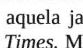

– Colin. Colin, algo terrível aconteceu.

Colin Sandhurst, Lorde Payne, levantou os olhos da carta que estava escrevendo. Sua esposa estava parada à porta do escritório dele – como sempre, uma visão sedutora, com os cabelos morenos e os lábios carnudos que ele adorava beijar.

Mas os belos olhos estavam tristes por trás dos óculos. No mesmo instante, ele se levantou da escrivaninha.

– Bom Deus, Minerva. O que foi?
– Nós precisamos fazer algo! – ela disse.
– É claro que vamos, querida. – Ele atravessou o escritório para se aproximar dela. – É claro que vamos. Eu posso atravessar aquela janela neste instante, se você pedir. Ou escrever uma carta enérgica para o The Times. Mas as ações que tomarmos vão ser mais eficientes se você, primeiro, me explicar o que está acontecendo.
Ele a pegou pelos ombros e a guiou até o divã.
– É aquele seu amigo horrível e devasso – ela disse. – De antes de nos casarmos.
Ele riu.
– Receio que essa descrição se aplica a um número chocante de pessoas. Você vai ter que descrevê-lo melhor, amor.
– O duque. Aquele duque asqueroso e nojento de Winterset Grange.
– Halford?
– Isso, esse mesmo. Ele pegou Pauline Simms. Nossa Pauline, da Touro & Flor, e a está mantendo refém aqui em Londres. – Ela estremeceu. – Deus sabe o que ele fez com a pobrezinha. Talvez a tenha transformado em uma sórdida escrava sexual.
Colin se esforçou para não rir.
– Minerva, eu quero entender a situação, mas você está tornando isso bem difícil. Não quer começar do início e me contar o quê, de fato, aconteceu hoje?
– Eu os vi juntos, estava indo à livraria para... – ela corou um pouco – ...para saber se mais exemplares do meu livro foram vendidos. Não consigo evitar.
– E foram?
– Sim – ela disse, orgulhosa. – Três.
– Excelente, Min. É maravilhoso. – O próprio Colin tinha comprado dois. Ele sabia que ela o esganaria por isso, mas não podia evitar. O mercado para tratados geológicos não era muito forte, mas ela ficava tão encantadora quando satisfeita consigo mesma – e também muito criativa na cama. Os motivos dele eram puramente egoístas.
– Enfim, eu estava me aproximando da livraria quando vi os dois saindo. Claros como o dia. O Nojento Duque de Halford e Pauline Simms.
Colin suspirou. Ele odiava cutucar a ferida, mas aquilo era demais para ele acreditar.
– Você estava de óculos?
– É claro que sim. – Ela lhe deu um olhar ofendido.
– Ainda assim, acredito que você deve ter se enganado.
– Não me enganei. Eu sei que não, Colin. Você não acredita em mim?
– Eu acredito, sem dúvidas, que você acredita ter visto os dois. – Ele segurou uma das lindas mãos dela e a acariciou, tentando acalmá-la. – Mas continuo pensando que é muito improvável.
– É verdade que nunca existiram duas pessoas mais diferentes – Minerva concordou. – O duque é depravado e mau, e Pauline é muito bem-intencionada.
– Ora. Os opostos às vezes se atraem, e mulheres de Spindle Cove “sequestradas” por libertinos nem sempre o são contra sua vontade, como o observador desavisado pode suspeitar.
– Acho que isso é verdade... – Ela sorriu.
– Antes que nos lancemos em uma missão de resgate, vamos refletir sobre alguns pontos. Por tudo que sabemos, Pauline não possui meios de viajar para Londres. Depois, eu conheço Halford, e ele nunca chegaria perto de uma livraria. E, finalmente – ele tocou de leve, com afeto, o nariz dela –, você tem reclamado que seus óculos precisam de lentes novas. Um engano parece a explicação mais provável.
– Colin...
– Contudo – ele acrescentou –, vou fazer tudo que posso para tranquilizá-la. Vou perguntar nos clubes e ver que fofocas estão circulando sobre Halford.
– Essa é uma boa ideia. E eu vou visitar Susanna e Lorde Rycliff. Se houver algo de errado em Spindle Cove, eles vão saber.
– Ótimo. E se nossas investigações não revelarem nada, vamos fazer uma experiência. Vamos visitar a Casa Halford amanhã.
Ela concordou, com os olhos marejados de lágrimas.
– Min, querida. – Ele acariciou o rosto dela. – Você está tão preocupada assim?

– Não – ela respondeu. – Oh, Colin, estou tão orgulhosa. – Ela apertou a mão dele. – Você está usando o método científico.

## Capítulo dezesseis

Griff se manteve ocupado pelo restante do dia. Ele estava com a agenda repleta de compromissos naquela tarde, todos relacionados à administração de suas propriedades.

Mas isso não foi o bastante. Todas as suas reuniões com advogados, capatazes e secretários foram como balas de canhão guardadas em uma caixa – eram pesadas, ocupavam o espaço... mas não deixavam a caixa cheia de verdade. Pensamentos sobre Pauline surgiam para ocupar cada espaço vazio, como um milhão de grãos de areia. Ou talvez fosse mais apropriado dizer cristais de açúcar.

De algum modo, o fim da tarde chegou enquanto ele se rendia às atenções de seu criado pessoal. Griff surgiu uma hora depois, barbeado, vestido e completamente despreparado para a visão que descia pela escadaria.

Bom Deus. Bastou um olhar para ela e Griff soube que tinha acabado. A noite era um fracasso antes mesmo de começar. Ninguém acreditaria que ela era uma trabalhadora comum. Não nessa noite, não com aquela aparência.

Ela envergava um vestido rosa exuberante, com camadas translúcidas de saias que desciam, ondulantes, do corpete tomara-que-caia justo. Luvas até os cotovelos que compunham com o vestido. O cabelo estava encaracolado, fazendo voltas, e preso, mas de um modo que conseguia ser, sem esforço, encantador e elegante. Um feito e tanto. Fleur merecia um aumento de salário.

A postura de Pauline também estava ótima. O pescoço era como uma coluna clara e esguia, e os ombros nus... ah, os ombros pareciam uma escultura feita com o luar. Delicada e serena, misteriosa e feminina. Um colar de ametistas claras mergulhava sensualmente no decote dela, refletindo a luz em mil facetas.

Griff se lembrou de que era um duque e um libertino. Ele tinha visto muitas mulheres lindas em sua vida. Já viu vestidos mais refinados do que aquele e joias mais exuberantes. Racionalmente, ele sabia que Pauline Simms não poderia eclipsar tudo e todas que vieram antes dela. Mas, de algum modo, ela conseguia esse feito.

Não havia um ponto que ele conseguia destacar, nem qualquer gesto em particular. Era apenas... Ela. Eu fico com ela.

– Então? – ela disse.

Afinal, ele encarou aqueles olhos verdes, brilhantes, felinos, inteligentes, encaixados no rosto em forma de coração. Nessa noite estavam ansiosos e vulneráveis.

Bom senhor. Ela não fazia ideia. Pauline o tinha arrebatado ao ponto de fazê-lo babar, mas não fazia nenhuma ideia disso.

Pauline levantou uma sobrancelha. *Ela está esperando sua reação. Reaja. Mas não demais. Só a medida certa. Uma ou duas palavras bem escolhidas.*

– Bá – foi o que ele disse.
Oh, diabos. Aquela sílaba malformada tinha mesmo escapado de sua garganta?
– O que foi? – Pauline arregalou os olhos para ele.
Parecia que sim. Ele limpou a garganta com um pigarro alto, depois procurou um modo de emendar o que disse.

– Bom – ele pronunciou, pigarreando de novo. – Eu disse “bom”.
Uma cor encantadora tingiu as faces de Pauline. Ainda assim, ela mordeu o lábio, parecendo insegura.

– Que tipo de “bom”? – ela perguntou. – “Bom” no sentido de “muito ruim”, o que ajuda nosso objetivo? Ou “bom” no sentido de “bom de verdade”, o que o desagrada?

Griff suspirou por dentro. O que ele iria dizer? “Bom” no sentido de *“Bom Deus, você é a coisa mais linda e radiante que já vi em toda minha vida. Estou sem fala, tremendo como um pateta diante de você”*. Isso esclarece a situação?

– Bom no sentido de “bom” – ele disse. – Não me desagradou.
Ela torceu o canto da boca.
– Então isso é... bom.

Aquela era, oficialmente, a conversa mais estúpida da qual Griff tinha participado, e isso incluía um debate com Del, ambos bêbados, sobre corrida de avestruzes.

– A cor não é pavorosa? – Ela segurou uma prega da saia. – O vendedor de tecidos a chamou de “pétala com orvalho”, mas sua mãe disse que o tom era mais de “framboesa congelada”. O que você me diz?

– Sou homem, Simms. A menos que estejamos discutindo mamilos de mulheres, não vejo motivo para procurar diferenças de tons.
Ela apertou a boca em uma expressão de reprovação.

– Seja que cor for, fica bem em você. – *Bem demais.* Ele ajeitou suas luvas de noite pretas e pegou o chapéu com Higgs. – Vamos indo.

A carruagem estava pronta e à espera. Ele se voltou para Pauline. Era óbvio que ela precisava de ajuda com aquelas saias volumosas. Sem hesitar, ela aceitou a mão que ele lhe oferecia e a apertou com força, pegando emprestada a força dele. O aperto quente dos dedos recobertos de cetim quase acabou com Griff. Ele próprio estava desequilibrado quando subiu na carruagem e se sentou de frente para ela.

Ele olhou pela janela, precisava recuperar o autocontrole. Ainda estavam saindo de casa, tinham a noite toda pela frente.

Quando chegaram ao local em que deveriam atravessar o rio e desceram da carruagem, o sol já estava se pondo. O ar estava pesado com neblina e sombras. Havia um clima romântico de mistério, apesar das tentativas de Griff dissipá-lo.

– Nós vamos cruzar o rio usando os barcos? – ela perguntou, olhando para o barco com a expressão de medo. Ela apertou o braço dele com mais força.

– É o único modo de se chegar a Vauxhall – ele concordou. – Estão construindo uma ponte, mas ainda não está pronta.

– Eu nunca estive em um barco em toda minha vida.

– Nunca? Mas você vive no litoral.
– Eu sei. É absurdo, não é? Às vezes as ladies vão passear de barco, mas nunca tive motivo para ir junto.
– Não tenha medo. – Ele estendeu a mão. – Aqui. Ajudá-la a embarcar foi ainda mais perigoso do que ajudá-la a subir na carruagem. Griff entrou primeiro e apoiou as botas entre as tábuas do piso para se equilibrar.

Pauline aceitou a mão dele e deu um passo cauteloso para chegar a um assento perto da proa. Mas nesse momento o barqueiro lançou o barco. Ela cambaleou e Griff teve que ampará-la com os dois braços enquanto ela caía de encontro ao peito dele.
– Oh, saco. – Ela lutou para se endireitar e o barco balançou.

O estômago dele quase virou. Ele teve uma visão – um breve pesadelo acordado – em que ela cambaleava e caía nas águas escuras, e aquelas saias pesadas e volumosas a puxavam para as profundezas.
– Não se mexa – ele disse, apertando mais a mão. – Ainda não.

Ele a manteve perto, com firmeza. Durante longos momentos os dois ficaram absolutamente imóveis, balançando um nos braços do outro enquanto o barco parava de balançar.
– Você está bem? – ele sussurrou.
Ela concordou.
– Seu coração está disparado – ele disse.
– O seu também.
– É verdade. – Ele sorriu.

Quando o barco parou de oscilar, enfim, ele a ajudou a sentar e gesticulou para o barqueiro que os transportava até o outro lado do Tâmisa com movimentos suaves e equilibrados.

– Está vendo? – ele murmurou, mantendo-a perto. – Não há nada que temer. Só imagine que você está viajando através da caixa de ouro, pérolas e cristal do poema que citou. Imagine que está viajando de um mundo para outro. Outra Inglaterra. Outra Londres com sua Torre. Outro Tâmisa, com outras colinas.

Ela relaxou no ombro dele.
– Uma linda noite enluarada.
– Isso mesmo. – E ela começou, de novo, a encantá-lo.

Griff nunca foi do tipo sonhador, nem mesmo quando garoto. Quando ele estava com Pauline, contudo, o mundo era diferente. Ela o forçava a ver as coisas com novos olhos. De repente, a biblioteca dele era a oitava maravilha do mundo, e pinturas de barcos pareciam obras-primas. Um barco os transportava pelo Tâmisa em uma jornada épica, e um beijo... um beijo era tudo.

Bem no fundo, por baixo da atendente de taverna que trabalhava demais e tinha língua afiada, havia uma mulher que ansiava por poesia em sua vida. Nunca tinham dado nada a ela – nem mesmo uma chance. Mas havia uma vivacidade no espírito dela que se alimentava de possibilidades – que Pauline absorvia como o pavio de uma lamparina, brilhando mais forte dessa forma.

E esta noite? Griff inclinou a cabeça para oeste e observou o sol poente. Dali a menos de uma hora o mundo dela explodiria com possibilidades brilhantes. Ele não queria outra coisa que não estar perto dela quando isso acontecesse.

Pauline achou Vauxhall bem impressionante. E isso antes mesmo de entrar no local. Quando eles desembarcaram no outro lado do rio, o estômago dela precisou de vários momentos para parar de balançar. Eles subiram um grande lance de escada, que subia da margem do rio até um grandioso portão de entrada. Quanto mais eles subiam, mais alta a música ficava.

UAU!, ela pensou. Mas não disse em voz alta. E esse foi o pensamento constante dela enquanto passavam pelo portão e entravam nos jardins.

Uau, uau, uau, uau!

Ela não entendia como a natureza podia ser domesticada àquele ponto. A grama era perfeita em sua retidão. Os arbustos estavam podados em formas exatas. As árvores, plantadas em linhas retas.

Colunatas majestosas seguiam em várias direções, marcando caminhos cobertos. Ao fim de cada corredor, várias pinturas estavam expostas. Daquela distância, Pauline não conseguiu distingui-las. Ela viu o pavilhão branco da orquestra, na forma de uma concha marinha gigantesca, com esculturas e todo tipo de decoração.

De repente, ela se deu conta que estava com a boca aberta há vários minutos, e o duque tinha reparado.

Ele lhe deu um olhar divertido.

– Está escurecendo – ela disse. – Não deveríamos ir para o pavilhão?

– Ainda não – ele disse, segurando o braço dela. Ele a conduziu para fora do caminho principal, para um bosque destacado das colunatas.

– Por quê?

– Vai acontecer uma coisa que eu quero que você veja. E quero estar com você quando acontecer.

Ela ficou na ponta dos pés e esticou o pescoço para olhar em todas as direções.

– O que nós estamos esperando para ver?

– Está começando – ele disse, virando a cabeça dela. – Veja.

Pauline olhou. Ela viu uma esfera brilhar. Uma única bola de luz, pendurada à distância. Ela piscou e apareceram duas, depois dez. E então... milhares.

Um brilho quente se espalhou pelos jardins como uma onda de luz, tocando aqui uma lamparina vermelha, ali uma azul ou verde. Sem fôlego, de tão encantada, ela inclinou a cabeça para trás. As árvores acima deles sustentavam lamparinas em todos os galhos. O brilho corria de uma para outra e não demorou para que o bosque todo ficasse iluminado. O efeito era semelhante a ficar debaixo de um vitral de igreja durante a hora mais ensolarada do dia. Só que era noite e todas as cores possuíam uma riqueza luminosa. As lamparinas eram como milhares de joias penduradas em todas as árvores e em todos os arcos de pedra.

Pauline não conseguiu encontrar palavras. Ela riu e levou a mão ao rosto.

– Como eles fazem isso? – ela perguntou. – Como acendem todas ao mesmo tempo?
– Há um sistema de estopins – ele explicou. – Só precisam acender uns poucos e a chama corre até todas as lamparinas.
– É mágico – ela disse.
– É... – ele confirmou, a voz suave. – Acho que é mesmo.

Ela se virou para o duque, sentindo-se tonta com a beleza daquilo. Ele não estava olhando para os milhares de globos iluminados e pendurados nas árvores. Ele olhava para ela.

Um arrepio passou pelos ombros nus de Pauline, que cruzou os braços para se aquecer.
– Permita-me – ele disse, colocando as mãos enluvadas sobre os braços dela, para depois massageá-los.
O couro quente e macio deslizou pelos braços nus dela. Foi um gesto encantador, mas não ajudaria em nada para controlar seus arrepios.
Com o olhar, ele acariciou a boca de Pauline.

– Talvez tenha sido um erro vir até aqui.
– Não – ela insistiu, esperando que suas palavras não fossem abafadas pelo martelar enlouquecido de seu coração. – Não, eu prometo que consigo fazer isto.
– Halford! – a voz chegou até eles através do arvoredo. Ela se virou e avistou Lorde Delacre acenando da colunata. – Venham logo. Nós temos um reservado logo ali.
– Essa é a minha deixa – ela disse, dando uma piscada para Griff. – Está na hora de eu fazer por merecer minhas mil libras. Prepare-se para o desastre.

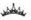

Eles caminharam até o conjunto de colunas e encontraram o reservado de Del. Pauline escapuliu para se misturar com o grupo. Griff a observou rir e fazer piada, beber champanhe e devorar fatia após fatia de presunto fino.

Por sua vez, Griff ficou de lado, bebericando conhaque em sua garrafa de bolso e aceitando, enfim, uma verdade dolorosa: ele precisava encontrar novos amigos.

Martin estava com sua cantora boêmia a reboque e Delacre estava de novo com aquela viúva. Algumas prostitutas bem-vestidas aguardavam por perto, esperando que enchessem seus copos para poderem seguir em frente. Mesmo sem se esforçar, Pauline era a mulher mais refinada do local. Se ela fizesse alguma observação inoportuna sobre a Lei dos Cereais, ninguém se importaria.

Todos os camaradas mais ou menos decentes que faziam parte do círculo de amizades de Griff tinham se afastado nos últimos anos – casando, assumindo seu título, acomodando-se. Griff também teria gostado de se afastar – sem ter que se casar –, mas é mais difícil deixar um círculo quando se é o centro dele.

– Quando você vai abrir Winterset Grange este ano, Halford? – Martin perguntou. Estava com um braço jogado sobre os ombros empoeirados de sua amante. – A Ruby aqui gosta de uma temporada no campo. Ela vai levar amigas. Amigas muito amistosas.
A loira cheia de rouge lhe deu um sorrisinho tímido.

Nos últimos anos, Griff passou os meses mais frios em Winterset Grange. Essa casa foi a primeira coisa que ele comprou após atingir a maioridade. Mesmo com seis propriedades de família, ele sentiu a necessidade de ter um lugar só seu. Homens comuns tinham apartamentos de solteiro. Mas ele era um duque, então possuía um sítio de solteiro. Ali, durante vários anos após sair da faculdade, Griff e seus colegas de Oxford levaram a tradição de festas no campo a novas alturas – ou baixezas – de libertinagem.

Sempre um anfitrião generoso, Griff era famoso por abrir sua porta para qualquer convidado – principalmente quando se tratava de mulheres bonitas. Os dias eram para se dormir, as noites eram para jogatina, bebedeira e outros vícios carnais.

Winterset Grange tinha se tornado uma tradição tão grande que, quando Griff não abriu a casa no último inverno, circularam boatos de sua falência. Ele não estava quebrado, é claro. Apenas despedaçado.

– Você vai abrir o sítio este ano, não vai? – Martin perguntou.
– Não decidi ainda – Griff respondeu. – Talvez não.
– Oh, vamos lá, Halford. Você tem que abrir. No inverno passado fui obrigado a ir para casa, em Shropshire. Um tédio sem fim, se quer saber. O velho ficou insistindo para que eu entrasse para a Igreja.

– Segundos filhos e seus problemas – Griff suspirou.

Griff não estava interessado em abrir sua casa para que Martin, Delacre e todos os outros adultos imaturos da Inglaterra pudessem vadiar à vontade em seus móveis e, bêbados, organizar torneios de bilhar que duravam três dias e três noites seguidos. Aquilo foi divertido quando eles eram jovens, mas agora... ele acreditava que suas paciência e generosidade tinham acabado. Ou foram redirecionadas.

Ele só conseguia enxergar uma razão para abrir essa propriedade – e o nome dela era Pauline.

Assim que a ideia pipocou na cabeça dele, sua mente a agarrou. Ele sabia que Pauline sonhava em abrir uma livraria em Spindle Cove, mas talvez ela sonhasse com isso apenas porque não conseguia conceber algo maior. Ele podia dar algo maior para ela.

Pauline se virou para ele, então, como se pudesse sentir essas intenções novas, viscerais. Esgueirando-se em meio à multidão que lotava o reservado, ela chegou ao lado dele.

– Lorde Delacre me convidou para dançar – ela sussurrou. – Não tenho a menor ideia de como se faz. Se eu acertar o momento certo para tropeçar, acho que consigo jogar nós dois dentro da tigela de ponche. Você me dá um bônus de dez libras?

– Vinte. – Ele sorriu, apesar do que sentia.

Griff a observou se afastar de braço dado com Del, a caminho do redemoinho colorido de dançarinos.

Oh, ele não podia se casar com ela. Não podia se casar com ninguém. Mas ele podia cuidar dela, ter certeza de que Pauline nunca mais passasse dificuldade. Com apenas 23 anos, ela tinha trabalhado o bastante para uma vida. Não deveria mais se matar de trabalhar. Pauline merecia ser alimentada com as melhores iguarias, mimada com os lençóis mais macios, atendida por dezenas de criadas e lavada em banheiras profundas de cobre.

Delacre 在领舞。穿着那件粉红色的连衣裙，她苗条的身影宛如梦境。Griff 希望她至少能有点开心。在一个更公平的世界里，她本该拥有自己的出道舞会，成群的仰慕者排队求娶她。但他一个人就能像几十个男人一样仰慕她。他无法移开视线。

舞者们转了一圈，Griff 瞥见了她的脸。糟糕。他认出了那表情。并且不喜欢。

甚至还没决定要做什么，他的脚已经动了起来。他必须立刻赶到她身边。

有些不对劲。

## 第十七章

– 你认识公爵多久了？ – Delacre 伯爵在舞池中熟练地领着她。他跳舞如此优雅，她根本没有机会踩错步。
– 只有一周 – Pauline 诚实地回答。 – 那您呢，我的爵爷？
– 我们在伊顿是同学。从那时起我们就是至交。 – 他用不可穿透的目光盯着她。 – 我们有一个契约，你知道。
– 契约？
– 是的。一个契约，用血在交叉的剑上宣誓。为了互相保护，免受一切威胁：背叛、背信弃义……
– 死亡？ – Pauline 接话。
– 不，更糟。婚姻。
Pauline 笑了。她忍不住。
– 你们在宣誓这个契约时几岁？
– 十九岁。但它永远不会过期。会自动续约。
– 我明白了。 – 她努力装作若有所思。 – Delacre 伯爵，如果一位公爵想避免婚姻，他难道不能自保吗？
他摇了摇头。
– 你在伦敦还真是新手，不是吗？像 Halford 这样的人需要一个值得信赖的朋友时刻照顾他。社交界里充斥着觊觎财富的女人。而在觊觎财富这件事上，他的财富就像白虎的皮一样难以得到；对猎人来说是最大的奖赏。这座城市里有女人会使用陷阱甚至毒镖来猎捕他。 – Delacre 挑起一眉，饶有兴致地看了看人群。
– 永远不知道她们什么时候会发动攻击 – 他转身对她说。
– 所以你觉得我是那些女人之一 – Pauline 总结道。 – 像其他人一样觊觎财富的猎人。我的爵爷，我可以向您保证：我对公爵并无二心。我没有带锋利的箭或弹弓在我的包里。我没有能让 Halford 这样的人想娶我的优点。
那盛放波旁酒的碗到底在哪儿？Pauline 不想向 Delacre 解释她与 Griff 的协议，但做个示范也许就够了。毫无疑问，当他被波旁酒淋湿时，他不会把她看作婚姻上的威胁。
– 我想你知道 Halford 的名声 – Delacre 说。 – 你可以尽情用你的恩惠去“沐浴”他，但他不会娶你。

– 什么让我“沐浴”任何男人以我的恩惠？
– 抱歉，Simms 小姐 – 他严肃地说。 – 我并不是想暗示什么。
说谎。他就是想说他说的那些。就好像他光看她——对她卑微的身世一无所知——就能知道 Pauline 是那种女孩。
最糟糕的是，他在某种程度上是对的。在她年轻时，她并没有像应该那样保守自己的“恩惠”。但 Griff 知道这一点，却从不因此让她感到自卑。
Pauline 四处张望，急切地想结束这一切。她想回到 Griff 身边。
啊哈。那里，一只巨大的银碗盛着波旁酒，形状像一只张开的贝壳。只要他们走到舞池的另一边，她就会请 Delacre 伯爵给她倒一杯。他们会靠近那只碗……他会俯身去倒酒……
到那时，一个好推一把就能解决一切。
– Delacre 伯爵，我的朋友在我的手里没有任何危险。 – 她在心里补充道，你就另当别论了……
– 我很想相信你的话，Simms 小姐。 – Delacre 的目光移向她肩膀后方的一个点。 – 如果 Halford 本人正要证明你错了。
– 什么？
– 到此为止。 – Griff 突然出现，打断了他们在舞中的交谈。 – 我来接手。
– 哎呀，Halford。 – Delacre 抵挡道。 – 让我们把舞跳完。我们正在交谈。
Griff 抓住朋友的衣领，把他从 Pauline 身边拉开，声音压低成一声咆哮。
– 我说过她是我的。
– 好吧。 – Delacre 举起双手。 – 她是你的。
Delacre 微微鞠了一躬——并用怀疑的眼神看了 Pauline 一眼——便消失了。
当 Griff 把她揽入怀中进入舞步时，Pauline 惊愕地看着他。
– 你为什么打断我们？我差点就要制造一场惊人的灾难了！
他耸了耸肩。
– 我决定不想看到你跳进波旁酒碗里。有人辛苦做了你现在穿的这件裙子。波旁酒也是精心准备的。更别提今晚的微风了。你可能会感冒。
感冒？
– 你明白 – 她低声说 – 为了我们的协议能成功，早晚你得让我摔倒。
– 好吧，这不会是今晚，因为今晚我要照顾你。我不会让你摔倒。
他向她靠近，在她耳边低语：
– 我看到你不高兴了，Pauline。

她感到心口一紧。他能在那么远的地方察觉到这一点——而且没有浪费时间就赶过来——让她的心暖了起来。Pauline 不在乎别人会怎么说他的过去或名声。她知道他是个好人。
她握住了他的肩膀。
——没事了。——他把手按在她的背上。——让我来带路。
他带着她跳舞到凉亭的侧边——远离朋友们的包厢。没有回到派对，他把她带离了乐队，沿着一条光线昏暗的小路走去。离开人群后，他转身面对她。
——怎么了？——Griff 问道，扶着她的肩膀打量她的脸。——是 Del 说了什么吗？我会为了你轻易杀了他。
Pauline 露出一个淡淡的笑容。
——别这样，请。——虽然 Delacre 冒犯了她，但她知道他正以自己扭曲的方式试图成为 Griff 的好朋友。她不想夹在两人中间。
——有人侮辱你了？你不舒服？
——没有。不是这些。
——那是想家了。
——我想家了。——这是真的。——这个地方让我惊叹。每当我回头看向某个地方，我都会想“Daniela 会喜欢看到这个”。所以……
——你难过了——他总结道，把她拉近。
——会过去的。散步可能会有帮助。
Griff 向她伸出手臂，她接受了。两人一起离开了乐队，走进一片黑暗的树林。再次，她不禁想着他竟如此理解她的感受。几乎就像是他自己的感受一样。
——我可以问你一件事吗？——她说。
——只要不是关于灾变铸造的事。
她笑了。
——是关于我妹妹的。你对她太好了。简直完美。你家里有像 Daniela 这样的人吗？
——没有——他回答道。——我没有兄弟姐妹。不再有了。
所以他也失去过某人。她握紧了他的手臂。
——Griff。我很抱歉。我完全不知道。
——不是你想的那样。我是说……是的，但不是。我母亲生了四个孩子，但只有我活过了第一周。我对我的兄弟姐妹没有任何记忆。——他拨开挡在 Pauline 路上的树枝，她从下面走过。——Daniela 很迷人。你很幸运有她做妹妹。
——我知道。我不总是意识到这一点，但我知道。
Pauline 不是圣人，Daniela 也不是。像所有姐妹一样，她们也有争吵和怨恨的时刻。还有那次尴尬的童年经历，她们和父亲一起去市场。Pauline 当时大约 8 岁，跑出去结交新朋友，借一点别人的生活乐趣。当 Daniela 找到她和新朋友在一起时，Pauline 感到羞愧。
——这个傻丫头是你妹妹？——一个男孩嘲笑道。
——天哪，不——她回答道。——我这辈子从没见过她。让她离我远点。
至今，Pauline 还能记得妹妹那张惊恐的脸。内疚像磨坊石一样压垮了她。她在那一刻明白，自己否认了世界上最爱她的人。而为了什么呢？为了给几个孩子留下好印象？她冲出去追 Daniela，恳求原谅。她们紧紧拥抱，哭泣……哭泣。那是一段痛苦的回忆，她不敢忘记。
她再也不会让任何人让她难堪了。也再也不会背叛妹妹。
——我很幸运有 Daniela——Pauline 重复道。——而没有人理解这一点。没有人。
——也许这些人兄弟姐妹太多。他们并不都这么幸运。
说完，他沉默了。
Pauline 注视着他，在灯笼照亮的黑暗中记住了他美丽的面容。他是个复杂的人，有着丰富的家族传承和她无法想象的责任。她是谁——一个来自 Sussex 的酒馆女招待——竟敢对他说些什么？但 Pauline 必须尝试。再也没有别人能做到。她转向他，把手放在他的前臂上。
——Griff……
——不。——察觉到她声音里的语气，Griff 眯起眼睛后退，靠在一棵附近的树上。——不，Simms。别开始这些。
——别开始什么？我只是说了你的名字。
——但我很熟悉这种语气。你想开始某种徒劳的尝试来拯救我，修复我生活中的错误……不管你心里在酝酿什么女性的想法，现在就放弃吧，否则你只会感到羞愧。
天哪。这个男人性格如此透明，仿佛她能透过他的背心看到他靠着的树干。如果他以为几句粗话就足以吓退她，在昨晚他那样拥抱她之后……在那些甜言蜜语之后……
——你很荒唐——她平静地说。——荒唐到我甚至生不起气来，所以别以为你在把我推开，Griff。我知道你为某事而痛苦。我知道。我第一天就感觉到了，而且……
他移开了视线。
——我不想进行这场谈话。
——很好。你可以否认，我不在乎。我不知道这是男性的自尊还是贵族的冷漠。无论是哪种品质，我都没有。你可以假装自己没有在受苦。我没法假装不在乎。——她鼓起勇气继续说下去。
——我不是要求你信任我。我能理解你为什么不会把问题告诉像我这样的女孩，但……也许你不应该完全拒绝结婚的想法。我讨厌看到你一个人。

– Quem disse que estou sozinho? – Ele bufou. – Não me falta companhia, se eu quiser.
– Sei, sei. Você é um grande devasso e libertino. Pelo menos foi o que eu ouvi dizer. Mas não vi provas disso. Pelo que observei, você é apenas um homem impulsivo e generoso, às vezes decente, que vaga pela casa à noite, sozinho, e mexe com relógios velhos.
De repente, ele estendeu o braço e a puxou para o peito.
– Não se iluda pensando que sou um homem decente.
Com um movimento rápido, ele inverteu as posições deles, pressionando-a com o peito largo contra o tronco da árvore. Ela se debateu um pouco e o tecido leve do vestido prendeu na casca da árvore.
Pauline não queria que ele percebesse seu tremor.
– Você recusou me possuir ontem à noite – ela disse. – Não pode estar esperando que eu tenha medo disso agora.
– Medo? Não. – Ele se inclinou para frente, até estarem com os rostos quase colados.
– Espero que tenha prazer.
Ele tomou a boca de Pauline em um beijo profundo e exigente. Sua língua envolveu a dela, e ele inclinou a cabeça para mergulhar ainda mais fundo. Explorando-a, possuindo-a de forma implacável. E ele não ficou nisso. Sua mão deslizou até o corpete dela, envolvendo seu seio. Oh, céus.
Ele apertou o volume aumentado com enchimento, levantando-o e acariciando-o. O polegar dele foi para frente e para trás, procurando o mamilo. O enchimento o frustrou. Ele desistiu, praguejando, e puxou o decote para baixo, tentando fazê-lo descer.
Ela prendeu a respiração. Ele não podia estar querendo fazer isso ali... Ou talvez pudesse.
Com um movimento firme e decidido, ele pegou o que tanto queria e levantou, colocando o seio acima do limite do corpete, expondo-o ao ar frio da noite. Estava escuro, mas ela se sentiu como que jogada em uma vitrine, vulnerável e trêmula.
Ele a beijou de novo, explorando sua boca com passadas possessivas da língua. Enquanto isso, acariciava o mamilo com o polegar. As carícias habilidosas destruíram toda determinação e bom senso dela. De algum modo, em meio às fagulhas deliciosas e aos arrepios de êxtase, um objetivo simples começou a se formar dentro de Pauline: dessa vez ela também queria tocá-lo.
Pauline deslizou as mãos enluva das por dentro do casaco dele, sentindo os músculos definidos e duros do tronco. Mesmo por cima do casaco, a força daquele corpo era palpável.
Ela puxou a camisa para fora da faixa na cintura e colocou as mãos por baixo. Ele grunhiu, encorajando-a, enquanto ela passava as mãos pelos músculos abdominais e pela leve trilha de pelos no centro. Então ela subiu com as mãos, roçando o mamilo de Griff e parando sobre o coração impetuoso dele.
Bum. Alguma coisa explodiu. Ela sentiu a onda de choque no peito dele e pensou que pudesse ser seu próprio coração. Então, clarões no céu iluminaram o espaço entre eles. Ela riu de si mesma quando entendeu o que acontecia.

– Fogos de artifício.
Claro. Com uma última passada de seus lábios nos dela, ele levantou a cabeça. Ela segurou a respiração, esperando que ele falasse, mas Griff não disse nada, só ficou olhando para ela, do mesmo modo que naquele primeiro dia em Spindle Cove – como se ela fosse a coisa mais maravilhosa, terrível, intrigante e perfeita que ele já tinha contemplado.
Não, não. Aquilo era demais.
Pauline sentiu as batidas do coração dele na palma da mão. Ele conservou o seio pequeno dela na sua. E acima deles, os malditos fogos de artifício explodiam em fragmentos de ouro e prata.
A força daquele momento foi estonteadora. Sem a proteção de um beijo, ela não podia esconder seus sentimentos. Não havia para onde olhar, a não ser diretamente nos olhos dele.
O pulso dela palpitava incoerente, mas não havia hesitação no ritmo sob sua mão. Nenhuma dúvida. Apenas uma batida forte e insistente de desejo.
Pauline, ela podia imaginar o coração dele dizendo. Pauline, Pauline, Pauline.
Aquilo não devia estar certo. Tinha que ser outra coisa.
O mais provável era: Tonta, tonta, tonta.
Ali perto, amor era um buraco nefasto que se abria na terra, ficando maior a cada instante. A menos que ela tomasse muito cuidado, com certeza cairia dentro dele.
– Griff – ela sussurrou. – Você precisa de alguém. Todo mundo precisa.
Com um movimento impaciente, ele subiu o corpete dela, cobrindo o seio, então, se afastou.
– Você não entende disso. – As palavras dele soaram sombrias e irritadas. – Não me diga que eu preciso de alguém. Minha vida toda foi uma coleção interminável de alguéms. Outro “alguém” é exatamente o que eu não preciso. O que eu menos quero é ficar em uma sala cheia de mulheres patéticas, sem graça, e escutar, “é seu dever casar, Halford. Escolha alguém”.
Ela se afastou dele, ferida.
– Oh. Entendo.
Griff praguejou.
– Não foi isso que eu...
– Não, você tem razão. – Ela se afastou com passos pequenos e apressados. – Escolher uma garota sem graça em um salão lotado. Que pesadelo. Nada de bom poderia sair de uma cena como essa.
– Pauline, espere.
Ela se virou e correu, deixando-o no bosque sombrio e emergindo em uma clareira onde uma multidão tinha se reunido para assistir aos fogos. Pauline parou, de repente, com dificuldade para respirar. À volta dela, as pessoas riam, aplaudiam e soltavam exclamações de alegria.
Um homem trombou nela, com força. A antiga Pauline teria reagido com uma cotovelada, mas nesse momento ela não teve disposição para tanto. Apenas se virou para

encará-lo, levando a mão ao pescoço com o susto. Oh, Deus. Oh, não. Ele tinha sumido. Tudo tinha sumido.

Griff saiu do bosque à procura dela. Enfim avistou o vestido de Pauline no outro lado do gramado lotado. O inconfundível borrão rosado, iluminado pelos clarões dourados dos fogos acima. Ele sentiu como se estivesse assistindo ao próprio coração sendo separado de seu corpo.

Então um homem emergiu das sombras, e o coração de Griff baqueou.
– Pauline! – ele gritou.

Ela não o ouviu – ou não se virou, caso tenha ouvido. Apenas parou por um instante, então levantou as saias e partiu em disparada na escuridão da noite. Pauline estava perseguindo alguém.
– Pare! Pare, seu maldito ladrão! – ele a ouviu gritar.

Ladrão? Griff correu atrás dela, mas ainda precisava desviar da multidão, e ela tinha uma vantagem e tanto. Ele ficou espantado com a velocidade que ela conseguia alcançar usando todas aquelas saias. Pauline estava fazendo o bandido – ou quem quer que fosse – correr bastante entre as colunatas e através dos bosques iluminados.

Enquanto ela corria, deixava xingamentos para trás, como seus próprios fogos de artifício. Qualquer progresso que ela tivesse feito em dicção nesta semana, desapareceram num instante.
– Vagabundo! – ela gritou, passando apressada por um atônito cavalheiro que Griff reconheceu como sendo o embaixador austríaco. – Pare, seu maldito canalha!

Bem, se um espetáculo desastroso era o que ela queria, aí estava. Não foi necessária nenhuma tigela de ponche.
– Vou acabar com você, seu nojento filho de uma prostituta!

Griff fez uma expressão de “Não, você não” na direção do reservado real, como que pedindo desculpas, sem vontade de parar para dar explicações. Ele estaria rindo se não estivesse tão ofegante – e preocupado com Pauline.

Eles chegaram aos limites de Vauxhall e mergulharam no bairro vizinho – uma mistura de fábricas, casas e apartamentos de comerciantes. Nenhuma das ruas era iluminada. Só Deus sabia que perigos se escondiam naqueles becos. Ainda assim, Pauline foi em frente. O que ela estava pensando? O que quer que o bandido tivesse roubado, não valia colocar a vida dela em risco. Ela estava perdendo para o ladrão, mas Griff se aproximava dela.

– Pauline! – ele gritou, buscando fôlego no fundo dos pulmões. – Deixe-o ir!
– Não posso!

Ela dobrou uma esquina, firme na perseguição, e Griff a perdeu de vista por alguns segundos assustadores e intermináveis. Ele aumentou o ritmo, rezando para que ela ainda estivesse inteira e ilesa – para que pudesse segurá-la e fazê-la recuperar o juízo.

Quando Griff se aproximava da mesma esquina, um grito curto e penetrante cortou o ar. Santo Deus. Por favor. Ele virou na esquina e lá estava ela – jogada no chão, no meio do caminho.

– Pauline! Pauline, você está ferida?
– Não pare por minha causa! – ela exclamou. – Corra atrás dele.
– Ele já foi. – Griff nem se preocupou em olhar. – Já foi. E mesmo que eu pudesse alcançá-lo, não iria abandonar você aqui.
As pessoas começavam a sair das moradias próximas, observando com interesse o cavalheiro e a dama que estavam parados no meio da rua. Griff adotou uma postura forte e olhou em todas as direções, alerta, fazendo quaisquer rufiões saberem que era melhor não se arriscarem com ele.
– O que aconteceu? – ele murmurou, agachando-se diante de Pauline. – Ele a machucou? Bateu em você com alguma coisa? – Griff começou a procurar manchas de sangue. – Ele tinha uma pistola ou uma faca?
– Não... – Ela soluçou.
Ele conseguiu respirar de novo. Graças a Deus.
– Nada disso. O problema foi essa droga de sapato. Prendi o salto alto entre duas pedras da rua e torci o tornozelo.
Ela levantou a saia e Griff pôde ver o tornozelo sob a meia, virado em um ângulo assustador.
Primeiro ele soltou o pé dela, depois o sapato. Com dedos cuidadosos, ele explorou o pé que começava a inchar.
– Está doendo muito? Pode ter quebrado.
– Não quebrou. – Ela sacudiu a cabeça. – E a dor não é tão forte. É só que...
– O que foi? – ele perguntou, preocupado. – O que esse vagabundo fez com você?
– Oh, Deus. Você vai me odiar.
– Nunca.
Ela deixou o corpo cair contra o dele, como se toda a disposição para lutar tivesse se esvaído dela.
– Griff, ele levou o colar. As ametistas da sua mãe. Valiam milhares de libras. E agora se foram.

就这样了。波琳娜放弃了。她把自己交给了他的照顾，不知道还能做什么。她一直认为自己是一个坚韧的人，但那晚她被击败了。
伦敦 1，波琳娜 0。
不到零分。即使算上格里夫承诺给她的那一千英镑的报酬，她现在仍欠他数千英镑！公爵夫人永远不会原谅她。她该怎么偿还如此巨大的债务？
公爵仍蹲在她身旁。
——把手臂绕到我脖子上——他说。
她照做了，沮丧地把手放在他的肩膀上。
——紧紧抓住——他抱怨道，咒骂着。——你是农场主的女儿，也是酒馆服务员。我知道你能做得比这更好。
她有意识地努力绷紧肌肉。他说得对，她拥有一副强壮的身体，这意味着她并不像羽毛那样轻盈。她需要帮忙。她欠他这个。
格里夫把她抱起来，发出一声吃力的闷哼，调整着手臂，直到她的重量靠在他的肌肉胸膛上。
——鞋子——她声音微弱地说。
——鞋子去死吧。
她同意他的说法。当她刚刚丢掉价值数千英镑的项链时，一只鞋子又有什么区别呢？
格里夫把她一路带到街尾，抄了一条与追赶小偷时走过的路不同的路。波琳娜想提到这个差异，但决定他一定知道自己要去哪里。他的脸，在她借助某扇窗户投射出的微弱灯光下能看到时，是一张铁一般的决心面具。
——我很抱歉——她说。
他坚定而克制地点了点头。
——别道歉。
格里夫一路到哈尔福德府都没再跟她说话。乘船穿过泰晤士河时也没说，坐马车到梅费尔时也没说。
到达后，她听见他用低沉而坚定的声音向仆人们下达命令。她被带到粉红厅，放到了最大的长沙发上。
——我要叫个医生——格里夫宣布。

——我真的不需要这个……——她抗议道。
他离开了房间，讨论就此结束。

医生到来时，波琳娜坐在粉红厅里，看着医生按压她的脚踝并检查她。肿胀似乎已经在好转。至少脚踝没有严重损伤。皮肤的其他部位也许永远无法恢复。

波琳娜从椅子上站起来，一瘸一拐地走到他面前，走到房间中央。
——好吧——她说——毕竟，我证明了自己是个灾难。我一定看起来像个满嘴脏话的泼妇，在那些保养得很好的花园里那样奔跑。

他似乎对她的话一点也不觉得好笑。
——来，我帮你上楼。
——伤得不严重。——她挥了挥手拒绝帮助。——医生说很快就会好。

格里夫坚持把手臂绕在她腰间，领着她走向楼梯。波琳娜不知道该如何拒绝。格里夫愤怒的表情与那副体贴的举止并置在一起，让一切看起来更糟。

她用好脚迈上第一级台阶。
——你对我生气。
——我生气——他确认道。——我不能否认。但我正在努力不把我的愤怒指向你。

她一瘸一拐地迈上下一级台阶。
——我很抱歉。我会以某种方式偿还。先从那一千英镑开始，当然。至于剩下的……——她停下来看着他。——我不知道该怎么做。但我发誓我会把一切都还清。

他用完全困惑的表情盯着她。
——你在说什么？
——项链。我会以某种方式为你们付钱。——她扶着扶手又迈了一步。

他没有跟上。
——这太荒谬了——格里夫低声说。

他弯下腰，把手臂伸到她大腿下，把她抱起来，抱着她走完剩下的台阶。在楼梯顶部，他没有继续往上走另一个楼梯到她的房间，而是转向了他的私人套房。

用一只手臂平衡着波琳娜的重量，格里夫打开门，把她抱进去，然后用脚关上门。穿过一个起居室后，他把她放在一张床上。他的床。

那是一张巨大的床，床头是红木雕花帷幔，四周垂挂着天鹅绒帘幔。
她试图用手肘支撑自己，但沉重的裙子阻碍了她。在她能站起来之前，他就把她制住，双膝跪在她的大腿上。

然后他用那双有力的手抓住波琳娜的脸，不许她看任何除了他脸以外的东西。他的眼睛凶狠。她的心脏撞击着他的心脏。

——我生气了，波琳娜。我对那个敢碰你的混蛋感到极度愤怒。我为你受伤而愤怒。是的，我也对你生气，因为你去追

dele. Por ter se colocado em risco. Você sabe que tipo de gente se esconde naqueles becos e vielas?

– Eu não sabia o que mais podia fazer. Ele tinha levado o colar da sua mãe e...

– E daí? Ela tem dezenas!

– Mas aquele era muito valioso. Ela gostava dele. Foi por isso que ela quis que eu o usasse esta noite, porque...

*Porque então você poderia me enxergar como uma dama de verdade. Assim você se apaixonaria por mim e desejaria que eu fosse sua noiva. Que piada.*

– Você achou que eu daria mais valor a um punhado de joias do que à sua vida? Eu sei que às vezes nos desentendemos, Simms, mas isso é demais. Você pensa tão mal assim de mim?

– Eu... Não. Eu penso muito bem de você.

– Acontece que eu também penso muito bem de você.

Eram palavras gentis, mas ele as pronunciou com malícia.

– Eu posso comprar outro colar para minha mãe amanhã – ele disse. – Um colar melhor. Meia-dúzia de colares, se ela quiser. Joias podem ser substituídas.

– Atendentes de taverna também.

– Não. Não faça esse jogo. – Ele encostou a testa na dela. – Quando ouvi você gritar... foi como se uma espada me atravessasse. Eu quis morrer.

*Eu quis morrer.* Aquelas palavras confundiram Pauline e causaram dúvida. Ele não podia estar falando sério. Com certeza estava exagerando.

– Pensei que a encontraria ferida ou sangrando, ou... – Ele ficou sem voz. – Ou coisa pior. Não venha me dizer que eu estava preocupado com pedras presas em uma corrente. Eu quero acreditar que você me conhece melhor do que isso.

– Eu conheço.

– E ainda assim pensou que eu ficaria tão bravo com um colar que a mandaria embora?

Ela deu de ombros.

– Você tinha acabado de falar que não me queria, de jeito nenhum.

– Eu não falei nada disso. Você saiu correndo sem me deixar terminar. – Ele deslizou a mão pelo corpo dela. – Eu disse que não precisava de “alguém”. Porque você não é apenas “alguém” para mim. Você é admirável, teimosa, linda e corajosa demais para seu próprio bem. – A mão dele se fechou, segurando o tecido do vestido dela. – Você é você. Eu quero você. Desde o momento em que entrou apressada pela porta da taverna, é você quem eu quero.

Ela levou a mão à boca, tentando conter a emoção.

– Não. – Ele tirou a mão dela da boca. – Não se esconda. Nunca mais fuja de mim.

Ele a beijou, faminto, desesperado, e ela se abriu para aquela invasão sensual, recebendo a língua dele com a sua, ansiando abraçá-lo apertado. E então ele se afastou, com a respiração difícil devido ao esforço.

– Se eu pedisse para você ficar comigo...

– Eu não posso. – Aturdida, ela ficou paralisada nos braços dele. – Você sabe que eu não posso. Tenho que voltar para casa. Para Daniela. Eu prometi e você nos deu sua palavra.

– Eu poderia lhe oferecer uma casa. Uma casa no campo, com tudo que você e sua irmã precisarem.

– Eu nunca poderia ser sustentada como amante. Nem mesmo sua. Eu perderia o respeito por mim e por você.

O olhar dele ficou nublado.

– Não posso me casar com você – Griff disse.

– Eu sei. – A tristeza pesou no coração dela. – Não tem nenhuma maneira disto durar mais do que uma semana.

Ele aninhou o rosto dela na palma da mão e passou o polegar pela bochecha.

– Bem, saiba de uma coisa: esta noite eu vou fazer amor com você.

Uma onda de empolgação a sacudiu. *Sim.*

– Sim, Griff. Por favor.

Ele pegou a barra das saias dela e levantou. Depois, curvou os dedos ao redor da coxa, deslizando para cima e para baixo.

– Mas você está bem? Não está machucada ou com dor debaixo de toda esta seda?

O coração de Pauline se aqueceu com a preocupação dele com seu bem-estar.

– Estou bem, eu juro.

– Eu mesmo vou avaliar isso. – Griff a virou de bruços e começou a soltar os laços e fechos. – Vamos tirar tudo isso. Estou louco para vê-la nua de novo.

*De novo?*

– Quando foi que você já me viu nua antes?

– Na primeira noite, na biblioteca.

– Mas... eu estava vestindo minha camisola o tempo todo.

– Eu sei. – Ele puxou o vestido para baixo dos quadris, então começou a soltar as anáguas. – Mas o tecido da camisola era deliciosamente fino. Quando você ficou na frente da lamparina, a luz desenhou seu corpo e eu pude ver tudo.

– Tudo?

– Tudo.

Pauline não sabia como reagir a isso. Ela ficou imóvel enquanto ele desamarrava o espartilho e o jogava de lado. Então, colocando-a meio sentada, Griff puxou a chemise por sobre a cabeça dela e Pauline se deixou cair na cama, completamente nua, a não ser pelas meias.

Ele se sentou e começou a tirar suas roupas. Colete, gravata, camisa. Ela o observou remover camada após camada de elegância, até chegar ao homem debaixo de tudo aquilo.

– Céus – ela suspirou.

Ele era perfeito. Largo nos ombros, magro na cintura e musculoso em tudo, com alguns pelos escuros no peito. Ele se virou de lado, sentando na beirada da cama para retirar as botas e desabotoar as calças, dando a Pauline bastante tempo para parar e admirar os músculos esculpidos das costas nuas de Griff.

– Pronto – ele disse, jogando de lado a última peça de roupa.

他躺在她身旁，保琳突然感到羞愧。他在各方面都如此完美。理想的男人形态。而她并不是理想的女人形态。远不是。第一次，她觉得自己配不上他。

他的目光先是在她身上游移，随后抚摸也随之而来。他握住她的乳房，保琳开始傻傻地期待，他会说他喜欢看到的。她不需要听见他说她“漂亮”、“美妙”或“完美”。像他之前说的那种紧绷的“好”就已经足够了。

当他的拇指触到她挺立的乳头时，格里夫做了更好的事。他从喉咙深处发出一声低沉满足的呻吟。那声音如此原始、男性化，毫无疑问，并唤醒了她内心的一切女性特质。保琳从内心深处传来的回应是一声微弱的如释重负的呻吟。

——和我记得的一样令人兴奋——他低声说。——甚至更甚。你根本不相信我那第一晚有多硬。从那以后每晚都是。

她尴尬地笑了一声。

——我有14岁男孩的身材。

——胡说。我也曾是14岁的男孩，我可以告诉你，我没有这样挑逗的乳房。——他用手指绕着乳晕转了一圈，然后沿着乳房下方的曲线滑动。

她扭动着身躯，在强烈的感觉下迷失。

——所以你是那种真的喜欢小胸女人的人？

她那些丰满的朋友总是用这种承诺来安慰她，说这些男人是存在的，但保琳至今还没亲眼见过一个。她开始觉得他们是神话生物，和仙女和龙一个等级。

——我从来没理解这种想法。——说话间，他亲吻她的乳房，抚摸她的腹部和大腿。——这让我想起那些老头子，每晚都去俱乐部吃饭，永远吃一样的东西，坐同一张桌子。一个不知道欣赏多样性的男人的人生怎么会好？——他用嘴含住一个乳头，用舌头绕着挺立的乳尖打转。

一声满足的叹息从她喉咙里溜出。此外，保琳不知道该如何反应。她想，一个公爵如果愿意，应该能广泛接触到“多样性”。等她回到斯宾德尔科夫，也许他就会去找一个丰满、金发的女人来比较。

仿佛能感受到她的不安，格里夫改变了态度。

——你是个极具吸引力的女人，你知道这一点，对吧？——面对她的沉默，他继续说：——如果你能看见自己，你会相信我吗？

——我已经看见了自己。这就是问题。

——不，不。——他摇了摇头。——不是在镜子里。我知道镜子是怎么运作的。它们和化妆品公司串通，只对女人说谎。它们把她的目光从一个想象的缺陷带到另一个缺陷，直到她看到的只有一串不完美。如果你可以从自己身体里走出来，借用我的眼睛哪怕只是一瞬间……你只会看到美丽。——他把手放在自己心口。——我以在我之前的那七位哈尔福德公爵发誓。

过了好几个瞬间，她才开口说话：

——好吧，我看过他们的画像。我承认我比他们更漂亮。

——感谢上帝。——他笑了。

格里夫把臀部抵在她大腿之间，撑开她。他坚硬的勃起曲线炽热而急切地抵在她的中心。

——让它发生吧——他说，把脸埋进她的脖颈。——下一次，我会慢慢来。我会亲遍你全身，抚摸你几个小时。但我再也等不及了。我需要……上帝，我需要你。我需要你。

——是的。——她吻了他，挺起臀部，邀请他。她也需要他。绝望地需要。

他抵在她的入口处，进入了她。

当他们的身体结合时，保琳尖叫了，但那不是痛苦的尖叫，尽管开始得很急，她已经准备好他好几天了，并且期待这种感觉多年了。格里夫的大小和体温令人敬畏，但她接纳了这两种感觉。充盈。灼热的愉悦。

终于和格里夫在一起了。在他身下，围绕着他，拥抱他，亲吻他，抚摸他的头发和肩膀。原来男人做爱就是这样——不是一个笨拙的男孩，而是一个真正的男人。一个不仅知道自己想要什么，也知道她想要什么的男人。格里夫以柔和而有力的节奏爱她，每一次冲刺都更深入。当保琳以为再也感受不到更多时，他证明她错了。

终于，两人的骨盆相接。他完全沉浸在她体内。保琳被推向极限。紧张像最甜蜜的火焰一样燃烧。

他把身体压向她，用胸膛压平保琳的乳房。两颗心一起跳动，和谐地，像一支乐队。他开始用臀部做缓慢而持续的动作。他的坚硬在她体内谨慎地进出，以一种节奏，引发愉悦的螺旋，并在她全身散播狂喜。

她轻轻推了他一下，只是为了能正视他。

– 做你自己。我要你。

他眼中闪过一丝凶猛的光。Griff撑起上身，双膝抵在床垫上，猛烈地进入她。

– 就这样！ – 她喘息着，被他的力量激动。 – 再来。更多。

他给了她想要的。还有更多。他一次又一次地给予她充满活力的狂喜的冲刺，最后彻底征服了她。

那是原始、粗犷的感性，但最让人痛的是情感。他可以用言语挑衅又冷漠，但每一次坚定的挺动都是对他多么渴望她的告白，是他多么绝望地想要她——用他身体的每一块肌肉，用他血液的每一次脉动。

哦，那双深邃而迷人的眼中的强烈目光让她彻底翻转。她在如此坚定的面前显得赤裸、脆弱。他不会为这份愉悦有所保留，但会给她与他所获得相同的。

她抬起双臂过头，撑在床头，挺起臀部迎向Griff。

– 就这样 – 他低吼着，节奏丝毫未减。 – 跟我动。

Pauline弓起身体越过床，迎向他的冲刺。身体的碰撞几乎令人疼痛，但她已超越了这种顾虑。她似乎无法足够深地接纳他，无法在他的光滑坚硬的性器周围足够地敞开自己。

对比令人瞩目，两人像野兽一样在绣着花边的枕头和被抛到一旁的衬裙云雾中彼此占有。她赤裸地敞开在他身下那种无助的姿态，只会加剧Pauline感受到的感性张力。当她用还穿着袜子的双腿缠住他的臀部，让丝绸滑过Griff赤裸的大腿时，他发出一声凶猛而原始的咆哮。

那个人如此野兽般，同时又如此优雅……如此令人兴奋，以至于她再也坚持不了多久。

每一次冲刺，他的身体都恰好按摩到她最敏感的地方。Pauline仰起头，紧闭双眼，感受着快感在增长，让她的全身绷紧。高潮近在咫尺。

他胸口深处传来一声低吼，那声音让她有些担心。也许他也快要结束了。

他们没有谈过最后会发生什么。焦虑足以让她回过神来。

– 放松 – 他说。

她睁开眼睛。Griff正凝视着她，脸上是一副坚定的面具。他的节奏连一瞬间都没有犹豫。

– 没事。放松。

就是那时她意识到……他不会停，直到她达到高潮。无论如何。他会继续。不会停。必要的话会持续数小时。一遍又一遍地将他的勃起送入她体内，直到把他们都削减成颤抖而混乱的狂喜。那个人不会接受别的。

– 我和你在一起 – 她叹息着说出这句话，声音嘶哑。 – 我和你在一起。
他把手放在她的手上，把她的手按在床上，她便松开了。她的手臂变得柔软，臀部在他身下疯狂地扭动。小小的抽泣开始从她喉咙里溢出，每一次冲刺都把她推得更高。

Pauline始终凝视着他，无法移开视线。那双深邃的眼睛是她的支点。

– 高潮吧。老天，Pauline，高潮吧。

听到自己的名字从他唇间说出彻底击垮了她，因为这让她知道这一切都是为了她。那一切充满情欲的、英雄般的努力，都是为了她。

高潮袭来，用最尖锐的快感的波浪摇晃着她。并且持续着，用一场猛烈、无与伦比的喜悦洗刷她的身心。

他向后滑去，跪着，并从腰间把她拉起，用那双强壮的手臂抬起她的身体。

– Griff…… – 她低声说，希望不必再多说什么。

– 我知道。 – 他的脸因愉悦而变幻。伴随着一声低吼和一次绝望的臀部摆动，他从她体内退出，在那堆床单和衬裙的云雾中射了出来。

随后，他倒在她身旁的床上，汗流浃背，呼吸急促。他们就这样躺了好几分钟，沉默地望着床幔，努力呼吸。

*现在怎么办？*，她自问。也许，现在Griff的愉悦已得到满足，他会后悔。也许他想象中对她的情感会被他高潮的力量摧毁。

他们越是这样并排躺着，却不拥抱，她就越焦虑。Pauline知道这不可能持续超过一周。但它已经结束了？

终于，伴随着一声轻微的低吼，他把手臂环在她身旁。

– 来。 – 他把她拉近，在她头顶给了她一个温柔的吻。

Pauline再也忍不住，喜极而泣。他收紧拥抱，把她的头拉向他的胸口，用身体保护着她。他没有试图让她停止哭泣，也没有责备她这些傻气的眼泪，只是让她宣泄情感，始终抱着她——仿佛他明白所有其他男人都在这个如此简单的点上失败了，而他决心要做对。过了一会儿，她把头靠在他的胸口。

– 在你之前，我只和另一个男人有过关系。Errol Bright，Spindle Cove店主的长子。他说他爱我。他说了很多话，许下了许多他从未兑现的承诺。 – 她皱起眉头，有些尴尬。 – 我只是告诉你这些，因为我不想让你以为我期待更多。我不想要你的承诺，Griff。但我希望你明白，我不是经常这样做，也不是对任何男人这样做。即使只是这一次，对我来说也很重要。

她的头随着他的深呼吸一起一伏。Griff的手找到了她的手并握住。

– Pauline? Por favor, acredite quando eu digo, com toda sinceridade, que estou honrado.
Ela soltou a respiração com um suspiro de alívio. Não sabia o que esperava ouvir, mas o que ele disse foi ainda melhor. Havia um ar de novidade nessas palavras: estou honrado. De algum modo, ela duvidava que ele já as tivesse dito para alguma mulher. Na cama, pelo menos.
Ela se virou nos braços dele, deslizando um toque possessivo pelo peito de Griff, que gemeu, encorajando-a. Ela adorou a liberdade de poder tocá-lo, explorar seu corpo. Os dedos dela encontraram o corte vermelho, ainda não cicatrizado, no bíceps dele.
– Está doendo?
– Não... pelo menos, não aí.
As palavras soaram profundas como uma confissão. Pauline adorou aquelas sílabas de sinceridade.
– E aqui? – ela perguntou, tocando o pequeno hematoma na face, onde ela o tinha socado no dia anterior.
– Não.
– Algum outro lugar, então. – Ela deixou a mão cair no peito nu dele, bem sobre o coração. – Dói em algum lugar aí dentro.
Ele concordou.
– Muito.
A curiosidade dela era intensa, mas Pauline resistiu ao impulso de lhe pedir mais explicações ou detalhes. Ele já tinha confiado nela um pouco. Talvez confiasse mais com o tempo.
– Será que pode abrandar essa dor? – Ela lhe deu um sorriso brincalhão.
– Acho que não. – Pensativo, ele afastou uma mecha de cabelo do rosto dela. O brilho nos olhos de Griff passou de ferido para malicioso. – Mas eu posso ser persuadido a ficar bem parado enquanto você tenta, até cansar.

## Capítulo dezenove

Eles passaram mais uma hora empenhados em cansar um ao outro.
Griff acariciou o cabelo dela, obrigando-se a relaxar e a se entregar ao prazer simples de ser beijado. Os lábios dela tocaram seu peito, seus ombros... o pescoço, a barriga. Pauline foi tão minuciosa quanto carinhosa, cobrindo cada centímetro dele com toques macios de seus lábios. Ela não conseguiu curar as feridas mais profundas e sombrias com seus carinhos, mas fez com que a mente dele se esvaziasse, o que foi muito bom. E quando a língua dela começou a descer abaixo do umbigo, foi demais para ele.
– Eu preciso de você de novo. – Ele a pegou pela cintura e a colocou sobre ele, aprisionando seu pau duro e latejante junto à entrada dela. – Pegue-o com a sua mão e coloque-o para dentro.

Se Pauline sentiu alguma hesitação diante do pedido ousado, não demonstrou. Um rubor rosado surgiu no peito dela enquanto colocava a mão entre eles. Pauline o colocou no lugar enquanto Griff a descia devagar, fazendo o calor dela envolver toda sua extensão. Ela se encaixou nele como uma luva sob medida, prendendo-o apertado enquanto ele a ensinava como cavalga-lo, subindo e descendo.

Garota inteligente que era, logo pegou o espírito e o ritmo da coisa. Com as mãos espalmadas sobre o peito dele, prendendo-o na cama, contraindo as coxas enquanto ela subia e descia. Aqueles seios empinados, deliciosos, balançavam e oscilavam. Se ele, algum dia, teve uma visão mais erótica, não conseguia se lembrar.

– Simms.
Ela gemeu, perdida de prazer.
– Simms – ele repetiu.
Ela abriu os olhos, as pálpebras pesadas, parecendo sonolenta ao fitá-lo.
– Quanto tempo faz desde a última vez em que você fez amor? – ele perguntou.
– Vinte minutos? – Ela mordeu o lábio.
– Certo. Eu também. Trinta segundos para mais ou para menos.
Rindo, ela deslizou as mãos pelo peito dele.
– Por que você pergunta?
– Porque da primeira vez foi extremamente bom. – Ele a fez subir e descer de novo. – Mas isto... está demais. Ainda melhor. Estou tentando entender... Não pode ser apenas minha longa abstinência, pode?
– Você sempre fala tanto assim quando está fazendo amor?
– Não. – Ele negou com a cabeça. – Isso também é diferente. Tudo é diferente com você.

Mais apertado, mais suave, quente, molhado, gostoso. Não era perfeito nem parecia um sonho, era apenas mais real. E tão bom que ele temia machucar os dois naquela corrida frenética até o fim.

Ele se esforçou para ficar sentado. Não bastava apenas ver, ele queria sentir a maciez e o calor dos seios dela acariciando seu peito nu, amortecendo o tropel enlouquecido de seu coração. Griff queria beijá-la enquanto fazia amor com ela.

Ele a aproximou, fazendo-a passar as pernas ao redor de seus quadris, entrelaçando os pés às costas dele. Com um braço envolvendo a cintura dela, ele a colocou em um ritmo rápido. A outra mão, ele pôs entre os dois, levando o polegar à pérola dela, massageando o montículo com círculos pequenos e tesos, até ela ter uma comoção, estremecendo em seus braços. E ele não parou. Nada de preguiça com ela, nada pela metade. Essa mulher teria o melhor dele. Griff continuou com as mesmas ações, beijando o pescoço dela e murmurando palavras de estímulo junto à orelha, até ela alcançar outro êxtase, mais devastador.

– Oh – ela gemeu depois, segurando no pescoço dele. – Oh, Griff. Oh, céus.

As palavras dela fizeram com que ele se sentisse um deus. Ou, pelo menos, um semideus. Uma divindade pagã, imortal, sexual, dedicada ao prazer.

Ele teria tentando levá-la a um terceiro clímax, mas o aperto quente do sexo dela o deixou à beira do precipício. Ele a levantou, tirando-a de seu pau, e ela estendeu a mão pequena e delicada para segurar a ereção dele.

– Assim – ele disse, demonstrando.
Ela seguiu a orientação.
– Assim?
– Ah. Isso.

A mão dela era delicada, mas firme. O polegar dela massageava com perfeição o sensível lado de baixo do pau dele, e com cada movimento a glande roçava a curva sedosa do abdome dela. Griff jogou a cabeça para trás, rendendo-se, agarrando os lençóis revirados. Em poucos momentos ela o fez arfar, rugir e se derramar sobre os dedos dela em jatos quentes e vigorosos.

Pauline sorriu, parecendo muito satisfeita consigo mesma. Ele também estava satisfeito com ela. Tão satisfeito que não parecia haver espaço para outra emoção em seu coração. Em sua vida. E isso não podia durar. Não podia durar. Deus, ele não sabia como faria para deixá-la ir.

Então, Griff apenas a beijou, envolvendo-a com os braços para aproximá-la. Usando a proximidade para esconder sua fraqueza.

Depois de minutos preguiçosos e lindos de beijos lânguidos, ela suspirou junto aos lábios dele.

– Eu preciso ir.
– Não. – Ele a segurou apertado. – Não, não, não. Ainda não.
– Não posso me arriscar a dormir. Você sabe que preciso ir para o meu quarto. Não podemos ser encontrados juntos. Os criados...
– Os criados são apenas criados. – Ele meneou a cabeça. – Quem se importa com o que eles pensam?

Pauline se afastou e arregalou os olhos para ele, que retribuiu com uma careta.
– Eu lhe imploro, finja que eu não disse isso. Ou, pelo menos, finja que não ouviu.
– Tudo bem. – Saindo do colo dele, ela pegou a *chemise* jogada de lado. Depois de desembaraçar a peça, ela a vestiu pela cabeça e enfiou os braços nas mangas. – Não quero brigar.

– Bem, isso é uma novidade. – Ele coçou a orelha.
– Não quero desperdiçar o que nós temos.
– E o que nós temos?
Ela o encarou.

– Alguns dias – Pauline disse em voz baixa. – E mais algumas noites juntos. Isto é, desde que não sejamos descobertos esta noite.
Ele teria gostado de discutir isso, mas no fim, não conseguiu.
– Vou acompanhá-la até seu quarto.
– Não, fique. Descanse. – Ela o manteve na cama com a mão no ombro e um beijo firme na testa. – Não vou me perder nos corredores desta vez.

Ela recolheu o vestido e o espartilho e se encaminhou até a porta lateral – a que se abria para o quarto de vestir.
– Estes quartos são todos interligados? – ela perguntou. – Se eu passar de um para outro, não vou ficar tão exposta no corredor. Vou correr menos risco de ser vista.
Ele concordou, sentindo-se sonolento, de repente. Ela tinha lhe tirado todo o vigor.

– Sim, são interligados.
Ela pegou uma vela da mesinha de cabeceira e foi na direção do quarto de vestir.
Griff se recostou, ouvindo-a sair. Ele ouviu quando ela abriu a porta do quarto de vestir para sua sala de estar pessoal. Dali ela poderia sair para o corredor ou entrar no...
Oh, Cristo.

– Espere! – Ele se jogou da cama, vestido e cambaleando atrás de Pauline. Enquanto atravessava o quarto de vestir, ele pegou uma camisa limpa de um gancho. – Espere, Pauline, não...
Tarde demais.

– Eu não queria – ela disse, parada no centro da sala. A sala.
– Me desculpe. Eu não queria invadir sua... – ela engoliu em seco. – ...sua privacidade.

Ele massageou o próprio pescoço. Não havia como evitar aquilo. Ele teria que encarar a verdade, afinal. Foi tomado pela terrível leveza do inevitável. A sensação de ter acabado de pular em um precipício.

– Você pintou todos eles? – ela perguntou, iluminando-os com a vela. – Eles são... ahn, são lindos.
– Não, eu não os pintei.
– Oh. Ótimo. Quero dizer, não que haja algo de errado em um homem adulto pintando um quarto com arco-íris e pôneis. São arco-íris e pôneis adoráveis.
– Você acha mesmo? – Ele cruzou os braços e encostou na parede.
– Ah, sim. Como não poderia achá-los lindos? Eles... ora, nesta parede estão brincando, não é? Olhe só para eles, brincando e... – ela engoliu em seco – ...e pulando.

Bom Deus. Ela estava completamente desconcertada, tentando encontrar um modo de não o ofender. Sem nenhum motivo em particular, ela tentava proteger os sentimentos dele e não estava conseguindo, mas a tentativa era admirável.

– Eu acho lindo o modo como a crina deste ondula na brisa. Bem majestoso. – Ela inclinou a cabeça para o lado. – São ranúnculos na campina?

Ele não conseguiu mais se segurar... e riu. A sensação de rir naquele quarto foi muito boa. Aquele era um lugar que ele tinha planejado encher de sorrisos e risadas, mas Deus tinha rasgado em pedaços seus planos tão cuidadosos.

– Os pôneis são ridículos – ele admitiu. – O artista que os pintou era especialista em retratos de cavalos de corrida árabes. O patrono dele tinha uma dívida de jogo comigo, então eu contratei os serviços do pintor para este quarto. E ele se deixou levar.

– E o que você faz aqui? – ela perguntou.

– Não muita coisa. Ele nunca foi terminado, como pode ver. – Griff acenou para a parede em branco. – A decoração não foi feita para me agradar, mas sim para agradar ao gosto feminino.

– Ah, entendo. – A expressão dela ficou séria. – Então você planejava trazer uma mulher para sua casa. Para seus aposentos. Uma mulher que gosta de arco-íris e pôneis.

Ele gostou do tom claro de ceticismo na voz dela, e poderia ter se divertido com isso um pouco, se a verdade fosse diferente.

– Não uma mulher, Pauline. Uma garotinha. – Um nó se formou na garganta dele e Griff o limpou com um pigarro impaciente. – Minha garotinha.

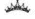

Pauline o observou com atenção, tentando encontrar algum sinal de brincadeira, mas não encontrou nenhum.

– Você tem uma filha? – ela perguntou.

– Não. Sim.

– Sim ou não?

– Eu... tinha uma filha. Ela morreu na infância.

Pauline ficou sem ar. Ela sempre soube que algo o assombrava, mas nunca teria imaginado isso. Ele tinha perdido uma criança? No outro dia, no Hospital dos Abandonados... é claro que a atmosfera o abalou. Não é de admirar que ele queria ir embora. E então, ter aquele bebê colocado em seus braços... Pobre homem. Como aquilo deve tê-lo sufocado. Pauline se sentiu tão insensível por não perceber.

– Oh, Griff. Sinto muito. Muito mesmo.

– Essas coisas acontecem. – Ele deu de ombros.

– Sim, mas não quer dizer que sejam menos tristes.

Ela quis se aproximar dele, mas quando deu um passo em sua direção, ele começou a andar pelo quarto, evasivo.

– De qualquer modo, é por isso que o quarto nunca foi terminado. – Griff caminhava, observando as paredes, e parou junto à janela. – Não cheguei a instalar as grades. Não foi necessário.

– Sua mãe não sabe de nada?

他摇了摇头。
——她当时在乡下。自从这房间……嗯，自从它变得没用了以后，我就一直锁着它。
——你需要对你母亲说出真相。公爵夫人已经注意到这里有些不对劲。她以为你在献祭小猫，或者在进行什么邪恶的幻想。
他笑了。
——难怪你被那些画吓成那样。我无法想象你当时想了什么。
——而我可不想承认我当时想了什么。——她又看了一眼房间。——那么，你那个小女孩的母亲是……
——我的情人——他确认道。——前情人。
前情人。无论怎么努力，Pauline都无法对这一事实表达出她的悲伤。
——你爱过她吗？
——不，不爱。纯粹是肉体关系。——他用手理了理头发。——她是歌剧演员，我们……我知道这很丢人。但像我这种社会地位的男人，要做这种安排太容易了。这是惯例。
——你不需要找借口，Griff——她说。——不必对我找借口。
——如果我要找借口，那首先也是对你。但我没有。我们并不亲近。随着时间流逝，我见她越来越少，正打算和她彻底分手。就在那时她告诉我她怀孕了。
——你当时高兴吗？
——我气疯了。我一直都那么小心，而她也向我保证过她也一样小心。——他又开始在房间里踱步。——但我承担起了责任。我把她安置在离这里不远的乡下的一所房子里，让她在那里待产。我安排了一个女佣和一个助产士，还留了钱照顾孩子。因为像我这种地位的男人让情人怀孕后就是这样做的。
——这是惯例。——她接口道。
他点了点头。
——我去她的新家看她是否安顿好了，并向她保证我会供养她。我正要离开时，她抓住了我的手……——他望着空无一物的墙壁，仿佛那段遥远的记忆就画在那里。——光是这个动作就已让我震惊，因为我们从来没有牵过手。但不管怎样，她握住我的手，把它放在她的肚子上。——他伸出摊开的手掌，示范着。
——然后那个孩子……我的女儿……踢了我一脚。
他慢慢地将那只手移向胸前。
——那么有力。那么幼小的生命，一个我协助创造的生命，以如此强烈而又无声的方式宣告着自己的存在。我发誓，那一脚踢开了我的心扉。让我许多天都激动不已。
Pauline对自己笑了笑。
但那时，当我感觉到那一踢，如此脆弱却又如此有力……我一度希望事情能有所不同。
她走到他身边，碰了碰他的手臂。Griff绷紧了下颌。
——我不能再经历一次这种事。Halford家族的血脉到我这里终止。
——你看起来很坚决。
——我确实很坚决。——他扫视了一眼房间。——希望你不会把这件事告诉任何人。
Pauline知道他担心的并不是“任何人”。他是不想让母亲知道。
——我向你保证，我不会告诉她。但我认为你应该告诉她。
——不——他坚定地说。——她不能知道这件事。永远不能。我是认真的，Pauline。这就是为什么……
——这就是你带我来这里的原因。我知道。我看得出来。
她终于明白了。他并不是一个荒淫放荡、不愿结婚的人。他认定自己不能结婚，又不知该如何解释原因。公爵夫人如此渴望孙辈，以至于他无法告诉她——她曾经有过一个孙女，却失去了她，而现在再也不可能有另一个了。他知道这会伤了母亲的心。
Griff一直将哀伤隐藏在心底，勇敢地决定独自承受所有这些悲伤。
——Griff，你不必独自经历这一切。如果你不想告诉公爵夫人，至少跟我说说。我还会在这里待几天。
——我刚才不就是在和你谈话吗？
事实上，没有。
整个交谈中，他的语气平静得出奇，惊人地务实。她知道那不过是伪装。他没能倾诉出全部悲伤。在这样一个寒冷而隐秘的房间里，他不可能做到。他需要倾诉、呐喊、哭泣、回忆。他需要一个朋友。
——你已经把悲伤压抑了好几个月、好几个月了。你可以试着保守秘密，却无法假装它不存在。除非你决定打开心扉，让它透透气……否则阳光将照不进来。——她握住他的手。——你不想再多告诉我一些关于她的事吗？她长得更像你那边的人，还是像她母亲那边的人？她对你笑过吗？她叫什么名字？
他保持沉默。
——你一定很爱她。
他清了清嗓子，然后退开了。
——你最好走吧。仆人们很快就要来点壁炉了。
那么，就这样了……尽管他们彼此靠近，尽管他们分享了那么多……却仍然不够。
她同意了，于是向房门口走去。
——如你所愿。

## 第二十章

– 好吧，先生。这是最糟糕的一个。
第二天，在早间会客室里，殿下心情很不好。
– 让我看看。——保琳向前倾身，坐在黄条纹椅子上。
公爵夫人举起了毛线针。其中一根上挂着一件毫无可想象用途的畸形东西。那东西看起来就像一只死老鼠。
– 相当可怕——保琳不得不承认。
– 错了。完全可怕。——公爵夫人咂了咂舌。——可怕。你需要回到你的发音练习，姑娘。我们取得了很大进展，但你必须在明晚之前停止吃掉单词的结尾。毕竟，我们不会向“殿下”屈服，对吧？
– 我甚至不该接近摄政王。
光是想想，保琳就觉得胃里翻腾。明天摄政王的卡尔顿府邸将举办舞会。公爵夫人把邀请视为保琳在伦敦上流社会“出名”的最后也是最好的机会。
– 即使我能把每个词都发对，我的位置也不在城堡里。殿下，我希望您放弃这个想法。
– 我不会放弃任何事。这是我们昨晚之后的最后机会。
当保琳独自一人出现在早餐桌上，没有格里夫陪同时，公爵夫人断定她在沃克斯霍尔派对上的希望已经落空。虽然她对发生了什么的猜测可能有误，但她在最终结果上猜对了。
– 我早就警告过你——保琳说。——我已经告诉过你了，而且我再说一遍，他不会娶我。
– 也许不是出于自愿。——公爵夫人回到座位上，重新开始愤怒地织毛衣。——但他明天会被迫向你求婚。这是协议。如果我让你成为伦敦的焦点，他答应会结婚。
保琳摇了摇头。
– 殿下需要接受现实。这不可能。
– 但可以。我知道这看起来不太可能，但这是我们为取得辉煌结局而努力的时刻。早上练发音。下午来一位舞蹈老师。我们还要练习你的礼节和问候。我买了一个迷人的铃铛来取代你的水杯。当然，我们还订做了最漂亮的礼服。我不会放弃。——她举起那件可怕的毛衣。——我不能。
在 resigned 的叹息中，保琳打开了圣经。

– 神圣——她大声读道。——蒙福。万能的。
余光中，她注意到一个熟悉的身影走进房间。
– 哦，见鬼。
格里夫。各种冲动涌上心头。她想飞奔过去拥抱他、摇晃他、亲吻他、把他推倒在地毯上。她甚至不知道该如何看他而不暴露一切。但她不必担心，公爵夫人太惊慌了，没注意到保琳的反应。

那女人猛地站了起来。那只可怕的灰色老鼠仍挂在毛线针上，她无处可藏。
公爵低头看着母亲，然后又低头看向毛衣。
– 这他妈是什么？

一个非常好的问题——保琳希望，公爵夫人终于能诚实地回答。
– 这？——公爵夫人问道。
– 是的。这。
– 我会告诉你它到底是什么。——她抬起下巴，转身面向保琳。——这是一件不可原谅的糟糕手工。真的很糟，辛姆斯小姐。我对你期望更高！——她把整团毛线扔进了壁炉。

保琳翻了个白眼，转回圣经。
– 伪君子——她发音完美地说道。
公爵夫人无视她，用手抚平裙子。
– 好吧，你想要什么？——她问儿子。
– 我有件事要告诉你。

保琳胸口充满希望。也许他改变了主意，在明白了坦白痛苦秘密并从而减轻心灵负担的好处后。她抬起脸离开圣经，给了他一个鼓励的眼神。_请。你会感觉轻松很多。_
但他甚至没有转身看她。

– 我把你的紫水晶项链送去给珠宝匠修了——他平静地对母亲说。——扣子在辛姆斯小姐昨晚佩戴时坏了。
保琳泄了气，感到沮丧。坦诚的希望就此破灭。
公爵夫人眯起眼睛，变成了两道怀疑的缝隙。
– 坏了？
– 是的。——他转了转外套袖口上的纽扣。公爵般的冷静在这清晨状态极佳。——几天后你就能拿回来了。

当然，保琳想。等珠宝匠有时间以最细微的细节重新制作整件首饰，让公爵夫人察觉不出任何差别。所有这些努力都是荒谬的。为什么他不干脆说首饰被偷了呢？保琳会感觉好得多。

– 你确定项链能修好吗？——公爵夫人问道。——我最好还是自己看看？
– 不需要。只是扣子上的小修。
– 罪孽——保琳惊呼道。

当公爵和公爵夫人好奇地看向她时，波琳用手指指着《圣经》，又加了一句：
——哈利路亚。

为什么这个家里没人能好好交谈？整个季节他们都住在同一栋房子里，在同一张餐桌吃饭……却守着那些秘密。公爵夫人迫切想要安慰某个人。与此同时，她自己的儿子也需要极大的安慰。波琳被卷入其中，成了所有人的知心人，可他们却要求她发誓保密。那是一种煎熬。

他们有太多特权——富有、有权势、被同侪所钦佩。但最重要的是，他们能拥有彼此，本身就是极大的幸运。唯一碍事的，是那种贵族式的冷漠。

——胡扯。——她低声说。
格里夫朝她弹了个响指。
——经文。
——嗯？
——章节和经文。——他伸长脖子，从她肩膀上方看过去。——我想知道，在圣保罗致以弗所人的书信中，到底哪里用了“胡扯”这个词。
她在椅子上转过身，不让他看到《圣经》。
——写在页边上了。——他可不是唯一一个会打岔的人。

——有人在家庭《圣经》上写了东西？！——公爵夫人朝格里夫挑了挑眉。
——什么？！——他喊道。——不是我。你知道我从来不读那本书。
——哼。——公爵夫人按响了铃，待女仆出现后，吩咐她把所有仆人都叫到晨间起居室来。

待所有人都排成整齐的一列，从男管家希格斯到女仆玛格丽特，公爵夫人对他们开口了。
——有人亵渎了《圣经》。请破坏者站出来。
当然没有人站出来。于是波琳开口了：
——是我编的——她说着，从椅子上站起来。——还有件事，夫人应该知道。公爵有事瞒着您。

房间里陷入绝对的寂静，格里夫投向她的目光……哦，让她寒意刺骨。他严厉地盯着她，眼中满含愤怒与怨恨。“你敢。”那目光说道。
她在那瞬间明白，如果她违背誓言，说出他女儿的真相，格里夫永远都不会原谅她。即便他喜欢她，即便他们昨晚曾共享欢愉，也无济于事。他会把她从他的生活中彻底抹去，哪怕那感觉如同砍掉自己的一条手臂。
她用力咽了一下口水。

——紫水晶项链——她低声说。——公爵好心想要保护我，但他没有说出全部真相，夫人。搭扣不是自己断的，是一个贼从我脖子上扯走了项链。
在场的仆人们发出一阵惊呼。

——哦，西姆斯小姐——女管家说。——您受伤了吗？
——没有——她安抚他们，对大家表现的担忧心存感激。——没有，我很好。只是我的名声受了些损害。我追着小偷跑，穿过沃克斯豪尔的亭台，一路破口大骂。项链找不回来了。——她转向公爵夫人。——很抱歉，夫人。但说出真相让我好受多了。常言道，忏悔有益灵魂。既然我们都聚在这里，或许还有别的秘密压在心头，需要让它们见见新鲜空气和阳光。
她看看格里夫，又看看公爵夫人，再转回格里夫。看在上帝的份上，你们俩倒是说句话啊。

——您说得对——有人说。——西姆斯小姐说得对。我做了错事，需要忏悔。
角落里，厨娘扭着围裙。泪水顺着她沾满面粉的脸颊流下。
——上个月，夫人晚餐点了比目鱼。好吧，我把整个市场都找遍了，没有人有比目鱼可卖。——她把脸埋进围裙。——于是，我给她上了新鲜鳕鱼。鳕鱼。我加足了调料，好让没人尝出差别。但从那以后我一直内疚得要命。
波琳走到哭泣的女人身边，轻轻拍拍她的背，说：
——好了，好了。我相信夫人会原谅您的。

——我不小心把一块燃着的炭掉在客厅地毯上了——一个女仆脱口而出。——烫了个洞。
——但现在说出来，您不是感觉好多了吗？——波琳问道。
女仆抽了抽鼻子，抬起头。
——是的，西姆斯小姐。真的。就好像卸下了一个重担。
——我真高兴。没有人应该背负着秘密活下去。

年轻的玛格丽特急于参与，开口道：
——我见过劳伦斯在餐具室里和一个女仆鬼混！
公爵夫人挺直了背。
——劳伦斯！
被点名的男仆脸色煞白。公爵夫人严厉地对女仆们说：
——你们谁参与其中？现在站出来。
其中三个女仆同时向前迈了一步。看到不止自己一个时，她们都转头看着劳伦斯，投去杀人般的目光。
劳伦斯感觉自己成了她们愤怒的焦点，不安地扭动身子。
——我……我……——他扬起下巴。——希格斯穿了紧身胸衣！
如果他是想转移别人对自己的注意，那确实成功了。波琳能看到整个房间的人都惊讶地挑起了眉毛。可怜的希格斯。他的脸红得像甜菜根。
——不是女人的紧身胸衣。一个男管家需要有体面的身形。
在漫长而尴尬的片刻里，没有人说话。直到……
——我不是法国人。

这话是芙勒尔说的。
——什么？！——公爵夫人喊道。——不可能。
——我不是。我，我不是——公爵夫人的贴身女仆用一口犹豫且发音糟糕的英语坦白道。她的口音比保琳还要粗俗，而且说话结结巴巴。——我知道用这种方式说话，永，永远也找不到贴身女仆的工作。所，所以我自称是法国人，免得跟人交谈。我的真，真名叫弗洛拉。对不起，夫人。我这就去，去收拾行李。
她泪流满面地离开了房间，公爵夫人追了过去。
——芙勒尔……或者，弗洛拉……不管你是谁，等等！
她们一出去，晨间客厅里便陷入了一片困惑的沉默。
格里夫将双手合在一起。
——好吧，非常感谢你，西姆斯小姐。今天早晨真是让人大开眼界。
保琳抬手扶住额头。哦，天哪。
门铃响了，但没有人动。
——我有个主意——格里夫说。——不如我去开门？
希格斯摇了摇头，行动起来。
——大人，请让我来。
格里夫举起手。
——不，不用。我承认，很久以来我一直有一个隐秘而深切的愿望，想亲自去开自己的门。
他走出房间时，保琳追了上去。
——我很抱歉。我完全没想到会发生这一切。可你看不出来吗？这栋房子里充满了秘密，让所有人都不快乐。而你，比任何人都需要说出让你备受折磨的事，需要敞开心扉。
——我现在唯一要敞开的，是前门。——他走到门口，拉开门把手。当他看到门外的访客时，低声咕哝道：——真棒。这正是今天早晨所需要的。
保琳僵住了，不敢相信。门口不仅有一个人，而是两个她认识的人：米涅瓦·海伍德小姐，她在斯平德尔湾认识的一位女士，以及米涅瓦小姐的丈夫科林·桑德赫斯特，也就是佩恩勋爵。
——我就知道！——米涅瓦说着，把公爵推到一边，紧紧抱住保琳。——别怕，保琳。我们是来救你的。

开了门之后，格里夫便承担起关门之责。但随即后悔了，因为他觉得这对夫妇来错了地方。
——好久不见，哈尔福德。——佩恩向他伸出手，露出友好的微笑。
不够久。那缺席本可以再持续一两周。
佩恩夫人盯着他，双眼在镜片后燃着强烈怒火。
——你这可恶的三叶虫！
真迷人。格里夫不禁纳闷，佩恩究竟看上了这姑娘哪一点。
——要是我的提包没落在家里……——她威胁地说。

他完全不知道那是什么意思，但猜想这不是适合在门厅里进行的对话。
格里夫把他们领到书房——他料想这个房间不会有哭泣的女仆占用。按铃叫人上茶似乎也无济于事，于是他为佩恩倒了白兰地，并为女士们提供了利口酒。这是那一天里又一段亲力亲为的插曲。
——保琳，发生了什么事？——佩恩焦躁不安的妻子问道。——他对你做了什么？
——夫人，他只是给了我一份工作。我现在受雇担任公爵夫人的女伴。
——哦，是吗？——佩恩夫人的声音里带着浓重的怀疑。——那公爵夫人现在在哪儿？
——她在楼上——格里夫说。——处理这栋房子里仆人之间的一场小风波。
——那么——佩恩夫人哼了一声——这栋房子里的仆人过得并不快乐……——她看了看保琳，又看了看格里夫，来回打量。——而我应该相信你们之间没有发生任何不当之事。
——你应该相信这不关你的事——格里夫回答。——你为什么对我这么猜疑？
——我不是猜疑。我对你的厌恶是建立在充分证据之上的。我去过你那个可怕至极的“享乐宫殿”。——她转向保琳。——你知道吗，他在乡下有一处藏污纳垢的巢穴？
——不知道，夫人。——保琳摇了摇头。——我没有理由知道这些。
格里夫皱起眉头。为什么她突然变得如此温顺顺从？那不是他认识的保琳。肯定不是那个曾躺在他身上、用舌头舔过他胸膛每一寸的保琳。
——那个地方叫温特塞特庄园。去年我去过——戴眼镜的审讯者继续对保琳说。——科林和我在去苏格兰的路上在那里过了一夜。哦，真是令人作呕。——她打了个寒颤。
——还没到让你拒绝我款待的程度——格里夫说，靠在书桌上，双臂交叉。——请恕我直言，佩恩夫人，我不太确定你是否有资格拿这桩特别的事来指责我。
——你什么意思？！
——夫人您自己承认，您跟着一个声名狼藉的浪荡子离家出走。而且，我还可以补充，您当着我的面谎报了身份。碰巧我记得佩恩把你介绍成梅莉桑德，一个早已失踪的阿尔卑斯公主，还是个冷酷的杀手，不会说一个英文单词。一个流亡公主，冷酷杀手。而您竟骂我堕落？
她愤怒地挺直了身子。
——你对我做过不得体的暗示。还提议科林在牌局上把我的恩宠当作赌注。这件事你又怎么解释？
他张开双臂。

——公主。刺客。冷酷。
她用目光将他一枪击毙。

——我承认，你在我的庄园里看到的那一幕确实放荡不堪。我只是想说，你在狮穴里也称不上什么圣洁之人。难道过去这一年里，我们所有人都不曾改变吗？

——人不会改变那么多——她说。——至少在本质上不会。

——好吧，这正是你错的地方——他恼火地答道。——恰恰是在本质上。

格里夫走到窗边。这场谈话让他既恼火，又有些忐忑。已经有一年，他不曾再卷入过佩恩夫人描述的那种事情。他的内心和他的生活在本质上都已经改变了。然而无人见证。就连佩恩——那个格里夫一度以为是自己最亲密朋友的人——也没有见到。他的母亲也没有。上流社会依然把他和穷奢极欲的放荡生活捆绑在一起，而这一印象将玷污人们对任何与他有关联之人的看法，包括波琳。

那么，这就是为放荡不羁的青春付出的代价。去年秋天，他别无所求，只想让女儿过上体面的生活。也许她没能活下来反而更好，那样就不必感受到父亲失败的重压。她会因为是他的女儿而羞耻。

格里夫喝了一大口白兰地，感觉它灼烧着整个喉咙。佩恩走近他，推心置腹地说：

——听我说，哈尔福德。我妻子也许是过于保护她了，但我们不是来指责你的人生选择的，我们只是担心波琳。我在那个乡村小酒馆里度过了许多难熬的夜晚。毫不夸张地说，波琳友善的笑容和给我斟满杯子的麻利劲儿，有一两次真救了我的命。她是个甜美的姑娘，心地善良。

格里夫强忍住一句咒骂。
——你不了解她。你从没花时间去了解过她。
——我知道西姆斯小姐家的处境。我也知道，她身边没有亲人照料。
——现在有了——格里夫说。这些话发自他的肺腑。

佩恩挑起眉毛，似乎明白了什么。
——哦，真的有了？
——是的。
——你确定这正是她想要的吗？
——她是个成年而聪明的女人，能自己做决定。问她便是。——格里夫厌烦地叹了口气，与佩恩拉开些距离。——西姆斯小姐，如果你担心我的个人过往，或是对我们协议的条款不满意——如果你因任何理由想离开这座宅子——我现在就可以签一张支票，你便可以同佩恩勋爵和佩恩夫人一起离开。

她的目光从格里夫移到两位访客身上，又回到格里夫身上。仿佛她正在认真思量这个提议。老天。也许她当真想走。
——那么？——他追问道，这次语气更粗鲁了些。——你想走吗？

波琳但愿自己有足够的力气说出“想”。那会是最轻松的出路。她与格里夫终究是要分开的，而到那时只会更痛苦。但今天早晨她不能走……因为她爱他……她爱他，而且还没准备好离开他。

——不，殿下——她说。——我想留下。
——很好，那就这样。——他转向密涅瓦。——想来你该满意了。

佩恩夫人没有回答，只是走到波琳面前，把一张四方形的纸放在她手里。
——这是我们的名片。我在背面写下了我们的地址，还有里克利夫夫人的地址。如果你需要什么——任何东西——都可以来找我们。白天夜晚都行，听明白了吗？

波琳应了一声。
——你们两位真是太好了。感谢你们的关心。

即便不需要他们，知道他们关心自己，终究是件好事。

格里夫送他们到门口。等他回来时，火冒三丈。
——那算怎么回事？——他问。
——我不知道。他们似乎对我们有了误解。
——哼，你也不急着纠正他们。你几乎没开口，除了满嘴的“殿下这个”“我的勋爵和夫人那个”。

*他在生她的气吗？*

——我还能说什么？他是勋爵，她是夫人。而你是一位公爵。
——可论才智和品性，你与在座的人平起平坐。为什么你对他们那么冷淡，而对我却总是没大没小？
——和你不同…… *和你在一起，一切都不同了。* 可你不能把这笔账全算在我头上。你不也一直站在远处吗？你也没急着告诉他们，我们正在经历一段炽烈的*私情*。

他向门口挥了下手。
——因为我知道他们会如何看待这消息。
——正是。所有人都会同样看待。说得好听些，是不可能；说得难听些，是可耻又龌龊。

波琳明白他为何恼怒。她也有同感。方才来拜访的这对人，是他们所拥有的最接近“共同朋友”的人了；倘若连他们都不相信格里夫与她之间会有情意，那便真是无可救药。没有人会接受他们在一起。没有人。

她叹了口气。没什么好惊讶的。诗里说了什么并不重要。没有别的英格兰，也没有另一座拥有其塔楼的伦敦。只有他们生活的这个世界，在社会阶层问题上毫不妥协。

——一个女仆和一位公爵夫人之间相差33个等级——她低声说道。——你知道吗？这张图表占据了《沃辛顿夫人给年轻人的智慧》三页篇幅。我把整件事都背下来了。公爵夫人排在最顶端，女王和公主之后，当然。递减顺序是：公爵夫人、侯爵夫人、伯爵夫人……

她在背诵头衔时用手指一个个数着。

——……然后是侯爵长子的妻子们，公爵幼子的妻子们。然后是女儿们。公爵、侯爵的女儿们。然后是子爵夫人，然后是伯爵长子的妻子们。伯爵的女儿们……

——保琳。

——……已经十个等级了，我还没到男爵夫人那里呢。或者骑士勋章和军衔。下面还有……

他走近她，转过她的脸，强迫她看着他。

——保琳。

——我甚至不在图表里！——她瞪大了眼睛。——像我这样的女孩，格里夫……在你之下太多了。当我们在一起时，我们可以忘记。但别人不会忘记。

——忘记？你觉得我和你在一起时会忘记你是谁？

她扭动了一下。他必须忘记，至少有一点。从他们第一次见面起，格里夫就给了她比任何贵族有意给酒馆女招待的更多关注和尊重。

——重要的是我们必须记住。否则，社会会提醒我们。

他凝视着她很长时间。

——也许你是对的。我们应该记住。

——我很高兴你同意。

他穿过房间，用钥匙锁上了办公室的门。锁舌发出不祥的咔嗒声。

——把写字台收拾干净，辛姆斯。

——什么？我不明白……

——别争辩——他打断她。——你是个酒馆女招待，你希望我记住这一点。我是这里的公爵，我命令你收拾写字台。这就是你做的，对吧？擦桌子？

这就是他在做的吗？扮演角色？放荡的公爵和不合适的女招待？

好吧……想了两秒钟后，保琳决定她可以演这个角色。她拿起墨水瓶，小心地把它放在角落的桌子上，以免它翻倒。然后她把手臂伸过写字台的台面，把橡皮、纸张、封蜡和其他东西全都扫到地上。

——好了。

——多么无礼。

——你喜欢这样。

他扯松领带，解开它，同时穿过房间。

——你需要学会你自己的位置。

——我的位置就是这里，殿下？——她坐在写字台上，晃着双腿。

——暂时是。——他坐在保琳面前的椅子上，双脚分别放在她腿的两侧，用阴郁、居高临下的目光盯着她。

这一刻被拉长，直到性张力变得可以触摸。保琳完全不动，等待着。

——把裙子掀起来——他说。

砰！格里夫的话就像发令枪一样，因为她的心跳加速了。

踢掉一只鞋后，她脱掉了另一只。两只鞋都掉在地上。她把穿着丝袜的脚放在他的大腿上，慢慢地把蕾丝裙摆往上拉，露出腿到膝盖。

——这样？

——更高。

她又把蕾丝裙摆往上拖，让它爬上大腿。她的吊带在衬裙边缘露出来——一条放肆的淡紫色丝带。

——更高。

保琳把脚滑到他的耻骨处，盖住他裤子里日益增长的隆起。用缓慢的动作，她让他变得更硬，用脚底轻轻摩擦着那根又长又硬的勃起。不久，空气中充满了两人急促呼吸的声音。脚弓上轻柔的摩擦是一种令人惊讶的愉悦源泉。而他看她的眼神……毫不为自己猛烈的兴奋感到羞耻，用那炽热的目光穿透她，让她在甚至没有一个吻的情况下就气喘吁吁、湿润不堪。

——更高——他要求，坚定地握住她的脚踝。——到腰部。让我看全部。

他声音里的感官命令让她兴奋不已。她在写字台上扭动身体，以便把裙子掀起来，直到凉爽的空气吹拂在她暴露而兴奋的私处。

——就是这样——他说，坐得更靠前一些。——就是这样。

他抚摸着她的腿，手在丝绸覆盖的小腿上上下移动。用拇指按压她膝盖内侧，她的双腿就张开了，仿佛他找到了一个秘密按钮。

格里夫抓住她的臀部，把她拖到写字台的边缘。然后，他的指尖描绘着她性器湿润的褶皱，滑过那兴奋的肉体。何等的折磨，甜蜜的折磨。

——占有我——她请求。

他啪地一声吐了舌头。

——我要做我想做的事。而我想品尝你。

当格里夫低头时，她往后退，结束了他们正在演绎的场景。
– 格里夫，等一下。没人…… – 她紧张地舔了舔嘴唇。 – 从来没有人这样对我做过。
他抬起头，露出了缓慢而赤裸裸的恶作剧笑容。
– 如果你想让我停下，你说错了话。
他抓住她的臀部把她往前拉，把嘴贴在她的中心。正如他所承诺的，他吻了她。那里。如此震惊。如此令人兴奋。
她在他怀里颤抖，但格里夫放在她身上的手却像铁一样。她无法从那场情欲拥抱中逃脱。于是保琳无力地靠在红木桌面上，任由那不可避免的吻吞噬她。她张开双臂，覆盖了整张书桌。所有的文件和信件都掉在了地上。在那一刻，她就是他的工作。而他全身心地投入到这项任务中。专心致志。堪称大师级。
格里夫的舌头大胆而专注地探索着保琳最女性化、最私密的地方。她放松了大腿，向他的吻敞开，相信格里夫知道自己在做什么。
他知道。哦，他在这方面很擅长。真正的冠军。她无从比较，但她愿意用她所有的千英镑来打赌。如果有因对女性给予愉悦而授予的骑士勋章，格里夫一定获得了最高等级。
他上下舔弄着她的入口，像品尝皇家盛宴上最美味的菜肴一样品味着她。当他专注于她性器上方那肿胀的神经束时，保琳忍不住呻吟起来。然后他用拇指撑开她，用舌头进入她。舌头进进出出，模仿着短促的性交冲刺。
– 格里夫。 – 她在书桌上扭动。
他没有停下来回答，而是伸手到她的乳房，隔着布料捏弄并抚摸它。
保琳抓住格里夫的头，不耐烦地拨开层层衬裙，将手指缠进他浓密的黑发里，紧紧抓住。她把他拉近，让自己迎向那张火热、湿润而技艺高超的嘴。
– 这样 – 她喘息着。 – 求你，别停。
他不会停下。没有任何疲惫的迹象。每一次舔弄和冲刺都让她攀升得更高。保琳开始呜咽，无声地向他乞求解脱。他前后移动头部，抚弄着她的阴蒂。
– 哦。哦。
一阵痉挛让她弓起背部，压在书桌上，将她抛入一场强烈而高昂的高潮。格里夫把手放在保琳的嘴上，给了她所需的东西；一个可以咬的东西，用来压抑她的尖叫和呻吟。
终于，极乐的颤抖减弱了，他的手又滑回她的乳房。好一会儿，她沉默地凝视着天花板，而格里夫抚摸着她的乳房，并在她的大腿上留下懒散的吻。她一个字也说不出来。没有。
– 你喜欢吗？
– 喜欢 – 她终于说出来。除了这个词，她别无他言。 – 喜欢，喜欢，喜欢。
– 你相信我爱这个柔软而美味的身体的每一寸吗？你明白我宁愿被军刀刺穿肾脏，也不愿让你遭遇任何不好的事吗？
她喘息着点头同意。
– 太好了。 – 他的表情变得阴沉。 – 因为现在我要教你一课。
他把她拉起，扶她站稳，转过她的身子，然后让她趴在书桌上，腰部弯曲。当她的乳房触到桌面坚硬的表面时，她喘不过气来。
在他身后，格里夫迅速掀起她的裙子，抓起沉重的连衣裙和衬裙的全部布料，举到保琳的臀部上方。他的手抓住她的臀部，用膝盖分开她的大腿。
– 这就是那些忘记自己身处公爵面前的小酒馆女招待的下场。会得到一个严厉的提醒。
听到他声音里戏谑的严厉，保琳感觉到大腿内侧的皮肤起了一层鸡皮疙瘩。她的乳头在打蜡的冰冷木面上变得坚硬。
– 顽皮的小贱人。
他轻轻拍了一下她的臀部，保琳发出一声既像笑又像兴奋的惊呼。没有疼痛，只有一种令人愉悦而感性的灼热。
– 放肆的小荡妇。
又是一记令人愉悦的拍打。
她知道他不会伤害她——这对他来说只是一种幻想。如果她可以假装成一个诱人的女人，他也可以扮演一个角色。保琳喜欢他想玩耍。这意味着他对她感到自在。
格里夫俯身压在她身上，用身体的重量把她固定在书桌上。她感觉到他灼热的呼吸在她颈间。
– 你是个非常调皮的女孩。
当他用粗哑、渴望的声音低语时，他的另一只手在她两腿之间工作，揉捏着保琳兴奋而敏感的性器。
– 你喜欢这个 – 他说。 – 你喜欢想象自己让我欲火焚身，以至于我只能用我的鸡巴思考，完全忘记了自己的身份。
– 我…… – 她的声音在他的指尖拂过她的阴蒂时消失了。
– 回答我 – 他要求，并把一根手指插进她体内。
– 是。
– 是什么？ – 他把手指插得更深。
保琳呻吟起来。
– 是的，殿下。
– 要记住 – 他说 – 我不会忘记自己的位置。而你也不会忘记你的位置。

哦，她多么希望他的地方能深深地在他里面。她想要他如此之甚，以至于会说任何让他高兴的话。她会用他想要的任何名字称呼 Griff。

他几乎完全把手指从她体内抽出，然后又重新插了进去。

– 我是谁？

– 公爵 – 她艰难地说出。

– 你想要我什么？ – 他抽出手指，让她渴望更多。

– 我... – 她在书桌上扭动。 – 我想要你吃掉我。

使用如此粗俗的语言，她感觉到他的肉棒在她大腿上脉动。尽管经过所有纠正，她知道自己的说话方式让他兴奋。语言代表了她是谁。平凡。平民。

– 规矩点。 – 他又拍了一下她的臀部。 – 记住你是在和谁说话。

– 求求您，殿下。 – 到这时，Pauline 已经对他急不可耐。她用自己能做到的最诱人、最激情的声音说： – 请占有您这卑微的侍女，我恳求您。

– 这样才好。

他抬起她的臀部，一次性进入，是一次柔和而深沉的冲刺。她满足的呻吟回荡着他的。

她已经湿润并准备好有一段时间了。他不需要慢慢来。所以他没有浪费时间建立起强劲的节奏，越来越深入。

Pauline 抓住书桌台面的边缘，以免被抛到地上。他的炽热和尺寸让她兴奋不已。他正在触及她体内未曾探索的地方，向她展示她身体的新颖而感性的侧面。快感吞噬了她。

– 更用力 – 她喘息着。 – 更用力，如果殿下喜欢的话。

– 哦，就是这样！ – 他咆哮道。

他用腰把她抬起，让她的脚离开地毯，抱着她同时用臀部更用力、更快地冲刺。Pauline 咬住他前臂柔软的肉，以免喊出声来。她在空中，完全任他摆布，他以他想要的姿势和节奏骑着她。他为自己的快感使用她，而且用得非常好。

然后 Griff 把她放下，直到她双脚着地，然后向前弯腰，悬在她上方，趴在书桌上。他的手覆盖在她放在台面边缘的手上。她感觉到一滴他的汗水落在她裸露的肩膀上。

– 我是谁？ – 他的声音如此之近……如此低沉。她的私处如回应般脉动。

– 一个公爵。

– 哪个公爵？

– Halford 第八公爵……殿下。

Pauline 全身都在颤抖，渴求解脱。他坚硬的肉棒如此之长、如此之硬地在她体内……他为什么停下了？她扭动臀部，试图让他重新动起来。

他保持不动，坚定。

– 礼貌称号。也要背诵出来。

哦，上帝。

– 我不记得了。

– 我记得。我从不忘记我是谁。即使在我体内，急切到快要爆炸想射精的时候。 – 他再次收缩臀部。 – 明白了吗？

公爵重新开始动起来。这次节奏缓慢，但无情。他每一次撞击都如此用力，以至于她喉咙里发出干涩的呜咽。

– Griff – 她哀求道。

他的“教训”既令人兴奋又毁灭。当他们独处在一起时，Pauline 希望 Griff 能忘记在英国社会阶梯上他们之间存在的 33 个台阶。但他做不到。她也做不到。真相从未消失。

– 我是 Halford 公爵 – 他说着，深入地进入。

她闭上眼睛，试图不哭泣。这一切太多了——情感，快乐……绝望。

– 我是 Westmore 侯爵。

一记冲刺。

– 我也是 Ridingham 伯爵。Newthorpe 子爵。Hartford-on-Trent 男爵。

冲刺。冲刺。冲刺。

– 而我也是你的奴隶，Pauline。

哦，天哪。

她这一次真的呜咽起来。无法避免。

他停了下来，完全埋在她体内。填满她，抬起她，按着他想要的方式塑造她。当他们分开时，她会永远为他的缺席而承受空虚的痛苦。

– 你听见了吗？ – 他的声音被欲望标记着。 – 你现在相信我了吗？我们之间可能有千级台阶。我不在乎。这具身体里每一滴蓝色血液都在为你沸腾着渴望。

他把一条胳膊伸到她躯干下方，同时抬起她并站直，背部抵着他的胸膛。他用那只强壮有力的胳膊把她紧紧抱住，而另一只手则在堆起的衬裙下探寻，直到指尖触到她的珍珠。Pauline 身体一阵极乐的颤抖。

– 看着我 – 他低吼道。 – 亲吻我。

她照他说的做了，很乐意，转过头伸长脖子让嘴唇贴上他的。他的舌头占据了她的嘴，肉棒填满她的性器，手指抚弄着她最需要的地方。Pauline 被力量和崇拜所包围。

她不想高潮。她希望这一切永远不要结束。这是她所经历过最纯粹的幸福。但他性感、熟练、如此高效。在他体内

瞬间她的全身都被愉悦的波浪震颤。

他的冲刺变得更快，失去了优雅。再次，那些强壮的男性大腿上的紧绷力量将她从地面抬起。他中断了亲吻，把脸埋进她的头发里。支离破碎、世俗的低语倾泻在波琳的耳边，让她的心跳更加剧烈。

——我不会忘记你是谁——他低声说。——是我想要你。并且……想要……太多了。

他从她体内退了出来，在情人的大腿间又做了几下最后的冲刺。他原始的咆哮在她身上激起了一阵满足的颤栗。然后他把她抱得那么紧，以至于呼吸变得困难。但波琳并不在意。

——好——他最终说道，声音沙哑。——希望我已经说清楚了。

——说清楚了。

格里夫瘫倒在扶手椅上，把她拉到怀里。他们就那样瘫在那里，纠缠着、满身大汗，用急促的呼吸填满沉默。他懒懒地抚摸着波琳的头发。而她把脸贴在他的胸口。

——格里夫，这真是……

——我知道——他说。——我知道。确实如此。我毫不避讳地说我对此感到非常自豪。

——你也应该感到自豪。

他的胸膛随着一声深深满足的叹息一起一伏。

——我真想去皮卡迪利，等待路过的人问我，“还好吗？”，就为了我能回答，“我刚经历了我一生中最棒的性爱，谢谢你的问候”。

她笑着想象那段对话。

——你一生中最棒的？——波琳不得不问。——真的吗？

——至少到今晚为止。——他把脸贴在她的脖子上。——波琳。每一次和你在一起，都是我一生中最棒的一次。

他们还能有几次？很少。少得可怜。

叮咚咚……叮咚咚……

仿佛是他们时间快要结束的信号，附近的一只钟敲响了。波琳看向角桌。她认出了他整整一周都在摆弄的那只钟。

——你修好了——她说。

他把手指放在波琳的唇上，说道时，他的气息温暖了她的耳朵。

——看。

从钟前面的一扇小窗里，一个迷你情侣出现了。一个士兵和一位淑女。他们笨拙机械地互相鞠躬，旋转着跳了一段短小的华尔兹，然后分开又回到钟里。

——哦，多么浪漫！

——我小时候很喜欢看这个。

一丝忧郁哽住了他的声音。毫无疑问他曾希望，有一天他的孩子们也会喜欢看这个。但他相信自己永远不会有能与之分享这种感受的人。

至少现在波琳可以与他分享。她把手臂绕过他的背，紧紧抱住他，听着钟最后的钟声和他坚定的心跳。

——我在想把这只钟捐给弃儿医院——他说。——我想病房里的孩子们会喜欢它。

——我相信会的。

——很好，那就这么定了。我会请我母亲下次去那里时把它带过去。

她转过身，仍坐在他的腿上，抬头看着他。

——我有个更好的主意。

## 第二十二章

这个主意可能是波琳的，但格里夫很快就接管了控制权。这次对机构的访问不会是那些助人女士们那种做作矫情的风格。如果他必须去一趟弃儿之家，他就要按自己的方式去。作为一个放荡的公爵。以权威、奢华和公然的恶意。

他的到来没有被宣布——更好；最戏剧性的出场通常都不会被宣布。他带领一队仆人穿过门廊，每个人都扛着小小的宝物：糖果、橙子、玩具、用心编织的帽子，以及根据波琳的建议，儿童读物。

当他们带着这批宝物来到中央庭院时，整个地方已经沸腾，穿着棕色衣服的孩子们从各个教室和宿舍涌出来。

负责人并不喜欢这样。她们通常酸溜溜的表情达到了过度严厉的程度——这一天会多出许多新的皱纹。但她们无能为力，除非她们想拒绝他每年捐赠的数千英镑……做公爵就是好。

等所有孩子都聚集起来后，格里夫喊道：

——休伯特·特拉平在哪？

那个男孩走上前来。很容易找到他——他是队伍里最小的。

——休伯特，我任命你为我的管家——他宣布。

——这是什么意思，殿下？

——你必须监督所有这些东西的分配。这是个很大的责任。你觉得你能做到吗？

那个男孩挺直了身子。

——能，殿下。

——很好。你们其他人，排队。小的先来。

队伍开始以痛苦缓慢的速度移动。像这些善良而被轻视的孩子一样，休伯特在分配时非常公平，精确地数着分发的糖果和橙子块。

——他多么尽责——格里夫对波琳低声说。——我们要在这里待到明天。

——真美，不是吗？但这并不让我惊讶。争夺微薄资源是人类的本性。但一个人如何对待丰裕，则足以说明他的品格。——她把一颗糖放进格里夫的手里。——给你嚼点东西。

当她走开时，他对自己笑了笑。看起来她在这周里找到了时间来上公爵式的微妙——或缺乏微妙——的课程。但波琳正

enganada se pensava que essas poucas horas de generosidade espontânea eram algum tipo de exercício de benevolência da parte dele. Quer entregasse para caridade ou perdesse na mesa de carteado, separar-se de dinheiro nunca foi problema para ele.

Separar-se dela, por outro lado... Deus, ele ainda nem conseguia pensar nisso. As horas que restavam até a partida inevitável dela estavam contadas. Ele precisava de algo com que se ocupar ou ficaria louco.

— Hubert — ele disse. — Passe-me algumas dessas laranjas. Vou ajudar você.

Algum tempo depois, Griff parabenizou o garoto pelo trabalho bem executado, saiu do pátio coberto de cascas de laranja e foi procurar Pauline. Enfim, a encontrou na enfermaria.

Que cena acolhedora. O relógio que ele tinha consertado ocupava o centro da cornija da lareira. No tapete, diante do fogo, Pauline estava com três pequeninos, amontoados em seu colo como gatinhos, enquanto uma garota mais velha lia para eles um livro de contos de fada.

A ironia rasgou o peito dele e penetrou em seu coração. A cena diante dele – Pauline, crianças, toda aquela doçura, o final de conto de fadas – era tudo que podia querer da vida. E tudo que ele nunca poderia ter.

Não queria ter se apaixonado por ela. Deus sabia que ele tinha feito seu melhor para evitar. Mas era tarde demais. Ele não podia nem mesmo usar seu truque de jovem – convencer-se de que não sentia aquela emoção, fingir que era coisa sem importância. Talvez seu coração jazesse no fundo de um poço escuro e sem fundo, onde conseguiu ignorá-lo durante anos. Mas ele cavou muito enquanto esperava sua filha. E o coração tinha recebido luz.

Ele sabia o que era amar. Era isto. Que Deus o ajudasse.

Griff permaneceu em silêncio à porta, sem querer interromper. Sem saber o que dizer, se ousasse se manifestar. Era provável que soltasse uma torrente desesperada de súplicas. _Não me deixe, eu te amo, eu não posso viver sem você._ Ele faria as crianças gritar. Elas teriam pesadelos durante semanas.

Então Griff ficou parado ali, contemplando em silêncio a desolação que seria sua vida. Até que um som estridente o despertou.

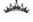

Pauline apertou os pequenos junto de si. Beth tinha chegado à parte mais deliciosamente sanguinolenta da história – a parte com o dragão que arrancava corações impuros com sua garra. Mas bem quando a heroína da história se preparava para encenar seu último teste, eles foram interrompidos pelo choro alto e sofrido de um bebê.

— Oh, é aquele menino novo — Beth exclamou. — Sempre chorando. Espero que mandem logo esse bebê para o interior.

— Pobrezinho — Pauline disse. — Eu não sabia que estávamos tão perto do berçário.

— Fica do outro lado do corredor. — Beth virou a página.

Ela levantou os olhos na direção do corredor em questão.

_Oh, não._ Griff estava parado à porta, um pouco desalinhado e diabolicamente lindo, como sempre. Mas o rosto dele... Oh, estava da cor de papel. Pauline soube, assim que olhou para o rosto dele, que Griff estava sofrendo.

– Preciso ir, meus queridos. Beth vai terminar a história.

Os pequenos se agitaram e choramingaram, puxando as saias dela.

– Você vai voltar, Srta. Simms?

– Receio que não... Retorno para casa amanhã à noite. Eu tenho uma irmã que está com saudade de mim. E eu estou com saudade dela. – Pauline deu um sorriso cauteloso para Griff. – Talvez Sua Graça possa vir visitar vocês outro dia.

– Eu... – ele começou, e o bebê uivou de novo. Griff se encolheu.

– Eu sei – ela disse para ele e se apressou para pegar sua touca e seu xale. – Vamos agora mesmo.

Eles avançaram a passos largos até o portão da frente. Pauline se esforçava para acompanhar o ritmo dele. Sabia que Griff queria ser mais rápido que as próprias emoções, determinado que estava a não ser alcançado pela crise emocional que aqueles gritos tinham iniciado.

Mas ele não conseguiria ficar à frente de suas emoções para sempre. A tristeza acabaria por alcançá-lo, entretanto, Pauline não queria vê-lo deprimido ali. Não com tanta gente em volta.

Ela se apressou na direção da entrada. Mas então, sem dizer palavra, ele virou e passou por uma porta lateral. Pauline mudou de direção e foi atrás dele, e os dois chegaram à rua. O rosto dele carregava a mesma expressão vazia, sem foco, do outro dia – quando ele vagou pelas ruas de Londres durante toda a noite.

– Griff, espere! – ela chamou. – Você não pode me deixar para trás.

– A carruagem está na frente. O cocheiro pode levar você para casa.

– Mas e você?

Ele gesticulou, a esmo, para as ruas anônimas e movimentadas.

– Preciso caminhar por um tempo. Vai passar se eu puder... – a voz dele falhou.

Ela sentiu um aperto no coração. Talvez ele estivesse conseguindo ser mais rápido do que suas emoções há meses. Mas essa era uma corrida que ele iria perder.

– Só me deixe – ele pediu.

– Não – ela disse quando chegaram ao meio-fio. – Não desta vez. Não vou deixar você sozinho.

Com um gesto ágil, Pauline chamou um carro de aluguel.

– Qual é o nome daquela igreja? – ela perguntou ao condutor. – Aquela do outro lado de Londres?

O condutor, todo vestido de preto, virou seu nariz pontudo para ela.

– Está falando de St. Paul?

– Isso. Nós vamos até lá. – Ela entrou na carruagem, sabendo que Griff teria que a acompanhar. Ele não a deixaria ir sozinha.

– Eu não quero ir para a droga de uma igreja. – Ele se deixou cair no assento à frente dela, dobrando as pernas na cabine apertada e escura.

– Eu também não, na verdade. Eu só queria um destino que fosse bem distante. Eu sei que você precisa de um tempo, mas também precisa estar com alg...

Ela mordeu o lábio. Ele não precisava de alguém, Griff precisava dela.

– Eu não vou deixá-lo sozinho agora – ela disse. – É isso.

Griff tirou uma garrafa prateada do bolso interno do casaco e começou a girar a tampa, mas os dedos dele tremiam demais para isso. Com uma imprecação, ele jogou a garrafa no canto da cabine.

Pauline se inclinou para pegá-la, desenroscou a tampa e entregou a garrafa para ele.

– Pronto.

– Você precisa me deixar sozinho. – As mãos dele formavam punhos sobre os joelhos.

– Não estou no controle de mim mesmo. Eu... eu posso ser agressivo.

– Eu me escondo – ela prometeu. Como se ele fosse capaz de machucá-la.

– Acho que vou chorar.

– Eu já estou chorando. – Ela enxugou os olhos com o dorso da mão.

– Eu... – Ele se curvou, apoiando os cotovelos nos joelhos. – Jesus. Acho que vou vomitar.

– Aqui. – Ela estendeu sua touca para ele. – Use isto.

Griff apenas olhou para a peça.

– Sério. É muito feia. Não fará diferença.

Ele a encarou, ferido e sombrio.

– Não vou conseguir fazer com que você me deixe sozinho?

– Não.

– Droga, Simms. – Ele olhou para o lado e levou o punho fechado à boca, como se tentasse conter uma torrente de emoções. Mas ela percebeu que havia rachaduras na represa.

Pauline deslizou para frente no assento até os joelhos dos dois se tocarem.

– Você está em segurança – ela sussurrou. – Neste espaço, comigo... você está em segurança. Qualquer coisa que acontecer nesta carruagem não vai sair daqui. Eu vou para casa amanhã à noite. Ninguém vai ficar sabendo.

Soltando uma imprecação, e com a urgência do desespero, ele estendeu os braços para ela, enlaçando sua cintura e baixando a cabeça sobre as pernas dela. Com as mãos, ele agarrou as dobras do vestido.

Finalmente, com o rosto enterrado nas saias de Pauline, Griff soltou um som. Um uivo sofrido, cortante, de raiva e angústia. Aquilo vinha das entranhas dele e irrompia por todo o corpo. Ela sentiu a força da emoção extravasando, enviando tremores para todas as articulações dele – e dela. Griff a puxou para mais perto, segurando-a apertado.

Cada pelo do corpo dela pareceu eriçar. A pura violência das emoções dele a aterrorizou. Seu instinto foi de se encolher, mas ela dominou o próprio medo.

Pauline pôs uma das mãos nas costas arfantes e a outra no cabelo dele. Embora desejasse acalmá-lo com palavras doces, resistiu ao impulso. Não adiantava ela lhe dizer que o compreendia ou que tudo ficaria bem. Não era verdade. Ela não tinha como entender a perda dele – a pura agonia que sacudia o corpo de Griff estava além de sua compreensão –, e tudo não ficaria bem. Ele tinha perdido alguém que não podia ser substituído, e fazia tempo demais que guardava aquela tristeza.

– Deus. – A voz saiu abafada pelas saias dela. – Maldição. Maldição.

Ela abraçou os ombros trêmulos dele e deu um beijo no alto de sua cabeça, apertando-o o máximo que conseguiu. Eles ficaram assim enquanto a carruagem sacolejava por ruas e bairros que Pauline nunca tinha visto e que jamais visitaria outra vez.

Pauline nunca sonhou que um pai pudesse amar assim seu filho – a criação dela própria não lhe deu nenhum indício nesse sentido. Mas, nesse dia, Griff lhe mostrou a dimensão desse amor. Se alguém pegasse toda esperança esmagada do coração de um pai em luto e a espalhasse pelas ruas, poderia cobrir toda Londres. Quilômetro após quilômetro.

Algum tempo mais tarde, esvaziado de toda aquela emoção reprimida, ele jazia esparramado no assento dela.

– Fale dela – Pauline pediu. – Conte-me tudo.

– Ela era exatamente deste tamanho. – Ele tocou a ponta do dedo mais longo, depois a dobra do cotovelo. – E o cabelinho parecia feito de fios de cobre.

– Ela deve ter puxado isso de você.

– Meu cabelo é moreno.

– Mas quando sua barba está por fazer dá para ver que é ruiva. – Ela passou a ponta dos dedos pelo rosto dele. – Eu notei isso no primeiro dia. Ela também tinha seus belos olhos castanhos?

– Não sei. Eram daquele cinza-azulado dos recém-nascidos, mas a parteira disse que ficariam mais escuros. – Ele esfregou o rosto com a mão. – Ela quase não abria os olhos quando eu a segurava. Acho que nunca me viu.

– Ela sabia que você estava lá. – Pauline pôs a mão no peito dele. – Ela podia sentir os braços fortes que a seguravam. Ela ouviu sua voz. E sentiu seu cheiro. Você tem o cheiro mais maravilhosamente reconfortante que existe. Acho que eu nunca teria saído de Spindle Cove com você se não fosse seu cheiro tão maravilhoso. Ela deve ter ficado de olhos fechados porque se sentia em segurança.

Ele soltou um suspiro doloroso.

– Eu fiquei tão feliz quando soube que era uma menina.

– Mesmo? Sempre pensei que os pais quisessem filhos homens.

O pai de Pauline queria homens. Quando soube que teria filhas, a decepção foi tanta que nunca se recuperou. Ele até mesmo se recusou a lhes dar outros nomes que não os que tinha escolhido para os garotos. Foi só por graça do velho vigário que ela e Daniela não foram batizadas como Paulo e Daniel.

– Eu queria uma garota – ele disse. – Um filho ilegítimo teria sofrido muito. Ele nunca poderia ser meu herdeiro, e eu me preocupava que ele pudesse se sentir diminuído, não importava o que eu fizesse para ser um bom pai. Mas com uma filha... com uma filha eu estaria à vontade para mimar e brincar. Eu tinha tantos planos. Você não imagina.

Ela mordeu o lábio, arrasada por ele.

– Oh, eu posso imaginar.

– Não era só o quarto dela. Eu tinha planejado aniversários, feriados, passeios. Já tinha contratado babás.

– Você já tinha escolhido a escola dela?

Um leve sorriso torceu a boca dele.

——我正在研究各种可能性。
——我敢打赌你确实在。看到他在微笑，她心里感到一阵宽慰，尽管只是稍微有点。
他闭上了眼睛。
——她活了不到一周。已经快一年了。我怎么还可能因为她而这么痛苦？
——我无法假装懂得爱是如何运作的——她说。
波琳用手指梳过他的头发，然后又轻轻抚摸了一下他的额头。——我认识你才多少天？不超过一个星期。我怀疑即使我活到九十岁，也不会有一天不想起你。我……——她忍不住了。——我爱你。
他睁开了眼睛。
——对不起……——她请求道。——现在说这个是不是不合时宜？
——什么时候会更合适呢？——他坐直身子，来到她身旁。
——我不知道。——她十指交扣放在腿上。——也许永远不会……但我不擅长隐藏这种事，而你值得知道。这个星期我彻底爱上了你。
他拨了拨头发。
——我不明白。我们有协议的，西姆斯。这怎么可能发生？
——我不知道。——她叹了口气。——沃克斯豪尔，那些书，你书房里的那些初吻……当我试图理解这是怎么开始的，我就不断回想过去……我不知道是怎么回事，只是我……——她强迫自己看着他。——我只确定它永远不会结束。永远不会。
——波琳。——他把双手捧到她脸上。
——不管怎样，我不后悔。永远都不会后悔。我知道我们必须分开，我知道我会心碎。但即使痛苦，至少我知道那份感情还在。——她对他露出一个不好意思的微笑。——而那些色情的书也就会更有意义了。
格里夫抿紧嘴唇，绷成一条严肃的线。他缓缓吸气。然后举起拳头，敲了敲马车的顶棚叫车夫。
——就这样。我们回家。
——你为什么难过？
——不。——他给了她一个眼神，仿佛在说，这不是很明显吗？——因为在行驶的马车里做爱并不像说的那么好。
——哦。
他把她拉到膝上，热烈地吻了她。
——波琳。——他的声音是拂过她唇边的性感耳语。——我的心肝，我最亲爱的人。我受够这辆马车了。要对你做所有那些美味又下流的事，我需要一张床。还有几个小时。

## 第二十三章

无可否认。尽管接受了一周的公爵夫人训练，波琳在心底仍然是个农场姑娘。她再一次在天亮前醒来。

格里夫蜷着身子缠在她身上，轻轻打着鼾。他那深色的脑袋靠在波琳的胸口。她真希望他能睡上整个上午。昨晚在床上使了那么多劲，他确实值得好好休息。但天色很快就要亮了。她能听见楼下仆人们开始走动的声音。

——格里夫——她低声说，手指穿过那凌乱的深色发丝。——格里夫，我得走了。快天亮了。

他紧紧抱住她。
——不可能是早晨。我不允许现在是早晨。
她笑了。
——我想即使是哈尔福德公爵也无法让时间停止。
——他可以试试。

格里夫把她拉下去，把床单盖在他们身上，搭成某种帐子。晨光透过布料照进来，把赤裸的身体染上一层温暖、蜜色的光辉。

波琳不再担心以后会发生什么，也不再担心她的余生。她此刻就在这里。在他的怀里。格里夫的触碰能让她忘掉一切。

除了楼下清理炉栅的声响。那声音很难忽视。
——门锁好了吗？——她问。
他点头确认，同时舌尖滑过她的乳尖。
——锁好了。
——你确定吗？
——确定。——他的手滑到她双腿之间。
她把手放在他胸口，拦住他。
——请去看看它是否锁好了。我会更安心。
他凝视了她片刻。
——那好吧。——格里夫蹲起身来。——我不想让你在我的床上没有安全感。
他在她额头上快速一吻，然后起身走到门口。波琳侧躺着，看着他。

当他以平稳的步伐穿过房间时，她赞叹着他小腿上修长结实、线条分明的肌肉，以及他肩膀和背部雕塑般的紧实线条。还有那屁股……我的天。世界自创世第六天以来就再也没有见过如此完美的臀部。他的臀部是圆润挺翘、纯由肌肉构成的圆球。随着他的步伐，迷人的小窝在每一半上交替出现。右、左、右……

他走到门口，拧动门把手。
– 锁着的 – 他大声确认道。然后转身 – 感谢上苍 – 开始往回走。

看他背影已令人兴奋，看到正面则令人震撼。
– 等等 – 她请求道。– 就停在那儿。

他照她说的做了。
– 出什么事了？
– 只是……我对你撒了谎，有一件事。

他浓密的眉毛像暴风云一样拧在一起。
– 什么？
– 我其实并不那么担心门 – 她坦白道。– 我只是想看你走过房间。

他困惑地笑了，腹部的肌肉以一种令人愉悦的方式收紧。

她靠在手肘上懒懒地叹息。
– 你很美。尽管“美”这个词用来赞美男人是否恰当。
– 我也不知道。我不常赞美赤裸的男人。 – 他挠了挠耳朵，显得有些尴尬。– 我开始觉得自己像是在大英博物馆里展出。
– 你本该在博物馆里。 – 她摇着头惊叹。– 你是怎么保持身材的？你是个贵族，但这身材让体力劳动者都汗颜。

他抚摸着像洗衣板一样平坦的腹部。
– 我保持活跃。对我很重要。冬天在牛津时，我得了肺炎。病倒在床上几个月，差点死掉。那是一段艰难的时期。

保琳能想象那有多难。不仅对他而言，对他的父母也是如此。格里夫是四个孩子中唯一的幸存儿子，如果他出了什么事……

格里夫证实了她的猜测。
– 我本就让他们失望，但至少我能做的就是活下去，你明白吗？一旦可能，我就开始拼命恢复体力。 – 他伸展并屈伸手臂。– 不只是力量，还有平衡、反应力。而且我一直努力保持身材。最近我在练习击剑。
– 那些刺击对你很有益。 – 她笑了。
– 击剑不只是刺击。 – 他走近。– 它还涉及身心的敏捷、柔韧、专注、策略。

格里夫声音里的感性让她私密处开始肿胀、跳动。她的目光落在他饥渴的勃起上。看到他强烈的欲望，让保琳更加渴望他。只是为了挑逗他，她回到床中央。
– 请让我再多欣赏你一会儿。这可能是最后一次机会了。

床垫下陷，格里夫加入了保琳。然后他翻身上来，挤进她的双腿之间。由于短暂离开床铺，他的身体冰凉。冰凉而坚实如大理石。
– 不会是最后一次 – 他低声说，并以一个长而有力的动作进入她。– 不能是最后一次。

保琳把腿缠在格里夫的腿上，他进进出出地挺动，支撑在手上并直视她的眼睛。强度令人穿透。她感到如此赤裸，如此脆弱。当他触摸她的手臂时，她的手开始颤抖。她希望他不要注意到。停下，保持不动地留在她体内。他额头上出现了一道小皱纹。
– 怎么了？ – 她问道。
– 没什么 – 他回答。– 我不会改变任何事。你完美无缺。

她感到心脏在胸口收紧。又一次听到那个词。而且不是她穿着丝绸连衣裙、佩戴珠宝时说出的，而是在这里，保琳赤裸地躺在他身下，完全被晨光照亮。什么也没隐藏，什么也没伪装。除了汗水和欲望，什么也没有在他们身体之间。

整整一周都值了这一刻。

她把手滑到他背上，拱起臀部，把他拉得更深。
– 我想要你完全占有我。不要克制。我想要疼。我想要在接下来的好几天里都感觉到你。

她不必再坚持。他照保琳说的做，抬起她的腿并绕过他的臀部，这样他就能用力地骑乘她。她的乳房随着他的节奏摇晃。格里夫的大腿在每次深而有力的刺入时都撞击着她的腿。

保琳用指甲划过他的背，在他皮肤上留下痕迹——让他在接下来的好几天里也能感受到她——同时在格里夫猛烈进攻的浪潮中航行。
– 我不想戴。 – 他把额头抵在她额头上。– 我想在射精时完全在你体内。

她惊讶不已。
– 格里夫，不。风险太大了。
– 我想要风险。 – 他吻了她的嘴唇。– 我从未想过自己会再说这句话，但我想要。我想要你，永远。

他说的是胡话。欲望影响了他的大脑。她需要离开，他必须留下。他们完全没有准备好应对后果。但她内心一个疯狂、不理性的部分也想要同样的东西。决定必须做出。没有回头路。他不能把她排除在

你的生活。并且多么美妙啊，有一天能把一个健康的、咿呀学语的婴儿抱在他的怀里。保琳的心因为这个想法而融化了。她能让他如此幸福。
他停在她上方，绷紧了全身的肌肉。当他重新开始移动时，她感觉到他节奏里熟悉的变化。格里夫正在接近高潮。
– 不要阻止我。 – 他开始有力而快速地摆动着臀部。 – 我不能让它过去。
– 格里夫...
– 接受我 – 他低声说，深入进去。 – 接受一切。只要爱我。
– 是的。 – 她的性高潮也来了，把她抛向了超越理性或理智的地方。 – 是的。
卧室的门砰地一声打开了。保琳尖叫起来。他们猛地分开，她缩进被子里，还在因高潮的余波而颤抖。哦，上帝。哦，上帝。哦，上帝。
格里夫咒骂着仰躺下来，把她拉进他保护性的怀抱。他坚硬而挫败的阴茎抵着她的臀部。
– 这他妈的是怎么回事...？
德拉克勋爵站在门口。他抬起手遮住眼睛。
– 比我想象的更糟。我的眼睛。
– 我以为门是锁着的 – 保琳低声说，抱着床单遮住胸口。
– 它是锁着的 – 格里夫咬牙切齿地说。
– 我撬开了它 – 德拉克说。 – 这很紧急，哈佛德。你知道你一直在上流社会抛头露面的那个女孩是个该死的女服务员吗？
哦，主啊。保琳的脸因羞辱而烧得通红。
格里夫的手臂从她肩膀周围的保护姿势垂了下来。保琳感觉到他的勃起在萎缩。慢慢地，他坐在床上，用双手揉着脸。
– 你怎么知道的？ – 她问道。
– 所有人都知道 – 德拉克回答道。 – 尤金妮娅·哈罗兹挖出了真相并在全城散布。
她本该想到的。那些该死的哈罗兹。
– 我毫不怀疑这周对你来说是个极大的乐趣，辛姆斯小姐。但结束了。 – 他往房间里走了几步，从地上捡起格里夫的裤子扔给他。 – 你已经几次侥幸逃脱了，哈佛德。我见过一些贪财女的胆大计划。但这个超过了所有。被一个女服务员在你祖先的床上诱惑。
冷静而沉默，格里夫接过裤子。他侧过身 – 远离保琳 – 并一只腿一只腿地把它们套上。背对着她把裤子拉到腰间。
再见，她悲伤地想。再见，造物中最美的屁股。
就是这样了。她知道那些是幸福的最后几个小时，但没想到结局会如此屈辱。

保琳想消失在床垫下。

– 至少没人指望你娶这个女孩 – 德拉克继续说。 – 流言会让她只是你放荡冒险中的又一个。给她一些钱然后送她走吧。但我希望你小心不要让她怀上孩子。很可能她瞒着你，但她家族里有白痴。

格里夫停下系裤扣的动作。他短暂地看了德拉克一眼。

– 德尔 – 他用平静而低沉的声音说 – ，我需要十秒钟来系好扣子。你只有这么多时间逃跑。

德拉克摇了摇头。

– 我不会走，直到我确定...

– *逃跑。* – 格里夫扣上最后一个扣子。他左右摇晃着手臂，放松肌肉。他脸上的表情是杀人的。 – 我是认真的，德尔。你最好逃跑。因为我打算杀了你。

格里夫从德拉克脸上的表情看出，他最老的朋友并不相信他。

– 来吧，哈佛德。 – 他举起双手。 – 你不可能认真的。
格里夫向后收回右臂，用尽全力一拳砸进德拉克的胃里。
– 相信了，现在？
德尔弯下腰，眼睛因惊吓而睁大。
– 耶稣 – 他说。
– 没错，开始祈祷吧。你会需要。 – 他又打了一拳，这次打中了德拉克的下巴。

意识到自己处于劣势，德尔踉跄着退到走廊。

– 停下来想想，格里夫！ – 他大喊。 – 我们有个协议，还记得吗？我是在试图做你的朋友。从陷阱中救你。拯救你免于更大的丑闻。

– 最好先救你自己。

两人冲进了大厅，那里他们曾开始过无数个共同的日子。只是今天他们不会使用训练用的钝剑。格里夫从墙上的支架上抽出一把短剑，挥舞着它，活动着手臂。

– 我得告诉你一件事，德拉克。这些年我们一直是同等级的剑术对手？ – 他举起剑刃。 – 我一直有所保留。

德尔一武装起来，格里夫就发动攻击，猛烈出击，把对手逼退直到把他逼到墙角。格里夫让剑尖轻轻抵住德拉克的脸，直到出现一道血丝。

– 哦，真遗憾。这会留下疤痕。

– 女人喜欢疤痕。我仍然比你好看得多 – 德尔嘲笑道。
– 我想女服务员没那么挑剔。

– Seu verme. Ela não é uma garçonete, e nunca mais vai voltar a ser.
– Quer dizer que você sabia? – Del levantou uma perna e chutou Griff no peito, fazendo-o recuar um passo.
Griff logo se recuperou, mas o breve recuo deu tempo suficiente a Del para que levantasse a espada e se defendesse.
– Espere, espere, espere – Delacre disse, ofegante. – Você está... Deus, você não pode achar que está amando essa garota.
Griff sacudiu a cabeça, mas não para negar. Amor era uma palavra muito pequena para o que ele sentia. Instantes atrás, enquanto ela estava debaixo dele... Griff nunca pensou que se sentiria desse modo outra vez. Pronto para enfrentar qualquer dificuldade só para mantê-la a seu lado. Talvez o impulso não fosse lógico nem sensato, mas era real e sincero. Era escolher a esperança em vez do desespero. Agarrar a única possibilidade brilhante em uma sala cheia de alguém.
Era ela. Só ela. Ele tinha estado morto por dentro. Ela o trouxe de volta à vida.
– Eu morreria por ela – ele disse. – E mataria por ela. O resto não é da sua conta neste momento.
– Que o diabo me carregue. Você a ama mesmo. – Del se abaixou, evitando uma investida furiosa de Griff. – Oh, isso é ainda pior. O que você está esperando que saia disso? Vai torná-la sua amante?
– Tente de novo.
– Bem, eu sei que você não pretende casar com ela. – Delacre riu. – Seria o máximo. Posso ver as manchetes nos jornais de fofocas: “A Duquesa Garçonete”.
Eles travaram as espadas. Griff forçou o braço, empurrando as lâminas cruzadas para frente, até o fio da sua encostar na garganta de Del.
– Acho que os jornais vão trazer uma história diferente amanhã. A respeito do falecido Lorde Delacre.
Ele reuniu toda sua força naquele braço e se preparou para o golpe.
– Griff! Não, Griff!

## Capítulo vinte e quatro

Pauline parou de repente, junto à porta, após ter se vestido às pressas com o vestido descartado na noite anterior.
– Não faça isso – ela pediu. – Ele é seu amigo mais antigo. Você não quer machucá-lo.
– Ah, eu quero – Griff disse lentamente. – Eu quero, e muito, machucá-lo.
Era justo. Ela não podia negar que, depois de ouvir suas palavras cruéis, ver Lorde Delacre sofrer lhe dava um tipo especial de prazer. Mas isso tinha que parar ali.
– Griff, por favor. – Com passos cautelosos, ela se aproximou dos dois. – A vida dele não vale um décimo da sua. A duquesa está em algum lugar desta casa. Você não quer que ela veja isso. E se nada disso o demover, pense nos criados. A sujeira pavorosa que vão ter que limpar.
– Está ouvindo isso, Del? A garçonete está pedindo por sua vida. A mulher que você insultou, suplicando para eu poupar sua pele nojenta. Eu acredito que você deve lhe agradecer. – Por dentre os dentes rilhados, ele acrescentou: – Agora!
Nervoso, Delacre pigarreou.
– Obrigado.
– “Obrigado, Srta. Simms” – Griff exigiu. – E faça com que eu acredite em você.
– Obrigado, Srta. Simms. Eu lhe devo minha pele nojenta.
Griff inspirou fundo, então expirou. Depois de um longo momento, ele se afastou e as duas espadas caíram no chão.
Delacre desabou, aliviado. Pauline teve vontade de fazer o mesmo.
– Da próxima vez que você a encontrar – Griff disse, dando um leve chute nas costelas de Delacre –, vai cumprimentá-la com respeito, dirigindo-se a ela através do nome legítimo. Sua Graça, Duquesa de Halford.
Então os joelhos de Pauline fraquejaram.
– O quê?
– O quê? – Delacre repetiu. – Halford, nós tínhamos um pacto.
– Pelo amor de Deus. Esqueça esse pacto idiota. Nós tínhamos 19 anos. Com essa idade, também achávamos boa ideia sair para caçar faisão à meia-noite.
Griff caminhou até Pauline e pegou suas mãos.
– Não posso deixar que você vá embora hoje.
Ela sacudiu a cabeça com vigor.
– Não, não. Griff, não posso ficar. Minha irmã. Eu prometi a ela.
– Eu vou cuidar dela – ele prometeu. – Vou cuidar de vocês duas. Sempre. Deste momento em diante, vocês nunca mais vão precisar trabalhar. Nunca mais vão ter que ficar angustiadas ou com medo. Vou cuidar de tudo.
Oh, Senhor.
– Mas você precisa ficar comigo até o fim. Se for embora hoje, as fofoqueiras vão se achar vitoriosas. – Ele acariciou a mão dela com o polegar. – Nós podemos ter um futuro juntos, mas precisamos começá-lo agora. Nós podemos nos casar hoje.
– Hoje? Ficou louco?
– De jeito nenhum. São raros os homens na Inglaterra que podem conseguir uma licença especial em tão pouco tempo. Eu sou um deles. Vamos nos casar hoje, e esta noite você aparecerá em público como a Duquesa de Halford. Ninguém vai ousar tratá-la mal, com base apenas em um boato nos jornais de fofocas. Você é linda, elegante e inteligente, e memorizou todo aquele livro bobo de etiqueta. Vamos mostrar para todos, esta noite. Nós podemos fazer isso.
Ela queria acreditar nele. E muito. Mas como poderia, quando viu a reação do suposto melhor amigo?
– Ela nunca vai ser uma de nós – Delacre disse. – Nem mesmo se você casar com ela. E você sabe disso, Halford. Seja honesto consigo mesmo, e com ela. A fofoca será selvagem. Você vai perder praticamente todas as suas relações sociais. – Ele se levantou com dificuldade. – Não sinto nenhum prazer em dizer isso. Só estou tentando ser seu amigo.
– Você não é meu amigo – Griff vociferou. – Saia daqui. E reze para que esta noite eu não mande meu padrinho visitá-lo com um desafio.
– Eu sou seu padrinho – Delacre disse enquanto saía da sala. – Você não tem mais ninguém.
Está vendo?, ela quis exclamar. Já estava acontecendo. Talvez Delacre não fosse uma grande perda, mas haveria outros. Ela não queria que Griff perdesse todos os seus amigos.
Quanto a ela, não havia dúvida. Pauline precisava voltar para casa esta noite. Se ela não voltasse como prometido, Daniela se sentiria traída e abandonada. Então Pauline não conseguiria viver consigo mesma. Ela tinha jurado nunca mais fazer a irmã se sentir dessa forma.
Ela tinha que acabar com isso naquele instante. De forma definitiva.
A duquesa entrou na sala, envergando um vestido discreto de seda cinza, realçado por um colar de safiras e diamantes.
– O que está acontecendo aqui? – ela quis saber, o olhar aguçado percorrendo o ambiente. – Griffin, explique esta bagunça.
– Delacre é um cretino. E eu amo Pauline.
– Bem – a duquesa disse depois de refletir um instante –, eu já sabia sobre essas duas coisas. Nenhuma delas explica o estado em que meu salão se encontra.
Os olhos de Griff nunca deixaram os de Pauline.
– Eu vou me casar com ela.
– Não, Vossa Graça – Pauline retrucou. – Ele não vai.

公爵夫人挑了挑眉。
– 这意味着决定性的投票在我这里吗？
– 不是 – Griff 和 Pauline异口同声地说。
– 我们走着瞧 – 公爵夫人似乎并不信服。
Pauline 把 Griff 拉到一旁。
– Griff – 她低声说 – 这不该发生。
– 为什么不？
– 我得说多少次显而易见的事？你是个公爵，而我是个女仆。
– 你今晚不会只是个酒馆女招待。你会是个公爵夫人。一个美丽、优雅、无论身处何地都能保持气度的女人。而我会成为世界上最骄傲的男人，因为能与你并肩。
– 但我有什么骄傲可言，假装成我不是的东西？
– 我没要求你假装。
– 当然要求了 – 她的声音哽咽了。 – 你告诉我对你来说我“不是什么人”。你说我完美，说你不会在我身上改变任何东西。
– 是的，但…
– 但什么？你不想在伦敦整个贵族面前告诉他们你爱我。一个酒馆女招待，父亲是个粗鲁的农夫，妹妹有智力障碍。想要吗？
他什么也没说，这已经是答案了。
– 不。你想让我穿上漂亮的裙子，用你的名字当作斗篷，假装那个大家都在八卦的女服务员不存在。好像你为我感到羞耻。 – 她把手放在胸口。 – 我不能隐藏我是谁的真相。
– 我要求你活出你是谁的真相。全部的真相 – 他的语气不耐烦。他抓住她的肩膀，轻轻摇了她一下。 – 你远不止一个普通的酒馆女招待，Pauline。你内心有一位非凡的女人，她吸收了诗歌，背下了礼仪课，把残酷变成了梦想和计划，因为她知道自己注定会有更好的东西。我在我们初次见面那天就看到了那个女人。我不知道你为什么不想让世界也看到那个女人。
– 你要因为我隐瞒秘密、不活出真相而责备我吗？你，那个楼上锁着的房间的主人？
他的脸色失去了血色。Griff 朝母亲瞥了一眼，随后压低了声音。
– 这跟这事没关系…
– 当然有关系。 – 她退后一步。 – 你在要求我相信你会公开爱我。你永远不会因为我的出身、我的家人而感到尴尬或怨恨。我怎么能相信这些承诺，如果你甚至没告诉你母亲她存在？
– Griffin。 – 公爵夫人走近。 – 她在说谁？
– 没人。
Pauline 张大了嘴，震惊不已。
– 你竟有胆子否认她的存在？那她连“某人”都不是，而是“没人”？

他用锐利的眼神看着她。
– 你给了我你的承诺。你答应了。现在住手，Pauline，否则我永远无法再信任你。
她感到一阵内疚。她确实给了承诺，也知道自己正走在一条危险的道路上。但必须有人这么做。她再也不会有第二次机会了。
– 你没告诉任何人她存在，Griff。所以她死了，你的心碎成千百片，但你依然什么也没说。我怎么能相信你不会对我的妹妹和我背弃？怎么能相信 Daniela 不会被藏在某个上锁的房间里？
– 你怎么敢暗示我会为她感到羞耻？
– 那就证明给我看！上帝的份上。爱不该是秘密。你给她取了个名字，却说不出口的名字。
他的眼睛闪烁着
– 你爱她吗？ – Pauline 问。
– 你知道我爱。 当然爱。
– 那就说出她的名字 – Pauline 提高了声音。
– Maria – 他愤怒的喊声在客厅里回荡。
Pauline 僵在原地，吸收着他愤怒的沉默扩散。她知道他永远不会原谅她这一点，但至少这样 Griff 或许能消化他的失去。
– 她的名字是 Maria – 他说。 – Maria Annabel York。出生于去年十月十四日，一周后就死了。她只活了六天，但我爱她胜过我自己的生命。 – 他转身，用一记猛踢毁掉了一张小桌子。 – 该死。
– 哦。 – 公爵夫人捂住了嘴。
Pauline 跑向她，生怕那位女士会晕倒。她扶她坐到最近的椅子上。
– 我很抱歉。我真的很抱歉。
Pauline 反复说了好几次。道歉、悔恨的表达和哀悼。但她知道这都不够。
– 我很抱歉。但我真的很喜欢你们两个，我很清楚你们有多爱彼此。你们在伤害对方。请你们可以永远恨我，但请彼此交谈。
Griff 呆呆地望着窗外，面无表情。
– 我会让人准备马车。你可以在一小时内出发。
– 我不想就这样结束。我希望我们能像…
– 朋友一样告别？ – 他用手指敲了敲窗玻璃。 – 如果你不相信我会为之改变一切，放弃一切，移山倒海也要和我爱的人在一起，哪怕只认识一周…？那你根本不了解我。 – 他用冷冷的目光盯着她。 – 看来我对你的看法错了。

Cambaleando de costas, ela fugiu do salão. Então se virou e disparou pelo corredor, em direção ao hall de entrada.

– Pauline – a duquesa chamou às suas costas. – Espere.

Ela só correu mais rápido. O que mais havia para ser dito? Nada mudaria.

Quando chegou à porta da frente, ela a escancarou e saiu em disparada. Lá fora, uma multidão a recebeu com um rugido.

Bom Deus. A praça estava congestionada de carruagens, e pessoas se amontoavam nos degraus da Casa Halford, esticando o pescoço para dar uma olhada. Uma olhada nela, ao que parecia. Lorde Delacre não estava exagerando. A notícia tinha se espalhado por toda Londres, e agora a cidade toda aparecia diante da casa do duque.

– Lá está ela! É ela!

– Srta. Simms! – um homem gritou. – É verdade que você é uma garçonete?

– Cinco libras por uma entrevista para o Tagarela!

Pauline se encolheu na entrada. Ela não podia voltar para dentro e encarar Griff. Mas aquela multidão estava tão ávida que poderia pulverizá-la. Mesmo que conseguisse escapar dessas pessoas, para onde ela iria? Pauline não tinha dinheiro. Não tinha nada, a não ser a roupa do corpo. Ela nem estava de sapatos.

– Pauline! – uma voz conhecida se elevou acima da balbúrdia. – Pauline! Sou eu, Susanna.

O coração dela deu um salto. Fazendo sombra nos olhos com as duas mãos, ela vasculhou a multidão até ver o aceno amistoso de uma mão enluvada e um halo de cabelo ruivo. Uma amiga.

Enquanto Pauline avançava na direção dela, as pessoas agarravam suas roupas desgrenhadas e se acotovelavam para dar uma olhada nela. Ela foi sovada como massa de pão.

Enfim, ela e Susanna conseguiram se encontrar.

– Oh, Lady Rycliff. Eu não... não sei como... – Emocionada, ela cobriu a boca com a mão.

Susanna a envolveu com um abraço protetor.

– Está tudo bem, querida. Está tudo bem. Você vai para casa comigo.

## Capítulo vinte e cinco

Abrigadas na Casa Rycliff, e a salvo das multidões, Lady Rycliff – que agora insistia com Pauline para que esta a chamasse de Susanna – serviu outra xícara de chá.

– Que semana você teve, querida.

Pauline observou o líquido aromático enchendo sua xícara de porcelana. Lady Rycliff servindo chá para ela. O mundo estava mesmo de cabeça para baixo.

– Foi uma semana cheia. – E foram necessárias quase duas horas para ela contar a história, desde o momento em que jogou o açúcar estragado para cima até o final amargo.

É claro que ela não contou tudo. Ela deixou os detalhes românticos de fora. E Griff merecia ter sua privacidade resguardada com relação a Maria Annabel. Ela nunca contaria sobre isso a qualquer outra pessoa.

– Eu sabia que Halford era um vilão – disse Lady Payne (que insistia com Pauline para que esta a chamasse de Minerva), pegando um biscoito da travessa e dando uma mordida raivosa.

– Você está enganada – replicou Pauline. – Ele é um bom homem. Do melhor tipo.

Ainda assim, ela o magoou. Sempre que Pauline fechava os olhos, enxergava a expressão furiosa e traiçoeira dele. A imagem estava gravada em sua memória, entalhada em culpa. Talvez ela não devesse o ter forçado, mas estava tão preocupada com ele... E tão temerosa. Griff tinha razão. Ela sentia medo por si mesma.

– Ele a pediu em casamento mesmo? – Lady Rycliff perguntou.

Pauline assentiu.

– E você recusou?

Ela concordou com a cabeça novamente.

– Você deve achar que sou uma boba.

– Você não é boba. – Susanna deu um leve aperto na mão dela.

Não. Pauline chegou à conclusão de que não era. Na verdade, ela era uma covarde. Entrou em pânico e o afastou de sua vida.

As sugestões dele eram malucas. Os dois, casarem? Ela, tornando-se uma duquesa? Uma mulher elegante, admirada pela elite de Londres?

Isso nunca aconteceria. A multidão do lado de fora da Casa Halford sabia da verdade. Ela ainda podia senti-la puxando suas roupas, gritando em suas orelhas.

Griff podia afirmar que não ligava para fofoca, mas isso é fácil para um duque dizer. Ele nunca seria objeto de deboche e escárnio. Ele não sabia qual era a sensação de estar na parte mais baixa da cadeia alimentar, que era onde Pauline estaria, se tentasse viver

在他那个世界里。永远。即使她能忍受一生的嘲笑和微妙的残酷，她也没有勇气让 Daniela 承受这种对待。
– 你拒绝他是对的 – Minerva 说。 – 但我们不能让事情就这样结束。
我们？为什么这些女士会在意她这周发生的事？Pauline 已经觉得自己很幸运了，她们给她提供了一个地方让她恢复，还帮她找到回 Spindle Cove 的交通。

– 今晚的舞会 – Minerva 说，调整着眼镜。 – 你必须去。
– 我为什么要去？我怀疑公爵会去。
– 即使他不去。你为你自己去。就让那些八卦者和窥探者看到你，无懈可击而高傲。就为了证明你能做到。
为了证明你能做到。但她真的能吗？

Pauline 摇了摇头。在 Spindle Cove 她听 Minerva 对其他女士讲过最不可能的话题 – 巨大的海底洞穴和巨大的史前蜥蜴。这个最后的建议似乎也没什么不同。
– 我不能去那个舞会 – 她回答道。 – 我甚至不知道去哪里，也不知道怎么去。我没有衣服穿。
– 把这一切交给我们 – Minerva 说，把手放在 Susanna 的胳膊上。 – 我们会安排好。你只需要勇气。我们 Spindle Cove 的女士们是团结的。

– 我不是一个女士，我的女士。
– 即使你只是一个酒馆女招待，我们也会站在你这边 – Susanna 说。 – 但你一直不止于此。
Pauline 有点振奋。的确，她内心拥有更多，也许 Griff 不是唯一注意到的人。很明显她不是一位公爵夫人，也不符合 Lady Harrowes 和她的那帮人的标准。但 Susanna 和 Minerva 也不符合，就像寻求庇护在 Spindle Cove 的任何女士一样。

她的位置在那里。她的心因为确定感而变得宽阔。她知道自己在世界上的位置。她将拥有一个温馨舒适的图书馆，散发着书籍的奇妙气味，那将是任何需要帮助的女孩的家。而和她在一起的将是她的妹妹 – 唯一完全爱她、不羞愧也不保留的另一个人。这不是英格兰第四大财富能买到的东西。

– 我想回家 – 她说。 – 越快越好。
– 先去舞会 – Minerva 请求。
Pauline 摇了摇头。
– 我明天必须回到 Spindle Cove。我答应了我妹妹。
– 你可以两件事都做。邮政马车是最快的旅行方式，而且只在午夜后从伦敦出发。不是吗，Susanna？
– 我想是的 – Lady Rycliff 回答道。 – Pauline，如果你想在舞会上待一两个小时，我们仍然能及时把你送上马车。
Pauline 犹豫了。

– 我的女士？ – 一个女仆走进房间，看起来很尴尬。 – 请原谅，但有一位女士要求见 Simms 小姐。
Pauline 的心跳加速。
– 如果是公爵，我...
女仆看起来很困惑。
– 我没看到任何公爵，夫人。那是一个女人。她带了一堆包裹。
一个年轻女子走进客厅，抱着一堆箱子。
– Simms 小姐，s-sou eu。
– Flora？ – Pauline 站了起来。 – 你来这里做什么？ – 她帮着把包裹从女仆的胳膊上卸下来。

卸下负担后，Flora 低下了眼睛。
– 他们把我开除了。
– 开除你？啊，不！
– 这就是我应得的。殿下把我赶走没有推荐信，我没法找到另一份工作。P-我想，也许，如果我把你打扮好今晚的舞会 – 而每个人都对你的美感到如此震惊，以至于这上了报纸 – 也许这样有人会雇我。 – 她抓住了 Pauline 的胳膊。
– P-请，Simms 小姐。你会帮我一个大忙。
– Flora，我很想帮忙，但我不知道怎么做。也许你可以打扮 Lady Rycliff 或 Lady Payne。
Flora 摇了摇头。

– T-必须是你。我想看到你做这件事，Simms 小姐。你整整一周都辛苦工作了。T-我们大家都工作了。而且还有这个。 – 她指了指箱子。 – 是量身定做的。别人穿不了。
从最大的箱子里，她取出一件令人惊艳的银色云朵。哦，我的天。裙子看起来占了衣服的四分之三。胸衣很小很紧，有撑条保持挺直，袖子是蓬松的很短。裙摆是一朵云。一朵大而闪亮柔软的网纱叠在缎面上。网纱上缀着成千上万的小亮片。这件衣服真是一件奇迹。

– 哦，Pauline – Susanna 惊呼道。 – 如果一个男人看着你穿这个却不跪倒在你面前... – 她的声音渐渐消失。
– 他会目瞪口呆。 – Minerva 拍手欢呼。 – 去做吧。为了所有感到被轻视或被忽视的女孩。这是你的机会，Pauline。
Pauline 抚摸着那件美丽的银色布料，缀满了小珍珠和水晶。她不需要向任何人证明自己的价值。她不需要华丽的衣橱，也不需要公爵夫人头衔所带来的财富。但她需要穿上这件衣服，就这一次。是为她做的。字面意义上。

– 好吧 – 她说。 – 我们就这么办。
– 一个问题 – Susanna 插嘴道。 – 我们要告诉男人这件事吗？
– 不 – Minerva 坚定地宣布。 – Colin 会想把所有功劳都揽到自己身上。这将是我们的大成功。让我们向所有人展示 Spindle Cove 的女人能做什么。

保琳对“成功”并没有那么确信。她仍怀疑自己是否能参加这样的活动。

但在今晚之后，她可以带着自尊回家。没人会说她没勇气尝试。

– 该死。——这个词在保琳嘴里脱口而出，就在马车停在摄政王宏伟府邸前时。
– 怎么了，保琳？
– 门廊上的柱子。是大理石——她掩饰道。
令人震惊。那一周在伦敦教给她的东西最奇怪。带回家的将是怎样一套五花八门的教训。
然而，保琳仍未学会隐藏自己的焦虑。所幸苏珊娜和米涅尔瓦也明显地紧张。
– 我们在舞会上也不擅长——米涅尔瓦坦白道。——也许我们应该早点告诉你这件事。
– 没关系——苏珊娜说。——我们一起进去。
当她们走向入口大厅时，身材最高的苏珊娜伸长脖子，试图越过人群张望。
– 哦，该死——她说。——他们在名单上查名字。
这个消息并不好。保琳知道自己在周初时在名单上，但以今天的流言蜚语，毫无疑问已被移除。或者也许他们把她放到了另一份名单上——一份写在红色的名单，标题下写着无论如何都不允许入内。
– 你可以用别的名——米涅尔瓦建议道。——要不要用我的？我不在乎。大家都会推断我这次摘掉了眼镜，发生了惊人的转变。
– 不。——保琳笑了。——你很善良，但我不能。我必须以我自己进入，否则就不进。
当人群移动时，她站着不动，静静地让朋友们离她远去。如果今晚证明是她想象中的灾难，保琳不想让赖克利夫夫人和小佩恩夫人的名声因牵连而受损。她们把她带到了这里，但保琳必须独自面对剩下的部分。
肯定还有另一条进入派对的入口，一条较小的、服务用的走廊。她路过一个嘈杂冒烟的地方，那应该是宫殿的厨房。当她看到一个仆人端着满盘空杯子回来时，她知道自己需要朝他来的方向走。
保琳穿过走廊，上了几级台阶。到了上面，她竖起耳朵听见谈话和音乐声。朝声音转身，拐过一个弯……突然停下，差点撞上一个衣着优雅的男人。
– 非常抱歉——她开始道歉。——我…
啊，糟糕。合身的大衣。白手套。左脸颊上有一道红线……

– 德拉克雷勋爵。
格里夫是对的，那伤口很可能留下疤痕。但不会让他毁容。只会作为一个不可磨灭的提醒。很好。
– 我知道我见过你——他说。
– 请原谅。
当保琳试图从他身边走过时，德拉克雷抓住了她的胳膊。

– 我不会让你这么做。我从小就认识哈弗德，我知道什么对他最好，即使他自己不知道。
她的心跳了一下。这是否意味着格里夫在场？她拽回胳膊。
– 放开我。
德拉克雷并不吓人，但他是个男人，比她大得多也强壮得多。而且他正处于自己的地盘。这里可能有成百上千的朋友。她可以用一只手数出她的朋友，还会剩下手指。

他在体型、阶级和社会人数上都胜过她。除非她想办法从他身边过去，否则保琳永远进不了舞厅。
– 你想要钱吗？——他松开她的胳膊，从外套口袋里掏出一张钞票。她看到了面额。
他向她晃了晃五英镑。
– 拿去吧。然后走服务出口。这个地方不适合你。
这个地方不适合你，姑娘。
保琳感到脸颊发烫。说出这些话后，他不再是德拉克雷勋爵。他是所有从她手中夺走的书。是所有在她面前关上的门。

她想反抗，想朝他扔点什么。朝他脸上吐口水。但这种情况需要另一种冷静。她挺直脊背，抬起下巴，用坚定而冰冷的眼神盯着他。
– 去地狱吧——保琳完整地说出了这个词，一个字母也没吞掉。
当男人张大嘴时，保琳从他身边走过，加入了舞厅入口附近的人群。在她失去勇气之前，她挤进了宾客队伍。
也许有失礼节，但八卦者们已经知道她是个女服务员——没人能再更差地评判她了。

她向管家报了名，他宣布：
– 苏塞克斯的辛姆斯小姐。
舞厅变得绝对寂静，只有她的心跳声。她的双手颤抖着垂在身体两侧。
深呼吸，她对自己说。然后：走。
她让那根从肚脐延伸出的透明细绳把她向前拉，引导她走下短短的楼梯。随着她的移动，裙子捕捉到数百支蜡烛和灯具的光芒，向四面八方发射出光箭。
下到楼梯尽头后，她躲在几株棕榈树后面，在人群中寻找熟悉的面孔。米涅尔瓦和苏珊娜在哪里？她知道

她本决定独自去做那件事，但此刻已不再感到那么勇敢。就在这时……格里夫。

他朝她走来，穿着一尘不染的黑色礼服，眼中带着冷酷的光芒。那么坚定，那么英俊。

哦，心悸。她感到全身都在悸动。悸动如此强烈，竟使她开口说了话。

– 没想到你会来 – 她低语道。– 我当然希望你会来。我想再见你一面。想告诉你我很抱歉，你是对的。我害怕过。说实话，我一直都在害怕。我觉得自己做不了这件事。可如果你……

他没让她把话说完。

– 你不该在这里。

她被一阵纯粹的恐惧攫住。她不在乎整个舞会的人都鄙视她。但如果连格里夫也要赶她走……

但他没有赶她走。他握住了她的手。

– 你不该在这里 – 这次他说得温柔了些。– 舞会上最漂亮的女人不该待在角落里，和棕榈树作伴。你得从这里走出来。否则弗洛拉就白费这么多功夫了。

她突然停住，凝视着他。

– 你。是你派弗洛拉来的。还有这条裙子。你并没有解雇她。

一丝笑意在他唇边漾开。

– 要是我请你，你不会来的。

这么多花招……波琳简直不敢相信。

– 我以为你在生我的气。

– 我是生过你的气。大约……十分钟。也许十五分钟。然后我就恢复了理智。 – 他把她往前拉。– 来吧。我们得做点事。我需要把你正式介绍给一个人。

别是摄政王，她想。

更糟。他径直把她带到哈罗一家面前。母女三人——母亲和两个女儿——脸上都带着同样的厌恶表情，连看都不肯看波琳一眼。

格里夫到底想干什么？

– 哈罗夫人。 – 他鞠了一躬。– 真是幸会。我知道您一直想好好认识西姆斯小姐。她就是。

哈罗夫人那张阴沉的脸露出了真正的惊恐。

– 我想不必……

– 但这正是好机会。还有比这更合适的地方和时机吗？事实上…… – 他从哈罗夫人大女儿手中拿过带铅笔的舞会签名册。– 让我把主要细节写下来。免得明天八卦报纸上出错。西姆斯小姐来自斯平德尔湾，萨塞克斯一个迷人的小村庄。她的父亲是个农夫，有十二公顷土地和几头牲口。

波琳目瞪口呆地看着他把整个故事讲给那三个人听。母亲如何把她劫走，她如何来到斯平德尔湾。波琳浑身沾满糖粉、裙摆沾满泥浆地出现在“公牛与花”客栈。格里夫如何登门拜访，以及他们达成的协议。他没有遗漏任何细节，讲得妙趣横生。他不时在舞会签名册上记下一个重要细节：

公牛与花。
十二公顷。
一千英镑。

– 瞧 – 他说 –，我把西姆斯小姐带到伦敦，是为了打乱我母亲的相亲计划。她本该成为一个可笑的笑柄。一个滑稽透顶的玩笑。

哈罗家的一位小姐开始笑起来。母亲用合着的扇子敲了一下她的手背。

– 不不 – 格里夫说。– 请继续笑吧。这确实很好笑。一个女招待上公爵夫人课。能想象吗？最精彩的是发音课。我母亲总是数落西姆斯小姐，让她别把词尾吞掉。

– 是吗？ – 哈罗夫人挑起眉毛。– 我想她进步不大吧。

– 哦，她进步了。给她们展示一下，西姆斯小姐。

波琳微微一笑。

– 丑八怪。猪脸。巫婆。 – 她看向格里夫。– 好了。我说得怎么样？

– 你简直太出色了。 – 他自豪地看着她。

– 你要记下来吗？ – 她问道。

– 当然要记。 – 格里夫一边把那些绰号记在哈罗小姐的舞会签名册上，一边继续说。– 但您还没听到最好笑的部分，哈罗夫人。您知道吗，我原以为自己是在拿我母亲——还有整个伦敦——开玩笑，可结果我反倒成了笑话。

那个女人僵住了。

– 为什么你要丢掉家族仅剩的荣誉和上流社会的尊重？

– 不。因为我疯狂地爱上了这个女招待，现在无法想象没有她该怎么幸福。 – 他从签名册上抬起目光，耸了耸肩。– 抱歉。

哈罗家母女三人目瞪口呆、惊恐万分地看着他。波琳真希望把她们此刻的表情做成一幅微型画，永远锁在抽屉里，好在下雨无聊的日子里拿出来看看。

格里夫用指甲削了削铅笔尖。

– 我们不能漏掉这个。这很重要。 – 他一边慢慢说着，一边写下来。– 疯狂地……爱着。

– 别忘了“抱歉” – 波琳说，从他胳膊上方看过去。– 那是最精彩的部分。

– 嗯。 – 他抬眼看向她。– 确实。

他们互相凝视着，沉浸在彼此的爱意和无声的笑意中。那一刻完美极了。他完美极了。这个撩人的、了不起的男人。

– É uma valsa que estão tocando? – Griff perguntou, de repente. Ele olhou para a caderneta toda escrita que segurava, antes de devolvê-la. – É uma pena que sua caderneta esteja cheia, Srta. Harrowes. Acho que vou ter que dançar com a Srta. Simms, então.

Ele a conduziu até o centro da pista de dança e deslizou o braço pelas costas dela, colocando a mão entre as escápulas. Juntos, começaram a valsar.

Quase no mesmo instante, os outros casais começaram a sumir. Um a um, no começo. Depois dois ou três ao mesmo tempo. Quanto mais sozinhos eles ficavam, mais constrangida ela se sentia. Logo aquilo pareceu mágico. Ali estavam eles, dançando sob a total desaprovação da Sociedade. Parecia que a orquestra, o salão de bailes e todo aquele luxo do ambiente tinha sido preparado só para os dois.

– Acredito ter cumprido minha parte do acordo – ela disse. – Não vou ser celebrada por Londres esta noite. Nem em qualquer outra.

– Não vai mesmo.

Com isso, ela pensou que Griff interromperia a dança, mas não. Ele a fez rodopiar uma vez após a outra.

– Acho que já fizemos o bastante – ela sussurrou. – Sou um verdadeiro desastre.

– Ah, sim. Uma catástrofe completa. Um fracasso perfeito e lindo. – Ele se afastou para admirá-la. – E eu não poderia estar mais orgulhoso.

As palavras dele a envolveram como um abraço. Os dois sabiam que ela nunca teria sustentado a pretensão de ter uma criação aristocrática. Famílias como a Harrowes não se deixariam enganar. Em vez disso, ele acolheu Pauline por quem realmente era – de maneira pública e total, o que garantia que a sociedade nunca a aceitaria.

Mas ao deixá-la fracassar, ele a tornou um sucesso. Finalmente, ela teve seu triunfo. A atendente de taverna não tinha conquistado a Sociedade, mas capturou seu duque mais esquivo. Uma caçadora vestindo a pele do raro tigre branco. Só esta noite.

Ele a admirou com um olhar de adoração.

– Radiante. Do mesmo modo que estava naquele primeiro dia.

Ela riu.

– Tenho certeza de que não estou nada parecida com aquele primeiro.

– Está sim. Você brilhava.

– Era o açúcar.

– Não me convenceu. Acho que era você mesma. – A voz dele ficou suave, uma carícia. – Sempre foi você.

Ela sentiu um caroço na garganta e engoliu em seco.

Com o canto do olho, Pauline viu alguns dos guardas do Príncipe Regente confabulando em um canto, com as mãos nos sabres. Se os dois não saíssem logo da pista de dança, talvez fossem expulsos por guardas armados. Essa seria uma noite inesquecível.

– Acho que só temos alguns minutos.

– Então vamos deixar que eles contem o tempo – Griff disse. – Aqui estou eu, um duque, valsando com uma atendente de taverna e segurando-a indecentemente perto, para que todos vejam. – Ele estremeceu, para aumentar o efeito. – O que é isso que estou sentindo? Seria o tecido da Sociedade se rasgando?

Pauline torceu a boca, esforçando-se para não rir.

– Deve ser apenas a gota. Ouvi dizer que duques sofrem de gota.

– Bem, ouvi dizer que garçonetes têm gosto de framboesas maduras. – Ele encostou os lábios nos dela.

– Griff! – ela exclamou, boquiaberta.

– Pronto. Agora beijei você, na frente de todos. Chocante. E, veja, vou beijar de novo. Ele parou de dançar e usou aqueles braços fortes para aproximá-la, tomando sua boca com um beijo apaixonado.

Quando se separaram, ele ostentava um sorriso malicioso.

– O que a Sra. Worthington diria?

Ela não sabia da Sra. Worthington, mas em algum lugar, um relógio começou a badalar. O coração de Pauline falseou. A carruagem do correio.

– Eu tenho que ir – ela disse. – Preciso ir, ou não vou chegar a tempo em casa. – Ela se soltou dos braços dele. – Sinto muito. Prometi para minha irmã. Você também prometeu.

Ela se afastou apressada, atravessando a pista de dança, voltando pelas antecâmaras congestionadas, chegando ao vestíbulo e descendo os degraus o mais rápido que seus sapatos permitiam.

– Espere – ele chamou do alto da escada.

– Não – ela gritou por cima do ombro. – Não torne isto mais difícil, Griff.

– Pauline, você não pode ir agora. Não assim.

Ela tentou se apressar, mas os passos dele eram maiores que o dela, e muito. Aqueles malditos sapatos. Quando tropeçou de novo, ela chutou um para longe e jogou o outro por sobre o ombro.

Griff se esquivou do sapato voador e a pegou pelo braço.

– Espere.

– Me deixe ir.

– Não estou tentando detê-la – ele disse.

Ela perdeu toda vontade de resistir e arregalou os olhos para ele.

– Não está?

– Não. – A expressão dele ficou séria. – Você precisa voltar para sua irmã e abrir a biblioteca circulante. É o seu sonho e você fez por merecer. Quanto a mim... também tenho trabalho a fazer. Acho que está na hora de eu me colocar à altura do tal legado Halford.

– Sério?

Ele concordou, solene.

– Para começar, vou cumprir minha palavra. Prometi que a levaria para casa no sábado e é o que vou fazer.

Era isso, Pauline se deu conta. Ele ia mesmo deixá-la ir. Ela voltaria para Spindle Cove e seria uma comerciante, enquanto ele se tornava um duque respeitável. Eles ficariam mais distantes do que nunca. Oh, Deus. Talvez nunca mais se encontrassem.

– Mandei preparar minha carruagem e meus cavalos mais velozes para levar você para casa. Mas primeiro, eu lhe devo algo. – Ele remexeu no bolso.

格里夫要付钱给她的想法让波琳感到一阵恶心。
– 我不能——话从她嘴边溜了出来。– 我不能接受你的钱。
– 但我们说好了的。
– 我知道。但那是以前的事了，现在……——她想到德拉科尔拿着那张五英镑钞票的样子，不禁打了个寒颤。– 这会让我觉得自己很下贱。我不能接受。
– 好吧。你至少得收下这个。– 他从口袋里掏出一枚硬币，放在她手心。他喘息着，将她的手指拢在硬币上。– 给丹妮拉的。我没有比这更小的了。
哦，格里夫。
– 我期待你有出色的表现，波琳。– 他抚摸着她的脸。– 请你行行好，也对我抱有同样的期待，好吗？天知道已没有别人对我抱有期待了。
当他回到他那光辉的贵族世界时，波琳摊开手指，凝视着掌心的金币。
公爵们和他们的问题。

## 第二十六章

格里夫专注地看着母亲，她转过身，打量着墙上画着的彩虹和蹦蹦跳跳的小马。
– 我本想告诉您的。– 他坐在一张铺着毯子的木凳上。– 我只是不知道该怎么开口。她走得那么突然，然后……
他的声音低了下去，公爵夫人抬起手；这个坚定而含蓄的手势让他明白，无需再多作解释。
她深知何为默默忍受痛苦，在各种磨难中保持贵族的风度。
格里夫知道这件事会深深伤害她——正因如此，他才不想告诉她。
但她毕竟是公爵夫人。如果他了解母亲，就该知道她一定会保持镇定。她会承受压力，绝不会垮掉。但他也许并没有那么了解她。
她转过身来，眼中噙满泪水。
– 哦，格里芬。我一直在担心你。我知道你心里不好受，也知道原因一定很可怕。你看起来糟透了。
格里夫用双手搓了搓脸。
– 不，我是认真的。整个人都垮了。
他做了个无能为力的手势。
– 对不起。
– 我原本希望我们不必走到这一步。– 她叹了口气。– 等一下。
她走出去，不到一分钟便回来了，走到房间中央的他身边。母亲怀里抱着一条他见过的最难看、最不成形的围巾。她将围巾在儿子脖子上绕了一圈、两圈、三圈。
那是格里夫得到过的最温暖、最紧实的拥抱。
他困惑地看着她。
– 这是从哪儿来的？
– 你是说这条围巾？还是它代表的感情？我宁愿不谈编织的事。至于爱……它一直都在这里。即使我们从不谈论它。
格里夫站起身，在她脸颊上吻了一下。
– 我知道。
多年来，他们就是彼此唯一的家人。格里夫怀疑，他们俩都不愿承认彼此对对方有多重要，只是因为害怕承认他们离彻底孤独有多近。
她伸出一只冰凉纤细的手，轻轻贴在他的脸上。
– 我亲爱的孩子。我真的很抱歉。
– 您是怎么熬过来的？– 他问道。– 您怎么承受了三次这样的痛苦？
– 用的不是你那般的勇气，而且从来不是独自一人。– 她看着那些彩绘墙壁。– 失去他们确实很痛苦。在我心里，我为每个孩子都留了一间像这样的屋子。但即使在最黑暗的时刻，你父亲和我也会互相安慰。还有你。
– 有我？天哪。我从来不觉得自己配做你们的孩子，更别说取代那四个孩子的位置了。
– 你竟然有这种感觉，真是遗憾。回头想想，我意识到我们本该更温柔一些。但我们不敢宠坏你，因为知道你必须长成一个坚强的男人。如果按我的心意来，我会把你抱在怀里，一直到你十六岁。
– 嗯。– 他撇了撇嘴。– 我想我很高兴您忍住了这种冲动。
她轻轻拍了拍儿子的脸颊。
– 格里芬，每次看着你，我都能看到一个大方、善良的人。我只是急着等你自己也看到这一点。
– 我想为了她变成一个更好的人。– 他抬眼看着天花板。– 我隐瞒这一切，并不是因为为玛丽亚·安娜贝尔感到羞耻。我只是为自己感到羞耻，为自己放荡的生活感到羞耻。我已经决定要变成一个更好的男人。我不希望人们把我女儿看作我的又一个错误。
而看起来，他还在继续犯错。
– 她说得对。– 格里夫说道。– 波琳关于我们的机会的看法是对的，但她怪错了人。如果上流社会不接受她，那不是她的错，而是我的错。一个正经古板的贵族爱上平民女子，上流社会或许还会姑且信之，给她一个机会，至少让她证明自己的价值。可凭我肮脏的过往，人们永远只会觉得她不过是那位放荡公爵最新的丑闻。波琳值得更好的。我想给她更好的。
– 现在还不晚。– 他母亲说道。– 把她带回来。不是只待一周，而是待上几个月。你可以在上议院就任，明年我们再从容地把她介绍给上流社会。你等着瞧，人们迟早会……
– 不。她不想要那种生活，我不怪她。我也不想要，但现在我知道那是我的责任。– 他叹了口气。– 也许永远不会有第九代哈尔福德公爵了，但我希望第八代能被人们铭记。为了我的女儿。
– 那波琳呢？
波琳，波琳，波琳。她离开他的生活才几个小时，他已经无比想念她。他大概要用余生来试图恢复。
– 我只希望她的梦想能够成真。
她的家一直这么小吗？
波琳站在街上望着，犹豫着要不要走进自己的家。看门鹅梅杰嘎嘎叫着朝她跑来，向屋里的人发出警报。

– 宝琳？– 母亲的脸出现在窗口。– 宝琳，是你吗？
她擦去涌上眼眶的泪水。
– 是的，妈妈。是我。我回家了。
后来，躺在阁楼夹层上，宝琳和丹妮拉互相拥抱，痛哭了一场。然后两人互相给对方梳头、编辫子，又为第二天早上准备好礼拜天的连衣裙。
一如既往，格里夫国王径直走向了募捐箱。
弥撒期间，宝琳能感觉到斯平德尔湾所有人的好奇心都集中在她身上。她知道她必须回答许多问题，但她还没有做好准备。尽管她已经把去“应有尽有”杂货店的时间推迟了好几天，她依然觉得自己还没有准备好面对那些问题。
宝琳一进门，莎莉·布莱特就朝她扑了过来。虽然莎莉是她最老、最亲爱的朋友，但她也是斯平德尔湾最好奇、最八卦的人。宝琳知道这位朋友的好奇心一定正被几百颗牙齿啃噬着。
– 你……– 莎莉拿起一叠报纸，挥舞着 – 你得好好跟我解释解释。你真的去参加舞会了？还让一位公爵为你神魂颠倒？
– 莎莉，我现在还不想谈这个。我做不到。一切都太……– 她的声音哽住了。
莎莉没有逼她。她快步从柜台后绕出来，把宝琳紧紧搂在怀里。
– 好了，好了。我们有的是时间来慢慢聊这件事，对不对？
宝琳点了点头。
– 恐怕是的，确实有。
起初她还抱着一个荒谬的希望，觉得格里夫会追来找她，也许哪个美丽的早晨会突然出现在农场上，胡子拉碴，身上带着古龙水的味道。但日子一天天过去，她的希望开始变得越来越像一个疯狂的梦。那不是格里夫承诺给她的童话。
– 我有个消息会让你高兴起来 – 莎莉说。
– 哦。什么消息？
– 那个讨厌的老惠特尔科姆太太搬到多塞特去了，去跟她侄子一起住。
– 真的吗？那也算是个好消息吧。对所有人来说都是，除了她侄子。我还以为她永远不会离开那栋摇摇欲坠的老房子呢。
莎莉耸了耸肩。
– 唉，反正她搬走了。而且走得很快。现在我还剩了半打那恶心的“滋补剂”，是她以前喝的那种。我想没人会想要那东西了。– 她挑了挑眉。– 还有件事。给你的。
– 什么？
– 来看看。
莎莉拉着她来到储藏室。屋子中间，地板上放着一个巨大的木箱，上面写着宝琳的名字。
– 昨天有个人送来的。特快专递 – 莎莉解释道。– 不是跟着普通邮件来的。但他跟我说不要送到你家去。他说我应该等着西蒙斯小姐来店里，而且不能跟任何人提起这件事。一切都太神秘了。– 她抓住宝琳的手臂，迫不及待地摇晃着。– 我们能现在打开吗？它重得我从来没见过。我好奇死了，想知道里面是什么。真的好奇死了。
– 当然可以 – 宝琳同意了。
莎莉兴奋地尖叫了一声。她借助一根撬棍撬开箱盖，把手伸进那层稻草里。
– 哦 – 她说着，泄了气。– 唉，真让人失望。但愿你没指望是什么好东西。只是些书而已。– 她从最上面取出一本红色封面的书，朝箱子里看了看。– 没错。全是书，一直到最下面都是。
– 让我看看 – 宝琳说着，从莎莉手中接过那本书。
她用手掌轻轻滑过红色皮面，拂去上面的一些稻草，以便看清书名：《范妮·希尔：欢场女子回忆录》。
– 这位拉德克利夫太太是什么人？– 莎莉从箱子里抓出一把书。– 她写了一大堆书呢。
– 请小心对待这些书。– 宝琳走近她，开始翻看那些书卷。拉德克利夫、约翰逊、沃斯通克拉夫特、菲尔丁、笛福。全都是格里夫那天在斯尼德林书店里口述的书单上的书。
他还记得。而且他知道不该把书寄到她家，怕她父亲会把它们扔进火里。宝琳把书举到鼻尖，深深吸入那股书香味——那是她第二喜爱的气味——然后放到一旁，继续翻看其余的书。
在箱子中间，宝琳发现了一本不是红色皮面装帧的书，而是用最寻常的米色羊皮纸装订的。《威廉·布莱克诗集》。
她翻开封面时，泪水盈满了眼眶。里面，贴在大理石纹衬页上的是一枚藏书票：
自宝琳·西蒙斯小姐的图书馆
– 哦，格里夫。
这箱子不只是装满了书。它装满了深意。是些太复杂而难以言说，或者太冒险而不敢在信中传达的消息。
他了解她，那箱书在这样说着。他了解她灵魂中最深邃、最隐秘的角落。他把她当作一个有思想的人来尊重，一个有梦想和渴望的人。
他爱她。真心实意地爱她。
而这箱书带来的最令人心酸的消息，清晰而不可否认：
永别了。

## 第二十七章

几个月后
如果说有什么比书香更美好的，那就是书香与浓茶和香料饼干的香气混合在一起——而且这一切都在一个雨天的下午发生。

庆祝是必要的。流动图书馆“双姝”今天正好满月。

Spindle Cove 的所有女性都来参加了她们的聚会。小店里挤满了年轻女子，趴在令人震惊的书上，把饼干蘸进加了奶的茶杯里。

波琳爱这个地方，就像她从未想过自己会如此爱上一个可能成功的事情。 而且她付出了艰苦的努力——每天从拂晓到黄昏。 但工作是一种令人疲惫的喜悦。 Spindle Cove 正沸腾着一批新的度假女性，她们都渴望找到新的阅读材料。

有些日子一个年轻女子推开门看起来迷失了方向，然后在书架上找到一个老朋友，书脊包着红色的摩洛哥皮。 或者也许她结交了一段新而令人兴奋的友谊。 然后她手里拿着一本书，脸上带着微笑离开。 这些日子让所有的辛苦都值得。

波琳从不独自工作。 丹妮埃拉总是和她在一起。 她和妹妹用阁楼上的一个房间换了另一个房间。 她们现在住在店上。 除去周日去看母亲，她们自己决定作息时间，自己做饭，自己想什么时候就什么时候打扫——或不打扫——房子。 她们在蜡烛上大手大脚地挥霍，点着蜡烛读诗到深夜，互相朗诵。

这个地方真的是一个家。

- 谁是那个穿过广场的？——一个女人探出窗外问道。
- 我们认识他吗？
- 我想是的。——另一个年轻女子笑了。
- 哦，我的天——夏洛特·海伍德说。——又是他，不是吧。

不可能。 他不可能来。 但最终好奇心占了上风。 波琳走到窗前，透过雨水望去。

哦，主啊。 哦，主啊。 是他。 即使在雨中，她也能在任何地方认出他那标志性的面容和宽阔的肩膀。 哈福德公爵正径直走向图书馆。 格里夫。

她的心跳加速。 为什么他在几个月没有消息之后出现？ 就在她把心碎的碎片拼凑起来，并建造了一个更新更安全的家的时候。

– 别担心，辛姆斯小姐——夏洛特说。——我会在他折磨你之前把他赶走。
波琳去了店的后部，试图让自己镇定下来。
他推开门进来，低头进入。
– 这是...
– 停下。——夏洛特用扫帚堵住通道。——你在找谁？
– 不——他低沉的声音回荡。——我绝对不是在找“某人”。 我在找波琳·辛姆斯，而且只有她。
波琳的心漏跳了一拍。 夏洛特纹丝不动。
– 入场费是一首诗。 没有例外。
格里夫越过她，搜寻着拥挤的店面，直到他的眼睛找到波琳的眼睛。 圣母怜悯。 他比她记忆中更英俊。
– 辛姆斯小姐——他说。——我可以...
– 没有例外——夏洛特重复道。——一首诗。
– 我不知道任何诗。
– 创造一首。
– 好吧，好吧。——他把手穿过湿漉漉的棕色头发。——从前有一个放荡的公爵。 他... 他... 不是早起的人。 他让他的爱人溜走了，但想让她知道...
波琳背对着他，无法继续看着他。
– 我从那晚起就没停止想你，波琳——格里夫冲她喊道。——哪怕一瞬间也没有。
– 这首诗太糟糕了——夏洛特说，扫帚柄在他面前。——不押韵。
– 我不知道什么能和“溜走”押韵。
女人们彼此低声议论，争论着可能性。
– 我知道——夏洛特的声音高过其他人。——呕吐！ “他让他的爱人溜走了，但想让她知道... 想着她的脸让他呕吐。”
– 不行——格里夫说。——这不真实。
– 至少押韵了——夏洛特嘟囔道。
– 挨打——波琳不耐烦地宣布。——他活该挨打。
– 很好——格里夫说。——我就用这个。 我可以进去了吗。
丹妮埃拉扔了一个饼干，正好打中公爵的额头。
– 滚开，公爵。 让我妹妹安宁。
– 丹妮埃拉说得对——波琳说。——你最好走开。 在这么多月之后，我实在想象不出你想要什么。
– 我想见你，看看你做了什么。——他扫视着图书馆。——这太棒了，波琳。 我知道你能做到。
就这样吗？ 格里夫从伦敦一路来到 Spindle Cove，只是为了看看他的投资，姑且这么说。
– 好吧，现在你已经见过我了——她说。——你可以走了。

其他在场的女人们都同意了，把她们的声音加入到要求格里夫离开的合唱中。
– 听着，如果你们给我一点时间和辛普森小姐单独相处，我...
– 滚开！ – 她尖叫道，神经濒临崩溃。他那股恶心的古龙水味开始飘到波琳娜鼻子里，很快她就会在刚刷好的地板上化成一滩情绪。 – 你可以是个公爵，但不能把这变成习惯；没通知就出现在我的工作场所，把我的生活搅得天翻地覆。我不接受这个。我做不到。所以除非你来这里是想跪下来、恳求原谅并哀求我嫁给你，否则现在就滚，永远别再回来。

他没有离开。格里夫只是站在那里看着她。然后他跪了下来。
– 哦，不。 – 波琳娜双手捂住脸。 – 格里夫，别这样。
– 你不能在我开口之前就拒绝。 – 他捋了捋头发。 – 为什么这一切都弄反了？我知道你看到我会很惊讶，而且毫无疑问会因为我花了这么久才来而生气。但我以为，至少你会让我说几句话。我甚至准备了演讲，你知道吗？而且讲得不错。但现在你毁了这个惊喜...

他把手伸进口袋，拿出一个天鹅绒小袋。

波琳娜颤抖着从指缝间偷看。此时她已经放声大哭。不耐烦地，她用双手擦去眼泪，努力看清格里夫倒在他掌心里的戒指。一枚祖母绿镶在一枚厚重的金戒指上，戒指上还缀着小钻石。

好吧，至少她知道这是他自己挑的。很漂亮。

她转过身，把脸埋进围裙里。格里芬·埃利奥特·约克，哈尔福德第八公爵，正跪在她面前。有个戒指在他手里，整个村子都在看着。太多了。对她来说难以接受。喜悦太多，难以理解。
– 我爱你，波琳娜·辛姆斯。我爱你从我们认识的那天起。事实上，我怀疑我心的一部分在那之前就已经爱上你了。在你之前，没有哪个女人适合我，如果你拒绝我，以后也不会有。我知道我不是良配，但...

她用一声粗鲁的笑声打断了他。
– 不是良配？ – 她转过身，擦了擦眼睛。 – 格里夫，你是个公爵。
– 是的，我注意到了。那又怎样？
– 那又怎样... 我们已经得出结论，一个公爵不能娶一个酒馆女招待。也不能娶一个商贩。
– 你说得对。我们的生活太不同了。为了我们能成事，有一样东西必须改变。我不能改变世界。我也不想改变你身上任何东西。看起来很明显，是时候我做出改变了。
– 改变？
– 你了解哈尔福德的传承。我来自一长串知识分子、探险家、将军的血脉。他们积累了一系列成就和巨大的财富。

而我，终于意识到有一件事是我有勇气去做，但他们中没有人会做。
– 什么事？
– 把一切都捐出去。

图书馆变得非常安静。
– 全部？ – 波琳娜重复了他最后的话。
– 哦，不 – 夏洛特呻吟道。 – 现在他比一个放荡傲慢的公爵更糟。他是个*穷*公爵。
– 我没穷 – 他说。 – 你们不用这么焦虑。一个公爵不能放弃头衔。有些地产是附带的，还有基金。这部分是律师们烦人的事。我可能从英格兰第四富有的公爵变成大约第十四富有的。即使如此，我也有自由处理掉一大笔钱。而一旦我投入这项任务，这就很容易了。

波琳娜谨慎地看着他。
– 我不明白。你在跟我说什么？
– 我发现了我的天赋。我生来就是为了给钱。但不是那种“这里花几千英镑、那里花几千英镑”的蠢事。我在做的是系统性地捐出家族可有可无的那部分钱。哈尔福德第八公爵将因成为英格兰历史上最大的慈善捐助者而被铭记。这将是我的遗产。

她震惊地盯着他。但他看起来很开心。对自己和自己在世界上的位置完全心安理得。他其实并不谦卑，事实上。波琳娜想象那份年轻的傲慢永远不会消失——她也不希望它消失。但他看起来像个有目标、有方向的人。

最好的部分是她知道格里夫不是为了她才做这一切。他是为了他自己。
– 我承认，不过，我做了一次最后的自私购买。 – 一抹狡黠的笑容扭曲了他的嘴。 – 一栋破旧的农舍。在萨塞克斯的世界的尽头。
– 你买了惠特尔科姆庄园？是你？
– 那是教区里唯一在售的房产。 – 嘟囔着咒骂，他把一个膝盖的重量换到另一个膝盖上。 – 你会马上说“是”吗？这该死的地面太硬了，你离我太远了。

她走近了。
– 我不记得听到过一个问题。
– 我其实也不知道该问什么。“你愿意做我的妻子吗？”，还是“做我的公爵夫人吧”，或者只是“做我的吧”……这一切听起来都很危险。我不想给它起名字或头衔，因为你会找到理由争论。我甚至不在乎你是否戴那该死的戒指。 – 他把天鹅绒小袋扔在地上。
– 我来戴戒指 – 夏洛特自告奋勇。

波琳娜给了她一个威胁的眼神。*别碰它。*

格里夫伸出了空空的手。

– 佩琳，我在这里请求你，恳求你，如果必要的话，请接受我的手。只要接受我的手，并在上帝面前承诺永远不会松开它。我也会发同样的誓。我们能尽快安排这件事吗？在教堂里？ – 片刻后，他低声补充道： – 请？

她把手放在他的手上，格里夫把手指弯曲环住她的手，那个拥抱既令人激动，又像拥抱一样，像是用铁锻造的承诺。她在心里知道，教堂里的誓言只不过是形式上的。

那就是这一刻。从那时起，世界只会变得更温暖。

格里夫把她的手带到唇边亲吻。
– 告诉我这意味着是 – 他请求道。
– 是的 – 她说。 – 对所有问题都是是。对每一个都是。是的。我也很荣幸佩戴你的戒指。

除了夏洛特低声说“该死”之外，所有人都热烈欢呼。

几个小时后，在所有饼干都被吃完、茶壶被清空之后，在丹妮埃拉睡在房间里之后，两人站在图书馆柜台的两侧，手牵着手，互相对视着充满爱意。
– 我刚刚注意到一件事 – 佩琳说。 – 当我们被书包围时，我对你的爱意总是更强烈。
– 很好。那我得去找正在设计我们新房子的建筑师。我会让他把我们卧室的每一面墙都装上从地板到天花板的书架。
– 只要你和我在一起就够了。 – 她笑了。 – 我承认我已经绝望了。我在报纸上读到你回到坎伯兰的家中。
– 我去了。那里有我母亲。我和我的管家安排好了事情，这样我就不必在一段时间内回去。还有，我们也在家族墓地为玛丽亚·安纳贝尔立了墓碑。
– 哦，格里夫。我很高兴你们一起完成了这件事。
– 我也是。 – 他清了清嗓子，环顾四周，看着图书馆。 – 你是怎么在没钱的情况下做到这一切的？
– 我当然是从你寄给我的书开始的。这里的女士们帮我弄到了更多的书。至于租店面，我向埃罗尔·布赖特借了钱。
嫉妒在他眼中燃烧。
– 埃罗尔·布赖特借钱给你？
她点了点头。
– 朋友间的借款。就这样。我已经还了他一半的债。
– 我打赌是的。 – 他亲吻她的手并抚摸着。 – 我得分开待，知道吗。纺车湾现在是我的家，但我在伦敦也有需要关注的其他责任。我是多个慈善组织的维护者。而且我怀疑未来几年会让我们看到谁才是真正的朋友。如果我们受邀参加舞会或活动，我很想去并展示我的美丽妻子。

– 我也想这样。
他皱着眉看着她第二和第三指之间的空隙。
– 我不能向你承诺孩子，你知道这一点。没有我更想要和你有一个家庭，但……我不能保证。
– 我知道。
– 我唯一能肯定地提供给你的是一个深爱你的丈夫和一个同谋的岳母。这够吗？
她笑了。
– 这已经绰绰有余了。
– 好吧，我们也不能忘了丹妮埃拉。她也会和我们一起去。我知道对她来说改变很难，但我对此想了很多。我们会为她在我们每处住所都准备一个房间，全部装饰得一模一样。这样她总会感觉在家。而且如果您愿意，我们可以为她雇一个陪伴者。一个优秀的。你知道我只雇最好的员工。
佩琳感到喉咙发紧，只能挤出一个字：
– 谢谢。
– 不用谢我。你知道我是独生子。我的快乐在于能得到一个妹妹，如果我能和你分享她的话。
没有什么是——没有什么是——他能说的比这更能让她感动。格里夫是最好的男人。她永远不该怀疑他，哪怕一瞬间。以后再也不会怀疑了。
– 我怀疑丹妮埃拉和我母亲会相处得很好，就像一对罪犯 – 他说。
这幅画面让佩琳在泪水中笑了。
– 天哪。想象一下她们一起去购物的时候。
– 购物算什么。想象一下她们一起织毛衣。
他们一起笑了。
佩琳把手放在他的脸上。
– 太多了。你太完美了。快，说点可怕的话让我知道这不是梦。
– 很好。我有一种恶心的皮肤问题，而且在达到高潮时会像猫头鹰一样嚎叫。
她笑了。
– 但我很清楚这些都不是真的。
– 几个月前不是真的。我想你最好脱光我的衣服，检查一下有没有变化。
– 嗯。我想我知道一个安静的阁楼。
他俯身越过柜台亲吻她。一个温暖、轻松的吻。也许是所有吻中最美好的。那是一个日常的吻。
– 我爱你 – 他说。
– 一切都会顺利的，对吧 – 她说。 – 不是吗？

他抿了抿嘴唇，握紧她的手。
“偶尔一切都会很好。但大多数时候，会是美好的。”
确实如此。

## 尾声

### *五年后*

“你们已经给她取好名字了吗？”维克多·布兰威尔，莱克利夫勋爵，靠在“公牛与花”的椅子上，双臂交叉在胸前问道。

“她？”科林重复道，“你怎么知道宝宝会是女孩？”

“只能是女孩，”布拉姆说。“苏珊娜称之为‘斯平德尔湾效应’。我们有维多利亚。索恩得到了小布莱奥尼。苏珊娜收到了维奥莱特·温特伯顿的信——是双胞胎。我们所有人的头胎都是女孩。”他朝格里夫偏了偏头。“当然，哈尔福德除外。”

格里夫本可以纠正他，提起玛丽·安娜贝尔，但时机不合适。尽管如此，他还是喝了一口酒，心里想着她。

“我可不会拿钱来赌这个，”科林说。“这一切都没有按预期或逻辑发展。米涅娃本应该再过一个月才分娩。否则我们也不会来哈尔福德这里登门打扰了。”

“幸好你们在这里，而不是在伦敦，”格里夫说。“在斯平德尔湾，她会有朋友们围着。而且我们家里肯定有足够的空间。”

多年前，他们拆掉了惠特科姆的旧农舍，在原址上建了一座足以容纳一位公爵及其公爵夫人的豪宅，但这座宅邸对丹妮拉来说并不压抑，对周围环境也不算过于浮夸。和坎伯兰郡及伦敦那些更大的宅邸相比，他和波琳把这个地方当作他们的蜜月小屋。这是属于他们的居所，不被历代家族历史所束缚。

一年中的大部分时间，这里就是他们的家。

但尽管这座房子有24个房间，并且采用了当时最先进的建筑技术，它却并不隔音，也不足以在一位妇人经历分娩之痛时，把三位焦虑的贵族挡在外面。

苏珊娜因为协助助产士并不断回应消息询问而精疲力竭，便把男人们赶出了屋子，打发他们去村里喝酒。她答应一旦有消息就会通知他们。

尽管这次退避或许会被视为怯懦，三人还是欣然接受了这个机会。时间一点点过去，格里夫在那家舒适温馨的小酒馆里请了一轮又一轮的啤酒。要是拖到晚上，他心想，他们三个人恐怕就需要更烈的东西了，也许是白兰地或威士忌。

“你准会有一个女儿，”布拉姆坚持道。“所以赶紧把名字定下来吧。”

“米涅娃要自己选名字。”科林喝光了杯中的酒。“她说她毫不怀疑我会用各种名字去叫孩子，唯独不叫真正的名字。”他深深叹了口气，用手指敲着桌子。“这还要持续多久？我和米涅娃已经等了很久才准备要孩子。我的耐心已经耗尽了。真是折磨。”

“想想您的夫人此刻的感受吧，大人，”贝基·威利特说，一边给他们又端上一轮酒。福斯伯里并没有失去对有主见的女侍者的偏爱。

“他正想着他夫人呢，”格里夫平静地说。“所以才觉得是折磨。”

如果有人觉得科林抱怨得太多，那真该看看波琳第一次临盆时格里夫的样子。他当时简直是个混蛋，大呼小叫地喊着医生，对女仆大吼大叫，在走廊里来回踱步。他不得不装出一副勇敢的样子，以免别人看出他内心被真正的恐惧吞噬。如果她出了什么事……

“相信我，”布拉姆对科林说，“等这一切结束，等你确认米涅娃平安无事，等你把你那个红通通、皱巴巴的女儿抱进怀里……所有这些担心都会被忘掉的。”

格里夫希望他的老朋友也能如此。但对他自己而言，情况却有所不同。格里夫在儿子出生前的半个月里一直没有睡好。他守在摇篮旁，或抱着小婴儿在走廊里走来走去。直到一天早上，波琳在书房里找到了他。

他在扶手椅上睡着了，小乔纳森就枕在他的前臂上。他醒来时，映入眼帘的是他美丽的妻子，头发披散，阳光给她的轮廓镶上了光环。美得如同天使。

她一句话也没说，只是抱起婴儿，在格里夫那张好几天没刮胡子的脸上亲了一下，然后微微一笑。

那一刻，一种平静的感觉涌上心头。自从得知波琳怀孕以来，他第一次不再担心一切会出错，而是开始期盼一切都会顺利。

那已是近四年前的事了，他再也没有回头。

他确信，他的贵族同侪们会认为他在斯平德尔湾的生活非常奇怪。公爵夫人经营着一家流通图书馆，还是杂货店老板娘的好友。他们的孩子穿着织得歪歪扭扭、不太合身的小外套，和农夫、渔民的孩子们一起玩耍。为了平衡他在当地学校和圣乌尔苏拉教区的慈善工作，格里夫每周举办一次纸牌牌局，已经成了传奇。

也许对一位公爵来说，这是一种不合传统的生活。但毫无疑问，这非常幸福。

“哎呀，这不是年轻的韦斯特莫尔勋爵吗？”福斯伯里的声音在厨房里响起。“还有公爵殿下和小罗斯小姐跟他一起。”

“请不要给他们糖果，福斯伯里先生。”这是波琳的声音。“他们的祖母已经把他们俩宠坏了。不，罗斯，不能碰。”

格里夫对自己笑了笑。这么多年过去了，他的妻子——他的公爵夫人——曾在酒馆干活，而她依然从后门进来。

即使带着两个孩子、头发凌乱，她依然让他喘不过气来。每一次都是如此。

科林猛地跳了起来。
——她怎么样了？
——哪个“她”？——波琳牵着乔纳森的手，罗斯靠在她另一边的胯上。——你说的是你妻子还是你女儿？
布拉姆得意地敲了敲桌子。
——我跟你说过会是个女孩。
——两个都很好。——波琳赶紧说。——非常健康，正在享受应有的休息。
——我……这……——科林脸色发白，双腿发软，又跌坐到椅子上。——哦，天哪。
波琳走到格里夫身边，朝科林那边偏了偏头。
——这是酒精的作用，还是初为人父的冲击？
——我猜两者都有。给他一会儿，他会缓过来的。
她松开乔纳森的手，把罗斯换到另一边。
——我去看看萨莉，你带一下他们好吗？我在等一批新书送到图书馆。
——当然可以。但我希望得到一份回报。
她在他脸上亲了一下，用性感的嗓音低声说：
——晚一点。
——我会让你兑现承诺。——他抱起罗斯，轻轻点了点她的小鼻子。——看看你，亲爱的，浑身亮闪闪的，像沾了糖一样。

## 作者注

波琳引用的诗是威廉·布莱克的《水晶柜》。

弃婴医院是伦敦真实存在过的一所机构。虽然今天我们使用“医院”一词来指代治疗病人的场所，但在当时，这个词仅指一个安全的地方。它是为未婚母亲所遗弃的儿童而设的安身之所。在那个时候，参观弃婴医院是绅士淑女们中流行的一种慈善活动；不过，这类参观通常只限于在食堂里看看孩子们，有时给他们一些糖果。

一些读者可能会好奇故事中某些情节背后的医学解释。为什么格里夫的兄弟们都在婴儿期夭折？会是某种遗传病吗？如果是，那么他和波琳未来的日子岂不是要冒着一连串悲剧的风险？

虽然历史背景不允许我把医学解释写进故事，但我在写作时是依照科学依据的。

格里夫父母的问题在于Rh血型不合。这种并发症发生在Rh阴性血型的女性身上，而她们与Rh阳性血型的伴侣孕育孩子。头胎（这里指格里夫）可能健康出生，但母亲的身体会对后续怀孕产生“致敏反应”，将Rh阳性的胎儿视为威胁。这样的怀孕可能导致流产、死产，或婴儿出生时太过虚弱而无法存活。

幸运的是，现代医学已经了解这个问题。医生会要求准父母验血，确定他们的Rh血型，从而预防血型不合。至于这个故事，读者们可以放心，由于波琳是Rh阳性（和绝大多数女性一样），她和格里夫想要多少健康快乐的孩子都不成问题。

## 致谢

一如既往，我深深感谢特莎·伍德沃德、海伦·布雷特维瑟、杰西·爱德华兹、帕姆·斯彭格勒-贾菲，以及艾文图书/哈珀柯林斯的各位同仁。

感谢考特尼、凯里、利、布伦、劳拉、卡拉、苏珊和“无名圈”：我所有的爱和感激。没有你们的友谊和支持，我根本写不出书来。如果只是独自尝试，那我一定会是个傻瓜。

最后，无限感谢我挚爱的丈夫、孩子们、父母和家人，是你们让我连想写出不那么出色的人物都成了一件如此幸福的难事。

## 延伸阅读

### 一夜倾情

泰莎·黛尔
A C Reis 译

### 迷失一周

泰莎·黛尔
A C Reis 译

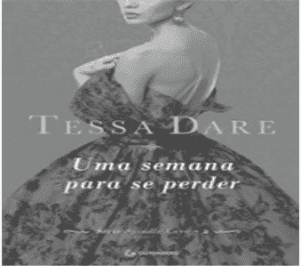

### 午夜女士

泰莎·黛尔
A C Reis 译

### 美女与铁匠

泰莎·黛尔
A C Reis 译

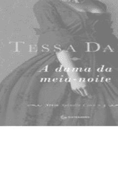

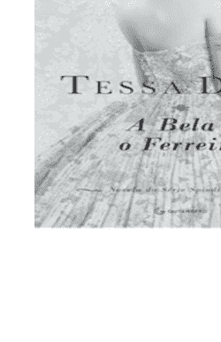

## 特莎·戴尔

"永恒城堡"系列

## 与公爵的浪漫

> “准备好坠入爱河吧”

朱莉娅·奎因

古腾堡

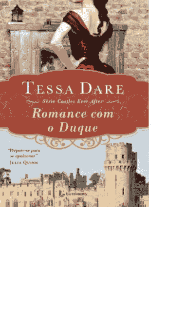

## 与公爵的浪漫

戴尔，特莎

9788582353660

256页

立即购买并阅读

> “伊兹一直梦想着过上童话般的生活。但就目前而言，她只能满足于那段充满戏剧性的故事。”

这位可爱的伊索尔德·奥菲莉亚·古德奈特是一位著名作家的女儿，她在童话和幸福结局的故事中长大。她相信命运、相信梦想，尤其相信真爱——就像她父亲小说中的主角克雷西达和乌尔里克那样的爱情。

浪漫的她焦急地等待着人生的高潮时刻：她的英雄会出现，将她从世间的不公中拯救出来，而她会发现，一个真爱的吻足以治愈任何创伤。

但随着逐渐长大成人，伊兹意识到那些故事没有一个是真实的。她是一只未能变成天鹅的丑小鸭，青蛙不会变成王子，而她在父母双亡、眼睁睁看着所有财产被转入他人名下时，也没有任何贵族来拯救她。

直到她的故事出现了转折：伊兹发现自己继承了一座遥远城市里的城堡废墟，那里大概早已被遗弃。而她万万没想到的是，那座城堡还自带一位公爵……

立即购买并阅读

## 莫妮卡·西富恩特斯

爱情小说

### 致芭芭拉的一首诗

一段帮助书写巴西历史的爱情故事

玛丽·德尔·普里奥雷作序

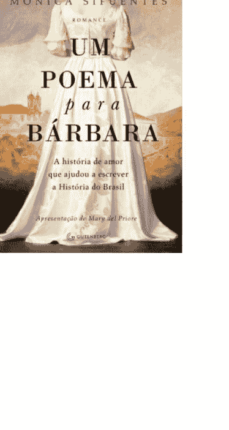

### 致芭芭拉的一首诗

西富恩特斯，莫妮卡

9788582353363

432页

立即购买并阅读

1776年，米纳斯吉拉斯州圣若昂德尔雷伊。这座城市迎来了来自葡萄牙的新任辖区监察官：年轻的知识分子、生活享乐者若泽·伊纳西奥·德·阿尔瓦伦加·佩肖托。正当他准备在繁荣的王室殖民地履行职责时，这位法官的道路与芭芭拉·埃利奥多拉交汇——她是一位品味高雅、思想超越时代的年轻女子，与伊纳西奥一样，她也在诗歌中表达自我。两人的相遇燃起了一段充满自由与革命梦想的激情，一个摆脱王室枷锁的国家的梦想。描绘了最终走向动荡的“米纳斯阴谋”的历程，《致芭芭拉的一首诗》是一个永远不会被时间抹去的爱情与勇气故事。那是一份鲜血与斗争、理想与英雄主义的遗产，至今仍铭刻在巴西的历史中。

立即购买并阅读

## 费尔南达·康康的生存指南

### 我在高中和生活中如鱼得水的万无一失计划

## 理查德·科赫

### 80/20法则

如何将自然法则应用于你的生活与事业

畅销书《80/20法则》作者

古腾堡

真正抵达顶峰

### 80/20法则

科赫，理查德

9788582354353

336页

立即购买并阅读

揭开成功科学的奥秘

成功与失败是同一枚硬币的两面，但抛起它的是你自己！

你是否觉得自己即使一切都做得正确，却依然得不到预期的结果？你有多少次感到需要改变职业方向，却又害怕冒险？或者在一个看似稳操胜券的项目上押下重注，却只蒙受损失？你有多少次问自己，合作是否比竞争更好？或者徘徊在听从直觉和冷静分析局势之间？

忘掉那些试图教你如何成功的过时公式和理论吧。你需要的一切就在你身边，理查德·科赫将向你展示如何揭开成功科学的秘密，以解决所有这些困境。

在这第三本书中，科赫汇集并探讨了自然界最强大的法则，展示了人类伟大的天才们如何发展出至今仍在指引世界和社会生活的理论，并揭示你如何能从中获益，建立稳固的事业和繁荣的企业。

达尔文、高斯、牛顿、爱因斯坦、亚当·斯密，以及许多其他知识精英，都将是你的盟友，证明科学可以应用于

在事业和生活中。当你学会利用自然规律为自己服务时，你会发现成功只是你攀向顶峰的必然结果。

立即购买并阅读

### 维多利亚·迪尼兹的冒险与糗事
### （我们会挺过去）

作者 Andrew Gray

古腾堡

### 维多利亚·迪尼兹的冒险与糗事

Diniz, Victoria
9788582354704
144 页

立即购买并阅读

一个半现实主义女孩的（几乎）真实故事

我承认，当我开始写这些我的（几乎）真实故事时，我还没意识到自己一生中出了这么多糗！不过没关系，我们会挺过去。

积极的一面是，我从经历的每一次冒险中都吸取了教训，现在与你分享一些有趣的案例、尴尬的处境和微小的快乐。全部都带着很多夸张，最重要的是，充满幽默！

从《旋转木马》小说的首次试镜到与暗恋对象最超现实的时刻：这一切都在这本书里。跟我来，一起见证我迄今为止最疯狂的生活倒霉事。

立即购买并阅读

