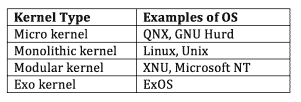
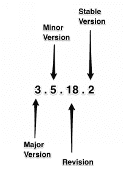
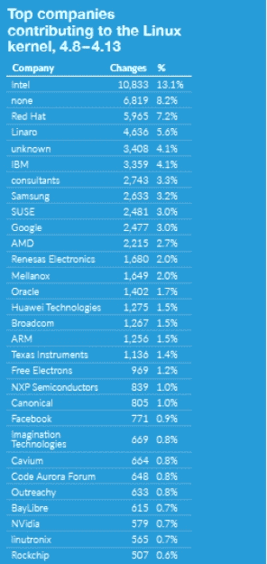
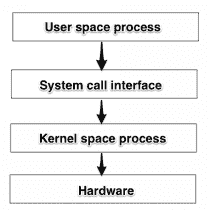
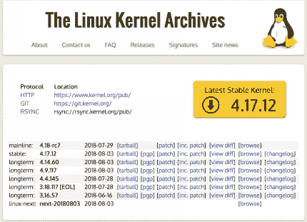
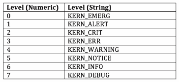

# 理解 Linux 内核：初学者指南：最简单、最易理解、学习和使用 Linux 内核的书籍。


## 版权声明

版权所有 © New York Publishing www.nycpublishing.org 保留所有。未经出版者书面许可，不得以任何形式或通过任何手段复制、发行或传输本书（包括复印、录制或其他电子或机械方法，或通过信息存储和检索系统），但批判性评论中的简短引用以及版权法允许的某些非商业用途除外。

ISBN: `9798720362096`

## 献辞

本书献给我尊敬的父母，感谢他们让我见证奇妙世界的光芒。感谢他们信任我并鼓励我追求梦想。

## 支持本地教育

作者版税总数的 20%将捐赠给教育非营利组织。

### 附录 A

- Linux 内核编码风格
  - 缩进
  - 长行换行
  - 空格位置
  - 括号位置
  - 局部和全局变量命名
  - 函数
  - 注释
- Kconfig 配置文件
- 宏和枚举
- 打印内核消息
- 内存分配

### 关于作者

## 第 1 章：内核简介

### 什么是内核？

对于汽车来说，引擎是最重要的部分；我们无法想象没有引擎的汽车。心脏也是如此。人可以没有眼睛、腿和手生存，但不能没有“心脏”。在计算系统中，内核是操作系统的核心，内核负责管理和运行操作系统的核心功能和特性。

### 内核的类型

有不同类型的汽车发动机，VEE、INLINE、STRAIGHT 等；每种类型的发动机都有不同的方法、优点和缺点。内核也有不同的类型；基于用途和目标机制。内核的示例包括单体、微内核、模块化内核等。

表 1.1：内核类型及示例



### 微内核

微内核采用调度、内存管理和进程通信的方法。这种类型的内核是最小的。但内核尺寸最小意味着什么？

### 单体内核

单体内核类型的内核在内部包含了所有所需的功能。例如，调度器、设备驱动程序、内存管理等。

### 模块化内核

### Exo Kernel

模块化内核结合了内核级驱动和第三方驱动的优点。在这种内核中，系统核心的一些部分将位于称为“模块”的独立文件中，这些模块可以在运行时添加到系统中。例如，仅在发现设备时加载驱动程序。

### 内核与操作系统的关系

假设想一个有两个房间的房子；两个房间之间有一条走廊用于通信。


以类似的模式，操作系统像一栋房子。它有两个部分或房间：一个是用户空间，另一个是内核空间，系统调用接口在它们之间工作。


### 内核空间与保护环

内核空间程序对系统/W、内存具有最高权限，这些不应被用户空间程序访问；否则将发生灾难。操作系统维护了一些保护环来克服这些灾难。在下面的图中显示了 x86 CPU 的保护环架构。这里定义了四个级，从级 0 到 级 3。


Level 0：保护环级 0 是权限最高的，内核空间程序在此运行。

Level 1：在保护环级 1，设备驱动程序和客操作系统驻留。

Level 2：I/O 特权代码和其他类似的特权代码运行在保护环级。

Level 3：用户空间程序和库运行在保护环级 3。

### 内核 vs 操作系统

| 内核 | 操作系统 |
| :--- | :--- |
| 内核是操作系统的核心。 | 操作系统由用户空间和内核空间组成。 |
| 内核与操作系统相比尺寸要小得多。 | 操作系统与内核相比要大得多。 |
| 内核作为软件和硬件之间的接口。 | 操作系统作为用户和硬件之间的接口。 |
| 内核工作更接近硬件，并提供低级服务，如：系统调用、内存管理、网络管理、驱动、文件管理、进程管理 | 操作系统包含了用户界面等应用程序。 |

## 内核空间 vs 用户空间？

`Kernel space`（内核空间）是内核代码存储的地方，它在此处执行并提供服务。相反，`user space`（用户空间）是用户进程运行的内存区域。`Userspace`进程可以通过系统调用访问 `kernel space` 例程。

## 微内核 vs 单体内核

两种最流行的内核类型是 `microkernel`（微内核）和 `monolithic kernel`（单体内核）。我们将讨论它们之间的区别。首先是服务。在 `microkernel` 中，服务保留在独立的地址空间中，而在 `monolithic kernel` 中，服务保留在同一个地址空间内。如果服务崩溃，不会影响 `micro kernel` 核心，因为它运行在独立的地址空间中，但 `monolithic` 核心会崩溃。在 `microkernel` 中，执行速度比 `monolithic kernel` 慢。与 `monolithic` 相比，`Microkernels` 的体积更小。另外一点，`microkernels` 易于扩展。

## 第 2 章：Linux 内核简介

### Linux 内核

`Linux Kernel` 继承了 `Monolithic`（单体）类型的内核。该内核由 Linus Torvalds 于 1991 年首次发布。`Linux kernel` 是整个 `Linux System` 的较小部分，它是负责系统运行良好程度的核心。自 2005 以来，`Linux kernel` 使用 `Git` 源码管理系统。

### Linux 内核开发者社区

如果你想为 `Linux Kernel` 编写代码，欢迎你；因为 `Linux kernel` 是开源项目。在开始之前，你应该了解技术部分以及 `Linux Kernel Developer Community` 是如何工作的。例如，代码冲突如何产生和解决、如何提交进程、`Linux kernel coding style` 等。关于这些及其他内容，你可以在 `kernel.org` 获得。

`Linux kernel versioning system`

### 开发亮点

自 `4.7` 发布以来，已从 4319 名独立开发者那里合并了 83,000 个变更集。

### 合并的新特性

- 内核内核 `TLS` 支持的加密流卸载。
- 改进的 `BBR` 拥塞控制方法。
- `ARM` 处理器上通过新的 `TEE` 框架实现的可信执行环境。
- 内核的文档系统现在由 `Sphinx` 支持。
- `Statx()` 系统调用现可用。

### Linux 内核源码大小

`Linux kernel` 每年添加对新硬件和功能的支持，因此其源码规模增长迅速。在 1991 年的首次发布时，内核源码规模接近 1 万行代码，目前它已经超过了 2200 万行代码。

### Linux 内核目录 / 源码结构

从源码树的顶层 `/usr/src/linux` 我们可以看到几个目录：

- **arch**
  - 这部分包含了所有特定架构的内核代码。
  - 该目录有进一步的子目录，例如对应每个支持架构的 `i386` 和 `alpha`。
- **include**
  - 该目录包含构建内核源码所需的大多数包含文件。
  - 它也有对应每个支持架构的子目录。
- **init**
  - 这部分包含了内核的初始化代码。
  - 该目录对于需要了解内核工作的开发者来说是一个非常重要的地方。
- **mm**
  - 这部分持有所有与内存管理相关的代码。
- **drivers**
  - 该目录包含了所有的设备驱动程序。
  - 它们进一步细分为设备驱动程序类，例如块设备驱动、字符设备驱动、网络驱动。
- **ipc**
  - 这部分持有内核的进程间通信代码。
- **modules**
  - 这部分曾用于持有构建好的模块。
- **fs**
  - 该目录包含文件系统代码。
- **kernel**
  - 该目录包含主内核源码。
- **net**
  - 该目录包含内核的网络代码。
- **lib**
  - 这部分持有内核的库代码。
- **scripts**
  - 这部分持有了在配置内核时使用的脚本。

## 谁在赞助这项工作？

根据报告，以下是聘用内核：



### 检查 Linux 内核版本

有时你可能需要检查当前版本，然后运行 `uname -r`

## 第 3 章：编译 Linux 内核

### Linux 内核源码树

`kernel.org` 托管所有的源码

该网站是不自明的。你可以下载源码。你也可以利用命令行 `wget` 或 `curl` 下载源码。

```bash
mkdir kernel
cd kernel
wget [url]
tar -xzf [filename.tar.gz]
```

### 编译 Linux 内核的工具

1. **编译器**
2. **链接器**
3. **Make**

**编译器**：有几种编译器可用，如 `gcc`、`clang`、`Visual C++`、`Turbo C` 等。但编译 Linux 内核必须使用 `gcc` C 编译器。为什么呢？因为内核的大部分是用 C 语言编写的，极小部分是用汇编编写的。`gcc` C 编译器能够编译 C 源码。

**链接器**：对于链接和汇编源码还需要另一个工具，即 `GNU binary utilities`，简称 `binutils`。`binutils` 是创建和管理二进制文件、对象文件、分析数据的工具集。

**Make**：编译内核的另一个重要工具是 `make`；它检查源码并寻找需要编译的文件。

## 第 4 章：理解系统调用接口

### 系统调用接口简介

系统调用接口在内核空间和用户空间之间提供了一个层。这一层为用户空间进程执行内核例程。简单来说，系统调用只是用户空间对内核函数或服务的请求

### Syscalls / 系统调用

Syscalls / 系统调用通过函数调用访问。通常这些函数调用定义在 C 库中。系统调用接受各种参数（从零到多个）作为输入，返回一个值并执行一个或多个任务。理想情况下，系统调用应该只有一个目的。

### 系统调用号

每个系统调用都被分配了一个唯一的 32 位系统数；并用于引用特定的系统调用。Linux 内核维护一个名为 `sys-call-table` 的表来存储所有注册的系统调用。

### 系统调用参数

在调用系统调用时，可能需要传递传递参数。在这里，参数存储在寄存器中。在 x86-32 位系统中，寄存器为 `ebx`、`ecx`、`edx`、`esi` 和 `edi`。但当需要传递超过 5 个参数时，会使用单个寄存器持有指向存储所有参数的用户空间的指针。返回值也通过寄存器发送到用户空间。

### 系统调优点

系统调用接口方法有两个优点。例如，

## 系统调用的优点

- **安全性**：如果用户态进程/程序能够直接读写内核地址空间，那么系统的安全性将将化为乌有。由于系统调用的实现，用户态函数对系统资源/硬件的访问受到限制。
- **性能更高**：系统调用接口为系统提供了更快的性能。
- **可移植性**：系统调用接口使得用户空间应用程序更具移植性。由于内核端的任何变化，用户态程序都不需要更改。
- **更易实现**：系统调用接口使得用户空间应用程序开发变得容易；在这里，它们不需要考虑系统的底层功能。

## 系统调用的缺点

要开发或实现一个新的系统调用，需要官方分配给你一个唯一的系统调用号。更多的痛点在于，所有的架构都需要单独注册该系统调用。因此，如果你想实现一个简单的任务，系统调用会非常耗时，而且维护起来相当复杂。

## 为 Linux 内核创建一个基础系统调用

首先，切换到 Linux 内核编译后的源码目录。

```bash
$ cd linux-x.x.x/
```

创建一个名为 `hellosys` 的目录并进入该目录。

```bash
$ mkdir hellosys
$ cd hellosys
```

在此目录下创建一个新的 C 文件，

```bash
$ vi hellosys.c
```

在此处添加以下代码：

```c
#include <linux/kernel.h>
asmlinkage long sys_hellosys(void) {
    printk("Hello New System Call!\n");
    return 0;
}
```

现在在同一目录下创建一个 `Makefile`，内容如下：

```makefile
mod_sign_cmd = scripts/sign-file $(CONFIG_MODULE_SIG_HASH) \$(MODULE_SIG_KEY_SRCPREFIX)
else
mod_sign_cmd = true
endif
export mod_sign_cmd
ifeq ( $(KBUILD_EXTMOD),)
core-y += kernel/certs/mm/fs/ipc/security/crypto/block/hellosys/
vmlinux-dirs := $(patsubst %/, %, $(filter %/, $(init-y) $(init-m) \$(core-y) $(core-m) $(drivers-y) $(drivers-m) \$(net-y) $(net-m) $(libs-y) $(libs-m) $(virt-y)))
vmlinux-alldirs := $(sort $(vmlinux-dirs) $(patsubst %/, %, $(filter %/, \$(init-) $(core-) $(drivers-) $(net-) $(libs-) $(virst-))))
```

现在，编译并运行 `Makefile`。

```bash
$ make
```

### 将新系统调用加入系统调用表

在名为 `syscall_table_64.tbl`（注：根据架构可能不同）的表格中添加条目。

*(注：由于原文文本在此处不完整，后续内容根据您提供的文本逻辑进行翻译)*

在主目录下创建一个名为“LKM”的目录，然后在 `LKM` 目录内创建 `hellolkm.c`。

```bash
cd ~
mkdir LKM
cd LKM
```

```c
#include <linux/kernel.h>
#include <linux/module.h>
//// end of header include section
#define __KERNEL__
#define MODULE
#define LINUX
//// end of macro define section
int init_module(void){
  printk(KERN_DEBUG “Hello LKM”);
  return 0;
}
//// end of init section
void cleanup_module (void){
  printk(KERN_DEBUG “Goodbye LKM”);
}
//// End of cleanup section
MODULE_LICENSE (“BSD”);
//// End of module licensing section
```

在头文件包含部分，包含了 `kernel.h` 用于 `printk()` 函数，包含了 `module.h` 用于将模块动态加载到内核中。在宏定义部分，添加了宏 `__KERNEL__` 以向用户空间程序隐藏内核源源程序。

我使用了函数 `init_module()`，它作为初始化函数工作。它在控制台中打印 Hello LKM，并使用了 `KERN_DEBUG` 宏。要理解 `KERN_DEBUG` 选项，请查看调试章节。然后我使用了函数 `cleanup_module()`，它作为模块的清理或结束函数工作。最后，使用 `MODULE_LICENSE` 宏来提供此模块的许可信息。

## Makefile

现在我将创建一个 makefile 来构建此模块。

```makefile
obj-m = helloLKM.o
KERNELDIR := /lib/module
WORKINGDIR := $(shell pwd)
all: make -c $(KERNELDIR) M=$(WORKINGDIR)
clean:
```


`kernel`目录是内核源码所在的目录。我使用了`shell uname –r`，它会递归搜索并获取当前内核的。`make -c $(KERNELDIR) “make”`会构建源码时切换到该目录，并在完成后返回此目录。`M = $(WORKINGDIR)`使用模块所在的工作目录路径。这里`WORKINGDIR := $(shell pwd)`表示当前目录的绝对路径。最后，`clean`标签将移除所有生成的文件。

现在我将编译、构建并运行该模块。

首先，编译：

```bash
make
```

此命令将在工作目录下创建模块`helloLKM.ko`。要查看`helloLKM.ko`的信息：

```bash
modinfo helloLKM.ko
```

现在，我可以加载此模块，但要做到这一点，我需要将用户优先级更改为超级用户。然后我可以使用`insmod`或`modprobe`命令加载模块。

```bash
su
insmod helloLKM.ko
su
modprobe helloLKM.ko
```

要检查模块是否加载成功，我可以检查此日志。

```bash
dmesg | tail-1
Hello LKM
```

你可以卸载该模块：

```bash
rmmod helloLKM
modprobe –r helloLKM
```

要检查是否卸载完美，请使用`dmesg`检查：

```bash
dmesg | tail-1
Goodbye LKM
```

### 初始化与清理宏

在内核 2.4 版本之前，强制使用`init_module()`进行模块初始化并使用`cleanup_module()`进行清理。但从内核 2.4 版本开始，允许使用任何名称，我们需要使用额外的宏，以便系统理解哪一个用于初始化，哪一个用于清理。

```c
static int entrance()
static int out()
module __init (entrance);
module __exit(out);
```

你可以在函数名之前使用`__init()`和`__exit()`宏。

```c
#include <linux/kernel.h>
#include <linux/module.h>
//// end of header include section
#define __KERNEL__
#define MODULE
#define LINUX
//// end of macro define section
static int entrance(void){
  printk(KERN_DEBUG “Hello LKM”);
  return 0;
}
//// end of init section
static int out(void){
  printk(KERN_DEBUG “Goodbye LKM”);
}
//// End of cleanup section
module __init (entrance);
module __exit(out);
MODULE_LICENSE (“BSD”);
//// End of module licensing section
```

### 其他宏

你也可以使用其他宏如`MODULE_DESCRIPTION`、`MODULE_AUTHOR`，这些对于理解模块用途以及编写者非常有帮助。

```c
MODULE_AUTHOR (“Your Name”);
MODULE_DESCRIPTION (“This is test module”);
```

例如：

```c
#include <linux/kernel.h>
#include <linux/module.h>
//// end of header include section
#define __KERNEL__
#define MODULE
#define LINUX
//// end of macro define section
static int __init entrance (void){
  printk(KERN_DEBUG “Hello LKM\n”);
  return 0;
}
static void __exit out (void){
  printk(KERN_DEBUG “Goodbye LKM\n”);
}
module __init (entrance);
module __exit(out);
MODULE_AUTHOR (“Md Mahbubur Rahman”);
MODULE_LICENSE (“BSD”);
//// End of module licensing section
```

`__init`宏定义引用的函数在初始化后不再需要。内核在初始化后从内存中释放它，`__exit`宏用于移除。

### LKM 中的命令行参数

为了获取命令行参数，LKM 需要使用`MODULE_PARAM()`宏，且变量应该被定义为全局。`MODULE_PARAM()`宏接受两个参数：变量名和变量类型。另一个相关的宏`MODULE_PARAM_DESC()`用于记录模块参数说明。它接受两个参数：变量名和变量描述。

**命令行参数中支持的数据类型：**

* Bool

* Byte（单字节）

* 字符指针

* 数组

* Short int

* Unsigned short int

* Int

* Unsigned int

* Long int

* Unsigned long int

## 使用整数的 LKM 命令行参数示例

```c
#include <linux/kernel.h>
#include <linux/init.h>
#include <linux/stat.h>
#include <linux/module.h>
#include <linux/moduleparam.h>
#define __KERNEL__
#define LINUX
#define MODULE
//// 宏定义部分结束
static int input = 5; // 变量应该应该有一个初始默认值
MODULE_PARAM (input, int);
MODULE_PARM_DESC(input, "An integer");
static init __init entrance (void){
	int square_val = input * input;
	printk(KERN_DEBUG “Square value of input = %i\n”, square_val);
}
static void __exit out (void){
	printk(KERN_DEBUG “Goodbye LKM\n”);
}
module __init (entrance);
module __exit(out);
MODULE_AUTHOR("Md Mahbubur Rahman");
MODULE_LICENSE (“BSD”);
//// 模块许可部分结束
```

## 使用短整数、整数和长整数的 LKM 命令行参数示例

```c
#include <linux/kernel.h>
#include <linux/init.h>
#include <linux/stat.h>
#include <linux/module.h>
#include <linux/moduleparam.h>
#define __KERNEL__
#define LINUX
#define MODULE
//// 宏定义部分结束
static short int shortInt = 1;
static int vInt = 111;
static long int longInt = 5555;
//// 命令行参数声明结束
MODULE_PARAM(shortInt, short);
MODULE_PARM_DESC(shortInt, "A short integer");
MODULE_PARAM(vInt, int);
MODULE_PARM_DESC(vInt, "An integer");
MODULE_PARAM(longInt, long);
MODULE_PARM_DESC(longInt, "A long integer");
static int __init entrance(void){
	int i;
	printk(KERN_INFO "Hello LKM =============\n");
	printk(KERN_INFO "myshort is a short integer: %hd\n", shortInt);
	printk(KERN_INFO "vInt is an integer: %d\n", vInt);
	printk(KERN_INFO "longInt is a long integer: %ld\n", longInt);
	return 0;
}
//// 初始化部分结束
static void __exit out(void){
	printk(KERN_INFO "Goodbye LKM\n");
}
//// 清理部分结束
module __init (entrance);
module __exit(out);
MODULE_AUTHOR("Md Mahbubur Rahman");
MODULE_LICENSE (“BSD”);
//// 模块许可部分结束 
```

## 使用字符串的 LKM 命令行参数示例

```c
#include <linux/kernel.h>
#include <linux/init.h>
#include <linux/stat.h>
#include <linux/module.h>
#include <linux/moduleparam.h>
#define __KERNEL__
#define LINUX
#define MODULE
//// 宏定义部分结束
static char *stringVar = "hello";
//// 命令行参数声明结束
MODULE_PARAM(stringVar, charp);
MODULE_PARM_DESC(stringVar, "A character string");
//// 为每个变量添加带有带的 module_param
static int __init entrance(void){
	int i;
	printk(KERN_INFO "mystring is a string: %s\n", stringVar);
	return 0;
}
//// 初始化部分结束
static void __exit out(void){
	printk(KERN_INFO "Goodbye LKM\n");
}
//// 清理部分结束
module __init (entrance);
module __exit(out);
MODULE_AUTHOR("Md Mahbubur Rahman");
MODULE_LICENSE (“BSD”);
//// 模块许可部分结束 
```

## 使用数组的 LKM 命令行参数示例

```c
#include <linux/kernel.h>
#include <linux/init.h>
#include <linux/stat.h>
#include <linux/module.h>
#include <linux/moduleparam.h>
#define __KERNEL__
#define LINUX
#define MODULE
//// 宏定义部分结束
static int intArray[3] = { 1, 2, 3 };
static int arrayArgc = 0;
//// 命令行参数声明结束
MODULE_PARAM_ARRAY(intArray, int, arrayArgc, 1111);
MODULE_PARM_DESC(intArray, "An array of integers");
//// 为每个变量添加带有类型的 module_param
static int __init entrance(void){
	int i;
	for (i = 0; i < (sizeof intArray / sizeof (int)); i++)
	{
		printk(KERN_INFO " intArray[%d] = %d\n", i, intArray[i]);
	}
	printk(KERN_INFO "got %d arguments for intArray.\n", arrayArgc);
	return 0;
}
//// 初始化部分结束
static void __exit out(void){
	printk(KERN_INFO "Goodbye LKM\n");
}
//// 清理部分结束
module __init (entrance);
module __exit(out);
MODULE_AUTHOR("Md Mahbubur Rahman");
MODULE_LICENSE (“BSD”);
//// 模块许可部分结束 
```

* `printk()`的另一个重要特性是日志级别。在将`printk()`的内容打印到控制台之前，内核会检查日志级别。

### `printk()` 日志级别优先级

`<linux/kernel.h>`中定义了`printk()`的八（08）个优先级级别。它们列在这里：

* `KERN_EMERG`

  严重且致命的紧急状况，可能导致系统停止或崩溃。

* `KERN_ALERT`

  紧急问题，可能需要立即采取行动。

* `KERN_CRIT`

  关键状态，通常与严重的硬件或软件故障有关。

* `KERN_ERR`

  错误状态，例如硬件故障、软件故障将以该日志级别进行报告。

* `KERN_WARNING`

  警告级别消息。

* `KERN_NOTICE`

  当前情况可能正常，但仍值得注意。

* `KERN_INFO`

  在此日志级别报告信息性消息。

* `KERN_DEBUG`

  调试消息，此日志级别通常用于调试目的。

现在你脑中产生了一个问题，如果不指定日志级别，会发生什么？将使用`DEFAULT_MESSAGE_LOGLEVEL`的默认值，它目前是`KERN_WARNING`。

#### Printk 示例 #1

```c
#include <linux/kernel.h>
#include <linux/module.h>
// end of header include section
#define __KERNEL__
#define MODULE
#define LINUX
// end of macro define section
static int entrance(void){
  printk(KERN_DEBUG "Simple and Basic Printk example");
  return 0;
}
// end of init section
static int out(void){
  printk(KERN_DEBUG "Goodbye! But remember, printk is amazing.");
}
// End of cleanup section
module __init (entrance);
module __exit(out);
MODULE_LICENSE ("BSD");
// End of module licensing section
```

#### Printk 示例 #2

```c
#include <linux/kernel.h>
#include <linux/module.h>
// end of header include section
#define __KERNEL__
#define MODULE
#define LINUX
// end of macro define section
static int entrance(void){
  printk(KERN_DEBUG "Simple and Basic Printk example : FILE: %s, LINE : %i\n", __FILE__, __LINE__);
  return 0;
}
// end of init section
static int out(void){
  printk(KERN_DEBUG "Goodbye! But remember, printk is amazing: FILE: %s, LINE : %i\n", __FILE__, __LINE__);
}
// End of cleanup section
module __init (entrance);
module __exit(out);
MODULE_LICENSE ("BSD");
// End of module licensing section
```

## 第 9 章：加载和卸载 LKM

### 按需加载和卸载 Linux 内核模块 (LKMs)

Linux 内核有一个强大的功能，它可以自动加载和卸载 LKM，这有助于避免浪费内核进程和内存。但要使用这项支持或功能，我们需要需要在编译内核之前的配置内核时启用`kmod`模块。

大多数发行版如 Redhat、Debian、Ubuntu、CentOS 等都带有启用的`kmod`。`kmod`功能或支持随`libkmod.so`库一起。

`libkmod`库的内容：

- `insmod`

- `rmmod`

- `depmod`

- `modprobe`

- `modinfo`

- `lsmod`

`insmod`用于将模块插入 Linux 内核。

注意：`insmod`需要传递完整路径和按正确顺序排列模块列表（依赖模块）。如果我们考虑`nfs.ko`，它需要以下相关顺序的模块：

1. `nfs_common.ko`

2. `auth_rpcgss.ko`


3. `fscache.ko`

4. `lockd.ko`

5. `sunrpc.ko`

`rmmod`

`rmmod` 从 Linux 内核中卸载模块。如果我们想卸载或移除模块，必须运行以下命令：

```
$ rmmod modulename
```

例如，我们有一个模块 `vfat`，我们需要卸载它。那么命令将是：

```
$ rmmod vfat
```

注意：在 Linux 内核中还有另一种卸载或移除模块的方法。那是 `modprobe –v –r`。在这里移除 `vfat` 的命令为：

```
$ modprob –v –r vfat
```

其中，`r` 是 remove 的缩写，`v` 代表 verbose（详细）。

`depmod`

`depmod` 与现有的模块集一起。它根据命令行中提到的现有模块集或从配置文件指定的目录中找到的符号，创建一个依赖文件。

`depmod` 创建一个类似于 `Makefile` 的依赖文件，`modprobe` 用它自动加载正确的模块或模块栈。

注意：`depmod` 文件可以在 `/lib/modules/kernel-version/modules.dep` 找到。

`modinfo`

`modinfo` 程序显示 Linux 内核模块的信息。它显示每个模块的以下信息：

1. 模块作者
2. 许可证
3. 参数
4. 依赖关系
5. 模块描述
6. 模块完整路径

`lsmod`

`lsmod` 程序显示当前加载的模块。它显示以下：

1. 模块名称
2. 模块大小
3. 使用计数和引用模块列表

`modprobe`

`modprobe` 程序向 Linux 内核添加或删除模块。它查看 `/lib/modules` 中的所有模块。它是如何工作的？通过 `depmod` 生成的 `dep` 文件。

## 第 10 章：设备驱动程序简介

### 设备驱动程序简介

Linux 内核大部分源码都在设备驱动程序中。`drivers` 目录包含了所有的 Linux 设备驱动源码。该目录有以下部分：

- `/block`
  - 块设备驱动位于此处。
  - 块设备包括 IDE 和 SCSI 设备。
- `/char`
  - 字符设备驱动位于此处。例如 `tty`。
- `/cdrom`
  - Linux 的 CDROM 代码位于此目录。
- `/pci`
  - PCI 伪驱动位于此目录。
- `/scsi`
  - Linux 支持的所有 SCSI 设备驱动程序位于此处。
- `/net`
  - 网络设备驱动位于此处。
- `/sound`
  - 所有声卡驱动位于此处。

### 什么是设备驱动程序？

设备驱动程序最终设计和开发用于控制或操作连接到系统的特定类型硬件。换句话说，设备驱动程序由大量告诉系统如何通信、操作或控制硬件的代码组成。内核使用设备驱动程序来控制或通信硬件，而无需了解硬件的任何细节，例如硬件如何工作。驱动程序使用计算机的总线系统与设备通信，或通过连接硬件的其他通信系统通信。

内核何时调用设备驱动程序？

- 检查设备可用。
- 处理设备特定的输入/输出调用。
- 用于向 `sysconfig` 工具执行用户空间请求。
- 通过处理中断来检查数据是否准备就绪。
- 用于设置/重置以及初始化/重新初始化设备。
- 从用户空间标准库的输入/输出调用执行输入/输出操作。

## 用户空间、内核空间和硬件空间的设备驱动工作流程

- 在用户空间中，任何源程序或库都无法直接与硬件通信，因此它们向内核空间的源程序调用。
- 尽管内核在系统中拥有最高权限模式，但内核并不尝试直接访问硬件，而是遵循一种约定。内核使用设备驱动程序与硬件通信。
- 内核空间中的设备驱动负责与硬件或设备通信，例如：打开设备、通过总线对外设设备寄存器进行读写操作，然后关闭设备。
- 在硬件空间中，总线作为传输路径或通信路径，配合处理器与设备控制器之间的访问协议。当设备驱动从控制器的硬件寄存器读取数据或向写入数据时，数据将跨越总线传输。
- 在硬件空间中，控制器作为控制一个或多个设备的物理接口。

## 第 11 章：用极其易懂的解释开发字符设备驱动

### 解释 # 1

Linux 设备驱动分为几类：最常见的是块设备、字符设备和网络设备。在这里，我们将学习如何编写简单的字符设备。

### 解释 # 2

块设备的权限位类似于 `brw-rw--`，其中“b”代表块设备；字符设备的权限位类似于 `crw-rw--`，其中“c”代表字符设备。

### 解释 # 3

每个设备驱动都包含两个数字：主设备号和次设备号。主设备号用于区分驱动程序，相同的主设备号表示它们由同一个驱动程序控制。通过使用不同的次设备号，可以在一个驱动中创建多个设备驱动。主设备号和次设备号这两个数字共同决定一个设备驱动。

例如：

```
brw-rw----  1 root disk 9,  0 May 17 10:15 sda
```

```
brw-rw----  1 root disd 9,  1 May 17 10:15 sda1
```

这里，`sda` 和 `sda1` 的主号是 9，次号不同，分别为 0 和 1。

### 解释 #4

任何 `/dev/xxx` 下的接口都遵循“一切皆文件”，因此设备驱动的操作实际上就是对文件的操作。我们可以认为设备驱动的 API 全都是关于文件操作，而设备驱动被用于定义/打开/读/写等功能。所有的文件操作都定义在内核头文件 `<linux/fs.h>` 的 `file_operations` 结构体中。

在接下来的设备驱动示例中，我们将看到 `file_operations` 结构体：

```c
struct file_operations gpio_fops = {
    read    : gpio_read,
    write   : gpio_write,
    open    : gpio_open,
    release : gpio_close,
    owner   : GPIO_MODULE
};
```

在这里，我们声明了一个结构体并将其赋值给结构体变量 `gpio_fops`。除了 `owner` 之外，这些值都是函数指针。然后我们使用 `cdev_add` 在初始化模块中为每个驱动注册文件操作结构体。

## 开发一个微型 GPIO 字符设备驱动

```c
#include <linux/kernel.h>
#include <linux/module.h>
#include <linux/moduleparam.h>
#include <linux/init.h>
#include <linux/stat.h>
#include <linux/cdev.h>
#include <linux/device.h>
#include <linux/fs.h>
#include <linux/slab.h>
#include <asm/uaccess.h>
#include <linux/string.h>

// 头文件包含结束
#define DEVICE_MAJOR  200
#define DEVICE_MINOR  0
#define DEVICE_DEV_COUNT 2

// 定义结束

static int gpio_open(struct inode *, struct file *);
static ssize_t gpio_read(struct file *, char *, size_t, loff_t *);
static ssize_t gpio_write(struct file *, const char *, size_t, loff_t *);
static int gpio_close(struct inode *, struct file *);

struct file_operations gpio_fops = {
    read    : gpio_read,
    write   : gpio_write,
    open    : gpio_open,
    release : gpio_close,
    owner   : GPIO_MODULE
};

struct cdev gpio_cdev;
static char *dev_c_message = NULL;

static int entrance(void) {
    // 获取设备号
    // 设备 ID 使用类型 dev_t 来表示。
    dev_t devno;
    unsigned int count = DEVICE_DEV_COUNT;
    int err;

    // 设备 ID 由两部分组成：主 ID（用于识别设备类）
    // 和次 ID（用于识别该类中特定设备的实例）。
    // 给定主设备和次设备 ID，makedev() 将这些合并以产生
    // 设备 ID，并作为函数结果返回。
    // 主号和次号是 Linux 识别与设备文件相关的底层硬件设备的方式。
    // 大多数情况下主号标识驱动程序，而次号区分驱动程序控制的不同设备。
    devno = MKDEV(DEVICE_MAJOR, DEVICE_MINOR);

    // register_chrdev_region 函数 — 注册设备设备号
    // 参数为 (dev_t from, unsigned count, const char * name);
    // from - 目标设备号范围中的第一个；必须包含主号。
    // count - 需要的连续设备号数量
    // name - 设备或驱动程序的名称
    register_chrdev_region(devno, count, "gpiodev");

    // cdev_init — 初始化一个 cdev 结构体
    cdev_init(&gpio_cdev, &gpio_fops);
    gpio_cdev.owner = GPIO_MODULE;

    // cdev_add 向内核注册一个字符设备。
    // 内核在 cdev_map 下维护了一个字符设备列表
    err = cdev_add(&gpio_cdev, devno, count);
    if (err < 0) {
        printk("Error: While Adding Device\n");
        return -1;
    }

    printk("TINY GPIO Device Driver.\n");
    printk("'mknod /dev/gpiodev_0 c %d 0'.\n", DEVICE_MAJOR);
    printk("'mknod /dev/gpiodev_1 c %d 1'.\n", DEVICE_MAJOR);

    // kmalloc 是内核中为小于页大小的对象分配内存的标准方法。
    dev_c_message = (char *)kmalloc(32, GFP_KERNEL);
    if (dev_c_message != NULL) {
        printk("kmalloc dev_c_message: 0x%p", dev_c_message);
    }
    return 0;
}
// 初始化部分结束

static void out(void) {
    dev_t devno;
    printk("Bye TINY GPIO Driver\n");
    if (dev_c_message) {
        // 释放相关内存
        kfree(dev_c_message);
    }
    // 释放微型字符设备
    devno = MKDEV(DEVICE_MAJOR, DEVICE_MINOR);
    // unregister_chrdev_region — 注销设备设备号范围
    unregister_chrdev_region(devno, DEVICE_DEV_COUNT);
    // cdev_del — 从系统中删除 cdev
    cdev_del(&gpio_cdev);
}
// 清理部分

static int gpio_open(struct inode *inode, struct file *fil) {
    int dev_major;
    int dev_minor;
    dev_major = MAJOR(inode);
    dev_minor = MINOR(inode);
    printk("\nTINY GPIO DEVICE: OPEN : %d %d\n", dev_major, dev_minor);
    return 0;
}

static int gpio_close(struct inode *inode, struct file *fil) {
    int dev_major;
    int dev_minor;
    dev_major = MAJOR(inode);
    dev_minor = MINOR(inode);
    printk("\nTINY GPIO DEVICE: CLOSE : %d %d\n", dev_major, dev_minor);
    return 0;
}

static ssize_t gpio_read(struct file *filp, char *buff, size_t len, loff_t *off) {
    int dev_major;
    int dev_minor;
    short count;
    dev_major = MAJOR(filp);
    dev_minor = MINOR(filp);
    printk("FILE OPERATION READ:%d:%d\n", dev_major, dev_minor);
    switch (minor) {
        case 0:
            strcpy(dev_c_message, "DATA FROM minor : 0");
            break;
        case 1:
            strcpy(dev_c_message, "DATA FROM minor : 1");
            break;
        default:
            len = 0;
    }
    // copy_to_user — 将数据拷贝到用户空间。
    // 成功时返回未拷贝的字节数。
    count = copy_to_user(buff, dev_c_message, len);
    return 0;
}

static ssize_t gpio_write(struct file *filp, const char *buff, size_t len, loff_t *off) {
    int dev_major;
    int dev_minor;
    short count;
    memset(dev_c_message, 0, 32);
    dev_major = MAJOR(filp);
    dev_minor = MINOR(filp);
    count = copy_from_user(dev_c_message, buff, len);
    printk("FILE OPERATION WRITE:%d:%d\n", dev_major, dev_minor);
    printk("dev_c_message: %s", dev_c_message);
    return len;
}

module_init(entrance);
module_exit(out);
MODULE_LICENSE("BSD");
MODULE_DESCRIPTION("TINY GPIO Driver");
```

## Makefile

```makefile
obj-m += gpiodriver.o

all:

	make -C /lib/modules/$(shell uname -r)/build M=$(PWD)

clean:

	make -C /lib/modules/$(shell uname -r)/build M=$(PWD) clean
```

现在编译上述源码，获取 `gpiodriver.ko`，对其进行签名，最后通过 `insmod` 将其加载到内核。检查是否成功加载：

```bash
insmod gpiodriver.ko

lsmod | grep gpiodriver

cat /proc/devices | grep gpiodriver

dmesg | tail -10
```

## 附录 A：Linux 内核编码风格

### 缩进

最重要的规则之一，因为 Tab 占用 8 个字符，所以缩进也是 8 个字符。现在，有些程序员声称 8 字符的缩进会导致代码向右移动太远，难以在 80 字符的屏幕上查看。解决这个办法是，如果你需要超过 3 级的缩进，你就需要修复你的源码。8 字符缩进让阅读变得更简单，并且在函数嵌套过深时具有额外的警示作用。

```c
switch (test) {

    case '1':

    case '2':

        data <<= 2;

        break;

    case '3':

    case '4':

        data <<= 4;

        break;

    case '5':

    case '6':

        data <<= 6;

        break;

    case '7':

    case '8':

        data <<= 8;

        break;

    case '9':

    case '10':

        data <<= 10;

        break;

    default:

        break;
}
```


- 在单行内不要进行多次赋值。内核代码应该是极其简单、易于阅读和理解的。
- 让你的表达式变得易于理解。
- 不要在行尾留有空白字符。
- 在单行内不要放置多个语句。

### 长行折行

强烈建议将行长度限制在 80 列以内。永远不要打破此规则。任何超过 80 列的语句都必须拆分成几部分，超过 80 列会显著降低源码的可读性，且不会隐藏任何信息。

### 空格的放置

在关键字后使用空格（例外是那些像函数且通常与括号一起使用的关键字，例如`if`、`attribute`、`sizeof`、`typeof`）。不要在括号内部使用空格。

### 大括号的位置

建议在结构定义处使用大括号。

```c
if (input) {

    input++;

} else switch (input) {

    case 1:

        input++;

        break;

    case 2:

        input++;

        break;

    default:

        break;

}
```

在函数定义处使用大括号。

```c
void function(void) {

    // ...

}
```

在`if`语句中使用大括号。

```c
if (condition) {

    // ...

}
```

在`switch`语句中使用大括号。

```c
switch (variable) {

    case 1:

        // ...

        break;

}
```
