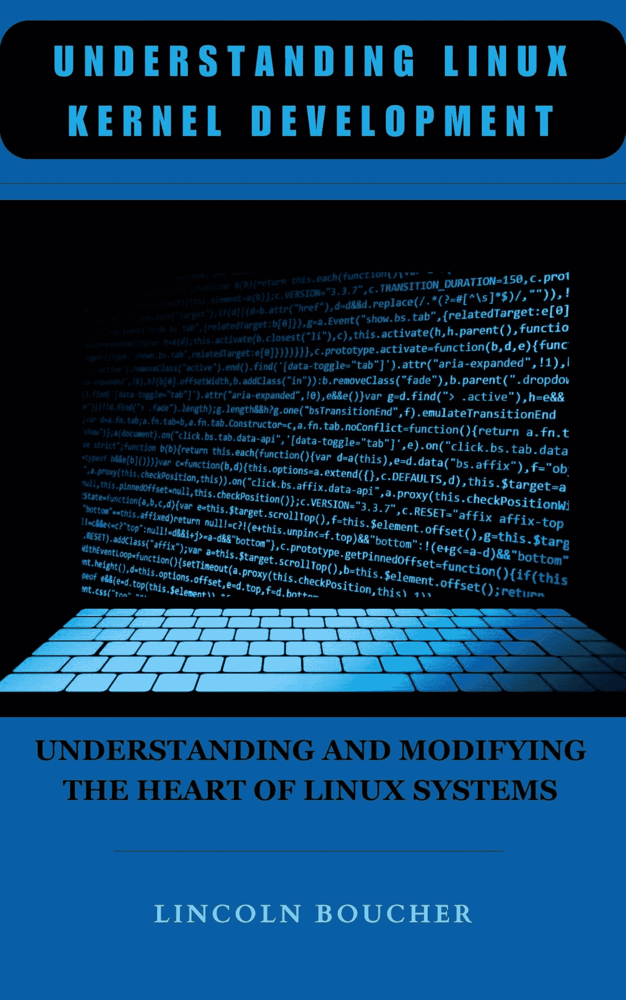

# Linux 内核开发理解：理解并修改 Linux 系统核心



# 第 1 章：Linux 内核开发

欢迎来到 Linux 操作系统核心的门户：内核！请将 Linux 内核想象成一场复杂交响乐的指挥，协调着系统内的每一项操作。在本章中，我们将揭示 Linux 内核开发的基础元素。从它的历史演变到在当今计算格局中扮演的关键角色，加入我们共同探索理解这一核心组件的重大意义。准备好发现 Linux 内核的内部机制，揭秘它的组件、功能以及它对现代计算的深远影响。开启一场穿越 Linux 内核开发本质的开眼之旅吧！

## 1.1 Linux 内核概述

### 理解内核

从本质上说，Linux 内核是 Linux 操作系统的核心，是幕后让一切无缝运行的大脑。它就像交响乐团的指挥，管理并协调你计算机内的所有资源，包括内存、硬件、进程等。

### 内核的作用

想象你正在使用电脑——打开应用程序、浏览网页或观看视频。内核通过分配内存、处理输入/输出请求以及确保各种进程平畅运行且互不干扰来管理这些任务。

### 内核的组成部分

内核被分为不同的模块，每个模块处理特定的任务。例如，进程调度器负责管理进程及其执行，内存管理器处理内存分配和使用，设备驱动程序则管理打印机、USB 驱动器等外围设备。

### 内核空间与用户空间

内核运行在称为“内核空间”的特权模式下，可以直接访问硬件和系统资源。另一方面，“用户空间”是应用程序和用户级进程运行的地方。内核充当用户空间与硬件之间的桥梁，控制并调节它们之间的交互。

### 代码示例（内核函数）

让我们来看简单的代码片段：

```c
#include <linux/init.h>
#include <linux/module.h>
#include <linux/kernel.h>

static int __init hello_init(void) {
    printk(KERN_INFO "Hello, Linux Kernel!\n");
    return 0;
}

static void __exit hello_exit(void) {
    printk(KERN_INFO "Exiting Kernel Module\n");
}

module_init(hello_init);
module_exit(hello_exit);
```

这段简小的代码展示了一个基本的内核模块。在初始化时，它会在内核日志中打印“Hello, Linux Kernel!”，展示了模块如何与内核交互。

### 意义

对于开发者来说，理解内核至关重要，因为修改或开发内核级软件需要深度理解内核的工作原理。它是整个操作系统运行的基础，使其成为计算世界的一个关键方面。

本质上，这一概述仅触及了 Linux 内核的皮毛，突显了它在计算环境中的中心作用，为深入研究其组件和功能奠定了基础。

## 1.2 理解内核的重要性

### 系统理解的基础

将内核想象成你操作系统的基石——将一切系在一起的纽纽。理解它等同于破解操作系统的语言。它赋予开发者和爱好者理解整个系统运作的能力，从硬件交互到进程管理。

### 促进开发与创新

当你理解了内核，你就拥有了创新和为操作系统演进做出贡献的能力。这种理解允许开发者编写更高效的软件，优化系统性能，并针对特定需求开发自定义功能。

### 调试与优化

内核知识有助于调试复杂的系统问题。具备这种理解的开发者可以高效地追踪并修复与内核相关的问题。此外，它还允许他们通过调优内核参数来优化系统性能。

### 安全增强

在当今的数字领域，安全至关重要。理解内核有助于加固系统安全。通过这些知识，开发者可以识别漏洞，实施稳健的安全措施，并为创建更安全的内核代码做出贡献。

### 代码示例（内核编译）

这里是内核编译的示例，这是处理内核源码时至关重要的环节：

```bash
make menuconfig         # 配置内核选项
make                     # 编译内核
make modules_install    # 安装内核模块
make install             # 安装内核
```

理解这一过程允许开发者自定义内核配置、编译自定义内核并高效地管理内核模块。

### 促进职业成长

对于专业人士，特别是软件和系统开发领域，对内核的深刻理解是一项非常有价值的技能 set。它提升了职业前景，为内核级开发岗位开辟了道路，并为不断变化的科技行业中的持续学习和增长奠定了基础。

本质上，理解内核等于掌握了操作系统内部机制的钥匙，为科技世界的创新、问题解决和职业成长开启了可能的大门。

## 1.3 Linux 内核开发的演变与历史

### Linux 内核的起源

Linux 内核诞生于 1991 年，源于芬兰计算机科学学生林纳斯·托瓦兹（Linus Torvalds）的卓越头脑。林纳斯创建内核是作为专有操作系统的开源替代方案。起初，它只是一个简单的项目，但通过开源社区的共同努力，迅速发展了动力。

### 早期开发阶段

在婴儿时期，内核采用单体设计，包含了进程管理和文件系统等基本功能。随着其人气的飙升，贡献源源不断，增强了它的功能并扩展了对硬件的支持。

### 版本控制与开发模型

Linux 内核开发遵循主版本-次版本-发布格式的命名方案（例如 `2.6.32`）。内核采用基于时间的发布模型，确保定期的更新和改进。此外，内核源码使用 `Git` 版本控制系统进行管理，允许全球开发者进行分布式协作。

### 关键里程碑与创新

在各个版本迭代中，内核见证了卓越的进步。如引入 `SMP`（对称多处理）支持、采用 `GPLv2` 许可证以及集成各种文件系统（`ext2`、`ext3`、`ext4`）等里程碑，标志着功能、性能和稳定性的巨大飞跃。

## 代码示例（内核开发历史）

让我们通过一段突显历史演变的代码片段来回顾过去：

### Linux 0.01 (1991)

- 骨干阶段的内核，提供基本功能。
- 支持终端 I/O、进程调度和文件系统。

### Linux 1.0 (1994)

- 稳定版本，扩展了硬件支持。
- 包含了对更多文件系统和网络能力的支持。

## 当代内核开发

在近期，内核开发继续快速演进。改进措施包括增强安全措施、性能优化、对新硬件架构的支持，以及容器和虚拟化等现代技术的整合。

## 影响与未来展望

Linux 内核的影响是深远的，它驱动着从智能手机、物联网设备到服务器和超级计算机的各种系统。它的未来有望进一步的创新，适应新兴技术和不断变化的计算需求。

本质上，追溯 Linux 内核开发的历史揭示了一段充满协作努力、创新和持续演变的非凡程。这一历史视角强调了内核在塑造现代计算格局中的关键作用。

最后，我们对 Linux 内核基础方面的探索揭示了其作为操作系统骨干的关键作用。理解它的组件、重要性以及历史演变，是通往科技世界创新和解决问题的大门。

在我们结束之际，让我们反思内核的影响——它实现了系统优化，促进了安全措施，并为计算的持续进步铺平了道路。

# 第 2 章：内核架构基础

欢迎来到理解复杂且迷人的内核架构的大门！将内核想象成一个为你的操作系统功能设计蓝图的大型建筑师。在本章中，我们将揭开内核架构基础的基础元素。从它的结构组件到系统调用的编排，加入我们一起探索内核的关键解剖结构。准备好窥探幕后，发现为你的计算环境无缝运行奠定基础的构建块。准备深入研究内核架构——这是一个塑造你系统运行本质的迷人景观！

带着对未来的期待，让我们继续这些这些知识，拥抱它为创新和增长提供的机会。感谢这段进入内核本质的之旅，让我们在对这一核心计算奇迹的理解下勇往向前。

## 2.1 内核组件及其功能

### 1. 进程管理

内核通过管理进程的创建、调度和终止来监控进程（即正在运行的程序）。它分配 CPU 时间，处理进程间通信，并维护进程同步。

```c
int fork(void);
int execve(const char *filename, char *const argv[], char *const envp[]);
```

如 `fork()` 等函数创建新进程，而 `execve()` 在这些进程中加载并执行程序。

### 2. 内存管理

该组件负责管理系统内存，为进程分配和释放内存空间。它维护虚拟内存映射，处理内存分页，并确保内存的高效利用。

```c
void *kmalloc(size_t size, int flags);
void kfree(void *ptr);
```

如 `kmalloc()` 等函数分配内存，而 `kfree()` 在内核内部释放之前分配内存。

### 3. 文件系统管理

该组件管理数据存储，提供对文件、目录和存储设备的访问。它有助于文件的创建、读取、写入和删除操作。

```c
ssize_t read(int fd, void *buf, size_t count);
ssize_t write(int fd, const void *buf, size_t count);
```

如 `read()` 和 `write()` 等函数分别实现从文件读取和写入文件，封装了文件系统的交互。

### 4. 设备驱动

内核设备驱动充当硬件设备与内核之间的中介。它们促进了软件与硬件之间的通信，允许内核控制磁盘、USB 或显卡等外围设备。

```c
int open(const char *pathname, int flags);
int close(int fd);
```

如 `open()` 和 `close()` 等函数与设备驱动程序交互，允许内核访问和管理设备。

### 5. 系统调用

系统调用作为用户级进程与内核之间的接口。它们为应用程序请求内核服务提供了手段。

```c
long sys_getpid(void);
long sys_gettimeofday(struct timeval *tv, struct timezone *tz);
```

`sys_getpid()` 等系统调用检索进程 ID，而 `sys_gettimeofday()` 获取系统时间信息。

理解这些内核组件及其功能，可以对内核如何管理进程、内存、存储、设备以及与用户程序的交互提供基础理解。每个组件在编排操作系统无缝运行方面都起着至关重要的作用。

## 2.2 系统调用与内核空间

### 1. 理解系统调用

系统调用是内核提供的门径，允许用户级进程请求内核的服务。它们作为用户空间和内核空间之间的接口，允许应用程序访问特权的内核功能。

```c
#include <unistd.h>

int main() {
    pid_t pid = fork();
    if (pid == 0) {
        // 子进程
        // 执行特定于子进程的操作
        _exit(0); // 终止子进程
    } else if (pid > 0) {
        // 父进程
        // 执行特定于父进程的操作
        wait(NULL); // 等待子进程完成
    } else {
        // Fork 错误处理
        perror("Fork failed");
        _exit(1);
    }
    return 0;
}
```

在这里，`fork()` 是创建一个新进程的系统调用。此示例展示了使用 `fork()` 产生子进程。

### 2. 内核空间

内核空间是内核所在的特权内存区域，对硬件具有不受限制的访问权限。相比之下，用户空间是应用程序和进程运行的地方，被限制直接访问系统资源。

```c
#include <stdio.h>

int main() {
    printf("Hello from User Space!\n");
    return 0;
}
```

这段代码完全在用户空间运行，展示了一个向控制台打印信息的简单用户应用程序。

### 3. 系统调用机制

当用户级应用程序调用系统调用时，会触发上下文切换——从用户空间切换到内核空间。内核执行所需的服务，执行操作，并将控制权交回用户应用程序。

```c
#include <unistd.h>

int main() {
    int result = getpid();
    printf("My Process ID is: %d\n", result);
    return 0;
}
```

在这里，`getpid()` 是获取当前进程 ID (PID) 的系统调用。

### 4. 安全与系统调用

系统调用充当安全层，防止对内核资源的未经访问。内核仔细验证来自用户级应用程序的请求，确保只执行允许的操作。

理解系统调用以及内核空间与用户空间的区别至关重要。它让开发者能够安全高效地利用内核功能，促进用户应用程序与底层内核之间的交互。这些概念是编写健壮且安全的系统级程序的基础。

## 2.3 内核中的内存管理

### 1. 内存管理的作用

内核中的内存管理涉及高效利用和组织内存资源。它监督内存的分配和释放，确保优化利用并防止访问内存的进程之间发生冲突。

### 2. 内核内存模型

内核管理一个由各种区域组成的层次级内存模型：

- 正常区域（Normal Zone）：该区域处理内核数据结构的大部分内存分配。
- DMA 区域（DMA Zone）：专门为直接内存访问（DMA）操作保留，供某些硬件设备使用。
- 高内存区域（High Memory Zone）：管理内核直接访问范围之外的内存，适用于大内存分配。

### 3. 内存分配机制

内核内存分配采用不同的机制，例如 `kmalloc()` 和 `vmalloc()`：

- `kmalloc()`：在正常区域内分配较小的连续内存块。

```c
#include <linux/slab.h>

void *ptr = kmalloc(size, GFP_KERNEL);
```

- `vmalloc()`：用于可能无法放入正常区域的大型内存分配，利用了高内存区域。

```c
#include <linux/vmalloc.h>

void *ptr = vmalloc(size);
```

### 4. 页帧分配

内核在粒度级别管理内存——将其划分为固定大小的块，称为页帧（Page Frames）。这些帧是内核内存分配的基本单元。

```c
#include <linux/mm.h>

struct page *pg = alloc_page(GFP_KERNEL);
```

`alloc_page()` 函数在内核内存中分配单个页帧。

### 5. Slab 分配

内核使用一种名为 Slab 分配的缓存机制来高效管理常用的内核对象。该技术通过重用以前分配的内存块来减少开销。

```c
#include <linux/slab.h>

struct kmem_cache *cache = kmem_cache_create("my_cache", size, 0, SLAB_HWCACHE_ALIGN, NULL);
```

`kmem_cache_create()` 为特定大小的对象创建缓存，增强了内存管理的效率。

### 6. 内存释放

释放内存与分配内存同样重要。使用 `kfree()` 和 `vfree()` 等函数将分配的内存块释放回系统。

```c
kfree(ptr);
vfree(ptr);
```

这些函数分别释放由 `kmalloc()` 和 `vmalloc()` 分配的内存块。

理解内核中的内存管理对于确保高效利用内存、防止内存泄漏和维护系统稳定性至关重要。它是可靠且优化的内核操作的基石，影响着操作系统的整体性能。

在结束对内核架构基础的探索时，我们揭示了定义功能的进程、内存和系统调用之间复杂的编排。理解这些关键元素为高效系统运行和软件开发奠定了坚实的基础。

在我们结束之际，让我们为对内核如何管理内存、与用户应用程序接口以及在特权领域内运行的见解感到庆祝。这些理解是构建健壮、高效且安全系统的支柱。

在掌握这些内核核心要素成就的同时，让我们带着这些知识继续前进，打造创新解决方案。感谢这段深入内核架构基础的精彩之旅，让我们拥抱它为推进技术和解决问题提供的机会。

# 第 3 章：搭建开发环境

欢迎来到内核开发的后场！将这一章想象成你的工具箱，是你进入构建内核魔法这一惊奇世界的起点。在这一部分中，我们将打下基础，设置调整、测试和塑造你的内核创新所需的本质环境。准备好进入实践领域，为自己配备内核开发至关重要的工具和配置。本章将作为你的门径，为你在内核开发领域激动人心的实操体验做好准备！

## 3.1 工具与资源

### 1. 工具链

工具链由编译器、链接器以及为特定架构编译代码所需的其他工具组成。对于内核开发，通常使用交叉编译器为目标平台生成代码。

```bash
### 安装 ARM 架构的 GCC 交叉编译器的示例
sudo apt-get install gcc-arm-linux-gnueabi
```

### 2. 版本控制系统 (VCS)

版本控制对于管理代码更改是不可或缺的。Git 作为一种流行的版本控制系统，被内核开发者广泛用于维护和协作内核源码。

```bash
### 安装 Git
sudo apt-get install git
```

### 3. 内核源码

访问内核源码是基础性的。可以通过从 kernel.org 下载稳定版本，或者通过克隆 Git 仓库来获取它。

```bash
### 克隆 Linux 内核源码仓库
git clone https://github.com/torvalds/linux.git
```

### 4. 文本编辑器或 IDE

内核开发者经常使用 Vim、Emacs 等强大的文本编辑器，或像 Visual Studio Code 这样的 IDE，这些工具配备了便于代码导航、编辑和调试的功能。

```bash
### 安装 Vim 的示例
sudo apt-get install vim
```

### 5. 内核配置工具

通过 `menuconfig`、`xconfig` 或 `nconfig` 等工具访问内核配置界面，允许开发者自定义内核选项。

```bash
### 进入内核配置菜单
make menuconfig
```

### 6. 虚拟化与仿真


利用 QEMU、VirtualBox 或 Docker 等虚拟机环境或仿真器，可以在不影响主机系统的情况下测试和运行自定义内核。

```bash
### 安装 QEMU 的示例
sudo apt-get install qemu-system-x86
```

### 7. 文档与资源

探索内核文档、邮件列表、论坛以及 LWN.net 或 kernelnewbies.org 等在线资源，为内核开发提供了大量的指导和见解。

这些工具和资源构成了内核开发的骨干，为构建、测试和精调你的内核创新提供了必要的基础设施和支持。掌握了这些要素，你已准备好进入内核开发领域。

## 3.2 内核编译与配置

### 1. 内核编译过程

编译将内核源码转换为可执行机器码。该过程涉及几个步骤：

- 配置内核：使用 `menuconfig` 选择所需的功能。
- 编译：将源代码转换为对象文件。
- 链接：将对象文件合并为内核镜像。

```bash
### 编译内核
make
```

### 2. 内核配置选项

内核配置自定义内核的功能和特性。`menuconfig` 或 `xconfig` 等配置界面允许选择或取消选项。

```bash
### 进入内核配置菜单
make menuconfig
```

选项包括启用硬件支持、文件系统、设备驱动和内核特性。

### 3. 构建与安装模块

内核模块是动态加载的功能单元，单独构建或与内核一起构建。

```bash
### 构建内核模块
make modules

### 安装内核模块
sudo make modules_install
```

这一步对于将额外的功能或设备驱动整合进内核至关重要。

### 4. 内核编译参数

开发者可以指定编译参数来自定义内核构建过程，例如优化级别、架构和调试选项。

```bash
### 自定义内核构建
make ARCH=x86_64 CROSS_COMPILE=x86_64-linux-gnu- -j8
```

在这里，`ARCH` 指定目标架构，`CROSS_COMPILE` 指定交叉编译器的前缀。

### 5. 生成内核镜像

编译完成后，最后一步是生成内核镜像（通常称为 `vmlinuz`），它是系统启动时加载的可执行内核文件。

```bash
### 生成内核镜像
make install
```

此命令将编译好的内核镜像安装到系统中。

### 6. 内核引导程序配置

更新引导程序配置（如 GRUB）以识别并启动新编译的内核镜像，对于使用更新后的内核成功启动系统至关重要。

```bash
### 更新 GRUB 配置
sudo update-grub
```

理解并执行这些编译和配置步骤，使开发者能够针对特定的硬件、需求或所需的功能对内核进行定制，为构建定制且优化的操作系统环境铺平道路。

# V3.3 为内核开发设置虚拟环境

### 1. 虚拟化软件

选择如 `QEMU`、`VirtualBox` 或 `Docker` 等虚拟化平台。这些工具能够创建和管理虚拟机或容器。

### 安装 QEMU 的示例

```bash
sudo apt-get install qemu-system-x86
```

### 2. 创建虚拟机 (VMs)

使用虚拟化软件创建一个专为内核测试定制的虚拟机。分配必要的资源，如内存、存储和 CPU 核心。

### 使用 QEMU 创建虚拟机

```
qemu-system-x86_64 -m 2G -hda my_disk.img -cdrom my_kernel.iso -boot d
```

该命令启动了一个具有指定内存（`-m`）、虚拟磁盘（`-hda`）和内核镜像（`-cdrom`）的虚拟机。

### 3. 自定义内核启动

使用自定义内核镜像启动虚拟机进行测试和调试。这一步确保内核在受控环境中按照预期行为运行。

### 使用自定义内核启动虚拟机

```
qemu-system-x86_64 -kernel my_kernel -hda my_disk.img
```

在这里，`-kernel` 指定了自定义内核镜像的路径。

### 4. 快照与回滚

虚拟环境提供了快照功能——捕获虚拟机的当前状态。此特性对于实验非常有益，允许在发生错误时进行回滚。

### 使用 VirtualBox 创建快照

```bash
VBoxManage snapshot my_vm take my_snapshot
```

快照保留了虚拟机的状态，在需要时能够快速恢复到之前的状态。

### 5. 网络配置

在虚拟环境中设置网络配置对于测试网络相关的内核功能至关重要。

### 在 Docker 中配置网络

```bash
docker network create my_network
```

网络工具有助于为内核测试模拟各种网络场景。

### 6. 资源分配与性能监控

在虚拟环境内部监控资源使用情况和性能，有助于评估内核在不同条件下的行为。

### 在虚拟机中监控资源使用

```bash
top
```

像 `top` 这样的工具允许实时监控虚拟机内的 CPU 和内存使用。

虚拟环境为内核开发提供了一个沙盒空间，允许开发者在测试新内核功能、调试代码和模拟各种场景，而不会影响主机系统。这种设置为创新和实验提供了一个安全且受控的环境。

在结束对“设置开发环境”的探索时，我们已经配备了内核开发至关重要的基本工具、配置和虚拟化技术。这些准备为创新和实验提供了一个安全的避风港，而不会扰乱主机系统。

在我们结束之际，请记住，建立一个稳健的开发环境至关重要。它赋予了开发者测试、调整和完善内核创新的能力，营造了一个有利于创意和解决问题的环境。

在对组装这一基础工具包的成就表示敬意的同时，让我们前进，拥抱它提供的突破边界和塑造内核开发未来的机遇。感谢我们所拥有的工具和资源，让我们继续前行，准备在内核开发领域打造出突破性的解决方案。

# 第 4 章：理解内核源码

欢迎来到内核开发的后场通行证！将本章看作内核代码的解密指南——这是操作系统魔法背后的蓝图。在这一部分，我们将揭示代码的结构，分析其组件，并解开其功能背后的秘密。准备好解码内核的语言，理解其核心元素，并为打造创新解决方案开启可能领域。加入我们，揭开内核源码的神秘纱，揭示其内部运行机制的钥匙！

## 4.1 遍历源码树

### 1. 源码树结构

内核源码树由容纳各种组件的目录组成，每个目录都有特定的用途。常见目录包括：

- `arch/`: 与特定架构相关的代码
- `drivers/`: 设备驱动实现
- `fs/`: 与文件系统相关的代码
- `include/`: 定义内核接口的头文件
- `kernel/`: 内核核心代码

### 列出内核源码文件和目录的命令

```bash
ls -l
```

运行此命令将显示内核源码树中当前目录的内容。

### 2. Makefile

源码树根目录下的 `Makefile` 负责调度构建过程。它包含了编译内核、管理模块和定义编译参数的指令。

### 查看内核 Makefile

```bash
cat Makefile
```

检查此文件可以揭示编译内核关键的配置和目标。

### 3. 头文件

`include/` 目录存放了定义内核接口的头文件。这些文件包含了内核各处使用的函数原型、结构体定义和常量声明。

### 查看内核头文件的命令

```bash
ls include/
```

探索头文件可以深入了解内核各个部分使用的接口和结构。

### 4. 设备驱动与架构代码

`drivers/` 目录包含特定设备的代码，使其能够与硬件设备进行交互。同时，`arch/` 目录持有特定架构的代码——每个子目录对应一种特定的硬件架构。

### 列出设备驱动目录内容

```bash
ls drivers/
```

浏览这些目录可以接触到为不同硬件和架构定制的代码。

### 5. 文档和 README 文件

内核源码目录通常包含文档和 `README` 文件，用于说明特定目录内代码的用途和用法。

### 访问特定目录文档

```bash
cat Documentation/README
```

探索这些文件有助于理解代码在相应目录中的意图和用法。

理解内核源码树的结构并遍历目录至关重要。它帮助开发者定位、理解和修改代码组件，确保高效探索和修改内核。

## 4.2 内核文档与注释

### 1. 内核文档

内核源码包含一个丰富的文档目录 (`Documentation/`)，提供了深入的解释、指南和最佳实践。该库提供了内核 API、子系统和开发方法论的见解。

### 访问内核文档

```bash
cd Documentation/
```

进入该目录可以发现有助于内核开发的各种宝库。

### 2. 行内注释

在整个源码中，开发者包含了提供解释、背景和功能细节的注释。穿插在代码中的注释解释了复杂的逻辑和算法。

```c
/*
* 此函数计算两个数字之和。
* @param a 第一个数字
* @param b 第二个数字
* @return a 和 b 的和
*/
int calculate_sum(int a, int b) {
    return a + b;
}
```

此类这样的注释阐明了函数的目的、参数细节和返回值，增强了对代码的理解。

### 3. 内核 API 文档

内核 API 是与内核交互的关键，在源码中有详尽的文档。这些文档描述了函数原型、参数、返回类型和使用指南。

```c
/**
* @brief 打开文件的函数
* @param path 文件的路径
* @param flags 打开文件的标志
* @return 成功时返回文件描述符，失败时返回 -1
 */
int sys_open(const char *path, int flags);
```

详细的 API 文档协助帮助开发者正确使用内核函数。

### 4. 编码风格与规范

内核代码遵循特定的编码风格指南。注释通常会解释这些规范，以确保整个代码库的统一性和可读性。

```c
/*
* 函数名使用驼峰命名法
* 变量名用下划线分隔单词
*/
int calculateAverage(int num1, int num2) {
    int result = (num1 + num2) / 2;
    return result;
}
```

详细说明编码风格规范的注释引导开发者在内核源码中保持一致性。

### 5. 贡献者指南

文档可能包含为内核贡献的指南，概述了提交流程、代码审查协议以及对贡献者的期望。

### 访问贡献者指南

```bash
cat Documentation/process/submitting-patches.rst
```

这些指南简化了贡献流程，确保了代码质量并符合社区标准。

理解内核文档和注释对于理解内核的复杂性、有效利用其 API 以及遵循编码标准至关重要。这些资源不仅阐明了代码的功能，还促进了内核开发社区内的协作和对最佳实践的遵循。

## 4.3 分析内核数据结构

### 1. 内核中的结构

内核数据结构是定义数据如何在内核中组织和访问的关键组件。这些结构通常使用 C 语言的 `struct` 声明，封装相关数据。

```c
struct task_struct {
    pid_t pid;
    char comm[TASK_COMM_LEN];
    /* 其他任务相关的字段 */
};
```

`task_struct` 是一个内核内核结构，包含了关于进程的信息。

### 2. 链表

链表是内核中的基础数据结构，便于进行数据的动态组织。内核实现了多种类型的链表，例如用于高效管理数据的 `list_head`。

```c
struct list_head {
    struct list_head *next, *prev;
};
```

这些 `list_head` 结构嵌入在其他内核数据结构中，实现了列表遍历和管理。

### 3. 红黑树

红黑树是内核中广泛使用的自平衡二搜索树。这些树提供了高效的搜索、插入和删除操作。

```c
struct rb_node {
    unsigned long rb_parent_color;
    struct rb_node *rb_right;
    struct rb_node *rb_left;
};
```

红黑树有助于组织内核数据，以便快速访问和修改。

### 4. 哈希表

内核哈希表根据键值对存储和检索数据，提供了快速的数据查找功能。这些表通常使用数组和链表来实现高效的数据存储。

```c
struct hlist_head {
    struct hlist_node *first;
};
struct hlist_node {
    struct hlist_node *next, **pprev;
};
```

哈希表优化了内核内部的数据检索，支持如进程查找等多种功能。

### 5. 旋锁与互斥锁

旋锁（Spinlocks）和互斥锁（Mutexes）是内核中的同步机制，防止同时访问代码的关键区域。

```c
spinlock_t my_spinlock;
mutex_t my_mutex;
```

这些锁定机制保护共享资源免受并发访问，确保数据的完整性。

### 6. 工作队列

工作队列（Workqueues）管理内核中的延迟任务执行。这些结构允许任务异步执行。

```c
struct work_struct {
    void (*work_func)(struct work_struct *work);
};
```

工作队列实现了任务的推迟执行，优化了内核的性能和响应能力。

理解和分析内核数据结构对于理解数据如何在内核中管理和访问至关重要。这些结构构成了内核操作的骨，实现了稳健操作系统所需的高效且有序的数据处理。

在结束“理解内核源码”的旅程之际，我们揭示了驱动内核功能的复杂设计和关键组件。通过探索数据结构、文档和编码规范，我们对内核架构有了深刻的理解。

对内核核心元素的深度探讨为开发者有效理解和修改内核代码奠定了坚实的基础。这标志着破解内核秘密的重要里程碑，为持续的学习和创新铺平了道路。

感谢获得的洞察和发现的丰富知识，让我们向前，准备好应用这些理解，做出有意义的贡献并塑造内核开发的未来。

# 第 5 章：修改内核

欢迎来到创新与行动汇的领域！本章标志着我们探索的一个关键转折点——邀请你在内核中发挥你的创造力和影响力。准备好卷起袖子，我们将揭示修改内核行为的艺术与科学。准备好构思、测试并实现你的想法，将概念转化为内核核心中真实的增强。让我们深入定制化过程，赋予你塑造内核未来的能力！

## 5.1 添加/修改系统调用

### 1. 理解系统调用

系统调用是用户空间程序与内核交互的接口。它们提供了一个桥梁，允许用户应用程序请求内核服务，如文件 I/O、进程控制和内存管理。

```c
// 系统调用示例
#include <unistd.h>
int main() {
    int result = write(1, "Hello, Kernel!", 14);
    return 0;
}
```

在此片段中，`write` 是一个系统调用，调用内核功能将数据写入标准输出。

### 2. 修改现有系统调用

内核开发者可能会修改现有系统调用以更改或增强其行为。这涉及在内核源码中定位相关的系统调用处理函数并进行必要的修改。

```c
// 修改系统调示例
asmlinkage long modified_syscall(...) {
    // 自定义实现或修改
    …
}
```

更改系统调的行为需要对其相应的处理函数进行仔细修改。

### 3. 添加新系统调用

要添加新系统调用，开发者需要定义系统调用号、处理函数并更新内核头文件以反映更改。这一过程涉及修改系统调用表并创建相应的处理函数。

```c
// 添加新系统调用示例
asmlinkage long my_custom_syscall(...) {
    // 新系统调用实现
    …
}
```

添加系统调用需要更新多个内核组件以无缝集成新功能。

### 4. 系统调用注册

新添加的系统调用需要在内核中注册。这涉及更新系统调用表和内核头文件以反映添加。

```c
// 注册新系统调用示例
#define __NR_my_custom_syscall 333 // 新系统调用号
asmlinkage long sys_my_custom_syscall(...) __attribute__((alias("my_custom_syscall")));
```

注册一个新的系统调用涉及定义其编号并将其链接到相应的处理函数。

### 5. 内核的重建与测试

在修改或添加系统调用后，开发者需要重新构建内核并对更改进行严格测试，以确保功能的正确性与兼容性。

### 重建内核的命令

```bash
make && make modules_install && make install
```

严格的测试可以确保修改或添加的系统调用行为符合预期，且不会导致系统不稳定性。

修改或添加系统调用是内核开发中的一项重大工作，它使开发者能够扩展内核功能或根据特定需求进行定制。这需要对内核内部原理有深入理解、精确的修改以及彻底的测试，以确保无缝集成和正确的行为。

## 5.2 实现内核模块

### 1. 理解内核模块

内核模块是可以根据需要加载到正在运行的内核中或卸载的代码段。这些模块可以动态地扩展内核功能，而无需重新编译整个内核。

```c
// 内核模块示例
#include <linux/module.h>
#include <linux/kernel.h>

int init_module() {
    printk(KERN_INFO "Hello, Kernel Module!\n");
    return 0;
}

void cleanup_module() {
    printk(KERN_INFO "Goodbye, Kernel Module!\n");
}
```

这个简单的模块在初始化和清理时会显示消息。

### 2. 模块初始化与清理函数

内核模块由初始化和清理函数组成——分别为 `init_module()` 和 `cleanup_module()`。这些函数作为模块操作的入口和退出点。

- `init_module()`：在模块插入内核时执行。


`cleanup_module()`：在模块从内核中移除时执行。

### 3. 内核模块 Makefile

每个内核模块都需要一个 `Makefile` 来指定编译参数和构建模块的指令。

### 内核模块示例 Makefile

```makefile
obj-m += my_module.o

all:
make -C /lib/modules/$(shell uname -r)/build M=$(PWD) modules

clean:
make -C /lib/modules/$(shell uname -r)/build M=$(PWD) clean
```

该 `Makefile` 指导内核的编译过程。

### 4. 模块编译

编译内核模块涉及使用适当的 `Makefile` 或编译命令来生成模块的对象文件。

### 编译内核模块的命令

```bash
make -C /lib/modules/$(shell uname -r)/build M=$(PWD) modules
```

### 5. 模块的加载与卸载

可以使用 `insmod` 将内核模块加载到运行的内核中，并使用 `rmmod` 移除。

# 加载内核模块的命令

```bash
sudo insmod my_module.ko
```

# 移除已加载模块的命令

```bash
sudo rmmod my_module
```

动态加载和卸载模块允许在运行时扩展和移除内核。实现内核模块提供了一种灵活的方法，无需重新编译内核。

## 5.3 内核配置与定制

### 1. 内核配置选项

内核定制始于使用 `make menuconfig`、`make xconfig` 或 `make config` 等工具配置选项。

# 进入配置的命令

```bash
make menuconfig
```

此菜单允许启用或禁用各种内核组件。

### 2. 文件 (config)

内核配置会生成一个包含已选选项和设置的 `.config` 文件。

# 查看内核配置文件的命令

```bash
cat .config
```

`.config` 文件列出了启用或禁用的功能。

### 3. 编译过程

配置内核后，使用 `make` 命令开始编译过程。此过程生成内核镜像和相关文件。

# 编译内核的命令

```bash
make -jnprocproc
```

`-j` 标志配合 `nproc` 指定用于并行编译的 CPU 核心数。

### 4. 内核镜像与模块

内核编译产生内核镜像 (`vmlinuz`) 和用于各种功能的模块 (`.ko` 文件)。

# 定位内核镜像和模块的命令

```bash
ls arch/x86/boot/vmlinuz && find /lib/modules/$(uname -r)/ -type f -name "*.ko"
```

内核镜像是加载到内存的可执行文件，而模块是可以加载的代码段。

### 5. 安装过程

安装涉及将编译好的内核镜像相关文件复制到适当的位置。此步骤确保系统使用自定义构建的内核。

# 安装已编译内核的命令

```bash
sudo make modules_install install
```

安装内核确保它成为启动期间使用的默认内核。

## 第 6 章：测试与调试

欢迎来到内核开发的侦探角落！将这一章想象成你的工具箱，用于确保你的内核修改和创作能够完美运行。在这里，我们揭示测试和调试的艺术与科学——这是每位内核开发者的必备技能。准备好发现隐藏的 bug、解开谜并精调你的作品。

### 6.1 内核调试技术

### 1. Printk 调试

`printk` 是内核的日志机制，允许开发者在内核代码中插入调试消息。

// 使用 printk 调试的示例

```c
printk(KERN_DEBUG "Debug message: Value = %d\n", value);
```

这些消息显示在内核日志 (`dmesg`) 中，有助于理解代码执行流和变量值。

### 2. 内核 Oops 和 Panics

当内核遇到严重错误时，会发生 Kernel Oops 和 Panics。这些消息包含了对调试至关重要的诊断信息。

// 内核 Oops 消息示例

```
BUG: unable to handle kernel NULL pointer dereference
```

分析 Oops 和 Panic 消息可以深入了解内核崩溃的根源。

### 3. 内核调试器

调试器（如 `GDB`）允许开发者检查内核结构、设置断点并单步执行，辅助内核调试。

# 使用 GDB 调试的示例

```bash
gdb vmlinux
(gdb) target remote :1234
(gdb) continue
```

### 4. 动态探针 (Kprobes)

`Kprobes` 允许在不重新编译内核的情况下动态插入探针（断点）。

// 使用 Kprobes 的调试示例

```c
kp.addr = (kprobe_t *)function_address;
register_kprobe(&kp);
```

### 5. 内核追踪工具

内核追踪工具（如 `ftrace` 和 `perf`）提供了内核行为、函数执行和资源利用的详细见解。

# 使用 ftrace 追踪的示例

```bash
echo function_name > /sys/kernel/debug/tracing/set_ftrace_filter
cat /sys/kernel/debug/tracing/trace
```

这些工具有助于识别性能瓶颈并追踪函数调用。

### 6. 静态分析

静态代码工具（如 `Sparse` 和 `Smatch`）分析内核源码的潜在 bug、内存泄漏和编码风格。

# 使用 Sparse 进行静态分析的示例

```bash
make C=1 CHECK="sparse"
```

这些工具在运行时之前协助问题。

### 6.2 测试与调试

### 1. 单元测试

单元测试涉及内核代码的组件或单元进行测试，确保每个部分按预期工作。

// 内核单元测试示例

```c
#include <linux/kernel.h>
#include <linux/module.h>
#include <linux/kunit.h>

static void test_function(void) {
    /* Test functionality */
}
MODULE_LICENSE("GPL");
module_init(test_function);
```

### 2. 集成测试

集成测试评估各种组件或模块之间的交互。

// 内核集成测试示例

```c
#include <linux/kernel.h>
#include <linux/module.h>
#include <linux/kunit.h>
#include <linux/test.h>

static void test_integration(void) {
    /* Test interactions between modules */
}
MODULE_LICENSE("GPL");
module_init(test_integration);
```

### 3. 内核自测试

内核包含了 `kselftest`、`kunit` 和 `kselftest-harness` 等自测试集，验证各种功能。

# 运行内核自测试的命令

```bash
make kselftest
```

运行这些测试确保稳定性。

### 4. 调试工具

调试工具（如 `GDB`、`strace` 和 `Valgrind`）有助于识别 bug、内存泄漏和性能问题。

# 使用 Valgrind 进行内存调试的示例

```bash
valgrind --tool=memcheck ./my_kernel_module
```

这些工具提供了行为信息。

### 5. 静态与动态分析

静态分析工具（如 `Cppcheck` 和 `Sparse`）执行代码分析。动态分析工具（如 `Kmemleak`）在运行时检测内存泄漏。

# 使用 Cppcheck 进行静态分析的示例

```bash
cppcheck --enable=all my_kernel_code.c
```

## 第 7 章：内核维护与实践

### 7.1 代码提交与协作

### 1. 版本控制系统 (VCS)

版本控制系统（如 `Git`）是协作开发的骨干。开发者使用 `Git` 管理更改并促进协作。

# 使用 Git 提交代码的示例

```bash
git add .
git commit -m "Add feature"
git push origin branch_name
```

### 2. 提交补丁

内核开发过程涉及向邮件列表提交补丁。

# 通过邮件发送补丁的示例

```
format-patch -M upstream_branch
send-email --to=mailing_list <0001-Add-feature.patch
```

### 3. 审查流程

内核补丁经过审查过程，其他开发者会提供反馈、建议以及批准或拒绝。

# 审查补丁的示例

```bash
 am
```

### 4. 维护者与树

内核维护者管理特定的子系统或区域。每个维护者都有一个树（Git 仓库）代表其负责范围。

# 管理内核树的示例

```bash
git remote add maintainer_repo maintainer_url
git fetch maintainer_repo
```

维护者将已批准的更改合并到他们的树中。

### 5. 内核 CI 与自动化测试

KernelCI 是一个对内核更改运行自动化测试的系统，确保跨平台的稳定性。

# 触发 KernelCI 测试的命令

```bash
curl -X POST https://kernelci.org/build -d "branch=main&defconfig=x86_64"
```

KernelCI 有助于检测回归并确保更改的质量。

### 7.2 内核版本化与升级

### 1. 内核版本化方案

内核遵循三个数字的版本方案，例如 `5.4.12`。

# 检查内核版本的命令

```bash
uname -r
```

版本号表示重大发布、功能添加和错误修复。

### 2. 升级内核

升级内核涉及安装新版本的内核，以从错误修复、新功能和性能改进中受益。

# Ubuntu 内核（Ubuntu）

```bash
sudo apt-get update
sudo apt-get install linux-image-generic linux-headers-generic
```

### 3. 主内核与长期支持 (LTS)

主内核代表具有最新功能的内核版本。LTS 版本提供带有扩展维护和错误修复的长期支持。

# 获取主内核的命令

```bash
wget https://kernel.org/pub/linux/kernel/v5.x/linux-5.x.tar.gz
tar -xzvf linux-5.x.tar.gz
```

### 4. 内核头文件与模块

在升级内核时，通过安装相应的内核头文件和模块来确保兼容性。

# 基于 Debian 的内核头文件和模块

```bash
sudo apt-get install linux-headers-$(uname -r) linux-modules-$(uname -r)
```

### 5. Grub 配置

内核升级后，更新引导程序配置对于引导新安装的内核至关重要。

# 更新 Grub 配置的命令

```bash
sudo update-grub
```

### 6. 测试与回滚

升级后，测试新内核的稳定性是必要的。如果出现问题，回滚到之前的内核版本是有益的。

# GRUB 启动期间选择内核的命令

```bash
Advanced options > Choose older Kernel version
```

### 7.3 补丁管理与维护

### 1. 补丁识别与组织

识别相关的补丁并系统地组织它们是补丁管理的第一步。

# 使用 Git 应用补丁的示例

```bash
git apply patch_name.patch
```

### 2. 补丁验证与测试

在应用补丁之前，验证和测试是必需的，以确保它们不会引入 bug。

# 用于测试的补丁示例

```bash
patch -p1 < patch_name.patch
make -jnproc
```

### 3. 应用与回滚补丁

应用补丁涉及使用 `patch` 或 `git` 等工具。

# 回滚补丁的示例

```bash
patch -R < patch_name.patch
```

### 4. 补丁上游

补丁上游涉及将更改提交到原始内核或将其单独维护。

# 向上游提交补丁的示例

```bash
git format-patch origin/master
send-email --to=mailing_list <0001-Fix-bug.patch
```

### 5. 维护补丁集

维护一组补丁涉及保持它们与最新内核版本的同步。

# 针对新版本更新补丁集的示例

```bash
git rebase master
```

### 6. 补丁文档

补丁随附的适当文档对于理解它们的目的和潜在影响至关重要。

# 补丁文档示例

```
Patch Name: Fix for Memory Leak
Description: Resolves memory leak issue
```

## 第 8 章：内核开发的高级主题

### 8.1 内核安全与加固

### 1. 地址空间布局随机化 (ASLR)

ASLR 随机化内存地址，使攻击者预测位置变得困难。

# 启用 ASLR 的命令

```bash
echo 2 > /proc/sys/kernel/randomize_va
```

### 2. 内核栈保护 (Stack Protector)

栈保护增加了安全检查以防止栈缓冲区溢出。

# 在内核配置中启用栈保护的示例

```bash
CONFIG_STACKPROTECTOR=y
```

### 3. 内核模块签名

强制模块签名确保只有签名的内核模块被加载，防止执行被篡改的模块。

# 签名模块的示例

```bash
openssl req -new -x509 -key rsa:4096 -keyout MOK.priv -out MOK.der -days 365 -subj "/MyModule/"
```

### 4. Sysctl 加固

Sysctl 允许动态调整内核参数，启用安全设置。

# 使用 sysctl 设置内核参数的示例

```bash
sysctl -w kernel.sysrq=0
```

### 5. Seccomp (安全计算模式)

Seccomp 限制进程可以进行的系统调用，减少攻击面。

# 程序中使用 Seccomp 的示例

```c
#include <linux/seccomp.h>
prctl(PR_SET_SECCOMP, SECCOMP_MODE_STRICT);
```

### 6. 内核地址消毒器 (KASAN)

KASAN 通过插桩内存操作检测 use-after-free 和越界访问等内核 bug。

# 在内核配置中启用 KASAN 的示例

```
CONFIG_KASAN=y
```

### 8.2 性能优化

### 1. 内核分析 (Profiling)

内核分析通过追踪系统事件、CPU 利用率和函数调用轨迹来帮助开发者分析内核性能。

# 使用 perf 进行内核分析的示例

```bash
perf record -a -g -- sleep 5
perf report
```

### 2. CPU 亲和性与任务调度

亲和性优化将任务绑定到特定的 CPU，减少缓存缺失并增强性能。

# 程序设置 CPU 亲和性的示例

```c
cpu_set_t cpuset;
CPU_ZERO(&cpuset);
CPU_SET(id, &cpuset);
```

### 3. 中断处理与线程优化

高效的中断和线程优化对于响应速度至关重要。

# 优化中断处理的示例

```c
spin_lock_irqsave(&lock, flags);
spin_unlock_irqrestore(&lock, flags);
```

### 4. 文件系统优化

调整文件系统参数，使用缓存策略并优化磁盘访问。

# 调整文件系统参数的命令

```bash
tune2fs -o journal_data /dev/sda
```

### 5. 内存管理与分配

高效的内存管理涉及使用内存池、优化分配并减少碎片。

# 内核开发中使用内存池的示例

```c
kmem_cache_t *my_cache = kmem_cache_create("my_cache", size, 0, SLAB_HWCACHE_ALIGN, NULL);
```

### 6. 内核追踪与调试

`ftrace` 或 `BPF` 等追踪工具允许实时调试和分析。

# 使用 ftrace 追踪内核函数的命令

```bash
echo function_name > /sys/kernel/debug/tracing/set_ftrace_filter
```

## 第 9 章：案例研究与应用

### 9.1 内核修改的现实示例

### 1. 自定义设备驱动

在现实场景中，开发自定义设备驱动以确保与硬件兼容。

// 设备驱动注册示例

```c
struct platform_driver my_driver = {
...
};
```

### 9.2 用例与创新

### 1. 汽车系统与车载信息

在汽车行业中，内核驱动车载信息系统运行，处理多媒体、导航和连接。

# 汽车用途内核配置示例

```bash
CONFIG_CAN=m
CONFIG_CAN_RAW=m
```

### 2. 嵌入式系统与 IoT 设备


嵌入式系统资源有限，需要对内存和性能进行优化。定制内核配置并使用 RTOS 等轻量级版本。

## 为嵌入式架构交叉编译内核的示例

```bash
make ARCH=arm CROSS_COMPILE=arm-linux-gnueihf-
```

### 云计算

在云计算领域，专用内核优化服务器性能、可扩展性和安全性。这些内核实现了虚拟化、容器化和高级网络功能。

#### 服务器虚拟化内核配置示例

```
CONFIG_VIRTUALIZATION=y
CONFIG_KVM=y
```

### 高性能计算 (HPC)

为高性能计算系统定制的内核专注于并行处理、高效的任务调度和优化的内存管理。

#### HPC 环境内核配置示例

```bash
CONFIG_HUGETLBFS=y
CONFIG_INFINIBAND=y
```
