# 理解 Linux 虚拟内存管理器

## BRUCE PERENS 开源丛书

<http://www.phptr.com/perens>

- *使用 Qt 3 进行 C++ GUI 编程*
  Jasmin Blanchette, Mark Summerfield 著
- *使用 Webmin 管理 Linux 系统：系统管理与模块开发*
  Jamie Cameron 著
- *深入理解 Linux 虚拟内存管理*
  Mel Gorman 著
- *实现 CIFS：通用互联网文件系统*
  Christopher R. Hertel 著
- *使用 eCos 进行嵌入式软件开发*
  Anthony J. Massa 著
- *使用 Mozilla 快速应用开发*
  Nigel McFarlane 著
- *Linux 开发平台：配置、使用和维护完整的编程环境*
  Rafeeq Ur Rehman, Christopher Paul 著
- *使用 Snort 构建入侵检测系统：Snort、Apache、MySQL、PHP 和 ACID 高级 IDS 技术*
  Rafeeq Ur Rehman 著
- *Samba-3 官方 HOWTO 指南与参考手册*
  John H. Terpstra, Jelmer R. Vernooij 编
- *Samba-3 实例精解：成功部署的实用练习*
  John H. Terpstra 著

献给 John O'Gorman（已故），感谢他让我领略到操作系统的乐趣，并让内存管理变得引人入胜。

献给我的父母和家人，感谢他们对我工作的持续支持。

献给 Karen，是她让一切辛劳都显得值得。

## 关于 Prentice Hall Professional Technical Reference

Prentice Hall Professional Technical Reference（PH PTR）的起源可追溯至 1960 年代业内首个计算机科学出版计划，并于 1986 年作为独立品牌正式推出，如今已发展成为全球领先的技术图书提供商。我们的编辑每年出版超过 200 种图书，作者均为计算、工程和商科领域的领军人物。

我们的根基深深植根于催生技术革命的沃土之中。我们的书架上陈列着众多业界计算与工程经典之作：Kernighan 和 Ritchie 的 *C 程序设计语言*、Nemeth 的 *UNIX 系统管理手册*、Horstmann 的 *Core Java*，以及 Johnson 的 *高速数字设计*。

PH PTR 在回顾辉煌起点的同时，也展望未来以汲取灵感。我们持续创新，开拓出版新领域，为当今的专业人士提供明日的解决方案。

# 前言

Linux 的开发更注重实践而非理论。当提出新的算法或对现有实现进行修改时，通常要求提供代码来支撑论点。虚拟内存（VM）系统中使用的许多算法最初由理论家设计，但实现已与理论有很大偏差。部分原因是，Linux 确实遵循从设计到实现的传统开发周期，但更多情况下，系统是针对"现实世界"中的实际表现做出调整，以及开发者凭直觉做出的决策。

这意味着 VM 在实践中表现良好。然而，除了少数网站上的一些不完整概述之外，几乎没有关于 VM 的文档，当然，本书早期草稿的网站除外！这种文档缺失导致了只有极少数核心开发者完全理解 VM 的局面。新开发者如果想了解 VM 的工作原理，通常会被告知去阅读源代码。关于实现背后理论基础的资料少之又少，这甚至要求一个偶然的观察者投入大量时间来阅读代码和研究内存管理领域。

本书详细介绍了 Linux 2.4.22 中的 VM 实现，并对 2.6 版本的内容给出了可靠的介绍。除了讨论实现之外，还将介绍 Linux VM 所基于的理论。本书无意成为一本内存管理理论书籍，但如果在事先了解底层基础的情况下，理解为什么 VM 以特定方式实现通常会简单得多。

作为描述的补充，附录中包含了对 VM 大部分代码的详细注释。这应该能大幅减少开发者或研究人员理解 Linux VM 内部工作原理所需的时间，因为即使在大版本之间，VM 实现也往往遵循类似的代码模式。这意味着，在充分理解 2.4 VM 的基础上，开发者可以在数周内理解后来的 2.5 开发版 VM 以及最终的 2.6 正式版。

### 目标读者

任何对 VM 这一核心内核子系统如何工作感兴趣的人，都能在本书中找到许多问题的答案。VM 比其他任何子系统都更能影响操作系统的整体性能。VM 也是 Linux 中最不为人理解、文档最匮乏的子系统之一，部分原因是因为它的内容实在太多。如果不先建立对整个 VM 的强有力概念模型，就很难单独理解和把握代码的各个部分，因此本书旨在让读者接触源代码之前，提供对 VM 的详细描述。

这份材料对于想要根据自身需求调整 VM 的新开发者，以及单纯想了解 VM 工作原理的读者来说，具有首要的参考价值。它也能帮助其他子系统开发者在与 VM 交互时充分利用其功能，以及帮助操作系统研究人员了解现代操作系统中的内存管理实现细节。对于其他人来说，如果他们只是想更多地了解这个备受关注的子系统，他们将找到一份通俗易懂的 VM 功能描述，涵盖所有细节，而无需钻研源代码。

不过，本书假定读者至少读过一本通用操作系统书籍或一本通用 Linux 内核相关书籍，并且在阅读本书之前具备 C 语言的一般知识。虽然作者已尽力使材料易于理解，但仍假定读者具备一些通用操作系统的先验知识。

### 本书概览

在第 1 章中，我们详细介绍了如何管理和理解源代码。本章介绍了三种用于分析、便捷浏览和管理代码的工具。主要工具包括*Linux 交叉引用（LXR）*工具，它允许以网页形式浏览源代码；以及*CodeViz*，它是在研究本书的过程中开发的，用于生成调用图。最后一个工具是*PatchSet*，用于管理内核和应用补丁。手动应用补丁可能非常耗时，而使用版本控制软件（如并发版本系统（CVS）（*http://www.cvshome.org/*）或 BitKeeper（*http://www.bitmover.com*））并不总是可行的。有了 PatchSet，一个简单的规格文件就可以确定使用哪些源代码、应用哪些补丁以及使用哪种内核配置。

在随后的章节中，将详细讨论 Linux VM 实现的每个部分，例如如何以与架构无关的方式描述内存、进程如何管理其内存、特定的分配器如何工作等。每一章都会引用其他描述 Linux 行为的资料来源，同时深入介绍实现细节、使用的函数及其调用图，以便读者清楚地了解代码的结构。每章末尾都有一个"新特性"部分，介绍 2.6 VM 中的新内容。

附录是虚拟机（VM）相当大一部分代码的注释。它们逐行描述了 VM 中一些较为复杂的方面。VM 的风格在不同内核主要版本之间往往保持相当一致，因此深入理解 2.4 版 VM 将对理解 2.6 内核发布后的内容有极大帮助。

### 2.6 的新特性

在撰写本文时，2.6.0-test4 刚刚发布，因此 2.6.0-final 预计"随时可能发布"。幸运的是，2.6 版 VM 在大多数情况下与 2.4 相比仍然相当容易辨认。然而，2.6 确实有一些新特性和概念，忽略它们未免可惜。因此本书设有"2.6 的新特性"章节。这些章节在某种程度上假定您已经阅读了本书的其他部分，所以首次阅读时只需浏览一下即可。如果您决定开始阅读 2.5 和 2.6 的 VM 代码，"新特性"章节中关于预期内容的基本描述将大大有助于您的理解。基于 2.6.0-test4 内核的章节在 2.6 正式发布前应该不会发生重大变化。但由于它们仍有可能变动，您应将"新特性"章节视为指导性内容而非确定事实。

### 配套 CD

本书附有一张配套 CD，强烈建议读者熟悉它，尤其是在您阅读本书的进展渐深并使用代码注释时。建议在 GNU/Linux 系统上使用这张 CD，但这不是必需的。

本书的文本内容以 HTML、PDF 和纯文本格式保存在 CD 上，因此当索引中没有所需信息时，读者可以进行基本文本搜索。如果您阅读的是本书的第一版，您可能会注意到 CD 版本与纸质版本之间存在一些细微差异，这是由于印刷截止日期造成的，但差异很小。

研究本书材料所使用的几乎所有工具都包含在 CD 上。每个工具几乎都可以安装在任何 GNU/Linux 系统上，CD 中包含了可用文档和项目主页的参考链接，以便您可以检查进一步的更新。

在许多 GNU/Linux 安装中，还有一个额外的好处，就是可以直接从 CD 运行 Web 服务器。该服务器已在 Red Hat 7.3 和 Debian Woody 上测试通过，但应该可以在任何发行版上工作。它在 *http://localhost:10080* 提供的小型网站具有许多实用功能：

- 可搜索的函数索引，这些函数具有可用的代码注释。如果搜索的函数没有注释，浏览器将自动重定向到 LXR。
- 可浏览的 Linux 2.4.22 源代码 Web 副本。这允许浏览代码并搜索标识符。
- CodeViz 的实时版本可用，这是用于为本书生成调用图的工具。如果您觉得本书的图表缺少某些您想要的细节，可以自己生成。
- VMRegress、CodeViz 和 PatchSet 软件包（在第 1 章中讨论）可在`/cdrom/software`中找到。`gcc-3.0.4`也一并提供，因为它是构建 CodeViz 所必需的。

将 CD 挂载到`/cdrom`，方法如下：

```
root@joshua:/$ mount /dev/cdrom /cdrom -o exec
```

Web 服务器是 **Apache 1.3.27** (*http://www.apache.org/*)，已构建并配置为以其根目录作为`/cdrom/`运行。如果您的发行版通常使用其他目录，则需要改用此目录。要启动它，请运行脚本`/cdrom/start_server`。如果没有错误发生，输出应如下所示：

```
mel@joshua:~$ /cdrom/start_server
Starting CodeViz Server: done
Starting Apache Server:  done

The URL to access is http://localhost:10080/
```

服务器成功启动后，将浏览器指向 *http://localhost:10080* 即可使用 CD 的 Web 服务。要关闭服务器，请运行脚本`/cdrom/stop_server`，然后即可卸载 CD。

### 排版约定

本文档使用的约定很简单。引入的新概念以及 URL 使用*斜体*字体。二进制文件和软件包名称使用**粗体**。结构体、字段名、编译时定义和变量使用`等宽`字体。有时，在谈论结构体中的某个字段时，会将结构体和字段名一起包含，例如`page→list`。文件名使用等宽字体，但包含文件会用尖括号括起来，如`<linux/mm.h>`，它们可以在内核源代码的`include/`目录中找到。

### 致谢

编写本书并非一项轻松的任务。本书是在开放环境中研究和开发的，如果不提及在各个阶段帮助过我的一些人，那将是我的疏忽。如果遗漏了任何人，我在此先行致歉。

首先，我要感谢 John O'Gorman，他在本书材料研究期间不幸去世。他的经验和指导很大程度上启发了本书的格式和质量。

其次，我要感谢 Prentice Hall PTR 的 Mark L. Taub，他给了我出版本书的机会。这是一次有意义的经历，让逐行研读所有代码都变得值得。非常感谢我的审稿人，他们在我以为已经完稿很久之后，仍然提供了清晰而详细的反馈。最后，在出版方面，我要感谢 Bruce Perens，他允许我在 Bruce Perens 的开源系列（http://www.perens.com/Books）中出版本书。

在技术研究方面，许多人提供了宝贵的见解。Abhishek Nayani 在研究初期给予了鼓励和热情。Ingo Oeser 在早期 kindly 提供了关于数据如何从用户空间复制到内核空间的详细解释，并提供了一些有价值的历史背景。他还 kindly 表示，如果我觉得自己在内核代码的迷宫般的复杂结构中迷路了，可以随时向他求助。Scott Kaplan 对从非连续内存分配到页面替换策略的多个系统进行了大量修正。Jonathon Corbet 为 Linux 每周新闻撰写的内核页面提供了关于内核开发历史的最详细描述。Kernel Traffic 的负责人 Zack Brown 是我没有淹没在内核相关邮件中的唯一原因。IBM 作为 Equinox 项目的一部分提供了一台 xSeries 350，这对于在我以前无法接触到的更大机器上运行我自己的测试内核来说非常宝贵。在后期，Jeffrey Haran 找出了为数不多的技术修正以及更多始终存在的语法错误。最重要的是，我对他在一些 PPC 问题上的启发表示感谢。最后，Patrick Healy 对于确保本书对熟悉但非 Linux 或内存管理专家的人来说保持一致性和易懂性至关重要。

一些人在较小的技术问题和一般不一致之处帮助了我，那里的材料没有涵盖足够的深度。他们是 Muli Ben-Yehuda、Parag Sharma、Matthew Dobson、Roger Luethi、Brian Lowe 和 Scott Crosby。他们都发送了文档不同部分的修正和疑问，确保了不会假设过多的先验知识。

Carl Spalletta 在本书的早期在线形式中，就各个方面发送了大量疑问和修正。Steve Greenland 发送了大量语法修正。Philipp Marek 超越了有帮助的范畴，发送了 90 多份关于各个方面的单独修正和疑问。在我以为完成之后很久，Aris Sotiropoulos 发送了大量小型修正和建议。最后一位，我记不住名字的人，但他是某杂志的编辑，向早期版本发送了 140 多份修正。你知道你是谁。谢谢。

有十一人发送了一些修正。虽然不多，但它们仍然被我的几次检查遗漏了。他们是 Marek Januszewski、Amit Shah、Adrian Stanciu、Andy Isaacson、Jean Francois Martinez、Glen Kaukola、Wolfgang Oertl、Michael Babcock、Kirk True、Chuck Luciano 和 David Wilson。

在 VMRegress 的开发过程中，有九人帮助我维持了它的稳定。Danny Faught 和 Paul Larson 都向我发送了一些错误报告，并帮助确保 VMRegress 能与各种不同的内核配合工作。来自 OSDL 实验室的 Cliff White 确保了 VMRegress 比我自己的测试盒有更广泛的应用。同样与 OSDL 实验室相关的 Dave Olien 负责更新 VMRegress 以使其与 2.5.64 及更高版本的内核配合工作。Albert Cahalan 发送了我所需的所有信息，使 VMRegress 能够针对后期的 proc 工具正常运行。最后，Andrew Morton、Rik van Riel 和 Scott Kaplan 都提供了关于工具开发方向的意见，以确保其既有效又有用。

最后一长串名单是在各个时期给我鼓励和感谢的人们。他们是 Martin Bligh、Paul Rolland、Mohamed Ghouse、Samuel Chessman、Ersin Er、Mark Hoy、Michael Martin、Martin Gallwey、Ravi Parimi、Daniel Cot、Adnan Shafi、Xiong Quanren、Dave Airlie、Der Herr Hofrat、Ida Hallgren、Manu Anand、Eugene Teo、Diego Calleja 和 Ed Cashin。谢谢。这些鼓励让我很受鼓舞。

最后，我要感谢几个人，没有他们我不可能完成这本书。感谢我的父母，在我早该自食其力之后仍然支持着我。感谢我的女友 Karen，她耐心地听我抱怨、技术唠叨和对这本书的焦虑，并确保我是拥有最好玩具的那个人。感谢那些时不时把我从电脑前拉走、让我保持相对理智的朋友们，包括 Daren，就在我写这篇文章的时候他正在给我做晚饭。最后，感谢数以万计的黑客们对 GNU、Linux 内核和其他自由软件项目多年来的贡献，没有他们我就没有一个优秀的系统可以书写。六年前的情景让我至今备受鼓舞，当时我在自己的电脑上开始编程，终于明白 Linux 不是 Windows 用来读邮件的应用程序。

# 第 1 章

## 引言

Linux 是一个相对较新的操作系统，已经开始受到商业界、学术界和自由软件界的广泛关注。随着操作系统的成熟，其功能集、能力和性能都在增长，但出于必要，其规模和复杂性也在增加。表 1.1 显示了内核源代码的字节大小以及内核树中`mm/`部分的代码行数。这个大小不包括机器相关代码或任何缓冲区管理代码，甚至不能算作复杂度的准确指标，但它仍然可以作为一个小的参考。

| 版本 | 发布日期 | 总大小 | mm/ 大小 | 代码行数 |
| --- | --- | --- | --- | --- |
| 1.0 | 1992年3月13日 | 5.9MiB | 96KiB | 3,109 |
| 1.2.13 | 1995年2月8日 | 11MiB | 136KiB | 4,531 |
| 2.0.39 | 2001年1月9日 | 35MiB | 204KiB | 6,792 |
| 2.2.22 | 2002年9月16日 | 93MiB | 292KiB | 9,554 |
| 2.4.22 | 2003年8月25日 | 181MiB | 436KiB | 15,724 |
| 2.6.0-test4 | 2003年8月22日 | 261MiB | 604KiB | 21,714 |

表 1.1. 内核大小作为复杂度的参考

出于习惯，开源开发者告诉有疑问的新开发者直接查阅源代码，使用"礼貌"的首字母缩写 RTFS¹，或者让他们参考内核新手邮件列表（*http://www.kernelnewbies.org*）。对于 Linux VM 管理器来说，这曾经是一个合适的回应，因为理解 VM 所需的时间可以用周来衡量。此外，现有的书籍在内存管理章节上花费了足够的时间，使得相对少量的代码易于导航。


那些描述操作系统的书籍，如 *Understanding the Linux Kernel* [BC00] [BC03]，往往涵盖整个内核而不是单一主题，设备驱动程序 [RC01] 是一个明显的例外。这些书籍，特别是 *Understanding the Linux Kernel*，提供了关于内核内部的无价洞见，但它们遗漏了 VM 特有的、不具有普遍兴趣的细节。但你手中的这本书详细说明了为什么 `ZONE_NORMAL` 正好是 896MiB，以及 per-cpu 缓存是如何精确实现的。VM 的其他方面，如引导内存分配器和 VM 文件系统，这些不属于一般内核兴趣的内容，也在本书中有所涉及。

¹Read The Flaming Source. 它实际上不代表 Flaming，但孩子们可能会读到。

increasingly，为了全面了解内核的工作方式，需要逐行阅读源代码。本书专门讨论 VM，以便将理解内核功能所需的时间投资从几个月缩短到几周。书中主体部分遗漏的细节由代码注释来补充。

在本章中，将非正式地介绍获取开源项目信息的基础知识，以及一些管理、浏览和理解代码的方法。如果你不打算阅读实际源代码，可以跳到第 2 章。

## 1.1 入门

理解代码的最大初始障碍之一是决定从哪里开始，以及如何轻松管理、浏览和获取整体代码结构的概览。如果在邮件列表上询问，人们会提供一些如何进行的建议，但很少提供全面的方法，除了建议不断阅读源代码直到理解为止。以下章节介绍一些用于开源代码理解的有用经验法则，以及如何将这些规则应用于内核的具体指导。

### 1.1.1 配置和构建

对于任何开源项目，第一步是下载源代码并阅读安装文档。按照惯例，源代码在源代码树的顶层会有一个 `README` 或 `INSTALL` 文件 [FF02]。事实上，一些自动化构建工具如 `automake` 要求必须存在安装文件。这些文件包含有关配置和安装软件包的说明，或者提供可以找到更多信息的参考。Linux 也不例外，因为它包含一个描述如何配置和构建内核的 `README`。

第二步是构建软件。在早期，许多项目的要求是手动编辑 `Makefile`，但现在这种情况已经很少见了。自由软件通常至少使用 `autoconf`² 来自动测试构建环境，使用 `automake`³ 来简化 `Makefiles` 的创建，因此构建通常就像这样简单：

```
mel@joshua: project $ ./configure && make
```

一些较老的项目，如 Linux 内核，使用自己的配置工具，而一些大型项目如 Apache Web 服务器有众多的配置选项，但通常 configure 脚本是起点。对于

²http://www.gnu.org/software/autoconf/

³http://www.gnu.org/software/automake/

### 1.1.2 信息来源

内核来说，配置由 `Makefiles` 和支持工具处理。最简单的配置方法是：

```
mel@joshua: linux-2.4.22 $ make config
```

这会询问一长串关于应该构建什么类型内核的问题。回答完所有问题后，编译内核就很简单了：

```
mel@joshua: linux-2.4.22 $ make bzImage && make modules
```

关于配置和编译内核的全面指南可在 Kernel HOWTO⁴ 中找到，本书不会详细涵盖。现在，我们假设你已经构建了一个完整的内核，是时候开始弄清楚新内核是如何工作的了。

开源项目通常会有一个主页，特别是因为有免费的项目托管网站如 *http://www.sourceforge.net* 可用。主页会包含可用文档的链接以及如何加入邮件列表的说明（如果有的话）。某种文档总是存在的，即使它像简单的 `README` 文件那样 minimal，所以阅读所有可用的内容。如果项目历史悠久且规模合理，网站可能会提供一个*常见问题解答（FAQ）*页面。

接下来，加入开发邮件列表并潜伏，这意味着订阅邮件列表并阅读而不发帖。邮件列表是开发者沟通的首选方式，其次是*互联网中继聊天（IRC）*和在线新闻组，通常称为 *UseNet*。由于邮件列表经常包含关于实现细节的讨论，阅读至少前几个月的档案以了解开发者社区和当前活动是很重要的。如果你有文档未涵盖的实现问题或疑问，邮件列表档案应该是第一个搜索的地方。如果你有问题要问开发者，花时间研究问题并以"正确的方式" [RM01] 提问。虽然人们会回答"明显"的问题，但不断问一周前就已回答的问题或已有明确文档的问题，不会有助于你的信誉。

那么，这一切如何适用于 Linux？首先，文档。源代码树的顶部有一个 `README`，`Documentation/` 目录中有大量信息。有许多关于 UNIX 设计 [Vah96]、Linux 专著 [BC00] 以及本书可以解释代码中会有什么内容。

关于内核开发的最佳在线信息来源之一是 *Linux Weekly News (http://www.lwn.net)* 每周版中的"Kernel Page"。该页面还报道广泛的 Linux 相关主题，值得定期阅读。内核本身没有严格意义上的主页，但最接近的等效网站是 *http://www.kernelnewbies.org*，这是一个庞大的

⁴*http://www.tldp.org/HOWTO/Kernel-HOWTO/index.html*

对于新手和经验丰富的人来说，内核是一个宝贵的信息来源。

*Linux Kernel Mailing List (LKML)* 的常见问题解答（FAQ）可以在 *http://www.tux.org/lkml/* 找到，涵盖了从内核开发过程到如何加入邮件列表本身的各种问题。该列表在许多网站上都有存档，但一个常见的参考选择是 *http://marc.theaimsgroup.com/?l=linux-kernel*。请注意，该邮件列表的邮件量非常大，阅读起来可能令人生畏，但 *Kernel Traffic* 网站在 *http://kt.zork.net/kernel-traffic/* 提供了每周摘要。

到目前为止提到的网站和来源包含一般的内核信息，但也有专门关于内存管理的资源。*http://www.linux-mm.org* 上有一个 Linux-MM 网站，包含内存管理专用文档的链接以及一个 linux-mm 邮件列表。与该主列表相比，该列表的邮件量相对较少，并在 *http://mail.nl.linux.org/linux-mm/* 进行存档。

最后一个值得查阅的网站是 *http://www.kerneltrap.org* 上的 *Kernel Trap* 网站。该网站包含许多关于内核的有用文章。它并不专门针对 Linux，但确实包含许多与 Linux 相关的文章以及对内核开发人员的采访。

显然，在直接求助于源代码之前，有大量信息可供查阅，但在开始之前，应先查看其他信息来源。

## 1.2 管理源代码

主线或原装内核主要作为压缩的磁带存档（.tar.bz）文件分发，可从您最近的内核源代码库获取。在爱尔兰，它是 *ftp://ftp.ie.kernel.org/*。原装内核始终被认为是树维护者发布的版本。例如，在撰写本文时，2.2.x 的原装内核由 Alan Cox⁵ 发布，2.4.x 由 Marcelo Tosatti 发布，2.5.x 由 Linus Torvalds 发布。每次发布时，完整的 tar 文件以及一个较小的 *补丁* 都可用，其中包含两个版本之间的差异。由于带宽考虑，打补丁是首选的升级方法。对内核的贡献几乎总是以补丁的形式出现，这些补丁是由 GNU 工具 `diff` 生成的 *统一差异（unified diffs）*。

**为什么要用补丁** 最初向邮件列表发送补丁听起来很笨拙，但在内核开发环境中，它却非常高效。补丁的主要优点是，与并排比较两个完整文件版本相比，更容易阅读已做了哪些更改。熟悉代码的开发人员可以轻松看出这些更改将产生什么影响，以及是否应该合并。此外，引用包含补丁的电子邮件并要求提供更多信息也非常容易。

⁵最后更新，Alan 刚刚宣布他将休假，不再维护 2.2.x 树。目前没有维护者。

### 子树

在 various intervals，各个有影响力的开发人员可能会有自己的内核版本，作为对主树的大型补丁分发。这些子树通常包含尚未合并到主流中或仍在测试的功能或清理工作。两个值得注意的子树是由 Rik Van Riel（一位长期有影响力的 VM 开发人员）维护的 *-rmap* 树，以及由当前原装开发 VM 维护者 Andrew Morton 维护的 *-mm* 树。-rmap 树包含大量由于各种原因在主线上不可用的功能。它深受 FreeBSD VM 的影响，与原装 VM 有许多显著差异。-mm 树与 -rmap 有很大不同，它是一个测试树，包含在合并到原装内核之前正在测试的补丁。

### BitKeeper

最近，一些开发人员开始使用名为 BitKeeper（*http://www.bitmover.com*）的源代码控制系统，这是一个专有版本控制系统，以 Linux 为主要考虑因素设计。BitKeeper 允许开发人员拥有自己的分布式版本树，其他用户可以从彼此的树中 "拉取（pull）" 称为 *changesets* 的补丁集/包。这种分布式特性与传统版本控制软件依赖中央服务器的方式有着非常重要的区别。

BitKeeper 允许为每个补丁添加注释，这些注释会作为每个内核发布信息的一部分显示。对于 Linux，这意味着最初提交补丁的电子邮件被保留下来，使内核开发的进展和不同补丁的含义更加透明。发布时，会公布来自每个开发人员的补丁标题列表，以及包含的所有补丁的详细列表。

由于 BitKeeper 是专有产品，电子邮件和补丁仍然被认为是引发代码变更讨论的唯一方法。事实上，有些补丁除非先在主邮件列表上进行讨论，否则不会被考虑接受，因为代码质量被认为与同行评审的数量直接相关 [Ray02]。由于 BitKeeper 维护的源代码树以开源工具（如 CVS）可访问的格式导出，补丁仍然是首选的讨论方式。这意味着开发人员不需要使用 BitKeeper 来为内核做出贡献，但该工具仍然是开发人员应该了解的。

#### 1.2.1 Diff 和 Patch

创建和应用补丁的两个工具是 `diff` 和 `patch`，它们都是可以从 GNU 网站⁶ 获得的 GNU 实用程序。`diff` 用于生成补丁，`patch` 用于应用补丁。尽管这些工具有许多选项，但存在一种 "首选用法"。

使用 `diff` 生成的补丁应始终是 *统一差异（unified diff）*，包含所影响的 C 函数，并从内核源代码根目录上方的一个目录生成。统一差异包含的不仅仅是两行之间的差异。它以两行标题开头，包含 `diff` 正在比较的两个文件的名称和创建日期。之后，"diff" 将由一个或多个 "hunk" 组成。每个 hunk 的开头都标有一行以 `@@` 开头的行，其中包含源代码中的起始行数以及应用 hunk 前后的行数。该 hunk 包含 "上下文" 行，显示更改上方和下方的行以帮助人工阅读。每行以 `+`、`-` 或空白开头。如果标记是 `+`，则添加该行。如果是 `-`，则删除该行，而空白表示保留该行不变，因为它只是为了提供上下文。从内核根目录上方一个目录生成的理由是，可以快速查看补丁是针对哪个版本应用的。如果每个补丁都以相同的方式生成，这也使得补丁应用的脚本化更加容易。

让我们以 `mm/page_alloc.c` 中做的一个非常简单的更改为例，它添加了一小段注释。补丁生成如下。请注意，除了反斜杠外，此命令应该全部在一行上。

```
mel@joshua: kernels/ $ diff -up                              \\
                         linux-2.4.22-clean/mm/page_alloc.c \\
                         linux-2.4.22-mel/mm/page_alloc.c   > example.patch
```

这会生成两个文件之间的统一上下文差异（-u 开关），并将补丁放在 `example.patch` 中，如图 1.1 所示。它还显示受影响 C 函数的名称。

从这个补丁中，即使是随意一瞥，也能清楚地看到哪些文件受到影响（`page_alloc.c`），它从哪一行开始（76），并且新增的行清楚地用 `+` 标记。在一个补丁中，可能有几个用 `@@` 开头的行标记的 "hunk"。在应用补丁期间，每个 hunk 将单独处理。

广义上讲，补丁有两种类型：前面那种发送到邮件列表的纯文本，以及使用 `gzip`（.gz 扩展名）或 `bzip2`（.bz2 扩展名）压缩的补丁。通常可以安全地假设补丁是从内核源代码树根目录上方一个目录生成的。这意味着，尽管补丁是在上方一个目录生成的，但在当前目录为内核源代码树根目录时，可以使用 `-p1` 选项应用它。

广义上讲，这意味着对干净树的纯文本补丁可以很容易地按如下方式应用：

```
mel@joshua: kernels/ $ cd linux-2.4.22-clean/
mel@joshua: linux-2.4.22-clean/ $ patch -p1 < ../example.patch
patching file mm/page_alloc.c
mel@joshua: linux-2.4.22-clean/ $
```

要应用压缩补丁，只需先将补丁解压到标准输出（stdout）即可，这是一个简单的扩展。

```
mel@joshua: linux-2.4.22-mel/ $ gzip -dc ../example.patch.gz|patch -p1
```

```
 --- linux-2.4.22-clean/mm/page_alloc.c	Thu Sep  4 03:53:15 2003

+++ linux-2.4.22-mel/mm/page_alloc.c	Thu Sep  3 03:54:07 2003

@@ -76,8 +76,23 @@

  * triggers coalescing into a block of larger size.

  *

  * -- wli

+ *

+ *  There is a brief explanation of how a buddy algorithm works at

+ *  http://www.memorymanagement.org/articles/alloc.html . A better

+ *  idea is to read the explanation from a book like UNIX Internals

+ *  by Uresh Vahalia

+ *

  */

+/**

+ *

+ * __free_pages_ok - Returns pages to the buddy allocator

+ * @page: The first page of the block to be freed

+ * @order: 2^order number of pages are freed

+ *

+ * This function returns the pages allocated by __alloc_pages and

+ * tries to merge buddies if possible. Do not call directly, use

+ * free_pages()

+ **/

 static void FASTCALL(__free_pages_ok (struct page *page, unsigned

 int order));

 static void __free_pages_ok (struct page *page, unsigned int order)

 {

```

**图 1.1.** 补丁示例

如果一个块（hunk）可以应用但行号不同，则会输出该块编号以及需要偏移的行数。这些通常是安全的警告，可以忽略。如果上下文有细微差异，该块将被应用，并会打印模糊程度（fuzziness），这需要仔细检查。如果某个块无法应用，它将保存到 `filename.c.rej`，原始文件将保存到 `filename.c.orig`，并且必须手动应用。

#### 1.2.2 使用 PatchSet 进行基本的源码管理

解压源码、管理补丁和构建内核最初很有趣，但很快就会变得乏味。为了减少补丁管理的枯燥，在撰写本书时开发了一个简单的工具 `PatchSet`，旨在轻松管理内核源码和补丁，并消除大量的繁琐工作。它有完整的文档，可从*http://www.csn.ul.ie/~mel/projects/patchset/* 以及随书附带的CD上免费获取。

#### 下载

下载内核和补丁本身是相当繁琐的，因此提供了脚本来简化这项任务。首先，应该编辑配置文件 `etc/patchset.inc`，并针对你本地的 *http://www.kernel.org/* 镜像更新 `KERNEL_MIRROR` 参数。完成后，使用 `download` 脚本下载补丁和内核源码。该脚本的简单用法如下：

```
mel@joshua: patchset/ $ download 2.4.18
##### 将下载 2.4.18 内核源码

mel@joshua: patchset/ $ download -p 2.4.19
##### 将下载 2.4.19 的补丁

mel@joshua: patchset/ $ download -p -b 2.4.20
##### 将下载 2.4.20 的 bzip2 补丁
```

相关源码或补丁下载完成后，就该配置内核构建了。

#### 配置构建

使用称为*集合配置文件（set configuration files）*的文件来指定使用哪个内核源码压缩包、应用哪些补丁、使用哪个内核配置（由 `make config` 生成）以及最终内核的名称。一个构建内核 `2.4.20-rmap15f` 的示例规范文件如下：

```
linux-2.4.18.tar.gz
2.4.20-rmap15f
config_generic
1 patch-2.4.19.gz
```


1 `patch-2.4.20.bz2`

1 `2.4.20-rmap15f`

第一行表示解压以 `linux-2.4.18.tar.gz` 开头的源码树。第二行指定内核将被称为 `2.4.20-rmap15f`。第三行指定用于编译内核的 `.config` 文件。之后的每一行都有两部分。第一部分说明使用的补丁深度，即与 `patch` 的 `-p` 开关配合使用的数字。如前面1.2.1节所述，在源码目录中应用补丁时通常使用1。第二部分是存储在 `patches` 目录中的补丁名称。上面的示例将在构建 `2.4.20-rmap15f` 内核树之前应用两个补丁，将内核从 `2.4.18` 更新到 `2.4.20`。

如果所需的内核配置文件非常简单，可以使用 `createset` 脚本自动生成集合文件。它只需将一个内核版本作为参数，并根据可用的源码和补丁猜测如何构建。

```
mel@joshua: patchset/ $ createset 2.4.20
```

#### 构建内核

该软件包带有三个脚本。第一个脚本名为 `make-kernel.sh`，它会将内核解压到 `kernels/` 目录，并根据请求进行构建。如果目标发行版是 Debian，还可以通过指定 `-d` 开关创建 Debian 软件包以便于安装。第二个脚本名为 `make-gengraph.sh`，它会解压内核，但不构建可安装的内核，而是生成使用 `CodeViz` 所需的文件，用于创建调用图，这将在下一节讨论。最后一个名为 `make-lxr.sh`，将安装一个与 LXR 配合使用的内核。

#### 生成差异（Diff）

最终，你需要查看两个树中文件之间的差异，或者生成你自己所做更改的"diff"。提供了三个小脚本使这项任务更简单。第一个是 `setclean`，用于设置要比较的源树。第二个是 `setworking`，用于设置你正在比较或处理的内核树的路径。第三个是 `difftree`，用于生成两个树中文件或目录的差异。要生成图1.1中所示的差异，可以执行以下操作：

```
mel@joshua: patchset/ $ setclean linux-2.4.22-clean
mel@joshua: patchset/ $ setworking linux-2.4.22-mel
mel@joshua: patchset/ $ difftree mm/page_alloc.c
```

生成的差异是统一差异（unified diff），包含 C 函数上下文，并符合 `diff` 的推荐用法。还有两个非常有用的附加脚本，用于跟踪两个树之间的变化。它们是 `diffstruct` 和 `difffunc`。用于打印单个结构和函数之间的差异。首次使用时，必须使用 `-f` 开关来记录结构或函数声明所在的源文件，但只需要在第一次使用。

### 1.3 浏览代码

当代码规模较小且易于管理时，浏览代码并不特别困难，因为操作集中在同一个文件中，模块之间的耦合也不强。不幸的是，内核并不总是表现出这种特性。感兴趣的函数可能分散在多个文件中，或者以内联函数的形式包含在头文件中。更复杂的是，感兴趣的文件可能埋在特定于架构的目录下，这使得追踪它们非常耗时。

一个易于浏览代码的解决方案是 `ctags`（*http://ctags.sourceforge.net/*），它从一组源文件生成标签文件。这些标签可用于跳转到标识符声明所在的 C 文件和行号，适用于 `Vi` 和 `Emacs` 等编辑器。如果存在多个相同标签的实例，例如多个同名函数，可以从列表中选择正确的一个。这种方法在编辑代码时效果最好，因为它允许非常快速的代码导航，并且仅限于一个终端窗口。

一种更友好的浏览方法是通过 *LXR* 工具，托管于 *http://lxr.linux.no/*。该工具提供了将源码表示为可浏览网页的能力。全局变量、宏和函数等标识符成为超链接。点击后，将显示标识符定义的位置，以及引用该定义的每个文件和行号。这使得代码导航非常方便，在首次阅读代码时几乎是必不可少的。

该工具安装非常简单，本书附带的 CD 上提供了内核 2.4.22 源码的可浏览版本。书中所有的代码摘录都基于 LXR 的输出，以便在摘录中清楚地显示行号。

#### 1.3.1 分析代码流程

由于各个模块在多个 C 文件之间共享代码，如果不手动跟踪所有代码，很难看到给定代码路径影响了哪些函数。对于一个大型或深度的代码路径来说，回答这个本应简单的问题可能极其耗时。

一个简单但有效的工具是 `CodeViz`，它是一个调用图生成器，包含在 CD 中。它使用修改后的 C 或 C++ 编译器来收集生成图所需的信息。该工具托管于 *http://www.csn.ul.ie/~mel/projects/codeviz/*。

在使用修改后的编译器编译期间，会为每个 C 文件生成扩展名为 `.cdep` 的文件。该 `.cdep` 文件包含 C 文件中所有的函数声明和调用。这些文件通过名为 `genfull` 的程序进行提炼，以生成整个源代码的完整调用图，然后可以使用 `dot` 进行渲染，`dot` 是托管于 *http://www.graphviz.org/* 的 `GraphViz` 项目的一部分。

在为编写本书的计算机编译的内核中，`genfull` 生成的 `full.graph` 文件共有 40,165 个条目。由于其大小，这个调用图本身基本上无用，因此提供了第二个名为 `gengraph` 的工具。该程序在基本用法下，以一个或多个函数名作为参数，生成一个 PostScript 文件，其中请求调用图的函数作为根节点。该 PostScript 文件可以用 `ghostview` 或 `gv` 查看。

生成的图可能深度不必要，或者显示用户不感兴趣的函数，因此图生成有三个限制选项。第一个是限制深度，即忽略调用链中深度大于 `N` 层的函数。第二个是完全忽略某个函数，使其不出现在调用图上，也不显示它调用的任何函数。最后一个是显示某个函数，但不遍历它，这当该函数在单独的调用图中介绍时，或者是已知的 API 且其实现目前不感兴趣时非常方便。

这些文档中显示的所有调用图都是使用 `CodeViz` 工具生成的，因为当有调用图可用时，通常更容易一眼理解一个子系统。该工具已经在许多其他基于 C 的开源项目中进行了测试，其应用范围不仅限于内核。

## 1.3.2 Simple Graph Generation

如果同时安装了 `PatchSet` 和 `CodeViz`，可以使用以下一组命令生成并查看本书中的第一个调用图，如图 3.4 所示。为简洁起见，命令的输出被省略：

```
mel@joshua: patchset $ download 2.4.22
mel@joshua: patchset $ createset 2.4.22
mel@joshua: patchset $ make-gengraph.sh 2.4.22
mel@joshua: patchset $ cd kernels/linux-2.4.22
mel@joshua: linux-2.4.22 $ gengraph -t -s "alloc_bootmem_low_pages \
                             zone_sizes_init" -f paging_init
mel@joshua: linux-2.4.22 $ gv paging_init.ps
```

### 1.4 Reading the Code

当新手开发者或研究人员询问如何开始阅读代码时，经验丰富的开发者通常建议从初始化代码开始，然后逐步深入。但这并非对所有人都最佳，因为初始化代码高度依赖架构，需要详细的硬件知识才能理解。而且，它对于子系统（如 VM）的工作方式提供的信息很少。正是在初始化的后期阶段，内存才会按照运行系统所看到的方式进行设置。

理解 VM 的最佳起点是本书及其代码注释。它描述了一个既全面又不过于复杂的 VM。后续的 VM 更加复杂，但本质上都是此处所述 VM 的扩展。

当需要全新地接触一个较新的 VM 时，最好从一个依赖最少的独立区域开始。就 VM 而言，最佳起点是 `mm/oom_kill.c` 中的 *内存不足（OOM）* 管理器。这是 VM 某个角落的一个非常温和的入门，当系统内存不足时，它会选择一个进程将其终止。由于该函数涉及 VM 的诸多不同方面，本书将其放在最后介绍。第二个要研究的子系统是位于 `mm/vmalloc.c` 中的非连续内存分配器，在第 7 章中讨论，因为它基本包含在单个文件中。第三个系统应该是位于 `mm/page_alloc.c` 中的物理页面分配器，在第 6 章中讨论，原因类似。第四个感兴趣的系统是第 4 章中讨论的虚拟内存地址（VMA）的创建以及进程的内存区域。在这些系统之间，它们包含了内核代码其余部分中普遍存在的大部分代码模式，这使得理解更复杂的系统（如页面替换策略或缓冲区输入/输出（I/O））变得更加容易。

经验丰富的开发者给出的第二个建议是基准测试和检验 VM。有许多基准测试程序可用，但常用的有 `ConTest`(*http://members.optusnet.com.au/ckolivas/contest/*)、`SPEC`(*http://www.specbench.org/*)、`lmbench`(*http://www.bitmover.com/lmbench/*) 和 `dbench`(*http://freshmeat.net/projects/dbench/*)。对于许多目的而言，这些基准测试将满足需求。

不幸的是，很难准确测试 VM，基准测试通常基于对某项任务（如内核编译）进行计时。一个名为 `VM Regress` 的工具可以从 *http://www.csn.ul.ie/~mel/projects/vmregress/* 获取，它为构建一个功能完备的 VM 测试、回归和基准测试工具奠定了基础。`VM Regress` 结合使用内核模块和用户空间工具，以可重现的方式测试 VM 的小部分功能，并有一个基准测试用于使用大型引用字符串测试页面替换策略。它旨在作为测试工具开发的框架，包含许多 Perl 库和辅助内核模块来完成大部分工作。然而，它仍处于早期开发阶段，因此请谨慎使用。

### 1.5 Submitting Patches

`Documentation/` 目录中有两个文件 `SubmittingPatches` 和 `CodingStyle`，涵盖了重要的基础知识。然而，关于如何让补丁被合并的文档很少。本节将简要介绍补丁是如何被管理的。

首先，必须遵守内核的编码风格，因为与主内核不一致的风格将成为合并的障碍，无论其技术价值如何。补丁开发完成后，第一个问题是决定将其发送到哪里。内核开发有一个明确（若非显而易见）的层级结构，负责处理补丁以及如何提交补丁。作为示例，我们将以 2.5.x 开发为例。

首先要检查的是补丁是否非常小或微不足道。如果是，将其发布到主内核邮件列表。如果没有负面反应，可以将其提交给所谓的 *Trivial Patch Monkey*⁷。Trivial Patch Monkey 正如其名。它接收小补丁并批量提交给正确的人员。这最适合文档、注释或一行代码的补丁。

补丁的管理可以 loosely 称为一组以 Linus 为中心的同心圆，Linus 处于最中心，对什么能被接受到主树有最终决定权。除极少数例外，Linus 只接受他称之为其"副官"的人的补丁，这是一群大约 10 人的团队，他信任这些人能向他"投喂"正确的代码。一个副官的例子是 Andrew Morton，写作时的 VM 维护者。任何对 VM 的修改都必须先被 Andrew 接受，才能到达 Linus。这些人通常是特定系统的维护者，但有时也会"投喂"他来自其他子系统的补丁，如果他们认为足够重要的话。

每位副官都是不同子系统的活跃开发者。与 Linus 一样，他们有一小群信任的开发者，这些人对其发送的补丁有足够的了解，但他们也会更愿意接收影响其自身子系统的补丁。根据子系统的不同，他们信任的人员名单将很大程度上受到 `MAINTAINERS` 文件中维护者名单的影响。第二个主要影响因素是来自子系统特定的邮件列表（如果有的话）。VM 没有维护者名单，但它有一个邮件列表⁸。

维护者和副官对补丁的接受至关重要。广义而言，Linus 似乎不想仅凭争论就被说服某个重要补丁的价值，而更愿意从他的副官那里听到，考虑到补丁的数量之庞大，这是可以理解的。

总之，新补丁应该通过电子邮件发送给子系统邮件列表，并抄送主列表以引发讨论。如果没有反应，应该将其提交给该代码区域的维护者（如果有的话），如果没有维护者则提交给副官。在被维护者或副官接收后，它很可能会被合并。关键要点是补丁和想法必须尽早并频繁地发布，以便开发者在它们还易于管理时有机会查看。有一些著名案例，由于长时间的沉默且几乎没有讨论，大量补丁被合并到了主树中。最近的一个例子是 Linux Kernel Crash Dump 项目，它仍未被合并到主流中，因为副官的正面反馈不足，厂商的支持也不够有力。

---

## Describing Physical Memory

Linux 可用于广泛的架构，因此需要一种与架构无关的方式来描述内存。本章描述了用于记录内存组、页面和影响 VM 行为的标志的结构。

VM 中普遍存在的第一个重要概念是 *非一致内存访问（NUMA）*。在大型机器中，内存可能被划分为多个组，根据其与处理器的距离不同，访问代价也不同。例如，可能为每个 CPU 分配一组内存，或者在设备卡附近分配一组非常适合直接内存访问（DMA）的内存。

每个组称为一个 *节点*，在 Linux 下由 `struct pglist_data` 表示，即使架构是一致内存访问（UMA）。这个结构总是通过其 typedef `pg_data_t` 来引用。系统中的每个节点都保存在一个以 NULL 结尾的名为 `pgdat_list` 的列表中，每个节点通过字段 `pg_data_t→node_next` 链接到下一个节点。对于 PC 台式机等 UMA 架构，只使用一个名为 `contig_page_data` 的静态 `pg_data_t` 结构。节点在第 2.1 节中进一步讨论。

每个节点被划分为若干称为 *区域（zone）* 的块，代表内存中的范围。区域不应与基于区域的分配器混淆，因为它们无关。区域由 `struct zone_struct` 描述，类型定义为 `zone_t`，每个区域为 `ZONE_DMA`、`ZONE_NORMAL` 或 `ZONE_HIGHMEM` 类型。每种区域类型适合不同的用途。`ZONE_DMA` 是较低物理内存范围中的内存，某些工业标准架构（ISA）设备需要它。`ZONE_NORMAL` 中的内存被内核直接映射到线性地址空间的上部区域，这将在第 4.1 节中进一步讨论。`ZONE_HIGHMEM` 是系统中剩余可用的内存，不被内核直接映射。

对于 x86，区域如下：

| Zone | Range |
|------|-------|
| `ZONE_DMA` | First 16MiB of memory |
| `ZONE_NORMAL` | 16MiB - 896MiB |
| `ZONE_HIGHMEM` | 896 MiB - End |

许多内核操作只能使用 `ZONE_NORMAL` 进行，因此它是性能最关键的区域。区域在第 2.2 节中进一步讨论。系统内存由称为 *页帧* 的固定大小块组成。每个物理页帧由一个 `struct page` 表示，所有结构都保存在全局 `mem_map` 数组中，通常存储在 `ZONE_NORMAL` 的开头或其紧后面。

图 2.1 节点、区域和页面之间的关系

低端内存机中为已加载内核镜像保留的区域。2.4 节将详细讨论 `struct page`，3.7 节将详细讨论全局 `mem_map` 数组。所有这些结构之间的基本关系如图 2.1 所示。

由于内核可直接访问的内存量（`ZONE_NORMAL`）受到大小限制，Linux 支持**高内存**的概念，这将在 2.7 节中进一步讨论。本章在介绍高内存管理之前，先讨论节点、区域和页面是如何表示的。

### 2.1 节点

如前所述，内存中的每个节点都由一个 `pg_data_t` 描述，它是 `struct pglist_data` 的 typedef。在分配页面时，Linux 采用*节点本地分配策略*，从离运行中 CPU 最近的节点分配内存。由于进程倾向于在同一个 CPU 上运行，因此很可能使用当前节点的内存。该结构在 `<linux/mmzone.h>` 中声明如下：

```
129 typedef struct pglist_data {
130     zone_t node_zones[MAX_NR_ZONES];
131     zonelist_t node_zonelists[GFP_ZONEMASK+1];
132     int nr_zones;
133     struct page *node_mem_map;
134     unsigned long *valid_addr_bitmap;
135     struct bootmem_data *bdata;
136     unsigned long node_start_paddr;
137     unsigned long node_start_mapnr;
138     unsigned long node_size;
139     int node_id;
140     struct pglist_data *node_next;
141 } pg_data_t;
```


现在我们简要描述这些字段中的每一个：

- **node_zones** 该节点的区域为 `ZONE_HIGHMEM`、`ZONE_NORMAL`、`ZONE_DMA`。

- **node_zonelists** 这是分配时优先选择的区域顺序。`mm/page_alloc.c` 中的 `build_zonelists()` 在由 `free_area_init_core()` 调用时设置该顺序。在 `ZONE_HIGHMEM` 中的分配失败可能会回退到 `ZONE_NORMAL` 或回退到 `ZONE_DMA`。

- **nr_zones** 这是该节点中区域的数量，介于一和三个之间。并非所有节点都有三个区域。例如，一个 CPU bank 可能没有 `ZONE_DMA`。

- **node_mem_map** 这是 `struct page` 数组的第一个页面，该数组代表节点中的每个物理帧。它将放置在整个全局 `mem_map` 数组中的某个位置。

- **valid_addr_bitmap** 这是一个位图，描述了内存节点中不存在的内存"空洞"。实际上，这仅由 Sparc 和 Sparc64 架构使用，其他所有架构都忽略此字段。

- **bdata** 这仅与第 5 章讨论的引导内存分配器有关。

- **node_start_paddr** 这是节点的起始物理地址。对于 ia32 带*物理地址扩展（PAE）*的情况以及某些 PowerPC 变体（如 PPC440GP），使用 `unsigned long` 并不是最佳方案。PAE 将在 2.7 节中进一步讨论。更合适的解决方案是将其记录为*页帧号（PFN）*。PFN 只是物理内存中按页面大小单位计数的索引。物理地址的 PFN 可以简单地定义为 (`page_phys_addr >> PAGE_SHIFT`)。

- **node_start_mapnr** 这给出了全局 `mem_map` 内的页面偏移量。它在 `free_area_init_core()` 中通过计算 `mem_map` 和该节点本地 `mem_map`（称为 `lmem_map`）之间的页面数来计算。

- **node_size** 这是该区域中的总页面数。

- **node_id MFA** 这是节点的*节点 ID（NID）*，从 0 开始。

- **node_next** 指向以 NULL 结尾的列表中的下一个节点。

系统中的所有节点都维护在一个名为 `pgdat_list` 的列表上。节点通过 `init_bootmem_core()` 函数初始化时被放置在此列表上，该函数将在后面的 5.3 节中描述。在 2.4 内核晚期版本（`> 2.4.18`）之前，遍历该列表的代码块看起来类似于以下内容：

```
pg_data_t * pgdat;

pgdat = pgdat_list;

do {

     /* do something with pgdata_t */

     ...

} while ((pgdat = pgdat->node_next));
```

在较新的内核中，提供了一个宏 `for_each_pgdat()`，它被简单地定义为一个 for 循环，以提高代码可读性。

### 2.2 区域

每个区域都由一个 `struct zone_struct` 描述。`zone_struct` 跟踪诸如页面使用统计信息、空闲区域信息和锁等信息。它们在 `<linux/mmzone.h>` 中声明如下：

```
37 typedef struct zone_struct {

41    spinlock_t         lock;

42    unsigned long      free_pages;

43    unsigned long      pages_min, pages_low, pages_high;

44    int                need_balance;

49    free_area_t        free_area[MAX_ORDER];

76    wait_queue_head_t * wait_table;

77    unsigned long      wait_table_size;

78    unsigned long      wait_table_shift;

83    struct pglist_data *zone_pgdat;

84    struct page        *zone_mem_map;

85    unsigned long      zone_start_paddr;

86    unsigned long      zone_start_mapnr;

91    char               *name;

92    unsigned long      size;

93 } zone_t;
```

以下是该结构中每个字段的简要说明。

- **lock** 自旋锁保护该区域免受并发访问。

- **free_pages** 该区域中的空闲页面总数。

- **pages_min、pages_low 和 pages_high** 这些是将在下一节中描述的区域水位线。

- **need_balance** 此标志告诉页面换出守护进程 **kswapd** 平衡该区域。当可用页面数量达到某个*区域水位线*时，该区域被认为需要平衡。水位线在下一节中讨论。

- **free_area**：这些是伙伴分配器使用的空闲区域位图。

- **wait_table**：这是进程等待页面被释放时的等待队列哈希表。这对 `wait_on_page()` 和 `unlock_page()` 很重要。虽然所有进程可以在一个队列上等待，但这会导致所有等待的进程在被唤醒时为仍处于锁定状态的页面而竞争。一大群进程争夺这样的共享资源有时被称为**惊群效应**。等待表在 2.2.3 节中进一步讨论。

- **wait_table_size**：这是哈希表中的队列数，它是 2 的幂。

- **wait_table_shift**：这定义为 long 中的位数减去上表中表大小的二进制对数。

- **zone_pgdat**：这指向父 `pg_data_t`。

- **zone_mem_map**：这是该区域所指的全局 `mem_map` 中的第一个页面。

- **zone_start_paddr**：这使用与 `node_start_paddr` 相同的原理。

- **zone_start_mapnr**：这使用与 `node_start_mapnr` 相同的原理。

- **name**：这是区域的字符串名称："DMA"、"Normal"或"HighMem"。

- **size**：这是该区域的页面大小。

#### 2.2.1 区域水位线

当系统中的可用内存较低时，页面换出守护进程 **kswapd** 被唤醒来开始释放页面（参见第 10 章）。如果压力很高，进程将同步释放内存，有时称为*直接回收*路径。影响页面换出行为的参数与 FreeBSD [McK96] 和 Solaris [MM01] 使用的参数相似。

每个区域都有三个称为 **pages_low**、**pages_min** 和 **pages_high** 的水位线，用于跟踪一个区域承受多大压力。它们之间的关系如图 2.2 所示。**pages_min** 的页面数在内存初始化期间由函数 `free_area_init_core()` 计算，基于区域页面大小的比例。它最初计算为 `ZoneSizeInPages/128`。其最低值将为 20 个非原子页面（x86 上为 80K），最高可能值为 255 个页面（x86 上为 1MiB）。

在每个水位线上，采取不同的行动来应对内存短缺。

- **pages_low**：当达到 **pages_low** 数量的空闲页面时，伙伴分配器唤醒 **kswapd** 开始释放页面。这相当于 Solaris 中达到 `lotsfree` 和 FreeBSD 中达到 `freemin` 的情况。该值默认是 **pages_min** 值的两倍。

## 图 2.2. 区域水位标记

**pages_min** 当达到 `pages_min` 时，分配器将以同步方式执行 **kswapd** 的工作，有时也称为*直接回收*路径。Solaris 没有真正对等的机制，但最接近的是 `desfree` 或 `minfree`，它们决定了页面换出扫描器被唤醒的频率。

**pages_high** 在 kswapd 被唤醒开始释放页面后，当 `pages_high` 个页面空闲时，它才会认为该区域已达到"平衡"状态。达到该水位标记后，**kswapd** 将重新进入睡眠。在 Solaris 中，这称为 `lotsfree`，而在 BSD 中，它被称为 `free_target`。`pages_high` 的默认值是 `pages_min` 值的三倍。

无论每个操作系统中的页面换出参数被称为什么，其含义都是相同的。它有助于确定页面换出守护进程或进程在释放页面时的工作强度。

##### 2.2.2 计算区域的大小

每个区域的大小在 `setup_memory()` 中计算，如图 2.3 所示。PFN 是物理内存映射中的偏移量，以页面为单位。系统中第一个可用的 PFN `min_low_pfn`，位于加载的内核映像末尾 `_end` 之后的第一页开始处。该值作为文件作用域变量存储在 `mm/bootmem.c` 中，供引导内存分配器使用。

系统中最后一个页帧 `max_pfn` 的计算方式具有很强的架构特定性。在 x86 情况下，函数 `find_max_pfn()` 遍历整个 *e820* 映射以查找最高的页帧。该值也作为文件作用域变量存储在 `mm/bootmem.c` 中。e820 是 BIOS 提供的一个表，描述了哪些物理内存可用、保留或不存在。

`max_low_pfn` 的值在 x86 上通过 `find_max_low_pfn()` 计算，它标记了 `ZONE_NORMAL` 的结束。这是内核可直接访问的物理内存，与由 `PAGE_OFFSET` 标记的线性地址空间中的内核/用户空间分割相关。该值与其他值一起存储在 `mm/bootmem.c` 中。在低内存机器上，`max_pfn` 将与 `max_low_pfn` 相同。

有了 `min_low_pfn`、`max_low_pfn` 和 `max_pfn` 这三个变量，就可以很直接地计算高端内存的开始和结束，并将它们作为文件作用域变量放在 `arch/i386/mm/init.c` 中，即 `highstart_pfn` 和 `highend_pfn`。这些值稍后将用于初始化物理页面分配器的高端内存页面，如我们将在 5.6 节中所见。

#### 2.2.3 区域等待队列表

当对页面执行 I/O 时，例如在页面换入或换出期间，I/O 会被锁定以防止访问到不一致的数据。想要使用它的进程必须在 I/O 可以被访问之前通过调用 `wait_on_page()` 加入等待队列。当 I/O 完成后，页面将通过 `UnlockPage()` 解锁，等待队列中的任何进程都将被唤醒。每个页面都可以有一个等待队列，但拥有这么多独立的队列在内存方面会非常昂贵。相反，等待队列存储在 `zone_t` 中。基本过程如图 2.4 所示。

可以在区域中只有一个等待队列，但这意味着当区域中任何页面被解锁时，所有等待该区域中任何页面的进程都会被唤醒。这将导致严重的*惊群*问题。相反，等待队列的哈希表存储在 `zone_t→wait_table` 中。在发生哈希冲突时，进程可能仍会被不必要地唤醒，但预计冲突不会频繁发生。

该表在 `free_area_init_core()` 期间分配。表的大小由 `wait_table_size()` 计算，并存储在 `zone_t→wait_table_size` 中。最大大小为 4,096 个等待队列。对于较小的表，表的大小是存储 `NoPages / PAGES_PER_WAITQUEUE` 个队列所需的最小 2 的幂，其中 `NoPages` 是区域中的页面数，`PAGES_PER_WAITQUEUE` 定义为 256。换句话说，表的大小按以下等式的整数部分计算：

$$\text{wait_table_size} = \log_2(\frac{\text{NoPages} * 2}{\text{PAGES_PER_WAITQUEUE}} - 1)$$

字段 `zone_t→wait_table_shift` 计算为页地址必须右移的位数，以返回表中的索引。`page_waitqueue()` 函数负责返回区域中页面应使用的等待队列。它使用基于 `struct page` 虚拟地址的简单乘法哈希算法。

`page_waitqueue` 的工作原理是将地址乘以 `GOLDEN_RATIO_PRIME`，然后将结果右移 `zone_t→wait_table_shift` 位，以在哈希表中索引结果。`GOLDEN_RATIO_PRIME`[Lev00] 是最大的质数，最接近架构所能表示的最大整数的*黄金比例*[Knu68]。

### 2.3 区域初始化

区域在内核页表由 `paging_init()` 完全设置后进行初始化。页表初始化在 3.6 节中介绍。可以预见，每个架构执行此任务的方式不同，但目标总是相同的：确定为 UMA 架构的 `free_area_init()` 或 NUMA 的 `free_area_init_node()` 发送哪些参数。UMA 唯一需要的参数是 `zones_size`。完整参数列表如下：

- **nid** 是 NodeID，即正在初始化其区域的节点的逻辑标识符。
- **pgdat** 是正在初始化的节点的 `pg_data_t`。在 UMA 中，这只是 `contig_page_data`。
- **pmap** 稍后由 `free_area_init_core()` 设置为指向为节点分配的本地 `lmem_map` 数组的起始位置。在 NUMA 中，这被忽略，因为 NUMA 将 `mem_map` 视为从 `PAGE_OFFSET` 开始的虚拟数组。在 UMA 中，此指针是全局 `mem_map` 变量，现在就是 `mem_map`，并在 UMA 中初始化。
- **zones_sizes** 是一个包含每个区域大小的数组，以页面为单位。
- **zone_start_paddr** 是第一个区域的起始物理地址。
- **zone_holes** 是一个包含区域中内存空洞总大小的数组。

核心函数 `free_area_init_core()` 负责用相关信息填充每个 `zone_t`，并为节点分配 `mem_map` 数组。此时不会确定区域中哪些页面是空闲的。这些信息直到引导内存分配器被退役时才可知，这将在第 5 章中讨论。

### 2.4 初始化 mem_map

`mem_map` 区域在系统启动期间以两种方式之一创建。在 NUMA 系统上，全局 `mem_map` 被视为从 `PAGE_OFFSET` 开始的虚拟数组。对每个活动节点调用 `free_area_init_node()`，为其分配该数组中正在初始化的节点部分。在 UMA 系统上，`free_area_init()` 使用 `contig_page_data` 作为节点，全局 `mem_map` 作为该节点的本地 `mem_map`。两个函数的调用图如图 2.5 所示。

核心函数 `free_area_init_core()` 为正在初始化的节点分配本地 `lmem_map`。数组的内存从引导内存分配器通过 `alloc_bootmem_node()` 分配（见第 5 章）。对于 UMA 架构，这个新分配的内存成为全局 `mem_map`，但对于 NUMA 略有不同。

NUMA 架构在其自己的内存节点内为 `lmem_map` 分配内存。全局 `mem_map` 从未显式分配，而是设置为 `PAGE_OFFSET`，在那里它被当作虚拟数组处理。本地映射的地址存储在 `pg_data_t→node_mem_map` 中，它存在于虚拟 `mem_map` 的某个位置。对于节点中存在的每个区域，其在虚拟 `mem_map` 中的地址存储在 `zone_t→zone_mem_map` 中。然后所有其余代码将 `mem_map` 视为真实数组，因为只有其中的有效区域会被节点使用。

### 2.5 页面

系统中的每个物理页帧

## 图 2.5. 调用图：`free_area_init()`

其在 System sedan 中的等价物 [GC94]，但与其他 UNIX 变体一样，结构发生了显著变化。它在 `<linux/mm.h>` 中声明如下：

```
152 typedef struct page {
153     struct list_head list;
154     struct address_space *mapping;
155     unsigned long index;
156     struct page *next_hash;
158     atomic_t count;
159     unsigned long flags;
161     struct list_head lru;
163     struct page **pprev_hash;
164     struct buffer_head * buffers;
175
176 #if defined(CONFIG_HIGHMEM) || defined(WANT_PAGE_VIRTUAL)
177     void *virtual;
179 #endif /* CONFIG_HIGMEM || WANT_PAGE_VIRTUAL */
180 } mem_map_t;
```


以下是对各个字段的简要说明：

- **list** 页面可能属于多个列表，此字段用作列表头。例如，映射中的页面将位于 `address_space` 维护的三个循环链表之一中。这些是 `clean_pages`、`dirty_pages` 和 `locked_pages`。在 slab 分配器中，当页面被 slab 分配器分配时，此字段用于存储指向管理该页面的 slab 和缓存结构的指针。它还用于将空闲页面块链接在一起。
- **mapping** 当文件或设备被内存映射时，它们的 inode 具有关联的 `address_space`。如果页面属于该文件，此字段将指向此地址空间。如果页面是匿名的且设置了 `mapping`，则 `address_space` 为 `swapper_space`，它管理交换地址空间。
- **index** 此字段有两个用途，页面的状态决定了它的含义。如果页面是文件映射的一部分，它表示文件内的偏移量。如果页面是交换缓存的一部分，这将是交换地址空间（`swapper_space`）的 `address_space` 中的偏移量。其次，如果为特定进程释放一块页面，则正在释放的块的大小（释放的页面数的 2 的幂次）存储在 `index` 中。这是在函数 `__free_pages_ok()` 中设置的。
- **next_hash** 属于文件映射的页面根据 inode 和偏移量进行哈希。此字段将共享同一哈希桶的页面链接在一起。
- **count** 这是页面的引用计数。如果它降为零，页面可以被释放。如果大于零，则表示它正被一个或多个进程使用，或被内核使用，例如在等待 I/O 时。
- **flags** 这些是描述页面状态的标志。它们都在 `<linux/mm.h>` 中声明，并列于表 2.1 中。用于测试、清除和设置位的宏都列在表 2.2 中。唯一真正有趣的标志是 `SetPageUptodate()`，如果在设置位之前定义了特定于架构的函数 `arch_set_page_uptodate()`，它会调用该函数。
- **lru** 对于页面替换策略，可能被换出的页面将存在于 `page_alloc.c` 中声明的 `active_list` 或 `inactive_list` 上。这是这些最近最少使用（LRU）列表的列表头。这两个列表将在第 10 章中详细讨论。
- **pprev_hash** 这是 `next_hash` 的补充，以便哈希可以作为双向链表工作。
- **buffers** 如果页面有关联的块设备缓冲区，此字段用于跟踪 `buffer_head`。由进程映射的匿名页面如果由交换文件支持，也可能有关联的 `buffer_head`。这是必要的，因为页面必须与基础存储按由底层文件系统定义的块大小进行同步。
- **virtual** 通常只有 `ZONE_NORMAL` 的页面被内核直接映射。要访问 `ZONE_HIGHMEM` 中的页面，使用 `kmap()` 为内核映射页面，这将在第 9 章中进一步描述。只有固定数量的页面可以被映射。当页面被映射时，这是它的虚拟地址。

类型 `mem_map_t` 是 `struct page` 的 typedef，因此可以在 `mem_map` 数组中轻松引用。

### 表 2.1. 描述页面状态的标志

| 位名称 | 描述 |
|----------|-------------|
| PG_active | 如果页面在 `active_list` LRU 上则设置此位，移除时清除。它将页面标记为热的。 |
| PG_arch_1 | 直接引用代码，`PG_arch_1` 是特定于架构的页面状态位。当页面首次进入页面缓存时，通用代码保证此位被清除。这允许架构将 D-Cache 的刷新延迟到页面被进程映射时（参见第 3.9 节）。 |
| PG_checked | 这仅由 Ext2 文件系统使用。 |
| PG_dirty | 这表示页面是否需要刷新到磁盘。当写入由磁盘支持的页面时，不会立即刷新。需要此位来确保脏页面在写出之前不会被释放。 |
| PG_error | 如果在磁盘 I/O 期间发生错误，则设置此位。 |
| PG_fs_1 | 此位保留供文件系统用于其自身目的。目前，只有 NFS 使用它来指示页面是否与远程服务器同步。 |
| PG_highmem | 高端内存中的页面不能被内核永久映射。在 `mem_init()` 期间，高端内存中的页面会标上此位。 |
| PG_launder | 此位仅对页面替换策略重要。当 VM 想要换出页面时，它会设置此位并调用 `writepage()` 函数。扫描时，如果遇到具有此位和 `PG_locked` 设置的页面，它将等待 I/O 完成。 |
| PG_locked | 当页面必须锁定在内存中以便进行磁盘 I/O 时设置此位。I/O 开始时设置此位，完成时释放。 |
| PG_lru | 如果页面在 `active_list` 或 `inactive_list` 上，此位将被设置。 |
| PG_referenced | 如果页面被映射并通过 `mapping`, `index` 哈希表引用，则设置此位。在页面替换期间用于在 LRU 列表之间移动页面。 |
| PG_reserved | 这为永远不能换出的页面设置。它在系统启动期间由启动内存分配器（参见第 5 章）为分配的页面设置。后来用于标记空页面或甚至不存在的页面。 |
| PG_slab | 这将标记页面正被 slab 分配器使用。 |
| PG_skip | 这曾被一些 Sparc 架构用于跳过地址空间的部分，但已不再使用。在 2.6 中，它被完全移除。 |
| PG_unused | 此位字面意思是未使用的。 |
| PG_uptodate | 当页面从磁盘无错误读取时，此位将被设置。 |

### 表 2.2. 用于测试、设置和清除 `page→flags` 状态位的宏

| 位名称 | 设置 | 测试 | 清除 |
|----------|-----|------|-------|
| PG_active | `SetPageActive()` | `PageActive()` | `ClearPageActive()` |
| PG_arch_1 | None | None | None |
| PG_checked | `SetPageChecked()` | `PageChecked()` | None |
| PG_dirty | `SetPageDirty()` | `PageDirty()` | `ClearPageDirty()` |
| PG_error | `SetPageError()` | `PageError()` | `ClearPageError()` |
| PG_highmem | None | `PageHighMem()` | None |
| PG_launder | `SetPageLaunder()` | `PageLaunder()` | `ClearPageLaunder()` |
| PG_locked | `LockPage()` | `PageLocked()` | `UnlockPage()` |
| PG_lru | `TestSetPageLRU()` | `PageLRU()` | `TestClearPageLRU()` |
| PG_referenced | `SetPageReferenced()` | `PageReferenced()` | `ClearPageReferenced()` |
| PG_reserved | `SetPageReserved()` | `PageReserved()` | `ClearPageReserved()` |
| PG_skip | None | None | None |
| PG_slab | `PageSetSlab()` | `PageSlab()` | `PageClearSlab()` |
| PG_unused | None | None | None |
| PG_uptodate | `SetPageUptodate()` | `PageUptodate()` | `ClearPageUptodate()` |

### 2.6 将页面映射到区域

直到最近内核 2.4.18 为止，`struct page` 使用 `page→zone` 存储对其区域的引用，这后来被认为是浪费的，因为即使如此小的指针，当存在数千个 `struct page` 时也会消耗大量内存。在较新的内核中，`zone` 字段已被移除，而是使用 `page→flags` 的最高 `ZONE_SHIFT` 位（在 x86 中为 8）来确定页面所属的区域。首先，设置了一个区域的 `zone_table`。它在 `mm/page_alloc.c` 中声明为：

```c
33 zone_t *zone_table[MAX_NR_ZONES*MAX_NR_NODES];
34 EXPORT_SYMBOL(zone_table);
```

`MAX_NR_ZONES` 是一个节点中最多可以有的区域数，即三个。`MAX_NR_NODES` 是可能存在的最大节点数。函数 `EXPORT_SYMBOL()` 使 `zone_table` 可被加载模块访问。此表被视为多维数组。在 `free_area_init_core()` 期间，节点中的所有页面都被初始化。首先，它为表设置值

```c
733             zone_table[nid * MAX_NR_ZONES + j] = zone;
```

其中 `nid` 是节点 ID，`j` 是区域索引，`zone` 是 `zone_t` 结构体。对于每个页面，调用函数 `set_page_zone()` 为：

```c
788             set_page_zone(page, nid * MAX_NR_ZONES + j);
```


参数`page`是要设置区域的页面。因此，显然`zone_table`中的索引存储在页面中。

### 2.7 高端内存

由于内核可使用的地址空间（`ZONE_NORMAL`）大小有限，内核支持高端内存的概念。在 32 位 x86 系统上存在两个高端内存阈值，一个在 4GiB，第二个在 64GiB。4GiB 限制与 32 位物理地址可寻址的内存量有关。要访问 1GiB 到 4GiB 范围内的内存，内核使用`kmap()`将高端内存中的页面临时映射到`ZONE_NORMAL`中。这将在第 9 章中进一步讨论。

第二个 64GiB 的限制与`PAE`有关，这是英特尔的一项发明，允许 32 位系统使用更多 RAM。它使四个额外的位可用于内存寻址，允许寻址最多 2^36 字节（64GiB）的内存。

PAE 允许处理器在理论上寻址最多 64GiB，但实际上，Linux 中的进程仍然无法访问那么多 RAM，因为虚拟地址空间仍然只有 4GiB。这导致了一些试图用单个进程`malloc()`所有 RAM 的用户失望。

其次，PAE 不允许内核本身拥有这么多可用的 RAM。用于描述每个页框的`struct page`仍然需要 44 字节，而这是利用内核虚拟地址空间中的`ZONE_NORMAL`。这意味着，要描述1GiB的内存，大约需要11MiB的内核内存。因此，对于16GiB，会消耗掉176MiB的内存，这给`ZONE_NORMAL`带来了巨大压力。在考虑其他同样使用`ZONE_NORMAL`的结构之前，这听起来还不算太糟。即使是Sized很小的结构，例如`页表项（PTEs）`，在最坏情况下也需要约16MiB。这使得16GiB成为Linux在x86上可用物理内存的实际限制。如果需要访问更多内存，建议简单而直接：购买一台64位机器。

### 2.8 2.6 中的新特性

**节点** 乍一看，内存描述方式似乎没有多大变化，但那些看似微小的改动影响却极为深远。节点描述符`pg_data_t`新增了几个字段，如下所述：

- `node_start_pfn`取代了`node_start_paddr`字段。唯一的区别是新字段使用PFN而非物理地址。做出此改动是因为PAE架构能够寻址超过32位限制的内存，因此使用旧字段将无法访问起始地址超过4GiB的节点。
- `kswapd_wait`是为`kswapd`新增的等待队列。在2.4中，页交换守护进程只有一个全局等待队列。而在2.6中，每个节点都有一个`kswapdN`，其中`N`为节点标识符，每个`kswapd`都有通过这个字段指定的专属等待队列。

`node_size`字段已被移除，取而代之的是两个字段。引入此改动是为了认识到节点可能存在空洞，即某些地址背后没有物理内存支撑。

- `node_present_pages`表示该节点中实际存在的物理页面总数。
- `node_spanned_pages`表示该节点所寻址的总区域，包括可能存在的任何空洞。

**区域** 即使初看之下，区域的变化也很大。它们不再被称为`zone_t`，而是直接称为`struct zone`。第二个主要区别是LRU列表。正如我们将在第10章看到的，内核2.4有一个全局页面列表来决定页面释放或换出的顺序。这些列表现在存储在`struct zone`中。相关字段如下：

- `lru_lock`是该区域中LRU列表的自旋锁。在2.4中，这是一个名为`pagemap_lru_lock`的全局锁。
- `active_list`是该区域的活跃列表。此列表与第10章中描述的相同，只是现在按区域划分而非全局的。
- `inactive_list`是该区域的不活跃列表。在2.4中，它是全局的。
- `refill_counter`表示一次扫描中要从`active_list`移除的页面数量，仅在页面替换时才有意义。
- `nr_active`表示`active_list`上的页面数量。
- `nr_inactive`表示`inactive_list`上的页面数量。
- `all_unreclaimable`字段在页面换出守护进程扫描区域内所有页面两次后仍无法释放足够页面时设置为1。
- `pages_scanned`表示自上次批量回收页面以来扫描的页面数量。在2.6中，页面是成批释放的，而不是像2.4那样逐个释放。
- `pressure`衡量该区域的扫描强度。它是一个衰减平均值，影响页面扫描器回收页面的努力程度。
- `zone_start_pfn`是该区域的起始PFN。它取代了2.4中的`zone_start_paddr`和`zone_start_mapnr`字段。
- `spanned_pages`表示该区域跨越的页面数，包括在某些架构下内存中存在的空洞。
- `present_pages`表示该区域中实际存在的真实页面数。对于许多架构，这个值将与`spanned_pages`相同。

接下来新增的是`struct per_cpu_pageset`，用于为每个CPU维护页面列表以减少自旋锁竞争。`zone→pageset`字段是一个大小为`NR_CPU`的`struct per_cpu_pageset`数组，其中`NR_CPU`是编译时系统中CPU数量的上限。关于per-cpu结构的更多内容将在本节末尾讨论。

`struct zone`的最后新增项是在结构体中加入零填充。2.6 VM的开发认识到某些自旋锁竞争非常激烈且频繁被获取。由于已知某些锁几乎总是成对被获取，因此应当确保它们使用不同的缓存行，这是一种常见的缓存编程技巧[Sea00]。`struct zone`中的这种填充用`ZONE_PADDING()`宏标记，用于确保`zone→lock`、`zone→lru_lock`和`zone→pageset`字段使用不同的缓存行。

**页面** 第一个明显的变化是字段顺序被调整，以便相关项目更可能位于同一缓存行。字段基本相同，只有两个新增项。第一个是一个新联合体，用于创建PTE链。PTE链与页表管理相关，将在第3章末尾讨论。第二个新增项是`page→private`字段，包含与映射相关的私有信息。例如，如果页面是缓冲页，该字段用于存储指向`buffer_head`的指针。这意味着`page→buffers`字段也已被移除。最后一个重要变化是`page→virtual`对于高端内存支持不再必要，只有在架构特别请求时才会存在。高端内存页面的支持方式将在第9章进一步讨论。

### 每CPU页面列表

在2.4中，只有一个子系统主动尝试为任何对象维护每CPU列表，那就是将在第8章讨论的Slab分配器。在2.6中，这一概念更为普及，并且有了规范化的热页面和冷页面概念。

`struct per_cpu_pageset`在`<linux/mmzone.h>`中声明，有一个字段，这是一个包含两个元素的`per_cpu_pages`类型数组。该数组的第零个元素用于热页面，第一个元素用于冷页面，其中热和冷决定了页面当前在缓存中的活跃程度。当明确知道页面不会被很快引用时，例如I/O预读的情况，它们将被分配为冷页面。

`struct per_cpu_pages`维护列表中当前页面数量的计数、高水位和低水位（用于确定何时补充集合或批量释放页面）、确定一次应分配多少页面的变量，以及最后的页面实际列表头。

为了构建在每CPU页面列表之上，还有一个每CPU页面记账机制。`struct page_state`包含多个记账变量，例如`pgalloc`字段跟踪分配给该CPU的页面数量，`pswpin`跟踪换入操作的数量。该结构体在`<linux/page-flags.h>`中有详细注释。提供了一个函数`mod_page_state()`用于更新运行CPU的`page_state`中的字段，还提供了三个辅助宏，分别是`inc_page_state()`、`dec_page_state()`和`sub_page_state()`。

## 页表管理

与其他操作系统相比，Linux以不寻常的方式分层了机器无关/依赖层[CP99]。其他操作系统有管理底层物理页面的对象，例如BSD中的`pmap`对象。而Linux在架构无关代码中维持了三层页表的概念，即使底层架构并不支持它。虽然这在概念上容易理解，但也意味着不同类型页面之间的区别非常模糊，页面类型是通过它们的标志或它们所在列表来识别的，而不是通过它们所属的对象。

管理其`内存管理单元（MMU）`方式不同的架构需要模拟三层页表。例如，在未启用PAE的x86上，只使用两个页表层级。`页中间目录（PMD）`被定义为大小为1，并直接"折叠回"`页全局目录（PGD）`，在编译时被优化掉。不幸的是，对于不自动管理其缓存或`转换检测缓冲区（TLB）`的架构，即使某些架构（如x86）上的操作是空操作，也必须为需要修改和刷新TLB与CPU缓存的情况在代码中明确保留与架构相关的钩子。这些钩子将在第3.8节进一步讨论。

本章将首先描述页表的布局以及用于描述页表三个独立层级的类型。接下来是将虚拟地址分解为其组成部分以遍历表。在此之后，我将讨论最低级条目`PTE`以及硬件使用的位。之后，将讨论用于遍历页表以及设置和检查属性的宏，然后再讨论如何填充页表以及如何分配和释放页面以供页表使用。接着讨论初始化阶段，展示页表在引导过程中如何初始化。最后，我将介绍如何利用TLB和CPU缓存。

### 3.1 描述页目录

每个进程都有一个指向其自身`PGD`的指针（`mm_struct→pgd`），PGD是一个物理页帧。该帧包含一个`pgd_t`类型的数组，这是在`<asm/page.h>`中定义的与架构相关的类型。页表的加载方式有所不同，取决于具体的体系结构。在 x86 上，进程页表通过将`mm_struct→pgd`复制到`cr3`寄存器来加载，这会顺带刷新 TLB。实际上，这就是体系结构相关代码中`__flush_tlb()`函数的实现方式。

PGD 表中的每个活动项都指向一个页帧，该页帧包含一个`PMD`项数组，类型为`pmd_t`；而 PMD 项又指向包含`PTE`（类型为`pte_t`）的页帧；最后 PTE 指向包含实际用户数据的页帧。如果页面已被换出到后备存储，则将交换项存储在 PTE 中，并在发生页错误时由`do_swap_page()`使用，以找到包含页面数据的交换项。页表布局如图 3.1 所示。

任意给定的线性地址都可以分解成若干部分，从而得到在这三个页表级别中的偏移量，以及在页面内部的偏移量。为了帮助将线性地址分解为其组成部分，每个页表级别都提供了一组三个宏，即`SHIFT`、`SIZE`和`MASK`宏。`SHIFT`宏指定了页表各级别映射的位数长度，如图 3.2 所示。

`MASK`值可以与线性地址进行 AND 运算，以屏蔽所有高位，常用于判断线性地址是否对齐到页表中的某个级别。`SIZE`宏揭示了每个级别中每个条目所寻址的字节数。`SIZE`和`MASK`宏之间的关系如图 3.3 所示。

对于每个三元组的计算，只有`SHIFT`是重要的，因为其他两个都是基于它计算出来的。例如，x86 上页面级别的三个宏是：

```
 5 #define PAGE_SHIFT      12
 6 #define PAGE_SIZE       (1UL << PAGE_SHIFT)
 7 #define PAGE_MASK       (~(PAGE_SIZE-1))
```

`PAGE_SHIFT`是线性地址中偏移部分的位长度，在 x86 上为 12 位。页面大小很容易计算为 2^PAGE_SHIFT，这与前面的代码等价。最后，掩码的计算方式是取`PAGE_SIZE - 1`的位的逻辑非。如果需要将页面对齐到页边界，则使用`PAGE_ALIGN()`。该宏将`PAGE_SIZE - 1`加到地址上，然后简单地与`PAGE_MASK`进行 AND 运算，以将页面偏移位清零。

`PMD_SHIFT`是线性地址中由表第二层映射的位数。`PMD_SIZE`和`PMD_MASK`的计算方式与页面级宏类似。

`PGDIR_SHIFT`是页表顶层或第一层映射的位数。`PGDIR_SIZE`和`PGDIR_MASK`的计算方式相同。

最后三个重要的宏是`PTRS_PER_x`，用于确定页表各级别的条目数。`PTRS_PER_PGD`是 PGD 中的指针数，在不支持 PAE 的 x86 上为 1,024。`PTRS_PER_PMD`用于 PMD，在不支持 PAE 的 x86 上为 1；`PTRS_PER_PTE`用于最低层，在不支持 PAE 的 x86 上为 1,024。

### 3.2 描述页表项

如前所述，每个条目分别由`pte_t`、`pmd_t`和`pgd_t`结构体描述，对应 PTE、PMD 和 PGD。尽管这些通常只是无符号整数，但将它们定义为结构体有两个原因。第一是实现类型保护，以防止它们被不当使用。第二是为了支持 x86 上的 PAE 等功能，其中使用额外的 4 位来寻址超过 4GiB 的内存。为了存储保护位，定义了`pgprot_t`，它保存相关标志，通常存储在页表项的低有效位中。

对于类型转换，`asm/page.h`中提供了四个宏，它们接受前面的类型并返回结构体的相关部分。它们是`pte_val()`、`pmd_val()`、`pgd_val()`和`pgprot_val()`。为了反向类型转换，又提供了四个宏：`__pte()`、`__pmd()`、`__pgd()`和`__pgprot()`。

保护位的确切存储位置取决于体系结构。为了说明，我们将考察未启用 PAE 的 x86 体系结构的情况，但相同的原则适用于各体系结构。在未启用 PAE 的 x86 上，`pte_t`只是结构体内的一个 32 位整数。每个`pte_t`指向一个页帧的地址，且所有指向的地址都保证是页面对齐的。因此，在该 32 位值中有`PAGE_SHIFT`（12）位空闲用于页表项的状态位。表 3.1 列出了许多保护和状态位，但具体存在哪些位以及它们的含义在不同体系结构之间有所不同。

| 位 | 功能 |
| --- | --- |
| `_PAGE_PRESENT` | 页面驻留在内存中，未被换出。 |
| `_PAGE_PROTNONE` | 页面驻留，但不可访问。 |
| `_PAGE_RW` | 若设置，则页面可写 |
| `_PAGE_USER` | 若设置，则页面可从用户空间访问 |
| `_PAGE_DIRTY` | 若设置，则页面已被写入 |
| `_PAGE_ACCESSED` | 若设置，则页面已被访问 |

**表 3.1.** 页表项保护和状态位

这些位除了`_PAGE_PROTNONE`外不言自明，我将进一步讨论它。在带有 Pentium III 及更高版本的 x86 上，这一位被称为页属性表（PAT）位，而较早的体系结构（如 Pentium II）则保留这一位。PAT 位用于指示 PTE 引用的页面大小。在 PGD 条目中，这一位被称为`页面大小扩展（PSE）`位，因此显然这些位是设计为配合使用的。

由于 Linux 不对用户页面使用 PSE 位，PTE 中的 PAT 位可空闲用于其他目的。存在一种需求：让页面驻留在内存中，但对用户空间进程不可访问，例如当某个区域用`mprotect()`和`PROT_NONE`标志保护时。当区域被保护时，`_PAGE_PRESENT`位被清除，并设置`_PAGE_PROTNONE`位。宏`pte_present()`检查这两个位中任一是否设置，因此内核本身知道 PTE 是存在的。只是对`用户空间`不可访问，这是一个微妙但重要的区别。因为硬件位`_PAGE_PRESENT`被清除，访问页面时会发生页错误，这样 Linux 就可以强制执行保护，同时在需要换出页面或进程退出时仍然知道页面是驻留的。

### 3.3 使用页表项

`<asm/pgtable.h>`中定义的宏对于页表项的导航和检查非常重要。为了导航页目录，提供了三个宏，将线性地址空间分解为其组成部分。`pgd_offset()`接收地址和进程的`mm_struct`，返回覆盖所请求地址的 PGD 项。`pmd_offset()`接收 PGD 项和地址，返回相关的 PMD。`pte_offset()`接收 PMD，返回相关的 PTE。所提供的线性地址的剩余部分是页内的偏移量。这些字段之间的关系如图 3.1 所示。

第二组宏用于确定页表项是否存在或是否可以使用。

- `pte_none()`、`pmd_none()`和`pgd_none()`在相应条目不存在时返回 1。
- `pte_present()`、`pmd_present()`和`pgd_present()`在相应页表项设置了 PRESENT 位时返回 1。
- `pte_clear()`、`pmd_clear()`和`pgd_clear()`将清除相应的页表项。
- `pmd_bad()`和`pgd_bad()`用于在作为输入参数传递给可能更改条目的函数时检查条目。对于少数定义了这些宏的体系结构，它们返回 1 的情况各不相同。然而，对于那些实际定义了它的体系结构，确保页面条目被标记为 present 和 accessed 是最重要的两项检查。

VM 的许多部分都充满了页表遍历代码，识别它非常重要。一个页表遍历的简单例子是`mm/memory.c`中的`follow_page()`函数。以下是从该函数摘录的代码。与页表遍历无关的部分已省略。

```
 pgd_t *pgd;
 pmd_t *pmd;
 pte_t *ptep, pte;

 pgd = pgd_offset(mm, address);
 if (pgd_none(*pgd) || pgd_bad(*pgd))
 	goto out;

 pmd = pmd_offset(pgd, address);
 if (pmd_none(*pmd) || pmd_bad(*pmd))
 	goto out;

 ptep = pte_offset(pmd, address);
 if (!ptep)
 	goto out;

 pte = *ptep;
```


它只是使用三个偏移宏来遍历页表，并使用`_none()`和`_bad()`宏来确保它正在查看有效的页表。

第三组宏用于检查和设置条目的权限。权限决定了用户空间进程可以对特定页面执行哪些操作以及不能执行哪些操作。例如，内核页表条目永远不能被用户空间进程读取。

- 条目的读权限通过`pte_read()`测试，通过`pte_mkread()`设置，通过`pte_rdprotect()`清除。
- 写权限通过`pte_write()`测试，通过`pte_mkwrite()`设置，通过`pte_wrprotect()`清除。
- 执行权限通过`pte_exec()`测试，通过`pte_mkexec()`设置，通过`pte_exprotect()`清除。值得注意的是，在 x86 架构中，无法在页面上设置执行权限，因此这三个宏的作用方式与读宏相同。
- 权限可以通过`pte_modify()`修改为新的值，但它的使用几乎不存在。它只在`mm/mprotect.c`中的函数`change_pte_range()`中使用。

第四组宏用于检查和设置条目的状态。在 Linux 中只有两位是重要的，即脏位（dirty bit）和访问位（accessed bit）。要检查这些位，使用宏`pte_dirty()`和`pte_young()`。要设置这些位，使用宏`pte_mkdirty()`和`pte_mkyoung()`。要清除它们，可以使用宏`pte_mkclean()`和`pte_old()`。

## 3.4 转换和设置页表条目

这组函数和宏处理地址和页面到 PTE 的映射以及单个条目的设置。

宏`mk_pte()`接受一个`struct page`和保护位，并将它们组合在一起，形成需要插入页表的`pte_t`。存在一个类似的宏`mk_pte_phys()`，它以物理页面地址作为参数。

宏`pte_page()`返回对应于 PTE 条目的`struct page`。`pmd_page()`返回包含一组 PTE 的`struct page`。

宏`set_pte()`接受一个`pte_t`（例如由`mk_pte()`返回的），并将其放置到进程的页表中。`pte_clear()`是反向操作。还提供了一个额外的函数`ptep_get_and_clear()`，它从进程页表中清除一个条目并返回`pte_t`。当需要对 PTE 保护或`struct page`本身进行某些修改时，这一点很重要。

## 3.5 分配和释放页表

最后一组函数处理页表的分配和释放。如前所述，页表是包含条目数组的物理页面，物理页面的分配和释放是一个相对昂贵的操作，无论是在时间上还是在页面分配期间中断被禁用这一事实方面。在三个层次中的任何一个层次上分配和删除页表都是非常频繁的操作，因此重要的是该操作尽可能快。

因此，用于页表的页面被缓存在许多不同的列表中，称为*快速列表（quicklists）*。每个架构以不同方式实现这些缓存，但使用的原则是相同的。例如，并非所有架构都缓存 PGD，因为它们的分配和释放只在进程创建和退出期间发生。因为这两者都是非常昂贵的操作，所以另一个页面的分配可以忽略不计。

PGD、PMD 和 PTE 各有两组函数用于页表的分配和释放。分配函数分别是`pgd_alloc()`、`pmd_alloc()`和`pte_alloc()`，释放函数则相应地称为`pgd_free()`、`pmd_free()`和`pte_free()`。

广义而言，三者使用三个称为`pgd_quicklist`、`pmd_quicklist`和`pte_quicklist`的缓存来实现缓存。架构以不同方式实现这三个列表，但一种方法是使用*后进先出（Last In, First Out, LIFO）*类型的结构。通常，页表条目包含指向包含其他页表或数据的页面的指针。在缓存期间，列表的第一个元素用于指向下一个空闲页表。在分配期间，一个页面从列表中弹出；在释放期间，一个页面被放置为列表的新头部。缓存中使用的页面数量会被记录。

从`pgd_quicklist`的快速分配函数不会在架构外部明确定义，尽管`get_pgd_fast()`是该函数的常见选择。PMD 和 PTE 的缓存分配函数被公开定义为`pmd_alloc_one_fast()`和`pte_alloc_one_fast()`。

如果缓存中没有可用的页面，将使用物理页面分配器进行分配（参见第 6 章）。三个层次页表的函数分别是`get_pgd_slow()`、`pmd_alloc_one()`和`pte_alloc_one()`。

显然，这些缓存中可能存在大量页面，因此有一个修剪机制。每次缓存增长或缩小时，计数器会增加或减少，并且它有高水位线和低水位线。`check_pgt_cache()`在两个地方被调用以检查这些水位线。当达到高水位线时，缓存中的条目将被释放，直到缓存大小恢复到水位线。该函数在`clear_page_tables()`之后被调用，此时可能释放大量页表，并且也由系统空闲任务调用。

## 3.6 内核页表

当系统首次启动时，分页未被启用，因为页表不会自动初始化自己。每个架构的实现方式不同，因此这里只讨论 x86 的情况。页表初始化分为两个阶段。引导阶段仅为 8MiB 设置页表，以便可以启用分页单元。第二阶段初始化其余的页表。我们在以下章节中讨论这两个阶段。

### 3.6.1 引导

汇编函数`startup_32()`负责在`arch/i386/kernel/head.S`中启用分页单元。虽然`vmlinux`中所有正常的内核代码都以`PAGE_OFFSET + 1MiB`为基地址编译，但内核实际上是从内存的第一个兆字节（`0x00100000`）开始加载的。第一个兆字节被一些设备用于与 BIOS 通信，因此被跳过。该文件中的引导代码将 1MiB 视为其基地址，方法是在分页单元启用之前从任何地址减去`__PAGE_OFFSET`。因此，在启用分页单元之前，必须建立一个页表映射，将 8MiB 的物理内存转换为虚拟地址`PAGE_OFFSET`。

初始化在编译时开始，通过静态定义一个名为`swapper_pg_dir`的数组，使用链接器指令将其放置在`0x00101000`。然后它为两个页面`pg0`和`pg1`建立页表条目。如果处理器支持*页面大小扩展（Page Size Extension, PSE）*位，它将被设置，以便将要转换的页面是 4MiB 页面，而不是通常情况下的 4KiB。指向`pg0`和`pg1`的第一个指针被放置以覆盖宽范围的`1-9MiB`；指向`pg0`和`pg1`的第二个指针被放置在`PAGE_OFFSET+1MiB`。这意味着，当启用分页时，它们将使用物理或虚拟地址映射到正确的页面，仅用于内核映像。内核页表的其余部分将由`paging_init()`初始化。

在此映射建立之后，通过设置`cr0`寄存器中的一个位来开启分页单元，并立即进行跳转以确保*指令指针（EIP 寄存器）*是正确的。

### 3.6.2 Finalizing

负责完成页表初始化的函数叫做`paging_init()`。该函数在 x86 上的调用图可参见图 3.4。

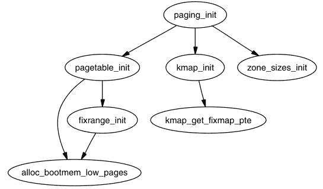

**图 3.4.** 调用图：`paging_init()`

该函数首先调用`pagetable_init()`来初始化用于引用`ZONE_DMA`和`ZONE_NORMAL`中所有物理内存所需的页表。请记住，`ZONE_HIGHMEM`中的高端内存无法直接引用，其映射是临时设置的。对于内核使用的每个`pgd_t`，启动内存分配器（参见第 5 章）会被调用以分配一页给 PGD，并且如果可用，PSE 位将被设置以使用 4MiB 的 TLB 条目而非 4KiB。如果 PSE 位不受支持，则会为每个`pmd_t`分配一页用于 PTE。如果 CPU 支持 PGE 标志，该标志也会被设置，以使页表条目成为全局的并对所有进程可见。

接下来，`pagetable_init()`调用`fixrange_init()`在虚拟地址空间末尾从`FIXADDR_START`开始设置固定地址空间映射。这些映射用于诸如本地*高级可编程中断控制器（APIC）*以及`kmap_atomic()`所需的`FIX_KMAP_BEGIN`和`FIX_KMAP_END`之间的原子 k映射等用途。最后，该函数调用`fixrange_init()`来初始化`kmap()`用于普通高端内存映射所需的页表条目。

在`pagetable_init()`返回后，内核空间的页表现已完全初始化，因此静态 PGD（`swapper_pg_dir`）被加载到*CR3*寄存器中，这样分页单元就开始使用该静态表了。

`paging_init()`的下一个任务负责调用`kmap_init()`，以使用`PAGE_KERNEL`保护标志初始化每个 PTE。最终任务是调用`zone_sizes_init()`，该函数初始化所有使用的 zone 结构。

## 3.7 将地址映射到 struct page

Linux 需要一种快速的方法将虚拟地址映射到物理地址，以及将`struct page`映射到其物理地址。Linux 通过知道全局`mem_map`数组在虚拟内存和物理内存中的位置来实现这一目标，因为该全局数组包含指向系统中代表物理内存的所有`struct page`的指针。所有架构都采用非常相似的机制来实现这一点，但为了说明目的，我们只仔细考察 x86。本节将首先讨论物理地址如何映射到内核虚拟地址，然后讨论这对`mem_map`数组意味着什么。

### 3.7.1 映射物理地址到虚拟内核地址

正如我们在 3.6 节中看到的，Linux 在 x86 上建立了从物理地址 0 到虚拟地址`PAGE_OFFSET`（位于 3GiB）的直接映射。这意味着任何虚拟地址都可以通过简单地减去`PAGE_OFFSET`来转换为物理地址，这本质上就是函数`virt_to_phys()`及其宏`__pa()`所做的：

```c
/* from <asm-i386/page.h> */  

132 #define __pa(x)                      ((unsigned long)(x)-PAGE_OFFSET)

/* from <asm-i386/io.h> */

 76 static inline unsigned long virt_to_phys(volatile void * address)

 77 {

 78          return __pa(address);

 79 }
```

显然，反向操作只需加上`PAGE_OFFSET`，这由函数`phys_to_virt()`及其宏`__va()`完成。接下来我们看这如何帮助将`struct page`映射到物理地址。

存在一种例外情况，`virt_to_phys()`不能用于将虚拟地址转换为物理地址。[^1] 具体来说，在 PPC 和 ARM 架构上，`virt_to_phys()`不能用于转换由函数`consistent_alloc()`返回的地址。`consistent_alloc()`在 PPC 和 ARM 架构上用于返回非缓存内存以供 DMA 使用。

[^1]: 这个棘手的问题是由 Jeffrey Haran 指出给我的。

### 3.7.2 将 struct page 映射到物理地址

正如我们在 3.6.1 节中看到的，内核镜像位于物理地址 1MiB 处，这当然对应于虚拟地址`PAGE_OFFSET + 0x00100000`，并且总计约 8MiB 的虚拟区域被保留给该镜像，这是两个 PGD 可以寻址的区域。这意味着第一个可用的内存位于`0xC0800000`，但事实并非如此。Linux 试图为`ZONE_DMA`保留前 16MiB 内存，因此内核分配使用的第一个虚拟区域实际上是`0xC1000000`。全局`mem_map`通常就位于此处。`ZONE_DMA`仍会被使用，但仅在绝对必要时。

物理地址通过将其视为`mem_map`数组的索引来转换为`struct page`。将物理地址向右移动`PAGE_SHIFT`位，会将其视为从物理地址 0 开始的*页帧号（PFN）*，这也正是`mem_map`数组中的索引。这正是宏`virt_to_page()`所做的，它在`<asm-i386/page.h>`中声明如下：

```c
#define virt_to_page(kaddr) (mem_map + (__pa(kaddr) >> PAGE_SHIFT))
```

宏`virt_to_page()`接收虚拟地址`kaddr`，使用`__pa()`将其转换为物理地址，通过向右移动`PAGE_SHIFT`位将其转换为数组索引，然后简单地将其相加来索引`mem_map`。没有用于将`struct page`转换为物理地址的宏，但到了这个阶段，你应该知道如何计算它了。

## 3.8 转换旁视缓冲器（TLB）

最初，当处理器需要将虚拟地址映射到物理地址时，它必须遍历整个页目录以查找所需的 PTE。这通常意味着每条引用内存的汇编指令实际上需要多个独立的内存引用来进行页表遍历 [Tan01]。为了避免这种相当大的开销，架构利用了大多数进程表现出引用局部性这一事实，换句话说，大量内存引用往往集中在少量页面上。它们利用这种引用局部性，提供了一种*转换旁视缓冲器（TLB）*，这是一种小型关联存储器，用于缓存虚拟到物理页表的解析结果。

Linux 假设大多数架构支持某种类型的 TLB，但架构无关代码不关心其工作原理。相反，在 VM 代码中散布着架构相关的钩子，在已知某些带 TLB 的硬件需要执行 TLB 相关操作的点上。例如，当页表已更新时，如在页错误完成后，处理器可能需要更新该虚拟地址映射的 TLB。

并非所有架构都需要这类操作，但因为有些架构需要，所以这些钩子必须存在。如果架构不需要执行该操作，该 TLB 操作的函数将是一个空操作，在编译时被优化掉。

TLB API 钩子的列表相当多，大多数声明在`<asm/pgtable.h>`中，列在表 3.2 和 3.3 中，并且这些 API 在内核源码中被`Documentation/cachetlb.txt` [Mil00] 很好地记录了下来。可以只使用一个 TLB 刷新函数，但由于 TLB 刷新和 TLB 重新填充都是*非常*昂贵的操作，应尽可能避免不必要的 TLB 刷新。例如，在上下文切换时，Linux 将避免加载新页表，使用*延迟 TLB 刷新*，这将在 4.3 节中进一步讨论。

```c
void flush_tlb_all(void)

    这会刷新系统中运行的所有处理器上的整个 TLB，这使其成为最昂贵的

    TLB 刷新操作。完成后，所有对页表的修改将在全局可见。这在内核页表

    （本质上是全局的）被修改后是必需的，例如在 vfree()（参见第 7 章）

    完成后或 PKMap 被刷新后（参见第 9 章）。
```

```c
void flush_tlb_mm(struct mm_struct *mm)

    这会刷新所请求的 mm 上下文中与用户空间部分（即 PAGE_OFFSET 以下）

    相关的所有 TLB 条目。在某些架构上，如 MIPS，这需要对所有处理器执行，

    但通常仅限于本地处理器。这仅在对整个地址空间有影响的操作后调用，

    例如在用 dup_mmap() 为 fork 复制所有地址映射后，或在用 exit_mmap()

    删除所有内存映射后。
```

```c
void flush_tlb_range(struct mm_struct *mm, unsigned long start,

    unsigned long end)

    顾名思义，这会刷新 mm 上下文中请求的用户空间范围内的所有条目。

    这在新的区域被移动或更改后使用，如在 mremap()（移动区域）或

    mprotect()（更改权限）期间。该函数还间接用于 munmap() 解除区域

    映射时，munmap() 调用 tlb_finish_mmu()，后者会尝试智能地使用

    flush_tlb_range()。此 API 提供给能够快速移除范围 TLB 条目而非

    用 flush_tlb_page() 迭代的架构。
```

**表 3.2.** 转换旁视缓冲器刷新 API

## 3.9 一级 CPU 缓存管理

由于 Linux 以与 TLB 非常相似的方式管理 CPU 缓存，本节介绍 Linux 如何使用和管理 CPU 缓存。CPU 缓存与 TLB 缓存一样，利用了程序往往表现出引用局部性这一特点 [Sea00] [CS98]。为了避免每次引用都从主存获取数据，CPU 会将非常少的数据缓存在 CPU 缓存中。通常有两个级别，称为一级和二级 CPU 缓存。二级 CPU 缓存比 L1 缓存大，但速度慢，但 Linux 只关心一级或 L1 缓存。

CPU 缓存被组织成*行*。每行通常相当小，一般为 32 字节，并且每行都与其边界大小对齐。换句话说，32 字节的缓存行将在 32 字节地址上对齐。在 Linux 中，行的大小为`L1_CACHE_BYTES`，由每个架构定义。

地址如何映射到缓存行因架构而异，但映射分为三类，*直接映射*、*关联映射*和*组*

```c
void flush_tlb_page(struct vm_area_struct *vma, unsigned long addr)

    Predictably, this API is responsible for flushing a single page from the TLB.

The two most common uses of it are for flushing the TLB after a page has been

faulted in or has been paged out.
```


`void flush_tlb_pgtables(struct mm_struct *mm, unsigned long start, unsigned long end)`

该 API 在页表被销毁并释放时调用。某些平台会缓存页表的最低层级，即存储条目的实际页帧，当这些页面被删除时需要刷新该缓存。当某个区域被取消映射且页目录项被回收时，会调用此函数。

`void update_mmu_cache(struct vm_area_struct *vma, unsigned long addr, pte_t pte)`

该 API 仅在页错误处理完成后调用。它通知架构相关代码，针对虚拟地址`addr`，在`pte`处已存在新的转换。每个架构自行决定如何使用此信息。例如，Sparc64 利用该信息判断本地 CPU 是否需要刷新其数据缓存，或是否需要向远程处理器发送处理器间中断（IPI）。

### 表 3.3. 转换后援缓冲区刷新 API（续）

关联映射。直接映射是最简单的方法，每个内存块只能映射到一条可能的缓存行。在关联映射中，任意内存块可以映射到任意缓存行。组相联映射是一种混合方法，任意内存块可以映射到任意行，但只能在可用行的某个子集内。无论采用哪种映射方案，它们都有一个共同点：地址接近且按缓存大小对齐时，往往会使用不同的缓存行。因此，Linux 使用了一些简单的技巧来尽量最大化缓存利用率：

- 频繁访问的结构体字段放在结构体开头，以增加访问常用字段时只需一条缓存行的概率。
- 结构体中不相关的项应尽量相距至少一个缓存大小字节，以避免 CPU 之间的伪共享。
- 通用缓存中的对象，例如`mm_struct`缓存，按 L1 CPU 缓存对齐，以避免伪共享。

如果 CPU 访问的地址不在缓存中，就会发生缓存未命中，数据从主存中取出。缓存未命中的代价相当高，因为访问缓存通常可以在 10ns 内完成，而访问主存通常需要 100ns 到 200ns。因此，基本目标是尽量提高缓存命中次数，减少缓存未命中次数。

正如有些架构不会自动管理其 TLB 一样，有些也不会自动管理其 CPU 缓存。这些钩子被放置在虚拟地址到物理地址映射发生变化的位置，例如页表更新期间。CPU 缓存刷新应始终首先进行，因为某些 CPU 在将虚拟地址从缓存中刷新出去时，要求存在虚拟地址到物理地址的映射。需要正确排序的这三个操作很重要，列在表 3.4 中。

| 刷新整个 MM | 刷新范围 | 刷新页面 |
| :--- | :--- | :--- |
| `flush_cache_mm()` | `flush_cache_range()` | `flush_cache_page()` |
| 更改所有页表 | 更改页表范围 | 更改单个 PTE |
| `flush_tlb_mm()` | `flush_tlb_range()` | `flush_tlb_page()` |

表 3.4. 缓存与 TLB 刷新顺序

（过渡注释：OCR 将“Table 3.4.”识别为标题前有一个换行，但我保留了标题原样；前一段已经对其作了说明。）

用于刷新缓存的 API 声明在`<asm/pgtable.h>`中，并列在表 3.5 中。它在很多方面与 TLB 刷新 API 非常相似。

```
void flush_cache_all(void)
```

该函数刷新整个 CPU 缓存系统，因此是最严重的刷新操作。当需要执行全局性的内核页表更改时使用。

```
void flush_cache_mm(struct mm_struct mm)
```

该函数刷新与地址空间相关的所有条目。完成后，将不会有任何缓存行与`mm`关联。

```
void flush_cache_range(struct mm_struct *mm, unsigned long start, unsigned long end)
```

该函数刷新地址空间中某个地址范围相关的缓存行。与其对应的 TLB 刷新函数类似，提供此函数是为了让架构能够以高效方式刷新范围，而不是逐个页面刷新。

```
void flush_cache_page(struct vm_area_struct *vma, unsigned long vmaddr)
```

该函数用于刷新单个页面大小的区域。提供 VMA 是因为通过`vma->vm_mm`可以轻松访问`mm_struct`。此外，通过测试`VM_EXEC`标志，架构可以判断该区域是否可执行，这对于区分指令缓存和数据缓存的架构尤为重要。VMA 将在第 4 章中进一步描述。


表 3.5. CPU 缓存刷新 API

不过，这还没有结束。还需要第二组接口来避免虚拟别名问题。问题在于某些 CPU 根据虚拟地址选择缓存行，这意味着一个物理地址可能同时存在于多个缓存行中，从而导致缓存一致性问题。存在这一问题的架构可能会试图确保共享映射只使用地址作为权宜之计。不过，也提供了专门解决这一问题的 API，列在表 3.6 中。

| `void flush_page_to_ram(unsigned long address)` | |
|:---|:---|
| 这是一个已弃用的 API，不应再使用，实际上在 2.6 中将被完全移除。这里介绍它是为了完整性，也因为它仍在使用。当新的物理页即将被放入进程的地址空间时，会调用该函数。这是为了避免在映射完成后，来自内核空间的写入对用户空间不可见。 | |
| `void flush_dcache_page(struct page *page)` | |
| 当内核写入或复制自页缓存页时，会调用此函数，因为这些页很可能被多个进程映射。 | |
| `void flush_icache_range(unsigned long address, unsigned long endaddr)` | |
| 当内核在地址中存储可能被取指执行的信息时，会调用此函数，例如内核模块被加载时。 | |
| `void flush_icache_user_range(struct vm_area_struct *vma, struct page *page, unsigned long addr, int len)` | |
| 这与 `flush_icache_range()` 类似，不同之处在于它是在受影响的是用户空间范围时被调用。目前，仅在 `access_process_vm()` 访问地址空间时用于 `ptrace()`（调试时使用）。 | |
| `void flush_icache_page(struct vm_area_struct *vma, struct page *page)` | |
| 当页缓存页即将被映射时，会调用此函数。具体使用 VMA 标志来决定应刷新 I-Cache 还是 D-Cache，由各架构自行决定。 | |

### 表 3.6. CPU D-Cache 与 I-Cache 刷新 API

### 3.10 2.6 中的新特性

页表管理的大部分机制在 2.6 中基本保持不变，但引入的变化相当广泛，实现也很深入。

**无 MMU 架构支持** 引入了一个名为 `mm/nommu.c` 的新文件。该源文件包含针对那些假定 MMU 存在的函数的替代代码，例如 `mmap()`。这是为了支持通常没有 MMU 的微控制器等架构。该领域的许多工作由 uCLinux 项目（www.uclinux.org）开发。

**反向映射** 页表管理最重大、最重要的变化是引入了*反向映射*（*rmap*）。将其称为“rmap”是刻意的，因为这是该缩写的通用用法，不应与 Rik van Riel 开发的 `-rmap` 树混淆，后者对标准 VM 的修改远不止反向映射。

简而言之，rmap 使得仅凭 `struct page` 就能找到映射某个特定页面的所有 PTE。在 2.4 中，要找到映射共享页（例如内存映射共享库）的所有 PTE，唯一方法是线性搜索所有进程的所有页表。这开销太大，Linux 试图通过使用交换缓存（swap cache）来避免该问题（参见 11.4 节）。这意味着，当存在大量共享页时，无论页面年龄和使用模式如何，Linux 都可能不得不换出整个进程。而 2.6 为每个 `struct page` 维护了一条*PTE 链*，可以遍历该链以将页面从所有引用它的页表中移除。这样，LRU 中的页面就可以以智能的方式换出，而无需换出整个进程。

读者可以想象，这个简单概念的实现有点复杂。理解该实现的第一步是 `struct page` 中的一个字段 `union pte`。该联合体有两个字段：一个指向 `struct pte_chain` 的指针，名为 `chain`；一个名为 `direct` 的 `pte_addr_t`。该联合体是一种优化：如果只有一个 PTE 映射该条目，则使用 `direct` 来节省内存；否则使用链。`pte_addr_t` 的类型因架构而异，但无论其类型如何，都可以用来定位 PTE，因此为简单起见，我们将其视为 `pte_t`。

`struct pte_chain` 要稍微复杂一些。结构体本身很简单，但字段*紧凑*且重载，开发人员在使其小巧高效方面投入了大量精力。幸运的是，这并没有使其难以理解。

首先，分配和管理 `struct pte_chain` 是 slab 分配器的职责，因为这正是 slab 分配器最擅长的任务类型。每个 `struct pte_chain` 最多可容纳 `NRPTE` 个指向 PTE 结构的指针。填入这么多个 PTE 后，就会分配一个新的 `struct pte_chain` 并添加到链中。

`struct pte_chain` 有两个字段。第一个是 `unsigned long next_and_idx`，它有两个用途。当 `next_and_idx` 与 `NRPTE` 进行按位与运算时，它返回当前 `struct pte_chain` 中 PTE 的数量，并指示下一个空闲槽位的位置。当 `next_and_idx` 与 `NRPTE` 的按位非（即 `~NRPTE`）进行按位与运算时，会返回指向链中下一个 `struct pte_chain` 的指针²。这基本上就是 PTE 链的实现方式。

为了让读者体会 rmap 的复杂之处，我将举例说明当新 PTE 需要映射一个页面时会发生什么。基本流程是：调用者使用 `pte_chain_alloc()` 分配一个新的 `pte_chain`。然后将分配好的链与 `struct page` 和 PTE 一起传递给 `page_add_rmap()`。如果与该页面关联的现有 PTE 链仍有可用槽位，就会使用它，并且 `pte_chain`

> ²我告诉过你它很紧凑。

由调用者分配的空间被返回。如果没有可用槽位，则已分配的 `pte_chain` 将被添加到链中，并返回 NULL。

rmap 有一个相当庞大的 API，用于执行创建链以及向链中添加和移除 PTE 等任务，但完整列出这些内容超出了本节的范围。幸运的是，该 API 局限于 `mm/rmap.c`，且函数都有详尽的注释，使其用途一目了然。

引入反向映射有两个主要好处，都与页面换出（pageout）有关。第一个与页表的建立和拆除有关。如 11.4 节所述，被换出的页面被放入交换缓存中，且必要信息被写入 PTE 以便再次找到该页面。这可能导致多次 minor fault，因为页面被放入交换缓存后又被进程再次触发 page fault。使用 rmap，PTE 的设置和移除是原子的。第二个主要好处是当页面需要被换出时，查找所有引用该页面的 PTE 是一个简单的操作，但在 2.4 中这是不切实际的，因此才有了交换缓存。

然而，反向映射并非没有代价。第一个，也是显而易见的代价，是 PTE 链带来的额外空间需求。可以说，第二个代价是与反向映射相关的 CPU 开销，但尚未证明这是显著的。需要注意的是，反向映射只有在页面换出频繁时才有益。如果机器的工作负载不会导致大量页面换出，或者内存充足，那么反向映射全是代价而几乎没有收益。在撰写本文时，rmap 的优点和缺点仍然是许多讨论的主题。

### 基于对象的反向映射

每个页面所需的反向映射可能会带来非常昂贵的空间需求。雪上加霜的是，VMA 中的许多反向映射页面基本相同。解决这个问题的一种方法是基于 VMA 而不是单个页面进行反向映射。也就是说，不是为每个页面建立一个反向映射，而是遍历映射特定页面的所有 VMA，并从每个 VMA 中取消映射该页面。注意，这里的对象指的是 VMA，而不是面向对象意义上的对象³。在撰写本文时，该功能尚未合并，最后一次出现在内核 2.5.68-mm1 中，但如果能解决其中的问题，仍存在将其引入的强烈动机。对于非常好奇的读者，该版本中仅用于文件/设备 backed objrmap 的补丁是可用的⁴，但这仅适合非常非常好奇的读者。

有两个任务需要遍历所有映射某页面的 PTE。第一个任务是 `page_referenced()`，它检查映射某页面的所有 PTE，以查看该页面最近是否被引用。第二个任务是当需要使用 `try_to_unmap()` 从所有进程中取消映射某页面时。更复杂的是，必须反向映射两种类型的映射：由文件或设备支持的映射和匿名映射。在这两种情况下，基本目标是遍历映射特定页面的所有 VMA，然后遍历该 VMA 的页表以获取 PTE。唯一的区别是实现方式。由某种文件支持的情况是最简单的情况，也是最先实现的，所以我先讨论它。为了说明实现方式，我将讨论 `page_referenced()` 是如何实现的。

`page_referenced()` 调用 `page_referenced_obj()`，这是查找 VMA 中映射该页面的所有 PTE 的顶层函数。由于页面映射的是文件或设备，`page→mapping` 包含指向有效 `address_space` 的指针。`address_space` 有两个链表，包含使用该映射的所有 VMA，即 `address_space→i_mmap` 和 `address_space→i_mmap_shared` 字段。对于在这些链表上的每个 VMA，调用 `page_referenced_obj_one()`，参数为 VMA 和页面。函数 `page_referenced_obj_one()` 首先检查页面是否由该 VMA 管理的地址范围内，如果是，则使用 VMA（`vma→vm_mm`）遍历 `mm_struct` 的页表，直到找到映射该页面 `mm_struct` 的 PTE。

匿名页面跟踪要复杂得多，并且分多个阶段实现。它只出现了很短的时间，在 2.5.65-mm4 中又被移除了，因为它与许多其他更改冲突。实现的第一阶段是使用 `page→mapping` 和 `page→index` 字段来跟踪 `mm_struct` 和 `address` 对。这些字段之前用于存储指向 `swapper_space` 的指针和指向 `swp_entry_t` 的指针（见第 11 章）。具体如何解决超出了本节的范围，但简而言之，`swp_entry_t` 存储在 `page→private` 中。

`try_to_unmap_obj()` 以类似的方式工作，但显然，使用这种方法引用页面的所有 PTE 都可以在不反向映射单个页面的情况下完成。一个严重的搜索复杂性问题阻止了它被合并。描述该问题的场景如下。

假设有 100 个进程有 100 个 VMA 映射单个文件。在这种情况下，使用基于对象的反向映射取消映射*单个*页面需要搜索 10,000 个 VMA，其中大多数是完全不必要的。使用基于页面的反向映射，只需检查 100 个 `pte_chain` 槽位，每个进程一个。引入了一种优化，按虚拟地址对 `address_space` 中的 VMA 进行排序，但搜索单个页面对于基于对象的反向映射来说仍然太昂贵，无法被合并。

### 高端内存中的 PTE

在 2.4 中，页表项存在于 `ZONE_NORMAL` 中，因为内核需要能够在页表遍历期间直接寻址它们。这曾经是可接受的，直到发现在高端内存机器上，`ZONE_NORMAL` 被三级页表 PTE 耗尽。显而易见的答案是将 PTE 移到高端内存，这正是 2.6 所做的。

正如我们将在第 9 章中看到的，寻址高端内存中的信息远非免费，因此将 PTE 移到高端内存是一个编译时配置选项。简而言之，问题是内核必须将高端内存中的页面映射到较低的地址空间才能使用，但这些映射的可用槽位非常有限，这引入了一个棘手的瓶颈。然而，对于具有大量 PTE 的应用程序，几乎没有其他选择。在撰写本文时，有人提议建立一个用户内核虚拟区域（UKVA），这将是内核空间中每个进程私有的区域，但尚不清楚它是否会在 2.6 中合并。

考虑到高端内存映射的可能性，2.4 中的宏 `pte_offset()` 已被 `pte_offset_map()` 取代。如果 PTE 在低端内存中，它的行为将与 `pte_offset()` 相同，并返回 PTE 的地址。如果 PTE 在高端内存中，它将首先通过 `kmap_atomic()` 映射到低端内存，以便内核使用。此 PTE 必须尽快通过 `pte_unmap()` 取消映射。

在编程层面，这意味着页表遍历代码看起来略有不同。特别是，要查找给定地址的 PTE，代码现在如下所示（取自 `mm/memory.c`）：

```
640        ptep = pte_offset_map(pmd, address);
641        if (!ptep)
642              goto out;
643
644        pte = *ptep;
645        pte_unmap(ptep);
```


此外，PTE分配API已更改。现在不再使用`pte_alloc()`，而是有`pte_alloc_kernel()`用于内核PTE映射，以及`pte_alloc_map()`用于用户空间映射。它们之间的主要区别是`pte_alloc_kernel()`永远不会为PTE使用高端内存。

在内存管理方面，必须从高端内存映射PTE的开销不容忽视。每个CPU一次只能映射一个PTE，虽然第二个PTE可以通过`pte_offset_map_nested()`映射。这在需要检查所有PTE时会引入性能损失，例如在`zap_page_range()`期间需要取消映射给定范围内的所有PTE时。

在撰写本文时，已提交了一个补丁，使用本质上相同的机制和API更改将PMD放入高端内存。它很可能被合并。

## Huge TLB Filesystem

### 3.10. 2.6的新特性

大多数现代架构支持多种页面大小。例如，在许多x86架构上，可以选择使用4KiB页面或4MiB页面。传统上，Linux仅使用大页面来映射实际的内核映像，别无他用。由于TLB槽位是一种稀缺资源，因此希望能够利用大页面，尤其是在具有大量物理内存的机器上。

在2.6中，Linux允许进程使用大页面，其大小由`HPAGE_SIZE`决定。可用大页面的数量由系统管理员通过`/proc/sys/vm/nr_hugepages` proc接口确定，该接口最终使用函数`set_hugetlb_mem_size()`。由于分配的成功取决于物理连续内存的可用性，分配应在系统启动时进行。

实现的核心是*Huge TLB Filesystem*（*hugetlbfs*），这是一个在`fs/hugetlbfs/inode.c`中实现的伪文件系统。基本上，

> ³别怪我，这不是我命名的。事实上，该功能的原始补丁附带的评论是"来自Dave。糟糕的名字。"

> ⁴*ftp://ftp.kernel.org/pub/linux/kernel/people/akpm/patches/2.5/2.5.68/2.5.68-mm2/experimental*

每个文件系统中的文件都由一个大页（huge page）提供支持。在初始化期间，`init_hugetlbfs_fs()`注册该文件系统，并使用`kern_mount()`将其挂载为内部文件系统。

进程可以通过两种方式访问大页。第一种是使用`shmget()`设置由大页支持的共享区域，第二种是在大页文件系统中打开的文件上调用`mmap()`。

当共享内存区域需要由大页支持时，进程应该调用`shmget()`并传递`SHM_HUGETLB`作为标志之一。这将导致调用`hugetlb_zero_setup()`，该函数在内部hugetlbfs的根目录中创建一个新文件。在内部文件系统的根目录中创建一个文件。文件名由一个名为`hugetlbfs_counter`的原子计数器决定，每次设置共享区域时该计数器都会递增。

要创建由大页支持的文件，系统管理员必须首先挂载一个hugetlbfs类型的文件系统。如何执行此任务的详细说明请参阅`Documentation/vm/hugetlbpage.txt`。文件系统挂载后，可以使用系统调用`open()`像平常一样创建文件。当对打开的文件调用`mmap()`时，`file_operations`结构体`hugetlbfs_file_operations`确保调用`hugetlbfs_file_mmap()`来正确设置区域。

大页TLB页面有自己的页表管理、地址空间操作和文件系统操作函数。页表管理函数的名称都可以在`<linux/hugetlb.h>`中看到，它们的命名与普通页面等价函数非常相似。hugetlbfs函数的实现位于其普通页面等价函数附近，因此很容易找到。

## 缓存刷新管理

这里的改动很小。API函数`flush_page_to_ram()`已被完全移除，并引入了一个新的API`flush_dcache_range()`。

# 第4章

## 进程地址空间

虚拟内存的主要优势之一是每个进程都有自己的虚拟地址空间，由操作系统映射到物理内存。在本章中，我将讨论进程地址空间以及Linux如何管理它。

内核对待地址空间的用户空间部分与内核部分非常不同。例如，内核的分配会立即得到满足，并且无论CPU上运行的是哪个进程，它们都是全局可见的。`vmalloc()`是个例外，因为会发生轻微的页面故障以同步进程页表与引用页表，但页面仍会在请求时立即分配。对于进程，空间只是通过将页表条目指向一个充满零的全局可见的只读页面，在线性地址空间中保留。在写入时，会触发页面故障，导致分配一个新页面，填充为零，放入页表条目并标记为可写。新页面填充为零，使其看起来与全局的零填充页面完全相同。

用户空间部分不被信任，也不被认为是恒定的。每次上下文切换后，线性地址空间的用户空间部分可能会发生变化，除非使用稍后在4.3节讨论的*懒TLB*切换。因此，内核必须准备好捕获所有异常并处理来自用户空间的错误。这将在4.5节中讨论。

本章首先介绍线性地址空间如何划分以及每个部分的用途。然后我将描述用于描述每个进程的结构，如何分配、初始化和销毁它们。接下来，我将介绍进程空间内各个区域如何创建以及与之相关的各种函数。这将引出与进程地址空间相关的异常处理、页面故障以及满足页面故障的各种情况。最后，我将介绍内核如何安全地在用户空间之间复制信息。

### 4.1 线性地址空间

从用户角度来看，地址空间是一个扁平的线性地址空间，但可以预见，内核的视角非常不同。地址空间分为两部分：用户空间部分，它在每次完整上下文切换时可能会发生变化；以及内核地址空间，它保持不变。分割点的位置由`PAGE_OFFSET`的值决定，在x86上为`0xC0000000`。这意味着进程有3GiB可用，而剩余的1GiB始终由内核映射。内核所看到的线性虚拟地址空间如图4.1所示。

为了加载内核映像运行，在`PAGE_OFFSET`处保留了8MiB（由两个PGD寻址的内存量）。这8MiB只是为加载内核映像的目的而保留的合理空间量。内核映像在3.6.1节讨论的页表初始化期间被放置在这个保留空间中。在映像之后不久的位置，存储了第2章讨论的UMA架构的`mem_map`。数组的位置通常在16MiB处，以避免使用`ZONE_DMA`，但并非总是如此。对于NUMA架构，虚拟`mem_map`的部分将分散在整个区域中。它们实际位于何处取决于架构。

`PAGE_OFFSET`和`VMALLOC_START - VMALLOC_OFFSET`之间的区域是物理内存映射，该区域的大小取决于可用RAM的数量。如我们在3.6节中所见，存在页表条目将物理内存映射到从`PAGE_OFFSET`开始的虚拟地址范围。在物理内存映射和vmalloc地址空间之间，有一个大小为`VMALLOC_OFFSET`的空隙，在x86上为8MiB，以防止越界错误。例如，在具有32MiB RAM的x86上，`VMALLOC_START`将位于`PAGE_OFFSET + 0x02000000 + 0x00800000`。

在低端内存系统中，虚拟地址空间的剩余部分减去2页空隙，由`vmalloc()`用于在连续虚拟地址空间中表示非连续的内存分配。在高端内存系统中，vmalloc区域延伸到`PKMAP_BASE`减去两页空隙，并引入了两个额外的区域。第一个从`PKMAP_BASE`开始，是使用`kmap()`将高端内存页面映射到低端内存的保留区域，如第9章所讨论。第二个用于从`FIXADDR_START`到`FIXADDR_TOP`的固定虚拟地址映射。固定虚拟地址对于需要在编译时知道虚拟地址的子系统是必需的，例如APIC。`FIXADDR_TOP`在x86上静态定义为`0xFFFFE000`，即虚拟地址空间结束前的一页。固定映射区域的大小在编译时计算为`__FIXADDR_SIZE`，并从`FIXADDR_TOP`反向索引以给出区域的起始点`FIXADDR_START`。

`vmalloc()`、`kmap()`和固定虚拟地址映射所需的区域限制了`ZONE_NORMAL`的大小。由于运行中的内核需要这些功能，地址空间顶部至少会保留`VMALLOC_RESERVE`的区域。`VMALLOC_RESERVE`是特定于架构的，但在x86上，它定义为128MiB。这就是为什么`ZONE_NORMAL`通常被称为只有896MiB大小；它是线性地址空间上部1GiB减去为vmalloc区域保留的最小128MiB。

### 4.2 管理地址空间

进程可用的地址空间由高级的`mm_struct`管理，它大致类似于BSD中的`vmspace`结构体[McK96]。

每个地址空间由若干页对齐的内存区域组成，这些区域正在使用中。它们从不重叠，代表一组地址，其中包含的页面在保护和用途方面相互关联。这些区域由`struct vm_area_struct`表示，大致类似于BSD中的`vm_map_entry`结构体。为清晰起见，区域可能代表用于`malloc()`的进程堆、内存映射文件（如共享库）或使用`mmap()`分配的匿名内存块。该区域的页面可能仍需分配、处于活动状态并驻留，或已被换出。

如果区域由文件支持，其`vm_file`字段将被设置。通过遍历`vm_file→f_dentry→d_inode→i_mapping`，可以获得区域相关的`address_space`。`address_space`包含执行基于页面的磁盘操作所需的所有文件系统特定信息。

不同地址空间相关结构之间的关系如图4.2所示。提供了若干影响地址空间和区域的系统调用。这些列在表4.1中。

| 系统调用 | 描述 |
|-------------|-------------|
| `fork()` | 创建一个新进程，并分配新的地址空间。所有页面都被标记为写时复制（COW），并在两个进程之间共享，直到发生缺页异常。一旦发生写错误，就会为触发错误的进程复制一份COW页面的副本。这有时被称为"打破COW页面"。 |
| `clone()` | `clone()`允许创建一个新进程，与其父进程共享部分上下文，这是Linux中实现线程的方式。未设置`CLONE_VM`的`clone()`将创建一个新的地址空间，这本质上与`fork()`相同。 |
| `mmap()` | `mmap()`在进程线性地址空间中创建一个新的区域。 |
| `mremap()` | 重新映射或调整内存区域的大小。如果虚拟地址空间对于该映射不可用，该区域可能会被移动，除非调用者禁止移动。 |
| `munmap()` | 销毁部分或全部区域。如果要取消映射的区域位于现有区域的中间，现有区域将被拆分为两个独立的区域。 |
| `shmat()` | 将共享内存段附加到进程地址空间。 |
| `shmdt()` | 从地址空间中移除共享内存段。 |
| `execve()` | 加载新的可执行文件并替换当前地址空间。 |
| `exit()` | 销毁地址空间和所有区域。 |

**表 4.1.** 与内存区域相关的系统调用

### 进程地址空间描述符

进程地址空间由`mm_struct`结构体描述，这意味着每个进程只有一个，并且在用户空间线程之间共享。事实上，线程在任务列表中是通过查找所有指向相同`mm_struct`的`task_struct`来识别的。

内核线程不需要唯一的`mm_struct`，因为它们永远不会发生缺页异常或访问用户空间部分。唯一的例外是在vmalloc空间内发生缺页异常。缺页异常处理代码将其视为特殊情况，并使用主页表中的信息更新当前页表。由于内核线程不需要`mm_struct`，因此内核线程的`task_struct→mm`字段始终为NULL。对于某些任务，如引导空闲任务，`mm_struct`从未被设置，但对于内核线程，调用`daemonize()`将调用`exit_mm()`来递减使用计数器。

由于TLB刷新非常耗时，尤其是在PowerPC（PPC）等架构上，因此采用了一种称为*惰性TLB*的技术，通过避免对不访问用户空间页表的进程进行不必要的TLB刷新，因为地址空间的内核部分始终可见。通过借用前一个任务使用的`mm_struct`并将其放入`task_struct→active_mm`，避免了导致TLB刷新的`switch_mm()`调用。这项技术极大地改善了上下文切换时间。

进入惰性TLB时，会调用`enter_lazy_tlb()`函数，以确保`mm_struct`不会在对称多处理（SMP）机器上的处理器之间共享，这在单处理器（UP）机器上是无效操作。惰性TLB的第二次使用是在进程退出期间，当`start_lazy_tlb()`在进程等待父进程回收时被短暂使用。

该结构体有两个引用计数，分别称为`mm_users`和`mm_count`，用于两种类型的用户。`mm_users`是访问该`mm_struct`用户空间部分的进程引用计数，例如页表和文件映射。线程和`swap_out()`代码等将递增此计数，并确保`mm_struct`不会过早被销毁。当它降为0时，`exit_mmap()`将删除所有映射并拆除页表，然后再递减`mm_count`。

`mm_count`是`mm_struct`匿名用户的引用计数，对于真实用户初始化为1。匿名用户是指不一定关心用户空间部分，只是借用`mm_struct`的用户。示例用户是使用惰性TLB切换的内核线程。当此计数降为0时，`mm_struct`可以安全地销毁。两个引用计数之所以存在，是因为即使用户空间映射被销毁，匿名用户仍需要`mm_struct`存在，而且延迟页表的拆除没有意义。

`mm_struct`在`<linux/sched.h>`中定义如下：

```
206 struct mm_struct {
207     struct vm_area_struct * mmap;
208     rb_root_t mm_rb;
209     struct vm_area_struct * mmap_cache;
210     pgd_t * pgd;
211     atomic_t mm_users;
212     atomic_t mm_count;
213     int map_count;
214     struct rw_semaphore mmap_sem;
215     spinlock_t page_table_lock;
216
217     struct list_head mmlist;
221
222     unsigned long start_code, end_code, start_data, end_data;
223     unsigned long start_brk, brk, start_stack;
224     unsigned long arg_start, arg_end, env_start, env_end;
225     unsigned long rss, total_vm, locked_vm;
226     unsigned long def_flags;
227     unsigned long cpu_vm_mask;
228     unsigned long swap_address;
229
230     unsigned dumpable:1;
231
232     /* Architecture-specific MM context */
233     mm_context_t context;
234 };
```


### 4.3. 进程地址空间描述符

这个庞大的结构体中各个字段的含义如下：

- `mmap` 地址空间中所有 VMA 区域的链表头。
- `mm_rb` VMA 被组织在链表和红黑树中，以便快速查找。这是树的根节点。
- `mmap_cache` 上次调用 `find_vma()` 时找到的 VMA 存储在此字段中，假设该区域很快会被再次使用。
- `pgd` 该进程的页全局目录（PGD）。
- `mm_users` 访问地址空间用户空间部分的进程引用计数，如本节开头所述。
- `mm_count` `mm_struct` 匿名用户的引用计数，对于真实用户从 1 开始，如本节开头所述。
- `map_count` 正在使用的 VMA 数量。
- `mmap_sem` 这是一个长寿命锁，用于保护 VMA 列表的读操作和写操作。由于此锁的用户需要持有很长时间，并且可能需要睡眠，因此自旋锁不适用。列表的读取者使用 `down_read()` 获取此信号量。如果需要写入，则使用 `down_write()` 获取，稍后在更新 VMA 链表时获取 `page_table_lock` 自旋锁。
- `page_table_lock` 这保护 `mm_struct` 上的大多数字段。除了页表之外，它还保护驻留集大小（RSS）（参见 `rss`）计数和 VMA 免受修改。
- `mmlist` 所有 `mm_struct` 都通过此字段链接在一起。
- `start_code`、`end_code` 代码段的起始和结束地址。
- `start_data`、`end_data` 数据段的起始和结束地址。
- `start_brk`、`brk` 堆的起始和结束地址。
- `start_stack` 可以预料到，这是栈区域的起始地址。
- `arg_start`、`arg_end` 命令行参数的起始和结束地址。
- `env_start`、`env_end` 环境变量的起始和结束地址。
- `rss` *RSS* 是此进程的驻留页面数。应注意，全局零页不被计入 RSS。
- `total_vm` 进程中所有 VMA 区域占用的总内存空间。
- `locked_vm` 锁定在内存中的驻留页面数。
- `def_flags` 只有一个可能的值，`VM_LOCKED`。用于确定是否默认锁定所有未来的映射。
- `cpu_vm_mask` 表示 SMP 系统中所有可能 CPU 的位掩码。该掩码由*处理器间中断（IPI）*使用，以确定处理器是否应该执行特定函数。这在为每个 CPU 进行 TLB 刷新时很重要。
- `swap_address` 由页面换出守护进程使用，记录当换出整个进程时上次换出的地址。
- `dumpable` 由 `prctl()` 设置。此标志仅在跟踪进程时重要。
- `context` 架构特定的 MMU 上下文。

有少量用于处理 `mm_struct` 的函数。它们在表 4.2 中描述。

| 函数 | 描述 |
| --- | --- |
| `mm_init()` | 通过为每个字段设置初始值、分配 PGD、初始化自旋锁等来初始化 `mm_struct` |
| `allocate_mm()` | 从 slab 分配器分配 `mm_struct()` |
| `mm_alloc()` | 使用 `allocate_mm()` 分配 `mm_struct` 并调用 `mm_init()` 初始化它 |
| `exit_mmap()` | 遍历 `mm_struct` 并取消映射与其关联的所有 VMA |
| `copy_mm()` | 精确复制当前任务的 `mm_struct` 以供新任务使用。这仅用于 fork 期间。 |
| `free_mm()` | 将 `mm_struct` 返还给 slab 分配器 |

表 4.2. 与内存区域描述符相关的函数

#### 4.3.1 分配描述符

提供了两个函数来分配 `mm_struct`。稍微令人困惑的是，它们本质上是相同的，但有一些小而重要的区别。`allocate_mm()` 只是一个预处理器宏，从 slab 分配器（参见第 8 章）分配 `mm_struct`。`mm_alloc()` 从 slab 分配，然后调用 `mm_init()` 初始化它。

#### 4.3.2 初始化描述符

系统中第一个被初始化的 `mm_struct` 称为 `init_mm`。所有后续的 `mm_struct` 都是父 `mm_struct` 的副本。这意味着 `init_mm` 必须在编译时静态初始化。这个静态初始化由宏 `INIT_MM()` 执行。

```
#define INIT_MM(name) \
{
    mm_rb:          RB_ROOT,                         \
    pgd:            swapper_pg_dir,                  \
    mm_users:       ATOMIC_INIT(2),                  \
    mm_count:       ATOMIC_INIT(1),                  \
    mmap_sem:       __RWSEM_INITIALIZER(name.mmap_sem), \
    page_table_lock: SPIN_LOCK_UNLOCKED,             \
    mmlist:         LIST_HEAD_INIT(name.mmlist),     \
}
```

在它建立之后，新的 `mm_struct` 会以其父进程 `mm_struct` 为模板创建。负责复制操作的函数是 `copy_mm()`，它使用 `init_mm()` 来初始化进程特定的字段。

##### 4.3.3 销毁描述符

当新用户使用 `atomic_inc(&mm->mm_users)` 增加使用计数时，可以通过调用 `mmput()` 来减少计数。如果 `mm_users` 计数达到零，所有映射的区域将通过 `exit_mmap()` 销毁，页表也会被销毁，因为不再有用户空间部分的使用者。`mm_count` 计数通过 `mmdrop()` 减少，因为页表和 VMA 的所有使用者都被计为一个 `mm_struct` 用户。当 `mm_count` 达到零时，`mm_struct` 将被销毁。

### 4.4 内存区域

进程的完整地址空间很少被全部使用，只有稀疏的区域被使用。每个区域由一个 `vm_area_struct` 表示，它们互不重叠，代表一组具有相同保护和用途的地址。区域的例子包括加载到地址空间中的只读共享库或进程堆。进程映射的完整区域列表可以通过 proc 接口在 `/proc/PID/maps` 查看，其中 PID 是要检查的进程的进程 ID。

一个区域可能有多个不同的结构与之相关联，如图 4.2 所示。最上面是 `vm_area_struct`，它本身足以表示匿名内存。

如果区域由文件支持，则可以通过 `vm_file` 字段获得 `struct file`，它有一个指向 `struct inode` 的指针。inode 用于获取 `struct address_space`，它包含有关文件的所有私有信息，包括一组指向文件系统函数的指针，这些函数执行特定于文件系统的操作，例如从磁盘读取和写入页面。

结构体 `vm_area_struct` 在 `<linux/mm.h>` 中声明如下：

```
struct vm_area_struct {
    struct mm_struct * vm_mm;
    unsigned long vm_start;
    unsigned long vm_end;

    /* linked list of VM areas per task, sorted by address */
    struct vm_area_struct *vm_next;

    pgprot_t vm_page_prot;
    unsigned long vm_flags;

    rb_node_t vm_rb;

    struct vm_area_struct *vm_next_share;
    struct vm_area_struct **vm_pprev_share;

    /* Function pointers to deal with this struct. */
    struct vm_operations_struct * vm_ops;

    /* Information about our backing store: */
    unsigned long vm_pgoff;
    struct file * vm_file;
    unsigned long vm_raend;
    void * vm_private_data;
};
```

以下是对各字段的简要描述。

- `vm_mm` 该 VMA 所属的 `mm_struct`。
- `vm_start` 区域的起始地址。
- `vm_end` 区域的结束地址。
- `vm_next` 地址空间中的所有 VMA 通过该字段按地址顺序链接成单向链表。值得注意的是，VMA 列表是内核中极少数使用单向链表的情况之一。
- `vm_page_prot` 为该 VMA 中每个 PTE 设置的保护标志。不同的位在表 3.1 中描述。
- `vm_flags` 一组描述 VMA 保护和属性的标志。它们都在 `<linux/mm.h>` 中定义，并在表 4.3 中描述。
- `vm_rb` 除了位于链表中，所有 VMA 还存储在*红黑树*中以便快速查找。这对于页面错误处理很重要，因为快速找到正确的区域很重要，尤其是当映射区域数量很大时。

| 标志 | 描述 |
|-------|-------------|
| `VM_READ` | 页面可读。 |
| `VM_WRITE` | 页面可写。 |
| `VM_EXEC` | 页面可执行。 |
| `VM_SHARED` | 页面可共享。 |
| `VM_DONTCOPY` | fork 时 VMA 不会被复制。 |
| `VM_DONTEXPAND` | 防止区域被调整大小。该标志未使用。 |
| **mmap 相关标志** | |
| `VM_MAYREAD` | 允许设置 `VM_READ` 标志。 |
| `VM_MAYWRITE` | 允许设置 `VM_WRITE` 标志。 |
| `VM_MAYEXEC` | 允许设置 `VM_EXEC` 标志。 |
| `VM_MAYSHARE` | 允许设置 `VM_SHARE` 标志。 |
| `VM_GROWSDOWN` | 共享段（可能是栈）可以向下增长。 |
| `VM_GROWSUP` | 共享段（可能是堆）可以向上增长。 |
| `VM_SHM` | 页面由共享 SHM 内存段使用。 |
| `VM_DENYWRITE` | `mmap()` 的 `MAP_DENYWRITE` 所转换成的标志。现已不使用。 |
| `VM_EXECUTABLE` | `mmap()` 的 `MAP_EXECUTABLE` 所转换成的标志。现已不使用。 |
| `VM_STACK_FLAGS` | `setup_arg_flags()` 用于设置栈的标志。 |
| **锁定标志** | |
| `VM_LOCKED` | 如果设置，页面将不会被换出。由 `mlock()` 设置。 |
| `VM_IO` | 表示该区域是用于 I/O 到设备的 mmapped 区域。它还将阻止该区域被核心转储。 |
| `VM_RESERVED` | 不要将此区域换出。由设备驱动程序使用。 |
| **madvise() 标志** | |
| `VM_SEQ_READ` | 提示页面将被顺序访问。 |
| `VM_RAND_READ` | 提示在该区域中进行预读是无用的。 |

表 4.3. 内存区域标志

- `vm_next_share` 基于文件映射（如共享库）链接共享的 VMA 区域。
- `vm_pprev_share` `vm_next_share` 的对应字段。
- `vm_ops` `vm_ops` 字段包含 `open()`、`close()` 和 `nopage()` 的函数指针。这些是与磁盘信息进行同步所必需的。
- `vm_pgoff` 内存映射文件中页面对齐的偏移量。
- `vm_file` 指向被映射的底层文件的 `struct file` 指针。
- `vm_raend` 预读窗口的结束地址。当发生页面错误时，所需页面之后的若干额外页面将被换入。该字段确定额外换入的页面数量。
- `vm_private_data` 由一些设备驱动程序用于存储私有信息，与内存管理器无关。

所有区域通过 `vm_next` 字段按地址顺序链接到链表中。搜索空闲区域时，只需遍历列表即可，但常见的操作是搜索特定地址的 VMA，例如在页面错误期间。在这种情况下，遍历红黑树，因为它的平均搜索时间为 O(log N)。树的排序方式是：低于当前节点地址的在左叶，高于当前节点地址的在右叶。

#### 4.4.1 内存区域操作

VMA 可以支持三种操作，称为 `open()`、`close()` 和 `nopage()`。VMA 通过 VMA 中的 `vm_operations_struct` 支持这些操作，称为 `vma→vm_ops`。该结构包含三个函数指针，在 `<linux/mm.h>` 中声明如下：

```
struct vm_operations_struct {
    void (*open)(struct vm_area_struct * area);
    void (*close)(struct vm_area_struct * area);
    struct page * (*nopage)(struct vm_area_struct * area,
                             unsigned long address,
                             int unused);
};
```

`open()` 和 `close()` 函数在每次创建或删除区域时被调用。这些函数仅被少数设备、一个文件系统和 System V 共享区域使用，它们需要在区域被打开或关闭时执行额外的操作。例如，System V 的 `open()` 回调会递增使用共享段的 VMA 数量（`shp→shm_nattach`）。

最感兴趣的主要操作是 `nopage()` 回调。该回调在 `do_no_page()` 发生页面错误期间使用。该回调负责在页面缓存中定位页面，或分配一个页面并用所需数据填充它，然后返回该页面。

大多数映射的文件将使用一个通用的 `vm_operations_struct()`，称为 `generic_file_vm_ops`。它只注册一个名为 `filemap_nopage()` 的 `nopage()` 函数。该 `nopage()` 函数要么在页面缓存中定位页面，要么从磁盘读取信息。该结构在 `mm/filemap.c` 中声明如下：

```
static struct vm_operations_struct generic_file_vm_ops = {
    nopage:       filemap_nopage,
};
```

#### 4.4.2 文件/设备支持的内存区域

如果区域由文件支持，则 `vm_file` 指向关联的 `address_space`，如图 4.2 所示。该结构包含相关信息

### 4.4. Memory Regions

to the filesystem such as the number of dirty pages that must be flushed to disk. It is declared as follows in `<linux/fs.h>`:

```
406 struct address_space {
407     struct list_head      clean_pages;
408     struct list_head      dirty_pages;
409     struct list_head      locked_pages;
410     unsigned long         nrpages;
411     struct address_space_operations *a_ops;
412     struct inode          *host;
413     struct vm_area_struct *i_mmap;
414     struct vm_area_struct *i_mmap_shared;
415     spinlock_t            i_shared_lock;
416     int                   gfp_mask;
417 };
```

A brief description of each field is as follows:

- `clean_pages` 是不需要与后备存储同步的已清除页面的列表。
- `dirty_pages` 是需要与后备存储同步的脏页的列表。
- `locked_pages` 是锁定在内存中的页面的列表。
- `nrpages` 是地址空间使用的驻留页面数。
- `a_ops` 是用于操作文件系统的函数结构体。每个文件系统都提供其自己的 `address_space_operations`，尽管它们有时会使用通用函数。
- `host` 是文件所属的主 inode。
- `i_mmap` 是使用此 `address_space` 的私有映射列表。
- `i_mmap_shared` 是在此 `address_space` 中共享映射的 VMA 列表。
- `i_shared_lock` 是用于保护此结构体的自旋锁。
- `gfp_mask` 是为新页面调用 `__alloc_pages()` 时使用的掩码。

内存管理器会定期需要将信息刷新到磁盘。内存管理器不知道也不关心信息是如何写入磁盘的，因此使用 `a_ops` 结构体来调用相关函数。它在 `<linux/fs.h>` 中声明如下：

```
385 struct address_space_operations {
386     int (*writepage)(struct page *);
387     int (*readpage)(struct file *, struct page *);
```


```c
388     int (*sync_page)(struct page *);

389     /*

390      * ext3 requires that a successful prepare_write() call be

391      * followed by a commit_write() call - they must be balanced

392      */

393     int (*prepare_write)(struct file *, struct page *,

394                          unsigned, unsigned);

395     int (*commit_write)(struct file *, struct page *,

396                        unsigned, unsigned);

397     /* Unfortunately this kludge is needed for FIBMAP.

398      * Don't use it */

399     int (*bmap)(struct address_space *, long);

400     int (*flushpage) (struct page *, unsigned long);

401     int (*releasepage) (struct page *, int);

402 #define KERNEL_HAS_O_DIRECT

403     int (*direct_IO)(int, struct inode *, struct kiobuf *,

404                      unsigned long, int);

405 #define KERNEL_HAS_DIRECT_FILEIO

406     int (*direct_fileIO)(int, struct file *, struct kiobuf *,

407                          unsigned long, int);

408     void (*removepage)(struct page *);

409 };
```


这些字段都是函数指针，描述如下：

**writepage** 将页面写入磁盘。要写入的文件偏移量存储在页面结构体中。查找块的工作由文件系统特定代码负责。参见`buffer.c:block_write_full_page()`。

**readpage** 从磁盘读取页面。参见`buffer.c:block_read_full_page()`。

**sync_page** 将脏页与磁盘同步。参见`buffer.c:block_sync_page()`。

**prepare_write** 在数据从用户空间复制到将要写入磁盘的页面之前调用。对于日志文件系统，这确保文件系统日志是最新的。对于普通文件系统，它确保分配了所需的缓冲页。参见`buffer.c:block_prepare_write()`。

**commit_write** 在数据从用户空间复制后，调用此函数将信息提交到磁盘。参见`buffer.c:block_commit_write()`。

**bmap** 映射块以便执行原始 I/O。它主要与文件系统特定代码相关，但也用于交换出由交换文件而非交换分区支持的页面时。

**flushpage** 在释放页面之前，确保页面上没有待处理的 I/O。参见`buffer.c:discard_bh_page()`。

**releasepage** 尝试在释放页面本身之前刷新与页面关联的所有缓冲区。参见`try_to_free_buffers()`。

**direct_IO** 对 inode 执行直接 I/O 时使用此函数。`#define` 存在是为了让外部模块可以在编译时确定该函数是否可用，因为它是在 2.4.21 中才引入的。

**direct_fileIO** 用于对`struct file`执行直接 I/O。同样，`#define` 存在是为了外部模块，因为此 API 是在 1994 年 2 月 22 日才引入的。

**removepage** 在`remove_page_from_inode_queue()`中从页面缓存中移除页面时使用的可选回调。

### 4.4.3 创建内存区域

系统调用`mmap()`用于在进程内创建新的内存区域。对于 x86，函数调用`sys_mmap2()`，它直接以相同的参数调用`do_mmap2()`。`do_mmap2()`负责获取`do_mmap_pgoff()`所需的参数，`do_mmap_pgoff()`是为所有架构创建新区域的主要函数。

`do_mmap2()`首先从`flags`参数中清除`MAP_DENYWRITE`和`MAP_EXECUTABLE`位，因为它们被 Linux 忽略，这由`mmap()`手册页确认。如果正在映射文件，`do_mmap2()`（如图 4.3 所示）将查找基于作为参数传递的文件描述符的`struct file`，并在调用`do_mmap_pgoff()`之前获取`mm_struct→mmap_sem`信号量。

`do_mmap_pgoff()`首先执行一些基本的合理性检查。它首先检查如果正在映射文件或设备，是否提供了适当的文件系统或设备函数。然后确保映射的大小是页对齐的，并且不尝试在地址空间的内核部分创建映射。接着确保映射的大小不会超出`pgoff`的范围，最后确保进程没有过多的已映射区域。

该函数的其余部分很长，但大致而言，它执行以下步骤：

1. 对参数进行合理性检查。
2. 找到一个足够大的空闲线性地址空间用于内存映射。如果提供了文件系统或设备特定的`get_unmapped_area()`函数，将使用它。否则，调用`arch_get_unmapped_area()`。
3. 计算 VM 标志并将其与文件访问权限进行检查。
4. 如果存在旧区域，其中映射将要发生，对其进行修复以使其适合新映射。
5. 从 slab 分配器分配一个`vm_area_struct`并填充其条目。
6. 链接新 VMA。
7. 调用文件系统或设备特定的 mmap 函数。
8. 更新统计信息并退出。

#### 4.4.4 查找已映射的内存区域

常见的操作是查找特定地址所属的 VMA，例如在页面错误等操作期间，负责此功能的函数是`find_vma()`。函数`find_vma()`和其他影响内存区域的 API 函数列在表 4.4 中。

它首先检查`mmap_cache`字段，该字段缓存了上次调用`find_vma()`的结果，因为很可能连续几次需要同一区域。如果不是所需的区域，则遍历存储在`mm_rb`字段中的红黑树。如果所需地址不包含在任何 VMA 中，函数将返回*最接近*请求地址的 VMA，因此调用者务必仔细检查以确保返回的 VMA 包含所需地址。

提供了第二个名为`find_vma_prev()`的函数，它在功能上与`find_vma()`相同，只是它还返回指向所需 VMA 之前的 VMA 的指针，因为该列表是单向链表。`find_vma_prev()`很少使用，但值得注意的是，它在比较两个 VMA 以确定它们是否可以合并时使用。它还在移除内存区域时使用，以便更新单向链表。

搜索 VMA 的最后一个值得注意的函数是`find_vma_intersection()`，用于查找与给定地址范围重叠的 VMA。最值得注意的是在调用`do_brk()`期间区域向上增长时使用。确保增长区域不会与旧区域重叠非常重要。

#### 4.4.5 查找空闲内存区域

当要内存映射新区域时，必须找到足够大的空闲区域来包含新映射。负责查找空闲区域的函数是`get_unmapped_area()`。

如图 4.4 的调用图所示，查找未映射区域涉及的工作很少。该函数传递了多个参数。传递了一个`struct file`，表示要映射的文件或设备，以及`pgoff`，即正在映射的文件内的偏移量。还传递了映射的地址请求及其长度。最后一个参数是该区域的保护标志。

如果正在映射设备，例如视频卡，则使用关联的`f_op→get_unmapped_area()`。这是因为设备或文件可能有通用代码无法知晓的额外映射要求，例如地址必须对齐到特定的虚拟地址。

如果没有特殊要求，则调用架构特定的函数`arch_get_unmapped_area()`。并非所有架构都提供自己的函数。对于那些不提供的，在`mm/mmap.c`中提供了一个通用版本。

| 函数 | 描述 |
|----------|-------------|
| `struct vm_area_struct * find_vma(struct mm_struct * mm, unsigned long addr)` | 查找覆盖给定地址的 VMA。如果该区域不存在，则返回最接近请求地址的 VMA。 |
| `struct vm_area_struct * find_vma_prev(struct mm_struct * mm, unsigned long addr, struct vm_area_struct **pprev)` | 与`find_vma()`相同，但它还会给出指向返回 VMA 的前一个 VMA。它不常被使用，`sys_mprotect()`是一个显著的例外，因为通常需要`find_vma_prepare()`。 |
| `struct vm_area_struct * find_vma_prepare(struct mm_struct * mm, unsigned long addr, struct vm_area_struct ** pprev, rb_node_t *** rb_link, rb_node_t ** rb_parent)` | 与`find_vma()`相同，但它还会在线性链表中找到前一个 VMA，以及在红黑树中执行插入操作所需的节点。 |
| `struct vm_area_struct * find_vma_intersection(struct mm_struct * mm, unsigned long start_addr, unsigned long end_addr)` | 返回与给定地址范围相交的 VMA。在检查线性地址区域是否被任何 VMA 使用时很有用。 |
| `int vma_merge(struct mm_struct * mm, struct vm_area_struct * prev, rb_node_t * rb_parent, unsigned long addr, unsigned long end, unsigned long vm_flags)` | 尝试扩展提供的 VMA 以覆盖新的地址范围。如果该 VMA 无法向前扩展，则会检查下一个 VMA 是否可能向后扩展以覆盖该地址范围。如果没有文件/设备映射且权限匹配，则区域可能会被合并。 |
| `unsigned long get_unmapped_area(struct file *fileLocked*file, unsigned long addr, unsigned long len, unsigned long pgoff, unsigned long flags)` | 返回一个足够大的空闲内存区域的地址以覆盖请求的内存大小。主要用于创建新 VMA 时。 |
| `void insert_vm_struct(struct mm_struct *, struct vm_area_struct *)` | 将新的 VMA 插入线性地址空间。 |

**表 4.4. 内存区域 VMA API**

#### 4.4.6 插入内存区域

插入新内存区域的主要函数是`insert_vm_struct()`，其调用关系如图 4.5 所示。这是一个非常简单的函数，它首先调用`find_vma_prepare()`来找到新区域要插入的适当 VMA。它还会找到红黑树中正确的节点。然后它调用`__vma_link()`来完成链接新 VMA 的工作。

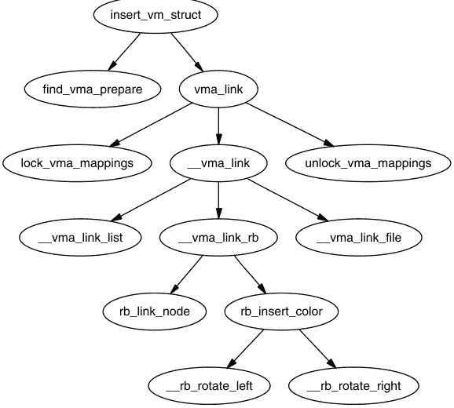

### 图 4.5. 调用关系图：`insert_vm_struct()`

函数`insert_vm_struct()`很少被使用，因为它不会增加`map_count`字段。相反，通常使用的函数是`__insert_vm_struct()`，它执行相同的任务，但会增加`map_count`。

提供了两种链接函数，`vma_link()`和`__vma_link()`。`vma_link()`用于不持有锁的情况下。它会获取所有必要的锁，包括如果 VMA 是文件映射则锁定该文件，然后调用`__vma_link()`，将 VMA 放入相关的列表中。

许多函数不使用`insert_vm_struct()`函数，而是更倾向于自己调用`find_vma_prepare()`，随后再调用`vma_link()`，以避免多次遍历树。

`__vma_link()`中的链接包含三个阶段，分别包含在三个独立的函数中。`__vma_link_list()`将 VMA 插入线性单向链表。如果它是地址空间中的第一个映射（即 prev 为 NULL），它将成为红黑树的根节点。第二阶段是使用`__vma_link_rb()`将节点链接到红黑树中。最后阶段是使用`__vma_link_file()`修复文件共享映射，这基本上是将 VMA 插入使用`vm_pprev_share`和`vm_next_share`字段的 VMA 链表中。

#### 4.4.7 合并且相邻区域

Linux 曾经有一个名为`merge_segments()` [Hac02] 的函数，负责在文件和权限匹配时将相邻的内存区域合并在一起。目标是减少所需的 VMA 数量，特别是因为许多操作会导致创建大量映射，例如对`sys_mprotect()`的调用。这是一个昂贵的操作，因为它可能导致映射的大部分被遍历，后来被删除，因为应用程序，尤其是那些具有大量映射的应用程序，在`merge_segments()`中花费了很长时间。

现在存在的等效函数称为`vma_merge()`，它只在两个地方使用。第一个是在`sys_mmap()`中使用，如果正在映射匿名区域，则调用它，因为匿名区域通常是可合并的。第二次是在`do_brk()`期间，它将一个区域扩展到新分配的区域中，这两个区域应该被合并。`vma_merge()`函数不是合并两个区域，而是检查现有区域是否可扩展以满足新分配，从而消除创建新区域的必要。如果没有文件或设备映射，并且两个区域的权限相同，则可以扩展区域。

在其他地方也会合并区域，尽管没有明确调用函数来执行合并。第一次是在调用`sys_mprotect()`期间修复区域时，如果受影响区域中的权限更改后两组权限相同，则两个区域将被合并。第二次是在调用`move_vma()`期间，此时类似的区域可能会位于彼此旁边。

#### 4.4.8 重新映射和移动内存区域

`mremap()`是一个系统调用，用于增长或收缩现有内存映射。这是由`sys_mremap()`函数实现的，如果内存区域正在增长，或者它会与另一个区域重叠，并且标志中未指定`MREMAP_FIXED`，则可能会移动内存区域。调用关系如图 4.6 所示。

如果要移动区域，`do_mremap()`首先调用`get_unmapped_area()`找到足够大的区域以容纳新的调整大小后的映射，然后调用`move_vma()`将旧 VMA 移动到新位置。有关`move_vma()`的调用关系，请参见图 4.7。

首先`move_vma()`检查新位置是否可以与新位置相邻的 VMA 合并。如果它们不能合并，则逐字分配一个新的 VMA，一次一个 PTE。接下来调用`move_page_tables()`（其调用关系请参见图 4.8），它将所有页表项从旧映射复制到新映射。尽管可能有更好的方法来移动页表，但这种方法使错误恢复变得简单，因为回溯相对直接。

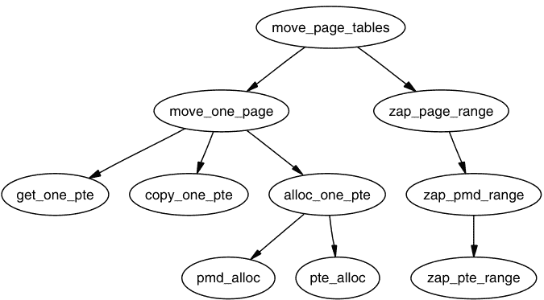

### 图 4.8. 调用关系图：`move_page_tables()`

*不复制页面的内容。相反，调用`zap_page_range()`从旧映射中换出或删除所有页面，正常的页面错误处理代码将从后备存储或文件中换入页面，或者调用设备特定的`do_nopage()`函数。

#### 4.4.9 锁定内存区域

Linux 可以使用系统调用`mlock()`将地址范围内的页面锁定到内存中，这是由`sys_mlock()`实现的，其调用关系如图 4.9 所示。在高层，这个函数很简单；它为要锁定的地址范围创建一个 VMA，在其上设置`VM_LOCKED`标志，并使用`make_pages_present()`强制所有页面存在。还提供了第二个系统调用`mlockall()`，它映射到`sys_mlockall()`。这是一个简单的扩展，与`sys_mlock()`做相同的工作，但它影响调用进程的每个 VMA。这两个函数都依赖核心函数`do_mlock()`来执行实际工作，即找到受影响的 VMA 并决定需要什么函数来修复区域，如下所述。

内存锁定存在一些限制。地址范围必须按页对齐，因为 VMA 是按页对齐的。这可以通过简单地将范围向上取整到最近的页对齐范围来解决。第二个限制是，不能超过系统管理员设置的进程限制`RLIMIT_MLOCK`。最后一个限制是，每个进程一次只能锁定物理内存的一半。这有点不符合实际，因为没有什么能阻止一个进程多次 fork，而每个子进程都锁定一部分内存，但由于只有 root 进程才被允许锁定页面，所以这并没有太大影响。可以安全地假设 root 进程是受信任的，并且知道自己在做什么。如果 root 进程不知道自己在做什么，那么导致系统崩溃的系统管理员可能是咎由自取，而且要承担全部后果。

#### 4.4.10 解锁区域

系统调用`munlock()`和`munlockall()`提供了锁定函数的补充功能，分别映射到`sys_munlock()`和`sys_munlockall()`。这些函数比锁定函数简单得多，因为它们不需要进行大量检查。它们都依赖相同的`do_mmap()`函数来修复区域。

#### 4.4.11 锁定后修复区域

当锁定或解锁时，VMA 将受到四种影响之一，每种都必须由`mlock_fixup()`修复。锁定可能影响整个 VMA，此时调用`mlock_fixup_all()`。第二种情况由`mlock_fixup_start()`处理，即区域的起点被锁定，需要分配一个新的 VMA 来映射新区域。第三种情况由`mlock_fixup_end()`处理，可以预见的是区域的终点被锁定。最后，`mlock_fixup_middle()`处理区域中间被映射的情况，需要分配两个新的 VMA。

值得注意的是，由于锁定而创建的 VMA 永远不会合并，即使在解锁后也是如此。可以假设锁定区域的进程将需要反复锁定相同的区域，因此不值得花费处理器能力来不断地合并和拆分区域。

#### 4.4.12 删除内存区域

负责删除内存区域或其部分区域的函数是`do_munmap()`，如图 4.10 所示。与其他内存区域相关操作相比，这是一个相对简单的操作，基本上分为三个部分。第一是修复即将取消映射的区域的红黑树。第二是释放与要取消映射的区域相关的页面和 PTE，第三是如果生成了空洞，则修复区域。

为了确保红黑树正确排序，所有受取消映射影响的 VMA 都被放置在一个名为`free`的链表上，然后用`rb_erase()`从红黑树中删除。如果这些区域仍然存在，它们将在修复期间以新的地址重新添加。

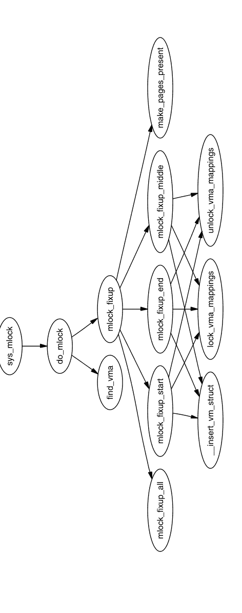

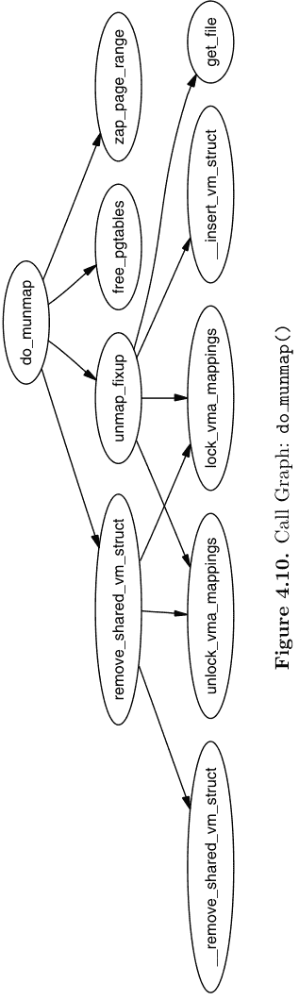

图 4.10. 调用图：`do_munmap()`

接下来，遍历`free`上的链表 VMA 并检查，以确保这不是部分取消映射。即使只是部分取消映射一个区域，仍然会调用`remove_shared_vm_struct()`来删除共享文件映射。同样，如果是部分取消映射，它将在修复期间重新创建。在调用`umap_fixup()`处理部分取消映射之前，会调用`zap_page_range()`来删除与要取消映射的区域相关的所有页面。

最后，调用`free_pgtables()`来尝试释放与取消映射区域相关的所有页表项。需要注意的是，页表项的释放不是详尽的。它只会取消映射完整的 PGD 目录及其条目，因此，例如，如果只有半个 PGD 用于映射，则不会释放任何页表项。这是因为更细粒度的页表项释放对于释放既小又可能再次使用的数据结构来说成本过高。

#### 4.4.13 删除所有内存区域

在进程退出期间，有必要取消映射与`mm_struct`相关的所有 VMA。负责的函数是`exit_mmap()`。这是一个非常简单的函数，它在遍历 VMA 链表之前刷新 CPU 缓存，依次取消映射每个 VMA 并释放相关页面，然后刷新 TLB 并删除页表项。它将在代码注释中详细讨论。

### 4.5 异常处理

VM 的一个非常重要的部分是如何捕获内核地址空间异常，这些异常并非 bug。[^1] 本节*不*涵盖由除以零等错误引发的异常。我只关注由于页错误引发的异常。存在两种可能发生错误引用的情况。第一种是进程通过系统调用向内核发送无效指针，内核必须能够安全地捕获它，因为最初唯一的检查是地址低于`PAGE_OFFSET`。第二种是内核使用`copy_from_user()`或`copy_to_user()`从用户空间读取或写入数据时。

在编译时，链接器在内核代码段的`__ex_table`部分创建异常表，该部分从`__start___ex_table`开始，到`__stop___ex_table`结束。每个条目都是`exception_table_entry`类型，这是一个由执行点和修复例程组成的对。当页错误处理程序无法管理的异常发生时，它调用`search_exception_table()`查看是否为错误指令处的错误提供了修复例程。如果编译了模块支持，还将搜索每个模块的异常表。

> [^1]: 非常感谢 Ingo Oeser 澄清了这是如何实现的细节。

如果在表中找到当前异常的地址，则返回并执行修复代码的相应位置。我们将在 4.7 节中看到如何用它来捕获对用户空间的错误读取和写入。

### 4.6 页错误

进程线性地址空间中的页面不一定驻留在内存中。例如，代表进程进行的分配不会立即满足，因为空间只是在`vm_area_struct`中预留。其他非驻留页面的例子包括页面已被交换到后备存储，或写入只读页面。

与大多数操作系统一样，Linux 采用*按需获取*策略作为处理非驻留页面的获取策略。这表示页面仅在硬件引发页错误异常时才会从后备存储中获取，操作系统捕获该异常并分配页面。后备存储的特性意味着某种页面预取策略会导致更少的页错误 [MM87]，但 Linux 在这方面相当原始。当页面从交换空间换入时，`swapin_readahead()`会读取其后一定数量的页面，最多达 2^page-cluster^，并将它们放入交换缓存中。不幸的是，可能很快使用的页面很可能在交换区域中并不相邻，这使其成为一种较差的预分页策略。Linux 可能会受益于一种适应程序行为的预分页策略 [KMC02]。

页错误有两种类型：主缺页和次缺页。当必须从磁盘读取数据时发生主缺页，这是一个昂贵的操作，否则该错误被称为次缺页或软缺页。Linux 通过`task_struct→maj_flt`和`task_struct→min_flt`字段分别维护这些类型页错误的统计信息。

Linux 中的页错误处理程序需要识别和处理多种不同类型的页错误，如表 4.5 所列，这些将在本章稍后详细讨论。

每种架构都会注册一个特定于架构的函数来处理页错误。尽管此函数的名称是任意的，但一个常见的选择是`do_page_fault()`，其 x86 的调用图如图 4.11 所示。

该函数提供了丰富的信息，例如错误的地址、页面是找不到还是保护错误、是读错误还是写错误，以及是来自用户空间还是内核空间的错误。它负责确定发生了哪种类型的错误以及架构无关代码应如何处理它。图 4.12 中的流程图大致显示了此函数的功能。在图中，带有冒号的标识符对应于代码中所示的标签。

`handle_mm_fault()`是从后备存储中调入页面、执行写时复制（COW）等的架构无关顶层函数。如果返回 1，表示是次缺页；返回 2 表示是主缺页；返回 0 会发送`SIGBUS`错误；任何其他值都会调用内存不足处理程序。

### 4.6. 页面缺页（Page Faulting）

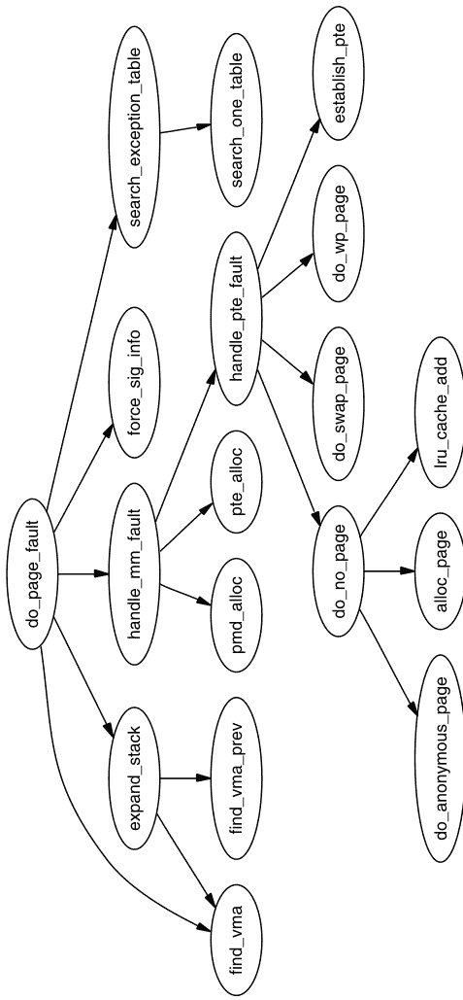

图 4.11. 调用图：`do_page_fault()`

| 异常情况 | 类型 | 处理措施 |
| --- | --- | --- |
| 区域有效，但页面未分配 | 轻微 | 从物理页面分配器分配一个页帧。 |
| 区域无效，但位于可扩展区域（如栈）旁边 | 轻微 | 扩展该区域并分配一个页面。 |
| 页面已换出，但存在于交换缓存中 | 轻微 | 在进程页表中重新建立该页面，并减少对交换缓存的引用。 |
| 页面已换出到后备存储 | 严重 | 在PTE中查找页面信息存储位置，并从磁盘读取。 |
| 页面被标记为只读时发生写入 | 轻微 | 如果该页面是COW页面，则复制一份，标记为可写并分配给进程。如果确实是非法写入，则发送`SIGSEGV`信号。 |
| 区域无效或进程无访问权限 | 错误 | 向进程发送`SIGSEGV`信号。 |
| 缺页发生在内核部分地址空间 | 轻微 | 如果缺页发生在地址空间的 vmalloc 区域，则用`init_mm`持有的主页表更新当前进程页表。这是唯一可能发生的合法内核缺页。 |
| 在内核模式下发生在用户空间区域的缺页 | 错误 | 如果发生缺页，意味着内核系统未能正确从用户空间复制数据，导致了缺页。这是一个被严肃对待的内核 bug。 |

表 4.5. 页面缺页的原因

#### 4.6.1 处理页面缺页

当异常处理程序判定该缺页是有效内存区域中的有效缺页后，架构无关函数`handle_mm_fault()`接管处理，其调用图如图4.13所示。如果所需的页表项尚不存在，它将分配这些页表项，并调用`handle_pte_fault()`。

根据PTE的属性，将使用图4.13所示的处理函数之一。决策的第一阶段是检查PTE是否被标记为不存在或未分配，这由`pte_present()`和`pte_none()`检查。如果未分配PTE（`pte_none()`返回true），则调用`do_no_page()`，它处理*按需分配（Demand Allocation）*。否则，就是页面已被换出到磁盘，由`do_swap_page()`执行*按需分页（Demand Paging）*。

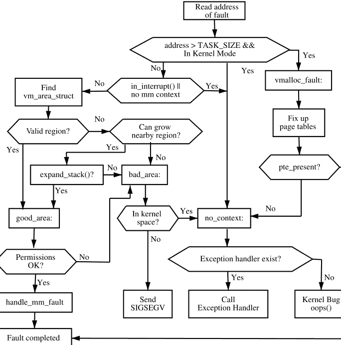

图 4.12. `do_page_fault()`流程图

有一个罕见的例外：属于虚拟文件的已换出页面由`do_no_page()`处理。这个特殊情况在第12.4节中介绍。

第二种情况是页面正在被写入。如果PTE被写保护，则调用`do_wp_page()`，因为该页面是COW页面。COW页面是在多个进程之间共享的页面（通常是父子进程），直到发生写入操作后，才会为写入进程创建私有副本。COW页面的识别依据是：区域的VMA被标记为可写，尽管单个PTE并非如此。如果不是COW页面，页面只是被标记为脏，因为它已被写入。

最后一种情况是页面已被读取且存在，但仍然发生了缺页。这可能发生在某些没有三级页表的架构中。在这种情况下，只需建立PTE并将其标记为年轻（young）。

#### 4.6.2 按需分配

当进程首次访问一个页面时，该页面必须被分配，并可能由`do_no_page()`函数填充数据，其调用图如图4.14所示。如果与父VMA关联的`vm_operations_struct`（`vma→vm_ops`）提供了`nopage()`函数，则调用它。这对内存映射设备（如显卡）很重要，这类设备需要在访问时分配页面并提供数据；或者对映射文件很重要，这类文件必须从后备存储中检索其数据。我们将首先讨论缺页是匿名页面的情况，因为这是最简单的情形。

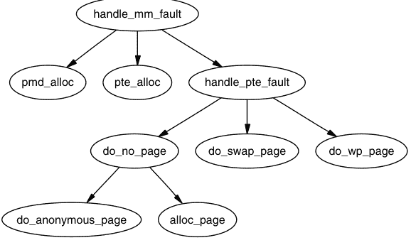

**处理匿名页面** 如果`vm_area_struct→vm_ops`字段未填充或未提供`nopage()`函数，则调用`do_anonymous_page()`函数处理匿名访问。只有两种情况需要处理：首次读取和首次写入。由于它是匿名页面，首次读取是简单的情况，因为不存在数据。在这种情况下，全局的`empty_zero_page`（仅为一页零值页面）被映射到PTE，并且PTE被写保护。设置写保护是为了让进程写入页面时再次发生缺页。在x86上，全局零填充页面在`mem_init()`函数中被清零。

如果这是对该页面的首次写入，则调用`alloc_page()`分配一个空闲页面（参见第6章），并由`clear_user_highpage()`将其清零。假设页面成功分配，`mm_struct`中的RSS字段将递增；`flush_page_to_ram()`在某些架构将页面插入用户空间进程后被调用，以确保缓存一致性。然后该页面被插入LRU链表，以便稍后由页面回收代码回收。最后更新进程的页表项以建立新的映射。

**处理文件/设备支持的页面** 如果由文件或设备支持，VMA的`vm_operations_struct`中将提供`nopage()`函数。在文件支持的情况下，`filemap_nopage()`函数通常是用于分配页面并从磁盘读取一页大小数据的`nopage()`函数。由虚拟文件支持的页面，例如由*shmfs*提供的页面，将使用`shmem_nopage()`函数（参见第12章）。每个设备驱动程序提供不同的`nopage()`。它们的内部细节对我们此处不重要，只要能返回有效的`struct page`即可使用。

在页面返回时，会进行检查以确保页面成功分配，如果没有则返回适当的错误。然后检查是否应该提前中断COW。如果缺页是对页面的写入操作，且管理VMA中未包含`VM_SHARED`标志，则会发生提前COW中断。提前中断是指分配一个新页面并将数据复制过去，然后减少对`nopage()`函数返回的页面的引用计数。

无论哪种情况，都会用`pte_none()`检查将要使用的页表中是否已有PTE。在SMP中，同一页面可能在几乎同一时刻发生两次缺页，由于自旋锁不会在整个缺页期间保持，因此必须在最后一刻进行此项检查。如果没有竞争，则分配PTE，更新统计信息，并调用架构钩子以确保缓存一致性。

#### 4.6.3 按需分页

当页面被换出到后备存储时，图4.15所示的`do_swap_page()`函数负责将其读回，虚拟文件除外，这将在第12节中介绍。查找页面所需的信息存储在PTE本身中。PTE中的信息足以在交换区中找到页面。由于页面可能在多个进程之间共享，它们不能立即被换出。相反，当页面被换出时，它被放入交换缓存。

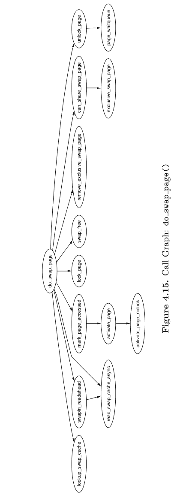

图 4.15. 调用图：`do_swap_page()`

共享页面不能立即被换出，因为无法将`struct page`映射到共享它的所有进程的PTE。搜索所有进程的页表实在太昂贵。值得注意的是，后期的2.5.x内核和带有自定义补丁的2.4.x具有所谓的*反向映射（Reverse Mapping, RMAP）*，这将在本章末尾讨论。

由于交换缓存的存在，当发生缺页时，页面可能仍然存在于交换缓存中。如果是这样，只需增加页面的引用计数，并将其重新放入进程页表中，并记为轻微缺页。

如果页面仅存在于磁盘上，则调用`swapin_readahead()`，它读取请求的页面及其后的若干页面。读入的页面数由`mm/swap.c`中定义的变量`page_cluster`决定。在内存低于16MiB的低端内存机器上，它被初始化为2或3。读入的页面数为$2^{\text{page_cluster}}$，除非遇到错误或空的交换项。这是基于这样的前提：寻道是时间上最昂贵的操作，因此寻道完成后，后续页面也应一并读入。

#### 4.6.4 COW页面

曾几何时，当进程fork时，父地址空间的完整副本会被复制给子进程。这是一个极其昂贵的操作，因为可能进程的大部分内容都必须从后备存储中换入。为了避免这种相当大的开销，采用了一种称为COW的技术。

在fork期间，两个进程的PTE被设置为只读，这样当发生写入时，就会产生缺页。Linux识别COW页面的依据是：尽管PTE被写保护，但控制VMA显示该区域是可写的。它使用图4.16所示的`do_wp_page()`函数来处理，通过复制页面并将其分配给写入进程。如果需要，将为该页面保留一个新的交换槽位。使用这种方法，fork期间只需复制页表项。

#### 4.7 复制到/自用户空间

直接访问进程地址空间中的内存是不安全的，因为无法快速检查所寻址的页面是否驻留在内存中。Linux依赖MMU在地址无效时引发异常，并让页面缺页异常处理程序捕获异常并进行修复。在x86情况下，由`__copy_user()`提供汇编代码，以捕获地址完全无效时的异常。修复代码的位置在调用`search_exception_table()`函数时找到。Linux提供了丰富的API（主要是宏）来安全地将数据复制到用户地址空间或从用户地址空间复制数据，如表4.6所示。

### 4.7. 与用户空间之间的复制


# 用户空间与内核空间内存复制函数

以下函数用于在用户空间与内核空间之间复制数据，或对用户空间内存进行访问验证。

## 数据复制函数

`unsigned long copy_from_user(void *to, const void *from, unsigned long n)`

将`n`个字节从用户地址空间（`from`）复制到内核地址空间（`to`）。

`unsigned long copy_to_user(void *to, const void *from, unsigned long n)`

将`n`个字节从内核地址（`from`）复制到用户地址空间（`to`）。

`void copy_user_page(void *to, void *from, unsigned long address)`

将数据复制到用户空间中的一个匿名页面或 COW（写时复制）页面。各端口负责避免 D-cache 别名问题。这可以通过使用一个内核虚拟地址来实现，该地址与虚拟地址使用相同的缓存行。

`void clear_user_page(void *page, unsigned long address)`

类似于`copy_user_page()`，但用于将页面清零。

## 整数值复制函数

`void get_user(void *to, void *from)`

将一个整数值从用户空间（`from`）复制到内核空间（`to`）。

`void put_user(void *from, void *to)`

将一个整数值从内核空间（`from`）复制到用户空间（`to`）。

## 字符串操作函数

`long strncpy_from_user(char *dst, const char *src, long count)`

从用户空间（`src`）向内核空间（`dst`）复制一个以 null 结尾的字符串，最长为`count`个字节。

`long strlen_user(const char *s, long n)`

返回用户空间字符串的长度，上限为`n`，包括终止的 NULL 字符。

## 内存访问验证函数

`int access_ok(int type, unsigned long addr, unsigned long size)`

如果用户空间的内存块有效则返回非零值，否则返回零。


表 4.6. 访问进程地址空间 API

所有宏都映射到汇编函数，这些函数的实现模式都类似。为了说明，我们将只追溯 `copy_from_user()` 在 x86 上的实现。

如果复制的大小在编译时已知，`copy_from_user()` 调用 `__constant_copy_from_user()`，否则使用 `__generic_copy_from_user()`。如果大小已知，有不同的汇编优化来以 1、2 或 4 字节步幅复制数据。除此之外，这两个复制函数之间的区别并不重要。

通用复制函数最终会调用 `<asm-i386/uaccess.h>` 中的 `__copy_user_zeroing()` 函数，它有三个重要部分。第一部分是从用户空间复制 `size` 个字节的实际汇编代码。如果任何页面不在内存中，将发生页错误，如果地址有效，它会像正常情况一样被换入。第二部分是修复代码，第三部分是 `__ex_table`，它将第一部分的指令映射到第二部分的修复代码。

如第 4.5 节所述，这些配对通过链接器将复制指令的位置和修复代码的位置复制到内核异常处理表中。如果读取了无效地址，函数 `do_page_fault()` 将继续执行，调用 `search_exception_table()`，找到发生错误读取的增强指令指针（EIP），并跳转到修复代码，该代码将零复制到剩余的内核空间，修复寄存器并返回。通过这种方式，内核可以安全地访问用户空间，无需昂贵的检查，让 MMU 硬件来处理异常。

所有其他访问用户空间的函数都遵循类似的模式。

## 4.8 2.6 中的新特性

**线性地址空间** 线性地址空间基本上与 2.4 保持不变，没有不能轻易识别的修改。主要的变化是增加了一个可从用户空间使用的新页面，该页面已被录入固定地址虚拟映射中。在 x86 上，该页面位于 `0xFFFFF000`，称为 *vsyscall 页面*。该页面上有代码，提供了从用户空间进入内核空间的最优方法。用户空间程序现在在进入内核空间时应该使用 `call 0xFFFF000`，而不是传统的 `int 0x80`。

`struct mm_struct` 该结构体没有显著变化。第一个变化是增加了 `free_area_cache` 字段，初始化为 `TASK_UNMAPPEDfold`。该字段用于记住线性地址空间中第一个空洞的位置，以缩短搜索时间。在结构体末尾添加了少量字段，与核心转储相关，超出了本书的范围。

`struct vm_area_struct` 该结构体也没有显著变化。主要区别是 `vm_next_share` 和 `vm_pprev_share` 已被一个适当的链表取代，新增了一个名为 `shared` 的字段。`vm_raend` 已被完全移除，因为 2.6 中的文件预读实现方式非常不同。预读主要由存储在 `struct file->f_ra` 中的 `struct file_ra_state` 结构体管理。预读的实现方式在 `mm/readahead.c` 中有非常详细的描述。

`struct address_space` 第一个变化相对较小。`gfp_mask` 字段已被 `flags` 字段取代，其中前 `__GFP_BITS_SHIFT` 位用作 `gfp_mask`，并通过 `mapping_gfp_mask()` 访问。剩余的位用于存储异步 I/O 的状态。可以设置的两个标志是 `AS_EIO`（表示 I/O 错误）和 `AS_ENOSPC`（表示异步写入期间文件系统空间不足）。

该结构体有一些重要的新增项，主要与页面缓存和文件预读有关。由于这些字段非常独特，我们将详细介绍：

- **page_tree** 这是该映射的页面缓存中所有页面的基数树，按数据在物理磁盘上的块索引。在 2.4 中，搜索页面缓存需要遍历链表。在 2.6 中，使用基数树查找，显著减少了搜索时间。基数树实现在 `lib/radix-tree.c` 中。

- **page_lock** 这是一个自旋锁，用于保护 `page_tree`。

- **io_pages** 当脏页要被写出时，在调用 `do_writepages()` 之前它们会被添加到这个列表中。如前面的注释所述，在 `fs/mpage.c` 的 `mpage_writepages()` 中，等待写出的页面被放在此列表中，以避免锁定已经因 I/O 而被锁定的页面而造成死锁。

- **dirtied_when** 该字段以 jiffies 为单位，记录 inode 第一次被弄脏的时间。该字段决定 inode 在 `super_block->s_dirty` 列表中的位置。这防止了频繁被弄脏的 inode 始终停留在列表顶部，而使其他 inode 的写出处于饥饿状态。

- **backing_dev_info** 该字段记录与预读相关的信息。该结构体在 `include/linux/backing-dev.h` 中声明，并有注释解释各字段。

- **private_list** 这是可供 `address_space` 使用的私有列表。如果使用辅助函数 `mark_buffer_dirty_inode()` 和 `sync_mapping_buffers()`，此列表通过 `buffer_head->b_assoc_buffers` 字段链接 `buffer_heads`。

- **private_lock** 这个自旋锁可供 `address_space` 使用。此锁的用途非常复杂，但其中一些用途在 2.5.17 的长篇变更日志中有解释（*lwn.net/2002/0523/a/2.5.17.php3*）。它主要与保护其他映射中与本映射共享缓冲区的列表有关。该锁不会保护此 `private_list`，但会保护另一个与本映射共享缓冲区的 `address_space` 的 `private_list`。

- **assoc_mapping** 这是支持此映射的 `private_list` 中缓冲区的 `address_space`。

- **truncate_count** 当函数 `invalidate_mmap_range()` 截断某个区域时，该值递增。在缺页异常期间，`do_no_page()` 会检查该计数器，以确保不会为刚刚被失效的页面发生缺页异常。

**struct address_space_operations** 该结构体的大多数变化初看起来非常简单，但实际上相当复杂。更改的字段如下：

- **writepage** `writepage()` 回调已被改为接受一个额外的参数 `struct writeback_control`。该结构体负责记录关于写回的信息，例如是否拥塞，或者写入者是直接回收的页面分配器还是 **kupdated**，并包含一个指向底层 `backing_dev_info` 的句柄以控制预读。

- **writepages** 在写出所有页之前，先将所有页面从 `dirty_pages` 移动到 `io_pages`。

- **set_page_dirty** 这是一种 `address_space` 特有的脏页标记方法。主要由底层存储的 `address_space_operations` 以及匿名共享页使用，这些页面没有与之关联的缓冲区需要被标记为脏页。

- **readpages** 在读取页面时使用，以便精确控制预读。

- **bmap** 已修改，针对大于 2^32 字节的设备，使用磁盘扇区而非无符号长整型来处理。

- **invalidatepage** 这是一次重命名修改。`block_flushpage()` 及其回调函数 `flushpage()` 已分别重命名为 `block_invalidatepage()` 和 `invalidatepage()`。

- **direct_I/O** 已修改，使用 2.6 中的新 I/O 机制。新机制超出了本书的范围。

**内存区域** `mmap()` 的操作有两个重要变化。第一个是安全模块可以注册回调函数。该回调函数称为 `security_file_mmap()`，它查找 `security_ops` 结构体以获取相关函数。默认情况下，这将是一个空操作。

第二个是使用了严格得多的地址空间核算代码。需要核算的 `vm_area_struct` 将设置 `VM_ACCOUNT` 标志，这将是所有用户空间映射。当用户空间区域被创建或销毁时，函数 `vm_acct_memory()` 和 `vm_unacct_memory()` 会更新变量 `vm_committed_space`。这使内核能够更好地了解已提交给用户空间的内存量。

**4GiB/4GiB** 2.4.x 内核存在一个限制，即内核只有 1GiB 的虚拟地址空间可用，这对所有进程可见。在撰写本文时，Ingo Molnar² 开发了一个补丁，允许内核选择拥有自己完整的 4GiB 地址空间。这些补丁可从 *http://redhat.com/~mingo/4g-patches/* 获取，并已包含在 -mm 测试树中，但目前尚不清楚是否会合并到主流内核中。

此功能旨在用于具有非常大内存量（>16GiB）的 32 位系统。传统的 3/1 分割可以充分支持最多 1GiB 的 RAM。之后，高端内存支持允许通过临时映射高端内存页来支持更大的内存量。然而，随着内存量的增加，这形成了显著的瓶颈。例如，当物理 RAM 量接近 60GiB 范围时，几乎所有低端内存都被 `mem_map` 消耗。通过给内核自己独立的 4GiB 虚拟地址空间，支持这些内存要容易得多。但严重的代价是，每次系统调用都需要进行 TLB 刷新，这会严重影响性能。

> ²参见 *lwn.net/Articles/39283/* 了解该补丁的首次公告。

## 非线性 VMA 填充

使用该补丁后，用户空间和内核空间之间只共享一个 16MiB 的小内存区域，用于存储全局描述符表（GDT）、中断描述符表（IDT）、任务状态段（TSS）、局部描述符表（LDT）、vsyscall 页和内核栈。实际进行页表切换的代码则包含在进入/退出内核空间的跳板代码中。核心部分有一些修改，例如移除了直接指针来访问用户空间缓冲区，但总体而言，核心内核不受此补丁的影响。

在 2.4 中，由文件支持的 VMA 是线性填充的。这在 2.6 中可以通过向 `mmap()` 引入 `MAP_POPULATE` 标志以及新的系统调用 `remap_file_pages()`（由 `sys_remap_file_pages()` 实现）来选择性改变。该系统调用允许通过操作页表，将现有 VMA 中的任意页面重新映射到后备文件中的任意位置。

在页面换出时，文件的线性地址被编码在 PTE 中，以便在页面缺页时能够正确重新安装。具体的编码方式与架构相关，因此定义了两个宏 `pgoff_to_pte()` 和 `pte_to_pgoff()` 来完成这项工作。

此功能主要对具有大量映射的应用程序有益，例如数据库服务器和虚拟化应用程序（如模拟器）。引入此功能有多个原因。首先，VMA 是每进程的，可能占用相当大的空间，尤其对于具有大量映射的应用程序。其次，`get_unmapped_area()` 用于在虚拟地址空间中寻找空闲区域的搜索是线性搜索，对于大量映射来说非常昂贵。第三，非线性映射会将大部分页面预先调入内存，而普通映射可能会对每个页面导致主缺页。不过，这可以通过在使用 `mmap()` 时使用新的 `MAP_POPULATE` 标志或使用 `mlock()` 来避免。最后一个原因是为了避免稀疏映射，在最坏情况下，每个映射的文件页都需要一个 VMA。

然而，此功能并非没有一些严重的缺点。第一个是系统调用 `truncate()` 和 `mincore()` 在非线性映射方面存在问题。这两个系统调用都依赖于 `vm_area_struct→vm_pgoff`，而这对于非线性映射是无意义的。如果由非线性映射的文件被截断，VMA 中存在的页面仍将保留。有人提议正确的解决方案是将页面保留在内存中，但使其变为匿名页。在撰写本文时，尚未实现任何解决方案。

第二个主要缺点是 TLB 失效。每个重新映射的页面都需要通过 `flush_icache_page()` 告知 MMU 重新映射已发生，但更重要的代价是 `flush_tlb_page()` 的调用。一些处理器能够使相关的 TLB 条目失效，但其他处理器是通过刷新整个 TLB 来实现的。如果重新映射频繁发生，性能变得会很严重。在一些方面，这些代价是最糟糕的，因为其影响在很大程度上取决于处理器。

目前尚不清楚此功能的未来会如何，如果它继续存在的话。在撰写本文时，关于如何修复该功能的问题仍有持续争论，但非线性映射很可能在页面换出、截断和页面的反向映射方面与普通映射受到非常不同的对待。由于此功能的主要用户可能是数据库，这种特殊处理不太可能成为问题。

## 页面缺页

页面缺页例程的更改主要是表面性的，除了支持反向映射和高端内存中 PTE 所必需的变化外。主要的表面性更改是页面缺页例程返回自解释的编译时定义，而非魔术数字。`handle_mm_fault()` 的可能返回值有 `VM_FAULT_MINOR`、`VM_FAULT_MAJOR`、`VM_FAULT_SIGBUS` 和 `VM_FAULT_OOM`。

# 第 5 章 引导内存分配器

在编译时静态初始化所有核心内核内存结构是不现实的，因为硬件配置的组合实在太多。然而，即使要设置最基本的结构，也需要内存，因为即使是物理页面分配器（在下一章讨论）也需要分配内存来初始化自身。但是，物理页面分配器如何分配内存来初始化自己呢？

为此，使用了一种称为 *引导内存分配器* 的专用分配器。它基于最基本的分配器之一——*首次适配* 分配器，使用位图来表示内存 [Tan01]，而不是使用空闲块的链表。如果位为 1，则页面已分配；如果位为 0，则页面未分配。为了满足小于页面大小的分配，分配器记录上次分配的 *页帧号* (*PFN*) 以及分配结束时的偏移量。后续的小分配被合并在一起，存储在同一个Super

读者可能会问，为什么此分配器不用于运行中的系统。一个令人信服的原因是，虽然首次适配分配器不会严重受碎片化影响 [JW98]，但满足分配时常常需要线性搜索内存。由于这是检查位图，开销会变得非常大，尤其是因为首次适配算法倾向于在物理内存开头留下许多小的空闲块，而这些块在申请大内存时仍然会被扫描，从而使整个过程非常浪费 [WJNB95]。

分配器有两个非常相似但不同的 API。一个是用于 UMA 架构的，列在表 5.1 中；另一个是用于 NUMA 的，列在表 5.2 中。主要区别在于 NUMA API 必须提供受操作影响的节点，但由于这些 API 的调用者存在于架构相关层中，这不是一个重大问题。

本章首先描述分配器用于描述每个节点可用物理内存的结构。然后我将说明如何发现物理内存的限制以及每个区域的大小，再讨论如何使用这些信息初始化引导内存分配器结构。接着讨论分配和释放例程，最后讨论如何停用引导内存分配器。

| 函数 | 描述 |
|----------|-------------|
| `unsigned long init_bootmem(unsigned long start, unsigned long page)` | 初始化介于 0 与页帧号 `page` 之间的内存。可用内存的起始页帧号为 `start`。 |
| `void reserve_bootmem(unsigned long addr, unsigned long size)` | 将地址 `addr` 与 `addr+size` 之间的页面标记为保留。请求部分保留一页将导致整个页面被保留。 |
| `void free_bootmem(unsigned long addr, unsigned long size)` | 将地址 `addr` 与 `addr+size` 之间的页面标记为可用。 |
| `void * alloc_bootmem(unsigned long size)` | 从 `ZONE_NORMAL` 分配 `size` 字节数。分配将对齐到 L1 硬件缓存，以最大限度利用硬件缓存。 |
| `void * alloc_bootmem_low(unsigned long size)` | 从 `ZONE_DMA` 分配 `size` 字节数。分配将对齐到 L1 硬件缓存。 |
| `void * alloc_bootmem_pages(unsigned long size)` | 从 `ZONE_NORMAL` 分配 `size` 字节数，并对齐到页面大小，以便向调用者返回完整的页面。 |
| `void * alloc_bootmem_low_pages(unsigned long size)` | 从 `ZONE_DMA` 分配 `size` 字节数，并对齐到页面大小，以便向调用者返回完整的页面。 |
| `unsigned long bootmem_bootmap_pages(unsigned long pages)` | 计算存储表示 `pages` 个页面分配状态的位图所需的页面数量。 |
| `unsigned long free_all_bootmem()` | 在引导分配器生命周期结束时使用。它遍历位图中的所有页面。对于每个空闲页面，清除标志位，并将页面释放给物理页面分配器（见下一章），以便运行时分配器可以建立其空闲列表。 |

**表 5.1.** UMA 架构的引导内存分配器 API

## 5.1 表示引导映射

系统中的每个内存节点都存在一个 `bootmem_data` 结构体。它包含引导内存分配器为节点分配内存所需的信息，例如表示已分配页面的位图以及内存的位置。它在 `<linux/bootmem.h>` 中声明如下：

```
25 typedef struct bootmem_data {
26     unsigned long node_boot_start;
27     unsigned long node_low_pfn;
28     void *node_bootmem_map;
29     unsigned long last_offset;
30     unsigned long last_pos;
31 } bootmem_data_t;
```


该结构体的字段如下：

- `node_boot_start` 这是所表示块的起始物理地址。
- `node_low_pfn` 这是结束物理地址，换句话说，是该节点所表示的 `ZONE_NORMAL` 的结束。
- `node_bootmem_map` 这是表示已分配或空闲页面的位图位置，每个位对应一个页面。
- `last_offset` 这是上次分配结束在页面内的偏移量。如果为 0，则所使用的页面已满。
- `last_pos` 这是上次分配所使用的页面的页帧号。通过将其与 `last_offset` 字段结合使用，可以测试分配是否可以与上次分配使用的页面合并，而不是耗用一个全新的完整页面。

| 函数 | 描述 |
|----------|-------------|
| `unsigned long init_bootmem_node(pg_data_t *pgdat, unsigned long freepfn, unsigned long startpfn, unsigned long endpfn)` | 用于 NUMA 架构。它初始化介于页帧号 `startpfn` 与 `endpfn` 之间的内存，第一个可用的页帧号为 `freepfn`。初始化完成后，`pgdat` 节点被插入到 `pgdat_list`。 |
| `void reserve_bootmem_node(pg_data_t *pgdat, unsigned long physaddr, unsigned long size)` | 将指定节点 `pgdat` 上地址 `addr` 与 `addr+size` 之间的页面标记为保留。请求部分保留一页将导致整个页面被保留。 |
| `void free_bootmem_node(pg_data_t *pgdat, unsigned long physaddr, unsigned long size)` | 将指定节点 `pgdat` 上地址 `addr` 与 `addr+size` 之间的页面标记为可用。 |
| `void * alloc_bootmem_node(pg_data_t *pgdat, unsigned long size)` | 从指定节点 `pgdat` 的 `ZONE_NORMAL` 分配 `size` 字节数。分配将对齐到 L1 硬件缓存，以最大限度利用硬件缓存。 |
| `void * alloc_bootmem_pages_node(pg_data_t *pgdat, unsigned long size)` | 从指定节点 `pgdat` 的 `ZONE_DMA` 分配 `size` 字节数，并对齐到页面大小，以便向调用者返回完整的页面。 |
| `void * alloc_bootmem_low_pages_node(pg_data_t *pgdat, unsigned long size)` | 从指定节点 `pgdat` 的 `ZONE_DMA` 分配 `size` 字节数，并对齐到页面大小，以便向调用者返回完整的页面。 |
| `unsigned long free_all_bootmem_node(pg_data_t *pgdat)` | 在引导分配器生命周期结束时使用。它遍历指定节点的位图中的所有页面。对于每个空闲页面，清除页面标志位，并将页面释放给物理页面分配器（见下一章），以便运行时分配器可以建立其空闲列表。 |

**表 5.2.** NUMA 架构的引导内存分配器 API

### 5.2 初始化引导内存分配器

每个架构都必须提供一个 `setup_arch()` 函数，该函数除其他任务外，还负责获取初始化引导内存分配器所需的必要参数。

每个架构都有自己获取必要参数的函数。在 x86 上，它被称为 `setup_memory()`，如第 2.2.2 节所述，但在其他架构（如 MIPS 或 Sparc）上，它被称为 `bootmem_init()`，或者在 PPC 架构上，被称为 `do_init_bootmem()`。无论架构如何，任务本质上是相同的。它计算的参数如下：

- `min_low_pfn` 这是系统中可用的最低页帧号。
- `max_low_pfn` 这是低内存（`ZONE_NORMAL`）可能寻址的最高页帧号。
- `highstart_pfn` 这是高端内存（`ZONE_HIGHMEM`）起始的页帧号。
- `highend_pfn` 这是高端内存的最后一个页帧号。
- `max_pfn` 最后，这是系统可用的最后一个页帧号。

### 5.3 初始化 bootmem_data

在 `setup_memory()` 发现可用物理内存的限制后，会选择两个引导内存初始化函数之一，并提供要初始化的节点的起始和结束页帧号。`init_bootmem()` 用于初始化 `contig_page_data`，由 UMA 架构使用，而 `init_bootmem_node()` 则用于 NUMA 以初始化指定节点。这两个函数都很简单，并依赖 `init_bootmem_core()` 来完成实际工作。

核心函数的首要任务是将这个 `pgdat_data_t` 插入到 `pgdat_list`，因为在此函数结束时，该节点已准备就绪。然后，它在关联的 `bootmem_data_t` 中记录此节点的起始和结束地址，并分配表示页面分配的位图。所需的位图大小（以字节为单位，因此除以八）计算如下：

```
mapsize = (end_pfn - start_pfn) + 7 / 8
```

位图存储在 `bootmem_data_t→node_boot_start` 指向的物理地址处，而该映射的虚拟地址被放置在 `bootmem_data_t→node_bootmem_map` 中。由于没有架构无关的方式来检测内存中的空洞，因此整个位图初始化为 1，有效地将所有页面标记为已分配。将可用页面的位设置为 0 取决于依赖架构的代码，尽管实际上只有 Sparc 架构使用此位图。对于 x86，函数 `register_bootmem_low_pages()` 读取 e820 映射，并对每个可用页面调用 `free_bootmem()` 将位设置为 0，然后使用 `reserve_bootmem()` 保留实际位图所需的页面。

### 5.4 分配内存

`reserve_bootmem()` 函数可用于为调用者保留页面，但用于一般分配非常繁琐。提供了四个函数用于 UMA 架构上的简便分配，分别称为 `alloc_bootmem()`、`alloc_bootmem_low()`、`alloc_bootmem_pages()` 和 `alloc_bootmem_low_pages()`，在表 5.1 中有详细描述。所有这些宏都使用不同的参数调用 `__alloc_bootmem()`。这些函数的调用图如图 5.1 所示。

对于 NUMA 存在类似的函数，它们将节点作为附加参数

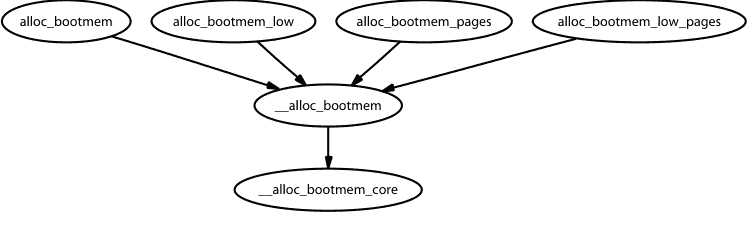

参数如表5.2所列。它们分别是`alloc_bootmem_node()`、`alloc_bootmem_pages_node()`和`alloc_bootmem_low_pages_node()`。所有这些宏都通过不同的参数调用`__alloc_bootmem_node()`。

`__alloc_bootmem()`和`__alloc_bootmem_node()`的参数本质上是相同的。它们如下：

- `pgdat` 这是要从中分配的节点。在UMA情况下它被省略，因为假定其为`contig_page_data`。
- `size` 这是请求分配的字节大小。
- `align` 这是请求应对其的字节数。对于小分配，它们会对齐到`SMP_CACHE_BYTES`，在x86上，这将对齐到L1硬件缓存。
- `goal` 这是从何处开始分配的首选起始地址。低级函数将从物理地址0开始，而其他函数将从`MAX_DMA_ADDRESS`开始，这是该架构上DMA传输可能使用的最大地址。

所有分配API的核心函数是`__alloc_bootmem_core()`。这是一个大型函数，但步骤简单，可以分解。该函数从`goal`地址开始线性扫描内存，寻找一个足够大的内存块以满足分配需求。使用API时，这个地址对于DMA友好的分配将是0，否则是`MAX_DMA_ADDRESS`。

聪明的部分，也是函数的主要部分，处理决定这个新分配是否可以与前一个合并。如果满足以下条件，它可能会被合并：

- 前一次分配使用的页面（`bootmem_data→pos`）与本次分配找到的页面相邻。
- 前一页有一些空闲空间（`bootmem_data→offset != 0`）。
- 对齐小于`PAGE_SIZE`。

无论分配是否可能合并，`pos`和`offset`字段都将被更新，以显示用于分配的最后一页以及最后一页的使用量。如果最后一页已完全使用，则偏移量为0。

### 5.5 释放内存

与分配函数相比，只提供了两个释放函数：用于UMA的`free_bootmem()`和用于NUMA的`free_bootmem_node()`。它们都调用`free_bootmem_core()`，唯一的区别是NUMA提供了一个`pgdat`。

核心函数与其他分配器相比相对简单。对于释放影响的每个*完整*页面，位图中对应的位被设置为0。如果它已经是0，则调用`BUG()`以显示发生了双重释放。`BUG()`在由于内核错误导致不可恢复的错误时使用。它终止运行进程并导致内核崩溃，显示堆栈跟踪和调试信息，供开发人员用于修复错误。

释放函数的一个重要限制是只能释放完整的页面。当页面被部分分配时，它从未被记录，因此，如果只被部分释放，整个页面仍保持保留状态。这并不像看起来那么严重，因为分配在系统的生命周期内始终持续存在。然而，对于开发人员在启动期间来说，这仍然是一个重要的限制。

### 5.6 退役启动内存分配器

在引导过程的后期，调用`start_kernel()`函数，该函数知道可以安全地移除启动分配器及其所有关联的数据结构。每个架构都需要提供一个函数`mem_init()`，如图5.2所示，负责销毁启动内存分配器及其关联的结构。

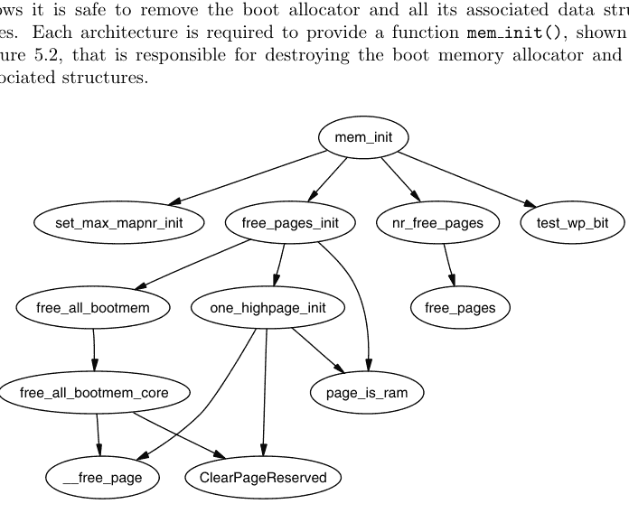

该函数的目的很简单。它负责计算低内存和高内存的大小，并向用户打印信息性消息，以及在必要时执行硬件的最终初始化。在x86上，VM关注的主要函数是`free_pages_init()`。

该函数首先通过为UMA架构调用`free_all_bootmem()`或为NUMA架构调用`free_all_bootmem_node()`来告诉启动内存分配器退役自身。两者都使用不同的参数调用核心函数`free_all_bootmem_core()`。核心函数原理简单，执行以下任务：

- 对于分配器知道的此节点的所有未分配页面，它执行以下操作：
  - 清除其`struct page`中的`PG_reserved`标志。
  - 将计数设置为1。
  - 调用`__free_pages()`，以便伙伴分配器（将在下一章讨论）可以构建其空闲列表。
- 释放用于位图的所有页面，并将它们交给伙伴分配器。

在这个阶段，伙伴分配器现在控制了低内存中的所有页面，只剩下高内存页面。在`free_all_bootmem()`返回后，它首先计算保留页面的数量以用于记账目的。`free_pages_init()`函数的其余部分负责高内存页面。然而，在这一点上，应该清楚全局`mem_map`数组是如何分配和初始化的，以及页面是如何交给主分配器的。在单节点系统中初始化低内存页面的基本流程如图5.3所示。

在`free_all_bootmem()`返回后，`ZONE_NORMAL`中的所有页面都已交给伙伴分配器。要初始化高内存页面，`free_pages_init()`为`highstart_pfn`和`highend_pfn`之间的每个页面调用`one_highpage_init()`。`one_highpage_init()`只是清除`PG_reserved`标志，设置`PG_highmem`标志，将计数设置为1，并调用`__free_pages()`将其释放给伙伴分配器，方式与`free_all_bootmem_core()`相同。

此时，不再需要启动内存分配器，伙伴分配器是系统的主要物理页面分配器。一个值得注意的有趣特性是，不仅删除了启动分配器的数据，还删除了所有用于引导系统的代码。所有仅在系统启动期间需要的初始化函数都标记为`__init`，例如以下内容：

```
321 unsigned long __init free_all_bootmem (void)
```

所有这些函数都由链接器放置在`.init`部分。在x86上，函数`free_initmem()`遍历从`__init_begin`到`__init_end`的所有页面，并将这些页面释放给伙伴分配器。通过这种方法，Linux可以释放大量不再需要的引导代码使用的内存。例如，在引导本文档编写的机器上运行的内核时，释放了27个页面。

### 5.7 2.6版本的新特性

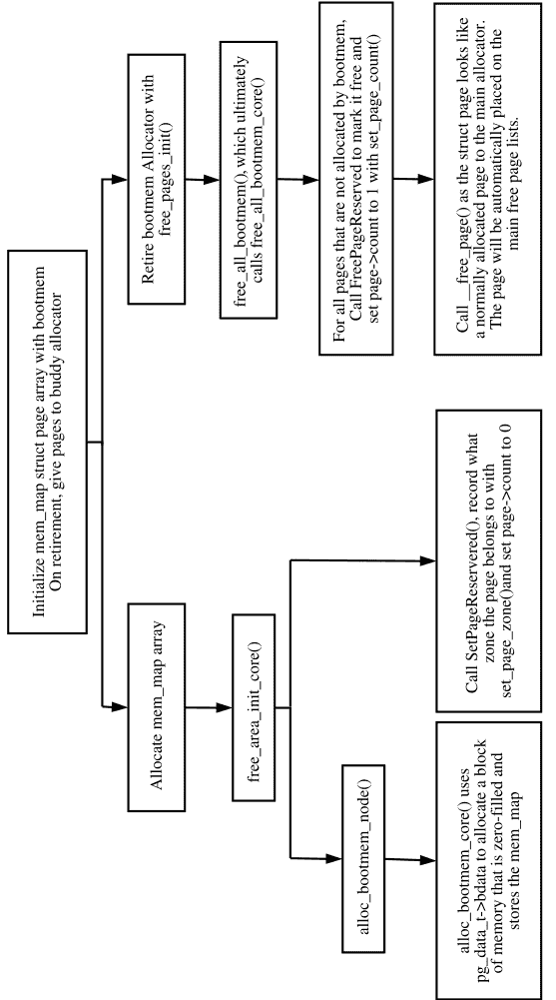

|  |  |
|---|---|
| 使用bootmem初始化mem_map struct page数组 | 退役时将页面交给伙伴分配器 |
| 使用free_pages_init()退役bootmem分配器 | free_all_bootmem()，最终调用free_all_bootmem_core() |
|  | 对于所有未被bootmem分配的页面，调用FreePageReserved标记其空闲，并使用set_page_count()设置page->count为1 |
|  | 调用__free_page()，因为struct page对主分配器来说看起来像一个正常分配的页面。该页面将自动放置在主空闲页面列表上。 |
| 分配mem_map数组 |  |
| free_area_init_core() |  |
| alloc_bootmem_node() |  |
| 调用SetPageReserved()，使用set_page_zone()记录页面所属的区域，并将page->count设置为0 |  |
| alloc_bootmem_core()使用pg_data_t->bdata分配一块内存，该内存被零填充并存储mem_map |  |

第一个优化是在`bootmem_data_t`结构中添加了一个`last_success`字段。顾名思义，它跟踪最后一次成功分配的位置以减少搜索时间。如果地址在`last_success`之前被释放，它将更改为释放的位置。

第二个优化也与线性搜索有关。在搜索空闲页面时，2.4版本测试每个位，这很昂贵。2.6版本改为测试一个`BITS_PER_LONG`块是否全为1。如果不是，它将单独测试该块中的每个位。为了帮助线性搜索，节点由`init_bootmem()`按其物理地址顺序排序。

最后一个变化与NUMA和连续架构有关。连续架构现在定义自己的`init_bootmem()`函数，任何架构都可以选择性地定义自己的`reserve_bootmem()`函数。

# 第6章

## 物理页分配

本章介绍 Linux 中物理页的管理与分配方式。主要采用的算法是*二进制伙伴分配器*，由诺尔顿 [Kno65] 提出，后经克努特 [Knu68] 进一步阐述。与其他分配器相比，二进制伙伴分配器已被证明速度极快 [KB85]。

这是一种将常规的二的幂次方分配器与空闲缓冲区合并 [Vah96] 相结合的分配方案，其基本概念相当简单。内存被划分为大量的页块，每个块包含的页数都是2的幂次方。如果所需大小的块不可用，则将一个较大的块对半分割，这两个块互为*伙伴*。其中一半用于分配，另一半则保持空闲。根据需要不断地将块对半分割，直到获得所需大小的块为止。当某个块稍后释放时，会检查其伙伴块，如果伙伴块也是空闲的，则将两者合并。

本章首先介绍 Linux 如何记录哪些内存块是空闲的。随后详细讨论分配和释放页的方法。接下来的部分将介绍影响分配器行为的标志，最后讨论碎片化问题以及分配器如何处理该问题。

### 6.1 管理空闲块

如前所述，分配器维护着空闲页块，每个块包含的页数都是2的幂次方。表示二的幂次方大小块所用到的指数称为*阶*（order）。每个阶都维护着一个 `free_area_t` 结构体数组，指向一个由空闲页块组成的链表，如图6.1所示。

因此，数组的第0个元素指向大小为 $2^0$ 即1页的空闲页块列表，第1个元素指向 $2^1$（2）页的列表，以此类推，直到 $2^{\text{MAX\_ORDER}-1}$ 页，其中 `MAX_ORDER` 目前定义为10。这就避免了在较小块即可满足请求时将大块拆分的风险。页块通过 `page→list` 以线性链表的形式维护。

每个区域都有一个名为 `free_area[MAX_ORDER]` 的 `free_area_t` 结构体数组。它在 `<linux/mm.h>` 中声明如下：

```
22 typedef struct free_area_struct {
23         struct list_head      free_list;
24         unsigned long         *map;
25 } free_area_t;
```

该结构体中的字段如下：

- `free_list` 空闲页块的链表
- `map` 表示一对伙伴状态的位图

Linux 通过每个伙伴对只使用一位而非两位来节省内存。每次分配或释放伙伴时，表示该伙伴对的位会被翻转，这样当两位页都空闲或都被占用时该位为零，仅有一个伙伴在使用时该位为1。要翻转正确的位，需要使用 page_alloc.c 中的宏 `MARK_USED()`，其声明如下：

```
164 #define MARK_USED(index, order, area) \\
165         __change_bit((index) >> (1+(order)), (area)->map)
```


`index` 是页在全局 `mem_map` 数组中的索引。将其右移 `1+order` 位，即可得到 `map` 中表示该伙伴对的位。

### 6.2 分配页

Linux 为页帧分配提供了相当庞大的 API。所有这些 API 都接受 `gfp_mask` 作为参数，这是一组决定分配器行为的标志。这些标志将在 6.4 节中讨论。

如图 6.2 所示，分配 API 函数都使用核心函数 `__alloc_pages()`，但这些 API 的存在是为了选择合适的节点和区域。不同的用户需要不同的区域，例如某些设备驱动需要 `ZONE_DMA`，而磁盘缓冲区需要 `ZONE_NORMAL`，调用者不必了解正在使用哪个节点。页分配 API 的完整列表见表 6.1。

分配总是针对指定阶进行的：需要单个页时阶为 0。如果找不到所请求阶的空闲块，则将更高阶的块拆分为两个伙伴。其中一个被分配，另一个则被放入低一阶的空闲列表中。图 6.3 展示了 $2^4$ 块如何被拆分，以及伙伴如何被添加到空闲列表中，直到有块可供进程使用。

当该块稍后释放时，会检查其伙伴。如果两者都空闲，则将它们合并形成更高阶的块，并放入更高的空闲列表中，然后再检查其伙伴，以此类推。如果伙伴不空闲，则将释放的块添加到当前阶的空闲列表中。在进行这些列表操作时，必须屏蔽中断，以防止中断处理程序在进程使列表处于不一致状态时对其进行操作。这通过使用中断安全的自旋锁来实现。

第二个需要决定的是使用哪个内存节点或 `pg_data_t`。Linux 采用节点本地分配策略，旨在使用与运行页分配进程的 CPU 相关联的内存体。这里，`__alloc_pages()` 函数是关键，因为该函数取决于内核是为 UMA（函数在 `mm/page_alloc.c` 中）还是 NUMA（函数在 `mm/numa.c` 中）机器构建的。

无论使用哪个 API，`mm/page_alloc.c` 中的 `__alloc_pages()` 都是分配器的核心。该函数不会被直接调用，它会检查选定的区域，并根据可用页数判断是否适合从中分配。如果该区域不合适，分配器可能会回退到其他区域。回退区域的顺序在启动时由 `build_zonelists()` 函数决定，但通常 `ZONE_HIGHMEM` 会回退到 `ZONE_NORMAL`，而后者又会回退到 `ZONE_DMA`。如果空闲页数达到 `pages_low` 水位线，将唤醒 `kswapd` 开始从区域中释放页，而如果内存极度紧张，调用者自身将执行 `kswapd` 的工作。

在最终确定区域后，调用 `rmqueue()` 函数来分配页块，如果没有合适大小的块，则拆分更高级别的块。

| 函数 | 描述 |
| --- | --- |
| `struct page * alloc_page(unsigned int gfp_mask)` | 分配单页，返回结构体地址。 |
| `struct page * alloc_pages(unsigned int gfp_mask, unsigned int order)` | 分配 $2^{order}$ 页，返回 `struct page`。 |
| `unsigned long get_free_page(unsigned int gfp_mask)` | 分配单页，清零后返回虚拟地址。 |
| `unsigned long __get_free_page(unsigned int gfp_mask)` | 分配单页，返回虚拟地址。 |
| `unsigned long __get_free_pages(unsigned int gfp_mask, unsigned int order)` | 分配 $2^{order}$ 页，返回虚拟地址。 |
| `struct page * __get_dma_pages(unsigned int gfp_mask, unsigned int order)` | 从 DMA 区域分配 $2^{order}$ 页，返回 `struct page`。 |

**表 6.1. 物理页分配 API**

### 6.3 释放页

释放页的 API 简单得多，其存在有助于记住要释放块的阶。伙伴分配器的一个缺点是调用者必须记住原始分配的大小。释放 API 列于表 6.2。

| 函数 | 描述 |
| --- | --- |
| `void __free_pages(struct page *page, unsigned int order)` | 从给定页释放 `order` 数量的页。 |
| `void __free_page(struct page *page)` | 释放单页。 |
| `void free_page(void *addr)` | 从给定虚拟地址释放页。 |

**表 6.2. 物理页释放 API**

释放页的主要函数是 `__free_pages_ok()`，不应直接调用它。而是提供 `__free_pages()` 函数，它首先执行简单的检查，如图 6.4 所示。

当伙伴被释放时，Linux 会尽可能立即尝试将伙伴合并。这并非最优，因为最坏情况下会出现大量合并操作，紧接着又立即拆分相同的块 [Vah96]。

为了检测伙伴是否可以合并，Linux 检查 `free_area→map` 中对应受影响伙伴对的位。由于此函数刚刚释放了一个伙伴，显然已知至少有一个伙伴是空闲的。如果翻转后 `map` 中的位为 0，则可知另一个伙伴也必定空闲。

因为，如果该比特为 0，意味着两个伙伴块要么都是空闲的，要么都被分配了。如果两者都空闲，它们就可以合并。

计算伙伴块的地址是一个广为人知的概念 [Knu68]。因为分配总是以 $2^k$ 大小的块进行，块的起始地址，或者至少是它在 `zone_mem_map` 中的偏移量，也将是 $2^k$ 的幂。最终结果是，地址右侧总会有至少 $k$ 个零。要获取伙伴块的地址，需要检查从右数第 $k$ 位。如果该位为 0，则伙伴块的该位会被翻转。为了得到这一位，Linux 创建了一个 `mask`，其计算方式如下：

$$\text{mask} = (\sim 0 << \text{k})$$

我们感兴趣的掩码是

$$\text{imask} = 1 + \sim \text{mask}$$

Linux 在计算时采用了一个捷径，注意到

$$\text{imask} = -\text{mask} = \ 1 + \sim \text{mask}$$

伙伴块合并后，会从空闲列表中移除，而新合并的块对会移到更高一级的 `order` 中，检查是否还可以继续合并。

### 6.4 获取空闲页（GFP）标志

在整个 VM 中，一个贯穿始终的概念是 *Get Free Page (GFP)* 标志。这些标志决定了分配器和 `kswapd` 在页面分配和释放时的行为。例如，中断处理程序不能睡眠，因此它不会设置 `__GFP_WAIT` 标志，因为该标志表示调用者可以睡眠。GFP 标志共有三组，全部定义在 `<linux/mm.h>` 中。

三组中的第一组是区域修饰符，列于表 6.3。这些标志表示调用者必须尝试从特定区域分配。`ZONE_NORMAL` 没有区域修饰符。这是因为区域修饰符标志在数组中用作偏移量，而 0 隐式表示从 `ZONE_NORMAL` 分配。

| 标志 | 描述 |
|------|-------------|
| `__GFP_DMA` | 如果可能，从 `ZONE_DMA` 分配。 |
| `__GFP_HIGHMEM` | 如果可能，从 `ZONE_HIGHMEM` 分配。 |
| `GFP_DMA` | 作为 `__GFP_DMA` 的别名。 |

**表 6.3. 影响区域分配的低层 GFP 标志**

接下来的标志是行为修饰符，列于表 6.4。它们改变 VM 的行为以及调用进程可以执行的操作。单独使用的低层标志过于原始，不易直接使用。

| 标志 | 描述 |
|------|------------|
| `__GFP_WAIT` | 表示调用者不是高优先级，可以睡眠或重新调度。 |
| `__GFP_HIGH` | 由高优先级或内核进程使用。内核 2.2.x 用它来确定进程是否可以访问紧急内存池。在 2.4.x 内核中，它似乎未被使用。 |
| `__GFP_IO` | 表示调用者可以执行底层 I/O。在 2.4.x 中，它的主要作用是决定 `try_to_free_buffers()` 是否可以刷新缓冲区。至少有一个日志文件系统使用了它。 |
| `__GFP_HIGHIO` | 决定可以在高端内存映射的页上执行 I/O。仅在 `try_to_free_buffers()` 中使用。 |
| `__GFP_FS` | 表示调用者是否可以调用文件系统层。当调用者与文件系统相关时使用，例如缓冲区缓存，以避免递归调用自身。 |

**表 6.4. 影响分配器行为的低层 GFP 标志**

很难知道每个实例的正确组合是什么，因此定义了一些高层组合，列于表 6.5。为清晰起见，表中的组合去掉了 `__GFP_` 前缀，因此 `__GFP_HIGH` 标志在表中显示为 HIGH。构成高层标志的组合列于表 6.6。为帮助理解，以 `GFP_ATOMIC` 为例。它只设置了 `__GFP_HIGH` 标志。这意味着它是高优先级的，会使用紧急池（如果存在），但它不会睡眠、执行 I/O 或访问文件系统。这个标志会被中断处理程序使用，例如。

| 标志 | 低层标志组合 |
|------|---------------------------|
| `GFP_ATOMIC` | HIGH |
| `GFP_NOIO` | HIGH — WAIT |
| `GFP_NOHIGHIO` | HIGH — WAIT — IO |
| `GFP_NOFS` | HIGH — WAIT — IO — HIGHIO |
| `GFP_KERNEL` | HIGH — WAIT — IO — HIGHIO — FS |
| `GFP_NFS` | HIGH — WAIT — IO — HIGHIO — FS |
| `GFP_USER` | WAIT — IO — HIGHIO — FS |
| `GFP_HIGHUSER` | WAIT — IO — HIGHIO — FS — HIGHMEM |
| `GFP_KSWAPD` | WAIT — IO — HIGHIO — FS |

**表 6.5. 高层使用的低层 GFP 标志组合**

### 6.5 进程标志

进程也可以在 `task_struct` 中设置标志，从而影响分配器行为。完整的进程标志列表定义在 `<linux/sched.h>` 中，但仅将影响 VM 行为的列于表 6.7。

| 标志 | 描述 |
|------|-------------|
| `GFP_ATOMIC` | 每当调用者不能睡眠且必须尽可能获得服务时使用。任何需要内存的中断处理程序都必须使用此标志，以避免睡眠或执行 I/O。许多子系统在初始化时会使用这个系统，例如 `buffer_init()` 和 `inode_init()`。 |
| `GFP_NOIO` | 由已经在执行与 I/O 相关功能的调用者使用。例如，当回环设备试图为缓冲区头部获取页面时，它使用此标志以确保不会执行导致更多 I/O 的操作。事实上，这个标志似乎是为了避免回环设备中的死锁而专门引入的。 |
| `GFP_NOHIGHIO` | 仅在 `alloc_bounce_page()` 中使用，用于在高端内存中创建弹跳缓冲区时进行 I/O。 |
| `GFP_NOFS` | 仅由缓冲区缓存和文件系统使用，以确保它们不会意外递归调用自身。 |
| `GFP_KERNEL` | 这是组合标志中最宽松的一个。它表示调用者可以自由地做任何想做的事。严格来说，这个标志与 `GFP_USER` 的区别在于它可以使用紧急页面池，但在 2.4.x 内核中这是空操作。 |
| `GFP_USER` | 这是另一个具有历史意义的标志。在 2.2.x 系列中，分配被赋予 LOW、MEDIUM 或 HIGH 优先级。如果内存紧张，`GFP_USER`（低）请求会失败，而其他请求会继续尝试。现在它已没有意义，与 `GFP_KERNEL` 没有区别。 |
| `GFP_HIGHUSER` | 此标志表示分配器应尽可能从 `ZONE_HIGHMEM` 分配。当页面是代表用户进程分配时使用。 |
| `GFP_NFS` | 此标志已废弃。在 2.0.x 系列中，此标志决定了保留页面的大小。通常，会保留 20 个空闲页面。如果设置了此标志，则只保留五个。现在它在任何地方都没有区别处理。 |
| `GFP_KSWAPD` | 这更具历史意义。实际上，它与 `GFP_KERNEL` 没有任何区别。 |

**表 6.6. 影响分配器行为的高层 GFP 标志**

### 6.6 避免碎片

任何分配器都必须解决的一个重要问题是内部碎片和外部碎片问题。外部碎片是指由于可用内存仅存在于小块中而无法满足请求的情况。内部碎片是指为服务小请求而必须分配大块时产生的浪费空间。在 Linux 中，外部碎片不是一个严重问题，因为对连续页面的大块请求很少见，而且通常 `vmalloc()`（参见第 7 章）足以满足请求。空闲块列表确保大块不必被不必要地拆分。

| 标志 | 描述 |
|------|-------------|
| `PF_MEMALLOC` | 将此进程标记为内存分配器。`kswapd` 设置此标志，对于任何即将被 *OOM* 杀手杀死的进程也会设置此标志，这将在第 13 章讨论。它告诉伙伴分配器忽略区域水位线，尽可能分配页面。 |
| `PF_MEMDIE` | 由 OOM 杀手设置，功能与 `PF_MEMALLOC` 标志相同，告诉页面分配器尽可能分配页面，因为该进程即将死亡。 |
| `PF_FREE_PAGES` | 当伙伴分配器自身调用 `try_to_free_pages()` 时设置，以表示在 `__free_pages_ok()` 中应将空闲页面保留给调用进程，而不是返回到空闲列表。 |

**表 6.7. 影响分配器行为的进程标志**

内部碎片是二进制伙伴系统最严重的缺陷。虽然碎片预计约为 28% [WJNB95]，但已证明它可能达到约 60%，相比之下首次适应分配器仅为 1% [JW98]。还表明，使用伙伴系统的变体并不能显著改善这种情况 [PN77]。为解决这个问题，Linux 使用 *slab 分配器* [Bon94] 将页面切分成小块内存以供分配 [Tan01]，这将在第 8 章进一步讨论。通过这种分配器组合，内核可以确保由于内部碎片而浪费的内存量保持在最低限度。

### 6.7 2.6 中的新特性

**分配页面** 第一个明显的区别起初看起来只是表面上的。函数 `alloc_pages()` 现在是一个宏，定义在 `<linux/gfp.h>` 中，而不是定义在 `<linux/mm.h>` 中的函数。新的布局仍然很容易辨认，主要区别是微妙的，但很重要。在 2.4 中，有专门的代码用于根据运行 CPU 选择正确的节点进行分配，但 2.6 消除了 NUMA 和 UMA 架构之间的这种区别。

在 2.6 中，函数 `alloc_pages()` 调用 `numa_node_id()` 返回与当前运行 CPU 关联的节点的逻辑 ID。这个 NID 被传递给 `_alloc_pages()`，后者将 NID 作为参数调用 `NODE_DATA()`。在 UMA 架构上，这将无条件返回 `contig_page_data`，但 NUMA 架构会设置一个数组，`NODE_DATA()` 使用 NID 作为该数组的偏移量。换句话说，架构负责设置 CPU ID 到 NUMA 内存节点的映射。这实际上仍然是 2.4 中使用的节点本地分配策略，但它定义得更加清晰。

## Per-CPU 页列表

页分配中最重要的新增功能是 per-cpu 列表，首次在 2.8 节中讨论。

在 2.4 中，页分配需要持有中断安全自旋锁才能进行分配。在 2.6 中，页由 `buffered_rmqueue()` 从 `struct per_cpu_pageset` 分配。如果未达到低水位线（`per_cpu_pageset->low`），页将从 pageset 分配，无需持有自旋锁。达到低水位线后，将批量分配大量页并持有中断安全自旋锁，添加到 per-cpu 列表，然后将其中一个返回给调用者。

相对罕见的高阶分配仍需要持有中断安全自旋锁，且分裂或合并不会有延迟。对于 0 阶分配，分裂将延迟到 per-cpu 集合达到低水位线时才进行，合并将延迟到达到高水位线时才进行。

然而，严格来说，这并不是懒惰伙伴算法 [BL89]。尽管 pageset 为 0 阶分配引入了一个合并延迟，但这只是一个副作用而非有意设计的特性，并且没有可用的方法来排空 pageset 并合并伙伴。换句话说，尽管 per-cpu 和新记账代码增加了 `mm/page_alloc.c` 中的代码量，但伙伴算法的核心与 2.4 中保持相同。

这一变化的影响很简单：保护伙伴列表的自旋锁需要获取的次数减少了。高阶分配在 Linux 中相对罕见，因此该优化针对的是常见情况。这一变化在多 CPU 机器上会较为明显，但对单 CPU 影响甚微。pageset 存在一些问题，但它们不被认为是严重问题。第一个问题是，如果 pageset 持有本应合并为更高阶连续块的 0 阶页，高阶分配可能会失败。第二个问题是，如果内存不足，当前 CPU 的 pageset 为空，而其他 CPU 的 pageset 已满，0 阶分配可能会失败，因为不存在从远程 pageset 回收页的机制。最后一个潜在问题是，新释放页的伙伴可能存在于其他 pageset 中，可能导致碎片化问题。

### 释放页

引入了两个新的 API 函数用于释放页，称为 `free_hot_page()` 和 `free_cold_page()`。可以预见的是，它们决定释放的页被放置在 per-cpu pageset 的热列表还是冷列表中。然而，尽管 `free_cold_page()` 已被导出并可供使用，但它实际上从未被调用。

来自 `__free_pages()` 的 0 阶页释放和由 `__page_cache_release()` 导致的页缓存释放被放置在热列表中，而高阶分配则立即通过 `__free_pages_ok()` 释放。0 阶通常与用户空间相关，是最常见的分配和释放类型。通过将它们保留在 CPU 本地，锁争用将会减少，因为大多数分配也将是 0 阶的。

最终，页列表必须传递给 `free_pages_bulk()`，否则 pageset 列表将持有所有空闲页。这个 `free_pages_bulk()` 函数接收页块分配列表、每个块的 `order` 以及要从列表中释放的块数 `count`。主要有两种情况使用此函数。第一种是传递给 `__free_pages_ok()` 的高阶释放。在这种情况下，页块被放置到指定阶的链表中，计数为 1。第二种情况是在运行 CPU 的 pageset 达到高水位线时。在这种情况下，pageset 以阶 0 和计数 `pageset->batch` 传递。

到达核心函数 `__free_pages_bulk()` 后，释放页的机制与 2.4 中的伙伴列表非常相似。

### GFP 标志

仍然只有三个区域，因此区域修饰符保持不变。然而，增加了三个新的 GFP 标志，影响 VM 为满足请求而工作的努力程度，或不工作的程度。这些标志如下：

- **`__GFP_NOFAIL`** 此标志由调用者使用，以表明分配不应失败，分配器应无限期地继续尝试分配。

- **`__GFP_REPEAT`** 此标志由调用者使用，以表明如果失败，请求应尝试重复分配。在当前实现中，其行为与 `__GFP_NOFAIL` 相同，但稍后可能会决定在一段时间后失败。

- **`__GFP_NORETRY`** 此标志几乎与 `__GFP_NOFAIL` 相反。它表明，如果分配失败，应立即返回。

在撰写本文时，这些标志尚未被大量使用，但它们刚刚引入，很可能会随着时间的推移被更多地使用。特别是 `__GFP_REPEAT` 标志，可能会被大量使用，因为实现此标志行为的代码块遍布整个内核。

引入的下一个 GFP 标志是一个名为 `__GFP_COLD` 的分配修饰符，用于确保从 per-cpu 列表中分配冷页。从 VM 的角度来看，此标志的唯一用户是函数 `page_cache_alloc_cold()`，主要用于 I/O 预读期间。通常，页分配将从热页列表中获取。

最后一个新标志是 `__GFP_NO_GROW`。这是仅由 slab 分配器使用的内部标志（在第 8 章中讨论），它将此标志别名为 `SLAB_NO_GROW`。它用于指示不应为特定缓存分配新的 slab。实际上，引入 GFP 标志只是为了补充旧的 `SLAB_NO_GROW` 标志，该标志目前在主内核中未使用。

# 第 7 章

## 非连续内存分配

处理大量内存时，最好使用物理上连续的页，这既是出于缓存相关的原因，也是出于内存访问延迟的考虑。不幸的是，由于伙伴分配器的外部碎片化问题，这并不总是可行。Linux 通过 `vmalloc()` 提供了一种机制，可以使用物理上不连续但在虚拟内存中连续的内存。

在 `VMALLOC_START` 和 `VMALLOC_END` 之间的虚拟地址空间中保留了一个区域。`VMALLOC_START` 的位置取决于可用物理内存的数量，但该区域始终至少为 `VMALLOC_RESERVE` 大小，在 x86 上为 128MiB。该区域的确切大小在第 4.1 节中讨论。

该区域中的页表会根据需要调整，以指向使用普通物理页分配器分配的物理页。这意味着分配必须是硬件页大小的倍数。由于分配需要修改内核页表，`vmalloc()` 可映射的内存量有限制，因为只有 `VMALLOC_START` 和 `VMALLOC_END` 之间的虚拟地址空间可用。因此，`vmalloc()` 在核心内核中使用较少。在 2.4.22 中，它仅用于存储交换映射信息（参见第 11 章）和将内核模块加载到内存中。

这个小章首先描述内核如何跟踪 vmalloc 地址空间中哪些区域被使用，以及区域如何分配和释放。

### 7.1 描述虚拟内存区域

vmalloc 地址空间由资源映射分配器 [Vah96] 管理。`struct vm_struct` 负责存储基址/大小对。它在 `<linux/vmalloc.h>` 中定义如下：

```
struct vm_struct {
    unsigned long flags;
    void *addr;
    unsigned long size;
    struct vm_struct *next;
};
```


```c
14 struct vm_struct {
15         unsigned long flags;
16         void * addr;
17         unsigned long size;
18         struct vm_struct * next;
19 };
```

可以使用完整的 VMA，但它包含不适用于 vmalloc 区域的额外信息，会造成浪费。以下是对这个小结构体中各字段的简要说明。

- **flags** 设置为 `VM_ALLOC`，用于 `vmalloc()` 的情况；或 `VM_IOREMAP`，当 `ioremap()` 用于将高内存映射到内核虚拟地址空间时。
- **addr** 这是内存块的起始地址。
- **size** 这是大小，以字节为单位。
- **next** 这是指向下一个 `vm_struct` 的指针。它们按地址排序，链表受 `vmlist_lock` 锁保护。

显然，区域通过 `next` 字段链接在一起，并按地址排序以便简单搜索。每个区域之间至少相隔一页以防止溢出。图 7.1 中的间隙说明了这一点。

当内核想要分配新区域时，函数 `get_vm_area()` 线性地搜索 `vm_struct` 列表。结构体的空间使用 `kmalloc()` 分配。当虚拟区域用于为 I/O 重新映射区域（通常称为 *ioremapping*）时，将直接调用此函数来映射请求的区域。

## 7.2 分配非连续区域

提供了 `vmalloc()`、`vmalloc_dma()` 和 `vmalloc_32()` 函数来分配在虚拟地址空间中连续的内存区域，如表 7.1 所述。它们都接受单个参数 `size`，该参数向上取整到下一个页对齐。它们都返回新分配区域的线性地址。

从图 7.2 所示的调用图中可以清楚地看出，分配区域有两个步骤。第一步由 `get_vm_area()` 完成，即找到足够大的区域来存储请求。它搜索线性的 `vm_structs` 链表，并返回描述已分配区域的新结构体。

第二步是使用 `vmalloc_area_pages()` 分配必要的 PGD 表项，使用 `alloc_area_pmd()` 分配 PMD 表项，使用 `alloc_area_pte()` 分配 PTE 表项，最后使用 `alloc_page()` 分配页。

| API | 描述 |
| --- | --- |
| `void * vmalloc(unsigned long size)` | 在 vmalloc 空间中分配满足请求大小的若干页。 |
| `void * vmalloc_dma(unsigned long size)` | 从 `ZONE_DMA` 中分配若干页。 |
| `void * vmalloc_32(unsigned long size)` | 分配适合 32 位寻址的内存。这确保了物理页帧位于 `ZONE_NORMAL` 中，这是 32 位设备所需要的 |

### 表 7.1. 非连续内存分配 API

`vmalloc()` 更新的页表不是当前进程的，而是存储在 `init_mm→pgd` 处的引用页表。这意味着访问 vmalloc 区域的进程将导致页错误异常，因为其页表没有指向正确的区域。页错误处理代码中有一个特殊情况，它知道错误发生在 vmalloc 区域，并使用主页表的信息更新当前进程的页表。`vmalloc()` 的使用与伙伴分配器和页错误的关系如图 7.3 所示。

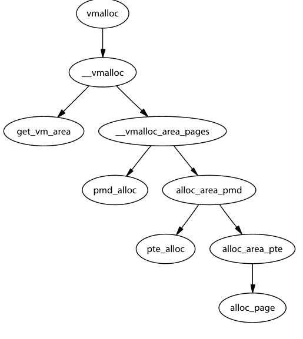

### 图 7.2. 调用关系图：vmalloc()

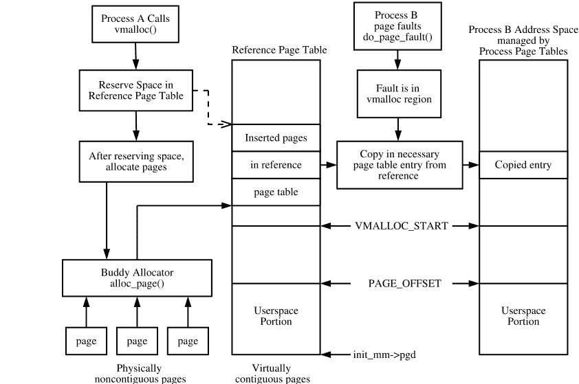

## 7.3 释放非连续区域

函数 `vfree()` 负责释放表 7.2 中描述的虚拟区域。它线性搜索 `vm_structs` 列表以查找所需区域，然后对要释放的内存区域调用 `vmfree_area_pages()`，如图 7.4 所示。

| void vfree(void *addr) |
| --- |
| 释放用 `vmalloc()`、`vmalloc_dma()` 或 `vmalloc_32()` 分配的内存区域 |

**表 7.2.** 非连续内存释放 API

`vmfree_area_pages()` 与 `vmalloc_area_pages()` 完全相反。它遍历页表并释放该区域的页表项和相关页面。

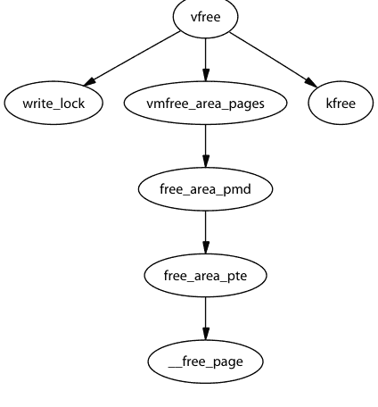

图 7.4. 调用关系图：`vfree()`

## 7.4 2.6 中的新特性

非连续内存分配在 2.6 中基本保持不变。主要区别是略微不同的内部 API，这影响了页面分配的时机。在 2.4 中，`vmalloc_area_pages()` 负责开始页表遍历，然后在函数 `alloc_area_pte()` 中到达 PTE 时分配页面。在 2.6 中，所有页面都由 `__vmalloc()` 预先分配，并放入一个数组中，然后传递给 `map_vm_area()` 以插入内核页表。

`get_vm_area()` API 的变化非常小。调用时，它的行为与以前相同，因为它在整个 vmalloc 虚拟地址空间中搜索空闲区域。然而，调用者可以通过直接调用 `__get_vm_area()` 并指定范围来只搜索 vmalloc 地址空间的一个子集。这仅在加载模块时由高级精简指令集机器（ARM）架构使用。

最后一个重大变化是引入了新接口 `vmap()`，用于在 vmalloc 地址空间中插入页面数组，且仅由声音子系统核心使用。此接口已向后移植到 2.4.22，但完全未被使用。它要么是意外向后移植的结果，要么是为了便于应用需要 `vmap()` 的供应商特定补丁而合并的。

# 第 8 章

## Slab 分配器

在本章中，将描述通用分配器。它是一个 slab 分配器，在许多方面与 Solaris [MM01] 中使用的通用内核分配器非常相似。Linux 的实现主要基于 Bonwick [Bon94] 的第一篇 slab 分配器论文，并包含许多与其后期论文 [BA01] 中描述的改进非常相似的改进。我首先快速概述该分配器，然后描述使用的不同结构，最后深入介绍分配器负责的每个任务。

slab 分配器的基本思想是将常用对象的缓存保持在初始化状态，供内核使用。如果没有基于对象的分配器，内核将花费大量时间分配、初始化和释放相同的对象。slab 分配器旨在缓存释放的对象，以便在使用之间保留基本结构 [Bon94]。

slab 分配器由可变数量的缓存组成，这些缓存链接在一个称为 *缓存链* 的双向循环链表上。在 slab 分配器的上下文中，缓存是特定类型对象的管理器，如 `mm_struct` 或 `fs_cache` 缓存，并由 `struct kmem_cache_s` 管理，这将在后面详细讨论。缓存通过缓存结构中的 `next` 字段链接。

每个缓存在内存中维护称为 *slab* 的连续页面块，这些块被分割成小块，用于缓存管理的数据结构和对象。这些不同结构之间的关系如图 8.1 所示。

slab 分配器有三个主要目标：

- 分配小块内存以帮助消除伙伴系统否则会造成的外部碎片。
- 缓存常用对象，使系统不会浪费时间分配、初始化和销毁对象。Solaris 上的基准测试显示，使用 slab 分配器时分配速度有显著提升 [Bon94]。
- 通过对齐对象到 L1 或 L2 缓存来更好地利用硬件缓存。

为了帮助消除通常由二进制伙伴分配器造成的内部碎片，维护了两组小内存缓冲区缓存，范围从 $2^5$（32）字节到 $2^{17}$（131,072）字节。一组缓存适合与 DMA 设备一起使用。这些缓存称为 size-N 和 size-N(DMA)，其中 N 是分配大小，并提供了函数 `kmalloc()`（见第 8.4.1 节）用于分配它们。这样，底层页面分配器的最大问题就解决了。大小缓存在第 8.4 节中有更详细的讨论。

slab 分配器的第二个任务是维护常用对象的缓存。对于内核中使用的许多结构，初始化对象所需的时间与分配空间的成本相当，或超过分配空间的成本。当创建新 slab 时，多个对象被打包到其中，并在有构造函数时使用构造函数进行初始化。当对象被释放时，它保持初始化状态，以便对象分配将很快。

slab 分配器的最后一个任务是优化硬件缓存使用。如果在对象被打包到 slab 后还剩有空间，则剩余空间用于为 slab *着色*。slab 着色是一种试图让不同 slab 中的对象使用缓存中不同行的方案。通过在 slab 内将对象放置在不同的起始偏移处，对象将可能使用 CPU 缓存中的不同行，这有助于确保来自同一个 slab 缓存的对象不太可能互相冲刷。通过此方案，本来会浪费的空间实现了新的功能。图 8.2 显示了从伙伴分配器分配的页面如何用于存储使用着色将对象对齐到 L1 CPU 缓存的对象。

Linux 不试图根据物理地址 [Kes91] 为页面分配着色，或排序对象的放置位置，如数据 [GAV95] 或代码段 [HK97] 中所述，但所使用的方案确实有助于改善缓存行使用。缓存着色在第 8.1.5 节中进一步讨论。在 SMP 系统上，为进一步帮助缓存利用，每个缓存为每个 CPU 保留了一小组对象。这在第 8.5 节中进一步讨论。

如果在编译时使用 `CONFIG_SLAB_DEBUG` 选项设置了 slab 调试选项，slab 分配器将提供额外的调试选项。提供了两种调试功能，称为 *red zoning* 和 *object poisoning*。通过 red zoning，在对象两端放置一个标记。如果此标记被干扰，分配器就知道发生了缓冲区溢出的对象并报告它。毒化对象将在 slab 创建和释放后用预定义的位模式（在 `mm/slab.c` 中定义为 `0x5A`）填充它。在分配时，检查此模式，如果它已更改，分配器就知道该对象在分配前已被使用并标记它。

分配器导出的虽小但功能强大的 API 列在表 8.1 中。

## 8.1 缓存

每种要缓存的对象类型都存在一个缓存。要查看运行系统上可用的缓存完整列表，请运行 `cat /proc/slabinfo`。此文件提供了有关缓存的一些基本信息。此文件输出的摘录如下所示：

```c
kmem_cache_t * kmem_cache_create(const char *name, size_t size,
size_t offset, unsigned long flags,
      void (*ctor)(void*, kmem_cache_t *, unsigned long),
      void (*dtor)(void*, kmem_cache_t *, unsigned long))
```
创建一个新的缓存并将其添加到缓存链中。

```c
int kmem_cache_reap(int gfp_mask)
```
最多扫描 `REAP_SCANLEN` 个缓存，并选择一个进行回收，清除其所有每 CPU 对象和空闲 slab。该函数在内存紧张时被调用。

```c
int kmem_cache_shrink(kmem_cache_t *cachep)
```
该函数将删除与缓存关联的所有每 CPU 对象，并删除 `slabs_free` 列表中的所有 slab。它返回释放的页面数。

```c
void * kmem_cache_alloc(kmem_cache_t *cachep, int flags)
```
从缓存中分配一个单独的对象并将其返回给调用者。

```c
void kmem_cache_free(kmem_cache_t *cachep, void *objp)
```
释放一个对象并将其返还给缓存。

```c
void * kmalloc(size_t size, int flags)
```
从某个大小缓存中分配一块内存。

```c
void kfree(const void *objp)
```
释放使用 `kmalloc` 分配的内存块。

```c
int kmem_cache_destroy(kmem_cache_t * cachep)
```
在将缓存从链表中移除之前，销毁所有 slab 中的所有对象，并释放所有关联的内存。

**表 8.1.** 缓存的 Slab 分配器 API

```text
slabinfo - version: 1.1 (SMP)
kmem_cache           80     80    248    5    5   1 :  252  126
urb_priv              0      0     64    0    0   1 :  252  126
tcp_bind_bucket      15    226     32    2    2   1 :  252  126
inode_cache        5714   5992    512  856  856   1 :  124   62
dentry_cache       5160   5160    128  172  172   1 :  252  126
mm_struct           240    240    160   10   10   1 :  252  126
vm_area_struct     3911   4480     96  112  112   1 :  252  126
size-64(DMA)          0      0     64    0    0   1 :  252  126
size-64             432   1357     64   23   23   1 :  252  126
size-32(DMA)         17    113     32    1    1   1 :  252  126
size-32             850   2712     32   24   24   1 :  252  126
```

每一列对应 `struct kmem_cache_s` 结构中的一个字段。上述摘录中列出的各列如下：

- **cache-name** 人类可读的名称，例如 "tcp_bind_bucket"
- **num-active-objs** 正在使用的对象数量
- **total-objs** 总共可用的对象数量，包括未使用的
- **obj-size** 每个对象的大小，通常非常小
- **num-active-slabs** 包含活动对象的 slab 数量
- **total-slabs** 总共存在的 slab 数量
- **num-pages-per-slab** 创建一个 slab 所需的页面数，通常为 1

如果启用了 SMP，如示例摘录所示，冒号之后会显示另外两列。它们指的是第 8.5 节中描述的每 CPU 缓存。这些列如下：

- **limit** 这是池在将其一半交给全局空闲池之前可以拥有的最大空闲对象数。
- **batchcount** 当没有空闲对象时，为处理器一次性分配的块中的对象数量。

为了加速对象和 slab 的分配与释放，它们被组织成三个列表：`slabs_full`、`slabs_partial` 和 `slabs_free`。`slabs_full` 中的所有对象都正在使用中。`slabs_partial` 中有空闲对象，因此是分配对象的首选。`slabs_free` 中没有已分配的对象，因此是销毁 slab 的首选。

### 缓存描述符

描述缓存的所有信息都存储在 `mm/slab.c` 中声明的 `struct kmem_cache_s` 中。这是一个非常大的结构，因此将分部分描述。

```c
190 struct kmem_cache_s {
193     struct list_head    slabs_full;
194     struct list_head    slabs_partial;
195     struct list_head    slabs_free;
196     unsigned int        objsize;
197     unsigned int        flags;
198     unsigned int        num;
199     spinlock_t          spinlock;
200 #ifdef CONFIG_SMP
201     unsigned int        batchcount;
202 #endif
203
```

这些字段中的大多数在分配或释放对象时很重要。

**slabs_*** 这是三个列表，slab 按照上一节的描述存储在其中。

**objsize** 这是打包到 slab 中的每个对象的大小。

**flags** 这些标志决定了分配器在处理缓存时各部分的运作方式。参见第 8.1.2 节。

**num** 这是每个 slab 中包含的对象数量。

**spinlock** 这是一个自旋锁，保护结构免受并发访问。

**batchcount** 这是为每 CPU 缓存批量分配的对象数量，如上一节所述。

```c
206     unsigned int         gfporder;
209     unsigned int         gfpflags;
210
211     size_t                colour;
212     unsigned int          colour_off;
213     unsigned int          colour_next;
214     kmem_cache_t          *slabp_cache;
215     unsigned int          growing;
216     unsigned int          dflags;
217
219     void (*ctor)(void *, kmem_cache_t *, unsigned long);
```


222     void (*dtor)(void *, kmem_cache_t *, unsigned long);

223

224     unsigned long         failures;

225

```

这一块字段涉及从缓存中分配或释放 slab。

`gfporder` 这表示 slab 的大小（以页面为单位）。每个 slab 占用 $2^{\text{gfporder}}$ 个页面，因为这些是伙伴分配器提供的分配大小。

`gfpflags` 调用伙伴分配器分配页面时使用的 GFP 标志存储在这里。完整列表参见第 6.4 节。

`colour` 每个 slab 尽可能将对象存储在不同的缓存行中。缓存着色将在第 8.1.5 节中进一步讨论。

`colour_off` 这是保持 slab 对齐的字节对齐值。例如，size-X 缓存的 slab 在 L1 缓存上对齐。

`colour_next` 这是要使用的下一个颜色行。当该值达到 `colour` 时，它会回绕到 0。

### 8.1. 缓存

`growing` 此标志设置为指示缓存是否正在增长。如果是，则在内存压力下，该缓存被选中回收空闲 slab 的可能性要小得多。

`dflags` 这些是在缓存生命周期中变化的动态标志。参见第 8.1.3 节。

`ctor` 复杂对象可以选择提供一个构造函数，在初始化每个新对象时调用。这是指向该函数的指针，可能为 NULL。

`dtor` 这是互补的对象析构函数，可能为 NULL。

`failures` 此字段除了在初始化时被设为 0 之外，在代码中的任何地方都没有被使用。

```

227	char			name[CACHE_NAMELEN];

228	struct list_head	next;

```

这些在缓存创建时设置。

`name` 这是缓存的人类可读名称。

`next` 这是缓存链上的下一个缓存。

```

229 #ifdef CONFIG_SMP

231	cpucache_t		*cpudata[NR_CPUS];

232 #endif

```

`cpudata` 这是每 CPU 数据，在第 8.5 节中进一步讨论。

```

233 #if STATS

234	unsigned long		num_active;

235	unsigned long		num_allocations;

236	unsigned long		high_mark;

237	unsigned long		grown;

238	unsigned long		reaped;

239	unsigned long		errors;

240 #ifdef CONFIG_SMP

241	atomic_t		allochit;

242	atomic_t		allocmiss;

243	atomic_t		freehit;

244	atomic_t		freemiss;

245 #endif

246 #endif

247 };

```

这些数值仅在编译时设置了 `CONFIG_SLAB_DEBUG` 选项时才可用。它们都是计数器，没有一般性意义。`/proc/slabinfo` 的统计数据是在另一个进程读取 proc 条目时，通过检查每个缓存使用的每个 slab 来计算的，而不是依赖这些字段的可用性。

- `num_active` 缓存中当前活动对象的数量存储在这里。
- `num_allocations` 该字段中存储的是在此缓存上已分配对象数量的累计总数。
- `high_mark` 这是 `num_active` 迄今为止达到的最高值。
- `grown` 这是 `kmem_cache_grow()` 被调用的次数。
- `reaped` 此缓存被回收的次数记录在这里。
- `errors` 此字段从未被使用。
- `allochit` 这是分配使用每 CPU 缓存的总次数。
- `allocmiss` 作为 `allochit` 的补充，这是分配未命中每 CPU 缓存的次数。
- `freehit` 这是释放操作将对象放置到每 CPU 缓存上的次数。
- `freemiss` 这是对象被释放并放置到全局池中的次数。

#### 8.1.2 缓存静态标志

在缓存创建时设置了许多标志，这些标志在缓存的整个生命周期内保持不变。它们影响 slab 的结构以及对象在其中的存储方式。所有标志都以位掩码形式存储在缓存描述符的 `flags` 字段中。可能使用的完整标志列表声明在 `<linux/slab.h>` 中。

主要有三组。第一组是内部标志，仅由 slab 分配器设置，列在表 8.2 中。该组中唯一相关的标志是 `CFGS_OFF_SLAB` 标志，它决定了 slab 描述符的存储位置。

| 标志 | 描述 |
|------|-------------|
| `CFGS_OFF_SLAB` | 指示该缓存的 slab 管理器存储在 slab 外部。这将在第 8.2.1 节中进一步讨论。 |
| `CFLGS_OPTIMIZE` | 此标志仅被设置，从未被使用。 |

**表 8.2.** 内部缓存静态标志

第二组由缓存创建者设置，这些标志决定了分配器如何处理 slab 以及如何存储对象。它们列在表 8.3 中。

## 8.1. 缓存

| 标志 | 描述 |
|---|---|
| `SLAB_HWCACHE_ALIGN` | 将对象对齐到 L1 CPU 缓存。 |
| `SLAB_MUST_HWCACHE_ALIGN` | 强制对齐到 L1 CPU 缓存，即使这样做非常浪费或者启用了 slab 调试。 |
| `SLAB_NO_REAP` | 永远不要回收该缓存中的 slab。 |
| `SLAB_CACHE_DMA` | 使用 `ZONE_DMA` 的内存分配 slab。 |

表 8.3. 由调用者设置的缓存静态标志

最后几种标志仅在编译选项 `CONFIG_SLAB_DEBUG` 被设置时才可用；它们在表 8.4 中列出。它们决定了将对 slab 和对象进行哪些额外的检查，主要仅在对新缓存进行开发时才有意义。

| 标志 | 描述 |
|---|---|
| `SLAB_DEBUG_FREE` | 对释放进行昂贵的检查 |
| `SLAB_DEBUG_INITIAL` | 在释放时，调用构造函数作为验证器，以确保对象仍然正确初始化 |
| `SLAB_RED_ZONE` | 在对象两端放置标记以捕获溢出 |
| `SLAB_POISON` | 用已知模式污染对象，以捕获对未分配或未初始化对象所做的更改 |

表 8.4. 缓存静态调试标志

为了防止调用者使用错误的标志，在 `mm/slab.c` 中定义了一个 `CREATE_MASK`，它由所有允许的标志组成。当创建缓存时，所请求的标志会与 `CREATE_MASK` 进行比较，如果使用了无效标志，则会报告为 bug。

##### 8.1.3 缓存动态标志

`dflags` 字段只有一个标志 `DFLGS_GROWN`，但它很重要。该标志在 `kmem_cache_grow()` 期间设置，以便 `kmem_cache_reap()` 不太可能选择该缓存进行回收。当函数确实发现设置了此标志的缓存时，它会跳过该缓存并移除该标志。

##### 8.1.4 缓存分配标志

这些标志在表 8.5 中列出，类似于为 slab 分配页面的 GFP 页面标志选项。调用者有时会使用 `SLAB_*` 或 `GFP_*` 标志进行调用，但他们确实应该只使用 `SLAB_*` 标志。它们直接对应于第 6.4 节中描述的标志，因此这里不会详细讨论。可以假定这些标志的存在是为了清晰起见，并且以防 slab 分配器需要对特定标志做出不同的响应。然而，实际上，它们之间没有区别。

| 标志 | 描述 |
| --- | --- |
| `SLAB_ATOMIC` | 等效于 `GFP_ATOMIC` |
| `SLAB_DMA` | 等效于 `GFP_DMA` |
| `SLAB_KERNEL` | 等效于 `GFP_KERNEL` |
| `SLAB_NFS` | 等效于 `GFP_NFS` |
| `SLAB_NOFS` | 等效于 `GFP_NOFS` |
| `SLAB_NOHIGHIO` | 等效于 `GFP_NOHIGHIO` |
| `SLAB_NOIO` | 等效于 `GFP_NOIO` |
| `SLAB_USER` | 等效于 `GFP_USER` |

**表 8.5.** 缓存分配标志

极少数标志，在表 8.6 中列出，可以传递给构造函数和析构函数。

| 标志 | 描述 |
| --- | --- |
| `SLAB_CTOR_CONSTRUCTOR` | 对于使用相同函数作为构造函数和析构函数的缓存，如果该函数被作为构造函数调用，则设置此标志。 |
| `SLAB_CTOR_ATOMIC` | 指示构造函数不可休眠。 |
| `SLAB_CTOR_VERIFY` | 指示构造函数应仅验证对象是否正确初始化。 |

**表 8.6.** 缓存构造函数标志

##### 8.1.5 缓存着色

为了更好地使用硬件缓存，slab 分配器会根据 slab 中剩余空间的大小，在不同的 slab 中以不同的量偏移对象。偏移量以 `BYTES_PER_WORD` 为单位，除非设置了 `SLAB_HWCACHE_ALIGN`，在这种情况下，它按 `L1_CACHE_BYTES` 的块对齐，以对齐到 L1 硬件缓存。

在缓存创建期间，会计算一个 slab 上可以容纳多少个对象（参见第 8.2.7 节）以及会浪费多少字节。根据浪费量，为缓存描述符计算两个数值：

- `colour` 这是可以使用不同偏移量的数量。
- `colour_off` 这是在 slab 中偏移每个对象的倍数。

##### 8.1.6 缓存创建

函数 `kmem_cache_create()` 负责创建新缓存并将其添加到缓存链中。创建缓存时需要执行的任务如下：

- 对错误用法执行基本的合理性检查。
- 如果设置了 `CONFIG_SLAB_DEBUG`，则执行调试检查。
- 从 `cache_cache` slab 缓存中分配一个 `kmem_cache_t`。
- 将对象大小对齐到字大小。
- 计算一个 slab 上将容纳多少个对象。
- 将对象大小对齐到硬件缓存。
- 计算颜色偏移量。
- 初始化缓存描述符中的剩余字段。
- 将新缓存添加到缓存链中。

图 8.3 显示了与缓存创建相关的调用图；每个函数都在代码注释中有完整描述。

##### 8.1.7 缓存回收

当 slab 被释放时，它会被放在 `slabs_free` 列表中以供将来使用。缓存不会自动收缩自身，因此，当 `kswapd` 注意到内存紧张时，它会调用 `kmem_cache_reap()` 来释放一些内存。此函数负责选择需要缩减其内存使用量的缓存。值得注意的是，缓存回收不会考虑哪个内存节点或区域正处于压力之下。这意味着，在 NUMA 或高内存机器上，内核可能会花费大量时间释放来自没有内存压力区域的内存，但对于像 x86 这样只有一组内存的架构来说，这不是问题。

图 8.4 中的调用图看似简单，但选择合适缓存进行回收的任务相当漫长。如果系统中有大量缓存，每次调用中仅检查 `REAP_SCANLEN`（当前定义为 10）个缓存。最后扫描的缓存存储在变量 `clock_searchp` 中，以免重复检查相同的缓存。对于每个扫描的缓存，回收器执行以下操作：

- 检查 `SLAB_NO_REAP` 标志，如果设置则跳过。
- 如果缓存正在增长，跳过它。
- 如果缓存最近增长过或当前正在增长，`DFLGS_GROWN` 将被设置。如果设置了此标志，则跳过该 slab，但清除该标志，以便下次它将成为回收候选。
- 计算 `slabs_free` 中的空闲 slab 数量，并在变量 `pages` 中计算这将释放多少页面。
- 如果缓存有构造函数或大 slab，调整 `pages` 以降低该缓存被选中的可能性。
- 如果将要释放的页面数超过 `REAP_PERFECT`，释放 `slabs_free` 中一半的 slab。
- 否则，扫描其余缓存，选择将释放最多页面的那个，释放其 `slabs_free` 中一半的 slab。

##### 8.1.8 缓存收缩

当缓存被选中进行收缩时，它采取的步骤简单而粗暴：

- 删除每 CPU 缓存中的所有对象。
- 删除 `slabs_free` 中的所有 slab，除非设置了增长标志。

Linux 若不微妙，就什么也不是。

提供了两种收缩函数，名称令人困惑地相似。`kmem_cache_shrink()`，如图 8.5 所示，从 `slabs_free` 中移除所有 slab，并返回由此释放的页面数。这是导出给 slab 分配器用户使用的首要函数。

第二个函数，`__kmem_cache_shrink()`，如图 8.6 所示，从 `slabs_free` 中释放所有 slab，然后验证 `slabs_partial` 和 `slabs_full` 是否为空。这仅供内部使用，在缓存销毁期间很重要，因为此时不关心释放了多少页面，只关心缓存是否为空。

###### 8.1.9 缓存销毁

当模块卸载时，它负责使用函数 `kmem_cache_destroy()` 销毁任何缓存，如图 8.7 所示。正确销毁缓存很重要，因为不允许存在两个具有相同人类可读名称的缓存。核心内核代码通常不会 bother to destroy its

# 图 8.7. 调用图：`kmem_cache_destroy()`

缓存在系统的整个生命周期内持续存在，因此不会被销毁。销毁缓存的步骤如下：

- 从缓存链中删除该缓存。
- 收缩缓存以删除所有 slab。
- 释放所有 per-CPU 缓存（`kfree()`）。
- 从 `cache_cache` 中删除缓存描述符。

### 8.2 Slabs

本节将描述 slab 的结构和管理方式。描述它的结构体比缓存描述符简单得多，但 slab 的排列方式要复杂得多。它的声明如下：

```

typedef struct slab_s {

    struct list_head      list;

    unsigned long         colouroff;

    void                  *s_mem;

    unsigned int          inuse;

    kmem_bufctl_t         free;

} slab_t;
```


这个简单结构体中的字段如下：

- **list**：这是 slab 所属的链表。它将是缓存管理器中的 `slab_full`、`slab_partial` 或 `slab_free` 之一。
- **colouroff**：这是 slab 中第一个对象相对于基地址的颜色偏移量。第一个对象的地址是 `s_mem + colouroff`。
- **s_mem**：给出 slab 中第一个对象的起始地址。
- **inuse**：给出 slab 中活跃对象的数量。
- **free**：这是用于存储空闲对象位置的 bufctl 数组。更多细节见第 8.2.3 节。

读者会注意到，给定 slab 管理器或 slab 中的对象，似乎没有明显的方法来确定它们属于哪个 slab 或缓存。这是通过使用构成缓存的 `struct page` 中的 `list` 字段来解决的。`SET_PAGE_CACHE()` 和 `SET_PAGE_SLAB()` 使用 `page→list` 上的 `next` 和 `prev` 字段来跟踪对象属于哪个缓存和 slab。要从 page 获取描述符，有宏 `GET_PAGE_CACHE()` 和 `GET_PAGE_SLAB()` 可用。这组关系如图 8.8 所示。

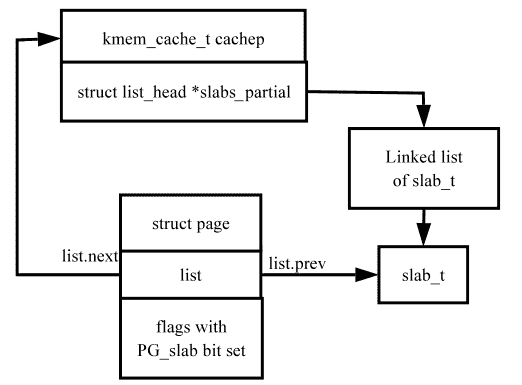

**图 8.8.** Page 到 Cache 和 Slab 的关系

最后一个问题是 slab 管理结构存储在哪里。Slab 管理器保存在 slab 上（`CFLGS_OFF_SLAB` 在静态标志中清零）或 slab 外。它们放置的位置在缓存创建时由对象的大小决定。在图 8.8 中，`struct slab_t` 可以存储在页帧的开始处，尽管该图暗示 `struct slab_` 与页帧是分开的。

## 8.2.1 存储 Slab 描述符

如果对象大于一个阈值（在 x86 上为 512 字节），`CFGS_OFF_SLAB` 会在缓存标志中设置，并且 *slab 描述符* 保存在 slab 外，位于某个 sizes cache 中（见第 8.4 节）。选定的 sizes cache 要足够大以容纳 `struct slab_t`，`kmem_cache_slabmgmt()` 会根据需要从中分配。这限制了可以存储在 slab 上的对象数量，因为 `bufctl` 的空间有限。然而，这并不重要，因为对象很大，所以单个 slab 中不应存储很多。

或者，slab 管理器保留在 slab 的开头。当保存在 slab 上时，在 slab 的开头保留足够的空间来存储 `slab_t` 和 `kmem_bufctl_t`，后者是一个无符号整数数组。该数组负责跟踪下一个可用的空闲对象的索引，这将在第 8.2.3 节中进一步讨论。实际的对象存储在 `kmem_bufctl_t` 数组之后。

图 8.9 有助于阐明描述符在 slab 上的 slab 是什么样子的，图 8.10 展示了当描述符保存在 slab 外时，缓存如何使用 sizes cache 来存储 slab 描述符。

## 8.2.2 Slab 创建

至此，我们已经看到了缓存是如何创建的，但在创建时，它是一个空缓存，`slab_full`、`slab_partial` 和 `slabs_free` 的列表都是空的。通过调用函数 `kmem_cache_grow()` 来分配新的 slab 给缓存，其调用图如图 8.11 所示。这通常被称为"缓存增长"，发生在 `slabs_partial` 列表中没有对象且 `slabs_free` 中没有 slab 时。它执行的任务如下：

- 执行基本的健全性检查以防止错误使用。
- 计算此 slab 中对象的颜色偏移量。
- 为 slab 分配内存并获取 slab 描述符。
- 将 slab 使用的页面链接到第 8.2 节中描述的 slab 和缓存描述符。
- 初始化 slab 中的对象。
- 将 slab 添加到缓存中。

仅包含对象的页帧

object

object

object

object

从 Size-N 缓存分配的 slab_t 和 kmem_bufctl_t 数组所需的内存块

s_mem

free

kmem_bufctl_t[]

slab_t

kmem_cache_t cachep

slab_t 的链表

图 8.10. 描述符在 Slab 外的 Slab

### 8.2.3 跟踪空闲对象

Slab 分配器必须有一种快速简单的方法来跟踪部分填充的 slab 上的空闲对象在哪里。它通过使用与每个 slab 管理器关联的称为 `kmem_bufctl_t` 的无符号整数数组来实现这一点。显然，slab 管理器要知道它的空闲对象在哪里。

历史上，根据描述 slab 分配器的论文 [Bon94]，`kmem_bufctl_t` 是对象的链表。在 Linux 2.2.x 中，这个结构体是三个项目的联合体：指向下一个空闲对象的指针、指向 slab 管理器的指针和指向对象的指针。联合体中的哪个字段取决于对象的状态。

如今，对象所属的 slab 和缓存由 `struct page` 确定，`kmem_bufctl_t` 只是一个对象索引的整数数组。数组中的元素数量与 slab 上的对象数量相同。

```
typedef unsigned int kmem_bufctl_t;
```

因为数组保存在 slab 描述符之后，并且没有直接指向第一个元素的指针，所以提供了一个辅助宏 `slab_bufctl()`。

```
#define slab_bufctl(slabp) \
	((kmem_bufctl_t *)(((slab_t*)slabp)+1))
```

这个看似晦涩的宏在分解后很简单。参数 `slabp` 是指向 slab 管理器的指针。表达式 `((slab_t*)slabp)+1` 将 `slabp` 转换为 `slab_t` 结构体并加 1。这将得到一个指向 `slab_t` 的指针，实际上就是 `kmem_bufctl_t` 数组的开头。`(kmem_bufctl_t *)` 将 `slab_t` 指针转换为所需的类型。结果是在代码块中包含 `slab_bufctl(slabp)[i]`。翻译过来就是"获取指向 slab 描述符的指针，用 `slab_bufctl()` 偏移到 `kmem_bufctl_t` 数组的开头，并返回数组的第 *i* 个元素。"

Slab 中下一个空闲对象的索引存储在 `slab_t→free` 中，这消除了使用链表跟踪空闲对象的需要。当对象被分配或释放时，此指针会根据 `kmem_bufctl_t` 数组中的信息更新。

### 8.2.4 初始化 kmem_bufctl_t 数组

当缓存增长时，slab 上的所有对象和 `kmem_bufctl_t` 数组都被初始化。数组用每个对象的索引填充，从 1 开始，以标记 BUFCTL_END 结束。对于包含五个对象的 slab，数组的元素如图 8.12 所示。


**图 8.12.** 初始化后的 kmem_bufctl_t 数组

值 0 存储在 `slab_t→free` 中，因为第 0 个对象是要使用的第一个空闲对象。其思想是，对于给定的对象 *n*，下一个空闲对象的索引将存储在 `kmem_bufctl_t[n]` 中。查看前面的数组，0 之后的下一个空闲对象是 1。1 之后是 2，依此类推。随着数组的使用，这种排列将使数组充当空闲对象的 LIFO。

### 8.2.5 查找下一个空闲对象

当分配对象时，`kmem_cache_alloc()` 通过调用 `kmem_cache_alloc_one_tail()` 执行更新 `kmem_bufctl_t()` 数组的实际工作。字段 `slab_t→free` 具有第一个空闲对象的索引。下一个空闲对象的索引在 `kmem_bufctl_t[slab_t→free]` 处。用代码术语来说，这看起来像是：

```
1253    objp = slabp->s_mem + slabp->free*cachep->objsize;
1254    slabp->free=slab_bufctl(slabp)[slabp->free];
```

字段 `slabp→s_mem` 是指向 slab 上第一个对象的指针。`slabp→free` 是要分配的对象的索引，它必须乘以对象的大小。

下一个空闲对象的索引存储在 `kmem_bufctl_t[slabp→free]` 中。没有直接指向数组的指针，所以使用辅助宏 `slab_bufctl()`。注意，`kmem_bufctl_t` 数组在分配期间不会改变，但已分配的元素是不可达的。例如，在两次分配之后，`kmem_bufctl_t` 数组的索引 0 和 1 不会被任何其他元素指向。

### 8.2.6 更新 kmem_bufctl_t

`kmem_bufctl_t` 列表仅在 `kmem_cache_free_one()` 函数中释放对象时更新。数组用以下代码块更新：

```
unsigned int objnr = (objp-slabp->s_mem)/cachep->objsize;
slab_bufctl(slabp)[objnr] = slabp->free;
slabp->free = objnr;
```

指针 `objp` 是要释放的对象，`objnr` 是它的索引。`kmem_bufctl_t[objnr]` 被更新为指向 `slabp→free` 的当前值，实际上是将 `free` 指向的对象放入伪链表中。`slabp→free` 被更新为正在释放的对象，使其成为下一个将被分配的对象。

### 8.2.7 计算 Slab 上的对象数量

在缓存创建期间，会调用函数 `kmem_cache_estimate()` 来计算单个 slab 上可以存储多少个对象，该函数会考虑 slab 描述符是必须存储在 slab 内部还是外部，以及跟踪对象是否空闲所需的每个 `kmem_bufctl_t` 的大小。它返回可以存储的对象数量以及浪费的字节数。如果使用缓存着色，浪费的字节数很重要。

计算非常基础，遵循以下步骤：

- 将 wastage 初始化为 slab 的总大小，即 `PAGE_SIZE^gfp_order^`。
- 减去存储 slab 描述符所需的空间。
- 统计可以存储的对象数量。如果 slab 描述符存储在 slab 上，则包含 `kmem_bufctl_t` 的大小。不断增加 i 的大小，直到 slab 被填满。
- 返回对象数量和浪费的字节数。

### 8.2.8 Slab 销毁

当缓存被收缩或销毁时，slab 将被删除。由于对象可能有析构函数，因此必须调用它们，所以该函数的任务如下：

- 如果可用，调用 slab 中每个对象的析构函数。
- 如果启用了调试，检查红色标记和毒化模式。
- 释放 slab 使用的页面。

图 8.13 中的调用图非常简单。

## 8.3 对象

本节将介绍对象是如何管理的。到目前为止，大部分真正困难的工作已经由缓存或 slab 管理器完成。

### 8.3.1 初始化 Slab 中的对象

当创建一个 slab 时，其中的所有对象都会被置于初始化状态。如果构造函数可用，则对每个对象调用构造函数，并且期望对象在释放时处于初始化状态。从概念上讲，初始化非常简单。遍历所有对象，调用构造函数，并为其初始化 `kmem_bufctl`。函数 `kmem_cache_init_objs()` 负责初始化对象。

### 8.3.2 对象分配

函数 `kmem_cache_alloc()` 负责向调用者分配一个对象，它在单处理器（UP）和对称多处理器（SMP）情况下的行为略有不同。图 8.14 展示了在 SMP 情况下用于分配对象的基本调用图。

有四个基本步骤。第一步（`kmem_cache_alloc_head()`）进行基本检查以确保分配是允许的。第二步是选择从哪个 slab 列表进行分配。这将是 `slabs_partial` 或 `slabs_free` 之一。如果 `slabs_free` 没有可用的，则会增长缓存（参见第 8.2.2 节）以在 `slabs_free` 中创建一个新的 slab。最后一步是从选定的 slab 中分配对象。

SMP 情况还需执行一个额外步骤。在分配一个对象之前，它会检查 per-CPU 缓存中是否有可用的对象，如果有则使用它。如果没有，它会批量分配 `batchcount` 数量的对象并将其放入 per-CPU 缓存中。有关 per-CPU 缓存的更多信息，请参见第 8.5 节。

### 8.3.3 对象释放

`kmem_cache_free()` 用于释放对象，其调用图如图 8.15 所示，它的任务相对简单。就像 `kmem_cache_alloc()` 一样，它在 UP 和 SMP 情况下的行为不同。两种情况的主要区别是，在 UP 情况下，对象直接返回到 slab，但在 SMP 情况下，对象返回到 per-CPU 缓存。在这两种情况下，如果对象的析构函数可用，则会调用它。析构函数负责将对象返回到初始化状态。

## 8.4 大小缓存

Linux 为小型内存分配维护两组缓存，这些分配不适合使用物理页面分配器。一组用于 DMA，另一组适用于正常使用。这些缓存的人类可读名称为 size-N 缓存和 size-N(DMA) 缓存，可从 `/proc/slabinfo` 查看。每个大小缓存的信息存储在 `struct cache_sizes` 中，typedef 为 `cache_sizes_t`，在 `mm/slab.c` 中定义如下：

```
331 typedef struct cache_sizes {
332     size_t        cs_size;
333     kmem_cache_t  *cs_cachep;
334     kmem_cache_t  *cs_dmacachep;
335 } cache_sizes_t;
```

此结构体中的字段描述如下：

- **cs_size**：内存块的大小
- **cs_cachep**：用于正常内存使用的块缓存
- **cs_dmacachep**：用于 DMA 的块缓存

由于这些缓存的数量有限，一个名为 `cache_sizes` 的静态数组在编译时初始化，在 4KiB 机器上从 32 字节开始，更大页面大小则从 64 开始。

```
337 static cache_sizes_t cache_sizes[] = {
338 #if PAGE_SIZE == 4096
339     {    32,         NULL, NULL},
340 #endif
341     {    64,         NULL, NULL},
342     {   128,         NULL, NULL},
343     {   256,         NULL, NULL},
344     {   512,         NULL, NULL},
345     {  1024,         NULL, NULL},
346     {  2048,         NULL, NULL},
347     {  4096,         NULL, NULL},
348     {  8192,         NULL, NULL},
349     { 16384,         NULL, NULL},
350     { 32768,         NULL, NULL},
351     { 65536,         NULL, NULL},
352     {131072,         NULL, NULL},
353     {     0,         NULL, NULL}
```

显然，这是一个以零结尾的静态数组，由从 $2^5$ 到 $2^{17}$ 的连续 2 的幂次方组成。现在存在一个描述每个大小缓存的数组，它必须在系统启动时用缓存进行初始化。

### 8.4.1 kmalloc()

由于大小缓存的存在，slab 分配器能够提供一个新的分配器函数 `kmalloc()`，用于需要小型内存缓冲区的情况。当收到请求时，会选择适当的大小缓存，并从中分配一个对象。图 8.16 中的调用图因此非常简单，因为所有繁重的工作都在缓存分配中。

### 8.4.2 kfree()

既然有 `kmalloc()` 函数来分配供使用的小型内存对象，就有 `kfree()` 来释放它。与 `kmalloc()` 一样，真正的工作在对象释放期间进行（参见第 8.3.3 节），因此图 8.17 中的调用图非常简单。

## 8.5 每 CPU 对象缓存

slab 分配器致力于的任务之一是提高硬件缓存的使用。高性能计算 [CS98] 的一般目标之一是在同一 CPU 上尽可能长时间地使用数据。Linux 通过尝试使用 per-CPU 对象缓存来保持对象在同一 CPU 缓存中，该缓存简称为 *cpucache*，系统中每个 CPU 都有一个。

分配或释放对象时，它们会被放入 cpucache 中。当没有空闲对象时，一批对象会被放入池中。当池变得太大时，其中一半会被移除并放入全局缓存。这样，硬件缓存将在同一 CPU 上尽可能长时间地被使用。

这种方法的第二个主要好处是访问 CPU 池时不需要持有自旋锁，因为我们保证其他 CPU 不会访问本地数据。这很重要，因为没有缓存的话，每次分配和释放都必须获取自旋锁，这是不必要的开销。

### 8.5.1 描述每 CPU 对象缓存

每个缓存描述符都有一个指向 cpucache 数组的指针，在缓存描述符中描述为：

```
231    cpucache_t                *cpudata[NR_CPUS];
```

这个结构非常简单。

```
173 typedef struct cpucache_s {
174     unsigned int avail;
175     unsigned int limit;
176 } cpucache_t;
```


字段如下：

- **avail**：这是此 cpucache 上可用的空闲对象数量。
- **limit**：这是可以存在的空闲对象总数。

提供了一个辅助宏`cc_data()`来给出给定缓存和处理器的 cpucache。它定义为：

```c
#define cc_data(cachep) \
        ((cachep)->cpudata[smp_processor_id()])
```

这将获取一个给定的缓存描述符（`cachep`），并返回一个指向 cpucache 数组（`cpudata`）的指针。所需的索引是当前处理器的 ID，即`smp_processor_id()`。

指向 cpucache 上对象的指针被放置在`cpucache_t`结构体的紧后面。这与对象存储在 slab 描述符之后的方式非常相似。

### 8.5.2 从 Per-CPU 缓存中添加/移除对象

为了防止碎片化，对象总是从数组的末端添加或移除。要将一个对象（`obj`）添加到 CPU 缓存（`cc`）中，使用以下代码块：

```c
cc_entry(cc)[cc->avail++] = obj;
```

要移除一个对象，使用以下代码块：

```c
obj = cc_entry(cc)[--cc->avail];
```

有一个名为`cc_entry()`的辅助宏，它给出指向 cpucache 中第一个对象的指针。其定义为：

```c
#define cc_entry(cpucache) \
        ((void **)(((cpucache_t*)(cpucache))+1))
```

这接收一个指向 cpucache 的指针，将其值递增`cpucache_t`描述符的大小，然后给出缓存中的第一个对象。

### 8.5.3 启用 Per-CPU 缓存

当创建一个缓存时，必须启用其 CPU 缓存，并使用`kmalloc()`为其分配内存。`enable_cpucache()`函数负责决定缓存的大小，并调用`kmem_tune_cpucache()`为其分配内存。

显然，在各种大小的缓存被启用之前，CPU 缓存无法存在，因此使用全局变量`g_cpucache_up`来防止 CPU 缓存被过早启用。`enable_all_cpucaches()`函数遍历缓存链中的所有缓存并启用它们的 cpucache。

CPU 缓存设置完成后，可以不使用锁来访问它，因为 CPU 永远不会访问错误的 cpucache 上的 adhes，所以可以保证对其的安全访问。

### 8.5.4 更新 Per-CPU 信息

当 per-cpu 缓存被创建或更改时，每个 CPU 会通过 IPI（处理器间中断）收到信号。仅仅更改缓存描述符中的所有值是不够的，因为这会导致缓存一致性问题和需要使用自旋锁来保护 CPU 缓存。相反，`ccupdate_t`结构体被填充上每个 CPU 所需的所有信息，然后每个 CPU 将新数据与缓存描述符中的旧信息进行交换。用于存储新 cpucache 信息的结构体定义如下：

```c
868 typedef struct ccupdate_struct_s
869 {
870     kmem_cache_t *cachep;
871     cpucache_t *new[NR_CPUS];
872 } ccupdate_struct_t;
```

`cachep`是要更新的缓存，`new`是系统中每个 CPU 的 cpucache 描述符数组。`smp_function_all_cpus()`函数用于让每个 CPU 调用`do_ccupdate_local()`函数，该函数将`ccupdate_struct_t`中的信息与缓存描述符中的信息进行交换。信息交换完成后，旧数据可以被删除。

### 8.5.5 排空 Per-CPU 缓存

当一个缓存被收缩时，它的第一步是通过调用`drain_cpu_caches()`来排空 cpucache 中可能存在的任何对象。这样 slab 分配器就能更清楚地了解哪些 slab 可以被释放，哪些不能。这一点很重要，因为如果 slab 中的单个对象被放入 per-cpu 缓存，整个 slab 就不能被释放。如果系统内存紧张，节省几毫秒的分配时间并不是高优先级。

### 8.6 Slab 分配器初始化

这里我描述 slab 分配器如何初始化自身。当 slab 分配器创建一个新缓存时，它从`cache_cache`或`kmem_cache`缓存中分配`kmem_cache_t`。这是一个明显的"先有鸡还是先有蛋"的问题，因此`cache_cache`必须静态初始化为：

```c
357 static kmem_cache_t cache_cache = {
358     slabs_full:     LIST_HEAD_INIT(cache_cache.slabs_full),
359     slabs_partial:  LIST_INIT(cache_cache.slabs_partial),
360     slabs_free:     LIST_HEAD_INIT(cache_cache.slabs_free),
361     objsize:        sizeof(kmem_cache_t),
362     flags:          SLAB_NO_REAP,
363     spinlock:       SPIN_LOCK_UNLOCKED,
364     colour_off:     L1_CACHE_BYTES,
365     name:           "kmem_cache",
366 };
```


这段代码将`kmem_cache_t`结构体静态初始化如下：

- 358-360 将三个列表初始化为空列表。
- 361 每个对象的大小是缓存描述符的大小。
- 362 缓存的创建和删除极其罕见，因此永远不考虑对其进行收割（reaping）。
- 363 将自旋锁初始化为未锁定状态。
- 364 将对象对齐到 L1 缓存。
- 365 记录人类可读的名称。

这段代码静态定义了所有可以在编译时计算的字段。为了初始化结构体的其余部分，`kmem_cache_init()`从`start_kernel()`中调用。

### 8.7 与 Buddy 分配器的接口

slab 分配器不附带页面；它必须向物理页面分配器请求页面。为此提供了两个 API，称为`kmem_getpages()`和`kmem_freepages()`。它们基本上是围绕 buddy 分配器 API 的包装器，以便在分配时考虑 slab 标志。对于分配，默认标志取自`cachep→gfpflags`，order 取自`cachep→gfporder`，其中`cachep`是请求页面的缓存。释放页面时，在调用`free_pages()`之前，会对每个被释放的页面调用`PageClearSlab()`。

### 8.8 2.6 中的新特性

第一个明显的变化是`/proc/slabinfo`格式的版本从 1.1 更改为 2.0，并且更易于阅读。最有帮助的变化是字段现在有了标题，不再需要记住每列的含义。

主要算法和思想保持不变。没有重大的算法变革，但实现方式有很大不同。特别是，更加强调使用 per-cpu 对象和避免锁定的使用。其次，混合了更多的调试代码，所以要注意`#ifdef DEBUG`代码块，因为初次阅读代码时可以忽略它们。最后，一些变化纯粹是表面上的函数名更改，但行为非常相似。例如，`kmem_cache_estimate()`现在被称为`cache_estimate()`，尽管它们在其他方面完全相同。

#### 缓存描述符

`kmem_cache_s`的变化很小。首先，重新排列了元素，将常用的元素（如与 per-cpu 相关的数据）放在结构体的开头（参见 3.9 节了解原因）。其次，slab 列表（例如`slabs_full`）和与之相关的统计信息已被移到单独的`struct kmem_list3`中。注释和宏的不寻常使用表明，有计划使该结构体成为 per-node 的。

#### 缓存静态标志

2.4 中的标志仍然存在，并且它们的用途相同。`CFLGS_OPTIMIZE`不再存在，但它在 2.4 中的使用本就不存在。引入了两个新标志，如下：

- **SLAB_STORE_USER** 这是一个仅用于调试的标志，用于记录释放对象的函数。如果对象在释放后被使用，毒化字节将不匹配，并显示内核错误消息。由于已知最后使用该对象的函数，这可以简化调试。

- **SLAB_RECLAIM_ACCOUNT** 此标志为对象易于回收的缓存设置，例如 inode 缓存。在名为`slab_reclaim_pages`的变量中维护一个计数器，以记录分配给这些缓存的 slab 中使用了多少页面。该计数器稍后在`vm_enough_memory()`中使用，以帮助确定系统是否真正内存不足。

#### 缓存收割（Reaping）

这是对 slab 分配器所做的最有趣的更改之一。`kmem_cache_reap()`不再存在，因为它在收缩缓存时的方式非常不加区分，而缓存使用者本可以做出更好的选择。缓存使用者现在可以通过`set_shrinker()`注册一个收缩缓存回调函数，用于智能地老化和收缩 slab。这个简单的函数用指向回调的指针和一个 seeks 权重来填充`struct shrinker`，该权重指示重新创建对象的难度，然后将其放入名为`shrinker_list`的链表中。

在页面回收期间，会调用`shrink_slab()`函数，它遍历整个`shrinker_list`并调用每个收缩器回调两次。第一次调用传递 0 作为参数，表示回调应返回如果正确调用它可以释放多少页面。应用一个基本启发式方法来判断使用回调是否值得。如果值得，则第二次调用时传递一个参数，指示要释放多少对象。

这种机制如何计算页面数量有点棘手。每个任务结构体都有一个名为`reclaim_state`的字段。当 slab 分配器释放页面时，该字段会被更新为释放的页面数。在调用`shrink_slab()`之前，此字段设置为 0，然后在`shrink_cache`返回后再次读取，以确定释放了多少页面。

#### 其他变化

其余的更改基本上是表面上的。例如，slab 描述符现在被称为`struct slab`而不是`slab_t`，这与远离 typedefs 的总体趋势一致。Per-cpu 缓存基本保持不变，只是结构体和 API 有了新的名称。同样的观点适用于 2.6 slab 分配器实现的大部分内容。

## 高内存管理

### 9.1 管理 PKMap 地址空间

内核只能直接访问已为其设置页表项的内存。在最常见的情况下，如 4.1 节所述，32 位机器上用户/内核地址空间 3GiB/1GiB 的分割意味着，在任何给定时间最多只能直接访问 896MiB 的内存。在 64 位硬件上，这实际上不是问题，因为有足够的虚拟地址空间。运行 2.4 内核的机器拥有超过太字节（terabytes）RAM 的可能性极低。

许多高端 32 位机器拥有超过 1GiB 的内存，不能简单地忽略这些位置不便的内存。Linux 采用的解决方案是将高内存中的页面临时映射到较低的页表中。这将在 9.2 节中讨论。

高内存和 I/O 有一个相关的问题必须解决，因为并非所有设备都能寻址高内存或 CPU 可用的全部内存。如果 CPU 启用了 PAE 扩展，设备可能限于有符号 32 位整数大小的地址（2GiB），或者 64 位架构上使用了 32 位设备，这种情况就可能发生。让设备写入内存操作往好里说会失败，往坏里说可能会破坏内核。这个问题的解决方案是使用*bounce buffer*（反弹缓冲区），这将在 9.5 节中讨论。

本章首先简要描述*持久内核映射（Persistent Kernel Map, PKMap）*地址空间的管理方式，然后讨论页面如何从高内存映射和取消映射。随后的章节将处理需要原子映射的情况，然后深入讨论反弹缓冲区。最后，我们将讨论在内存非常紧张时如何使用紧急池。

在内核页表顶部从 `PKMAP_BASE` 到 `FIXADDR_START` 的空间为 PKMap 保留。保留空间的大小略有不同。在 x86 上，`PKMAP_BASE` 位于 `0xFE000000`，而 `FIXADDR_START` 的地址是一个编译时常数，随配置选项而变化，但通常只是线性地址空间末端附近的几页。这意味着有略低于 32MiB 的页表空间用于将页面从高内存映射到可用空间。

对于页面映射，一组单独的 PTE 页面集存储在 PKMap 区域的开头，允许最多 1,024 个高页面通过 `kmap()` 函数短期映射到低内存，并通过 `kunmap()` 取消映射。这个池看起来很小，但页面仅由 `kmap()` 映射*非常*短的时间。代码中的注释表明曾有计划分配连续的页表项来扩展这个区域，但这始终只是代码中的注释，因此 PKMap 的大部分未被使用。

用于 `kmap()` 的页表项称为 `pkmap_page_table`，位于 `PKMAP_BASE`，在系统初始化期间设置。在 x86 上，这发生在 `pagetable_init()` 函数的末尾。PGD 和 PMD 条目的页面由引导内存分配器分配，以确保它们存在。

页表项的当前状态由一个简单的数组 `pkmap_count` 管理，它有 `LAST_PKMAP` 个条目。在没有 PAE 的 x86 系统上，这是 1,024；有 PAE 时，它是 512。更准确地说，虽然代码中没有这样表达，`LAST_PKMAP` 变量等同于 `PTRS_PER_PTE`。

每个元素并不完全是引用计数，但非常接近。如果条目为 0，则页面是空闲的，自上次 TLB 刷新以来未被使用。如果是 1，则该槽位未使用，但仍有页面映射在那里等待 TLB 刷新。刷新会延迟到每个槽位至少被使用一次之后，因为修改全局页表时需要对所有 CPU 进行全局刷新，这代价极高。任何更高的值表示该页面有 `n-1` 个用户。

### 9.2 映射高内存页面

从高内存映射页面的 API 在表 9.1 中描述。映射页面的主要函数是 `kmap()`，其调用图如图 9.1 所示。对于不希望阻塞的用户，可以使用 `kmap_nonblock()`，中断用户有 `kmap_atomic()`。kmap 池相当小，因此 `kmap()` 的用户尽快调用 `kunmap()` 非常重要，因为随着高内存相对于低内存的增长，这个小窗口的压力会越来越大。

`kmap()` 函数本身相当简单。它首先检查确保中断没有调用此函数（因为它可能会睡眠），如果是则调用 `out_of_line_bug()`。中断处理程序调用 `BUG()` 会使系统崩溃，所以 `out_of_line_bug()` 打印出错误信息并干净地退出。第二次检查是页面是否在 `highmem_start_page` 以下，因为低于此标记的页面已经可见，无需映射。

然后它检查页面是否已经在低内存中，如果是则简单地返回地址。这样，需要 `kmap()` 的用户可以无条件地使用它，知道如果它已经是低内存页面，该函数仍然是安全的。如果是要映射的高页面，则调用 `kmap_high()` 开始实际工作。

`kmap_high()` 函数首先检查 `page→virtual` 字段，如果页面已经映射则该字段被设置。如果为 NULL，`map_new_virtual()` 为该页面提供映射。

**表 9.1. 高内存映射 API**

| void * kmap(struct page *page) | 接受一个来自高内存的 struct page，并将其映射到低内存。返回的地址是映射的虚拟地址。 |
| void * kmap_nonblock(struct page *page) | 与 kmap() 相同，但如果没有可用槽位，它不会阻塞，而是返回 NULL。这与 kmap_atomic() 不同，后者使用专门保留的槽位。 |
| void * kmap_atomic(struct page *page, enum km_type type) | 映射中为中断的原子使用保留了槽位（见 9.4 节）。强烈不建议使用，且调用此函数时不能睡眠或调度。此函数将为特定目的原子地将页面从高内存映射。 |

使用 `map_new_virtual()` 创建新的虚拟映射是线性扫描 `pkmap_count` 的简单情况。扫描从 `last_pkmap_nr` 而不是 0 开始，以防止在 `kmap()` 之间重复搜索同一区域。当 `last_pkmap_nr` 回绕到 0 时，调用 `flush_all_zero_pkmaps()` 将所有条目从 1 设置为 0，然后刷新 TLB。

创建映射后，`pkmap_count` 数组中的相应条目递增，并返回低内存中的虚拟地址。

### 9.3 取消映射页面

从高内存取消映射页面的 API 在表 9.2 中描述。`kunmap()` 函数与其对应函数一样，执行两项检查。第一项与 `kmap()` 相同，检查是否在中断上下文中使用。第二项是检查页面是否在 `highmem_start_page` 以下。如果是，则页面已存在于低内存中，无需进一步处理。确认是要取消映射的页面后，调用 `kunmap_high()` 执行取消映射。

**表 9.2. 高内存取消映射 API**

| void kunmap(struct page *page) | 取消 struct page 从低内存的映射，并释放映射它的页表项。 |
| void kunmap_atomic(void *kvaddr, enum km_type type) | 取消原子映射的页面的映射。 |

`kunmap_high()` 原理上很简单。它递减 `pkmap_count` 中该页面对应的元素。如果达到 1（记住这意味着没有更多用户但需要 TLB 刷新），任何在 `pkmap_map_wait` 上等待的进程都会被唤醒，因为现在槽位可用。此时页面不从页表中取消映射，因为那需要 TLB 刷新。它被延迟到 `flush_all_zero_pkmaps()` 被调用时。

### 9.4 原子映射高内存页面

不鼓励使用 `kmap_atomic()`，但为必要时保留了每个 CPU 的槽位，例如当设备从中断使用反弹缓冲区时。架构对原子高内存映射有不同数量的需求，这些需求由 `km_type` 枚举。总使用数为 `KM_TYPE_NR`。在 x86 上，原子 kmap 共有六种不同的用途。

`KM_TYPE_NR` 个条目在引导时为每个处理器保留，用于在 `FIX_KMAP_BEGIN` 到 `FIX_KMAP_END` 的原子映射位置。显然，原子 kmap 的用户在调用 `kunmap_atomic()` 之前不能睡眠或退出，因为处理器上的下一个进程可能会尝试使用相同的条目并失败。

`kmap_atomic()` 函数有非常简单的任务：将请求的页面映射到页表中为请求的操作类型和处理器预留的槽位。`kunmap_atomic()` 函数（其调用图如图 9.2 所示）是有趣的，因为只有在启用调试功能时，它才会使用`pte_clear()`来清除PTE。取消映射原子页面被认为是不必要的，因为对`kmap_atomic()`的下一次调用将会简单地替换它，从而使TLB刷新变得不必要。

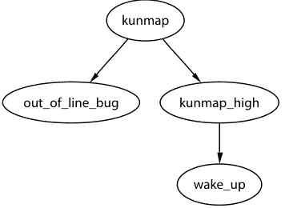

**图 9.2.** 调用图：`kunmap()`

### 9.5 回弹缓冲区（Bounce Buffers）

回弹缓冲区是那些无法访问CPU可用全部内存范围的设备所必需的。一个明显的例子是当设备没有与CPU位数相同的地址时，例如64位架构上的32位设备，或者启用了PAE的较新Intel处理器。

基本概念非常简单。回弹缓冲区存放在足够低的内存中，以便设备从中复制数据和写入数据。然后将其复制到高内存中所需的用户页面。这种额外的复制是不希望发生的，但不可避免。页面在低内存中分配，用作与设备之间DMA传输的缓冲页。当I/O完成后，内核将其复制到高内存中的缓冲页，因此回弹缓冲区充当一种桥梁。此操作有相当大的开销，因为至少涉及复制整个页面，但与交换出低内存中的页面相比，这微不足道。

#### 9.5.1 磁盘缓冲

块（通常约1KiB）被打包到页面中，并由slab分配器分配的`struct buffer_head`管理。缓冲头的用户可以选择注册一个回调函数。该函数存储在`buffer_head`→`b_end_io()`中，并在I/O完成时调用。回弹缓冲区就是利用这种机制将数据从回弹缓冲区中复制出来的。注册的回调函数是`bounce_end_io_write()`。

缓冲头的任何其他特性或块层如何使用它们超出了本书的范围，更多是I/O层关注的问题。

#### 9.5.2 创建回弹缓冲区

创建回弹缓冲区是一个简单的过程，由`create_bounce()`函数启动，如图9.3所示。原理非常简单：使用提供的缓冲头作为模板创建一个新缓冲。该函数接受两个参数，分别是读写参数（`rw`）和要使用的模板缓冲头（`bh_orig`）。

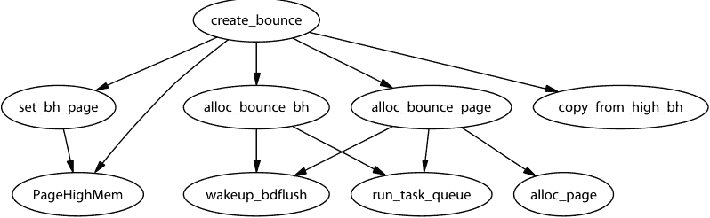

缓冲本身的页面通过`alloc_bounce_page()`函数分配，该函数是`alloc_page()`的包装器，但有一个重要的补充。如果分配失败，有一个回弹缓冲区的紧急页面和缓冲头池可用。这将在9.6节中进一步讨论。

缓冲头则通过`alloc_bounce_bh()`分配，可以预见的是，它与`alloc_bounce_page()`原理类似，调用slab分配器获取`buffer_head`，如果无法分配则使用紧急池。此外，**bdflush**被唤醒以开始将脏缓冲刷新到磁盘，这样缓冲更有可能被尽快释放。

在页面和`buffer_head`分配完成后，信息从模板`buffer_head`复制到新的缓冲头。因为此操作的一部分可能使用`kmap_atomic()`，所以只有当保留IRQ安全的`io_request_lock`时，才会创建回弹缓冲区。I/O完成回调被更改为`bounce_end_io_write()`或`bounce_end_io_read()`（两者均如图9.4所示），具体取决于这是读缓冲还是写缓冲，以便数据可以复制到高内存或从高内存复制出来。

关于分配需要特别注意的最重要的方面是，GFP标志指定不得使用涉及高内存的I/O操作。这通过`SLAB_NOHIGHIO`指定给slab分配器，通过`GFP_NOHIGHIO`指定给伙伴分配器。这很重要，因为回弹缓冲区用于与高内存的I/O操作。如果分配器尝试执行高内存I/O，它将会递归调用并最终崩溃。

#### 9.5.3 通过回弹缓冲区复制数据

通过回弹缓冲区复制数据的方式取决于它是读缓冲还是写缓冲。如果缓冲是用于向设备写入的，则在回弹缓冲区创建期间，通过`copy_from_high_bh()`函数用高内存的数据填充缓冲。当设备准备好接收数据时，回调函数`bounce_end_io_write()`将稍晚完成I/O。

如果缓冲是用于从设备读取的，则在设备准备好之前不能进行任何数据传输。当设备准备好时，设备的中断处理程序调用回调函数`bounce_end_io_read()`，该函数通过`copy_to_high_bh_irq()`将数据复制到高内存。

在任一情况下，I/O完成后，缓冲头和页面可以由`bounce_end_io()`回收，并调用模板`buffer_head()`的I/O完成函数。如果紧急池未满，资源将被添加到池中。否则，它们将被释放回各自的分配器。

#### 9.6 紧急池

维护了两个`buffer_head`和页面的紧急池，专门供回弹缓冲区使用。如果内存过于紧张而无法进行分配，那么无法完成I/O请求将使情况更加恶化，因为在低内存可用之前，无法释放高内存中的缓冲。这会导致进程停止，从而阻止它们释放自己的内存的可能性。

紧急池由`init_emergency_pool()`初始化，包含`POOL_SIZE`个条目，目前定义为32。页面通过`page→list`字段链接到一个由`emergency_pages`领衔的列表中。图9.5说明了页面如何存储在紧急池中以及在需要时如何获取。

`buffer_head`非常相似，因为它们通过`Buffer_head→inode_buffers`链接到一个由`emergency_bhs`领衔的列表中。页面和缓冲列表中剩余的条目数分别由两个计数器`nr_emergency_pages`和`nr_emergency_bhs`记录，并且两个列表由`emergency_lock`自旋锁保护。

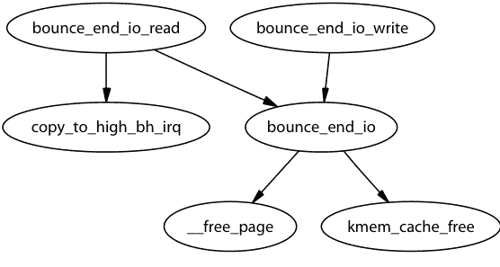

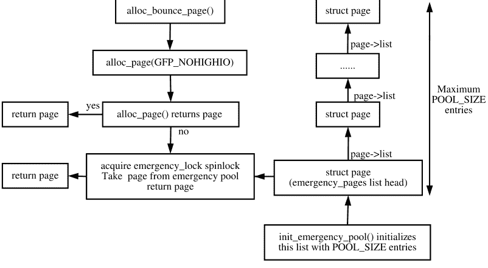

### 9.7 2.6中的新特性

内存池 在2.4中，高内存管理器是唯一维护紧急页面池的子系统。在2.6中，当需要在内存紧张时保留最少数量的东西时，内存池被实现为一个通用概念。这里的东西可以是任何类型的对象，例如高内存管理器情况下的页面，或者更常见的是，由slab分配器管理的某些对象。池守住使用`mempool_create()`初始化，该函数接受若干参数。它们分别是应保留的最小对象数（`min_nr`）、对象类型的分配函数（`alloc_fn()`）、释放函数（`free_fn()`），以及传递给分配和释放函数的可选私有数据。

内存池API提供了两个通用的分配和释放函数，分别称为`mempool_alloc_slab()`和`mempool_free_slab()`。当使用通用函数时，私有数据是要从中分配和释放对象的slab缓存。

对于高内存管理器，创建了两个页面池。一个页面池用于正常用途，第二个页面池用于必须使用`ZONE_DMA`的ISA设备。分配函数是`page_pool_alloc()`，传递的私有数据参数指示要使用的GFP标志。释放函数是`page_pool_free()`。内存池取代了2.4中存在的紧急池代码。

要从内存池分配或释放对象，提供了内存池API函数`mempool_alloc()`和`mempool_free()`。内存池使用`mempool_destroy()`销毁。

#### 映射高内存页面

在2.4中，`page→virtual`字段用于存储页面在`pkmap_count`数组中的地址。由于高内存系统中存在的`struct page`数量众多，这是相当小的代价，相对于需要映射到`ZONE_NORMAL`的页面数量而言。2.6仍然有`pkmap_count`数组，但它的管理方式大不相同。

在2.6中，创建了一个名为`page_address_htable`的哈希表。该表基于`struct page`的地址进行哈希，列表用于定位`struct page_address_slot`。这个结构体有两个有趣的字段，一个`struct page`和一个虚拟地址。当内核需要找到映射页面使用的虚拟地址时，通过遍历此哈希桶来定位。页面实际如何映射到低内存的方式基本上与2.4相同，只是现在不再需要`page→virtual`。

#### 执行I/O

最后一个重大变化是，执行I/O时现在使用`struct bio`而不是`struct buffer_head`。bio结构的工作原理超出了本书的范围。然而，引入`bio`结构的主要原因是，I/O可以以底层设备支持的任何大小的块来执行。在2.4中，所有I/O都必须被分割为页面大小的块，无论底层设备的传输速率如何。

## 印度信息技术学院巴加尔布尔分校

### 学生请假表（仅限家长/监护人使用）

日期：..............................

**致，**

学术事务院长，

印度信息技术学院（IIIT），巴加尔布尔

**主题：请假申请**

**尊敬的先生/女士，**

我是学生**先生/女士……………………………………………………………………………… 学号……………………….. 系部……**的**父亲/母亲/监护人**，需要请假自**(*DD/MM/YYYY*) …………………………………………… 至 (*DD/MM/YYYY*)…………………………………………………. (*用文字表述*)…………………………………………………………………………………. (天数……………………………) 原因……………………………………………..

我将确保我的孩子/被监护人遵守学院纪律，其行为举止得体，否则我将不被允许请假。如果您批准他们在上述期间离校，我将不胜感激。

**期待积极回复！**

此致，

...............................
学生姓名

手机号：………………………………

.......................................................
父亲/母亲/监护人姓名

手机号：………………………………

宿舍管理员签名
（请假超过3天时需要）

# 第10章

## 页框回收

运行中的系统最终会将所有可用的页框用于磁盘缓冲区、dentry 项、inode 项、进程页面等用途。Linux 需要在物理内存耗尽之前选择可以释放并使之失效以供新用途使用的旧页面。本章将专门讨论 Linux 如何实现其页面替换策略，以及不同类型页面是如何被失效的。

Linux 用于选择页面的方法在很大程度上是经验性的，其背后的理论基于不同的思想。它已被证明在实践中运行良好，并根据用户反馈和基准测试进行调整。页面替换策略的基础是本章讨论的第一个主题。

讨论的第二个主题是*页缓存*。从磁盘读取的所有数据都存储在页缓存中，以减少必须执行的磁盘 I/O 量。严格来说，这与页框回收没有直接关系，但 LRU 列表和页缓存密切相关。相关部分将重点介绍页面如何被添加到页缓存以及如何被快速定位。

这将带我们进入第三个主题：LRU 列表。除了 slab 分配器外，系统正在使用的所有页面都存储在 LRU 列表上，并通过 `page->lru` 链接在一起，以便可以方便地扫描以进行替换。slab 页面不存储在 LRU 列表上，因为基于 slab 使用的对象来老化页面要困难得多。该部分重点介绍页面在被回收之前如何在 LRU 列表中移动。

接下来，我将介绍属于其他缓存（如 dcache 和 slab 分配器）的页面是如何被回收的，然后再讨论进程映射页面是如何被移除的。进程映射页面不容易被交换，因为除了搜索每个页表之外，没有办法将 `struct pages` 映射到 PTE，而这代价太高。如果页缓存中有大量进程映射页面，将会遍历进程页表，并通过 `swap_out()` 将页面换出，直到释放足够的页面，但 `swap_out()` 对共享页面仍然会有困难。如果页面是共享的，将分配一个交换项，PTE 填充必要的信息以便再次在交换区中找到该页面，并且引用计数递减。只有当计数达到零时，页面才会被释放。这样的页面被认为处于*交换缓存*中。

最后，本章将介绍页面替换守护进程 **kswapd**，它是如何实现的以及它的职责是什么。

### 10.1 页面替换策略

在讨论中，页面替换策略经常被说成是基于 *LRU* 的算法，但严格来说这并不正确，因为列表并不是严格按 LRU 顺序维护的。Linux 中的 LRU 由两个列表组成，称为 `active_list` 和 `inactive_list`。目标是让 `active_list` 包含所有进程的*工作集*[Den70]，而 `inactive_list` 包含回收候选页面。由于所有可回收页面都包含在仅有的两个列表中，并且属于任何进程的页面都可能被回收，而不仅仅是属于触发缺页进程的页面，因此该替换策略是一个全局策略。

这些列表类似于简化的 LRU 2Q [JS94]，其中维护两个称为 `Am` 和 `A1` 的列表。使用 LRU 2Q 时，页面首次分配时被放置在一个称为 `A1` 的先进先出（FIFO）队列上。如果它们在该队列上被引用，则会被放置在一个正常的 LRU 管理列表 `Am` 中。这大致类似于使用 `lru_cache_add()` 将页面放置在称为 `inactive_list`（A1）的队列上，以及使用 `mark_page_accessed()` 移动到 `active_list`（Am）。该算法描述了如何调整两个列表的大小，但 Linux 采用更简单的方法，使用 `refill_inactive()` 从 `active_list` 底部移动页面到 `inactive_list`，以保持 `active_list` 约为总页缓存的三分之二。图 10.1 说明了这两个列表的结构、页面如何添加以及页面如何通过 `refill_inactive()` 在列表之间移动。

2Q 描述的列表假定 `Am` 是一个 LRU 列表，但 Linux 中的列表更接近于时钟算法 [Car84]，其中 handspread 是

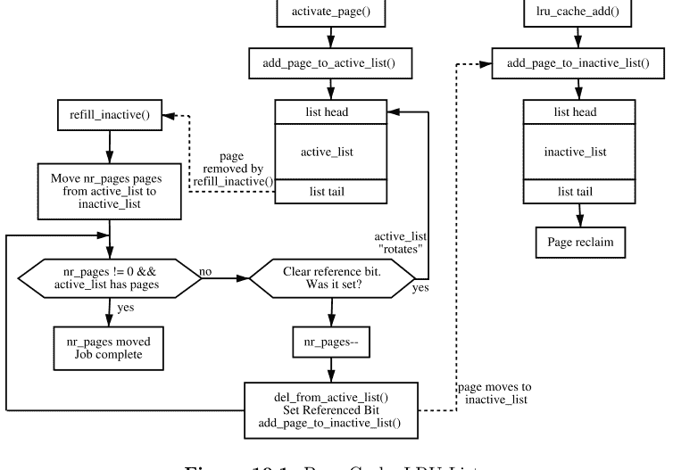

### 图 10.1. 页缓存 LRU 列表

活动列表的大小。当页面到达列表底部时，会检查引用标志。如果已设置，则将其移回列表顶部，然后检查下一个页面。如果已清除，则将其移动到 `inactive_list`。

移至前端启发式意味着列表行为类似于 LRU 方式，但 Linux 替换策略与 LRU 之间存在太多差异，无法将其视为栈算法 [MM87]。即使我们忽略多道程序系统的分析问题 [CD80] 以及每个进程的内存大小不固定的事实，该策略也不满足*包含属性*，因为页面在列表中的位置在很大程度上取决于列表的大小，而不是最后引用的时间。列表优先级也不是有序的，因为这需要在每次引用时更新列表。作为栈算法棺材上的最后一颗钉子，从进程换出时几乎忽略列表，因为页面换出决策与它们在进程虚拟地址空间中的位置有关，而不是页面列表中的位置。

总而言之，该算法确实表现出类似 LRU 的行为，并且基准测试已证明其在实践中表现良好。只有两种情况下算法可能表现得很差。第一种情况是，如果回收候选主要是匿名页面。在这种情况下，Linux 将不断检查大量页面，然后线性扫描进程页表搜索要回收的页面，但这种情况 fortunately 很少见。

第二种情况是，在 `inactive_list` 中有许多频繁写入的基于文件的常驻页面，且只有一个进程。**kswapd** 和进程可能会进入一个循环，不断清洗这些页面并将它们放在 `inactive_list` 顶部，而不释放任何东西。在这种情况下，很少有页面从 `active_list` 移动到 `inactive_list`，因为两个列表大小之间的比率没有显著变化。

### 10.2 页缓存

页缓存是一组数据结构，包含由普通文件、块设备或交换区支持的页面。缓存中基本上存在四种页面类型：

- 一种是读取内存映射文件时导致缺页而调入的页面。
- 从块设备或文件系统读取的块被打包到称为缓冲页面的特殊页面中。可以容纳的块数量取决于块大小和架构的页面大小。
- 当为页面换出分配后备存储中的槽位时，匿名页面存在于页缓存的一个特殊方面，即交换缓存中，这将在第 11 章进一步讨论。
- 属于共享内存区域的页面处理方式类似于匿名页面。唯一的区别是共享页面在首次写入页面后立即被添加到交换缓存中，并在后备存储中保留空间。

该缓存存在的主要原因是为了消除不必要的磁盘读取操作。从磁盘读取的页面存储在一个*页面哈希*表中，该表根据 `struct address_space` 和偏移量进行哈希，在访问磁盘之前总是先搜索该表。系统提供了一组用于操作页面缓存的 API，如表 10.1 所列。

| 函数 | 描述 |
|----------|-------------|
| `void add_to_page_cache(struct page * page, struct address_space * mapping, unsigned long offset)` | 此函数通过 `lru_cache_add()` 将页面添加到 LRU，同时将其添加到 inode 队列和页面哈希表中。 |
| `void add_to_page_cache_unique(struct page * page, struct address_space *mapping, unsigned long offset, struct page **hash)` | 此函数与 `add_to_page_cache()` 类似，不同之处在于它会检查该页面是否已存在于页面缓存中。当调用者未持有 pagecache_lock 自旋锁时，需要使用此函数。 |
| `void remove_inode_page(struct page *page)` | 此函数通过 `remove_page_from_inode_queue()` 和 `remove_page_from_hash_queue()` 将页面从 inode 队列和哈希队列中移除，从而有效地将其从页面缓存中移除。 |
| `struct page * page_cache_alloc(struct address_space *x)` | 这是 `alloc_pages()` 的一个封装函数，使用 `x→gfp_mask` 作为 GFP 掩码。 |
| `void page_cache_get(struct page *page)` | 此函数增加已存在于页面缓存中的页面的引用计数。 |
| `int page_cache_read(struct file * file, unsigned long offset)` | 此函数在页面缓存中添加与指定 `offset` 和 `file` 对应的页面（如果尚不存在）。如果需要，将使用 `address_space_operations→readpage` 函数从磁盘读取该页面。 |
| `void page_cache_release(struct page *page)` | 此函数是 `__free_page()` 的别名。它会递减引用计数，如果引用计数降为 0，则该页面将被释放。 |

**表 10.1。** 页面缓存 API

#### 10.2.1 页面缓存哈希表

页面缓存中的页面需要能够被快速定位。为此，页面被插入到一个名为 `page_hash_table` 的表中，并使用 `page→next_hash` 和 `page→pprev_hash` 字段来处理哈希冲突。

该表在 `mm/filemap.c` 中声明如下：

```


45 `atomic_t page_cache_size = ATOMIC_INIT(0);`

46 `unsigned int page_hash_bits;`

47 `struct page **page_hash_table;`

```
该表在系统初始化期间由 `page_cache_init()` 分配，该函数以系统中的物理页面数作为参数。表的期望大小（`htable_size`）足以容纳系统中每个 `struct page` 的指针，计算方式为：

$$\text{htable\_size} = \text{num\_physpages} * \text{sizeof(struct page *)}$$

分配表时，系统首先进行一次足够容纳整个表的 `order` 级别分配。它从 0 开始递增，直到 $2^{\text{order}} > \text{htable\_size}$，以此计算该值。这可以粗略地表示为以下简单公式的整数部分：

$$\text{order} = \log_2((\text{htable\_size} * 2) - 1))$$

系统尝试使用 `_get_free_pages()` 分配该 order 级别的页面。如果分配失败，则尝试更低的 order 级别，如果所有分配均未成功，系统将 panic。

`page_hash_bits` 的值基于表的大小，用于哈希函数 `_page_hashfn()`。该值通过连续除以 2 来计算，但实际上等价于：

$$\text{page\_hash\_bits} = \log_2 \left| \frac{\text{PAGE\_SIZE} * 2^{\text{order}}}{\text{sizeof(struct page *)}} \right|$$

这使得该表成为一个二的幂次哈希表，从而避免了使用取模运算，而取模运算在哈希函数中是一种常见的选择。
```

## 10.2.2 Inode 队列

`inode 队列`是第 4.4.2 节介绍的 `struct address_space` 的一部分。该结构体包含三个链表。`clean_pages` 是与该 inode 关联的干净页面链表；`dirty_pages` 中的页面自上次同步到磁盘以来已被写入；`locked_pages` 是当前被锁定的页面。这三个链表组合在一起被视为给定映射的 inode 队列，`page→list` 字段用于将页面链接到其中。页面通过 `add_page_to_inode_queue()` 添加到 inode 队列中，该函数将页面放入 `clean_pages` 链表，通过 `remove_page_from_inode_queue()` 移除页面。

## 10.2.3 将页面添加到页面缓存

从文件或块设备读取的页面通常会被添加到页面缓存中，以避免额外的磁盘 I/O。大多数文件系统使用高级函数 `generic_file_read()` 作为其 `file_operations→read()` 实现，如图 10.2 所示。共享内存文件系统（将在第 12 章中介绍）是一个值得注意的例外，但总体而言，文件系统通过页面缓存来执行其操作。本节将说明 `generic_file_read()` 的运行方式以及它如何将页面添加到页面缓存。

对于普通 I/O[^1]，`generic_file_read()` 首先执行一些基本检查，然后调用 `do_generic_file_read()`。该函数在持有 `pagecache_lock` 的情况下，通过调用 `__find_page_nolock()` 来搜索页面缓存，查看该页面是否已存在。如果不存在，则使用 `page_cache_alloc()` 分配一个新页面（这是 `alloc_pages()` 的简单封装），并通过 `__add_to_page_cache()` 将其添加到页面缓存。在页面帧存在于页面缓存中之后，调用 `generic_file_readahead()`，它使用 `page_cache_read()` 从磁盘读取页面。读取使用 `mapping→a_ops→readpage()` 完成，其中 `mapping` 是管理该文件的 `address_space`。`readpage()` 是文件系统特定的函数，用于从磁盘读取页面。

匿名页面在从进程中取消映射时会被添加到交换缓存，这将在第 11.4 节中进一步讨论。在尝试将它们换出之前，它们没有 `address_space` 作为映射，也没有文件中的偏移量，因此没有可用于将其哈希到页面缓存中的依据。但需注意，这些页面仍然存在于 LRU 链表上。一旦进入交换缓存，匿名页面和基于文件的页面之间唯一的真正区别在于，匿名页面将使用 `swapper_space` 作为其 `struct address_space`。

共享内存页面在两种情况下会被添加。第一种是在 `shmem_getpage_locked()` 期间，当页面需要从交换区获取或因为是首次引用而需要分配时调用此函数。第二种是当交换同步代码调用 `shmem_unuse()` 时。当交换区被停用，并且发现一个由交换空间支持但似乎不属于任何进程的页面时，就会发生这种情况。系统会穷举搜索与共享内存相关的 inode，直到找到正确的页面。在这两种情况下，页面都通过 `add_to_page_cache()` 添加，如图 10.3 所示。

## 10.3 LRU 链表

如第 10.1 节所述，LRU 链表由两个链表组成，分别名为 `active_list` 和 `inactive_list`。它们在 `mm/page_alloc.c` 中声明，受 `pagemap_lru_lock` 自旋锁保护。大致来说，它们分别存储热页面和冷页面，或者换言之，`active_list` 包含系统中的所有工作集，而 `inactive_list` 包含回收候选页面。处理 LRU 链表的 API 如表 10.2 所列。

### 10.3.1 重新填充 inactive_list

当缓存被缩减时，`refill_inactive()` 函数将页面从 `active_list` 移动到 `inactive_list`。该函数以要移动的页面数作为参数，该值在 `shrink_caches()` 中根据 `nr_pages`（要换出的页面数）、`active_list` 中的页面数和 `inactive_list` 中的页面数按比例计算。要移动的页面数计算如下：

$$pages = nr\_pages * \frac{nr\_active\_pages}{2 * (nr\_inactive\_pages + 1)}$$

这使得 `active_list` 的大小保持约为 `inactive_list` 的三分之二，要移动的页面数基于我们想要换出的页面数（`nr_pages`）按比例确定。

页面从 `active_list` 的末尾取出。如果设置了 `PG_referenced` 标志，则清除该标志，并将页面放回 `active_list` 的顶部，因为它最近被使用过，仍然是热页面。这有时被称为轮转链表。如果该标志已被清除，则将页面移动到 `inactive_list`，并设置 `PG_referenced` 标志，以便在必要时能快速将其提升到 `active_list`。

### 10.3.2 从 LRU 链表中回收页面

`shrink_cache()` 函数是替换算法的一部分，它从 `inactive_list` 中取出页面并决定如何换出它们。决定执行工作量的两个起始参数是 `nr_pages` 和 `priority`。`nr_pages` 的初始值为 `SWAP_CLUSTER_MAX`，目前在 `mm/vmscan.c` 中定义为 32。变量 `priority` 的初始值为 `DEF_PRIORITY`，目前在 `mm/vmscan.c` 中定义为 6。

两个参数 `max_scan` 和 `max_mapped` 决定了该函数将执行多少工作，并受 `priority` 的影响。每次调用 `shrink_caches()` 时，如果没有释放足够的页面，优先级将降低，直到达到最高优先级 1。

变量 `max_scan` 是该函数将扫描的最大页面数，计算方式为：

$$max\_scan = \frac{nr\_inactive\_pages}{priority}$$

[^1]: 直接 I/O 由 `generic_file_direct_IO()` 以不同方式处理。

```markdown
void lru_cache_add(struct page * page)

    将一个冷页面添加到 inactive_list。如果页面已知是热的，比如页面因缺页而被调入时，

    通过调用 mark_page_accessed() 将其移动到 active_list。

void lru_cache_del(struct page *page)

    通过调用 del_page_from_active_list() 或 del_page_from_inactive_list()

    将页面从 LRU 列表中移除，具体调用哪个函数取决于页面所在的列表。

void mark_page_accessed(struct page *page)

    标记页面已被访问。如果页面最近未被引用（在 inactive_list 中且 PG_referenced

    标志未设置），则设置引用标志。如果页面被第二次引用，则调用 activate_page()，

    将页面标记为热页面，并清除引用标志。

void activate_page(struct page * page)

    将页面从 inactive_list 移除并放置到 active_list。

    直接调用此函数的情况非常罕见，因为调用者必须知道页面在 inactive_list 上。

    应该使用 mark_page_accessed() 替代。
```

### 表 10.2. LRU 列表 API

其中 `nr_inactive_pages` 是 `inactive_list` 中的页面数量。这意味着，在最低优先级 6 时，至多扫描 `inactive_list` 中六分之一的页面；而在最高优先级时，将扫描所有页面。

第二个参数是 `max_mapped`，它决定了在将整个进程换出之前，页面缓存中允许存在的进程页面数量。该值计算为 `max_scan` 的十分之一与下式中的较小值：

$$\max\_mapped = \textrm{nr\_pages} * 2^{(10-\textrm{priority})}$$

换句话说，在最低优先级时，允许的最大映射页面数是 `max_scan` 的十分之一或要换出的页面数（`nr_pages`）的 16 倍，取两者中较小的数值。在高优先级时，则是 `max_scan` 的十分之一或要换出的页面数的 512 倍。

从此处开始，该函数基本上是一个大型的 for 循环，最多扫描 `max_scan` 个页面，从 `inactive_list` 的末尾释放 `nr_pages` 个页面，直到 `inactive_list` 为空。每处理一个页面后，它会检查是否需要重新调度自身，以避免换页进程独占 CPU。

对于列表上找到的每种页面类型，它会做出不同的处理决策。不同的页面类型及其处理动作按以下顺序进行：

1. *页面被进程映射。* 这会跳转到 `page_mapped` 标签，我们在后面的情况中还会遇到。`max_mapped` 计数器递减。如果它达到 0，将线性搜索进程的页表并通过 `swap_out()` 函数将其换出。

2. *页面被锁定，且 PG_launder 位已设置。* 页面因 I/O 而被锁定，所以可以跳过它。但是，如果 `PG_launder` 位已设置，这意味着这是第二次发现该页面被锁定，因此最好等待 I/O 完成并将其清除。通过 `page_cache_get()` 获取对页面的引用，以便页面不会被过早释放，然后调用 `wait_on_page()`，该函数会休眠直到 I/O 完成。完成后，使用 `page_cache_release()` 递减引用计数。当计数达到零时，页面将被回收。

3. *页面是脏的，未被任何进程映射，没有缓冲区，且属于设备或文件映射。* 由于页面属于文件或设备映射，它通过 `page→mapping→a_ops→writepage` 拥有有效的 `writepage()` 函数可用。清除 `PG_dirty` 位，并设置 `PG_launder` 位，因为即将开始 I/O。在调用 `writepage()` 函数将页面与后备文件同步之前，通过 `page_cache_get()` 获取对页面的引用，然后在同步完成后通过 `page_cache_release()` 释放引用。请注意，此情况也会将属于交换缓存一部分的匿名页面与后备存储同步，因为交换缓存页面使用 `swapper_space` 作为 `page→mapping`。页面保留在 LRU 上。当它再次被找到时，如果 I/O 已完成，将直接释放并回收该页面。如果 I/O 尚未完成，内核将等待 I/O 完成，如前面的情况所述。

4. *页面有与磁盘数据关联的缓冲区。* 获取对页面的引用，并尝试使用 `try_to_release_page()` 释放页面。如果成功且是匿名页面（没有 `page→mapping`），则从 LRU 中移除该页面，并调用 `page_cache_release()` 递减使用计数。匿名页面有关联缓冲区的唯一情况是当它由交换文件支持时，因为页面需要以块大小的块写入。另一方面，如果它由文件或设备支持，则直接释放引用，当计数达到 0 时，页面将像往常一样被释放。

5. *页面是匿名的，且被多个进程映射。* 解锁 LRU 并解锁页面，然后进入与第一种情况中遇到的相同的 `page_mapped` 标签。换句话说，递减 `max_mapped` 计数，当或如果它达到 0 时调用 `swap_out`。

6. *页面没有进程引用它。* 这是最终情况，是默认进入的而非显式检查到的。如果页面在交换缓存中，则将其从中移除，因为页面现在已与后备存储同步且没有进程引用它。如果它曾是文件的一部分，则将其从 inode 队列中移除，从页面缓存中删除并释放。

## 10.4 收缩所有缓存

负责收缩各种缓存的函数是 `shrink_caches()`，它采取几个简单的步骤来释放一些内存（见图 10.4）。在任何一次操作中写入磁盘的最大页面数是 `nr_pages`，由 `try_to_free_pages_zone()` 初始化为 `SWAP_CLUSTER_MAX`。此限制的存在是因为如果 `kswapd` 调度大量页面写入磁盘，它会不时休眠以允许 I/O 进行。随着页面被释放，`nr_pages` 会递减以保持计数。

将要执行的工作量还取决于由 `try_to_free_pages_zone()` 初始化为 `DEF_PRIORITY` 的 `priority`。对于每次未能释放足够页面的操作，优先级会递减，最高优先级为 1。

该函数首先调用 `kmem_cache_reap()`（见 8.1.7 节），选择一个 slab 缓存进行收缩。如果释放了 `nr_pages` 数量的页面，则工作完成，函数返回。否则，它将尝试从其他缓存释放 `nr_pages`。

如果要影响其他缓存，`refill_inactive()` 会将页面从 `active_list` 移动到 `inactive_list`，然后通过回收 `inactive_list` 末尾的页面来收缩页面缓存，使用 `shrink_cache()` 完成。

最后，它收缩三个特殊缓存：`dcache`（`shrink_dcache_memory()`）、`icache`（`shrink_icache_memory()`）和 `dqcache`（`shrink_dqcache_memory()`）。这些对象本身相当小，但级联效应允许以缓冲区和磁盘缓存的形式释放更多页面。

## 10.5 换出进程页面

当在页面缓存中找到 `max_mapped` 个页面时，调用如图 10.5 所示的 `swap_out()` 开始换出进程页面。从 `swap_mm` 指向的 `mm_struct` 和地址 `mm→swap_address` 开始，向前搜索页表直到释放了 `nr_pages` 个页面。

所有进程映射的页面都会被检查，无论它们在列表中的位置或上次被引用的时间，但属于 `active_list` 的页面或最近被引用的页面将被跳过。检查热页面的成本有点高，但与线性搜索所有进程以查找引用特定 `struct page` 的 PTE 相比，这微不足道。

在决定从某个进程换出页面后，将尝试至少换出 `SWAP_CLUSTER_MAX` 数量的页面，并且只检查完整的 `mm_structs` 列表一次，以避免在页面不可用时持续循环。批量写入页面增加了进程中地址空间相近的页面被写入磁盘相邻位置的机会。

标记 `swap_mm` 首次使用时初始化为指向 `init_mm`，`swap_address` 初始化为 0。当 `swap_address` 等于 `TASK_SIZE` 时，表示任务已被完全搜索。选择任务换出页面后，递增对 `mm_struct` 的引用计数，以便它不会被过早释放，然后使用选定的 `mm_struct` 作为参数调用 `swap_out_mm()`。

## 图 10.4. 调用关系图：shrink_caches()

此函数遍历进程持有的每个 VMA，并对其调用 `swap_out_vma()`。这是为了避免必须遍历整个页表，因为页表大部分是稀疏的。`swap_out_pgd()` 和 `swap_out_pmd()` 遍历给定 VMA 的页表，直到最终对实际页面和 PTE 调用 `try_to_swap_out()`。

函数 `try_to_swap_out()` 首先检查确保该页面不属于 `active_list`、最近未被引用或属于我们不感兴趣的 zone。在确认这是一个要换出的页面后，它将从进程页表中移除。然后检查新移除的 PTE 是否脏。如果是，则更新 `struct page` 的标志以匹配，使其与后备存储同步。如果该页面已经是交换缓存的一部分，则只需更新 RSS 并释放对页面的引用。否则，将该进程添加到交换缓存。页面如何添加到交换缓存并与后备存储同步将在第 11 章讨论。


## 10.6 页面换出守护进程（`kswapd`）

系统启动期间，一个名为`kswapd`的内核线程从`kswapd_init()`启动，它持续执行`mm/vmscan.c`中的函数`kswapd()`，该函数通常会睡眠。此守护进程负责在内存不足时回收页面。历史上，`kswapd`每 10 秒唤醒一次，但现在仅在某个 zone 中的空闲页面数达到`pages_low`时由物理页面分配器唤醒（见 2.2.1 节）。

正是这个守护进程执行维护页面缓存正确性、收缩 slab 缓存以及必要时换出进程所需的大部分任务。与 Solaris [MM01] 等换出守护进程不同，后者因内存压力而越来越频繁地被唤醒，`kswapd`会一直释放页面直到达到`pages_high`水位线。在极端内存压力下，进程将通过调用`balance_classzone()`来同步完成`kswapd`的工作，而该函数调用`try_to_free_pages_zone()`。如图 10.6 所示，当 zone 处于高压状态时，物理页面分配器在`try_to_free_pages_zone()`处同步执行与`kswapd`相同的任务。

当`kswapd`被唤醒时，它执行以下操作：

- 调用`kswapd_can_sleep()`，遍历所有 zone 检查`struct zone_t`中的`need_balance`字段。如果有任何一个被设置，它就不能睡眠。
- 如果不能睡眠，就从`kswapd_wait`等待队列中移除。
- 调用函数`kswapd_balance()`，遍历所有 zone。如果设置了`need_balance`，它将使用`try_to_free_pages_zone()`释放 zone 中的页面，并持续释放直到达到`pages_high`水位线。
- 运行`tq_disk`的任务队列，以便将排队的页面写出。
- 将`kswapd`重新添加到`kswapd_wait`队列，然后回到第一步。

## 10.7 2.6 中的新特性

### kswapd

如 2.8 节所述，现在系统中每个内存节点都有一个`kswapd`。这些守护进程仍然从`kswapd()`启动，它们都执行相同的代码，只不过它们的工作现在被限制在各自的本地节点。`kswapd`实现的主要变化与每个节点一个 kswapd 的改动相关。

`kswapd`的基本操作保持不变。一旦被唤醒，它会为负责的`pgdat`调用`balance_pgdat()`。`balance_pgdat()`有两种操作模式。当使用`nr_pages == 0`调用时，它会持续尝试从本地`pgdat`的每个 zone 释放页面，直到达到`pages_high`。当指定了`nr_pages`时，它会尝试释放`nr_pages`或`MAX_CLUSTER_MAX * 8`中较小的页面数。

### 平衡 Zone

`balance_pgdat()`调用的两个主要释放页面的函数是`shrink_slab()`和`shrink_zone()`。`shrink_slab()`在 8.8 节已介绍，此处不再重复。调用`shrink_zone()`释放的页面数取决于释放页面的紧迫程度。此函数的行为方式与 2.4 的工作方式非常相似。`refill_inactive_zone()`会将一定数量的页面从`zone→active_list`移动到`zone→inactive_list`。请记住，从 2.8 节可知，LRU 列表现在是每个 zone 独立的，而非像 2.4 中那样全局共享。`shrink_cache()`被调用以从 LRU 中移除页面并回收页面。

### 页面换出压力

在 2.4 中，页面换出优先级决定了扫描多少页面。在 2.6 中，有一个衰减平均值，由`zone_adj_pressure()`更新。这会调整`zone→pressure`字段以指示应扫描多少页面进行替换。当需要更多页面时，该值将被推高到`DEF_PRIORITY << 10`的最大值，然后随时间衰减。该平均值的大小影响在一个 zone 中扫描多少页面进行替换。目标是让页面替换开始工作并缓慢平稳地进行，而不是表现出突发特性。

### 操作 LRU 列表

在 2.4 中，从 LRU 列表中移除页面时会获取自旋锁。这使得该锁竞争非常激烈，因此，为了缓解竞争，涉及 LRU 列表的操作使用`struct pagevec`结构进行。这允许页面以最多`PAGEVC_SIZE`个页面的批次方式添加或移除 LRU 列表。

举例说明，当`refill_inactive_zone()`和`shrink_cache()`移除页面时，它们获取`zone→lru_lock`锁，移除大量页面并存储到临时列表上。在组装好要移除的页面列表后，调用`shrink_list()`来执行实际的页面释放，现在它可以在不需要`zone→lru_lock`自旋锁的情况下完成大部分任务。

当添加页面回去时，使用`pagevec_init()`初始化新的页面向量结构。页面用`pagevec_add()`添加到向量中，然后使用`pagevec_release()`批量提交到 LRU 列表上。

与`pagevec`结构相关的大量 API 可以在`<linux/pagevec.h>`中看到，大部分实现在`mm/swap.c`中。

### 图 10.6. 调用关系图：`kswapd()`

---

# 第 11 章

## 交换管理

正如 Linux 使用空闲内存来缓存磁盘数据一样，最终也需要释放进程使用的私有或匿名页面。这些页面与磁盘文件支持的页面不同，不能简单地丢弃以便稍后读取。相反，它们必须被小心地复制到*后备存储*中，有时称为*交换区*。本章详细介绍 Linux 如何使用和管理其后备存储。

严格来说，Linux 并不进行交换（swap），因为"交换"指的是将整个进程地址空间复制到磁盘，而"分页"（paging）指的是复制单个页面。Linux 实际上实现了现代硬件支持的分页，但传统上在讨论和文档中一直称之为交换。为了与 Linux 对该词的使用保持一致，我们也将其称为交换。

存在交换空间有两个主要原因。首先，它扩展了进程可以使用的内存量。虚拟内存和交换空间允许大型进程即使只有部分驻留也能运行。因为旧页面可以换出，所以寻址的内存量很容易超过 RAM，因为请求分页会在必要时确保页面被重新加载。

普通读者¹可能认为，如果有足够的内存，交换是不必要的，但这引出了第二个原因。进程在生命早期引用的大量页面可能仅用于初始化，然后就不再使用。最好将这些页面换出并创建更多的磁盘缓存，而不是让它们驻留且闲置不用。

交换并非没有缺点，而最重要的一点也是最明显的一点。磁盘很慢，非常非常慢。如果进程频繁访问大量内存，再多的交换或昂贵的高性能磁盘也无法使其在合理时间内运行，只有更多的 RAM 才能解决问题。这就是为什么正确换出页面（如第 10 章所述）以及将相关页面在交换空间中靠近存储（以便它们在预读时很可能同时被换入）非常重要。我将从 Linux 如何描述交换区开始。

本章首先描述 Linux 为系统中每个活动交换区维护的结构，以及交换区信息在磁盘上是如何组织的。我将介绍 Linux 如何在页面被换出后记住如何找到它们。

> ¹更不用说富裕的读者了。

介绍了页面如何被换出以及交换槽位如何分配之后，接下来讨论*交换缓存*，它对共享页面非常重要。到那时，我们就有足够的信息来开始理解交换区是如何激活和取消激活的、页面是如何换入和换出的，以及最后交换区是如何被读写的。

## 11.1 描述交换区

每个活动的交换区，无论是文件还是分区，都有一个结构体`swap_info_struct`来描述该区域。运行系统中所有的结构体都存储在一个静态声明的数组`swap_info`中，该数组可容纳`MAX_SWAPFILES`个条目，`MAX_SWAPFILES`被静态定义为32。这意味着一个运行中的系统最多可以有32个交换区。`swap_info_struct`在`<linux/swap.h>`中声明如下：

```
64 struct swap_info_struct {
65     unsigned int flags;
66     kdev_t swap_device;
67     spinlock_t sdev_lock;
68     struct dentry * swap_file;
69     struct vfsmount *swap_vfsmnt;
70     unsigned short * swap_map;
71     unsigned int lowest_bit;
72     unsigned int highest_bit;
73     unsigned int cluster_next;
74     unsigned int cluster_nr;
75     int prio;
76     int pages;
77     unsigned long max;
78     int next;
79 };
```

以下是对这个相当大的结构体中每个字段的简要说明。

- **flags** 这是一个有两个可能值的位字段。如果交换区当前处于活动状态，则设置`SWP_USED`。`SWP_WRITEOK`被定义为3，即两个最低有效位，*包括*`SWP_USED`位。当Linux准备写入该区域时，标志被设置为`SWP_WRITEOK`，因为必须处于活动状态才能写入。
- **swap_device** 用于此交换区的分区对应的设备存储在这里。如果交换区是文件，则此项为NULL。
- **sdev_lock** 与Linux中的许多结构体一样，这个也需要保护。`sdev_lock`是一个保护该结构体的自旋锁，主要是`swap_map`。它通过`swap_device_lock()`和`swap_device_unlock()`进行加锁和解锁。
- **swap_file** 这是作为交换区挂载的实际特殊文件的**dentry**。例如，在挂载分区的情况下，这可能是`/dev/`目录中某个文件的**dentry**。在取消激活交换区时，需要此字段来识别正确的`swap_info_struct`。
- **swap_vfsmnt** 这是与该交换区的设备或文件存储位置对应的`vfsmount`对象。
- **swap_map** 这是一个大数组，每个交换条目或区域中的页面大小槽位都有一个条目。条目是该页面槽位使用数量的引用计数。交换缓存算一个使用者，每个已换出到该槽位的PTE也算一个使用者。如果等于`SWAP_MAP_MAX`，则该槽位被永久分配。如果等于`SWAP_MAP_BAD`，则该槽位将永远不会被使用。
- **lowest_bit** 这是交换区中可用的最低空闲槽位，在进行线性扫描时从此开始，以减少搜索空间。已知此标记以下绝对没有空闲槽位。
- **highest_bit** 这是该交换区中可用的最高空闲槽位。与`lowest_bit`类似，此标记以上绝对没有空闲槽位。
- **cluster_next** 这是要使用的下一块集群的偏移量。交换区尝试以集群块的形式分配页面，以增加相关页面被存储在一起的几率。
- **cluster_nr** 这是该集群中剩余可分配的页面数。
- **prio** 每个交换区都有一个优先级，存储在此字段中。区域按优先级顺序排列，并决定该区域被使用的可能性。默认情况下，优先级按激活顺序排列，但系统管理员在使用`swapon`时也可以使用`-p`标志指定。
- **pages** 由于交换文件中某些槽位可能不可用，此字段存储交换区中可用页面的数量。这与`max`不同，标记为`SWAP_MAP_BAD`的槽位不计入。
- **max** 这是该交换区中槽位的总数。
- **next** 这是`swap_info`数组中系统下一个交换区的索引。

这些区域虽然存储在数组中，但也保存在一个称为`swap_list`的伪列表中，这是在`<linux/swap.h>`中声明的一个非常简单的类型：

```
153 struct swap_list_t {
154     int head;   /* head of priority-ordered swapfile list */
155     int next;   /* swapfile to be used next */
156 };
```

字段`swap_list_t→head`是使用中的最高优先级交换区，`swap_list_t→next`是应该使用的下一个交换区。这样可以在搜索合适区域时按优先级顺序排列，但在需要时仍可以快速在数组中查找。

每个交换区在磁盘上被划分为多个页面大小的槽位，这意味着在x86上每个槽位为4,096字节。第一个槽位始终被保留，因为它包含不应被覆盖的关于交换区的信息。交换区的前1 KiB用于存储分区的磁盘标签，可被用户空间工具识别。剩余空间用于存储关于交换区的信息，这些信息在使用系统程序`mkswap`创建交换区时填充。这些信息用于填充一个联合`swap_header`，其在`<linux/swap.h>`中声明如下：

```
25 union swap_header {
26     struct
27     {
28           char reserved[PAGE_SIZE - 10];
29           char magic[10];
30     } magic;
31     struct
32     {
33           char    bootbits[1024];
34           unsigned int version;
35           unsigned int last_page;
36           unsigned int nr_badpags;
37           unsigned int padding[125];
38           unsigned int badpages[1];
39     } info;
40 };
```

以下是对每个字段的说明：

- **magic** 该联合的`magic`部分仅用于识别魔术字符串。该字符串的存在是为了确保不会误用非交换区的分区，并决定使用哪个版本的交换区。如果字符串是`SWAP-SPACE`，则是版本1的交换文件格式。如果是`SWAPSPACE2`，则是版本2。大型保留数组只是为了让魔术字符串从页面末尾读取。
- **bootbits** 这是保留区域，包含关于分区的信息，如磁盘标签。
- **version** 这是交换区布局的版本。
- **last_page** 这是该区域中最后可用的页面。
- **nr_badpags** 交换区中存在的已知坏页面数量存储在此字段中。
- **padding** 一个磁盘扇区通常大小约为512字节。`version`、`last_page`和`nr_badpags`三个字段共占12字节，`padding`填充剩余的500字节以覆盖一个扇区。

### badpages

页面剩余部分用于存储最多`MAX_SWAP_BADPAGES`个坏页面槽位的索引。如果使用`-c`开关指定检查区域，这些槽位由`mkswap`系统程序填充。

`MAX_SWAP_BADPAGES`是一个编译时常量，如果结构体变化它会随之变化，但按照当前形式由简单公式得出为637个条目。

$$\text{MAX\_SWAP\_BADPAGES} = \frac{\text{PAGE\_SIZE} - 1,024 - 512 - 10}{\text{sizeof(long)}}$$

其中1,024是引导块的大小，512是填充的大小，10是识别交换文件格式的魔术字符串的大小。

## 11.2 将页表条目映射到交换条目

当页面被换出时，Linux使用相应的PTE存储足够的信息以在磁盘上重新定位该页面。显然，PTE本身不足以精确存储页面在磁盘上的位置，但它足以存储`swap_info`数组中的索引和`swap_map`中的偏移量。这正是Linux所做的。

每个PTE，无论架构如何，都足够大以存储`swp_entry_t`，其在`<linux/shmem_fs.h>`中声明如下：

```
16 typedef struct {
17     unsigned long val;
18 } swp_entry_t;
```

提供了两个用于PTE与交换条目之间转换的宏。它们分别是`pte_to_swp_entry()`和`swp_entry_to_pte()`。

每种架构都必须能够确定PTE是存在的还是已换出的。为了说明，我展示这在x86上的实现方式。在`swp_entry_t`中，始终保留两个位。在x86上，位0保留给`_PAGE_PRESENT`标志，位7保留给`_PAGE_PROTNONE`。这两个位的要求在第3.2节中解释。位1到6用于*类型*，即`swap_info`数组中的索引，由`SWP_TYPE()`宏返回。

位8到31用于从`swp_entry_t`存储`swap_map`中的*偏移量*。在x86上，这意味着有24位可用，这将交换区的大小限制为64GiB。宏`SWP_OFFSET()`用于提取偏移量。

要将类型和偏移量编码到`swp_entry_t`中，可使用宏`SWP_ENTRY()`，它只需执行相关的位移操作。所有这些宏之间的关系如图11.1所示。

type的6位应该允许在32位架构中存在多达64个交换区，而不是`MAX_SWAPFILES`限制的32个。该限制是由于vmalloc地址空间的消耗。如果交换区是最大可能大小，`swap_map`需要32MiB（$2^{24} * \text{sizeof(short)}$）；记住每个页面使用一个short来存储引用计数。仅就`MAX_SWAPFILES`要存在最大数量的交换区，需要 1GiB 的虚拟 malloc 空间，这根本不可能，因为用户空间和内核空间的线性地址空间是分开的。


这意味着支持 64 个交换区并不值得增加额外的复杂性，但在某些情况下，即使总体可用交换空间没有增加，大量的交换区也是可取的。一些现代机器[^2]拥有许多独立的磁盘，这些磁盘之间可以创建大量独立的块设备。在这种情况下，创建大量分布在所有磁盘上的小型交换区是可取的。这将允许页面交换行为具有高度的并行性，这对于交换密集型应用程序来说非常重要。

> [^2] 例如，一台 Sun E450 可以拥有大约 20 个磁盘。

## 11.3 分配交换槽

所有页大小的槽都由数组 `swap_info_struct`→`swap_map` 跟踪，其类型为 `unsigned short`。每个条目是槽的使用者数量的引用计数，这在共享页面的情况下出现，空闲时为 0。如果条目是 `SWAP_MAP_MAX`，则该页被永久保留给该槽。这种情况不太可能发生，如果不是不可能的话，但它的存在是为了确保引用计数不会溢出。如果条目是 `SWAP_MAP_BAD`，则该槽不可用。

查找和分配交换条目的任务分为两个主要任务。第一个由高级函数 `get_swap_page()` 执行，如图 11.2 所示。从 `swap_list`→`next` 开始，它在交换区中搜索合适的槽。找到槽后，它记录下一个要使用的交换区是什么，并返回分配的条目。

搜索映射的任务由 `scan_swap_map()` 负责。原则上，它非常简单，因为它线性扫描数组以寻找空闲槽并返回。可以预见，实现要更加彻底一些。

Linux 尝试将磁盘上的页面组织成大小为 `SWAPFILE_CLUSTER` 的*簇*。它在交换区中顺序分配 `SWAPFILE_CLUSTER` 数量的页面，在 `swap_info_struct`→`cluster_nr` 中记录顺序分配的页面数量，并在 `swap_info_struct`→`cluster_next` 中记录当前偏移量。分配完顺序块后，它搜索大小为 `SWAPFILE_CLUSTER` 的空闲条目块。如果找到足够大的块，它将用作另一个簇大小的序列。

如果在交换区中找不到足够大的空闲簇，则执行从 `swap_info_struct`→`lowest_bit` 开始的简单首个空闲搜索。目的是让同时换出的页面在磁盘上靠得更近，前提是同时换出的页面是相关的。这个前提乍一看很奇怪，但考虑到页面替换算法会在线性扫描进程地址空间换出页面时最频繁地使用交换空间，它是非常可靠的。如果不扫描大的空闲块并使用它们，搜索可能会退化为首个空闲搜索而永远无法改善。有了它，进程退出时可能会释放大量的槽块。

## 11.4 交换缓存

在许多进程之间共享的页面不容易被换出，因为如前所述，没有快速的方法将 `struct page` 映射到引用它的每个 PTE。这导致了一种罕见的情况：一个页面对一个 PTE 是存在的，而对另一个 PTE 是已换出的，在没有同步到磁盘的情况下被更新，从而丢失了更新。

为了解决这个问题，在后备存储中预留了槽位的共享页面被视为*交换缓存*的一部分。交换缓存有一个小的 API 与之关联，如表 11.1 所示。交换缓存纯粹是概念性的，因为它只是页面缓存的一种特化。交换缓存中的页面与页面缓存中的页面之间的第一个主要区别是，交换缓存中的页面总是使用 `swapper_space` 作为其在 `page`→`mapping` 中的 `address_space`。第二个区别是，页面使用 `add_to_swap_cache()` 添加到交换缓存，如图 11.3 所示，而不是 `add_to_page_cache()`。

**表 11.1.** 交换缓存 API

| 函数 | 描述 |
|:---|:---|
| `swp_entry_t get_swap_page()` | 该函数通过搜索活动的交换区在 `swap_map` 中分配一个槽。这在 11.3 节中有更详细的介绍，但在这里包含是因为它主要与交换缓存一起使用。 |
| `int add_to_swap_cache(struct page *page, swp_entry_t entry)` | 该函数将页面添加到交换缓存。它首先通过调用 `swap_duplicate()` 检查页面是否已存在，如果不存在，则使用正常的页面缓存接口函数 `add_to_page_cache_unique()` 将其添加到交换缓存。 |
| `struct page * lookup_swap_cache(swp_entry_t entry)` | 该函数搜索交换缓存并返回与提供的 `entry` 对应的 `struct page`。它通过基于 `swapper_space` 和 `swap_map` 偏移量搜索正常的页面缓存来工作。 |
| `int swap_duplicate(swp_entry_t entry)` | 该函数验证交换条目是否有效，如果是，则增加其交换映射计数。 |
| `void swap_free(swp_entry_t entry)` | 与 `swap_duplicate()` 互补的函数。它递减 `swap_map` 中的相关计数器。当计数达到零时，该槽实际上是空闲的。 |

匿名页面在尝试将其换出之前不属于交换缓存*的一部分*。变量 `swapper_space` 在 `swap_state.c` 中声明如下：

```
39 struct address_space swapper_space = {
40     LIST_HEAD_INIT(swapper_space.clean_pages),
41     LIST_HEAD_INIT(swapper_space.dirty_pages),
42     LIST_HEAD_INIT(swapper_space.locked_pages),
43     0,
44     &swap_aops,
45 };
```

当 `page`→`mapping` 字段被设置为 `swapper_space` 时，该页面被标识为交换缓存的一部分，这由 `PageSwapCache()` 宏测试。Linux 使用完全相同的代码来保持交换和内存之间的页面同步，就像它用于保持文件支持页面和内存之间的同步一样。它们都共享页面缓存代码，但区别仅在于使用的函数。

用于后备存储的地址空间 `swapper_space` 使用 `swap_ops` 作为其 `address_space`→`a_ops`。然后 `page`→`index` 字段用于存储 `swp_entry_t` 结构，而不是其正常的文件偏移量用途。`address_space_operations` 结构 `swap_aops` 在 `swap_state.c` 中声明如下：

```
34 static struct address_space_operations swap_aops = {
35     writepage: swap_writepage,
36     sync_page: block_sync_page,
37 };
```

当页面被添加到交换缓存时，使用 `get_swap_page()` 分配一个槽，使用 `add_to_swap_cache()` 添加到页面缓存，然后标记为脏页。当页面下次被清洗时，它将实际写入磁盘上的后备存储，就像正常的页面缓存操作一样。这个过程如图 11.4 所示。

从共享 PTE 中后续换出页面会导致调用 `swap_duplicate()`，它只是增加 `swap_map` 中槽的引用计数。如果硬件由于写入而将 PTE 标记为脏，则清除该位，并使用 `set_page_dirty()` 将 `struct page` 标记为脏，以便在页面被丢弃之前同步磁盘上的副本。这确保了在页面的所有引用都被丢弃之前，会进行检查以确保磁盘上的数据与页面帧中的数据匹配。

当页面的引用计数最终达到 0 时，页面有资格从页面缓存中丢弃，并且交换映射计数将具有该磁盘上槽所属 PTE 数量的计数，以便该槽不会被释放过早地。该页面会被清洗，并最终按照第 10 章所述的相同 LRU 老化和逻辑被丢弃。

另一方面，如果对一个已换出的页面发生页面错误，`do_swap_page()` 中的逻辑会通过调用 `lookup_swap_cache()` 来检查该页面是否存在于交换缓存中。如果是，则更新 PTE 使其指向该页帧，增加页面引用计数，并通过 `swap_free()` 递减交换槽位。

## 11.5 从后备存储读取页面

读取页面时使用的主要函数是 `read_swap_cache_async()`，该函数主要在页面错误处理期间被调用（见图 11.5）。该函数首先使用 `find_get_page()` 搜索交换缓存。通常，交换缓存搜索由 `lookup_swap_cache()` 执行，但该函数会更新执行搜索次数的统计数据。由于缓存可能需要被搜索多次，因此改用 `find_get_page()`。

如果另一个进程映射了相同的页面，或者多个进程同时对一个页面产生故障，则该页面可能已经存在于交换缓存中。如果页面不存在于交换缓存中，则必须分配一个页面并从后备存储填充数据。

在使用 `alloc_page()` 分配页面后，使用 `add_to_swap_cache()` 将其添加到交换缓存中，因为交换缓存操作只能对交换缓存中的页面执行。如果无法将页面添加到交换缓存，则会再次搜索交换缓存，以确保其他进程尚未将数据放入交换缓存。

为了从后备存储读取信息，调用 `rw_swap_page()`，这在 11.7 节中讨论。该函数完成后，调用 `page_cache_release()` 来释放由 `find_get_page()` 获取的页面引用。

## 11.6 将页面写入后备存储

当任何页面被写入磁盘时，会查阅 `address_space`→`a_ops` 以找到适当的写入函数。对于后备存储，`address_space` 是 `swapper_space`，交换操作包含在 `swap_aops` 中。结构体 `swap_aops` 注册 `swap_writepage()` 作为其写入函数（见图 11.6）。

`swap_writepage()` 函数的行为取决于写入进程是否是交换缓存页面的最后一个使用者。它通过调用 `remove_exclusive_swap_page()` 来了解这一点，该函数检查是否有其他进程正在使用该页面。这是一种简单的情况，即在持有 `pagecache_lock` 的情况下检查页面计数。如果没有其他进程映射该页面，则将其从交换缓存中移除并释放。

如果 `remove_exclusive_swap_page()` 从交换缓存中移除了该页面并释放它，`swap_writepage()` 将解锁该页面，因为它不再被使用。

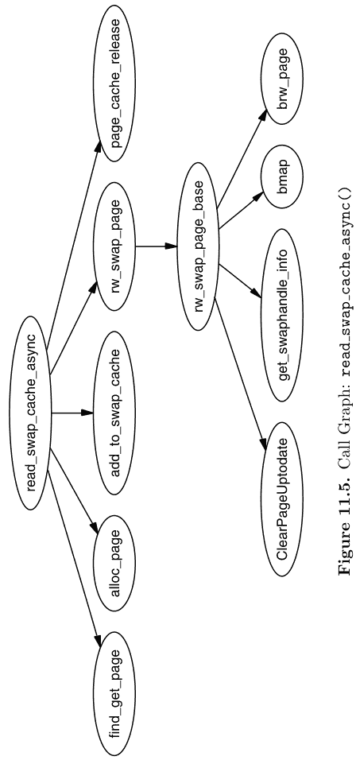

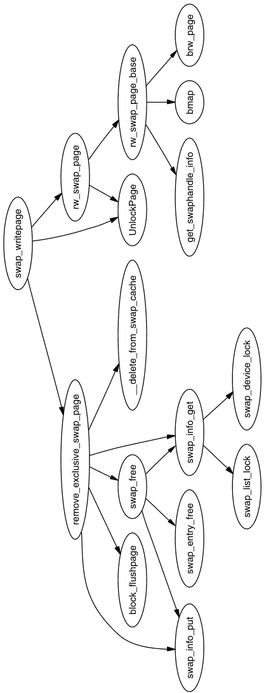

如果它仍然存在于交换缓存中，则调用 `rw_swap_page()` 将数据写入后备存储。

## 11.7 读写交换区域块

读写交换区域的顶层函数是 `rw_swap_page()`。该函数确保所有操作都通过交换缓存执行，以防止更新丢失。`rw_swap_page_base()` 是执行实际工作的核心函数。

它首先检查操作是否为读取。如果是，则使用 `ClearPageUptodate()` 清除 `uptodate` 标志，因为如果需要通过 I/O 填充数据，则页面显然不是最新的。如果页面从磁盘成功读取，则此标志将再次设置。然后调用 `get_swaphandle_info()` 获取交换文件的 inode 的交换分区设备。这些是块层所需的，块层将执行实际的 I/O。

核心函数可以与交换分区或文件一起工作，因为它使用块层函数 `brw_page()` 来执行实际的磁盘 I/O。如果交换区域是文件，则使用 `bmap()` 填充本地数组，该数组包含文件系统中包含页面数据的所有块的列表。请记住，文件系统可能有自己的文件和磁盘存储方法，并不像交换分区那样简单，在交换分区中信息可以直接写入磁盘。如果后备存储是分区，则只需要对一个页面大小的块进行 I/O，并且由于不涉及文件系统，因此不需要 `bmap()`。

在知道必须读取或写入哪些块之后，使用 `brw_page()` 执行正常的块 I/O 操作。所有执行的 I/O 都是异步的，因此函数很快返回。I/O 完成后，块层将解锁页面，任何等待的进程都将唤醒。

## 11.8 激活交换区域

既然你已经了解了什么是交换区域、它们如何表示以及如何跟踪页面，现在是时候看看它们如何组合在一起来激活一个区域了。激活一个区域在概念上非常简单：打开文件，从磁盘加载头信息，填充 `swap_info_struct` 并将其添加到交换列表。

负责激活交换区域的函数是 `sys_swapon()`，它有两个参数：交换区域特殊文件的路径和一组标志。在交换被激活期间，持有***大内核锁（BKL)***，这防止任何应用程序在此操作执行期间进入内核空间。该函数相当大，但可以分解为以下简单步骤：

1. 在 `swap_info` 数组中找到一个空闲的 `swap_info_struct`，并用默认值初始化它。
2. 调用 `user_path_walk()`，遍历所提供 `specialfile` 的目录树，并用文件的可用数据填充 `namidata` 结构，例如 `dentry` 和存储它的文件系统信息（`vfsmount`）。
3. 填充与交换区域尺寸和如何找到它相关的 `swap_info_struct` 字段。如果交换区域是分区，则在计算大小之前将块大小配置为 `PAGE_SIZE`。如果是文件，则直接从 `inode` 获取信息。
4. 确保该区域尚未被激活。如果没有，则从内存中分配一个页面并读取交换区域的第一个页面大小的槽位。此页面包含诸如良好槽位数量以及如何填充 `swap_info_struct`→`swap_map` 的坏条目等信息。
5. 使用 `vmalloc()` 为 `swap_info_struct`→`swap_map` 分配内存，并将每个条目初始化为 0（表示良好槽位）或 `SWAP_MAP_BAD`（否则）。理想情况下，头信息将是版本 2 文件格式，因为版本 1 对于具有 x86 等 4KiB 页面大小的架构仅限于略低于 128MiB 的交换区域。³
6. 在确保头信息中指示的信息与实际交换区域匹配后，填充 `swap_info_struct` 中的其余信息，例如最大页面数和可用良好页面数。更新 `nr_swap_pages` 和 `total_swap_pages` 的全局统计信息。
7. 交换区域现在已完全激活并初始化，因此根据新激活区域的优先级将其插入到交换列表中的正确位置。

在函数末尾释放 BKL，系统现在有一个新的交换区域可用于分页。

## 11.9 停用交换区域

与激活交换区域相比，停用交换区域的代价极其高昂。主要问题是该区域不能简单地被移除。每个已换出的页面现在必须再次换入。正如没有快速的方法将 `struct page` 映射到引用它的每个 PTE 一样，也没有快速的方法将交换条目映射到 PTE。这需要遍历所有进程页表，以查找引用要停用的交换区域的 PTE 并将其换入。当然，这意味着如果物理内存不可用，交换停用将失败。

负责停用区域的函数，可以预见地，称为 `sys_swapoff()`。该函数主要关注更新 `swap_info_struct`。将每个已换出页面换入的主要任务是 `try_to_unuse()` 的责任，这是*极其*昂贵的。对于 `swap_map` 中使用的每个槽位，必须遍历进程的页表来搜索它。在最坏的情况下，可能必须遍历属于所有 `mm_struct` 的所有页表。因此，停用区域的任务大致如下：

1. 调用 `user_path_walk()` 获取有关要停用的特殊文件的信息，然后获取 BKL。
2. 从交换列表中移除 `swap_info_struct`，并更新全局统计信息，包括可用的交换页数（`nr_swap_pages`）和交换条目总数（`total_swap_pages`）。获取这些信息后，可以再次释放 BKL。
3. 调用 `try_to_unuse()`，该函数会将待停用交换区中的所有页面换入内存。该函数使用 `find_next_to_unuse()` 遍历交换映射，以查找下一个已使用的交换槽。对于找到的每个已使用槽，它执行以下操作：
   - 调用 `read_swap_cache_async()` 为保存在磁盘上的槽分配页面。理想情况下，该页面已经存在于交换缓存中，但如果没有，则会调用页面分配器。
   - 等待页面完全换入并将其锁定。锁定后，对所有引用该页面的进程的 PTE 调用 `unuse_process()`。该函数遍历页表以查找相关的 PTE，然后将其更新为指向 `struct page`。如果该页面是共享内存页面且没有剩余引用，则改为调用 `shmem_unuse()`。
   - 释放所有永久映射的槽。虽然认为槽永远不会被永久保留，但仍需承担此风险。
   - 从交换缓存中删除该页面，以防止 `try_to_swap_out()` 引用它，避免其在交换映射中仍留有引用。
4. 如果没有足够的可用内存将所有条目换入，则该交换区将被重新插入到运行中的系统中，因为它不能被简单丢弃。如果成功，则 `swap_info_struct` 被置于未初始化状态，并且 `swap_map` 内存通过 `vfree()` 释放。

## 11.10 2.6 中的新特性

`struct swap_info_struct` 最重要的新增内容是一个名为 `extent_list` 的链表和一个称为 `curr_swap_extent` 的缓存字段，用于实现扩展区（extents）。

扩展区由 `struct swap_extent` 表示，将交换区中连续的页面范围映射到连续的磁盘块范围。这些扩展区在 swapon 时由 `setup_swap_extents()` 函数设置。对于块设备，将只有一个交换扩展区，这不会提高性能，但设置扩展区后，由块设备或常规文件支持的交换区可以被同样对待。


对于交换文件，这可能会产生很大差异，交换文件将具有多个扩展区，表示在块中聚集在一起的页面范围。当搜索特定偏移处的页面时，将遍历扩展区列表。为了提高搜索速度，最后搜索的扩展区将被缓存在`swap_extent→curr_swap_extent`中。

## 第 12 章

### 共享内存虚拟文件系统

通过文件或设备支持的内存区域进行共享，只需使用`MAP_SHARED`标志调用`mmap()`即可。然而，有两种重要情况需要在进程之间共享匿名区域。第一种是使用`MAP_SHARED`调用`mmap()`且没有文件支持时。执行`fork()`后，这些区域将在父进程和子进程之间共享。第二种情况是使用`shmget()`显式设置区域，并使用`shmat()`将其附加到虚拟地址空间。

当 VMA 中的页面由磁盘上的文件支持时，使用的接口很简单。在页面故障期间读取页面时，所需的`nopage()`函数位于`vm_area_struct→vm_ops`中。将页面写入后备存储时，适当的`writepage()`函数通过`inode→i_mapping→a_ops`或 alternatively 使用`page→mapping→a_ops`在`address_space_operations`中找到。当正常的文件操作正在进行时，例如`mmap()`、`read()`和`write()`，通过`inode→i_fop`等找到具有相应函数的`struct file_operations`。这些关系如图 4.2 所示。

这是一个非常简洁的接口，概念上易于理解，但它对匿名页面没有帮助，因为没有文件支持。为了保持这个良好的接口，Linux 使用基于 RAM 的文件系统为匿名页面创建人工文件支持，其中每个 VMA 都由该文件系统中的文件支持。文件系统中的每个 inode 都放置在一个名为`shmem_inodes`的链表中，以便始终可以轻松找到它。这允许使用相同的基于文件的接口，而无需将匿名页面视为特殊情况。

该文件系统有两种变体，称为`shm`和`tmpfs`。它们共享核心功能，主要区别在于它们的用途。`shm`供内核使用，用于为匿名页面创建文件支持，以及为由`shmget()`创建的区域提供支持。该文件系统通过`kern_mount()`挂载，因此它是内部挂载的，对用户不可见。`tmpfs`是一个临时文件系统，可以选择性地挂载在`/tmp/`上，以拥有一个快速的基于 RAM 的临时文件系统。`tmpfs`的第二个用途是将其挂载在`/dev/shm/`上。在`tmpfs`文件系统中`mmap()`文件的进程将能够在它们之间共享信息，作为 System V 进程间通信（IPC）机制的替代。无论使用类型如何，`tmpfs`必须由系统管理员显式挂载。

本章首先描述虚拟文件系统的实现方式。从那里开始，我讨论共享区域的设置和销毁，然后再讨论如何使用这些工具来实现 System V IPC 机制。

### 12.1 初始化虚拟文件系统

虚拟文件系统由函数`init_tmpfs()`初始化，如图 12.1 所示，在系统启动或模块加载时进行。该函数注册两个文件系统`tmpfs`和`shm`，并使用`kern_mount()`将`shm`挂载为内部文件系统。然后计算文件系统中可以存在的最大块数和 inode 数。剂。作为注册的一部分，函数`shmem_read_super()`用作回调，用有关文件系统的更多信息填充`struct super_block`，例如使块大小等于页面大小。

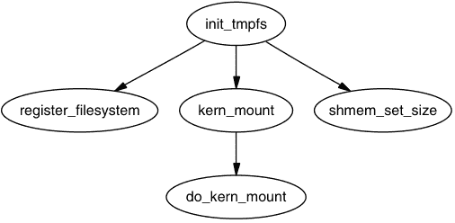

**图 12.1.** 调用图：`init_tmpfs()`

在文件系统中创建的每个 inode 都会有一个关联的`struct shmem_inode_info`，其中包含特定于该文件系统的私有信息。函数`SHMEM_I()`以 inode 作为参数，并返回指向此类型结构体的指针。它在`<linux/shmem_fs.h>`中声明如下：

```
 20 struct shmem_inode_info {
 21     spinlock_t         lock;
 22     unsigned long      next_index;
 23     swp_entry_t        i_direct[SHMEM_NR_DIRECT];
 24     void               **i_indirect;
 25     unsigned long      swapped;
 26     unsigned long      flags;
 27     struct list_head   list;
 28     struct inode       *inode;
 29 };
```

字段如下：

- **lock** 是一个自旋锁，用于保护 inode 信息免受并发访问。

- **next_index** 是文件中最后使用的页面的索引。在文件被截断期间，这将与`inode→i_size`不同。

- **i_direct** 是一个直接块，包含文件使用的前`SHMEM_NR_DIRECT`个交换向量。参见第 12.4.1 节。

- **i_indirect** 是指向第一个间接块的指针。参见第 12.4.1 节。

- **swapped** 是当前已交换出去的属于该文件的页面数。

- **flags** 目前仅用于记住该文件是否属于由`shmget()`设置的共享区域。通过指定`SHM_LOCK`和`shmctl()`设置，通过指定`SHM_UNLOCK`解锁。

- **list** 是文件系统使用的所有 inode 的列表。

- **inode** 是指向父 inode 的指针。

### 12.2 使用 shmem 函数

不同的结构体包含指向 shmem 特定函数的指针。在所有情况下，tmpfs 和 shm 共享相同的结构体。

对于页面故障换入和写入后备存储，声明了两个结构体`shmem_aops`和`shmem_vm_ops`，分别为类型`struct address_space_operations`和`struct vm_operations_struct`。

地址空间操作`struct shmem_aops`包含指向少量函数的指针，其中最重要的是`shmem_writepage()`，当页面从页面缓存移动到交换缓存时调用。`shmem_removepage()`在从页面缓存中移除页面时调用，以便回收该块。`shmem_readpage()`不被 tmpfs 使用，但提供它是为了让`sendfile()`系统调用可以与 tmpfs 文件一起使用。`shmem_prepare_write()`和`shmem_commit_write()`也未使用，但提供它们是为了让 tmpfs 可以与环回设备一起使用。`shmem_aops`在`mm/shmem.c`中声明如下：

```
1500 static struct address_space_operations shmem_aops = {
1501     removepage:   shmem_removepage,
1502     writepage:    shmem_writepage,
1503 #ifdef CONFIG_TMPFS
1504     readpage:     shmem_readpage,
1505     prepare_write: shmem_prepare_write,
1506     commit_write: shmem_commit_write,
1507 #endif
1508 };
```

匿名虚拟内存区域使用`shmem_vm_ops`作为`vm_operations_struct`，以便在发生缺页中断时调用`shmem_nopage()`。其声明如下：

```
1426 static struct vm_operations_struct shmem_vm_ops = {
1427     nopage: shmem_nopage,
1428 };
```

要对文件和 inode 执行操作，需要两个结构体：`file_operations`和`inode_operations`。`file_operations`称为`shmem_file_operations`，提供了实现`mmap()`、`read()`、`write()`和`fsync()`的函数。其声明如下：

```
1510 static struct file_operations shmem_file_operations = {
1511     mmap:          shmem_mmap,
1512 #ifdef CONFIG_TMPFS
1513     read:          shmem_file_read,
1514     write:         shmem_file_write,
1515     fsync:         shmem_sync_file,
1516 #endif
1517 };
```

提供了三组`inode_operations`。第一组是`shmem_inode_operations`，用于文件 inode。第二组称为`shmem_dir_inode_operations`，用于目录。最后一对称为`shmem_symlink_inline_operations`和`shmem_symlink_inode_operations`，用于符号链接。

支持的两个文件操作是`truncate()`和`setattr()`，它们存储在名为`shmem_inode_operations`的`struct inode_operations`中。`shmem_truncate()`用于截断文件。当文件属性发生变化时，会调用`shmem_notify_change()`。除其他功能外，这还允许通过`truncate()`扩展文件，并使用全局零页作为数据页。`shmem_inode_operations`的声明如下：

目录的`inode_operations`提供了`create()`、`link()`和`mkdir()`等函数。它们的声明如下：

```
1524 static struct inode_operations shmem_dir_inode_operations = {
1525 #ifdef CONFIG_TMPFS
1526     create:        shmem_create,
1527     lookup:        shmem_lookup,
1528     link:          shmem_link,
1529     unlink:        shmem_unlink,
1530     symlink:       shmem_symlink,
1531     mkdir:         shmem_mkdir,
1532     rmdir:         shmem_rmdir,
1533     mknod:         shmem_mknod,
1534     rename:        shmem_rename,
1535 #endif
1536 };
```

最后一对操作用于符号链接。它们的声明如下：

```
1354 static struct inode_operations shmem_symlink_inline_operations = {
1355        readlink:      shmem_readlink_inline,
1356        follow_link:   shmem_follow_link_inline,
1357 };
1358
1359 static struct inode_operations shmem_symlink_inode_operations = {
1360        truncate:      shmem_truncate,
1361        readlink:      shmem_readlink,
1362        follow_link:   shmem_follow_link,
1363 };
```

这两组`readlink()`和`follow_link()`函数的区别与链接信息的存储位置有关。符号链接 inode 不需要私有 inode 信息结构体`shmem_inode_information`。如果符号链接名称的长度小于此结构体，则使用 inode 中的空间来存储名称，此时`shmem_symlink_inline_operations`成为 inode 操作结构体。否则，使用`shmem_getpage()`分配一个页面，将符号链接复制到其中，并使用`shmem_symlink_inode_operations`。第二个结构体包含`truncate()`函数，以便在文件删除时回收该页面。

这些各种结构体确保当区域由虚拟文件支持时，会使用 shmem 等效的与 inode 相关的操作。当它们被使用时，绝大多数虚拟内存系统看不出由真实文件支持的页面与由虚拟文件支持的页面之间有任何区别。

### 12.3 在 tmpfs 中创建文件

由于 tmpfs 被挂载为一个对用户可见的正式文件系统，它必须支持目录 inode 操作，如`open()`、`mkdir()`和`link()`。指向 tmpfs 实现这些操作的函数的指针在`shmem_dir_inode_operations`中提供，如 12.2 节所示。

这些函数中绝大多数的实现都相当小，并且在某种程度上，它们都是相互关联的，如图 12.2 所示。它们都共享相同的基本原则，即在虚拟文件系统中对 inode 执行一些操作，而大多数 inode 字段由`shmem_get_inode()`填充。

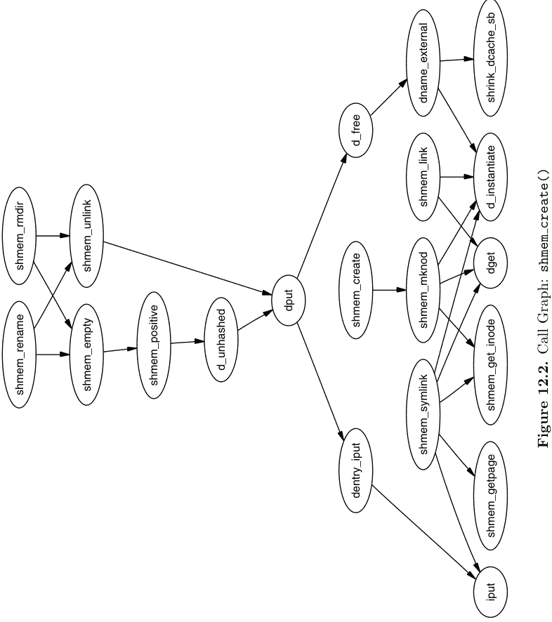

### 图 12.2. 调用图：`shmem_create()`

创建新文件时，调用的顶层函数是`shmem_create()`。这个小函数调用`shmem_mknod()`并添加`S_IFREG`标志，以便创建常规文件。`shmem_mknod()`基本上是`shmem_get_inode()`的包装器，后者顾名思义创建一个新的 inode 并填充结构体字段。填充的三个主要字段是`inode→i_mapping→a_ops`、`inode→i_op`和`inode→i_fop`。inode 创建完成后，`shmem_mknod()`更新目录 inode 的`size`和`mtime`统计信息，然后实例化新 inode。

即使文件系统在功能上基本相同，文件在`shm`中的创建方式也不同。这些文件的创建方式将在 12.7 节后面介绍。

### 12.4 虚拟文件中的缺页中断

当发生缺页中断时，`do_no_page()`如果存在`vma→vm_ops→nopage`就会调用它。对于虚拟文件系统，这意味着当发生缺页中断时将调用函数`shmem_nopage()`，其调用图如图 12.3 所示。

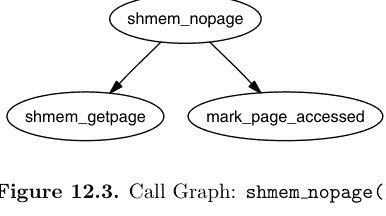

这里的核心函数是`shmem_getpage()`，它负责分配新页面或在交换区中查找页面。这种故障类型的重载是不寻常的，因为通常`do_swap_page()`负责使用 PTE 中编码的信息查找已移动到交换缓存或后备存储的页面。在这种情况下，由虚拟文件支持的页面在移动到交换缓存时，其 PTE 被设置为 0。inode 的私有文件系统数据存储直接和间接块信息，用于稍后定位页面。这个操作在许多方面与普通缺页中断非常相似。

#### 12.4.1 定位已交换页面

当页面被换出时，`swp_entry_t`将包含再次定位页面所需的信息。不使用 PTE 来完成此任务，信息存储在 inode 中文件系统特定的私有信息中。

发生故障时，用于定位交换条目的函数是`shmem_alloc_entry()`。它的基本任务是执行基本检查，并确保`shmem_inode_info→next_index`始终指向虚拟文件末尾的页面索引。它的主要任务是调用`shmem_swp_entry()`，该函数使用`shmem_swp_entry()`在 inode 信息中搜索交换向量，并在必要时分配新页面来存储交换向量。

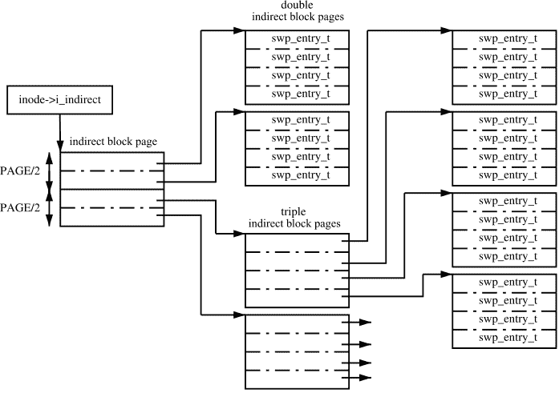

### 图 12.4. 遍历虚拟文件中的间接块

前`SHMEM_NR_DIRECT`个条目存储在`inode→i_direct`中。这意味着，对于 x86，小于 64KiB（`SHMEM_NR_DIRECT * PAGE_SIZE`）的文件不需要使用间接块。较大的文件必须使用间接块，从`inode→i_indirect`处的间接块开始。

初始间接块（`inode→i_indirect`）被分成两半。前半部分包含指向双重间接块的指针，后半部分包含指向三重间接块的指针。双重间接块是包含交换向量（`swp_entry_t`）的页面。三重间接块包含指向页面的指针，这些页面又填充了交换向量。不同级别间接块之间的关系如图 12.4 所示。这种关系意味着虚拟文件中的最大页面数（`SHMEM_MAX_INDEX`）在`mm/shmem.c`中定义如下：

```
44 #define SHMEM_MAX_INDEX  (
        SHMEM_NR_DIRECT +
        (ENTRIES_PER_PAGEPAGE/2) *
        (ENTRIES_PER_PAGE+1))
```

#### 12.4.2 将页面写入交换区

`shmem_writepage()`函数是文件系统`address_space_operations`中注册的将页面写入交换区的函数。该函数简单地负责将页面从页面缓存移动到交换缓存。这是


只需几个简单步骤即可实现：

1. 记录当前 `page->mapping` 以及 inode 的相关信息。
2. 使用 `get_swap_page()` 在后端存储中分配一个空闲槽位。
3. 使用 `shmem_swp_entry()` 分配一个 `swp_entry_t`。
4. 将页面从页缓存中移除。
5. 将页面添加到交换缓存。如果失败，则释放交换槽位，重新添加回页缓存，然后重试。

## 12.5 tmpfs 中的文件操作

虚拟文件支持四种操作：`mmap()`、`read()`、`write()` 和 `fsync()`。这些函数的指针存储在 `shmem_file_operations` 中，如 12.2 节所示。

这些操作的实现没有什么特别之处，其详细内容已在代码注释中涵盖。`mmap()` 操作由 `shmem_mmap()` 实现，它只是更新管理映射区域的 VMA。`read()` 由 `shmem_read()` 实现，执行将字节从虚拟文件复制到用户空间缓冲区的操作，必要时触发页面故障。`write()` 由 `shmem_write()` 实现，本质上与 `read()` 相同。`fsync()` 操作由 `shmem_file_sync()` 实现，但它本质上是一个空操作，因为不执行任何任务，只是返回 0 表示成功。由于文件仅存在于 RAM 中，因此它们不需要与任何磁盘同步。

## 12.6 tmpfs 中的 INode 操作

inode 支持的最复杂操作是截断，它涉及四个不同的阶段。第一阶段在 `shmem_truncate()` 中，会截断文件末尾的部分页面，并不断调用 `shmem_truncate_indirect()` 直到文件截断到合适的大小。每次调用 `shmem_truncate_indirect()` 只处理一个间接块，因此可能需要多次调用。

第二阶段在 `shmem_truncate_indirect()` 中，它理解双重间接块和三重间接块。它找到需要截断的下一个间接块。这个间接块会传递给第三阶段，其中将包含指向页面的指针，而这些页面又包含交换向量。

第三阶段 `shmem_truncate_direct()` 处理包含交换向量的页面。它选择需要截断的范围，并将范围传递给最后阶段 `shmem_swp_free()`。最后阶段使用 `free_swap_and_cache()` 释放条目，这会同时释放交换条目和包含数据的页面。

文件的链接和取消链接非常简单，因为大部分工作由文件系统层完成。要链接文件，目录 inode 大小递增，受影响 inode 的 `ctime` 和 `mtime` 被更新，被链接到的 inode 的链接数递增。然后使用 `dget()` 获取新 `dentry` 的引用，再使用 `d_instantiate()` 实例化新 `dentry`。取消链接在递减 `dentry` 引用（使用 `dput()`）之前更新相同的 inode 统计信息。`dput()` 还会调用 `iput()`，当引用计数归零时清理 inode。

创建目录将使用 `shmem_mkdir()` 执行此任务。它只是使用带 `S_IFDIR` 标志的 `shmem_mknod()`，然后递增父目录 inode 的 `i_nlink` 计数。函数 `shmem_rmdir()` 将删除目录，首先使用 `shmem_empty()` 确保目录为空。如果为空，函数则递减父目录 inode 的 `i_nlink` 计数，并调用 `shmem_unlink()` 移除请求的目录。

## 12.7 设置共享区域

共享区域由在 `shm` 中创建的文件提供支持。有两种情况会创建新文件：使用 `shmget()` 设置共享区域时，以及使用带 `MAP_SHARED` 标志的 `mmap()` 设置匿名区域时。两个函数都使用核心函数 `shmem_file_setup()` 创建文件。

由于文件系统是内部的，创建的文件名称不需要唯一，因为文件总是通过 inode 而非名称来定位。因此，`shmem_zero_setup()`（见图 12.5）总是创建名为 `dev/zero` 的文件，这也是它在文件 `/proc/pid/maps` 中的显示方式。由 `shmget()` 创建的文件称为 `SYSVNN`，其中 `NN` 是传递给 `shmget()` 的密钥。

核心函数 `shmem_file_setup()` 只是创建新的 dentry 和 inode，填充相关字段并实例化它们。

## 12.8 System V IPC

IPC 实现的完整内部细节超出了本书的范围。本节仅关注 `shmget()` 和 `shmat()` 的实现以及它们如何受到 VM 的影响。系统调用 `shmget()` 由 `sys_shmget()` 实现，如图 12.6 所示。它对参数执行基本检查并设置与 IPC 相关的数据结构。要创建段，它调用 `newseg()`。该函数使用 `shmem_file_setup()` 在 `shmfs` 中创建文件，如上一节所述。

系统调用 `shmat()` 由 `sys_shmat()` 实现。该函数没有什么特别之处。它获取适当的描述符，确保所有参数有效，然后调用 `do_mmap()` 将共享区域映射到进程地址空间。函数中只有两个值得注意的点。

第一，它负责确保如果调用者指定了地址，VMA 不会重叠。第二是 `shp->shm_nattch` 计数器由名为 `shm_vm_ops` 的 `vm_operations_struct()` 维护。它注册 `open()` 和 `close()` 回调，分别称为 `shm_open()` 和 `shm_close()`。`shm_close()` 回调还负责在指定了 `SHM_DEST` 标志且 `shm_nattch` 计数器达到零时销毁共享区域。

## 12.9 2.6 中的新特性

文件系统的核心概念和功能保持不变，变化要么是优化，要么是对文件系统功能的扩展。如果读者对 2.4 的实现有很好的理解，2.6 的实现不会造成太大困难。[^1]

`shmem_inode_info` 中新增了一个名为 `alloced` 的字段。`alloced` 字段存储分配给文件的数据页面数量，这在 2.4 中必须根据 `inode->i_blocks` 实时计算。它既节省了一些常见操作的时钟周期，又使代码更易读。

`flags` 字段现在使用 `VM_ACCOUNT` 标志以及 `VM_LOCKED` 标志。`VM_ACCOUNT` 始终设置，意味着 VM 会仔细核算使用的内存量，以确保分配不会失败。

文件操作的扩展包括：能够使用系统调用 `_llseek()` 进行寻址，由 `generic_file_llseek()` 实现；以及能够对虚拟文件使用 `sendfile()`，由 `shmem_file_sendfile()` 实现。VMA 操作还增加了一个扩展，允许非线性映射，由 `shmem_populate()` 实现。

最后一个重大变化是文件系统负责自身 inode 的分配和销毁，这是 `struct super_operations` 中的两个新回调。它的简单实现是创建一个名为 `shmem_inode_cache` 的 slab 缓存。一个构造函数 `init_once()` 注册给 slab 分配器，用于初始化每个新 inode。

> [^1]: 我发现说"这能有多难"总是有帮助的。

---

# 直通式监控器

## 用户手册

直通式监控概念简介

6690521A

2004 年 3 月

REV A

---

# 第 13 章 内存不足管理

我要讨论的 VM 最后一个方面是内存不足（OOM）管理器。这故意是一个很短的章节，因为它只有一个简单的任务：检查是否有足够的可用内存来满足需求，确认系统确实内存不足，如果是，则选择一个进程杀死。这是 VM 中有争议的部分，曾多次建议将其移除。无论它是否存在于最新内核中，它仍然是一个值得研究的系统，因为它涉及许多其他子系统。

## 13.1 检查可用内存

对于某些操作，例如使用 `brk()` 扩展堆或使用 `mremap()` 重新映射地址空间，系统会检查是否有足够的可用内存来满足请求。请注意，这与下一节介绍的 `out_of_memory()` 路径是分开的。此路径用于尽可能避免系统处于 OOM 状态。

检查可用内存时，所需页面数作为参数传递给 `vm_enough_memory()`。除非系统管理员指定系统应超量承诺内存，否则会检查可用内存量。为了确定可能有多少页面可用，Linux 对以下数据求和：

- **页面缓存总量**，因为页面缓存很容易回收。
- **空闲页面总数**，因为它们已经可用。
- **空闲交换页面总数**，因为用户空间页面可能被换出。
- **swapper_space 管理的页面总数** 然而，这会重复计算空闲交换页面。这被有时保留但未使用的槽位所平衡。
- **dentry 缓存使用的页面总数**，因为它们很容易回收。
- **inode 缓存使用的页面总数**，因为它们很容易回收。

如果此处添加的页面总数足以满足请求，`vm_enough_memory()` 向调用者返回 true。如果返回 false，调用者知道内存不可用，通常决定向用户空间返回 `-ENOMEM`。

## 13.2 判定 OOM 状态

当机器内存不足时，旧的页框将被回收（参见第 10 章），但是，尽管进行了页面回收，系统可能会发现即使在最高优先级扫描时，也无法释放足够的页面来满足请求。如果确实无法释放页框，则会调用 `out_of_memory()` 来检查系统是否内存耗尽并需要终止一个进程。该函数的调用关系图如图 13.1 所示。

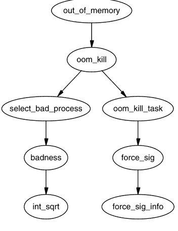

**图 13.1.** 调用关系图：`out_of_memory()`

不幸的是，系统可能并未真正内存耗尽，而只是需要等待 I/O 完成或页面换出到后备存储。这很不幸，并非因为系统还有内存，而是因为该函数被不必要地调用，这就存在进程被不必要终止的可能性。在决定终止进程之前，系统会执行以下检查清单。

- 是否还有足够的交换空间（`nr_swap_pages > 0`）？如果是，则不是 OOM。
- 距离上次失败是否已超过 5 秒？如果是，则不是 OOM。
- 是否在最近一秒内失败过？如果不是，则不是 OOM。
- 如果在最近 5 秒内失败次数不足 10 次，则不是 OOM。
- 是否在最近 5 秒内已经终止过一个进程？如果是，则不是 OOM。

只有通过了上述测试，`oom_kill()` 才会被调用来选择一个进程终止。

## 13.3 选择进程

函数 `select_bad_process()` 负责选择一个要终止的进程。它通过遍历每个运行中的任务，并使用函数 `badness()` 计算该进程被终止的适宜程度来做出决定。适宜程度的计算方式如下。平方根是使用 `int_sqrt()` 计算的整数近似值：

```
badness_for_task = total_vm_for_task / (√(cpu_time_in_seconds) * ∜(cpu_time_in_minutes))
```

这样计算是为了选择一个使用大量内存但运行时间不长的进程。长时间运行的进程不太可能是导致内存短缺的原因，因此这种计算方式很可能会选择一个使用大量内存但运行时间不长的进程。如果进程是 root 进程或具有 `CAP_SYS_ADMIN` 权限，得分将除以四，因为假定具有 root 权限的进程表现良好。类似地，如果进程具有 `CAP_SYS_RAWIO` 权限（访问原始设备），得分会再除以四，因为终止具有直接硬件访问权限的进程是不可取的。

## 13.4 终止选中的进程

选中任务后，系统会再次遍历列表，并向与选中进程共享同一 `mm_struct` 的每个进程（即它们的线程）发送信号。如果进程具有 `CAP_SYS_RAWIO` 权限，则发送 `SIGTERM` 信号，以便进程有机会干净地退出。否则，发送 `SIGKILL` 信号。

## 13.5 就这些吗？

是的，就这些。OOM 管理涉及很多子系统，但除此之外，没有太多内容。

## 13.6 2.6 版本的新特性

2.6 版本的 OOM 管理大部分保持基本相同，除了引入了 VM 记账对象。这些是标记有 `VM_ACCOUNT` 标志的 VMA，首次在第 4.8 节中提到。在执行涉及设置了此标志的 VMA 的操作时，会进行额外的检查以确保有可用内存。引入这种复杂性的主要动机是避免使用 OOM killer。

一些始终设置 `VM_ACCOUNT` 标志的区域包括：进程栈、进程堆、使用 `MAP_SHARED` `mmap()` 的区域、可写的私有区域以及使用 `shmget()` 设置的区域。换句话说，大多数用户空间映射都设置了 `VM_ACCOUNT` 标志。

Linux 使用 `vm_acct_memory()` 来统计已分配给这些 VMA 的内存量，该函数会递增一个名为 `committed_space` 的变量。当 VMA 被释放时，使用 `vm_unacct_memory()` 来减少已提交的空间。这是一个相当简单的机制，但它允许 Linux 在决定是否应该分配更多内存时，记住已经向用户空间承诺了多少内存。

这些检查通过调用 `security_vm_enough_memory()` 来执行，这引入了另一个新特性。2.6 版本提供了一项功能，允许与安全相关的内核模块覆盖某些内核函数。可用钩子的完整列表存储在一个名为 `security_ops` 的 `struct security_operations` 中。有许多虚拟（或默认）函数可供使用，它们都列在 `security/dummy.c` 中，但大多数除了返回外什么都不做。如果没有加载安全模块，则使用的 `security_operations` 结构体称为 `dummy_security_ops`，它使用所有默认函数。

默认情况下，`security_vm_enough_memory()` 调用 `dummy_vm_enough_memory()`，该函数在 `security/dummy.c` 中声明，与 2.4 版本的 `vm_enough_memory()` 函数非常相似。新版本将以下几部分信息相加来确定可用内存：

- **总页缓存** 因为页缓存很容易被回收。
- **总空闲页面** 因为它们已经可用。
- **总空闲交换页面** 因为用户空间页面可能被换出。
- **设置了 `SLAB_RECLAIM_ACCOUNT` 的 Slab 页面** 因为它们很容易被回收。

这些页面，减去为 root 进程保留的 3%，就是可用于该请求的内存总量。如果内存可用，它会检查已提交内存总量是否超过允许阈值。允许的阈值是 `TotalRam * (OverCommitRatio/100) + TotalSwapPage`，其中 `OverCommitRatio` 由系统管理员设置。如果已提交空间总量不太高，则返回 1，以便分配可以继续进行。

# 第 14 章 结语

毋庸置疑，内存管理是一个庞大、复杂且耗时的研究领域，难以应用于实际实现。因为很难对多道程序设计系统中的实际行为进行建模 [CD80]，开发人员往往依赖直觉来指导，而对虚拟内存算法的考察则依赖于对特定工作负载的模拟。模拟是必要的，因为对调度、分页行为和多进程如何交互进行建模是一个相当大的挑战。页面替换策略就是一个很好的例子，这个领域一直是大量研究的重点，但它只在特定工作负载下表现良好这个问题才被证实。调整算法和策略以适应不同工作负载的问题，既通过管理员调整系统，也通过研究和算法来解决。

Linux 内核同样是庞大、复杂的，只有相对较少的核心人员能够完全理解。它的发展是数千名程序员贡献的结果，他们的专业、背景和业余时间各不相同。最初的实现是基于理论提供的重要基础开发的。贡献者在此基础上根据现实世界的观察进行了改进。

在 Linux 内存管理邮件列表上曾有人断言，VM 文档不足且难以掌握，因为"实现很难理解"¹，而且缺乏关于实际 VM 的文档并非 Linux 所独有。Matt Dillon 是 FreeBSD VM² 的主要开发人员之一，被认为是 "VMinton 的 VM 大师"，他在一次采访中²表示，文档可能"难以获得"。解读实现的主要困难之一是，开发人员必须具备内存管理理论的背景，才能理解为什么做出这样的实现决策，因为纯粹理解代码对于除了微优化之外的任何目的都是不够的。

本书试图弥合内存管理理论与 Linux 实际实现之间的差距，并将两个领域集中在一起描述。它试图描述在 Linux 中作为内存管理器是怎样的生活

> ¹http://mail.nl.linux.org/linux-mm/2002-05/msg00035.html
>
> ²他从前的 Linux VM 参与经历可以从 http://mail.nl.linux.org/linux-mm/2000-05/msg00419.html 看出。
>
> ²http://kerneltrap.com/node.php?id=8

## 图 14.1. VM 子系统交互的宏观概览

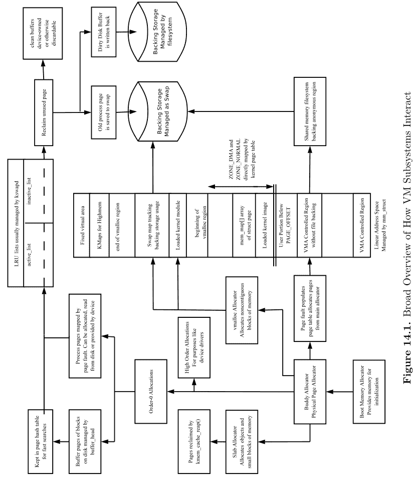

以一种相对独立于硬件架构考虑的方式。我希望在阅读完本章并继续研读代码注释之后，您——读者——能够对应对 VM 子系统感到更加得心应手。作为最后的临别赠言，图 14.1  broadly 展示了我在前面详细讨论过的各个子系统之间是如何相互交互的。

最后，以个人名义，我希望这本书能够鼓励其他人为内核的其他领域创作类似的著作。我知道我一定会买的！


分类器通过减小输入与目标输出之间的误差来学习，在我们的案例中，输入可以自然地定义为数据集合，目标则是标签集合。这也被称为最小体积集估计（MVSE）（Schölkopf, 2004; Scott and Nowak, 2006; Saberian, 2016）。设 `Z = X × Y` 表示标签和数据的联合分布，其自然权重由类别比例和原子决定，取值于 `Z = X × 2^Y`。一般而言，MVSE 往往与正类分布的支集重合（Geblein, 1939），因此能够凸显给定数据下的所有信息性区域。参数化体积的一个自然概念是使用函数 `h : Z → {−, +}` 的水平集，其阈值为 `θ`（Müller et al., 2001），即：`Vθ := {(x, y) ∈ Z : h(x, y) ≥ θ}`（Scott and Nowak, 2006）。于是，`h` 被识别为 LVQ，在经验情形中，通过对体积 `Vθ` 在概率大于 `γ` 的条件下进行最小化，并利用 `θ` 来确定后者。误差随后可以分解为关于标签的加权和（Blanchard et al., 2010）：

```
L_{\mu}(h, \theta) := \sum_{i=1}^{P} \mathbb{1}_{v_i}(h(x_i, v_i) \leq \theta). \quad (1)
```

当阈值也被学习时，(1) 变为：

```
L_{\mu}(h, \theta) := \gamma(\theta - \sum_{i=1}^{P} h(x_i, v_i) + \theta).
```

为了发展正规形式，我们现在考虑损失目标可以具有任意的 `h`。在所提出的不一致问题中，最优解也可能用多数符号来刻画。这通常是通过将误分类误差（相对于贝叶斯最优分类器或全局最优）从函数分解为近似误差和估计误差来实现的；在这种与模型无关的理论中，误差不能涉及 `h`。解决这一问题的一种经典方法是引入误分类误差（测量为与每类负类和正类所达到最低体积的差异，随后进行聚合）。后者假设 `˜h` 是 `˜hv` 的一个 minor，且所有解都考虑 `L_0` 范数。这通常难以优化，因此一般假设 `h` 属于某个函数族 `H`。此外，通常的做法是使用替代损失，在我们的案例中，根据上述内容，可以自然地用正负期望以及相关的正负分布来描述：我们可以定义 `L+ = E[h(x, y)−|−]`，`L− = E[h(x, y)+|−]`。鉴于正则化项旨在在 PVQ 的每一侧识别分类函数，分别对应于正侧和负侧，让我们将其推广以定义如下的类别划分损失（注意 `µ_1 = 1−µ`）：

```
L_{\mu}(h, \theta) = \mu L_{+, \theta} + \mu_{1} L_{-, \theta}. \quad (2)
```

在下文中，按顺序同样可以注意到，与负类和正类的 H-函数和 Q-函数相关的风险分解，当它们类型相同时，产生了核心算法的更新和描述，以及此处提出的新 no free lunch 和相关方法。

### 3.1 风险分解与 H-函数和 Q-函数的联系

这里有一个问题：在 no free lunch 损失中，分类器 `h` 相对于两个分区会被错误地最小化多少次？将函数 `H` 和 `Q` 视为引言中所给出的（见方程 (66) 和 (67)）；设对应于 `h+` 的风险为对 (2) 的正侧风险贡献，并类似地获得负类贡献。向未知分布（对标签边缘化）`P^+` 和 `P^−` 的推广，分别通过聚合获得正负样本，是至关重要的一步。它本质上可以视为（经验）风险的推广。在正负类类型固定的情况下，"真实"风险可以表示为 `h+` 的函数，类似地对于 `h−`。考虑正类：参数空间中的损失表示为 `L+(µ(H(h, θ)))`，风险随后可以视为正类分布上的期望（作为参数的函数）：

```
R_{P^{+}(-)}(h, \theta) = E_{P^{+}(h(x,y)-)}[\mu(H(h, \theta))] \quad (3)
```

类似的公式对负类成立，将 `+` 替换为 `−`（在下标中，并将后面的 `µ(H(.))` 替换为 `(1 − µ)Q(.)`），负类上的分布类似地在上方方程 (3) 中获得。于是，未知分布参数 `θ` 上的总风险可以推断为正负贡献沿替代式 (2) 的积分函数（对 `θ` 边缘化，依赖于 `Ω`）：

```
L_{\mu}(h, \theta) = \int_{\theta} R_{P^{+}(-)}(h)d\theta + \int_{\theta} R_{P^{-}(-)}(h)d\theta \quad (4)
```

由于聚合仅在类别上进行，涉及的两个类别中的风险不会在竞争性的一般条件之外发生冲突，也无法进行权衡。这从 (4) 中每个积分可以视为两侧概率分布之差的事实中也同样明显：要求正性迫使整体损失保持非退化。整体损失在双侧概率分布对空间上定义了一个半度量，即对于参数 `α > 0`，具有适当加权的概率分布作为 `µ`（`P^+microadded`；此处不需要，但该扩展对于竞争分布上的加权风险是有用的，且正性约束可以放宽以涉及一般的 Radon 测度）。因此，方程 (4) 中定义的风险继承了分布侧的所有有用度量性质，包括三角不等式。虽然这是一个严格的观点——而且由于条件分布在假设下对两类相同——这些条件自然提供了一种操作优势。这也可用于为损失函数选择合适的正则化类型，以及确保可处理性。

### 3.2 对偶性与正则化

定理 1（对偶）。对于任意 `θ ∈ [0, 1]`，`µ ≠ µ`，以及类型 A 的替代认证，假设正则化参数 `γ*_α`

## 附录 A

### 简介

欢迎来到本书的代码注释部分。如果你正在阅读这部分内容，说明你需要一份对代码的详尽讲解。本注释假定你已经阅读过书中相应的章节，因此，如果你是直接从这里开始阅读的，那你可能找错了地方。

每个附录章节与本书的顺序和结构相对应。函数呈现的顺序与注释中引用的调用图中显示的顺序一致。在每个附录和小节的开始，都有一个微型目录来帮助你浏览注释。代码覆盖率并非100%，但虚拟机中所有主要的代码模式都在这里。如果你感兴趣的函数没有被注释到，请找一个类似的函数。

部分代码在呈现时经过了轻微的重新格式化，但实际代码并未改变。建议你在阅读代码注释时同时使用配套CD。特别推荐使用LXR来浏览源代码，以便体验在有注释帮助和无注释帮助下阅读代码的感觉。

祝你好运！

## 附录 B

## 描述物理内存

#### 目录

| B.1 初始化区域 | 220 |
| --- | --- |
| B.1.1 函数：`setup_memory()` | 220 |
| B.1.2 函数：`zone_sizes_init()` | 223 |
| B.1.3 函数：`free_area_init()` | 224 |
| B.1.4 函数：`free_area_init_node()` | 224 |
| B.1.5 函数：`free_area_init_core()` | 226 |
| B.1.6 函数：`build_zonelists()` | 232 |
| B.2 页面操作 | 234 |
| B.2.1 锁定页面 | 234 |
| B.2.1.1 函数：`lock_page()` | 234 |
| B.2.1.2 函数：`__lock_page()` | 234 |
| B.2.1.3 函数：`sync_page()` | 235 |
| B.2.2 解锁页面 | 236 |
| B.2.2.1 函数：`unlock_page()` | 236 |
| B.2.3 等待页面 | 236 |
| B.2.3.1 函数：`wait_on_page()` | 236 |
| B.2.3.2 函数：`__wait_on_page()` | 237 |

### B.1 初始化区域

#### 目录

| B.1 初始化区域 | 220 |
| --- | --- |
| B.1.1 函数：`setup_memory()` | 220 |
| B.1.2 函数：`zone_sizes_init()` | 223 |
| B.1.3 函数：`free_area_init()` | 224 |
| B.1.4 函数：`free_area_init_node()` | 224 |
| B.1.5 函数：`free_area_init_core()` | 226 |
| B.1.6 函数：`build_zonelists()` | 232 |

#### B.1.1 函数：`setup_memory()` (*arch/i386/kernel/setup.c*)

此函数的调用图如图 2.3 所示。该函数获取必要信息提供给引导内存分配器以初始化自身。它被分解为多个不同的任务。

- 查找低端内存的起始和结束 PFN（`min_low_pfn`、`max_low_pfn`），高端内存的起始和结束 PFN（`highstart_pfn`、`highend_pfn`），以及系统中最后一页的 PFN（`max_pfn`）。
- 初始化 `bootmem_data` 结构体，并声明哪些页面可被引导内存分配器使用。
- 将所有系统可用页面标记为空闲，然后保留用于表示页面的位图所占据的页面。
- 如果存在 SMP 配置或 `initrd` 映像，则保留这些页面。

```
991 static unsigned long __init setup_memory(void)
992 {
993 	unsigned long bootmap_size, start_pfn, max_low_pfn;
994 
995 	/*
996 	 * partially used pages are not usable - thus
997 	 * we are rounding upwards:
998 	 */
999 	start_pfn = PFN_UP(__pa(&_end));
1000 
1001 	find_max_pfn();
1002 
1003 	max_low_pfn = find_max_low_pfn();
1004 
1005 #ifdef CONFIG_HIGHMEM
1006 	highstart_pfn = highend_pfn = max_pfn;
1007 	if (max_pfn > max_low_pfn) {
1008 		highstart_pfn = max_low_pfn;
1009 	}
```

```
1010        printk(KERN_NOTICE "%ldMB HIGHMEM available.\n",
1011               pages_to_mb(highend_pfn - highstart_pfn));
1012 #endif
1013        printk(KERN_NOTICE "%ldMB LOWMEM available.\n",
1014               pages_to_mb(max_low_pfn));
```

- 999 `PFN_UP()` 接受一个物理地址，将其向上取整到下一页，并返回页帧号。`_end` 是已加载内核映像末尾的地址，因此 `start_pfn` 现在就是第一个可用物理页帧的偏移量。
- 1001 `find_max_pfn()` 遍历 e820 映射，搜索最高的可用 PFN。
- 1003 `find_max_low_pfn()` 查找 `ZONE_NORMAL` 中可寻址的最高页帧。
- 1005- comme 如果启用了高端内存，先将高端内存区域设为 0。如果发现 `max_low_pfn` 之后还有可用内存，则将高端内存的起始位置（`highstart_pfn`）设在那里，将高端内存的结束位置设在 `max_pfn`。打印一条关于高端内存可用性的信息消息。
- 1013-1014 打印一条关于低端内存数量的信息消息。

```
1018        bootmap_size = init_bootmem(start_pfn, max_low_pfn);
1019
1020        register_bootmem_low_pages(max_low_pfn);
1021
1028        reserve_bootmem(HIGH_MEMORY, (PFN_PHYS(start_pfn) +
1029                       bootmap_size + PAGE_SIZE-1) - (HIGH_MEMORY));
1030
1035        reserve_bootmem(0, PAGE_SIZE);
1036
1037 #ifdef CONFIG_SMP
1043        reserve_bootmem(PAGE_SIZE, PAGE_SIZE);
1044 #endif
1045 #ifdef CONFIG_ACPI_SLEEP
1046        /*
1047         * Reserve low memory region for sleep support.
1048         */
1049        acpi_reserve mp bootmem();
1050 #endif
```

**1018** `init_bootmem()`（见 E.1.1 节）为 `config_page_data` 节点初始化 `bootmem_data` 结构体。它设置该节点物理内存的起始和结束位置，分配一个表示页面的位图，并将所有页面初始标记为保留。

**1020** `register_bootmem_low_pages()` 读取 e820 映射，并对运行系统中所有可用页面调用 `free_bootmem()`（见 E.3.1 节）。这在初始化期间将这些标记为保留的页面变为空闲。

**1028-1029** 保留用于存储页面表示位图的页面。

**1035** 保留第 0 页，因为它通常是 BIOS 使用的特殊页面。

**1043** 保留跳板代码所需的额外一页。跳板代码处理用户空间如何进入内核空间。

**1045-1050** 如果添加了睡眠支持，则需要为其保留内存。这仅与关注挂起功能的笔记本电脑相关，超出了本书的范围。

```
1051 #ifdef CONFIG_X86_LOCAL_APIC
1052	/*
1053	 * Find and reserve possible boot-time SMP configuration:
1054	 */
1055	find_smp_config();
1056 #endif
1057 #ifdef CONFIG_BLK_DEV_INITRD
1058		if (LOADER_TYPE && INITRD_START) {
1059			if (INITRD_START + INITRD_SIZE <=
				(max_low_pfn << PAGE_SHIFT)) {
1060				reserve_bootmem(INITRD_START, INITRD_SIZE);
1061				initrd_start — 
1062				 INITRD_START? INITRD_START + PAGE_OFFSET : 0;
1063				initrd_end = initrd_start+INITRD_SIZE;
1064			}
1065			else {
1066				printk(KERN_ERR
				 "initrd extends beyond end of memory "
1067				 "(0x%081x > 0x%081x)\ndisabling initrd\n",
1068				 INITRD_START + INITRD_SIZE,
1069				 max_low_pfn << PAGE_SHIFT);
1070				initrd_start = 0;
1071			}
1072		}
1073 #endif
1074
1075		return max_low_pfn;
1076 }
```

**1055** 此函数保留存储 SMP 设置配置信息的内存。

**1057-1073** 如果启用了 `initrd`，则将包含其映像的内存保留下来。`initrd` 提供了一个极小的文件系统映像，用于启动系统。

**1075** 返回 `ZONE_NORMAL` 中可寻址内存的上限。

##### B.1.2 函数：`zone_sizes_init()` (*arch/i386/mm/init.c*)

这是用于初始化每个区域的顶层函数。各区域以 PFN 为单位的大小在 `setup_memory()`（见 B.1.1 节）中已确定。此函数填充一个区域大小数组，以传递给 `free_area_init()`。

```
static void __init zone_sizes_init(void)
{
    unsigned long zones_size[MAX_NR_ZONES] = {0, 0, 0};
    unsigned int max_dma, high, low;

    max_dma = virt_to_phys((char *)MAX_DMA_ADDRESS)>>PAGE_SHIFT;
    low = max_low_pfn;
    high = highend_pfn;

    if (low < max_dma)
        zones_size[ZONE_DMA] = low;
    else {
        zones_size[ZONE_DMA] = max_dma;
        zones_size[ZONE_NORMAL] = low - max_dma;
#ifdef CONFIG_HIGHMEM
        zones_size[ZONE_HIGHMEM] = high - low;
#endif
    }
    free_area_init(zones_size);
}
```

**325** 将大小初始化为 0。

**328** 计算最大可能 DMA 地址的 PFN。这也兼作 `ZONE_DMA` 中可能存在的最大页面数。

**329** `max_low_pfn` 是 `ZONE_NORMAL` 可用的最高 PFN。

**330** `highend_pfn` 是 `ZONE_HIGHMEM` 可用的最高 PFN。

**332-333** 如果 `ZONE_NORMAL` 中的最高 PFN 低于 `MAX_DMA_ADDRESS`，只需将 `ZONE_DMA` 的大小设为此值。其他区域保持为 0。

**335** 设置 `ZONE_DMA` 的页面数。


### 336

`ZONE_NORMAL` 的大小等于 `max_low_pfn` 减去 `ZONE_DMA` 的页面数。

### 338

`ZONE_HIGHMEM` 的大小等于最大可能 PFN 减去 `ZONE_NORMAL` 中的最大可能 PFN（`max_low_pfn`）。

#### B.1.3 函数：`free_area_init()` (`mm/page_alloc.c`)

这是用于设置 UMA 架构的架构无关函数。它直接调用核心函数，并传入静态的 `contig_page_data` 作为节点。NUMA 架构将使用 `free_area_init_node()` 代替。

```c
void __init free_area_init(unsigned long *zones_size)
{
    free_area_init_core(0, &contig_page_data, &mem_map,
                        zones_size, 0, 0, 0);
}
```

**838** 传递给 `free_area_init_core()` 的参数如下：

- `0` 是节点的节点标识符（NID），值为 0。
- `contig_page_data` 是静态全局的 `pg_data_t`。
- `mem_map` 是用于跟踪 `struct pages` 的全局 `mem_map`。函数 `free_area_init_core()` 将为该数组分配内存。
- `zones_size` 是由 `zone_sizes_init()` 填充的区域大小数组。
- `0` 这个零是起始物理地址。
- `0` 第二个零是内存孔洞大小的数组，这不适用于 UMA 架构。
- `0` 最后一个 0 是指向本节点本地 `mem_map` 的指针，由 NUMA 架构使用。

#### B.1.4 函数：`free_area_init_node()` (`mm/numa.c`)

该函数有两个版本。第一个版本与 `free_area_init()` 几乎完全相同，只是使用了不同的起始物理地址。此函数也适用于只有一个节点的架构（因此它们使用 `contig_page_data`），但它们的物理地址不在 0 处。

这个版本的函数在页表初始化之后调用，用于初始化系统中每个 pgdat。调用者可以选择分配自己的 `mem_map` 本地部分，并将其作为参数传入，以便针对架构优化其位置。如果他们选择不这样做，稍后将由 `free_area_init_core()` 进行分配。

```c
void __init free_area_init_node(int nid,
        pg_data_t *pgdat, struct page *pmap,
        unsigned long *zones_size, unsigned long zone_start_paddr,
        unsigned long *zholes_size)
{
    int i, size = 0;
    struct page *discard;

    if (mem_map == (mem_map_t *)NULL)
        mem_map = (mem_map_t *)PAGE_OFFSET;

    free_area_init_core(nid, pgdat, &discard, zones_size,
                        zone_start_paddr,
                        zholes_size, pmap);
    pgdat->node_id = nid;

    /*
     * Get space for the valid bitmap.
     */
    for (i = 0; i < MAX_NR_ZONES; i++)
        size += zones_size[i];
    size = LONG_ALIGN((size + 7) >> 3);
    pgdat->valid_addr_bitmap =
        (unsigned long *)alloc_bootmem_node(pgdat, size);
    memset(pgdat->valid_addr_bitmap, 0, size);
}
```

**61** 函数的参数如下：

- `nid` 是传入的 pgdat 的 NID。
- `pgdat` 是要初始化的节点。
- `pmap` 是指向本节点使用的 `mem_map` 部分的指针，通常传入 NULL 并稍后进行分配。
- `zones_size` 是本节点中各区域大小的数组。
- `zone_start_paddr` 是节点的起始物理地址。
- `zholes_size` 是每个区域中孔洞大小的数组。

**68-69** 如果全局 `mem_map` 尚未设置，则将其设置为线性地址空间内核部分的起始位置。请记住，在 NUMA 中，`mem_map` 是一个虚拟数组，其部分由各节点使用的本地映射填充。

**71** 调用 `free_area_init_core()`。注意 `discard` 作为第三个参数传入，因为对于 NUMA 不需要设置全局 `mem_map`。

**73** 记录 pgdat 的 NID。

**78-79** 计算 NID 的总大小。

**80** 将 size 重新计算为所需位数，以便为 size 的每字节分配一位。

**81** 分配一个位图来表示节点中有效区域的位置。实际上，这仅由 Sparc 架构使用，因此为其他所有架构浪费内存是不幸的。

**82** 最初，所有区域都是无效的。有效区域稍后在 Sparc 的 `mem_init()` 函数中标记。其他架构只是忽略该位图。

#### B.1.5 函数：`free_area_init_core()` (`mm/page_alloc.c`)

该函数负责初始化所有区域并在节点内分配其本地 `lmem_map`。在 UMA 架构中，此函数的调用方式将初始化全局 `mem_map` 数组。在 NUMA 架构中，该数组被视为稀疏填充的虚拟数组。

```c
void __init free_area_init_core(int nid,
        pg_data_t *pgdat, struct page **gmap,
        unsigned long *zones_size, unsigned long zone_start_paddr,
        unsigned long *zholes_size, struct page *lmem_map)
{
        unsigned long i, j;
        unsigned long map_size;
        unsigned long totalpages, offset, realtotalpages;
        const unsigned long zone_required_alignment =
                                   1UL << (MAX_ORDER-1);

        if (zone_start_paddr & ~PAGE_MASK)
            BUG();

        totalpages = 0;
        for (i = 0; i < MAX_NR_ZONES; i++) {
            unsigned long size = zones_size[i];
            totalpages += size;
        }
        realtotalpages = totalpages;
        if (zholes_size)
            for (i = 0; i < MAX_NR_ZONES; i++)
                realtotalpages -= zholes_size[i];

        printk("On node %d totalpages: %lu\n", nid, realtotalpages);
```

该代码块主要负责计算每个区域的大小。

- **691** 区域必须与伙伴分配器可分配的最大块大小对齐，以便位运算能够工作。
- **693-694** 如果物理地址未按页对齐，则是一个 bug。
- **696** 将此节点的 `totalpages` 计数初始化为 0。
- **697-700** 通过遍历 `zone_sizes` 计算节点的总大小。
- **701-704** 通过减去 `zholes_size` 中孔洞的大小来计算实际内存量。
- **706** 向用户打印一条信息消息，说明此节点中可用的内存量。

```c
    /*
     * Some architectures (with lots of mem and discontinous memory
     * maps) have to search for a good mem_map area:
     * For discontigmem, the conceptual mem map array starts from
     * PAGE_OFFSET, we need to align the actual array onto a mem map
     * boundary, so that MAP_NR works.
     */
    map_size = (totalpages + 1)*sizeof(struct page);
    if (lmem_map == (struct page *)0) {
        lmem_map = (struct page *) alloc_bootmem_node(pgdat, map_size);
        lmem_map = (struct page *)(PAGE_OFFSET +
            MAP_ALIGN((unsigned long)lmem_map - PAGE_OFFSET));
    }
    *gmap = pgdat->node_mem_map = lmem_map;
    pgdat->node_size = totalpages;
    pgdat->node_start_paddr = zone_start_paddr;
    pgdat->node_start_mapnr = (lmem_map - mem_map);
    pgdat->nr_zones = 0;

    offset = lmem_map - mem_map;
```

此代码块在必要时分配本地 `lmem_map` 并设置 `gmap`。在 UMA 架构中，`gmap` 实际上就是 `mem_map`，因此这里就是为其分配内存的地方。

**715** 计算数组所需的内存量。它是总页数乘以 `struct page` 的大小。

**716** 如果映射尚未分配，则进行分配。

**717** 从引导内存分配器分配内存。

**718** `MAP_ALIGN()` 会将数组按 `struct page` 大小的边界对齐，以便使用 `MAP_NR()` 宏基于物理地址定位 `mem_map` 中偏移量的计算。

**721** 将 `gmap` 和 `pgdat->node_mem_map` 变量设置为已分配的 `lmem_map`。在 UMA 架构中，这只是设置 `mem_map`。

**722** 记录节点的大小。

**723** 记录起始物理地址。

**724** 记录此节点在 `mem_map` 中所占的偏移量。

**725** 将区域计数初始化为 0。稍后将在函数中设置。

**727** `offset` 现在是本地部分 `lmem_map` 在 `mem_map` 中开始的偏移量。

```c
for (j = 0; j < MAX_NR_ZONES; j++) {
    zone_t *zone = pgdat->node_zones + j;
    unsigned long mask;
    unsigned long size, realsize;

    zone_table[nid * MAX_NR_ZONES + j] = zone;
    realsize = size = zones_size[j];
    if (zholes_size)
        realsize -= zholes_size[j];

    printk("zone(%lu): %lu pages.\n", j, size);
    zone->size = size;
    zone->name = zone_names[j];
    zone->lock = SPIN_LOCK_UNLOCKED;
    zone->zone_pgdat = pgdat;
    zone->free_pages = 0;
    zone->need_balance = 0;
    if (!size)
        continue;
```

这段代码开始一个循环，初始化节点中的每一个 `zone_t`。初始化从设置那些已有值的简单字段开始。

- **728** 遍历节点中的所有 zone。
- **733** 在 `zone_table` 中记录指向该 zone 的指针。参见 2.6 节。
- **734-736** 根据 `zones_size` 中的完整大小减去 `zholes_size` 中的空洞大小，计算 zone 的实际大小。
- **738** 打印一条信息，说明该 zone 中有多少页。
- **739** 记录 zone 的大小。
- **740** `zone_names` 是用于打印的 zone 字符串名称。
- **741-744** 初始化 zone 的一些其他字段，例如其父 pgdat。
- **745-746** 如果该 zone 没有内存，则继续处理下一个 zone，因为不需要进一步操作。

```c
zone->wait_table_size = wait_table_size(size);
zone->wait_table_shift =
    BITS_PER_LONG - wait_table_bits(zone->wait_table_size);
zone->wait_table = (wait_queue_head_t *)
    alloc_bootmem_node(pgdat, zone->wait_table_size
        * sizeof(wait_queue_head_t));
```

### B.1. 初始化 Zone

```c
759            for(i = 0; i < zone->wait_table_size; ++i)
760                init_waitqueue_head(zone->wait_table + i);
```

这段代码初始化该 zone 的等待队列。等待 zone 中页面的进程使用这个哈希表来选择要等待的队列。这意味着当页面解锁时，不需要唤醒所有在该 zone 中等待的进程，只需唤醒一个较小的子集。

- **752** `wait_table_size()` 根据 zone 中的页面数量和队列与页面数量的期望比例计算要使用的表大小。该表永远不会超过 4KiB。
- **753-754** 计算哈希算法的移位值。
- **755** 分配一个能够容纳 `zone->wait_table_size` 个条目的 `wait_queue_head_t` 表。
- **759-760** 初始化所有的等待队列。

```c
762            pgdat->nr_zones = j+1;

764            mask = (realsize / zone_balance_ratio[j]);
765            if (mask < zone_balance_min[j])
766                mask = zone_balance_min[j];
767            else if (mask > zone_balance_max[j])
768                mask = zone_balance_max[j];
769            zone->pages_min = mask;
770            zone->pages_low = mask*2;
771            zone->pages_high = mask*3;

773            zone->zone_mem_map = mem_map + offset;
774            zone->zone_start_mapnr = offset;
775            zone->zone_start_paddr = zone_start_paddr;

777            if ((zone_start_paddr >> PAGE_SHIFT) &
                                              (zone_required_alignment-1))
778                printk("BUG: wrong zone alignment, it will crash\n");
```

这段代码计算 zone 的水位线并记录 zone 的位置。水位线按 zone 大小的比例计算。

- **762** 首先，当新的 zone 变为活跃时，更新该节点中的 zone 数量。
- **764** 计算 mask（将用作 `pages_min` 水位线），即 zone 大小除以该 zone 的平衡比例。该平衡比例对于 zone 为 128，实际上对于所有 zone 都是 20，这意味着 `pages_min` 永远不会低于 20。


**767-768** 同样，`zone_balance_max` 比例都是 255，所以 `pages_min` 永远不会超过 255。

**769** 将 `pages_min` 设置为 mask。

**770** `pages_low` 是 `pages_min` 页面数的两倍。

**771** `pages_high` 是 `pages_min` 页面数的三倍。

**773** 记录该 zone 的第一个 `struct page` 在 `mem_map` 中的位置。

**774** 记录该 zone 在 `mem_map` 中开始的索引。

**775** 记录起始物理地址。

**777-778** 确保 zone 正确对齐以供伙伴分配器使用。否则，伙伴分配器使用的位运算在某些架构上将无法工作。

```c
780	/*
781	 * Initially all pages are reserved - free ones are freed
782	 * up by free_all_bootmem() once the early boot process is
783	 * done. Non-atomic initialization, single-pass.
784	 */
785	for (i = 0; i < size; i++) {
786	        struct page *page = mem_map + offset + i;
787	        set_page_zone(page, nid * MAX_NR_ZONES + j);
788	        set_page_count(page, 0);
789	        SetPageReserved(page);
790	        INIT_LIST_HEAD(&page->list);
791	        if (j != ZONE_HIGHMEM)
792	                set_page_address(page, __va(zone_start_paddr));
793	        zone_start_paddr += PAGE_SIZE;
794	}
```

**785-794** 最初，zone 中的所有页面都标记为保留，因为无法知道哪些页面被引导内存分配器使用。当引导内存分配器在 `free_all_bootmem()` 中退居二线时，未使用的页面将清除其 `PG_reserved` 位。

**786** 获取该偏移处的页面。

**787** 区域信息记录在页面标志中。

**788** 将计数设置为 0，因为没有人在使用它。

**789** 设置保留标志。稍后，如果页面不再使用，引导内存分配器将清除该位。

**790** 初始化页面的链表头。

**791-792** 如果可用且页面位于低内存中，则设置 `page->virtual` 字段。

**793** 将 `zone_start_paddr` 增加一个页面大小，因为该变量将用于记录下一个 zone 的开始。

```c
796        offset += size;
797        for (i = 0;  ; i++) {
798            unsigned long bitmap_size;

800            INIT_LIST_HEAD(&zone->free_area[i].free_list);
801            if (i == MAX_ORDER-1) {
802                zone->free_area[i].map = NULL;
803                break;
804            }

829            bitmap_size = (size-致病) >> (i+4);
830            bitmap_size = LONG_ALIGN(bitmap_size+1);
831            zone->free_area[i].map =
832                (unsigned long *) alloc_bootmem_node(pgdat,
833                                      bitmap_size);
834        }
835        build_zonelists(pgdat);
836    }
```

这段代码初始化 zone 的空闲链表，并为伙伴分配器分配位图，用于记录页面伙伴的状态。

**797** 这将从 0 循环到 `MAX_ORDER-1`。

**800** 初始化当前 order `i` 的 `free_list` 的链表。

**801-804** 如果这是最后一个 order，则将空闲区域映射设置为 `NULL`，因为这标志着空闲链表的结束。

**829** 计算 `bitmap_size`，即持有位图所需的字节数，其中每个位代表一对大小为 `2^i` 页的伙伴。

**830** 使用 `LONG_ALIGN()` 将大小对齐到 long，因为所有位运算都是在 long 上进行的。

**831-832** 为映射分配内存。

**834** 循环回来移动到下一个 zone。

**835** 使用 `build_zonelists()` 构建该节点的 zone 回退链表。

##### B.1.6 函数：`build_zonelists()` (*mm/page_alloc.c*)

该函数为请求节点中的每个 zone 构建回退 zone 列表。这是为了当分配无法满足时，可以查询另一个 zone。当这种查询完成后，`ZONE_HIGHMEM` 的分配将回退到 `ZONE_NORMAL`。`ZONE_NORMAL` 的分配将回退到 `ZONE_DMA`，而 `ZONE_DMA` 则没有可以回退的对象。

```c
589 static inline void build_zonelists(pg_data_t *pgdat)
590 {
591     int i, j, k;

593     for (i = 0; i <= GFP_ZONEMASK; i++) {
594         zonelist_t *zonelist;
595         zone_t *zone;

597         zonelist = pgdat->node_zonelists + i;
598         memset(zonelist, 0, sizeof(*zonelist));

600         j = 0;
601         k = ZONE_NORMAL;
602         if (i & __GFP_HIGHMEM)
603             k = ZONE_HIGHMEM;
604         if (i & __GFP_DMA)
605             k = ZONE_DMA;

607         switch (k) {
608             default:
609                 BUG();
610             /*
611              * fallthrough:
612              */
613             case ZONE_HIGHMEM:
614                 zone = pgdat->node_zones + ZONE_HIGHMEM;
615                 if (zone->size) {
616 #ifndef CONFIG_HIGHMEM
617                     BUG();
618 #endif
619                     zonelist->zones[j++] = zone;
620                 }
621             case ZONE_NORMAL:
622                 zone = pgdat->node_zones + ZONE_NORMAL;
623                 if (zone->size)
```

### B.1. 初始化区域（Initializing Zones）

```c
624                        zonelist->zones[j++] = zone;
625                case ZONE_DMA:
626                        zone = pgdat->node_zones + ZONE_DMA;
627                        if (zone->size)
628                                zonelist->zones[j++] = zone;
629                }
630                zonelist->zones[j++] = NULL;
631        }
632 }
```

**593** 遍历最大可能数量的区域。

**597** 获取该区域的 `zonelist` 并将其清零。

**600** 将 `j` 初始化为 0，对应于 `ZONE_DMA`。

**601-605** 将 `k` 设置为当前正在检查的区域的类型。

**614** 获取 `ZONE_HIGHMEM`。

**615-620** 如果该区域有内存，`ZONE_HIGHMEM` 将作为高内存分配的首选分配区域。如果 `ZONE_HIGHMEM` 没有内存，由于 `j` 不会为空闲区域递增，当下一个 case 被执行时，`ZONE_NORMAL` 将成为首选区域。

**621-624** 将下一个首选分配区域设置为 `ZONE_NORMAL`。同样，如果该区域没有内存，则不使用它。

**626-628** 将最终回退区域设置为 `ZONE_DMA`。仍然会对 `ZONE_DMA` 是否有内存进行检查。与 NUMA 架构类似，并非所有节点都会有 `ZONE_DMA`。

### B.2 页面操作（Page Operations）

### 目录（Contents）

- B.2 页面操作
  - B.2.1 锁定页面
    - B.2.1.1 函数: `lock_page()`
    - B.2.1.2 函数: `__lock_page()`
    - B.2.1.3 函数: `sync_page()`
  - B.2.2 解锁页面
    - B.2.2.1 函数: `unlock_page()`
  - B.2.3 等待页面
    - B.2.3.1 函数: `wait_on_page()`
    - B.2.3.2 函数: `__wait_on_page()`

#### B.2.1 锁定页面（Locking Pages）

##### B.2.1.1 函数: `lock_page()` *(mm/filemap.c)*

该函数尝试锁定一个页面。如果页面无法锁定，它将使进程进入睡眠状态，直到页面可用。

```c
921 void lock_page(struct page *page)
922 {
923     if (TryLockPage(page))
924         __lock_page(page);
925 }
```

**923** `TryLockPage()` 是对 `test_and_set_bit()` 的包装，用于操作 `page->flags` 中的 `PG_locked` 位。如果该位之前是清除状态，函数立即返回，因为页面现在已被锁定。

**924** 否则，调用 `__lock_page()`（参见 B.2.1.2 节）使进程进入睡眠状态。

##### B.2.1.2 函数: `__lock_page()` *(mm/filemap.c)*

在 `TryLockPage()` 失败后调用该函数。它将定位该页面的等待队列，并在其上睡眠，直到能够获取锁。

```c
897 static void __lock_page(struct page *page)
898 {
899     wait_queue_head_t *waitqueue = page_waitqueue(page);
900     struct task_struct *tsk = current;
901     DECLARE_WAITQUEUE(wait, tsk);
902 
903     add_wait_queue_exclusive(waitqueue, &wait);
904     for (;;) {
905         set_task_state(tsk, TASK_UNINTERRUPTIBLE);
906         if (PageLocked(page)) {
907             sync_page(page);
908             schedule();
909         }
910         if (!TryLockPage(page))
911             break;
912     }
913     __set_task_state(tsk, TASK_RUNNING);
914     remove_wait_queue(waitqueue, &wait);
915 }
```

**899** `page_waitqueue()` 实现了哈希算法，用于确定该页面在 `zone->wait_table` 表中属于哪个等待队列。

**900-901** 初始化该任务的等待队列。

**903** 将该进程添加到 `page_waitqueue()` 返回的等待队列中。

**904-912** 在此循环，直到获取到锁。

**905** 将进程状态设置为不可中断睡眠。当调用 `schedule()` 时，进程将被置于睡眠状态，并且不会再次醒来，直到队列被显式唤醒。

**906** 如果页面仍然被锁定，则调用 `sync_page()` 函数来调度页面与其后备存储同步。它调用 `schedule()` 进入睡眠，直到队列被唤醒，例如当页面上的 I/O 完成时。

**910-911** 再次尝试锁定页面。如果成功，退出循环，否则再次在队列上睡眠。

**913-914** 现在已获取锁，因此将进程状态设置为 `TASK_RUNNING` 并将其从等待队列中移除。函数现在返回，并持有已获取的锁。

##### B.2.1.3 函数: `sync_page()` *(mm/filemap.c)*

调用特定于文件系统的 `sync_page()` 来将页面与其后备存储同步。

```c
140 static inline int sync_page(struct page *page)
141 {
142     struct address_space *mapping = page->mapping;
143 
144     if (mapping && mapping->a_ops && mapping->a_ops->sync_page)
145         return mapping->a_ops->sync_page(page);
146     return 0;
147 }
```

**142** 获取页面的 `address_space`（如果存在）。


**144-145** 如果存在后备存储，并且它有相关的`address_space_operations`，提供了`sync_page()`函数，则调用它。

## B.2.2 解锁页面（Unlocking Pages）

### B.2.2.1 函数: `unlock_page()` *(mm/filemap.c)*

该函数解锁一个页面，并唤醒任何可能在等待它的进程。

```c
void unlock_page(struct page *page)
{
    wait_queue_head_t *waitqueue = page_waitqueue(page);
    ClearPageLaunder(page);
    smp_mb__before_clear_bit();
    if (!test_and_clear_bit(PG_locked, &(page)->flags))
        BUG();
    smp_mb__after_clear_bit();

    /*
     * Although the default semantics of wake_up() are
     * to wake all, here the specific function is used
     * to make it even more explicit that a number of
     * pages are being waited on here.
     */
    if (waitqueue_active(waitqueue))
        wake_up_all(waitqueue);
}
```

**876** `page_waitqueue()`实现了哈希算法，用于确定该页面在`zone→wait_table`表中属于哪个等待队列。

**877** 清除launder位，因为页面上的I/O现已完成。

**878** 这是在执行可能被多个处理器看到的位操作之前必须调用的内存块操作。

**879-880** 清除`PG_locked`位。如果该位已经被清除，则是一个`BUG()`。

**881** 完成SMP内存块操作。

**889-890** 如果有进程在该页面的页面队列上等待，则唤醒它们。

## B.2.3 等待页面（Waiting on Pages）

### B.2.3.1 函数: `wait_on_page()` *(include/linux/pagemap.h)*

```c
static inline void wait_on_page(struct page * page)
{
    if (PageLocked(page))
        __wait_on_page(page);
}
```

### B.2.3.2 函数: `__wait_on_page()` *(mm/filemap.c)*

该函数在`PageLocked()`已用于确定页面被锁定后调用。调用进程可能会进入睡眠，直到页面被解锁。

```c
849 void __wait_on_page(struct page *page)
850 {
851     wait_queue_head_t *waitqueue = page_waitqueue(page);
852     struct task_struct *tsk = current;
853     DECLARE_WAITQUEUE(wait, tsk);
854
855     add_wait_queue(waitqueue, &wait);
856     do {
857         set_task_state(tsk, TASK_UNINTERRUPTIBLE);
858         if (!PageLocked(page))
859             break;
860         sync_page(page);
861         schedule();
862     } while (PageLocked(page));
863     __set_task_state(tsk, TASK_RUNNING);
864     remove_wait_queue(waitqueue, &wait);
865 }
```

**851** `page_waitqueue()`实现了哈希算法，用于确定该页面在`zone→wait_table`表中属于哪个等待队列。

**852-853** 初始化当前任务的等待队列。

**855** 将该任务添加到`page_waitqueue()`返回的等待队列中。

**857** 将当前进程状态设置为不可中断睡眠。当调用`schedule()`时，进程将进入睡眠状态。

**858-859** 检查以确保页面自上次检查以来未被解锁。

**860** 调用`sync_page()`（参见B.2.1.3节）调用特定于文件系统的函数来将页面与其后备存储同步。

**861** 调用`schedule()`进入睡眠。当页面被解锁时，进程将被唤醒。

**862** 检查页面是否仍然被锁定。请记住，多个页面可能使用此等待队列，并且可能有进程在睡眠，它们想要锁定此页面。

**863-864** 页面已被解锁。将进程设置为`TASK_RUNNING`状态，并将进程从等待队列中移除。

**96-97** 如果页面当前被锁定，则调用`__wait_on_page()`进入睡眠，直到它被解锁。

# 页表管理

## 目录

- C.1 页表初始化
- C.具备 `paging_init()` ............................................................... 240
- C.1.1 函数：`paging_init()` ........................................................ 240
- C.1.2 函数：`pagetable_init()` .................................................... 241
- C.1.3 函数：`fixrange_init()` ..................................................... 245
- C.1.4 函数：`kmap_init()` ......................................................... 246
- C.2 页表遍历 ................................................................... 248
- C.2.1 函数：`follow_page()` ....................................................... 248

## C.1 页表初始化

### C.1.1 函数：`paging_init()`

这是由`setup_arch()`调用的顶层函数。当该函数返回时，页表已完全设置完毕。请注意，这全部是 x86 特定的。

```c
351 void __init paging_init(void)
352 {
353     pagetable_init();
354
355     load_cr3(swapper_pg_dir);
356
357 #if CONFIG_X86_PAE
362    if (cpu_has_pae)
363        set_in_cr4(X86_CR4_PAE);
364 #endif
365
366    __flush_tlb_all();
367
368 #ifdef CONFIG_HIGHMEM
369    kmap_init();
370 #endif
371    zone_sizes_init();
372 }
```

- `pagetable_init()` 负责使用`swapper_pg_dir`作为 PGD 来设置静态页表。
- `load_cr3(swapper_pg_dir)` 将已初始化的`swapper_pg_dir`加载到 CR3 寄存器中，以便 CPU 能够使用它。
- **362-363** 如果启用了 PAE，则会在 CR4 寄存器中设置相应的位。
- `__flush_tlb_all()` 刷新所有 TLB，包括全局内核 TLB。
- `kmap_init()` 初始化保留给`kmap()`使用的页表区域。
- `zone_sizes_init()`（见 B.1.2 节）在调用`free_area_init()`（见 B.1.3 节）初始化每个区域之前，记录每个区域的大小。

### C.1.2 函数：`pagetable_init()` *(arch/i386/mm/init.c)*

该函数负责静态初始化页表，从一个名为`swapper_pg_dir`的静态定义 PGD 开始。至少会有一个 PTE 可用于指向 ZONE_NORMAL 中的每个页帧。

```c
205 static void __init pagetable_init (void)
206 {
207     unsigned long vaddr, end;
208     pgd_t *pgd, *pgd_base;
209     int i, j, k;
210     pmd_t *pmd;
211     pte_t *pte, *pte_base;
212
213     /*
214      * This can be zero as well - no problem, in that case we exit
215      * the loops anyway due to the PTRS_PER_* conditions.
216      */
317     end = (unsigned long)__va(max_low_pfn*PAGE_SIZE);
218
219     pgd_base = swapper_pg_dir;
220 #if CONFIG_X86_PAE
221     for (i = 0; i < PTRS_PER_PGD; i++)
222         set_pgd(pgd_base + i, __pgd(1 + __pa(empty_zero_page)));
223 #endif
224     i = __pgd_offset(PAGE_OFFSET);
225     pgd = pgd_base + i;
```

第一个块初始化 PGD。它通过将每个条目指向全局零页来实现。稍后需要用来引用 ZONE_NORMAL 中可用内存的条目将被分配。

**217** 变量`end`标记 ZONE_NORMAL 中物理内存的末尾。

**219** `pgd_base`被设置为静态声明的 PGD 的起始位置。

**220-223** 如果启用了 PAE，仅仅将每个条目保留为 0（实际上是将每个条目指向全局零页）是不够的，因为每个`pgd_t`都是一个结构体。相反，必须对每个`pgd_t`调用`set_pgd`，以将条目指向全局零页。

**224** `i`被初始化为 PGD 中与`PAGE_OFFSET`对应的偏移量。换句话说，该函数只会初始化线性地址空间的内核部分。用户空间部分保持不变。

**225** `pgd`被初始化为对应于线性地址空间内核部分起始位置的`pgd_t`。

```c
227    for (; i < PTRS_PER_PGD; pgd++, i++) {
228        vaddr = i*PGDIR_SIZE;
229        if (end && (vaddr >= end))
230            break;
231 #if CONFIG_X86_PAE
232        pmd = (pmd_t *) alloc_bootmem_low_pages(PAGE_SIZE);
233        set_pgd(pgd, __pgd(__pa(pmd) + 0x1));
234 #else
235        pmd = (pmd_t *)pgd;
236 #endif
237        if (pmd != pmd_offset(pgd, 0))
238            BUG();
```

这个循环开始设置有效的 PMD 条目以指向目标。在 PAE 情况下，使用`alloc_bootmem_low_pages()`分配页，并适当地设置 PGD。如果没有 PAE，则没有中间目录，因此它仅仅折叠回 PGD，以维持三级页表的假象。

- 227 `i`已经初始化为线性地址空间内核部分的起始位置，因此这个循环持续进行，直到达到`PTRS_PER_PGD`处的最后一个`pgd_t`。
- 228 计算此 PGD 的虚拟地址。
- 229-230 如果到达 ZONE_NORMAL 的末尾，则退出循环，因为不需要进一步的页表条目。
- 231-234 如果启用了 PAE，则分配一个页用于 PMD，并使用`set_pgd()`将该页插入页表。
- 235 如果 PAE 不可用，只需将`pmd`设置为当前的`pgd_t`。这是用于模拟三级页表的"折叠回"技巧。
- 237-238 这是一个健全性检查，以确保 PMD 有效。

```c
239        for (j = 0; j < PTRS_PER_PMD; pmd++, j++) {
240            vaddr = i*PGDIR_SIZE + j*PMD_SIZE;
241            if (end && (vaddr >= end))
242                break;
243            if (cpu_has_pse) {
244                unsigned long __pe;
245
246                set_in_cr4(X86_CR4_PSE);
247                boot_cpu_data.wp_works_ok = 1;
248                __pe = _KERNPG_TABLE + _PAGE_PSE + __pa(vaddr);
249                /* Make it "global" too if supported */
250                if (cpu_has_pge) {
251                    set_in_cr4(X86_CR4_PGE);
```

```c
252                                          __pe += _PAGE_GLOBAL;
253                                      }
254                                      set_pmd(pmd, __pmd(__pe));
255                                      continue;
256                                  }
257
258                                  pte_base = pte =
259                                              (pte_t *) alloc_bootmem_low_pages(PAGE_SIZE);
```

这个块初始化 PMD 中的每个条目。此循环仅在启用 PAE 时才会执行。请记住，没有 PAE 时，`PTRS_PER_PMD`为 1。

- **240** 计算此 PMD 的虚拟地址。
- **241-242** 如果到达`ZONE_NORMAL`的末尾，则完成。
- **243-248** 如果 CPU 支持 PSE，则使用大 TLB 条目。这意味着，对于内核页，一个 TLB 条目将映射 4MiB 而不是通常的 4KiB，因此不需要第三级 PTE。
- **258** `__pe`被设置为内核页表的标志（`_KERNPG_TABLE`），作为指示此条目映射 4MiB 的标志（`_PAGE_PSE`），然后通过`__pa()`设置为该虚拟地址的物理地址。这意味着 4MiB 的物理内存未被页表映射。
- **250-253** 如果 CPU 支持 PGE，则为此页表条目设置它。这将标记该条目为全局的，并对所有进程可见。
- **254-255** 由于 PSE 不需要第三级，现在使用`set_pmd()`设置 PMD，并继续下一个 PMD。
- **258** 如果不支持 PSE，则需要 PTE，因此为它们分配一个页。


```c
260                                  for (k = 0; k < PTRS_PER_PTE; pte++, k++) {
261                                      vaddr = i*PGDIR_SIZE + j*PMD_SIZE + k*PAGE_SIZE;
262                                      if (end && (vaddr >= end))
263                                          break;
264                                      *pte = mk_pte_phys(__pa(vaddr), PAGE_KERNEL);
265                                  }
266                                  set_pmd(pmd, __pmd(_KERNPG_TABLE + __pa(pte_base)));
267                                  if (pte_base != pte_offset(pmd, 0))
268                                      BUG();
269                              }
270                          }
271                      }
```

这个块初始化 PTE。

**260-265** 对于每个`pte_t`，计算当前正在检查的虚拟地址，并创建一个指向相应物理页帧的 PTE。

**266** PTE 已初始化完成，因此设置 PMD 指向包含这些 PTE 的页表。

**267-268** 确保条目已正确建立。

```c
273     /*
274      * Fixed mappings, only the page table structure has to be
275      * created - mappings will be set by set_fixmap():
276      */
277     vaddr = __fix_to_virt(__end_of_fixed_addresses - 1) & PMD_MASK;
278     fixrange_init(vaddr, 0, pgd_base);
279 
280 #if CONFIG_HIGHMEM
281     /*
282      * Permanent kmaps:
283      */
284     vaddr = PKMAP_BASE;
285     fixrange_init(vaddr, vaddr + PAGE_SIZE*LAST_PKMAP, pgd_base);
286 
287     pgd = swapper_pg_dir + __pgd_offset(vaddr);
288     pmd = pmd_offset(pgd, vaddr);
289     pte = pte_offset(pmd, vaddr);
290     pkmap_page_table = pte;
291 #endif
292 
293 #if CONFIG_X86_PAE
294     /*
295      * Add low memory identity-mappings - SMP needs it when
296      * starting up on an AP from real-mode. In the non-PAE
297      * case we already have these mappings through head.S.
298      * All user-space mappings are cleared after
299      * SMP startup.
300      */
301     pgd_base[0] = pgd_base[USER_PTRS_PER_PGD];
302 #endif
303 }
```

此时，页表条目已经设置好，引用了`ZONE_NORMAL`的所有部分。剩余需要的区域是固定映射区域以及使用`kmap()`映射高端内存页所需的区域。

**277** 固定地址空间被认为从`FIXADDR_TOP`开始，并在地址空间中向前延伸。`__fix_to_virt()`接受一个索引作为参数，返回从`FIXADDR_TOP`开始向前计数的第 index 个页帧。

### C.1.3 函数：`fixrange_init()` *（arch/i386/mm/init.c）*

此函数为固定虚拟地址映射创建有效的 PGD 和 PMD。

```c
167 static void __init fixrange_init (unsigned long start,
                                    unsigned long end,
                                    pgd_t *pgd_base)
168 {
169         pgd_t *pgd;
170         pmd_t *pmd;
171         pte_t *pte;
172         int i, j;
173         unsigned long vaddr;
174
175         vaddr = start;
176         i = __pgd_offset(vaddr);
177         j = __pmd_offset(vaddr);
178         pgd = pgd_base + i;
179
180         for ( ; (i < PTRS_PER_PGD) && (vaddr != end); pgd++, i++) {
181         #if CONFIG_X86_PAE
182                 if (pgd_none(*pgd)) {
183                         pmd = (pmd_t *) alloc_bootmem_low_pages(PAGE_SIZE);
184                         set_pgd(pgd, __pgd(__pa(pmd) + 0x1));
185                         if (pmd != pmd_offset(pgd, 0))
186                                 printk("PAE BUG #02!\n");
187                 }
188                 pmd = pmd_offset(pgd, vaddr);
189         #else
190                 pmd = (pmd_t *)pgd;
191         #endif
```

```c
192            for (; (j < PTRS_PER_PMD) && (vaddr != end); pmd++, j++) {
193                if (pmd_none(*pmd)) {
194                    pte = (pte_t *) alloc_bootmem_low_pages(PAGE_SIZE);
195                    set_pmd(pmd, __pmd(_KERNPG_TABLE + __pa(pte)));
196                    if (pte != pte_offset(pmd, 0))
197                        BUG();
198                }
199                vaddr += PMD_SIZE;
200            }
201            j = 0;
202        }
203 }
```

**175** 将起始虚拟地址（`vaddr`）设置为作为参数传入的请求起始地址。

**176** 获取`vaddr`在 PGD 中对应的索引。

**177** 获取`vaddr`在 PMD 中对应的索引。

**178** 获取起始`pgd_t`。

**180** 持续循环直到到达`end`。当`pagetable_init()`传入 0 时，此循环将继续直到 PGD 的末尾。

**182-187** 在 PAE 模式下，如果 PMD 尚未分配页面，则为其分配一个页面。

**190** 在非 PAE 模式下，没有 PMD 层，因此将`pgd_t`视为`pmd_t`。

**192-200** 对于 PMD 中的每个条目，为`pte_t`条目分配一个页面并在页表中设置它。注意`vaddr`以 PMD 大小的步长递增。

### C.1.4 函数：`kmap_init()` *（arch/i386/mm/init.c）*

此函数仅在编译时设置了`CONFIG_HIGHMEM`时存在。它负责缓存 kmap 区域的起始位置、引用该区域的 PTE 以及页表的保护属性。这意味着每次使用`kmap()`时无需再检查 PGD。

```c
74 #if CONFIG_HIGHMEM
75 pte_t *kmap_pte;
76 pgprot_t kmap_prot;
77
78 #define kmap_get_fixmap_pte(vaddr)
79     pte_offset(pmd_offset(pgd_offset_k(vaddr), (vaddr)), (vaddr))
80
81 void __init kmap_init(void)
```

```c
82 {
83    unsigned long kmap_vstart;
84
85    /* cache the first kmap pte */
86    kmap_vstart = __fix_to_virt(FIX_KMAP_BEGIN);
87    kmap_pte = kmap_get_fixmap_pte(kmap_vstart);
88
89    kmap_prot = PAGE_KERNEL;
90 }
91 #endif /* CONFIG_HIGHMEM */
```

**78-79** 由于`fixrange_init()`已经建立了有效的 PGD 和 PMD，无需再次检查，因此`kmap_get_fixmap_pte()`负责快速遍历页表。

**86** 将 kmap 区域的虚拟地址缓存到`kmap_vstart`中。

**87** 将 kmap 区域起始位置的 PTE 缓存到`kmap_pte`中。

**89** 将页表条目的保护属性缓存到`kmap_prot`中。

## C.2 页表遍历

#### 目录

| C.2 页表遍历 | 248 |

| C.2.1 函数：`follow_page()` | 248 |

#### C.2.1 函数：`follow_page()` *（mm/memory.c）*

此函数返回`mm`页表中`address`处 PTE 所使用的`struct page`。

```c
405 static struct page * follow_page(struct mm_struct *mm,
                                   unsigned long address,
                                   int write)
406 {
407    pgd_t *pgd;
408    pmd_t *pmd;
409    pte_t *ptep, pte;
410
411    pgd = pgd_offset(mm, address);
412    if (pgd_none(*pgd) || pgd_bad(*pgd))
413        goto out;
414
415    pmd = pmd_offset(pgd, address);
416    if (pmd_none(*pmd) || pmd_bad(*pmd))
417        goto out;
418
419    ptep = pte_offset(pmd, address);
420    if (!ptep)
421        goto out;
422
423    pte = *ptep;
424    if (pte_present(pte)) {
425        if (!write ||
426            (pte_write(pte) && pte_dirty(pte)))
427            return pte_page(pte);
428    }
429
430 out:
431    return 0;
432 }
```

**405** 参数分别是即将遍历页表的`mm`、包含目标`struct page`的`address`以及`write`，用于指示该页是否即将被写入。

**411** 获取`address`对应的 PGD，并确保其存在且有效。

**415-417** 获取`address`对应的 PMD，并确保其存在且有效。

**419** 获取`address`对应的 PTE 并确保其存在。

**424** 如果 PTE 当前存在，则可以返回结果。

**425-426** 如果调用者指示即将进行写操作，则检查 PTE 是否设置了写权限，如果是，则将 PTE 标记为脏页。

**427** 如果 PTE 存在且权限正确，返回由 PTE 映射的`struct page`。

**431** 返回 0，表示该`address`没有关联的`struct page`。

## 附录 D

## 进程地址空间

#### 目录

| | |

|---|---|

| D.1 进程内存描述符 | 254 |

| D.1.1 初始化描述符 | 254 |

| D.1.2 复制描述符 | 254 |

| D.1.2.1 函数：`copy_mm()` | 254 |

| D.1.2.2 函数：`mm_init()` | 257 |

| D.1.3 分配描述符 | 257 |

| D.1.3.1 函数：`allocate_mm()` | 257 |

| D.1.3.2 函数：`mm_alloc()` | 258 |

| D.1.4 销毁描述符 | 258 |

| D.1.4.1 函数：`mmput()` | 258 |

| D.1.4.2 函数：`mmdrop()` | 259 |

| D.1.4.3 函数：`mmdrop()` | 260 |

| D.2 创建内存区域 | 261 |

| D.2.1 创建内存区域 | 261 |

| D.2.1.1 函数：`do_mmap()` | 261 |

| D.2.1.2 函数：`do_mmap_pgoff()` | 262 |

| D.2.2 插入内存区域 | 270 |

| D.2.2.1 函数：`__insert_vm_struct()` | 270 |

| D.2.2.2 函数：`find_vma_prepare()` | 271 |

| D.2.2.3 函数：`vma_link()` | 272 |

| D.2.2.4 函数：`__vma_link()` | 273 |

| D.2.2.5 函数：`__vma_link_list()` | 273 |

| D.2.2.6 函数：`__vma_link_rb()` | 274 |

| D.2.2.7 函数：`__vma_link_file()` | 274 |

| D.2.3 合并相邻区域 | 275 |

| D.2.3.1 函数：`vma_merge()` | 275 |

| D 2.3.2 函数：`can_vma_merge()` | 277 |

| D.2.4 重新映射和移动内存区域 | 278 |

| D.2.4.1 函数：`sys_mremap()` | 278 |

| D.2.4.2 函数：`do_mremap()` | 278 |

- D.2.4.3 函数：`move_vma()` 284

- D.2.4.4 函数：`make_pages_present()` 288

- D.2.4.5 函数：`get_user_pages()` 289

- D.2.4.6 函数：`move_page_tables()` 292

- D.2.4.7 函数：`move_one_page()` 293

- D.2.4.8 函数：`get_one_pte()` 294

- D.2.4.9 函数：`alloc_one_pte()` 295

- D.2.4.10 函数：`copy_one_pte()` 295

- D.2.5 删除内存区域 296

  - D.2.5.1 函数：`do_munmap()` 296

  - D.2.5.2 函数：`unmap_fixup()` 300

- D.2.6 删除所有内存区域 304

  - D.2.6.1 函数：`exit_mmap()` 304

  - D.2.6.2 函数：`clear_page_tables()` 306

  - D.2.6.3 函数：`free_one_pgd()` 306

  - D.2.6.4 函数：`free_one_pmd()` 307

- D.3 搜索内存区域 309

  - D.3.1 查找已映射的内存区域 309

    - D.3.1.1 函数：`find_vma()` 309

    - D.3.1.2 函数：`find_vma_prev()` 310

    - D.3.1.3 函数：`find_vma_intersection()` 312

  - D.3.2 查找空闲内存区域 312


# 附录 D 进程地址空间

## 目录

- D.1 进程内存描述符
  - D.1.1 初始化描述符
  - D.1.2 复制描述符
    - D.1.2.1 函数：`copy_mm()`
    - D.1.2.2 函数：`mm_init()`
  - D.1.3 分配描述符
    - D.1.3.1 函数：`allocate_mm()`
    - D.1.3.2 函数：`mm_alloc()`
  - D.1.4 销毁描述符
    - D.1.4.1 函数：`mmput()`
    - D.1.4.2 函数：`mmdrop()`
    - D.1.4.3 函数：`__mmdrop()`
- D.2 创建内存区域
  - D.2.1 创建内存区域
    - D.2.1.1 函数：`do_mmap()`
    - D.2.1.2 函数：`do_mmap_pgoff()`
  - D.2.2 插入内存区域
    - D.2.2.1 函数：`__insert_vm_struct()`
    - D.2.2.2 函数：`find_vma_prepare()`
    - D.2.2.3 函数：`vma_link()`
    - D.2.2.4 函数：`__vma_link()`
    - D.2.2.5 函数：`__vma_link_list()`
    - D.2.2.6 函数：`__vma_link_rb()`
    - D.2.2.7 函数：`__vma_link_file()`
  - D.2.3 合并相邻区域
    - D.2.3.1 函数：`vma_merge()`
    - D.2.3.2 函数：`can_vma_merge()`
  - D.2.4 重映射和移动内存区域
    - D.2.4.1 函数：`sys_mremap()`
    - D.2.4.2 函数：`do_mremap()`
    - D.2.4.3 函数：`move_vma()`
    - D.2.4.4 函数：`make_pages_present()`
    - D.2.4.5 函数：`get_user_pages()`
    - D.2.4.6 函数：`move_page_tables()`
    - D.2.4.7 函数：`move_one_page()`
    - D.2.4.8 函数：`get_one_pte()`
    - D.2.4.9 函数：`alloc_one_pte()`
    - D.2.4.10 函数：`copy_one_pte()`
  - D.2.5 删除内存区域
    - D.2.5.1 函数：`do_munmap()`
    - D.2.5.2 函数：`unmap_fixup()`
  - D.2.6 删除所有内存区域
    - D.2.6.1 函数：`exit_mmap()`
    - D.2.6.2 函数：`clear_page_tables()`
    - D.2.6.3 函数：`free_one_pgd()`
    - D.2.6.4 函数：`free_one_pmd()`
- D.3 内存区域的锁定与解锁
  - D.3.1 锁定内存区域
    - D.3.1.1 函数：`sys_mlock()`
    - D.3.1.2 函数：`sys_mlockall()`
    - D.3.1.3 函数：`do_mlockall()`
    - D.3.1.4 函数：`do_mlock()`
  - D.3.2 解锁区域
    - D.3.2.1 函数：`sys_munlock()`
    - D.3.2.2 函数：`sys_munlockall()`
  - D.3.3 锁定/解锁后修正区域
    - D.3.3.1 函数：`mlock_fixup()`
    - D.3.3.2 函数：`mlock_fixup_all()`
    - D.3.3.3 函数：`mlock_fixup_start()`
    - D.3.3.4 函数：`mlock_fixup_end()`
    - D.3.3.5 函数：`mlock_fixup_middle()`
- D.4 缺页处理
  - D.4.1 x86 缺页处理程序
    - D.4.1.1 函数：`do_page_fault()`
  - D.4.2 扩展栈
    - D.4.2.1 函数：`expand_stack()`
  - D.4.3 体系结构无关的缺页处理程序
    - D.4.3.1 函数：`handle_mm_fault()`
    - D.4.3.2 函数：`handle_pte_fault()`
  - D.4.4 按需分配
    - D.4.4.1 函数：`do_no_page()`
    - D.4.4.2 函数：`do_anonymous_page()`
  - D.4.5 按需分页
    - D.4.5.1 函数：`do_swap_page()`
    - D.4.5.2 函数：`can_share_swap_page()`
    - D.4.5.3 函数：`exclusive_swap_page()`
  - D.4.6 写时复制（COW）页面
    - D.4.6.1 函数：`do_wp_page()`
- D.5 与页面相关的磁盘 I/O
  - D.5.1 通用文件读取
    - D.5.1.1 函数：`generic_file_read()`
    - D.5.1.2 函数：`do_generic_file_read()`
    - D.5.1.3 函数：`generic_file_readahead()`
  - D.5.2 通用文件 `mmap()`
    - D.5.2.1 函数：`generic_file_mmap()`
  - D.5.3 通用文件截断
    - D.5.3.1 函数：`vmtruncate()`
    - D.5.3.2 函数：`vmtruncate_list()`
    - D.5.3.3 函数：`zap_page_range()`
    - D.5.3.4 函数：`zap_pmd_range()`
    - D.5.3.5 函数：`zap_pte_range()`
    - D.5.3.6 函数：`truncate_inode_pages()`
    - D.5.3.7 函数：`truncate_list_pages()`
    - D.5.3.8 函数：`truncate_complete_page()`
    - D.5.3.9 函数：`do_flushpage()`
    - D.5.3.10 函数：`truncate_partial_page()`
  - D.5.4 为页面缓存读取页面
    - D.5.4.1 函数：`filemap_nopage()`
    - D.5.4.2 函数：`page_cache_read()`
  - D.5.5 为 `nopage()` 的文件预读
    - D.5.5.1 函数：`nopage_sequential_readahead()`
    - D.5.5.2 函数：`read_cluster_nonblocking()`
  - D.5.6 与交换相关的预读
    - D.5.6.1 函数：`swapin_readahead()`
    - D.5.6.2 函数：`valid_swaphandles()`

## D.1 进程内存描述符

本节介绍用于分配、初始化、复制和销毁内存描述符的函数。

### D.1.1 初始化描述符

系统中初始的 `mm_struct` 称为 `init_mm`，它在编译时使用宏 `INIT_MM()` 进行静态初始化。

```c
238 #define INIT_MM(name) \
239 { \
240     mm_rb:            RB_ROOT, \
241     pgd:              swapper_pg_dir, \
242     mm_users:         ATOMIC_INIT(2), \
243     mm_count:         ATOMIC_INIT(1), \
244     mmap_sem:         __RWSEM_INITIALIZER(name.mmap_sem),\
245     page_table_lock:  SPIN_LOCK_UNLOCKED, \
246     mmlist:           LIST_HEAD_INIT(name.mmlist), \
247 }
```

在此之后，新的 `mm_struct` 都是其父 `mm_struct` 的副本，使用 `copy_mm()` 进行复制，并使用 `init_mm()` 初始化进程特定的字段。

### D.1.2 复制描述符

#### D.1.2.1 函数：`copy_mm()`（*kernel/fork.c*）

此函数为给定任务复制 `mm_struct`。它仅在 `do_fork()` 中被调用，发生在新进程已创建且需要自己的 `mm_struct` 时。

```c
315 static int copy_mm(unsigned long clone_flags,
316                     struct task_struct * tsk)
317 {
317	struct mm_struct * mm, *oldmm;
318	int retval;
319
320	tsk->min_flt = tsk->maj_flt = 0;
321	tsk->cmin_flt = tsk->cmaj_flt = 0;
322	tsk->nswap = tsk->cnswap = 0;
323
324	tsk->mm = NULL;
325	tsk->active_mm = NULL;
326
327	/*
328	 * Are we cloning a kernel thread?
329	 * We need to steal an active VM for that..
330	 */
331	oldmm = current->mm;
332	if (!oldmm)
333		return 0;
334
335	if (clone_flags & CLONE_VM) {
336		atomic_inc(&oldmm->mm_users);
337		mm = oldmm;
338		goto good_mm;
339	}
```

此代码块重置子 `mm_struct` 中不会被继承的字段，并找到要复制的 mm。

- **315** 参数为传递给 `clone` 的标志以及正在创建 `mm_struct` 副本的任务。
- **320-325** 初始化与内存管理相关的 `task_struct` 字段。
- **332** 借用当前运行进程的 mm 以进行复制。
- **333** 内核线程没有 mm，因此可以直接返回。
- **336-341** 如果设置了 `CLONE_VM` 标志，子进程将与父进程共享 mm。这对 pthreads 等使用者是必需的。`mm_users` 字段递增，以避免 mm 被过早销毁。`good_mm` 标签设置 `tsk→mm` 和 `tsk→active_mm` 并返回成功。

```c
342	retval = -ENOMEM;
343	mm = allocate_mm();
344	if (!mm)
345		goto fail_nomem;
346
347	/* Copy the current MM stuff.. */
348	memcpy(mm, oldmm, sizeof(*mm));
349	if (!mm_init(mm))
350		goto fail_nomem;
351
352	if (init_new_context(tsk,mm))
353		goto free_pt;
354
355	down_write(&oldmm->mmap_sem);
356	retval = dup_mmap(mm);
357	up_write(&oldmm->mmap_sem);
```

- **343** 分配一个新的 mm。
- **348-350** 复制父 mm，并使用 `init_mm()` 初始化进程特定的 mm 字段。
- **352-353** 为不自动管理其 MMU 的体系结构初始化 MMU 上下文。
- **355-357** 调用 `dup_mmap()`，该函数负责复制父进程使用的所有 VMA 区域。

```c
359	if (retval)
360		goto free_pt;
361
362	/*
363	 * child gets a private LDT (if there was an LDT in the parent)
364	 */
365	copy_segments(tsk, mm);
366
367	good_mm:
368	tsk->mm = mm;
369	tsk->active_mm = mm;
370	return 0;
371
372	free_pt:
373	mmput(mm);
374	fail_nomem:
375	return retval;
376	}
```

- **359** `dup_mmap()` 成功时返回 0。如果失败，`free_pt` 标签将调用 `mmput()`，该函数递减 mm 的使用计数。
- **365** 基于父进程复制新进程的 LDT。
- **368-370** 设置新的 `mm`、`active_mm`，并返回成功。

## D.2 创建内存区域

本节主要介绍内存区域的创建、删除和操作。

### D.2.1 创建内存区域

创建内存区域的主要调用图如图 4.3 所示。

#### D.2.1.1 函数：`do_mmap()`（*include/linux/mm.h*）

这是一个非常简单的包装函数，围绕 `do_mmap_pgoff()` 实现，后者完成了大部分工作。

```c
557 static inline unsigned long do_mmap(struct file *file,
557                                        unsigned long addr,
558        unsigned long len, unsigned long prot,
559        unsigned long flag, unsigned long offset)
560 {
561        unsigned long ret = -EINVAL;
562        if ((offset + PAGE_ALIGN(len)) < offset)
563                goto out;
564        if (!(offset & ~PAGE_MASK))
565                ret = do_mmap_pgoff(file, addr, len, prot, flag,
566 out:                                               offset >> PAGE_SHIFT);
567                return ret;
568 }
```

- **561** 默认情况下，此函数返回 `-EINVAL`。
- **562-563** 确保区域的大小不会超出地址空间的总大小。
- **564-565** 将偏移量按页对齐，并调用 `do_mmap_pgoff()` 来映射该区域。

#### D.2.1.2 函数：`do_mmap_pgoff()`（*mm/mmap.c*）

这个函数非常大，因此被拆分成多个部分。大致来说，这些部分如下：

- 对参数进行合理性检查。
- 寻找一个足够大的空闲线性地址空间用于内存映射。如果提供了文件系统或设备特定的 `get_unmapped_area()` 函数，则会使用它。否则，调用 `arch_get_unmapped_area()`。
- 计算 VM 标志，并将其与文件访问权限进行检查。
- 如果待映射区域存在旧区域，则调整它以适应新映射。
- 从 slab 分配器分配一个 `vm_area_struct` 并填充其字段。
- 链接新 VMA。
- 调用文件系统或设备特定的 `mmap()` 函数。
- 更新统计信息并退出。

```c
393 unsigned long do_mmap_pgoff(struct file * file,
                    unsigned long addr,
                    unsigned long len, unsigned long prot,
394                 unsigned long flags, unsigned long pgoff)
395 {
396        struct mm_struct * mm = current->mm;
```


```
397    struct vm_area_struct * vma, * prev;
398    unsigned int vm_flags;
399    int correct_wcount = 0;
400    int error;
401    rb_node_t ** rb_link, * rb_parent;
402
403    if (file && (!file->f_op || !file->f_op->mmap))
404        return -ENODEV;
405
406    if (!len)
407        return addr;
408
409    len = PAGE_ALIGN(len);
410
411    if (len > TASK_SIZE || len == 0)
412        return -EINVAL;
413
414    /* offset overflow? */
415    if ((pgoff + (len >> PAGE_SHIFT)) < pgoff)
416        return -EINVAL;
417
418    /* Too many mappings? */
419    if (mm->map_count > max_map_count)
420        return -ENOMEM;
```

393 与 `mmap` 系统调用参数直接对应的参数如下：

- `file` 如果这是基于文件的映射，则为要 `mmap` 的 `struct file`
- `addr` 请求的映射地址
- `len` 要 `mmap` 的长度（以字节为单位）
- `prot` 区域的权限
- `flags` 映射的标志
- `pgoff` 开始 `mmap` 的文件内偏移量

403-404 如果映射了文件或设备，这会确保提供了文件系统或设备特定的 `mmap` 函数。对于大多数文件系统，这将调用 `generic_file_mmap()`（参见 D.6.2.1 节）。

406-407 确保未请求零长度的 `mmap()`。

409 确保映射被限制在地址空间的用户空间部分。在 x86 上，内核空间从 `PAGE_OFFSET`（3GiB）开始。

415-416 确保映射不会溢出最大可能文件大小的末尾。

419-420 只允许 `max_map_count` 数量的映射。默认情况下，该值为 `DEFAULT_MAX_MAP_COUNT` 或 65,536 个映射。

```
/* Obtain the address to map to. we verify (or select) it and
 * ensure that it represents a valid section of the address space.
 */
addr = get_unmapped_area(file, addr, len, pgoff, flags);
if (addr & ~PAGE_MASK)
    return addr;
```

425 在基本健全性检查后，此函数将调用设备或文件特定的 `get_unmapped_area()` 函数。如果设备特定的函数不可用，则调用 `arch_get_unmapped_area()`。该函数在 D.3.2.2 节中讨论。

```
/* Do simple checking here so the lower-level routines won't
 * have to. we assume access permissions have been handled by
 * the open of the memory object, so we don't do any here.
 */
vm_flags = calc_vm_flags(prot,flags) | mm->def_flags
        | VM_MAYREAD | VM_MAYWRITE | VM_MAYEXEC;

/* mlock MCL_FUTURE? */
if (vm_flags & VM_LOCKED) {
    unsigned long locked = mm->locked_vm << PAGE_SHIFT;
    locked += len;
    if (locked > current->rlim[RLIMIT_MEMLOCK].rlim_cur)
        return -EAGAIN;
}
```

433 `calc_vm_flags()` 将来自用户空间的 `prot` 和 `flags` 转换为其 `VM_` 等价物。

436-440 检查是否已请求将所有未来映射锁定在内存中。如果是，则确保进程不会锁定超过允许数量的内存。如果是，则返回 `-EAGAIN`。

```
if (file) {
    switch (flags & MAP_TYPE) {
    case MAP_SHARED:
        if ((prot & PROT_WRITE) &&
            !(file->f_mode & FMODE_WRITE))
            return -EACCES;

    /* Make sure we don't allow writing to
an append-only file.. */
450            if (IS_APPEND(file->f_dentry->d_inode) &&
                 (file->f_mode & FMODE_WRITE))
451                return -EACCES;
452
453        /* make sure there are no mandatory
               locks on the file. */
454            if (locks_verify_locked(file->f_dentry->d_inode))
455                return -EAGAIN;
456
457            vm_flags |= VM_SHARED | VM_MAYSHARE;
458            if (!(file->f_mode & FMODE_WRITE))
459                vm_flags &= ~(VM_MAYWRITE | VM_SHARED);
460
461            /* fall through */
462        case MAP_PRIVATE:
463            if (!(file->f_mode & FMODE_READ))
464                return -EACCES;
465            break;
466
467        default:
468            return -EINVAL;
469        }
```

443-469 如果文件被内存映射，这会检查文件的访问权限。

446-447 如果请求了写访问，这会确保文件已打开用于写入。

450-451 类似地，如果文件以追加方式打开，这会确保不能写入其中。不检查 `prot` 字段，因为 `prot` 字段仅适用于映射，而需要检查已打开的文件。

453 如果文件被强制锁定，这会返回 `-EAGAIN`，以便调用者尝试第二种类型。

457-459 修复标志以使其与文件标志一致。

463-464 确保在 `mmapping` 文件之前可以读取该文件。

```
470    } else {
471        vm_flags |= VM_SHARED | VM_MAYSHARE;
472        switch (flags & MAP_TYPE) {
473        default:
474            return -EINVAL;
475        case MAP_PRIVATE:
476            vm_flags &= ~(VM_SHARED | VM_MAYSHARE);
477            /* fall through */
478        case MAP_SHARED:
479         break;
480     }
481 }
```

471-481 如果文件被映射用于匿名使用，这会修复标志，如果请求的映射是 `MAP_PRIVATE`，以确保标志一致。

```
483     /* Clear old maps */
484     munmap_back:
485     vma = find_vma_prepare(mm, addr, &prev, &rb_link, &rb_parent);
486     if (vma && vma->vm_start < addr + len) {
487         if (do_munmap(mm, addr, len))
488             return -ENOMEM;
489         goto munmap_back;
490     }
```

485 `find_vma_prepare()`（参见 D.2.2.2 节）遍历 RB 树以查找对应于给定地址的 VMA。

486-488 如果找到了 VMA 并且它是新 `mmap` 的一部分，这会移除旧映射，因为新映射将覆盖两者。

```
491 
492     /* Check against address space limit. */
493     if ((mm->total_vm << PAGE_SHIFT) + len
494         > current->rlim[RLIMIT_AS].rlim_cur)
495         return -ENOMEM;
496 
497     /* Private writable mapping? Check memory availability.. */
498     if ((vm_flags & (VM_SHARED | VM_WRITE)) == VM_WRITE &&
499         !(flags & MAP_NORESERVE)                   &&
500         !vm_enough_memory(len >> PAGE_SHIFT))
501         return -ENOMEM;
502 
503     /* Can we just expand an old anonymous mapping? */
504     if (!file && !(vm_flags & VM_SHARED) && rb_parent)
505         if (vma_merge(mm, prev, rb_parent,
506                     addr, addr + len, vm_flags))
507             goto out;
```

493-495 确保新映射不会超过进程允许拥有的总 VM。不清楚为什么此检查没有更早进行。

498-501 如果调用者未特别请求使用 `MAP_NORESERVE` 不检查空闲空间，且这是私有映射，这会确保在当前条件下有足够的内存来满足映射。

504-506 如果两个相邻的内存映射是匿名的并且可以视为一个，这会扩展旧映射而不是创建新映射。

```
508     /* Determine the object being mapped and call the appropriate
509      * specific mapper. the address has already been validated,
510      * but not unmapped, but the maps are removed from the list.
511      */
512     vma = kmem_cache_alloc(vm_area_cachep, SLAB_KERNEL);
513     if (!vma)
514         return -ENOMEM;
515 
516     vma->vm_mm = mm;
517     vma->vm_start = addr;
518     vma->vm_end = addr + len;
519     vma->vm_flags = vm_flags;
520     vma->vm_page_prot = protection_map[vm_flags & 0x0f];
521     vma->vm_ops = NULL;
522     vma->vm_pgoff = pgoff;
523     vma->vm AMA = NULL;
524     vma->vm_private_data = NULL;
525     vma->vm_raend = 0;
```

512 从 slab 分配器分配 `vm_area_struct`。

516-525 填写基本的 `vm_area_struct` 字段。

```
527     if (file) {
528         error = -EINVAL;
529         if (vm_flags & (VM_GROWSDOWN|VM_GROWSUP))
530             goto free_vma;
531         if (vm_flags & VM_DENYWRITE) {
532             error = deny_write_access(file);
533             if (error)
534                 goto free_vma;
535             correct_wcount = 1;
536         }
537         vma->vm_file = file;
538         get_file(file);
539         error = file->f_op->mmap(file, vma);
540         if (error)
541             goto unmap_and_free_vma;
```

527-541 如果此文件已被映射，则填写与文件相关的字段。

529-530 这两个都是文件映射的无效标志，因此它会释放 `vm_area_struct` 并返回。

531-536 该标志由系统调用 `mmap()` 清除，但对于直接调用此函数的内核模块仍然会被清除。历史上，如果底层文件被写入，调用进程会收到 `-ETXTBUSY` 返回。

537 填充 `vm_file` 字段。

538 增加文件使用计数。

539 调用文件系统或设备特定的 `mmap()` 函数。在许多文件系统情况下，这将调用 `generic_file_mmap()`（参见 D.6.2.1 节）。

540-541 如果发生错误，将跳转到 `unmap_and_free_vma` 进行清理并返回错误。

```
542     } else if (flags & MAP_SHARED) {
543         error = shmem_zero_setup(vma);
544         if (error)
545             goto free_vma;
546     }
547
```

543 如果这是一个匿名共享映射，该区域由 `shmem_zero_setup()` 创建和设置（参见 L.7.1 节）。匿名共享页由虚拟 tmpfs 文件系统支持，以便能够正确地与交换区同步。写回函数是 `shmem_writepage()`（参见 L.6.1 节）。


```
548     /* Can addr have changed??
549      *
550      * Answer: Yes, several device drivers can do it in their
551      *     f_op->mmap method. -DaveM
552      */
553     if (addr != vma->vm_start) {
554         /*
555          * It is a bit too late to pretend changing the virtual
556          * area of the mapping, we just corrupted userspace
557          * in the do_munmap, so FIXME (not in 2.4 to avoid
558          * breaking the driver API).
559          */
560         struct vm_area_struct * stale_vma;
561         /* Since addr changed, we rely on the mmap op to prevent
562          * collisions with existing vmas and just use
563          * find_vma_prepare to update the tree pointers.
564          */
565         addr = vma->vm_start;
566         stale_vma = find_vma_prepare(mm, addr, &prev,
567                             &rb_link, &rb_parent);
568         /*
569          * Make sure the lowlevel driver did its job right.
570          */
571            if (unlikely(stale_vma && stale_vma->vm_start <
                    vma->vm_end)) {
572                printk(KERN_ERR "buggy mmap operation: [<%p>]\n",
573                    file ? file->f_op->mmap : NULL);
574                BUG();
575            }
576        }
577
578    vma_link(mm, vma, prev, rb_link,票 rb_parent);
579    if (correct_wcount)
580        atomic_inc(&file->f_dentry->d_inode->i_writecount);
581
```

**553-576** 如果地址已更改，这意味着设备特定的 `mmap` 操作将 VMA 地址移动到了其他位置。函数 `find_vma_prepare()`（参见 D.2.2.2 节）用于查找 VMA 被移动到了哪里。

**578** 链接新的 `vm_area_struct`。

**579-580** 更新文件写入计数。

```
582 out:
583    mm->total_vm += len >> PAGE_SHIFT;
584    if (vm_flags & VM_LOCKED) {
585        mm->locked_vm += len >> PAGE_SHIFT;
586        make_pages_present(addr, addr + len);
587    }
588    return addr;
589 unmap_and_free_vma:
590    if (correct_wcount)
591        atomic_inc(&file->f_dentry->d_inode->i_writecount);
592    vma->vm_file = NULL;
593    fput(file);
594
595    /* Undo any partial mapping done by a device driver. */
596    zap_page_range(mm,
597                    vma->vm_start,
598                    vma->vm_end - vma->vm_start);
599 free_vma:
600    kmem_cache_free(vm_area_cachep, vma);
601    return error;
602 }
```

**583-588** 更新进程 `mm_struct` 的统计信息并返回新地址。

**590-597** 如果在失败前文件已被部分映射，则进入此路径。更新写入统计信息，然后使用 `zap_page_range()` 移除所有用户页。


**598-600** 如果在创建 `vm_area_struct` 后立即映射失败，则使用此 `goto`。在返回错误之前，将其释放回 `slab` 分配器。

### D.2. 创建内存区域

### D.2.2 插入内存区域

`insert_vm_struct()` 的调用图如图 4.5 所示。

#### D.2.2.1 函数：`__insert_vm_struct()` *(mm/mmap.c)*

这是将新 `vma` 插入地址空间的顶层函数。还有一个类似的函数，简称为 `insert_vm_struct()`，此处不详细描述，因为唯一的区别是一行增加 `map_count` 的代码。

```
1174 void __insert_vm_struct(struct mm_struct * mm,
                           struct vm_area_struct * vma)
1175 {
1176     struct vm_area_struct * __vma, * prev;
1177     rb_node_t ** rb_link, * rb_parent;
1178
1179     __vma = find_vma_prepare(mm, vma->vm_start, &prev,
                              &rb_link, &rb_parent);
1180     if (__vma && __vma->vm_start < vma->vm_end)
1181         BUG();
1182     __vma_link(mm, vma, prev, rb_link, rb_parent);
1183     mm->map_count++;
1184     validate_mm(mm);
1185 }
```

**1174** 参数是表示线性地址空间的 `mm_struct` 和要插入的 `vm_area_struct`。

**1179** `find_vma_prepare()`（参见 D.2.2.2 节）定位新 VMA 可以插入的位置。它将插入到 `prev` 和 `__vma` 之间，同时返回红黑树所需的节点。

**1180-1181** 这是为了检查返回的 VMA 是否无效。如果不手动在地址空间中插入虚假的 VMA，这种情况几乎不可能发生。

**1182** 此函数执行将 VMA 结构链接到线性链表和红黑树的实际工作。

**1183** 增加 `map_count` 以表明已添加新映射。这一行在 `insert_vm_struct()` 中不存在。

**1184** `validate_mm()` 是用于红黑树的调试宏。如果设置了 `DEBUG_MM_RB`，将遍历 VMA 的线性列表和树以确保其正确。

#### D.2.2.2 函数：`find_vma_prepare()` *(mm/mmap.c)*

此函数负责在指定地址找到插入 VMA 的正确位置。它通过实际返回值和函数参数返回多条信息。要链接的前向 VMA 通过返回值返回。`pprev` 是前一个节点，这是必需的，因为该列表是单链表。`rb_link` 和 `rb_parent` 是新 VMA 将插入其中的父节点和叶子节点。

```
246 static struct vm_area_struct * find_vma_prepare(
                        struct mm_struct * mm,
                        unsigned long addr,
                        struct vm_area_struct ** pprev,
                        rb_node_t *** rb_link,
                        rb_node_t ** rb_parent)
249 {
250     struct vm_area_struct * vma;
251     rb_node_t ** __rb_link, * __rb_parent, * rb_prev;
252
253     __rb_link = &mm->mm_rb.rb_node;
254     rb_prev = __rb_parent = NULL;
255     vma = NULL;
256
257     while (*__rb_link) {
258         struct vm_area_struct *vma_tmp;
259
260         __rb_parent = *__rb_link;
261         vma_tmp = rb_entry(__rb_parent,
262                         struct vm_area_struct, vm_rb);
263
264         if (vma_tmp->vm_end > addr) {
265             vma = vma_tmp;
266             if (vma_tmp->vm_start <= addr)
267                 return vma;
268             __rb_link = &__rb_parent->rb_left;
269         } else {
270             rb_prev = __rb_parent;
271             __rb_link = &__rb_parent->rb_right;
272         }
273     }
274     *pprev = NULL;
275     if (rb_prev)
276            *pprev = rb_entry(rb_prev, struct vm_area_struct, vm_rb);
277         *rb_link = __rb_link;
278         *rb_parent = __rb_parent;
279         return vma;
280 }
```

**246** 函数参数如前所述。

**253-255** 初始化搜索。

**263-272** 这与 `find_vma()` 中描述的树遍历类似。唯一的区别是最后遍历的节点由 `__rb_link` 和 `__rb_parent` 变量记住。

**275-276** 通过红黑树获取后向链接的 VMA。

**279** 返回前向链接的 VMA。

#### D.2.2.3 函数：`vma_link()` *(mm/mmap.c)*

这是将 VMA 链接到适当列表的顶层函数。它负责获取必要的锁以进行安全插入。

```
337 static inline void vma_link(struct mm_struct * mm,
                     struct vm_area_struct * vma,
                     struct vm_area_struct * prev,
338                          rb_node_t ** rb_link, rb_node_t * rb_parent)
339 {
340     lock_vma_mappings(vma);
341     spin_lock(&mm->page_table_lock);
342     __vma_link(mm, vma, prev, rb_link, rb_parent);
343     spin_unlock(&mm->page_table_lock);
344     unlock_vma_mappings(vma);
345
346     mm->map_count++;
347     validate_mm(mm);
348 }
```

**337** `mm` 是要插入 VMA 的地址空间。`prev` 是 VMA 线性链表的后向链接 VMA。`rb_link` 和 `rb_parent` 是进行 `rb` 插入所需的节点。

**340** 此函数获取保护代表内存映射文件的 `address_space` 的自旋锁。

**341** 获取保护整个 `mm_struct` 的页表锁。

**342** 插入 VMA。

**343** 释放保护 `mm_struct` 的锁。

#### D.2.2.4 函数：`__vma_link()` *(mm/mmap.c)*

该函数简单地调用三个辅助函数，负责将 VMA 链接到三个将 VMA 连接在一起的链表中。

```
329 static void __vma_link(struct mm_struct * mm,
                         struct vm_area_struct * vma,
                         struct vm_area_struct * prev,
                         rb_node_t ** rb_link, rb_node_t * rb_parent)
331 {
332     __vma_link_list(mm, vma, prev, rb_parent);
333     __vma_link_rb(mm, vma, rb_link, rb_parent);
334     __vma_link_file(vma);
335 }
```

- **332** 通过 `vm_next` 字段将 VMA 链接到此 `mm` 中线性链表形式的 VMA 列表中。
- **333** 将 VMA 链接到此 `mm` 中以 `vm_rb` 字段为根的 VMA 红黑树中。
- **334** 将 VMA 链接到共享映射的 VMA 链表中。内存映射文件通过此函数使用 `vm_next_share` 和 `vm_pprev_share` 字段在多个 `mm` 之间建立链接。

##### D.2.2.5 函数：`__vma_link_list()` *(mm/mmap.c)*

```
282 static inline void __vma_link_list(struct mm_struct * mm,
                                      struct vm_area_struct * vma,
                                      struct vm_area_struct * prev,
                                      rb_node_t * rb_parent)
284 {
285     if (prev) {
286         vma->vm_next = prev->vm_next;
287         prev->vm_next = vma;
288     } else {
289         mm->mmap = vma;
290         if (rb_parent)
291             vma->vm_next = rb_entry(rb_parent,
                                     struct vm_area_struct,
                                     vm_rb);
292            else
293                    vma->vm_next = NULL;
294            }
295 }
```

- **285** 如果 `prev` 不为空，则简单地将 VMA 插入到列表中。
- **289** 如果不为空，则是第一次映射，列表的第一个元素必须存储在 `mm_struct` 中。
- **290** 将 VMA 存储为父节点。

##### D.2.2.6 函数：`__vma_link_rb()` *(mm/mmap.c)*

该函数的主要实现位于 `<linux/rbtree.h>` 中，本书不作详细讨论。


```
297 static inline void __vma_link_rb(struct mm_struct * mm,
                                     struct vm_area_struct * vma,
298                                  rb_node_t ** rb_link,
                                     rb_node_t * rb_parent)
299 {
300      rb_link_node(&vma->vm_rb, rb_parent, rb_link);
301      rb_insert_color(&vma->vm_rb, &mm->mm_rb);
302 }
```

##### D.2.2.7 函数：`__vma_link_file()` (mm/mmap.c)

该函数将 VMA 链接到共享文件映射的链表中。

```
304 static inline void __vma_link_file(struct vm_area_struct * vma)
305 {
306      struct file * file;
307
308      file = vma->vm_file;
309      if (file) {
310          struct inode * inode = file->f_dentry->d_inode;
311          struct address_space *mapping = inode->i_mapping;
312          struct vm_area_struct **head;
313
314          if (vma->vm_flags & VM_DENYWRITE)
315              atomic_dec(&inode->i_writecount);
316
317          head = &mapping->i_mmap;
318          if (vma->vm_flags & VM_SHARED)
319              head = &mapping->i_mmap_shared;
320
321          /* insert vma into inode's share list */
322          if((vma->vm_next_share = *head) != NULL)
323			(*head)->vm_pprev_share = &vma->vm_next_share;
324		*head = vma;
325		vma->vm_pprev_share = head;
326	}
327}
```

309 检查此 VMA 是否具有共享文件映射。如果没有，则此函数无需继续执行。

310-312 从 VMA 中提取映射的相关信息。

314-315 如果即使权限允许写入也不允许此映射写入，则递减 `i_writecount` 字段。该字段为负值表示文件是内存映射的，不可写入。此时尝试以写入方式打开文件将会失败。

317-319 检查确保这是共享映射。

322-325 将 VMA 插入到共享映射链表中。

### D.2.3 合并连续区域

#### D.2.3.1 函数：`vma_merge()` (mm/mmap.c)

该函数检查指向的 `prev` 区域是否可以向前扩展以覆盖从 `addr` 到 `end` 的区域，而无需分配新的 VMA。如果不能，则检查前面的 VMA 是否可以向后扩展。

```
350 static int vma_merge(struct mm_struct * mm,
			      struct vm_area_struct * prev,
351			      rb_node_t * rb_parent,
			      unsigned long addr, unsigned long end,
			      unsigned long vm_flags)
352 {
353		spinlock_t * lock = &mm->page_table_lock;
354		if (!prev) {
355			prev = rb_entry(rb_parent scents, struct vm_area_struct, vm_rb);
356			goto merge_next;
357		}
```

350 参数如下：

- `mm` VMA 所属的 mm
- `prev` 我们感兴趣地址之前的 VMA
- `rb_parent` `find_vma_prepare()` 返回的父 RB 节点
- `addr` 要合并区域的起始地址
- `end` 要合并区域的结尾
- `vm_flags` 要合并区域的权限标志

**353** 这是 `mm` 的锁。

**354-357** 如果未传入 `prev`，则认为要测试合并的 VMA 位于从 `addr` 到 `end` 区域的前方。该 VMA 的条目从 `rb_parent` 中提取。

```
358	if (prev->vm_end == addr && can_vma_merge(prev, vm_flags)) {
359		struct vm_area_struct * next;
360
361		spin_lock(lock);
362		prev->vm_end = end;
363		next = prev->vm_next;
364		if (next && prev->vm_end == next->vm_start &&
			can_vma_merge(next, vm_flags)) {
365			prev->vm_end = next->vm_end;
366			__vma_unlink(mm, next, prev);
367			spin_unlock(lock);
368
369			mm->map_count--;
370			kmem_cache_free(vm_area_cachep, next);
371			return 1;
372		}
373		spin_unlock(lock);
374		return 1;
375	}
376
377	prev = prev->vm_next;
378	if (prev) {
379 merge_next:
380		if (!can_vma_merge(prev, vm_flags))
381			return 0;
382		if (end == prev->vm_start) {
383			spin_lock(lock);
384			prev->vm_start = addr;
385			spin_unlock(lock);
386			return 1;
387		}
388	}
389
390	return 0;
391 }
```

**358-375** 检查 `prev` 指向的区域是否可以扩展以覆盖当前区域。

`can_vma_merge()` 函数检查 `prev` 的权限与 `vm_flags` 中的权限，并检查 VMA 没有文件映射（即它是匿名的）。如果为真，则可以扩展 `prev` 处的区域。

锁定 `mm`。

将 VMA 区域的结尾（`vm_end`）扩展到新映射的结尾（`end`）。

`next` 现在是扩展后的 VMA 前方的 VMA。

检查扩展后的区域是否可以与其前方的 VMA 合并。

如果可以，则继续扩展该区域以覆盖下一个 VMA。

由于一个 VMA 已被合并，一个区域现已失效，可以取消链接。

由于不再对 `mm` 结构进行进一步调整，因此释放锁。

减少一个映射区域，递减 `map_count`。

删除描述已合并 VMA 的结构。

返回成功。

如果执行到这一行，意味着 `prev` 指向的区域无法向前扩展，因此检查是否可以改为将前方区域向后合并。

与前面的代码块思路相同，只是不是调整 `vm_end` 以覆盖 `end`，而是扩展 `vm_start` 以覆盖 `addr`。

#### D.2.3.2 函数：`can_vma_merge()` (include/linux/mm.h)

这个简单的函数检查提供的 VMA 的权限是否与 `vm_flags` 中的权限匹配。

```
static inline int can_vma_merge(struct vm_area_struct * vma,
                                unsigned long vm_flags)
{
    if (!vma->vm_file && vma->vm_flags == vm_flags)
        return 1;
    else
        return 0;
}
```

不言自明。如果没有文件/设备映射（即它是匿名的）且两个区域的 VMA 标志匹配，则返回真。

### D.2.4 重新映射和移动内存区域

#### D.2.4.1 函数：`sys_mremap()` *(mm/mremap.c)*

该函数的调用图如图 4.6 所示。这是重新映射内存区域的系统服务调用。

```
347 asmlinkage unsigned long sys_mremap(unsigned long addr,
348		unsigned long old_len, unsigned long new_len,
349		unsigned long flags, unsigned long new_addr)
350 {
351		unsigned long ret;
352
353		down_write(&current->mm->mmap_sem);
354		ret = do_mremap(addr, old_len, new_len, flags, new_addr);
355		up_write(&current->mm->mmap_sem);
356		return ret;
357 }
```

**347-349** 参数与 `mremap()` 手册页中描述的相同。

**353** 获取 `mm` 信号量。

**354** `do_mremap()`（参见 D.2.4.2 节）是重新映射区域的顶层函数。

**355** 释放 `mm` 信号量。

**356** 返回重新映射的状态。

#### D.2.4.2 函数：`do_mremap()` *(mm/mremap.c)*

该函数完成了重新映射、调整大小和移动内存区域所需的大部分实际工作。它相当长，但可以分成不同的部分，这里将分别处理。这些任务大致如下：

- 检查使用标志和页对齐长度。
- 处理设置了 `MAP_FIXED` 且区域已移动到新位置的情况。
- 如果区域正在缩小，则无条件允许。
- 如果区域正在增长或移动，则提前进行多项检查以确保移动是允许且安全的。
- 处理区域已扩展且无法移动的情况。
- 最后，处理区域需要调整大小并移动的情况。

```
219 unsigned long do_mremap(unsigned long addr,
220     unsigned long old_len, unsigned long new_len,
221     unsigned long flags, unsigned long new_addr)
222 {
223     struct vm_area_struct *vma;
224     unsigned long ret = -EINVAL;
225
226     if (flags & ~(MREMAP_FIXED | MREMAP_MAYMOVE))
227         goto out;
228
229     if (addr & ~PAGE_MASK)
230         goto out;
231
232     old_len = PAGE_ALIGN(old_len);
233     new_len = PAGE_ALIGN(new_len);
```

**219** 函数的参数如下：

- `addr` 是旧的起始地址。
- `old_len` 是旧区域的长度。
- `new_len` 是新的区域长度。
- `flags` 是传入的选项标志。如果指定了 `MREMAP_MAYMOVE`，则意味着如果当前空间没有足够的线性地址空间，允许移动该区域。如果指定了 `MREMAP_FIXED`，则意味着整个区域将移动到指定的 `new_addr` 并具有新的长度。从 `new_addr` 到 `new_addr+new_len` 的区域将通过 `do_munmap()` 取消映射。
- `new_addr` 是如果移动，新区域的地址。

**224** 此时，默认返回值为 `-EINVAL`，表示参数无效。

**226-227** 确保不使用除两个允许标志之外的其他标志。

**229-230** 传入的地址必须是页对齐的。

**232-233** 将传入的区域长度进行页对齐。

```
236     if (flags & MREMAP_FIXED) {
237         if (new_addr & ~PAGE_MASK)
238             goto out;
239         if (!(flags & MREMAP_MAYMOVE))
240             goto out;
241
242         if (new_len > TASK_SIZE || new_addr > TASK_SIZE - new_len)
243             goto out;
244
245		/* Check if the location we're moving into overlaps the
246		 * old location at all, and fail if it does.
247		 */
248		if ((new_addr <= addr) && (new_addr+new_len) > addr)
249		    goto out;
250
251		if ((addr <= new_addr) && (addr+old_len) > new_addr)
252		    goto out;
253
254		do_munmap(current->mm, new_addr, new_len);
255	}
```

此块处理区域位置固定且必须完全移动的情况。它确保移动到的区域是安全的，并且确实已被取消映射。

- **236** `MREMAP_FIXED` 是指示位置固定的标志。
- **237-238** 指定的 `new_addr` 必须是页对齐的。
- **239-240** 如果指定了 `MREMAP_FIXED`，则必须同时使用 `MAYMOVE` 标志。
- **242-243** 确保调整大小后的区域不超过 `TASK_SIZE`。
- **248-249** 正如注释所指示的，用于移动的两个区域不能重叠。
- **254** 取消映射即将使用的区域。假设调用者确保该区域未用于任何重要用途。

```
261	    ret = addr;
262	    if (old_len >= new_len) {
263	        do_munmap(current->mm, segments+new_len, old_len - new_len);
264	        if (!(flags & MREMAP_FIXED) || (new_addr == addr))
265	            goto out;
266	    }
```

- **261** 此时，调整大小后的区域地址就是返回值。
- **262** 如果旧长度大于新长度，则区域正在收缩。
- **263** 取消映射未使用的区域。
- **264-265** 如果区域不需要移动，要么因为没有使用 `MREMAP_FIXED`，要么因为新地址与旧地址匹配，则跳到 `out`，将返回该地址。

```
271	    ret = -EFAULT;
272	    vma = find_vma(current->mm, addr);
273	    if (!vma || vma->vm_start > addr)
	        goto out;
```

### D.2. 创建内存区域


# D. 内存区域

## D.1. `do_mremap()` 函数

```
219 unsigned long do_mremap(unsigned long addr,
220     unsigned long old_len, unsigned long new_len,
221     unsigned long flags, unsigned long new_addr)
222 {
223     struct vm_area_struct *vma;
224     unsigned long ret = -EINVAL;
225
226     if (flags & ~(MREMAP_FIXED | MREMAP_MAYMOVE))
227         goto out;
228
229     if (addr & ~PAGE_MASK)
230         goto out;
231
232     old_len = PAGE_ALIGN(old_len);
233     new_len = PAGE_ALIGN(new_len);
```

**219** 函数的参数如下：

- `addr` 是旧的起始地址。
- `old_len` 是旧区域的长度。
- `new_len` 是新的区域长度。
- `flags` 是传入的选项标志。如果指定了 `MREMAP_MAYMOVE`，则意味着如果当前空间没有足够的线性地址空间，允许移动该区域。如果指定了 `MREMAP_FIXED`，则意味着整个区域将移动到指定的 `new_addr` 并具有新的长度。从 `new_addr` 到 `new_addr+new_len` 的区域将通过 `do_munmap()` 取消映射。
- `new_addr` 是如果移动，新区域的地址。

**224** 此时，默认返回值为 `-EINVAL`，表示参数无效。

**226-227** 确保不使用除两个允许标志之外的其他标志。

**229-230** 传入的地址必须是页对齐的。

**232-233** 将传入的区域长度进行页对齐。

```
236     if (flags & MREMAP_FIXED) {
237         if (new_addr & ~PAGE_MASK)
238             goto out;
239         if (!(flags & MREMAP_MAYMOVE))
240             goto out;
241
242         if (new_len > TASK_SIZE || new_addr > TASK_SIZE - new_len)
243             goto out;
244
245		/* Check if the location we're moving into overlaps the
246		 * old location at all, and fail if it does.
247		 */
248		if ((new_addr <= addr) && (new_addr+new_len) > addr)
249		    goto out;
250
251		if ((addr <= new_addr) && (addr+old_len) > new_addr)
252		    goto out;
253
254		do_munmap(current->mm, new_addr, new_len);
255	}
```

此代码块处理区域位置固定且必须完全移动的情况。它确保移动到的区域是安全的，并且确实已被取消映射。

- **236** `MREMAP_FIXED` 是指示位置固定的标志。
- **237-238** 指定的 `new_addr` 必须是页对齐的。
- **239-240** 如果指定了 `MREMAP_FIXED`，则必须同时使用 `MAYMOVE` 标志。
- **242-243** 确保调整大小后的区域不超过 `TASK_SIZE`。
- **248-249** 正如注释所指示的，用于移动的两个区域不能重叠。
- **254** 取消映射即将使用的区域。假设调用者确保该区域未用于任何重要用途。

```
261	    ret = addr;
262	    if (old_len >= new_len) {
263	        do_munmap(current->mm, segments+new_len, old_len - new_len);
264	        if (!(flags & MREMAP_FIXED) || (new_addr == addr))
265	            goto out;
266	    }
```

- **261** 此时，调整大小后的区域地址就是返回值。
- **262** 如果旧长度大于新长度，则区域正在收缩。
- **263** 取消映射未使用的区域。
- **264-265** 如果区域不需要移动，要么因为没有使用 `MREMAP_FIXED`，要么因为新地址与旧地址匹配，则跳到 `out`，将返回该地址。

```
271	    ret = -EFAULT;
272	    vma = find_vma(current->mm, addr);
273	    if (!vma || vma->vm_start > addr)
	        goto out;
```

```
275    /* We can't remap across vm area boundaries */
276    if (old_len > vma->vm_end - addr)
277        goto out;
278    if (vma->vm_flags & VM_DONTEXPAND) {
279        if (new_len > old_len)
280            goto out;
281    }
282    if (vma->vm_flags & VM_LOCKED) {
283        unsigned long locked = current->mm->locked_vm << PAGE_SHIFT;
284        locked += new_len - old_len;
285        ret = -EAGAIN;
286        if (locked > current->rlim[RLIMIT_MEMLOCK].rlim_cur)
287            goto out;
288    }
289    ret = -ENOMEM;
290    if ((current->mm->total_vm << PAGE_SHIFT) + (new_len - old_len)
291        > current->rlim[RLIMIT_AS].rlim_cur)
292        goto out;
293    /* Private writable mapping? Check memory availability.. */
294    if ((vma->vm_flags & (VM_SHARED | VM_WRITE)) == VM_WRITE &&
295        !(flags & MAP_NORESERVE) &&
296        !vm_enough_memory((new_len - old_len) >> PAGE_SHIFT))
297        goto out;
```

此代码块执行多项检查，以确保增长或移动区域是安全的。

- **271** 此时，默认操作是返回 `-EFAULT`，这会导致段错误，因为正在使用的内存范围无效。
- **272** 查找负责请求地址的 VMA。
- **273** 如果返回的 VMA 不负责此地址，则表示使用了无效地址，返回错误。
- **276-277** 如果传入的 `old_len` 超过了 VMA 的长度，这意味着用户试图重新映射多个区域，这是不允许的。
- **278-281** 如果 VMA 被明确标记为不可调整大小，则会引发错误。
- **282-288** 如果此 VMA 的页面必须锁定在内存中，这会重新计算将保留在内存中的锁定页面数。如果页面数超过为此资源设置的 ulimit，则返回 `EAGAIN`，这向调用者指示该区域已锁定，无法调整大小。
- **289** 此时默认返回是表示内存不足。
- **290-292** 确保用户不会超过其允许的内存分配。

进程地址空间

- **294-297** 确保在通过 `vm_enough_memory()` 调整大小后，有足够的内存来满足请求（参见 M.1.1 节）。

```
302    if (old_len == vma->vm_end - addr &&
303        !((flags & MREMAP_FIXED) && (addr != new_addr)) &&
304        (old_len != new_len || !(flags & MREMAP_MAYMOVE))) {
305        unsigned long max_addr = TASK_SIZE;
306        if (vma->vm_next)
307            max_addr = vma->vm_next->vm_start;
308        /* can we just expand the current mapping? */
309        if (max_addr - addr >= new_len) {
310            int pages = (new_len - old_len) >> PAGE_SHIFT;
311            spin_lock(&vma->vm_mm->page_table_lock);
312            vma->vm_end = addr + new_len;
313            spin_unlock(&vma->vm_mm->page_table_lock);
314            current->mm->total_vm += pages;
315            if (vma->vm_flags & VM_LOCKED) {
316                current->mm->locked_vm += pages;
317                make_pages_present(addr + old_len,
318                                   addr + new_len);
319            }
320            ret = addr;
321            goto out;
322        }
323    }
```

此块处理区域正在扩展且无法移动的情况。

- **302** 如果正在重新映射的是完整区域，并且……
- **303** 该区域确实没有移动，并且……
- **304** 该区域正在扩展且无法移动，则……
- **305** 将可使用的最大地址设置为 `TASK_SIZE`，在 x86 上为 3GiB。
- **306-307** 如果有另一个区域，这将最大地址设置为下一个区域的起始地址。
- **309-322** 仅当新大小的区域不与下一个 VMA 重叠时才允许扩展。
- **310** 计算将需要的额外页面数。
- **311** 锁定 mm 自旋锁。
- **312** 扩展 VMA。

## D.2. 创建内存区域

- **313** 释放 mm 自旋锁。
- **314** 更新 mm 的统计信息。
- **315-319** 如果此区域的页面被锁定在内存中，则立即使其存在。
- **320-321** 返回调整大小后区域的地址。

```
329    ret = -ENOMEM;
330    if (flags & MREMAP_MAYMOVE) {
331        if (!(flags & MREMAP_FIXED)) {
332            unsigned long map_flags = 0;
333            if (vma->vm_flags & VM_SHARED)
334                map_flags |= MAP_SHARED;
335
336            new_addr =Wheeler 提交了这个修改。 If you have $a \lt 0$ and $b \gt 0$, then $ab \lt 0$.
```


```
302    if (old_len == vma->vm_end - addr &&
303        !((flags & MREMAP_FIXED) && (addr != new_addr)) &&
304        (old_len != new_len || !(flags & MREMAP_MAYMOVE))) {
305        unsigned long max_addr = TASK_SIZE;
306        if (vma->vm_next)
307            max_addr = vma->vm_next->vm_start;
308        /* can we just expand the current mapping? */
309        if (max_addr - addr >= new_len) {
310            int pages = (new_len - old_len) >> PAGE_SHIFT;
311            spin_lock(&vma->vm_mm->page_table_lock);
312            vma->vm_end = addr + new_len;
313            spin_unlock(&vma->vm_mm->page_table_lock);
314            current->mm->total_vm += pages;
315            if (vma->vm_flags & VM_LOCKED) {
316                current->mm->locked_vm += pages;
317                make_pages_present(addr + old_len,
318                                   addr + new_len);
319            }
320            ret = addr;
321            goto out;
322        }
323    }
```

此代码块处理区域正在扩展且无法移动的情况。

- **302** 如果正在重新映射的是完整区域，并且……
- **303** 该区域确实没有移动，并且……
- **304** 该区域正在扩展且无法移动，则……
- **305** 将可使用的最大地址设置为 `TASK_SIZE`，在 x86 上为 3GiB。
- **306-307** 如果有另一个区域，这将最大地址设置为下一个区域的起始地址。
- **309-322** 仅当新大小的区域不与下一个 VMA 重叠时才允许扩展。
- **310** 计算将需要的额外页面数。
- **311** 锁定 mm 自旋锁。
- **312** 扩展 VMA。
- **313** 释放 mm 自旋锁。
- **314** 更新 mm 的统计信息。
- **315-319** 如果此区域的页面被锁定在内存中，则立即使其存在。
- **320-321** 返回调整大小后区域的地址。

```
329    ret = -ENOMEM;
330    if (flags & MREMAP_MAYMOVE) {
331        if (!(flags & MREMAP_FIXED)) {
332            unsigned long map_flags = 0;
333            if (vma->vm_flags & VM_SHARED)
334                map_flags |= MAP_SHARED;
335
336            new_addr = get_unmapped_area(vma->vm_file, 0,
337                new_len, vma->vm_pgoff, map_flags);
338            ret = new_addr;
339            if (new_addr & ~PAGE_MASK)
340                goto out;
341        }
342        ret = move_vma(vma, addr, old_len, new_len, new_addr);
343    }
344 out:
345    return ret;
346 }
```

要扩展区域，必须分配一个新区域，并将旧区域移动到其中。

- **329** 默认操作是返回表示没有可用内存。
- **330** 检查确保允许移动区域。
- **331** 如果未指定 `MREMAP_FIXED`，则意味着未提供新位置，因此必须找到一个。
- **333-334** 保留 `MAP_SHARED` 选项。
- **336** 查找足够大的未映射内存区域以进行扩展。
- **337** 返回值是新区域的地址。
- **338-339** 要使返回的地址不是页对齐的，`get_unmapped_area()` 需要是有问题的。这可能是由于有缺陷的设备驱动程序不正确地实现了 `get_unmapped_area()`。
- **341** 调用 `move_vma()` 来移动区域。
- **343-344** 如果成功则返回地址，否则返回错误代码。

### D.2.4.3 函数：`move_vma()` (`mm/mremap.c`)

该函数的调用图如图 4.7 所示。此函数负责将一个 VMA 的所有页表项移动到另一个区域。如有必要，将为目标区域分配一个新的 VMA。与上一个函数类似，它很长，但可以分为以下几个独立部分。

- 函数序言查找将要移动到的区域之前的 VMA，以及将要映射区域前方的 VMA。
- 处理新位置位于两个现有 VMA 之间的情况。它判断前一个区域是否可以向前扩展，或者后一个区域是否可以向后扩展以覆盖新的映射区域。
- 处理新位置将成为列表中最后一个 VMA 的情况。它判断前一个区域是否可以向前扩展。
- 如果区域无法扩展，则从 slab 分配器分配一个新的 VMA。
- 调用 `move_page_tables()`，如果分配了新的 VMA 则填写其详细信息，并在返回前更新统计信息。

```c
125 static inline unsigned long move_vma(struct vm_area_struct * vma,
126     unsigned long addr, unsigned long old_len, unsigned long
127     new_len, unsigned long new_addr)
128 {
129     struct mm_struct * mm = vma->vm_mm;
130     struct vm_area_struct * new_vma, * next, * prev;
131     int allocated_vma;
132
133     new_vma = NULL;
134     next = find_vma_prev(mm, new_addr, &prev);
```

- **125-127** 参数如下：
  - **`vma`** 被移动的地址所属的 VMA
  - **`addr`** 移动区域的起始地址
  - **`old_len`** 要移动的区域的旧长度
  - **`new_len`** 移动后的区域的新长度
  - **`new_addr`** 要迁移到的新地址

- **134** 查找由 `prev` 指示的被移动地址之前的 VMA，并返回新映射之后的区域作为 `next`。

```c
135     if (next) {
136         if (prev && prev->vm_end == new_addr &&
137                    can_vma_merge(prev, vma->vm_flags) &&
138                !vma->vm_file && !(vma->vm_flags & VM_SHARED)) {
139                  spin_lock(&mm->page_table_lock);
140                  prev->vm_end = new_addr + new_len;
141                  spin_unlock(&mm->page_table_lock);
142                  new_vma = prev;
143                  if (next != prev->vm_next)
144                      BUG();
145                  if (prev->vm_end == next->vm_start &&
146                      can_vma_merge(next, prev->vm_flags)) {
147                      spin_lock(&mm->page_table_lock);
148                      prev->vm_end = next->vm_end;
149                      __vma_unlink(mm, next, prev);
150                      spin_unlock(&mm->page_table_lock);
151
152                      mm->map_count--;
153                      kmem_cache_free(vm_area_cachep, next);
154                  }
155              } else if (next->vm_start == new_addr + new_len &&
156                         can_vma_merge(next, vma->vm_flags) &&
157                         !vma->vm_file && !(vma->vm_flags & VM_SHARED)) {
158                  spin_lock(&mm->page_table_lock);
159                  next->vm_start = new_addr;
160                  spin_unlock(&mm->page_table_lock);
161                  new_vma = next;
162              }
163          } else {
164              prev = find_vma(mm, new_addr-1);
165              if (prev && prev->vm_end == new_addr &&
166                  can_vma_merge(prev, vma->vm_flags) && !vma->vm_file &&
167                      !(vma->vm_flags & VM_SHARED)) {
168                  spin_lock(&mm->page_table_lock);
169                  prev->vm_end = new_addr + new_len;
170                  spin_unlock(&mm->page_table_lock);
171                  new_vma = prev;
172              }
173          }
174
175         allocated_vma = 0;
176         if (!new_vma) {
177             new_vma = kmem_cache_alloc(vm_area_cachep, SLAB_KERNEL);
178             if (!new_vma)
179                 goto out;
180             allocated_vma = 1;
181         }
182
183         if (!move_page_tables(current->mm, new_addr, addr, old_len)) {
184             unsigned long vm_locked = vma->vm_flags & VM_LOCKED;
185
186             if (allocated_vma) {
187                 *new_vma = *vma;
188                 new_vma->vm_start = new_addr;
189                 new_vma->vm_end = new_addr+new_len;
190                 new_vma->vm_pgoff +=
191                     (addr-vma->vm_start) >> PAGE_SHIFT;
192                 new_vma->vm_raend = 0;
193                 if (new_vma->vm_file)
194                     get_file(new_vma->vm_file);
195                 if (new_vma->vm_ops && new_vma->vm_ops->open)
196                     new_vma->vm_ops->open(new_vma);
197                 insert_vm_struct(current->mm, new_vma);
198             }
199
200             do_munmap(current->mm, addr, old_len);
201
202             current->mm->total_vm += new_len >> PAGE_SHIFT;
203             if (new_vma->vm_flags & VM_LOCKED) {
204                 current->mm->locked_vm += new_len >> PAGE_SHIFT;
205                 make_pages_present(new_vma->vm_start,
206                     new_vma->vm_end);
207             }
208             return new_addr;
209         }
210         if (allocated_vma)
211             kmem_cache_free(vm_area_cachep, new_vma);
212 out:
213         return -ENOMEM;
214     }
```

在此代码块中，新位置位于两个现有 VMA 之间。检查前一个区域是否可以扩展以覆盖新映射，然后检查它是否可以进一步扩展以覆盖下一个 VMA。如果无法扩展，则检查后一个区域是否可以向后扩展。

- **136-137** 如果前一个区域触及要映射的地址并且可以合并，则进入此代码块，尝试扩展区域。
- **138** 锁定 mm。
- **139** 扩展前一个区域以覆盖新位置。
- **140** 解锁 mm。
- **141** 新的 VMA 现在是刚刚扩展的前一个 VMA。
- **142-143** 确保 VMA 链表完整。这需要严重损坏的设备驱动程序才会导致这种情况发生。
- **144** 检查区域是否可以向前扩展以包含下一个区域。
- **145** 如果可以，则锁定 mm。
- **146** 进一步扩展 VMA 以覆盖下一个 VMA。
- **147** 现在多了一个 VMA，因此将其解链。
- **148** 解锁 mm。
- **150** 现在少了一个映射，因此更新 `map_count`。
- **151** 释放内存映射使用的内存。
- **153** 如果前一个区域无法向前扩展，则检查由 `next` 指向的区域是否可以向后扩展以覆盖新映射。
- **155** 如果可以，则锁定 mm。
- **156** 向后扩展映射。
- **157** 解锁 mm。
- **158** 代表新映射的 VMA 现在是 `next`。

此代码块用于新映射区域是最后一个 VMA（`next` 为 NULL）的情况，因此检查前一个区域是否可以扩展。

- **161** 获取先前映射的区域。
- **162-163** 检查区域是否可以映射。
- **164** 锁定 mm。
- **165** 扩展前一个区域以覆盖新映射。
- **166** 解锁 mm。
- **167** 代表新映射的 VMA 现在是 `prev`。
- **171** 设置标志以指示是否未分配新的 VMA。
- **172** 如果 VMA 未被扩展以覆盖新映射，则……
- **173** 从 slab 分配器分配一个新的 VMA。
- **174-175** 如果无法分配，则跳转到 `out` 返回失败。
- **176** 设置标志以指示已分配新的 VMA。
- **179** `move_page_tables()`（参见 D.2.4.6 节）负责复制所有页表项。成功时返回 0。


- **182-193** 如果分配了新的 VMA，则填写所有相关详细信息，包括文件/设备条目，并使用`insert_vm_struct()`（参见 D.2.2.1 节）将其插入到各种 VMA 链表中。

- **194** 取消映射旧区域，因为它不再需要。

- **197** 更新此进程的`total_vm`大小。旧区域的大小不重要，因为它在`do_munmap()`中处理。

- **198-202** 如果 VMA 具有`VM_LOCKED`标志，则使用`make_pages_present()`使区域内的所有页面变为 present。

- **203** 返回新区域的地址。

- **205-206** 这是错误路径。如果分配了 VMA，则将其删除。

- **208** 返回内存不足错误。

#### D.2.4.4 函数：`make_pages_present()` (`mm/memory.c`)

此函数使`addr`和`end`之间的所有页面变为 present。它假设两个地址在同一个 VMA 内。

```c
1460 int make_pages_present(unsigned long addr, unsigned long end)
1461 {
1462    int ret, len, write;
1463    struct vm_area_struct * vma;
1464
1465    vma = find_vma(current->mm, addr);
1466    write = (vma->vm_flags & VM_WRITE) != 0;
1467    if (addr >= end)
1468        BUG();
1469    if (end > vma->vm_end)
1470        BUG();
1471    len = (end+PAGE_SIZE-1)/PAGE_SIZE-addr/PAGE_SIZE;
1472    ret = get_user_pages(current, current->mm, addr,
1473                len, write, 0, NULL, NULL);
1474    return ret == len ? 0 : -1;
1475 }
```

- **1465** 使用`find_vma()`（参见 D.3.1.1 节）查找包含起始地址的 VMA。

#### D.2.4.5 函数：`get_user_pages()` (`mm/memory.c`)

此函数用于为用户页面建立缺页处理，也可以为属于另一个进程的页面建立缺页处理，例如`ptrace()`就需要此功能。

```c
454 int get_user_pages(struct task_struct *tsk, struct mm_struct *mm,
                       unsigned long start,
455                    int len, int write, int force, struct page
                       **pages, struct vm_area_struct **vmas)
456 {
457     int i;
458     unsigned int flags;
459
460     /*
461      * 需要读或写权限。
462      * 如果设置了 'force'，则只需要 "MAY" 标志。
463      */
464     flags =  write ? (VM_WRITE | VM_MAYWRITE) : (VM_READ | VM_MAYREAD);
465     flags &= force ? (VM_MAYREAD | VM_MAYWRITE) : (VM_READ | VM_WRITE);
466     i = 0;
```

**454** 参数如下：

- **tsk** 是要为其建立缺页处理的进程。

- **mm** 是管理正在建立缺页处理的地址空间的`mm_struct`。

- **start** 是开始建立缺页处理的位置。

- **len** 是要建立缺页处理的区域长度，以页面为单位。

- **write** 指示是否为写操作建立缺页处理。

- **force** 指示即使区域只有`VM_MAYREAD`或`VM_MAYWRITE`标志，也应建立缺页处理。

- **pages** 是一个`struct page`数组，可以为 NULL。如果提供了，该数组将被填入已建立缺页处理的`struct page`。

- **vmas** 与`pages`数组类似。如果提供了，它将被填入受缺页处理影响的 VMA。

**464** 如果参数`write`设置为 1，则将所需标志设置为`VM_WRITE`和`VM_MAYWRITE`标志。否则，使用读等效标志。

**465** 如果指定了`force`，则只需要 MAY 标志。

```c
468    do {
469        struct vm_area_struct * vma;
470
471        vma = find_extend_vma(mm, start);
472
473        if ( !vma ||
474             (pages && vma->vm_flags & VM_IO) ||
475             !(flags & vma->vm_flags) )
476            return i ? : -EFAULT;
477
478        spin_lock(&mm->page_table_lock);
479        do {
480            struct page *map;
481            while (!(map = follow_page(mm, start, write))) {
482                spin_unlock(&mm->page_table_lock);
483                switch (handle_mm_fault(mm, vma, start, write)) {
484                case 1:
485                    tsk->min_flt++;
486                    break;
487                case 2:
488                    tsk->maj_flt++;
489                    break;
490                case 0:
491                    if (i) return i;
492                    return -EFAULT;
493                default:
494                    if (i) return i;
495                    return -ENOMEM;
496                }
497                spin_lock(&mm->page_table_lock);
498            }
499            if (pages) {
500                pages[i] = get_page_map(map);
501                /* FIXME: call the correct function,
502                 * depending on the type of the found page
503                 */
504                if (!pages[i])
505                    goto bad_page;
506                page_cache_get(pages[i]);
```

```c
505            }
506            if (vmas)
507                vmas[i] = vma;
508            i++;
509            start += PAGE_SIZE;
510            len--;
511        } while(len && start < vma->vm_end);
512        spin_unlock(&mm->page_table_lock);
513    } while(len);
514 out:
515    return i;
```

**468-513** 这个外层循环将遍历受缺页处理影响的每个 VMA。

**471** 查找受当前`start`值影响的 VMA。此变量以`PAGE_SIZE`为步长递增。

**473** 如果该地址不存在 VMA，或者调用者请求了 I/O 映射区域（因此不受物理内存支持）的`struct pages`，或者 VMA 没有所需的标志，则返回`-EFAULT`。

**476** 锁定页表自旋锁。

**479-496** `follow_page()`（参见 C.2.1 节）遍历页表并返回在`start`处映射的帧所代表的`struct page`。只有当 PTE 不存在时才会进入此循环，并且会持续循环直到在持有页表自旋锁的情况下确认 PTE 存在。

**480** 解锁页表自旋锁，因为`handle_mm_fault()`可能会睡眠。

**481** 如果页面不存在，则使用`handle_mm_fault()`（参见 D.5.3.1 节）为其建立缺页处理。

**482-487** 更新`task_struct`统计信息，指示发生了主缺页错误或次缺页错误。

**488-490** 如果缺页处理地址无效，则返回`-EFAULT`。

**491-493** 如果系统内存不足，则返回`-ENOMEM`。

**495** 重新锁定页表。循环将检查以确保页面确实存在。

**497-505** 如果调用者请求，则使用受此函数影响的`struct pages`填充`pages`数组。每个结构都会通过`page_cache_get()`获取引用。

**506-507** 类似地，这记录了受影响的 VMA。

**508** 递增`i`，这是请求区域中存在的页面数量的计数器。

**509** 以页面大小为步长递增`start`。

**510** 递减必须建立缺页处理的页面数量。

**511** 继续遍历 VMA，直到请求的页面都已建立缺页处理。

**512** 释放页表自旋锁。

**515** 返回区域中已知存在的页面数量。

```c
516
517	/*
518	 * 我们在 VMA 中发现了无效页面。释放到目前为止
519	 * 已获得的所有内容并失败。
520	 */
521 bad_page:
522	 spin_unlock(&mm->page_table_lock);
523	 while (i--)
524		page_cache_release(pages[i]);
525	 i = -EFAULT;
526	 goto out;
527 {}
```

**521** 只有在找到代表不存在页面帧的`struct page`时才会到达此处。

**523-524** 如果找到，则释放存储在`pages`数组中的所有页面的引用。

**525-526** 返回`-EFAULT`。

##### D.2.4.6 函数：`move_page_tables()` (`mm/mremap.c`)

此函数的调用图如图 4.8 所示。此函数负责将`old_addr`指向的区域中的所有页表项复制到`new_addr`。它的工作方式是逐字复制页表项。完成后，它会删除旧区域中的所有条目。这不是执行此操作的最高效方式，但错误恢复非常容易。

```c
90 static int move_page_tables(struct mm_struct * mm,
91	 unsigned long new_addr, unsigned long old_addr,
92	 unsigned long len)
93 {
94	 unsigned long offset = len;
95	 flush_cache_range(mm, old_addr, old_addr + len);
```

### D.2. 创建内存区域

```c
96
102	while (offset) {
103		offset -= PAGE_SIZE;
104		if (move_one_page(mm, old_addr + offset, new_addr +
		    offset))
105			goto oops_we_failed;
106	}
107	flush_tlb_range(mm, old_addr, old_addr + len);
108	return 0;

117 oops_we_failed:
118	flush_cache_range(mm, new_addr, new_addr + len);
119	while ((offset += PAGE_SIZE) < len)
120		move_one_page(mm, new_addr + offset, old_addr + offset);
121	zap_page_range(mm, new_addr, len);
122	return -1;
123 }
```

**90** 参数为进程的`mm`、新位置、旧位置和要移动条目的区域长度。

**95** `flush_cache_range()`将刷新此范围的所有 CPU 缓存。必须首先调用它，因为某些架构，特别是 Sparc 架构，要求在刷新 TLB 之前存在虚拟到物理的映射。

**102-106** 遍历区域中的每个页面并使用`move_one_pte()`（参见 D.2.4.7 节）移动 PTE。这涉及大量的页表遍历，可以做得更好，但这是一个很少见的操作。

**107** 刷新旧区域的 TLB。

**108** 返回成功。

**118-120** 此块将所有 PTE 移回。不需要`flush_tlb_range()`，因为该区域尚未被使用，因此不应存在 TLB 条目。

**121** 清除为移动分配的所有页面。

**122** 返回失败。

#### D.2.4.7 函数：`move_one_page()` (`mm/mremap.c`)

此函数负责在通过`get_one_pte()`找到正确的 PTE 并使用`copy_one_pte()`复制它之前获取自旋锁。

```c
77 static int move_one_page(struct mm_struct *mm,
			unsigned long old_addr, unsigned long new_addr)
78 {
```

```c
79     int error = 0;
80     pte_t * src;
81
82     spin_lock(&mm->page_table_lock);
83     src = get_one_pte(mm, old_addr);
84     if (src)
85         error = copy_one_pte(mm, src, alloc_one_pte(mm, new_addr));
86     spin_unlock(&mm->page_table_lock);
87     return error;
88 }
```

**82** 获取`mm`锁。

**83** 调用`get_one_pte()`（见 D.2.4.8 节），该函数遍历页表以获取正确的 PTE。

**84-85** 如果 PTE 存在，则为目标分配一个 PTE，并使用`copy_one_pte()`（见 D.2.4.10 节）复制 PTE。

**86** 释放锁。

**87** 返回`copy_one_pte()`的返回值。只有当第 85 行的`alloc_one_pte()`（见 D.2.4.9 节）失败时，它才会返回错误。

#### D.2.4.8 函数：`get_one_pte()` (`mm/mremap.c`)

这是一个非常简单的页表遍历。

```c
18 static inline pte_t *get_one_pte(struct mm_struct *mm,
                                    unsigned long addr)
19 {
20     pgd_t * pgd;
21     pmd_t * pmd;
22     pte_t * pte = NULL;
23
24     pgd = pgd_offset(mm, addr);
25     if (pgd_none(*pgd))
26         goto end;
27     if (pgd_bad(*pgd)) {
28         pgd_ERROR(*pgd);
29         pgd_clear(pgd);
30         goto end;
31     }
32
33     pmd = pmd_offset(pgd, addr);
34     if (pmd_none(*pmd))
35         goto end;
36     if (pmd_bad(*pmd)) {
37             pmd_ERROR(*pmd);
38             pmd_clear(pmd);
39             goto end;
40         }
41     
42         pte = pte_offset(pmd, addr);
43         if (pte_none(*pte))
44             pte = NULL;
45     end:
46         return pte;
47     }
```

**24** 获取该地址的 PGD。


**25-26** 如果 `PGD` 不存在，则返回 `NULL`，因为 `PTE` 也不会存在。

**27-31** 如果 `PGD` 无效，则标记该区域发生错误，清除其内容并返回 `NULL`。

**33-40** 以与 `PGD` 相同的方式获取正确的 `PMD`。

**42** 获取 `PTE`，以便在存在时将其返回。

#### D.2.4.9 函数：`alloc_one_pte()` (*mm/mremap.c*)

这个简单的函数在一个区域中分配 `PTE` 所需的内容。

```
49 static inline pte_t *alloc_one_pte(struct mm_struct *mm,
50                     unsigned long addr)
51 {
52     pmd_t * pmd;
53     pte_t * pte = NULL;
54 
55     pmd = pmd_alloc(mm, pgd_offset(mm, addr), addr);
56     if (pmd)
57         pte = pte_alloc(mm, pmd, addr);
58     return pte;
59 }
```

**55** 如果 `PMD` 条目不存在，则分配它。

**56-57** 如果 `PMD` 存在，则分配一个 `PTE` 条目。确保分配成功的检查稍后在函数 `copy_one_pte()` 中进行。

#### D.2.4.10 函数：`copy_one_pte()` (*mm/mremap.c*)

该函数将一个 `PTE` 的内容复制到另一个 `PTE`。

```
60 static inline int copy_one_pte(struct mm_struct *mm,
61                     pte_t * src, pte_t * dst)
61 {
62     int error = 0;
63     pte_t pte;
64
65     if (!pte_none(*src)) {
66         pte = ptep_get_and_clear(src);
67         if (!dst) {
68             /* No dst?  We must put it back. */
69             dst = src;
70             error++;
71         }
72         set_pte(dst, pte);
73     }
74     return error;
75 }
```

- **65** 如果源 `PTE` 不存在，则直接返回 0 表示复制成功。

- **66** 获取 `PTE` 并将其从旧位置移除。

- **67-71** 如果 `dst` 不存在，这意味着 `alloc_one_pte()` 调用失败，复制操作已失败，必须中止。

- **72** 将 `PTE` 移动到其新位置。

- **74** 如果发生错误，则返回错误。

### D.2.5 删除内存区域

#### D.2.5.1 函数：`do_munmap()` *(mm/mmap.c)*

该函数的调用图如图 4.10 所示。此函数负责取消映射一个区域。如有必要，取消映射可以跨多个 `VMA`，并且可以部分取消映射一个 `VMA`。因此，完整的取消映射操作分为两个主要操作。此函数负责查找受影响的 `VMA`，而 `unmap_fixup()` 负责修复剩余的 `VMA`。

该函数分为多个小部分，将依次处理。广义地说，它们是：

- 作为前言的功能，并查找要开始处理的 `VMA`。

- 将所有受取消映射影响的 `VMA` 从 `mm` 中取出，并将它们放在一个以变量 `free` 为头的链表中。

- 遍历以 `free` 为头的链表，取消映射要取消映射的区域中的所有页面，并调用 `unmap_fixup()` 来修复映射。

- 验证 `mm` 并释放与取消映射相关的内存。

```
924 int do_munmap(struct mm_struct *mm, unsigned long addr,
                    size_t len)
925 {
926     struct vm_area_struct *mpnt, *prev, **npp, *free, *extra;
927
928     if ((addr & ~PAGE_MASK) || addr > TASK_SIZE ||
                        len  > TASK_SIZE-addr)
929         return -EINVAL;
930
931     if ((len = PAGE_ALIGN(len)) == 0)
932         return -EINVAL;
933
939     mpnt = find_vma_prev(mm, addr, &prev);
940     if (!mpnt)
941         return 0;
942     /* we have  addr < mpnt->vm_end  */
943
944     if (mpnt->vm_start >= addr+len)
945         return 0;
946
948     if ((mpnt->vm_start < addr && mpnt->vm_end > addr+len)
949         && mm->map_count >= max_map_count)
950         return -ENOMEM;
951
956     extra = kmem_cache_alloc(vm_area_cachep, SLAB_KERNEL);
957     if (!extra)
958         return -ENOMEM;
```

**924** 参数如下：

- `mm` 执行取消映射操作的进程的 `mm`

- `addr` 要取消映射的区域的起始地址

- `len` 区域的长度

**928-929** 确保地址是页对齐的，并且要取消映射的区域不在内核虚拟地址空间中。

**931-932** 确保要取消映射的区域大小是页对齐的。

**939** 查找包含起始地址的 `VMA` 以及前一个 `VMA`，以便稍后可以轻松解除链接。

**940-941** 如果没有返回 `mpnt`，这意味着地址必须在最后一个使用的 `VMA` 之后。因此，该地址空间未使用，直接返回。

**944-945** 如果返回的 `VMA` 从要取消映射的区域之后开始，则该区域未使用，直接返回。

**948-950** 检查的第一部分是查看 `VMA` 是否仅被部分取消映射。如果是，稍后将创建另一个 `VMA` 来处理被分割的区域，因此必须检查 `map_count` 以确保它不会太大。

**956-958** 如果需要新的映射，现在就分配它，因为稍后如果发生错误将更难回退。

```
960	npp = (prev ? &prev->vm_next : &mm->mmap);
961	free = NULL;
962	spin_lock(&mm->page_table_lock);
963	for ( ; mpnt && mpnt->vm_start < addr+len; mpnt = *npp) {
964		*npp = mpnt->vm_next;
965		mpnt->vm_next = free;
966		free = mpnt;
967		rb_erase(&mpnt->vm_rb, &mm->mm_rb);
968	}
969	mm->mmap_cache = NULL;  /* Kill the cache. */
970	spin_unlock(&mm->page_table_lock);
```

本节将所有受取消映射影响的 `VMA` 取出，并将它们放在一个名为 `free` 的单独链表中。这使得区域的修复变得更加容易。

**960** 在随后的 `for` 循环中，`npp` 成为列表中的下一个 `VMA`。为了初始化它，它要么是当前 `VMA`（`mpnt`），要么成为列表中的第一个 `VMA`。

**961** `free` 是受取消映射影响的 `VMA` 链表的头部。

**962** 锁定 `mm`。

**963** 循环遍历列表，直到当前 `VMA` 的起始位置越过要取消映射的区域末尾。

**964** `npp` 成为列表中的下一个 `VMA`。

**965-966** 将当前 `VMA` 从 `mm` 中的线性链表中移除，并将其放在以 `free` 为头的链表中。当前 `mpnt` 成为 `free` 链表的头部。

**967** 从红黑树中删除 `mpnt`。

**969** 移除缓存的结果，以防最后一个查找的结果是要取消映射的区域之一。

**970** 释放 `mm`。

### D.2. 创建内存区域

```
971
972	/* Ok - we have the memory areas we should free on the
973	 * 'free' list, so release them, and unmap the page range..
974	 * If one of the segments is only being partially unmapped,
975	 * it will put new vm_area_struct(s) into the address space.
976	 * In that case we have to be careful with VM_DENYWRITE.
977	 */
978	while ((mpnt = free) != NULL) {
979		unsigned long st, end, size;
980		struct file *file = NULL;
981
982		free = free->vm_next;
983
984		st = addr < mpnt->vm_start ? mpnt->vm_start : addr;
985		end = addr+len;
986		end = end > mpnt->vm_end ? mpnt->vm_end : end;
987		size = end - st;
988
989		if (mpnt->vm_flags & VM_DENYWRITE &&
990		    (st != mpnt->vm_start || end != mpnt->vm_end) &&
991		    (file = mpnt->vm_file) != NULL) {
992			atomic_dec(&file->f_dentry->d_inode->i_writecount);
993		}
994		remove_shared_vm_struct(mpnt);
995		mm->map_count--;
996
997		zap_page_range(mm, st, size);
998
999		/*
1000		 * Fix the mapping, and free the old area
1001		 * if it wasn't reused.
1002		 */
1003		extra = unmap_fixup(mm, mpnt, st, size, extra);
1004		if (file)
1005			atomic_inc(&file->f_dentry->d_inode->i_writecount);
1006	}
```

**978** 继续遍历列表，直到没有 `VMA` 剩余。

**982** 将 `free` 移动到列表中的下一个元素，使 `mpnt` 成为即将被移除的头部。

**984** `st` 是要取消映射的区域的起始点。如果 `addr` 在 `VMA` 开始之前，则起始点为 `mpnt->vm_start`。否则，它是提供的地址。

**985-986** 以类似方式计算要映射的区域末尾。

进程地址空间

## D.2.5YP: `unmap_fixup()` (*mm/mmap.c*)

该函数在内存块解除映射后修复相关区域。它接收一个受解映射影响的 `VMA` 链表、要解映射的区域和长度，以及一个备用的 `VMA`——如果创建了一个空洞，可能需要该备用 `VMA` 来修复区域。该函数处理四种主要情况：区域的完整解映射、从起始位置到中间某处的部分解映射、从中间某处到末尾的部分解映射，以及在区域中间创建空洞。每种情况将依次介绍。

```
787 static struct vm_area_struct * unmap_fixup(struct mm_struct *mm,
788    struct vm_area_struct *area, unsigned long addr, size_t len,
789    struct vm_area_struct *extra)
790 {
791    struct vm_area_struct *mpnt;
792    unsigned long end = addr + len;
793 
794    area->vm_mm->total_vm -= len >> PAGE_SHIFT;
795    if (area->vm_flags & VM_LOCKED)
796        area->vm_mm->locked_vm -= len >> PAGE_SHIFT;
797
```

这一块是函数的前导部分。

**787** 函数的参数如下：

- `mm` 是解映射区域所属的 `mm`。

- `area` 是受解映射影响的 `VMA` 链表的头部。

- `addr` 是解映射的起始地址。

- `len` 是要解映射的区域长度。

- `extra` 是传入的备用 `VMA`，用于在区域中间创建空洞时使用。

**792** 计算被解映射区域的结束地址。

**794** 减少进程使用的页数计数。

**795-796** 如果页面被锁定在内存中，这会减少锁定页面的计数。

```
798    /* 解映射整个区域。 */
799    if (addr == area->vm_start && end == area->vm_end) {
800        if (area->vm_ops && area->vm_ops->close)
801            area->vm_ops->close(area);
802        if (area->vm_file)
803            fput(area->vm_file);
804        kmem_cache_free(vm_area_cachep, area);
805        return extra;
806    }
```

第一种也是最简单的情况是正进行区域的完整解映射。

**799** 如果 `addr` 是 `VMA` 的起始地址且结束位置是 `VMA` 的结束位置，则整个区域被解映射。这一点很有意思，因为如果解映射跨越多个区域，结束位置可能超出该 `VMA` 的末端，但该 `VMA` 的全部内容仍然正在被解映射。

**800-801** 如果 `VMA` 提供了 `close` 操作，则调用它。

**802-803** 如果映射了文件或设备，调用 `fput()`，它会减少使用计数，如果计数降至 0 则释放它。

**804** 将 `VMA` 的内存释放回 `slab` 分配器。

**805** 返回备用的 `VMA`，因为它未被使用。

```
809        if (end == area->vm_end) {
810                /*
811                 * 这里 area 对无信号量读取者不可见
812                 * 因此我们不需要在自旋锁下更新它。
813                 */
814                area->vm_end = addr;
815                lock_vma_mappings(area);
816                spin_lock(&mm->page_table_lock);
817        }
```

这一块处理从区域中间到末尾的部分被解映射的情况。

**814** 将 `VMA` 截断到 `addr`。此时，该区域的页面已经释放，页表项稍后也会释放，因此不需要进一步操作。

**815** 如果映射了文件/设备，在 `lock_vma_mappings()` 函数中获取保护其共享访问的锁。

**816** 锁定 `mm`。在该函数的后面部分，剩余的 `VMA` 将被重新插入到 `mm` 中。

```
817                    else if (addr == area->vm_start) {
818                area->vm_pgoff += (end - area->vm_start) >> PAGE_SHIFT;
819                /* 与上述情况相同的锁考量 */
820                area->vm_start = end;
821                lock_vma_mappings(area);
822                spin_lock(&mm->page_table_lock);
823        } else {
```

这一块处理 `VMA` 从起始位置到中间某处被解映射的情况。

**818** 按此次解映射所代表的页数，增加文件/设备映射内的偏移量。

**820** 将 `VMA` 的起始位置移动到被解映射区域的末尾。

**821-822** 如前所述，锁定文件/设备和 `mm`。


```
823     } else {
824         /* 添加末尾映射 -- 留开头给下面处理 */
825         mpnt = extra;
826         extra = NULL;
827         
828         mpnt->vm_mm = area->vm_mm;
829         mpnt->vm_start = end;
830         mpnt->vm_end = area->vm_end;
831         mpnt->vm_page_prot = area->vm_page_prot;
832         mpnt->vm_flags = area->vm_flags;
833         mpnt->vm_raend = 0;
834         mpnt->vm_ops = area->vm_ops;
835         mpnt->vm_pgoff = area->vm_pgoff +
836                   ((end - area->vm_start) >> PAGE_SHIFT);
837         mpnt->vm_file = area->vm_file;
838         mpnt->vm_private_data = area->vm_private_data;
839         if (mpnt->vm_file)
840             get_file(mpnt->vm_file);
841         if (mpnt->vm_ops && mpnt->vm_ops->open)
842             mpnt->vm_ops->open(mpnt);
843         area->vm_end = addr;    /* 截断 area */
844         
845         /* 因为 mpnt->vm_file == area->vm_file 这会正确
846          * 锁定相关资源。
847          */
848         lock_vma_mappings(area);
849         spin_lock(&mm->page_table_lock);
850         __insert_vm_struct(mm, mpnt);
851     }
```

这一块处理部分解映射在区域中间创建一个空洞的情况。在这种情况下，需要额外的 VMA 来创建从解映射区域末尾到旧 VMA 末尾的新映射。

**825-826** 获取额外的 VMA 并将 `extra` 置为 NULL，以便调用函数知道它正在使用中，不能被释放。

**828-838** 复制所有 VMA 信息。

**839** 如果映射了文件/设备，使用 `get_file()` 获取对它的引用。

**841-842** 如果提供了 `open` 函数，则调用它。

**843** 截断 VMA，使其在被解映射区域的起始位置结束。

**848-849** 与前两种情况一样，锁定文件和 `mm`。

**850** 将额外的 VMA 插入到 `mm` 中。

```
852 __insert_vm_struct(mm, area);
853 spin_unlock(&mm->page_table_lock);
854 unlock_vma_mappings(area);
855 return extra;
```

**852** 将 VMA 重新插入到 `mm` 中并解锁页表。

**854** 解锁共享映射的自旋锁。

**855** 如果额外的 VMA 未被使用则返回它，如果已被使用则返回 NULL。

## D.2.6 删除所有内存区域

### D.2.6.1 函数：`exit_mmap()` (*mm/mmap.c*)

该函数简单地遍历与给定 `mm` 关联的所有 VMA 并将它们解映射。

```
void exit_mmap(struct mm_struct * mm)
{
    struct vm_area_struct * mpnt;

    release_segments(mm);
    spin_lock(&mm->page_table_lock);
    mpnt = mm->mmap;
    mm->mmap = mm->mmap_cache = NULL;
    mm->mm_rb = RB_ROOT;
    mm->rss = 0;
    spin_unlock(&mm->page_table_lock);
    mm->total_vm = 0;
    mm->locked_vm = 0;

    flush_cache_mm(mm);
    while (mpnt) {
        struct vm_area_struct * next = mpnt->vm_next;
        unsigned long start = mpnt->vm_start;
        unsigned long end = mpnt->vm_end;
        unsigned long size = end - start;

        if (mpnt->vm_ops) {
            if (mpnt->vm_ops->close)
                mpnt->vm_ops->close(mpnt);
        }
        mm->map_count--;
        remove_shared_vm_struct(mpnt);
```

```
zap_page_range(mm, start, size);
if (mpnt->vm_file)
    fput(mpnt->vm_file);
kmem_cache_free(vm_area_cachep, mpnt);
mpnt = next;
}
flush_tlb_mm(mm);

/* This is just debugging */
if (mm->map_count)
    BUG();

clear_page_tables(mm, FIRST_USER_PGD_NR, USER_PTRS_PER_PGD);
```

**1131** `release_segments()` 会在架构支持分段且进程正在使用分段的情况下，释放与该进程本地描述符表（LDT）相关联的内存段。某些应用程序，尤其是 WINE，会使用这一特性。

**1132** 锁定 `mm`。

**1133** `mpnt` 成为链表上的第一个 VMA。

**1134** 从 `mm` 中清除与 VMA 相关的信息，以便将其解锁。

**1137** 解锁 `mm`。

**1138-1139** 清除 `mm` 统计信息。

**1141** 刷新该地址范围的 CPU。

**1142-1159** 遍历所有与 `mm` 关联的 VMA。

**1143** 记录下一个将要清除的 VMA，以便当前这个可以被删除。

**1144-1146** 记录要删除区域的起始地址、结束地址和大小。

**1148-1151** 如果该 VMA 有关联的关闭操作，则调用它。

**1152** 减少映射计数。

**1153** 从共享映射列表中移除文件/设备映射。

**1154** 释放与该区域关联的所有页面。

**1155-1156** 如果该区域映射了文件/设备，则将其释放。

**1157** 释放 VMA 结构体。

**1158** 移动到下一个 VMA。

**1160** 刷新整个 `mm` 的 TLB，因为该 `mm` 即将被取消映射。

**1163-1164** 如果 `map_count` 为正数，说明映射计数未被正确统计，因此调用 `BUG()` 进行标记。

**1166** 使用 `clear_page_tables()` 清除与该区域关联的页表（参见 D.2.6.2 节）。

### D.2.6.2 函数：`clear_page_tables()` (_mm/memory.c_)

这是用于取消映射区域内所有 PTE 并释放页面的顶层函数。当需要拆除页表时（例如进程退出或区域被取消映射时）使用。

```
146 void clear_page_tables(struct mm_struct *mm,
                          unsigned long first, int nr)
147 {
148     pgd_t * page_dir = mm->pgd;
149
150     spin_lock(&mm->page_table_lock);
151     page_dir += first;
152     do {
153         free_one_pgd(page_dir);
154         page_dir++;
155     } while (--nr);
156     spin_unlock(&mm->page_table_lock);
157
158     /* keep the pagetable cache within bounds */
159     check_pgt_cache();
160 }
```

**148** 获取正在被取消映射的 `mm` 的 PGD。

**150** 锁定页表。

**151-155** 遍历请求范围内的所有 PGD。对于找到的每个 PGD，调用 `free_one_pgd()`（参见 D.2.6.3 节）。

**156** 解锁页表。

**159** 检查可用 PGD 结构的缓存。如果 PGD 快速链表中的 PGD 过多，将回收其中一部分。

### D.2.6.3 函数：`free_one_pgd()` (_mm/memory.c_)

该函数拆除一个 PGD。对于该 PGD 中的每个 PMD，将调用 `free_one_pmd()`。

```
109 static inline void free_one_pgd(pgd_t * dir)
110 {
111     int j;
112     pmd_t * pmd;
113
114     if (pgd_none(*dir))
115         return;
116     if (pgd_bad(*dir)) {
117         pgd_ERROR(*dir);
118         pgd_clear(dir);
119         return;
120     }
121     pmd = pmd_offset(dir, 0);
122     pgd_clear(dir);
123     for (j = 0; j < PTRS_PER_PMD ; j++) {
124         prefetchw(pmd+j+(PREFETCH_STRIDE/16));
125         free_one_pmd(pmd+j);
126     }
127     pmd_free(pmd);
128 }
```

**114-115** 如果此处不存在 PGD，则返回。

**116-120** 如果 PGD 无效，则标记错误并返回。

**121** 获取该 PGD 中的第一个 PMD。

**122** 清除 PGD 表项。

**123-126** 对于该 PGD 中的每个 PMD，调用 `free_one_pmd()`（参见 D.2.6.4 节）。

**127** 将 PMD 页面释放到 PMD 快速链表。随后将调用 `check_pgt_cache()`，如果缓存中的 PMD 页面过多，它们将被回收。

### D.2.6.4 函数：`free_one_pmd()` _(mm/memory.c)_

```
93 static inline void free_one_pmd(pmd_t * dir)
94 {
95     pte_t * pte;
96
97     if (pmd_none(*dir))
98         return;
99     if (pmd_bad(*dir)) {
100        pmd_ERROR(*dir);
101        pmd_clear(dir);
102        return;
103    }
104    pte = pte_offset(dir, 0);
105    pmd_clear(dir);
106    pte_free(pte);
107 }
```

- **97-98** 如果此处不存在 PMD，则返回。

- **99-103** 如果 PMD 无效，则标记错误并返回。

- **104** 获取该 PMD 中的第一个 PTE。

- **105** 从页表中清除 PMD。

- **106** 使用 `pte_free()` 将 PTE 页面释放到 PTE 快速链表缓存。随后将调用 `check_pgt_cache()`，如果缓存中的 PTE 页面过多，它们将被回收。

## D.3 搜索内存区域

#### 目录

- D.3 搜索内存区域
  - D.3.1 查找已映射的内存区域
    - D.3.1.1 函数：`find_vma()`
    - D.3.1.2 函数：`find_vma_prev()`
    - D.3.1.3 函数：`find_vma_intersection()`
  - D.3.2 查找空闲内存区域
    - D.3.2.1 函数：`get_unmapped_area()`
    - D.3.2.2 函数：`arch_get_unmapped_area()`

本节中的函数用于在虚拟地址空间中搜索已映射和空闲的区域。

### D.3.1 查找已映射的内存区域

#### D.3.1.1 函数：`find_vma()` (*mm/mmap.c*)

```
661 struct vm_area_struct * find_vma(struct mm_struct * mm,
662                                      unsigned long addr)
663 {
664     struct vm_area_struct *vma = NULL;
665
666     if (mm) {
667         /* Check the cache first. */
668         /* (Cache hit rate is typically around 35%.) */
669         vma = mm->mmap_cache;
670         if (!(vma && vma->vm_end > addr &&
671             vma->vm_start <= addr)) {
672             rb_node_t * rb_node;
673
674             rb_node = mm->mm_rb.rb_node;
675             vma = NULL;
676
677             while (rb_node) {
678                 struct vm_area_struct * vma_tmp;
679
680                 vma_tmp = rb_entry(rb_node,
681                     struct vm_area_struct, vm_rb);
682
683                 if (vma_tmp->vm_end > addr) {
684                     vma = vma_tmp;
685                     if (vma_tmp->vm_start <= addr)
686                         break;
687                     rb_node = rb_node->rb_left;
688                 } else
689                     rb_node = rb_node->rb_right;
690             }
691         }
692     }
693     return vma;
694 }
```

```
687		}
688		if (vma)
689			mm->mmap_cache = vma;
690		}
691	}
692	return vma;
693}
```

**661** 两个参数分别是要搜索的顶层 `mm_struct` 和调用者感兴趣的地址。

**663** 默认返回 NULL 表示未找到地址。

**665** 确保调用者不会尝试搜索无效的 `mm`。

**668** `mmap_cache` 保存了上次调用 `find_vma()` 的结果。这有可能完全不需要遍历红黑树。

**669** 如果正在检查的 VMA 有效，则检查被搜索的地址是否包含在其中。如果是，该 VMA 就是 `mmap_cache` 中的那个，因此可以直接返回。否则，搜索树。

**670-674** 从树的根节点开始。

**675-687** 该代码块是树的遍历。

**678** 顾名思义，该宏返回此树节点指向的 VMA。

**680** 检查下一个节点是通过左子节点还是右子节点遍历。

**682** 如果当前 VMA 就是所需的，则退出 `while` 循环。

**689** 如果 VMA 有效，则为下次调用 `find_vma()` 设置 `mmap_cache`。

**692** 返回包含该地址的 VMA，或者作为树遍历的副作用，返回距离请求地址最近的 VMA。

#### D.3.1.2 函数：`find_vma_prev()` *(mm/mmap.c)*


```
696 struct vm_area_struct * find_vma_prev(struct mm_struct * mm,
697					unsigned long addr,
698					struct vm_area_struct **pprev)
699 {
700		if (mm) {
701			/* Go through the RB tree quickly. */
702			struct vm_area_struct * vma;
703			 rb_node_t * rb_node, * rb_last_right, * rb_prev;
704			 rb_node = mm->mm_rb.rb_node;
```

## D.3. 搜索内存区域

```
705            rb_last_right = rb_prev = NULL;
706            vma = NULL;
707
708            while (rb_node) {
709                struct vm_area_struct * vma_tmp;
710
711                vma_tmp = rb_entry(rb_node,
712                                    struct vm_area_struct, vm_rb);
713
714                if (vma_tmp->vm_end > addr) {
715                    vma = vma_tmp;
716                    rb_prev = rb_last_right;
717                    if (vma_tmp->vm_start <= addr)
718                        break;
719                    rb_node = rb_node->rb_left;
720                } else {
721                    rb_last_right = rb_node;
722                    rb_node = rb_node->rb_right;
723                }
724            }
725            if (vma) {
726                if (vma->vm_rb.rb_left) {
727                    rb_prev = vma->vm_rb.rb_left;
728                    while (rb_prev->rb_right)
729                        rb_prev = rb_prev->rb_right;
730                }
731                *pprev = NULL;
732                if (rb_prev)
733                    *pprev = rb_entry(rb_prev, struct
734                                    vm_area_struct, vm_rb);
735                if ((rb_prev ? (*pprev)->vm_next : mm->mmap) !=
vma)
736                    BUG();
737                return vma;
738            }
739            *pprev = NULL;
740            return NULL;
741        }
```

**696-723** 这与前面描述的 `find_vma()` 函数基本相同。唯一的区别是记录最后访问的右节点，因为这将代表请求 VMA 的前一个 VMA。

**725-729** 如果返回的 VMA 有左节点，这意味着必须对其进行遍历。它首先取得左叶子节点，然后沿着每个右叶子节点一直走到树的底部。


**731-732** 从红黑树节点中提取 VMA。

**733-734** 一个调试检查。如果这是前一个节点，它的 `next` 字段应该指向要返回的 VMA。如果不是，那就是一个 bug。

### D.3.1.3 函数：`find_vma_intersection()` *(include/linux/mm.h)*

```
673 static inline struct vm_area_struct * find_vma_intersection(
                        struct mm_struct * mm,
                        unsigned long start_addr, unsigned long end_addr)
674 {
675     struct vm_area_struct * vma = find_vma(mm,start_addr);
676 
677     if (vma && end_addr <= vma->vm_start)
678         vma = NULL;
679     return vma;
680 }
```

**675** 返回最接近起始地址的 VMA。

**677** 如果返回了 VMA 并且结束地址仍然小于返回 VMA 的起始位置，则该 VMA 不相交。

**679** 如果相交则返回该 VMA。

#### D.3.2 查找空闲内存区域

##### D.3.2.1 函数：`get_unmapped_area()` *(mm/mmap.c)*

此函数的调用关系图如图 4.4 所示。

```
644 unsigned long get_unmapped_area(struct file *file,
                         unsigned long addr,
                         unsigned long len,
                         unsigned long pgoff,
                         unsigned long flags)
645 {
646     if (flags & MAP_FIXED) {
647         if (addr > TASK_SIZE - len)
648             return -ENOMEM;
649         if (addr & ~PAGE_MASK)
650             return -EINVAL;
651         return addr;
652     }
653 
654     if (file && file->f_op && file->f_op->get_unmapped_area)
655         return file->f_op->get_unmapped_area(file, addr,
                         len, pgoff, flags);
656 }
```

```
657    return arch_get_unmapped_area(file, addr, len, pgoff, flags);
658 }
```

**644** 传递的参数如下：

- **file** 要映射的文件或设备
- **addr** 请求映射到的地址
- **len** 映射的长度
- **pgoff** 被映射文件中的偏移量
- **flags** 保护标志

**646-652** 一个合理性检查。如果要求将映射放置在指定地址，这将确保它不会溢出地址空间并且已按页对齐。

**654** 如果 `struct file` 提供了 `get_unmapped_area()` 函数，则使用它。

**657** 使用 `arch_get_unmapped_area()`（参见 D.3.2.2 节）作为 `get_unmapped_area()` 函数的匿名版本。

##### D.3.2.2 函数：`arch_get_unmapped_area()` *(mm/mmap.c)*

架构可以通过定义 `HAVE_ARCH_UNMAPPED_AREA` 来指定自己的这个函数。如果架构没有提供，则使用这个版本。

```
614 #ifndef HAVE_ARCH_UNMAPPED_AREA
615 static inline unsigned long arch_get_unmapped_area(
          struct file *filp,
          unsigned long addr, unsigned long len,
          unsigned long pgoff, unsigned long flags)
616 {
617     struct vm_area_struct *vma;
618
619     if (len > TASK_SIZE)
620         return -ENOMEM;
621
622     if (addr) {
623         addr = PAGE_ALIGN(addr);
624         vma = find_vma(current->mm, addr);
625         if (TASK_SIZE - len >= addr &&
626             (!vma || addr + len <= vma->vm_start))
627             return addr;
628     }
629     addr = PAGE_ALIGN(TASK_UNMAPPED_BASE);
630
631     for (vma = find_vma(current->mm, addr); ; vma = vma->vm_next) {
```

```
632            /* At this point: (!vma || addr < vma->vm_end). */
633            if (TASK_SIZE - len < addr)
634              return -ENOMEM;
635            if (!vma || addr + len <= vma->vm_start)
636              return addr;
637            addr = vma->vm_end;
638          }
639        }
640 #else
641 extern unsigned long arch_get_unmapped_area(struct file *,
642                     unsigned long, unsigned long,
                     unsigned long, unsigned long);
642 #endif
```

**614** 如果此项未定义，这意味着架构没有提供自己的 `arch_get_unmapped_area()`，因此使用这个替代。

**615** 参数与 `get_unmapped_area()` 的相同（参见 D.3.2.1 节）。

**619-620** 一个合理性检查，确保请求的映射长度不会太长。

**622-628** 如果提供了地址，则将其用于映射。

**623** 确保地址按页对齐。

**624** `find_vma()`（参见 D.3.1.1 节）将返回最接近请求地址的区域。

**625-627** 确保映射不会与另一个区域重叠。如果没有重叠，则返回该地址，因为可以安全使用。否则，将其忽略。

**629** `TASK_UNMAPPED_BASE` 是搜索可用空闲区域的起始点。

**631-638** 从 `TASK_UNMAPPED_BASE` 开始，线性搜索 VMA，直到找到足够大的区域来存储新的映射。这本质上是一个首次适应搜索。

**641** 如果提供了外部函数，仍然需要在这里声明。

## D.4 锁定和解锁内存区域

#### 目录

| D.4 锁定和解锁内存区域 | 315 |
| --- | --- |
| D.4.1 锁定内存区域 | 315 |
| D.4.1.1 函数：`sys_mlock()` | 315 |
| D.4.1.2 函数：`sys_mlockall()` | 316 |
| D.4.1.3 函数：`do_mlockall()` | 318 |
| D.4.1.4 函数：`do_mlock()` | 319 |
| D.4.2 解锁该区域 | 321 |
| D.4.2.1 函数：`sys_munlock()` | 321 |
| D.4.2.2 函数：`sys_munlockall()` | 321 |
| D.4.3 锁定/解锁后修复区域 | 322 |
| D.4.3.1 函数：`mlock_fixup()` | 322 |
| D.4.3.2 函数：`mlock_fixup_all()` | 323 |
| D.4.3.3 函数：`mlock_fixup_start()` | 324 |
| D.4.3.4 函数：`mlock_fixup_end()` | 325 |
| D.4.3.5 函数：`mlock_fixup_middle()` | 326 |

本节包含与锁定和解锁区域相关的函数。其中的主要复杂性在于操作完成后如何修复区域。

#### D.4.1 锁定内存区域

##### D.4.1.1 函数：`sys_mlock()` *(mm/mlock.c)*

此函数的调用关系图如图 4.9 所示。这是用于将内存区域锁定到物理内存中的系统调用 `mlock()`。此函数只是检查以确保不超出进程和用户限制，并且要锁定的区域按页对齐。

```
195 asmlinkage long sys_mlock(unsigned long start, size_t len)
196 {
197     unsigned long locked;
198     unsigned long lock_limit;
199     int error = -ENOMEM;
200
201     down_write(&current->mm->mmap_sem);
202     len = PAGE_ALIGN(len + (start & ~PAGE_MASK));
203     start &= PAGE_MASK;
204
205     locked = len >> PAGE_SHIFT;
206     locked += current->mm->locked_vm;
207
208     lock_limit = current->rlim[RLIMIT_MEMLOCK].rlim_cur;
209     lock_limit >>= PAGE_SHIFT;
210
211     /* check against resource limits */
```


```
212     if (locked > lock_limit)
213         goto out;
214
215     /* we may lock at most half of physical memory... */
216     /* (this check is pretty bogus, but doesn't hurt) */
217     if (locked > num_physpages/2)
218         goto out;
219
220     error = do_mlock(start, len, 1);
221 out:
222     up_write(&current->mm->mmap_sem);
223     return error;
224 }
```

**201** 获取信号量。在此过程中我们可能会休眠，因此不能使用自旋锁。

**202** 将长度向上取整到页边界。

**203** 将起始地址向下取整到页边界。

**205** 计算将要锁定的页面数量。

**206** 计算该进程总共将要锁定的页面数量。

**208-209** 计算锁定页面的数量限制。

**212-213** 不允许进程锁定超过其限制的页面。

**217-218** 不允许进程映射超过一半的物理内存。

**220** 调用 `do_mlock()`（参见 D.4.1.4 节），该函数通过查找最接近要锁定区域的 VMA 来开始实际工作，然后调用 `mlock_fixup()`（参见 D.4.3.1 节）。

**222** 释放信号量。

**223** 返回 `do_mlock()` 的错误代码或成功代码。

###### D.4.1.2 函数：`sys_mlockall()` *(mm/mlock.c)*

这是系统调用 `mlockall()`，它尝试将调用进程中的所有页面锁定在内存中。如果指定了 `MCL_CURRENT`，则锁定所有当前页面。如果指定了 `MCL_FUTURE`，则锁定所有未来的映射。这些标志可以按位或（or-ed）组合在一起。此函数在调用 `do_mlockall()` 之前确保标志和进程限制无误。


# 系统调用 `sys_mlockall()` 分析

```
266 asmlinkage long sys_mlockall(int flags)
267 {
268     unsigned long lock_limit;
269     int ret = -EINVAL;
270
271     down_write(&current->mm->mmap_sem);
272     if (!flags || (flags & ~(MCL_CURRENT | MCL_FUTURE)))
273         goto out;
274
275     lock_limit = current->rlim[RLIMIT_MEMLOCK].rlim_cur;
276     lock_limit >>= PAGE_SHIFT;
277
278     ret = -ENOMEM;
279     if (current->mm->total_vm > lock_limit)
280         goto out;
281
282     /* we may lock at most half of physical memory... */
283     /* (this check is pretty bogus, but doesn't hurt) */
284     if (current->mm->total_vm > num_physpages/2)
285         goto out;
286
287     ret = do_mlockall(flags);
288 out:
289     up_write(&current->mm->mmap_sem);
290     return ret;
291 }
```

**269** 默认情况下，返回 `-EINVAL` 以表示无效参数。

**271** 获取当前 `mm_struct` 的信号量。

**272-273** 确保已指定了某个有效标志。如果没有，则使用 `goto out` 来解锁信号量并返回 `-EINVAL`。

**275-276** 检查进程限制，查看可以锁定多少页面。

**278** 从现在开始，默认错误是 `-ENOMEM`。

**279-280** 如果锁定的大小超过设定限制，则使用 `goto out`。

**284-285** 不允许此进程锁定超过一半的物理内存。这是一个虚假的检查，因为四个进程各锁定四分之一的物理内存就可以绕过此限制。不过这是可以接受的，因为只有 root 进程才被允许锁定内存，而且它们不太可能犯这种类型的错误。

**287** 调用核心函数 `do_mlockall()`（参见 D.4.1.3 节）。

**289-290** 解锁信号量并返回。

## D.4.1.3 函数：`do_mlockall()` (*mm/mlock.c*)

```
static int do_mlockall(int flags)
{
    int error;
    unsigned int def_flags;
    struct vm_area_struct * vma;

    if (!capable(CAP_IPC_LOCK))
        return -EPERM;

    def_flags = 0;
    if (flags & MCL_FUTURE)
        def_flags = VM_LOCKED;
    current->mm->def_flags = def_flags;

    error = 0;
    for (vma = current->mm->mmap; vma ; vma = vma->vm_next) {
        unsigned int newflags;

        newflags = vma->vm_flags | VM_LOCKED;
        if (!(flags & MCL_CURRENT))
            newflags &= ~VM_LOCKED;
        error = mlock_fixup(vma, vma->vm_start, vma->vm_end,
                            newflags);
        if (error)
            break;
    }
    return error;
}
```

**244-245** 调用进程必须是 root 或者具有 `CAP_IPC_LOCK` 权限。

**248-250** `MCL_FUTURE` 标志表示所有未来的页面都应该被锁定，因此如果设置了该标志，则 VMA 的 `def_flags` 应该是 `VM_LOCKED`。

**253-262** 遍历所有 VMA。

**256** 在当前 VMA 的标志中设置 `VM_LOCKED` 标志。

**257-258** 如果没有设置 `MCL_CURRENT` 标志来请求锁定所有当前页面，那么这会清除 `VM_LOCKED` 标志。逻辑如此安排是为了让解锁代码可以使用同一个函数，只需不带任何标志即可。

**259** 调用 `mlock_fixup()`（参见 D.4.3.1 节），该函数会根据需要调整区域以匹配锁定状态。

**260-261** 如果在任何时刻返回了非零值，则停止锁定。值得注意的是，已经锁定的 VMA 不会被解锁。

## D.4.1.4 函数：`do_mlock()` (*mm/mlock.c*)

此函数负责根据 `on` 参数的值来启动锁定或解锁区域所需的工作。它分为两个部分。第一部分确保区域是页对齐的（尽管此函数的两个调用者也会做同样的事情），然后找到要调整的 VMA。第二部分设置适当的标志，然后为受此锁定影响的每个 VMA 调用 `mlock_fixup()`。

```
148 static int do_mlock(unsigned long start, size_t len, int on)
149 {
150     unsigned long nstart, end, tmp;
151     struct vm_area_struct * vma, * next;
152     int error;
153
154     if (on && !capable(CAP_IPC_LOCK))
155         return -EPERM;
156     len = PAGE_ALIGN(len);
157     end = start + len;
158     if (end < start)
159         return -EINVAL;
160     if (end == start)
161         return 0;
162     vma = find_vma(current->mm, start);
163     if (!vma || vma->vm_start > start)
164         return -ENOMEM;
```

此块将请求页对齐并找到 VMA。

- **154** 只有 root 进程才能锁定页面。
- **156** 将长度页对齐。这是多余的，因为长度在父函数中已经页对齐了。
- **157-159** 计算锁定的结束位置，并确保它是一个有效的区域。如果不是，则返回 `-EINVAL`。
- **160-161** 如果锁定大小为 0 的区域，则直接返回。
- **162** 找到将受此锁定影响的 VMA。
- **163-164** 如果此地址范围的 VMA 不存在，则返回 `-ENOMEM`。

```
166     for (nstart = start ; ; ) {
167         unsigned int newflags;
168
169
170         newflags = vma->vm_flags | VM_LOCKED;
171         if (!on)
172             newflags &= ~VM_LOCKED;
173
174         if (vma->vm_end >= end) {
175             error = mlock_fixup(vma, nstart, end, newflags);
176             break;
177         }
178         tmp = vma->vm_end;
179         next = vma->vm_next;
180         error = mlock_fixup(vma, nstart, tmp, newflags);
181         if (error)
182             break;
183         nstart = tmp;
184         vma = next;
185         if (!vma || vma->vm_start != nstart) {
186             error = -ENOMEM;
187             break;
188         }
189     }
190     return error;
191 }
```

此块遍历受此锁定影响的 VMA，并为每个 VMA 调用 `mlock_fixup()`。

- **166-192** 根据需要遍历尽可能多的 VMA 来锁定页面。
- **170** 在 VMA 上设置 `VM_LOCKED` 标志。
- **171-172** 如果这是解锁操作，则移除该标志。
- **174-176** 如果此 VMA 是最后一个受解锁影响的 VMA，则使用锁定的结束地址调用 `mlock_fixup()` 并退出。
- **178-188** 这是需要锁定的整个 VMA。为了锁定它，将此 VMA 的结束位置作为参数传递给 `mlock_fixup()`（参见 D.4.3.1 节），而不是实际锁定的结束位置。
- **178** `tmp` 是此 VMA 上映射的结束位置。
- **179** `next` 是下一个将受此锁定影响的 VMA。
- **180** 为此 VMA 调用 `mlock_fixup()`（参见 D.4.3.1 节）。
- **181-182** 如果发生错误，则退出。注意已经锁定的 VMA 不会被正确修复。
- **183** 下一个起始地址是下一个 VMA 的起始位置。
- **186** 移动到下一个 VMA。
- **187-190** 如果没有 VMA，则返回 `-ENOMEM`。不过，下一个条件要求区域因 `mlock_fixup()` 的损坏实现而严重损坏，或者存在重叠的 VMA。
- **192** 返回错误或成功值。

## D.4.2 解除区域锁定

### D.4.2.1 函数：`sys_munlock()` (*mm/mlock.c*)

该函数在调用 `do_mlock()` 之前对请求进行页对齐，`do_mlock()` 开始真正的区域修复工作。

```
226 asmlinkage long sys_munlock(unsigned long start, size_t len)
227 {
228     int ret;
229
230     down_write(&current->mm->mmap_sem);
231     len = PAGE_ALIGN(len + (start & ~PAGE_MASK));
232     start &= PAGE_MASK;
233     ret = do_mlock(start, len, 0);
234     up_write(&current->mm->mmap_sem);
235     return ret;
236 }
```

**230** 获取保护 `mm_struct` 的信号量。

**231** 将区域长度向上舍入到最近的页边界。

**232** 将区域起始地址向下舍入到最近的页边界。

**233** 调用 `do_mlock()`（参见 D.4.1.4 节），第三个参数为 0 以解锁该区域。

**234** 释放信号量。

**235** 返回成功或失败代码。

### D.4.2.2 函数：`sys_munlockall()` (*mm/mlock.c*)

这是一个简单的函数。如果 `mlockall()` 的标志为 0，则解释当前页面都不需要存在，并且将来的映射也不应该被锁定，这意味着将从所有 VMA 中移除 `VM_LOCKED` 标志。

```
293 asmlinkage long sys_munlockall(void)
294 {
295     int ret;
296
297     down_write(&current->mm->mmap_sem);
298     ret = do_mlockall(0);
299     up_write(&current->mm->mmap_sem);
300     return ret;
301 }
```

**297** 获取保护 `mm_struct` 的信号量。

**298** 调用 `do_mlockall()`（参见 D.4.1.3 节），标志为 0，这将从所有 VMA 中移除 `VM_LOCKED`。

**299** 释放信号量。

**300** 返回错误或成功代码。

## D.4.3 锁定/解锁后修复区域

### D.4.3.1 函数：`mlock_fixup()` (*mm/mlock.c*)

该函数识别必须处理的四种独立锁定类型。第一种是要锁定整个 VMA，它调用 `mlock_fixup_all()`。第二种是仅影响 VMA 开头部分，由 `mlock_fixup_start()` 处理。第三种是锁定末尾区域，由 `mlock_fixup_end()` 处理，最后一种是锁定 VMA 中间区域，使用 `mlock_fixup_middle()` 处理。

```
117 static int mlock_fixup(struct vm_area_struct * vma,
118     unsigned long start, unsigned long end, unsigned int newflags)
119 {
120     int pages, retval;
121
122     if (newflags == vma->vm_flags)
123         return 0;
124
125     if (start == vma->vm_start) {
126         if (end == vma->vm_end)
127             retval = mlock_fixup_all(vma, newflags);
128         else
129             retval = mlock_fixup_start(vma, end, newflags);
130     } else {
131         if (end == vma->vm_end)
132             retval = mlock_fixup_end(vma, start, newflags);
133         else
134             retval = mlock_fixup_middle(vma, start,
135                                       end, newflags);
136     }
137     if (!retval) {
138         /* keep track of amount of locked VM */
139         pages = (end - start) >> PAGE_SHIFT;
140         if (newflags & VM_LOCKED) {
141            pages = -pages;
142            make_pages_present(start, end);
143         }
144         vma->vm_mm->locked_vm -= pages;
145      }
146      return retval;
147 }
```

**122-123** 如果不需要更改，则直接返回。

**125** 如果锁定起始位置与 VMA 起始位置相同，则意味着要锁定整个区域或仅锁定开头部分。

**126-127** 如果锁定整个 VMA，则调用 `mlock_fixup_all()`（参见 D.4.3.2 节）。

**128-129** 如果锁定 VMA 的一部分，且 VMA 起始位置与锁定起始位置匹配，则调用 `mlock_fixup_start()`（参见 D.4.3.3 节）。

**130** 意味着要锁定末尾区域或中间区域。

**131-132** 如果锁定结束位置与 VMA 结束位置匹配，则调用 `mlock_fixup_end()`（参见 D.4.3.4 节）。

**133-134** 如果要锁定 VMA 中间区域，则调用 `mlock_fixup_middle()`（参见 D.4.3.5 节）。

**136-144** 对此，修复函数在成功时返回 0。如果区域修复成功且区域现在标记为已锁定，则调用 `make_pages_present()`，它进行一些基本检查后调用 `get_user_pages()`，以与页故障处理程序相同的方式调入所有页面。

### D.4.3.2 函数：`mlock_fixup_all()` (*mm/mlock.c*)

```
15 static inline int mlock_fixup_all(struct vm_area_struct * vma,
                                      int newflags)
16 {
17      spin_lock(&vma->vm_mm->page_table_lock);
```


18      vma->vm_flags = newflags;

19      spin_unlock(&vma->vm_mm->page_table_lock);

20      return 0;

21 }

```

**17-19** 简单。它使用自旋锁锁定 VMA，设置新标志，释放锁并返回成功。


### D.4.3.3 函数：`mlock_fixup_start()` (*mm/mlock.c*)

这稍微复杂一些。需要一个新的 VMA 来表示受影响区域。旧 VMA 的起始位置向前移动。

```
23 static inline int mlock_fixup_start(struct vm_area_struct * vma,
24    unsigned long end, int newflags)
25 {
26    struct vm_area_struct * n;
27
28    n = kmem_cache_alloc(vm_area_cachep, SLAB_KERNEL);
29    if (!n)
30        return -EAGAIN;
31    *n = *vma;
32    n->vm_end = end;
33    n->vm_flags = newflags;
34    n->vm_raend = 0;
35    if (n->vm_file)
36        get_file(n->vm_file);
37    if (n->vm_ops && n->vm_ops->open)
38        n->vm_ops->open(n);
39    vma->vm_pgoff += (end - vma->vm_start) >> PAGE_SHIFT;
40    lock_vma_mappings(vma);
41    spin_lock(&vma->vm_mm->page_table_lock);
42    vma->vm_start = end;
43    __insert_vm_struct(current->mm, n);
44    spin_unlock(&vma->vm_mm->page_table_lock);
45    unlock_vma_mappings(vma);
46    return 0;
47 }
```

- 28 从 slab 分配器为受影响区域分配 VMA。
- 31-34 复制必要信息。
- 35-36 如果 VMA 有文件或设备映射，`get_file()` 将增加引用计数。
- 37-38 如果提供了 `open()` 函数，则调用它。
- 39 更新旧 VMA 在文件或设备映射中的偏移量为锁定区域的末尾。
- 40 如果此 VMA 是共享区域，`lock_vma_mappings()` 将锁定任何文件。
- 41-44 锁定父 `mm_struct`，将其起始位置更新为受影响区域的末尾，将新 VMA 插入进程的链表（参见 D.2.2.1 节）并释放锁。
- 45 使用 `unlock_vma_mappings()` 解锁文件映射。

### D.4.3.4 函数：`mlock_fixup_end()` (*mm/mlock.c*)

该函数本质上与 `mlock_fixup_start()` 相同，只是受影响区域在 VMA 末尾。

```
49 static inline int mlock_fixup_end(struct vm_area_struct * vma,
50    unsigned long start, int newflags)
51 {
52    struct vm_area_struct * n;
53
54    n = kmem_cache_alloc(vm_area_cachep, SLAB_KERNEL);
55    if (!n)
56        return -EAGAIN;
57    *n = *vma;
58    n->vm_start = start;
59    n->vm_pgoff += (n->vm_start - vma->vm_start) >> PAGE_SHIFT;
60    n->vm_flags = newflags;
61    n->vm_raend = 0;
62    if (n->vm_file)
63        get_file(n->vm_file);
64    if (n->vm_ops && n->vm_ops->open)
65        n->vm_ops->open(n);
66    lock_vma_mappings(vma);
67    spin_lock(&vma->vm_mm->page_table_lock);
68    vma->vm_end = start;
69    __insert_vm_struct(current->mm, n);
70    spin_unlock(&vma->vm_mm->page_table_lock);
71    unlock_vma_mappings(vma);
72    return 0;
73 }
```

- 54 从 slab 分配器为受影响区域分配 VMA。
- 57-61 复制必要信息并更新文件或设备映射中的偏移量。
- 62-63 如果 VMA 有文件或设备映射，`get_file()` 将增加引用计数。
- 64-65 如果提供了 `open()` 函数，则调用它。
- 66 如果此 VMA 是共享区域，`lock_vma_mappings()` 将锁定任何文件。
- 67-70 锁定父 `mm_struct`，将其起始位置更新为受影响区域的末尾，将新 VMA 插入进程的链表（参见 D.2.2.1 节）并释放锁。

### D.4.3.5 函数：`mlock_fixup_middle()` *(mm/mlock.c)*

该函数与前面两个修正函数类似，但需要使用两个新区域来修正映射。

```
75 static inline int mlock_fixup_middle(struct vm_area_struct * vma,
76     unsigned long start, unsigned long end, int newflags)
77 {
78     struct vm_area_struct * left, * right;
79
80     left = kmem_cache_alloc(vm_area_cachepproblem, SLAB_KERNEL);
81     if (!left)
82         return -EAGAIN;
83     right = kmem_cache_alloc(vm_area_cachep, SLAB_KERNEL);
84     if (!right) {
85         kmem_cache_free(vm_area_cachep, left);
86         return -EAGAIN;
87     }
88     *left = *vma;
89     *right = *vma;
90     left->vm_end = start;
91     right->vm_start = end;
92     right->vm_pgoff += (right->vm_start - left->vm_start) >>
93             PAGE_SHIFT;
94     vma->vm_flags = newflags;
95     left->vm_raend = 0;
96     right->vm_raend = 0;
97     if (vma->vm_file)
98         atomic_add(2, &vma->vm_file->f_count);
99
100    if (vma->vm_ops && vma->vm_ops->open) {
101        vma->vm_ops->open(left);
102        vma->vm_ops->open(right);
103    }
104    vma->vm_raend = 0;
105    vma->vm_pgoff += (start - vma->vm_start) >> PAGE_SHIFT;
106    lock_vma_mappings(vma);
107    spin_lock(&vma->vm_mm->page_table_lock);
108    vma->vm_start = start;
109    vma->vm_end = end;
110    vma->vm_flags = newflags;
111    __insert_vm_struct(current->mm, left);
112    __insert_vm_struct(current->mm, right);
112     spin_unlock(&vma->vm_mm->page_table_lock);
113     unlock_vma_mappings(vma);
114     return 0;
115 }
```

- **80-87** 从 slab 分配器分配两个新 VMA。
- **88-89** 将旧 VMA 的信息复制到新 VMA 中。
- **90** 左侧区域的结束位置即为受影响区域的起点。
- **91** 右侧区域的起点即为受影响区域的终点。
- **92** 更新文件偏移量。
- **93** 旧 VMA 现在成为受影响的区域，因此更新其标志。
- **94-95** 将预读窗口设为 0，以确保不属于其区域的页面不会被意外预读。
- **96-97** 如果存在文件/设备映射，则增加其引用计数。
- **99-102** 为两个新映射调用 `open()` 函数。
- **103-104** 取消预读窗口，并更新文件内的偏移量为锁定区域的起点。
- **105** 锁定共享文件/设备映射。
- **106-112** 锁定父 `mm_struct`，更新 VMA，并将两个新区域插入到进程中，然后再次释放锁。
- **113** 解锁共享映射。
- **114** 返回成功。

## D.5 页面错误处理

### 目录

|  | |
|:--|:--|
| D.5 页面错误处理 | 328 |
| D.5.1 x86 页面错误处理程序 | 328 |
| D.5.1.1 函数：`do_page_fault()` | 328 |
| D.5.2 扩展栈 | 337 |
| D.5.2.1 函数：`expand_stack()` | 337 |
| D.5.3 架构无关的页面错误处理程序 | 338 |
| D.5.3.1 函数：`handle_mm_fault()` | 339 |
| D.5.3.2 函数：`handle_pte_fault()` | 340 |
| D.5.4 按需分配 | 341 |
| D.5.4.1 函数：`do_no_page()` | 341 |
| D.5.4.2 函数：`do_anonymous_page()` | 344 |
| D.5.5 按需分页 | 346 |
| D.5.5.1 函数：`do_swap_page()` | 346 |
| D.5.5.2 函数：`can_share_swap_page()` | 350 |
| D.5.5.3 函数：`exclusive_swap_page()` | 351 |
| D.5.6 写时复制 (COW) 页面 | 352 |
| D.5.6.1 函数：`do_wp_page()` | 352 |

本节介绍页面错误处理程序。首先介绍 x86 的架构特定函数，然后转到架构无关层。所有架构特定函数都具有相同的职责。

### D.5.1 x86 页面错误处理程序

#### D.5.1.1 函数：`do_page_fault()` *(arch/i386/mm/fault.c)*

该函数的调用关系图如图 4.11 所示。此函数是用于处理页面错误异常处理程序的 x86 架构相关函数。每个架构都注册自己的处理函数，但它们都具有相似的职责。

```
140 asmlinkage void do_page_fault(struct pt_regs *regs,
                                    unsigned long error_code)
141 {
142    struct task_struct *tsk;
143    struct mm_struct *mm;
144    struct vm_area_struct * vma;
145    unsigned long address;
146    unsigned long page;
147    unsigned long fixup;
148    int write;
149    siginfo_t info;
150
151    /* get the address */
152    __asm__("movl %%cr2,%0":"=r" (address));
153
154    /* It's safe to allow irq's after cr2 has been saved */
155    if (regs->eflags & X86_EFLAGS_IF)
156            local_irq_enable();
157
158        tsk = current;
```

这是函数的前导部分。它获取错误地址并启用中断。

**140** 参数如下：
- **regs** 是一个结构体，包含错误发生时的所有寄存器值。
- **error_code** 指示发生了何种类型的错误。

**152** cr2 寄存器保存错误地址。

**155-156** 如果错误来自中断内部，则启用中断。

**158** 设置当前任务。

```
173     if (address >= TASK_SIZE && !(error_code & 5))
174         goto vmalloc_fault;
175
176     mm = tsk->mm;
177     info.si_code = SEGV_MAPERR;
178
183     if (in_interrupt() || !mm)
184         goto no_context;
```

此块检查异常错误、内核错误、中断中的错误以及无内存上下文时的错误。

**173** 如果错误地址超过 `TASK_SIZE`，则它位于内核地址空间内。如果错误码为 5，则意味着错误发生在内核模式下且不是保护错误，因此这处理 vmalloc 错误。

**176** 记录正在使用的 mm。

**183** 如果这是中断或没有内存上下文（如内核线程），则无法安全地处理该错误，因此跳转到 **no_context**。

```
186     down_read(&mm->mmap_sem);
187
188     vma = find_vma(mm, address);
189     if (!vma)
190         goto bad_area;
191     if (vma->vm_start <= address)
192         goto good_area;
193     if (!(vma->vm_flags & VM_GROWSDOWN))
194         goto bad_area;
```

```
195	if (error_code & 4) {
196	    /*
197	     * accessing the stack below %esp is always a bug.
198	     * The "+ 32" is there due to some instructions (like
199	     * pusha) doing post-decrement on the stack and that
200	     * doesn't show up until later..
201	     */
202	    if (address + 32 < regs->esp)
203	        goto bad_area;
204	}
205	if (expand_stack(vma, address))
206	    goto bad_area;
```

如果错误发生在用户空间，此块查找错误地址对应的 VMA，并判断它是好区域、坏区域，还是发生在可扩展区域（如栈）附近的错误。

- **186** 获取长期持有的 mm 信号量。
- **188** 查找负责该错误或最接近错误地址的 VMA。
- **189-190** 如果 VMA 根本不存在，则跳转到 `bad_area`。
- **191-192** 如果区域起点在地址之前，则意味着此 VMA 是正确的错误 VMA，因此跳转到 `good_area`，将检查权限。
- **193-194** 对于最接近的区域，检查它是否可以向下扩展 (`VM_GROWSDOWN`)。如果可以，意味着栈可能可以扩展。如果不可以，则跳转到 `bad_area`。
- **195-204** 检查确保不是访问栈下方的地址。如果 `error_code` 为 4，意味着它正在用户空间运行。
- **205-206** 栈是唯一设置了 `VM_GROWSDOWN` 的区域，因此，如果我们到达这里，使用 `expand_stack()` 扩展栈（参见 D.5.2.1 节）。如果失败，则跳转到 `bad_area`。


# 缺页异常处理程序

## 有效区域内的缺页异常

```
211 good_area:
212     info.si_code = SEGV_ACCERR;
213     write = 0;
214     switch (error_code & 3) {
215         default:   /* 3: write, present */
216 #ifdef TEST_VERIFY_AREA
217             if (regs->cs == KERNEL_CS)
218                 printk("WP fault at %081x\n", regs->eip);
219 #endif
220             /* fall through */
221         case 2:    /* write, not present */
222            if (!(vma->vm_flags & VM_WRITE))
223                goto bad_area;
224            write++;
225            break;
226        case 1:    /* read, present */
227            goto bad_area;
228        case 0:    /* read, not present */
229            if (!(vma->vm_flags & (VM_READ | VM_EXEC)))
230                goto bad_area;
231    }
```

这段代码处理有效区域内的缺页异常的第一部分。需要检查权限，因为这可能是一个保护性错误。

- **212** 默认情况下，返回一个错误。
- **214** 检查错误代码与错误代码的第0位和第1位。第0位为0表示页面不存在；为1表示保护性错误，比如对只读区域的写入。第1位为0表示读错误，为1表示写错误。
- **215** 如果值为3，两位都是1，所以这是一个写保护错误。
- **221** 第1位是1，所以这是一个写错误。
- **222-223** 如果该区域不可写，那么这是一个错误的写操作，跳转到`bad_area`。如果该区域可写，那么这是一个标记为写时复制（Copy On Write，COW）的页面。
- **224** 标记写操作已经发生。
- **226-227** 这是一个读操作，且页面存在。没有引起错误的理由，所以一定是其他类型的异常，比如除零错误，或者跳转到`bad_area`进行处理。
- **228-230** 发生了一个针对缺失页面的读操作。这确保了读取或执行该页面是被允许的。如果不允许，跳转到`bad_area`。检查执行权限是因为x86架构不能对页面执行保护，而是使用读保护标志。这就是为什么必须同时检查两者。

## 优雅地处理错误

```
233  survive:
239    switch (handle_mm_fault(mm, vma, address, write)) {
240    case 1:
241        tsk->min_flt++;
242        break;
243    case 2:
244        tsk->maj_flt++;
245        break;
246    case 0:
247        goto do_sigbus;
248    default:
249        goto out_of_memory;
250    }
252    /*
253     * Did it hit the DOS screen memory VA from vm86 mode?
254     */
255    if (regs->eflags & VM_MASK) {
256        unsigned long bit = (address - 0xA0000) >> PAGE_SHIFT;
257        if (bit < 32)
258            tsk->thread.screen_bitmap |= 1 << bit;
259    }
260    up_read(&mm->mmap_sem);
261    return;
```

此时，将尝试使用`handle_mm_fault()`来优雅地处理这个错误。

- **239** 调用`handle_mm_fault()`并传入有关该错误的相关信息。这是处理程序中与架构无关的部分。
- **240-242** 返回值为1表示这是一个次要错误（minor fault）。更新统计信息。
- **243-245** 返回值为2表示这是一个主要错误（major fault）。更新统计信息。
- **246-247** 返回值为0表示在错误处理期间发生了某些I/O错误，因此跳转到`do_sigbus`处理程序。
- **248-249** 任何其他返回值表示无法为错误分配内存，因此我们处于内存不足状态。实际上，这种情况不会发生，因为在到达这里之前，`mm/oom_kill.c`中的另一个函数`out_of_memory()`已经被调用，该函数在决定终止哪个进程时更为优雅。
- **260** 释放mm的锁。
- **261** 返回，因为错误已被成功处理。

## 错误区域处理程序

```
267 bad_area:
268    up_read(&mm->mmap_sem);
270    /* User mode accesses just cause a SIGSEGV */
271    if (error_code & 4) {
272        tsk->thread.cr2 = address;
273        tsk->thread.error_code = error_code;
274        tsk->thread.trap_no = 14;
275        info.si_signo = SIGSEGV;
276        info.si_errno = 0;
277        /* info.si_code has been set above */
278        info.si_addr = (void *)address;
279            force_sig_info(SIGSEGV, &info, tsk);
280            return;
281        }
283        /*
284         * Pentium F0 0F C7 C8 bug workaround.
285         */
286        if (boot_cpu_data.f00f_bug) {
287            unsigned long nr;
289            nr = (address - idt) >> 3;
291            if (nr == 6) {
292                do_invalid_op(regs, 0);
293                return;
294            }
295        }
```

这是错误区域处理程序，例如使用没有`vm_area_struct`管理的内存。如果错误不是由用户进程引起的，也不是f00f bug，则会继续执行到`no_context`标签。

- **271** 错误代码为4表示来自用户空间，因此只需发送SIGSEGV信号来终止进程即可。
- **272-274** 设置关于发生了什么的线程信息，调试器稍后可以使用这些信息。
- **275** 记录已发送SIGSEGV信号。
- **276** 清除errno，因为SIGSEGV已足以解释该错误。
- **278** 记录地址。
- **279** 发送SIGSEGV信号。进程将退出并转储所有相关信息。
- **280** 返回，因为错误已被成功处理。
- **286-295** 第一代Pentium处理器存在一个称为f00f bug的缺陷，会导致处理器持续发生缺页异常。它被用作对运行中Linux系统的本地DoS攻击。这个bug在几小时内就被捕获，并发布了补丁。现在它导致进程无害地终止，而不是系统重启。

## 内核错误处理

```
296
297 no_context:
298     /* Are we prepared to handle this kernel fault? */
299     if ((fixup = search_exception_table(regs->eip)) != 0) {
300            regs->eip = fixup;
301            return;
302        }
```

- **299-302** 使用`search_exception_table()`搜索异常表，查看该异常是否可以处理，如果可以，则在返回后调用适当的异常处理程序。这在`copy_from_user()`和`copy_to_user()`期间非常重要，因为异常处理程序会捕获对用户空间无效区域的读写，而无需进行昂贵的检查。这意味着可以调用一个小的修复代码块，而不是继续执行到下一个代码块，后者会导致oops。

```
304 /*
305  * Oops. The kernel tried to access some bad page. We'll have to
306  * terminate things with extreme prejudice.
307  */
309        bust_spinlocks(1);
311        if (address < PAGE_SIZE)
312           printk(KERN_ALERT "Unable to handle kernel NULL pointer
                        dereference");
313        else
314           printk(KERN_ALERT "Unable to handle kernel paging
                        request");
315        printk(" at virtual address %08lx\n",address);
316        printk(" printing eip:\n");
317        printk("%08lx\n", regs->eip);
318        asm("movl %%cr3,%0":"=r" (page));
319        page = ((unsigned long *) __va(page))[address >> 22];
320        printk(KERN_ALERT "*pde = %08lx\n", page);
321        if (page & 1) {
322           page &= PAGE_MASK;
323           address &= 0x003ff000;
324           page = ((unsigned long *)
                    __va(page))[address >> PAGE_SHIFT];
325           printk(KERN_ALERT "*pte = %08lx\n", page);
326        }
327        die("Oops", regs, error_code);
328        bust_spinlocks(0);
329        do_exit(SIGKILL);
```

这是`no_context`处理程序。发生了一些严重的异常，很可能最终导致进程被终止。否则，内核在绝对不应该出错的时候出错了，并会生成一个oops报告。

- **309-329** 否则，内核在绝对不应该出错的时候出错了，这是一个内核bug。这段代码生成一个oops报告。
- **309** 强制释放自旋锁，这可能会阻止消息到达控制台。
- **311-312** 如果地址小于`PAGE_SIZE`，意味着使用了空指针。Linux故意不分配第0页来捕获这种类型的错误，这是一种常见的编程错误。
- **313-314** 否则，这只是某些严重的内核错误，比如驱动程序试图错误地访问用户空间。
- **315-320** 打印有关该错误的信息。
- **321-326** 打印有关发生错误的页面的信息。
- **327** 死机并生成一个oops报告，稍后可以使用它来获取堆栈跟踪，以便开发人员能够更准确地查看错误发生的位置和原因。
- **329** 强制终止出错进程。

## 内存不足处理程序

```
335 out_of_memory:
336     if (tsk->pid == 1) {
337         yield();
338         goto survive;
339     }
340     up_read(&mm->mmap_sem);
341     printk("VM: killing process %s\n", tsk->comm);
342     if (error_code & 4)
343         do_exit(SIGKILL);
344     goto no_context;
```

这段代码是内存不足处理程序。除非进程是**init**，否则出错进程通常会被终止。

- **336-339** 如果进程是**init**，只需yield并跳转到`survive`，这将尝试优雅地处理错误。**init**永远不应该被终止。
- **340** 释放mm信号量。
- **341** 打印一条有帮助的"你已死亡"消息。
- **342** 如果来自用户空间，直接终止进程。
- **344** 如果在内核空间，跳转到`no_context`处理程序，在这种情况下，很可能会导致内核oops。

## SIGBUS 处理程序

```
345
346 do_sigbus:
347     up_read(&mm->mmap_sem);
353     tsk->thread.cr2 = address;
354    tsk->thread.error_code = error_code;
355    tsk->thread.trap_no = 14;
356    info.si_signo = SIGBUS;
357    info.si_errno = 0;
358    info.si_code = BUS_ADRERR;
359    info.si_addr = (void *)address;
360    force_sig_info(SIGBUS, &info, tsk);
362    /* Kernel mode? Handle exceptions or die */
363    if (!(error_code & 4))
364        goto no_context;
365    return;
```

- **347** 释放 mm 锁。
- **353-359** 填充信息以显示在故障地址发生了 SIGBUS，以便调试器稍后捕获它。
- **360** 发送信号。
- **363-364** 如果处于内核模式，则在`no_context`期间尝试处理异常。
- **365** 如果处于用户空间，则直接返回，进程将在适当的时候终止。

## vmalloc 区域缺页处理

```
367 vmalloc_fault:
368 {
376        int offset = __pgd_offset(address);
377        pgd_t *pgd, *pgd_k;
378        pmd_t *pmd, *pmd_k;
379        pte_t *pte_k;
381        asm("movl %%cr3,%0":"=r" (pgd));
382        pgd = offset + (pgd_t *)__va(pgd);
383        pgd_k = init_mm.pgd + offset;
385        if (!pgd_present(*pgd_k))
386            goto no_context;
387        set_pgd(pgd, *pgd_k);
389        pmd = pmd_offset(pgd, address);
390        pmd_k = pmd_offset(pgd_k, address);
391        if (!pmd_present(*pmd_k))
392            goto no_context;
393        set_pmd(pmd, *pmd_k);
395        pte_k = pte_offset(pmd_k, address);
396        if (!pte_present(*pte_k))
397            goto no_context;
398         return;
399     }
400 }
```


这是 `vmalloc` 故障处理程序。当在 `vmalloc` 空间中映射页面时，只有参考页表被更新。当每个进程引用该区域时，会捕获一个故障，并在此处将进程页表与参考页表同步。

- **376** 获取 PGD 内的偏移量。
- **381** 将进程 PGD 的地址从 `cr3` 寄存器复制到 `pgd`。
- **382** 从进程 PGD 计算 `pgd` 指针。
- **383** 计算内核参考 PGD。
- **385-386** 如果内核页表的 `pgd` 条目无效，则跳转到 `no_context`。
- **386** 从内核参考页表复制，设置进程页表中的页表条目。
- **389-393** 对 PMD 采用相同的机制。从内核参考页表复制页表条目到进程页表。
- **395** 检查 PTE。
- **396-397** 如果不存在，意味着即使在内核参考页表中页面也是无效的，因此跳转到 `no_context` 来处理可能的内核错误或引用未使用的内核空间随机部分。
- **398** 返回，已知进程页表已更新并与内核页表同步。

### D.5.2 扩展栈

#### D.5.2.1 函数：`expand_stack()` *(include/linux/mm.h)*

此函数由架构相关的页面故障处理程序调用。所提供的 VMA 保证是可以扩展以覆盖该地址的。

```
640 static inline int expand_stack(struct vm_area_struct * vma,
                                         unsigned long address)
641 {
642     unsigned long grow;
644     /*
645      * vma->vm_start/vm_end cannot change under us because
646      * the caller is required
647      * to hold the mmap_sem in write mode. We need to get the
648      * spinlock only before relocating the vma range ourself.
648	 */
649	address &= PAGE_MASK;
650	spin_lock(&vma->vm_mm->page_table_lock);
651	grow = (vma->vm_start - address) >> PAGE_SHIFT;
652	if (vma->vm_end - address >
				current->rlim[RLIMIT_STACK].rlim_cur ||
653	((vma->vm_mm->total_vm + grow) << PAGE_SHIFT) >
				current->rlim[RLIMIT_AS].rlim_cur) {
654		spin_unlock(&vma->vm_mm->page_table_lock);
655		return -ENOMEM;
656	}
657	vma->vm_start = address;
658	vma->vm_pgoff -= grow;
659	vma->vm_mm->total_vm += grow;
660	if (vma->vm_flags & VM_LOCKED)
661		vma->vm_mm->locked_vm += grow;
662	spin_unlock(&vma->vm_mm->page_table_lock);
663	return 0;
664}
```

- **649** 将地址向下取整到最近的页面边界。
- **650** 锁定页表自旋锁。
- **651** 计算栈需要增长多少页。
- **652** 检查确保栈的大小不超过进程限制。
- **653** 检查确保栈增长后地址空间的大小不会超过进程限制。
- **654-655** 如果达到任一限制，则返回 `-ENOMEM`，这将导致故障进程发生段错误。
- **657-658** 向下扩展 VMA。
- **659** 更新进程使用的地址空间量。
- **660-661** 如果区域被锁定，则更新进程使用的锁定页面数。
- **662-663** 解锁进程页表并返回成功。

### D.5.3 架构无关的页面故障处理程序

这是架构无关页面故障处理程序的顶层函数对。

#### D.5.3.1 函数：`handle_mm_fault()` (*mm/memory.c*)

此函数的调用图如图 4.13 所示。此函数为即将分配的新 PTE 分配所需的 PMD 和 PTE。在调用 `handle_pte_fault()` 来故障调入页面本身之前，它会获取必要的锁来保护页表。

```
1364 int handle_mm_fault(struct mm_struct *mm,
                        struct vm_area_struct * vma,
1365    unsigned long address, int write_access)
1366 {
1367    pgd_t *pgd;
1368    pmd_t *pmd;
1370    current->state = TASK_RUNNING;
1371    pgd = pgd_offset(mm, address);
1373    /*
1374     * We need the page table lock to synchronize with kswapd
1375     * and the SMP-safe atomic PTE updates.
1376     */
1377    spin_lock(&mm->page_table_lock);
1378    pmd = pmd_alloc(mm, pgd, address);
1380    if (pmd) {
1381        pte_t * pte = pte_alloc(mm, pmd, address);
1382        if (pte)
1383            return handle_pte_fault(mm, vma, address,
                                   write_access, pte);
1384    }
1385    spin_unlock(&mm->page_table_lock);
1386    return -1;
1387 }
```

**1364** 函数的参数如下：
- `mm` 是故障进程的 `mm_struct`。
- `vma` 是管理故障发生区域的 `vm_area_struct`。
- `address` 是故障地址。
- `write_access` 如果故障是写故障则为 1。

**1370** 设置进程的当前状态。

**1371** 从顶层页表获取 `pgd` 条目。

**1377** 锁定 `mm_struct`，因为页表将会改变。

**1378** `pmd_alloc()` 如果 `pmd_t` 尚不存在则分配一个。


**1380** 如果 `pmd` 已成功分配，那么...

**1381** 如果该地址的 PTE 尚不存在则分配一个。

**1382-1383** 使用 `handle_pte_fault()` 处理页面故障（参见 D.5.3.2 节）并返回状态码。

**1385** 失败路径并解锁 `mm_struct`。

**1386** 返回 `-1`，这将被解释为内存不足条件。这是正确的，因为此行仅在无法分配 PMD 或 PTE 时才会到达。

#### D.5.3.2 函数：`handle_pte_fault()` (*mm/memory.c*)

此函数决定这是什么类型的故障以及应该由哪个函数处理。如果这是第一次要分配页面，则调用 `do_no_page()`。`do_swap_page()` 处理页面被换出到磁盘的情况，但 tmpfs 换出的页面除外。`do_wp_page()` 打破 COW 页面。如果都不适用，则简单地更新 PTE 条目。如果它被写入，则标记为脏，并标记为已访问以表明它是一个年轻的页面。

```
1331 static inline int handle_pte_fault(struct mm_struct *mm,
1332    struct vm_area_struct * vma, unsigned long address,
1333    int write_access, pte_t * pte)
1334 {
1335    pte_t entry;
1337    entry = *pte;
1338    if (!pte_present(entry)) {
1339        /*
1340         * If it truly wasn't present, we know that kswapd
1341         * and the PTE updates will not touch it later. So
1342         * drop the lock.
1343         */
1344        if (pte_none(entry))
1345            return do_no_page(mm, vma, address,
1346                        write_access, pte);
1347        return do_swap_page(mm, vma, address, pte, entry,
1348                        write_access);
1349    }
1351    if (write_access) {
1352        if (!pte_write(entry))
1353            return do_wp_page(mm, vma, address, pte, entry);
1355        entry = pte_mkdirty(entry);
1356    }
1355        entry = pte_mkyoung(entry);
1356        establish_pte(vma, address, pte, entry);
1357        spin_unlock(&mm->page_table_lock);
1358        return 1;
1359 }
```

**1331** 该函数的参数与 `handle_mm_fault()` 相同，只是包含了故障对应的 PTE。

**1337** 记录该 PTE。

**1338** 处理 PTE 不存在的情况。

**1344** 如果 PTE 从未被填充过，则使用 `do_no_page()` 处理 PTE 的分配（参见 D.5.4.1 节）。

**1346** 如果页面已被交换到后备存储，则使用 `do_swap_page()` 处理（参见 D.5.5.1 节）。

**1349-1354** 处理页面被写入的情况。

**1350-1351** 如果 PTE 被标记为只写，说明这是一个 COW 页面，因此使用 `do_wp_page()` 处理（参见 D.5.6.1 节）。

**1353** 否则，仅简单地将页面标记为脏页。

**1355** 将页面标记为已访问。

**1356** `establish_pte()` 复制 PTE，然后更新 TLB 和 MMU 缓存。这并非复制一个新的 PTE，但某些架构需要更新 TLB 和 MMU。

**1357** 解锁 `mm_struct` 并返回发生了次缺页故障。

### D.5.4 按需分配

#### D.5.4.1 函数：`do_no_page()` (*mm/memory.c*)

该函数的调用关系图如图 4.14 所示。此函数在页面首次被引用时调用，以便分配页面并在必要时填充数据。如果是匿名页——通过 VMA 没有可用的 `vm_ops` 或没有 `nopage()` 函数来判断——则调用 `do_anonymous_page()`。否则，调用提供的 `nopage()` 函数来分配页面，并将其插入到页表中。该函数执行以下任务：

- 检查是否应该使用 `do_anonymous_page()`，如果是，则调用它并返回其分配的页面。如果不是，则调用提供的 `nopage()` 函数并确保其成功分配页面。
- 在适当情况下尽早断开 COW（写时复制）。
- 将页面添加到页表项中，并调用适当的依赖于架构的钩子。

```
1245 static int do_no_page(struct mm_struct * mm,
        struct vm_area_struct * vma,
1246    unsigned long address, int write_access, pte_t *page_table)
1247 {
1248    struct page * new_page;
1249    pte_t entry;
1250
1251    if (!vma->vm_ops || !vma->vm_ops->nopage)
1252        return do_anonymous_page(mm, vma, page_table,
                        write_access, address);
1253    spin_unlock(&mm->page_table_lock);
1254
1255    new_page = vma->vm_ops->nopage(vma, address & PAGE_MASK, 0);
1256
1257    if (new_page == NULL)   /* no page was available -- SIGBUS */
1258        return 0;
1259    if (new_page == NOPAGE_OOM)
1260        return -1;
```

**1245** 提供的参数与 `handle_pte_fault()` 相同。

**1251-1252** 如果没有提供 `vm_ops` 或没有提供 `nopage()` 函数，则调用 `do_anonymous_page()`（参见 D.5.4.2 节）来分配页面并返回。

**1253** 否则，释放页表锁，因为不能在持有自旋锁的情况下调用 `nopage()` 函数。

**1255** 调用提供的 `nopage` 函数。对于文件系统，这通常是 `filemap_nopage()`（参见 D.6.4.1 节），但每种设备驱动程序会有所不同。

**1257-1258** 如果返回 `NULL`，表示 `nopage` 函数中发生了某些错误，例如从磁盘读取时发生 I/O 错误。在这种情况下，返回 `0`，导致向故障进程发送 `SIGBUS` 信号。

**1259-1260** 如果返回 `NOPAGE_OOM`，表示物理页面分配器未能分配页面，返回 `-1`，这将强制终止进程。

```
1265    if (write_access && !(vma->vm_flags & VM_SHARED)) {
1266        struct page * page = alloc_page(GFP_HIGHUSER);
1267        if (!page) {
1268            page_cache_release(new_page);
1269            return -1;
1270        }
```

### D.5. 页面故障

```
1271            copy_user_highpage(page, new_page, address);
1272            page_cache_release(new_page);
1273            lru_cache_add(page);
1274            new_page = page;
1275        }
```

此代码块在适当情况下尽早断开 COW。如果故障是写故障且该区域未以 `VM_SHARED` 共享，则断开 COW。如果在这种情况下没有断开 COW，返回后立即会发生第二次故障。

- **1265** 检查是否应该尽早断开 COW。
- **1266** 如果是，则为进程分配一个新页面。
- **1267-1270** 如果无法分配页面，则减少 `nopage()` 函数返回的页面的引用计数，并因内存不足返回 `-1`。
- **1271** 否则，复制内容。
- **1272** 减少返回页面的引用计数，该页面可能仍被另一个进程使用。
- **1273** 将新页面添加到 LRU 列表，以便稍后由 `kswapd` 回收。

```
1277     spin_lock(&mm->page_table_lock);
1278     /* Only go through if we didn't race with anybody else... */
1279     if ( Nie (*page_table)) {
1290         ++mm->rss;
1291         flush_page_to_ram(new_page);
1292         flush_icache_page(vma, new_page);
1293         entry = mk_pte(new_page, vma->vm_page_prot);
1294         if (write_access)
1295             entry = pte_mkwrite(pte_mkdirty(entry));
```


`1296` `set_pte(page_table, entry);`

`1297` `} else {`

`1298` `/* One of our sibling threads was faster, back out. */`

`1299` `page_cache_release(new_page);`

`1300` `spin_unlock(&mm->page_table_lock);`

`1301` `return 1;`

`1302` `}`

`1303`

`1304` `/* no need to invalidate: a not-present page shouldn't`

`* be cached`

`*/`

`1305` `update_mmu_cache(vma, address, entry);`

`1306` `spin_unlock(&mm->page_table_lock);`

`1307` `return 2;` `/* Major fault */`

`}`

- `1277` 再次锁定页表，因为分配已完成，即将更新页表。
- `1289` 检查我们正要使用的条目中是否仍然没有 PTE。如果两个故障同时到达这里，可能另一个处理器已经完成了页面故障处理，当前的应该回退。
- `1290-1297` 如果没有输入 PTE，则完成该故障处理。
- `1290` 增加 RSS 计数，因为进程现在正在使用另一个页面。这里确实应该检查以确保它不是全局零页，因为 RSS 计数可能会产生误导。
- `1291` 由于页面即将映射到进程空间，对于某些架构，在内核空间对页面的写入可能对进程不可见。`flush_page_to_ram()` 确保 CPU 缓存是一致的。
- `1292` `flush_icache_page()` 原理类似，只是它确保 icache 和 dcache 是一致的。
- `1293` 创建具有适当权限的 `pte_t`。
- `1294-1295` 如果是写操作，则确保 PTE 具有写权限。
- `1296` 将新 PTE 放入进程页表中。
- `1297-1302` 如果 PTE 已被填充，则必须释放从 `nopage()` 函数获取的页面。
- `1299` 减少页面的引用计数。如果降到零，页面将被释放。
- `1300-1301` 释放 `mm_struct` 锁并返回 1，表示这是次缺页故障，因为该故障没有需要完成的主要工作，所有工作都由竞争的获胜者完成了。
- `1305` 为需要它的架构更新 MMU 缓存。
- `1306-1307` 释放 `mm_struct` 锁并返回 2，表示这是主缺页故障。

### D.5.4.2 函数：`do_anonymous_page()` (*mm/memory.c*)

此函数为首次访问页面的进程分配一个新页面。如果是读访问，则将一个仅包含零的全局页面映射到进程中。如果是写操作，则分配一个填充为零的页面并将其放入页表中。

```
1190 static int do_anonymous_page(struct mm_struct * mm,
                              struct vm_area_struct * vma,
                              pte_t *page_table, int write_access,
                              unsigned long addr)
```

### D.5. 缺页中断

```
1191 {
1192	pte_t entry;
1193
1194	/* Read-only mapping of ZERO_PAGE. */
1195	entry = pte_wrprotect(mk_pte(ZERO_PAGE(addr),
1196				vma->vm_page_prot));
1197
1198	/* ..except if it's a write access */
1199	if (write_access) {
1200		struct page *page;
1201
1202		/* Allocate our own private page. */
1203		spin_unlock(&mm->page_table_lock);
1204
1205		page = alloc_page(GFP_HIGHUSER);
1206		if (!page)
1207			goto no_mem;
1208		clear_user_highpage(page, addr);
1209
1210		spin_lock(&mm->page_table_lock);
1211		if (!pte_none(*page_table)) {
1212			page_cache_release(page);
1213			spin_unlock(&mm->page_table_lock);
1214			return 1;
1215		}
1216		mm->rss++;
1217		flush_page_to_ram(page);
1218		entry = pte_mkwrite(
1219			pte_mkdirty(mk_pte(page, vma->vm_page_prot)));
1220		lru_cache_add(page);
1221		mark_page_accessed(page);
1222	}
1223
1224	set_pte(page_table, entry);
1225
1226	/* No need to invalidate - it was non-present before */
1227	update_mmu_cache(vma, addr, entry);
1228	spin_unlock(&mm->page_table_lock);
1229	return 1;	/* Minor fault */
1230
1231 no_mem:
1232	return -1;
1233 }
```

**1190** 参数与传递给 `handle_pte_fault()` 的相同（参见 D.5.3.2 节）。

对于读取访问，这简单地映射系统范围的 `empty_zero_page`，`ZERO_PAGE()` 宏返回具有给定权限的该页。该页被写保护，因此对该页的写入将导致缺页中断。

如果这是写入故障，它会分配一个新页并将其清零。

解锁 `mm_struct`，以便新页的分配可以休眠。

分配一个新页。

如果无法分配页面，则返回 -1 以处理 OOM 情况。

将页面清零。

重新获取锁，因为页表需要更新。

更新进程的 RSS。注意，如果映射的是全局零页（如第 1195 行只读故障的情况），则不会更新 RSS。

确保缓存一致性。

标记 PTE 可写且脏，因为它已被写入。

将页面添加到 LRU 列表中，以便稍后可以被交换器回收。

标记页面已被访问，这确保页面被标记为热页并位于活动列表的顶部。

修复此进程页表中的 PTE。

如果架构需要，更新 MMU 缓存。

释放页表锁。

作为次要故障返回。即使页面分配器可能花费了时间写出页面，但不需要从磁盘读取数据来填充此页面。

### D.5.5 按需分页

#### D.5.5.1 函数：`do_swap_page()` *(mm/memory.c)*

此函数的调用关系图如图 4.15 所示。此函数处理页面已被换出的情况。如果已换出的页面在多个进程之间共享，或最近在预读期间被换入，则它可能存在于交换缓存中。此函数分为三个部分：

- 在交换缓存中搜索页面。如果不存在，调用 `swapin_readahead()` 读入页面。
- 将页面插入进程页表中。

```
1117 static int do_swap_page(struct mm_struct * mm,
1118    struct vm_area_struct * vma, unsigned long address,
1119    pte_t * page_table, pte_t orig_pte, int write_access)
1120 {
1121    struct page *page;
1122    swp_entry_t entry = pte_to_swp_entry(orig_pte);
1123    pte_t pte;
1124    int ret = 1;
1125
1126    spin_unlock(&mm->page_table_lock);
1127    page = lookup_swap_cache(entry);
```

此块是函数序言。它在交换缓存中检查页面。

**1117-1119** 参数与传递给 `handle_pte_fault()` 的相同（参见 D.5.3.2 节）。

**1122** 从 PTE 获取交换条目信息。

**1126** 释放 `mm_struct` 自旋锁。

**1127** 在交换缓存中查找页面。

```
1128    if (!page) {
1129           swapin_readahead(entry);
1130           page = read_swap_cache_async(entry);
1131           if (!page) {
1136                  int retval;
1137                  spin_lock(&mm->page_table_lock);
1138                  retval = pte_same(*page_table, orig_pte) ? -1 : 1;
1139                  spin_unlock(&mm->page_table_lock);
1140                  return retval;
1141           }
1142
1143           /* Had to read the page from swap area: Major fault */
1144           ret = 2;
1145   }
```

如果页面不存在于交换缓存中，则此块使用 `swapin_readhead()` 从后备存储读取它，该函数读入请求的页面及其后的若干页面。完成后，`read_swap_cache_async()` 应该能够返回该页面。

**1128-1145** 如果页面不在交换缓存中，则执行此块。

**1129** `swapin_readahead()`（参见 D.6.6.1 节）读入请求的页面及其后的若干页面。读入的页面数由 mm/swap.c 中的 `page_cluster` 变量决定，对于内存少于 16MiB 的机器初始化为 2，否则为 3。除非遇到坏的或空的页面条目，否则在请求的页面之后读入 `2^page_cluster` 个页面。

**1130** `read_swap_cache_async()`（参见 K.3.1.1 节）将查找请求的页面并在需要时从磁盘读取。

**1131-1141** 如果页面不存在，则在自旋锁被释放期间，发生了另一个故障，该故障将此页面换入并将其从缓存中移除。

**1137** 锁定 `mm_struct`。

**1138** 比较两个 PTE。如果不匹配，返回 -1 以表示 I/O 错误。如果匹配，返回 1 以标记为次要页面故障，因为此特定页面不需要磁盘访问。

**1139-1140** 释放 `mm_struct` 并返回状态。

**1144** 必须访问磁盘，标记这是主要页面故障。

```
1147	mark_page_accessed(page);
1148
1149	lock_page(page);
1150
1151	/*
1152	 * Back out if somebody else faulted in this pte while we
1153	 * released the page table lock.
1154	 */
1155	spin_lock(&mm->page_table_lock);
1156	if (!pte_same(*page_table, orig_pte)) {
1157		spin_unlock(&mm->page_table_lock);
1158		unlock_page(page);
1159		page_cache_release(page);
1160		return 1;
1161	}
1162
1163	/* The page isn't present yet, go ahead with the fault. */
1164
1165	swap_free(entry);
1166	if (vm_swap_full())
1167		remove_exclusive_swap_page(page);
1168
1169	mm->rss++;
1170	pte = mk_pte(page, vma->vm_page_prot);
1171	if (write_access && can_share_swap_page(page))
1172		pte = pte_mkdirty(pte_mkwrite(pte));
1173	unlock_page(page);
1174
```

```
1175	flush_page_to_ram(page);
1176	flush_icache_page(vma, page);
1177	set_pte(page_table, pte);
1178
1179	/* No need to invalidate - it was non-present before */
1180	update_mmu_cache(vma, address, pte);
1181	spin_unlock(&mm->page_table_lock);
1182	return ret;
1183	}
```

此块将页面放入进程页表中。

- **1147** `mark_page_accessed()`（参见 J.2.3.1 节）将标记页面为活动的，以便将其移至活动 LRU 列表的顶部。
- **1149** 锁定页面，其副作用是等待页面换入的 I/O 完成。
- **1155-1161** 如果其他人在我们之前发生了此页面的故障，则释放对该页面的引用，释放锁，并返回这是次要故障。
- **1165** 函数 `swap_free()`（参见 K.2.2.1 节）减少对交换条目的引用。如果它降至 0，则实际释放它。
- **1166-1167** 交换空间中的页面槽位在页面被换出后保留给同一页面，以避免每次都必须搜索空闲槽位。但是，如果交换空间已满，则会打破保留，释放槽位给其他页面。
- **1169** 页面现在将被使用，因此增加 `mm_structs` 的 RSS 计数。
- **1170** 为此页面生成 PTE。
- **1171** 如果页面正在被写入且未在多个进程之间共享，则将其标记为脏，以便与后备存储和其他进程的交换缓存保持同步。
- **1173** 解锁页面。
- **1175** 由于页面即将映射到进程空间，对于某些架构，在内核空间中对页面的写入可能对进程不可见。`flush_page_to_ram()` 确保缓存将保持一致。
- **1176** `flush_icache_page()` 原理类似，但它确保 icache 和 dcache 一致。
- **1177** 在进程页表中设置 PTE。
- **1180** 如果架构需要，更新 MMU 缓存。
- **1181-1182** 解锁 `mm_struct` 并返回该页错误是次缺页还是主缺页。

#### D.5.5.2 函数：`can_share_swap_page()` (*mm/swapfile.c*)

此函数用于确定此页的交换缓存条目是否可被使用。如果没有其他引用指向它，就可以使用。大部分工作由 `exclusive_swap_page()` 完成，但此函数会先进行一些基本检查，以避免获取过多锁。

```
259 int can_share_swap_page(struct page *page)
260 {
261     int retval = 0;
262
263     if (!PageLocked(page))
264         BUG();
265     switch (page_count(page)) {
266     case 3:
267         if (!page->buffers)
268             break;
269         /* Fallthrough */
270     case 2:
271         if (!PageSwapCache(page))
272             break;
273         retval = exclusive_swap_page(page);
274         break;
275     case 1:
276         if (PageReserved(page))
277             break;
278         retval = 1;
279     }
280     return retval;
281 }
```


**263-264** 此函数从缺页路径调用，且页面必须已锁定。

**265** `switch` 基于引用计数。

**266-268** 如果计数为3，但没有关联的缓冲区，则有多个进程在使用该页。如果页面由交换文件（而非分区）支持，缓冲区可能只与一个进程关联。

**270-273** 如果计数仅为2，但不属于交换缓存，则没有可共享的槽位，因此返回 `false`。否则，会使用 `exclusive_swap_page()` 进行完整检查（参见第 D.5.5.3 节）。

**276-277** 如果页面是保留页面，则它是全局的 `ZERO_PAGE`，因此不能共享。否则，此页面肯定是唯一的。

###### D.5.5.3 函数：`exclusive_swap_page()` (*mm/swapfile.c*)

此函数检查当前进程是否是锁定交换页面的唯一使用者。

```
229 static int exclusive_swap_page(struct page *page)
230 {
231 	int retval = 0;
232 	struct swap_info_struct * p;
233 	swp_entry_t entry;
234 
235 	entry.val = page->index;
236 	p = swap_info_get(entry);
237 	if (p) {
238 		/* Is the only swap cache user the cache itself? */
239 		if (p->swap_map[SWP_OFFSET(entry)] == 1) {
240 			/* Recheck the page count with the pagecache
241 			 * lock held.. */
242 			spin_lock(&pagecache_lock);
243 			if (page_count(page) - !!page->buffers == 2)
244 				retval = 1;
245 			spin_unlock(&pagecache_lock);
246 		}
247 	swap_info_put(p);
248 	}
249 	return retval;
250 }
```

**231** 默认情况下，此函数返回 `false`。

**235** 如第 2.5 节所述，页面的 `swp_entry_t` 存储在 `page->index` 中。

**236** 使用 `swap_info_get()` 获取 `swap_info_struct`（参见第 K.2.3.1 节）。

**237-247** 如果存在槽位，此函数检查我们是否为唯一使用者，如果是则返回 `true`。

**239** 检查该槽位是否仅被缓存本身使用。如果是，则需要持有 `pagecache_lock` 重新检查页面计数。

**242-243** `!!page->buffers` 在存在缓冲区时值为 1，因此此代码块实际上检查当前进程是否是该页面的唯一使用者。如果是，则 `retval` 被设为 1，以便返回 `true`。

**246** 释放通过 `swap_info_get()` 获取的槽位引用（参见第 K.2.3.1 节）。

##### D.5.6 写时复制（COW）页面

###### D.5.6.1 函数：`do_wp_page()` (*mm/memory.c*)

此函数的调用图如图 4.16 所示。此函数处理用户试图写入进程间共享的私有页面的情况，例如 `fork()` 之后发生的情况。基本上发生的过程是：分配一个新页面，将内容复制到新页面，并递减旧页面的共享计数。

```
948 static int do_wp_page(struct mm_struct *mm,
             struct vm_area_struct * vma,
949          unsigned long address, pte_t *page_table, pte_t pte)
950 {
951     struct page *old_page, *new_page;
952
953     old_page = pte_page(pte);
954     if (!VALID_PAGE(old_page))
955         goto bad_wp_page;
```

- **948-950** 参数与提供给 `handle_pte_fault()` 的参数相同。

- **953-955** 获取 PTE 中当前页面的引用，并确保其有效。

```
957     if (!TryLockPage(old_page)) {
958         int reuse = can_share_swap_page(old_page);
959         unlock_page(old_page);
960         if (reuse) {
961             flush_cache_page(vma, address);
962             establish_pte(vma, address, page_table,
963                     pte_mkyoung(pte_mkdirty(pte_mkwrite(pte))));
964             spin_unlock(&mm->page_table_lock);
965             return 1;     /* Minor fault */
966         }
967     }
```

- **957** 首先尝试锁定页面。如果返回 0，表示页面之前未被锁定。

- **958** 如果我们成功锁定了它，则调用 `can_share_swap_page()`（参见第 D.5.5.2 节）来查看我们是否为该页面的交换槽位的唯一使用者。如果是，这意味着我们是最后一个打破 COW 的进程，我们可以简单地使用此页面而不是分配一个新的。

- **960-965** 如果我们是该交换槽位的唯一使用者，这意味着我们是此页面的唯一使用者，并且是最后一个打破 COW 的进程。因此，PTE 只需重新建立，我们返回一个次缺页。

### D.5. 页面错误处理

```
968	/*
969	 * Ok, we need to copy. Oh, well..
970	 */
971	page_cache_get(old_page);
972	spin_unlock(&mm->page_table_lock);
974	new_page = alloc_page(GFP_HIGHUSER);
975	if (!new_page)
976	    goto no_mem;
977	copy_cow_page(old_page,new_page,address);
```

**971** 我们需要复制此页面，因此首先获取旧页面的引用，以确保在我们完成操作前它不会消失。

**972** 解锁自旋锁，因为我们即将调用 `alloc_page()`（参见第 F.2.1 节），该函数可能会休眠。

**974-976** 分配一个页面并确保分配成功。

**977** 无需猜测此函数的功能。如果被打破的页面是全局零页，则将使用 `clear_user_highpage()` 将页面内容清零。否则，`copy_user_highpage()` 复制实际内容。

```
982	spin_lock(&mm->page_table_lock);
983	if (pte_same(*page_table, pte)) {
984	    if (PageReserved(old_page))
985	        ++mm->rss;
986	    break_cow(vma, new_page, address, page_table);
987	    lru_cache_add(new_page);
988
989	    /* Free the old page.. */
990	    new_page = old_page;
991	}
992	spin_unlock(&mm->page_table_lock);
993	page_cache_release(new_page);
994	page_cache_release(old_page);
995	return 1;	/* Minor fault */
```

**982** 页表锁在 `alloc_page()` 期间（参见第 F.2.1 节）已释放，因此此处重新获取。

**983** 确保 PTE 在此期间未发生变化，这种情况可能在自旋锁释放期间发生了另一个缺页错误时发生。

**984-985** 仅当 `PageReserved()` 为真时才更新 RSS，这仅在所缺页面是全局 `ZERO_PAGE`（未计入 RSS）时才会发生。如果是普通页面，进程在缺页错误前后使用的物理帧数相同，但针对零页，它将使用一个新帧，因此 `rss++` 反映了新页面的使用。

- **986** `break_cow()` 负责调用架构钩子以确保 CPU 缓存和 TLB 是最新的，然后将新页面建立到 PTE 中。它首先调用 `flush_page_to_ram()`，当一个 `struct page` 即将放入用户空间时必须调用此函数。接下来是 `flush_cache_page()`，它从 CPU 缓存中刷新页面。最后是 `establish_pte()`，将新页面建立到 PTE 中。

- **987** 将页面添加到 LRU 链表。

- **992** 释放自旋锁。

- **993-994** 释放对页面的引用。

- **995** 返回一个次缺页。

```
996
997 bad_wp_page:
998     spin_unlock(&mm->page_table_lock);
999     printk("do_wp_page: bogus page at address %081x (page 0x%\1x)\n",
1000                address,(unsigned long)old_page);
1001    return -1;
1002 no_mem:
1003    page_cache_release(old_page);
1004    return -1;
1005 }
```

- **997-1000** 这是一个错误的 COW 打破，只会在有缺陷的内核中发生。它打印出一条信息性消息并返回。

- **1001-1003** 页面分配失败，因此释放对旧页面的引用并返回 -1。

## D.6 与页相关的磁盘 I/O

#### 目录

- D.6 与页相关的磁盘 I/O (355)
- D.6.1 通用文件读取 (355)
  - D.6.1.1 函数：`generic_file_read()` (355)
  - D.6.1.2 函数：`do_generic_file_read()` (358)
  - D.6.1.3 函数：`generic_file_readahead()` (365)
- D.6.2 通用文件 `mmap()` (369)
  - D.6.2.1 函数：`generic_file_mmap()` (369)
- D.6.3 通用文件截断 (370)
  - D.6.3.1 函数：`vmtruncate()` (370)
  - D.6.3.2 函数：`vmtruncate_list()` (372)
  - D.6.3.3 函数：`zap_page_range()` (373)
  - D.6.3.4 函数：`zap_pmd_range()` (375)
  - D.6.3.5 函数：`zap_pte_range()` (376)
  - D.6.3.6 函数：`truncate_inode_pages()` (377)
  - D.6.3.7 函数：`truncate_list_pages()` (378)
  - D.6.3.8 函数：`truncate_complete_page()` (380)
  - D.6.3.9 函数：`do_flushpage()` (381)
  - D.6.3.10 函数：`truncate_partial_page()` (381)
- D.6.4 为页缓存读取页 (382)
  - D.6.4.1 函数：`filemap_nopage()` (382)
  - D.6.4.2 函数：`page_cache_read()` (387)
- D.6.5 为 `nopage()` 进行文件预读 (388)
  - D.6.5.1 函数：`nopage_sequential_readahead()` (388)
  - D.6.5.2 函数：`read_cluster_nonblocking()` (390)
- D.6.6 与交换相关的预读 (391)
  - D.6.6.1 函数：`swapin_readahead()` (391)
  - D.6.6.2 函数：`valid_swaphandles()` (392)

#### D.6.1 通用文件读取

这更多是 I/O 管理器而非 VM 的领域，但由于它通过页缓存执行操作，我们将简要介绍。`generic_file_write()` 的操作本质上是相同的，尽管本书未涵盖它。然而，如果你了解读取是如何进行的，写入函数对你来说将不成问题。

##### D.6.1.1 函数：`generic_file_read()` *(mm/filemap.c)*

这是任何通过页缓存读取页的文件系统所使用的通用文件读取函数。对于普通 I/O，它负责构建一个供 `do_generic_file_read()` 和 `file_read_actor()` 使用的 `read_descriptor_t`。对于直接 I/O，此函数基本上是 `generic_file_direct_IO()` 的包装器。

```
1695 ssize_t generic_file_read(struct file * filp,
                             char * buf, size_t count,
                             loff_t *ppos)
1696 {
1697    ssize_t retval;
1698
1699    if ((ssize_t) count < 0)
1700        return -EINVAL;
1701
1702    if (filp->f_flags & O_DIRECT)
1703        goto o_direct;
1704    retval = -EFAULT;
1705    if (access_ok(VERIFY_WRITE, buf, count)) {
1706        retval = 0;
1707
1708        if (count) {
1709            read_descriptor_t desc;
1710
1711            desc.written = 0;
1712            desc.count = count;
1713            desc.buf = buf;
1714            desc.error = 0;
1715            do_generic_file_read(filp, ppos, &desc,
1716                                 file_read_actor);
1717            retval = desc.written;
1718            if (!retval)
1719                retval = desc.error;
1720        }
1721    }
1722 out:
1723    return retval;
1724 }
```

此代码块处理普通文件 I/O。

**1702-1703** 如果这是直接 I/O，则跳转到 `o_direct` 标签。

**1706** 如果对用户空间页的写入访问权限正常，则继续执行。

**1709** 如果 `count` 为 0，则无需执行 I/O。

**1712-1715** 填充一个 `read_descriptor_t` 结构，该结构将由 `file_read_actor()` 使用（参见第 L.3.2.3 节）。

**1716** 执行文件读取。

**1718** 从读取描述符结构中提取已写入的字节数。

**1719-1720** 如果发生错误，则提取错误信息。

### D.6. 与页相关的磁盘 I/O

**1724** 返回读取的字节数或发生的错误。

```
1725
1726  o_direct:
1727      {
1728          loff_t pos = *ppos, size;
1729          struct address_space *mapping =
1730                                     filp->f_dentry->d_inode->i_mapping;
1731          struct inode *inode = mapping->host;
1732
1733          retval = 0;
1734          if (!count)
1735              goto out; /* 跳过 atime */
1736          down_read(&inode->i_alloc_sem);
1737          down(&inode->i_sem);
1738          size = inode->i_size;
1739          if (pos < size) {
```


```
1740              retval = generic_file_direct_IO(READ, filp, buf,

1741                                              count, pos);

1742              if (retval > 0)

1743                  *ppos = pos + retval;

1744          }

1745          UPDATE_ATIME(filp->f_dentry->d_inode);

1746          goto out;

1747      }

1748 }
```

此代码块处理直接 I/O。它主要负责提取`generic_file_direct_IO()`所需的参数。

**1729** 获取此`struct file`使用的`address_space`。

**1733-1734** 如果未请求 I/O，则跳出不更新 inode 的访问时间。

**1737** 获取文件大小。

**1738-1739** 如果当前位置在文件末尾之前，则读取是安全的，因此调用`generic_file_direct_IO()`。

**1740-1741** 如果读取成功，则更新文件中的当前位置以供读取者使用。

**1743** 更新访问时间。

**1744** 跳转到 out，仅返回 retval。

### D.6.1.2 函数：`do_generic_file_read()` (*mm/filemap.c*)

这是通用文件读取操作的核心部分。它负责在页缓存中尚不存在页时分配一个页。如果存在，它必须确保该页是最新的，并且负责确保设置了适当的预读窗口。

```
1349 void do_generic_file_read(struct file * filp,

                             loff_t *ppos,

                             read_descriptor_t * desc,

                             read_actor_t actor)

1350 {

1351     struct address_space *mapping =

                                    filp->f_dentry->d_inode->i_mapping;

1352     struct inode *inode = mapping->host;

1353     unsigned long index, offset;

1354     struct page *cached_page;

1355     int reada_ok;

1356     int error;

1357     int max_readahead = get_max_readahead(inode);

1358

1359     cached_page = NULL;

1360     index = *ppos >> PAGE_CACHE_SHIFT;

1361     offset = *ppos & ~PAGE_CACHE_MASK;

1357     get_max_readahead(inode);

1358

1359     cached_page = NULL;

1360     index = *ppos >> PAGE_CACHE_SHIFT;

1361     offset = *ppos & ~PAGE_CACHE_MASK;

```

**1357** 获取此块设备的最大预读窗口大小。

**1360** 计算页索引，该索引持有当前文件位置指针。

**1361** 计算持有当前文件位置指针的页内偏移量。

```
1363 /*

1364  * 如果当前位置超出了先前的预读

1365  * 窗口，我们将重置当前预读上下文并设置预读

1366  * 最大值为零（稍后设置为所需值），

1367  * 否则，我们假设文件访问足够

1368  * 顺序，可以继续预读。

1369  */

1370     if (index > filp->f_raend ||

            index + filp->f_rawin < filp->f_raend) {

1371         reada_ok = 0;

1372         filp->f_raend = 0;

1373         filp->f_ralen = 0;

1374         filp->f_ramax = 0;

1375         filp->f_rawin = 0;

1376     } else {

1377            reada_ok = 1;

1378        }

1379 /*

1380 * 调整预读最大值的当前值。

1381 * 如果读取操作保持在第一半页内，强制不

1382 * 预读。否则尝试增加预读最大值，使

1383 * 其刚好足以完成读取请求。

1384 * 然后，如果预读可行，至少为 MIN_READA staggered_page_shift，

1385 * 在所有情况下最多为 MAX_READAHEAD。

1386 */

1387     if (!index && offset + desc->count <= (PAGE_CACHE_SIZE >> 1)) {

1388         filp->f_ramax = 0;

1389     } else {

1390         unsigned long needed;

1391 

1392         needed = ((offset + desc->count) >> PAGE_CACHE_SHIFT) + 1;

1393

1394         if (filp->f_ramax < needed)

1395             filp->f_ramax = needed;

1396

1397         if (reada_ok && filp->f_ramax < vm_min_readahead)

1398             filp->f_ramax = vm_min_readahead;

1399         if (filp->f_ramax > max_readahead)

1400             filp->f_ramax = max_readahead;

1401     }

```

**1370-1378** 如注释所述，如果当前文件位置超出当前预读窗口，则重置预读窗口。此处重置为 0，并由`generic_file_readahead()`（参见第 D.6.1.3 节）根据需要调整。

**1386-1400** 如注释所述，如果我们在当前页的后半部分，预读窗口会略微调整。

```
1402    for (;;) {

1403        struct page *page, **hash;

1404        unsigned long end_index, nr, ret;

1405

1406        end_index = inode->i_size >> PAGE_CACHE_SHIFT;

1407

1408        if (index > end_index)

1409            break;

1410        nr = PAGE_CACHE_SIZE;

1411        if (index == end_index) {

1412            nr = inode->i_size & ~PAGE_CACHE_MASK;

1413            if (nr <= offset)

1414                break;

 1415         }

1416

1417         nr = nr - offset;

1418

1419         /*

1420          * Try to find the data in the page cache..

1421          */

1422         hash = page_hash(mapping, index);

1423

1424         spin_lock(&pagecache_lock);

1425         page = __find_page_nolock(mapping, index, *hash);

1426         if (!page)

1427             goto no_cached_page;

```

**1402** 该循环遍历满足读请求所需的每一页。

**1406** 计算文件末尾在页中的位置。

**1408-1409** 如果当前索引超出了末尾，则跳出循环，因为我们正试图读取文件末尾之后的内容。

**1410-1417** 计算`nr`，即当前页中剩余待读取的字节数。该代码块考虑了这可能是文件使用的最后一页，以及当前文件位置在页中的偏移量。

**1422-1425** 在页缓存中搜索该页。

**1426-1427** 如果页不在页缓存中，则跳转到`no_cached_page`，在那里将进行分配。

```
1428 found_page:
1429         page_cache_get(page);
1430         spin_unlock(&pagecache_lock);
1431
1432         if (!Page_Uptodate(page))
1433             goto page_not_up_to_date;
1434         generic_file_readahead(reada_ok, filp, inode, page);
```

在该代码块中，页已在页缓存中找到。

**1429** 获取页缓存中该页的引用，以防止其被过早释放。

**1432-1433** 如果页不是最新的，则跳转到`page_not_up_to_date`，用磁盘上的信息更新该页。

**1434** 使用`generic_file_readahead()`执行文件预读（参见 D.6.1.3 节）。

### D.6. 与页相关的磁盘 I/O

```
1435 page_ok:
1436             /* If users can be writing to this page using arbitrary
1437              * virtual addresses, take care about potential aliasing
1438              * before reading the page on the kernel side.
1439              */
1440             if (mapping->i_mmap_shared != NULL)
1441                 flush_dcache_page(page);
1442
1443             /*
1444              * Mark the page accessed if we read the
1445              * beginning or we just did an lseek.
1446              */
1447             if (!offset || !filp->f_reada)
1448                 mark_page_accessed(page);
1449
1450             /*
1451              * Ok, we have the page, and it's up-to-date, so
1452              * now we can copy it to user space...
1453              *
1454              * The actor routine returns how many bytes were actually
1455              * used.. NOTE! This may not be the same as how much of a
1456              * user buffer we filled up (we may be padding etc), so we
1457              * can only update "pos" here (the actor routine has to
1458              * update the user buffer pointers and the remaining count).
1459              */
1460             ret = actor(desc, page, offset, nr);
1461             offset += ret;
1462             index += offset >> PAGE_CACHE_SHIFT;
1463             offset &= ~PAGE_CACHE_MASK;
1464
1465             page_cache_release(page);
1466             if (ret == nr && desc->count)
1467                 continue;
1468             break;
```

在该代码块中，页存在于页缓存中，并已准备好由文件读取 actor 函数进行读取。

**1440-1441** 由于其他用户可能正在写入该页，调用`flush_dcache_page()`以确保更改可见。

**1447-1448** 由于该页刚刚被访问，调用`mark_page_accessed()`（参见 J.2.3.1 节）将其移动到`active_list`。

**1460** 调用 actor 函数。在此情况下，actor 函数是`file_read_actor()`（参见 L.3.2.3 节），负责将字节从页复制到用户空间。

**1461** 更新文件中的当前偏移量。

**1462** 如有必要，移动到下一页。

**1463** 更新我们正在读取的页内的偏移量。请注意，我们可能刚刚跨越到了文件中的下一页。

**1465** 释放我们对此页的引用。

**1466–1468** 如果仍有数据待读取，则再次循环以读取下一页。否则，跳出循环，因为读取操作已完成。

```
1470 /*

1471  * Ok, the page was not immediately readable, so let's try to
     * read ahead while we're at it..
1472  */
1473 page_not_up_to_date:
1474         generic_file_readahead(reada_ok, filp, inode, page);
1475
1476         if (Page_Uptodate(page))
1477             goto page_ok;
1478
1479         /* Get exclusive access to the page ... */
1480         lock_page(page);
1481
1482         /* Did it get unhashed before we got the lock? */
1483         if (!page->mapping) {
1484             UnlockPage(page);
1485             page_cache_release(page);
1486             continue;
1487         }
1488
1489         /* Did somebody else fill it already? */
1490         if (Page_Uptodate(page)) {
1491             UnlockPage(page);
            goto page_ok;
1492         }
1493         }
```

在该代码块中，正在读取的页未与磁盘上的信息保持最新。调用`generic_file_readahead()`来更新当前页并进行预读，因为无论如何都需要进行 I/O 操作。

**1474** 调用`generic_file_readahead()`（参见 D.6.1.3 节）来同步当前页，并在必要时进行预读。

**1476–1477** 如果页现在是最新的，则跳转到`page_ok`开始将字节复制到用户空间。

### D.6. 与页相关的磁盘 I/O

**1480** 否则，预读出现问题，因此锁定该页以进行独占访问。

**1483-1487** 如果在未持有自旋锁期间该页以某种方式从页缓存中移除，则释放对该页的引用并重新开始。第二次循环时，该页将再次被分配并插入到页缓存中。

**1490-1493** 如果有人在未锁定该页期间更新了该页，则再次解锁并跳转到`page_ok`将字节复制到用户空间。


```
1495 readpage:
1496		/* ... and start the actual read. The read will
1497		 * unlock the page. */
1498		error = mapping->a_ops->readpage(filp, page);
1499
1500		if (!error) {
1501			if (Page_Uptodate(page))
1502				goto page_ok;
1503
1504			/* Again, try some read-ahead while waiting for
1505			 * the page to finish.. */
1506			generic_file_readahead(reada_ok, filp, inode, page);
1507			wait_on_page(page);
1508			if (Page_Uptodate(page))
1509				goto page_ok;
1510			error = -EIO;
1511		}
1512
1513		/* UHHUH! A synchronous read error occurred. Report it */
1514		desc->error = error;
1515		page_cache_release(page);
1516		break;
```

在该代码块中，预读未能使用 `address_space` 提供的 `readpage()` 函数同步读取该页。

**1497** 调用 `address_space` 特定于文件系统的 `readpage()` 函数。在许多情况下，这最终会调用在 `fs/buffer.c` 中声明的函数 `block_read_full_page()`。

**1499-1501** 如果没有发生错误且页现在是最新的，则跳转到 `page_ok` 开始将字节复制到用户空间。

**1504** 否则，由于我们无论如何都要等待 I/O，因此调度一些预读操作。

**1505-1507** 等待所请求页上的 I/O 完成。如果成功完成，则跳转到 `page_ok`。

**1508** 否则，发生了错误，因此设置 `-EIO` 返回给用户空间。

**1512-1514** 发生了 I/O 错误，因此记录该错误并释放对当前页的引用。该错误将由 `generic_file_read()`（参见 D.6.1.1 节）从 `read_descriptor_t` 结构体中获取。

```
1516 no_cached_page:
1517		/*
1518		 * Ok, it wasn't cached, so we need to create a new
1519		 * page..
1520		 *
1521		 * We get here with the page cache lock held.
1522		 */
1523		if (!cached_page) {
1524			spin_unlock(&pagecache_lock);
1525			cached_page = page_cache_alloc(mapping);
1526			if (!cached_page) {
1527				desc->error = -ENOMEM;
1528				break;
1529			}
1530
1531			/*
1532			 * Somebody may have added the page while we
1533			 * dropped the page cache lock. Check for that.
1534			 */
1535			spin_lock(&pagecache_lock);
1536			page = __find_page_nolock(mapping, index, *hash);
1537			if (page)
1538				goto found_page;
1539		}
1540
1541		/*
1542		 * Ok, add the new page to the hash-queues...
1543		 */
1544		page = cached_page;
1545		__add_to_page_cache(page, mapping, index, hash);
1546		spin_unlock(&pagecache_lock);
1547		lru_cache_add(page);
1548		cached_page = NULL;
1549
1550		goto readpage;
1551	}
```

在该代码块中，页不存在于页缓存中，因此分配一个并添加它。

**1523-1539** 如果缓存页尚未分配，则分配一个并确保在我们睡眠期间没有其他进程将其插入页缓存。

- **1524** 释放 `pagecache_lock`，因为 `page_cache_alloc()` 可能会睡眠。
- **1525-1529** 分配一个页面，如果分配失败则设置返回 `-ENOMEM`。
- **1535-1536** 再次获取 `pagecache_lock`，并搜索页缓存以确保在锁释放期间没有其他进程插入该页面。
- **1537** 如果另一个进程已经向缓存添加了一个合适的页面，则跳转到 `found_page`，因为我们刚刚分配的页面不再需要了。
- **1544-1545** 否则，将我们刚刚分配的页面添加到页缓存中。
- **1547** 将该页面添加到 LRU 列表中。
- **1548** 将 `cached_page` 设置为 `NULL`，因为它现在已被使用。
- **1550** 跳转到 `readpage` 以调度从磁盘读取该页面。

```
1552
    *ppos = ((loff_t) index << PAGE_CACHE_SHIFT) + offset;
1554    filp->f_reada = 1;
1555    if (cached_page)
1556        page_cache_release(cached_page);
1557    UPDATE_ATIME(inode);
1558 }
```

- **1553** 更新我们在文件中的位置。
- **1555-1556** 如果为添加到页缓存而分配了一个页面，但随后发现不需要它，则在这里释放它。
- **1557** 更新文件的访问时间。

##### D.6.1.3 函数：`generic_file_readahead()` (mm/filemap.c)

该函数执行通用文件预读。预读是代码中注释非常详尽的少数几个领域之一。强烈建议您阅读 `mm/filemap.c` 中标记为 "Read-ahead context" 的注释。

```
1222 static void generic_file_readahead(int reada_ok,
1223    struct file * filp, struct inode * inode,
1224    struct page * page)
1225 {
1226    unsigned long end_index;
1227    unsigned long index = page->index;
1228    unsigned long max_ahead, ahead;
1229    unsigned long raend;
1230    int max_readahead = get_max_readahead(inode);

1232    end_index = inode->i_size >> PAGE_CACHE_SHIFT;

1234    raend = filp->f_raend;
1235    max_ahead = 0;
```

**1227** 根据提供的页面获取起始索引。

**1230** 获取此块设备的最大预读大小。

**1232** 获取文件末尾的页索引。

**1234** 从 `struct file` 中获取预读窗口的末尾。

```
1236
1237 /*
1238  * The current page is locked.
1239  * If the current position is inside the previous read IO request,
1240  * do not try to reread previously read ahead pages.
1241  * Otherwise decide or not to read ahead some pages synchronously.
1242  * If we are not going to read ahead, set the read ahead context
1243  * for this page only.
1244  */
1245         if (PageLocked(page)) {
1246                 if (!filp->f_ralen ||
                        index >= raend ||
                        index + filp->f_rawin < raend) {
1247                         raend = index;
1248                         if (raend < end_index)
1249                                 max_ahead = filp->f_ramax;
1250                         filp->f_rawin = 0;
1251                         filp->f_ralen = 1;
1252                         if (!max_ahead) {
1253                                 filp->f_raend  = index + filp->f_ralen;
1254                                 filp->f_rawin += filp->f_ralen;
1255                         }
1256                 }
1257         }
```

该代码块遇到了一个被锁定的页面，因此必须决定是否暂时禁用预读。

**1245** 如果当前页面因 I/O 而被锁定，则检查当前页面是否在上一次预读窗口内。如果是，则再次尝试预读没有意义。如果不是，或者之前未执行过预读，则更新预读上下文。

第一个检查是之前是否执行过预读。第二个检查是看当前被锁定的页面是否在上一次预读结束位置之后。第三个检查是当前被锁定的页面是否在当前预读窗口内。

更新预读窗口的末尾。

如果预读窗口的末尾不超过文件末尾，则将 `max_ahead` 设置为此 `struct file`（`filp->f_ramax`）应使用的最大预读量。

将预读设置为仅对当前页面生效，有效地禁用预读。

```
1258 /*
1259 * The current page is not locked.
1260 * If we were reading ahead and,
1261 * if the current max read ahead size is not zero and,
1262 * if the current position is inside the last read-ahead IO
1263 * request, it is the moment to try to read ahead asynchronously.
1264 * We will later force unplug device in order to force
1265 * asynchronous read IO.
1265 */
1266     else if (reada_ok && filp->f_ramax && raend >= 1 &&
1267             index <= raend && index + filp->f_ralen >= raend) {
1268 /*
1269 * Add ONE page to max_ahead in order to try to have about the
1270 * same IO maxsize as synchronous read-ahead
1271 * (MAX_READAHEAD + 1)*PAGE_CACHE_SIZE.
1272 * Compute the position of the last page we have tried to read
1273 * in order to begin to read ahead just at the next page.
1274 */
1274             raend -= 1;
1275             if (raend < end_index)
1276                 max_ahead = filp->f_ramax + 1;

1278             if (max_ahead) {
1279                 filp->f_rawin = filp->f_ralen;
1280                 filp->f_ralen = 0;
1281                 reada_ok    = 2;
1282             }
1283     }
```

这是代码内注释使代码尽可能清晰的少数几个案例之一。基本上，它是在说如果当前页面未因 I/O 而被锁定，则将预读窗口稍微扩展，并记住预读目前进行良好。

```
1284 /*
1285  * Try to read ahead pages.
1286  * We hope that ll_rw_blk() plug/unplug, coalescence, requests
1287  * sort and the scheduler, will work enough for us to avoid too
1288  * bad actuals IO requests.
1289  */
1290    ahead = 0;
1291    while (ahead < max_ahead) {
1292            ahead ++;
1292            if (( raend + ahead) >= end_index)
1293                break;
1294            if (page_cache_read(filp, raend + ahead) < 0)
1295                break;
1296    }
```

该代码块通过为预读窗口中的每个页面调用 `page_cache_read()` 来执行实际的预读。请注意这里如何对每个预读页面递增 `ahead`。

```
1297 /*
1298  * If we tried to read ahead some pages,
1299  * If we tried to read ahead asynchronously,
1300  *  Try to force unplug of the device in order to start an
1301  *  asynchronous read IO request.
1302  * Update the read-ahead context.
1303  * Store the length of the current read-ahead window.
1304  * Double the current max read ahead size.
1305  *  That heuristic avoid to do some large IO for files that are
1306  *  not really accessed sequentially.
1307  */
1308    if (ahead) {
1309            filp->f_ralen += ahead;
1310            filp->f_rawin += filp->f_ralen;
1311            filp->f_raend = raend + ahead + 1;

1313            filp->f_ramax += filp->f_ramax;

1315            if (filp->f_ramax > max_readahead)
1316                filp->f_ramax = max_readahead;

1318 #ifdef PROFILE_READAHEAD
1319            profile_readahead((reada_ok == 2), filp);
1320 #endif
1321    }

1323    return;
1324 }
```

如果预读成功，则更新 `struct file` 中的预读字段以标记进展。这基本上是在扩展预读上下文，但如果发现预读无效，`do_generic_file_readahead()` 可以重置它。

**1309** 用本次预读的页面数更新 `f_ralen`。

**1310** 更新预读窗口的大小。

**1311** 标记预读的结束位置。

**1313** 将当前最大预读大小翻倍。

**1315-1316** 不要让最大预读大小超过为此块设备定义的最大预读值。

#### D.6.2 通用文件 `mmap()`

##### D.6.2.1 函数：`generic_file_mmap()` (mm/filemap.c)


这是许多`struct file`用作其`struct file_operations`的通用`mmap()`函数。它主要负责确保适当的`address_space`函数存在，并设置要使用哪些 VMA 操作。

```
2249 int generic_file_mmap(struct file * file,
2250                       struct vm_area_struct * vma)
2251 {
2252     struct address_space *mapping =
2253                          file->f_dentry->d_inode->i_mapping;
2254     struct inode *inode = mapping->host;

2256     if ((vma->vm_flags & VM_SHARED) &&
2257         (vma->vm_flags & VM_MAYWRITE)) {
2258         if (!mapping->a_ops->writepage)
2259             return -EINVAL;
2260     }
2261     if (!mapping->a_ops->readpage)
2262         return -ENOEXEC;
2263     UPDATE_ATIME(inode);
2264     vma->vm_ops = &generic_file_vm_ops;
2265     return 0;
1266 }
```

**2251** 获取管理正在被映射文件的`address_space`。

**2252** 获取此`address_space`的`struct inode`。

**2254-2257** 如果 VMA 将要被共享且可写，则确保`a_ops->writepage()`函数存在。如果不存在，则返回`-EINVAL`。


**2258-2259** 确保`a_ops→readpage()`函数存在。

**2260** 更新 inode 的访问时间。

**2261** 使用`generic_file_vm_ops`作为文件操作。通用的 VM 操作结构体定义在`mm/filemap.c`中，仅提供`filemap_nopage()`（参见 D.6.4.1 节）作为其`nopage()`函数。未定义其他回调。

### D.6.3 通用文件截断

本节介绍文件被截断时的路径。实际的系统调用`truncate()`由`fs/open.c`中的`sys_truncate()`实现。当调用 VM 中的顶层函数（`vmtruncate()`）时，文件的 dentry 信息已被更新，且已获取 inode 的信号量。

#### D.6.3.1 函数：`vmtruncate()` *(mm/memory.c)*

这是负责截断文件的顶层 VM 函数。当该函数完成时，所有映射已被截断页面的页表项都已被解除映射，并在可能的情况下被回收。

```
1042 int vmtruncate(struct inode * inode, loff_t offset)
1043 {
1044     unsigned long pgoff;
1045     struct address_space *mapping = inode->i_mapping;
1046     unsigned long limit;
1047
1048     if (inode->i_size < offset)
1049         goto do_expand;
1050     inode->i_size = offset;
1051     spin_lock(&mapping->i_shared_lock);
1052     if (!mapping->i_mmap && !mapping->i_mmap_shared)
1053         goto out_unlock;
1054
1055     pgoff = (offset + PAGE_CACHE_SIZE - 1) >> PAGE_CACHE_SHIFT;
1056     if (mapping->i_mmap != NULL)
1057         vmtruncate_list(mapping->i_mmap, pgoff);
1058     if (mapping->i_mmap_shared != NULL)
1059         vmtruncate_list(mapping->i_mmap_shared, pgoff);
1060
1061 out_unlock:
1062     spin_unlock(&mapping->i_shared_lock);
1063     truncate_inode_pages(mapping, offset);
1064     goto out_truncate;
1065
1066 do_expand:
1067     limit = current->rlim[RLIMIT_FSIZE].rlim_cur;
1068     if (limit != RLIM_INFINITY && offset > limit)
1069         goto out_sig;
1070    if (offset > inode->i_sb->s_maxbytes)
1071        goto out;
1072    inode->i_size = offset;
1073 
1074 out_truncate:
1075    if (inode->i_op && inode->i_op->truncate) {
1076        lock_kernel();
1077        inode->i_op->truncate(inode);
1078        unlock_kernel();
1079    }
1080    return 0;
1081 out_sig:
1082    send_sig(SIGXFSZ, current, 0);
1083 out:
1084    return -EFBIG;
1085 }
```

**1042** 传入的参数是被截断的`inode`以及标记文件新末尾的`offset`。文件的旧长度存储在`inode→i_size`中。

**1045** 获取负责该 inode 的`address_space`。

**1048-1049** 如果新文件大小大于旧大小，则跳转到`do_expand`，在那里会检查进程限制，然后再扩大文件。

**1050** 此处文件正在被缩小，因此更新`inode→i_size`以匹配。

**1051** 锁定自旋锁，保护使用该 inode 的两个 VMA 列表。

**1052-1053** 如果没有 VMA 映射该 inode，则跳转到`out_unlock`，在那里`truncate_inode_pages()`（参见 D.6.3.6 节）将回收文件使用的页面。

**1055** 计算`pgoff`，即截断将在文件中开始的页面偏移量。

**1056-1057** 使用`vmtruncate_list()`（参见 D.6.3.2 节）从所有私有映射中截断页面。

**1058-1059** 从所有共享映射中截断页面。

**1062** 解锁保护 VMA 列表的自旋锁。

**1063** 调用`truncate_inode_pages()`（参见 D.6.3.6 节）以回收页面（如果它们存在于文件的页缓存中）。

**1064** 跳转到`out_truncate`，调用文件系统特定的`truncate()`函数，以便释放磁盘上使用的块。

**1066-1071** 如果文件正在扩展，这会确保不超过进程的最大文件大小限制，并且宿主文件系统能够支持新的文件大小。

**1072** 如果限制没问题，则更新 inode 的大小，然后继续调用文件系统特定的截断函数，该函数将用零填充扩展后的文件大小。

**1075-1079** 如果文件系统提供了`truncate()`函数，则锁定内核、调用它，然后再次解锁内核。文件系统不会获取适当的锁来防止文件截断与由于写入或缺页导致的文件扩展之间的竞争，因此需要大内核锁。

**1080** 返回成功。

**1082-1084** 如果文件大小增长过大，这会向调用进程发送`SIGXFSZ`信号并返回`-EFBIG`。

#### D.6.3.2 函数：`vmtruncate_list()` (*mm/memory.c*)

该函数遍历`address_space`列表中的所有 VMA，并对映射被截断文件的地址范围调用`zap_page_range()`。

```
1006 static void vmtruncate_list(struct vm_area_struct *mpnt,
1007                                    unsigned long pgoff)
1008 {
1009 	 do {
1010 	 	 struct mm_struct *mm = mpnt->vm_mm;
1011 	 	 unsigned long start = mpnt->vm_start;
1012 	 	 unsigned long end = mpnt->vm_end;
1013 	 	 unsigned long len = end - start;
1014 	 	 unsigned long diff;
1015
1016 	 	 /* mapping wholly truncated? */
1017 	 	 if (mpnt->vm_pgoff >= pgoff) {
1018 	 	 	 zap_page_range(mm, start, len);
1019 	 	 	 continue;
1020 	 	 }
1021
1022 	 	 /* mapping wholly unaffected? */
1023 	 	 len = len >> PAGE_SHIFT;
1024 	 	 diff = pgoff - mpnt->vm_pgoff;
1025 	 	 if (diff >= len)
1026 	 	 	 continue;
1027
1028 	 	 /* Ok, partially affected.. */
1029 	 	 start += diff << PAGE_SHIFT;
1030 	         len = (len - diff) << PAGE_SHIFT;
1030            zap_page_range(mm, start, len);
1031      } while ((mpnt = mpnt->vm_next_share) != NULL);
1032 }
```

**1008-1031** 遍历列表中的所有 VMA。

**1009** 获取托管此 VMA 的`mm_struct`。

**1010-1012** 计算 VMA 的起始地址、结束地址和长度。

**1016-1019** 如果整个 VMA 正在被截断，则使用完整 VMA 的起始地址和长度调用函数`zap_page_range()`（参见 D.6.3.3 节）。

**1023-1025** 检查 VMA 是否映射了被截断的区域。如果 VMA 不受影响，则继续处理下一个 VMA。

**1028-1029** 如果 VMA 被部分截断，则计算要截断区域的起始位置和长度（以页为单位）。

**1030** 调用`zap_page_range()`（参见 D.6.3.3 节）以解除受影响区域的映射。

#### D.6.3.3 函数：`zap_page_range()` (*mm/memory.c*)

该函数是顶级的页表遍历函数，用于解除`mm_struct`中指定范围内用户页面的映射。

```
360 void zap_page_range(struct mm_struct *mm,
361                        unsigned long address, unsigned long size)
362 {
363     mmu_gather_t *tlb;
364     pgd_t * dir;
365     unsigned long start = address, end = address + size;
366     int freed = 0;
367
368     dir = pgd_offset(mm, address);
369
370     /*
371      * This is a long-lived spinlock. That's fine.
372      * There's no contention, because the page table
373      * lock only protects against kswapd anyway, and
374      * even if kswapd happened to be looking at this
375      * process we _want_ it to get stuck.
376      */
377     if (address >= end)
378         BUG();
379     spin_lock(&mm->page_table_lock);
```

```
379    flush_cache_range(mm, address, end);
380    tlb = tlb_gather_mmu(mm);
381
382    do {
383        freed += zap_pmd_range(tlb, dir, address, end - address);
384        address = (address + PGDIR_SIZE) & PGDIR_MASK;
385        dir++;
386    } while (address && (address < end));
387
388    /* this will flush any remaining tlb entries */
389    tlb_finish_mmu(tlb, start, end);
390
391    /*
392     * Update rss for the mm_struct (not necessarily current->mm)
393     * Notice that rss is an unsigned long.
394     */
395    if (mm->rss > freed)
396        mm->rss -= freed;
397    else
398        mm->rss = 0;
399    spin_unlock(&mm->page_table_lock);
400 }
```

**364** 计算清除的起始和结束地址。

**367** 计算包含起始地址的 PGD（`dir`）。

**376-377** 确保起始地址不晚于结束地址。

**378** 获取保护页表的自旋锁。这是一个持有时间非常长的锁，通常会被认为是糟糕的做法，但块前的注释解释了为什么在这种情况下是可以的。

**379** 刷新此范围的 CPU 缓存。

**380** `tlb_gather_mmu()`记录正在被修改的 MM。稍后，将调用`tlb_remove_page()`来解除 PTE 的映射，并将 PTE 存储在`struct free_pte_ctx`中，直到清除完成。这是为了避免在 PTE 被释放时不得不持续刷新 TLB。

**382-386** 对于受清除影响的每个 PMD，调用`zap_pmd_range()`，直到达到结束地址。注意，`tlb`也被传递，供`tlb_remove_page()`稍后使用。

**389** `tlb_finish_mmu()`释放所有由`tlb_remove_page()`解除映射的 PTE，然后刷新 TLB。以这种方式进行刷新可以避免对每个解除映射的 PTE 都需要的大量 TLB 刷新操作。

#### D.6.3.4 函数：`zap_pmd_range()` *(mm/memory.c)*

该函数平淡无奇。它遍历受请求范围影响的 PMD，并对每一个调用`zap_pte_range()`。


```c
331 static inline int zap_pmd_range(mmu_gather_t *tlb, pgd_t * dir,
                                        unsigned long address,
    unsigned long size)
332 {
333     pmd_t * pmd;
334     unsigned long end;
335     int freed;
336
337     if (pgd_none(*dir))
338         return 0;
339     if (pgd_bad(*dir)) {
340         pgd_ERROR(*dir);
341         pgd_clear(dir);
342         return 0;
343     }
344     pmd = pmd_offset(dir, address);
345     end = address + size;
346     if (end > ((address + PGDIR_SIZE) & PGDIR_MASK))
347         end = ((address + PGDIR_SIZE) & PGDIR_MASK);
348     freed = 0;
349     do {
350         freed += zap_pte_range(tlb, pmd, address, end - address);
351         address = (address + PMD_SIZE) & PMD_MASK;
352         pmd++;
353     } while (address < end);
354     return freed;
355 }
```

**337-338** 如果不存在 PGD，则返回。

**339-343** 如果 PGD 无效，则标记错误并返回。

**344** 获取起始 pmd。

**345-347** 计算清除的结束地址。如果超出此 PGD 的末尾，则将 `end` 设置为该 PGD 的末尾。

**349-353** 遍历此 PGD 中的所有 PMD。对于每个 PMD，调用 `zap_pte_range()`（参见 D.6.3.5 节）来取消映射 PTE。

**354** 返回释放的页数。

## D.6.3.5 函数：`zap_pte_range()` *(mm/memory.c)*

该函数对请求 *pmd* 中请求地址范围内的每个 PTE 调用 `tlb_remove_page()`。

```c
294 static inline int zap_pte_range(mmu_gather_t *tlb, pmd_t * pmd,
                                     unsigned long address,
    unsigned long size)
295 {
296     unsigned long offset;
297     pte_t * ptep;
298     int freed = 0;
299
300     if (pmd_none(*pmd))
301         return 0;
302     if (pmd_bad(*pmd)) {
303         pmd_ERROR(*pmd);
304         pmd_clear(pmd);
305         return 0;
306     }
307     ptep = pte_offset(pmd, address);
308     offset = address & ~PMD_MASK;
309     if (offset + size > PMD_SIZE)
310         size = PMD_SIZE - offset;
311     size &= PAGE_MASK;
312     for (offset=0; offset < size; ptep++, offset += PAGE_SIZE) {
313         pte_t pte = *ptep;
314         if (pte_none(pte))
315             continue;
316         if (pte_present(pte)) {
317             struct page *page = pte_page(pte);
318             if (VALID_PAGE(page) && !PageReserved(page))
319                 freed ++;
320             /* This will eventually call __free_pte on the pte. */
321             tlb_remove_page(tlb, ptep, address + offset);
322         } else {
323             free_swap_and_cache(pte_to_swp_entry(pte));
324             pte_clear(ptep);
325         }
326     }
327
328     return freed;
329 }
```

- **300-301** 如果 PMD 不存在，则返回。
- **302-306** 如果 PMD 无效，则标记错误并返回。
- **307** 获取起始 PTE 偏移量。
- **308** 将偏移量按 PMD 边界对齐。
- **309** 如果要取消映射的区域大小超出了 PMD 边界，则修正大小，使其仅到此 PMD 的末尾。
- **311** 将 `size` 按页边界对齐。
- **312-326** 遍历该区域中的所有 PTE。
- **314-315** 如果不存在 PTE，则继续下一个。
- **316-322** 如果 PTE 存在，则调用 `tlb_remove_page()` 来取消映射该页。如果该页可回收，则增加 `freed` 计数。
- **322-325** 如果 PTE 正在使用，但页已被换出或在交换缓存中，则使用 `free_swap_and_cache()`（参见 K.3.2.3 节）释放交换槽和页。如果页在交换缓存中，可能会在此处回收，但此处未计入，不过这不是至关重要的。
- **328** 返回释放的页数。

## D.6.3.6 函数：`truncate_inode_pages()` *(mm/filemap.c)*

这是负责截断映射中 `lstart` 之后页缓存中所有页的顶层函数。

```c
void truncate_inode_pages(struct address_space * mapping,
                          loff_t lstart)
{
    unsigned long start = (lstart + PAGE_CACHE_SIZE - 1) >>
                                          PAGE_CACHE_SHIFT;
    unsigned partial = lstart & (PAGE_CACHE_SIZE - 1);
    
    int unlocked;

    spin_lock(&pagecache_lock);
    do {
        unlocked = truncate_list_pages(&mapping->clean_pages,
                                       start, &partial);
        unlocked |= truncate_list_pages(&mapping->dirty_pages,
                                        start, &partial);
        unlocked |= truncate_list_pages(&mapping->locked_pages,
                                        start, &partial);
    } while (unlocked);
    /* Traversed all three lists without dropping the lock */
    spin_unlock(&pagecache_lock);
}
```

**329** 将截断的起始位置计算为页索引。

- **330** 如果最后一页被部分截断，将 `partial` 计算为在该页内的偏移量。
- **333** 锁定页缓存。
- **334** 循环直到 `truncate_list_pages()` 的调用都不返回发现应该回收的页。
- **335** 使用 `truncate_list_pages()`（参见 D.6.3.7 节）截断 `clean_pages` 列表中的所有页。
- **336** 类似地，截断 `dirty_pages` 列表中的页。
- **337** 类似地，截断 `locked_pages` 列表中的页。
- **340** 解锁页缓存。

## D.6.3.7 函数：`truncate_list_pages()` *(mm/filemap.c)*

该函数搜索请求的列表（`head`），该列表是 `address_space` 的一部分。如果发现 `start` 之后的页，则将截断它们。

```c
259 static int truncate_list_pages(struct list_head *head,
                                    unsigned long start,
                                    unsigned *partial)
260 {
261     struct list_head *curr;
262     struct page * page;
263     int unlocked = 0;
264
265   restart:
266     curr = head->prev;
267     while (curr != head) {
268         unsigned long offset;
269
270         page = list_entry(curr, struct page, list);
271         offset = page->index;
272
273         /* Is one of the pages to truncate? */
274         if ((offset >= start) ||
                (*partial && (offset + 1) == start)) {
275             int failed;
276
277             page_cache_get(page);
278             failed = TryLockPage(page);
279
280             list_del(head);
281             if (!failed)
282                 /* Restart after this page */
283                 list_add_tail(head, curr);
284             else
285                 /* Restart on this page */
286                 list_add(head, curr);
287
288             spin_unlock(&pagecache_lock);
289             unlocked = 1;
290
291             if (!failed) {
292                 if (*partial && (offset + 1) == start) {
293                     truncate_partial_page(page, *partial);
294                     *partial = 0;
295                 } else
296                     truncate_complete_page(page);
297
298                 UnlockPage(page);
299             } else
300                 wait_on_page(page);
301
302             page_cache_release(page);
303
304             if (current->need_resched) {
305                 __set_current_state(TASK_RUNNING);
306                 schedule();
307             }
308
309             spin_lock(&pagecache_lock);
310             goto restart;
311         }
312         curr = curr->prev;
313     }
314     return unlocked;
315 }
```

**266-267** 记录列表开头并循环，直到扫描完整个列表。

**270-271** 获取该条目对应的页及其在文件中的偏移量 `offset`。

**274** 如果当前页在 `start` 之后，或是要被部分截断的页，则截断此页或移动到下一页。

**277-278** 获取页的引用并尝试锁定它。

**280** 从列表中移除该页。

**281-283** 如果我们锁定了该页，将其重新添加到列表中，在下次循环迭代时跳过它。

**284-286** 如果没有，则将其重新添加回原处，以便立即再次找到它。在函数的后续部分，会调用 `wait_on_page()`，直到页面解锁。

**288** 释放页缓存锁。

**299** 将 `locked` 设置为 1，以表示找到了需要截断的页面。这将强制 `truncate_inode_pages()` 再次调用此函数，以确保没有遗漏的页面。这看起来像是一个疏忽，原本意图是仅在找到*已锁定*页面时才重新调用这些函数。然而，按照当前的实现方式，无论页面是否被锁定，都会调用它。

**291-299** 如果我们锁定了页面，则对其执行截断操作。

**292-294** 如果页面需要部分截断，则会调用 `truncate_partial_page()`（参见 D.6.3.10 节），并传入页面内开始截断的偏移量（`partial`）。

**296** 否则，调用 `truncate_complete_page()`（参见 D.6.3.8 节）来截断整个页面。

**298** 解锁页面。

**300** 如果页面锁定失败，则调用 `wait_on_page()` 等待，直到页面可以被锁定。

**302** 释放对页面的引用。如果该页面不再有其他映射，它将被回收。

**304-307** 检查进程在继续之前是否应调用 `schedule()`。这是为了防止截断进程占用过多 CPU 资源。

**309** 重新获取自旋锁，并重新开始扫描需要回收的页面。

**312** 当前页面不应被回收，因此移动到下一个页面。

**314** 如果在列表中找到了需要截断的页面，则返回 1。

## D.6.3.8 函数：`truncate_complete_page()` *(mm/filemap.c)*

此函数截断完整页面，释放相关资源并回收该页面。


```
239 static void truncate_complete_page(struct page *page)
240 {
241     /* Leave it on the LRU if it gets converted into
242     * anonymous buffers */
243     if (!page->buffers || do_flushpage(page, 0))
244         lru_cache_del(page);
245
246     /*
247     * We remove the page from the page cache _after_ we have
247      * destroyed all buffer-cache references to it. Otherwise
248      * some other process might think this inode page is not in
249      * the page cache and creates a buffer-cache alias to it
250      * causing all sorts of fun problems ...
251      */
252     ClearPageDirty(page);
253     ClearPageUptodate(page);
254     remove_inode_page(page);
255     page_cache_release(page);
256 }
```

**242** 如果页面有缓冲区，则调用`do_flushpage()`（参见 D.6.3.9 节）来刷新与该页面关联的所有缓冲区。后续代码行中的注释简洁地描述了这个问题。

**243** 从 LRU 中删除该页面。

**252-253** 清除页面的 dirty 和 uptodate 标志。

**254** 调用`remove_inode_page()`（参见 J.1.2.1 节）从页缓存中删除该页面。

**255** 释放对页面的引用。当`truncate_list.pages()`释放其自身的私有引用后，该页面稍后被回收。

###### D.6.3.9 函数：`do_flushpage()` （*mm/filemap.c*）

此函数负责刷新与页面关联的所有缓冲区。

```
223 static int do_flushpage(struct page *page, unsigned long offset)
224 {
225     int (*flushpage) (struct page *, unsigned long);
226     flushpage = page->mapping->a_ops->flushpage;
227     if (flushpage)
228         return (*flushpage)(page, offset);
229     return block_flushpage(page, offset);
230 }
```

**226-228** 如果`page→mapping`提供了`flushpage()`函数，则调用它。

**229** 如果没有，则调用`block_flushpage()`，这是用于刷新与页面关联的缓冲区的通用函数。

###### D.6.3.10 函数：`truncate_partial_page()` （*mm/filemap.c*）

此函数通过将不再使用的高位字节清零，并刷新任何相关缓冲区，来部分截断页面。

```
232 static inline void truncate_partial_page(struct page *page,
                                       unsigned partial)
233 {
234    memclear_highpage_flush(page, partial, PAGE_CACHE_SIZE-partial);
235    if (page->buffers)
236        do_flushpage(page, partial);
237 }
```

**234** `memclear_highpage_flush()`将地址范围填充为零。在这种情况下，它将从`partial`到页面末尾清零。

**235-236** 如果页面有任何关联的缓冲区，则刷新包含截断区域数据的任何缓冲区。

#### D.6.4 从页缓存读取页面

##### D.6.4.1 函数：`filemap_nopage()` （*mm/filemap.c*）

这是许多 VMA 使用的通用`nopage()`函数。该函数通过大量 goto 语句循环自身，可能难以追踪，但并无新颖之处。其主要职责是从页缓存中获取引发缺页的页面，或从磁盘读取它。在适当时，它还会执行文件预读。

```
1994 struct page * filemap_nopage(struct vm_area_struct * area,
                                    unsigned long address,
                                    int unused)
1995 {
1996    int error;
1997    struct file *file = area->vm_file;
1998    struct address_space *mapping =
                                file->f_dentry->d_inode->i_mapping;
1999    struct inode *inode = mapping->host;
2000    struct page *page, **hash;
2001    unsigned long size, pgoff, endoff;
2002
2003    pgoff = ((address - area->vm_start) >> PAGE_CACHE_SHIFT) +
                area->vm_pgoff;
2004    endoff = ((area->vm_end - area->vm_start) >> PAGE_CACHE_SHIFT) +
                area->vm_pgoff;
2005
```

此代码块获取`struct file`、`address_space`和`inode`，这些对于此次缺页处理非常重要。然后获取此次缺页所需的文件起始偏移量，以及对应于此 VMA 末尾的偏移量。该偏移量是 VMA 的末尾而非页面末尾，以防执行文件预读。

**1997-1999** 获取此次缺页所需的`struct file`、`address_space`和`inode`。

### D.6. 页面相关的磁盘 I/O

**2003** 计算`pgoff`，即与缺页起始位置对应的文件内偏移量。

**2004** 计算与 VMA 末尾对应的文件内偏移量。

```
2006 retry_all:
2007	/*
2008	 * An external ptracer can access pages that normally aren't
2009	 * accessible..
2010	 */
2011	size = (inode->i_size + PAGE_CACHE_SIZE - 1) >> PAGE_CACHE_SHIFT;
2012	if ((pgoff >= size) && (area->vm_mm == current->mm))
2013		return NULL;
2014
2015	/* The "size" of the file, as far as mmap is concerned, isn't
	   bigger than the mapping */
	Regardless if (size > endoff)
2017		size = endoff;
2018
2019	/*
2020	 * Do we have something in the page cache already?
2021	 */
2022	hash = page_hash(mapping, pgoff);
2023 retry_find:
2024	page = __find_get_page(mapping, pgoff, hash);
2025	if (!page)
2026		goto no_cached_page;
2027
2028	/*
2029	 * Ok, found a page in the page cache, now we need to check
2030	 * that it's up-to-date.
2031	 */
2032	if (!Page_Uptodate(page))
2033		goto page_not_uptodate;
```

**2011** 计算文件大小（以页面数计）。

**2012** 如果引发缺页的`pgoff`超出了文件末尾，且这不是一个追踪进程，则返回 NULL。

**2016-2017** 如果 VMA 映射范围超出了文件末尾，则将文件大小设置为映射的末尾。

**2022-2024** 在页缓存中搜索该页面。

**2025-2026** 如果不存在，则跳转到`no_cached_page`，在那里将调用`page_cache_read()`从后备存储读取页面。

**2032-2033** 如果页面不是最新的，则跳转到`page_not_uptodate`，在那里页面将被声明为无效，或者页面中的数据将被更新。

```
2035 success:
2036	/*
2037	 * Try read-ahead for sequential areas.
2038	 * /
2039	if (VM_SequentialReadHint(area))
2040	    nopage_sequential_readahead(area, pgoff, size);
2041
2042	/*
2043	 * Found the page and have a reference on it, need to check
2044	 * sharing and possibly copy it over to another page..
2045	 */
2046	mark_page_accessed(page);
2047	flush_page_to_ram(page);
2048	return page;
2049
```

**2039-2040** 如果此映射指定了`VM_SEQ_READ`提示，则使用`nopage_sequential_readahead()`对当前缺页的页面进行预缺页处理。

**2046** 将调入的页面标记为已访问，以便将其移至`active_list`。

**2047** 由于页面即将被安装到进程页表中，因此调用`flush_page_to_ram()`，以确保内核对页面的最近写入对用户空间可见。

**2048** 返回调入的页面。

```
2050 no_cached_page:
2051	/*
2052	 * If the requested offset is within our file, try to read
2053	 * a whole cluster of pages at once.
2054	 *
2055	 * Otherwise, we're off the end of a privately mapped file,
2056	 * so we need to map a zero page.
2057	 */
2058	if ((pgoff < size) && !VM_RandomReadHint(area))
2059	    error = read_cluster_nonblocking(file, pgoff, size);
2060	else
2061	    error = page_cache_read(file, pgoff);
2062
2063	/*
2064	 * The page we want has now been added to the page cache.
2065	 * In the unlikely event that someone removed it in the
2066	 * meantime, we'll just come back here and read it again.
2067	 */
```

```
if (error >= 0)
    goto retry_find;

/*
 * An error return from page_cache_read can result if the
 * system is low on memory, or a problem occurs while trying
 * to schedule I/O.
 */
if (error == -ENOMEM)
    return NOPAGE_OOM;
return NULL;
```

**2058-2059** 如果尚未到达文件末尾且未指定随机读取提示，则调用`read_cluster_nonblocking()`来预加载故障页附近的几页。

**2061** 否则，文件正在被随机访问，因此它只调用`page_cache_read()`（参见 D.6.4.2 节）来读取故障页本身。

**2068-2069** 如果没有发生错误，跳转到 1958 行的`retry_find`，该处将检查并确保页面在返回之前位于页缓存中。

**2076-2077** 如果错误是由于内存耗尽导致的，则返回以便故障处理程序可以相应地处理。

**2078** 否则，返回 NULL 以指示访问了不存在的页面，这将导致向故障进程发送 SIGBUS 信号。

```
2080 page_not_uptodate:
2081 lock_page(page);

2082
2083	/* Did it get unhashed while we waited for it? */
2084	if (!page->mapping) {
2085		UnlockPage(page);
2086		page_cache_release(page);
2087		goto retry_all;
2088	}
2089
2090	/* Did somebody else get it up-to-date? */
2091	if (Page_Uptodate(page)) {
2092		UnlockPage(page);
2093		goto success;
2094	}
2095
2096	if (!mapping->a_ops->readpage(file, page)) {
2097		wait_on_page(page);
2098		if (Page_Uptodate(page))
2099			goto success;
2100	}
```

在此代码块中，页面已找到，但尚未更新，因此检查页面未更新的原因。如果看起来正常，则调用适当的`readpage()`函数来重新同步页面。

**2081** 为 I/O 锁定页面。

**2084-2088** 如果页面已从映射中移除（可能是由于文件截断）并且现在是匿名的，则跳转到`retry_all`，这将尝试再次加载页面。

**2090-2094** 再次检查 Uptodate 标志，以防页面在我们锁定页面进行 I/O 之前刚刚被更新。

**2096** 调用`address_space->readpage()`函数来调度从磁盘读取数据。

**2097** 等待 I/O 完成，如果页面现在已经更新，则跳转到`success`返回页面。如果`readpage()`函数失败，则进入错误恢复路径。

```
/*
 * Umm, take care of errors if the page isn't up-to-date.
 * Try to re-read it _once_. We do this synchronously,
 * because there really aren't any performance issues here
 * and we need to check for errors.
 */
lock_page(page);

/* Somebody truncated the page on us? */
if (!page->mapping) {
    UnlockPage(page);
    page_cache_release(page);
    goto retry_all;
}

/* Somebody else successfully read it in? */
if (Page_Uptodate(page)) {
    UnlockPage(page);
    goto success;
}
ClearPageError(page);
if (!mapping->a_ops->readpage(file, page)) {
    wait_on_page(page);
    if (Page_Uptodate(page))
        goto success;
}

/*
 * Things didn't work out. Return zero to tell the
 * mm layer so, possibly freeing the page cache page first.
 */
page_cache_release(page);
return NULL;
```

在此路径中，由于某些 I/O 错误，页面未更新。再次尝试读取页面数据，如果失败，则返回。

**2110-2127** 这与前面的代码块几乎相同。唯一的区别是调用了`ClearPageError()`来清除由前一次 I/O 引起的错误。

**2133** 如果仍然失败，则释放对页面的引用，因为它已无用处。


**2134** 返回 `NULL`，因为故障失败。

### D.6.4.2 函数：`page_cache_read()` *(mm/filemap.c)*

如果文件内偏移量对应的页面尚未存在于页缓存中，则此函数将其添加到页缓存。

```c
702 static int page_cache_read(struct file * file,
703                                unsigned long offset)
704 {
705     struct address_space *mapping =
706                                 file->f_dentry->d_inode->i_mapping;
707     struct page **hash = page_hash(mapping, offset);
708     struct page *page;
709
710     spin_lock(&pagecache_lock);
711     page = __find_page_nolock(mapping, offset, *hash);
712     spin_unlock(&pagecache_lock);
713     if (page)
714         return 0;
715
716     page = page_cache_alloc(mapping);
717     if (!page)
718         return -ENOMEM;
719
720     if (!add_to_page_cache_unique(page, mapping, offset, hash)) {
721         int error = mapping->a_ops->readpage(file, page);
722         page_cache_release(page);
723         return error;
724     }
725     /*
726      * We arrive here in the unlikely event that someone
727      * raced with us and added our page to the cache first.
728      */
729     page_cache_release(page);
730     return 0;
731 }
```

- **704** 获取管理文件的 `address_space` 映射。
- **705** 页缓存是一个哈希表，`page_hash()` 返回此映射和偏移量对应桶中的第一个页面。
- **708-709** 使用 `__find_page_nolock()` 搜索页缓存（参见 J.1.4.3 节）。这基本上会遍历从 `hash` 开始的链表，查看是否能找到请求的页面。
- **711-712** 如果页面已经在页缓存中，则返回。
- **714** 分配一个新页面以插入页缓存。`page_cache_alloc()` 将使用 `mapping` 中包含的 `GFP` 掩码信息从伙伴分配器分配页面。
- **718** 使用 `add_to_page_cache_unique()` 将页面插入页缓存（参见 J.1.1.2 节）。使用此函数是因为需要进行第二次检查，以确保在 `pagecache_lock` 自旋锁未持有时页面未被插入页缓存。
- **719** 如果分配的页面已插入页缓存，则需要用数据填充它，因此调用映射的 `readpage()` 函数。这会调度 I/O 进行，I/O 完成时页面将被解锁。
- **720** `add_to_page_cache_unique()` 代码路径（参见 J.1.1.2 节）对添加到页缓存的页面多持有一个引用，此处将其释放。页面不会被释放。
- **727** 如果另一个进程将页面添加到了页缓存，则此处通过 `page_cache_release()` 将其释放，因为不会有任何使用该页面的用户。

### D.6.5 `nopage()` 的文件预读

#### D.6.5.1 函数：`nopage_sequential_readahead()` (mm/filemap.c)

此函数仅在 `VMA` 中指定了 `VM_SEQ_READ` 标志时由 `filemap_nopage()` 调用。当当前预读窗口的一半已被加载时，下一个预读窗口将被调度进行 I/O，而来自上一个窗口的页面将被释放。

```c
1936 static void nopage_sequential_readahead(
	struct vm_area_struct * vma,
	unsigned long pgoff, unsigned long filesize)
1938 {
	unsigned long ra_window;

	ra_window = get_max_readahead(vma->vm_file->f_dentry->d_inode);
	ra_window = CLUSTER_OFFSET(ra_window + CLUSTER_PAGES - 1);

	/* vm_raend is zero if we haven't read ahead
	 * in this area yet.  */
	if (vma->vm_raend == 0)
		vma->vm_raend = vma->vm_pgoff + ra_window;
```

**1941** `get_max_readahead()` 返回指定 `inode` 所在块设备的最大预读窗口大小。

**1942** `CLUSTER_PAGES` 是批量换入或换出的页面数。宏 `CLUSTER_OFFSET()` 将预读窗口对齐到簇边界。

**1945-1946** 如果尚未发生预读，则设置预读窗口的末尾（`vm_raend`）。

```c
	/*
	 * If we've just faulted the page half-way through our window,
	 * then schedule reads for the next window, and release the
	 * pages in the previous window.
	 */
	if ((pgoff + (ra_window >> 1)) == vma->vm_raend) {
		unsigned long start = vma->vm_pgoff + vma->vm_raend;
		unsigned long end = start + ra_window;

		if (end > ((vma->vm_end >> PAGE_SHIFT) + vma->vm_pgoff))
			end = (vma->vm_end >> PAGE_SHIFT) + vma->vm_pgoff;
		if (start > end)
			return;

		while ((start < end) && (start < filesize)) {
			if (read_cluster_nonblocking(vma->vm_file,
					start, filesize) < 0)
				break;
			start += CLUSTER_PAGES;
		}
		run_task_queue(&tq_disk);
	}
```

**1953** 如果错误发生在预读窗口的中途，这将调度从磁盘读取下一个预读窗口，并释放当前窗口前半部分的页面，因为这些页面可能不再需要了。

**1954-1955** 计算下一个预读窗口的起始和结束位置，因为我们即将为其调度 I/O。

**1957** 如果预读窗口的结束位置在 `VMA` 结束之后，则将 `end` 设置为 `VMA` 的结束位置。

**1959-1960** 如果已经到达映射的末尾，则直接返回，因为不再有预读需要执行。

**1962-1967** 通过调用 `read_cluster_nonblocking()` 来调度下一个预读窗口的页面调入（参见 D.6.5.2 节）。

**1968** 调用 `run_task_queue()` 来启动 I/O。

**1972-1978** 使用 `filemap_sync()` 回收前一个预读窗口中的页面，因为它们不再需要了。

**1980** 更新预读窗口结束位置。

#### D.6.5.2 函数：`read_cluster_nonblocking()` *(mm/filemap.c)*

此函数调度下一个预读窗口的页面调入。

```c
737 static int read_cluster_nonblocking(struct file * file,
                                        unsigned long offset,
738     unsigned long filesize)
739 {
740     unsigned long pages = CLUSTER_PAGES;
```

**740** `CLUSTER_PAGES` 在低内存系统中为四页，在较大的系统中为八页。这意味着，在有充足内存的 x86 上，一个集群将读取 32KiB。

**742** `CLUSTER_OFFSET()` 将偏移量按集群大小对齐。

**743-748** 通过为集群中的每一页调用 `page_cache_read()`（参见 D.6.4.2 节），将整个集群读入页面缓存。

**745-746** 如果在预读过程中发生错误，则返回该错误。

**750** 返回成功。

```c
1107            break;
1108          page_cache_release(new_page);
1109     }
1110     return;
1111 }
```

**1102** `valid_swaphandles()` 用于确定应该交换入多少页。它会在遇到第一个空条目或达到 `CLUSTER_PAGES` 时停止。

**1103-1109** 交换入页面。

**1105** 尝试使用 `read_swap_cache_async()` 将页面交换入交换缓存（参见 K.3.1.1 节）。

**1106-1107** 如果页面无法被调入，则中断并返回。

**1108** 释放 `read_swap_cache_async()` 所持有的页面引用。

**1110** 返回。

### D.6.6 与交换相关的预读

#### D.6.6.1 函数：`swapin_readahead()` *(mm/memory.c)*

此函数将在当前条目之后调入若干页面。当 `CLUSTER_PAGES` 页被交换入或发现未使用的交换条目时，它将停止。

```c
1093 void swapin_readahead(swp_entry_t entry)
1094 {
1095     int i, num;
1096     struct page *new_page;
1097     unsigned long offset;
1098
1099     /*
1100      * Get the number of handles we should do readahead io to.
1101      */
1102     num = valid_swaphandles(entry, &offset);
1103     for (i = 0; i < num; offset++, i++) {
1104         /* Ok, do the async read-ahead now */
1105         new_page =
1106             read_swap_cache_async(SWP_ENTRY(SWP_TYPE(entry),
                                            offset));
1107         if (!new_page)
1107            break;
1108          page_cache_release(new_page);
1109     }
1110     return;
1111 }
```

**1102** `valid_swaphandles()` 用于确定应该交换入多少页。它会在遇到第一个空条目或达到 `CLUSTER_PAGES` 时停止。

**1103-1109** 交换入页面。

**1105** 尝试使用 `read_swap_cache_async()` 将页面交换入交换缓存（参见 K.3.1.1 节）。

**1106-1107** 如果页面无法被调入，则中断并返回。

**1108** 释放 `read_swap_cache_async()` 所持有的页面引用。

**1110** 返回。

#### D.6.6.2 函数：`valid_swaphandles()` (mm/swapfile.c)

此函数确定应该从交换区预读多少页，从 `offset` 开始。它会预读到下一个未使用的交换槽，但最多返回 `CLUSTER_PAGES`。

```c
1238 int valid_swaphandles(swp_entry_t entry, unsigned long *offset)
1239 {
1240     int ret = 0, i = 1 << page_cluster;
1241     unsigned long toff;
1242     struct swap_info_struct *swapdev = SWP_TYPE(entry) + swap_info;
1243
1244     if (!page_cluster)     /* no readahead */
1245         return 0;
1246     toff = (SWP_OFFSET(entry) >> page_cluster) << page_cluster;
1247     if (!toff)       /* first page is swap header */
1248         toff++, i--;
1249     *offset = toff;
1250
1251     swap_device_lock(swapdev);
1252     do {
1253         /* Don't read-ahead past the end of the swap area */
1254         if (toff >= swapdev->max)
1255             break;
1256         /* Don't read in free or bad pages */
1257         if (!swapdev->swap_map[toff])
1258             break;
1259         if (swapdev->swap_map[toff] == SWAP_MAP_BAD)
1260                break;
1261                toff++;
1262                ret++;
1263            } while (--i);
1264            swap_device_unlock(swapdev);
1265            return ret;
1266        }
```

**1240** `i` 被设置为 `CLUSTER_PAGES`，即此处所示的位移操作的等效值。

**1242** 获取包含此 `entry` 的 `swap_info_struct`。

**1244-1245** 如果预读已被禁用，则返回。

**1246** 计算 `toff` 为 `entry` 向下取整到最近的 `CLUSTER_PAGES` 大小边界。

**1247-1248** 如果 `toff` 为 0，则将其移到 1，因为第一页包含有关交换区的信息。

**1251** 锁定交换设备，因为我们即将扫描它。

**1252-1263** 最多循环 `i` 次，`i` 初始化为 `CLUSTER_PAGES`。

**1254-1255** 如果到达交换区的末尾，则预读到此为止。

**1257-1258** 如果遇到未使用的条目，则直接返回，因为这是我们想要预读的最远位置。

**1259-1260** 同样，如果发现坏条目，也返回。

**1261** 移动到下一个槽位。

**1262** 增加要预读的页数。

**1264** 解锁交换设备。

**1265** 返回应该预读的页数。

# 附录 E

## 引导内存分配器

引导内存分配器

### 目录

| | |
|:---|:---|
| E.1 初始化引导内存分配器 | 396 |
| E.1.1 函数：`init_bootmem()` | 396 |
| E.1.2 函数：`init_bootmem_node()` | 396 |
| E.1.3 函数：`init_bootmem_core()` | 397 |
| E.2 分配内存 | 399 |
| E.2.1 保留大块内存区域 | 399 |
| E.2.1.1 函数：`reserve_bootmem()` | 399 |
| E.2.1.2 函数：`reserve_bootmem_node()` | 399 |
| E.2.1.3 函数：`reserve_bootmem_core()` | 399 |
| E.2.2 在引导时分配内存 | 401 |
| E.2.2.1 函数：`alloc_bootmem()` | 401 |
| E.2.2.2 函数：`__alloc_bootmem()` | 401 |
| E.2.2.3 函数：`alloc_bootmem_node()` | 402 |
| E.2.2.4 函数：`__alloc_bootmem_node()` | 402 |
| E.2.2.5 函数：`__alloc_bootmem_core()` | 403 |
| E.3 释放内存 | 409 |
| E.3.1 函数：`free_bootmem()` | 409 |
| E.3.2 函数：`free_bootmem_core()` | 409 |


| E.4 停用引导内存分配器 | 411 |

| E.4.1 函数：`mem_init()` | 411 |

| E.4.2 函数：`free_pages_init()` | 413 |

| E.4.3 函数：`one_highpage_init()` | 414 |

| E.4.4 函数：`free_all_bootmem()` | 415 |

| E.4.5 函数：`free_all_bootmem_core()` | 415 |

### E.1 初始化引导内存分配器

| | |
|:---|:---|
| E.1.1 函数：`init_bootmem()` | 396 |
| E.1.2 函数：`init_bootmem_node()` | 396 |
| E.1.3 函数：`init_bootmem_core()` | 397 |

本节中的函数负责引导引导内存分配器。它从架构特定的函数 `setup_memory()` 开始（参见 B.1.1 节），但所有架构在调用架构无关的函数 `init_bootmem()` 之前，都会在架构特定的函数中完成相同的基本任务。

#### E.1.1 函数：`init_bootmem()` *(mm/bootmem.c)*

此函数由 UMA 架构调用，以初始化其引导内存分配器结构。

```
304 unsigned long __init init_bootmem (unsigned long start,
                                            unsigned long pages)
305 {
306         max_low_pfn = pages;
307         min_low_pfn = start;
308         return(init_bootmem_core(&contig_page_data, start, 0, pages));
309 }
```

- 304 令人困惑的是，`pages` 参数实际上是此节点可寻址内存的结束 PFN，而不是如其名称所示的页数。
- 306 设置此节点可寻址的最大 PFN，以防架构相关代码未设置。
- 307 设置此节点可寻址的最小 PFN，以防架构相关代码未设置。
- 308 调用 `init_bootmem_core()`（参见 E.1.3 节），该函数执行初始化 `bootmem_data` 的实际工作。

#### E.1.2 函数：`init_bootmem_node()` *(mm/bootmem.c)*

此函数由 NUMA 架构调用，为给定节点初始化引导内存分配器数据。

```
284 unsigned long __init init_bootmem_node (pg_data_t pgdat,
                                            unsigned long freepfn,
                                            unsigned long startpfn,
                                            unsigned long endpfn)
285 {
286         return(init_bootmem_core(pgdat, freepfn, startpfn, endpfn));
287 }
```

#### E.1.3 函数：`init_bootmem_core()` (*mm/bootmem.c*)

该函数初始化相应的 `struct bootmem_data_t` 结构，并将该节点插入到节点链表 `pgdat_list` 中。

```
46 static unsigned long __init init_bootmem_core (
        pg_data_t *pgdat,
47      unsigned long mapstart,
        unsigned long start,
        unsigned long end)
48 {
49      bootmem_data_t *bdata = pgdat->bdata;
50      unsigned long mapsize = ((end - start)+7)/8;
51
52      pgdat->node_next = pgdat_list;
53      pgdat_list = pgdat;
54
55      mapsize = (mapsize + (sizeof(long) - 1UL)) &
                ~(sizeof(long) - 1UL);
56      bdata->node_bootmem_map = phys_to_virt(mapstart << PAGE_SHIFT);
57      bdata->node_boot_start = (start << PAGE_SHIFT);
58      bdata->node_low_pfn = end;
59
60      /*
61       * Initially all pages are reserved - setup_arch() has to
62       * register free RAM areas explicitly.
63       */
64      memset(bdata->node_bootmem_map, 0xff, mapsize);
65
66      return mapsize;
67 }
```

**46** 各参数如下：

- `pgdat` 为正在初始化的节点描述符。
- `mapstart` 为将可用内存的起始地址。
- `start` 为该节点的起始页帧号（PFN）。
- `end` 为该节点的结束页帧号（PFN）。

**50** 每个页面需要一位来表示，因此所需位图的大小为该节点的页面数向上取整到最接近的8的倍数，再除以8得到所需的字节数。

**52-53** 由于该节点很快就会被视为已初始化，因此将其插入到全局 `pgdat_list` 中。

**55** 将 `mapsize` 向上取整到最接近的字长边界。

**56** 将 `mapstart` 转换为虚拟地址，并存入 `bdata->node_bootmem_map`。

**57** 将起始页帧号转换为物理地址，并存入 `node_boot_start`。

**58** 将 `ZONE_NORMAL` 的结束页帧号存入 `node_low_pfn`。

**64** 用 1 填充整个位图，标记所有页面为已分配。标记可用页面的工作由架构相关代码负责。

### E.2 分配内存

#### 目录

- E.2 分配内存
  - E.2.1 保留大块内存区域
    - E.2.1.1 函数：`reserve_bootmem()`
    - E.2.1.2 函数：`reserve_bootmem_node()`
    - E.2.1.3 函数：`reserve_bootmem_core()`
  - E.2.2 引导时分配内存
    - E.2.2.1 函数：`alloc_bootmem()`
    - E.2.2.2 函数：`__alloc_bootmem()`
    - E.2.2.3 函数：`alloc_bootmem_node()`
    - E.2.2.4 函数：`__alloc_bootmem_node()`
    - E.2.2.5 函数：`__alloc_bootmem_core()`

#### E.2.1 保留大块内存区域

##### E.2.1.1 函数：`reserve_bootmem()` *(mm/bootmem.c)*

```
311 void __init reserve_bootmem (unsigned long addr, unsigned long size)
312 {
313     reserve_bootmem_core(contig_page_data.bdata, addr, size);
314 }
```

**313** 直接调用 `reserve_bootmem_core()`（参见 E.2.1.3 节）。由于这是针对 NUMA 架构的，要分配的节点为静态的 `contig_page_data` 节点。

##### E.2.1.2 函数：`reserve_bootmem_node()` *(mm/bootmem.c)*

```
289 void __init reserve_bootmem_node (pg_data_t *pgdat,
                                     unsigned long physaddr,
                                     unsigned long size)
290 {
291     reserve_bootmem_core(pgdat->bdata, physaddr, size);
292 }
```

**291** 直接调用 `reserve_bootmem_core()`（参见 E.2.1.3 节），并传入请求节点的 bootmem 数据。

##### E.2.1.3 函数：`reserve_bootmem_core()` *(mm/bootmem.c)*

```
74 static void __init reserve_bootmem_core(bootmem_data_t *bdata,
                                           unsigned long addr,
                                           unsigned long size)
75 {
76     unsigned long i;
/*
 * round up, partially reserved pages are considered
 * fully reserved.
 */
unsigned long sidx = (addr - bdata->node_boot_start)/PAGE_SIZE;
unsigned long eidx = (addr + size - bdata->node_boot_start +
            PAGE_SIZE-1)/PAGE_SIZE;
unsigned long end = (addr + size + PAGE_SIZE-1)/PAGE_SIZE;

if (!size) BUG();

if (sidx < 0)
    BUG();
if (eidx < 0)
    BUG();
if (sidx >= eidx)
    BUG();
if ((addr >> PAGE_SHIFT) >= bdata->node_low_pfn)
    BUG();
if (end > bdata->node_low_pfn)
    BUG();
for (i = sidx; i < eidx; i++)
    if (test_and_set_bit(i, bdata->node_bootmem_map))
        printk("hm, page %08lx reserved twice.\n",
            i*PAGE_SIZE);
}
```

**81** `sidx` 是提供页面的起始索引。该值通过用请求地址减去起始地址再除以页面大小得到。

**82** 对结束索引 `eidx` 进行类似的计算，但会向上取整到最接近的页面。这意味着部分保留页面的请求将导致整个页面被保留。

**84** `end` 是受到此次保留影响的最后一个页帧号。

**86** 检查是否给定了非零值。

**88-89** 检查起始索引是否不在节点起始位置之前。

**90-91** 检查结束索引是否不在节点起始位置之前。

**92-93** 检查起始索引是否不在结束索引之后。

**94-95** 检查起始地址是否超出该 bootmem 节点所代表的内存范围。

**96-97** 检查结束地址是否超出该 bootmem 节点所代表的内存范围。

**88-100** 从 `sidx` 开始到 `eidx` 结束，测试并设置 bootmem 位图中代表该页面的位，将其标记为已分配。如果该位已经被设置为 1，则打印消息提示该页面被保留了两次。

#### E.2.2 引导时分配内存

##### E.2.2.1 函数：`alloc_bootmem()` *(mm/bootmem.c)*

这些宏的调用关系图如图 5.1 所示。

```
38 #define alloc_bootmem(x) \
39     __alloc_bootmem((x), SMP_CACHE_BYTES, __pa(MAX_DMA_ADDRESS))
40 #define alloc_bootmem_low(x) \
41     __alloc_bootmem((x), SMP_CACHE_BYTES, 0)
42 #define alloc_bootmem_pages(x) \
43     __alloc_bootmem((x), PAGE_SIZE, __pa(MAX_DMA_ADDRESS))
44 #define alloc_bootmem_low_pages(x) \
45     __alloc_bootmem((x), PAGE_SIZE, 0)
```

**39** `alloc_bootmem()` 将对齐到 L1 硬件缓存，并从 DMA 可用最大地址之后开始搜索页面。

**40** `alloc_bootmem_low()` 将对齐到 L1 硬件缓存，并从第 0 页开始搜索。

**42** `alloc_bootmem_pages()` 将对齐到页面大小，以便从 DMA 可用最大地址开始分配完整的页面。

**44** `alloc_bootmem_low_pages()` 将对齐到页面大小，以便从物理地址 0 开始分配完整的页面。

##### E.2.2.2 函数：`__alloc_bootmem()` *(mm/bootmem.c)*

```
326 void * __init __alloc_bootmem (unsigned long size,
327                                   unsigned long align, unsigned long goal)
328 {
329     pg_data_t *pgdat;
330     void *ptr;
331
332     for_each_pgdat(pgdat)
333         if ((ptr = __alloc_bootmem_core(pgdat->bdata, size,
334                                         align, goal)))
335             return(ptr);
336
337     /*
338      * Whoops, we cannot satisfy the allocation request.
339      */
340     printk(KERN_ALERT "bootmem alloc of %lu bytes failed!\n", size);
341     panic("Out of memory");
342     return NULL;
343 }
```

各参数如下：

- `size` 为请求分配的大小。
- `align`
- `goal`

##### E.2.2.4 函数：`__alloc_bootmem_node()` *(mm/bootmem.c)*

```
344 void * __init __alloc_bootmem_node (pg_data_t *pgdat,
345                                    unsigned long size,
346                                    unsigned long align,
347                                    unsigned long goal)
348 {
349     void *ptr;
350
351     ptr = __alloc_bootmem_core(pgdat->bdata, size, align, goal);
352     if (ptr)
353         return (ptr);
354
355     /*
356      * Whoops, we cannot satisfy the allocation request.
357      */
358     printk(KERN_ALERT "bootmem alloc of %lu bytes failed!\n", size);
359     panic("Out of memory");
360     return NULL;
361 }
```

**344** 参数与 `__alloc_bootmem_node()`（参见 E.2.2.4 节）相同，只是要分配的节点被明确指定了。

**348** 调用核心函数 `__alloc_bootmem_core()`（参见 E.2.2.5 节）执行分配。

**349-350** 如果成功，则返回指针。

**355-356** 否则，打印消息并使内核崩溃，因为即使现在也无法分配内存，系统将无法正常启动。

##### E.2.2.5 函数：`__alloc_bootmem_core()` (*mm/bootmem.c*)

这是引导内存分配器从指定节点分配内存的核心函数。该函数较大，分为以下几个任务：

- 函数序言确保参数合理。
- 根据 `goal` 参数计算扫描的起始地址。
- 检查此次分配是否可以与上一次分配使用的页面合并，以节省内存。
- 在位图中将分配的页面标记为 1，并将页面内容清零。


```
144 static void * __init __alloc_bootmem_core (bootmem_data_t *bdata,
145     unsigned long size, unsigned long align, unsigned long goal)
146 {
147     unsigned long i, start = 0;
148     void *ret;
149     unsigned long offset, remaining_size;
150     unsigned long areasize, preferred, incr;
```

```
151    unsigned long eidx = bdata->node_low_pfn -
152            (bdata->node_boot_start >> PAGE_SHIFT);

153
154    if (!size) BUG();

155
156    if (align & (align-1))
157        BUG();

158
159    offset = 0;
160    if (align &&
161        (bdata->node_boot_start & (align - 1UL)) != 0)
162        offset = (align - (bdata->node_boot_start &
163                    (align - 1UL)));
164    offset >>= PAGE_SHIFT;
```

这是函数前言，确保参数是合理的。

参数如下：

- `bdata` 是用于分配结构的 `bootmem`。
- `size` 是想要的分配大小。
- `align` 是分配的对齐方式。它必须是 2 的幂。
- `goal` 是可能的话优先分配的地址。

151 计算结束位索引`eidx`，返回可用于分配的最高页面索引。

154 如果指定了请求大小为 0，则调用`BUG()`。

156-157 如果对齐不是 2 的幂，这里调用`BUG()`。

159 对齐的默认偏移量为 0。

160 如果已指定了对齐，并且...

161 请求的对齐与节点的起始对齐相同，这计算要使用的偏移量。

162 要使用的偏移量是请求的对齐与起始地址的低位的掩码值。实际上，对于常见的`align`值，这个偏移量 likely 将与`align`相同。

```
169    if (goal && (goal >= bdata->node_boot_start) &&
170            ((goal >> PAGE_SHIFT) < bdata->node_low_pfn)) {
171            preferred = goal - bdata->node_boot_start;
172    } else
173            preferred = 0;
```

```
174    preferred = ((preferred + align - 1) & ~(align - 1))
175            >> PAGE_SHIFT;
176    preferred += offset;
177    areasize = (size+PAGE_SIZE-1)/PAGE_SIZE;
178    incr = align >> PAGE_SHIFT ? : 1;
```

此块根据`goal`参数计算开始扫描的起始 PFN。

- 169 如果已经指定了`goal`，并且`goal`在此节点的起始地址之后，并且`goal`的 PFN 小于此节点可寻址的最后 PFN，那么 ....

- 170 要优先开始的偏移量是`goal`减去此节点可寻址内存的起始地址。

- 173 如果不满足，优先偏移量为 0。

- 175-176 调整优先地址以考虑偏移量，使地址正确对齐。

- 177 此分配将影响的页面数量存储在`areasize`中。

- 178 `incr`是如果对齐要求超过一页，则必须跳过的页面数。

```
restart_scan:
    for (i = preferred; i < eidx; i += incr) {
        unsigned long j;
        if (test_bit(i, bdata->node_bootmem_map))
            continue;
        for (j = i + 1; j < i + areasize; ++j) {
            if (j >= eidx)
                goto fail_block;
            if (test_bit(j, bdata->node_bootmem_map))
                goto fail_block;
        }
        start = i;
        goto found;
    fail_block:;
    }
    if (preferred) {
        preferred = offset;
        goto restart_scan;
    }
    return NULL;
```

此块扫描内存，寻找足够大的块来满足此请求。

180 如果从`preferred`开始无法满足分配，如果达到了可寻址空间的末尾（其中一个页面正在使用）。

182 如果找到可用块，则记录起始位置并跳转到`found`。

185 如果分配失败，则从头开始。

187 如果这也失败了，则返回`NULL`，这将导致内核恐慌。

```
    if (start >= eidx)
        BUG();

    if (align <= PAGE_SIZE
        && bdata->last_offset && bdata->last_pos+1 == start) {
        offset = (bdata->last_offset+align-1) & ~(align-1);
        if (offset > PAGE_SIZE)
            BUG();
        remaining_size = PAGE_SIZE-offset;
        if (size < remaining_size) {
            areasize = 0;
            // last_pos unchanged
            bdata->last_offset = offset+size;
            ret = phys_to_virt(bdata->last_pos*PAGE_SIZE + offset +
                        bdata->node_boot_start);
        } else {
            remaining_size = size - remaining_size;
            areasize = (remaining percussion+PAGE_SIZE-1)/PAGE_SIZE;
            ret = phys_to_virt(bdata->last_pos*PAGE_SIZE +
                        offset +
                        bdata->node_boot_start);
            bdata->last_pos = start+areasize-1;
```

```
            bdata->last_offset = remaining_size;
```

```
        }
```

```
        bdata->last_offset &= ~PAGE_MASK;
```

```
    } else {
```

```
        bdata->last_pos = start + areasize - 1;
```

```
        bdata->last_offset = size & ~PAGE_MASK;
```

```
        ret = phys_to_virt(start * PAGE_SIZE +
                           bdata->node_boot_start);
```

```
    }
```

此块测试此分配是否可以与前一个分配合并。

**201-202** 检查分配的起始位置不在可寻址内存之后。此检查刚刚已完成，所以是冗余的。

**209-230** 尝试与前一个分配合并，如果对齐小于`PAGE_SIZE`，前一页有空闲空间（`last_offset != 0`），并且之前使用的页面与此分配找到的页面相邻。

**231-234** 如果不满足，则记录用于此分配的页面和偏移量，以便用于与下一次分配合并。

**211** 更新要使用的偏移量，以正确对齐所请求的`align`。

**212-213** 如果偏移量现在超过页面边界，则调用`BUG()`。这种情况需要非常糟糕的对齐选择。因为通常使用的对齐是`PAGE_SIZE`的因数，所以在正常用法中这是不可能的。

**214** `remaining_size`是先前使用的页面中的剩余空闲空间。

**215-221** 如果旧页面中有足够的空间，则使用旧页面并更新`bootmem_data`结构以反映这一点。

**221-228** 如果不满足，则计算除此之外还需要多少页面并更新`bootmem_data`。

**216** 此分配使用的页面数现在为 0。

**218** 更新`last_offset`为此分配的末尾。

**219** 计算成功返回的虚拟地址。

**222** `remaining_size`是最后一个用于满足分配的页面中将要使用的空间。

**223** 计算还需要多少页面来满足分配。

**224** 记录分配开始的地址。

**226** 最后使用的页面是`start`页面加上满足此分配所需的额外页面数`areasize`。

**227** 分配的末尾已经计算完毕。

**229** 如果偏移量在页面末尾，则将其设为 0。

**231** 未发生合并，因此记录用于满足此分配的最后一页。

**232** 记录最后一页使用了多少。

**233** 记录分配的虚拟起始地址。

```
238     for (i = start; i < start+areasize; i++)
239         if (test_and_set_bit(i, bdata->node_bootmem_map))
240             BUG();
241     memset(ret, 0, size);
242     return ret;
243 }
```

此块将分配的页面在位图中标记为 1，并将页面内容清零。

**238-240** 遍历此分配使用的所有页面，并将位图中的位设置为 1。如果其中任何页面已经是 1，则发生了双重分配，因此调用`BUG()`。

**241** 将页面清零。

**242** 返回分配的地址。

### E.3 释放内存

#### 目录

- E.3 释放内存
- E.3.1 函数：`free_bootmem()`
- E.3.2 函数：`free_bootmem_core()`

#### E.3.1 函数：`free_bootmem()` (*mm/bootmem.c*)

图 E.1. 调用图：`free_bootmem()`

```
294 void __init free_bootmem_node (pg_data_t *pgdat,
                                    unsigned long physaddr, unsigned long size)
295 {
296         return(free_bootmem_core(pgdat->bdata, physaddr, size));
297 }

316 void __init free_bootmem (unsigned long addr, unsigned long size)
317 {
318         return(free_bootmem_core(contig_page_data.bdata, addr, size));
319 }
```

296 调用核心函数，传入请求节点对应的`bootmem`数据。

318 调用核心函数，传入`contig_page_data`的`bootmem`数据。

#### E.3.2 函数：`free_bootmem_core()` (*mm/bootmem.c*)

```
103 static void __init free_bootmem_core(bootmem_data_t *bdata,
                                          unsigned long addr,
                                          unsigned long size)
104 {
105         unsigned long i;
106         unsigned long start;
111         unsigned long sidx;
112         unsigned long eidx = (addr + size -
                                    bdata->node_boot_start)/PAGE_SIZE;
```

```
113     unsigned long end = (addr + size)/PAGE_SIZE;
```

**112** 计算受影响的结束索引，记为`eidx`。

**113** 结束地址是受区域末端的地址，若非页对齐则向下取整到最近的页面。

**115** 如果释放的大小为0，这将调用`BUG`。

**116-117** 如果结束 PFN 超出该节点可寻址的内存范围，这将调用`BUG`。

**122** 起始地址若非页对齐，则向上取整到最近的页面。

**123** 计算要释放的起始索引。

**125-127** 对于此次释放操作中所有完整的页面，清除其在引导位图中的对应位。如果该位已为0，说明是重复释放或从未使用的内存，因此调用`BUG`。

### E.4 退役引导内存分配器

#### 目录

| 章节 | 标题 | 页码 |
|---------|-------|------|
| E.4 退役引导内存分配器 | | 411 |
| E.4.1 函数：`mem_init()` | | 411 |
| E.4.2 函数：`free_pages_init()` | | 413 |
| E.4.3 函数：`one_highpage_init()` | | 414 |
| E.4.4 函数：`free_all_bootmem()` | | 415 |
| E.4.5 函数：`free_all_bootmem_core()` | | 415 |

系统启动后，引导内存分配器不再被需要，因此这些函数负责移除不必要的引导内存分配器结构，并将剩余的页面交给正常的物理页面分配器管理。

#### E.4.1 函数：`mem_init()` *(arch/i386/mm/init.c)*

该函数的调用关系图如图5.2所示。此函数中与引导内存分配器相关的关键部分是它调用了`free_pages_init()`（参见E.4.2节）。该函数分为以下任务：

- 函数序言部分设置全局`mem_map`中高内存位置的 PFN，并将系统全局零页清零。
- 调用`free_pages_init()`（参见E.4.2节）。
- 打印有关系统中可用内存的信息性消息。
- 如果启用了配置选项，检查 CPU 是否支持 PAE，并测试 CPU 上的 WP 位。这一点很重要，因为如果没有 WP 位，每次从内核写入用户空间时都必须调用`verify_write()`。这仅适用于 386 等旧处理器。
- 填写`swapper_pg_dir`的用户空间部分的 PGD 表项，这些是内核页表。所有表项都映射到零页。

```
507 void __init mem_init(void)
508 {
509     int codesize, reservedpages, datasize, initsize;
510
511     if (!mem_map)
512         BUG();
513
514     set_max_mapnr_init();
515
516     high_memory = (void *) __va(max_low_pfn * PAGE_SIZE);
517
518     /* 清零零页 */
519     memset(empty_zero_page, 0, PAGE_SIZE);
```

**514** 此函数记录 PFN 高内存在`mem_map`中开始的位置（`highmem_start_page`）、系统中的最大页面数（`max_mapnr`和`num_physpages`），以及内核可能映射的最大页面数（`num_mappedpages`）。

**516** `high_memory`是高内存开始的虚拟地址。

**519** 将系统全局零页清零。

```
520
521	reservedpages = free_pages_init();
522
```

**521** 调用`free_pages_init()`（参见E.4.2节），通知引导内存分配器退役，同时初始化高内存中的所有页面以供伙伴分配器使用。


```
523	codesize = (unsigned long) &_etext - (unsigned long) &_text;
524	datasize = (unsigned long) &_edata - (unsigned long) &_etext;
525	initsize = (unsigned long) &__init_end - (unsigned long)
		&__init_begin;
526
527	printk(KERN_INFO "Memory: %luk/%luk available (%dk kernel code,
		%dk reserved, %dk data, %dk init, %ldk highmem)\n",
528		(unsigned long) nr_free_pages() << (PAGE_SHIFT-10),
529		max_mapnr << (PAGE_SHIFT-10),
530		codesize >> 10,
531		reservedpages << (PAGE_SHIFT-10),
532		datasize >> 10,
533		initsize,
534		(unsigned long) (totalhigh_pages << (PAGE_SHIFT-10))
535	);
```

此代码块打印信息性消息。

**523** 计算代码段、数据段以及初始化代码和数据使用的内存大小（所有标记为`__init`的函数都在此段中）。

**527-535** 打印关于可用内存量以及内核占用内存量的信息。

```
536
537 #if CONFIG_X86_PAE
538	if (!cpu_has_pae)
539		panic("cannot execute a PAE-enabled kernel on a PAE-less CPU!");
540 #endif
```

```
541    if (boot_cpu_data.wp_works_ok < 0)
542        test_wp_bit();
543
```

**538-539** 如果启用了PAE但处理器不支持，触发panic。

**541-542** 测试WP位的可用性。

```
550 #ifndef CONFIG_SMP
551    zap_low_mappings();
552 #endif
553
554 }
```

**551** 遍历`swapper_pg_dir`的用户空间部分所使用的每个PGD，并将零页映射到其中。

#### E.4.2 函数：`free_pages_init()` *(arch/i386/mm/init.c)*

此函数有三个重要功能：调用`free_all_bootmem()`（参见E.4.4节）、使引导内存分配器退役，以及将所有高内存页面释放给伙伴分配器。

```
481 static int __init free_pages_init(void)
482 {
483     extern int ppro_with_ram_bug(void);
484     int bad_ppro, reservedpages, pfn;
485
486     bad_ppro = ppro_with_ram_bug();
487
488     /* 这将把所有低内存放入空闲列表 */
489     totalram_pages += free_all_bootmem();
490
491     reservedpages = 0;
492     for (pfn = 0; pfn < max_low_pfn; pfn++) {
493         /*
494          * 仅统计保留的RAM页面
495          */
496         if (page_is_ram(pfn) && PageReserved(mem_map+pfn))
497             reservedpages++;
498     }
499 #ifdef CONFIG_HIGHMEM
500     for (pfn = highend_pfn-1; pfn >= highstart_pfn; pfn--)
501         one_highpage_init((struct page *) (mem_map + pfn), pfn,
502         bad_ppro);
503     totalram_pages += totalhigh_pages;
504 #endif
504    return reservedpages;
505 }
```

某些Pentium Pro处理器存在一个bug，阻止使用高内存中的某些页面。函数`ppro_with_ram_bug()`检查该bug是否存在。

调用`free_all_bootmem()`使引导内存分配器退役。

遍历所有内存，统计引导内存分配器留下的保留页面数量。

对于高内存中的每个页面，调用`one_highpage_init()`（参见E.4.3节）。该函数清除`PG_reserved`位，设置`PG_high`位，将计数设为1，调用`__free_pages()`将页面交给伙伴分配器，并递增`totalhigh_pages`计数。会跳过导致有bug的Pentium Pro出问题的页面。

#### E.4.3 函数：`one_highpage_init()` *(arch/i386/mm/init.c)*

此函数初始化高内存中一个页面的信息，并检查确保该页面不会触发某些Pentium Pro处理器的bug。仅在编译时指定了`CONFIG_HIGHMEM`时存在。

```
449 #ifdef CONFIG_HIGHMEM
450 void __init one_highpage_init(struct page *page, int pfn,
                                  int bad_ppro)
451 {
452     if (!page_is_ram(pfn)) {
453         SetPageReserved(page);
454         return;
455     }
456
457     if (bad_ppro && page_kills_ppro(pfn)) {
458         SetPageReserved(page);
459         return;
460     }
461
462     ClearPageReserved(page);
463     set_bit(PG_highmem, &page->flags);
464     atomic_set(&page->count, 1);
465     __free_page(page);
466     totalhigh_pages++;
467 }
468 #endif /* CONFIG_HIGHMEM */
```

**452-455** 如果该PFN处不存在页面，则将`struct page`标记为保留，使其不会被使用。

**457-460** 如果运行的CPU易受Pentium Pro bug影响，且该页面是会导致崩溃的页面（`page_kills_ppro()`执行检查），则将该页面标记为保留，使其永远不会被分配。

#### E.4.4 函数：`free_all_bootmem()` (*mm/bootmem.c*)

```
299 unsigned long __init free_all_bootmem_node (pg_data_t *pgdat)
300 {
301     return(free_all_bootmem_core(pgdat));
302 }

321 unsigned long __init free_all_bootmem (void)
322 {
323     return(free_all_bootmem_core(&contig_page_data));
324 }
```

**299-302** 对于 NUMA，此函数直接调用核心函数并传入指定的`pgdat`。

**321-324** 对于 UMA，此函数调用核心函数时仅传入节点`contig_page_data`。

#### E.4.5 函数：`free_all_bootmem_core()` (*mm/bootmem.c*)

这是停用引导内存分配器的核心函数。它分为两大任务：

- 对于该节点分配器中所有已知的未分配页面，执行以下操作：

  - 清除其`struct page`中的`PG_reserved`标志。

  - 将引用计数设置为 1。

  - 调用`__free_pages()`，以便伙伴分配器能构建其空闲列表。

- 释放所有用于位图的页面，并将其交还给伙伴分配器。

```
245 static unsigned long __init free_all_bootmem_core(pg_data_t *pgdat)
246 {
247     struct page *page = pgdat->node_mem_map;
248     bootmem_data_t *bdata = pgdat->bdata;
```

**462** 从此处开始，该页面是应被使用的高端内存页面，因此首先清除保留位，以便后续将其交给伙伴分配器。

**463** 设置`PG_highmem`位以表明这是高端内存页面。

**464** 将页面的使用计数初始化为 1，该计数随后会被伙伴分配器设置为 0。

**465** 使用`__free_page()`（参见 F.4.2 节）释放页面，以便伙伴分配器将该高端内存页面添加到其空闲列表中。

**466** 增加可用高端内存页面的总数（`totalhigh_pages`）。

引导内存分配器

# F.1 页面分配

- F.1.1 函数：`alloc_pages()`
- F.1.2 函数：`__alloc_pages()`
- F.1.3 函数：`__alloc_pages()`
- F.1.4 函数：`mm/page_alloc.c`
- F.1.5 函数：`expand()`
- F.1.6 函数：`balance_classzone()`

```
249 static int count = 0, total = 0;
250 unsigned long idx;
252 if (!bdata->node_bootmem_map) BUG();
254 idx = bdata->last_success - 
        (bdata->node_boot_start >> PAGE_SHIFT);
256 for (i = idx; i < idx; i++, page++) {
257     if (!test_bit(i, bdata->node_bootmem_map)) {
258         count++;
259         ClearPageReserved(page);
260         set_page_count(page, 1);
261         __free_page(page);
262     }
264 total += count;
```

此函数的调用图如图 6.2 所示。其声明如下：

```
262 static inline struct page * alloc_pages(unsigned int gfp_mask,
                                            unsigned int order)
265 {
444     if (order >= MAX_ORDER)
445         return NULL;
446     return __alloc_pages(gfp_mask, order);
```

254 持续记录交给伙伴分配器的页面数量。

259 `gfp_mask`（Get Free Pages）标志告诉分配器它可以如何运作。例如，如果未设置`GFP_WAIT`，分配器将不会阻塞，而是

256-263 统计页面数量。必须是 2 的幂次方数量的页面才能分配。

257 如果页面被标记为空闲，则...

444-445 一个简单的调试检查，在编译时优化掉。

258 增加交给伙伴分配器的页面运行计数。

446 接下来描述此函数。

259 清除`PG_reserved`标志。

#### F.1.2 函数：`__alloc_pages()` (mm/page_alloc.c)

260 将计数设置为 1，以便伙伴分配器认为这是该页面的最后使用者，并将其放入空闲列表中。

`alloc_pages()` 函数有两种变体。第一种仅适用于 x86 等 UMA 架构，位于`mm/page_alloc.c`中。它仅引用静态节点`contig_page_data`。第二种位于`mm/numa.c`中，是一个简单的扩展。它使用节点本地分配策略，这意味着内存将从最接近处理器的存储体中分配。就本书而言，仅介绍`mm/page_alloc.c`版本，但 NUMA 架构的开发人员也应阅读`mm/numa.c`中的`__alloc_pages()`和`__alloc_pages_pgdat()`

```
244 #ifndef CONFIG_DISCONTIGMEM
245 struct page *__alloc_pages(unsigned int gfp_mask,
                                unsigned int order)
246 {
247     return __alloc_pages(gfp_mask, order,
```

```
248        contig_page_data.node_zonelists+(gfp_mask & GFP_ZONEMASK));
249 }
250 #endif
```

- 244 这里的`ifndef`用于 x86 等 UMA 架构。NUMA 架构使用`mm/numa.c`中的`__alloc_pages()`函数，该函数采用节点本地策略进行分配。

245 `gfp_mask`标志告诉分配器它可以如何运作。`order`是要分配的 2 的幂次方数量的页面。

247 `node_zonelists`是用于 fallback 分配的首选 zone 数组。它在`build_zonelists()`中初始化（参见 B.1.6 节）。`zyp_mask`的低 16 位指示希望从哪个 zone 分配。应用位掩码`gfp_mask & GFP_ZONEMASK`将得到`node_zonelists`中我们希望从中分配的首选索引。

在此阶段，我们已到达所谓的"分区伙伴分配器的核心"，即`__alloc_pages()`函数。它负责遍历 fallback zone 并选择一个适合分配的 zone。如果内存紧张，它会采取一些措施来解决问题。它会唤醒`kswapd`，如有必要，还会手动执行`kswapd`的工作。

```
327 struct page * __alloc_pages(unsigned int gfp_mask,
                                unsigned int order,
                                zonelist_t *zonelist)
328 {
329        unsigned long min;
330        zone_t **zone, * classzone;
331        struct page * page;
332        int freed;
333
334        zone = zonelist->zones;
335        classzone = *zone;
336        if (classzone == NULL)
337                return NULL;
338        min = 1UL << order;
339        for (;;) {
340                zone_t *z = *(zone++);
341                if (!z)
342                        break;
343
344                min += z->pages_low;
345                if (z->free_pages > min) {
346                        page = rmqueue(z, order);
347                        if (page)
```

```
348
				return page;
349
			}
350
		}
```

**334** 将`zone`设置为首选分配 zone。

**335** 首选 zone 被记录为`classzone`。如果稍后达到某个页面的低水位线，`classzone`将被标记为需要平衡。

**336-337** 一个不必要的健全性检查。要使这种情况发生，`build_zonelists()`需要出现严重错误。

**338-350** 这种代码块在此函数中出现多次。其含义是"遍历此 fallback 列表中的所有 zone，查看分配是否可以在不违反水位线的情况下得到满足"。每个 fallback zone 的`pages_low`被累加。这是有意为之，以降低使用 fallback zone 的概率。

**340** `z`是当前正在检查的 zone。`zone`变量被移动到下一个 fallback zone。

**341-342** 如果这是 fallback 列表中的最后一个 zone，则跳出循环。

**344** 按水位线增量要分配的页面数以便比较。这对 fallback zone 中的每个 zone 都会发生。虽然乍一看这似乎是个 bug，但这种行为实际上是故意的，旨在降低使用 fallback zone 的概率。


**345-349** 如果可以在不达到 `pages_min` 水位线的情况下分配页面块，则进行分配。`rmqueue()`（参见 F 收缩章 F.1.4）负责从 zone 中移除页面块。

**347-348** 如果页面可以分配，则返回指向它们的指针。

```
352	classzone->need_balance = 1;
353	mb();
354	if (waitqueue_active(&kswapd_wait))
355		wake_up_interruptible(&kswapd_wait);
356
357	zone = zonelist->zones;
358	min = 1UL << order;
359	for (;;) {
360		unsigned long local_min;
361		zone_t *z = *(zone++);
362		if (!z)
363			break;
364
365		local_min = z->pages_min;
366		if (!(gfp_mask & __GFP_WAIT))
```

```
367		local_min >>= 2;
368		min += local_min;
369		if (z->free_pages > min) {
370			page = rmqueue(z, order);
371			if (page)
372				return page;
373		}
374	}
```

+ **352** 将首选 zone 标记为需要平衡。此标志稍后会被 `kswapd` 读取。

+ **353** 这是一个内存屏障。它确保所有 CPU 都能看到在此行代码之前对变量所做的任何更改。这一点很重要，因为 `kswapd` 可能在不同于内存分配器的处理器上运行。

+ **354-355** 如果 `kswapd` 处于睡眠状态，则唤醒它。

+ **357-358** 重新从第一个首选 zone 和 `min` 值开始。

+ **360-374** 遍历所有 zone。这一次，如果可以在不触及 `pages_min` 水位线的情况下分配页面，则进行分配。

+ **365** `local_min` 表示该 zone 可以拥有的空闲页面数量的下限。

+ **366-367** 如果进程不能等待或重新调度（`__GFP_WAIT` 未设置），这允许该 zone 承受比水位线通常允许的更大的内存压力。

```
376	/* here we're in the low on memory slow path */

377
378 rebalance:
379	if (current->flags & (PF_MEMALLOC | PF_MEMDIE)) {
380		zone = zonelist->zones;
381		for (;;) {
382			zone_t *z = *(zone++);
383			if (!z)
384				break;

385
386			page = rmqueue(z, order);
387			if (page)
388				return page;
389		}
390		return NULL;
391	}
```

+ **378** 此标签在尝试同步释放页面后返回。从这一行开始，进入了低内存路径。进程很可能会进入睡眠。

+ **379-391** 这两个标志仅由 OOM killer 设置。因为进程正试图干净地杀死自己，所以会尽可能分配页面，因为已知这些页面将很快释放。

```
393	/* Atomic allocations - we can't balance anything */
394	if (!(gfp_mask & __GFP_WAIT))
394	    return NULL;
395
396
397	page = balance_classzone(classzone, gfp_mask, order, &freed);
398	if (page)
399	    return page;
400
401	zone = zonelist->zones;
402	min = 1UL << order;
403	for (;;) {
404	    zone_t *z = *(zone++);
405	    if (!z)
406	        break;
407
408
409	    min += z->pages_min;
410	    if (z->free_pages > min) {
411	        page = rmqueue(z, order);
412	        if (page)
413	            return page;
414	    }
415	}
416
417	/* Don't let big-order allocations loop */
418	if (order > 3)
419	    return NULL;
420
421	/* Yield for kswapd, and try again */
422	yield();
423	goto rebalance;
423	}
```

**394-395** 如果调用进程不能睡眠，则返回 `NULL`，因为从此处分配页面的唯一方式涉及睡眠。

**397** `balance_classzone()`（参见第 F. 功能稍有不同。主要区别在于，释放的内存不是放入全局池中，而是保留给使用 `current→local_pages` 链表的使用进程。

**398-399** 如果已释放正确 order 的页面块，则返回它。即使此处为 `NULL` 也不意味着分配会失败，因为释放的可能是更高 order 的页面。

**403-414** 这与前面的块相同。如果可以在不触及 `pages_min` 水位线的情况下完成，则分配页面块。

**417-418** 满足像 $2^4$ 数量页面这样的大分配是很困难的。如果到现在还未满足，最好直接返回 `NULL`。

**421** 让出处理器，给 `kswapd` 一个工作的机会。

**422** 再次尝试平衡 zone 并进行分配。

#### F.1.4 函数：`rmqueue()` `(mm/page_alloc.c)`

此函数从 `__alloc_pages()` 调用。它负责找到足够大的内存块用于分配。如果没有所需大小的空闲内存块，它会寻找更大的 order，可以将其拆分为两个伙伴块。实际的拆分由 `expand()` （参见第 F.1.5 节）函数执行。

```
198 static FASTCALL(struct page *rmqueue(zone_t *zone,
                                         unsigned int order));
199 static struct page * rmqueue(zone_t *zone, unsigned int order)
200 {
201         free_area_t * area = zone->free_area + order;
202         unsigned int curr_order = order;
203         struct list_head *head, *curr;
204         unsigned long flags;
205         struct page *page;
206
207         spin_lock_irqsave(&zone->lock, flags);
208         do {
209                 head = &area->free_list;
210                 curr = head->next;
211
212                 if (curr != head) {
213                         unsigned int index;
214
215                         page = list_entry(curr, struct page, list);
216                         if (就可以BAD_RANGE(zone,page))
217                                 BUG();
218                         list_del(curr);
219                         index = page - zone->zone_mem_map;
220                         if (curr_order != MAX_ORDER-1)
221                                 MARK_USED(index, curr_order, area);
222                         zone->free_pages -= 1UL << order;
223
224                         page = expand(zone, page, index, order,
225                                         curr_order, area);
226                         spin_unlock_irqrestore(&zone->lock, flags);
```

Physical Page Allocation

```
226
227                            set_page_count(page, 1);
228                            if (BAD_RANGE(zone,page))
229                                BUG();
230                            if (PageLRU(page))
231                                BUG();
232                            if (PageActive(page))
233                                BUG();
234                            return page;
235                        }
236                        curr_order++;
237                        area++;
238levard
238                } while (curr_order < MAX_ORDER);
239                spin_unlock_irqrestore(&zone->lock, flags);
240
241                return NULL;
242 }
```

**199** 参数是要从中分配的 zone 以及所需的页面 order。

**201** 因为 `free_area` 是链表的数组，所以 order 可以用作数组中的索引。

**207** 获取 zone 锁。

**208-238** 这个 while 块负责查找我们需要从哪个 order 分配页面。如果空闲块不在我们感兴趣的 order 上，则检查更高的块，直到找到合适的块。

**209** `head` 是此 order 的空闲页面块列表。

**210** `curr` 是第一个页面块。

**212-235** 如果此 order 有空闲页面块，则分配它。

**215** 将 `page` 设置为指向空闲块中第一个页面的指针。

**216-217** 健全性检查，确保此页面属于该 zone 且在 `zone_mem_map` 范围内。不清楚如果不造成严重错误（分配器本身会将块放在错误的 zone 中），这怎么可能发生。

**218** 因为该块将被分配，所以将其从空闲列表中移除。

**219** `index` 将 `zone_mem_map` 视为页面数组，因此 `index` 将是数组内的偏移量。

### F.1. Allocating Pages

**220-221** 切换表示这对伙伴的位。`MARK_USED()` 是一个宏，计算要切换的位。

**222** 更新此 zone 的统计信息。`1UL<<order` 是正在分配的页面数量。

**224** `expand()`（参见第 F.1.5 节）是负责拆分更高 order 页面块的函数。

**225** 不需要对 zone 进行其他更新，直接向存取该锁定了。

**227** 表明页面正在使用中。

**228-233** 执行健全性检查。

**234** 页面块已成功分配，因此返回它。

**236-237** 如果没有正确 order 的空闲页面块，则移到更高 order 的页面块，看看能找到什么。

**239** 不需要对 zone 进行其他更新，所以此释放了该锁定。

**241** 没有请求 order 或更高 order 的空闲页面块可用，因此返回失败。

Physical Page Allocation

#### F.1.5 函数：`expand()` `(mm/page_alloc.c)`

此函数拆分更高 order 的页面块，直到有所需 order 的页面块可用。

```
177 static inline struct page * expand (zone_t *zone,
                               struct page *page,
                               unsigned long index,
                               int low,
                               int high,
                               free_area_t * area)
179 {
180     unsigned long size = 1 << high;
181
182     while (high > low) {
183         if (BAD_RANGE(zone,page))
184             BUG();
185         area--;
186         high--;
187         size >>= 1;
188         list_add(&(page)->list, &(area)->free_list);
189         MARK_USED(index, high, area);
190         index += size;
191         page += size;
192     }
}
```

```
193	if (BAD_RANGE(zone,page))
194	    BUG();
195	return page;
196 }
```

177 参数如下：

- `zone` 是分配的来源区域。

- `page` 是被分割块的第一页。

- `index` 是该页在 `mem_map` 中的索引。

- `low` 是分配所需的页阶数。

- `high` 是为分配而被分割的页阶数。

- `area` 是表示高阶页块的 `free_area_t`。

**180** `size` 是将要被分割的块中的页数。

**182-192** 不断分割，直到找到所需页阶数的块。

**183-184** 健全性检查，确保该页属于此区域并且在 `zone_mem_map` 范围内。

**185** `area` 现在是指向下一个表示较低阶页块的 `free_area_t`。

**186** `high` 是要被分割的下一个页阶数。

**187** 被分割块的大小现在减半。

**188** 在对（buddy）中，`mem_map` 中位置较低的那个被添加到较低阶的空闲列表中。

**189** 切换表示该对（buddy）的位。

**190** `index` 现在是新创建的对中第二个伙伴的索引。

**191** `page` 现在指向新创建的对中的第二个伙伴。

**193-194** 健全性检查。

**195** 块已成功分割，因此返回该页。

#### F.1.6 函数：`balance_classzone()` (mm/page_alloc.c)

此函数是直接回收路径的一部分。可以睡眠的分配器会调用此函数以同步方式执行 `kswapd` 的工作。由于进程本身在执行这项工作，因此它所释放的所需阶数的页被保留在 `current→local_pages` 的链表中，列表中的页块数量存储在 `current→nr_local_pages` 中。注意，页块与页数不同。一个页块可以是任何阶数。

### F.1. 分配页


```
253 static struct page * balance_classzone(zone_t * classzone,
                                           unsigned int gfp_mask,
                                           unsigned int order,
                                           int * freed)
254 {
255     struct page * page = NULL;
256     int __freed = 0;
257     if (!(gfp_mask & __GFP_WAIT))
259         goto out;
260     if (in_interrupt())
261         BUG();
262
263     current->allocation_order = order;
264     current->flags |= PF_MEMALLOC | PF_FREE_PAGES;
265
266     __freed = try_to_free_pages_zone(classzone, gfp_mask);
267
268     current->flags &= ~(PF_MEMALLOC | PF_FREE_PAGES);
269
```

**258-259** 如果调用者不被允许睡眠，则跳转到 `out` 退出函数。要发生这种情况，必须直接调用该函数，或者需要故意破坏 `__alloc_pages()`。

**260-261** 中断不能使用此函数。同样，必须引入故意破坏才能使这种情况发生。

**263** 将分配所需大小记录在 `current→allocation_order` 中。这实际上未被使用，尽管它可以用来只将所需阶数的页添加到 `local_pages` 列表中。实际上，列表中页的阶数存储在 `page→index` 中。

**264** 设置标志，使释放函数将页添加到 `local_list`。

**266** 使用 `try_to_free_pages_zone()` 直接从所需区域释放页（参见 J.5.3 节）。这是直接回收路径与 `kswapd` 的交汇点。

**268** 再次清除标志，使释放函数不再继续将页添加到 `local_pages` 列表。

```
270     if (current->nr_local_pages) {
271         struct list_head * entry, * local_pages;
272         struct page * tmp;
273         int nr_pages;

274
275         local_pages = &current->local_pages;

```

```
276
277         if (likely(__freed)) {
278             /* pick from the last inserted so we're lifo */
279             entry = local_pages->next;
280             do {
281                 tmp = list_entry(entry, struct page, list);
282                 if (tmp->index == order &&
283                     memclass(page_zone(tmp), classzone)) {
284                     list_del(entry);
285                     current->nr_local_pages--;
286                     set_page_count(tmp, 1);
287                     page = tmp;
288                     if (page->buffers)
289                         BUG();
290                     if (page->mapping)
291                         BUG();
292                     if (!VALID_PAGE(page))
293                         BUG();
294                     if (PageLocked(page))
295                         BUG();
296                     if (PageLRU(page))
297                         BUG();
298                     if (PageActive(page))
299                         BUG();
300                     if (PageDirty(page))
301                         BUG();
302
303                     break;
304                 }
305             } while ((entry = entry->next) != local_pages);
306         }
```

假设 `local_pages` 列表中存在页，此函数将遍历该列表，寻找属于所需区域和阶数的页块。

**270** 只有当页存储在本地列表中时才进入此块。

**275** 从列表头部开始。

**277** 如果使用 `try_to_free_pages_zone()` 释放了页，则...

**279** 选择最后插入的页，因为它可能是缓存热的，并且使用最近被引用过的页是理想的。

**280-305** 遍历列表中的页，直到找到所需阶数和区域的页。

### F.1. 分配页

**281** 从此列表项获取页。

**282** 页块的阶数存储在 `page→index` 中，因此此处检查阶数是否与所需阶数匹配，并且它属于正确的区域。来自另一个区域的页不太可能在此列表中，但如果调用 `swap_out()` 直接从进程页表释放页，则可能发生这种情况。

**283** 这是正确阶数和区域的页，因此将其从列表中移除。

**284** 递减列表中的页块数量。

**285** 将页计数设置为 1，因为它即将被释放。

**286** 设置 `page`，因为它将被返回。在下一块中需要 `tmp` 来释放本地列表中的剩余页。

**288-301** 执行与 `__free_pages_ok()` 中相同的检查，以确保释放此页是安全的。

**305** 如果当前页不是所需阶数和区域，则移动到列表中的下一页。

```
308	nr_pages = current->nr_local_pages;
309	/* free in reverse order so that the global
310	 * order will be lifo */
311	while ((entry = local_pages->prev) != local_pages) {
312		list_del(entry);
313		tmp = list_entry(entry, struct page, list);
314		__free_pages_ok(tmp, tmp->index);
315		if (!nr_pages--)
316			BUG();
317	}
318	current->nr_local_pages = 0;
319	}
320 out:
321	*freed = __freed;
322	return page;
323 }
```

此块释放列表中的剩余页。

**308** 获取要释放的页块数量。

**310** 循环直到 `local_pages` 列表为空。

**311** 从此列表中移除此页块。

**312** 获取该表项的 `struct page`。

**313** 使用 `__free_pages_ok()` 释放页（参见 F.3.2 节）。

如果页块计数达到零但列表中仍有页，则意味着某处的记账严重损坏，或者有人手动将页添加到了 `local_pages` 列表中，因此调用 `BUG()`。

将页块数量设置为 0，因为它们都已被释放。

更新 `freed` 参数以告知调用者总共释放了多少页。

返回请求阶数和区域的页块。如果释放失败，这将返回 `NULL`。

### F.2 分配辅助函数

#### 目录

| F.2 分配辅助函数 | 433 |
| F.2.1 函数：`alloc_page()` | 433 |
| F.2.2 函数：`__get_free_page()` | 433 |
| F.2.3 函数：`__get_free_pages()` | 433 |
| F.2.4 函数：`__get_dma_pages()` | 434 |
| F.2.5 函数：`get_zeroed_page()` | 434 |

本节将介绍伙伴分配器用于分配页的各种辅助函数和宏。它们中很少有做"真正"工作的，只是为了方便程序员而提供。

##### F.2.1 函数：`alloc_page()`（*include/linux/mm.h*）

这个简单的宏只是调用 `alloc_pages()` 并指定阶数为 0 来返回一页。其声明如下：

```
449 #define alloc_page(gfp_mask) alloc_pages(gfp_mask, 0)
```

##### F.2.2 函数：`__get_free_page()`（*include/linux/mm.h*）

这个简单的函数调用 `__get_free_pages()` 并指定阶数为 0 来返回一页。其声明如下：

```
454 #define __get_free_page(gfp_mask) \
455         __get_free_pages((gfp_mask),0)
```

##### F.2.3 函数：`__get_free_pages()`（*mm/page_alloc.c*）

此函数适用于不想处理页而只想获得可用地址的调用者。其声明如下：

```
428 unsigned long __get_free_pages(unsigned int gfp_mask,
429                                  unsigned int order)
430 {
431     struct page * page;
432 
433     page = alloc_pages(gfp_mask, order);
434     if (!page)
435         return 0;
436     return (unsigned long) page_address(page);
437 }
```

`alloc_pages()` 执行分配页块的工作。参见 F.1.1 节。

**433-434** 确保页有效。

**435** `page_address()` 返回页的物理地址。

##### F.2.4 函数：`__get_dma_pages()`（*include/linux/mm.h*）

该函数主要与设备驱动程序相关。它会从 `ZONE_DMA` 返回适合 DMA 设备使用的内存。其声明如下：

```
457 #define __get_dma_pages(gfp_mask, order) \
458         __get_free_pages((gfp_mask) | GFP_DMA,(order))
```

**458** `gfp_mask` 与 `GFP_DMA` 进行按位或运算，以告知分配器从 `ZONE_DMA` 进行分配。

##### F.2.5 函数：`get_zeroed_page()`（*mm/page_alloc.c*）

该函数将分配一页内存，然后将其内容清零。其声明如下：

```
438 unsigned long get_zeroed_page(unsigned int gfp_mask)
439 {
440         struct page * page;
441 
442         page = alloc_pages(gfp_mask, 0);
443         if (page) {
444                 void *address = page_address(page);
445                 clear_page(address);
446                 return (unsigned long) address;
447         }
448         return 0;
449 }
```

**438** `gfp_mask` 是影响分配器行为的标志位。

**442** `alloc_pages()` 负责执行页块的分配工作。参见 F.1.1 节。

**444** `page_address()` 返回页的物理地址。

**445** `clear_page()` 将页的内容填充为零。

**446** 返回清零后的页的地址。

### F.3 释放页

#### 目录

| F.3 释放页 | 435 |
| F.3.1 函数：`__free_pages()` | 435 |
| F.3.2 函数：`__free_pages_ok()` | 435 |

#### F.3.1 函数：`__free_pages()` *（mm/page_alloc.c）*

该函数的调用关系图如图 6.4 所示。令人困惑的是，与 `alloc_pages()` 相反的函数不是 `free_pages()`，而是 `__free_pages()`。`free_pages()` 是一个辅助函数，它以地址作为参数。我们将在后面的章节中讨论它。

```
451 void __free_pages(struct page *page, unsigned int order)
452 {
453 	if (!PageReserved(page) && put_page_testzero(page))
454 		__free_pages_ok(page, order);
455 }
```

**451** 参数包括我们要释放的页以及该页块所属的 `order` 值。

**453** 合理性检查。`PageReserved()` 表示该页被引导内存分配器保留。`put_page_testzero()` 只是 `atomic_dec_and_test()` 的宏包装器，用于递减使用计数并确保其为零。

**454** 调用执行实际工作的函数。

#### F.3.2 函数：`__free_pages_ok()` *（mm/page_alloc.c）*

该函数将执行页的实际释放操作，并在可能的情况下合并伙伴页。

```
81 static void FASTCALL(__free_pages_ok (struct page *page,
82 static void __free_pages_ok (struct page *page, unsigned int order)
83 {
84 	unsigned long index, page_idx, mask, flags;
85 	free_area_t *area;
86 	struct page *base;
87 	zone_t *zone;
88 
93 	if (PageLRU(page)) {
94 		if (unlikely(in_interrupt()))
95 			BUG();
96 		lru_cache_del(page);
97 	}
98
```

物理页分配

```
if (page->buffers)
    BUG();
if (page->mapping)
    BUG();
if (!VALID_PAGE(page))
    BUG();
if (PageLocked(page))
    BUG();
if (PageActive(page))
    BUG();
page->flags &= ~((1<<PG_referenced) | (1<<PG_dirty));
```

参数包括要释放的页块的起始位置以及要释放的页的 `order` 值。

LRU 上的脏页在进行 I/O 操作时仍会被标记为 LRU 位。I/O 完成后，该页被释放，因此现在必须将其从 LRU 列表中移除。

合理性检查。

页已被引用且为脏的标志位必须被清除，因为该页现在已经是空闲的、未被使用的状态。

```
if (current->flags & PF_FREE_PAGES)
    goto local_freelist;
back_local_freelist:
zone = page_zone(page);
mask = (~0UL) << order;
base = zone->zone_mem_map;
page_idx = page - base;
if (page_idx & ~mask)
    BUG();
index = page_idx >> (1 + order);
area = zone->free_area + order;
```


如果设置了该标志位，释放的页将被保留给执行释放操作的进程。这由`balance_classzone()`在页分配过程中设置（参见 F.1.6 节），当调用者自行释放页而不是等待`kswapd`来完成此工作时。

页所属的 zone 编码在页标志中。`page_zone()`宏返回该 zone。

**117** mask 的计算在配套文档中有讨论。它基本上与伙伴系统的地址计算有关。

**118** `base`是该`zone_mem_map`的起始位置。为了使伙伴计算能够正确工作，它必须是相对于地址 0 的，以便地址值将是 2 的幂。

**119** `page_idx`将`zone_mem_map`视为页数组。这是该页在图中的索引。

**120-121** 如果索引不是正确的 2 的幂，说明情况严重错误，伙伴的计算将无法工作。

**122** 该`index`是`free_area→map`中的位索引。

**124** `area`是存储要释放的页所属的 order 块的空闲列表和映射的区域。

```
126        spin_lock_irqsave(&zone->lock, flags);

127

128        zone->free_pages -= mask;

129

130        while (mask + (1 << (MAX_ORDER-1))) {

131                struct page *buddy1, *buddy2;

132

133                if (area >= zone->free_area + MAX_ORDER)

134                        BUG();

135                if (!__test_and_change_bit(index, area->map))

136                        /*

137                         * the buddy page is still allocated.

138                         */

139                        break;

140                /*

141                 * Move the buddy up one level.

142                 * This code is taking advantage of the identity:

143                 *      -mask = 1+~mask

144                 */

145                buddy1 = base + (page_idx ^ ~mask);

146                buddy2 = base + page_idx;

147                if (BAD_RANGE(zone,buddy1))

148                        BUG();

149                if (BAD_RANGE(zone,buddy2))

150                        BUG();

151

152                list_del(&buddy1->list);

153                mask <<= 1;

154                area++;

155                index >>= 1;

156		page_idx &= mask;
```

物理页分配

**126** zone 即将被修改，因此需要加锁。该锁是中断安全锁，因为中断处理程序有可能在此路径中分配页。

**128** mask 计算的另一个副作用是，-mask 等于将要释放的页数。

**130-157** 分配器将不断尝试合并块，直到无法合并或达到可合并的最高 order 为止。mask 将对合并的每个 order 块进行调整。当达到可合并的最高 order 时，该 while 循环将求值为 0 并退出。

**133-134** 如果由于某种原因 mask 损坏，该检查将确保不会读取`free_area`数组越界。

**135** 切换代表这对伙伴页的位。如果该位先前为 0，说明两个伙伴页都在使用中。由于该伙伴页正在被释放，另一个仍在使用中，因此无法合并。

**145-146** 两个地址的计算在第 6 章中有讨论。

**147-150** 合理性检查，确保页在正确的`zone_mem_map`范围内，并且确实属于该 zone。

**152** 该伙伴页已被释放，因此将其从所属的任何列表中移除。

**153-156** 准备检查更高 order 的伙伴页以进行合并。

**153** 将 mask 向左移动一位，用于 order 2^{k+1}。

**154** `area`是指向数组中某元素的指针，因此`area++`移动到下一个索引。

**155** 更高 order 的位图索引。

**156** 要合并的伙伴页在`zone_mem_map`中的页索引。

```
158		list_add(&(base + page_idx)->list, &area->free_list);

159

160		spin_unlock_irqrestore(&zone->lock, flags);

161		return;

162

163 local_freelist:

164		if (current->nr_local_pages)

165			goto back_local_freelist;

166		if (in_interrupt())

167			goto back_local_freelist;
```

```
169        list_add(&page->list, &current->local_pages);

170        page->index = order;

171        current->nr_local_pages++;

172 }
```

**158** 尽可能完成了合并，并且一个新的页块被释放，因此将其添加到该 order 的`free_list`中。

**160-161** 对 zone 的更改已完成，因此释放锁并返回。

**163** 这是页面不被释放到主池，而是为执行释放的进程保留时所走的代码路径。

**164-165** 如果该进程已经保留了页面，则不允许再保留更多，因此返回。这很不寻常，因为`balance_classzone()`假设可能返回多个页块到此列表。这很可能是一个疏忽，但如果释放的第一个页块与`balance_classzone()`所需的 order 和 zone 相同，仍可能正常工作。

**166-167** 中断没有进程上下文，因此它必须以正常方式释放。不清楚中断究竟是如何会走到这里的。这个检查很可能是错误的，不可能为真。

**169** 将页块添加到进程的`local_pages`列表中。

**170** 记录该页块是为哪个 order 分配而保留的，以便稍后释放。

### F.4 释放辅助函数

#### 内容

| F.4 释放辅助函数 | 440 |
| F.4.1 函数：`free_pages()` | 440 |
| F.4.2 函数：`__free_page()` | 440 |
| F.4.3 函数：`free_page()` | 440 |

这些函数与页面分配辅助函数非常相似，它们本身不做任何"实际"工作，而是依赖`__free_pages()`函数来执行实际的释放操作。

##### F.4.1 函数：`free_pages()`（*mm/page_alloc.c*）

该函数以地址而非页面作为释放参数。其声明如下：

```
457 void free_pages(unsigned long addr, unsigned int order)

458 {

459         if (addr != 0)

460                 __free_pages(virt_to_page(addr), order);

461 }
```

该函数在 F.3.1 节中讨论。宏`virt_to_page()`返回`addr`对应的`struct page`。

##### F.4.2 函数：`__free_page()`（*include/linux/mm.h*）

这个简单的宏只是调用函数`__free_pages()`（见 F.3.1 节），order 参数为 0，表示一个页面。其声明如下：

```
472 #define __free_page(page) __free_pages((page), 0)
```

##### F.4.3 函数：`free_page()`（*include/linux/mm.h*）

这个简单的宏只是调用函数`free_pages()`。该宏与`__free_page()`的本质区别在于，此函数以虚拟地址作为参数，而`__free_page()`以`struct page`作为参数。其声明如下：

```
472 #define free_page(addr) free_pages((addr),0)
```

## 附录 G

## 非连续内存分配

#### 内容

- G.1 分配非连续区域 442
  - G.1.1 函数：`vmalloc()` 442
  - G.1.2 函数：`_vmalloc()` 442
  - G.1.3 函数：`get_vm_area()` 443
  - G.1.4 函数：`vmalloc_area_pages()` 445
  - G.1.5 函数：`_vmalloc_area_pages()` 446
  - G.1.6 函数：`alloc_area_pmd()` 447
  - G.1.7 函数：`alloc_area_pte()` 448
  - G.1.8 函数：`vmap()` 450
- G.2 释放非连续区域 452
  - G.2.1 函数：`vfree()` 452
  - G.2.2 函数：`vmfree_area_pages()` 453
  - G.2.3 函数：`free_area_pmd()` 454
  - G.2.4 函数：`free_area_pte()` 455

### G.1 分配非连续区域

#### 内容

| 节 | 标题 | 页码 |
|---------|-------|------|
| G.1 | 分配非连续区域 | 442 |
| G.1.1 | 函数：`vmalloc()` | 442 |
| G.1.2 | 函数：`__vmalloc()` | 442 |
| G.1.3 | 函数：`get_vm_area()` | 443 |
| G.1.4 | 函数：`vmalloc_area_pages()` | 445 |
| G.1.5 | 函数：`__vmalloc_area_pages()` | 446 |
| G.1.6 | 函数：`alloc_area_pmd()` | 447 |
| G.1.7 | 函数：`alloc_area_pte()` | 448 |
| G.1.8 | 函数：`vmap()` | 450 |

##### G.1.1 函数：`vmalloc()`（*include/linux/vmalloc.h*）

该函数的调用图如图 7.2 所示。以下宏的区别仅在于所使用的 GFP_ 标志（见 6.4 节）。`size`参数由`__vmalloc()`（见 G.1.2 节）按页对齐。

```
37 static inline void * vmalloc (unsigned long size)

38 {

39     return __vmalloc(size, GFP_KERNEL | __GFP_HIGHMEM, PAGE_KERNEL);

40 }

45

46 static inline void * vmalloc_dma (unsigned long size)

47 {

48     return __vmalloc(size, GFP_KERNEL|GFP_DMA, PAGE_KERNEL);

49 }

54

55 static inline void * vmalloc_32(unsigned long size)

56 {

57     return __vmalloc(size, GFP_KERNEL, PAGE_KERNEL);

58 }
```

**37** 标志指示根据需要可以使用 ZONE_NORMAL 或 ZONE_HIGHMEM。

**46** 标志指示仅从 ZONE_DMA 进行分配。

**55** 仅分配来自 ZONE_NORMAL 的物理页面。

##### G.1.2 函数：`__vmalloc()`（*mm/vmalloc.c*）

该函数有三个任务。它将大小请求按页对齐，调用`get_vm_area()`为请求查找一个区域，并使用`vmalloc_area_pages()`为页面分配 PTE。

```
261 void * __vmalloc (unsigned long size, int gfp_mask, pgprot_t prot)

262 {

263     void * addr;

264     struct vm_struct *area;
```

### G.1. 分配非连续区域

```
265

266     size = PAGE_ALIGN(size);

267     if (!size || (size >> PAGE_SHIFT) > num_physpages)

268         return NULL;

269     area = get_vm_area(size, VM_ALLOC);

270     if (!area)

271         return NULL;

272     addr = area->addr;

273     if (__vmalloc_area_pages(VMALLOC_VMADDR(addr), size, gfp_mask,

274                             prot, NULL)) {

275         vfree(addr);

276         return NULL;

277     }

278     return addr;

279 }
```

- 261 参数包括：要分配的大小、用于分配的 GFP_ 标志以及给予 PTE 的保护属性。

- 266 将大小对齐到页大小。

- 267 健全性检查。确保大小不为 0，且请求的大小不超过已请求的物理页数量。

- 269 使用`get_vm_area()`（见 G.1.3 节）查找虚拟地址空间的一个区域来存放该分配。

- 272 `addr`字段已由`get_vm_area()`填充。

- 273 使用`__vmalloc_area_pages()`（见 G.1.5 节）分配该分配所需的 PTE 项。如果失败，返回非零值 -ENOMEM。

- 275-276 如果分配失败，释放该区域的所有 PTE、页面和描述信息。

- 278 返回已分配区域的地址。

##### G.1.3 函数：`get_vm_area()`（*mm/vmalloc.c*）

要为`vm_struct`分配一个区域，会请求 slab 分配器使用`kmalloc()`提供必要的内存。然后它线性搜索`vm_struct`列表，寻找一个足够大的区域来满足请求，包括区域末尾的页面填充。

```
195 struct vm_struct * get_vm_area(unsigned long size,

196                                 unsigned long flags)

197 {

198     unsigned long addr, next;
```

```
struct vm_struct **p, *tmp, *area;

area = (struct vm_struct *) kmalloc(sizeof(*area), GFP_KERNEL);

if (!area)

    return NULL;

size += PAGE_SIZE;

if(!size) {

    kfree (area);

    return NULL;

}

addr = VMALLOC_START;

write_lock(&vmlist_lock);

for (p = &vmlist; (tmp = *p) ; p = &tmp->next) {

    if ((size + addr) < addr)

        goto out;

    if (size + addr <= (unsigned long) tmp->addr)

        break;

    next = tmp->size + (unsigned long) tmp->addr;

    if (next > addr)

        addr = next;

    if (addr > VMALLOC_END-size)

        goto out;

}

area->flags = flags;

area->addr = (void *)addr;

area->size = size;

area->next = *p;

*p = area;

write_unlock(&vmlist_lock);

return area;

out:

write_unlock(&vmlist_lock);

kfree(area);

return NULL;

}


参数为请求区域的大小（应为页大小的倍数）和区域标志，即 `VM_ALLOC` 或 `VM_IOREMAP`。

为 `vm_struct` 描述结构分配空间。

填充请求，使区域之间留有一页的间隔。这是为了防止覆写。

## G.1. 分配非连续区域

**205-206** 确保在因溢出而进行填充后，大小不为 0。如果确实出现问题，这将释放刚刚分配的 `area` 并返回 `NULL`。

**210** 从 `vmalloc` 地址空间的起始位置开始搜索。

**211** 锁定列表。

**212-222** 遍历列表，寻找足够大的区域以满足请求。

**213-214** 检查以确保未达到可寻址范围的末尾。

**215-216** 如果请求的区域可以放入当前地址和下一个区域之间，则搜索完成。

**217** 确保地址不会超出 `vmalloc` 地址空间的末尾。

**223-225** 复制区域信息。

**226-227** 将新区域链接到列表中。

**228-229** 解锁列表并返回。

**231** 如果无法满足请求，则到达此标签。

**232** 解锁列表。

**233-234** 释放用于区域描述符的内存并返回。

### G.1.4 函数：`vmalloc_area_pages()`（*mm/vmalloc.c*）

这只是 `__vmalloc_area_pages()` 的一个包装器。此函数的存在是为了与旧版本内核兼容。更改名称是为了反映新函数 `__vmalloc_area_pages()` 能够接收一个页面数组，用于插入到页表中。

```
189 int vmalloc_area_pages(unsigned long address, unsigned long size,
190                          int gfp_mask, pgprot_t prot)
191 {
192         return __vmalloc_area_pages(address, size, gfp_mask,
193                                     prot, NULL);
194 }
```

**192** 使用相同的参数调用 `__vmalloc_area_pages()`。`pages` 数组作为 `NULL` 传入，因为页面将在需要时分配。

### G.1.5 函数：`__vmalloc_area_pages()`（*mm/vmalloc.c*）

这是标准页表遍历函数的开始。这个顶层函数将逐步遍历地址范围内的所有 PGD。对于每个 PGD，它将调用 `pmd_alloc()` 来分配一个 PMD 目录，并对该目录调用 `alloc_area_pmd()`。

```
155 static inline int __vmalloc_area_pages (unsigned long address,
156                                          unsigned long size,
157                                          int gfp_mask,
158                                          pgprot_t prot,
159                                          struct page ***pages)
160 {
161     pgd_t * dir;
162     unsigned long end = address + size;
163     int ret;
164
165     dir = pgd_offset_k(address);
166     spin_lock(&init_mm.page_table_lock);
167     do {
168         pmd_t *pmd;
169
170         pmd = pmd_alloc(&init_mm, dir, address);
171         ret = -ENOMEM;
172         if (!pmd)
173             break;
174
175         ret = -ENOMEM;
176         if (alloc_area_pmd(pmd, address, end - address,
177                            gfp_mask, prot, pages))
178             break;
179
180         address = (address + PGDIR_SIZE) & PGDIR_MASK;
181         dir++;
182
183         ret = 0;
184     } while (address && (address < end));
185     spin_unlock(&init_mm.page_table_lock);
186     flush_cache_all();
187     return ret;
188 }
```

参数如下：

- **address** 是要为其分配 PMD 的起始地址。
- **size** 是区域的大小。
- **gfp_mask** 是 `alloc_pages()` 的 `GFP_flags`（参见 F.1.1 节）。
- **prot** 是要赋予 PTE 条目的保护属性。
- **pages** 是一个用于插入的页面数组，而不是让 `alloc_area_pte()` 逐个分配。只有 `vmap()` 接口会传入一个数组。

**162** 结束地址是起始地址加上大小。

**165** 获取起始地址的 PGD 条目。

**166** 锁定内核引用页表。

**167-183** 对于此地址范围内的每个 PGD，分配一个 PMD 目录并调用 `alloc_area_pmd()`（参见 G.1.6 节）。

**170** 分配一个 PMD 目录。

**176** 调用 `alloc_area_pmd()`（参见 G.1.6 节），它将为 PMD 中的每个 PTE 槽分配一个 PTE。

**179** `address` 变为下一个 PGD 条目的基地址。

**180** 将 `dir` 移动到下一个 PGD 条目。

**184** 释放内核页表的锁。

**185** `flush_cache_all()` 将刷新所有 CPU 缓存。这是必要的，因为内核页表已经更改。

**186** 返回成功。

### G.1.6 函数：`alloc_area_pmd()`（*mm/vmalloc.c*）

这是标准页表遍历的第二阶段，用于为地址范围分配 PTE 条目。对于 PGD 上给定地址范围内的每个 PMD，`pte_alloc()` 将创建一个 PTE 目录，然后调用 `alloc_area_pte()` 来分配物理页面。

```
132 static inline int alloc_area_pmd(pmd_t * pmd, unsigned long
133                                    address, unsigned long size, int gfp_mask,
134                                    pgprot_t prot, struct page ***pages)
135 {
136     unsigned long end;
137
138     address &= ~PGDIR_MASK;
139     end = address + size;
140     if (end > PGDIR_SIZE)
141         end = PGDIR_SIZE;
142     do {
143         pte_t * pte = pte_alloc(&init_mm, pmd, address);
144         if (!pte)
145             return -ENOMEM;
146         if (alloc_area_pte(pte, address, end - address,
147                                    gfp_mask, prot, pages))
148                return -ENOMEM;
149            address = (address + PMD_SIZE) & PMD_MASK;
150            pmd++;
151        } while (address < end);
152        return 0;
152    }
```

**132** 参数如下：

- **pmd** 是需要进行分配的 PMD。
- **address** 是起始地址。
- **size** 是 PMD 内要分配的区域大小。
- **gfp_mask** 是 `alloc_pages()` 的 `GFP_flags`（参见 F.1.1 节）。
- **prot** 是要赋予 PTE 条目的保护属性。
- **pages** 是一个可选的页面数组，用于代替逐个分配每个页面。

**138** 将起始地址对齐到 PGD。

**139-141** 计算结束位置为分配的末尾或 PGD 的末尾，以先到达者为准。

**142-151** 对于给定地址范围内的每个 PMD，分配一个 PTE 目录并调用 `alloc_area_pte()`（参见 G.1.7 节）。

**143** 分配 PTE 目录。

**146-147** 调用 `alloc_area_pte()`，如果 `pages` 未提供页面数组，则将分配物理页面。

**149** `address` 变为下一个 PMD 条目的基地址。

**150** 将 `pmd` 移动到下一个 PMD 条目。

**152** 返回成功。

### G.1.7 函数：`alloc_area_pte()`（*mm/vmalloc.c*）

这是页表遍历的最后阶段。对于给定 PTE 目录和地址范围内的每个 PTE，将分配一个页面并将其与 PTE 关联。

```
95  static inline int alloc_area_pte (pte_t * pte, unsigned long address,
96                                      unsigned long size, int gfp_mask,
97                                      pgprot_t prot, struct page ***pages)
98  {
99      unsigned long end;
100
101     address &= ~PMD_MASK;
102     end = address + size;
103     if (end > PMD_SIZE)
104         end = PMD_SIZE;
105     do {
106         struct page * page;
107
108         if (!pages) {
109             spin_unlock(&init_mm.page_table_lock);
110             page = alloc_page(gfp_mask);
111             spin_lock(&init_mm.page_table_lock);
112         } else {
113             page = (**pages);
114             (*pages)++;
115
116             /* Add a reference to the page so we can free later */
117             if (page)
118                 atomic_inc(&page->count);
119         }
120         }
121         if (!pte_none(*pte))
122             printk(KERN_ERR "alloc_area_pte: page already exists\n");
123         if (!page)
124             return -ENOMEM;
125         set_pte(pte, mk_pte(page, prot));
126         address += PAGE_SIZE;
127         pte++;
128     } while (address < end);
129     return 0;
130 }
```

**101** 将地址对齐到 PMD 目录。

**103-104** 结束地址是请求的末尾或目录的末尾，以先到达者为准。

**105-128** 遍历此页面中的每个 PTE。如果提供了 `pages` 数组，则使用其中的页面来填充表。否则，逐个分配每个页面。

**108-111** 如果未提供 `pages` 数组，则解锁内核引用页表，使用 `alloc_page()` 分配一个页面，然后重新获取自旋锁。

**112-120** 否则，从数组中取出一个页面，并增加其使用计数，因为它即将被插入到引用页表中。

**121-122** 如果 PTE 已在使用中，这意味着 `vmalloc` 区域中的区域以某种方式重叠了。

**123-124** 如果物理页面不可用，则返回失败。

**125** 将具有期望保护位（`prot`）的页面设置到页表项（PTE）中。

**126** `address` 成为下一个页表项的地址。

**127** 移动到下一个页表项。

**129** 返回成功。

### G.1.8 函数：`vmap()`（*mm/vmalloc.c*）

该函数允许将调用者提供的 `pages` 数组插入到 `vmalloc` 地址空间中。此功能在 2.4.22 中未使用，我怀疑它是意外地从 2.6.x 回溯移植的，在 2.6.x 中它被声音子系统核心所使用。

```
281 void * vmap(struct page **pages, int count,
282             unsigned long flags, pgprot_t prot)
283 {
284     void * addr;
285     struct vm_struct *area;
286     unsigned long size = count << PAGE_SHIFT;

287     if (!size || size > (max_mapnr << PAGE_SHIFT))
288         return NULL;
289     area = get_vm_area(size, flags);
290     if (!area) {
291         return NULL;
292     }
293     addr = area->addr;
294     if (__vmalloc_area_pages(VMALLOC_VMADDR(addr), size, 0,
295                             prot, &pages)) {
296         vfree(addr);
297         return NULL;
298     }
299     return addr;
300 }
```

**281** 参数如下：

- **pages** 是要插入的、由调用者提供的页面数组。
- **count** 是数组中页面的数量。
- **flags** 是用于 `vm_struct` 的标志。
- **prot** 是用于设置页表项的保护位。

**286** 根据数组的大小计算要创建的区域的字节大小。

**288-289** 确保区域大小不超过限制。

**290-293** 使用 `get_vm_area()` 查找足够大的区域进行映射。如果未找到，则返回 `NULL`。

**294** 获取该区域的虚拟地址。

**295** 使用 `__vmalloc_area_pages()` 将数组插入页表中（参见 G.1.4 节）。

**297** 如果插入失败，则释放该区域并返回 `NULL`。

**298** 返回新映射区域的虚拟地址。

## G.2 释放非连续区域

### 目录

| G.2 释放非连续区域 | 452 |
| --- | --- |
| G.2.1 函数：`vfree()` | 452 |
| G.2.2 函数：`vmfree_area_pages()` | 453 |
| G.2.3 函数：`free_area_pmd()` | 454 |
| G.2.4 函数：`free_area_pte()` | 455 |

### G.2.1 函数：`vfree()`（*mm/vmalloc.c*）

该函数的调用图如图 7.4 所示。这是负责释放非连续内存区域的顶层函数。它在查找请求地址的 `vm_struct` 之前执行基本的合理性检查。一旦找到，便调用 `vmfree_area_pages()`。


```c
237 void vfree(void * addr)
238 {
239     struct vm_struct **p, *tmp;

240     if (!addr)
241         return;
242     if ((PAGE_SIZE-1) & (unsigned long) addr) {
243         printk(KERN_ERR
244             "Trying to vfree() bad address (%p)\n", addr);
245         return;
246     }
247     write_lock(&vmlist_lock);
248     for (p = &vmlist ; (tmp = *p) ; p = &tmp->next) {
249         if (tmp->addr == addr) {
250             *p = tmp->next;
251             vmfree_area_pages(VMALLOC_VMADDR(tmp->addr),
252                 tmp->size);
253             write_unlock(&vmlist_lock);
254             kfree(tmp);
255             return;
256         }
257     }
258     write_unlock(&vmlist_lock);
259     printk(KERN_ERR
260         "Trying to vfree() nonexistent vm area (%p)\n", addr);
261 }
```

**237** 参数是`get_vm_area()`（参见 G.1.3 节）返回的地址，用于`vmalloc()`或`ioremap()`。

**241-243** 忽略 NULL 地址。

### G.2. 释放非连续区域

**243-246** 检查地址是否按页对齐，这是对区域是否有效的一个快速的合理性检查。

**247** 获取`vmlist`的写锁。

**248** 遍历`vmlist`，查找与`addr`匹配的`vm_struct`。

**249** 如果这是正确的地址，则...

**250** 将该区域从`vmlist`链表中移除。

**251** 释放与地址范围关联的所有页面。

**252** 释放`vmlist`锁。

**253** 释放用于`vm_struct`的内存并返回。

**257-258** 未找到`vm_struct`。此时释放锁并打印释放失败的消息。

#### G.2.2 函数：`vmfree_area_pages()` (*mm/vmalloc.c*)

这是释放与地址范围关联的所有页面和页表项的页表遍历的第一阶段。它负责遍历相关的页全局目录（PGD），并刷新 TLB。

```c
80 void vmfree_area_pages(unsigned long address, unsigned long size)
81 {
82     pgd_t * dir;
83     unsigned long end = address + size;

84     dir = pgd_offset_k(address);
85     flush_cache_all();
86     do {
87         free_area_pmd(dir, address, end - address);
88         address = (address + PGDIR_SIZE) & PGDIR_MASK;
89         dir++;
90     } while (address && (address < end));
91     flush_tlb_all();
92 }
```

**80** 参数是起始`address`和区域的`size`。

**82** 地址空间`end`是起始地址加上其大小。

**85** 获取地址范围的第一个 PGD。

**86** 刷新 CPU 缓存，以便在即将删除的页面上不会发生缓存命中。这在许多架构上（包括 x86）是空操作。

**87** 调用`free_area_pmd()`（参见 G.2.3 节）执行页表遍历的第二阶段。

#### G.2.3 函数：`free_area_pmd()` (*mm/vmalloc.c*)

这是页表遍历的第二阶段。对于该目录中的每个页中间目录（PMD），它调用`free_area_pte()`来释放页面和页表项。

```c
56 static inline void free_area_pmd(pgd_t * dir,
                                    unsigned long address,
                                    unsigned long size)
57 {
58     pmd_t * pmd;
59     unsigned long end;

60     if (pgd_none(*dir))
61         return;
62     if (pgd_bad(*dir)) {
63         pgd_ERROR(*dir);
64         pgd_clear(dir);
65         return;
66     }
67     pmd = pmd_offset(dir, address);
68     address &= ~PGDIR_MASK;
69     end = address + size;
70     if (end > PGDIR_SIZE)
71         end = PGDIR_SIZE;
72     do {
73         free_area_pte(pmd, address, end - address);
74         address = (address + PMD_SIZE) & PMD_MASK;
75         pmd++;
76     } while (address < end);
77 }
```

- **56** 参数是正在遍历的 PGD、起始地址和区域的长度。

- **61-62** 如果没有 PGD，则返回。这可能在分配失败期间调用`vfree()`（参见 G.2.1 节）后发生。

- **63-67** 如果页全局目录项不存在、被标记为只读，或被标记为已访问或脏页，则该 PGD 可能是坏的。

- **68** 获取地址范围的第一个页中间目录（PMD）。

- **69** 使地址按 PGD 对齐。

**70-72** end 是要释放的空间的末尾或该 PGD 的末尾，取两者中较早的一个。

**73-77** 对于每个 PMD，调用`free_area_pte()`（参见 G.2.4 节）来释放页表项。

**75** address 是下一个 PMD 的基地址。

**76** 移动到下一个 PMD。

#### G.2.4 函数：`free_area_pte()` (*mm/vmalloc.c*)

这是页表遍历的最后阶段。对于给定 PMD 中地址范围内的每个页表项（PTE），它将释放该页表项及其关联的页面。

```c
22 static inline void free_area_pte(pmd_t * pmd, unsigned long address,
                                    unsigned long size)
23 {
24     pte_t * pte;
25     unsigned long end;

26     if (pmd_none(*pmd))
27         return;
28     if (pmd_bad(*pmd)) {
29         pmd_ERROR(*pmd);
30         pmd_clear(pmd);
31         return;
32     }
33     pte = pte_offset(pmd, address);
34     address &= ~PMD_MASK;
35     end = address + size;
36     if (end > PMD_SIZE)
37         end = PMD_SIZE;
38     do {
39         pte_t page;
40         page = ptep_get_and_clear(pte);
41         address += PAGE_SIZE;
42         pte++;
43         if (pte_none(page))
44             continue;
45         if (pte_present(page)) {
46             struct page *ptpage = pte_page(page);
47             if (VALID_PAGE(ptpage) &&
48                 (!PageReserved(ptpage)))
49                 __free_page(ptpage);
50         }
51         printk(KERN_CRIT
52             "Whee.. Swapped out page in kernel page table\n");
53     } while (address < end);
54 }
```

**22** 参数分别为：PMD（正在释放其中 PTE 的页中间目录）、起始地址以及要释放区域的大小。

**27-28** 如果该区域来自一次失败的`vmalloc()`，则该 PMD 可能不存在。

**29-33** 如果 PMD 不在主内存中、只读，或者已标记为脏页或已访问，则该 PMD 可能为 bad。

**34** `pte`是指定地址范围内的第一个页表项。

**35** 将地址按 PMD 对齐。

**36-38** 结束位置取请求区域的末尾与 PMD 末尾两者中的较小者。

**38-53** 遍历所有 PTE，执行检查并释放 PTE 及其关联的页面。

**41** `ptep_get_and_clear()`会从页表中移除一个 PTE，并将其返回给调用者。

**42** `address`将成为下一个 PTE 的基地址。

**43** 移动到下一个 PTE。

**44** 如果没有 PTE，则直接继续。

**46-51** 如果页面存在，则执行基本检查然后释放它。

**47** `pte_page()`使用全局的`mem_map`查找该 PTE 对应的`struct page`。

**48-49** 确保页面是有效页面，且在调用`__free_page()`释放物理页之前未被保留。

**50** 继续到下一个 PTE。

**52** 如果执行到这一行，说明内核地址空间中的某个 PTE 不知何故被换出了。内核内存是不可交换的，因此这是一个严重错误。

### H.1 缓存操作

#### 目录

| H.1 缓存操作 | 459 |
| --- | --- |
| H.1.1 缓存创建 | 459 |
| H.1.1.1 函数：`kmem_cache_create()` | 459 |
| H.1.2 计算 Slab 上的对象数量 | 467 |
| H.1.2.1 函数：`kmem_cache_estimate()` | 467 |
| H.1.3 缓存收缩 | 469 |
| H.1.3.1 函数：`kmem_cache_shrink()` | 469 |
| H.1.3.2 函数：`__kmem_cache_shrink()` | 470 |
| H.1.3.3 函数：`__kmem_cache_shrink_locked()` | 471 |
| H.1.4 缓存销毁 | 472 |
| H.1.4.1 函数：`kmem_cache_destroy()` | 472 |
| H.1.5 缓存回收 | 473 |
| H.1.5.1 函数：`kmem_cache_reap()` | 473 |

#### H.1.1 缓存创建

##### H.1.1.1 函数：`kmem_cache_create()` (*mm/slab.c*)

该函数的调用关系图如图 8.3 所示。此函数负责创建一个新的缓存，由于其体积较大，将分块处理。各块大致如下：

- 对错误用法执行基本的有效性检查。

- 如果设置了`CONFIG_SLAB_DEBUG`，则执行调试检查。

- 从`cache_cache` slab 缓存中分配一个`kmem_cache_t`。

- 将对象大小按字长对齐。

- 计算一个 slab 上能容纳多少个对象。

- 将 slab 大小按硬件缓存对齐。

- 计算颜色偏移量。

- 初始化缓存描述符中的剩余字段。

- 将新缓存添加到缓存链中。

```c
621 kmem_cache_t *
622 kmem_cache_create (const char *name, size_t size,
623     size_t offset, unsigned long flags,
624     void (*ctor)(void*, kmem_cache_t *, unsigned long),
625     void (*dtor)(void*, kmem_cache_t *, unsigned long))
626 {
627     const char *func_nm = KERN_ERR "kmem_create: ";
628     size_t left_over, align, slab_size;
629     kmem_cache_t *cachep = NULL;
630 
631     if ((!name) ||
632         ((strlen(name) >= CACHE_NAMELEN - 1)) ||
633         in_interrupt() ||
634         (size < BYTES_PER_WORD) ||
635         (size > (1<<MAX_OBJ_ORDER)*PAGE_SIZE) ||
636         (dtor && !ctor) ||
637         (offset < 0 || offset > size))
638         BUG();
```

此代码块对错误用法执行基本的有效性检查。

**622** 函数的参数如下：

- **name** 缓存的人类可读名称

- **size** 对象的大小

- **offset** 用于指定缓存中对象的特定对齐方式，但通常设为 0

- **flags** 静态缓存标志

- **ctor** 在 slab 创建期间对每个对象调用的构造函数

- **dtor** 对应的析构函数。析构函数应使对象保持在已初始化状态。

**633-640** 这些都是严重的使用错误，会阻止缓存甚至尝试创建。

**634** 当人类可读名称超过缓存名称的最大大小（`CACHE_NAMELEN`）时触发。

**635** 中断处理程序无法创建缓存，因为需要访问中断安全的自旋锁和信号量。

**636** 对象大小至少为一个字长。对于大小以单个字节计的对象，slab 分配器并不适用。

**637** 可创建的最大 slab 为 2^MAX_OBJ_ORDER 个页，即 32 个页。

**638** 如果提供了构造函数，则不能使用析构函数。

**639** 偏移量不能位于 slab 之前，也不能超出第一个页面的边界。

**640** 调用`BUG()`退出。

### H.1 缓存操作

```c
642 #if DEBUG
643     if ((flags & SLAB_DEBUG_INITIAL) && !ctor) {
644         printk("%sNo con, but init state check
645                requested - %s\n", func_nm, name);
646         flags &= ~SLAB_DEBUG_INITIAL;
647     }
648 
649     if ((flags & SLAB_POISON) && ctor) {
650         printk("%sPoisoning requested, but con given - %s\n",
651                func_nm, name);
652         flags &= ~SLAB_POISON;
653     }
654 #if FORCED_DEBUG
655     if ((size < (PAGE_SIZE>>3)) &&
656         !(flags & SLAB_MUST_HWCACHE_ALIGN))
657         flags |= SLAB_RED_ZONE;
658     if (!ctor)
659         flags |= SLAB_POISON;
660 #endif
661 #endif
662     BUG_ON(flags & ~CREATE_MASK);
```

此代码块在设置了`CONFIG_SLAB_DEBUG`时执行调试检查。

**643-646** 标志`SLAB_DEBUG_INITIAL`要求构造函数检查对象，确保它们处于已初始化状态。为此，构造函数必须存在。如果不存在，则清除该标志。

**649-653** 可以使用已知模式对 slab 进行毒化（poison），以确保对象在分配前未被使用，但构造函数会破坏此模式，从而错误地报告 bug。如果存在构造函数，则移除已设置的`SLAB_POISON`标志。

**655-660** 只有小对象才会为了调试目的而设置红区（red-zone）。对大对象设置红区会导致严重的碎片化。

**661-662** 如果没有构造函数，则设置毒化位。


**670** `CREATE_MASK` 设置了 `kmem_cache_create()` 可以使用的所有允许标志（参见 H.1.1.1 节）。这可以防止调用者在调试标志不可用时使用它们，并转而触发 `BUG()`。

```
673     cachep =
        (kmem_cache_t *) kmem_cache_alloc(&cache_cache,
                                          SLAB_KERNEL);
674     if (!cachep)
675         goto opps;
676     memset(cachep, 0, sizeof(kmem_cache_t));
```

- H.3.2.6 函数：`kmem_cache_alloc_one_tail()`
- H.3.2.7 函数：`kmem_cache_alloc_batch()`
- H.3.3 对象释放
  - H.3.3.1 函数：`kmem_cache_free()`
  - H.3.3.2 函数：`__kmem_cache_free (UP 情况)()`
  - H.3.3.3 函数：`__kmem_cache_free (SMP 情况)()`
  - H.3.3.4 函数：`kmem_cache_free_one()`
  - H.3.3.5 函数：`free_block()`
  - H.3.3.6 函数：`_free_block()`
- H.4 大小缓存
  - H.4.1 初始化大小缓存
    - H.4.1.1 函数：`kmem_cache_sizes_init()`
  - H.4.2 `kmalloc()`
    - H.4.2.1 函数：`kmalloc()`
  - H.4.3 `kfree()`
    - H.4.3.1 函数：`kfree()`
- H.5 每 CPU 对象缓存
  - H.5.1 启用每 CPU 缓存
    - H.5.1.1 函数：`enable_all_cpucaches()`
    - H.5.1.2 函数：`enable_cpucache()`
    - H.5.1.3 函数：`kmem_tune_cpucache()`
  - H.5.2 更新每 CPU 信息
    - H.5.2.1 函数：`smp_call_function_all_cpus()`
    - H.5.2.2 函数：`do_ccupdate_local()`
  - H.5.3 排空每 CPU 缓存
    - H.5.3.1 函数：`drain_cpu_caches()`
- H.6 Slab 分配器初始化
  - H.6.1.1 函数：`kmem_cache_init()`
- H.7 与伙伴分配器交互
  - H.7.1.1 函数：`kmem_getpages()`
  - H.7.1.2 函数：`kmem_freepages()`

### H.1. 缓存操作

从 `cache_cache` slab 缓存中分配一个 `kmem_cache_t`。

+ **673** 使用 `kmem_cache_alloc()` 从 `cache_cache` 中分配一个缓存描述符对象（参见 H.3.2.1 节）。
+ **674-675** 如果内存不足，跳转到 `opps` 处理 OOM（内存耗尽）情况。
+ **676** 将对象清零，以防止未初始化数据带来的意外。

```c
682     if (size & (BYTES_PER_WORD-1)) {
683             size += (BYTES_PER_WORD-1);
684             size &= ~(BYTES_PER_WORD-1);
685             printk("%sForcing size word alignment"
                     " - %s\n", func_nm, name);
686         }
687
688 #if DEBUG
itel         if (flags & SLAB_RED_ZONE) {
694             flags &= ~SLAB_HWCACHE_ALIGN;
695             size += 2*BYTES_PER_WORD;
696         }
697 #endif
698         align = BYTES_PER_WORD;
699         if (flags & SLAB_HWCACHE_ALIGN)
700             align = L1_CACHE_BYTES;
701
703         if (size >= (PAGE_SIZE>>3))
708             flags |= CFLGS_OFF_SLAB;
709         if (flags & SLAB_HWCACHE_ALIGN) {
714             while (size < align/2)
715                 align /= 2;
716             size = (size+align-1)&(~(align-1));
717         }
```

将对象大小对齐到某个字长边界。

+ **682** 如果大小未按字长对齐，则……
+ **683-684** 将大小增加一个字长，然后掩去低位。这将有效地将对象大小向上舍入到下一个字边界。
+ **685** 输出一条信息性消息用于调试目的。
+ **688-697** 如果启用了调试，对齐方式需要稍作调整。
+ **694** 如果 slab 将设置红区，则不要费心尝试按硬件缓存对齐。对象的红区处理会通过将对象从缓存边界偏移一个字来影响对齐。
+ **695** 对象大小增加两个 `BYTES_PER_WORD`，以在对象两端存储红区标记。
+ **698** 将对齐方式初始化为按字边界对齐。如果调用者请求了 CPU 缓存对齐，此值将会改变。
+ **699-700** 如有请求，这将对象按 L1 CPU 缓存对齐。
+ **703** 如果对象较大，则将 slab 描述符存储在 slab 外部。这将使对象在 slab 中的 packing 更好。
+ **710** 如果请求了硬件缓存对齐，则必须调整对象大小使其按硬件缓存对齐。
+ **714-715** 尝试将对象打包到一个缓存行中，如果它们能容纳的话，同时保持对齐。这对于具有较大 L1 缓存字节的架构（例如 Alpha 或 Pentium 4）很重要。`align` 将被调整为能提供硬件缓存对齐的最小值。对于具有较大 L1 缓存行的机器，两个或更多小对象可能容纳在每个缓存行中。例如，来自 size-32 缓存的两个对象可以放入 Pentium 4 的一个缓存行中。
+ **716** 将缓存大小向上舍入到硬件缓存对齐。

```c
724     do {
725         unsigned int break_flag = 0;
726 cal_wastage:
727         kmem_cache_estimate(cachep->gfporder,
728                 size, flags,
728                 &left_over,
729                 &cachep->num);
730         if (break_flag)
730             break;
731         if (cachep->gfporder >= MAX_GFP_ORDER)
732             break;
733         if (!cachep->num)
734             goto next;
735         if (flags & CFLGS_OFF_SLAB &&
736             cachep->num > offslab_limit) {
737             cachep->gfporder--;
738             break_flag++;
739             goto cal_wastage;
740         }
741
746         if (cachep->gfporder >= slab_break_gfp_order)
747             break;
748
749         if ((left_over*8) <= (PAGE_SIZE<<cachep->gfporder))
750             break;
```

```c
751 next:
752         cachep->gfporder++;
753     } while (1);
754
755     if (!cachep->num) {
756         printk("kmem_cache_create: couldn't"
757                " create cache %s.\n", name);
758         kmem_cache_free(&cache_cache, cachep);
759         cachep = NULL;
760         goto opps;
761     }
```

计算一个 slab 上能容纳多少个对象，并根据需要调整 slab 大小。

+ **727-728** `kmem_cache_estimate()`（参见 H.1.2.1 节）计算在当前 gfp 阶数下，一个 slab 上能容纳多少个对象，以及剩余的字节数。
+ **729-730** 如果 slab 上容纳的对象数量超过使用 off-slab slab 描述符时能保持的数量，则设置 `break_flag`。
+ **731-732** 使用的页面阶数不得超过 `MAX_GFP_ORDER`（5）。
+ **733-734** 如果甚至一个对象都无法容纳，跳转到 `next`，这将增加缓存使用的 `gfporder`。
+ **735** 如果 slab 描述符保持在外部，但对象数量超过可用 `bufctl` 的 off-slab 跟踪数量，则……
+ **737** 减少使用的页面阶数。
+ **738** 设置 `break_flag` 以便循环退出。
+ **739** 计算新的浪费量。
+ **746-747** `slab_break_gfp_order` 是不应超过的阶数，除非 slab 上容纳 0 个对象。此检查确保不超过该阶数。
+ **749-759** 粗略检查内部碎片化。如果浪费量占缓存总大小的比例小于八分之一，则是可接受的。
+ **752** 如果碎片化过高，增加 gfp 阶数并重新计算可存储的对象数量和浪费量。
+ **755** 如果经过调整后，对象仍然无法容纳在缓存中，则无法创建该缓存。
+ **757-758** 释放缓存描述符并将指针设为 NULL。
+ **758** 跳转到 `opps`，它简单地返回 NULL 指针。

```c
761    slab_size = L1_CACHE_ALIGN(
           cachep->num*sizeof(kmem_bufctl_t) +
           sizeof(slab_t));
762
767    if (flags & CFLGS_OFF_SLAB && left_over >= slab_size) {
768        flags &= ~CFLGS_OFF_SLAB;
769        left_over -= slab_size;
770    }
```

此块将 slab 大小对齐到硬件缓存。

+ **761** `slab_size` 是 slab 描述符的总大小，*不是* slab 本身的大小。它是 `slab_t` 结构体的大小加上 *对象数量 * bufctl 大小*。
+ **767-769** 如果剩余空间足够容纳 slab 描述符，且原本指定将描述符放在 slab 外部，则移除该标志并更新 `left_over` 字节数。这将影响缓存着色，但对于与 off-slab 描述符相关的大对象而言，这不是问题。

```c
773    offset += (align-1);
774    offset &= ~(align-1);
775    if (!offset)
776        offset = L1_CACHE_BYTES;
777    cachep->colour_off = offset;
778    cachep->colour = left_over/offset;
```

计算颜色偏移。

+ **773-774** `offset` 是调用者在页内请求的偏移量。这将确保请求的对齐方式符合缓存使用的要求。
+ **775-776** 如果偏移量不知何故为 0，将其设置为按 CPU 缓存对齐。
+ **777** 用于保持对象在不同缓存行上的偏移量。每个创建的 slab 将被赋予不同的颜色偏移。
+ **778** 可使用的不同偏移量的数量。

```c
781    if (!cachep->gfporder && !(flags & CFLGS_OFF_SLAB))
782        flags |= CFLGS_OPTIMIZE;
783
784    cachep->flags = flags;
785    cachep->gfpflags = 0;
786    if (flags & SLAB_CACHE_DMA)
787        cachep->gfpflags |= GFP_DMA;
788    spin_lock_init(&cachep->spinlock);
789    cachep->objsize = size;
```

### Slab 分配器

```c
790     INIT_LIST_HEAD(&cachep->slabs_full);
791     INIT_LIST_HEAD(&cachep->slabs_partial);
792     INIT_LIST_HEAD(&cachep->slabs_free);
793
794     if (flags & CFLGS_OFF_SLAB)
795         cachep->slabp_cache =
796             kmem_find_general_cachep(slab_size,0);
797     cachep->ctor = ctor;
798     cachep->dtor = dtor;
799     strcpy(cachep->name, name);
800
801 #ifdef CONFIG_SMP
802     if (g_cpucache_up)
803         enable_cpucache(cachep);
804 #endif
```

此块初始化缓存描述符中的剩余字段。

+ **781-782** 对于仅有一个页面 slab 的缓存，设置 `CFLGS_OPTIMIZE` 标志。实际上，这没有区别，因为该标志未被使用。
+ **784** 设置缓存静态标志。
+ **785** 将 `gfpflags` 清零。这是一个已作废的操作，因为在分配缓存描述符后使用 `memset()` 清除这些标志。
+ **786-787** 如果 slab 用于 DMA，设置 `GFP_DMA` 标志，以便伙伴分配器使用 `ZONE_DMA`。
+ **788** 初始化访问缓存的 spinlock。
+ **789** 复制对象大小，现在必要时已包含硬件缓存对齐。
+ **790-792** 初始化 slab 列表。
+ **794-795** 如果描述符保持在外部，分配一个 slab 管理器并将其放入 `slabp_cache` 以供使用（参见 H.2.1.2 节）。
+ **796-797** 设置指向构造函数和析构函数的指针。
+ **799** 复制人类可读的名称。
+ **802-803** 如果启用了每 CPU 缓存，为此缓存创建一组（参见 8.5 节）。

```c
806     down(&cache_chain_sem);
807     {
808         struct list_head *p;
809
```

## H.1.2 计算 Slab 上的对象数量

### H.1.2.1 函数：`kmem_cache_estimate()` *(mm/slab.c)*

在缓存创建期间，需要确定一个 slab 可以存储多少个对象以及会产生多少浪费。以下函数计算可以存储的对象数量，同时考虑 slab 和 bufctls 是否必须存储在 slab 上。

```
388 static void kmem_cache_estimate (unsigned long gfporder,
            size_t size,
389        int flags, size_t *left_over, unsigned int *num)
390 {
391    int i;
392    size_t wastage = PAGE_SIZE<<gfporder;
```


```
810        list_for_each(p, &cache_chain) {
811            kmem_cache_t *pc = list_entry(p,
                    kmem_cache_t, next);
812
814            if (!strcmp(pc->name, name))
815                BUG();
816        }
817    }
818    list_add(&cachep->next, &cache_chain);
823    up(&cache_chain_sem);
824 opps:
825    return cachep;
826 }
```

此代码块将新缓存添加到缓存链中。

- **806** 获取用于同步访问缓存链的信号量。
- **810-816** 检查缓存链上的每个缓存，确保没有其他缓存使用相同的名称。如果有，则意味着正在创建两个相同类型的缓存，这是一个严重的错误。
- **811** 从列表中获取缓存。
- **814-815** 比较名称，如果匹配，则调用 `BUG()`。值得注意的是，新缓存不会被删除，但这个错误是开发过程中编程疏忽的结果，不属于正常情况。
- **822** 将缓存链接到链中。
- **823** 释放缓存链信号量。
- **825** 返回新缓存指针。

```
393    size_t extra = 0;
394    size_t base = 0;
395
396    if (!(flags & CFLGS_OFF_SLAB)) {
397        base = sizeof(slab_t);
398        extra = sizeof(kmem_bufctl_t);
399    }
400    i = 0;
401    while (i*size + L1_CACHE_ALIGN(base+i*extra) <= wastage)
402        i++;
403    if (i > 0)
404        i--;
405
406    if (i > SLAB_LIMIT)
407        i = SLAB_LIMIT;
408
409    *num = i;
410    wastage -= i*size;
411    wastage -= L1_CACHE_ALIGN(base+i*extra);
412    *left_over = wastage;
413 }
```

**392** 函数参数如下：

- `gfporder` 为每个 slab 分配的 `2^gfporder^` 页数
- `size` 每个对象的大小
- `flags` 缓存标志
- `left_over` slab 中剩余的字节数，返回给调用者
- `num` slab 中可以容纳的对象数量，返回给调用者

**392** `wastage` 在整个函数中被递减。它从最大可能的浪费量开始。

**393** `extra` 是存储 `kmem_bufctl_t` 所需的字节数。

**394** `base` 是 slab 中可用内存的起始位置。

**396** 如果 slab 描述符保留在缓存中，则 `base` 从 `slab_t` 结构的末尾开始，存储 `bufctl` 所需的字节数是 `kmem_bufctl_t` 的大小。

**400** `i` 成为 slab 可以容纳的对象数量。

**401-402** 计算缓存可以存储的对象数量。`i*size` 是对象本身的大小。`L1_CACHE_ALIGN(base+i*extra)` 稍微复杂一些。

这是计算存储 slab 中每个对象所需的 `kmem_bufctl_t` 所需的内存量。因为它位于 slab 的开头，所以进行 L1 缓存对齐，以便 slab 中的第一个对象与硬件缓存对齐。`i*extra` 将计算为此对象保存 `kmem_bufctl_t` 所需的空间量。由于 `wastage` 开始时是 slab 的大小，其用途在这里被重载了。

- **403-404** 由于前一个循环计数直到 slab 溢出，因此可以存储的对象数量是 `i-1`。
- **406-407** `SLAB_LIMIT` 是 slab 可以存储的绝对最大对象数量。它定义为 `0xffffFFFE`，因为这是 `kmem_bufctl_t()`（一个无符号整数）可以容纳的最大数字。
- **409** `num` 现在是 slab 可以容纳的对象数量。
- **410** 从 `wastage` 中扣除所有对象占用的空间。
- **411** 扣除 `kmem_bufctl_t` 占用的空间。
- **412** `Wastage` 现已计算为 slab 中的剩余空间。

### H.1.3 缓存收缩

`kmem_cache_shrink()` 的调用图如图 8.5 所示。提供了两种收缩函数。`kmem_cache_shrink()` 从 `slabs_free` 中移除所有 slab，并返回因此释放的页数。`__kmem_cache_shrink()` 释放 `slabs_free` 中的所有 slab，然后验证 `slabs_partial` 和 `slabs_full` 是否为空。这在缓存销毁期间很重要，因为此时重要的不是释放了多少页，而是缓存是否为空。

#### H.1.3.1 函数：`kmem_cache_shrink()` *(mm/slab.c)*

此函数执行基本的调试检查，然后在释放 slab 之前获取缓存描述符锁。曾几何时，它还会调用 `drain_cpu_caches()` 来释放每个 CPU 缓存上的对象。奇怪的是，这被移除了，因为可能由于对象已分配到每个 CPU 缓存上但未被使用，导致 slab 无法被释放。

```
966 int kmem_cache_shrink(kmem_cache_t *cachep)
967 {
968     int ret;
969
970     if (!cachep || in_interrupt() ||
971         !is_chained_kmem_cache(cachep))
972         BUG();
973
974     spin_lock_irq(&cachep->spinlock);
975     ret = __kmem_cache_shrink_locked(cachep);
```

```
975     spin_unlock_irq(&cachep->spinlock);
976 
977     return ret << cachep->gfporder;
978 }
```

**966** 参数是要收缩的缓存。

**970** 检查以下内容：

- 缓存指针不为 NULL。
- 调用者不是中断。
- 缓存在缓存链上，且不是坏指针。

**973** 获取缓存描述符锁并禁用中断。

**974** 收缩缓存。

**975** 释放缓存锁并启用中断。

**976** 返回释放的页数，但不考虑通过排空 CPU 释放的对象。

#### H.1.3.2 函数：`__kmem_cache_shrink()` *(mm/slab.c)*

此函数与 `kmem_cache_shrink()` 相同，只是它返回缓存是否为空。这在缓存销毁期间很重要，因为此时重要的不是释放了多少内存，而是可以安全地删除缓存而不会泄漏内存。

```
945 static int __kmem_cache_shrink(kmem_cache_t *cachep)
946 {
947     int ret;
948 
949     drain_cpu_caches(cachep);
949 
951     spin_lock_irq(&cachep->spinlock);
952     __kmem_cache_shrink_locked(cachep);
953     ret = !list_empty(&cachep->slabs_full) ||
954         !list_empty(&cachep->slabs_partial);
955     spin_unlock_irq(&cachep->spinlock);
956     return ret;
957 }
```

**949** 从每个 CPU 对象缓存中移除所有对象。

**951** 获取缓存描述符锁并禁用中断。

**952** 释放 `slabs_free` 列表中的所有 slab。

**953-954** 检查 `slabs_partial` 和 `slabs_full` 列表是否为空。

**955** 释放缓存描述符锁并重新启用中断。

**956** 返回缓存是否所有 slab 都已释放。

#### H.1.3.3 函数：`__kmem_cache_shrink_locked()` *(mm/slab.c)*

这是释放 slab 的具体工作。它将继续销毁 slab，直到 `growing` 标志被设置（表示缓存正在使用中）或者 `slabs_free` 中没有更多 slab 为止。

```
917 static int __kmem_cache_shrink_locked(kmem_cache_t *cachep)
918 {
919     slab_t *slabp;
920     int ret = 0;
921
923     while (!cachep->growing) {
924         struct list_head *p;
925
926         p = cachep->slabs_free.prev;
927         if (p == &cachep->slabs_free)
928             break;
929
929         slabp = list_entry(cachep->slabs_free.prev,
930                     slab_t, list);
931 #if DEBUG
932         if (slabp->inuse)
933             BUG();
934 #endif
935         list_del(&slabp->list);
936
937         spin_unlock_irq(&cachep->spinlock);
938         kmem_slab_destroy(cachep, slabp);
939         ret++;
940         spin_lock_irq(&cachep->spinlock);
941     }
942     return ret;
943 }
```

- **923** 当缓存未增长时，释放 slab。
- **926-930** 获取 `slabs_free` 列表上的最后一个 slab。
- **932-933** 如果启用了调试，确保它未被使用。如果未被使用，它根本不应该在 `slabs_free` 列表上。
- **935** 从列表中移除 slab。
- **937** 重新启用中断。此函数在禁用中断的情况下调用，这是为了尽快释放中断。
- **938** 使用 `kmem_slab_destroy()` 删除 slab（参见 H.2.3.1 节）。
- **939** 记录释放的 slab 数量。
- **940** 获取缓存描述符锁并禁用中断。


## H.1.4 缓存销毁

当一个模块被卸载时，它负责销毁其创建的任何缓存。与模块加载时一样，确保两个缓存不会具有相同的名称。核心内核代码通常不会销毁其缓存，因为它们的存在在系统生命周期内持续存在。销毁缓存所采取的步骤如下：

1. 从缓存链中删除该缓存。
2. 收缩缓存以删除所有 slab（参见第 8.1.8 节）。
3. 释放所有 per-CPU 缓存（`kfree()`）。
4. 从 `cache_cache` 中删除缓存描述符（参见第 8.3.3 节）。

#### H.1.4.1 函数：`kmem_cache_destroy()` *(mm/slab.c)*

此函数的调用图如图 8.7 所示。

```
997 int kmem_cache_destroy (kmem_cache_t * cachep)
998 {
999    if (!cachep || in_interrupt() || cachep->growing)
1000       BUG();
1001
1002    /* Find the cache in the chain of caches. */
1003    down(&cache_chain_sem);
1004    /* the chain is never empty, cache_cache is never destroyed */
1005    if (clock_searchp == cachep)
1006       clock_searchp = list_entry(cachep->next.next,
1007                                  kmem_cache_t, next);
1008    list_del(&cachep->next);
1009    up(&cache_chain_sem);
1010
1011    if (__kmem_cache_shrink(cachep)) {
1012       printk(KERN_ERR
1013          "kmem_cache_destroy: Can't free all objects %p\n",
1014             cachep);
1015       down(&cache_chain_sem);
1016       list_add(&cachep->next,&cache_chain);
1017       up(&cache_chain_sem);
1018       return 1;
1019    }
1020 #ifdef CONFIG_SMP
1021    {
1022       int i;
1023       for (i = 0; i < NR_CPUS; i++)
1024          kfree(cachep->cpudata[i]);
1025    }
1026 #endif
1026     kmem_cache_free(&cache_cache, cachep);
1027
1028     return 0;
1029 }
```

- **999-1000** 健全性检查。确保 `cachep` 不为空，中断不会尝试执行此操作，且缓存未被标记为正在增长，表示它正在使用中。
- **1003** 获取用于访问缓存链的信号量。
- **1005-1007** 从缓存链中获取列表项。
- **1008** 从缓存链中删除此缓存。
- **1009** 释放缓存链信号量。
- **1011** 使用 `__kmem_cache_shrink()` 收缩缓存以释放所有 slab（参见第 H.1.3.2 节）。
- **1012-1017** 如果 slab 仍在缓存中，收缩函数返回 true。如果是这样，缓存无法被销毁，因此将其重新添加回缓存链，并报告错误。
- **1022-1023** 如果启用了 SMP，使用 `kfree()` 删除 per-CPU 数据结构（参见第 H.4.3.1 节）。
- **1026** 使用 `kmem_cache_free()` 从 `cache_cache` 中删除缓存描述符（参见第 H.3.3.1 节）。

### H.1.5 缓存回收

#### H.1.5.1 函数：`kmem_cache_reap()` *(mm/slab.c)*

此函数的调用图如图 8.4 所示。由于此函数篇幅较大，将分为三个独立的部分。第一部分是简单的函数前言。第二部分是选择要回收的缓存，第三部分是释放 slab。基本任务在第 8.1.7 节中已有描述。

```
1738 int kmem_cache_reap (int gfp_mask)
1739 {
1740     slab_t *slabp;
1741     kmem_cache_t *searchp;
1742     kmem_cache_t *best_cachep;
1743     unsigned int best_pages;
1744     unsigned int best_len;
1745     unsigned int scan;
1746     int ret = 0;
1747
1748     if (gfp_mask & __GFP_WAIT)
```

**1738** 唯一的参数是 GFP 标志。唯一进行的检查是针对 `__GFP_WAIT` 标志。由于唯一的调用者 `kswapd` 可以睡眠，此参数实际上几乎无用。

**1748-1749** 调用者可以睡眠吗？如果是，则获取信号量。

**1751-1752** 如果不能，则尝试获取信号量。如果不可用，则返回。

**1754** `REAP_SCANLEN` (10) 是要检查的缓存数量。

**1758** 将 `searchp` 设置为上次回收时检查过的最后一个缓存。


此代码块检查`REAP_SCANLEN`数量的缓存以选择一个进行释放。

```
1749         down(&cache_chain_sem);
1750     else
1751         if (down_trylock(&cache_chain_sem))
1752             return 0;
1753
1754     scan = REAP_SCANLEN;
1755     best_len = 0;
1756     best_pages = 0;
1757     best_cachep = NULL;
1758     searchp = clock_searchp;
1760     do {
1761         unsigned int pages;
1762         struct list_head* p;
1763         unsigned int full_free;
1764
1765         if (searchp->flags & SLAB_NO_REAP)
1766             goto next;
1767         spin_lock_irq(&searchp->spinlock);
1768         if (searchp->growing)
1769             goto next_unlock;
1770         if (searchp->dflags & DFLGS_GROWN) {
1771             searchp->dflags &= ~DFLGS_GROWN;
1772             goto next_unlock;
1773         }
1774 #ifdef CONFIG_SMP
1775         {
1776             cpucache_t *cc = cc_data(searchp);
1777             if (cc && cc->avail) {
1778                 __free_block(searchp, cc_entry(cc),
1779                     cc->avail);
1780                 cc->avail = 0;
1781             }
1782         }
1783 #endif
```

- **1767** 获取缓存描述符的中断安全锁。
- **1768-1769** 如果缓存正在增长，则跳过它。
- **1770-1773** 如果缓存最近增长过，则跳过它并清除该标志。
- **1775-1781** 将任何 per-CPU 对象释放到全局池中。

1786-1794 统计`slabs_free`列表中的 slab 数量。

```
1783
            full_free = 0;
            p = searchp->slabs_free.next;
            while (p != &searchp->slabs_free) {
                slabp = list_entry(p, slab_t, list);
#if DEBUG
                if (slabp->inuse)
                    BUG();
#endif
                full_free++;
                p = p->next;
            }

            pages = full_free * (1<<searchp->gfporter);
            if (searchp->ctor)
                pages = (pages*4+1)/5;
            if (searchp->gfporter)
                pages = (pages*4+1)/5;
            if (pages >488/ best_pages) {
                best_cachep = searchp;
                best_len = full_free;
                best_pages = pages;
                if (pages >= REAP_PERFECT) {
                    clock_searchp =
                        list_entry(searchp->next.next,
                                   kmem_cache_t,next);
                    goto perfect;
                }
            }
 next_unlock:
            spin_unlock_irq(&searchp->spinlock);
 next:
            searchp =
                list_entry(searchp->next.next,kmem_cache_t,next);
        } while (--scan && searchp != clock_searchp);
```

- **1801** 计算所有 slab 持有的页面数。
- **1802-1803** 如果对象具有构造函数，则将页面数减少五分之一，使其不太可能被选中进行回收。
- **1804-1805** 如果 slab 由多个页面组成，则将页面数减少五分之一。这是因为高阶页面难以获取。
- **1806** 如果这是迄今为止找到的回收最佳候选，则检查它是否适合完美回收。
- **1807-1809** 记录新的最大值。
- **1808** 记录`best_len`，以便容易知道空闲列表中一半 slab 的数量。
- **1810** 如果此缓存适合完美回收，则...
- **1811** 更新`clock_searchp`。
- **1812** 跳转到 perfect，其中将释放一半的 slab。
- **1816** 如果获取锁后发现缓存正在增长，则到达此标签。
- **1817** 释放缓存描述符锁。
- **1818** 移动到缓存链中的下一个条目。
- **1820** 在尚未达到`REAP_SCANLEN`且尚未循环遍历整个缓存链时进行扫描。

```
1822    clock_searchp = searchp;
1823
1824    if (!best_cachep)
1826        goto out;
1827
1828    spin_lock_irq(&best_cachep->spinlock);
1829 perfect:
1830    /* free only 50% of the free slabs */
1831    best_len = (best_len + 1)/2;
1832    for (scan = 0; scan < best_len; scan++) {
1833        struct list_head *p;
1834
1835        if (best_cachep->growing)
1836            break;
1837        p = best_cachep->slabs_free.prev;
1838        if (p == &best_cachep->slabs_free)
1839            break;
1840        slabp = list_entry(p,slab_t,list);
```

### H.1. 缓存操作

```
1841 #if DEBUG
1842 	if (slabp->inuse)
1843 		BUG();
1844 #endif
1845 		list_del(&slabp->list);
1846 		STATS_INC_REAPED(best_cachep);
1847
1848 		/* Safe to drop the lock. The slab is no longer
1849 		 * lined to the cache.
1850 		 */
1851 		spin_unlock_irq(&best_cachep->spinlock);
1852 		kmem_slab_destroy(best_cachep, slabp);
1853 		spin_lock_irq(&best_cachep->spinlock);
1854 	}
1855 	spin_unlock_irq(&best_cachep->spinlock);
1856 	ret = scan * (1 << best_cachep->gfpoorder);
1857 out:
1858 	up(&cache_chain_sem);
1859 	return ret;
1860 }
```

此块将从选定缓存中释放一半的 slab。

- **1822** 为下一次缓存回收更新`clock_searchp`。
- **1824-1826** 如果未找到缓存，则跳转到 out 以释放缓存链并退出。
- **1828** 获取缓存链自旋锁并禁用中断。`cachep`描述符必须由中断安全锁持有，因为某些缓存可能从中断上下文中使用。slab 分配器无法区分中断安全和非中断安全的缓存。
- **1831** 调整`best_len`为要释放的 slab 数量。
- **1832-1854** 释放`best_len`数量的 slab。
- **1835-1847** 如果缓存正在增长，则退出。
- **1837** 从列表中获取一个 slab。
- **1838-1839** 如果列表中没有剩余的 slab，则退出。
- **1840** 获取 slab 指针。
- **1842-1843** 如果启用了调试，确保 slab 中没有活动的对象。
- **1845** 从`slabs_free`列表中移除该 slab。
- **1846** 如果启用了统计，更新统计信息。

### H.2 Slabs（Slab）

#### Contents（目录）

| Section（节） | Title（标题） | Page（页码） |
| --- | --- | --- |
| H.2 Slabs | H.2 Slabs（Slab） | 479 |
| H.2.1 | Storing the Slab Descriptor（存储 Slab 描述符） | 479 |
| H.2.1.1 | Function: kmem_cache_slabmgmt()（函数：kmem_cache_slabmgmt()） | 479 |
| H.2.1.2 | Function: kmem_find_general_cachep()（函数：kmem_find_general_cachep()） | 480 |
| H.2.2 | Slab Creation（Slab 创建） | 481 |
| H.2.2.1 | Function: kmem_cache_grow()（函数：kmem_cache_grow()） | 481 |
| H.2.3 | Slab Destroying（Slab 销毁） | 485 |
| H.2.3.1 | Function: kmem_slab_destroy()（函数：kmem_slab_destroy()） | 485 |

##### H.2.1 Storing the Slab Descriptor（存储 Slab 描述符）

###### H.2.1.1 Function: kmem_cache_slabmgmt() (*mm/slab.c*)

This function will either allocate space to keep the slab descriptor off cache or reserve enough space at the beginning of the slab for the descriptor and the bufctls.

```
1032 static inline slab_t * kmem_cache_slabmgmt (
                   kmem_cache_t *cachep,
1033           void *objp,
                   int colour_off,
                   int local_flags)
1034 {
1035    slab_t *slabp;
1036
1037    if (OFF_SLAB(cachep)) {
1039        slabp = kmem_cache_alloc(cachep->slabp_cache,
                           local_flags);
1040        if (!slabp)
1041            return NULL;
1042    } else {
1047        slabp = objp+colour_off;
1048        colour_off += L1_CACHE_ALIGN(cachep->num *
1049                    sizeof(kmem_bufctl_t) +
                    sizeof(slab_t));
1050    }
1051    slabp->inuse = 0;
1052    slabp->colouroff = colour_off;
1053    slabp->s_mem = objp+colour_off;
1054
1055    return slabp;
1056 }
```


**1032** 函数的参数如下：

- `cachep`：The cache the slab is to be allocated to.
- `objp`：当函数被调用时，此参数指向 slab 的起始位置。
- `colour_off`：此 slab 的颜色偏移量。
- `local_flags`：缓存的标记。

**1037-1042** If the slab descriptor is kept off cache, then...

**1039** 从 `sizes` 缓存分配内存。在缓存创建期间，`slabp_cache` 被设置为适当的 `sizes` 缓存以供分配。

**1040** 如果分配失败，则返回。

**1042-1050** 在 slab 起始位置预留空间。

**1047** slab 的地址将是 slab 的起始地址（`objp`）加上颜色偏移量。

**1048** `colour_off` 被计算为第一个对象将被放置的位置的偏移量。该地址是 L1 缓存对齐的。`cachep->num * sizeof(kmem_bufctl_t)` 是容纳 slab 中每个对象的 `bufctl` 所需的空间大小，`sizeof(slab_t)` 是 slab 描述符的大小。这实际上是在 slab 起始位置预留了空间。

**1051** slab 中正在使用的对象数量为 0。

**1052** 更新 `colouroff` 以放置新对象。

**1053** 第一个对象的地址被计算为 slab 起始地址加上偏移量。

### H.2.1.2 Function: `kmem_find_general_cachep()` (*mm/slab.c*)

If the slab descriptor is to be kept off-slab, this function, called during cache creation, will find the appropriate size cache to use and will be stored within the cache descriptor in the field `slabp_cache`.

```
1620 kmem_cache_t * kmem_find_general_cachep (size_t size,
                                              int gfpflags)
1621 {
1622     cache_sizes_t *csizep = cache_sizes;
1623
1628     for ( ; csizep->cs_size; csizep++) {
1629         if (size > csizep->cs_size)
1630             continue;
1631         break;
1632     }
1633     return (gfpflags & GFP_DMA) ? csizep->cs_dmacachep :
1634                                   csizep->cs_cachep;
1634 }
```

**1620** `size` 是 slab 描述符的大小。`gfpflags` 始终为 0，因为 slab 描述符不需要 DMA 内存。

**1628-1632** 从最小尺寸开始，不断增大尺寸，直到找到一个缓存其缓冲区足够大以存储 slab 描述符。

**1633** 根据传入的 `gfpflags` 返回普通缓存或 DMA 大小的缓存。实际上，只返回 `cs_cachep`。

#### H.2.2 Slab Creation（Slab 创建）

##### H.2.2.1 Function: `kmem_cache_grow()` (*mm/slab.c*)

The call graph for this function is shown in Figure 8.11. The basic tasks for this function are the following:

- Perform basic sanity checks to guard against bad usage.
- Calculate color offset for objects in this slab.
- Allocate memory for the slab and acquire a slab descriptor.
- Link the pages used for the slab to the slab and cache descriptors.
- Initialize objects in the slab.
- Add the slab to the cache.

```
1105 static int kmem_cache_grow (kmem_cache_t * cachep, int flags)
1106 {
1107     slab_t  *slabp;
1108     struct page    *page;
1109     void           *objp;
1110     size_t          offset;
1111     unsigned int    i, local_flags;
1112     unsigned long   ctor_flags;
1113     unsigned long   save_flags;
```

These are basic declarations. The parameters of the function are the following:

- `cachep`：The cache to allocate a new slab to
- `flags`：The flags for a slab creation

```
1118     if (flags & ~(SLAB_DMA|SLAB_LEVEL_MASK|SLAB_NO_GROW))
1119         BUG();
1120     if (flags & SLAB_NO_GROW)
1121         return 0;
1129     if (in_interrupt() &&
1130         (flags & SLAB_LEVEL_MASK) != SLAB_ATOMIC)
1130         BUG();
1131
1132    ctor_flags = SLAB_CTOR_CONSTRUCTOR;
1133    local_flags = (flags & SLAB_LEVEL_MASK);
1134    if (local_flags == SLAB_ATOMIC)
1139        ctor_flags |= SLAB_CTOR_ATOMIC;
```

This performs basic sanity checks to guard against bad usage. The checks are made here rather than `kmem_cache_alloc()` to protect the speed-critical path. There is no point in checking the flags every time an object needs to be allocated.

- **1118-1119** 确保只使用允许的分配标记。
- **1120-1121** 如果设置了此标记，则不扩展缓存。实际上，它从未被设置。
- **1129-1130** 如果在该中断上下文中被调用，确保设置了 `ATOMIC` 标记，这样在调用 `kmem_getpages()`（参见第 H.7.1.1 节）时我们不会睡眠。
- **1132** 此标记告诉构造函数初始化对象。
- **1133** `local_flags` 仅包含与页面分配器相关的标记。
- **1134-1139** 如果设置了 `SLAB_ATOMIC` 标记，构造函数需要知道这一点，以防它想要进行新的分配。

```
1142    spin_lock_irqsave(&cachep->spinlock, save_flags);
1145    offset = cachep->colour_next;
1146    cachep->colour_next++;
1147    if (cachep->colour_next >= cachep->colour)
1148        cachep->colour_next = 0;
1149    offset *= cachep->colour_off;
1150    cachep->dflags |= DFLGS_GROWN;
1152    cachep->growing++;
1153    spin_unlock_irqrestore(&cachep->spinlock, save_flags);
```

Calculates color offset for objects in this slab.

- **1142** 获取中断安全的自旋锁以访问缓存描述符。
- **1145** 获取此 slab 中对象的偏移量。
- **1146** 移动到下一个颜色偏移量。
- **1147-1148** 如果已达到 `colour`，则没有更多可用的偏移量，因此将 `colour_next` 重置为 0。
- **1149** `colour_off` 是每个偏移量的大小，因此 `offset * colour_off` 将给出对象需要偏移的字节数。

**1150** 标记缓存正在增长，以便 `kmem_cache_reap()`（参见第 H.1.5.1 节）将忽略此缓存。

**1152** 增加正在扩展此缓存的调用者计数。

**1153** 释放自旋锁并重新启用中断。

```
1165    if (!(objp = kmem_getpages(cachep, flags)))
1166        goto failed;
1169    if (!(slabp = kmem_cache_slabmgmt(cachep,
                        objp, offset,
                        local_flags)))
1160        goto opps1;
```

Allocates memory for the slab and acquires a slab descriptor.

**1165-1166** 使用 `kmem_getpages()`（参见第 H.7.1.1 节）从页面分配器为 slab 分配页面。

**1169** 使用 `kmem_cache_slabmgmt()`（参见第 H.2.1.1 节）获取 slab 描述符。

```
1173    i = 1 << cachep->gfporder;
1174    page = virt_to_page(objp);
1175    do {
1176        SET_PAGE_CACHE(page, cachep);
1177        SET_PAGE_SLAB(page, slabp);
1178        PageSetSlab(page);
1179        page++;
1180    } while (--i);
```

Links the pages for the slab used to the slab and cache descriptors.

**1173** `i` 是 slab 使用的页面数。每个页面都必须链接到 slab 和缓存描述符。

**1174** `objp` 是指向 slab 起始位置的指针。宏 `virt_to_page()` 将给出该地址对应的 `struct page`。

**1175-1180** 将每个页面的列表字段链接到 slab 和缓存描述符。

**1176** `SET_PAGE_CACHE()` 使用 `page→list.next` 字段将页面链接到缓存描述符。

**1177** `SET_PAGE_SLAB()` 使用 `page→list.prev` 字段将页面链接到 slab 描述符。

**1178** 设置 `PG_slab` 页面标记。完整的 `PG_` 标记列表见表 2.1。

**1179** 移动到下一页，以便链接此 slab。

```
kmem_cache_init_objs(cachep, slabp, ctor_flags);
```

**1182** 初始化所有对象（参见 H.3.1.1 节）。

```
spin_lock_irqsave(&cachep->spinlock, save_flags);
cachep->growing--;
list_add_tail(&slabp->list, &cachep->slabs_free);
STATS_INC_GROWN(cachep);
cachep->failures = 0;
spin_unlock_irqrestore(&cachep->spinlock, save_flags);
return 1;
```

将 slab 添加到缓存中。

**1184** 以中断安全的方式获取缓存描述符自旋锁。

**1185** 减少 `growing` 计数。

**1188** 将 slab 添加到 `slabs_free` 列表的末尾。

**1189** 如果设置了 `STATS`，则会增加 `cachep→grown` 字段 `STATS_INC_GROWN()`。

**1190** 将 `failures` 设置为 0。此字段在其他地方从未使用。

**1192** 以中断安全的方式释放自旋锁。

**1193** 返回成功。

```
opps1:
    mem_freepages(cachep, objp);
failed:
    spin_lock_irqsave(&cachep->spinlock, save_flags);
    cachep->growing--;
    spin_unlock_irqrestore(&cachep->spinlock, save_flags);
    return 0;
}
```

此代码块用于错误处理。

**1194-1195** 如果已分配 slab 的页面，则到达 `opps1`。这些页面必须被释放。

**1197** 获取用于访问缓存描述符的自旋锁。

**1198** 减少 `growing` 计数。

**1199** 释放自旋锁。

**1300** 返回失败。

#### H.2.3 Slab 销毁

##### H.2.3.1 函数：`kmem_slab_destroy()` *(mm/slab.c)*

此函数的调用图如图 8.13 所示。为了提高可读性，调试部分已从此函数中省略，但它们与对象分配期间的调试部分几乎相同。有关如何检查标记和毒化模式，请参见 H.3.1.1 节。

```
555 static void kmem_slab_destroy (kmem_cache_t *cachep, slab_t *slabp)
556 {
557	if (cachep->dtor
561	) {
562		int i;
563		for (i = 0; i < cachep->num; i++) {
564			void* objp = slabp->s_mem+cachep->objsize*i;
```

```
565-574 DEBUG: 检查 red zone 标记
```

```
575			if (cachep->dtor)
576				(cachep->dtor)(objp, cachep, 0);
```

```
577-584 DEBUG: 检查毒化模式
```

```
585		}
586	}
587
588	kmem_freepages(cachep, slabp->s_mem-slabp->colouroff);
589	if (OFF_SLAB(cachep))
590		kmem_cache_free(cachep->slabp_cache, slabp);
591 }
```


- **557-586** 如果有析构函数，则对 slab 中的每个对象调用它。
- **563-585** 遍历 slab 中的每个对象。
- **564** 计算要销毁的对象的地址。
- **575-576** 调用析构函数。
- **588** 释放 slab 的页面。
- **589** 如果 slab 描述符是 off-slab 的，则释放用于它的内存。


### H.3 对象

#### 目录

| H.3 对象 | 486 |
| H.3.1 Slab 中对象的初始化 | 486 |
| H.3.1.1 函数：`kmem_cache_init_objs()` | 486 |
| H.3.2 对象分配 | 488 |
| H.3.2.1 函数：`kmem_cache_alloc()` | 488 |
| H.3.2.2 函数：`__kmem_cache_alloc` (UP 情况)() | 488 |
| H.3.2.3 函数：`__kmem_cache_alloc` (SMP 情况)() | 489 |
| H.3.2.4 函数：`kmem_cache_alloc_head()` | 491 |
| H.3.2.5 函数：`kmem_cache_alloc_one()` | 492 |
| H.3.2.6 函数：`kmem_cache_alloc_one_tail()` | 492 |
| H.3.2.7 函数：`kmem_cache_alloc_batch()` | 494 |
| H.3.3 对象释放 | 495 |
| H.3.3.1 函数：`kmem_cache_free()` | 495 |
| H.3.3.2 函数：`__kmem_cache_free` (UP 情况)() | 496 |
| H.3.3.3 函数：`__kmem_cache_free` (SMP 情况)() | 496 |
| H.3.3.4 函数：`kmem_cache_free_one()` | 497 |
| H.3.3.5 函数：`free_block()` | 499 |
| H.3.3.6 函数：`__free_block()` | 500 |

本节将介绍对象的管理方式。此时，大部分真正困难的工作已由缓存管理器或 slab 管理器完成。

##### H.3.1 Slab 中对象的初始化

###### H.3.1.1 函数：`kmem_cache_init_objs()` (*mm/slab.c*)

此函数的绝大部分涉及调试，因此我从没有调试部分的函数开始，详细解释该部分，然后再处理调试部分。以下代码摘录中标记为第 1 部分和第 2 部分的两个部分是调试部分。

```
1058 static inline void kmem_cache_init_objs (kmem_cache_t * cachep,

1059             slab_t * slabp, unsigned long ctor_flags)

1060 {

1061     int i;

1062

1063     for (i = 0; i < cachep->num; i++) {

1064         void* objp = slabp->s_mem+cachep->objsize*i;

1065-1072     /* 调试第 1 部分 */

1079         if (cachep->ctor)

1080             cachep->ctor(objp, cachep, ctor_flags);

1081-1094     /* 调试第 2 部分 */

1095         slab_bufctl(slabp)[i] = i+1;

```

```
1096    }

1097    slab_bufctl(slabp)[i-1] = BUFCTL_END;

1098    slabp->free = 0;

1099 }
```

**1058** 函数的参数如下：

- **cachep** 为其初始化对象的缓存
- **slabp** 对象所在的 slab
- **ctor_flags** 构造函数所需的标志，指示这是否为原子分配

**1063** 初始化 `cache→num` 个对象。

**1064** slab 中对象的基地址是 `s_mem`。要分配的对象地址即为 `i * (单个对象的大小)`。

**1079-1080** 如果有构造函数，则调用它。

**1095** 宏 `slab_bufctl()` 将 `slabp` 转换为 `slab_t` slab 描述符并加一。这将指针移到 slab 描述符的末尾，然后将其转换回 `kmem_bufctl_t`，从而有效地获得 `bufctl` 数组的起始位置。

**1098** `bufctl` 数组中第一个空闲对象的索引为 0。

这涵盖了对象初始化的核心内容。接下来，我将介绍第一部分调试内容。

```
1065 #if DEBUG

1066        if (cachep->flags & SLAB_RED_ZONE) {

1067            *((unsigned long*)(objp)) = RED_MAGIC1;

1068            *((unsigned long*)(objp + cachep->objsize -

1069                BYTES_PER_WORD)) = RED_MAGIC1;

1070            objp += BYTES_PER_WORD;

1071        }

1072 #endif
```

**1066** 如果缓存需要 red zone，则在对象的两端放置标记。

**1067** 在对象的开头放置标记。

**1068** 在对象的末尾放置标记。请记住，启用 red zone 时，对象的大小已包含 red 标记的大小。

**1070** 将 `objp` 指针增加标记的大小，以便为在此调试块之后调用的构造函数做准备。

```
1081 #if DEBUG

1082 		if (cachep->flags & SLAB_RED_ZONE)

1083 		  objp -= BYTES_PER_WORD;

1084 		if (cachep->flags & SLAB_POISON)

1086 		  kmem_poison_obj(cachep, objp);

1087 		if (cachep->flags & SLAB_RED_ZONE) {

1088 		  if (*((unsigned long*)(objp)) != RED_MAGIC1)

1089 		    BUG();

1090 		  if (*((unsigned long*)(objp + cachep->objsize -

1091 			BYTES_PER_WORD)) != RED_MAGIC1)

1092 		    BUG();

1093 		}

1094 #endif
```

这是在构造函数（如果存在）被调用后执行的调试块。

- **1082-1083** 在上一个调试块中，`objp` 指针增加了 red 标记的大小，因此这里将其恢复。
- **1084-1086** 如果没有构造函数，则用已知模式毒化对象，以便稍后检查以捕获未初始化的写入。
- **1088** 检查对象开头的 red 标记是否被保留，以捕获对象之前的写入。
- **1090-1091** 检查是否未在对象末尾之后发生写入。

##### H.3.2 对象分配

###### H.3.2.1 函数：`kmem_cache_alloc()` (mm/slab.c)

此函数的调用图如图 8.14 所示。这个简单的函数只是调用 `__kmem_cache_alloc()`。

```
1529 void * kmem_cache_alloc (kmem_cache_t *cachep, int flags)

1531 {

1532 	return __kmem_cache_alloc(cachep, flags);

1533 }
```

###### H.3.2.2 函数：`__kmem_cache_alloc` (UP 情况)() (mm/slab.c)

这里将介绍该函数中特定于 UP 情况的部分。SMP 情况将在下一节中处理。

```
1338 static inline void * __kmem_cache_alloc (kmem_cache_t *cachep,

 									 int flags)

1339 {

1340 	unsigned long save_flags;

```

###### H.3.2.3 函数：`__kmem_cache_alloc`（SMP 情况）() *(mm/slab.c)*

这是该函数在 SMP ctxt 中的样貌。


```c
1342

1343    kmem_cache_alloc_head(cachep, flags);

1344 try_again:

1345    local_irq_save(save_flags);

1346    {

1347        cpucache_t *cc = cc_data(cachep);

1348

1349        if (cc) {

1350            if (cc->avail) {

1351                STATS_INC_ALLOCHIT(cachep);

1352                objp = cc_entry(cc)[--cc->avail];

1353            } else {

1354                STATS_INC_ALLOCHISS(cachep);

1355                objp =

1356                kmem_cache_alloc_batch(cachep,cc,flags);

1357                if (!objp)

1358                    goto alloc_new_slab_nolock;

1359            }

1360        } else {

1361            spin_lock(&cachep->spinlock);

1362            objp = kmem_cache_alloc_one(cachep);

1363            spin_unlock(&cachep->spinlock);

1364        }

1365    }

1366    local_irq_restore(save_flags);

1370    return objp;

1371 alloc_new_slab:

1373    spin_unlock(&cachep->spinlock);

1374 alloc_new_slab_nolock:

1375    local_irq_restore(save_flags);

1377    if (kmem_cache_grow(cachep, flags))

1381        goto try_again;

1382    return NULL;

1383 }
```

**1338-1347** 与 UP 情况相同。

**1349** 获取本 CPU 的 per-CPU 数据。

**1350-1360** 如果 per-CPU 缓存可用，则……

**1351** 如果有可用对象，则……

**1352** 如果启用了统计，更新此缓存的统计信息。

**1353** 获取一个对象并更新 avail 数值。

**1354** 如果没有可用对象，则……

**1355** 如果启用了统计，更新此缓存的统计信息。

**1356** 分配 `batchcount` 个对象，将除最后一个之外的所有对象放入 per-CPU 缓存，并将最后一个返回给 `objp`。

**1357-1358** 分配失败，因此跳转到 `alloc_new_slab_nolock` 以扩展缓存并分配一个新的 slab。

**1360-1364** 如果 per-CPU 缓存不可用，则获取缓存自旋锁并以与 UP 情况相同的方式分配一个对象。例如，这种情况发生在 `cache_cache` 初始化期间。

**1363** 对象已成功分配，因此释放缓存自旋锁。

**1366-1370** 重新启用中断并返回已分配的对象。

**1371-1373** 如果 `kmem_cache_alloc_one()` 未能分配对象，它会带着仍持有的自旋锁跳转到这里，因此必须释放该锁。

**1375-1383** 这与 UP 情况相同。

###### H.3.2.4 函数：`kmem_cache_alloc_head()` *(mm/slab.c)*

这个简单函数确保为 slab 分配使用正确的 slab 和 GFP 标志组合。如果缓存用于 DMA，该函数将确保调用者不会意外请求普通内存，反之亦然。

```c
1231 static inline void kmem_cache_alloc_head(kmem_cache_t *cachep,

                                             int flags)

1232 {

1233    if (flags & SLAB_DMA) {

1234        if (!(cachep->gfpflags & GFP_DMA))

1235            BUG();

1236    } else {

1237        if (cachep->gfpflags & GFP_DMA)

1238            BUG();

1239    }

1240 }
```

**1231** 参数有：我们从中分配的缓存，以及为分配请求的标志。

**1233** 如果调用者请求了用于 DMA 的内存，并且……

**1234** 该缓存未使用 DMA 内存，则调用 `BUG()`。

**1237** 否则，如果调用者未请求 DMA 内存且此缓存用于 DMA，则调用 `BUG()`。

###### H.3.2.5 函数：`kmem_cache_alloc_one()` *(mm/slab.c)*

这是一个预处理器宏。不将其做成内联函数可能看起来奇怪，但将其作为预处理器宏是为了在 `_kmem_cache_alloc()` 中进行 goto 优化（参见 H.3.2.2 节）。

```c
1283 #define kmem_cache_alloc_one(cachep)	\

1284 ({	\

1285 	struct list_head * slabs_partial, * entry;	\

1286 	slab_t *slabp;	\

1287 					\

1288 	slabs_partial = &(cachep)->slabs_partial;	\

1289 	entry = slabs_partial->next;	\

1290 	if (unlikely(entry == slabs_partial)) {	\

1291 		struct list_head * slabs_free;	\

1292 		slabs_free = &(cachep)->slabs_free;	\

1293 		entry = slabs_free->next;	\

1294 		if (unlikely(entry == slabs_free))	\

1295 			goto alloc_new_slab;	\

1296 		list_del(entry);	\

1297 		list_add(entry, slabs_partial);	\

1298 	}	\

1299 					\

1300 	slabp = list_entry(entry, slab_t, list);	\

1301 	kmem_cache_alloc_one_tail(cachep, slabp);	\

1302 })
```

**1288-1289** 从 `slabs_partial` 列表获取第一个 slab。

**1290-1298** 如果该列表中没有可用的 slab，则执行此代码块。

**1291-1293** 从 `slabs_free` 列表获取第一个 slab。

**1294-1295** 如果 `slabs_free` 上没有 slab，则跳转到 `alloc_new_slab`()。该 goto 标签位于 `_kmem_cache_alloc()` 中，它将通过一个 slab 来扩展缓存。

**1296-1297** 否则，将该 slab 从空闲列表中移除并放入 `slabs_partial` 列表，因为即将从该 slab 中移除一个对象。

**1300** 从列表中获取 slab。

**1301** 从 slab 中分配一个对象。

###### H.3.2.6 函数：`kmem_cache_alloc_one_tail()` *(mm/slab.c)*

该函数负责从 slab 中分配一个对象。其中大部分是调试代码。

```c
1242 static inline void * kmem_cache_alloc_one_tail (

				kmem_cache_t *cachep,

				slab_t *slabp)

{

    void *objp;

    STATS_INC_ALLOCED(cachep);

    STATS_INC_ACTIVE(cachep);

    STATS_SET_HIGH(cachep);

    slabp->inuse++;
```


`objp = slabp->s_mem + slabp->free*cachep->objsize;`

`slabp->free=slab_bufctl(slabp)[slabp->free];`

```
if (unlikely(slabp->free == BUFCTL_END)) {
    list_del(&slabp->list);
    list_add(&slabp->list, &cachep->slabs_full);
}
```

```
#if DEBUG
if (cachep->flags & SLAB_POISON)
    if (kmem_check_poison_obj(cachep, objp))
        BUG();
if (cachep->flags & SLAB_RED_ZONE) {
    if (xchg((unsigned long *)objp, RED_MAGIC2) !=
                    RED_MAGIC1)
        BUG();
    if (xchg((unsigned long *)(objp+cachep->objsize -
        BYTES_PER_WORD), RED_MAGIC2) != RED_MAGIC1)
        BUG();
    objp += BYTES_PER_WORD;
}
#endif
return objp;
```

**1242** 参数有：我们从中分配的缓存和 slab。

**1247-1249** 如果启用了统计，将设置三个统计量。`ALLOCED` 是已分配对象的总数。`ACTIVE` 是缓存中活动对象的数量。`HIGH` 是曾经在某一时刻活动的最大对象数。

**1252** `inuse` 是此 slab 上活动对象的数量。

**1253** 获取指向空闲对象的指针。`s_mem` 是指向 slab 上第一个对象的指针。`free` 是 slab 中空闲对象的索引。`index * object size` 给出 slab 内的偏移量。

**1254** 更新 `free` 指针为下一个空闲对象的索引。

### H.3. 对象

### Slab 分配器

- 1256-1259 如果 slab 已满，则将其从 `slabs_partial` 列表中移除，并放入 `slab_full`。
- 1260-1274 调试代码。
- 1275 在非调试模式下，将对象返回给调用者。
- 1261-1263 如果对象被已知的模式填充（poisoned），则检查它以防止未初始化访问。
- 1266-1267 如果启用了 red-zoning，则检查对象开头的标记，确认其安全。之后将红色标记更改，以便稍后检查对象之前的写入操作。
- 1269-1271 检查对象末尾的标记，并将其更改，以便稍后检查对象之后的写入操作。
- 1272 更新对象指针，指向红色标记之后的位置。
- 1275 返回该对象。

###### H.3.2.7 函数：`kmem_cache_alloc_batch()` *(mm/slab.c)*

该函数为 CPU 对象缓存分配一批对象。仅用于 SMP 场景。在许多方面，它与 `kmem_cache_alloc_one()`（参见 H.3.2.5 节）非常相似。

```
1305 void* kmem_cache_alloc_batch(kmem_cache_t* cachep,
                              cpucache_t* cc, int flags)
1306 {
1307     int batchcount = cachep->batchcount;
1308
1309     spin_lock(&cachep->spinlock);
1310     while (batchcount--) {
1311         struct list_head * slabs_partial, * entry;
1312         slab_t *slabp;
1313         /* Get slab alloc is to come from. */
1314         slabs_partial = &(cachep)->slabs_partial;
1315         entry = slabs_partial->next;
1316         if (unlikely(entry == slabs_partial)) {
1317             struct list_head * slabs_free;
1318             slabs_free = &(cachep)->slabs_free;
1319             entry = slabs_free->next;
1320             if (unlikely(entry == slabs_free))
1321                 break;
1322             list_del(entry);
1323             list_add(entry, slabs_partial);
1324         }
1325
```

```
__kmem_cache_free(cachep, objp);
local_irq_restore(flags);
}
```

1576 参数分别是对象被释放的缓存以及对象本身。

1579-1583 如果启用了调试，首先使用 `CHECK_PAGE()` 检查页面，确保其为 slab 页面。其次，检查页面列表，确保其属于该缓存（参见图 8.8）。

1585 禁用中断以保护该路径。

1586 `__kmem_cache_free()`（参见 H.3.3.2 节）在 SMP 场景下将对象释放到 per-CPU 缓存，在普通情况下释放到全局池。

1587 重新启用中断。

##### H.3.3.2 函数：土地利用规划 `_kmem_cache_free` (UP 案例)() *(mm/slab.c)*

这展示了在 UP 情况下该函数的外观。显然，它只是将对象释放回 slab。

```
static inline void __kmem_cache_free (kmem_cache_t *cachep, void* objp)
{
    kmem_cache_free_one(cachep, objp);
}
```

##### H.3.3.3 函数：`_kmem_cache_free` (SMP 案例)() *(mm/slab.c)*

这种情况稍微有趣一些。在这种情况下，如果 per-CPU 缓存可用，则将对象释放到其中。

```
static inline void __kmem_cache_free (kmem_cache_t *cachep, void* objp)
{
    cpucache_t *cc = cc_data(cachep);
    CHECK_PAGE(virt_to_page(objp));
    if (cc) {
        int batchcount;
        if (cc->avail < cc->limit) {
            STATS_INC_FREEHIT(cachep);
            cc_entry(cc)[cc->avail++] = objp;
            return;
        }
        STATS_INC_FREEMISS(cachep);
        batchcount = cachep->batchcount;
```

```
1508            cc->avail -= batchcount;
1509            free_block(cachep,
1510                &cc_entry(cc)[cc->avail],batchcount);
1511            cc_entry(cc)[cc->avail++] = objp;
1512            return;
1513      } else {
1514          free_block(cachep, &objp, 1);
1515      }
1519 }
```

1496 获取此 per-CPU 缓存的数据（参见 8.5.1 节）。

1498 确保该页面是 slab 页面。

1499-1513 如果 per-CPU 缓存可用，则尝试使用它。这并非总是可用的。例如，在缓存销毁期间，per-CPU 缓存已经不存在了。

1501-1505 如果 per-CPU 缓存中的可用数量低于 `limit`，则将该对象添加到空闲列表并返回。

1506 如果启用了统计，更新统计数据。

1507 池已溢出，因此将 `batchcount` 数量的对象释放到全局池。

1508 更新可用（`avail`）对象的数量。

1509-1510 将一块对象释放到全局缓存。

1511 释放请求的对象，并将其放入 per-CPU 池中。

1513 如果 per-CPU 缓存不可用，则将该对象释放到全局池。

##### H.3.3.4 函数：`kmem_cache_free_one()` *(mm/slab.c)*

```
1414 static inline void kmem_cache_free_one(kmem_cache_t *cachep,
1415                                            void *objp)
1416 {
1417     slab_t* slabp;
1418     CHECK_PAGE(virt_to_page(objp));
1425     slabp = GET_PAGE_SLAB(virt_to_page(objp));
1426
1427 #if DEBUG
1428     if (cachep->flags & SLAB_DEBUG_INITIAL)
1433         cachep->ctor(objp, cachep,
              SLAB_CTOR_CONSTRUCTOR|SLAB_CTOR_VERIFY);
```

### Slab 分配器

```
1434
1435     if (cachep->flags & SLAB_RED_ZONE) {
1436         objp -= BYTES_PER_WORD;
1437         if (xchg((unsigned long *)objp, RED_MAGIC1) !=
                     RED_MAGIC2)
1438             BUG();
1440         if (xchg((unsigned long *)(objp+cachep->objsize -
1441                 BYTES_PER_WORD), RED_MAGIC1) !=
                     RED_MAGIC2)
1443             BUG();
1444     }
1445     if (cachep->flags & SLAB_POISON)
1446         kmem_poison_obj(cachep, objp);
1447     if (kmem_extra_free_checks(cachep, slabp, objp))
1448         return;
1449 #endif
1450     {
1451         unsigned int objnr = (objp-slabp->s_mem)/cachep->objsize;
1452
1453         slab_bufctl(slabp)[objnr] = slabp->free;
1454         slabp->free = objnr;
1455     }
1456     STATS_DEC_ACTIVE(cachep);
1457
1459     {
1460         int inuse = slabp->inuse;
1461         if (unlikely(!--slabp->inuse)) {
1462             /* Was partial or full, now empty. */
1463             list_del(&slabp->list);
1464             list_add(&slabp->list, &cachep->slabs_free);
1465         } else if (unlikely(inuse == cachep->num)) {
1466             /* Was full. */
1467             list_del(&slabp->list);
1468             list_add(&slabp->list, &cachep->slabs_part
1469         }
1470     }
1471 }
```

**1418** 确保该页面是 slab 页面。

**1425** 获取该页面的 slab 描述符。

**1427-1449** 调试相关代码。在本节末尾讨论。

**1451** 计算被释放对象的索引。

**1454** 由于此对象现在空闲，更新 `bufctl` 以反映该状态。

### H.3. 对象

**1456** 如果启用了统计，则减少 slab 中活动对象的数量。

**1461-1464** 如果 `inuse` 达到 0，则该 slab 空闲，并将其移动到 `slabs_free` 列表。

**1465-1468** 如果使用中的数量等于 slab 中的对象数量，则它已满，因此将其移动到 `slabs_full` 列表。

**1471** 函数结束。

**1428-1433** 如果设置了 `SLAB_DEBUG_INITIAL`，则调用构造函数以验证对象处于已初始化状态。

**1435-1444** 验证对象两端的红色标记仍然存在。这将检查超出对象边界的写入和重复释放。

**1445-1446** 用已知的模式填充已释放的对象。

**1447-1448** 此函数将确认对象是该 slab 和缓存的一部分。然后检查空闲列表（`bufctl`）以确保这不是重复释放。

#### H.3.3.5 函数：`free_block()` *(mm/slab.c)*

此函数仅在 SMP 情况下 per-CPU 缓存太满时使用。用于批量释放一批对象。

```
1481 static void free_block (kmem_cache_t* cachep, void** objpp,
                           int len)
1482 {
1483     spin_lock(&cachep->spinlock);
1484     __free_block(cachep, objpp, len);
1485     spin_unlock(&cachep->spinlock);
1486 }
```

**1481** 参数如下：

- **cachep** 对象被释放的缓存
- **objpp** 指向第一个要释放的对象的指针
- **len** 要释放的对象数量

**1483** 获取缓存描述符的锁。

**1484** `__free_block()`（参见 H.3.3.6 节）执行释放每个页面的实际任务。

**1485** 释放锁。

## H.3.3.6 函数：`__free_block()` *(mm/slab.c)*

该函数负责释放 per-CPU 数组 `objpp` 中的每个对象。

```
1474 static inline void __free_block (kmem_cache_t* cachep,
1475                                void** objpp, int len)
1476 {
1477     for ( ; len > 0; len--, objpp++)
1478          kmem_cache_free_one(cachep, *objpp);
1479 }
```

- 1474 参数为对象所属的 `cachep`、对象列表（`objpp`）以及要释放的对象数量（`len`）。
- 1477 循环 `len` 次。
- 1478 从数组中释放一个对象。

### H.4 尺寸缓存

#### 目录

| H.4 尺寸缓存 | 501 |
| H.4.1 初始化尺寸缓存 | 501 |
| H.4.1.1 函数：`kmem_cache_sizes_init()` | 501 |
| H.4.2 `kmalloc()` | 502 |
| H.4.2.1 函数：`kmalloc()` | 502 |
| H.4.3 `kfree()` | 503 |
| H.4.3.1 函数：`kfree()` | 503 |

##### H.4.1 初始化尺寸缓存

###### H.4.1.1 函数：`kmem_cache_sizes_init()` *(mm/slab.c)*

该函数负责为适合普通内存或 DMA 内存使用的小内存缓冲区创建成对的缓存。

```
436 void __init kmem_cache_sizes_init(void)
437 {
438     cache_sizes_t *sizes = cache_sizes;
439     char name[20];
440 


# Slab 分配器

**438** 获取指向 `cache_sizes` 数组的指针。

**439** 缓存的人类可读名称。其大小应为 `CACHE_NAMELEN`，定义为 20 字节。

**444-445** `slab_break_gfp_order` 决定一个 slab 可以使用多少页，除非 0 个对象能放入该 slab。它被静态初始化为 `BREAK_GFP_ORDER_LO` (1)。此检查判断是否有超过 32MiB 的内存可用，如果有，则允许使用 `BREAK_GFP_ORDER_HI` 数量的页，因为在内存更充足时，内部碎片更容易被接受。

**446-470** 为每种需要的内存分配大小创建两个缓存。

**452** 将人类可读的缓存名称存储在 `name` 中。

**453-454** 创建与 L1 缓存对齐的缓存。

**460-463** 计算 off-slab `bufctl` 限制，该限制决定了当 slab 描述符保存在 off-slab 时，缓存中可以存储的对象数量。

**464** 用于 DMA 的缓存的人类可读名称。

**465-466** 创建与 L1 缓存对齐且适合 DMA 用户使用的缓存。

**467** 如果缓存分配失败，这是一个 bug。如果此时内存不可用，机器将无法启动。

**469** 移动到 `cache_sizes` 数组的下一个元素。

**470** 数组以 0 作为最后一个元素终止。

```
444     if (num_physpages > (32 << 20) >> PAGE_SHIFT)
445         slab_break_gfp_order = BREAK_GFP_ORDER_HI;
446     do {
452         snprintf(name, sizeof(name), "size-%Zd",
453                 sizes->cs_size);
453         if (!(sizes->cs_cachep =
454             kmem_cache_create(name, sizes->cs_size,
455                     0, SLAB_HWCACHE_ALIGN, NULL, NULL))) {
456             BUG();
457         }
458 
460         if (!(OFF_SLAB(sizes->cs_cachep))) {
461             offslab_limit = sizes->cs_size-sizeof(slab_t);
462             offslab_limit /= 2;
463         }
464         snprintf(name, sizeof(name), "size-%Zd(DMA)",
465                 sizes->cs_size);
465         sizes->cs_dmacachep = kmem_cache_create(name,
466                 sizes->cs_size, 0,
467                     SLAB_CACHE_DMA|SLAB_HWCACHE_ALIGN,
468                     NULL, NULL);
469         if (!sizes->cs_dmacachep)
470             BUG();
471         sizes++;
472     } while (sizes->cs_size);
473 }
```

## H.4.2 kmalloc()

### H.4.2.1 函数：`kmalloc()` *(mm/slab.c)*

该函数的调用图如图 8.16 所示。

```
1555 void * kmalloc (size_t size, int flags)
1556 {
1557     cache_sizes_t *csizep = cache_sizes;
1558
1559     for (; csizep->cs_size; csizep++) {
1560         if (size > csizep->cs_size)
1561             continue;
1562         return __kmem_cache_alloc(flags & GFP_DMA ?
1563             csizep->cs_dmacachep :
1564             csizep->cs_cachep, flags);
1565     }
1566     return NULL;
1567 }
```

### H.4. 尺寸缓存

**1557** `cache_sizes` 是每种尺寸的缓存数组（参见第 8.4 节）。

**1559-1564** 从最小的缓存(桶)开始，检查每个缓存的大小，直到找到足够满足请求的缓存。

**1562** 如果分配用于 DMA，则从 `cs_dmacachep` 分配对象。如果不是，则使用 `cs_cachep`。

**1565** 如果没有足够大的尺寸缓存可用，或无法分配对象，则返回失败。

## H.4.3 kfree()

### H.4.3.1 函数：`kfree()` *(mm/slab.c)*

该函数的调用图如图 8.17 所示。值得注意的是，该函数所做的工作与启用调试时的 `kmem_cache_free()` 函数几乎相同（参见第 H.3.3.1 节）。

```
1597 void kfree (const void *objp)
1598 {
1599     kmem_cache_t *c;
1600     unsigned long flags;
1601
1602     if (!objp)
1603         return;
1604     local_irq_save(flags);
1605     CHECK_PAGE(virt_to_page(objp));
1606     c = GET_PAGE_CACHE(virt_to_page(objp));
1607     __kmem_cache_free(c, (void*)objp);
1608     local_irq_restore(flags);
1609 }
```

**1602** 如果指针为 NULL 则返回。如果调用者使用 `kmalloc()` 后有一个捕获所有失败的例程，并立即调用 `kfree()`，则可能出现这种情况。

**1604** 禁用中断。

**1605** 确保该对象所在页是 slab 页。

**1606** 获取该指针所属的缓存（参见第 8.2 节）。

**1607** 释放内存对象。

**1608** 重新启用中断。


## H.5 Per-CPU 对象缓存

### 目录

| H.5 Per-CPU 对象缓存 | 504 |
| H.5.1 启用 Per-CPU 缓存 | 504 |
| H.5.1.1 函数：`enable_all_cpucaches()` | 504 |
| H.5.1.2 函数：`enable_cpucache()` | 505 |
| H.5.1.3 函数：`kmem_tune_cpucache()` | 506 |
| H.5.2 更新 Per-CPU 信息 | 508 |
| H.5.2.1 函数：`smp_call_function_all_cpus()` | 508 |
| H.5.2.2 函数：`do_ccupdate_local()` | 509 |
| H.5.3 排空 Per-CPU 缓存 | 509 |
| H.5.3.1 函数：`drain_cpu_caches()` | 509 |

Per-CPU 对象缓存的结构以及对象如何添加或移除的细节在第 8.5.1 和 8.5.2 节中详细说明。

### H.5.1 启用 Per-CPU 缓存

#### H.5.1.1 函数：`enable_all_cpucaches()` *(mm/slab.c)*

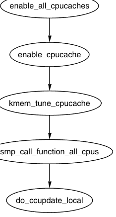

该函数锁定缓存链并为每个缓存启用 cpucache。这在 `cache_cache` 和 `sizes` 缓存启用后非常重要。

```
1714 static void enable_all_cpucaches (void)
1715 {
1716     struct list_head* p;
1717
1718     down(&cache_chain_sem);
1719
1720     p = &cache_cache.next;
1721     do {
1722         kmem_cache_t* cachep = list_entry(p, kmem_cache_t, next);
1723
1724         enable_cpucache(cachep);
1725         p = cachep->next.next;
1726     } while (p != &cache_cache.next);
1727
1728     up(&cache_chain_sem);
1729 }
```

**1718** 获取缓存链的信号量。

**1719** 获取链上的第一个缓存。

**1721-1726** 遍历整个链。

**1722** 从链中获取一个缓存。此代码将跳过链上的第一个缓存，但 `cache_cache` 不需要 cpucache，因为它很少被使用。

**1724** 启用 cpucache。

**1725** 移动到链上的下一个缓存。

**1726** 释放缓存链信号量。

#### H.5.1.2 函数：`enable_cpucache()` *(mm/slab.c)*

该函数根据缓存包含的对象大小计算 cpucache 的大小，然后调用 `kmem_tune_cpucache()` 进行实际分配。

```
1693 static void enable_cpucache (kmem_cache_t *cachep)
1694 {
1695     int err;
1696     int limit;
1697
1699     if (cachep->objsize > PAGE_SIZE)
1700         return;
1701     if (cachep->objsize > 1024)
1702         limit = 60;
1703     else if (cachep->objsize > 256)
1704         limit = 124;
1705     else
1706         limit = 252;
1707
1708     err = kmem_tune_cpucache(cachep, limit, limit/2);
1709     if (err)
1710         printk(KERN_ERR
1711             "enable_cpucache failed for %s, error %d.\n",
1712                cachep->name, -err);
```

**1699-1700** 如果对象大于一页，则直接返回，避免为此种对象类型创建 per-CPU 缓存，因为 per-CPU 缓存的代价太高。

**1701-1702** 如果对象大于 1KiB，则将 cpucache 的大小保持在 3MiB 以下。上限设为 124 个对象，以考虑 cpucache 描述符本身的大小。

**1703-1704** 对于更小的对象，此举仅确保缓存大小不超过 3MiB。

**1708** 为 cpucache 分配内存。

**1710-1711** 如果分配失败，则打印一条错误消息。

#### H.5.1.3 函数：`kmem_tune_cpucache()` *(mm/slab.c)*

该函数负责为 cpucache 分配内存。对于系统中的每个 CPU，`kmalloc` 分配一块足够容纳一个 cpucache 的内存，并填充一个 `ccupdate_struct_t` 结构体。随后函数 `smp_call_function_all_cpus()` 调用 `do_ccupdate_local()`，后者将新信息与缓存描述符中的旧信息进行交换。

```
1639 static int kmem_tune_cpucache (kmem_cache_t* cachep,
1640				    int limit, int batchcount)
1641 {
1642	    ccupdate_struct_t new;
1643	    int i;
1644
1645	    /*
1646	     * These are admin-provided, so we are more graceful.
1647	     */
1648	    if (limit < 0)
1649	        return -EINVAL;
1650	    if (batchcount < 0)
1651	        return -EINVAL;
1652	    if (batchcount > limit)
1653	        return -EINVAL;
1654	    if (limit != 0 && !batchcount)
1654            return -EINVAL;
1655
1656        memset(&new.new,0,sizeof(new.new));
1657        if (limit) {
1658            for (i = 0; i< smp_num_cpus; i++) {
1659                cpucache_t* ccnew;
1660
1661                ccnew = kmalloc(sizeof(void*)*limit+
1662                    sizeof(cpucache_t),
1663                    GFP_KERNEL);
1664                if (!ccnew)
1665                    goto oom;
1666                ccnew->limit = limit;
1667                ccnew->avail = 0;
1668                new.new[cpu_logical_map(i)] = ccnew;
1669            }
1670        }
1671        new.cachep = cachep;
1672        spin_lock_irq(&cachep->spinlock);
1673        cachep->batchcount = batchcount;
1674        spin_unlock_irq(&cachep->spinlock);
1675
1676        smp_call_function_all_cpus(do_ccupdate_local, (void *)&new);
1677
1678        for (i = 0; i < smp_num_cpus; i++) {
1679            cpucache_t* ccold = new.new[cpu_logical_map(i)];
1680            if (!ccold)
1681                continue;
1682            local_irq_disable();
1683            free_block(cachep, cc_entry(ccold), ccold->avail);
1684            local_irq_enable();
1685            kfree(ccold);
1686        }
1687        return 0;
1688    oom:
1689        for (i--; i >= 0; i--)
1690            kfree(new.new[cpu_logical_map(i)]);
1691        return -ENOMEM;
1692    }
```


该函数的参数如下：

- `cachep`：该 `cpucache` 所为之分配的缓存
- `limit`：`cpucache` 中可存在的对象总数
- `batchcount`：`cpucache` 为空时一次批量分配的对象数

1647 缓存中的对象数不能为负。

1649 不能分配负数个对象。

1651 不能分配超过上限的一批对象。

1653 如果 `limit` 为正数，则必须提供 `batchcount`。

1656 将更新结构体清零。

1657 如果提供了 `limit`，则为 `cpucache` 分配内存。

1658-1668 对于每个 CPU，分配一个 `cpucache`。

1661 所需内存量为 `limit` 个指针的大小以及 `cpucache` 描述符的大小。

1663 如果内存不足，则进行清理并退出。

1665-1666 填充 `cpucache` 描述符的各个字段。

1667 填充 `ccupdate_update_t` 结构体的信息。

1670 告知 `ccupdate_update_t` 结构体正在更新哪个缓存。

1671-1673 获取缓存描述符的关中断锁，并设置其 `batchcount`。

1675 让每个 CPU 自行更新其 `cpucache` 信息。这将缓存描述符中的旧 `cpucache` 与 `new` 中的新 `cpucache` 进行交换，使用的是 `do_ccupdate_local()`（参见第 H.5.2.2 节）。

1677-1685 在 `smp_call_function_all_cpus()`（参见第 H.5.2.1 节）之后，旧的 `cpucache` 保存在 `new` 中。该块代码遍历所有旧 `cpucache`，释放其中的对象，并删除旧 `cpucache`。

1686 返回成功。

1688 如果内存不足，则删除截至目前已分配的所有 `cpucache`，并返回失败。

### H.5.2 更新 Per-CPU 信息

#### H.5.2.1 函数：`smp_call_function_all_cpus()` (mm/slab.c)

该函数为所有 CPU 调用函数 `func()`。在 slab 分配器的上下文中，该函数是 `do_ccupdate_local()`，参数为 `ccupdate_struct_t`。

```
859 static void smp_call_function_all_cpus(void (*func) (void *arg),
                                           void *arg)
860 {
861     local_irq_disable();
862     func(arg);
863     local_irq_enable();
864
865     if (smp_call_function(func, arg, 1, 1))
866         BUG();
867 }
```

861-863 在本地关闭中断，然后为当前 CPU 调用该函数。

865 对于所有其他 CPU，调用该函数。`smp_call_function()` 是一个与架构相关的函数，此处不再进一步讨论。

#### H.5.2.2 函数：`do_ccupdate_local()` (mm/slab.c)

该函数将缓存描述符中的 `cpucache` 信息与当前 CPU 的 `info` 中的信息进行交换。

```
874 static void do_ccupdate_local(void *info)
875 {
876     ccupdate_struct_t *new = (ccupdate_struct_t *)info;
877     cpucache_t *old = cc_data(new->cachep);
878
879     cc_data(new->cachep) = new->new[smp_processor_id()];
880     new->new[smp_processor_id()] = old;
881 }
```

876 `info` 是指向 `ccupdate_struct_t` 的指针，随后被传递给 `smp_call_function_all_cpus()`（参见第 H.5.2.1 节）。

877 `ccupdate_struct_t` 的一部分是指向该 `cpucache` 所属缓存的指针。`cc_data()` 返回该处理器的 `cpucache_t`。

879 将新的 `cpucache` 放入缓存描述符。`cc_data()` 返回该 CPU 的 `cpucache` 指针。

880 将 `new` 中的指针替换为旧的 `cpucache`，以便 `smp_call_function_call_cpus()` 的调用者（例如 `kmem_tune_cpucache()`）稍后将其删除。

### H.5.3 排空 Per-CPU 缓存

调用该函数以排空 per-CPU 缓存中的所有对象。当需要收缩缓存以释放 slab 时，会调用该函数。即使 slab 未被使用，如果某个对象仍在 per-CPU 缓存中，则该 slab 无法被释放。

#### H.5.3.1 函数：`drain_cpu_caches()` (mm/slab.c)

```
885 static void drain_cpu_caches(kmem_cache_t *cachep)
886 {
887     ccupdate_struct_t new;
888     int i;
memset(&new.new,0,sizeof(new.new));
new.cachep = cachep;
down(&cache_chain_sem);
smp_call_function_all_cpus(do_ccupdate_local, (void *)&new);
for (i = 0; i < smp_num_cpus; i++) {
    cpucache_t* ccold = new.new[cpu_logical_map(i)];
    if (!ccold || (ccold->avail == 0))
        continue;
    local_irq_disable();
    free_block(cachep, cc_entry(ccold), ccold->avail);
    local_irq_enable();
    ccold->avail = 0;
}
smp_call_function_all_cpus(do_ccupdate_local, (void *)&new);
up(&cache_chain_sem);
}
```

**890** 清空更新结构体，因为它将要清除所有数据。

**892** 设置 `new.cachep` 为 `cachep`，以便 `smp_call_function_all_cpus()` 知道它正在影响哪个缓存。

**894** 获取缓存描述符信号量。

**895** `do_ccupdate_local()`（参见第 H.5.2.2 节）将缓存描述符中的 `cpucache_t` 信息与 `new` 中的信息进行交换，以便在此处进行修改。

**897-905** 对于系统中的每个 CPU，…

**898** 获取该 CPU 的 `cpucache` 描述符。

**899** 如果由于某种原因该结构体不存在，或者其中没有可用对象，则移到下一个 CPU。

**901** 在该处理器上关闭中断。其他地方的分配操作可能会从中断处理程序中尝试访问 per-CPU 缓存。

**902** 使用 `free_block()`（参见第 H.3.3.5 节）释放对象块。

**903** 重新启用中断。

**904** 表示没有可用对象。

**906** 每个 CPU 的信息已更新，因此为每个 CPU 调用 `do_ccupdate_local()`（参见第 H.5.2.2 节），将信息放回缓存描述符中。

**907** 释放缓存链的信号量。

## H.6 Slab 分配器初始化

#### 目录

| H.6 Slab 分配器初始化 | 511 |
| H.6.1.1 函数：`kmem_cache_init()` | 511 |

#### H.6.1.1 函数：`kmem_cache_init()` (*mm/slab.c*)

该函数执行以下操作：

- 初始化缓存链链表。
- 初始化用于访问缓存链的 `mutex`。
- 计算 `cache_cache` 的 color 值。

```
416 void __init kmem_cache_init(void)
417 {
418     size_t left_over;
419
420     init_MUTEX(&cache_chain_sem);
421     INIT_LIST_HEAD(&cache_chain);
422
423     kmem_cache_estimate(0, cache_cache.objsize, 0,
424             &left_over, &cache_cache.num);
425     if (!cache_cache.num)
426         BUG();
427
428     cache_cache.colour = left_over/cache_cache.colour_off;
429     cache_cache.colour_next = 0;
430 }
```

**420** 初始化用于访问缓存链的信号量。

**421** 初始化缓存链链表。

**423** `kmem_cache_estimate()`（见 H.1.2.1 节）计算对象数量以及浪费的字节数。

**425** 如果即使一个 `kmem_cache_t` 也无法存入一页，那就出了严重问题。

**428** `colour` 是可以使用的不同缓存行数，同时仍保持 L1 缓存对齐。

**429** `colour_next` 指示下一次使用哪一行。初始值为 0。

### H.7 与伙伴分配器的接口

#### 目录

| H.7 与伙伴分配器的接口 | 512 |
| H.7.1.1 函数：`kmem_getpages()` | 512 |
| H.7.1.2 函数：`kmem_freepages()` | 512 |

#### H.7.1.1 函数：`kmem_getpages()` (*mm/slab.c*)

该函数为 slab 分配器分配页面。

```
486 static inline void * kmem_getpages (kmem_cache_t *cachep,
                                            unsigned long flags)
487 {
488    void   *addr;
495    flags |= cachep->gfpflags;
496    addr = (void*) __get_free_pages(flags, cachep->gfporter);
503    return addr;
504 }
```

**495** 无论分配请求了什么标志位，这里都会追加缓存标志位。唯一可能追加的标志位是 `ZONE_DMA`，如果该缓存需要 DMA 内存的话。

**496** 使用 `__get_free_pages()` 从伙伴分配器分配内存（见 F.2.3 节）。

**503** 返回页面地址，如果失败则返回 NULL。

#### H.7.1.2 函数：`kmem_freepages()` (*mm/slab.c*)

该函数释放 slab 分配器的页面。在调用伙伴分配器 API 之前，它会从页面标志中移除 `PG_slab` 位。

```
507 static inline void kmem_freepages (kmem_cache_t *cachep, void *addr)
508 {
509    unsigned long i = (1<<cachep->gfporter);
510    struct page *page = virt_to_page(addr);
511
517    while (i--) {
518        PageClearSlab(page);
519        page++;
520    }
521    free_pages((unsigned long)addr, cachep->gfporter);
522 }
```

**509** 获取原始分配时使用的阶数。

**510** 获取该地址对应的 `struct page`。

**517-520** 清除每个页面的 `PG_slab` 位。

**521** 使用 `free_pages()` 将页面释放给伙伴分配器（见 F.4.1 节）。

#### I.1 高端内存页面映射

#### 目录

| I.1 高端内存页面映射 | 514 |
| I.1.1 函数：`kmap()` | 514 |
| I.1.2 函数：`kmap_nonblock()` | 514 |
| I.1.3 函数：`__kmap()` | 514 |
| I.1.4 函数：`kmap_high()` | 515 |
| I.1.5 函数：`map_new_virtual()` | 515 |
| I.1.6 函数：`flush_all_zero_pkmaps()` | 518 |

##### I.1.1 函数：`kmap()`
*(include/asm-i386/highmem.c)*

该 API 供愿意阻塞的调用者使用。

`62 #define kmap(page) __kmap(page, 0)`

**62** 调用核心函数 `__kmap()`，第二个参数表示调用者愿意阻塞。

##### I.1.2 函数：`kmap_nonblock()`
*(include/asm-i386/highmem.c)*

`63 #define kmap_nonblock(page) __kmap(page, 1)`

**63** 调用核心函数 `__kmap()`，第二个参数表示调用者不愿意阻塞。

##### I.1.3 函数：`__kmap()`
*(include/asm-i386/highmem.h)*

该函数的调用关系图如图 9.1 所示。

```
65 static inline void *kmap(struct page *page, int nonblocking)
66 {
67	if (in_interrupt())
68		out_of_line_bug();
69	if (page < highmem_start_page)
70		return page_address(page);
71	return kmap_high(page);
72 }
```

**67-68** 该函数不能在中断中使用，因为它可能会睡眠。这里使用 `out_of_line_bug()` 而不是 `BUG()`，`out_of_line_bug()` 调用 `do_exit()` 并返回错误码。不使用 `BUG()` 是因为 `BUG()` 会毫不留情地杀死进程，这将导致传说中的 "Aiee, killing interrupt handler!" 内核恐慌。

**69-70** 如果页面已经在低端内存中，则返回直接映射。

**71** 调用 `kmap_high()`（见 I.1.4 节）开始与架构无关的工作。

##### I.1.4 函数：`kmap_high()` (mm/highmem.c)

```
132 void *kmap_high(struct page *page, int nonblocking)
133 {
134     unsigned long vaddr;
135
142     spin_lock(&kmap_lock);
143     vaddr = (unsigned long) page->virtual;
144     if (!vaddr) {
145         vaddr = map_new_virtual(page, nonblocking);
146         if (!vaddr)
147             goto out;
148     }
149     pkmap_count[PKMAP_NR(vaddr)]++;
150     if (pkmap_count[PKMAP_NR(vaddr)] < 2)
151         BUG();
152 out:
153     spin_unlock(&Cpu7kmap_loPk);
154     return (void*) vaddr;
155 }
```

**142** `kmap_lock` 保护页面的 `virtual` 字段和 `pkmap_count` 数组。

**143** 获取页面的虚拟地址。

**144-148** 如果尚未映射，则调用 `map_new_virtual()`，该函数会映射页面并返回虚拟地址。如果失败，跳转到 `out` 以释放自旋锁并返回 NULL。

**149** 增加该页面映射的引用计数。

**150-151** 如果当前计数小于 2，那就是一个严重的 bug。实际上，必须引入严重的破坏才会导致这种情况发生。

**153** 释放 `kmap_lock`。

##### I.1.5 函数：`map_new_virtual()` (mm/highmem.c)

该函数分为三个主要部分：扫描空闲槽位、如果没有可用槽位则在队列上等待、以及映射页面。

```
80 static inline unsigned long map_new_virtual(struct page *page)
81 {
82     unsigned long vaddr;
83     int count;
84
85 start:
86     count = LAST_PKMAP;
87    /* 查找空条目 */
88    for (;;) {
89        last_pkmap_nr = (last_pkmap_nr + 1) & LAST_PKMAP_MASK;
```


90        if (!last_pkmap_nr) {

91            flush_all_zero_pkmaps();

92            count = LAST_PKMAP;

93        }

94        if (!pkmap_count[last_pkmap_nr])

95            break;  /* 找到可用条目 */

96        if (--count)

97            continue;

98

99        if (nonblocking)

100           return 0;

```

**86** 从最后一个可能的槽位开始扫描。

**88-122** 这个循环持续扫描并等待，直到有槽位变为空闲。如果某些进程运气不好，这可能导致无限循环。

**89** `last_pkmap_nr`是最后一个被扫描的 pkmap。为了防止重复搜索相同的页面，会记录该值以便循环搜索列表。当达到 `LAST_PKMAP` 时，它会回绕到 0。

**90-93** 当`last_pkmap_nr`回绕时，调用`flush_all_zero_pkmaps()`（见 I.1.6 节），该函数会在刷新 TLB 之前将`pkmap_count`数组中所有从 1 到 0 的条目清零。计数被重置为 `LAST_PKMAP`以重新开始扫描。

**94-95** 如果该元素为 0，则为页面找到了可用的槽位。

**96-97** 移动到下一个要扫描的索引。

**99-100** 下一块代码将在等待槽位空闲时睡眠。如果调用者请求该函数不要阻塞，则立即返回。

```
105        {

106            DECLARE_WAITQUEUE(wait, current);

107

108            current->state = TASK_UNINTERRUPTIBLE;

109            add_wait_queue(&pkmap_map_wait, &wait);

110            spin_unlock(&kmap_lock);

111            schedule();

112            remove_wait_queue(&pkmap_map_wait, &wait);

113            spin_lock(&kmap_lock);

114

115            /* 在我们睡眠期间，其他人可能已经映射了它 */

```

## 1.1. 映射高端内存页面

```
116            if (page->virtual)

117                return (unsigned long) page->virtual;

119            /* Re-start */

120            goto start;

121        }

122    }
```

如果在扫描所有页面一次后仍然没有可用槽位，我们会在 `pkmap_map_wait` 队列上睡眠，直到在某个页面被取消映射后被唤醒。

- 106 声明等待队列。
- 108 将任务设置为可中断状态，因为我们正在内核空间中睡眠。
- 109 将自己添加到 `pkmap_map_wait` 队列。
- 110 释放 `kmap_lock` 自旋锁。
- 111 调用 `schedule()`，这将使我们进入睡眠状态。在某个页面被取消映射、槽位变为空闲后，我们会被唤醒。
- 112 将自己从等待队列中移除。
- 113 重新获取 `kmap_lock`。
- 116-117 如果在我们睡眠期间其他进程映射了该页面，这里只是返回地址，引用计数将由 `kmap_high()` 递增。
- 120 重新开始扫描。

```
123    vaddr = PKMAP_ADDR(last_pkmap_nr);

124    set_pte(&(pkmap_page_table[last_pkmap_nr]), mk_pte(page, 

           kmap_prot));

125    pkmap_count[last_pkmap_nr] = 1;

126    page->virtual = (void *) vaddr;

128    return vaddr;

129 }
```

这个代码块是在找到槽位时执行的，它映射该页面。

- 123 获取找到的槽位的虚拟地址。
- 124 使用页面和所需保护位创建页表项（PTE），并将其放入页表中对应的位置。
- 126 将 `pkmap_count` 数组中的值初始化为 1。引用计数在父函数中递增，如果我们首先进入这个函数，就可以确定这是第一次映射。

###### I.1.6 函数：`flush_all_zero_pkmaps()`（*mm/highmem.c*）

这个函数遍历 `pkmap_count` 数组，将所有从 1 变为 0 的条目 flushing TLB 之前进行刷新。

```
42 static void flush_all_zero_pkmaps(void)

43 {

44     int i;

46     flush_cache_all();

48     for (i = 0; i < LAST_PKMAP; i++) {

49         struct page *page;

57         if (pkmap_count[i] != 1)

58             continue;

59         pkmap_count[i] = 0;

61         /* sanity check */

62         if (pte_none(pkmap_page_table[i]))

63             BUG();

72         page = pte_page(pkmap_page_table[i]);

73         pte_clear(&pkmap_page_table[i]);

75         page->virtual = NULL;

76     }

77     flush_tlb_all();

78 }
```

- 46 由于全局页表即将更改，所有处理器的 CPU 缓存都必须被刷新。
- 48-76 遍历整个 `pkmap_count` 数组。
- 57-58 如果元素不是 1，则移动到下一个元素。
- 59 将值从 1 设置为 0。
- 62-63 确保 PTE 没有以某种方式被映射。
- 72-73 从 PTE 中取消页面映射并清除 PTE。
- 75 更新 `virtual` 字段，因为页面已被取消映射。
- 77 刷新 TLB。

#### I.2 原子映射高端内存页面

#### 目录

| I.2 原子映射高端内存页面 | 519 |
| I.2.1 函数：`kmap_atomic()` | 519 |

以下是 x86 的 **km_type** 枚举示例。它列出了中断原子调用 **kmap** 的不同用途。注意 **KM_TYPE_NR** 是最后一个元素，因此它同时作为元素数量的计数。

```
 4 enum km_type {

 5     KM_BOUNCE_READ,

 6     KM_SKB_SUNRPC_DATA,

 7     KM_SKB_DATA_SOFTIRQ,

 8     KM_USER0,

 9     KM_USER1,

16     KM_BH_IRQ,

11     KM_TYPE_NR

12 };
```

###### I.2.1 函数：`kmap_atomic()`（*include/asm-i386/highmem.h*）

这是 **kmap**() 的原子版本。注意，在任何时刻都不持有自旋锁，也不会睡眠。不需要自旋锁，因为每个处理器都有自己的保留空间。

```
89 static inline void *kmap_atomic(struct page *page,

90                                   enum km_type type)

91 {

92     enum fixed_addresses idx;

93     unsigned long vaddr;

95     if (page < highmem_start_page)

96         return page_address(page);

98     idx = type + KM_TYPE_NR*smp_processor_id();

99     vaddr = __fix_to_virt(FIX_KMAP_BEGIN + idx);

100 #if HIGHMEM_DEBUG

101     if (!pte_none(*(kmap_pte-idx)))

102         out_of_line_bug();

103 #endif

104     set_pte(kmap_pte-idx, mk_pte(page, kmap_prot));

105     __flush_tlb_one(vaddr);

107     return (void*) vaddr;

108 }
```

参数是要映射的页面和所需的使用类型。每个处理器每种用途维护一个槽位。

高端内存管理

- 94-95 如果页面位于低端内存中，则返回直接映射。
- 97 `type` 指定使用哪个槽位。`KM_TYPE_NR * smp_processor_id()` 给出为该处理器保留的槽位集合。
- 98 获取虚拟地址。
- 100-101 调试用代码。实际上，PTE 总是会存在的。
- 103 将 PTE 设置到保留的槽位中。
- 104 刷新该槽位的 TLB。
- 106 返回虚拟地址。

#### I.3 取消页面映射

#### 目录

| I.3 取消页面映射 | |
| I.3.1 函数：`kunmap()` | |
| I.3.2 函数：`kunmap_high()` | |

###### I.3.1 函数：`kunmap()`（*include/asm-i386/highmem.h*）

```
 74 static inline void kunmap(struct page *page)

 75 {

 76     if (in_interrupt())

 77         out_of_line_bug();

 78     if (page < highmem_start_page)

 79         return;

 80     kunmap_high(page);

 81 }
```

- 76-77 `kunmap()` 不能从中断中调用，因此它会优雅地退出。
- 78-79 如果页面已经在低端内存中，则无需取消映射。
- 80 调用与架构无关的函数 `kunmap_high()`。

###### I.3.2 函数：`kunmap_high()`（*mm/highmem.c*）

这是 `kunmap()` 操作与架构无关的部分。

```
157 void kunmap_high(struct page *page)

158 {

159     unsigned long vaddr;

160     unsigned long nr;

161     int need_wakeup;

163     spin_lock(&kmap_lock);

164     vaddr = (unsigned long) page->virtual;

165     if (!vaddr)

166         BUG();

167     nr = PKMAP_NR(vaddr);

173     need_wakeup = 0;

174     switch (--pkmap_count[nr]) {

175     case 0:

176         BUG();

177     case 1:

188         need_wakeup = waitqueue_active(&pkmap_map_wait);

189     }

190     spin_unlock(&kmap_lock);

191

192    /* do wake-up, if needed, race-free outside of the spin lock */

193    if (need_wakeup)

194        wake_up(&pkmap_map_wait);

195 }
```

- 163 获取 `kmap_lock`，保护 `virtual` 字段和 `pkmap_count` 数组。
- 164 获取虚拟页面。
- 165-166 如果 `virtual` 字段未设置，则是双重取消映射或未映射页面的取消映射，因此使用 `BUG()`。
- 167 获取 `pkmap_count` 数组中的索引。
- 173 默认情况下，不需要对调用 `kmap()` 的进程发出唤醒信号。
- 174 递减后检查索引的值。
- 175-176 降到了 0 是一个 bug，因为需要刷新 TLB 才能使 0 成为有效条目。
- 177-188 如果降到了 1（该条目现在空闲，但需要 TLB 刷新），则检查是否有人在 `pkmap_map_wait` 队列上睡眠。如有必要，将在释放自旋锁后唤醒队列。
- 190 释放 `kmap_lock`。
- 193-194 如果队列上有等待者且槽位已释放，则唤醒它们。

#### I.4 原子取消高端内存页面映射

#### 目录

| I.4 原子取消高端内存页面映射 | 523 |
| I.4.1 函数：`kunmap_atomic()` | 523 |

###### I.4.1 函数：`kunmap_atomic()`（*include/asm-i386/highmem.h*）

整个函数都是调试代码。原因是，由于页面只在这里被原子映射，它们只会在一个很小的区域内短时间使用，然后被取消映射。将页面留在那里是安全的，因为在取消映射后不会被引用，而对同一槽位的另一次映射将直接替换它。

```
109 static inline void kunmap_atomic(void *kvaddr, enum km_type type)

110 {

111 #if HIGHMEM_DEBUG

112     unsigned long vaddr = (unsigned long) kvaddr & PAGE_MASK;

113     enum fixed_addresses idx = type + KM_TYPE_NR*smp_processor_id();

115     if (vaddr < FIXADDR_START) // FIXME

116         return;

118     if (vaddr != __fix_to_virt(FIX_KMAP_BEGIN+idx))

119         out_of_line_bug();

121     /*

122      * force other mappings to Oops if they'll try to access

123      * this pte without first remap it

124      */

125     pte_clear(kmap_pte-idx);

126     __flush_tlb_one(vaddr);

127 #endif

128 }
```

- 112 获取虚拟地址并确保它与页面边界对齐。
- 115-116 如果提供的地址不在固定区域中，则返回。
- 118-119 如果地址不对应于该使用类型和处理器的保留槽位，则声明错误。
- 125-126 现在取消页面映射，以便如果再次引用它，将导致 Oops。

## I.5 弹跳缓冲区

#### 目录

| I.5 弹跳缓冲区 | 524 |
| I.5.1 创建弹跳缓冲区 | 524 |
| I.5.1.1 函数：`create_bounce()` | 524 |
| I.5.1.2 函数：`alloc_bounce_bh()` | 526 |
| I.5.1.3 函数：`alloc_bounce_page()` | 527 |
| I.5.2 使用弹跳缓冲区进行复制 | 528 |
| I.5.2.1 函数：`bounce_end_io_write()` | 528 |
| I.5.2.2 函数：`bounce_end_io_read()` | 528 |
| I.5.2.3 函数：`copy_from_high_bh()` | 529 |
| I.5.2.4 函数：`copy_to_high_bh_irq()` | 529 |
| I.5.2.5 函数：`bounce_end_io()` | 530 |

### I.5.1 创建弹跳缓冲区

#### I.5.1.1 函数：`create_bounce()`（*mm/highmem.c*）

该函数的调用关系图如图 9.3 所示。这是创建弹跳缓冲区的高级函数。它分为两大部分：必要资源的分配和从模板复制数据。

```
405 struct buffer_head * create_bounce(int rw,

                                            struct buffer_head * bh_orig)

406 {

407     struct page *page;

408     struct buffer_head *bh;

409

410     if (!PageHighMem(bh_orig->b_page))

411         return bh_orig;

412

413     bh = alloc_bounce_bh();

420     page = alloc_bounce_page();

421

422     set_bh_page(bh, page, 0);

423


**405** 函数的参数如下：

- **`rw`** 如果这是写入缓冲区，则设置为 1。
- **`bh_orig`** 是要从中复制的模板缓冲区头。

**410-411** 如果模板缓冲区头已经在低端内存中，则直接返回它。

**413** 从 slab 分配器分配缓冲区头，如果失败则从紧急池中分配。

**420** 从 buddy 分配器分配页面，如果失败则从紧急池中分配。

将分配的页面与分配的 `buffer_head` 关联起来。

```
424    bh->b_next = NULL;
425    bh->b_blocknr = bh_orig->b_blocknr;
426    bh->b_size = bh_orig->b_size;
427    bh->b_list = -1;
428    bh->b_dev = bh_orig->b_dev;
429    bh->b_count = bh_orig->b_count;
430    bh->b_rdev = bh_orig->b_rdev;
431    bh->b_state = bh_orig->b_state;
432 #ifdef HIGHMEM_DEBUG
433    bh->b_flushtime = jiffies;
434    bh->b_next_free = NULL;
435    bh->b_prev_free = NULL;
436    /* bh->b_this_page */
437    bh->b_reqnext = NULL;
438    bh->b_pprev = NULL;
439 #endif
440    /* bh->b_page */
441    if (rw == WRITE) {
442        bh->b_end_io = bounce_end_io_write;
443        copy_from_high_bh(bh, bh_orig);
444    } else
445        bh->b_end_io = bounce_end_io_read;
446    bh->b_private = (void *)bh_orig;
447    bh->b_rsector = bh_orig->b_rsector;
448 #ifdef HIGHMEM Emit
449    memset(&bh->b_wait, -1, sizeof(bh->b_wait));
450 #endif
451
452    return bh;
453 }
```

该代码块填充新创建的 `buffer_head`。

**431** 基本逐字复制信息，但 `b_list` 字段除外，因为此缓冲区未直接连接到其他缓冲区链表上。

**433-438** 仅用于调试的信息。

**441-444** 如果这是要写入的缓冲区，则结束 I/O 的回调函数为 `bounce_end_io_write()`（参见第 I.5.2.1 节），当设备已接收所有信息时调用。由于数据存在于高端内存中，因此使用 `copy_from_high_bh()`（参见第 I.5.2.3 节）将数据"向下"复制。

**445** 如果我们正在等待设备将数据写入缓冲区，则使用回调函数 `bounce_end_io_read()`（参见第 I.5.2.2 节）。

**446-447** 从模板 `buffer_head` 复制剩余信息。

**452** 返回新的弹跳缓冲区。

#### I.5.1.2 函数：`alloc_bounce_bh()`（*mm/highmem.c*）

该函数首先尝试从 slab 分配器分配 `buffer_head`，如果失败，则使用紧急池。

```
369 struct buffer_head *alloc_bounce_bh (void)
370 {
371     struct list_head *tmp;
372     struct buffer_head *bh;
373
374     bh = kmem_cache_alloc(bh_cachep, SLAB_NOHIGHIO);
375     if (bh)
376         return bh;
380     wakeup_bdflush();
```

**374** 尝试从 slab 分配器分配新的 `buffer_head`。请注意，请求被设置为*不要*使用涉及高 I/O 的 I/O 操作，以避免递归。

**375-376** 如果分配成功，则返回。

**381** 如果不成功，则唤醒 **`bdflush`** 以清洗页面。

```
383 repeat_alloc:
387     tmp = &emergency_bhs;
388     spin_lock_irq(&emergency_lock);
389     if (!list_empty(tmp)) {
390         bh = list_entry(tmp->next, struct buffer_head,
391             b_inode_buffers);
391         list_del(tmp->next);
392         nr_emergency_bhs--;
393     }
394     spin_unlock_irq(&emergency_lock);
395     if (bh)
396         return bh;
397
398     /* we need to wait I/O completion */
399     run_task_queue(&tq_disk);
400
401     yield();
402     goto repeat_alloc;
403 }
```

从 slab 分配失败，因此从紧急池分配。

#### I.5.1.3 函数：`alloc_bounce_page()`（*mm/highmem.c*）

该函数本质上与 `alloc_bounce_bh()` 相同。它首先尝试从 buddy 分配器分配页面，如果失败，则使用紧急池。

```
333 struct page *alloc_bounce_page (void)
334 {
335     struct list_head *tmp;
336     struct page *page;
337
338     page = alloc_page(GFP_NOHIGHIO);
339     if (page)
340          return page;
344
345     wakeup_bdflush();
```

**338-340** 从 buddy 分配器分配页面，如果成功则返回该页面。

**345** 唤醒 **`bdflush`** 以清洗页面。

```
347 repeat_alloc:
351     tmp = &emergency_pages;
352     spin_lock_irq(&emergency_lock);
353     if (!list_empty(tmp)) {
354         page = list_entry(tmp->next, struct page, list);
355         list_del(tmp->next);
356         nr_emergency_pages--;
357     }
358     spin_unlock_irq(&emergency_lock);
```

```
359    if (page)
360        return page;
361
362    /* we need to wait I/O completion */
363    run_task_queue(&tq_disk);
364
365    yield();
366    goto repeat_alloc;
367 }
```

**351** 获取紧急缓冲区头链表的末尾。

**352** 获取保护池的锁。

**353-357** 如果池不为空，则从链表中取出一个页面，并减少可用的 `nr_emergency_pages` 数量。

**358** 释放锁。

**359-360** 如果分配成功，则返回该页面。

**363** 运行 I/O 任务队列以尝试补充紧急池。

**365** 让出处理器。

**366** 再次尝试从紧急池分配。

### I.5.2 使用弹跳缓冲区进行复制

#### I.5.2.1 函数：`bounce_end_io_write()`（*mm/highmem.c*）

该函数在用于写入设备的弹跳缓冲区完成 I/O 时调用。由于缓冲区是从高端内存复制*到*设备的，因此除了回收资源外没有其他事情需要做。

```
319 static void bounce_end_io_write (struct buffer_head *bh,
                                     int uptodate)
320 {
321     bounce_end_io(bh, uptodate);
322 }
```

#### I.5.2.2 函数：`bounce_end_io_read()`（*mm/highmem.c*）

该函数在从设备读取数据并需要复制到高端内存时调用。它从中断调用，因此需要更加小心。

```
324 static void bounce_end_io_read (struct buffer_head *bh,
                                    int uptodate)
325 {
326     struct buffer_head *bh_orig =
             (struct buffer_head *)(bh->b_private);
```

```
327
328    if (uptodate)
329        copy_to_high_bh_irq(bh_orig, bh);
330    bounce_end_io(bh, uptodate);
331 }
```

**328-329** 数据刚刚被复制到弹跳缓冲区，将通过 `copy_to_high_bh_irq()`（参见第 I.5.2.4 节）移动到高端内存。

**330** 回收资源。

#### I.5.2.3 函数：`copy_from_high_bh()`（*mm/highmem.c*）

该函数将数据从高端内存 `buffer_head` 复制到弹跳缓冲区。

```
215 static inline void copy_from_high_bh (struct buffer_head *to,
216                 struct buffer_head *from)
217 {
218     struct page *p_from;
219     char *vfrom;
220
221     p_from = from->b_page;
222
223     vfrom = kmap_atomic(p_from, KM_USER0);
224     memcpy(to->b_data, vfrom + bh_offset(from), to->b_size);
225     kunmap_atomic(vfrom, KM_USER0);
226 }
```

**223** 将高端内存页面映射到低端内存。此路径受 IRQ 安全锁 `io_request_lock` 保护，因此可以安全地调用 `kmap_atomic()`（参见第 I.2.1 节）。

**224** 复制数据。

**225** 取消页面映射。

#### I.5.2.4 函数：`copy_to_high_bh_irq()`（*mm/highmem.c*）

该函数在设备完成向弹跳缓冲区写入数据后从中断调用。此函数将数据复制到高端内存。

```
228 static inline void copy_to_high_bh_irq (struct buffer_head *to,
229                 struct buffer_head *from)
230 {
231     struct page *p_to;
232     char *vto;
233     unsigned long flags;
234
235     p_to = to->b_page;
```

#### I.5.2.5 函数：`bounce_end_io()` *(mm/highmem.c)*

```
236    __save_flags(flags);
237    __cli();
238    vto = kmap_atomic(p_to, KM_BOUNCE_READ);
239    memcpy(vto + bh_offset(to), from->b_data, to->b_size);
240    kunmap_atomic(vto, KM_BOUNCE_READ);
241    __restore_flags(flags);
```

**236-237** 保存标志并禁用中断。

**238** 将高端内存页映射到低端内存。

**239** 复制数据。

**240** 解除页映射。

**241** 恢复中断标志。

这会回收反弹缓冲区（bounce buffers）使用的资源。如果紧急池耗尽，资源会被添加到池中。

```
244 static inline void bounce_end_io (struct buffer_head *bh,
                                     int uptodate)
245 {
246     struct page *page;
247     struct buffer_head *bh_orig =
248             (struct buffer_head *)(bh->b_private);
249     unsigned long flags;
250
251     bh_orig->b_end_io(bh_orig, uptodate);
252
253     page = bh->b_page;
254
255     spin_lock_irqsave(&emergency_lock, flags);
256     if (nr_emergency_pages >= POOL_SIZE)
257         __free_page(page);
258     else {
259         /*
260          * We are abusing page->list to manage
261          * the highmem emergency pool:
262          */
263         list_add(&page->list, &emergency_pages);
264         nr_emergency_pages++;
265     }
266     if (nr_emergency_bhs >= POOL_SIZE) {
267 #ifdef HIGHMEM_DEBUG
268         /* Don't clobber the constructed slab cache */
269         init_waitqueue_head(&bh->b_wait);
270 #endif
271         kmem_cache_free(bh_cachep, bh);
272     } else {
273         /*
274          * Ditto in the bh case, here we abuse b_inode_buffers:
275          */
276         list_add(&bh->b_inode_buffers, &emergency_bhs);
277         nr_emergency_bhs++;
278     }
279     spin_unlock_irqrestore(&emergency_lock, flags);
280 }
```

**250** 调用原始 `buffer_head` 的 I/O 完成回调。

**252** 获取要释放的缓冲页指针。

**254** 获取紧急池的锁。

**255-256** 如果页池已满，则直接将页返还给伙伴分配器。

**257-264** 否则，将该页添加到紧急池中。

**266-272** 如果 `buffer_head` 池已满，则直接将其返还给 slab 分配器。

**272-278** 否则，将该 `buffer_head` 添加到池中。

**279** 释放锁。

高端内存管理

### I.6 紧急池

与紧急池相关的函数只有一个，即初始化函数。它在系统启动期间被调用，之后代码就被删除，因为再也用不上了。

#### I.6.1 函数：`init_emergency_pool()` *(mm/highmem.c)*

这会为紧急页和紧急 `buffer_head` 创建池。

```
282 static __init int init_emergency_pool(void)
283 {
284     struct sysinfo i;
285     si_meminfo(&i);
286     si_swapinfo(&i);
287
288     if (!i.totalhigh)
289         return 0;
290
291     spin_lock_irq(&emergency_lock);
292     while (nr_emergency_pages < POOL_SIZE) {
```


```
293         struct page * page = alloc_page(GFP_ATOMIC);
294         if (!page) {
295             printk("couldn't refill highmem emergency pages");
296             break;
297         }
298         list_add(&page->list, &emergency_pages);
299         nr_emergency_pages++;
300     }
301     while (nr_emergency_bhs < POOL_SIZE) {
302         struct buffer_head * bh =
303             kmem_cache_alloc(bh_cachep, SLAB_ATOMIC);
304         if (!bh) {
305             printk("couldn't refill highmem emergency bhs");
306             break;
307         }
308         list_add(&bh->b_inode_buffers, &emergency_bhs);
309         nr_emergency_bhs++;
310     }
311     spin_unlock_irq(&emergency_lock);
312     printk("allocated %d pages and %d bhs reserved for the
313         highmem bounces\n",
314         nr_emergency_pages, nr_emergency_bhs);
315
316     return 0;
```

**288-289** 如果没有高端内存可用，则不做任何处理。

**291** 获取保护池的锁。

**292-300** 从伙伴分配器分配`POOL_SIZE`个页，并将它们添加到链表中。通过`nr_emergency_pages`记录池中页的数量。

**301-309** 从slab分配器分配`POOL_SIZE`个buffer_head，并将它们添加到由`b_inode_buffers`链接的链表中。通过`nr_emergency_bhs`跟踪池中的头数量。

**310** 释放保护池的锁。

**314** 返回成功。

# 附录 J

## 页框回收

### 目录

- J.1 页缓存操作
  - J.1.1 向页缓存添加页
    - J.1.1.1 函数：`add_to_page_cache()`
    - J.1.1.2 函数：`add_to_page_cache_unique()`
    - J.1.1.3 函数：`__add_to_page_cache()`
    - J.1.1.4 函数：`add_page_to_inode_queue()`
    - J.1.1.5 函数：`add_page_to_hash_queue()`
  - J.1.2 从页缓存删除页
    - J.1.2.1 函数：`remove_inode_page()`
    - J.1.2.2 函数：`__remove_inode_page()`
    - J.1.2.3 函数：`remove_page_from_inode_queue()`
    - J.1.2.4 函数：`remove_page_from_hash_queue()`
  - J.1.3 获取/释放页缓存页
    - J.1.3.1 函数：`page_cache_get()`
    - J.1.3.2 函数：`page_cache_release()`
  - J.1.4 搜索页缓存
    - J.1.4.1 函数：`find_get_page()`
    - J.1.4.2 函数：`__find_get_page()`
    - J.1.4.3 函数：`__find_page_nolock()`
    - J.1.4.4 函数：`find_lock_page()`
    - J.1.4.5 函数：`__find_lock_page()`
    - J.1.4.6 函数：`__find_lock_page_helper()`
- J.2 LRU列表操作
  - J.2.1 向LRU列表添加页
    - J.2.1.1 函数：`lru_cache_add()`
    - J.2.1.2 函数：`add_page_to_active_list()`
    - J.2.1.3 函数：`add_page_to_inactive_list()`
  - J.2.2 从LRU列表删除页
    - J.2.2.1 函数：`lru_cache_del()`
    - J.2.2.2 函数：`_lru_cache_del()`
    - J.2.2.3 函数：`del_page_from_active_list()`
    - J.2.2.4 函数：`del_page_from_inactive_list()`
  - J.2.3 激活页
    - J.2.3.1 函数：`mark_page_accessed()`
    - J.2.3.2 函数：`activate_lock()`
    - J.2.3.3 函数：`activate_page_nolock()`
- J.3 重新填充非活动列表
  - J.3.1 函数：`refill_inactive()`
- J.4 从LRU列表回收页
  - J.4.1 函数：`shrink_cache()`
- J.5 收缩所有缓存
  - J.5.1 函数：`shrink_caches()`
  - J.5.2 函数：`try_to_free_pages()`
  - J.5.3 函数：`try_to_free_pages_zone()`
- J.6 换出进程页
  - J.6.1 函数：`swap_out()`
  - J.6.2 函数：`swap_out_mm()`
  - J.6.3 函数：`swap_out_vma()`
  - J.6.4 函数：`swap_out_pgd()`
  - J.6.5 函数：`swap_out_pmd()`
  - J.6.6 函数：`try_to_swap_out()`
- J.7 页换出守护进程
  - J.7.1 初始化kswapd
    - J.7.1.1 函数：`kswapd_init()`
  - J.7.2 kswapd守护进程
    - J.7.2.1 函数：`kswapd()`
    - J.7.2.2 函数：`kswapd_can_sleep()`
    - J.7.2.3 函数：`kswapd_can_sleep_pgdat()`
    - J.7.2.4 函数：`kswapd_balance()`
    - J.7.2.5 函数：`kswapd_balance_pgdat()`

### J.1 页缓存操作

| 章节 | 页码 |
|---|---|
| J.1 页缓存操作 | 537 |
| J.1.1 向页缓存添加页 | 537 |
| J.1.1.1 函数：`add_to_page_cache()` | 537 |
| J.1.1.2 函数：`add_to_page_cache_unique()` | 538 |
| J.1.1.3 函数：`__add_to_page_cache()` | 539 |
| J.1.1.4 函数：`add_page_to_inode_queue()` | 539 |
| J.1.1.5 函数：`add_page_to_hash_queue()` | 540 |
| J.1.2 从页缓存删除页 | 541 |
| J.1.2.1 函数：`remove_inode_page()` | 541 |
| J.1.2.2 函数：`__remove_inode_page()` | 541 |
| J.1.2.3 函数：`remove_page_from_inode_queue()` | 541 |
| J.1.2.4 函数：`remove_page_from_hash_queue()` | 542 |
| J.1.3 获取/释放页缓存页 | 542 |
| J.1.3.1 函数：`page_cache_get()` | 542 |
| J.1.3.2 函数：`page_cache_release()` | 543 |
| J.1.4 搜索页缓存 | 543 |
| J.1.4.1 函数：`find_get_page()` | 543 |
| J.1.4.2 函数：`__find_get_page()` | 543 |
| J.1.4.3 函数：`__find_page_nolock()` | 544 |
| J.1.4.4 函数：`find_lock_page()` | 544 |
| J.1.4.5 函数：`__find_lock_page()` | 545 |
| J.1.4.6 函数：`__find_lock_page_helper()` | 545 |

本节讨论页如何被添加和从页缓存及LRU列表中移除，这两者密切相关。

#### J.1.1 向页缓存添加页

##### J.1.1.1 函数：`add_to_page_cache()` *(`mm/filemap.c`)*

这会先获取保护页缓存的锁，然后调用`__add_to_page_cache()`，该函数将页添加到页哈希表和inode队列中，从而可以快速找到属于文件的页。

```
667 void add_to_page_cache(struct page * page,
                           struct address_space * mapping,
                           unsigned long offset)
668 {
669      spin_lock(&pagecache_lock);
670      __add_to_page_cache(page, mapping,
                          offset, page_hash(mapping, offset));
671      spin_unlock(&pagecache_lock);
672      lru_cache_add(page);
673 }
```

669 获取保护页哈希和inode队列的锁。

670 调用执行实际工作的函数。

###### J.1.1.2 函数：`add_to_page_cache_unique()`（*mm/filemap.c*）

从很多方面来看，这个函数与 `add_to_page_cache()` 非常相似。主要的区别在于，这个函数在将页面添加到缓存之前，会持有 `pagecache_lock` 自旋锁来检查页面缓存。它适用于那些可能与其他进程竞争将页面插入缓存的调用者，例如 `add_to_swap_cache()` (参见 K.2.1.1 节)。

```
int add_to_page_cache_unique(struct page * page,
	struct address_space *mapping, unsigned long offset,
	struct page **hash)
{
	int err;
	struct page *alias;
	spin_lock(&pagecache_lock);
	alias = __find_page_nolock(mapping, offset, *hash);
	err = 1;
	if (!alias) {
		__add_to_page_cache(page,mapping,offset,hash);
		err = 0;
	}
	spin_unlock(&pagecache_lock);
	if (!err)
		lru_cache_add(page);
	return err;
}
```

**671** 释放保护哈希表和 inode 队列的锁。

**672** 将页面添加到页面缓存。`page_hash()` 根据 `mapping` 和文件内的 `offset` 进行哈希计算，映射到页面哈希表中。如果返回了一个页面，说明发生了冲突，冲突的页面通过 `page→next_hash` 和 `page→pprev_hash` 字段链接在一起。

**682** 获取 `pagecache_lock` 以检查缓存。

**683** 使用 `__find_page_nolock()` 检查页面是否已存在于缓存中 (参见 J.1.4.3 节)。

**686-689** 如果页面不存在于缓存中，则使用 `__add_to_page_cache()` 将其添加 (参见 J.1.1.3 节)。

**691** 释放 `pagecache_lock`。

**692-693** 如果页面之前不存在于页面缓存中，则使用 `lru_cache_add()` 将其添加到 LRU 列表中 (参见 J.2.1.1 节)。

**694** 如果此次调用将页面加入了页面缓存，则返回 0；如果页面已存在，则返回 1。

###### J.1.1.3 函数：`__add_to_page_cache()`（*mm/filemap.c*）

该函数清除所有页面标志位，锁定页面，增加页面的引用计数，并将页面添加到 inode 队列和哈希队列。

```
653 static inline void __add_to_page_cache(struct page * page,
654	struct address_space *mapping, unsigned long offset,
655	struct page **hash)
656 {
657	unsigned long flags;
658
659	flags = page->flags & ~(1 << PG_uptodate |
				1 << PG_error | 1 << PG_dirty |
				1 << PG_referenced | 1 << PG_arch_1 |
				1 << PG_checked);
660	page->flags = flags | (1 << PG_locked);
661	page_cache_get(page);
662	page->index = offset;
663	add_page_to_inode_queue(mapping, page);
664	add_page_to_hash_queue(page, hash);
665 }
```

**659** 清除所有页面标志位。

**660** 锁定页面。

**661** 获取页面的引用，以防页面被过早释放。

**662** 更新索引，以便知道该页面代表的文件偏移量。

**663** 使用 `add_page_to_inode_queue()` 将页面添加到 inode 队列 (参见 J.1.1.4 节)。这使用 `page→list` 将页面链接到 `address_space` 的 `clean_pages` 列表，并将 `page→mapping` 指向同一个 `address_space`。

**664** 使用 `add_page_to_hash_queue()` 将页面添加到页面哈希表中 (参见 J.1.1.5 节)。哈希页面由父函数中的 `page_hash()` 返回。页面哈希表使得查找页面缓存页面成为可能，而无需线性搜索 inode 队列。

###### J.1.1.4 函数：`add_page_to_inode_queue()`（*mm/filemap.c*）

```
85 static inline void add_page_to_inode_queue(
86		struct address_space *mapping, struct page * page)
87 {
88	struct list_head *head = &mapping->clean_pages;
89
90	mapping->nrpages++;
91	list_add(&page->list, head);
92	page->mapping = mapping;
93 }
```

当调用此函数时，页面是干净的，因此 `mapping→clean_pages` 是相关的列表。

增加属于此映射的页面数量。

将页面添加到干净列表。

设置 `page→mapping` 字段。

###### J.1.1.5 函数：`add_page_to_hash_queue()`（*mm/filemap.c*）

该函数将页面添加到以 p 为头的哈希桶的顶部。请记住，p 是数组 `page_hash_table` 的一个元素。

```
71 static void add_page_to_hash_queue(struct page * page,
72					struct page **p)
73 {
74	struct page *next = *p;
75
76	*p = page;
77	page->next_hash = next;
78	page->pprev_hash = p;
79	if (next)
80		next->pprev_hash = &page->next_hash;
81	if (page->buffers)
82		PAGE_BUG(page);
83	atomic_inc(&page_cache_size);
84 }
```


记录哈希桶的当前头部到`next`。

更新哈希桶的头部为`page`。

将`page→next_hash`指向哈希桶的旧头部。

将`page→pprev_hash`指向`page_hash_table`中的数组元素。

这将使`pprev_hash`字段指向哈希桶的头部，完成页面到链表的插入。

检查进入的页面没有关联的缓冲区。

增加`page_cache_size`，即页面缓存的大小。

#### J.1.2 从页面缓存中删除页面

##### J.1.2.1 函数：`remove_inode_page()`（*mm/filemap.c*）

```
130 void remove_inode_page(struct page * page)
131 {
132	if (!PageLocked(page))
133		PAGE_BUG(page);
134
135	spin_lock(&pagecache_lock);
136	__remove_inode_page(page);
137	spin_unlock(&pagecache_lock);
138 }
```

- **132-133** 如果页面未锁定，则这是一个 bug。
- **135** 获取锁，保护页面缓存。
- **136** `__remove_inode_page()`（参见 J.1.2.2 节）是持有页面缓存锁时的顶层函数。
- **137** 释放页面缓存锁。

##### J.1.2.2 函数：`__remove_inode_page()`（*mm/filemap.c*）

这是为持有`pagecache_lock`自旋锁的调用者从页面缓存中删除页面的顶层函数。未获取此锁的调用者应调用`remove_inode_page()`。

```
124 void __remove_inode_page(struct page *page)
125 {
126	remove_page_from_inode_queue(page);
127	remove_page_from_hash_queue(page);
128 }
```

- **126** `remove_page_from_inode_queue()`（参见 J.1.2.3 节）从`page→mapping`处的`address_space`中移除页面。
- **127** `remove_page_from_hash_queue()`从`page_hash_table`的哈希表中移除页面。

##### J.1.2.3 函数：`remove_page_from_inode_queue()`（*mm/filemap.c*）

```
 94 static inline void remove_page_from_inode_queue(struct page * page)
 95 {
 96	struct address_space * mapping = page->mapping;
 97
 98	if (mapping->a_ops->removepage)
 99		mapping->a_ops->removepage(page);
100	list_del(&page->list);
101	page->mapping = NULL;
102	wmb();
103	mapping->nr_pages--;
104 }
```

**96** 获取此页面关联的`address_space`。

**98-99** 如果文件系统特定的`removepage()`函数可用，则调用该函数。

**100** 从`mapping`中页面所属的列表中删除页面，大多数情况下是`clean_pages`列表，少数情况下是`dirty_pages`列表。

**101** 将`page→mapping`设置为 NULL，因为页面不再由任何`address_space`支持。

**103** 减少映射中的页面数量。

##### J.1.2.4 函数：`remove_page_from_hash_queue()`（*mm/filemap.c*）

```
107 static inline void remove_page_from_hash_queue(struct page * page)
108 {
109	struct page *next = page->next_hash;
110	struct page **pprev = page->pprev_hash;
111
112	if (next)
113		next->pprev_hash = pprev;
114	*pprev = next;
115	page->pprev_hash = NULL;
116	atomic_dec(&page_cache_size);
117 }
```

**109** 获取被移除页面之后的下一个页面。

**110** 获取被移除页面之前的`pprev`页面。当函数完成时，`pprev`将链接到`next`。

**112** 如果这不是列表的末尾，则更新`next→pprev_hash`使其指向`pprev`。

**114** 同样，将`pprev`前向指向`next`。`page`现在已被解链。

**116** 减少页面缓存的大小。

#### J.1.3 获取/释放页面缓存页面

##### J.1.3.1 函数：`page_cache_get()`（*include/linux/pagemap.h*）

```
31 #define page_cache_get(x)    get_page(x)
```

**31** 简单调用`get_page()`，该函数使用`atomic_inc()`增加页面引用计数。

##### J.1.3.2 函数：`page_cache_release()`（*include/linux/pagemap.h*）

```
32 #define page_cache_release(x)   __free_page(x)
```

**32** 调用`__free_page()`，该函数递减页面引用计数。如果计数达到 0，页面将被释放。

#### J.1.4 搜索页高速缓存

##### J.1.4.1 函数：`find_get_page()`（*include/linux/pagemap.h*）

这是一个用于在页高速缓存中查找页面的顶层宏。它简单地查找页面哈希表。

```
75 #define find_get_page(mapping, index) \
76     __find_get_page(mapping, index, page_hash(mapping, index))
```

**76** `page_hash()`根据`address_space`和偏移量在`page_hash_table`中定位一个条目。

##### J.1.4.2 函数：`__find_get_page()`（*mm/filemap.c*）

该函数负责以`page_hash_table`中的一个条目为起点，查找`struct page`。

```
931 struct page * __find_get_page(struct address_space *mapping,
932             unsigned long offset, struct page **hash)
933 {
934     struct page *page;
935
936     /*
937      * We scan the hash list read-only. Addition to and removal from
938      * the hash-list needs a held write-lock.
939      */
940     spin_lock(&pagecache_lock);
941     page = __find_page_nolock(mapping, offset, *hash);
942     if (page)
943         page_cache_get(page);
944     spin_unlock(&pagecache_lock);
945     return page;
946 }
```

**940** 获取只读的`pagecache`锁。

**941** 调用页高速缓存遍历函数，该函数假定锁已被持有。

**942-943** 如果找到了页面，则通过`page_cache_get()`（参见 J.1.3.1 节）获取对它的引用，以防止其被过早释放。

**944** 释放`pagecache`锁。

**945** 返回页面；如果未找到，则返回 NULL。

##### J.1.4.3 函数：`__find_page_nolock()`（*mm/filemap.c*）

该函数遍历哈希冲突链表，查找由`address_space`和偏移量指定的页面。

```
443 static inline struct page * __find_page_nolock(
                    struct address_space *mapping,
                    unsigned long offset,
                    struct page *page)
444 {
445     goto inside;
446
447     for (;;) {
448         page = page->next_hash;
449 inside:
450         if (!page)
451             goto not_found;
452         if (page->mapping != mapping)
453             continue;
454         if (page->index == offset)
455             break;
456     }
457
458 not_found:
459     return page;
460 }
```

**445** 从检查链表中的第一个页面开始。

**450-451** 如果页面为 NULL，说明找不到目标页面，因此返回 NULL。

**452** 如果`address_space`不匹配，则移动到冲突链表中的下一个页面。

**454** 如果偏移量匹配，则返回该页面，否则继续查找。

**448** 移动到哈希链表中的下一个页面。

**459** 返回找到的页面；如果未找到，则返回 NULL。

##### J.1.4.4 函数：`find_lock_page()`（*include/linux/pagemap.h*）

这是一个用于在页高速缓存中搜索页面并以锁定状态返回的顶层函数。

```
84 #define find_lock_page(mapping, index) \
85     __find_lock_page(mapping, index, page_hash(mapping, index))
```

##### J.1.4.5 函数：`__find_lock_page()`（*mm/filemap.c*）

该函数在调用核心函数`__find_lock_page_helper()`查找并锁定页面之前，获取`pagecache_lock`自旋锁。

```
1005 struct page * __find_lock_page (struct address_space *mapping,
1006                                 unsigned long offset, struct page **hash)
1007 {
1008    struct page *page;
1009
1010    spin_lock(&pagecache_lock);
1011    page = __find_lock_page_helper(mapping, offset, *hash);
1012    spin_unlock(&pagecache_lock);
1013    return page;
1014 }
```

**1010** 获取`pagecache_lock`自旋锁。

**1011** 调用`__find_lock_page_helper()`，该函数将搜索页高速缓存并在找到页面时锁定它。

**1012** 释放`pagecache_lock`自旋锁。

**1013** 如果找到了页面，则以锁定状态返回；如果未找到，则返回 NULL。

##### J.1.4.6 函数：`__find_lock_page_helper()`（*mm/filemap.c*）

该函数使用`__find_page_nolock()`在页高速缓存中定位页面。如果找到，页面将被锁定并返回给调用者。

```
972 static struct page * __find_lock_page_helper(
973                                         struct address_space *mapping,
974                                         unsigned long offset, struct page *hash)
975 {
976         struct page *page;
977
978         /*
979          * We scan the hash list read-only. Addition to and removal
980          * from the hash-list needs a held write-lock.
981          */
982 repeat:
983         page = __find_page_nolock(mapping, offset, hash);
984         if (page) {
985                 page_cache_get(page);
986                 if (TryLockPage(page)) {
987                         spin_unlock(&pagecache_lock);
988                         lock_page(page);
989                         spin_lock(&pagecache_lock);
990
991             /* Has the page been re-allocated while we slept?  */
992             if (page->mapping != mapping || page->index != offset) {
993                 UnlockPage(page);
994                 page_cache_release(page);
995                 goto repeat;
996             }
997         }
998     }
999     return page;
1000 }
```

**982** 使用`__find_page_nolock()`（参见 J.1.4.3 节）在页高速缓存中定位页面。

**983-984** 如果找到了页面，则获取对它的引用。

**985** 尝试使用`TryLockPage()`锁定页面。该宏只是`test_and_set_bit()`的包装，试图在`page→flags`中设置`PG_locked`位。

**986-988** 如果锁定失败，则释放`pagecache_lock`自旋锁并调用`lock_page()`（参见 B.2.1.1 节）来锁定页面。该函数很可能会睡眠，直到获取页面锁为止。页面锁定后，再次获取`pagecache_lock`自旋锁。

**991** 如果映射关系索引不再匹配，说明在我们睡眠期间该页面已被回收。页面被解锁，引用被释放，然后重新搜索页高速缓存。

**998** 以锁定状态返回页面；如果不在页高速缓存中，则返回 NULL。

### J.2 LRU 列表操作

#### 目录

- J.2 LRU 列表操作 547
  - J.2.1 将页面添加到 LRU 列表 547
    - J.2.1.1 函数：`lru_cache_add()` 547
    - J.2.1.2 函数：`add_page_to_active_list()` 547
    - J.2.1.3 函数：`add_page_to_inactive_list()` 548
  - J.2.2 从 LRU 列表中删除页面 548
    - J.2.2.1 函数：`lru_cache_del()` 548
    - J.2.2.2 函数：`__lru_cache_del()` 549
    - J.2.2.3 函数：`del_page_from_active_list()` 549
    - J.2.2.4 函数：`del_page_from_inactive_list()` 549
  - J.2.3 激活页面 550
    - J.2.3.1 函数：`mark_page_accessed()` 550
    - J.2.3.2 函数：`activate_lock()` 550
    - J.2.3.3 函数：`activate_page_nolock()` 550

##### J.2.1 将页面添加到 LRU 列表

###### J.2.1.1 函数：`lru_cache_add()`（*mm/swap.c*）

该函数将页面添加到 LRU `inactive_list`。


### J.2.1.1 函数：`lru_cache_add()` (`mm/swap.c`)

该函数将页面添加到 LRU 列表中。

```
58 void lru_cache_add(struct page * page)
59 {
60     if (!PageLRU(page)) {
61         spin_lock(&pagelru_lock);
62         if (!TestSetPageLRU(page))
63             add_page_to_inactive_list(page);
64         spin_unlock(&pagelru_lock);
65     }
66 }
```

**60** 如果页面尚未加入 LRU 列表，则添加它。

**61** 获取 LRU 锁。

**62-63** 测试并设置 LRU 位。如果之前是清除状态，则调用 `add_page_to_inactive_list()`。

**64** 释放 LRU 锁。

### J.2.1.2 函数：`add_page_to_active_list()` (`include/linux/swap.h`)

该函数将页面添加到 `active_list`。

```
178 #define add_page_to_active_list(page) \
179 do { \
180 		DEBUG_LRU_PAGE(page);			\
181 		SetPageActive(page);				\
182 		list_add(&(page)->lru, &active_list);	\
183 		nr_active_pages++;					\
184 } while (0)
```

**180** `DEBUG_LRU_PAGE()` 宏会在页面已经在 LRU 列表中或被标记为 active 时调用 `BUG()`。

**181** 更新页面标志以显示其为活动状态。

**182** 将页面添加到 `active_list`。

**183** 更新 `active_list` 中的页面计数。

### J.2.1.3 函数：`add_page_to_inactive_list()` (`include/linux/swap.h`)

该函数将页面添加到 `inactive_list`。

```
186 #define add_page_to_inactive_list(page)		\
187 do {										\
188 		DEBUG_LRU_PAGE(page);					\
189 		list_add(&(page)->lru, &inactive_list); \
190 		nr_inactive_pages++;					\
191 } while (0)
```

**188** `DEBUG_LRU_PAGE()` 宏会在页面已经在 LRU 列表中或被标记为 active 时调用 `BUG()`。

**189** 将页面添加到 `inactive_list`。

**190** 更新列表中 inactive 页面的计数。

### J.2.2 从 LRU 列表中删除页面

#### J.2.2.1 函数：`lru_cache_del()` (`mm/swap.c`)

该函数在调用 `__lru_cache_del()` 之前获取保护 LRU 列表的锁。

```
90 void lrq_cache_del(struct page * page)
91 {
92 		spin_lock(&pagemap_lru_lock);
93 		__lru_cache_del(page);
94 		spin_unlock(&pagemap_lru_lock);
95 }
```

**92** 获取 LRU 锁。

**93** `__lru_cache_del()` 执行从 LRU 列表中删除页面的实际工作。

**94** 释放 LRU 锁。

#### J.2.2.2 函数：`__lru_cache_del()` (`mm/swap.c`)

该函数选择将页面从 LRU 列表中移除所需的函数。

```
75 void __lru_cache_del(struct page * page)
76 {
77		if (TestClearPageLRU(page)) {
78				if (PageActive(page)) {
79						del_page_from_active_list(page);
80				} else {
81						del_page_from_inactive_list(page);
82				}
83		}
84 }
```

**77** 测试并清除指示页面在 LRU 中的标志。

**78-82** 如果页面在 LRU 中，则选择适当的移除函数。

**78-79** 如果页面是活动的，则调用 `del_page_from_active_list()`，否则，使用 `del_page_from_inactive_list()` 将其从非活动列表中删除。

#### J.2.2.3 函数：`del_page_from_active_list()` (`include/linux/swap.h`)

该函数将页面从 `active_list` 中移除。

```
193 #define del_page_from_active_list(page) \
194 do { \
195		list_del(&(page)->lru); \
196		ClearPageActive(page); \
197		nr_active_pages--; \
198 } while (0)
```

**195** 将页面从列表中删除。

**196** 清除标志，指示其属于 `active_list`。指示其属于 LRU 列表的标志已被 `__lru_cache_del()` 清除。

**197** 更新 `active_list` 中页面数量的计数。

#### J.2.2.4 函数：`del_page_from_inactive_list()` (`include/linux/swap.h`)

```
200 #define del_page_from_inactive_list(page) \
201 do { \
202		list_del(&(page)->lru); \
203		nr_inactive_pages--; \
204 } while (0)
```

**202** 将页面从 LRU 列表中移除。

**203** 更新 `inactive_list` 中页面数量的计数。

### J.2.3 激活页面

#### J.2.3.1 函数：`mark_page_accessed()` (`mm/filemap.c`)

该函数标记页面已被引用。如果页面已经在 `active_list` 上，或者引用标志已清除，则会设置引用标志。如果它在 `inactive_list` 中，并且引用标志已设置，则将调用 `activate_page()` 将页面移动到 `active_list` 的顶部。

```
1332 void mark_page_accessed(struct page *page)
1333 {
1334         if (!PageActive(page) && PageReferenced(page)) {
1335                 activate_page(page);
1336                 ClearPageReferenced(page);
1337         } else
1338                 SetPageReferenced(page);
1339 }
```

- **1334-1337** 如果页面在 `inactive_list` 上（`!PageActive()`）并且最近已被引用（`PageReferenced()`），则调用 `activate_page()` 将其移动到 `active_list`。
- **1338** 否则，将页面标记为已引用。

#### J.2.3.2 函数：`activate_page()` (`mm/swap.c`)

该函数在调用 `activate_page_nolock()` 之前获取 LRU 锁，后者将页面从 `inactive_list` 移动到 `active_list`。

```
47 void activate_page(struct page * page)
48 {
49         spin_lock(&pagemap_lru_lock);
50         activate_page_nolock(page);
51         spin_unlock(&pagemap_lru_lock);
52 }
```

- **49** 获取 LRU 锁。
- **50** 调用主要工作函数。
- **51** 释放 LRU 锁。

#### J.2.3.3 函数：`activate_page_nolock()` (`mm/swap.c`)

该函数将页面从 `inactive_list` 移动到 `active_list`。

```
39 static inline void activate_page_nolock(struct page * page)
40 {
41         if (PageLRU(page) && !PageActive(page)) {
42                 del_page_from_inactive_list(page);
43                 add_page_to_active_list(page);
44         }
45 }
```

**41** 确保页面在 LRU 上，且不在 `active_list` 上。

**42-43** 从 `inactive_list` 中删除页面，并将其添加到 `active_list`。

### J.3 重新填充 `inactive_list`

#### J.3.1 函数：`refill_inactive()` (`mm/vmscan.c`)

该函数将 `nr_pages` 从 `active_list` 移动到 `inactive_list`。参数 `nr_pages` 由 `shrink_caches()` 计算，是一个试图使活动列表大小保持为页高速缓存三分之二的数值。

```
533 static void refill_inactive(int nr_pages)
534 {
535         struct list_head * entry;
536 
537         spin_lock(&pagemap_lru_lock);
538         entry = active_list.prev;
539         while (nr_pages && entry != &active_list) {
540                 struct page * page;
541 
542                 page = list_entry(entry, struct page, lru);
543                 entry = entry->prev;
544                 if (PageTestandClearReferenced(page)) {
545                         list_del(&page->lru);
546                         list_add(&page->lru, &active_list);
547                         continue;
548                 }
549 
550                 nr_pages--;
551 
552                 del_page_from_active_list(page);
553                 add_page_to_inactive_list(page);
554                 SetPageReferenced(page);
555         }
556         spin_unlock(&pagemap_lru_lock);
557 }
```

- **537** 获取保护 LRU 列表的锁。
- **538** 获取 `active_list` 中的最后一个条目。
- **539-555** 持续移动页面，直到移动了 `nr_pages` 个页面或 `active_list` 为空。
- **542** 获取该条目对应的 `struct page`。
- **544-548** 测试并清除引用标志。如果已被引用，则将其移回 `active_list` 的顶部。
- **550-553** 将一个页面从 `active_list` 移动到 `inactive_list`。
- **554** 将其标记为已引用，以便如果很快再次被引用，它将被提升回 `active_list`，而无需第二次引用。
- **556** 释放保护 LRU 列表的锁。

### J.4 从 LRU 列表中回收页面

| J.4 从 LRU 列表中回收页面 | 554 |
| J.4.1 函数：`shrink_cache()` | 554 |

本节介绍页面被选中进行换出后如何回收。

#### J.4.1 函数：`shrink_cache()` (`mm/vmscan.c`)

```
338 static int shrink_cache(int nr_pages, zone_t * classzone,
                           unsigned int gfp_mask, int priority)
339 {
340     struct list_head * entry;
341     int max_scan = nr_inactive_pages / priority;
342     int max_mapped = min((nr_pages << (10 - priority)),
                          max_scan / 10);
343
344     spin_lock(&pagemap_lru_lock);
345     while (--max_scan >= 0 &&
            (entry = inactive_list.prev) != &inactive_list) {
```

**338** 参数如下：

- **nr_pages** 要换出的页面数
- **classzone** 我们感兴趣为其换出页面的区域。不属于该区域的页面将被跳过。
- **gfp_mask** 确定可采取哪些操作的 gfp 掩码，例如是否可以执行文件系统操作
- **priority** 函数的优先级，从 `DEF_PRIORITY` (6) 开始，降低到最高优先级 1

**341** 要扫描的最大页面数是 `active_list` 中的页面数除以优先级。在最低优先级时，可以扫描列表的六分之一。在最高优先级时，可以扫描整个列表。

**342** 允许的最大进程映射页面数是 `max_scan` 值的十分之一或 `nr_pages*2^(10-priority)`。如果找到这么多页面，整个进程将被换出。

**344** 锁定 LRU 列表。

**345** 持续扫描，直到扫描了 `max_scan` 个页面或 `inactive_list` 为空。

```
346         struct page * page;
347
348         if (unlikely(current->need_resched)) {
```

**348-354** 如果时间片已用完，则重新调度。

**349** 释放 LRU 锁，因为即将进入睡眠状态。

**350** 显示我们仍在运行。

**351** 调用 `schedule()` 以便另一个进程可以被上下文切换进来。

**352** 重新获取 LRU 锁。

**353** 重新循环并再次从 `inactive_list` 获取一个条目。由于我们睡眠过，另一个进程可能已更改列表上的条目，因此需要在持有自旋锁的情况下再次获取一个条目。

```
356        page = list_entry(entry, struct page, lru);
357        
358        BUG_ON(!PageLRU(page));
359        BUG_ON(PageActive(page));
360        
361        list_del(entry);
362        list_add(entry, &inactive_list);
363        
364        /*
365         * Zero page counts can happen because we room ritual the pages
366         * _after_ decrementing the usage count..
367         */
368        if (unlikely(!page_count(page)))
369            continue;
370
371        if (!memclass(page_zone(page), classzone))
372            continue;
373
374        /* Racy check to avoid trylocking when not worthwhile */
375        if (!page->buffers && (page_count(page) != 1 || !page->mapping))
376            goto page_mapped;
```


- **361-362** 将页面移动到`inactive_list`的顶部，这样如果页面未被释放，我们可以继续扫描，只需知道它将在稍后重新被检查即可。
- **368-369** 如果页面计数已经达到 0，则跳过它。在`__free_pages()`中，页面计数通过`put_page_testzero()`递减，然后调用`__free_pages_ok()`来释放页面。这就留下了一个窗口期，在此期间计数为 0 的页面仍然保留在 LRU 上，尚未被释放。`__free_pages_ok()`的开头有一个特殊情况来处理这种情况。
- **371-372** 如果页面属于我们当前不感兴趣的 zone，则跳过该页面。
- **375-376** 如果页面被某个进程映射，则跳转到`page_mapped`，在那里`max_mapped`递减，然后检查下一个页面。如果`max_mapped`达到 0，进程页面将被换出。

```
382        if (unlikely(TryLockPage(page))) {
383            if (PageLaunder(page) && (gfp_mask & __GFP_FS)) {
384                page_cache_get(page);
385                spin_unlock(&pagemap_lru_lock);
386                wait_on_page(page);
387                page_cache_release(page);
388                spin_lock(&pagemap_lru_lock);
389            }
390            continue;
391        }
```

在这个代码块中，页面被锁定，并且设置了 launder（清洗）位。在这种情况下，这是第二次发现该页面是脏页。第一次它被调度进行 I/O 操作并放回列表。这次我们等待 I/O 完成，然后尝试释放该页面。

- **382-383** 如果我们无法锁定页面，且`PG_launder`位已设置，并且 GFP 标志允许调用者执行文件系统操作，那么……
- **384** 获取页面引用，以防止在休眠期间页面消失。
- **385** 释放 LRU 锁。
- **386** 等待 I/O 完成。
- **387** 释放页面引用。如果引用计数达到 0，页面将被释放。
- **388** 重新获取 LRU 锁。
- **390** 移动到下一个页面。

```
392
393            if (PageDirty(page) &&
                is_page_cache_freeable(page) &&
                page->mapping) {
```

### J.4. 从 LRU 列表中回收页面

```
394		/*
395		 * It is not critical here to write it only if
396		 * the page is unmapped because any direct writer
397		 * like O_DIRECT would set the PG_dirty bitflag
398		 * on the physical page after having successfully
399		 * pinned it and after the I/O to the page is finished,
400		 * so the direct writes to the page cannot get lost.
401		 */
402		int (*writepage)(struct page *);
403
404		writepage = page->mapping->a_ops->writepage;
405		if ((gfp_mask & __GFP_FS) && writepage) {
406			ClearPageDirty(page);
407			SetPageLaunder(page);
408			page_cache_get(page);
409			spin_unlock(&pagemap_lru_lock);
410
411			writepage(page);
412			page_cache_release(page);
413
414			spin_lock(&pagemap_lru_lock);
415			continue;
416		}
417		}
```

这处理了一种情况：页面是脏页，但未被任何进程映射，没有缓冲区，并且由文件或设备映射支持。页面被清理，并在 I/O 完成后由前面的代码块进行回收。

- 393 `PageDirty()`检查`PG_dirty`位。`is_page_cache_freeable()`如果页面未被任何进程映射且没有缓冲区，则返回 true。
- 404 获取该映射或设备所需的`writepage()`函数指针。
- 405-416 该代码块只有在`writepage()`函数可用且 GFP 标志允许文件系统操作时才能执行。
- 406-407 清除脏位并标记页面正在被清洗（laundered）。
- 408 获取页面引用，以防止页面被意外释放。
- 409 解锁 LRU 列表。
- 411 调用文件系统特定的`writepage()`函数，该函数取自属于`page->mapping`的`address_space_operations`。
- 412 释放页面引用。
- 414-415 重新获取 LRU 列表锁，并移动到下一个页面。


```
424            if (page->buffers) {
425                spin_unlock(&pagemap_lru_lock);
426
427                /* avoid to free a locked page */
428                page_cache_get(page);
429
430                if (try_to_release_page(page, gfp_mask)) {
431                    if (!page->mapping) {
438                        spin_lock(&pagemap_lru_lock);
439                        UnlockPage(page);
440                        __lru_cache_del(page);
441
442                        /* effectively free the page here */
443                        page_cache_release(page);
444
445                        if (--nr_pages)
446                            continue;
447                        break;
448                    } else {
454                        page_cache_release(page);
455
456                        spin_lock(&pagemap_lru_lock);
457                    }
458                } else {
459                    /* failed to drop the buffers so stop here */
460                    UnlockPage(page);
461                    page_cache_release(page);
462
463                    spin_lock(&pagemap_lru_lock);
464                    continue;
465                }
466            }
```

页面有关联的缓冲区，这些缓冲区必须被释放。

**425** 释放 LRU 锁，因为我们可能会进入休眠状态。

**428** 获取页面引用。

**430** 调用`try_to_release_page()`，该函数将尝试释放与页面关联的缓冲区。如果成功，则返回 1。

**431–447** 这是一种情况：匿名页面原本在交换缓存中，现在它的缓冲区已被清除并移除。因为它在交换缓存中，所以被`add_to_swap_cache()`放到了 LRU 上，因此现在需要从 LRU 中移除并释放页面引用。在`swap_writepage()`中，它调用`remove_exclusive_swap_page()`，当不再有进程映射该页面时，该函数会将页面从交换缓存中删除。这个代码块在缓冲区写出后释放页面，前提是页面由交换文件提供支持。

**438-440** 获取 LRU 列表锁，解锁页面，从 pagecache 中删除它并释放。

**445-446** 更新`nr_pages`以显示页面已被释放，并移动到下一个页面。

**447** 如果`nr_pages`降为 0，则退出循环，因为工作已经完成。

**449-456** 如果页面确实有相关联的映射，则释放页面引用并重新获取 LRU 锁。稍后会在第 499 行执行更多操作，将页面从 pagecache 中移除。

**459-464** 如果缓冲区无法被释放，则解锁页面，释放其引用，重新获取 LRU 锁，并移动到下一个页面。

```
468	spin_lock(&pagecache_lock);
469
470	/*
471	 * this is the non-racy check for busy page.
472	 */
473	if (!page->mapping || !is_page_cache_freeable(page)) {
474		spin_unlock(&pagecache_lock);
475		UnlockPage(page);
476 page_mapped:
477		if (--max_mapped >= 0)
478			continue;
479
484			spin_unlock(&pagemap_lru_lock);
485			swap_out(priority, gfp_mask, classzone);
486			return nr_pages;
487	}
```

**468** 从这一点开始，交换缓存中的页面可能会被检查，这由`pagecache_lock`保护，该锁现在必须被持有。

**473-487** 匿名页面没有缓冲区，但被某个进程映射。

**484-485** 在页面缓存中发现了过多的已映射页面。释放 LRU 锁，并调用`swap_out()`开始换出整个进程。

```
493            if (PageDirty(page)) {
494                spin_unlock(&pagecache_lock);
495                UnlockPage(page);
496                continue;
497            }
```

**493-497** 页面没有引用，但可能已被最后释放它的进程弄脏（如果脏位是在 PTE 中设置的）。它被保留在 pagecache 中，稍后会被清洗。清洗完成后，可以安全地删除它。

```
498
499            /* point of no return */
500            if (likely(!PageSwapCache(page))) {
501                __remove_inode_page(page);
502                spin_unlock(&pagecache_lock);
503            } else {
504                swp_entry_t swap;
505                swap.val = page->index;
506                __delete_from_swap_cache(page);
507                spin_unlock(&pagecache_lock);
508                swap_free(swap);
509            }
510
511            __lru_cache_del(page);
512            UnlockPage(page);
513
514            /* effectively free the page here */
515            page_cache_release(page);
516
517            if (--nr_pages)
518                continue;
519            break;
520        }
```

**500-503** 如果页面不属于交换缓存，则它是 inode 队列的一部分，因此将其移除。

**504-508** 由于不再有引用，将其从交换缓存中移除。

**511** 从 pagecache 中删除它。

**512** 解锁页面。

**515** 释放页面。

**517-518** 递减`nr_pages`，如果它不是 0，则移动到下一个页面。

**519** 如果它达到 0，函数的工作即告完成。

### J.4. 从 LRU 列表中回收页面

```
521     spin_unlock(&pagemap_lru_lock);
522
523     return nr_pages;
524 }
```

**521-524** 使函数退出。它释放 LRU 锁并返回剩余待释放的页面数。

### J.5 缩减所有缓存

#### 目录

- J.5 缩减所有缓存 ……………………………………………… 562
- J.5.1 函数：*shrink_caches()* ………………………… 562
- J.5.2 函数：*try_to_free_pages()* …………………… 563
- J.5.3 函数：*try_to_free_pages_zone()* ………… 564

##### J.5.1 函数：*shrink_caches()*（*mm/vmscan.c*）

该函数的调用图如图 10.4 所示。

```
560 static int shrink_caches(zone_t * classzone, int priority,
561                           unsigned int gfp_mask, int nr_pages)
562 {
563     int chunk_size = nr_pages;
564     unsigned long ratio;
565
566     nr_pages -= kmem_cache_reap(gfp_mask);
567     if (nr_pages <= 0)
568         return 0;
569
570     nr_pages = chunk_size;
571     /* try to keep the active list 2/3 of the size of the cache */
572     ratio = (unsigned long) nr_pages *
573             nr_active_pages / ((nr_inactive_pages + 1) * 2);
574     refill_inactive(ratio);
575
576     nr_pages = shrink_cache(nr_pages, classzone, gfp_mask, priority);
577     if (nr_pages <= 0)
578         return 0;
579
580     shrink_dcache_memory(priority, gfp_mask);
581     shrink_icache_memory(priority, gfp_mask);
582 #ifdef CONFIG_QUOTA
583     shrink_dqcache_memory(DEF_PRIORITY, gfp_mask);
584 #endif
585
586     return nr_pages;
587 }
```


560 各参数含义如下：

- `classzone` 是应从中释放页面的内存区域。
- `priority` 决定为释放页面将执行多少工作。
- `gfp_mask` 决定可以采取何种操作。
- `nr_pages` 是剩余待释放的页面数。

## J.5.2 函数：`try_to_free_pages()`（`mm/vmscan.c`）

该函数遍历所有 `pgdats`，并尝试为每个节点平衡其首选分配区域（通常是 `ZONE_NORMAL`）。该函数仅从一处调用，即 `buffer.c::free_more_memory()`，当缓冲区管理器无法创建新的缓冲区或扩展现有缓冲区时触发。调用时以 `GFP_NOIO` 作为 `gfp_mask` 传入。

这会导致 `pg_data_t→node_zonelists` 中第一个区域的页面被释放，以便缓冲区能够增长。该数组是分配区域的首选顺序，通常以缓冲区管理器所需的 `ZONE_NORMAL` 开头。在 NUMA 架构上，如果内存块专用于 I/O 设备，某些节点可能以 `ZONE_DMA` 作为首选区域。UML 也仅使用该区域。由于缓冲区管理器受限于它所使用的区域，因此没有必要平衡其他区域。

```
607 int try_to_free_pages(unsigned int gfp_mask)
608 {
609     pg_data_t *pgdat;
610     zonelist_t *zonelist;
611     unsigned long pf_free_pages;
612     int error = 0;
613
614     pf_free_pages = current->flags & PF_FREE_PAGES;
615     current->flags &= ~PF_FREE_PAGES;
616
617     for_each_pgdat(pgdat) {
618         zonelist = pgdat->node_zonelists +
619                   (gfp_mask & GFP_ZONEMASK);
620         error |= try_to_free_pages_zone(
621                   zonelist->zones[0], gfp_mask);
622     }
```

**614-615** 如果设置了 `PF_FREE_PAGES` 标志，则清除该标志，这样进程释放的页面将返回全局池，而不是为该进程本身保留。

**617-620** 遍历所有节点，并对每个节点的首选区域调用 `try_to_free_pages_zone()`。

**618** 该函数仅以 `GFP_NOIO` 作为参数被调用。与 `GFP_ZONEMASK` 进行按位与运算后，结果始终为 0。

```
622    current->flags |= pf_free_pages;
623    return error;
624 }
```

**622-623** 恢复进程标志并返回结果。

## J.5.3 函数：`try_to_free_pages_zone()`（`mm/vmscan.c`）

该函数尝试从请求的区域中释放 `SWAP_CLUSTER_MAX` 个页面。除了被 `kswapd` 使用外，该函数还是伙伴分配器直接回收路径的入口。

```
587 int try_to_free_pages_zone(zone_t *classzone,
                                unsigned int gfp_mask)
588 {
589     int priority = DEF_PRIORITY;
590     int nr_pages = SWAP_CLUSTER_MAX;
591
592     gfp_mask = pf_gfp_mask(gfp_mask);
593     do {
594         nr_pages = shrink_caches(classzone, priority,
595                                  gfp_mask, nr_pages);
596         if (nr_pages <= 0)
597             return 1;
598     } while (--priority);
599
600     /*
601      * Hmm.. Cache shrink failed - time to kill something?
602      * Mwahahhaha! This is the part I really like. Giggle.
603      */
604     out_of_memory();
605     return 0;
606 }
```

**589** 从最低优先级开始。静态定义为 6。

**590** 尝试释放 `SWAP_CLUSTER_MAX` 个页面。静态定义为 32。

**592** `pf_gfp_mask()` 检查当前进程标志中的 `PF_NOIO` 标志。如果不能执行任何 I/O 操作，它会确保 GFP 掩码中不包含不兼容的标志。

**593-597** 从最低优先级开始，每次循环逐步提升，调用 `shrink_caches()` 直到释放了足够的页面。

**595-596** 如果已释放足够的页面，则返回，表示工作完成。

**603** 如果即使在最高优先级（最坏情况下会扫描整个 `inactive_list`）仍无法释放足够的页面，则检查是否内存不足。如果是，则会选择一个进程来终止。

**604** 返回并表示未能释放足够的页面。

## J.6 换出进程页面

### 目录

| J.6 换出进程页面 | 566 |
| J.6.1 函数：`swap_out()` | 566 |
| J.6.2 函数：`swap_out_mm()` | 568 |
| J.6.3 函数：`swap_out_vma()` | 569 |
| J.6.4 函数：`swap_out_pgd()` | 570 |
| J.6.5 函数：`swap_out_pmd()` | 571 |
| J.6.6 函数：`try_to_swap_out()` | 573 |

本节涵盖在 LRU 列表中发现过多进程映射页面时的处理路径。该路径将开始扫描整个进程并回收已映射的页面。

### J.6.1 函数：`swap_out()`（`mm/vmscan.c`）

该函数的调用图如图 10.5 所示。该函数线性搜索每个进程的页表，试图换出 `SWAP_CLUSTER_MAX` 个页面。它从 `swap_mm` 开始，起始地址为 `mm→swap_address`。

```
296 static int swap_out(unsigned int priority, unsigned int gfp_mask,
297                        zone_t * classzone)
298 {
299     int counter, nr_pages = SWAP_CLUSTER_MAX;
300     struct mm_struct *mm;
301
302     counter = mmlist_nr;
303     do {
304        if (unlikely(current->need_resched)) {
305            __set_current_state(TASK_RUNNING);
306            schedule();
307        }
308
309        spin_lock(&mmlist_lock);
310        mm = swap_mm;
311        while (mm->swap_address == TASK_SIZE || mm == &init_mm) {
312            mm->swap_address = 0;
313            mm = list_entry(mm->mmlist.next,
314                          struct mm_struct, mmlist);
315            if (mm == swap_mm)
316                goto empty;
317            swap_mm = mm;
318        }
319
320        /* Make sure the mm doesn't disappear
          when we drop the lock.. */
321        atomic_inc(&mm->mm_users);
```

```
320            spin_unlock(&mmlist_lock);
321
322            nr_pages = swap_out_mm(mm, nr_pages, &counter, classzone);
323
324            mmput(mm);
325
326            if (!nr_pages)
327                return 1;
328        } while (--counter >= 0);
329        return 0;
330
331 empty:
332        spin_unlock(&mmlist_lock);
333        return 0;
334 }
```

**301** 设置计数器，使进程列表仅扫描一次。

**303-306** 如果时间片已用完，则重新调度以防止CPU独占。

**308** 获取保护mm列表的锁。

**309** 从 `swap_mm` 开始。有趣的是，这里从未检查它是否有效。虽然不太可能，但自上次扫描以来，拥有该mm的进程可能已退出*并且*在缓存收缩期间 `mm_struct` 所在的slab已被回收，使得指针完全无效。缺乏bug报告可能是因为slab很少被回收，且在实际中难以触发。

**310-316** 如果 `swap_address` 已达到 `TASK_SIZE`，或该mm为 `init_mm`，则移至下一个进程。

**311** 从进程空间的起点开始。

**312** 获取该进程的mm。

**313-314** 如果相同，则无法检查任何运行中的进程。

**315** 记录 `swap_mm` 以供下一次扫描使用。

**319** 增加引用计数，以便在扫描期间mm不会被释放。

**320** 释放mm锁。

**322** 使用 `swap_out_mm()` 开始扫描mm（参见J.6.2节）。

**324** 降低对mm的引用。

**326-327** 如果所需数量的页面已被释放，则返回成功。

**328** 如果此次扫描失败，则增加优先级，以便扫描更多进程。

**330** 返回失败。

### J.6.2 函数：`swap_out_mm()`（`mm/vmscan.c`）

该函数遍历每个VMA，并对每个VMA调用 `swap_out_mm()`。

```
256 static inline int swap_out_mm(struct mm_struct * mm, int count,
                    int * mmcounter, zone_t * classzone)
257 {
258     unsigned long address;
259     struct vm_area_struct* vma;
265     spin_lock(&mm->page_table_lock);
266     address = mm->swap_address;
267     if (address == TASK_SIZE || swap_mm != mm) {
268         /* We raced: don't count this mm but try again */
269         ++*mmcounter;
270         goto out_unlock;
271     }
272     vma = find_vma(mm, address);
273     if (vma) {
274         if (address < vma->vm_start)
275             address = vma->vm_start;
276         for (;;) {
277             count = swap_out_vma(mm, vma, address,
278                     count, classzone);
279             vma = vma->vm_next;
280             if (!vma)
281                 break;
282             if (!count)
283                 goto out_unlock;
284             address = vma->vm_start;
285         }
286     }
287     /* Indicate that we reached the end of address space */
288     mm->swap_address = TASK_SIZE;
289 out_unlock:
290     spin_unlock(&mm->page_table_lock);
291     return count;
292 }
```

**265** 获取该mm的页表锁。

**266** 从 `swap_address` 中包含的地址开始。

**267-271** 如果地址为 `TASK_SIZE`，意味着发生了竞争条件，其他线程已经扫描了该进程。增加 `mmcounter`，使 `swap_out_mm()` 知道去处理另一个进程。

**272** 查找该地址对应的VMA。

**273** 假设找到了VMA，则...

**274-275** 从VMA的起点开始。

**277-285** 遍历该VMA及其后的每个VMA，对每个VMA调用 `swap_out_vma()`（参见J.6.3节）。如果释放了所需数量的页面（count），则完成扫描并返回。

**288** 扫描完最后一个VMA后，将 `swap_address` 设置为 `TASK_SIZE`，以便下次 `swap_out_mm()` 跳过该进程。

### J.6.3 函数：`swap_out_vma()`（`mm/vmscan.c`）

```
227 static inline int swap_out_vma(struct mm_struct * mm,
                                    struct vm_area_struct * vma,
                                    unsigned long address, int count,
                                    zone_t * classzone)
228 {
229     pgd_t *pgdir;
230     unsigned long end;
231     /* Don't swap out areas which are reserved */
232     if (vma->vm_flags & VM_RESERVED)
233         return count;
234     pgdir = pgd_offset(mm, address);
235     end = vma->vm_end;
236     BUG_ON(address >= end);
237     do {
238         count = swap_out_pgd(mm, vma, pgdir,
239                              address, end, count, classzone);
240         if (!count)
241             break;
242         address = (address + PGDIR_SIZE) & PGDIR_MASK;
243         pgdir++;
244     } while (address && (address < end));
245     return count;
246 }
```


**233-234** 如果设置了`VM_RESERVED`标志，则跳过该VMA。某些设备驱动程序会使用此标志，例如小型计算机系统接口（SCSI）通用驱动程序。

**236** 获取该地址的起始PGD。

**238** 标记结束位置，如果起始地址以某种方式超过了结束地址，则使用`BUG()`。

**240** 循环遍历PGD，直到达到结束地址。

**241** 调用`swap_out_pgd()`（参见J.6.4节）来跟踪还需要释放多少页面。

**242-243** 如果已释放足够的页面，则中断并返回。

**244-245** 移至下一个PGD，并将地址移至下一个PGD对齐的地址。

**247** 返回仍需释放的页面数。

### J.6.4 函数：`swap_out_pgd()` (*mm/vmscan.c*)

该函数遍历所提供PGD中的所有PMD，并调用`swap_out_pmd()`。

```
197 static inline int swap_out_pgd(struct mm_struct * mm,

                                    struct vm_area_struct * vma, pgd_t *dir,

                                    unsigned long address, unsigned long end,

                                    int count, zone_t * classzone)

198 {

199     pmd_t * pmd;

200     unsigned long pgd_end;

201     if (pgd_none(*dir))

203         return count;

204     if (pgd_bad(*dir)) {

205         pgd_ERROR(*dir);

206         pgd_clear(dir);

207         return count;

208     }

209     pmd = pmd_offset(dir, address);

211     pgd_end = (address + PGDIR_SIZE) & PGDIR_MASK;

213     if (pgd_end && (end > pgd_end))

214         end = pgd_end;

216     do {

217         count = swap_out_pmd(mm, vma, pmd,
```

### J.6.5 函数：`swap_out_pmd()` (*mm/vmscan.c*)

对于该PMD中的每个PTE，此函数调用`try_to_swap_out()`。完成后，`mm→swap_address`会被更新以显示我们完成的位置，防止在不久后的扫描中检查同一页面。

```
                             address, end, count, classzone);

218		if (!count)

219			break;

220		address = (address + PMD_SIZE) & PMD_MASK;

221		pmd++;

222	} while (address && (address < end));

223	return count;

224 }
```

**202-203** 如果没有PGD，则返回。

**204-208** 如果PGD无效，则标记为无效并返回。

**210** 获取起始PMD。

**212-214** 计算结束位置为该PGD的结束或正在扫描的VMA的结束，取两者中较近的一个。

**216-222** 对于该PGD中的每个PMD，调用`swap_out_pmd()`（参见J.6.5节）。如果释放了足够的页面，则中断并返回。

**223** 返回仍需释放的页面数。

```
158 static inline int swap_out_pmd(struct mm_struct * mm,

				struct vm_area_struct * vma, pmd_t *dir,

				unsigned long address, unsigned long end,

				int count, zone_t * classzone)

159 {

160	pte_t * pte;

161	unsigned long pmd_end;

162	if (pmd_none(*dir))

163		return count;

164	if (pmd_bad(*dir)) {

165		pmd_ERROR(*dir);

166		pmd_clear(dir);

167		return count;

168	}

169	pte = pte_offset(dir, address);

170	pmd_end = (address + PMD_SIZE) & PMD_MASK;

171	if (end > pmd_end)

172            end = pmd_end;

173        do {

174            if (pte_present(*pte)) {

175                struct page *page = pte_page(*pte);

176                if (VALID_PAGE(page) && !PageReserved(page)) {

177                    count -= try_to_swap_out(mm, vma,

178                                            address, pte,

179                                            page, classzone);

180                    if (!count) {

181                        address += PAGE_SIZE;

182                        break;

183                    }

184                }

185            }

186            address += PAGE_SIZE;

187            pte++;

188        } while (address && (address < end));

189        mm->swap_address = address;

190        return count;

191    }
```

**163–164** 如果没有PMD，则返回。

**165–169** 如果PMD无效，则标记为无效并返回。

**171** 获取起始PTE。

**173–175** 计算结束位置为PMD的结束或VMA的结束，取两者中较近的一个。

**177–191** 遍历每个PTE。

**178** 确保PTE标记为存在。

**179** 获取该PTE对应的`struct page`。

**181** 如果是有效页面且未被保留，则...

**182** 调用`try_to_swap_out()`。

**183–186** 如果已换出足够的页面，则将地址移至下一页并中断返回。

**189–190** 移至下一页和下一个PTE。

**192** 更新`swap_address`以显示我们上次完成的位置。

**193** 返回仍需释放的页面数。

### J.6.6 函数：`try_to_swap_out()` (*mm/vmscan.c*)

该函数尝试从某个进程中换出一个页面。此函数篇幅较长，将分段讲解。概括来说，包括以下几个部分：

- 确保该页面确实应该被换出（函数序言部分）。
- 从页表中移除该页面及其页表项（PTE）。
- 处理页面已在交换缓存中的情况。
- 处理页面为脏或有关联缓冲区的情形。
- 处理页面正被加入交换缓存的情形。

```
47 static inline int try_to_swap_out(struct mm_struct * mm,

                                    struct vm_area_struct* vma,

                                    unsigned long address,

                                    pte_t * page_table,

                                    struct page *page,

                                    zone_t * classzone)

48 {

49     pte_t pte;

50     swp_entry_t entry;

51

52     /* Don't look at this pte if it's been accessed recently. */

53     if ((vma->vm_flags & VM_LOCKED) ||

54     pte_test_and_clear_young(page_table)) {

55         mark_page_accessed(page);

56         return 0;

57     }

58

59     /* Don't bother unmapping pages that are active */

60     if (PageActive(page))

61         return 0;

62

63     /* Don't bother replenishing zones not under pressure.. */

64     if (!memclass(page_zone(page), classzone))

65         return 0;

66

67     if (TryLockPage(page))

68         return 0;
```

**53-56** 如果页面已被锁定（用于 I/O 等任务）或页表项显示该页面最近被访问过，则清除引用位并调用`mark_page_accessed()`（参见 J.2.3.1 节）以使`struct page`反映其年龄。返回 0 表示该页面未被换出。

**59-60** 如果页面位于`active_list`上，则不将其换出。

**63-64** 如果页面属于我们不关心的内存区域，则不将其换出。

**66-67** 如果页面已因 I/O 被锁定，则跳过该页面。

```
74      flush_cache_page(vma, address);

75      pte = ptep_get_and_clear(page_table);

76      flush_tlb_page(vma, address);

78      if (pte_dirty(pte))

79          set_page_dirty(page);
```

**74** 调用架构相关的钩子函数，从所有 CPU 的高速缓存中刷新该页面。

**75** 从页表中获取页表项并将其清除。

**76** 调用架构相关的钩子函数刷新 TLB。

**78-79** 如果页表项被标记为脏，则将`struct page`标记为脏，以便正确处理该页面。

```
86      if (PageSwapCache(page)) {

87          entry.val = page->index;

88          swap_duplicate(entry);

89 set_swap_pte:

90          set_pte(page_table, swp_entry_to_pte(entry));

92 drop_pte:

92          mm->rss--;

93          UnlockPage(page);

94          {

95              int freeable =

96              page_count(page) - !!page->buffers <= 2;

97              page_cache_release(page);

98              return freeable;

99          }

100     }
```

处理页面已在交换缓存中的情况。

**86** 仅在页面已在交换缓存中时进入该代码块。注意，也可通过 goto 语句跳转到`set_swap_pte`和`drop_pte`标签来进入。

**87-88** 填写交换项的索引值。`swap_duplicate()`验证交换标识符是否有效，若有效则增加`swap_map`中的计数器。

**90** 用从交换区获取页面所需的信息填充页表项。

**92** 更新 RSS，表示进程的映射页面减少一页。

**93** 解锁页面。

**95** 如果当前引用计数小于或等于 2 且没有缓冲区，则页面可被释放。如果引用计数更高，说明其他进程正在映射该页面，或者这是一个文件支持的页面，其"使用者"是页缓存。

**96** 减少引用计数，若达到 0 则释放页面。注意，如果这是文件支持的页面，即使没有进程映射它，引用计数也不会达到 0。该页面将稍后被`shrink_cache()`（参见 J.4.1 节）从页缓存中回收。

**97** 返回页面是否已被释放。

```
    if (page->mapping)

        goto drop_pte;

    if (!PageDirty(page))

        goto drop_pte;

    if (page->buffers)

        goto preserve;
```

115-116 如果页面有关联的映射，则将其从页表中移除。当没有进程映射它时，它将被`shrink_cache()`从页缓存中回收。

117-118 如果页面是干净的，则可以安全地将其丢弃。

124-125 如果由于截断操作后发生页面错误而存在关联的缓冲区，则重新将该页面和页表项附加到页表中，因为目前还无法处理。

```
    /*

     * This is a dirty, swappable page.  First of all,

     * get a suitable swap entry for it, and make sure

     * we have the swap cache set up to associate the

     * page with that swap entry.

     */

    for (;;) {

            entry = get_swap_page();

            if (!entry.val)

                    break;

            /* Add it to the swap cache and mark it dirty

             * (adding to the page cache will clear the dirty

             * and uptodate bits, so we need to do it again)

             */

            if (add_to_swap_cache(page, entry) == 0) {

                    SetPageUptodate(page);

                    set_page_dirty(page);

                    goto set_swap_pte;

            }

    }
```

```
146	/* Raced with "speculative" read_swap_cache_async */

147	    swap_free(entry);

148	}

149

150	/* No swap space left */

 preserve:

152	    set_pte(page_table, pte);

153	    UnlockPage(page);

154	    return 0;

155 }
```


**134** 为该页面分配一个交换项。

**135-136** 如果无法分配，则跳出循环，此时页表项和页面将重新附加到进程的页表中。

**141** 将页面添加到交换缓存中。

**142** 标记页面在内存中是最新的。

**143** 标记页面为脏，以便尽快将其写回交换区。

**144** 跳转到`set_swap_pte`，用稍后从交换区获取页面所需的信息更新页表项。

**147** 如果添加到交换缓存失败，意味着页面已被预读操作放入交换缓存，因此放弃此处所做的工作。

**152** 将页表项重新附加到页表中。

**153** 解锁页面。

**154** 返回没有页面被释放。

## 页框回收

### J.7 页面交换守护进程

#### 目录

| | |
|:---|:---|
| J.7 页面交换守护进程 | 577 |
| J.7.1 初始化 kswapd | 577 |
| J.7.1.1 函数：`kswapd_init()` | 577 |
| J.7.2 kswapd 守护进程 | 577 |
| J.7.2.1 函数：`kswapd()` | 577 |
| J.7.2.2 函数：`kswapd_can_sleep()` | 579 |
| J.7.2.3 函数：`kswapd_can_sleep_pgdat()` | 579 |
| J.7.2.4 函数：`kswapd_balance()` | 580 |
| J.7.2.5 函数：`kswapd_balance_pgdat()` | 580 |

本节详细介绍`kswapd`守护进程使用的主循环，该守护进程在内存不足时被唤醒。主要涵盖的函数用于判断`kswapd`是否可以休眠，以及它如何确定哪些节点的内存需要平衡。

##### J.7.1 初始化 kswapd

###### J.7.1.1 函数：`kswapd_init()` *(mm/vmscan.c)*

该函数启动`kswapd`内核线程。

```
767 static int __init kswapd_init(void)
768 {
769     printk("Starting kswapd\n");
770     swap_setup();
771     kernel_thread(kswapd, NULL, CLONE_FS
772                                 | CLONE_FILES
773                                 | CLONE_SIGNAL);
774     return 0;
775 }
```

- **770** `swap_setup()`（参见 K.4.2 节）根据物理内存的大小，设置从后备存储读取时要预取的页面数量。
- **771** 启动`kswapd`内核线程。

##### J.7.2 kswapd 守护进程

###### J.7.2.1 函数：`kswapd()` *(mm/vmscan.c)*

这是`kswapd`内核线程的主函数。

```
720 int kswapd(void *unused)
721 {
722     struct task_struct *tsk = current;
723     DECLARE_WAITQUEUE(wait, tsk);
724
725     daemonize();
726     strcpy(tsk->comm, "kswapd");
727    sigfillset(&tsk->blocked);
741    tsk->flags |= PF_MEMALLOC;
746    for (;;) {
747        __set_current_state(TASK_INTERRUPTIBLE);
748        add_wait_queue(&kswapd_wait, &wait);
749
750        mb();
751        if (kswapd_can_sleep())
752            schedule();
753
754        __set_current_state(TASK_RUNNING);
755        remove_wait_queue(&kswapd_wait, &wait);
762        kswapd_balance();
763        run_task_queue(&tq_disk);
764    }
765 }
```

**725** 调用`daemonize()`，使其成为内核线程，移除 mm 上下文，关闭所有文件并重新设置父进程。

**726** 设置进程名称。

**727** 忽略所有信号。

**741** 通过设置此标志，物理页面分配器将始终尝试满足页面请求。因为该进程一直在尝试释放页面，所以值得满足其请求。

**746-764** 无限循环。

**747-748** 将`kswapd`加入等待队列，准备休眠。

**750** 内存屏障函数（`mb()`）确保在此行之前发生的所有读写操作对所有 CPU 可见。

**751** `kswapd_can_sleep()`（参见 J.7.2.2 节）遍历所有节点和内存区域，检查`need_balance`字段。如果有任何字段被设置为 1，`kswapd`就不能休眠。

**752** 通过调用`schedule()`，`kswapd`现在将休眠，直到被物理页面分配器在`__alloc_pages()`（参见 F.1.3 节）中再次唤醒。

**754-755** 被唤醒后，`kswapd`从等待队列中移除，因为它现在正在运行。

**762** `kswapd_balance()`（参见第 J.7.2.4 节）遍历所有管理区，并对需要平衡的管理区调用`try_to_free_pages_zone()`（参见第 J.5.3 节）。

**763** 运行 I/O 任务队列，开始将数据写入磁盘。

###### J.7.2.2 函数：`kswapd_can_sleep()` *(mm/vmscan.c)*

这是一个简单的函数，遍历所有`pgdat`，对每个`pgdat`调用`kswapd_can_sleep_pgdat()`。

```
695 static int kswapd_can_sleep(void)
696 {
697     pg_data_t * pgdat;
698
699     for_each_pgdat(pgdat) {
700         if (!kswapd_can_sleep_pgdat(pgdat))
701             return 0;
702     }
703
704     return 1;
705 }
```

**699-702** `for_each_pgdat()`正如其名称所示。它遍历所有可用的`pgdat`，在这种情况下，对每个`pgdat`调用`kswapd_can_sleep_pgdat()`（参见第 J.7.2.3 节）。在 x86 上，只有一个`pgdat`。

###### J.7.2.3 函数：`kswapd_can_sleep_pgdat()` *(mm/vmscan.c)*

该函数遍历所有管理区，确保其中没有一个需要平衡。当管理区中的空闲页数达到`pages_low`水位线时，`_alloc_pages()`会设置`zone→need_balance`标志。

```
680 static int kswapd_can_sleep_pgdat(pg_data_t * pgdat)
681 {
682     zone_t * zone;
683     int i;
684
685     for (i = pgdat->nr_zones-1; i >= 0; i--) {
686         zone = pgdat->node_zones + i;
687         if (!zone->need_balance)
688             continue;
689         return 0;
690     }
691
692     return 1;
693 }
```

**685-689** 一个简单的 for 循环，遍历所有管理区。


**686** `node_zones`字段是所有可用管理区的数组，因此加上`i`即可得到索引。

**687-688** 如果该管理区不需要平衡，则继续。

**689** 如果有任何管理区需要平衡，则返回 0，表示`kswapd`不能睡眠。

**692** 如果 for 循环完成，则返回表示`kswapd`可以睡眠。

###### J.7.2.4 函数：`kswapd_balance()` *(mm/vmscan.c)*

该函数持续遍历每个`pgdat`，直到没有一个需要平衡为止。

```
667 static void kswapd_balance(void)
668 {
669     int need_more_balance;
670     pg_data_t * pgdat;
671
672     do {
673         need_more_balance = 0;
674
675         for_each_pgdat(pgdat)
676             need_more_balance |= kswapd_balance_pgdat(pgdat);
677     } while (need_more_balance);
678 }
```

**672-677** 遍历所有`pgdat`，直到没有一个报告需要平衡。

**675** 对于每个`pgdat`，调用`kswapd_balance_pgdat()`检查该节点是否需要平衡。如果有任何节点需要平衡，`need_more_balance`将被设置为 1。

###### J.7.2.5 函数：`kswapd_balance_pgdat()` *(mm/vmscan.c)*

该函数通过检查节点中的每个区域来判断节点是否需要平衡。如果有任何管理区需要平衡，将调用`try_to_free_pages_zone()`。

```
641 static int kswapd_balance_pgdat(pg_data_t * pgdat)
642 {
643     int need_more_balance = 0, i;
644     zone_t * zone;
645
646     for (i = pgdat->nr_zones-1; i >= 0; i--) {
647         zone = pgdat->node_zones + i;
648         if (unlikely(current->need_resched))
649             schedule();
650         if (!zone->need_balance)
651                    continue;
652               if (!try_to_free_pages_zone(zone, GFP_KSWAPD)) {
653                    zone->need_balance = 0;
654                    __set_current_state(TASK_INTERRUPTIBLE);
655                    schedule_timeout(HZ);
656                    continue;
657               }
658               if (check_classzone_need_balance(zone))
659                    need_more_balance = 1;
660               else
661                    zone->need_balance = 0;
662          }
663
664          return need_more_balance;
665     }
```

**646-662** 遍历每个管理区，如果需要重新平衡，则调用`try_to_free_pages_zone()`（参见第 J.5.3 节）。

**647** `node_zones`是一个数组，`i`是其中的索引。

**648-649** 如果时间片到期，则调用`schedule()`，以防止`kswapd`占用 CPU。

**650-651** 如果该管理区不需要平衡，则继续到下一个。

**652-657** 如果函数返回 0，意味着由于无法释放足够数量的页面，已经调用了`out_of_memory()`函数。`kswapd`睡眠 1 秒钟，给系统一个机会来回收被杀死进程的页面并执行 I/O。该管理区被标记为已平衡，因此`kswapd`将忽略此管理区，直到分配器函数`__alloc_pages()`再次发出警告。

**658-661** 如果成功，调用`check_classzone_need_balance()`查看该管理区是否需要进一步平衡。

**664** 如果有管理区需要进一步平衡，则返回 1。

南京大学地球科学与工程学院研究生会

地球与其他星球相比，有诸多特别之处。高山与洼地，河流与海洋，板块运动，生物演化，它们的发生与变化无不蕴含着丰富的地质演化历史。地质学家持之以恒的研究，让这个世界的谜题逐一揭开，但也让我们看到的是越加深入骨髓的问题。地质学便是如此，面对它，惊叹世界之奥妙；热爱它，追逐天地之足迹；质疑它，探索万物之真理。在此，和大家分享关于地质学的认识、心得、感悟，更期待青年教师、在读研究生一起参与！

## 喜马拉雅为何如此高耸？

### 主讲：刘霄

南京大学地球科学与工程学院地球与行星科学系2013级博士研究生刘霄，男，1991年出生于安徽省六安市，本科就读于吉林大学地球科学学院地质学专业，2013年免试进入南京大学攻读研究生的任职。

刘霄同学博士期间主要通过综合锆石U-Pb年代学，构造岩相学，逆冲推覆构造系统型式以及同位素地球化学来研究喜马拉雅造山带的构造演化过程及其机制。

刘霄同学已经连续三次参与中国地质大学、北京大学以及南京大学、南京大学、南京大学。其作品内容详实丰富，史料充足，思路清晰，充分展示了南京大学研究生扎实的材料阅读力、思辨能力、论述能力和宽广的学术视野。

## 附录 K

### 交换管理

#### 目录

- **K.1 扫描空闲条目** 585
  - K.1.1 函数：`get_swap_page()` 585
  - K.1.2 函数：`scan_swap_map()` 587
- **K.2 交换缓存** 590
  - K.2.1 向交换缓存添加页面 590
    - K.2.1.1 函数：`add_to_swap_cache()` 590
    - K.2.1.2 函数：`swap_duplicate()` 591
  - K.2.2 从交换缓存删除页面 592
    - K.2.2.1 函数：`swap_free()` 592
    - K.2.2.2 函数：`swap_entry_free()` 593
  - K.2.3 获取/释放交换缓存页面 594
    - K.2.3.1 函数：`swap_info_get()` 594
    - K.2.3.2 函数：`swap_info_put()` 595
  - K.2.4 搜索交换缓存 596
    - K.2.4.1 函数：`lookup_swap_cache()` 596
- **K.3 交换区 I/O** 597
  - K.3.1 读取后备存储 597
    - K.3.1.1 函数：`read_swap_cache_async()` 597
  - K.3.2 写入后备存储 599
    - K.3.2.1 函数：`swap_writepage()` 599
    - K.3.2.2 函数：`remove_exclusive_swap_page()` 599
    - K.3.2.3 函数：`free_swap_and_cache()` 601
  - K.3.3 块 I/O 602
    - K.3.3.1 函数：`rw_swap_page()` 602
    - K.3.3.2 函数：`rw_swap_page_base()` 603
    - K.3.3.3 函数：`get_swpaphandle_info()` 605
- **K.4 激活交换区** 607
  - K.4.1 函数：`sys_swapon()` 607
  - K.4.2 函数：`swap_setup()` 617

#### 交换管理

- K.5 停用交换区
- K.5.1 函数：`sys_swapoff()`
- K.5.2 函数：`try_to_unuse()`
- K.5.3 函数：`unuse_process()`
- K.5.4 函数：`unuse_vma()`
- K.5.5 函数：`unuse_pgd()`
- K.5.6 函数：`unuse_pmd()`
- K.5.7 函数：`unuse_pte()`

##### K.1 扫描空闲条目

###### 目录

| K.1 扫描空闲条目 | 585 |
| K.1.1 函数：`get_swap_page()` | 585 |
| K.1.2 函数：`scan_swap_map()` | 587 |

###### K.1.1 函数：`get_swap_page()` *(mm/swapfile.c)*

该函数的调用图如图 11.2 所示。这是在交换区中搜索空闲交换槽并返回相应`swp_entry_t`的高级 API 函数。


`99 swp_entry_t get_swap_page(void)`

```
100 {
101         struct swap_info_struct * p;
102         unsigned long offset;
103         swp_entry_t entry;
104         int type, wrapped = 0;
105 
106         entry.val = 0;  /* Out of memory */
107         swap_list_lock();
108         type = swap_list.next;
109         if (type < 0)
110             goto out;
111         if (nr_swap_pages <= 0)
112             goto out;
113 
114         while (1) {
115             p = &swap_info[type];
116             if ((p->flags & SWP_WRITEOK) == SWP_WRITEOK) {
117                 swap_device_lock(p);
118                 offset = scan_swap_map(p);
119                 swap_device_unlock(p);
120                 if (offset) {
121                     entry = SWP_ENTRY(type,offset);
122                     type = swap_info[type].next;
123                     if (type < 0 ||
124                         p->prio != swap_info[type].prio) {
125                         swap_list.next = swap_list.head;
126                     } else {
127                         swap_list.next = type;
128                     }
129                     goto out;
130                 }
131             }
132             type = p->next;
133         }
```

```
133            if (!wrapped) {
134                if (type < 0 || p->prio != swap_info[type].prio) {
135                    type = swap_list.head;
136                    wrapped = 1;
137                }
138            } else
139                if (type < 0)
140                    goto out;    /* out of swap space */
141        }
142 out:
143        swap_list_unlock();
144        return entry;
145 }
```

- `107` 锁定交换区列表。
- `108` 获取下一个要用于分配的交换区。该列表会根据交换区的优先级进行排序。
- `109-110` 如果没有交换区，则返回 `NULL`。
- `111-112` 如果记账信息显示没有可用的交换槽位，则返回 `NULL`。
- `114-141` 遍历所有交换区。
- `115` 从 `swap_info` 数组获取当前交换区信息结构体。
- `116` 如果该交换区可供写入且处于活动状态，则...
- `117` 锁定该交换区。
- `118` 调用 `scan_swap_map()`（参见 K.1.2 节），在请求的交换映射中搜索空闲槽位。
- `119` 解锁该交换设备。
- `120-130` 如果找到空闲槽位，则...
- `121` 使用 `SWP_ENTRY()` 编码条目标识符。
- `122` 记录下一个要使用的交换区。
- `123-126` 如果下一个区域是列表末尾，或下一个交换区的优先级与当前不匹配，则移回头部。
- `126-128` 否则，移至下一个区域。
- `129` 跳转到 `out`。
- `132` 移至下一个交换区。
- `133-138` 检查是否回绕。如果到达交换区列表末尾，则将 `wrapped` 设为 1。
- `139-140` 如果没有可用的交换区，跳转到 `out`。
- `142` 该函数的退出点。
- `143` 解锁交换区列表。
- `144` 如果找到条目则返回该条目，否则返回 `NULL`。

### K.1.2 函数：`scan_swap_map()` *(mm/swapfile.c)*

该函数尝试在交换区中顺序分配 `SWAPFILE_CLUSTER` 数目的页面。当分配完成后，它会搜索另一个大小为 `SWAPFILE_CLUSTER` 的空闲槽位块。如果找不到，则回退到分配第一个空闲槽位。这种聚类尝试确保以 `SWAPFILE_CLUSTER` 大小的块来分配和释放槽位。

```
36 static inline int scan_swap_map(struct swap_info_struct *si)
37 {
38      unsigned long offset;
47      if (si->cluster_nr) {
48          while (si->cluster_next <= si->highest_bit) {
49              offset = si->cluster_next++;
50              if (si->swap_map[offset])
51                  continue;
52              si->cluster_nr--;
53              goto got_page;
54          }
55      }
```

该代码块顺序分配 `SWAPFILE_CLUSTER` 个页面。`cluster_nr` 初始化为 `SWAPFILE_CLUSTER`，每次分配时递减。

- `47` 如果 `cluster_nr` 仍为正数，则分配下一个可用的连续槽位。
- `48` 当当前要使用的偏移量（`cluster_next`）小于已知的最高空闲槽位（`highest_bit`）时，则...
- `49` 记录偏移量并将 `cluster_next` 更新为下一个空闲槽位。
- `50-51` 如果该槽位实际上并非空闲，则移至下一个。
- `52` 如果找到槽位，则递减 `cluster_nr` 字段。
- `53` 跳转到 `out` 路径。

```
56     si->cluster_nr = SWAPFILE_CLUSTER;
57 
58     /* try to find an empty (even not aligned) cluster. */
59     offset = si->lowest_bit;
60  check_next_cluster:
61     if (offset+SWAPFILE_CLUSTER-1 <= si->highest_bit)
62     {
63         int nr;
64         for (nr = offset; nr < offset+SWAPFILE_CLUSTER; nr++)
65             if (si->swap_map[nr])
66             {
67                 offset = nr+1;
68                 goto check_next_cluster;
69             }
70         /* We found a completely empty cluster, so start
71          * using it.
72          */
73         goto got_page;
74     }
```

在此阶段，`SWAPFILE_CLUSTER` 个页面已经顺序分配完成，因此需要找到下一个大小为 `SWAPFILE_CLUSTER` 的空闲页面块。

- `56` 将顺序分配页面计数重新初始化为 `SWAPFILE_CLUSTER`。
- `59` 从已知的最低空闲槽位开始搜索。
- `61` 如果偏移量加上簇大小小于等于已知的最后一个空闲槽位，则检查所有页面以确认这是一个大的空闲块。
- `64` 从 `offset` 扫描到 `offset + SWAPFILE_CLUSTER`。
- `65-69` 如果该槽位已使用，则从该已知已分配槽位之后开始重新搜索空闲槽位。
- `73` 找到了大的簇，因此使用它。

```
75     /* No luck, so now go finegrained as usual. -Andrea */
76     for (offset = si->lowest_bit; offset <= si->highest_bit ;
77                     offset++) {
77         if (si->swap_map[offset])
78             continue;
79         si->lowest_bit = offset+1;
```

这个不寻常的 `for` 循环提取从 `lowest_bit` 开始扫描空闲页面。

- `77-78` 如果该槽位已使用，则移至下一个。

### K.1. 扫描空闲条目

- `79` 更新 `lowest_bit` 已知可能的空闲槽位到下一个位置。

```
    got_page:
        if (offset == si->lowest_bit)
            si->lowest_bit++;
        if (offset == si->highest_bit)
            si->highest_bit--;
        if (si->lowest_bit > si->highest_bit) {
            si->lowest_bit = si->max;
            si->highest_bit = 0;
        }
        si->swap_map[offset] = 1;
        nr_swap_pages--;
        si->cluster_next = offset+1;
        return offset;
    }
    si->lowest_bit = si->max;
    si->highest_bit = 0;
    return 0;
}
```

如果找到槽位，则进行一些清理工作并返回它。

- `81-82` 如果该偏移量是已知的最低空闲槽位（`lowest_bit`），则将其递增。
- `83-84` 如果该偏移量是已知的最可能高空闲槽位，则将其递减。
- `85-88` 如果低标记和高标记相遇，则该交换区不再值得搜索，因为这些标记代表已知最低和最高的空闲槽位。这将低槽位设置为尽可能高的槽位，高标记设为 0，以减少后续搜索时间。下次释放槽位时会修复此问题。
- `89` 设置该槽位的引用计数。
- `90` 更新可用交换页面数（`nr_swap_pages`）的记账信息。
- `91` 将 `cluster_next` 设置为相邻槽位，因此下次搜索将从这里开始。
- `92` 返回空闲槽位。
- `94-96` 如果没有可用的空闲槽位，则标记该区域不可搜索并返回 0。

## 交换管理

### K.2 交换缓存

#### 目录

| K.2 交换缓存 | 590 |
| --- | --- |
| K.2.1 将页面添加到交换缓存 | 590 |
| K.2.1.1 函数：`add_to_swap_cache()` | 590 |
| K.2.1.2 函数：`swap_duplicate()` | 591 |
| K.2.2 从交换缓存删除页面 | 592 |
| K.2.2.1 函数：`swap_free()` | 592 |
| K.2.2.2 函数：`swap_entry_free()` | 593 |
| K.2.3 获取/释放交换缓存页面 | 594 |
| K.2.3.1 函数：`swap_info_get()` | 594 |
| K.2.3.2 函数：`swap_info_put()` | 595 |
| K.2.4 搜索交换缓存 | 596 |
| K.2.4.1 函数：`lookup_swap_cache()` | 596 |

##### K.2.1 将页面添加到交换缓存

###### K.2.1.1 函数：`add_to_swap_cache()` *(mm/swap_state.c)*

该函数的调用图如图 11.3 所示。该函数包装了正常的页面缓存处理程序。它首先使用 `swap_duplicate()` 检查页面是否已在交换缓存中，如果不在，则调用 `add_to_page_cache_unique()`。

```
70 int add_to_swap_cache(struct page *page, swp_entry_t entry)
71 {
72 	if (page->mapping)
73 		BUG();
74 	if (!swap_duplicate(entry)) {
75 		INC_CACHE_INFO(noent_race);
76 		return -ENOENT;
77 	}
78 	if (add_to_page_cache_unique(page, &swapper_space, entry.val,
79 		page_hash(&swapper_space, entry.val)) != 0) {
80 		swap_free(entry);
81 		INC_CACHE_INFO(exist_race);
82 		return -EEXIST;
83 	}
84 	if (!PageLocked(page))
85 		BUG();
86 	if (!PageSwapCache(page))
87 		BUG();
88 	INC_CACHE_INFO(add_total);
89 	return 0;
90 }
```

- `72-73` 在调用此函数之前，会使用 `PageSwapCache()` 进行检查以确保页面不在交换缓存中。这里的检查确保如果调用者不小心并且没有进行检查，该页面没有其他现有映射。
- `74-77` 使用 `swap_duplicate()`（见 K.2.1.2 节）尝试增加此条目的计数。如果 `swap_map` 中已存在槽位，这会增加记录涉及将页面添加到交换缓存的竞争数量的统计信息，并返回 `-ENOENT`。
- `78` 尝试使用 `add_to_page_cache_unique()`（见 J.1.1.2 节）将页面添加到页面缓存。此函数类似于 `add_to_page_cache()`（见 J.1.1.1 节），但它使用 `_find_page_nolock()` 搜索页面缓存中的重复条目。管理地址空间是 `swapper_space`。此处的"文件内偏移量"是 `swap_map` 内的偏移量，即 `entry.val`，最后页面基于 `address_space` 进行哈希，并在 `swap_map` 内偏移。
- `80-83` 如果它已存在于页面缓存中，则发生了竞争，因此这会增加记录将现有页面插入交换缓存的竞争数量的统计信息，并返回 `EEXIST`。
- `84-85` 如果页面因 I/O 而被锁定，这是一个错误。
- `86-87` 如果它现在不在交换缓存中，发生了严重错误。
- `88` 增加记录交换缓存中总页面数的统计信息。
- `89` 返回成功。

###### K.2.1.2 函数：`swap_duplicate()` *(mm/swapfile.c)*

此函数验证交换条目是否有效，如果是，则增加其交换映射计数。

```
1161 int swap_duplicate(swp_entry_t entry)
1162 {
1163 	struct swap_info_struct * p;
1164 	unsigned long offset, type;
1165 	int result = 0;
1166 
1167 	type = SWP_TYPE(entry);
1168 	if (type >= nr_swapfiles)
1169 		goto bad_file;
1170 	p = type + swap_info;
1171 	offset = SWP_OFFSET(entry);
1172 
1173 	swap_device_lock(p);
1174 	if (offset < p->max && p->swap_map[offset]) {
1175 		if (p->swap_map[offset] < SWAP_MAP_MAX - 1) {
1176 			p->swap_map[offset]++;
1177                result = 1;
1178            } else if (p->swap_map[offset] <= SWAP_MAP_MAX) {
1179                if (swap_overflow++ < 5)
1180                    printk(KERN_WARNING "swap_dup: swap entry
                            overflow\n");
```


1181                `p->swap_map[offset] = SWAP_MAP_MAX;`

1182                `result = 1;`

1183            }

1184        }

1185        `swap_device_unlock(p);`

1186 out:

1187        return result;

1188

1189 bad_file:

1190        `printk(KERN_ERR "swap_dup: %s%081x\n", Bad_file, entry.val);`

1191        goto out;

1192 }

```

**1161** 参数是要增加`swap_map`计数的交换条目。

**1167-1169** 获取包含此条目的`swap_info_struct`在`swap_info`中的偏移量。如果它大于交换区域的数量，则跳转到`bad_file`。

**1170-1171** 获取相关的`swap_info_struct`并获取其`swap_map`内的偏移量。

**1173** 锁定交换设备。

**1174** 进行快速健全性检查，确保偏移量在`swap_map`范围内，并且指示的槽位具有正计数。0 计数意味着槽位不是空闲的，这是一个虚假的`swp_entry_t`。

**1175-1177** 如果计数不是`SWAP_MAP_MAX`，则将其增加并返回 1 表示成功。

**1178-1183** 否则，计数将溢出，因此将其设置为`SWAP_MAP_MAX`并永久保留该槽位。实际上，这种情况几乎不可能发生。

**1185-1187** 解锁交换设备并返回。

**1190-1191** 如果使用了错误的设备，则打印错误消息并返回失败。

##### K.2.2 从交换缓存中删除页面

###### K.2.2.1 函数：`swap_free()` *(mm/swapfile.c)*

这递减`swp_entry_t`对应的`swap_map`条目。

### K.2. 交换缓存

```
214 void swap_free(swp_entry_t entry)
215 {
216     struct swap_info_struct * p;
217 
218     p = swap_info_get(entry);
219     if (p) {
220         swap_entry_free(p, SWP_OFFSET(entry));
221         swap_info_put(p);
222     }
223 }
```

**218** `swap_info_get()`（见 K.2.3.1 节）获取正确的`swap_info_struct`并执行一些调试检查，以确保它是有效的区域和有效的`swap_map`条目。如果一切正常，它将锁定交换设备。

**219-222** 如果有效，则使用`swap_entry_free()`（见 K.2.2.2 节）递减相应的`swap_map`条目，并调用`swap_info_put()`（见 K.2.3.2 节）来释放设备。

###### K.2.2.2 函数：`swap_entry_free()` *(mm/swapfile.c)*

```
192 static int swap_entry_free(struct swap_info_struct *p,
193                 unsigned long offset)
194 {
194     int count = p->swap_map[offset];
196     if (count < SWAP_MAP_MAX) {
197         count--;
198         p->swap_map[offset] = count;
199         if (!count) {
200             if (offset < p->lowest_bit)
201                 p->lowest_bit = offset;
202             if (offset > p->highest_bit)
203                 p->highest_bit = offset;
204             nr_swap_pages++;
205         }
206     }
207     return count;
208 }
```

**194** 获取当前计数。

**196** 如果计数指示槽位不是永久保留的，则……

**197-198** 递减计数并将其存储在`swap_map`中。

**199** 如果计数达到 0，则槽位是空闲的，因此更新一些信息。

**200-201** 如果此释放的槽位低于`lowest_bit`，则更新`lowest_bit`，它表示已知的最低空闲槽位。

**202-203** 类似地，如果此新释放的槽位高于`highest_bit`，则更新`highest_bit`。

**204** 增加指示空闲交换槽位数量的计数。

**207** 返回当前计数。

##### K.2.3 获取/释放交换缓存页面

###### K.2.3.1 函数：`swap_info_get()` *(mm/swapfile.c)*

此函数查找给定条目的`swap_info_struct`，执行一些基本检查，然后锁定设备。

```
147 static struct swap_info_struct * swap_info_get(swp_entry_t entry)
148 {
149     struct swap_info_struct * p;
150     unsigned long offset, type;
151
152     if (!entry.val)
153         goto out;
154     type = SWP_TYPE(entry);
155     if (type >= nr_swapfiles)
156         goto bad_nofile;
157     p = & swap_info[type];
158     if (!(p->flags & SWP_USED))
159         goto bad_device;
160     offset = SWP_OFFSET(entry);
161     if (offset >= p->max)
162         goto bad_offset;
163     if (!p->swap_map[offset])
164         goto bad_free;
165     swap_list_lock();
166     if (p->prio > swap_info[swap_list.next].prio)
167         swap_list.next = type;
168     swap_device_lock(p);
169     return p;
170
171 bad_free:
172     printk(KERN_ERR "swap_free: %s%081x\n", Unused_offset,
173                                              entry.val);
174     goto out;
175 bad_offset:
176     printk(KERN_ERR "swap_free: %s%081x\n", Bad_offset,
177                                      entry.val);
178     goto out;
```

```
bad_device:
    printk(KERN_ERR "swap_free: %s%081x\n", Unused_file, entry.val);
    goto out;
bad_nofile:
    printk(KERN_ERR "swap_free: %s%081x\n", Bad_file, entry.val);
out:
    return NULL;
}
```

**152-153** 如果提供的条目为 NULL，则返回。

**154** 获取`swap_info`数组内的偏移量。

**155-156** 确保它是有效的区域。

**157** 获取区域的地址。

**158-159** 如果区域尚未激活，则打印错误设备错误并返回。

**160** 获取`swap_map`内的偏移量。

**161-162** 确保偏移量不超过映射的末尾。

**163-164** 确保槽位当前正在使用中。

**165** 锁定交换区域列表。

**166-167** 如果此区域的优先级高于下一个将使用的区域，则确保使用当前区域。

**168-169** 锁定交换设备并返回交换区域描述符。

###### K.2.3.2 函数：`swap_info_put()` *(mm/swapfile.c)*

此函数简单地解锁区域和列表。

```
static void swap_info_put(struct swap_info_struct * p)
{
    swap_device_unlock(p);
    swap_list_unlock();
}
```

**188** 解锁设备。

**189** 解锁交换区域列表。

##### K.2.4 搜索交换缓存

###### K.2.4.1 函数：`lookup_swap_cache()`（*mm/swap_state.c*）

这是用于在交换缓存中查找页面的顶层函数。

```
161 struct page * lookup_swap_cache(swp_entry_t entry)
162 {
163     struct page *found;
164
165     found = find_get_page(&swapper_space, entry.val);
166     /*
167      * Unsafe to assert PageSwapCache and mapping on page found:
168      * if SMP nothing prevents swapoff from deleting this page from
169      * the swap cache at this moment.  find_lock_page would prevent
170      * that, but no need to change: we _have_ got the right page.
171      */
172     INC_CACHE_INFO(find_total);
173     if (found)
174         INC_CACHE_INFO(find_success);
175     return found;
176 }
```

**165** `find_get_page()`（参见 J.1.4.1 节）是返回 `struct page` 的主要函数。它使用常规的页面哈希和缓存函数来快速查找页面。

**172** 增加统计信息，记录在缓存中搜索页面的次数。

**173-174** 如果找到了页面，则增加成功找到的次数。

**175** 返回 `struct page`，如果不存在则返回 `NULL`。

### K.3 交换区 I/O

#### 目录

- K.3 交换区 I/O ....................................................... 597
  - K.3.1 读取后备存储 ........................................ 597
    - K.3.1.1 函数：`read_swap_cache_async()` ........................ 597
  - K.3.2 写入后备存储 ........................................ 599
    - K.3.2.1 函数：`swap_writepage()` ............................... 599
    - K.3.2.2 函数：`remove_exclusive_swap_page()` ................... 599
    - K.3.2.3 函数：`free_swap_and_cache()` .......................... 601
  - K.3.3 块 I/O ...................................................... 602
    - K.3.3.1 函数：`rw_swap_page()` ................................. 602
    - K.3.3.2 函数：`rw_swap_page_base()` .......................... 603
    - K.3.3.3 函数：`get_swap_page_info()` ........................ 605

##### K.3.1 读取后备存储

###### K.3.1.1 函数：`read_swap_cache_async()`（*mm/swap_state.c*）

此函数将从交换缓存返回请求的页面。如果不存在，则会分配一个页面并将其放入交换缓存中。然后使用 `rw_swap_page()` 调度从磁盘读取数据。

```
184 struct page * read_swap_cache_async(swp_entry_t entry)
185 {
186         struct page *found_page, *new_page = NULL;
187         int err;
188 
189         do {
196                 found_page = find_get_page(&swapper_space, entry.val);
197                 if (found_page)
198                         break;
199 
200                 /*
201                  * Get a new page to read into from swap.
202                  */
203                 if (!new_page) {
204                         new_page = alloc_page(GFP_HIGHUSER);
205                         if (!new_page)
206                                 break;         /* Out of memory */
207                 }
208 
209                 /*
210                  * Associate the page with swap entry in the swap cache.
211                  * May fail (-ENOENT) if swap entry has been freed since
212                  * our caller observed it.  May fail (-EEXIST) if there
213                  * is already a page associated with this entry in the
214                  * swap cache: added by a racing read_swap_cache_async,
215                  * or by try_to_swap_out (or shmem_writepage) re-using
216                  * the just freed swap entry for an existing page.
217                  */
218                 err = add_to_swap_cache(new_page, entry);
219                 if (!err) {
220                         /*
221                          * Initiate read into locked page and return.
222                          */
223                         rw_swap_page(READ, new_page);
224                         return new_page;
225                 }
226         } while (err != -ENOENT);
227 
228         if (new_page)
229             page_cache_release(new_page);
230         return found_page;
231 }
```


**189** 循环执行，以防`add_to_swap_cache()`无法将页面添加到交换缓存中。

**196** 首先使用`find_get_page()`（参见 J.1.4.1 节）搜索交换缓存，查看页面是否已可用。通常，会调用`lookup_swap_cache()`（参见 K.2.4.1 节），但它会更新统计信息（例如缓存搜索次数），因此直接调用`find_get_page()`（参见 J.1.4.1 节）。

**203-207** 如果页面不在交换缓存中且尚未分配页面，则使用`alloc_page()`分配一个页面。

**218** 使用`add_to_swap_cache()`（参见 K.2.1.1 节）将新分配的页面添加到交换缓存中。

**223** 使用`rw_swap_page()`（参见 K.3.3.1 节）调度数据读取。返回的页面将被锁定，并在 I/O 完成后解锁。

**224** 返回新页面。

**226** 循环直到`add_to_swap_cache()`成功，或其他进程成功将页面插入交换缓存。

**228-229** 这是错误路径，或者另一个进程已为我们添加了页面到交换缓存。如果分配了新页面，则使用`page_cache_release()`（参见 J.1.3.2 节）释放它。

**230** 返回在交换缓存中找到的页面或其所处状态。

### K.3.2 写入后备存储

#### K.3.2.1 函数：`swap_writepage()`（*mm/swap_state.c*）

这是在`swap_aops`中注册的用于写出页面的函数。其功能相当简单。首先，它调用`remove_exclusive_swap_page()`尝试释放页面。如果页面被释放了，则在返回前解锁页面，因为没有 I/O 正在该页面上挂起。否则，调用`rw_swap_page()`将页面与后备存储同步。

```c
24 static int swap_writepage(struct page *page)
25 {
26     if (remove_exclusive_swap_page(page)) {
27         UnlockPage(page);
28         return 0;
29     }
30     rw_swap_page(WRITE, page);
31     return 0;
32 }
```

- 26-29 `remove_exclusive_swap_page()`（参见 K.3.2.2 节）如果可能的话会从交换缓存中回收页面。如果页面被回收，则在返回前将其解锁。
- 30 否则，页面仍在交换缓存中，因此通过调用`rw_swap_page()`（参见 K.3.3.1 节）将其与后备存储同步。

#### K.3.2.2 函数：`remove_exclusive_swap_page()`（*mm/swapfile.c*）

此函数将尝试确定其他进程是否正在共享此页面。如果可能，页面将从交换缓存中移除并释放。从交换缓存中移除后，`swap_free()`会递减，以表明交换缓存不再使用该槽位。计数将改为反映包含该槽位`swp_entry_t`的 PTE 数量。

```c
287 int remove_exclusive_swap_page(struct page *page)
288 {
289     int retval;
290     struct swap_info_struct * p;
291     swp_entry_t entry;
292
293     if (!PageLocked(page))
294         BUG();
295     if (!PageSwapCache(page))
296         return 0;
297     if (page_count(page) - !!page->buffers != 2) /* 2: us + cache */
298         return 0;
299
300     entry.val = page->index;
301     p = swap_info_get(entry);
302     if (!p)
303         return 0;
304
305     /* Is the only swap cache user the cache itself? */
306     retval = 0;
307     if (p->swap_map[SWP_OFFSET(entry)] == 1) {
308         /* Recheck the page count with the pagecache lock held.. */
309         spin_lock(&pagecache_lock);
310         if (page_count(page) - !!page->buffers == 2) {
311             __delete_from_swap_cache(page);
312             SetPageDirty(page);
313             retval = 1;
314         }
315         spin_unlock(&pagecache_lock);
316     }
317     swap_info_put(p);
318
319     if (retval) {
320         block_flushpage(page, 0);
321         swap_free(entry);
322         page_cache_release(page);
323     }
324
325     return retval;
326 }
```

**293-294** 此操作应仅在页面锁定时执行。

**295-296** 如果页面不在交换缓存中，则无需执行任何操作。

**297-298** 如果有其他页面使用者，则无法回收该页面，因此返回。

**300** 页面的`swp_entry_t`存储在`page->index`中，如 2.5 节所述。

**301** 使用`swap_info_get()`（参见 K.2.3.1 节）获取`swap_info_struct`。

**307** 如果交换槽位的唯一使用者是交换缓存本身（即，没有进程映射它），则将此页面从交换缓存中删除以释放该槽位。之后，交换槽位使用计数将递减，因为交换缓存不再使用它。

**310** 如果当前使用者是该页面的唯一使用者，则可以安全地从交换缓存中移除。如果另一个进程正在共享它，则必须保留在此处。

**311** 从交换缓存中删除。

**313** 将`retval`设为 1，以便调用者知道该页面已被释放，从而调用`swap_free()`（参见 K.2.2.1 节）来递减`swap_map`中的使用计数。

**317** 释放通过`swap_info_get()`（参见 K.2.3.1 节）获取的交换槽引用。

**320** 释放该槽，调用`block_flushpage()`，以确保所有 I/O 完成，并且与该页面相关联的所有缓冲区都被释放。

**321** 使用`swap_free()`释放交换槽。

**322** 释放对页面的引用。

#### K.3.2.3 函数：`free_swap_and_cache()`（*mm/swapfile.c*）

此函数从交换缓存中释放一个条目，并尝试回收页面。注意，此函数仅适用于交换缓存。

```c
332 void free_swap_and_cache(swp_entry_t entry)
333 {
334         struct swap_info_struct * p;
335         struct page *page = NULL;
336
337         p = swap_info_get(entry);
338         if (p) {
339                 if (swap_entry_free(p, SWP_OFFSET(entry)) == 1)
340                         page = find_trylock_page(&swapper_space, entry.val);
341                 swap_info_put(p);
342         }
343         if (page) {
344                 page_cache_get(page);
345                 /* Only cache user (+us), or swap space full? Free it! */
346                 if (page_count(page) - !!page->buffers == 2 ||
                        vm_swap_full()) {
347                         delete_from_swap_cache(page);
348                         SetPageDirty(page);
349                 }
350                 UnlockPage(page);
351                 page_cache_release(page);
352         }
353 }
```

**337** 获取请求条目对应的`swap_info`结构体。

**338-342** 假定交换区域信息结构体存在，调用`swap_entry_free()`释放交换条目。然后使用`find_trylock_page()`在交换缓存中定位该条目对应的页面。注意，返回的页面处于锁定状态。

**341** 释放第 337 行获取的交换信息结构体的引用。

**343-352** 如果定位到了页面，则尝试回收它。

**344** 获取对页面的引用，以防止其被过早释放。

**346-349** 如果没有进程映射该页面，或者交换区域的使用超过 50%（由`vm_swap_full()`检查），则将页面从交换缓存中删除。

**350** 再次解锁页面。

**351** 释放第 344 行获取的对页面的本地引用。

### K.3.3 块 I/O

#### K.3.3.1 函数：`rw_swap_page()`（*mm/page_io.c*）

这是用于从后备存储读取数据到页面或将数据从页面写入后备存储的主要函数。执行何种操作取决于第一个参数`rw`。它基本上是核心函数`rw_swap_page_base()`的包装函数，仅确保操作仅在交换缓存中的页面上执行。

```c
85 void rw_swap_page(int rw, struct page *page)
86 {
87     swp_entry_t entry;
88
89     entry.val = page->index;
90
91     if (!PageLocked(page))
92         PAGE_BUG(page);
93     if (!PageSwapCache(page))
94         PAGE_BUG(page);
95     if (!rw_swap_page_base(rw, entry, page))
96         UnlockPage(page);
97 }
```

**85** `rw`指示正在进行读操作还是写操作。

**89** 从`index`字段获取`swp_entry_t`。

**91-92** 如果页面未锁定以进行 I/O，则这是一个错误。

**93-94** 如果页面不在交换缓存中，则这是一个错误。

**95** 调用核心函数`rw_swap_page_base()`。如果返回失败，则使用`UnlockPage()`解锁页面，以便可以释放它。

#### K.3.3.2 函数：`rw_swap_page_base()`（*mm/page_io.c*）

这是向后备存储读取或写入数据的核心函数。无论是写入分区还是文件，都使用块层`brw_page()`函数来执行实际的 I/O。此函数设置块层所需的必要缓冲区信息以完成其工作。`brw_page()`执行异步 I/O，因此很可能在页面锁定时返回，I/O 完成时才会解锁。

```c
36 static int rw_swap_page_base(int rw, swp_entry_t entry,
                               struct page *page)
37 {
38     unsigned long offset;
39     int zones[PAGE_SIZE/512];
40     int zones_used;
41     kdev_t dev = 0;
42     int block_size;
43     struct inode *swapf = 0;
44
45     if (rw == READ) {
46         ClearPageUptodate(page);
47         kstat.pswpin++;
48     } else
49         kstat.pswpout++;
50
```

- **rw** 指示操作是读取还是写入。
- **entry** 是用于在后备存储中定位数据的交换条目。
- **page** 是被读取或写入的页面。

**39 zones** 是块层`brw_page()`所需的参数。它应包含一个要写入的块号数组。当后备存储是文件而不是分区时，这尤为重要。

**45-47** 如果要从磁盘读取页面，则清除 Uptodate 标志，因为如果我们从磁盘读取信息，页面显然不是最新的。同时递增页面换入（`pswpin`）统计。

**49** 否则，仅更新页面换出（`pswpout`）统计。

```c
51     get_swap_handle_info(entry, &offset, &dev, &swapf);
52     if (dev) {
53         zones[0] = offset;
54         zones_used = 1;
55         block_size = PAGE_SIZE;
```

```c
    } else if (swapf) {
        int i, j;
        unsigned int block =
            offset << (PAGE_SHIFT - swapf->i_sb->s_blocksize_bits);
        block_size = swapf->i_sb->s_blocksize;
        for (i=0, j=0; j< PAGE_SIZE ; i++, j += block_size)
            if (!(zones[i] = bmap(swapf,block++))) {
                printk("rw_swap_page: bad swap file\n");
                return 0;
            }
        zones_used = i;
        dev = swapf->i_dev;
    } else {
        return 0;
    }
    /* block_size == PAGE_SIZE/zones_used */
    brw_page(rw, page, dev, zones, block_size);
    return 1;
}
```

**51** `get_swaphandle_info()`（参见 K.3.3.3 节）返回`kdev_t`或`struct inode`，表示适当的交换区域。

**52-55** 如果存储区域是分区，则只有一个块需要写入，其大小为一页。因此，`zones`只有一个条目，即要写入的分区内偏移量，且`block_size`为`PAGE_SIZE`。

**56** 否则，它是一个交换文件，因此在调用`brw_page()`之前，必须使用`bmap()`映射文件中组成页面的每个块。

**58-59** 计算起始`block`是什么。

**61** 单个块的大小存储在文件所在文件系统的超级块信息中。

**62-66** 对组成完整页面的每个块调用`bmap()`。每个块存储在`zones`数组中，以便传递给`brw_page()`。如果任何块映射失败，返回 0。

**67** 记录组成页面的块数到`zones_used`。

**68** 记录要写入的设备。

**74** 从块层调用`brw_page()`来调度 I/O 发生。此函数立即返回，因为 I/O 是异步的。当 I/O 完成时，调用回调函数（`end_buffer_io_async()`），解锁页面。此时任何等待该页面的进程都将被唤醒。

#### K.3.3.3 函数：`get_swaphandle_info()`（*mm/swapfile.c*）

此函数负责返回`kdev_t`或`struct inode`，即管理`entry`所属交换区域的结构。

```c
1197 void get_swaphandle_info(swp_entry_t entry, unsigned long *offset,
1198                           kdev_t *dev, struct inode **swapf)
1199 {
1200     unsigned long type;
1201     struct swap_info_struct *p;
1202
```


1203     type = SWP_TYPE(entry);

1204     if (type >= nr_swapfiles) {

1205         printk(KERN_ERR "rw_swap_page: %s%081x\n", Bad_file,

1206                                                 entry.val);

1207         return;

1208     }

1209

1210     p = &swap_info[type];

1211     *offset = SWP_OFFSET(entry);

1212     if (*offset >= p->max && *offset != 0) {

1213         printk(KERN_ERR "rw_swap_page: %s%081x\n", Bad_offset,

1214                                                 entry.val);

1215         return;

1216     }

1217     if (p->swap_map && !p->swap_map[*offset]) {

1218         printk(KERN_ERR "rw_swap_page: %s%081x\n", Unused_offset,

1219                                                 entry.val);

1220         return;

1221     }

1222     if (!(p->flags & SWP_USED)) {

1223         printk(KERN_ERR "rw_swap_page: %s%081x\n", Unused_file,

1224                                                 entry.val);

1225         return;

1226     }

1227

1228     if (p->swap_device) {

1229         *dev = p->swap_device;

1230     } else if (p->swap_file) {

1231         *swapf = p->swap_file->d_inode;

1232     } else {

1233         printk(KERN_ERR "rw_swap_page: no swap file or device\n");

1234     }

1235     return;

1236 }

```

1203 提取该**条目**在`swap_info`中属于哪个区域。

**1204-1206** 如果索引对应的区域不存在，则打印一条信息消息并返回。`Bad_file`是在`mm/swapfile.c`顶部附近声明的静态数组，其内容为"Bad swap file entry."。

**1209** 从`swap_info`获取`swap_info_struct`。

**1210** 提取该**条目**在交换区内的偏移。

**1211-1214** 确保该偏移没有超出文件末尾。如果是，则打印`Bad_offset`中的消息。

**1215-1218** 如果该偏移当前未被使用，意味着该**条目**是一个过期条目，于是打印`Unused_offset`中的错误消息。

**1219-1222** 如果交换区当前未激活，则打印`Unused_file`中的错误消息。

**1224** 如果交换区是一个设备，则返回`swap_info_struct`→`swap_device`中的`kdev_t`。

**1226-1227** 如果是一个交换文件，则返回`struct inode`，可通过`swap_info_struct`→`swap_file`→`d_inode`获取。

**1229** 如果都不是，则该**条目**没有对应的交换文件或设备，于是打印错误消息并返回。

### K.4 激活交换区

目录

| K.4 激活交换区 | 607 |
| K.4.1 函数：sys_swapon() | 607 |
| K.4.2 函数：swap_setup() | 617 |

#### K.4.1 函数：sys_swapon() *(mm/swapfile.c)*

这个非常大的函数负责激活交换空间。概括地说，它执行的任务如下：

- 在`swap_info`数组中找到一个空闲的`swap_info_struct`，并用默认值初始化它。

- 调用`user_path_walk()`，遍历所提供`specialfile`的目录树，并用文件的可用数据填充`namidata`结构，例如`dentry`以及文件存储位置所在的文件系统信息（`vfsmount`）。

- 填充`swap_info_struct`中与交换区大小及如何查找它相关的字段。如果交换区是分区，则块大小将在计算大小前配置为`PAGE_SIZE`；如果是文件，则直接从`inode`获取信息。

- 确保该区域尚未被激活。如果未激活，则从内存分配一个页面，并从交换区读取第一个页面大小的槽。该页面包含信息，例如有效槽的数量以及如何用无效条目填充`swap_info_struct→swap_map`。

- 使用`vmalloc()`为`swap_info_struct→swap_map`分配内存，并将每个条目初始化为0（有效槽）或`SWAP_MAP_BAD`（无效槽）。理想情况下，头部信息应为版本2文件格式，因为版本1对于像x86这样使用4KiB页面大小的架构，交换区大小限制在略低于128MiB。

- 在确保头部指示的信息与实际交换区一致后，填充`swap_info_struct`中的剩余信息，例如最大页面数和可用有效页面数。更新全局统计量`nr_swap_pages`和`total_swap_pages`。

- 交换区现已完全激活并初始化，因此根据新激活区域的优先级，将其插入到交换列表的正确位置。

```
855 asmlinkage long sys_swapon(const char * specialfile,

                                int swap_flags)

856 {

857         struct swap_info_struct * p;

858         struct nameidata nd;

859         struct inode * swap_inode;

860        unsigned int type;

861        int i, j, prev;

862        int error;

863        static int least_priority = 0;

864        union swap_header *swap_header = 0;

865        int swap_header_version;

866        int nr_good_pages = 0;

867        unsigned long maxpages = 1;

868        int swapfilesize;

869        struct block_device *bdev = NULL;

870        unsigned short *swap_map;

871

872        if (!capable(CAP_SYS_ADMIN))

873          return -EPERM;

874        lock_kernel();

875        swap_list_lock();

876        p = swap_info;

```

855 两个参数分别是交换区的路径和激活标志。

872-873 激活进程必须具有`CAP_SYS_ADMIN`能力，或是超级用户，才能激活交换区。

874 获取大内核锁（BKL）。

875 锁定交换区列表。

876 获取`swap_info`数组中的第一个交换区。

```
877        for (type = 0 ; type < nr_swapfiles ; type++,p++)

878          if (!(p->flags & SWP_USED))

879            break;

880        error = -EPERM;

881        if (type >= MAX_SWAPFILES) {

882          swap_list_unlock();

883          goto out;

884        }

885        if (type >= nr_swapfiles)

886          nr_swapfiles = type+1;

887        p->flags = SWP_USED;

888        p->swap_file = NULL;

889        p->swap_vfsmnt = NULL;

890        p->swap_device = 0;

891        p->swap_map = NULL;

892        p->lowest_bit = 0;

893        p->highest_bit = 0;

894        p->cluster_nr = 0;

895        p->sdev_lock = SPIN_LOCK_UNLOCKED;

896        p->next = -1;

897        if (swap_flags & SWAP_FLAG_PREFER) {

898          p->prio =

899            (swap_flags & SWAP_FLAG_PRIO_MASK)>>SWAP_FLAG_PRIO_SHIFT;

900        } else {

901          p->prio = --least_priority;

902        }

903        swap_list_unlock();

```

查找一个空闲的`swap_info_struct`，并用默认值初始化它。

**877-879** 遍历`swap_info`，直到找到一个未使用的结构。

**880** 默认返回的错误是Permission Denied，表示调用者没有适当权限，或者已有太多交换区正在使用。

**881** 如果没有空闲结构，说明已经有`MAX_SWAPFILE`个区域被激活，因此解锁交换列表并返回。

**885-886** 如果选中的交换区位于最后已知活动区域（`nr_swapfiles`）之后，则更新`nr_swapfiles`。

**887** 设置标志，表示该区域正在使用。

**888-896** 将字段初始化为默认值。

**897-902** 如果调用者指定了优先级，则使用它；否则将其设置为`least_priority`并递减。这样，交换区将按照激活顺序确定优先级。

**903** 释放交换列表锁。

```
904        error = user_path_walk(specialfile, &nd);

905        if (error)

906          goto bad_swap_2;

907

908        p->swap_file = nd.dentry;

909        p->swap_vfsmnt = nd.mnt;

910        swap_inode = nd.dentry->d_inode;

911        error = -EINVAL;

```

该代码块遍历 VFS 并获取有关特殊文件的一些信息。

**904** `user_path_walk()`遍历目录结构，以获取描述`specialfile`的`nameidata`结构。

**905-906** 如果失败，则返回失败。

**908** 使用返回的`dentry`填充`swap_file`字段。

**909** 同样，填充`swap_vfsmnt`。

**910** 记录特殊文件的`inode`。

**911** 现在默认错误为`-EINVAL`，表示特殊文件已找到，但它不是块设备或普通文件。

```
913        if (S_ISBLK(swap_inode->i_mode)) {

914          kdev_t dev = swap_inode->i_rdev;

915          struct block_device_operations *bdops;

916          devfs_handle_t de;

917

918          p->swap_device = dev;

919          set_blocksize(dev, PAGE_SIZE);

920

921          bd_acquire(swap_inode);

922          bdev = swap_inode->i_bdev;

923          de = devfs_get_handle_from_inode(swap_inode);

924          bdops = devfs_get_ops(de);

925          if (bdops) bdev->bd_op = bdops;

926

927          error = blkdev_get(bdev, FMODE_READ|FMODE_WRITE, 0,

928              BDEV_SWAP);

929          devfs_put_ops(de);/* Decrement module use count

930                           * now we're safe*/

931          if (error)

932            goto bad_swap_2;

933          set_blocksize(dev, PAGE_SIZE);

934          error = -ENODEV;

935          if (!dev || (blk_size[MAJOR(dev)] &&

936           !blk_size[MAJOR(dev)][MINOR(dev)]))

937            goto bad_swap;

938          swapfilesize = 0;

939          if (blk_size[MAJOR(dev)])

940            swapfilesize = blk_size[MAJOR(dev)][MINOR(dev)]

941              >> (PAGE_SHIFT - 10);

942        } else if (S_ISREG(swap_inode->i_mode))

943          swapfilesize = swap_inode->i_size >> PAGE_SHIFT;

944        else

945          goto bad_swap;

```

如果是分区，这段代码会在计算区域大小之前配置块设备；否则就从文件的`inode`获取大小。

**913** 检查特殊文件是否为块设备。

### K.4. 激活交换区

**914-939** 本代码段处理交换区为分区的情况。

**914** 记录指向块设备设备结构的指针。

**918** 存储指向设备结构的指针，该结构描述块 I/O 操作所需的特殊文件。

**919** 将设备的块大小设置为`PAGE_SIZE`，因为交换操作感兴趣的是页大小的块。

**921** `bd_acquire()`函数递增此块设备的使用计数。

**922** 获取指向`block_device`结构的指针，该结构是设备文件的描述符，打开设备时需要用到。

**923** 如果启用了 devfs，则获取 devfs 句柄。devfs 超出了本书的范围。

**924-925** 递增此设备项的使用计数。

**927** 以读写模式打开块设备，并设置`BDEV_SWAP`标志，这是一个枚举类型，但在调用`do_open()`时会被忽略。

**928** 递减 devfs 项的使用计数。

**929- split** 如果打开时发生错误，则返回失败。

**930** 递减 devfs 项的使用计数。

**931** 重新设置块大小。

**932** 在此之后，默认错误表示找不到设备。

**933-935** 确保返回的设备正常。

**937-939** 根据`blk_size`指示的块设备中页大小块的数量，计算交换文件的大小。计算交换区的大小以确保交换区中的信息是合理的。

**941** 如交换区为普通文件，则直接从`inode`获取大小，并计算存在多少个页大小的块。

**943** 如果文件不是块设备或普通文件，则返回错误。

```
error = -EBUSY;

for (i = 0 ; i < nr_swapfiles ; i++) {

  struct swap_info_struct *q = &swap_info[i];

  if (i == type || !q->swap_file)

    continue;

  if (swap_inode->i_mapping ==

      q->swap_file->d_inode->i_mapping)

    goto bad_swap;

}

swap_header = (void *) __get_free_page(GFP_USER);
```


**945** 下一步检查确保该区域尚未激活。如果已激活，将返回错误 `-EBUSY`。

**946-962** 遍历整个 `swap_info` 结构，确保要激活的区域尚未激活。

**954-959** 分配一页内存，用于从磁盘读取交换区信息。

**961** `lock_page()` 函数锁定页面，并确保如果页面由文件支持，则与磁盘同步。在本例中，它将只将页面标记为锁定，这是 `rw_swap_page_nolock()` 函数所必需的。

**962** 将交换区中的第一页槽读入 `swap_header`。

**964-967** 根据交换区信息检查版本，并将 `swap_header_version` 变量设置为该版本。如果无法识别交换区，则返回 `-EINVAL`。

本代码块读取填充 `swap_map` 所需的信息，当交换区为版本 1 时。

```
984                p->highest_bit = i;
985                maxpages = i+1;
986                j++;
987              }
988            }
989            nr_good_pages = j;
990            p->swap_map = vmalloc(maxpages * sizeof(short));
991            if (!p->swap_map) {
992              error = -ENOMEM;
993              goto bad_swap;
994            }
995            for (i = 1 ; i < maxpages ; i++) {
996              if (test_bit(i,(char *) swap_header))
997                p->swap_map[i] = 0;
998              else
999                p->swap_map[i] = SWAP_MAP_BAD;
1000            }
1001            break;
1002
```

- **976** 清零标识交换区版本的魔术字符串。
- **978-979** 将 `swap_info_struct` 中的字段初始化为 0。
- **980-988** 交换区中存储了一个具有 `8*PAGE_SIZE` 个条目的位图。除用于魔术字符串的 10 位外，整页用于描述交换映射，并将交换区大小限制在略低于 128MiB。如果位设置为 1，则表示磁盘上的槽位可用。此过程将计算可用槽位数量，以便分配 `swap_map`。
- **981** 测试该槽位的位是否已设置。
- **982-983** 如果 `lowest_bit` 字段尚未设置，则将其设置为此槽位。在大多数情况下，`lowest_bit` 将初始化为 1。
- **984** 只要发现新的槽位，就持续更新 `highest_bit`。
- **985** 统计页面数量。
- **986** `j` 是区域中好页面的数量。
- **990** 使用 `vmalloc()` 为 `swap_map` 分配内存。
- **991-994** 如果无法分配内存，则返回 `ENOMEM`。
- **995-1000** 对每个槽位，检查该槽位是否为"好"的。如果是，则将槽位计数初始化为 0，或将其设置为 `SWAP_MAP_BAD`，以便不会使用它。

**1001** 退出 `switch` 语句。

```
1003        case 2:
1006          if (swap_header->info.version != 1) {
1007            printk(KERN_WARNING
1008            "Unable to handle swap header version %d\n",
1009              swap_header->info.version);
1010            error = -EINVAL;
1011            goto bad_swap;
1012          }
1013
1014          p->lowest_bit  = 1;
1015          maxpages = SWP_OFFSET(SWP_ENTRY(0,~0UL)) - 1;
1016          if (maxpages > swap_header->info.last_page)
1017            maxpages = swap_header->info.last_page;
1018          p->highest_bit = maxpages - 1;
1019
1020          error = -EINVAL;
1021          if (swap_header->info.nr_badpags > MAX_SWAP_BADPAGES)
1022            goto bad_swap;
1023
1025          if (!(p->swap_map = vmalloc(maxpages * sizeof(short)))) {
1026            error = -ENOMEM;
1027            goto bad_swap;
1028          }
1029
1030          error = 0;
1031          memset(p->swap_map, 0, maxpages * sizeof(short));
1032          for (i=0; i<swap_header->info.nr_badpags; i++) {
1033            int page = swap_header->info.badpags[i];
1034            if (page <= 0 ||
          page >= swap_header->info.last_page)
1035              error = -EINVAL;
1036            else
1037              p->swap_map[page] = SWAP_MAP_BAD;
1038          }
1039          nr_good_pages = swap_header->info.last_page -
1040            swap_header->info.nr_badpags -
1041            1 /* header page */;
1042          if (error)
1043            goto bad_swap;
1044        }
```

本代码块在文件格式为版本 2 时读取头信息。

**1006-1012** 确保我们能够处理此交换文件格式，如果不能则返回 `-EINVAL`。请记住，使用此版本时，`swap_header` 结构会整齐地放置在磁盘上。

**1014** 将 `lowest_bit` 初始化为已知的最低可用槽位。

**1015-1017** 初始将 `maxpages` 计算为 `swap_map` 的最大可能大小，然后将其设置为磁盘上信息指示的大小。这确保 `swap_map` 数组不会意外过载。

**1018** 初始化 `highest_bit`。

**1020-1022** 确保存在的坏页数量不超过 `MAX_SWAP_BADPAGES`。

**1025-1028** 使用 `vmalloc()` 为 `swap_map` 分配内存。

**1031** 将完整的 `swap_map` 初始化为 0，表示所有槽位都可用。

**1032-1038** 使用从磁盘加载的信息，将每个不可用的槽位设置为 `SWAP_MAP_BAD`。

**1039-1041** 计算可用好页面的数量。

**1042-1043** 如果发生错误则返回。

```
1045	if (swapfilesize && maxpages > swapfilesize) {
1046		printk(KERN_WARNING
1047		  "Swap area shorter than signature indicates\n");
1048		error = -EINVAL;
1049		goto bad_swap;
1050	}
1051	if (!nr_good_pages) {
1052		printk(KERN_WARNING "Empty swap-file\n");
1053		error = -EINVAL;
1054		goto bad_swap;
1055	}
1056	p->swap_map[0] = SWAP_MAP_BAD;
1057	swap_list_lock();
1058	swap_device_lock(p);
1059	p->max = maxpages;
1060	p->flags = SWP_WRITEOK;
1061	p->pages = nr_good_pages;
1062	nr_swap_pages += nr_good_pages;
1063	total_swap_pages += nr_good_pages;
1064	printk(KERN_INFO "Adding Swap:
1065			  %dk swap-space (priority %d)\n",
1066	nr_good_pages<<(PAGE_SHIFT-10), p->prio);
```

**1046-1051** 确保从磁盘加载的信息与交换区的实际尺寸匹配。如果不匹配，则打印警告并返回错误。

### K.5 关闭交换区

#### 目录

| K.5 关闭交换区 | 619 |
| K.5.1 函数：`sys_swapoff()` | 619 |
| K.5.2 函数：`try_to_unuse()` | 623 |
| K.5.3 函数：`unuse_process()` | 627 |
| K.5.4 函数：`unuse_vma()` | 628 |
| K.5.5 函数：`unuse_pgd()` | 629 |
| K.5.6 函数：`unuse_pmd()` | 630 |
| K.5.7 函数：`unuse_pte()` | 631 |

##### K.5.1 函数：`sys_swapoff()` *(mm/swapfile.c)*

该函数主要负责更新 `swap_info_struct` 和交换区列表。将所有页面换入到内存中的主要工作由 `try_to_unuse()` 负责。该函数的任务大致如下：

- 调用 `user_path_walk()` 获取要关闭的特殊文件的信息，然后获取 BKL。
- 将 `swap_info_struct` 从交换区列表中移除，并更新可用交换页面数（`nr_swap_pages`）和交换条目总数（`total_swap_pages`）的全局统计信息。获取这些信息后，可以再次释放 BKL。
- 调用 `try_to_unuse()`，将该关闭的交换区中的所有页面换入内存。
- 如果没有足够的可用内存将所有条目换入，则将该交换区重新插入回运行中的系统，因为不能简单地将其丢弃。如果成功，则将 `swap_info_struct` 置于未初始化状态，并使用 `vfree()` 释放 `swap_map` 内存。

```
720 asmlinkage long sys_swapoff(const char * specialfile)
721 {
722     struct swap_info_struct * p = NULL;
723     unsigned short *swap_map;
724     struct nameidata nd;
725     int i, type, prev;
726     int err;
727
728     if (!capable(CAP_SYS_ADMIN))
729         return -EPERM;
730
731     err = user_path_walk(specialfile, &nd);
732     if (err)
733         goto out;
734
```

**728-729** 只有超级用户或具有 `CAP_SYS_ADMIN` 权限的进程才能关闭交换区。

**731-732** 使用 `user_path_walk()` 获取代表交换区的特殊文件的信息。如果发生错误，则跳转到 `out`。

```
lock_kernel();
prev = -1;
swap_list_lock();
for (type = swap_list.head; type >= 0;
    type = swap_info[type].next) {
    p = swap_info + type;
    if ((p->flags & SWP_WRITEOK) == SWP_WRITEOK) {
        if (p->swap_file == nd.dentry)
            break;
    }
    prev = type;
}
err = -EINVAL;
if (type < 0) {
    swap_list_unlock();
    goto out_dput;
}
if (prev < 0) {
    swap_list.head = p->next;
} else {
    swap_info[prev].next = p->next;
}
if (type == swap_list.next) {
    /* just pick something that's safe... */
    swap_list.next = swap_list.head;
}
nr_swap_pages -= p->pages;
total_swap_pages -= p->pages;
p->flags = SWP_USED;
```

获取 BKL，找到要关闭的交换区的 `swap_info_struct` 并将其从交换区列表中移除。

**735** 获取 BKL。

**737** 锁定交换区列表。

**738-745** 遍历交换区列表，找到请求区域的 `swap_info_struct`。使用 `dentry` 来标识该区域。

**747-750** 如果找不到该结构体，则返回。

### K.5. 关闭交换区

**752-760** 从交换区列表中移除，确保这不是头部。

**761** 更新可用交换槽的总数。

**762** 更新现有交换槽的总数。

**763** 将该区域标记为活动状态，但不可写入。

```
swap_list_unlock();
    unlock_kernel();
    err = try_to_unuse(type);
```

**764** 解锁交换区列表。

**765** 释放 BKL。

**766** 将该交换区中的所有页面换入内存。

```
lock_kernel();
    if (err) {
        /* re-insert swap space back into swap_list */
        swap_list_lock();
        for (prev = -1, i = swap_list.head;
             i >= 0;
             prev = i, i = swap_info[i].next)
            if (p->prio >= swap_info[i].prio)
                break;
        p->next = i;
        if (prev < 0)
            swap_list.head = swap_list.next = p - swap_info;
        else
            swap_info[prev].next = p - swap_info;
        nr_swap_pages += p->pages;
        total_swap_pages += p->pages;
        p->flags = SWP_WRITEOK;
        swap_list_unlock();
        goto out_dput;
    }
```

该代码块获取 BKL。如果无法将所有页面换入，则将该区域重新插入交换区列表。

**767** 获取 BKL。

**770** 锁定交换区列表。

**771-778** 将该区域重新插入交换区列表。插入的位置取决于交换区的优先级。

**779-780** 更新全局统计信息。

**781** 将区域标记为可安全写入。

**782-783** 解锁交换列表并返回。

```
785     if (p->swap_device)
786         blkdev_put(p->swap_file->d_inode->i_bdev, BDEV_SWAP);
787     path_release(&nd);
789     swap_list_lock();
790     swap_device_lock(p);
791     nd.mnt = p->swap_vfsmnt;
792     nd.dentry = p->swap_file;
793     p->swap_vfsmnt = NULL;
794     p->swap_file = NULL;
795     p->swap_device = 0;
```


## K.5. 停用交换区

### K.5.1 函数：`sys_swapoff()` *(mm/swapfile.c)*

如果交换区域成功停用，则使用此块来关闭块设备并标记 `swap_info_struct` 为空闲。

```
796     p->max = 0;
797     swap_map = p->swap_map;
798     p->swap_map = NULL;
799     p->flags = 0;
800     swap_device_unlock(p);
801     swap_list_unlock();
802     vfree(swap_map);
803     err = 0;
805 out_dput:
806     unlock_kernel();
807     path_release(&nd);
808 out:
809     return err;
810 }
```

- 785-786 关闭块设备。
- 787 释放路径信息。
- 789-790 获取交换列表和交换设备锁。
- 791-799 将 `swap_info_struct` 中的字段重置为默认值。
- 800-801 释放交换列表和交换设备。
- 802 释放用于 `swap_map` 的内存。
- 806 释放 BKL。
- 807 如果通过错误路径到达此处，则释放路径信息。
- 809 返回成功或失败。

### K.5.2 函数：`try_to_unuse()` *(mm/swapfile.c)*

此函数在源代码中有大量注释，尽管其中包含推测，部分略有出入。为简洁起见，此处省略了注释。

```
513 static int try_to_unuse(unsigned int type)
514 {
515     struct swap_info_struct * si = &swap_info[type];
516     struct mm_struct *start_mm;
517     unsigned short *swap_map;
518     unsigned short swcount;
519     struct page *page;
520     swp_entry_t entry;
521     int i = 0;
522     int retval = 0;
523     int reset_overflow = 0;
540     start_mm = &init_mm;
541     atomic_inc(&init_mm.mm_users);
```

- 540-541 开始分页页入的 `mm_struct` 是 `init_mm`。即使这个特定的结构体不会消失，计数仍会递增，以避免在函数的其余部分中编写特殊情况。

```
556     while ((i = find_next_to_unuse(si, i))) {
557         /*
558          * Get a page for the entry, using the existing swap
559          * cache page if there is one.  Otherwise, get a clean
560          * page and read the swap into it.
561          */
562         swap_map = &si->swap_map[i];
563         entry = SWP_ENTRY(type, i);
564         page = read_swap_cache_async(entry);
565         if (!page) {
572             if (!*swap_map)
573                 continue;
574             retval = -ENOMEM;
575             break;
576         }
577         /*
578          * Don't hold on to start_mm if it looks like exiting.
579          */
580         if (atomic_read(&start_mm->mm_users) == 1) {
581             mmput(start_mm);
582             start_mm = &init_mm;
584             atomic_inc(&init_mm.mm_users);
585         }
```

- 556 这是此函数中主循环的开始。从 `swap_map` 的开头开始，它搜索下一个要释放的条目，使用 `find_next_to_unuse()`，直到所有交换映射条目都已被页入。
- 562-564 获取 `swp_entry_t` 并调用 `read_swap_cache_async()`（参见 K.3.1.1 节）以在交换缓存中查找页面，或为其分配新页面以从磁盘读取。
- 565-576 如果我们无法获取页面，这意味着该插槽已被另一个进程或线程独立释放（进程可能在其他位置退出），或者我们内存不足。如果是独立释放的，我们继续进行到下一个映射，否则返回 `-ENOMEM`。
- 581 检查以确保此 mm 没有正在退出。如果是，则递减其计数并返回 `init_mm`。

```
587        /*
588        * Wait for and lock page. When do_swap_page races with
589        * try_to_unuse, do_swap_page can handle the fault much
590        * faster than try_to_unuse can locate the entry. This
591        * apparently redundant "wait_on_page" lets try_to_unuse
592        * defer to do_swap_page in such a case - in some tests,
593        * do_swap_page and try_to_unuse repeatedly compete.
594        */
595        wait_on_page(page);
596        lock_page(page);
598        /*
599        * Remove all references to entry, without blocking.
600        * Whenever we reach init_mm, there's no address space
601        * to search, but use it as a reminder to search shmem.
602        */
603        shmem = 0;
604        swcount = *swap_map;
605        if (swcount > 1) {
606            flush_page_to_ram(page);
607            if (start_mm == &init_mm)
608                shmem = shmem_unuse(entry, page);
609            else
610                unuse_process(start_mm, entry, page);
611        }
```

- 595 等待页面完成 I/O。返回后，我们确定地知道页面存在于内存中，且与磁盘上的信息相同。
- 596 锁定页面。
- 604 获取交换映射引用计数。
- 605 如果计数为正，则...
- 606 由于页面即将插入进程页表中，必须从 D-Cache 中释放，否则进程可能无法"看到"内核对页面所做的更改。
- 607-608 如果我们使用的是 `init_mm`，则调用 `shmem_unuse()`（参见 L.6.2 节），它将页面从任何正在使用的共享内存区域中释放。
- 610 否则，这会更新当前 mm 中引用此改善的 PTE。

```
612        if (*swap_map > 1) {
613            int set_start_mm = (*swap_map >= swcount);
614            struct list_head *p = &start_mm->mmlist;
615            struct mm_struct *new_start_mm = start_mm;
616            struct mm_struct *mm;
618            spin_lock(&mmlist_lock);
619            while (*swap_map > 1 &&
620                (p = p->next) != &start_mm->mmlist) {
621                mm = list_entry(p, struct mm_struct,
622                    mmlist);
623                swcount = *swap_map;
624                if (mm == &init_mm) {
625                    set_start_mm = 1;
626                    spin_unlock(&mmlist_lock);
627                    shmem = shmem_unuse(entry, page);
628                    spin_lock(&mmlist_lock);
629                } else
630                    unuse_process(mm, entry, page);
631                if (set_start_mm && *swap_map < swcount) {
632                    new_start_mm = mm;
633                    set_start_mm = 0;
634                }
635            }
636            atomic_inc(&new_start_mm->mm_users);
637            spin_unlock(&mmlist_lock);
638            mmput(start_mm);
639            start_mm = new_start_mm;
640        }
```

- 612-637 如果仍然存在条目，则开始遍历所有 `mm_struct` 以查找对此页面的引用，并更新相应的 PTE。
- 618 锁定 mm 列表。
- 619-632 继续搜索直到找到所有 `mm_struct`。不要遍历列表超过一次。
- 621 获取此列表条目的 `mm_struct`。
- 623-627 如果 mm 是 `init_mm`，则调用 `shmem_unuse()`（参见 L.6.2 节），因为这表示它是来自虚拟文件系统的页面。否则，调用 `unuse_process()`（参见 K.5.3 节）来遍历当前进程的页表以搜索交换条目。如果找到，该条目将被释放，并且页面将在 PTE 中重新实例化。
- 630-633 记录是否需要从 `init_mm` 开始重新搜索 `mm_struct`。

```
654     if (*swap_map == SWAP_MAP_MAX) {
655         swap_list_lock();
656         swap_device_lock(si);
657         nr_swap_pages++;
658         *swap_map = 1;
659         swap_device_unlock(si);
660         swap_list_unlock();
661         reset_overflow = 1;
662     }
```

- 654 如果交换映射条目被永久映射，我们只能希望所有进程都更新了它们的 PTE 以指向该页面，实际上交换映射条目是空闲的。实际上，插槽被永久保留的可能性极低。
- 654-661 锁定列表和交换设备，将交换映射条目设置为 1，再次解锁，并记录发生了重置溢出。

```
683     if ((*swap_map > 1) && PageDirty(page) &&
         PageSwapCache(page)) {
685         rw_swap_page(WRITE, page);
686         lock_page(page);
687     }
688     if (PageSwapCache(page)) {
689         if (shmem)
690             swap_duplicate(entry);
691         else
692             delete_from_swap_cache(page);
693     }
```

- 683-686 在极少数情况下，如果仍然存在对页面的引用，这会将页面写回磁盘，这样，至少如果另一个进程确实有对它的引用，它也会正确地从磁盘将页面复制回来。
- 687-689 如果页面在交换缓存中且属于共享内存文件系统，则通过 `swap_duplicate()` 为其获取一个新引用，以便我们可以尝试用 `shmem_unuse()` 再次将其移除。
- 691 如果不是这样，对于普通页面，这只是将它们从交换缓存中删除。

```
699        SetPageDirty(page);
700        UnlockPage(page);
701        page_cache_release(page);
```

- 699 将页面标记为脏页，以便换出代码会保留该页面，并且如果需要再次移除它，会将其正确写入新的交换区。
- 700 解锁页面。
- 701 释放我们在页缓存中对该页面的引用。

```
708        if (current->need_resched)
714            schedule();
715        }
716    mmput(start_mm);
717        if (reset_overflow) {
718            printk(KERN_WARNING "swapoff: cleared swap entry
719                    overflow\\n");
720            swap_overflow = 0;
721        }
722        return retval;
723 }
```

- 708-709 如有必要则调用 `schedule()`，以便停用交换区不会独占整个 CPU。
- 717 释放我们对该 mm 的引用。
- 718-721 如果必须移除永久映射的页面，这会打印一条警告，以便在之后极不可能发生错误时，会有线索提示可能发生了什么。
- 717 返回成功或失败。

### K.5.3 函数：`unuse_process()` *(mm/swapfile.c)*

此函数开始页表遍历，以从 `mm` 管理的进程页表中移除请求的页面和 `entry`。这仅在交换区被停用时需要，因此，尽管开销较大，但它是一种非常罕见的操作。这组函数应该一眼就能认出来是标准的页表遍历。

```
454 static void unuse_process(struct mm_struct * mm,
455                              swp_entry_t entry, struct page* page)
456 {
457     struct vm_area_struct* vma;
458
459     /*
460      * Go through process' page directory.
461      */
462     spin_lock(&mm->page_table_lock);
463     for (vma = mm->mmap; vma; vma = vma->vm_next) {
464         pgd_t * pgd = pgd_offset(mm, vma->vm_start);
465         unuse_vma(vma, pgd, entry, page);
466     }
467     spin_unlock(&mm->page_table_lock);
468     return;
469 }
```

- 462 锁定进程页表。
- 463 遍历此 mm 管理的每个 VMA。请记住，一个页框可以映射到多个位置。
- 462 获取管理此 VMA 起始位置的 PGD。
- 465 调用 `unuse_vma()`（参见第 K.5.4 节）以在 VMA 中搜索该页面。
- 467-468 完整的 mm 已经搜索完毕，因此解锁进程页表并返回。

### K.5.4 函数：`unuse_vma()` *(mm/swapfile.c)*

此函数在请求的 VMA 中搜索映射该页面并使用给定交换项的页表项。它为该 VMA 映射的每个 PGD 调用 `unuse_pgd()`。


`unuse_vma()` 函数（`mm/swapfile.c`）用于在 VMA 中取消映射指定交换项对应的页面。

```c
440 static void unuse_vma(struct vm_area_struct * vma, pgd_t *pgdir,
441                         swp_entry_t entry, struct page* page)
442 {
443     unsigned long start = vma->vm_start, end = vma->vm_end;
444
445     if (start >= end)
446         BUG();
447     do {
448         unuse_pgd(vma, pgdir, start, end - start, entry, page);
449         start = (start + PGDIR_SIZE) & PGDIR_MASK;
450         pgdir++;
451     } while (start && (start < end));
452 }
```

- 第 443 行：获取 VMA 起始和结束的虚拟地址。
- 第 445-446 行：检查起始地址是否不在结束地址之后。除非内核出现严重的 brain damage，否则不会发生这种情况。
- 第 447-451 行：以 `PGDIR_SIZE` 为步长遍历 VMA，直到到达 VMA 的末尾。这实际上遍历了映射此 VMA 部分的每个 PGD。
- 第 448 行：调用 `unuse_pgd()`（参见第 K.5.5 节）以仅遍历此 PGD 来取消映射页面。
- 第 449 行：将虚拟地址 `start` 移动到下一个 PGD 的起始位置。
- 第 450 行：将 `pgdir` 移动到 VMA 中的下一个 PGD。

此函数在请求的 PGD 中搜索映射该页面并使用给定交换项的页表项。它为该 PGD 映射的每个 PMD 调用 `unuse_pmd()`。

##### K.5.5 函数：`unuse_pgd()` *(mm/swapfiles.c)*

```c
409 static inline void unuse_pgd(struct vm_area_struct * vma, pgd_t *dir,
410		unsigned long address, unsigned long size,
411		swp_entry_t entry, struct page* page)
412	{
413	pmd_t * pmd;
414	unsigned long offset, end;
415
416	if (pgd_none(*dir))
417		return;
418	if (pgd_bad(*dir)) {
419		pgd_ERROR(*dir);
420		pgd_clear(dir);
421		return;
422	}
423	pmd = pmd_offset(dir, address);
424	offset = address & PGDIR_MASK;
425	address &= ~PGDIR_MASK;
426	end = address + size;
427	if (end > PGDIR_SIZE)
428		end = PGDIR_SIZE;
429	if (address >= end)
430	BUG();
431	do {
432		unuse_pmd(vma, pmd, address, end - address, offset, entry,
433			page);
434	address = (address + PMD_SIZE) & PMD_MASK;
435	pmd++;
436	} while (address && (address < end));
437	}
```

- **416-417**：如果此处没有 PGD，则返回。
- **418-422**：如果 PGD 损坏，则设置相应的错误，清除 PGD 并返回。很少有架构会发生这种情况。
- **423**：获取此 PGD 中第一个 PMD 的地址。
- **424**：计算 `offset` 为 `address` 在此 PGD 中的偏移量。请记住，此函数首次被调用时，可能正在搜索部分 PGD。
- **425**：将 `address` 对齐到 PGD。
- **426**：计算搜索的 `end` 地址。
- **427-428**：如果 `end` 超出此 PGD，则将 `end` 设置为此 PGD 的末尾。
- **429-430**：如果起始地址在结束地址之后，说明出现了非常严重的问题。
- **431-436**：以 `PMD_SIZE` 为步长遍历 PGD，并对此 PGD 中的每个 PMD 调用 `unuse_pmd()`（参见第 K.5.6 节）。

##### K.5.6 函数：`unuse_pmd()` *(mm/swapfile.c)*

此函数在请求的 PMD 中搜索映射该页面并使用给定交换项的页表项。它为该 PMD 映射的每个 PTE 调用 `unuse_pte()`。

```c
381	static inline void unuse_pmd(struct vm_area_struct * vma, pmd_t *dir,
382	    unsigned long address, unsigned long size, unsigned long offset,
383	    swp_entry_t entry, struct page* page)
384	{
385	    pte_t * pte;
386	    unsigned long end;
387	    if (pmd_none(*dir))
388	        return;
390	    if (pmd_bad(*dir)) {
391	        pmd_ERROR(*dir);
392	        pmd_clear(dir);
393	        return;
394	    }
395	    pte = pte_offset(dir, address);
396	    offset += address & PMD_MASK;
397	    address &= ~PMD_MASK;
398     end = address + size;
399     if (end > PMD_SIZE)
400         end = PMD_SIZE;
401     do {
402         unuse_pte(vma, offset+address-vma->vm_start, pte, entry, page);
403         address += PAGE_SIZE;
404         pte++;
405     } while (address && (address < end));
406 }
```

- **388-389**：如果不存在 PMD，则返回。
- **390-394**：如果 PMD 损坏，则设置相应的错误并清除 PMD。很少有架构会发生这种情况。
- **395**：计算此 `address` 的起始 PTE。
- **396**：将 `offset` 设置为我们开始处的 PMD 内的偏移量。
- **397**：将 `address` 对齐到 PMD。
- **398-400**：计算 `end` 地址。如果它超出此 PMD 的末尾，则将其设置为此 PMD 的末尾。
- **401-405**：以 `PAGE_SIZE` 为块遍历此 PMD，并对每个 PTE 调用 `unuse_pte()`（参见第 K.5.7 节）。

##### K.5.7 函数：`unuse_pte()` (*mm/swapfile.c*)

此函数检查 `dir` 处的 PTE 是否与我们正在搜索的 `entry` 匹配。如果是，则释放交换项，并对代表该 PTE 的页面获取一个引用，该 PTE 将被更新以映射它。

```c
365 static inline void unuse_pte(struct vm_area_struct * vma,
366         unsigned long address,
367         pte_t *dir, swp_entry_t entry, struct page* page)
368 {
369     pte_t pte = *dir;
370
371     if (likely(pte_to_swp_entry(pte).val != entry.val))
372         return;
373     if (unlikely(pte_none(pte) || pte_present(pte)))
374         return;
375     get_page(page);
376     set_pte(dir, pte_mkold(mk_pte(page, vma->vm_page_prot)));
377     swap_free(entry);
378     ++vma->vm_mm->rss;
379 }
```

- **370-371**：如果 `entry` 与 PTE 不匹配，则返回。
- **372-373**：如果 PTE 不存在或已经存在（意味着这个 `entry` 无法在此处映射），则返回。
- **374**：否则，我们已找到目标 `entry`，于是获取对该 `page` 的引用，因为新的 PTE 即将映射它。
- **375**：更新 PTE 以映射 `page`。
- **376**：释放 `swap entry`。
- **377**：增加该进程的 RSS 计数。

### 共享内存虚拟文件系统

#### 目录

- **L.1 初始化 shmfs** 635
  - L.1.1 函数：`init_tmpfs()` 635
  - L.1.2 函数：`shmem_read_super()` 637
  - L.1.3 函数：`shmem_set_size()` 639
- **L.2 创建节点** 641
  - L.2.1 函数：`shmem_create()` 641
  - L.2.2 函数：`shmem_mknod()` 641
  - L.2.3 函数：`shmem_get_inode()` 642
- **L.3 tmpfs 中的文件操作** 645
  - L.3.1 内存映射 645
    - L.3.1.1 函数：`shmem_mmap()` 645
  - L.3.2 读取文件 646
    - L.3.2.1 函数：`shmem_file_read()` 646
    - L.3.2.2 函数：`do_shmem_file_read()` 647
    - L.3.2.3 函数：`file_read_actor()` 649
  - L.3.3 写入文件 651
    - L.3.3.1 函数：`shmem_file_write()` 651
  - L.3.4 符号链接 654
    - L.3.4.1 函数：`shmem_symlink()` 654
    - L.3.4.2 函数：`shmem_readlink_inline()` 656
    - L.3.4.3 函数：`shmem_follow_link_inline()` 656
    - L.3.4.4 函数：`shmem_readlink()` 656
  - L.3.5 同步 658
    - L.3.5.1 函数：`shmem_sync_file()` 658
- **L.4 tmpfs 中的 Inode 操作** 659
  - L.4.1 截断文件 659
    - L.4.1.1 函数：`shmem_truncate()` 659
    - L.4.1.2 函数：`shmem_truncate_indirect()` 660
    - L.4.1.3 函数：`shmem_truncate_direct()` 662
    - L.4.1.4 函数：`shmem_free_swp()` 663
  - L.4.2 链接
    - L.4.2.1 函数：`shmem_link()`
  - L.4.3 取消链接
    - L.4.3.1 函数：`shmem_unlink()`
  - L.4.4 创建目录
    - L.4.4.1 函数：`shmem_mkdir()`
  - L.4.5 删除目录
    - L.4.5.1 函数：`shmem_rmdir()`
    - L.4.5.2 函数：`shmem_empty()`
    - L.4.5.3 函数：`shmem_positive()`
- **L.5 虚拟文件中的缺页处理**
  - L.5.1 缺页时读取页面
    - L.5.1.1 函数：`shmem_npage()`
    - L.5.1.2 函数：`shmem_getpage()`
  - L.5.2 定位已换出页面
    - L.5.2.1 函数：`shmem_alloc_entry()`
    - L.5.2.2 函数：`shmem_swp_entry()`
- **L.6 交换空间交互**
  - L.6.1 函数：`shmem_writepage()`
  - L.6.2 函数：`shmem_unuse()`
  - L.6.3 函数：`shmem_unuse_inode()`
  - L.6.4 函数：`shmem_find_swp()`
- **L.7 设置共享区域**
  - L.7.1 函数：`shmem_zero_setup()`
  - L.7.2 函数：`shmem_file_setup()`
- **L.8 System V IPC**
  - L.8.1 创建 SYSV 共享区域
    - L.8.1.1 函数：`sys_shmget()`
    - L.8.1.2 函数：`newseg()`
  - L.8.2 附加 SYSV 共享区域
    - L.8.2.1 函数：`sys_shmat()`

### L.1 初始化 shmfs

#### 目录

| L.1 初始化 shmfs | 635 |
| L.1.1 函数：`init_tmpfs()` | 635 |
| L.1.2 函数：`shmem_read_super()` | 637 |
| L.1.3 函数：`shmem_set_size()` | 639 |

##### L.1.1 函数：`init_tmpfs()` *(mm/shmem.c)*

该函数负责注册和挂载 tmpfs 和 shmemfs 文件系统。

```c
1451 #ifdef CONFIG_TMPFS
1453 static DECLARE_FSTYPE(shmem_fs_type, "shm",
                         shmem_read_super, FS_LITTER);
1454 static DECLARE_FSTYPE(tmpfs_fs_type, "tmpfs",
                         shmem_read_super, FS_LITTER);
1455 #else
1456 static DECLARE_FSTYPE(tmpfs_fs_type, "tmpfs",
                         shmem_read_super, FS_LITTER|FS_NOMOUNT);
1457 #endif
1560 static int __init init_tmpfs(void)
1561 {
1562         int error;
1563
1564         error = register_filesystem(&tmpfs_fs_type);
1565         if (error) {
1566                 printk(KERN_ERR "Could not register tmpfs\n");
1567                 goto out3;
1568         }
1569 #ifdef CONFIG_TMPFS
1570         error = register_filesystem(&shmem_fs_type);
1571         if (error) {
1572                 printk(KERN_ERR "Could not register shm fs\n");
1573                 goto out2 (incorrect from the c
```

```c
shmem_set_size(SHMEM_SB(shm_mnt->mnt_sb),
               ULONG_MAX, ULONG_MAX);
return 0;
out1:
#ifdef CONFIG_TMPFS
    unregister_filesystem(&shmem_fs_type);
out2:
#endif
    unregister_filesystem(&tmpfs_fs_type);
out3:
    shm_mnt = ERR_PTR(error);
    return error;
}

module_init(init_tmpfs)
```


**1551** `shm` 文件系统只有在编译时定义了 `CONFIG_TMPFS` 的情况下才能挂载。即使未指定，`tmpfs` 仍会为 `fork()` 产生的匿名共享内存进行设置。

**1553** `DECLARE_FSTYPE()` 在 `<linux/fs.h>` 中声明，将 `tmpfs_fs_type` 声明为 `struct file_system_type` 类型，并填充四个字段。"tmpfs" 是其人类可读名称。`shmem_read_super()` 是用于读取文件系统超级块的函数（超级块的详细描述及其与文件系统的关系超出了本书的范围）。`FS_LITTER` 是一个标志，表示文件系统树应维护在 dcache 中。最后，该宏将文件系统的模块所有者设置为加载该文件系统的模块。

**1560** `__init` 将该函数放置在 init 段。这意味着内核完成启动后，该函数的代码将被移除。

**1564-1568** 注册在 1433 行声明的文件系统 `tmpfs_fs_type`。如果失败，跳转到 `out3`，返回适当的错误。

**1569-1574** 如果在配置时指定了 `tmpfs`，则注册 `shmem` 文件系统。如果失败，跳转到 `out2`，在返回错误之前取消注册 `tmpfs_fs_type`。

**1575** 如果 `/dev/` 由设备文件系统（`devfs`）管理，则创建一个新的 `shm` 目录。如果内核不使用 `devfs`，系统管理员必须手动创建该目录。

**1577** `kern_mount()` 在内部挂载文件系统。换句话说，文件系统已挂载并处于活动状态，但在 VFS 中的任何位置对用户都不可见。挂载点是 `shm_mnt`，它是 `shmem.c` 文件中的局部变量，类型为 `struct vfsmount`。该变量用于搜索文件系统以及稍后卸载它。

### L.1.2 函数：`shmem_read_super()` (*mm/shmem.c*)

这是为文件系统提供的读取超级块的回调函数。对于普通文件系统，这会涉及从磁盘读取信息，但由于这是基于 RAM 的文件系统，它改为填充 `struct super_block`。

```
1452 static struct super_block *shmem_read_super(struct super_block *sb,
                                                      void* data, int silent)
1453 {
1454        struct inode *inode;
1455        struct dentry *root;
1456        unsigned long blocks, inodes;
1457        int mode   = S_IRWXUGO | S_ISVTX;
1458        uid_t uid = current->fsuid;
1459        gid_t gid = current->fsgid;
1460        struct shmem_sb_info *sbinfo = SHMEM_SB(sb);
1461        struct sysinfo si;
1462
1463        /*
1464         * Per default we only allow half of the physical ram per
1465         * tmpfs instance
1466         */
1467        si_meminfo(&si);
1468        blocks = inodes = si.totalram / 2;
1469
1470 #ifdef CONFIG_TMPFS
1471        if (shmem_parse_options(data, &mode, &uid,
1472                                   &gid, &blocks, &inodes))
1473            return NULL;
1474 #endif
1475        spin_lock_init(&sbinfo->stat_lock);
1476        sbinfo->max_blocks = blocks;
1477        sbinfo->free_blocks = blocks;
1478        sbinfo->max_inodes = inodes;
1479        sbinfo->free_inodes = inodes;
```

### L.1.3 函数：`shmem_set_size()` (*mm/shmem.c*)

此函数用于更新文件系统中可用块和 inode 的数量。它在文件系统挂载或重新挂载时被设置。

```
861 static int shmem_set_size(struct shmem_sb_info *info,
                            unsigned long max_blocks,
                            unsigned long max_inodes)
862 {
865     int error;
866     unsigned long blocks, inodes;
868     spin_lock(&info->stat_lock);
869     blocks = info->max_blocks - info->free_blocks;
870     inodes = info->max_inodes - info->free_inodes;
871     error = -EINVAL;
872     if (max_blocks < blocks)
873         goto out;
874     if (max_inodes < inodes)
875         goto out;
876     error = 0;
877     info->max_blocks  = max_blocks;
878     info->free_blocks = max_blocks - blocks;
879     info->max_inodes  = max_inodes;
880     info->free_inodes = max_inodes - inodes;
881 out:
882     spin_unlock(&info->stat_lock);
883     return error;
884 }
```

**861** 参数包括：表示文件系统超级块的 `info`、最大块数（`max_blocks`）和最大 inode 数（`max_inodes`）。

**867** 锁定超级块信息的自旋锁。

**868** 计算文件系统当前正在使用的 `blocks`（块）数量。在初始挂载时这并不重要，但如果文件系统正在重新挂载，函数必须确保新的文件系统不会太小。

**869** 计算当前正在使用的 `inodes` 数量。

**871-872** 如果重新挂载后的文件系统没有足够的块来存储当前信息，则跳转到 `out` 返回 `-EINVAL`。

**873-874** 同样地，确保有足够的可用 inode，否则返回 `-EINVAL`。

**875** 文件系统可以安全挂载，因此将 `error` 设置为 0，表示此操作将成功。

**876-877** 设置文件系统超级块 `info` 结构体中的最大块数和可用块数。

**878-879** 设置最大 inode 数和可用 inode 数。

**881** 解锁文件系统超级块 `info` 结构体。

**882** 成功时返回 0，失败时返回 `-EINVAL`。

---

```
1480        sb->s_maxbytes = SHMEM_MAX_BYTES;
1481        sb->s_blocksize = PAGE_CACHE_SIZE;
1482        sb->s_blocksize_bits = PAGE_CACHE_SHIFT;
1483        sb->s_magic = TMPFS_MAGIC;
1484        sb->s_op = &shmem_ops;
1485        inode = shmem_get_inode(sb, S_IFDIR | mode, 0);
1486        if (!inode)
1487            return NULL;
1488
1489        inode->i_uid = uid;
1490        inode->i_gid = gid;
1491        root = d_alloc_root(inode);
1492        if (!root) {
1493            iput(inode);
1494            return NULL;
1495        }
1496        sb->s_root = root;
1497        return sb;
1498 }
```

**1471** 参数如下：

- **sb** 是要填充的 `super_block`。
- **data** 包含挂载参数。
- **silent** 在此函数中未使用。

**1457-1459** 设置默认的 `mode`、`uid` 和 `gid`。这些可以通过作为挂载选项传递的参数进行覆盖。

**1460** 每个 `super_block` 允许拥有一个文件系统特定的结构体，该结构体包含在一个名为 `super_block→u` 的联合体中。宏 `SHMEM_SB()` 返回包含在此联合体中的 `struct shmem_sb_info`。

**1467** `si_meminfo()` 用总内存、可用内存和使用统计信息填充 `struct sysinfo`。该函数定义在 `arch/i386/mm/init.c` 中，且依赖于具体架构。

**1468** 默认情况下，这只允许文件系统使用总可用物理内存的一半。

**1471-1472** 如果 `tmpfs` 可用，此部分会解析挂载选项并允许它们覆盖默认值。

**1475** 获取保护 `sbinfo` 的锁，即 `super_block` 中的 `struct shmem_sb_info`。

**1483** 填充 `sb` 和 `sbinfo` 字段。

**1484** `shmem_ops` 是一个超级块操作的函数指针结构体，例如重新挂载文件系统和删除 inode 等操作。

**1485-1487** 此代码块分配一个特殊的 inode，该 inode 表示文件系统的根。

**1489-1490** 设置新文件系统的根的 `uid` 和 `gid`。

**1496** 将根 inode 设置到 `super_block` 中。

**1497** 返回填充好的超级块。

---

### L.2 在 tmpfs 中创建文件

#### 目录

| 章节 | 标题 | 页码 |
|---------|-------|------|
| L.2 | 在 tmpfs 中创建文件 | 641 |
| L.2.1 | 函数：`shmem_create()` | 641 |
| L.2.2 | 函数：`shmem_mknod()` | 641 |
| L.2.3 | 函数：`shmem_get_inode()` | 642 |

#### L.2.1 函数：`shmem_create()` _(mm/shmem.c)_

这是创建新文件时调用的顶层函数。

```
1164 static int shmem_create(struct inode *dir,
                          struct dentry *dentry,
                          int mode)
1165 {
1166    return shmem_mknod(dir, dentry, mode | S_IFREG, 0);
1167 }
```

**1164** 参数如下：

- **dir** 是新文件正在被创建的目录的 inode。
- **dentry** 是正在创建的新文件的 dentry。
- **mode** 是传递给 `open` 系统调用的标志。

**1166** 调用 `shmem_mknod()`（参见章节 L.2.2）并在 `mode` 标志中添加 `S_IFREG` 标志，以便创建一个普通文件。

#### L.2.2 函数：`shmem_mknod()` _(mm/shmem.c)_

```
1139 static int shmem_mknod(struct inode *dir,
                         struct dentry *dentry,
                         int mode, int dev)
1140 {
1141    struct inode *inode = shmem_get_inode(dir->i_sb, mode, dev);
1142    int error = -ENOSPC;
1144    if (inode) {
1145        dir->i_size += BOGO_DIRENT_SIZE;
1146        dir->i_ctime = dir->i_mtime = CURRENT_TIME;
1147        d_instantiate(dentry, inode);
1148        dget(dentry); /* Extra count - pin the dentry in core */
1149        error = 0;
1150    }
1151    return error;
1152 }
```

**1141** 调用 `shmem_get_inode()`（参见章节 L.2.3）来创建一个新的 inode。

**1144** 如果 inode 成功创建，则更新目录统计信息并实例化新文件。

**1145** 更新目录的大小。

**1146** 更新 `ctime` 和 `mtime` 字段。

**1147** 实例化该 inode。

**1148** 对 dentry 进行引用计数，使其被固定住，避免在页面换出期间被意外回收。与普通文件不同，dentry 被删除后没有自动重建的方式。

**1149** 表示调用成功完成。

**1151** 成功时返回 0，出错时返回 `-ENOSPC`。

#### L.2.3 函数：`shmem_get_inode()` (*mm/shmem.c*)

```
809 struct inode *shmem_get_inode(struct super_block *sb,
                                int mode,
                                int dev)
810 {
811     struct inode *inode;
812     struct shmem_inode_info *info;
813     struct shmem_sb_info *sbinfo = SHMEM_SB(sb);
815     spin_lock(&sbinfo->stat_lock);
816     if (!sbinfo->free_inodes) {
817         spin_unlock(&sbinfo->stat_lock);
818         return NULL;
819     }
820     sbinfo->free_inodes--;
821     spin_unlock(&sbinfo->stat_lock);
823     inode = new_inode(sb)
```

此前导部分负责更新空闲 inode 计数，并使用 `new_inode()` 分配一个 inode。

**815** 获取 `sbinfo` 自旋锁，因为即将对其进行更新。

**816-819** 确保有空闲的 inode，如果没有则返回 `NULL`。

**820-821** 更新空闲 inode 计数并释放锁。

**823** `new_inode()` 是文件系统层的一部分，声明在 `<linux/fs.h>` 中。其具体工作原理超出了本文档的范围，但总结很简单：它从 slab 分配器中分配一个 inode，将大部分字段清零，并根据超级块中的信息填充 `inode→i_sb`、`inode→i_dev` 和 `inode→i_blkbits`。

```
824     if (inode) {
825         inode->i_mode = mode;
826         inode->i_uid = current->fsuid;
827         inode->i_gid = current->fsgid;
828         inode->i_blksize = PAGE_CACHE_SIZE;
829         inode->i_blocks = 0;
830         inode->i_rdev = NODEV;
831         inode->i_mapping->a_ops = &shmem_aops;
832         inode->i_atime = inode->i_mtime
833                       = inode->i_ctime
834                       = CURRENT_TIME;
835         info = SHMEM_I(inode);
836         info->inode = inode;
```


`spin_lock_init(&info->lock);`

```
switch (mode & S_IFMT) {
default:
    init_special_inode(inode, mode, dev);
    break;
case S_IFREG:
    inode->i_op = &shmem_inode_operations;
    inode->i_fop = &shmem_file_operations;
    spin_lock(&shmem_ilock);
    list_add_tail(&info->list, &shmem_inodes);
    spin_unlock(&shmem_ilock);
    break;
case S_IFDIR:
    inode->i_nlink++;
    /* Some things misbehave if size == 0 on a directory */
    inode->i_size = 2 * BOGO_DIRENT_SIZE;
    inode->i_op = &shmem_dir_inode_operations;
    inode->i_fop = &dcache_dir_ops;
    break;
case S_IFLNK:
    break;
}
return inode;
```

**832-834** 填充更多基本信息。

---

`cutest_lmm_simp_glob` 测试全局内存分配的一些简单情况。它对基本的分配、释放和重新分配操作进行测试，以确保它们在正常条件下能够正确工作。

`cutest_lmm_torture` 是用于发现内存管理器中竞态条件和细微缺陷的压力测试。此测试以随机模式分配和释放内存，如果支持多线程，则可能从多个线程进行。

以下是每个文件操作函数的详细说明：

**107–116** `find_or_create_page()` 首先尝试在页面缓存中查找页面。如果找不到该页面，则分配一个新页面。

```
static inline struct page * find_or_create_page(struct address_space *mapping,
	unsigned long index, unsigned int *hash)
{
	struct page *page = find_page(mapping, index, hash);
	if (!page) {
		page = __find_page_nolock(mapping, index, *hash);
		if (!page) {
			page = page_cache_alloc();
			if (page) {
				spin_unlock(&pagecache_lock);
				return page;
			}
		}
	}
	return page;
}
```

**835-836** 初始化 inode 的信号量和自旋锁。

**836-856** 根据传入的模式标志，决定如何填充剩余字段。

**838** 在这种情况下，正在创建一个特殊的 inode。具体来说，这是在挂载文件系统时创建根 inode 的过程。

**840-846** 为普通文件创建一个 inode。这里需要注意的是，`inode->i_op` 和 `inode->i_fop` 字段分别设置为 `shmem_inode_operations` 和 `shmem_file_operations`。

**847-852** 为新的目录创建一个 inode。`i_nlink` 和 `i_size` 字段被更新，以显示文件数量的增加和目录的大小。这里需要注意的是，`inode->i_op` 和 `inode->i_fop` 字段分别设置为 `shmem_dir_inode_operations` 和 `dcache_dir_ops`。

**854-855** 如果是链接文件，目前不做任何处理，因为它由父函数 `shmem_link()` 处理。

**858** 返回新的 inode，如果无法创建则返回 NULL。

### L.3 tmpfs 中的文件操作

#### 内容

| L.3 tmpfs 中的文件操作 | 645 |
| L.3.1 内存映射 | 645 |
| L.3.1.1 函数：`shmem_mmap()` | 645 |
| L.3.2 读取文件 | 646 |
| L.3.2.1 函数：`shmem_file_read()` | 646 |
| L.3.2.2 函数：`do_shmem_file_read()` | 647 |
| L.3.2.3 函数：`file_read_actor()` | 649 |
| L.3.3 写入 | 651 |
| L.3.3.1 函数：`shmem_file_write()` | 651 |
| L.3.4 符号链接 | 654 |
| L.3.4.1 函数：`shmem_symlink()` | 654 |
| L.3.4.2 函数：`shmem_readlink_inline()` | 656 |
| L.3.4.3 函数：`shmem_follow_link_inline()` | 656 |
| L.3.4.4 函数：`shmem_readlink()` | 656 |
| L.3.5 同步 | 658 |
| L.3.5.1 函数：`shmem_sync_file()` | 658 |

##### L.3.1 内存映射

虚拟文件的内存映射任务很简单。唯一需要做的更改是更新 VMA 的 `vm_operations_struct` 字段（`vma->vm_ops`），以使用 shmfs 的等效项来处理缺页中断。

###### L.3.1.1 函数：`shmem_mmap()` (mm/shmem.c)

```
static int shmem_mmap(struct file * file, struct vm_area_struct * vma)
{
     struct vm_operations_struct *ops;
     struct inode *inode = file->f_dentry->d_inode;

     ops = &shmem_vm_ops;
     if (!S_ISREG(inode->i_mode))
         return -EACCES;
     UPDATE_ATIME(inode);
     vma->vm_ops = ops;
     return 0;
}
```

**801** `ops` 现在是要用于虚拟文件系统的 `vm_operations_struct`。

**802** 确保被映射的 inode 是一个常规文件。如果不是，返回 `-EACCES`。

**804** 更新 inode 的 `atime`，以表明它已被访问。

**805** 更新 `vma->vm_ops`，以便使用 `shmem_nopage()`（见 L.5.1.1 节）来处理映射中的缺页中断。

##### L.3.2 读取文件

###### L.3.2.1 函数：`shmem_file_read()` (mm/shmem.c)

这是读取 tmpfs 文件时调用的顶层函数。

```
static ssize_t shmem_file_read(struct file *filp, char *buf,
size_t count, loff_t *ppos)
{
    read_descriptor_t desc;

    if ((ssize_t) count < 0)
        return -EINVAL;
    if (!access_ok(VERIFY_WRITE, buf, count))
        return -EFAULT;
    if (!count)
        return 0;

    desc.written = 0;
    desc.count = count;
    desc.buf = buf;
    desc.error = 0;

    do_shmem_file_read(filp, ppos, &desc);
    if (desc.written)
        return desc.written;
    return desc.error;
}
```

**1088** 参数如下：

- `filp` 是指向正在读取的 `struct file` 的指针。
- `buf` 是需要填充的缓冲区。
- `count` 是应该读取的字节数。
- `ppos` 是当前位置。

**1092-1093** `count` 不能为负数。

**1094-1095** `access_ok()` 确保向用户空间缓冲区写入 `count` 个字节是安全的。如果不能，将返回 `-EFAULT`。

**1099-1102** 初始化一个 `read_descriptor_t` 结构体，该结构体最终将传递给 `file_read_actor()`（见 L.3.2.3 节）。

**1104** 调用 `do_shmem_file_read()` 开始执行实际的读取操作。

**1105-1106** 返回写入用户空间缓冲区的字节数。

**1107** 如果没有写入任何内容，则返回错误。

###### L.3.2.2 函数：`do_shmem_file_read()`

此函数使用 `shmem_getpage()` 获取文件读取所需的页面，并调用 `file_read_actor()` 将数据复制到用户空间。

```
static void do_shmem_file_read(struct file *filp,
                                    loff_t *ppos,
     read_descriptor_t *desc)
{
     struct inode *inode = filp->f_dentry->d_inode;
     struct address_space *mapping = inode->i_mapping;
     unsigned long index, offset;

     index = *ppos >> PAGE_CACHE_SHIFT;
     offset = *ppos & ~PAGE_CACHE_MASK;

     for (;;) {
         struct page *page = NULL;
         unsigned long end_index, nr, ret;

         end_index = inode->i_size >> PAGE_CACHE_SHIFT;
         if (index > end_index)
             break;
         if (index == end_index) {
             nr = inode->i_size & ~PAGE_CACHE_MASK;
             if (nr <= offset)
                 break;
         }

         desc->error = shmem_getpage(inode, index, &page, SGP_READ);
         if (desc->error) {
             if (desc->error == -EINVAL)
                 desc->error = 0;
             break;
         }

         nr = PAGE_CACHE_SIZE;
         end_index = inode->i_size >> PAGE_CACHE_SHIFT;
         if (index == end_index) {
             nr = inode->i_size & ~PAGE_CACHE_MASK;
             if (nr <= offset) {
                 page_cache_release(page);
                 break;
             }
         }
         nr -= offset;
           if (page != ZERO_PAGE(0)) {
               if (mapping->i_mmap_shared != NULL)
                   flush_dcache_page(page);
               /*
                * 如果我们读取了开头或者刚刚执行了 lseek，
                * 则标记该页面已被访问。
                */
               if (!offset || !filp->f_reada)
                   mark_page_accessed(page);
           }

           ret = file_read_actor(desc, page, offset, nr);
           offset += ret;
           index += offset >> PAGE_CACHE_SHIFT;
           offset &= ~PAGE_CACHE_MASK;

           page_cache_release(page);
           if (ret != nr || !desc->count)
               break;
       }
       *ppos = ((loff_t) index << PAGE_CACHE_SHIFT) + offset;
   filp->f_reada = 1;
   UPDATE_ATIME(inode);
}
```


**1005-1006** 使用`struct file`获取 inode 和`mapping`。

**1009** `index`是文件中包含数据的页面索引。

**1010** `offset`是当前正在读取的页面内的偏移量。

**1012-1081** 循环直到读取了请求的字节数。`nr`是当前页面内仍要读取的字节数。`desc→count`开始时是要读取的字节数，并由`file_read_actor()`（见 L.3.2.3 节）递减。

**1016-1018** `end_index`是文件中最后一个页面的索引。当到达文件末尾时，它会跳出循环。

**1019-1023** 当到达最后一个页面时，将`nr`设置为该页面内要读取的字节数。如果文件指针在`nr`之后，则跳出循环，因为没有更多数据可读。这可能在文件被截断后发生。

**1025-1030** `shmem_getpage()`（见 L.5.1.2 节）将在页面缓存、交换缓存或调页中定位请求的页面。如果发生错误，它将记录在`desc→error`中并返回。

### L.3. tmpfs中的文件操作

**1036** `nr`是必须从页面读取的页数，因此将其初始化为页面的大小，因为正在读取整个页面。

**1037** 初始化`end_index`，即文件末尾页面的索引。

**1038-1044** 如果这是文件中的最后一页，则更新`nr`为该页面中的字节数。如果`nr`当前位于文件末尾之后（截断后可能发生），则释放对页面的引用（由`shmem_getpage()`获取）并退出循环。

**1045** 更新要读取的字节数。请记住，`offset`是文件读取器在页面中的当前位置。

**1047-1061** 如果要读取的页面不是全局零页，则通过调用`flush_dcache_page()`处理潜在的别名问题。如果该页面是首次读取或刚刚执行了`lseek()`（`f_reada`为零），则使用`mark_page_accessed()`标记页面为已访问。

**1073** 调用`file_read_actor()`（参见第L.3.2.3节）将数据复制到用户空间。它返回已复制的字节数，并更新用户缓冲区指针和剩余计数。

**1074** 更新正在读取的页面内的偏移量。

**1075** 如有必要，将`index`移动到下一页。

**1076** 确保`offset`是页面内的偏移量。

**1078** 释放对正在复制的页面的引用。该引用由`shmem_getpage()`获取。

**1079-1080** 如果已读取请求的字节数，则返回。

**1083** 更新文件指针。

**1084** 启用文件预读。

**1085** 更新inode的访问时间，因为刚刚读取了它。

#### L.3.2.3 函数：`file_read_actor()` *(mm/filemap.c)*

此函数负责将数据从页面复制到用户空间缓冲区。它最终由多个函数调用，包括`generic_file_read()`和`shmem_file_read()`。

```
1669 int file_read_actor(read_descriptor_t * desc,
                         struct page *page,
                         unsigned long offset,
                         unsigned long size)
1670 {
1672	unsigned long left, count = desc->count;
1673	
1674	if (size > count)
1675	    size = count;
1676	
1677	kaddr = kmap(page);
1678	left = __copy_to_user(desc->buf, kaddr + offset, size);
1679	kunmap(page);
1680	
1681	if (left) {
1682	    size -= left;
1683	    desc->error = -EFAULT;
1684	}
1685	desc->count = count - size;
1686	desc->written += size;
1687	desc->buf += size;
1688	return size;
1689	}
```

**1669** 参数如下：

- `desc`是一个结构体，包含有关读取的信息，包括缓冲区和将从该文件读取的总字节数。
- `page`是包含要复制到用户空间的文件数据的页面。
- `offset`是正在复制的页面内的偏移量。
- `size`是要从页面读取的字节数。

**1672** `count`现在是要从文件读取的字节数。

**1674-1675** 确保不读取超过请求的字节数。

**1677** 使用`kmap()`将页面映射到低内存。参见第I.1.1节。

**1678** 将数据从内核页面复制到用户空间缓冲区。

**1679** 取消页面映射。参见第I.3.1节。

**1681-1684** 如果并非所有字节都被复制，那一定是因为缓冲区不可访问。这会更新`size`，以便`desc->count`反映读取仍需复制的字节数。将向执行读取的进程返回`-EFAULT`。

**1685-1687** 更新`desc`结构体以显示读取的当前状态。

**1688** 返回写入用户空间缓冲区的字节数。

#### L.3.3 写入

##### L.3.3.1 函数：`shmem_file_write()` (*mm/shmem.c*)

```
925 shmem_file_write(struct file *file, const char *buf,
                     size_t count, loff_t *ppos)
926 {
927     struct inode   *inode = file->f_dentry->d_inode;
928     loff_t     pos;
929     unsigned long  written;
930     int        err;
931     if ((ssize_t) count < 0)
932         return -EINVAL;
933
934     if (!access_ok(VERIFY_READ, buf, count))
935         return -EFAULT;
936
937     down(&inode->i_sem);
938
939     pos = *ppos;
940     written = 0;
941
942     err = precheck_file_write(file, inode, &count, &pos);
943     if (err || !count)
944         goto out;
945
946     remove_suid(inode);
947     inode->i_ctime = inode->i_mtime = CURRENT_TIME;
948
```

此块是函数前导部分。

**927** 获取表示正在写入的文件的inode。

**932-933** 如果用户尝试写入负数字节，则返回`-EINVAL`。

**935-936** 如果用户空间缓冲区不可访问，则返回`-EFAULT`。

**938** 获取保护inode的信号量。

**940** 记录写入开始的位置。

**941** 将`written`字节数初始化为0。

**943** `precheck_file_write()`执行多项检查以确保写入可以正常进行。这包括：如果以追加模式打开，则将`pos`更新为文件末尾；以及检查进程限制是否会被超出。

**944-945** 如果写入无法继续，则跳转到`out`。

**947** 如果设置了SUID位，则清除它。

**948** 更新inode的`ctime`和`mtime`。

```
950	do {
951	    struct page *page = NULL;
952	    unsigned long bytes, index, offset;
953	    char *kaddr;
954	    int left;
955
956	    offset = (pos & (PAGE_CACHE_SIZE -1)); /* Within page */
957	    index = pos >> PAGE_CACHE_SHIFT;
958	    bytes = PAGE_CACHE_SIZE - offset;
959	    if (bytes > count)
960	        bytes = count;
961
962	    /*
963	     * We don't hold page lock across copy from user -
964	     * what would it guard against? - so no deadlock here.
965	     */
966
967	    err = shmem_getpage(inode, index, &page, SGP_WRITE);
968	    if (err)
969	        break;
970
971	    kaddr = kmap(page);
972	    left = __copy_from_user(kaddr + offset, buf, bytes);
973	    kunmap(page);
974
975	    written += bytes;
976	    count -= bytes;
977	    pos += bytes;
978	    buf += bytes;
979	    if (pos > inode->i_size)
980	        inode->i_size =970	 	    break;
981
982	    flush_dcache_page(page);
983	    SetPageDirty(page);
984	    SetPageReferenced(page);
985	    page_cache_release(page);
986
987	    if (left) {
988	        pos -= left;
989	        written -= left;
990	        err = -EFAULT;
991	        break;
992	    }
993     } while (count);
994
995     *ppos = pos;
996     if (written)
997         err = written;
998 out:
999     up(&inode->i_sem);
1000    return err;
1001 }
```

- **950-993** 循环直到所有请求的字节都被写入。
- **956** 将`offset`设置为当前写入页面内的偏移量。
- **957** `index`是当前正在写入的文件中的页面索引。
- **958** `bytes`是当前页面中剩余要写的字节数。
- **959-960** 如果`bytes`表示应写入的字节数多于请求的字节数（`count`），则将`bytes`设置为`count`。
- **967-969** 定位要写入的页面。`SGP_WRITE`标志表示如果页面尚不存在，则应分配一个。如果找不到或无法分配页面，则跳出循环。
- **971-973** 映射要写入的页面，并将字节从用户空间缓冲区复制到该页面，然后再次取消页面映射。
- **975** 更新已写字节数。
- **976** 更新剩余要写的字节数。
- **977** 更新文件中的位置。
- **978** 更新用户空间缓冲区中的指针。
- **979-980** 如果文件现在变大了，则更新`inode→i_size`。
- **982** 刷新dcache以避免别名问题。
- **983-984** 将页面标记为脏页和已引用页。
- **985** 释放由`shmem_getpage()`获取的页面引用。
- **987-992** 如果并非所有请求的字节都从用户空间缓冲区读取，则更新写入统计信息和文件及缓冲区中的位置。
- **995** 更新文件指针。
- **996-997** 如果并非所有请求的字节都被写入，则设置错误返回变量。
- **999** 释放inode信号量。
- **1000** 返回成功，或者返回剩余要写的字节数。

#### L.3.4 符号链接

##### L.3.4.1 函数：`shmem_symlink()`（mm/shmem.c）

此函数负责创建符号链接`symname`，并决定将信息存储在何处。链接的名称在足够小的情况下存储在 inode 中，否则存储在页帧中。

```
1272 static int shmem_symlink(struct inode * dir,
                             struct dentry *dentry,
                             const char * symname)
1273 {
1274     int error;
1275     int len;
1276     struct inode *inode;
1277     struct page *page = NULL;
1278     char *kaddr;
1279     struct shmem_inode_info *info;
1280
1281     len = strlen(symname) + 1;
1282     if (len > PAGE_CACHE_SIZE)
1283         return -ENAMETOOLONG;
1284
1285     inode = shmem_get_inode(dir->i_sb, S_IFLNK|S_IRWXUGO, 0);
1286     if (!inode)
1287         return -ENOSPC;
1288
1289     info = SHMEM_I(inode);
1290     inode->i_size = len-1;
```

此代码块执行基本的合法性检查，并为符号链接创建一个新的 inode。

- **1272** 参数`symname`是要创建的链接的名称。
- **1281** 计算链接的长度（`len`）。
- **1282-1283** 如果名称大于一个页面，则返回`-ENAMETOOLONG`。
- **1285-1287** 分配一个新的 inode。如果失败则返回`-ENOSPC`。
- **1289** 获取私有信息结构体。
- **1290** inode 的大小就是链接的长度。

```
1291     if (len <= sizeof(struct shmem_inode_info)) {
1292         /* do it inline */
1293         memcpy(info, symname, len);
1294         inode->i_op = &shmem_symlink_inline_operations;
1295     } else {
1296            error = shmem_getpage(inode, 0, &page, SGP_WRITE_assign_);
1297            if (error) {
1298                    iput(inode);
1299                    return error;
1300            }
1301            inode->i_op = &shmem_symlink_inode_operations;
1302            spin_lock(&shmem_ilock);
1303            list_add_tail(&info->list, &shmem_inodes);
1304            spin_unlock(&shmem_ilock);
1305            kaddr = kmap(page);
1306            memcpy(kaddr, symname, len);
1307            kunmap(page);
1308            SetPageDirty(page);
1309            page_cache_release(page);
1310            }
```


此代码块负责存储链接信息。

- **1291-1295** 如果名称的长度小于 `shmem_inode_info` 所用的空间，则将名称复制到为私有结构体预留的空间中。
- **1294** 将 `inode->i_op` 设置为 `shmem_symlink_inline_operations`，该操作集中的函数知道链接名称位于 inode 中。
- **1296** 使用 `shmem_getpage_locked` 分配一个页面。
- **1297-1300** 如果发生错误，则释放对 inode 的引用并返回错误。
- **1301** 使用 `shmem_symlink_inode_operations`，它知道链接信息包含在一个页面中。
- **1302** `shmem_ilock` 是一个全局自旋锁，用于保护一个全局 inode 链表，这些 inode 通过私有信息结构体的 `info->list` 字段链接在一起。
- **1303** 将新的 inode 添加到全局链表中。
- **1304** 释放 `shmem_ilock`。
- **1305** 映射页面。
- **1306** 复制链接信息。
- **1307** 取消映射页面。
- **1308** 将页面标记为脏页。
- **1309** 释放我们对它的引用。

```
1311     dir->i_size += BOGO_DIRENT_SIZE;
1312     dir->i_ctime = dir->i_mtime = CURRENT_TIME;
1313     d_instantiate(dentry, inode);
1314     dget(dentry);
1315     return 0;
1316 }
```

- **1311** 递增目录的大小，因为已添加了一个新的 inode。`BOGO_DIRENT_SIZE` 只是 inode 的伪大小，以便 `ls` 的输出看起来美观。
- **1312** 更新 `i_ctime` 和 `i_mtime`。
- **1313-1314** 实例化该 inode。
- **1315** 返回成功。

### L.3.4.2 函数：`shmem_readlink_inline()`（`mm/shmem.c`）

```
1318 static int shmem_readlink_inline(struct dentry *dentry,
                                      char *buffer, int buflen)
1319 {
1320     return vfs_readlink(dentry, buffer, buflen,
                         (const char *)SHMEM_I(dentry->d_inode));
1321 }
```

- **1320** 链接名称包含在 inode 中，因此通过 `vfs_readlink()` 将其作为参数传递给 VFS 层。

### L.3.4.3 函数：`shmem_follow_link_inline()`（`mm/shmem.c`）

```
1323 static int shmem_follow_link_inline(struct dentry *dentry,
                                          struct nameidata *nd)
1324 {
1325     return vfs_follow_link(nd,
                             (const char *)SHMEM_I(dentry->d_inode));
1326 }
```

- **1325** 链接名称包含在 inode 中，因此通过 `vfs_followlink()` 将其作为参数传递给 VFS 层。

### L.3.4.4 函数：`shmem_readlink()`（`mm/shmem.c`）

```
1328 static int shmem_readlink(struct dentry *dentry,
                               char *buffer, int buflen)
1329 {
1330     struct page *page = NULL;
1331     int res = shmem_getpage(dentry->d_inode, 0, &page, SGP_READ);
1332     if (res)
1333            return res;
1334       res = vfs_readlink(dentry,buffer,buflen, kmap(page));
1335       kunmap(page);
1336       mark_page_accessed(page);
1337       page_cache_release(page);
1338       return res;
1339 }
```

- **1331** 链接名称包含在与符号链接关联的页面中，因此调用 `shmem_getpage()`（参见 L.5.1.2 节）获取指向它的指针。
- **1332-1333** 如果发生错误，则返回 NULL。
- **1334** 使用 `kmap()`（参见 I.1.1 节）映射页面，并将其作为指针传递给 `vfs_readlink()`。链接位于页面的开头。
- **1335** 取消映射页面。
- **1336** 将页面标记为已访问。
- **1337** 释放 `shmem_getpage()` 获取的对页面的引用。
- **1338** 返回链接。

```
1231 static int shmem_follow_link(struct dentry *dentry,
                                struct nameidata *nd)
1232 {
1233            struct page * page;
1234            int res = shmem_getpage(dentry->d_inode, 0, &page);
1235            if (res)
1236                    return res;
1237
1238            res = vfs_follow_link(nd, kmap(page));
1239            kunmap(page);
1240            page_cache_release(page);
1241            return res;
1242 }
```

- **1234** 链接名称在页面中，因此使用 `shmem_getpage()` 获取该页面。
- **1235-1236** 如果发生错误则返回该错误。
- **1238** 映射页面并将其作为指针传递给 `vfs_follow_link()`。
- **1239** 取消映射页面。
- **1240** 释放我们对页面的引用。
- **1241** 返回成功。

### 同步

#### 函数：`shmem_sync_file()`（`mm/shmem.c`）

此函数简单地返回 0，因为该文件仅存在于内存中，不需要与磁盘上的文件进行同步。

```
static int shmem_sync_file(struct file * file,
                           struct dentry *dentry,
                           int datasync)
{
	return 0;
}
```

### L.4 tmpfs 中的 inode 操作

#### 目录

| L.4 tmpfs 中的 inode 操作 | 659 |
| L.4.1 截断 | 659 |
| L.4.1.1 函数：`shmem_truncate()` | 659 |
| L.4.1.2 函数：`shmem_truncate_indirect()` | 660 |
| L.4.1.3 函数：`shmem_truncate_direct()` | 662 |
| L.4.1.4 函数：`shmem_free_swp()` | 663 |
| L.4.2 链接 | 664 |
| L.4.2.1 函数：`shmem_link()` | 664 |
| L.4.3 取消链接 | 665 |
| L.4.3.1 函数：`shmem_unlink()` | 665 |
| L.4.4 创建目录 | 665 |
| L.4.4.1 函数：`shmem_mkdir()` | 665 |
| L.4.5 删除目录 | 666 |
| L.4.5.1 函数：`shmem_rmdir()` | 666 |
| L.4.5.2 函数：`shmem_empty()` | 666 |
| L.4.5.3 函数：`shmem_positive()` | 667 |

##### L.4.1 截断

###### L.4.4.1 函数：`shmem_truncate()`（`mm/shmem.c`）

当此函数被调用时，`inode→i_size` 已由 `vmtruncate()` 设置为新的大小。此函数的任务是根据需要创建或删除页面，以设置文件的大小。

```
351 static void shmem_truncate(struct inode *inode)
352 {
353     struct shmem_inode_info *info = SHMEM_I(inode);
354     struct shmem_sb_info *sbinfo = SHMEM_SB(inode->i_sb);
355     unsigned long freed = 0;
356     unsigned long index;
357
358     inode->i_ctime = inode->i_mtime = CURRENT_TIME;
359     index = (inode->i_size + PAGE_CACHE_SIZE - 1)
360             >> PAGE_CACHE_SHIFT;
361     if (index >= info->next_index)
362         return;
363
364     spin_lock(&info->lock);
365     while (index < info->next_index)
366         freed += shmem_truncate_indirect(info, index);
367     BUG_ON(info->swapped > info->next_index);
368     spin_unlock(&info->lock);
369
370     spin_lock(&sbinfo->stat_lock);
```

```
370 sbinfo->free_blocks += freed;
371 inode->i_blocks -= freed*BLOCKS_PER_PAGE;
372 spin_unlock(&sbinfo->stat_lock);
373 }
```

**353** 使用 `SHMEM_I()` 获取此 inode 的私有文件系统信息。

**354** 获取超级块的私有信息。

**358** 更新 inode 的 ctime 和 mtime。

**359** 获取作为文件新末尾的页面索引。旧的大小存储在 `info→next_index` 中。

**360-361** 如果文件正在扩展，则直接返回，因为全局零页面将用于表示扩展区域。

**363** 获取私有 `info` 自旋锁。

**364-365** 持续调用 `shmem_truncate_indirect()`，直到文件被截断到所需的大小。

**366** 如果 `shmem_info_info` 结构体指示换出的页面数多于文件中的页面数，则说明存在 bug。

**367** 释放私有 `info` 自旋锁。

**369** 获取超级块私有信息自旋锁。

**370** 更新可用空闲块的数量。

**371** 更新此 inode 正在使用的块数。

**372** 释放超级块私有信息自旋锁。

### L.4.1.2 函数：`shmem_truncate_indirect()`（`mm/shmem.c`）

此函数定位 inode 中最后一个二级间接块，并调用 `shmem_truncate_direct()` 来截断它。

```
308 static inline unsigned long
309 shmem_truncate_indirect(struct shmem_inode_info *info,
310                            unsigned long index)
311 {
312     swp_entry_t ***base;
313     unsigned long baseidx, start;
314     unsigned long len = info->next_index;
315     unsigned long freed;
316
317     if (len <= SHMEM_NR_DIRECT) {
318         info->next_index = index;
318            if (!info->swapped)
319                return 0;
320            freed = shmem_free_swp(info->i_direct + index,
321                                   info->iinarasustioinfo->i_direct + len);
322            info->swapped -= freed;
323            return freed;
324        }
325
326        if (len <= ENTRIES_PER_PAGEPAGE/2 + SHMEM_NR_DIRECT) {
327            len -= SHMEM_NR_DIRECT;
328            base = (swp_entry_t ***) &info->i_indirect;
329            baseidx = SHMEM_NR_DIRECT;
330        } else {
331            len -= ENTRIES_PER_PAGEPAGE/2 + SHMEM_NR_DIRECT;
332            BUG_ON(len > ENTRIES_PER_PAGEPAGE*ENTRIES_PER_PAGE/2);
333            baseidx = len - 1;
334            baseidx -= baseidx % ENTRIES_PER_PAGEPAGE;
335            base = (swp_entry_t ***) info->i_indirect +
336                   ENTRIES_PER_PAGE/2 + baseidx/ENTRIES_PER_PAGEPAGE;
337            len -= baseidx;
338            baseidx += ENTRIES_PER_PAGEPAGE/2 + SHMEM_NR_DIRECT;
339        }
340
341        if (index > baseidx) {
342            info->next_index = index;
343            start = index - baseidx;
344        } else {
345            info->next_index = baseidx;
346            start = 0;
347        }
348        return *base? shmem_truncate_direct(info, base, start, len): 0;
349 }
```


**313** `len` 是当前文件正在使用的倒数第二个页面。

**316-324** 如果文件较小且所有条目都存储在直接块信息中，此函数将调用 `shmem_free_swp()`，并传入 `info→i_direct` 中的第一个换出条目以及要截断的条目数量。

**326-339** 要截断的页面位于间接块中的某个位置。此段代码专门用于计算三个变量：`base`、`baseidx` 和 `len`。`base` 是包含指向待截断换出条目的指针的页面的起始位置。`baseidx` 是间接块中正在使用的第一个条目的页面索引，`len` 是本次遍历中要截断的条目数量。

**326-330** 计算二级间接块的变量。然后将 `base` 设置为 `info→i_indirect` 开头的换出条目。

**330-339** 如果不是，则这是三级间接块，因此在计算 `base`、`baseidx` 和 `len` 之前，必须先遍历下一级。

**341-344** 如果文件在截断后将变大，此函数将 `next_index` 更新为文件的新末尾，并将 `start` 设为间接块的起始位置。

**344-347** 如果文件正在缩小，此函数将文件的当前末尾移动到即将被截断的间接块的起始位置。

**348** 如果 `base` 处存在块，则调用 `shmem_truncate_direct()` 来截断其中的页面。

## L.4.1.3 函数：`shmem_truncate_direct()` *(mm/shmem.c)*

此函数负责遍历间接块，并对每个包含待截断换出向量的页面调用 `shmem_free_swp`。

```
264 static inline unsigned long
265 shmem_truncate_direct(struct shmem_inode_info *info,
            swp_entry_t ***dir,
            unsigned long start, unsigned long len)
266 {
267     swp_entry_t **last, **ptr;
268     unsigned long off, freed_swp, freed = 0;
269
270     last = *dir + (len + ENTRIES_PER_PAGE - 1) / ENTRIES_PER_PAGE;
271     off = start % ENTRIES_PER_PAGE;
272
273     for (ptr = *dir + start/ENTRIES_PER_PAGE;
274             ptr < last;
275             ptr++, off = 0) {
276         if (!*ptr)
277             continue;
278
279         if (info->swapped) {
280             freed_swp = shmem_free_swp(*ptr + off,
281                         *ptr + ENTRIES_PER_PAGE);
282             info->swapped -= freed_swp;
283             freed += freed_swp;
284         }
285
286         if (!off) {
287             freed++;
288             free_page((unsigned long) *ptr);
289            *ptr = 0;
290          }
291       }
292
293       if (!start) {
294          freed++;
295          free_page((unsigned long) *dir);
296          *dir = 0;
297       }
298       return freed;
299    }
```

**270** `last` 是间接块中要被截断的最后一个页面。

**271** `off` 是页面内的偏移量，用于部分截断而非整页截断的情况。

**273-289** 从 `dir` 中的第 `start` 个块开始截断页面，直到到达 `last`。

**274-275** 如果此处没有页面，则跳过继续处理下一个。

**277-282** 如果 `info` 结构体指示属于此 inode 的页面已被换出，则调用 `shmem_free_swp()` 释放与此页面关联的所有换出槽。如果释放了一个，则更新 `info->swapped` 并增加 `freed` 页面计数。

**284-288** 如果这不是部分截断，则释放该页面。

**291-295** 如果整个间接块现在已空闲，则回收该页面。

**296** 返回已释放的页面数 `freed`。

## L.4.1.4 函数：`shmem_free_swp()` *(mm/shmem.c)*

此函数释放从 `dir` 处的条目开始的 `count` 个换出条目。

```
240 static int shmem_free_swp(swp_entry_t *dir, swp_entry_t *edir)
241 {
242     swp_entry_t *ptr;
243     int freed = 0;
244
245     for (ptr = dir; ptr < edir; ptr++) {
246         if (ptr->val) {
247             free_swap_and_cache(*ptr);
248             *ptr = (swp_entry_t){0};
249             freed++;
250         }
251     }
252     return freed;
254 }
```

**245-251** 循环遍历每个待释放的换出条目。

**246-250** 如果换出条目存在，则使用 `free_swap_and_cache()` 释放它，并将换出条目设置为 0。同时增加已释放页面的计数。

**252** 返回已释放的总页面数。

## L.4.2 链接

### L.4.2.1 函数：`shmem_link()` *(mm/shmem.c)*

此函数使用 `dentry` 创建指向 `old_dentry` 的硬链接。

```
1172 static int shmem_link(struct dentry *old_dentry,
1173                          struct inode *dir,
1174                          struct dentry *dentry)
1175 {
1176     struct inode *inode = old_dentry->d_inode;
1177
1178     if (S_ISDIR(inode->i_mode))
1179         return -EPERM;
1180
1181     dir->i_size += BOGO_DIRENT_SIZE;
1182     inode->i_ctime = dir->i_ctime = dir->i_mtime = CURRENT_TIME;
1183     inode->i_nlink++;
1184     atomic_inc(&inode->i_count);
1185     dget(dentry);
1186     d_instantiate(dentry, inode);
1187         return 0;
1188 }
```

**1174** 获取与 `old_dentry` 对应的 inode。

**1176-1177** 如果链接目标是目录，则返回 `-EPERM`。严格来说，应该允许 root 用户对目录创建硬链接，但由于可能在文件系统内创建循环导致 `find` 等工具迷失方向，因此不建议这样做。`tmpfs` 直接不允许对目录创建硬链接。

**1179** 使用新链接增加目录的大小。

**1180** 更新目录的 `mtime` 和 `ctime`，并更新 inode 的 `ctime`。

**1181** 增加指向 `inode` 的链接数。

**1183** 使用 `dget()` 获取新 `dentry` 的额外引用。

**1184** 实例化新的 dentry。

**1185** 返回成功。

## L.4.3 取消链接

### L.4.3.1 函数：`shmem_unlink()` *(mm/shmem.c)*

```
1221 static int shmem_unlink(struct inode* dir,
                           struct dentry *dentry)
1222 {
1223     struct inode *inode = dentry->d_inode;
1224
1225     dir->i_size -= BOGO_DIRENT_SIZE;
1226     inode->i_ctime = dir->i_ctime = dir->i_mtime = CURRENT_TIME;
1227     inode->i_nlink--;
1228     dput(dentry);
1229     return 0;
1230 }
```

**1223** 获取被取消链接的 `dentry` 的 inode。

**1225** 更新目录 inode 的大小。

**1226** 更新各种 `ctime` 和 `mtime` 变量。

**1227** 递减 inode 的链接数。

**1228** 调用 `dput()` 来递减 `dentry` 的引用计数。如果其引用计数降至零，此函数也会调用 `iput()` 来清理 inode。

## L.4.4 创建目录

### L.4.4.1 函数：`shmem_mkdir()` *(mm/shmem.c)*

```
1154 static int shmem_mkdir(struct inode *dir,
                          struct dentry *dentry,
                          int mode)
1155 {
1156     int error;
1157
1158     if ((error = shmem_mknod(dir, dentry, mode | S_IFDIR, 0)))
1159         return error;
1160     dir->i_nlink++;
1161     return 0;
1162 }
```

**1158** 调用 `shmem_mknod()`（参见第 L.2.2 节）来创建一个特殊文件。通过指定 `S_IFDIR` 标志，将创建一个目录。

**1160** 递增父目录的 `i_nlink` 字段。

## L.4.5 删除目录

### L.4.5.1 函数：`shmem_rmdir()` *(mm/shmem.c)*

```
1232 static int shmem_rmdir(struct inode *dir, struct dentry *dentry)
1233 {
1234         if (!shmem_empty(dentry))
1235                 return -ENOTEMPTY;
1236
1237         dir->i_nlink--;
1238         return shmem_unlink(dir, dentry);
1239 }
```

**1234-1235** 使用 `shmem_empty()`（参见第 L.4.5.2 节）检查目录是否为空。如果不为空，则返回 `-ENOTEMPTY`。

**1237** 递减父目录的 `i_nlink` 字段。

**1238** 返回 `shmem_unlink()`（参见第 L.4.3.1 节）的结果，该操作将删除该目录。

### L.4.5.2 函数：`shmem_empty()` *(mm/shmem.c)*

此函数检查目录是否为空。

```
1201 static int shmem_empty(struct dentry *dentry)
1202 {
1203     struct list_head *list;
1204
1205     spin_lock(&dcache_lock);
1206     list = dentry->d_subdirs.next;
1207
1208     while (list != &dentry->d_subdirs) {
1209         struct dentry *de = list_entry(list,
1210                                        struct dentry, d_child);
1211
1212         if (shmem_positive(de)) {
1213             spin_unlock(&dcache_lock);
1214             return 0;
1215         }
1216         list = list->next;
1217     }
1218     spin_unlock(&dcache_lock);
1219     return 1;
1220 }
```

**1205** `dcache_lock` 保护多个对象，但其主要保护 dcache 查找，而这正是此函数所需的，因此需要获取该锁。

### L.4.5.3 函数：`shmem_positive()` *(mm/shmem.c)*

```
1188 static inline int shmem_positive(struct dentry *dentry)
1189 {
1190         return dentry->d_inode && !d_unhashed(dentry);
1191 }
```

**1190** 如果 dentry 拥有有效的 inode 并且当前已被哈希（在 dcache 中），则返回 true。

**1208** 遍历包含所有子 dentry 的子目录列表，查找是否存在一个活动的 dentry。如果找到，则返回 0，表示目录不为空。

**1209** 获取此子项的 dentry。

**1211** `shmem_positive()`（参见第 L.4.5.3 节）返回该 dentry 是否关联了有效的 inode 并且当前已被哈希。如果被哈希，意味着该 dentry 是活动的，目录不为空。

**1212-1213** 如果目录不为空，则释放自旋锁并返回。

**1215** 移动到下一个子项。

**1217-1218** 目录为空。释放自旋锁并返回。

## L.5 虚拟文件中的缺页中断

### 内容

| 章节 | 页 |
|---------|------|
| L.5 虚拟文件中的缺页中断 | 668 |
| L.5.1 缺页中断期间读取页面 | 668 |
| L.5.1.1 函数：`shmem_nopage()` | 668 |
| L.5.1.2 函数：`shmem_getpage()` | 669 |
| L.5.2 定位被交换的页面 | 676 |
| L.5.2.1 函数：`shmem_alloc_entry()` | 676 |
| L.5.2.2 函数：`shmem_swp_entry()` | 677 |

### L.5.1 缺页中断期间读取页面

#### L.5.1.1 函数：`shmem_nopage()` *(mm/shmem.c)*

这是顶层 `nopage()` 函数，在缺页中断发生时由 `do_no_page()` 调用。无论是首次缺页还是从后备存储调入，都会调用此函数。

```
763 struct page * shmem_nopage(struct vm_area_struct *vma,
                               unsigned long address,
                               int unused)
764 {
765     struct inode *inode = vma->vm_file->f_dentry->d_inode;
766     struct page *page = NULL;
767     unsigned long idx;
768     int error;
769
770     idx = (address - vma->vm_start) >> PAGE_SHIFT;
771     idx += vma->vm_pgoff;
772     idx >>= PAGE_CACHE_SHIFT - PAGE_SHIFT;
773
774     error = shmem_getpage(inode, idx, &page, SGP_CACHE);
775     if (error)
776         return (error == -ENOMEM)? NOPAGE_OOM: NOPAGE_SIGBUS;
777
778     mark_page_accessed(page);
779     flush_page_to_ram(page);
780     return page;
```


**763** 相关的参数是发生缺页的 VMA 和缺页地址。

**765** 记录发生缺页的 inode。

**770-772** 计算 `idx` 为虚拟文件中以 `PAGE_SIZE` 为单位的偏移量。

**772** 此调整考虑了页面缓存中的条目大小可能与页面大小不同的可能性。目前，它们并无差异。

**774-775** `shmem_getpage()`（参见第 L.5.1.2 节）负责定位 `idx` 处的页面。

**775-776** 如果发生错误，则决定返回 OOM 错误还是无效缺页地址错误。

**778** 标记页面为已访问，以便它将被移动到 LRU 列表的顶部。

**779** `flush_page_to_ram()` 负责避免 dcache 别名问题。

**780** 返回缺页调入的页面。

###### L.5.1.2 函数：`shmem_getpage()` *(mm/shmem.c)*

```c
583 static int shmem_getpage(struct inode *inode,
                             unsigned long idx,
        struct page **pagep,
        enum sgp_type sgp)
584 {
585     struct address_space *mapping = inode->i_mapping;
586     struct shmem_inode_info *info = SHMEM_I(inode);
587     struct shmem_sb_info *sbinfo;
588     struct page *filepage = *pagep;
589     struct page *swappage;
590     swp_entry_t *entry;
591     swp_entry_t swap;
592     int error = 0;
593
594     if (idx >= SHMEM_MAX_INDEX)
595         return -EFBIG;
596     /*
597      * Normally, filepage is NULL on entry, and either found
598      * uptodate immediately, or allocated and zeroed, or read
599      * in under swappage, which is then assigned to filepage.
600      * But shmem_readpage and shmem_prepare_write pass in a locked
601      * filepage, which may be found not uptodate by other callers
602      * too, and may need to be copied from the swappage read in.
603      */
604 repeat:
605     if (!filepage)
606         filepage = find_lock_page(mapping, idx);
607     if (filepage && Page_Uptodate(filepage))
608         goto done;
609
610     spin_lock(&info->lock);
```

**583** 参数如下：

- **inode** 是发生缺页的 inode。
- **idx** 是文件中正在发生缺页的页面的索引。
- **pagep** 如果为 NULL，在成功时将成为缺页的页面。如果传入了一个有效的页面，此函数将确保它是最新的。
- **sgp** 指示访问类型，这决定了页面将如何被定位和返回。

**586** `SHMEM_I()` 返回包含在超级块信息中、特定于文件系统的 `shmem_inode_info` 信息。

**594-595** 确保索引未超出文件末尾。

**605-606** 如果 `pagep` 参数未传入页面，则尝试使用 `find_lock_page()`（参见第 J.1.4.4 节）定位页面并对其加锁。

**607-608** 如果找到页面且是最新的，则跳转到 `done`，因为此函数无需再做任何操作。

**610** 锁定 inode 私有信息结构体。

**611** 使用 `shmem_swp_alloc()` 搜索此 `idx` 的交换条目。如果之前不存在，则将分配一个。

**612-616** 如果发生错误，则释放自旋锁并返回错误。

```c
if (swap.val) {
    /* Look it up and read it in.. */
    swappage = lookup_swap_cache(swap);
    if (!swappage) {
        spin_unlock(&info->lock);
        swapin_readahead(swap);
        swappage = read_swap_cache_async(swap);
        if (!swappage) {
            spin_lock(&info->lock);
            entry = shmem_swp_alloc(info, idx, sgp);
            if (IS_ERR(entry))
                error = PTR_ERR(entry);
            else if (entry->val == swap.val)
```

```c
error = -ENOMEM;
spin_unlock(&info->lock);
if (error)
    goto failed;
goto repeat;
}
wait_on_page(swappage);
page_cache_release(swappage);
goto repeat;
}
/* We have to do this with page locked to prevent races */
if (TryLockPage(swappage)) {
    spin_unlock(&info->lock);
    wait_on_page(swappage);
    page_cache_release(swappage);
    goto repeat;
}
if (!Page_Uptodate(swappage)) {
    spin_unlock(&info->lock);
    UnlockPage(swappage);
    page_cache_release(swappage);
    error = -EIO;
    goto failed;
}
```

在此代码块中，存在一个针对该页面的有效交换条目。系统会首先在交换缓存中搜索该页面，如果未找到，则从后备存储中将其读入。

- **619-690** 这组代码处理存在有效交换条目的情况。
- **612** 使用 `lookup_swap_cache()` 在交换缓存中搜索 `swappage`（参见 K.2.4.1 节）。
- **622-641** 如果页面不在交换缓存中，则使用 `read_swap_cache_async()` 从后备存储读入。在第 638 行，调用 `wait_on_page()` 等待 I/O 完成。I/O 完成后，释放对页面的引用，并跳转到 `repeat` 标签以重新获取自旋锁并再次尝试。
- **644-649** 尝试锁定页面。如果失败，则等待直到可以锁定，然后跳转到 `repeat` 再次尝试。
- **650-656** 如果页面不是最新的，说明 I/O 因某种原因失败，因此返回错误。

```c
delete_from_swap_cache(swappage);
```

### L.5. 虚拟文件中的缺页处理

```c
if (filepage) {
    entry->val = 0;
    info->swapped--;
    spin_unlock(&info->lock);
    flush_page_to_ram(swappage);
    copy_highpage(filepage, swappage);
    UnlockPage(swappage);
    page_cache_release(swappage);
    flush_dcache_page(filepage);
    SetPageUptodate(filepage);
    SetPageDirty(filepage);
    swap_free(swap);
} else if (add_to_page_cache_unique(swappage,
        mapping, idx, page_hash(mapping, idx)) == 0) {
    entry->val = 0;
    info->swapped--;
    spin_unlock(&info->lock);
    filepage = swappage;
    SetPageUptodate(filepage);
    SetPageDirty(filepage);
    swap_free(swap);
} else {
    if (add_to_swap_cache(swappage, swap) != 0)
        BUG();
    spin_unlock(&info->lock);
    SetPageUptodate(swappage);
    SetPageDirty(swappage);
    UnlockPage(swappage);
    page_cache_release(swappage);
    goto repeat;
}
```

此时，页面存在于交换缓存中。

**658** 从交换缓存中删除该页面，以便我们尝试将其添加到页面缓存。

**659-670** 如果调用者通过 `pagep` 参数提供了页面，则用 `swappage` 中的数据更新 `pagep`。

**671-680** 如果没有提供，则尝试将 `swappage` 添加到页面缓存。注意，`info->swapped` 会被更新，并且在交换条目被 `swap_free()` 释放之前，页面会被标记为已更新。

**681-689** 如果未能将页面添加到页面缓存，则使用 `add_to_swap_cache()` 将其加回交换缓存。页面在解锁前被标记为已更新，然后跳转到 `repeat` 再次尝试。

### L.5. 虚拟文件中的缺页处理

```c
}
else if (sgp == SGP_READ && !filepage) {
    filepage = find_get_page(mapping, idx);
    if (filepage &&
        (!Page_Uptodate(filepage) || TryLockPage(filepage))) {
        spin_unlock(&info->lock);
        wait_on_page(filepage);
        page_cache_release(filepage);
        filepage = NULL;
        goto repeat;
    }
    spin_unlock(&info->lock);
```

在此代码块中，不存在针对 `idx` 的有效交换条目。如果页面正在被读取且 `pagep` 为 NULL，则在页面缓存中定位该页面。

- **691** 调用 `find_get_page()`（参见 J.1.4.1 节）在页面缓存中查找页面。
- **692-699** 如果找到了页面，但页面不是最新的或无法锁定，则释放自旋锁并等待页面解锁。然后跳转到 `repeat` 重新获取自旋锁并再次尝试。
- **700** 释放自旋锁。

```c
} else {
    sbinfo = SHMEM_SB(inode->i_sb);
    spin_lock(&sbinfo->stat_lock);
    if (sbinfo->free_blocks == 0) {
        spin_unlock(&sbinfo->stat_lock);
        spin_unlock(&info->lock);
        error = -ENOSPC;
        goto failed;
    }
    sbinfo->free_blocks--;
    inode->i_blocks += BLOCKS_PER_PAGE;
    spin_unlock(&sbinfo->stat_lock);
    if (!filepage) {
        spin_unlock(&info->lock);
        filepage = page_cache_alloc(mapping);
        if (!filepage) {
            shmem_free_block(inode);
            error = -ENOMEM;
            goto failed;
        }
    }
    spin_lock(&info->lock);
    entry = shmem_swp_alloc(info, idx, sgp);
```

```c
if (IS_ERR(entry))
    error = PTR_ERR(entry);
if (error || entry->val ||
    add_to_page_cache_unique(filepage,
    mapping, idx, page_hash(mapping, idx)) != 0) {
    spin_unlock(&info->lock);
    page_cache_release(filepage);
    shmem_free_block(inode);
    filepage = NULL;
    if (error)
        goto failed;
    goto repeat;
}
}
spin_unlock(&info->lock);
clear_highpage(filepage);
flush_dcache_page(filepage);
SetPageUptodate(filepage);
}
```

如果不存在，说明正在写入一个不在页面缓存中的页面。它需要被分配。

- **702** 使用 `SHMEM_SB()` 获取超级块信息。
- **703** 获取超级块信息自旋锁。
- **704-709** 如果文件系统中没有空闲块，则释放自旋锁，将返回错误设置为 `-ENOSPC`，并跳转到 `failed`。
- **710** 减少可用块的数量。
- **711** 增加 inode 的块使用计数。
- **712** 释放超级块私有信息自旋锁。
- **714-715** 如果 `pagep` 未提供页面，则为新页面分配一个页面和交换条目。
- **715** 释放信息自旋锁，因为 `page_cache_alloc()` 可能会休眠。
- **716** 分配一个新页面。
- **717-721** 如果分配失败，则使用 `shmem_free_block()` 释放块，并在跳转到 `failed` 之前将返回错误设置为 `-ENOMEM`。
- **723** 重新获取信息自旋锁。
- **724** `shmem_swp_entry()` 定位该页面的交换条目。如果尚不存在（对于此页面很可能会分配一个新的），则会分配并返回一个。

### L.5. 虚拟文件中的缺页处理

- **725-726** 如果未找到或分配交换条目，则设置返回错误。
- **728-729** 如果没有发生错误，则将页面添加到页面缓存。
- **730-732** 如果页面未被添加到页面缓存（例如，因为我们释放自旋锁时发生了竞争，另一个进程插入了该页面），则丢弃对新页面的引用并释放该块。
- **734-735** 如果发生错误，跳转到 `failed` 以报告错误。
- **736** 否则，跳转到 `repeat`，在那里将再次在页面缓存中搜索所需的页面。
- **740** 释放信息自旋锁。
- **741** 将新页面清零。
- **742** 刷新 dcache 以避免可能的 CPU dcache 别名问题。
- **743** 将页面标记为已更新。

```c
745 done:
746     if (!*pagep) {
747         if (filepage) {
748             UnlockPage(filepage);
749             *pagep = filepage;
750         } else
751             *pagep = ZERO_PAGE(0);
```


752     }

753     return 0;

754

755 failed:

756     if (*pagep != filepage) {

757         UnlockPage(filepage);

758         page_cache_release(filepage);

759     }

760     return error;

761 }

```

- **746-752** 如果没有通过 `pagep` 传入页面，则决定返回什么。如果为写入分配了页面，则解锁并返回 `filepage`。否则，调用者只是读者，因此返回全局的零填充页面。
- **753** 返回成功。
- **755** 这是失败路径。
- **756** 如果此函数分配了页面并存储在 `filepage` 中，则解锁它并释放其引用，这将释放该页面。
- **760** 返回错误代码。

## L.5.2 定位交换页

### L.5.2.1 函数：`shmem_alloc_entry()`（*mm/shmem.c*）

该函数是一个顶层函数，返回文件中特定页索引对应的交换项。如果交换项不存在，则会分配一个。

```
183 static inline swp_entry_t * shmem_alloc_entry (
                                        struct shmem_inode_info *info,
                                        unsigned long index)
184 {
185     unsigned long page = 0;
186     swp_entry_t * res;
187
188     if (index >= SHMEM_MAX_INDEX)
189         return ERR_PTR(-EFBIG);
190
191     if (info->next_index <= index)
192         info->next_index = index + 1;
193
194     while ((res = shmem_swp_entry(info,index,page)) ==
195             ERR_PTR(-ENOMEM)) {
196         page = get_zeroed_page(GFP_USER);
197         if (!page)
198             break;
199     }
199     return res;
200 }
```

**188-189** `SHMEM_MAX_INDEX` 在编译时计算，表示以页为单位的最大可能虚拟文件大小。如果 `index` 大于最大可能的文件大小，则返回 `-EFBIG`。

**191-192** `next_index` 记录文件末尾页的索引。仅使用 `inode→i_size` 是不够的，因为 `next_index` 字段在文件截断时是必需的。

**194-198** 调用 `shmem_swp_entry()` 定位请求索引的 `swp_entry_t`。在搜索过程中，`shmem_swp_entry()` 可能需要一些页面。如果需要，它会返回 `-ENOMEM`，表示在重试之前应该调用 `get_zeroed_page()`。

**199** 返回 `swp_entry_t`。

### L.5.2.2 函数：`shmem_swp_entry()`（*mm/shmem.c*）

该函数使用 inode 中的信息来定位给定索引的 `swp_entry_t`。inode 本身能够存储 `SHMEM_NR_DIRECT` 个交换向量。超过此数量后，使用间接块。

## L.5. 虚拟文件中的缺页异常

```
127 static swp_entry_t *shmem_swp_entry (struct shmem_inode_info *info,
                                         unsigned long index,
                                         unsigned long page)
128 {
129     unsigned long offset;
130     void **dir;
131
132     if (index < SHMEM_NR_DIRECT)
133         return info->i_direct+index;
134     if (!info->i_indirect) {
135         if (page) {
136             info->i_indirect = (void **) *page;
137             *page = 0;
138         }
139         return NULL;
140     }
141     index -= SHMEM_NR_DIRECT;
142     offset = index % ENTRIES_PER_PAGE;
143     index /= ENTRIES_PER_PAGE;
144     dir = info->i_indirect;
145
146     if (index >= ENTRIES_PER_PAGE/2) {
147         index -= ENTRIES_PER_PAGE/2;
148        dir += ENTRIES_PER_PAGE/2 + index/ENTRIES_PER_PAGE;
149         index %= ENTRIES_PER_PAGE;
150         if (!*dir) {
151             if (page) {
152                 *dir = (void *) *page;
153                 *page = 0;
154             }
155             return NULL;
156         }
157         dir = ((void **)*dir);
158     }
159     dir += index;
160     if (!*dir) {
161         if (!page || !*page)
162             return NULL;
163         *dir = (void *) *page;
164         *page = 0;
165     }
166     return (swp_entry_t *) *dir + offset;
167 }
```

**132-133** 如果 `index` 小于 `SHMEM_NR_DIRECT`，则交换向量包含在直接块中，因此直接返回它。

**134-140** 如果此间接块不存在页面，则安装通过 `page` 参数传入的页面并返回 NULL。这告诉调用者分配一个新页面并再次调用该函数。

**142** 将间接块视为从索引 0 开始。

**143** `ENTRIES_PER_PAGE` 是间接块中每个页面包含的交换向量数量。找到后，`offset` 现在是间接块页面中所需交换向量的索引。

**144** `index` 现在是在间接块列表中必须找到的目录编号。

**145** 获取指向我们感兴趣的第一个间接块的指针。

**147-159** 如果所需的目录（`index`）大于 `ENTRIES_PER_PAGE/2`，则它是一个三级间接块，因此必须遍历下一个块。

**148** 下一组目录块的指针位于当前块的后半部分，因此这将 `index` 计算为当前块后半部分内的偏移量。

**149** 将 `dir` 计算为指向下一个目录块的指针。

**150** `index` 现在是指向 `dir` 中一个包含我们感兴趣的交换向量的页面的指针。

**151-156** 如果 `dir` 尚未分配，则安装通过 `page` 参数提供的页面并返回 NULL，以便调用者将分配一个新页面并再次调用该函数。

**158** `dir` 现在是包含我们感兴趣的交换向量的页面基址。

**161** 将 `dir` 前移到我们要的条目。

**162-167** 如果条目不存在，则在可用时安装作为参数提供的 `page`。如果不可用，则返回 NULL，以便分配一个，并且将再次调用该函数。

**168** 返回找到的交换向量。

## L.6 交换空间交互

### 目录

| 章节 | 页码 |
|---------|------|
| L.6 交换空间交互 | 679 |
| L.6.1 函数：`shmem_writepage()` | 679 |
| L.6.2 函数：`shmem_unuse()` | 681 |
| L.6.3 函数：`shmem_unuse_inode()` | 682 |
| L.6.4 函数：`shmem_find_swp()` | 685 |

### L.6.1 函数：`shmem_writepage()`（*mm/shmem.c*）

该函数负责将页面从页缓存移动到交换缓存。

```
static int shmem_writepage(struct page *page)
{
	struct shmem_inode_info *info;
	swp_entry_t *entry, swap;
	struct address_space *mapping;
	unsigned long index;
	struct inode *inode;
	BUG_ON(!PageLocked(page));
	if (!PageLaunder(page))
		return fail_writepage(page);
	mapping = page->mapping;
	index = page->index;
	inode = mapping->host;
	info = SHMEM_I(inode);
	if (info->flags & VM_LOCKED)
		return fail_writepage(page);
```

此块是函数前言，确保操作是可行的。

**522** 参数是要移动到交换缓存的页面。

**530** 如果页面已锁定用于 I/O，则是一个 bug。

**531-532** 如果未设置清洗位，则调用 `fail_writepage()`。`fail_writepage()` 由内存内文件系统使用，用于标记页面为脏并重新激活它，以便页面回收器不会重复尝试写入同一页面。

**534-537** 获取稍后函数中作为参数所需的变量。

**538-539** 如果 inode 文件系统信息已锁定，则失败。

```
getswap:
	swap = get_swap_page();
```

```
542     if (!swap.val)
543         return fail_writepage(page);
544
545     spin_lock(&info->lock);
546     BUG_ON(index >= info->next_index);
547     entry = shmem_swp_entry(info, index, NULL);
548     BUG_ON(!entry);
549     BUG_ON(entry->val);
550
```

此块负责从后备存储分配一个交换槽和一个 inode 内的 `swp_entry_t`。

- **541-543** 使用 `get_swap_page()` 定位一个空闲交换槽（参见 K.1.1 节）。如果失败，则调用 `fail_writepage()`。

**545** 锁定 inode 信息。

**547** 使用 `shmem_swp_entry()` 从文件系统特定的私有 inode 信息获取一个空闲的 `swp_entry_t`。

```
551     /* 从页缓存中移除 */
552     remove_inode_page(page);
553     page_cache_release(page);
554
555     /* 添加到交换缓存 */
556     if (add_to_swap_cache(page, swap) != 0) {
557         /*
558          * 与"推测性"的 read_swap_cache_async 竞争。
559          * 将页面添加回页缓存，释放交换，重试。
560          */
561         add_to_page_cache_locked(page, mapping, index);
562     	spin_unlock(&info->lock);
563     	swap_free(swap);
564     	goto getswap;
565 	}
566
567     *entry = swap;
568     info->swapped++;
569     spin_unlock(&info->lock);
570     SetPageUptodate(page);
571     set_page_dirty(page);
572     UnlockPage(page);
573     return 0;
574 }
```

此块将页面从页缓存移动到交换缓存并更新统计信息。

## L.6. 交换空间交互

552 `remove_inode_page()`（参见第 J.1.2.1 节）将页面从其所属的 inode 和哈希列表中移除。

553 `page_cache_release()` 放弃为 `writepage()` 操作获取的本地页面引用。

556 将页面添加到交换缓存。此操作返回后，页面映射（page-mapping）将指向 `swapper_space`。

561 操作失败，因此将页面添加回页面缓存。

562 解锁私有信息。

563-564 释放交换槽位并重试。

567 此时，页面已成功成为交换缓存的一部分。此步骤更新 inode 信息，使其指向后备存储中的交换槽位。

568 增加一个计数器，记录属于此 inode 并在交换空间中的页面数量。

569 释放私有 inode 信息。

570-571 将页面移动到 `address_space` 的脏页列表，以便将其写入后备存储。

573 返回成功。

### L.6.2 函数：`shmem_unuse()` (mm/shmem.c)

此函数将在 `shmem_inodes` 列表中搜索包含所请求条目和页面信息的 inode。这是一个开销很大的操作，但仅在交换区域被停用时才会调用，因此并非严重问题。返回时，交换条目将被释放，页面将从交换缓存移动到页面缓存。

```
498 int shmem_unuse(swp_entry_t entry, struct page *page)
499 {
500     struct list_head *p;
501     struct shmem_inode_info *info;
502
503     spin_lock(&shmem_ilock);
504     list_for_each(p, &shmem_inodes) {
505         info = list_entry(p, struct shmem_inode_info, list);
506
507         if (info->swapped && shmem_unuse_inode(info, entry, page))
508             /* 将头指针移动到此处，以便下次从此开始搜索 */
509             list_move_tail(&shmem_inodes, &info->list);
510             found = 1;
511             break;
512     }
513 }
514 spin_unlock(&shmem_ilock);
515 return found;
516 }
```

- **503** 获取 `shmem_ilock` 自旋锁，保护 inode 列表。

- **504** 遍历 `shmem_inodes` 列表中的每个条目，搜索包含所请求条目和页面的 inode。

- **509** 将 inode 移动到列表顶部。如果正在回收许多页面，下次搜索将在列表顶部找到感兴趣的 inode。

- **510** 表示页面已被找到。

- **511** 已找到此页面和条目，因此跳出循环。

- **514** 释放 `shmem_ilock` 自旋锁。

- **515** 根据 `shmem_unuse_inode()` 的返回值，返回页面是否被找到。

### L.6.3 函数：`shmem_unuse_inode()` (mm/shmem.c)

此函数在 `info` 中搜索 inode 信息，以确定 `entry` 和 `page` 是否属于它。如果属于，则清除 `entry`，并将页面从交换缓存中移除，转而添加到页面缓存。

```
436 static int shmem_unuse_inode(struct shmem_inode_info *info,
                                   swp_entry_t entry,
                                   struct page *page)
437 {
        struct inode *inode;
```


```
struct address_space *mapping;
swp_entry_t *ptr;
unsigned long idx;
int offset;

idx = 0;
ptr = info->i_direct;
spin_lock(&info->lock);
offset = info->next_index;
if (offset > SHMEM_NR_DIRECT)
    offset = SHMEM_NR_DIRECT;
offset = shmem_find_swp(entry, ptr, ptr + offset);
if (offset >= 0)
    goto found;

for (idx = SHMEM_NR_DIRECT; idx < info->next_index;
     idx += ENTRIES_PER_PAGE) {
    ptr = shmem_swp_entry(info, idx, NULL);
    if (!ptr)
        continue;
    offset = info->next_index - idx;
    if (offset > ENTRIES_PER_PAGE)
        offset = ENTRIES_PER_PAGE;
    offset = shmem_find_swp(entry, ptr, ptr + offset);
    if (offset >= 0)
        goto found;
}
spin_unlock(&info->lock);
return 0;

found:
idx += offset;
inode = info->inode;
mapping = inode->i_mapping;
delete_from_swap_cache(page);

/* 正在并发执行删除或截断？
 * 必须从页面缓存中移除 */
limit = (inode->i_state & I_FREEING)? 0:
    (inode->i_size + PAGE_CACHE_SIZE - 1) >> PAGE_CACHE_SHIFT;

if (idx >= limit || add_to_page_cache_unique(page,
        mapping, idx, page_hash(mapping, idx)) == 0) {
    ptr[offset].val = 0;
    info->swapped--;
} else if (add_to_swap_cache(page, entry) != 0)
    BUG();
spin_unlock(&info->lock);
SetPageUptodate(page);
/*
 * 即使条目被留下，也要减少交换计数：
 * try_to_unuse 会跳过 mm 结构，然后重新增加计数。
 */
swap_free(entry);
return 1;
```

- **445** 将`ptr`初始化为从正在搜索的 inode 的直接块开始。
- **446** 锁定 inode 私有信息。
- **447** 将`offset`初始化为文件中的最后一个页面索引。
- **448-449** 如果`offset`超出直接块的末尾，则暂时将其设置为直接块的末尾。
- **450** 使用`shmem_find_swp()`（参见第 L.6.4 节）在直接块中搜索`entry`。
- **451-452** 如果条目在直接块中，跳转到`found`。否则，必须搜索间接块。
- **454-465** 在每个间接块中搜索`entry`。
- **456** `shmem_swp_entry()`（参见第 L.5.2.2 节）返回 inode 中当前`idx`处的交换向量。由于`idx`以`ENTRIES_PER_PAGE`大小的步长递增，此函数将返回正在搜索的下一个间接块的开头。
- **457-458** 如果发生错误，表示间接块不存在，因此继续循环，这可能会退出循环。
- **459** 计算文件末尾剩余多少页面，以确定我们是否只需搜索部分填充的间接块。
- **460-461** 如果`offset`大于间接块的大小，则将`offset`设置为`ENTRIES_PER_PAGE`，以便`shmem_find_swp()`将搜索整个间接块。
- **462** 使用`shmem_find_swp()`（参见第 L.6.4 节）在当前整个间接块中搜索`entry`。
- **463-467** 如果找到`entry`，跳转到`found`。否则，将搜索下一个间接块。如果从未找到条目，`info`结构将被解锁，并返回 0，表示此 inode 不包含`entry`和页面。
- **468** 已找到`entry`，因此执行必要的任务，用`swap_free()`释放它。
- **470** 将`idx`移动到块中交换向量的位置。
- **471-472** 获取 inode 和映射。
- **473** 从交换缓存中删除页面。
- **476-477** 通过检查`inode->i_state`来检查 inode 是否正在被删除或截断。如果是，则将`limit`设置为调整后文件大小中最后一个页面的索引。
- **479-482** 如果页面未被截断或删除，则使用`add_to_page_cache_unique()`将其添加到页面缓存。如果成功，则清除交换条目并递减`info->swapped`。
- **483-484** 如果不成功，则将页面添加回交换缓存，稍后将对其进行回收。

### L.6.4 函数：`shmem_find_swp()` (mm/shmem.c)

此函数在两个指针`ptr`和`eptr`之间搜索间接块，寻找所请求的`entry`。请注意，这两个指针必须位于同一个间接块内。

```
static inline int shmem_find_swp(swp_entry_t entry,
                                 swp_entry_t *dir,
                                 swp_entry_t *edir)
{
    swp_entry_t *ptr;

    for (ptr = dir; ptr < edir; ptr++) {
        if (ptr->val == entry.val)
            return ptr - dir;
    }
    return -1;
}
```

- **429** 在`dir`和`edir`指针之间循环。
- **430** 如果当前`ptr`条目与请求的`entry`匹配，则返回其相对于`dir`的偏移量。由于`shmem_unuse_inode()`是此函数的唯一调用者，这将返回间接块内的偏移量。
- **433** 返回一个值，表示未找到`entry`。

### L.7 设置共享区域

#### 目录

- L.7 设置共享区域 ··········································· 686
- L.7.1 函数：`shmem_zero_setup()` ··································· 686
- L.7.2 函数：`shmem_file_setup()` ··································· 686

#### L.7.1 函数：`shmem_zero_setup()` *(mm/shmem.c)*

此函数用于设置一个由匿名页支撑的共享区域 VMA。展示此函数的调用图如图 12.5 所示。当`mmap()`使用`MAP_SHARED`标志创建匿名区域时，会调用此函数。

```
int shmem_zero_setup(struct vm_area_struct *vma)
{
    struct file *file;
    loff_t size = vma->vm_end - vma->vm_start;

    file = shmem_file_setup("dev/zero", size);
    if (IS_ERR(file))
        return PTR_ERR(file);

    if (vma->vm_file)
        fput(vma->vm_file);
    vma->vm_file = file;
    vma->vm_ops = &shmem_vm_ops;
    return 0;
}
```

**1667** 计算大小。

**1669** 调用`shmem_file_setup()`（参见 L.7.2 节）创建一个名为`dev/zero`且大小为计算值的文件。我们将在该函数的代码注释中了解为什么名称不必是唯一的。

**1673-1674** 如果该虚拟区域已存在一个文件，则调用`fput()`释放其引用。

**1675** 记录新的文件指针。

**1676** 设置`vm_ops`，以便当此 VMA 需要调入页面时会调用`shmem_nopage()`（参见 L.5.1.1 节）。

#### L.7.2 函数：`shmem_file_setup()` *(mm/shmem.c)*

此函数用于在 shmfs（内部文件系统）中创建新文件。由于文件系统是内部的，提供的`name`在每个目录内不必是唯一的。因此，每个由匿名区域通过`shmem_zero_setup()`创建的文件都将被命名为 "dev/zero"，而通过`shmget()`创建的区域将被命名为 "SYSVNN"，其中 NN 是传递给`shmget()`第一个参数的键值。

```
struct file *shmem_file_setup(char *name, loff_t size)
{
    int error;
    struct file *file;
    struct inode *inode;
    struct dentry *dentry, *root;
    struct qstr this;
    int vm_enough_memory(long pages);

    if (IS_ERR(shm_mnt))
        return (void *)shm_mnt;

    if (size > SHMEM_MAX_BYTES)
        return ERR_PTR(-EINVAL);

    if (!vm_enough_memory(VM_ACCT(size)))
        return ERR_PTR(-ENOMEM);

    this.name = name;
    this.len = strlen(name);
    this.hash = 0; /* will go */
```

**1607** 参数为要创建的文件名称及其预期大小。

**1614** `vm_enough_memory()`（参见 M.1.1 节）检查是否有足够的内存来满足该映射。

**1616-1617** 如果挂载点存在错误，则返回该错误。

**1619-1620** 不创建大于`SHMEM_MAX_BYTES`的文件，该值在`mm/shmem.c`顶部计算。

**1622-1623** 确保有足够的内存来满足该映射。

**1625-1627** 填充`struct qstr`，这是用于 dnode 的字符串类型。

```
root = shm_mnt->mnt_root;
dentry = d_alloc(root, &this);
if (!dentry)
    return ERR_PTR(-ENOMEM);

error = -ENFILE;
file = get_empty_filp();
if (!file)
    goto put_dentry;

error = -ENOSPC;
inode = shmem_get_inode(root->d_sb, S_IFREG | S_IRWXUGO, 0);
```

```
if (!inode)
    goto close_file;

d_instantiate(dentry, inode);
inode->i_size = size;
inode->i_nlink = 0;     /* It is unlinked */
file->f_vfsmnt = mntget(shm_mnt);
file->f_dentry = dentry;
file->f_op = &shmem_file_operations;
file->f_mode = FMODE_WRITE | FMODE_READ;
return file;

close_file:
put_filp(file);
put_dentry:
dput(dentry);
return ERR_PTR(error);
```

**1628** 将`root`赋值为代表 shmfs 根目录的 dnode。

**1629** 使用`d_alloc()`分配一个新的 dentry。

**1630-1631** 如果无法分配，则返回`-ENOMEM`。

**1634** 从文件表中获取一个空的`struct file`。如果找不到，则返回`-ENFILE`，表示文件表已溢出。

**1639-1641** 创建一个新的 inode，这是一个常规文件（`S_IFREG`），全局可读、可写和可执行。如果失败，则返回`-ENOSPC`，表示文件系统中没有剩余空间。

**1643** `d_instantiate()`为 dentry 填入 inode 信息。它定义在`fs/dcache.c`中。

**1644-1649** 填入剩余的 inode 和文件信息。

**1650** 返回新创建的`struct file`。

**1653** 当 inode 无法创建时的错误路径。`put_filp()`将释放文件表中的`struct file`条目。

**1655** `dput()`将释放对 dentry 的引用，从而销毁它。

**1656** 返回错误代码。

### L.8 System V IPC

#### 目录

- L.8 System V IPC 689
- L.8.1 创建 SYSV 共享区域 689
  - L.8.1.1 函数：`sys_shmget()` 689
  - L.8.1.2 函数：`newseg()` 690
- L.8.2 附加 SYSV 共享区域 692
  - L.8.2.1 函数：`sys_shmat()` 692

#### L.8.1 创建 SYSV 共享区域

##### L.8.1.1 函数：`sys_shmget()` *(ipc/shm.c)*

```
asmlinkage long sys_shmget (key_t key, size_t size, int shmflg)
{
    struct shmid_kernel *shp;
    int err, id = 0;

    down(&shm_ids.sem);
    if (key == IPC_PRIVATE) {
        err = newseg(key, shmflg, size);
    } else if ((id = ipc_findkey(&shm_ids, key)) == -1) {
        if (!(shmflg & IPC_CREAT))
            err = -ENOENT;
        else
```


`241` `err = newseg(key, shmflg, size);`

`242` `} else if ((shmflg & IPC_CREAT) && (shmflg & IPC_EXCL)) {`

`243` `err = -EEXIST;`

`244` `} else {`

`245` `shp = shm_lock(id);`

`246` `if(shp==NULL)`

`247` `BUG();`

`248` `if (shp->shm_segsz < size)`

`249` `err = -EINVAL;`

`250` `else if (ipcperms(&shp->shm_perm, shmflg))`

`251` `err = -EACCES;`

`252` `else`

`253` `err = shm_buildid(id, shp->shm_perm.seq);`

`254` `shm_unlock(id);`

`255` `}`

`256` `up(&shm_ids.sem);`

`257` `return err;`

`258` `}`

**234** 获取保护共享内存 ID 的信号量。

- **235-236** 如果指定了 `IPC_PRIVATE`，大多数标志将被忽略，并使用 `newseg()` 创建区域。此标志旨在提供对共享区域的独占访问，但 Linux 不保证独占访问。
- **237** 否则，使用 `ipc_findkey()` 搜索该键是否已存在。
  - **238-239** 如果不存在且未指定 `IPC_CREAT`，则返回 `-ENOENT`。
  - **241** 否则，使用 `newseg()` 创建新区域。
- **242-243** 如果该区域已存在，且进程请求创建一个之前不存在的新区域，则返回 `-EEXIST`。
- **244-255** 否则，我们正在访问一个现有区域，因此锁定它，确保我们具有所需的权限，使用 `shm_buildid()` 构建段标识符，然后再次解锁该区域。段标识符将返回给用户空间。
- **256** 释放保护 ID 的信号量。
- **257** 返回错误代码或段标识符。

### L.8.1.2 函数：`newseg()` *(ipc/shm.c)*

此函数创建一个新的共享段。

```c
178 static int newseg (key_t key, int shmflg, size_t size)
179 {
180     int error;
181     struct shmid_kernel *shp;
182     int numpages = (size + PAGE_SIZE -1) >> PAGE_SHIFT;
183     struct file * file;
184     char name[13];
185     int id;
186
187     if (size < SHMMIN || size > shm_ctlmax)
188         return -EINVAL;
189
190     if (shm_tot + numpages >= shm_ctlall)
191         return -ENOSPC;
192
193     shp = (struct shmid_kernel *) kmalloc (sizeof (*shp), GFP_USER);
194     if (!shp)
195         return -ENOMEM;
196     sprintf (name, "SYSV%08x", key);
```

此代码块分配段描述符。

- **182** 计算该区域将占用的页数。
- **187-188** 确保区域大小不超出限制。
- **190-191** 确保该段所需页面总数不超出限制。
- **193** 使用 `kmalloc()` 分配描述符（参见 H.4.2.1 节）。
- **196** 打印要在 `shmfs` 中创建的文件名。名称为 **SYSVNN**，其中 **NN** 是区域的键标识符。

```c
197     file = shmem_file_setup(name, size);
198     error = PTR_ERR(file);
199     if (IS_ERR(file))
200         goto no_file;
201
202     error = -ENOSPC;
203     id = shm_addid(shp);
204     if(id == -1)
205         goto no_id;
206     shp->shm_perm.key = key;
207     shp->shm_flags = (shmflg & S_IRWXUGO);
208     shp->shm_cprid = current->pid;
209     shp->shm_lprid = 0;
210     shp->shm_atim = shp->shm_dtim = 0;
211     shp->shm_ctim = CURRENT_TIME;
212     shp->shm_segsz = size;
213     shp->shm_nattch = 0;
214     shp->id = shm_buildid(id,shp->shm_perm.seq);
215     shp->shm_file = file;
216     file->f_dentry->d_inode->i_ino = shp->id;
217     file->f_op = &shm_file_operations;
218     shm_tot += numpages;
219     shm_unlock (id);
220     return shp->id;
221
222 no_id:
223     fput(file);
224 no_file:
225     kfree(shp);
226     return error;
227 }
```

**197** 使用 `shmem_file_setup()` 在 `shmfs` 中创建一个新文件（参见 L.7.2 节）。

**198-200** 确保文件创建未发生错误。

**202** 默认情况下，返回的错误表示没有可用的共享内存标识符或请求的大小过大。

**206-213** 填充段描述符中的字段。

**214** 构建一个段标识符，这是返回给 `shmget()` 调用者的值。

**215-217** 设置文件指针和文件操作结构体。

**218** 更新 `shm_tot`，即共享段使用的总页数。

**220** 返回标识符。

## 共享内存虚拟文件系统

### L.8.2 附加 SYSV 共享区域

#### L.8.2.1 函数：`sys_shmat()` *(ipc/shm.c)*

```c
568 asmlinkage long sys_shmat (int shmid, char *shmaddr,
                                  int shmflg, ulong *raddr)
569 {
570     struct shmid_kernel *shp;
571     unsigned long addr;
572     unsigned long size;
573     struct file * file;
574     int    err;
575     unsigned long flags;
576     unsigned long prot;
577     unsigned long o_flags;
578     int acc_mode;
579     void *user_addr;
580
581     if (shmid < 0)
582         return -EINVAL;
583
584     if ((addr = (ulong)shmaddr)) {
585         if (addr & (SHMLBA-1)) {
586             if (shmflg & SHM_RND)
587                 addr &= ~(SHMLBA-1);      /* round down */
588             else
589                 return -EINVAL;
590         }
591         flags = MAP_SHARED | MAP_FIXED;
592     } else {
593         if ((shmflg & SHM_REMAP))
594             return -EINVAL;
595
596         flags = MAP_SHARED;
597     }
598
599     if (shmflg & SHM_RDONLY) {
600         prot = PROT_READ;
601         o_flags = O_RDONLY;
602         acc_mode = S_IRUGO;
603     } else {
604         prot = PROT_READ | PROT_WRITE;
605         o_flags = O_RDWR;
606         acc_mode = S_IRUGO | S_IWUGO;
607     }
```

本节确保 `shmat()` 的参数有效。

**581-582** 不允许负标识符，因此如果提供负标识符，则返回 `-EINVAL`。

**584-591** 如果调用者提供了地址，则确保该地址有效。

**585** `SHMLBA` 是段边界地址倍数。在 Linux 中，这始终是 `PAGE_SIZE`。如果地址未按页对齐，则检查调用者是否指定了 `SHM_RND`，该选项允许更改地址。如果指定，则将地址向下舍入到最近的页边界。否则，返回 `-EINVAL`。

**591** 设置用于 VMA 的标志，以创建一个具有固定地址（`MAP_FIXED`）的共享区域（`MAP_SHARED`）。

**593-596** 如果未提供地址，则确保未指定 `SHM_REMAP`，并且仅对 VMA 使用 `MAP_SHARED` 标志。这意味着 `do_mmap()`（参见 D.2.1.1 节）将找到一个合适的地址来附加共享区域。

```c
613        shp = shm_lock(shmid);
614        if(shp == NULL)
615            return -EINVAL;
616        err = shm_checkid(shp,shmid);
617        if (err) {
618            shm_unlock(shmid);
619            return err;
620        }
621        if (ipcperms(&shp->shm_perm, acc_mode)) {
622            shm_unlock(shmid);
623            return -EACCES;
624        }
625        file = shp->shm_file;
626        size = file->f_dentry->d_inode->i_size;
627        shp->shm_nattch++;
628        shm_unlock(shmid);
```

此代码块确保 IPC 权限有效。

**613** `shm_lock()` 锁定与 `shmid` 对应的描述符并返回指向该描述符的指针。

**614-615** 确保描述符存在。

**616-620** 确保 ID 与描述符匹配。

**621-624** 确保调用者具有正确的权限。

**625** 获取 `struct file` 的指针，`do_mmap()` 需要它。

**626** 获取共享区域的大小，以便 `do_mmap()` 知道要创建多大的 VMA。

**627** 临时增加 `shm_nattach()`，该值通常表示有多少个 VMA 正在使用该段。这是为了防止该段被过早释放。实际的计数器将由 `shm_open()` 增加，`shm_open()` 是用于共享区域的 `vm_operations_struct` 所使用的 `open()` 回调。

**628** 释放描述符。

```c
630	down_write(&current->mm->mmap_sem);
631	if (addr && !(shmflg & SHM_REMAP)) {
632		user_addr = ERR_PTR(-EINVAL);
633		if (find_vma_intersection(current->mm, addr, addr + size))
634			goto invalid;
635		/*
636		 * If shm segment goes below stack, make sure there is some
637		 * space left for the stack to grow (at least 4 pages).
638		 */
639		if (addr < current->mm->start_stack &&
640		    addr > current->mm->start_stack - size - PAGE_SIZE * 5)
641			goto invalid;
642	}
643
644	user_addr = (void*) do_mmap (file, addr, size, prot, flags, 0);
```

此代码块是调用 `do_mmap()` 将区域附加到调用进程的地方。

**630** 获取保护 `mm_struct` 的信号量。

**632-634** 如果指定了地址，则调用 `find_vma_intersection()`（参见 D.3.1.3 节）以确保没有 VMA 与我们要使用的区域重叠。

**639-641** 确保共享区域的末尾与堆栈之间至少有四页的间隙。

**644** 调用 `do_mmap()`（参见 D.2.1.1 节），它将分配 VMA 并将其映射到进程地址空间中。

```c
646 invalid:
647     up_write(&current->mm->mmap_sem);
648
649     down (&shm_ids.sem);
650     if(!(shp = shm_lock(shmid)))
651         BUG();
652     shp->shm_nattch--;
653     if(shp->shm_nattch == 0 &&
654        shp->shm_flags & SHM_DEST)
655         shm_destroy (shp);
656     else
657         shm_unlock(shmid);
658     up (&shm_ids.sem);
659
660     *raddr = (unsigned long) user_addr;
661     err = 0;
662     if (IS_ERR(user_addr))
663         err = PTR_ERR(user_addr);
664     return err;
665 }
```

**647** 释放 `mm_struct` 信号量。

**649** 释放区域 ID 信号量。

**650-651** 锁定段描述符。

**652** 递减临时的 `shm_nattch` 计数器。这本应由 `vm_ops->open` 回调正确地增加。

**653-655** 如果用户数达到 0 并且指定了 `SHM_DEST` 标志，则由于该区域不再需要而将其销毁。

**657** 否则，仅解锁该段。

**660** 设置要返回给调用者的地址。

**661-663** 如果发生错误，则设置要返回给调用者的错误。

**664** 返回。

# 附录 M

## 内存不足管理

目录

- M.1 确定可用内存 698
  - M.1.1 函数：`vm_enough_memory()` 698
- M.2 检测和从 OOM 恢复 700
  - M.2.1 函数：`out_of_memory()` 700
  - M.2.2 函数：`oom_kill()` 701
  - M.2.3 函数：`select_bad_process()` 702
  - M.2.4 函数：`badness()` 703
  - M.2.5 函数：`oom_kill_task()` 704

### M.1 确定可用内存

| M.1 确定可用内存 | 698 |
| M.1.1 函数：`vm_enough_memory()` | 698 |

#### M.1.1 函数：`vm_enough_memory()` (mm/mmap.c)

```c
53 int vm_enough_memory(long pages)
54 {
65    unsigned long free;
66
67    /* Sometimes we want to use more memory than we have. */
68    if (sysctl_overcommit_memory)
69        return 1;
70
```


# 内存可用性检查与 OOM 处理

## 内存可用性检查

```c
71    /* The page cache contains buffer pages these days.. */

72    free = atomic_read(&page_cache_size);

73    free += nr_free_pages();

74    free += nr_swap_pages;

75

76    /*

77     * This double-counts: the nrpages are both in the page-cache

78     * and in the swapper space. At the same time, this compensates

79     * for the swap-space over-allocation (ie "nr_swap_pages" being

80     * too small.

81     */

82    free += swapper_space.nrpages;

83

84    /*

85     * The code below doesn't account for free space in the inode

86     * and dentry slab cache, slab cache fragmentation, inodes and

87     * dentries which will become freeable under VM load, etc.

88     * Lets just hope all these (complex) factors balance out...

89     */

90    free += (dentry_stat.nr_unused * sizeof(struct dentry)) >> PAGE_SHIFT;

91    free += (inodes_stat.nr_unused * sizeof(struct inode)) >> PAGE_SHIFT;

92

93    return free > pages;

94 }
```

**68-69** 如果系统管理员通过 `proc` 接口指定允许内存过量使用，则立即返回，表示内存可用。

**72** 以页缓存的大小作为空闲页计数的起始值，因为这些页面可以很容易被回收。

- **73** 加上系统中的总空闲页数。
- **74** 加上可用的交换槽总数。
- **82** 加上`swapper_space`管理的页数。这会对交换区中的空闲槽进行重复计数，但这一点被某些槽位为页面预留但当前未使用的事实所平衡。
- **90** 加上目录项缓存中未使用的页数。
- **91** 加上 `inode` 缓存中未使用的页数。
- **93** 如果可用空闲页数大于请求页数，则返回真。

## M.2 OOM 的检测与恢复

- M.2 OOM 的检测与恢复 700
  - M.2.1 函数：`out_of_memory()` 700
  - M.2.2 函数：`oom_kill()` 701
  - M.2.3 函数：`select_bad_process()` 702
  - M.2.4 函数：`badness()` 703
  - M.2.5 函数：`oom_kill_task()` 704

### M.2.1 函数：`out_of_memory()` *(mm/oom_kill.c)*

```c
202 void out_of_memory(void)

203 {

204 	static unsigned long first, last, count, lastkill;

205 	unsigned long now, since;

206 

210 	if (nr_swap_pages > 0)

211 		return;

212 

213 	now = jiffies;

214 	since = now - last;

215 	last = now;

216 

221 	last = now;

222 	if (since > 5*HZ)

223 		goto reset;

224 

229 	since = now - first;

230 	if (since < HZ)

231 		return;

232 

237 	if (++count < 10)

238 		return;

239 

245 	since = now - lastkill;

246 	if (since < HZ*5)

247 		return;

248 

252 	lastkill = now;

253 	oom_kill();

254 

255 reset:

256 	first = now;

257 	count = 0;

258 }
```

210-211 如果有可用的交换槽，系统没有发生 OOM。

213-215 记录当前的 `jiffies` 时间，并确定距离上次调用此函数已过去多长时间。

222-223 如果距离上次调用此函数已超过 5 秒，则重置计时器并退出函数。

229-231 如果距离上次调用此函数已超过 1 秒，则退出函数。可能正在进行 I/O 操作，很快就会完成。

237-238 如果该函数在最近短时间内未被调用 10 次，系统尚未达到 OOM 状态。

245-247 如果在最近 5 秒内已有进程被杀死，则退出函数，因为濒死的进程很可能会释放内存。

253 好的，系统确实发生了 OOM，因此调用`oom_kill()`（参见 M.2.2 节）来选择一个进程杀死。

此函数首先调用`select_bad_process()`来找到一个合适的进程杀死。一旦找到，就遍历任务列表，并对选中的进程及其所有线程调用`oom_kill_task()`。

### M.2.2 函数：`oom_kill()` *(mm/oom_kill.c)*

```c
172 static void oom_kill(void)

173 {

174 	struct task_struct *p, *q;

175 

176 	read_lock(&tasklist_lock);

177 	p = select_bad_process();

178 

179 	/* Found nothing?!?! Either we hang forever, or we panic. */

180 	if (p == NULL)

181 		panic("Out of memory and no killable processes...\n");

182 

183 	/* kill all processes that share the ->mm (i.e. all threads) */

184 	for_each_task(q) {

185 		if (q->mm == p->mm)

186 			oom_kill_task(q);

187 	}

188 	read_unlock(&tasklist_lock);

189 

190 	/*

191 	 * Make kswapd go out of the way, so "p" has a good chance of

192 	 * killing itself before someone else gets the chance to ask

193 	 * for more memory.

194 	 */

195 	yield();

196 	return;

197 }
```

176 获取任务列表的只读信号量。

177 调用`select_bad_process()`（参见 M.2.3 节）来找到一个合适的进程杀死。

180-181 如果找不到合适的进程，则使系统 `panic`，因为否则系统将会死锁。在这种情况下，死锁并让开发者解决 bug 总比出现神秘的挂起要好。

184-187 遍历任务列表，并对选中的进程及其所有线程调用`oom_kill_task()`（参见 M.2.5 节）。记住，线程都会共享同一个`mm_struct`。

188 释放信号量。

195 调用`yield()`以允许信号被传递并让进程死亡。注释表明 `kswapd` 将是休眠者，但直接回收路径中的进程也可能正在执行此函数。

### M.2.3 函数：`select_bad_process()` *(mm/oom_kill.c)*

此函数负责遍历整个任务列表，并返回在`badness()`函数中得分最高的进程。

```c
121 static struct task_struct * select_bad_process(void)

122 {

123 	int maxpoints = 0;

124 	struct task_struct *p = NULL;

125 	struct task_struct *chosen = NULL;

126

127 	for_each_task(p) {

128 		if (p->pid) {

129 			int points = badness(p);

130 			if (points > maxpoints) {

131 				chosen = p;

132 				maxpoints = points;

133 			}

134 		}

135 	}

136 	return chosen;

137 }
```

127 遍历任务列表中的所有任务。

128 如果进程是系统空闲任务，则跳过它。

129 调用`badness()`（参见 M.2.4 节）为进程打分。

130-133 如果这是目前为止的最高分，则记录下来。

136 返回在`badness()`中得分最高的`task_struct`。

### M.2.4 函数：`badness()` *(mm/oom_kill.c)*

此函数计算一个分数，用于确定该进程适合被杀死的程度。评分机制在第 13 章中有详细解释。

```c
58 static int badness(struct task_struct *p)

59 {

60 	int points, cpu_time, run_time;

61 

62 	if (!p->mm)

63 		return 0;

64 

65 	if (p->flags & PF_MEMDIE)

66 		return 0;

67 

71 	points = p->mm->total_vm;

72 

79 	cpu_time = (p->times.tms_utime + p->times.tms_stime)

80 	run_time = (jiffies - p->start_time) >> (SHIFT_HZ + 10);

81 

82 	points /= int_sqrt(cpu_time);

83 	points /= int_sqrt(int_sqrt(run_time));

84 

89 	if (p->nice > 0)

90 		points *= 2;

91 

96 	if (cap_t(p->cap_effective) & CAP_TO_MASK(CAP_SYS_ADMIN) ||

97 								p->uid == 0 || p->euid == 0)

98 		points /= 4;

99 

106 	if (cap_t(p->cap_effective) & CAP_TO_MASK(CAP_SYS_RAWIO))

107 		points /= 4;

108 #ifdef DEBUG

109 	printk(KERN_DEBUG "OOMkill: task %d (%s) got %d points\n",

110 		p->pid, p->comm, points);

111 #endif

112 	return points;

113 }
```

62-63 如果没有`mm`，则返回 0，因为这是一个内核线程。

- 65-66 如果进程已被 OOM 杀手标记为正在退出，则返回 0，因为多次尝试杀死它没有意义。
- 71 进程使用的总虚拟内存是基准起始点。
- 79-80 `cpu_time`计算为进程的总运行时间（以秒为单位）。`run_time`是进程的总运行时间（以分钟为单位）。注释表明，除了在实践中效果很好之外，没有其他依据。
- 82 将分数除以`cpu_time`的整数平方根。
- 83 将分数除以`run_time`的立方根。
- 89-90 如果进程已被调整为较低优先级，则将其分数加倍，因为它很可能是一个不重要的进程。
- 96-98 另一方面，如果进程具有超级用户权限或拥有`CAP_SYS_ADMIN`能力，它很可能是系统进程，因此将其分数除以 4。
- 106-107 如果进程有直接访问硬件的权限，则将其分数除以 4。强制杀死这些进程可能会使硬件处于不一致状态。例如，强制杀死 X 从来都不是好主意。
- 112 返回分数。

### M.2.5 函数：`oom_kill_task()` *(mm/oom_kill.c)*

此函数负责向选中的任务发送适当的杀死信号。

```c
144 void oom_kill_task(struct task_struct *p)

145 {

146     printk(KERN_ERR "Out of Memory: Killed process %d (%s).\n",

147                                                     p->pid, p->comm);

148     /*

149      * We give our sacrificial lamb high priority and access to

150      * all the memory it needs. That way it should be able to

151      * exit() and clear out its resources quickly...

152      */

153     p->counter = 5 * HZ;

154     p->flags |= PF_MEMALLOC | PF_MEMDIE;

155 

156     /* This process has hardware access, be more careful. */

157     if (cap_t(p->cap_effective) & CAP_TO_MASK(CAP_SYS_RAWIO)) {

158         force_sig(SIGTERM, p);

159     } else {

160         force_sig(SIGKILL, p);

161     }

162 }
```


### M.2. 检测与恢复内存溢出

**146** 在进程被终止时打印一条信息性消息。

**153** 这给即将终止的进程大量的CPU时间，以便它能快速自行终止。

**154** 这些标志会告诉内存分配器，如果进程在清理自身之前需要更多页面，应给予其优待处理。

**157-158** 如果进程可以直接访问硬件，系统会向其发送`SIGTERM`信号，以给其一个干净退出的机会。

**160** 否则，系统会向其发送`SIGKILL`信号以强制终止该进程。

## 参考文献

[BA01] Jeff Bonwick and Jonathan Adams. Magazines and vmem: Extending the slab allocator to many CPUs and arbitrary resources. In *Proceedings of the 2001 USENIX Annual Technical Conference (USENIX-01)*, pages 15–34, Berkeley, CA, June 25–30 2001. The USENIX Association.

[BC00] D. (Daniele) Bovet and Marco Cesati. *Understanding the Linux Kernel*. Cambridge, MA: O'Reilly, 2000.

[BC03] D. (Daniele) Bovet and Marco Cesati. *Understanding the Linux Kernel 2nd Edition*. Cambridge, MA: O'Reilly, 2003.

[BL89] R. Barkley and T. Lee. A lazy buddy system bounded by two coalescing delays. In *Proceedings of the Twelfth ACM Symposium on Operating Systems Principles*. ACM Press, 1989.

[Bon94] Jeff Bonwick. The slab allocator: An object-caching kernel memory allocator. In *USENIX Summer*, pages 87–98, 1994.

[Car84] Rickard W. Carr. *Virtual Memory Management*. UMI Research Press, 1984.

[CD80] E. G. Coffman and P. J. Denning. *Operating Systems Theory*. Englewood Cliffs, NJ: Prentice-Hall, 1980.

[CP99] Charles D. Cranor and Gurudatta M. Parulkar. The UVM virtual memory system. In *Proceedings of the 1999 USENIX Annual Technical Conference (USENIX-99)*, pages 117–130, Berkeley, CA, 1999. USENIX Association.

[CS98] Kevin Dowd and Charles Severance. *High Performance Computing, 2nd Edition*. Newton, MA: O'Reilly, 1998.

[Den70] Peter J. Denning. Virtual memory. *ACM Computing Surveys (CSUR)*, 2(3):153–189, 1970.

[FF02] Joseph Feller and Brian Fitzgerald. *Understanding Open Source Software Development*. Pearson Education Ltd., 2002.

[GAV95] A. Gonzalez, C. Aliagas and M. Valero. A data cache with multiple caching strategies tuned to different types of locality. In ACM, *Conference Proceedings of the 1995 International Conference on Supercomputing, Barcelona, Spain, July 3–7, 1995*, pages 338–347, New York, 1995. ACM Press.

[GC94] Berny Goodheart and James Cox. *The Magic Garden Explained: The Internals of UNIX System V Release 4, an Open Systems Design.* Prentice-Hall, 1994.

[Hac] Various Kernel Hackers. *Kernel 2.4.18 Source Code.* ftp://ftp.kernel.org/pub/linux/kernel/v2.4/linux-2.4.18.tar.gz, February 25, 2002.

[Hac00] Random Kernel Hacker. How to get your change into the linux kernel. *Kernel Source Documentation Tree (SubmittingPatches)*, 2000.

[Hac02] Various Kernel Hackers. *Kernel 2.2.22 Source Code.* ftp://ftp.kernel.org/pub/linux/kernel/v2.2/linux-2.2.22.tar.gz, 2002.

[HK97] Amir H. Hashemi and David R. Kaeli. Efficient procedure mapping using cache line coloring. In *Proceedings of the ACM SIGPLAN Conference on Programming Language Design and Implementation (PLDI-97)*, 32(5) of *ACM SIGPLAN Notices*, pages 171–182, New York, June 15–18 1997. ACM Press.

[JS94] Theodore Johnson and Dennis Shasha. 2q: a low overhead high performance buffer management replacement algorithm. In *Proceedings of the Twentieth International Conference on Very Large Databases*, pages 439–450, Santiago, Chile, 1994.

[JW98] Mark S. Johnstone and Paul R. Wilson. The memory fragmentation problem: solved? In *Proceedings of the First International Symposium on Memory Management*. ACM Press, 1998.

[KB85] David G. Korn and Kiem-Phong Bo. In search of a better malloc. In *Proceedings of the Summer 1985 USENIX Conference*, pages 489–506, Portland, OR, 1985.

[Kes91] Richard E. Kessler. Analysis of multi-megabyte secondary CPU cache memories. *Technical Report CS-TR-1991-1032*, University of Wisconsin, Madison, July 1991.

[KMC02] Scott Kaplan, Lyle McGeoch and Megan Cole. Adaptive caching for demand prepaging. In David Detlefs, editor, *ISMM'02 Proceedings of the Third International Symposium on Memory Management*, ACM SIGPLAN Notices, pages 114–126, Berlin, Germany, June 2002. ACM Press.

[Kno65] Kenneth C. Knowlton. A fast storage allocator. *Communications of the ACM*, 8(10):623–624, 1965.

[Knu68] D. Knuth. *The Art of Computer Programming, Fundamental Algorithms, Volume 1.* Reading, MA: Addison-Wesley, 1968.

[Lev00] Check Lever. *Linux Kernel Hash Table Behavior: Analysis and Improvements*.
http://www.citi.umich.edu/techreports/reports/citi-tr-00-1.pdf, 2000.

[McK96] Marshall Kirk McKusick. *The Design and Implementation of the 4.4BSD Operating System*. Addison-Wesley, 1996.

[Mil00] David S. Miller. *Cache and TLB Flushing Under Linux*. Kernel Source Documentation Tree, 2000.

[MM87] Rodney R. Oldehoeft, Maekawa Mamoru and Arthur E. Oldehoeft. *Operating Systems, Advanced Concepts*. Benjamin/Cummings Publishing, 1987.

[MM01] Richard McDougall and Jim Mauro. *Solaris Internals*. Menlo Park, CA: Sun Microsystems Press, 2001.

[PN77] James L. Peterson and Theodore A. Norman. Buddy systems. *Communications of the ACM*, 20(6):421–431, 1977.

[Ray02] Eric S. Raymond. *The Cathedral and the Bazaar (Revised Edition)*. O'Reilly, 2002.

[RC01] Alessandro Rubini and Jonathan Corbet. *Linux Device Drivers, 2nd Edition*. Sebastopol, CA: O'Reilly, 2001.

[RM01] Eric S. Raymond and Rick Moen. *How to Ask Questions the Smart Way*. www.catb.org/~esr/faqs/smart-questions.html, 2001.

[Sea00] Chris B. Sears. The elements of cache programming style. In *Proceedings of the 4th Annual Showcase and Conference*, pages 283–298, Berkeley, CA, October 2000. The USENIX Association.

[Tan01] Andrew S. Tanenbaum. *Modern Operating Systems, 2nd Edition*. Upper Saddle River, NJ: Prentice-Hall, 2001.

[Vah96] Uresh Vahalia. *UNIX Internals*. Upper Saddle River, NJ: Prentice-Hall, 1996.

[WJNB95] P. R. Wilson, M. S. Johnstone, M. Neely and D. Boles. Dynamic storage allocation: A survey and critical review. *Lecture Notes in Computer Science*, 986, 1995.

## 代码注释索引

- `activate_lock()`, 550
- `activate_page_nolock()`, 550
- `add_page_to_active_list()`, 547
- `add_page_to_hash_queue()`, 540
- `add_page_to_inactive_list()`, 548
- `add_page_to_inode_queue()`, 539
- `add_to_page_cache_unique()`, 538
- `add_to_page_cache()`, 537
- `__add_to_page_cache()`, 539
- `add_to_swap_cache()`, 590
- `allocate_mm()`, 257
- `alloc_area_pmd()`, 447
- `alloc_area_pte()`, 448
- `__alloc_bootmem_core()`, 403
- `__alloc_bootmem_node()`, 402
- `alloc_bootmem_node()`, 402
- `__alloc_bootmem()`, 401
- `alloc_bootmem()`, 401
- `alloc_bounce_bh()`, 526
- `alloc_bounce_page()`, 527
- `alloc_one_pte()`, 295
- `_alloc_pages()`, 420
- `alloc_pages()`, 420
- `__alloc_pages()`, 421
- `alloc_page()`, 433
- `arch_get_unmapped_area()`, 264, 313
- `badness()`, 703
- `balance_classzone()`, 428
- `block_flushpage()`, 381
- `block_read_full_page()`, 363
- `bounce_end_io_read()`, 528
- `bounce_end_io_write()`, 528
- `bounce_end_io()`, 530
- `break_cow()`, 354
- `BREAK_GFP_ORDER_HI`, 502
- `BREAK_GFP_ORDER_LO`, 502
- `brw_page()`, 603
- `build_zonelists()`, 232
- `CACHE_NAMELEN`, 502
- `calc_vm_flags()`, 264
- `can_share_swap_page()`, 350
- `can_vma_merge()`, 277
- `CHECK_PAGE()`, 496
- `clear_page_tables()`, 306
- `clear_user_highpage()`, 353
- `CLUSTER_OFFSET()`, 389, 391
- `CLUSTER_PAGES`, 389, 391
- `contig_page_data`, 420
- `copy_from_high_bh()`, 529
- `copy_mm()`, 254
- `copy_one_pte()`, 295
- `copy_to_high_bh_irq()`, 529
- `copy_user_highpage()`, 353
- `create_bounce()`, 524
- `DECLARE_FSTYPE()`, 636
- `DEFAULT_MAX_MAP_COUNT`, 264
- `del_page_from_active_list()`, 549
- `del_page_from_inactive_list()`, 549
- `do_anonymous_page()`, 344
- `do_ccupdate_local()`, 509
- `do_flushpage()`, 381
- `do_generic_file_read()`, 358
- `do_mlockall()`, 318
- `do_mlock()`, 319
- `do_mmap_pgoff()`, 262
- `do_mmap()`, 261
- `do_mremap()`, 278
- `do_munmap()`, 296
- `do_no_page()`, 341
- `do_page_fault()`, 328
- `do_shmem_file_read()`, 647
- `do_swap_page()`, 346
- `do_wp_page()`, 352
- `drain_cpu_caches()`, 509
- `enable_all_cpucaches()`, 504
- `enable_cpucache()`, 505
- `_end`, 221
- `end_buffer_io_async()`, 604
- `__end_of_fixed_addresses`, 245
- `exclusive_swap_page()`, 351
- `exit_mmap()`, 258, 304
- `expand_stack()`, 330, 337
- `expand()`, 425, 427
- `fail_writepage()`, 679
- `filemap_nopage()`, 382
- `file_read_actor()`, 649
- `__find_get_page()`, 543
- `find_get_page()`, 543
- `__find_lock_page_helper()`, 545
- `find_lock_page()`, 544
- `__find_lock_page()`, 545
- `find_max_low_pfn()`, 221
- `find_max_pfn()`, 221
- `__find_page_nolock()`, 544
- `find_vma_intersection()`, 312
- `find_vma_prepare()`, 271
- `find_vma_prev()`, 310
- `find_vma()`, 309
- `FIXADDR_TOP`, 244
- `fixrange_init()`, 245
- `__fix_to_virt()`, 244
- `flush_all_zero_pkmaps()`, 518
- `follow_page()`, 248
- `free_all_bootmem_core()`, 415
- `free_all_bootmem()`, 415
- `free_area_init_core()`, 226
- `free_area_init_node()`, 224
- `free_area_init()`, 224
- `free_area_pmd()`, 454
- `free_area_pte()`, 455
- `free_block()`, 499
- `__free_block()`, 500
- `free_bootmem_core()`, 409
- `free_bootmem()`, 409
- `free_one_pgd()`, 306
- `free_one_pmd()`, 307
- `free_pages_init()`, 413
- `__free_pages_ok()`, 435
- `__free_pages()`, 435
- `free_pages()`, 435, 440
- `free_page()`, 440
- `__free_page()`, 440
- `free_swap_and_cache()`, 601
- `generic_file_mmap()`, 369
- `generic_file_readahead()`, 365
- `generic_file_read()`, 355
- `generic_file_vm_ops`, 370
- `__get_dma_pages()`, 434
- `__get_free_pages()`, 433
- `__get_free_page()`, 433
- `get_max_readahead()`, 389
- `get_one_pte()`, 294
- `get_swhandle_info()`, 605
- `get_swap_page()`, 585
- `get_unmapped_area()`, 312
- `get_user_pages()`, 289
- `get_vm_area()`, 443
- `get_zeroed_page()`, 434
- `gfp_mask`, 420
- `handle_mm_fault()`, 339
- `handle_pte_fault()`, 340
- `highstart_pfn`, 221
- `__init`, 412
- `init_bootmem_core()`, 397
- `init_bootmem_node()`, 396
- `init_bootmem()`, 396
- `init_emergency_pool()`, 532
- `init_mm`, 254
- `INIT_MM()`, 254
- `init_tmpfs()`, 635
- `insert_vm_struct()`, 270
- `__insert_vm_struct()`, 270
- `ipc_findkey()`, 690
- `_KERNPG_TABLE`, 243
- `kfree()`, 503
- `kmalloc()`, 502
- `kmap_atomic()`, 519
- `kmap_get_fixmap_pte()`, 247
- `kmap_high()`, 515
- `kmap_init()`, 240, 246
- `kmap_nonblock()`, 514
- `kmap_prot`, 247
- `kmap_pte`, 247
- `kmap_vstart`, 247
- `_kmap()`, 514
- `kmap()`, 514
- `__kmem_cache_alloc (SMP Case)()`, 489
- `__kmem_cache_alloc (UP Case)()`, 488
- `kmem_cache_alloc_batch()`, 494
- `kmem_cache_alloc_head()`, 491
- `kmem_cache_alloc_one_tail()`, 492
- `kmem_cache_alloc_one()`, 492
- `kmem_cache_alloc()`, 488
- `kmem_cache_create()`, 459
- `kmem_cache_destroy()`, 472
- `kmem_cache_estimate()`, 467
- `__kmem_cache_free (SMP Case)()`, 496
- `__kmem_cache_free (UP Case)()`, 496
- `kmem_cache_free_one()`, 497
- `kmem_cache_free()`, 495
- `kmem_cache_grow()`, 481
- `kmem_cache_init_objs()`, 486
- `kmem_cache_init()`, 511
- `kmem_cache_reap()`, 473
- `__kmem_cache_shrink_locked()`, 471
- `kmem_cache_shrink()`, 469
- `__kmem_cache_shrink()`, 470
- `kmem_cache_sizes_init()`, 501
- `kmem_cache_slabmgmt()`, 479
- `kmem_find_general_cachep()`, 480
- `kmem_freepages()`, 512
- `kmem_getpages()`, 512
- `kmem_slab_destroy()`, 485
- `kmem_tune_cpucache()`, 506
- `km_type`, 519
- `kswapd_balance_pgdat()`, 580
- `kswapd_balance()`, 580
- `kswapd_can_sleep_pgdat()`, 579
- `kswapd_can_sleep()`, 579
- `kswapd_init()`, 577
- `kswapd()`, 577
- `kunmap_atomic()`, 523
- `kunmap_high()`, 521
- `kunmap()`, 521
- `__lock_page()`, 234
- `lock_page()`, 234, 612
- `lookup_swap_cache()`, 596
- `lru_cache_add()`, 547
- `lru_cache_del()`, 548
- `__lru_cache_del()`, 549
- `make_pages_present()`, 288
- `MAP_ALIGN()`, 227
- `map_new_virtual()`, 515
- `mark_page_accessed()`, 550
- `max_low_pfn`, 221
- `max_map_count`, 264
- `max_pfn`, 221
- `memclear_highpage_flush()`, 382
- `mem_init()`, 411
- `mlock_fixup_all()`, 323
- `mlock_fixup_end()`, 325
- `mlock_fixup_middle()`, 326
- `mlock_fixup_start()`, 324
- `mlock_fixup()`, 322
- `mmdrop()`, 258, 259
- `__mmdrop()`, 260
- `mmput()`, 258
- `mm_alloc()`, 257, 258
- `mm_init()`, 257
- `move_one_page()`, 293
- `move_page_tables()`, 292
- `move_vma()`, 284
- `newseg()`, 690
- `nopage_sequential_readahead()`, 388
- `one_highpage_init()`, 414
- `oom_kill_task()`, 704
- `oom_kill()`, 701
- `out_of_memory()`, 700
- `pagetable_init()`, 240, 241
- `page_cache_get()`, 542
- `page_cache_read()`, 387
- `page_cache_release()`, 543
- `page_cache_size`, 540
- `page_cluster`, 618
- `page_hash_table`, 540
- `page_hash()`, 388, 538
- `page_waitqueue()`, 235–237
- `paging_init()`, 240
- `PFN_UP()`, 221
- `ppro_with_ram_bug()`, 414
- `precheck_file_write()`, 651
- `pswpin`, 603
- `pswpout`, 603
- `ptep_get_and_clear()`, 456
- `put_page_testzero()`, 435
- `readpage()`, 363
- `read_cluster_nonblocking()`, 390
- `read_swap_cache_async()`, 597
- `refill_inactive()`, 552
- `register_bootmem_low_pages()`, 222
- `remove_exclusive_swap_page()`, 599
- `_remove_inode_page()`, 541
- `remove_inode_page()`, 541, 681
- `remove_page_from_hash_queue()`, 542
- `remove_page_from_inode_queue()`, 541
- `reserve_bootmem_core()`, 399
- `reserve_bootmem_node()`, 399
- `reserve_bootmem()`, 399
- `rmqueue()`, 425
- `run_task_queue()`, 390
- `rw_swap_page_base()`, 603
- `rw_swap_page()`, 602
- `scan_swap_map()`, 587
- `search_exception_table()`, 334
- `select_bad_process()`, 702
- `setup_memory()`, 220
- `SET_PAGE_CACHE()`, 483
- `SET_PAGE_SLAB()`, 483
- `SGP_WRITE`, 653
- `shmem_alloc_entry()`, 676
- `shmem_create()`, 641
- `shmem_empty()`, 666
- `shmem_file_read()`, 646
- `shmem_file_setup()`, 686
- `shmem_file_write()`, 651
- `shmem_find_swp()`, 685
- `shmem_follow_link_inline()`, 656
- `shmem_free_swp()`, 663
- `shmem_getpage()`, 669
- `shmem_get_inode()`, 642
- `shmem_ilock`, 655
- `SHMEM_I()`, 660, 670
- `shmem_link()`, 664
- `SHMEM_MAX_INDEX`, 676
- `shmem_mkdir()`, 665
- `shmem_mknod()`, 641
- `shmem_mmap()`, 645
- `shmem_nopage()`, 668
- `SHMEM_NR_DIRECT`, 676
- `shmem_positive()`, 667
- `shmem_readlink_inline()`, 656
- `shmem_readlink()`, 656
- `shmem_read_super()`, 637
- `shmem_rmdir()`, 666
- `SHMEM_SB()`, 638
- `shmem_set_size()`, 639
- `shmem_swp_entry()`, 674, 676
- `shmem_symlink()`, 654
- `shmem_sync_file()`, 658
- `shmem_truncate_direct()`, 662
- `shmem_truncate_indirect()`, 660
- `shmem_truncate()`, 659
- `shmem_unlink()`, 665
- `shmem_unuse_inode()`, 682
- `shmem_unuse()`, 681
- `shmem_writepage()`, 679
- `shmem_zero_setup()`, 686
- `SHMLBA`, 693
- `shm_lock()`, 693
- `SHM_RND`, 693
- `shm_tot`, 692
- `shrink_caches()`, 562
- `shrink_cache()`, 554
- `slab_break_gfp_order`, 502
- `smp_call_function_all_cpus()`, 508
- `start_pfn`, 221
- `STATS_INC_GROWN()`, 484
- `swapin_readahead()`, 391
- `swapper_pg_dir`, 240
- `swap_duplicate()`, 591
- `swap_entry_free()`, 593
- `swap_free()`, 592
- `swap_info_get()`, 594
- `swap_info_put()`, 595
- `swap_out_mm()`, 568
- `swap_out_pgd()`, 570
- `swap_out_pmd()`, 571
- `swap_out_vma()`, 569
- `swap_out()`, 566
- `swap_setup()`, 617
- `swap_writepage()`, 599
- `SWP_ENTRY()`, 586
- `sync_page()`, 235
- `sys_mlockall()`, 316
- `sys_mlock()`, 315
- `sys_mremap()`, 278
- `sys_munlockall()`, 321
- `sys_munlock()`, 321
- `sys_shmat()`, 692
- `sys_shmget()`, 689
- `sys_swapoff()`, 619
- `sys_swapon()`, 607
- `try_to_free_pages()`, 563
- `try_to_free_pages_zone()`, 564
- `try_to_swap_out()`, 573
- `try_to_unuse()`, 623
- `unlock_page()`, 236
- `unmap_fixup()`, 300
- `unuse_pgd()`, 629
- `unuse_pmd()`, 630
- `unuse_process()`, 627
- `unuse_pte()`, 631
- `unuse_vma()`, 628
- `valid_swaphandles()`, 392
- `vfree()`, 452
- `vmalloc_area_pages()`, 445
- `__vmalloc_area_pages()`, 446
- `__vmalloc()`, 442
- `vmalloc()`, 442
- `vmap()`, 450
- `__vma_link_file()`, 274
- `__vma_link_list()`, 273
- `__vma_link_rb()`, 274
- `vma_link()`, 272
- `__vma_link()`, 273
- `vma_merge()`, 275
- `vmfree_area_pages()`, 453
- `vmtruncate_list()`, 372
- `vmtruncate()`, 370, 659
- `vm_enough_memory()`, 698
- `vm_reend`, 389
- `VM_SEQ_READ`, 384
- `vm_swap_full()`, 602
- `wait_on_page()`, 236
- `__wait_on_page()`, 237
- `zap_page_range()`, 373
- `zap_pmd_range()`, 375
- `zap_pte_range()`, 376
- `zone_sizes_init()`, 223
- `tlb_finish_mmu()`, 374
- `tlb_gather_mmu()`, 374
- `ninth_page()`, 374, 376
- `totalhigh_pages`, 415
- `truncate_complete_page()`, 380
- `truncate_inode_pages()`, 377
- `truncate_list_pages()`, 378
- `truncate_partial_page()`, 381
- `truncate()`, 370
- `TryLockPage()`, 234, 546

## 索引

- 3GiB/1GiB 划分, 55, 153
- `ZONE_NORMAL` 的 896MiB 限制, 55
- 访问用户空间, 87
- `access_ok()`, 89
- `activate_page()`, 171
- `active_list`, 26, 164, 169
- 地址到页面的映射, 42
- 地址空间管理, 55
- 地址空间区域, 61
- 地址空间, 53
- `address_space`, 25, 56, 64
- `add_to_page_cache_unique()`, 166
- `add_to_page_cache()`, 166
- `add_to_swap_cache()`, 186, 188
- `allocate_mm()`, 60
- `__alloc_bootmem_core()`, 100
- `alloc_bootmem_low_pages_node()`, 97, 100
- `alloc_bootmem_low_pages()`, 96, 99
- `alloc_bootmem_low()`, 96, 99
- `__alloc_bootmem_node()`, 100
- `alloc_bootmem_node()`, 97, 100
- `alloc_bootmem_pages_node()`, 97, 100
- `alloc_bootmem_pages()`, 96, 99
- `alloc_bootmem()`, 96, 99
- `__alloc_bootmem()`, 99
- `alloc_bounce_bh()`, 158
- `alloc_bounce_page()`, 158
- `alloc_pages()`, 108
- `alloc_page()`, 108
- 匿名页面, 84
- 匿名页面, 后备存储, 195
- `arch_get_unmapped_area()`, 69
- `arch_set_page_uptodate()`, 26
- 关联映射, 44
- `AS_EIO`, 90
- `AS_ENOSPC`, 90
- autoconf, 2
- automake, 2
- 后备存储, 179
- 内核基准测试, 11
- 大内核锁 (BKL), 192
- 二进制伙伴分配器, 105
- BitKeeper, 5
- `bmap()`, 192
- 引导分配器初始化, 98
- 引导映射表示, 96
- 引导内存分配器, 95
- `bootmem_bootmap_pages()`, 96
- `bootmem_data`, 96
- 引导最终化, 101
- 弹跳缓冲区, 153, 157
- `bounce_end_io_write()`, 157
- `bounce_end_io()`, 159
- 浏览代码, 9
- `brw_page()`, 192
- 伙伴, 105
- 伙伴合并, 105, 109
- `buffer_head`, 157
- `BUG()`, 100
- 缓存链, 123
- 缓存着色, 124
- 缓存创建 (slab), 133
- 缓存 (slab 分配器), 125
- `cache_cache`, 150
- `cache_sizes`, 146
- `cache_sizes_t`, 146
- 调用图生成, 11
- `ccupdate_t`, 149
- `cc_data()`, 148
- `cc_entry()`, 149
- `CFGS_OFF_SLAB`, 130, 138
- `CFLGS_OPTIMIZE`, 130
- `check_pgt_cache()`, 40
- `ClearPageActive()`, 28
- `ClearPageDirty()`, 28
- `ClearPageError()`, 28
- `ClearPageLaunder()`, 28
- `ClearPageReferenced()`, 28
- `ClearPageReserved()`, 28
- `ClearPageUptodate()`, 28
- `clear_user_highpage()`, 85
- `clear_user_page()`, 89
- `clock_searchp`, 135
- `CLUSTER`, 185
- 代码理解, 11
- CodeViz, 10
- 着色, 124
- `committed_space`, 211
- `CONFIG_SLAB_DEBUG`, 125, 129
- `ConTest`, 11
- `contig_page_data`, 15
- 写时复制 (COW), 87, 331
- 向/从用户空间复制, 87
- `copy_from_high_bh()`, 159
- `copy_from_user()`, 89
- `copy_mm()`, 60, 61
- `copy_to_user()`, 89
- `copy_user_page()`, 89
- CPU 缓存命中, 45
- CPU 缓存行, 44
- CPU 缓存管理, 44
- CPU 缓存未命中, 45
- `cpucache`, 148
- `cpu_vm_mask`, 60
- `create_bounce()`, 158
- `CREATE_MASK`, 131
- 在 tmpfs 中创建文件, 199
- 创建 VMA, 67
- `ctags`, 9
- `dbench`, 12
- 停用交换区, 193
- `def_flags`, 60
- `DEF_PRIORITY`, 173
- 删除 VMA, 79
- 按需分配, 82, 84
- 按需获取, 80
- 请求调页, 82, 85
- 设备后备区域, 64
- `DFLGS_GROWN`, 131
- `diff`, 4, 5
- `difffunc`, 9
- `diffstruct`, 9
- 直接映射, 44
- 直接回收, 19, 20
- `do_anonymous_page()`, 84
- `do_ccupdate_local()`, 150
- `do_mmap2()`, 67
- `do_mmap_pgoff()`, 67
- `do_no_page()`, 82, 84
- `do_page_fault()`, 80
- `do_swap_page()`, 34, 82, 85
- `do_wp_page()`, 83, 87
- `dummy_security_ops`, 212
- 消除碎片 (内部), 123
- `empty_zero_page`, 85
- `enable_all_cpucaches()`, 149
- `enable_cpucache()`, 149
- `_end`, 22
- 异常处理, 79
- 异常表, 334
- `exception_table_entry`, 79
- `exit_mmap()`, 60, 61
- 扩展栈, 82
- `EXPORT_SYMBOL()`, 29
- 外部碎片, 112
- `__ex_table`, 79
- 文件后备区域, 64
- 文件/设备后备页面, 85
- `filemap_npage()`, 64, 85
- 文件系统, 共享内存, 195
- `file_operations`, 198
- 完成内存引导, 101
- `find_max_low_pfn()`, 22
- `find_max_pfn()`, 22
- `__find_page_nolock()`, 169
- `find_vma_intersection()`, 69, 70
- `find_vma_prepare()`, 70, 71
- `find_vma_prev()`, 69, 70
- `find_vma()`, 69, 70
- 首次适配, 95
- `__FIXADDR_SIZE`, 55
- `FIXADDR_START`, 55, 153
- `FIXADDR_TOP`, 55
- `fixrange_init()`, 41
- `FIX_KMAP_BEGIN`, 41, 156
- `FIX_KMAP_END`, 41, 156
- `flush_cache_all()`, 46
- `flush_cache_mm()`, 46
- `flush_cache_page()`, 46
- `flush_cache_range()`, 46
- `flush_dcache_page()`, 47
- `flush_icache_page()`, 47
- `flush_icache_range()`, 47
- `flush_icache_user_range()`, 47
- `flush_page_to_ram()`, 47, 85
- `flush_tlb_all()`, 44
- `flush_tlb_mm()`, 44
- `flush_tlb_page()`, 45
- `flush_tlb_pgtables()`, 45
- `flush_tlb_range()`, 44
- `for_each_pgdat()`, 18
- 碎片消除 (外部), 117
- 碎片, 112
- 空闲列表, 105
- `free_all_bootmem_core()`, 101
- `free_all_bootmem_node()`, 97, 101
- `free_all_bootmem()`, 96, 101
- `free_area_init_node()`, 23, 24
- `free_area_init()`, 24
- `free_area_t`, 105
- `free_bootmem_node()`, 97, 100
- `free_bootmem()`, 96, 100
- `free_initmem()`, 102
- `free_mm()`, 60
- `free_pages_init()`, 101
- `__free_pages()`, 109
- `__free_page()`, 109
- `free_page()`, 109
- `free_pgtables()`, 79
- `free_swap_and_cache()`, 203
- 常见问题 (FAQ), 3
- `generic_file_vm_ops`, 64
- 获取空闲页面 (GFP) 标志, 110
- `__get_dma_pages()`, 108
- `__get_free_pages()`, 108
- `get_free_page()`, 108
- `__get_free_page()`, 108
- `GET_PAGE_CACHE()`, 138
- `GET_PAGE_SLAB()`, 138
- `get_pgd_fast()`, 39
- `get_pgd_slow()`, 40
- `get_swaphandle_info()`, 192
- `get_swap_page()`, 184, 186
- `get_unmapped_area()`, 69, 70
- `get_user()`, 89
- `get_vm_area()`, 118
- GFP 标志, 110
- `__GFP_ATOMIC`, 111, 112
- `__GFP_DMA`, 110
- `__GFP_FS`, 111
- `__GFP_HIGH`, 111
- `__GFP_HIGHIO`, 111
- `__GFP_HIGHMEM`, 110
- `__GFP_HIGHUSER`, 111, 112
- `__GFP_IO`, 111
- `__GFP_KERNEL`, 111, 112
- `__GFP_KSWAPD`, 111, 112
- `gfp_mask`, 106
- `__GFP_NFS`, 111, 112
- `__GFP_NOFAIL`, 115
- `__GFP_NOFS`, 111, 112
- `__GFP_NOHIGHIO`, 111, 112
- `__GFP_NOIO`, 111, 112
- `__GFP_NORETRY`, 115
- `__GFP_REPEAT`, 115
- `__GFP_USER`, 111, 112
- `__GFP_WAIT`, 111
- 全局零页, 53
- 黄金比例, 23
- `GOLDEN_RATIO_PRIME`, 23
- GraphViz, 10
- `g_cpucache_up`, 149
- `handle_mm_fault()`, 80
- `handle_pte_fault()`, 82
- 高端内存原子映射, 156
- 高端内存 I/O, 157
- 高端内存映射, 154
- 高端内存, 29, 153
- `highend_pfn`, 98
- `highstart_pfn`, 98
- 巨型 TLB 文件系统 (hugetlbfs), 51
- `inactive_list`, 26, 164, 169
- 包含属性, 165
- `__init`, 102
- 初始化伙伴分配器, 102
- 初始化 `kmem_bufctl_t`, 142
- 初始化 `mm_struct`, 60
- 初始化对象, 144
- 初始化页面哈希表, 167
- 初始化页表, 40
- 初始化共享区域, 204
- 初始化交换区, 192
- 初始化虚拟文件系统, 196
- 初始化引导内存分配器, 98
- 初始化 slab 分配器, 150
- `__init_begin`, 102
- `init_bootmem_core()`, 17
- `init_bootmem_node()`, 97
- `init_bootmem()`, 96
- `init_emergency_pool()`, 159
- `__init_end`, 102
- `init_mm`, 60
- `INIT_MM()`, 60
- Inode 队列, 167
- `inode_operations`, 198
- 插入内存区域, 70
- `insert_vm_struct()`, 70
- 内部碎片, 112
- 互联网中继聊天 (IRC), 3
- 处理器间中断 (IPI), 60
- IPC, 204
- 内核地址空间, 53
- 内核基准测试, 11
- 内核配置, 2
- 内核文档, 3
- 内核映像位置, 40
- 内核补丁, 4
- 内核子树, 5
- Kernel Traffic, 4
- Kernel Trap, 4
- `kern_mount()`, 195
- `kfree()`, 126, 147
- `kmalloc()`, 126, 147
- `kmap_atomic()`, 41, 154–156
- `kmap_high()`, 154
- `kmap_nonblock()`, 154, 155
- `kmap()`, 55, 154, 155
- `kmem_bufctl_t`, 138, 141
- `kmem_bufctl_t` 类型, 138
- `kmem_cache`, 150
- `kmem_cache_alloc()`, 126, 142
- `kmem_cache_create()`, 126
- `kmem_cache_destroy()`, 126
- `kmem_cache_free()`, 126
- `kmem_cache_init()`, 151
- `kmem_cache_reap()`, 126
- `kmem_cache_shrink()`, 126
- `kmem_cache_slabmgmt()`, 138
- `kmem_freepages()`, 151
- `kmem_getpages()`, 151
- `kmem_tune_cpucache()`, 149
- `km_type`, 156
- `KM_TYPE_NR`, 156
- `kswapd`, 19, 108, 163
- `kswapd_balance()`, 177
- `kswapd_can_sleep()`, 177
- `kswapd_init()`, 175
- `kswapd_wait`, 177
- `kswapd()`, 175
- `kunmap_atomic()`, 156
- `kunmap_high()`, 156
- `kunmap()`, 154, 156
- `LAST_PKMAP`, 154
- `last_pkmap_nr`, 155
- 延迟伙伴, 114
- 延迟 TLB, 57
- 一级 CPU, 44
- 线性地址宏, 34
- 线性地址空间, 53
- Linux内核邮件列表 (LKML), 4
- Linux内核新手指南, 3
- *Linux每周新闻* (LWN), 3
- Linux-MM网站, 4
- lmbench, 11
- `local_pages`, 424
- `locked_vm`, 59
- 锁定区域, 75
- `LockPage()`, 28
- `lookup_swap_cache()`, 186
- LRU 2Q算法, 164
- LRU列表页面回收, 170
- LRU列表, 163, 169
- LRU轮转, 170
- LRU, 164
- `lru_cache_add()`, 171
- `lru_cache_del()`, 171
- 主要缺页异常, 80
- `mapping_gfp_mask()`, 90
- `map_new_virtual()`, 154
- `MAP_POPULATE`, 93
- `mark_page_accessed()`, 171
- `MARK_USED()`, 106
- `MAX_DMA_ADDRESS`, 100
- `max_low_pfn`, 98
- `max_mapped`, 170
- `MAX_NR_ZONES`, 29
- `MAX_ORDER`, 105
- `max_pfn`, 98
- `max_scan`, 170
- `MAX_SWAPFILES`, 180
- `MAX_SWAP_BADPAGES`, 183
- 内存管理单元 (MMU), 33
- 内存池, 160
- 内存压力, 19
- 内存区域, 61
- `mem_init()`, 101
- `mem_map`, 15
- `mem_map`初始化, 24
- `mem_map_t`, 26
- `merge_segments()`, 72
- 次要缺页异常, 80
- `min_low_pfn`, 98
- `mkswap`, 182
- `mk_pte_phys()`, 39
- `mk_pte()`, 39
- `mlockall()`, 75
- `mlock_fixup_all()`, 76
- `mlock_fixup_end()`, 76
- `mlock_fixup_middle()`, 76
- `mlock_fixup_start()`, 76
- `mlock_fixup()`, 76
- `mlock()`, 75
- `mmap_sem`, 59
- `mmdrop()`, 61
- `mmlist`, 59
- `mmput()`, 61
- MMU, 33
- `mm_alloc()`, 60
- `mm_count`, 58
- `mm_init()`, 60
- `mm_struct`, 55, 57
- `mm_users`, 58
- 移至前端启发式算法, 165
- `move_page_tables()`, 75
- `move_vma()`, 72
- `munmap()`, 76
- `newseg()`, 204
- 节点ID (NID), 17
- 节点结构, 16
- 节点本地分配, 16, 107
- 节点, 15
- 非统一内存访问 (NUMA), 15
- `NRPTE`, 48
- `nr_pages`, 170
- NUMA, 15
- 对象分配, 123, 144
- 对象着色, 124
- 对象释放, 144
- 对象初始化, 144
- 对象, 144
- `one_highpage_init()`, 102
- OOM检测, 210
- OOM终止进程, 211
- OOM管理, 209
- OOM预防, 209
- `oom_kill()`, 210
- 顺序分配, 105
- `out_of_memory()`, 210
- 页面分配, 105
- 页面缓存, 163, 165, 167
- 页面着色, 124
- 页目录描述, 33
- 缺页异常处理程序, 87
- 缺页异常 (shmem), 201
- 缺页异常, 80
- 页面标志, 26, 27
- 页面碎片化, 112
- 页帧号 (PFN), 17, 95
- 全局页目录 (PGD), 33
- 页面哈希表, 166
- 页面哈希, 166
- 页面索引, 26
- 页面列表, 25
- 中间页目录 (PMD), 33
- 页面回收, 163
- 页面置换策略, 164
- 页面大小扩展 (PSE), 40
- 页面结构, 24
- 页表初始化, 40
- 页表布局, 34
- 页表管理, 33
- 页表保护, 36
- 页到区域映射, 29
- 页面等待队列, 22
- `PageActive()`, 28
- `PageChecked()`, 28
- `PageClearSlab()`, 28
- `PageDirty()`, 28
- `PageError()`, 28
- `PageHighMem()`, 28
- `PageLaunder()`, 28
- `PageLocked()`, 28
- `PageLRU()`, 28
- 页面换出守护进程, 175
- 进程页面换出, 173
- `PageReferenced()`, 28
- `PageReserved()`, 28
- `PageSetSlab()`, 28
- `PageSlab()`, 28
- `PageSwapCache()`, 186
- `pages_high`, 20
- `pages_low`, 19
- `pages_min`, 20
- `pagetable_init()`, 41
- `PageUptodate()`, 28
- `pagevec`, 178
- `_PAGE_ACCESSED`, 36
- `PAGE_ALIGN()`, 35
- `page_cache_alloc()`, 166
- `page_cache_get()`, 166
- `page_cache_init()`, 167
- `page_cache_read()`, 166, 169
- `page_cache_release()`, 166
- `page_cluster`, 87
- `_PAGE_DIRTY`, 36
- `_page_hashfn()`, 167
- `page_hash_bits`, 167
- `page_hash_table`, 166
- `PAGE_OFFSET`, 55
- `PAGE_PER_WAITQUEUE`, 22
- `_PAGE_PRESENT`, 36
- `_PAGE_PROTNONE`, 36
- `_PAGE_RW`, 36
- `PAGE_SHIFT`, 35
- `page_state`, 32
- `_PAGE_USER`, 36
- `page_waitqueue()`, 23
- 换出页面, 175
- 分页, 179
- `paging_init()`, 41
- 补丁生成, 5
- 补丁提交, 12
- 补丁使用, 4
- `patch`, 5
- PatchSet, 7
- `__pa()`, 42
- 每CPU缓存, 148
- 持久内核映射 (PKMap), 153
- `per_cpu_pages`, 32
- `per_cpu_pageset`, 31
- PFN, 17
- `PF_FREE_PAGES`, 113
- `PF_MEMALLOC`, 113
- `PF_MEMDIE`, 113
- `pg0`, 40
- `pg1`, 40
- PGD, 33
- `pgdat_list`, 15, 17
- `PGDIR_SHIFT`, 36
- `pgd_alloc()`, 39
- `pgd_free()`, 39
- `pgd_offset()`, 37
- `pgd_quicklist`, 39
- `pgd_t`, 33
- `pgd_val()`, 36
- `__pgd()`, 36
- `pglist_data`, 15, 16
- `pgprot_t`, 36
- `pgprot_val()`, 36
- `__pgprot()`, 36
- `PG_active`, 27
- `PG_arch_1`, 27
- `PG_checked`, 27
- `pg_data_t`, 15, 16
- `PG_dirty`, 27
- `PG_error`, 27
- `PG_fs_1`, 27
- `PG_highmem`, 27
- `PG_launder`, 27
- `PG_locked`, 27
- `PG_lru`, 27
- `PG_referenced`, 27
- `PG_reserved`, 27
- `PG_skip`, 27
- `PG_slab`, 27
- `PG_unused`, 27
- `PG_uptodate`, 27
- 物理地址到虚拟地址映射, 42
- `phys_to_virt()`, 42
- PKMap地址空间, 153
- `PKMAP_BASE`, 55, 153
- `pkmap_count`, 154
- `pkmap_map_wait`, 155
- `pkmap_page_table`, 154
- `pmap`, 24
- PMD, 33
- `pmd_alloc_one_fast()`, 40
- `pmd_alloc_one()`, 40
- `pmd_alloc()`, 39
- `pmd_free()`, 39
- `pmd_offset()`, 37
- `pmd_page()`, 39
- `pmd_quicklist`, 39
- `PMD_SHIFT`, 35
- `pmd_t`, 34
- `pmd_val()`, 36
- `__pmd()`, 36
- 进程地址空间, 53
- 进程描述符分配, 60
- 进程标志, 111
- 进程终止, 211
- 进程页面换出, 173
- 进程空间描述符, 57
- PTE分配, 39
- PTE链, 31, 48
- PTE释放, 39
- PTE实例化, 39
- PTE宏, 37
- PTE保护位, 36
- PTE到交换条目映射, 183
- `ptep_get_and_clear()`, 39
- 高端内存中的PTE, 50
- `pte_alloc_one_fast()`, 40
- `pte_alloc_one()`, 40
- `pte_alloc()`, 39
- `pte_clear()`, 39
- `pte_dirty()`, 38
- `pte_exec()`, 38
- `pte_exprotect()`, 38
- `pte_free()`, 39
- `pte_mkclean()`, 38
- `pte_mkdirty()`, 38
- `pte_mkexec()`, 38
- `pte_mkread()`, 38
- `pte_mkwrite()`, 38
- `pte_mkyoung()`, 38
- `pte_modify()`, 38
- `pte_offset_map()`, 51
- `pte_offset()`, 37
- `pte_old()`, 38
- `pte_page()`, 39
- `pte_quicklist`, 39
- `pte_rdprotect()`, 38
- `pte_read()`, 38
- `pte_t`, 34
- `pte_to_swp_entry()`, 183
- `pte_val()`, 36
- `pte_write()`, 38
- `pte_wrprotect()`, 38
- `pte_young()`, 38
- `_pte()`, 36
- `PTRS_PER_PGD`, 36
- `PTRS_PER_PMD`, 36
- `PTRS_PER_PTE`, 36
- `put_user()`, 89
- 快速列表, 39
- 基于RAM的文件系统, 195
- `read_swap_cache_async()`, 189
- `REAP_SCANLEN`, 135
- 重新填充非活动列表, 169
- `refill_inactive()`, 164, 169
- `remap_file_pages()`, 93
- `remove_exclusive_swap_page()`, 189
- `remove_inode_page()`, 166
- `remove_page_from_hash_queue()`, 166
- `remove_page_from_inode_queue()`, 166
- `reserve_bootmem_node()`, 97
- `reserve_bootmem()`, 96
- 退役启动内存, 101
- 反向映射 (rmap), 48
- 反向映射 (RMAP), 87
- 反向映射对象, 49
- 反向映射页面, 48
- `rss`, 59
- `rw_swap_page_base()`, 192
- `rw_swap_page()`, 189, 192
- `scan_swap_map()`, 185
- `search_exception_table()`, 79
- `security_operations`, 212
- `security_ops`, 212
- `security_vm_enough_memory()`, 212
- 集合关联映射, 45
- `SetPageActive()`, 28
- `SetPageChecked()`, 28
- `SetPageDirty()`, 28
- `SetPageError()`, 28
- `SetPageLaunder()`, 28
- `SetPageReferenced()`, 28
- `SetPageReserved()`, 28
- `SetPageUptodate()`, 26, 28
- `setup_arch()`, 98
- `setup_arg_flags()`, 63
- `setup_memory()`, 98
- `SET_PAGE_CACHE()`, 138
- `SET_PAGE_SLAB()`, 138
- `set_page_zone()`, 29
- `set_pte()`, 39
- `set_shrinker()`, 152
- 共享区域, 204
- shm, 195
- `shmat()`, 204
- Shmem文件创建, 199
- Shmem函数, 197
- `shmem_commit_write()`, 197
- `shmem_dir_inode_operations`, 198
- `shmem_file_operations`, 198
- `shmem_getpage()`, 199
- `shmem_inodes`, 195
- `shmem_inode_cache`, 207
- `shmem_inode_info`, 196
- `shmem_inode_operations`, 198
- `SHMEM_I()`, 196
- `SHMEM_MAX_INDEX`, 202
- `shmem_prepare_write()`, 197
- `shmem_readpage()`, 197
- `shmem_symlink_inline_operations`, 198
- `shmem_symlink_inode_operations`, 198
- `shmem_writepage()`, 197
- `shmget()`, 204
- `SHM_DEST`, 207
- `SHM_HUGETLB`, 52
- `SHM_LOCK`, 197
- `SHM_UNLOCK`, 197
- `shm_vm_ops`, 204
- `shrink_caches()`, 173
- `shrink_cache()`, 170
- Size-N缓存, 146
- Size-N (DMA)缓存, 146
- Slab分配器, 123
- Slab缓存分配标志, 131
- Slab缓存链, 123
- Slab缓存着色, 132
- Slab缓存创建, 133
- Slab缓存删除, 136
- Slab缓存动态标志, 131
- Slab缓存回收, 133
- Slab缓存收缩, 135
- Slab缓存静态标志, 130
- Slab缓存, 123
- 每CPU Slab缓存, 148
- Slab创建, 139
- Slab调试, 125
- Slab删除, 143
- Slab描述符, 138
- Slab空闲对象跟踪, 141
- Slab初始化, 150
- Slab对象分配, 144
- Slab对象, 144
- `slabinfo`, 125
- Slab块, 123, 137
- Slab块，伙伴系统交互, 151
- Slab块，查找空闲对象, 142
- Slab块，对象数量, 143
- `slabs_free`, 127
- `slabs_full`, 127
- `slabs_partial`, 127
- `SLAB_ATOMIC`, 132
- `slab_bufctl()`, 141
- `SLAB_CACHE_DMA`, 131
- `SLAB_CTOR_ATOMIC`, 132
- `SLAB_CTOR_CONSTRUCTOR`, 132
- `SLAB_CTOR_VERIFY`, 132
- `SLAB_DEBUG_FREE`, 131
- `SLAB_DEBUG_INITIAL`, 131
- `SLAB_DMA`, 132
- `SLAB_HWCACHE_ALIGN`, 131
- `SLAB_KERNEL`, 132
- `SLAB_MUST_HWCACHE_ALIGN`, 131
- `SLAB_NFS`, 132
- `SLAB_NOFS`, 132
- `SLAB_NOHIGHIO`, 132
- `SLAB_NOIO`, 132
- `SLAB_NO_REAP`, 131
- `SLAB_POISON`, 131
- `SLAB_RED_ZONE`, 131
- `SLAB_USER`, 132
- 小型分配缓存, 123, 146
- SourceForge.net, 3
- SPEC, 11
- 栈算法, 165
- 栈扩展, 82
- `startup_32()`, 40
- `strlen_user()`, 89
- `strncpy_from_user()`, 89
- `struct kmem_cache_s`, 127
- 交换区, 179
- 交换区描述, 180
- 交换区停用, 193
- 交换区初始化, 192
- 交换缓存, 163, 185
- 交换条目, 183
- 交换管理, 179
- 交换读取, 189, 192
- 交换写入, 189
- `SWAPFILE_`, 185
- `swapin_readahead()`, 80, 87
- `swapper_pg_dir`, 40
- 交换, 179
- `SWAP_CLUSTER_MAX`, 173
- `swap_duplicate()`, 186, 188
- `swap_free()`, 186
- `swap_header`, 182
- `swap_info`, 180, 183
- `swap_info_struct`, 180
- `swap_list`, 181
- `SWAP_MAP_BAD`, 181
- `SWAP_MAP_MAX`, 181
- `swap_mm`, 173
- `swap_ops`, 186
- `swap_out_mm()`, 173
- `swap_out_vma()`, 175
- `swap_out()`, 163, 173
- `swp_entry_t`, 183
- `swp_entry_to_pte()`, 183
- `SWP_ENTRY()`, 183
- `SWP_OFFSET()`, 183
- `SWP_TYPE()`, 183
- `SWP_USED`, 180
- `SWP_WRITEOK`, 180
- System V IPC, 204
- `sys_mmap2()`, 67
- `sys_mprotect()`, 72
- `sys_mremap()`, 72
- `sys_munlockall()`, 76
- `sys_munlock()`, 76
- `sys_swapoff()`, 193
- `sys_swapon()`, 192
- `TestClearPageLRU()`, 28
- `TestSetPageLRU()`, 28
- 线程标识, 57
- 惊群效应, 22
- TLB API, 44
- TLB 刷新, 57
- TLB, 33、43
- tmpfs, 195
- `total_vm`, 59
- `tq_disk`, 177
- 转换后备缓冲区（TLB）, 33、43
- Trivial Patch Monkey, 12
- `try_to_free_buffers()`, 111
- `try_to_swap_out()`, 175
- `try_to_unuse()`, 193
- *《深入理解 Linux 内核》*, 1
- 统一差异格式, 4
- `UnlockPage()`, 22、28
- `unmap_fixup()`, 79
- `update_mmu_cache()`, 45
- UseNet, 3
- 用户空间访问, 87
- `__va()`, 42
- `vfree()`, 120
- 虚拟内存区域, 61
- `virt_to_page()`, 43
- VM Regress, 12
- VMA 创建, 67
- VMA 删除, 79
- VMA 插入, 70
- VMA 加锁, 75
- VMA 合并, 72
- VMA 操作, 64
- VMA 重映射, 72
- VMA 搜索, 69
- VMA 解锁, 76
- VMA, 61
- vmalloc 地址空间, 118
- vmalloc 区域, 117
- `vmalloc_32()`, 118、119
- `vmalloc_dma()`, 118、119
- `VMALLOC_END`, 117
- `VMALLOC_OFFSET`, 55
- `VMALLOC_RESERVE`, 55
- `VMALLOC_START`, 117
- `vmalloc()`, 112、117、119
- `vmap()`, 121
- `__vma_link()`, 71
- `vma_link()`, 72
- `vma_merge()`, 70、72
- `vmlist_lock`, 118
- `vmspace`, 55
- `VM_ACCOUNT`, 92、211
- `vm_acct_memory()`, 211
- `VM_ALLOC`, 118
- `vm_area_struct`, 56、61
- `VM_DENYWRITE`, 63
- `vm_enough_memory()`, 209
- `VM_EXECUTABLE`, 63
- `VM_GROWSDOWN`, 63
- `VM_GROWSUP`, 63
- `VM_IO`, 63
- `VM_IOREMAP`, 118
- `VM_LOCKED`, 63
- `VM_MAYEXEC`, 63
- `VM_MAYREAD`, 63
- `VM_MAYSHARE`, 63
- `VM_MAYWRITE`, 63
- `vm_operations_struct`, 64
- `VM_RAND_READ`, 63
- `VM_RESERVED`, 63
- `VM_SEQ_READ`, 63
- `VM_SHM`, 63
- `VM_STACK_FLAGS`, 63
- `vm_struct`, 117
- `vm_unacct_memory()`, 212
- vsyscall 页, 90
- 页面等待, 22
- `wait_on_page()`, 22
- `wait_table_size()`, 22
- 工作集, 164
- 零页, 53
- 内存域均衡, 20
- 内存域维度, 15
- 内存域回退, 17
- 内存域初始化, 23
- 内存域修饰符, 110
- 内存域压力, 19
- 内存域大小计算, 20
- 内存域结构, 18
- 内存域水位线, 19
- 内存域, 15
- `zones_sizes`, 24
- `ZONE_DMA`, 15
- `ZONE_HIGHMEM`, 15
- `zone_holes`, 24
- `ZONE_NORMAL`, 15
- `ZONE_NORMAL` 在 896MiB 处, 55
- `ZONE_PADDING()`, 31
- `zone_sizes_init()`, 41
- `zone_start_paddr`, 24
- `zone_struct`, 15、18
- `zone_t`, 15
- `zone_table`, 29

## 关于作者


梅尔·戈尔曼（MEL GORMAN）在爱尔兰利默里克大学获得计算机科学学士和硕士学位。他参与过从网页开发到相机实时显示系统等众多项目的开发。他遇到过的最难的项目是那些他原以为不会像人们所说的那么困难的项目，比如 Linux 虚拟内存系统。他还担任过系统管理员，主要使用 Linux，同时也使用 Solaris 和 Windows。目前，梅尔在都柏林桑特里（Santry）的 IBM 公司从事 Java 应用开发工作。

梅尔的大部分技能是在大学经历、利默里克大学计算机协会以及实际工作经验的良好结合中培养出来的。正是计算机协会将他引入了 Linux 的世界，并让他确信 Linux 的用途远不止一个漂亮的电子邮件地址。该协会培养了他对开源软件的兴趣，尤其是对 Linux 内核的兴趣。他永远感激利默里克大学提供的平台、志同道合的人以及两年从事虚拟内存研究的时间。

不敲键盘的时候，梅尔喜欢和他的女友凯伦（Karen）在一起，弹吉他（弹得很糟糕），阅读手边能拿到的任何书籍，与朋友和家人一起消磨时光（他们出于某些原因会避免谈论虚拟内存话题），制定各种价值存疑的计划（有时会付诸实施并产生意想不到的结果），以及在安迪（Andy）说服他的时候去划皮划艇。他仍在纠结是继续写作关于 Linux 的书，还是回归到他最初的目标——用 Linux 进行编程。

## 关于光盘

随书附赠的光盘包含有助于理解内核代码的软件和工具。光盘内容如下：

- 一个可在任何 GNU/Linux 系统上使用的 Apache 安装包。使用命令`mount /dev/cdrom /cdrom -o exec`挂载光盘；使用命令`/cdrom/start_server`启动服务器。
- Linux 2.4.22 和 2.6.0-test4 内核的可浏览网页副本。这允许浏览代码和搜索标识符。
- 一个可供搜索的函数索引，其中包含代码注释。如果搜索的函数没有注释，浏览器将自动重定向到源代码的网页浏览版本。
- CodeViz 的在线版本，这是本书用于生成调用图的工具。生成的图表可以点击跳转到源代码中对应的函数。
- VMRegress、CodeViz 和 PatchSet 软件包。同时还提供了 gcc-3.0.4，因为构建 CodeViz 需要它。

光盘可在 GNU/Linux 或 Windows 95/98/NT/2000/Me/XP 平台上使用。Web 服务器和站点需要在 GNU/Linux 系统上运行，并已在 Debian Woody 和 Red Hat 7.3 上测试通过。强烈建议您使用 GNU/Linux 系统来访问光盘。

## 许可协议

随书附赠的 *Understanding the Linux Virtual Memory Manager* 软件的使用须遵守前几页中列出的许可协议和有限保修条款。

## 技术支持

Prentice Hall 不提供光盘中任何程序的技术支持。但是，如果光盘损坏，您可以通过发送电子邮件至 disc_exchange@prenhall.com 描述问题，以获取替换副本。
