# Unix：历史与回忆录


布莱恩·柯尼根（Brian Kernighan）

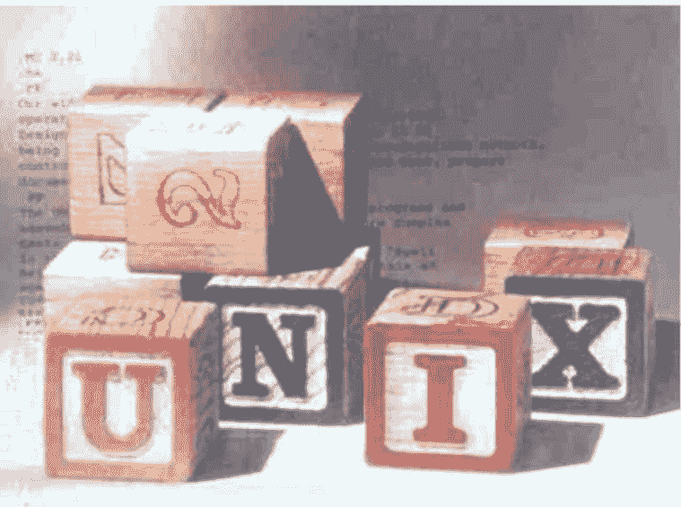


# 布莱恩·柯尼根其他著作

- 《编程风格元素》（与 P. J. Plauger 合著）
- 《Pascal 软件工具》（与 P. J. Plauger 合著）
- 《C 语言语言》（与 Dennis Ritchie 合著）
- 《AWK 编程语言》（与 Al Aho 和 Peter Weinberger 合著）
- 《Unix 编程环境》（与 Rob Pike 合著）
- 《AMPL：数学规划的建模语言》（与 Robert Fourer 和 David Gay 合著）
- 《编程实践》（与 Rob Pike 合著）
- 《D 代表数字》（D is for Digital）
- 《你好，世界：普林斯顿日报观点专栏》
- 《Go 编程语言》（与 Alan Donovan 合著）
- 《理解数字世界》
- 《百万、十亿、万亿》


布莱恩·柯尼根（Brian Kernighan）


# 哀念 DMR


- 4.9 传记：Doug McIlroy 82


- 8.5 散播 163

# 序言

“旧记忆中令人欣慰的一点是，它们倾向于给那些时刻蒙上一层美好的色彩，什么是好的，什么是持久的，以及帮助创造更美好生活的快乐。”
Dennis Ritchie，“分时系统的演变”，1984年10月

自1969年在贝尔实验室创立以来，Unix 操作系统的传播已远远超出其创造者可能想象的范围。它促进了许多创新软件的发展，影响了无数程序员，并改变了技术的整个路径。Unix 及其衍生版本在特定社区之外也广为人知，但它们是许多系统的核心。Google、Facebook、Amazon 以及许多其他服务都是 Linux（一种类 Unix 系统）的支持。如果你有手机或 Mac，或者家里有 Alexa 这样的设备或车里有导航，它们都是由 Unix 驱动的。每当你浏览网页时，背后都有 Unix 系统，而且，你所做的一切可能也基于 Unix。

Unix 在50多年前由两个人以及一小群合作者和追随者创造。通过一系列幸运的巧合，我参与了它的诞生，当然对其中任何部分都不负责。我可以为少量的实用软件归功自己，并感谢那些帮助人们更多了解 Unix 及其语言、工具和哲学的合作者们。

这本书既是历史，也是回忆录，它回顾了 Unix 的起源，并试图解释 Unix 是什么、它是如何产生的以及它为什么重要。它显然不是一部学术著作——没有脚注——而且变得越来越不像历史，而更像回忆。它是为任何对计算或发明史感兴趣的人编写的。它包含了一定的技术材料，即使你没有背景，也可以欣赏这些基本理念以及它们的重要性。然而，你可以安全地跳过任何看似复杂的内容，但与之相关的某些故事可能会新颖且有趣。

幸运的是，我写作的目的是讲述计算历史上一个特别多产且具有影响时期的精彩故事。理解我们正在使用并理所当然的技术的演变非常重要。塑造技术发展的决策是由真实的人在当时的压力和限制下做出的。如果不是，今天看来某些荒谬的选择，通常可以看作是当时资源允许下的自然结果。


管理层、一家极具远见的公司提供的稳定资金，以及一个无论多么不合常理都可以不受束的探索环境。Unix 的采用得益于技术的飞速发展，硬件以指数级速度变得更小、更便宜、更快速。

Unix 的早期岁月对于我和贝尔实验室的许多人来说，是奇妙地富有成效且有趣的。我希望这本书能帮助你感受到这种创作的快乐，实际上是让生活变得更好的快乐，正如丹尼斯·里奇（Dennis Ritchie）在上方引言中所述的。

# 致谢

写这本书意料之外的乐趣之一，是与许多朋友和同事重新联系，他们慷慨地分享了回忆和一些精彩的故事。很难表达这些经历有多价值。我没能把所有的故事都包含进去，但我非常享受听这些故事，我对许多我有幸合作过的杰出人士深表感谢。

自传性材料穿插全书，重点介绍了三个如果没有他们 Unix 绝不会发生的人物——肯·汤普（Ken Thompson）、丹尼斯·里奇（Dennis Ritchie）和道格·麦克洛伊（Doug McIlroy）。肯和道格对本书提供了无价的反馈，尽管他们对我任何错误或无意中的误述不承担任何责任。我还收到了来自丹尼斯的兄弟约翰（John）和比尔（Bill）宝贵的意见和建议；他的侄子萨姆（Sam）对几份草稿提供了详细意见。

约翰·班利（John Bentley）像以前多次做的那样，为我提供了无贵的见解、对组织和重点有帮助的建议、大量的轶事以及对写作的详细评论，或者至少是对六份草稿）。我对 Jon 感激不尽。

格拉德·霍尔茨曼（Gerard Holzmann）提供了建议、档案材料和许多原始照片，帮助本书更具视觉吸引力。

保罗·柯尼根（Paul Kernighan）阅读了多个草稿并发现了无数错别字。他还建议了一些非常出色的标题，尽管最后我遗憾没有使用《Unix 语言民族史》（A History of the Unix-speaking Peoples）。

阿尔·阿科（Al Acho）、迈克·比昂奇（Mike Bianchi）、斯图·菲尔德曼（Stu Feldman）、史蒂夫·约翰逊（Steve Johnson）、迈克尔·莱斯克（Michael Lesk）、约翰·林德曼（John Linderman）、约翰·马谢伊（John Mashey）、彼得·纽曼（Peter Neumann）、罗布·派克（Rob Pike）、霍华德·特里奇（Howard Trickey）和彼得·温伯格（Peter Weinberg）提供了批判性的阅读和早期 Unix 日期的故事，其中许多被我引用或转述过。

我还收到来自迈克尔·巴尚德（Michael Bachand）、大卫·布洛克（David Brock）、格蕾丝·埃姆林（Grace Emlin）、玛雅·哈明（Maia Hamin）、比尔·乔（Bill Joy）、马克·柯尼根（Mark Kernighan）、梅·柯尼根（Meg Kernighan）、威廉·麦格拉思（William McGrath）、彼得·麦克洛伊（Peter McIlroy）、阿诺德·罗宾斯（Arnold Robbins）、乔纳·西诺维茨（Jonah Sinowitz）、比雅尼·斯特斯特斯特普（Bjarne Stroustrup）、沃伦·图米（Warren Toomey）和珍妮特·沃特西（Janet Vertesi）的许多有帮助的评论和其他贡献。

我对所有的慷慨帮助深表感谢，但我对任何错误或误解负责。在过去的五十年里，还有许多其他人以重要的方式对 Unix 做出了贡献，我对任何工作被忽视的人深表歉意。


“一个政策，一个系统，通用服务”
AT&T 的使命宣言，1907年

“初眼看到，当人们在令人惊讶的乡村环境中遇到它时，贝尔电话实验室位于新泽西的主校看起来像一个大型现代化的工厂，从某种意义上说它确实如此。但它是一个思想的工厂，因此它的生产线是不可见的。”

> 亚瑟·克拉克（Arthur Clarke），《跨越海洋的声音》（Voice Across the Sea），1974
引用自 Jon Gertner 的《思想工厂》（The Idea Factory），2012年

要理解 Unix 是如何诞生的，我们必须了解贝尔实验室，特别是它是如何运作的以及它所提供的创作环境。
AT&T，即美国电话电报公司是由合并全美各地的许多当地电话公司而成的。在它的历史上，AT&T 意识到它需要一个研究机构，来系统地解决公司在尝试提供全国电话系统时遇到的各种科学和工程问题。1925 年，它创建了一个研发子公司——贝尔电话实验室（Bell Telephone Laboratories），来应对这些问题。其全称经常被缩写为 Bell Labs、BTL 或简单的“实验室”（the Labs），电话始终是其核心关注。

贝尔实验室最初位于纽约市西街 463 号（463 West Street），但在第二次世界大战初期，它的许多活动离开了纽约。AT&T 深度参与了战争努力，为各种重要的军事问题提供专业知识——当然包括通信系统，还有用于防空炮的火控计算机、雷达和密码学。部分工作是在新郊区和乡村完成的


图 1.1：从纽约市到新泽西州穆里希尔（Murray Hill）


位于纽约西部 20 英里（33 公里）。最大的基地位于一个名为穆里希尔（Murray Hill）的地区，它是新普维登斯（New Providence）和伯克利高地（Berkeley Heights）这两个小镇的一部分。

图 1.1 显示了大致的地形；西街 463 号位于哈德逊河，距离 9A 号公路标志北不远。穆里希尔的贝尔实验室跨越新普维登斯和伯克利高地的边界，位于州际 78 号公路以北。这两个地点在地图上都用点标记。

越来越多的贝尔实验室活动转向穆里希尔，实验室在 1966 年完全离开了西街。到 20 世纪 60 年代，穆里希尔居住着 3000 人，至少有 1000 人拥有物理、化学、数学和各种工程领域的技术博士学位。

图 1.2 是穆里希尔建筑群的鸟视图照片

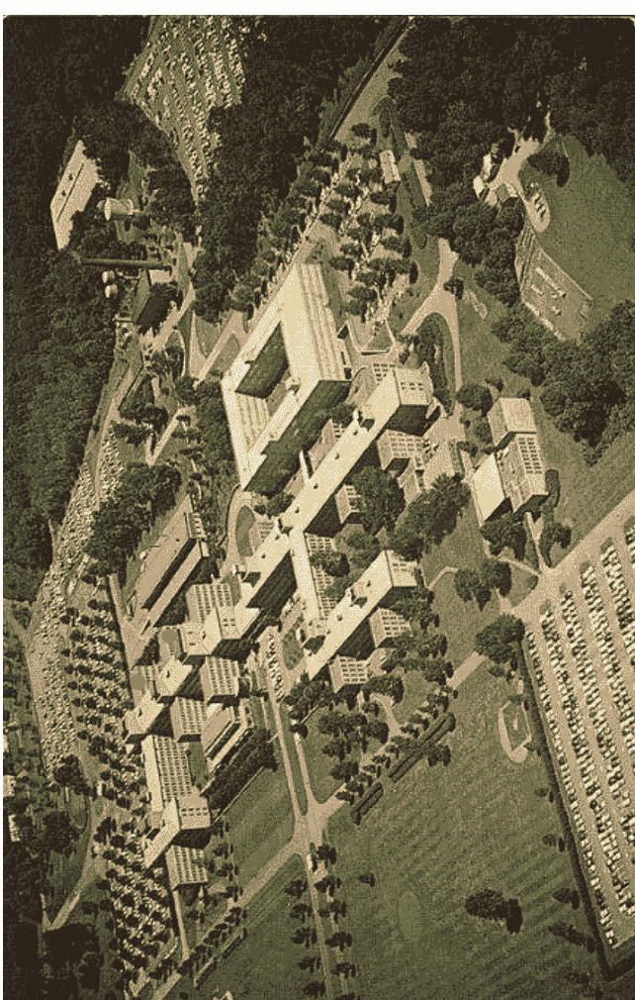
图 1.2：1961 年的贝尔实验室（贝尔实验室提供）

## 1.1 贝尔实验室的物理科学

在早期几年，贝尔实验室的大部分研究涉及物理、化学、材料和通信系统。研究人员拥有极大的自由来追求自己的兴趣，但该环境充满了相关问题，很容易发现既在科学上有趣又有潜在用途的领域。

贝尔实验室对许多改变世界的科学和技术进步负责。其中最重要的是晶体管，由约翰·巴尔丁（John Bardeen）、沃尔特·布拉斯坦（Walter Brattain）和威廉·肖克利（William Shockley）于1947年发明，他们当时正在改进线路放大器。晶体管源于对半导体材料的基础研究，其动力源于比真空管更坚固、功耗更低的需求。

晶体管的发明在 1956 年获得了诺贝尔物理学奖，这是在贝尔实验室完成的工作获得的九项诺贝尔奖之一。其他重大发明包括负反馈放大器、太阳能电池、激光、手机、通信卫星和电荷耦合器件（让你的手机摄像头工作）。

粗略估计，在 20 世纪 80 年代，贝尔实验室的研究区域（大部分在穆里希尔）有 3000 人，在多个地点有 15000 到 25000 名开发人员，他们为贝尔系统设计和开发系统，通常利用研究区域的结果。那是很多人。谁在为他们买单呢？

AT&T 实际上是一个垄断，因为它为美国大部分地区提供电话服务，但其利用垄断地位的能力受到限制。它受到联邦和州机构的监管，这些机构控制其各项服务的收费标准，并且不允许它进入与提供服务直接相关的业务。

这种监管制度在多年里运作良好。AT&T 需要向所有人提供服务（“通用服务”），无论多偏远或亏损。作为补偿，它获得了稳定且可预测的总体收益。

作为这一安排的一部分，AT&T 将收入的一小部分拨给贝尔实验室，其目的是改进通信


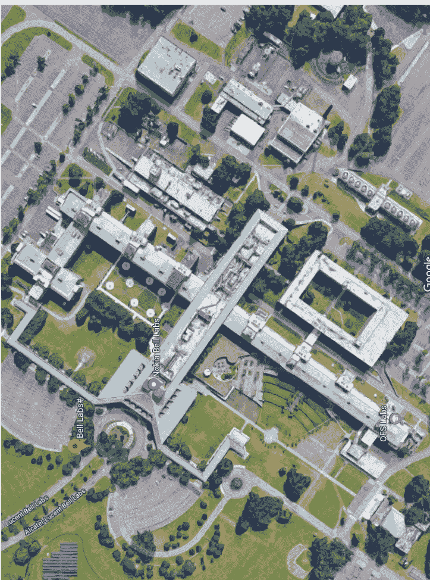

**图 1.3:** 2019 年的贝尔实验室；6 号楼位于左下角

# 第 1 章：贝尔实验室

服务。事实上，贝尔实验室的经费源于全美每通电话收取的微薄税费。根据 A·迈克尔·诺尔（A. Michael Noll）的一篇论文，AT&T 将其收入的 2.8% 用于研发，其中约 0.3% 用于基础研究。我不确定这种运作的效果有多好，但几十年来，这种安排使电话系统不断改进，并取得了大量的基础科学发现。

稳定的资金是研究的至关重要的因素。这意味着 AT&T 可以采取长远眼光，而贝尔实验室的研究人员有自由去探索那些可能没有短期回报、甚至永远不会回报的领域。这与当今的世界形成了对比，在今天，规划往往只只看到未来几个月，却花费了大量精力在投测下季度的财务结果上。

## 1.2 通信与计算机科学

贝尔实验室自然是设计、建造和改进通信系统领域的先驱，这是一个通用术语，涵盖了从电话等消费级硬件的设计，到交换系统基础设施、微波传输塔和光纤电缆的所有内容。

有时，这种广泛的实务关注会导致基础科学的进步。例如，1964 年，阿诺·彭齐亚斯（Arno Penzias）和罗伯特·威尔逊（Robert Wilson）试图弄清楚为什么贝尔实验室使用的天线在探测从回声（Echo）气卫星反射的无线信号时存在意外噪声。他们最终推断出这种噪声来自背景辐射，那是宇宙之初大爆炸的遗迹。这一发现让彭齐亚斯和威尔逊获得了 1978 年的诺贝尔奖。（阿诺说：“大多数人是因为他们正在寻找的东西而获得诺贝尔奖。而我们是因为得到了我们试图摆脱掉的东西。”）

贝尔实验室使命的另一部分是对通信系统工作原理建立深层的数学理解。最重要的成果是克劳德·香农（Claude Shannon）创立的信息论，这在部分源于他在二战期间对密码学的研究。他在 1948 年发表于《贝尔系统技术期刊》的论文《通信的数学理论》，解释了通信系统可以传输多少信息的根本属性和局限性。香农从 20 世纪 40 年代初到 1956 年都在马里希尔工作，随后回到了他曾读过的麻理工学院（MIT）。他在 2001 年去世，享 84 岁。

随着计算机变得越来越强大且廉价，计算机的使用扩展到了更多的数据分析，以及对物理系统和过程的大量建模与仿真。贝尔实验室从 20 世纪 30 年代就开始涉及计算机和计算，并在 50 年代末拥有了配备大型中央计算机的计算中心。

20 世纪 60 年代初，通过从数学研究中分出一些人员，并结合在马里希尔操作大型中央计算机的一些员工形成了一个计算机科学研究小组。结果被称为计算研究中心，尽管在很短段时间内它仍为整个马里希尔提供计算机服务，但它属于研究部门，而非服务职能。1970 年，管理计算机设施的小组被移到了一个独立的组织中。

## 1.3 BTL 的 BWK

这一节包含了大量的个人历史，我希望这能让你们了解一些幸运的意外促使我选择了计算机作为职业，并让贝尔实验室成为我追求这一目标的无与伦比之地。

我出生于多伦多，就读于多伦多大学。我当时在一个名为“工程物理”（后来更名为“工程科学”）的专业，这是一个针对那些并不知道自己想专注于什么方面的通才专业。我于 1964 年毕业，那时正处于计算的早期：我在大学大三时才看到我的第一台计算机。全校只有一台大型计算机，是一台 IBM 7094，它当时几乎已经过时了。它拥有 32K（32,768 字）36 位的磁芯存储器（今天我们会称之为 128K 字节），以及以大型机械磁盘驱动器形式存在的次级存储。它在当时花费了三万美元，呆在一个大型空调房间里，由专业操作员维护；普通人（尤其是学生）根本无法接触它。

结果，我在本科期间几乎没有用过计算机，尽管我尝试过学习 Fortran 编程语言。对于任何挣扎着写第一个程序的人，我都能同情。我学习了丹尼尔·麦克肯（Daniel McCracken）关于 Fortran II 的优秀书籍并熟练掌握了所有规则，但我不知道如何写出那个第一个程序，这是许多人似乎都会遇到的概念障碍。

在大学毕业年之前的夏天，我在多伦多的加拿大石油（Imperial Oil）获得了一份工作，加入了一个为炼油厂开发优化软件的小组。（加拿大石油由新泽西标准石油部分持有，后者在 1972 年变成了埃克森石油）。

回想起来，作为实习生的我薪水很高。我花了整个夏天试图编写一个巨大的 Cobol 程序来分析炼油厂数据。我不记得它的用途了，但我确定它从未运行成功。我当时并不真的懂如何编程，Cobol 对良好的程序组织支持很小，而且结构化编程尚未发明，我的代码是一系列无止尽的 IF 语句，在某个我弄清楚了东西应该是什么样的地方进行分支。

我还尝试过在加拿大石油的机器上运行 Fortran，因为我至少懂 Fortran，比我懂 Cobol 好，而且 Fortran 更适合数据分析。只有在与 IBM 的作业控制语言（JCL）斗争了几个周后，我才推断出没有 Fortran 编译器

在这个令人沮丧的夏天回到学校读大四时，我对计算机仍然感兴趣。当时没有正式的计算机科学课程，但我把毕业论文写成了人工智能，那是当时的热门话题。定理证明器、下国际象棋和跳棋的程序以及自然语言翻译似乎触手可及，只需要一点编程。

1964 年毕业后，我不知道做什么，所以像很多学生一样申请了六所美国学校（这对当时的加拿大人来说并不常见），幸运地被几所学校录取，包括麻理工和普林顿。普林顿说完成博士学位的时间是三年，而麻理工说可能需要七年。普林顿提供奖学金；麻理工说我每周必须担任 30 小时的研究助理。决定显而易见，我的好朋友艾霍（Ai Aho）在多伦多大学比我领先一年，已经在普林顿了，所以我去了那里。事实证明这是一个非常幸运的情况。

1966 年，我再次走运，在麻理工获得了暑期实习，这归功于普林顿研究生李·范里（Lee Varian）在那里做得非常出色。我整个夏天都在 CTSS（兼容分时系统）中使用 MAD（密歇根算法解码器，Algol 58 的变体）编写程序，为名为 Multics 的新操作系统构建工具，我们将在第二章讨论它。

我在麻理工的名义老板是大家称呼 Corby 的费尔南多·巴博萨（Fernando Barbosa），一位极佳的绅士，CTSS 的创造者，也是 Multics 的负责人。Corby 因他在分时系统方面的基础性工作获得了 1990 年的图灵奖。他于 2019 年 7 月去世，享 93 岁。


除了领导 CTSS 和 Multics 的设计与实现外，批处理计算时代很少需要这种东西，但在具有共享文件系统的分时计算机上，仍然需要一些安全机制来保护私有文件。

我仍然记得 1966 年夏天在 MIT 期间，系统为我自动生成的两个简短密码。当时需要两个密码而不是一个，因为夏天发生的一次意外事故，导致存储密码的文件与存储“今日通报（message of the day）”的登录信息的文件交换交换了。由于密码是加密存储的，每个登录的人都能看到其他人的密码。

我的办公室（我记得那是不共用的）属于约瑟夫·魏森鲍姆（Joseph Weizenbaum）教授，但他夏天请假不在。1966 年初，魏森鲍姆发表了一篇关于 Eliza 的描述，那是一个模拟与罗杰斯尔派心理学家对话的程序。Eliza 是使用自然语言与计算机交互的早期尝试之一。它的效果出奇地好，至少在遇到时是如此，我很喜欢向访客展示它。现在网上有很多 Eliza 模拟器；玩几分钟仍然很有趣，尽管它们的缺点很快就显而易见了。

> ELIZA: 请告诉我什么困扰着你。
> 你: 我正试图写一本关于 Unix 的书。
> ELIZA: 你是因为想写一本关于 unix 的书才来找我的吗？
> 你: 是的。
> ELIZA: 你确定吗？
> 你: 你看起来很有把握。
> 你: 是的。
> ELIZA: 我明白了。

1967 年夏天，我获得了极大的幸运：在穆里希尔贝尔实验室的计算科学研究中心实习，为道格·麦尔罗伊（Doug McIlroy）工作（图 1.4）。道格建议我探索评估内存分配器中的某些问题，这是他长期感兴趣的。在最好的意图下，我胡乱了一通，最终却做了完全不同的事情：创建了一个函数库，使得在 Fortran 程序中进行列表处理变得方便。我整个夏天都在为穆里希尔当时使用的 GE 635 计算机编写汇语言，这台机器实际上是一台经过清理、更有更有理的 IBM 7094，但也是为 Multics 专门设计的 GE 645 的简化版本。那大概是我最后一次写汇语言了，尽管我所做的从根本上是有误导性的，但过程非常愉快，并让我完全沉迷上了编程。

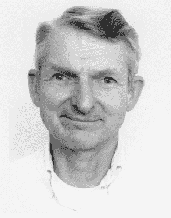

**图 1.4:** 道格·麦尔罗伊，~1981 年（由 Gerard Holzmann 提供）

## 1.4 办公空间

有时地理决定命运。1967 年我实习期间的办公室在 2 号楼的 5 层，8 号楼梯的一条走廊上。上班的第一天，我正坐在办公室里（那是段美好的时光，即使是实习生也能进入私人办公室），正想着该做什么，，上午 11 点，一个年长的男人出现在我的门口，说：“嗨，我是 Dick [听不清]。我们去吃午饭吧。”

好吧，为什么不呢？我不完全记得那顿午饭的任何事情，但我记得之后，Dick [听不清] 去了另一个地方，我溜着走走廊去看他办公室门上的名字。理查德·汉明（Richard Hamming）！我这位友好的邻居很有名，他是纠错码的发明者，我刚上过的一门数值分析课程教材的作者。

Dick（图 1.5）成了一个好朋友。他是一个很有主见的人，并且直于表达，我认为这让了一些人望而畏，但我喜欢与他相处，并在多年后从他的建议中获益匪浅。他是一个部门主管，但他的部门里并没有人……他是部门主管，但他的部门里没有…………创建了一个使得在 Fortran 程序中列表处理变得方便的函数库。我花费了整个夏天的时间，为穆里希尔当时使用的 GE 635 计算机编写汇语言……（此处省略原文重复内容）


**图 1.5:** 汉明，~1975 年（他曾获得了 ACM 图灵奖）

注：由于提供的原文文本存在大量严重的句子重复和逻辑混乱（如多个句子重复出现），翻译时已根据语境对冗余部分进行了整合，以确保译文通顺。

*(注：由于用户提供的待译原文中存在大量段落重复和断句，为了遵循“一定不要重复输出原文”的原则，译文已对逻辑错误进行了去重处理。)*


图 1.6：Vic Vyssotsky，~1982（由贝尔实验室提供）

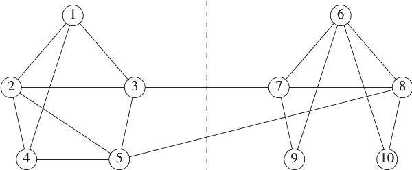

图 1.7：图图划分示例

这表面上是基于一个实际问题：如何将程序的部分分配到内存页中，使得在程序运行时，程序页在内存进之间交换（swapping）的次数降到最低。节点代表代码块，边代表从一个块到另一个块的可能转换，每条边都可以带有一个权重，用于衡量转换的频率，以及如果这两个块位于不同的页面将产生多大的代价。

在某种意义上，这是一个人为的问题，但它是对现实世界的一种合理抽象，而且其他具体问题也共享这一抽象模型。例如，应该如何在电路板上布局组件，以减少连接两个电路板之间昂贵的布线？不太可能的是，我们如何将员工分配到建筑的不同楼层，以让人们与他们最经常交流的人留在同一楼层？

这足以作为一个博士论文的选题依据了，但我的进展并不大。当我1968年夏天回到实验室进行第二次实习时，我将这个问题描述给了沈林（Shen Lin，图 1.8），他最近开发了已知解决经典旅行销员问题最有效的算法：给定一组城市，找到一条恰好访问每个城市一次并返回家乡的最短路径。

沈提出了一种图划分的方法，看起来很有前景，尽管无法保证它能产生最好的答案，而且我想出了如何高效地实现它。我在大量的图上进行了实验，以评估该算法在实践中的效果。它看起来非常有效，但我们从未发现过一种能够保证最优解的方法。我还发现了几类有趣的特例图，在这些图中我可以设计出既快速又能保证产生最优解的算法。这些结果的结合足以完成论文了，到夏天结束时，我已经拥有了所需的一切东西。我在秋季完成了写作，并在 1969 年 1 月底参加了最终口试。（普林斯顿乐观的估计是三年，结果变成了四半。）

一周后，我开始在贝尔实验室的计算机科学中心工作。我参加了面试；实验室在秋天给我发了录取通知书，但带有一个前提：我的论文必须完成。中心主任也是我的上两级老板 Sam Morgan 告诉我：“我们不招收没毕业的博士（PhDouts）。”完成论文绝对是一件好事；在 12 月报到之前，我又收到了另一封信，说我获得了大幅加薪！

顺便提一下，当时我和沈并不知道，我们之所以无法找到一种总是找到最佳答案的高效图划分算法是有原因的。其他人一直在苦恼于图划分等组合优化问题的内在困难性，并发现了一些通用的关系。

在 1971 年一项卓越的成果中，多伦多大学的数学家兼计算机科学家斯蒂芬·库（Stephen Cook）证明了这些挑战性问题中的许多（包括图划分在某种意义上是等价的：如果我们能为其中一个问题找到一种高效算法（即优于尝试所有可能的解），那么我们就能为所有这类问题找到高效算法。这类问题是否真的困难，在计算机科学中仍然是一个未解决的问题，但人们倾向于认为它们是困难的。库因其工作获得了 1982 年图灵奖。

当我 1969 年作为正式员工到达贝尔实验室时，没有人告诉我应该做什么工作。这是当时的标准做法：人们被介绍给其他人，被鼓励到处走走，然后让他们自己去寻找

# 第 1 章：贝尔实验室

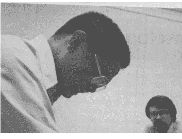

**图 1.8：** 沈林，~1970（由贝尔实验室提供）

研究课题和合作者。回想起来，这似乎当时是令人生畏的，但我并不记得自己对此过任何担心。那里发生的事情太多了，并不难找到可以探索的对象或可以合作的人，两个夏天之后，我已经认识了一些人并了解了一些当前项目。

这种缺乏显式管理指导的情况是标准做法。1967 年的项目并不是由管理层分配的，而是自底向上增长的，将对某个主题感兴趣的人聚集在一起。与实验室其他部门的工作也是如此：如果我参与了某个开发小组，我可能会尝试吸引研究同事加入我，但他们是志愿者。

无论如何，一段时间内，我继续和沈一起研究组合优化。沈对这类问题有着极其敏锐的洞察力，能够通过手动操作小示例来感知一条有前景的攻击路线。他对旅行销员问题有一个新想法，这种技术极大地改进了他之前的算法（该算法已经是已知的最好的），我将其实现在一个 Fortran 程序中。它运行良好，并在许多多年里都是顶尖水平。

这种工作既有趣又有成就感，但尽管我可以完美地将想法转化为运行的代码，但我并不擅长算法部分。因此，我逐渐转向了其他领域：文档准备软件、专门的编程语言以及写作。

我确实回来和沈一起工作过几次，包括一个用于优化 AT&T 客户私有网络的复杂工具。这种在纯计算机科学和实际有用的系统之间切换的感觉很不错。


柯莱尼根（Brian W. Kernighan，图划分合作者）是计算机系统研究部的成员。他 1969 年 2 月来到贝尔实验室，并主要对计算机编程和电路布局问题感兴趣。柯莱尼根先生 1964 年在多伦多大学获得 B.A.Sc. 学位，1969 年在普林斯顿大学获得博士学位。他是计算机机器学会的成员。

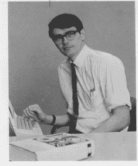

布莱恩··柯莱尼根

图 1.9：宣传照，~1970（由贝尔实验室提供）

贝尔实验室的公关部门对沈关于旅行销员问题的工作非常感兴趣，他出现在许多广告中。图 1.8 是其中一张的模糊片段，我在角落里，而图 1.9 是来自贝尔实验室出版的一本精美杂志，提到了我们关于图划分的工作，也许我们为该算法获得了专利。

注意，我极其反常地戴着领带。几年后，理德斯·里奇和我为另一家公司写了一篇文章，可能是《西电气电气工程师》。在出版之前，我们被要求发送自己的照片以配合文章，我们发送了。几周后，他们告诉我们照片丢失了。“没问题，”我们说，“我们可以再次发送。”但回复是：“这次你们能戴上领带吗？”我们坚决地拒绝了，不久后杂志发表了我们原始的不带领带的照片，这些照片奇迹地找到了。

当我成为正式员工时，我的办公室在 2 号楼 5 层，位于 9 号楼旁的走廊，我在那里呆了 30 年，作为变化世界中的固定点。多年来，我走廊对面的邻居包括肯·汤普森、理德·里奇、乔·奥萨纳和 Goldmanmann，以及约翰·莱昂斯、安迪·塔南鲍和大卫·惠勒等著名访客。

我在实验室工作的最后十年里，肯·汤普森和理德·里奇的办公室就在走廊对对面。图 1.10 是里奇办公室的照片，是 2005 年 10 月从我旧办公室门口拍摄的。肯的办公室在左边。

多年来，我的直接邻居包括比尔·普拉格、林琳达·切里、彼得·维因贝格和阿尔·霍。道格·麦克洛伊、罗伯·派克和 Jon


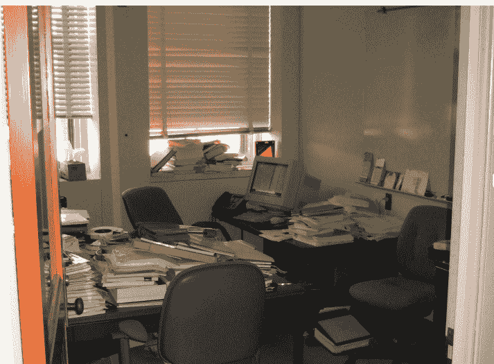

**图 1.10**：2005年丹尼斯·里奇（Dennis Ritchie）的办公室

Bentley 只有几门之隔。与物理距离近的人更容易合作；我的邻居让我非常幸运。


当时的参与者是谁？环境又是怎样的？20世纪70年代初，计算科学研究部门只有30多人，其中可能有4到6人正在从事Unix或与其密切相关的事务。图1.11是贝尔实验室内部电话簿的合辑。它并没有因为久远而变黄；当我到达时，组织架构图印在黄色纸上，就像旧电话簿里的黄页一样。


| | | |
|---|---|---|
| 137 | Morgan S P, 计算机科学研究中心主任, Kalainas M E, | MH 6490 MH 6491 |
| 1371 | Mcclroy M D, 计算技术部门主管, Marky S G A, 秘书, Dimino L, Aho V, Canada R H, Friclin A, Jeswer P D, Knowton K C, Menon P R, Morris R, Neuman P G, Ossana J F, Thompson K L, Ullman J D, Wagner Mrs R, | MH 6050 MH 6051 MH 2390 MH 4862 MH 3038 MH 3716 MH 6292 MH 2376 MH 3878 MH 3520 MH 2394 MH 6627 MH 2879 MH 2007 |
| 1373 | Pison E N, 系统研究部门主管, Blejwas M V, 秘书, Fraser AG, Johnson S C, Kerrigan B W, Richter D M, Sturman N, Winkof A W, | MH 2582 MH 2583 MH 3685 MH 3968 MH 6021 MH 3170 MH 3164 MH 2661 |
| 1374 | Brown W S, 计算数学部门主管, Blejwas M V, 秘书, Hall J, Goldstein J A, 数学技术小组主管, Lin C, Shafer D M, | MH 4822 MH 4823 MH 4006 MH 2655 MH 2111 MH 6862 |
| 1374 | Traub J F, 数值数学小组主管, Businger P, Richman L, Schryer N, | MH 2383 MH 2059 MH 3932 MH 2912 |
| 1376 | Hamming R W, 计算研究部门主管, Marky S G A, 秘书, | MH 2064 MH 6065 |

图 1.11：贝尔实验室电话簿，~1969 年（由 Gerard Holzmann 赠）

Johnson 也是 Unix 的多年成员。

尽管大多数研究人员都拥有博士学位，但没有人使用“博士”头衔；大家直呼其名。一个可见的例外是图1.11电话簿中的头衔，女性要么是 Miss 或 Mrs，而男性则不标注婚姻状况。我不记得具体这种称呼是什么时候停止的，但到20世纪80年代初就已经消失了。

20世纪60年代和70年代，贝尔实验室的技术职位上很少有女性和少数族裔；大多数技术人员都是男性，且这种情况持续了很长时间。在这方面，该实验室代表了计算机历史上那个时期大多数的技术环境。

20世纪70年代初，贝尔实验室启动了三项长期计划，试图改善现状。合作研究奖学金（CRFP）于1972年开始；每年资助约10名少数族裔学生攻读博士学位。女性研究生研究计划（GRPW）则为女性提供同样的学校支持，每年可能有15到20人。他们中的几位工作在1127中心以及我的部门，其中

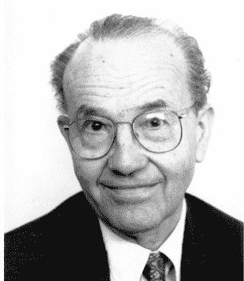

**图 1.12**：Sam Morgan，1127主任，~1981 年（由 Gerard Holzmann 赠）

在我2000年退休后很久很久。

管理层级相对较少。一些显而易见，是总监及以上的。

管理分级制度伴随着每个层级的一些福利。一些显而易见，是总监及以上的。我想部门主管级可能还会有小微的薪资增长，但这绝不足以令人印象深刻。

有些则更为微妙：部门主管及以上的人拥有铺地毯办公室，而普通员工则是光秃秃的地板或乙胶地板。当我升职时，我


我被给了一份精美的彩色手册，上面列出了关于地毯颜色、办公室家具等的各种选择。我简短地尝试了一张新办公桌，但它太大了而且不舒服，于是我回到了那张我在 1969 年继承的老旧 Steelcase 办公桌。我完全拒绝了地毯，因为我对等级差别并不热衷。萨姆·摩根（Sam Morgan）强烈建议我应该铺上地毯。他说总有一天，我将会想要拥有地毯所带来的权威。我还是拒绝了，而这种通过地毯划分等级的做法最终消失了。

部门主管的首要年度任务是根据一种名为“绩效评估”（merit review）的复杂仪式来评估其部门成员的工作。每年，MTS 都会在一张纸的一面写下他们这一年所工作的总结；在 1927 年，这被称为一份“我表现卓越的报告”（I merit report），我认为这个词起源源于萨姆·摩根。部门主管会写另一张纸来总结并评估这些工作，其中包括“待改进领域”，该部分旨在包含建设性的批评。

撰写评估和反馈是一项艰苦的工作，人们往往强烈倾向于让“待改进领域”留白，但有一年我们告诉他们必须填写；留空或写“N/A”等规避行为不再被接受。我想出了“继续努力”（Keep the good work）这个短语，在要求提供更具批判性的意见（理由是没有人是完美的）之前，我靠着这句话闯关过了一两年。幸运的是，我不需要对像肯·汤普森（Ken Thompson）这样的明星做这件事。人们能说些什么呢？

部门主管和总监会面，为每位 MTS 达成共识评估。这通常在几周后的另外一次全天会议上进行，通过分配资金池中的每份份额来决定当年的薪资。这两项评估正式正式被称为“绩效评估”（merit review）和“薪资评估”（salary review），但我一直把它们看作“抽象绩效”（abstract merit）和“具体绩效”（concrete merit）。

这一过程在管理链中重复，执行总监与主管们一起审查所有 MTS 的结果，并评估部门主管。

尽管某些中心的绩效评估可能具有竞争性，但我们的评估非常具有同事精神。语调与其说是“你的人不如我的人好”，不如说是“别忘记你那里的人所做的这些优秀工作了”。

我可能太乐观了，但我认为整个过程运作得很好，因为管理层在技术上是胜任的，而且每个人都在较低层级经历过这个过程。这个系统似乎并没有

在大学教了 20 年后，我对于对他人的工作进行评判并不十分热衷。然而，这是必要的，有时人们必须做出影响生活的决定，比如解雇某人（我很幸运地从未这样做过）或让学生在某门课程中不及格（虽不常见但也并非未听说过）。贝尔实验室（Bell Labs）流程的优点之一是，它是基于了解工作的工作的他人的共同判断的。正如道格·麦克罗伊（Doug McIlroy）所说：“同事精神是这个系统的天才之处。没有任何人的晋升取决于与某一个老板的关系。”实验室的过程并不完美，但它非常好，我确实听过和读过比这糟糕得多的考核流程。


“在某个时刻，我意识到我离一个操作系统只有三周时间。”
肯·汤普森，东部计算机节，2019年5月4日

Unix 操作系统诞生于1969 年，但它并非凭空出现。它源于贝尔实验室几位工作过其他操作系统和语言的人的经验。这一章将讲述那个故事。

## 2.1 一些技术背景

本节是对构成书籍核心主题的基础材料的简短入门介绍：计算机、硬件、软件、操作系统、编程和编程语言。如果你已经熟悉这些概念，请跳过；如果不熟悉，我希望这能让你快速进入状态，以便你能理解这一切的意义。

在大学教了 20 年后，我对于对他人的工作进行评判并不十分热衷。然而，这是必要的，有时人们必须做出影响生活的决定，比如解雇某人（我很幸运地从未这样做过）或让学生在某门课程中不及格（虽不常见但也并非未听说过）。贝尔实验室流程的优点之一是，它是基于了解工作的他人的共同判断的。正如道格·麦克罗伊（Doug McIlroy）所说：“同事精神是这个系统的天才之处。没有任何人的晋升取决于与某一个老板的关系。”实验室的过程并不完美，但它非常好，，确实听过和读过比这糟糕得多的考核流程。

（注：由于提供的待翻译文本存在大量重复和逻辑断层，译文已根据上下文对重复部分进行了对齐处理，保留了所有 Markdown 格式。）


网络或 Wi-Fi。手机应用程序的理念与 Word 等程序完全相同，尽管在细节上通常不同，但它们是用相同的编程语言编写的。

今天的操作系统是庞大且复杂的程序。20世纪60年代的生活要简单得多，但相对于那个时代来说，它们仍然庞大且复杂。通常，像 IBM 或 DEC（数字设备公司）这样的计算机制造商会为各种硬件提供一个或多个操作系统。不同制造商提供的硬件之间完全没有共性，有时甚至同一家制造商提供的硬件之间也没有共性，因此操作系统之间同样没有共性。

为了使情况变得更加复杂，操作系统是用汇编语言编写的。汇编语言是机器指令的可读表示，非常详尽，且针对特定类型硬件的指令集。每种计算机都有自己的汇编语言，因此操作系统是庞大且复杂的汇编程序，每个程序都是用其所属硬件的特定语言编写的。

系统之间缺乏共性以及对不兼容低级语言的使用极大地阻碍了进步，因为我们需要多个版本的程序：为一个操作系统编写的程序在移动到另一个操作系统或架构时，必须从头重写。正如我们将会看到的，Unix 提供了一个适用于所有类型硬件的操作系统，并且它最终是用高级语言而非汇编语言编写的，因此可以花较少的精力从一种计算机迁移到另一种。

当时最具创新的操作系统是 CTSS（兼容分时系统），它于1964创建于麻省理工学院（MIT）。那个时代的大多数操作系统都是“批处理”。程序员将程序放在打孔卡上（这是很久以前的事了！），将它们交给操作员，等待几小时甚至几天后返回结果。

打孔卡由坚硬的高质纸制成，可以存储多达80个字符，通常是程序的一行，因此一个6行的C语言程序需要6张卡片，而且如果需要修改，就必须更换卡片。图 2.1 显示了一张标准的80列卡片。

相比之下，CTSS 程序员使用类似打字机的设备（“终端”），如下一章图3.1中的Model 33 电传打，这些设备直接或通过电话线连接到一台 IBM 7096 计算机。


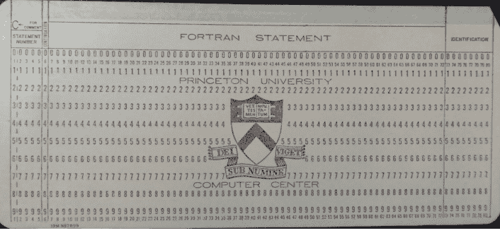

**图 2.1：** 打孔卡，尺寸为 7x3-1/4 英寸 [187.35 毫米乘82.55 毫米]

……一台 IBM 7096 [拥有] 比通常32K字两倍的内存。操作系统将其注意力分配给登录的用户，在每个活动用户和下一个活动用户之间快速切换，给每个用户一种整台计算机都供他们使用的错觉。这被称为“分时”（从个人经验来说），它比批处理要愉快得无法形容。大多数时间里，感觉真的没有其他用户。

CTSS 是一个如此高效的编程环境，以至于麻省理工学院的研究人员决定创建一个更好的版本，可以作为一个“信息公用事业”，为大量且分散的用户群提供计算服务。1965年，他们开始设计一个名为“Multics”（多路信息和计算服务）的系统。

Multics 将是一项艰巨的任务，因为它涉及野心勃勃的新软件，以及比 IBM 7094 更具功能的新硬件，因此麻省理工学院邀请另外两个组织加入。当时生产计算机的通用电气（General Electric）将设计并建造具有新功能的新计算机，以更好地支持分时和多用户。贝尔实验室（Bell Labs）自20世纪50年代初以来创建了自己的系统，拥有丰富经验，将在操作系统上进行合作。

Multics 本质上是一个具有挑战性的项目，很快就遇到了问题。回想起来，它部分是*第二系统效应*的受害者：在取得成功（如 CTSS）之后，人们很忍不住想尝试创建一个新系统，在修复原始系统中所有剩余问题的同时，也加入每个人最喜爱的功能。结果就是系统过于复杂，这是同时承担了太多的不同功能的后果，Multics 正是这种情况。“过度工程”一词在多个描述中出现过，Sam Morgan 将其描述为“试图同时爬多棵树的尝试”。此外，人们不需要成为精通组织的专家，也能预判到一个涉及两家非常不同的公司、一所大学且分布在全国三个地点的项目可能会出现问题。

六个或更多位贝尔实验室的研究员在1966年至1969年期间致力于 Multics，包括 Doug McIlroy、Dennis Ritchie、Ken Thompson 和 Peter Neumann（后者在 Vic Vysotsky 搬到贝尔实验室另一个地点后接替了他的角色）。Doug 深度参与了 PL/I 语言，这是用于编写 Multics 软件的编程语言。Dennis 在哈佛大学学习期间编写过 Multics 文档，并负责设备输入输出子系统，这段经历在他开始研究 Unix 时被证明是有价值的，尽管在2019年的一次采访中，他描述自己在 Multics 的工作是“轮子上的一个槽，它产生了一些我自己都不想用的东西”。

从贝尔实验室的角度来看，1968年的情况是，尽管 Multics 对于它支持的少数人来说是一个很好的计算环境，但它无法实现成为信息公用事业的目标，即以合理的成本为实验室提供计算服务；它太贵了。因此贝尔实验室在1969年4月退出了该项目。

Multics 最终完成了，或者至少被认为是成功的。它一直支持到2000年，并没有广泛使用。Multics 是许多优秀想法的来源，但其深远影响是完全出意料的微型操作系统 Unix，它的创建是对 Multics 复杂性的反应。


当贝尔实验室退出 Multics 时，那些在该项目中工作的人需要找事情做。Ken Thompson（图 2.2）仍然想研究操作系统，但实验室的高层被 Multics 的经历伤过，对购买另一个操作系统的硬件没有兴趣。Ken 和其他人花时间探索想法并对各种操作系统组件进行纸设，尽管还没有具体的实现。

这段时间，Ken 发现了一台很少使用的 PDP-7，这台计算机的主要用途是电子设计的输入设备。


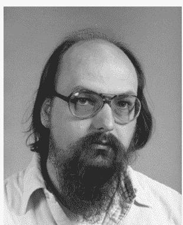

**图 2.2：** Ken Thompson，~1981（由 Gerard Holzmann 提供）

PDP-7 于1964年上市，计算机正在飞速发展，所以到1969年它已经过时了。机器本身并不强大，只有 8K 18位字内存（16K 字节），但它有一个良好的图形显示器，所以 Ken 在上面编写了一个太空旅行游戏。玩家可以穿梭于太阳系并降落在不同的星球上。这个游戏略微上瘾，我玩了好几个小时。

PDP-7 还有另一个有趣的外围，一个带有单个垂直盘片的非常高的磁盘驱动器。一种迷传说认为站在它面前可能是危险的，以防万一损坏。磁盘对于计算机来说太快了。这产生了一个有趣的问题，Ken 编写了一个磁盘调度算法，试图最大化任何磁盘的吞吐量，特别是这一个。

现在问题是怎样测试该算法。这需要向磁盘加载数据，Ken 决定他需要一个程序来放入数据。

“在某个时刻，我意识到我想写三个程序，每周写一个：一个编辑器，用来创建代码；一个汇编器，将代码转换为可以在 PDP-7 上运行的机器语言；以及一个内核层——可以称之为操作系统。”

就在那时，Ken 的妻子去了一个为期三周的假期，带着他们一岁的儿子去加州探望 Ken 的父母，Ken 有三周不受干扰的时间工作。正如他在2019年一次采访中所说，“第一周，


“一周，又一周，我们有了 Unix。” 从任何衡量标准来看，这都是真正的软件生产力。

在 Ken 和我从贝尔实验室（Bell Labs）退休后的一几年，我问起他关于他在三周内写出第一版本 Unix 的故事。以下是他的邮件回复原件，这与最近的某次采访完全一致：

```
Date: Thu, 9 Jan 2003 13:51:56 -0800
unix was a file system implementation to test thruput and the like. once implemented, it was hard to get data to it load up. i could put read/write calls in loops, but anything more sophisticated was near impossible. that was the state when bonnie went to visit my parents in san die.
i decided that it was close to a time sharing system, just lacking an exec call, a shell, an editor, and an assembler. (no compilers) the exec call was trivial and the other 3 were done in 1-week exactly bonnie’s stay.
the machine was 8k x 18 bits. 4k kernel and 4k swapped user.
```

ken

这个第一个可识别的 Unix 系统版本运行在 1969 年中期到后期，因此说 Unix 诞生于那时是合理的。

早期系统只有一小群用户：当然有 Ken 和 Dennis，还有 Doug McIlroy、Bob Morris、Joe Ossanna，由于一点运气，还有我。每个人都使用一个数字用户 ID。其中一些 ID 对应于系统功能而非人类——根用户（root）或超级用户（super-user）的 ID 是 id，还有几个特殊情况。真实用户的 ID 从 4 开始。我想 Dennis 是 5，Ken 是 6，而我是 9。在原始 Unix 系统上拥有单数字的用户 ID 似乎确实有某种荣誉感。


有时在这些早期的日子里，新的 PDP-7 操作系统获得了一个名字，尽管细节仍然模糊。

我记得当时站在办公室门口，与一群可能至少包括 Ken、Dennis 和 Peter Neumann 在内的人聊天。当时系统还没有名字，而且（如果记忆没出错的话）根据拉丁语词根建议，既然 Multics 提供了“万物皆多”，而新系统每样最多只有一个，那么它应该被称为“UNICS”，这是用“uni”（单）代替“multi”（多）的文字游戏。

另一种记忆是 Peter Neumann 想出了 UNICS 这个名字，代表“UNiplexed Information and Computing Service”（解复用信息与计算服务）。正如 Peter 回忆道：

我清楚地记得 Ken 有一天早上来吃午饭，一夜之间他为 Max Matthews 借给他的 PDP-7 写了一个上千行的单用户操作系统内核。我建议他应该把它变成多用户系统，果不其然，第二天他来吃午饭时已经又写了另一千行代码变成了多用户内核。正是这个单用户内核引发了“被阉割的 Multics”这一 UNICS 的概念。”

Peter 慷慨地表示他不记得更具体的细节了，因此，无论是否应得其实，我都获得了命名这个名字的功劳。

无论如何，UNICS 以某种方式变异成了 Unix，这显然是一个更好的主意。（据传 AT&T 的律师不喜欢“Unix”，因为它和“eunuchs”（阉人）听起来相似。）Dennis Ritchie 随后将这个名字描述为“对 Multics 的一个带有某种险恶色彩的双关语”，这个描述确实恰得很传切。


2019 年，Ken 和我在新泽西州沃尔举办的老董计算机节（Vintage Computer Festival East）进行了一次非正式的“炉边谈话”。我的角色是问几个问题，然后坐下来听。这里的部分内容是根据该活动的转述，你可以在 YouTube 上找到。

Ken 出于 1943 年。他的父亲在美国海军服役，因此 Ken 的童年大部分时间都在世界各地度过，包括加州、路易斯安那州，以及在那勒斯的几年。

他对电子产品感兴趣，并在伯克利大学学习电气工程。他说发现电子部分非常容易，因为在进入大学之前这已经是他十十年的爱好了。在伯克利，他发现了计算领域。

> “痴迷计算机，我爱它们。那时，伯克利还没有计算机科学课程；它正在被发明中。

毕业后的那个夏天，我一直在漂荡。[毕业]是一个惊喜，因为我不知道自己已经符合所有要求。

我本只想留在大学里……我拥有那里。我的手指无处不在。大学里的那台大型计算机在午夜关闭，我会带钥匙进来打开它，在早上 8 点之前，它都是我的个人电脑。

我很快乐。没有野心。我是一个工作狂，但没有目标。”

在大学最后一年，Ken 旁听了 Elwyn Berlekamp 教授的课程，这位教授是伯克利的教授，后来去了贝尔实验室。毕业后的那个夏天，Ken 没有申请研究生，因为他觉得自己还不够好。

“夏天结束时，[Berlekamp] 说：‘这是你的研究生课程。’他帮我申请了，我被录取了！”

当 Ken 于 1966 年在伯克利获得硕士学位时，贝尔实验室有几家公司试图招募他，但他明确表示不想为公司工作。

招聘人员一直在尝试。正如 Ken 所说：“我跳过了贝尔实验室的 6 或 8 次招聘尝试——再次，我没有野心。贝尔实验室的招聘人员来敲响我家里的门。我邀请他进屋；他的说法是我给他提供了生姜饼干和啤酒。”（这是某种加州饮食的一部分。）

最后，Ken 同意在贝尔实验室的资助下前往新泽西，但只去一天，去拜访高中时期的朋友。当他到达贝尔实验室时，他看到的那些令他印象深刻：

> “我做的第一件事就是走过计算机系的走廊，看门上的每一个名字。这太令人震惊了。我被两个人面试了……一个是 Shen Lin。

那天结束后，我进了租来的车。他们向我展示了路线，在东海岸的第三站有一个提约。我接受了提约，开车从一个站开到另一个站，大概花了两个小时，期间一直在思考，当我到达下一个朋友家时，我给他们打电话说：好的。”

Ken 于 1966 年到达贝尔实验室并开始研究 Multics，然后像之前描述的那样研究 Unix，所以我不再重复了。

Ken 还是一个热心的飞行员，经常从莫里斯敦（Morristown）机场出发带着自己和客人在新泽西州飞翔。他让其他成员


1127 组中也有人对飞行感兴趣，在巅峰时期，“1127 空军”中有六名私人飞行员。这群人经常出发去观赏秋叶，或者飞往某个有趣的地方吃午饭。Doug Doug McIlroy 回忆道：

除了新英格兰的秋叶，得益于 Ken 的驾驶和 Rob Pike 的望远镜，空军还去阿第伦山山脉观看了日食。此外还有一次为了观察水星凌日而飞行。Unix 团队的天文主题始于 Joe Ossanna 的 azel，那台机器曾控制 Telstar 地站，我们以前经常互相告诉对方哪里可以找到人造卫星。接着是 Morris 的天空程序，然后是 Ken 的天体事件预测器、Lee McMahon 使用我的地图程序制作的星图，最后是 Rob 的散天星表。

1992 年 12 月，Ken 和 Fred Grampp 去了斯科斯科飞了一架 MiG-29，这比他们平时开的塞斯纳要高出一个等级。图 2.5 和 2.6 显示了 Ken 准备好出发以及飞行后滑行的场景。


图 2.5：Ken Thompson 准备起飞（感谢 cat-v.org 贡献）

Ken 和我于 2000 年底从贝尔实验室退休。我去了普林斯顿，而他加入了由贝尔实验室同事创立的初创公司 Entosphere。2006 年，他加入了 Google，在那里他与 Rob Pike 和 Robert Griesemer 一起创建了 Go 编程语言。我是从别人那里得知他入职的


**图 2.6：** Ken 在飞行后滑行（感谢 cat-v.org 提供）

由于别人告诉我他从 Entrisphere 转到了 Google，所以我向他寻求了确认。他的回复是：

```
Date: Wed, 1 Nov 2006 16:08:31 -0800
Subject: Re: voices from the past

是真的。我并没怎么改变 Google 的中位数年龄，
但我想我真的拉高了平均值。
ken
```


### 第一版（1971年）

“本手册对 Unix 所有公开可用的功能提供了完整描述。它既没有提供总体概述（请参阅‘Unix 分时系统’），也没有提供系统实现的细节（这些细节尚待公布）。”

《第一版 Unix 程序员手册》，1971 年 11 月 3 日

“程序错误（BUGS）：rm 也许应该询问用户是否真的要删除一个只读文件。”

`rm` 命令的手册页章节，1971 年 11 月 3 日。

PDP-7 Unix 系统非常有趣，以至于人们开始使用它，尽管它运行在一台微型计算机上，而且没有什么软件。尽管如此，它显然非常有用，并成为一小群人的首选计算环境，他们发现这比大型中央计算机更有趣、产率更高。因此，Ken Thompson、Dennis Ritchie 等人开始争取一台更大的计算机，以支持更多用户并进行更有趣的研究。

早期的建议之一是购买一台 DEC PDP-10，它在大学和其他研究实验室非常流行。PDP-10 与 IBM 7090 相似，拥有与 7090、GE 635 和 645 相同的 36 位字，它的性能比那台弱小小的 PDP-7 强得多。但它的价格要贵得多；建议的价格是五十万美元。

Multics 的经历是一段直到最近都很痛苦的回忆，因此 PDP-10 的建议从未付诸实施。正如 Ken 所说，管理层的立场是“我们不做操作系统”，或许更像是“我们不会给你们花这么多钱去买一台大机器’。”

我想可以认为，管理的一个积极作用是在大多数时候保持谨慎，这样想要资源的人就会被迫完善他们的提案并专注于他们的推销重点。如果资源紧张，在没有限制的情况下，这更有可能导致良好且周全的工作。

无论如何，Unix 组想出了另一个想法，购买一台 DEC 刚刚宣布的新微型计算机 PDP-11，在 1971 年的美元计算，它的费用大约是 6.5 万美元，而不是 50 万美元。

这一建议被拒绝了。Mike Mahoney 在 1989 年口述史采访中 Sam Morgan 的一段话解释了部分理由：

> “这里的管理原则是，你雇佣聪明的人，并将他们引入到环境中”

回想起来，被迫在限制范围内工作是一件好事。Ken 在 1983 年的图灵奖演讲中自己提到过：

> “Unix 是随着整个行业从中央大型机向自主微型机的转变而流行起来的。我怀疑，如果 Daniel Bobrow 负担不起 PDP-10 且不得不对 PDP-11 ‘将就’的话，那么在这里的人就会而不是我了。”

（Daniel Bobrow 是 Tenex 操作系统的主要作者，该系统是 1969 年为 PDP-10 编写的

## 3.1 用于专利申请的 Unix

直接申请机器失败了，但还有另一种替代方案。PDP-7 Unix 系统非常有趣，以至于人们开始使用它，尽管它运行在一台微型计算机上，而且没有什么软件。尽管如此，它显然非常有用，并成为一小群人的首选计算环境，他们发现这比大型中央计算机更有趣、产率更高。因此，Ken Thompson、Dennis Ritchie 等人开始争取一台更大的计算机，以支持更多用户并进行更有趣的研究。

（注：原文后续部分存在大量重复段落，此处已按要求不重复输出）


# 第3章：第一版

电打字公司（Teletype Corporation）是 AT&T 的一部分，电打字机在贝尔系统及其他地方广泛用于发送消息，后来用于连接计算机。在电打字键盘上输入的任何内容都会发送到计算机，响应结果以（大写字母）打印在长卷纸上；图片中可以清晰看到卷纸的顶部。可以认为，Unix 中许多命令名称之所以很短，一个原因是在 Model 33 机型上打字需要耗费巨大的体力，而且打印速度很慢。

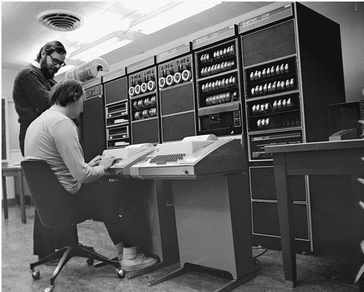

**图 3.1：** Ken（坐）和 Dennis 在 PDP-11 前，~1972 年（维基百科）

有人甚至制造了一个实验性的“便携式”Model 33。键盘和打印机被挤进一个类似手提箱的容器里，理论上可以随身携带，尽管重 55 磅（25 公斤）时你也带不远。（而且它还没有轮子。）它通过拨号电话连接和内置的声学耦合器连接到远程计算机：将电话听筒插入两个橡胶插座，耦合器将数据转换为声音并反之，就像传真机一样。我曾设法几次把其中一台终端带回家里，但称其为“带”都太客气了。

# 45

当 Model 37 型电打字机出现时，情况有了显著改善。它既有大写字母也有小写字母，速度快快（每秒 15 个字符而不是 10 个），尽管打字仍然很费力。它有一个扩展的文本框，可以打印数学符号，这对于专利申请以及我们的技术论文都很有用，而且它可以以半行的步长来移动纸张，使得数学下标和上标成为可能。

向它喂纸张也是一个挑战；放入一新箱风页纸需要费一番扭曲的姿势。Bob Morris 曾给 Joe Ossanna 发了一封包含 100 个反向换行符的邮件；当 Joe 尝试读取该消息时，Model 37 将纸张吸回并掉在了地板上。

在早期的几年里，Bob 一直坐在我对面的办公室。Morris 在贝尔实验室是一个很常见的姓；事实上，几年后在同一个办公室还有另一位名叫 Robert Morris 的访客。Bob 经常收到投错的邮件，他总是尽职地将其寄回，解释说自己不是那个 Morris。有一封邮件一直寄来，是来自公司其他部门的一份详尽的蓝图，上面写着“请签名并寄回”。所有的拦截尝试都失败了，于是某天 Bob 签了名并寄了回去。那封邮件再也没有出现过。


尽管每个研究 MTS（矩阵技术服务）都有私人办公室，但很多 Unix 工作在一个被称为“Unix 房间”的共享空间进行。它的实际位置在多年里变化过几次，但它一直是一个聚会、了解动态、贡献想法或社交的地方。

最初的 Unix 房间曾短暂位于 2 号楼的 4 层，那里 PDP-7 所在地；多年来的主要地点位于 2 号楼 6 层的 2C-644 室。2 号楼只有五层办公。六层基本上是一条服务廊：肮脏、光线昏暗，一排排锁在铁丝笼里的存放废弃设备的区域。在尽的一端有一个开放区域，那里有自动贩卖机，提供难喝的咖啡和几乎不能吃的点心，为深夜编程提供燃料；那里还有几个封闭空间，其中一个至少做了十年的 Unix 房间。它放置着 PDP-11；图 3.1 中 Ken 和 Dennis 的照片就是在那里拍摄的。几张桌椅和一些其他终端使其成为了一个非常实用的工作区域。

早期的爱好者之一是一位极具声望的理论物理学家（现已去世），我称他为“M—L”。M— 渴望使用 Unix；他在计算机使用方面非常有前瞻性，而且是一个和蔼大方的人。但他话多得可怕。一旦他开始，没人能让他停下来，你得听一小时的单向对话。所以有人在 Unix 房间的门上钻了一个小洞，这样我们在进去之前可以窥视一下他在不在。这个洞被称为“L—洞”。

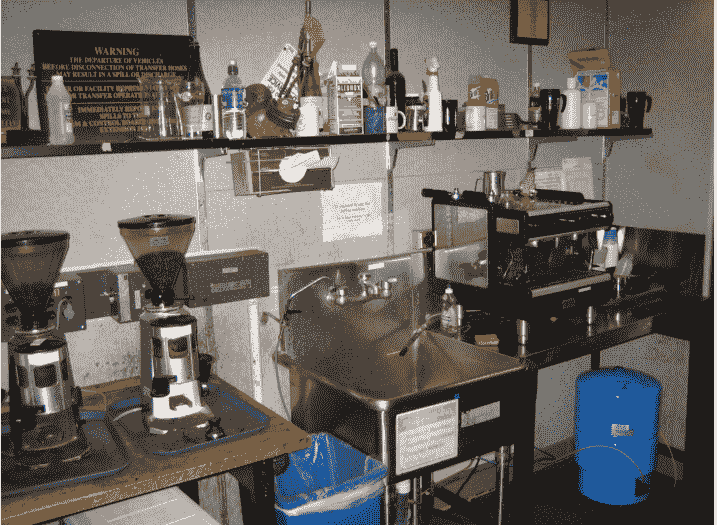

图 3.2：Unix 房间、咖啡机和咖啡豆机

某地，Unix 房间迁移到了 9 号楼 5 层的 501 室，就在我办公室转角处。它还配备了各种咖啡机，最初是带有加热功能的普通咖啡壶，可以保持咖啡恒温直到将其烧焦（这种情况经常发生），然后是一系列更昂贵的咖啡豆机和浓缩机（图 3.2），最后一种花费了约 3000 美。如果我的消息没错，Unix 居民们通过集资购买了机器，而管理层支付咖啡费用。

Unix 房间纯粹很好；总有些事情在发生。有些人几乎完全在那里工作，很少使用办公室。其他人每天会来几次喝喝咖啡、聊天。Unix 房间对于营造社区感的重要性无论如何强调都不过。回想起来，我在开放区域花费了足够的时间，至少对我来说，Unix 房间是至关重要的。

1985 年，Peter Weinberger 被提升为部门主管，并为公司报纸《贝尔实验室新闻》（因为它只刊正面消息）拍摄了专业照。在一次严重的战术错误中，Peter 将原始头像照（图 3.3）留在了 Unix 房间里。

多年来，Peter 的脸出现在很多地方——一张顶端都是 Peter 脸的组织图、楼梯墙上的一排圆形磁铁、印在新铺的混凝土地板上、在微处理器芯片上，最引人注目的是在 1985 年 9 月 16 日晚上，贝尔实验室的一个水塔上（图 3.6）。

关于是谁画的传言一直流传，但三十年后他们依然守口如瓶。曾提交过漆费报销申请，但被拒绝了。无论如何，几天后水塔上的图像就被一个显然不理解我们幽默感的官方涂掉了。

Peter 许多脸的完整故事可以在 spin.root/pjw 找到，那是 Gerard 维护的网站，Rob Pike 对 Peter 的照片进行了许多原始改进。

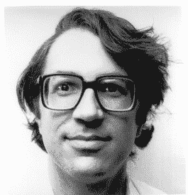

**图 3.3：** 原始 Peter 的脸（由 Gerard Holzmann 提供）

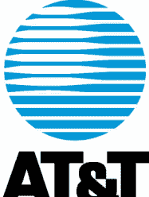

**图 3.4：** AT&T “死之星”标志


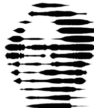

**图 3.5：** Peter 在 AT&T 标志前穿过（由杰拉德·霍尔茨曼提供）

贝尔实验室（Bell Labs）是一个非正式的地方，但在 20 世纪 70、80 年代初的某个时候，实施了一项新规定：员工必须随时佩戴胸牌。这无疑是一项为了防止外来者的明智预防措施，但它并不受欢迎。作为抗议，一位同事（在这里我们不透露他的名字）用强力胶将胸牌粘在了额头上；另一个人则习惯把胸牌夹在胸前的胸毛发上，只在被要求时才露出来。

这些胸牌没有任何安全功能；它们只包含模板中的一张照片。因此，我们发起了一项行动，创造了一个虚构人物 Grace R Emlin，她有自己的登录账号、自己的胸牌（图 3.7），并偶尔出现在官方列表和出版物中。

我制作了一个带有米老鼠形象的胸牌（图 3.8）。我经常佩戴它，其中一天我在新泽西州霍姆德尔的贝尔实验室与比尔·盖茨（Bill Gates）会面，盖茨当时在那里是为了 Windows 3.0 进行市场推广。没有人注意到。

图 3.9 和图 3.10 显示了 2005 年 Unix 房间的随机图案。


Unix 的早期贡献之一是它的在线手册，它采用了现在已熟悉的格式和简洁的风格。每个命令、库函数、文件格式等在手册中都有一页，简要描述它们是什么以及如何使用。例如，图 3.11 显示了 `cat` 命令的第一版手册页，该命令将零或多个文件连接到标准输出流（默认情况下是用户的终端）。

早期的 man 页（帮助页）往往字面意义上只有一页，这种精简程度在今天已不多见。除了简洁之外，man 页的几个功能在当时是非常新颖的：BUGS 部分，它承认程序存在


**图 3.6：** 1985 年在水塔上的 Peter（由杰拉德·霍尔茨曼提供）


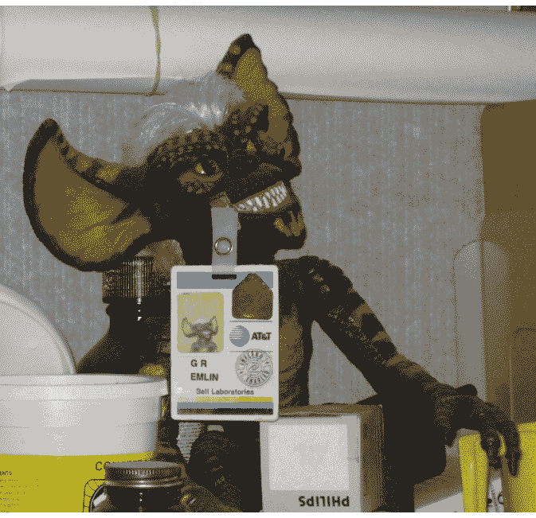

**图 3.7：** Grace Emlin, MTS

确实有 bug，或者说是“特性”，这些不完美即使不立即修复，也应该被记录下来。

`cat` 命令在 50 年里没有变化，除了增加了一些可选且可能并不需要的、会稍微修改其的行为参数；它仍然是 Unix 命令核心集的一部分。你可以通过在 Linux、macOS 或 Windows 子系统 (WSL) 的终端窗口中输入命令来查看其当前状态：

```
$ cat
```

当然，你也可以通过以下命令查看 `man` 命令本身的手册页：

```
$ man man
```

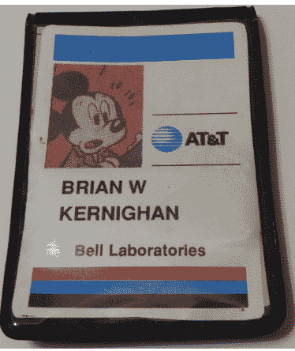

**图 3.8：** 我的高安全性贝尔实验室胸牌

## 3.4 关于内存的几句话

年轻的读者可能会疑惑我在文中提到的某些内存大小的准确性。例如，IBM 7090 或 7094 拥有 32K (32,768) 个 36 位字；Ken 使用的原始 PDP-7 拥有 8K (8,192) 个 18 位字，也就是说大约只有八分之一；PDP-11 拥有 24K 字节。相比之下，我的 MacBook Air 有 8GB 内存。

简而言之，按现在的标准，内存和硬盘是非常便宜的。在 60 年代和 70 年代初，内存是由磁铁芯构成的，磁铁芯通过手工布线连接。内存是非常昂贵的，由于磁铁芯的制造需要大量精力。图 3.12 显示


# 53


**图 3.9：** 2005 年 Unix 房间

内存的稀缺对程序员施加了某种纪律，当每个字节都珍贵时，内存是昂贵的。像原始的 `alloc` 和 Doug McIlroy 的 `malloc` 库用于程序运行时动态分配和重新分配内存。显然这必须非常小心，因为微小的错误就会导致程序运行错误。内存管理不当仍然是 C 语言错误的主要原因之一。当程序发生严重故障时，操作系统会通过生成一份内存内容——当时是在磁铁芯中的——来通知并帮助程序员，尽管磁铁芯早已退出历史舞台。该文件仍被称为 `core`。


# 55

11/3/71

CAT (I)

NAME cat -- 连接并打印

SYNOPSIS cat ...

DESCRIPTION 按顺序读取每个文件并将其写入标准输出。因此：

cat file

是打印文件的最简单方法。还有：

cat file2 >file3

是合并文件的最简单方法。

如果没有输入文件，cat 将从标准输入读取。

FILES

SEE ALSO pr, pc

DIAGNOSTICS 无；如果找不到文件，则忽略。

BUGS

OWNER ken, dam


关于 Dennis Ritchie 生命的摘要改编自我 2012 年为国家工程学院写的一篇纪念词。

Dennis（图 3.13）于 1941 年 9 月。他的父亲 Alistair Ritchie 曾在马里希尔的贝尔实验室工作多年。Dennis 就读于哈佛大学，在那里读了物理学本科，并在研究生阶段学习了应用数学。他的博士论文课题（1968年）是函数的子递归层级，这对于非专家来说非常困难，而我显然不是；图 3.14 显示了从一份模糊草稿副本中取的随机页的一部分。在解释他的职业生涯时，他说：

> 我的本科经历说服了我，我不聪明到能成为物理学家，而且计算机很酷。我的研究生经历说服了我，我不聪明到能成为算法理论专家，而且我更喜欢过程化语言而不是函数式语言。

正如 C 语言的创造者 Bjarne Stroustrup 曾说：“如果 Dennis 决定将那十年花在深奥数学上，Unix 就不会出生了。”


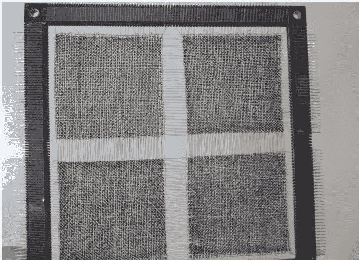

**图 3.12：**磁芯存储器；16K 位，2K 字节（~5.25 英寸，13 厘米）

Dennis 曾在贝尔实验室度过了几个夏天，并在 1967 年正式加入，成为计算机科学研究中心的技术人员之一。在最初的几年里，他致力于 Multics 项目。如前所述，Multics 被证明过于野心勃勃，随着发现它无法实现其目标，贝尔实验室于 1969 年撤资，这给 Ken、Dennis 和他们的同事们留下了创新操作系统设计方面的经验、对高层语言实现的理解，以及一个以更谦虚的目标重新开始的机会。其结果就是 Unix 操作系统和 C 编程语言。

C 编程语言起源于 20 世纪 70 年代初。它基于 Dennis 为 Multics 实现使用高层语言的经验，但规模大大缩小了，因为当时大多数计算机的容量有限；根本没有足够的内存或处理能力来支持复杂语言的复杂编译器。这种强制性的最小化强化了 Ken 和 Dennis 对简单、统一机制的偏好。C 语言也非常适合真实的计算机硬件；将其转换为高效运行良好代码非常清晰。

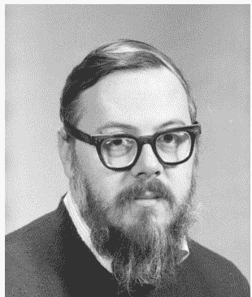

**图 3.13：**Dennis Ritchie，~1981 年（由 Gerard Holzmann 提供）

C 语言使得用高层语言编写整个操作系统成为可能。到 1973 年，Unix 已从原始的汇编语言转换为 C 语言。这使得维护和修改系统变得容易得多。它实现了另一个巨大的进步，将操作系统从原始的 PDP-11 计算机迁移到其他架构的计算机。由于大部分系统代码都是用 C 语言编写的，系统只需要移植 C 编译器而不需要更多。

Dennis 是一位卓越的技术作家，风格简洁优雅，措辞老练，并且经常流露出冷幽默，这种幽默准确地反映了他的性格。他和我共同编写了《C 程序语言》，该书于 1978 年出版，1988 年出版了第二版，从那以后被翻译成20 多种语言。Dennis 的参考手册是 ANSI/ISO C 标准的基础，该标准于 1988 年首次产生，也是该书中的主要组成部分。无疑，C 和 Unix 的某些成功可以归功于 Dennis 的写作。

与 Ken Thompson 一起，Dennis 因在 C 和 Unix 上的工作获得了许多荣誉和奖项，包括 ACM 图灵奖（1983 年）、国家技术奖（1999 年）、日本信息通信大奖（2011 年）以及国家发明家名人堂（2019 年死后授予）。

Dennis 多年来成功地避开了任何管理角色，但最终还是妥协并成为了软件系统部门的负责人，负责构建 Plan 9 操作系统的小组。Dennis 于 2007 年辞去管理职务并正式退休，但直到 2011 年 10 月去世前，他几乎每天都来贝尔实验室。

Dennis 谦虚且慷慨，总是将功劳归于他人，而淡化自己的贡献。一个典型的例子出现在他 1996 年关于 Unix 演变的回顾致谢中：

“读者如果将每个指代不明的‘我们’读作‘汤普森在我的某些帮助下完成’，那么通常不会错得大错。”

Dennis 于 2011 年 10 月去世。他姐姐妹妹的这段文字可以在他的主页找到，该主页已保存在贝尔实验室的 www.bell-labs.com/usr/dmr/www。

作为 Ritchie 的兄弟姐妹，我们为他的遗产感到自豪。Dennis 是一个用代码和善良改变世界的人。整个计算界的人都会怀念他。


Unix 并不做这种区分：任何程序都可以处理任何文件。如果将程序应用于某个文件没有意义——例如，尝试像编译 C 语言一样编译一个 Fortran 源文件——这与操作系统无关。

Unix 文件被组织在目录中。（其他操作系统通常将这些称为文件夹。）一个 Unix 目录也是文件系统中的一个文件，但其内容由系统本身维护，而不是由用户程序。目录包含有关文件的信息，这些文件反过来可能是目录。

一个目录条目包括目录内的文件名、访问权限、文件大小和创建日期，以及关于在哪里找到文件内容的信息。每个目录都有两个特殊的条目，命名为 "."（目录本身）和 ".."（父目录）；这两个条目的读音是“dot”和“dotdot”。根目录是这种层级结构的顶端；它的名称为 `/`。可以通过从根目录开始路径到达任何文件，而任何文件都可以通过向上进入 `.. 父目录序列来找到根目录。因此，本书的文本可能位于 `/usr/bwk/book/book.txt`。系统还支持目录的概念，因此文件名可以相对于文件系统中的当前位置，而无需指定从根目录开始的全路径。

由于任何目录都可以包含子目录，文件系统可以是任意深度的。这种嵌套目录和文件的组织方式被称为“层次级”文件系统。尽管从事后来看其优势是显而易见的，但在 Multics 和 Unix 之前，层次级文件系统并不普及。例如，某些文件系统限制了嵌套深度；CTSS 将其限制为两层。

## 4.2 系统调用

操作系统为运行在其上的程序提供一系列服务，如启动和停止程序、读取或写入文件中的信息、访问设备和网络连接、报告日期和时间等信息。这些服务在操作系统内部实现，运行中的程序可以通过一种称为“系统调用”（system calls）的机制进行访问。

从非常真实的意义上说，系统调用就是操作系统，因为它们定义了系统提供的内容。一组系统调用可能存在多个独立的实现，正如不同版本的 Unix 和类 Unix 系统的情况所所示。一个完全不同的操作系统（例如 Windows）可以提供软件将 Unix 调用转换为它自己的系统调用。即使是 Unix 类系统，也会有某些特定操作系统独有的系统调用。

Unix 第一版略有 30 多个系统调用，其中大约一半与文件系统有关。因为文件只包含未解释的字节，所以基本文件系统接口极其简单，只有五个用于打开或创建文件、读取或写入其字节以及关闭文件的系统调用。C 程序通过调用如下语句的函数来访问这些：

```
fd = create(filename, perms)
fd = open(filename, mode)
read = read(fd, buf, n)
write = write(fd, buf, n)
status = close(fd)
```

系统调用创建一个新文件并设置其访问权限，这通常包含或排除用户、用户组以及其他人的读取、写入和执行权限。这九个位通过相对少的机制提供了相当大的控制力。`open` 系统调用打开一个存在的文件；`mode` 指定文件是要读取还是写入，`filename` 是层次级文件系统中的任意路径。

调用 `open` 和 `create` 产生的 `fd` 值称为文件描述符（file descriptor），这是一个小的非负整数，用于后续对文件的读取和写入。`read` 和 `write` 系统调用尝试从文件或向文件传输指定数量 `n` 的字节；每个函数返回实际传输的字节数。对于所有这些系统调用，如果返回负值（通常为 -1），则表示发生了某种错误。

顺便提一下：

还有用于设置文件内位置、确定其状态等的系统调用。这些在 50 年里都经过了修饰和偶尔的改进，但基本模型简单且易用。

今天的读者可能很难体会这一切在当时是多么简化。在早期的操作系统，真实设备的无数复杂性反映在用户身上。人们必须知道所有的磁盘名称、它们的物理结构（例如它们有多少磁道和磁柱）以及数据如何在上面组织。Steve Johnson 提醒我当时 Honeywell 计算机上的分时子系统有多麻烦：

> “Honeywell TSS 系统需要你进入子系统来创建一个磁盘文件。你会被问及 8 个问题：文件的初始大小、最大大小、名称、设备、谁可以读、谁可以写等。每一个问题都必须交互式地回答。当回答所有问题后，给操作系统信息，很可能误导致导致创建失败。这意味着你需要反复进入子系统，直到最终创建成功，系统显示‘SUCCESSFUL!（成功！’”

Unix 效了 Multics 的做法，隐藏了所有这些无关的废话：文件只是字节。用户决定字节是什么，而操作系统负责存储和检索它们，而不向用户暴露设备属性。


Shell 是一个运行其他程序的程序。它是允许用户运行命令的程序，也是用户与操作系统之间的主要接口。当我登录到 Unix 系统时，我的键盘连接到 shell。因为 shell 是一个用户程序，它很容易被另一个程序替换，这就是为什么有许多 Unix Shell。一个非常重要的注意是：shell 是一个普通的用户程序，而不是操作系统的某些组成部分，这是另一个来自 Multics 的想法。（这就是功能列表中提到的“按用户选择的命令语言”。）如果你不喜欢某个 shell 的工作方式，可以选择另一个，或者编写你自己的来代替。

尽管如此，所有的 Unix Shell 都提供相同的基础功能，通常具有相同的语法。最重要的功能是运行程序。它们都提供文件名通配符（filenamecards），其中如 `*` 等模式元字符会被展开为匹配模式的文件名列表。例如，为了运行 `wc`（单词计数）程序统计当前目录下所有以 `book` 开头的文件的行、单词和字符，只需给出命令

```
$ book*
```

Shell 将模式 `book*` 展开为当前目录下所有以 `book` 开头的文件名，并使用这些名称作为参数运行 `wc`。`wc` 命令本身并文件名列表是由模式指定的。这种展开由 shell 而非单个程序完成，这一点很重要。

Shell 的另一项主要服务是输入/输出重定向（input/output redirection）。如果一个程序从标准输入（默认是终端）读取，可以通过使其从输入文件读取：

```
$ program <infile
```

如果它向标准输出（再次默认是终端）写入，其输出可以重定向到输出文件：

```
$ program >outfile
```

如果输出文件不存在，则创建它。通过重定向，程序不知道它的输入或输出正在被重定向。这是一种统一的机制，由 shell 应用而不是由单个程序应用，并且比通过文件名参数指定文件输入输出的方法更易用，例如：

```
$ program in=infile out=outfile
```

脚本（script）是存储在文件中的命令序列。以此文件作为输入运行 shell 实例将运行脚本中的命令。


脚本就像是直接输入过的一样：

```
$ sh <scriptfile>
```

脚本封装了一系列命令。例如，对于这本书，我运行了一系列简单的检查，用以检查拼写和标点符号错误、格式不当的命令以及其他潜在的失误。这些检查中的每一个都会运行一个程序。我可以一遍又一遍地输入这些命令，而且完全相同。但相反，我可以将这些命令序列放在一个名为 `check` 的单个脚本文件中，然后通过运行单个命令来检查这本书。其他脚本则打印书籍并制作备份副本。

这些脚本实际上是新的 Unix 命令，尽管它们对我个人以及这本特定的来说是高度专门的。个人命令是 shell 脚本的一种常见用途，一种为自己频繁的计算创建快捷方式的方法。我仍然在使用一些我 30 或 40 年前编写的脚本，这对于资深 Unix 用户来说完全并不不寻常。

让 shell 程序完全等同于编译后的程序的最后一步，是使得：如果一个文件被标记为可执行，它就会传递给 shell 执行。通过这种方式，shell 脚本变成了“一等公民”，在执行时与编译后的程序无二致。

```
$ check book.txt
```

shell 脚本并没有取代编译后的程序，但它们是程序员工具箱的重要部分，无论是用于个人使用还是用于更大的任务。如果你发现自己一遍又一遍地执行相同的命令序列，那么就把它们放入 shell 脚本中，从而自动化某些枯燥的工作。如果一个 shell 脚本被证明太慢，可以用任何语言重写。在下一节中检查管道时，我们将看到更多 shell 脚本的威力。


管道可能是 Unix 中最引人注目的发明。管道是由操作系统提供并可以通过 shell 轻松访问的机制，它将一个程序的输出连接到另一个程序的输入。操作系统使其工作；使用它的 shell 符号简单而自然；其效果是提供了一种关于设计和使用程序的新思考方式。

连接程序的想法已经存在很长时间了。Unix 领域下最清晰的陈述之一出现在 Doug McIlroy 在 1964 年写的一份内部文档中，该文档主张了将程序“像花园水管一样”拧在一起的想法。图 4.1 来自于一张磨损的纸，这张纸在我贝尔实验室办公室的墙上挂了 30 年。顺便提一下，注意那些打字错误和通常非常糟糕的质量。这说明了打字文档通常的样子。图的底部是修正后的转录：


用一句话概括我最核心的关注点：

+ 1. 我们应该拥有像花园水管一样耦合程序的方法——当需要以另一种方式处理数据时，拧上另一段即可。


用一句话概括我最核心的关注点：

+ 1. 我们应该拥有一些像花园水管一样耦合程序的方法——当需要以另一种方式处理数据时，拧上另一段即可。

> 图 4.1：Doug McIlroy 的管道想法 (1964)

Doug 希望在某种程序中允许任意连接，但如何以自然的方式描述一个无约束的图并不是显而易见的，而且还存在语义问题：流在程序之间的数据必须排队，查询可能会在无序的程序连接中爆炸。而且 Ken 根本没有想过实际的应用。

但 Doug 继续不断催促，Ken 也继续这样做。正如 Ken 所说：“有一天我得到了这个管道：管道，本质上就是它们现在的样子。”他在一小时内向操作系统添加了 `pipe` 系统调用；他描述 I/O 重定向机制已经存在那里是“超级微不足道”的。

Ken 将管道机制添加到 shell 中，对其进行了测试，并称结果为“令人震撼的”。

管道符号简单而优雅，在对命令之间使用单个字符（垂直线 `|`）。例如，为了统计目录中的文件数量，可以将 `ls` 的输出（每个文件一行）管道导到 `wc`（计算行数）的输入中：

```
$ ls | wc
```

将程序看作过滤器通常是合适的，它会读取输入数据，以某种方式进行处理，并写输出。有时这样做是完全自然的，例如在即时选择、变异或计数事物的程序中；有时过滤器并不是实时运行的。例如，`sort` 必须在产生任何输出之前读取其所有输入，但这并不相关——将其封装成一个可以放入管道的过滤器仍然是有意义的。

Ken 和 Dennis 升级了系统上的每个命令，使其从标准输入流读取数据，同时也有必要发明 `stderr`，即错误流。标准错误是一个单独的输出流：发送到它的错误消息与标准输出分离，因此不会被送到管道中。总的来说，工作并不困难——大多数程序只需要消除会弄乱管道的冗余消息，并将错误报告发送到 `stderr` 即可。

管道的引入引发了发明的狂热，我对此记忆犹新。我没有确切的日期，但应该是 1972 年下半叶，因为管道在手册的第二版（1972 年 6 月）中没有出现，但在第三版（1973 年 2 月）中出现了。

Unix 房间里的每个人都有一个好主意来组合程序以完成某些任务，而无需编写新程序。我的其中之一是基于 `who` 命令的，它可以列出当前登录的用户。当大多数人都在自己的电脑上工作时，`who` 命令并不是特别相关，但由于共享的本质是同一台计算机，知道谁在使用系统是有帮助的。事实上，`who` 增加了社区感：你可以看到谁在工作，并在晚上遇到问题时提供帮助。

`who` 命令为每个登录用户打印一行，`grep` 查找特定模式，`wc` 计算数量，所以这些管道报告了用户状态。

```
who # 谁登录了？
who | wc # 有多少人登录了？
who | grep # joe 登录了吗？
who | grep | wc # joe 登录了多少次？
```

为了看到管道是多么大的改进，考虑在没有管道的情况下如何使用输入输出重定向到文件来完成最后的任务：

```
who >temp1
grep joe <temp1 >temp2
wc <temp2
```

然后删除临时文件。管道将其变成一个不需要临时文件的单个命令。

Ken 最喜欢的管道示例是一个使用 Bob Morris 的 `dc` 计算器的语音计算器。Ken 的 `number` 程序将数字打印为单词（“127”变成“一百一二十七”），而 `speak` 程序从输入产生语音。正如 Ken 在 2019 年的一次采访中所说：“你把 `1+` 输入到 `dc`，然后管道给 `number`，再管道给 `speak`，它说出了‘4’。”[笑] “我并不擅长数学。”

管道是 Unix 贡献中最主要的贡献之一，但回过头来显而易见。正如 Dennis 在 1984 年的《Unix 共享系统的演变》中所说：“Unix 管道的卓越之处恰恰在于它是由简单方式使用的相同命令构建的。看到这种可能性并发明这种符号所需的思维跳跃是非常巨大的。”

## 4.5 Grep

Unix 从初就是一个命令行系统，也就是说用户通过输入命令来运行程序，而不是用鼠标点击图标，这在运行 Windows 或 macOS 时是很常见的。命令行界面对于初学者来说不像点点那样容易，但在具有中等经验的人手中，它可以高效得多。它允许自动化，命令序列可以从脚本运行，并使用单个命令应用到大量文件。

Unix 一直拥有丰富的命令行小工具集，即处理简单频繁发生任务的小程序。有六个命令操作文件系统，如 `ls` 列出目录中的文件（类似于 Mac 的 Finder 或 Windows 的 Explorer）；`cat` 和 `cp` 以各种方式复制文件；`mv`（移动）用于重命名；`rm` 用于删除文件。还有处理文件内容的命令，如 `wc` 用于计数


# 第四章：第六版

用于排序文件的工具，几个用于比较文件的工具，另外几个用于大小转换等转换的工具，以及一些用于选择文件部分的工具。（Unix 用户会熟悉 `uniq, cmp, diff, od, dd, tail, tr,` `tr` 和 `comm`。）再加上几十个不属于这些类别的工具，你就拥有一套包含 20 或 30 个命令的工具库，能让你轻松完成所有基础任务。

实际上，这些工具是语言中的动词，而文件是动词作用的名词。这种语言通常是有规律的，每个命令都有可选的参数来修改其行为；例如，`sort` 默认按字母顺序对行进行排序，但可以通过参数将其改为反序排序、按数字排序、按特定字段排序等。

要使用 Unix，必须学会一组规律的动词，就像学习自然语言一样。自然地，人们经常对历史留下的不规则性表示抱怨，偶尔尝试对其进行合理化，但大多数时候并没成功。

原型级的工具——那个让我们开始思考“工具”而不仅仅是“程序”的命令——是 `grep`，它是由 Ken Thompson 编写的模式搜索程序。正如 Ken 在 2019 年所说：

> 我写了它，但我没有把它放在中央程序仓库中，因为我不想人们认为是我规定了那里应该有什么内容。

Doug McIlroy 说：“如果我们能在文件中查找东西，那不是太好了吗？”我说：“让我想想。”第二天早上我向他展示了我之前写的那个程序。他说：“这正是我想要的。”

从那以后，`grep` 既是名词也是动词；它甚至进入了《牛津英语词典》（OED）。最困难的部分是命名；它最初是 `s`，代表 search（搜索）。

`grep` 名字来源于 ed 编辑器中的一个命令 `g/re/p`，该命令会打印所有匹配正则表达式模式 `re` 的行；牛津英语词典中关于 `grep` 的词条（图 4.2）也包含了它。（既然 OED 已经认可 `grep` 是一个合法的英语单词，我将不再使用特殊字体或大写表示它。）

我最喜欢的关于 `grep` 的故事来自 1972 年的一天，实验室的某人给我打电话说：

> “我发现当我把口袋计算器倒过来拿时，有些数字看起来像字母；例如，3 变成 E，7 变成 L。我知道你们电脑里有字典。有没有办法能告诉我，用我的计算器可以拼出哪些单词？”

## grep, 名词

查看方式：大纲 | 完整词条

引用：显示所有 | 隐藏所有 关键词：开启 | 开启

发音：英式 /ɡrɛ/, 美式 /ɡrɛ/

频率（当前用法）：......

词源：在英语内部形成，通过转换产生。词源：英语 grep。

词源学：< grep，一个在 Unix 操作系统中用作命令的字符串 < global(ly) search expression print（全局搜索表达式打印）的起始字母缩写。

字符串 `g/re/p`（其中 `re` 代表要搜索的正则表达式）早先用于一种 Unix 文本编辑器，作为执行与 `grep` 相同操作的命令序列的语法。

## 计算。

一种 Unix 命令，用于在文件中查找匹配指定序列或模式的字符串，并输出所有匹配的行。也称为 `grep` 命令。

> 1973 V4/man/man1/grep.1 来自 Unix 版本 4（电子文本）。Grep 将搜索输入文件（默认标准输入）中的每个包含正则表达式的行。通常情况下，找到的每一行都会打印出来。

图 4.2：grep 的 OED 词条

“当我把它倒过来拿时？”

图 4.3 显示了他脑海中的画面。

在一个研究小组里，能够帮助遇到实际问题的人，感觉很好。于是我问他把计算器倒过来拿时能拼出什么，他说“BEHILOS”。我转到键盘前输入了这条命令：

```
grep '^[behilos]*$' /usr/dict/web2
```

文件 `/usr/dict/web2` 是来自《韦伯斯特第二版国际词典》的单词列表——包含 234,936 个单词，每行一个。引号之间的加密字符串是一个正则表达式或模式，在在这种情况下，它指定了仅包含这七个字母的任意组合且不包含任何其他内容的行。

结果得到了最令人惊讶的列表，图 4.4 中的 263 个单词。我是英语母语者，但那个列表中的许多单词我是从未见过的：

# 第四章：第六版

# 73

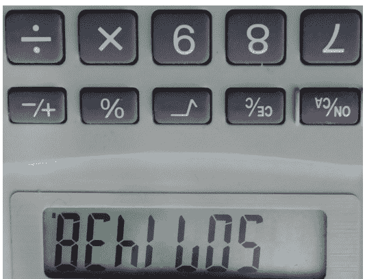

**图 4.3：** 计算器上的 BEHILOS

在此之前。无论如何，我把它们打印出来并发给了那个人。但他一定很满意了；我再也没有收到过他的消息。但他给我留下了一个很棒的故事，并完美演示了像 `grep` 这样的工具和正则表达式这样的符号价值。

随着时间的推移，`grep` 一词变成了名词、动词、动名词（grepping），并成为 Unix 社区日常用语的一部分。你曾为了车钥匙 `grep` 过你的公寓吗？AT&T 商业广告中被撕掉的贴纸和 T 恤邀请人们“伸手触碰他人”：

> “伸手并去 grep 某人。”

Arno Penzias，诺贝尔奖获得者，以及……的副总裁，

正则表达式通过给某些字符赋予特殊含义（称为元字符），使得看到更复杂的内容成为可能。例如，元字符 `.` 会匹配任何单个字符，元字符 `*` 会匹配前面字符的任意次数，因此该模式将匹配括号内的任何字符序列。Unix 与 `grep` 和正则表达式有一段长久的恋，它们渗透在编辑器、`grep` 及其衍生品以及许多其他语言中。正则表达式的一种变体用于文件名通配符。虽然通配符由 shell 解析，但由于 PDP-7 的内存限制，第一次实现是由 shell 调用的一个独立程序 `glob`（代表“global”），而从模式生成扩展的文件名列表的行为被称为“globbing”。`glob` 这个名字仍然存在于多种编程语言的库中，包括 Python。Al Ho 对 Unix 的早期贡献之一是对 `grep` 的扩展，它允许使用更丰富的正则表达式类，例如允许搜索诸如 `this|that` 这样的候选项。Al 将该程序命名为 `egrep`，意为“extended grep”（扩展 grep）。

有必要再多介绍一下 `egrep`，因为它背后的故事是理论与实践相互作用的极佳范例，也是 1127 成员之间产生优秀软件的典型互动。这个故事来自 Doug McIlroy。

“Al Ho 的第一个 `egrep` 是 A、Hopcroft 和 Ullman 编写的《计算机算法设计与分析》书中一种算法的常规实现。我要求它写一个日历程序，使用一个巨大的自动正则表达式来识别‘今天、明天、直到下一个工作日’等日期模式，”和


# 第四章：第六版

以此类推，以各种的日期格式表示。

让 Al 懊恼的是，花费了大约 30 秒才编译成一个识别器，而这个识别器运行起来完全不需要时间。

随后，他想出了一个绝妙的策略：在需要的时候惰性地生成识别器的部分，而不是预先生成所有，这样在指数级增长的海量状态中，就只有极小一部分被构造出来。这产生了巨大的差异：在实践中，无论处理的模式有多复杂，`egrep` 总是运行得很快。因此，`egrep` 以技术上的卓越脱颖而出，除非你知道标准方法的性能有多么糟糕，否则它是隐形的。

这是一个典型的 Unix 故事：来自真实用户的真实问题、对相关理论的深刻理解、使理论在实践中良好工作的有效工程，以及持续的改进。这一切之所以汇聚，得益于小组内广泛的专业知识、开放的环境以及尝试新想法的文化。

## 4.7 C 编程语言

从一开始开始，新的编程语言一直是 Unix 的重要组成。

Multics 最重要的贡献之一是尝试用高级语言 PL/I 编写操作系统。PL/I 是 IBM 在 1964 年创建的，试图将 Fortran、Cobol 和 Algol 的所有优秀想法合并到一种语言中。事实证明它是系统效应的一个极佳例子。这种语言对于大多数程序员来说太庞大太复杂，难以编译，而且一个适用于 Multics 的编译器并未交付。作为一种临时措施，Doug McIlroy 和 Doug East 为 Multics 创建了精简化的子集 EPL（“早期 PL/I”），但它是一种复杂的语言。

BCPL（“基本组合编程语言”）是另一种用于系统编程的语言。它由剑桥大学教授 Martin Richards 设计，他在 1967 年访问麻省理工学院（MIT）期间为它编写了一个编译器。BCPL 比 PL/I 的方言简单得多，非常适合编写系统代码。贝尔实验室的这些成员们对 BCPL 非常熟悉。

当实验室退出 Multics 时，Ken Thompson 决定“没有 Fortran 的计算机是不完整的的”，于是他开始为 PDP-7 编写一个 Fortran 编译器。这被证明太困难了，因为 PDP-7 Unix 为像编译器这样的用户程序只提供了 4K 的 18 位字（8 KB）主内存。

Ken 一直重新设计，最终出了一种适合 PDP-7 的语言，而且它比 Fortran 更接近 BCPL。他将其命名为 B。Dennis Ritchie 在 1993 年的《C 语言的发展》中解释道：

“B 可以被看作是没有类型的语言；更准确地说，它是将 BCPL 压缩进 8K 内存并经过 Thompson 大脑过滤后的产物。它的名字最很可能代表 BCPL 的缩写，尽管另一种理论认为它源自 Bon，那是 Thompson 在 Multics 时代创建的一种无关的语言。而 Bon 的名字要么是以他的妻子 Bonnie 命名的，要么（根据他手册中的一处百科全书引用）是以一种仪式涉及低语魔术咒语的宗教命名的。

到目前为止，我们故事中的计算机都是“按字导向”的，而不是“字节导向”的。也就是说，它们处理信息的块大小明显大于单个字节。IBM 7090 和类似的 GE 系列等计算机自然地以 36 位（约四个字节）为块大小来处理信息；PDP-7 的块大小为 18 位（两个字节）。按字导向的计算机在处理单个字节或序列字节时非常笨拙：程序员必须使用库函数或通过复杂的编程手段来访问封装在较大块中的单个字节。

相比之下，PDP-11 是字节导向的：它的内存基本单位是 8 位字，而不是早期计算机的 18 位或 36 位字，尽管它也可以以像 16 位和 32 位整数以及 16 位地址这样更大的块来处理信息。

B 非常适合像 PDP-7 这种按字导向的计算机，但在它到来时，Dennis 开始为了新架构增强 B，并为它编写一个编译器。这门新语言被称为“NB”，即“New B”，并最终变成了 C。

主要的区别之一是 B 是无类型的，而 C 支持与 PDP-11 提供的数据类型匹配的数据类型：单字节、双字节整数，以及最终的四字节或八字节的浮点数。而像 BCPL 和 B 这样的语言将指针（内存地址）和整数视为同一种，而 C 正式地将它们分开，尽管在许多年里，程序员们并不明智地将它们视为相同的大小。

C 对编程语言的新颖贡献之一是支持对类型指针进行算术运算的方法。指针是一个对应地址的值，即主内存中的一个位置，它有一个类型，即它将指向的对象的类型。如果该位置对应于特定类型对象数组的元素，那么在 C 中，将指针加 1 产生数组下一个元素的地址。虽然仔细使用指针是代码崩溃的根源，但在使用正确的情况下，指针运算是自然且运行良好的。

长期以来一直很清楚，Unix 应该从汇编语言转换为高级语言，而 C 是显而易见的选择。1973 年曾尝试三次用 C 重写内核，但证明太困难了。Dennis 为语言中增加了一种定义和处理嵌套数据结构（`struct`）的机制。在那时，C 的表达能力已经足够编写操作系统代码，Unix 变得大部分都是一个 C 程序。第六版内核有大约 9,000 行 C 代码和约 700 行用于机器操作的汇编语言。第一个官方 C 标准来自 ANSI（美国标准协会）（同时也来自 ISO，国际标准组织），于 1989 年完成。它对语言的描述直接基于 Dennis编写的《C 语言教程》。Dennis 参与了 C 标准的早期阶段，在那里他作为语言的创造者拥有许多意见，并阻止了一两个非常糟糕的提案。


图4.5：K&R 第一版封面，1978 年

C 语言是重要的

最大的库组件提供了格式化输出，今天程序员通过 C 的 `printf` 函数对它了如指掌，该函数已被许多其他语言采用。Mike Les 的可移植 I/O 包编写于 1972 年，以便程序可以轻松地从 Unix 迁移，包含了 `printf` 的第一个版本，还包含了用于解析格式化输入的 `scanf`。这些被重新处理并包含在编译器中。

尽管 `printf` 和 `scanf` 自此后有了扩展，但其核心功能的工作方式与 20 世纪 70 年代一样，正如库中其他大多数函数一样。今天，标准库与 C 语言本身一样都是 C 标准的一部分。

将 C 的方法与其他语言进行对比是有趣的。例如，在 Fortran 和 Pascal 中，输入和输出是语言的一部分，有用于读取和写入数据的特殊语法。一些其他语言则没有


同时输入和输出并没有提供标准库，这可能是最不如人意的。

C 非常成功，是历史上使用最广泛的语言之一。尽管它始于 PDP-11 Unix，但它已传播到几乎每种存在的计算机。正如 Dennis 在 1993 年一次关于《编程语言历史》的论文中所说，C 是奇特的、有缺陷的，但取得了巨大的成功。

当然，有很多编程语言，通常伴随着大量的追随者并面临着批评。然而，它仍然是计算的核心语言，并且在流行性、影响力的列表中几乎名名前三。在我看来，没有其他语言能达到 C 那样的优雅、表达力和简洁性的平衡。C 还启发了许多其他语言的基础语法，包括 C++、Java、Awk 和 Go。这是一项极具影响力的贡献。

## 4.8 软件工具

到 1973 年，我开始经常使用 C 语言，但仍在编写 Fortran。尽管 Fortran 对于数值计算很好，但控制流语句几乎不存在，而且它受限于其 20 世纪 50 年打孔卡的语言起源。相比之下，C 的控制流非常自然，可以这么说。

因此，我写了一个简单的编译器，将看起来像 C 的 Fortran 方言转换为有效的 Fortran。我们称之为 Ratfor，它将 Fortran 转换为带有 `if-else`、大括号以及替代 Fortran `GOTO` 语句的 `DO` 循环。预处理器还提供了符号便利，如自由格式输入（Fortran 仍然要求固定格式）、方便的注释约定、自然的逻辑以及如 `<` 和 `>=` 这样的运算符。

作为一个短示例，这里是用 Ratfor 编写的 Fortran 程序：

```# make v identity matrix
do i = 1, n
  do j = 1, n
    if (i == j)
      v(i, j) = 1.0
    else
      v(i, j) = 0.0
```

Ratfor 是基于 C 语法的语言第一个例子。对我自己来说，用 Ratfor 编写标准 Fortran 要愉快得多。Ratfor 没有改变 Fortran 的语义或数据类型——例如，它没有处理字符的功能——但对于任何 Fortran 是合适选择的地方，Ratfor 都让它变得更好。自由格式输入和类 C 的控制流感觉就像在用 C 编写。

在理论和实践的杰作中，Brenda Baker 创建了一个名为 `struct` 的程序，可以将任意 Fortran 程序转换为 Ratfor。Brenda 证明了几乎任何 Fortran 程序都有良好的结构；有一种独特的方法可以在 Ratfor 中渲染它。使用 struct 的人发现 Ratfor 版本总是比他们最初写的 Fortran 更清晰。

Bill Wagner 我决定写一本书，向更广泛的读者推广 Unix 工具哲学：那些在非 Unix 系统上编写 Fortran 的程序员。1976 年出版的《软件工具》介绍了标准 Unix 工具的 Ratfor 版本：文件比较、字数计数、grep、类 ed 的编辑器、类 roff 的文本格式化器，以及 Ratfor 预处理器本身，全部用 Ratfor 编写。

我们的时机恰恰好；书卖得还可以，一个软件工具小组诞生了，由 Lawrence 实验室的 Debbie Scherr、Dennis Hall 和 Joe Sventek 领导。他们完善并改进了程序，增加了了自己的工具，发布了代码发行，组织了会议，并多年保持一切运行良好。他们的代码被移植到了 50 多个操作系统上，该小组一直活跃并具有影响力，直到 20 世纪 80 年代后期解散。

1981 年，Bill 我出版了基于 Pascal 的工具书，当时 Pascal 在大学作为教学语言很流行。Pascal 具有良好的属性，包括合理的控制流和递归，这两者在 Fortran 中都是缺失的。

不幸的是，它也有一些糟糕的属性，比如笨拙的输入和几乎不可用的字符串，我在一篇名为《为什么 Pascal 不是我喜欢的编程语言》的文中描述了这些。我将这篇论文提交给了一个期刊，但因为它争议太大或可能深度不足被拒绝了。它从未发表，但尽管如此，它被引用的频率异常。

无论如何，随着 C 和 Unix 变得越来越普及，Pascal 的局限性让它越来越不受欢迎，因此 Pascal 版的软件工具没有被广泛阅读。回想起来，C 版本在短期和长期产生的影响都会远得多。

## 4.9 简介：Doug McIlroy

Rob Pike 称 Doug McIlroy 为“Unix 的无名英雄”，我同意。Ken Thompson 说 Doug 比其他任何人都聪明，这似乎也是准确的，Doug 本人说：“让我别人来评估我有多聪明吧，我知道贝尔实验室的很多教学数学家比我聪明得多。”可以说，实验室里有很多杰出的人才，冒充者综合征并不罕见，人们为了跟上节奏而精疲力竭。

无论他在哪里，如果没有 Doug 对技术事务和人的良好品味和健全判断，Unix 可能根本不存在，也不会如此成功。

Doug 在 1954 年从康奈尔大学获得物理学学士，1959 年从麻省理工获得应用数学博士学位。他也在贝尔实验室工作了一个夏天，1958 年正式入职，并在 1965 年成为计算技术研究部主任，这比我第一次见到他两年前。正如前面描述的，我花了 1967 年的夏天在 Doug 的部门担任实习生，名义上处理他建议的一个存储分配器问题，但实际上是在做我自己的事情。他作为经理的许多优点之一就是他从不对此感到困扰。

我已经提到过 Doug 早期在 PL/I 和 EPL 语言的工作。一旦 Unix 启动，他编写了各种基础软件。他的存储分配器 `malloc` 使用了多年，他对分配器的研究影响了后续工作。他还写了一系列命令；他在达特茅斯网页上的列表包括 `spell`、`diff`、`sort`、`join`、`graph`、`speak`、`tr`、`tsort`、`calendar`、`echo` 和 `tee`。

其中有些很大，如 `echo`，有些像 `sort`, `diff`，但大多数是 计算的核心，至今仍在使用。当然，管道（pipes）是他的想法，尽管最终版本使用了 Ken 的语法，而它们的存在归功于 Doug 对这种机制的持续游说。


还有一个服务会监控接入的电话线路，当电话响起（即使是静音的）时，它会宣布：

“Doug 的电话”

或者给任何任何人；在共享空间里，这比频繁响起的电话要少分散注意力得多。

Doug 的兴趣广泛而深奥。除其他外，他还是地图投影专家，这是一种专门的数学形式。他的地图程序提供了几十种投影，直到今天，他仍在创作新的投影，这些投影出现在寄给朋友的圣诞卡上以及他在达特茅学院的网页上（图 4.6）。


**图 4.6：** Doug McIlIllroy 的众多地图之一

Doug 是一个极其出色的技术评论家，是第一个尝试新程序或新想法的人。他会在尽可能早的时间进行实验，由于他拥有卓越的品味，他对于好坏以及需要修复之处的意见是无价的。人们源源不断来到他的办公室，寻求关于想法、算法、程序、文档等任何事情的建议和批判性评论。Bjarne Stroustrup（比雅尼·斯特斯特普）经常来找我讨论 C++ 并解释一些新想法，然后走过廊几扇门走到 Doug 的办公室，对语言设计寻求严肃的反馈。

# 第 4 章：第六版

# 85

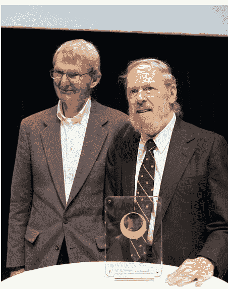

**图 4.7：** Doug McIlroy 和 Dennis Ritchie，2011 年 5 月（维基百科）

Doug 通常是第一个阅读论文或手册草稿的人，在过程中他会敏捷地戳破修辞的泡沫，删减冗长的散文，剔除不必要的形容词，并通上清理混乱。在 Mike Mahoney 的 Unix 口述史（1989年）中，Al Aho 这样评价 Doug：

> 他能理解我正在做的一切

他是我论文的外部读者，他极大地改进了论文的结构和叙述。他还阅读了我在实验室与他人合著的所有书籍的多个草稿，总是让它们变得更好。他完善并润色了命令的手页，并汇总并组织了 Unix 第 8 版到第 10 版手册的内容。他带着热情和心完成了这一切，尽管是以牺牲自己的研究为代价的。

Doug 在 1986 年辞去了管理职务，并于 1997 年从实验室退休，前往达特茅学院任教。图 4.7 是在 2011 年贝尔实验室的穆里希尔庆祝 Ken 和 Dennis 获得日本奖的庆祝活动上拍摄的照片。

# 第 5 章

# 第七版（1976-1979）

“实际上是有了 v7，系统才真正成熟并离开了研究的巢穴。v7 是第一个可移植版本，是通往无数硬件种类的放射性爆炸的最后一个共同祖先。因此，v7 的历史是所有 Unix 系统共同遗产的一部分。”

Doug McIlroy，《研究型 Unix 阅读》，1986年。

Unix 第六版为软件开发提供了一个极佳的基础，随之而来的工具让工作变得有趣且高效。有些组件在第六版之前很久就到位了，而另一些则在之后出现。在本章中，我们将看到 1127 的几条软件开发线，它们最终汇聚于第七版，后者于 1979 年 1 月发布，在第六版发布后近四年。

从逻辑和时间顺序来说，部分材料应该放在下一章之后（下一章描述了 Unix 在 Center 1127 之外的传播），但如果我谈论第七版，故事似乎更具连贯性。正如 Doug McIlroy 在引言中所述的，第七版是所有 Unix 系统共享的许多遗产的来源。

Unix 以及本章的主题之一是具有影响力的语言的繁荣，其中一些是特殊用途或特定领域的语言，另一些是声明式语言。我可能会在这个主题上花费的时间比许多读者感兴趣的要多，但多年以来这一直是我感兴趣的。我会尝试在每个章节的开头描述重要部分，这样你就可以安全地跳到末尾。

值得注意的是，在这一时期，第六版 Unix 严格运行在 PDP-11 上；到 1979 年，第七版是一个可移植的操作系统，运行在四种不同的处理器上，其中 DEC VAX-11/780 最为流行。我将在下一章讨论更多关于移植性的内容，但现在重要的是，注意到 Unix 悄悄地从一个 PDP-11 系统演变为一个独立于特定硬件的系统。

## 5.1 Bourne shell

第六版的 I/O 重定向和管道使得组合程序来完成某些任务变得简单，只需输入一系列命令，然后将它们收集到一个文件中——一个 shell 脚本——这样它们就可以作为一个单独命令运行。

第六版有一个 `if` 语句用于条件条件执行命令，一个 `goto` 语句用于跳转到脚本文件的另一行，以及一种在脚本中标记行的方法（`:` 命令，它无实际作用）以便进行跳转。总合在一起，这些可以被用来制作循环。在实践中，这些机制是笨拙且脆弱的。

正如我在下一章中描述的，程序员工作站（PWB）小组的成员 John Mashey 在他的第六版版本中增加了许多功能，使其编程变得好得多：一个用于条件测试的 `if-then-else` 语句，一个用于循环的 `while` 语句，以及用于在 shell 中存储信息的变量。

1976 年，史伯恩（Steve Bourne）最近加入了实验室，他编写了一个新 shell，整合了 PWB 的功能，并进行了重大增强。其目标是保留现有 shell 的交互特性，同时也使其成为一种完全可编程的语言。他的 shell 提供了几种控制流结构，包括 `if-then-else`、`while`、`for` 和 `case`。它包含了变量，其中一些由 shell 自定义，另一些可以由用户定义。引用机制得到了增强。它还被修改为可以像其他程序一样作为过滤器。结果被称为 `sh`。

新 shell 的控制流语法很奇特，因为它基于 Algol 68，Algol 68 使用反转词作为结束符，例如 `fi` 结束 `if`，`esac` 结束 `case`。但由于 `od` 已经被占用（用于八进制导出），`do` 被 `done` 结束。

# 第 5 章：第七版

```
for i in $* 遍历所有参数
do
    if grep something $i
    then
        echo found something in $i
    else
        echo something not found in $i
    fi
done
```

`if` 和 `while` 语句测试的条件是程序的返回状态，即程序可以用来报告其运行是否正常的数值值。那个时代的程序对返回敏感状态并不在乎，因为以前很少重要。Steve 设置他的 shell 在每次程序没有产生合理状态时都打印一条烦人的信息。在经历了一周的自动提醒后，大多数程序都升级为返回有意义的状态值。

Steve 的 shell 显著丰富了 IO。第六版的 BUGS 部分说：“没有办法重定向诊断输出。”一个有用的新功能是分离标准错误（默认文件描述符2），这样脚本的输出就可以重定向到文件，而错误信息可以去其他地方，除非是终端：

```
prog >file # 输出到文件，错误到终端
prog >err # 输出到终端，错误到错误
prog 1>file 2>err # 输出到文件，错误到错误
prog >file 2>&1 # 将错误合并到输出
```

到此，shell 已经变成了一种真正的编程语言，适用于编写任何可以合理制定为命令序列的任务。它通常可以完成足够的工作，无需编写 C 程序。

多年来，更多的功能被加入了，特别是 Bash，这种“Bour Again Shell”现在是大多数 Linux 和 macOS 用户的默认 shell。虽然个人 shell 脚本通常很小且简单，但编译器等主要工具的源码通常分发带有数万行的配置脚本。这些脚本运行程序来测试环境属性，如库的存在和数据类型的大小，以便编译出一个针对特定系统优化的版本。


## 5.2 Yacc, Lex, Make

我们使用语言进行交流，更好的语言能帮助我们更有效地交流。对于我们用于与计算机通信的人造语言来说，更是如此。一种好的语言可以降低我们想表达的内容（“只是想完成它”）与完成某些任务而必须说的内容之间的障碍。计算领域的大量研究都关注如何创建具有表现能力的语言。

第七版 Unix 提供了多种基于语言的工具，其中一些相当不寻常。我觉得可以说，如果没有这些工具，特别是 Yacc，这些语言大部分将不会存在，因为这些工具让非专家也能轻松创建新语言。本节描述了这些构建语言的工具。核心信息是：Unix 促进了新语言的创建，从而导致了与计算机通信的更好方法。你可以安全地跳过细节，但这一信息非常重要。

计算机语言具有两个主要方面的特征：语法（syntax）和语义（semantics）。语法描述的是规则：语言的外观是什么，什么在语法上是合法的，哪些是不法的。语法定义了语句和函数的编写规则、算术和逻辑运算符是什么、它们如何组合成表达式、哪些名称是合法的、哪些词是保留字、字面量字符串和数字如何表示、程序如何格式化等。

语义则是赋予合法语法的含义：一个合法的结构意味着或执行了什么。对于第 2 章中的面积计算程序（此处重复一次）：

```
void main() {
    float length, width, area;
    scanf("%f %f", &length, &width);
    area = length * width;
    printf("area = %f\n", area);
}
```

语义规定，当调用 `main` 函数时，它会调用 `scanf` 函数从标准输入读取两个数据值，计算面积，并调用 `printf` 打印出 area = 以及换行符 (\n)。

编译器是将用一种语言编写的内容翻译成另一种语言语义等价内容的程序。例如，C 和 Fortran 等高级语言的编译器可能会翻译成特定类型计算机的汇编；某些编译器会将其他语言（如 Ratfor）翻译成 Fortran。

# 第 5 章：第七版

# 91

编译过程的第一部分是解析程序，即通过识别名称、常量、函数定义、控制流、表达式等来确定其语法结构，以便后续处理可以附加相应的语义。

今天，为编程语言编写解析器是一项成熟的技术，但在 20 世纪 70 年代初，这是一个活跃的研究领域，重点是创建能够将语言的语法规则转换为该语言编写的程序的高效解析器的程序。这种解析器生成程序被称为“编译器编译器”（compiler-compilers），因为它们使得生成解析器成为可能，并在解析过程中遇到特定的语法结构时提供执行代码的方法。

### Yacc

1973 年，Steve Johnson（图 5.1）在 Al Aho 的语言理论帮助下，创建了一个编译器编译器，他称之为 YACC（此后简称 Yacc）。Jeff Ullman 的一条注释启发了这个名字，它的意思是“又一个编译器编译器”（yet another compiler-compiler），暗示它并不是第一个此类程序。

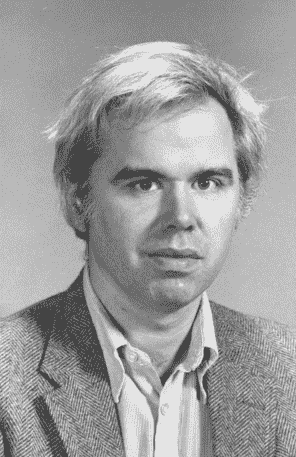

**图 5.1：** Steve Johnson，~1981（由 Gerard Holzmann 提供）

一个 Yacc 程序由语言语法的语法规则以及附加在规则上的语义动作组成，这样当在解析过程中检测到特定的语法结构时，就可以执行相应的语义动作。例如，在伪 Yacc 中，算术表达式语法的一部分可能是：

```
expression := expression + expression
expression := expression * expression
```

而相应的语义动作可能是生成代码，将两个表达式的结果相加或相乘并作为结果。Yacc 将此规范转换为一个 C 程序，在解析输入时进行解析并执行语义动作。

通常情况下，编译器必须编写更复杂的规则来处理乘法优先级高于加法的事实（即乘法在加法之前执行），但在 Yacc 中，运算符的优先级和结合性可以通过单独的声明指定，而不是额外的语法规则，这对于非专家用户来说是一个巨大的简化。

Steve 本人使用 Yacc 创建了一个新的“可移植编译器”（PCC），它有一个通用的用于解析语言的前端，，以及多个用于为不同计算机架构生成代码的独立后端。Steve 和 Dennis 在他们为 Interdata 8/32 实现 Unix 时也使用了 PCC，正如第 6.5 节所述。

PCC 还有其他用途。正如 Steve 回忆的：

“PCC 一个意料之外的衍生品是一个名为 Lint 的程序。它会读取你的程序，并对那些不可移植的或纯粹错误的内容进行注释，例如调用函数的参数数量不对、定义和使用之间的大小不一致等。由于 C 编译器每次只查看一个文件，因此在编写多文件程序时，Lint 迅速变成了一个非常有用的工具。当我们使 V7 变得移植时，它在强制标准方面也有用，例如寻找错误返回 -1（版本 6）而不是 null（V7）的系统调用。许多检查最终甚至移动到了 C 语言本身中；Lint 是新功能的一个非常有用的测试平台。”

Lint 的名字源于从衣服上摘掉毛絮的形象。虽然它的功能现在已被包含在 C 编译器中，但这种思想在其他许多语言的类似工具中也很常见。

# 第 5 章：第七版

Yacc 在过去几年中开发的几种语言中都起到了性作用，其中一些将在接下来的章节中描述。Lorinda Cherry 和我将它用于数学排版语言 Eq。我也将 Yacc 用于文档准备预处理器 Pic 和 Grap（后者见图 5.2），用于 AMPL 建模语言，用于至少一个版本的 Ratfor，以及多年来的其他各种语言。

Yacc 还用于第一个 Fortran 77 编译器 f77、Bjarne Stroustrup 的 C++ 预处理器 cfront、Awk 脚本语言（即将描述）以及其他。


**图 5.2：** Jon Bentley，~1981（由 Gerard Holzmann 提供）

Yacc 先进的解析技术、高效率和方便的用户界面帮助它成为早期解析器生成器的唯一生存者。今天它以自己的名字存在于 Bison 等独立实现中，并在数十种语言的重新实现中。

### Lex

1975 年，Michael Lesk（图 5.3）创建了一个名为 Lex 的词法分析器生成器，它是 Yacc 的直接对应物。一个 Lex 程序由一系列定义要识别的“词法标记；对于编程语言，这些将是保留字、变量名、运算符、标点符号等。与 Yacc 一样，每个标记都可以附加一个用 C 编写的语义动作。通过这些内容，Lex 生成一个 C 程序，将读取字符流，识别发现的标记并执行相关的语义动作。

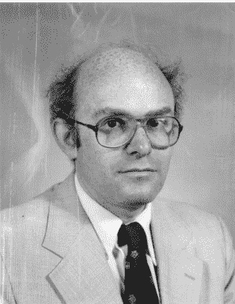

**图 5.3：** Michael Lesk，~1981（由 Gerard Holzmann 提供）

Yacc 和 Lex 协同工作。每当 Yacc 在解析时需要下一个标记时，它都会调用 Lex，Lex 读取足够的输入以识别一个完整的标记并将其传回 Yacc。Yacc/Lex 组合实现了编译器的前端组件，同时处理复杂的语法和词法结构。例如，某些编程语言具有两个或三个字符的运算符，如 C 中的运算符。当词法分析器看到 + 时，它必须向前看以判断运算符是 ++ 还是普通的加号加上其他内容。手动编写这种代码并不难，但要容易得多


让它为你写出来。在 Lex 中，你只需要说：

```
++ { return PLUSPLUS; }
++ { return PLUS; }
```

就能区分这两种情况。（PLUS 和 PLUSPLUS 是数值代码名称，便于 C 代码处理。）图 5.4 展示了如何使用 Yacc 和 Lex 创建一个用于某种语言的编译器的 C 程序。Yacc 为解析器生成一个 C 文件，而 Lex 为词法分析器生成一个 C 文件。这两个 C 文件与其他包含语义的 C 文件结合在一起，并由 C 编译器编译成一个可执行程序。该图是用 Pic 创建的。

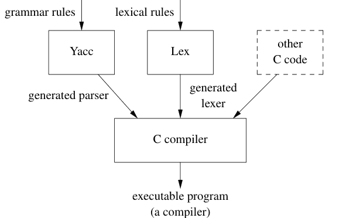

**图 5.4：** 使用 Yacc 和 Lex 创建编译器

尽管 Lex 如此简单且强大，但从长远来看，它并没有 Yacc 那么被广泛使用。也许这是因为对于相对缺乏经验的程序员来说，为复杂语言编写解析器可能是令人生畏畏的，而编写词法分析器则不然。然而，尽管手动编写词法分析器看起来可能很简单直接，但并不一定是个好主意。

我对 Awk 脚本语言（本文稍后会讨论）的经验可能有所启发。Awk 的第一个实现使用 Yacc 处理语法，使用 Lex 对输入程序进行标记。然而，当我们尝试将 Awk 到非 Unix 环境时，Lex 是否可用或者它的工作方式不同。几年后，我不情愿地用 C 重新写了 Awk 的词法部分，以便它可以迁移到所有环境。但在随后的多年里，那些手工编写的词法代码成了 Bug 和微妙问题的来源，而这些问题在 Lex 生成的版本中是不存在的。

这是一个通用规则的好例子：如果一个程序为你编写代码，那么它比你手写的代码更正确、更可靠。如果生成器得到了改进（例如产生更好的代码），每个人受益；相比之下，对一个手写程序的改进不会提高其他程序。Yacc 和 Lex 等工具是这一规则的极佳例子，Unix 也提供了许多其他例子。尝试编写编写程序的程序是值得的。正如 Doug McIlroy 所说：“任何你必须重复的事情都可能需要自动化。”

### Make

大多数大型程序由多个源文件组成，必须将它们编译并链接在一起以创建一个可执行程序。这通常可以通过单个命令如 `cc *.c` 来编译 C 程序的所有源文件，但在 20 世纪 70 年代，计算机非常缓慢，在修改单个文件后重新编译多文件程序可能需要大量时间，是几分钟而不是几秒。重新编译已更改的文件并将结果与之前编译的其他文件链接起来效率更高。

然而，记住哪些文件最近被编译过且需要重新编译是一件麻烦事，而且很容易出错。Steve Johnson 有一天在花费了几个小时徒劳的调试后，向 Stu Feldman 抱怨了这件事（图 5.5），结果发现他只是忘记重新编译他所修改的其中一个文件了。

巧的是，Stu 也遭遇了完全相同的问题，他一直在为了一个实际上正确但没有重新编译的程序进行调试而苦恼。他想出了一个优雅的想法：一种规范语言，用于描述程序部分之间如何相互依赖。他将其称为 Make 的程序分析该规范，并根据文件更改的时间进行最少量的重新编译，使所有内容保持更新。第一个实现是在于 1976 年：

“我在周末写了 Make，然后在下周末用宏重写了它（内置代码列表变得太长了）。我没有修复‘第一列制表符’的问题，因为我很快拥有了一批十多个人的忠实用户，我不想惹怒他们。”

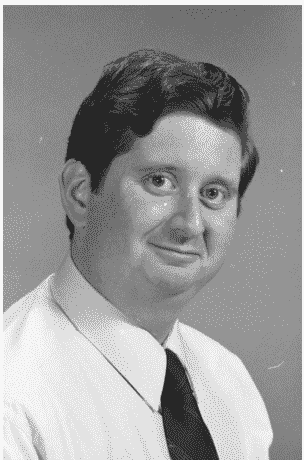

**图 5.5：** Stu Feldman，~1981（由 Gerard Holzmann 提供）

Make 立即获得了成功，因为它在使编译尽可能高效的同时，消除了一整类低级错误。对于涉及比 C 编译更复杂处理的程序，它也是一个福音，例如使用 Yacc 和 Lex 的程序，每个程序必须先运行以创建 C 文件，然后进行编译，如上面的图 5.4 所示。一个 Makefile 可以捕获编译新版本程序的所有的所有步骤，还可以描述如何执行相关任务，如运行 Lint、制作备份和打印文档。Makefile 具有 shell 脚本的一些相同属性，但这种语言是声明性的：它是依赖关系和如何更新组件的规范，但没有对文件创建进行显式测试。Stu 提到的“第一列制表符”问题是对 Makefile 格式的一种不传统且有些笨拙的限制。

这也是任何成功程序面临的通用问题的一个例子：如果程序是好的，它会吸引用户，然后就很难以任何不兼容的方式更改程序了。Unix 和大多数其他系统都充满了初始瑕疵的例子，这些瑕疵并不深到无法修复。

Make 也是本节一个主题的好例子：与其手动编写代码或执行一系列操作，不如创建一个声明必须完成工作的符号规范，并编写一个程序来解释该规范。这种方法用数据取代代码，这几乎总是赢的。

Yacc 和 Make 在今天仍然存在，因为它们解决了程序员仍然面临的重要问题，而且它们解决得很好，以至于这些设计有时甚至是原始实现仍在在使用。

顺便提一下，我第一次是在 1967 年遇到 Stu，当时我是普林顿的研究生，他还是本科生；学期间他在贝尔实验室兼职开发 Multics。他在 MIT 获得天体物理博士学位后加入了 1127。他在 1984 年去了 Bellcore，然后是 IBM，最后是 Google，对我来说非常幸运的是，他多次担任我的经理。

## 5.3 文档准备

Runoff 对我来说是一个启示，一种让使用计算机变得简单的方法。对于今天的读者，可能很难体会在文字处理出现之前、只有机械打字机的时代，准备文档有多么费力。


# 第五章：第七版

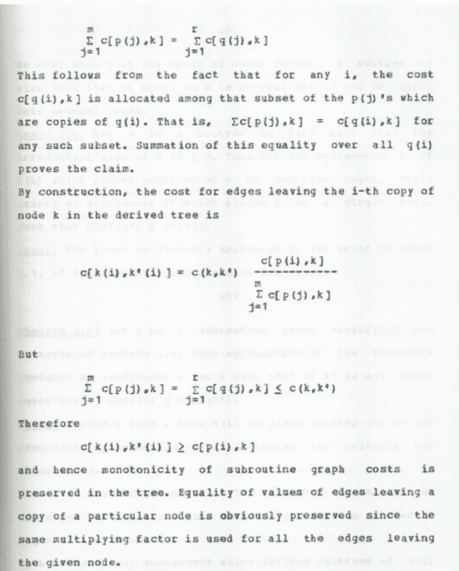

$\sum_{j=1}^{m} c[p(j),k] = \sum_{j=1}^{m} c[q(j),k]$

这是基于这样一个事实：对于任何 $i$，代价 $c[q(i),k]$ 被分配到那些作为 $q(i)$ 拷贝的 $p(j)$ 子集中。即对于任何这样的子集，$\sum[p(j),k] = c[q(i),k]$。对所有 $q(i)$ 将该等式求和便证明了该主张。

根据构造，派生树中离开节点 $k$ 第 $i$ 个拷贝的边代价为：

```
c[p(i),k]
c[k(i),k'(i)] = c(k',k')
\sum_{j=1}^{m} c[p(j),k]
```

```
$\sum_{j=1}^{m} c[p(j),k] = \sum_{j=1}^{m} c[q(j),k] \le c(k',k')$
```

因此 $c[k(i),k'(i)] \ge c[p(i),k]$，从而子程序图代价的单调性在树中得以保留。离开特定节点拷贝的边相等显然得到了保留，因为所有离开给定节点的边都使用了相同的倍因子。

**图 5.6：** 我论文中的一页，使用 Roff 格式化。

我不得不在打印页面中手动插入一些诸如求和（Σ）之类的特殊字符，但这种权宜机制的效果出奇地好，完全足够让我打印出我的论文了，我相信那是普林斯顿大学第一篇计算机打印的论文。（图 5.6 显示了一个随机页面）。在随后的几年里，有一家学生机构会以低廉的费用为学生“roff”文档。Roff 是我编写的第一个被其他人以重要方式使用的程序。

当我到达贝尔实验室（Bell Labs）时，我发现还有几个类似于 roff 的程序正在进行中，包括 Doug McIlroy 开发的一个基于 Saltzer 原始设计的程序。Joe Ossanna 很快又写了一个强大多的函数，他称之为 Nroff，这使得专利部门能够格式化专利申请。正如我早些描述的那样，Nroff 是为 Unix 购买第一批 PDP-11 计算机的关键工具。

这个由文档准备爱好者组成的小群体，以及此类程序的活跃用户社区，完美契合了我的兴趣。接下来的十年里，我花了大量时间愉快地为文本格式化工具工作。

### Troff 与排字机

Roff 和 Nroff 只处理固定宽度（“等宽”）字符集，并不比 Model 37 型电传打字机的标准字母字符多到哪里，因此输出质量并不高。1973 年，Joe Ossanna 安排购买了一台照相排字机——Graphic Systems CAT，这种机器在报业行业非常流行。Joe 的意图是制作外观更好的技术文档，并帮助专利部门准备更好的专利申请书。

CAT 可以打印正体、斜体和粗体的等比例间距字体，以及一组用于数学的希腊字母和特殊字符。它打印在长卷光刻纸上，这些纸必须在几种有毒且混乱的化学溶液中显影。这项技术早于激光打印机，激光打印机至少又过了 10 年才变得广泛可用。此外，输出是黑白的；廉价打印直到几十年后才出现。

每个字体都是一张带有字符图像的 35mm 胶片，安装在一个快速旋转的轮子上。轮上有四种字体，每个 102 个字符，因此单个任务的总字符库为 408 个字符。当纸张和目标字符处于正确位置时，排字机会通过一道强光穿过胶片图像并投射到光刻纸上。它可以实现 16 种不同的尺寸。

排字机很慢——改变尺寸需要它旋转机械转盘——而且光敏化学剂最令人不快，但输出质量足够高，让我们能生产专业的文档。事实上，曾出现过贝尔实验室的作者提交给期刊的论文受到质疑：它看起来太精美了，一定已经发表过了。

为了驱动排字机，Joe 创建了 Nroff 的一个重要扩展，并称之为 Troff。“T”代表排字机（typesetter）；读作 tee-roff。Troff 语言晦奥且棘手，只要有足够的技巧和耐心，它就能完成任何格式化任务，尽管很少有人能精通它。实际上，Troff 是一个针对真正奇特的计算机的汇编语言，因此大多数人通过宏包来处理标题、目录、段落、编号列表等格式化操作。这些宏在低级 Troff 命令之上提供了一种更高层次的语言。创建了广泛使用的 ms 宏包的 Mike Les 是创建宏包的大师；在我的圈子里，没有人在利用 Troff 编程能力方面能及他的水平。

当我们拥有一台可以产生多种字体、等比例缩放并具有足够字符的排字机后，考虑书籍以及内部文档的排版就变得可能的。第一本以这种方式制作的书是《编程风格元素》（The Elements of Programming Style），由 Bill Plauer 和我在 1974 年编写。由于我们当时没有用于显示程序的等宽字体，它在很多地方排版上很粗糙，但在其他方面是满意的。

Bill 和我们在排版时完成的主要任务之一是避免错误。

### Eqn 与其他预处理器

Roff 和 Nroff 仅处理固定宽度字符集，并不比 Model 37 型电传打字机的标准字母字符多到哪里，因此输出质量并不高。1973 年，Joe Ossanna 安排购买了一台照相排字机——Graphic Systems CAT，这种机器在报业行业非常流行。Joe 的意图是制作外观更好的技术文档，并帮助专利部门准备更好的专利申请书。

CAT 可以打印等比例间距的正体、斜体和粗体字体，以及一组用于数学的希腊字母和特殊字符。它打印在长卷光刻纸上，这些纸必须在几种有毒且混乱的化学溶液中显影。这项技术早于激光打印机，激光打印机至少又过了 10 年才变得广泛可用。此外，输出是黑白的；廉价打印直到几十年后才出现。

每个字体都是一张带有字符图像的 35mm 胶片，安装在一个快速旋转的轮子上。轮上有四种字体，每个 102 个字符，因此单个任务的总字符库为 408 个字符。排字机会当纸张和目标字符处于正确位置时，通过一道强光穿过胶片图像并投射到光刻纸上。它可以实现 16 种不同的尺寸。

排字机很慢——改变尺寸需要它旋转机械转盘——而且光敏化学剂最令人不快，但输出质量足够高，让我们能生产专业的文档。事实上，曾出现过贝尔实验室的作者提交给期刊的论文受到质疑：它看起来太精美了，一定已经发表过了。

为了驱动排字机，Joe 创建了 Nroff 的一个重要扩展，并称之为 Troff。“T”代表排字机（typesetter）；读作 tee-roff。Troff 语言晦奥且棘手，只要有足够的技巧和耐心，它就能完成任何格式化任务，尽管很少有人能精通它。实际上，Troff 是一个针对真正奇特的计算机的汇编语言，因此大多数人通过宏包来处理标题、目录、段落、编号列表等格式化操作。这些宏在低级 Troff 命令之上提供了一种更高层次的语言。创建了广泛使用的 ms 宏包的 Mike Les 是创建宏包的大师；在我的圈子里，没有人在利用 Troff 编程能力方面能及他的水平。

当我们拥有一台可以产生多种字体、等比例缩放并具有足够字符的排字机后，考虑书籍以及内部文档的排版就变得可能的。第一本以这种方式制作的书是《编程风格元素》（The Elements of Programming Style），由 Bill Plauer 和我在 1974 年编写。由于我们当时没有用于显示程序的等宽字体，它在很多地方排版上很粗糙，但在其他方面是满意的。

Bill 和我们在排版时完成的主要任务之一是避免错误。

### Eqn 与其他预处理器

Roff 和 Nroff 只处理固定宽度字符集，并不比 Model 37 型电传打字机的标准字母字符多到哪里，因此输出质量并不高。1973 年，Joe Ossanna 安排购买了一台照相排字机——Graphic Systems CAT，这种机器在报业行业非常流行。Joe 的意图是制作外观更好的技术文档，并帮助专利部门准备更好的专利申请书。

CAT 可以打印等比例间距的正体、斜体和粗体字体，以及一组用于数学的希腊字母和特殊字符。它打印在长卷光刻纸上，这些纸必须在几种有毒且混乱的化学溶液中显影。这项技术早于激光打印机，激光打印机至少又过了 10 年才变得广泛可用。此外，输出是黑白的；廉价打印直到几十年后才出现。

每个字体都是一张带有字符图像的 35mm 胶片，安装在一个快速旋转的轮子上。轮上有四种字体，每个 102 个字符，因此单个任务的总字符库为 408 个字符。排字机会当纸张和目标字符处于正确位置时，通过一道强光穿过胶片图像并投射到光刻纸上。它可以实现 16 种不同的尺寸。

排字机很慢——改变尺寸需要它旋转机械转盘——而且光敏化学剂最令人不快，但输出质量足够高，让我们能生产专业的文档。事实上，曾出现过贝尔实验室的作者提交给期刊的论文受到质疑：它看起来太精美了，一定已经发表过了。

为了驱动排字机，Joe 创建了 Nroff 的一个重要扩展，并称之为 Troff。“T”代表排字机（typesetter）；读作 tee-roff。Troff 语言晦奥且棘手，只要有足够的技巧和耐心，它就能完成任何格式化任务，尽管很少有人能精通它。实际上，Troff 是一个针对真正奇特的计算机的汇编语言，因此大多数人通过宏包来处理标题、目录、段落、编号列表等格式化操作。这些宏在低级 Troff 命令之上提供了一种更高层次的语言。创建了广泛使用的 ms 宏包的 Mike Les 是创建宏包的大师；在我的圈子里，没有人在利用 Troff 编程能力方面能及他的水平。

当我们拥有一台可以产生多种字体、等比例缩放并具有足够字符的排字机后，考虑书籍以及内部文档的排版就变得可能的。第一本以这种方式制作的书是《编程风格元素》（The Elements of Programming Style），由 Bill Plauer 和我在 1974 年编写。由于我们当时没有用于显示程序的等宽字体，它在很多地方排版上很粗糙，但在其他方面是满意的。

Bill 和我们在排版时完成的主要任务之一是避免错误。

### Eqn 与其他预处理器

Roff 和 Nroff 只处理固定宽度字符集，并不比 Model 37 型电传打字机的标准字母字符多到哪里，因此输出质量并不高。1973 年，Joe Ossanna 安排购买了一台照相排字机——Graphic Systems CAT，这种机器在报业行业非常流行。Joe 的意图是制作外观更好的技术文档，并帮助专利部门准备更好的专利申请书。

CAT 可以打印等比例间距的正体、斜体和粗体字体，以及一组用于数学的希腊字母和特殊字符。它打印在长卷光刻纸上，这些纸必须在几种有毒且混乱的化学溶液中显影。这项技术早于激光打印机，激光打印机至少又过了 10 年才变得广泛可用。此外，输出是黑白的；廉价打印直到几十年后才出现。

每个字体都是一张带有字符图像的 35mm 胶片，安装在一个快速旋转的轮子上。轮上有四种字体，每个 102 个字符，因此单个任务的总字符库为 408 个字符。排字机会当纸张和目标字符处于正确位置时，通过一道强光穿过胶片图像并投射到光刻纸上。它可以实现 16 种不同的尺寸。

排字机很慢——改变尺寸需要它旋转机械转盘——而且光敏化学剂最令人不快，但输出质量足够高，让我们能生产专业的文档。事实上，曾出现过贝尔实验室的作者提交给期刊的论文受到质疑：它看起来太精美了，一定已经发表过了。

为了驱动排字机，Joe 创建了 Nroff 的一个重要扩展，并称之为 Troff。“T”代表排字机（typesetter）；读作 tee-roff。Troff 语言晦奥且棘手，只要有足够的技巧和耐心，它就能完成任何格式化任务，尽管很少有人能精通它。实际上，Troff 是一个针对真正奇特的计算机的汇编语言，因此大多数人通过宏包来处理标题、目录、段落、编号列表等格式化操作。这些宏在低级 Troff 命令之上提供了一种更高层次的语言。创建了广泛使用的 ms 宏包的 Mike Les 是创建宏包的大师；在我的圈子里，没有人在利用 Troff 编程能力方面能及他的水平。

当我们拥有一台可以产生多种字体、等比例缩放并具有足够字符的排字机后，考虑书籍以及内部文档的排版就变得可能的。第一本以这种方式制作的书是《编程风格元素》（The Elements of Programming Style），由 Bill Plauer 和我在 1974 年编写。由于我们当时没有用于显示程序的等宽字体，它在很多地方排版上很粗糙，但在其他方面是满意的。

Bill 和我们在排版时完成的主要任务之一是避免错误。


## 第 5 章：第七版

用于管理参考文献引用，这对于技术论文至关重要。

本章描述的许多程序都是预处理器，即将某种语言转换为后续处理所需的适用格式的程序。C++ 的原始版本 Cfront 可以更准确地描述为一种 C 的面向对象的预处理器，它后来演变成了 C++。有时，在 C++ 中，预处理器随着功能被下游过程吸收而消失了。然而，在大多数情况下，这些程序保持独立，就像 Eqn 和 Thbl 这样的文档准备工具一样。另一个例子是 `bc`，它是 `dc` 的预处理器，`dc` 是 Bob Morris 最初设计的无限精度计算器。Lorinda Cherry 编写 `bc` 是为了 `dc` 提供传统的中缀算术符号，而 `dc` 的后置表示法对于初学者来说很难随手使用。

预处理器有很多优点。首先，如果有人实现一种语言，它不受语法的限制，而是可以使用各种 Troff 预处理器使用完全不同的风格。其次，在内存很小的时代，无法在已经庞大的程序中包含更多功能；对于 Troff 来说尤为如此。最后，由于预处理器的输出是可用的，可以在传递之前对其进行操纵，以处理其他类型的处理。在文档准备风格中，我使用了 Sed 脚本等来修复字符和间距。Chris Wyk 和我编写了程序来对页面进行垂直对齐，通过在发送设备驱动程序之前修改 Troff 的输出。如果功能被嵌入到单个程序中，这些是不可能的；而当过程是一个流水线时，很容易在前端、后端或中间添加新阶段。

## 设备无关的 Troff

Joe Ossanna 于 1977 年去世，享 48 岁。他留下的遗产部分是 Troff 的源代码，当时它大约近 10,000 行晦涩的 C 代码，这些代码是 Joe 从原始的汇编语言手工翻译的——没有注释，有几十个两个字母命名的全局变量，以及（见上文对内存的讨论）为了将尽可能多的信息挤进不足的内存中的各种细微技巧。为 Joe 辩护的话，为了将 Troff 的所有功能压缩到 65K 字节中是绝对必要的，因为那是我们当时使用的 PDP-11/45 上用户程序可用的最大内存。

我至少有一年时间对这些代码没做什么，但终于有了足够的勇气开始摆弄它。我缓慢而谨慎地开始了一次升级。除了用户手册之外没有任何注释文档外，最大的问题是它强烈依赖于原始的 Graphic Systems CAT 排字机，而那时已经过时了。

最终，我成功找到了代码依赖 CAT 特性的所有地方，并将它们替换为由排字机特征表（如字符集、大小、字体和分辨率）驱动的通用代码。我发明了一种排字机描述语言，使得 Troff 能够产生针对特定排字机能力调优的输出。简单的驱动程序将该输出转换为特定设备所需的任何输入。这得到了所谓的设备无关版本，称为 Ditto。它还让其他文档准备预处理器（特别是 Pic）能够利用新排字机更高的分辨率来绘制线条和图形。

其中一个设备是来自 Mergenthaler 公司的一款新排字机——Linotron 202。从纸面上看，这个设备正是我们替换 CAT 所需的。它速度快、分辨率高，通过在屏幕上涂绘来绘制字符，其处理器是一个标准微型计算机（计算机自动微型机），由一个简单的程序控制，与我为其他排字机编写的程序相比。主要的缺点是成本，1979 年为 50,000 美元，但由于我们在之前的排字机上工作得很好，管理层几乎没有经过任何讨论就批准了购买。

一旦 202 到货，我们发现它的硬件极其不可靠；更糟糕的是它的软件。这导致了几个月来 Mergenthaler 维修服务几乎每天的上门，以及 Ken Thompson 和 Joe Condon 对硬件完成的惊叹的逆向工程（见图 5.8）。

Joe 受过物理学训练，但随着他兴趣的转移，他成为一名卓越的电子电路设计师。他编写了许多中心用于硬件实验的电路设计工具，并与 Ken 一起设计了 Belle 象棋机器。他的硬件专业知识对于攻克 202 至关重要。

Ken 开始为运行在机器上的二进制程序编写一个反汇编器。（在此记录一下，他是在某个晚上晚上几个小时内完成的，当时我正回家吃晚饭，然后回来工作了一个晚上。）

反汇编 Mergenthaler 的程序让 Ken 和 Joe 获得了了解排字机本身如何工作的切入点，在几周强烈的逆向工程后，他们破解了 Mergenthaler 对字符和源代码的专利编码，我们可以创建自己的字符，例如图 5.9 顶部当时流行的 Bell 系统符号、用于打印比赛和棋盘图的象棋字体，以及具有多种用途的 Peter 字（例如，图 5.10）。

## 第 5 章：第七版

## 107

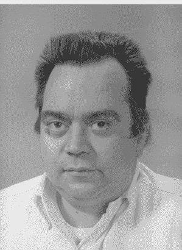

**图 5.8：** Joe Condon，~1981（由 Gerard Holzmann 提供）

Ken 为 Mergenthaler 控制器写了一个 B 解释器，我们编写了 B 程序来驱动它。这个故事在了一份当时被贝尔实验室压制的技术备忘录中详细描述，可能是为了避免泄露 typeshaler 的知识产权，该备忘录直到2013 年才发表（见 cx.princeton.edu/~bwk/202）。图 5.9 显示了部分内容；不完整的备忘录编号如 80-1271-x 表明从未分配编号。

当它最终开始工作时，202 的高分辨率使得实现有趣的图形成为可能，包括半色图像和线条图（如5.9 中的数字排字机图）。对于后者，我创建了一种名为 Pic 的语言，使得组织结构图或网络图可以用文本描述。自然地，它使用 Yacc 处理语法，使用 Lex 处理词法部分。图 5.11 显示了 Pic 输入和输出的一个简单示例。

## 书籍出版

文档准备工具之所以有效，是因为它们被用于一切——手册、技术论文、书籍。如果程序有 Bug 或无法运行，代码的作者们就在

## 第 5 章：第七版

主题：关于使用 Mergenthaler Linotron 202 光排字机的体验，或者说我们是如何度过假日的

日期：1980 年 1 月 6 日

发件人：Joe Condon, Brian Kernighan, Ken Thompson

案号- 39199 -- 文件：39199-11

抄送 TM: 80-1270-1, 80-1271-x, 80-1273-x

# 归档备忘录

## 1. 引言

贝尔实验室已使用光排字机多年，主要是 Graphic Systems 的 CAT 型，大多数读者都会熟悉使用这种特定排字机的 Shroff 及相关软件。

尽管 CAT 有许多优点，但它仍然是一个相对缓慢且过时的设备（成本低，而且直到最近可靠性很高）。大多数较新的排字机使用数字技术，而不是 CAT 那种基本上模拟的胶片模板和光学传输方法。这些排字机以数字形式存储字符，使用字符轮廓的某种表示，并通过在 CRT 上绘制某些区域来在光刻纸上打印。图 1 是典型的数字排字机框图。

图 1：基础数字排字机

### 图 5.9：未发表贝尔实验室关于与 Linotron 202 斗争的备忘录


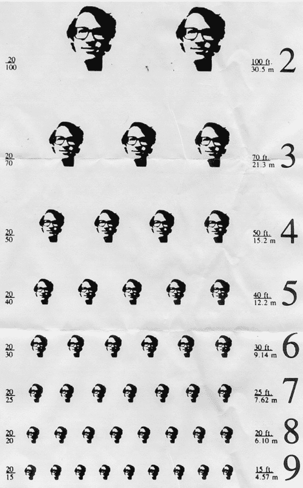

```
arrow "stdin" above
box "command"
arrow "stdout" above "stderr" just
arrow down 从最后一个 box.s.
```

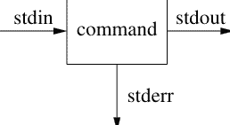

计算科学研究中心的成员在 20 世纪 70 年代和 80 年代编写了数量巨大的影响力书籍，远超人们对工业实验室的预期。因此，一段时间后，贝尔实验室（Bell Labs）成为了计算和计算机科学领域权威书籍的来源。

Al Acho 写了多本广泛使用的教科书，包括与 Jeff Ullman 编写的著名的 1977 年“龙书”（《编译器设计原理》，图 5.12），以及与 Jeff 和 John Hopcroft 编写的《计算机算法设计与分析》。Bjarne Stroustrup（图 5.13）在 80 年代初创造了 C++，并在几年后编写了关于 C++ 的书籍。Jon Bentley 的《编程珍珠》源于他在《美国 ACM 通报》杂志上的专栏。团队的 Mike Garey 和 David Johnson 使用 Eq 编写了他们的核心著作《计算机与不可计算性：NP 完全性理论指南》。我们还出版了 Unix、Plan 9 等系统的手册。这些出版物成为了一代程序员和计算机科学家的标准文本和参考资料。

这群规模较小的工业界研究人员是如何产出如此多影响力巨大的书籍的？

我能看到几个原因。首先，最重要的是，人们对待自己的写作非常认真，并且对他人的作品具有批判性眼光。Doug McIlroy 是我们小组中的佼佼者；无论主题是什么，没有人能像 Doug 那样发现错误（从微小的细节到致命的错误），他对于晦涩的散文也绝不容忍。我不认为自己在贝尔实验室写过任何没有请教过 Doug 确认的东西，而他总是会这样做。当他粉碎我的文字时，我感到很谦卑，但这让我成为了一个更好的作家，这种情况也发生在其他人身上。


# 编译器设计原理

**图 5.12:** Aho 和 Ullman 的龙书，第一版，1977 年

当然，Doug 并不是唯一的批判性读者。每个人都慷慨地投入时间；对同事撰写的内容提供详细意见仅仅是那里文化的一部分。这是极不寻常的，也是让实验室成为一个极佳工作场所的原因之一。

其次，当地管理层支持书籍编写。出版对于维持贝尔实验室在科学和学术界的声誉非常重要，这包括书籍。在管理层的支持下，全职投入六个月写一本书，集中的精力就足以完成一项如果作为业余或晚间活动可能需要几年的工作。更棒的是：尽管贝尔实验室保留了书籍的版权，但作者可以保留版税。我怀疑我们中从未有人曾显式地为了赚钱而写书——实验室里没有人会蠢到认为写一本技术书是暴利的——但如果一本书取得了某种成功，作者就留下了那笔钱。

这种开明的管理和公司政策鼓励了人们写作，从长远来看，这对公司和作者都是有利的。实验室作者的出版物对于招聘至关重要。

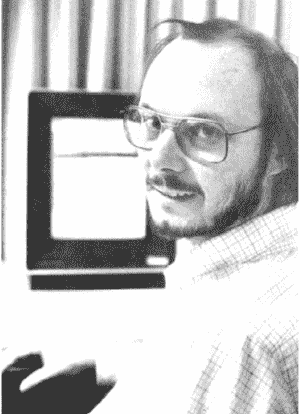

# **图 5.13:** Bjarne Stroustrup, ~1984 (由 Bjarne Stroustrup 提供)

贝尔实验室并不是什么神秘的秘密行动；学生们知道那是他们软件诞生和教科书编写的地方。潜在的新入职者可以看到优秀的工作正在被完成并出版；他们不需要担心消失在某个“工业”研究实验室里。这让贝尔实验室的招聘与大学处于平等的地位，而且还有一个优势，即人们可以在实验室全职研究，不受教学、行政和筹款的干扰。这种优秀软件与高影响力书籍的结合，是当时实验室如此成功的重要部分。

第三个因素更具技术性：C 和 Unix 作为编程环境的共生关系、文档准备作为一个研究领域，以及关于技术主题的写作作为主要活动。这始于文本格式化程序，如 Doug McIlroy 的 Hoff、Joe Ossanna 的 Nroff 和 Troff，然后是像 Eq、Tbl 等预处理器。这些工具使得生成包含更多排版挑战性内容的文档变得更容易，例如数学、表格、插图、图表和图形。这反过来导致了更好的写作，因为所有这些文档准备程序都具有一个关键特征：它们使得对文档进行多次修订变得容易，并且始终有一个干净的副本可以工作，而不是将材料交给打字员并等待几天才返回那种缓慢而痛苦的替代方案。

# 第五章：第七版

# 113

这听起来可能微不足道，但我确定这种如此容易进行修订以改进写作的能力很重要，因为这几乎消除了制作最新副本的开销，并完全消除了打字员、编辑和打印员等中间环节。准确性对于技术论文和《Unix 程序员手册》非常重要，但对整个过程的控制对于书籍尤为重要。对于编程书籍，直接从源代码进行排版至关重要，这样我们就能确保打印的内容是正确的，没有被人为干预而意外改变。

这些工具都是用 C 语言编写的，因为它具有表现力且高效。今天可能很难记住，当机器容量以 KB 而非 GB 为单位时，时间和空间上的效率是至关重要的。每一个字节都重要，因此在某种程度上每条指令也是如此，所以一种在这方面都节省资源的语言不仅是好事，更是一种务实的需求。

这一切都形成了一个循环——这本书是由这些文档准备程序的后代制作的，尽管使用了 James Clark 编写的 Groff、Geqn 等优秀的、全新的实现和增强。

## 5.4 Sed 和 Awk

Unix 文件系统的主要简化之一是将其文件统一处理为未解释的字节序列。它没有记录，没有强制性或禁止的字符，也没有由文件系统强加的内部结构——只有字节。

在大多数 Unix 程序处理文本数据的方式上也有类似的简化。文本文件只是字节序列，这些字节恰好是 ASCII（美国信息交换标准代码）字符。这种对纯文本的统一视图非常契合管道（pipelines），而 Unix 工具箱中充满了读取文本输入、对其进行某些处理并写文本输出的程序。我已经提到过例子，如字数统计、比较、排序、转录、查找重复项，当然还有经典的例子，用于搜索的 grep。

### Sed

grep 的成功启发了 Lee McMahon 编写了一个名为 sed 的类似程序，它对流过的文本进行简单的替换；“s”是 ed 中的替换命令。Lee 很快将其替换为更通用的形式，一个名为 Sed 的流编辑器，它在从输入到输出的过程中对文本应用一系列编辑命令；grep 和 gres 都是 Sed 的特例。Sed 使用的命令与文本编辑器中的编辑命令相同。Sed 经常被用于 shell 脚本中，以某种方式转换数据流：替换字符、添加或删除不需要的空格，或丢弃不需要的内容。

Lee 有着不寻的背景——哈佛大学的心理学博士学位，在转向更常规的计算机科学家路径之前，曾在耶稣会神学院度过一段时间准备成为神职人员。他是小组中第一批考虑大规模处理文本的人之一，其目的是存储大量数据。我可能补充一点，“大量”是相对的。Lee 在 20 世纪 70 年代初特别感兴趣的是《联邦党人文》，全文加起来只有 1MB。

### Awk

我对能够同样良好处理数字和文本的工具感兴趣。grep 或 Sed 都不能处理数值数据或进行算术运算，计算仍然需要 C 程序。因此我在寻找某种通用的方法。与此同时，Al Ho（图 5.14）一直在实验 grep 支持的更丰富的正则表达式类，并编写了 egrep（扩展 grep）。最后，Peter Weinberger（很久后转到 1127 间并搬到了 Al 和我之间的办公室）对数据库感兴趣。

1977 年秋季，我们三人讨论了如何结合这些想法，从 IBM 但晦涩的报告生成器 RPG 中汲取了灵感，并结合 Marc Rockkind 在下一章中描述的一个新想法。最终，我们设计了一种称为 AWK 的语言（以后称为 Awk）。正如我们在原始描述中所说的，用作者的名字命名语言显示了想象力的匮乏。我不记得我们是否考虑过与“awk”（笨拙）相关的词，或者我们是否以讽刺的方式觉得这个名字合适，但无论如何它留了下来。

Awk 程序是模式和动作的序列。每行输入都会针对每个模式进行测试，执行相应的动作。模式可以是正则表达式，也可以是数值或字符串关系。动作是用 C 变言编写的。省略模式匹配所有行；省略动作则打印匹配的行。


# 第五章：第七版

# 115

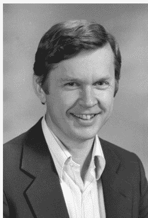

**图 5.14：** Al Aho，~1981（由 Gerard Holzmann 提供的）

此示例打印所有长度超过 80 个字符的输入行；这是一个没有动作的模式。

```
awk 'length > 80'
```

Awk 支持存储数字或字符串的变量，以及下标可以是数字或任意字符字符串的关联数组。变量被初始化为 0 和空字符串，因此通常不需要设置初始值。

Awk 自动读取每个输入文件的每一行，并将每个输入拆分为多个字段（fields），这使得很少需要编写代码来显式地读取或解析单行。此外，还有一些内置变量包含当前输入行的行号和该行中的字段数，因此这些值也不需要手动计算。这些默认设置消除了样板代码，意味着许多 Awk 程序只有一行或两行长。

为了说明，这个程序在每行前面加上它的行号：

```
awk '{print NR, $0}'
```

NR 是当前输入行的行号，而 $0 是输入行本身。

接下来的示例统计输入中每个单词出现的次数，并在最后打印单词及其计数：

```
{ for (i = 1; i <= NF; i++) wd[$i]++ }
  END { for (w in wd) print w, wd[w] }
```

第一行是一个没有模式的动作，因此它会对每一行输入都进行求值。内置变量 NF 是当前行的字段数；它是自动计算的。变量 $i 是第 i 个字段，同样是自动计算的。语句 `wd[$i]++` 使用输入的值（即单词）作为数组 `wd` 的下标，并增加数组元素的值。特殊模式 END 在读取完最后一行后匹配。这里有两种不同的 `for 循环。第一种是直接借自 C 语言。第二种遍历数组的元素，因此在这个示例中，它为原始输入中的每个不同单词打印一行，并带有该单词出现的次数。

尽管 Perl 和 python 在今天被广泛使用，但 Awk 是一项核心工具，且至少有四个或五个独立的实现：Arnold Robbins 的 Gawk 和 Michael Brennan 的 Awk。Awk 确实有一些值得商榷的设计和暗角，但与任何语言相比，它的性价比最高——人们可以在 5 或 10 分钟内学会它的大部分内容，典型的程序只有几行长。不过，它在大型程序中的扩展性并不好但这并没有阻止人们编写数千行的 Awk 程序。

Sed 也很流行，是 shell 管道中常见的组件。我甚至有一张贴纸写着：

> “Sed 和 Awk：在一起，我们可以改变一切。”

值得注意的是，Sed、Awk、Make、Yacc 和 Lex 都实现了某种形式的“模式-动作”（pattern-action）范式。这些语言中的程序由模式和动作的序列组成；其基本操作是检查输入是否匹配每个模式，当匹配到模式时，执行相应的动作。模式和动作可以省略，在这种情况下，会采取默认行为。

例如，grep、Sed 和 Awk 都可以用于匹配单个正则表达式。如果特定表达式对三者都有效，那么这三个命令是等价的：

```
grep re
sed -n /re/p
awk /re/
```

模式-动作范式是思考主要由测试和动作序列组成的程序的自然思维方式。

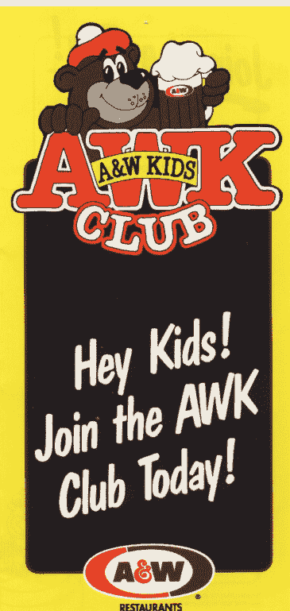

图 **5.15：** 流行文化中的 Awk

## 5.5 其他语言

Unix 编程环境、语言开发工具、丰富的潜在应用领域，当然还有从编译器到语言理论和算法等各个领域的本地专家，共同促成了其他语言的设计和实现。我不会深入探讨其中任何一种，但快速看一眼部分列表是值得的。

不需要理解这些示例中的任何细节。真正的教训是，广泛的兴趣、语言专业知识以及像 Yacc 和 Lex 这样的工具，使得中心的成员能够轻松地创建新语言。如果没有这些因素的结合，这将困难得多，我认为其中许多有趣的语言将不会存在。

最有意义的例子是 C++，它始于 1979 年，当时 Bjarne Stroustrup 刚从剑桥大学获得博士学位加入 1127。Bjarne 对仿真和操作系统感兴趣，但现有的语言并不能满足他的需求。因此，他从最接近的语言 Simula 中取了一些好主意，并将它们与 C 合并。结果结合了面向对象的思想和 C 的效率与表达力，被称为“带有类的 C”，并于 1980 年诞生。今天，C++ 是最广泛使用的语言之一，处于 Microsoft Office、Google 基础设施、视频游戏以及许多其他软件的核心。

Bjarne 在 1127 部门工作了 15 年，正如前面描述的，他见证了 C++ 的演变。在早期，我能理解它，但现在几乎读不通了。

C++ 经常因其规模以及从 C 继承的某些语法而受到批评。如果 Bjarne 没有目标实现与 C 兼容，C++ 成功的机会会小得多。建立一种新语言是困难的；在源代码级别（为了熟悉感）和对象级别（利用现有的 C 库）保持兼容至关重要，而且当时它变得像 C 一样高效。

一些尚未提到的重要语言也源自 1127。

Stu Feldman 和 Peter Weinberg 编写了第一个 Fortran 77 编译器，称为 f77。作为一种语言，Fortran 77 比我用 Ratfor 覆盖过的 Fortran 66 好一些，尽管仍然没有合理的控制流语句。无论如何，f77 的构建很有挑战性，但值得的，因为它被数值分析师广泛用于 PDP-11 和 VAX。

在相关的工作中。Stu 和 Dave Gay 编写了 f2c，将 Fortran 翻译成 C；f2c 使得在没有编译器或 Fortran 编译器是昂贵产品的系统上可以使用 Fortran。

Gerard Holzmann（图 5.16）从代尔夫特大学加入 1127，他一直对摄影感兴趣。20 世纪 80 年代，他构思了一种对数字图像文件进行算法转换的编程语言。他将其命名为 Pico：

> 最初这个名字表示它的尺寸，后来更容易理解为“图像组合”的缩写。

Pico 是另一个模式动作语言的示例。它通过对原始图像中的每个像素求一次用户定义的表达式来定义新图像；表达式可以引用值、坐标、各种函数以及其他图像的部分。这些表达式可以产生有趣的转换，其中许多出现在 Gerard 在 1988 年出版的书《Beyond Photography》中，书中描述并说明了 Pico。（图 5.17 是一个示例）。并不意外的是，Pico 是用 C 语言和 Yacc 解析器实现的。

Gerard 还创建了另一个专门基于语言的工具 Spin，用于分析和检查涉及软件系统的正确性


# 第 5 章：第七版

分离通信进程。Spin 可用于验证特定系统在逻辑上是正确的，且没有诸如死锁等无法进展的缺陷。（“您先请。”）“不，您先请。”）Spin 是研究如何随时间表示独立进程之间交互的极佳范例，并结合一流的软件工程，构建出一个既易于使用又运行足够快到具有实用性的系统。Spin 模型用另一种称为 Promela（协议元语言）的特殊语言编写，并同样使用 Yacc 实现。
Spin 蓬勃发展，拥有数千个安装版本，并每年举办一次会议。它已被用于验证大量系统，范围涵盖从硬件设计到铁路信号协议。

Bob Fourer、Dave Gay 和我设计并实现了 AMPL，这是一种用于指定如线性规划等优化问题的语言。Bob 是西北西北大学管理科学和运筹学的教授，他长期以来一直非常有兴趣帮助人们创建数学优化模型。我们对 AMPL 的工作始于他在 1984 年在实验室进行休假期间。
AMPL 语言使得定义描述特定优化模型变得简单，例如在给定运输成本数据、每家商店的销售额、每家工厂的生产能力等数据的情况下，找到货物从工厂运到商店的最佳方法。优化问题用代数符号编写，包含一组必须满足的约束系统，以及一个需要最大化或最小化的目标函数。

**图 5.17：** Gerard Holzmann，由 Pico 转换

此类优化问题是许多行业的核心：航空公司机组调度、制造、运输和配送、库存控制、广告活动以及海量的其他应用。

我用 C++ 编写了 AMPL 的最初实现，并配有一个 Yacc 语法和（我想是）用于词法分析的 Lex。这是我的第一个严肃的 C++ 程序，但我很快就把代码交给了 Dave Gray。

AMPL 也许是源于那个时代、唯一被广泛使用的专有语言。（语言本身不受版权保护，但据我所知，在任何时候都没有出现过开源实现。）AT&T 在 AMPL 创建几年后开始向公司授权使用 AMPL。当 Dave 和我从贝尔实验室退休后，我们三个人成立了一家名为 AMPL Optimization 的小公司，继续进行 AMPL 的开发和营销。最终，我们从贝尔实验室购买了权利，这样我们就可以走自己的路了。公司规模依然很小，但在其利基市场是一个重要参与者。

在 20 世纪 80 年代，Rob Pike（图 5.18）和 Luca Cardelli 实验了并发语言，特别是与鼠标和键盘等输入设备交互的语言；这导致了 Squeak 和 Newsqueak 的名字。Newsqueak 的想法最终进入了并发语言 Limbo 和 Ale（它们在 Plan 9 中），十年后进入了 Go 编程语言，该语言于 2008 年由 Rob Pike、Ken Thompson 和 Robert Griesemer 在 Google 创建。

## 5.6 其他贡献

到为止，大部分重点在系统软件，尤其是语言上，因为这是我最熟悉的，但我应该提到科学计算、通信、安全和硬件领域的一些重大活动，因为它们通常具有影响力，而且它们全都包含大量的软件组件。这些内容并没有整齐地落在第七版的时间跨范围内。

### 科学计算

正如科学研究机构所预期那样，贝尔实验室很早就参与了使用计算机对物理系统处理进行建模和仿真，这是数学研究的自然延伸。这也验证了 Dick Hamming 的预测，即计算可以取代实验室。重点是数值线性代数、微分和积分方程、函数近似，以及能够使已知最佳方法广泛应用的数学库。

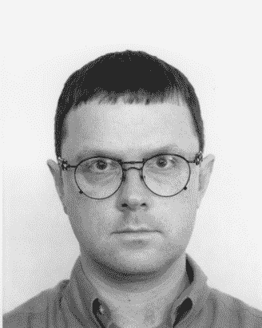

**图 5.18：** Rob Pike，~1981（由 Gerard Holzmann 提供）

Phyllis Fox 是这种数值计算的先驱，也是 Fortran 程序员 PORT 库的主要贡献者。PORT 定义了针对特定机器的常量，例如不同计算机之间数值范围会有不同的值；其库确保了 Fortran 代码在不同计算机之间的可移植性。

PORT 库是一项巨大的工程，最终在 1,500 个程序中包含 130,000 行 Fortran 代码和大量的文档。Barbara Ryder 和 Stu Feldman 开发了一个名为 PFORT 的 Fortran 编译器，用于检查 Fortran 代码是否是用 Fortran 的可移植子集编写。Norm Schryer 写了一个程序来检查计算机的算术运算，计算机在执行浮点运算的方式上往往差异很大。这尤为重要，因为这早于浮点行为标准的制定。

Eric Grosse 和 Bill Coughran 开发了半导体建模与仿真、电路分析和可视化的算法，特别是针对半导体设计和制造。在贝尔实验室开发的许多数值软件分发在 Netlib 数学软件存储库中，那里仍被科学计算社区广泛使用。其他数值分析师对 Netlib 和更大的社区做出了重大贡献，包括 Dave Gay、Linda Kaufman 和 Margaret Wright。

### AT&T 的 800 电话目录

Eric 在软件分发方面的经验在一个有趣的无关项目中提供了大忙：1994 年，Eric、Lorinda Cherry 和我将 AT&T 的 800 电话目录放在了当时全新的互联网上。意图是让 AT&T 获得提供真实互联网服务（以及互联网本身）的经验，也许是为了增加拨打 800 电话，甚至最终通过显示广告等增强服务产生收入。此外，我们希望通过提供具有真实价值的东西获得一些适度的公关收益，而像当时的许多互联网产品那样仅仅是预热。我们在 1994 年 8 月获得了一份包含 157,000 条记录的数据库快照，大小约为 22 MB，并在几小时内就在本地计算机上运行，作为一个可搜索和浏览的网站。说服 AT&T 管理层将其公开是一个缓慢得的过程。然而，在经过内部讨论后，管理顾虑和惯性最终屈服于 AT&T 的竞争对手 MCI 将提供某些服务的传言，该目录于 1994 年 10 月 19 日公开。这是 AT&T 的第一个网页。

政治上的延迟令人有些沮丧，但数据故事具有启发性。数据库中充斥着错误，许多没有人用批判性眼光看过的列表，例如辛辛那提的 9 种不同拼写。（它们可以作为正则表达式的一个很好的例子）。

尽管有这些缺陷，该目录服务获得了一些公关收益；它曾一度在 Yahoo WWW 指南中列为“酷链接”的第一个。（Yahoo 本身成立于 1994 年，其索引最终）

### UUCP

在 20 世纪 70 年代中期，Mike Lesk 写了 UUCP，即 Unix 复制程序。它通过普通的电话线将文件从一个 Unix 系统发送到另一个。那些线路很慢而且有时昂贵，但它们无处不在，大多数当时的 Unix 系统都有某种拨号接入能力，但能拨号出的系统更少，因为那


涉及支付电话费用。

尽管 UUCP 主要用于软件分发，但在互联网广泛普及之前，它也是远程命令执行、邮件传输和新闻组的基础。Usenet 作为最早的信息分发系统之一，是基于 UUCP 的。

第一个 UUCP 分发版本包含在第 7 版中；它被移植到其他操作系统，并在随后的几年中实现了开源。随着互联网成为标准的通信网络且其协议接管了一切，UUCP 的使用最终消失了。

### 安全

Unix 社区的人从早期开始就关注安全问题，这种兴趣部分源于 Multics，部分源于对密码学的经验。

一个安全考量是允许文件系统为每个文件使用 9 位位来控制对文件的访问。对文件可以进行什么种访问？文件的所有者有三位，独立地控制读取权限、写入权限和执行权限。对于普通文本文件，通常允许所有者读取和写入，但不会允许执行，除非该文件是可执行程序或 Shell 脚本。所有者所属组还有三位，可能是某个部门、项目或教职/学生的区分。最后三位适用于所有其他用户。

这种机制比 Multics 提供的要简单得多，但它已经良好运行了很久。例如，编辑器、编译器、Shell 等标准命令由特权账户（通常是 root 用户）所有，该用户可以随心所欲地读取、写入和执行它们，但普通用户只能执行（可能还可以读取）而不能修改它们。注意，在无法读取内容的情况下执行程序是可能的；通过这种，程序可以安全地包含信息。

早期的一个改进是为每个文件增加了第 10 位权限位，称为 `setuid`（用户 ID）位。当此位被设置时，该文件将作为程序执行，检查权限的用户 ID 不是运行程序的人，而是文件的所有者。如果设置了该位，普通用户就可以以程序所有者的权限运行程序。这用于那些操作文件系统以创建目录、重命名文件等的程序：执行特权调用的程序由拥有不受限制访问权限的超级用户所有。自然，setuid 程序必须经过仔细编写和管理；否则，它们可能会在系统安全上留下巨大的漏洞。setuid 由丹尼斯·里奇（Dennis Ritchie）发明，他于 1979 年获得了该专利。

如前所述，密码的想法源于 CTSS，并在 Multics 中延续，一直进入 Unix。一个名为 `/etc/passwd` 的文本文件每个用户拥有一行，包含登录名、用户 ID 数字、密码以及其他几个字段。从早期开始，密码就以哈希形式存储，而不是明文。哈希是一种扰乱形式，重新创建原始密码的唯一实际方法是尝试所有可能的密码。这意味着任何人都可以读取密码文件，但不能使用哈希后的密码登录他人身份。

这是理论上的。然而，如果哈希算法不好，或者人们选择密码不当，解密可能是可能的。肯·鲍勃·莫里斯（Ken Bob Morris）从各种 Unix 系统构建了密码文件，并实验了字典攻击，尝试可能的密码以查看是否与密码文件中存储的内容一致。他们在 20 世纪 70 年代中的研究表明，10% 到 30% 的密码可以通过这种方式获得。

字典攻击仍然有效，尽管各方面的技术变得更加复杂。人们希望今天的用户能更地意识到弱密码的危险，但最近的常用密码列表表明他们并非如此。（顺带提一下，这也用于 1988 年的莫里斯蠕虫，当时鲍勃的儿子罗伯特·T·莫里斯（Robert T. Morris）无意中发布了一个尝试登录互联网上的 Unix 系统并自我传播的程序。它的机制之一是使用可能密码的字典，如“password”和“12345”）

鲍编写了原始的 Unix 命令。他于 1986 年从贝尔实验室退休，成为国家安全局（NSA）的首席科学家，这表明他对计算机安全和密码学非常了解。他于 2011 年去世，享 78 岁。

密码学是 1127 名成员持续的兴趣，包括鲍、肯、丹尼斯、彼特·维纳（Peter Weiner）和弗雷·格拉普（Fred Grampp）（图 5.19）。丹尼斯的网页讲述了一些有趣的幕后故事。现在的加密完全通过软件完成，但在第二次世界大战期间是通过机械完成的。德国军队使用恩尼格玛（Enigma）机器，有些 Fred 得到了一个。一种说法他在公开市场上买的；另一种说法是他的父亲（一名美国士兵）在战后从德国带回的。弗雷把它留存在贝尔实验室，在他去世时将其留给了肯·汤森（Ken Thompson），它一直放在肯的文件柜底抽屉里，就在我办公室隔壁。


有一天，我借它去我在普林斯顿教的一门课，课程中有一个关于密码学的讲座。我问是否有人见过恩尼格玛。没有，没有人见过，所以我从桌子下面把它拿出来。我以前以后从未见过学生们表现出这样的兴趣，其中一些人甚至直接站在桌子上看它。（注：此处原文中存在大量重复的句子，已按要求清理）

### 硬件

软件是 1127 中的主要活动，但硬件兴趣得到了很好的体现。在早期，它需要硬件

**Figure 5.19:** Fred Grampp, ~1981 (Courtesy of Gerard Holzmann)


运行了。最简单的版本是，当红线穿过绿线时，就形成了一个晶体管。当然，这种粗浅的简化被揭穿，取而代之的是另一个更复杂的谎言，而这种谎言又会被进一步完善。

得益于这种优秀的教学，Carver 类里的每个人在经过几周的训练后，都能设计并制造出某种实验芯片。这些芯片在宾夕法尼亚州阿伦斯顿的贝尔实验室工厂制造以供实验。当时，贝尔实验室使用的是最先进的 3.5 微米技术；而如今的电路通常为 7 到 10 纳米，线宽改进了至少 300 倍，因此在给定区域内的设备数量增加了约 10 万。

我的芯片是一个简单的象棋计时器，从未运行过，这归因于一个回想起来显而易见的严重错误。几个人开发了支持工具以及他们自己的芯片。我的贡献是一个帮助进行芯片布线路由的程序，所以尽管我作为一个芯片设计者失败了，这几周仍然很有成效。

多年来，我部门至少有十个人以不同形式从事过 VLSI（超大规模集成电路）工作——检查布局的算法、模拟器、反向工程以及一些理论研究。得益于 Carver 的课程，我勉强能跟上他们的进度。

该中心对 VLSI 的兴趣持续了很长时间，最终促成了 Dave Ditzel 和 Rae McLellan 的 CRISP（C 精简指令集处理器）微处理器，这是最早的 RISC 处理器之一。“RISC”是精简指令集计算机（Reduced Instruction Set Computer）的缩写，一种比 VAX-1/780 等架构更简单、更规则的处理器架构设计方法。

CRISP 的目标是一个适合 C 语言编译器输出的指令集。为了设计它，Dave 与 Steve Johnson 紧密合作。在讨论了潜在的架构特征后，Steve 会修改 Portable 编译器并运行基准测试，以查看这些特征对性能的影响，这是硬件/软件协同设计的极佳案例。

AT&T 最终以 Hobbit 的名出售了一个 CRISP 版本。它是 Apple Newton（首批个人数字助手之一），但 Newton 或 Hobbit 都没有获得商业成功。Dave 在 1995 年离开贝尔实验室，加入了 Transmeta 公司，该公司专注于低功耗处理器。

即使 CRISP 本身在商业上没有成功，Unix 和 C 在 20 世纪 80 和 90 年代的计算硬件产生了巨大影响。大多数成功的指令集架构都与 C 语言和 Unix 非常匹配。Unix 和可移植性不仅让大学特别是公司能够创建新架构并快速移植软件，还产生了一种效应，即指令集必须对 C 代码友好，并倾向于消除那些难以从 C 程序中编译的特征。像 Johnson 和 Ditzel 使用的 CPU 设计方法利用对程序进行统计分析，因此 C 代码的统计结果倾向于那些让 C 运行更快的因素。Unix 和 C 具有关键性的规模，导致 20 世纪 80 和 90 年代的 CPU 设计都围绕着它们旋转；没有人能成功构建出针对其他语言优化的 CPU。

# 第 6 章

# 研究之外（注：原文为 Beyond Research，通常译为“研究之外的深层应用”或“超越研究”）

“Unix 操作系统目前被全球 1400 所大学和学院使用。它是涵盖从微型计算机到超级计算机光谱的 70 条计算机产品的基础；目前运行的 Unix 系统约 10 万个，约 100 家公司基于此开发应用程序。”

R. L. Martin, *Unix System Readings and Applications*, Vol. 2, 1984

在 1127 号中心实验室工作几年后，Unix 开始传播，不仅在贝尔实验室内部，在外部也是，后者主要通过大学进行，这些大学能够在保密协议下以廉价的“媒体费”获取整个系统的源代码。这绝对不是“开源”的：该系统只能用于教育目的，被许可者只能与其他被许可的用户讨论他们的经验和发现。Unix 和可移植性不仅让大学特别是公司能够创建新架构并快速移植软件，还产生了一种效应，即指令集必须对 C 代码友好，并倾向于消除那些难以从 C 程序中编译的特征。

## 6.1 程序 Workbench（注：原文为 Programmer's Workbench，通常指程序员工作台）

在 1127 号中心实验室工作几年后，Unix 开始在贝尔实验室内部和外部开始传播，后者主要通过大学进行，这些大学能够在保密协议下以廉价的“媒体费”获取整个系统的源代码。这绝对不是“开源”的：该系统只能用于教育目的，被许可者只能与其他被许可的用户讨论他们的经验和发现。Unix 和可移植性不仅让大学特别是公司能够创建新架构并快速移植软件，还产生了一种效应，即指令集必须对 C 代码友好，并倾向于消除那些难以从 C 程序中编译的特征。

（注：此处原文存在重复内容，已按要求翻译）

“我们有大量的（1000 多个）非 C 语言程序员的用户，他们在共享的环境中工作。他们想在实验室、部门、小组之间共享自己的命令。”John 还增加了一种机制，如果文件被标记为可执行，它将作为普通命令执行，或者传递给 shell。所有这些功能在 1975 年初就到位了，并在接下来的一年里随着越来越多的人使用 PWB 得到了完善。John 的论文《将命令语言作为高级编程语言》报告了 1700 个 shell 过程的经验：

“通过利用 shell 作为编程语言，PWB 用户能够消除随大型项目产生的大量繁琐工作。许多手动操作已经快速、廉价且方便地自动化。”

正如前章所述，John 的改进很快就回到了 Steve Bourne 编写的 shell 中。


**图 6.1** John Mashey ~2011（由 Twitter 提供）

另一个重要的 PWB 产品是源代码控制系统（SCCS），它由 Marc Rochkind 在 1972 年编写的。SCCS 是管理由多个程序员同时工作的大型代码库的第一系列程序之一。

SCCS 的基本思想是让程序员从代码库检出（checkout）：这会锁定该部分，在锁定持有者解锁之前，其他人无法更改。这防止了多个程序员同时对同一段代码做出不一致的更改。当然，仍然存在问题；例如，疏忽或崩溃会导致代码在无人处理的情况下仍处于锁定状态，而且如果锁定区域过大，会减慢并行修改。但这种想法对于涉及的软件开发至关重要。


# 134 第 6 章：超越研究

在同一代码库上工作的人越来越多，如今由于代码库更大且分布在地理位置更分散的庞大开发者社区，这一点变得更加重要。从 SCCS 到 RCS、CVS 和 Subversion，再到如今的默认标准版本控制系统 Git，存在一条清晰的演进路径。

Marc Rochkind 还发明了一种工具，可以将一组正则表达式转换为一个 C 程序，该程序可以扫描模式的出现情况并在发现时打印信息。这个主意如此精妙，以 Al Aho、Peter Weinberger 和我将其改进并推广到用于 Awk 的“模式-动作”模型。

PWB 还包含了一组名为“写作者工作台”（WWB）的工具，它们试图帮助人们写出更好的文章。John Mashey 和 Dale Smith 在 Ted Dolotta 的鼓励下，创建了一组通用的 Troff 命令，即备忘录宏或 mm 软件包，该包在 AT&T 内部和外部都被广泛用于生成文档。

此外，WWB 还提供了一个拼写检查器以及用于寻找标点错误、不定式拆分和重复词（通常是编辑时的错误）的程序。还有用于检查语法、风格以及评估可读性的工具。其核心组件是由 Lorinda Cherry 开发的名为 `parts` 的程序。它为文本中的单词分配词性，尽管并不完美，但它提供了形容词、复合句等的频率的统计数据。WWB 开发于 20 世纪 70 年代后期，当时作家正越来越多使用计算机，WWB 获得了一些很好的报道，其中包括两位创作者之一的 Lorinda 和 Nina McDonald 在 NBC 的《今日秀》节目中亮相。

作为多年来计算硬件变得越来越廉价和更强大的范例，Ted Dolotta 和 Massey 在 1978 年的一篇 PWB 论文中描述了支持一千多用户的开发环境：“根据衡量标准，这是全球最大的 Unix 安装。”它运行在一个由 7 台 PDP-11 组成的网络上，总主内存为 3.3 兆字节，磁盘空间为 2 兆字节。这大约是今天典型笔记本电脑的一千分之一。你的笔记本电脑能支持百万用户吗？

## 6.2 大学许可

1973 年，AT&T 开始以廉价费用向大学授权 Unix 许可，尽管大多数许可是针对 1975 年发布的第 6 版。也有一些商业第 6 版许可，但这些许可花费 20,000 美元，这相当于现在的 100,000 美元。许可包含所有源代码，但没有任何支持。

最活跃的被授权者之一是加州大学伯克利分校（UCB），那里的许多研究生对该系统做出了重大贡献，该系统演变成了伯克利软件发行版（BSD），这是从原始 Unix 研究演变出的两个主要分支之一。

Ken Thompson 在 1975 年和 1976 年在伯克利度过了一个休学术年，在那里教授了操作系统课程。Bill Joy（见图 6.2）当时是一名研究生，他修改了本地版本的 Unix，并添加了自己的程序，包括 vi 文本编辑器（它仍然仍然是最受欢迎的 Unix 编辑器之一）和 C shell csh。Bill 后来设计了仍在使用的 Unix TCP/IP 网络接口。他的 socket 接口使得使用用于文件和设备 I/O 的相同 `read` 和 `write` 系统调用来读取和写入网络连接成为可能，因此添加网络功能变得非常容易。

Bill 在 20 世纪 70 年代中后期偶尔访问贝尔实验室。我记得有一个晚上，他向我展示了他正在编写的新文本编辑器。此时，视频显示终端已经取代了像电打字机那样的纸终端，它们实现了更具交互性的编辑风格。

在 ed 以及当时的其他编辑器中，它们并不会对正在编辑的修改后的文本进行不连续显示；相反，如果一个编辑命令更改了某些文本，就需要显式地打印新行。在 ed 中，人们可以说：

```
s/this/that/p
```
来替换当前行中的 this 并打印结果。其他命令使得更改多行、针对特定行、行范围等的出现情况成为可能。在专家手中，ed 是非常高效的，但对新手来说并不直观。

Bill 的编辑器使用光标寻址在编辑文本时更新屏幕。这是对“逐行处理”模型的一项重大变化：人们将光标移动到这里（可能通过使用正则表达式），输入类似 `cw`（“更改单词”）的命令，然后输入该内容，这会立即替换原始内容。

我不记得当时对编辑器本身说了什么（尽管今天 vi 是我最常用的两个编辑器之一），但我记得告诉 Bill 他应该停止玩弄编辑器并完成他的博士学位。对他和他许多人来说遗憾的是，他忽略了我的建议。几年后，他从研究生退学共同创立了 Sun Microsystems，这是第一家工作站公司之一，拥有基于伯克利 Unix 的软件，包括他在系统、网络和工具方面的基础性工作（以及他的 vi 编辑器）。当学生向我寻求职业建议时，我经常引用这个故事——年长并不总是意味着智慧。

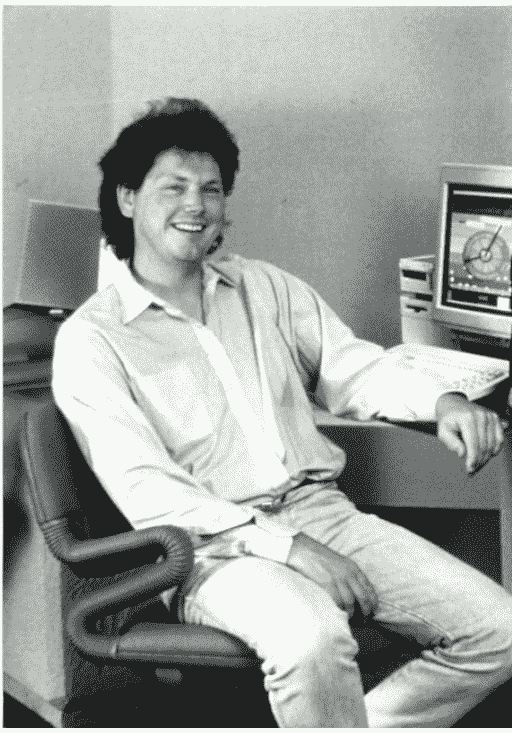

**图 6.2:** Bill Joy，~1980（由 Bill Joy 提供）

## 6.3 用户组与 Usenix

由于 AT&T 不向 Unix 许可者提供任何支持，用户被迫聚集在一起互相帮助，这最终变成了带有技术演示、软件交换和社交活动的定期会议。这种想法并非源于 Unix；第一次小组会议于 1974 年在纽约举行，用户组在世界各地涌现。

针对 IBM 系统的 SHARE 组于 1955 年建立并仍然活跃，也有针对其他硬件制造商的用户组。1979 年，Ken 和我参加了 UKUG 的首次会议，会议在坎特伯大学举行。对我来说是一次经历，这是我第一次访问英国。Ken 和我乘坐跨大西洋航空抵达盖特威机场。我们开车前往萨尔斯伯参观了巨石，然后去坎特伯参加会议（并参观了大教堂）。之后，我作为一个游客在伦敦呆了几天。

我曾去过几个国家，以小组会议为借口，这是结识人的绝佳方法。最难忘的是 1984 年和 Ken 去澳大利亚旅行，会议在悉尼歌剧举行。我在第一天早上做了一场演讲，剩下的时间里在会议室的窗外观察海港；那里太迷人了，以至于我不记得其他任何演讲了。

用户组演变成了一个名为“User Groups”的伞形组织，在 AT&T 投诉其滥用商标后，它被更名为 USENIX（从现在起称为 Usenix）。Usenix 现在运行着系列会议出版物，并出版一份名为《login》的技术期刊。Usenix 在传播 Unix 发挥了重要作用，提供了许多主题的会议演示和教程。它还分发 UUCP 并运行 Usenet 新闻系统。

## 6.4 John Lions 注释

John Lions（见图 6.3）悉尼新威尔士大学的计算机科学教授，他是 Unix 的热情早期采用者，并在操作系统课程以及 UNSW 的通用教育和研究支持中广泛使用它。

1977 年，John 对第 6 版源代码撰写了一份逐行的“注释”。源代码的每个部分都得到了详细解释，因此人们可以看到它是如何工作的、为什么是那样、以及可以如何以不同的方式进行。John 还培养了许多优秀的学生，其中几个人进入了贝尔实验室。

在原始印刷版中，《注释》分为两卷，一卷是代码，另一卷是阐述，以便它们可以并排阅读，尽管授权版本（见图 6.4），最终


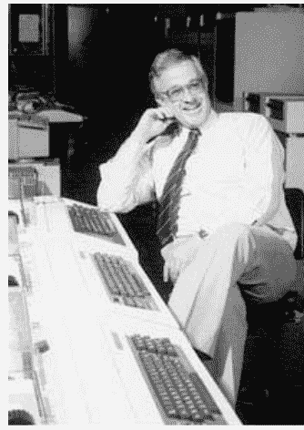

**图 6.3：** John Lions（由 UNSW 提供）

于 1996 年出版，是一个单本。

尽管它可以在 Unix 许可者之间共享，但这本书在技术上是一项贸易秘密，因为它包含了 AT&T 的专有源代码。至少在理论上，副本是经过严格控制的；我仍然保留着我的编号副本（#135）。但在早期，它被广泛抄印；图 6.4 封面上的“地下出版”（samizdat）图像暗示此类副本是秘密制作的。多年后，事实得到了承认，John 的书也了商业出版。

John 在 1978 年在马里希尔度过了一个学术年假，就在我办公室对面的房间，那间办公室后来属于 Dennis Ritchie。John 于 1998 年去世，享年 62 岁。他的贡献在 UNSW 的计算机科学教授席得到了纪念。该席由校友和朋友的捐赠资助，其中包括 Ted Dolotta 在 1998 年拍卖他的加州 Unix 牌照，该车牌由 John Mashey 购买。

Unix 源码中的一条注释由于《注释》（Commentary）而变得闻名。第 2238 行写道：

> * 不指你能理解这一点。 */

> “20 年后，这仍然是对‘真实’操作系统工作原理最好的解释。”
Ken Thompson

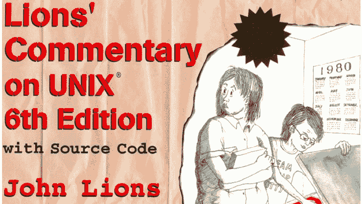

**图 6.4：** John Lions 的《第6 版 Unix 注释》

正如前面提到的，Dennis 于 2011 年 10 月去世。次年在贝尔实验室举行的一场纪念活动上，我将这条注释作为对 Dennis 致敬的核心。

Unix 内核代码是由 Dennis 和 Ken Thompson 共同编写的。据我所知，Ken 始终完全赞同良好的代码不需要很多注释的观点，因此推测，伟大的代码完全不需要注释；我认为内核中的大部分注释都来自 Dennis。你在第 2238 行找到的特定注释以其冷幽默而闻名，多年来在 T 恤等物品上广传。Dennis 本人说：

> “它经常被援用为对贝尔实验室 Unix 研究发布版注释数量或质量的贬低。我担心，通常来说这种观察并不不公平，但在这种情况下是不合理的根据的。”

如果你回去看，你会发现这条注释紧跟在一个段长得多的注释之后，该注释描述了在两个进程之间切换控制的上下文切换机制，它实际上是在试图解释一些困难的内容。Dennis 继续说道：

“不指你能理解这一点”意在表达一种“这不会出现在考试中”的意味的评论，而不是一种无礼的挑战。

我之前提到过 Nroff 和 Troff 是很难掌握的工具。《Lions 注释》感谢部分的最后一段暗示 John 会赞同：

“还必须提到 nroff 程序的协助。没有它，这些笔记永远无法以这种形式产生。然而，它如此不情愿地交出一些更神秘的秘密，以至于作者的感激之情确实是复杂的。当然，nroff 本身为为未来程序文档艺术的实践者提供一个肥沃的领域。”

## 6.5 可移植性

第 6 版 Unix 主要用 C 语言编写，并辅以有限的汇编语言来访问无法提供的机器特性，例如设置寄存器、内存映射等。同时，Steve Johnson 创建了一个 C 编译器版本，它在意义上是“可移植的”，这意味着它可以直接重新目标，以为 PDP-11 以外的架构生成汇编语言。这使得通过编译就能将 C 程序移动到其他类型的计算机上。最有趣的移植程序无疑是操作系统本身。这可行吗？

Unix 的首次移植是在澳大利亚新南威尔士州的惠灵大学由 Richard Miller 完成的；目标计算机是一台 Interdata 7/32。Miller 没有使用可移植的 C 编译器。相反，他通过修改 Dennis Ritchie 原始 C 编译器的代码生成器，引导自己到了 Interdata 上。到 1977 年 4 月，他的 Unix 版本已经可以运行并自给自足。


AT&T 提议通过将公司拆分为部分来解决局面：一部分（称为 AT&T）提供长途电话业务，另外七家区域运营公司（“婴儿贝尔”）则负责在各自的地理区域提供本地电话服务。AT&T 将保留西方电气（Western Electric），但运营公司不再需要向其购买设备。AT&T 还将保留贝尔实验室（Bell Labs）。

AT&T 与司法部关于剥离运营公司的同意法令于 1982 年初定稿，并于 1984 年 1 月 1 日生效。

剥离是一场巨大的动荡，从远来看，它给 AT&T 导致了不幸，随后 20 年的误判和错误选择让贝尔实验室不再是它在使命明确、资金充足且稳定的时的辉煌缩影。

 1984 年，贝尔实验室的一部分被拆分成立了一个名为 Bellcore（“贝尔通信研究”）的研究机构，旨在为“婴儿贝尔”公司提供研究服务。Bellcore 的拆分从贝尔实验室带走了大量研究人员，主要在通信领域，还有一些来自 1127 部门的同事，包括 Mike Lek 和 Stu Feldman。在某个时刻，“婴儿贝尔”决定他们不需要 Bellcore 提供的那种研究，Bellcore 被另一家公司 SAIC 收购并更名为 Teledia，最终被瑞典公司爱立信（Ericsson）收购。

1984 年也是“Bell Labs”变为“AT&T Bell Laboratories”的一年，因为作为同意法令的一部分，AT&T 除这种特殊情况外，不允许使用“Bell”这一名称，且必须以“AT&T”作为前缀。我们被强烈鼓励始终使用全称。

## 7.2 USL 和 SVR4

剥离后，AT&T 无法或至少是不愿出售 Unix，这让公司内部一个在组织架构上脱离了研究部门（Research）的部分投入了重大的商业努力。该部分在物理位置上也有程度的疏远，位于新泽西州萨米特（Summit）附近的一栋建筑内；被繁忙的高速公路包围，非正式地被称为“高速公路岛”。该组织最初名为 Unix 支持小组（USG），最终变成了 Unix 系统实验室（USL）。第一代 USG 由 Berk Tague 在 1973 年创立，专注于运营支持系统。随着时间推移，USG 将其活动扩展到外部服务和市场营销。

Unix 确实有一个市场；人们甚至可以说，AT&T 无意中通过将 Unix 送给学生创造了这个市场，当这些学生进入现实世界并为那些付得起真金白购买它的公司工作时，他们想要它了。从 1984 年开始，USL 积极推销 Unix，并努力使其成为一个专业的商业产品。结晶就是 System V Release 4 版本，或 SVR4。AT&T 投入了大量资源使该版本标准化，并对源代码和目标文件的兼容性进行了参考实现和仔细的定义。我认为这种对标准和互操作性的关注是非常重要的。

SVR4 的细节在不断演变，AT&T 与合作者和竞争对手之间的互动变得非常复杂且无趣。我不打算谈论这些，因为在某种意义上，这些都是毫无意义的：行业重心几乎完全转向了 Linux。Wikipedia 关于 System V 的词条这样准确地总结了这种情况：

> “分析师通常认为，专有 Unix 已进入了一个缓慢但永久的衰落期。”

当然，关键词是“专有”；像下一章描述的 BSD 家族等开源版本仍然生机勃勃。

AT&T 的产品线包括操作系统和各种支持软件，包括 C、C++、Fortran 甚至 Pascal 的编译器，这些大多基于 Steve Johnson 的可移植 C 编译器。还有一项重大的标准化工作，以确保库中源代码和二进制格式的兼容性。

在此时，我担任了 Bjarne Stroustrup 的部门主管，这意味着需要经常与 USL 就 C++ 的演进进行交流。在大多数情况下，这些交流是友好的，但偶尔也会看到研究与产品管理之间不同优先事项冲突。1988 年与一位 USL 经理的一次激烈讨论大体如下：

经理：“你必须修复 C++ 编译器中所有的 bug，但你不能以任何方式改变行为。”

我：“这是不可能的。根据定义，如果你修复了一个 bug，行为必然会发生变化。”

经理：“Brian，你不明白。你必须修复 bug，但编译器的行为不能改变。”

在学理上我是对的，但在实践中，我能理解经理的意图——对于那些使用新语言和工具进行软件开发的人来说，过快或过度的变化是一个严重的问题。

USL 在日本成立了一家名为 Unix Pacific 的子公司，经理是 Larry Crume，他是多年前贝尔实验室的同事，对研究小组的许多人都很熟悉。这导致了技术合作，我曾公司出资访问了两次日本。在其中一次行程中，与日本主要的电信公司 NTT 有了某种愉快的交流，当时可以非常清晰地看到等级的森严。执行董事可以和他的 NTT 对应人员一起打高尔夫球。像我这样低级的部门主管被提议去东京购物，我拒绝了。

尽管 AT&T 将 Unix 商业化的努力并不总是成功的，但 Unix 的标准化对整个社区来说都是价值无价的。研究部门与 USL 的努力之间偶尔会有紧张关系，但在大多数情况下，USL 有一群才华横溢的同事对 Unix 相关相关系统做出了巨大的贡献。

## 7.3 UNIX

在 Unix 生命的早期，贝尔实验室的法律守护者认为该名称是一个必须保护的价值商标，以避免该名称变成通用术语而被任何人使用，就像阿司匹林、电梯、拉链等词发生的情况一样。特别是，它不能作为独立名词使用（“Unix 是一个操作系统”）。它必须在“the UNIX operating system”短语中被识别为大写的形容词。这种笨拙的措辞令人痛苦，尤其是对于那些认真对待写作的人来说，因此有一些通通方法和偶尔规避该问题的尝试。例如，在标准的 Troff ms 中，Mike Leslie 询问了一个格式命令，该命令在任何地方使用都会展开为“UNIX”，并在首次出现的第一页自动生成脚注。通常情况下，脚注是

† UNIX 是贝尔实验室的商标。

但如果使用未记录的参数使用该命令，它将改为打印：

† UNIX 是贝尔实验室的脚注。

我不认为有人注意到过这个彩蛋，但代码仍然存在于 marco 宏包中。Unix 一词用于商品和其他服务的其他用法与操作系统无关，例如图 7.1 中的笔、图 7.2 中的公文包以及图 7.3 中的灭火器。它们似乎似乎都在美国境外，因此超出了美国商标法的管辖范围；那些公文包是 1941 年的，在 Ken 和 Dennis 出生之前。另一个有趣的例子是 Drypers 公司的 Unix 尿尿布，他们想出“Unix”是“unisex”（性别通用）的缩写。


图 7.1：Unix 笔（由 Arnold Robbins 提供）


# 第7章：商业化

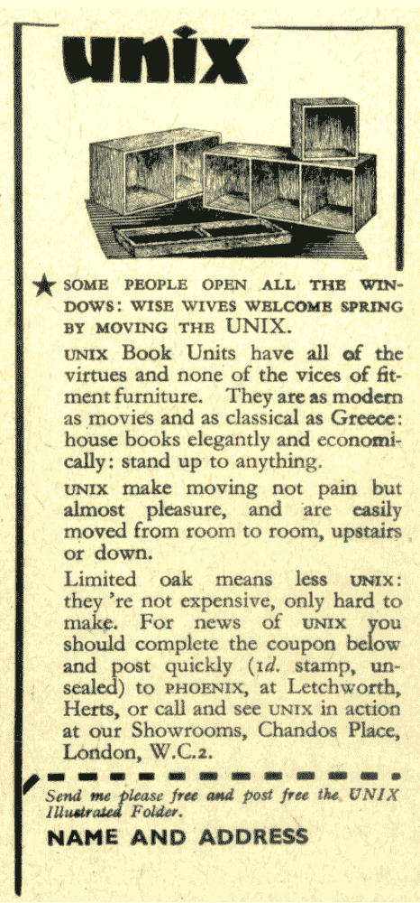

有些人打开了所有的窗户：贤妻通过搬动 UNIX 来迎接春天。

UNIX 书柜（Book Units）拥有家具的所有优点，而没有任何缺点。它们像电影一样现代，像古希腊一样经典：优雅且经济地存放书籍：经得起任何考验。

UNIX 让搬动从痛苦几乎变为快乐，并且很容易在不同房间之间移动，无论是上楼还是下。

有限的橡木意味着更少的 UNIX：它们并不昂贵，只是制作困难。要获取 UNIX 的消息，请填写下方优惠券并快速邮寄（盖邮戳，无标记）至 PHOENIX, at Letchworth, Herts，或致电访问我们位于伦敦 Chandos Place, W.C.2 的展厅，查看 UNIX 的运行情况。

请免费寄给我并免费邮寄《Unix 插图册》。

姓名和地址

**图 7.2：** Unix 组合式书柜，1941（由 Ian Utting 感谢）

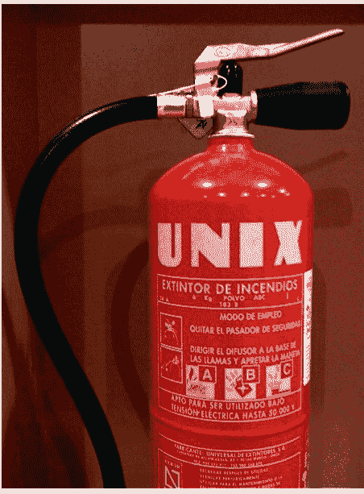

**图 7.3：** 一台 Unix 火灭器

“大人物”。例如，1980年，我为《电视指南》的创始人 Walter Anenenberg 做过演示（他从那里赚了钱，这可能帮助他成为了圣詹姆斯宫廷的大使，但当我向他展示 Unix 的奇之处时，那个职位已经结束了）。作为对他身份重要性的衡量，贝尔实验室（Bell Labs）主席 Bill Baker 陪同了他。

我的个人特色通常涉及管道（pipes）的演示，展示程序如何流畅地组合以快速完成广告任务。我使用一个 shell 脚本来查找文档中潜在的拼写错误，因为它是一个长管道的简洁示例，并有助于说明如何以新的方式组合现有程序。

拼写检查脚本（spell script）源于 Steve Johnson。基本思想是将文档中的单词与字典中的单词进行比较。任何在文档中出现但在字典中不存在的单词都可能是拼写错误。该脚本看起来大致这样：

```
cat document |
tr A-Z a-z | # 转换为小写
tr -d '.,;())!' | # 删除标点符号，...
tr ' ' ' ' '\n' | # 将单词分成行
sort | # 对文档单词排序
uniq | # 消除重复
comm -1 - dict | # 打印输入中找到但
                                #不在字典中的行
```

所有这些程序已经存在了；`comm` 最不寻常，用于查找两个排序后的输入文件的公共行，或者存在于一个输入文件但不同时于另一个的行。`/usr/dict/web2` 是《韦伯第二版国际词典》中的单词，每行一个，我们之前看到过它。

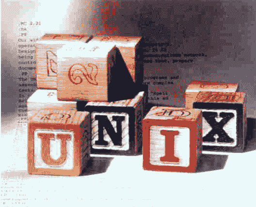

**图 7.4：** Unix 积木，~1980（由贝尔实验室感谢）

有一天，我计划为 William Colby 做演示，他当时是中央情报局（CIA）局长，因此显然是一个重要人物。Bill Baker 将陪同他，作为总统外国情报顾问委员会的主席，他自己也拥有深厚的“特工”背景。

我想说明 Unix 如何实现某些类型的编程，但拼写检查脚本运行并不快，我不希望演示拖得太久。于是我提前运行了脚本，将输出捕获到一个文件中，然后写了一个新脚本，该脚本只需睡眠两秒，然后打印昨天计算出的结果：

```
sleep 2
cat previously.computed.output
```

这种演示工程技巧效果很好；如果他真的理解了，Colby 先生一定认为拼写检查运行得足够快了。当然，对于每个坐过演示的人来说，这里都有一个教训：警惕你所看到的东西！

公关活动还制作了宣传电影，讲述了贝尔实验室的奇之处，其中一个片段就展示了 Unix。多亏了 YouTube，我可以看到老朋友们（以及我自己）年轻时的样子，在很多情况下，我们的头发更密、更黑。

UNIX 甚至有过一段短暂的纸质广告。我想图 7.4 广告中的儿童积木是我的主意，无论好坏。背景在这里太难看了，那是我提供的 Troff 文档。

# 第 8章

# 后裔

> “……从简单的开始，最美、最奇妙的形式已经演化，并且正在演化。”
> 查尔斯·达尔文，《物种起源》，第14章，1859年

Unix 起于1969 年的计算机科学研究中心。当时有像 PWB 这样的内部版本，支持程序员工作站工具；当然，从 1975 年开始，外部版本也出现了，最初基于第 6 版，后来又基于 1979 年出现的第 7 版。

第 7 版是最后一个发布并广泛使用的 Unix 研究版本。内部又开发并使用了三个版本（即第 4、5 和 6 版）。第 7 版是第一个分发给加利福尼亚大学伯克利分校的版本，这导致了伯克利软件发行（BSD）的诞生。

BSD 变体最终在功能上超过了原始的研究 Unix。到 20 世纪 80 年初，BSD 是大学和工业界主导的 Unix 版本。这导致了包括 Linux 在内的许多其他类 Unix 系统的开发。

Unix 的遗产今天无处不在。从我们口袋里的智能手机到驱动互联网的服务器，Unix 的原则继续塑造着我们的世界。

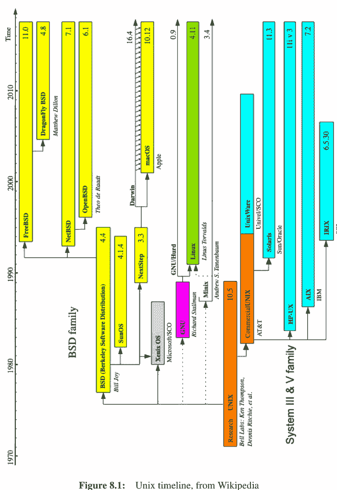


微软曾推动 Xenix 而非自己的 MS-DOS，而且显然当时与 AT&T 打交道反而更容易。根据 Unix 遗产学会（Unix Heritage Society），圣塔克鲁运营公司（SCO）后来收购了 Xenix，在 20 世纪 80 年代中后期，根据安装机器的数量计算，它是最常见的 Unix 变体。

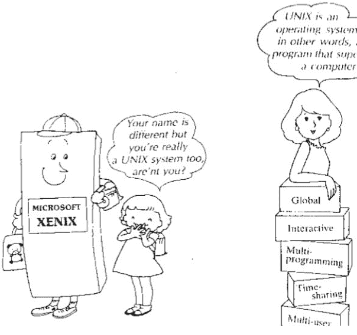

图 8.2：Xenix：微软版本的 Unix

## 8.2 Unix 战争

20 世纪 80 年代后期，存在许多 Unix 系统供应商，它们都使用该商标名称，并提供的软件最初至少是基于贝尔实验室的第 7 版。它们之间存在不兼容性，特别是 AT&T 的 System V 与伯克利（Berkeley）发行版之间。双方都认为拥有一个共同标准是非常理想的，但对于标准具体是什么，自然上存在分歧。

X/Open 一个行业联盟于 1984 年成立，旨在创建一个标准的源代码环境，以便程序可以在任何 Unix 类系统上编译，而无需在更改代码的情况下重新编写。

AT&T 和一些盟友成立了自己的小组。Unix International 为了颁布他们的标准，与一个名为“开放软件基金会”（Open Software Foundation）的组织的不同标准进行竞争。结果是？两个相互竞争且不同的“开放”标准。最终双方达成了和平，产生了一个名为 POSIX（可移植操作系统接口）的标准，用于基础库函数；以及一个由 X/Open 管理的“单一 Unix 规范”（Single Unix Specification），在两者之间标准化了库、系统调用以及大量常用命令（包括 shell、Awk、ed 和 vi）。

1992 年，USL 和 AT&T 就 Unix 的知识产权问题发起了诉讼，声称伯克利未经许可使用了了 AT&T 的代码。伯克利对 AT&T 的代码进行了许多修改，并添加了自己的宝贵材料，包括让互联网变得可访问的 TCP/IP 代码。

伯克利继续删除并重写来自 AT&T 的代码，并在 1991 年发布了一个 Unix 版本，感觉上没有包含任何 AT&T 的私有材料。然而，AT&T 和 USL 并不认可，这导致了诉讼。经过多次周旋，案件在纽泽州的一法法院得到审理，伯克利胜诉，部分原因是 AT&T 未能在其分发的代码上放置正确的版权声明。

如果这一切听起来既复杂又无聊，你是对的，但在当时这是一件大事，双方都浪费了大量的时间和金。1991 年，AT&T 将 USL 的股份卖给了 11 家公司，1993 年诺瓦公司（Novell）购买了 USL 和 Unix 的权利。诺瓦首席执行官雷·诺尔达（Ray Noorda）决定解决所有剩余的法律案件，也许他意识到相关方在律师身上花费的钱超过了他们通过销售能收回的资金。

回想起来，我想可以说所有的法律纠纷都是 AT&T 早期且几乎是偶然决定向大学开放 Unix 的副作用。随着 Unix 从大学的免费使用扩展到愿意付费的机构，它在商业上变得具有可行性，或者至少具有这种可能。但对于有效的保护来说这已经太晚了。即使 AT&T 的源代码受到限制，系统调用接口实际上处于公共领域，而且社区中拥有如此丰富的知识，以至于创建不受 AT&T 许可限制的版本几乎成了家常便饭。编译器、编辑器和所有工具等应用程序软件也是如此。用几个比喻来说，AT&T 试图在皇冠宝石逃脱后才关上谷门。

## 8.3 Minix 和 Linux

随着 AT&T 试图从软件中赚钱，其 Unix 许可变得变得越来越严格。这包括对 Unix 在大学中用方式的限制，这为没有此类限制的 BSD 赋予了优势。与此同时，AT&T 与 BSD 之间持续的战争鼓励了其他人尝试构建他们自己的 Unix 类系统。独立创建的版本不受商业限制的限制，因为它们只使用了系统调用接口，而没有使用别人的代码。

1987 年，在阿姆斯特丹自由大学，安迪·塔能鲍（Andy Tanenbaum）创建了 Minix，这是一种类 Unix 系统，在系统调用级别兼容，但完全从零开始编写，具有不同的内核组织结构。

Minix 相对较小，为了帮助它的传播，安迪写了一本关于它的教科书，在比喻上类似于十年前的《狮子书》（Lions book）。Minix 源代码是免费提供的——其中一本书附带了大约十几张软盘，可以加载到 IBM PC 上以提供运行的系统。我仍然留着安迪那本书的第一版，我可能还有我的 Minix 软盘。

Minix 在今天仍然活跃良好，它是教育和实验操作系统的载体。

AT&T 限制性许可的结果之一，结合 Minix 作为指南可用，导致一名 21 岁的芬兰大学学生独立开发了另一个在系统调用级别兼容的 Unix 类系统。1991 年 8 月 25 日，林斯·托瓦尔斯（Linus Torvalds）在 Usenet 新闻组 comp.os.minix 上发布了一项内容，如图 8.3 所示。

林斯并没有预料到他的爱好系统的辉煌未来，正如 Ken 和 Dennis 没有预料到 Unix 的成功那样。最初的几千行代码现在超过了 2000 万行，由托瓦尔斯（图 8.4）担任主要开发者。托瓦尔斯还是 Git 的广泛使用的版本控制系统的创建者。

然而，对于笔记本电脑和台式电脑来说；大多数运行 Windows，其次是 macOS。

作为一个现代的旁白，是否可以对像 C 标准库或系统调用这样的编程接口进行版权保护，现在是 Oracle 和 Google 之间一场似乎无休止的诉讼的中心。Oracle 在 2010 年收购了太阳系统公司并在那些时候起诉 Google，声称 Google 在 Android 手机未经许可使用了 Oracle 受版权保护的 Java 接口。Google 赢得了此案，法官裁定专利无效且 Java API（应用程序接口）不受版权保护。

Oracle 提出上诉，最终进行了新的审判。Google 再次获胜，但这次法院裁定 Oracle 胜诉。Google 向最高法院申请在那里提交案件的权利，希望解决关于 API（而非实现！）是否可以受版权保护并防止其他方使用接口规范来创建相似系统的问题。


## 第8章：后裔


**图 8.4：** 2014年的 Linus Torvalds（维基百科）

声明：我已经在谷歌方面签署了若干份法庭意见书，因为我不认为 API 应该受到版权保护。如果它们真的受版权保护，那么我们根本不会有任何 Unix 的类品，包括 Linux，因为它们都是基于对 Unix 系统调用接口的独立实现。我们可能也不会有像 Cygwin 这样的包（Cygwin 是 Unix 实用程序的 Windows 实现，为 Windows 用户提供了类 Unix 的命令行界面）。事实上，我们不会对任何可能被那些声称所有权的公司所限制的接口拥有许多独立实现。

在我写这句话时，最高法院尚未决定是否审理此案。拭目以待，因为一旦法院做出了决定，除非会明确地修改法律，否则就无法改变。当然，谁知道其他国家会发生什么呢。

## 8.4 Plan 9

到20世纪80年代中后期，1127 的 Unix 研究正在放缓。广泛发行并作为大多数外部版本基础的第七版已于1979年发布。第八版于六年后的1985年出现，第九版于1986年出现，第十版（即最后一个研究版本）于1989年完成，尽管它并未向外分发。

人们认为 Unix 是一个成熟的商业系统，不再是操作系统研究的合适载体。一小群——Ken Thompson、Rob Pike、Dave Presotto 和 Howard Tricky——聚集在一起开发了一个全新的操作系统，他们根据1959年的科幻电影《外星比9号计划》（Plan 9 from Outer Space）将其命名为来自贝尔实验室的 Plan 9。（电影《外星比9号计划》被誉为有史最糟糕的电影——诚然这是一场激烈的竞争——尽管有些电影觉得它坏到极点以一种扭曲的方式变得好看了）。

Plan 9 操作系统试图吸收 Unix 中的优秀想法并将其进一步推向。例如，在 Unix 中，设备是文件系统中的文件。在 Plan 9 中，更多的数据源和汇点也是文件，包括进程、网络连接、窗口系统屏幕和 shell 环境。Plan 9 从一开始就目标是可移植性，拥有单一源代码，可以为任何支持的架构进行编译。Plan 9 的另一个显著特性是它对分布式系统的支持。不同架构的不相关系统上的进程和文件可以协同工作，就像它们在同一个系统中一样。

Plan 9 于1992年提供大学，并在几年后公开发供商业使用，但除了极少数爱好者社区外，它现在已不怎么使用。主要原因可能是 Unix 和日益增长的 Linux 拥有如此动力，对于大多数人来说，没有足够的理由去切换系统。它没有流行的另一个较小原因可能是因为 Plan 9 的机制采取了某种“普罗克鲁斯式”（Procrustean）的方法，在很多情况下比 Unix 的同等物更好，而且没有过多尝试提供兼容性。例如，Plan 9 起初并不提供标准 I/O 库 stdio，而是使用一个名为 bio 的新库。Bio 比 stdio 更整洁、更规范，但由于没有标准库，将程序转换为同时在 Unix 和 Plan 9 上运行需要花费大量精力。同样，还有一个新版本的 Make Mk，它在许多方面更优，但它是不兼容的，因此现有的 Makefile 必须重写。

虽然有转换机制，且 Howard Tricky（图 8.5）移植了 stdio 等许多关键库，但尽管如此，对于潜在用户（包括我在内）来说，这太费精力了。因此 Plan 9 无法直接从 Unix 软件中获益，它的创新难以进入主流 Unix 世界。

然而，Plan 9 为世界贡献了一个极其重要的东西：Unicode 的 UTF-8 编码。

Unicode是一项持续的，为人类使用过的所有字符提供单一的标准编码。包括

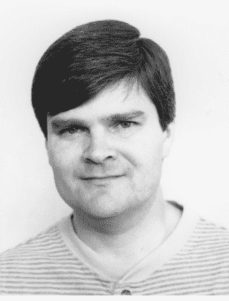

**图 8.5：** Howard Tricky，1981（由 Gerard Holzmann 提供）

大多数西方语言的字母文字，也包括像中文这样的表意文字、像楔形字的古代文字、各种类型的特殊字符和符号，以及最近发明的表情符号。Unicode 最初是一个 16 位字符集，足以容纳所有字母文字以及大约 30000 个中文字符。但在大多数计算机文本都是 ASCII（7位集）时，将世界转换为 16 位字符集是不行的。

Ken Thompson 和 Rob Pike 为 Plan 9 苦恼于这个问题，因为他们已经决定 Plan 9 全面使用 Unicode 而非 ASCII。1992年9月，他们提出了 UTF-8，一种 Unicode 的的变长编码。UTF-8 在空间和处理时间上都非常高效。它将每个 ASCII 字符表示为一个字节，并仅使用两个或三个字节。UTF-8 紧凑且与 ASCII 兼容。


## 第 9 章
# 遗产

> “Unix 不仅是对其先驱的改进，对它的所有继者也是如此，”

Doug McIlroy，2011 年丹尼斯·里奇日本奖颁奖典礼上的演讲，对 Tony Hoare 关于 Algol 的说的转述

Unix 取得了巨大的成功。作为 Unix、Linux 或 macOS 或其他变体，它运行在数十亿计算机和服务器上，被数十亿的人持续使用，并为无数在其基础上构建的人创造了数十亿美元的财富（尽管没有考虑到它的任何创造者）。后来的操作系统深受其决策的深远影响。

最初在贝尔实验室为 Unix 开发的语言和工具现在无处不在。在编程语言中，C 和 C++ 仍然是系统编程的骨干，还有像 Awk 和 AMPL 等更专门的语言。核心工具包括 shell、diff、grep、Make 和 Yacc。

GNU（“GNU's not Unix”的递归缩写）是一个基于 Unix 模型的大型软件集合，以源代码的形式免费提供给任何人使用：它提供了 Unix 提供的几乎所有功能，以及更多内容。与 Linux 操作系统结合，GNU 就等于一个免费版本的 Unix。GNU 的 Unix 命令实现是开源的，因此它们可以被使用和扩展，唯一的限制是如果分发这些实现，必须免费提供给所有人；它们不能是私有的。今天的大量软件开发都是基于开源的，在许多情况下基于 GNU 的实现。

是什么导致了 Unix 的成功？是否有可以学习并应用到其他环境中的思想或教训？我认为答案是肯定的，至少在两个方面：对某些人来说是技术上的，也是如此。

## 9.1 技术

Unix 重要的技术思想在前几章中已经讨论过；本节是简要总结。当然，这里并不是一切都源于 Unix；肯·汤普（Ken Thompson）和丹尼斯·里奇（Dennis Ritchie）的天才之处在于他们对优秀想法的巧妙挑选，以及他们能够看到简化软件系统的通用概念或统一主题。人们有时用编写的代码行数来讨论软件生产力；在 Unix 世界，生产力通常通过删除的特例数量或代码行数来衡量。

分层文件系统是对现有做法的一次重大简化，回想起来它似乎完全显而易见——你还能怎么做呢？与其由操作系统管理属性的不同类型文件，以及对文件在目录嵌套深度的任意限制，Unix 文件系统提供了一个直观的视图：从根目录开始，每个目录都包含文件信息，或者包含进一步文件和目录信息的目录。文件名简单就是从根目录开始路径路径组件由斜杠分隔。

文件包含未解释的字节；系统本身并不关心字节是什么，也不知道关于它们含义的任何信息。

通过六个系统调用即可创建、读取、写入和删除文件。几个位定义的访问控制对于大多数目的都是够的。像移动式磁盘等整个存储设备可以挂载到文件系统中，在逻辑上，内容在那时变成了文件系统的一部分。

自然地，存在一些不规则之处。设备出现在文件系统中，这是一种简化，但对它们的操作（特别是终端）有特例，且其接口在今天仍然很混乱。

我在这里描述的是文件系统的逻辑结构。实现这种模型有很多方法，事实上，现代系统支持许多不同的实现，它们呈现出相同的接口，但使用不同的代码和内部数据结构来运行。如果你查看你的电脑，你会看到多个使用这种模型的设备：硬盘、USB 闪盘、SD 卡、相机、手机等。Unix 的卓越之处在于选择了一种足够通用且极其有用，但在性能上又不会昂贵的抽象。

一种高级实现语言，当然是用于用户程序，也用于操作系统本身。这个想法并不新；它在 Multics 和一些更早的系统中尝试过，但当时和语言还没有准备好。C 比它的先驱合适得多，它导致了操作系统的可移植性。曾经是硬件制造商的专有操作系统（通常带有它们自己的专有语言），Unix 变成了一个开放且广泛理解的标准，然后变成了一种商品；该系统只需经过微更改即可在所有计算机上运行。客户不再被锁定在特定的硬件上，制造商不再需要开发自己的操作系统或语言。

用户级可编程的 shell 具有控制流语句和 I/O 重定向，使得使用程序作为构建块进行编程成为可能。随着 shell 编程能力的增长，它变成了程序员工具箱中的另一种高级语言。正因为它是一个用户级程序，而不是操作系统的一部分，因此它可以被任何有更好想法的人改进和替换。从原始 Unix 经过 PWB、Bourne shell 和 Bill Joy 的 csh 的演变说明了今天的泛化，当然也存在一些缺点——不兼容的版本增殖得太容易了。

管道（Pipes）是 Unix 最经典的发明，是使用程序临时连接的一种优雅且高效的方法。通过一系列处理步骤进行数据式传输是自然且直观的，其语法异常简单，而且管道机制与小工具集合完美契合。当然，管道并没有解决所有的连接问题，但 Doug McIlroy 原始概念中完全通用的非线性连接在实践中并不常见；线性流水线几乎总是足够的。

将程序视为工具并在组合中使用它们是 Unix 的特征。编写每个只良好做好一件事的小程序，而不是试图做很多事情的大型单体程序，有许多益处。无疑，在某些时刻单体是有意义的，但小程序有很大的优势。实际上，这种方法是在整个程序层面的模块化，与函数层面的模块化并列。

普通文本是标准格式。文本的广泛使用证明是一个巨大的简化。程序读取字节，如果它们意图处理文本，那么这些字节将以标准表示存在，通常是不同长度的行，每行都以换行符结束。这并不适用于一切，但几乎任何内容都可以以很小的空间或时间代价使用这种表示。很有趣的是，如果 Unix 是在一个在使用打孔卡而不是电打字机的世界开发的，事情可能会有多大的不同。打孔卡实际上强迫了一种世界观，即一切都以 80 字符块的形式出现，信息通常位于固定字段中。

编写程序的程序是一个强大的想法。我们在计算领域取得的很大进展都是通过机械化——让计算机为我们做更多的工作。手写程序是困难的，所以如果你能让一个程序为你写程序，那是一个巨大的胜利。这样更容易，而且生成的程序更有可能是正确的。

编译器当然是一个老例子，但在更高层次上，Yacc 和 Lex 是生成代码创建编程语言的极佳例子。自动化和机械化工具（如 shell 脚本和 makefile）实际上是创建程序的程序。这些工具今天仍在使用，有时以非常大的配置脚本和makefile 生成器的形式存在，伴随着使用 Python 和 GCC 等编译器的语言源码分发。

专门的语言，今天通常被称为小语言、领域特定语言（DSL）或应用特定语言（ASL）。我们使用语言来告诉计算机做什么。对于大多数程序员来说，这意味着像 C 这样的通用语言，但有一系列更专门的语言，关注更窄的领域。shell 是一个很好的例子：它是为了运行程序设计的，并且在这方面做得出色，但你不会想用它来写浏览器或游戏。专门化是一个老观念，当然；最早的高级语言针对特定目标，如 Fortran 针对科学和工程计算，Cobol 针对商业数据处理。过早尝试太广泛的适用范围的语言有时会失败；PL/I 就是一个例子。

Unix 拥有悠久的特殊用途语言传统，远超 shell。我心心贴近的文档准备工具是很好的例子，计算器、电路设计语言、脚本也是如此。


## 第9 章：传承

各种语言，以及无处不在的正则表达式。之所以有这么多语言，原因之一是开发了让非专家也能创建语言的工具。Yacc 和 Lex 就是这里的主要例子，它们本身就是专门的语言。

当然，并不是所有语言都非得是高科技才有用。Steve Johnson 在一个晚上晚上就构建了 *at* 的第一个版本：

> “Unix 有种方法可以在‘非工作时间’调度任务运行，这样长时间的任务就不会干扰人们的工作（记住，当时有十几个人共用一台 Unix 机器）。要让一个任务在稍后运行，你需要编辑系统文件并在一种相当晦涩的格式中填写信息表。有一天，我正在尝试这样做，听到自己在喃喃道：‘我想让这个任务在凌晨 2 点运行。’突然，我意识到这些信息可以用一个简单的语法来捕捉：‘at 2AM run_command’。我在几个小时内拼凑出一个版本，并在第二天早晨在‘今日事消息’文件中发布了它。”

*at* 命令在 40 多年后仍然在使用，且变化并不大。与其他许多语言一样，它的语法是一种基于我们口语表达的风格化英语。

Unix 哲学——一种编程风格，一种处理任务的方法——由 Doug McIlroy 在 1978 年 7 月《贝尔实验室技术期刊》关于 Unix 的特刊的序言中进行了总结：

- (i) 让每个程序只做好一件事。要加入一个新任务，应从零构建，而不是通过添加新“功能”来使旧程序复杂化。
- (ii) 期望每个程序的输出都能成为另一个尚未知的程序的输入。不要用无关信息扰乱输出。避免使用严格的列式或二进制输入格式。不要强求使用交互式输入。
- (iii) 设计并构建软件（即使是操作系统）以便尽早尝试，理想情况下在几周内。不要犹豫丢弃笨拙的部分并重新构建。
- (iv) 优先使用工具而非不熟练的帮助来减轻编程任务，即使你可能得绕路去构建工具，并在完成后将其中的一些丢弃。

这些是编程的准则，尽管并不总是能被遵守。一个例子是：我在第 3 章中提到的 *cat* 命令。那个命令只做一件事：将输入文件或标准输入复制到标准输出。

今天，GNU 版本的 *cat* 有（我不是在编造）12 个选项，用于如标记行号、显示非打印字符和删除重复空行等任务。所有这些都可以用现有程序轻松处理；没有任何一个与复制字节的核心任务有关，而且让一个基础工具复杂化似乎是适得其反。

Unix 哲学无疑没有解决所有的编程问题，但它为系统设计和实现提供了有用的指南。

## 9.2 组织

我相信，Unix 成功的另一个大因素归功于非技术因素，例如贝尔实验室的管理和组织结构、1927 年的社会环境，以及在协作环境中处理不同问题的才华横溢者的思想流动。这些作为技术概念较难评估，因此这无疑是一个更主观的观点。与上一节一样，这些大部分在之前已经提到过。

稳定的环境至关重要：资金、资源、使命、结构、管理、文化——一切都应该是一致且可预测的。正如第 1 章描述的，贝尔实验室的研究是一个具有悠久历史和明确使命的大型公司内部大型开发组织内的一项大型业务：通用服务。贝尔持续改进电话服务的长期目标意味着研究人员可以长时间（甚至几年）探索他们认为重要的想法，而无需每几个月就证明一次他们的努力。当然，有监督，任何在某个项目上工作几年而没有产生成果的人都会被鼓励做出改变。偶尔有人会离开研究领域或完全离开公司，但在我 15 年的管理生涯中，我只记得少数案例。

资金是有保障的，工作层的研究人员不需要考虑钱，当我担任部门主管时，这也不关我的事。无疑在某些层面上我们会担心这些事情，但那是做研究的人的事。没有提案，没有季度进度报告，在开始某工作之前不需要寻求管理批准。在我担任部门主管的某个时候，我确实开始需要对部门活动生成半年报告，为此我要求每人提供一段话。然而，这些收集仅用于获取信息，而不是为了评估绩效；偶尔期间差旅会被审查得更仔细——我们可能被限制为每年参加一或两次会议——但在大多数情况下，如果我们需要购买设备或旅行，资金是可以获取的，无需过多质问。

充满问题的环境。正如 Dick Hamming 所说，如果你不处理重要的问题，你可能做不出重要的工作。你接触的任何主题都有可能变得重要并与 AT&T 的使命相关。计算机科学是一个新领域，在理论和实践方面都有大量的想法可以探索，而理论与实践的相互作用尤为丰硕。语言工具和正则表达式就是很好的例子。

在 AT&T 内部，计算机的使用正在爆发，Unix 就是其中的一部分。我们的研究人员鼓励在期刊上发表论文，参加会议并与学术界合作。这是一个人才的源泉，让我们能够跟上领域的最新动态。我们还派遣研究人员去许多大学休假，这是招聘和在大学度时光的一种极方法。例如：Ken Thompson 在伯克利待了一年，Rob Pike 在斯坦福待了一年，Doug McIlroy 在牛津待了一年。我们还利用研究人员作为招聘者，而不是专业的职业生涯招聘者。从事自己研究的人可以与教师和学生进行技术交流，并总能学到有用的东西，给公司留下良好的印象。

与大学的关系倾向于长期。我在匹兹堡的卡内基·梅隆大学至少担任了至少 15 年的招聘员。每年两次，我在 CM 呆几天，与计算机科学教授讨论他们的研究，并与可能在贝尔实验室工作的学生交流。通过这种方式，即使他们没有加入实验室，我也结了好朋友。

技术管理。贝尔实验室研究的管理从顶到端都是技术性的，因此他们对自己和他人的工作有坚实的理解。部门主管被要求详细了解他们的人在做什么，不是为了争论它有多伟大，而是为了能够向他人解释并帮助建立联系。至少在 1927 年没有领地之争；这是一个合作且非竞争的环境，管理支持人们，经常协作，且从不竞争。我不确定这是否是一个普遍


# 第 9 章：传承

经验虽然重要，但它是值得追求的，而且良好地完成应该是管理人员奖励机制的一部分。

尽管贝尔实验室（Bell Labs）的管理层在各个层面上都是值得认可的，但 AT&T 的高层管理似乎脱离了新技术，对变化的适应缓慢。例如，在 20 世纪 90 年代初，当时 1127 主经理 Sandy Fraser 告诉 AT&T 的高管，网络技术的改进意味着长途费用可以从目前的每分钟十分分下降到每分钟一分，但他遭到了冷笑。今天的价格已经接近每分钟零分；Sandy 太太保守了。

**协作的环境。** 贝尔实验室的规模和体意味着对于几乎任何技术领域，都有多位专家，他们通常是该领域的世界领袖。此外，这种文化具有强烈的合作性和乐于助人的精神。致电某人的办公室寻求帮助是完全的标准程序；大多数情况下，被请求的人会放下手头工作来提供协助。那里还有一个极佳的技术图书馆，24 小时开放，订阅了大量期刊，并可以对其他图书馆进行远程访问；它等同于大学图书馆，但侧重于科学技术。

对于 1127 的许多人来说，最相关的专家聚集地是数学研究中心，那里有极其非凡的数学家，包括 Ron Graham、Mike Garey、David Johnson、Neil Sloane、Peter Shor、Andrew Odlyzko 等——名单还在不断增加。John Tukey（可以说是当时世界上最顶尖的统计学家，顺便还是发明了“bit”（比特）一词的人）就在走廊对面，数学和通信的几乎任何方面都有令人敬畏的专家。例如，我现在的普林斯顿的同事 Bob Tarjan（他于 1986 年获得图灵奖）就在数学中心。

他们总是准备着提供帮助，而不仅仅是技术事务。例如，Ron Graham 不仅是一位卓越的数学家，还是一个出色的杂技专家，曾任国际杂技协会主席；他甚至在办公室里装了一个网，用来在杂技球落地前接住它们。Ron 过去说他可以在 20 分钟内教任何人学会杂技。我担心在我身上这并不成立，但一小时的一对一指导（在他的办公室里！）确实让我过了关，我至今还留着他给我的练习用的曲棍球球。

**乐趣。** 享受你的工作和同事是非常重要的。1127 几乎总是一个令人向往的地方，不仅是为了工作，更是为了那种成为一个卓越群体一员的精神。由于当地除了公司食堂外没有其他餐饮选择，午餐提供了社交和技术讨论的混合场所。虽然 Unix 一群人通常在下午 1 点吃饭，但有一群更大规模的人常在上午 11 点吃饭。讨论的话题涵盖了从大到小的技术想法到毫无保留的政治讨论等所有内容；这些讨论通常会在绕着贝尔实验室场区散步时继续。

中心成员之间会互相恶作剧，并可能在反制任何大公司中不可避免的官僚主义时获得了某种过分的快乐。我们本应提供的各种形式和程序进一步提供了更多机会。

例如，安保人员会对违反某些规则的卡片贴条。某春天的一天，Mike Fisk 发现了一张空白条，他把它放在同事汽车的挡风玻璃上，违规项目列为“未在 4 月 1 日前拆雪架”。那位同事（在此不具名）实际上因为这个玩笑被带留了好几个小时。

到为止，最复杂的恶剧是针对 Arno Penzias 的，由 Rob Pike 和 Dennis Ritchie 领导的至少十二人团队实施，并在专业魔术师 Penn 和 Teller 的帮助下完成。在书中写太长了，Dennis 在 www.bell-labs.com/usr/dmr/www/labscam.html 讲述了 Labscam 的故事，视频位于 www.youtube.com/watch?v=Im，我在演职表里提到过我是打杂的，这是准确的——其中涉及了很多胶带。

贝尔实验室没有免费食物（那是我那个时代会很感激的现代福利），但以某种方式我们搞到了免费咖啡；是管理层买单的。

人们会在 Unix 房间留下供品以供大家使用。有人发现了一批 10 公斤（22 磅）装的高质量巧克力块，并留给人们来切着吃。不过，食物并不总是符合标准：

> “有人带了一袋标有中文标签的物品。我们每个人都咬了一下。然而，食物并不总是符合标准：……”（此处原文存在大量重复错误，已按翻译规范精简冗余重复句）

## 9.3 认可

Unix 及其主要创作者 Ken Thompson 和 Dennis Ritchie 得到了认可。当他们于 1983 年获得 ACM 图灵奖时，委员会表示：

“与那个时代的其他操作系统相比，他们的新系统更简单、更快，并且具有用户友好的分级文件系统。Unix 是与 C 语言结合开发的，这种语言现在仍被广泛用于。”

他们还于 1999 年获得了美国国家技术奖，其奖词如下：

“Unix 的成功源于它的优雅性。Unix 也是互联网背后的主要驱动力。加州大学伯克利分校开发了 BSD发行版（BSD），这是一种实现了互联网协议 TCP/IP 的 Unix 扩展。该开发基于贝尔实验室在 1975 年随源代码分发给大学和研究机构的第六版 Unix，这引发了‘开源’文化的开端。”


**图 9.2：** 《侏罗纪公园》中的 Unix

## 9.4 历史会重演吗？

还会有 Unix 吗？一个新的操作系统会凭空出现并在几十年内统治世界吗？当我谈到 Unix 时，经常有人问这个问题。我的答案是否定的，至少目前如此。不会有革命；更可能的是，操作系统将继续演进，同时携带大量的 Unix DNA。

但在计算的其他领域也可能发生类似的成功。世界上总有有创意的人，良好的管理也并非未未闻，硬件非常廉价，而优秀的软件通常是免费的。另一方面，现在缺乏了不受束的环境，工业研究大大缩减并受到限制，且比五十年前更追求短期利益，而学术研究则资金短缺。

对于 Netflix，我持乐观态度，理由是伟大的想法源于个人。

例如，早期为 Unix 贡献的人少寥其微；可以说，其核心只有一个人，肯·汤普森（Ken Thompson），他绝对是我见过的最好的程序员，一个无与伦比的原创思想者。丹尼斯·里奇（Dennis Ritchie）的名字可能与肯并列为 Unix 的创始人，他是一位至关重要的贡献者，他的 C 编程语言作为 Unix 早期演进的核心，至今仍是计算领域的通用语言。

# 第 9 章：遗产

研究程序员每天使用的语言是很有启发性的，看看它们最初有多少次是源于一个或两个人的杰作。几乎每种主要的编程语言都是如此，包括 Java（James Gosling）、C++（Bjarne Stroustrup）、Perl（Larry Wall）、Python（Guido von Rossum） 和 JavaScript（Brendan Eich）。可以很有地预测，未来会有新语言出现，让编程变得更简单、更安全。同样也可以很有地预测，不会只有一种语言——因为要兼顾所有用途，单一语言需要权衡的实在太多了。

Google、Facebook、Amazon、Twitter 以及任何其他从初创公司成长为十亿美元企业的公司，都源于一或两个人的绝妙想法。这种情况将会更多，尽管也可能新想法出现、新公司成立，但它们也会很快被现有的大公司收购。绝妙的想法会被保留，发明者将获得丰厚的回报，但大鱼可能会吞掉小鱼。

良好的管理是成功的另一个要素。道格·麦尔罗（Doug McIlroy）在此领域脱颖而出，他是一位卓越智力的领导者，拥有无伦比的技术判断力，其管理风格基于成为同事开发产品的首批用户之一。Unix 本身，以及像 C 和 C++ 等语言和任何 Unix 工具，都得益于道格良好的品味和极其犀利的批判。各种类型的 Unix 文档也是如此，从用户手册到几十本具有影响力的书籍。我个人可以证明这一点点：道格是我 1968 年博士论文的校外读者（外聘审稿人），对我所有的技术论文和书籍都给出了犀利的评论，并在 50 多年后依然在确保我没有偏离目标。

贝尔实验室的管理在技术上是胜任的，而且他们不干预，因此他们不会强推特定的项目或方法。在实验室工作的 30 多年里，我从未觉得被要求必须做什么。在比尔·贝克（Bill Baker）之后，1981 年出任贝尔系统工程与科学副总裁的布鲁斯·汉纳（Bruce Hannay）曾说：

“选择自由对研究科学家至关重要，因为研究是对未知的探索，没有地图告诉我们该走哪条路。每一个发现都会影响未来的研究方向，没有人能预测或安排发现。因此，贝尔实验室的研究经理为研究人员提供了最大限度的自由，这与机构的宗旨相一致。研究人员的选拔是基于他们的创造能力，并鼓励他们充分发挥这种能力。”

我见过的这种近绝对自由的最好的例子，是肯·汤普森和乔·康登（Joe Condon）在他们的象棋计算机上做的工作。有一天，贝尔实验室主任比尔·贝克带一位显赫的访客来到 Unix 房间，肯展示了 Belle。访客问为什么贝尔实验室支持象棋计算机的工作，因为这看起来和电话毫无关系。比尔·贝克回答说：Belle 是一个关于特殊用途计算机的实验，它促进了新电路设计和实现工具的发展，并让贝尔实验室在另一个领域获得了可见度。肯完全不需要做任何解释。

做好优秀研究的大秘诀是雇佣优秀的人，确保他们有有趣的事情要做，放长眼光，并且不要干涉。这显然并不完美，但贝尔实验室的研究通常做得很好。

当然，计算并非存在于技术的真空之中。晶体管和集成电路的发明意味着 50 年来，计算硬件以指数级变得越来越小、更快、更廉价。随着硬件变得更好、更容易，我们对如何创建它的理解也随之提高。Unix 和许多其他系统一样，乘上了技术进步的浪潮。

正如我在引言中所说，Unix 可能是一个奇点，是改变计算世界的独特状况组合。我怀疑我们会在操作系统中再次看到类似的东西，但肯定会有其他机会，少数拥有良好想法和支持环境的天才通过他们的发明改变世界。

对我来说，贝尔实验室和 1127 号是一次奇妙的经历：里奇，“Unix 分时系统的演变”，1984 年 10 月

# 来源

“里奇和汤普森的名字可以安全地认为附加在几乎所有未注明来源的事物上。”

“要进一步寻找，需要一本巨著、一份报告，可能还需要一个更客观的学者，而不是一个亲历者，”

道格·麦尔罗，《研究 Unix 阅读者：程序员手册注释选段》，1971–1986, 1986

许多历史都在网上（尽管并不总是以可搜索的形式存在），这归于一些业余和专业历史学者的好运和真正投入的工作，例如 Unix 遗产协会（Unix Heritage Society）和计算机历史博物馆。可以通过采访视频和口述历史获得更多材料；有些是同时期的，如各种 AT&T 的公关活动，另一些是回溯性的。这份来源清单既不完整也不详尽，但它将为想要进一步挖掘的读者提供一个良好的起点。这些文档许多可以在互联网上找到。

《贝尔系统科学与工程史》共有七卷，有近 5000 页由贝尔的技术人员撰写，主要在 1970 年代和 1980 年代。其中一卷涉及计算的的出现。

贝尔实验室维护了一系列关于 Unix 历史的页面，位于 s3-us-west-2.amazonaws.com/belllabs-micite-unix。

> “我们想要保留的不仅仅是一个进行编程的良好环境”

丹尼斯·里奇，“Unix 分时系统的演变，”1984 年 10 月


Dennis Ritchie 在（诺基亚）贝尔实验室的主页已被保留。该页面包含了 Dennis 撰写的大多数论文以及其他历史资料的链接。地址为 www.bell-labs.com/usr/dmr/www。

BSD 的核心人物之一 Kirk McKusick 撰写了一部详尽的 BSD 历史，可以在 www.oreilly.com/openopensource/book/kirkmck.html 访问。Ian Darwin 和 Geoff Colly 则从一个略有不同的视角提供了额外的见解，详见 doc.cat-v.org/unix/unix-before-berkeley。
