# Unix 和 Linux 答案！：认证技术支持（Osborne's 答案！：认证技术支持）

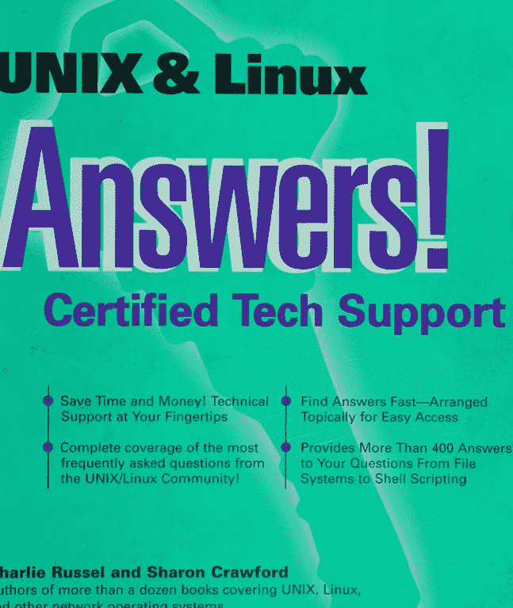

Digitized by the Internet Archive in 2022 with funding from Kahle/Austin Foundation

https://archive.org/details/unixlinuxanswers0000russ

| 命令名称 | 功能 |
|---|---|
| `bg [jobIDs]` | 将当前作业或指定的 `jobIDs` 置于后台。仅 Korn shell。 |
| `cal month year` | 在标准输出上显示日历。`month` 可以是 1 到 12 之间的数字或足以代表唯一月份的字母。`year` 可以是 1 到 9999 之间的任意数字（必须包含全部 4 位数字）。 |
| `cancel requestIDs or cancel printer` | 取消由 `lp` 排队程序生成的打印请求。 |
| `cd directoryname` | 更改当前工作目录。 |
| `chmod mode files` | 更改文件模式。文件模式控制与该文件关联的访问权限。只有文件所有者（或超级用户）可以更改其模式。有关模式的完整细节，请参阅附录 A 中的命令参考。 |
| `cp file1 file2` | 将 `file1`（要复制的文件）复制到 `file2`（目标名称）。 |
| `date MMDDhhmmYY` | 显示系统日期和时间。`MM`=月份（01-12）；`DD`=日期（01-31）；`hh`=小时（00-23）；`mm`=分钟（00-59）；`YY`=年份（00-99），可选。 |
| `fg [jobIDs]` | 将当前作业或指定的 `jobIDs` 置于前台。 |
| `finger users` | 显示系统上用户的信息。`users` 可以指定确切的登录名或名字或姓氏。 |
| `head [-lines files]` | 打印文件的前几行。`-lines` 指定要打印的行数（默认=10）。`files` 应该是用空格分隔的文件列表。 |
| `jobs [jobIDs]` | 列出正在运行或已停止的作业。包含 `jobIDs` 以检查特定作业。仅 Korn shell。 |
| `lp [files]` | 将文件发送到打印机。 |
| `lprint -file` | 将文件发送到终端连接的打印机。 |
| `ls [directories]` | 列出目录内容。如果未给出目录，则列出当前目录中的文件。 |
| `man command` | 显示在线参考手册中关于 `command` 的信息。 |
| `mkdir dirname` | 创建名为 `dirname` 的新目录。 |
| `more [files]` | 一屏一屏地显示命名文件。按 RETURN 获取下一行或按空格键获取下一屏。 |
| `mv source target` | 移动或重命名文件或目录。 |
| `passwd` | 让你更改密码。 |
| `pwd` | 打印当前工作目录的完整路径名。 |
| `rm files` | 删除一个或多个文件。要删除文件，必须对包含该文件的目录具有写权限。如果对文件本身没有写权限，将提示你确认删除。这是一个非常危险的命令。小心！ |
| `rmdir directoryname` | 删除目录。目录必须先为空。 |
| `sleep seconds` | 暂停进程执行的秒数。 |
| `tail [file]` | 让你查看文本文件的最后几行。默认是最后 10 行。 |
| `time command` | 打印进程的执行时间、进程执行时间和系统时间。`command` 是你要计时的命令。 |

如需了解美国以外的翻译或图书发行商信息，或安排销售促销、赠品或筹款活动的批量采购折扣，请联系上述地址的 Osborne/McGraw-Hill。

## About the Authors

Charlie Russel 是医疗保健领域一家独立软件公司的信息系统经理。此前，他在汽车制造厂管理 UNIX 和 Windows NT 网络近十年。他是《ABCs of Windows NT Workstation 4》(Sybex) 的作者，与 Linda Gaus 合著《SCO OpenServer: The Windows Network Solution》(Prentice-Hall)。

Sharon Crawford 在计算机出版行业已有七年多时间。担任技术编辑和开发编辑一段时间后，她于 1993 年开始全职写作。她与 Andy Rathbone 合著《Windows NT 4 for Dummies》，并撰写了大量关于 Windows 95、OS/2、UNIX 和 Windows 3.1 的书籍和文章。

Sharon 和 Charlie 一起撰写了十多本关于 Windows NT、Windows 95、UNIX、OS/2、Windows 3.1 和 DOS 的书籍。他们的作品包括《Running Microsoft Windows NT Server 4》(Microsoft Press)、《Windows NT and UNIX Intranet Secrets》(IDG)、《Upgrading to Windows 95》(Sybex)、《Voodoo UNIX》(Ventana) 和《OS/2 for Windows Users》(Sybex)。

## Getting a Grip on UNIX — 6

### FIRST THINGS FIRST — 8

- Why does UNIX have a reputation as being an enigmatic, difficult and thoroughly nerdish operating system, and is this reputation justified? — 8
- Even if its reputation is often overstated, why would anyone in his or her right mind want to use UNIX? — 8
- Who developed UNIX and when? — 8
- How do I log on and get going? — 9

### TERMINAL SETTINGS — 10

- How can I set the terminal type at login? — 10
- How can I check my terminal settings? — 10
- 如何设置终端控制字符？（第 11 页）
- 我可以将删除字符设置为 DEL 键而不是 CTRL-H 吗？（第 12 页）
- 当我从 PC 登录时，如何修复我的键盘？（第 12 页）
- 当事情出错时，如何让我的终端恢复正常？（第 12 页）

## SHELLS, PASSWORDS, AND HELP（第 13 页）

- 什么是 shell？（第 13 页）
- 如何知道我正在使用哪个 shell？（第 14 页）
- 如何知道我的默认 shell 是哪个？（第 14 页）
- 为什么 UNIX 要使用密码？（第 14 页）
- 有哪些坏密码的例子？（第 15 页）
- 好密码有什么规则吗？（第 15 页）
- 如何更改我的密码？（第 16 页）
- 如果我需要 UNIX 帮助，我可以做什么？（第 17 页）

## 3 Files and Directories（第 20 页）

### FILES AND FILENAMES（第 22 页）

- UNIX 文件名可以多长，可以包含哪些字符？（第 22 页）
- 什么是一个好的 UNIX 文件名？（第 22 页）
- 我可以取消隐藏隐藏文件和目录吗？（第 22 页）
- 如果我想知道文件的类型而不只是名称怎么办？（第 23 页）
- 所有 UNIX 文件名和命令都区分大小写吗？（第 24 页）

### CHARACTERS（第 24 页）

- UNIX 允许我做一些我真的不应该做的事情吗？（第 24 页）
- 如何从文件名中删除嵌入的空格？（第 25 页）
- 但是如果有人在文件名中插入了一个奇怪的字符，它不是空格但看起来像空格给我怎么办？（第 25 页）
- 有没有办法我可以更改一系列文件名的名称？（第 25 页）

### WILDCARDS（第 26 页）

- 基本的 UNIX 通配符是什么？（第 26 页）
- 我可以在单个命令中使用多个通配符吗？（第 27 页）
- 如何使用通配符使我的命令行更智能？（第 27 页）
- 当我在关键文件周围使用 `rm` 命令时，如何保护自己？（第 28 页）

### FILE PERMISSIONS AND PROTECTION（第 28 页）

- 你能告诉我关于 UNIX 文件权限的事情吗？（第 28 页）
- 如何更改文件的模式或权限？（第 29 页）
- 如何保护我的文件免受意外更改？（第 30 页）
- 有没有办法让我在共享目录中更轻松？（第 30 页）


- 我可以使用别名来使设置权限更容易吗？（第 31 页）
- 我可以把我的文件和目录从超级用户那里隐藏起来吗？（第 31 页）
- 那么关于 UNIX 目录保护我需要知道什么？（第 32 页）

## UNIX FILESYSTEMS AND DIRECTORY STRUCTURES（第 33 页）

- 什么是 UNIX 目录，它与其他（子）目录有什么关系？（第 33 页）
- 什么是`.`（点）和`..`（点点）？（第 33 页）
- 我真的需要理解索引节点吗？（第 34 页）
- UNIX 文件系统是如何工作的？（第 34 页）
- 什么是主目录？（第 35 页）
- 典型用户的主目录包含哪些子目录，这些子目录中有哪些文件？（第 35 页）
- 如何保持我的主目录整洁？（第 36 页）

### FINDING LOST FILES（第 36 页）

- 如何找到我最近更改过的文件？（第 36 页）
- 我知道文件的类型但不知道它在哪里时，可以找到文件吗？（第 37 页）
- 即使我不知道文件名的开头是大写还是小写，我也能找到文件吗？（第 38 页）
- 为什么`find`一直抱怨缺少连词？（第 38 页）
- 关于如何最好地找到丢失的文件，有什么常见经验吗？（第 39 页）

### SHORTCUTS TO WHERE YOU WANT TO BE（第 39 页）

- 如何在经常使用的目录之间快速移动？（第 39 页）
- 有没有命令可以让我快速返回主目录？（第 40 页）
- 我可以用`~`作为主目录的快捷方式吗？（第 40 页）
- 我可以用`~`作为别人主目录的快捷方式吗？（第 40 页）
- 我可以定义一个变量来描述我经常使用的任何目录或文件名吗？（第 41 页）

## 4 `vi`（第 42 页）

### THE MANY MODES OF `VI`（第 44 页）

- 什么是模式编辑器，`vi`的模式有哪些？（第 44 页）
- 如何在`vi`中在模式之间移动？（第 45 页）
- 如果我发现自己突然进入`ex`而不是`vi`，我该怎么办？（第 45 页）

### THE BASICS OF USING `VI`（第 45 页）

- 什么是`vi`，我可以使用它的不同版本吗？（第 45 页）
- 当我使用`vi`时，我可以编辑一系列文件吗？（第 46 页）
- 如何完成当前文件的编辑，保存更改并移动到文件列表中的下一个文件？（第 46 页）
- 有没有办法我可以备份并编辑文件列表中的上一个文件？（第 46 页）
- 我可以重新加载当前文件并从头开始吗？（第 47 页）
- `!`是怎么发音的？（第 47 页）
- 有没有办法我可以看到剩下要编辑的文件？（第 47 页）
- 如果我发现自己犯了可怕的错误，我可以从头开始编辑同一份文件列表吗？（第 47 页）

### MOVING AROUND（第 47 页）

- `vi`中基本的光标移动键是什么？（第 47 页）
- 如何一次一屏地翻阅文档？（第 48 页）
- 我可以一次移动半页光标吗？（第 48 页）
- 在我的粘贴操作中，使用命名缓冲区的最聪明方式是什么？（第 57 页）
- 有没有办法将粘贴缓冲区的内容放到当前行之后？（第 58 页）
- 如何将一个单词剪切到缓冲区中？（第 58 页）
- 如何让我的文本呈现出合适的外观？（第 58 页）

### 宏

- 什么是宏？（第 61 页）
- 如何自动化那些在命令模式下开始的常用操作序列？（第 62 页）
- 有没有办法自动化在文本插入模式下开始的频繁任务？（第 62 页）
- 我能否使用`map!`命令创建一个文本插入模式命令，使其行为类似命令模式下的`CTRL-G`命令，用来查看我在当前文件中的位置？（第 63 页）
- 如何减少我为常见短语所需输入的按键次数？（第 63 页）

### 其他必要命令

- 如何保存更改并退出`vi`？（第 64 页）
- 我可以在当前文件中包含另一个文件吗？（第 64 页）
- 是否可以将当前文件的一部分写到一个“临时”文件中？（第 64 页）
- 救命！如果我很确定我对文件做了某些糟糕的事情，我该怎么办？（第 65 页）
- 什么是“智能”退出命令？（第 65 页）
- 如何查看我的文件中有多少个单词或多少行？（第 65 页）
- 如果系统在我写入更改之前崩溃了，会发生什么？（第 66 页）

## 5 自定义与配置文件

### 启动脚本基础

- 什么是启动脚本，它们能为我做什么？（第 70 页）
- 如何编辑启动脚本？（第 70 页）
- 如果我是 Korn shell 用户，如何定制 UNIX？（第 70 页）
- 如何告诉 Korn 或 Posix shell 检查是否存在辅助启动文件并使用它？（第 71 页）
- 如果我是 C shell 用户，如何定制 UNIX？（第 72 页）
- 我能摆脱那个无聊的旧`$`提示符吗？（第 73 页）
- 哪个引号是哪个？为什么我要在意？（第 75 页）

### 设置和使用变量

- 我能否用一个变量来描述经常使用的工作目录？（第 77 页）
- 有没有办法让乏味的文本终端稍微变得好看一点？（第 78 页）
- 我需要导出一次性变量吗？（第 80 页）
- 但是我应该导出预期会重复使用的变量吗？（第 80 页）
- 我应该移除变量吗？（第 80 页）
- 如何查看变量的值？（第 80 页）

## 6 打印

### 立即打印

- 打印文件的标准 UNIX 命令是什么？（第 87 页）
- 如何更改默认打印机目标？（第 88 页）
- 我可以为特定的打印任务覆盖默认打印机目标吗？（第 88 页）
- 有没有办法去掉那个愚蠢的横幅页？（第 88 页）
- 如何控制要打印的文件的份数？（第 89 页）
- 有没有办法让 UNIX 在打印任务完成时通知我？（第 90 页）
- 我可以控制打印任务的外观吗？（第 90 页）

### 稍后打印

- 有没有命令可以用来暂缓打印任务，留待稍后处理？（第 91 页）
- 我可以将列表转换为多列格式吗？（第 96 页）

### 其他有用的打印技巧（第 97 页）

- 我可以取消打印任务吗？（第 97 页）
- 我可以使用`lpstat`命令来获取我的打印请求当前状态吗？（第 98 页）
- 我如何知道我的作业正在哪里打印？（第 98 页）

## 7 运行程序（第 100 页）

### 运行单个程序（第 101 页）

- 我如何使程序可执行？（第 102 页）
- 有没有办法让我自动使 shell 脚本可执行？（第 102 页）
- 我可以在不更改脚本的情况下控制脚本由哪个 shell 执行吗？（第 102 页）
- 我如何重新发出命令？（第 103 页）
- 循环浏览和编辑我之前的命令最简单的方法是什么？（第 104 页）
- 即使我是一个坚定的`emacs`用户，我也可以编辑我之前的命令吗？（第 104 页）

### 多任务处理（第 106 页）

- 我如何将作业发送到后台？（第 106 页）
- 有没有命令可以用来检查我的后台作业？（第 106 页）
- 我可以将后台作业带回前台吗？（第 107 页）
- 还有其他方法可以将作业发送到后台吗？（第 108 页）
- 我可以使用重定向将正常程序输出和错误消息都发送到文件吗？（第 108 页）
- `tee`命令可以为我做什么？（第 109 页）

### 鼠标命令

- 我可以使用鼠标在窗口之间复制文本吗？
- 我如何选择整个单词？
- 有没有办法选择整行？
- 我如何弹出菜单？

### 让生活更轻松的 `Xterm` 技巧

- 我可以更改`Xterm`的颜色以使其更护眼吗？
- 我如何获取颜色可能性列表？
- 是否可以更改我的`Xterm`上的标题？
- 有没有办法我可以更改`Xterm`中的字体以使其更易于阅读？
- 我如何查看有哪些字体可用？
- 我可以提前看到字体的外观以及它有哪些可用字符吗？
- 有没有办法我可以为我的`Xterm`添加滚动条以便轻松滚动回文本？
- 我可以制作更大的滚动缓冲区来用于`man`页面吗？

### 较不令人印象深刻的 X 程序

- `xcalc`能处理科学计算吗？
- `xload`可以为我做什么？
- 有没有办法控制 X 程序的大小和放置位置？
- `xman`如何帮助我浏览帮助信息？

### 自定义 X

- 我可以对 X Windows 进行哪些自定义，以及为了做到这一点我需要更改哪些文件？
- 我如何自定义 X 服务器？
- 有没有办法我可以更改所有`Xterm`的默认背景颜色？
- 我如何自定义我的桌面？
- 我可以使用 Motif 资源文件为 X 添加功能吗？
- 我如何使用 Motif 资源文件获取帮助？
- 有没有办法我可以向我的根菜单添加行？

## 9 UNIX 工具箱

### 比较工具

- 本地网络环境中最常见的需求是什么？（第 152 页）
- 处理文件共享的最佳方式是什么？（第 152 页）
- 我如何使我的工作组的目录本地化？（第 153 页）
- UNIX 为我提供了哪些工具可以促进工作组通信？（第 154 页）
- `ping`可以为我做什么？（第 154 页）


- 向登录到我的机器的另一用户发送快速消息的最佳方式是什么？ — 154

- 有没有办法我可以关闭对 `y` 终端的写权限？ — 155

- 是否可能允许其他人向我发送消息而不干扰我的工作？ — 155

- 我如何与在不同机器上的另一用户聊天？ — 156

- 我可以向登录到我的计算机的每个人发送消息吗？ — 156

- 我的工作站突然变慢了，我怀疑有人占用了超过其份额的内存和 CPU 时间。我如何找出罪魁祸首？ — 157

- 我如何解决身份危机？ — 157

- 有没有命令可以让我只获取使用我的机器的人的真实登录信息？ — 158

- 我如何了解有关我机器上的人的更多信息？ — 158

- 我如何知道我在哪里？ — 159

- 与我的工作组通信的最佳方式是什么？ — 159

- `r` 命令是什么，它们可以为我做什么？ — 160

- 你能给我一个使用 `rlogin` 的例子吗？ — 160

- `rlogin` 还有其他巧妙的用途吗？ — 161

- `rcmd` 或 `rsh` 真正擅长什么？ — 161

- 我应该如何使用 `rcp` 命令？ — 162

- 即使我的 `cp` 版本不支持递归复制，`rcp` 仍然可以帮助我吗？ — 162

### 连接到更大的世界

`ftp` 是什么，我该如何使用它？ — 163

## 11 Windows NT 与 UNIX 互操作性

### 基础 TCP/IP 连接

- 我如何从我的 UNIX 服务器向 Windows NT 机器复制文件？

- 我能使用 `ftp` 从我的 Windows NT 机器向 UNIX 或 Linux 机器复制文件吗？

- 与自带的命令行版本相比，Windows NT 有没有更易用的 `ftp` 客户端？

- 我能在我的 Windows NT 机器上运行 UNIX 程序吗？

- 如何启动 Microsoft `telnet` 应用程序？

- 除了基本的 Microsoft 版本之外，还有更好的终端仿真器吗？

- 我能从 UNIX 通过 `telnet` 连接到 Windows NT 吗？

- 图形应用程序呢？

- 我能使用网页浏览器从 Windows NT 机器访问 UNIX 吗？

### 高级网络仿真

- `SMB` 是什么，为什么我应该关心？

- `NFS` 是什么？

- 我如何让我的 UNIX 服务器对我的 Windows 和 Windows NT 用户可见？

- `SMB` 相对于 `NFS` 有什么优势？

- `NFS` 有什么优势？

- 我能让我的 UNIX 服务器作为 NT 域的一部分运行吗？

- UNIX 服务器能作为 Windows 工作组的一部分运行吗？

- 使用 NT 域有什么优势？

- 使用工作组方案有什么优势？

- 有没有免费的方式与 Windows 客户端共享 UNIX 文件系统？

- 是否有可用的 `samba` 预编译版本？

- 我如何让我的 UNIX 用户共享 Windows NT 文件系统？

- 我能在 Windows NT 上使用 NFS 导出的文件系统，而不加载 NFS 客户端包吗？

- 打印呢？我能在 UNIX 和 Windows NT 之间共享打印机吗？

- 如何向 Windows NT 添加 TCP/IP 打印服务？

- 如何向 Windows NT 添加 TCP/IP 打印机？

- 我如何让我的 UNIX 用户使用我的 Windows NT 打印机？

### Shell 仿真：让 NT 感觉像 UNIX，让 UNIX 感觉像 NT

- “标准” UNIX shell 是什么？

- 我如何让 NT 表现得像 UNIX？

- 我如何在不花钱的情况下让 NT 表现得像 UNIX？

- 我能让 UNIX 表现得像 NT 命令行吗？

## 12 灾难避免与恢复

### 风险规避

- 为 `rm` 命令创建别名明智吗？

- 我如何为 `rm` 创建一个别名，将我的文件移动到安全的地方？

- 清理 `tmp` 目录中较旧文件的最佳方法是什么？

- 我能将 `purge!` 添加到我的 `crontab` 吗？

- 保护关键文件免遭意外删除的最好方法是什么？

- 我能创建一个用于编辑只读文件的特殊脚本吗？

- 我如何将敏感或关键文件放在他人无法访问的目录中？

### 备份，备份，再备份！

- 为什么我可能会考虑制作硬盘备份？

- 制作硬盘备份最简单的方法是什么？

- 何时我应该考虑制作磁带或软盘备份？

- 制作磁带或软盘备份最简单的方法是什么？

- 我能使用 `tar` 将文件复制到不同的机器或文件系统吗？

- 我能使用 `tar` 将我的文件备份到软盘或磁带驱动器吗？

## 13 Korn Shell

### 变量和参数

- Korn shell 如何使用变量和参数？

- 我如何为变量分配值？

### Korn Shell 数学运算

- 关于 Korn shell 如何进行数学运算，有什么特别需要注意的吗？

## 字符串运算符

- Korn shell 擅长的字符串操作示例是什么？

- Korn shell 是否提供有用的字符串替换运算符？

### Korn Shell 中的预定义变量

- 我如何重新定义一个预定义变量？

## 流程控制

- Korn shell 为我提供了哪些流程控制结构？

- 在 Korn shell 中使用 `if/then/else` 语句有什么棘手之处？

- 你能展示我在 Korn shell 中如何使用 `for` 循环吗？

- 我在使用 Korn shell 中的 `while` 和 `until` 循环时需要知道什么？

- `case` 语句能为我做什么？

- 我应该如何使用 `select` 语句？

## 14 Linux

### Linux 基础

- 我可以在哪里获取 Linux？

- 你最喜欢的 Linux 发行版是什么？

- 你能告诉我关于其他 Linux 发行版的信息吗？

### 键盘问题

- 我的键盘出了什么问题？

- 什么是 `keytables` 以及我该如何编辑它们？ — 218

- 你能给我一个“power users”如何编辑默认 `keytables` 的例子吗？ — 219

- `keytables` 到底是如何工作的？ — 219

- 什么是“meta”键？ — 219

## PASSWORD SECURITY — 220

- 你能告诉我关于 Linux 和密码安全的事情吗？ — 220

## SHELLS — 221

- Linux 为我提供了哪些 shell？ — 221

- 你能告诉我关于 `bash` 启动文件的事情吗？ — 222

- 我可以在 shell 提示符中显示当前目录吗？ — 222

## TEXT EDITORS — 224

- 一个标准的 Linux 系统为我提供了哪些文本编辑器？ — 224

## LINUX AND X WINDOWS — 224

- 我可以在 Linux 上拥有图形用户界面吗？ — 224

- 我的图形登录屏幕在哪里？ — 226

- 如何配置 `XDM`？ — 226

- 如何永久在 X Windows 中启动？ — 227

- 什么是 widget？ — 227

- 为什么 widgets 很重要？ — 228

- 如何自定义 `FVWM`？ — 228

- 焦点策略到底是什么，我可以更改它吗？ — 228

- 我可以让 `FVWM` 看起来像 motif 窗口管理器 `mwm` 吗？ — 230

- 如何更改 `FVWM` 中的颜色？ — 230

- 关于 `FVWM` 我还应该知道哪些其他有用的设置？ — 231

- Linux 还有其他窗口管理器吗？ — 232

- 我可以在 X Windows 下像在控制台模式下那样自定义我的键盘吗？ — 233

- 如何更改我的 `xterms` 的标题栏？ — 234

## OTHER TOOLS THAT ARE DIFFERENT UNDER LINUX — 235

- 在 Linux 下可能不同的工具有哪些？ — 235

## 15 awk, perl, and sed ........................................ 238

### THE AWK PROGRAMMING LANGUAGE .............................. 239

- 我如何使用 `awk` 以及它为我提供了哪些选项？ ... 239

- 你能给我一个更实用的使用 `awk` 的例子吗？ ... 240

### THE PERL PROGRAMMING LANGUAGE ............................. 242

- 你能指出 `awk` 和 `perl` 之间的一些区别吗？ ... 243

### THE SED PROGRAMMING LANGUAGE .............................. 245

- 什么是 `sed`？ .............................................. 245

- 为什么还要学习另一个工具？ ................................ 245


- 它是如何工作的？ ......................................... 246

- 你能给我一些使用 `sed` 的例子吗？ ............ 247

A  Command Reference ......................................... 250

B  Error Messages ............................................. 274

C  Glossary ................................................... 278

D  Resource Guide ............................................. 292

Index ...................................................... 301

致 Jean-Pierre Radley，CompuServe 上那些 Sysops 之一，多年来提供了许多技巧和帮助，从未让人失望。谢谢，J-P。

致 Bill Campbell——我们在 CompuServe 上首次认识的 UNIX 和 Linux 社区中的众多人士之一，也是 `ftp.celestial.com` 上可通过匿名 ftp 获取的优秀 SCO 二进制和源文件库的维护者。

致我们的代理 David Rogelberg，他再次证明了他是特别的人。

致 Maggie Verdier，我们的技术编辑，她做出了出色、细致的工作，并且是合作愉快的人。

在 Osborne/McGraw-Hill，有几位人士值得特别提及：

- Joanne Cuthbertson，收购编辑，她说服我们撰写这本书，并在整个过程中表现卓越。
- Claire Splan，项目编辑，她设法让所有人都保持警惕，并且耐心、体贴，是合作愉快的人。
- Stephane Thomas，编辑助理，他保持了一切井然有序。
- Gary Morris，我们的校对编辑，他既准确又宽容，这是一种罕见的组合。
- Pat Mannion，校对员，她做得非常出色。
- 以及制作团队，包括 Marcela Hancick、Jani Beckwith、Roberta Steele、Lance Ravella 和 Mickey Galicia，没有他们，这本书永远不会到你的手中。

我们尝试以合理的方式编排这本书——大致按照你作为新手学习 UNIX 的顺序。但你可以按任意顺序阅读。

第 1 章介绍了关于 UNIX 的十大常见问题。在这里，你将了解每个人（无论是新手还是专家）都在询问的 UNIX 问题的答案。

第 2 章为你介绍 UNIX 并概述其内容，同时涵盖登录和启动的所有重要步骤。你将了解如何设置终端以及如何映射按键以适合你的工作方式。你还将找到选择安全密码并保守秘密的明智方法。

第 3 章分享了一些在 UNIX 文件系统和目录结构中导航的快捷方式——如何命名文件、找到散落文件，以及如何以最高效率在各目录之间移动。

第 4 章重点介绍 `vi`——这款几乎随所有 UNIX 版本一同提供的出色、灵活（虽然有点令人望而生畏）的文本编辑器。你将找到许多让文本编辑更快速的巧妙方法。

第 5 章为自定义工作环境提供了好主意。由于 UNIX 通常是一个相当单调的环境，本章在美化计算机的同时还着眼于提升效率。提示符、颜色和其他装饰性内容都配有便捷的快捷方式。如果你不得不在 DOS 和 UNIX 之间来回切换，你会特别欣赏关于如何实现无痛转换的部分。

第 6 章全部关于打印。在 UNIX 环境中，打印可能会带来一系列复杂问题。本章为你提供所需的信息，以便你快速高效地完成打印任务。由于你很可能处于网络中，你还将学习如何共享打印机而不会妨碍他人。

第 7 章满是关于以最高效方式运行程序的技巧。有些快捷方式和见解能帮助你每天的工作——例如如何运行前台和后台操作，以及何时使用两者。

第 8 章包含关于图形用户界面 X Windows 的所有炫酷内容。你将了解字体、训练鼠标，以及如何配置 X Windows 环境以适合你的工作方式。本章还描述了 X Windows 附带的许多方便的小型（以及不那么小的）程序，并提示哪些可以忽略。

第 9 章带你了解工作中的工具——这些工具会让你的生活更轻松。你可以翻开本章任何一页，找到 UNIX 大师的秘密，并立即加以运用。这些工具既能帮助你轻松导航，也能轻松操作文件。仅此一章就能让你的 UNIX 快捷键和技巧库翻倍。

第 10 章重点讲解如何连接其他计算机。UNIX 是连接的语言，要建立连接，你需要知道发送哪些神奇词语才能获得回复。第 10 章还提供了关于网络礼仪（即 netiquette）的有用信息。

第 11 章详细介绍了如何在你的网络上无缝集成 UNIX 和 NT。你将了解如何让 UNIX 和 NT 机器相互“对话”，如何让你的 UNIX 服务器在 NT 域或工作组中发挥作用，以及更多内容。

第 12 章将向你展示如何避开那些等待着初学者的 UNIX 雷区。你会明白为什么 UNIX 不仅是一个令人兴奋的工作环境，也可能是一个危险的环境，因为它没有内置的安全设备。本章为你提供了在其他地方很难找到的、关于保持 UNIX 环境安全的信息。其中包括一些巧妙且最妙的是易于实现的方法，可以保护你的工作安全。

第 13 章与你分享 Korn shell 的一些秘密。你将了解变量和参数、Korn shell 如何进行数学运算、如何处理字符串运算符、它提供了哪些预定义变量，以及（最后但同样重要的）Korn shell 程序中流程控制的来龙去脉。

第 14 章介绍 Linux——这可能是当今最流行的低成本 UNIX 版本。本章包括 Linux 基础知识，以及关于键盘和密码安全问题的信息，还有 Linux 用户可用的 shell、文本编辑器和 X Windows 的相关信息。

第 15 章将你推向更高级的水平。在这里，我们将带你了解其中的一些结构和

Korn shell 的编程结构——包括关于 `awk`、`perl` 和 `sed` 的一些要点——可以让你看起来像个专家，简化你的任务，并给他人留下深刻印象。

本书还附有附录，包括词汇表、命令参考和资源指南，当你遇到困难时（或者更可能的是，当你遇到困难时）应该会有所帮助。不要忘记附录，因为你永远不知道它们什么时候会派上用场！

## 标准约定

如果您确切知道我们在书中使用的约定是什么，那可能很有帮助，所以开始吧：

- `粗体` 用于 UNIX 术语和命令，以及用户输入。
- `斜体` 用于强调并突出重要术语。
- 小型大写字母 表示按键。
- `Courier 字体` 用于将代码行与普通文本区分开。

## 特殊功能

本书还包含一些您应该了解的特殊功能，即 @ 一览部分，提供每章的概述；侧边栏，包含对给定章节中 elsewhere 提出问题的深入解答；以及注释、提示和警告，提供与当前问题相关的简短旁注和观点。

## 您最喜欢的技巧

本书中使用的大多数技巧、提示和警告都来自经验和运气（好坏兼有）。但由于 UNIX 由数百个命令组成，可以以数百万种方式组合，我们确信有一些真正很酷的技巧我们不知道。你可以想象 *那个* 想法会有多烦人！所以如果你有一个技巧——无论是整洁干净、下流肮脏还是狡猾阴险，我们都想听听。

您可以寄信到 Osborne/McGraw-Hill，2600 Tenth Street，Berkeley，CA 94710。或者更好的是，发送电子邮件到此地址：`UnixAnswers@scribes.com`。实际上，即使您没有技巧，我们也非常乐意收到您的来信，只是想听听您对这本书的看法。

# 第 1 章

# Top 10 Frequently

Asked Questions

## Answer Topics!

- Logging on 1
- Understanding UNIX filenames 2
- Creating good filenames 2
- Changing a file’s mode or permissions 2
- Moving between frequently used directories 3
- Returning to the home directory 3
- Cancelling a print job 4
- Using the `more` command 4
- Creating an alias for the `rm` command 4
- Protecting data against accidental erasure 5


## Top 10 FAQS @ a Glance

本章涵盖了关于 UNIX 和 Linux 的十个最常见问题，包括以下重要主题：

- Logging on
- Cancelling a print job
- Protecting yourself from disaster, including a slick way to rename the remove command


# Understanding the rules for valid filenames
## And more

### 1. How do I log on and get going?

当你查看你的 UNIX 终端时，你会看到登录屏幕。这可能是一个可爱的图形框，有地方让你输入用户名和密码，或者是一个简单的

```
login:
```

在任何一种情况下，输入你的用户名并按下 ENTER 或 RETURN 键，以你系统所具有的为准。接下来，输入你的密码，我们就可以开始工作了。

这里稍作说明。你可能会问，为什么每次我想使用计算机时都要经历这个过程？好吧，由于 UNIX 设计为多用户操作系统，它施加了某些安全限制，以保护你和你的工作免受无意的或蓄意的恶作剧。其中一个安全限制是，你必须在系统上拥有一个“账户”后才能使用它。而且，为了确保只有你能使用你的账户，你也必须有一个密码。

当你第一次登录 UNIX 系统时，你会看到各种各样的杂项，其中大部分你根本不在乎。如果你使用的是文本终端，你可能会看到冗长的版权声明滚动而过，以及其他一些东西。不要理会。最后，可能会问你使用的是什么类型的终端。很有可能你只需采用默认设置就可以开始工作。但如果你在屏幕上看到一堆奇怪的东西，或者键盘似乎行为异常，那么很可能某个地方出了问题，默认设置就不够好了。

### 2. How long can a UNIX filename be and what characters can it include?

UNIX 文件名比例如 DOS 文件名灵活得多。至少，在最老的系统上，它们可以长达 14 个字符，而如今大多数 UNIX 系统都会支持一个名为 `reallyridiculouslylong-andcomplex.filename` 的文件。但这可能不是一个特别有用的文件名。文件名唯一的硬性规定是它们可以包含除斜杠（`/`）以外的任何字符。

### 3. What is a good UNIX filename?

现实地说，你最好将文件名限制为以下内容：

- alphanumeric characters
- underscores
- periods

其他字符可能在你的 UNIX 版本上有效，但在其他系统上可能无法很好地转换。

### 4. How can I change a file's mode or permissions?

使用 `chmod`。此命令是“change mode”的缩写，让你可以轻松更改你拥有的任何文件，以便只有你授权的人才能读取、更改或执行它。正如我们上面所见，有三个基本的用户级别：文件的拥有者（user）、拥有者的组，以及其他所有人（others）。并且有三个权限级别：读、写和执行。用户类型的缩写为“u”表示 user，“g”表示拥有者的组，“o”表示所有其他

人们在那里，而 "a" 代表每个人。权限的缩写与上面长列表中的相同："r" 代表读，"w" 代表写，"x" 代表执行。因此，要更改文件 `harold.cat` 的权限以允许组外用户读取它，输入

```
chmod o+r harold.cat
```

`chmod` 命令可以让你一次对多个文件进行多次更改，因此很容易从每个人身上移除写权限，并从不在你组中的用户那里移除所有 `.cat` 文件的所有权限：

```
chmod a-w,o-rx *.cat
```

### 5. 如何在经常使用的目录之间快速移动？

如果有一个你一直使用的目录，将该目录的路径分配给一个变量，然后导出该变量以使其始终可用。创建一个简单的别名来利用该变量移动到该目录。例如，假设你正在为新模型组做一个项目，并且需要快速移动到项目的 working 目录，`/users/shared/projects/newmodel/colormatch`。这真的很麻烦，而且不是你每次都想输入的东西！所以，试试这个：

```
PHOME=/users/shared/projects/newmodel/colormatch
export PHOME
alias goproj=cd $PHOME
```

将其包含在你的 `.kshrc` 文件中，它在你需要时就会可用。最好的部分是，如果你切换到不同的项目，你所要做的只是更改变量。你的手指可以继续使用相同的命令。

### 6. 有没有命令可以让我快速返回到我的 home 目录？

有；试试单独使用 `cd`。这个小技巧无论你迷路有多远，都能让你快速回到 home 目录。

### 7. 有没有办法取消打印作业？

快！使用 `cancel` 命令停止你刚刚发送的打印作业。此命令的形式为

```
cancel [request-id|printer]
```

这意味着你可以通过指定请求 id 或打印机来取消作业；在后一种情况下，这将取消该打印机上的作业。请注意，你只能取消你自己创建的打印作业。要取消别人的打印作业需要（啪！）超级用户。

### 8. `more` 命令能为我做什么？

`more` 命令让你一次一页地查看文件。你可以使用 `/regexp` 在文件中向前跳转，通过搜索正则表达式，但你不能向后搜索。然而，周围还有其他更灵活的分屏程序，所以如果你发现自己对 `more` 的限制感到沮丧，请让你的系统管理员为你的系统获取一份 `less` 的拷贝。这个小程序让你可以在文件中前后翻页，比 `more` 方便得多。或者养成使用 `vi` 的只读形式 `view` 作为替代的习惯。

### 9. 为 `rm` 命令创建别名明智吗？

这有点敏感。一些原教旨主义者强烈认为你不应该为 UNIX 的内置命令创建别名，而其他人则经常这样做。我们倾向于认为如果走极端这是一种不良做法，但在某些情况下它可以救命。例如，如果你想增加一层保护，这是一种方法。尝试将以下内容添加到你的 `.kshrc` 文件中：

```
alias rm='rm -i'
```

现在，每当你要删除一个文件时，你都会被提示确认。这种方法的问题是，如果你有很多文件要删除并且你真的确定要删除它们，这可能会变得相当烦人。在这种情况下，你可能会在删除时变得粗心大意，在没有真正阅读提示的情况下回答 "y"。更好的解决方案是暂时将文件移开，只有在它们足够旧以至于你确定要摆脱它们时才删除它们。

### 10. 保护数据免受意外擦除的最佳方法是什么？

备份，备份，备份。绝对没有什么是能在灾难发生时胜过 *已验证* 的备份的。系统管理员对备份负有主要责任，但每个使用计算机的人都需要对自己关键文件的备份负责。这并不难，不必繁重，而且可以救命。阅读有关各种 UNIX 备份选项的信息以及如何在第 12 章中利用它们。

## 第2章

# 掌握 UNIX

## 答案主题！

- FIRST THINGS FIRST 8
  - ? UNIX 的声誉
  - ? 为什么使用 UNIX
  - ? 谁开发了 UNIX
  - ? 如何登录
- TERMINAL SETTINGS 10
  - ? 登录时设置终端类型
  - ? 检查终端设置
  - ? 设置终端控制字符
  - ? 将删除功能设置为另一个键
  - ? 从 PC 登录时设置键盘
  - ? 重新设置终端设置
- SHELLS, PASSWORDS, AND HELP 13
  - ? 理解 shell
  - ? 如何判断你使用的是哪个 shell
  - ? 确定默认 shell 是哪个
  - ? 为什么 UNIX 使用密码
  - ? 不良密码的示例
  - ? 如何选择一个好的密码
  - ? 更改密码
  - ? 获取 UNIX 帮助

## 一目了然掌握 UNIX

要掌握 UNIX，你可能会认为从安装说明的开头开始是正确的做法。然而，安装 UNIX 是一种神秘的艺术形式——最好留给以此为生的人。UNIX 有无数个版本，每个版本都有其独特的怪癖，每个版本都需要对实际安装机器以及可能与其连接的任何其他机器的硬件和软件有深入的了解。换句话说，这是那位最神圣的“超级用户”或系统管理员的特殊工作。本书不是为他们写的，而是为你写的，一个在 UNIX 计算机上工作并希望变得更好、更快、更高效的人。但即使你是初学者，你仍然会在这里找到大量有用的信息。

是什么让 UNIX 计算机与众不同？我们大多数人对 DOS 计算机能有什么期望已经相当清楚了。它会有 一两个软盘驱动器、键盘、显示器、一个实际的电脑主机，也许还有一些其他东西。你坐下来就开始工作。你通常可以确定在你坐着的时候你是唯一使用它的人，即使你连接到网络也是如此。对 UNIX 来说则不然。

使用 UNIX，你可能坐在一个简单的终端前，几乎只是一个屏幕和键盘，屏幕上只有丑陋的文本，看不到任何明显的计算机。或者你可能坐在一个漂亮的高分辨率图形屏幕前，旁边放着一台强大的工作站。或者可能是两者之间的某种组合。而且在几乎所有情况下，你很可能与其他用户共享这台计算机。他们可能在同一个房间，也可能在世界的另一边。

那么，面对所有这些差异，你怎么能合理地期望这本书，或任何其他书，都适用于你呢？不用担心！尽管不同口味的 UNIX 以及它运行的机器之间存在很多差异，但相似之处更多。本书将专注于这些相似之处——几乎所有工作都在那里完成。

## FIRST THINGS FIRST

### 为什么 UNIX 有着晦涩、困难且彻底的书呆子操作系统的声誉，这种声誉是否合理？


UNIX 的声誉基于这样一种认知：要使用它，就必须花上数小时盯着一个赤裸而无情的命令行，输入只有计算机才会喜欢的神秘序列。虽然曾经确实如此，但 UNIX 在近年来的发展已经非常迅速。现在有提供 GUI（图形用户界面）的 UNIX 版本，甚至那个赤裸的命令行也变得更加宽容。如今，可以安全地说，关于 UNIX 难度的报道被大大夸大了。

# 即使其声誉经常被夸大，为什么任何明智的人会想使用 UNIX？

因为它是一个功能强大、稳定且出奇灵活的操作系统，一旦你了解了一些它的魔法，它就可以成为一个高效甚至友好的环境。这里的目标是给你提供工具和技巧，让你按自己的方式设置 UNIX 环境。

本书并不是真正为 UNIX 的初学者设计的。在大多数地方，我们至少假设你对 UNIX 和计算机有最基本的熟悉程度。我们将在本章中稍稍偏离这一点，以确保我们都在同一波长上，所以如果这些内容对你来说很无聊，请稍作忍耐，或者直接跳过你已经知道的部分。

# 谁开发了 UNIX 以及何时？

UNIX 是在 20 世纪 60 年代末开始，由贝尔实验室的许多人开发的，这些人也创造了 C 编程语言（所以现在你知道该怪谁了）。事实上，他们帮助推动并塑造了彼此的设计和实现。

这个想法是创建一个内核（或核心部分）尽可能小的操作系统。UNIX 内核之所以小，主要驱动力在于开发人员当时在

以当时的标准来看，这些都是微型计算机。第一个内核是在一台很小的DEC PDP-7上实现的。最终，他们得到了一台新的PDP-11，它总共有24K内存，其中内核只占用了11K。这种对内存容量的严格限制催生了一个小巧紧凑的内核，所有实用程序都实现为独立运行的程序。每个程序本身都很小，并且设计成接收前一个程序的输入，同时为后续程序提供输出。这样的设置——一个程序的标准输出作为另一个程序的标准输入——被称为管道。这是一个强大的概念，也是当今UNIX的核心。它还影响了后来出现的所有操作系统。

# 第2章 掌握UNIX

## 如何登录并开始使用？

当你看向UNIX终端时，会出现登录界面。这个界面可能是一个漂亮的图形框，里面有输入用户名和密码的位置，也可能是一个简单的

```
login:
```

无论哪种情况，输入你的用户名，然后按系统上的`ENTER`或`RETURN`键。接下来输入密码，我们就可以开始正事了。

这里稍微说点题外话。你可能会问，为什么我每次想用电脑都得经历这些步骤？嗯，因为UNIX被设计成一个多用户操作系统，它施加了某些安全限制，以保护你和你的工作免受无意或故意的破坏。这些安全限制之一就是，你必须先在系统上拥有一个“账户”才能使用它。而且，为了确保只有你能使用自己的账户，你还必须有一个密码。

当你第一次登录UNIX系统时，你会看到各种各样的杂项信息，其中大部分你根本不会在意。如果你用的是文本终端，你可能会看到一条很长的版权声明滚动闪过，还有一堆其他东西。别去管它们。最后，系统可能会问你使用的是哪种终端。很可能你直接接受默认值就能开始工作了。但如果你在屏幕上看到一堆奇怪的东西，或者键盘似乎表现得异常，那么很可能是某处出了问题，默认值不够用了。

## 终端设置

### 登录时如何设置终端类型？

你需要知道的第一件事是你拥有什么类型的终端。有时这很容易——例如，如果你在惠普工作站上，你很可能使用“`hp`”终端类型。如果你使用个人电脑和SCO UNIX，“`ansi`”是一个很好的选择；而在装有通信程序、用于登录远程系统的PC上，你最有可能使用“`vt100`”。几乎每个通信程序都能模拟它。那么，如何设置呢？很简单。只需将下面这一行添加到你的`.profile`文件中（如果你运行的是Korn或Bourne shell）：

```
eval `tset -m hp:\?hp -s -e -k ^Q`
```

简而言之，这一行使用UNIX终端设置命令（`tset`）来选择适当的终端类型，并设置终端的擦除和删除字符。

对于运行C shell的用户来说，这个操作要稍微复杂一些。将以下内容添加到你的`.login`文件中：

```
set noglob
set term=('tset -m hp:\?hp -s -e -k -Q')
unset noglob term
```

这个版本中的额外命令只是确保`tset`命令能被正确读取。当然，以上所有内容都假设默认终端类型为“`hp`”，如果你的确如此，那当然很好。如果你常用的终端类型是别的，只需相应地将“`hp`”替换为你的实际类型。

### 如何检查我的终端设置？

要查看当前的终端设置，请输入以下命令：

```
stty -a
```

如图2-1所示，这会显示关于当前终端设置的信息，可能比你想要的或需要的还要多。

### 我能把擦除功能设置为DEL键而不是CTRL-H吗？

可以。要做到这一点，输入`stty`，然后一个空格，再输入`erase`，再一个空格，然后按`CTRL-V`，再按DEL键。不过，表2-1中的按键组合是迄今最常见的。

### 从PC登录时如何修复我的键盘问题？

当你从PC登录到UNIX网络时，有时PC上运行的`telnet`版本不能正确重新映射`BACKSPACE`键。你会以为你已用退格键删掉了命令中的某个字符，但当你按`ENTER`时，你会发现命令中嵌入了一堆控制字符。所以，请自行更改设置，输入以下内容：`stty erase`后面跟一个空格，然后按`CTRL-V`，再按`BACKSPACE`键，最后按`ENTER`键。屏幕上的结果可能会像这样：

```
stty erase ^?
```

现在`BACKSPACE`键将正常工作了。`CTRL-V`组合键会让UNIX读取下一个按键而不执行其操作。

### 当终端出现混乱时，如何恢复一些正常状态？

如果你在使用`stty`命令时有点过火，或者更糟，你的终端设置被一个失控的程序严重搞乱了，该怎么办？要恢复正常，请尝试以下方法：

```
stty sane
```

如果你的按键反应非常混乱，可以尝试在命令前后加上`<ctrl-j>`。按住`CTRL`键并按下`J`键即可输入`<ctrl-j>`序列。

```
<ctrl-j>stty sane<ctrl-j>
```

这个命令不会恢复你首选的设置，但会清除任何真正怪异的设置。具体会出现哪些设置取决于你所使用的系统。

# SHELLS，密码和帮助

## 什么是 shell？

许多用户认为他们在裸露的 UNIX 命令行上看到的就是实际的操作系统，但实际上它是一个名为 shell 的命令解释器。这个 shell 是一个介于用户和操作系统底层内核之间的程序。它的目的是保护用户免受内核的影响，而更重要的是，保护内核免受用户的侵害。在 MS-DOS 世界中，这个 shell 被称为 `COMMAND.COM`，它又常被其他 shell 如 `DOSSHELL` 或终极 DOS shell `Microsoft Windows` 所包围。

在 UNIX 世界中，你可以选择 shell。目前使用最古老的 shell 是 `sh`，被称为 Bourne shell。Bourne shell 可在所有 UNIX 系统上使用。对于交互式用户来说，它缺少一些关键特性，比如作业控制，但它为编写大多数 shell 程序提供了良好的基础。

直到最近，交互式用户最流行的 shell 是 `csh`，即 C shell。最初由加州大学伯克利分校作为其 UNIX 实现的一部分开发，它为交互式用户提供了许多特性，包括能够召回之前使用过的命令，以及能够将作业从前台移动到后台并返回的能力（作业控制）。顾名思义，它的语法和命令结构模仿了 C 编程语言，这使其在程序员中特别受欢迎。大多数版本的 UNIX 都提供 C shell。

shell 游戏中较新的成员，也可能是今天最流行的，是 `ksh`，即 Korn shell。以其创建者 David Korn 命名，这个 shell 与 Bourne shell 完全兼容，但增加了使 C shell 如此流行的大多数特性，外加一些全新的功能。其中最重要的是能够不仅仅召回旧命令，还能实际编辑它。虽然 Korn shell 在某些较旧版本的 UNIX 上不可用，但它正成为大多数较新版本中的标准部分。在本书中，我们主要会使用 Korn shell，除非特别指定 C shell 或 Bourne shell。Posix shell 是 Korn shell 的近亲，正迅速成为许多平台上重要且广泛可用的 shell。由于它与 Korn shell 的行为非常相似，你应该能够使用本书中建议的任何内容在两者上使用。

## 我如何知道我使用的是哪个 shell？

如果你的命令行以 `%` 开头，你使用的是 C shell。更世故的 `$` 表示 Posix、Korn 或 Bourne shell。

## 我如何找出我的默认 shell 是什么？

从命令行输入：

```
grep yourloginname /etc/passwd
```

如果没有返回任何内容，你可能使用的是使用 Sun 的网络信息服务（NIS）来管理网络范围文件的系统。如果是这样，试试这个：

```
ypcat passwd | grep yourloginname
```

通过其中一种方法，你将看到控制你账户的系统密码文件中的行。它看起来会像下面的插图所示。各个字段由冒号分隔，最后一个字段显示 shell。


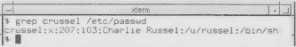

从左起其余字段分别是登录名、你的密码（这将是加密的，或如 Sun 上显示的“x”，或如 AIX 上显示的“*”，表示密码存储在单独的文件中）、你的用户 ID、你的组 ID、注释字段，可能包含你的真实姓名和电话号码等信息、你的主目录，最后是你的默认 shell。

## 为什么 UNIX 要使用密码？

当你登录时，UNIX 需要一种方法来确认你确实是你所声称的人。因此，除了登录名之外，你的账户还有一个唯一的密码与之关联。你的密码是你防止无意或蓄意恶作剧导致你丢失文件甚至更糟的最重要保护措施。不要把你的密码告诉任何人，不要写在终端或桌子上，也不要使用任何显而易见的东西。

当然到现在你已经听过这些了，但你应该至少像保护你的 VISA 卡一样保护你的密码。一个不诚实的人如果知道你的密码，可以给你带来难以置信的麻烦。

提示：如果你真的需要写下你的密码，请使用常识。不要把它放在终端附近或桌子上。把它放在钱包里。写在你能找到的地方，但对拿到它的人来说毫无意义。并且不要把计算机名称或登录名与密码写在同一位置。

## 有哪些坏密码的例子？

坏密码是任何容易被猜到的东西，例如以下：

- 你的登录名

- 你的姓名或昵称

- 你配偶、孩子或父母的名字

- 你宠物的名字

- 你的车牌号

- 你的社会安全号码

- 以上任何一项，反向

- 常见的咒骂词或它们的组合

- “wizard”、“guru” 或任何类似的描述

## 好密码有什么规则吗？

一般来说，好密码是那些容易记住但不易被猜到的密码。它们应该：

- 混合使用大写和小写字母

- 可发音

- 包含字母和非字母字符

- 长度为六到八个字符

- 易于输入

一个例子可能是像 `Moon4you`。它使用了两个短词，中间用数字分隔。另一个好的例子可能是对你来说特殊的缩写，如果它不是很容易猜到的。像 `OhiHacp`（哦，我多么讨厌所有计算机程序员）。

## 我如何更改密码？

你可以在任何时候轻松更改自己的密码，如果你怀疑有人可能知道你的旧密码，你应该立即这样做。无论如何，定期更改密码也是个好主意。要更改它，只需输入：

```
passwd
```

你首先会被提示输入旧密码，然后输入新密码。最后你会被提示重新输入新密码。如果两者不匹配，你需要重新开始。记住你的新密码。如果你忘记了，你将不得不让你的系统管理员给你一个新的。第一次发生这种情况时，他/她可能还算比较理解。第一次之后，系统管理员要么会非常恼火，要么更糟，会无情地当众取笑你。

> 提示：更改密码后立即检查你的新密码。如果你等待，并且不知怎么两次都输错了，你将无法登录你的账户。不可避免的是，你只会在危机之中才发现这一点。所以现在就检查，在你仍处于登录状态并有机会解决它的时候。

## 如果我需要 UNIX 帮助怎么办？

UNIX 自带自己的帮助系统，而且它很不错。整套占用你系统管理员书架约一英尺的 UNIX 手册都可以在网上获取。例如，要获取关于 `cp`（复制）命令的帮助，只需输入：

```
man cp
```

这将为你提供几页关于 `cp` 命令的信息。其中一页显示在图 2-2 中。使用 `man` 命令时需要注意几件事。它会返回在线手册中与请求匹配的第一个条目，因此如果该命令出现在多个手册卷中（通常编号为一到八），那么你可能得不到你想要的答案。通常这不是问题，因为所有“正常”的用户命令都在

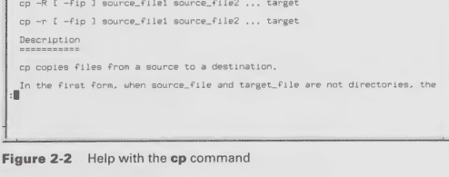

图 2-2 关于 `cp` 命令的帮助

手册集的第一卷中。但是，如果你知道需要从特定卷获取帮助，你可以在命令行上指定该卷。例如，系统管理员可能希望比普通用户更深入地了解 `passwd` 命令。但额外的信息在大多数手册的第 1A 卷中。因此，要获取该信息，他/她会输入：

```
man 1A passwd
```

这将跳过手册第 1 节中 `passwd` 命令的更有限的帮助，直接进入第 1A 节的手册条目，该条目面向系统管理员。

提示：某些版本的 UNIX 允许你用单个命令获取所有手册页。例如，在 SCO UNIX 中，你可以输入：

```
man -a passwd
```

然后获取标准 `passwd` 命令的信息，以及系统管理员可用的额外帮助。因此，请检查你的系统，看看可以向 `man` 命令添加哪些开关以使其更好地为你服务。要做到这一点，请对 `man` 命令本身使用 `man`！

```
man man
```

注意：手册，即使是在线手册，也只能帮到一定程度。有时它们就是不够用。当一切都失败时，就该打电话给你的系统管理员了。这位强大而全能的人，也被称为“超级用户”和`root`，是你尝试了所有其他帮助途径并且走投无路时应该去找的人。他/她有权给你新密码，或登录你的账户并修复你弄坏到无法自行登录修复的东西。他/她通常是你特定 UNIX 系统如何工作的庞大、尽管并非无限的知识和技巧宝库的保管者。为了你自己的缘故，请确保你始终善待这个人！

## 第 3 章

### 文件与目录

### 问题解答主题！

- 文件与文件名 22

  - UNIX 文件名的长度与字符

  - 创建良好的 UNIX 文件名

  - 显示隐藏的文件和目录

  - 查找文件类型及其名称

  - UNIX 文件名和命令的大小写敏感性

- 字符 24

  - UNIX 限制

  - 移除文件名中嵌入的空格

  - 使用通配符移除空格

  - 更改一系列文件的名称

- 通配符 26

  - 基本的 UNIX 通配符

  - 在单条命令中使用多个通配符

  - 使用通配符让命令行更智能

  - 在关键文件周围使用 rm 命令

- 文件权限与保护 28

  - UNIX 文件权限的工作原理

  - 更改文件模式或权限

  - 保护文件免受意外更改

  - 在公共目录中共享文件

  - 使用别名简化权限设置

  - 对超级用户隐藏文件和目录

  - UNIX 目录保护的工作原理

- UNIX 文件系统与目录结构 33

  - 理解 UNIX 目录

  - .（点）和 ..（点点）目录

  - 理解 inode

  - UNIX 文件系统的工作原理

  - 主目录

  - 主目录中的文件与子目录

  - 保持主目录整洁

- 查找丢失的文件 36

  - 查找最近更改过的文件

  - 按类型查找文件

  - 查找大小写未知的文件

  - “缺少连接词”错误消息

  - 查找丢失文件的最佳方法

- 前往目的地的快捷方式 39

  - 在常用目录之间切换

  - 返回主目录

  - 使用 ~ 作为主目录的快捷方式

  - 使用 ~ 作为他人主目录的快捷方式

  - 定义变量来描述目录或文件名

### 文件与目录速览

UNIX 文件和文件名需要一些说明，尤其是对于从未在 UNIX 环境中工作过的人来说。为了高效使用 UNIX，了解 UNIX 文件名的长度上限、可以包含哪些字符，以及良好文件名的特征会很有帮助。你还应该知道如何显示隐藏文件、如何确定文件的类型，以及最重要的是，在 UNIX 世界中大小写敏感的重要性。

UNIX 中的字符有时似乎有自己的生命。你需要知道如何处理文件名中嵌入的空格和怪异字符，以及 shell 脚本如何通过自动化批量重命名文件来节省大量时间。

另一个 UNIX 省时技巧是通配符。在单条命令中使用多个通配符，或使用通配符集合描述让命令行更智能，都能提高你的工作效率。

如果你在 UNIX 世界中工作，理解 UNIX 文件权限和保护至关重要，因为文件权限的设置方式决定了谁可以以何种方式访问该文件。尤其是当你与一群人共享文件或目录时，一些省时技巧可以为你省去不少麻烦。

除非你是系统管理员，否则你不必理解 UNIX 文件系统和目录结构的每一个方面，但如果你至少掌握一些基本概念，并且了解主目录中有哪些内容以及如何保持其精简高效，你的处境会好得多。

**查找丢失的文件**是每个人在某个时候都必须做的事情。你可以根据对文件的各种记忆，通过多种不同的方式找到它们。在这里，你将学习如何利用你对文件所知的一切，尽可能快地找到它。

除非你了解一些巧妙的快捷方式，否则在 UNIX 中导航可能会显得笨拙。与其没完没了地输入文件、目录和路径名称，你可以使用这些技巧尽可能快地到达需要去的地方。

### 文件与文件名

### UNIX 文件名可以有多长？可以包含哪些字符？

UNIX 文件名比 DOS 文件名灵活得多。即使在最古老的系统上，它们也至少可以有 14 个字符长；如今大多数 UNIX 系统支持名为 `reallyridiculouslylong-andcomplex.filename` 的文件。但这可能不是一个真正有用的文件名。文件名唯一硬性规定是：文件名可以包含除斜杠（`/`）以外的任何字符。

### 什么是良好的 UNIX 文件名？

实际上，你可能应该将文件名限制为以下字符：

- 字母数字字符

- 下划线

- 句点

其他字符在你的 UNIX 版本上可能有效，但可能无法很好地移植到其他系统。

### 我可以显示隐藏的文件和目录吗？

以句点开头的文件被称为“点文件”，并且是隐藏的。实际上，它们并不是很


隐藏，但普通的`ls`命令不会显示它们。你可以用同样的方式“隐藏”目录。事实上，许多程序会创建大量隐藏文件和目录，希望你不要动这些文件。

如果你想尝试取消隐藏隐藏文件和目录，可以试试下面这个方法，它在 C shell 或 Korn shell 中同样适用。

```
alias la="ls -aF"
```

然后使用`la`代替`ls`，你就会看到所有文件，包括隐藏文件。区别如下所示：

```
 % ls
Charles
Main.c
Person.dat
trash.dt
% alias la="ls -aF"
% la
./
../
.lastlogin
.noderc
.profile
.rcoadmin.pref
.sh
.sh_history
.xdt_dir/
Charles/
Main.c
Person.dat
.rcoadmin
trash.dt
%
```

正如你所见，我们刚刚创建的命令显示的信息比普通的`ls`命令多得多。如果你系统支持的话（大多数都支持），你可以将`-aF`改为`-AF`，这样就可以去掉列表中的点和点点（`"."` 和 `".."`）。

## 如果我想知道文件的类型除了名称之外？

这实际上是我上面偷偷加的一个小技巧，只是想看看你是否在认真阅读。`ls`命令的`-F`选项告诉 UNIX，你希望同时知道文件类型和文件名。如果文件可执行，名称后会加上`*`；如果是链接到另一个文件的符号链接，文件名后会加上`@`；如果是目录，则会在后面加上斜杠。

## 所有 UNIX 文件名和命令都区分大小写吗？

是的。你可能已经发现`Charlie.txt`和`charlie.txt`根本不是同一个文件。所以你可以猜到，仅靠大小写差异来区分两个文件并不是一个好习惯。一方面，如果你经常将文件从 UNIX 系统复制到其他系统，比如 DOS 或 VMS 机器，这两个文件在另一系统上会变成同一个名字。另一方面，你怎么能确定自己能记住哪个`Charlie.txt`是哪个呢？你可能会浪费大量时间打开错误的文件。

## CHARACTERS

## UNIX 允许我做一些我真的不应该做的事情吗？

是的。这只是其本质上面向程序员的根源的又一个例子。假设是你知道自己在做什么，并且真的想做你刚刚做的事情。这当然很好，但当然，如果你不了解所有可能的后果，就存在严重问题的潜在风险。

例如，DOS 对文件名中允许使用的字符相当严格。你不允许创建包含嵌入空格或奇怪不可打印字符的文件名。好吧，实际上你可以，但这很棘手且困难，至少可以这么说，而且没有任何普通方法可以做到这一点。另一方面，UNIX 却让做这个把戏变得太容易了。但你真的想在文件名中嵌入空格和奇怪字符吗？可能不会。这只是让复制、移动、删除或对包含此类内容的任何操作变得很麻烦，而且绝不是保护它们的万无一失的方法。所以它真正做的只是给你带来麻烦，而没有提供任何真正的保护。

## 我怎样才能从文件名中删除嵌入的空格？

只需将文件名用引号括起来，并用下划线替换空白。对于此操作我们将使用`mv`命令，这是 UNIX 中移动和重命名的意思。

```
mv "file name" file_name
```

这可以处理简单的嵌入空格。

## 但是如果有人在文件名中插入了一个奇怪的字符，它不是空格但看起来像空格给我怎么办？

嗯，这里我们可以用通配符来代替那个奇怪的字符。我稍后会详细介绍通配符，但现在你可以使用问号（`?`）来代替 UNIX 文件名中的任何单个字符。所以我们可以解决上面的问题，即文件名中嵌入了空格，但这个解决方案超出了引号技巧，因为即使我们不知道文件名中隐藏的是什么字符，它也有效。

```
mv file?name file_name
```

嗯，看起来不错。但如果有成堆的这样的文件会怎样？

## 有没有办法我可以更改一系列文件名的名称？

正如大多数使用 UNIX 一段时间的人所发现的那样，你不能使用通配符来`mv`一组文件到新名称。令人沮丧，不是吗？天哪，就连低级的 DOS 都能做到这一点。好吧，有很多方法可以实现这一点，包括一些非常巧妙的`perl`脚本。我们将在本书末尾的第 15 章介绍`perl`。但这里有一个简单的 shell 脚本，可以自动化重命名一批文件的过程，并在重命名每个匹配文件时提示你输入新名称：

```sh
#!/bin/sh
### Bourne shell script to rename files, interactively
for fname
do
    echo -n "Enter new name for '$fname': "
    read newfname
    mv "$fname" "$newfname"
done
```

这里有几个注意事项。`echo`命令行中的`-n`会让大多数版本的`echo`抑制它们通常会在提示符末尾输出的换行。在原始文件名两侧加上单引号，可以更清楚地表明你谈论的是哪个文件名，尤其是当你打算将这个脚本用于包含嵌入空格的文件名时。最后，你也可以同样轻松地用这个脚本创建带有空格的文件名，因为输出文件名被括在引号中。所以要小心。

## 通配符

### UNIX 的基本通配符有哪些？

在你尝试通配符技巧之前，我们先来回顾一下规则。UNIX 中有三种基本通配符：

- `?` 字符匹配任意单个字符

- `*` 字符匹配零个或多个字符

- `[charset]` 表示法匹配字符集`charset`中的任意单个字符

最后一种需要稍多解释。字符集的一个例子是`[cChH]`，它匹配大写或小写的字符 “c” 和 “h”。字符集也可以描述两个字符之间的所有字符，例如`[a-z]`，它会匹配字母表中任意单个小写字母。或者也可以使用`[a-zA-Z]`，它会匹配字母表中的任意单个字符。请注意，字符对匹配的是两个字符之间的所有 ASCII 值（含两端）。

但在大多数情况下，UNIX 对通配符的支持远胜于 DOS。在 DOS 中，`*`之后直到句点之前的所有内容都会被忽略，因此以下命令的结果很可能与你的预期并不完全一致：

```
del *bak.*
```

哎呀，除非你在 DOS 要求确认时留了心，否则你刚刚删除了当前目录中的所有文件。UNIX 则不然，`*`字符会匹配任意数量的字符（包括零个字符），但该行中其余的模式匹配仍然有效。因此`*bak.*`会匹配`newbak.save`、`oldbak.new`，甚至`bak.temp`，但不会匹配`newbak`，因为末尾的句点 (`.`) 缺失了。嗯，这很巧妙，确实让生活轻松了很多。`*bak*`这个模式会匹配上面所有文件，包括`newbak`。

### 我可以在单个命令中使用多个通配符吗？

可以。考虑以下命令：

```
rm a*out*tmp?
```

这是为了删除一批临时输出文件，这些文件看起来像`ab.out.tmp1`、`ac.out.tmp2`等等。你可以看到如何使用多个通配符来简化工作。但 UNIX 还提供了另一个更有用的选项。

### 如何利用通配符让命令行更智能？

UNIX 将某些组识别为集合的一部分，并允许你对该集合使用模式匹配。因此，如果你有一系列文件`file1.tmp`、`file2.tmp`、`file3.tmp`、... `file9.tmp`，你可以用以下命令删除它们：

```
rm file[0-9].tmp
```

```
dump.Jun23
dump.Jun24
dump.Jun25
dump.Jun26
```

以此类推。我们还假设磁盘很快就会满，因为每个文件大约有 100MB。所以你每隔几天就进去删除旧文件，只保留最近的两个。在上面的例子中，你可以输入：

```
rm -i du*[34]
```

这会删除所有以`du`开头且末尾带有 3 或 4 的文件。

### 使用 rm 命令处理关键文件时，我该如何保护自己？

`rm`命令是不可撤销且永久性的。如果你有需要保护的关键且不可替代的文件，请使用`rm -i`，这是交互式删除命令。在删除任何文件之前，它都会提示你确认。事实上，你可以把它设置为一个别名，并在需要确保安全时使用它：

```
alias del="rm -i"
```

你甚至可以把这一选项设为`rm`的“正常”使用方式，但每次删除文件时都要被提示，可能很快就会让你感到厌烦。

## 文件权限与保护

### 关于 UNIX 文件权限，你能告诉我什么？

由于 UNIX 是一个多用户操作系统，它假定你可能不是唯一使用这台计算机的人。这很好，它使一些事情，比如与同事共享文件，变得更加容易。但这也意味着系统中内置了某些保护机制，让你能够控制谁查看、使用和操作你“拥有”的文件。UNIX 系统中的每个用户都有一个唯一的用户名和`id`。用户创建的任何文件都归该用户所有，只有在拥有者许可的情况下才能被读取、使用或更改。如果您获取文件的“长列表”，您可以看到这组权限。例如，文件`harold.cat`的长列表可能如下所示：

```
$ ls -lF harold.cat
-rwxr-xr-x 1 crussel users 1136072 Aug 26 17:05 harold.cat*
```


这表示该文件归`crussel`所有，他有权读取、写入和执行该文件，即文件列表中的第一个`rwx`。此外，同一组`users`中的用户有权读取该文件并执行它，但不能更改或写入它，即文件列表中的第二个`r-x`。最后，全世界的人都可以执行该文件，但不能读取或写入它，即列表中的第三个`--x`。

## 如何更改文件模式或权限？

使用`chmod`。该命令是“change mode”的缩写，让您可以轻松更改您拥有的任何文件，以便只有您想要的人才能读取、更改或执行它。如上所述，有三种基本用户级别：文件的拥有者（`user`）、拥有者的组以及其他所有人（`others`）；以及三种权限级别：读、写和执行。三种用户类型的缩写为：`u`表示用户，`g`表示拥有者的组，`a`表示所有人，`o`表示其他人。

权限的缩写与上面长列表中的相同：`r`表示读，`w`表示写，`x`表示执行。因此，要更改文件`harold.cat`的权限以允许组外用户读取它，请输入：

```
chmod o+r harold.cat
```

`chmod`命令允许您一次对多个文件进行多次更改，因此很容易从每个人那里移除写权限，并从不在您组中的人那里移除所有`.cat`文件的所有权限：

```
chmod a-w,o-rx *.cat
```

## 我可以使用别名来简化设置权限吗？

可以。这里有一个快速技巧来修改文件的权限，增加或减少文件的写权限。将这些别名添加到您的`.kshrc`或`.cshrc`文件中，它们将始终存在。

```
alias w-= "chmod a-w $0"
alias w+= "chmod u+w $0"
```

如果您是 C shell 用户，这看起来会有些不同，因为`alias`命令的语法略有不同：

```
alias w- chmod a-w
alias w+ chmod u+w
```

在任何一种情况下，第一行都会从每个人那里移除写权限，第二行会为文件的所有者重新添加写权限。这只是良好的保守做法。一般来说，让全局的、不可撤销的或影响广泛的命令变得太容易执行是不明智的。在让每个人，甚至您的老板，阅读您的简历之前，您要确保这是有意的。这就引出了另一个提示！

## 我可以隐藏我的文件和目录不被超级用户看到吗？

没有任何东西可以从超级用户那里得到安全保障。了解这一点很重要。您可以通过使用`chmod`命令将权限设置为`600`来设置权限，使得除了您之外没有人甚至可以读取您的秘密文件：

```
chmod 600 resume.doc
```

但这只能做到如此。即使我们没有意外地为此文件留下后门，通过不正确地设置目录权限，超级用户仍然可以随时读取（和更改）您的文件。因此，请认真思考您在硬盘上留下什么。如果某些东西真的很秘密，软盘是更好的存放位置。另外，请记住，任何拥有您密码的人都可以访问您的文件，就像他们是您一样。

## 那么我需要了解 UNIX 目录保护的哪些内容？

关于目录结构的内容稍后会详细介绍（请参阅下面的“UNIX 文件系统和目录结构”），但在安全部分中提到目录的权限如何工作很重要。UNIX 中的目录在大多数用途上只是一个普通的文件名。它附加的权限集完全相同，只是第一列不同；对于大多数普通文件，第一列显示为`-`：

```
-rwxr-x--x  1 crussel users 76884 Jan 30 14:47
alfie.cat
```

然而，当列表是目录时，长列表的第一列将包含字母`d`，权限的含义会略有不同，如下所示：

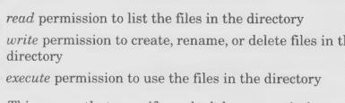

目录上的权限分解如下：

- 读取权限可列出目录中的文件
- 写入权限可在目录中创建、重命名或删除文件
- 执行权限可使用目录中的文件

这意味着即使您没有权限读取文件，如果您有权限写入文件所在的目录，您也可以复制它（您现在拥有它！）、删除它、移动它或重命名它。即使您无法读取目录的内容或写入它，如果您有执行权限，您仍然可以执行程序。

## UNIX 文件系统和目录结构

只要你知道（或能猜到）程序的确切名称，就可以在目录内找到它。

### 什么是 UNIX 目录以及它与其他（子）目录的关系？

UNIX 与几乎所有主要操作系统一样，使用的是所谓的层次目录结构。这有时也被称为树形结构，但无论叫什么，它都是当今大多数操作系统采用的相同基本结构。有一个“根”目录，在其下有一系列子目录。每个子目录之下又可以有多个子目录，而这些子目录之下又可以有多个子目录，依此类推。这种结构可以有多深取决于 UNIX 的具体版本，但在几乎所有情况下，其深度都足够让你永远不必担心层级用完。

那么什么是目录呢？实际上，它只是一个文件，其中保存了其内部文件和子目录的名称，以及每个文件或目录的 inode 编号。（想知道 inode 是什么？请参阅下面的“真的需要理解 inode 吗？”）

### 什么是`.`（点）和`..`（点点）？

这是两个特殊的目录名，使移动变得更容易。点目录是你的当前目录，而点点目录则是你所在位置的上级目录。因此，如果你与一群人合作一个项目，并且将文档文件存储在一个目录中，源代码文件存储在另一个目录中，头文件存储在第三个目录中，等等，使用绝对路径名切换到文档目录会很麻烦。你真的每次都想输入：

```
cd /usr/projects/newmodel/docs
```

来更新你刚刚修改的头文件（位于`/usr/projects/newmodel/headers`）的文档吗？几乎不可能。因此，要切换到文档目录，只需输入：

```
cd ../docs
```

### 我真的需要理解 inode 吗？

值得庆幸的是，不需要。`inode`（发音为“EYE-node”）是 UNIX 用于跟踪系统中每个文件位置的数据结构，以及其他重要信息，如其权限、所有权、时间戳等。在这种意义上，它有点（但不是很多）像 DOS 磁盘上的 FAT 表。你可以通过使用带`-i`开关的`ls`命令来查看与文件关联的 inode 编号：

```
$ ls -il
total 4
441315 -rwxr-xr-x 1 crussel users 884 Jan 30 14:47
stanley.cat
```

这对你作为用户意味着什么？没什么。毕竟，我们确实暗示你可以忽略这一节。这是那些被称为系统管理员的神秘人物的领域：那些戴着口袋保护套并带着受迫害表情的人。

### UNIX 文件系统是如何工作的？

如果你对这个主题不感兴趣，可以随意跳过这一节，但对于好奇的人来说，这里就开始了。UNIX 对文件系统的概念与典型的 DOS 甚至 Macintosh 用户所期望的有很大不同。每个 UNIX 机器都必须有一个“根”文件系统，它类似于 DOS 机器上的`C:`驱动器，但 UNIX 与其他文件系统之间的相似之处到此为止。不是为每块新增的硬盘分配额外的驱动器号，而是每块硬盘都有自己的文件系统，然后“挂载”到根文件系统上。因此，在一个拥有大量用户和大量商业程序的大型系统中，你很可能拥有例如根文件系统、一个包含所有用户主目录的`/u`文件系统，以及另一个包含大多数商业程序的`/usr`文件系统。而且，如果你在一个分布式工作站环境中工作（而不是一个大型中央服务器），`/u`文件系统实际上可能在你登录的任何机器上都相同。在其中一台机器上，它物理上位于该机箱中，但在所有其他机器上，它是远程挂载的。这种设置允许你使用任何可用的工作站，而不必担心它是哪一台。你的主目录始终完全相同。

### 什么是主目录？

这是每个 UNIX 计算机上的每个用户都拥有的、属于他或她自己的目录。对于用户`charlie`来说，这个目录可能是`/u/charlie`、`/users/charlie`、`/home/charlie`或文件系统中的其他几个位置之一，具体取决于 UNIX 的版本和你系统上超级用户的偏好。但结果是一样的：它属于你。你在其中创建的文件和目录归你所有，只有在得到你的许可后，其他人才可以更改和使用它们。总是有一个前提条件，那就是没有任何东西能对超级用户隐藏。

### 典型用户的主目录包含哪些子目录，这些子目录中有哪些文件？

你的主目录是你存储控制环境的文件、启动文件的地方，通常还包括你随着时间推移创建的各种杂乱文件。在这种意义上，它有点像你招待客人时把所有东西都扔进去的壁橱。这使得很难分辨哪个文件是哪个，或者找到你现在绝对需要的那个文件。所以做一点整理。每个用户都应该有几个子目录来分类特定类型的文件，然后使用它们。例如，我的主目录有以下子目录：

- `bin`：可执行程序和脚本放在这里
- `docs`：通用的 WordPerfect 文件放在这里
- `notes`：用于我自己的快速笔记的地方
- `wrksheet`：电子表格文件放在这里
- `source`：位于`bin`中的各种可执行程序的源文件
- `tmp`：临时文件存放处
- `Mail`：用于 elm 邮件阅读器的必需存储位置
- `arc`：一个存放我不常需要但又不想删除的物品压缩版本的存放处
- `junk`：不适合放在其他地方的东西

其他子目录会根据正在进行项目的不同而增减。例如，我目前在`docs`目录中有个`UNIXanswers`目录。当本书完成后，整个目录将被压缩成一个单一文件并存入`arc`目录。


那么实际上你的主目录根级会放什么呢？尽可能少的绝对最小值。所有不必放在主目录中的东西都应放在子目录中。UNIX 会运行得更快，因为它非常讨厌目录中文件太多。并且你会在寻找文件时花费更少的时间。

## How can I keep my home directory clean?

基本上，你主目录中唯一的应该存在的文件是控制启动、关闭和环境的“点”文件。像 `.profile`、`.kshrc`、`.login`、`.cshrc`、`.logout`、`.exrc` 和 `.xsession` 这样的文件。我们将在第 5 章中更详细地检查这些文件中的大多数，因为它们对于自动化和控制你的设置至关重要。由于它们以点开头，这些文件通常不可见，因为它们对简单的 `ls` 命令是隐藏的。

## FINDING LOST FILES

### How can I find a file I’ve changed recently?

试试 `ls -t`。这个小技巧本身就能找到你正在寻找的 85% 的文件。`-t`（据推测代表 time）会按文件最后更改时间排序列出文件，最新的在前。加上 `-u` 开关，排序将按文件最后访问时间，无论是否被更改。将此与 `more` 结合使用以

防止列表从屏幕上滚动出去，你就拥有了一个有用的别名：

```
alias lt="ls -laFtu | more"
```

这将为你提供当前目录中最近被访问过的所有文件的长列表。

### Can I find a file when I know what kind it is but not where it is?

现在是时候请出重量级选手——UNIX `find` 命令了。这个强大的实用程序将搜索你的整个文件系统，查找匹配一组标准的文件或文件，或整个文件系统的任何子集。此命令语法为

```
find <pathname-list> <operator>
```

其中 `pathname-list` 可以是一个或多个目录及其子目录，而 `operator` 可以是以下任意一个：

- `-name <filename pattern>`
- `-perm <file mode>`
- `-type <filetype>`
- `-user <username>`
- `-size <# blocks>` `+ # blocks` means larger than
- `-atime <#days>` accessed time
- `-mtime <#days>` modified time
- `-ctime <#days>` changed time
- `-newer <file>` newer than the designated file

在这些选项中，最有用的可能是 `"-name"` 选项。它会接受通配符并执行通常的模式匹配，因此可以相当灵活。

例如，你知道你有一个文件是上个月用于月度进度报告的，你想把它用作模板，但找不到。你确实记得

不过，它的文件名中某个地方有 "Aug"。没问题。只需使用命令

```
find ~/ -name "*Aug*" -print
```

换句话说，从主目录树的顶部开始查找名称中包含 "Aug" 的所有文件，并将结果打印到屏幕上。注意名称周围使用引号。这可以防止 shell 在 `find` 有机会处理之前就解释通配符。这是 `find` 命令最基本的形式，所有其他 `find` 命令都源于此。

### Can I find a file even if I don’t know whether its name begins with an upper- or lowercase letter?

如果你不确定上述报告是 "Aug" 还是 "aug"，你可以轻松地在上述命令的 `operator` 部分添加第二个参数：

```
find ~/ -name "*Aug*" -o -name "*aug*" -print
```

在此表达式中，我们使用了 `"-o"`，它表示使用逻辑 OR 进行搜索。名称中包含 "Aug" 或 "aug" 的任何文件都将满足条件。

你也可以使用正则表达式匹配以更简洁的方式执行上述搜索：

```
find ~/ -name "*[Aa]ug*" -print
```

在这里我们说要查找所有文件名中包含以 "A" 或 "a" 开头的字符串 "ug" 的文件——`[Aa]` 语法表示任一字母都满足正则表达式。

### Why does find keep complaining about a missing conjunction?

`find` 的一个问题是它试图扩展整个命令行来弄清楚你想要什么。但你需要将特殊字符（“元字符”）隐藏起来，直到 `find` 准备好处理它们。所以我们要么用引号将特殊字符括起来，要么使用反斜杠字符来转义下一个字符的含义。因此：

```
find ~/ -name [Aa]ug* -print
```

`group` 和你需要快速移动到项目的 `working directory`——`/users/shared/projects/newmodel/colormatch`。这确实很麻烦，而且不是你每次都想输入的东西！所以试试这个：

```
PHOME=/users/shared/projects/newmodel/colormatch
export PHOME
alias goproj=cd $PHOME
```

将其包含在你的 `.kshrc` 文件中，它在你需要时就会可用。最好的部分是，如果你切换到不同的项目，你所要做的只是更改变量。你的手指可以继续使用相同的命令。

### 我可以用什么命令快速返回到我的 home 目录？

是的；试试单独使用 `cd`。这个小技巧无论你迷路有多远，都能让你快速回到 home 目录。

### 我可以用 ~ 作为 home 目录的快捷方式吗？

可以。当你想描述位于 home 目录下的目录或文件时，使用 `~` 作为 home 目录的简写可以节省输入。例如，要从任何地方进入你的个人 `bin` 目录，输入 `cd ~/bin`。

### 我可以用 ~ 作为其他人 home 目录的快捷方式吗？

可以。当你想描述位于他人 home 目录下的目录或文件时，使用 `~` 加上他们的用户名作为其 home 目录的快捷方式，可以节省输入和弄清楚他们 home 目录的确切位置。例如，如果你知道 Gladys Meep 在她的 home `bin` 目录中藏了一些有用的工具，你就可以在她设置权限允许的情况下，通过输入 `cd ~gmeep/bin` 来访问它。

### 我可以定义一个变量来描述我经常使用的任何目录或文件名吗？

可以！只需在命令中替换变量，就能把你经常使用的任何文件或目录的长路径名缩短。确保你记得 `export`——或在 `csh` 中使用 `setenv`——该变量，并将其包含在你的 `.kshrc` 或 `.cshrc` 文件中。这样，它将始终可用。

## 第 4 章

## vi

### 回答主题！

- **VI 的多种模式** 44
  - 使用模态编辑器和 vi 的模式
  - 在 vi 中在模式之间切换
  - 在 ex 和 vi 之间切换
- **使用 VI 的基础** 45
  - `vi` 的版本
  - 使用 `vi` 编辑一系列文件
  - 编辑并保存对一个文件的更改并移动到下一个
  - 备份并编辑文件列表中的上一个文件
  - 重新加载当前文件
  - 如何发音“!”
  - 查看剩余要编辑的文件
  - 从头开始同一份文件列表
- **移动** 47
  - `vi` 中的基本光标移动键
  - 一屏一屏地翻阅文档
  - 一次移动半页光标
  - 移动到文件的顶部或底部
  - 移动到当前行的开头或结尾
  - 重新设置屏幕
  - `vi` 中的其他移动命令
  - 在 `vi` 中使用“光标”键
  - 查看你在当前文件中的位置
  - 交换两个字符
  - 更改你已输入字符的大小写
- **插入和替换文本** 50
  - `vi` 中的基本文本插入命令
  - 重打你刚刚输入的单词
  - 重新开始文本插入
  - 撤销对当前行的更改
  - 替换当前字符并在不覆盖的情况下插入文本
  - 替换整行当前行
  - 使用 `c` 命令
  - 重复上一次文本更改
- **搜索（和替换）文本** 53
  - 查找文本
  - 搜索和替换文本
  - 运行 `substitute`
  - 对整个文件执行命令
- **剪切和粘贴** 56
  - 将一行剪切到粘贴缓冲区
  - 将一行复制到粘贴缓冲区
  - 将一个字符剪切到粘贴缓冲区
  - 使用 `dd` 命令与 `yank` 的区别
  - 使用命名缓冲区以便更轻松地编辑
  - 使用命名缓冲区进行粘贴操作
  - 将粘贴缓冲区的内容放在当前行之后
  - 将一个单词剪切到缓冲区
  - 更改编辑器的外观和感觉
- **宏** 61
  - 什么是宏
  - 自动化在命令模式下开始的常用序列
  - 自动化在文本插入模式下开始的频繁任务
  - 创建一个文本插入模式命令以查看你在当前文件中的位置
  - 减少输入常用短语所需的击键次数


## 其他基本命令 64

- 保存更改并退出 vi
- 在当前文件中包含另一个文件
- 将当前文件的一部分写入“临时”文件
- 不保存退出
- “智能”退出命令
- 获取字数或行数
- 另一个编辑器——emacs
- 恢复文件

## vi @ 一览

无论你如何与 UNIX 交互，早晚你都需要编辑一个文本文件。然后你就面临着最精彩的文本编辑器之一——`vi`。在开始使用 `vi` 之前，了解它的模式最好，因为它与你可能习惯的文本编辑器的工作方式相当不同。

一旦你学会了使用 `vi` 的基础，你就能打开一个或多个文件进行编辑，并按你希望的方式操作这些文件。

`vi` 用于在文件中移动的命令并不难学，但也谈不上直观。为了高效工作，了解最快到达你想去的地方的方法很有帮助。

插入和替换文本是任何文本编辑器的两个最基本功能。无论你想更改字符、单词还是整行，这里有命令让 `vi` 听从你的指令。

插入模式下，你不能像在大多数编辑器或文字处理器中那样直接向下翻页或跨越一个词。而在外部模式下，你实际上根本不是在使用 `vi`，而是在使用 `ex`。所有这些都只是与大多数编辑器或文字处理器有所不同，可能需要一段时间来适应。好吧，需要很长时间来适应。

### 如何在 vi 中在模式之间切换？

当你启动 `vi` 时，你始终处于命令模式。从那里开始取决于你发出的命令。为了切换到插入模式，输入一个期望文本输入的命令（见下文“插入和替换文本”）。同样，要切换到外部模式，输入以 `:` 开头的命令，因为 `ex` 命令前面就是这个（见下文“搜索（和替换）文本”）。要返回命令模式，`ESC` 总是最好的选择。

### 如果我发现自己突然进入了 ex 而不是 vi，该怎么办？

只需输入 `vi` 即可恢复正常。很可能你不小心按下了 `Q`，即大写的“Q”键，这是进入 `ex` 的快捷方式。

## 使用 VI 的基础知识

### 什么是 vi，我可以使用不同的版本吗？

`vi` 是“visual interface”的缩写，实际上是 `ex` 编辑器的扩展，而 `ex` 编辑器本身是 `ed` 编辑器的扩展版本。几乎没有人再使用 `ed`，所以我们可以忽略它，而使用 `ex` 的人通常只是那些被困在某种不支持 `vi` 的终端上的人。

实际上，大多数 UNIX 实现中包含三种版本的 `vi`——我们在这里主要讨论的标准版，你使用 `vi` 命令启动它。第二种是只读版本，用于查看文件，不允许你更改文件——无论是意外还是故意。你通过在命令行输入 `view` 来运行此版本。最后，还有一个为新手准备的“脑残”版本，你通过在命令行输入

```
vedit
```

来启动。最后一个你可以安全地忽略。本章中，我们将向你展示如何将 `vedit` 版本中包含的一些相当有用的选项添加到你的标准 `vi` 中。

### 我在使用 vi 时可以编辑一系列文件吗？

可以。只需在启动 `vi` 时在命令行中包含你想要处理的所有文件。你可以在这里使用通配符，因此只需输入即可轻松编辑所有“dot cat”文件

```
vi *.cat
```

当然，你可以使用 shell 内置的模式匹配来加载文件，从而变得更加复杂，但你明白了。一旦你在命令行中全部包含它们，在 `vi` 中在它们之间移动就非常容易。

### 如何完成当前文件的编辑，保存更改并移动到文件列表中的下一个文件？

使用命令模式下的 `:n`。这个小技巧可以为你节省大量时间，使编辑大量文件变得容易。只需记住，如果你想在文件之间剪切和粘贴，你将需要使用命名缓冲区。有关命名缓冲区的更多信息，请参见下文“搜索（和替换）文本”和“剪切和粘贴”。

> 提示：某些版本的 `vi` 不支持上面显示的自动保存并编辑下一个文件。对于这些版本，如果你对当前文件进行了任何更改，你将需要执行两个单独的步骤——保存文件然后移动到下一个文件。在命令模式下使用 `:w` 后跟 `:n`，如果你被困在其中一个版本中。

### 有没有办法返回并编辑文件列表中的上一个文件？

可以。从命令模式使用 `:e #`。井号是“上一个打开的文件”的简写。

### 我可以重新加载当前文件并从头开始吗？

使用命令行中的 `:e! %`。在这里我们再次使用外部模式，告诉 `vi` 编辑文件而不保存当前文件（“`e!`”部分），而我们想要编辑的文件是当前文件（“`%`”部分）。

### ! 怎么读？

它读作“bang”，如“e-bang”。

### 有没有办法查看还剩下哪些文件可编辑？

可以；尝试 `:args`。在命令行上加载大量文件是很好的，但如果你记不清还有哪些文件排队等待，这个外部命令会显示剩余的文件。

### 如果我发现自己犯了可怕的错误，我可以从同一份文件列表重新开始吗？

可以；只需倒带即可。要实现这一点，使用 `:rewind` 命令保存当前文件的任何更改，并从列表开头重新开始，或使用 `rewind!` 放弃对当前文件的任何更改。

## 移动

### vi 中基本的光标移动键是什么？

命令模式下基本的光标移动键是“`j`”、“`k`”、“`l`”和“`h`”键。它们分别将光标向下移动一行、向上移动一行、向右移动一个字符和向左移动一个字符。在它们前面加上一个数字，你就可以移动那么多行或字符。因此，要在当前文件中向下移动 25 行，发出命令 `25j`。但是，如果当前光标位置下方少于 25 行，`vi` 只会发出蜂鸣声。向上移动时如果行数不足也是如此。你不会得到任何移动，直到你提供一个可行的命令。

`out the problem.` 它可能与终端仿真略有偏差有关。

### vi 中还有其他移动命令吗？

有很多其他的移动命令，例如 `M` 将光标移动到屏幕中间的行，`H` 将光标移动到屏幕顶部的行，以及 `L` 将光标移动到屏幕底部的行。不要试图记住它们全部。只需习惯使用其中几个可以组合起来到达所需位置的命令，就足够了。不要忘记所有这些命令都区分大小写。输入小写字母而不是大写字母，结果会出乎意料。

### 在 vi 中可以依赖键盘上的“光标”键安全吗？

不行！学习基本的移动键并使用它们。如果你养成总是使用光标键的习惯，迟早会遇到麻烦。你可能需要在不同的键盘上工作，或者登录到使用不同键盘的远程机器。命令键与你所使用的键盘无关，但键盘上的光标键却不一定，它们可能映射正确也可能不正确。

### 我可以在当前文件中看到自己的位置吗？

可以；按 `CTRL-G`。这还会提供一些其他信息，例如文件自上次保存以来是否已被修改。另一种获取相同信息的方法是 `:f` 外部模式命令序列。

### 如何交换两个字符？

将光标放在第二个字符上，并在命令模式下输入 `xp`。这会删除第二个字符，然后将其放在第一个字符前面，而第一个字符则移到了光标下方。

### 我可以更改已输入字符的大小写吗？

可以；使用 `~` 命令。与大多数 `vi` 命令一样，你可以在此命令前加上数字 `n`，使其更改接下来 `n` 个字符的大小写。

## 插入和替换文本

> 注意：这些是任何文本编辑器最重要的两种功能之一。发出下面讨论的任何命令都会自动将 `vi` 切换到插入模式，并根据你的具体指示添加或更改文本。

### vi 中基本的文本插入命令有哪些？

以下是必备内容的简短列表：

- `i` 从当前光标前方开始插入文本，直到按下 `ESC`
- `I` 从当前行开头开始插入文本，直到按下 `ESC`
- `a` 从当前光标之后开始插入文本，直到按下 `ESC`
- `A` 从当前行末尾开始插入文本，直到按下 `ESC`
- `r` 替换当前光标位置的字符
- `R` 从当前光标位置开始替换文本，直到按下 `ESC`
- `o` 在当前行下方打开新行。`ENTER` 将打开另一行，`ESC` 返回命令模式
- `O` 在当前行上方打开新行。`ENTER` 将打开另一行，`ESC` 返回命令模式

几乎所有这些文本插入命令的工作方式都相同。当你在命令模式下时，它们会将你切换到文本插入模式并允许你开始输入文本。它们之间的唯一区别是文本实际会被输入的位置。列表中有一个命令略有不同：`r` 命令，它会替换单个字符并立即返回到命令模式。

### 如果我不喜欢刚输入的单词，可以做什么？

可以；按 `CTRL-W` 来重写它。这是少数几种在保持插入模式的同时移动光标位置的方法之一。

### 如果我想重新开始文本插入怎么办？

按 `CTRL-U`。另一种方法是按 `ESC` 返回命令模式，然后按 `u` 执行撤销。撤销命令只有单层深度，因此请立即撤销，否则你将不得不以困难的方式修复它。

### 如何撤销我对当前行所做的所有更改？

尝试从命令模式按 `U`。这可以绕过单层撤销的限制，但仅限于当前行。一旦你将光标移离该行，就无法撤销该行上的更改，除非它们仍在单层撤销缓冲区中。

### 我可以替换当前字符然后插入更多文本而不覆盖已有内容吗？

可以；使用 `s` 命令。我们知道可以用 `r` 替换单个字符，也可以用 `i` 或 `a` 插入文本，但使用 `s` 可以绕过 `r` 的限制，而不必担心覆盖不想要的内容。如果你想替换接下来的十个字符，然后开始插入文本，只需输入 `10s` 然后开始更改即可。

### 那替换整个当前行呢？

使用 `S`。这将删除当前行，将光标移动到第一列，并切换到插入模式。

### c 命令到底能为我做什么？


它可以更改一个词、一行或一个句子。实际上，这个命令还能做更多。将简单的 `c` 与更复杂的光标移动命令组合起来，你就能得到非常顺畅的操作。首先是简单的那些，用表格列出可能最容易，所以请看表 4-1。

在大多数版本的 `vi` 中，你即将更改的文本将以 `$` 结束于更改的最后一个字符。而在所有情况下，当你到达该最后一个字符时，你会从覆盖现有文本切换到将现有文本向右推到光标前方。这提供了一种快速修复单词、短语或句子然后继续工作的强大方法。

| Command | Result |
|---|---|
| `cw` | Change text from current cursor to end of current word. |
| `c n w` | Change text from current cursor to end of nth word. |
| `cb` | Change text from beginning of current word to character in front of cursor. |
| `c n b` | Change text from beginning of nth previous word to character in front of cursor. |
| `c )` | Change text from current cursor to end of sentence. |
| `c (` | Change text from preceding start of sentence to character in front of cursor. |
| `cc` | Change entire line. |
| `c )` | Change text from current cursor to end of paragraph. |
| `c {` | Change text from preceding start of paragraph to character in front of cursor. |
| `c / c` | Change text from current cursor through first occurrence of character c. |
| `c n / c` | Change text from current cursor through nth occurrence of character c. |
| `c F c` | Change text from previous occurrence of character c through current cursor position. |
| `c n F c` | Change text from nth previous occurrence of character c through current cursor position. |

Table 4-1 The Change Command

## 有没有办法重复我上一次的文本更改？

有；使用点命令（`.`）。这个小技巧节省大量时间。需要在接下来的几行开头添加几个空格？好吧，你可以算出确切的命令序列并编写一个宏来执行它（参见本章后面的“Macros”），或者只是在当前行执行 `I` `Escape`（“`I`”，空格，`ESC`），按 `j` 移动到下一行，然后按 `.`（点）。对需要缩进的每一行重复此操作。

## SEARCHING FOR (AND REPLACING) TEXT

### 找到某些文本最简单的方法是什么？

啊，现在我们进入外部模式。这里我们使用 `ex` 命令集。因此，要从当前光标位置搜索某物，我们使用

```
/searchpattern
```

要向后搜索，请使用

```
?searchpattern
```

搜索模式可以是简单的文本片段，例如在文件中搜索单词“Priscilla”，也可以是更复杂的模式匹配字符串。让我们稍后再讨论模式匹配。

### 我可以搜索并替换文本吗？

当然可以。使用外部模式的 `substitute` 命令搜索一个模式并将其替换为另一个模式。语法是

```
x,ys/searchpattern/replace/options
```

因此，要查找对老板的一系列不友好的提及并将其替换为“Priscilla”，以下命令即可生效：

```
1,$s/catbrain/Priscilla/g
```

作为此命令中 `1,$` 的替代，如果你觉得节省这两个按键值得记住，可以使用 `%`。

### 我必须知道自己在第几行才能对接下来的十行运行 substitute 吗？

不需要。使用 `.`（点）表示当前行，然后告诉 `vi` 对接下来的十行执行替换：

```
.,+10s/fishbreath/Alfie/g
```

## `c` 命令到底能为我做什么？

它可以更改一个词、一行或一个句子。实际上，这个命令还能做更多。将简单的 `c` 与更复杂的光标移动命令组合起来，你就能得到非常顺畅的操作。首先是简单的那些，用表格列出可能最容易，所以请看表 4-1。

在大多数版本的 `vi` 中，你即将更改的文本将以 `$` 结束于更改的最后一个字符。而在所有情况下，当你到达该最后一个字符时，你会从覆盖现有文本切换到将现有文本向右推到光标前方。这提供了一种快速修复单词、短语或句子然后继续工作的强大方法。

| Command | Result |
|---|---|
| `cw` | Change text from current cursor to end of current word. |
| `c n w` | Change text from current cursor to end of nth word. |
| `cb` | Change text from beginning of current word to character in front of cursor. |
| `c n b` | Change text from beginning of nth previous word to character in front of cursor. |
| `c )` | Change text from current cursor to end of sentence. |
| `c (` | Change text from preceding start of sentence to character in front of cursor. |
| `cc` | Change entire line. |
| `c )` | Change text from current cursor to end of paragraph. |
| `c {` | Change text from preceding start of paragraph to character in front of cursor. |
| `c / c` | Change text from current cursor through first occurrence of character c. |
| `c n / c` | Change text from current cursor through nth occurrence of character c. |
| `c F c` | Change text from previous occurrence of character c through current cursor position. |
| `c n F c` | Change text from nth previous occurrence of character c through current cursor position. |

Table 4-1 The Change Command

## 有没有办法重复我上一次的文本更改？

有；使用点命令（`.`）。这个小技巧节省大量时间。需要在接下来的几行开头添加几个空格？好吧，你可以算出确切的命令序列并编写一个宏来执行它（参见本章后面的“Macros”），或者只是在当前行执行 `I` `Escape`（“`I`”，空格，`ESC`），按 `j` 移动到下一行，然后按 `.`（点）。对需要缩进的每一行重复此操作。

## SEARCHING FOR (AND REPLACING) TEXT

### 找到某些文本最简单的方法是什么？

啊，现在我们进入外部模式。这里我们使用 `ex` 命令集。因此，要从当前光标位置搜索某物，我们使用

```
/searchpattern
```

要向后搜索，请使用

```
?searchpattern
```

搜索模式可以是简单的文本片段，例如在文件中搜索单词“Priscilla”，也可以是更复杂的模式匹配字符串。让我们稍后再讨论模式匹配。

### 我可以搜索并替换文本吗？

当然可以。使用外部模式的 `substitute` 命令搜索一个模式并将其替换为另一个模式。语法是

```
x,ys/searchpattern/replace/options
```

因此，要查找对老板的一系列不友好的提及并将其替换为“Priscilla”，以下命令即可生效：

```
1,$s/catbrain/Priscilla/g
```

作为此命令中 `1,$` 的替代，如果你觉得节省这两个按键值得记住，可以使用 `%`。

### 我必须知道自己在第几行才能对接下来的十行运行 substitute 吗？

不需要。使用 `.`（点）表示当前行，然后告诉 `vi` 对接下来的十行执行替换：

```
.,+10s/fishbreath/Alfie/g
```


为了确保你不会意外更改不该更改的内容，请在最后一个斜杠后使用 `c` 选项。这会打印出将被替换的字符串，用 `A` 字符突出显示它。按 `Y` 执行更改，按其他任意键则保持原样。

## 如何对整个文件执行一个命令？

使用 `global` 命令。这让你可以在文件中搜索并执行 `yank` 命令，例如，将匹配特定模式的行追加到缓冲区。因此：

```
:g/Priscilla/y A
```

会抓取所有包含“Priscilla”的行，将它们放入缓冲区 `a`，并在已有的内容之后追加。这条命令让你能做一些相当巧妙的事情，比如搜索所有以数字开头的行并缩进五个空格：

```
:g/^[0-9]/s/^/     /g
```

使用此命令，图 4-1 中的文本就会像图 4-2 中的文本那样对齐。

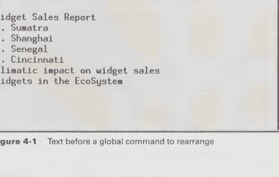

Figure 4-1 Text before a global command to rearrange


Figure 4-2 After the global command, the numbered lines are indented

Let’s examine this command a bit more closely. Here’s what it means, piece by piece:

- `:` — Do this command in ex mode.
- `g` — Execute the global command.
- `/\[0-9]/` — Search for lines that begin (the `^`) with a number.
- `s` — Execute the substitute command.
- `/\/g` — Substitute five spaces (or put the number of spaces you want between the last two slashes) for the beginning of the line, and do it globally without asking.

As you can see, this command gives us some pretty powerful ways to manipulate text within `vi`, using the external mode commands.

## CUTTING AND PASTING

### What’s the command for cutting a line into the paste buffer?

Simple—`dd`. This will cut a single line of text. Oh, you wanted the next ten lines? That’s simple too—type `10dd` and you have them.

### Can I copy a line into the paste buffer?

Yes; press `yy`. The `yank` command, this works just like `dd` except that the line(s) are copied to the buffer, not deleted.

### How can I cut a character into the paste buffer?

Use the `x` command. This will delete the character under the cursor, pulling the line back. When it reaches the end of the line, it starts deleting the character before the cursor (backspace). For ten characters, use `10x`.

> Tip: Text in the paste buffer is only a single level. As soon as you make a deletion or "yank" (copy) to the paste buffer, you lose what was in there before. So think before you yank or delete something. Have you finished with the current buffer’s contents?

### I've heard that using the `dd` command is better than yanking. Is this true, and if so, why?

If you yank text, it doesn't go into the stack, so you can only get at the last text you yanked. But if you delete it, it goes into a nine-level "stack" (last in, first out). So, to add a line to the stack without actually deleting it, do a `dd` followed by an immediate `P`. Your file hasn't changed, but you have added the current line to the buffer. Now, go ahead and delete something else. Want that first line back? It has now been pushed one up on the stack by the second deletion, so to get it back, do a `2p` and you will insert it after the current line. Pretty slick. The only problem with this, however, is keeping track of what's in which buffer. Using named buffers is better, because they don't change unless you overwrite them, but if you get in the habit of using the `ddP` combination instead of `yy`, you will save yourself some grief often enough to make the extra keystroke worth it.

### Can I use the named buffers to make editing easier?

Absolutely. All that deleting and yanking is nice, but what if you need to grab a piece from here, a piece from there, and another piece from somewhere else? Hmmm, that single-level buffer isn't going to get it done, is it? No sweat—`vi` provides for a total of 26 "named buffers." That should be enough for almost anyone. The buffers are named `a`–`z`, and you cut or copy text into them in exactly the same way you would into the regular cut/copy/paste buffer. Except you precede the cut or copy command (`dd` or `yy`) with `"a` for the `a` buffer, `"b` for the `b` buffer, and so on.

### What's the smartest way to use named buffers for my paste operation?

Try preceding the paste command with `"a` where `a` is the named buffer. If the text you want is in the `b` buffer, use `"b`, and so forth.

### Is there a way I can put the contents of the paste buffer after the current line?


Yes; use the `p` command. If you have cut or yanked only a partial line, the text in the buffer will be placed in the current line, after the current cursor position. Use `P` to place the text before the current line or position.

## How can I cut a word into the buffer?

Use `dw`. Actually, this is the simplest example of the more general rule. Use `decursormovement` or `ycursormovement` to cut or copy text into the buffer. The cursor movement keys are the same as for the change command of Table 4.1.

## How can I give my text the right look?

Editors are very personal things. What works for some people may not work for others. So, a good editor lets you change the way it behaves and looks to the point where you can be comfortable with it. In `vi`, there are three basic commands to change the look and feel of your editor, and all are external mode commands. The first is the `:set` command. Use this to set all sorts of options. The list may vary slightly, depending on your particular implementation of `vi`, but Table 4-2 shows some of the most common.

| Option | Description |
|---|---|
| `ai` | Autoindent—new lines start lined up with the indent from the previous line. |
| `noai` | Autoindent off (the default). |
| `aw` | Autowrite—current buffer contents are written when escaping to the shell, or using `:n` to go to the next file. |
| `noaw` | Autowrite off (the default). |
| `flash` | Flash screen on an error instead of beeping (the default). |
| `noflash` | Use a beep instead of a flash. |
| `ic` | Ignore case on searches or pattern matching. |

Table 4-2 vi options

| Option | Description |
|---|---|
| `noic` | 不要忽略大小写（默认值）。 |
| `lisp` | 设置自动缩进以在编辑 lisp 程序时更好地对齐。 |
| `nolist` | 自动缩进与上一行的开头对齐（默认值）。 |
| `magic` | 在进行模式匹配时使用完整的元字符集（默认值）。 |
| `nomagic` | 将元字符限制为仅 `^` 和 `$`。 |
| `mesg` | 允许其他用户向你的终端写入（默认值）。 |
| `nomesg` | 禁用对你的屏幕的写权限。 |
| `nu` | 在屏幕左侧边缘显示行号。 |
| `nonu` | 不显示行号（默认值）。 |
| `ro` | 只读；防止文件被更改，除非通过 `:w!` 显式覆盖该设置。 |
| `noro` | 正常读写模式（默认值）。 |
| `remap` | 允许宏定义直接链接到已映射的命令（默认值）。 |
| `noremap` | 使宏定义显式化。 |
| `showmatch` | 当输入闭合 `)` 或 `]` 时，短暂高亮匹配的 `(` 或 `[`。 |
| `noshowmatch` | 不高亮匹配的分隔符（默认值）。 |
| `showmode` | 在文本输入模式时，在底行显示高亮的模式指示器。 |
| `noshowmode` | 不指示当前模式（默认值）。 |
| `ts=n` | 将制表符间距设置为 `n` 个字符。默认值为 8。 |
| `warn` | 在文本自上次写命令以来被修改时，在 shell 转义前发出警告（默认值）。 |
| `nowarn` | 在 shell 转义前不发出警告，直接执行。 |
| `ws` | 搜索会在文件开头处换行并继续（默认值）。 |
| `nows` | 在搜索到达文件末尾时不换行。 |
| `wm=n` | 换行——当设置为非零时，当当前单词会超出边距时自动插入新行。从显示器右边缘到边距的字符数，即 `wm=8` 将 80 列显示器的右边缘设在第 72 列。 |

**表 4-2** *vi 选项（续）*

现在你知道了 `vi` 中的选项，这里有一些免费建议：

- **将 `showmode` 设置为开启。** 突然发现你只是因为不小心按错键而开始插入文本，这很麻烦。这个简单的改动可以避免这个问题，在你处于文本插入模式时给予温和的提醒。只需输入 `:set showmode` 即可开启。
- **在编写 shell 脚本或程序代码时使用自动缩进，以使你的文件更易读。** 这样，当你编写 `if` 或 `case` 语句或其他编程结构时，更容易将其分开以便清晰。
- **使用 `showmatch` 来帮助在编写程序代码时找到匹配的括号。** 这可以更轻松地判断你正在关闭哪个括号或方括号，因为光标会跳转到对应的起始括号或方括号一秒钟，然后返回。当你不是在编写代码，只是在输入字母或简单文本文件时，这可能是一个小麻烦，因此使用 `:set noshowmode` 将其关闭。
- **将所有你的“正常”设置放在主目录中的 `.exrc` 文件里。** 除非当前目录中有同名文件，否则每次启动 `vi` 时都会自动加载此文件。
- **如果你在 `vi` 中对不同任务有不同的设置，为每个任务创建目录特定的 `.exrc` 文件。** 如果你使用 `vi` 在处理事情时做笔记，将所有这些笔记保存在同一目录中。很容易为记笔记的目录设置一个更合适的特殊 `.exrc` 文件。例如，你可能希望为此目录设置 `wrapmargin=72`，而你的 shell 脚本目录的 `.exrc` 则关闭换行并开启自动缩进。
- **在 `.exrc` 文件中使用注释以使其更易于理解。** 以双引号 (`"`) 开头的任何行在 `vi` 启动时都会被忽略。启动时可能多花一点时间，但如果你在输入时加上注释，就更容易记住为什么设置了某个选项

在文本插入模式下输入时。你可以直接在 `vi` 的命令模式下输入这些命令，或将它们包含在你的 `.exrc` 文件中。我们发现为每个项目准备不同的设置集，并在每个项目的主目录中包含一个单独的 `.exrc` 文件很有帮助。

## 如何自动化从命令模式开始的常用序列？

使用 `:map` 命令。语法是

```
:map key replacement
```

`key` 可以是键盘上几乎任何键，但如果是功能键或控制键，你必须先输入 `CTRL-V` 来“转义”其含义。例如，要将 `CTRL-F1` 映射为运行 UNIX 的拼写检查器，并将结果放在当前缓冲区（文件）的底部，命令是

```
:map ^V G:w!^M:r !spell $^M
```

此序列中的 `ENTER` 键会导致映射终止，因此你必须使用键序列 "`CTRL-V`, `CTRL-F1`, 空格, `G:w!`, `CTRL-V`, `ENTER`, `:r`, 空格, `!spell`, 空格, `%`, `CTRL-V`, `ENTER`"。`ENTER` 键必须先用 `CTRL-V` “转义”。它们在命令中显示为 `^M` 或 `CTRL-M`，这当然就是 `ENTER` 键的实际含义。那么这个命令做了什么？首先它移动到缓冲区的底部，“`G`”；然后它无条件地将缓冲区当前内容写入磁盘文件，“`:w! Enter`”。然后它将运行对当前文件进行拼写检查命令的结果读入缓冲区，“`:r !spell % Enter`”。

大多数版本的 `vi` 在任何时候可以定义的 `:map` 和 `:map!` 命令总数为 32，且总共不能超过 512 个字符。这对于几乎所有目的来说应该足够了，特别是如果你将它们拆分为每个任务的单独 `.exrc` 文件，这才是最有意义的。

## 是否有办法自动化在文本插入模式下开始的频繁任务？


可以；尝试使用`map-bang`宏。例如，如果你喜欢经常保存当前工作的人（这不是一个坏主意，尽管 vi 通常能够，即使你真的崩溃或断电了，也能恢复），这里有一个简单的宏，可以保存你当前的工作并继续，而不会丢失你在文件中的位置。

```
:map! #3 ^[:w!^Ma
```

这条命令映射在`F3`键上，首先用`ESC`进入命令模式，然后执行`:w!Enter`序列将当前文件写入磁盘，最后使用`a`返回你刚才所在的文本插入模式。注意，`ESC`键和`ENTER`键都必须用`CTRL-V`转义，否则会被误解释。

### 我能否使用`map!`命令创建一个文本插入模式命令，使其表现类似于命令模式下的`CTRL-G`，用来查看我在当前文件中的位置？

如果你只是想了解自己在文件中的位置，而不必退出到命令模式再回来，这个功能会很方便。实际上，你确实需要出去再回来，但这一切都是自动完成的。

```
:map! ^G ^[^V^Ga
```

这个有点棘手。因为`CTRL-G`有特殊含义，你不能直接输入它，而且如果只输入一个`CTRL-V`，它会把你想要做的事情转义掉。所以这里的技巧是：第一个`CTRL-G`必须通过`CTRL-V`、`CTRL-G`序列输入，然后是`CTRL-V`、`ESCAPE`、`CTRL-V`、`CTRL-G`，最后加一个`a`返回文本插入模式。

### 如何减少输入常用短语所需的按键次数？

使用`:abbr`。这个功能非常简单，当你发现自己反复使用相同的序列时，完全可以随时使用。它也很适合创建标准短语，让整个工作组在关键短语上使用相同的措辞。例如，在编写本章时，我们肯定用了无数次`.pgvi.pgx`这个序列，因为我们希望它以“程序文本”形式出现，而不是普通文本，出版商要求在行内程序文本开头加`.pg`，结束时加`.pgx`。很快这就让人厌烦了。于是，我们在`.exrc`文件中添加了以下缩写：

```
:abbr vvi .pgvi .pgx
```

在你输入的过程中，缩写会自动扩展为完整含义，不像某些文字处理器需要你明确告诉它们才展开缩写。

## 其他基本命令

### 如何保存更改并退出`vi`？

要保存工作并退出，可以使用命令模式序列`ZZ`或外部模式序列`:wq`。我们发现`:wq`更直观也更容易输入，但各有所好。如果你想创建一系列功能键映射来完成此事，也请随意。我们和 WordPerfect 打了太多交道，所以把`F7`键映射为执行此操作：`map ^[[S :wq^]M`。我们认识的其他人则将`ALT-F4`映射为此功能。

### 我可以在当前文件中包含另一个文件吗？

可以；使用`:r`（读取）命令。这在你想要包含一些标准头部文本时很方便，例如那些太大、无法放进映射或缩写中的块。

### 是否可以将当前文件的一部分写入“临时”文件？

当然可以，你只需告诉写入命令要写多少以及写到哪里。要将整个当前文件写回，我们使用写入命令的短形式`:w`。但要将接下来十行（包括当前行）写到名为`junk`的文件中，可以使用写入命令的长形式：

```
:.,+10w junk
```

这将把当前行及其后十行写入名为`junk`的文件。

### 救命！我确定我对文件做了什么糟糕的事情，该怎么办？

使用`quit-bang`不保存直接退出。即`:q!`，它总能让你退出。

### 什么是“智能”退出命令？

如果你希望当前文件在已修改时保存，未修改时保持不变，并且无论哪种情况都退出回到 shell，请使用`:x`。这应该可能是你的“正常”退出命令，除非你希望在退出时即使没有做任何更改也要更新文件的日期和时间。

### 如何查看文件中有多少个单词或行？

你可以将文件通过 UNIX 的`wc`字数统计工具来查看文件中有多少个单词或行。它甚至会对你在列表中给出的所有文件给出总数。要统计我们`/save`目录中七个 dot-cat 文件的总单词数、行数和字节数，我们会这样操作：

```
$ wc -lwc *.cat
```

| 行数 | 单词数 | 字节数 | 文件 |
|---|---|---|---|
| 14 | 84 | 573 | `alfie.cat` |
| 140 | 790 | 6346 | `guz.cat` |
| 280 | 1580 | 12692 | `harold.cat` |
| 56 | 311 | 2600 | `meep.cat` |
| 70 | 395 | 3173 | `possm.cat` |
| 266 | 1496 | 12119 | `pris.cat` |
| 560 | 3160 | 25384 | `stanley.cat` |
| 1386 | 7816 | 62887 | 总计 |

这向我们展示了七个文件中共有 1,386 行、7,816 个单词以及大约 62,887 字节的文本。而且我们生活中的猫也差不多够多了。

## 另一个编辑器——`emacs`

好吧，如果你实在无法忍受`vi`的想法，UNIX 世界里还有其他编辑器。说实话，我们认为你这么做是个错误，但这是你的选择。在通常可用的编辑器中，最常见的一定是`emacs`，它是 "editor macros" 的缩写。与`vi`不同，它不是模态编辑器，而是一种更传统的编辑器。你输入的内容通常会进入文件，而当你想做一些除了输入文本之外的操作时，你会使用`CTRL`键或键组合来告诉`emacs`你想让它做一些特殊的事情。而`emacs`能做很多特殊的事情。它是一个功能强大的软件包，可以做`vi`能做的一切以及更多，只要你愿意教它那些额外的功能。要扩展`emacs`，你真的需要成为 lisp 程序员，因为`emacs`是一个基于 lisp 的程序。但不要因此被吓到。你完全可以通过借用朋友们做过的事情，然后为自己调整它们来取得非常好的开端。此外，像构建宏和缩写之类的功能已经存在并且随时可用。所以，如果你想尝试`emacs`，而你的系统上没有副本，请向你的系统管理员询问是否可以获取一个副本。还有其他编辑器可以找到，其中许多只需下载即可获得。此外，对于在 XWindows 下运行的用户，现在也有商业的、基于图形的编辑器。这些通常友好且易于使用。但你不会找到很多，如果有的话，它们的功能能像`vi`或`emacs`那样强大。当前版本的`gnu emacs`具有图形模式，甚至支持啮齿类动物，对于那些无法没有鼠标的人来说。仁者见仁智者见智。我们还是会坚持使用我们老牌的`vi`，尤其因为它几乎总是可用，而且我们甚至在 Windows 95 和 Windows NT 上也有运行良好的版本，以备我们被困在普通 PC 上工作时使用。


## 如果我的系统在写下更改之前崩溃了会怎样？

快！使用`recover`命令。如果你因为系统崩溃而退出`vi`，你几乎总能通过使用特殊的`vi -r filename`命令来恢复你正在处理的内容。然后将文件保存回去，以防万一。

## 第 5 章 自定义和配置文件

### 回答主题！

- **启动脚本基础** 69
  - 启动脚本
  - 启动脚本是什么以及它们能做什么
  - 编辑启动脚本
  - 为 Korn shell 用户自定义 UNIX
  - 指示 Korn 或 Posix shell 使用辅助启动文件
  - 给 Korn shell 用户的一些建议
  - 为 C shell 用户自定义 UNIX
  - 更改提示符
  - 使用引号
- **设置和使用变量** 77
  - 使用变量描述经常使用的工作目录
  - 改变屏幕上文本的外观
  - 导出一次性变量
  - 导出可重复使用的变量
  - 删除变量
  - 查看变量的值
  - UNIX 中的 DOS 命令
  - Shell 脚本快捷方式

### 自定义和配置文件 @ 一览

启动脚本基础是你需要开始的地方，如果你想让你的 UNIX 桌面成为你自己的。关于工作区的决定可以像在 XWindows 中更改屏幕和桌面的颜色那样简单，也可以像选择运行特定 shell 那样深远。只有你能决定你想要做多少种什么样的更改。

通过设置和使用变量，你可以为自己节省大量时间。以下是你需要了解的内容，以便使用变量在目录之间快速移动，美化终端的外观等等。

如果你是坚定的 DOS 用户，你可能想知道如何创建一组与 DOS 等效的 UNIX 命令。这听起来可能很奇怪，但如果你厌倦了因为手指在 UNIX 环境中工作时还在输入 DOS 命令而浪费时间，这里有一个解决方案。

在关于 shell 脚本快捷方式的部分中，你将从别人的错误中学习。这些是使用 UNIX shell 脚本的基本做法和不做法。

### 启动脚本基础

#### 启动脚本

你对工作环境做出的最重要的改变是在你的启动脚本中。取决于你使用的 shell，这可能只涉及单个文件或多个文件。


在大多数情况下，如果你处于文本模式，你需要担心两个非常重要的文件，而对于在 XWindows 或 XWindows 的衍生产品（如 HPVue、SCO Open Desktop 或 CDE（即 "Common Desktop Environment"，XWindows 桌面的新标准）下运行的用户来说，还有一个或多个额外的文件。每个 XWindows shell 的具体细节对于本书来说过于个性化，但我们将处理一些更通用的事情，你可以使用随系统收到的文档加上在这里学到的知识来随意调整 HPVue 或其他内容。（第 8 章有更多关于 XWindows 的内容。）

## 什么是启动脚本，它们能为我做什么？

启动脚本实际上就是位于 UNIX 启动文件中的自定义代码段。它们的目的是告诉 UNIX 你希望如何设置终端和环境变量等。一旦你理解了它们的工作原理，启动脚本可以为你节省大量时间和精力，所以请继续阅读以了解更多信息。

## 如何编辑启动脚本？

很简单。将相关文件加载到你常用的编辑器中，然后开始编辑即可。不过，为了安全起见，也为了避免给自己添麻烦，请注意以下提示：

- 任何修改启动脚本的时候，务必先做备份。你很可能——实际上很容易——做出一些导致无法登录的操作。系统管理员第一次会比较宽容，但之后就会越来越不耐烦。所以，在开始修改脚本之前，务必将脚本的原始版本备份到安全的地方。
- 使用 `rlogin` 测试你的更改，然后再完全注销。这个小技巧可以帮你避免各种尴尬。每当你对任何启动文件做了更改，请在进行下一步之前尝试以下操作：

```
rlogin localhost
```

其中 `localhost` 替换为你当前所在机器的主机名。最坏的情况无非是你发现刚才尝试的操作没有生效，然后你可以终止 `rlogin` 并恢复已保存的文件版本。

## 如果我是 Korn shell 用户，如何定制 UNIX？

Korn shell 使用两个基本文件来控制其启动过程。第一个文件 `.profile` 仅由最初的登录 shell 读取，并且位于你的主目录中。这里是放置终端设置命令和环境变量的地方。

然而，这个文件第一次被读取后，在该会话中通常不会再次被读取，除非我们显式调用它或以其他方式强制读取它。第二个文件 `.kshrc` 在我们设置好使用它的前提下，每次生成另一个 shell 时都会被读取。

## 如何告诉 Korn 或 Posix shell 检查是否存在辅助启动文件并使用它？

Korn 和 Posix shell 会检查环境中是否存在名为“ENV”的变量，如果存在，它们会查看其值以确定辅助启动文件的名称。因此，将以下内容添加到你的 `.profile` 中，一切就正常了：

```
ENV=$HOME/.kshrc
export ENV
```

## 给 Korn shell 用户的一些建议

好的，我们知道你并没有真的向我征求建议，但这里有一些提示可能对你有帮助：

- 将可以导出的内容放在 `~/.profile` 中，并为你的辅助启动脚本保存别名和特殊设置。这个辅助启动脚本通常命名为 `.kshrc`，它也应该位于你的主目录中。
- 我们在上面使用了 `~/.profile`，紧接着又使用了 `$HOME/.kshrc`。但实际上，在以这种方式使用时，Korn 或 Posix shell 中 `~` 和 `$HOME` 之间完全没有区别。它们都指向你的主目录，也就是你首次登录系统时所在的起始位置。我们会互换使用它们，你也会在其他书中看到这两种写法。
- 如果你正在编写一个必须由 Bourne shell 解释的 shell 脚本，请使用 `$HOME` 结构。这是必要的，因为 Bourne shell 不支持 `~` 这种写法。事实上，养成在脚本中理所当然地使用 `$HOME` 的习惯可能是个好主意。而且这很容易做成一个 vi map! 命令，这样你就不必把整个内容都打出来了。
- 为不同的项目使用不同的 `.kshrc` 文件。我一直都在用这个技巧。不要让 `ENV` 总是引用你的主目录，而是让它先指向当前目录，然后只有当它没有找到 `.kshrc` 时，才让它查看你的主目录。这样，你可以轻松地为每个项目加载一组特殊的别名，同时仍然保留一组通用的默认设置。当然，你最初的登录窗口总会看到你的默认资源文件 `$HOME/.kshrc`，因为当你登录时，那将是当前目录。下面的示例展示了如何实现这一点。

```
if [[ -f ./ .kshrc ]]
then ENV=./.kshrc
else ENV="$HOME/.kshrc"
fi
export ENV
```

如果你的终端有多个可用窗口，或者你正在运行 XWindows 并打开了多个窗口，那么你打开的每个窗口都会在你打开窗口时的当前目录中查找是否存在 `.kshrc`。如果存在，它就会加载那个 `.kshrc`。然而，不幸的是，如果你的当前目录中没有 `.kshrc`，它不会加载你的通用 `.kshrc`。

提示：在运行 XWindows 时，你进入某个目录的第一个窗口应该是登录 shell。

注意：登录 shell 会检查当前目录是否包含资源文件。如果不存在，它会加载你的默认资源文件 `.$HOME/.kshrc`，从该窗口加载的所有后续窗口也会如此。

## 如果我是 C shell 用户，如何定制 UNIX？

C shell 用户应使用 `.cshrc` 来添加自定义设置。这个文件应位于主目录中，它为 csh 用户执行的功能与 `.kshrc` 为 Korn shell 用户执行的功能相同。在 C shell 中，登录脚本是 `~/.login`，它相当于 Korn shell 用户的 `~/.profile`。此外，C shell 还允许用户设置注销时的默认操作。

## 启动脚本基础

这些存储在 `~/logout` 脚本中，所以如果你感觉冒险，你也可以尝试这个脚本。

### 我能去掉那个无聊的老 $ 提示符吗？

可以！Korn shell 定义了一个变量，`PS1`，它是普通提示符。所以，如果你更改 `PS1` 的值，你就更改了你的提示符。这个提示符可以包含其他变量的值，或任何文本字符串。例如，如果你喜欢把自己看作计算机的主人，你可以尝试以下提示符：

```
PS1='How may I serve you, Master?'
```

继续尝试一些东西。你可以就此玩得开心，但当你玩够了之后，你可能想要更有用的东西，所以继续阅读。

使用 Korn shell 内置的 `$PWD` 变量来跟踪你的当前目录。我们大多数人都熟悉跟踪当前目录的 DOS 提示符。所以，如果你想在 UNIX 中实现同样的效果，你可以尝试

```
PS1='$PWD \$ '
```

乍一看看起来不错。如果你在家目录中，它可能看起来像这样：

/users/harold $

但是当你切换到 harold 的 bin 目录时会发生什么？你输入

/users/harold $ `cd` bin

然后询问当前工作目录的身份，

/users/harold $ `pwd`

最终得到以下内容：

/users/harold/bin

/users/harold $

也许这并不是你想要的。这是因为双引号允许 Korn shell “看到” `$PWD` 变量并解释它。一旦发生这种情况，它就会被转换为字符串并变得静态。为了防止这种情况，

我们用单引号将其括起来，这将停止对 `$PWD` 变量的初始求值，并允许它传递到命令行，在那里它将被解释。所以现在我们输入

```
$ PS1='\$PWD \$ '
```

当你切换到 harold 的 bin 目录并询问当前工作目录时，提示符将显示

/users/harold/bin $

现在提示符将按预期跟踪当前目录。然而，UNIX 中可能存在的深层目录结构会使提示符变得相当长。出于这个原因，我们喜欢使用以下方法，一个两行提示符，当前目录在第一行，然后 “$” 在第二行。输入以下内容：

/users/harold $ `PS1='\$PWD \n\$ '`

以获得如下所示的提示符：

/users/harold

$

现在我们有一个漂亮的两行提示符，可以显示当前目录。

提示： 在你的提示符中包含你的“伪终端”。如果你在一台支持多个伪终端的机器上工作，通过使用以下提示符来跟踪你在哪个窗口工作：

```
PS1="[\$ (tty|cut -c9-11)]\$PWD \n\$ "
```

结果将显示

[p01]

然后是你的目录名称信息。

### 提示：在你的提示符中包含主机名，这样你就知道自己在哪里。如果你在一个分布式环境中工作，经常从你的“正常”机器登录到不同的机器上，跟踪你所在的机器可能会很痛苦。所以把它包含在你的提示符中！

```
PS1="${hostname} : ${PWD} \J \$ "
```

但当我在我的系统上这样做时，我得到

```
rc1.rc1.com:/users/charlie
$
```

所以，使用 %% 技巧来去掉主机名右侧不需要的部分。如果你要去掉左侧的东西，就使用 ## 代替。

```
host=`hostname`
PS1="${host%%.*}: ${PWD} \J \$ "
```

这会将本地主机名放入提示符中，剥离运行 `hostname` 程序可能返回的域名部分。


### 哪种引号是哪种，为什么我应该关心？

在本书中，以及在其他 UNIX 书籍中，你会看到三种不同的引号：单引号 (`'`)、双引号 (`"`) 和重音引号 (`` ` ``)。每一种对 shell 来说都有非常不同的含义。

单引号告诉 shell——看，这里面的所有内容都是一个纯粹、未经修饰的字符串。甚至不要尝试查看是否可以解释其中的任何内容。只要把它原样传递给下一个进程。这意味着这几乎总是在别名中应该使用的引号类型，因为你希望第一次传递时简单地忽略引号内的内容，并让它传递给第二次传递，然后引号将被剥离，并且能够实际解释你想要做的事情。但如果你在单引号内有变量，它们不会被展开，而是连同美元符号一起原样传递。

另一方面，双引号仍然是封闭字符串，但现在 shell 被允许查看内部是否有任何特殊字符需要解释。这允许它展开找到的任何变量，例如，这样 `"$PWD"` 会立即展开为完整的当前工作目录。然而，一旦 shell 展开了双引号部分内部的内容，它就会将结果作为字面、带引号的字符串传递给后续内容。这意味着双引号内部的内容会在第一次看到时被求值，而不会再次求值，因此你不能在诸如提示符和别名之类的东西中使用它，因为在这些地方你希望进行二次求值。

最后，反引号（`` ` ``）非常特殊，因为它们告诉 shell 实际运行反引号内的程序，并用引号部分的执行结果替换该引号部分。这意味着 `` `hostname` `` 将在命令中被替换为运行 `hostname` 程序的结果，在我的机器上这将是类似 `rci1.scribes.com` 的内容。同样，这也是立即求值的，这意味着结果是静态的。许多现代版本的 Korn shell 已用一个外观完全不同——但本质上相似——的工作结构取代了这种用法：`$(hostname)`。

## Tip: PATH too long for a prompt? Strip off the extra. Use the # pattern-matching operator to strip out your home directory as shown here:

```
$ pwd
/ users/charlie
PS1='\$[\$PWD=~$HOME/\] $'
/ users/charlie $ cd /users/charlie/bin
/ bin $ cd /bin
/ bin $
```

此提示符可以很好地跟踪您主目录下的目录，但在您位于主目录时，您会在提示符中看到完整的当前目录，并且每当您漫游到文件系统的通用部分时，您就会看到自己的位置。使用 `##` 代替图 5-2 中的 `#$HOME` 以仅在提示符中显示最低目录。

C shell 用户，不要绝望。所有这些提示符技巧如果您是 Korn shell 用户就很不错，但 C shell 用户怎么办，您可能会问？好消息是，这些相同的技巧对 C shell 用户来说在很大程度上以相同的方式工作。当然，语法有点不同，但总体效果几乎相同。例如，假设您希望您的基本提示符中包含当前目录：

```
set prompt="${cwd}$ "
```

这应该适用于大多数支持变量 `cwd` 的 C shell 系统。其他东西怎么样？好吧，您可以轻松设置别名，就像 Korn shell 一样。以下是我们获取当前目录中文件的长列表的别名：

```
alias ll ls -lAF
```

对于启动文件，C shell 使用 `$HOME/.login` 和 `$HOME/.cshrc` 。`.login` 仅由初始登录 shell 读取，而 `.cshrc` 文件由所有 shell 读取。因此将您的别名放在 `.cshrc` 中，就像您在 Korn shell 中将它们放在 `.kshrc` 文件中一样。

## SETTING AND USING VARIABLES

> Tip: You can make your use and navigation of UNIX much easier by using variables. Try to keep the use of aliases to a minimum, since every time you start a subshell it must be evaluated. Reduce the number of aliases you need by creating variables and exporting them.

### Can I use a variable to describe a frequently used working directory?

当然可以。然后，当发生变化时，您只需更改变量指向的目录，您使用的所有其他别名和 shell 脚本现在都会指向新目录。例如，假设您正在与一群同事合作一个项目。目录的文件存储在 `/users/projects/newmodel/network` 中。您不会想经常输入它。所以创建一个指向该目录的变量——我们称之为 `PROJHOME`——并将其包含在您的 `.profile` 中：

```
PROJHOME=/users/projects/newmodel/network
export PROJHOME
```

现在您可以使用以下命令更改到正确的目录

```
cd $PROJHOME
```

Tip: Add a variable to keep out prying eyes. Let's say we have a special group working on this project and because it's super-secret, we don't want anyone else looking at our plans. So let's add another variable, `PROJGRP`, that we can use.

```
PROJGRP=netwrk
export PROJGRP
```

现在一个简单的 shell 脚本将带我们到达想要的位置，切换到必要的组，并启动一个 WordPerfect 副本来编辑项目的功能规范。脚本如下所示，我们还在其中定义了变量 `FSPEC` 以指向该功能规范。

```
### Shell Script to edit the functional spec
### for the current project
### Script stays the same as the projects change.
sg -a $PROJGRP
cd $PROJHOME
/usr/wp/xwp $FSPEC
```

现在我们的 shell 脚本，我们称之为 `proj`，将自动处理整个过程，将我们带到想要的位置，启动 WordPerfect 并加载工作文件。肯定比手工操作好得多，不是吗？

### Is there a way I can spruce up a boring text terminal a little?

对于那些困在无聊的文本终端上的用户，这里有几个小技巧可以尝试。如果您的终端支持颜色，但您仍然只有普通白字在黑背景上，尝试以下方法来更改背景颜色。

```
alias -x blue='^[[37;44m'
alias -x black='^[[37;40m'
alias -x revrs='^[[7m'
alias -x norm='^[ [0m'
```

在上面的别名中，`^[` 是转义字符。你可以通过按下 CTRL-V 然后按 ESC 来输入它。现在，如果你想要一个带白色文字的蓝色屏幕，只需输入 `echo blue`。当然，你也可以将 `echo` 作为别名的一部分包含进去，但这样会使别名变得不太有用。通过这种方式，使用 alias 的 `-x` 参数，`blue` 可以在你的脚本内部使用。这对于使用 `revrs` 和 `norm` 别名来突出显示文本尤其有用。表 5-1 显示了用于美化终端外观的颜色及其对应的数字。

| Position | Value | Color |

|---|---|---|

| Overall | 0 | 所有属性关闭 |

|  | 1 | 粗体 |

|  | 4 | 下划线 |

|  | 5 | 闪烁 |

|  | 7 | 反向视频 |

|  | 8 | 隐藏 |

| Foreground | 30 | 黑色 |

|  | 31 | 红色 |

|  | 32 | 绿色 |

|  | 33 | 黄色 |

|  | 34 | 蓝色 |

|  | 35 | 洋红 |

|  | 36 | 青色 |

|  | 37 | 白色 |

| Background | 40 | 黑色 |

|  | 41 | 红色 |

|  | 42 | 绿色 |

|  | 43 | 黄色 |

|  | 44 | 蓝色 |

|  | 45 | 洋红 |

|  | 46 | 青色 |

|  | 47 | 白色 |

> 注：值必须以 `^[` 开头，并用“转义”的分号（`\;`）分隔。序列以 `m` 结束。

## 我需要导出一次性变量吗？

不需要。减少环境中的杂乱。如果你只打算在脚本内部将一个变量用作“局部变量”，就不要在脚本中导出它，更不要在你的点配置文件中导出它。只在脚本中创建它并在那里使用。当脚本终止时，变量将再次被取消设置。

## 但是我应该导出我期望重复使用的变量吗？


是的。把它们放在你的`.profile`文件中（C shell 用`.login`），它们将在整个会话中可用，并在所有子 shell 或脚本中可用。

## 我应该删除变量吗？

不需要。它们通常不会造成任何伤害，但如果你对这类事情难以忍受地挑剔，那就去做吧，尽情发挥吧！删除变量的命令是`unset variable`。

## 我如何查看变量的值？

使用`print`命令。你可以通过使用`print "$variable"`来查看变量被设置为什么。`echo`命令也可以用于此，但最好使用`print`，因为`echo`在不同系统上的行为可能不同。另请注意，我们将变量名用双引号括起来。`shell`仍会在双引号内看到`$`并将变量扩展为其值。

## UNIX 中的 DOS 命令

我们这些必须在 UNIX 和 DOS 或 Windows 机器之间不断切换的人，总是会因为差异而遇到问题。两个操作系统中的命令足够相似以至于我们的手指不断感到困惑。解决方法是创建一个与 DOS 等效命令类似工作的 UNIX 命令集，然后在 DOS（或 Windows 95/NT）中做同样的事情，这样当我们在那里时，我们的手指也不会感到困惑。以下是一组有用的别名。你可能会发现其他想要别名的情况。只需将它们添加到列表中，然后将它们放入你的`.kshrc`文件中。

```
### DOS aliases, only available from an interactive shell so we
### don't slow down scripts.
case $- in
'*i' # if $ - matches '*i', this is a shell, not a script
alias copy='cp'
alias move='mv'
alias rd='rmdir'
alias deltree='rm -r'
alias cls='clear'
alias dir='ls -l'
alias type='cat'

esac
!!
```

我们有一个类似的集合，我在 Windows NT 和 Windows 95 中使用来处理问题的另一面。创建一个名为`unix.bat`的文件并将其放在你的路径中的某个位置。然后从`autoexec.bat`文件中调用该文件。以下是我在 DOS 中的 UNIX 命令集

```
REM Only need to load DOSKEY inside here if you aren't using
REM it already. To load it from within here, UNREM the next
REM line. Note the fairly large buffer size. You may need it.
REM doskey /bufsize=2048
doskey mv=move $*
doskey cp=copy $*
doskey ll=dir $* /p
doskey pwd=cd
doskey more=type $1 $b more
doskey cat=type $*
doskey man=help $1
doskey rm=del $*
doskey env=set | more
doskey grep=find $*
```

最后，你可能会发现两个环境之间最令人恼火的差异是文本编辑器的差异。

Tip: 如果你必须在 DOS 或 Windows 中工作很多，你会怀念你的`vi`。不过在 DOS 世界中也有不错的替代品。其中之一是 Oak Hill Software, Inc. 在亚利桑那州斯科茨代尔提供的 Oak Hill Vi。MKS Toolkit 拥有出色的`vi`以及适用于 Windows 的图形化`vi`，同时还提供了一个完整的 DOS（以及 Windows 95 的）`COMMAND.COM`（或 Windows NT 的`CMD.EXE`）shell 的替代品，其外观与 UNIX 非常相似。正如我们在第 11 章中讨论的那样，对于需要在 UNIX 和 NT 环境中同时工作的人来说，一份 MKS Toolkit 的拷贝会带来很大不同。

## Shell 脚本快捷方式

你使用 UNIX 越多，就会发现自己写 shell 脚本的次数越多。大多数脚本会是服务于简单目的的短小脚本。有些可能是冗长复杂的脚本，其中包含各种错误检查。但无论你写什么脚本，它们都应该有一些共同点。最容易忘记但最重要的，是始终为你的脚本编写文档。是的，没错。每个人总是这么说。但我们是认真的。事实上，让我们为了强调而重复一遍。

- 始终为你的 shell 脚本编写文档。无论它们多么简单，在其中插入一个包含关键信息的小标题几乎没有成本，例如文件名、创建日期以及它本应执行的任务。当然，你现在知道它做什么。但你不会记得两周后，更不用说两年后了。
- 为每个脚本制作一个标准头文件。每个脚本都应该有一个头文件，你会自动将其包含在每个将足够长久以至于离开你的`~/tmp`目录的 shell 脚本中。你可以在其中包含任何你想要的内容，但我们强烈建议你在脚本中也添加注释。你以后会感谢自己的。
- 让系统为你创建唯一的文件名。如果你每天运行一个脚本——例如，将一组重要文件备份到不同的文件系统——就让 UNIX 做一些工作吧。如果你每天需要生成一个文件名，就让`date`命令为你工作。下面的示例展示了一个每天运行以导出关键数据库的脚本。我们使用`date`命令生成文件名。这使得很容易跟踪哪个文件是最新的，同时让我们可以将整个命令粘贴到`crontab`中以使其自动执行。有关`crontabs`和在指定时间自动运行作业的更多信息，请参阅第 7 章。

```
### Filename: db_exp.ksh
### Author: Charlie Russel
### Description: Script to create an automatic export of the database.
### Last Modification: 8/15/97-Modified to compress file on creation - cpr
### Prev. Modification: Added absolute path to exp - 7/14/97

//scripts/oracle_setup DUMMY
### Run Script
print "\n"
print "Executing script db_exp.ksh"
ORACLE_SID=... export ORACLE_SID
file="/safety/`date +%Y%m%d`.dmp" # Create unique filename with today's date
### Put command into variable
oracmd="/oracle/bin/exp system/ricpw file=$file grants=y indexes=y full=y"
print "Executing command..."
print "$oracmd"
oracmd
### Execute the compression on the created file to reduce space.
### This could simply be piped from the export, but is separate for historical reasons.
compress $file
exit
```

如果你只需要一个文件作为临时存储位置，就让系统来做这项工作。让 UNIX 担心清理工作并跟踪文件名。某些命令需要一个文件作为中间存储位置，因此使用 UNIX 的内置功能来创建和删除临时文件名。`mktemp`命令存在于许多 UNIX 实现中，但如果你的系统上不存在，你可以让 shell 生成一个名称。如果`mktemp`存在，尝试这样做：

`filename=`mktemp``

然后，当脚本结束时，只需添加一行来清理自己：

`rm $filename`

如果你的 UNIX 版本不支持`mktemp`，就使用 shell 的内置功能来完成工作：

`filename= "/tmp/$LOGNAME.$SECONDS"`

这将基于你的登录名和自启动此 shell 以来的秒数生成一个文件名。只要记住在使用完后删除该文件。否则，你的系统管理员很可能会因为清理你的残留物而变得不高兴。

## 第 6 章

## 打印

## 答案主题！

### 立即打印 87

- 标准 UNIX 打印命令
- 更改默认打印机目标
- 覆盖默认打印机目标
- 消除横幅页
- 控制打印的份数
- UNIX 打印的特殊性
- 让 UNIX 在打印作业完成后通知你
- 控制打印文档的外观
- 现在打印 vs 稍后打印

### 稍后打印 91

- 暂存打印作业以便稍后打印
- 检查打印作业的状态
- 安排稍后打印作业

### 格式设置 93

- 基本格式选项
- 使用 UNIX 进行格式设置
- 双倍行距文件
- 为文件添加左边界
- 删除硬制表符并重新对齐制表位
- 用制表符替换空格
- 将列表转换为多列

### 其他有用的打印技巧 97

- 取消打印作业


进入`/path/to/xxx`目录，找到`xxx.json`。

在表达式`cvar = avar + bvar`中，加法运算符（`+`）将`avar`与`bvar`相加，得到它们的和`cvar`

在`List.of(arg0, arg1, arg2)`中，`List`接口的工厂方法`of()`接受一系列的元素，返回包含它们的只读列表。

之后我们这样调用`cmd`命令：`cmd arg0 arg1 arg2`。

```
if (condVar > someVal) {console.log("xxx")}
```


```
### File ~/bin/detab -- removes tabs from a file and
                         converts to spaces
### File name remains the same.
pr -t -e3 $1 > /tmp/tabtmp
cp /tmp/tabtmp $1
```

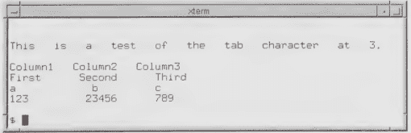

**图 6-4** 使用 vi 时的硬制表符结果

这个小巧的脚本是我们添加到我的 `~/.exrc` 文件中作为一个映射，以便我们可以在 vi 中运行它。我们将其映射到 `CTRL-T` 来处理制表符：

```
map ^T ^[I!G pr -te3^M
```

瞧！只需按下 `CTRL-T`，你所有的制表符就会转换为空格，且各列依然整齐排列，带有三个空格的缩进，如图 6-5 所示。

## 但如果我需要把空格恢复成制表符该怎么办？

使用 `-i` 选项将空格替换为制表符。如果你需要确保在一个你放入空格的文件中包含制表符，可以再次使用 `pr` 命令，但这次使用 `-i` 来插入制表符。例如，如果你稍后要将文本导入到使用可变间距字体的文字处理程序中，该程序能正确解释制表符，这会很有用。

## 我可以把列表转换成多列格式吗？

可以，简单的 `-n` 选项会让 `pr` 把你的名称列表转换为 n 列列表。如果你希望列表是按行跨页面排列，而不是按列向下排列，则可在命令中添加 `-a` 选项。

```
pr -3a -t names > names.out
```

这会将名称列表转换为三列列表。结合 UNIX 内置的排序器，你可以得到一个按三列格式排列的已排序列表。

```
sort names | pr -3a -t > sorted.names
```


图 6-5 正确排列内容的方式


图 6-6 我们未排序的名称列表

前后效果分别见图 6-6 和图 6-7。

## 其他有用的打印技巧

### 有什么办法可以取消打印作业吗？

快！使用 `cancel` 命令来停止你刚刚发送的打印作业。该命令的形式为

```
cancel [request-id] [printer]
```


图 6-7 排序成易于阅读格式的列表

这意味着你可以通过指定请求 ID 或指定打印机来取消作业，从而取消该打印机上的作业。请注意，你只能取消自己创建的打印作业。要取消他人的打印作业，需要（嗒哒！）超级用户权限。

### 我可以使用 lpstat 命令获取我的打印请求的当前状态吗？

可以。将此命令与 `-u yourname` 一起使用，即可获得仅包含你当前打印作业的列表。当前正在打印的作业会显示为 **在打印机上**，其中 **printer** 是打印机的名称。图 6-8 显示 Charlie 有两个作业在 laser 打印机上排队，第一个已经开始打印。

### 我如何找到我的作业在哪里打印？

答案仍然是 `lpstat`。在可能有多台基本相同打印机的环境中，你通常会指定打印作业发送到一组打印机，而不是某台特定的打印机。在这种情况下，使用带 `-o -l` 选项的 `lpstat` 命令，不仅可以查看已排队的作业，还可以查看它们被排队到哪些打印机。当你使用打印机组而不是特定打印机作为目标时，你会看到类似图 6-9 的内容。

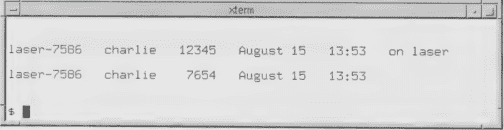

```
laser-7586  charlie  12345  August 15  13:53  on laser
laser-7586  charlie   7654  August 15  13:53
$
```

**图 6-8** 来自 `lpstat` 命令的返回报告

## 其他有用的打印技巧

```
                         Xterm
laser-7586  charlie   7654  August 15  13:53
    on laser

dotmatrix-7896  charlie  89987  August 15  14:04
    assigned fastdot

$
```

**图 6-9**  来自 `lpstat` 的更详细的报告

这里，你有一个作业正在打印机 laser 上打印，而第二个作业已分配给 fastdot 但尚未开始打印。

## 第 7 章

## 运行程序

## 回答主题！

## 运行单个程序 101

- 执行文件
- 使程序可执行
- 自动使 shell 脚本可执行
- 控制脚本由哪个 shell 执行
- 重新发出命令
- 编辑之前的命令
- 使用 emacs 编辑命令
- 管道和 I/O 重定向

## 多任务处理 106

- 在 UNIX 中运行多个程序
- 将作业发送到后台
- 检查后台作业
- 将后台作业带到前台
- 发送作业到后台的替代方法
- 使用重定向将正常程序输出和错误信息都发送到文件
- 使用 tee 命令
- 设置优先级

## 调度作业 109

- 让作业休眠
- 使用 sleep 作为简单的闹钟或提醒
- 使用 sleep 命令退出命令
- 使用 at 命令
- 使用 cron 自动化任务

## 运行程序 @ 一览

如果只知道方法，运行程序是很简单的。以下是你在 UNIX 中启动各种程序所需了解的内容。

控制流程并确保数据流向你希望它去的地方是管道和 I/O 重定向的目的。你需要知道如何将输出重定向到文件以及如果需要时在哪里可以找到它；知道如何从文件获取输入（而不是键盘）也可能很有帮助。管道是 UNIX 中最重要的重定向方式，它允许你将一个程序的输出重定向到另一个程序，这可以为你节省大量时间和精力。

即使在 MS Windows 出现之前，UNIX 就是一个功能齐全的多任务操作系统。在 UNIX 中多任务的关键在于知道如何管理同时运行的那些程序或作业。

在 UNIX 环境中工作时，理解如何设置优先级极其重要，因为你几乎总是与他人共享内存容量和处理器时间。以下是如何做到友好。

调度作业是尊重 fellow 用户并提高自身效率的另一种方式。你可以让作业休眠到稍后，安排作业在未来的特定时间运行，或使用 crontab 来自动化你的任务。

## 运行单个程序

### 执行文件

实际上，UNIX 总是在运行多个程序，所以你永远无法只运行单个程序。但其中大部分都在后台和幕后进行，所以我们暂时就让它在那里吧。你会记得在第 3 章中，每个文件在你的机器上都有一组权限。这些包括读取文件、写入文件以及执行它的权限。所谓“执行”是指让文件运行，就像实际做某事一样。

重要的是要理解，实际上很少有程序，而且你可能不用担心，除非你最终成为超级用户，是由 UNIX 直接执行的。这是由 shell 完成的。无论你运行的是 Bourne、Korn、C 还是其中一种不太常见的 shell，实际上是 shell 解释你在提示符下输入的内容并发出必要的命令来启动程序。检查文件的权限并决定你是否有权运行程序也是 shell 的责任。因此，如果你没有先为程序设置执行权限位，你就不会取得多大进展。

### 我怎样才能使程序可执行？

使用 `chmod +x`。这看起来很明显，但如果你写了这个很不错的小程序来输出“Hello, World!”（好吧，我们知道这 hardly 原创，但有时必须尊重传统）并且当你尝试执行它时，它看起来像图 7-1 那样，你忘记给你的文件执行权限。

### 我可以自动使我的 shell 脚本可执行吗？

可以，通过创建一个简单的 shell 脚本。这有点递归的修复。用 shell 脚本使你的 shell 脚本执行。你可以对此做得很花哨，如果你真的想的话，但我们使用的是图 7-2 中显示的简单的小 vix 脚本。

### 我可以在不更改脚本的情况下控制我的脚本由哪个 shell 执行吗？

图 7-2 显示了一个小技巧，我们本打算在第 13 章讨论 shell 脚本秘密时再讲，但既然它在这个图中，我们就在这里谈谈它。注意脚本的第一行，它读作

```
#!/bin/ksh
```

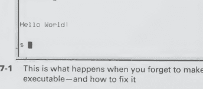

图 7-1 忘记使程序可执行时会发生什么——以及如何修复它

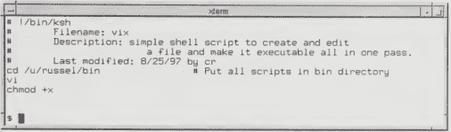

**图 7-2** 使用 shell 脚本来调用你的编辑器并在一个步骤中更改权限


你可能会认为这是一条注释，因为它以 `#` 字符开头，但它实际做的是告诉执行该文件的脚本执行 `/bin/ksh`（Korn shell）并将文件的其余部分提供给它。我们将在第 15 章使用 `perl` 编程时使用这个技巧，以便让 `perl` 而不是 `shell` 来执行。

## ❓ 如何重新发出命令？

使用历史记录列表。C shell 为 UNIX 增加的最有用的功能之一就是能够重用命令，而不必重新输入。Korn shell 更进一步。你不仅可以重用命令，还可以在命令行上用你喜欢的编辑器直接编辑它们。例如，要重用以字母 “v” 开头的最近一条命令，使用 `r v`，它将回收你最近发出的一条以 `v` 开头的命令。因此，如果你正在编辑一个文件，然后执行它以查看它是否符合你的预期，然后再返回修改，再试一次，这个技巧可以让你轻松地在两个命令之间来回切换。包含的命令越多，匹配就越精确。例如，如果你最后四条命令是

```
vi .kshrc
. .kshrc
vi .exrc
vi notes
```

那么 `r v` 将调出 `vi notes` 命令，而 `r vi .` 将调出 `vi .exrc` 命令，`r vi .k` 将调出 `vi .kshrc` 命令。

## 循环浏览和编辑我之前的命令最简单的方法是什么？

如果你使用 Korn shell 并在你的配置文件中加入以下内容，你实际上就可以使用 `vi` 在命令行上直接编辑你的命令，循环浏览它们然后按需修改。

```
EDITOR=vi ; export EDITOR
```

这，加上 `~/.sh_history` 文件的存在，会告诉 Korn shell 使用熟悉的 `vi` 编辑器命令，让你在发出命令前编辑命令行。只需按下 `ESC` 键进入 `vi` 模式，然后使用熟悉的光标移动键 `j`、`k`、`l` 和 `h` 来浏览命令。按 `k` 向上移动一行到上一条命令，按 `j` 向下移动，等等。一旦找到想要的命令，只需按 `ENTER` 键重新发出它，或使用熟悉的编辑键修改它。这比做起来更难解释。只要试试看。仅凭这一功能就足以让你从 C shell 切换到 Korn shell。

## 即使我是一个坚定的 emacs 用户，我也可以编辑我之前的命令吗？

可以；不要绝望。你不需要知道 `vi` 命令就能在 Korn shell 中使用命令行编辑。只需将以下行添加到你的 `.profile` 文件中，你就可以使用 `emacs` 键来浏览命令历史并编辑命令。

```
VISUAL=emacs ; export VISUAL
```

为什么我们为两种模式设置的这两个环境变量不同？实际上，任何一个都有效。一些资料似乎更喜欢设置 `EDITOR`，而另一些似乎更喜欢设置 `VISUAL`。但两者似乎效果相同。我们不建议做的一件事是，将它们设置为不同的值。如果你这样做，`VISUAL` 会获胜。

## 管道和 I/O 重定向

UNIX 中的重定向和管道类似于管道工程，因为重要的是控制流动，确保数据流向你希望它去的地方。你可以重定向输入，使其不是来自键盘而是来自文件，或者重定向输出，使其不是进入显示器而是进入文件。最后，你可以把一个程序的输出取出来（管道）输入到另一个程序中。

我们可能首先学会的重定向类型是 **输出** 重定向。这意味着把我们通常不想在屏幕上看到的东西都移走，放到一个文件中，我们需要时可以找到它，否则就不会被打扰。要将程序的输出重定向到文件，使用大于号 `>`。例如，要对一个名字文件进行排序：

```
sort names > names.sorted
```

第二种重定向是 **输入** 重定向。这使用小于号 `<`。这样，程序的输入不是来自键盘，而是来自文件。因此，例如，要向工程部的 Dale 发送包含新提案文本的文件，你会使用命令

```
mail dale < proposal.txt
```

第三种也是最重要的重定向是 **管道**。这使用竖线或管道符号 `|`。管道把一个程序的输出送入另一个程序。假设，例如，你刚刚从你最喜欢的 Internet ftp 站点上获得了一个很酷的游戏。要在一次操作中展开它并解 `tar`，所有操作一起完成（关于 `tar` 格式将在第 12 章详细介绍，使用以下代码：

```
cat newgame.taz | zcat | tar xvf -
```

管道是 UNIX 工作方式的核心。因为它最初设计用于在内存有限的很小的机器上运行，UNIX 由数百个小程序组成。每个程序单独做的事情不多，但它们都设计为在 UNIX 工具集中协同工作，从而创建一个强大的命令集。

## 多任务处理

### 在 UNIX 中运行多个程序

与 DOS 和 Windows 不同，UNIX 本身就是一个多任务操作系统，因此你可以利用这种多任务功能来运行多个程序或作业。如果你正在运行 X Window 系统，这就和简单地打开另一个窗口并启动第二个程序一样简单。但即使在简单的字符终端上，你也可以在大多数 UNIX 实现中利用多任务处理。至少，你应该能够将作业发送到后台，让它在你启动其他东西时继续运行。

### 如何将作业发送到后台？

在程序的命令行后使用 `&`。一些作业，例如长时间的 `find` 操作或程序编译，往往需要一段时间，而且实际上不需要你输入任何内容。通过在命令行后加上一个与号 `&` 将这些作业发送到后台。这会立即把提示符还给你，而你启动的作业则继续进行其工作。图 7-3 显示了一个系统管理员可能会定期运行的简单示例，以清理占用磁盘空间的一些大文件。

### 有没有命令可以检查我的后台作业？

试试 `jobs`。 如图 7-3 所示，`jobs` 命令会告诉你后台作业的状态。如果作业已完成，你会看到作业编号后面跟着 `Done`。其他可能性是 `Running` 和 `Stopped`。那我们看到的 `+` 是什么意思？它表示该作业是最近调用的处于后台的作业。下一个最近调用的作业会显示为 `-`。

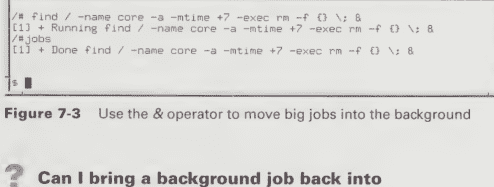

图 7-3 使用 `&` 运算符将大作业移入后台

### 我可以把后台作业带回前台吗？

可以，使用 `fg` 命令。该命令会将最近调用的作业带回前台。如果作业因某种原因被停止（挂起），它在进入前台时会重新启动。如果你有多个作业在后台运行，并且需要将其中一个带到前台，而它不是最近的作业，请使用表 7-1 中的方法之一来引用该作业。因此，要将几步之前启动的 `grep` 操作带回前台，请使用

```
fg %grep
```

这会将 `grep` 作业带入前台。从那里你可以将其重新发送到后台、挂起（停止）它、中断（杀死）它，或简单地等待它完成。

| Reference | Background Job Referenced |
| --- | --- |
| `%n` | The job whose number is n |
| `%string` | The most recent job whose command line begins with string |
| `%?string` | The most recent job whose command line contains string |
| `%+` | The most recent job |
| `%-` | The second most recent job |
| `%` | The second most recent job |

表 7-1 引用后台作业的方式

### 还有其他方法可以将作业发送到后台吗？

可以，使用 `bg` 命令。假设你开始搜索博士论文中的更改，发现它要花费的时间比预期的要长得多。幸运的是，你已将其设置为将 `diff` 命令的所有输出写入日志文件，因此只需挂起作业并将其发送到后台。通常用于挂起作业的命令是 `CTRL-Z`，除非你已用 `stty` 更改了它。因此，只需按 `CTRL-Z` 然后输入 `bg`，作业就会进入后台并重新启动。如果你想查看其进展情况，可以直接 `tail` 日志文件。

### 警告：

> 不要将需要你输入或会向屏幕发送大量输出的作业发送到后台。如果作业在后台且需要你的输入，它就会一直等待。想必这并不是你想要的。而且如果作业会产生大量通常会显示在屏幕上的消息，除非你将这些消息发送到某种日志文件，否则它们仍会全部出现在屏幕上，就在你试图做其他事情的中间。再次强调，这最多只是一个令人烦恼的问题。最好的处理方法是重定向输出到日志文件，并将任何错误发送到单独的错误文件。以下是如何操作的示例：

```
diff thesis thesis.edited > /tmp/edit.log 2> /tmp/edit.err &
```

现在命令将在后台运行，并且不会用你还没准备好处理的输出来打扰你。`2>` 的意思是将标准错误发送到我们指定的文件，在本例中为 `/tmp/edit.err`。

### 我可以使用重定向将正常程序输出和错误信息都发送到一个文件吗？

可以。事实上，如果你想将它们发送到同一个文件，你需要使用一种特殊的组合。一个典型的例子可能是运行备份或长时间编译。你在做其他事情，但当编译或备份完成时，你可以快速检查是否有任何问题。在这里我们使用一种特殊的方式来描述标准错误管道。

```
make > /tmp/make.log 2>&1 &
```


这使用重定向将来自我们的 `make` 的正常消息发送到日志文件，任何错误消息也会被发送到同一位置。在这里，`2>&1` 的意思是“将标准错误重定向到标准输出”。但由于我们已经告诉标准输出转到日志文件，两者都会进入那里。

### tee 命令能为我做什么？

使用 `tee` 将输出同时发送到日志文件和屏幕。这让你可以启动一个进程，例如备份，在此过程中你希望能够看到是否有任何异常发生，同时将命令的所有消息也存储在日志文件中。这在窗口化系统中特别有用，因为你可以在继续工作的同时关注正在发生的事情。

```
make 2>&1 | tee /tmp/make.log &
```

现在当你的 `make` 遇到问题时，你将有机会看着所有那些可爱的警告消息在屏幕上滚动，并且你知道它们已保存到日志文件中。稍后你可以严肃地盯着它们，假装你实际上知道它们是什么意思，然后去摆弄 `makefile` 并重试。

> 警告：不要在前台作业上使用 `nice`。如果你的系统无论如何都变得缓慢，并且你给前台作业加上了 `nice` 命令，你可能无法获得足够的注意力来挂起或杀死它。你本质上会被锁定，直到作业完成。

## SCHEDULING JOBS

### 如何让作业休眠？

最简单的与时间相关的命令是 `sleep`。该命令正如其名称所示——它会让命令或脚本文件休眠你指定的秒数。为什么要这样做呢？嗯，在 shell 脚本中间在屏幕上显示一条消息时，这可能很有用，例如，让它停留足够长的时间供你查看。这在你要做一些不可逆的操作时是一个很好的例子，比如删除文件或一组文件，并且你想在事情看起来不对劲时有机会退出；如果你不中断进程，它将自动进行。在这种情况下，你所做的是将即将执行的命令打印或回显到屏幕上，然后让脚本休眠五秒或十秒。如果事情看起来不对，你可以退出脚本并在为时已晚之前修复它。或者，如果你需要启动多个进程，每个进程在启动时都会占用大量资源，但随后会稳定下来，你可以在启动它们的脚本中使用 `sleep` 来稍微分散它们。

### 设置优先级

当你在多任务和多用户环境中工作时，只需启动一个（或两个）非常消耗内存和处理器的作业，就很容易使整个系统几乎停滞。即使你是系统上唯一的人，在后台启动一个大型编译作业也可能使你的前台任务变慢到无法接受的速度。UNIX 自然有解决方案。`nice` 命令通过增加其友好度来降低命令的优先级。不幸的是，这个特定命令在几乎所有版本的 UNIX 中都不同，甚至取决于你使用的 shell 也不同。但总体效果是相同的——你可以通过使用 `nice` 启动它来减少特定进程所需的 CPU 时间。因此，有关你的版本如何实现的特定细节，请查看 `nice` 的手册页。

```
man nice
```

请注意，你可以让命令更友好，但除非你是超级用户，否则通常不能让命令具有更高的优先级（换句话说，比它通常拥有的更不友好）。此外，通常没有必要降低本质上受 I/O 限制的作业的优先级，因为这些作业无论如何都不需要太多处理器的资源。

### 图 7-4 将 sleep 命令用作防止灾难的保障

以及执行的时间。请理解，`at` 命令执行的所有命令都将使用 Bourne shell 执行，而不是 C shell 或 Korn shell，所以不要依赖这些更通用的 shell 的任何特定功能。`at` 命令将理解以下所有时间参数，以及许多其他参数。

- `at 10:15am`—今天上午 10:15（如果现在已超过上午 10:15，则为明天）
- `at 1120pm Jun 17`—6 月 17 日晚上 11:20
- `at 1 am Sunday`—下一个星期日凌晨 1:00
- `at 18:00 Monday next week`—下周一晚上 6:00
- `at now +2 hours`—两小时后

正如你所见，这相当灵活。运行备份例程将 `/users` 文件系统备份到 DAT 磁带驱动器在明天凌晨 1:00 的语法是

```
at 0100 tomorrow < backup.users
```

其中 `backup.users` 包含单行：

```
tar -cvf /dev/dat /users > /tmp/backup.users.log
```

这包括 `tar` 命令及其必要的选项，将新归档写入 DAT 驱动器并在日志文件中保留所有消息以供以后查阅。

### 我可以使用 cron 来自动化任务吗？如果是，如何使用？

如果你的系统管理员已授予你权限，你可以创建一个 `crontab`。这是一个文件，描述了你希望定期发生的一个或多个操作。

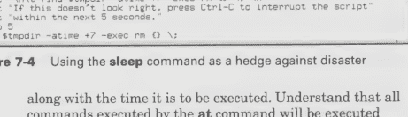

知道你可以使用 `crontab` 自动重复运行程序是很方便的。你可以安排任务每月运行一次、每晚运行一次，或每周五运行一次。可能性很多。`crontab` 文件由六个字段组成：

- `minute` 一个 0–59 的数字，表示命令将运行的分钟
- `hour` 一个 0–23 的数字，表示命令运行的小时
- `day of month` 一个 1–31 的数字，表示运行命令的月份中的日期
- `month` 一个 1–12 的数字，表示运行命令的月份
- `day of week` 一个 0–6 的数字（星期日到星期六），表示运行命令的星期几
- `the command line to be run`

包含星号 `*` 的字段表示该字段的所有可能值。因此，例如，要在每天凌晨 1:15 对你的主目录进行备份到软盘驱动器，你的 `crontab` 中可能有以下内容：

```
15 1 * * * /usr/bin/tar uvf /dev/rfd0 $HOME > /tmp/$LOGNAME.bak.log 2>&1
```

关于此命令需要注意的一点是，我们小心地将命令的输出定向到日志文件，并且我们也确保任何错误消息也进入那里。否则，命令的输出将被发送到控制台，这可能会导致其他问题。此外，与 `at` 命令一样，所有 `crontab` 作业都使用默认的 Bourne shell 执行。你的 `crontab` 文件位于 `/usr/spool/cron/crontabs/username`。但你应该先在你的主目录中创建文件，然后使用以下命令将其提交给 `cron` 进程

```
crontab cronfile
```

这将用新文件覆盖任何现有的 `crontab` 文件。

警告：提交新文件之前，务必先复制旧的 `crontab` 文件。我们发现令人沮丧地容易忘记任何新的 `crontab` 都会覆盖你的旧文件。因此，我们有一个小脚本，首先保存现有 `crontab` 的副本，然后提交新文件。这样，我们会自动制作副本并提交新文件。脚本中的相关行是：

```
cd $HOME
crontab -l > oldcron.$(date +%m%d%H%M)
crontab new.cron
```

这会将旧的 `crontab` 保存到带时间戳和日期戳的文件中，然后提交我们始终保存在 `new.cron` 中的新 `cronfile`。这使得保留旧 `crontab` 文件的副本变得很容易。

提示：使用 `crontab -l` 查看你当前自动安排的作业。`crontab` 命令的 `-l` 开关是 "list" 的缩写，它会告诉你为 `cron` 进程安排了哪些工作。

## Chapter 8

## X Windows

## Answer Topics!

- **MOUSE COMMANDS 118**

  ? 使用鼠标在窗口之间复制文本

  ? 显示管理器 vs. 窗口管理器

  ? 选择整个单词

  ? 选择整行

  ? 弹出菜单

  ? 你可能已经拥有的 X 程序

- **LESS IMPRESSIVE X PROGRAMS 126**

  ? `xcalc`

  ? 使用 `xcalc` 进行科学计算

  ? 使用 `xload`

  ? 控制 X 程序的大小和放置

  ? 使用 `xman` 浏览帮助

  ? 较少有用的 X 程序

- **XTERM TRICKS THAT MAKE LIFE EASIER 121**

  ? Xterm 增强功能

  ? 更改 Xterm 的颜色

  ? 获取颜色选项列表

  ? 更改 Xterm 上的标题

  ? 更改 Xterm 中的字体

  ? 查看可用字体

  ? 预览字体

  ? 添加滚动条

  ? 制作更大的滚动缓冲区以用于 man 页面

- **CUSTOMIZING X 129**

  ? 自定义 X Windows

  ? 自定义 X 服务器

  ? 更改默认背景颜色

  ? 自定义桌面

  ? 使用 Motif 资源文件添加功能

  ? 使用 Motif 资源文件获取帮助

  ? 向根菜单添加行

## X Windows @ a Glance


到目前为止，我们谈论的是“传统”的 UNIX，这是一个基于文本的命令行界面，只有极客才会喜欢。但在本章中，我们将探索 X Window System，它凭借 **display manager** 和 **window manager**，拥有足够漂亮的界面，可以让你不再渴望 Microsoft Windows。在这里，你将了解显示管理器和窗口管理器之间的区别，如果只是为了用这些信息来给你的 UNIX 精通的同事留下深刻印象。

更重要的是，X Windows 利用了 **mouse**、菜单栏和图形用户界面的其他功能。在鼠标的指挥下，你会发现自己比以往任何时候都更快乐、更高效。

如果你认真使用 X Windows，了解常见的 **X programs** 可能是个好主意。我们将向你介绍标准程序，并告诉你它们能为你做什么。

使用 X Windows 非常直接，但了解一些能让生活更轻松的 **Xterm tricks** 是很有用的。更改终端的颜色和字体将有助于你更好地观看，并且创建更大的滚动缓冲区将让你在最长的 man 页面上也能轻松前后滚动。

一些 **X Windows programs** 比其他程序更令人印象深刻，但即使是 **less impressive** 的程序有时也能有所帮助。后者包括计算器、系统监视器、时钟，以及 **man** 页面的易于使用的前端。

**less useful X programs** 比如 xeyes，会不可估量地增加你 UNIX 系统的可爱值。我们会让你自己探索其中大部分程序，但如果不提及它们的存在，我们就不会觉得自己正确地告诉你如何让你的 X Windows 系统成为你自己的。

**Customizing your X** 是一门精致且高度个人化的艺术。我们不会告诉你应该如何自定义系统；相反，我们将向你展示如何自定义 X 服务器、你的桌面和 Motif，然后让你自行发挥。

## 第8章 X Windows

> **注意：** 这里需要先声明一下。你会听到 X Window System 被各种称为 “X”、“X Windows” 和 “The X Window System”。嗯，这三者中最后一种是官方说法，但在日常对话中，大多数人会说 “X” 或 “X Windows”，本章中我们也会这样称呼。
>
> X Window System 最初是在 MIT 开发的，其主要开发工作至今仍在那里进行。X 多年来经历了多次修订，截至本文撰写时，目前的版本是 “X11R6”。不过，我们在这里讨论的大部分内容同样适用于至少 X11R4、X11R5，在某些情况下也适用于 X11R3。因此，即使你仍在使用较旧的版本，也应该能够利用许多相同的技巧，尽管在某些情况下语法可能略有不同。

### MOUSE COMMANDS 鼠标命令

#### Can I use the mouse to copy text between windows? 我可以用鼠标在窗口之间复制文本吗？

Certainly. If you have two windows open, it's easy to copy text from one window to another. Select the text you want to copy from the first window by positioning the mouse cursor at the beginning of the text you want to copy, pressing down the first mouse button, and dragging the cursor over the text you will be copying. The text will now be shown in reverse, and is *highlighted*. Click on the second window to activate it, and click the second mouse button. This will insert the highlighted text at the current text cursor position.

当然可以。如果打开了两个窗口，从一个窗口复制文本到另一个窗口非常容易。选择要复制的文本时，将鼠标光标定位到要复制文本的开头，按住第一个鼠标按钮并将光标拖过要复制的文本。文本现在会以反显显示，并且是 *高亮* 的。点击第二个窗口以激活它，然后点击第二个鼠标按钮。这将在当前文本光标位置插入高亮的文本。

> **Warning:** Whenever you're moving or copying text, remember that the mouse cursor and text cursor are not the same. When you click once, you simply move the mouse cursor to the point where you click.
>
> **警告：** 在移动或复制文本时，请记住鼠标光标和文本光标不是同一个。当你单击一次时，你只是将鼠标光标移动到单击的位置。

#### Display Manager vs. Window Manager 显示管理器与窗口管理器

The X Window System is the display manager. By itself, it isn't a very pretty sight. It takes the addition of a window manager to give you the look and feel you expect. All those nice little borders, buttons, and mouse tricks are really part of the window manager's job, not that of the display manager. The two most common commercial window managers in the UNIX world are Motif and Open Look. Of the two, Motif seems to be winning the window manager wars, though Sun systems still used Open Look by default until very recently. However, even in the Sun world, Motif is available. It is the window manager that allows you to move a window, resize it or shrink it to an icon, drop down a menu, and so on. The display manager (or more properly the X server), on the other hand, interacts directly with the mouse, keyboard, and display. The display manager manages fonts, colors, and the background screen (the root window), and is responsible for opening and closing windows and generally managing the resources.

X Window System 是显示管理器。单独使用时，它看起来并不美观。需要添加窗口管理器才能提供你期望的外观和感觉。所有那些漂亮的小边框、按钮和鼠标技巧实际上都是窗口管理器的职责，而不是显示管理器的。UNIX 世界中两种最常见的商业窗口管理器是 Motif 和 Open Look。两者中，Motif 似乎正在赢得窗口管理器之战，尽管 Sun 系统直到最近仍默认使用 Open Look。然而，即使在 Sun 世界中，Motif 也是可用的。它是允许你移动窗口、调整其大小或将其缩小为图标、弹出菜单等的窗口管理器。另一方面，显示管理器（或更准确地说是 X 服务器）直接与鼠标、键盘和显示器交互。显示管理器管理字体、颜色和背景屏幕（根窗口），负责打开和关闭窗口并一般管理资源。

#### How can I select an entire word? 如何选择整个单词？

Click twice. When you click twice in quick succession (called a *double-click*), you will both move the cursor and select or highlight the word at the cursor.

双击。当你快速连续点击两次（称为 *双击*）时，你会同时移动光标并选择或高亮光标处的单词。

#### Is there a way to select an entire line? 有没有办法选择整行？


Yes, by triple-clicking. If you click the mouse three times in quick succession, you will get an entire line highlighted. This is a quick way to transfer a command to another window.

可以，通过三击。如果连续快速点击鼠标三次，你将得到整行高亮。这是一种快速将命令传输到另一个窗口的方法。

> **Warning:** When you transfer text with the mouse, you transfer it as actual keystrokes. This means, for example, if you are in `vi`, you might actually be passing commands to `vi` if you're still in command mode instead of text insertion mode when you paste the text into the second window.

> **警告：** 当你用鼠标传输文本时，你是以实际按键的形式传输的。这意味着，例如，如果你正在使用 `vi`，当你将文本粘贴到第二个窗口时，如果仍处于命令模式而不是文本插入模式，你实际上可能会向 `vi` 传递命令。

### X Programs You May Already Have 你可能已经拥有的 X 程序

While every vendor’s version of the X Window System is just a bit different, most come with a bunch of cool programs and some that are merely cute without being useful. The ones you are most likely to have, as a minimum, are:

虽然每个厂商的 X Window System 版本略有不同，但大多数都附带了一堆很酷的程序，以及一些只是可爱但没有用的程序。你最有可能至少拥有的程序是：

- `xterm` — a terminal emulation program
- `xterm` — 一个终端仿真程序
- `xcalc` — a calculator
- `xcalc` — 一个计算器
- `xclock` — yet another clock program
- `xclock` — 又一个时钟程序
- `xman` — a graphical front end to the `man` pages
- `xman` — `man` 手册页的图形前端
- `xload` — a graphical indicator of the system resource utilization over time
- `xload` — 系统资源利用率随时间变化的图形指示器
- `xeyes` — a cute little program that features two eyes that follow your mouse pointer
- `xeyes` — 一个可爱的小程序，包含两只会跟随鼠标指针的眼睛
- `xlogo` — a totally useless program that displays the X logo
- `xlogo` — 一个完全无用的程序，用于显示 X 标志
- `ico` — another cute but useless little program that draws a bouncing icosahedron on your screen
- `ico` — 另一个可爱但无用的小程序，会在你的屏幕上绘制一个弹跳的二十面体

In addition to these, there are several utilities for manipulating or displaying the properties of the X server. The essential one of these programs is, of course, `xterm`, which provides the interface for you to access all of the rest of UNIX.

除此之外，还有几个用于操作或显示 X 服务器属性的实用程序。这些程序中最基本的是，当然是 `xterm`，它为你提供了访问 UNIX 其余部分的接口。

### How can I pop up a menu? 如何弹出菜单？

Click on the root window. This menu will let you do a variety of things like shuffle your windows up or down to find a window that is buried in a stack of others, open a new window, restart the Motif Window Manager, or just refresh your screen if the graphics have gone haywire. You can take this menu much farther by adding new stuff to it. We'll show you how below in the section called "Customizing X."

点击根窗口。此菜单可让你执行各种操作，例如上下移动窗口以找到埋在其他窗口堆栈中的窗口，打开新窗口，重新启动 Motif 窗口管理器，或在图形出现问题时刷新屏幕。你可以通过向其中添加新内容来进一步扩展此菜单。我们将在下面 “Customizing X” 部分中向你展示如何操作。

## 让生活更轻松的 XTERM 技巧

### Xterm 增强

X Window 系统的每个版本都至少附带了最低版本的 Xterm。此外，许多厂商还包含自己的定制终端窗口，利用了其系统特有的功能。例如，SCO 在其 Open Desktop 包中包含 `scoterm`，而 HP 在其系统中包含几个不同版本的 `hpterm`：一个用于 VUE，即其“Visual User Environment”，这是一个基于 X 的全方位桌面环境；另一个用于仅运行 X Window 系统的用户。这些都添加了特定的功能，增强了基本 Xterm 的整体外观和感觉，但我们这里只坚持使用基本的 Xterm。大多数第三方增强型 Xterm 接受与基本版本相同的命令行参数，此外还接受控制其自身实现的特定参数。输入 `Xterm &` 的基本结果相当无聊，所以让我们把它美化一下。你可以控制字体、颜色以及各种其他内容。

### 我可以更改 Xterm 的颜色以使其更护眼吗？

当然可以。颜色是非常个人化和主观的东西，但这里有一个对我们有效的组合。

```
/usr/bin/X11/Xterm -fg white -bg MidnightBlue &
```

这会给你白色的文字和深蓝色背景。当然，我们知道有人觉得这种外观过于中产阶级，而选择

```
/usr/bin/X11/Xterm -fg yellow -bg purple &
```

但他对大多数问题都只是有点走极端。

### 我如何获取颜色可能性的列表？

使用 `showrgb`。这将打印出在你的系统中定义的颜色列表。即使你的系统没有 `showrgb` 程序，你仍然可以看到这个列表。只需使用 `vi`（以只读模式，这样你就不会意外搞乱东西）。输入：

```
view /usr/lib/X11/rgb.txt
```

这将让你查看系统使用的默认颜色数据库。从这里为你的 Xterm 颜色挑选任何你想要的颜色。但如果颜色名称包含空格，请不要忘记用引号将其括起来。

> 警告：当你输入 Xterm 颜色选择时，如果颜色名称包含空格，请不要忘记用引号将其括起来。没有引号的双词颜色会让 UNIX 感到困惑并导致命令失败。

### 我可以更改我的 Xterm 上的标题吗？

可以。你甚至可以通过将此信息添加到 Xterm 的标题栏中，让你的 Xterm 告诉你你在哪里以及你以谁的身份登录。唯一的缺点是，此信息是静态的，因此如果你使用该窗口登录到另一台远程机器，它将不准确。但我们发现它仍然很有用，因为它告诉我们我们是从哪里开始的。使用 `-T` 选项如下：

```
Xterm -T "$(hostname):$LOGNAME -- $(date +%X)" &
```

这会将你的主机名、登录名和窗口启动时间全部放在标题栏中。

### 有没有办法我可以更改 Xterm 中的字体以使其更易于阅读？

当然可以。我们越老，字体就必须越大。我们知道年轻的程序员在屏幕上打开六到八个 Xterm 窗口，每个窗口都有很小的字体。对他们来说，这可能没问题，但我们喜欢大一点、更护眼的字体。所以我们为 Xterm 使用其中一种较大的标准字体：


`/usr/bin/X11/Xterm -fn 10x20 &`

这使得窗口足够大，实际上可以看到你在做什么。当然，如果你运行的显示器分辨率低于我们的 1280 x 1024，或者你的眼睛足够好并且想把窗口尺寸缩小一点，试试

```
/usr/bin/X11/Xterm -fn 8x13 &
```

这应该能提供足够小以满足大多数用途的字体。一个不错的中间选择是“9 x 15”字体。但请查看系统上的其他选择。每个厂商对 X 的实现都包含不同的字体，因此你可能还有一些额外的选择。

### 我如何查看有哪些字体可用？

使用 `xlsfonts`。如果不带任何选项运行此程序，它会将你系统上所有可用字体的完整列表发送到标准输出。要限制此列表，你可以在命令行中添加 `-fn pattern` 选项，或将整个输出通过 `grep` 管道传输以查看更有限的列表。

### 我可以提前看到字体的外观以及它有哪些可用字符吗？

可以。`xfd -fn fontname` 将显示该字体的所有字符，并提供比你可能需要的更多关于每个字符的详细信息。

### 有没有办法我可以在 Xterm 中添加滚动条以便轻松向上滚动文本？

当然可以。事实上，我们确信这很快就会成为你的标准 Xterm。你可以通过使用命令行选项 `-sb` 将滚动条添加到标准 Xterm，该选项会在窗口左侧放置一个简单的滚动条，如图 8-1 所示。

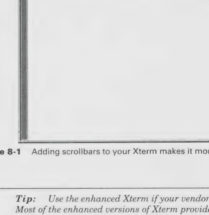

Figure 8-1 Adding scrollbars to your Xterm makes it more useful

Tip: Use the enhanced Xterm if your vendor supplies one. Most of the enhanced versions of Xterm provide useful additions as well as a slightly different look and feel, but take the same command-line arguments as the default Xterm. Figure 8-2 shows a typical example of an enhanced Xterm, complete with menus and a right-hand-side scrollbar.

## Can I make a bigger scroll buffer to use for man pages?

Of course. This is one place where a scrollbar comes in very handy. But the normal wimpy little 64-line scrollbar isn't enough for a lot of man pages. So crank it up to a full 30 screens full—720 lines—with the `-sl nnn` option. This lets you scroll back and forth through even long man pages. Figure 8-3 shows an example from the Xterm manual.

## XTERM TRICKS THAT MAKE LIFE EASIER

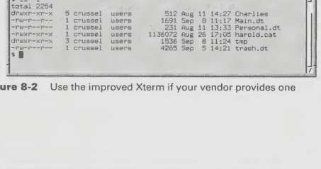

Figure 8-2 Use the improved Xterm if your vendor provides one

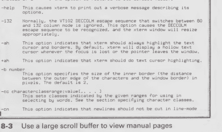

Figure 8-3 Use a large scroll buffer to view manual pages

## LESS IMPRESSIVE X PROGRAMS

### xcalc

Along with the essential Xterm come several other useful but more limited X programs, and even some really useless ones. First, the X Calculator, `xcalc`. This is a handy little program that puts a calculator on your screen to let you figure out how you're going to spend your future lottery winnings. Obviously, it must be able to handle negative numbers. Like all the included X programs, it resides in the `/usr/bin/X11` directory. So if this isn't on your path, you are going to want to put it there.

## Can xcalc handle scientific calculations?

Yes. The Xcalc program has two basic modes: "normal," which emulates a TI-30 calculator, which is fine if you like a standard algebraic mode calculator; and the `-rpn` command-line option. If you want to use the more flexible Reverse Polish Notation that HP made popular, add `-rpn`. This result is shown in Figure 8-4.

## What can xload do for me?

Use it to monitor your system. This little program will give you a constantly updating display of the amount of system resources you are utilizing. While not directly a measure of

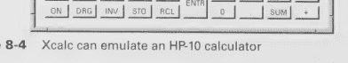

Figure 8-4 Xcalc can emulate an HP-10 calculator

CPU usage, once you get used to evaluating it you can get a pretty good idea of exactly how loaded down your system is. Each line of the graph will indicate approximately 10 percent usage. But if you find yourself consistently running over two or three lines in the graph, we suggest you find a way to distribute some of the load. Or perhaps a memory increase for the system will lower the number by reducing the amount of swapping that must occur. In any case, you might like to keep a little Xload graph open down on the corner of the screen. Over time, you’ll get a feel for what’s normal, and if you suddenly find that you are running higher than you would expect, chances are that you should ask your system administrator to look into the situation.

## Is there a way to control the size and placement of an X program?

Try the `-geometry` option. The `xclock`, for example, likes to pop up in the middle of the screen. To put a standard analog clock up in the upper right-hand corner of the screen, try this:


```
xclock -geometry -1+1 &
```

and you’ll get a nice little clock like the one in Figure 8-5 in the upper right-hand corner of your screen.

## How can xman help me browse for help?

The `Xman` program provides an easy-to-use front end to the manual pages, letting you find what you need by searching


Figure 8-5 The Xclock makes a useful addition to your desktop

for the specific item, or by opening up a window and choosing which volume of the manuals to look for the `man` page in. Once you choose the volume, you can easily pick from the list of available commands to view.

The `Xman` program also makes it easy to browse through the manual page for the command you are interested in, providing a scroll bar on the side and formatting the page for your display. To find out more about `Xman`, just use the `xman` command and click on Help. You’ll get a useful help screen and you can then choose other pages to get help on by clicking on the Manual Page button.

> **Tip:** Try `xeyes` to spice up your desktop. Stick it up in the upper-left corner of your screen, and give it some nice blue eyes. You can think of it as your boss, keeping his watchful eye on you, if you are the paranoid type, or as a favorite sweetie-pie gazing soulfully at you, if you are the more amorous type.

```
xeyes -geometry 100x100+0+0 -fg steelblue -center white &
```

The result of this command is shown in Figure 8-6. Actually, the picture doesn’t do it justice; it has to be seen.

### Less Useful X Programs

But enough about useful programs. Let’s talk for a minute about some of the less useful programs that come with the X Window System. Our favorite little useless program is `xeyes`. This does absolutely nothing useful. It puts two eyes on your screen, which calmly follow your mouse pointer wherever it goes. See, we told you it was useless. But it is kind of charming, and you might well like to have it open, if only to wow the rubes.


Figure 8-6 `xeyes` follow your mouse, wherever it goes

## CUSTOMIZING X

### What are some of the things I can do to customize X Windows and what files do I need to change in order to do this?

在其他方面，你可以更改颜色、字体、外观和菜单。 你可以控制的两个基本文件都位于你的 `$HOME` 目录中——`.Xdefaults` 和 `.mwmrc`。 前者控制 X 服务器本身的选项和设置，而后者控制 Motif 窗口管理器的行为。 你还可以为特定情况添加其他任务特定的文件。 最后，每个应用程序可能都有自己的一组默认值，你可以设置。 这些文件的默认版本应仅由系统管理员更改，保存在 `/usr/lib/X11/app-defaults` 目录中。 然而，你可以轻松地将这些文件中的任何一个复制到你的主目录，以作为工作的基线。 有些应用程序会在启动时读取这些文件的“带点”版本； 其他应用程序则希望你将设置包含在 `.Xdefaults` 文件中。 但在所有情况下，如果你愿意，你都可以显式加载这些设置。 我们强烈建议你在首次对特定资源集进行更改时这样做。 然后只有在它们确实是你想要的并且符合预期时，才应将它们添加到默认文件中。

当你第一次登录工作站时，这两个文件会被读取，并且除非你显式加载它们，否则不会再次读取。 因此，你所做的任何更改都不会在那时之前显现。

### How can I customize the X Server?

基本的 X 服务器默认值就是这样，相当基础且单调。 但你可以通过修改单个客户端或所有客户端的资源文件，轻松更改桌面外观和行为。 资源规范的基本语法是

```
client*resource_name:    resource_value
```

### Is there a way I can change the default background color for all my Xterms?

可以。 要将其设置为 LightSteelBlue，请尝试以下操作：

```
Xterm*background:    LightSteelBlue
```

现在，每当你启动一个 `Xterm`，如果你在命令行上没有显式设置背景颜色，你将得到一个背景为浅钢蓝色的 `Xterm` 窗口。 好吧，几乎如此。 首先，你必须强制系统读取此资源更改。 我们建议你将正在尝试的任何更改放入单独的文件中，并且在确定它们是你想要的之前不要将它们添加到 `.Xdefaults` 文件中。 我们将更改放在名为 `.Xtest` 的文件中，直到我们确定它们是可以的。 告诉 X 服务器读取此文件并将其设置合并到 X 服务器数据库中的命令是带有 `-merge` 选项的 `xrdb`。 所以我们得到：

```
xrdb -merge ~/.Xtest
```

这将把你刚刚创建的 `.Xtest` 文件加载到你的 X 服务器数据库中。 现在，通过启动一个 `Xterm` 来尝试你所做的更改，看看背景是否发生了变化。 如果你没有搞乱语法，你所有的 `Xterm` 现在都应该具有浅蓝色背景。

### Warning:

`xrdb` 命令不会给出任何错误消息，但它对精确语法甚至尾随空白的存在非常挑剔。 如果你的更改似乎不起作用，最常见的问题有两个： 在资源与其值之间遗漏了冒号 (`:`)，以及在值之后有一个或两个空格。 如果你是从 X11R4 或更早版本转换到 X11R5，这一点尤其正确，因为这些较旧版本的 X 服务器在这方面没那么挑剔。 最新版本出于只有做出更改的程序员才清楚的原因，对多余的空格和制表符变得不容忍。

### How can I customize my desktop?

你的底层桌面，或更准确地说你的根窗口，默认情况下是一种令人讨厌的杂色灰色，我们发现它对眼睛真的很伤。 然而，你可以使用 `xsetroot` 程序轻松修复它，该程序会更改默认值（或恢复它们）。 例如，如果你想要纯黑色背景，请使用

```
xsetroot -solid black
```

这将把背景更改为纯黑色。 如果你想尝试方格纸的外观，请使用

```
xsetroot -mod 8 8
```


然而，我们不认为你会坚持使用它很长时间。老实说，X 自带的普通 `xsetroot` 版本几乎不能做太多来改善你的背景。你可以用它添加位图，但这些远没有你可以用 Microsoft Windows 做的背景那么酷。可能有数十个小实用程序可以解决这个限制，其中一个我们使用过并且喜欢的是 `xv` 程序，它作为共享软件可从多个不同来源获得。作者是 John Bradley，有关该程序的更多信息，他的电子邮件地址是 bradley@cis.upenn.edu。我们用它来添加 `.bmp` 或 `.gif` 文件到根窗口中，从而产生能够非常有效地消除对 Windows 羡慕之情的背景。下面的图8-7只是你可以做的事情的一个示例，但唯一限制你的只有你的想象力和寻找图片时的足智多谋。

> 提示：使用 `xset` 程序可以更改字体路径、屏幕保护程序等。通常你不需要也不应该更改这些设置，但有时你可能添加了一个程序，而它没有把字体放到该放的位置，或者可能还有其他问题。使用 `xset` 将新字体路径添加到现有路径，然后执行 `xset fp rehash` 使更改真正生效。你还可以使用 `xset` 程序控制内置屏幕保护程序以及键盘和鼠标的行为。要快速获得该程序的命令行帮助，请使用 `xset -help`；要查看当前设置，请使用 `xset -q`。

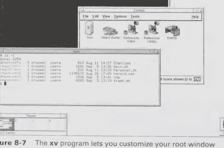

图8-7 `xv`程序可让你自定义根窗口

## 我可以使用 Motif 资源文件为 X 添加功能吗？

可以。Motif窗口管理器允许你向其菜单添加命令，甚至可以更改鼠标按钮和按键的行为。我们不会深入探讨所有不同的做法，也不会讨论你可以通过这个文件添加的许多不同内容。但这里有一些建议，可以让你对能做的事情有所了解。但首先是一个警告：在进行更改之前，一定要复制一份当前工作的配置。好吧，你以前听说过这话吧？

> 警告：在更改任何配置文件之前，一定要复制一份副本。别说我们没有警告你。当然，我们也并不总是遵循自己的建议。

将默认的 Motif 资源文件复制到你的主目录。这是尝试各种修改的一个很好的起点。所以，在你做其他事情之前：

```
cp /usr/lib/X11/system.mwmrc ~/.mwmrc
cp ~/.mwmrc ~/.mwmrc.original
```

好了。现在我们已经把当前资源文件的一份完美副本安全保存起来，并且有了一个可以随意折腾的好起点。用你最喜欢的文本编辑器（当然是`vi`）打开它，你应该会看到类似图8-8的内容。根据你的Motif和X版本，注释字符很可能是一个“#”而不是你在这里看到的“!”。

## 如何使用 Motif 资源文件来获取帮助？

让我们把 `Xman` 程序添加到我们的 `.mwmrc` 文件中。当然，如果你的系统上没有 `Xman`，可以用其他程序试试，比如 `Xcalc` 甚至 `xeyes`！执行程序的资源命令，无论是什么，都是 `f.exec`，所以让我们在 `.mwmrc` 文件中添加必要的行。语法是 `“label” f.command “options”`，所以我们要向下移动到类似 `Menu RootMenu` 或诸如此类的部分之后的第一节。应该不

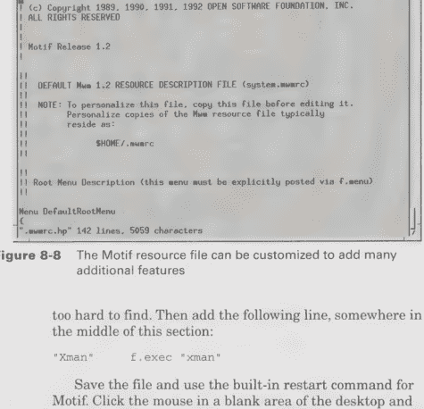

图8-8 Motif资源文件可以被定制以添加许多额外功能

会太难找到。然后在某一中间位置添加下面一行：

```
"Xman" f.exec "xman"
```

保存文件，并使用Motif内置的重启命令：在桌面的空白区域单击鼠标，然后从菜单中选择“Restart”。确认你确实想这样做，Motif 就会重启。在这个过程中，它会读取你修改过的 `.mwmrc` 文件，现在你应该能在菜单上看到一个运行 `Xman` 的选项。

## 有没有办法在根菜单中添加分隔线？

有，通过使用 `f.separator`。添加一个标签为 `no-label`、资源命令为 `f.separator` 的行，就可以在菜单中放入一条分隔线。如果你使用带引号的空白作为标签，并使用命令 `f.noop`，那么你将在菜单中得到一个空行。图8-9展示了一组简单的Motif菜单

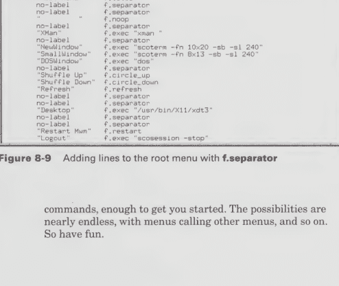

图8-9 使用 `f.separator` 在根菜单中添加分隔线

命令，足以让你入门。可能性几乎无穷无尽，比如菜单调用其他菜单，等等。所以，尽情尝试吧。

# 第9章 UNIX 工具箱

## 答案主题！

### 比较工具 137

- 理解 `grep`
- 使用 `grep`
- 使用 `grep -v` 查找不属于你的文件
- 使用 `grep -i` 进行不区分大小写的搜索
- 理解“正则表达式”
- 比较两个文本文件
- 比较三个文件以查找差异
- 比较二进制文件

### 文本处理工具 142

- 使用 `more` 命令
- 防止长目录列表从屏幕上滚动出去
- 只查看文件的开头
- 使用 `head` 查找最近更改的文件
- 只查看文件的末尾
- 将输出同时发送到文件和终端
- 检查拼写
- 使用 `spell` 创建自定义词典
- 创建排序后的文件
- 清理大小写混合的文件

### 杂项工具 146

- 压缩文件
- 加密文件
- 使用 `cal` 程序打印日历
- 使用 `calendar` 程序创建提醒文件

## 一目了然的 Unix 工具箱

UNIX 为您提供了大量用于比较文本和二进制文件的工具，因此这里您将学习有关所谓的正则表达式所需了解的一切以及如何使用 UNIX 比较工具。

**文本处理工具**可以通过让您分页浏览文件、仅查看文件的开头或结尾等，使您的生活变得轻松得多。您甚至可以拼写检查文本文件、创建在拼写检查时使用的自定义词典、对文件进行排序，或清理大小写混合的文本文件。

在关于**杂项工具**的部分中，您将学习如何压缩文件、如何加密文件，以及如何使用 `calendar` 程序执行几个方便的功能。

> **注意：**由于其起源是一个在内存非常宝贵的微小计算机上运行的操作系统，UNIX 由数百个小程序组成，每个程序都设计用于非常出色地完成一两项特定工作，然后将结果传递给另一个程序，以便对该数据执行其他操作。这就解释了为什么 UNIX 工具箱包含如此多的工具，每个工具都用于特定目的。

## 比较工具

### 什么是 `grep` 以及它能为我做什么？

`Grep`及其变体可能是 UNIX 中用于比较和查找文本字符串的最有用的命令。

`Grep` 是“Get Regular Expression”的缩写，在大多数 UNIX 版本中它有三个略有不同的版本。第一个是普通的 `grep`，它允许您搜索与可以包含通配符、字符集和元字符的某些文本字符串匹配的文本。第二个是 `fgrep`（Fast grep 的缩写，但实际上更慢），第三个是 `egrep`（Extended grep 的缩写），它扩展了 `grep` 的正则表达式匹配能力，还允许您创建逻辑 OR 表达式进行搜索。还有一些公共领域的 `grep` 版本，每个版本都有其自己的特点和拥护者，但我们这里只坚持标准版本。而且在大多数情况下，我们将坚持使用普通的 `grep`，而不是其他版本。

### 那么我该如何使用 `grep` 呢？

在基本形式中，`grep` 的语法是：

```
grep [-options] regexpr [filename(s)]
```

其中选项为

- `-b` 返回块号以及匹配的行
- `-c` 仅返回匹配行的数量
- `-h` 仅返回匹配的行，但不返回它们所在的文件名
- `-i` 匹配时忽略大小写
- `-l` 返回有匹配的文件名，但不返回匹配的行
- `-n` 返回行号以及匹配的行
- `-s` 抑制错误消息
- `-v` 仅返回不匹配正则表达式的行
- `-w` 仅匹配整个单词（并非所有版本的 `grep` 都提供）

其中最有用的是用于忽略大小写的 `-i` 选项和用于反转搜索并返回不匹配行的 `-v` 选项。

### 我可以使用 `grep -v` 来查找不属于我的文件吗？

可以。以下是一个快速方法来判断是否有人在你的主目录中写入了不属于你的文件：

```
ls -lA | grep -v "$LOGNAME"
```

这将返回当前目录中仅不属于你的文件列表。有一个例外：它会漏掉文件名中包含你的登录名但文件实际属于其他人的情况。

### 是否可以使用 `grep -i` 进行不区分大小写的搜索？

当然可以。事实上，这对于确保你的一致性使用非常方便。例如，在本书中我们使用 "system administrator" 作为 UNIX 之神终极存在 superuser 的表述。但我们发现有时大小写写错了，在 "system" 和 "systems" 之间也不一致。因此，我们使用了以下命令来查找所有这些实例，并附带它们在文件中的行号：

```
grep -in "system.*administrator" chp[1-8].txt
```

这相当于“在 `chp1.txt` 到 `chp8.txt` 中搜索字符串 "system administrator"，该字符串可以是大写、小写或混合大小写，并且在 system 中的 "m" 之后可能有也可能没有单个字符。”


> **警告：** 单独的 "." 通配符会欺骗你！如果我们在上面的 `grep` 表达式中没有在 "." 后加上星号，它就会漏掉我们拼写为 `systems administrator` 并在末尾加上 "s" 的情况。但星号表示匹配前一个元字符的零个或多个实例。

### 提示：

如果你的 `grep` 版本支持 `-w` 选项，就利用它吧！这是一个仅匹配整个单词的选项。例如，你可以使用正则表达式 "good" 来查找所有作为完整单词使用的 "good" 实例，但这存在问题。如何处理以单词 "good" 结尾的句子？它就不会匹配。我们不能使用 ".*" 技巧，因为那样会匹配 "goody"，甚至 "goodness"。但如果你的 `grep` 版本支持 `-w` 选项，你可以使用

```
grep -iw "good" files
```

这将找到 "good" 的所有实例，但不会找到包含 "good" 的其他单词。如果你的 `grep` 版本不支持此选项，顺便说一下，情况会变得困难得多。以下应该能捕获几乎所有实例，但我们怀疑我们仍会遗漏一些内容：

```
grep -i "[\"'([]{ ]good[\"').?!,} ]" files
```

哇。这似乎为结果付出了太多工作。如果你的 `grep` 版本不支持 `-w` 选项，你可能想请你的系统管理员获取一个包含此有用选项的 GNU 版本 `grep`。

## 什么是“正则表达式”？

我们在本书中相当频繁地使用了“正则表达式”这个术语，你在关于 UNIX 的任何额外阅读中，包括手册页中也会继续看到它。正则表达式是一个字符字符串，可能包含通配符和元字符，由文本工具之一用作搜索模式。它看起来很像文件工具使用的通配符，并包含许多相同的特殊字符，但并不完全相同。

正则表达式描述了你正在寻找的模式。它可以包含像 `[aA]` 这样的字符集，它将匹配 "A" 的大写和小写实例，或像 `*` 这样的通配符，它匹配任意数量的字符（包括零个）但不匹配特殊字符；或 `.`，它匹配任何单个字符。另外两个有用的元字符是 `^` 和 `$`，它们分别匹配行的开头和结尾。对正则表达式的完整描述远远超出了本书的范围。你可以找到关于 UNIX 工具的高度专业化的书籍，但大多数 UNIX 手册也包含良好的描述。

## 我应该使用什么命令来比较两个文本文件？

试试 `diff`。这是你最常使用的命令。它的语法很简单，但阅读其输出可能有点烦人。语法是

```
diff [options] file1 file2
```

具有以下选项：

- `-b` 忽略重复的空白字符
- `-e` 创建一个可以提供给 `ed` 编辑器的命令脚本，以从 `file1` 重建 `file2`
- `-f` 创建一个用于从 `file2` 重建 `file1` 的脚本
- `-h` 禁用 `-e` 和 `-f` 选项；快速但不够严格

如果两个文件非常相似，这可以是一种有用的方式来检查发生了什么变化。将 `diff -e` 的输出重定向到日志文件，你可以看到文件中发生了什么变化，并决定该更改是否合适。

## 有没有办法比较三个相似的文件以找出它们之间的差异？

可以，使用 `diff3`。 resulting 输出让你可以看到发生了什么变化，以及在哪个文件中发生了变化。你实际上可以基于此命令构建一个相当不错的版本控制系统。

## 比较二进制文件的最佳方法是什么？

使用 `cmp` 命令。这让你可以查看两个看似相同的文件是否实际上相同。例如，如果文件大小相同但你认为有人不小心更改了一个文件，这就很有用。当使用 `-s` 选项时，你只会得到一个退出代码——如果它们相同则为 0，如果不同则为 1，如果一个或两个文件无法访问则为 2。

## 文本处理工具

### `more` 命令能为我做什么？

`more` 命令让你可以通过按空格键一次一页地查看文件。按 "b" 键可以一次一页地返回。你可以使用 `/regex` 通过搜索正则表达式在文件中向前跳转，但不能向后搜索。还有其他更灵活的分屏程序，所以如果你发现自己对 `more` 的限制感到沮丧，就请你的系统管理员为你的系统获取一份 `less` 的拷贝。这个小程序让你可以在文件中前后翻页，比 `more` 方便得多。或者养成使用 `vi` 的只读形式 `view` 作为替代的习惯。

### 我可以将长目录列表的输出通过管道传递给 `more` 以防止它们从屏幕上滚动掉吗？

绝对可以。一旦你养成使用 `ls -lAF` 作为目录列表命令的习惯，就很难放弃所有这些额外信息，这就是为什么我们建议你为其创建一个简单的别名 `ll`（Long Listing 的缩写）。但缺点是它比简单的 `ls` 更有可能从屏幕上滚动掉。因此，将结果通过管道传递给 `more`，你就可以一次一页地查看列表——`ll | more`。

### 如何只查看文件的开头？

使用 `head`。大多数版本的 UNIX 都带有一个名为 `head` 的程序，它会显示文件的仅前几行（如果你将内容通过管道传递给它，则显示标准输入的前几行）。你可以通过在命令行上使用 `-nn` 选项来控制显示的行数，其中 `nn` 是要显示的行数。默认值通常为十。这个命令在你正在寻找某个特定文件但记不清其确切名称时非常有用。但你记得该文件的文件头中有特定短语。如果它是多个以 `.ksh` 结尾的文件之一，那么尝试以下命令来找到你想要的文件。

```
head *.ksh | more
```

这将显示每个文件的前十行，并附带一行标题以提供文件名。图 9-1 显示了典型的结果。

### 是否有办法使用 `head` 来查找最近更改过的文件？

你知道你要找的文件在某个目录中，而且你昨天刚编辑过它，所以如果按日期排序列表，它应该在前几个文件中。尝试

```
ls -tIA | head -20
```

即可查看最近修改的最后 20 个文件。

### 如何只查看文件的末尾？

使用 `tail`。`tail` 命令的工作方式与 `head` 命令完全相同，只是它显示的是文件的末尾，而不是开头。这使得它在查看日志文件等随时间增长的文件时非常有用。你不想阅读整个文件来查看发生了什么；你只想检查最后几行以了解最近的更改。

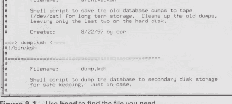

图 9-1 使用 `head` 找到所需文件

由于所有更改都将在文件末尾，因此 `tail` 非常适合此目的。

### 是否可以将输出同时发送到文件和我的终端？

可以，使用 `tee` 命令。我们在运行完整备份时经常使用它。例如，输出会发送到日志文件，以防我们以后想检查，但同时将输出发送到屏幕也很方便。这样，你可以做其他事情并定期瞥一眼屏幕，看看进程进行得如何。例如，你可能会使用以下命令进行备份：

```
tar -cvf /dev/dat / | tee -a /tmp/bkup.log
```

命令中的 `-a` 告诉 `tee` 将输出追加到文件，而不是覆盖它。

### UNIX 能为我检查文件的拼写吗？

可以。UNIX 自带内置拼写检查器 `spell`。只需对任何文本文件运行 `spell` 命令，UNIX 就会告诉你它认为拼写错误的单词。语法是

```
spell [options] [files]
```

最有用的选项之一是 `+wordlist`，其中 `wordlist` 是一个包含用户词典中未包含在主词典中的单词的文件。一种有用的设置方式是为可能使用一些专业词汇或行话的特定项目创建专用词典。然后将该词列表保存在项目的 home 目录中。你甚至可以让环境变量指向它，以便轻松更改或更新你的脚本。

### 是否有办法让 `spell` 为我创建自定义词典？

这是一种创建自定义词典的简单方法。运行两次 `spell`。第一次，使用类似以下内容：

```
spell project.doc > words.special
```

你正在检查的文档是 `project.doc`，拼写检查的输出被定向到你自己的自定义目录，在示例中该目录名为 `words.special`。运行拼写程序后，编辑 `words.special` 文件以删除任何拼写错误的单词，但保留你项目中使用的行话或其他专业术语。现在你就有了该项目的自定义词典。按如下方式对其余项目文件运行 `spell` 以查找拼写错误的单词：

```
spell +words.special proj*.doc > words.wrong
```

现在，你在 `words.wrong` 文件中获得了真正的拼写错误（不包括你的专业术语）。你可以使用你的编辑器（我们希望是 `vi`）在文件中搜索 `words.wrong` 中列出的单词。这样你就能查找并更正真正的拼写错误，而不会被反复询问你的专业词汇。

## 如何创建排序文件？

UNIX 自带自己的 `sort` 命令。默认情况下，它区分大小写，但你可以用 `-f` 选项轻松关闭大小写区分。`sort` 可用于按每行开头（默认）或行内任意字段对输出排序，字段之间以空白（默认是制表符或空格）或其他指定字符分隔。要按组对 `/etc/password` 文件排序，你可以使用

```
sort +3n -t: /etc/passwd > /tmp/sorted.passwd
```

这条命令表示按第四个字段对文件排序（跳过三个字段，从第四个字段的第一个数字开始排序），字段之间使用":"作为分隔符，并将输出发送到文件 `/tmp/sorted.passwd`。

## 是否可能清理混合大小写的文件？


可以。`translate`工具（`tr`）是一个方便的小命令，它获取输入，并将一组字符中的所有字符转换为第二组中的对应字符。它最常见的用途可能是将文件或命令转换为全大写或全小写字符。例如，要将一个混合大小写的文件转换为全大写，请尝试以下命令：

```
cat mixed.case | tr "[a-z]" "[A-Z]" > /tmp/upper.case
```

这会将第一组字符（“`[a-z]`”）中的每个字母实例转换为第二组中对应的字符（“`[A-Z]`”）。请注意，这条命令并不比你预期的更聪明，它对你给出的两个字符串一无所知，只知道它们长度相同。因此，这里有一种对文件进行非常简单的加密的简便方法：

```
cat file | tr "[a-z]" "[A-Z]" | tr "[A-Z]" "[B-Z]A" > file.shifted
```

当然，密码学家只需几分钟就能明白你是把每个字母移动了一个位置。但在不应窥视你的文件时偷看的人，很可能不是专业密码学家。这样做很容易，当你想要读取文件时，撤销也同样容易。

```
cat file.shifted | tr "[B-Z]A" "[A-Z]" > file.unshifted
```

但如果你对安全性的需求不仅仅是让好事者远离敏感文件，你会想使用下面“杂项工具”中讨论的`crypt`命令。

# 第9章 UNIX 工具箱

## 杂项工具

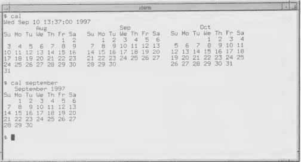

图 9-2 当你需要时，`cal`程序可以为你提供一个有用的小日历

### 如何压缩文件？

使用`compress`命令。这个精巧的工具能为那些你确实需要保留在磁盘上但又不经常使用的文件节省大量磁盘空间。只需压缩它们，当需要用时，使用`uncompress`选项。压缩文件的文件名以`.Z`结尾，根据文件类型的不同，它们占用的空间会大大减少。例如，TIFF图形文件可压缩到原始大小的约5%，我们的每日数据库导出文件可压缩到原始体积的约25%。

其他文件的压缩率差异很大。文本文件压缩效果好；程序文件几乎压缩不了多少。要压缩一个或多个文件，请使用`compress`文件名。要解压缩文件，请使用`uncompress`文件名或`compress -d`文件名。两者是一样的，并且都假定要解压缩的文件以`.Z`结尾，因此你不需要在命令行中添加该扩展名。

### 加密重要文件的最简单方法是什么？

使用`crypt`命令。该命令基于德国开发的著名恩尼格玛密码机，但带有一个256元素的“轮子”。因此，它可以被破解，但并非易事，且需要大量的计算时间和算力，尤其是在所用密码不短的情况下。由于出口限制，`crypt`命令不适用于美国以外地区的UNIX版本；即使你在美国，除非特别要求，否则你所收到的版本中也可能没有它。如果你拥有它，它将提供高水平的安全性。`crypt`命令的语法是`crypt [password] < infile > outfile`。

### 有没有办法用 cal 程序快速打印日历？

有。这个小工具在没有选项时，会在屏幕上显示三个月历，或者根据你的要求显示一个月或一年的日历。`cal`和`cal september`的结果如图9-2所示。

### 我能用 calendar 程序创建提醒文件吗？

当然可以。实际上，你用`vi`或你喜欢的编辑器创建提醒文件，其格式应为`日期 事件描述`，其中每个事件占一行，日期采用`calendar`可以解释的某种合理格式。然后将该命令添加到你的`.profile`文件中，这样你每次登录时都会收到提醒。

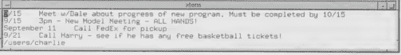

图 9-3 使用`calendar`提醒你重要事件

今天和明天的活动安排。你甚至可以将其添加到你的`crontab`或作为`at`命令使用，如果你愿意的话。然后你会定期被提醒今天需要做的事情。结果看起来像图9-3。

# 第10章

## 连接世界

### 回答主题！

+   工作组和工作组关系 151
+   ? UNIX 与工作组
+   ? 本地网络环境中最常见的需求
+   ? 文件共享
+   ? 使工作组的目录本地化
+   ? 工作组通信的 UNIX 工具
+   ? 使用`ping`
+   ? 向登录到你机器上的另一用户发送消息
+   ? 关闭终端的写权限
+   ? 使用`write`消息而不干扰其他工作
+   ? 与另一台机器上的用户聊天
+   ? 向登录到一台机器上的所有人发送消息
+   ? 查找谁已登录
+   ? 解决身份危机
+   ? 获取登录列表
+   ? 获取谁已登录的信息
+   ? 查找你所在的位置
+   ? 与工作组通信
+   ? 使用`r`命令
+   ? 使用`rlogin`
+   ? `rlogin`的其他用途
+   ? 使用`rcmd`或`rsh`
+   ? 使用`rcp`命令
+   ? 在`cp`不支持递归复制时使用`rcp`
+   连接到更大的世界 163
+   ? 使用`ftp`
+   ? 使用`telnet`连接到远程计算机

## 一目了然的连接

在你的单台工作站或终端上工作很不错，但这并不是 UNIX 的真正意义所在。UNIX 一直是并且将继续主要是网络操作系统，这意味着对于我们这些在 DOS 或 MS Windows 世界长大的人来说，需要在思维和行为上做出一些改变。在本章中，我们将探索 UNIX 工作组和工作组关系的一些特性和怪癖。

接下来我们将介绍一些主要用于更大、更多样化网络的工具，包括互联网这个大胆的世界。连接到更大的世界每天变得越来越重要，所以这里是你需要知道的入门知识。

### 工作组和工作组关系

#### UNIX 与工作组

当你在本地网络中工作时，有很多方法可以利用 UNIX 网络环境的分布式特性。一些 UNIX 系统有一个大型中央服务器，很像 PC 网络，但其他系统使用多个较小的 workstation。两者都有效，并且如果设置得当，对用户来说看起来会非常相似。但有一些重要的区别。如果你有，例如，一个大型中央服务器，并且每个办公桌上只有终端，那么从一台机器复制文件到另一台机器的概念意义不大，因为它们都存储在中央机器上。但如果你在分布式环境中工作，有多个 workstation，每个 workstation 可能是不同程序或功能的服务器，那么你需要复制文件到你需要的机器上的时候就会到来。但即使在这里，其中大部分应该被透明地处理，通常使用通用的`$HOME`目录结构。

我们将把这种本地情况视为分布式 workstation 环境——也就是说，多个 workstation，每个都有自己的硬盘和处理器，以及一些可能没有硬盘的 workstation，甚至可能是简单的终端或 X 终端。但如果你处于一个只有一个大型中央服务器并且只有终端或 X 终端的情况，请不要担心。其中大部分仍然适用于你，如果不适用，只需跳过不相关部分即可。

#### 在本地网络环境中，单一最常见需求是什么？

毫无疑问，是与工作组中的其他人共享文件的需求。UNIX 使这变得简单，我们实际上已经触及了一些这样做的技巧，但在这里我们想把所有这些整合起来。对于其中一些，你可能需要你的系统管理员的帮助来设置初始组和目录结构，但一旦全部设置好，你应该能够在自己的组内舒适地处理文件。

#### 处理文件共享的最佳方式是什么？

在你的工作组中指定一个人作为本地系统管理员。为了将其与主要系统管理员区分开来，我们称他或她为项目经理。顺便说一下，通常这个职位最合适的人是该组的实际项目经理或团队负责人。通常这个人不会拥有主要系统管理员的所有权限，但会承担许多相同的职能。项目经理将是该组将使用的主文件和目录的所有者，并将是工作组与系统管理员之间的联系点。这对系统管理员来说更容易，他不必不断地为该组调整权限、所有权和其他此类内容。这往往使系统管理员在你确实需要帮助时更愿意提供帮助。更重要的是，这意味着大部分时间工作组可以

处理其日常运营，以某种方式让团队中的每个人都能更轻松，他们不必等到系统管理员的优先级队列最终处理请求才能把事情办好。

这里的理念是，项目经理将拥有所有目录和团队的“核心”文件。然后团队中的每个人共享一个特殊的组标识。当你为团队工作开发模板和标准时，你可以将这些模板创建为团队成员只读、项目经理可读写的文件。如果需要对核心文件进行修改，项目经理进行修改，然后团队中的其他所有人即可使用。这是在整个团队中维护标准形式的一种极佳方式。

项目经理需要关注的另一类文件是资源文件。这些可以是 X 或 Motif 资源，以确保编程项目中使用的标准按钮和样式（包括字体和颜色）存在；也可以是一套大家共用的标准`vi`宏；或者仅仅是一些控制文件和包含项位置的环境变量。

#### 如何让我的工作组的目录本地化？


使用 NFS 挂载。这需要系统管理员的最初介入来设置一切，但一旦建立，工作组成员就可以在不同的机器上工作，无需登录到单台机器。这有几个隐藏的好处。由于工作组中的每个人都在自己的工作站上工作，每个人都可以按个人偏好安排事务；然而，工作组共有的文件、脚本等对每个人来说都出现在相同的相对位置。第二个好处是，处理负载分布在多台机器上，因此当你们同时处理一个项目时，系统不会过度负载。当然，这里的问题在于你可能需要所使用的专用软件的多个版本。如果所有这些都位于一台机器上，那么那台机器最终仍要承担所有处理工作。

## UNIX 为我提供了哪些可以促进工作组沟通的工具？

UNIX 工具范围很广，从简单的 `ping`（让你知道一台机器是否已连接）到 `talk` 之类的命令（让你与网络上的另一个用户进行对话），再到各种电子邮件程序（让你向工作组及更广泛的对象发送电子邮件）。

## ping 能为我做什么？

它可以告诉你哪些机器当前可用。`ping` 程序可能是最基本的 UNIX 网络命令。它只需向给定的地址发送一个极小的数据包，然后监听另一台机器是否会“回显”该数据包。你可以使用机器的互联网地址（看起来像 `192.78.222.81` 这样的地址），也可以使用机器的名称，如下所示：

```
ping rcii
```

该名称要么是本地 `hosts` 文件中的名称，要么是网络域名服务器解析出来的名称，但无论如何，它都是网络用来查找特定机器的名称。`ping` 的结果类似于图 10-1 所示。如果一台机器不响应 `ping`，它也不会响应任何其他请求，因为网络根本看不到它。这时就该向系统管理员求助了，除非原因简单明了，比如机器因某种原因关闭了。在这种情况下，系统管理员可能已经参与进来了，因为重启 UNIX 机器不像重启 DOS 机器那么简单。

## 向登录到我的机器的另一个用户发送快速消息的最佳方式是什么？

使用 `write`。`write` 非常适合向另一个用户发送快速消息，该用户要么在连接到你的工作站的终端上，要么远程登录到该工作站。例如，你可以轻松地给远程登录到你的工作站的项目经理发送一条消息：

```
write yasmine k
```

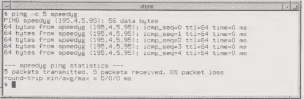

**图 10-1** `ping` 程序用于查找机器是否在网络上

她随后会通过向你发送类似的写命令来回应。你可以随后建议开会，或其他事情，当你完成后，命令会在你发送文件结束符 `EOF` 字符，通常是 `CTRL-D` 时终止。

> **警告：** `write` 命令会直接写入终端。这可能会导致某些程序，例如 `vi`，悄无声息地（或并非如此）发疯。在你养成使用 `write` 或任何直接写入他人显示器的命令的习惯之前，你应该明确达成一致，认为这种行为是可以接受的。

## 我可以关闭对我终端的写权限吗？

使用 `mesg n`。这将保护你免受人们在你使用 `vi` 等编辑器工作时向你发送消息带来的问题，而 `vi` 与 `write` 并不是很兼容。要重新启用向你的终端发送消息，请使用 `mesg y`，其他人将再次能够写入你的终端。

## 是否有可能允许其他人向我发送消息而不干扰我的工作？

可以。如果你在用 X Windows，保持一个 `Xterm` 窗口专门用于 `write` 对话。当你在工作组中并且想要能够在不互相造成问题的情况下来回发送消息时，为彼此“聊天”指定一个特定的窗口。我们喜欢使用 `ttypl` 作为我们的聊天窗口，并将其保持打开但在后台。当消息发送到该窗口时，我们会听到蜂鸣声，然后只需点击窗口将其弹出到顶部。

## 我如何与另一台机器上的其他用户聊天？

使用 `talk` 命令。`talk` 也会直接写入你的屏幕，但它会将屏幕分成两个独立的部分，一半用于你正在编写的内容，一半用于其他用户发送给你的内容。与 `write` 命令相比，你需要更加确定接收谈话请求的人没有在做其他事情。然而，你可以像与连接到你机器的另一台终端上的人一样轻松地与工作组中另一台机器上的人交谈。要与另一用户聊天，语法是

```
talk username@hostname
```

其中 `username` 是他们的登录名，`hostname` 是他们机器在 `hosts` 表中定义的名字。

## 我可以向登录到我的计算机上的每个人发送消息吗？

可以，使用 `wall` 命令。但是请注意，它不会跨越到其他机器，因此你不能真正用它向网络上的每个人发送消息。在传统的 UNIX 环境中，有一台大型服务器和许多连接到它的终端，这种方法效果完美。但在当今更现代的分布式工作站环境中，你将不得不使用其中一个 `mail` 命令来联系工作组中的每个人。

## 我的工作站突然变慢了，我怀疑有人占用了超过其份额的内存和 CPU 时间。我如何找出罪魁祸首？

使用 `who` 命令查看谁登录到你的工作站。这个命令有很多其他选项，在最简单的形式下使用时，是查看谁登录到你的计算机的理想方式。结果看起来像图 10-2。

`who` 命令还有很多其他选项，主要是系统管理员感兴趣的，但你可能会发现一个有用的选项是 `-a`（表示全部）。此命令的输出可能会给你比你真正想要的更多信息，但如果你将其与 `-H` 结合使用（这样你就能得到标题来告诉你每一列是什么），你就可以挑选出你想要的信息。图 10-3 显示了 `who -aH` 命令的输出。

## 我如何解决身份危机？

使用 `who am i` 命令。如果你在一个系统上有多个账户，或为项目使用共享账户，你可以用此命令查明系统认为你是谁，以及你登录的是哪个终端或伪终端。是的，你确实要把它作为三个单独的词输入。这可能是整个 UNIX 命令集中唯一这样的命令。某些系统支持一个

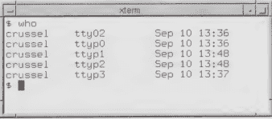

图 10-2 使用 `who` 查看谁登录到你的计算机

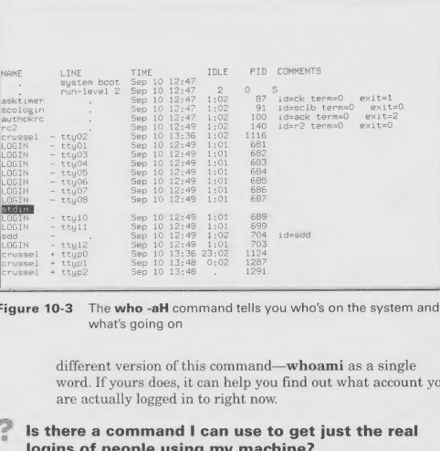

**Figure 10-3** The `who -aH` command tells you who's on the system and what's going on

different version of this command—`whoami` as a single word. If yours does, it can help you find out what account you are actually logged in to right now.

## Is there a command I can use to get just the real logins of people using my machine?

Try `who -f`. This option strips out any pseudo terminals that would be included in the command, giving you just a list of actual logins. If you are running the X Window System, this can be a more meaningful result.

## How can I find out more about the people on my machine?

Use `finger`. This command, which isn't supported on all versions of UNIX, tells you about not only the people who are logged in to your machine, but how long they have been active on your system, what their real names are, and all sorts of other stuff as well. You can also use this in a network to get information about other people not currently logged in.

## How can I find out where I am?


Use the `hostname` command. If you work in a distributed environment and you often have to log in to other machines, it can be a nuisance to keep track of which machine you're on at any point. This is especially true if you're working in X Windows and have several different terminal windows open. Use this command to find out where you are. If you find yourself doing this a lot, add it to your prompt by putting a pair of lines like this in your `.profile`:

```
host=$(hostname)
PS1='$host:$PWD \$ '
```

You will then get a prompt like this:

```
rci:/users/charlie $
```

which gives you a constant reminder of who and where you are. If you like multiple-line prompts, just insert a `^J` into the string in front of the `\$` and you will get a nice two-line version of the prompt.

## What's the best way to communicate with my workgroup?

Use `mail` or one of the many improved versions of it. Actually, `mail` makes it almost as easy to communicate with your friends across the world as with your coworker in the next office. There are almost as many different improved versions of the basic `mail` program as there are versions of UNIX, but one that is widely available, easy to use, supports both text modes and graphics modes, and works on virtually any system is the `elm` package. Written by Dave Taylor, this program is available in the public domain. If you don't have it on your system, and the `mail` package you do have is hard to use, ask your system administrator to get a copy of `elm`. Everyone will be happier. It's available from a variety of anonymous `ftp` sites, including `tut.cis.ohio-state.edu`.

### What are the r commands and what can they do for me?

The `r` commands are a group of remote commands that make life much easier on a local network. Plus, they provide some useful tricks on your own local machine since they have some options that the more traditional commands lack. The commands in this group are:

- `rcp` — The remote version of the `cp` command
- `rlogin` — Logs in to another machine
- `rcmd` — Executes a command remotely
- `rsh` — Same as `rcmd` on systems where it exists

These commands make it simple to move around, execute programs, and manipulate files in a distributed environment. On many systems, the `rsh` command is reserved for a restricted form of the Bourne shell, and on these systems the command is called `rcmd`. But in either case, they allow you to open a shell on a remote system and execute a series of commands that are then displayed on your system. The `rlogin` command allows you to log in to the remote machine and execute commands just as if you were sitting at a terminal connected to it. And the `rcp` command allows you to copy files or whole directory structures between machines.

### Can you give me an example of how to use rlogin?

Let's try using `rlogin` to work interactively on another machine. This command is perfect when you want to work on the other machine just as if it were your own workstation. The syntax is

```
rlogin remotehost [-l username]
```

Depending on how the system administrator has set up permissions, you may not even need to give a password on the remote machine. And if you have to do this often, and have accounts on both machines, you can—and should—create a `.rhosts` file on both machines that allows you to log in without a password. Your account on the remote machine doesn’t even have to have the same username, as long as the `.rhosts` 文件设置正确。此文件应具有如下形式的行

```
hostname username
```

其中主机名是 `/etc/hosts` 中给出的实际主机名，而不是别名，而用户名字段是远程机器上实际用户的登录名。

## rlogin 还有其他巧妙的用途吗？

是的。在你更改配置时，用它登录到自己的机器作为安全检查。这个单一技巧如果在你注销前记得执行，将为你节省大量时间和麻烦。通过对自己的机器进行（或尝试进行）远程登录，你将强制重新读取配置文件，从而可以在不完全注销的情况下测试刚刚所做的更改。这样，如果你做了什么致命的操作，你只需撤回并恢复最初保存的版本。你在开始前确实做了备份，对吧？

## rcmd 或 rsh 到底有什么用？


使用 `rcmd` 或 `rsh`，无论你的系统上是哪一个，来在另一台机器上运行单个程序。当你想在另一台机器上启动程序或脚本，但不需要在该机器上实际使用多个程序时，就使用此命令。在这里，你必须在远程机器上使用 `.rhosts` 设置等价关系，因为无法提示输入密码。此命令的语法为

```
rcmd [-l username] hostname command
```

如果此程序在你的系统上被称为 `rsh` 或 `remsh`，请替换为相应的命令。在任何情况下，它们本质上都工作相同，并且都有相同的陷阱。由于它们不提示输入密码，如果它们在远程机器上运行的程序允许用户从程序中 `shell` 出来，就会构成潜在的安全问题。此外，设置这些命令可能很棘手，因为在某些情况下，错误不一定会传回给你，而是被远程机器上的生成 `shell` 所吞噬。但一旦设置好，它们无疑具有简单性的优势。你可以将命令包含在 `shell` 脚本中，然后使该 `shell` 脚本对工作组中的所有用户可用。他们不必知道其工作原理的细枝末节，只需知道当他们输入 `wp` 时，就会启动 `WordPerfect` 来编辑他们正在处理的文档——即使 `WordPerfect` 服务器根本不是他们的机器。

## 我应该如何使用 `rcp` 命令？

使用 `rcp` 命令在两台机器之间复制文件和目录。在本地网络中，这是移动文件最简单的方法。其语法与熟悉的 `cp` 命令类似，但现在你需要为远程机器添加机器名。因此命令将具有如下语法

```
rcp [options] remotehost:sourcefile localfile
rcp [options] remotehost:sourcefiles localdirectory
```

其中命令的远程和本地部分可以互换。可用选项有 `-p`，它保留远程文件的修改时间和权限；以及 `-r`，它递归地复制起始远程目录下的目录结构。这最后一点是一个强大的补充，并非所有版本的常规 `cp` 命令都支持，但它允许你用单个命令复制整个目录结构。

## 即使我的 `cp` 版本不支持递归复制，`rcp` 仍能帮我吗？

可以。你仍然可以使用 `rcp -rp` 在本地机器上复制整个目录结构。某些版本的 `UNIX` 仍不支持更智能、更强大的 `cp` 命令来处理递归复制，但即使是这些版本也支持远程复制，所以走捷径！在自己的机器上使用 `rcp`，但将命令的一侧视为好像你的本地机器实际上是远程的一样。要将 `/tmp/local/bin` 目录及其下的所有目录复制到你自己的机器上的 `/usr/local/bin`，请使用以下代码：

```
rcp -rp localhost:/tmp/local/bin /usr/local/bin
```

Voilà！也许不久的将来你的 `UNIX` 厂商会跟上进度，使这种变通方法变得不必要，但在那之前你有一种跨文件系统移动文件的方法。

# CONNECTING TO THE LARGER WORLD

## 什么是 `ftp` 以及我该如何使用它？

`ftp` 是 `file transfer protocol` 的缩写。如果你需要在运行不同操作系统的不同机器之间传输文件，例如从 `UNIX` 机器到 `DOS` 或 `MS Windows PC`，你最好的选择可能是 `ftp`，因为它在广泛的平台和操作系统上都得到支持。我们不会详细介绍 `ftp` 支持的所有不同命令，或它可以使用的所有方式，但一个典型的 `ftp` 会话可能如下所示。

1. 通过在命令行输入 `ftp` 启动 `ftp`。此时，你可以添加要最初连接到的机器的主机名。可用的选项有：

   - `-d` 启用调试模式
   - `-g` 禁用文件名通配
   - `-i` 禁用交互式提示
   - `-n` 不在初始连接时自动登录
   - `-v` `verbose` 显示有关正在发生情况的额外信息
   - `-t` 打开数据包跟踪

2. 接下来使用 `open host` 连接到远程站点，其中 `host` 可能是简单的本地主机名，或如果你尝试连接远程机器，则为完全限定主机名。

3. 系统会提示你在远程系统上输入账户和密码。如果你身处互联网上，试图获取某人告诉你的文件但在远程机器上没有账户，请使用 `anonymous` 作为用户，并在提示输入密码时用你的电子邮件地址作答。

4. 使用 `cd` 更改目录，使用 `ls` 列出目录内容，找到你要查找的文件。

5. 将传输模式设置为 `ASCII` 或二进制。默认是 `ASCII`，因此如果你需要传输非 `ASCII` 文件，请执行 `binary` 命令。

6. 传输文件。使用 `get` 将文件复制到你的本地机器，或使用 `put` 将文件从你的机器传输到远程机器。

7. 使用 `close` 命令断开与远程机器的连接。

8. 使用 `quit` 或 `bye` 退出 `ftp`。两者作用相同。

`ftp` 可用的命令远不止这些，但这些是让你入门的基本步骤。在开始之前打印一份 `ftp` 的 `man` 手册副本，并将其放在终端旁边，你应该不会有任何问题。大多数命令要么与它们的 `UNIX` 等价物相同，要么非常相似。

## 如何使用 `telnet` 连接到远程计算机？

`telnet` 命令在一点上与 `ftp` 命令相似。它旨在跨广泛的平台和各种类型的终端或显示器工作。与 `ftp` 一样，`telnet` 也有优点和缺点。如果你想要漂亮且支持鼠标按钮的工具，`telnet` 不是你的选择，但如果你需要以可靠的方式连接到远程计算机，`telnet` 通常可以完成任务。要打开 `telnet` 会话，请使用以下语法

```
telnet [options] [hostname]
```

其中选项包括

- `-a` 自动登录
- `-l user` 如果远程系统可以接受，则发送用户名
- `-r` 使用类似 `rlogin` 的界面，并将转义字符设置为 `~`

`man` 手册中还涵盖了其他选项，但这些是最常见的选项。一旦连接到远程机器，你可以使用 `!` 命令在子 `shell` 中执行命令，使用 `?` 命令获取帮助，或基本上输入你在远程登录到该机器时通常会输入的任何命令。然而，`telnet` 内部有一套庞大且令人困惑的选项和切换，可以让你配置和操作它，使其能够处理几乎任何在另一端允许你连接的系统。如果你真的需要这种复杂性，别无选择。从 `man` 手册和对远程系统以及你的系统的怪癖和缺陷的深入了解开始，你应该能够让一切正常工作。但对于大多数人来说，如果你只是将 `telnet` 当作对远程机器的简单基于文本的登录来对待，你会没问题的。

## NT 和 UNIX 互操作性概览

`UNIX` 和 `Windows NT` 附带的 基本 `TCP/IP` 实用程序提供了易于使用、最小化级别的连接性，这足以满足许多用途。

对于更苛刻的目的，存在 `NT` 和 `UNIX` 对方网络和行为的模拟，因此你可以轻松地让你的 `UNIX` 服务器看起来像 `NT` 服务器，反之亦然。

`Windows NT` 具有内置的 `Posix` 层，提供最小的类 `UNIX` 行为，但如果你经常在两者之间切换，你可能希望从第三方获得更全面的实用程序集。

`Korn shell` 提供了模拟 `Windows NT` 命令行的大多数命令行实用程序和行为的能力。

## 基本 TCP/IP 连接性

## 如何从我的 UNIX 服务器复制文件到 Windows NT 机器？

从任何 `UNIX` 机器复制文件的最简单方法是使用 `Microsoft` 内置的 `ftp` 客户端。这是一个基本的命令行 `ftp` 客户端，处理所有必要的 `ftp` 命令，甚至还能进行命令行重定向以实现自动下载。

## 我可以使用 `ftp` 从我的 Windows NT 机器复制文件到 UNIX 或 Linux 机器吗？

可以。你有两种选择。你可以使用相同的 `Microsoft` 命令行 `ftp` 客户端来复制文件，让

`UNIX` 机器作为服务器，使用 `ftp` 的 `put` 命令。图 11-1 中的示例会话展示了连接到 `UNIX` 服务器 "`xena`" 并将文件从 `C:\MyFiles` 目录复制到 `UNIX` 服务器上用户 "`charlie`" 的主目录的过程。

第二个替代方案，如果你在 `UNIX` 机器的控制台上，需要在 `Windows NT` 上运行 `Microsoft ftp` 服务器。在 `NT 3.51` 及更早版本中，这是一个你可以添加到 `NT` 网络的额外网络服务。然而，在 `Windows NT 4` 及更高版本中，`ftp` 服务是 `Internet Information Server` 的一部分，需要你安装 `IIS` 才能提供 `ftp` 请求服务。

## 是否有比 Windows NT 包含的命令行版本更容易使用的 ftp 客户端？

是的，有很多。几乎每个 `TCP/IP` 附加组件，包括大多数 `NFS` 客户端、`XServers` 和各种其他工具，都包含 `ftp` 的 `GUI` 版本，因此如果你使用其中任何一个，你很可能至少有一个替代方案。如果你没有这些，也不想添加其中一个，你可以使用 `shareware` 或 `freeware ftp` 客户端。我们见过最好的之一是 `Ipswitch` 的 "`ws_ftp`"。一个相当够用的 "Limited Edition" 可作为


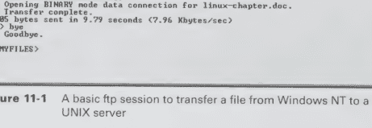

图 11-1 从 Windows NT 传输文件到 UNIX 服务器的基本 `ftp` 会话

共享软件，或者他们有一个功能更全的“专业版”版本，价格非常合理。有限版本可以从多种渠道获得，而两个版本都可以直接从他们的网站 `http://www.ipswitch.com` 获得。图11-2中显示了`ws_ftp`专业版执行图11-1中相同传输的示例。

## 我可以在Windows NT机器上运行UNIX程序吗？

您可以使用Windows NT自带的图形化`telnet`客户端登录UNIX机器，并在UNIX机器上运行任何基于字符的程序。在这种连接下，您运行的任何UNIX程序都只在服务器上运行。您的机器充当一个哑终端。然而，Microsoft的`telnet`模拟非常基本，仅适用于简单的基于字符的应用程序，这些应用程序只需简单的vt-100模拟即可成功运行。图11-3显示了一个简单的会话。

## 如何启动Microsoft telnet应用程序？

您可以通过在NT命令行中键入`telnet`，或者选择“开始”→“运行”并在框中键入`telnet`，然后点击“确定”来启动Windows NT `telnet`应用程序。

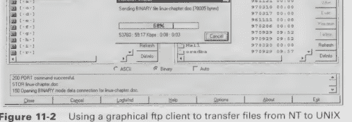

图11-2 使用图形化`ftp`客户端将文件从NT传输到UNIX

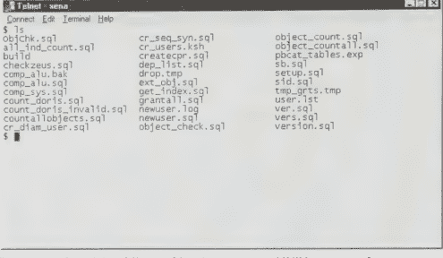

您可以将机器名称（或其IP地址）添加到命令中，如图11-4所示。

## 有没有比Microsoft基本终端模拟器更好的终端模拟器？

当然有！从简单的（如Century公司的`TinyTerm`）到高度复杂的，选择非常丰富。我们曾经使用过并发现

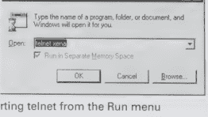

相当有效的一个是`FaceTTerm`（`http://www.facetcorp.com`）。另一个是`vt320`，来自我们使用的`ftp`客户端的同一家`Ipswitch`公司。几乎所有第三方终端模拟器都提供有限版本或限时版本供下载，以便您评估其是否适合您特定的终端模拟需求。我们强烈建议您在掏钱之前先试用所考虑的模拟器。虽然大多数都是好产品，而且远优于内置的Microsoft `telnet`，但针对特定应用程序的终端模拟可能是一件棘手的事情，每个模拟器都有其自身的优缺点。

更好的模拟器提供的一个功能是多窗口支持。这使您可以同时从单个客户端打开主机上的多个会话——当您在UNIX主机上有很多工作要做，而且其中有些工作可以启动后暂时忽略，同时去做其他事情时，这确实是一个优势。

## 我可以通过telnet从UNIX连接到Windows NT吗？

既是也不是。您可以做到，但首先需要在Windows NT机器上进行一些配置。Windows NT不包含`telnet`守护进程或服务器，只包含一个简单的客户端。但有几个第三方`telnet`守护进程可用于Windows NT，甚至还有一个来自Microsoft的。NT Resource Kit中有一个`telnet`服务器的测试版，您可以将其作为服务安装到Windows NT中。

## 图形应用程序呢？

通过在Windows NT机器上安装X Windows服务器，您几乎可以使用所有的X Windows应用程序。这将使您能够在Windows NT桌面上运行UNIX服务器上的字符模式和图形应用程序，而不会影响您同时运行Windows应用程序的能力。有许多适用于Windows NT和Windows 95机器的X Windows服务器，而且它们的总体质量在过去几年中有了显著提高。我们个人最喜欢的是来自SCO的`XVision Eclipse`（`http://www.sco.com`），但还有很多其他的选择。

## 我可以使用Web浏览器从Windows NT机器访问UNIX吗？

是的，假设UNIX机器正在运行Web服务器。Web技术的一大优点是其在很大程度上与平台无关。因此，无论您是从UNIX机器上运行Netscape浏览器来访问Windows NT机器，还是从Windows NT上运行Microsoft的Internet Explorer来访问UNIX机器，结果都基本相同。不过，可用的Web服务器和浏览器选项会有所不同。

## 高级网络模拟

### 什么是SMB，为什么我需要关心它？

`SMB`是服务器消息块的缩写；它是Microsoft网络使用的底层技术。UNIX服务器也可以使用`SMB`，从而允许它们与运行Windows NT（或任何其他Microsoft网络协议栈）的机器通信。有许多适用于各种UNIX和Linux版本的免费和商业`SMB`实现，使您可以轻松地将Windows连接添加到UNIX网络，并且对Windows用户来说基本上是透明的。

### 什么是NFS？

`NFS`是网络文件系统的缩写。它最初由Sun Microsystems开发，是一种在网络上提供文件和打印机共享的纯TCP/IP方法。由于它起源于UNIX社区，因此往往是在UNIX网络间共享文件系统的首选方法。也有适用于Windows和Windows NT的实现，但存在一些限制。

### 如何让我的UNIX服务器对Windows和Windows NT用户可见？

您可以使用UNIX机器上的`SMB`服务器，或者Windows机器上的`NFS`客户端。这两种方法都可行，技术选择在很大程度上取决于其中主要强调的是你的网络以及你正试图实现的目标。我们倾向于在 UNIX 主机上添加 `SMB` 而不是在 Windows 端添加 `NFS`，但两者都可以成功运行。

### SMB 相对于 NFS 有哪些优势？

从 Windows 用户的角度来看，服务器消息块提供了对 UNIX 服务器最透明的访问。他们将 UNIX 服务器视为 Windows 工作组或 NT 域的另一个成员。打印机和文件系统共享看起来并表现得就像在 Windows NT 或 Windows 95 机器上一样，并且使用方式完全相同。此外，无需在 Windows 网络堆栈中添加任何额外内容，这减少了 Windows 机器上的资源负载，在许多环境中这是一个重要的考虑因素。

`NFS` 可以几乎同样透明，但要求在每台需要访问 UNIX 服务器的 Windows 或 Windows NT 机器上都加载 `NFS` 客户端。而额外的资源占用和添加另一个网络客户端所造成的偶发不兼容问题可能是一个明确的问题。

### NFS 有哪些优势？

当主要工作在 UNIX 或 Linux 服务器上完成，并且只有相对较少的 Windows 客户端需要访问 UNIX 资源时，尤其是当有充足的 UNIX 专业知识可用时，`NFS` 是一个不错的选择。`NFS` 也可以作为在反向方向提供连接性的可行选择，从 Windows NT 到 UNIX，如果你在 Windows NT 端使用 `NFS` 服务器的话。然而，根据我们的经验，适用于 Windows NT 的 `NFS` 服务器仅适用于轻量级工作。

### 我可以让我的 UNIX 服务器作为 NT 域的一部分运行吗？

可以。AT&T 已在微软的许可下将 Windows NT 的高级服务器部分移植到 UNIX。该产品随后被多家主要 UNIX 厂商集成到其产品中，在 UNIX 服务器上提供完整的 Windows NT 域级连接和支持。这些产品包括来自圣克鲁斯运营公司（SCO）的 Advanced File and Print Server，以及来自惠普的 Advanced Server for UNIX。借助这些产品以及其他厂商的类似产品，你的 UNIX 服务器可以作为 Windows NT Server 网络的主域控制器或备份域控制器——无论网络上是否存在 Windows NT 服务器。

### UNIX 服务器可以作为 Windows 工作组的一部分运行吗？

可以。有几种产品允许各种 UNIX 版本作为 Windows 工作组的一部分运行。示例包括来自 SCO 的 `VisionFS`（`http://www.vision.sco.com`）、来自 FacetCorp 的 `FacetWin`（`http://www.facetcorp.com`）以及 `samba`（`ftp://samba.anu.edu.au`）。所有这些都作为工作组服务器运行，但不作为 NT 域控制器。

### 使用 NT 域有哪些优势？

使用其中一种 UNIX 上的高级服务器（ASU）解决方案的最大优势在于，作为 Microsoft 域环境的一部分而带来的增强安全性和集中管理。你用来管理 ASU 的工具与你用来管理 Windows NT 域的工具完全相同。毫不奇怪，因为它们是相同的底层源代码。此外，所有用户、共享和安全都可以集中管理，使得处理大量机器和用户变得容易得多。工作组解决方案往往在大约十个用户/工作站左右达到上限。你可以走得更远，但管理负担会变得过重。

### 使用工作组解决方案有哪些优势？


工作组解决方案无可否认的优势在于设置和配置更容易，尤其是在工作站和用户数量相对较少的情况下。虽然你使用的工具与原生 Windows 工具不同，但它们通常灵活且易于理解。你无需做出关于域数量的复杂决定，也不用担心在网络上设置备份域控制器以防故障，因为安全级别足够低，你只需重建服务器即可继续工作。

## 是否有免费的方式与 Windows 客户端共享 UNIX 文件系统？

可以。有一种可自由获取的源代码产品，名为 `samba`，你可以下载到你的 UNIX 系统并编译。它在 UNIX 系统和 Windows 客户端之间提供了高度的互操作性。它正在积极开发和更新中，在有足够 UNIX 技能来编译和管理的环境中可以是一个不错的解决方案。有关 `samba` 的更多信息，包括全面的常见问题解答和最新版本，请将浏览器指向 `http://samba.anu.edu.au/samba`。

## 是否有 samba 的预编译版本可用？

取决于你的系统，答案可能是肯定的。最近版本的 `samba` 的多个移植版本可以在 `http://samba.anu.edu.au/samba` 站点上找到，或通过该站点的链接找到。此外，一个通常相当最新的适用于 SCO 的编译版本可以在 `ftp://ftp.celestial.com` 上找到，这是由 Bill Campbell 维护的 SCO 流行软件包移植的总体出色来源。（我们个人感谢他多年来从他的站点上获得的东西！）

## 我如何让我的 UNIX 用户共享 Windows NT 文件系统？

一些 UNIX 版本，例如 SCO OpenServer，提供对 Windows NT 文件系统共享的原生连接，但许多版本没有。对于那些没有的版本，你的选择有点有限。基本上唯一的选项是使用 Windows NT 上的 NFS 服务器之一。如果你需要此选项，我们建议你考虑你打算对系统施加的负载。如果你的主要用户在 Windows NT 端，只有偶尔的 UNIX 用户使用文件系统，那么这可以是一个有效的选项。然而，如果你的用户主要是或甚至相当大程度上是 UNIX 用户，我们建议你坚持将文件存储在 UNIX 机器上并使用以下任一方式

在 Windows NT 机器上安装 NFS 客户端，或者在 UNIX 端安装 SMB 服务器来管理连接。坦白说，我们试过两个最流行的 Windows NT NFS 服务器，发现它们对于偶尔使用之外的场景并不胜任。

## 我可以不在 Windows NT 上加载 NFS 客户端包，而使用 NFS 导出的文件系统吗？

可以，但需要注意的是，你不会希望它在常规或重度使用下工作。如果你在 UNIX 网络中的某处有 SMB 服务器，你可以将其用作 NFS 网关，在它上面挂载 NFS 文件系统，然后通过 SMB 共享给 Windows 客户端。这种方法可行，但会使网络流量翻倍，并容易引发问题。因此只有在紧急情况下，或者在找到更好的解决方案之前作为临时的权宜之计，才推荐使用。

## 打印呢？我可以在 UNIX 和 Windows NT 之间共享打印机吗？

完全可以。有很多方法可以管理这一过程，但总的来说，上面讨论的所有 SMB 和 NFS 选项同样可以共享打印机。此外，Windows NT 提供了一个原生的 `lp` 客户端，让你可以使用网络上的任何 TCP/IP 或 UNIX 打印机。总体而言，最好的方案是将打印机直接连接到网络上，使用 TCP/IP 来控制它们。大多数激光打印机要么内置网络接口卡，要么可以添加一块。对于那些没有内置网卡的打印机，则有来自不同厂商的多种基于 TCP/IP 的网络打印服务器可供选择。我们曾使用过 HP JetDirect-EX (`http://www.hp.com`) 和 Milan FastPort (`http://www.milan.com`) 打印服务器，效果都很好。

## 如何向 Windows NT 添加 TCP/IP 打印服务？

你需要以管理员权限登录 Windows 机器。然后打开控制面板，双击网络图标。点击“服务”选项卡，选择“添加”。突出显示 `Microsoft TCP/IP 打印` 选项，然后点击“确定”。

## 如何向 Windows NT 添加 TCP/IP 打印机？

点击控制面板中的“打印机”选项，然后双击“添加打印机”图标以打开添加打印机向导。选择“我的电脑”，然后点击“下一步”进入端口选择器，如图11-5所示。

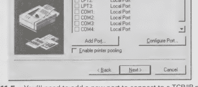

**图11-5** 你需要添加一个新端口来连接 TCP/IP 打印机。

选择“添加端口”按钮来添加 LPR 端口，然后突出显示 `LPR端口` 选项，如图11-6所示，以连接原生 TCP/IP 打印机或启用了远程打印的 UNIX 打印机。然后点击“新建端口”。

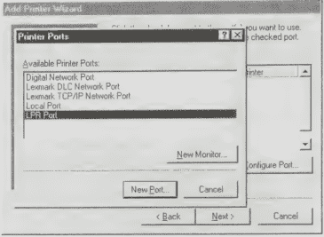

**图11-6** 你需要向 Windows NT 打印系统添加 LPR 端口，以连接远程 `lpr` 打印机。

在出现的对话框中，输入控制打印机的打印服务器或 UNIX 机器的名称或 IP 地址，然后输入打印机或打印队列的名称。如果是 HP JetDirect 打印机，你需要使用 `RAW` 作为打印机名称，如图11-7所示。

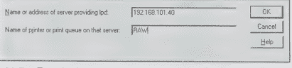

**图11-7** 输入机器名称或 IP 地址以及打印机名称，以完成向 Windows NT 添加远程 `lp` 打印机。

按照剩余的提示完成该过程，告诉 Windows NT 要打印的打印机类型以及其他详细信息。别忘了打印测试页，以防万一。

## 如何让我的 UNIX 用户使用我的 Windows NT 打印机？

遗憾的是，Windows NT 不包含 `lpd`（`lp` 守护进程），这意味着它无法作为 UNIX 机器的远程打印机。不过，如果你使用某个 SMB 产品，其中许多产品允许你将 Windows 或 Windows NT 共享打印机添加到原生 UNIX 打印假脱机程序中。这些打印机将使用一个简单的直通接口脚本，将整个作业原封不动地发送到 Windows NT 假脱机系统进行管理。

另外，可用于 Windows NT 的 NFS 服务器通常都支持 NFS 打印机，而且还有其他第三方和免费软件 `lpd` 解决方案。但最好的办法是让 UNIX 来管理打印机——它

一般来说，NT 在这方面做得要好得多。微软从来没能很好地管理打印 spooling。

## SHELL EMULATIONS: MAKING NT FEEL LIKE UNIX, AND UNIX FEEL LIKE NT

## What is the "standard" UNIX shell?

没有标准的 UNIX shell。最常见的替代品是 Korn shell（我们个人最喜欢的）、Posix shell（大多数新 UNIX 版本的默认 shell，与 Korn shell 关系密切）、Bourne shell（通常是最低公分母）以及 C shell。还有一些备选的自由软件 shell，例如 Bourne Again Shell（`bash`），由于其通常可在包括 Linux 在内的各种平台上获得，因此获得了大量追随者。你所使用的任何 UNIX 上都可获得大多数可用 shell 的版本，你应根据所处环境的需要或预计需要执行的脚本量来选择使用的 shell。交互式用户往往发现 C shell 或 Korn shell 是最舒适的选择，而密集的脚本编写应使用 Bourne、Posix 或 Korn shell，但通常应按 Bourne shell 的限制编写，以防止跨平台问题。

## How can I make NT behave like UNIX?

市面上有一些产品可以让你即使在 Windows NT 上也能模仿 UNIX 丰富的命令行功能。其中最普及的可能是 Mortice-Kerns 的 MKS ToolKit（`http://www.mks.com`）。如果你经常在 UNIX 和 Windows NT 或 Windows 95 之间切换，我们强烈推荐这个软件包。它并不完美，有几件事我们真的非常希望它做得更好。尽管如此，它在 Windows NT 上运行的 Posix 或 Korn shell 仿真非常出色，并且包含了我们离不开的最常见的 UNIX 命令行实用程序。它甚至包含了一个相当令人满意的 Perl 到 Windows NT 的移植，用于为你的命令行添加额外功能。

## How can I make NT behave like UNIX without spending any money?

你的选择在这里会更有限。你当然可以通过使用 `doskey` 宏来添加许多熟悉的 UNIX 命令，例如用 `ls` 代替 `dir`。但大多数功能如果不添加第三方实用程序就根本不可用。即使是内置的 Posix 子系统也不再被认证，而且 shell 的有限功能使得完全模仿其行为变得困难。如果你真的必须经常这样做，就去拷贝一份 MKS ToolKit。如果你唯一的需求是偶尔使用 Windows NT，并且讨厌必须记住你的 `cp` 必须全部输入到 `copy`，那么就使用一系列 `doskey` 宏来完成工作。将它们加载到可以从命令行调用的批处理文件中。处理 `cp` 的示例看起来像：

```
doskey cp=copy $*
```


## Can I make UNIX behave like the NT command line?

嗯，我们想你是可以的，如果你真的想的话。尽管我们目前无法理解你为什么要这样做。但对于那些主要界面是 DOS、Windows 95 或 Windows NT 命令行的人来说，如果他们只是偶尔需要使用 UNIX 命令行，我们想这可能有意义。诀窍是利用 Korn 和 Posix shell 内置的能力来创建别名，以模仿 Microsoft 为中心的命令行的行为。对于更简单的命令来说这相当直接，但有些则有点棘手，可能需要你编写一两个 shell 脚本。

你无法轻松改变的一件事是“/斜杠”键的方向。如我们在第 3 章前面所见，UNIX 使用标准的正斜杠来分隔目录层级，而 Microsoft 为中心的系统，包括 Windows NT，使用反斜杠来达到相同目的。反斜杠在 UNIX 中通常是转义字符。让 UNIX 中两个键的功能互换可能是可能的，但我们从未见过有人这样做，我们担心你只能习惯这种差异。你可以使用上面讨论过的 MKS ToolKit 让 Windows NT 交换字符以像在 UNIX 中那样表现，所以如果这真的让你抓狂，那可能是你唯一的解决方案。实际上这不是一个坏解决方案，因为你还获得了微软本应给 Windows NT 用户的一套极其有用的实用程序和命令，以及完整的 Posix shell 实现。

那么你从老 DOS 时代熟悉的命令呢？没问题。只需在你的 `.kshrc` 文件中为你最想念的命令添加一系列别名。我们在表 11-1 中列出了我们最喜欢的一些示例。

| DOS command | Korn or Posix shell alias | Comment |
|---|---|---|
| dir | `ls -oA` | Shows owner of file and most hidden files. |
| cls | `clear` | |
| type | `cat` | Try substituting your favorite pager here for the simple cat. We use less. |
| md | `mkdir` | |
| deltree | `rm -r` | Remember, this command is irrevocable and won't ask you to confirm! |
| del | `rm` | |
| copy | `cp` | No wildcard substitution. |
| move | `mv` | No wildcard substitution. |
| ren | `mv` | No wildcard substitution. |

表 11-1 Korn Shell Aliases for Common DOS and Windows NT Commands

## 第12章

## 灾害避免与恢复

## 回答主题！

- RISK AVOIDANCE 184

  - 防止灾难

  - 为 `rm` 命令创建别名

  - 创建将文件移动到安全目录的 `rm` 别名

  - 清理 `tmp` 目录

  - 将 `purge!` 添加到你的 `crontab`

  - 保护文件免受意外删除

  - 创建用于编辑只读文件的脚本

  - 使敏感文件对他人不可访问

- BACKUP, BACKUP, BACKUP! 191

  - UNIX 与备份

  - 何时进行硬盘备份

  - 如何进行硬盘备份

  - 何时进行磁带或软盘备份

  - 如何进行磁带或软盘备份

  - 使用 `tar` 将文件复制到不同的机器或文件系统

  - 使用 `tar` 将文件备份到软盘或磁带驱动器

### 灾害避免与恢复一览

**防止灾难**始终是最好的方法，因此以下是如何提前思考并采取一些相对简单的预防措施。

在 UNIX 中保护自己的最重要的一件事，你可以在任何其他操作系统中做到这一点，我们可以补充一下，就是进行定期的**备份**。我们将在下面讨论具体的备份策略，但在这一点上我们想强调，没有备份副本就无法恢复已删除的文件。因此，要么不要删除文件，要么拥有可以恢复的备份副本。

注意：但等等，你说。你的系统管理员每天/每周/无论如何都会备份。为什么你还要担心这些事情？毕竟，她就是为此拿高薪的，对吧？这是真的，但在最好的所有可能世界中，你的系统完全每晚备份，并且磁带从未出现问题，这仍然不会解决你的问题。首先，你真的愿意损失整整一天的工作吗？此外，从系统备份磁带中恢复单个文件并不是一个可能让你的系统管理员高兴的任务。是的，可以做到，在最终紧急情况下这可能是你唯一的希望。但最好还是采取必要的步骤来保护自己。

### RISK AVOIDANCE

### 防止灾难

在错误发生后恢复，总不如不犯错容易。难道我们所有人如果按这个原则生活不会更好吗？那么问题是如何不犯这个错误。可能的第一条规则是避免某些不可逆的命令。UNIX 使得在没有任何警告的情况下简单地删除整个目录结构变得异常容易。如果确定要这样做，这种能力很好，但如果不是，那么“哎呀”可能就不够了。

警告：不要使用 `rm -rf` 命令。这就是那些功能过于强大的命令之一。实际上，普通的 `rm -r` 命令也过于强大，但至少在它开始删除只读文件之前会警告你。当你添加 `-f` 强制开关时，你就真的没有留下任何机会了。

### 创建 `rm` 命令的别名明智吗？

这是一个敏感的问题。一些纯粹主义者强烈认为你不应该为 UNIX 的任何内置命令创建别名，而其他人则经常这样做。我们倾向于认为如果过度使用这是一种不良做法，但在某些情况下它可以挽救生命。例如，如果你想增加一层保护，这就是一种方法。尝试将以下内容添加到你的 `.kshrc` 文件中：

```
alias rm='rm -i'
```

现在，每当你要删除一个文件时，你将被提示确认。这种方法的问题是，如果你有很多文件要删除并且你真的确定要删除它们，这可能会变得相当烦人。在这种情况下，你可能会对删除变得粗心大意，在没有真正阅读提示的情况下回答“y”。更好的解决方案是暂时将文件移开，只有在它们足够旧以至于你确定要摆脱它们时才删除它们。

### 如何创建将我的文件移动到安全位置的 `rm` 别名？

这是 UNIX 中相当于 DOS 中可用的一些实用程序，它们将你的文件移动到一个特殊的保留目录。我们有两个简单的脚本。我们都依赖于你在 `$HOME` 目录下有一个 `tmp` 目录，这通常无论如何都是一个好主意。首先，创建如图 12-1 所示的 `safe_rm.ksh` 脚本并将其存储在你的个人 `bin` 目录中。不要忘记用 `chmod` 使其可执行。现在，为它创建别名：

```
alias rm='$HOME/bin/safe_rm.ksh'
```

并将其添加到你的 `.kshrc` 文件中。为了立即生效，使用以下命令重新加载你的 `.kshrc` 文件：

```
. ~/.kshrc
```

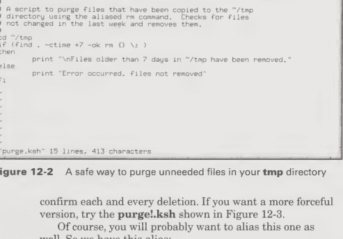

## Figure 12-2 A safe way to purge unneeded files in your tmp directory

确认每一项删除操作。如果想要更强制的版本，可以尝试 Figure 12-3 中所示的 `purge!.ksh`。

当然，你可能也想为它设置别名。所以我们有这个别名：

```
alias purge!=`$HOME/bin/purge!.ksh`
```

现在，每当我们想清理目录中较旧的文件，并且确定其中没有任何我们真正关心的文件时，我们只需使用 `purge!` 来删除 `tmp` 目录中至少七天旧的所有文件。

## Can I add purge! to my crontab?

我们通常并不赞成自动进行这种绝对清理，但如果你是懒散的类型，或者绝对确定 `tmp` 目录中的文件可以被删除，你可以考虑在有权限使用 `cron` 进程的情况下将其添加到你的 `crontab` 中。一种做法是只在每周星期日晚上运行。这样，你就知道目录中没有文件超过两周旧，但上周的文件尚未被删除。对应的 `crontab` 条目为

```
0 1 * * 0 $HOME/bin/purge!.sh
```

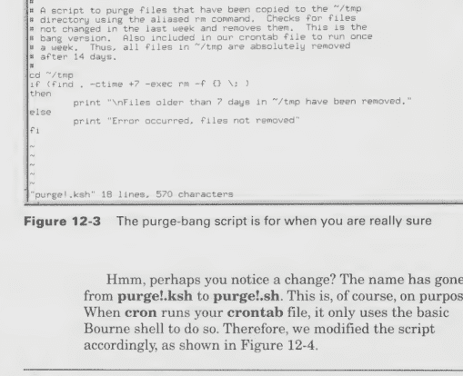

Figure 12-3 The purge-bang script is for when you are really sure

嗯，也许你注意到了一个变化？名称已从 `purge!.ksh` 变为 `purge!.sh`。这当然是有意为之。当 `cron` 运行你的 `crontab` 文件时，它只使用基本的 Bourne shell 来执行。因此，我们相应地修改了脚本，如 Figure 12-4 所示。


> Note: New releases of some flavors of UNIX are using the Posix shell for cron. The Korn shell is compliant with Posix, so your crontab scripts must be either Korn shell or Posix shell. The man pages for cron will tell you which shell is used.

然而，你不想在真正、非常想删除文件时，自己却没有办法运行真正的 `rm` 命令。所以再使用另一个别名，这次是 `rm!`，以保持我们一直使用的惯例。

```
alias rm!=''/bin/rm''
```

这使用了 `rm` 命令的绝对路径，可以绕过任何可能存在的外部脚本，直接访问源文件。

```sh
# A script to purge files that have been copied to the $HOME/tmp
# directory using the aliased rm command. Checks for files
# not changed in the last week and removes them. This is the
# bang version. Also included in our crontab file to run once
# a week. Thus, all files in $HOME/tmp are absolutely removed
# after 14 days.
cd $HOME/tmp
find . -ctime +7 -exec rm -f {} \;
```

**Figure 12-4** When you run a script from your **crontab**, you have to use the Bourne shell

## What’s the very best way to protect crucial files against accidental erasure?

保护文件免于意外删除，甚至更糟的蓄意破坏的一个重要方法是使用 UNIX 内置的保护机制。

第一步是使真正重要的文件变为只读。这很容易做到，并且可以为你节省大量麻烦。如果你有不需要更改但需要定期访问的文件，请更改其权限，使任何人——甚至你自己——都无法写入。

```
chmod a-w filename
```

现在，该文件在不采取额外步骤的情况下无法被更改，即使是由你所有者也是如此。当然，你可以通过在更改文件前先更改权限来绕过这一点。但你已经使这个过程变得足够繁琐，以至于不太可能意外执行。

> **Warning:** The superuser can delete your file no matter what you do. This is one of those sad but true facts. No matter how much protection you put on a file, the superuser can blithely delete the file or change it, with barely a moment’s thought. Yet another reason to stay on friendly terms with this person.

目录——除非有人知道你的密码。

另一个保持密码安全的好理由。

> Warning: Don't forget to change your `$HOME` directory as well. It's easy enough to protect your own directories, but also easy to forget to change the home directory itself.

```
chmod 700 $HOME
```

将只更改你的主目录，使任何人都无法随意窥探。

## BACKUP, BACKUP, BACKUP!

## UNIX and Backups

所有这些防止意外删除文件或在不打算更改时更改文件的技巧都很棒，我们强烈建议你使用其中的一些组合。但当灾难发生时，没有什么能比得上经过验证的备份。系统管理员对备份负有主要责任，但每个使用计算机的人都需要对自己关键文件的备份负责。这并不难，也不必繁重，而且可能成为救命稻草。

UNIX 的美妙之处在于，你通常不必担心备份程序或庞大的数据文件，因为这些通常是系统管理员的职责范围。但你确实需要考虑自己的本地数据文件。你使用的方法将取决于系统的功能、可用硬盘空间的大小，以及系统上对个人用户可用的程序和媒体。但大多数系统都有足够的硬盘空间供你至少在硬盘上维护一份最新工作的副本，如果你有访问权限和权限，复制这些文件到软盘上也相当容易。使其无痛的关键是只备份你需要的内容，然后经常进行备份。个人而言，我们更喜欢大约每天两次备份当前工作文件，但你需要决定什么适合你。许多用户喜欢将其作为注销例程的一部分进行自动化，而 C shell 甚至为此目的有一个特殊文件——`.logout`。但如果你使用 Korn shell，你将需要创建自己的等效文件。在我们深入了解如何自动化备份的具体细节之前，让我们先看看你可以，也应该做的备份类型。

### 为什么我会考虑制作硬盘备份？

现代硬盘非常安全稳定，几乎从不崩溃。今天购买的硬盘平均“平均无故障时间”（MTBF）为 100,000 到 300,000 甚至 500,000 小时的连续服务，具体取决于品牌和型号。这相当于 11-56 年才发生一次故障，这显然比你需要担心的要长得多，因为今天购买的电脑在 11 年——更不用说 56 年——后就不会再使用了。它们在那之前就会因技术过时而被淘汰。当然，仍然有可能买到次品，这就是为什么系统管理员忠实地进行备份的原因。因此，将备份到你的硬盘上对于你的文件来说可能已经足够了。这可以保护你免受意外删除的影响，以及由你无法控制的情况引起的关键文件偶发损坏。

### 制作硬盘备份最简单的方法是什么？

将工作文件副本保存在备份目录中。这可能是处理备份任务最简单的方法，并且对大多数用户来说已经足够。我们称之为 `.backup` 并将权限设置为 700（即所有者拥有完全权限，但其他任何人都没有任何权限）。这足以保护你免受随意（甚至不那么随意）的恶作剧，因为除了超级用户之外，没有其他人可以进入此目录。然后我们将工作文件的当前版本保存在该目录中。对于不需要或不想要保留文件不同版本之类的简单任务，我们有一个简单的别名，在每次注销时调用。它会将今天更改过的文件复制到 `.backup` 目录。

```
alias savwrk='find $HOME/* -mtime -1 -exec cp {} $HOME/.backup \;'
```

这个别名工作得相当好，但并不完美。例如，它不会复制以点开头的文件或目录。替代方案是添加你想要确保被复制的任何特殊目录或文件。或者编写一个构建更智能目录树的脚本。

### 在什么情况下我应该考虑制作磁带或软盘备份？

硬盘备份很好，并且对于许多目的来说提供了足够的保护，尤其是考虑到你的系统管理员无疑会定期进行完整的磁带备份。但在某些情况下，硬盘备份并不合适。如果你从事极其敏感的工作，无法在硬盘上留下你所做的副本，例如，你就需要不在场时将工作从硬盘上取走。而且，如果你丢失某些文件会完全毁灭，你可能希望在系统管理员所做的备份之外自行备份，尤其是如果你所在的系统环境中系统范围的备份每周才进行一次，例如。

### 制作磁带或软盘备份最简单的方法是什么？

将文件备份到磁带或软盘等外部存储介质最常见的机制是 UNIX `tar`（磁带归档和恢复）命令。此命令在几乎所有 UNIX 系统上都可用，也可用于 DOS 等其他系统，是处理大多数用户备份任务的一种简单且相当高效的方法。系统管理员可能拥有更强大的工具，可以轻松跨网络的多个机器和文件系统，但幸运的是你不太可能需要这些。

`tar` 命令的语法是

```
tar key files
```

其中 `key` 是以下基本操作之一：

- `-c` 创建新的归档
- `-r` 追加到现有归档
- `-t` 列出归档的内容
- `-u` 更新归档，添加不存在或更新的文件
- `-x` 从归档中提取文件

以及以下一个或多个修饰符：

- `-A` 抑制绝对文件名
- `-l` 如果链接无法解析则给出错误消息
- `-L` 跟随符号链接以及硬链接
- `-m` 不恢复修改时间（所有内容都获得当前日期/时间）
- `-p` 使用原始权限提取
- `-v` 详细-`tar` 默认是安静的
- `-w` 每次操作前等待确认
- `-f` 下一个参数是要使用的设备名称

这些是 `tar` 选项中最重要的部分，并且在各种平台上行为基本一致。可能还有适用于你特定情况或 `tar` 实现的特定选项，如果有疑问，请咨询你的系统管理员。

`tar` 的最后一个参数是要归档的文件。这可以是特定的文件或目录，或者 `tar` 可以作为管道命令行的部分，如果设备为 `"-"` 表示标准输入或输出。

## 我可以使用 tar 将文件复制到不同的机器或文件系统吗？


由于 `tar` 会跟随子目录，因此很容易用于将完整的目录结构传输到不同的位置。例如，如果你想将文件复制到新位置，保持一切完整，你可以使用

```
cd sourcedir; tar cf - . | (cd targetdir; tar xf -)
```

这将把源目录中的所有内容复制到目标目录。这里使用点表示源目录非常重要，这样归档就会使用相对路径名创建。使用 `sourcedir` 和 `targetdir` 的绝对路径名以避免将文件复制到错误的位置。

## 我可以使用 tar 将文件备份到软盘或磁带驱动器吗？

如果你的工作站有软驱，你可能已经知道它的设备文件名是什么，但如果不确定，请询问你的系统管理员，然后把它写在不会丢失的地方。一个可能的位置就是直接用永久记号笔写在软驱正面。典型的设备可能是 `/dev/fd0` 对应第一个软驱，那么将整个主目录及其中的所有文件保存下来的 `tar` 命令就是

```
tar cvf /dev/fd0 $HOME
```

如果你想使用相对路径名而不是上述命令给出的绝对路径名来保存文件，请先切换到你的主目录，然后用一个简单的点号代替 `$HOME`，这样就搞定了。

# 第 13 章

# Korn Shell

## 回答主题！

- **变量与参数 198**

  - Korn shell 如何使用变量和参数

  - 为变量赋值

  - Korn shell 和 Posix shell

- **KORN SHELL 数学运算 199**

  - Korn shell 如何进行数学运算

- **字符串运算符 202**

  - 在 Korn shell 中连接字符串

  - 字符串替换运算符

- **KORN SHELL 中的预定义变量 204**

  - 重新定义预定义变量

- **流程控制 205**

  - Korn shell 中的流程控制结构

  - 在 Korn shell 中使用 if/then/else 语句

  - 在 Korn shell 中使用 for 循环

  - 在 Korn shell 中使用 while 和 until 循环

  - 使用 case 语句

  - 使用 select 语句

## Korn Shell 一览

**变量和参数**是任何编程语言的重要组成部分，Korn shell 也不例外。在这里，我们将向您展示明智使用它们所需了解的内容。

为了避免混淆，最好事先确切了解 **Korn shell** 如何进行**数学运算**。

尽管 Korn shell 的数学运算能力有些有限，但其**字符串运算符**的能力却令人印象深刻，您很快就会看到。

如果您了解 Korn shell 提供的**预定义变量**，将会省去不少麻烦。

最后，**流程控制**是任何编程语言或环境最重要的能力之一。Korn shell 提供了多种多样的流程控制结构，因此您需要了解以下内容，以便尽可能充分地利用它们。

## 变量与参数

### Korn shell 如何使用变量和参数？

与任何编程工具一样，Korn shell 允许您定义变量并接受输入参数。参数是命令行中出现在命令本身之后的任何内容（或通过管道传入命令的内容）。Korn shell 通过查找参数之间的空白字符来分隔或解析这些参数，更准确地说，是 `IFS`（内部字段分隔符）变量中的任意字符。默认情况下，这些字符是空格、制表符和换行符，但您可以更改它，以便更轻松地解析一组选项。不过完成后一定要记得改回来。位置参数由 shell 自动赋值为 `$1`、`$2`、`$3` 等。`$0` 的值是调用脚本的名称。变量 `$*` 包含除 `$0` 之外的所有值，作为一个字符串，其中每个值由 `$IFS` 的第一个字符分隔。变量 `$#` 等于参数个数，而变量 `$@` 则等同于 `"$1"`、`"$2"` 等，作为独立的参数。

### 如何为变量赋值？

使用以下语法

```
variable=value
```

例如，下面的命令

```
wayne=harold
print "Wayne is now called $wayne"
```

结果将是

```
Wayne is now called harold
```

## Korn Shell 与 POSIX Shell

Korn shell 由 David Korn 于 20 世纪 80 年代在 AT&T 的贝尔实验室发明。它经历了多个迭代版本，但最常用的版本编写于 1988 年，此后已在广泛的 UNIX 平台上发行，尤其是那些被称为 System V Release 4（SVR4）的平台——尽管大多数基于伯克利软件发行版（BSD）的 UNIX 变体现在也支持 Korn shell。Korn shell 仍在继续开发中，随着时间的推移，新版本很可能会问世。然而，在许多情况下，Posix shell 似乎正在取代 Korn shell。Korn shell 的大部分特性已经融入了 Posix shell 的常见实现中，您的 Korn shell 脚本应该可以很少或无需修改就能移植到 Posix shell。

本书中使用的大多数示例都是在 Korn shell 下编写和测试的，读到这里的您可能已经掌握了不少关于它的知识。但我们认为，为您提供一份关于 shell 编程基础（而非交互式使用）的参考会很有用，这些内容 Korn shell 支持的呈现形式比 man 手册页更易于理解。

## KORN SHELL 数学运算

### 关于 Korn shell 进行数学运算的方式，有什么需要特别了解的吗？

您可以在 Korn shell 脚本中进行简单的数学运算，但如果您需要大量数学运算，那么相比 Korn shell，还有很多更好的编程语言选择。不过，例如，您可以声明一个变量 `i`，并通过以下方式之一为其赋值：

```
I=100
let I=100
(( i=100 ))
```

这三个语句都会将100赋值给变量 `I`。要在Korn shell中进行算术运算，可以使用表13-1中的运算符，以及表13-2所示的逻辑或关系运算符。

若要告诉Korn shell对一个算术表达式求值，请将其括在双括号 `(( ))` 中。在这些双括号内，即使是特殊字符也会失去其特殊含义，因此你可以直接使用 `$*` 而无需加引号或转义。

| 运算符 | 作用 |
|---|---|
| `+` | 加法 |
| `-` | 减法 |
| `*` | 乘法 |
| `/` | 除法（截断为整数值） |
| `%` | 取模 |
| `<<` | 左移位 |
| `>>` | 右移位 |
| `&` | 按位与 |
| `|` | 按位或 |
| `~` | 按位取反 |
| `^` | 按位异或 |

表13-1 Korn shell的算术运算符

| 运算符 | 作用 |
|---|---|
| `<` | 小于 |
| `>` | 大于 |
| `<=` | 小于或等于 |
| `>=` | 大于或等于 |
| `!=` | 不等于 |
| `==` | 等于 |
| `&&` | 逻辑与 |
| `||` | 逻辑或 |

## 表13-2 Korn shell中的逻辑或关系运算符

> **警告：** Korn shell只进行整数算术运算。你可以使用浮点数，它会在不报错的情况下接受它们，但它会截断它们，因此你可能得不到预期的答案！例如，考虑以下情况：

> 
> 
> `(( 7.2 / 1.8 ))`
> 
> 
> 你可能期望它计算为4。但在Korn shell中，答案实际上是7，因为实际计算的是“7除以1的整数除法”。
> 
> 
> 尽管整个表达式都被括在双括号中，你仍然可以在表达式内部使用额外的括号来控制优先级顺序。例如，要计算7乘以(2+4)除以3的结果，你可以使用
> 
> 
> `(( 7 * ( (2+4)/3 ) ))`
> 
> 
> 请注意，我们在此行中添加的额外空白并不重要。不过，我们发现它使这行内容更容易阅读。

## 字符串运算符

Korn shell特别擅长处理的字符串操作示例是什么？

拼接。要在UNIX中拼接两个字符串，只需将它们放在一起，中间没有空白。如果需要包含空白，将整个内容用引号括起来就可以解决这个问题。如图13-1所示，我们在其中编造了一些示例用于演示。

大多数情况下，我们使用简单的 `"$strvar"` 来引用我们创建的字符串变量，其中`strvar`就是变量。但这实际上是一般语法 `"${strvar}"` 的一个特例，该语法在所有情况下都有效。例如，你可以用 `$9` 来引用传入脚本的第九个位置参数，一切正常，但你不能用 `$10` 来引用。要引用第十个（及以后）位置参数，你需要使用 `${10}` 语法来更正式地引用。

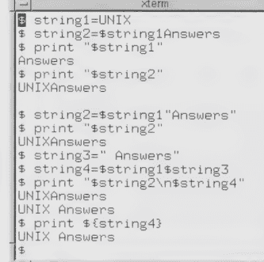

图13-1 在Korn shell中拼接字符串

## Korn shell是否提供了有用的字符串替换运算符？

是的。这些运算符允许你检查字符串的值，然后替换该值、使用默认值或退出脚本。表13-3显示了这些可能性。

你可以使用这些运算符来检查一个变量是否已被设置，然后根据该测试的结果执行相应的操作。

> 警告：你不能使用 `${str:=expression}` 语法来为位置参数赋值。你必须使用一个中间局部变量来完成这项工作。这是 Korn shell 中的一个令人烦恼之处，我们还没有看到对此好的解释或理由。


| 运算符 | 替换行为 |
|---|---|
| `${str:=expression}` | 如果`str`未设置或为空，则返回`expression`，同时将`expression`赋值给`str`。如果`str`有值，则返回该值。 |
| `${str:-expression}` | 如果`str`未设置或为空，则返回`expression`，但不改变`str`。如果`str`有值，则返回该值。 |
| `${str:+expression}` | 如果`str`未设置或为空，则返回空值。如果`str`有值，则返回`expression`。 |
| `${str:?expression}` | 如果`str`未设置或为空，则将`expression`的值发送到标准错误，并中止当前命令或脚本。如果`str`有值，则返回该值。 |
| `${str#pattern}` | 如果`pattern`匹配`str`的开头，则返回删除了最小匹配部分后的`str`；否则返回未改变的`str`。 |
| `${str##pattern}` | 如果`pattern`匹配`str`的开头，则返回删除了最大匹配部分后的`str`；否则返回未改变的`str`。 |
| `${str%pattern}` | 如果`pattern`匹配`str`的结尾，则返回删除了最小匹配部分后的`str`；否则返回未改变的`str`。 |
| `${str%%pattern}` | 如果`pattern`匹配`str`的结尾，则返回删除了最大匹配部分后的`str`；否则返回未改变的`str`。 |

# KORN SHELL 中的预定义变量

## 如何重新定义一个预定义变量？

实际上，我们在第 5 章中向你展示了如何做到这一点，当时我们重新定义了 `PS1` 变量以更改提示符。表 13-4 显示了 Korn shell 设置的参数和变量，表 13-5 显示了 Korn shell 的各个方面使用的参数和变量。

| Parameter | Meaning or Use |
|---|---|
| `#` | 当前设置的定位参数的数量 |
| `-` | 启动时传递给 shell 的标志，或由 `set` 命令传递 |
| `?` | 上一个命令以十进制返回的值 |
| `$` | 当前 shell 的进程号 |
| `_` | 最初是 shell 或脚本的完全限定路径名。自动重新分配给前一个命令的最后一个参数 |
| `!` | 上一个后台命令的进程号 |
| `ERRNO` | 最后一次失败的系统调用设置的 `errno` 的值 |
| `LINENO` | 当前正在执行的脚本的行号 |
| `OLDPWD` | 由 `cd` 设置的上一个工作目录 |
| `OPTARG` | `getopts` 命令返回的最后一个选项 |
| `OPTIND` | `getopts` 命令返回的最后一个选项的索引（位置） |
| `PPID` | shell 父进程的进程 ID |
| `PWD` | 当前工作目录 |
| `RANDOM` | 一个介于 0 和 32767 之间的伪随机整数，每次引用该参数时都会更改，使用前一个值作为种子 |
| `REPLY` | 由 `select` 语句设置，或由不带参数的 `read` 设置 |
| `SECONDS` | shell 启动以来的秒数 |

表 13-4 Korn Shell 设置的参数

| Parameter | Meaning or Use |
|---|---|
| `CDPATH` | `cd` 命令的搜索路径 |
| `COLUMNS` | 当前编辑窗口的列数 |
| `EDITOR` | 用于命令行编辑的默认编辑器 |
| `ENV` | 调用 shell 时要执行的脚本的路径名 |
| `FCEDIT` | `fc` 命令的默认编辑器 |
| `HISTFILE` | 命令历史文件的路径名 |
| `HISTSIZE` | 历史文件中保留的命令数。默认值是 128 |
| `HOME` | 主目录。`cd` 命令的默认目标 |
| `IFS` | 内部字段分隔符，通常为空格、制表符和换行符 |
| `LINES` | 当前显示窗口的行数 |
| `MAIL` | 用户的默认邮件文件 |
| `MAILCHECK` | 检查 `$MAIL` 或 `$MAILPATH` 文件中是否有新邮件到达的频率。默认为 10 分钟（600 秒） |
| `MAILPATH` | 可能的邮件目标列表，以冒号分隔 |
| `PATH` | 命令执行搜索路径 |
| `PS1` | 主命令行提示符（默认为 `"$ "`） |
| `PS2` | 次要命令行提示符（默认为 `"> "`） |
| `PS3` | `select` 循环内使用的提示符字符串（默认为 `"#? "`） |
| `PS4` | 执行跟踪提示符（默认为 `"+ "`） |
| `SHELL` | shell 的路径名 |
| `TMOUT` | 如果设置为 >0，则在 `PS1` 提示符下未输入命令时 shell 自动终止的时间 |
| `VISUAL` | 默认命令行编辑器。覆盖 `EDITOR` |

表 13-5 Korn Shell 变量和参数

# 流程控制

## Korn shell 为我提供了哪些流程控制结构？

如果你打算用任何编程语言或环境完成很多工作，你必须有某种形式的流程控制。Korn shell 也不例外。它提供了以下结构：

- `if/then/else`
- `for`
- `while`
- `until`
- `case`
- `select`

这是一个足够的流程控制语句选择，但不幸的是语法并不完全用户友好。你可能会发现需要一定的试错才能全部做对。

## 在 Korn shell 中使用 if/then/else 语句有什么棘手之处？

这些结构是程序中最基本、最常用的流程控制形式。首先你询问某事是否属实，如果是，你就做某事。如果不是，你可能会做别的事，或者什么都不做。基本语法是

```
if condition
then
statements
[elif condition2
then statements]
[else
statements]
fi
```

每个 `if` 都由对应的 `fi` 关闭，并且可以在其中包含 `else` 和 `elif`（`else if`）测试和语句。但使整个结构工作的关键是构造的条件部分。在这里，Korn shell 赋予了我们一些能力。条件可以是典型的布尔类型的简单测试，例如这些：

```
if [[ $DISPLAY = "rc1:0.0" ]]
if [[ $n == 1 ]]
if [[ $y >= 17 ]]
```

或者它可以是运行一个程序甚至一系列程序的结果。在这种情况下，最终程序的结果或返回代码将被评估条件。一个例子可能是像

```
if echo $PATH | grep X11
```

这将测试路径中是否包含 `"X11"`。这也可以是一个“多项选择测试”：

```
if ( echo $PATH | grep interbase ) || whence gdml
```

这将测试路径是否包含 `"interbase"` 或其程序之一 `gdml` 是否可以找到。如果任一条件为真，则条件将为真。

## 你能展示如何在 Korn shell 中使用 for 循环吗？

`for` 构造让你可以固定次数地执行一个操作。当你需要对一组项目，例如文件名列表，进行操作时，这很有用。这与 C 或 Pascal 程序员可能期望的 `for` 循环行为有点不同。在那种情况下，语法可能是类似：`for i=1 to 10 do`。在这里，我们将项目列表传递给一个变量，每次循环运行时变量的值都会改变。此构造的语法是

```
for name in [list]
do
statements that act on or use $name
done
```

每次循环，`$name` 的值都会不同，因为它一次遍历列表中的一个项目。

## 在 Korn shell 中使用 while 和 until 循环我需要知道什么？

`while` 循环将条件测试与循环构造结合起来，只要条件测试为真，循环就会继续运行。想一想。如果你

根据文件类型不同，对文件做不同的处理。因此，你可以从 `find` 命令的输出中获取，例如找到上个月未更改的每个文件来创建文件列表，然后根据它们是什么类型的文件对这些文件做一些处理。你可以用 `"tmp"` 在名称中的全部删除，将名称中带有 `"sav"` 的全部移动到归档目录，等等。图 13-2 显示了一个执行此操作的脚本。

## 我应该如何使用 select 语句？

Korn shell 的 `select` 构造是一种构建简单菜单并根据对该菜单的响应进行分支的独特方法。`select` 语句与 C 或 Pascal 或我们所知的任何其他语言中的对应语句并不真正对应。但它确实使你能够轻松完成否则可能很麻烦的事情。`select` 的基本语法是

```
select var [in list]
do
    statements that act on or use $var
 done
```

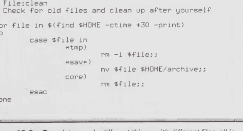

图 13-2 Case 让你可以用一个易于理解的语句对不同的文件做不同的事情

# 第 13 章 Korn Shell


这看起来很像 `for` 循环的语法，而且应该是这样，因为它们实际上是相同的。区别在于，使用 `select` 构造时，我们不会将列表中的所有内容传递给 `do...done` 部分，只有用户从显示的菜单中选择的内容。图 13-3 显示了它的工作原理示例。

```
cat pets
PS3='favorite pet? '
select var in Cats Dogs Birds Fish
do
        case $var in
                Cats)   print "Cats are my favorite pet";;
                Dogs)   print "Dogs make friendly pets";;
                Birds)  print "Birds are a cheerful addition to the house";;
                Fish)   print "Fish make for a quiet pet";;
        esac
        break
done
$ pets
1) Cats
2) Dogs
3) Birds
4) Fish
favorite pet? 1
Cats are my favorite pet
```

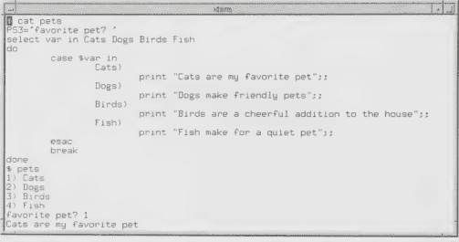

**图 13-3** Korn shell 的 select 自动构建简单菜单

# 第 14 章

## Linux

### 回答主题！

- **LINUX BASICS** 214
  - ? 在哪里获取 Linux
  - ? Linux 是否是真正的 UNIX
  - ? 最喜欢的 Linux 发行版
  - ? 其他 Linux 发行版
  - ? 为什么 Linux 是免费的
- **KEYBOARD ISSUES** 217
  - ? 修改键盘
  - ? 编辑键表
  - ? 为高级用户编辑默认键表
  - ? 键表的工作原理
  - ? Meta 键
- **PASSWORD SECURITY** 220
  - ? Linux 和密码安全
- **SHELLS** 221
  - ? Linux 中提供的 Shell
  - ? bash 启动文件
  - ? 在 shell 提示符中显示当前目录
- **TEXT EDITORS** 224
  - ? 标准 Linux 文本编辑器
- **LINUX AND X WINDOWS** 224
  - ? 在 Linux 中使用图形界面
  - ? 访问图形登录屏幕
  - ? 配置 XDM
  - ? 永久在 X Windows 中启动
  - ? 理解部件
  - ? 为什么部件很重要
  - ? 自定义 FVWM
  - ? 理解焦点策略
  - ? 使 FVWM 看起来像 motif 窗口管理器 (mwm)
  - ? 更改 FVWM 中的颜色
  - ? FVWM 的有用设置
  - ? Linux 的其他窗口管理器
  - ? 在 X Windows 下自定义键盘
  - ? 更改 xterms 的标题栏
- **OTHER TOOLS THAT ARE DIFFERENT UNDER LINUX** 235
  - ? 在 Linux 下不同的一些工具

### Linux 一览

- 为了开始使用 Linux，你需要了解一些 **Linux 基础知识**。以下是你需要了解的内容：从哪里获取 Linux、Linux 的不同发行版等。
- 因为在使用 UNIX 时 **键盘问题** 经常出现，了解如何让键盘按你想要的方式工作非常重要。在 Linux 下，你可以自定义键盘以满足你的喜好。
- 商业版 UNIX 与 Linux 之间一个至关重要的区别是 **密码安全**。如果你需要在 Linux 系统上增加安全措施，这里就是方法。
- 可用的流行 **shell** 决定了你将如何与 Linux 交互。幸运的是，大多数 Linux 系统上都提供了一整套 shell，因此无论你偏好的 shell 是什么，你的需求都能得到满足。
- **文本编辑器** 也是任何 UNIX 用户的重要工具。虽然老牌的 **vi** 并不是大多数 Linux 发行版的一部分，但 Linux 提供了足够的替代方案来满足几乎所有人。
- 尽管几乎是免费或零成本，Linux 甚至自带 **X Windows** 系统。我们会告诉你自定义 Linux X 需要知道的内容。
- 最后，还有 **其他 Linux 工具**。如果你使用过商业 UNIX 系统，其中一些你可能熟悉，其他则不熟悉，所以请查看一下有哪些可用。

> *注意：* 在“糟糕的旧时代”，拥有自己的私人 UNIX 系统几乎是闻所未闻的。硬件和操作系统的成本高得令人望而却步，UNIX 的强大功能只能通过分时系统获得。
>
> 然而，得益于互联网上大量程序员的共同努力，几种 UNIX 变体已在更便宜、更易获得的硬件上提供。这些 UNIX 版本与大牌商业版本一样强大、一样有用、一样精彩，而且只需一小部分成本。

其中最受欢迎的一个版本就是 Linux，它可以在互联网上免费获得，或以象征性的费用从各种供应商处获得。本章专门介绍 Linux 与大牌商业 UNIX 变体之间的差异。

## LINUX 基础

### 我可以在哪里获取 Linux？

对于新手来说，从头安装 UNIX 操作系统可能相当痛苦。然而 Linux 被设计为新手的可行替代操作系统，不同团体也投入了大量精力来让你的生活更轻松一些。基本上，使用流行的 Linux 发行版可以为你节省大量时间和痛苦。

主要发行版之间存在许多差异。有些提供流畅的升级路径，有些提供更大的灵活性，有些只是很有趣可以折腾。只要你使用其中一种常见的发行版，你可能不会出错，而且如果遇到问题或疑问，你会发现有一大群乐于助人的人可以在你迷失在荒野时把你引回正轨。

你可以通过互联网上各个站点的匿名 FTP 免费获取大多数发行版的完整副本。我们建议你从当地供应商或通过邮购购买 CD-ROM 副本，以便节省通过互联网传输大量数据所需的时间和痛苦。

### 你最喜欢的 Linux 发行版是什么？

Redhat。它提供了一个坚固可靠的打包系统，称为 `rpm`，可让你使用单一、简单的命令安装、升级或删除整个软件包。每个版本都经过彻底测试，并包含大量各种软件的最新最佳版本。此外，许多志愿者将他们最喜欢的未包含在发行版中的软件包打包并以 `rpm` 格式提供。

兼具 Debian 和 Redhat 的优点。你可以从 `http://www.cdrom.com` 获取更多关于它的信息，这是 Walnut Creek CD-ROM 档案。

### 为什么 Linux 是免费的？

Linux 系统对自由软件基金会负有很大债务，后者是 GNU 项目背后的力量。这些优秀的人们为 UNIX 系统组装了一套完整的软件，在很大程度上比商业厂商推出的任何东西都更好、更强、更快。更妙的是，它是免费的。事实上，如果没有 GNU 工具，Linux 很可能只是一个内核和一些磁盘访问代码。甚至你使用的标准文件实用程序（如 `ls`、`mv`、`cp` 和 `rm`）也是 GNU 文件实用程序包的一部分。

由于你在 Linux 社区会经常听到“免费”软件，让我们花几分钟时间给你讲解一下标准说法，以免你尴尬。免费并不意味着成本为零美元，尽管这种情况经常发生。免费意味着自由可用和自由再分发。它意味着没有人可以限制你拥有它。它还意味着如果你想要源代码，你可以几乎毫不费力地获得它。你可以修改它，拆开它看看它是如何工作的，改进它，自定义它，基本上你可以随心所欲地使用它。唯一不能做的是阻止其他人也拥有它。如果你把它卖给别人（你被允许这样做），你也必须在他们要求时提供源代码（你可以收取合理的复制费），并且你不能阻止他们到处分发他们（花了 4,500 美元购买的）软件的副本给任何他们想要的人免费。

这听起来有点古怪，但只是因为每个人都习惯了变得司空见惯的许可限制。实际上效果非常好，因为世界上一些最好的软件就是以这种方式分发的。GNU 系统包含你拥有一个有用、可工作的 UNIX 系统所需的一切。事实上，它现在甚至有自己的内核，尽管它仍处于实验阶段。

如果你想了解更多关于自由软件基金会的信息，你可以访问他们的主 FTP 仓库 `ftp://prep.ai.mit.edu` 或写信到以下地址获取更多信息：Free Software Foundation, Inc., 59 Temple Place, Suite 330, Boston, MA 02111-1307, USA。


他们为整个计算社区提供了巨大的服务，我们鼓励你花几分钟时间熟悉它们。不过不要混淆。Linux 对 GNU 负有很大债务，但 GNU 和 Linux 是不同的实体。许多“底层”实用程序都是 GNU 的，大部分系统代码都是在 GNU 公共许可证下分发的，如果没有数百名 GNU/FSF 程序员的支持，该系统将会大不相同。然而，Linux 就是 *Linux*，而不是 GNU。仅仅因为我在我的 Solaris 系统上使用了大部分 GNU 实用程序，并不意味着我的 Sparc 系统就是一个 GNU 盒子。是内核定义了系统的核心，而不是相反。

所有这些与你有什么关系，为什么你应该关心？所有这些都很重要，因为你每天在 Linux 系统上使用的实用程序都是 GNU 实用程序，这意味着它们在很大程度上是标准 UNIX 工具的功能增强版本，你可能已经习惯了。如果你能在命令行输入长串的 UNIX 命令时感到自在，你可能不会注意到区别，至少不会立即注意到。我们还是鼓励你查看你每天使用的东西的文档和 *man* 页面，并探索它们的一些更高级的功能。对于大多数命令，你只需在命令名称后添加 `--help` 即可获得一些基本帮助，并且还有 *info* 页面（在 shell 提示符下输入 `info`）提供更多文档。

即使是卑微的 `ls` 命令也有一些你别处找不到的漂亮功能。不信？试着输入 `ls --color`，你就会明白我们是什么意思。

## KEYBOARD ISSUES

### What’s wrong with my keyboard?

UNIX 是在第一台 PC 甚至还只是一个梦想之前就设计的。因此，它对键盘的工作方式以及按下各种键时会发生什么有一些奇怪的想法。PC 键盘不像普通的“大型机”键盘，可能需要做一些调整才能让你的键盘按你希望的方式工作。

大多数 Linux 键盘行为可以像在任何其他版本的 UNIX 中修改键盘行为一样进行修改。然而，你可以通过编辑启动时加载的默认键表来对 Linux 键盘映射进行永久更改。

### What are keytables and how can I go about editing them?

按键只是一系列事件，就像生活中的其他一切一样。你按下键盘上的一个键。这会生成一个键码发送到内核。内核然后在键表中查找该代码以确定对该特定事件做什么。

你不能更改生成的代码，但你可以使用你喜欢的文本编辑器更改键表中的条目。事实上，这正是你在编辑系统上的键表或编辑 `xmodmap` 文件时所做的（稍后会详细介绍）。如果你打开系统上的默认键表，很可能是 `/usr/lib/kbd/keytables/us.map`，你会看到翻译系统的内部结构，它并没有你一直以来被误导的那样复杂。它只是一系列文本条目。

让我们看一些简单的例子：

```
keycode 16 = q
keycode 17 = w
keycode 18 = e
keycode 19 = r
keycode 20 = t
keycode 21 = y
keycode 22 = u
keycode 23 = i
keycode 24 = o
keycode 25 = p
```

这看起来熟悉吗？应该熟悉，因为这是标准键盘上字母的第一排，而这是适用于这些键的表的一部分。如果你更改其中一个条目，你就会更改按下相关键时生成的内容。要更改按下键时执行的操作，只需将等号后的条目更改为你想要的新值。但在进行任何更改之前，最好先复制一份原始文件。以防万一。

完成更改后，重新加载键盘表（`/usr/bin/loadkeys <你的键盘映射名称>`），你现在就拥有了一个定制的键盘。

### 你能给我一个例子说明“高级用户”如何编辑默认的键表吗？

在“高级用户”中流行的一个做法是交换 CAPS LOCK 和 CTRL 修饰键的位置，这样按下 CAPS LOCK 键就能得到一个控制序列。如果你经常在“真正的” UNIX 键盘和 PC 键盘之间来回切换，你可能会发现这样做也很实用。

### 键表到底是如何工作的？

好吧，到现在为止，你们中聪明的读者可能在想“等等，那我在表中看到的那些其他奇怪的条目怎么办？”你指的是看起来更复杂的条目，像这样：

```
keycode  2 = one
shift    keycode  2 = exclam
alt      keycode  2 = Meta_one
alt shift keycode  2 = Meta_exclam
```

让我们趁此机会把这些也弄清楚。这里的额外字段只是当按下某些修饰键与该键一起使用时的代码。例如，按下键盘上标有 1 的键实际上并不是生成一个“1”。它生成的是键码 2。不要混淆，这只是查找代码，记住？现在，如果你单独按下这个键（不按 SHIFT、CTRL 或 ESC），内核就会在列表中查找编号为 2 的代码，将其映射到“1”条目，然后迅速在你的显示器上输出一个“1”。那按下 SHIFT-1 会发生什么呢？内核会想“嗯……这个键同时按下了 SHIFT 键，所以我需要使用 SHIFT 修饰符，也就是第二个字段”，于是你就会得到一个 ! 符号（在 UNIX 用语中称为“bang”）。对于键可能处于的其他状态也有相应的条目。如果你随意修改这些，要小心，因为你真的会把键盘搞坏——严重到重启都帮不上忙。

### 什么是“meta”键？

围绕 UNIX 键盘经常出现的另一个令人困惑的问题是人们提到“meta”键。如果你是 `emacs` 用户，你可能已经很习惯看到 meta 序列。即使你不是 `emacs` 用户，你也可能听说过这个术语。好吧，长话短说，meta 键并没有什么魔力。它只是像 CTRL 键一样的另一个修饰键。然而，大多数 PC 键盘上并没有标有 META 的键。大多数写得很好的 UNIX 应用程序都考虑到了这一点，并允许你通过按下并释放 ESC 键来模拟按下 META 键的方式来模拟 meta 序列。如果你想要一个真正的永久 META 键，那就得编辑你的键表并交换一些键功能。

就个人而言，我们觉得 CAPS LOCK 键相当烦人，所以我们通常会把它映射到 CTRL，并将左手的 CTRL 键映射到 META 键。我们在控制台模式下通过编辑键表来做到这一点。我们在图形模式下必须以不同的方式再次操作，因为键映射不会自动携带过去。不过在图形模式下，Linux 并没有什么魔力，你可以使用任何标准的 UNIX 技巧来映射键盘，让你的工作组里的任何人都感到困惑。我们在谈论 X Windows 时会再次重温这个问题，只是为了让你保持新鲜记忆。

## 密码安全

你能告诉我关于 Linux 和密码安全的事情吗？

Linux 在密码安全方面与某些商业版本的 UNIX 有明显不同。开箱即用时，Linux 并未配置所谓的影子密码。影子密码是你作为系统管理员以外的人真的不必担心的事情，但如果你恰好是自己的系统管理员并且想提高系统的安全性，你可能需要考虑升级。大多数常见的 FTP 站点都会提供启用影子密码的预编译程序套件，如果你是 Redhat 用户，你可以下载 `rpm` 包并即时升级。

即使大多数发行版默认没有启用影子密码，Redhat 发行版也确实比几款商业 UNIX 变体更早地领先一步，因为它包含了一个名为

`PAM`。`PAM` 代表“Pluggable Authentication Modules”（可插拔认证模块），它是提升系统安全性的最新热门方案。这些小巧的模块本质上就是一组通用的安全模块库。每个模块只被设计用来做少数几件事，例如获取密码并对其进行认证。任何需要关注安全的程序都会借助这些模块来满足其安全需求。这可以防止程序员在编写任何程序时无意中引入安全漏洞。每个人都可以专注于将小型安全模块打造得尽可能严密，而不是在自己编写的程序中四处排查安全漏洞。

我们相信 `PAM` 是未来的趋势。较新版本的商业 UNIX 变体已开始支持 `PAM`。再一次，Linux 已经走在了前面，等着整个世界迎头赶上。

## 各类 Shell

### Linux 为我提供了哪些 Shell？

大多数商业 UNIX 厂商都将 Bourne shell 作为默认 shell 随系统发布。其中一些厂商还会附带 Berkeley C shell，较新版本的操作系统也已经开始附带 Korn shell。

再一次，Linux 有些许不同，也更加出色。Linux 操作系统的默认 shell 是 Bourne Again shell，简称“`bash`”。这个漂亮的小软件是 GNU 项目出品的又一款优秀软件，几乎可以免费获取，适用于几乎所有版本的 UNIX，甚至包括 Windows 95。

`bash` 理解所有 Bourne shell 语法，所以如果你是 Bourne shell 的铁杆用户，你会感到如鱼得水。实际上，如果在 shell 脚本中以 `/bin/sh` 的方式调用 `bash`，它会完全模拟标准 Bourne shell 的行为。`bash` 还理解大部分 Korn shell 语法，并从几乎所有流行的 shell 中借鉴了大量特性，这包括文件名补全、历史记录、命令行编辑以及更多功能。


目前，大多数 Linux 版本默认随附 bash 1.14 作为默认 shell。你可以在 shell 提示符下按 CTRL-X、CTRL-V 组合键，或者输入 `echo $BASH_VERSION` 来确定自己运行的版本。2.01 版本已在所有流行的 FTP 站点发布，它实现了 100% 的 Posix 兼容性，以及近乎 100% 的 Korn shell 兼容性。升级它值得你花些时间。

不过，Linux 也不会让其他 shell 的用户受到冷落。它使用 tcsh 作为 csh 的增值替代品，并且通常还包含一些流行的替代 shell，如 ash、zsh 和 pdksh。这些 shell 各有其用武之地和设计目的，你可以花大量时间逐一探索它们各自的优势与不足。

不过，我们不得不承认，无论是编程还是交互式使用，我们最喜欢的 shell 毫无疑问是 bash，所以接下来让我们分享一些 bash 允许我们施展的小技巧。

## 关于 bash 的启动文件，你能告诉我什么？

首先，如果你是 csh 用户，可能习惯使用 `.login` 和 `.cshrc` 文件；如果你是 ksh 用户，则习惯使用 `.profile` 和 `.kshrc` 文件。bash 使用类似的文件（`.profile` 和 `.bashrc`），如果你需要与其他 shell 共存，也可以使用 `.bash_login` 来代替 `.profile`。我们建议至少在 `.bashrc` 中加入以下设置：

```
export FIGNORE='.:~'
set_no_exit_on_failed_exec
```

第一项设置会让文件名补全忽略任何以 .o、# 或 ~ 结尾的内容。第二项设置可以防止你的 shell 在 `exec` 调用因某种原因失败时意外终止。`exec` 通常用于启动新程序并替换当前正在运行的程序。如果你现在还不太清楚它是什么，不必过于担心。只需把它放进启动文件中，等将来你需要用到它的那一刻，你会庆幸自己听取了建议。

## 我能在 shell 提示符中显示当前目录吗？

简而言之，可以。与大多数其他流行的 shell 相比，在 bash 中显示自定义的 shell 提示符要容易得多。你可能见过有些人在那些较逊色的 shell 中为了把当前目录或主机名放进提示符，而做出各种稀奇古怪的折腾。不过，你会很高兴地知道，如果你是 bash 用户，完全不必如此大费周章，因为 bash 的编写者足够聪明，早就为这类需求内置了 shell 变量。

正如在某些其他 shell 中一样，`PS1` 是你需要操作以自定义提示符的变量。表 14-1 显示了 `PS1` shell 变量的可能取值。

**表 14-1：Bash 的 PS1 Shell 变量值**

| Value | Result |
| --- | --- |
| `\a` | 一个 ASCII “铃声”字符（用来烦扰你的同事） |
| `\d` | 日期，格式如 “Sun Aug 24” |
| `\h` | 短主机名（到第一个 “.” 字符为止） |
| `\H` | 完整主机名 |
| `\n` | 一个换行字符 |
| `\s` | shell 的名称 |
| `\t` | 当前时间，24 小时 HH:MM:SS 格式 |
| `\T` | 当前时间，12 小时 HH:MM:SS 格式 |
| `\@` | 当前时间，am/pm 格式 |
| `\u` | 当前用户的用户名 |
| `\v` | bash 的版本 |
| `\V` | bash 的发行版（版本加补丁级别） |
| `\w` | 当前工作目录 |
| `\W` | 当前工作目录的基名 |
| `\!` | 此命令的历史编号 |
| `\#` | 此命令的命令编号 |
| `\$` | 如果你不是超级用户则插入 “$” 字符，如果是则插入 “#” |
| `\nnn` | 对应于八进制值 nnn 的字符 |
| `\\` | 一个反斜杠字符 |
| `\[` | 开始一段非打印字符序列（用于放入终端控制序列） |
| `\]` | 结束一段非打印字符序列 |

所有这些都让你能用提示符做一些相当很棒的事情。在你玩完所有可能性之后，你可能会想通过使用类似下面的内容来简化生活：

```
export PS1='\h:\w\$ '
```

这会给你一个简洁干净、直截了当的提示符，包含你的缩短主机名和当前工作目录，其中 `$HOME` 下的所有内容都会被缩短为 “~” 字符。这比在其他 shell 中实现此功能所需的方式要容易得多。

我们将在 X Windows 部分再次讨论这个主题，以向你展示一个与终端显示窗口和 shell 提示符相关的巧妙技巧。

## 文本编辑器

### 标准 Linux 系统为我提供了哪些文本编辑器？

Linux 并未随附 vi。它所提供的是一个增值替代品，称为 `vim`。`vim` 在 vi 的基础上增加了许多功能，例如可选的图形界面、多个子窗口、多个撤销级别以及许多其他很棒的功能。在大多数普通的 Linux 安装中，vi 只是指向 `vim` 的符号链接，因此输入 vi 也会得到 vim。

除非你真的把 vi 逼到极限，否则你可能不会注意到区别，而在这种情况下，你很可能会喜欢 `vim` 提供的额外功能。万一你不喜欢，你也可以让 `vim` 以严格的 vi 模式运行。花几分钟时间在进入 vim 后输入 `:h` 来探索 vim 的在线帮助。

大多数 Linux 发行版还包括 `emacs`，有些甚至附带 `XEmacs`。GNU 版的 `emacs` 和图形上（和功能上）增强的 `XEmacs` 在 Linux 下都得到完全支持，功能上几乎没有或没有变化。

## Linux 与 X Windows

### 我可以在 Linux 上拥有图形用户界面吗？

可以。正如你已经看到的，UNIX 有它自己的图形界面 X Windows，它功能非常强大且可高度定制，但也可能非常令人困惑。部分困惑源于图形子系统与窗口管理器之间的脱节。基于 PC 的图形界面，如 Windows 95、Macintosh OS 或 IBM 的 OS/2 通常与操作系统紧密集成，图形程序与管理鼠标移动或按键的程序之间的区别并不明显。事实上，要在普通 PC 上更改窗口系统而不更改整个操作系统是很难的。而 UNIX 用户却经常这样做，因为 UNIX 不是玩具操作系统。

X Windows 实际上只是一个显示引擎。它访问系统的图形功能，将系统置于图形或“位图”模式，提供一组显示钩子，并开始为你管理键盘和鼠标。然而，它本身并不允许你直接控制、启动或关闭程序。事实上，单靠它本身几乎什么也做不了。为了真正完成任何事情，你需要在 X 模式下运行一种特殊的程序，称为窗口管理器。

有许多不同的窗口管理器，每个都有其特定的外观和感觉。大多数商业 UNIX 系统都附带一个首选的窗口管理器，通常包含针对特定操作系统的一些特殊定制。例如，Sun 曾经将 OpenWindows 作为其主要的图形界面，而 Silicon Graphics 则提供了一个名为 4Dwm 的 Motif 变体。在很大程度上，商业 UNIX 厂商正开始趋向于使用一个名为 CDE 的通用窗口管理器，它代表 “Common Desktop Environment”。这是一个行业标准计划，主要基于 Motif 库，并借鉴了大量惠普的 “VUE” 窗口管理器以及来自 Sun Microsystems 的一些底层技术。

总的来说，UNIX 世界中最常见的界面是 Motif Window Manager 的变体，或 mwm。这是一个商业产品，免费替代品很少。由于 Linux 本质上是一个自由系统，它并未捆绑 Motif，因为到目前为止，还没有人完全克隆 Motif 系统并使其自由可用。

相反，Linux 用户通常会尝试各种不同风格的窗口管理器，这些管理器更符合他们的工作方式。Linux 用户总体上是一个相当无政府主义的群体，他们喜欢使用事物仅仅因为它们与众不同。

这绝不是什么批评。事实上，这正是 Linux 社区最强大的优势之一。人们不会满足于使用别人硬塞给你的东西。如果他们不喜欢某样东西，通常会自己创造出更喜欢的替代品，然后所有人都能从他们的努力中受益。

不过，大多数 Linux 系统开箱即用时最终都会使用一个常见的窗口管理器。FVWM（Feeble Virtual Window Manager，“蹩脚虚拟窗口管理器”）是大多数 Linux 社区事实上默认使用的标准窗口管理器。这个窗口管理器还有不少分支，比如 FVWM95（即被“脑叶切除”后看起来像 Windows95 的 FVWM）、Bowman，以及众多其他变体。我们将重点讨论 FVWM，我会分享一些技巧，让它看起来和用起来都像那个商业巨无霸 `mwm`，而且比它更好。

### 我的图形登录界面在哪里？

许多现代 UNIX 变种会用一个友好亲切的图形登录界面来迎接你，而不是古老乏味的字符提示符——当然，前提是你使用的是支持图形的终端。不过 Linux 有点不同。开箱即用时，它仍然给你那个吓人的字符模式提示符。然而，要让你的系统提供那种温馨亲切的图形登录界面（即 XDM，X Display Manager）其实相当简单。


> **警告：** *XDM 只有在你的系统上已经运行 X Windows 时才能工作。*

## 如何配置 XDM？

首先，在永久启用 XDM 之前，请确保 Linux 配置正确。你需要 root 权限才能进行这些操作，所以如果你没有 root 权限（也许这不是你自己的系统），就跳过这一切。

以 root 身份登录并输入以下内容：

```text
# init 5
```

然后，你的电脑会经历一番疯狂的折腾，等它最终稳定下来后，你应该会看到一个漂亮的图形登录框，里面有密码和登录字段。当你登录后，你就运行在 X Windows 的图形世界里了。

## 如何永久以 X Windows 启动？

如果你喜欢 X Windows，并希望永久启用它，你需要对 `/etc/inittab` 文件做一些修改。

如果你以 root 身份登录，并用你最喜欢的文本编辑器打开 `/etc/inittab` 文件，你应该会看到类似下面这样的内容：

```text
# Default runlevel. The runlevels used by RHS are:
# 0 - halt (Do NOT set initdefault to this)
# 1 - Single user mode
# 2 - Multiuser, without NFS
# 3 - Full multiuser mode
# 4 - unused
# 5 - X11
# 6 - reboot (Do NOT set initdefault to this)
#
id:3:initdefault:
```

要启用 X Windows，只需把 `id:3:initdefault` 改为 `id:5:initdefault`，那么下次系统重启时就会以图形界面启动了。

## 什么是控件？

控件（widget）基本上就是一种构建块，就像拼插玩具的零件。正如一套拼插玩具有不同的基本零件，一套控件集也有不同的基本对象。控件包括滚动条、菜单和按钮等。每个控件集都有其特定的观感，而控件是决定窗口管理器行为方式的最大因素。

不过别搞混了。还有一些控件集与窗口管理器完全无关。这些控件集存在的唯一目的就是为程序员提供一套通用工具，用于编写图形应用程序；程序可以与特定的控件集链接，无论它们在哪个窗口管理器下运行，外观都一样。现在我们还是只关注窗口管理器，把那些高深的玩意儿留给书呆子们去操心吧。

当你输入文字时，你很可能不想让输入内容被发送到你打开的每一个窗口。那会非常混乱。相反，窗口管理器会选择一个窗口来接收你的输入。与焦点相关最常见的配置方面有：

| 方法 | 说明 |
| --- | --- |
| 点击聚焦（Click to focus） | 你通过点击窗口的边框或标题栏来选择活动窗口。 |
| 指向聚焦（Point to focus） | 你通过将鼠标光标移入窗口来选择活动窗口。 |
| 自动提升（AutoRaise） | 决定活动窗口是否自动置于任何重叠窗口之上。 |

某些窗口管理器，如 Microsoft Windows，只允许一种焦点控制方式。它们通常默认采用“点击聚焦”，这可能是你最熟悉的方式。这些窗口管理器通常还会将 `AutoRaise` 设为 true，因此当你点击窗口时，它会跳到堆叠顶层。

其他窗口管理器，如 FVWM，则给你更多掌控自己命运的权力，允许你选择想要使用的方式。如果你没有在 `.fvwmrc` 中放入任何配置设置，FVWM 会默认采用“指向聚焦，无 AutoRaise”——在我们看来，这是唯一可接受的运行方式。不过，如果你在配置文件中添加以下设置（并重启 FVWM），就可以根据自己的偏好进行调整：

```text
AutoRaise 750
ClickToFocus
```

这会将你的窗口设置为在收到输入焦点 750 毫秒后自动提升。同时它也会让你必须点击窗口的某一部分（边框、标题栏或角落控件）才能激活窗口。

要让一个经验丰富的 UNIX 用户恼火，最可靠的方法（也是配置窗口管理器最让人抓狂的方式）就是把 `PointToFocus` 设为启用，同时将 `AutoRaise` 设为一个荒谬的小值。这样一来，每次你移动鼠标光标，窗口都会弹到最前面。说到底，这可是 UNIX，你完全可以

如果你执意要这样设置，那就随你吧，这无异于搬起石头砸自己的脚。

## 我能让 FVWM 看起来像 Motif 窗口管理器 mwm 吗？

既是也不是。你可以让 FVWM 看起来非常像 `mwm`，甚至可以让它的行为也有几分相似。你还可以让 FVWM 遵循 `mwm` 的一些风格指南和装饰提示。将以下行添加到你的配置文件中，然后像往常一样重启窗口管理器：

```
MWMFunctionHints
MWMHintOverride
MWMDecorHints
MWMMenus
MWMBorders
MWMButtons
```

现在我们已经完成了所有设置，以模拟 Motif 的基本外观。不过，默认情况下 Motif 的边框非常宽。我们觉得这些边框相当难看，所以通过以下条目把边框尺寸缩减一下：

```
NoBoundaryWidth 0
BoundaryWidth 5
```

第一个条目为没有标题栏和边框的窗口定义边界宽度（以像素为单位）。默认值为 1 像素。我们将其设置为 0。第二个条目是其余框架边界的宽度（以像素为单位）。`mwm` 的默认边界宽度是 10 像素，那是像蜡笔涂出来的粗大边框。丑，丑，真丑。

## 如何更改 FVWM 中的颜色？

颜色也是高度可定制的，任何颜色配置都应放在配置文件的最前面，先于其他所有配置。你可以通过以下条目设置活动窗口框架、非活动窗口框架以及弹出菜单的颜色：

```
StdForeColor      Black
StdBackColor      LightSkyBlue
```

```
HiForeColor      Black
HiBackColor      DarkTurquoise
MenuForeColor    Yellow
MenuBackColor    Navy
```

`Std` 颜色设置指的是窗口处于非活动状态时的前景（文本）和背景（窗口元素）颜色。`Hi` 设置用于窗口处于活动状态时。菜单颜色设置指的是弹出窗口的颜色。

## 关于 FVWM，我还应该了解哪些其他有用的设置？

你可能还想了解其他设置，这些设置控制新窗口的放置方式、窗口图标化后所处的位置、调整窗口大小时窗口的反应，以及光标移到屏幕边缘时会发生什么。试试以下设置：

```
EdgeScroll 0 0
StubbornIconPlacement
RandomPlacement
SmartPlacement
StubbornPlacement
OpaqueMove 100
OpaqueResize 100
```

`EdgeScroll` 基本上在说“当我的光标碰到屏幕边缘时，不要做任何事。”如果你不使用 FVWM 的虚拟屏幕处理功能，那么当鼠标光标碰到屏幕边缘就切换工作区，会让你感到不安（也很烦人）。放置指令基本上告诉 FVWM，在新窗口创建时自动放置它们，并尝试为它们找到一个好位置（即尽可能不要与其他窗口重叠），同时把你放置后的图标留在原地，而不是替你重新排列。最后，`Opaque` 指令告诉 FVWM 在移动或调整窗口大小时如何显示窗口。这个数字指的是占总屏幕面积的百分比，100 显然表示整个屏幕。任何面积低于该百分比的窗口，在你要么移动、要么调整大小的时候，都会被“简化”显示，并且

只会以正确尺寸的程式化框架形式出现。任何面积达到或超过该百分比的窗口，都会以实际框架显示，窗口内容完整保留。如果你的图形系统较慢，请将此值设得小一些；如果你的图形系统足够快，就让它保持为 100。

还有许多其他配置可能性可以探索。阅读文档，查阅手册页，享受自定义的乐趣吧。图 14-1 是完成一些基本自定义后 FVWM 窗口显示的一个示例。

## Linux 还有其他窗口管理器吗？

Linux 还有几个其他不错的窗口管理器可供使用，其中一些可能已经安装在你的系统上。这些选择包括（但不限于）`twm`、`olwm`、`bowman` 或 `afterstep`。此外，

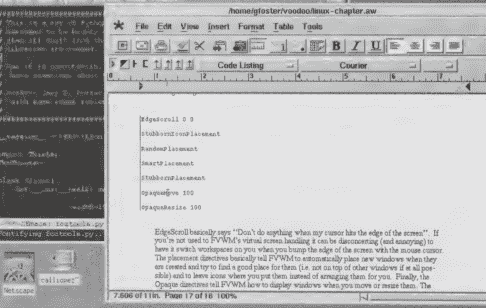

图 14-1 一个自定义的 FVWM 窗口显示

## 其他在 Linux 下有所不同的工具

图 14-2 一个简洁而优雅的 shell 提示符

在 Linux 下，有哪些工具可能会有所不同？

你可能遇到的其他与更传统的 UNIX 工具不同的工具包括（但不限于）：

- `less`：比标准的 `more` 更好的分页工具。
- `gzip`：比标准的 `compress` 更好的压缩工具。
- `crypt`：由于美国出口限制，通常不可用。不过，也有一些不受美国出口管制法律约束的替代品可用。
- `ispell`：标准拼写检查工具 `spell` 的国际版本。
- `ncftp`：更友好、功能更全面的命令行 `ftp` 客户端。
- `gcc`/`g++`：C/C++ 编译器，通常是商业 UNIX 系统上昂贵的附加选项。

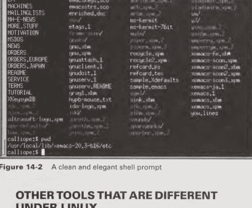

## 第 14 章 Linux

| 命令 | 说明 |
|---|---|


| `control-panel` | 一种图形化系统管理工具，可与几乎所有商业厂商的产品相媲美甚至更胜一筹。 |
| `ghostview` | 显示 PostScript 文件。 |
| `gv` | 除了 Adobe Acrobat（.PDF）文件以外，也能显示 PostScript 文件。有点像打了激素的 `ghostview`。 |
| `samba` | 允许你在 Microsoft Windows 机器之间双向共享资源。 |

# 第 15 章

## awk、perl 与 sed

### 问答主题！

- AWK 编程语言 239
  - `awk` 是三个熟悉的 UNIX 名字的产物
  - 如何调用 `awk` 并使用其选项
  - 使用 `awk` 的示例
- PERL 编程语言 242
  - `perl` 是一颗兼收并蓄的宝石
- SED 编程语言 245
  - 自动化更容易
  - `sed` 是什么
  - 为什么使用 `sed`
  - `sed` 是如何工作的
  - 使用 `sed` 的示例
- `awk` 与 `perl` 之间的区别

## awk、perl 与 sed 一览

除了功能齐全的工具箱外，UNIX 还提供了三种编程语言，旨在帮助你扩展工具箱，以满足你的特定需求。`awk` 是一种模式匹配语言，既可以用于简单任务，也可以用于复杂的文本处理。

`perl` 是另一种模式匹配语言，可能比 `awk` 更适合某些人，但这取决于你的需求和偏好。

最后，`sed` 是一种命令行流编辑器，你可以将文本文件输入其中，从而完全在脚本中修改文件。

## awk 是三个熟悉的 UNIX 名字的产物

`awk` 以它的三位共同开发者 Alfred Aho、Peter Weinberger 和 Brian Kernighan 的名字命名。它至少以原始形式包含在标准 UNIX 发行版中，通常还有一个由原作者于 1985 年编写的后续版本，称为 "new awk" 或 `nawk`。如果你要认真使用 `awk`，就需要确保系统装有 `nawk` 版本；或者你也可以获取 GNU 版本 `gawk`，它对原始版本所做的增强大部分与 `nawk` 相同。在本次讨论中，我们将使用 `awk`。

## 如何调用 awk？它提供了哪些选项？

调用 `awk` 程序使用以下命令行语法：

```
awk [option] [script] [file]
```

最常见的选项是 `-f scriptfile`，它从文件中读取脚本，而不是从命令行读取。`awk` 程序由以下形式组成：

```
pattern {action}
```

其中，模式匹配部分或动作部分都是可选的。如果没有指定模式，则对输入的每一行执行动作；如果没有指定动作，则对匹配模式的每一行执行默认动作 `{ print $0 }`。由于 `"$0"` 是一个特殊参数，其值就是输入的整行内容，所以默认动作会打印与输入匹配的那一行。因此，`awk` 的一个明显用途就是作为 `grep` 的更复杂的版本。例如，下面的命令会查找文件中以数字开头的每一行，并打印整行。

```
awk '/^[0-9]/' filename
```

显然，`awk` 的用途远不止是简单地替代 `grep`，但这确实有助于说明 `awk` 语法的一些特点。这里我们只是将 `awk` 作为一个命令行程序使用。我们要运行的程序放在单引号中，以确保 `shell` 不会尝试解释它，并且我们使用了我们习惯的正则表达式语法——只不过模式由斜杠（“/”）分隔。我们要匹配的模式是行首（`^` 部分），紧接着是一个数字（`[0-9]` 部分）。

## 你能给我一个稍微更有用的 awk 使用示例吗？

假设你想统计一个文件中的行数。当然，你可以使用 `wc` 来完成这项任务，但如果你用 `wc`，又怎么能了解 `awk` 呢？图 15-1 展示了 `linecount` 脚本的两个版本，以及运行它们的结果和运行 `wc` 程序统计行数的结果。

第一个版本打算通过显式调用 `awk` 来运行，并将此文件作为 `awk` 使用的脚本文件。它只有一行头注释，以保持文件足够小，能够完全显示在屏幕上，但你当然会在初始头注释中添加更多信息。然后它有保留字 `END`，后面跟着一个用花括号括起来的动作，用于打印消息并显示文件中的行数。`END` 一词

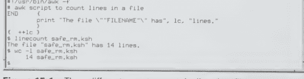

图 15-1 统计文件中行数的三种不同方法

告诉 `awk` 只在所有其他处理完成后执行一次此操作。还有一个等效的保留字 `BEGIN`，允许你在开始处理文件之前执行一组操作。还要注意 `print` 语句中间的 `FILENAME` 一词。这是另一个保留字，包含正在处理的文件的文件名。如果脚本处理的是标准输入，该变量将返回 `"-"`。在这个 `print` 语句中，包含了变量 `lc`，这是我们自己创建的变量，我们不必初始化它、声明它，也不必做任何其他无聊的编程工作。最后，我们有了实际的计数操作。这里，我们使用了一个非常类似 C 语言的表达式——`++lc`——这是更冗长的 `lc = lc + 1` 的简写形式，`awk` 同样可以接受后者。注意，我们不必将 `lc` 初始化为任何值，它一开始的值为零，除非我们赋予它其他值。由于我们想从一开始计数，而不是从零开始，我们使用了 C 语言的 `++lc` 结构，它表示在评估 `lc` 之前先递增它，从而让我们领先一步。

第二个版本的行数统计程序是我们认为的独立版本。它利用了 Korn shell 直接执行程序的能力，在文件的第一行插入那行看起来像注释的行。这一行告诉 Korn shell 通过 `awk` 程序处理文件的其余部分，使用 `-f` 选项，这会将文件的其余部分作为 `awk` 脚本提供给 `awk`。这是所谓 `shell` 包装器的最简版本；它提供了一种便捷的方式，让你无需输入更笨拙的命令行语法即可运行你喜欢的脚本。你可以编写更复杂的包装器来解析命令行选项等，但这对我们的目的来说已经足够了。现在我们只需输入 `linecount` 文件名，就可以统计文件中的行数。最后，一个更有趣的程序版本。图 15-2 展示了如果我们将其修改为仅统计文件中的注释行，程序会是什么样子。

这里我们使用相同的基本程序，但现在我们告诉 `awk` 只统计那些以 `"#"` 开头的行。我们甚至告诉它忽略某些脚本中使用的第一行，以确保它们使用特定的程序或 `shell` 进行处理。

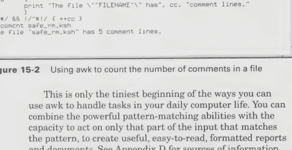

图 15-2 使用 `awk` 统计文件中的注释数量

这仅仅是你在日常计算机生活中使用 `awk` 处理任务的最微小开端。你可以将强大的模式匹配能力与仅对输入中匹配模式的部分采取操作的能力相结合，从而创建有用、易读、格式化的报告和文档。有关 `awk` 的信息来源，请参见附录 D。

## PERL 编程语言

## perl 是一颗兼收并蓄的宝石

与由三个人编写的 `awk` 不同，`perl` 基本上是由一个人——Larry Wall——编写的。其他人不可避免地影响了它的成长和特性，但最终的责任归功于 Larry，当然，功劳也是如此。`perl` 官方是 “Practical Extraction and Report Language” 的缩写，这个描述已经足够恰当。但想想许多人认为它实际上是 “Pathologically Eclectic Rubbish Lister” 的缩写，你就会开始对这种语言及其创建者的特性有更准确的感受。大多数尝试过 `perl` 的人似乎要么将其广泛应用于各种用途，要么尖叫着逃进黑夜。`awk` 或 `perl` 是否适合你，你必须自己决定。但我们确实认为你应该将其中一种添加到你的日常工具箱中。我们倾向于认为 `perl` 中扩展正则表达式的更大灵活性和强大功能使其略胜一筹。此外，尽管它的语法兼收并蓄，但它往往会让你越来越喜欢。

## 你能指出 awk 和 perl 之间有哪些区别吗？

在本节中，我们将把为 `awk` 创建的两个脚本 “移植” 到 `perl`。最终结果当然是相同的，但你将能够看到这两个程序的不同之处。

我们将跳过行计数程序的命令行版本，直接使用围绕它的极简 `shell` 包装器版本。不同的是，现在它运行的不是 `awk` 程序，而是 `perl` 程序。通常，你会在 `perl` 脚本的第一行写上

```
#!/usr/bin/perl
```

但我们的位置比较特殊，所以第一行写的是：

```
#!/work/bin/perl
```

结果是相同的。此行告诉 `shell` 程序，它的唯一工作就是执行 `perl` 程序，并将文件中的语句直接传递给 `perl` 处理。图 15-3 显示了用于统计文件中行数以及文件中注释行数的两个 `perl` 脚本，这与我们用 `awk` 做的两个任务相同。但现在程序看起来有点不同。

`awk` 使用一个隐式的 `while` 循环，会自动将命令行上给出的文件的全部内容发送到程序的模式匹配和动作部分。但在

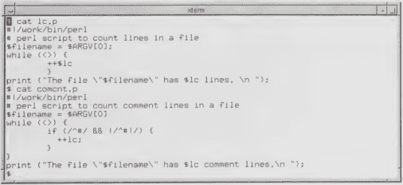

**图 15-3** 我们两个脚本，重写为 `perl`

`perl` 示例中，你会看到我们需要显式地构建 `while` 循环，使用语句：

```
while (<>) {
++$lc;
}
```


这可能对你来说是有意义的，因为大多数编程语言都要求你在需要时创建自己的`while`循环。但那个`(<>)`究竟是什么意思？这被称为“菱形操作符”，它取数组`$ARGV[0]`中的文件，即我们在命令行上传递给程序的文件，并逐行检查该文件，直到到达末尾。这正是`awk`脚本自动完成的工作。

`awk`程序拥有的另一件事，我们在这里必须显式完成，就是传入我们要计数的行的文件名。在这里，我们需要将该文件名放入一个在`while`循环过程中不会被破坏的变量中，以便在计数完所有行后在末尾引用它。

在第二个程序中，即统计文件中注释行的程序中，我们再次看到了两种语言之间的差异和相似之处。在`awk`中，我们只需将模式匹配条件添加到执行计数的行的开头，但在`perl`中这里我们需要添加一个显式的`if`子句。同样，`awk`自动完成的一些事情在`perl`中必须显式调用。我们并不觉得这是一种负担，甚至认为它使生成的代码更易于阅读，但其他人强烈认为这并不那么优雅。

需要注意的是，描述模式匹配的相同代码。`perl`虽然增加了重要的新模式匹配工具（我们最喜欢的是`\b`来定义词边界），但它仍然使用与`awk`相同的语法。

正如你所见，`perl`和`awk`之间存在实质性差异，尽管两者执行许多相同的功能。从更广泛的意义上讲，`perl`超越了`awk`的范围或可能发展的方向，并且仍在积极开发中。它并不是 UNIX 标准发行版的一部分，但可以自由获取。

## THE SED PROGRAMMING LANGUAGE

### 自动化更轻松

对文本文件或一系列文本文件执行重复性更改是一项常见的计算机任务。虽然交互式文本编辑器如`vi`或`emacs`可能是你首先选择的工具，但有更好的（尽管不太为人所知）的替代方案。其中一种替代方案是`sed`，一种非交互式流编辑器。

### 什么是 `sed`？

`sed`是一种允许你对文件执行脚本化或重复性编辑的工具。由于它是非交互式的，你不使用传统的编辑界面。相反，你发出一组命令来对输入流执行一系列任务，结果被导向输出流。你可以使用标准的 shell 重定向（管道等）来操作、创建或重定向这些流。

### 为什么还要学习另一种工具？

传统的 UNIX 编辑器是为其设计的工作而设计的优秀工具。它们非常适合交互式编辑任务，涉及生成新文件或更新旧文件。其中一些甚至具有有用的脚本功能，允许你对文件或一组文件执行编程或脚本化编辑任务。

然而，当你需要进行大规模重复、小幅编辑或只是需要快速进入和退出时，其中大多数都是严重的过度设计。此外，大多数编辑器不允许你将它们插入到 UNIX 的“管道”命令中间，即使可以，启动它们的开销也会非常巨大。

UNIX 资深用户一直有使用合适工具完成合适工作的传统，而且你的工具箱里永远不嫌技巧多。`sed`并不是写简历或写给霍滕斯阿姨的信的正确工具。然而，当你需要在十几个不同的文件中把每个竖线字符都改成冒号，然后再把这些文件发送给另一个程序处理时，它就无可匹敌了。

### 它是如何工作的？

`sed`从`stdin`读取一组字符，即一个流，并写入到`stdout`。它可以在命令行上接收一系列操作，如果它们很短的话，或者它可以从脚本文件读取一组指令。一个常见的调用可能看起来像这样：

```
sed -e '{some sed command}' input_file > output_file
```

或者，如果从脚本文件读取一组命令，可能看起来类似这样：

```
sed -f {script file} input_file > output_file
```

除非另有指定，否则 `sed` 会将你输入的命令应用于输入流中的每一行。你可以通过多种方式限制受影响的行，例如指定开始和结束行号，甚至可以通过模式匹配开始或结束块。这些受影响的行通常被称为地址，这些地址可以指定为零、一个或两个地址。地址可以是模式（用斜杠括起来）、行号或行指定符符号的任意组合。

命令种类繁多且各不相同。其中一些包括：

- `=` 打印该行的行号到 `stdout`
- `s` 在地址上执行替换
- `d` 删除所寻址的行
- `w` 将所寻址的行写入文件
- `q` 在遇到地址时退出

还有许多其他可用的命令，但这个列表应该能让你略知 `sed` 的能力。

### 你能给我一些使用 `sed` 的例子吗？

通过组合地址和命令，你可以形成一个完整的 sed 命令，可能看起来像这样：

```
sed -e '/foo/d' myfile
```

这个 `sed` 调用会删除包含单词 `foo` 的每一行，并将结果打印到标准输出。这是一个使用零地址的例子，这会导致对每一行都尝试匹配。另一个例子是：

```
sed -e '50d' myfile
```

这将导致删除 `myfile` 的第 50 行，而

```
sed -e '50,$d' myfile
```

将删除从第 50 行到末尾的内容（`$` 指流中的最后一行）。另一个常见任务是使用另一个模式替换一个文本模式。这是通过使用 `s` 命令而不是上面的 `d` 来完成的，可能看起来像这样：

```
sed -e 's/foo/bar/' myfile
```

这个例子会在每一行上用单词 `bar` 替换单词 `foo` 的第一次出现。如果你想在同一行上替换多个出现，你需要在命令后附加 `g`，如下所示：

```
sed -e 's/foo/bar/g' myfile
```

可以在上面的搜索空间中使用正则表达式模式（而不是例如 `foo`），这可以增加编辑的强大功能。如果你想在特定行前面放置一系列星号，例如，你可能会使用：

```
sed -e '/foo/s/^/*** /' myfile
```

这将找到包含单词 `foo` 的每一行，并用三个星号替换行的开头（`^` 是一个特殊符号，指行的开头）。

最后需要一个警告。由于 `sed` 是流式导向的，它在打开输出流之前不会将整个输入文件读入内存。这意味着如果你尝试像这样就地编辑文件：

```
sed -e 's/foo/bar/' myfile > myfile   # THIS IS WRONG
```

你最终会得到一个零字节的文件和一副非常愚蠢的表情。

## 附录 A 命令参考


当然你知道各种版本的 UNIX 中有数百个命令，所以你在这里找不到全部。但你会找到很多非常有用的命令——尤其是本书技巧中使用的那些。我们将向你展示语法和可用的选项，以及每个命令如何工作的一点介绍。

由于 UNIX 各版本之间存在差异，你的版本可能与此处所示的语法和/或选项略有不同。如果你看到一个看起来可能做你想做的事情的命令，但你没有看到完全正确的选项或执行时出现语法错误，请查阅你的文档以了解可能的变体。

### `alias [options] name[=‘cmd’]`

**目标：**

为 `cmd` 分配一个简写名称以代替它。如果省略 `'cmd'`，它会打印 `name` 的别名。仅限 Korn shell。

**选项和变量**

- `-t` 为 UNIX 命令创建跟踪别名。shell 会记住命令的完整路径名，使其更容易找到。
- `-x` 导出别名以便在 shell 脚本中使用。

### `at options time [date] [+increment]`

**目标：**

让你安排作业在稍后执行。

**选项和变量**

- `-l` [`jobID`] 列出你当前安排的作业。如果只想了解某个作业的信息，请包含 `jobID`。
- `-r` [`jobID`] 从队列中移除指定的作业。你只能移除自己的作业，除非你是超级用户。
- `time` 指定作业应开始的时间。格式为 `hh:mm` [修饰符]。除非你添加 `am` 或 `pm` 修饰符，否则假定使用 24 小时制，在这种情况下时间基于 23 小时制。

### `bg [jobids]`

**目标：**

将当前作业或指定的 `jobIDs` 置于后台。仅限 Korn shell。

### `cal month year`

**目标：**

在标准输出上显示日历。

**选项和变量**

- `month` — 使用 1 到 12 之间的数字或足以表示唯一月份的字母。
- `year` — 1 到 9999 之间的任意数字。你必须包含全部四位数字。

### `cancel requestIDs` or `cancel printer`

**目标：**

取消由 lp spooler 生成的打印请求。

**选项和变量**

- `requestIDs` — 按 `requestID` 编号取消。使用 `lpstat` 查看 `requestIDs` 列表。
- `printer` — 取消此打印机的当前打印作业。

### `cat [options] filelist`

**目标：**

将文件连接（合并）在一起。使用 `>` 操作符将多个文件合并到一个新文件中，或使用 `>>` 将文件追加到现有文件。

**选项和变量**

- `-e` — 在每行末尾打印 `$`。此选项仅在 `-v` 选项下有效。
- `-v` — 显示控制字符和其他不可打印字符。


- `-s` — 抑制关于无法读取文件的消息。
- `-t` — 将每个制表符打印为 `^I`，每个换页符打印为 `^L`。
- `-u` — 以无缓冲方式打印输出。
- `filelist` — 可选的待合并文件列表。

### `cd directoryname`

**目标：**

更改当前工作目录。

**选项和变量**

- `directoryname` — 你想要设为当前目录的目录名称。

### `chmod mode files`

**目标：**

更改文件的模式。文件的模式控制与该文件关联的访问权限。只有文件所有者（或超级用户）可以更改其模式。

**选项和变量**

**对象**

- `u` — 用户
- `g` — 组
- `o` — 其他人
- `a` — 所有人（默认）

**操作码**

- `+` — 添加权限
- `-` — 移除权限
- `=` — 将权限设置为仅指定的内容

### `cp [options] file1 file2`

**目标：**

复制文件。

**选项和变量**

| 变量 | 描述 |
| --- | --- |
| `file1` | 要复制的文件。 |
| `file2` | 目标名称。 |

### `date MMDDhhmmyy` or `date +format`

**目标：**

显示系统日期和时间。

**选项和变量**

| 变量 | 描述 |
| --- | --- |
| `MMDDhhmmyy` |  |
| `MM` | 月份（01-12） |
| `DD` | 日期（01-31） |
| `hh` | 小时（00-23） |
| `mm` | 分钟（00-59） |
| `YY` | 年份（00-99）—可选 |
| `+format` | 由 `%` 符号后跟以下内容组成： |
| `n` | 插入换行符 |
| `t` | 插入制表符 |
| `m` | 月份（数字） |
| `d` | 月中的日期（数字） |
| `y` | 年份的最后两位数字 |
| `D` | 日期格式为 mm/dd/yy |
| `H` | 小时 |
| `M` | 分钟 |
| `S` | 秒 |
| `w` | 星期几（0-6，0=星期日） |

### `diff [options] oldfile newfile`

**目标：**

比较两个文本文件以查找它们的不同之处。

**选项和变量**

- `-b` — 忽略重复的空白和行尾空白。
- `-e` — 生成编辑器 `ed` 的脚本。
- `-f` — 生成用于从 `file2` 重新创建 `file1` 的脚本。

### `echo -n string`

**目标：**

将字符串写入标准输出。默认情况下，`echo` 会在所有输出后跟一个换行符。`-n` 会抑制此换行。特殊转义字符，以 `\` 为前缀，会产生特殊输出序列：

| 字符 | 含义 |
| --- | --- |
| `\b` | 退格 |
| `\c` | 末尾不打印换行符（与 `-n` 相同） |
| `\f` | 换页 |
| `\n` | 换行 |
| `\r` | 回车 |
| `\t` | 制表符 |
| `\\` | 反斜杠 |

### `fg [jobIDs]`

**目标：**

将当前作业或指定的 jobIDs 置于前台。

### `find pathname condition`

**目标：**

搜索指定的目录，生成符合指定条件的 文件列表。

**选项和变量**

- `-name file` — 匹配指定的文件。如果用引号 ("") 括起来，`file` 可以包含通配符 `*` 和 `?`。
- `-perm mode` — 匹配模式与 `mode` 的数值相符的所有文件。必须匹配所有模式——不仅仅是读、写和执行。要匹配除此模式之外的所有内容，请使用 `-mode`。
- `-type x` — 匹配所有类型为 `x` 的文件，其中 `x` 为以下之一：
  - `c` — 字符设备
  - `b` — 块特殊文件
  - `d` — 目录
  - `p` — 命名管道
  - `f` — 普通文件（非上述类型）
- `-atime days` — 匹配 `days` 天前最后访问过的所有文件。
- `-mtime days` — 匹配 `days` 天前最后修改过的所有文件。
- `-newer file` — 匹配比 `file` 修改时间更近的所有文件。
- `-ctime +n | -n | n` — 匹配在 n 天前更改的文件。更改超过 n 天（`+n`）、少于 n 天（`-n`）或恰好 `n` 天。更改指修改、权限或所有权更改。
- `-exec command` — 对 `find` 匹配的每个文件运行 UNIX 命令。
- `-ok command` — 与 `-exec` 相同，但在执行命令前提示确认。
- `-print` — 打印找到的文件名。
- `-user` — 匹配属于用户名或 ID 的文件。

### `finger [options] users`

**目标：**

显示系统上用户的信息。

**选项和变量**

- `-b` — 从输出中省略用户的家目录和 shell。
- `-f` — 抑制标题行。
- `-l` — 强制使用长输出。
- `-p` — 不打印 .plan 文件。
- `-q` — 显示用户快速列表。
- `-s` — 显示简短格式。
- `users` — 指定确切的登录名或作为名字或姓氏。

## `grep [options] regexp [files]`

### OBJECTIVE:

在文件中搜索模式或正则表达式 `regexp` 并在找到时报告。

### OPTIONS AND VARIABLES

- `-c` — 仅打印匹配行的计数。
- `-l` — 仅显示包含匹配的文件名。
- `-i` — 消除大小写敏感性。
- `-v` — 打印所有不匹配的行。
- `-n` — 打印匹配行及行号。
- `-s` — 抑制不存在或无法读取文件的错误消息。

## `head [-lines files]`

### OBJECTIVE:

打印文件的前几行。

### OPTIONS AND VARIABLES

- `-lines` — 指定要打印的行数。默认值为 10。
- `files` — 以空格分隔的文件列表，你想要打印的文件。默认值为标准输入。

## `jobs [options] [jobIDs]`

### OBJECTIVE:

列出正在运行或已停止的作业。包含 jobIDs 以检查特定作业。仅 Korn shell。

### OPTIONS AND VARIABLES

- `-l` — 列出作业 ID 和进程组 ID。
- `-n` — 仅列出自上次通知以来状态发生变化的作业。
- `-p` — 仅列出进程组 ID。

## `lp [options] [files]`

### OBJECTIVE:

将文件发送到打印机。

### OPTIONS AND VARIABLES

- `-c` — 将文件复制到打印 spooler。
- `-d dest` — 将输出发送到名为 dest 的打印机。
- `-f form-name` — Spooler 仅在指定 form-name 安装在打印机上时才打印请求。设置 `-d` 任意选项时，请求将发送到安装有 form-name 的任意打印机。
- `-L` — 将打印作业发送到连接到终端的打印机。
- `-n number` — 指定要打印的副本数。
- `-P pages` — 在 pages 指定的页码上打印。
- `-R` — 打印后删除文件。
- `-t title` — 在打印输出的横幅页上使用 title。

## `lprint - file`

### OBJECTIVE:

将文件发送到连接到终端的打印机。

### OPTIONS AND VARIABLES

- `-` — 从标准输入打印而不是文件。

## `lpstat [options]`

### OBJECTIVE:

显示 lp spooler 系统和打印请求的状态。

### OPTIONS AND VARIABLES

- `-a list` — 显示 list 中的打印机是否接受请求。
- `-c list` — 显示 list 中打印机的类名。
- `-p list` — 显示 list 中打印机的状态。通常用于确保打印机已启用。
- `-d` — 显示默认打印机目标。
- `-f list` — 验证 forms 列表是否已知于 lp。
- `-r` — 显示打印调度程序是开启还是关闭。
- `-s` — 显示状态摘要（几乎所有内容）。
- `-t` — 显示所有状态信息（报告所有内容）。

## `ls [options] [directories]`

### OBJECTIVE:

列出目录内容。如果未给出目录，则列出当前目录中的文件。

### OPTIONS AND VARIABLES

- `-A` — 显示所有文件，包括隐藏文件（以句点开头的文件）。不包括当前目录或父目录。
- `-a` — 显示所有文件，包括当前目录 (.) 和父目录 (..)。


- `-C` 以列形式列出文件。
- `-x` 以横向跨屏的行形式列出文件。
- `-d` 仅列出目录名，而非其内容。
- `-l` 提供长列表，包括权限、所有者、大小、文件名、上次修改日期等。

## `mail` [options] [usernames]

### OBJECTIVE:

读取或向其他用户发送邮件。你可以输入 `?` 获取命令摘要。

### OPTIONS AND VARIABLES

- `-e` 检查你的收件箱是否有邮件。
- `-f` `file` 打开文件以读取邮件。如果未指定文件，则使用 `mbox` 文件。
- `-F` 将外发邮件存储在与消息第一个收件人同名的文件中。
- `-H` 显示邮箱内容的标题摘要。

## `make` [options] [targets] [macro definitions]

### OBJECTIVE:

根据当前目录中的描述文件中的依赖指令更新一个或多个目标。该文件默认称为 `makefile` 或 `Makefile`。选项、目标和宏定义可以以任意顺序出现。宏定义格式为 `name=string`。

### OPTIONS AND VARIABLES

- `-e` — 使用环境变量覆盖 *makefile* 赋值。
- `-f` `makefile` — 使用 *makefile* 作为描述文件。
- `-i` — 忽略命令错误代码。
- `-n` — 打印命令但不执行。
- `-p` — 打印宏定义和目标描述。
- `-q` — 查询。如果文件是最新的则返回 0，否则返回非零。
- `-r` — 不使用默认规则。
- `-s` — 不显示命令行。
- `-t` — 触摸目标文件。导致其被更新。

## `man` [options] [section] [title]

### OBJECTIVE:

显示在线参考手册中的信息。

### OPTIONS AND VARIABLES

- `-a` — 显示匹配 *title* 的所有页面。
- `-b` — 在输出中保留空白行。
- `--dir` — 指定目录 *dir* 添加到条目搜索路径。

## `mesg` n y

### 目标：

控制其他人是否可以向你的屏幕发送消息。

### 选项和变量

- `n` 不允许用户向你的终端发送消息。
- `y` 允许消息（默认）。

## `mkdir` [options] dirname

### 目标：

创建新目录。

### 选项和变量

- `-m` `mode` 设置所有新目录的访问模式。
- `-p` 如果沿途的父目录尚不存在，则一并创建它们。
- `dirname` 新目录的名称。

## `more` [options] [files]

### 目标：

按屏显示指定的文件。按回车键显示下一行，或按空格键显示下一屏。

### 选项和变量

- `-c` 通过清除每个窗口而不是滚动来翻页文件。有时这样更快。
- `-f` 统计逻辑行数而不是屏幕行数。
- `-l` 忽略换页符（`^L`）。
- `-r` 强制以 `^x` 形式显示控制字符。
- `-s` 将多个空行显示为一行。

### 选项和变量

- `n` 以 `n`（1-19）的 nice 级别运行命令。默认值为 10。`n` 越大，表示你越“友善”。

## `openwin` [options]

### 目标：

设置 OpenWindows，这是基于 Open Look 图形用户界面的窗口环境。

### 选项和变量

- `banner` 在启动时显示 OpenWindows 横幅屏幕。
- `noauth` 恢复到较低的安全模式。
- `includedemo` 将演示目录的路径包含到用户的搜索路径中。

## `pack` [option] files

### 目标：

压缩文件以占用更少的空间。

### 选项和变量

- 打印更多统计信息，例如每个字节被使用的次数、相对频率等。
- `files` 要进行打包的文件空格分隔列表。

## `passwd` [options]

### 目标：

允许你更改自己的密码。

### 选项和变量

- `-s` 显示密码信息，如用户名、密码状态、最近更改日期等。

## `pg` [options] files

### 目标：

允许你一次一页地查看文本文件。与 `more` 不同，它允许你向前和向后移动。在 `pg` 中按 `^` 进入反向搜索模式。按 `/` 返回正向搜索模式。

### 选项和变量

- `-e` 在文件末尾不暂停。
- `-f` 不拆分长行。
- `-n` 发出 `pg` 命令时不等待回车。
- `-s` 消息和提示以突出模式（反白显示）显示。
- `+number` 从第 `number` 行开始显示。
- `+/pattern` 从包含 `pattern` 的第一行开始显示。
- `files` 空格分隔的文件名列表。

## `ping` [options] host

### 目标：

告诉你网络上另一台机器是否正在运行。此命令向指定机器发送 `ECHO_REQUEST` 数据包。如果数据包成功发送和接收，则认为连接是活跃的。

### 选项和变量

- `-n` 将网络地址显示为数字。
- `-c` `count` 在发送 `count` 个 `ECHO_RESPONSE` 数据包后停止。
- `-r` 绕过正常的路由表，直接发送到已连接网络上的主机。

## `pr` [options] files

### 目标：

允许你在将文件打印到标准输出时对文件进行格式化。

### 选项和变量

- `+page` 从第 `page` 页开始打印。
- `-col` 指定输出为 `col` 列。
- `-a` 以多列格式打印文件。
- `-d` 将输出双倍行距。
- `-f` 用一个换页命令分隔各页。
- `-m` 合并文件，每个文件打印为一列。覆盖 `-col` 选项。
- `-t` 不打印页眉或页脚。

## `purge` [options] files

### 目标：

通过覆盖文件来清除它们。这些文件可以是命令行上的文件，也可以是系统管理员维护的特定策略文件中列出的文件。

### 选项和变量

- `-f` 不警告不存在或无法访问的文件。
- `-m` `number` 将每个文件覆盖 `number` 次。
- `-r` 递归清除目录。
- `-s` 覆盖策略文件中指定为系统文件的文件。
- `-u` 覆盖策略文件中指定为用户文件的文件。
- `-t` `group` 覆盖策略文件中指定为类型组的文件。
- `-v` 在覆盖时列出每个文件的名称。
- `files` 要清除的空格分隔的文件列表。可以是普通文件、目录或特殊字符文件。

## `pwd`

### 目标：

打印当前工作目录的完整路径名。

## `rcp` [options] hostname:file1 hostname:file2

### 目标：

在两台机器之间复制文件。

### 选项和变量

## `rlogin` [options] system

### 目的

允许您登录远程计算机。

### 选项和变量

- `-8` 允许 8 位数据传输，而不是 7 位数据传输。
- `-e` `c` 指定转义字符 `c`。
- `-l` `username` 使用 `username` 登录远程系统。默认值与您的本地用户名相同。

## `rm` files

### 目的

删除一个或多个文件。要删除文件，您必须对包含该文件的目录拥有写权限。如果您对文件本身没有写权限，系统会提示您确认删除。

这可能是一个非常危险的命令。请务必小心。

### 选项和变量

- `-f` 删除受写保护的文件时不提示确认。
- `-i` 每次删除前都提示确认。
- `-r` 如果 `files` 是目录，则删除整个目录及其内容。

## `rmdir` [options] directoryname

### 目的

删除目录。该目录必须为空。

### 选项和变量

- `-p` 删除 `directoryname` 以及因此变为空的所有中间父目录。
- `-s` 抑制使用 `-p` 时产生的标准错误消息。

## `sdiff` [options] file1 file2

### 目的

并排比较 `file1` 和 `file2`。输出结果为：

- `text text` 相同的行。
- `text <` 该行只存在于 `file1` 中。
- `> text` 该行只存在于 `file2` 中。
- `text1 | text2` 这些行不同。

### 选项和变量

- `-w` `width` 指定输出行的宽度为 `width` 个字符。
- `-l` 相同的行只出现在输出的左侧。
- `-s` 不显示相同的行。
- `file1` 输出左列中的文件。
- `file2` 输出右列中的文件。

## `set`

### 目的

显示所有 shell 变量的值。

## `setcolor` [options] [argument]

### 目的

设置屏幕颜色及其他属性。


### 选项和变量

- `-b color` 将背景色设置为 `color`。
- `-g color1 color2` 将前景色设置为 `color1`，背景色设置为 `color2`。
- `-n` 将屏幕设置为“正常”：白色前景和黑色背景。
- `-r color1 color2` 将屏幕反显视频的前景色设置为 `color1`，将屏幕反显视频的背景色设置为 `color2`。
- `-o color` 将边框设置为 `color`。

## `sleep seconds`

### 目的

将进程的执行暂停指定的秒数。

## `sort [options] [files]`

### 目的

对指定文件的行进行排序。

### 选项和变量

- `-b` 忽略前导空格和制表符。
- `-c` 检查文件是否已排序；如果已排序，则不产生输出。
- `-d` 按字典顺序排序。
- `-f` 忽略大小写差异。
- `-i` 忽略不可打印字符。
- `-m` 合并已排序的输入文件。
- `-n` 按数字顺序排序。
- `-r` 颠倒排序顺序。
- `-u` 输入中相同的行在输出中只出现一次。

## `spell [options] +userdict files`

### 目的

检查文本文件的拼写。

### 选项和变量

- `-b` 使用英式拼写。
- `-v` 显示所有未按原样出现在字典中的单词。
- `-x` 显示每个可能的词干。
- `+userdict` 将排序后的 `userdict` 作为本地词典，以补充系统词典。

## `strings [options] files`

### 目的

在二进制文件中搜索 ASCII 字符。

### 选项和变量

- `-a` 搜索整个文件，而不仅仅是目标文件中已初始化的数据部分。
- `-o` 显示找到字符串时在文件中的字节偏移量。
- `-n number` 最小字符串长度为 `number`。默认值为 `4`。

## `stty [options] [settings]`

### 目的

为当前标准输入设备设置终端 I/O 选项。

### 选项和变量

- `-a` 显示当前登录终端的当前设置。
- `-g` 以十六进制报告当前设置。
- `settings` `settings` 可以是先前 `-g` 标志的输出，也可以是一系列 `stty` 命令。

## `tail [options] [file]`

### 目的

允许您查看文本文件的最后几行。默认显示最后 `10` 行。

### 选项和变量

- `+n` 从输入的开头输出 `n` 行。
- `-n` 从输入的末尾输出 `n` 行。
- `b` 加在 `+n` 或 `-n` 之后时，表示块。
- `c` 加在 `+n` 或 `-n` 之后时，表示字符。
- `r` 以相反顺序输出这些行。

## `tar [options] [files]`

### 目的

将文件复制到归档介质，或从归档介质恢复文件。如果任何文件是目录，则对整个子树进行操作。选项前面不需要加 `-`。

### 选项和变量

| 功能 | 选项 |
|---|---|
| c | 创建新的归档。 |
| r | 将文件追加到现有的归档文件。 |
| t | 按归档文件中的显示方式打印文件名。 |

### 函数选项

- `u` 执行更新，如果文件尚未存在于归档中或自上次备份以来已被修改，则将文件追加到归档中。
- `x` 从归档中提取指定的文件。

### 选项

- `A` 抑制绝对文件名。
- `f archive` 将文件存储到指定的归档中或从指定的归档中提取文件。
- `l` 打印关于找不到的链接的错误消息。
- `m` 不要恢复修改时间；将其更新为提取时间。
- `v` 在处理文件时显示文件名。
- `w` 等待用户确认。

## `tee [options] files`

### 目标

将输出拆分为两个文件。一个副本发送到标准输出，另一个发送到文件。

### 选项和变量

- `-a` 将输出追加到文件而不是覆盖它们。
- `-i` 忽略所有中断。
- `-u` 使输出不带缓冲。
- `files` 要捕获输出的以空格分隔的文件列表。

## `time command`

### 目标

打印进程的执行时间、进程执行时间和系统时间。

### 选项和变量

- `command` 你想要计时的命令。

## `tr [options] [string1] [string2]`

### 目标

将标准输入复制到标准输出，将 `string1` 中的字符替换为 `string2` 中的字符，或删除 `string1` 中的字符。

### 选项和变量

- `-c` 将输出限制为 `string1` 中指定的字符，并有效地将这些字符追加到 `string2` 中。
- `-d` 从输出中删除 `string1` 中的字符。
- `-s` 删除 `string2` 中重复的输出字符。

## `unmask [value]`

### 目标

显示或设置文件创建模式掩码。

### 选项和变量

`value` 一个三位八进制代码，指定要关闭的读-写-执行权限。

## `unpack files`

### 目标

将一个或多个用 `pack` 创建的文件扩展到其原始形式。

## `unset [-f] names`

### 目标

删除 `names` 中列出的变量或函数的定义。在 Korn shell 中，函数必须使用 `-f` 选项明确声明。

## `wall [file]`

### 目标

向所有已登录用户发送消息。如果指定了文件，则输入取自文件而不是标准输入。

## `who [options]`

### 目标

显示系统当前状态的信息。没有选项时，你将获得当前已登录用户的列表。

### 选项和变量

- `-am i` 打印调用该命令的用户名。
- `-A` 显示 UNIX 记账信息。
- `-a` 显示所有可用信息。
- `-b` 报告有关上次重启的信息。
- `-H` 打印标题行。
- `-i` 报告非活动终端线路。
- `-q` 仅显示用户名和计数。
- `-t` 报告系统时钟最后一次更改的时间。

## `whodo`

### 目标

报告系统中有哪些人以及他们在做什么的列表。

## `write user [tty]`

### 目标

让你向另一用户的终端发送消息（如果他们已通过 `mesg` 命令允许）。

### 选项和变量

- `user` 你想要发送消息的人的名字。
- `tty` 如果此人登录到多个终端，你可以指定要发送消息的终端。

## `xsetroot [options]`

### 目标

设置工作区的背景外观。

### 选项和变量

- `-help` 显示命令行选项的摘要。
- `-def` 将未指定的属性重置为其默认设置。
- `-bitmap file` 使用 `file` 中找到的位图设置工作区背景。
- `-mod x y` 制作格子背景。`x` 和 `y` 是 `1` 到 `16` 的整数。
- `-gray` 使背景变灰。
- `-solid color` 使工作区背景为纯色。

## `xterm [options]`

### 目标

让你设置窗口变量。

### 选项和变量

- `-bg color` 设置 `xterm` 窗口的背景颜色。
- `-fg color` 将前景设置为颜色。
- `-fn font` 用 `font` 替换默认字体。
- `-help` 显示可用的 `xterm` 选项摘要。
- `-RV` 反转前景和背景颜色。
- `-sb` 或 `+sb` 为 `xterm` 窗口显示滚动条并保存滚动到顶部的行，以便仍可查看。

## `zcat file`

### 目标

显示压缩文件（以 `.z` 结尾）内容的未压缩输出，同时保持压缩文件不变。

| | |
| --- | --- |
| 无效选项 `(-x)` - 处理终止 | 这个看起来吓人的消息仅仅意味着你给 `nl` 命令提供了一个它不认识的选项。系统会把你指定的选项字母替换为 `-X`。 |
| 行过长 | 你正试图使用 `cut` 输入一行或使用 `paste` 输出一行，而该行长度超过 `511` 个字符。 |
| `ptar：目录校验和错误` | 你可能为软盘或磁带驱动器指定了错误的介质类型，或者磁带可能需要倒带。 |
| 读取错误：... | 表明文件系统出现问题。请联系系统管理员。 |
| `rm：非法选项 -- ?` | 你向 `rm` 提供了一个它不认识的选项。 |
| `shutdown：未找到` | 意思是 `/etc` 不在你的搜索 `PATH` 中。它只在超级用户的 `PATH` 中，所以除非你确实是那位尊贵人士，否则无法使用此命令。 |
| 抱歉 | 当你尝试更改密码但错误地输入了旧密码时，会出现这句简短的同情话语。你需要调用 `passwd` 并重试。 |
| `sort：命令行选项使用无效` | 通知你给 `sort` 提供了一个它不认识的选项。 |
| `tar：目录校验和错误` | 你可能为软盘或磁带驱动器指定了错误的介质类型，或者磁带可能需要倒带。 |
| 文件过多 | 你正试图粘贴合并超过 `12` 个文件。 |
| 未知的制表符代码 | 当使用带有 `-list` 选项的 `tabs` 命令时，你试图指定一个不存在的制表位。 |

## 附录 C

### 术语表

**绝对路径名** 文件的完整名称，包括显示文件在目录树中位置的完整目录路径。绝对路径名以根目录 `/` 开头。


# UNIX 术语表

### 地址
可以是特定机器的名称，也可以是整个 UNIX 系统的名称。电子邮件和通信讨论中会用到这两种含义。

### AIX
IBM 公司制作的一个 UNIX 版本。

### 匿名 ftp
一种不需要密码的远程登录。你输入 `anonymous` 作为用户名，以你的电子邮件地址作为密码，从而可以将文件从另一台计算机复制到你自己的计算机。

### 归档文件
包含其他文件集合的文件。主要用于备份。

### 参数
在命令行中，参数是跟在命令后面的内容。例如，在一行 `cp my.file your.file` 中，命令是 `cp`，`my.file` 是第一个参数，`your.file` 是第二个参数。

### ASCII
美国信息交换标准代码。通常指文本格式的文件，因此可查看、可打印，且不含二进制（非 ASCII）字符。

### at
允许你安排任务在未来运行的命令。

### awk
一种面向文本处理的编程语言。

### 后台
在幕后运行、无需你输入的程序即是在后台运行。可以通过在命令行末尾加上 `&` 来启动命令，使其在后台运行。

### 反斜杠
字符 `\`。在 UNIX 中，它改变（“转义”）下一个字符的解释。

### 感叹号
字符 `!`。shell 转义字符。也用于表示该命令无论如何都应执行。

### 伯克利软件发行版
BSD UNIX 的完整名称，由加州大学伯克利分校开发和发行的一个 UNIX 版本。该版本以其先进的网络功能而著称。

### bin 目录
用于存储可执行文件的目录。你的主目录中可能有一个名为 `bin` 的子目录。

### 块大小
UNIX 文件系统始终连续分配的最大数据量。换句话说，小于块大小的文件将始终是连续的。较大的文件可能会碎片化。

### Bourne shell
最初的 shell。由贝尔实验室的史蒂文·伯恩（Steven Bourne）创建。其程序名为 `sh`，提示符为 `$`。

### BSD
参见 `伯克利软件发行版`。

### 缓冲区
一种临时存储区域，例如文件或计算机内存中的一块区域。许多东西都有缓冲区，包括打印机和许多文本编辑器。

### C, C++
C 是几乎所有 UNIX 程序的编写语言。UNIX 本身也大部分由 C 编写。C 及其增强版 C++ 均在贝尔实验室开发，并被 UNIX 程序员广泛使用。

### C Shell
一种尽可能模仿 C 编程语言编写的 shell。它使用 `%` 作为提示符，其程序名为 `csh`。

### 客户端
在 X Window 系统中，客户端是应用程序，与管理系统资源并提供显示的服务器相对。在分布式文件系统中，客户端是连接到服务器的终端或工作站。

### 命令行
你在 shell 提示符下键入的文本。一条命令行可以包含一个以上的命令，这些命令相互分隔。

### default
在未提供其他值或状态时所假定的值或状态。

### dot (.) files
登录时会被读取的文件。如果你使用 C shell，它会读取 `.cshrc` 和 `.login`。Bourne shell 读取 `.profile`。Korn shell 使用 `.profile` 和 `.kshrc`。点文件用于设置你的环境，并且对普通的 `ls` 命令来说是“隐藏”的。

### double quote
`"` 字符。在 UNIX 命令中使用它来指示 shell 进行变量和命令替换，但不做其他解释。另见 single quote。

### dumb terminal
一种没有自身处理能力的终端。它通常也没有鼠标或能做图形的屏幕等好东西。

### end-of-file (EOF) character
表示文件结束的字符。在 UNIX 中，它是 `CTRL-D` 的组合。

### environment variable
构成你环境的一部分的 shell 设置。例如，一个环境变量可以是将某个特定目录指定为你的 `HOME` 目录。

### escape
通常是反斜杠或波浪号的字符，它使其后的字符或字符具有特殊含义。

### etc
包含除设备文件和程序文件之外所有内容的目录。

### execute permission
可执行文件的设置，表示谁可以运行该程序。

### filesystem
存储在磁盘或磁盘的一个分区上的文件集合。系统有一个包含文件和子目录的根文件系统，并且可能在其上挂载额外的文件系统。每个文件系统都包含文件和子目录，而这些子目录又可能包含进一步的子目录。任何目录都可以存放文件。

### filter
一种 UNIX 程序的类型，它从一个文件读取输入并将输出提供给显示器或另一个文件。`more` 和 `sort` 命令是常用的过滤器。

### foreground
控制你的终端的程序。在 UNIX 中，默认情况下命令在前台运行。

### fork
当 UNIX 启动新进程时，它通过创建子进程来实现。这称为 `fork`。

### ftp
文件传输协议。定义如何从一台计算机向另一台计算机传输文件的协议，它最常用来描述使用文件传输协议移动文件的程序。

### gateway
连接两个或多个网络并在网络之间中继消息和其他通信的计算机。

### globbing
Berkeley 对文件替换的术语。

### GNU
Gnu's Not UNIX。UNIX 的自由可用替代品。另见 `Linux`。

### grave
字符 `` ` ``。也称为 prime，它用于命令替换。不是单引号 (`'`)。

### header
电子邮件消息的第一部分，提供有关消息的信息，例如发件人姓名和发送时间。也可以指存档文件开头的描述性信息块。

### hidden file
以点开头的文件，例如 `.login`，通常不会被 `ls` 命令返回。

### history
保存在计算机内存中的先前命令记录。仅在 C 和 Korn shell 中。

### home
包含你的主目录完整路径名的环境变量。

### home directory
用户登录后被放置到的目录。这是在 `.profile` 文件中使用 `home=` 命令设置的。

### host
为其他计算机提供服务的计算机。

### hostname
你的 UNIX 系统的名称。

### HP/UX
惠普公司制作的 UNIX 版本。

### I/O
输入和输出。信息进入或离开计算机或程序。

### inode
读作“eye-node”，是 information node 的缩写。描述文件的结构——文件存储位置、长度等。在任何文件系统中，inode 的数量，因此最大文件数，在文件系统创建时就已设定。

### input mode
文本编辑器接受输入并将其包含在编辑文件中的模式。与 `command mode` 相反。

### job
一条命令行的内容，无论多么复杂。例如，

```
cat perl.tar.Z | zcat | tar xvf -
```

是一条命令行，因此是一个 `job`，即使它由三个进程组成。这是大多数 UNIX 文档中使用的定义，尽管实际用户倾向于互换使用 `job`、`process` 和 `program` 这几个术语。

### job control
更改作业的状态。这包括启动、停止、杀死，或在前台和后台之间移动。

### job shell
专用于作业控制的 Bourne shell 的超集。

### kernel
与计算机直接交互的操作系统的核心。内核分配资源、维护文件系统并管理计算机的内存。

### kill character
当键入时会导致当前行被删除的字符。

### kludge
与 "huge" 押韵。指程序或功能工作不如预期，或给人临时拼凑的感觉。程序员并不特别引以为傲的东西。

### Korn shell
由 David Korn 编写的 Bourne shell 的增强版本。其程序名为 `ksh`，提示符为 `$`。

### library
一组常用的 C 语言函数。

### link
目录中的一个条目，由命名目录中文件的 `inode` 号和文件标识符组成。

### Linux
一种可自由获得的 UNIX 版本。

### logging in
与 UNIX 机器建立连接的过程。

### .login file
参见 `dot (.) files`。

### login name
你在登录 UNIX 系统时使用的名称。

### login shell
你登录时代表你调用的 shell。

### mailbox
邮件程序存储消息的文件。

### mailer
用于发送和接收电子邮件的程序。

### metacharacter
than standing for itself. For example, `>` is a metacharacter in a shell command that stands for output redirection.

### Motif
由开放软件基金会创建的图形用户界面，基于 X Window System。

### mount
使文件系统对用户本地或远程可用。

### NFS
网络文件系统。一种软件，允许 UNIX 和许多非 UNIX 系统通过 TCP/IP 网络共享文件和打印机，并使其对用户表现为本地。

### named pipe
一种像管道一样行为的文件，且独立于任何进程存在。许多不同的进程可以从中读取和写入。

### newline
在大多数 UNIX 文件中标记行尾的字符。你通常可以通过按下回车键或 `CTRL-J` 在终端上产生换行。


# 附录 C：术语表

- `null character` 二进制表示全为零的字符。按惯例，它用于标记字符串的结束。

- `option` 可附加到命令以修改命令行为的指示符。选项通常以连字符 (`-`) 开头。选项和开关这两个术语基本可以互换。选项可以有多个设置，而开关通常只有两种：开或关、启用或禁用。

- `ordinary file` 没有特殊特征的文本或数据文件。UNIX 系统中最常见的文件类型。

- `orphan` 即使其父进程已被杀死仍在运行的进程。

- `packet` 作为一个整体通过网络传输的消息的一部分。

- `pager` 将其输入分成屏幕大小的块并发送到终端的程序，并在每个块后等待确认。

- `parameter` shell 脚本中的变量，对应传递给脚本的参数。

- `parent process` 生成另一个进程的进程。

- `parse` 分割成片段以便解释。

- `perl` 另一种面向文本处理的编程语言。

- `permissions` 一种安全工具，用于控制谁可以访问或更改文件。

- `pipe` 连接两个进程的通道，将第一个的输出传递给第二个的输入。以管道 (`|`) 字符表示。

- `pipeline` 由 `pipes` 连接的一系列进程。

- `prime` 重音符号 `grave` 的另一个名称。

- `process` 单一的计算机指令流。一个 `job` 可能由多个不同的 `processes` 构成。

- `.profile` 参见 dot (.) files。

- `prompt` shell 用来显示它正在等待输入的字符。此外，一些程序提供自己的独特提示符。

- `queue` 等待队列，其中最常见的是打印 `queue`。

- `quote` 参见 `double quote, grave, single quote`。

- `real-time` 现在，而不是等到计算机有空时才处理。

- `recursive` 重复执行某项操作的程序或例程。例如，`find` 程序递归地遍历目录树，在每个目录中执行某项操作。

- `redirection` 将命令的输出发送到默认位置之外的某个地方。

- `regular expression` 用于指定要搜索的字符串集合的表达式。正则表达式使用元字符来指定变量。

- `reset string` 可发送到混乱的终端以使其恢复正常的一串字符。

- `root` 超级用户的另一个名称。

- `root directory` 文件系统的主顶级目录。系统中的所有文件要么在根目录中，要么在根目录的子目录中，或子目录的子目录中，等等。

- `SCO` 由圣克鲁兹运营公司制作的 UNIX 版本。

- `sed` 另一种面向文本处理的编程语言。

- `server` 在分布式文件系统中，为其他计算机提供文件和服务的计算机。

- `shell` 从用户读取并解释命令为计算机可理解的指令的程序。流行的 shell 包括 Bourne、Korn 和 C shell。

- `shell script` 包含 UNIX shell 命令列表的文件。运行 shell 脚本时，你是在告诉 UNIX 执行列表中的每个命令。

- `single quote` `'` 字符。这与重音符号 (\`) 不同。单引号用于包围 shell 不应进行解释的命令行部分。

# 附录 D：资源指南

## BOOKS

### UNIX Primers

这些书籍不是关于 UNIX 的某个特定功能或版本，而是关于该主题的整体。我们见过很多其他书籍，但这些是我们最喜欢的。

- Abrahams, Paul W. and Bruce R. Larson. *UNIX for the Impatient, Second Edition*. Reading, MA: Addison-Wesley, 1996.

    如果你已经了解一些 UNIX 并想学得更多，这是一个极佳的起点。内容有时很密集，有时又很不拘一格，但几乎涵盖了一切，至少略有涉及，许多内容讲解得相当好。是我们最喜欢的参考书之一。

- Christian, Kaare and Susan Richter. *The UNIX Operating System, Third Edition*. New York, NY: John Wiley & Sons, Inc., 1994.

    一本广泛可得的 UNIX 概念和技术的入门书，包含历史、基本概念以及对主要主题的章节（shell、shell 脚本、文本编辑器、sed 和 awk 等）。

- Gilley, Daniel. *UNIX in a Nutshell: A Desktop Quick Reference for System V & Solaris 2.0, Second Edition*. Cambridge, MA: O'Reilly & Associates, 1992.

    密集但全面。用良好的示例涵盖了几乎所有内容。放在桌面上很有价值的参考书。

- Glass, Graham. *UNIX for Programmers and Users: A Complete Guide*. Englewood Cliffs, NJ: Prentice Hall, 1993.

    另一本关于 UNIX 主题的良好概览，包含有关各种 shell、实用程序、网络和编程技巧的章节。

- Nutshell Handbook Editors & Jerry Peek. *UNIX Power Tools*. New York, NY: Bantam, 1993.

    包含一张装有各种好东西的 CD-ROM。对于已超越初学者阶段的人来说是一本优秀的书籍。组织方式有点难以适应，但最终似乎是有效的。

- The Waite Group. *UNIX Papers for UNIX Developers & Power Users*. Carmel, IN: Sams, 1987.

    这本由各作者撰写的论文集内容参差不齐，但包含一些你可能某天想要查阅的优秀材料。其中关于 shell 的论文尤其值得注意。

### Vendor-Specific UNIX Books

许多针对特定厂商 UNIX 实现编写的书籍，尽管面向特定厂商，但仍是很好的通用参考资料。以下是我们使用的一些：

- Cutler, Ellie. *SCO UNIX in a Nutshell*. Cambridge, MA: O'Reilly & Associates, 1994.

    `UNIX in a Nutshell` 书籍的 SCO 版本。同样全面，同样密集，仍然是一本值得放在桌上的好书，如果手册页不够用，我们首先会拿出它。

- Heslop, Brent D. and David Angell. *Mastering Solaris 2*. Alameda, CA: Sybex, 1993.

    主要有趣之处在于操作系统从 BSD 迁移到 AT&T 风格，但有一个有用的命令参考。

- Russell, Charlie and Linda L. Gaus. *SCO OpenServer: The Windows Network Solution*. Upper Saddle River, NJ: Prentice Hall PTR, 1997.

    一本关于设置和维护完全功能 SCO 网络的实用指南。幽默、易懂，通常是一本值得随手备用的有价值参考书。

- Spicer, Peter. Inside SCO UNIX, Second Edition. Carmel, IN: New Riders Publishing, 1993.

    具有出色且易于理解的命令参考。一般来说相当易于获取。

- `UUCP (UNIX-to-UNIX System Copy)` 通过普通电话线路从一个系统复制文件到另一个系统的程序。

- `vi` 一种功能非常强大的文本编辑器，随大多数 UNIX 系统一起提供。

- `window manager` 定义其他程序在屏幕上如何显示和行为的 X Window 程序。

- `Windows 95` 微软出品的流行的 32 位图形操作系统，适用于 PC。

- `Windows NT` Windows 95 的近亲，具有增强的网络功能。

- `working directory` 你当前所在的目录。`pwd` 命令会告诉你当前的工作目录。

- `X server` 如果你使用 X Window System 或其相关系统，则负责绘制屏幕显示的程序。

- `X terminal` 可以充当 X server 的终端，但大部分计算能力依赖于网络上其他机器。

- `X Window System` 由 MIT 开发的图形窗口系统，是 Motif 或 Open Look 等更完整界面的基础。

- `Xterm` 一种流行的 X Window 程序，为 UNIX 操作系统提供命令行界面。


## UNIX 架构/设计/历史/文化

Andleigh, Prabat K. UNIX System Architecture. Englewood Cliffs, NJ: Prentice Hall, 1990.

关于 UNIX 子系统和内部结构的良好参考。组织良好，对那些你希望永远不会困扰你的棘手 UNIX 特定问题很有用。

Bach, Maurice J. The Design of the UNIX Operating System. Englewood Cliffs, NJ: Prentice Hall, 1986.

另一本不可或缺的参考书，涵盖的主题包括 UNIX 缓冲区缓存、文件的内部表示、进程调度、内存管理和 I/O 子系统。组织上不如上面那本书，但更全面。

Gancarz, Mike. The UNIX Philosophy. Boston, MA: Digital Press, 1995.

一个人试图提炼出“UNIX 哲学”的尝试。有趣，如果你恰好处于哲学心态时。

Libes, Don and Sandy Ressler. Life with UNIX. A Guide for Everyone. Englewood Cliffs, NJ: Prentice Hall, 1989.

关于 UNIX 历史和文化的优秀资料来源。包含大量关于 Usenet 的信息。

Salus, Peter. A Quarter Century of UNIX. Reading, MA: Addison-Wesley, 1994.

关于 UNIX 历史的宝贵信息来源，由其“母亲和父亲”告诉作者。包含引人入胜的访谈记录。

## The Korn Shell

一直是我们最喜欢的话题之一，也是满意和挫折的来源。

Korn, David G. and Morris I. Bolsky. *The Korn Shell Command & Programming Language*. New York, NY: Prentice Hall, 1989.

由应该知道的人撰写，这是一本好书，但不适合初学者。

Rosenberg, Barry. *Korn Shell Programming Tutorial*. Reading, MA: Addison-Wesley, 1991.

对多个主题有良好的覆盖。作为教程比作为参考更强。

Rosenblatt, Bill. *Learning the Korn Shell*. Cambridge, MA: O’Reilly & Associates, 1993.

一本良好的中级书籍，解释清晰。涵盖交互式命令行使用以及 shell 编程。

Valley, John. *UNIX Desktop Guide to the Korn Shell*. Carmel, IN: Sams, 1991.

似乎在某些地方更像是关于 Bourne shell 而不是 Korn shell，并且涵盖了比 shell 专著更广泛的通用 UNIX 主题。

## UNIX Text Editors

另一个最喜欢的主题，我们一直在不断寻找新的资源。

Cameron, Deb and Bill Rosenblatt. *Learning GNU Emacs*. Cambridge, MA: O’Reilly & Associates, 1991.

对于初级到中级的 Emacs 用户来说是一本好书，与市面上大多数似乎过于晦涩的书籍相比。

Dougherty, Dale and Tim O'Reilly. UNIX Text Processing. Cambridge, MA: O'Reilly & Associates, 1987.

O'Reilly & Associates 的又一宝贵贡献。本教程涵盖 UNIX 编辑器和格式化程序，包括 nroff、troff、tbl、eqn、pic、vi、ex、sed 和 awk。

Hewlett-Packard Company Staff. The Ultimate Guide to the VI and EX. Redwood City, CA: Benjamin-Cummings Publishing Co., 1990.

也许不是终极指南，但肯定是一本好书。全面且很好地涵盖了 vi。

Lamb, Linda. Learning the vi Editor. Cambridge, MA: O'Reilly & Associates, 1991.

一本全面且有用的著作。它包含一张宝贵的抽拉式快速参考卡，因过度使用而被翻毛。

## X Window System

Cutler, Ellie and Daniel Gilley, et al. The Xwindow System in a Nutshell. Cambridge, MA: O'Reilly & Associates, 1992.

“在一颗坚果壳里”对于这本巨著来说可能有点乐观，但它仍然是一本方便的书。

Querica, Valerie and Tim O'Reilly. X Window System Users Guide, Fourth Edition. Vol. 3. Cambridge, MA: O'Reilly & Associates, 1993.

这是一本巨大的卷册，它只是面向 X 程序员的众多书籍之一。其主要优点是为用户提供良好的参考。不完全涵盖 Motif 或 OpenLook，但确实涵盖了随 X 提供的 twm 窗口管理器。

Southern, Alan. *The Shell Hacker’s Guide to X & Motif: Custom Power Tools & Window Manager Tricks.* New York, NY: John Wiley & Sons, Inc., 1993.

与其说关于 X，不如说关于如何让 Motif 跳过一些有趣的圈子。

## Miscellaneous Useful Books

Aho, Alfred V., et al. *The AWK Programming Language.* Reading, MA: Addison-Wesley, 1988.

由该语言的作者撰写，内容全面但并非总是易于理解。但是一本必备的参考书。

Dougherty, Dale. *sed & awk.* Cambridge, MA: O’Reilly & Associates, 1990.

内容密集但出色，将这两个重要资源联系在一起。

DuBois, Paul. *Using csh & tcsh.* Cambridge, MA: O’Reilly & Associates, 1995.

对于那些偏爱 c shell 的人来说，这是必备指南。

Farrow, Rik. *UNIX System Security: How to Protect Your Data and Prevent Intruders.* Reading, MA: Addison-Wesley, 1991.

对 UNIX 系统安全问题及其潜在解决方案的清晰解释。

Garfinkel, Simson and Gene Spafford. *Practical UNIX Security.* Cambridge, MA: O’Reilly & Associates, 1991.

对系统安全问题和解决方案的良好概述。

Schwartz, Randal. *Learning Perl.* Cambridge, MA: O’Reilly & Associates, 1993.

对刚接触该语言的人来说，perl 的优秀教程式讲解。

Wall, Larry and Randal Schwartz, *Programming Perl*. Cambridge, MA: O’Reilly & Associates, 1991.

对初学者来说过于密集，但一旦入门就是一本优秀的参考书。

## Other Books

可能最好的单一资源，当你只想快速得到某个问题的答案时，就是该特定程序的手册页。十次中有九次，这就是你所需的所有信息。如果你更喜欢纸质书籍，那么随系统附带的 UNIX 手册就是所有手册页合在一起的书籍。唯一的问题是，它们可能占据了你系统管理员桌子上好几英尺的空间。

不过，如果你礼貌地询问，通常会有额外的副本可以供你使用。或者你甚至可以订购一套完整的书，如果你想炫耀的话。但要警告，任何在桌上放着官方手册的人很可能会成为下一个系统管理员。别说我们没警告过你。

## ONLINE RESOURCES

互联网的广阔世界为 UNIX 用户提供了几乎无限的资源。但对于从 PC 转向 UNIX 的人来说，这可能是一个令人望而生畏的地方。在商业在线世界中，有 CompuServe，它有几个与 UNIX 相关的论坛。对于一般的 UNIX 内容，UNIX 论坛（在任何 `!` 提示符下输入 `GO UNIXFORUM`）非常出色，有大量帮助和技巧。对于使用 SCO 的人，SCO 论坛（`GO SCOFORUM`）非常出色。我们发现这是 CompuServe 论坛中最好的之一，其库中有 SCO 用户的最新更新，以及许多流行程序的预编译版本。


为了获取源代码程序，我们能够找到我们想要的大部分内容可通过匿名 ftp 从 `ftp.nut.net` 获取。另一个不错的来源是 `archive.cis.ohio-state.edu`，而对于许多程序的预编译 SCO 版本，我们要感谢 Bill Campbell 和 `ftp.celestial.com`。

## Index

`!` (bang), 47

`"` (double quotes), 75-76

`#` (pound sign), 46

`#` (pound sign) pattern-matching operator, 76

`$` (dollar sign)

changing prompt from, 73-75

`$?r-expression` operator, 203

`%` (percent sign), 14

`'` (single quotes)

defined, 75

identifying shells and, 73-74

`*` (asterisk), 139

`&` (dot) command with UNIX and

`.dot)` directories, 33

`.dot)` files, 22-23

`..` (dot-dot) directories, 33

`` ` `` (grave quotes), 7

`~` (tilde) shortcut, 40

### A

About

`sed` programming language, 243-246

this book, 7

Add LPR compatible printer dialog box (Windows NT), 178

Add Printer Wizard dialog box (Windows NT), 178

Advanced network emulations, 172-178

adding TCP/IP printing to Windows NT, 176-177

advantages

of NT domains, 174

of workgroups, 174-175

filesystems

NFS exported, 176

NFS with UNIX users, 175-176

UNIX with Windows clients, 175

NFS technology, 172, 173, 176

printers

sharing between Windows NT and Windows NT, 176

using Windows NT printers from UNIX, 177-178

SMP technology, 172, 173

UNIX servers available to Windows users, 172-173

as part of NT domain, 173-174

as part of Windows workgroups, 174

Aliases

creating for `rm` command, 4-5, 48, 186

for DOS and Windows NT commands in Korn shell, 181

setting permissions with, 31

tips for using, 77

for using DOS commands in UNIX, 88-92

ANSI escape sequences for changing colors, 79

`args` command, 47

Arithmetic operators for Korn shell, 200

`ash` shell, 222

Asterisk (`*`), wild card, 139

`at` command, 111-112, 251

Autodient, 60

Automating repetitive tasks, 245

`awk` programming language, 239-242

books about, 298

example of using, 240-242

origin of name, 239

`perl` and, 243-244

syntax for invoking, 239-240

### B

Background jobs, 102, 106-108

checking status of, 106

moving to foreground, 107

redirecting output and error messages to a file, 108-109

sending jobs to background, 106, 108

using `tee` command with, 109

BACKSPACE key, 12

Backups, 183-184, 191-195

of configuration files, 133

file, 5

of hard disk, 192

tape or floppy, 193-194

`tar` command for, 193-195

UNIX and, 191

Banner pages, 88

`bash` (Bourne Again) shell, 221-224

displaying current directory in, 222-224

startup files for, 222

values for `PS1` shell variable, 222

`bg` command, 252

Books about UNIX, 293-299

architecture, design, history and, culture, 295

Korn shell, 296

miscellaneous, 298

UNIX manuals, 298

UNIX primers, 293-294

UNIX text editors, 296-297

vendor-specific, 294-295

X Window system, 297-298

Bourne Again Shell. See `bash` shell, 13, 14

emulating on Windows NT, 179

running a `csh` script from, 189

using `at` command with, 112

Buffers

named, 57

paste, 56

### C

`c` (change) command, 52

C shell, 13, 14

changing prompts, 76-77

customizing start-up scripts for, 72-73

emulating on Windows NT, 179

`cal` command, 252

Caldera Linux, 215-216

日历程序，147-148

`cancel` 命令，252

取消打印作业，4，97-98

大小写敏感性

字符的，38，49

清理混合大小写文件，145-146

`case` 语句（Korn shell），209-210

不区分大小写的搜索，139

`cat` 命令，252-253

`cd` 命令，3，253

更改

目录，3

文件权限，2-3，29

UNIX 中的模式，2-3

密码，16

使用启动脚本的提示符，78-79

终端背景颜色，78-80

字符，24-26

基本通配符，26-27

更改大小写，49

复制并剪切到粘贴缓冲区，56

在文件名中，21，25-26

设置行间距和页边距，96

非法，24

替换

在行中，54

交换，49

终端控制，11

聊天，156

检查

打印作业的状态，92

终端设置，10-11

`chomped` 命令，52，102，253

`cmp` 命令，141

颜色

更改

使用 ANSI 转义序列，78-80

在 FVWM 中，230-231

终端背景，78-80

自定义 Xterm，121，122

设置 X Window 默认背景，130-131

命令行

模拟 NT，180-181

在…上使用通配符，27-28

命令模式（vi 编辑器），44，45，62

命令，251-273

`alias`，251

`args`，47

`at`，111，251

`bg`，252

`c`（更改），52

`cal`，252

`cancel`，252

`cat`，252-253

`cd`，3，253

`chmod`，29，102，253

`cmp`，141

`cp`，254

为内置命令创建别名，4-5

`crypt`，147

`date`，254

`dd`，56，57

`diff`，141，254-255

`dot`（.`），53

`e %?`，47

`echo`，255

编辑上一条命令，104

`news`，105，153

执行全局，54-56

`fg`，255

`find`，255-256

`ftp`，163-164

`grep`，137-141，257

`history`，143，257

`jobs`，106，257-258

Korn shell 中 DOS 命令的别名，181

`lp`，258

`mail`，258

`lpstat`，98，258-259


`ls`，259

`make`，259-260

`man`，17-18，260

`map`，62

`mesg`，261

`mkdir`，261

`more`，261

`mv`，262

`newgrp`，262

`nice`，109，110，262-263

`openwin`，263

`passwd`，263

`pg`，263-264

`pr`，264，265

`pr`，264-265

用于打印，87

`purge`，265

`rcp`，161-162

`rcp`，160，162-163，265

`read`，66-67

重新发出，103

`rewind`，4，61

`rlogin`，166，266

`rm`，185，186，266

`rm -rf`，184

`rmdir`，266

`rsync`，266

`sdiff`，266-267

`set`，58，267

`shell`，261，267

`sort`，268

`spell`，268

`strings`，268

`stty`，12，269

`substitute`，53-54

`tail`，143-144，269

`tar`，195-196，269-270

`tee`，109，144，270

`telnet`，164-165

`test`，270

`tr`，145-146，271

`test`，10

`umask`，271

`unlink`，271

`unset`，271

`vi` 文本移动，49

`vi` 文本插入，50

`wall`，156，271

`who`，157，272

`who am I`，157-158

`who`，272

`write`，154-156，272

`xdb`，130-131

`X Window`，141，272-273

`Xterm`，273

`X Windows` 鼠标，118-120

`yank`，54，56，57

比较工具，137-142

`cmp`，141

`diff`，141，254-255

`grep`，137-141

压缩文件，146-147

在 Korn shell 中连接字符串，258

配置文件

复制，133

在 `.exrc` 文件中保存设置，60-61

配置

将 FVWM 配置为类似 Motif，230

在 X Windows 中启动 Linux，227

复制

将文件从 UNIX 复制到 Windows

NT，167-168

将行复制到粘贴缓冲区，56

在 X Windows 中复制单词，118

计数

文件中的注释，242

使用 `awk` 统计文件中的行数，240-242

文件中的行数，65

`cp` 命令，254

`cronbat` 脚本，83

设置日期/时间，187-189

创建，112-116

`crypt` 命令，147

`csh`（C）shell。参见 C shell，47-49

自定义，69-84

UNIX 中的 DOS 命令，80

FVWM，228

脚本，69-77，82-84

设置和使用变量，77-82

终端设置和环境变量，80-82

`Xterm` 颜色，121，122

X Windows，129-133

将按钮添加到根菜单，134-135

自定义桌面，131-132

自定义 X Server，130

用于…的文件，129-130

键盘，233-234

设置默认背景颜色，130-131

使用 Motif 资源文件，133-134

在 `vi` 编辑器中剪切和粘贴，56-61

D

`date` 命令，254

`dd` 命令，56，57

Debian Linux，215-216

默认打印机目标，88

DEL 键，12

桌面，131-132

`diff` 命令，141，254-255

目录

和 ...（双点），33

描述工作目录，77-78

显示

`bash` shell，222-224

`csh`，73-75，76-77

隐藏，31-32

主目录，3，35-36，40，76-77

本地/组目录

在…之间导航，33，22

保护和权限

用于，32-33，196-197

…的结构，32-36

共享目录中的符号链接设置，30

另请参阅文件系统和目录结构

美元符号（`$`）

更改提示符从，73-75

标识 shell 和，14

DOS

命令，224

Korn shell 中…的别名，181

在 UNIX 中，80-82

点（.）和双点（..）目录，33

点（.）命令，53

点文件，22-23

双引号（'），75-76

导出变量，80

`exe` 文件，60-61

外部模式（`vi` 编辑器），44-45，53

`f` 分隔符程序，134-135

`fg` 命令，255

文件类型，23

文件

添加到当前文件，64

备份，5，133

清理混合大小写，145-146

统计…中的单词或行数，65

创建排序的，145

`cron` 表，113

用于自定义 X Windows，129-130

编辑

只读，100

备份，46

执行，101，102

查找，22，36-39

隐藏的，22-23

标识…的类型，23

`kshrc`，71-73，80-81

定位…中的位置，49

移动到…的顶部或底部，48

命名，2，21-26

在…之间导航，22，39-41

权限和保护

用于，21，28-33

打印多份，89

`profile`，70-73

防止意外

擦除，189

不保存退出，65

重定向输出和错误

消息到，108-109

重新加载，47

回绕，47

滚动，142

将输出发送到，144

查看

…的开头，142-143

…的末尾，143-144

提醒

编辑，45

通配符，21，26-28，46

将当前文件写入暂存区，66-67

`Xdefaults` 和 `.wmrc`，129-130

文件系统和目录

结构，22-36

（.dot 和 ...（双点））

目录，33

关于目录，3，35-36

主目录，3，35-36，40

理解 `inode`，34

UNIX 文件系统，34-35，175

使用 NFS 导出的

文件系统，176

Windows NT 文件系统，175-176

`find` 命令，255-256

查找文件，22，36-39

大小写敏感性和，38

使用 `find` 命令，37-38

使用 `grep` 命令，139

缺失连接词和，38-39

最近更改的，36-37

提示，39

`finger` 命令，158-159，256-257

软盘备份，193-194，195

流程控制（Korn shell）

shell，205-210

`Xterm` 上的字体，122-123

`for` 循环（Korn shell），207

前台作业，107，109

格式化

调整页边距和制表位，84-86

双倍行距的文件，94

列表，96

…的选项，93

设置打印选项，90

自由软件，216

自由软件基金会，216-217

`ftp`

关于，163-164

…的客户端软件，168-169

在 UNIX 和…之间使用

Windows NT，167-168

FVWM（自由虚拟窗口

管理器），220

更改…中的颜色，230-231

配置为类似 Motif，230

自定义，228

有用的设置，231-232

`gawk` 编程语言，239

术语表，279-290

GNU，217

Linux 的图形用户界面，224-226

反引号（'），76

`grep` 命令

`awk` 和，239-240

不区分大小写的搜索

使用，139

定义，137-138

查找文件，139

参考，257

语法，138

`=>` 选项用于，140

硬盘备份，192

`head` 命令，142-143，257

帮助

从系统

管理员，18

对于 UNIX，17-18

另请参阅手册

隐藏文件，22-23，31-32

历史

`awk` 编程的

语言，239

关于 UNIX 的书籍

开发，295

Linux 开发的历史，213-214

`perl` 编程的

语言，247

UNIX 的历史，8-9，137

## P

- `pack` 命令，263

- 翻页浏览文档，48

- Korn shell 中的参数，198，204–205

- `passwd` 命令，263

- 密码，14–16

- `path`，修改

  - 指南和规则，15–16

  - Linux 的，220–221

  - 设置，14–15

- 粘贴缓冲区

  - 添加到当前行的末尾，58

  - 复制行到其中，56

- 在 `vi` 编辑器中粘贴，56–61

- `pdsh` shell，222

- 百分号 (%)，14

- `perl` 编程语言，242–244

  - `awk` 和，243–244

  - 相关书籍，298–299

  - 起源，242

- 权限，21，28–33

  - 修改，2–3，29，190–191

  - 隐藏文件和目录，31–32

  - 概述，28–29

- 保护文件免于意外更改，30

  - 使用别名设置，31

  - 关闭写权限，155

- PUNIX 目录保护，32–33

- 另见 安全

- `p` 命令，263–264

- `ping` 命令，154，155，264

- 管道和 I/O 重定向，100–101，105，245–246


## Polish shell，15

- 脚本对比，188
- 自定义启动脚本，72
- 在 Windows NT 上仿真，179

## Korn shell 和，199

## Pound (#) 模式匹配运算符，76

## 井号 (#)，46

## `pr` 命令，264–265

## 打印作业

- 取消，4，97–98
- 检查状态，92
- 创建打印作业完成消息，90
- 稍后保留，91–92
- 使用 `lpsat` 命令定位，98
- 使用 `lpstat` 命令定位，98

## 打印机池对话框（Windows NT），178

## 打印机

- 指定默认打印机目标，88
- UNIX 与 Windows NT 之间共享，176，177–178
- 打印，89–90
  - 命令，87
  - 指定默认打印机目标，88
  - 消除横幅页，88
- 格式化
  - 调整边距和制表符，94–96
  - 双倍行距文件，94
  - 列表，96
  - 选项，93
  - 设置打印选项，94
- 文件的多个副本，89
- 打印作业
  - 取消，4，97–98
  - 检查状态，92
  - 创建打印作业完成消息，90
  - 稍后保留，91–92
  - 使用 `lpstat` 命令定位当前作业，98
- 调度，92–93
- UNIX 目录和，89

## Profile 文件，70–71

## 编程语言

- `awk`，239–242
- `perl`，242–244
- `sed`，245–248

## X Windows 上的程序，120

## 提示符

- 修改，73–75
- 在提示符中显示主目录，76–77

## `PS1` shell 变量，223

## 伪终端，74

## `purge` 命令，265

## Purger 脚本，187–188

## 推送临时目录，186–187

## `pwd` 命令，265

## Q

- 不保存退出（`vi` 编辑器），65
- 引号，类型，75–77

## R

- `r`（远程）命令，160–163
- `rcmd` 命令，160，161–162
- `rlogin` 命令，160，162–163
- 只读文件，189，190
- `recover` 命令，66–67
- RedHat Linux，214–215
- 重定向输出
  - 正常程序输出和错误消息，108–109
  - 使用 `sed`，245–246
- 重定向类型，105
- 重绘屏幕，48
- 正则表达式，定义，140–141
- 重新发出命令，103
- Korn shell 中的关系运算符，201
- 提醒，编程，111
- 删除变量，80
- 替换文本（`vi` 编辑器），43，50–56
- 重写命令，47
- `rlogin` 命令，160–161，266
- `rm` 命令，160–161，266
  - 删除别名，4–5，185–186

## S

- `samba`，175
- 保存
  - `.exrc` 文件中的配置设置，60–61
  - 旧的 `crontab` 文件副本，114
  - 使用 `vi` 编辑器保存文件，46，64，65
- 调度作业，101，109–114
  - 使用 `at` 命令，111–112
  - 创建 `crontab`，112–114
  - 使用 `nice` 命令，110
  - 打印，92–93
  - 让作业休眠，109–111
- 脚本优先级，101，110
- 脚本
  - `crontab`，112–114，187–189
  - 编辑只读文件，190
  - shell，82–84，102–103
  - 启动，69–77
- 滚动缓冲区（Xterm），124–125
- 滚动条（Xterm），123–124
- `sdiff` 命令，266–267
- 搜索和替换文本（`vi` 编辑器），53–56
  - 共享文件。参见 查找文件
- 次要启动文件，71
- 安全，183–191
  - 添加
    - 将 `purge` 添加到 `crontab`，183–189
    - `vi`，187–189
  - 避免 `rm` 命令，184
  - 备份，183–184，191–195
  - 磁盘 `chmod`，192–194
  - 磁带或软盘，193–194
    - `tar` 命令，193–195
  - UNIX 和，191
  - 相关书籍，298–299
  - 为 `rm` 命令创建别名，185–186
  - 编辑只读文件，190
  - 密码，14–16，220–221
  - 保护文件免于意外擦除，189
  - 敏感文件，190–191
  - 安全目录，186–187
  - 另见 权限
- `sed` 编程语言，245–248
  - 关于，245–246
  - automating repetitive tasks, 245
  - examples of using, 247-248
  - invoking and operating, 246
- Select statements (`Korn shell`), 209-210
- Servers
  - See UNIX servers
- `set showmode` (`vi` editor), 60
- `set` command, 58, 267
- `setcolor` command, 14
- Setting up passwords, 14-15
- `sh` shell. See Bourne shell
- Sharing
  - directories, 30
  - files with workgroups, 152-153
  - printers
    - banner pages and, 88
    - between UNIX and Windows NT, 176
    - holding and sending jobs for later, 91-93
    - with UNIX, 89
  - UNIX shells
    - Windows clients, 175
    - Windows NT filesystems with UNIX users, 175-176
- Shell commands
  - for NT command line on UNIX, 180-181
- Tools
  - Windows NT emulating UNIX, 179-180
- Shell scripts, 83
  - creating, 83
  - making executable, 102-103
- Shells
  - controlling script execution for, 102-103
  - executing a file and, 101
  - login, 79-81
  - types of, 13-14
  - UNIX, 179
  - See also specific shells listed by name
- Single (`''`) quotes, changing prompts and, 74-75
- Slackware, Linux, 215-216
- `sleep` command, 109-111, 267
- SMB (server message blocks) technology, 172, 173
- `sort` command, 268
- Spaces
  - converting tabs to, 95-96
  - replacing with tabs, 96
- `spell` command, 144-145, 268
- Startup files for `bash` shell, 222
- Startup files, 69-77
  - about, 69-70
  - changing prompts, 73-75
  - checking for secondary start-up files, 71
  - customizing
    - C shell, 72-73
    - login shell, 70-72
  - editing, 70
- String operators for `Korn shell`, 202, 203
- `string` command, 268
- `stty` command, 10-12, 269
- Subdirectories. See Filesystems and
- `substitute` command, 53-54
- Substitution operators for `Korn shell`, 203
- Super user. See System administrator
- Syntax
  - for assigning values to `Korn` variables, 198
  - for changing colors with ANSI escape sequences, 80
  - for `grep` command, 138
  - for invoking `awk`, 239-240
  - for referencing background jobs, 107
  - for `tar` command, 193-194
  - for processes, 164


System administrator

backing up files, 184

deleting user files, 189

getting help from, 18

Tabs, 95-96

`talk` command, 143-144, 269

`talk` command, 156

Tape backups, 103-104, 196

`tar` command, 193-195, 269-270

TCP/IP (network connectivity), 167-172

accessing UNIX from Windows NT with Telnet, 172

adding printing to Windows NT, 176-177

changing terminal emulators, 170-171

copying files from UNIX to Windows NT, 167-168

graphical applications, 171

launching Windows NT telnet, 169-170

posting UNIX in Windows NT, 169

using ftp between Windows NT and UNIX, 167-168

telnet from UNIX to Windows NT, 171

tsh shell, 222

`tee` command, 109, 144, 270

Telnet

launching Windows NT, 169-170

using from UNIX to Windows NT, 167

`telnet` command, 164-165

temp directory, 186-187

Terminal background colors, 78-80

Terminal control characters, 11

Terminal emulators, 170-171

Terminal settings, 10-13

terminal, 10-13

resetting, 12-13

setting at login, 10

setting terminal control characters, 11

Terminals

baud rate, 74

sending output to, 144

turning off write permission for, 155

Text

changing case of characters, 49

counting words or lines in files, 65

cutting and pasting in vi, 44

cutting word into paste buffer, 58

inserting and replacing with viewing beginning, 43-44, 50-53

options and tips in vi editor, 58-61

replacing last change in, 53

searching and replacing with vi, 53-56

Text editors. See Editors

Text insertion mode, 62-63

Text manipulation tools, 142-146

cleaning up mixed-case files, 145-146

creating sorted files, 145

scrolling files and listings, 142

sending output to files and terminal, 144

spell checking, 144-145

viewing beginning of files, 142-143

viewing end of files, 143-144

tilde (~) shortcut, 40

Titles, changing on Xterm, 122, 234-235

Tools

calendar programs, 147-148

comparison, 137-142

`cmp`, 141, 143

compressing files, 146-147

`grep`, 137,141

for compressing files, 146-147

for printing, 167

Linux, 225-226

text manipulation tools, 143-146

for workgroup communication chatting, 156

communicating with canceling mail, 159

finding out hostname of computer, 159

`finger` command, 158-159

`ping` command, 164

r (remote) commands, 160-163

using the `write` command, 154-156

`who am i` command, 157-158

`who` command, 157

`tr` command, 146, 271

`tset` command, 10

U

`umask` command, 30

Undoing changes in current line, 51

UNIX

advanced network emulations, 172-178

backing up files, 5, 191

about, 293-299

canceling print jobs, 4, 197-198

changing modes in, 2-3

为内建命令创建别名，4-5

DOS 命令，80-82

错误消息，275-276

执行文件，101

文件名约定，25-26

术语表，279-290

帮助系统，17-18

UNIX 文件系统如何工作，43-44

安装，7

Linux 作为替代方案，215

登录，4, 89

手册，124-125, 127-128, 299

more 命令，4

在目录之间移动，3

多任务处理，139-2

在线资源，299

密码，14-16

打印，4, 89

声誉和发展，8-9

shell 模拟，179-181

在 UNIX 上运行 NT 命令行的 shell，180-181

UNIX shell，179

Windows NT

模拟 UNIX，179-180

shell，179-180

TCP/IP 连接

通过 shell 模拟从 Windows NT 访问 UNIX，172

向 Windows NT 添加打印功能，176

选择终端模拟器，170-171

将文件从 UNIX 复制到 Windows NT，167-168

图形应用程序，171

启动 Windows NT telnet，169-170

在 Windows NT 中运行 UNIX，169

在 Windows NT 和 UNIX 之间使用 ftp，167-168

使用从 UNIX 到 Windows NT 的 telnet，169

终端设置，10-13

引号类型，75-77

UNIX 服务器：

对 Windows 用户可见，172-173

作为 NT 域的一部分，173-174

作为工作组的一部分，174

`unmask` 命令，271

`unpack` 命令，271

`unset` 命令，271

## V

变量，77-80

为安全添加，78

PS1 shell 的 bash 值，223

更改终端背景颜色，78-80

用其描述工作目录，77-78

导出，80

在 Korn shell 中，198, 204-205

删除，80

查看其值，80

关于 UNIX 的厂商特定书籍，294-295

版本

vi 编辑器的兼容性，45-46

Linux 的发行版，214-217

Xterm 的版本，121, 124

X Windows 的版本，118

vi（可视化界面编辑器），43-67

基础，45, 46, 64-65

将制表符更改为空格，95-96

在其中剪切和粘贴，56-61

循环浏览并编辑先前命令，104

编辑先前命令，104

与 emacs，44, 56

插入和替换文本，50-53

Linux 系统和，214

宏，61-64

模式，44-45

移动，42-47

不保存退出，65

恢复文件，66-67

恢复命令，103

在 DOS 中运行，82

保存并退出，64, 65

搜索和替换文本，53-56

使用鼠标传输文本，175-176

119

`write` 命令和，155

使用 `who` 命令查看计算机用户，157

`vim` 编辑器，224

## W

`wall` 命令，156, 271

while 和 until 循环（Korn shell），207-208

`who am i` 命令，157-158

`who` 命令，157, 272

`whodo` 命令，272

通配符，21, 26-28

星号，139


基本，26-27

在命令行上，27-28

与 `rm` 命令，28

在 `vi` 中使用，46

使用多个，27

## 窗口管理器

Linux 的替代方案，232-233

定义，119

用于 Linux 图形界面，224-226

另请参阅按名称列出的各个窗口管理器

## Windows NT

使用浏览器从 Windows NT 访问 UNIX，172

向 Windows NT 添加 TCP/IP 打印，176-177

### 优势

NT 域，174

工作组，174-175

将文件从 UNIX 复制到 Windows NT，167-168

### 模拟

在 UNIX 上模拟 NT 命令行，180-181

UNIX，179-180

使 UNIX 用户可在 NT 打印机上打印，177-178

Korn shell 命令别名，181

启动 NT telnet，169-170

### 运行

UNIX 上的图形应用程序，171

在其中运行 UNIX，169

### 共享

UNIX 与 Windows NT 之间的打印机，176

与 UNIX 客户端共享 UNIX 文件系统，175

### UNIX 服务器

作为 NT 域的一部分，173-174

本地，174

对 Windows 用户可见，172-173

### 使用

在 UNIX 和 Windows NT 之间使用 `ftp`，167-168

使用从 UNIX 到 Windows NT 的 `telnet`，171

### 工作组和工作组关系，151-163

在本地创建工作组目录，152

共享文件，152-153

工具，154-163

使用 `mail` 命令通信，159

查找计算机的主机名，159

`finger` 命令，158-159

`passwd` 命令，154, 155, 264

`r`（远程）命令，126-128

使用 `write` 命令，154-156

`who am i` 命令，157-158

`who` 命令，157

UNIX 和工作组，151-152

### write 命令

创建 Xterm 窗口，155-156

参考，272

用途，154-155

写入临时文件，64-65

`-w` 选项（`grep` 命令），140

`xdfb` 命令，130-131

`xset` 程序，132

`xsetroot` 命令，131-132, 272-273

`Xterm`，120, 121-125

添加滚动条，123-124

更改标题，122, 234-235

创建

更大的滚动缓冲区，124-125

用于 `write` 消息的窗口，183-186

自定义颜色，121, 122

增强功能，121

选择字体，122-123

版本，121, 124

Xterm 命令，273

`xv` 程序，131-132

X Windows，117-135

相关书籍，297-298

自定义，129-135

历史，118

Linux，122, 224-235

登录 shell，77

管理 X 程序，127

修改 Xterm 设置，121-125

鼠标命令，118-120

程序，120

选择弹出菜单，120

窗口管理器与，119

## Y

`yank` 命令，54, 56, 57

## Z

`zcat` 命令，273

`zsh` shell，222

# UNIX 和 Linux 解答！

# 认证技术支持

一整本 UNIX 和 Linux 解答，价格还不及一次技术支持电话的费用！

问：我怎样才能在不支付每次 30 到 150 美元的情况下，获得可靠的 UNIX 和 Linux 技术支持答案？

答：答案就在你的手中！只需不到一次支持电话的费用，你就能获得所有 UNIX 和 Linux 问题的数百条速查解答。此外，你还会发现数十条专家提示、技巧和示例脚本，让你的工作更轻松、更高效，你将学会：

• 几秒钟内解决问题！你手头就有 400 多个答案，涵盖 UNIX/Linux 社区最常见的问题，按主题排列，方便快速查阅。

• 增进你对复杂的 UNIX 和 Linux 操作系统的实用工作知识。

+   • 使用提示符、颜色等自定义你的 UNIX 或 Linux 环境。
+   • 获取关于 UNIX/NT 集成问题的专家建议。
+   • 轻松配置 X-Windows。
+   • 获得专业的网络与安全技术。
+   • 简化重命名大量文件等繁琐任务——示例脚本让它变得轻而易举！
+   • 充分利用数十个 UNIX 和 Linux 快捷方式与技巧。
+   • 快速轻松地修复 UNIX 和 Linux 的十大问题点。
+   • 利用数十个省时的边栏、提示和注意事项来磨练你的技能。
+   • 借助快速、一目了然的描述轻松回顾各章。
+   • 直接找到你需要的答案——一个极其全面、交叉引用的索引为你指明道路。
+   • 正在寻找一个权威、可靠、廉价的技术支持提供商


http://www.osborne.com

$24.99 美国

$34.99 加拿大

需要 UNIX 和 Linux 方面的技术支持？这就是你的答案：UNIX 和 Linux 解答！认证技术支持。

# 关于作者：

Charlie Russel 是一位 IS 经理和计算机图书作者，拥有近十年的 UNIX 经验。Sharon Crawford 是多本关于 Windows 95、OS/2、UNIX 和 Windows 3.1 的书籍和文章的共同作者。Russel 和 Crawford 已合作撰写了十几本计算机图书。

> 在本书中找到这些问题的答案——以及数百个更多答案！
> 
> 我如何登录并开始使用？
> 
> 什么是好的 UNIX 文件名？
> 
> 我如何在常用目录之间快速切换？
> 
> 什么是别名？它们有什么用途？
> 
> 关于创建和使用 shell 脚本，我需要了解什么？


